# PHP：快速简的 Web 开发

## 送给所有买过我的第一本书并告诉我它还算不错的人。

## 致谢

祝贺 PHP 协会和 Zend Technologies 制作出了如此优秀的产品。

非常感谢 Lynette Quinn（提出了这本书的想法）和 Estelle Manticas（与我打交道并让这本书真正运转！）。

感谢每一位 PHP 用户和开发者，因为没有你们，我什么可可写。

非常感谢 SMD，感谢他们付出了所有的耐心。

## 关于作者

JULIE MELONI 是 i2i interactive 的总监，这是一家位于加利福尼亚州阳光明媚的坎贝尔市的多媒体公司。自 Web 诞生以来，她一直在开发基于 Web 的应用程序，并记得第一个 GUI Web 浏览器出现时的兴奋心情。

她深信 Linux 是现在的操作系统，而不仅仅是未来，并为太阳微系统工作感到内疚。她想列出她在空闲时间喜欢做的活动，但她已经五年没有空闲时间了，所以列表会很短。

- 重定向到新位置 …… 105
- 创建邮件表单 …… 118
- 规划你的字段
- 创建该表！
- 为什么要验证？
- 一些字符串函数 …… 417
- Apache 资源 …… 423

## 引言

在我第一本书《PHP 基础》发布大约一个月后，由于 PHP 使用量的爆炸式增长以及新开发者的加入，我的编辑们认为有必要出一个“快速易用”的版本。这本书就是我的构思之晶：一条循序渐进、通过示例学习的开发成功网站的路径——而且包含了图片！

开源和共享软件的奇妙世界让我们能够在书中附带光张 CD-ROM，其中包含一个 Web 服务器、一个数据库服务器以及 PHP 4.0.0 发布版本。前三个章节专门介绍如何在你的 Windows 或 Linux 机器上安装并运行这些工具。你将惊讶于操作是有多简单，以及它在你的简历上看起来是多么亮眼。

在着手这一切之前，请花一点时间熟悉一下 PHP 及其历史。

## 什么是 PHP？

它的正式名称是 PHP: Hypertext Preprocessor（超文本预处理器），是一种服务器端脚本语言。当你的 Web 浏览器访问 URL 时，它正在向 Web 服务器发出的请求。当你请求一个 PHP 页面（例如 `http://www.yourcompany.com/home.php`）时，Web 服务器会唤醒 PHP 解析引擎并说：“嘿！在我把结果返回给这个人的 Web 浏览器之前，你得先做些什么。”

然后，PHP 解析引擎运行 `home.php` 中的的 PHP 代码并返回生成的输出。该输出将作为文档中 HTML 代码的一部分传回 Web 服务器，随后将其传递给你的浏览器，由浏览器将其展示给你。

## PHP 简史

1994 年，一位极具前瞻性的名为 Rasmus Lerdorf 的男人开发了一套工具，使用解析引擎来解释此处的几处的宏。它们并不奢华：一个访客簿、一个计数器以及其他在 Web 处于幼年时期很酷的“主页”元素。他最终将这些工具与他编写的表单解释（FI）包相结合，添加了一些数据库支持，并发布了众知的 PHP/FI。

随后，本着开源软件开发的精神，全球的开发者开始为 PHP/FI 贡献力量。到 1997 年，已有超过 50,000 个网站正在使用 PHP/FI 来完成不同的任务——连接数据库、显示动态内容等。

从那个时候起，开发过程真正开始变成团队协作。在开发者 Zeev Suraski 和 Andi Gutmans 的主要协助下，创建了 3.0 版本解析器。PHP 3.0 的最终发布于 1998 年 6 月，当时它进行了升级，包含了对多个平台（它不再仅仅针对 Linux 了！）以及 Web 服务器、众多数据库以及 SNMP（简单网络管理协议）和 IMAP（互联网消息访问协议）的支持。

那么我们现在如何呢？

- 数百万 Web 服务器运行着某个版本的 PHP。
- PHP 4.0.0 已发布，配备了 Zend 引擎。
- 用于代码优化和调试的插件模块即将出现。
- PHP 4.0.0 可以与几乎任何组合配合。

## PHP 能做什么？

PHP 可以做任何你想做的事，除了坐在那里。根据 PHP 手册，“它的目标是让 Web 开发者能够快速编写动态页面。”

以下是 PHP 的一些用途：

- 执行系统功能：创建、读取、写入、关闭文件；执行系统命令；创建目录。
- 从表单收集数据；通过电子邮件发送数据；向用户返回数据。
- 访问数据库；生成内容。
- 设置 Cookie；访问 Cookie 变量。
- 使用图像。
- 加密数据。

## PHP 适合你吗？

只有你才能决定 PHP 是否应该是你的语言，无论你是为个人还是商业用途开发网站。我曾在所有流行的服务器端语言——Active Server Pages (ASP)、ColdFusion、Java Server Pages (JSP)、Perl 以及 PHP——在众多平台和服务器上工作过。

- 注意事项提供了额外的有用信息。
- 提示通常提供让你的生活更简单的技巧。

# 第一部分 入门

## 安装和配置 MySQL

你可能认为运行 PHP 的第一步是安装 PHP，但相信我——先安装数据库会让 PHP 运行得更顺畅。在本章中，你将学习如何执行：

- 在 Windows 或 Linux 上安装 MySQL
- 创建示例数据库
- 创建表

### 如果你使用的是 Windows

在 Windows 平台上安装 MySQL 是轻而易举，因为安装向导会为你完成大部分工作！你将与书中 CD-ROM 的文件一起工作，所以在开始之前找到它。

**在 Windows 上安装 MySQL**

作为独立过程安装 MySQL 在 Windows 95/98/2000/NT 上是相同的。如果你遇到任何问题，请访问 MySQL 网站 `http://www.mysql.com/` 并阅读你的手册。

在开始之前，找到随书的 CD-ROM 并将其放入你的 CD-ROM 驱动器。现在你准备好安装一些文件了。

1. 使用 Windows 资源管理器浏览 CD-ROM 文件系统。
2. 打开 `software` 目录。
3. 打开 `windows` 目录。
4. 双击名为 `mysql-shareware-3_22_34-win.exe` 的文件。将弹出一个框，提示确认解压到 `C:\WINDOWS\TEMP\`。
5. 点击解压以提取临时文件。
6. 在开始菜单下，选择运行。
7. 浏览到 `C:\WINDOWS\TEMP\Setup.exe` 并点击确定。MySQL 安装程序将开始。

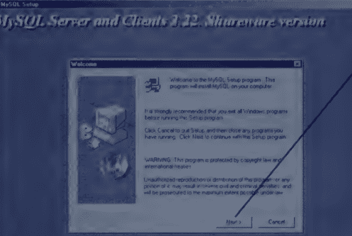

8. 阅读屏幕上的安装信息，然后点击“下一步”。
9. 阅读屏幕上的 MySQL 通用信息，然后点击“下一步”。
10. 选择目标目录（`C:\mysql\` 或其他位置），然后点击“下一步”。
11. 选择“典型安装”，然后点击“下一步”。安装程序将提取并将文件放置在你的文件系统中，随后安装程序将结束。

在下一节中，你将启动 MySQL 并执行一些操作以熟悉该系统。

### 测试你的 MySQL 安装

本节将让你通过 DOS 窗口中的命令行启动并使用 MySQL 实用程序。在 PHP 中使用 MySQL 时，你将执行相同类型的命令，只不过它们是在 PHP 代码的语文中执行的。利用本节的信息熟悉你将在书中将使用的命令类型和响应。

### 启动 MySQL

1. 打开一个 DOS 窗口。
2. 在提示符处输入 `cd c:\mysql\bin` 并按回车。

> 注意：如果将 MySQL 安装在不同的目录，请在第 2 步的命令中替换该目录名称。

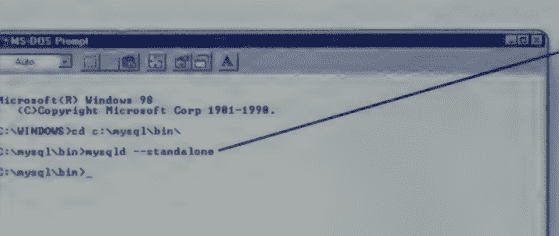

### 创建测试数据库

在继续之前，你应该了解以下内容：

- 数据库是表的集合。
- 表包含一组记录。
- 所有记录都具有相同数量的字段。
- 每个字段都对某条数据进行分类。

在本节中，你将创建一个数据库。将使用的实用程序是 `mysqldadmin` 程序，它允许你从命令行管理 MySQL。

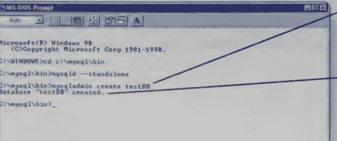

### 创建测试表

在本节中，你将在上一节创建的数据库中创建一个表。将使用的实用程序是 `mysql` 程序，它允许你从命令行在 MySQL 数据库系统中工作。

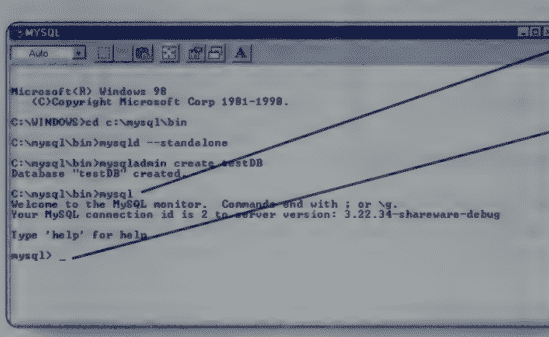

1. 在提示符处输入 `mysql` 并按回车。
2. 当 MySQL Monitor 启动时，它会提供自己的提示符。在此提示符（`mysql>`）下，你将输入创建表、插入表、查询数据等命令。在结束命令时使用分号（`;`），因为这也是 PHP 中同样使用的常用终止符。

现在你已经连接到 MySQL 监控器，你需要告诉它要使用哪个数据库。

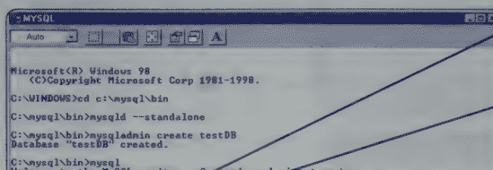

3. 在提示符处输入 `use testDB;` 并按回车。
4. 如果数据库存在且你有访问权限，MySQL 监控器将响应"Database changed"（数据库已更改）。

是时候创建一个测试表了。该表将包含一个 ID 号列和一个某些文本列。

> 注意：关于创建表的细节的更多信息，请参附录 C，"MySQL 基础参考"。

5. 在提示符处输入 `create table test_table (test_id int, test_note text)` 并按回车。此语句创建了一个名为 `test_table` 的表。

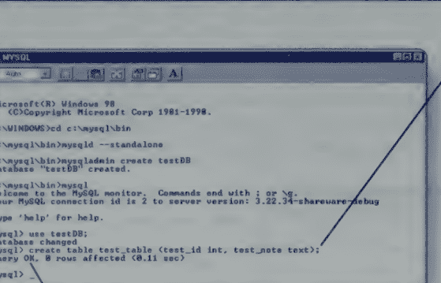

```
Microsoft(R) Windows 98.
(C)Copyright Microsoft Corp. 1998.

c:\WINDOWS>mysql\bin
mysql -u root --standalone

mysql> create database testDB
Database testDB created

Welcome to MySQL monitor. Commands begin with 'help'
Your connection id is 2 to server version: 3.22.34-shareware-debug
type 'help' for help

mysql> use testDB
mysql> create table test_table (test_id int, test_note text)
0 rows affected (0.11 sec)
mysql>
```

MySQL 监控器将响应"Query OK"。它还会告诉你影响了多少行，以及完成任务花了多长时间（在本例中为 0.11 秒）。

6. 输入 `show tables;` 并按回车来验证表的创建。

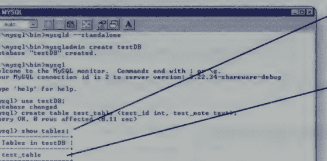

```
Microsoft(R) Windows 98.
(C)Copyright Microsoft Corp. 1998.

c:\WINDOWS>mysql\bin
mysql -u root --standalone

mysql> create database testDB
Database testDB created

Welcome to MySQL monitor. Commands begin with 'help'
Your connection id is 2 to server version: 3.22.34-shareware-debug
type 'help' for help

mysql> use testDB
mysql> create table test_table (test_id int, test_note text)
0 rows affected (0.11 sec)

mysql> show tables;
test_table
1 row in set (0.11 sec)
mysql>
```

*(注：由于原文文本部分存在错乱和重复，翻译时已根据逻辑进行了修正对齐)*

### 如果你正在使用 Linux

本节将向你展示如何使用本书 CD-ROM 中的文件在 Linux 上安装 MySQL，因此在开始之前，请先找到它。如果你使用的是其他 UNIX 版本，指令是相同的，但文件不同。请访问 `http://www.mysql.com/` 查找适用于你系统的特定二进制安装文件（Solaris、FreeBSD 等）。

**在 Linux 上安装 MySQL**

如果你在 Linux 上安装 MySQL 过程中遇到任何问题，请访问 `http://www.mysql.com/` 上的 MySQL 网站并阅读其手册。

在开始之前，找到书中附带的 CD-ROM，并将其插入 CDROM 驱动器。按照你的常规流程挂载 CD，就可以准备好安装文件了。

1. 使用命令行，输入 `cd [directory name]/software/linux/` 并按回车，进入包含 CD-ROM 中文件 `mysql-3.22.32-pc-linux-i686.tar.gz` 的目录。

> 注意：将 `[directory name]` 替换为挂载的 CD-ROM 目录名称（`/mnt`、`/cdrom` 等）。

2. 输入 `cp mysql-3.22.32-pc-linux-i686.tar.gz /usr/local/` 并按回车，将 MySQL 安装文件复制到 `/usr/local/` 目录。

> 注意：你可以将 MySQL 放在文件系统中的任何想要的地方，例如 `/usr/local/bin/`、`/opt/` 或其他位置。只需确保用你的路径替换这些说明中的指示路径即可。

3. 输入 `cd /usr/local/` 并按回车进入 `/usr/local/`。


# MySQL 安装与测试

## 安装 MySQL

4. 输入 `gunzip mysql-3.22.32-pc-linux-gnu-i686.tar.gz` 并按回车来解压 MySQL 安装文件。
5. 在提示符下，输入 `tar -xvf mysql-3.22.32-pc-linux-gnu-i686.tar` 并按回车。

> 将创建一个目录结构，你将返回提示符。父目录将是 `/usr/local/mysql-3.22.32-pc-linux-gnu-i686/`。

6. 进入挂载的 CD-ROM 目录（`/mnt`, `/cdrom` 等）。

```
mysql-3.22.32-pc-linux-gnu-i686/mysql/bench/limits/my.cfg
mysql-3.22.32-pc-linux-gnu-i686/mysql/bench/limits/my.cnf
mysql-3.22.32-pc-linux-gnu-i686/mysql/bench/limits/solid.cfg
mysql-3.22.32-pc-linux-gnu-i686/mysql/bench/limits/test.cfg
mysql-3.22.32-pc-linux-gnu-i686/mysql/bench/limits/Adobe.cfg
mysql-3.22.32-pc-linux-gnu-i686/mysql/bench/limits/hitsix82.cfg
mysql-3.22.32-pc-linux-gnu-i686/mysql/bench/limits/x86_64.cfg
mysql-3.22.32-pc-linux-gnu-i686/mysql/bench/limits/ais.cfg
mysql-3.22.32-pc-linux-gnu-i686/mysql/bench/limits/powerpc64.cfg
mysql-3.22.32-pc-linux-gnu-i686/mysql/bench/test-RTIS
mysql-3.22.32-pc-linux-gnu-i686/mysql/bench/test-big-tables
mysql-3.22.32-pc-linux-gnu-i686/mysql/bench/test-create
mysql-3.22.32-pc-linux-gnu-i686/mysql/bench/test-select
mysql-3.22.32-pc-linux-gnu-i686/mysql/bench/test-update
mysql-3.22.32-pc-linux-gnu-i686/mysql/bench/test-wisdom
mysql-3.22.32-pc-linux-gnu-i686/mysql/bench/PUBLIC
mysql-3.22.32-pc-linux-gnu-i686/mysql/scripts/INSTALL-BINARY
mysql-3.22.32-pc-linux-gnu-i686/mysql/manual/manual.txt
mysql-3.22.32-pc-linux-gnu-i686/mysql/manual/for-duplex.txt
mysql-3.22.32-pc-linux-gnu-i686/mysql/my.cnf
```

## 测试安装

本节将向你展示如何通过命令行测试 MySQL 的安装。安装完成后，通过 PHP 将测试将完成。

在提示符下，输入 `scripts/install_db`。

```
./scripts/install_db
Creating db
Creating user
Creating host
Creating columns_priv
```

要以 root 身份启动，你必须将 `scripts/mysql` 复制到你的数据系统，方法如下：

```
mysql -u root -password='new-password'
```

> 请记住为 MySQL 用户设置密码

请查看手册以获取更多说明。请报告 `install_db` 脚本的任何问题！有关此信息的信息可以通过访问 `http://www.mysql.com` 上的 `http://www.mysql.com/license.html` 获取。


4. 进入挂载的 CD-ROM 目录（`/mnt`, `/cdrom` 等）。

## 启动 MySQL

1. 在提示符下，输入 `mysql -`。
2. 在提示符下，输入 `mysql -`。

按回车后，你就可以连接到 MySQL 守护进程了。

3. 在提示符下，输入 `mysql -` 并按回车。
4. 在提示符下，输入 `tar -xvf mysql-3.22.32-pc-linux-gnu-i686.tar` 并按回车。

> 将创建一个目录结构，你将返回提示符。父目录将是 `/usr/local/mysql-3.22.32-pc-linux-gnu-i686/`。

```
./scripts/install_db
Creating db
Creating user
Creating host
Creating columns_priv
```

要以 root 身份启动，你必须将 `scripts/mysql` 复制到你的数据系统，方法如下：

```
mysql -u root -password='new-password'
```

> 请记住为 MySQL 用户设置密码

请查看手册以获取更多说明。请报告 `install_db` 脚本的任何问题！有关此信息的信息可以通过访问 http://www.mysql.com 上的 http://www.mysql.com/license.html 获取。

## 创建数据库

```
mysql-3.22.32-pc-linux-gnu-i686/mysql/bench/limits/my.cfg
mysql-3.22.32-pc-linux-gnu-i686/mysql/bench/limits/my.cnf
mysql-3.22.32-pc-linux-gnu-i686/mysql/bench/limits/solid.cfg
mysql-3.22.32-pc-linux-gnu-i686/mysql/bench/limits/test.cfg
mysql-3.22.32-pc-linux-gnu-i686/mysql/bench/limits/Adobe.cfg
mysql-3.22.32-pc-linux-gnu-i686/mysql/bench/limits/hitsix82.cfg
mysql-3.22.32-pc-linux-gnu-i686/mysql/bench/limits/x86_64.cfg
mysql-3.22.32-pc-linux-gnu-i686/mysql/bench/limits/ais.cfg
mysql-3.22.32-pc-linux-gnu-i686/mysql/bench/limits/powerpc64.cfg
mysql-3.22.32-pc-linux-gnu-i686/mysql/bench/test-RTIS
mysql-3.22.32-pc-linux-gnu-i686/mysql/bench/test-big-tables
mysql-3.22.32-pc-linux-gnu-i686/mysql/bench/test-create
mysql-3.22.32-pc-linux-gnu-i686/mysql/bench/test-select
mysql-3.22.32-pc-linux-gnu-i686/mysql/bench/test-update
mysql-3.22.32-pc-linux-gnu-i686/mysql/bench/test-wisdom
mysql-3.22.32-pc-linux-gnu-i686/mysql/bench/PUBLIC
mysql-3.22.32-pc-linux-gnu-i686/mysql/scripts/INSTALL-BINARY
mysql-3.22.32-pc-linux-gnu-i686/mysql/manual/manual.txt
mysql-3.22.32-pc-linux-gnu-i686/mysql/manual/for-duplex.txt
mysql-3.22.32-pc-linux-gnu-i686/mysql/my.cnf
```

## 测试

1. 在提示符下，输入 `mysql -`。
2. 在提示符下，输入 `mysql -`。
3. 在提示符下，输入 `mysql -` 并按回车。
4. 在提示符下，输入 `tar -xvf mysql-3.22.32-pc-linux-gnu-i686.tar` 并按回车。

> 将创建一个目录结构，你将返回提示符。父目录将是 `/usr/local/mysql-3.22.32-pc-linux-gnu-i686/`。

```
./scripts/install_db
Creating db
Creating user
Creating host
Creating columns_priv
```

要以 root 身份启动，你必须将 `scripts/mysql` 复制到你的数据系统，方法如下：

```
mysql -u root -password='new-password'
```

> 请记住为 MySQL 用户设置密码

请查看手册以获取更多说明。请报告 `install_db` 脚本的任何问题！有关此信息的信息可以通过访问 http://www.mysql.com 上的 http://www.mysql.com/license.html 获取。


6. 进入挂载的 CD-ROM 目录（`/mnt`、`/cdrom` 等）。

```
mysql-3.22.32-pc-linux-gnu-i686/mysql/bench/limits/my.cfg
mysql-3.22.32-pc-linux-gnu-i686/mysql/bench/limits/my.cnf
mysql-3.22.32-pc-linux-gnu-i686/mysql/bench/limits/solid.cfg
mysql-3.22.32-pc-linux-gnu-i686/mysql/bench/limits/test.cfg
mysql-3.22.32-pc-linux-gnu-i686/mysql/bench/limits/Adobe.cfg
mysql-3.22.32-pc-linux-gnu-i686/mysql/bench/limits/hitsix82.cfg
mysql-3.22.32-pc-linux-gnu-i686/mysql/bench/limits/x86_64.cfg
mysql-3.22.32-pc-linux-gnu-i686/mysql/bench/limits/ais.cfg
mysql-3.22.32-pc-linux-gnu-i686/mysql/bench/limits/powerpc64.cfg
mysql-3.22.32-pc-linux-gnu-i686/mysql/bench/test-RTIS
mysql-3.22.32-pc-linux-gnu-i686/mysql/bench/test-big-tables
mysql-3.22.32-pc-linux-gnu-i686/mysql/bench/test-create
mysql-3.22.32-pc-linux-gnu-i686/mysql/bench/test-select
mysql-3.22.32-pc-linux-gnu-i686/mysql/bench/test-update
mysql-3.22.32-pc-linux-gnu-i686/mysql/bench/test-wisdom
mysql-3.22.32-pc-linux-gnu-i686/mysql/bench/PUBLIC
mysql-3.22.32-pc-linux-gnu-i686/mysql/scripts/INSTALL-BINARY
mysql-3.22.32-pc-linux-gnu-i686/mysql/manual/manual.txt
mysql-3.22.32-pc-linux-gnu-i686/mysql/manual/for-duplex.txt
mysql-3.22.32-pc-linux-gnu-i686/mysql/my.cnf
```

7. 进入挂载的 CD-ROM 目录（`/mnt`、`/cdrom` 等）。

```
mysql-3.22.32-pc-linux-gnu-i686/mysql/bench/limits/my.cfg
mysql-3.22.32-pc-linux-gnu-i686/mysql/bench/limits/my.cnf
mysql-3.22.32-pc-linux-gnu-i686/mysql/bench/limits/solid.cfg
mysql-3.22.32-pc-linux-gnu-i686/mysql/bench/limits/test.cfg
mysql-3.22.32-pc-linux-gnu-i686/mysql/bench/limits/Adobe.cfg
mysql-3.22.32-pc-linux-gnu-i686/mysql/bench/limits/hitsix82.cfg
mysql-3.22.32-pc-linux-gnu-i686/mysql/bench/limits/x86_64.cfg
mysql-3.22.32-pc-linux-gnu-i686/mysql/bench/limits/ais.cfg
mysql-3.22.32-pc-linux-gnu-i686/mysql/bench/limits/powerpc64.cfg
mysql-3.22.32-pc-linux-gnu-i686/mysql/bench/test-RTIS
mysql-3.22.32-pc-linux-gnu-i686/mysql/bench/test-big-tables
mysql-3.22.32-pc-linux-gnu-i686/mysql/bench/test-create
mysql-3.22.32-pc-linux-gnu-i686/mysql/bench/test-select
mysql-3.22.32-pc-linux-gnu-i686/mysql/bench/test-update
mysql-3.22.32-pc-linux-gnu-i686/mysql/bench/test-wisdom
mysql-3.22.32-pc-linux-gnu-i686/mysql/bench/PUBLIC
mysql-3.22.32-pc-linux-gnu-i686/mysql/scripts/INSTALL-BINARY
mysql-3.22.32-pc-linux-gnu-i686/mysql/manual/manual.txt
mysql-3.22.32-pc-linux-gnu-i686/mysql/manual/for-duplex.txt
mysql-3.22.32-pc-linux-gnu-i686/mysql/my.cnf
```

## 创建数据库

```
mysql-3.22.32-pc-linux-gnu-i686/mysql/bench/limits/my.cfg
mysql-3.22.32-pc-linux-gnu-i686/mysql/bench/limits/my.cnf
mysql-3.22.32-pc-linux-gnu-i686/mysql/bench/limits/solid.cfg
mysql-3.22.32-pc-linux-gnu-i686/mysql/bench/limits/test.cfg
mysql-3.22.32-pc-linux-gnu-i686/mysql/bench/limits/Adobe.cfg
mysql-3.22.32-pc-linux-gnu-i686/mysql/bench/limits/hitsix82.cfg
mysql-3.22.32-pc-linux-gnu-i686/mysql/bench/limits/x86_64.cfg
mysql-3.22.32-pc-linux-gnu-i686/mysql/bench/limits/ais.cfg
mysql-3.22.32-pc-linux-gnu-i686/mysql/bench/limits/powerpc64.cfg
mysql-3.22.32-pc-linux-gnu-i686/mysql/bench/test-RTIS
mysql-3.22.32-pc-linux-gnu-i686/mysql/bench/test-big-tables
mysql-3.22.32-pc-linux-gnu-i686/mysql/bench/test-create
mysql-3.22.32-pc-linux-gnu-i686/mysql/bench/test-select
mysql-3.22.32-pc-linux-gnu-i686/mysql/bench/test-update
mysql-3.22.32-pc-linux-gnu-i686/mysql/bench/test-wisdom
mysql-3.22.32-pc-linux-gnu-i686/mysql/bench/PUBLIC
mysql-3.22.32-pc-linux-gnu-i686/mysql/scripts/INSTALL-BINARY
mysql-3.22.32-pc-linux-gnu-i686/mysql/manual/manual.txt
mysql-3.22.32-pc-linux-gnu-i686/mysql/manual/for-duplex.txt
mysql-3.22.32-pc-linux-gnu-i686/mysql/my.cnf
```

## 测试

1. 在提示符下，输入 `mysql -`。
2. 在提示符下，输入 `mysql -`。
3. 在提示符下，输入 `mysql -` 并按回车。
4. 在提示符下，输入 `tar -xvf mysql-3.22.32-pc-linux-gnu-i686.tar` 并按回车。

> 将创建一个目录结构，你将返回提示符。父目录将是 `/usr/local/mysql-3.22.32-pc-linux-gnu-i686/`。

```
./scripts/install_db
Creating db
Creating user
Creating host
Creating columns_priv
```

要以 root 身份启动，你必须将 `scripts/mysql` 复制到你的数据系统，方法如下：
`mysql -u root -password='new-password'`

> 请记住为 MySQL 用户设置密码

请查看手册以获取更多说明。请报告 `install_db` 脚本的任何问题！有关此信息的信息可以通过访问 `http://www.mysql.com` 上的 `http://www.mysql.com/license.html` 获取。

5. 进入挂载的 CD-ROM 目录（`/mnt`、`/cdrom` 等）。

```
mysql-3.22.32-pc-linux-gnu-i686/mysql/bench/limits/my.cfg
mysql-3.22.32-pc-linux-gnu-i686/mysql/bench/limits/my.cnf
mysql-3.22.32-pc-linux-gnu-i686/mysql/bench/limits/solid.cfg
mysql-3.22.32-pc-linux-gnu-i686/mysql/bench/limits/test.cfg
mysql-3.22.32-pc-linux-gnu-i686/mysql/bench/limits/Adobe.cfg
mysql-3.22.32-pc-linux-gnu-i686/mysql/bench/limits/hitsix82.cfg
mysql-3.22.32-pc-linux-gnu-i686/mysql/bench/limits/x86_64.cfg
mysql-3.22.32-pc-linux-gnu-i686/mysql/bench/limits/ais.cfg
mysql-3.22.32-pc-linux-gnu-i686/mysql/bench/limits/powerpc64.cfg
mysql-3.22.32-pc-linux-gnu-i686/mysql/bench/test-RTIS
mysql-3.22.32-pc-linux-gnu-i686/mysql/bench/test-big-tables
mysql-3.22.32-pc-linux-gnu-i686/mysql/bench/test-create
mysql-3.22.32-pc-linux-gnu-i686/mysql/bench/test-select
mysql-3.22.32-pc-linux-gnu-i686/mysql/bench/test-update
mysql-3.22.32-pc-linux-gnu-i686/mysql/bench/test-wisdom
mysql-3.22.32-pc-linux-gnu-i686/mysql/bench/PUBLIC
mysql-3.22.32-pc-linux-gnu-i686/mysql/scripts/INSTALL-BINARY
mysql-3.22.32-pc-linux-gnu-i686/mysql/manual/manual.txt
mysql-3.22.32-pc-linux-gnu-i686/mysql/manual/for-duplex.txt
mysql-3.22.32-pc-linux-gnu-i686/mysql/my.cnf
```

# 第 1 章：安装与配置 MySQL

```
mysql> show tables;
| Tables in testdb |
| test_table |
1 row in set (0 sec)
mysql>
```

4. 输入 `show tables;` 并按回车来验证表已创建。

MySQL 监控器将返回当前数据库中所有表的列表。

```
mysql> explain test_table;
| Field | Type | Null | Key | Default | Extra |
| test_id | int | NO | YES | | |
| note | varchar | YES | | | |
2 rows in set (0.05 sec)
mysql>
```

5. 要验证特定表中的字段名和类型，请使用 `explain` 命令。在这种情况下，输入 `explain test_table;` 并按回车。

MySQL 监控器将返回所选表中所有字段及其类型的列表。这是一个非常实用的命令，可以用来跟踪你的表设计。

是时候向你的表中插入几行数据了，因为这正变得相当无聊。第一行的 ID 将设为 1，`note` 将为"This is a note."。

```
mysql> insert int test_table values('1', 'This is a note.');
Query OK, 1 row affected (0.03 sec)
mysql>
```

6. 要插入此行，输入 `insert into test_table values('1', 'This is a note.');` 并按回车。

MySQL 监控器将响应"Query OK"。它还会告诉你影响了多少行以及完成任务花费了多长时间。

7. 输入 `insert into test_table values('99', 'Look! Another note.');` 并按回车来插入另一行。

**注意**

关于向表中插入数据的具体详细信息，请参阅附录 C，"MySQL 基础参考"。

现在你的表中已有了一些数据，即使只有两行，也请熟悉选择数据。保持 MySQL 监控器打开状态，因为在下一节中你也会使用它。

## 从你的测试表中选择数据

`select` 命令非常强大，当你处理 PHP 和 MySQL 时，这可能是你经常使用的命令。你可以在附录 C，"MySQL 基础参考"中找到更多关于 `select` 的信息，但现在我们将进行一些简单的数据选择。

```
mysql> select * from test_table;
test_id test_note
1       This is a note.
2       This is another note.
2 rows in set (0.01 sec)
```

1. 在提示符下，输入 `select * from test_table;` 并按回车。

该命令简单地从名为 `test_table` 的表中所有行的所有字段（这就是 `*` 的作用），并将数据以格式良好的表格形式返回到屏幕上。MySQL 监控器会告诉你返回了多少行以及运行查询花费了多长时间。

```
mysql> select * from test_table order by test_id desc;
test_id test_note
99      Look Another note.
1       This is a note.
2 rows in set (0.00 sec)
```

为结果增加一点顺序。尝试按 ID 编号对结果进行排序——数字数字在前。

2. 在提示符下，输入 `select * from test_table order by test_id desc;` 并按回车。

结果现在显示 `test_id` 为 99 的行作为表的第一行。命令中的 `desc` 代表"降序"（descending）。另一个选项是 `asc`，代表"升序"（ascending）。升序是默认顺序。

在下一章中，你将安装 Apache Web 服务器，并向开发动态的数据库驱动的网站迈进一步！

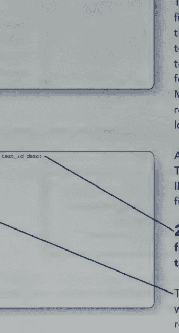

# 2 安装 Apache

由于它是目前最流行的 Web 服务器，你可能认为 Apache 是一个复杂的软件，但它并不困难。在本章中，你将学习如何执行以下操作：

- 在 Windows 或 Linux 上安装 Apache
- 连接到你的新 Web 服务器

### 如果你使用的是 Windows

在 Windows 上安装 Apache 比安装 MySQL 还要简单。Apache 也有安装向导，所以再次找到书的 CD-ROM，并坐稳扶好！

### 安装 Windows 版 Apache

在 Windows 95/98/2000/NT 上安装 Apache 是相同的。如果你遇到任何问题，请访问 Apache 网站 `http://www.apache.org` 并阅读服务器文档。

在开始之前，找到书中附带的 CD-ROM 并将其放入你的 CD-ROM 驱动器。现在你已准备好安装一些文件。

1. 使用 Windows 资源管理器，遍历 CD-ROM 文件系统。
2. 打开软件目录。
3. 打开 Windows 目录。

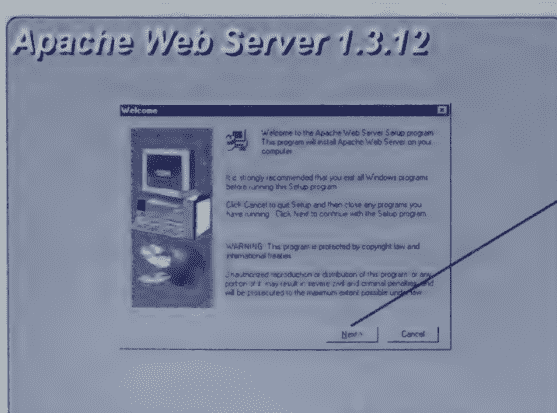

4. 双击名为 `apache_1_3_win32.exe` 的文件。Apache 安装程序将开始。
5. 读取屏幕上的安装信息，然后点击 Next（下一步）。
6. 读取屏幕上的通用 Apache 信息，然后点击 Next。
7. 读取关于 Windows 上 Apache 的注释，然后点击 Next。
8. 选择你的目标目录。
9. 选择 Typical（典型）设置，然后点击 Next。


# 第 2 章：安装 Apache

10. 选择 Apache 的位置，然后点击 Next。安装程序将提取文件并放置在文件系统中，并提示你阅读 `README` 文件。

11. 点击 Finish（完成）完成安装。

在下一节中，你将对 Apache 配置进行一些微调。

### 配置 Apache

此时，你对 Apache 配置文件进行的更改是微小的。配置文件位于安装目录下的 `conf` 目录。因此，如果你的安装目录是 `C:\Program Files\Group\Apache\`，配置文件位于 `C:\Program Files\Group\Apache\`。

```
# ServerName. 你的地址，邮件应至。此地址将出现在某些生成的页面上，例如 ServerAdmin: admin@example.com
* ServerName 允许你设置一个主机名，如果你的服务器与客户端不同（例如，使用 ServerName: localhost）。
* 注意：你不能随意发明主机名并使其生效。你定义的名称必须在你的主机上解析。如果你不明白，请询问你的网络管理员。
* 如果你想使用 IP 地址而不是名称，请在此输入。你将通过地址访问（例如 http://123.45.67.89/），这将可以以正常方式工作。
* ServerName localhost
```

1. 打开一个文本编辑器。

2. 打开 Apache 目录下 `conf` 目录下的 `httpd.conf` 文件。

3. 找到这段文本。

4. 将 `ServerAdmin` 的值更改为电子邮件地址。

5. 将 `ServerName` 的值更改为 `localhost`。

6. 保存文件。

Apache 现在准备好在你的机器上运行。在下一节中，你将启动并连接 Apache。

### 启动 Apache

在 Windows 平台上，你可以单独运行 Apache，也可以在使用 Windows NT 时作为服务运行。

### 作为服务启动 Apache

如果你使用的是 Windows 并希望作为服务运行 Apache，请按照以下步骤操作：

1. 从 Windows 开始菜单打开 Apache Web 服务器菜单，选择 `Install Apache as a service` 项。

2. 打开控制面板并打开服务窗口。

3. 从服务列表中选择 Apache。

4. 点击 Start（启动）。

Apache 现在将在后台运行。几分钟后，你将首次连接到你的新 Web 服务器。

### 手动启动和停止 Apache

如果你无法将 Apache 作为服务运行，请担心。你仍然手动启动和停止 Apache。

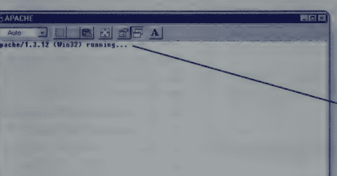

1. 从 Windows 开始菜单，打开 Apache Web Server 菜单并选择 `Start Apache` 项。

一个 DOS 窗口将会打开。

保持此 DOS 窗口打开，否则你的 Apache 进程将停止。你可以最小化窗口——只要不要关闭它。

要停止 Apache，请从 Windows 开始菜单上的 Apache Web Server 菜单中选择 `Stop Apache` 项。不过，现在保持它运行。在下一节中，你将首次连接到你的新 Web 服务器。

### 连接到 Apache

在配置部分，你为 `httpd.conf` 文件中的 `ServerName` 赋值了 `localhost`。你将使用此名称来连接到你的 Web 服务器。

> **注意**
>
> 只有你可以使用 `localhost` 连接到你的 Web 服务器。如果你有一个静态 IP 和可以通过 DNS 解析的机器名称，你可以在 `httpd.conf` 文件中使用该名称替换 `localhost`，其他用户也可以连接到该机器。本书假设你现在将使用 `localhost`，但如果你有真实的机器名称，实际上并没有区别。只需在示例中用你的机器名称替换 `localhost` 即可。

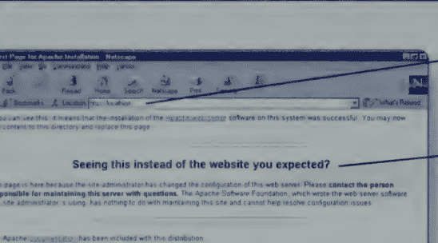

- 打开浏览器，在地址栏输入 `http://localhost/` 并按回车。

- 这个默认起始页来自 Apache 安装目录下的 `htdocs` 目录。如果你愿意，可以进入该目录并删除所有默认文件，也可以保留它们。它们不会产生任何影响，但你最终会用自己的文件填充 `htdocs` 目录。

### 看到的是而不是你预期的网站？

此页出现是因为其他人更改了此 Web 服务器的配置。请联系维护此服务器的人员。提供 Web 服务器的 Apache 软件基金与维护无关，也无法解决配置问题。

Apache 服务器已随发行版安装。

你可以自由地在支持 Apache 的 Web 服务器上使用以下更改。感谢 Apache！


子目录，所以为了方便整理，你可能想删除默认文件。

继续到下一章，你将在那里安装 PHP 并在准备操作之前对你的 Apache 配置文件进行更多更改。

### 如果你正在使用 Linux

本节将向你展示如何使用书中光盘中的文件在 Linux 上安装 Apache，因此在开始之前请下载光盘。此相同文件适用于其他变体 UNIX，但如果你有任何疑虑，请访问 `http://www.apache.org/dist/` 为你的操作系统寻找更好的源码文件。

### 为 Linux 安装 Apache

如果你在为 Linux 安装 Apache 时遇到任何问题，请访问 `http://www.apache.org` 的 Apache 网站并阅读服务器文档。

### 如果你正在使用 LINUX

在开始之前，找到书中附带的光盘并将其放入光驱驱动器。使用你的正常流程挂载光盘，你就准备好安装一些文件了。

1. 使用命令行，输入 `cd (目录名称)/software/linux/` 并按回车到达包含光盘中 `apache_1.3.12.tar.gz` 文件的目录。

> **注意**
>
> 将 `[directory名称]` 替换为挂载光盘的名称（例如 `/mnt/cdrom`）。

2. 输入 `cp apache_1.3.12.tar.gz /usr/local/` 并按回车，将安装文件复制到 `/usr/local/` 目录。

3. 输入 `cd /usr/local/` 并按回车进入 `/usr/local/`。

4. 输入 `tar -xzf apache_1.3.12.tar.gz` 解压 Apache 安装文件。

```
apache-1.3.12/icons/all
apache-1.3.12/icons/com
apache-1.3.12/icons/dir
apache-1.3.12/icons/doc
apache-1.3.12/icons/empty
apache-1.3.12/icons/generic
apache-1.3.12/icons/folder
apache-1.3.12/icons/image
apache-1.3.12/icons/link
apache-1.3.12/icons/move
apache-1.3.12/icons/new
apache-1.3.12/icons/package
apache-1.3.12/icons/search
apache-1.3.12/icons/sound
apache-1.3.12/icons/user
apache-1.3.12/logs/
```

> **注意**
>
> 你可以将 Apache 放在文件系统的任何地方，如 `/usr/local/` 或 `/opt/`。只需在这些说明中替换你的路径。

5. 在提示符处，输入 `tar -xvf apache_1.3.12.tar` 提取文件。将创建一个目录并返回提示符。父目录将是 `/usr/local/apache-1.3.12/`。


6. 输入 `cd apache-1.3.12` 并按回车进入父目录。

7. 输入以下并按回车准备构建 Apache：

```
./configure --prefix=/usr/local/apache-1.3.12 --enable-module=shared
```

> **注意**
>
> 如果 `apache-1.3.12` 目录位于文件系统的其他位置（如上所示的 `/opt/`），请在第7步中使用该路径。

```
cd apache-1.3.12
./configure --prefix=/opt/apache-1.3.12 --enable-module=shared
Configuring Apache. Version 1.3.12
Installation path layout: Apache (config,layout)
Creating Makefile
Creating Makefile in src
Creating Makefile in src
Configuring for local-platform
setting C compiler to gcc -E
checking for system headers
adding required modules
checking for shared modules
checking for data types
checking various data types
Creating Makefile in src/common
Creating Makefile in src/server
Creating Makefile in src/unix
Creating Makefile in src/win32
Creating Makefile in src/aix
Creating Makefile in src/htpd/shared-lite
Creating Makefile in src/modules/standard
```

配置脚本将运行检查配置并创建 `Makefile` 的过程，然后返回提示符。

8. 输入 `make` 并按回车。

安装过程的第二步将在屏幕上产生大量输出。完成后，你将返回提示符。

```
yum install -y httpd
yum -c "=base64,httpd-2.4.6-97.el7.x86_64.rpm,httpd-tools-2.4.6-97.el7.x86_64.rpm,httpd-core-2.4.6-97.el7.x86_64.rpm,httpd-common-2.4.6-97.el7.x86_64.rpm,httpd-ssl-2.4.6-97.el7.x86_64.rpm,mod_proxyclient-2.4.6-97.el7.x86_64.rpm,mod_proxyauth-2.4.6-97.el7.x86_64.rpm,mod_ssld-2.4.6-97.el7.x86_64.rpm,mod_zipconfig-2.4.6-97.el7.x86_64.rpm,mod_lua-2.4.6-97.el7.x86_64.rpm,mod_subversion-2.4.6-97.el7.x86_64.rpm,mod_sessioncookie-2.4.6-97.el7.x86_64.rpm,mod_xml2-2.4.6-97.el7.x86_64.rpm,mod_cgid-2.4.6-97.el7.x86_64.rpm,mod_authnz-2.4.6-97.el7.x86_64.rpm,mod_authfile-2.4.6-97.el7.x86_64.rpm,mod_fileinfo-2.4.6-97.el7.x86_64.rpm,mod_status-2.4.6-97.el7.x86_64.rpm,mod_davinfo-2.4.6-97.el7.x86_64.rpm,mod_headers-2.4.6-97.el7.x86_64.rpm,mod_security-2.4.6-97.el7.x86_64.rpm,mod_vhost-2.4.6-97.el7.x86_64.rpm,mod_cache-2.4.6-97.el7.x86_64.rpm,mod_lock-2.4.6-97.el7.x86_64.rpm,mod_lbheaders-2.4.6-97.el7.x86_64.rpm,mod_ymcb-2.4.6-97.el7.x86_64.rpm,mod_sessionid-2.4.6-97.el7.x86_64.rpm,mod_crypto-2.4.6-97.el7.x86_64.rpm,mod_writer-2.4.6-97.el7.x86_64.rpm,mod_remoteuser-2.4.6-97.el7.x86_64.rpm,mod_authcache-2.4.6-97.el7.x86_64.rpm,mod_send-2.4.6-97.el7.x86_64.rpm,mod_unique-2.4.6-97.el7.x86_64.rpm,mod_xcache-2.4.6-97.el7.x86_64.rpm,mod_xproxy-2.4.6-97.el7.x86_64.rpm,mod_xaccess-2.4.6-97.el7.x86_64.rpm,mod_xfilter-2.4.6-97.el7.x86_64.rpm,mod_xforward-2.4.6-97.el7.x86_64.rpm,mod_xinfo-2.4.6-97.el7.x86_64.rpm,mod_xstatus-2.4.6-97.el7.x86_64.rpm,mod_xauth-2.4.6-97.el7.x86_64.rpm,mod_xgroup-2.4.6-97.el7.x86_64.rpm,mod_xuser-2.4.6-97.el7.x86_64.rpm,mod_xreferer-2.4.6-97.el7.x86_64.rpm,mod_xhost-2.4.6-97.el7.x86_64.rpm,mod_xlock-2.4.6-97.el7.x86_64.rpm,mod_xconn-2.4.6-97.el7.x86_64.rpm,mod_xcache-2.4.6-97.el7.x86_64.rpm,mod_xproxy-2.4.6-97.el7.x86_64.rpm,mod_xauth-2.4.6-97.el7.x86_64.rpm,mod_xgroup-2.4.6-97.el7.x86_64.rpm,mod_xuser-2.4.6-97.el7.x86_64.rpm,mod_xreferer-2.4.6-97.el7.x86_64.rpm,mod_xhost-2.4.6-97.el7.x86_64.rpm,mod_xlock-2.4.6-97.el7.x86_64.rpm,mod_xconn-2.4.6-97.el7.x86_64.rpm,mod_xcache-2.4.6-97.el7.x86_64.rpm,mod_xproxy-2.4.6-97.el7.x86_64.rpm,mod_xauth-2.4.6-97.el7.x86_64.rpm,mod_xgroup-2.4.6-97.el7.x86_64.rpm,mod_xuser-2.4.6-97.el7.x86_64.rpm,mod_xreferer-2.4.6-97.el7.x86_64.rpm,mod_xhost-2.4.6-97.el7.x86_64.rpm,mod_xlock-2.4.6-97.el7.x86_64.rpm,mod_xconn-2.4.6-97.el7.x86_64.rpm,mod_xcache-2.4.6-97.el7.x86_64.rpm,mod_xproxy-2.4.6-97.el7.x86_64.rpm,mod_xauth-2.4.6-97.el7.x86_64.rpm,mod_xgroup-2.4.6-97.el7.x86_64.rpm,mod_xuser-2.4.6-97.el7.x86_64.rpm,mod_xreferer-2.4.6-97.el7.x86_64.rpm,mod_xhost-2.4.6-97.el7.x86_64.rpm,mod_xlock-2.4.6-97.el7.x86_64.rpm,mod_xconn-2.4.6-97.el7.x86_64.rpm,mod_xcache-2.4.6-97.el7.x86_64.rpm
```

9. 输入 `make install` 并按回车。这一安装过程的最后一步，你将 Apache Apache Apache Apache。

```
Apache 1.3 HTTP 服务器。要验证 Apache 是否正在运行，请使用：
最初创建或保留的配置文件
/apache-1.3.12/bin/httpd -k

并且你可以通过列出的命令启动 Apache 服务器：
/apache-1.3.12/bin/apachectl start
```

> Apache 组织
>
> `http://www.apache.org/`

### 配置 Apache

在此阶段，你对 Apache 配置文件所做的更改只是微小的管理性更改。配置文件位于 Apache 安装目录下的 `conf` 目录。因此，如果你的安装路径为 `/usr/local/apache_1.3.12/`，那么配置文件将位于 `/usr/local/apache_1.3.12/`。

```
# ServerAdmin: 你的地址，服务器所在地
# e-mail 此地址将出现在服务器生成的页面上，例如
# 错误文档
ServerAdmin youraddress
# ServerName 允许你设置一个返回给客户端的主机名，
# 如果它与程序获取的名称不同（即使用它
# 代替主机的真实名称）
# 注意：你不能随意发明主机名并希望它们有效。你选择的名称必须为你的主机注册，
# 否则你将无法执行此操作。请咨询你的网络管理员。
# 如果你没有 DNS 名称，在此处输入 IP 地址。
# 你必须通过其地址访问（例如 http://123.45.67.89/）
# 并以合理的方式进行重定向
#ServerName new host name
```

1. 打开一个文本编辑器。

2. 打开 Apache 安装目录下的 `httpd.conf` 文件。

3. 找到这段文本。


```
# ServerName: 你的地址服务器所在地
# e-mail 此地址将出现在服务器生成的页面上，例如
# 错误文档。
ServerAdmin Julie@localhost.com
# ServerName 允许你设置一个返回给客户端的主机名，
# 如果它与程序获取的名称不同（即使用它
# 代替主机的真实名称
# 注意：你不能随意发明主机名并希望它们有效。你选择的名称必须为你的主机注册，
# 否则你将无法执行此操作。请咨询你的网络管理员。
# 如果你没有 DNS 名称，在此处输入 IP 地址。
# 你必须通过其地址访问（例如 http://123.45.67.89/）
# 并以合理的方式进行重定向。
ServerName localhost
```

4. 将 `ServerAdmin` 的值更改为你的电子邮件地址。

5. 将 `ServerName` 的值更改为 `localhost`。

6. 保存文件。

Apache 现在已准备好在你的机器上运行。在下一节中，你将启动并配置 Apache。

## 启动和停止 Apache

在 Apache 安装目录的 `bin` 目录下有一个实用的工具称为 `apachectl`。它允许你发出启动、停止和重启命令。使用此工具首次启动 Apache。

1. 要进入 Apache 安装目录，输入 `cd /usr/local/apache_1.3.12` 并按回车。

```
$ /bin/apachectl start
$ /bin/apachectl start: http started
```


2. 输入 `/bin/apachectl start` 并按回车。

你应该会看到"httpd started."的消息。然后你将返回到提示符。

要停止 Apache，你可以输入 `./bin/apachectl stop` 并按回车。不过，现在先保持它运行。在下一节中，你将首次连接到你的新 Web 服务器。

### 连接到 Apache

在配置部分，你为 `httpd.conf` 文件中的 `ServerName` 赋值为 `localhost`。你将使用此名称连接到你的 Web 服务器。

> 注意
>
> 只有你可以使用 `localhost` 连接到你的 Web 服务器。如果你有静态 IP 和可以通过 DNS 解析的主机名，你可以在 `httpd.conf` 文件中将 `localhost` 替换为该名称，其他用户也可以连接到该机器。本书假设你现在将使用 `localhost`，但如果你有真实的主机名也没有区别。只需在示例中用你的主机名替换 `localhost` 即可。

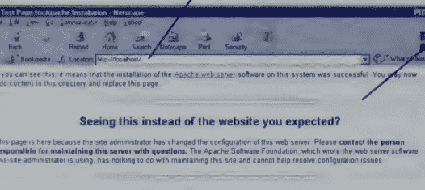

1. 打开浏览器，在地址栏输入 `http://localhost/`。你应该看到一个包含服务器信息的页面。

2. 如果没有看到页面，请检查 Apache 是否正在运行。

3. 如果你想更改服务器配置，请编辑 `httpd.conf` 文件并重启 Apache。

4. 要添加你自己的网页，请为它们创建一个目录，并更新 `httpd.conf` 文件中的 `DocumentRoot`。

5. 要设置虚拟主机，请使用 `httpd.conf` 文件中的 `VirtualHost` 指令。

6. 更多信息，请参考 Apache 文档。

### 安装 PHP

若要在 Apache 中使用 PHP，你需要安装 PHP 并配置 Apache。本节将介绍如何在 Linux 系统上进行这些操作。

1. 使用你发行版的包管理器安装 PHP（例如 `sudo apt-get install php`）。

2. 安装 Apache PHP 模块（例如 `sudo apt-get install libapache2-mod-php`）。

3. 通过重启 Apache 来配置其处理 PHP 文件（例如 `sudo service apache2 restart`）。

4. 在你的 Web 根目录下创建一个包含 `<?php phpinfo(); ?>` 的 PHP 文件。

5. 在浏览器中访问 `http://localhost/info.php` 以验证 PHP 是否工作正常。

## 如果你正在使用 Windows

```
# Action 允许你定义媒体类型，当匹配的文件被调用时，
# 将执行一个脚本。这消除了重复检查 URL 的需要。
# pathinfo Action_media/type /cgi-script/location
# Format Action-handler-name /cgi-script/location
```

7. 找到像这样的文本段落。


```
# Action 允许你定义媒体类型，当匹配的文件被调用时，
# 将执行一个脚本。这消除了重复检查 URL 的需要。
# pathinfo Action_media/type /cgi-script/location
# Format Action-handler-name /cgi-script/location
```

8. 添加以下行：

```
Action application/x-httpd-php /php4/php.exe
```


9. 保存并关闭 `httpd.conf` 文件。

```
Action application/x-httpd-php /php4/php.exe
```

此最终修改告诉 Apache，当请求扩展名为 `.php` 或 `.phtml` 的文件时，Apache 在向 Web 浏览器发送任何输出之前，应该先通过 PHP 解析器运行该文件。

## 重启 Apache 并测试 PHP4 安装

现在你已经对 `httpd.conf` 完成了所有修改，可以重启 Apache。

如果你使用的是 Windows NT，请执行以下操作：

1. 进入控制面板并打开"服务"窗口。

2. 从服务列表中选择 Apache。

3. 点击"停止"以停止服务。

4. 点击"启动"重新启动服务。

## 创建文本脚本

现在你将创建一个简单的 PHP 脚本来测试你的安装。PHP 脚本和其他文件（HTML、图像等）应该位于你 Web 服务器的文档根目录。对于 Apache 来说，文档根是 Apache 安装目录下的 `htdocs` 目录。

> 提示：如果你需要手动启动 Apache，请从 Windows 开始菜单打开 Apache Web Server 菜单，并选择 `Start Apache` 项。

1. 在你的文本编辑器中打开新文件。

2. 输入以下内容：

```
<?php phpinfo(); ?>
```

3. 将文件保存为 `phpinfo.php`。

4. 将此文件放置在你 Web 服务器的文档根目录下。

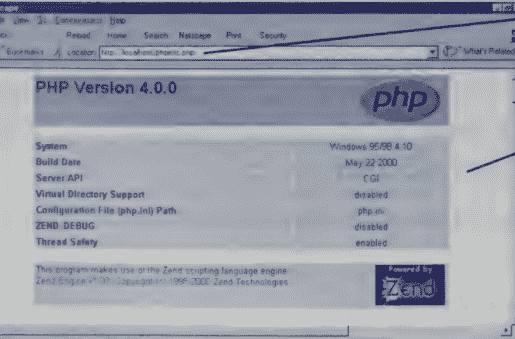

5. 打开你的 Web 浏览器并输入 `http://localhost/phpinfo.php`。

`phpinfo.php` 脚本的输出应该包含系统和环境信息的长页面。当你尝试弄清楚可用时，这些信息非常有帮助。

如果你浏览结果，你会发现以下内容是预装的：

- 正则表达式支持
- 动态库支持
- 内部 `sendmail` 支持
- Perl 兼容正则表达式支持
- ODBC 支持
- Session 支持
- XML 支持
- MySQL 支持

预装这些项目意味着要让这些功能对你可用，不需要额外的 `.dll` 文件。有关获取用于额外 PHP 功能的 `.dll` 文件的更多信息，请参阅附录 A，"其他配置选项"。

你现在准备好进入第二部分"PHP 编码的绝对基础"，并学习 PHP 语言的基础知识。

## 如果你使用的是 Linux

本节将向你展示如何使用本书附带的光盘中的文件在 Linux 上安装 PHP4，因此在开始之前请找到它。该文件也适用于其他变种 UNIX。

你将把 PHP4 构建为 Apache 的动态模块。通过构建动态模块而不是静态模块，你可以升级或重新编译 PHP4，而无需重新编译 Apache。

例如，在本节中，你所做的只是为 MySQL 支持配置 PHP。如果你决定在以后需要额外的选项——例如图像创建函数或额外的加密函数——你只需要更改 PHP4 的配置命令，重新编译它并重启 Apache。Apache 安装不需要任何额外更改。

## 为 Linux 安装 PHP4

如果你在为 Linux 安装 PHP4 时遇到任何问题，请访问 `http://www.php.net/` PHP 网站，先阅读 FAQ，然后阅读 PHP 手册。

在开始之前，找到书中附带的 CD 盘并将其插入 CD 驱动器。使用你通常的过程挂载 CD 盘，你就可以准备安装一些文件了。

1. 使用命令行，输入 `cd [directory]/software/linux/` 并回车，到达包含 CD 盘中 `php-4.0.0.tar.gz` 文件的目录。

2. 输入 `cp php-4.0.0.tar.gz /usr/local/` 并回车，将 PHP4 安装文件复制到 `/usr/local` 目录。

> 你可以将 PHP4 放在文件系统中的任何地方，例如 `/usr/local/bin/` 或 `/opt/`，或者任何你想放置文件的地方。只需在这些说明中替换你的路径即可。

3. 输入 `cd /usr/local/` 并回车进入 `/usr/local`。

4. 输入 `gunzip php-4.0.0.tar.gz` 解压 PHP4。

5. 在提示符下，输入 `tar -xvf php-4.0.0.tar.gz` 提取文件。将创建一个目录结构，你将返回提示符。该目录将是 `/usr/local/php-4.0.0`。

6. 输入 `cd php-4.0.0` 并回车进入父目录。

7. 输入以下内容并回车准备构建 PHP4：

```bash
./configure --with-mysql=/usr/local/mysql-3.22-pc-linux-gnu-i86 --with-apxs=/usr/local/apache-1.32/bin/apxs
```

注意：在配置说明中，使用你的路径，MySQL 和 Apache 目录应位于文件系统的任何地方（如 `/opt/`）。

```
creating ext/score/Makefile
creating ext/posix/Makefile
creating ext/session/Makefile
creating ext/standard/Makefile
creating ext/cache/Makefile
creating ext/xml/libxml/Makefile
creating ext/sapi/apache/Makefile
creating ext/sapi/cli/Makefile
```

此软件受 PHP 许可证限制。如果你不同意该许可证条款，则必须在此处终止安装。配置脚本将运行你的配置过程并创建 `Makefile`。然后它会将你返回提示符。

```bash
$ /home/user/php-4.0.0/autoconf -i --shared=/home/user/php-4.0.0
$ /home/user/php-4.0.0/configure --with-mysql=/usr/local/mysql-3.22-pc-linux-gnu-i86 --with-apxs=/usr/local/apache-1.32/bin/apxs --enable-shared
$ /home/user/php-4.0.0/configure --with-mysql=/usr/local/mysql-3.22-pc-linux-gnu-i86 --with-apxs=/usr/local/apache-1.32/bin/apxs --enable-shared --with-zlib
$ /home/user/php-4.0.0/configure --with-mysql=/usr/local/mysql-3.22-pc-linux-gnu-i86 --with-apxs=/usr/local/apache-1.32/bin/apxs --enable-shared --with-zlib --with-mbstring
$ /home/user/php-4.0.0/configure --with-mysql=/usr/local/mysql-3.22-pc-linux-gnu-i86 --with-apxs=/usr/local/apache-1.32/bin/apxs --enable-shared --with-zlib --with-mbstring --with-gd
$ /home/user/php-4.0.0/configure --with-mysql=/usr/local/mysql-3.22-pc-linux-gnu-i86 --with-apxs=/usr/local/apache-1.32/bin/apxs --enable-shared --with-zlib --with-mbstring --with-gd --with-curl
$ /home/user/php-4.0.0/configure --with-mysql=/usr/local/mysql-3.22-pc-linux-gnu-i86 --with-apxs=/usr/local/apache-1.32/bin/apxs --enable-shared --with-zlib --with-mbstring --with-gd --with-curl --with-openssl=/usr/include/openssl-0.9.8-fips
$ /home/user/php-4.0.0/configure --with-mysql=/usr/local/mysql-3.22-pc-linux-gnu-i86 --with-apxs=/usr/local/apache-1.32/bin/apxs --enable-shared --with-zlib --with-mbstring --with-gd --with-curl --with-openssl=/usr/include/openssl-0.9.8-fips --with-iconv
$ /home/user/php-4.0.0/configure --with-mysql=/usr/local/mysql-3.22-pc-linux-gnu-i86 --with-apxs=/usr/local/apache-1.32/bin/apxs --enable-shared --with-zlib --with-mbstring --with-gd --with-curl --with-openssl=/usr/include/openssl-0.9.8-fips --with-iconv --with-readline
$ /home/user/php-4.0.0/make -j$(nproc)
```

8. 输入并执行。

安装过程的第二步将在你的屏幕上产生许多行输出。完成后将返回提示符。

```
make(2): Leaving directory /opt/php/src/apache/
make(2): Entering directory /opt/php-4.0/src/
make(2): Leaving directory /opt/php-4.0/src/
make(2): Entering directory /opt/php-4.0/src/
Making install in regmap
make(2): Leaving directory /opt/php-4.0/src/
make(2): Entering directory /opt/php-4.0/src/
make(2): Leaving directory /opt/php-4.0/src/
make(2): Entering directory /opt/php-4.0/src/
make(2): Leaving directory /opt/php-4.0/src/
make(2): Entering directory /opt/php-4.0/src/
make(2): Leaving directory /opt/php-4.0/src/
make(2): Entering directory /opt/php-4.0/src/
make(2): Leaving directory /opt/php-4.0/src/
make(2): Entering directory /opt/php-4.0/src/
make(2): Leaving directory /opt/php-4.0/src/
make(2): Entering directory /opt/php-4.0/src/
make(2): Leaving directory /opt/php-4.0/src/
make(2): Entering directory /opt/php-4.0/src/
make(2): Leaving directory /opt/php-4.0/src/
make(2): Entering directory /opt/php-4.0/src/
make(2): Leaving directory /opt/php-4.0/src/
make(2): Entering directory /opt/php-4.0/src/
make(2): Leaving directory /opt/php-4.0/src/
make(2): Entering directory /opt/php-4.0/src/
make(2): Leaving directory /opt/php-4.0/src/
```


```
make(2): Leaving directory /opt/php-4.0/src/
make(2): Entering directory /opt/php-4.0/src/
make(2): Leaving directory /opt/php-4.0/src/
make(2): Entering directory /opt/php-4.0/src/
```

9. 输入 `make install` 并按回车。

安装的这最后一步会在你的屏幕上产生许多行输出。完成后，你将回到提示符界面。

要让 Apache 运行基础版本的 PHP4，你需要对 `httpd.conf` 文件进行修改。

## 配置 Apache 使用 PHP4

安装过程会将一个模块放置在 Apache 目录结构中的正确位置，并自动对 `httpd.conf` 文件进行一些更改。你还需要对 `httpd.conf` 文件进行最后一次更改。

```
# AddType 允许你可以在不实际编辑文件的情况下调整 MIME 类型，或者
# 将某些（文件）设置为特定的类型
# 例如，PHP 3 模块（不属于 Apache 分发版的一部分——参见
# http://www.php.net）通常会使用它
# AddType application/x-httpd-php php3
# AddType application/x-httpd-php-source php3
# 而 PHP 4 使用以下：
# AddType application/x-httpd-php php4
# AddType application/x-httpd-php-source php4
```

1. 打开你的文本编辑器。
2. 打开 `httpd.conf` 文件。
3. 找到像下面这样的文本段。


```
# AddType 允许你可以在不实际编辑文件的情况下调整类型，或者
#   将某些文件设置为特定的类型
# 例如，PHP 3 模块（不属于 Apache 分发版的一部分——参见
#   后文 httpd.conf）
# AddType application/x-httpd-php php
# AddType application/x-httpd-php-source phps
# 而 PHP 4 使用：
# AddType application/x-httpd-php phtml
# AddType application/x-httpd-php-source phps
```

4. 通过移除最后两行的 `#` 来取消注释，并在倒数一行将 `.phtml` 作为选项。
5. 保存并关闭 `httpd.conf` 文件。

这一最终修改告诉 Apache，每当请求扩展名为 `.php` 或 `.html` 的文件时，应先通过 PHP 解析器运行该文件，然后再发送给 Web 浏览器。

## 重启 Apache 并测试 PHP4

现在你已经对 `httpd.conf` 文件完成了所有修改，可以重启 Apache。

1. 进入 Apache 目录，输入 `cd /usr/local/apache-1.3` 并按回车。
2. 输入 `./bin/apachectl start` 并按回车。

> 注意：如果 `apache-1.3` 目录位于文件系统的其他位置（例如 `/opt/`），请在步骤 1 中使用该路径。你应该看到"httpd started"的消息。然后返回提示符。


现在你将创建一个简单的 PHP 脚本来测试你的安装。PHP 脚本和其他文件（HTML、图像等）应该位于你 Web 服务器的根目录下。对于 Apache 来说，根目录是安装程序中的 `htdocs` 目录。

1. 在文本编辑器中打开一个新文件。
2. 输入以下内容：

```php
<?php phpinfo(); ?>
```

3. 将文件另存为 `phpinfo.php`。
4. 将此文件放在你 Web 服务器的根目录下。


5. 打开你的 Web 浏览器，输入 `http://localhost/phpinfo.php`，然后按回车。

`phpinfo.php` 脚本的输出应该是一个很长的系统信息页面。当你尝试了解可用功能时，这些信息非常有帮助。关于在 PHP 安装中配置和构建附加功能，请参见附录 A，"附加配置"。你现在准备好进入第二部分"PHP 编程基础"，学习 PHP 语言的基础。

## PHP 编程基础

- 第 4 章 混合 PHP 和 HTML
- 第 5 章 变量与运算符
- 第 6 章 使用变量

## 混合 PHP 和 HTML

现在你已经拥有了一个运行 PHP、Apache 和 MySQL 的工作开发环境，是时候深入 PHP 语言了。在本章中，你将学习如何：

- 识别并使用不同类型的 PHP 起始结束标签
- 在源码中混合 PHP 和 HTML
- 转义脚本中的特殊字符以产生有效输出

## PHP 是如何解析的

假设你有一个文件，其中包含一些 HTML 和 PHP 代码。工作原理如下。假设 PHP 文档扩展名为 `.php`。

1. Web 浏览器请求一个扩展名为 `.php` 的文档。
2. Web 服务器说："嘿！有人想要 PHP 文件。需要其他程序来它并发送到 PHP 解析器。"
3. PHP 解析器找到请求的文件并扫描 PHP 代码。
4. 当 PHP 解析器发现 PHP 代码时，它执行该代码并将产生的输出（如果有）放在文件中原代码占据的位置。
5. 这个新的输出文件传回 Web 服务器。
6. Web 服务器将其发送给 Web 浏览器。
7. Web 浏览器显示输出。

这种代码执行方法被称为"服务端"。由浏览器执行的代码（如 JavaScript）被称为"客户端"。要将 PHP 代码与 HTML 结合，PHP 代码必须与 HTML 隔离开。在下一节中，你将学习如何使用 PHP 起始结束标签来实现这一点。

### PHP 起始和结束标签

PHP 解析器识别几种不同的 PHP 起始和结束标签。它会尝试执行这些标签之间的任何内容，所以最好是有效代码！学习下表，以了解 PHP 解析器识别的三组主要的起始结束标签。

| 基础 PHP 起始结束标签 | 起始标签 | 结束标签 |
| :--- | :--- | :--- |
| | `<?php` | `?>` |
| | `<?` | `?>` |
| | `<script language="php">` | `</script>` |

接下来，你将在脚本中使用所有三组标签，我保证它们会无错误执行。

1. 在文本编辑器中打开一个新文件。
2. 输入以下使用第一种标签类型的代码：

```php
<?php
echo "<P>This is a test using the first tag type.</P>";
?>
```

3. 输入以下使用第二种标签类型的代码：

```php
<?php
echo "<P>This is a test using the second tag type.</P>";
?>
```

4. 输入以下使用第三种标签类型的代码：

```php
<script language="php">
echo "<P>This is a test using the third tag type.</P>";
</script>
```

5. 将文件另存为 `phpinfo.php`。
6. 将此文件放在你 Web 服务器的根目录下。
7. 打开你的 Web 浏览器，输入 `http://localhost/phpinfo.php`，然后按回车。

在你的 Web 浏览器中，你应该能看到脚本的执行结果。

在下一节中，你将学习到在 HTML 内部放置 PHP 块完全并不可怕。

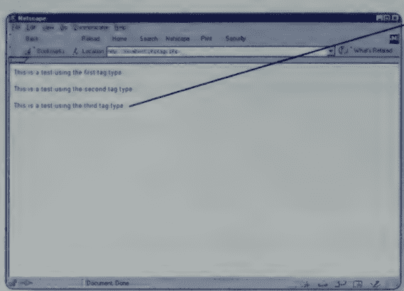

## 代码的共存

在上一节中，你的文件由三部分 PHP 代码组成，每部分代码都打印了一些 HTML 文本。在本节中，你将创建一个在 HTML 中间嵌入了 PHP 代码的脚本，并将学习到这两种类型的代码如何和平地共存。

1. 在你的文本编辑器中打开一个新文件。
2. 输入以下 HTML：

```
<HTML>
<HEAD>
<TITLE>我的第一个 PHP 脚本</TITLE>
</HEAD>
<BODY>
```

3. 输入以下 PHP 代码：

```php
<?
echo "<P><em>Hello World! I'm using PHP!</em></P>";
?>
```

4. 添加更多 HTML 以使文档有效：

```
</BODY>
</HTML>
```

5. 将文件保存为 `firstscript.php`。
6. 将此文件放置在你的 Web 服务器的文档根目录下。

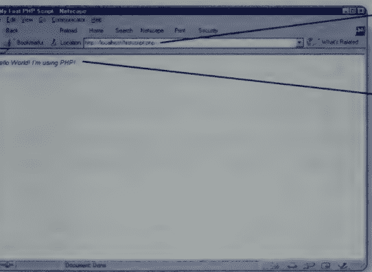

7. 打开你的 Web 浏览器并输入 `http://localhost/firstscript.php`

在你的 Web 浏览器中，你应该能看到脚本的执行结果。

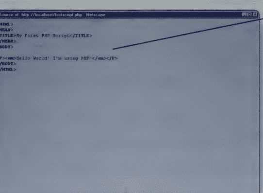

8. 在你的 Web 浏览器中查看此文档的源码。注意 HTML 源码只包含 HTML 代码。这段 PHP 代码已经执行了：

```php
<?
echo "<P><em>Hello World! I'm using PHP!</em></P>";
?>
```

这个块包含三个元素：命令（`echo`）、字符串（`<P><em>Hello World! I'm using PHP!</em></P>`）和指令终止符（`;`）。

熟悉 `echo` 命令，因为它可能是你最常用的命令。`echo` 语句用于输出信息——在这种情况下，是输出到这个 HTML 输出中：

```
<P><em>Hello World! I'm using PHP!</em></P>
```

下一节将讨论一个常见的错误，以便你以后能够避免它。

## 指令终止符的重要性

指令终止符（也称为分号 `;`）在命令末尾是绝对必需的。指令终止符告诉 PHP 解析器："我已经做完这个东西了。请尝试下一个。"

如果你不以分号结束命令，PHP 解析器将会变得困惑，你的代码将显示错误信息。接下来的步骤将向你展示如何避免这些错误之一，更重要的是，展示如何修复它。

1. 在你的文本编辑器中打开一个新文件。
2. 输入以下 HTML：

```
<HTML>
<HEAD>
<TITLE>产生错误</TITLE>
</HEAD>
<BODY>
```

3. 输入以下 PHP 代码：

```php
<?
echo "<P>I am trying to produce an error</P>"
echo "<P>Was I successful?</P>";
?>
```

4. 添加更多 HTML 以使文档有效：

```
</body>
</html>
```

5. 将文件保存为 `errorscript.php`。
6. 将此文件放置在你的 Web 服务器的文档根目录下。
7. 打开你的 Web 浏览器并输入 `http://localhost/errorscript.php`。

多么糟糕的错误！错误消息显示错误在第 9 行。查看脚本的第 8 行和第 9 行：

```php
echo "<P>I am trying to produce an error</P>
echo "<P>Was I successful?</P>";
```

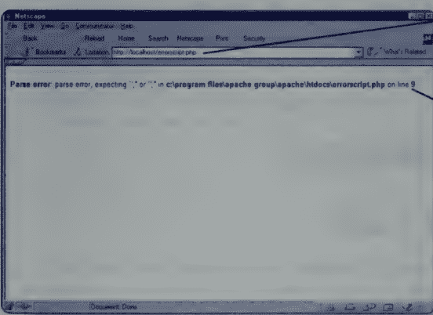

## 修复解析错误

第 8 行没有指令终止符，而第 9 行开启了一个新命令。PHP 解析器这样做，并通过产生解析错误来告诉你。

这个错误很容易修复：

1. 打开 `errorscript.php` 文件。
2. 在第 8 行的行末尾添加指令终止符（`;`）。
3. 保存文件。

```php
echo "<P>I am trying to produce an error</P>";
```

4. 将此文件放置在你的 Web 服务器的文档根目录下。

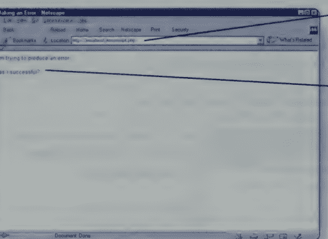

5. 打开你的 Web 浏览器并输入 `http://localhost/errorscript.php`。

在修复第 8 行后，PHP 解析器就能处理该文件，其余输出均成功。通过注意分号等内容，以及正如你在下一节中将学到的引号，来避免此类及其他错误。

### 代码转义

在记住用分号结束命令的同时，还要记住转义引号。接下来的步骤将展示在忘记转义时会发生什么，以及如何修复：

1. 在你的文本编辑器中打开一个新文件。
2. 输入以下 HTML：

```
<HTML>
<HEAD>
<TITLE>产生错误</TITLE>
</HEAD>
<BODY>
```


```
<HTML>
<HEAD>
<TITLE>产生错误</TITLE>
</HEAD>
<BODY>
```

3. 输入以下 PHP 代码：

```php
<?
echo "<P>I am trying to produce an error</P>"
echo "<P>Was I successful?</P>";
?>
```

4. 添加更多 HTML 以使文档有效：

```
</body>
</html>
```

5. 将文件保存为 `errorscript.php`。

6. 将此文件放置在你的 Web 服务器的文档根目录下。

7. 打开你的 Web 浏览器并输入 `http://localhost/errorscript.php`。

### 注释代码

注释代码是一个极好的习惯。在 HTML 文档中注释可以帮助你（以及以后可能编辑文档的人）跟踪进度。HTML 注释被浏览器忽略，并包含在 HTML 标签内。例如：

```html
<!-- 这是一个注释 -->
```

PHP 使用注释，这些会被 PHP 解析器忽略。PHP 注释通常以双斜开头，如：

```php
// 这是一个 PHP 注释
```

但你可以使用其他类型的注释，如：

```php
# 这是一个 Shell 风格的注释
```

以及

```php
/* 这是一个 C 风格的多行注释 */
```

创建一个充满注释的脚本，以便看到它们是如何工作的（是的，我是让你这样做）。

1. 在你的文本编辑器中打开一个新文件。

2. 输入以下 HTML：

```
<HTML>
<HEAD>
<TITLE>代码注释</TITLE>
</HEAD>
<BODY>
```

```html
<!-- 这是一个 HTML 注释 -->
```

3. 输入以下 PHP 代码：

```php
<?
// 这是一个简单的 PHP 注释
/* 这是一个 C 风格的多行注释。你可以把它写得尽可能长。 */
# 用于 Shell？使用这种注释。
?>
```

4. 添加更多 HTML 以使文档有效：

```
</BODY>
</HTML>
```

5. 将文件保存为 `comments.php`。

6. 将此文件放置在你的 Web 服务器的文档根目录下。

7. 打开你的 Web 浏览器并输入 `http://localhost/comments.php`。

你应该在 Web 浏览器中什么也看不见，因为你只是打印了一个 HTML 注释（它是被忽略的）。由于 PHP 注释会被 PHP 解析器忽略，该 PHP 块没有包含任何实际命令。

8. 在你的 Web 浏览器中查看此文档的源码。注意 HTML 源码包含了该 HTML 注释。

HTML 和 PHP 注释在书中被广泛使用以解释代码块。习惯阅读注释，并尝试养成使用它们的习惯。编写整洁、无 Bug 且带有注释和空白的代码会让你在开发者同行中很受欢迎，因为他们会感激不需要费额外精力去猜测你的代码意图是什么。

在下一章中，你将学习关于变量的所有知识，或者正如我喜欢称的，“那些带有美元符号的东西”。

## 5 引入变量和运算符

在上一章中，你学习了解析 PHP 代码的过程以及代码输出如何在 Web 浏览器中显示。在接下来的几章节中，你将学习 PHP 语言的内部工作原理——即所有组合在一起并实际运行程序的细碎部分！在本章中，你将学习如何以下操作：

- 识别并使用变量
- 识别并使用运算符

### 什么是变量？

变量是特定值的表示形式，例如“blue”或“19349377”。通过给变量赋值，你可以在脚本的其他地方引用该变量，并且该值将始终保持不变（除非你更改它，你将在稍后学习到这一点）。

要创建一个变量，请执行以下操作：

1. 想一个好名字！例如，如果我想创建一个变量来存储用户名，我会将变量命名为：

`username`

2. 在名称前加一个美元符号(`$`)：

`$username`

3. 在名称后使用等号(`=`)给该变量分配一个字面量值。将值放在引号中：

`$username = "joe"`

4. 给变量赋值是一条指令，因此应该以分号结尾：

`$username = "joe";`

就是这样——一个名为`username`、值为`joe`的变量。在本章稍后的部分，你将对变量进行一些有趣的操作（如数学运算）！

### 为变量命名

正如你所看到的，变量以美元符号(`$`)开，后面跟着一个有意义的名字。变量名不能以数字开头，但可以包含数字和下划字符(`_`)。此外，变量名对大小写敏感，这意味着`$YOURVAR`和`$yourvar`是两个不同的变量。

### PHP 变量和类型

创建有意义的变量名是减少编码时头问题的另一种方法。如果你的脚本处理姓名和密码值，不要创建名为`$sn`的姓名和名为`$sp`的密码——这些不是有意义的名字。如果你几周后又拿起该脚本，你可能会认为`$sn`是“数字”（number）而不是“姓名”（name），而`$sp`代表“页面”（page）而不是“密码”（password）。

你将在 PHP 代码中创建两种主要的变量：标量和数组。标量变量一次只包含一个值，而数组包含值列表，甚至是另一个数组。

本章开头的示例(`$username = "joe"`)创建了一个标量变量，书中的代码主要处理标量变量。你可以在附录 B《PHP 语言基础参考》中找到关于数组的信息。

当你给变量赋值时，通常会分配以下类型之一的值：

- 整数。整数（没有小数数字）。例如 1、345 和 9922786。你也可以使用八进制和十六进制表示：八进制 0123 是十进制 83，十六进制 0x12 是十进制 18。
- 浮点数。带小数数字。例如 1.5、87.3446 和 0.8889992。
- 字符串。文本和或数字信息，指定在双引号(`""`)或单引号(`''`)内。

开始编写 PHP 脚本时，仔细规划你的变量和变量名，并在代码中使用注释来提醒自己已做的赋值。

创建一个简单的脚本，为不同的变量赋值，然后简单地将值打印到屏幕上。

1. 在文本编辑器中打开一个新文件。

2. 输入以下 HTML：

```html
<HTML>
<HEAD>
<TITLE>打印变量</TITLE>
</HEAD>
<body>
```

3. 添加一个 PHP 块并创建一个存储整数的变量：

```php
<?
$intVar = "99542164";
```

4. 创建一个存储浮点数的变量：

```php
$floatVar = "1542.23235";
```

5. 创建一个存储字符串的变量：

```php
$stringVar = "这是一个字符串.";
```

6. 为每个变量添加`echo`语句：

```php
echo "<p>整数: $intVar</p>";
echo "<p>浮点数: $floatVar</p>";
echo "<p>字符串: $stringVar</p>";
```

7. 关闭 PHP 块：

```php
?>
```

**什么是运算符？**

8. 添加一些 HTML 使文档有效：

```html
</body>
</html>
```

9. 将文件保存为 `printvarscript.php`。

10. 将此文件放在你的 Web 服务器的文档根目录下。


11. 打开浏览器并输入 `http://localhost/printvarscript.php`。

你可以通过输出看到`$intVar`、`$floatVar`和`$stringVar`的值已打印到屏幕上。

在下一节中，你将学习如何使用运算符更改变量的值。

### 运算符？

在上一节中，你使用了赋值运算符(`=`)给变量赋值。还有其他类型的运算符，以及普通运算符。运算符的基本功能是对值进行某些操作。这种“操作”可以是赋值或比较两个值。

### PHP 运算符

以下是运算符的主要类型及其功能：

- **赋值运算符**。给变量赋值。也可以增加变量当前的值。
- **算术运算符**。使用这些运算符时会发生加、减、除和乘运算。
- **比较运算符**。比较两个值并返回真或假。你可以根据返回的值执行操作。
- **逻辑运算符**。确定条件的状态。

本章其余部分致力于讨论 PHP 中使用的某些运算符。你将为每个编写脚本，所以请准备好！

### 赋值运算符

你已经看到赋值运算符的作用了；等号是基础运算符。记住：`=`不意味着“等于”，`==`（两个等号）意味着“等于”，而`=`意味着“赋值”。

查看下表中的运算符并准备编写新脚本。

| 运算符 | 示例 | 操作 |
| :--- | :--- | :--- |
| `+=` | `$a += 3;` | 将变量的值变为当前值加上右侧 |
| `-=` | `$a -= 3;` | 将变量的值变为当前值减去右侧 |
| `.=` | `$a .= "string";` | 将右侧的值拼接到当前值上 |

创建一个简单的脚本来显示所有赋值运算符的作用。此脚本将一个原始值赋给变量，然后在脚本执行更改该值，同时将结果打印到屏幕上。

1. 在文本编辑器中打开一个新文件。

2. 输入以下 HTML：

```html
<HTML>
<HEAD>
<TITLE>使用运算符</TITLE>
</HEAD>
<BODY>
```

3. 启动 PHP 块。创建一个值为 100 的变量并打印它：

```php
<?
$origVar = 100;
echo "<P>原始值为 $origVar</P>";
```

4. 给该值加值并打印它：

```php
$origVar += 25;
echo "<P>增加了值，现在是 $origVar</P>";
```

5. 从该值减值并打印它：

```php
$origVar -= 12;
echo "<P>减去了值，现在是 $origVar</P>";
```

6. 拼接一个字符串并打印它：

```php
$origVar .= " chickens";
echo "<P>最终答案: $origVar</P>";
```

7. 关闭 PHP 块：

```php
?>
```

8. 添加更多 HTML 使文档有效：

```html
</BODY>
</HTML>
```

9. 将文件保存为 `assigncript.php`。


10. 将此文件放在你的 Web 服务器的文档根目录下。

11. 打开浏览器并输入 `http://localhost/assigncript.php`。

你的计算结果将打印到屏幕上。

接下来我们移动到算术运算符，如果你度过了学校的前几年，这些运算符对你来说都不会陌生。

### 算术运算符

算术运算符只是基础数学！看一眼表，确保你记得基础数学，并开始为本节创建测试脚本。

| 运算符 | 示例 | 操作 |
| :--- | :--- | :--- |
| `+` | `$b = $a + 3;` | 加值 |
| `-` | `$b = $a - 3;` | 减值 |
| `*` | `$b = $a * 3;` | 乘值 |
| `/` | `$b = $a / 3;` | 除值 |
| `%` | `$b = $a % 3;` | 返回模或余数 |

创建一个简单的脚本来展示所有这些算术运算符是如何工作的。该脚本将原始值赋值给两个变量，执行数学运算，并将结果打印到屏幕上。

1. 在你的文本编辑器中打开新文件。

2. 输入以下 HTML：

```html
<HTML>
<HEAD>
<TITLE>使用算术运算符</TITLE>
</HEAD>
<body>
```

3. 添加一个 PHP 块，创建两个带有值的变量，并打印这些值：

```php
<?
$a = 85;
$b = 24;
echo "<P>Original value of \$a is \$a and \$b is \$b</P>";
```

> 注意
>
> 如果你转义美元符号(`$`)，它将以字面形式打印，而不是被解释为变量。

4. 将两个值相加并打印结果：

```php
$c = $a + $b;
echo "<P>Added \$a and \$b got \$c</P>";
```

5. 将两个值相减并打印结果：

```php
$c = $a - $b;
echo "<P>Subtracted \$a from \$b got \$c</P>";
```

6. 将两个值相乘并打印结果：

```php
$c = $a * $b;
echo "<P>Multiplied \$a and \$b got \$c</P>";
```

7. 将两个值相除并打印结果：

```php
$c = $a / $b;
echo "<P>Divided \$a by \$b got \$c</P>";
```

8. 检查两个值的模并打印结果：

9. 关闭你的 PHP 块：

```php
?>
```

10. 添加更多 HTML 以使文档有效：

```html
</body>
</html>
```

11. 将文件另命名为 `arithmeticscript.php`。

12. 将此文件放置在你的 Web 服务器的文档根目录下。

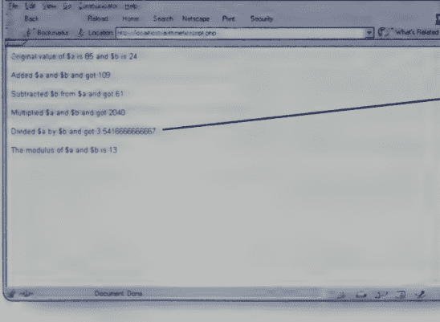

13. 打开你的浏览器并输入 `http://localhost/arithmeticscript.php`。

你的原始值以及各种计算结果将打印在屏幕上。

接下来我们移动到比较运算符，它们是非常必要的，但重要性远不如算术运算符。

### 比较运算符

比较运算符用于比较两个值这并不令人意外。和算术运算符一样，你已经知道大多数比较运算符，但可能不知道它们如何称呼。请看下表，然后开始为本节创建测试脚本。

| 运算符 | 定义 |
| --- | --- |
| `==` | 等于 |
| `!=` | 不等于 |
| `>` | 大于 |
| `<` | 小于 |
| `>=` | 大于等于 |
| `<=` | 小于等于 |

这些任何比较的结果要么为真，要么为假。这并不有趣，但你可以使用控制语句（如`if[...]else`和`while`）对结果进行操作以执行特定任务。

创建一个简单的脚本来显示某些比较的结果，使用`if...else`控制语句将结果打印到屏幕上。

1. 在你的文本编辑器中打开新文件。

2. 输入以下 HTML：

```html
<HTML>
<HEAD>
<TITLE>使用比较运算符</TITLE>
</HEAD>
<BODY>
```

3. 开始一个 PHP 块，创建两个带有值的变量，并打印这些值：

```php
<?
$a = 21;
$b = 15;
echo "<P>Original value of \$a is $a and \$b is $b</P>";
```

> 注意
>
> 表达式被包含在括号中。

4. 使用`if...else`语句测试`$a`是否等于`$b`。根据答案（真或假），其中一个`else`语句将打印内容：

```php
if ($a == $b) {
    echo "<P>TEST 1: \$a equals \$b</P>";
} else {
    echo "<P>TEST 1: \$a is not equal to \$b</P>";
}
```

> 注意
>
> 表达式被包含在括号中。

5. 在`if...else`语句内部，测试`$a`是否不等于`$b`。根据答案（真或假），其中一个`else`语句将打印内容：

```php
if ($a != $b) {
    echo "<P>TEST 2: \$a is not equal to \$b</P>";
} else {
    echo "<P>TEST 2: \$a is equal to \$b</P>";
}
```

> 注意
>
> 大括号`{`和`}`分隔了控制结构内的语句块。

6. 在`if...else`语句内部，测试`$a`是否大于`$b`。根据答案（真或假），其中一个`else`语句将打印内容：

```php
if ($a > $b) {
    echo "<P>TEST 3: \$a is greater than \$b</P>";
} else {
    echo "<P>TEST 3: \$a is not greater than \$b</P>";
}
```

7. 在`if...else`语句内部，测试`$a`是否小于`$b`。根据答案（真或假），其中一个`else`语句将打印内容：

```php
if ($a < $b) {
    echo "<P>TEST 4: \$a is less than \$b</P>";
} else {
    echo "<P>TEST 4: \$a is not less than \$b</P>";
}
```

8. 在`if...else`语句内部，测试`$a`是否大于或等于`$b`。根据答案（真或假），其中一个`else`语句将打印内容：

```php
if ($a >= $b) {
    echo "<P>TEST 5: \$a is greater than or equal to \$b</P>";
} else {
    echo "<P>TEST 5: \$a is not greater than \$b</P>";
}
```

9. 在`if...else`语句内部，测试`$a`是否小于或等于`$b`。根据答案（真或假），其中一个`else`语句将打印内容：

```php
if ($a <= $b) {
    echo "<P>TEST 6: \$a is less than or equal to \$b</P>";
} else {
    echo "<P>TEST 6: \$a is not less than or equal to \$b</P>";
}
```

10. 关闭你的 PHP 块：


```php
?>
```

- 11. 添加更多 HTML 以使文档有效：

```html
</body>
</html
```

- 12. 将文件另命名为 `arithmeticscript.php`。

- 13. 将此文件放置在你的 Web 服务器的文档根目录下。


- 14. 打开你的浏览器并输入 `http://localhost/arithmeticscript.php`。

- 你的原始值以及各种计算结果将打印在屏幕上。

接下来我们移动到比较运算符，它们是非常必要的，但重要性远不如算术运算符。

### 比较运算符

比较运算符用于比较两个值，这并不令人意外。和算术运算符一样，你已经知道大多数比较运算符，但可能不知道它们如何称呼。请看下表，然后开始为本节创建测试脚本。

| 运算符 | 定义 |
| --- | --- |
| `==` | 等于 |
| `!=` | 不等于 |
| `>` | 大于 |
| `<` | 小于 |
| `>=` | 大于等于 |
| `<=` | 小于等于 |

这些任何比较的结果要么为真，要么为假。这并不有趣，但你可以使用控制语句（如 `if[...]else` 和 `while`）对结果进行操作以执行特定任务。

创建一个简单的脚本来显示某些比较的结果，使用 `if...else` 控制语句将结果打印到屏幕上。

- 1. 在你的文本编辑器中打开新文件。

- 2. 输入以下 HTML：

```html
<HTML>
<HEAD>
<TITLE>使用比较运算符</TITLE>
</HEAD>
<BODY>
```

- 3. 开始一个 PHP 块，创建两个带有值的变量，并打印这些值：

```php
<?
$a = 21;
$b = 15;
echo "<P>Original value of \$a is $a and \$b is $b</P>";
```

- 4. 使用 `if...else` 语句测试 `$a` 是否等于 `$b`。根据答案（真或假），其中一个 `else` 语句将打印内容：

```php
if ($a == $b) {
    echo "<P>TEST 1: \$a equals \$b</P>";
} else {
    echo "<P>TEST 1: \$a is not equal to \$b</P>";
}
```

- 5. 在 `if...else` 语句内部，测试 `$a` 是否不等于 `$b`。根据答案（真或假），其中一个 `else` 语句将打印内容：

```php
if ($a != $b) {
    echo "<P>TEST 2: \$a is not equal to \$b</P>";
} else {
    echo "<P>TEST 2: \$a is equal to \$b</P>";
}
```

> 注意：大括号 `{` 和 `}` 分隔了控制结构内的语句块。

- 6. 在 `if...else` 语句内部，测试 `$a` 是否大于 `$b`。根据答案（真或假），其中一个 `else` 语句将打印内容：

```php
if ($a > $b) {
    echo "<P>TEST 3: \$a is greater than \$b</P>";
} else {
    echo "<P>TEST 3: \$a is not greater than \$b</P>";
}
```

- 7. 在 `if...else` 语句内部，测试 `$a` 是否小于 `$b`。根据答案（真或假），其中一个 `else` 语句将打印内容：

```php
if ($a < $b) {
    echo "<P>TEST 4: \$a is less than \$b</P>";
} else {
    echo "<P>TEST 4: \$a is not less than \$b</P>";
}
```

- 8. 在 `if...else` 语句内部，测试 `$a` 是否大于或等于 `$b`。根据答案（真或假），其中一个 `else` 语句将打印内容：

```php
if ($a >= $b) {
    echo "<P>TEST 5: \$a is greater than or equal to \$b</P>";
} else {
    echo "<P>TEST 5: \$a is not greater than or equal to \$b</P>";
}
```

- 9. 在 `if...else` 语句内部，测试 `$a` 是否小于或等于 `$b`。根据答案（真或假），其中一个 `else` 语句将打印内容：

```php
if ($a <= $b) {
    echo "<P>TEST 6: \$a is less than or equal to \$b</P>";
} else {
    echo "<P>TEST 6: \$a is not less than or equal to \$b</P>";
}
```

- 10. 关闭你的 PHP 块：

```php
?>
```

### 逻辑运算符

逻辑运算符允许你组合多个表达式。最常用的逻辑运算符有 AND (`&&`), OR (`||`), NOT (`!`)。

- AND (`&&`): 只有当两个表达式都为真时，结果才为真。

- OR (`||`): 只要有一个表达式为真，结果就为真。

- NOT (`!`): 反转逻辑值（真为假，假为真）。

创建一个简单的脚本来显示某些比较的结果，使用 `if...else` 控制语句将结果打印到屏幕上。

- 1. 在你的文本编辑器中打开新文件。

- 2. 输入以下 HTML：

```html
<HTML>
<HEAD>
<TITLE>使用逻辑运算符</TITLE>
</HEAD>
<BODY>
```

- 3. 开始一个 PHP 块，创建两个带有值的变量，并打印这些值：

```php
<?
$a = 21;
$b = 15;
echo "<P>Original value of \$a is $a and \$b is $b</P>";
```

- 4. 使用 `if...else` 语句测试 `$a` 是否大于 20 且 `$b` 小于 20。根据答案（真或假），其中一个 `else` 语句将打印内容：

```php
if ($a > 20 && $b < 20) {
    echo "<P>TEST 1: \$a is greater than 20 and \$b is less than 20</P>";
} else {
    echo "<P>TEST 1: Conditions not met</P>";
}
```

- 5. 在 `if...else` 语句内部，测试 `$a` 是否大于 25 或者 `$b` 小于 10。根据答案（真或假），其中一个 `else` 语句将打印内容：

```php
if ($a > 25 || $b < 10) {
    echo "<P>TEST 2: At least one condition is met</P>";
} else {
    echo "<P>TEST 2: Neither condition is met</P>";
}
```

- 6. 在 `if...else` 语句内部，测试 `$a` 是否不大于 20。根据答案（真或假），其中一个 `else` 语句将打印内容：

```php
if (!($a > 20)) {
    echo "<P>TEST 3: \$a is not greater than 20</P>";
} else {
    echo "<P>TEST 3: \$a is greater than 20</P>";
}
```

- 7. 关闭你的 PHP 块：

```php
?>
```

- 8. 添加更多 HTML 以使文档有效：

```html
</body>
</html
```

- 9. 将文件另命名为 `logicalscript.php`。

- 10. 将此文件放置在你的 Web 服务器的文档根目录下。

- 11. 打开你的浏览器并输入 `http://localhost/logicalscript.php`。

- 你的原始值以及各种计算结果将打印在屏幕上。

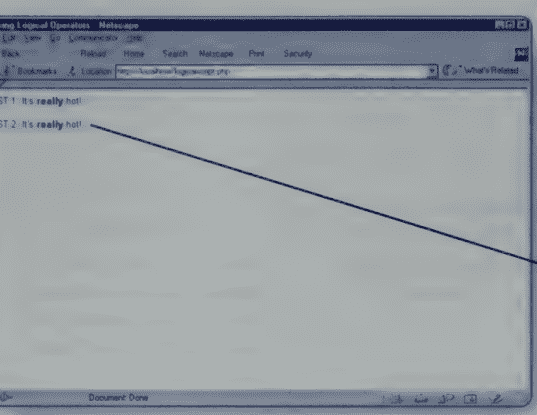

此示例中的两个表达式都是真的。在第一个测试中，只需要有一个表达式为真，这通过 `$shot` 的值为 `yes` 满足了。在第二个测试中，两个表达式都必须为真，而它们确实如此；`$degrees` 的值为 95，大于 80，且 `$shot` 的值为 `yes`。

PHP 中还使用了许多其他类型的运算符。它们将在书中出现时进行解释。本章列出的运算符已经为你提供了一个非常好的开始。在下一章中，你将利用新学到的变量和运算符知识，构建比目前解释的脚本更有趣的脚本。

### 使用变量

现在你已经了解了一些变量知识，是时候将这些知识更进一步，并用它们做更多有趣的事情了。在本章中，你将学习如何执行以下操作：

- 使用 HTML 表单将变量发送到你的脚本

- 使用环境变量

### 从表单获取变量

HTML 表单应该包含以下元素：

- 方法

- 操作

- 提交按钮

在你的 HTML 代码中，表单的第一行看起来像这样：

```html
<FORM METHOD="post" ACTION="yourscript.php">
```

当你点击 HTML 表单中的提交按钮时，变量将通过指定的 `METHOD` 发送到由 `ACTION` 指定的脚本。

方法可以是 `post` 或 `get`。从表单传递到 PHP 脚本的变量被放在全局关联数组 `$HTTP_POST_VARS` 或 `$HTTP_GET_VARS` 中，取决于表单的方法，并自动供你的脚本使用。在下一节中，你将看到它是如何运作的。

> 注意：启用变量跟踪或将变量放置在全局数组中，是 PHP 安装时的一个配置选项。

在接下来的章节中，你将创建一个 HTML 表单和相应的 PHP 脚本，它们根据表单输入执行计算。

### 创建计算表单

在本节中，你将为计算脚本创建一个前端。此表单将包含两个输入字段和一个选择计算类型的单选按钮。

- 1. 在你的文本编辑器中打开一个新文件。

- 2. 输入以下 HTML：

```html
<HTML>
<HEAD>
<TITLE>Calculation Form</TITLE>
</HEAD>
<BODY>
```

- 3. 开始你的表单。假设方法为 `post`，操作为名为 `calculate.php` 的脚本：

```html
<FORM METHOD="post" ACTION="calculate.php">
```

- 4. 为第一个值创建一个输入字段，并带有文本标签：

```html
<P>Value 1: <INPUT TYPE="text" NAME="val1" SIZE="10"></P>
```

- 5. 为第二个值创建一个输入字段，并带有文本标签：

```html
<P>Value 2: <INPUT TYPE="text" NAME="val2" SIZE="10"></P>
```

- 6. 添加一个提交按钮：

```html
<P><INPUT TYPE="submit" NAME="submit" VALUE="Calculate"></P>
```

- 7. 关闭你的表单：

```html
</FORM>
```

- 8. 添加一些 HTML 以使文档有效：

```html
</BODY>
</HTML>
```

- 9. 将文件保存为 `calculate_form.html`。


- 10. 将此文件放在你的 Web 服务器的文档根目录下。

- 11. 打开 Web 浏览器并输入 `http://localhost/calculate_form.html`。

你将看到一个包含 Value 1 和 Value 2 字段以及 Calculate 按钮的表单。花点检查 HTML，理解变量是如何命名的：

```html
<HTML>
<HEAD>
<TITLE>Calculation Form</TITLE>
</HEAD>
<FORM METHOD="post" ACTION="calculate.php">
<P>Value 1 <input TYPE="text" NAME="val1" SIZE="10"></P>
<P>Value 2 <input TYPE="text" NAME="val2" SIZE="10"></P>
<P><input TYPE="submit" NAME="submit" VALUE="Calculate"></P>
</FORM>
</BODY>
</HTML>
```

提交时，两个变量会被发送到你的脚本 `$val1` 和 `$val2`，因为这些是每个字段中使用的 `NAME`。这些变量的值将是用户输入的值。还有一个项目需要添加：一组单选按钮，用于确定对两个值上执行的计算类型。

### 在表单中添加单选按钮

- 1. 在你的文本编辑器中打开 `calculate_form.html`。

- 2. 在提交按钮之前添加此块：

```html
<P>Calculation:<br>
<INPUT TYPE="radio" NAME="calc" VALUE="add"><br>
<INPUT TYPE="radio" NAME="calc" VALUE="subtract"><br>
<INPUT TYPE="radio" NAME="calc" VALUE="multiply"><br>
<INPUT TYPE="radio" NAME="calc" VALUE="divide"></P>
```

- 3. 保存文件。

- 4. 将此文件放在你的 Web 服务器的文档根目录下。


- 5. 打开 Web 浏览器并输入 `http://localhost/calculate_form.html`。

你的表单现在将包含 Value 1 和 Value 2 字段、一组单选按钮和一个 Calculate 按钮。现在，除了两个值（`$val1` 和 `$val2`）之外，名为 `$calc` 的变量也将发送到你的脚本。没理由等待！继续下一节创建计算脚本。

### 创建计算脚本

根据 `calculate_form.html` 中的表单操作，你需要一个名为 `calculate.php` 的脚本。该脚本的目标是接受两个值（`$val1` 和 `$val2`）并根据 `$calc` 的值执行计算。

- 1. 在你的文本编辑器中打开一个新文件。

- 2. 开始一个 PHP 块并准备检查 `$calc` 的值：

```php
<?php
if ($val1 == "" || $val2 == "" || $calc == "") {
    // 某些代码
    header("Location: http://localhost/calculate_form.html");
    exit;
}
```

- 3. 根据 `$calc` 的值执行计算：

```php
if ($calc == "add") {
  $result = $val1 + $val2;
} else if ($calc == "subtract") {
  $result = $val1 - $val2;
} else if ($calc == "multiply") {
  $result = $val1 * $val2;
} else if ($calc == "divide") {
  $result = $val1 / $val2;
}
```

- 4. 显示结果：

```html
<HTML>
<HEAD>
<TITLE>Calculation Result</TITLE>
</HEAD>
<BODY>
<P>The result of the calculation is <?php echo $result; ?></P>
</BODY>
</HTML>
```

### 提交表单并获取结果

现在你已经创建了前端（表单）和后端（脚本），是时候屏住气测试它了。


- 1. 打开 Web 浏览器并输入 `http://localhost/calculate_form.html`。你应该能看到表单。

- 2. 在表单字段中不输入任何内容点击 Calculate。你的浏览器将刷新页面，因为你没有为三个字段输入任何值。

- 3. 为 Value 1 输入一个值，但不输入 Value 2，也不选择计算选项。点击 Calculate 后，页面应该刷新。

- 4. 为 Value 2 输入一个值，但不输入 Value 1，也不选择计算选项。点击 Calculate 后，页面应该刷新。

- 5. 为 Value 1 和 Value 2 都输入值，但不选择计算选项。点击 Calculate 后，页面应该刷新。

- 6. 选择一个计算选项，但没有为 Value 1 或 Value 2 输入任何值。点击 Calculate 后，页面应该刷新。

- 4. 为值 1 输入 432，为值 2 输入 947。


5. 选择“subtract”（减）并点击计算按钮。

减法计算的结果将打印到屏幕上。

6. 使用返回按钮返回表单。

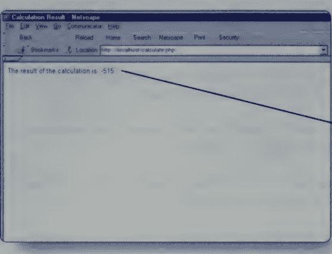

7. 为值 1 输入 8562，为值 2 输入 81。

8. 选择“multiply”（乘）并点击计算按钮。

乘法计算的结果将打印到屏幕上。

9. 使用返回按钮返回表单。

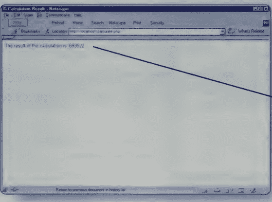

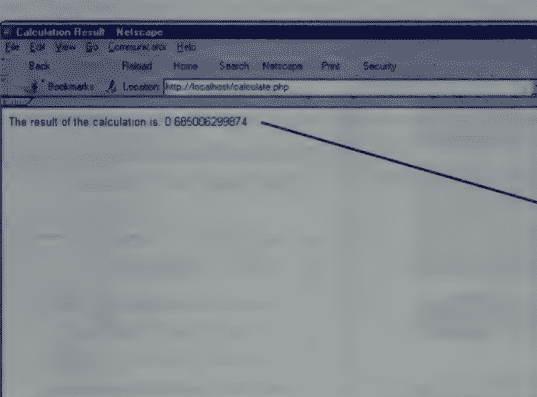

10. 为值 1 输入 4893，为值 2 输入 7143。

11. 选择“divide”（除）并点击计算按钮。

除法计算的结果将打印到屏幕上。

尽情尝试各种数字计算来乐趣吧！

### HTTP 环境变量

当 Web 浏览器向 Web 服务器发送请求时，它会随请求发送一系列额外的变量。这些变量被称为环境变量，它们对于显示动态内容或授权用户非常有用。

`phpinfo()` 函数会显示关于你的 Web 服务器软件、运行的 PHP 版本以及基础 HTTP 环境的大量信息。让我们来看看你的环境配置。

1. 在文本编辑器中打开一个新文件。

2. 输入以下 PHP 代码：

```php
<?php phpinfo(); ?>
```

3. 将文件保存为 `phpinfo.php`。

4. 将此文件放在你的 Web 服务器的文档根目录下。

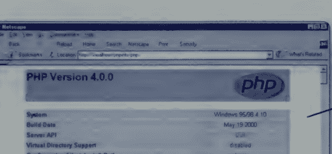

5. 打开 Web 浏览器并输入 `http://localhost/phpinfo.php`。

你会看到一个充满有用信息的长页面。

> **注意**
> 你的信息会有所不同，不仅在机器之间，而且在平台之间。这些截图是在 Windows 开发机器上拍摄的。

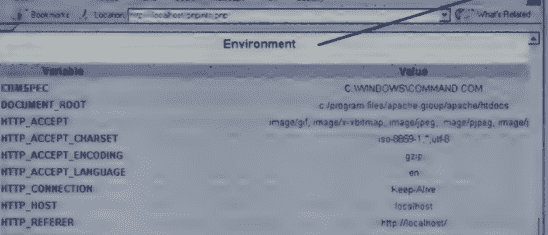

向下滚动，寻找名为“Environment”（环境）的部分。

在接下来的章节中，你将学习如何使用两个环境变量：`REMOTE_ADDR` 和 `HTTP_USER_AGENT`。关于 `phpinfo()` 输出中显示的某些 HTTP 环境变量的解释，请访问 `http://hohoo.ncsa.uiuc.edu/cgi/env.html`。

### 获取并使用 REMOTE_ADDR

默认情况下，环境变量以 `$VAR_NAME` 的形式供 PHP 脚本使用。例如，环境变量 `REMOTE_ADDR` 包含在 `$REMOTE_ADDR` 中。然而，为了绝对确保你读取的是正确的值，请使用 `getenv()` 将值赋给你选择的变量。

`REMOTE_ADDR` 环境变量包含发送请求机器的 IP 地址。让我们获取你的 `REMOTE_ADDR` 值。

1. 在文本编辑器中打开一个新文件。

2. 打开一个 PHP 块：

```php
<?
```

3. 使用 `getenv()` 将 `REMOTE_ADDR` 的值放入名为 `$address` 的变量中：

```php
$address = getenv("REMOTE_ADDR");
```

4. 将 `$address` 的值打印到屏幕：

```php
echo "Your IP address is $address.";
```

5. 关闭 PHP 块：

```php
?>
```

6. 将文件保存为 `remoteaddress.php`。

7. 将此文件放在你的 Web 服务器的文档根目录下。

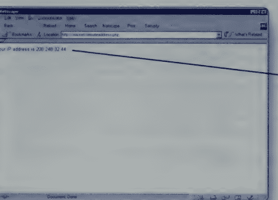

8. 打开 Web 浏览器并输入 `http://localhost/remoteaddress.php`。

> 你当前的 IP 地址将打印到屏幕上。你的 IP 地址将与图中不同，因为那是我自己的 IP 地址之一。

在下一节中，你将获取另一个实用的环境变量的值：`HTTP_USER_AGENT`（Web 浏览器）。

### 获取并使用 HTTP_USER_AGENT

`HTTP_USER_AGENT` 变量包含浏览器类型、浏览器版本、语言编码和平台。例如，以下值字符串指的是 Windows 98 平台上的英文版 Netscape (Mozilla) 浏览器，版本 4.61：

`Mozilla/4.61 – (Win98; I)`

这里是我自己浏览器的其他 `HTTP_USER_AGENT` 值：

`Mozilla/4.0 (compatible; MSIE 5.0; Windows 98)`

此值指的是 Windows 98 上的 Microsoft Internet Explorer (MSIE) 5.0 版本。有时你会看到 MSIE 返回一个看起来像 Netscape 的 `HTTP_USER_AGENT` 值，直到你注意到它显示为 `"compatible"`（兼容的）且实际上是 `"MSIE 5.0"`。不要排除纯文本浏览器！Lynx 的 `USER_AGENT` 值看起来如下：

`Lynx/2.8`

让我们找到你的 `USER_AGENT`。

1. 在文本编辑器中打开一个新文件。

2. 打开一个 PHP 块：

```php
<?
```

3. 使用 `getenv()` 将 `USER_AGENT` 的值放入名为 `$agent` 的变量中：

```php
$agent = getenv("HTTP_USER_AGENT");
```

4. 将 `$agent` 的值打印到屏幕：

```php
echo "You are using $agent.";
```

5. 关闭 PHP 块：

```php
?>
```

6. 将文件保存为 `useragent.php`。

7. 将此文件放在你的 Web 服务器的文档根目录下。


8. 打开 Web 浏览器并输入 `http://localhost/useragent.php`。

你当前的 `USER_AGENT` 值将打印到屏幕上。

> **注意**
> 除非你在 Linux 上使用 Netscape，否则你的 user agent 字符串可能与显示的不同。

在下一章中，你将学习 Web 开发者的许多基础任务，包括显示动态内容、发送电子邮件和处理文件。

# 第三部分 从基础开始

- 第 7 章 显示动态内容
- 第 8 章 发送电子邮件
- 第 9 章 使用文件
- 第 10 章 上传到你的网站

## 7 显示动态内容

Web 是动态环境，为什么不利用你的技能来显示动态内容呢？动态内容可以根据你的意愿简单或复杂。在本章中，你将学习如何：

- 显示特定浏览器的 HTML
- 显示特定平台的 HTML
- 使用 HTML 表单和 `header()` 函数创建重定向

### 显示特定的 HTML

在上一章中，你学习了获取并将 `HTTP_USER_AGENT` 环境变量打印到屏幕。在本章中，你将对 `HTTP_USER_AGENT` 的值做一些更有趣的事：显示特定浏览器的 HTML。

然而，在上一章看到了 `HTTP_USER_AGENT` 的某些可能值，你可以想象有成百个略微不同的值。因此，是时候学习模式匹配了。

你将使用 `preg_match()` 函数完成此任务。该函数需要两个参数：你要查找的内容以及查找的位置：

```php
preg_match("/{what you're looking for}/, "[where you're looking]");
```

此函数返回 `true` 或 `false`，你可以将其用于 `if...else` 块以执行任何操作。第一个脚本的目标是判断 Web 浏览器是 Microsoft Internet Explorer、Netscape 还是其他。这可能有点棘手，但不是因为 PHP。

在 `HTTP_USER_AGENT` 的值中，Netscape 总是使用字符串 `"Mozilla"` 来识别它。遗憾的是，Internet Explorer 的 `HTTP_USER_AGENT` 值也使用 `"Mozilla"` 来显示它是兼容。幸运的是，它也使用字符串 `"MSIE"`，所以你可以搜索它。如果 `HTTP_USER_AGENT` 值既不包含 `"Mozilla"` 包含 `"MSIE"`，那么它很不是 Web 浏览器之一。

1. 在文本编辑器中打开一个新文件。

2. 打开一个 PHP 块：

```php
<?
```

3. 使用 `getenv()` 将 `HTTP_USER_AGENT` 的值放入变量 `$agent` 中：

```php
$agent = getenv("HTTP_USER_AGENT");
```

4. 开始一个 `if...else` 语句来找到哪些 `preg_match()` 函数为真，从搜索 `"MSIE"` 开始：

```php
if (preg_match("/MSIE/i", "$agent")) {
    $result = "You are using Microsoft Internet Explorer.";
}
```

5. 继续语句，测试 `"Mozilla"`：

```php
else if (preg_match("/Mozilla/i", "$agent")) {
    $result = "You are using Netscape.";
}
```

6. 通过定义默认值完成语句：

```php
else {
    $result = "You are using $agent";
}
```

7. 关闭 PHP 块：

```php
?>
```

8. 输入以下 HTML：

```html
<HTML>
<HEAD>
<TITLE>Browser Match Results</TITLE>
</HEAD>
<body>
```

9. 输入以下 PHP 代码来打印 `if...else` 语句的结果：

```php
<?php echo "<P>$result</P>"; ?>
```

10. 添加更多 HTML 以使文档有效：

```html
</body>
</html>
```

> **注意**
> `preg_match()` 函数中的 `i` 执行不区分大小写的搜索。

11. 将文件保存为 `browsermatch.php`。

12. 将此文件放在你的 Web 服务器的文档根目录下。

13. 打开 Web 浏览器并输入 `http://localhost/browsermatch.php`

根据你使用的 Web 浏览器，你可能会看到如下结果，

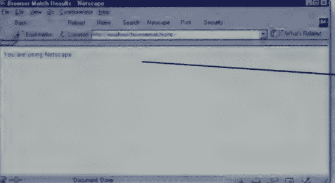

或者这样。

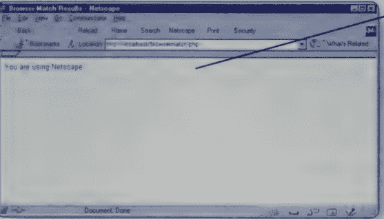

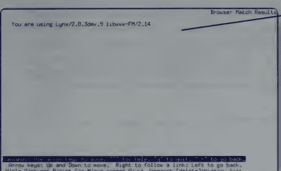

如果你既没有使用 Netscape 也没有使用 Microsoft Internet Explorer，将打印出 `HTTP_USER_AGENT` 的实际值。

浏览器大战曾异常激烈！绝大多数 Web 访问者使用特定的浏览器。各种版本的 Microsoft Internet Explorer (MSIE) 约占使用的 Web 浏览器的 69%，而 Netscape (NS) 的版本加上那些死忠的 Lynx、Opera 和 WebTV 用户则占据了 100%。

尽管 70/30 的划分似乎是占多数，但如果你有 1.5 亿人可以访问互联网，那么在开发一个优秀的网站时，4500 万非微软用户是一个值得考虑的高数字。

HotWired 在 `http://www.hotwired.com/webmonkey/reference/browser-chart/` 维护了一个浏览器参考。它显示了主要浏览器之间的一些差异。在下一节中，你会发现并不是所有平台都是平等的，事实上显示 HTML 的方式也不相同。

### 显示特定平台的 HTML

不仅浏览器之间存在差异，平台之间也存在。这种差异在字体和字号上最为明显。在 Windows 世界中，你有像 Times New Roman 和 Courier New 等字体。这些字体的细微变体出现在 Macintosh 和 Linux/UNIX 平台上；它们被称为 Times 和 Courier。不仅如此——字号的显示效果也各不相同。Macintosh 或 Linux 上的 10 点字体有时是清晰的，但如果你将其增加到 11 点或 12 点，就很好读了。然而，如果在 Windows 上查看同一个 12 点字体，它看起来可能就像你的文本想要统治世界一样。

那么，该怎么做呢？使用你新的模式匹配技能从 `HTTP_USER_AGENT` 字符串中提取平台，然后显示特定平台的 HTML。与匹配关键词（你在上一节中做过的事）一样，你需要知道自己正在寻找什么以确定平台。在接下来的脚本中，你将检查关键词 `"Win"` 和 `"Linux"`，并在你的 HTML 结果页面中打印适当的样式表块。

1. 在你的文本编辑器中打开新文件。

2. 打开一个 PHP 块：

```php
<?
```

3. 使用 `getenv()` 将 `HTTP_USER_AGENT` 的值存放在名为 `$agent` 的变量中：

```php
$agent = getenv("HTTP_USER_AGENT");
```

4. 启动一个 `if...else` 语句来查找 `preg_match()` 函数中哪一个为真，从搜索 `"Win"` 开始：

```php
if (preg_match("/Win/i", "$agent")) {
  $style = "win";
}
```

5. 继续该语句，测试 `"Linux"`：

```php
else if (preg_match("/linux/i", "$agent")) {
  $style = "linux";
}
```

6. 为 Windows 用户创建一个基础的样式表块：

```php
$win_style = "
<style type=\"text/css\">
p, ul, ol, li {font-family:Arial;font-size:10pt;font-weight:normal};
h1 {font-family:Arial;font-size:16pt;font-weight:bold};
h2 {font-family:Arial;font-size:14pt;font-weight:bold};
strong {font-family:Arial;font-size:10pt;font-weight:bold};
em {font-family:Arial;font-size:10pt;font-style:italic};
</style>";
?>
```

> **注意**
> 当你在其他引号内部使用引号时，必须使用转义字符 `\`（也称为反斜杠）将内部引号对与外部引号对区分开来。

7. 为 Linux 用户创建一个基础的样式表块：

```php
$linux_style = "\n<style type=\"text/css\">\np, ul, ol, li {font-family:Times;font-size:12pt;font-weight:normal}\nh1 {font-family:Times;font-size:16pt;font-weight:bold}\nh2 {font-family:Times;font-size:16pt;font-weight:bold}\nstrong {font-family:Times;font-size:12pt;font-weight:bold}\nem {font-family:Times;font-size:12pt;font-style:italic}\n</style>\n";
```

> **注意**
> 使用换行符 `\n` 将确保你的代码打印在多行上。这在你查看 HTML 源代码时很有帮助。

8. 关闭你的 PHP 块：

```php
?>
```

9. 输入以下 HTML：

```html
<HTML>
<HEAD>
<TITLE>Platform Matching</TITLE>
```

10. 输入以下 PHP 代码，创建一个 `if...else` 语句，用于打印正确的样式表块：

```php
<?php
if ($style == "win") {
  echo $win_style;
} else if ($style == "linux") {
  echo $linux_style;
}
?>
```

11. 关闭 HTML 的顶部部分并开始主体：

```html
</HEAD>
<body
```

12. 输入以下 HTML 以显示你的样式表的使用：

```html
<h1 align="center">这是一个 1 级标题</h1>
<h2 align="center">这是一个 2 级标题</h2>
<p align="center">这是<strong>粗体文本</strong>和<em>斜体文本</em>。</p>
```

13. 关闭你的表单并添加一些 HTML 使文档有效：

```html
</BODY>
</HTML>
```

14. 将文件保存为 `browsermatch.php`。


15. 将此文件放在你的 Web 服务器的文档根目录下。
16. 打开 Web 浏览器并输入 `http://localhost/browsermatch.php`

根据你使用的 Web 浏览器，你可能会看到如下结果，

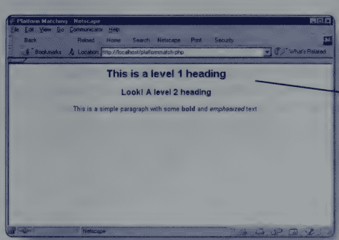

## 使用字符串函数

PHP 内置了许多字符串函数，它们的设计是为了让你的工作更轻松。假设你需要对标题或产品数字进行规范化处理，或者在将其存数据库之前计算长度。

### 创建输入表单

在本节中，你将为字符串修改脚本创建一个前端。此表单将包含一个文本区域和单选按钮。单选按钮将决定使用的字符串函数。

1. 在你的文本编辑器中打开新文件。
2. 输入以下 HTML：

```html
<HTML>
<HEAD>
<TITLE>Input Form</TITLE>
</HEAD>
<body>
```

3. 开始你的表单。假设方法为 `post`，动作为名为 `display_input.php` 的脚本：

```html
<FORM METHOD="post" ACTION="display_input.php">
```

4. 创建一个带有标签的文本区域：

```html
<p><strong>文本字段：</strong><br><textarea name="text1" cols="45" rows="5" wrap="virtual"></textarea></p>
```

5. 添加此单选按钮块：

```html
<p><strong>字符串函数：</strong><br>
<input type="radio" name="func" value="md5" checked> md5<br>
<input type="radio" name="func" value="strlen"> 获取字符串长度<br>
<input type="radio" name="func" value="strrev"> 反转字符串<br>
<input type="radio" name="func" value="strtoupper"> 转换为大写<br>
<input type="radio" name="func" value="strtolower"> 转换为小写<br>
<input type="radio" name="func" value="ucwords"> 使每个单词的首字母大写</p>
```

> **注意**
>
> 每个单选按钮的值都是其精确的 PHP 函数名。正如我们在下一节中看到的，这将使创建后端脚本非常简单。

6. 添加一个提交按钮：

```html
<p><input type="submit" name="submit" value="对字符串进行某些操作"></p>
```

7. 关闭你的表单并添加一些 HTML 使文档有效：

```html
</FORM>
</BODY>
</HTML>
```

10. 开启你的 Web 浏览器并输入 `http://localhost/generic_form.html`

你会看到一个包含文本区域和几个单选按钮的表单，以及一个"Do Something With the String"（对字符串进行操作）提交按钮。

在下一节中，你将创建一个后端脚本。该脚本将期望两个变量：`$text1` 和 `$func`。

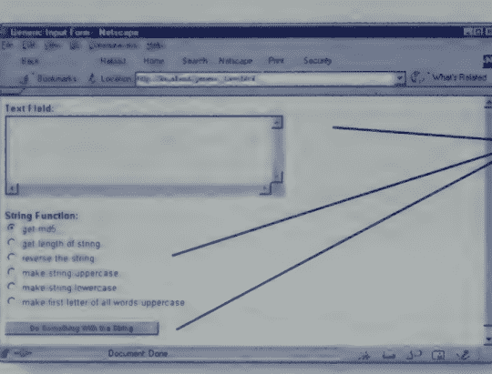

### 创建显示表单值的脚本

根据 `generic_form.html` 中的表单 `action`（动作目标），你需要创建一个名为 `display_input.php` 的脚本。该脚本的目标是接收 `$text1` 中的文本，并使用特定的字符串函数（`func` 的值）获取一个新结果（`result`）。

1. 在你的文本编辑器中打开一个新文件。
2. 输入以下 PHP 代码：

```php
<?php $result = $func($text1); ?>
```

3. 开始 HTML 输出：

```html
<HTML>
<HEAD>
<TITLE>Generic Input Results</TITLE>
</HEAD>
<BODY>
```

4. 显示 `$result` 的值：

```php
<?php echo "$result"; ?>
```

5. 添加一个返回表单的链接：

```html
<p><a href="generic_form.html">Go again!</a></p>
```

6. 添加一些额外的 HTML 以使文档有效：

```html
</BODY>
</HTML>
```

7. 将文件保存为 `display_input.php`。

你的代码看起来应该像这样：

```php
<?php $result = $func($text1); ?>
<HTML>
<HEAD>
<TITLE>Generic Input Results</TITLE>
</HEAD>
<BODY>
<?php echo "$result"; ?>
<p><a href="generic_form.html">Go again!</a></p>
</BODY>
</HTML>
```

8. 将此文件放置于你的 Web 服务器的文档根目录下。

在下一节中，你将提交表单并看到所有不同类型的字符串函数开始工作。

### 提交你的表单并获取结果

现在你已经创建了前端表单和后端脚本，是时候尝试它们了。

1. 开启你的 Web 浏览器并输入 `http://localhost/generic_form.html`
2. 在文本区域中输入以下文本：

我认为 PHP 是世界上最酷的服务器端脚本语言！谁能知道它会这么简单？

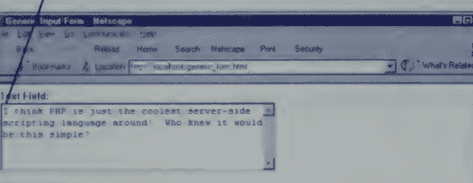

> **注意**
>
> 你可能想将那段文本复制到剪贴板，因为它将用于接后的所有的示例中。

3. 选择"get md5"单选按钮。
4. 点击"Do Something With the String"按钮。

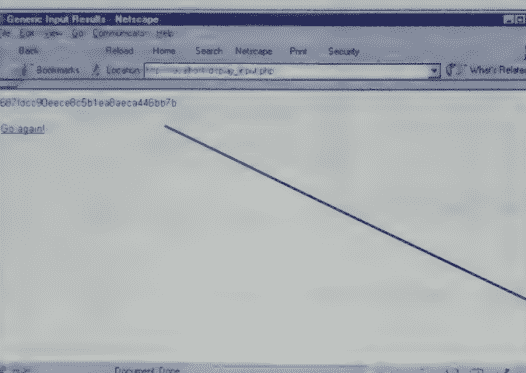

> **注意**
>
> `md5()` 函数获取字符串的"哈希"。哈希是字符串的数字摘要。它可以用于比较字符串（或文件）的版本以查看版本是否存在差异。

你应该看到字符串的哈希值，以及一个返回表单的链接。

接下来，使用 `strlen()` 函数找到字符串的长度，包括空格和所有字符。

1. 点击"Go again!"。前端表单将出现。
2. 在文本区域中输入相同的文本：

我认为 PHP 是世界上最酷的服务器端脚本语言！谁能知道它会这么简单？

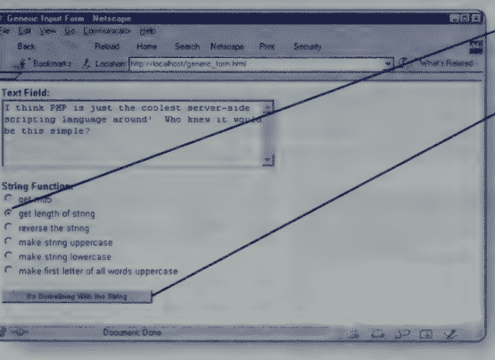

3. 选择"get length of string"单选按钮。
4. 点击"Do Something with String"按钮。

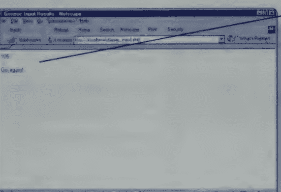

你应该看到一个代表字符串字符长度的数字，以及一个返回表单的链接。

接下来，使用 `strrev()` 函数返回原始字符串，并完全反转。

1. 点击"Go again!"链接。前端表单将出现。
2. 在文本区域中输入相同的文本：

我认为 PHP 是世界上最酷的服务器端脚本语言！谁能知道它会这么简单？

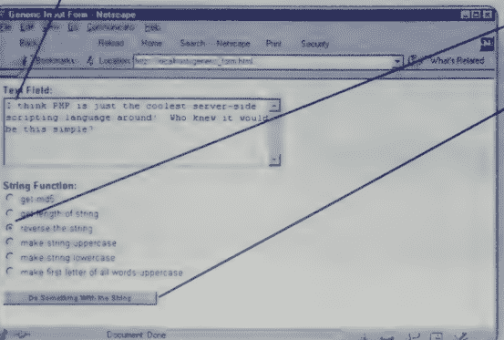

3. 选择"reverse the string"单选按钮。
4. 点击"Do Something With the String"按钮。

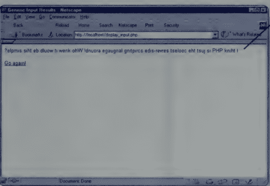

你应该看到原始字符串的反转结果，以及一个返回表单的链接。

接下来，使用 `strtoupper()` 函数返回所有字母均为大写的字符串。

1. 点击"Go again!"链接。前端表单将出现。
2. 在文本区域中输入相同的文本：

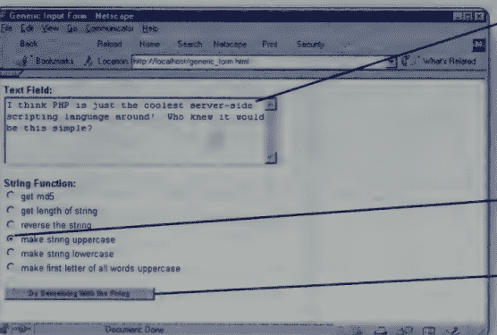

如果 PHP 是世界上最酷的服务器端脚本语言！谁能知道它会这么简单？

3. 选择"make string uppercase"单选按钮。
4. 点击"Do Something With the String"按钮。

你应该看到全大写字母的字符串，以及一个返回表单的链接。


接下来，使用 `strtolower()` 函数返回所有字母均为小写的字符串。

1. 点击"Go again!"链接。前端表单将出现。
2. 在文本区域中输入相同的文本：

我认为 PHP 是世界上最酷的服务器端脚本语言！谁能知道它会这么简单？


3. 选择"make string lowercase"单选按钮。
4. 点击"Do Something With the String"按钮。


你应该看到全小写字母的字符串，以及一个返回表单的链接。

为了给脚本添加一些错误检查，在发生任何操作之前检查 `$func` 的值。替换第一块 PHP 代码：

```php
<?php
if ($func == "") {
    header("Location: http://localhost/generic_form.html");
    exit;
}
$result = $func($text);
?>
```

现在，如果某些用户直接访问脚本而不通过表单，他们将被重定向回表单，不会发生错误。

### 重定向用户到新位置

将用户重定向到新位置意味着你的脚本向浏览器发送了指示新位置的 HTTP header。任何类型的 header（认证、重定向、cookie 等）必须在发送任何其他内容（包括空格、换行和任何字符）之前发送给浏览器。

在下一节中，你将创建一个重定向菜单和一个重定向表单。目标是让用户从菜单选择一个新位置，然后让脚本将他们发送到那里。

### 创建重定向表单

在本节中，你为重定向脚本创建一个前端。该表单每个选项的值是该网站的 URL。

1. 在你的文本编辑器中打开一个新文件。
2. 输入以下 HTML：

```html
<HTML>
<HEAD>
<TITLE> Redirection Menu</TITLE>
</HEAD>
<BODY>
```

3. 开始你的表单。假设方法为 `post`，动指向名为 `do_redirect.php` 的脚本：

```html
<FORM METHOD="post" ACTION="do_redirect.php">
```

4. 添加这个下拉列表：

```html
<P>Send me to:</P>
<SELECT name="location">
  <option value="http://www.prima-tech.com/">Prima-Tech</option>
  <option value="http://www.thickbook.com/">thickbook.com</option>
  <option value="http://www.php.net/">PHP.net</option>
  <option value="http://www.zend.com/">Zend Technologies</option>
  <option value="http://hotmail.lycos.com/webmonkey/">Webmonkey</option>
  <option value="http://www.zdnet.com/developer/">ZDNet Developer</option>
</SELECT>
```

5. 添加一个提交按钮：

```html
<P><INPUT TYPE="submit" NAME="submit" VALUE="Go!"></P>
```

6. 关闭你的表单并添加更多 HTML 以使文档格式有效：

```html
</FORM>
</BODY>
</HTML>
```

7. 将文件保存为 `redirect_form.html`。
8. 将此文件放置在你的 Web 服务器的文档根目录下。
9. 打开 Web 浏览器并输入 `http://localhost/redirect_form.html`

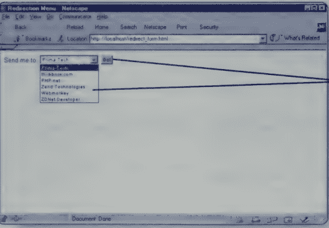

你应该看到一个包含各种网站名称的下拉菜单，以及一个 Go 按钮！

在下一节中，你将创建一个后端脚本。该脚本将接收一个变量：`$location`。

### 创建重定向脚本并进行测试

根据 `redirect_form.html` 中的表单 `action`，你需要一个名为 `do_redirect.php` 的脚本。该脚本的目标是接受 `$location` 的值并打印在 `header()` 函数中，以便使用户重定向到所选位置。

1. 在你的文本编辑器中打开一个新文件。
2. 输入以下 PHP 代码以创建正确的重定向头部：

```php
<?php
header("Location: $location");
exit();
?>
```

3. 将文件保存为 `do_redirect.php`。
4. 将此文件放置在你的 Web 服务器的文档根目录下。
5. 打开 Web 浏览器并输入 `http://localhost/redirect_form.html`
6. 从下拉列表中选择 Prima-Tech。


7. 点击 Go 按钮。

用户现在将被重定向到 Prima-Tech 网站。

为了给你的脚本添加一些错误检查，请在尝试重定向之前检查 `$location` 的值。将你的 PHP 代码替换为此：

```php
<?php
if ($location == "") {
    header("Location: http://localhost/redirect_form.html");
    exit;
} else {
    header("Location: $location");
    exit;
}
?>
```

现在，如果用户直接访问脚本，他将被重定向回表单，且不会发生错误。

## 发送邮件

使用 PHP 将表单内容发送到指定的电子邮件地址是如此简单，你会奇奇为什么人们不每天这样做。在本章中，你将学习如何执行：

- 创建并发送简单的反馈表单
- 使用 `$PHP_SELF` 变量创建一个带有自定义错误消息的反馈表单

### Windows 用户：检查 `php.ini` 文件

如果你在 Windows 上使用 PHP4，请在 `php.ini` 文件查找以下行：

```ini
[mail function]
SMTP            = ;for win32 only
sendmail_from   = ;for win32 only
```

你需要修改最后两行以使 `mail()` 函数能够正常工作。

1. 对于 `SMTP` 条目，使用 `localhost` 或你在电子邮件客户端中使用的出邮件服务器名称。
2. 对于 `sendmail_from` 条目，输入你的电子邮件地址。

例如，我 Windows 上的 `php.ini` 文件包含这些：

```ini
[mail function]
SMTP            = localhost
sendmail_from   = julie@thickbook.com
```

### 简单的反馈表单

简单的反馈表单包含用户姓名和电子邮件地址的字段，以及一个用于消息的文本区域。在本节中，你将创建两个文件：一个用于反馈表单，另一个用于处理表单、发送邮件并向浏览器返回响应的 PHP 脚本。

### 创建反馈表单

1. 在你的文本编辑器中打开一个新文件。
2. 输入以下 HTML：

```html
<HTML>
<HEAD>
<TITLE>Simple Feedback Form</TITLE>
</HEAD>
<BODY>
```

3. 开始你的表单。假设方法为 `post`，`action` 为名为 `send_simpleform.php` 的脚本：

```html
<FORM METHOD="post" ACTION="send_simpleform.php">
```

4. 为用户姓名创建一个输入字段，并带有一个文本标签：

```html
<P><strong>Your Name:</strong><br>
<INPUT type="text" NAME="sender_name" SIZE=30></P>
```

5. 为用户的电子邮件地址创建一个输入字段，并带有一个文本标签：

```html
<P><strong>Your E-Mail Address:</strong><br>
<INPUT type="text" NAME="sender_email" SIZE=30></P>
```

6. 创建一个文本区域来存放消息，带有一个文本标签：


```html
<P><strong>Message:</strong><br>
<TEXTAREA NAME="message" COLS=30 ROWS=5 WRAP=virtual</TEXTAREA></P>
```

- 7. 添加一个提交按钮：

```html
<P><INPUT TYPE="submit" NAME="submit" VALUE="Send This Form"></P>
```

- 8. 关闭你的表单并添加更多 HTML 以使文档有效：

```html
</FORM>
</BODY>
</HTML>
```

- 9. 将文件保存为`simple_form.html`。

- 10. 将此文件放置在你的 Web 服务器的文档根目录下。

- 11. 打开 Web 浏览器并输入`http://localhost/simple_form.html`。


你会看到一个包含姓名字段、邮件地址字段、消息区域以及“Send This Form”按钮的表单。

在下一节中，你将创建一个后端脚本。该脚本将接收变量：`$sender_name`、`$email`和`$message`。

## 创建发送表单的脚本

根据`simple_form.html`中的表单`action`，你需要一个名为`send_simpleform.php`的脚本。该脚本的目标是接受`$sender_name`、`$email`和`$message`格式并发送邮件；向浏览器显示确认。

- 1. 在文本编辑器中打开一个新文件。

- 2. 开始一个 PHP 块：

```php
<?php
```

- 3. 开始构建消息：

```php
$msg = "EMAIL SENT\n";
```

- 4. 通过添加发送者姓名继续构建消息字符串：

```php
$msg .= "Sender's Name:" . $sender_name . "\n";
```

### 注意

接下来的步骤通过将短字符串连接成一个长字符串来继续构建消息字符串。使用了运算符（`.`）。

- 5. 通过添加发送者邮件地址继续构建消息字符串：

```php
$msg .= "Sender's Mail:" . $email . "\n";
```

- 6. 通过添加消息继续构建消息字符串：

```php
$msg .= "Message:" . $message . "\n";
```

最后一行包含两个换行符（`"\n"`）以在字符串末尾添加空格。

- 7. 创建一个变量来存储接收者的电子邮件地址（替换为你自己的）：

```php
$to = "you@gmail.com";
```

- 8. 创建一个变量来存储邮件主题：

```php
$subject = "Feedback";
```

- 9. 创建一个变量来存储邮件头：

```php
$mailheaders = "From: My Site\n";
```

- 10. 向`$mailheaders`变量添加：

```php
$mailheaders .= "Reply-To: " . $email . "\n\n";
```

- 11. 添加`mail()`函数：

```php
mail($to, $subject, $msg, $mailheaders);
```

- 12. 关闭你的 PHP 块：

你还没有完成，但你的代码看起来应该是这样的。

```php
<?php
$msg = "EMAIL FROM " . $sender_name . "\n";
$msg = "Email: " . $email . "\n";
$message = "Thanks for your feedback!";

$to = "you@gmail.com";
$subject = "Feedback";
$mailheaders = "From: My Site";
$mailheaders .= "Reply-To: " . $email . "\n\n";

mail($to, $subject, $message, $mailheaders);
?>
```

### 创建确认消息

尽管这段代码会发送邮件，但你应该向用户的屏幕返回一些内容，以便他知道表单已发送。否则，他可能会坐在那里不断点击“Send Form”按钮。

- 1. 输出 HTML：

```html
<HTML>
<HEAD>
<TITLE>Simple Feedback Form Sent</TITLE>
</HEAD>
<BODY>
```

- 2. 添加一些信息告诉用户发生了什么：

```html
<h1>The following e-mail has been sent:</h1>
```

- 3. 为 Name 字段添加文本标签：

```html
<p><strong>Your Name:</strong><br>
```

- 4. 显示用户的输入：

```php
<?php echo "$sender_name"; ?>
```

- 5. 为 E-Mail Address 字段添加文本标签：

```html
<p><<strong>>Your E-Mail Address:</strong><br>
```

- 6. 显示用户的输入：

```php
<?php echo "$sender_email"; ?>
```

- 7. 为 Message 字段添加文本标签：

```html
<p><<strong>>Message:</strong><br>
```

- 8. 显示用户的输入：

```php
<?php echo "$message"; ?>
```

- 9. 添加更多 HTML 以使文档有效：

```html
</body>
</html>
```

- 10. 将文件保存为`send_simpleform.php`。

- 11. 将此文件放置在你的 Web 服务器的文档根目录下。

你的代码看起来应该是这样的：

## 提交表单并获取结果

现在你已经创建了前端表单和后端脚本，是时候尝试一下它们了。

- 1. 打开 Web 浏览器并输入`http://localhost/simple_form.html`。

- 2. 在 Name（姓名）字段中输入你的名字。

- 3. 在 Your E-Mail Address（你的电子邮件）字段中输入你的邮箱地址。

- 4. 在 Message（消息）字段中输入以下消息：

PHP 太酷了！


- 5. 点击 Send This Form（提交此表单）按钮。

你输入的信息以及电子邮件已发送的确认信息将会出现。

现在检查你的邮箱，看看是否有消息在等待你。

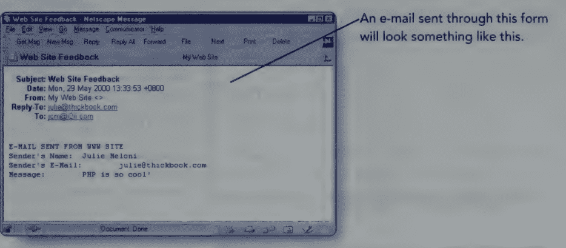

通过此表单发送的电子邮件看起来如下所示。

## 电子邮件文本的对齐

如果你因为制表符文本没有正确对齐而抓狂，你可以在消息字符串中插入任意空格。

- 1. 在文本编辑器中打开`send_simpleform.php`。

- 2. 修改包含 Sender's Name（发送者姓名）的字符串，将制表符（`\t`）替换为两个空格：

```
$msg = "Sender's Name: $sender_name\n";
```

- 3. 修改包含 Sender's E-Mail（发送者邮箱）的字符串，将制表符（`\t`）替换为四个空格：

```
$msg = "Sender's E-Mail: $sender_email\n";
```

- 4. 修改包含 Message（消息）的字符串，将制表符（`\t`）替换为 10 个空格：

```
$msg = "Message: $message\n\n";
```

- 5. 保存文件。

这段新代码应该看起来像这样。

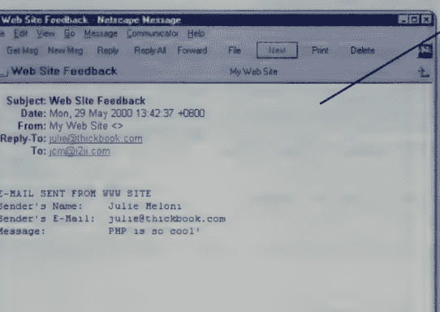

再次提交表单。这次当你收到电子邮件时，所有内容都应该对齐了。

就像书中的之前的脚本一样，你应该为`send_simpleform.php`增加一些错误检查。在执行任何其他操作之前，检查`$sender_name`、`$sender_email`和`$message`是否都有值。在第一个打开 PHP 标签之后添加此内容：

```
if (($sender_name == "") || ($sender_email == "") || ($message == "
```

在下一节中，你将创建当字段为空时创建自定义错误消息，并将发送邮件的两步过程简化为一个连贯的脚本。

## 带有自定义错误消息的反馈表单

在上一节中，你创建了两个独立的文件。一个文件包含前端（表单），另一个文件包含后端（脚本）。在这一节中，你将学习如何在表单`action`中使用`$_PHP_SELF`变量来创建一个包含表单和脚本的单文件，以及如何在必填字段未完成时创建自定义错误消息。

### 创建初始脚本

- 1. 在文本编辑器中打开一个新文件。

- 2. 输入以下 HTML：

```html
<HTML>
<HEAD>
<TITLE>All-In-One Feedback Form</TITLE>
</HEAD>
<body>
```

- 3. 开始一个 PHP 块：

```php
<?
```

- 4. 创建名为`$form_block`的变量，它将包含整个表单。从`form action`开始，假设方法为`post`，`action`为`$_PHP_SELF`：

```php
$form_block = "
<FORM METHOD="post" ACTION="$PHP_SELF">
```

> 提示：由于你将长字符串放在变量中，很可能会遇到引号。记得用反斜杠转义你的引号！

- 5. 为用户创建一个输入字段，并带有文本标签：

```html
<P><strong>Your Name:</strong><br><INPUT type="text" NAME="sender_name" SIZE=30></P>
```

- 6. 为用户的邮箱地址创建一个输入字段，并带有文本标签：

```html
<P><strong>Your E-Mail:</strong><br><INPUT type="text" NAME="sender_email" SIZE=30></P>
```

- 7. 创建一个文本区域来存放消息，并带有文本标签：

```html
<P><strong>Message:</strong><br><TEXTAREA NAME="message" COLS=30 ROWS=5></TEXTAREA></P>
```

- 8. 添加一个提交按钮：

```html
<P><INPUT TYPE="submit" VALUE="Send Form"></P>
```

- 9. 关闭表单，然后添加引号结束符（分号）：

```html
</FORM>;
```

- 10. 关闭 PHP 块：

```php
?>
```

- 11. 添加额外的 HTML 以使文档有效：

```html
</body>
</html>
```

- 12. 将文件保存为`allone_form.php`。

你还没有完成，但你的代码应该像这样。

```html
<head>
<title>All-In-One Feedback Form</title>
</head>
<body>
<?php
$form_block = '';
<form method="post" action="$PHP_SELF">
<input type="text" name="name" size="30"><br>
<input type="text" name="email" size="30"><br>
<textarea name="message" cols="30" rows="5"></textarea>
<input type="submit" name="submit" value="Send Form">
</form>
?>
</body>
</html>
```

如果你在 Web 浏览器中查看这段代码，你只会看到标题栏中的标题。关键的问题应该是：“我们需要在变量`$form_block`中这些 HTML？”

接下来，你将向脚本中添加内容，根据某些操作显示特定的代码块。`$form_block`中的字符串就是这些代码块之一。

### 为脚本添加错误检查

计划是使用全局变量`PHP_SELF`，它的值为当前脚本的名字。所以实际上，`$PHP_SELF`的值为`allone_form.php`。当你将`PHP_SELF`作为表单`action`时，你是在说“点击提交按钮，重新加载此脚本并执行某些操作”，而不是“点击提交按钮，去另一个脚本执行某些操作”。

现在你已经有了它的框架，思考一下合一脚本必须做什么：

- 显示表单。
- 提交表单。
- 检查错误。
- 在不发送表单的情况下打印错误消息。
- 如果没有发现错误，则发送表单。

- 1. 在文本编辑器中打开`allone_form.php`。

- 2. 在`$form_block`变量内部，提交按钮的 HTML 代码之前添加此行：

```html
<input type="hidden" name="$op">
```

此行创建了一个名为`$op`的隐藏变量，其值为`"ds"`。`"op"`代表 operation（操作），`"ds"`代表 do something（执行某些操作）。这些名字是我起的，它们与任何编程语言无关。你可以随心命名，只要你理解它们的作用即可（你很快就会看到）。

`$op`变量只有在表单被提交时才会存在。所以，如果`$op`不是`"ds"`，则用户还没有看到表单。如果用户还没有看到表单，我们需要显示它。

- 3. 在 PHP 块结束之前添加以下`if...else`语句：

```php
if ($op != "ds") {
  // 他们需要看到表单
  echo "$form_block";
}
```

- 4. 保存文件。

你还没有完成，但你的代码应该像这样。

你将在接下来的步骤中进行更多修改以添加你的错误消息。如果表单被提交，`$op`的值将是`"ds"`，现在你必须考虑这一点。假设所有表单都是必填的；在检查了`$op`的值之后，你将检查所有字段的值。

```html
<HTML>
<head>
<title>All-in-One Feedback Form</title>
</head>
<body>
<?php $form_block; ?>
<form method="post" action="$PHP_SELF">
<label>Your Name:</label>
<input type="text" name="name" size="30"><br>
<label>Your Email:</label>
<input type="text" name="email" size="30"><br>
<label>Message:</label>
<textarea name="message" cols="30" rows="5"></textarea>
```

- 1. 在文本编辑器中打开`allone_form.php`。

- 2. 继续`if...else`语句：

```php
else if ($op == "ds") {
```

- 3. 在父语句中添加`if`语句来检查值。从`$sender_name`开始：

```php
if ($sender_name == "") {
```

- 4. 为`$sender_name`创建一个名为`$name_err`的错误消息：

```php
$name_err = "<font color=red>请输入你的名字!</font><br>
```

- 5. 将`$send`的值设置为`"no"`：

```php
$send = "no";
```

- 6. 为`$sender_email`创建类似的语句：

```php
if ($sender_email == "") {
$email_err = "<font color=red>请输入你的电子邮件地址!</font><br>
$send = "no";
}
```

- 7. 为`$message`创建类似的语句：

```php
if ($message == "") {
$message_err = "<font color=red>请输入消息!</font><br>";
$send = "no";
}
```

- 8. 开始`if...else`语句来处理`$send`的值：

```php
if ($send != "no") {
// 可以发送
```

- 9. 创建一个变量来保存接收者的电子邮件地址（请替换为你自己的）：

```php
$to = "you@youmail.com";
```

- 10. 创建一个变量来存储电子邮件的主题：

```php
$subject = "All-in-One Web Site Feedback";
```

- 11. 创建一个变量来存储额外的邮件头信息：

```php
$mailheaders = "From: My Web Site <> \n";
```

- 12. 向`$mailheaders`变量中添加内容：

```php
$mailheaders .= "Reply-To: $sender_email\n\n";
```

- 13. 构建消息字符串：


## 带有自定义错误消息的反馈表单

```php
$msg = "E-MAIL SENT FROM WWW SITE\n";
$msg .= "Sender's Name: $sender_name\n";
$msg .= "Sender's E-Mail: $sender_email\n";
$msg .= "Message: $message\n";
```

14. 添加 `mail()` 函数：

```php
mail($to, $subject, $msg, $mailheaders);
```

15. 添加一个简单的语句告知用户邮件已发送，并关闭 `if` 语句：

```php
echo "<p>Mail has been sent!</p>";
}
```

16. 继续 `if...else` 语句，处理 `$send` 值为 `"no"` 的情况：

```php
else if ($send == "no") {
```

17. 打印错误信息：

```php
echo "$name_err";
echo "$email_err";
echo "$message_err";
```

18. 再次打印表单：

```php
echo "$form_block";
```

19. 关闭当前的 `if...else` 块：

```php
}
```

20. 关闭父级 `if...else` 块：

```php
}
```

21. 保存文件。

整个代码应该如下：

```php
<HTML>
<HEAD>
<TITLE>All-In-One Feedback Form</TITLE>
</HEAD>
<body
$form_block = "
<FORM METHOD="post" ACTION="$PHP_SELF">
<p><strong>Your Name:</strong><br>
<INPUT type="text" name="sender_name" SIZE=30></p>
<p><strong>Your E-Mail Address:</strong><br>
<INPUT type="text" name="sender_email" SIZE=30></p>
<p><strong>Message:</strong><br>
<TEXTAREA NAME="message" COLS=30 ROWS=5 WRAP=virtual></TEXTAREA></p>
<INPUT type="hidden" name="op" value="ds">
<p><INPUT TYPE="submit" NAME="submit" VALUE="Send This Form"></p>
</FORM>
";

if ($op != "ds") {

    // 他们需要看到表单

    echo "$form_block";

} else if ($op == "ds") {

    if ($sender_name == "") {

        $name_err = "<font color=red>Please enter your name!</font><br>";

        $send = "no";

    }

    if ($sender_email == "") {

        $email_err = "<font color=red>Please enter your e-mail</font><br>";

        $send = "no";

    }

    if ($message == "") {

        $message_err = "<font color=red>Please enter a message!</font><br>";

        $send = "no";

    }

if ($send != "no") {

    // 可以发送！

    $msg = "E-MAIL SENT FROM WWW SITE\n";

    $msg .= "Sender's Name: $sender_name\n";

    $msg .= "Sender's E-Mail: $sender_email\n";

    $msg .= "Message: $message\n";

    $to = "you@domain.com";

    $subject = "All-in-One Feedback Form";

    $mailheaders = "From: My Web Site <> \n";

    $mailheaders .= "Reply-To: $sender_email\n";

mail($to, $subject, $msg, $mailheaders);
echo "<p>Mail has been sent!</p>";

else if ($send == "no") {

echo "$name_err";
echo "$email_err";
echo "$message_err";
echo "$form_block";
}

?>
</BODY>
</HTML>
```

### 提交表单并获取结果

现在你已经创建了前端表单和后端脚本，是时候测试它们了。

1. 打开你的浏览器并输入 `http://localhost/allinone_form.php`

> 你将看到一个包含姓名字段、电子邮件字段、消息文本区域以及“发送此表单”按钮的表单。

2. 在不在字段中输入任何内容的情况下，点击“发送此表单”按钮。

带有三个错误信息的表单出现在你的浏览器窗口中。

3. 在“您的姓名”字段中输入你的名字。

4. 点击“发送此表单”按钮。

表单再次出现，且没有姓名错误。

5. 在“您的姓名”字段中输入你的名字。

6. 在“您的电子邮件”字段中输入你的电子邮件。

7. 点击“发送此表单”。

表单再次出现，这次只有消息错误。

8. 在“您的姓名”字段中输入你的名字。

9. 在“您的电子邮件”字段中输入你的电子邮件。

10. 在消息区域输入以下内容：

这个合一方案太酷了！

11. 提交表单。

你将看到邮件已发送的确认。

### 如果出错时保存值

你可能在原始代码中注意到一点，即如果发生了错误，表单会被重置。这个合一方案会处理这个问题。

# 9：使用你的文件系统

## 显示目录内容

4. 创建一个句柄并使用 `opendir()` 函数打开第 3 步指定的目录：

> 注意：在后续的目录函数中，“句柄”（handle）一词将指代已打开的目录。

```php
$dir = opendir($dir_name);
```

5. 你最终将结果存放在一个名为 `$file_list` 的字符串中的无序列表中。现在开始开始该无序列表：

```php
$file_list = "<ul>";
```

6. 启动一个 `while` 循环，使用 `readdir()` 函数确定何时停止和开始循环。`readdir()` 函数返回目录中下一个文件的名称，在此情况下将该值赋值给变量 `$file_name`：

```php
while ($file_name = readdir($dir)) {
```

7. 使用 `if` 语句过滤掉 `.` 和 `..` 文件名：

```php
if (($file_name != ".") && ($file_name != "..")) {
```

8. 如果 `$file_name` 不是这两个“点”文件名，则使用连接赋值运算符将其添加到 `$file_list` 中：

```php
$file_list .= "<li>$file_name</li>";
```

9. 关闭 `if` 语句：

```php
}
```

10. 关闭 `while` 循环：

```php
}
```

11. 为无序列表添加结束标签：

```php
$file_list .= "</ul>";
```

12. 关闭已打开的目录：

```php
closedir($dir);
```

13. 关闭你的 PHP 代码块：

```php
?>
```

14. 添加此 HTML 结构：

```html
<HTML>
<HEAD>
<TITLE>目录列表</TITLE>
</HEAD>
<BODY>
```

15. 混合一些 HTML 和 PHP 来打印你刚刚读取的目录名称：

```php
<p>Files in: <? echo "$dir_name"; ?> </p>
```

16. 打印文件列表：

```php
<? echo "$file_list"; ?>
```

17. 添加更多 HTML 以确保文档格式有效：

```html
</BODY>
</HTML>
```

18. 将文件保存为 `listfiles.php`。

你的代码看起来应该像这样。让我们看看它是否可以工作。

```html
<HTML>
<HEAD>
<TITLE>目录列表</TITLE>
</HEAD>
<BODY>
<p>Files in: <?php echo "$dir_name"; ?></p>
<?php echo "$file_list"; ?>
</BODY>
</HTML>
```

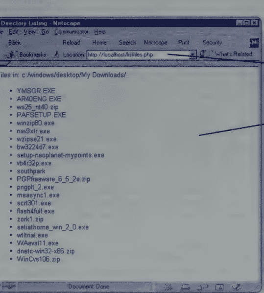

19. 将此文件放在你 Web 服务器的根目录下。

20. 打开 Web 浏览器并输入 `http://localhost/listfiles.php`

> 你应该看到一个无序列表，显示 `$dir_name` 提供的目录中的文件。这里显示的结果是我自己目录中的一个文件；你的列表会有所不同。

假设这运行正常，请尝试系统中的其他目录。如果目录不存在，脚本不会返回错误——它只是不会没有任何结果。

在下一节中，你将使用 `fopen()` 和 `fclose()` 函数来打开和关闭特定文件。

### 使用 `fopen()` 和 `fclose()`

通过直接开始处理文件操作，你需要了解一下 `fopen()` 函数，它用于打开文件。该函数需要一个文件名和一种模式，并返回一个文件指针。文件指针提供有关文件的信息并用作引用。

文件名是你想要创建或打开的文件完整路径，而模式可以是下表列出的任何模式之一。

| 模式 | 用法 |
| --- | --- |
| `r` | 打开已存在的文件并从中读取数据。文件指针置于文件开头。 |
| `r+` | 打开已存在的文件进行读或写。文件指针置于文件开头。 |
| `w` | 打开文件进行写入。如果不存在同名文件，函数将创建一个新文件。如果文件存在，函数将删除所有现有内容并将文件指针置于文件开头。 |
| `w+` | 打开文件进行读和写。如果不存在同名文件，函数将创建一个新文件。如果文件存在，函数将删除所有现有内容并将文件指针置于文件开头。 |
| `a` | 打开文件进行写入。如果不存在同名文件，函数将创建一个新文件。如果文件存在，函数将文件指针置于文件末尾。 |
| `a+` | 打开文件进行读和写。如果不存在同名文件，函数将尝试创建一个新文件。如果文件存在，函数将文件指针置于文件末尾。 |

### 创建新文件

与本章的第一节相比，接下来的任务将是轻而易举。目标仅仅是在指定位置创建一个新的空文件。

1. 在你的文本编辑器中打开一个新文件。

2. 启动一个 PHP 代码块：

```php
<?
```

3. 创建一个变量来存储文件的完整路径名：

```php
$filename = "path/to/your/file.txt";
```

4. 创建文件指针并使用 `fopen()` 函数打开文件：

> 注意：在后续的目录函数中，“句指针”一词将指代已打开的目录。

```php
$newfile = fopen($filename, "w") or die("Unable to open file!");
```

5. 关闭文件指针：

```php
fclose($newfile);
```

6. 创建一个消息打印消息：

```php
$msg = "<p>File created successfully!</p>";
```

7. 关闭 PHP 代码块：

```php
?>
```

14. 增加一些 HTML 以使文档有效：

```html
<body>
</html>
```

15. 将文件另存为 `newfile_checkfirst.php`。

16. 将此文件放置在你的 Web 服务器的文档根目录下。


17. 打开你的浏览器并输入 `http://localhost/newfile_checkfirst.php`

假设你使用了之前创建的文件名，你应该会看到失败信息。


如果你将 `$filename` 的值更改为不存在的文件，然后再次访问脚本，你将看到成功信息。

仅仅创建一个文件是无趣的。在下一节中，你将学习向文件写入数据。

### 向文件追加数据

下一个脚本的目标是将数据追加到文件中。如果文件存在，脚本将向其中写入数据。如果文件不存在，将在写入数据之前创建它。

1. 在你的文本编辑器中打开一个新文件。

2. 开始一个 PHP 块：

```php
<?
```

3. 创建一个变量来存储文件的完整路径（使用你自己的文件路径）：

```php
$filename = "/Apache/file.txt";
```

4. 创建一个名为 `$newstring` 的变量来存储你想写入文件的字符串。用这个非常兴奋的消息填充该字符串：

```php
$newstring = "\n看这里！\n我创建了一个新文件并把所有这些文本都放了进去了！\n";
```

> 注意：使用换行符会导致文本中的该处发生换行。

5. 创建一个文件指针并使用 `fopen()` 函数打开步骤 4 中指定的文件进行读写。如果文件没有正常打开，`die()` 函数将导致脚本结束并显示消息。

```php
$myfile = fopen($filename, "w+") or die("无法打开文件.");
```

6. 使用 `fwrite()` 函数将文本（`$newstring`）放入文件（`$myfile`）中。如果 `fwrite()` 失败，`die()` 函数将导致脚本结束。

```php
@fwrite($myfile, $newstring) or die("无法写入文件.");
```

7. 创建一个变量来存储成功消息：

```php
$msg = "<p>文件中现在有数据了...</p>";
```

8. 关闭文件指针：

```php
fclose($myfile);
```

9. 关闭你的 PHP 块：

```php
?>
```

10. 添加此 HTML：

```html
<HTML>
<HEAD>
<TITLE>向文件添加数据</TITLE>
</HEAD>
<body><body></body></html>
```

11. 打印消息：

```php
<? echo "$msg"; ?>
```

12. 增加一些 HTML 以使文档有效：

```html
</body>
</html>
```

13. 将文件另存为 `writata.php`。

14. 将此文件放置在你的 Web 服务器的文档根目录下。

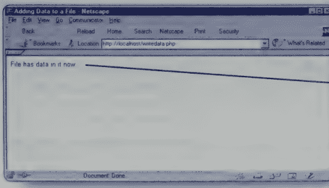

15. 打开你的浏览器并输入 `http://localhost/writata.php`

你应该会看到成功信息。

### 从文件中读取数据

在下一节中，你将学习从文件中读取数据。如果你已经打开了文件，PHP 有一个实用的函数 `fread()` 可以完成这项工作。

1. 在你的文本编辑器中打开一个新文件。

2. 开始一个 PHP 块：

```php
<?
```

3. 创建一个变量来存储文件的完整路径（使用你自己的文件路径）：

```php
$filename = "/Apache/file.txt";
```

4. 创建一个文件指针并使用 `fopen()` 函数打开步骤 3 中指定的文件进行读取。如果文件没有正常打开，`die()` 函数将导致脚本结束并显示消息。

```php
$myfile = fopen($filename, "r") or die("无法打开文件.");
```

5. 使用 `fread()` 函数从文件中读取内容。你需要指定要读取的字节数，通常可以使用 `filesize()` 函数。

```php
$content = fread($myfile, filesize($myfile));
```

6. 创建一个变量来存储成功消息：

```php
$msg = "<p>文件内容已读取...</p>";
```

7. 关闭文件指针：

```php
fclose($myfile);
```

8. 关闭你的 PHP 块：

```php
?>
```

9. 添加此 HTML：

```html
<HTML>
<HEAD>
<TITLE>从文件中读取数据</TITLE>
</HEAD>
<body><body></body></html>
```

10. 打印消息：

```php
<? echo "$msg"; ?>
```


11. 增加一些 HTML 以使文档有效：

```html
</body>
</html>
```

## 通过电子邮件发送文件内容

现在你将学习如何将文件内容通过电子邮件发送。

1. 在你的文本编辑器中打开一个新文件。

2. 开始一个 PHP 块：

```php
<?
```

3. 创建一个变量来存储文件的完整路径（使用你自己的文件路径）：

```php
$filename = "/Apache/file.txt";
```

4. 创建一个文件指针并使用 `fopen()` 函数打开步骤 3 中指定的文件进行读取。如果文件没有正常打开，`die()` 函数将导致脚本结束并显示消息。

```php
$myfile = fopen($filename, "r") or die("无法打开文件.");
```

5. 使用 `fread()` 函数从文件中读取内容。

```php
$content = fread($myfile, filesize($myfile));
```

6. 创建一个变量来存储接收者的电子邮件地址：

```php
$to = "you@yourdomain.com";
```

7. 创建一个变量来存储邮件主题：

```php
$subject = "文件内容";
```

8. 创建一个变量来存储额外的邮件头：

```php
$mailheaders = "From: My Web Site <> \n";
```

9. 使用 `mail()` 函数，并将 `$content` 字符串作为第三参数（消息）：

```php
mail($to, $subject, $content, $mailheaders);
```

10. 创建一个变量在屏幕上打印消息：

```php
$msg = "<P>请检查你的邮件!</P>";
```

11. 关闭文件指针：

```php
fclose($myfile);
```

12. 关闭你的 PHP 块：

```php
?>
```

13. 添加此 HTML：

```html
<HTML>
<HEAD>
<TITLE>通过电子邮件发送文件内容</TITLE>
</HEAD>
<body><body></body></html>
```

14. 打印消息：

```php
<? echo $msg; ?>
```

15. 增加一些 HTML 以使文档有效：

```html
</body>
</html>
```

16. 将文件保存为 `mailcontents.php`。

17. 将此文件放在你的 Web 服务器的文档根目录下。

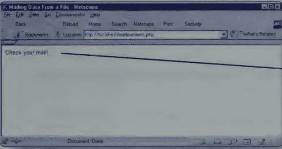

18. 打开你的 Web 浏览器并输入 `http://localhost/mailcontents.php`

你应该能在屏幕上看到打印的一条消息，提示你检查邮件。

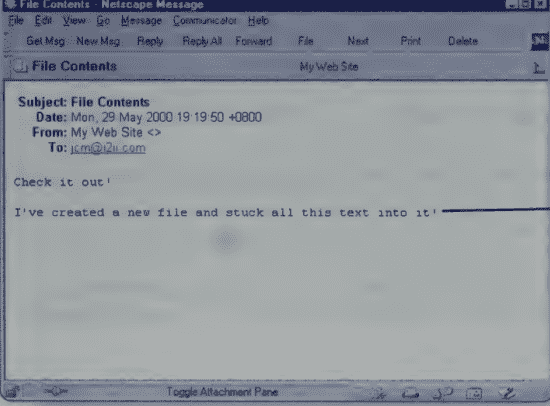

正如消息所示，去检查你的邮件。与之前的脚本不同，你不需要使用 `nl2br()` 函数，因为你没有在 Web 浏览器窗口中显示文本。

纯文本电子邮件将保留原始的换行符。

## 文件系统维护

接下来的系列脚本将帮助你执行非常基础的文件系统任务，如复制、重命名和删除文件。请记住，只有当 PHP 用户拥有适当权限时，你才能执行文件系统函数。

### 复制文件

`copy()` 函数非常简单：它只需要知道原始文件名和新文件名——仅此而已。

1. 在你的文本编辑器中打开一个新文件。

2. 启动 PHP 块：

```php
<?
```

3. 创建一个变量来存储原始文件的完整路径（使用你自己的路径）：

```php
$orig_filename = "/Apache/textfile.txt";
```

4. 创建一个变量来存储新文件的完整路径（使用你自己的路径）：

```php
$new_filename = "/Apache/textfile.bak";
```

5. 创建一个变量来存储函数的真/假结果。通过在函数前使用 `@` 来抑制警告，并在函数失败时使用 `die()` 打印消息：

```php
$success = @copy($orig_filename, $new_filename) or die("Couldn't copy file.");
```

6. 启动一个 `if...else` 语句，根据函数的执行打印适当的消息：

```php
if ($success) {
```

7. 如果成功，消息字符串应该打印复制的确认：

```php
$msg = "Copied $orig_filename to
$new_filename";
```

8. 继续编写失败情况的语句：

```php
} else {
  $msg = "Could not copy file.";
}
```

9. 关闭你的 PHP 块：

```php
?>
```

10. 添加这些 HTML：

```html
<HTML>
<HEAD>
<TITLE>Copy a File</TITLE>
</HEAD>
<BODY>
```

11. 打印消息：

```php
<?php echo "$msg"; ?>
```

12. 添加更多 HTML 以使文档有效：

```html
</BODY>
</HTML>
```

13. 将文件保存为 `copyfile.php`。

14. 将此文件放在你的 Web 服务器的文档根目录下。

> 注意
>
> 在这种情况下，使用 `else` 语句实际上是没有必要的，但这是提供默认结果的良好习惯。如果 `copy()` 函数失败，`die()` 函数将在进入脚本的 `if...else` 部分之前退出脚本并打印错误。

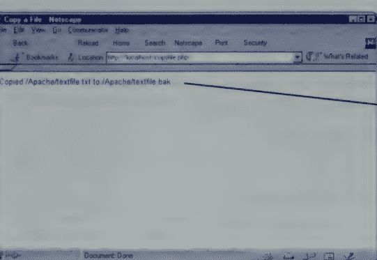

15. 打开你的 Web 浏览器并输入 `http://localhost/copyfile.php`

你应该能看到文件复制过程确认，列出被重命名文件的旧名和新名。

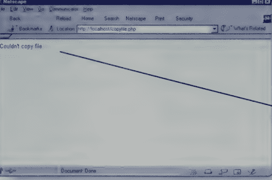

通过将 `$new_filename` 的值更改为不存在的内容，查看你的错误处理是否有效：

```php
$new_filename = "/bozo/textfile.bak";
```

通过 Web 浏览器访问该脚本，你应该看到类似的内容。

接下来，进入重命名文件部分。脚本非常简单！

### 重命名文件

与 `copy()` 函数一样，`rename()` 函数只需要知道原始文件名和新文件名。在这种情况下，你只是重命名原始文件，而不是复制它。

1. 在你的文本编辑器中打开一个新文件。

2. 启动 PHP 块：

```php
<?
```

3. 创建一个变量来存储原始文件的完整路径（使用你自己的路径）：

```php
$orig_filename = "/Apache/textfile.bak";
```

4. 创建一个变量来存储新文件的完整路径（使用你自己的路径）：

```php
$new_filename = "/Apache/textfile.old";
```

5. 创建一个变量来存储函数的真/假结果。通过在函数前使用 `@` 来抑制警告，并在函数失败时使用 `die()` 打印消息：

```php
$success = rename($orig_filename, $new_filename) or die("Couldn't rename file.");
```

6. 启动一个 `if...else` 语句，根据函数的执行打印适当的消息：

```php
if ($success) {
```

7. 如果成功，消息字符串应该打印重命名函数的确认：

```php
$msg = "Renamed $orig_filename to $new_filename";
```

> 注意
>
> 在这种情况下，使用 `else` 语句实际上是没有必要的，但这是提供默认结果的良好习惯。如果 `rename()` 函数失败，`die()` 函数将在进入脚本的 `if...else` 部分之前退出脚本并打印错误。

8. 继续编写失败情况的语句：

```php
} else {
  $msg = "Could not rename file.";
}
```

9. 关闭你的 PHP 块：

```php
?>
```

10. 添加这些 HTML：

```html
<HTML>
<HEAD>
<TITLE>Rename a File</TITLE>
</HEAD>
<BODY>
```

11. 打印消息：

```php
<? echo "$msg"; ?>
```

12. 添加更多 HTML 以使文档有效：

```html
</BODY>
</HTML>
```

13. 将文件保存为 `renamefile.php`。

14. 将此文件放在你的 Web 服务器的文档根目录下。

15. 打开你的 Web 浏览器并输入 `http://localhost/renamefile.php`

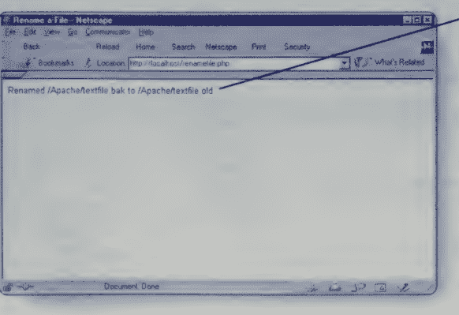

你应该能看到文件复制过程确认，列出被重命名文件的旧名和新名。

通过将 `$new_filename` 的值更改为不存在的内容，查看你的错误处理是否有效：

```php
$new_filename = "/bozo/textfile.bak";
```

通过 Web 浏览器访问该脚本，你应该看到类似的内容。

下一个部分是删除文件。在使用 `unlink()` 函数时要小心，因为一旦你删除了文件，它就彻底消失了。

### 删除文件

1. 在你的文本编辑器中打开一个新文件。

2. 启动 PHP 块：

```php
<?
```

3. 创建一个变量存储要删除文件的完整路径（使用你自己的路径）：

```php
$filename = "Apache/textfile.old";
```

4. 创建一个变量来存储函数的真/假结果。通过在函数前使用 `@` 来抑制警告，并在函数失败时使用 `die()` 打印消息：

```php
$success = @unlink($filename) or die("Couldn't delete file.");
```

5. 启动一个 `if...else` 语句，根据函数的执行打印适当的消息：

```php
if ($success) {
```

6. 如果成功，消息字符串应该打印删除的确认：

```php
$msg = "Deleted $filename";
```

7. 继续编写失败情况的语句：

```php
} else {
  $msg = "Could not delete file.";
}
```

8. 关闭你的 PHP 块：

```php
?>
```

9. 添加这些 HTML：

```html
<HTML>
<HEAD>
<TITLE>Delete a File</TITLE>
</HEAD>
<BODY>
```

10. 打印消息：

```php
<?php echo "$msg"; ?>
```

11. 添加更多 HTML 以使文档有效：

```html
</BODY>
</HTML>
```

12. 将文件保存为 `deletefile.php`。

13. 将此文件放在你的 Web 服务器的文档根目录下。

14. 打开你的 Web 浏览器并输入 `http://localhost/deletefile.php`

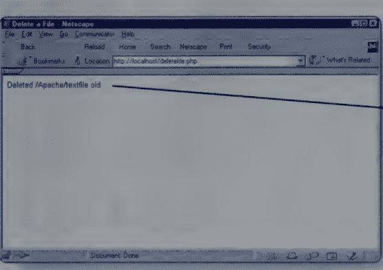

你应该能看到文件删除过程确认，列出被删除文件的名称。

通过将 `$filename` 的值更改为不存在的内容，查看你的错误处理是否有效：


```php
$filename = "bozo/textfile.old";
```

通过 Web 浏览器访问该脚本，你应该看到类似的内容。

## 将文件上传到你的网站

如果你需要一个快速的界面从远程位置向你的网站上传文件，可以使用 PHP 创建一个两步表单和脚本接口。在本章中，你将学习如何实现以下操作：

- 创建一个用于文件上传的 HTML 表单
- 创建一个处理文件上传的 PHP 脚本

### 检查你的 `php.ini` 文件

在开始上传文件之前，请检查 `php.ini` 文件中的几个值。找到以下两行：

- `upload_tmp_dir = ; HTTP 上传文件的临时目录`
- `upload_max_filesize = 2097152 ; 文件上传的默认限制为 2MB`

你需要修改这些行，以确保文件上传过程能够顺畅运行。

1. 删除开头的分号来取消 `upload_tmp_dir` 行的注释。

2. 在 `upload_tmp_dir` 的等号之后输入一个目录名称。

3. 如果你想允许更大的文件上传，请更改 `upload_max_filesize` 的字节数。

例如，我 Windows 电脑上的 `php.ini` 文件包含以下内容：

- `upload_tmp_dir = c:/Windows/temp ; HTTP 上传文件的临时目录`
- `upload_max_filesize = 2097152 ; 文件上传的默认限制为 2MB`

### 理解该过程

通过 HTML 表单接口向 Web 服务器上传文件的过程让许多人感到困惑。花一点时间理解你将在后续章节中创建的这个过程。

要启动并完成这个过程，你需要以下内容：

- 一个 HTML 表单
- 一个要上传的文件
- 一个存放文件的地方
- 一个将文件存放在该处的脚本

该过程本身如下：

1. 用户访问 HTML 表单，并在 Web 浏览器中看到一个文本字段和一个“浏览”按钮。
2. 用户在硬盘中浏览想要上传的文件，然后选择一个文件。
3. 完整的文件路径和文件名显示在文本字段中。
4. 用户点击“提交”按钮。
5. 选择的文件发送到 Web 服务器，并停留在临时目录。
6. 表单 `action` 中的 PHP 脚本检查是否发送了文件，并对临时文件执行复制命令，将其移动到 Web 服务器上的真实目录。
7. PHP 脚本向用户确认该操作。

> 注意
>
> PHP 用户（运行 PHP 的用户，例如 `nobody` 或 `www` 或 `joe`）必须对临时目录以及文件的目标目录具有写入权限。

从下一节中简单的创建 HTML 表单界面开始。

### 创建表单

先从创建一个单字段表单开始。在你让这个序列处理单个文件并工作后，你可以创建一个可以上传任意数量文件的表单。

1. 在文本编辑器中打开一个新文件。

2. 输入以下 HTML：

```html
<HTML>
<HEAD>
<TITLE>上传文件</TITLE>
</HEAD>
<BODY>
<h1>上传文件</h1>
```

3. 开始你的表单。假设方法为 `post`，`action` 为名为 `do_upload.php` 的脚本。由于你要发送的不只是文本，请使用 `ENCTYPE` 属性。

```html
<FORM METHOD="post" ACTION="do_upload.php" ENCTYPE="multipart/form-data">
```

4. 为文件创建一个带有文本标签的输入字段。假设你要上传一个图像文件，并将输入字段命名为 `img1`：

```html
<p><strong>要上传的文件：</strong><br>
<INPUT TYPE="file" NAME="img1" SIZE="30"></p>
```

> 注意
>
> 表单字段中的 `TYPE="file"` 属性将显示一个带有“浏览”按钮的输入字段。“浏览”按钮会启动文件管理器，你通过它来选择要上传的文件。

5. 添加一个提交按钮：

```html
<p>INPUT TYPE="submit" NAME="submit" VALUE="上传文件"</p>
```

6. 关闭你的表单并添加一些额外的 HTML 以使文档有效：

```html
</FORM>
</BODY>
</HTML>
```

7. 将文件保存为 `upload_form.html`。

8. 将此文件放置在你的 Web 服务器的文档根目录下。

9. 打开你的 Web 浏览器并输入 `http://localhost/upload_form.html`

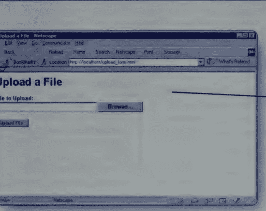

你应该能看到文件上传表单，包含一个文本字段、一个浏览按钮和一个提交按钮。

在下一节中，你将创建处理文件上传的脚本。

### 创建上传脚本

花一点时间将以下列表记在脑子里——包含了成功上传文件后自动创建的变量。`img1` 的基础来自原始表单中输入字段的名称。

- `$img1`。该值指向 Web 服务器上的临时文件。
- `$img1_name`。该值是被上传文件的实际名称。例如，如果文件名是 `me.jpg`，那么 `$img1_name` 的值就是 `me.jpg`。
- `$img1_size`。上传的文件的大小，以字节为单位。
- `$img1_type`。上传文件的 MIME 类型，例如 `image/jpg`。

该脚本的目标是接收上传的文件并将其复制到 Web 服务器的根目录，并显示这些变量。

1. 在文本编辑器中打开一个文件。

2. 开始你的 PHP 块：

```php
<?
```

3. 创建一个 `if` 语句检查是否发送了文件：

```php
if ($img1 != "")
```

4. 如果 `$img1` 不为空，对临时文件执行复制命令将其移动到 Web 服务器上的真实目录：


```php
    @copy($img1, "/var/www/html/$img1")
```

> **注意**：使用`@`符号来抑制警告，并使用`die()`函数在复制失败时结束。

```php
    die("复制失败");
```

5. 继续`else`语句：

```php
} else {
    die("没有文件");
```

6. 关闭你的 PHP 块：

```php
?>
```

7. 添加一些 HTML：

```html
<HTML>
<HEAD>
<TITLE>上传结果</TITLE>
</HEAD>
<BODY>
<h1>成功！</h1>
<p>你发送了 <?php echo $img1_name; ?>，大小为 <?php echo $img1_size; ?> 字节的文件，MIME 类型为 <?php echo $img1_type; ?>。</p>
</BODY>
</HTML>
```

8. 将文件保存为`do_upload.php`。

9. 将此文件放置在你的 Web 服务器的文档根目录下。

## 使用表单和脚本上传文件

这是见证真相的时刻，你屏住呼吸测试脚本。

1. 打开你的 Web 浏览器并输入`http://localhost/upload_form.html`

2. 使用浏览按钮找到想要上传的文件。


> **注意**：此示例使用的是我自己电脑上的文件，所以数字与你的结果可能不一样。

完整的文件路径应该显示在文本字段中。

3. 点击“上传文件”按钮。


结果屏幕将会，提供了你刚刚上传的文件的信息。

成功！

你发送了：`0761627291.jpg`，一个大小为 6162 字节的文件，MIME 类型为`image/jpeg`

> **注意**：你自己或其他可靠来源使用你的文件上传脚本，除非你在复制之前通过检查文件类型来限制想要上传的文件类型。

# 了解你的数据库

- 第 11 章 建立连接并开始使用 MySQL
- 第 12 章 创建数据库表
- 第 13 章 向表中插入数据
- 第 14 章 选择并显示数据

# 第 11 章 建立连接并开始使用 MySQL

在第 1 章的 MySQL 安装和测试过程中，你理应该已经创建了一个示例数据库和示例表，甚至插入并查询了一些数据。接下来的几章节将重点介绍如何使用 PHP 脚本作为前端，来执行相同类型的连接和查询。在本章中，你将学习如何进行以下操作：

- 连接到 MySQL
- 列出本地上的所有数据库
- 列出数据库中的所有表
- 创建数据库
- 删除（删除）数据库

## 创建用户名和密码

当你在第 1 章安装 MySQL 数据库时，是以匿名用户或 root 用户身份运行的。在开始常规操作数据库之前，你应该创建一个带有真实密码的真实用户。有两个简单的命令需要执行：MySQL 监器和`mysqladmin`程序。

> **注意**：这些命令在 Windows 和 Linux/UNIX 平台上完全相同。

1. 启动 MySQL 监器。

2. 在`mysql>`提示符下输入`Use mysql`：

3. 输入以下 SQL 语句，替换为你自己的用户名和密码：

```sql
insert into user (host, user, password) values ('localhost', 'sandman', 'tQ9472b'));
```

4. 在`mysql>`提示符下输入`exit`退出 MySQL 监器。

5. 使用`mysqladmin`程序执行`flush-privileges`命令重新加载权限。

> **注意**：新用户 (`sandman`) 现在将拥有所有数据库和表的权限。从现在开始请适当替换为你自己的用户名和密码。

## 连接到 MySQL

此脚本的目标仅仅是连接到运行在你机器（`localhost`）上的 MySQL。

1. 在你的文本编辑器中打开一个新文件。

2. 开始 PHP 块：

```php
<?
```

3. 创建一个变量来存储`mysql_connect()`函数的结果：

```php
$connection = mysql_connect("localhost", "sandman", "t09472b");
```

4. 在`mysql_connect()`行添加`die()`函数，以便连接失败时结束脚本并显示消息。新行应如下：

```php
$connection = mysql_connect("localhost", "sandman", "tQ9472b") or
die("Couldn't connect.");
```

> **注意**：`mysql_connect()`函数需要主机名、用户名和密码（顺序如此）。

5. 测试`$connection`的值。如果是`true`，说明已到 MySQL，创建一个变量来存储消息：

> **注意**：如果无法连接，脚本将通过`die()`函数结束。

```php
if ($connection) {
  $msg = "success";
}
```

6. 关闭 PHP 块：

```php
?>
```

7. 添加这些 HTML：

```html
<HTML>
<HEAD>
<TITLE>MySQL Connection</TITLE>
</HEAD>
<body>
```

8. 打印消息字符串：

```php
<?php echo "$msg"; ?>
```

9. 添加更多 HTML 使文档有效：

```html
</BODY>
</HTML>
```

10. 将文件保存为`db_connect.php`。


11. 将此文件放在你的 Web 服务器的根目录下。

12. 打开浏览器输入`http://localhost/db_connect.php`

如果你输入了正确的用户名和密码，你应该得到成功的结果。

## 破坏你的连接脚本

任何操作数据库都会遇到错误，这是不可避免的。这就是为什么我想向你展示一些常见错误以及如何优雅地处理它们。你对`db_connect.php`脚本进行修改，通过更改用户名导致连接失败。

1. 将用户名改为`booboo`（除非`booboo`是一个真实用户！），使连接行如下：

```php
$connection = mysql_connect("localhost", "booboo", "tQ9472b") or die("Couldn't connect.");
```

2. 保存文件。

3. 打开浏览器输入`http://localhost/db_connect.php`


- 多么糟糕的响应！至少它告诉了哪里出错了：`user booboo@localhost`无法连接到 MySQL。警告之后，`die()`函数的消息确实打印了。

你可以通过在`mysql_connect()`函数之前放置`@`来抑制丑陋的警告，只保留`die()`函数的消息。尝试一下：

4. 在`mysql_connect()`函数前添加`@`，保留错误的用户名：

```php
$connection = @mysql_connect("localhost", "booboo", "tQ9472b") or die("Couldn't connect.");
```

5. 保存文件。

6. 打开浏览器输入`http://localhost/db_connect.php`


通过此更改，警告被抑制了，只显示`die()`函数的消息。

如果你能将错误和警告降到最低，那么当你的数据库在网页浏览期间变得不可用时，整体体验会变得愉快得多。

## 在服务器上列出数据库

现在你已经成功使用 PHP 连接到 MySQL，请熟悉一些内置函数。在本节中，你将使用以下：

- `mysql_list_dbs()`：用于列出 MySQL 服务器上的数据库。
- `mysql_num_dbs()`：获取数据库数量。
- `mysql_select_db()`：选择一个数据库。
- `mysql_list_tables()`：列出数据库中的所有表。
- `mysql_num_tables()`：获取表数量。
- `mysql_query()`：执行 SQL 语句。
- `mysql_fetch_result()`：获取查询结果。
- `mysql_fetch_assoc()`：获取结果集中的关联数组。
- `mysql_fetch_row()`：获取结果集中的行数组。
- `mysql_free_result()`：释放结果集。
- `mysql_close()`：关闭连接。

19. 打开 Web 浏览器并输入`http://localhost/db_listdb.php`


除非你自己添加或删除了数据库，否则你应该看到这三个数据库。两个是 MySQL 数据库（`mysql`和`tempdata`），而`testDB`是在第 1 章的安装和测试期间创建。

接下来，你将向此脚本添加另一个循环，以打印每个数据库中的表。

## 在数据库中列出表

只需要对`db_listdb.php`脚本进行一些添加，就可以列出数据库中的表了。你看到的唯一新函数是`mysql_list_tables()`，它用于列出 MySQL 数据库中的表。

此脚本的目标是在本地 MySQL 服务器上列出所有数据库，包括这些数据库中的表。

1. 在文本编辑器中打开一个新文件。

2. 开始一个 PHP 块：

```php
<?
```

3. 创建一个变量来存储`mysql_connect()`函数的结果。包含`@`以抑制警告，并使用`die()`函数在连接失败时结束脚本并显示消息：

```php
$connection = @mysql_connect("localhost"
```

4. 创建一个变量来存储`mysql_list_dbs()`函数的结果。包含`@`以抑制警告，并使用`die()`函数在脚本无法获取列表时结束脚本并发送消息：

```php
$dbs = @mysql_list_dbs($connection) or
die("Couldn't list databases.");
```

> **注意**：`mysql_list_dbs()`函数唯一必要的参数是当前连接的链接标识。

5. 你将遍历结果并动态生成一个无序列表。在循环外部开始该无序列表：

```php
$db_list = "<ul>";
```

6. 一个计数器。你将在循环中需要它：

```php
$db_num = 0;
```

> **注意**：使用`$db_num`而不是`$i`作为计数器，因为在脚本的某个一点，你将有两个计数器同时运行。

7. 开始一个`while`循环。只要`$db_num`的值小于`$dbs`结果值的行数，该循环就会继续：

```php
while ($db_num < mysql_num_rows($dbs)) {
```

8. 一旦进入`while`循环，获取结果当前行中反映的数据库名称：

```php
$db_names[$db_num] = mysql_tablename($dbs, $db_num);
```

9. 将当前数据库名称加入无序列表：

```php
$db_list = "<li>$db_names[$db_num]";
```

10. 一个`if`语句，将当前数据库名称与两个系统表`mysql`和`tempdata`进行比对：

> **注意**：root 用户具有访问`mysql`和`tempdata`数据库中表的权限，尝试获取这些数据库的表列表会自动产生错误。

```php
if (($db_names[$db_num] != "mysql" &&
($db_names[$db_num] != "tempdata")) {
```

11. 创建一个变量来存储`mysql_list_tables()`函数的结果。包含`@`以抑制警告，并使用`die()`函数在脚本无法获取列表时结束脚本并显示消息：

> **注意**：`mysql_list_tables()`函数唯一必要的参数是当前数据库的名称。

```php
$tables = @mysql_list_tables($db_names[$db_num]) or die("Couldn't list databases.");
```

12. 你将遍历结果并动态填充无序列表。在循环外部开始该无序列表：

```php
$table_list = "<ul>";
```

13. 开始一个计数器。你将在第二个循环中需要它：

```php
$table_num = 0;
```

14. 开始一个`while`循环。只要`$table_num`的值小于`$tables`结果行数，该循环就会继续。

```php
while ($table_num < mysql_num_rows($tables)) {
```

15. 一旦进入`while`循环，获取结果当前行中反映的表名称：

```php
$table_names[$table_num] = mysql_tablename($tables, $table_num);
```

16. 将当前表名称加入无序列表：

```php
$table_list .= "<li>$table_names[$table_num]";
```

17. 在关闭`while`循环之前增加你的计数：

```php
$table_num++;
```

18. 关闭内部`while`循环：

```php
}
```

19. 关闭表的无序列表：

```php
$table_list .= "</ul>";
```

20. 关闭`if`语句：

```php
}
```

21. 将`$table_list`的值加入`$db_list`，然后在在关闭外部`while`循环之前增加你的计数：

```php
$db_list .= "$table_list";
$db_num++;
```

22. 关闭外部`while`循环：

```php
}
```

23. 关闭数据库的无序列表：

```php
$db_list .= "</ul>";
```

24. 关闭 PHP 块：

```php
?>
```

25. 添加这些 HTML：

```html
<HTML>
<HEAD>
<TITLE>MySQL Tables</TITLE></HEAD>
<BODY>
<P><strong>Databases on localhost</strong></P>
```

26. 打印消息字符串：

```php
php echo "$db_list"; ?>
```

27. 添加额外的 HTML 使文档有效：

```html
</body>
</html>
```

28. 将文件保存为`db_listtables.php`。

29. 将此文件放在 Web 服务器的文档根目录下。

30. 打开 Web 浏览器并输入`http://localhost/db_listtables.php`


除非你在`testDB`中添加或删除了表，否则你应该会在`testDB`下看到一个表 (`test`)。

在下一节中，你将尝试在服务器上创建新数据库。

## 创建新数据库

之前脚本的复杂元素在此脚本中未找到。此脚本的目标是在 MySQL 服务器上创建一个新数据库。

1. 在文本编辑器中打开一个新文件。

2. 开始一个 PHP 块：

```php
<?
```

3. 创建一个变量来存储新数据库的名称：

```php
$new_db = "testDB2";
```

4. 创建一个变量来存储`mysql_connect()`函数的结果。包含`@`以抑制警告，并使用`die()`函数在连接失败时结束脚本并显示消息：

```php
$connection = @mysql_connect("localhost", "sandman", "tQ9472b") or
die("Couldn't connect.");
```

5. 创建一个变量来存储`mysql_create_db()`函数的结果。包含`@`以抑制警告，并使用`die()`函数在数据库创建失败时结束脚本并显示消息：

> **注意**：`mysql_create_db()`函数需要数据库名称和当前连接的链接标识。

```php
$result = @mysql_create_db($new_db,
$connection) or die("Couldn't database.");
```

6. 测试`$result`的值。如果为真，则数据库已创建，创建一个变量来存储消息：

> **注意**：如果无法创建数据库，脚本将通过`die()`函数结束。

```php
if ($result) {
  $msg = "<P>Database has been created!</P>";
}
```

7. 关闭你的 PHP 块：

```php
?>
```

8. 添加这些 HTML：


```html
<HTML>
<HEAD>
<TITLE>Create a MySQL Database</TITLE></HEAD>
<BODY>
```

9. 打印消息字符串：

```php
php echo "$msg"; ?>
```

10. 添加额外的 HTML 使文档有效：

```html
</body>
</html>
```

11. 将文件保存为 `db_createddb.php`。
12. 将此文件放在 Web 服务器的文档根目录下。
13. 打开 Web 浏览器并输入 `http://localhost/db_createddb.php`


如果数据库创建成功，你会看到这条消息。

如果你重新加载脚本，你将发出相同的数据库创建命令。


由于数据库已经创建，且你不能在同一个服务器上拥有两个同名的数据库，你应该得到一个错误。尝试一下！

通过打开 Web 浏览器访问 `http://localhost/db_listdb.php` 来验证新数据库是否存在。


你应该列表中列表中这些数据库。

在下一节中，你将删除（`drop`）你刚刚创建的数据库。

`localhost` 上的数据库：

- `mysql`
- `template`
- `testDB`
- `testDB2`

## 删除数据库

此脚本的目标是在 MySQL 服务器上删除一个数据库。

1. 在文本编辑器中打开一个新文件。
2. 开始一个 PHP 块：

```php
<?
```

3. 创建一个变量来存储你想删除的数据库名称：

```php
$drop_db = "testDB2";
```

4. 创建一个变量来存储 `mysql_connect()` 函数的结果。包含 `@` 以抑制警告，并使用 `die()` 函数在连接失败时结束脚本并显示消息：

```php
$connection = @mysql_connect("localhost", "sandman", "tQ9472b") or
die("Couldn't connect.");
```

5. 创建一个变量来存储 `mysql_drop_db()` 函数的返回值。包含 `@` 符号以抑制警告，并使用 `die()` 函数在删除数据库失败时结束脚本并显示消息：

> 注意：`mysql_drop_db()` 函数需要一个数据库名称和当前连接的标识符。

```php
$result = @mysql_drop_db($drop_db, $connection) or die("Couldn't delete database.");
```

6. 测试 `$result` 的值。如果为真，则表示数据库已删除，并创建一个变量来存储消息：

> 注意：如果无法删除数据库，脚本将通过 `die()` 函数结束。

```php
if ($result) {
  $msg = "<P>Database has been dropped!</P>";
}
```

7. 关闭你的 PHP 块：

```php
?>
```

8. 添加此 HTML：

```html
<HTML>
<HEAD>
<TITLE>删除 MySQL 数据库</TITLE>
</HEAD>
<body>
```

9. 打印消息字符串：

```php
<?php echo "$msg"; ?>
```

10. 添加更多 HTML 以使文档有效：

```html
</BODY>
</HTML>
```

11. 将文件保存为 `db_dropdb.php`。
12. 将此文件放在你的 Web 服务器的文档根目录下。


13. 打开浏览器并输入 `http://localhost/db_dropdb.php`

如果数据库删除成功，你将看到这条消息。


如果你重新加载脚本，你正在执行相同的数据库删除命令。

由于在你第一次运行脚本时数据库已经被删除，你应该会收到一个错误。试试看！

在下一章中，你将为键创建一个数据库表，并最终向该表填充一些数据。

# 第 12 章：创建数据库表

你拥有了这个很棒的数据库服务器，但在名为 `testDB` 的数据库中只有一个名为 `test_table` 的表。这样有什么趣？在本章中，你将学习执行以下操作：

- 规划数据库表
- 识别某些数据类型的陷阱
- 识别唯一字段的重要性
- 遵循创建表的两步过程
- 创建一个表来存放你的个人音乐目录

## 规划你的字段

创建表很容易——规划才费脑力。要创建一个简单的表，你只需要给它起个名字。但这会让表变得很无趣，因为它不包含任何列（字段），也无法存储任何数据。所以，除了名称之外，你还应该知道你想在表中包含的字段数量以及字段的类型。

本章的总目标是创建一个表来存储来自你个人音乐收藏的数据。请花点时间思考你想了解的内容：显然是标题和艺术家，可能还有唱片公司、获取日期以及你对该录音的个人笔记。

我考虑了我的自己的表需要什么，我决定将其命名为 `my_music`。下表显示了我希望它包含的字段。

| 字段名称 | 说明 |
| :--- | :--- |
| `id` | 条目的唯一 ID 编号 |
| `format` | 是 CD、磁带还是甚至是 LP？ |
| `title` | 录音的标题 |
| `artist_fn` | 艺术家的名字 |
| `artist_In` | 艺术家的姓氏或团体名称 |
| `rec_label` | 唱片公司 |
| `my_notes` | 我对录音的个人想法 |
| `date_acq` | 获取日期 |

在下一节中，你将创建一系列表单，获取你的表信息并将其发送到 MySQL 数据库。在第一步中，你将提交表和想要包含的字段数量。第二步将显示额外的表单字段，以便你定义表列的属性。第三步将请求发送给 MySQL，验证表是否已创建并显示“成功！”消息。

在进入这些内容之前，请花时间阅读关于数据类型和唯一字段。

## 关于数据类型

表中的所有字段都赋予了特定的数据类型定义。数据类型定义了字段中允许的数据类型。对于某些数据类型定义，你还必须定义字段中允许的最大长度，而其他类型假设没有特定长度。

恰当定义字段非常重要。例如，如果你有一个 50 字符的 `varchar` 字段来存储录音名称，而你尝试向该字段填充一个 100 字符的字符串，你的字符串将被截断为 50 个字符。

正确定义字段以确保数据放入字段内很重要，使用正确的 SQL 语法定义字段同样重要——否则，表根本无法创建。

| 数据类型 | 说明 | 长度？ |
| :--- | :--- | :--- |
| `INT` | 普通整数 | 否 |
| `FLOAT` | 浮点数 | 否 |
| `DATE` | 日期 (`YYYY-MM-DD`) | 否 |
| `CHAR` | 固定长度字符串 | 否 |
| `VARCHAR` | 可变长度字符串 | 是 |
| `TEXT` | 有最大长度的字段 | 否 |

## 字段的重要性

唯一字段有助于防止表中的重复输入。唯一字段是表中每一行唯一的字段。常见的唯一字段是主键。

## 两步表单序列

表单似乎多此一举。毕竟，你见过一个基础的 SQL 语句：

```sql
create table test_table (id int, title text);
```

### 第一步：字段数量

此 HTML 表单将包含两个输入字段：表名和它包含的字段数量。

1. 在你的文本编辑器中打开一个新文件。
2. 输入以下 HTML：

```html
<HTML>
<HEAD>
<TITLE>创建数据库表：第一步</TITLE>
</HEAD>
<body>
<h1>第一步：名称和数量</h1>
```

3. 开始表单。假设方法为 `post`，动为名为 `do_showdef.php` 的脚本。

```html
<FORM METHOD="post" ACTION="do_showdef.php">
```

4. 为表名创建一个带标签的输入字段：

```html
<P><strong>名称：</strong><br>
<INPUT TYPE="text" NAME="table_name" SIZE=30></P>
```

5. 为表中的字段数量创建一个带标签的输入字段：

```html
<P><strong>字段数量：</strong><br>
<INPUT TYPE="text" NAME="num_fields" SIZE=5></P>
```

6. 添加一个提交按钮：

```html
<P><INPUT TYPE="submit" NAME="submit" VALUE="进入第二步"></P>
```

7. 关闭你的表单并添加更多 HTML 以使文档有效：

```html
</FORM>
</body>
</HTML>
```

10. 打开 Web 浏览器并输入 `http://localhost/show_creatatable.html`


你将看到包含两个输入字段的表单，一个用于表名，一个用于字段数量，以及一个提交按钮。

### 第 1 步：名称与数量

在第 1 步中，你了变量来存储表名 (`$table_name`) 和你想在表中的字段数量 (`$num_fields`)。在这一步中，你将创建一个 PHP 脚本，用于显示进一步定义字段所需的额外表单元素：名称、类型和长度。

在接下来的章节中，你将遵循该流程的第 2 步，创建一个根据 `$table_name` 和 `$num_fields` 的值动态创建另一个表单的脚本。

### 第 2 步：定义你的字段

1. 在你的文本编辑器中打开一个新文件。
2. 开始一个 PHP 块：

```php
<?
```

3. 检查是否确实为 `$table_name` 和 `$num_fields` 输入了值。如果没有，则将用户引导回表单并退出脚本：

```php
if (!($table_name) || (!$num_fields)) {
header("Location: http://localhost/show_creatatable.html");
exit;
}
```

4. 开始构建一个名为 `$form_block` 的字符串，以表单的 `action` 和 `method` 开始。假设方法为 `post`，`action` 是一个名为 `$do_creatable.php` 的脚本。记得转义你的引号！

> 注意：由于脚本是即时（动态地）创建下一个表单的，请构建一个大的字符串，以便在完成复杂的解析后输出该字符串。这样一来，你就不会被困在一个无法显示错误的半成品构建的页面上。

```php
$form_block = "
<FORM METHOD=\"POST"
ACTION=\"do_creatable.php\">
```

5. 添加一个隐藏字段来存储 `$table_name` 的值，你将在序列末尾使用它来向用户显示表已经创建：

```html
<INPUT TYPE=\"hidden\" NAME=\"table_name\" VALUE=\$table_name\">
```

6. 使用 HTML 表格显示你的表单，以便表单行能够完美对齐。从列标题行开始，现在编写 `$form_block` 字符串的代码：

```html
<TABLE CELLACING="5" CELLADDING="5">
<TR>
<TH>FIELD NAME</TH><TH>FIELD TYPE</TH><TH>LENGTH</TH></TR>
```

7. 一个 `for` 循环来处理表单字段的创建。像 `while` 循环一样，`for` 循环只要条件真就会继续。在这种情况下，`for` 的开始时变量 `$i` 的值为 0，只要 `$i` 小于 `$num_fields` 的值，它就会继续。在每次循环后，`$i` 都会加 1：

```php
for ($i = 0; $i < $num_fields; $i++) {
```

8. 在 `for` 循环内部，向原始的 `$form_block` 添加内容。为你想在数据库表中的每个字段添加一行。从表行标签和一个包含字段名称输入类型的数据单元格开始：

```php
$form_block .= "
<TR>
<TD ALIGN=\"CENTER\"><INPUT TYPE=\"text\" NAME=\"field_name[]\" SIZE=\"30\"></TD>
```

> 注意：在你的输入字段中 `field_name` 之后使用括号 (`[]`) 表示这是一个数组。对于你在这个表单中定义的每个字段，你都将向 `$field_name` 数组添加一个值。

数组在编号的槽位中存储许多变量，从 0 开始。随着数组的增长会自动添加槽位。例如，如果你正在创建一个六个字段的数据库表，`$field_name` 数组将由六个字段变量组成：`$field_name[0]`、`$field_name[1]`、`$field_name[2]`、`$field_name[3]`、`$field_name[4]` 和 `$field_name[5]`。

9. 在下一个数据表单元格中，创建一个包含常见字段类型的下拉列表：

```html
<TD ALIGN=CENTER>
<SELECT NAME="field_type[]">
<OPTION VALUE="char">char</OPTION>
<OPTION VALUE="date">date</OPTION>
<OPTION VALUE="float">float</OPTION>
<OPTION VALUE="int">int</OPTION>
<OPTION VALUE="text">text</OPTION>
<OPTION VALUE="varchar">varchar</OPTION>
</SELECT>
</TD>
```

10. 在最后一个数据表单元格中，创建一个用于字段长度的文本字段，并关闭你的表行。同时也关闭 `$form_block` 字符串，因为你现在不需要它了：

```php
<TD ALIGN=CENTER><INPUT TYPE="text" NAME="field_length[]" SIZE="5"></TD>
</TR>
";
```

11. 关闭 `for` 循环：

```php
}
```

12. 向 `$form_block` 字符串添加最后一段 HTML。你将添加一行包含提交按钮的行，然后关闭你的表格和表单：

```php
$form_block .= "
<TR>
<TD ALIGN=CENTER COLSPAN=3><INPUT TYPE=\"submit\">
```

13. 关闭 PHP 块：

```php
?>
```

14. 输入以下 HTML：

```html
<HTML>
<HEAD>
<TITLE>Create a Database Table: Step 2</TITLE>
</HEAD>
<BODY>
```

15. 添加一个漂亮的标题让用户知道他在查看什么。HTML 和 PHP 输出 `$table_name` 的值：

```php
<h1>Define fields for <?php echo $table_name; ?></h1>
```

16. 显示 `$form_block` 的内容：

```php
<?php echo $form_block; ?>
```

17. 添加一些 HTML 使文档有效：

```html
</BODY>
</HTML>
```

18. 将文件保存为 `do_create.php`。
19. 将此文件放在你的 Web 服务器的根目录下。在下一节中，你将从第 1 步到第 2 步准备创建表。

## 创建表

你应该能够无问题地从第 1 步（命名表并提供字段数量）跳转到第 2 步（定义字段）。让我们试一下：

1. 打开 Web 浏览器并输入 `http://localhost/show_creatatable.html`
2. 在 `Table Name` 字段中输入 `my_music`。


3. 在 `Number of Fields` 字段中输入 8。在提交表单之前，它应该像这样：
4. 点击 `Go to Step 2` 按钮。


你应该看到一个这样的表单。

## 为 `my_music` 定义字段

### 两步表单

有八行，对应于要在 `my_music` 表中创建的八个字段。填充这些字段，但先不要点击 `Table` 按钮，因为你还没有创建脚本！

5. 在第一行，输入 `id`，在 `Field Type` 下拉菜单中选择 `int`，指定 `Field Length` 为 5。
6. 在第二行，输入 `format`，在 `Field Type` 下拉菜单中选择 `char`，指定 `Field Length` 为 2。
7. 在第三行，输入 `title`，在 `Field Type` 下拉菜单中选择 `varchar`，指定 `Field Length` 为 150。
8. 在第四行，输入 `artist_fn`，在 `Field Type` 下拉菜单中选择 `varchar`，指定 `Field Length` 为 100。
9. 在第五行，输入 `artist_name`，在 `Field Type` 下拉菜单中选择 `varchar`，指定 `Field Length` 为 100。


10. 在第六行，输入 `rec_label`，在 Field Type 下拉菜单中选择 `varchar`，指定 Field Length 为 50。

11. 在第七行，输入 `my_notes`，在 Field Type 下拉菜单中选择 `text`。


12. 在第八行，输入 `date_acq`，在 Field Type 下拉菜单中选择 `date`。

完成的表单应该像这样。

在下一节中，你将为此表单创建后端脚本，这样你就可以点击按钮并创建表。

## 创建表脚本

此脚本将构建一个 SQL 语句并将其发送到 MySQL 以创建 `my_music` 表。

1. 在你的文本编辑器中打开一个新文件。

2. 开始一个 PHP 块：

```php
<?php
```

3. 创建一个变量存储表应所在的数据库名称：

```php
$db_name = "testDB";
```

4. 创建一个变量存储 `mysql_connect()` 函数的结果。使用 `@` 抑制警告，并使用 `die()` 函数在连接失败时结束脚本并显示消息：

```php
$connection = mysql_connect("localhost", "sandman", "t09472b") or die("Couldn't connect.");
```

5. 创建一个变量存储 `mysql_select_db()` 函数的结果。使用 `@` 抑制警告，并使用 `die()` 函数在选择数据库失败时结束脚本并显示消息：

```php
$db = @mysql_select_db($db_name, $connection) or die("Couldn't select database.");
```

6. 通过将初始语法放在变量 `$sql` 中开始构建查询：

```php
$sql = "CREATE TABLE $table_name (";
```

7. 创建一个 for 循环来循环 SQL 语句的剩余部分。循环的次数等于 `$field_name` 数组中包含元素数量：

```php
for ($i = 0; $i < count($field_name); $i++) {
```

> 注意
>
> `mysql_select_db()` 函数需要数据库名称和当前连接的链接标识符。

> 注意
>
> `count()` 函数统计数组中元素的数量。

8. 对于每个字段

9. 由于某些定义有特定长度，而另一些没有，开始一个 if...else 块来处理这一方面。如果存在长度，它必须放在括号内，位于逗号之前，以开始下一个字段定义：

```php
if ($field_length[$i] != "") {
  $sql .= "($field_length[$i]),";
```

10. 如果没有长度，只需打印逗号以分隔字段定义。然后关闭 if...else 块：

```php
} else {
  $sql .= ",";
}
```

11. 关闭 for 循环：

```php
)
```

12. 存储在 `$sql` 中的 SQL 语句仍然需要一些帮助：它的末尾有一个多余的逗号，并且必须关闭括号。使用 `substr()` 函数返回整个字符串，但排除最后一个字符：

```php
$sql = substr($sql, 0, -1);
```

> 注意
>
> `substr()` 参数列表中的 `0` 告诉函数从第一个字符开始，而 `-1` 则告诉函数停止到倒数第二个字符。

13. 关闭括号：

```php
$sql .= ")";
```

14. 创建一个变量来存储 `mysql_query()` 函数的结果。包含 `@` 抑制警告，以及使用 `die()` 函数以在查询失败时结束脚本并显示消息：

> 注意
>
> `mysql_query()` 函数需要一个 SQL 语句和当前连接的标识符。

```php
$result = mysql_query($sql, $connection) or die("Couldn't execute query.");
```

15. 测试 `$result` 的值。如果它为 `true`，则查询成功，并创建一个变量来存储消息：

> 注意
>
> 如果无法建立连接，脚本将通过 `die()` 函数结束。

```php
if ($result) {
$msg = "<P>$table_name has been created!</P>\n";
}
```

16. 关闭你的 PHP 块：

```php
?>
```

17. 添加此 HTML：

```html
<HTML>
<HEAD>
<TITLE>创建数据库表: 第 3 </TITLE>
</HEAD>
<BODY>
```

18. 添加一个标题，让用户知道他们正在查看什么。将 HTML 和 PHP 混合以包含 `$db_name` 变量的值：

```html
<h1>Adding table to <?php echo "$db_name"; ?>.../</h1>
```

19. 打印消息字符串：

```php
<?php echo "$msg"; ?>
```

20. 添加更多 HTML 以使文档有效：

```html
</BODY>
</HTML>
```

21. 将文件保存为 `db_createtable.php`。

22. 将此文件放在你的 Web 服务器的文档根目录下。

## 创建该表！

继续进行下一步，在下一步中你将点击按钮并创建一个表。

你应该仍然打开着 Web 浏览器中的字段定义表单，字段已填写并准备好提交。继续点击创建表按钮。


如果一切顺利，你将看到此响应。

为了证明 `my_music` 表确实已在 `testDB` 数据库上创建，请访问上一章创建的 `db_listtables.php` 脚本。

向 `testDB` 添加表...

`my_music` 已创建！


你应该能看到这个。

在下一章中，你将创建一个 HTML 表单界面，连接到一个向 `my_music` 表添加条目的脚本。

`localhost` 上的数据库和表

- `mysql`
- `tempdata`
- `testDB`
  - `my_music`
  - `test_table`

# 13 向表中插入数据

`my_music` 数据库表正在等待你添加关于你的音乐收藏的信息。在本章中，你将学习如何执行以下操作：

- 创建一个用于添加记录的管理员界面
- 创建一个脚本将记录插入到你的表中

## 创建记录添加表单

HTML 表单将为 `my_music` 数据库表中的每一列都包含一个输入字段。在上一章中，你创建了八个字段，对应八列。你的记录添加界面应该为这些字段中的每一个都留出空间。

1. 在你的文本编辑器中打开一个新文件。

2. 输入以下 HTML：

```html
<HTML>
<HEAD>
<TITLE>添加记录</TITLE>
</HEAD>
<<body>
<h1>Add a Record to my_music</h1>
```

> 注意
>
> 使用数据库字段名作为 HTML 表单字段中 `NAME` 属性的值。此外，在适当的情况下，使用数据库字段的大小作为 HTML 表单字段中 `MAXLENGTH` 属性的值。

3. 开始你的表单。假设方法为 `post` 动称为 `do_record.php`：

```html
<FORM METHOD="post" ACTION="do_record.php">
```

4. 开始一个 HTML 表格以辅助布局。开始新行和新单元格，然后为 ID 创建一个输入字段：

```html
<TABLE CELLSPACE="3" CELLPADDING="3">
<TR>
<TD VALIGN="TOP">
<P><STRONG>ID:</STRONG><BR>
<INPUT TYPE="text" NAME="id" SIZE="5">
```

5. 为带有文本标签获取的数据创建一个输入字段。关闭表格数据单元格：

```html
<P><STRONG>Date Acquired (YYYY-MM-DD):</STRONG><BR>
<INPUT TYPE="text" NAME="date_acq" SIZE="10">
```

> 注意
>
> MySQL 使用的日期格式为 `YYYY-MM-DD`。使用此格式的示例是 2000-05-31（5月31日）。

6. 在一个新的表格数据单元格中，创建一组单选按钮来选择录音格式。在单选按钮之后关闭表格数据单元格和表格行：

```html
<TD VALIGN="TOP">
<P><strong>Format:</strong><BR>
<INPUT TYPE="radio" NAME="format" VALUE="CD">
<INPUT TYPE="radio" NAME="format" VALUE="CS">
<INPUT TYPE="radio" NAME="format" VALUE="LP">
```

7. 开始一个新的表格行和表格数据单元格，然后为标题创建一个输入字段。关闭表格数据单元格：

```html
<<>>
<P><STRONG>Title:</STRONG><BR>
<INPUT TYPE="text" NAME="title" SIZE="35" MAXLENGTH="150">
</TD>
</TR>
```

8. 在一个新的表格数据单元格中，为唱片标签创建一个带有文本标签的输入字段。关闭表格数据单元格和表格行：

```html
<TD VALIGN="TOP">
<P><STRONG>Record Label:</STRONG><BR>
<INPUT TYPE="text" NAME="rec_label" SIZE="35" MAXLENGTH="50">
</TD>
</TR>
```

9. 开始一个新的表格行和表格数据单元格，然后为艺术家的名字创建一个输入字段。关闭表格数据单元格：

```html
<TR>
<TD VALIGN="TOP">
<P><STRONG>Artist's First Name:</STRONG><BR>
<INPUT TYPE="text" NAME="artist_fn" SIZE="35" MAXLENGTH="100">
</TD>
```

10. 在一个新的单元格中，为姓（或组名）创建一个带有文本标签的输入字段。创建一个跨两列的表格行。带有文本标签来持有关于录音备注的文本区域：

```html
<TR>
<TD VALIGN="TOP" COLSPAN="2" ALIGN="CENTER">
<P><STRONG>My Notes:</STRONG><BR>
<TEXTAREA NAME="my_notes" COLS="35" ROWS="5" WRAP="virtual"></TEXTAREA></P>
```

11. 添加提交按钮，然后关闭表格单元格、表格行和表格本身：

```html
<P><INPUT TYPE="SUBMIT" NAME="submit" VALUE="Add Record"></P>
</TD>
</TR>
</TABLE>
```

12. 关闭你的表单并添加更多 HTML 以使文档有效：

```html
</FORM>
</BODY>
</HTML>
```

13. 将文件保存为 `show_addrecord.html`。

14. 将此文件放在你的 Web 服务器的文档根目录下。


15. 打开你的 Web 浏览器并输入 `http://localhost/show_addrecord.html`。

> 你将看到向 `my_music` 表添加数据的完整表单。

在下一节中，你将创建一个脚本，获取表单输入、创建 SQL 语句并将记录添加到数据库表中。

## 创建记录添加脚本

你为记录添加创建的脚本比创建表的脚本要简单得多！

1. 在你的文本编辑器中打开一个新文件。

2. 开始一个 PHP 块：

```php
<?
```

3. 检查 `$id`、`$format` 和 `$title` 是否输入了值。如果没有，将用户重定向表单并退出脚本：

> 注意
>
> 你可以根据需要拥有任意数量的必填字段。

```php
if (!$id || (!$format) || (!$title)) {
    header("Location:http://localhost/show_addrecord.html");
    exit;
}
```

4. 创建一个变量来存储该表所在的数据库名称：

```php
$db_name = "testDB";
```

5. 创建一个变量来存储你要用此脚本填充的表名：

```php
$table_name = "my_music";
```

6. 创建一个变量来存储 `mysql_connect()` 函数的结果。包含 `@` 以抑制警告，并使用 `die()` 函数在连接失败时结束脚本并显示消息：

```php
$connection = mysql_connect("localhost", "sandman", "tQ9472b") or die("Couldn't connect");
```

7. 创建一个变量来存储 `mysql_select_db()` 函数的结果。包含 `@` 以抑制警告，并使用 `die()` 函数在选择数据库失败时结束脚本并显示消息：

```php
$db = mysql_select_db($db_name, $connection) or die("Couldn't select dabase.");
```

> 注意
>
> 在你要插入到数据库的字符串周围使用转义引号。

9. 创建一个变量来存储 `mysql_query()` 函数的结果。包含 `@` 以抑制警告，并使用 `die()` 函数在查询失败时结束脚本并显示消息：

```php
$result = @mysql_query($sql, $connection) or die("Couldn't execute query.");
```

10. 关闭你的 PHP 块：

```php
?>
```

11. 添加此 HTML：

```html
<HTML>
<HEAD>
<TITLE>Add a Record</TITLE>
</HEAD>
<body>
```

12. 添加一个标题，让用户知道他正在查看什么。混合 HTML 和 PHP 以包含 `$table_name` 变量的值：

```html
<H1>Adding a Record to <? echo "$table_name"; ?></H1>
```

13. 接下来，你重新创建 `show_addrecord.html` 中使用的布局，但它不包含表单字段。相反，将混合 HTML 和 PHP 来显示输入的值。开始一个新的表格行和数据单元格，然后显示 ID 的文本标签和值：

```html
<TABLE CELLSPACING=3 CELLPADDING=3>
<TR>
<TD VALIGN=TOP>
<P><STRONG>ID:</STRONG><BR>
<? echo "$id"; ?>></P>
```

14. 显示获取日期的文本标签和值，然后关闭表格数据单元格：

```html
<P><STRONG>Date Acquired (YYYY-MM-DD):</STRONG><BR>
<? echo "$date_acq"; ?>></P>
<TD>
```

15. 显示录音的文本标签和格式，然后关闭表格数据单元格和表格行：

```html
<TD VALIGN=TOP>
<P><STRONG>Format:</STRONG><BR>
<? echo "$format"; ?>></P>
<TD>
</TR>
```

16. 开始一个新的表格行和数据单元格，显示标题的文本标签和值，并关闭表格数据单元格：

```html
<TR>
<TD VALIGN=TOP>
<P><STRONG>Title:</STRONG><BR>
<?php echo "$title"; ?></P>
</TD>
```

17. 在一个新的表格数据单元格中，显示记录信息的文本标签和值，然后关闭表格数据单元格和表格行：

```html
<TD VALIGN=TOP>
<P><STRONG>Record Label:</STRONG><BR>
<?php echo "$rec_label"; ?></P>
</TD>
</TR>
```

18. 开始一个新的表格行和数据单元格，然后为艺术家的名字创建一个带有标签的输入字段。在输入字段后关闭表格数据单元格：

```html
<TR>
<TD VALIGN=TOP>
<P><STRONG>Artist's First Name:</STRONG><BR>
<?php echo "$artist_fn"; ?></P>
</TD>
```

19. 在一个新的表格数据单元格中，显示艺术家姓（或团体名）的文本标签和值，然后关闭表格数据单元格和表格行：

```html
<TD VALIGN=TOP>
<P><STRONG>Artist's Last Name (or Group Name):</STRONG><BR>
<?php echo "$artist_ln"; ?></P>
</TD>
</TR>
```

20. 开始一个新的表格行和一个跨两列的表格数据单元格。显示你关于录音笔记的文本标签和值：

```html
<TR>
<TD VALIGN=TOP COLSPAN=2 ALIGN=CENTER>
<P><strong>My Notes:</strong></P>
<?php echo stripsslashes($my_notes); ?></P>
```


> 注意
> `stripslashes()` 函数将自动删除添加到表单数据中的任何反斜杠。默认情况下，你的 `php.ini` 文件开启了 `magic_quotes_gpc`。它会在需要的地方添加斜杠以转义单引号和双引号等特殊字符。你可以通过修改 `php.ini` 文件来关闭它。如果你保持开启，就少了一个需要担心的问题。

21. 添加返回原始表单的链接，然后关闭表格数据单元格、表格行和表格本身：

```html
<P><a href="show_addrecord.html">Add Another</a></P>
<TD>
</TR>
</TABLE>
```

22. 添加更多 HTML 以使文档有效：

```html
</FORM>
</body>
</html>
```

23. 将文件保存为 `do_addrecord.php`。

24. 将此文件放在 Web 服务器的根目录下。

25. 进入下一节，你将点击按钮并添加记录。

## 填充你的表格

## 按 ID 显示记录

记录添加脚本中的必需字段之一是 `ID`。在该脚本中，你将选择 `my_music` 表中的所有记录，并按 `ID` 编号进行排序。`ORDER BY` 的默认值是 `ASC`（升序），因此返回的记录将先从 `ID` #1 开始，然后是 #2、#3 等以此此类推。

1. 在你的文本编辑器中打开一个新文件。
2. 启动一个 PHP 块：

```php
<?
```

3. 创建一个变量来存储表所处的数据库名称：

```php
$db_name = "testDB";
```

4. 创建一个变量来存储你正在查询的表名，使用此脚本：

```php
$table_name = "my_music";
```

5. 创建一个变量来存储 `mysql_connect()` 函数的结果。使用 `@` 来抑制警告，并使用 `die()` 函数在连接失败时导致脚本结束并显示消息：

```php
$connection = @mysql_connect("localhost", "sandman", "tQ9472b") or die("Couldn't connect.");
```

6. 创建一个变量来存储 `mysql_select_db()` 函数的结果。使用 `@` 来抑制警告，并使用 `die()` 函数在选择数据库失败时导致脚本结束并显示消息：

```php
$db = @mysql_select_db($db_name, $connection) or die("Couldn't select database.");
```

7. 创建 SQL 语句：

```php
$sql = "
SELECT id, format, title, artist_fn,
artist_in, rec_label, my_notes, date_acq
FROM $table_name
ORDER BY id
";
```

> 提示
> 由于你选择了所有字段，你可以在 SQL 语句中使用 `*` 代替具体列出所有字段名称。

8. 创建一个变量来存储 `mysql_query()` 函数的结果。使用 `@` 来抑制警告，并使用 `die()` 函数在查询失败时导致脚本结束并显示消息：

```php
$result = @mysql_query($sql, $connection) or die("Couldn't execute query.");
```

9. 启动 `while` 循环。`while` 循环将为结果集（`$result`）中的每条记录创建一个名为 `$row` 的数组：

```php
while ($row = mysql_fetch_array($result)) {
```

10. 获取记录的各个元素，并为它们起一个好名字：

```php
$id = $row['id'];
$format = $row['format'];
$title = $row['title'];
$artist_fn = $row['artist_fn'];
$artist_in = $row['artist_in'];
$rec_label = $row['rec_label'];
$my_notes = $row['my_notes'];
$date_acq = $row['date_acq'];
```

11. 对艺术家名称进行一些格式化。由于某些艺术家只有名字，有些艺术家同时使用姓，而组合名称被放入 `Artist_In` 字段中，启动一个 `if...else` 块来处理这种情况。从查找组合开始：

```php
if ($artist_fn != "") {
```

12. 创建名为 `$artist_fullname` 的变量，它将在 `trim()` 函数中包含一个由 `$artist_fn`、空格以及后续 `$artist_ln` 组成的字符串：

> 备注
> `trim()` 函数可以删除字符串开头和结尾多余的空格。

```php
$artist_fullname = trim("$artist_fn
$artist_ln");
```

13. 继续该块，将 `$artist_ln` 的修剪值赋值给 `$artist_fullname`：

```php
else {
  $artist_fullname = trim("$artist_ln");
}
```

14. 进行更多一些格式化。如果你没有在 `date_acq` 字段中输入日期，MySQL 将输入默认值 `"0000-00-00"`。创建一个 `if` 块来查找此值，然后将其替换为更友的内容：

```php
if ($date_acq == "0000-00-00") {
  $date_acq = "{unknown}";
}
```

15. 创建变量 `$display_block` 来存储所有格式化后的记录。此块中的格式化将录音标题**加粗**，随后是括号中的艺术家姓名。接下来是换行符，然后是你的笔记，最后是一个包含获取日期格式的强调性括号语句：

```php
$display_block .= "
<P><strong>$title</strong> ($artist_fullname)<br>
$my_notes <em>(acquired: $date_acq, format: $format)</em></P>
";
```

16. 关闭循环：

```php
}
```

17. 关闭你的 PHP 块：

```php
?>
```

18. 添加以下 HTML：

```html
<HTML>
<HEAD>
<TITLE>我的音乐（按 ID 排序)</TITLE>
</HEAD>
<body>
<h1>My Music</h1>
```

19. 显示结果：

```php
<?php echo "$display_block"; ?>
```

20. 添加一个返回主菜单的链接，然后添加更多 HTML 以形成一个有效的文档：

```html
<P><a href="my_menu.html">返回菜单</a></P>
</body>
</HTML>
```

21. 将文件保存为 `sel_byid.php`。

22. 将此文件放在你的 Web 服务器的文档根目录下。

23. 打开 Web 浏览器并输入 `http://localhost/my_menu.html`。

24. 点击链接。

## 从 MY MUSIC 表中选择数据

20. 添加一个返回主菜单的链接，然后添加一些 HTML 以使其成为有效的文档：

```html
<P><a href="my_menu.html">返回菜单</a></a></P>
<BODY>
</HTML>
```

21. 将文件保存为 `sel_bydateacq.php`。

22. 将此文件放在你 Web 服务器的文档根目录下。

23. 打开浏览器并输入 `http://localhost/my_menu.html`。


24. 点击名为"按日期排序"（ordered by date acquired）的链接。

> 你的记录与我的不同，但你应该能看到这样的界面，记录是根据录音获取的日期排序的。没有日期的记录位于列表末尾。

在下一节中，你将创建一个按标题排序显示结果的脚本。

## 按标题显示记录

正如你所想象的，录音标题是记录添加脚本中的必填字段。在这个脚本中，你将选择 `my_music` 表中的所有记录，并按标题字母顺序排序。

1. 在你的文本编辑器中打开一个新文件。
2. 开始一个 PHP 块：

```php
<?
```

3. 创建一个变量来存储表所在的数据库名称：

```php
$db_name = "testDB";
```

4. 使用此脚本创建一个变量来存储你正在查询的表名：

```php
$table_name = "my_music";
```

5. 创建一个变量来存储 `mysql_connect()` 函数的结果。包含 `@` 以抑制警告，并使用 `die()` 函数以便在连接失败时结束脚本并显示消息：

```php
$connection = @mysql_connect("localhost", "sandman", "tQ9472b") or die("无法连接。");
```

6. 创建一个变量来存储 `mysql_select_db()` 函数的结果。包含 `@` 以抑制警告，并使用 `die()` 函数以便选择数据库失败时结束脚本并显示消息：

```php
$db = @mysql_select_db($db_name, $connection) or die("无法选择数据库。");
```

7. 创建 SQL 语句：

```php
$sql = "SELECT FROM $table_name ORDER BY title";
```

8. 创建一个变量来存储 `mysql_query()` 函数的结果。包含 `"@"` 以抑制警告，并使用 `die()` 函数以便查询失败时结束脚本并显示消息：

```php
$result = @mysql_query($sql, $connection) or die("无法执行查询。");
```

9. 开始 `while` 循环。`while` 循环为结果集（`$result`）中的每条记录创建一个名为 `row` 的数组：

```php
while ($row = mysql_fetch_array($result)) {
```

10. 获取记录的各个元素，并给它们好的命名：

```php
$id = $row['id'];
$format = $row['format'];
$title = $row['title'];
$artist_fn = $row['artist_fn'];
$artist_ln = $row['artist_ln'];
$rec_label = $row['rec_label'];
$my_notes = $row['my_notes'];
$date_acq = $row['date_acq'];
```

11. 对艺术家的名字进行一些格式化。由于有些艺术家只有名字，有些艺术家有姓和名，而团体名称被放入 `artist_ln` 字段中，因此开始一个 `if...else` 块来处理这种情况。开始查找团体：

```php
if ($artist_fn != "") {
```

12. 创建一个名为 `artist_fullname` 的变量，它将包含一个由 `$artist_fn`、空格、跟 `$artist_ln` 组成的字符串，全部放在 `trim()` 函数中：

```php
$artist_fullname = trim("$artist_fn $artist_ln");
```

13. 继续该块，将 `$artist_ln` 的修剪后的值赋值给 `$artist_fullname`：

```php
} else {
  $artist_fullname = trim("$artist_ln");
}
```

14. 再进行一些格式化。如果你没有在 `date_acq` 字段中输入日期，MySQL 将输入默认值 `"0000-00-00"`。创建一个 `if` 块来查找此值并将其替换为更友的内容：

```php
if ($date_acq == "0000-00-00") {
  $date_acq = "[unknown]";
}
```

15. 创建一个名为 `$display_block` 的变量来存储所有格式化的记录。此块中的格式化将录音标题**加粗**，随后是括号内的艺术家名称。接下来是换行符，然后是你的备注，最后是一个包含获取日期和格式的强调性说明：

```php
$display_block .= "
<P><strong>$title</strong> ($artist_fullname)<br>
$my_notes <em>(acquired: $date_acq, format: $format)</em></P>
";
```

16. 关闭 `while` 循环：

```php
}
```

17. 关闭你的 PHP 块：

```php
?>
```

18. 添加以下 HTML：

```html
<HTML>
<HEAD>
<TITLE>我的音乐 (按标题排序)</TITLE>
</HEAD>
<body>
<h1>我的音乐</h1>
```

19. 显示结果：

```php
<? echo "$display_block"; ?>
```

20. 添加一个返回主菜单的链接，然后添加更多 HTML 以使其成为有效的文档：

```html
<P><a href="my_menu.html">返回菜单</a></a></P>
</BODY>
</HTML>
```

21. 将文件保存为 `sel_bytitle.php`。

22. 将此文件放在你 Web 服务器的文档根目录下。

## 从 MY MUSIC 表中选择数据


15. 添加以下 HTML：

```html
<HTML>
<HEAD>
<TITLE>我的音乐（按艺术家排序）</TITLE>
</HEAD>
<BODY>
<h1>我的音乐</h1>
```

16. 显示结果：

```php
<? echo $display_block; ?>
```

17. 添加一个返回主菜单的链接，然后添加更多 HTML 以使文档有效。

```html
<P><a href="my_menu.html">返回菜单</a>a></P>
</BODY>
</HTML>
```


18. 将文件保存为 `sel_byartist.php`。
19. 将此文件置于你的 Web 服务器的文档根目录下。
20. 打开浏览器并输入 `http://localhost/my_menu.html`


21. 点击链接“按艺术家排序”的链接。

> 你的记录将与我的不同，但你应该能看到类似这样的屏幕，其中记录按艺术家的名称排序的。

接下来的章节将让你从繁重的数据库工作中解脱，你将学习用户验证、Cookies 和会话。

# 第五部分 用户验证与跟踪

- 第 15 章 数据库驱动的用户验证
- 第 16 章 使用 Cookies
- 第 17 章 Session 基础

# 第 15 章 数据库驱动的用户验证

每个人都有不想向整个世界分享的秘密。但某些秘密是可以分享的——与特定的人。在本章中，你将学习如何执行以下操作：

- 为授权用户创建数据库表
- 创建登录表单和脚本序列，在显示任何秘密之前验证用户身份

## 为什么要对任何人进行验证？

在最初开发网站时，你可能希望限制开发团队的某些成员访问。如果你的公司网站包含敏感的财务数据，你可能希望将财务报表限制给特定的投资者列表。或者，你只是不想让别人窥探你的私事。

一种常见的用户验证类型是数据库驱动的，其中用户名和密码存储在数据库表中，并通过登录表单和脚本进行访问。在下一节中，你将创建此数据库表并向其中添加用户。

## 创建用户表

在第 12 章“创建数据库表”中，你遵循了一个两个步骤的表创建过程。你将能够使用相同的过程来创建授权用户表。

1. 打开浏览器并输入 `http://localhost/show_createtable.html`
2. 在 Name（名称）字段中，输入 `auth_users`。
3. 在 Number of Fields（字段数量）字段中，输入 `4`。

> 在提交表单之前，它看起来应该是这样的：

4. 点击 Go to Step 2（转到第二步）按钮。


你应该看到一个这样的表单。

有四行，对应于要在 `auth_users` 表中创建的四个字段。填充这些字段：

5. 在第一行中，为 Field Name（字段名）输入 `f_name`，从 Field Type（字段类型）下拉菜单中选择 `varchar`，指定 Field Length（字段长度）为 `50`。此字段将存储名字。
6. 在第二行，为 Field Name 输入 `l_name`，从 Field Type 下拉菜单中选择 `varchar`，指定 Field Length 为 `50`。此字段将存储姓氏。
7. 在第三行中，为 Field Name 输入 `username`，从 Field Type 下拉菜单中选择 `varchar`，指定 Field Length 为 `25`。此字段将存储用户名。


8. 在第四行中，为 Field Name 输入 `password`，从 Field Type 下拉菜单中选择 `varchar`，指定 Field Length 为 `100`。此字段将存储密码哈希。

完成后的表单应该像这样：

点击 Create Table（创建表）按钮。


你应该看到一个确认屏幕。

```
正在向 testDB 添加表...
auth_users 已创建。
```

在下一节中，你将创建此数据库表并向其中添加一些用户。

## 向表中添加用户

空的 `auth_users` 表没有用。在本节中，你将创建一个与第 13 章类似的记录脚本。

### 创建用户表单和脚本

HTML 表单将包含 `auth_users` 表中每个列的输入字段。

1. 在文本编辑器中打开一个新文件。
2. 输入以下 HTML：

```html
<HTML>
<HEAD>
<TITLE>添加用户</TITLE>
</HEAD>
<BODY>
<h1>添加用户</h1>
```

3. 开始你的表单。假设 `method` 为 `post`，`action` 为一个名为 `adduser.php` 的脚本：

```html
<FORM method="post" action="adduser.php">
```

4. 为用户的名字创建一个输入字段：

```html
<P>First Name:<br>
<input type="text" name="f_name"></P>
```

5. 为用户的姓氏创建一个输入字段：

```html
<P>Last Name:<br>
<input type="text" name="l_name"></P>
```

6. 为用户名创建一个输入字段：

```html
<P>Username:<br>
<input type="text" name="username"></P>
```

7. 为密码创建一个输入字段：

```html
<P>Password:<br>
<input type="password" name="password"></P>
```

> 注意：`PASSWORD()` 函数插入的是密码的哈希，而不是密码本身。这消除了数据库中存在明文密码的安全风险。

8. 添加一个提交按钮：

```html
<P><input type="submit" name="submit" value="Add User"></P>
```

9. 关闭你的表单并添加一些 HTML 使文档有效：

```html
</FORM>
</BODY>
</HTML
```

10. 将文件保存为 `adduser.html`。
11. 将此文件置于你的 Web 服务器的文档根目录下。


12. 打开浏览器并输入 `http://localhost/adduser.html`

接下来，为添加表单创建后端脚本。

### 创建后端脚本

1. 在文本编辑器中打开一个新文件。
2. 开启 PHP 块：

```php
<?
```

3. 检查所有字段是否都输入了值。如果没有，将用户导回表单并退出脚本：

```php
if (!$f_name || !$l_name || !$username || !$password) {
    header("Location: http://localhost/adduser.html");
    exit;
}
```

4. 创建一个变量存储表所在的数据库名称：

```php
$db_name = "testDB";
```

5. 创建一个变量存储你要用此脚本填充的表名：

```php
$table_name = "auth_users";
```

6. 创建一个变量存储 `mysql_connect()` 函数的结果。使用 `@` 抑制警告，使用 `die()` 函数在连接失败时结束脚本并显示消息：

```php
$connection = mysql_connect("localhost", "sandman", "tq947b") or die("Couldn't connect.");
```

7. 创建一个变量存储 `mysql_select_db()` 函数的结果。使用 `@` 抑制警告，使用 `die()` 函数在选择数据库失败时结束脚本并显示消息：

```php
$db = mysql_select_db($db_name, $connection) or die("Couldn't select database.");
```

8. 创建 SQL 语句。第一个括号语句给要填充的字段名称（按顺序）：

```php
$sql = "INSERT INTO $table_name (f_name, l_name, username, password) VALUES ('$f_name', '$l_name', '$username', PASSWORD('$password'))";
```

9. 创建一个变量存储 `mysql_query()` 函数的结果。使用 `@` 抑制警告，使用 `die()` 函数在查询失败时结束脚本并显示消息：

```php
Wait-wait-wait-wait-query-user-query-user-query...
```

10. 关闭你的 PHP 块：

```php
?>
```

11. 添加此 HTML：

```html
<HTML>
<HEAD>
<TITLE>Add User</TITLE>
</HEAD>
<BODY>
```

12. 添加一个标题，让用户知道他正在查看什么：

13. 混合 HTML 和 PHP 以显示每个字段输入的值，从名字（first-name）字段开始：

```
<P><STRONG>First Name:</STRONG><BR>
<? echo "$f_name"; ?></p>
```

14. 显示姓的文本标签和值：

```
<P><STRONG>Last Name:</STRONG><BR>
<? echo "$l_name"; ?></p>
```

15. 显示用户名的文本标签和值：

```
<P><STRONG>Username:</STRONG><BR>
<? echo "$username"; ?>p>
```

16. 显示密码的文本标签和值：

```
<P><STRONG>Password:</STRONG><BR>
<? echo "$password"; ?></p>
```

17. 添加一个返回原始表单的链接：

```
<P><a href="show_adduser.html">Add Another/</a></p>
```

18. 添加更多 HTML 以使文档有效：

```
</BODY>
</HTML>
```

19. 将文件保存为 `do_adduser.php`。
20. 将此文件放置在你 Web 服务器的文档根目录下。

接下来，你将通过向表中添加一些示例用户来测试它。

## 添加一些用户

接下来的示例是基于我服务器上虚构的用户。你的结果将取决于你在表中输入的内容而不同。要进入用户添加表单，请打开 Web 浏览器并输入 `http://localhost/show_adduser.html`

在我的用户添加表单中，我为名为 Joe Webby 的用户输入了信息，用户名为 `joe`，密码为 `ilikecheese`。


完成后的表单看起来如下。


点击“Add User”按钮后，显示了确认屏幕。

要查看密码哈希如何存储的示例，请使用命令行界面的 `MySQL Monitor` 查看你的记录。


在这个示例中，注意密码输入项显示为 `124793101011bb5a`，而不是 `ilikecheese`。

继续你自己动手添加用户。我又添加了三个用户，直到我的 `auth_users` 表包含了用户。


使用 `MySQL monitor`，我验证了 `auth_users` 表中存在四个用户。

在下一节中，你将为你的区域创建登录表单，这样这些用户就有事可做了。

## 创建登录表单

HTML 表单将仅包含两个字段：用户名和密码。两者都是必须的。

1. 在文本编辑器中打开一个新文件。
2. 输入以下 HTML：

```html
<HTML>
<HEAD>
<TITLE>Login</TITLE>
</HEAD>
<body
<h1>Login to Secret Area</h1>
```

3. 开始你的表单。假设方法为 `post`，动作是一个名为 `do_authuser.php` 的脚本：

```html
<FORM METHOD="post" ACTION="do_authuser.php">
```

4. 为用户名创建一个带文本标签的输入字段：

```html
<P><STRONG>Username:</STRONG><BR>
<INPUT TYPE="text" NAME="username" SIZE=25 MAXLENGTH=25></p>
```

5. 为密码创建一个带文本标签的输入字段：

```html
<P><STRONG>Password:</STRONG><BR>
<INPUT TYPE="text" NAME="password" SIZE=25 MAXLENGTH=25></p>
```

6. 添加一个提交按钮：

```html
<P><INPUT TYPE="SUBMIT" NAME="submit" VALUE="Login"></p
```

7. 关闭表单并添加一些 HTML 使文档有效：

```html
</FORM>
</BODY>
</HTML>
```

8. 将文件保存为 `show_login.html`。
9. 将此文件放置在你 Web 服务器的文档根目录下。


10. 打开 Web 浏览器并输入 `http://localhost/show_login.html` 查看带有用户名和密码字段以及提交按钮的登录表单。

接下来你将为登录表单创建后端脚本。

## 认证脚本

该脚本的目标是将表单中输入的用户名和密码与 `auth_users` 表中同一条记录的用户名和密码相匹配。

1. 在文本编辑器中打开一个新文件。
2. 开启 PHP 块：

```php
<?
```

3. 检查两个值是否已输入。如果没有，则将用户导回表单并退出脚本：

```php
if (($username) || (!$password)) {
  header("Location: http://localhost/show_login.html");
  exit;
}
```

4. 创建一个变量存储数据库名称：

```php
$db_name = "testDB";
```

5. 创建一个变量存储你用此脚本填充的表名：

```php
$table_name = "auth_users";
```

6. 创建一个变量存储 `mysql_connect()` 函数的结果。使用 `@` 忽略警告，使用 `die()` 函数在连接失败时结束脚本并显示消息：

7. 创建一个变量存储 `mysql_select_db()` 函数的结果。使用 `@` 忽略警告，并 `die()` 函数在选择数据库失败时结束脚本并显示消息：

```php
$db = @mysql_select_db($db_name, $connection) or die("Couldn't select database.");
```

8. 创建 SQL 语句。该语句查找所有记录，其中表中的用户名与表单中输入的用户名匹配，且表中的密码哈希与表单中输入的密码哈希匹配：

```php
$sql = "SELECT * FROM $table_name WHERE username = '$username' AND password = '$password'";
```

9. 创建一个变量存储 `mysql_query()` 函数的结果。使用 `@` 忽略警告，使用 `die()` 函数在查询失败时结束脚本并显示消息：

```php
$result = @mysql_query($sql, $connection) or die("Couldn't execute query.");
```

10. 通过计算结果集中返回的行数检查查询结果：

```php
$num = mysql_num_rows($result);
```

11. 开启一个 `if...else` 块处理你的结果。如果返回的行数大于0，则找到了匹配。创建一个变量存储适当的消息：

```php
if ($num != 0) {
  $msg = "<p>Congratulations, you're authorized!</p>";
```

12. 如果返回的行数为0，没有找到匹配。在这种情况下，将用户导回登录表单，然后关闭 `if...else` 块：

```php
} else {
  header("Location: http://localhost/show_login.html");
  exit;
}
```

13. 关闭你的 PHP 块：

```php
?>
```

14. 添加此 HTML：

```html
<HTML>
<HEAD>
<TITLE>Secret Area</TITLE>
</HEAD>
<BODY>
```

15. 显示消息：

```php
php echo "$msg"; ?>
```

16. 添加更多 HTML 使文档有效：

```html
</BODY>
</HTML>
```


17. 将文件保存为 `do_authuser.php`。
18. 将此文件放置在你 Web 服务器的文档根目录下。

接下来，你就可以测试登录表单了！

### 尝试认证你自己

在本节中，你将尝试作为你添加到 `auth_users` 表中的一个用户进行登录。结果将取决于你使用的用户名和密码。要进入登录表单，请打开 Web 浏览器并输入 `http://localhost/show_login.html`


我首先尝试通过输入错误的用户名和错误的密码来破坏认证程序：


点击“Login”按钮后，我被导回登录页面，因为用户名和密码都是无效的：

> 注意：任何错误的用户名和密码的组合都会导致认证失败。

# 第 16 章：使用 Cookies

Cookies 是非常棒的小工具，但当坏心的人滥用它们时，它们在媒体中往往名声不佳。如果你使用得当，这些小小的文本将会让你的开发工作变得简单得多。在本章中，你将学习如何进行如下：

- 设置 cookie
- 从 cookie 中提取数据
- 修改你的用户身份验证程序以使用 cookie

## 什么是 Cookie？

Cookies 是发送到用户 Web 浏览器的短段文本。Cookies 可以帮助你创建购物车、用户社区和个性化网站。不建议在 Cookie 中存储敏感数据，但你可以存储一个唯一标识字符串，该字符串将与用户与安全地存储在数据库中的数据相匹配。

以购物示例为例。假设你为一个用户分配了一个标识变量，以便跟踪他在访问你的网站时的行为。当第一个用户登录时，你发送一个包含变量的 Cookie，这些变量的设计意图：“这是 Joe，Joe 被允许留在这里”。当 Joe 在你的网站上游览时，你可以在每一个页面都显示：“你好，Joe！”。如果 Joe 点击浏览你的目录并选择了 14 个不同的物品购买，你可以跟踪这些物品，并在 Joe 进入结算区域时将它们全部显示出来。

## 设置 Cookies

在开始设置 Cookie 之前，先确定你将如何使用它们以及何时设置它们。无论你决定设置什么种 Cookie，请记住，你必须在向浏览器发送任何其他内容之前设置 Cookie，因为 Cookie 实际上是头部信息的一部分。

```html
<html
<head>
<title>Bad Cookie</title>
</head>
<body>
setcookie="test=ok; domain="yourdomain.com"; expires=0;
<h1 style="color:red">Bad Cookie</h1>
</body>
</html>
```

> 如果你听从了这条警告，你就不会需要花几个小时去思考为什么get“无法添加头部信息”的错误。

这段示例代码正是为了如此。


它产生了这个错误。

每当你看到这个错误时，请假设你已经向 Web 浏览器发送了内容。这可能包括空格、换行符或你实际可见的文本。

`setcookie()` 函数用于一次设置一个 cookie，它接受六个参数：

- `Name`（名称）。存储保留在全局 `$HTTP_COOKIE_VARS` 中的变量名，并在后续脚本中可以访问。
- `Value`（值）。传递给 `name` 参数的变量值。
- `Expiration`（过期时间）。设置 Cookie 值不再是可访问的特定时间。没有设置特定过期时间的 Cookie 在浏览器关闭时过期。
- `Path`（路径）。决定 Cookie 在哪些目录下有效。如果路径参数中是单斜杠，则该 Cookie 对 Web 服务器上的所有文件和目录都有效。如果指定了特定目录，该 Cookie 仅对该目录内的页面有效。
- `Domain`（域名）。Cookie 仅对设置它的主机和域名有效。如果未指定域名，默认值是生成 Cookie 的服务器的主机。域名参数字符串中必须至少包含两个点才能有效。
- `Security`（安全性）。如果安全参数为 1，则 Cookie 将仅通过 HTTPS 传输。

下面这一行代码是一个名为 `id`、值为 `55ds80892jsjs2` 的 Cookie 示例。这个特定的 Cookie 将四小时后过期（当前时间加上 14400 秒），并且对 `yourdomain.com` 文档根目录下的任何页面有效。

```php
setcookie("id", "55ds80892jsjs2", time()+14400, "/", ".yourdomain.com", 0);
```

在下一节中，我将为你提供一份常用时间值的速查表。然后你将进入使用 cookie 变量阶段。

## 计算时间

如果你想指定过期日期或时间，最简单的方法是让 PHP 为向前计数，然后在 `setcookie()` 函数的过期槽中放置一个值。该值应该是一个 UNIX 时间整数（自 1970 年 1 月 1 日以来的秒数），你可以使用 `time()` 函数获取它，并加上额外的秒数。

下表显示了在 `setcookie()` 函数中使用 `time()+n` 的一些常见用途。

| Value | 定义 |
| --- | --- |
| `time()+60` | 当前时间起一分钟后 |
| `time()+900` | 当前时间起 15 分钟后 |
| `time()+1800` | 当前时间起 30 分钟后 |
| `time()+3600` | 当前时间起一小时后 |
| `time()+14400` | 当前时间起四小时后 |
| `time()+43200` | 当前时间起 12 小时后 |
| `time()+86400` | 当前时间起 24 小时后 |
| `time()+259200` | 当前时间起三天后 |
| `time()+604800` | 当前时间起一周后 |
| `time()+2592000` | 当前时间起 30 天后 |

## 设置测试 Cookie

此脚本的目标是设置一个 Cookie 然后打印一条消息。在开始之前，请修改你的 Web 浏览器偏好设置以设置 cookie（注：此处原文意应为允许或处理设置cookie）。

1. 在编辑器中打开一个新文件。
2. 开始一个 PHP 块：

```php
<?php
```

3. 创建变量并赋值如下：

```php
$cookie_name = "test";
$cookie_value = "test";
$cookie_expire = time()+8600;
$cookie_domain = "localhost";
```

4. 使用 `setcookie()` 函数设置：

```php
setcookie($cookie_name, $cookie_value, $cookie_expire, "/", $cookie_domain, 0);
```

5. 结束 PHP 块：

```php
?>
```

6. 输入以下 HTML：

```html
<html>
<head>
<title>Set Cookie</title>
</head>
<body>
<h1>test!</h1>
</body>
</html>
```

7. 将文件保存为 `setcookie.php`。
8. 将此文件放置在 Web 服务器的根目录下。
9. 打开浏览器输入 `http://localhost/setcookie.php`

你会看到一个提示接受 cookie 的对话框。


> 注意：由于你设置了 24 小时的 Cookie，确认框上的日期应该是 24 小时后。

10. 点击 OK 接受 cookie。


你应该看到 HTML 文本。

## 使用 Cookie 变量

使用 Cookie 有一个大多数人忘记的元素，直到他们花几个小时调试一个并没有错误的问题。当浏览器接受 cookie 后，在下一次 HTTP 请求之前是无法提取其值的。

换句话说，如果你在页面 1 上设置了一个名为 `name`、值为 `Julie` 的 cookie，在用户到达页面 2（或任何不是设置 cookie 的页面）之前，你是无法提取该值的。

## 身份验证中的 Cookie

在之前的脚本中，你有一个登录表单和一个结果页面。然而，身份验证仅对结果页面有效，因为它是动态显示内容的（在这种情况下是一条祝喜消息）。如果你想对一组静态页面进行身份验证，你需要进行一些调整。

1. 在文本编辑器中打开 `autouser.php`。
2. 滚动到处理身份验证结果的 `if...else` 块。添加设置 cookie 的块：

> 注意：`setcookie()` 函数将发送一个名为 `auth`、值为 `ok` 的 cookie。它将在浏览器话结束时过期，并对 `localhost` 上的所有目录有效。

3. 删除以下行：

```php
$msg = "<p>Congratulations, you're authorized!</p>";
```

4. 添加这个字符串：

```php
$display_block = "
<p><strong>Secret Menu:</strong></p>
<ul>
<li><a href=\"secretA.php\">secret page A</a></li>
<li><a href=\"secretB.php\">secret page B</a></li>
</ul>
";
```

> 注意：别担心；你很快就会创建这些页面的。

5. 滚动直到看到以下：

```php
<?php echo "$msg"; ?>
```

6. 将其替换为：

```php
<? echo "$display_block"; ?>
```

7. 保存文件。

打开你的浏览器并输入 `http://localhost/show_login.html` 进入登录表单，然后输入有效的用户名和密码。

- 如果你仍然设置了在接受 cookie 之前进行警告，你将看到类似这样的对话框。


- 如果你点击 OK，新菜单将会显示。


## 检查身份 Cookie

秘密菜单包含指向两个文件的链接：`secretA.php` 和 `secretB.php`。通过在这些页面开头添加一段代码，你将能够检查是否为授权用户。

1. 在你的文本编辑器中打开一个新文件。
2. 开启一个 PHP 块：

```php
<?
```

3. 开启一个 `if...else` 块来检查 `$auth` 的值。只有当值为 `ok` 时，用户才是授权用户：

```php
if ($auth == "ok") {
```

4. 创建一个变量来存储成功消息：

```php
$msg = "<p>Welcome to secret page A, authorized user!</p>";
```

5. 继续 `if...else` 语句以处理未授权的访问者。未授权的用户将被重定向到登录表单：

```php
} else {
  header("Location: http://localhost/show_login.html");
  exit;
}
```

> 注意：未授权的访问者是指尝试在不通过身份验证过程直接访问 `secretA.php` 的人。

6. 关闭 PHP 块：

```php
?>
```

7. 输入以下 HTML：

```html
<HTML>
<HEAD>
<TITLE>Secret Page A</TITLE>
</HEAD>
<body
```

8. 显示消息：

```php
<? echo "$msg"; ?>
```

9. 添加更多 HTML 以使文档有效：

```html
</BODY>
</HTML>
```

10. 将文件保存为 `secretA.php`。
11. 将此文件存放在你的 Web 服务器的文档根目录下。

`secretB.php` 的内容与 `secretA.php` 几乎完全相同，因此接下来的指令应该很熟悉。

12. 在你的文本编辑器中打开一个新文件。
13. 开启一个 PHP 块：

```php
<?
```

14. 开启一个 `if...else` 块来检查 `$auth` 的值。只有当值为 `ok` 时，用户才是授权用户：

```php
if ($auth == "ok") {
```

15. 创建一个变量来存储成功消息：

```php
$msg = "<P>Welcome to secret page B, authorized user!</p>";
```

16. 继续 `if...else` 语句以处理未授权的访问者。未授权的用户将被重定向到登录表单：

```php
} else {
  header ("Location: http://localhost/show_login.html");
  exit;
}
```

17. 关闭 PHP 块：

```php
?>
```

18. 输入以下 HTML：

```html
<HTML>
<HEAD>
<TITLE>Secret Page B</TITLE>
</HEAD>
<BODY>
```

19. 显示消息：

```php
<? echo "$msg"; ?>
```

20. 添加更多 HTML 以使文档有效：

```html
</BODY>
</HTML>
```

21. 将文件保存为 `secretB.php`。
22. 将此文件存放在你的 Web 服务器的文档根目录下。

现在是测试时间了。除非你的浏览器崩溃了，否则你应该仍然登录状态（授权 cookie 尚未过期），并且你面前应该有一个秘密菜单。

> 注意：使用两个独立的页面将帮助你理解这个示例，但如果你赶时间，可以使用一个页面。

点击 secret page A 的链接。


你应该看到这条成功消息。

Welcome to secret page A, authorized user.

现在，完全退出你的浏览器。这包括关闭所有浏览器窗口和你的邮件客户端（如果集成了话）。授权 cookie 现在应该已经过期（无可看；它只是消失了）。

23. 重新打开你的浏览器，并尝试通过输入 `http://localhost/secretB.php` 直接访问 `secretB.php`
24. 因为你不再是授权用户了，你应该被重定向到登录屏幕。继续以授权用户的身份登录，并接受 cookie。


25. 点击 secret page B 的链接。你应该看到这条成功消息。

## 会话（Session）基础

会话就像是加强版的 cookie。使用会话，你可以维护用户状态。

### 会话配置

在开始会话之前，检查会话配置。

### 什么是会话？

在服务器端，会话被存储在服务器上。

### 会话变量

会话变量存储在服务器内存中。

### 访问会话

在会话中，你可以使用 `$_SESSION` 超全局变量来访问或设置变量。

### 启动会话

启动会话只需调用 `session_start()` 函数。

### 销毁会话

要销毁会话，可以使用 `session_destroy()` 函数。

## 注册和修改会话变量

此脚本的目标是在用户会话期间注册变量并更改其值。

1. 在你的文本编辑器中打开一个新文件。
2. 开启一个 PHP 块：

```php
<?
```

3. 调用 `session_start()` 函数：

```php
session_start();
```

4. 注册一个名为 `count` 的变量：

```php
session_register('count');
```

5. 增加 `$count` 的值以记录当前访问：

```php
$count++;
```

6. 创建一个字符串来存储消息，包括 `$count` 的值：

```php
$msg = "<P>You've been here $count times. Thanks!</p>";
```

7. 关闭 PHP 块：

```php
?>
```

8. 输入以下 HTML：

```html
<HTML>
<HEAD>
<TITLE>数数我吧!</TITLE>
</HEAD>
<BODY>
```

> 注意：现在，只要这个会话存在，名为 `$count` 的变量就是可用的。目前，该变量没有值。

9. 显示消息字符串。

```php
<? echo "$msg"; ?>
```

10. 添加更多 HTML 以使文档格式有效。

```html
</BODY>
</HTML>
```


- 11. 将文件保存为 `countme.php`。
- 12. 将此文件放在你的 Web 服务器的文档根目录下。
- 13. 打开你的 Web 浏览器并输入 `http://localhost/countme.php`


除非你在上一个脚本之后现在关闭了 Web 浏览器，否则你的旧会话仍然保持激活状态，你不会看到 cookie 确认对话框。

你应该只会看到这个。

刷新页面几次，观察计数器每次刷新后如何增加 1。

例如，我刷新了页面 8 次，最后看到了这个。


# 使用会话管理用户偏好

除了简单的访问计数器，你可以使用会话来管理用户访问你的网站时的偏好。在这个三步示例中，你将启动一个会话，询问用户的字体族和基础大小偏好，在后续页面上显示这些偏好，并允许用户更改主意并重置值。

## 启动会话并注册默认值

在此脚本中，你将启动会话并注册 `font_family` 和 `font_size` 变量。显示的 HTML 将是一个允许你更改偏好的表单。

- 1. 在你的文本编辑器中打开一个新文件。
- 2. 开启一个 PHP 块：

```php
<?php
```

- 3. 调用 `session_start()` 函数：

```php
session_start();
```

- 4. 启动一个 `if...else` 块来处理两个会话变量 `font_family` 和 `font_size` 的注册。首先，检查 `$PHPSESSID` 是否存在值：

```php
if (!$PHPSESSID) {
```

- 5. 如果 `$PHPSESSID` 不包含值，则注册这两个变量：

```php
session_register('font_family');
session_register('font_size');
```

- 6. 继续该块以检查 `$font_family` 和 `$font_size` 的之前的值：

```php
} else if ((!$font_family) || (!$font_size)) {
```

- 7. 如果之前的值不存在，则注册这两个变量并关闭该块：

```php
session_register('font_family');
session_register('font_size');
}
```

> 注意
> 由于用户将返回此脚本以重置他们的显示偏好，你必须考虑到变量的值必须从会话本身中提取。
>
> 如果你简单地注册变量而不检查之前的值，那么每当页面加载时，这些变量的值都会被覆盖为空字符串。

- 8. 如果不存在之前的值，则为注册的会话变量设置默认值：

```php
if (!$font_family) {
  $font_family = "sans-serif";
}

if (!$font_size) {
  $font_size = "10";
}
```

- 9. 关闭 PHP 块：

```php
?>
```

- 10. 输入以下 HTML：

```html
<HTML>
<HEAD>
<TITLE>我的显示偏好</TITLE>
```

- 11. 创建一个样式表块，以 `<STYLE>` 标签开始：

```html
<STYLE type="text/css">
```

- 12. 为 `BODY`、`P` 和 `A` 标签添加样式表条目。混合 HTML 和 PHP 以显示 `$font_family` 和 `$font_size` 的当前值：

```css
BODY, P, A {font-family:<?php echo $font_family;?>;font-size:<?php echo $font_size;?>pt;font-weight:normal;}
```

- 13. 为 `H1` 标签添加样式表条目。混合 HTML 和 PHP 以显示 `$font_family` 的值和 `$font_size` 的修改后的值（基础值加 4）：

```css
H1 {font-family:<?php echo $font_family;?>;font-size:<?php echo $font_size + 4;?>pt;font-weight:bold;}
```

- 14. 关闭 `</style>` 标签：

```html
</style>
```

- 15. 继续编写 HTML，添加一个标题并开始一个表单。假设表单方法为 `post`，`action` 为 `session2.php`：

```html
<head>
<BODY>
<h1>设置显示偏好</h1>
<FORM METHOD="POST" ACTION="session2.php">
```

- 16. 创建一组单选按钮，用户可以从中选择新的字体族：

```html
<p>选择字体族:<br>
<input type="radio" name="sel_font_family" value="serif"> serif
<input type="radio" name="sel_font_family" value="sans-serif" checked> sans-serif
```

- 17. 创建一组单选按钮，用户可以从中选择新的字体大小：

```html
<p>选择字体大小:<br>
<input type="radio" name="sel_font_size" value="8"> 8
<input type="radio" name="sel_font_size" value="10" checked> 10
<input type="radio" name="sel_font_size" value="12"> 12
<input type="radio" name="sel_font_size" value="14"> 14
</p>
```

- 18. 添加一个提交按钮并关闭表单：

```html
<input type="submit" value="提交">
</FORM>
```

## 修改会话变量

在此节中，你将处理不仅仅是访问计数：你将在用户会话期间设置并显示用户偏好。

```php
<?php
session_start();
if (!$PHPSESSID) {
  session_register('count');
}
$count++;
$msg = "<P>You've been here $count times. Thanks!</p>";
?>
```

在这个三步示例中，你将启动一个会话，询问用户的字体族和基础大小偏好，在后续页面上显示这些偏好，并允许用户更改主意并重置值。

```php
<?php
session_start();
if (!$PHPSESSID) {
  session_register('font_family');
  session_register('font_size');
} else if (!$font_family) || (!$font_size)) {
  session_register('font_family');
  session_register('font_size');
}
if (!$font_family) {
  $font_family = "sans-serif";
}
if (!$font_size) {
  $font_size = "10";
}
?>
```

```html
<HTML>
<HEAD>
<TITLE>我的显示偏好</TITLE>
<STYLE type="text/css">
BODY, P, A {font-family:<?php echo $font_family;?>;font-size:<?php echo $font_size;?>pt;font-weight:normal;}
H1 {font-family:<?php echo $font_family;?>;font-size:<?php echo $font_size + 4;?>pt;font-weight:bold;}
</style>
</head>
<BODY>
<h1>设置显示偏好</h1>
<FORM METHOD="POST" ACTION="session2.php">
<p>选择字体族:<br>
<input type="radio" name="sel_font_family" value="serif"> serif
<input type="radio" name="sel_font_family" value="sans-serif" checked> sans-serif
</p>
<p>选择字体大小:<br>
<input type="radio" name="sel_font_size" value="8"> 8
<input type="radio" name="sel_font_size" value="10" checked> 10
<input type="radio" name="sel_font_size" value="12"> 12
<input type="radio" name="sel_font_size" value="14"> 14
</p>
<input type="submit" value="提交">
</FORM>
</BODY>
</HTML>
```

```php
<?php
session_start();
if (isset($_POST['sel_font_family'])) {
  $font_family = $_POST['sel_font_family'];
}
if (isset($_POST['sel_font_size'])) {
  $font_size = $_POST['sel_font_size'];
}
if (!$font_family) {
  $font_family = "sans-serif";
}
if (!$font_size) {
  $font_size = "10";
}
?>
```

```html
<HTML>
<HEAD>
<TITLE>当前显示偏好</TITLE>
<STYLE type="text/css">
BODY, P, A {font-family:<?php echo $font_family;?>;font-size:<?php echo $font_size;?>pt;font-weight:normal;}
H1 {font-family:<?php echo $font_family;?>;font-size:<?php echo $font_size + 4;?>pt;font-weight:bold;}
</style>
</head>
<BODY>
<p>字体族是：<?php echo $font_family; ?></p>
<p>字体大小是：<?php echo $font_size; ?>pt</p>
<a href="session2.php">更改显示偏好</a>
</BODY>
</HTML>
```

```php
<?php
session_start();
if (isset($_GET['reset'])) {
  unset($_SESSION['font_family']);
  unset($_SESSION['font_size']);
  header("Location: session2.php");
  exit;
}
$font_family = $_SESSION['font_family'];
$font_size = $_SESSION['font_size'];
?>
```

```html
<p>字体族是：<?php echo $font_family; ?></p>
<p>字体大小是：<?php echo $font_size; ?>pt</p>
<a href="session2.php?reset=1">重置显示偏好</a>
```

- 16. 继续编写 HTML，显示两个已注册会话变量的值：

```html
<HEAD>
<body>
<H1>您的偏好已设置</H1>
<P>如您所见，您选择的字体族现在是 <?php echo "$font_family";?>，基础大小为 <?php echo "$font_size";?> pt。</p>
```

- 17. 提供一个返回到 `session01.php` 的链接，以防用户再次更改偏好：

```html
<p>请随时再次 <a href="session01.php">更改您的偏好</a>。</p>
```

- 18. 添加一些额外的 HTML 以使文档有效：

```html
</body>
</html>
```

- 19. 将文件另存为 `session02.php`。
- 20. 将此文件存于你的 Web 服务器的文档根目录下。

除非你在上一个脚本和现在之间关闭了 Web 浏览器，否则你将看到字体族和字体大小的选择表单。


- 21. 为字体族选择无衬线字体。
- 22. 为基础字体大小选择 14pt。
- 23. 点击“设置显示偏好”按钮。

页面使用你选择的字体族和基础字体大小显示，更改已确认。

## 显示更改

这变得有趣起来！当你的 Web 浏览器仍处于初始偏好更改的确认屏幕时，点击“更改您的偏好”链接。

选择表单也将使用你的新字体族和基础大小显示。


- 1. 为字体族选择 Courier。
- 2. 为基础大小选择 8pt。
- 3. 点击“设置显示偏好”按钮。

页面使用你选择的字体族和基础字体大小显示，更改已确认。


- 点击“更改您的偏好”链接，选择表单将使用你的新字体族和基础大小显示。


- 1. 为字体族选择衬线字体。
- 2. 为基础字体大小选择 14pt。
- 3. 点击“设置显示偏好”按钮。


- 页面使用你选择的字体族和基础字体大小显示，更改已确认。
- 点击“更改您的偏好”链接，选择表单将使用你的新字体族和基础大小显示。

您的偏好已设置

如您所见，您选择的字体族现在是衬线字体，基础大小为 14 pt。
请随时再次更改您的偏好


- 1. 为字体族选择 Wingdings。
- 2. 为基础字体大小选择 14pt。
- 3. 点击“设置显示偏好”按钮。


页面使用你选择的字体族和基础字体大小显示，更改已确认。

- 4. 点击“更改您的偏好”链接。


选择表单将使用你的新字体族和基础字体大小显示。

我建议立即再次更改它！

# 第六部分

# 创建自己的联系人管理系统

| 章节 | 标题 | 页码 |
| --- | --- | --- |
| 第 18 章 | 规划你的系统 | 289 |
| 第 19 章 | 添加联系人 | 303 |
| 第 20 章 | 修改联系人 | 315 |
| 第 21 章 | 删除联系人 | 335 |
| 第 22 章 | 处理联系人 | 351 |

# 18 规划你的系统

良好的应用程序设计的第一步是有一个计划。虽然在过程中随兴发挥有时是件好事，但最好从坚实的基础和一系列目标开始。接下来的几章节将帮助你创建一个联系人管理系统——一个在线地址录。在本章中，你将学习如何执行以下操作：

- 定义管理任务并创建菜单
- 修改建表脚本序列以考虑主键

- 28. 显示结果：

```php
<? echo $display_block; ?>
```

- 29. 添加一些额外的 HTML 以使文档有效：

```html
</BODY>
</html
```


30. 将文件保存为 `contact_menu.php`。
31. 将此文件放置于你的 Web 服务器的文档根目录下。

## 登录管理菜单

登录管理菜单。


1. 打开你的 Web 浏览器并输入 `http://localhost/contact_menu.php`

你将看到登录表单，其中包含用户名和密码的文本字段以及一个提交按钮。


2. 在相应的字段中输入错误的用户名和/或错误的密码，然后点击登录按钮。

你将再次看到登录表单，并显示红色的错误信息。


3. 输入正确的用户名 `admin` 和正确的密码 `abc123`，然后点击登录按钮。

**我的联系人管理系统**

- 添加联系人
- 修改联系人
- 删除联系人

你将看到你联系人管理系统的管理菜单。

在下一节中，你将后退一步创建 `my_contacts` 表，这样你就可以执行在这个华丽管理菜单中列出的所有任务！

## 定义 my_contacts 表

花一点时间考虑你希望在联系人管理系统中包含的内容：姓名、地址、各种类型的电话号码、电子邮件地址，可能甚至还有人的生日。

我想了想我自己的表需要什么，我决定将其命名为 `my_contacts`。这些信息显示在下表中。

| 字段名称 | 说明 |
|---|---|
| `id` | 为条目创建一个唯一的 ID 号 |
| `fname` | 人的名 |
| `lname` | 人的姓 |
| `address1` | 地址第一行 |
| `address2` | 地址的第二行 |
| `address3` | 地址的第三行 |
| `postcode` | 邮政编码或邮编 |
| `country` | 人所在的国家 |
| `prim_tel` | 主电话号码 |
| `sec_tel` | 次电话号码 |
| `email` | 电子邮件地址 |
| `birthday` | 人的生日 |

在下一节中，你将修改第 12 章中的建表脚本。你将添加为主键和自动递增字段命名的能力。

## 修改建表脚本

通过对第 12 章中建表序列的三个脚本中的两个进行细微修改，你可以向表单中添加复选框来处理主键和自动递增字段。这类字段对于 ID 字段非常有用。

1. 在你的文本编辑器中打开 `do_showfielddef.php`。

2. 找到打印表头的 `$form_block` 部分，在行结束之前添加以下内容：

```html
<TH>PRIMARY KEY?</TH><TH>AUTO-INCREMENT?</TH>
```

3. 在循环中的 `$form_block` 内，倒数第二行打印名为 `field_length[]` 的文本字段。在该行之后、表行结束之前，放入这两行：

```html
<TD ALIGN=CENTER><INPUT TYPE="checkbox" NAME="primary[]" VALUE="Y"></TD>
<TD ALIGN=CENTER><INPUT TYPE="checkbox" NAME="auto_increment[]" VALUE="Y"></TD>
```

4. 保存此文件。

接下来，你将修改建表脚本的最后部分。

5. 在你的文本编辑器中打开 `do_createtable.php`。

6. 在循环内部，第一行向 `$sql` 变量附加文本，该变量持有用于创建表的 SQL 语句。由于你添加了两个复选框，对于 SQL 语句的额外元素，你需要检查它们。首先创建一个 `if...else` 块，用以检查 `auto_increment` 复选框是否被勾选：

```php
if ($auto_increment[$i] == "Y") {
```

7. 如果 `auto_increment` 复选框被勾选，创建一个变量来存储额外的 SQL 选项：

```php
$additional = "NOT NULL auto_increment";
```

> 注意：当一个字段定义为 `auto_increment` 时，它也必须定义为 `NOT NULL`。

8. 如果没有勾选 `auto_increment` 复选框，创建该变量不在其中放置任何文本，然后关闭块。这将有助于在循环继续时重置字符串的值：

```php
} else {
  $additional = "";
}
```

9. 创建一个 `if...else` 块检查主键复选框是否被勾选：

```php
if ($primary[$i]) == "Y") {
```

10. 如果主键复选框被勾选，将主键语法附加到 `$additional` 变量：

> 注意：将字段命名为主键的语法如下：

```php
$additional .= ", PRIMARY KEY"
```

11. 如果主键复选框未勾选，向 `$additional` 变量附加一个空值，然后关闭块：

```php
} else {
  $additional = "";
}
```

12. 在下一节中，找到如下行：

```php
$sql .= " ($field_name[$i]),
```

13. 同样，找到如下行：

```php
$sql .= " $field_length[$i])
```

14. 修改该行：

```php
$sql .= ",";
```

15. 修改该行：

```php
$sql .= " $additional";
```

16. 保存文件。

在下一节中，你将创建 `my_contacts` 表。

## 创建 my_contacts 表

1. 打开你的 Web 浏览器并输入 `http://localhost/show_createtable.html`


你将看到：

2. 表名：


3. 字段数量：
4. 转到第 18 步

你将看到：


在以下后续步骤中填充字段：

5. 在第一行，输入 `id`，从类型下拉菜单中选择 `int`，勾选主键复选框，并勾选自动递增框。
6. 在第二行，输入 `fname`，从类型下拉菜单中选择 `varchar`，并指定长度为 75。
7. 在第三行，输入 `lname`，从类型下拉菜单中选择 `varchar`，并指定长度为 75。
8. 在第四行，输入 `address1`，从类型下拉菜单中选择 `varchar`，并指定长度为 100。
9. 在第五行，输入 `address2`，从类型下拉菜单中选择 `varchar`，并指定长度为 100。
10. 在第六行，输入 `address3`，从类型下拉菜单中选择 `varchar`，并指定长度为 100。
11. 在第七行，输入 `postcode`，从类型下拉菜单中选择 `varchar`，并指定长度为 25。
12. 在第八行，输入 `country`，从类型下拉菜单中选择 `varchar`，并指定长度为 100。
13. 在第九行，输入 `prim_tel`，从类型下拉菜单中选择 `varchar`，并指定长度为 35。
14. 在第十行，输入 `sec_tel`，从类型下拉菜单中选择 `varchar`，并指定长度为 100。


15. 在第十一行，输入 `email`，从类型下拉菜单中选择 `varchar`，并指定长度为 100。
16. 在第十二行，输入 `birthday`，从类型下拉菜单中选择 `date`。
17. 点击创建表按钮来创建 `my_contacts` 表。


恭喜！表已经创建。

正在向 `testDB` 添加表...

`my_contacts` 已创建！


你可以使用 MySQL Monitor 中的 `explain` 命令来验证主键和自动递增字段。

在下一章中，你将为此表创建记录添加界面。你正朝着创建联系人管理系统的道路前进！

# 第 19 章：添加联系人

你在开发道路上又迈进了一步：你已经创建了 `my_contacts` 数据库，正在等待添加联系人。在本章中，你将学习如何实现：

- 创建一个用于添加记录的管理界面
- 创建一个将记录插入表中的脚本
- 在查看脚本或添加记录之前，要求进行基于会话的身份验证

## 创建记录添加表单

HTML 表单将为 `my_contacts` 数据库表中的每一列包含输入字段。在上一章中，你创建了 12 个字段，对应 12 个列。你的记录添加界面应该为这些字段中的每一个留出空间，`id` 字段可以留空。

1. 在你的文本编辑器中打开一个新文件。

2. 开始一个 PHP 块：

```php
<?
```

3. 启动会话，或者如果当前存在会话则继续使用：

```php
session_start();
```

4. 开始一个 `if...else` 块，检查 `$valid` 的值并根据结果执行特定操作。如果值不是 `"yes"`，说明用户没有通过正确的身份验证通道：

```php
if ($valid != "yes") {
```

5. 将用户送回登录表单并退出此脚本：

```php
header("Location: http://localhost/contact_menu.php");
exit;
```

6. 继续 `if...else` 块以注册会话变量 `$valid`，然后关闭块：

```php
} else {
    session_register('valid');
}
```

7. 关闭你的 PHP 块：

```php
?>
```

8. 输入以下 HTML 以开始构建记录添加表单：

```html
<HTML>
<HEAD>
<TITLE>我的联系人管理系统：添加联系人</TITLE>
</HEAD>
<BODY>
<h1>我的联系人管理系统</h1>
<h2><em>添加联系人</em></h2>
```

9. 开始你的表单。假设方法为 `post`，动作是一个名为 `do_addcontact.php` 的脚本：

```html
<FORM METHOD="post" ACTION="do_addcontact.php">
```

10. 开始一个 HTML 表格以辅助布局。开始一个新的表格行，添加两个列标题，并关闭该行：

```html
<table cellspacing=3 cellpadding=5>
<tr>
<th>姓名与地址信息</th>
<th>其他联系人/个人信息</th>
</tr>
```

11. 开始一个新的表格行和表格数据单元格，然后为该人的名字创建一个带有文本标签的输入字段：

```html
<tr>
<td valign=top>
<P><strong>名：</strong><BR>
<INPUT TYPE="text" NAME="fname" SIZE=35 MAXLENGTH=75></P>
```

12. 在同一个表格数据单元格中，为该人的姓创建一个带有文本标签的输入字段：

```html
<P><strong>姓：</strong><BR>
<INPUT TYPE="text" NAME="lname" SIZE=35 MAXLENGTH=75></P>
```

13. 在同一个表格数据单元格中，为该人的地址（第一行）创建一个带有文本标签的输入字段：

```html
<P><strong>地址行1：</strong><BR>
<INPUT TYPE="text" NAME="address1" SIZE=35 MAXLENGTH=100></P>
```

14. 在同一个表格数据单元格中，为该人的地址（第二行）创建一个带有文本标签的输入字段：

```html
<P><strong>地址行2：</strong><BR>
<INPUT TYPE="text" NAME="address2" SIZE=35 MAXLENGTH=100></P>
```

15. 在同一个表格数据单元格中，为该人的地址（第三行）创建一个带有文本标签的输入字段：

```html
<P><strong>地址行3：</strong><BR>
<INPUT TYPE="text" NAME="address3" SIZE=35 MAXLENGTH=100></P>
```

16. 在同一个表格数据单元格中，为该人的邮政编码创建一个带有文本标签的输入字段：

```html
<P><strong>邮政/邮政编码：</strong><BR>
<INPUT TYPE="text" NAME="postcode" SIZE=35 MAXLENGTH=25></P>
```

17. 在同一个表格数据单元格中，为该人的国家创建一个带有文本标签的输入字段：

```html
<P><strong>国家：</strong><BR>
<INPUT TYPE="text" NAME="country" SIZE=35 MAXLENGTH=100></P>
```

18. 在同一个表格数据单元格中，为该人的主电话创建一个带有文本标签的输入字段：

```html
<P><strong>电话号码：</strong><BR>
<INPUT TYPE="text" NAME="prim_tel" SIZE=35 MAXLENGTH=35></P>
```

19. 在同一个表格数据单元格中，为该人的次电话创建一个带有文本标签的输入字段：

```html
<P><strong>次号码：</strong><BR>
<INPUT TYPE="text" NAME="sec_tel" SIZE=35 MAXLENGTH=35></P>
```

20. 在同一个表格数据单元格中，为该人的电子邮件地址创建一个带有文本标签的输入字段：

```html
<P><strong>电子邮件：</strong><BR>
<INPUT TYPE="text" NAME="email" SIZE=35 MAXLENGTH=100></P>
```

21. 在同一个表格数据单元格中，为该人的生日创建一个带有标签的输入字段：

```html
<P><strong>生日：</strong><BR>
<INPUT TYPE="text" NAME="birthday" SIZE=35 MAXLENGTH=100></P>
```

## 创建记录添加脚本

14. 结束你的 PHP 块：

```php
?>
```

15. 添加此 HTML：

```html
<HTML>
<HEAD>
<TITLE>我的联系人管理系统：联系人已添加</TITLE>
</HEAD>
<BODY>
<h1>我的联系人管理系统</h1>
<h2><em>添加联系人 - 联系人已添加</em></h2>
```

16. 添加一条确认语句。混合 HTML 和 PHP 以包含变量 `$table_name` 的值：

```php
<P>以下信息已成功添加到 <?php echo "$table_name"; ?></P>
```

17. 接下来，你将在 `show_addcontact.php` 中重新创建布局，但它将没有表单字段。相反，你将混合 HTML 和 PHP 来显示已输入的值。开启一个新的表格行，添加两个列标题，并关闭该行：

```html
<table cellspacing=3 cellpadding=5>
<tr>
<th>姓名 & 地址信息</th>
<th>其他联系人/个人信息</th>
</tr>
```

18. 开启一个新的表格行和数据单元格，然后为该人的名字显示文本标签和值：

```html
<tr>
<td valign=top>
<P><strong>名:</strong><BR>
<?php echo "$fname"; ?></P>
```

19. 在同一个表格数据单元格中，为该人的姓显示文本标签和值：

```html
<P><strong>姓:</strong><BR>
<?php echo "$lname"; ?></P>
```

20. 在同一个表格数据单元格中，为该人的地址（第一行）显示文本标签和值：

```html
<P><STRONG>地址行 1:</STRONG><BR>
<?php echo "$address1"; ?></P>
```

21. 在同一个表格数据单元格中，为该人的地址（第二行）显示文本标签和值：

```html
<P><STRONG>地址行 2:</STRONG><BR>
<?php echo "$address2"; ?></P>
```

22. 在同一个表格数据单元格中，为该人的地址（第三行）显示文本标签和值：

```html
<P><STRONG>地址行 3:</STRONG><BR>
<?php echo "$address3"; ?></P>
```

23. 在同一个表格数据单元格中，为该人的邮政编码显示文本标签和值：

```html
<P><STRONG>邮政编码:</STRONG><BR>
```


# 第 19 章：添加联系人

```html
<?php echo "$postcode"; ?></P>
```

24. 在同一个表格数据单元格中，为该人的国家显示文本标签和值。关闭显示值的表格数据单元格：

```html
<P><STRONG>国家:</STRONG><BR>
<?php echo "$country"; ?></P>
</td>
```

25. 开启一个新的表格数据单元格，然后为该人的主电话号码显示文本标签和值：

```html
<td valign=top>
<P><STRONG>主电话号码:</STRONG><BR>
<?php echo "$prim_tel"; ?></P
```

26. 在同一个表格数据单元格中，为该人的次电话号码显示文本标签和值：

```html
<P><STRONG>次电话号码:</STRONG><BR>
<?php echo "$sec_tel"; ?></P
```

27. 在同一个表格数据单元格中，为该人的电子邮件地址显示文本标签和值：

```html
<P><STRONG>电子邮件地址:</STRONG><BR>
<?php echo "$email"; ?></P
```

28. 在同一个表格数据单元格中，为该人的生日显示文本标签和值。显示值后关闭表格数据单元格和表格行：

```html
<P><STRONG>生日 (YYYY-MM-DD):</STRONG><BR>
<?php echo "$birthday"; ?></P>
</td>
</tr>
```

29. 开启一个跨两列的新表格行和数据单元格。内部添加返回主菜单的链接。关闭表格数据单元格、表格行和表格本身：

```html
<tr>
<td align=center colspan=2><p><a href="contact_menu.php">返回主菜单</a></p>
</td>
</tr>
</table>
```

30. 添加一些 HTML 使文档有效：

```html
</BODY>
</html
```

31. 将文件保存为`do_addcontact.php`。

32. 将此文件放在服务器的文档根目录。

下一步开始添加联系人！

## 填充你的表格

要填充`my_contacts`表格，输入`http://localhost/contact_menu.php`。如果你已经登录，将看到管理菜单。否则，使用用户名`admin`和密码`abc123`登录。

1. 选择“添加联系人”项目。你会看到包含许多添加联系人信息的空白表单，以及一个提交按钮和返回主菜单的链接。

2. 完成表单。只有两个字段是必填的：名和姓。

3. 点击“添加联系人”按钮。你会看到一个确认屏幕。

向系统添加几个自己的联系人。在下一章节中，你将创建修改记录的脚本。

# 20 修改联系人

现在你的数据库表格中有了联系人，你需要一种简单的方法来修改信息。在本章中你将学习如何：

- 创建一个修改记录的管理界面
- 创建一个更新表格中记录的脚本
- 在查看或修改记录之前需要会话验证

## 创建选择表单

`my_contacts`表中有许多条目，你需要一种快速方法选择一个记录进行修改。下一个脚本将创建一个数据库中所有人的下拉菜单，从中选择一个记录进行修改。

1. 在文本编辑器中打开一个新文件。

2. 开启 PHP 块：

```php
<?php
```

3. 如果当前存在会话则启动会话：

```php
session_start();
```

4. 开启一个`if...else`块检查`$valid`的值并根据结果执行特定操作。如果值不是`"yes"`，说明用户没有通过验证：

```php
if ($valid != "yes") {
```

5. 将用户送回登录表单并退出脚本：

```php
header("Location: http://localhost/contact_menu.php");
exit;
```

6. 继续`if...else`块以注册会话变量`$valid`，然后关闭该块：

```php
} else {
   session_register('valid');
}
```

7. 创建一个变量存储表格所在的数据库名称：

```php
$db_name = "testDB";
```

8. 创建一个变量存储你用此脚本填充的表格名称：

```php
$table_name = "my_contacts";
```

9. 创建一个变量存储`mysql_connect()`函数的结果。使用`@`抑制警告，并在连接失败时使用`die()`函数结束脚本并显示消息：

```php
$connection = @mysql_connect("localhost");
```

10. 创建一个变量存储`mysql_select_db()`函数的结果。使用`@`抑制警告，并在数据库失败时使用`die()`函数结束脚本并显示消息：

```php
$db = @mysql_select_db($db_name,$connection) or die("Couldn't select database.");
```

11. SQL 语句。你想选择表中每个记录的 ID 编号、名和姓：

```php
$sql = "SELECT id, fname, lname FROM $table_name ORDER BY lname";
```

12. 创建一个变量存储`mysql_query()`函数的结果。使用`@`抑制警告，并在查询失败时使用`die()`函数结束脚本并显示消息：

```php
$result = @mysql_query($sql,$connection) or die("Couldn't execute query.");
```

13. 开启`while`循环。`while`循环将为结果集(`$result`)中的每条记录创建一个名为`$row`的数组：

```php
while ($row = mysql_fetch_array($result)) {
```

14. 获取记录的各个元素，并给它们良好的命名：

```php
$id = $row['id'];
$fname = $row['fname'];
$lname = $row['lname'];
```

15. 创建变量`$option_block`，它将包含下拉菜单中的单个元素：

```php
$option_block .= "<option value=$id>$fname, $lname</option>";
```

16. 闭`while`循环：

```php
}
```

23. 关闭你的表单、字符串和 PHP 块：

```php
</form>
"
?>
```

24. 添加以下 HTML：

```html
<HTML>
<HEAD>
<TITLE>我的联系人管理系统：修改联系人</TITLE>
</HEAD>
<body>
<h1>我的联系人管理系统</h1>
<h2><em>>修改联系人 - 从列表中选择</em></h2>
<p>请从下方的列表中选择一个联系人，以修改该联系人的记录。</p>
```

25. 显示`$display_block`的内容：

```php
<?php echo "$display_block"; ?>
```

26. 添加一个返回主菜单的链接：

```html
<p><a href="contact_menu.php">返回主菜单</a></p>
```

27. 添加一些额外的 HTML 以确保文档有效：

```html
</body>
</html>
```

28. 将文件保存为`pick_modcontact.php`。

29. 将此文件放置在你 Web 服务器的文档根目录下。

在下一节中，你将创建一个记录修改表单，它看起来与记录添加表单非常相似。

## 创建记录修改表单

记录修改表单基于上一章节中创建的记录添加表单。区别在于表单字段中值的预填充。换句话说，如果记录中已经有了数据，你可以在修改之前看到已有的内容。

1. 在你的文本编辑器中打开一个新文件。

2. 开始一个 PHP 块：

```php
<?php
```

3. 启动一个`if...else`块，检查变量`$id`的值（这是从联系人选择表单设置的唯一变量）。如果值不存在，则将用户重定向回选择表并退出脚本：

```php
if (!$id) {
    header("Location: http://localhost/pick_modcontact.php");
    exit;
}
```

4. 如果必需字段有值，则启动会话，或者如果当前已存在则继续。然后关闭该块：

```php
} else {
    session_start();
}
```

5. 启动一个`if...else`块，检查`$valid`的值并根据结果执行特定操作。如果该值不是`"yes"`，则用户没有通过正确的身份验证通道：

```php
if ($valid != "yes") {
```

6. 将用户送回登录表单并退出此脚本：

```php
header("Location: http://localhost/contact_menu.php");
exit;
```

7. 继续`if...else`块以注册会话变量`$valid`，然后关闭块：

```php
} else {
    session_register('valid');
}
```

8. 创建一个变量来存储表所在的数据库名称：

```php
$db_name = "testDB";
```

9. 创建一个变量来存储你正用此脚本填充的表名：

```php
$table_name = "my_contacts";
```

10. 创建一个变量来存储`mysql_connect()`函数的结果。包含`@`以抑制警告，并使用`die()`函数在连接失败时结束脚本并显示消息：

```php
$connection = mysql_connect("localhost", "sandman", "tQ9472b") or
die("Couldn't connect.");
```

11. 创建一个变量来存储`mysql_select_db()`函数的结果。包含`@`以抑制警告，并使用`die()`函数在选择数据库失败时结束脚本并显示消息：

```php
$db = mysql_select_db($db_name, $connection) or die("Couldn't select database.");
```

12. 创建 SQL 语句，查询数据库中除 ID 等于`$id`值的记录外的所有字段：

```php
$sql = "SELECT fname, lname, address1, address2, address3, postcode, country, prim_tel, sec_tel, email, birthday
FROM $table_name
WHERE id = \"$id\";";
```

13. 创建一个变量来存储`mysql_query()`函数的结果。包含`@`以抑制警告，并使用`die()`函数在查询失败时结束脚本并显示消息：

```php
$result = mysql_query($sql, $connection) or die("Couldn't execute query.");
```

14. 启动`while`循环。`while`循环将为结果集(`$result`)中的每条记录创建一个名为`$row`的数组：

```php
while ($row = mysql_fetch_array($result)) {
```

15. 获取记录的各个元素，并给它们起好名字：

```php
$fname = $row['fname'];
$lname = $row['lname'];
$address1 = $row['address1'];
$address2 = $row['address2'];
$address3 = $row['address3'];
$postcode = $row['postcode'];
$country = $row['country'];
$prim_tel = $row['prim_tel'];
$sec_tel = $row['sec_tel'];
$email = $row['email'];
$birthday = $row['birthday'];
```

注意你拥有所选记录的当前值，稍将在脚本中使用它们填充表单。

16. 关闭`while`循环：

```php
}
```

17. 关闭你的 PHP 块：

```php
?>
```

18. 输入此 HTML 开始构建记录修改表单：

```html
<HTML>
<HEAD>
<TITLE>我的联系人管理系统：修改联系人</TITLE>
</HEAD>
<body>
<h1>我的联系人管理系统</h1>
<h2><em>修改联系人</em></h2>
```

19. 开始你的表单。假设方法为`post`，动作为`do_modcontact.php`：

```html
<FORM METHOD="post" ACTION="do_modcontact.php">
```

20. 添加一个隐藏字段来存储`$id`的值：

```php
<INPUT TYPE="hidden" name="id" value="<?php echo $id; ?>">
```

21. 开始一个 HTML 表格辅助布局。启动新行，添加两个列头，然后关闭该行：

```html
<table cellspacing="3" cellpadding="5">
<tr>
<th>NAME INFORMATION</th>
<th>PERSONAL INFORMATION</th>
```

22. 启动新行和表格单元格，然后为人的姓名创建一个输入字段。添加`value`属性，并结合 HTML 和 PHP 以输出实际值：

```html
<tr>
<td valign="top">
<p><strong>姓名：</strong></p>
<input type="text" name="fname" value="<?php echo $fname; ?>" size="35" maxlength="75">
</td>
```

23. 在同一个表格单元格中，为人的姓氏创建一个输入字段。添加`value`属性，并结合 HTML 和 PHP 以输出实际值：

```html
<tr>
<p><strong>姓：</strong></p>
<input type="text" name="lname" value="<?php echo $lname; ?>" size="35" maxlength="75">
</td>
```

24. 在同一个表格单元格中，为人的地址（第一行）创建一个输入字段。添加`value`属性，并结合 HTML 和 PHP 以输出实际值：

```html
<tr>
<p><strong>地址 1：</strong></p>
<input type="text" name="address1" value="<?php echo $address1; ?>" size="35" maxlength="100">
</td>
```

25. 在同一个表格单元格中，为人的地址（第二行）创建一个输入字段。添加`value`属性，并结合 HTML 和 PHP 以输出实际值：

```html
<tr>
<p><strong>地址 2：</strong></p>
<input type="text" name="address2" value="<?php echo $address2; ?>" size="35" maxlength="100">
</td>
```

26. 在同一个表格单元格中，为人的地址（第三行）创建一个输入字段。添加`value`属性，并结合 HTML 和 PHP 以输出实际值：

```html
<tr>
<p><strong>地址 3：</strong></p>
<input type="text" name="address3" value="<?php echo $address3; ?>" size="35" maxlength="100">
</td>
```

27. 在同一个表格单元格中，为人的邮政编码创建一个输入字段。添加`value`属性，并结合 HTML 和 PHP 以输出实际值：

```html
<tr>
<p><strong>邮政编码：</strong></p>
<input type="text" name="postcode" value="<?php echo $postcode; ?>" size="35" maxlength="25">
</td>
```

28. 在同一个表格单元格中，为人的国家创建一个输入字段。添加`value`属性，并结合 HTML 和 PHP 以输出实际值。在此输入字段后关闭表格单元格：

```html
<tr>
<p><strong>国家：</strong></p>
<input type="text" name="country" value="<?php echo $country; ?>" size="35" maxlength="100">
</td>
```

29. 在一个新的表格单元格中，为人的主电话号码创建一个输入字段。添加`value`属性，并结合 HTML 和 PHP 以输出实际值：

```html
<td valign="top">
<p><strong>主电话：</strong></p>
```


```html
<input type="text" name="prim_tel" value="<?php echo $prim_tel; ?>" size="35" maxlength="35">
</td>
```

- 30. 在同一个表格单元格中，为人的次电话号码创建一个输入字段。添加 `value` 属性，并结合 HTML 和 PHP 以输出实际值：

```html
<tr>
<p><strong>次电话：</strong></p>
<input type="text" name="sec_tel" value="<?php echo $sec_tel; ?>" size="35" maxlength="35">
</td>
```

- 31. 在同一个表格单元格中，为人的电子邮件地址创建一个输入字段。添加 `value` 属性，并结合 HTML 和 PHP 以输出实际值：

```html
<tr>
<p><strong>电子邮件：</strong></p>
<input type="text" name="email" value="<?php echo $email; ?>" size="35" maxlength="10">
</td>
```

- 32. 在同一个表格单元格中，为人的生日创建一个输入字段。添加 `value` 属性，并结合 HTML 和 PHP 以输出实际值。在此输入字段后关闭表格单元格和表格行：

```html
<tr>
<p><strong>生日 (YYYY-MM-DD):</strong></p>
<input type="text" name="birthday" value="<?php echo $birthday; ?>" size="10" maxlength="10">
</td>
</tr>
```

- 33. 创建一个新的表格行和一个跨两列的表格单元格。在其中添加一个提交按钮以及一个返回主菜单的链接。关闭表格单元格、行和表格本身：

```html
<tr
<td align=center colspan=2<br>
<p><INPUT TYPE="SUBMIT" NAME="submit" VALUE="Update Contact Record"></p>
<br>
<p><a href="contact_menu.php">Return to Main Menu</a></p>
</td
</tr
</TABLE>
```

- 34. 关闭你的表单并添加更多的 HTML 代码以确保文档格式有效：

```html
</FORM>
</BODY>
</HTML>
```

- 35. 将文件保存为 `show_modcontact.php`。

- 36. 将此文件放在你的 Web 服务器的文档根目录下。

在下一节中，你将创建一个脚本，用于获取表单输入、创建 SQL 语句并更新数据库表中的记录。

## 创建记录修改脚本

该脚本将使用 `$id` 的值作为主键（它确实是！）来更新 `my_contacts` 表中的记录。

- 1. 在你的文本编辑器中打开新文件。
- 2. 开启一个 PHP 块：

```php
<?
```

> 注意
> 你可以根据需要设置任意数量或或少的必填字段。

- 3. 开启一个 `if...else` 块来检查 `$fname` 和 `$lname` 的值。如果它们没有值，则引导用户重回选择表单并退出脚本：

```php
if (($fname) || (!$lname)) {
header("Location: http://localhost/pick_modcontact.php");
}
```

- 4. 如果必填字段有值，则启动会话，如果当前已存在会话则继续。然后关闭该块：

```php
else {
session_start();
}
```

- 5. 开启一个 `if...else` 块来检查 `$valid` 的值并根据结果执行特定操作。如果该值不是 "yes"，说明用户没有通过正确的验证通道：

```php
if ($valid != "yes") {
```

- 6. 将用户送回登录表单并退出此脚本：

```php
header("Location: http://localhost/contact_menu.php");
exit;
```

- 7. 继续 `if...else` 块以注册会话变量 `$valid` 并关闭该块：

```php
else {
session_register('valid');
}
```

- 8. 创建一个变量来存储该表所在的数据库名称：

```php
$db_name = "testDB";
```

- 9. 创建一个变量来存储你正在用此脚本填充的表名：

```php
$table_name = "my_contacts";
```

- 10. 创建一个变量来存储 `mysql_connect()` 函数的结果。使用 `@` 抑制警告，并使用 `die()` 函数在连接失败时结束脚本并显示消息：

```php
$connection = @mysql_connect("localhost", "sandman", "tq09472b") or die("Couldn't connect.");
```

- 11. 创建一个变量来存储 `mysql_select_db()` 函数的结果。使用 `@` 抑制警告，并使用 `die()` 函数在选择数据库失败时结束脚本并显示消息：

```php
$db = @mysql_select_db($db_name, $connection) or die("Couldn't select database.");
```

- 12. 创建 SQL 语句。该语句使用 `UPDATE` 将字段设置为特定值：

```php
$sql = "UPDATE $table_name
SET
 fname = \$fname\",
name = \$lname\",
address1 = \$address1,
address2 = \$address2,
address3 = \$address3,
postcode = \$postcode,
country = \$country,
prim_tel = \$prim_tel,
sec_tel = \$sec_tel,
email = \$email,
birthday = \$birthday\"
WHERE id = \$sid\"
";
```

- 13. 创建一个变量来存储 `mysql_query()` 函数的结果。使用 `@` 抑制警告，并使用 `die()` 函数在查询失败时结束脚本并显示消息：

```php
$result = @mysql_query($sql, $connection) or die("Couldn't execute query.");
```

- 14. 关闭你的 PHP 块：

```php
?>
```

- 15. 添加以下 HTML：

```html
<HTML>
<HEAD>
<TITLE>My Contact Management System: Contact Updated</TITLE>
</HEAD>
<BODY>
<h1>My Contact Management System</h1>
<h2>Modify a Contact - Contact Updated</h2>
```

- 16. 添加确认语句。混合 HTML 和 PHP 以包含 `$table_name` 变量的值：

```html
<p>The following information was successfully updated in <?php echo "$table_name"; ?></p>
```

- 17. 接下来，你将重新创建 `show_modcontact.php` 中使用的布局，但它不包含表单字段。相反，你将混合 HTML 和 PHP 来显示输入的值。开启一个新的表格行，添加两个列标题，然后关闭该表格：

```html
<table cellspacing=3 cellpadding=5>
<tr>
<th>NAME & ADDRESS INFORMATION</th>
<th>OTHER PERSONAL INFORMATION</th>
</tr>
<tr>
<td><?php echo "$fname"; ?></td>
<td><?php echo "$lname"; ?></td>
</tr>
<tr>
<td><?php echo "$address1"; ?></td>
<td><?php echo "$address2"; ?></td>
</tr>
<tr>
<td><?php echo "$address3"; ?></td>
<td><?php echo "$postcode"; ?></td>
</tr>
<tr>
<td><?php echo "$country"; ?></td>
<td><?php echo "$prim_tel"; ?></td>
</tr>
<tr>
<td><?php echo "$sec_tel"; ?></td>
<td><?php echo "$email"; ?></td>
</tr>
<tr>
<td><?php echo "$birthday"; ?></td>
<td></td>
</tr>
</table>
```

## 334 第 20 章：修改联系人


你应该看到一个确认屏幕。

### 我的联系人管理系统

修改联系人 - 联系人已更新

以下信息已成功更新至 `my_contacts` 文件。

| 姓名地址信息 | 其他联系人-个人信息 |
| :--- | :--- |
| 名字： | 主电话号码： |
| John | 408-555-1212 |
| 姓： | 次电话号码： |
| Smith | 408-555-1313 |
| 地址行 1: | 电子邮件地址： |
| Main Street | john@smith.com |
| 地址行 2: | 生日 (YYYY-MM-DD): |
| Suite 2A | 1980-01-01 |
| 地址行 3: | |
| Boston, CA | |
| 邮政编码: | |
| 95440 | |
| 国家: | |


- 6. 返回选择表单并再次选择你的联系人，你会看到值已经发生了变化：

### 我的联系人管理系统

修改联系人

| 姓名地址信息 | 其他联系人-个人信息 |
| :--- | :--- |
| 名字： | 主电话号码： |
| John | 408-555-1212 |
| 姓： | 次电话号码： |
| Smith | 408-555-1313 |
| 地址行 1: | 电子邮件地址： |
| Main Street | john@smith.com |
| 地址行 2: | 生日 (YYYY-MM-DD): |
| Suite 2A | 1980-01-01 |
| 地址行 3: | |
| Boston, CA | |
| 邮政编码: | |
| 95440 | |
| 国家: | |

修改你自己的某些联系人的记录。在下一章中，你将创建用于删除某些记录的管理脚本。

## 21 删除联系人

我有很多时候想出于各种原因从我的地址录中删除某些人。你也应该能够从你的在线联系人管理系统中删除人员。在本章中，你将学习如何执行以下操作：

- 为删除记录创建一个管理界面
- 创建一个脚本从你的表中删除该记录
- 在查看脚本或删除记录之前，要求进行基于会话的验证

### 使用记录选择表单

用于创建删除选择表单的脚本与用于选择记录进行修改的脚本几乎相同。这部分你可以很容易地跳过。

- 1. 在文本编辑器中打开一个新文件。
- 2. 开始一个 PHP 块：

```php
<?
```

- 3. 启动会话，如果当前已存在会话则继续会话：

```php
session_start();
```

- 4. 启动一个 `if...else` 块，检查 `$valid` 的值并根据结果执行特定操作。如果该值不是 "yes"，则用户没有通过适当的验证通道：

```php
if ($valid != "yes") {
```

- 5. 将用户送回登录表单并退出此脚本：

```php
header("Location: http://localhost/contact_menu.php");
exit;
```

- 6. 继续 `if...else` 块以注册会话变量 `$valid`，然后关闭块：

```php
} else {
   session_register('valid');
}
```

- 7. 创建变量存储表所在的数据库名称：

```php
$db_name = "testDB";
```

- 8. 创建变量存储由此脚本填充的表名：

```php
$table_name = "my_contacts";
```

- 9. 创建变量存储 `mysql_connect()` 函数的结果。使用 `@` 抑制警告，使用 `die()` 函数在连接失败时结束脚本并显示消息：

```php
$connection = @mysql_connect("localhost", "sandman", "tQ942b") or die("Couldn't connect.");
```

- 10. 创建变量存储 `mysql_select_db()` 函数的结果。使用 `@` 抑制警告，使用 `die()` 函数在选择数据库失败时结束脚本并显示消息：

```php
$db = @mysql_select_db($db_name, $connection) or die("Couldn't select database.");
```

- 11. 创建 SQL 语句。你想选择每个记录的 ID、名字和姓：

```php
$sql = "SELECT id, fname, lname FROM $table_name ORDER BY lname";
```

- 12. 创建变量存储 `mysql_query()` 函数的结果。使用 `@` 抑制警告，使用 `die()` 函数在查询失败时结束脚本并显示消息：

```php
$result = @mysql_query($sql, $connection) or die("Couldn't execute query.");
```

- 13. 启动 `while` 循环。`while` 循环将结果中的每个记录创建一个名为 `$row` 的数组：

```php
while($row = mysql_fetch_array($result)) {
```

- 14. 获取记录的各个元素并给它们命名：

```php
$id = $row['id'];
$fname = $row['fname'];
$lname = $row['lname'];
```

- 15. 创建变量 `$option_block`，它包含下拉菜单中的各个元素：

```php
$option_block = "<option value=\$id\">fname</option>";
```

- 16. 关闭 `while` 循环：

```php
}
```

- 17. 创建变量 `$display_block` 存储表单。开始你的表单。假设方法为 post，动名为 `show_delcontact.php` 的脚本：

```php
$display_block = '<FORM METHOD="post" ACTION="show_delcontact.php">';
```

- 18. 为下拉菜单创建一个文本标签：

```html
<p><strong>Contact:</strong></p>
```

- 19. 启动下拉菜单：

```html
<select name="id">
```

- 20. 将字符串 `$option_block` 放在 `<select>` `</select>` 标签对。它应该包含至少一个 `<option>`：

```php
$option_block
```

- 21. 完成下拉菜单：

```html
</select>
```

- 22. 添加提交按钮：

```html
<INPUT TYPE="SUBMIT" NAME="submit" VALUE="Select this Contact">
```

- 23. 关闭你的表单、字符串和 PHP 块：

```php
</form>';
?>
```

- 24. 添加以下 HTML：

```html
<HTML>
<HEAD>
<TITLE>我的联系人管理系统：删除联系人</TITLE>
</HEAD>
<BODY>
<h1>我的联系人管理系统</h1>
<h2><em>删除联系人 - 从列表中选择</em></h2>
<p>从下方列表中选择一个联系人以删除该联系人的记录。</p>
```

- 25. 显示 `$display_block` 的内容：

```php
echo "$display_block"; ?>
```

- 26. 添加一个返回主菜单的链接：

```html
<p><a href="contact_menu.php">返回主菜单</a></p>
```

- 27. 添加更多 HTML 以使文档有效：

```html
</BODY>
</HTML>
```

- 28. 将文件保存为 `pick_delcontact.php`。

- 29. 将此文件放在 Web 服务器的文档根目录下：

在下一节中，你将创建一个删除前的确认屏幕，显示所选记录的所有当前值。

### 创建删除记录表单

记录删除表单并非通常意义上的表单——你不需要在表单字段中输入任何内容。相反，此屏幕将以只读格式显示现有记录，并包含隐藏表单字段和提交按钮。通过在删除之前查看记录，你可以确保删除的是正确的记录。

- 1. 在文本编辑器中打开一个新文件。
- 2. 开始一个 PHP 块：

```php
<?
```


# 第 21 章：删除联系人

## 创建记录选择表单

3. 启动一个 if...else 块，检查 `$id` 值（从记录选择表单发送的唯一变量）。如果值不存在，将用户导回选择表单并退出脚本：

```php
if (!$id) {
    header("Location: http://localhost/pick_delcontact.php");
    exit;
}
```

4. 如果字段有值，启动会话，如果当前已存在会话则继续会话。关闭块：

```php
} else {
    session_start();
}
```

5. 启动一个 if...else 块，检查 `$valid` 的值并根据结果执行特定操作。如果该值不是 "yes"，则用户没有通过适当的验证通道：

```php
if ($valid != "yes") {
```

6. 将用户送回登录表单并退出此脚本：

```php
header("Location: http://localhost/contact_menu.php");
exit;
```

7. 继续 if...else 块以注册会话变量 `$valid`，然后关闭块：

```php
} else {
   session_register('valid');
}
```

8. 创建变量存储表所在的数据库名称：

```php
$db_name = "testDB";
```

9. 创建变量存储由此脚本填充的表名：

```php
$table_name = "my_contacts";
```

10. 创建变量存储 `mysql_connect()` 函数的结果。使用 `@` 抑制警告，使用 `die()` 函数在连接失败时结束脚本并显示消息：

```php
$connection = @mysql_connect("localhost", "sandman", "tQ942b") or die("Couldn't connect.");
```

11. 创建变量存储 `mysql_select_db()` 函数的结果。使用 `@` 抑制警告，使用 `die()` 函数在选择数据库失败时结束脚本并显示消息：

```php
$db = @mysql_select_db($db_name, $connection) or die("Couldn't select database.");
```

12. 创建 SQL 语句。你想选择每个记录的 ID、名字和姓：

```php
$sql = "SELECT id, fname, lname FROM $table_name ORDER BY lname";
```

13. 创建变量存储 `mysql_query()` 函数的结果。使用 `@` 抑制警告，使用 `die()` 函数在查询失败时结束脚本并显示消息：

```php
$result = @mysql_query($sql, $connection) or die("Couldn't execute query.");
```

14. 启动 while 循环。while 循环将结果中的每个记录创建一个名为 `$row` 的数组：

```php
while($row = mysql_fetch_array($result)) {
```

15. 获取记录的各个元素并给它们命名：

```php
$id = $row['id'];
$fname = $row['fname'];
$lname = $row['lname'];
```

16. 创建变量 `$option_block`，它包含下拉菜单中的各个元素：

```php
$option_block = "<option value=\$id\">fname</option>";
```

17. 关闭 while 循环：

```php
}
```

18. 创建变量 `$display_block` 存储表单。开始你的表单。假设方法为 post，动名为 `show_delcontact.php` 的脚本：

```php
$display_block = '<FORM METHOD="post" ACTION="show_delcontact.php">';
```

19. 为下拉菜单创建一个文本标签：

```html
<p><strong>Contact:</strong></p>
```

20. 启动下拉菜单：

```html
<select name="id">
```

21. 将字符串 `$option_block` 放在 `<select>` `</select>` 标签对。它应该包含至少一个 `<option>` 元素：

```php
$option_block
```

22. 完成下拉菜单：

```html
</select>
```

23. 添加提交按钮：

```html
<INPUT TYPE="SUBMIT" NAME="submit" VALUE="Select this Contact">
```

24. 关闭你的表单、字符串和 PHP 块：

```php
</form>';
?>
```

25. 添加以下 HTML：

```html
<HTML>
<HEAD>
<TITLE>我的联系人管理系统：删除联系人</TITLE>
</HEAD>
<BODY>
<h1>我的联系人管理系统</h1>
<h2><em>删除联系人 - 从列表中选择</em></h2>
<p>从下方列表中选择一个联系人以删除该联系人的记录。</p>
```

26. 显示 `$display_block` 的内容：

```php
echo "$display_block"; ?>
```

27. 添加一个返回主菜单的链接：

```html
<p><a href="contact_menu.php">返回主菜单</a></p>
```

28. 添加更多 HTML 以使文档有效：

```html
</BODY>
</HTML>
```

## 创建记录删除表单

13. 创建一个变量来存储 `mysql_query()` 函数的结果。包含 `@` 以抑制警告，并使用 `die()` 函数在查询失败时结束脚本并显示消息：

```php
$result = @mysql_query($sql, $connection) or die("Couldn't execute query.");
```

14. 启动 while 循环。while 循环将为结果集（`$result`）中的每条记录创建一个名为 `$row` 的数组：

```php
while ($row = mysql_fetch_array($result)) {
```

15. 获取记录的各个元素，并为它们起一个良好的名称：

```php
$fname = $row['fname'];
$lname = $row['lname'];
$address1 = $row['address1'];
$address2 = $row['address2'];
$address3 = $row['address3'];
$postcode = $row['postcode'];
$country = $row['country'];
$prim_tel = $row['prim_tel'];
$sec_tel = $row['sec_tel'];
$email = $row['email'];
$birthday = $row['birthday'];
```

16. 关闭 while 循环：

```php
}
```

17. 关闭你的 PHP 块：

```php
?>
```

18. 输入此 HTML 以开始构建记录确认屏幕：

```html
<HTML>
<HEAD>
<TITLE>My Contact Management System: Delete a Contact</TITLE>
</HEAD>
<body>
```

```html
<h1>我的联系人管理系统</h1>
<h2>删除联系人</h2>
```

> 注意：隐藏的表单字段会从一个步骤传递到另一个步骤的有用信息。

```html
<FORM METHOD="post" ACTION="do_delcontact.php">
<INPUT TYPE="hidden" name="id" value="<?php echo $id; ??>
<INPUT TYPE="hidden" name="fname" value="<?php echo $fname; ?>?>
<INPUT TYPE="hidden" name="lname" value="<?php echo $lname; ?>?>
```

19. 开始你的表单。假设方法为 post，action 是一个名为 `do_delcontact.php` 的脚本：

```html
<FORM METHOD="post" ACTION="do_delcontact.php">
```

20. 添加一个隐藏字段来存储 `id` 的值：

```html
<INPUT TYPE="hidden" name="id" value="<?php echo $id; ??>
```

21. 再添加两个隐藏字段来存储 `$fname` 和 `$lname` 的值。你将在删除发生后的最终确认屏幕上使用这些字段进行显示：

```html
<INPUT TYPE="hidden" name="fname" value="<?php echo $fname; ?>?>
<INPUT TYPE="hidden" name="lname" value="<?php echo $lname; ?>?>
```

22. 接下来，你将重新创建记录添加和修改表单中使用的布局，混合 HTML 和 PHP 以显示所选记录的值。开始一个新的表格行，添加两个列表头，然后关闭它：

```html
<table cellspacing=3 cellpadding=5>
<tr>
<th>NAME & ADDRESS INFORMATION</th>
<th>OTHER CONTACT/PERSONAL INFORMATION</th>
</tr></table>
```

23. 启动一个新的表格行和表格数据单元格，然后为该人的名字显示一个文本标签和值：

```html
<tr>
<td align="top">
<P><strong>First Name:</strong><BR>
<?php echo $fname; ?></P>
</td>
```

24. 在同一个表格数据单元格中，为该人的姓显示一个文本标签和值：

```html
<P><strong>Last Name:</strong><BR>
<?php echo "$lname"; ?></P>
```

25. 在同一个表格数据单元格中，为该人的地址（第一行）显示一个文本标签和值：

```html
<P><strong>Address Line 1:</strong><BR>
<?php echo "$address1"; ?></P>
```

26. 在同一个表格数据单元格中，为该人的地址（第二行）显示一个文本标签和值：

```html
<P><strong>Address Line 2:</strong><BR>
<?php echo "$address2"; ?></P>
```

27. 在同一个表格数据单元格中，为该人的地址（第三行）显示一个文本标签和值：

```html
<P><strong>Address Line 3:</strong><BR>
<?php echo "$address3"; ?></P>
```

28. 在同一个表格数据单元格中，为该人的邮政编码显示一个文本标签和值：

```html
<P><strong>Zip/Postal Code:</strong><BR>
<?php echo "$postcode"; ?></P>
```

29. 在同一个表格数据单元格中，为该人的国家显示一个文本标签和值。关闭显示值的表格数据单元格：

```html
<P><strong>Country:</strong><BR>
<?php echo "$country"; ?></P>
</td>
```

30. 启动一个新的表格数据单元格，然后为该人的主电话号码显示一个文本标签和值：

```html
<td valign=top>
<P><strong>Primary Telephone Number:</strong><BR>
<?php echo "$prim_tel"; ?>>
```

31. 在同一个表格数据单元格中，为该人的次电话号码显示一个文本标签和值：

```html
<P><strong>Secondary Telephone Number:</strong><BR>
<?php echo "$sec_tel"; ?>>
```

32. 在同一个表格数据单元格中，为该人的邮箱地址显示一个文本标签和值：

```html
<P><strong>E-mail Address:</strong><BR>
<?php echo "$email"; ?></P>
```

33. 在同一个表格数据单元格中，为该人的生日显示一个文本标签和值。显示值后关闭表格数据单元格和行：

```html
<P><strong>Birthday (YYYY-MM-DD):</strong><BR>
<?php echo "$birthday"; ?></P>
</td>
</tr>
```

34. 启动一个跨两列的新行和表格数据单元格。在内部添加一个提交按钮和一个返回主菜单的链接。关闭表格数据单元格、行和表格本身：

```html
<tr>
<td align=center colspan=2>
<P><INPUT TYPE="SUBMIT" NAME="submit" VALUE="Delete this Contact"></P>
<p><a href="contact_menu.php">Return to Main Menu</a></a></p>
</td>
</tr>
```

35. 关闭表单并添加更多 HTML 以使文档有效：

```html
</FORM>
<body>
<HTML>
```

36. 将文件保存为 `show_delcontact.php`。

37. 将此文件放在 Web 服务器的文档目录下。

在下一节中，你将创建一个脚本，获取 `$id` 值（当前存储在隐藏表单字段中）并从数据库删除相应的记录。

## 创建记录删除脚本

此脚本将使用 `$id` 值作为主键删除 `my_contacts` 表中的记录。

1. 在编辑器中打开一个新文件。

2. 启动 PHP 块：

```php
<?php
```

3. 启动一个 if...else 块来检查 `$id` 值。如果没有值，将用户重定向回选择表并退出脚本：

```php
if (!$id) {
    header("Location: http://localhost/pick_delcontact.php");
    exit;
}
```

4. 如果必需字段有值，启动会话，如果已存在则继续。然后关闭块：

```php
} else {
    session_start();
}
```

5. 启动一个 if...else 块来检查 `$valid` 的值并根据结果执行特定操作。如果值不是 "yes"，则用户没有通过适当的验证通道：

```php
if ($valid != "yes") {
```

6. 将用户发送登录表单并退出此脚本：

```php
header("Location: http://localhost/contact_menu.php");
exit;
```

7. 继续 if...else 块以注册会话变量 `$valid`，然后关闭块：

```php
} else {
session_register('valid');
}
```

8. 创建一个变量来存储表所在的数据库名称：

```php
$db_name = "testDB";
```

9. 创建一个变量来存储你用此脚本填充的表名：

```php
$table_name = "my_contacts";
```

10. 创建一个变量来存储 `mysql_connect()` 函数的结果。包含 `@` 以抑制警告，并使用 `die()` 函数在连接失败时结束脚本并显示消息：

```php
$connection = @mysql_connect("localhost", "sandman", "tQ9472b") or die("Couldn't connect.");
```

11. 创建一个变量来存储 `mysql_select_db()` 函数的结果。包含 `@` 以抑制警告，并使用 `die()` 函数在选择数据库失败时结束脚本并显示消息：

```php
$db = @mysql_select_db($db_name, $connection) or die("Couldn't select database.");
```

12. 创建删除记录的 SQL 语句：

```php
$sql = "DELETE FROM $table_name WHERE id = \$id";
```

13. 创建一个变量来存储 `mysql_query()` 函数的结果：

```php
$result = @mysql_query($sql,$connection) or die("Couldn't execute query.");
```

14. 关闭你的 PHP 块：

```php
?>
```

15. 添加此 HTML：

```html
<HTML>
<HEAD>
<TITLE>My Contact Management System: Contact Deleted</TITLE>
</HEAD>
<body>
```

```html
<h1>我的联系人管理系统</h1>
<h2>删除联系人 - 已删除</h2>
```

16. 添加确认语句。混合 HTML 和 PHP 以包含 `$fname`、`$lname` 和 `$table_name` 变量的值：


```html
<p><?php echo "$fname $lname"; ?> 已从 <?php echo "$table_name"; ?>中删除</p>
```

17. 添加一个返回主菜单的链接，并添加更多 HTML 以使文档有效：

```html
<p><a href="contact_menu.php">Return to Main Menu</a></p>
</body>
</HTML>
```

## 删除联系人

要开始删除 `my_contacts` 表中的联系人，请打开 `http://localhost/contact_menu.php`。如果你已经登录，将看到管理界面。否则，请使用用户名和密码 `abc123` 登录。


1. 选择“删除联系人”菜单项。

你将看到系统内联系人的下拉菜单，以及一个提交按钮和一个返回主菜单的链接。

2. 从列表中选择一个联系人并点击“选择此”按钮。我从自己的列表中选择了一个示例。


> 注意
>
> 显示记录中的生日显示为 0000-00-00，因为原始记录中没有输入日期。MySQL 为日期字段使用默认日期。

3. 点击“删除此”按钮。

你应该看到一个确认屏幕。


我的联系人管理系统

删除联系人 - Jane 已从你的联系列表中删除。

4. 返回选择表并再次选择你的联系人，你会发现该记录不再出现在下拉菜单中。


我的联系人管理系统

删除联系人 - 从列表中选择

从下方列表选择联系人以删除联系人记录。

删除一两个记录，然后进入下一章，在下一章中你将创建只读的联系人信息屏幕。

## 处理联系人

所有这些信息都在表中，但我还没有向你展示如何创建用于选择和显示只读数据的脚本。现在是弥补这一点了。在本章中，你将学习如何执行操作：

- 统计并显示系统中的联系人数量
- 显示当前日期
- 检查本月的生日并显示特殊文本
- 显示只读的联系人详情
- 在查看脚本或删除记录之前需要基于会话的验证

### 修改你的管理菜单

接下来的几节将展示你可以对原始 `contact_menu.php` 进行的一些修改，以显示诸如当前日期、数据库中的联系人数量以及其他让系统更具定制化的。

### 显示联系人数量

以下修改将更改 `contact_menu.php` 脚本，使其显示 `my_contacts` 表中当前的联系人数量。

1. 在你的文本编辑器中打开 `contact_menu.php`。

2. 找到这段代码块，突出显示并从文件中剪切它（准备粘贴）：

3. 找到如下的 `if...else` 块：

```php
if ($show_form == "yes") {
    $display_block = $form_block;
} else if ($show_menu == "yes") {
    $display_block = $menu_block;
}
```

4. 用第 2 步中剪切的内容替换以下行：

```php
$display_block = $form_block;
```

5. 将变量 `$form_block` 重命名为 `$display_block`。

6. `if...else` 块应该如下：

```php
if ($show_form == "yes") {
  $display_block = "
  <h1>login</h1>
  <form method="post" action="PHP_SELF">
  $msg
  <P><strong>username:</strong><br>
  <input type="text" name="username" size=15 maxlength=25></P>
  <P><strong>password:</strong><br>
  <input type="password" name="password" size=15 maxlength=25></P>
  <input type="hidden" name="op" value="ds"><br>
  <P><input type="submit" name="submit" value="login"></P>
  </form>
  ";
} else if ($show_menu == "yes") {
  $display_block = $menu_block;
}
```

7. 找到这段代码块，突出显示并从文件中剪切它（准备粘贴）：

```php
$menu_block = "
<h1>My Contact Management System</h1>
<p><<strong>>Administration</strong></p>
<<ul>
  <li><a href="show_addcontact.php">Add a Contact</a></li>
  <li><a href="pick_modcontact.php">Modify a Contact</a></li>
  <li><a href="pick_delcontact.php">Delete a Contact</a></li>
</</ul>
<p><<strong>>View Records</strong></p>
<<ul>
<li><a href="show_contactsbyname.php">Show Contacts, Ordered by Name</a></li></ul
```

8. 找到包含以下内容的 `if...else` 块：

```php
} else ($show_menu == "yes") {
$display_block = $menu_block;
}
```

9. 用第 7 步中的内容替换以下行：

```php
$display_block = $form_block;
```

10. 将变量 `$menu_block` 重命名为 `$display_block`。

11. `if...else` 块应该如下：

```php
if ($show_form == "yes") {
  $display_block = "
  <h1>login</h1>
  <form method="post" action="PHP_SELF">
  $msg
  <P><strong>username:</strong><br>
  <input type="text" name="username" size=15 maxlength=25></P>
  <P><strong>password:</strong><br>
  <input type="password" name="password" size=15 maxlength=25></P>
  <input type="hidden" name="op" value="ds"><br>
  <P><input type="submit" name="submit" value="login"></P>
  </form>
  ";
} else if ($show_menu == "yes") {
  $display_block = "
<h1>My Contact Management System</h1>
<p><<strong>>Administration</strong></p>
<<ul>
  <li><a href="show_addcontact.php">Add a Contact</a></li>
  <li><a href="pick_modcontact.php">Modify a Contact</a></li>
  <li><a href="pick_delcontact.php">Delete a Contact</a></li>
</</ul>
<p><<strong>>View Records</strong></p>
<<ul>
<li><a href="show_contactsbyname.php">Show Contacts, Ordered by Name</a></li></ul
";
```

12. 在继续操作之前保存更改。这些修改没有以任何方式改变显示。它们只是为了后续更改对代码进行了更好的组织。

13. 找到包含以下内容的行：

```php
) else ($show_menu == "yes") {
```

14. 创建一个存储数据库名称的变量：

```php
$db_name = "test";
```

15. 创建一个存储你要填充此脚本的表名的变量：

```php
$table_name = "my_contacts";
```

16. 创建一个存储 `mysql_connect` 函数结果的变量。使用 `@` 抑制警告，并使用 `die()` 函数在连接失败时停止脚本并显示消息：

```php
$connection = @mysql_connect("localhost", "sandman", "9472b") or die("Couldn't connect.");
```

17. 创建一个存储 `mysql_select_db` 函数结果的变量。使用 `@` 抑制警告，并使用 `die` 函数在选择数据库失败时停止脚本并显示消息：

```php
$db = @mysql_select_db($db_name, $connection) or die("Couldn't select database.");
```

18. SQL 语句 `id` 字段的数量：

```php
$sql = "SELECT count(id) FROM $table_name";
```

19. 创建一个存储 `mysql_query` 函数结果的变量。使用 `@` 抑制警告，并使用 `die()` 函数在查询失败时停止脚本并显示消息：

```php
$result = @mysql_query($sql, $connection) or die("Couldn't execute query.");
```

20. 创建一个存储结果中特定值的变量：

```php
$count = mysql_result($result, 0, "count(id)");
```

21. 下一处修改主要是美学上的。将 `$display_block` 内的字符串替换为以下 HTML，为菜单选项创建一个两列表格：

```php
$display_block = "
<h1>My Contact Management System</h1>
<table cellspacing="3" cellpadding="3">
<tr>
<td valign="top">
<p><<strong>>Administration</strong></p>
<ul>
<<li><a href="show_addcontact.php">Add a Contact</a></li>
<<li><a href="pick_modcontact.php">Modify a Contact</a></li>
<<li><a href="pick_delcontact.php">Delete a Contact</a></li>
</ul>
</td>
</tr></table>";
```

**查看记录**

<ul>
  <li><a href="show_contactsbyname.php">按名称排序显示联系人</a></li>
</ul>

<table>
  <tr>
    <td><strong>杂项</strong></td>
    <td></td>
  </tr>
</table>

22. 在新的 `$display_block` 字符串中，找到“杂项”部分。开始一个项目符号列表，并打印一个列表项，包含一个文本标签和变量 `$count` 值的**粗体**表示。在该列表项之后，关闭列表本身：

```
<ul>
  <li>系统中的联系人：<strong>$count</strong></li>
</ul>
```

23. 保存你的更改。


打开 `http://localhost/contact_menu.php`。如果你已经登录，你将看到你的管理菜单。否则，请使用用户名和密码 `abc123` 登录。

你现在应该能看到菜单的新布局，以及在适当的位置显示表格中的联系人数量。

在下一节中，你将在菜单上显示当前日期。

### 显示今天的日期

与上一节相比，显示当前日期所需的更改是非常轻而易举的！一旦你了解所有选项，`date()` 函数就是高度自定义的。

1. 在你的文本编辑器中打开 `contact_menu.php`。

2. 找到这一行，因为其余的更改都在这个代码块中：

```
} else if ($show_menu == "yes") {
```

3. 在给变量 `$count` 赋值的行之后，添加下面这一行来创建一个变量 `$today`，它包含一个格式化后的日期字符串：

```
$today = date("l, F JS Y");
```

> 注意
>
> 你可以在附录 B 中找到 `date()` 函数选项的列表。

日期格式选项的解释如下：

| 格式选项 | 描述 |
|---|---|
| `l` | 星期几完整名称（字面上的逗号） |
| `F` | 月份完整名称 |
| `j` | 月份中的几号（两位） |
| `S` | 序数后缀 |
| `Y` | 年份（四位数） |

4. 在 `$display_block` 字符串中找到以下行：

```
<h1>My Contact Management System</h1>
```

5. 在其后添加以下内容以打印日期字符串：

```
<p><em>Today is $today</em></p>
```

6. 保存你的文件。

打开 `http://localhost/contact_menu.php`。如果你已经登录，你将看到你的管理菜单。否则，请使用用户名和密码 `abc123` 登录。


你应该能看到一行写着“Today is your date here”的文本。

我的联系人管理系统

今天是2000年6月7日，星期三

- 管理
- 添加联系人
- 修改联系人
- 删除联系人
- 杂项
- 系统中的联系人 4
- 查看记录
- 显示联系人：按名称排序

在下一节中，你将执行一些巧妙的 SQL 来查找生日在本月内的联系人数量，并在列表中打印他们的名字。这对于像我这样的人很有帮助，我连自己母亲的生日都记不住，更不用说别人的了。

### 显示本月的生日

你数据库中的字段之一是用于个人生日的字段。这不是强制要求的，但如果你花时间输入了某人的生日，你很可能想记住它。下一节将打印生日在本月的联系人数量，以及他们的生日详情链接。非常简单！

1. 在你的文本编辑器中打开 `contact_menu.php`。

2. 找到这一行，因为其余的更改都在这个代码块中：

```
} else if ($show_menu == "yes") {
```

3. 在给变量 `$count` 赋值的行之后，添加下面这一行来创建一个变量 `$today`，因为它：

```
$today = date("l, F JS");
```

4. 创建一个获取生日在本月的联系人数量的 SQL 语句：

```
$get_birthday_count = "SELECT count(id) FROM table_name WHERE
```

> 注意
>
> `MONTH()` 和 `NOW()` 函数是用于获取月份和当前日期的 MySQL 函数。你可以在附录 C 中了解更多关于这些函数的知识。

5. 创建一个变量来存储 `mysql_query()` 函数的结果。使用 `@` 抑制警告并在查询失败时结束脚本：

```
$birthday_count_res = @mysql_query($birthday_count, $connection) or die("Couldn't execute query.");
```

6. 创建一个变量来存储 `mysql_result()` 函数的结果：

```
$birthday_count = mysql_result($birthday_count_res, "id");
```

7. 在 `display_block` 的杂项标题内，添加此列表项：

```
<li>生日：<strong>$count</strong></li>
```

8. 保存你的文件。


打开 `http://localhost/contact_menu.php`。如果你已经登录，你将看到你的管理菜单。否则，请使用用户名和密码 `abc123`。

你现在应该能看到菜单的新布局。

### 增强菜单

接下来，你将在 SQL 上玩更多花。生日在本月的联系人数量是。

1. 在你的文本编辑器中打开 `contact_menu.php`。

2. 找到这一行，因为其余的更改都在这个代码块中：

```
} else if ($show_menu == "yes") {
```

3. 在给变量 `$today` 赋值的行之后，添加下面这一行：

```
$birthday_count = mysql_result($birthday_count_res, "id");
```

4. 如果值为真：

```
if ($birthday_count != "0") {
```


# 第22章：处理联系人

5. 开始一个项目符号列表：

```php
$bd_string = "<ul>";
```

6. 创建一个 SQL 语句，选择 `id`、名、姓、生日月份和生日日期，并按生日排序：

```php
$get_contacts_bd = "SELECT id, fname, lname, MONTH(birthday) as month, DAYOFMONTH(birthday) as date FROM table_name WHERE MONTH(birthday) = NOW() ORDER BY birthday";
```

> **注意**：你可以在 SQL 语句中使用 `as name` 为字段或字段部分分配新名称。在之前的语句中，我们正在提取生日月份并将其命名为 `month`，并提取生日日期并将其命名为 `date`。

7. 创建一个变量来存储 `mysql_query()` 函数的结果：

```php
$contacts_bd_res = @mysql_query($get_contacts_bd, $connection) or die("Couldn't execute query.");
```

8. 开始 `while` 循环。`while` 循环将为结果集 (`$contacts_bd_res`) 中的每个记录创建一个数组 `$contacts_bd`：

```php
while ($contacts_bd = mysql_fetch_array($contacts_bd_res)) {
```

9. 获取记录的各个元素，并给它们起好名字：

```php
$contact_id = $contacts_bd['id'];
$contact_fname = $contacts_bd['fname'];
$contact_lname = $contacts_bd['lname'];
$contact_bd_month = $contacts_bd['month'];
$contact_bd_date = $contacts_bd['date'];
```

10. 向 `$bd_string` 追加一个包含姓名和生日的列表项。创建一个名为 `show_contact.php` 的脚本，你将在下一节中创建它：

```php
$bd_string .= "<<li><a href='show_contact.php?id=$contact_id&$contact_fname&$contact_lname'>($contact_bd_month.". -".$contact_bd_date)</a></li>";
```

11. 关闭 `while` 循环：

```php
}
```

12. 关闭你在 `$bd_string` 中创建的符号列表：

```php
$bd_string .= "</ul>";
```

13. 关闭 `if` 语句：

```php
}
```

14. 在 `$display_block` 内部、`Miscellaneous`（杂项）标题下的列表以及 `Birthdays this month`（本月生日）列表项下，添加以下内容：

```php
$bd_string
```

15. 保存你的文件。

打开 `http://localhost/contact_menu.php`。如果你已经登录，将看到管理菜单。否则，请使用用户名 和密码 (`abc123`) 登录。


如果你在数据库表中有任何生日在当月的联系人，你应该能看到列出的他们的姓名和生日。

在下一节中，你将创建一个联系人详情脚本，以显示你一直放在 `my_contacts` 表中的所有联系人信息。

## 从 `my_contacts` 表中选择数据

现在，所有复杂的脚本编写工作已经完成，是时候执行一些简单的 SQL 查询来显示 `my_contacts` 表中的数据了。你将从列出联系人开始，然后显示联系人详情。

### 显示记录列表

此脚本的目标是显示数据库表中的联系人符号列表，并包含指向 `show_contact.php` 脚本的链接。

1. 在你的文本编辑器中打开一个新文件。

2. 开始一个 PHP 块：

```php
<?
```

3. 启动会话，如果当前已存在则继续保持

```php
session_start();
```

4. 启动一个 `if...else` 块，检查 `$valid` 的值并根据结果执行特定操作。如果值不是 `yes`，说明用户没有通过正确的验证通道

```php
if ($valid != "yes") {
```

5. 将用户重定向到登录表单并退出此脚本：

```php
header("Location: http://localhost/contact_menu.php");
exit;
```

6. 继续 `if...else` 块以注册会话变量 `$valid`，然后关闭该块：

```php
} else {
    session_register('valid');
}
```

7. 创建一个变量来存储该表所处的数据库名称：

```php
$db_name = "testDB";
```

8. 创建一个变量来存储你通过此脚本填充的表名：

```php
$table_name = "my_contacts";
```

9. 创建一个变量来存储 `mysql_connect()` 函数的结果。包含 `@` 以抑制警告，并使用 `die()` 函数以便在连接失败时结束脚本并显示消息：

```php
$connection = @mysql_connect("localhost", "sandman", "tQ9472b") or die("Couldn't connect.");
```

10. 创建一个变量来存储 `mysql_select_db()` 函数的结果。包含 `@` 以抑制警告，并使用 `die()` 函数在选择数据库失败时结束脚本并显示消息：

```php
$db = @mysql_select_db($db_name, $connection) or die("Couldn't select database.");
```

11. 创建 SQL 语句。你想选择表中的每条记录的 ID 数、名和姓：

```php
$sql = "SELECT id, fname, lname FROM $table_name ORDER BY lname";
```

12. 创建一个变量来存储 `mysql_query()` 函数的结果。包含 `@` 以抑制警告，并使用 `die()` 函数在查询失败时结束脚本并显示消息：

```php
$result = @mysql_query($sql, $connection) or die("Couldn't execute query.");
```

13. 稍后你将在 `while` 块内创建一个符号列表。在 `while` 块之外开始符号列表：

```php
$contact_list = "<<ul>";
```

14. 开始 `while` 循环。`while` 循环将为结果集 (`$result`) 中的每条记录创建一个名为 `$row` 的数组：

```php
while ($row = mysql_fetch_array($result)) {
```

15. 获取记录的各个元素，并给它们起好名字：

```php
$id = $row['id'];
$fname = $row['fname'];
$lname = $row['lname'];
```

16. 向 `$contact_list` 附加一个列表项，其中包含一个指向 `show_contact.php` 脚本的个人姓名链接：

17. 关闭 `while` 循环：

```php
}
```

18. 关闭你在 `$contact_list` 中创建的符号列表：

```php
$contact_list .= "</ul>";
```

19. 关闭 PHP 块：

```php
?>
```

20. 添加以下 HTML：

```html
<HTML>
<HEAD>
<TITLE>我的联系人管理系统：按姓名列出的联系人</TITLE>
</HEAD>
<BODY>
<h1>我的联系人管理系统</h1>
<P>从下方列表中选择一个联系人以查看该联系人的记录。</P>
```

21. 显示 `$contact_list` 的内容：

```php
echo $contact_list;
```

22. 添加一个返回主页的链接：

```html
<p><a href="contact_menu.php">返回主菜单</a></pp>
```

23. 添加一些 HTML：

```html
</BODY>
</HTML>
```

18. 创建 SQL 语句。你想选择数据库中除 `id` 以外的所有字段，条件是 ID 等于 `$id` 值的记录：

```
$sql = ""
SELECT fname, lname, address1, address2, address3, postcode, country,
prim_tel, sec_tel, email, birthday
FROM $table_name
WHERE id = "$id"
```

19. 创建一个变量来存储 `mysql_query()` 函数的结果。包含 `@` 以抑制警告，并使用 `die()` 函数在查询失败时结束脚本并显示消息：

```php
$result = mysql_query($sql, $connection) or die("Couldn't execute query.");
```

20. 启动 `while` 循环。`while` 循环将为结果集 (`$result`) 中的每条记录创建一个名为 `$row` 的数组：

```php
while ($row = mysql_fetch_array($result)) {
```

21. 获取记录的各个元素，并给它们起良好的名称：

```php
$fname = $row['fname'];
$lname = $row['lname'];
$address1 = $row['address1'];
$address2 = $row['address2'];
$address3 = $row['address3'];
$postcode = $row['postcode'];
$country = $row['country'];
$prim_tel = $row['prim_tel'];
$sec_tel = $row['sec_tel'];
$email = $row['email'];
$birthday = $row['birthday'];
```

22. 关闭 `while` 循环：

```php
}
```

23. 关闭你的 PHP 块：

```php
?>
```

24. 输入以下 HTML 开始构建记录详情页：

```html
<HTML>
<HEAD>
<TITLE>My Contact Management System: Read-Only Contact Details</TITLE>
</HEAD>
<BODY>
<h1>My Contact Management System</h1>
```

25. 混合 HTML 和 PHP 以显示一个漂亮的标题，并包含联系人的姓名：

```html
<h2>Contact Details for <?php echo "$fname $lname"; ?></</h2>
```

26. 启动一个带有文本标签的段落：

```html
<P><<strong>>Name & Address:</strong></br>
```

27. 显示姓名和地址的所有独立元素：

```php
<?php echo "$fname $lname"; ?><br>
<?php echo "$address1"; ?><br>
<?php echo "$address2"; ?><br>
<?php echo "$address3"; ?><br>
<?php echo "$postcode"; ?><br>
<?php echo "$country"; ?></P>
```

28. 启动一个段落，并打印电话和电子邮件详情的文本标签及结果：

```html
<P><<strong>>Tel 1:</strong> <?php echo "$prim_tel"; ?><br>
<strong>Tel 2:</strong> <?php echo "$sec_tel"; ?><br>
<strong>E-Mail:</strong> <?php echo "<a href='mailto:$email'>$email</a>"; ?>></P>
```

29. 启动一个段落，并打印生日的文本标签和结果：

```html
<P><<strong>>Birthday:</strong> <?php echo "$birthday"; ?></P>
```

30. 添加一个返回主菜单的链接，然后添加更多 HTML 以使文档有效：

```html
<br>
<p><a href="contact_menu.php">Return to Main Menu</a></p>

</body>
</html>
```

31. 将文件保存为 `show_contact.php`。

32. 将此文件放在你的 Web 服务器文档根目录下。


打开 `http://localhost/contact_menu.php`。如果你已经登录，将看到菜单。否则，使用用户名 和密码 (`abc123`) 登录。点击 `Show Contacts`，从列表中选择一个联系人。

看起来不错！数据库中的联系人是完整的。


但当联系人未完成且没有输入生日时，情况是这样的。对 `show_contact.php` 进行一些修改，以考虑到只需要两个字段（名和姓）。

## 增强记录显示

1. 打开 `show_contact.php`。

2. 滚动到 `Name & Address` 部分：

3. 删除以下部分：

```php
<?php echo "$address1"; ?><br>
<?php echo "$address2"; ?><br>
<?php echo "$address3"; ?><br>
<?php echo "$postcode"; ?><br>
<?php echo "$country"; ?><br>
</P>
```

```html
<P><<strong>>Tel 1:</strong> <?php echo "$prim_tel"; ?><br>
<strong>Tel 2:</strong> <?php echo "$sec_tel"; ?><br>
<strong>E-Mail:</strong> <?php echo "<a href='mailto:$email'>$email</a>"; ?>></P>
```

```html
<P><<strong>>Birthday:</strong> <?php echo "$birthday"; ?></P>
```

4. 输入以下 `if` 语句，检查变量有无值，仅在有值时打印该行：

```php
if ($address1 != "") {
    echo "$address1 <br>";
}
if ($address2 != "") {
    echo "$address2 <br>";
}
if ($address3 != "") {
    echo "$address3 <br>";
}
if ($postcode != "") {
    echo "$postcode <br>";
}
if ($country != "") {
    echo "$country <br>";
}
```

```php
if ($prim_tel != "") {
    echo "<<strong>>Tel 1:</strong> $prim_tel <br>";
}
if ($sec_tel != "") {
    echo "<<strong>>Tel 2:</strong> $sec_tel <br>";
}
if ($email != "") {
    echo "<<strong>>E-Mail:</strong> <a href='mailto:$email'>$email</a>";
}
if ($birthday != "") {
    echo "<P><<strong>>Birthday:</strong> $birthday</P>";
}
?>
```

5. 保存此文件。


现在当我查看不完整的记录时，我看不到那些内容。所以你有了一个使用 session 的完整在线联系人管理系统。

## 附录

- 附录 A：配置选项
- 附录 B：核心函数参考
- 附录 C：MySQL 参考
- 附录 D：获取帮助
- 附录 E：光 内容

### 配置选项

书头的安装说明了 PHP 的简单配置。如果你想通过添加额外扩展（Windows 上）或重新编译 PHP（Linux 上）自行尝试，本附录提供了部分选项的简要概述。

#### Windows 扩展

PHP 4.0 的 Windows 版本包含了以下支持：

- 正则表达式支持
- 动态库支持
- 内部 Sendmail 支持
- Perl 兼容正则表达式支持
- ODBC 支持
- Session 支持
- XML 支持
- MySQL 支持

要获得额外功能，需要额外的扩展（`.dll` 文件）。下表列出了一些可能性。

| 文件名 | 说明 |
| :--- | :--- |


| 扩展 | 描述 |
| --- | --- |
| `php_calendar.dll` | 日期转换函数 |
| `php_crypt.dll` | 加密支持 |
| `php_abase.dll` | DBase 支持 |
| `php_filepro.dll` | Filepro 数据库的只读访问 |
| `php_ftp.dll` | FTP 相关函数 |
| `php_gd.dll` | 用于图形处理的 GD 库函数 |
| `php_imap.dll` | IMAP 支持 |
| `php_java.dll` | Java 支持 |
| `php_ldap.dll` | LDAP 函数 |
| `php_mcrypt.dll` | Mcrypt 支持 |
| `php_mssql65.dll` | Microsoft SQL Server 6.5 支持 |
| `php_mssql70.dll` | Microsoft SQL Server 7.0 支持 |
| `php_nsmail.dll` | Netscape 邮件函数 |
| `php_oci8.dll` | Oracle 8 支持 |
| `php_oracle.dll` | Oracle 支持 |
| `php_zlib.dll` | ZLib 函数 |

PHP4.0.x 分发包中仅包含的文件是 `php_calendar.dll`、`php_imap.dll` 和 `php_ldap.dll`。除非从 Windows 编译，否则你目前受限于开源社区的善意。一位开发者在以下地址维护更新良好的扩展：http://download.php.net/php4/modules/

要使用 Windows 扩展，只需将其放在 PHP 目录并修改 `php.ini` 文件。

1. 找到如下部分：

   ```
   ;Windows Extensions
   ```

2. 对于你想使用的每个扩展，如果该文件在列表中，去掉名称前的分号。

3. 如果文件不在列表中，添加它：

   ```
   extension=[你的扩展名].dll
   ```

4. 在更改 `php.ini` 文件的任何内容后，检查 `phpinfo()` 的输出以验证你的更改。

# 配置选项

| 选项 | 描述 |
| --- | --- |
| `--enable-bcmath` | 包含 BCMATH 支持 |
| `--enable-ftp` | 启用 FTP 支持 |
| `--enable-magic-quotes` | 开启魔法引号 |
| `--enable-safe-mode` | 默认开启安全模式 |
| `--enable-track-vars` | 默认跟踪 GET/POST/Cookie 变量 |
| `--enable-trans-sid` | 启用透明会话传播 |
| `--with-aspell=[DIR]` | 包含 ASPELL 支持 |
| `--with-cybercash=[DIR]` | 包含 CyberCash 支持。`DIR` 为 CyberCash MCK 安装目录 |
| `--with-dom=[DIR]` | 包含 DOM 支持（需要 libxml >= 1.0）。`DIR` 为 libxml 安装目录 |
| `--with-gd=[DIR]` | 包含 GD 支持（`DIR` 为 GD 的安装目录） |
| `--with-imap=[DIR]` | 包含 IMAP 支持。`DIR` 为 IMAP 头文件和 `c-client.a` 目录 |
| `--with-java=[DIR]` | 包含 Java 支持。`DIR` 为 JDK 的基础安装目录 |
| `--with-ldap=[DIR]` | 包含 LDAP 支持。`DIR` 为 LDAP 基础安装目录 |
| `--with-mcal=[DIR]` | 包含 MCAL 支持 |
| `--with-mcrypt=[DIR]` | 包含 mcrypt 支持。`DIR` 为 mcrypt 安装目录 |
| `--with-mash=[DIR]` | 包含 mhash 支持。`DIR` 为 mhash 安装目录 |
| `--with-servlet=[DIR]` | 包含 servlet 支持。`DIR` 为 JSDK 的基础安装目录 |

# 核心 PHP 语言参考

本附录绝非 PHP 手册（位于 http://www.php.net/manual/）的副本，手册包含了用户提交的注释和代码示例。相反，本附录作为一份“核心”参考——它包含了在我看来你必不可少的 PHP 元素。PHP 开发团队和所有文档贡献者对整个 PHP 手册做了非常优秀的工作，没有必要重复造轮子。然而，由于本附录仅涉及 PHP 知识的一小部分，在 PHP 邮件列表上提问之前，请先查阅 PHP 手册。

## PHP 开始和结束标签

为了将 PHP 代码与 HTML 结合，PHP 代码必须经过转义或与 HTML 隔离开。PHP 引擎会将下表所示标签对之间的任何内容视为 PHP 代码。

| 开启标签 | 结束标签 |
| --- | --- |
| `<?php` | `?>` |
| `<?` | `?>` |
| `<script language="php">` | `</script>` |

## 变量

你通过创建变量来表示数据。例如，以下变量存储了一个销售税值：

```
$sales_tax = 0.0875;
```

该变量存储了一条 SQL 语句：

```
$sql = "SELECT * FROM MY_TABLE";
```

在确定新变量的值时，你可以引用其他变量的值：

```
$tax_total = $sales_tax * $sub_total;
```

关于变量名的说明如下：

- 它们以美元符号（`$`）开头。
- 它们不能以数字开头。
- 它们区分大小写。

### 变量类型

以下是一些常见的变量类型：

- 数组
- 整数
- 浮点数
- 字符串

这些类型由 PHP 根据它们出现的上下文决定。

### 数组

在以下示例中，`$fave_colors` 是一个数组，包含了表示数组元素的字符串。在这种情况下，数组元素（0 到 3）是颜色的名称。

```
$fave_colors[0] = "red";
$fave_colors[1] = "blue";
$fave_colors[2] = "black";
$fave_colors[3] = "white";
```

数组元素从 0 开始计数第一个位置。

### 浮点数

以下每个变量都是浮点数。浮点数也被称为“带有小数点的数字”。

```
$a = 1.552;
$b = 0.964;
$sales_tax = 0.875;
```

### 整数

整数是正整数或负整数，即“不带小数点的数字”。以下每个变量都是整数：

```
$a = 15;
$b = -521;
```

### 字符串

在双引号内分组的一系列字符被视为字符串：

```
$a = "I am a string.";
$b = "<P>This book is <strong>cool</strong>!";
```

你也可以在字符串中引用其他变量，它们会在脚本执行时被替换。例如：

```
$num = 57; // 一个整数
$my_string = "I read this book $num times!"; // 一个字符串
```

当你运行脚本时，`$my_string` 将变为 `"I read this book 57 times!"`

### 来自 HTML 表单的变量

取决于你的 HTML 表单方法（GET 或 POST），变量将成为 `$_HTTP_POST_VARS` 或 `$_HTTP_GET_VARS` 全局关联数组的一部分。输入字段的名称产生变量名。例如，输入字段：

```
<input type="text" name="username">
```

用户输入的值将存储在全局数组中：

```php
$user = $_HTTP_POST_VARS['username'];
```

注意：在现代 PHP 中你应该使用超全局变量 `$_POST` 和 `$_GET`。

### 来自 Cookie 的变量

Cookies 用于存储客户端机器浏览器上的信息。要设置 Cookie，请使用 `setcookie()` 函数：

```php
setcookie("user", "John", time() + 3600);
```

要获取 Cookie 值，使用超全局变量 `$_COOKIE`：

```php
$user = $_COOKIE['user'];
```

### 来自环境的变量

环境变量提供了脚本运行环境的信息。你可以使用 `$_SERVER` 超全局变量访问它们：

```php
$ip = $_SERVER['REMOTE_ADDR'];
$browser = $_SERVER['HTTP_USER_AGENT'];
```

## 算术运算符

算术运算符用于执行数学运算。以下是常见的算术运算符：

| 运算符 | 示例 | 动作 |
| --- | --- | --- |
| `+` | `$a + 3` | 相加值 |
| `-` | `$a - 3` | 减去值 |
| `*` | `$a * 3` | 乘法值 |
| `/` | `$a / 3` | 除法 |
| `%` | `$a % 3` | 取模（余数） |

## 赋值运算符

`=` 是基础赋值运算符。其他赋值运算符如下表：

| 运算符 | 示例 | 动作 |
| --- | --- | --- |
| `+=` | `$a += 3` | 将 `$a` 的值改为当前值加上右侧 |
| `-=` | `$a -= 3` | 将 `$a` 的值改为当前值减去右侧 |
| `.=` | `$a .= "string"` | 将右侧字符串连接到当前值 |

## 比较运算符

意料不用，比较运算符用于比较两个值。比较返回真或假值。比较运算符所示：

| 运算符 | 定义 |
| --- | --- |
| `==` | 等于 |
| `!=` | 不等于 |
| `>` | 大于 |
| `<` | 小于 |
| `>=` | 大于等于 |
| `<=` | 小于等于 |

## 增/减运算符

增/减运算符的作用正如其名：对变量进行加或减。

| 运算符 | 用法 | 定义 |
| --- | --- | --- |
| 前自增 | `++a` | 增加 1 并返回 `$a` |
| 后自增 | `a++` | 返回 `$a` 然后将 `$a` 增加 1 |
| 前自减 | `--a` | 减少 1 并返回 `$a` |
| 后自减 | `a--` | 返回 `$a` 然后将 `$a` 减少 1 |

## 逻辑运算符

逻辑运算符允许你的脚本确定条件的状态，并在 `if...else` 或 `while` 语句的文中根据条件的真假执行某些代码。

| 运算符 | 示例 | 结果 |
| --- | --- | --- |
| `!` | `!$a` | 如果 `$a` 为假则真 |
| `&&` | `$a && $b` | 如果 `$a` 和 `$b` 都为真则真 |
| `\|\|` | `$a \|\| $b` | 如果 `$a` 或 `$b` 其中之一为真则真 |

## 控制结构

程序本质上是语句的序列。控制结构使用大括号（`{` 和 `}`）来将语句组与程序的其余部分隔离开。以下是常见控制结构的示例；记住这些将会让你的生活变得简单得多。

### if...elseif...else

`if...elseif...else` 结构根据所测试表达式的值来执行语句。在接下来的 `if` 语句示例中，所测试的表达式是“`$a` 等于 10”。

```
if ($a == "10") {
    // execute some code
}
```

在求值 `$a` 后，如果发现它的值为 10（即条件为真 TRUE），将执行大括号内的代码。如果发现 `$a` 的值不是 10（即条件为假 FALSE），则该代码将被忽略，程序将继续向下执行。

为了提供一组备选的语句序列，如果 `$a` 的值不为 10，请向结构中添加一个 `else` 语句，以便在条件为假时执行一段代码：

```
if ($a == "10") {
    echo "a equals 10";
} else {
    echo "a does not equal 10";
}
```

可以将 `elseif`（或两个单词：`else if`）语句添加到结构中，以便在进入最后的 `else` 语句之前评估另一个备选表达式。例如，以下结构首先评估 `$a` 是否等于 10。如果该条件为假 FALSE，则评估 `elseif` 语句。如果发现其结果为真 TRUE，则执行其大括号内的代码。否则，程序将继续执行最后的 `else` 语句：

```
if ($a == "10") {
    echo "a equals 10";
} elseif ($b == "8") {
    echo "b equals 8";
} else {
    echo "a does not equal 10 and b does not equal 8";
}
```

你可以单独使用 `if` 语句，也可以将其作为 `if...else` 或 `if...elseif...else` 语句的一部分。无论你选择哪种，你都会发现这种结构是你程序中无无价值的元素！

### while

与 `if...else` 结构不同（后者中每个表达式只求值一次，并根据其真假值执行相应操作），`while` 语句会持续循环，直到表达式为假为止。换句话说，只要表达式为真，循环就会继续。

例如，在接下来的 `while` 循环中，只要 `$a` 的值小于或等于 3，屏幕就会打印 `$a` 的值并加 1：

```
$a = 0 // set a starting point
while ($a <= "3") {
    echo "equals $a<br>"
    $a++;
}
```

### for

类似于 `while` 循环，`for` 循环在每次循环开始时评估一组条件表达式。以下是 `for` 的语法：

```
for (expr1; expr2; expr3) {
    // code to execute
}
```

在每次循环开始时，首先评估第一个表达式，接着评估第二个表达式。如果第二个表达式为真，循环通过执行代码并评估第三个表达式来继续。如果第二个表达式为假，循环不再继续，第三个表达式将永远不会求值。

采用 `while` 循环中使用的计数示例，使用 `for` 循环重写它：

```
for ($a = 0; $a <= "3"; $a++) {
    echo "equals $a<br>"
}
```

## 内置函数

以下所有函数都是构成 PHP 语言的众多函数的一部分。这些真的只是少数 PHP 函数；它们是我经常使用的函数。根据你用 PHP 处理的事情的类型，你可能需要或不需要更多函数，但请访问 PHP 手册网站 http://www.php.net/manual/ 并熟悉可用的内容。

### 数组函数

有许多 PHP 函数可以用于数组。这里只列出了少数几个——我认为绝对必不可少的函数，以及那些构成了数组操作知识基础的函数。

#### `array()`

`array()` 函数允许你手动为数组赋值。以下是 `array()` 函数的语法：

```
$array_name = array("val1", "val2", "val3", ...);
```

#### `array_push()`

`array_push()` 函数允许你向现有数组的末尾添加一个或多个元素。其语法为：

```
array_push($array_name, "element 1", "element 2", ...);
```

#### `array_pop()`

`array_pop()` 函数允许你从现有数组中取出（弹出）最后一个元素。其语法为：

```
array_pop($array_name);
```

#### `array_unshift()`

`array_unshift()` 函数允许你向现有数组的开头添加元素。其语法为：

```
array_unshift($array_name, "element 1", "element 2", ...);
```

#### `array_shift()`

`array_shift()` 函数允许你从现有数组中取出（弹出）第一个元素。其语法为：

```
array_shift($array_name);
```

#### `array_merge()`

`array_merge()` 函数允许你合并两个或多个现有数组。其语法为：

```
array_merge($array1, $array2, ...);
```

#### `array_keys()`

`array_keys()` 函数返回数组的键。其语法为：

```
array_keys($array_name);
```

#### `array_values()`

`array_values()` 函数返回数组的值。其语法为：

```
array_values($array_name);
```

#### `count()`

`count()` 函数返回数组中元素数量。其语法为：

```
count($array_name);
```

### `each()` and `list()`

`each()` 和 `list()` 函数通常一起出现，用于遍历数组。在下面的示例中，打印每个元素的键和值：

```
while (list($key, $val) = each(\$HTTP_GET_VARS)) {
    echo "\$key has a value of \$val<br>";
}
```

### `mysql_error()`

当您的连接或查询出现问题时，此函数返回一个有意义的错误信息。它通常与 `die()` 函数一起使用如下：

```php
$sql_result = mysql_query("SELECT * FROM SOMETABLE", $connection)
or die(mysql_error());
```

### `mysql_fetch_array()`

此函数自动将 SQL 语句的结果行放入数组中。

```php
$row = mysql_fetch_array($sql_result);
```

### `mysql_num_rows()`


# 附录 B：PHP 语言参考

## MySQL 函数

### `mysql_num_rows()`

此函数返回结果集中的行数。

```php
$num = mysql_num_rows($sql_result);
```

### `mysql_free_result()`

此函数释放数据库查询使用的内存资源。

```php
mysql_free_result($sql_result);
```

### `mysql_close()`

此函数显式关闭数据库连接。

```php
mysql_close($connection);
```

## 日期时间函数

基本的 PHP 日期时间函数让您能够轻松地格式化时间戳，用于数据库查询、日历函数，以及简单地在订单回执上打印日期。

### `date()`

`date()` 函数根据其设置的参数返回格式化的当前服务器时间戳。其语法为：

```php
date(format, [timestamp]);
```

### 内置函数

如果没有提供时间戳参数，则假设为当前时间戳。下表显示可用格式。

#### `date()` 函数格式

| 字符 | 说明 |
| --- | --- |
| `a` | 打印 "am" 或 "pm" |
| `A` | 打印 "AM" 或 "PM" |
| `h` | 12 小时制的小时（01 到 12） |
| `H` | 24 小时制的小时（00 到 23） |
| `g` | 不带前导零的 12 小时制的小时（1 到 12） |
| `G` | 不带前导零的 24 小时制的小时（0 到 23） |
| `i` | 分钟（00 到 59） |
| `s` | 秒（00 到 59） |
| `Z` | 以秒计算的时区偏移（-43200 到 43200） |
| `U` | 从 Unix 以来来的秒数（1970 年 1 月 1 日 00:00:00 GMT） |
| `d` | 两位表示的日期（01 到 31） |
| `j` | 不带前导零的两位表示的日期（1 到 31） |
| `d` | 文本格式的星期（周日至周日） |
| `L` | 长文本格式的星期（星期一到星期日） |
| `w` | 数字格式的星期（星期日到星期六，0 到 6） |
| `F` | 长文本格式的月份（一月到十二月） |
| `m` | 两位表示的月份（01 到 12） |
| `n` | 不带前导零的两位表示的月份（1 到 12） |
| `M` | 三字母文本格式的月份（Jan 到 Dec） |
| `Y` | 四位数年份（2000） |
| `y` | 两位数年份（00） |
| `z` | 年中的天数（0 到 365） |
| `t` | 给定月份的天数（28 到 31） |
| `S` | 英语序数后缀（th, nd, st） |

### `checkdate()`

`checkdate()` 函数验证给定的日期。验证成功意味着年份在 0 到 32767 之间，月份在 1 到 12 之间，且每个月的天数正确（已考虑闰年）。其语法为：

```php
checkdate(month, day, year);
```

### `mtime()`

`mtime()` 函数返回给定日期的长整型 UNIX 时间戳（格式为从 Epoch 来的秒数）。因此，`mtime()` 的主要用途是格式化日期以为数学函数和日期验证准备。其语法为：

```php
mtime(hour, minute, second, month, day, year);
```

### `time()` 和 `microtime()`

`time()` 函数返回当前系统时间，以从 Epoch 来的秒数。`time()` 的语法简单为：

```php
time();
```

你可能会得到类似 958950466 的结果。

使用 `microtime()` 会增加微秒计数，因此你不再只是接收类似 958950466 的结果，而是会得到类似 0.93121600 958950466 的结果，即你请求自 Epoch 以来时间的精确时刻（这包括秒和微秒）。

## 文件系统函数

内置的文件系统函数是非常强大的工具——如果使用不当，甚至是武器。使用文件系统函数时要非常小心，特别是当你的 PHP 配置为以 root 或其他系统级用户身份运行时。例如，在目录结构的根层级使用 PHP 脚本执行 `rm -R` 命令将是一件非常糟糕的事情。

### `chmod()`, `chgrp()`, 和 `chown()`

与同名的 Shell 命令一样，`chmod()`、`chgrp()` 和 `chown()` 函数用于修改目录或文件的权限、组和所有者。以下是这些函数的语法：

```php
chmod("filename", mode);
chgrp("filename", newgroup);
chown("filename", newowner);
```

为了更改权限、组和所有者，PHP 用户必须是文件的所有者，或者权限已经设置为允许该用户进行此类更改。

### `copy()`

`copy()` 函数的工作方式类似于 `cp` Shell 命令：它需要一个文件名和目标位置来复制文件。`copy()` 的语法为：

```php
copy("source filename", "destination");
```

PHP 用户必须具有写入目标目录的权限，否则 `copy()` 函数将失败。

### `fopen()`

`fopen()` 函数打开指定的文件或 URL 用于读取和/或写入。`fopen()` 的语法为：

```php
fopen("filename", "mode")
```

以下是模式：

| 模式 | 说明 |
| --- | --- |
| `r` | 只读。从文件开始打开。 |
| `r+` | 读写。从文件开始打开。 |
| `w` | 只写。为写入打开；将文件截断为零长度或创建新文件。 |
| `w+` | 读写。为了写入打开；将文件截断为零长度或创建新文件。 |
| `a` | 仅追加。从文件末尾打开。 |
| `a+` | 读写。为了写入打开；将文件截断为零长度或创建新文件。 |
| `x` | 只写。如果文件存在则失败。 |
| `x+` | 读写。如果文件存在则失败。 |

*(注：原文中关于 `fopen` 的模式描述存在大量重复，译文已按原文结构保留对应关系)*

### `fread()`

使用 `fread()` 函数从打开的文件句柄读取指定数量的字节。其语法为：

```php
fread(filepointer, length);
```

### `fputs()`

`fputs()` 函数向打开的文件句柄写入。其语法为：

```php
fputs(filepointer, content, [length]);
```

文件句柄必须打开。如果没有指定长度，则所有内容将写入文件。

### `fclose()`

使用 `fclose()` 函数关闭文件句柄。其语法为：

```php
fclose(filepointer);
```

### `mkdir()`

与命令一样，`mkdir()` 函数在文件系统中创建一个新目录。其语法为：

```php
mkdir("pathname", mode);
```

PHP 用户必须具有指定目录的写入权限。

### `rename()`

如名所示，`rename()` 函数尝试给现有文件赋予一个新名称。其语法为：

```php
rename("oldname", "newname");
```

PHP 用户必须具有修改文件的权限。

### `rmdir()`

与 `rmdir` Shell 命令一样，`rmdir()` 函数从文件系统中删除目录。其语法为：

```php
rmdir("pathname");
```

PHP 用户必须具有指定目录的写入权限。

### `symlink()`

`symlink()` 函数从文件系统的现有文件或目录创建符号链接。其语法为：

```php
symlink("targetname", "linkname");
```

PHP 用户必须具有指定目录的写入权限。

### `unlink()`

`unlink()` 函数从文件系统中删除文件。其语法为：

```php
unlink("filename");
```

PHP 用户必须具有该文件的写入权限。

## HTTP 函数

用于发送特定 HTTP Header 和 cookie 数据的内置函数是开发 PHP 大型 Web 应用程序的关键方面。幸运的是，这些函数的语法易于理解和实现。

### `header()`

`header()` 函数输出 HTTP 头部字符串，例如位置重定向。此输出必须在任何其他数据发送到浏览器之前发生。

> 注意
>
> 此信息值得重复强调：在发送 `header()` 之前，不要尝试向浏览器发送任何类型的信息。你可以在 `header()` 之前执行任何类型的数据库操作或其他计算，但你不能向屏幕打印任何内容——即使是一个换行符。

例如，要使用 `header()` 函数将用户重定向到新位置，请此代码：

```php
header("Location: http://www.newlocation.com");
exit;
```

> 提示
>
> 在 `header()` 语句后跟上 `exit` 命令。这可以确保代码不会继续执行。

### `setcookie()`

`setcookie()` 函数向用户发送 cookie。在向 Web 浏览器发送任何其他头部信息之前，必须发送 cookie。`setcookie()` 的语法如下：

```php
setcookie("name", "value", "expire", "path", "domain", "secure");
```

例如，你可以使用以下代码发送一个名为 `username` 的 cookie，值为 `joe`，且该 cookie 在 `testcompany.com` 域名的所有目录内有效期一小时：

```php
setcookie("username", "joe", time()+3600, "/", ".testcompany.com");
```

## Mail Function

PHP `mail` 函数让你的 HTML 表单与服务器外发邮件程序之间的交互变得轻而易举！

如果你的服务器可以访问 `sendmail` 或 SNMP 网关，`mail()` 函数将把邮件发送给指定的收件者。其语法如下：

```php
mail("recipient", "subject", "message", "mail headers");
```

例如，以下代码向 julie@thickbook.com 发送邮件，主题为 "I'm sending mail"，正文内容为 "PHP is cool!"。"From:" 行是额外邮件头部的一部分。

```php
mail("julie@thickbook.com", "I'm sending mail!", "PHP is cool!", "From: youremail@yourdomain.com\n");
```

## Mathematical Functions

由于我缺乏数学天赋，发现 PHP 的内置数学函数对我来说至关重要！除了所有函数外，圆周率的值（3.14159265358979323846）已经在 PHP 中被定义为常量（`M_PI`）。

### `ceil()`

`ceil()` 函数将小数向上舍入到下一个整数。其语法如下：

```php
ceil(number);
```

### `decbin()` and `bindec()`

`decbin()` 和 `bindec()` 函数分别将十进制数转换为二进制，并将二进制数转换为十进制。这些函数的语法如下：

```php
decbin(number);
bindec(number);
```

### `dehex()` and `hexdec()`

`dehex()` 和 `hexdec()` 函数分别将十进制数转换为十六进制，并将十六进制数转换为十进制。这些函数的语法如下：

```php
dehex(number);
hexdec(number);
```

### `decoct()` and `octdec()`

`decoct()` 和 `octdec()` 函数分别将十进制数转换为八进制，并将八进制数转换为十进制。这些函数的语法如下：

```php
decoct(number);
octdec(number);
```

### `floor()`

`floor()` 函数将小数向下舍入到上一个整数。其语法为 `floor(number)`；

### `number_format()`

`number_format()` 函数返回指定数字的格式化版本。其语法如下：

```php
number_format("number", "decimals", "dec_point", "thousands_sep");
```

例如，要返回数字 12156688 的格式化版本，保留两位并用逗号分隔每千位，可以使用：

```php
echo number_format("12156688","2",".","",");
```

结果为 12,156,688.00。

如果只提供一个数字，默认格式不会使用小数点，并在每千位组之间放置逗号。

### `pow()`

`pow()` 函数返回给定数字的给定指数的幂值。其语法如下：

```php
pow(number, exponent);
```

### `rand()`

`rand()` 函数从特定的数字范围内生成随机值。其语法如下：

```php
rand(min, max);
```

### `round()`

`round()` 函数将小数舍入到下一个更高的整数或上一个的整数。其语法如下：

```php
round(number);
```

### `sqrt()`

`sqrt()` 函数返回给定数字的平方根。其语法如下：

```php
sqrt(number);
```

### `srand()`

`srand()` 函数为随机数生成器提供一组可能的值。其语法如下：

```php
srand(seed);
```

通常做法是使用微秒数为随机数生成器设置种子：

```php
srand((double)microtime()*1000000);
```

## Miscellaneous Functions

`die()` 和 `exit` 函数对你的脚本执行提供了非常有用的控制，为编程错误提供了一个"逃生路径"。其他函数也进入了此"杂项"类别。

### `die()`

`die()` 函数输出指定的消息并在返回值为 `false` 时终止脚本。其语法如下：

```php
die("message");
```

例如，你可以使用以下代码在连接数据库失败时打印消息并停止脚本的执行：

```php
$connection = mysql_connect("servername", "username", "password")
or die("Can't connect to database.");
```

### `exit`

`exit` 语句在执行 `exit` 语句的点终止当前脚本的执行。

### `sleep()` and `usleep()`

`sleep()` 和 `usleep()` 函数在 PHP 代码执行的指定点处设置暂停或延迟。这些函数的语法如下：

```php
sleep(seconds)
usleep(microseconds);
```

`sleep()` 和 `usleep()` 的唯一区别在于 `sleep()` 给定的等待时间是秒，而 `usleep()` 的等待时间是微秒。

### `uniqid()`

`uniqid()` 函数生成一个带有前缀的唯一标识符。其语法如下：

```php
uniqid(prefix);
```

### `session_register()`

例如，要把 `$username` 注册为全局会话变量，请使用：

```php
session_register("username");
```

### `session_unregister()`

`session_unregister()` 函数用于从当前会话中注销或"忘记"一个变量。其语法为：

```php
session_unregister("variable_name");
```

例如，要忘记名为 `$username` 的全局会话变量，请使用：

```php
session_unregister("username");
```

### `session_destroy()`

`session_destroy()` 函数可以有效销毁所有为当前会话注册的变量和值。该函数不接受任何参数，只需在你的代码中放置以下内容即可调用：

```php
session_destroy();
```

## 字符串函数

本节仅浅触介绍了 PHP 内置的字符串处理函数，但如果你理解了这些常用函数，你的编程生活将会轻松得多！

### `addslashes()` 和 `stripsslashes()`

`addslashes()` 和 `stripsslashes()` 函数在从数据库插入和检索数据时非常重要。通常，插入数据库的文本可能包含特殊字符（单引号、双引号、反斜杠、`NULL`），这些字符在插入之前必须经过"转义"。`addslashes()` 函数正是此作用，其语法如下：

```php
addslashes(string);
```

同样，`stripslashes()` 函数返回一个去掉了反斜杠的字符串，其语法如下：

```php
stripslashes(string);
```

### `chop()`, `ltrim()`, 和 `trim()`

这三个函数都用于移除字符串中的错误空格。`chop()` 函数移除字符串末尾的空格，`ltrim()` 移除字符串开头的空格。`trim()` 函数则移除字符串开头和结尾的空格。以下是这些函数的语法：

```php
chop(string);
ltrim(string);
trim(string);
```

### `echo()`

`echo()` 函数返回输出。`echo()` 的语法为：

```php
echo(parameter1, parameter 2, ...)
```

例如：

```php
echo "I'm using PHP!"; // 输出是: I'm using PHP!
echo 2+6; // 输出是 8
```

使用 `echo` 时不需要括号。

### `explode()` 和 `implode()`

`explode()` 使用指定的分隔符分割字符串，并返回一个包含这些值的数组。`explode()` 的语法为：

```php
explode("separator", "string");
```


# 附录 B：PHP 语言核心参考

## 字符串函数

本节仅浅触介绍了 PHP 内置的字符串处理函数，但如果你理解了这些常用函数，你的编程生活将会轻松得多！

### `addslashes()` 和 `stripsslashes()`

`addslashes()` 和 `stripsslashes()` 函数在从数据库插入和检索数据时非常重要。通常，插入数据库的文本可能包含特殊字符（单引号、双引号、反斜杠、NULL），这些字符在插入之前必须经过“转义”。`addslashes()` 函数正是此作用，其语法如下：

```
addslashes(string);
```

同样，`stripslashes()` 函数返回一个去掉了反斜杠的字符串，其语法如下：

```
stripslashes(string);
```

### `chop()`, `ltrim()`, 和 `trim()`

这三个函数都用于移除字符串中的错误空格。`chop()` 函数移除字符串末尾的空格，`ltrim()` 移除字符串开头的空格。`trim()` 函数则移除字符串开头和结尾的空格。以下是这些函数的语法：

```
chop(string);
ltrim(string);
trim(string);
```

### `echo()`

`echo()` 函数返回输出。`echo()` 的语法为：

```
echo(parameter1, parameter 2, ...)
```

例如：

```
echo "I'm using PHP!"; // 输出是: I'm using PHP!
echo 2+6; // 输出是 8
```

使用 `echo` 时不需要括号。

### `explode()` 和 `implode()`

`explode()` 使用指定的分隔符分割字符串，并返回一个包含这些值的数组。`explode()` 的语法为：

```
explode("separator", "string");
```

例如，以下代码获取一个名为 `$color_list` 的字符串（该字符串包含用逗号分隔的颜色列表），并将每个颜色放入一个名为 `$my_colors` 的数组中：

```php
$color_list = "blue,black,red,green,yellow,orange";
$mycolors = explode(",", $color_list);
```

相反，`implode()` 函数接收一个数组并使用指定的分隔符将其转换为字符串。`implode()` 的语法为：

```
implode("separator", "string");
```

例如，以下代码获取一个名为 `$color_list` 的数组，然后创建一个名为 `$mycolors` 的字符串，该字符串包含 `$color_list` 数组的值，并用逗号分隔：

```php
$mycolors = implode("*", $color_list);
```

### `htmlspecialchars()` 和 `htmlentities()`

`htmlspecialchars()` 和 `htmlentities()` 函数将字符串中的特殊字符和 HTML 实体转换为可接受的表示形式。`htmlspecialchars()` 函数仅转换小于号（`<` 变为 `&lt;`）、大于号（`>` 变为 `&gt;`）、双引号（`""` 变为 `&quot;`）和和符号（`&` 变为 `&amp;`）。

`htmlentities()` 函数将 ISO-8859-1 字符集的字符转换为正确的 HTML 实体。这些函数的语法如下：

```
htmlspecialchars(string);
htmlentities(string);
```

### `nl2br()`

`nl2br()` 函数将所有 ASCII 换行符替换为 HTML 换行符（`<BR>`）。`nl2br()` 的语法为：

```
nl2br(string);
```

### `sprintf()`

`sprintf()` 函数根据下一页表格列出的指令返回格式化后的字符串。`sprintf()` 的语法为：

```
sprintf(directives, string);
```

### `strlen()`

`strlen()` 函数返回给定字符串的长度。其语法为：

```
strlen(string);
```

### `sprintf()` 函数格式指令

| 指令 | 结果 |
| --- | --- |
| `%` | 添加百分号。 |
| `b` | 将字符串视为整数并将其格式化为二进制数。 |
| `c` | 将字符串视为整数并按其 ASCII 值进行格式化。 |
| `d` | 将字符串视为整数并将其格式化为十进制数字。 |
| `f` | 将字符串视为双精度浮点数并将其格式化为小数。 |
| `o` | 将字符串视为整数并将其格式化为八进制数。 |
| `s` | 将字符串识别并格式化为字符串。 |
| `x` | 将字符串视为整数并将其格式化为十六进制数（小写字母）。 |
| `X` | 将字符串视为整数并将其格式化为十六进制数（大写字母）。 |

### `strtolower()`

`strtolower()` 函数返回一个所有字母都转换为小写的给定字符串。其语法为：

```
strtolower(str);
```

### `strtoupper()`

`strtoupper()` 函数返回一个所有字母都转换为大写的给定字符串。其语法为：

```
strtoupper(str);
```

### `substr()`

`substr()` 函数根据指定的起始位置和可选的长度返回字符串的一部分。其语法为：

```
substr(string, start, length]);
```

## 会话函数

### `session_register()`

例如，要把 `$username` 注册为全局会话变量，请使用：

```
session_register("username");
```

### `session_unregister()`

`session_unregister()` 函数用于从当前会话中注销或“忘记”一个变量。其语法为：

```
session_unregister("variable_name");
```

例如，要忘记名为 `$username` 的全局会话变量，请使用：

```
session_unregister("username");
```

### `session_destroy()`

`session_destroy()` 函数可以有效销毁所有为当前会话注册的变量和值。该函数不接受任何参数，只需在你的代码中放置以下内容即可调用：

```
session_destroy();
```


这三个函数都用于移除字符串中的错误空格。`chop()` 函数移除字符串末尾的空格，`ltrim()` 移除字符串开头的空格。`trim()` 函数则移除字符串开头和结尾的空格。以下是这些函数的语法：

```
chop(string);
ltrim(string);
trim(string);
```

# `echo()`

`echo()` 函数返回输出。`echo()` 的语法为：

```
echo(parameter1, parameter 2, ...)
```

例如：

```
echo "I'm using PHP!"; // 输出是: I'm using PHP!
echo 2+6; // 输出是 8
```

使用 `echo` 时不需要括号。

# `explode()` 和 `implode()`

`explode()` 使用指定的分隔符分割字符串，并返回一个包含这些值的数组。`explode()` 的语法为：

```
explode("separator", "string");
```

例如，以下代码获取一个名为 `$color_list` 的字符串（该字符串包含用逗号分隔的颜色列表），并将每个颜色放入一个名为 `$my_colors` 的数组中：

```php
$color_list = "blue,black,red,green,yellow,orange";
$mycolors = explode(",", $color_list);
```

相反，`implode()` 函数接收一个数组并使用指定的分隔符将其转换为字符串。`implode()` 的语法为：

```
implode("separator", "string");
```

例如，以下代码获取一个名为 `$color_list` 的数组，然后创建一个名为 `$mycolors` 的字符串，该字符串包含 `$color_list` 数组的值，并用逗号分隔：

```php
$mycolors = implode("*", $color_list);
```

# `htmlspecialchars()` 和 `htmlentities()`

`htmlspecialchars()` 和 `htmlentities()` 函数将字符串中的特殊字符和 HTML 实体转换为可接受的表示形式。`htmlspecialchars()` 函数仅转换小于号（`<` 变为 `&lt;`）、大于号（`>` 变为 `&gt;`）、双引号（`""` 变为 `&quot;`）和和符号（`&` 变为 `&amp;`）。

`htmlentities()` 函数将 ISO-8859-1 字符集的字符转换为正确的 HTML 实体。这些函数的语法如下：

```
htmlspecialchars(string);
htmlentities(string);
```

# `nl2br()`

`nl2br()` 函数将所有 ASCII 换行符替换为 HTML 换行符（`<BR>`）。`nl2br()` 的语法为：

```
nl2br(string);
```

# `sprintf()`

`sprintf()` 函数根据下一页表格列出的指令返回格式化后的字符串。`sprintf()` 的语法为：

```
sprintf(directives, string);
```

# `strlen()`

`strlen()` 函数返回给定字符串的长度。其语法为：

```
strlen(string);
```

## `sprintf()` 函数格式指令

| 指令 | 结果 |
| --- | --- |
| `%` | 添加百分号。 |
| `b` | 将字符串视为整数并将其格式化为二进制数。 |
| `c` | 将字符串视为整数并按其 ASCII 值进行格式化。 |
| `d` | 将字符串视为整数并将其格式化为十进制数字。 |
| `f` | 将字符串视为双精度浮点数并将其格式化为小数。 |
| `o` | 将字符串视为整数并将其格式化为八进制数。 |
| `s` | 将字符串识别并格式化为字符串。 |
| `x` | 将字符串视为整数并将其格式化为十六进制数（小写字母）。 |
| `X` | 将字符串视为整数并将其格式化为十六进制数（大写字母）。 |

# `strtolower()`

`strtolower()` 函数返回一个所有字母都转换为小写的给定字符串。其语法为：

```
strtolower(str);
```

# `strtoupper()`

`strtoupper()` 函数返回一个所有字母都转换为大写的给定字符串。其语法为：

```
strtoupper(str);
```

# `substr()`

`substr()` 函数根据指定的起始位置和可选的长度返回字符串的一部分。其语法为：

```
substr(string, start, length]);
```

# 在表内插入、更新或替换

- 向表中添加列，请使用此命令：
`ALTER TABLE yourTableName ADD columnspan fieldDefinition;`

- 从表中删除列，请使用此命令：
`ALTER TABLE yourTableName DROP columnName;`

- 将列从一种类型更改另一种类型，请使用此命令：
`ALTER TABLE yourTableName CHANGE columnName newFieldDefinition;`

- 在表中创建唯一列，请使用此命令：
`ALTER TABLE yourTableName ADD UNIQUE columnName (columnName)`

- 为表中的列创建索引，请使用此命令：
`ALTER TABLE yourTableName ADD INDEX columnName (columnName)`

使用 `ALTER` 命令可以避免仅仅因为拼写错误的字段名称或或其他细微错误就删除整个表并重新创建的需要。

`INSERT` 和 `REPLACE` 命令一次向你的表填充一条记录。`INSERT` 的语法如下：

```
INSERT INTO yourTableName (fieldName, fieldName2, ...)
VALUES ('value of fieldName1', 'value of fieldName2'...);
```

在插入记录时，请确保用单引号或双引号分隔字符串。如果你在字符串周围使用单引号，并且要添加的数据包含单撇号（`'`），请在 `INSERT` 语句中转义单撇号（`\'`）以避免错误。同样，如果你在字符串周围使用双引号并想将双引号作为数据的一部分包含进去，请在语句中转义（`\"`）。

`REPLACE` 命令与 `INSERT` 命令具有相同的语法和要求。唯一的区别是你可以使用 `REPLACE` 根据唯一值来覆盖表中的记录：

```
INSERT INTO yourTableName (fieldName, fieldName2, ...)
VALUES ('value of fieldName1', 'value of fieldName2'...);
```


`UPDATE` 命令修改记录的部分，而不替换整个记录。要用相同的新值更新表中的整列数据，请使用此命令：

```
UPDATE tableName SET fieldName = `[new value]`;
```

如果你想更新特定的行，请使用 `WHERE` 子句：

```
UPDATE tableName SET fieldName = `[new value]` WHERE [`some expression]`;
```

`UPDATE` 可以是一个非常强大的 SQL 命令。例如，你可以在现有记录上执行字符串函数和数学函数，并使用 `UPDATE` 命令修改它们的值。

# 从表中删除 `DELETE`

与 `DROP` 命令一样，在不注意操作的情况下使用 `DELETE` 可能会在生产环境中产生可怕的后果。一旦你 `DROP` 了一个表或记录，它就永远消失了。不要害怕，只需小心。要删除表中的所有内容，请使用以下命令：

```
DELETE FROM tableName;
```

如果你只想删除特定的行，请使用 `WHERE` 子句：

```
DELETE FROM tableName WHERE [`some expression]`;
```

如果你打算开始删除记录，请确保你已经备份，以防万一出错。每个人都会犯错。

# 从表中查询 `SELECT`

在创建数据库驱动的网站时，`SELECT` 命令可能会可能是你工具箱中最常用的命令。`SELECT` 命令根据你定义的标准从从表中选出某些记录。以下是 `SELECT` 的基本语法：

```
SELECT [field names] FROM [table name]
WHERE [`some expression]
ORDER BY [field names];
```

要选择表中的所有记录，请使用此命令：

```
SELECT * FROM tableName;
```

要仅选择表中给定列的条目，请使用此命令：

```
SELECT columnName FROM tableName;
```

要选择表中的所有记录并按特定顺序返回，请对 `ORDER BY` 使用表达式。例如，如果你有一个用于记录条目的日期字段，并希望从新到旧排序，使用：

```
SELECT * FROM tableName ORDER BY date DESC;
```

`DESC` 表示降序。要从旧到新排序，使用 `ASC`。`ASC` 是默认排序。你还可以在 SQL 语句中使用字符串函数和数学函数，示例如下：

## 一些字符串函数

- 使用 `CONCAT()` 连接值：
`SELECT CONCAT(field1, field2) FROM tableName;`

- 使用 `LOWER()` 将结果转换为小写：
`SELECT LOWER(field1) FROM tableName;`

- 使用 `UPPER()` 将结果转换为大写：
`SELECT UPPER(field1) FROM tableName;`

## 一些日期时间函数

- 使用 `DAYWEEK()` 获取星期几：
`SELECT DAYWEEK(dateField) FROM tableName;`

- 使用 `WEEKDAY()` 获取工作：
`SELECT WEEKDAY(dateField) FROM tableName;`

- 使用 `DAYOFMONTH()` 获取月份中的几：
`SELECT DAYOFMONTH(dateField) FROM tableName;`

- 使用 `DAYOFYEAR()` 获取全年：
`SELECT DAYOFYEAR(dateField) FROM tableName;`

- 使用 `MONTH()` 获取月份：
`SELECT MONTH(dateField) FROM tableName;`

- 使用 `MONTHNAME()` 获取月份名称：
`SELECT MONTHNAME(dateField) FROM tableName;`

- 使用 `DAYNAME()` 获取日期名称：
`SELECT DAYNAME(dateField) FROM tableName;`

- 使用 `WEEK()` 获取周：
`SELECT WEEK(dateField) FROM tableName;`

- 使用 `YEAR()` 获取年份：
`SELECT YEAR(dateField) FROM tableName;`

# 获取帮助

开源社区最伟特点之一是人们乐于帮助你学习，以便你成为开源倡导者。然而，在向整个社区提问之前，你可能应该尝试寻找答案。这包括阅读可用手册和常见问题解答（FAQ）、搜索邮件列表存档以及访问网站。很有可能其他人遇到过相同的问题。

# PHP 资源

PHP 网站、新闻组和邮件列表随处可见。这里列出的只是其中一小部分。

## 网站

大多数网站都是由普通人独立维护的，因此如果你使用了他们的任何资源，请尝试回馈社区，例如在可能的情况下帮助他人的问题、向代码库贡献代码片段等。

- [php.net](https://www.php.net)

- [zend.com](https://www.zend.com) PHP4 引擎的 Zend 公司为开发者创建了一个门户网站。这个个性化网站不仅展示了如何使用 PHP 构建高流量动态网站，还提供了技巧、资源和课程，帮助你在所有在线应用程序中充分利用 PHP 的潜力。

- [thickbook.com](https://www.thickbook.com) 我创建这个网站作为书籍的补充。在这里你可以找到额外的代码示例和教程、书籍勘误、书籍下载代码、反馈部分以及我在空余时间想到的任何内容。

- [PHP 文档](https://www.php.net) 是学习 **PHP 开发**的权威指南。

1. 运用这些技巧，你只需 `20 分钟` 就能深入理解知识点，而且*深刻难忘*。

```php
<?php
echo "Hello World";
?>
```


# 索引

## D

## E

- 数据选择，`my_contacts` 表
- 只读记录，367–372
- 记录列表，364–367

- 数据库连接函数，MySQL, 393–394
- 数据库驱动的身份验证，241–256
- 登录表单，251–252
- 用户表，241–256

- 数据库
- 创建，189–192
- 删除，192–194
- 从服务器列出，182–185
- 表（参见 表, 数据库）
- 测试

- MySQL Linux 安装，13–14
- MySQL Windows 安装，6

- 数据类型，192
- 日期和时间函数，394–396
- `DATE` 数据类型，197
- `date()` 函数，358, 394
- `date`, `my_contacts` 表，358–363
- `decbin()` 函数，402
- `dchex()` 函数，402
- `deccoct()` 函数，402

- `DELETE` 命令，416
- 删除
- 联系人，表，349–350
- 数据库，192–194
- 文件，163–165
- 记录，340–366

- `die()` 函数，145, 404
- 目录。另参见文件
- 内容，显示，140–143
- 句柄，141
- DOM 支持，Linux，380
- `DROP` 命令，414

- 电子邮件
- 文件内容，发送，155–157
- 表单，脚本，118–120
- 消息文本，对齐，123–125
- `php.ini` 文件，Windows，116
- `each()` 函数，392
- `echo` 命令，50
- `echo()` 函数，409

- `else` 语句，159, 161
- `ENctype` 属性，170
- 结束标签，46–382
- 环境变量，384–385

- HTTP，83–88
- `ereg_replace()` 函数，406–407
- `eregi_replace()` 函数，406–407
- 错误检查
- 脚本，110

- 自定义消息，127–133
- 错误消息
- 自定义，提交表单，133–136
- 反馈表单，125–138

- 错误
- 解析错误，51–54
- 保存值，126–138
- 代码转义，引号，52–54
- `ect()` 函数，405
- `exit` 语句，404
- `explode()` 函数，409–410
- 表达式，68

## F

- `fclose()` 函数，143–157, 399
- 文件创建，144–149
- 反馈表单，116–125
- 确认消息，120–121
- 创建，116–118
- 错误消息，125–138
- 结果，122–125

- 字段，表
- 创建，205
- 定义，200–203
- 输入，198–200
- 数量，198–200
- 规划，196
- 唯一，重要性，198
- 反馈，116–125
- 确认消息，120–121
- 创建，116–118
- 自定义错误消息，125–138
- 输入，100–102
- 邮件发送脚本，118–120
- 单选按钮，77

- 文件管理，158–165
- 文件路径，140
- 文件指针，143
- `file_exists()` 函数，147–149
- 文件。另参见目录

- 记录添加，212–215, 304–307
- 记录删除，340–346
- 记录修改，320–326
- 记录选择，316–319
- 重定向，111–112
- 附加，150–151
- 通过邮件发送内容，155–155
- 复制，158–160
- `close()` 函数，144–149
- `fopen()` 函数，144–149
- 删除，163–165
- 存在性，147–149
- 读取，152–154
- 上传到网站，167–174
- 表单创建，169–171
- 脚本，171–173
- 结果，80–83, 103–110
- 反馈表单，122–125
- 提交，80–83, 103–110
- 自定义错误消息，133–136
- 反馈表单，122–125
- 两步序列，198–205

- `filesize()` 函数，152
- 文件系统函数，396–400
- `FLOAT` 数据类型，197
- 浮点数，59
- floats，383
- 表，169–171
- 错误后保存，136–138
- 显示脚本，102–103
- 变量，74–83

- `fputs()` 函数，398
- `fread()` 函数，152–154, 398
- FTP 支持，Linux，380
- 函数
- 数组函数，390–393
- `concat()`，236
- `copy()`，158–160
- `count()`，206
- 数据库连接，MySQL, 393–394
- 日期和时间，394–396
- `floor()` 函数，402
- `fopen()` 函数，143–157, 397–398
- 文件创建，144–149
- 模式，144

- `date()`，358
- `die()`，145
- `close()`，143–157
- `file_exists()`，147–149
- 计算，75–80

- `fwrite()`，150
- `getenv()`，85
- `mail()`，116
- 数学，401–403
- `md5()`，104
- 杂项，404–405
- `mysql_connect()`，179, 182, 185
- `mysql_create_db()`，190
- `mysql_fetch_array()`，223
- `mysql_list_dbs()`，182
- `mysql_result()`，356
- `nl2br()`，157
- `opendir()`，141
- `phpinfo()`，83
- `preg_match()`，92
- 程序执行，405–406
- `readdir()`，141
- 正则表达式函数，406–407
- `rename()`，160–163
- 会话处理，207–408
- `session_start()`，272
- `setcookie()`，259
- 字符串函数，100–110, 412
- `stripslashes()`，219
- `strlen()`，105
- `strrev()`，106
- `strtolower()`，108
- `strtoupper()`，107
- `trim()`，226
- `ucwords()`，109
- `unlink()`，163
- 变量函数，412

- 注释，54
- GD 支持，Linux，380
- `getenv()` 函数，85
- 全局数组、变量，73

## H

- 句柄，141
- 哈希值和字符串，104
- `header()` 函数，400
- `hexdec()` 函数，402
- HTML（文本标记语言）
- 浏览器特定，显示，92–95
- 表单，384
- PHP 代码和，48–52
- 平台特定，显示，95–99
- `entities()` 函数，410
- `htmlspecialchars()` 函数，410

- HTTP（文本传输协议）
- 函数，400–401
- 变量，环境，83–88
- `HTTP_AGENT` 代理，86–88

## I

- `if` 语句，389
- `if...elseif...else` 语句，388–389
- IMAP 支持，Linux，380
- `implode()` 函数，400–410
- 增/减运算符，387
- 输入字段，198–200
- 输入表单，100–102
- `INSERT` 命令，415–416

- 安装-Apache
- 目录，41
- Linux，24–30
- Windows，20–24
- MySQL
- Linux，11–13
- 测试，5–10, 13–18
- Windows，3–10
- PHP-Apache
- 测试，35–37, 41–42
- 文件组织，32–33
- Linux，37–42
- Windows，32–35
- 指令终止符，50–52
- `int` 类型，197
- 整数，59, 383
- Internet Explorer。参见

## J

- Java 支持，Linux，380
- 化消息，123–125

## L

- LDAP 支持，Linux，380
- 换行符，150
- Apache
- 配置，28
- 安装，24–30
- 配置选项，379–380
- MySQL 安装，11–13
- PHP 安装，37–42
- 样式表，97
- `list()` 函数，392
- 逻辑运算符，60, 70–72, 387
- 登录表单，身份验证，251–252
- 登录菜单，294–295
- 小写字符串，108
- `ltrim()` 函数，409

## M

- 魔法引号，Linux，380
- `mail()` 函数，116, 401
- 邮件列表，422
- 数学函数，401–403
- mcrypt 支持，Linux，380
- `md5()` 函数，104
- 方法，74
- mash 支持（MySQL）支持，Linux，380
- `microtime()` 函数，396
- 市场函数，404–405
- `mkdir()` 函数，399
- `mtime()` 函数，396
- 修改会话变量，274–275
- MSIE（Microsoft Internet Explorer），87
- `my_contacts` 表，295–296
- 生日，359–363
- 联系人
- 删除，349–350
- 修改，322–334
- 数量，显示，352–357
- 创建，299–302
- 数据选择
- 只读记录，367–372
- 记录列表，364–367
- 日期，显示，358–359
- 填充，313–314
- 记录
- 添加，304–312
- 删除，340–346
- 修改，326–332
- 选择，316–319, 336–339
- 脚本，修改，296–299

## MySQL

- 记录记录，表
- 连接，178–182
- 艺术家，235–238
- 数据库连接函数，393–394
- 获取日期，228–231
- 安装，3
- ID，224–227
- Linux，11–13
- 标题，231–235
- 测试，5–10, 13–18

## P

- 括号，表达式，68
- 资源，423
- 解析错误，51–52–53
- 服务器，数据库，182–185
- 解析器，指令终止符，50–52
- `mysql_close()` 函数，394
- 解析，466
- `mysql_connect()` 函数，179, 182, 185, 393
- `pastrim()` 函数，406
- `mysql_create_db()` 函数，190, 393
- 密码，178
- `mysql_drop_db()` 函数，394
- 路径名称，140
- `mysql_error()` 函数，394
- `php.ini` 文件，Windows，116
- `mysql_fetch_array()`，223, 394
- 会话，270
- `mysql_free_result()` 函数，394
- 上传文件，168
- `mysql_list_dbs()` 函数，182

## PHP

- `mysql_num_rows()` 函数，394
- 配置，Apache，33–40
- `mysql_query()` 函数，393
- 安装
- `mysql_result()` 函数，356
- Apache 测试，41–42
- `mysql_select_db()` 函数，393
- 文件组织，32–33

## N

- Linux，37–42
- 名称，变量，58–59
- Windows，32–35
- 新行符，150
- `nl2br()` 函数，157, 410
- `phpinfo()` 函数，83
- 平台特定 HTML，显示，95–99
- `number_format()` 函数，402–403
- 填充表，220

## O

- `pow()` 函数，403
- `octdec()` 函数，402
- 偏好，用户，276–286
- `opendir()` 函数，141
- `preg_match()` 函数，92
- 运算符，61
- 程序执行函数，405–836

## Q

- 算术运算符，62, 64–66, 385
- 赋值运算符，62–64, 386
- 比较运算符，62, 67–70, 386
- 引号，52–54
- 增/减，387
- 在引号内，97

## R

- 单选按钮，表单, 77
- 值, 101
- `rand()` 函数, 403
- 只读记录，`my_contacts` 表, 367–372
- `readdr()` 函数, 141
- 从文件读取, 152–254
- 记录列表，`my_contacts` 表, 364–367
- 记录，数据表
    - 添加, 212–219
    - 表单, 212–215, 304–307
    - 脚本, 215–219, 308–312
    - 删除, 340–346
        - 表单, 340–346
        - 脚本, 346–348
    - 修改, 320–326
        - 表单, 320–326
        - 脚本, 326–332
    - 排序
        - 艺术家, 235–238
        - 获取日期, 228–235
        - ID, 224–227
        - 标题, 231–235
- 取消选择, 316–319, 336–339
    - 表单, 316–319, 336–339
- 重定向, 110–114
- 注册会话变量, 274–275
    - 默认值, 276–279
- 正则表达式函数, 406–407
- `REMOTE_ADDR` 变量, 85–86
- `rename()` 函数, 160–163, 399
- 重命名文件, 160–163
- `REPLACE` 命令, 415–416
- `reset()` 函数, 392
- 资源
    - Apache, 423
    - MySQL, 423

## PHP

- 邮件列表, 222
- 用户组, 422
- 网站, 220–422
- 反转字符串, 106
- `rmdir()` 函数, 399
- `round()` 函数, 403
- 行，字段, 205

## S

- 安全模式，Linux, 380
- 脚本, 36–347
- 验证脚本, 252–254
- 计算表单, 78–80
- 连接, 180–182
- 错误检查, 110
- 自定义消息, 127–133
- 表单值, 102–103
- 邮件表单, 118–120
- 记录添加, 215–219, 308–332
- 记录删除, 346–348
- 记录修改, 326–332
- 重定向, 113–114
- 创建表, 206–209
- `SELECT` 命令, 416–418
- `send_simple_form.php`, 118
- 服务端执行, 46
- 数据库, 182–185
- Servlet 支持，Linux, 380
- 会话处理函数, 407–408
- `session_destroy()` 函数, 408–408
- `session_register()` 函数, 407–408
- `session_start()` 函数, 272, 407
- `session_unregister()` 函数, 408–408
- 会话, 269–286
    - 默认值，注册, 276–279
    - 概述, 270
- `php.ini` 文件, 270
- 开始, 272–273
- 透明传播, 380
- 用户偏好, 276–286
- 变量, 271–275
- 样式表
    - Linux 用户, 97
    - Windows 用户, 96
- 提交表单, 103–110
- 自定义错误消息和, 133–136
- 反馈循环, 122–125
- `substr()` 函数, 411–412
- `symlink()` 函数, 399
- `system()` 函数, 406
- 修改, 274–275
- 注册, 274–275
- `setcookie()` 函数, 259, 401
- `show_contact()` php 文件, 373–374
- `shuffle()` 函数, 392
- `sizeof()` 函数, 392–393
- `sleep()` 函数, 404
- `split()` 函数, 407
- `printf()` 函数, 410
- `sqrt()` 函数, 403
- `rand()` 函数, 403
- 起始标签, 46–48, 382

## T

- 表。参见 `my_contacts` 表
- 记录
    - 删除, 340–346
    - 修改, 320–326
    - 选择, 336–339
- 启动 Apache
    - Linux, 29
    - 在 Windows 中手动启动, 23
    - 服务，Windows 和, 22
- 语句。参见控制结构
- `else`, 159, 161
- 字符串函数, 100–110, 408–342
- 字符串, 59, 383–384
    - 数组, 383
    - 拼接, 119
    - 哈希表, 104
    - 长度, 105
    - 小写, 108
    - 反转, 106
    - 大写, 107
- 测试
- MySQL 安装, 14–18
- MySQL Windows 安装, 7
- 用户验证，和, 242–244
- 添加用户, 244–250
- 表，数据库
    - 创建, 195–209
    - 数据选择, 223–238
    - 数据，插入, 211–220
    - 字段
    - 定义, 200–203
    - 输入, 198–200
    - 数量, 198–200
    - HTML 表单, 201
    - 列表, 185–189
    - `my_music` 示例, 223–238
    - 填充, 220
    - 记录
    - 添加, 212–219
    - 修改, 320–326
    - 排序, 224–238
    - 选择, 316–319
    - `stripslashes()` 函数, 219, 408
    - `strn()` 函数, 105, 410–311
    - `strev()` 函数, 106
    - `strlower()` 函数, 411
    - `strtoupper()` 函数, 107, 411
    - 结构，控制结构, 378–389
    - 表，数据库（继续）
    - 脚本, 206–209
    - 两个步序列, 198–205
    - 标签, 382
    - 开始/结束, 46–48
    - 测试
    - Cookie, 260–262
    - MySQL 安装, 5–10, 13–18
    - `TEXT` 类型, 197
    - 文本脚本, 36–37
    - `time()` 函数, 396
    - 跟踪变量, 74
    - `trim()` 函数, 226, 409

## U

- `ufirst()` 函数, 412
- `ucwords()` 函数, 109, 412
- `uniqid()` 函数, 404–405
- 唯一字段，的, 198
- `unlink()` 函数, 163, 400
- `UPDATE` 命令, 415–416
    - 大写字符串, 107
    - 用户验证, 241–256
    - 用户组, 422
    - 用户偏好，会话, 276–286
    - 用户表，验证, 242–244
    - 添加用户, 244–250
    - 用户名, 178
- `usleep()` 函数, 294

## V

- 值
    - 错误后保存, 136–138
    - 显示脚本, 102–103
- `VARCHAR` 类型, 197
    - 变量函数, 412
    - 变量, 58–61, 382–385
    - 全局数组, 74
    - 计算脚本, 78
    - Cookie, 262–268, 384
    - 环境, 384–385
    - HTTP, 83–88
    - 浮点数, 59
    - 浮点, 383
    - 表单, 74
    - 计算表单, 75–77
    - HTML 表单, 384
    - `HTTP_USER_AGENT`, 86–88
    - 整数, 59
    - 命名, 58–59
    - `REMOTE_ADDR`, 85–86
    - 会话, 271–275
    - 修改, 274–275
    - 注册, 274–275
    - 跟踪, 74
    - 上传文件, 171
    - 值, 59–61

## W

- 网站, 420–422
- 文件上传, 167–174
- `while` 循环
- `readdir()` 函数, 141
- `while` 语句, 389
- Windows Apache
    - 配置, 21–22
    - 安装, 20–24
    - 扩展, 378–379
    - MySQL 安装, 4–10
    - `php.ini` 文件, 116
    - 上传文件和, 168
    - PHP4 安装, 32–35
    - 样式表, 96

# 快速易学 Web 开发

## 让 Web 开发者快速上手

## 更少的时间。更少精力。更多开发。


不要花时间翻阅大量的手册来寻找你需要的信息。花时间做你最擅长的——Web 开发。让 PRIMA TECH 的快速易学 Web 开发系列为你指路。该系列中的每本书都包含逐步说明和真实的截图，帮助你快速轻松地掌握概念并学会技能。通过 PRIMA TECH 快速提升你的 Web 开发技能。


- XHTML 快速易学 Web 开发, 0-7619-2765-0 包含 CD, $24.99 美 / $37.95 加
- ASP 3 快速易学 Web 开发, 0-7615-2854-7 包含 CD, $24.99 美 / $37.95 加
- Fireworks® 快速易学 Web 开发, 0-7615-3082-7 包含 CD, $24.99 美 / $37.95 加
- CGI 快速易学 Web 开发, 0-7615-2938-1 包含 CD, $24.99 美 / $37.95 加
- Flash® X 快速易学 Web 开发, 0-7615-2930-6 包含 CD, $24.99 美 / $37.95 加
- ColdFusion® 快速易学 Web 开发, 0-7615-3055-8 包含 CD, $24.99 美 / $37.95 加
- Java™ 快速易学 Web 开发, 0-7615-3016-9 包含 CD, $24.99 美 / $37.95 加
- Dreamweaver 快速易学 Web 开发, 0-7615-3046-6 包含 CD, $24.99 美 / $37.95 加
- PHP 快速易学 Web 开发, 0-7615-2905-5 包含 CD, $24.99 美 / $37.95 加

# 帮助 Web 开发者快速上手 PHP

## 光盘内容包含

- Apache Web 服务器—Windows 二进制文件和源码
- PHP4—Windows 二进制文件和源码
- MySQL—30 天共享软件评估版，适用于在 Intel x86 处理器上的 win32 二进制文件和 Linux 二进制文件！

Prima TECH 快速易用的方法现在已面向 Web 开发者推出！你不需要花费时间费阅说明手册来学习 PHP。把时间花在自己最擅长的事情上——创建 Web 页面！使用这个独特的学习工具来安装和配置 PHP，并创建你自己的联系管理系统。Prima TECH 的快速便捷 Web 开发系列将易懂的指令与视觉化示例相结合。其结果是一种独特的、实用的 PHP 学习方法，你在其他地方都找不到它。更少的时间，更少的精力，更多的收获！

通过这种任务为导向的方法，学习 PHP 变得快速且。

## 包含 PHP 和 MySQL 资源指南


通过逐屏演示，使用本全面的 PHP 指南来：

- 使用 Windows 或 Linux 安装 Apache
- 混合使用 PHP 和 HTML
- 使用 PHP 变量
- 显示动态内容
- 使用 Cookie


类别：语言/编程/Web 开发 | 美国 $24.99 | 加拿大 $37.95 | 英国 £18.99


