# PHP 超文本处理器


## 关于本教程

PHP 超文本预处理器（PHP）是一种编程语言，允许 Web 开发人员创建与数据库交互的动态内容。PHP 基本上用于开发基于 Web 的软件应用程序。本教程将帮助您了解 PHP 的基础知识以及如何将其付诸实践。

## 受众

本教程旨在满足所有渴望学习 PHP 基础知识的读者的需求。

## 先决条件

在学习本教程之前，您应当对计算机编程、互联网、数据库和 MySQL 有基本的了解。


## Part 1: 学习 PHP

### 1. PHP – 简介

PHP 最初是一个小型开源项目，随着越来越多的人发现它有多有用而不断发展。Rasmus Lerdorf 在 1994 年推出了第一个版本的 PHP。

- PHP 是递归缩写词，代表 "PHP: Hypertext Preprocessor"。
- PHP 是一种服务器端脚本语言，嵌入于 HTML 中。它用于管理动态内容、数据库、会话跟踪，甚至构建整个电子商务网站。
- 它与多种流行数据库集成，包括 MySQL、PostgreSQL、Oracle、Sybase、Informix 和 Microsoft SQL Server。
- PHP 的执行速度非常快，尤其是在 Unix 侧作为 Apache 模块编译时。MySQL 服务器启动后，即使是非常复杂的查询和巨大的结果集，也能在创纪录的时间内执行。
- PHP 支持大量主要协议，如 POP3、IMAP 和 LDAP。PHP4 增加了对 Java 和分布式对象架构（COM 和 CORBA）的支持，使多层开发首次成为可能。
- PHP 很宽容：PHP 语言尽可能地宽容。
- PHP 语法类似于 C 语言。

#### PHP 的常见用途

PHP 执行系统函数，即从系统上的文件中，它可以创建、打开、读取、写入和关闭文件。PHP 的其他用途包括：

- PHP 可以处理表单，即从文件中收集数据，将数据保存到文件，通过电子邮件发送数据，将数据返回给用户。
- 你可以通过 PHP 在数据库中添加、删除、修改元素。
- 访问 Cookie 变量并设置 Cookie。
- 使用 PHP，你可以限制用户访问网站的某些页面。
- 它可以加密数据。

#### PHP 的特性

五个重要特性使 PHP 的实用性成为可能：

- 简单性
- 效率
- 安全性
- 灵活性
- 熟悉度

#### PHP 中的 "Hello World" 脚本

要初步了解 PHP，首先从简单的 PHP 脚本开始。由于 "Hello, World!" 是一个基本示例，我们将先创建一个友好的小型 "Hello, World!" 脚本。

如前所述，PHP 嵌入于 HTML。这意味着在你的普通 HTML（或如果你追求前沿技术的 XHTML）中，你会看到这样的 PHP 语句：

```html
<html>
<head>
<title>Hello World</title>
<body>
<?php echo "Hello, World!";?>
</body>
</html>
```

它将产生以下结果：

```
Hello, World!
```

如果你检查上述示例的 HTML 输出，你会注意到 PHP 代码不存在于从服务器发送到 Web 浏览器的文件中。网页中所有的 PHP 都会被处理并从页面中剔除；从 Web 服务器返回到客户端的只有纯 HTML 输出。

所有 PHP 代码都必须包含在 PHP 解析器识别的三种特殊标记标签之一中。

```
<?php PHP code goes here ?>
<?   PHP code goes here ?>
<script language="php"> PHP code goes here </script>
```

最常用的标签是 <?php...?>，我们在教程中也将使用相同的标签。

从下一章开始，我们将在你的机器上进行 PHP 环境设置，然后我们将探讨与 PHP 相关的几乎所有概念，让你熟悉 PHP 语言。

### 2. PHP – 环境设置

为了开发和运行 PHP 网页，你的计算机系统需要安装三个关键组件。

**Web 服务器** - PHP 可以与几乎所有 **Web 服务器** 软件一起工作，包括 Microsoft 的 Internet Information Server (IIS)，但最常用的是免费可用的 Apache 服务器。在此免费下载 Apache：http://httpd.apache.org/download.cgi

**数据库** - PHP 可以与几乎所有数据库软件一起工作，包括 Oracle 和 Sybase，但最常用的是免费可用的 MySQL 数据库。在此免费下载 MySQL：http://www.mysql.com/downloads/index.html

**PHP 解析器** - 为了处理 PHP 脚本指令，必须安装一个解析器以生成可以发送到 **Web 浏览器** 的 HTML 输出。本教程将指导你如何在计算机上安装 PHP 解析器。

#### PHP 解析器安装

在继续之前，重要的是要确保你的机器上已正确设置环境，以便使用 PHP 开发 Web 程序。

将以下地址输入到浏览器的地址框中。

```
http://127.0.0.1/info.php
```

如果这显示一个显示 PHP 安装相关信息的页面，那么意味着你已正确安装 PHP 和 Web 服务器。否则，你需要按照给定的过程在计算机上安装 PHP。

本节将指导你在以下四个平台上安装和配置 PHP：

- 在带有 Apache 的 Linux 或 Unix 上安装 PHP
- 在带有 Apache 的 Mac OS X 上安装 PHP
- 在带有 IIS 的 Windows NT/2000/XP 上安装 PHP
- 在带有 Apache 的 Windows NT/2000/XP 上安装 PHP

#### 在带有 Apache 的 Linux 或 Unix 上安装 PHP

如果你计划在 Linux 或任何其他 Unix 变体上安装 PHP，那么以下是先决条件列表：

- PHP 源代码分发 http://www.php.net/downloads.php 最新的 Apache 源代码分发 http://httpd.apache.org/download.cgi
- 一个正常工作的 PHP 支持的数据库，如果你打算使用一个（例如 MySQL、Oracle 等）
- PHP 必须连接的任何其他受支持的软件（邮件服务器、BCMath 包、JDK 等等）
- ANSI C 编译器
- GNU make 实用程序 - 你可以在此免费下载：http://www.gnu.org/software/make

现在，以下是在你的 Linux 或 Unix 机器上安装 Apache 和 PHP5 的步骤。如果你的 PHP 或 Apache 版本不同，请相应注意。

- 如果你还没有这样做，请解压并解包你的 Apache 源代码分发。除非你有理由这样做，否则 /usr/local 是标准位置。
```
gunzip -c apache_1.3.x.tar.gz
tar -xvf apache_1.3.x.tar
```
- 如下构建 Apache 服务器
```
cd apache_1.3.x
./configure --prefix=/usr/local/apache --enable-so
make
make install
```
- 解压并解包你的 PHP 源代码分发。除非你有理由这样做，否则 /usr/local 是标准位置。
```
gunzip -c php-5.x.tar.gz
tar -xvf php-5.x.tar
cd php-5.x
```
- 配置并构建你的 PHP，假设你使用的是 MySQL 数据库。
```
./configure --with-apxs=/usr/sbin/apxs \
--with-mysql=/usr/bin/mysql
make
make install
```
- 安装 php.ini 文件。编辑此文件以获取配置指令：
```
cd ../php-5.x
cp php.ini-dist /usr/local/lib/php.ini
```
- 告诉你的 Apache 服务器你希望从哪里提供文件，以及你希望使用哪些扩展名来识别 PHP 文件。**.php** 是标准，但你可以使用 .html、.phtml 或任何你想要的扩展名。
  - 转到你的 HTTP 配置文件（/usr/local/apache/conf 或你的任何路径）
  - 用文本编辑器打开 httpd.conf。搜索单词 DocumentRoot（应该出现两次），并将两个路径都更改为你希望提供文件的目录（在我们的例子中，/home/httpd）。我们建议使用主目录而不是默认的 /usr/local/apache/htdocs，因为它更安全，但不必位于主目录中。你将把所有 PHP 文件保存在此目录中。
- 添加至少一个 PHP 扩展指令，如以下代码的第一行所示。在第二行中，我们还添加了第二个处理程序，以将所有 HTML 文件解析为 PHP
```
AddType application/x-httpd-php .php
AddType application/x-httpd-php .html
```
- 重新启动你的服务器。每次更改 HTTP 配置或 php.ini 文件时，你都必须停止并重新启动服务器。
```
cd ../bin
./apachectl start
```
- 将文档根目录权限设置为全局可执行。目录中的实际 PHP 文件只需全局可读（644）。如果必要，将下面的 /home/httpd 替换为你的文档根目录：
```
chmod 755 /home/httpd/html/php
```
- 打开文本编辑器。键入：<?php phpinfo(); ?>。将此文件保存在 Web 服务器的文档根目录中，文件名为 info.php。
- 启动任何 Web 浏览器并浏览该文件。你必须始终使用 HTTP 请求（http://www.testdomain.com/info.php 或 http://localhost/info.php 或 http://127.0.0.1/info.php），而不是文件名（/home/httpd/info.php），才能正确解析该文件。

你应该看到一个关于新 PHP 安装的长信息表，恭喜你！

#### 在带有 Apache 的 Mac OS X 上安装 PHP

Mac 用户可以选择二进制安装或源代码安装。事实上，你的 OS X 可能预装了 Apache 和 PHP。这可能是一个相当旧的构建版本，并且可能缺少许多不常用的扩展。

但是，如果你只想在笔记本电脑上快速设置 Apache + PHP + MySQL/PostgreSQL，这无疑是最简单的方法。你只需要编辑 Apache 配置文件并打开 Web 服务器。

所以，请按照以下步骤操作：

- 以 root 身份在文本编辑器中打开 Apache 配置文件。
```
sudo open -a TextEdit /etc/httpd/httpd.conf
```


- 编辑文件。取消注释以下行：

```
LoadModule php5_module
AddModule mod_php5.c
AddType application/x-httpd-php .php
```

- 你可能还需要取消注释 <Directory /home/*/Sites> 块，或以其他方式告诉 Apache 使用哪个目录来提供服务。

- 重启 Web 服务器

```
sudo apachectl graceful
```

- 打开文本编辑器。键入：<?php phpinfo(); ?>。将此文件保存为 Web 服务器文档根目录下的 info.php。

- 启动任意 Web 浏览器并访问该文件。必须始终使用 HTTP 请求（http://www.testdomain.com/info.php 或 http://localhost/info.php 或 http://127.0.0.1/info.php），而不是文件名（/home/httpd/info.php），才能正确解析该文件。

你应该会看到一个关于新 PHP 安装的详细信息表。恭喜！

#### 在 Windows NT/2000/XP 上使用 IIS 安装 PHP

在 Windows 服务器上运行 IIS 的 PHP 安装比在 Unix 上要简单得多，因为它涉及预编译的二进制文件，而不是源码构建。

如果你计划在 Windows 上安装 PHP，那么以下是先决条件列表：

- 一个可正常工作的 PHP 支持的 Web 服务器。在早期 PHP 版本中，IIS/PWS 是最简单的选择，因为有适用于它的 PHP 模块版本；但现在 PHP 为 Windows 添加了更广泛的模块选择。

- 一个已正确安装的 PHP 支持的数据库，如 MySQL 或 Oracle 等（如果你计划使用）。

- PHP Windows 二进制分发版（在 www.php.net/downloads.php 下载）

- 用于解压文件的实用程序（在 http://download.cnet.com 搜索 PC 文件压缩实用程序）

现在以下是在 Windows 计算机上安装 Apache 和 PHP5 的步骤。如果你的 PHP 版本不同，请相应注意。

- 使用解压实用程序提取二进制存档；C:\PHP 是常见位置。

- 将 PHP 目录中的一些 .dll 文件复制到系统目录（通常是 C:\Winnt\System32）。所有情况下都需要 php5ts.dll。你可能还需要复制与 Web 服务器模块对应的文件 - C:\PHP\Sapi\php5isapi.dll。你可能还需要 dlls 子文件夹中的其他文件 - 但请先从上述两个文件开始，如有需要再添加更多。

- 将 php.ini-dist 或 php.ini-recommended（推荐后者）复制到 Windows 目录（C:\Winnt 或 C:\Winnt40），并将其重命名为 php.ini。在文本编辑器中打开此文件（例如 Notepad）。编辑此文件以获取配置指令。我们强烈建议新用户在此阶段将开发机器上的错误报告设置为 E_ALL。目前，最重要的是 Paths and Directories 节下的 doc_root 指令。确保它与你的 IIS Inetpub 文件夹（或你计划用于提供服务的任何位置）匹配。

- 停止并重启 WWW 服务。转到“开始”菜单 -> 设置 -> 控制面板 -> 服务。向下滚动列表找到 IIS Admin Service。选择它并单击“停止”。停止后，选择 World Wide Web Publishing Service 并单击“启动”。从 Internet Service Manager 内停止和重启服务是不够的。由于这是 Windows，你也可能希望重新启动。

- 打开文本编辑器。键入：<?php phpinfo(); ?>。将此文件保存为 Web 服务器文档根目录下的 info.php。

- 启动任意 Web 浏览器并访问该文件。必须始终使用 HTTP 请求（http://www.testdomain.com/info.php 或 http://localhost/info.php 或 http://127.0.0.1/info.php），而不是文件名（/home/httpd/info.php），才能正确解析该文件。

你应该会看到一个关于新 PHP 安装的详细信息表。恭喜！

#### 在 Windows NT/2000/XP 上使用 Apache 安装 PHP

在 Windows 上安装 Apache 与 PHP 5，请按以下步骤操作。如果你的 PHP 和 Apache 版本不同，请相应注意。

- 从 www.apache.org/dist/httpd/binaries/win32 下载 Apache 服务器。你需要当前稳定版，且带有 no_src.msi 扩展名。双击安装文件进行安装；C:\Program Files 是常见位置。安装程序还会询问你是否希望以服务方式、命令行或 DOS 提示符运行 Apache。我们建议不要以服务方式安装，因为这可能会导致启动问题。

- 使用解压实用程序提取 PHP 二进制存档；C:\PHP 是常见位置。

- 将 PHP 目录中的一些 .dll 文件复制到系统目录（通常是 C:\Windows）。所有情况下都需要 php5ts.dll。你可能还需要将与 Web 服务器模块对应的文件 - C:\PHP\Sapi\php5apache.dll - 复制到 Apache 模块目录。你可能还需要 dlls 子文件夹中的其他文件，但请先从之前提到的两个文件开始，如有需要再添加更多。

- 将 php.ini-dist 或 php.ini-recommended（推荐后者）复制到 Windows 目录，并将其重命名为 php.ini。在文本编辑器中打开此文件（例如 Notepad）。编辑此文件以获取配置指令。此时，我们强烈建议新用户将开发机器上的错误报告设置为 E_ALL。

- 告诉你的 Apache 服务器你希望从哪个目录提供文件，以及要使用哪些扩展名来识别 PHP 文件（.php 是标准，但你可以使用 .html、.phtml 或任何你想要的扩展名）。转到 HTTP 配置文件（C:\Program Files\Apache Group\Apache\conf 或任何你的路径），使用文本编辑器打开 httpd.conf。搜索单词 DocumentRoot（应出现两次），并将两个路径更改为你要用于提供文件的目录。（默认是 C:\Program Files\Apache Group\Apache\htdocs）。按照以下代码第一行所示，添加至少一个 PHP 扩展指令：

```
LoadModule php5_module modules/php5apache.dll
AddType application/x-httpd-php .php .phtml
```

- 你可能还需要添加以下行：

```
AddModule mod_php5.c
```

- 停止并重启 WWW 服务。转到“开始”菜单 -> 设置 -> 控制面板 -> 服务。向下滚动列表找到 IIS Admin Service。选择它并单击“停止”。停止后，选择 World Wide Web Publishing Service 并单击“启动”。从 Internet Service Manager 内停止和重启服务是不够的。由于这是 Windows，你也可能希望重新启动。

- 打开文本编辑器。键入：<?php phpinfo(); ?>。将此文件保存为 Web 服务器文档根目录下的 info.php。

- 启动任意 Web 浏览器并访问该文件。必须始终使用 HTTP 请求（http://www.testdomain.com/info.php 或 http://localhost/info.php 或 http://127.0.0.1/info.php），而不是文件名（/home/httpd/info.php），才能正确解析该文件。

你应该会看到一个关于新 PHP 安装的详细信息表。恭喜！

### Apache 配置

如果你正在使用 Apache 作为 Web 服务器，本节将指导你编辑 Apache 配置文件。

### PHP.INI 文件配置

PHP 配置文件 php.ini 是影响 PHP 功能的最终且最直接的方式。

只需在此查看：PHP.INI 文件配置

### Windows IIS 配置

要在 Windows 计算机上配置 IIS，可以参考随 IIS 一起提供的 IIS 参考手册。

### PHP 的 Apache 配置

Apache 使用 httpd.conf 文件进行全局设置，使用 .htaccess 文件进行每个目录的访问设置。旧版 Apache 将 httpd.conf 分割为三个文件（access.conf、httpd.conf 和 srm.conf），一些用户仍偏好这种安排。

Apache 服务器拥有非常强大但略显复杂的配置系统。在 Apache 网站上了解更多信息：www.apache.org

以下部分描述了 httpd.conf 中直接影响 PHP 且无法在其他位置设置的选项。如果是标准安装，httpd.conf 将位于 /etc/httpd/conf：

#### 超时

此值设置任何 HTTP 请求超时前的默认秒数。如果将 PHP 的 max_execution_time 设置为长于此值，PHP 将继续运行，但用户可能会看到 404 错误。在安全模式下，此值将被忽略；你必须改用 php.ini 中的超时值

#### 文档根目录

DocumentRoot 指定该服务器上所有 HTTP 进程的根目录。在 Unix 上，它看起来类似于这样：

```
DocumentRoot ./usr/local/apache_1.3.6/htdocs
```

你可以选择任何目录作为文档根目录。

#### MIME 类型

需在此处设置 PHP MIME 类型，以便解析 PHP 文件。请记住，你可以将任何文件扩展名与 PHP 关联，如 .php3、.php5 或 .htm。

```
AddType application/x-httpd-php .php
AddType application/x-httpd-php5 .phps
AddType application/x-httpd-php3 .php3 .phtml
AddType application/x-httpd-php .html
```

#### 动作

对于带有共享对象支持的 Windows apxs 模块版本的 Apache，必须取消注释此行：

```
LoadModule php4_module modules/php4apache.dll
```

或在 Unix 变体上：

```
LoadModule php4_module modules/mod_php.so
```


#### AddModule

你必须取消注释此行才能使用 Apache 的静态模块版本。

```
AddModule mod_php4.c
```

### PHP.INI file Configuration

PHP 配置文件 php.ini 是影响 PHP 功能的最终且最直接的方法。每次初始化 PHP 时都会读取 php.ini 文件。换句话说，对于模块版本，每当重新启动 httpd 时；对于 CGI 版本，则在每次脚本执行时读取。如果您的更改没有显示出来，请记住停止并重新启动 httpd。如果仍然没有显示出来，请使用 phpinfo() 检查 php.ini 的路径。

配置文件注释详细且全面。键区分大小写，关键字值不区分；空格和以分号开头的行会被忽略。布尔值可以用 1/0、Yes/No、On/Off 或 True/False 表示。php.ini-dist 中的默认值将生成一个合理的 PHP 安装，以后可以根据需要进行调整。

这里我们将解释 php.ini 中您可能需要的重要设置，以用于您的 PHP 解析器。

### short_open_tag = Off

短开放标签如下所示：<?= ?>。如果您想使用 XML 函数，此选项必须设置为 Off。

### safe_mode = Off

如果此项设置为 On，您可能使用 --enable-safe-mode 标志编译了 PHP。安全模式最相关于 CGI 用途。请参见本章前面“CGI 编译时选项”部分中的说明。

### safe_mode_exec_dir = [DIR]

此选项仅在安全模式开启时相关；在 Unix 构建过程中也可以使用 --with-exec-dir 标志进行设置。安全模式下的 PHP 仅从此目录执行外部二进制文件。默认值为 /usr/local/bin。这与提供普通 PHP/HTML 网页无关。

### safe_mode_allowed_env_vars = [PHP_]

此选项设置用户在安全模式下可以更改的环境变量。默认值仅为以 "PHP_" 开头的变量。如果此指令为空，大多数变量均可更改。

### safe_mode_protected_env_vars = [LD_LIBRARY_PATH]

此选项设置用户在安全模式下无法更改的环境变量，即使 safe_mode_allowed_env_vars 设置得比较宽松也是如此。

### disable_functions = [function1, function2...]

PHP4 配置中一项受欢迎的新增功能，并在 PHP5 中延续，即出于安全原因禁用选定函数的功能。以前，这需要手动编辑构建 PHP 的 C 代码。文件系统、系统和网络函数可能应该是首先被禁用的，因为允许通过 HTTP 写入文件和更改系统绝不是什么安全的主意。

### max_execution_time = 30

函数 set_time_limit() 在安全模式下无效，因此这是在安全模式下使脚本超时的主要方法。在 Windows 上，您必须根据消耗的最大内存而非时间来中止。如果您使用 Apache，也可以使用 Apache 的超时设置来设置超时，但这也会应用于站点上的非 PHP 文件。

### error_reporting = E_ALL & ~E_NOTICE

默认值为 E_ALL & ~E_NOTICE，即除通知以外的所有错误。开发服务器应至少设置为默认值；只有生产服务器才应考虑更小的值。

### error_prepend_string = [""]

配合其对应项 error_append_string，此设置允许您将错误消息设置为与其他文本不同的颜色，或者按照您的需求设置。

### warn_plus_overloading = Off

如果将 + 运算符与字符串一起使用（如表单值中），此设置会发出警告。

### variables_order = EGPCS

此配置设置取代了 gpc_order。两者现在都已弃用，连同 register_globals 一起。它设置不同变量的顺序：环境变量、GET、POST、COOKIE 和 SERVER（即内置变量）。

您可以更改此顺序。变量将按从左到右的顺序依次被覆盖，最右侧的变量每次都会获胜。这意味着，如果您保留默认设置，并且碰巧为环境变量、POST 变量和 COOKIE 变量使用了相同的名称，那么在过程结束时 COOKIE 变量将拥有该名称。在现实生活中，这种情况不常发生。

### register_globals = Off

此设置允许您决定是否希望将 EGPCS 变量注册为全局变量。此功能现已弃用，并且从 PHP4.2 开始，此标志默认设置为 Off。请改用超全局数组。本书中所有主要代码清单都使用超全局数组。

### gpc_order = GPC

此设置已弃用，为 GPC。

### magic_quotes_gpc = On

此设置会转义传入的 GET/POST/COOKIE 数据中的引号。如果您使用大量可能提交给自身或其他表单并显示表单值的表单，您可能需要将此指令设置为 On，或准备在字符串类型数据上使用 addslashes()。

### magic_quotes_runtime = Off

此设置会转义传入的数据库和文本字符串中的引号。请记住，SQL 在存储字符串时会在单引号和撇号前添加反斜杠，但在返回时不会将其去除。如果此设置为 Off，则在从 SQL 数据库输出任何类型的字符串数据时，需要使用 stripslashes()。如果 magic_quotes_sybase 设置为 On，此项必须为 Off。

### magic_quotes_sybase = Off

此设置使用 Sybase 风格的单引号而不是反斜杠来转义传入的数据库和文本字符串中的单引号。如果 magic_quotes_runtime 设置为 On，此项必须为 Off。

### auto-prepend-file = [path/to/file]

如果在此处指定了路径，PHP 必须在每个 PHP 文件开头自动 include() 它。包含路径限制确实适用。

### auto-append-file = [path/to/file]

如果在此处指定了路径，PHP 必须在每个 PHP 文件结尾自动 include() 它，除非您通过使用 exit() 函数来跳过。包含路径限制确实适用。

### include_path = [DIR]

如果您设置了此值，则只能从这些目录中 include 或 require 文件。包含目录通常位于文档根目录下；如果您在安全模式下运行，这是强制性的。将此设置为 . 以便从脚本所在的同一目录包含文件。多个目录用冒号分隔：.:/usr/local/apache/htdocs:/usr/local/lib。

### doc_root = [DIR]

如果您使用 Apache，您已经在 httpd.conf 中为此服务器或虚拟主机设置了文档根目录。如果您在安全模式下使用，或者只想在站点的某一部分启用 PHP（例如，仅在 Web 根目录的一个子目录中），请在此处设置此值。

### file_uploads = [on/off]

如果您将使用 PHP 脚本上传文件，请打开此标志。

### upload_tmp_dir = [DIR]

除非您了解 HTTP 上传的影响，否则请不要取消注释此行！

### session.save-handler = files

除非在极少数情况下，否则您不会想要更改此设置。所以请不要动它。

### ignore_user_abort = [On/Off]

此设置控制当站点访问者单击浏览器的停止按钮时发生的情况。默认值为 On，这意味着脚本将继续运行直到完成或超时。如果将设置更改为 Off，脚本将中止。此设置仅在模块模式下有效，而非 CGI。

### mysqli.default_host = hostname

如果未指定其他主机，则用于连接数据库服务器的默认服务器主机。

### mysqli.default_user = username

如果未指定其他用户名，则用于连接数据库服务器的默认用户名。

### mysqli.default_password = password

如果未指定其他密码，则用于连接数据库服务器的默认密码。

#### Escaping to PHP

PHP 解析引擎需要一种方法来区分页面中的 PHP 代码和其他元素。这种机制称为“转义到 PHP”。有四种方法可以实现：

### Canonical PHP tags

最通用有效的 PHP 标签样式如下：

```
<?php ... ?>
```

如果您使用此样式，可以肯定您的标签始终会被正确解释。

### Short-open (SGML-style) tags

短标签或短开放标签如下所示：

```
<? ... ?>
```

短标签，正如人们所料，是最短的选项。要启用 PHP 识别这些标签，您必须做两件事之一：

- 在构建 PHP 时选择 --enable-short-tags 配置选项。
- 将 php.ini 文件中的 short_open_tag 设置设为 on。此选项必须禁用，才能使用 PHP 解析 XML，因为相同的语法用于 XML 标签。

### ASP-style tags

ASP 风格的标签模仿活动服务器页面（Active Server Pages）用于划分代码块的标签。ASP 风格的标签如下所示：

```
<% ... %>
```

要使用 ASP 风格的标签，您需要在 php.ini 文件中设置配置选项。

### HTML script tags

HTML 脚本标签如下所示：

```
<script language="PHP">...</script>
```


#### 注释 PHP 代码

_注释_ 是程序中仅供人类读者存在的部分，在显示程序结果之前会被剔除。PHP 中有两种注释格式：

### 单行注释

它们通常用于与本地代码相关的简短说明或注释。以下是单行注释的示例。

```
<?
# This is a comment, and
# This is the second line of the comment
// This is a comment too. Each style comments only
print "An example with single line comments";
?>
```

### 多行打印

以下是用单个 print 语句打印多行的示例：

```
<?
# First Example
print <<<END
This uses the "here document" syntax to output
multiple lines with $variable interpolation. Note
that the here document terminator must appear on a
line with just a semicolon no extra whitespace!
END;
# Second Example
print "This spans
multiple lines. The newlines will be
output as well";
?>
```

### 多行注释

它们通常用于在必要时提供伪代码算法和更详细的解释。多行注释风格与 C 语言相同。以下是多行注释的示例。

```
<?
/* This is a comment with multiline
   Author : Mohammad Mohtashim
   Purpose: Multiline Comments Demo
   Subject: PHP
*/
print "An example with multi line comments";
?>
```

#### PHP 对空白字符不敏感

空白字符是你输入的通常在屏幕上不可见的内容，包括空格、制表符和回车符（行结束字符）。

PHP 对空白字符不敏感，意味着你连续使用多少个空白字符几乎都无关紧要。一个空白字符与许多这样的字符是一样的。

例如，以下将 2 + 2 的和赋值给变量 $four 的 PHP 语句均等效：

```
$four = 2 + 2; // single spaces
$four = 2 + 2 ; // spaces and tabs
$four =
2+
2; // multiple lines
```

#### PHP 对大小写敏感

是的，PHP 是一门对大小写敏感的语言，这是真的。尝试以下示例：

```
<html>
<body>
<?
$capital = 67;
print("Variable capital is $capital<br>");
print("Variable CaPiTaL is $CaPiTaL<br>");
?>
</body>
</html>
```

这将产生以下结果：

```
Variable capital is 67
Variable CaPiTaL is
```

#### 语句是以分号结尾的表达式

PHP 中的 _语句_ 是任何后跟分号 (;) 的表达式。任何由 PHP 标签括起来的有效 PHP 语句序列都是有效的 PHP 程序。以下是 PHP 中的典型语句，在此示例中将字符串赋值给名为 $greeting 的变量：

```
$greeting = "Welcome to PHP!";
```

#### 表达式是标记的组合

PHP 的最小构建块是不可分割的标记，例如数字（3.14159）、字符串（.two.）、变量（$two）、常量（TRUE）以及构成 PHP 语法本身的特殊单词，如 if、else、while、for 等等。

#### 大括号构成代码块

虽然语句不能像表达式那样组合，但你始终可以通过将一系列语句用一组花括号括起来，将其放置在任何可以放置语句的位置。这里两个语句是等价的：

```
if (3 == 2 + 1)
  print("Good - I haven't totally lost my mind.<br>");

if (3 == 2 + 1)
{
  print("Good - I haven't totally");
  print("lost my mind.<br>");
}
```

#### 从命令提示符运行 PHP 脚本

是的，你可以在命令提示符中运行 PHP 脚本。假设你在 test.php 文件中有以下内容：

```
<?php
   echo "Hello PHP!!!!!";
?>
```

现在按如下方式在命令提示符中运行此脚本：

```
$ php test.php
```

它将产生以下结果

```
Hello PHP!!!!!
```

### 4. PHP – 变量类型

在 PHP 程序中间存储信息的主要方式是使用变量。
以下是关于 PHP 中变量需要知道的最重要的事情。

- PHP 中的所有变量都以美元符号 ($) 开头。
- 变量的值是其最近一次赋值的值。
- 变量使用 = 运算符进行赋值，变量在左侧，要计算的表达式在右侧。
- 变量可以，但不需要在赋值前声明。
- PHP 中的变量没有固有类型 - 变量预先不知道它是用于存储数字还是字符字符串。
- 在赋值前使用的变量具有默认值。
- PHP 在必要时会很好地自动在不同类型之间进行转换。
- PHP 变量类似于 Perl。

PHP 总共有八种我们用来构建变量的数据类型：

- **整数：** 是没有小数点的整数，如 4195。
- **双精度浮点数：** 是浮点数，如 3.14159 或 49.1。
- **布尔值：** 只有两个可能的值，即 true 或 false。
- **NULL：** 是一种特殊类型，只有一个值：NULL。
- **字符串：** 是字符序列，如 'PHP supports string operations.'。
- **数组：** 是命名和索引的其他值的集合。
- **对象：** 是程序员定义的类的实例，可以封装其他各种值和特定于类的函数。
- **资源：** 是保存对 PHP 外部资源（如数据库连接）引用的特殊变量。

前五种是 _简单类型_，接下来两种（数组和对象）是复合类型 - 复合类型可以封装其他任意类型的任意值，而简单类型不能。

本章将仅解释简单数据类型。数组和对象将分别解释。

## 整数

它们是没有小数点的整数，如 4195。它们是最简单的类型。它们对应于简单的整数，包括正数和负数。整数可以赋值给变量，也可以在表达式中使用，如下所示：

```
$int_var = 12345;
$another_int = -12345 + 12345;
```

整数可以是十进制（基数 10）、八进制（基数 8）和十六进制（基数 16）格式。十进制格式是默认格式，八进制整数以 0 开头，十六进制整数以 0x 开头。

对于大多数常见平台，最大整数为 (2**31 - 1)（即 2,147,483,647），最小（最负）整数为 - (2**31 - 1)（即 -2,147,483,647）。

## 双精度浮点数

它们类似于 3.14159 或 49.1。默认情况下，双精度浮点数打印所需的最小小数位数。例如，代码：

```
$many = 2.2888800;
$many_2 = 2.2111200;
$few = $many + $many_2;
print("$many + $many_2 = $few<br>");
```

它会产生以下浏览器输出：

```
2.28888 + 2.21112 = 4.5
```

## 布尔值

它们只有两个可能的值，即 true 或 false。PHP 提供了一组专门用作布尔值的常量：TRUE 和 FALSE，可以这样使用：

```
if (TRUE)
print("This will always print<br>");
else
print("This will never print<br>");
```

## 将其他类型解释为布尔值

以下是确定任何非布尔类型值的“真实性”的规则：

- 如果值是数字，则当其正好等于零时为假，否则为真。
- 如果值是字符串，则当字符串为空（零个字符）或为字符串 "0" 时为假，否则为真。
- NULL 类型的值始终为假。
- 如果值是数组，则当其不包含其他值时为假，否则为真。对于对象，包含值意味着有一个已赋值的成员变量。
- 有效资源为真（尽管某些在成功时返回资源的函数在失败时会返回 FALSE）。
- 不要将 double 用作布尔值。

以下每个变量在布尔上下文中使用时，其名称中都包含真值。

```
$true_num = 3 + 0.14159;
$true_str = "Tried and true";
$true_array[49] = "An array element";
$false_array = array();
$false_null = NULL;
$false_num = 999 - 999;
$false_str = "";
```

## NULL

NULL 是一种特殊类型，只有一个值：NULL。要给变量赋 NULL 值，只需这样赋值：

```
$my_var = NULL;
```

特殊常量 NULL 按惯例大写，但实际上不区分大小写；你也可以输入：

```
$my_var = null;
```

已赋 NULL 值的变量具有以下属性：

- 在布尔上下文中求值为 FALSE。
- 使用 IsSet() 函数测试时返回 FALSE。

## 字符串

它们是字符序列，如 "PHP supports string operations"。以下是字符串的有效示例：

```
$string_1 = "This is a string in double quotes";
$string_2 = "This is a somewhat longer, singly quoted string";
$string_39 = "This string has thirty-nine characters";
$string_0 = ""; // a string with zero characters
```


单引号字符串几乎按字面处理，而双引号字符串会将变量替换为其值，并特别解释某些字符序列。

```php
<?
$variable = "name";
$literally = 'My $variable will not print!\n';
print($literally);
$literally = "My $variable will print!\n";
print($literally);
?>
```

这将产生以下结果：

```
My $variable will not print!\n
My name will print
```

字符串长度没有人为限制 - 在可用内存范围内，你应该能够创建任意长的字符串。

用双引号界定的字符串（如 "this"）会被 PHP 以下述两种方式之一进行预处理：

- 以反斜杠 (`\`) 开头的某些字符序列将被替换为特殊字符
- 变量名（以 $ 开头）将被替换为其值的字符串表示。

转义序列替换如下：

- `\n` 被替换为换行符
- `\r` 被替换为回车符
- `\t` 被替换为制表符
- `\$` 被替换为美元符号本身 ($)
- `\"` 被替换为单个双引号 (")
- `\\` 被替换为单个反斜杠 (`\`)

## 文档（here document）

你可以使用 **文档（here document）** 将多行赋值给单个字符串变量：

```php
<?php
$channel =<<<_XML_
<channel>
<title>What's For Dinner<title>
<link>http://menu.example.com/<link>
<description>Choose what to eat tonight.</description>
</channel>
_XML_;

echo <<<END
This uses the "here document" syntax to output
multiple lines with variable interpolation. Note
that the here document terminator must appear on a
line with just a semicolon. no extra whitespace!
<br />
END;

print $channel;
?>
```

这将产生以下结果：

```
This uses the "here document" syntax to output
multiple lines with variable interpolation. Note
that the here document terminator must appear on a
line with just a semicolon. no extra whitespace!

<channel>
<title>What's For Dinner<title>
<link>http://menu.example.com/<link>
<description>Choose what to eat tonight.</description>
</channel>
```

## 变量命名

变量命名规则如下：

- 变量名必须以字母或下划线字符开头。
- 变量名可以由数字、字母、下划线组成，但不能使用 +、-、%、(、)、.、& 等字符。

变量大小没有限制。

## PHP – 变量

作用域可定义为变量在其声明的程序中可用的范围。PHP 变量可以是四种作用域类型之一：

- 局部变量
- 函数参数
- 全局变量
- 静态变量

## PHP 局部变量

在函数中声明的变量被视为局部变量；也就是说，它只能在该函数中引用。函数外的任何赋值都被视为与函数中包含的变量完全不同的变量：

```php
<?
$x = 4;
function assignx () {
$x = 0;
print "\$x inside function is $x.
";
}
assignx();
print "\$x outside of function is $x.
";
?>
```

这将产生以下结果。

```
$x inside function is 0.
$x outside of function is 4.
```

## PHP 函数参数

PHP 函数在 PHP 函数章节中有详细介绍。简而言之，函数是一个小的程序单元，可以以参数形式接受一些输入，进行一些处理，并可能返回一个值。

函数参数在函数名之后、括号内声明。它们的声明方式与典型变量类似：

```php
<?
// multiply a value by 10 and return it to the caller
function multiply ($value) {
    $value = $value * 10;
    return $value;
}

$retval = multiply (10);
Print "Return value is $retval\n";
?>
```

这将产生以下结果。

```
Return value is 100
```

## PHP 全局变量

与局部变量相比，全局变量可以在程序的任何部分访问。但是，为了修改全局变量，必须在要修改它的函数中显式声明其为全局变量。为此，只需将关键字 **全局** 放在应被视为全局的变量前面即可。将此关键字放在已存在的变量前面，告诉 PHP 使用带有该名称的变量。请看示例：

```php
<?
$somevar = 15;
function addit()
{
GLOBAL $somevar;
$somevar++;
print "Somevar is $somevar";
}
addit();
?>
```

这将产生以下结果。

```
Somevar is 16
```

## PHP 静态变量

我讨论的最后一种变量作用域类型是静态。与作为函数参数声明的变量（在函数退出时销毁）不同，静态变量在函数退出时不会丢失其值，如果函数再次被调用，它仍将保持该值。

只需将关键字 **静态** 放在变量名前面，即可将变量声明为静态。

```php
<?
function keep_track() {
STATIC $count = 0;
$count++;
print $count;
print "\n";
}
keep_track();
keep_track();
keep_track();
?>
```

这将产生以下结果。

```
1
2
3
```

常量是简单值的名称或标识符。常量值在脚本执行期间不能更改。默认情况下，常量区分大小写。按惯例，常量标识符始终为大写。常量名以字母或下划线开头，后跟任意数量的字母、数字或下划线。如果已定义常量，则永远无法更改或取消定义。

要定义常量，必须使用 define() 函数；要获取常量的值，只需指定其名称即可。与变量不同，不需要为常量加上 $。如果您希望动态获取常量的名称，也可以使用 constant() 函数来读取常量的值。

## constant() 函数

顾名思义，此函数将返回常量的值。

当您想要获取常量的值，但不知道其名称（即，它存储在变量中或由函数返回）时，这很有用。

## constant() 示例

```php
<?php
define("MINSIZE", 50);
echo MINSIZE;
echo constant("MINSIZE"); // same thing as the previous line
?>
```

常量中只能包含标量数据（布尔、整数、浮点数和字符串）。

## 常量与变量的区别

- 常量前无需编写美元符号 ($)，而变量则必须编写美元符号。
- 常量不能通过简单赋值定义，只能使用 define() 函数定义。
- 常量可以在任何位置定义和访问，无需考虑变量作用域规则。
- 一旦设置了常量，就不能重新定义或取消定义。

## 有效和无效的常量名

```php
// Valid constant names
define("ONE", "first thing");
define("TWO02", "second thing");
define("THREE_3", "third thing");
// Invalid constant names
define("2TW0", "second thing");
define("__THREE__", "third value");
```

## PHP 魔术常量

PHP 为其运行的任何脚本提供大量预定义常量。

有五个神奇常量，其值取决于使用位置。例如，__LINE__ 的值取决于脚本中使用它的行。这些特殊常量不区分大小写，如下所示：

下表列出了几个“神奇”的 PHP 常量及其描述：

| 名称 | 描述 |
| --- | --- |
| __LINE__ | 文件的当前行号。 |
| __FILE__ | 文件的完整路径和文件名。如果在 include 内部使用，则返回包含文件的名称。自 PHP 4.0.2 起，__FILE__ 始终包含绝对路径，而在旧版本中，在某些情况下它包含相对路径。 |
| __FUNCTION__ | 函数名。（添加于 PHP 4.3.0）从 PHP 5 开始，此常量返回按声明的函数名（区分大小写）。在 PHP 4 中，其值始终为小写。 |
| __CLASS__ | 类名。（添加于 PHP 4.3.0）从 PHP 5 开始，此常量返回按声明的类名（区分大小写）。在 PHP 4 中，其值始终为小写。 |
| __METHOD__ | 类方法名。（添加于 PHP 5.0.0）按声明的方式返回方法名（区分大小写）。 |


### 6. PHP – 运算符类型

**什么是运算符？** 可以使用表达式 4 + 5 等于 9 来简单回答。
这里 4 和 5 被称为操作数，+ 被称为运算符。PHP 语言支持以下类型的运算符。

- 算术运算符
- 比较运算符
- 逻辑（或关系）运算符
- 赋值运算符
- 条件（或三元）运算符

让我们逐个查看所有运算符。

### 算术运算符

PHP 语言支持以下算术运算符：

假设变量 A 保存 10，变量 B 保存 20，则：

| 运算符 | 描述 | 示例 |
|---|---|---|
| + | 将两个操作数相加 | A + B 将得到 30 |
| - | 用第一个操作数减去第二个操作数 | A - B 将得到 -10 |
| * | 将两个操作数相乘 | A * B 将得到 200 |
| / | 用分子除以分母 | B / A 将得到 2 |
| % | 取模运算符，整数除法后的余数 | B % A 将得到 0 |
| ++ | 自增运算符，将整数值加 1 | A++ 将得到 11 |
| -- | 自减运算符，将整数值减 1 | A-- 将得到 9 |

### 示例

尝试以下示例以理解所有算术运算符。将以下 PHP 程序复制粘贴到 test.php 文件中，放在 PHP 服务器的文档根目录下，并使用任何浏览器访问它。

```
<html>
<head><title>Arithmetical Operators</title></head>
<body>
<?php
$a = 42;
$b = 20;

$c = $a + $b;
echo "Addition Operation Result: $c <br/>";
$c = $a - $b;
echo "Subtraction Operation Result: $c <br/>";
$c = $a * $b;
echo "Multiplication Operation Result: $c <br/>";
$c = $a / $b;
echo "Division Operation Result: $c <br/>";
$c = $a % $b;
echo "Modulus Operation Result: $c <br/>";
$c = $a++;
echo "Increment Operation Result: $c <br/>";
$c = $a--;
echo "Decrement Operation Result: $c <br/>";
?>
</body>
</html>
```

这将产生以下结果：

```
Addition Operation Result: 62
Subtraction Operation Result: 22
Multiplication Operation Result: 840
Division Operation Result: 2.1
Modulus Operation Result: 2
Increment Operation Result: 42
Decrement Operation Result: 43
```

### 比较运算符

PHP 语言支持以下比较运算符。

假设变量 A 保存 10，变量 B 保存 20，则：

| 运算符 | 描述 | 示例 |
| :--- | :--- | :--- |
| == | 检查两个操作数的值是否相等，如果是，则条件为真。 | (A == B) 不为真。 |
| != | 检查两个操作数的值是否相等，如果值不相等，则条件为真。 | (A != B) 为真。 |
| > | 检查左操作数的值是否大于右操作数的值，如果是，则条件为真。 | (A > B) 不为真。 |
| < | 检查左操作数的值是否小于右操作数的值，如果是，则条件为真。 | (A < B) 为真。 |
| >= | 检查左操作数的值是否大于或等于右操作数的值，如果是，则条件为真。 | (A >= B) 不为真。 |
| <= | 检查左操作数的值是否小于或等于右操作数的值，如果是，则条件为真。 | (A <= B) 为真。 |

### 示例

尝试以下示例以理解所有比较运算符。将以下 PHP 程序复制粘贴到 test.php 文件中，放在 PHP 服务器的文档根目录下，并使用任何浏览器访问它。

```
<html>
<head><title>Comparison Operators</title></head>
<body>
<?php
	$a = 42;
	$b = 20;

	if( $a == $b ){
		echo "TEST1 : a is equal to b<br/>";
	}else{
		echo "TEST1 : a is not equal to b<br/>";
	}
	if( $a > $b ){
    echo "TEST2 : a is greater than  b<br/>";
	}else{
    echo "TEST2 : a is not greater than b<br/>";
	}
	if( $a < $b ){
    echo "TEST3 : a is less than b<br/>";
	}else{
    echo "TEST3 : a is not less than b<br/>";
	}
	if( $a != $b ){
    echo "TEST4 : a is not equal to b<br/>";
	}else{
    echo "TEST4 : a is equal to b<br/>";
	}
	if( $a >= $b ){
    echo "TEST5 : a is either greater than or equal to b<br/>";
	}else{
    echo "TEST5 : a is neither greater than nor equal to b<br/>";
	}
	if( $a <= $b ){
    echo "TEST6 : a is either less than or equal to b<br/>";
	}else{
    echo "TEST6 : a is neither less than nor equal to b<br/>";
	}
?>
</body>
</html>
```

这将产生以下结果：

```
TEST1 : a is not equal to b
TEST2 : a is greater than b
TEST3 : a is not less than b
TEST4 : a is not equal to b
TEST5 : a is either greater than or equal to b
```

### 逻辑运算符

PHP 语言支持以下逻辑运算符。

假设变量 A 保存 10，变量 B 保存 20，则：

| 运算符 | 描述 | 示例 |
| --- | --- | --- |
| and | 逻辑 AND 运算符。如果两个操作数都为真，则条件为真。 | (A and B) 为真。 |
| or | 逻辑 OR 运算符。如果两个操作数中有任何一个非零，则条件为真。 | (A or B) 为真。 |
| && | 逻辑 AND 运算符。如果两个操作数都非零，则条件为真。 | (A && B) 为真。 |
| || | 逻辑 OR 运算符。如果两个操作数中有任何一个非零，则条件为真。 | (A || B) 为真。 |
| ! | 逻辑 NOT 运算符。用于反转其操作数的逻辑状态。如果条件为真，则逻辑 NOT 运算符将其变为假。 | !(A && B) 为假。 |

### 示例

尝试以下示例以理解所有逻辑运算符。将以下 PHP 程序复制粘贴到 test.php 文件中，放在 PHP 服务器的文档根目录下，并使用任何浏览器访问它。

```
<html>
<head><title>Logical Operators</title></head>
<body>
<?php
  $a = 42;
  $b = 0;

if( $a && $b ){
    echo "TEST1 : Both a and b are true<br/>";
}else{
    echo "TEST1 : Either a or b is false<br/>";
}

if( $a and $b ){
    echo "TEST2 : Both a and b are true<br/>";
}else{
    echo "TEST2 : Either a or b is false<br/>";
}

if( $a || $b ){
    echo "TEST3 : Either a or b is true<br/>";
}else{
    echo "TEST3 : Both a and b are false<br/>";
}

if( $a or $b ){
    echo "TEST4 : Either a or b is true<br/>";
}else{
    echo "TEST4 : Both a and b are false<br/>";
}

$a = 10;
$b = 20;

if( $a ){
    echo "TEST5 : a is true <br/>";
}else{
    echo "TEST5 : a is false<br/>";
}

if( $b ){
    echo "TEST6 : b is true <br/>";
}else{
    echo "TEST6 : b is false<br/>";
}

if( !$a ){
    echo "TEST7 : a is true <br/>";
}else{
    echo "TEST7 : a is false<br/>";
}

if( !$b ){
    echo "TEST8 : b is true <br/>";
}else{
    echo "TEST8 : b is false<br/>";
}
?>
</body>
</html>
```

这将产生以下结果：

```
TEST1 : Either a or b is false
TEST2 : Either a or b is false
TEST3 : Either a or b is true
TEST4 : Either a or b is true
TEST5 : a is true
TEST6 : b is true
TEST7 : a is false
TEST8 : b is false
```

### 赋值运算符

PHP 支持以下赋值运算符：

| 运算符 | 描述 | 示例 |
| :--- | :--- | :--- |
| = | 简单赋值运算符，将右侧操作数的值赋给左侧操作数 | C = A + B 将把 A + B 的值赋给 C |
| += | 加且赋值运算符，它将右操作数加到左操作数上并将结果赋给左操作数 | C += A 等效于 C = C + A |
| -= | 减且赋值运算符，它从左操作数中减去右操作数并将结果赋给左操作数 | C -= A 等效于 C = C - A |
| *= | 乘且赋值运算符，它将右操作数与左操作数相乘并将结果赋给左操作数 | C *= A 等效于 C = C * A |
| /= | 除且赋值运算符，它用左操作数除以右操作数并将结果赋给左操作数 | C /= A 等效于 C = C / A |
| %= | 取模且赋值运算符，它使用两个操作数取模并将结果赋给左操作数 | C %= A 等效于 C = C % A |

### 示例

尝试以下示例以理解所有赋值运算符。将以下 PHP 程序复制粘贴到 test.php 文件中，放在 PHP 服务器的文档根目录下，并使用任何浏览器访问它。

```
<html>
<head><title>Assignment Operators</title></head>
<body>
<?php
    $a = 42;
    $b = 20;

    $c = $a + $b; /* Assignment operator */
    echo "Addition Operation Result: $c <br/>";

    $c += $a; /* c value was 42 + 20 = 62 */
    echo "Add AND Assignment Operation Result: $c <br/>";

    $c -= $a; /* c value was 42 + 20 + 42 = 104 */
    echo "Subtract AND Assignment Operation Result: $c <br/>";

    $c *= $a; /* c value was 104 - 42 = 62 */
    echo "Multiply AND Assignment Operation Result: $c <br/>";

    $c /= $a; /* c value was 62 * 42 = 2604 */
    echo "Division AND Assignment Operation Result: $c <br/>";

    $c %= $a; /* c value was 2604/42 = 62*/
    echo "Modulus AND Assignment Operation Result: $c <br/>";
?>
</body>
</html>


这将产生以下结果：

```
Addition Operation Result: 62
Add AND Assignment Operation Result: 104
Subtract AND Assignment Operation Result: 62
Multiply AND Assignment Operation Result: 2604
Division AND Assignment Operation Result: 62
Modulus AND Assignment Operation Result: 20
```

### 条件运算符

还有一个称为条件运算符的运算符。它首先对表达式求值以获得真或假值，然后根据求值结果执行两个给定语句中的一个。

| 运算符 | 描述 | 示例 |
| :--- | :--- | :--- |
| ? : | 条件表达式 | 如果条件为真？则值 X：否则值 Y |

尝试以下示例以理解条件运算符。将以下 PHP 程序复制并粘贴到 test.php 文件中，将其保存在 PHP 服务器的文档根目录下，并使用任意浏览器访问。

```
<html>
<head><title>Arithmetical Operators</title></head>
<body>
<?php
$a = 10;
$b = 20;

/* If condition is true then assign a to result otherwise b */
$result = ($a > $b ) ? $a:$b;
echo "TEST1 : Value of result is $result<br/> ";

/* If condition is true then assign a to result otherwise b */
$result = ($a < $b ) ? $a:$b;
echo "TEST2 : Value of result is $result<br/> ";

?>
</body>
</html>
```

这将产生以下结果：

```
TEST1 : Value of result is 20
TEST2 : Value of result is 10
```

### 运算符类别

我们上面讨论的所有运算符都可以分为以下类别：

- 一元前缀运算符，作用于单个操作数。
- 二元运算符，接受两个操作数并执行各种算术和逻辑运算。
- 条件运算符（三元运算符），接受三个操作数，并根据第一个表达式的求值结果，对第二个或第三个表达式求值。
- 赋值运算符，将值赋给变量。

### PHP 运算符优先级

运算符优先级决定表达式中项的分组。这会影响表达式的求值方式。某些运算符的优先级高于其他运算符；例如，乘法运算符的优先级高于加法运算符：

例如，x = 7 + 3 * 2；这里 x 被赋值为 13，而不是 20，因为运算符 * 的优先级高于 +，因此它先对 3*2 进行乘法运算，然后再加上 7。

此处优先级最高的运算符出现在表格顶部，优先级最低的出现在底部。在表达式中，优先级较高的运算符会先被求值。

| 类别 | 运算符 | 结合性 |
|---|---|---|
| 一元 | ! ++ -- | 从右到左 |
| 乘法 | * / % | 从左到右 |
| 加法 | + - | 从左到右 |
| 关系 | < <= > >= | 从左到右 |
| 相等 | == != | 从左到右 |
| 逻辑 AND | && | 从左到右 |
| 逻辑 OR | || | 从左到右 |
| 条件 | ?: | 从右到左 |
| 赋值 | = += -= *= /= %= | 从右到左 |

### 7. PHP – 决策判断

if、elseif ...else 和 switch 语句用于根据不同条件进行决策判断。

您可以在代码中使用条件语句来做出决策。PHP 支持以下三种决策判断语句：

- **if...else 语句** - 当条件为真时要执行一组代码，否则执行另一组代码，请使用此语句
- **elseif 语句** - 与 if...else 语句一起使用，当多个条件中有一个为真时执行一组代码
- **switch 语句** - 当您想从多个代码块中选择一个执行时，请使用 Switch 语句。switch 语句用于避免冗长的 if...elseif..else 代码块。

### If...Else 语句

如果条件为真时要执行一些代码，条件为假时要执行另一些代码，请使用 if...else 语句。

### 语法

```
if (condition)
code to be executed if condition is true;
else
code to be executed if condition is false;
```

### 示例

以下示例如果当前是星期五，则输出 "Have a nice weekend!"，否则输出 "Have a nice day!"：

```
<html>
<body>
<?php
$d=date("D");
if ($d=="Fri")
echo "Have a nice weekend!";
else
echo "Have a nice day!";
?>
</body>
</html>
```

它将产生以下结果：


### Elseif 语句

如果多个条件中有一个为真时要执行一些代码，请使用 elseif 语句。

### 语法

```
if (condition)
  code to be executed if condition is true;
elseif (condition)
  code to be executed if condition is true;
else
  code to be executed if condition is false;
```

### 示例

以下示例如果当前是星期五，则输出 "Have a nice weekend!"，如果当前是星期日，则输出 "Have a nice Sunday!"。否则输出 "Have a nice day!"：

```
<html>
<body>
    <?php
    $d=date("D");
    if ($d=="Fri")
    echo "Have a nice weekend!";
elseif ($d=="Sun")
 echo "Have a nice Sunday!";
else
 echo "Have a nice day!";
?>
</body>
</html>
```

它将产生以下结果：

```
Have a nice weekend!
```

### Switch 语句

如果要从多个代码块中选择一个执行，请使用 Switch 语句。switch 语句用于避免冗长的 if..elseif..else 代码块。

### 语法

```
switch (expression)
{
case label1:
 code to be executed if expression = label1;
 break;
case label2:
 code to be executed if expression = label2;
 break;
default:
 code to be executed
 if expression is different
 from both label1 and label2;
}
```

### 示例

`switch` 语句的工作方式不寻常。首先它对给定表达式求值，
然后寻找与结果值匹配的标签。如果找到匹配值，则执行与匹配标签关联的代码。如果没有标签匹配，则
该语句将执行指定的任何默认代码。

```
<html>
<body>
 <?php
$d=date("D");
switch ($d)
{
case "Mon":
echo "Today is Monday";
break;
case "Tue":
echo "Today is Tuesday";
break;
case "Wed":
echo "Today is Wednesday";
break;
case "Thu":
echo "Today is Thursday";
break;
case "Fri":
echo "Today is Friday";
break;
case "Sat":
echo "Today is Saturday";
break;
case "Sun":
echo "Today is Sunday";
break;
default:
echo "Wonder which day is this ?";
}
 ?>
 </body>
</html>
```

它将产生以下结果：

```
Today is Friday
```

### 8. PHP – 循环类型

PHP 中的循环用于按指定次数执行相同的代码块。PHP 支持以下四种循环类型。

- **for** - 循环执行代码块指定次数。
- **while** - 只要指定条件为真，就循环执行代码块。
- **do...while** - 先循环执行一次代码块，然后只要特定条件为真就重复循环。
- **foreach** - 为数组中的每个元素循环执行代码块。

我们将讨论用于控制循环执行的 **continue** 和 **break** 关键字。

### for 循环语句

当您知道要执行语句或语句块多少次时，使用 for 语句。

### 语法

```
for (initialization; condition; increment)
{
   code to be executed;
}
```

初始化用于设置循环迭代次数计数器的起始值。可以在此处为此目的声明一个变量，传统上将其命名为 $i。

### 示例

以下示例进行五次迭代，并在每次循环中更改两个变量的赋值：

```
<html>
<body>
<?php
$a = 0;
$b = 0;

for( $i=0; $i<5; $i++ )
{
   $a += 10;
   $b += 5;
}
echo ("At the end of the loop a=$a and b=$b" );
?>
</body>
</html>
```

这将产生以下结果：

```
At the end of the loop a=50 and b=25
```

### while 循环语句

while 语句仅在测试表达式为真时才执行代码块，并且只要条件为真就继续执行。如果测试表达式为真，则执行代码块。代码执行后，将再次求值测试表达式，循环将继续直到测试表达式的值为假。

### 语法

```
while (condition)
{
   code to be executed;
}
```

### 示例

此示例在每次循环迭代时递减变量值，计数器递增直到达到 10，此时求值结果为假且循环结束。

```
<html>
<body>
<?php
$i = 0;
$num = 50;
while( $i < 10)
{
   $num--;
   $i++;
}
echo ("Loop stopped at i = $i and num = $num" );


?>
</body>
</html>

This will produce the following result:

```
Loop stopped at i = 10 and num = 40
```

## do...while 循环语句

do...while 语句至少会执行一次代码块，然后只要条件为真就会重复循环。

### 语法

```
do
{
    code to be executed;
}while (condition);
```

### 示例

以下示例将 i 的值至少递增一次，并且只要变量 i 的值小于 10 就会继续递增：

```
<html>
<body>
<?php
$i = 0;
$num = 0;
do
{
    $i++;
}while( $i < 10 );
echo ("Loop stopped at i = $i" );
?>
</body>
</html>
```

This will produce the following result:

```
Loop stopped at i = 10
```

## foreach 循环语句

foreach 语句用于遍历数组。在每次迭代中，当前数组元素的值会被赋给 $value，数组指针向后移动一位，在下一次迭代中将处理下一个元素。

### 语法

```
foreach (array as value)
{
   code to be executed;
}
```

### 示例

尝试以下示例来列出数组的值。

```
<html>
<body>
  <?php
   $array = array( 1, 2, 3, 4, 5);
   foreach( $array as $value )
   {
      echo "Value is $value <br />";
   }
  ?>
</body>
</html>
```

This will produce the following result:

```
Value is 1
Value is 2
Value is 3
Value is 4
Value is 5
```

## break 语句

PHP 的 break 关键字用于提前终止循环的执行。

break 语句位于语句块内部。它为你提供完全控制权，无论何时想要退出循环都可以跳出。跳出循环后，紧跟在循环之后的语句将被执行。

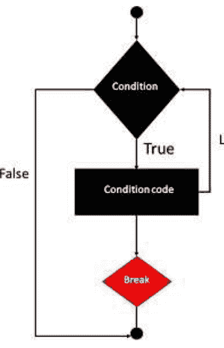

### 示例

在以下示例中，当计数器值达到 3 时条件测试变为真，循环终止。

```
<html>
<body>

<?php
$i = 0;

while( $i < 10)
{
   $i++;
   if( $i == 3 )break;
}
echo ("Loop stopped at i = $i" );
?>
</body>
</html>
```

This will produce the following result:

> 循环在 i = 3 时停止

## continue 语句

PHP 的 **continue** 关键字用于中断当前循环迭代，但不会终止循环。

与 **break** 语句一样，**continue** 语句也位于循环执行的代码所在语句块内部，并前置条件测试。在遇到 **continue** 语句的那次迭代中，其余循环代码将被跳过，并开始下一次迭代。

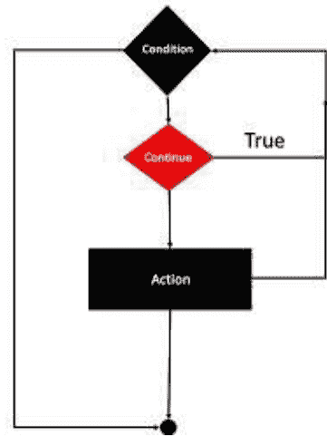

### 示例

在以下示例中，循环打印数组的值，但当条件变为真时，它只是跳过代码并打印下一个值。

```
<html>
<body>
<?php
$array = array( 1, 2, 3, 4, 5);
foreach( $array as $value )
{
   if( $value == 3 )continue;
   echo "Value is $value <br />";
}
?>
</body>
</html>
```

This will produce the following result:

```
Value is 1
Value is 2
Value is 4
Value is 5
```

数组是一种在单个值中存储一个或多个相同类型值的数据结构。例如，如果你想存储 100 个数字，那么定义 100 个变量不如定义一个长度为 100 的数组来得容易。

有三种不同类型的数组，每个数组值都使用一个称为数组索引的 ID 来访问。

- **数值数组** - 带有数值索引的数组。值以线性方式存储和访问
- **关联数组** - 以字符串作为索引的数组。它按键值关联存储元素值，而不是按严格的线性索引顺序。
- **多维数组** - 包含一个或多个数组的数组，值通过多个索引来访问

**注意：** 内置数组函数列于函数参考 PHP Array Functions 中

## 数值数组

这些数组可以存储数字、字符串和任何对象，但其索引将由数字表示。默认情况下，数组索引从零开始。

### 示例

以下示例演示如何创建和访问数值数组。

这里我们使用了 **array()** 函数来创建数组。该函数在函数参考中有说明。

```
<html>
<body>
<?php
/* First method to create array. */
$numbers = array( 1, 2, 3, 4, 5);
foreach( $numbers as $value )
{
   echo "Value is $value <br />";
}
/* Second method to create array. */
$numbers[0] = "one";
$numbers[1] = "two";
$numbers[2] = "three";
$numbers[3] = "four";
$numbers[4] = "five";

foreach( $numbers as $value )
{
    echo "Value is $value <br />";
}
?>
</body>
</html>
```

This will produce the following result:

```
Value is 1
Value is 2
Value is 3
Value is 4
Value is 5
Value is one
Value is two
Value is three
Value is four
Value is five
```

## 关联数组

关联数组在功能上与数值数组非常相似，但在索引方面有所不同。关联数组将字符串作为索引，以便你可以在键和值之间建立强关联。

若要在数组中存储员工薪资，数值索引数组并非最佳选择。相反，我们可以使用员工姓名作为关联数组中的键，值则为其各自的薪资。

**注意：** 打印时不要将关联数组放在双引号内，否则将不会返回任何值。

### 示例

```
<html>
<body>
<?php
/* First method to create associative array. */
$salaries = array(
   "mohammad" => 2000,
   "qadir" => 1000,
   "zara" => 500
);

echo "Salary of mohammad is ". $salaries['mohammad'] . "<br />";
echo "Salary of qadir is ". $salaries['qadir'] . "<br />";
echo "Salary of zara is ". $salaries['zara'] . "<br />";

/* Second method to create array. */
$salaries['mohammad'] = "high";
$salaries['qadir'] = "medium";
$salaries['zara'] = "low";

echo "Salary of mohammad is ". $salaries['mohammad'] . "<br />";
echo "Salary of qadir is ". $salaries['qadir'] . "<br />";
echo "Salary of zara is ". $salaries['zara'] . "<br />";
?>
</body>
</html>
```

This will produce the following result:

```
Salary of mohammad is 2000
Salary of qadir is 1000
Salary of zara is 500
Salary of mohammad is high
Salary of qadir is medium
Salary of zara is low
```

## 多维数组

在多维数组中，主数组的每个元素也可以是一个数组。子数组的每个元素也可以是一个数组，以此类推。多维数组中的值使用多个索引来访问。

### 示例

在此示例中，我们创建一个二维数组来存储三名学生在三门科目中的成绩：

此示例是一个关联数组，你可以用同样的方式创建数值数组。

```
<html>
<body>
<?php
   $marks = array(
      "mohammad" => array
      (
         "physics" => 35,
         "maths" => 30,
         "chemistry" => 39
      ),
      "qadir" => array
      (
         "physics" => 30,
         "maths" => 32,
         "chemistry" => 29
      ),
      "zara" => array
      (
         "physics" => 31,
         "maths" => 22,
         "chemistry" => 39
      )
   );
   /* Accessing multi-dimensional array values */
   echo "Marks for mohammad in physics : ";
   echo $marks['mohammad']['physics'] . "<br />";
   echo "Marks for qadir in maths : ";
   echo $marks['qadir']['maths'] . "<br />";
   echo "Marks for zara in chemistry : ";
   echo $marks['zara']['chemistry'] . "<br />";
?>
</body>
</html>
```

This will produce the following result:

```
Marks for mohammad in physics : 35
Marks for qadir in maths : 32
Marks for zara in chemistry : 39
```

### 10. PHP – 字符串

它们是字符序列，例如 "PHP supports string operations"。

注意：内置字符串函数列于函数参考 PHP String Functions 中

字符串的一些有效示例如下：

```
$string_1 = "This is a string in double quotes";
$string_2 = "This is a somewhat longer, singly quoted string";
$string_39 = "This string has thirty-nine characters";
$string_0 = ""; // a string with zero characters
```

单引号字符串几乎按原义处理，而双引号字符串会将变量替换为其值，并特殊解释某些字符序列。

```
<?
$variable = "name";
$literally = 'My $variable will not print!\n';
print($literally);
$literally = "My $variable will print!\n";
print($literally);
?>
```

This will produce the following result:

```
My $variable will not print!\n
My name will print
```

字符串长度没有人为限制 - 在可用内存范围内，你应该能够创建任意长的字符串。

由双引号分隔的字符串（如 "this"）会被 PHP 以以下两种方式预处理：

- 以反斜杠 (\) 开头的某些字符序列会被替换为特殊字符
- 变量名（以 $ 开头）会被替换为其值的字符串表示形式。

转义序列替换如下：

- \n 会被替换为换行字符
- \r 会被替换为回车字符
- \t 会被替换为制表符


- \$ 由美元符号本身 ($) 替换
- " 由单个双引号 (") 替换
- \\ 由单个反斜杠 (\) 替换

### 字符串连接运算符

要将两个字符串变量连接在一起，请使用点 (.) 运算符：

```
<?php
$string1="Hello World";
$string2="1234";
echo $string1 . " " . $string2;
?>
```

这将产生以下结果：

```
Hello World 1234
```

如果你查看上面的代码，你会发现我们使用了两次连接运算符。这是因为我们需要插入第三个字符串。

在两个字符串变量之间，我们添加了一个只包含单个字符（空格）的字符串，用于分隔这两个变量。

### 使用 strlen() 函数

strlen() 函数用于查找字符串的长度。

让我们查找字符串 "Hello world!" 的长度：

```
<?php
echo strlen("Hello world!");
?>
```

这将产生以下结果：

```
12
```

字符串的长度通常在循环或其他函数中使用，这时需要知道字符串何时结束。（例如，在循环中，我们希望在字符串的最后一个字符之后停止循环。）

### 使用 strpos() 函数

strpos() 函数用于在字符串中搜索字符串或字符。

如果在字符串中找到匹配项，该函数将返回第一个匹配项的位置。如果未找到匹配项，它将返回 FALSE。

让我们看看能否在我们的字符串中找到字符串 "world"：

```
<?php
   echo strpos("Hello world!","world");
 ?>
```

这将产生以下结果：

| 6 |
|---|

如您所见，字符串 "world" 在我们的字符串中的位置是 6。之所以是 6 而不是 7，是因为字符串中的第一个位置是 0 而不是 1。

此节演示了 PHP 如何根据浏览器类型、随机生成的数字或用户输入提供动态内容。它还演示了如何重定向客户端浏览器。

### 识别浏览器和平台

PHP 创建了一些有用的 **环境变量**，可以在用于设置 PHP 环境的 phpinfo.php 页面中查看。

PHP 设置的环境变量之一是 **HTTP_USER_AGENT**，用于标识用户的浏览器和操作系统。

PHP 提供了一个名为 getenv() 的函数，用于访问所有环境变量的值。HTTP_USER_AGENT 环境变量中包含的信息可用于创建适合浏览器的动态内容。

以下示例演示了如何识别客户端浏览器和操作系统。

注意：preg_match() 函数在 PHP 正则表达式一节中讨论。

```
<html>
<body>
<?php
   $viewer = getenv( "HTTP_USER_AGENT" );
   $browser = "An unidentified browser";
   if( preg_match( "/MSIE/i", "$viewer" ) )
   {
      $browser = "Internet Explorer";
   }
   else if( preg_match( "/Netscape/i", "$viewer" ) )
   {
      $browser = "Netscape";
   }
   else if( preg_match( "/Mozilla/i", "$viewer" ) )
   {
      $browser = "Mozilla";
   }
   $platform = "An unidentified OS!";
   if( preg_match( "/Windows/i", "$viewer" ) )
{
    $platform = "Windows!";
}
else if ( preg_match( "/Linux/i", "$viewer" ) )
{
    $platform = "Linux!";
}
echo("You are using $browser on $platform");
?>
</body>
</html>
```

在我的机器上运行时，将产生以下结果。根据您使用的浏览器不同，此结果在您的计算机上可能有所不同。

> 您的浏览器：Google Chrome 51.0.2704.103 在 Windows 上报告：
> Mozilla/5.0 (Windows NT 6.3; Win64; x64) AppleWebKit/537.36 (KHTML, like Gecko)
> Chrome/51.0.2704.103 Safari/537.36

### 随机显示图片

PHP 的 **rand()** 函数用于生成随机数。该函数可以生成给定范围内的数字。随机数生成器应当被播种，以防止生成规律的数字序列。这通过 **srand()** 函数实现，该函数将种子数作为其参数。

以下示例演示了如何从四张图片中每次显示不同的图片：

```
<html>
<body>
<?php
srand( microtime() * 1000000 );
$num = rand( 1, 4 );

switch( $num )
{
case 1: $image_file = "/home/images/alfa.jpg";
	break;
case 2: $image_file = "/home/images/ferrari.jpg";
	break;
case 3: $image_file = "/home/images/jaguar.jpg";
	break;
case 4: $image_file = "/home/images/porsche.jpg";
	break;
}
echo "Random Image : ";
?>
</body>
</html>
```

它将产生以下结果：


### 使用 HTML 表单

在处理 HTML 表单和 PHP 时，最重要的是要注意：HTML 页面中的任何表单元素都会自动可供您的 PHP 脚本使用。

请尝试将以下示例的源代码放入 test.php 脚本中进行测试。

```
<?php
if( $_POST["name"] || $_POST["age"] )
{
echo "Welcome ". $_POST['name']. "<br />";
echo "You are ". $_POST['age']. " years old.";
exit();
}
?>
<html>
<body>
<form action="<?php $_PHP_SELF ?>" method="POST">
Name: <input type="text" name="name" />
Age: <input type="text" name="age" />
<input type="submit" />
</form>
</body>
</html>
```

它将产生以下结果：

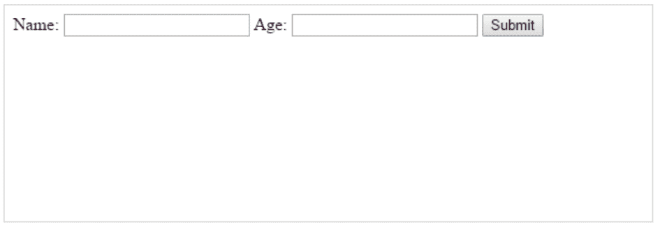

- PHP 默认变量 $_PHP_SELF 用于 PHP 脚本名称，当您单击“提交”按钮时，将调用同一 PHP 脚本并产生以下结果：

- method = "POST" 用于将用户数据发布到服务器脚本。发布数据到服务器脚本有两种方法，将在 PHP GET & POST 章节中讨论。

### 浏览器重定向

PHP 的 header() 函数向浏览器提供原始 HTTP 标头，并可用于将其重定向到另一个位置。重定向脚本应放在页面的最顶部，以防止页面的其他部分加载。

目标通过 Location: 标头作为 header() 函数的参数指定。调用此函数后，可以使用 exit() 函数停止解析其余代码。

以下示例演示了如何将浏览器请求重定向到另一个网页。请将源代码放入 test.php 脚本中尝试此示例。

```
<?php
if( $_POST["location"] )
{
	$location = $_POST["location"];
	header( "Location:$location" );
	exit();
}
?>
<html>
<body>
<p>Choose a site to visit :</p>
<form action="<?php $_PHP_SELF ?>" method="POST">
<select name="location">
<option value="http://w3c.org">
World Wide Web Consortium
</option>
<option value="http://www.google.com">
Google Search Page
</option>
</select>
<input type="submit" />
</form>
</body>
</html>
```

它将产生以下输出：


### 显示“文件下载”对话框

有时，我们希望在用户点击链接时弹出“文件下载”框，而不是显示实际内容。这非常简单，可通过 HTTP 标头实现。

在这种情况下的 HTTP 标头与发送 Content-Type 为 text/html\n\n 的实际标头不同。此时内容类型将是 application/octet-stream，实际文件名将与其连接。

例如，如果要使给定链接中的 FileName 文件可下载，其语法如下。

```
#!/usr/bin/perl

# HTTP Header
print "Content-Type:application/octet-stream; name=\"FileName\"\r\n";
print "Content-Disposition: attachment; filename=\"FileName\"\r\n\n";

# Actual File Content
open( FILE, "<FileName" );
while(read(FILE, $buffer, 100) )
{
    print("$buffer");
}
```

### 12. PHP – GET 和 POST 方法

浏览器客户端向 Web 服务器发送信息有两种方式。

- GET 方法
- POST 方法

在浏览器发送信息之前，它会使用一种称为 URL 编码的方案对其进行编码。在此方案中，名称/值对用等号连接，不同的对之间用 & 分隔。

```
name1=value1&name2=value2&name3=value3
```

空格会被删除并替换为 + 字符，任何其他非字母数字字符都会被替换为十六进制值。信息编码后，将发送到服务器。

### GET 方法

GET 方法将编码后的用户信息附加到页面请求中发送。页面和编码后的信息之间用 ? 字符分隔。

```
http://www.test.com/index.htm?name1=value1&name2=value2
```

- GET 方法会产生一个长字符串，该字符串出现在服务器日志和浏览器的 Location: 框中。
- GET 方法仅限发送最多 1024 个字符。
- 如果需要向服务器发送密码或其他敏感信息，请勿使用 GET 方法。
- GET 无法用于向服务器发送二进制数据，例如图片或 Word 文档。
- 通过 GET 方法发送的数据可以使用 QUERY_STRING 环境变量访问。
- PHP 提供了 $_GET 关联数组，用于访问使用 GET 方法发送的所有信息。

请尝试将以下示例的源代码放入 test.php 脚本中进行测试。

```
<?php
if( $_GET["name"] || $_GET["age"] )
{
   echo "Welcome ". $_GET['name']. "<br />";
   echo "You are ". $_GET['age']. " years old.";
}
```


```
exit();
}
?>
<html>
<body>
<form action="<?php $_PHP_SELF ?>" method="GET">
Name: <input type="text" name="name" />
Age: <input type="text" name="age" />
<input type="submit" />
</form>
</body>
</html>
```

它将产生以下结果：

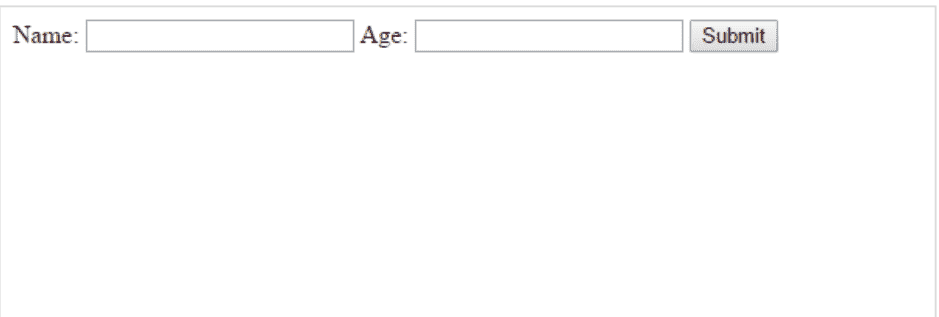

## POST 方法

POST 方法通过 HTTP 头部传输信息。信息编码方式与 GET 方法中描述的相同，并放入名为 QUERY_STRING 的头部中。

- POST 方法对发送的数据大小没有任何限制。
- POST 方法可用于发送 ASCII 以及二进制数据。
- 通过 POST 方法发送的数据经过 HTTP 头部，因此安全性取决于 HTTP 协议。通过使用安全 HTTP，您可以确保信息安全。
- PHP 提供 $_POST 关联数组，以访问使用 POST 方法发送的所有信息。

尝试以下示例，将源代码放入 test.php 脚本中。

```
<?php
if( $_POST["name"] || $_POST["age"] )
{
    echo "Welcome ". $_POST['name']. "<br />";
    echo "You are ". $_POST['age']. " years old.";
    exit();
}
?>
<html>
<body>
<form action="<?php $_PHP_SELF ?>" method="POST">
    Name: <input type="text" name="name" />
    Age: <input type="text" name="age" />
    <input type="submit" />
</form>
</body>
</html>
```

它将产生以下结果：

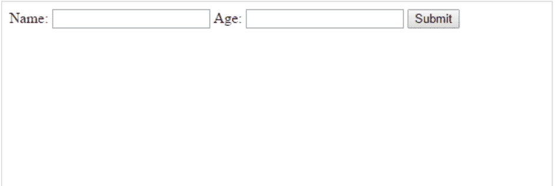

## $_REQUEST 变量

PHP $_REQUEST 变量包含 $_GET、$_POST 和 $_COOKIE 的内容。当我们解释 cookie 时将讨论 $_COOKIE 变量。

PHP $_REQUEST 变量可用于获取通过 GET 和 POST 方法发送的表单数据的结果。

尝试以下示例，将源代码放入 test.php 脚本中。

```
<?php
   if( $_REQUEST["name"] || $_REQUEST["age"] )
   {
      echo "Welcome ". $_REQUEST['name']. "<br />";
      echo "You are ". $_REQUEST['age']. " years old.";
      exit();
   }
?>
<html>
<body>
   <form action="<?php $_PHP_SELF ?>" method="POST">
      Name: <input type="text" name="name" />
      Age: <input type="text" name="age" />
      <input type="submit" />
   </form>
</body>
</html>
```

这里 $_PHP_SELF 变量包含正在调用的自身脚本的名称。

它将产生以下结果：

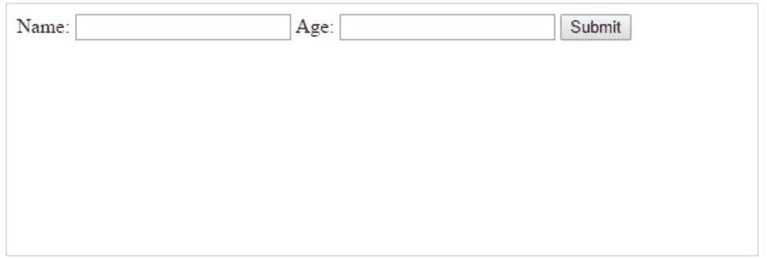

### 13. PHP – 文件包含

您可以在服务器执行之前将一个 PHP 文件的内容包含到另一个 PHP 文件中。有两个 PHP 函数可用于将一个 PHP 文件包含到另一个 PHP 文件中。

- include() 函数
- require() 函数

这是 PHP 的一大优势，有助于创建可在多个页面上重复使用的函数、标题、页脚或元素。这将帮助开发人员以最小的努力轻松更改整个网站的布局。如果需要进行任何更改，则无需修改成千上万个文件，只需更改包含的文件即可。

### include() 函数

include() 函数将指定文件中的所有文本复制到使用 include 函数的文件中。如果加载文件时出现任何问题，则 include() 函数会生成警告，但脚本将继续执行。

假设您想为网站创建一个通用菜单。然后创建一个名为 menu.php 的文件，内容如下。

```
<a href="http://www.tutorialspoint.com/index.htm">Home</a> -<a href="http://www.tutorialspoint.com/ebxml">ebXML</a> -<a href="http://www.tutorialspoint.com/ajax">AJAX</a> -<a href="http://www.tutorialspoint.com/perl">PERL</a> <br />
```

现在创建任意数量的页面，并包含此文件以创建标题。例如，您的 test.php 文件现在可以包含以下内容。

```
<html>
<body>
<?php include("menu.php"); ?>
<p>This is an example to show how to include PHP file!</p>
</body>
</html>
```

这将产生以下结果：

```
Home -ebXML -AJAX -PERL

This is an example to show how to include PHP file.
```

### require() 函数

require() 函数将指定文件中的所有文本复制到使用 include 函数的文件中。如果加载文件时出现任何问题，则 **require()** 函数会生成致命错误并停止脚本的执行。

所以 require() 和 include() 之间没有区别，只是错误处理方式不同。建议使用 require() 函数而不是 include()，因为如果文件丢失或命名错误，脚本不应继续执行。

您可以尝试在上面的示例中使用 require() 函数，它将生成相同的结果。但是，如果您尝试下面两个文件不存在的示例，则会得到不同的结果。

```
<html>
<body>
<?php include("xxmenu.php"); ?>
<p>This is an example to show how to include wrong PHP file!</p>
</body>
</html>
```

这将产生以下结果：

This is an example to show how to include wrong PHP file!

现在让我们尝试用 require() 函数使用相同的示例。

```
<html>
<body>
<?php require("xxmenu.php"); ?>
<p>This is an example to show how to include wrong PHP file!</p>
</body>
</html>
```

这次文件执行停止，什么也不会显示。

**注意：** 您可能会收到普通警告消息、致命错误消息，或者什么都收不到。这取决于您的 PHP 服务器配置。

## 打开和关闭文件

本章将解释与文件相关的以下函数：

- 打开文件
- 读取文件
- 写入文件
- 关闭文件

PHP fopen() 函数用于打开文件。它需要两个参数，首先是文件名，然后是操作模式。

文件模式可以指定为本表中的六个选项之一。

| 模式 | 用途 |
|------|---------|
| r | 仅打开文件以进行读取。将文件指针放在文件开头。 |
| r+ | 打开文件以进行读取和写入。将文件指针放在文件开头。 |
| w | 仅打开文件以进行写入。将文件指针放在文件开头，并将文件截断为零长度。如果文件不存在，则尝试创建文件。 |
| w+ | 打开文件以进行读取和写入。将文件指针放在文件开头，并将文件截断为零长度。如果文件不存在，则尝试创建文件。 |
| a | 仅打开文件以进行写入。将文件指针放在文件末尾。如果文件不存在，则尝试创建文件。 |
| a+ | 打开文件以进行读取和写入。将文件指针放在文件末尾。如果文件不存在，则尝试创建文件。 |

如果尝试打开文件失败，fopen 返回 false；否则返回一个文件指针，用于对该文件进行进一步读取或写入。

对打开的文件进行更改后，使用 fclose() 函数关闭它很重要。fclose() 函数需要一个文件指针作为其参数，如果关闭成功则返回 **true**，如果失败则返回 **false**。

## 读取文件

一旦使用 **fopen()** 函数打开文件，就可以使用名为 **fread()** 的函数读取它。该函数需要两个参数：文件指针和以字节表示的文件长度。

可以使用 **filesize()** 函数获取文件的长度，该函数以文件名作为参数，并返回以字节表示的文件大小。

以下是使用 PHP 读取文件所需的步骤：

- 使用 **fopen()** 函数打开文件。
- 使用 **filesize()** 函数获取文件的长度。
- 使用 **fread()** 函数读取文件的内容。
- 使用 **fclose()** 函数关闭文件。

以下示例将文本文件的内容赋值给变量，然后在网页上显示这些内容。

```
<html>
<head>
<title>Reading a file using PHP</title>
</head>
<body>

<?php
$filename = "/home/user/guest/tmp.txt";
$file = fopen( $filename, "r" );
if( $file == false )
{
   echo ( "Error in opening file" );
   exit();
}

$filesize = filesize( $filename );
$filetext = fread( $file, $filesize );

fclose( $file );

echo ( "File size : $filesize bytes" );
```


echo ( "<pre>$filetext</pre>" );
?>
</body>
</html>
```

它将产生以下结果：

```
File size : 278 bytes
The PHP Hypertext Preprocessor (PHP) is a programming language that allows web developers to create dynamic content that interacts with databases.
PHP is basically used for developing web based software applications. This tutorial helps you to build your base with PHP.
```

## 写入文件

可以使用 PHP fwrite() 函数写入新文件或将文本追加到现有文件中。该函数需要两个参数，分别指定文件指针和要写入的数据字符串。可选地，可以包含第三个整数参数来指定要写入的数据长度。如果包含第三个参数，则在达到指定长度后将停止写入。

下面的示例创建一个新文本文件，然后在其中写入一个简短的文本标题。关闭此文件后，将使用 file_exist() 函数确认其存在，该函数将文件名作为参数。

```php
$filename = "/home/user/guest/newfile.txt";
$file = fopen( $filename, "w" );
if( $file == false )
{
   echo ( "Error in opening new file" );
   exit();
}
fwrite( $file, "This is a simple test\n" );
fclose( $file );
?>
```

```html
<html>
<head>
<title>Writing a file using PHP</title>
</head>
<body>
<?php
if ( file_exist( $filename ) )
{
   $filesize = filesize( $filename );
   $msg = "File created with name $filename ";
   $msg .= "containing $filesize bytes";
   echo ($msg );
}
else
{
   echo ( "File $filename does not exist" );
}
?>
</body>
</html>
```

它将产生以下结果：

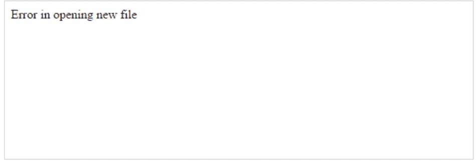

我们在 PHP 文件系统函数章节中已介绍与文件输入和输出相关的所有函数。

PHP 函数与其他编程语言类似。函数是一段代码，它以参数形式接收一个或多个输入，进行一些处理并返回一个值。

你已经见过许多像 fopen() 和 fread() 这样的函数。它们是内置函数，但 PHP 还允许你创建自己的函数。

有两个部分你应该清楚：

- 创建 PHP 函数
- 调用 PHP 函数

实际上，你几乎不需要创建自己的 PHP 函数，因为已经为不同领域创建了 1000 多个内置库函数，你只需根据需要调用它们即可。

有关完整实用函数集，请参阅 PHP 函数参考。

## 创建 PHP 函数

创建自己的 PHP 函数非常简单。假设你想创建一个 PHP 函数，当你调用它时，它将在浏览器上简单地写入一条消息。

下面的示例创建一个名为 writeMessage() 的函数，然后在创建后立即调用它。

请注意，在创建函数时，函数名应以关键字 function 开头，并且所有 PHP 代码都应放在 { 和 } 花括号内，如以下示例所示：

```html
<html>
<head>
<title>Writing PHP Function</title>
</head>
<body>

<?php
/* Defining a PHP Function */
function writeMessage()
{
   echo "You are really a nice person, Have a nice time!";
}
/* Calling a PHP Function */
writeMessage();
?>
</body>
</html>
```

这将显示以下结果：

> 你真是一个好人，祝你愉快！

### 带参数的 PHP 函数

PHP 允许你在函数中传递参数。你可以传递任意数量的参数。这些参数在函数内部像变量一样工作。下面的示例接受两个整数参数，将它们相加，然后打印结果。

```html
<html>
<head>
<title>Writing PHP Function with Parameters</title>
</head>
<body>

<?php
function addFunction($num1, $num2)
{
   $sum = $num1 + $num2;
   echo "Sum of the two numbers is : $sum";
}
addFunction(10, 20);
?>
</body>
</html>
```

这将显示以下结果：

> 两个数字之和为：30

### 通过引用传递参数

可以按引用将参数传递给函数。这意味着函数操作的是变量的引用，而不是变量值的副本。

在这种情况下，对参数所做的任何更改都会更改原始变量的值。你可以在函数调用或函数定义中向变量名添加 & 符号来按引用传递参数。

下面的示例展示了这两种情况。

```html
<html>
<head>
<title>Passing Argument by Reference</title>
</head>
<body>
<?php
function addFive($num)
{
 $num += 5;
}

function addSix(&$num)
{
 $num += 6;
}

$orignum = 10;
addFive( &$orignum );
echo "Original Value is $orignum<br />";
addSix( $orignum );
echo "Original Value is $orignum<br />";
?>
</body>
</html>
```

这将显示以下结果：

```
Original Value is 10
Original Value is 16
```

## PHP 函数返回值

函数可以使用 **返回** 语句结合值或对象来返回一个值。return 停止函数的执行，并将值发送回调用代码。

你可以使用 **return array(1,2,3,4)** 从函数返回多个值。

下面的示例接受两个整数参数，将它们相加，然后将它们的和返回给调用程序。请注意，**return** 关键字用于从函数返回一个值。

```html
<html>
<head>
<title>Writing PHP Function which returns value</title>
</head>
<body>
<?php
function addFunction($num1, $num2)
{
   $sum = $num1 + $num2;
   return $sum;
}
$return_value = addFunction(10, 20);
echo "Returned value from the function : $return_value";
?>
</body>
</html>
```

这将显示以下结果：

函数返回的值：30

## 为函数参数设置默认值

如果函数的调用者未传递参数，你可以为参数设置默认值。

如果用户未向该函数传递任何值，则以下函数将打印 NULL。

```html
<html>
<head>
<title>Writing PHP Function which returns value</title>
</head>
<body>

<?php
function printMe($param = NULL)
{
   print $param;
}
printMe("This is test");
printMe();
?>

</body>
</html>
```

这将产生以下结果：

```
This is test
```

## 动态函数调用

可以将函数名作为字符串赋值给变量，然后将这些变量视为函数名本身。下面的示例展示了这种行为。

```html
<html>
<head>
<title>Dynamic Function Calls</title>
</head>
<body>
<?php
function sayHello()
{
   echo "Hello<br />";
}
$function_holder = "sayHello";
$function_holder();
?>
</body>
</html>
```

这将显示以下结果：

```
Hello
```

### 16. PHP – Cookie

Cookie 是存储在客户端计算机上的文本文件，用于跟踪用途。PHP 透明地支持 HTTP Cookie。

识别返回用户涉及三个步骤：

- 服务器脚本将一组 Cookie 发送到浏览器。例如，姓名、年龄或身份证号码等。
- 浏览器将此信息存储在本地机器上以供将来使用。
- 下次，当浏览器向 Web 服务器发送任何请求时，它会将这些 Cookie 信息发送到服务器，服务器使用该信息来识别用户。

本章将教你如何设置 Cookie、如何访问它们以及如何删除它们。

### Cookie 的结构

Cookie 通常在 HTTP 头中设置（虽然 JavaScript 也可以直接在浏览器上设置 Cookie）。设置 Cookie 的 PHP 脚本可能会发送如下所示的头：

```
HTTP/1.1 200 OK
Date: Fri, 04 Feb 2000 21:03:38 GMT
Server: Apache/1.3.9 (UNIX) PHP/4.0b3
Set-Cookie: name=xyz; expires=Friday, 04-Feb-07 22:03:38 GMT;
path=/; domain=tutorialspoint.com
Connection: close
Content-Type: text/html
```

如你所见，Set-Cookie 头包含一个名称-值对、一个 GMT 日期、一个路径和一个域。名称和值将进行 URL 编码。expires 字段是指示浏览器在给定时间和日期后“忘记”Cookie 的指令。

如果浏览器配置为存储 Cookie，它将保留此信息直到过期日期。如果用户将浏览器指向与 Cookie 的路径和域匹配的任何页面，它将重新将 Cookie 发送到服务器。浏览器的头可能如下所示：

```
GET / HTTP/1.0
Connection: Keep-Alive
User-Agent: Mozilla/4.6 (X11; I; Linux 2.2.6-15apmac ppc)
Host: zink.demon.co.uk:1126
```


Accept: image/gif, */*
Accept-Encoding: gzip
Accept-Language: en
Accept-Charset: iso-8859-1,*,utf-8
Cookie: name=xyz

PHP 脚本随后将通过环境变量 $_COOKIE 或 $HTTP_COOKIE_VARS[] 访问 cookie，该变量持有所有 cookie 名称和值。上述 cookie 可使用 $HTTP_COOKIE_VARS["name"] 访问。

## 使用 PHP 设置 Cookie

PHP 提供了 **setcookie()** 函数来设置 cookie。该函数最多需要六个参数，并且应在 `<html>` 标签之前调用。为每个 cookie 都必须单独调用此函数。

```
setcookie(name, value, expire, path, domain, security);
```

以下是所有参数的详细说明：

- **名称** - 此项设置 cookie 的名称，并存储在名为 HTTP_COOKIE_VARS 的环境变量中。访问 cookie 时使用该变量。
- **值** - 此项设置命名变量的值，即你实际想要存储的内容。
- **有效期** - 此项指定自 1970 年 1 月 1 日 00:00:00 GMT 起的未来时间（以秒为单位）。此后 cookie 将变得不可访问。如果未设置此参数，则当 Web 浏览器关闭时 cookie 会自动过期。
- **路径** - 此项指定 cookie 有效的目录。单个正斜杠字符允许 cookie 对所有目录有效。
- **域** - 此项可用于在非常大的域中指定域名，且必须至少包含两个句点才有效。所有 cookie 仅对创建它们的主机和域有效。
- **安全性** - 此项可设置为 1，以指定 cookie 仅应通过 HTTPS 安全传输发送；否则设置为 0，表示 cookie 可通过常规 HTTP 发送。

以下示例将创建两个名为 **name** 和 **age** 的 cookie。这些 cookie 将在一小时后过期。

```
<?php
   setcookie("name", "John Watkin", time()+3600, "/","", 0);
   setcookie("age", "36", time()+3600, "/", "", 0);
?>
<html>
<head>
<title>Setting Cookies with PHP</title>
</head>
<body>
<?php echo "Set Cookies"?>
</body>
</html>
```

## 使用 PHP 访问 Cookie

PHP 提供了多种访问 cookie 的方式。最简单的方法是使用 $_COOKIE 或 $HTTP_COOKIE_VARS 变量。以下示例将访问上述示例中设置的所有 cookie。

```
<html>
<head>
<title>Accessing Cookies with PHP</title>
</head>
<body>
<?php
echo $_COOKIE["name"]. "<br />";
/* is equivalent to */
echo $HTTP_COOKIE_VARS["name"]. "<br />";
echo $_COOKIE["age"] . "<br />";
/* is equivalent to */
echo $HTTP_COOKIE_VARS["name"] . "<br />";
?>
</body>
</html>
```

你可以使用 isset() 函数检查 cookie 是否已设置。

```
<html>
<head>
<title>Accessing Cookies with PHP</title>
</head>
<body>
<?php
if( isset($_COOKIE["name"]))
 echo "Welcome " . $_COOKIE["name"] . "<br />";
else
 echo "Sorry... Not recognized" . "<br />";
?>
</body>
</html>
```

## 使用 PHP 删除 Cookie

官方建议，删除 cookie 时应仅带 name 参数调用 setcookie()，但这并不总能正常工作，因此不应依赖此方法。

最安全的做法是使用已过期的日期来设置 cookie：

```
<?php
setcookie( "name", "", time() - 60, "/","", 0);
setcookie( "age", "", time() - 60, "/","", 0);
?>
<html>
<head>
<title>Deleting Cookies with PHP</title>
</head>
<body>
<?php echo "Deleted Cookies" ?>
</body>
</html>
```

### 17. PHP – 会话

在整个网站的各个页面间共享数据的另一种方法是使用 PHP 会话。

会话会在服务器的临时目录中创建一个文件，用于存储注册的会话变量及其值。在该次访问期间，这些数据可供网站上所有页面使用。

临时文件的位置由 **php.ini** 文件中名为 **session.save_path** 的设置决定。在使用任何会话变量之前，请确保已设置此路径。会话启动时，会发生以下操作：

- PHP 会首先为该特定会话创建一个唯一标识符，即一个随机的 32 位十六进制数字字符串，例如 3c7foj34c3jj973hjkop2fc937e3443。
- 名为 **PHPSESSID** 的 cookie 会自动发送到用户的计算机，以存储唯一的会话识别字符串。
- 服务器会在指定的临时目录中自动创建一个文件，文件名由唯一标识符加上 **sess_** 前缀组成，即 **sess_3c7foj34c3jj973hjkop2fc937e3443**。

当 PHP 脚本要从会话变量中检索值时，PHP 会自动从 **PHPSESSID** cookie 获取唯一的会话标识符字符串，然后在其临时目录中查找带有该名称的文件，并可通过比较两个值进行验证。

当用户关闭浏览器或离开网站后，服务器会在预定的一段时间后终止会话，通常为 30 分钟。

## 启动 PHP 会话

通过调用 **session_start()** 函数即可轻松启动 PHP 会话。该函数首先检查是否已启动会话，如果未启动，则会启动一个。建议将 **session_start()** 的调用放在页面的开头。

会话变量存储在名为 **$_SESSION[]** 的关联数组中。这些变量在会话生命周期内均可访问。

以下示例启动一个会话，然后注册一个名为 **counter** 的变量，该变量在会话期间每次访问页面时都会递增。

使用 **isset()** 函数检查会话变量是否已设置。

将此代码放入 test.php 文件中，并多次加载该文件以查看结果：

```
<?php
   session_start();
   if( isset( $_SESSION['counter'] ) )
   {
      $_SESSION['counter'] += 1;
   }
   else
   {
      $_SESSION['counter'] = 1;
   }
   $msg = "You have visited this page ". $_SESSION['counter'];
   $msg .= "in this session.";
?>
<html>
<head>
<title>Setting up a PHP session</title>
</head>
<body>
<?php echo( $msg ); ?>
</body>
</html>
```

它将产生以下结果：

你在此会话中已访问该页面 1 次。

## 销毁 PHP 会话

可以使用 session_destroy() 函数销毁 PHP 会话。该函数不需要任何参数，一次调用即可销毁所有会话变量。如果要销毁单个会话变量，可以使用 unset() 函数来取消设置会话变量。

取消设置单个变量的示例如下：

```
<?php
   unset($_SESSION['counter']);
?>
```

销毁所有会话变量的调用如下：

```
<?php
   session_destroy();
?>
```

### 开启自动会话

如果在 php.ini 文件中将 session.auto_start 变量设置为 1，则用户访问你的网站时无需调用 start_session() 函数来启动会话。

### 无 cookie 的会话

可能会出现用户不允许在其机器上存储 cookie 的情况。因此，有另一种方法将会话 ID 发送到浏览器。

或者，你可以使用在会话已启动时定义的常量 SID。如果客户端未发送适当的会话 cookie，则其形式为 session_name=session_id。否则，它将展开为空字符串。因此，你可以无条件地将其嵌入 URL 中。

以下示例演示如何注册变量，以及如何使用 SID 正确链接到另一页面。

```php
<?php
   session_start();

   if (isset($_SESSION['counter'])) {
       $_SESSION['counter'] = 1;
   } else {
       $_SESSION['counter']++;
   }
?>

$msg = "You have visited this page ". $_SESSION['counter'];
$msg .= "in this session.";
echo ( $msg );
?>
<p>
To continue click following link <br />
<a href="nextpage.php?<?php echo htmlspecialchars(SID); ?>">
</p>
```

它将产生以下结果：

你在此会话中已访问该页面 1 次。

要继续，请单击以下链接

在打印 SID 时可以使用 htmlspecialchars() 来防止 XSS 相关攻击。


### 18. PHP – 发送电子邮件

PHP 必须在 **php.ini** 文件中正确配置，包含系统发送电子邮件的详细信息。打开 **/etc/** 目录下的 php.ini 文件，找到标题为 **[mail function]** 的部分。

Windows 用户应确保提供两个指令。第一个称为 SMTP，用于定义您的电子邮件服务器地址。第二个称为 sendmail_from，用于定义您自己的电子邮件地址。

Windows 的配置大致如下：

```
[mail function]
; For Win32 only.
SMTP = smtp.secureserver.net

; For win32 only
sendmail_from = webmaster@tutorialspoint.com
```

Linux 用户只需让 PHP 知道其 sendmail 应用程序的位置。路径和任何所需的开关应指定给 sendmail_path 指令。

Linux 的配置大致如下：

```
[mail function]
; For Win32 only.
SMTP =

; For win32 only
sendmail_from =

; For Unix only
sendmail_path = /usr/sbin/sendmail -t -i
```

现在您可以开始了。

### 发送纯文本电子邮件

PHP 使用 **mail()** 函数发送电子邮件。该函数需要三个必填参数，分别指定收件人的电子邮件地址、邮件主题和实际消息，此外还有另外两个可选参数。

```
mail( to, subject, message, headers, parameters );
```

每个参数的说明如下。

| 参数 | 说明 |
|---|---|
| to | 必填。指定电子邮件的接收者 / 接收者列表 |
| subject | 必填。指定电子邮件的主题。该参数不能包含任何换行符 |
| message | 必填。定义要发送的消息。每行应使用换行符（\n）分隔。每行不应超过 70 个字符 |
| headers | 可选。指定其他标头，例如 From、Cc 和 Bcc。其他标头应使用 CRLF（\r\n）分隔 |
| parameters | 可选。指定发送给 sendmail 程序的其他参数 |

一旦调用 mail 函数，PHP 将尝试发送电子邮件，如果成功则返回 true，如果失败则返回 false。

多个接收者可以以逗号分隔的列表形式作为 mail() 函数的第一个参数指定。

### 示例

以下示例将向 xyz@somedomain.com 发送一封 HTML 电子邮件。您可以这样编写程序：程序应接收来自用户的所有内容，然后发送电子邮件。

```
<html>
<head>
<title>Sending email using PHP</title>
</head>
<body>
<?php
$to = "xyz@somedomain.com";
$subject = "This is subject";
$message = "This is simple text message.";
$header = "From:abc@somedomain.com \r\n";
$retval = mail ($to,$subject,$message,$header);
if( $retval == true )
{
   echo "Message sent successfully...";
}
else
{
   echo "Message could not be sent...";
}
?>
</body>
</html>
```

### 发送 HTML 电子邮件

使用 PHP 发送文本消息时，所有内容都将被视为纯文本。即使在文本消息中包含 HTML 标签，它也将显示为纯文本，HTML 标签不会按照 HTML 语法进行格式化。但 PHP 提供了将 HTML 消息作为实际 HTML 消息发送的选项。

发送电子邮件时，您可以指定 MIME 版本、内容类型和字符集来发送 HTML 电子邮件。

### 示例

以下示例将向 xyz@somedomain.com 发送一封 HTML 电子邮件，并抄送至 afgh@somedomain.com。您可以这样编写程序：程序应接收来自用户的所有内容，然后发送电子邮件。

```
<html>
<head>
<title>Sending HTML email using PHP</title>
</head>
<body>
<?php
$to = "xyz@somedomain.com";
$subject = "This is subject";
$message = "<b>This is HTML message.</b>";
$message .= "<h1>This is headline.</h1>";
$header = "From:abc@somedomain.com \r\n";
$header .= "Cc:afgh@somedomain.com \r\n";
$header .= "MIME-Version: 1.0\r\n";
$header .= "Content-type: text/html\r\n";
$retval = mail ($to,$subject,$message,$header);
if( $retval == true )
{
   echo "Message sent successfully...";
}
else
{
   echo "Message could not be sent...";
}
?>
</body>
</html>
```

### 通过电子邮件发送附件

要发送包含混合内容的电子邮件，需要将 **Content-type** 标头设置为 **multipart/mixed**。然后可以在 **边界** 中指定文本和附件部分。

边界以两个连字符后跟一个唯一数字开头，该唯一数字不能出现在电子邮件的消息部分中。PHP 函数 **md5()** 用于创建一个 32 位十六进制数字以生成唯一数字。表示电子邮件末尾部分的最终边界也必须以两个连字符结尾。

附件文件应使用 **base64_encode()** 函数进行编码以实现更安全的传输，并最好使用 **chunk_split()** 函数分割成块。这会在文件中以固定间隔（通常每 76 个字符）插入 `\r\n`。

以下示例将文件 **/tmp/test.txt** 作为附件发送。您可以编写程序来接收上传的文件并将其发送。

```
<html>
<head>
<title>Sending attachment using PHP</title>
</head>
<body>
<?php
$to = "xyz@somedomain.com";
$subject = "This is subject";
$message = "This is test message.";
# Open a file
$file = fopen( "/tmp/test.txt", "r" );
if( $file == false )
{
   echo "Error in opening file";
   exit();
}
# Read the file into a variable
$size = filesize("/tmp/test.txt");
$content = fread( $file, $size);
# encode the data for safe transit
# and insert \r\n after every 76 chars.
$encoded_content = chunk_split( base64_encode($content));

# Get a random 32 bit number using time() as seed.
$num = md5( time() );

# Define the main headers.
$header = "From:xyz@somedomain.com\r\n";
$header .= "MIME-Version: 1.0\r\n";
$header .= "Content-Type: multipart/mixed; ";
$header .= "boundary=$num\r\n";
$header .= "--$num\r\n";

# Define the message section
$header .= "Content-Type: text/plain\r\n";
$header .= "Content-Transfer-Encoding:8bit\r\n\r\n";
$header .= "$message\r\n";
$header .= "--$num\r\n";

# Define the attachment section
$header .= "Content-Type: multipart/mixed; ";
$header .= "name=\"test.txt\"\r\n";
$header .= "Content-Transfer-Encoding:base64\r\n";
$header .= "Content-Disposition:attachment; ";
$header .= "filename=\"test.txt\"\r\n\r\n";
$header .= "$encoded_content\r\n";
$header .= "--$num--";

# Send email now
$retval = mail ( $to, $subject, "", $header );
if( $retval == true )
{
   echo "Message sent successfully...";
}
else
{
   echo "Message could not be sent...";
}
?>
</body>
</html>
```

尝试上述所有示例。如果您遇到任何问题，可以在我们的讨论论坛中发帖。

### 19. PHP – 文件上传

可以使用 PHP 脚本配合 HTML 表单允许用户将文件上传到服务器。最初，文件会上传到临时目录，然后由 PHP 脚本将其重新定位到目标目录。

**phpinfo.php** 页面中的信息描述了用于文件上传的临时目录（即 **upload_tmp_dir**），以及允许上传的文件最大允许大小（即 **upload_max_filesize**）。这些参数设置在 PHP 配置文件 **php.ini** 中。

文件上传过程遵循以下步骤：

- 用户打开包含 HTML 表单的页面，该表单带有文本字段、浏览按钮和提交按钮。
- 用户单击浏览按钮，从本地计算机选择要上传的文件。
- 所选文件的完整路径出现在文本字段中，然后用户单击提交按钮。
- 所选文件被发送到服务器上的临时目录。
- 作为表单 action 属性中指定的表单处理程序的 PHP 脚本会检查文件是否已到达，然后将文件复制到目标目录中。
- PHP 脚本向用户确认上传成功。

与往常一样，写入文件时，临时位置和最终位置都必须设置允许文件写入的权限。如果其中任何一个设置为只读，则进程将失败。

上传的文件可以是文本文件、图像文件或任何文档。

### 创建上传表单

以下 HTML 代码创建了一个上传表单。该表单的 method 属性设置为 **post**，enctype 属性设置为 **multipart/form-data**

```
<html>
<head>
<title>File Uploading Form</title>
</head>
<body>
<h3>File Upload:</h3>
Select a file to upload: <br />
```


```html
<form action="/php/file_uploader.php" method="post"
enctype="multipart/form-data">
<input type="file" name="file" size="50" />
<br />
<input type="submit" value="Upload File" />
</form>
</body>
</html>
```

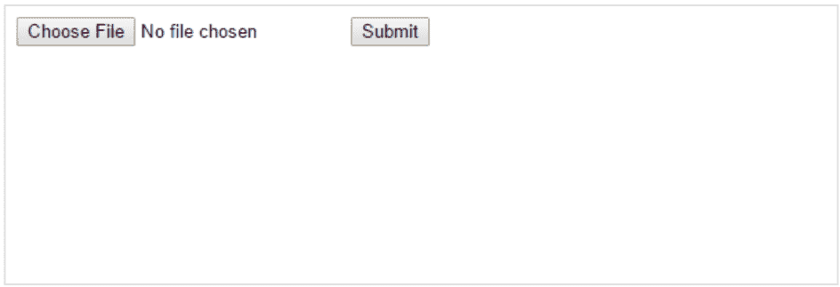

## 创建上传脚本

有一个名为 $_FILES 的全局 PHP 变量。该变量是一个关联的二维数组，保存所有与上传文件相关的信息。因此，如果上传表单中 input 的 name 属性赋值为 **file**，则 PHP 会创建以下五个变量：

- $_FILES['file']['tmp_name'] - 网络服务器临时目录中的上传文件。
- $_FILES['file']['name'] - 上传文件的实际名称。
- $_FILES['file']['size'] - 上传文件的大小（字节）。
- $_FILES['file']['type'] - 上传文件的 MIME 类型。
- $_FILES['file']['error'] - 与此文件上传相关的错误代码。

以下示例应允许上传图像并返回上传的文件信息。

```php
<?php
if ( $_FILES['file']['name'] != "" )
{
    copy( $_FILES['file']['name'], "/var/www/html" ) or
        die( "Could not copy file!");
}
else
{
    die("No file specified!");
}
?>
<html>
<head>
<title>Uploading Complete</title>
</head>
<body>
<h2>Uploaded File Info:</h2>
<ul>
<li>Sent file: <?php echo $_FILES['file']['name']; ?>
<li>File size: <?php echo $_FILES['file']['size']; ?> bytes
<li>File type: <?php echo $_FILES['file']['type']; ?>
</ul>
</body>
</html>
```

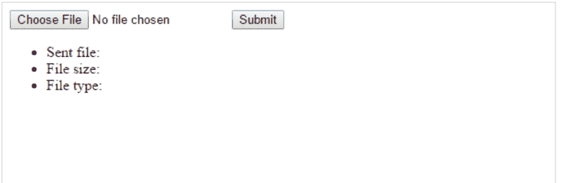

每家公司都根据其最佳实践遵循不同的编码标准。需要编码标准是因为可能有许多开发人员在不同模块上工作。如果他们开始制定自己的标准，那么源代码将变得非常难以管理，并且未来维护该源代码将变得困难。

以下是使用编码规范的几个原因：

- 您的同行程序员必须理解您编写的代码。编码标准充当整个团队解读代码的蓝图。
- 通过一致的编码获得的简单性和清晰性可以避免常见错误。
- 如果您过一段时间后修订代码，那么理解该代码就会变得容易。

在 PHP 编码时，可以遵循以下几条准则。

- **缩进和行长度** - 使用 4 个空格的缩进，不要使用任何制表符，因为不同计算机对制表符的设置不同。建议将行长度保持在大约 75-85 个字符，以提高代码可读性。
- **控制结构** - 包括 if、for、while、switch 等。控制语句在控制关键字和左括号之间应有一个空格，以将其与函数调用区分开来。强烈建议始终使用花括号，即使在技术上是可选的情况下也是如此。

## 示例

```
if ((condition1) || (condition2)) {
action1;
} elseif ((condition3) && (condition4)) {
action2;
} else {
default action;
}
```

您可以按照以下方式编写 switch 语句：

```
switch (condition) {
case 1:
action1;
break;
case 2:
    action2;
    break;

default:
    defaultaction;
    break;
}
```

**函数调用** - 调用函数时，函数名、左括号和第一个参数之间不应有空格；逗号和每个参数之间应有空格；最后一个参数、右括号和分号之间不应有空格。示例如下：

```
$var = foo($bar, $baz, $quux);
```

**函数定义** - 函数声明遵循 "BSD/Allman 风格"：

```
function fooFunction($arg1, $arg2 = '')
{
    if (condition) {
        statement;
    }
    return $val;
}
```

**注释** - C 风格注释（/* */）和标准 C++ 注释（//）都可以。不鼓励使用 Perl/shell 风格注释（#）。

**PHP 代码标记** - 始终使用 <?php ?> 来分隔 PHP 代码，而不是 <? ?> 缩写。这对于 PHP 合规性是必需的，也是在不同操作系统和设置中包含 PHP 代码的最便携方式。

### 变量名

- 使用全小写字母
- 使用 '_' 作为单词分隔符。
- 全局变量应以 'g' 开头。
- 全局常量应全大写并使用 '_' 分隔符。
- 静态变量可以以 's' 开头。

**使函数可重入** - 函数不应保留阻止函数可重入的静态变量。

**声明块对齐** - 声明块应保持对齐。

**每行一条语句** - 每行只应有一条语句，除非语句之间关系非常密切。

**简短的方法或函数** - 方法应限制在一页代码之内。
编写 PHP 程序时还应考虑更多要点。总体意图应是在整个代码编程过程中保持一致，这只有在遵循任何编码标准时才能实现。如果您喜欢不同的内容，可以制定自己的标准。

## 第 2 部分：高级 PHP

### 21. PHP – 预定义变量

PHP 为其运行的任何脚本提供大量预定义变量。PHP 还提供一组预定义数组，包含来自 Web 服务器、环境和用户输入的变量。这些新数组称为超全局变量：

以下所有变量在每个作用域中都自动可用。

### PHP 超全局变量

| 变量 | 描述 |
| :--- | :--- |
| $GLOBALS | 包含对当前在脚本全局作用域中可用的每个变量的引用。该数组的键是全局变量的名称。 |
| $_SERVER | 这是一个包含标头、路径和脚本位置等信息的数组。该数组中的条目由 Web 服务器创建。不能保证每个 Web 服务器都会提供这些变量。有关所有 SERVER 变量的完整列表，请参见下一节。 |
| $_GET | 通过 HTTP GET 方法传递给当前脚本的变量关联数组。 |
| $_POST | 通过 HTTP POST 方法传递给当前脚本的变量关联数组。 |
| $_FILES | 通过 HTTP POST 方法上传到当前脚本的项目关联数组。 |
| $_REQUEST | 由 $_GET、$_POST 和 $_COOKIE 的内容组成的关联数组。 |
| $_COOKIE | 通过 HTTP Cookie 传递给当前脚本的变量关联数组。 |
| $_SESSION | 包含当前脚本可用的会话变量的关联数组。 |
| $_PHP_SELF | 包含调用它的 PHP 脚本文件名的字符串。 |
| $php_errormsg | $php_errormsg 是一个包含 PHP 生成的最后一条错误消息文本的变量。 |

### 服务器变量：$_SERVER

$_SERVER 是一个包含标头、路径和脚本位置等信息的数组。该数组中的条目由 Web 服务器创建。不能保证每个 Web 服务器都会提供这些变量。

| 变量 | 描述 |
|---|---|
| $_SERVER['PHP_SELF'] | 当前正在执行的脚本的文件名，相对于文档根目录 |
| $_SERVER['argv'] | 传递给脚本的参数数组。当脚本在命令行上运行时，这提供对命令行参数的 C 样式访问。当通过 GET 方法调用时，这将包含查询字符串。 |
| $_SERVER['argc'] | 如果在命令行上运行，则包含传递给脚本的命令行参数的数量。 |
| $_SERVER['GATEWAY_INTERFACE'] | 服务器正在使用的 CGI 规范修订版；例如 'CGI/1.1'。 |
| $_SERVER['SERVER_ADDR'] | 当前脚本正在其下执行的服务器的 IP 地址。 |
| $_SERVER['SERVER_NAME'] | 当前脚本正在其下执行的服务器主机名。如果脚本在虚拟主机上运行，这将是为该虚拟主机定义的值。 |
| $_SERVER['SERVER_SOFTWARE'] | 服务器标识字符串，在响应请求时给出于标头中。 |
| $_SERVER['SERVER_PROTOCOL'] | 请求页面所使用的信息协议名称和修订版；例如 'HTTP/1.0'。 |
| $_SERVER['REQUEST_METHOD'] | 用于访问页面的请求方法；例如 'GET'、'HEAD'、'POST'、'PUT'。 |
| $_SERVER['REQUEST_TIME'] | 请求开始的时间戳。自 PHP 5.1.0 起可用。 |
| $_SERVER['QUERY_STRING'] | 查询字符串（如果有），通过该字符串访问了页面。 |
| $_SERVER['DOCUMENT_ROOT'] | 当前脚本正在其下执行的文档根目录，如服务器配置文件中所定义。 |


| $_SERVER['HTTP_ACCEPT'] | 当前请求的 Accept: 标头内容（如果存在）。 |
| --- | --- |
| $_SERVER['HTTP_ACCEPT_CHARSET'] | 当前请求的 Accept-Charset: 标头内容（如果存在）。示例：'iso-8859-1,*,utf-8'。 |
| $_SERVER['HTTP_ACCEPT_ENCODING'] | 当前请求的 Accept-Encoding: 标头内容（如果存在）。示例：'gzip'。 |
| $_SERVER['HTTP_ACCEPT_LANGUAGE'] | 当前请求的 Accept-Language: 标头内容（如果存在）。示例：'en'。 |
| $_SERVER['HTTP_CONNECTION'] | 当前请求的 Connection: 标头内容（如果存在）。示例：'Keep-Alive'。 |
| $_SERVER['HTTP_HOST'] | 当前请求的 Host: 标头内容（如果存在）。 |
| $_SERVER['HTTP_REFERER'] | 将用户代理引导至当前页面的页面地址（如果有）。 |
| $_SERVER['HTTP_USER_AGENT'] | 这是表示用于访问页面的用户代理的字符串。典型示例为：Mozilla/4.5 [en] (X11; U; Linux 2.2.9 i586)。 |
| $_SERVER['HTTPS'] | 如果脚本是通过 HTTPS 协议查询的，则设置为非空值。 |
| $_SERVER['REMOTE_ADDR'] | 用户查看当前页面时的 IP 地址。 |
| $_SERVER['REMOTE_HOST'] | 用户查看当前页面时的主机名。反向 DNS 查找基于用户的 REMOTE_ADDR。 |
| $_SERVER['REMOTE_PORT'] | 用户计算机用于与 Web 服务器通信的端口。 |
| $_SERVER['SCRIPT_FILENAME'] | 当前正在执行的脚本的绝对路径名。 |
| $_SERVER['SERVER_ADMIN'] | Web 服务器配置文件中 SERVER_ADMIN（适用于 Apache）指令的值。 |
| $_SERVER['SERVER_PORT'] | Web 服务器用于通信的服务器计算机端口。对于默认设置，这将是 '80'。 |
| $_SERVER['SERVER_SIGNATURE'] | 包含服务器版本和虚拟主机名的字符串（如果启用），这些内容会添加到服务器生成的页面中。 |
| $_SERVER['PATH_TRANSLATED'] | 基于文件系统的当前脚本路径。 |
| $_SERVER['SCRIPT_NAME'] | 包含当前脚本的路径。对于需要指向自身的页面很有用。 |
| $_SERVER['REQUEST_URI'] | 为访问此页面而给出的 URI；例如，'/index.html'。 |
| $_SERVER['PHP_AUTH_DIGEST'] | 当作为 Apache 模块运行并执行 Digest HTTP 身份验证时，此变量设置为客户端发送的 'Authorization' 标头。 |
| $_SERVER['PHP_AUTH_USER'] | 当作为 Apache 或 IIS（PHP 5 上的 ISAPI）模块运行并执行 HTTP 身份验证时，此变量设置为用户提供的用户名。 |
| $_SERVER['PHP_AUTH_PW'] | 当作为 Apache 或 IIS（PHP 5 上的 ISAPI）模块运行并执行 HTTP 身份验证时，此变量设置为用户提供的密码。 |
| $_SERVER['AUTH_TYPE'] | 当作为 Apache 模块运行并执行 HTTP 身份验证时，此变量设置为身份验证类型。 |

正则表达式无非是一组字符序列或模式。它们为模式匹配功能提供了基础。

使用正则表达式，可以在另一个字符串中搜索特定字符串，可以用一个字符串替换另一个字符串，还可以将一个字符串拆分成多个部分。

PHP 提供了针对两组正则表达式函数的特定函数，每组对应某种类型的正则表达式。你可以根据自己的偏好使用其中任何一种。

- POSIX 正则表达式
- PERL 风格正则表达式

## POSIX 正则表达式

POSIX 正则表达式的结构与典型的算术表达式并无二致：各种元素（运算符）组合在一起形成更复杂的表达式。

最简单的正则表达式是匹配单个字符（例如 g）的表达式，可用于匹配 g、haggle 或 bag 等字符串中。

让我们讨论一下 POSIX 正则表达式中使用的一些概念。之后，我们将向您介绍与正则表达式相关的函数。

### 方括号

在正则表达式上下文中，方括号（[ ]）具有特殊含义。它们用于查找一系列字符。

| 表达式 | 描述 |
| --- | --- |
| [0-9] | 匹配 0 到 9 之间的任何十进制数字。 |
| [a-z] | 匹配从小写 a 到小写 z 的任何字符。 |
| [A-Z] | 匹配从大写 A 到大写 Z 的任何字符。 |
| [a-Z] | 匹配从小写 a 到大写 Z 的任何字符。 |

显示的上述范围是通用的；你也可以使用范围 [0-3] 来匹配 0 到 3 之间的任何十进制数字，或使用范围 [b-v] 来匹配 b 到 v 之间的任何小写字符。

### 限定符

方括号内的字符序列和单个字符的频率或位置可以用特殊字符表示。每个特殊字符都有特定含义。+、*、?、{int. range} 和 $ 标志均紧跟在字符序列之后。

| 表达式 | 描述 |
| --- | --- |
| p+ | 包含至少一个 p 的任何字符串。 |
| p* | 包含零个或多个 p 的任何字符串。 |
| p? | 包含零个或多个 p 的任何字符串。这只是使用 p* 的另一种方式。 |
| p{N} | 包含 N 个 p 序列的任何字符串。 |
| p{2,3} | 包含两个或三个 p 序列的任何字符串。 |
| p{2, } | 包含至少两个 p 序列的任何字符串。 |
| p$ | 匹配以 p 结尾的任何字符串。 |
| ^p | 匹配以 p 开头的任何字符串。 |

### 示例

以下示例将帮助你澄清关于字符匹配的概念。

| 表达式 | 描述 |
| --- | --- |
| [^a-zA-Z] | 匹配不包含 a 到 z 和 A 到 Z 中任何字符的任何字符串。 |
| p.p | 包含 p、随后跟任意字符，再随后跟另一个 p 的任何字符串。 |
| ^..{2}$ | 包含恰好两个字符的任何字符串。 |
| <b>(.*)</b> | 匹配用 <b> 和 </b> 包围的任何字符串。 |
| p(hp)* | 包含 p 后跟零个或多个 hp 序列的任何字符串。 |

### 预定义字符范围

为了编程方便，提供了多个预定义字符范围（也称为字符类）。字符类指定一个完整的字符范围，例如字母表或整数集：

| 表达式 | 描述 |
| --- | --- |
| [[:alpha:]] | 包含从 aA 到 zZ 的字母字符的任何字符串。 |
| [[:digit:]] | 包含从 0 到 9 的数字字符的任何字符串。 |
| [[:alnum:]] | 包含从 aA 到 zZ 和 0 到 9 的字母数字字符的任何字符串。 |
| [[:space:]] | 包含空格的任何字符串。 |

## PHP 的 POSIX 正则表达式函数

PHP 当前提供七个函数，用于使用 POSIX 风格正则表达式搜索字符串：

| 函数 | 描述 |
| --- | --- |
| ereg() | ereg() 函数搜索由 string 指定的字符串以查找由 pattern 指定的字符串，如果找到模式则返回 true，否则返回 false。 |
| ereg_replace() | ereg_replace() 函数搜索由 pattern 指定的字符串，如果找到，则用 replacement 替换 pattern。 |
| eregi() | eregi() 函数搜索由 pattern 指定的字符串以查找由 string 指定的字符串。搜索不区分大小写。 |
| eregi_replace() | eregi_replace() 函数的操作方式与 ereg_replace() 完全相同，只不过在 string 中搜索 pattern 时不区分大小写。 |
| split() | split() 函数将字符串分为多个元素，每个元素的边界基于 pattern 在 string 中出现的情况。 |
| spliti() | spliti() 函数的操作方式与其同级 split() 完全相同，只不过它不区分大小写。 |
| sql_regcase() | sql_regcase() 函数可视为实用函数，它将输入参数字符串中的每个字符转换为包含两个字符的方括号表达式。 |

## PHP—ereg() 函数

### 语法

```
int ereg(string pattern, string originalstring, [array regs]);
```


## 定义与用法

ereg() 函数在由 string 指定的字符串中搜索由 pattern 指定的字符串，如果找到模式则返回 true，否则返回 false。搜索对字母字符区分大小写。

可选的输入参数 regs 包含正则表达式中由括号分组的所有匹配表达式的数组。

### 返回值

- 如果找到模式则返回 true，否则返回 false。

### 示例

以下是代码片段，将此代码复制并粘贴到文件中以验证结果。

```php
<?php
$email_id = "admin@tutorialspoint.com";
$retval = ereg("(\\.)(com$)", $email_id);

if( $retval == true )
{
    echo "Found a .com<br>";
}
else
{
    echo "Could not found a .com<br>";
}

$retval = ereg("(\\.)(com$)", $email_id, $regs);

if( $retval == true )
{
    echo "Found a .com and reg = ". $regs[0];
}
else
{
    echo "Could not found a .com";
}
?>
```

这将产生以下结果 –

```
Found a .com
Found a .com and reg = .com
```

## PHP — 函数 ereg_replace()

### 语法

```
string ereg_replace (string pattern, string replacement, string originalstring);
```

### 定义与用法

ereg_replace() 函数搜索由 pattern 指定的字符串，如果找到则用 replacement 替换 pattern。ereg_replace() 函数的运行前提与 ereg() 相同，区别在于功能扩展为查找和替换模式，而不仅仅是定位它。

与 ereg() 一样，ereg_replace() 区分大小写。

### 返回值

- 替换发生后，将返回修改后的字符串。
- 如果未找到匹配项，字符串将保持不变。

### 示例

以下是代码片段，将此代码复制并粘贴到文件中以验证结果。

```php
<?php
$copy_date = "Copyright 1999";
$copy_date = ereg_replace("([0-9]+)", "2000", $copy_date);
print $copy_date;
?>
```

这将产生以下结果 –

```
Copyright 2000
```

## PHP—函数 eregi()

### 语法

```
int eregi(string pattern, string string, [array regs]);
```

### 定义与用法

eregi() 函数在由 pattern 指定的字符串中搜索由 string 指定的字符串。搜索不区分大小写。在检查字符串（如密码）的有效性时，Eregi() 尤其有用。

可选的输入参数 regs 包含正则表达式中由括号分组的所有匹配表达式的数组。

### 返回值

- 如果模式验证通过则返回 true，否则返回 false。

### 示例

以下是代码片段，将此代码复制并粘贴到文件中以验证结果。

```php
<?php
$password = "abc";
if (! eregi ("[[ :alnum: ]]{8,10}", $password))
{
print "Invalid password! Passwords must be from 8 - 10 chars";
}
else
{
print "Valid password";
}
?>
```

这将产生以下结果 –

```
Invalid password! Passwords must be from 8 - 10 chars
```

## PHP – 函数 eregi_replace()

### 语法

```
string eregi_replace (string pattern, string replacement, string
originalstring);
```

### 定义与用法

eregi_replace() 函数的运行方式与 ereg_replace() 完全相同，区别在于在字符串中搜索模式时不区分大小写。

### 返回值

- 替换发生后，将返回修改后的字符串。
- 如果未找到匹配项，字符串将保持不变。

### 示例

以下是代码片段，将此代码复制并粘贴到文件中以验证结果。

```php
<?php
$copy_date = "Copyright 2000";
$copy_date = eregi_replace("([a-z]+)", "&Copy;", $copy_date);
print $copy_date;
?>
```

这将产生以下结果 –

```
&Copy; 2000
```

## PHP — 函数 split()

### 语法

```
array split (string pattern, string string [, int limit])
```

### 定义与用法

split() 函数将字符串分为多个元素，每个元素的边界基于 pattern 在 string 中出现的位置。

可选的输入参数 limit 用于指示字符串应分成的元素数量，从字符串左端开始向右进行。在 pattern 为字母字符的情况下，split() 区分大小写。

### 返回值

- 分割字符串后返回字符串数组。

### 示例

以下是代码片段，将此代码复制并粘贴到文件中以验证结果。

```php
<?php
$ip = "123.456.789.000"; // some IP address
$iparr = split ("\.", $ip);
print "$iparr[0] <br />";
print "$iparr[1] <br /> " ;
print "$iparr[2] <br /> " ;
print "$iparr[3] <br /> " ;
?>
```

这将产生以下结果 –

```
123
456
789
000
```

## PHP — 函数 spliti()

### 语法

```
array spliti (string pattern, string string [, int limit])
```

### 定义与用法

spliti() 函数的运行方式与其兄弟函数 split() 完全相同，区别在于它不区分大小写。区分大小写字符仅在 pattern 为字母时才是问题。对于所有其他字符，spliti() 的运行方式与 split() 完全相同。

### 返回值

- 分割字符串后返回字符串数组。

### 示例

以下是代码片段，将此代码复制并粘贴到文件中以验证结果。

```php
<?php
$ip = "123.456.789.000"; // some IP address
$iparr = spliti ("\.", $ip, 3);

print "$iparr[0] <br />";
print "$iparr[1] <br />" ;
print "$iparr[2] <br />" ;
print "$iparr[3] <br />" ;
?>
```

由于我们限制了要生成的字符串数量，这将仅生成三个字符串。

```
123
456
789.000
```

## PHP — 函数 sql_regcase()

### 语法

```
string sql_regcase (string string)
```

### 定义与用法

sql_regcase() 函数可以被视为一个实用函数，它将输入参数字符串中的每个字符转换为包含两个字符的括号表达式。

如果字母字符同时具有大写和小写格式，则括号将包含两种形式；否则原始字符将重复两次。

### 返回值

- 返回括号表达式字符串及转换后的字符。

### 示例

以下是代码片段，将此代码复制并粘贴到文件中以验证结果。

```php
<?php
   $version = "php 4.0";

   print sql_regcase($version);
?>
```

这将产生以下结果 –

```
[Pp][Hh][Pp] 4.0
```

## PERL 风格正则表达式

Perl 风格的正则表达式与其 POSIX 对应物相似。POSIX 语法几乎可以与 Perl 风格的正则表达式函数互换使用。实际上，您可以使用上一节 POSIX 部分中引入的任何量词。

让我们讨论一下 PERL 正则表达式中使用的几个概念。之后，我们将向您介绍与正则表达式相关的函数。

### 元字符

元字符只是一个带反斜杠前缀的字母字符，用于赋予组合特殊含义。

例如，您可以使用 '\d' 元字符搜索大额金额:/([\d+])000/，这里 \d 将搜索任何数字字符串。

以下是可用于 PERL 风格正则表达式的元字符列表。

| 字符 | 描述 |
|-----------|-------------|
| . | 单个字符 |
| \s | 空白字符（空格、制表符、换行符） |
| \S | 非空白字符 |
| \d | 数字（0-9） |
| \D | 非数字 |
| \w | 单词字符（a-z, A-Z, 0-9, _） |
| \W | 非单词字符 |
| [aeiou] | 匹配给定集中的单个字符 |
| [^aeiou] | 匹配给定集之外的单个字符 |
| (foo\|bar\|baz) | 匹配指定的任何替代项 |

### 修饰符

有多种修饰符可用，可大大简化您使用正则表达式的工作，例如区分大小写、多行搜索等。

| 修饰符 | 描述 |
|----------|-------------|
| i | 使匹配不区分大小写 |
| m | 指定如果字符串有换行符或回车符，^ 和 $ 运算符将按换行边界匹配，而不是按字符串边界匹配 |
| o | 仅计算一次表达式 |
| s | 允许使用 . 匹配换行符 |
| x | 允许在表达式中使用空格以提高清晰度 |
| g | 全局查找所有匹配项 |
| cg | 允许在全局匹配失败后继续搜索 |


## PHP 的 Perl 兼容正则表达式函数

PHP 提供了以下用于使用 Perl 兼容正则表达式搜索字符串的函数：

| Function | Description |
| :--- | :--- |
| preg_match() | preg_match() 函数在字符串中搜索模式，如果模式存在则返回 true，否则返回 false。 |
| preg_match_all() | preg_match_all() 函数匹配字符串中模式的所有出现。 |
| preg_replace() | preg_replace() 函数的操作方式与 ereg_replace() 类似，只不过模式和替换输入参数中可以使用正则表达式。 |
| preg_split() | preg_split() 函数的操作方式与 split() 完全相同，只不过模式接受正则表达式作为输入参数。 |
| preg_grep() | preg_grep() 函数搜索 input_array 的所有元素，返回与正则表达式模式匹配的所有元素。 |
| preg_quote() | 为正则表达式字符添加引号 |

### PHP—函数 preg_match()

#### 语法

```
int preg_match (string pattern, string string [, array pattern_array] [, int $flags [, int $offset]]);
```

#### 定义和用途

preg_match() 函数在字符串中搜索模式，如果模式存在则返回 true，否则返回 false。

如果提供了可选输入参数 pattern_array，则 pattern_array 将包含搜索模式中包含的各个子模式部分（如果适用）。

如果将此标志作为 PREG_OFFSET_CAPTURE 传递，则对于每个出现的匹配，还将返回附加的字符串偏移量。

通常，搜索从主题字符串的开头开始。可选参数 offset 可用于指定开始搜索的备用位置。

#### 返回值

- 如果模式存在则返回 true，否则返回 false。

### PHP—函数 preg_match_all()

#### 语法

```
int preg_match_all (string pattern, string string, array pattern_array [, int order]);
```

#### 定义和用途

preg_match_all() 函数匹配字符串中模式的所有出现。

它将使用可选输入参数 order 指定的顺序将这些匹配项放在数组 pattern_array 中。有两种可能的顺序类型 –

- **PREG_PATTERN_ORDER** – PREG_PATTERN_ORDER 指定的顺序可能是你最合理的想法；$pattern_array[0] 是所有完整模式匹配的数组，$pattern_array[1] 是与第一个带括号的正则表达式匹配的所有字符串的数组，以此类推。

- **PREG_SET_ORDER** – PREG_SET_ORDER 指定的顺序可能是你最合理的想法；$pattern_array[0] 包含第一个带括号的正则表达式匹配的元素，$pattern_array[1] 包含第二个带括号的正则表达式匹配的元素，以此类推。

#### 返回值

- 返回匹配的数量。

#### 示例

以下是代码片段，将此代码复制并粘贴到文件中以验证结果。

```
<?php
$userinfo = "Name: <b>John Poul</b> <br> Title: <b>PHP Guru</b>";
preg_match_all ("/<b>(.*)<\/b>/U", $userinfo, $pat_array);

print $pat_array[0][0]." <br> ".$pat_array[0][1]."\n";
?>
```

这将产生以下结果 –

John Poul
PHP Guru

### PHP—函数 preg_replace()

#### 语法

```
mixed preg_replace (mixed pattern, mixed replacement, mixed string [, int limit [, int &$count]] );
```

#### 定义和用途

preg_replace() 函数的操作方式与 POSIX 函数 ereg_replace() 类似，只不过模式和替换输入参数中可以使用正则表达式。

可选输入参数 limit 指定应进行多少次匹配。

如果传递了可选参数 $count，则该变量将被填充为已完成的替换数量。

#### 返回值

- 替换发生后，将返回修改后的字符串。
- 如果未找到匹配项，字符串将保持不变。

#### 示例

以下是代码片段，将此代码复制并粘贴到文件中以验证结果。

```
<?php
$copy_date = "Copyright 1999";
$copy_date = preg_replace("([0-9]+)", "2000", $copy_date);

print $copy_date;
?>
```

这将产生以下结果 –

Copyright 2000

### PHP — 函数 preg_split()

#### 语法

```
array preg_split (string pattern, string string [, int limit [, int flags]]);
```

#### 定义和用途

preg_split() 函数的操作方式与 split() 完全相同，只不过模式接受正则表达式作为输入参数。

如果指定了可选输入参数 limit，则只返回 limit 个子字符串。

flags 可以是以下类型的任意组合 –

- **PREG_SPLIT_NO_EMPTY** – 如果设置了此标志，则仅返回非空片段。
- **PREG_SPLIT_DELIM_CAPTURE** – 如果设置了此标志，模式中的带括号表达式将被捕获并一并返回。
- **PREG_SPLIT_OFFSET_CAPTURE** – 如果设置了此标志，则对于每个出现的匹配，还将返回附加的字符串偏移量。

#### 返回值

- 将字符串拆分后返回字符串数组。

#### 示例

以下是代码片段，将此代码复制并粘贴到文件中以验证结果。

```
<?php
$ip = "123.456.789.000"; // some IP address
$iparr = split("/\\./", $ip);
print "$iparr[0] <br />";
print "$iparr[1] <br />" ;
print "$iparr[2] <br />" ;
print "$iparr[3] <br />" ;
?>
```

这将产生以下结果 –

123.456.789.000

### PHP— 函数 preg_grep()

#### 语法

```
array preg_grep ( string $pattern, array $input [, int $flags ] );
```

#### 定义和用途

返回由输入数组中与给定模式匹配的元素组成的数组。

如果 flag 设置为 PREG_GREP_INVERT，则该函数返回输入数组中不与给定模式匹配的元素。

#### 返回值

- 返回使用输入数组的键进行索引的数组。

#### 示例

以下是代码片段，将此代码复制并粘贴到文件中以验证结果。

```
<?php
$foods = array("pasta", "steak", "fish", "potatoes");

// find elements beginning with "p", followed by one or more letters.
$p_foods = preg_grep("/p(\w+)/", $foods);

print "Found food is " . $p_foods[0];
print "Found food is " . $p_foods[1];
?>
```

这将产生以下结果 –

Found food is pastaFound food is

### PHP — 函数 preg_quote()

#### 语法

```
string preg_quote ( string $str [, string $delimiter] );
```

#### 定义和用途

preg_quote() 接受 str 并在正则表达式语法中的每个字符前添加反斜杠。

#### 返回值

- 返回加引号的字符串。

#### 示例

以下是代码片段，将此代码复制并粘贴到文件中以验证结果。

```
<?php
 $keywords = '$40 for a g3/400';
 $keywords = preg_quote($keywords, '/');
 echo $keywords;
 ?>
```

这将产生以下结果 –

```
\$40 for a g3\/400
```

错误处理是捕获程序引发的错误并采取适当措施的过程。如果你妥善处理错误，则可能会避免许多意外后果。在 PHP 中处理错误非常简单。

### 使用 die() 函数

在编写 PHP 程序时，应在继续之前检查所有可能的错误条件，并在需要时采取适当措施。

尝试以下示例，既没有 /tmp/test.txt 文件，又有该文件。

```
<?php
if(!file_exists("/tmp/test.txt"))
{
die("File not found");
}
else
{
$file=fopen("/tmp/test.txt","r");
print "Opened file successfully";
}
// Test of the code here.
?>
```

这样你就可以编写高效的代码。使用上述技术，你可以在程序出错时随时停止程序，并显示更有意义且用户友好的消息。

### 定义自定义错误处理函数

你可以编写自己的函数来处理任何错误。PHP 为你提供了一个定义错误处理函数的框架。

此函数至少必须能够处理两个参数（错误级别和错误消息），但最多可接受五个参数（可选：文件、行号和错误上下文）：

#### 语法

```
error_function(error_level,error_message, error_file,error_line,error_context);
```


| 参数 | 描述 |
|---|---|
| error_level | 必需 - 指定用户定义错误的错误报告级别。必须是一个数值。 |
| error_message | 必需 - 指定用户定义错误的错误消息 |
| error_file | 可选 - 指定错误发生的文件名 |
| error_line | 可选 - 指定错误发生的行号 |
| error_context | 可选 - 指定一个数组，包含发生错误时使用的每个变量及其值 |

## 可能的错误级别

这些错误报告级别是用户定义的错误处理程序可用于的不同类型的错误。这些值可以使用 | 运算符组合使用。

| 值 | 常量 | 描述 |
|---|---|---|
| 1 | E_ERROR | 致命运行时错误。脚本执行停止 |
| 2 | E_WARNING | 非致命运行时错误。脚本执行不停止 |
| 4 | E_PARSE | 编译时解析错误。解析错误应仅由解析器生成。 |
| 8 | E_NOTICE | 运行时通知。脚本发现可能是错误的内容，但也可能在正常运行脚本时发生 |
| 16 | E_CORE_ERROR | PHP 初始启动期间发生的致命错误。 |
| 32 | E_CORE_WARNING | 非致命运行时错误。这发生在 PHP 初始启动期间。 |
| 256 | E_USER_ERROR | 致命用户生成的错误。这类似于程序员使用 PHP 函数 trigger_error() 设置的 E_ERROR |
| 512 | E_USER_WARNING | 非致命用户生成的警告。这类似于程序员使用 PHP 函数 trigger_error() 设置的 E_WARNING |
| 1024 | E_USER_NOTICE | 用户生成的通知。这类似于程序员使用 PHP 函数 trigger_error() 设置的 E_NOTICE |
| 2048 | E_STRICT | 运行时通知。启用以让 PHP 建议对代码进行更改，以确保代码的最佳互操作性和前向兼容性。 |
| 4096 | E_RECOVERABLE_ERROR | 可捕获的致命错误。这类似于 E_ERROR，但可以由用户定义的处理程序捕获（另请参阅 set_error_handler()） |
| 8191 | E_ALL | 所有错误和警告，但 E_STRICT 级别除外（E_STRICT 将从 PHP 6.0 开始成为 E_ALL 的一部分） |

以上所有错误级别都可以使用以下 PHP 内置库函数进行设置，其中 level 可以是上面表中定义的任何值。

```
int error_reporting ( [int $level] )
```

以下是创建错误处理函数的示例：

```
<?php
function handleError($errno, $errstr,$error_file,$error_line)
{
echo "<b>Error:</b> [$errno] $errstr - $error_file:$error_line";
echo "<br />";
echo "Terminating PHP Script";
die();
}
?>
```

定义自定义错误处理程序后，需要使用 PHP 内置库函数 **set_error_handler** 将其设置。现在，让我们通过调用一个不存在的函数来检查我们的示例。

```
<?php
error_reporting( E_ERROR );
function handleError($errno, $errstr,$error_file,$error_line)
{
echo "<b>Error:</b> [$errno] $errstr - $error_file:$error_line";
echo "<br />";
echo "Terminating PHP Script";
die();
}
//set error handler
set_error_handler("handleError");
//trigger error
myFunction();
?>
```

## 异常处理

PHP 5 具有一个与其他编程语言类似的异常模型。异常非常重要，可对错误处理提供更好的控制。

现在让我们介绍与异常相关的新关键字。

- Try - 使用异常的函数应位于 "try" 块中。如果未触发异常，代码将照常继续。但是，如果触发异常，则会抛出异常。
- Throw - 这是触发异常的方式。每个 "throw" 必须至少有一个 "catch"。
- Catch - "catch" 块会捕获异常并创建包含异常信息的对象。

抛出异常后，语句后面的代码将不会执行，PHP 将尝试查找第一个匹配的 catch 块。如果异常未被捕获，将发出带有 "Uncaught Exception" 的 PHP 致命错误。

- 异常可以在 PHP 中抛出和捕获（"caught"）。代码可以包围在 try 块中。
- 每个 try 必须至少有一个对应的 catch 块。可以使用多个 catch 块来捕获不同类的异常。
- 异常可以在 catch 块中抛出（或重新抛出）。

### 示例

将以下代码片段复制并粘贴到文件中，验证结果。

```
<?php
try {
    $error = 'Always throw this error';
    throw new Exception($error);
    // Code following an exception is not executed.
    echo 'Never executed';
} catch (Exception $e) {
    echo 'Caught exception: ', $e->getMessage(), "\n";
}

// Continue execution
echo 'Hello World';
?>
```

在上面的示例中，使用 $e->getMessage 函数来获取错误消息。可以从 **Exception** 类中使用以下函数。

- **getMessage()** - 异常消息
- **getCode()** - 异常代码
- **getFile()** - 源文件名
- **getLine()** - 源行号
- **getTrace()** - backtrace() 的数组
- **getTraceAsString()** - 格式化的跟踪字符串

## 创建自定义异常处理程序

您可以定义自己的自定义异常处理程序。使用以下函数设置用户定义的异常处理程序函数。

```
string set_exception_handler ( callback $exception_handler )
```

这里 **exception_handler** 是发生未捕获异常时要调用的函数名称。必须在调用 set_exception_handler() 之前定义此函数。

### 示例

```
<?php
function exception_handler($exception) {
   echo "Uncaught exception: " , $exception->getMessage(), "\n";
}

set_exception_handler('exception_handler');

throw new Exception('Uncaught Exception');

echo "Not Executed\n";
?>
```

在 [PHP 错误处理函数](PHP Error Handling Functions) 中查看完整的错误处理函数集合。

### 24. PHP – Bug 调试

程序很少第一次就能正确运行。程序中许多事情可能会出错，导致 PHP 解释器生成错误消息。您可以选择这些错误消息的去向。消息可以连同其他程序输出一同发送到 Web 浏览器。它们也可以包含在 Web 服务器错误日志中。

要使错误消息在浏览器中显示，请将 **display_errors** 配置指令设置为 **On**。要将错误发送到 Web 服务器错误日志，请将 **log_errors** 设置为 On。如果希望在两个位置都显示错误消息，可以将两者都设置为 On。

PHP 定义了一些常量，可用于设置 **error_reporting** 的值，以便仅报告特定类型的错误：E_ALL（除严格通知外的所有错误）、E_PARSE（解析错误）、E_ERROR（致命错误）、E_WARNING（警告）、E_NOTICE（通知）和 E_STRICT（严格通知）。

编写 PHP 程序时，最好使用感知 PHP 的编辑器，如 **BBEdit** 或 **Emacs**。这些编辑器的一个特殊功能是语法高亮。它会根据程序各部分的内容更改其颜色。例如，字符串为粉色，if 和 while 等关键字为蓝色，注释为灰色，变量为黑色。

另一个功能是引号和括号匹配，有助于确保引号和括号成对。当您键入闭合定界符（例如 }）时，编辑器会高亮显示与其匹配的开放 {。

调试程序时，需要验证以下几点。

- **缺少分号** - 每个 PHP 语句都以分号 (;) 结尾。PHP 在遇到分号之前不会停止读取语句。如果行末省略了分号，PHP 将继续读取下一行中的语句。
- **等号不足** - 在比较语句中询问两个值是否相等时，需要两个等号 (==)。使用一个等号是常见错误。
- **变量名拼写错误** - 如果变量名拼写错误，PHP 会将其理解为一个新变量。请记住：对于 PHP，$test 与 $Test 不是同一个变量。
- **缺少美元符号** - 变量名中缺少美元符号很难发现，但至少通常会导致错误消息，从而让您知道在哪里查找问题。
- **引号问题** - 引号可能过多、过少或类型错误。因此请检查引号数量是否平衡。
- **缺少括号和花括号** - 它们应始终成对出现。
- **数组索引** - 所有数组都应从 0 开始，而不是从 1 开始。


此外，请妥善处理所有错误，并将所有跟踪消息定向到系统日志文件，以便如果发生任何问题，则问题将被记录到系统日志文件中，您将能够调试该问题。

### 25. PHP – 日期和时间

日期是日常生活中如此重要的一部分，以至于人们在处理日期时往往不加思考。PHP 还提供了强大的日期运算工具，使日期操作变得轻松。

### 使用 time() 获取时间戳

PHP 的 time() 函数会提供您关于当前日期和时间所需的所有信息。它不需要任何参数，但会返回一个整数。

time() 返回的整数表示自 1970 年 1 月 1 日格林威治标准时间午夜以来经过的秒数。这一时刻被称为 UNIX 纪元，自那时起经过的秒数称为时间戳。

```php
<?php
print time();
?>
```

它将产生以下结果：

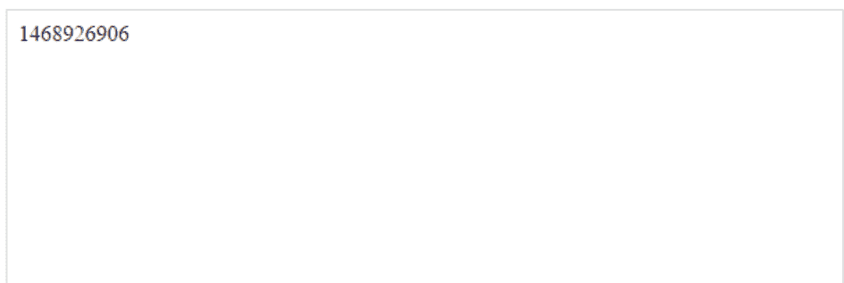

这很难理解。但 PHP 提供了出色的工具，可将时间戳转换为人类易于理解的形式。

### 使用 getdate() 转换时间戳

函数 getdate() 可选地接受一个时间戳，并返回一个包含日期信息的关联数组。如果省略时间戳，它将使用 time() 返回的当前时间戳。

下表列出了 getdate() 返回的数组中包含的元素。

| 键 | 描述 | 示例 |
|---|---|---|
| seconds | 分钟过去的秒数 (0-59) | 20 |
| minutes | 小时过去的分钟数 (0 - 59) | 29 |
| hours | 一天中的小时数 (0 - 23) | 22 |
| mday | 一个月中的日期 (1 - 31) | 11 |
| wday | 一周中的星期数 (0 - 6) | 4 |
| mon | 一年中的月份 (1 - 12) | 7 |
| year | 年份 (4 位数字) | 1997 |
| yday | 一年中的天数 (0 - 365) | 19 |
| weekday | 星期 | 星期四 |
| month | 一年中的月份 | 一月 |
| 0 | 时间戳 | 948370048 |

现在您对日期和时间有完全的控制权。您可以按想要的任何格式来格式化此日期和时间。

### 示例

尝试以下示例。

```php
<?php
$date_array = getdate();
foreach ( $date_array as $key => $val )
{
   print "$key = $val<br />";
}

$formatted_date = "Today's date: ";
$formatted_date .= $date_array[mday] . "/";
$formatted_date .= $date_array[mon] . "/";
$formatted_date .= $date_array[year];

print $formatted_date;
?>
```

它将产生以下结果：

```
seconds = 6
minutes = 15
hours = 11
mday = 19
wday = 2
mon = 7
year = 2016
yday = 200
weekday = Tuesday
month = July
0 = 1468926906
Today's date: 19/7/2016
```

### 使用 date() 转换时间戳

**date()** 函数返回一个表示日期的格式化字符串。您可以通过必须传递给它的字符串参数，对 date() 返回的格式进行大量控制。

```
date(format,timestamp)
```

date() 可选地接受一个时间戳，如果省略，则将使用当前日期和时间。您在传递给 date() 的格式字符串中包含的任何其他数据都将包含在返回值中。

下表列出了格式字符串可以包含的代码：

| 格式 | 描述 | 示例 |
|---|---|---|
| a | 'am' 或 'pm' 小写 | 下午 |
| A | 'AM' 或 'PM' 大写 | 下午 |
| d | 带前导零的月份中的天数 | 20 |
| D | 星期几 (三个字母) | 星期四 |
| F | 月份名称 | 一月 |
| h | 小时 (12 小时格式 - 带前导零) | 12 |
| H | 小时 (24 小时格式 - 带前导零) | 22 |
| g | 小时 (12 小时格式 - 不带前导零) | 12 |
| G | 小时 (24 小时格式 - 不带前导零) | 22 |
| i | 分钟 (0 - 59) | 23 |
| j | 月份中的日期 (不带前导零) | 20 |
| l (Lower 'L') | 星期 | 星期四 |
| L | 闰年 ('1' 表示是，'0' 表示否) | 1 |
| m | 一年中的月份 (数字 - 带前导零) | 1 |
| M | 一年中的月份 (三个字母) | 一月 |
| r | RFC 2822 格式的日期 | 星期四, 21 十二月 2000 16:01:07 +0200 |
| n | 一年中的月份 (数字 - 不带前导零) | 2 |
| s | 小时中的秒数 | 20 |
| U | 时间戳 | 948372444 |
| y | 年份 (两位数字) | 06 |
| Y | 年份 (四位数字) | 2006 |
| z | 一年中的天数 (0 - 365) | 206 |
| Z | 相对于 GMT 的秒偏移量 | +5 |

### 示例

尝试以下示例。

```php
<?php
print date("m/d/y G.i:s<br>", time());
print "Today is ";
print date("j of F Y, \\a\\t g.i a", time());
?>
```

它将产生以下结果：

07/19/16 11.15:06今天是 2016 年 7 月 19 日，上午 11:15

希望您已了解如何根据需求格式化日期和时间。作为参考，所有日期和时间函数的完整列表载于 PHP 日期和时间函数中。

### 26. PHP – PHP 和 MySQL

PHP 可与几乎所有数据库软件协作，包括 Oracle 和 Sybase，但最常用的是免费可用的 MySQL 数据库。

### 您应当已具备

- 您已学习 MySQL 教程以了解 MySQL 基础知识。
- 已下载并安装最新版本的 MySQL。
- 已创建密码为 **guest123** 的数据库用户 **guest**。
- 如果您尚未创建数据库，则需要 root 用户及其密码来创建数据库。

本章已分为以下各节：

- **连接到 MySQL 数据库** - 了解如何使用 PHP 打开和关闭 MySQL 数据库连接。
- **使用 PHP 创建 MySQL 数据库** - 本部分介绍如何使用 PHP 创建 MySQL 数据库和表。
- **使用 PHP 删除 MySQL 数据库** - 本部分介绍如何使用 PHP 删除 MySQL 数据库和表。
- **向 MySQL 数据库插入数据** - 一旦您创建了数据库和表，您可能希望将数据插入到已创建的表中。本节将通过真实示例演示数据插入。
- **从 MySQL 数据库检索数据** - 了解如何使用 PHP 从 MySQL 数据库获取记录。
- **使用 PHP 实现分页** - 本部分介绍如何将查询结果显示为多页以及如何创建导航链接。
- **向 MySQL 数据库更新数据** - 本部分介绍如何使用 PHP 更新 MySQL 数据库中的现有记录。
- **从 MySQL 数据库删除数据** - 本部分介绍如何使用 PHP 删除或清除 MySQL 数据库中的现有记录。
- **使用 PHP 备份 MySQL 数据库** - 了解出于安全目的备份 MySQL 数据库的不同方法。

### 连接到 MySQL 数据库

### 打开数据库连接

PHP 提供 **mysqli_connect** 函数来打开数据库连接。该函数接受五个参数，成功时返回 MySQL 链接标识符，失败时返回 FALSE。

### 语法

```
connection mysqli_connect(server,user,passwd,new_link,client_flag);
```

| 序号 | 参数 & 描述 |
| :--- | :--- |
| 1 | **server** 可选 – 运行数据库服务器的主机名。如果未指定，则默认值为 **localhost:3306**。 |
| 2 | **user** 可选 – 访问数据库的用户名。如果未指定，则默认为拥有服务器进程的用户名。 |
| 3 | **passwd** 可选 – 访问数据库的用户密码。如果未指定，则默认为空密码。 |
| 4 | **new_link** 可选 – 如果使用相同参数再次调用 mysqli_connect()，则不会建立新连接；而是返回已打开连接的标识符。 |
| 5 | **client_flags** 可选 – 以下常量的组合 – **MYSQL_CLIENT_SSL** – 使用 SSL 加密；**MYSQL_CLIENT_COMPRESS** – 使用压缩协议 |

- **MYSQL_CLIENT_IGNORE_SPACE** – 允许函数名后带有空格
- **MYSQL_CLIENT_INTERACTIVE** – 允许在关闭连接前进行交互式超时秒数的非活动

**注意** – 您可以在 **php.ini** 文件中指定 server、user、passwd，而无需在每个 PHP 脚本中反复使用它们。请检查 php.ini 文件配置。

### 关闭数据库连接

PHP 提供用于关闭数据库连接的最简单函数 mysqli_close。该函数接受 mysqli_connect 函数返回的连接资源。成功时返回 TRUE，失败时返回 FALSE。

### 语法

```
bool mysqli_close ( resource $link_identifier );
```

如果未指定资源，则关闭最后打开的数据库。

### 示例

尝试以下示例来打开和关闭数据库连接 –

```php
<?php
$dbhost = 'localhost:3036';
$dbuser = 'guest';
$dbpass = 'guest123';
$conn = mysqli_connect($dbhost, $dbuser, $dbpass);
if(! $conn ) {
  die('Could not connect: ' . mysqli_error());
}
echo 'Connected successfully';
mysqli_close($conn);
?>
```

### 使用 PHP 创建 MySQL 数据库

### 创建数据库


要创建和删除数据库，您应拥有管理员权限。创建新的 MySQL 数据库非常简单。PHP 使用 **mysql_query** 函数来创建 MySQL 数据库。该函数接受两个参数，成功时返回 TRUE，失败时返回 FALSE。

### 语法

```
bool mysql_query( sql, connection );
```

| 序号 | 参数及描述 |
|---|---|
| 1 | **sql**<br>必需 - 用于创建数据库的 SQL 查询 |
| 2 | **connection**<br>可选 - 如果未指定，则将使用 mysql_connect 最后打开的连接。 |

### 示例

尝试以下示例来创建数据库 –

```
<?php
$dbhost = 'localhost:3306';
$dbuser = 'root';
$dbpass = 'rootpassword';
$conn = mysql_connect($dbhost, $dbuser, $dbpass);
if(! $conn ) {
  die('Could not connect: ' . mysql_error());
}
echo 'Connected successfully';
$sql = 'CREATE Database test_db';
$retval = mysql_query( $sql, $conn );
if(! $retval ) {
  die('Could not create database: ' . mysql_error());
}

echo "Database test_db created successfully\n";
mysql_close($conn);

?>
```

## 选择数据库

一旦您与数据库服务器建立连接，则需要选择一个特定的数据库，所有表都与该数据库关联。

之所以需要此操作，是因为单个服务器上可能存在多个数据库，而您一次只能使用一个数据库。

PHP 提供 mysql_select_db 函数来选择数据库。成功时返回 TRUE，失败时返回 FALSE。

### 语法

```
bool mysql_select_db( db_name, connection );
```

| 序号 | 参数及描述 |
|---|---|
| 1 | db_name<br>必需 - 要选择的数据库名称 |
| 2 | connection<br>可选 - 如果未指定，则将使用 mysql_connect 最后打开的连接。 |

### 示例

下面的示例向您展示如何选择数据库。

```
<?php
$dbhost = 'localhost:3306';
$dbuser = 'guest';
$dbpass = 'guest123';
$conn = mysql_connect($dbhost, $dbuser, $dbpass);

if(! $conn ) {
   die('Could not connect: ' . mysql_error());
}

echo 'Connected successfully';

mysql_select_db( 'test_db' );
mysql_close($conn);

?>
```

## 创建数据库表

要在新数据库中创建表，您需要执行与创建数据库相同的操作。首先创建用于创建表的 SQL 查询，然后使用 mysql_query() 函数执行该查询。

### 示例

尝试以下示例来创建表 –

```
<?php
$dbhost = 'localhost:3306';
$dbuser = 'root';
$dbpass = 'rootpassword';
$conn = mysql_connect($dbhost, $dbuser, $dbpass);

if(! $conn ) {
   die('Could not connect: ' . mysql_error());
}

echo 'Connected successfully';

$sql = 'CREATE TABLE employee( '.
       'emp_id INT NOT NULL AUTO_INCREMENT, '.
       'emp_name VARCHAR(20) NOT NULL, '.
       'emp_address VARCHAR(20) NOT NULL, '.
       'emp_salary  INT NOT NULL, '.
       'join_date  timestamp(14) NOT NULL, '.
       'primary key ( emp_id ))';

mysql_select_db('test_db');
$retval = mysql_query( $sql, $conn );
if(! $retval ) {
  die('Could not create table: ' . mysql_error());
}
echo "Table employee created successfully\n";
mysql_close($conn);
?>
```

如果需要创建多个表，最好先创建一个文本文件，将所有 SQL 命令放入该文本文件中，然后将该文件加载到 $sql 变量中并执行这些命令。

考虑 sql_query.txt 文件中的以下内容

```
CREATE TABLE employee(
emp_id INT NOT NULL AUTO_INCREMENT,
emp_name VARCHAR(20) NOT NULL,
emp_address VARCHAR(20) NOT NULL,
emp_salary INT NOT NULL,
join_date timestamp(14) NOT NULL,
primary key ( emp_id ));
<?php
$dbhost = 'localhost:3306';
$dbuser = 'root';
$dbpass = 'rootpassword';
$conn = mysql_connect($dbhost, $dbuser, $dbpass);
if(! $conn ) {
  die('Could not connect: ' . mysql_error());
}
$query_file = 'sql_query.txt';
$fp = fopen($query_file, 'r');
$sql = fread($fp, filesize($query_file));
fclose($fp);

mysql_select_db('test_db');
$retval = mysql_query( $sql, $conn );
if(! $retval )
{
 die('Could not create table: ' . mysql_error());
}
echo "Table employee created successfully\n";
mysql_close($conn);
?>
```

## 使用 PHP 删除 MySQL 数据库

### 删除数据库

如果不再需要数据库，则可以将其永久删除。您可以向 mysql_query 传递 SQL 命令来删除数据库。

### 示例

尝试以下示例来删除数据库。

```
<?php
$dbhost = 'localhost:3306';
$dbuser = 'root';
$dbpass = 'rootpassword';
$conn = mysql_connect($dbhost, $dbuser, $dbpass);
if(! $conn )
{
 die('Could not connect: ' . mysql_error());
}
$sql = 'DROP DATABASE test_db';
$retval = mysql_query( $sql, $conn );
if(! $retval )
{
 die('Could not delete database test_db: ' . mysql_error());
}
echo "Database deleted successfully\n";

mysql_close($conn);
?>
```

**警告** – 删除数据库和任何表都非常危险。因此，在删除任何表或数据库之前，请确保您是有意执行这些操作。

## 删除表

再次通过 **mysql_query** 函数发出一条 SQL 命令即可删除任何数据库表。但是，使用此命令时要非常小心，因为这样做可能会删除表中的某些重要信息。

### 示例

尝试以下示例来删除表 –

```
<?php
$dbhost = 'localhost:3306';
$dbuser = 'root';
$dbpass = 'rootpassword';
$conn = mysql_connect($dbhost, $dbuser, $dbpass);

if(! $conn ) {
  die('Could not connect: ' . mysql_error());
}

$sql = 'DROP TABLE employee';
$retval = mysql_query( $sql, $conn );

if(! $retval ) {
  die('Could not delete table employee: ' . mysql_error());
}

echo "Table deleted successfully\n";
mysql_close($conn);
?>
```

## 将数据插入 MySQL 数据库

可以通过 PHP 函数 **mysql_query** 执行 SQL INSERT 语句将数据输入 MySQL 表。下面是向 **employee** 表插入记录的简单示例。

### 示例

尝试以下示例向 employee 表插入记录。

```
<?php
$dbhost = 'localhost:3306';
$dbuser = 'root';
$dbpass = 'rootpassword';
$conn = mysql_connect($dbhost, $dbuser, $dbpass);
if(! $conn )
{
 die('Could not connect: '. mysql_error());
}

$sql = 'INSERT INTO employee '
 .'(emp_name,emp_address, emp_salary, join_date) '
 .'VALUES ( "guest", "XYZ", 2000, NOW() )';
mysql_select_db('test_db');
$retval = mysql_query( $sql, $conn );
if(! $retval )
{
 die('Could not enter data: '. mysql_error());
}
echo "Entered data successfully\n";
mysql_close($conn);
?>
```

在实际应用中，所有值都将使用 HTML 表单获取，然后使用 PHP 脚本捕获这些值，最后将它们插入 MySQL 表中。

在插入数据时，最好使用函数 **get_magic_quotes_gpc()** 来检查当前配置中是否设置了魔术引号。如果该函数返回 false，则使用函数 **addslashes()** 在引号前添加斜杠。

### 示例

尝试将此代码放入 add_employee.php 中，它将使用 HTML 表单获取输入，然后在数据库中创建记录。

```
<html>
<head>
<title>Add New Record in MySQL Database</title>
</head>

<body>
<?php
if(isset($_POST['add'])) {
    $dbhost = 'localhost:3306';
    $dbuser = 'root';
    $dbpass = 'rootpassword';
    $conn = mysql_connect($dbhost, $dbuser, $dbpass);

    if(! $conn ) {
        die('Could not connect: ' . mysql_error());
    }

    if(! get_magic_quotes_gpc() ) {
        $emp_name = addslashes ($_POST['emp_name']);
        $emp_address = addslashes ($_POST['emp_address']);
    } else {
        $emp_name = $_POST['emp_name'];
        $emp_address = $_POST['emp_address'];
    }

    $emp_salary = $_POST['emp_salary'];

    $sql = "INSERT INTO employee ". "(emp_name, emp_address, emp_salary,"
        "join_date) ". "VALUES('$emp_name','$emp_address',$emp_salary, NOW())";

    mysql_select_db('test_db');
    $retval = mysql_query( $sql, $conn );

    if(! $retval ) {
        die('Could not enter data: ' . mysql_error());
    }

    echo "Entered data successfully\n";

    mysql_close($conn);
} else {
```


```html
<form method = "post" action = "<?php $_PHP_SELF ?>">
<table width = "400" border = "0" cellspacing = "1"
cellpadding = "2">

<tr>
<td width = "100">Employee Name</td>
<td><input name = "emp_name" type = "text"
id = "emp_name"/></td>
</tr>

<tr>
<td width = "100">Employee Address</td>
<td><input name = "emp_address" type = "text"
id = "emp_address"/></td>
</tr>

<tr>
<td width = "100">Employee Salary</td>
<td><input name = "emp_salary" type = "text"
id = "emp_salary"/></td>
</tr>

<tr>
<td width = "100"> </td>
<td> </td>
</tr>

<tr>
<td width = "100"> </td>
<td>
<input name = "add" type = "submit" id = "add"
value = "Add Employee"/>
</td>
</tr>

</table>
</form>
```

```php
<?php
}
?>
</body>
</html>
```

## 从 MySQL 数据库中检索数据

可以通过执行 SQL SELECT 语句并使用 PHP 函数 mysql_query 来从 MySQL 表中获取数据。从 MySQL 获取数据有多种选择。

最常用的选项是使用函数 mysql_fetch_array()。该函数将行作为关联数组、数值数组或两者返回。如果没有更多行，该函数返回 FALSE。

以下是从 employee 表中获取记录的简单示例。

### 示例

尝试以下示例以显示 employee 表中的所有记录。

```php
<?php
$dbhost = 'localhost:3036';
$dbuser = 'root';
$dbpass = 'rootpassword';

$conn = mysql_connect($dbhost, $dbuser, $dbpass);

if(! $conn ) {
  die('Could not connect: ' . mysql_error());
}

$sql = 'SELECT emp_id, emp_name, emp_salary FROM employee';
mysql_select_db('test_db');
$retval = mysql_query( $sql, $conn );

if(! $retval ) {
  die('Could not get data: ' . mysql_error());
}

while($row = mysql_fetch_array($retval, MYSQL_ASSOC)) {
  echo "EMP ID :{$row['emp_id']} <br> ".
       "EMP NAME : {$row['emp_name']} <br> ".
       "EMP SALARY : {$row['emp_salary']} <br> ".
       "--------------------------------<br>";
}
echo "Fetched data successfully\n";
mysql_close($conn);
?>
```

行的内容被赋值给变量 $row，然后打印行中的值。

**注意** – 始终记住，当您想直接将数组值插入字符串时，要加上花括号。

在上面的示例中，常量 **MYSQL_ASSOC** 用作 mysql_fetch_array() 的第二个参数，因此它将行作为关联数组返回。使用关联数组时，可以使用字段名而不是索引来访问字段。

PHP 提供了另一个名为 **mysql_fetch_assoc()** 的函数，它也将行作为关联数组返回。

### 示例

尝试以下示例，使用 mysql_fetch_assoc() 函数显示 employee 表中的所有记录。

```php
<?php
$dbhost = 'localhost:3036';
$dbuser = 'root';
$dbpass = 'rootpassword';
$conn = mysql_connect($dbhost, $dbuser, $dbpass);
if(! $conn )
{
die('Could not connect: ' . mysql_error());
}
$sql = 'SELECT emp_id, emp_name, emp_salary FROM employee';
mysql_select_db('test_db');
$retval = mysql_query( $sql, $conn );

if(! $retval ) {
   die('Could not get data: ' . mysql_error());
}
while($row = mysql_fetch_assoc($retval)) {
   echo "EMP ID :{$row['emp_id']} <br> ".
       "EMP NAME : {$row['emp_name']} <br> ".
       "EMP SALARY : {$row['emp_salary']} <br> ".
       "--------------------------------<br>";
}
echo "Fetched data successfully\n";
mysql_close($conn);
?>
```

您还可以将常量 **MYSQL_NUM** 用作 mysql_fetch_array() 的第二个参数。这将导致函数返回带有数值索引的数组。

### 示例

尝试以下示例，使用 MYSQL_NUM 参数显示 employee 表中的所有记录。

```php
<?php
$dbhost = 'localhost:3036';
$dbuser = 'root';
$dbpass = 'rootpassword';

$conn = mysql_connect($dbhost, $dbuser, $dbpass);

if(! $conn ) {
  die('Could not connect: ' . mysql_error());
}

$sql = 'SELECT emp_id, emp_name, emp_salary FROM employee';
mysql_select_db('test_db');
$retval = mysql_query( $sql, $conn );

if(! $retval ) {
  die('Could not get data: ' . mysql_error());
}

while($row = mysql_fetch_array($retval, MYSQL_NUM)) {
  echo "EMP ID :{$row[0]} <br> ".
       "EMP NAME : {$row[1]} <br> ".
       "EMP SALARY : {$row[2]} <br> ".
       "--------------------------------<br>";
}

echo "Fetched data successfully\n";
mysql_close($conn);
?>
```

上述三个示例都将产生相同的结果。

## 释放内存

在每个 SELECT 语句结束时释放游标内存是一种良好实践。可以使用 PHP 函数 **mysql_free_result()** 来完成。以下示例展示了如何使用。

### 示例

尝试以下示例。

```php
<?php
$dbhost = 'localhost:3036';
$dbuser = 'root';
$dbpass = 'rootpassword';

$conn = mysql_connect($dbhost, $dbuser, $dbpass);

if(! $conn ) {
  die('Could not connect: ' . mysql_error());
}

$sql = 'SELECT emp_id, emp_name, emp_salary FROM employee';
mysql_select_db('test_db');

$retval = mysql_query( $sql, $conn );
if(! $retval ) {
  die('Could not get data: ' . mysql_error());
}
while($row = mysql_fetch_array($retval, MYSQL_NUM)) {
  echo "EMP ID :{$row[0]} <br> ".
       "EMP NAME : {$row[1]} <br> ".
       "EMP SALARY : {$row[2]} <br> ".
       "--------------------------------<br>";
}
mysql_free_result($retval);
echo "Fetched data successfully\n";
mysql_close($conn);
?>
```

获取数据时，您可以编写任意复杂的 SQL。过程将与上述相同。

## 使用 PHP 分页

您的 SQL SELECT 语句查询始终有可能产生成千上万条记录。但将所有结果显示在一个页面上不是个好主意。因此，我们可以根据要求将此结果分成多个页面。

分页意味着在多个页面中显示查询结果，而不是将它们全部放在一个长页面中。

MySQL 通过使用 **LIMIT** 子句帮助生成分页，该子句接受两个参数。第一个参数是 OFFSET，第二个参数是应从数据库返回的记录数量。

以下是使用 **LIMIT** 子句生成分页来获取记录的简单示例。

### 示例

尝试以下示例以每页显示 10 条记录。

```html
<html>
<head>
<title>Paging Using PHP</title>
</head>

<body>
<?php
$dbhost = 'localhost:3036';
$dbuser = 'root';
$dbpass = 'rootpassword';

$rec_limit = 10;
$conn = mysql_connect($dbhost, $dbuser, $dbpass);

if(! $conn ) {
  die('Could not connect: ' . mysql_error());
}
mysql_select_db('test_db');

/* Get total number of records */
$sql = "SELECT count(emp_id) FROM employee ";
$retval = mysql_query( $sql, $conn );

if(! $retval ) {
  die('Could not get data: ' . mysql_error());
}
$row = mysql_fetch_array($retval, MYSQL_NUM );
$rec_count = $row[0];

if( isset($_GET{'page'} ) ) {
   $page = $_GET{'page'} + 1;
   $offset = $rec_limit * $page ;
}else {
   $page = 0;
   $offset = 0;
}

$left_rec = $rec_count - ($page * $rec_limit);
$sql = "SELECT emp_id, emp_name, emp_salary ".
       "FROM employee ".
       "LIMIT $offset, $rec_limit";

$retval = mysql_query( $sql, $conn );
if(! $retval ) {
die('Could not get data: ' . mysql_error());
}
while($row = mysql_fetch_array($retval, MYSQL_ASSOC)) {
echo "EMP ID :{$row['emp_id']} <br> ".
"EMP NAME : {$row['emp_name']} <br> ".
"EMP SALARY : {$row['emp_salary']} <br> ".
"--------------------------------<br>";
}
if( $page > 0 ) {
$last = $page - 2;
echo "<a href = \"$_PHP_SELF?page = $last\">Last 10 Records</a> | ";
echo "<a href = \"$_PHP_SELF?page = $page\">Next 10 Records</a>";
}else if( $page == 0 ) {
echo "<a href = \"$_PHP_SELF?page = $page\">Next 10 Records</a>";
}else if( $left_rec < $rec_limit ) {
$last = $page - 2;
echo "<a href = \"$_PHP_SELF?page = $last\">Last 10 Records</a>";
}
mysql_close($conn);
?>
</body>
</html>
```

## 向 MySQL 数据库更新数据

可以通过执行 SQL UPDATE 语句并使用 PHP 函数 **mysql_query** 来向 MySQL 表更新数据。

以下是向 **employee** 表中更新记录的简单示例。要更新任何表中的记录，需要使用条件子句来定位该记录。以下示例使用主键来匹配 employee 表中的记录。


## 示例
尝试以下示例以了解更新操作。您需要提供员工 ID 来更新员工薪水。

```html
<html>

<head>
    <title>Update a Record in MySQL Database</title>
</head>

<body>
    <?php
    if(isset($_POST['update'])) {
        $dbhost = 'localhost:3036';
        $dbuser = 'root';
        $dbpass = 'rootpassword';

        $conn = mysql_connect($dbhost, $dbuser, $dbpass);

        if(! $conn ) {
            die('Could not connect: ' . mysql_error());
        }

        $emp_id = $_POST['emp_id'];
        $emp_salary = $_POST['emp_salary'];

        $sql = "UPDATE employee ". "SET emp_salary = $emp_salary ".
           "WHERE emp_id = $emp_id";
        mysql_select_db('test_db');
        $retval = mysql_query( $sql, $conn );

        if(! $retval ) {
            die('Could not update data: ' . mysql_error());
        }
        echo "Updated data successfully\n";

        mysql_close($conn);
    }else {
    ?>
<form method = "post" action = "<?php $_PHP_SELF ?>">
<table width = "400" border = "0" cellspacing = "1"
cellpadding = "2">
<tr>
<td width = "100">Employee ID</td>
<td><input name = "emp_id" type = "text"
id = "emp_id"/></td>
</tr>
<tr>
<td width = "100">Employee Salary</td>
<td><input name = "emp_salary" type = "text"
id = "emp_salary"/></td>
</tr>
<tr>
<td width = "100"> </td>
<td> </td>
</tr>
<tr>
<td width = "100"> </td>
<td>
<input name = "update" type = "submit"
id = "update" value = "Update"/>
</td>
</tr>
</table>
</form>
<?php
}
?>
</body>
</html>
```

## 从 MySQL 数据库中删除数据
可以通过 PHP 函数 **mysql_query** 执行 SQL DELETE 语句来从 MySQL 表中删除数据。

以下是向 **employee** 表中删除记录的简单示例。要删除任何表中的记录，需要通过使用条件子句来定位该记录。以下示例使用主键来匹配 employee 表中的记录。

### 示例
尝试以下示例以了解删除操作。您需要提供员工 ID 来从 employee 表中删除员工记录。

```html
<html>
<head>
<title>Delete a Record from MySQL Database</title>
</head>
<body>
<?php
if(isset($_POST['delete'])) {
   $dbhost = 'localhost:3036';
   $dbuser = 'root';
   $dbpass = 'rootpassword';
   $conn = mysql_connect($dbhost, $dbuser, $dbpass);

   if(! $conn ) {
      die('Could not connect: ' . mysql_error());
   }

   $emp_id = $_POST['emp_id'];

   $sql = "DELETE employee ". "WHERE emp_id = $emp_id" ;
   mysql_select_db('test_db');
   $retval = mysql_query( $sql, $conn );

   if(! $retval ) {
      die('Could not delete data: ' . mysql_error());
   }
   echo "Deleted data successfully\n";

   mysql_close($conn);
} else {
?>
<form method = "post" action = "<?php $_PHP_SELF ?>">
<table width = "400" border = "0" cellspacing = "1"
cellpadding = "2">

<tr>
<td width = "100">Employee ID</td>
<td><input name = "emp_id" type = "text"
id = "emp_id"/></td>
</tr>

<tr>
<td width = "100"> </td>
<td> </td>
</tr>

<tr>
<td width = "100"> </td>
<td>
<input name = "delete" type = "submit"
id = "delete" value = "Delete">
</td>
</tr>
</table>
</form>
<?php
}
?>
</body>
</html>
```

## 使用 PHP 备份 MySQL 数据库
定期备份数据库始终是良好的做法。有三种方法可用于备份 MySQL 数据库。

- 通过 PHP 使用 SQL 命令。
- 通过 PHP 使用 MySQL 二进制 mysqldump。
- 使用 phpMyAdmin 用户界面。

### 通过 PHP 使用 SQL 命令
您可以执行 SQL SELECT 命令来备份任何表。要备份完整数据库，需要为每个表编写单独的查询。每个表将存储到单独的文本文件中。

### 示例
尝试以下示例，使用 SELECT INTO OUTFILE 查询创建表备份 –

```php
<?php
   $dbhost = 'localhost:3036';
   $dbuser = 'root';
   $dbpass = 'rootpassword';

   $conn = mysql_connect($dbhost, $dbuser, $dbpass);

   if(! $conn ) {
      die('Could not connect: '. mysql_error());
   }

   $table_name = "employee";
   $backup_file  = "/tmp/employee.sql";
   $sql = "SELECT * INTO OUTFILE '$backup_file' FROM $table_name";

   mysql_select_db('test_db');
   $retval = mysql_query( $sql, $conn );

   if(! $retval ) {
      die('Could not take data backup: '. mysql_error());
   }
}
echo "Backed up data successfully\n";

mysql_close($conn);
?>
```

在某些情况下，您可能需要恢复之前备份的数据。要恢复备份，只需运行如下 LOAD DATA INFILE 查询 –

```php
<?php
$dbhost = 'localhost:3036';
$dbuser = 'root';
$dbpass = 'rootpassword';

$conn = mysql_connect($dbhost, $dbuser, $dbpass);

if(! $conn )
{
 die('Could not connect: ' . mysql_error());
}

$table_name = "employee";
$backup_file = "/tmp/employee.sql";
$sql = "LOAD DATA INFILE '$backup_file' INTO TABLE $table_name";

mysql_select_db('test_db');
$retval = mysql_query( $sql, $conn );

if(! $retval )
{
 die('Could not load data : ' . mysql_error());
}

echo "Loaded data successfully\n";

mysql_close($conn);
?>
```

### 通过 PHP 使用 MySQL 二进制 mysqldump
MySQL 提供了一个名为 mysqldump 的实用程序来执行数据库备份。使用此二进制文件，您可以在单个命令中备份完整数据库。

### 示例
尝试以下示例以备份完整数据库 –

```php
<?php
$dbhost = 'localhost:3036';
$dbuser = 'root';
$dbpass = 'rootpassword';

$backup_file = $dbname . date("Y-m-d-H-i-s") . '.gz';
$command = "mysqldump --opt -h $dbhost -u $dbuser -p $dbpass ". "test_db |
gzip > $backup_file";

system($command);
?>
```

### 使用 phpMyAdmin 用户界面
如果您有可用的 phpMyAdmin 用户界面，那么备份数据库就非常简单。

要使用 phpMyAdmin 备份 MySQL 数据库，请在 phpMyAdmin 主页面上单击“导出”链接。选择要备份的数据库，检查相应的 SQL 选项并输入备份文件名。

## 什么是 AJAX？

- AJAX 代表 **Asynchronous JavaScript** 和 **XML**。AJAX 是一种在 XML、HTML、CSS 和 JavaScript 的帮助下创建更好、更快、更具交互性 Web 应用程序的新技术。
- 常规 Web 应用程序使用同步请求向服务器传输信息。这意味着您填写表单，点击提交，然后被引导到带有服务器新信息的新页面。
- 使用 AJAX 时，按下提交后，JavaScript 会向服务器发出请求，解释结果并更新当前屏幕。从最纯粹的意义上说，用户永远不会知道有任何内容传输到服务器。

要完整学习 AJAX，请参阅我们的 AJAX 教程。

## PHP 和 AJAX 示例
为了清晰地说明使用 Ajax 和 PHP 从数据库访问信息是多么容易，我们将动态构建 MySQL 查询并在 "ajax.html" 上显示结果。但在继续之前，先做一些准备工作。使用以下命令创建表。**注意：**我们假设您有足够的权限来执行以下 MySQL 操作

```sql
CREATE TABLE `ajax_example` (
 `name` varchar(50) NOT NULL,
 `age` int(11) NOT NULL,
 `sex` varchar(1) NOT NULL,
 `wpm` int(11) NOT NULL,
 PRIMARY KEY (`name`)
)
```

现在使用以下 SQL 语句将以下数据加载到此表中：

```sql
INSERT INTO `ajax_example` VALUES ('Jerry', 120, 'm', 20);
INSERT INTO `ajax_example` VALUES ('Regis', 75, 'm', 44);
INSERT INTO `ajax_example` VALUES ('Frank', 45, 'm', 87);
INSERT INTO `ajax_example` VALUES ('Jill', 22, 'f', 72);
INSERT INTO `ajax_example` VALUES ('Tracy', 27, 'f', 0);
INSERT INTO `ajax_example` VALUES ('Julie', 35, 'f', 90);
```

### 客户端 HTML 文件
现在让我们来看看我们的客户端 HTML 文件 ajax.html，它将包含以下代码

```
<html>
<body>
<script language="javascript" type="text/javascript">
<!--
//Browser Support Code
function ajaxFunction(){
var ajaxRequest;  // The variable that makes Ajax possible!

try{
// Opera 8.0+, Firefox, Safari
ajaxRequest = new XMLHttpRequest();
}catch (e){
// Internet Explorer Browsers
try{
ajaxRequest = new ActiveXObject("Msxml2.XMLHTTP");
}catch (e) {
try{
ajaxRequest = new ActiveXObject("Microsoft.XMLHTTP");
}catch (e){
// Something went wrong
alert("Your browser broke!");
return false;
}
}
}
// Create a function that will receive data
// sent from the server and will update
// div section in the same page.
ajaxRequest.onreadystatechange = function(){
if(ajaxRequest.readyState == 4){
var ajaxDisplay = document.getElementById('ajaxDiv');
ajaxDisplay.innerHTML = ajaxRequest.responseText;
}
}
// Now get the value from user and pass it to
```


```
// server script.
var age = document.getElementById('age').value;
var wpm = document.getElementById('wpm').value;
var sex = document.getElementById('sex').value;
var queryString = "?age=" + age ;
queryString +=  "&wpm=" + wpm + "&sex=" + sex;
ajaxRequest.open("GET", "ajax-example.php" +
               queryString, true);
ajaxRequest.send(null);
}
//-->
</script>
<form name='myForm'>
Max Age: <input type='text' id='age' /> <br />
Max WPM: <input type='text' id='wpm' />
<br />
Sex: <select id='sex'>
<option value="m">m</option>
<option value="f">f</option>
</select>
<input type='button' onclick='ajaxFunction()'
               value='Query MySQL'/>
</form>
<div id='ajaxDiv'>Your result will display here</div>
</body>
</html>
```

注意：在 Query 中传递变量的方式符合 HTTP 标准，形式如下

```
URL?variable1=value1&variable2=value2
```

上述代码将产生如下所示的屏幕：

**注意：** 这是虚拟屏幕。

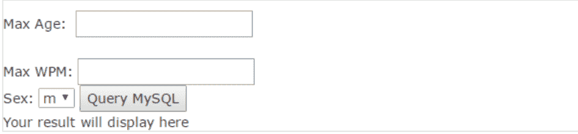

## 服务器端 PHP 文件

现在你的客户端脚本已准备就绪。现在我们需要编写服务器端脚本，它将从数据库中获取 age、wpm 和 sex，并将其发送回客户端。将以下代码放入 "ajax-example.php" 文件中。

```
<?php
$dbhost = "localhost";
$dbuser = "dbusername";
$dbpass = "dbpassword";
$dbname = "dbname";
//Connect to MySQL Server
mysql_connect($dbhost, $dbuser, $dbpass);
//Select Database
mysql_select_db($dbname) or die(mysql_error());
// Retrieve data from Query String
$age = $_GET['age'];
$sex = $_GET['sex'];
$wpm = $_GET['wpm'];
// Escape User Input to help prevent SQL Injection
$age = mysql_real_escape_string($age);
$sex = mysql_real_escape_string($sex);
$wpm = mysql_real_escape_string($wpm);
//build query
$query = "SELECT * FROM ajax_example WHERE sex = '$sex'";
if(is_numeric($age))
    $query .= " AND age <= $age";
if(is_numeric($wpm))
    $query .= " AND wpm <= $wpm";
//Execute query
$qry_result = mysql_query($query) or die(mysql_error());

//Build Result String
$display_string = "<table>";
$display_string .= "<tr>";
$display_string .= "<th>Name</th>";
$display_string .= "<th>Age</th>";
$display_string .= "<th>Sex</th>";
$display_string .= "<th>WPM</th>";
$display_string .= "</tr>";

// Insert a new row in the table for each person returned
while($row = mysql_fetch_array($qry_result)){
    $display_string .= "<tr>";
    $display_string .= "<td>$row[name]</td>";
    $display_string .= "<td>$row[age]</td>";
    $display_string .= "<td>$row[sex]</td>";
    $display_string .= "<td>$row[wpm]</td>";
    $display_string .= "</tr>";
}

echo "Query: " . $query . "<br />";
$display_string .= "</table>";
echo $display_string;
?>
```

现在在"最大年龄"或任何其他框中输入有效值，然后单击"查询 MySQL"按钮。


如果你已成功完成本课，那么你就知道如何将 MySQL、PHP、HTML 和 JavaScript 结合使用来编写 Ajax 应用程序。

XML 是一种标记语言，很类似 HTML。XML 文档是纯文本，包含由 `<` 和 `>` 界定的标签。XML 与 HTML 之间有两大区别：

- XML 没有定义必须使用的一组特定标签。
- XML 对文档结构极其严格。

XML 比 HTML 给你更多的自由。HTML 有一组特定的标签：`<a></a>` 标签用于包围链接，`<p>` 标签用于开始段落，等等。但是，XML 文档可以使用你想要的任何标签。将 `<rating></rating>` 标签用于电影评分，将 `<height></height>` 标签用于某人的身高。因此，XML 让你可以自定义标签。

在文档结构方面，XML 非常严格。HTML 允许你对某些开始标签和结束标签随意处理。但 XML 并非如此。

## 不是有效 XML 的 HTML 列表

```
<ul>
<li>Braised Sea Cucumber
<li>Baked Giblets with Salt
<li>Abalone with Marrow and Duck Feet
</ul>
```

这不是有效的 XML 文档，因为没有闭合的 `</li>` 标签与三个打开的 `<li>` 标签相匹配。XML 文档中每个打开的标签都必须关闭。

## 是有效 XML 的 HTML 列表

```
<ul>
<li>Braised Sea Cucumber</li>
<li>Baked Giblets with Salt</li>
<li>Abalone with Marrow and Duck Feet</li>
</ul>
```

## 解析 XML 文档

PHP 5 的新 SimpleXML 模块让解析 XML 文档变得简单。它将 XML 文档转换为一个对象，该对象提供对 XML 的结构化访问。

要从存储在字符串中的 XML 文档创建 SimpleXML 对象，请将字符串传递给 `simplexml_load_string()`。它将返回一个 SimpleXML 对象。

## 示例

尝试以下示例：

```
<html>
 <body>
   <?php
   $note=<<<XML
   <note>
     <to>Gopal K Verma</to>
     <from>Sairamkrishna</from>
     <heading>Project submission</heading>
     <body>Please see clearly </body>
   </note>
   XML;
   $xml=simplexml_load_string($note);
   print_r($xml);
   ?>
 </body>
</html>
```

它将产生以下结果：

```
SimpleXMLElement Object ( [to] => Gopal K Verma [from] => Sairamkrishna [heading] => Project submission [body] => Please see clearly )
```

注意：如果 XML 内容在文件中，可以使用函数 simplexml_load_file( filename)。

有关 XML 解析函数的完整详情，请查看 PHP 函数参考。

## 生成 XML 文档

SimpleXML 适用于解析现有 XML 文档，但不能用它从头开始创建新文档。

生成 XML 文档的最简单方法是构建一个与 XML 文档结构镜像的 PHP 数组，然后遍历该数组，以适当的格式打印每个元素。

## 示例

尝试以下示例：

```
<?php

$channel = array('title' => "What's For Dinner",
        'link' => 'http://menu.example.com/',
        'description' => 'Choose what to eat tonight.');

print "<channel>\n";
foreach ($channel as $element => $content) {
    print " <$element>";
    print htmlentities($content);
    print "</$element>\n";
}
print "</channel>";
?>
```

它将产生以下结果：

```
<channel>
<title>What's For Dinner</title>
<link>http://menu.example.com/</link>
<description>Choose what to eat tonight.</description>
</channel>
```

我们可以把宇宙想象成由太阳、地球、月亮等不同对象组成。同样，我们可以把汽车想象成由车轮、方向盘、齿轮等不同对象组成。同样地，面向对象编程概念将万物视为对象，并使用不同对象实现软件。

## 面向对象概念

在深入细节之前，让我们定义与面向对象编程相关的重要术语。

- **类：** 这是程序员定义的数据类型，包含局部函数和局部数据。你可以把类视为制作同一种（或同一类）对象的许多实例的模板。
- **对象：** 由类定义的数据结构的单个实例。你定义一次类，然后创建许多属于它的对象。对象也称为实例。
- **成员变量：** 这些是在类中定义的变量。这些数据对类外部不可见，可通过成员函数访问。创建对象后，这些变量称为对象的属性。
- **成员函数：** 这些是在类中定义的函数，用于访问对象数据。
- **继承：** 当一个类通过继承父类的现有函数来定义时，这称为继承。在此，子类将继承父类的所有或部分成员函数和变量。
- **父类：** 被另一个类继承的类。这也称为基类或超类。
- **子类：** 从另一个类继承的类。这也称为子类或派生类。
- **多态：** 这是一种面向对象概念，同一函数可用于不同目的。例如，函数名称保持不变，但可能接受不同数量的参数并执行不同任务。
- **重载：** 多态的一种类型，其中某些或所有运算符根据其参数的类型具有不同的实现。同样，函数也可以使用不同的实现进行重载。
- **数据抽象：** 隐藏（抽象）实现细节的任何数据表示。
- **封装：** 指将所有数据和成员函数封装在一起以形成对象的概念。


- **构造函数：** 是一种特殊类型的函数，每当从类中创建对象时，该函数会被自动调用。

- **析构函数：** 是一种特殊类型的函数，每当对象被删除或超出作用域时，该函数会被自动调用。

## 在 PHP 中定义类

在 PHP 中定义新类的一般形式如下：

```php
<?php
class phpClass{
var $var1;
var $var2 = "constant string";
function myfunc ($arg1, $arg2) {
[...]
}
[...]
}
?>
```

以下是每一行的说明：

- 特殊形式 **class**，后跟要定义的类名。

- 一组花括号，包含任意数量的变量声明和函数定义。

- 变量声明以特殊形式 **var** 开头，后跟常规的 $ 变量名；它们也可以有一个对常量值的初始赋值。

- 函数定义看起来很像独立的 PHP 函数，但局限于类，并用于设置和访问对象数据。

### 示例

以下是一个定义图书类型类的示例：

```php
<?php
class Books{
/* Member variables */
var $price;
var $title;
/* Member functions */
function setPrice($par){
$this->price = $par;
}

function getPrice(){
    echo $this->price ."<br/>"
}
function setTitle($par){
    $this->title = $par;
}
function getTitle(){
    echo $this->title ." <br/>";
}
}
?>
```

变量 $this 是一个特殊变量，它指向同一个对象，即自身。

## 在 PHP 中创建对象

定义类后，你可以根据需要创建任意数量的该类型对象。以下是使用 new 运算符创建对象的示例。

```php
$physics = new Books;
$maths = new Books;
$chemistry = new Books;
```

这里我们创建了三个对象，这些对象相互独立，且各自独立存在。接下来，我们将看到如何访问成员函数和处理成员变量。

## 调用成员函数

创建对象后，你将能够调用与该对象相关的成员函数。一个成员函数只能处理相关对象的成员变量。以下示例展示了如何通过调用成员函数为三本书设置标题和价格。

```php
$physics->setTitle( "Physics for High School" );
$chemistry->setTitle( "Advanced Chemistry" );
$maths->setTitle( "Algebra" );

$physics->setPrice( 10 );
$chemistry->setPrice( 15 );
$maths->setPrice( 7 );
```

现在你调用另一个成员函数来获取上面示例中设置的值：

```php
$physics->getTitle();
$chemistry->getTitle();
$maths->getTitle();
$physics->getPrice();
$chemistry->getPrice();
$maths->getPrice();
```

这将产生以下结果：

```
Physics for High School
Advanced Chemistry
Algebra
10
15
7
```

## 构造函数

构造函数是一种特殊类型的函数，每当创建对象时就会自动调用。因此，我们通过构造函数初始化许多事物来充分利用这一行为。

PHP 提供了一个名为 __construct() 的特殊函数来定义构造函数。你可以向构造函数传递任意数量的参数。

以下示例将为 Books 类创建一个构造函数，并在创建对象时初始化书籍的价格和标题。

```php
function __construct( $par1, $par2 ){
   $this->price = $par1;
   $this->title = $par2;
}
```

现在我们不需要单独调用 set 函数来设置价格和标题。我们可以仅在创建对象时初始化这两个成员变量。请查看以下示例：

```php
$physics = new Books( "Physics for High School", 10 );
$maths = new Books ( "Advanced Chemistry", 15 );
$chemistry = new Books ("Algebra", 7 );

/* Get those set values */
$physics->getTitle();
$chemistry->getTitle();
$maths->getTitle();

$physics->getPrice();
$chemistry->getPrice();
$maths->getPrice();
```

这将产生以下结果：

```
Physics for High School
Advanced Chemistry
Algebra
10
15
7
```

## 析构函数

与构造函数类似，你可以使用 function __destruct() 定义析构函数。你可以在析构函数中释放所有资源。

## 继承

PHP 类定义可以通过使用 extends 子句选择性地从父类定义继承。语法如下：

```php
class Child extends Parent {
  <definition body>
}
```

继承的效果是子类（或子类、派生类）具有以下特征：

- 自动拥有父类的所有成员变量声明。

- 自动拥有与父类相同的所有成员函数，（默认情况下）这些函数的工作方式与父类中的函数相同。

以下示例继承 Books 类，并根据要求添加更多功能。

```php
class Novel extends Books{
  var publisher;
  function setPublisher($par){
  $this->publisher = $par;
  }

function getPublisher(){
     echo $this->publisher. "<br />";
     }
}
```

现在，除了继承的函数外，类 Novel 还保留了两个额外的成员函数。

### 函数重写

子类中的函数定义会覆盖父类中同名的定义。在子类中，我们可以修改从父类继承的函数定义。在以下示例中，getPrice 和 getTitle 函数被重写以返回某些值。

```php
function getPrice(){
     echo $this->price . "<br />";
     return $this->price;
        }
        function getTitle(){
     echo $this->title . "<br />";
     return $this->title;
        }
    }
```

### 公共成员

除非另有说明，类的属性和方法都是公共的。也就是说，它们可以在三种可能的情况下访问：

- 从声明它的类之外

- 从声明它的类之内

- 从实现声明它的类的另一个类之内

到目前为止，我们看到所有成员都是公共成员。如果你希望限制类成员的可访问性，则可以将类成员定义为 **private** 或 **protected**。

### 私有成员

通过将成员指定为私有，你将其可访问性限制在声明它的类中。私有成员不能从继承该类的类中引用，也不能从类外部访问。

类成员可以通过在成员前使用 **private** 关键字设为私有。

```php
class MyClass {
    private $car = "skoda";
    $driver = "SRK";

    function __construct($par) {
        // Statements here run every time an instance of the class is created.
    }

    function myPublicFunction() {
        return("I'm visible!");
    }

    private function myPrivateFunction() {
        return("I'm not visible outside!");
    }
}
```

当 MyClass 类通过 extends 被另一个类继承时，myPublicFunction() 将可见，$driver 也是如此。扩展类将不了解或无法访问 myPrivateFunction 和 $car，因为它们被声明为私有。

### 受保护成员

受保护的属性或方法可在声明它的类以及扩展该类的类中访问。受保护成员在这两类类之外不可用。类成员可以通过在成员前使用 **protected** 关键字设为受保护。

以下是 MyClass 的另一个版本：

```php
class MyClass {
    protected $car = "skoda";
    $driver = "SRK";

    function __construct($par) {
        // Statements here run every time
        // an instance of the class
        // is created.
    }

    function myPublicFunction() {
        return("I'm visible!");
    }

    protected function myPrivateFunction() {
        return("I'm visible in child class!");
    }
}
```


}
}

### Interfaces

接口定义是为了为实现者提供一组共同的函数名。不同的实现者可以根据自己的需求实现这些接口。可以这么说，接口是由开发者实现的骨架。

As of PHP5, it is possible to define an interface, like this:

```php
interface Mail {
    public function sendMail();
}
```

Then, if another class implemented that interface, like this:

```php
class Report implements Mail {
    // sendMail() Definition goes here
}
```

### Constants

常量在某种程度上类似于变量，因为它持有一个值，但更像是一个函数，因为常量是不可变的。一旦声明了常量，它就不会改变。声明一个常量很容易，如本版本的 MyClass 中所示：

```php
class MyClass {
    const requiredMargin = 1.7;
    function __construct($incomingValue) {
        // Statements here run every time
        // an instance of the class
        // is created.
    }
}
```

在这个类中，requiredMargin 是一个常量。它使用关键字 const 声明，在任何情况下都不能更改为 1.7 以外的值。请注意，常量名没有像变量名那样的前导 $。

### Abstract Classes

抽象类是不能实例化、只能被继承的类。使用关键字 abstract 声明抽象类，如下所示：

```php
abstract class MyAbstractClass {
   abstract function myAbstractFunction() {
   }
}
```

从抽象类继承时，子类必须定义父类声明中标记为 abstract 的所有方法；此外，这些方法必须使用相同的可见性定义。

请注意，抽象类内部的函数定义也必须以关键字 abstract 开头。在非抽象类中定义抽象函数是不合法的。

### Static Keyword

将类成员或方法声明为 static 可以在无需实例化类的情况下访问它们。声明为 static 的成员无法通过已实例化的类对象访问（尽管可以访问静态方法）。

Try out the following example:

```php
<?php
class Foo
{
   public static $my_static = 'foo';
   public function staticValue() {
      return self::$my_static;
   }
}
print Foo::$my_static . "\n";
$foo = new Foo();
print $foo->staticValue() . "\n";
```

### Final Keyword

PHP 5 引入了 final 关键字，通过在定义前加上 final 来防止子类重写方法。如果类本身被定义为 final，则不能被继承。

The following example results in Fatal error: Cannot override final method BaseClass::moreTesting()

```php
<?php
class BaseClass {
   public function test() {
      echo "BaseClass::test() called<br>";

   }

   final public function moreTesting() {
       echo "BaseClass::moreTesting() called<br>";
   }
}

class ChildClass extends BaseClass {
    public function moreTesting() {
        echo "ChildClass::moreTesting() called<br>";
    }
}

?>
```

### Calling parent constructors

与其为子类编写一个全新的构造函数，不如通过显式调用父类的构造函数，然后为实例化子类执行任何必要的额外操作来编写它。以下是一个简单示例：

```php
class Name
{
    var $_firstName;
    var $_lastName;
    function Name($first_name, $last_name)
    {
        $this->_firstName = $first_name;
        $this->_lastName = $last_name;
    }

    function toString() {
        return($this->_lastName .", ". $this->_firstName);
    }
}

class NameSub1 extends Name
{
    var $_middleInitial;

    function NameSub1($first_name, $middle_initial, $last_name) {
        Name::Name($first_name, $last_name);
        $this->_middleInitial = $middle_initial;
    }

    function toString() {
        return(Name::toString() . " " . $this->_middleInitial);
    }
}
```

在此示例中，我们有一个父类（Name），它有一个两参数构造函数；还有一个子类（NameSub1），它有一个三参数构造函数。NameSub1 的构造函数通过使用 :: 语法显式调用其父构造函数（传递其中两个参数），然后设置一个额外字段来工作。同样，NameSub1 定义其非构造函数 toString() 函数，以它重写的父函数为基础。

**注意：** 构造函数可以与类同名定义。上面的示例中已定义。

将 PHP 最简单地理解为可嵌入 HTML 文档的解释型 C。该语言本身非常类似 C，只是带有无类型变量、大量内置的 Web 特定库，并且一切都直接钩入您喜爱的 Web 服务器。

语句和函数定义的语法应该很熟悉，只是变量总是以 $ 开头，并且函数不需要单独的原型。

这里列出了 PHP 与 C 的一些相似之处和不同之处。

### Similarities

相似之处

- **语法：** 总的来说，PHP 语法与 C 相同：代码对空格不敏感，语句以分号结束，函数调用结构相同（my_function(expression1, expression2)），花括号（{ 和 }）将语句组合成块。PHP 支持 C 和 C++ 风格的注释（/* */）以及 //），还支持 Perl 和 shell 脚本风格（#）。

- **运算符：** 赋值运算符（=、+=、*= 等）、布尔运算符（&&、||、!）、比较运算符（<、>、<=、>=、==、!=）以及基本算术运算符（+、-、*、/、%）在 PHP 中的行为与 C 中相同。

- **控制结构：** 基本控制结构（if、switch、while、for）的行为与 C 中相同，包括支持 break 和 continue。一个显著的区别是，PHP 中的 switch 可以接受字符串作为 case 标识符。

- **函数名称：** 浏览文档时，您会看到许多看起来与 C 函数相同的函数名称。

### Differences

不同之处

- **美元符号：** 所有变量都以 $ 开头。变量不需要在赋值前提前声明，并且没有固有类型。

- **类型：** PHP 只有两种数值类型：integer（对应 C 中的 long）和 double（对应 C 中的 double）。字符串长度任意。没有单独的字符类型。

- **类型转换：** 类型不在编译时检查，运行时通常也不会出现类型错误。相反，变量和值会根据需要自动跨类型转换。

- **数组：** 数组的语法表面上与 C 的数组语法相似，但实现完全不同。它们实际上是关联数组或哈希表，索引可以是数字或字符串。不需要提前声明或分配。

- **没有结构体类型：** PHP 中没有 struct，部分原因是数组和对象类型合在一起使其变得多余。PHP 数组的元素不需要是一致的类型。

- **没有指针：** PHP 中没有可用的指针，尽管无类型变量起到了类似的作用。PHP 支持变量引用。您也可以在某种程度上模拟函数指针，即函数名称可以存储在变量中，并通过变量而非文字名称来调用。

- **没有原型：** 函数不需要在定义其实现之前声明，只要函数定义可以在当前代码文件或包含的文件中找到。

- **内存管理：** PHP 引擎实际上是一个垃圾回收环境（引用计数），在小脚本中不需要进行任何释放。您可以自由分配新结构，例如新字符串和对象实例。在 PHP5 中，可以为对象定义析构函数，但没有 free 或 delete。析构函数在对象的最后一个引用消失、内存被回收之前被调用。

- **编译和链接：** PHP 脚本没有单独的编译步骤。

- **宽松性：** 总体而言，PHP 比 C 更宽容（尤其是在其类型系统中），因此会让您犯下新的错误。意外结果比错误更常见。


本章将列出 PHP 和 PERL 之间的主要相似之处和不同之处。这将帮助 PERL 开发者快速理解 PHP 并避免常见错误。

## 相似之处

- **编译型脚本语言：** Perl 和 PHP 都是脚本语言。这意味着它们不用于在执行前生成原生独立可执行文件。

- **语法：** PHP 的基本语法与 Perl 非常相似，并且两者都与 C 共享许多语法特性。代码对空白字符不敏感，语句以分号结束，花括号将多条语句组织成一个块。函数调用以函数名开始，后跟用括号括起来并用逗号分隔的实际参数。

- **美元符号变量：** PHP 中的所有变量看起来都像 Perl 中的标量变量：前面带有美元符号 ($) 的名称。

- **无需声明变量：** 与 Perl 一样，在使用 PHP 变量之前不需要声明其类型。

- **变量的弱类型：** 与 Perl 一样，PHP 中的变量除了当前持有的值之外没有固有类型。您可以在同一类型的变量中存储数字或字符串。

- **字符串和变量插值：** PHP 和 Perl 对双引号字符串 ("string") 的解释比单引号字符串 ('string') 更多。

## 不同之处

- **PHP 是 HTML 嵌入式：** 虽然可以通过命令行运行 PHP 来执行任意任务，但它更常见的是连接到 Web 服务器并用于生成 Web 页面。如果您习惯于在 Perl 中编写 CGI 脚本，PHP 的主要区别在于您不再需要使用 print 或 heredoc 语句显式打印大块静态 HTML，而是可以直接在 PHP 代码块之外编写 HTML 本身。

- **没有 @ 或 % 变量：** PHP 只有一种变量，以美元符号 ($) 开头。语言中的任何数据类型都可以存储在此类变量中，无论是标量还是复合类型。

- **数组与哈希：** PHP 有一种名为 array 的单一数据类型，它在 Perl 中既扮演哈希的角色，也扮演数组/列表的角色。

- **指定函数参数：** PHP 中的函数调用看起来很像 Perl 中的子程序调用。另一方面，PHP 中的函数定义通常要求某种形式的形式参数列表（如 C 或 Java），而 Perl 中并非如此。

- **函数中的变量作用域：** 在 Perl 中，变量的默认作用域是全局。这意味着顶级变量在子程序内可见。这常常导致跨函数滥用全局变量。在 PHP 中，函数定义内的变量作用域默认是局部的。

- **没有真正的模块系统：** 在 PHP 中，普通代码文件和用作导入库的代码文件之间没有真正的区别。

- **使用 break 和 continue 而非 next 和 last：** PHP 更像 C 语言，使用 break 和 continue 语句而不是 next 和 last 语句。

- **没有 elseif：** 一个微小的拼写差异：Perl 的 elsif 是 PHP 的 elseif。

- **更多种类的注释：** 除了 Perl 风格 (#) 的单行注释外，PHP 还提供 C 风格的多行注释 (/* comment */) 和 Java 风格的单行注释 (// comment)。

- **正则表达式：** PHP 没有特定于正则表达式的内置语法，但在其 "Perl-compatible" 的正则表达式函数中具有大部分相同的功能。

## 第 3 部分：函数参考

### 32. PHP – 函数参考

PHP 在内置函数方面非常丰富。以下是各种重要函数类别的列表。这里未涵盖其他各种函数类别。选择一个类别以查看与该类别相关的所有函数列表。

- PHP 数组函数
- PHP 日历函数
- PHP 类/对象函数
- PHP 字符函数
- PHP 日期和时间函数
- PHP 目录函数
- PHP 错误处理函数
- PHP 文件系统函数
- PHP MySQL 函数
- PHP 网络函数
- PHP ODBC 函数
- PHP 字符串函数
- PHP SimpleXML 函数
- PHP XML 解析函数

### 其他 PHP 函数类别链接

- PHP 函数手册

