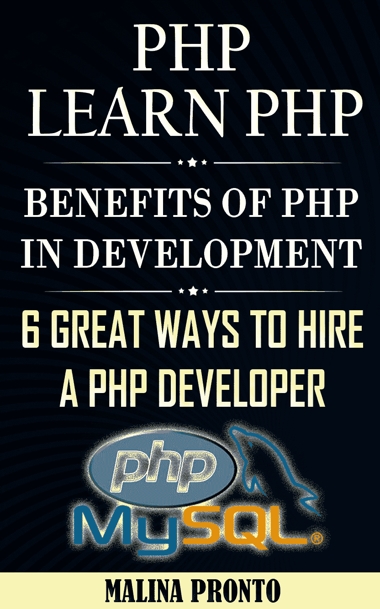

# PHP：学习 PHP：PHP 在 Web 开发中的优势：招聘 PHP 开发人员的 6 种方法

## PHP 在 Web 开发中的优势
`PHP`（超文本预处理器）是一种强大的开源服务器端脚本语言，因此被广泛应用于网站开发。`PHP` 语言的特性得到了广泛支持。它还支持 `MySQL`、`Oracle` 和 `MS Access`。它使用 `IMAP`、`POP3`、`LDAP`、`SNMP`、`HTTP`、`NNTP`、`COM` 等协议。`PHP` 还兼容 `Windows`、`Linux`、`UNIX`、`Mac OS X` 等许多操作系统；它是一种对客户友好的语言，在全球通用。它为高质量定制 `PHP` 网站开发服务提供了支持。

## 定制 PHP（超文本预处理器）开发服务
优质的 `PHP` 网站开发服务始于理解客户需求，延伸到数据库驱动的高端定制企业级网络系统。聘请专业的 `PHP` 开发人员使用 `Photoshop`、`Flash` 等工具为 `PHP/MYSQL` 网站设计样式。以下是 `PHP` 开发服务列表：
- `CMS` 开发
- 基于 `PHP` 的电子商务网站
- `API` 集成
- `动态网站`
- `在线企业门户网站`
- 自有 `PHP` 移动网络服务
- `PHP` 网络与框架
- `社交网络网站`等。

## PHP CMS / 框架开发

### CodeIgniter-
`CodeIgniter` 是一个轻量级且功能强大的 `PHP` 框架，专为那些需要一个简单而优雅的工具包来创建功能齐全且不同的 Web 应用程序的人而设计。它几乎零配置，没有限制性的编码规则，并为复杂的应用需求提供了简单的解决方案。它包含了一套用于常用任务的高级库，同时也提供了易于访问这些库的简单接口和逻辑结构。它的运行速度极快，因为其核心系统只需要几个小型的库，额外的库会根据请求动态加载，以支持你在特定过程中的需求。这表明底层系统既精简又敏捷。由于 `CodeIgniter` 使用 `MVC` 控制方法，它允许逻辑与演示之间进行良好的分离，这对于设计人员正在模板文件上工作的项目特别有用。

### CakePHP:
构建软件应用通常是一个耗时且贵的过程，然而利用框架可以帮助你更快地开发项目（通过重用通用组件和不同模块），并工作得更好（在一个统一的结构基础上构建）。通过遵守开发标准，使用框架还便于扩展和长期维护，保持代码的组织性，并允许你的应用程序在未来不断不断演变和成长。

## 使用 PHP 构建网站的优势
- 针对您的需求定制
- 易于定制
- 随时支持
- 根据业务需要易于编辑/添加/删除等。
它是最青睐的语言，因为它是开源且对客户友好的。

## 为您的业务招聘 PHP 开发人员的 6 大方法
虽然许多人可能认为在今天 `PHP` 有些过时，但它仍然是世界上最受青的编程语言之一。归因其在全球受欢迎的三个事实：几乎任何事情都可以使用 `PHP` 完成，`PHP` 拥有无限的框架特定可能性，因此该语言本身在世界上大多数技术学校都进行教授。尽管过去几年出现了许多编程语言，`PHP` 仍然是几乎每个想要构建定制、可扩展且基于 `PHP` 的组织的最终选择。

尽管如此，招聘 `PHP` 开发人员的方法通常具有挑战性。以下是供你考虑的选项：

### 自由职业平台
自由职业市场：`Hubstaff Talent`、`Upwork` 和 `Fiverr` 是其他几个平台，你可以在那里找到有才的 `PHP` 开发人员。
LaraJobs：该平台适用于那些寻求专业聘佣 `Laravel`（其中之一）`PHP` 开发人员的人。
CodeIgniter 论坛：这通常是寻找 `PHP` 开发人员的绝佳地点。你可以在工作板块寻找合适的开发人员。
LinkedIn CakePHP：`LinkedIn` 上的官方 `CakePHP` 小组是发布职位需求的极佳平台，如果你想。
Facebook 及其他在线社区：有各种高管在线社区，每个社区都致力于某种特定的 `PHP` 框架。根据你的独特需求，你可以在网上寻找它们。在这些平台上，你将直接与开发人员联系，或邀请推荐。

### 外包代理
`美国`、`英国`、`印度` 等国家的几乎所有的开发外包公司都提供 `PHP` 开发服务。这些机构非常负担得起，因为它们帮助你节省了招聘、入职和培训资源的开销成本。此外，它们允许你聘用全职 `PHP` 开发人员，他们非常专业、经验丰富并在许多项目中过证明。外包 `PHP` 开发人员到工作时，请确认起草正式合同，说明服务细节、费用明细等。确保所有非披露协议 (`NDAs`) 和条款 (`T & Cs`) 对双方都完全透明清晰。

## 开发 Web 应用程序的最佳平台是什么？
在创建网络应用程序之前，最重要的是确定要在哪个框架上开发。框架是构建网络应用程序的支持平台，并可能补充你为 Web 应用规划的功能。如果你是某种编程语言的粉丝，可能会希望选择与该语言配合良好的框架。以下是目前在开发者中流行的一些应用程序框架：

1. **Ruby on Rails**: `Ruby on Rails` 是一个开源服务器端 应用程序框架。`Rails` 也是一个模型视图-控制器 (`MVC`) 框架，为数据库、互联网服务和网站提供默认结构。它的成功案例包括 `Basecamp`、`GitHub`、`Airbnb`、`Twitch` 和 `SoundCloud`。`Rails` 还拥有极其友好的开发者社区。任何拥有活跃社区的框架对于新手开发者来说都是天赐之物。你将获得大量的资源、指南和案例研究。我们个人推荐 `Rails`，因为它是开源的，带有巨大的参考库和一些创建功能中心应用的极棒工具。
2. **CodeIgniter**

# Codeigniter
Codeigniter 是一个健壮且易于使用的 PHP 框架，并具有出色的工具包来构建 Web 应用程序。此外，为了极其轻量化，该框架配备了非常易读的优秀文档。它是一个诚实的库的集合，使得发现、采用和部署变得非常简单。Codeigniter 被认为在基于 MVC 的框架帮助下提供了灵活性和直观的管理。Codeigniter 允许你在使用其现有脚本的同时，结合你个人的核心库。它是一个摆脱复杂结构和繁琐开发流程的框架。如果你是一个 PHP 编程新手，Codeigniter 可能是一个很好的起点。

# 3. Express.js
在开始学习 Node.JS 之前，我们建议你先快速了解一下 Express.js。Express.js 是一个预构建的 Node.js 框架，允许你更快、更智能地构建服务器端 Web 应用程序，并具有更高的灵活性和扩展性。你首先获得了与 Node.js 框架匹配的性能水平，其次获得了一套适用于 Web 和移动应用的强大功能。你将使用 Express.js 构建单页、多页或混合 Web 应用程序。Express 使用 JavaScript 编写，使得编程非常简单。一些开发者认为，在 Express 上工作可以将他们的编程时间缩短一半。凭借 Express 背后 5 年的发展历史，可以说这通常是一个值得研究的成熟平台。错误处理通常会让人有些沮丧，因为你会在中间件中穿梭。该框架建议高级开发者使用。

# 4. AngularJS
如果你一直关注 YouTube 和 Netflix 的动态，AngularJS 可能会让你感到耳熟能详。它是由 Google 和其他几个开发社区维护的开源框架。AngularJS 是最流行的 JavaScript 框架之一。该框架允许开发者在网站开发中扩展 HTML 词汇。它的加载时间很短，并且非常利于测试。AngularJS 非常适用于视频流媒体应用、用户评论应用、旅游应用、天气应用、电子商务和社交媒体应用（LinkedIn 在其移动应用中使用 AngularJS）。AngularJS 实现了 MVC 方法。由于它使用 HTML 作为声明性语言，因此它非常直观。AngularJS 非常适合快速的前端开发，因为不需要其他插件或框架。AngularJS 由 Google 管理，因此有一个庞大的社区供你发现和学习。

# 5. Ember.js
任何对 Ember.js 的描述如果不提到它的宏大目标，都是不完整的：Ember.js 旨在“创建雄心勃勃的 Web 应用程序”。以 Apple Music 为例；这是一个雄心勃勃的应用，是 Ember.js 是严肃框架的有力证明。从单页 Web 应用程序到移动应用，甚至是桌面应用，Ember.js 支持一切。Ember.js 还关注 MVC 中的模型和控制器方面，而大多数其他框架并没有充分重视这些方面。Ember 解决了这些问题，并配备了出色的 UI 以实现惊叹的客户端功能。Ember 提供了整个开发堆栈和大量的稳定性。尽管大多数开发者倾向于选择 Angular 等框架，但 Ember 的向后兼容性特征使其作为一个框架处于了独特的地位。

# 6. CakePHP
CakePHP 提供了一个全栈框架，被认为是目前最全面的 PHP 框架之一。它的无缝配置使其在开发者中极广受欢迎。CakePHP 允许开发者将任何实用类引入到自己的应用程序中，或者使用自定义路由类来构建一个微框架。CakePHP 拥有高级的查询 API，并支持 PDO 和原生驱动程序的所有类型的数据库驱动程序或数据库类型。CakePHP 是预算友好型 Web 应用开发的理想选择，并与 MVC 编码方法配合。

# 7. Phalcon
Phalcon 是一个开源 PHP 框架。它是目前最快的 PHP 框架之一。Phalcon 通过创新的架构开发，并为基于 MVC 的应用程序提供了许多极低的开销。Phalcon 使用的资源较少，却提供了高性能。它可以处理比其他框架更多的 HTTP 请求，因为它用 C 语言编写的。Phalcon 绝对是可定义的。

# 8. Zend Framework
Zend Framework 是一个用于 PHP 5 的开源对象 Web 应用程序框架，复杂的 MVC 实现为 Web 应用程序建立了基础结构。Zend 还支持多种数据库系统和供应商。它通过 JSON 支持 AJAX，因此对客户和开发者都有利。Zend 在资深开发者中深受喜爱并继续被广泛。

# 9. ASP.net
ASP.net 是一个非常适合构建桌面和移动应用的 Web 开发平台。它使用 HTTP 协议并优化了 HTTP 命令。ASP.net 构建在公共语言运行时 (`CLR`) 之上，非常适合创建大型应用。编写其代码非常简单。ASP.net 是一个经常发现并消除内存泄漏和无限循环的环境。

# 10. Symfony
Symfony 是一个 PHP 开发框架。性能测试是 Symfony 的核心功能之一，开发者喜欢它。此外，多个开发者可以轻松管理 Symfony 项目。然而，Symfony 建议熟悉多种框架的高级开发者使用，因为其学习曲线通常很陡。

## 编码规则
遵循定义的标准和编码规则对于 PHP 开发是必须，因为这会产生高质量的代码和高效的输出。此外，专业的 Web 程序员在使用 PHP 编程时一直面临许多困难。PHP 开发在各个方面（如语法或架构）不断变化。每个版本都会引入新功能、特性和技巧，这让网站所有者跟踪问题变得非常困难。以下是在开发 PHP 时必须遵循的某些编码规则和技术标准。

### 规则 1：PHP 编码需要命名规范
PHP 的一个关键规范是对函数、变量以及其他代码进行命名。这里的命名意味着相关的、符合上下文的且符合语法正确的用语。

### 规则 2：正确的文档方法
在 PHP 中，你始终需要尝试所有正确的编码风格和方法，以便形成易于阅读和编辑的文档。注释、缩进、留白、适当的行长度是许多基本的编码实践。虽然注释为开发者提供了说明代码背后的目标或逻辑的空间，但缩进提供了清晰的代码层次结构，使得阅读和调试变得更容易。

### 规则 3：编码中不要使用短标签或任何快捷方式
为了加速开发时间，许多程序员在编码时使用短标签或快捷方式，但这是被严格限制的。这会导致 XML 解析器出现解析问题，或可能导致与其他 PHP 版本产生兼容性问题。因此，请务必在编码时始终使用完整的标签或快捷方式，以使其易于易读。

### 规则 4：始终开启错误报告功能
虽然 PHP 内置了一些出色的错误报告或调试工具来阻止任何微小故障，但许多程序员并没有意识到这一点。错误报告可能是 PHP 编程中一个非常简单且即时响应的方面，它能够对开发过程中遇到的所有潜在 bug 和错误提供报告。你只需要保持该功能始终开启状态即可。

### 规则 5：深度嵌套可能是大忌
在 PHP 编程中，深度嵌套绝不是一件令人愉悦的事，因为它会让调试工作变得异常困难，并为入侵者攻击你的数据或网站留下可机。因此，至关重要的是要理性地使用所有条件，并完全避免深度嵌套的想法。为了充分利用 PHP 框架，你需要遵循或维护这些指定的规则或标准。否则，你可能会发现你的网站不一致、有缺陷或存在 bug。尽管还有许多重要的编码标准可以加入列表，例如避免在循环中使用函数、理解字符串、用于 PHP 编码的 IDE 以及使用面向对象的方法。

# 使用 Laravel 开发 PHP：构建高级应用程序
构建高级的 Web 应用不仅涉及极其复杂的性，还需要开发人员极大的投入和关注。自从发明以来，Laravel 框架提供了此类功能和特性，凭借其权威的优越性，使得全球大多数开发者对其表现出浓厚的兴趣。以下是开发者使用 PHP 配合 Laravel 框架可以利用的优势列表。

## 轻量级模板
有了这个高效框架提供的轻量级模板，现在构建潜在的 Web 应用变得绝对更加容易。它不仅提供了动态内容填充的功能，还提供了令人印象深刻的布局。此外，它包含了大量带有 JS 代码和固结构化 CSS 的强大组件。

## MVC 架构
开发者在 Laravel 中发现的另一个非常有趣的特性是它的模型-视图-控制器（MVC）架构。构建互联网应用程序涉及不同的开发方面。通过 Laravel，处理这些方面变得轻而易举。此外，它还能帮助开发者编写易读且整洁的代码。同时，这种方法增强了整体性能。结果是，一旦使用了此框架，生成清晰的文档变得更加简单。

## 精益开发服务
这是 Laravel 提供的最有趣的特性之一。`lumen` 可能是一个遵循与 Laravel 相同原则的微框架，但它专注于精益开发。在此帮助下，你将能够高效、轻松地设计微项目。具有最少配置的集成功能是其最大的亮点。通过复制代码，在 `Lumen` 和 `Laravel` 之间进行迁移是可能的。

## 模块化且可扩展的框架
该框架是 20 个不同库的结合，而这些库每一个都是多种有效模块的结合。为了加强整个开发过程，`Packalyst` 目录允许添加近 5500 个包！借助这种模块化的包系统，可以一种高效的方式构建响应极极的 Web 应用。

## 内置工具
与市场上的许多其他可用 Web 开发框架一样，Laravel 提供了多种有效的内置工具，这些工具有助于简化和增强大多数常见任务。使用此框架，`routing`（路由）、`caching`（缓存）、`authentication`（身份验证）等关键功能变得易执行。

## 集成的授权库
与其他流行的 Web 开发框架不同，Laravel 提供了一个名为“自动完成”的独特特性。这些库有助于根据应用程序运行的平台自动调整不同的开发设置。

除了上述所有功能和优势之外，单元测试是 Laravel 提供的另一个丰富在线开发的方面。MALINA PRONTO

