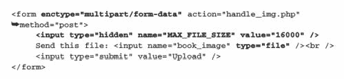

# PHP：24小时速成——PHP编程初学者指南

## 简介

本书将为您提供学习 PHP 语言基础的详细指导。

这本电子书将解释什么是 PHP，以及它如何帮助您构建 Web 应用程序。除了提供理论解释外，本书还将为您提供实际代码和实用示例。即使您以前从未编程过，也能快速学会这门计算机语言。如果您正在寻找一本全面的 PHP 参考书，这就是您需要的书。

阅读本书后，您将能够：

*   学习 PHP 的基本要素
*   了解编写 PHP 脚本时应使用的语法
*   创建您自己的变量和常量
*   调用 PHP 的内置方法和函数
*   在 Web 应用程序中处理错误和异常
*   安全地接收和存储用户输入
*   掌握 OOP（即面向对象编程）的基础知识
*   创建类和子类
*   了解 PHP 与 MySQL 之间的连接

PHP 是一门优秀的脚本语言。它可以帮助您创建健壮的网站和 Web 应用程序。如果您想在短短 24 小时内成为高效的 PHP 用户，请仔细阅读本书。

让我们开始这段旅程吧。

## 第 1 章：PHP – 基础知识

PHP 语言（即 PHP：Hypertext Processor，超文本预处理器）从其他编程语言（如 C、Perl、Java 等）借用了一些语法。人们认为 PHP 是一种混合型计算机语言，它吸收了其他语言的最佳功能，形成了一种强大且直观的脚本语言。

在本章中，您将了解 PHP 的基本方面，如变量、注释和语言结构。如果您想成为一名高效的 PHP 用户，请仔细阅读本章内容。

### HTML 嵌入

您将使用 PHP 创建动态网页。因此，您应该知道如何将其嵌入到最流行的脚本语言中：HTML（即 HyperText Markup Language，超文本标记语言）。请查看以下代码：

```html
<HTML>
<HEAD> This is a sample. </HEAD>
<BODY>
This code wants to greet you:
<?php
  print "Hi, how are you?";
?>
</BODY>
</HTML>
```

此示例向您展示了如何将 PHP 片段嵌入 HTML 代码中。每当语言解释器遇到 PHP 的“开始”标签（即 `<?php`）时，它就会执行嵌入的代码，直到遇到“结束”标签（即 `?>`）。在这里，PHP 将用适当的输出（如果有）替换 PHP 片段，并将非 PHP 代码（如 HTML）传递给用户的网站客户端。如果您运行上述代码，屏幕将显示如下内容：

```html
<HTML>
<HEAD> This is a sample. </HEAD>
<BODY>
This code wants to greet you:
Hi, how are you?
</BODY>
</HTML>
```

### 注释

您还需要学习如何向 PHP 代码添加注释。作为一名程序员，您将使用注释为您的工作添加细节和描述，而不影响其输出和行为。PHP 语言支持三种注释方法。这些方法包括：

*   **“Shell”方法**（即 `#`） - 在此方法中，您将使用井号符号开始注释。此符号仅适用于单行注释。例如：
    `# This comment is awesome.`
*   **“C”方法**（如 `/* */`） - 此方法源自 C 语言。此选项允许您创建多行注释。例如：
    ```php
    /* This comment
    spans
    multiple lines. */
    ```
*   **“C++”方法**（即 `//`） - 编写单行注释时使用此方法。示例如下：
    `// This is a sample.`

### 变量

PHP 中使用的变量不同于编译型语言（如 C、C++、Java 等）中的变量。这种差异在于 PHP 变量是“弱类型”的。简单来说，PHP 允许您在无需预先声明的情况下使用变量。您不必显式声明变量或指定其类型。因此，您可以随时更改变量的数据类型。

在 PHP 语言中，您应使用美元符号（即 `$`）引入变量。命名变量时可以使用字母、数字和下划线。但是，不能使用数字作为变量名的第一个字符。这意味着 `$one_apple` 是有效的，而 `$1_apple` 则无效。

如前所述，PHP 允许您使用未声明的变量。下面给出的示例将说明这一概念：

```php
$PI = 3.14159;
$radius = 10;
```

这段代码在未声明数据类型的情况下创建了两个变量。在这里，“PI”属于浮点类型，而“radius”属于整数类型。

**重要提示：** PHP 语言不兼容全局变量。每个变量均局限于其作用域。如果在函数内部创建，一旦该函数不再存在，该变量就会消失。

#### 间接引用

PHP 允许您使用间接引用访问变量。这意味着您可以在运行时通过名称生成并访问变量。分析以下示例：

```php
$car = "BMW";
$$car = "Z4";
print $car;
```

如果您运行此代码片段，屏幕将显示“Z4”。这段代码的第二行访问了名为“car”的变量并更改了其值。正如您所见，该行多了一个美元符号。该符号告诉 PHP 解释器，您引用的是所涉变量所包含的值。在本例中，生成了一个名为“Z4”的新变量。

**重要提示：** 关于你可以使用的间接引用数量没有限制。这意味着你可以在变量名前放置任意数量的美元符号。

#### 如何管理变量

有三种语言结构可用于管理你的 PHP 变量。这些结构允许你验证特定变量是否存在、删除变量以及检查它们的真值。让我们详细讨论每一种语言结构：

*   **`isset()`** - 此结构检查 PHP 是否已声明特定变量。如果你选择的变量已存在，它将返回 "true"（即布尔值）；否则返回 false。下面的脚本将演示这一概念：
    ```php
    if (isset($my_name)) {
        print '$my_name exists';
    }
    ```
    如果名为 "my_name" 的变量存在，你的屏幕将显示 "$my_name exists." 然而，如果你的代码中没有该变量，你将不会得到任何输出。

*   **`unset()`** - 使用此结构来“取消声明”一个现有变量。如果没有引用指向该变量的值，分配给它的内存将被释放。对已删除的变量调用 `isset()` 将返回 "false"。这是一个示例：
    ```php
    $gameconsole = "PlayStation 4";
    unset($gameconsole);
    if (isset($gameconsole)) {
        print '$gameconsole exists';
    }
    ```
    **重要提示：** 你也可以在对象属性和数组元素上使用 `unset()` 和 `isset()`（稍后你将学习这些）。你应该使用的语法是：
    *   对于对象属性：`if (isset($object->property)) { … }`
    *   对于数组元素：`if (isset($array["offset"])) { … }`

*   **`empty()`** - 使用此结构，你可以检查变量是否存在或是否被设置为 false。在检查变量的真值时，`empty()` 会将数据转换为布尔值，并检查它是 true 还是 false。请查看以下脚本：
    ```php
    if (empty($gameconsole)) {
        print 'Sorry, this variable doesn\'t have a value';
    }
    ```

### 超全局变量

通常情况下，你不能在 PHP 中使用全局变量（即可以从代码任何部分访问的变量）。然而，这种脚本语言拥有表现得像典型全局变量的内置变量。这些变量被称为超全局变量，是你编写 PHP 脚本时可以使用的最佳工具之一。以下是你将遇到的一些超全局变量：

*   **`$_ENV[]`** - 这是一个包含环境变量的数组。
*   **`$_GET[]`** - 此数组保存从用户网页浏览器收集的所有 "GET" 变量。
*   **`$_POST[]`** - 此超全局变量类似于 `$_GET`。唯一的区别是 `$_POST` 仅涉及 POST 变量。
*   **`$_SERVER`** - 此类数组保存 Web 服务器变量的值。

### 数据类型

PHP 语言支持八种数据类型。其中五种是标量类型。然而，剩下的三种具有独特的属性，使它们与其他类型区分开来。如前所述，PHP 变量可以容纳任何数据类型。请记住，PHP 变量的行为取决于它们所容纳的数据类型。以下是你在使用 PHP 时将遇到的数据类型：

#### 整数

整数是一个整数，其范围与 C 语言的 "long" 数据类型相同。在大多数机器上（例如 Intel 奔腾处理器），整数是一个 32 位有符号数，可以低至 `-2,147,483,648` 或高至 `2,147,483,647`。

你可以用八进制（以零为前缀）、十进制（无前缀）和十六进制（以 `0x` 为前缀）形式书写整数。此外，PHP 整数可以是正数或负数。以下是一些有效 PHP 整数的示例：

*   `30000`
*   `0xCDEF`
*   `003`
*   `-90`

#### 浮点数

浮点数，也称为实数，是 PHP 版本的 C 语言 "double" 类型。在典型平台上访问时，浮点数大小为 8 字节，最高可达 `1.8E+308`，最低可至 `2.2E-308`。通常，浮点值可以包含指数、小数点以及 "+" 或 "-" 符号。下表列出了一些有效的浮点数：

*   `65.7E43`
*   `-1800.4`
*   `+0.8e-3`

#### 字符串

在 PHP 中，字符串是字符序列（即字母和数字），始终以空字符结尾。然而，与其他计算机语言不同，PHP 在内部记录字符串的长度，而不是依赖空终止符。这种方法使 PHP 解释器能够轻松处理二进制信息。例如，你可以使用此函数即时生成图像并将其发送到网页浏览器。字符串能拥有的最大尺寸取决于你使用的 C 编译器和计算机。然而，你可以确信它能毫无问题地处理 2GB 的数据。

**重要提示：** 不要创建验证上述限制的程序。你很可能会先达到平台的内存限制。

在将字符串值添加到 PHP 代码时，你可以使用单引号、双引号或 Here-docs。让我们详细讨论这些选项：

*   **单引号** – 这是创建字符串时可使用的最简单选项。在一对引号之间写入你的字符串。此方法支持两种转义字符，分别是：`\'` 和 `\\`。你稍后将了解转义字符。
*   **双引号** – 此选项比前一个更复杂。你可以用它来容纳任何字符。然而，在处理特殊符号时，你需要使用反斜杠字符。在特殊字符前添加反斜杠称为“转义”。以下是你在使用 PHP 时将遇到的转义字符：
    *   `\n` – 用于在代码中添加换行符。换行符是你按下 Enter 键后得到的字符。
    *   `\t` – 使用它，你可以在 PHP 代码中添加制表符。
    *   `\\` - 你可以使用此符号在脚本中添加反斜杠字符。正如你所见，反斜杠字符用于激活其他字符的特殊功能。因此，你需要输入两个反斜杠字符才能得到一个普通的反斜杠。
    *   `\"` - 双引号用于括起字符串。要添加普通的双引号字符，你需要使用反斜杠引入它。
    *   `\r` – 此转义符允许你向 PHP 脚本插入换行符。
    *   `\$` - 使用此符号在代码中添加普通的美元符号。正如你所知，`$` 用于创建 PHP 变量。
    *   `\0` – 使用此符号，你可以添加 ASCII 的 0 字符。
    *   `\{八进制数字}` – 用于向代码添加 ASCII 字符。此处应使用该字符的八进制表示。
    *   `\x{十六进制数字}` – 此转义字符与八进制转义字符几乎相同。唯一的区别是此转义符要求字符的十六进制表示。

双引号字符串的另一个强大功能是它可以容纳表达式或变量的表示法。下面给出的示例将帮助你理解此功能的工作原理。系统将自动用涉及变量的值替换变量引用。如果该值不是字符串，系统会将该数据转换为其对应的字符串表示（例如 `999` 将转换为 "999"）。

*   `"The answer is $answer\n"`
*   `"The $i array offset holds $array[$i]"`

在你想要将字符串与值（例如表达式或变量）连接但其语法不足的情况下，你可以使用点运算符（即 `.`）来组合（或连接）多个字符串。你稍后将了解更多关于此运算符的信息。

*   **Here-Docs** – 此选项允许你将大量内容嵌入代码中。这些内容可能包含单引号或双引号。使用 Here-docs 定界符时，你无需担心转义符号。

#### 布尔值

### PHP 数据类型和运算符

#### 自动类型转换为布尔值

如前所述，PHP 会自动转换数据类型。你应该知道，数据类型在运行时经常会被转换为布尔值。这是因为在条件代码（例如循环、`if` 语句等）中，系统会将涉及的数据类型转换为布尔值，以查看它们是否满足给定条件。此外，PHP 的比较运算符会产生布尔值。分析以下代码片段：

```php
$first_value = 3;
$second_value = 4;

if ($second_value > $first_value) {
    print "The second value is greater than the first one\n.";
}
```

在这里，系统将检查条件是否满足。结果是一个布尔值（即 `true` 或 `false`）。如果条件语句评估为 `true`，则大括号内的命令将会运行。

#### Null

这种数据类型只能有一个值，即 `NULL`。你将使用此类型来标记空变量。如果你正在使用数据库，可以使用 `Null` 来区分无效值和空字符串。

如果被检查的变量存在，该语言的 `isset()` 运算符会对 `Null` 值返回 `false`。然而，当用于其他数据类型时，如果变量存在，`isset()` 将返回 `true`。

#### Resource（资源）

这被视为一种特殊的数据类型。它代表 PHP 的扩展资源，例如打开的文件。请记住，你不会直接处理资源变量。相反，你只需将其传递给可以与相关资源交互的不同函数。

#### 数组

在 PHP 语言中，数组是一组键值对：它将键索引到各自的值。数组索引可以采用字符串或整数的形式，而值可以属于任何数据类型（甚至是其他数组）。

##### 声明数组

声明数组时，你可以使用 `array()` 结构。此结构需要以下语法：

```
array([key_to_be_used =>] value, [key_to_be_used =>] value, ...)
```

在此语法中，`key_to_be_used` 条目是完全可选的。如果你不指定键，系统将自动为你创建一个。该键将是可用的最大整数加一。PHP 允许你在单个声明中混合使用带键和不带键的数组。

##### 访问数组元素

你需要使用 `$arr[key]` 语法来访问数组元素。在此语法中，`key` 可以是字符串或整数。使用常量字符串作为键时（例如 `$arr["string"]`），请务必包含引号。这种语法非常有用：你可以用它来读取现有元素或创建新元素。

#### 常量

在使用 PHP 时，你可以为基本值设置名称，称为常量。就像在其他语言中一样，一旦你分配了 PHP 常量的值，就无法更改它。命名常量的规则与命名变量的规则几乎相同。唯一的区别是常量名称前不需要美元符号。声明常量时，大多数程序员倾向于使用大写字母。这种方法有助于他们实现代码的可读性。

PHP 允许你在代码的任何部分访问常量。这意味着你不需要在每个函数和 PHP 文件中声明它们。以下是定义常量时应使用的函数：

```
define("NAME_OF_CONSTANT", value)
```

其中：

*   `NAME_OF_CONSTANT` 是一个由字母和数字组成的典型字符串。
*   `value` 是除对象和数组之外的任何 PHP 表达式。

下面给出的代码片段将向你展示如何定义和使用常量：

```php
define("OK", 0);
define("ERROR", 1);

if ($errorcode == ERROR) {
    print("An error has occured\n");
}
```

#### 运算符

PHP 语言支持三种运算符：一元、二元和三元。

##### 二元运算符

二元运算符需要两个操作数。例如：

```
1 + 5
13 * 3.14
$x / 10
```

请记住，你只能对属于同一数据类型的值执行二元运算。如果你正在处理的操作数具有不同的数据类型（例如字符串和整数），PHP 语言将执行自动转换。因此，它会将一种数据类型转换为另一种以实现一致性。这种自动转换的工作方式如下：

*   如果你正在处理整数和浮点数，前者将被转换为后者的数据类型。
*   如果你正在处理字符串和整数，PHP 将转换前者。
*   如果你正在处理实数和字符串，PHP 将转换后者。

###### 赋值运算符

赋值运算符允许你将值赋给变量。在这里，你应该将变量名写在表达式的左侧。将你想要赋的值放在表达式的右侧。例如，在表达式 `$sample = 10` 中，你将把 `10` 赋给名为 `sample` 的变量。

除了 `=` 之外，还有各种赋值运算符可供你在 PHP 中使用。这些运算符涉及特定的数学符号，执行运算并将结果赋给左侧操作数。以下是一些示例：

*   `$counter += 1;` `/* 在此表达式中，PHP 会将 1 加到 counter 的当前值上。然后，它将把总和作为该变量的新值赋予。 */`
*   `$fund -= $expenses;` `/* 在这里，PHP 会从 "fund" 的值中扣除名为 expenses 的变量的值，并将差值作为前者的新值赋予。 */`

PHP 支持以下赋值运算符：

`=`, `-=`, `/=`, `*=`, `+=`, `.=`, `|=`, `>>=`, `<<=`, `&=`, `^=`, 和 `&=`

###### 数值运算符


通常，二元运算符需要数值操作数。如果你处理的是 `null`、字符串、资源或布尔值，系统将在执行任何计算之前将这些值转换为数字。以下是你将在 PHP 中找到的数值运算符：

*   `+` - 这称为“加法”运算符。它将两个操作数的值相加并返回总和。
*   `-` - 程序员称之为“减法”运算符。它从左侧操作数的值中减去右侧操作数的值并返回差值。
*   `*` - 这是“乘法”运算符。它将两个操作数的值相乘并返回乘积。
*   `/` - 使用此运算符，你可以将左侧操作数的值除以右侧操作数的值并返回商。
*   `%` - 这是“取模”运算符。它将左侧操作数的值除以右侧操作数的值并返回余数。

### 连接运算符

此运算符允许你连接字符串。由于它仅适用于字符串值，因此它会在执行任何操作之前转换非字符串操作数。下面给出的代码片段将输出 "My favorite number is 23"：

```
$favorite_number = 23;
print "My favorite number is " . $favorite_number;
```

连接运算符在组合操作数之前将整数 `$favorite_number` 转换为字符串（即 "23"）。

### 比较运算符

你可以使用这些运算符来比较两个操作数的值。如果你处理的是两个字符串操作数，PHP 将以字典顺序执行比较。因此，它将给出一个布尔结果。下面列出的比较运算符在必要时执行自动数据类型转换：

*   `==` - 此运算符检查操作数是否具有相等的值。如果值相等，它将给你 `true`。例如，`3 == 4` 评估为 `false`。
*   `!=` - 这与前一个运算符完全相反。如果操作数内的值不相等，它将给你 `true`。例如，`3 != 4` 评估为 `true`。
*   `>` - 使用此运算符，你可以检查左侧操作数的值是否大于右侧操作数的值。如果是，你将得到 `true` 作为结果。例如，`3 > 4` 将给你 `false`。
*   `<` - 使用此运算符判断左侧操作数的值是否小于右侧操作数的值。如果是，将得到 `true`。例如，`3 < 4` 的结果为 `true`。
*   `<=` - 程序员称之为“小于或等于”运算符。如果左侧操作数的值小于或等于第二个操作数，将得到 `true`。例如，`3 <= 4` 将得到 `true`。
*   `>=` - 这是“大于或等于”运算符。如果左侧操作数的值大于或等于右侧操作数的值，将得到 `true`；否则得到 `false`。例如，`3 >= 4` 的结果为 `false`。

### 逻辑运算符

此类运算符在执行任何比较之前，会将其操作数转换为布尔形式。以下是 PHP 支持的逻辑运算符：

*   `&&` - 称为“逻辑与”运算符。如果两个操作数均为 `true`，将得到 `true`。
*   `||` - 程序员称之为“逻辑或”运算符。在 PHP 代码中使用时，如果至少有一个操作数为 `true`，将得到 `true`。
*   `xor` - 这是“逻辑异或”运算符。如果仅有一个操作数为 `true`，将得到 `true`。因此，如果两个操作数均为 `true` 或均为 `false`，将得到 `false`。

> **重要提示：** 逻辑或和逻辑与运算符支持短路求值。这意味着它们无需检查整个表达式即可给出结果。例如，如果第一个操作数为 `true`，逻辑或将给出 `true`，因为其条件已满足（即至少有一个操作数应为 `true`）。另一方面，如果第一个操作数为 `false`，逻辑与运算符将给出 `false`。它不再检查第二个操作数，因为无论第二个操作数是什么，指定的条件都无法满足（即两个操作数均须为 `true`）。

### 位运算符

位运算符对其操作数的位级形式进行操作。除非操作数是字符串，否则它们将被转换为各自的二进制形式，然后执行运算。在两个操作数均为字符串的情况下，PHP 将通过匹配字符偏移量来执行运算（例如，系统将字符视为二进制数）。

*   `&` - 这是“按位与”运算符。它会在两个操作数均为 `1` 的每个位位置上放置 `1`。
*   `|` - 此运算符称为按位或，会在至少有一个操作数为 `1` 的位位置上放置 `1`。
*   `^` - 程序员称之为“按位异或”运算符。它会在仅有一个操作数为 `1` 的每个位位置上放置 `1`。

### 一元运算符

属于此类型的运算符作用于单个操作数。

#### 取反运算符

这些运算符反转其操作数的当前值。PHP 支持两个取反运算符，分别是：

*   `!` - 程序员称之为“逻辑非”运算符。如果操作数的值为 `false`，将得到 `true`。反之，如果值为 `true`，此运算符将得到 `false`。
*   `~` - 这是按位取反运算符。它将 `0` 替换为 `1`，反之亦然。

#### 自增和自减运算符

这些运算符具有独特的特性——它们作用于变量，而非存储的值。这是因为除了获取运算结果外，它们还会改变存储在变量内部的值。PHP 语言支持两个自增运算符和两个自减运算符。它们是：

*   `$sample++` - 这是“后自增”运算符。它返回变量的当前值并将其增加 `1`。
*   `$sample--` - 程序员称此运算符为“后自减”。基本上，此运算符在将变量值减少 `1` 之前，给出变量的当前值。
*   `++$sample` – 此运算符称为“前自增”，它增加其所依附变量的值并返回结果值。
*   `--$sample` – 使用此运算符，可在检索输出前将操作数的值减一。

### 强制类型转换运算符

PHP 提供六个强制类型转换运算符，可用于强制类型转换。你应该将运算符放在操作数的左侧。下表列出了 PHP 中所有的强制类型转换运算符：

*   `(array)` – 此运算符将值的数据类型更改为“array”。
*   `(int)` 或 `(integer)` – 使用此运算符将值转换为整数。
*   `(string)` – 这是用于从非字符串值创建字符串值的运算符。
*   `(object)` – 使用此运算符，可将任何值标记为“object”。
*   `(real)`、`(float)` 或 `(double)` – 此运算符允许将任何数据类型的值转换为浮点值。
*   `(bool)` 或 `(boolean)` – 使用此运算符将任何值转换为其布尔形式。

> **请记住** 强制类型转换运算符影响的是变量的值，而非变量本身。例如：

```
$sample_string = "10";
$sample_number = (int) $sample_string;
```

在此例中，名为 `$sample_number` 的变量获得整数 `10` 作为其值。然而，名为 `$sample_string` 的变量仍属于字符串类型。

### 三元运算符

程序员认为问号运算符（即 `?`）是任何语言中最酷的运算符之一。在 PHP 中，此运算符的格式为：

```
conditional_statement ? first_expression : second_expression
```

`?` 运算符对 `conditional_statement` 的结果求值。如果结果为 `true`，运算符将返回 `first_expression` 的值。如果结果为 `false`，运算符将给出 `second_expression` 的值。

下面的代码片段将帮助你理解此运算符的工作原理：

```
$x = 100;
$sample_message = isset($a) ? '$x exists' : '$x doesn\'t exist';
print $sample_message;
```

如果你运行此代码，屏幕将打印以下内容：

```
$x exists
```

# 第 2 章：控制结构

这种编程语言支持其他计算机语言提供的最佳控制结构。PHP 用户将控制结构分为两类：条件控制和循环控制。条件控制结构影响程序流程，并根据预定标准运行或跳过特定代码。另一方面，循环控制结构根据程序员设定的标准多次运行一段代码。让我们详细讨论每种类型的结构：

## 条件结构

编写程序时需要使用条件语句。这些语句允许程序根据用户的输入及其自身的“决策”表现出不同的行为。在 PHP 中，你可以使用 `if` 语句和 `switch` 语句。这些语句是计算机编程中最流行的两种控制结构。

### `if` 语句

此类包含三种语句，分别是：

1.  `if (conditional_expression)` statement/s
2.  `elseif (conditional_expression)` statement/s
3.  `elseif (conditional_expression)` statement/s … `else` statements

这些语句被认为是编程和脚本编写中最流行的条件构造。实际上，你会在大多数计算机语言中找到它们。每个 `if` 语句都有一个称为“真值表达式”的条件表达式。如果 `if` 语句的真值表达式结果为 `true`，其下方的语句或语句组将运行；否则将被忽略。

你可以向 `if` 语句添加 `else` 子句，仅当你提供的条件表达式求值为 `false` 时运行代码。示例如下：

```
if ($sample >= 100) {
    print '$sample is within the given range';
} else {
    print '$sample is invalid';
}
```

正如你所见，花括号定义了每个 `if` 和 `else` 子句下的语句，将这些语句变为“代码块”。在此例中，由于每个代码块仅包含单条语句，你可以移除花括号。然而，即使在花括号完全可选的情况下，最好仍然编写花括号。花括号能提高 PHP 代码的可读性。

### “elseif” 结构

您可以使用 “elseif” 结构执行一系列条件判断，并且仅运行第一个满足条件下的代码。例如：

```
if ($sample < 0) {
    print '$sample is a negative integer';
} elseif ($sample == 0) {
    print 'sample is equal to zero';
} elseif ($sample > 0) {
    print '$sample is a positive integer';
}
```

### “switch” 语句

`switch` 语句的语法是：

```
switch (expression) {
    case expression:
        statement/s
    case expression:
        statement/s
    …
    default:
        statement/s
}
```

程序员使用 `switch` 语句来替代复杂的 `if-elseif` 语句。`switch` 语句将一个表达式与其主体内所有可能的条目进行比较。如果未找到完全匹配项，程序将运行 “default” 子句并忽略该语句的其余部分。在 PHP 中，您可以使用 `break` 语句来终止代码的执行，并将控制权传递给后续脚本。大多数程序员将 `break` 语句放在 `switch` 结构的最后部分。分析以下示例：

```
switch ($solution) {
    case 'x':
    case 'X':
        print "The solution is correct\n";
        break;
    case 'u':
    case 'U':
        print "The solution is incorrect\n";
        break;
    default:
        print "Error: The system doesn't recognize the solution\n";
        break;
}
```

## 循环结构

您可以使用循环结构在 PHP 脚本中重复特定过程。例如，您可以使用 “循环” 多次提交查询结果。在本书的这一部分，您将了解 PHP 语言支持的循环结构：

### “while” 循环

编写 “while” 循环时，应使用以下语法：

```
while (expression)
    statement/s
```

大多数程序员认为 “while” 循环是任何语言中最简单的循环类型。在每次重复开始时，程序将计算循环的真值表达式。如果表达式的结果为 `true`，循环将运行其内部的所有语句。然而，如果结果为 `false`，循环将结束并将程序控制权传递给其后的语句。

### “break” 和 “continue” 子句

在 PHP 中，“break” 子句和 “continue” 子句需要以下语法：

```
break;
break expression;
continue;
continue expression;
```

有时您需要在迭代过程中结束循环。因此，PHP 提供了 `break` 语句。如果 `break` 语句作为单行出现（即 `break;`），程序将影响最内层的循环。您可以通过为 `break` 子句设置参数来指定要处理的最大层级。语法如下：

```
break x;
```

### “do… while” 循环

编写 “do… while” 循环时应使用以下语法。

```
do
    statement/s
while (expression);
```

“do… while” 循环类似于普通的 “while” 循环。唯一的区别在于，“do… while” 循环在结束每次迭代**之前**检查其真值表达式。基本上，这种循环确保您的语句**至少运行一次**，无论真值表达式的值如何。

程序员使用 “do… while” 循环在满足预定条件时终止代码块。示例如下：

```
do {
    statement/s
    if ($sample) {
        break;
    }
    statement/s
} while (false);
```

由于 “do… while” 循环至少运行一次，您放置在该循环内的语句将仅运行一次。此外，其真值表达式的值始终计算为 `false`。PHP 允许您在 “do… while” 循环内放置 `break` 子句，以随时终止其执行。显然，您可以使用这种循环来促进典型的重复过程。

### “for” 循环

PHP 的 “for” 循环类似于 C 语言。这种循环接受三个参数：

```
for (start_expression; truth_expression; increment_expression)
```

通常，程序员为循环的每个部分（即真值、开始和增量）使用单个表达式。因此，您可以使用以下语法创建基本的 “for” 循环：

```
for (expression; expression; expression)
    statement/s
```

PHP 解释器仅计算一次 `start_expression`。该表达式初始化其所属循环的控制变量。名为 `truth_expression` 的元素则在每次循环迭代开始时运行。如果 `truth_expression` 计算结果为 `true`，“for” 循环内的所有语句将运行；如果计算结果为 `false`，循环将结束。解释器在结束每次迭代**之前**检查 `increment_expression`。程序员使用 `increment_expression` 来调整循环控制变量的值。

您可以在 “for” 循环中包含 `continue` 和 `break` 语句。请记住，`continue` 会强制 PHP 解释器在检查 `truth_expression` **之前**计算 `increment_expression`。以下示例将向您展示 “for” 循环的工作原理：

```
for ($x = 0; $x < 5; $x++) {
    print "The square of this variable is " . $x * $x . "\n";
}
```

就像 C 语言一样，PHP 允许您为循环的每个参数提供多个表达式。您只需使用逗号分隔这些表达式即可。如果您使用此选项，每个参数将取其最右侧表达式的值。

此外，您不必为 “for” 循环提供参数。解释器将假定缺失的参数计算结果为 `true`。例如，下面的代码片段将持续运行：

```
for ( ; ; ) {
    print "This loop is infinite\n";
}
```

## 代码包含结构

您可以使用代码包含结构来组织程序的源代码。除了将复杂代码转化为可管理的代码块外，代码包含结构还可以帮助您将代码应用于其他 PHP 项目。

### “include” 语句

就像其他计算机语言一样，PHP 支持使用 “include” 语句将代码分割到多个文件中。将源代码分割到不同文件中通常有利于 “代码复用”（即在不同脚本中使用相同代码）或实现代码可读性。每当您执行此语句时，PHP 将读取一个文件，将其编译为可执行代码并运行它。

该语句的行为类似于函数。但请记住，`include` 是 PHP 语言的一个预装结构。编写 `include` 语句时，应使用以下语法：

```
include name_of_file;
```

以下示例将向您展示如何编写 `include` 语句：

**error_files.php**

```
<?php
    $system_ok = 1;
    $system_error = 0;
?>
```

**check.php**


```php
<?php
    include "error_files.php";
    print ('The variable named $system_error holds ' . "$system_error\n");
?>
```

如果您运行此脚本，屏幕将显示以下消息：

> “The variable named $system_error holds 0”

### `eval()` 函数

此函数类似于 “include” 语句。然而，它不是从 PHP 文件编译并运行代码，而是将代码视为基本字符串。此功能可帮助您运行动态生成的代码或从外部来源手动检索代码。您应该知道，使用 `eval()` 比手动编写代码更复杂。因此，最好避免使用此函数。

## 第 3 章：PHP 的函数

PHP 支持内置函数和用户定义函数。所有 PHP 函数均响应以下调用：

```php
func(argument_1, argument_2, argument_3, …)
```

您可以在调用中包含的参数取决于您使用的函数。您可以使用任何 PHP 表达式作为参数。实际上，您也可以将其他函数调用作为参数。以下是该语言的内置函数之一：

```php
$sample = strlen("elephant");
```

`strlen()` 函数接受一个字符串并返回其长度。因此，名为 `$sample` 的变量将获得 8 作为其长度，因为 “elephant” 有八个字符。

### 用户定义函数

#### 函数定义语法

定义函数时应使用以下语法：

```php
function name_of_function (argument_1, argument_2, argument_3, …)
{
    statement/s
}
```

你可以通过在函数内部调用 `return` 表达式来获取函数返回值。这样做会停止函数执行并立即返回值。下面的示例展示了如何定义函数：

```php
function square ($a)
{
    return $a*$a;
}
```

#### 函数的作用域

每个函数都拥有独立的变量集合。在函数定义外部定义的变量，在函数内部无法访问。运行函数时，其参数也会被定义。在函数内部使用新变量，该变量仅在该函数内部有效，且随函数结束而消失。下面的代码片段演示了这一概念：

```php
function example()
{
    $favorite_number = 1;
}

$favorite_number = 3;
example();
print $favorite_number;
```

调用 `example()` 函数时，函数内部的 `$favorite_number` 变量不会影响函数外部声明的同名变量。因此，该片段会在屏幕上输出“3”。

你可能想知道如何从函数外部访问或修改 `$favorite_number`。正如第一章所述，可以使用预装的 `$GLOBALS[]` 数组来访问脚本中的任意变量。可以将上述脚本重写为：

```php
function example()
{
    global $favorite_number;
    $favorite_number = 1;
}

$favorite_number = 3;
example();
print $favorite_number;
```

运行此代码，屏幕将显示“1”。

此外，`global` 关键字允许指定要访问的全局变量。使用此特性时，系统会将选定的全局变量导入函数的作用域。

#### “按值返回”方法

可以使用 `return` 语句从函数获取值。这种语句采用“按值返回”方式。基本上，它会创建相应值的副本并传递给调用者。示例如下：

```php
function sample_function($test)
{
    return $GLOBALS[$test];
}

$numeral = 4;
$sample_value = sample_function("numeral");
print $sample_value;
```

运行此代码片段将得到“4”。然而，在 `print` 之前修改 `$sample_value` 变量只会影响该变量本身。所做的更改不会影响作为全局变量的 `$test`。

#### “按引用返回”方法

在 PHP 中，也可以通过引用返回值。这意味着你不会得到涉及变量的副本，而是得到该变量的地址。此特性允许从调用作用域修改任何变量。要使用此方法，需要在函数名前和调用者代码中放置 `&`。以下示例展示了此方法的工作原理：

```php
function &sample_function($fruit)
{
    return $GLOBALS[$fruit];
}

$favorite_number = 5;
$sample_value =& sample_function("favorite_number");
print $sample_value . "\n";
$sample_value = 10;
print $favorite_number;
```

运行上述代码，屏幕将显示以下数字：

```
5
10
```

你之所以能通过 `$sample_value` 修改 `$favorite_number`，是因为前者是后者的活动引用。

> **重要提示**：程序员很少使用此方法，因为它本质上复杂且容易导致 Bug。

#### 如何声明函数参数

PHP 对函数可接受的参数数量没有限制。在 PHP 中，可以通过两种不同方式传递参数。第一种称为“按值传递”，最为常用。第二种称为“按引用传递”。应在定义函数时指定要使用的方法。在函数调用时指定方法会导致运行时错误。

##### 按值参数

此方法接受任何 PHP 表达式。程序会计算赋值的表达式，并将其值赋给函数内部的变量。例如，在下面的示例中，`$a` 得到值 6，而 `$b` 得到另一个变量的值：

```php
function sample($a, $b)
{
    …
}

sample(2*3, $x);
```

##### 按引用参数

此方法要求使用变量作为参数。函数内部的变量直接引用选定的参数，而不是传递变量的实际值。因此，在函数内部对变量所做的任何修改也会影响函数作用域外的变量。示例如下：

```php
function sample(&$a)
{
    $a = $a*$a;
}

$favorite_number = 5;
sample ($favorite_number);
print $favorite_number;
```

函数参数中 `$a` 前的 `&` 符号要求 PHP 使用按引用方法。运行此代码片段，屏幕将显示“25”。

##### 默认参数

默认参数允许为函数设置默认值。因此，如果调用时未提供参数，函数将自动获得该参数。在 PHP 中，设置默认参数需要使用常量值。

示例如下：

```php
function increase(&$number, $sample = 5)
{
    $number += $sample;
}

$number = 1;
increase ($number);
increase ($number, 2);
```

#### 静态变量

与 C 语言类似，PHP 支持声明静态变量。静态变量在函数调用之间保持不变。但是，只能在包含它们的函数内部使用。可以初始化静态变量。初始化过程在程序到达变量声明时进行一次。

以下代码片段展示了如何声明静态变量：

```php
function something_useful()
{
    static test = true;
    if (test) {
        // Run this code once the function is invoked.
        …
    }
    // Run the main logic of the function each time this function is invoked.
    …
}
```

## 第 4 章：面向对象编程

本章将重点介绍面向对象编程风格。它将教授面向对象模型的基础知识，并提供关于如何创建和控制对象的详细说明。如果你想成为熟练的 PHP 用户，请仔细学习本材料。

### 对象 – 基础知识

在 OOP（面向对象编程）中，你将代码和数据组合以创建对象。使用此风格创建的计算机应用程序由不同的对象组成，它们可以相互通信。通常，这些对象是自包含的，并拥有不同的方法和属性。

属性作为对象的数据。因此，它们是所属对象拥有的变量。另一方面，方法是对象支持的函数。

类作为编程对象的模板。它们描述对象将拥有的属性和方法。在下面的示例中，类描述了一个车辆。对于计算机程序中的每个车辆，可以创建一个类的实例来表示该车辆的数据。例如，如果应用程序中的两个车辆名为“Car”和“Motorcycle”，你将创建两个类的实例，并为每个车辆初始化适当的变量。

要初始化变量，需要为这两个车辆调用名为 `setName()` 的方法。交互对象可以利用的成员和方法称为类的“契约”。对于下面的示例，汽车的契约是“get”和“set”方法，即 `getType()` 和 `setType()`。

```php
Class Vehicle {
    private $type;
    function setType ($type)
    {
        $this→type = $type;
    }
    function getType()
    {
        return $this→type;
    }
}
```

```php
$car = new Vehicle();

$car->setType("Car");

$motorcycle = new Vehicle();

$motorcycle->setType("Motorcycle");

print $car->getType() . "\n";

print $motorcycle->getType() . "\n";
```

### 类声明

在 PHP 中，声明自己的类既简单又容易。你只需输入单词 "class"，指定想要使用的名称，并列出该类实例将拥有的所有属性和方法。你应使用的语法如下：

```php
class YourClass {
    // 此处放置你想要使用的方法。
    // 此处放置你想要使用的属性。
}
```

**重要提示：** 你可能在之前的示例中注意到了关键字 `private`（即 `private $type`）。该关键字告知 PHP 只有类内部的方法才能使用 `$type`。正因如此，你需要使用 `setName()` 和 `getName()` 来设置或获取 `$type` 属性。

### 创建类实例

你需要使用 `new`（即一个 PHP 关键字）来创建类实例。在上一个示例中，你使用 `$car = new Vehicle();` 生成了一个 `Vehicle` 类的实例。一旦运行此语句，PHP 将创建一个新对象，并赋予其你所选类中声明的所有属性。然后，如果你定义了构造函数，PHP 将调用该对象的构造函数。构造函数是一个 PHP 关键字，`new` 在生成新对象后会自动调用它。你可以使用构造函数执行自动初始化。

**重要提示：** PHP 允许你为构造函数设置一个参数或一组参数。使用此功能时，必须将参数写在括号内。

### 析构函数

析构函数与构造函数相反。程序员调用它来销毁一个对象（例如当对象的引用不再存在时）。然而，由于 PHP 语言在结束每个请求时都会释放所有系统资源，因此析构函数的用处受到严重限制。你可以利用它们在销毁对象时刷新资源或记录数据。

只有在以下情况下才能调用析构函数：

1.  你正在执行脚本，并且已经销毁了对某个对象的所有引用。
2.  当应用程序到达脚本末尾且 PHP 终止请求时。

第二种情况比较复杂，因为你将依赖可能不再存在的对象。这意味着面对这种情况时需要格外小心。

定义析构函数就像在 PHP 类中输入 `__destruct()` 一样简单。以下是一个示例：

```php
class YourClass {
    function __destruct() {
        print "This code destroys a \"YourClass\" object";
    }
}

$sample_object = new YourClass();
$sample_object = NULL;
```

如果你运行此脚本，屏幕将显示以下消息：

> "This code destroys a YourClass object"

在这里，一旦程序执行到 `$sample_object = NULL;`，对该对象的唯一引用就会消失。这会触发析构方法，进而销毁对象本身。重要的是要注意，即使最后一行不存在，析构函数仍会运行。不过，那将发生在请求终止时。

**重要提示：** PHP 不保证调用析构方法的确切时间。在某些情况下，析构函数可能会在释放对对象的最终引用后的几条语句之后执行。编写 PHP 脚本时请牢记这一事实。

### 如何使用 `$this`

在执行对象的方法时，PHP 会自动定义一个名为 `$this` 的变量。该变量是一个引用，指向所涉及的编程对象。你可以使用 `->` 和 `$this` 进一步引用对象的属性和方法。例如，你可以使用 `$this->type` 来访问对象的 `$type` 属性。正如你所见，不需要在属性名称前输入美元符号。这也是访问方法时应使用的技术。例如，要获取车辆的方法，你可以输入：`$this->getType()`。

### Private、Protected 和 Public 属性

访问保护和属性封装在面向对象编程中起着重要作用。最流行的面向对象语言提供了三个用于访问限制的关键字：`private`、`protected` 和 `public`。

在类定义中定义成员时，应在指定成员本身之前指明想要使用的访问修饰符。下面的代码片段将展示如何使用这些访问修饰符：

```php
class YourClass {
    private $privateSample = "private sample";
    protected $protectedSample = "protected sample";
    public $publicSample = "public sample";

    function yourMethod() {
        // 这是一个示例。
    }
}

$newObject = new YourClass();
```

让我们详细讨论每个修饰符：

*   **private** – 要访问对象的私有成员，你需要位于该对象的某个方法内部。你无法在派生对象的方法内部访问这些成员。因为你在继承类内部“看不见”私有属性，所以两个不同的类可以声明相同的私有属性。
*   **protected** – 受保护成员与私有成员类似，只能从对象的方法内部访问。两者的唯一区别在于受保护成员在继承类中可见。在这种情况下，你需要使用 `$this` 变量来访问受保护成员。
*   **public** – 你既可以从对象内部（即使用 `$this` 变量）也可以从对象外部（即通过 `$object->Member`）访问公有成员。如果另一个类继承了公有成员，这些规则同样适用。在这里，你既可以从类的方法内部，也可以从其对象外部访问这些成员。

程序员对需要从对象方法外部访问的成员变量使用 `public` 修饰符。他们对必须保留在对象内部逻辑中的变量使用 `private`。最后，他们对放置在对象内部但将传递给继承类的变量使用 `protected` 修饰符。以下示例将说明这些概念：

```php
class YourDatabaseConnection {
    public $searchResult;
    protected $databaseHostname = "127.0.0.1";
    private $connectionID;
    // 这是一个示例。
}

class MyDatabaseConnection extends YourDatabaseConnection {
    protected $databaseHostname = "192.168.1.1";
}
```

这个示例虽然不完整，但展示了每个访问修饰符的正确用法。基本上，涉及的类处理数据库连接（例如数据库查询）：

*   系统将连接 ID 存储在一个 `private` 数据成员中。这是因为只有类的内部逻辑需要访问此信息。
*   在这里，`YourDatabaseConnection` 类的用户无法看到数据库的主机名。程序员可以通过继承原始类的数据并更改赋值来覆盖它。
*   用户需要访问其搜索的结果。因此，`$searchResult` 必须是一个 `public` 变量。

### Private、Protected 和 Public 方法

你可以在对象的方法上使用访问修饰符。以下是你需要记住的规则：

*   **private** – 你可以在类的任何方法内部调用私有方法。如果你处理的是继承类，则无法调用此类方法。
*   **protected** – 可以在类的方法内部调用 `protected` 方法。
*   **public** – 你可以在任何想要的地方调用 `public` 方法。

**重要提示：** 如果你不指定访问修饰符，PHP 会将你的方法和属性标记为 `public`。因此，你在后续章节中看到的大多数示例都不会有任何访问修饰符。

### 静态属性

在 PHP 中，你可以使用类来声明属性。一个类的所有实例都拥有该类属性的各自副本。不过，你也可以为类分配**静态属性**。与普通属性不同，静态属性仅属于包含它的类。因此，程序员将静态属性称为“类属性”。要定义静态属性，请使用以下语法：

```php
class YourClass {
    static $sampleStaticVariable;
    static $sampleInitializedStaticVariable = 1;
}
```

访问静态属性时，应指明其名称及所属类。语法如下：


```php
YourClass::$sampleInitializedStaticVariable++;
print MyClass::$sampleInitializedStaticVariable;
```

运行上述脚本，屏幕将显示 `2`。

若要在类的方法内部访问成员，可使用 `self` 前缀指定属性。该前缀告知 PHP 你引用的是该属性所属的方法。语法如下：

```php
class YourClass {
    static $sampleInitializedStaticVariable = 1;
    function yourMethod() {
        print self::$sampleInitializedStaticVariable;
    }
}
$object = new YourClass();
$object->yourMethod();
```

此例将在屏幕上输出 `1`。

### 静态方法

PHP 允许将方法声明为静态。从本质上讲，静态方法仅属于包含它的类。处理此类方法时不能使用 `$this` 变量，而应使用 `self` 关键字。由于静态方法不与任何对象关联，你可以通过 `ClassName::method()` 语法在无需实例化的情况下调用它。当然，也可以在对象实例中通过 `$this->method()` 调用。请分析以下示例：

```php
class Printer {
    static function printMessage() {
        print "Hi, how are you?";
        self::printTabHere();
    }
    static function printTabHere() {
        print "\t";
    }
}
Printer::printMessage();
```

此例将在屏幕上输出 `Hi, how are you?` 及一个制表符。尽管这是一个基础示例，但它表明：即使没有类的实例，也可以在类内部通过类名调用方法（即 `printMessage()`）；此外，还演示了如何使用静态方法触发另一个方法。

### 类常量

PHP 用户早已使用全局常量。你可以使用 `define()` 定义全局常量（这在本书第一章已学习）。当前 PHP 版本支持增强的封装性以及在类中定义常量。就像静态成员一样，类常量属于类本身。此类常量**完全区分大小写**。

下面的脚本演示如何声明并访问类常量：

```php
class ColorEnumeration {
    const YELLOW = "Yellow";
    const ORANGE = "Orange";
    const PINK = "Pink";
    function showPink() {
        print self::PINK;
    }
}
print ColorEnumeration::YELLOW;
$object = new ColorEnumeration();
$object->showPink();
```

此例演示了从方法内部（使用 `self`）和通过类名（即 `ColorEnumeration`）两种方式访问类常量的技巧。

请记住：一旦定义了常量，就无法更改或删除它。程序员在处理枚举或配置值时会使用常量。在这些场景下，永久存储数据是必须的。

### 克隆对象

创建新对象时，返回的值作为该对象的句柄或标识号。以下代码说明了这一概念：

```php
class YourClass {
    public $sample_variable = 2;
}
$object_1 = new YourClass();
$object_2 = $object_1;
$object_2->sample_variable = 3;
print $object_1->sample_variable;
```

因为 `$object_1` 是一个对象的句柄，`$object_2` 将成为另一个句柄。因此，修改后者将会修改这些变量所指向的同一个对象。运行上述脚本，屏幕将显示 `3`。

在某些情况下，你确实需要复制一个对象。如何完成此任务？在 PHP 中，需要使用 `clone` 结构。这个预装的操作符会自动生成一个对象的实例。新实例将拥有原对象的所有属性。此外，你可以使用 `__clone()` 方法对新对象执行修改。

> **重要提示**：复制引用会产生另一个引用。这种方式无法获得“深度”复制。这意味着，如果你复制一个指向另一个变量的引用，生成的对象也将指向该变量。

### 多态

有人认为多态是面向对象编程最关键的方面之一。由于可以在代码中使用继承和类，描述现实场景变得简单。PHP 代码不再只是数据和函数的简单集合。多态能为你做很多事。例如，它可以帮助你通过复用代码完成项目，或以最少的控制语句编写强大的程序。请分析以下示例：

```php
class Dog {
    function arf() {
        print "arf";
    }
}
class Bird {
    function tweet() {
        print "tweet";
    }
}
function giveTheSound($object) {
    if ($object instanceof Dog) {
        $object->arf();
    } else if ($object instanceof Bird) {
        $object->tweet();
    } else {
        print "The object is invalid";
    }
    print "\n";
}
giveTheSound(new Dog());
giveTheSound(new Bird());
```

运行此脚本，屏幕将显示：

```
arf
tweet
```

假设你需要通过添加更多动物来扩展上例。你需要为每种新动物创建一个 `else if` 块。因此，你要创建这些动物的新实例并编写更多语句来调用它们的声音。

多态可以简化上述任务。从本质上讲，此特性允许你将一个类的内容传递给其他类。在这里，你可以将一个类的属性和方法传递给你想创建的新类。

此时，你需要创建一个名为 `Animals` 的类，并建立这个父类与其具体对象之间的关系。可以通过输入 `extends`（即另一个 PHP 关键字）来执行此继承。语法如下：

```php
class ChildClass extends ParentClass {
    // ...
}
```

让我们使用“继承”重写前面的代码：

```php
class Animals {
    function giveSound() {
        print "The program must re-implement this method in the inheriting classes.";
    }
}
class Dog extends Animals {
    function giveSound() {
        print "arf";
    }
}
class Bird extends Animals {
    function giveSound() {
        print "tweet";
    }
}
function rightSound($object) {
    if ($object instanceof Animals) {
        $object->giveSound();
    } else {
        print "The object is invalid";
    }
    print "\n";
}
rightSound(new Dog());
rightSound(new Bird());
```

输出如下：

```
arf
tweet
```

采用这种方法，无论你想向代码中添加多少动物，都无需修改 `rightSound()`。因为 `instanceof Animals` 涵盖了你可能添加的任何动物。

## 第 5 章：如何处理异常

程序员认为异常处理是软件开发中最困难的部分。通常，错误（如网络故障、数据库故障、程序 Bug 等）给程序开发人员带来严重问题。例如，开发人员需要针对发生的错误做出决策、插入检查以防止故障、并调用正确的函数进行管理。此外，程序员还需要确保程序在处理错误后能正常工作。

目前，大多数计算机语言都提供了自己的“try/catch/throw”版本（即一种处理异常的流行范式）。名为“try/catch”的结构保护其所属的代码，并告知计算机语言其安全任务。在此，程序会在检测到错误和异常时立即“throw”（抛出）它们。然后，语言（例如 `PHP`）将扫描其执行栈，以了解是否有“try/catch”结构能够处理该问题。

这种方法提供了许多优势。例如，它允许你编写健壮的程序，而无需在每个代码块中编写“if”语句。这意味着你可以最小化所需编写的代码量。借助“try/catch/throw”范式，你只需用“try/catch”结构包裹代码块，并在错误发生时进行管理。此外，通过“throw”结构检测到异常后，你可以返回到能够处理并继续程序执行的代码部分。

“try/catch”结构需要以下语法：

```
try {

  … // 可能遇到异常的代码块。

} catch (ExceptionClass1 $sample_exception) {

  … // 你想要用来处理异常的代码。

} catch (ExceptionClass2 $sample_exception) {

}
```

你需要将 `PHP` 代码放在“try{}”内部。正如你所见，该结构前面跟随一系列“catch”子句，每个子句定义将处理哪种异常以及用什么名称来标识错误。

当程序抛出异常时，初始的 `catch()` 语句将运行，且 `PHP` 将比较代码的“instanceof”（实例类型）与指定的类。如果此比较结果为 true，`PHP` 将进入“catch”代码块，并在指定的变量标识符下使异常可用。然而，如果比较结果为 false，`PHP` 将检查后续的 catch 语句。如果当前结构中没有相关的 catch 语句，语言引擎将检查其他“try/catch”块。

以下是“throw”语句的语法：

```
throw <name_of_object>;
```

该语言不允许你抛出基本数据类型（例如整数）。实际上，`PHP` 提供了一个名为“Exception”的内置异常类。所有的异常类都应继承自此预定义类。如果你尝试抛出未链接到“Exception”类的对象，你的程序将获得运行时错误。

下面给出的代码片段将提供关于 `Exception` 类的更多信息：

```
class Exception {

  function construct ([$theMessage [,theCode]]);

  final public getInfo();

  final public getCodes();

  final public getFiles();

  final public getLines();

  final public getTraces();

  final public getTracesAsStrings();

  protected $messages;

  protected $codes;

  protected $files;

  protected $lines;

}
```

以下代码展示了如何编写一个完整的“try/catch/throw”块：

```
class NullHandle extends Exception {

  function __construct ($sample_message)

  {

    parent::construct ($sample_message);

  }

}

function printObjects ($object)

{

  if ($object == NULL) {

    throw new NullHandle (“The program received a NULL object.”);

  }

  print $object . “\n”;

}

class YourName {

  function __construct ($sampleName)

  {

    $this->sampleName = $sampleName;

  }

  function __toThisString()

  {

    return $this->sampleName;

  }

  private $sampleName;

}

try {

  printTheObject (new YourName (“John”));

  printTheObject (NULL);

  printTheObject (new YourName (“Mary”));

} catch (NullHandle $sample_exception) {

  print $sample_exception->getMessages();

  print “ in the file ” . $sample_exception->getFiles();

  print “ on the line ” . $sample_exception->getLines() . “\t”;

} catch (Exception $sample_exception) {

  // 程序不会到达此部分。

}
```

**重要提示：** 使用异常时请遵循以下规则：

1.  请记住异常就是异常。你必须仅将其用于管理问题。

2.  不要使用异常来控制程序的流程。这样做会使源代码过于复杂。

3.  异常内的数据应仅限于与错误相关的内容。这不得涉及任何参数（或额外信息）。

## 第 6 章：面向对象编程的高级概念

本章将教授你面向对象编程的高级概念和能力。如果你想在 24 小时内学会 `PHP`，请仔细阅读本材料。

### OOP 的重载能力

在 `PHP` 语言中，基于 C 的编程扩展可以重载对象定义的整个语法。另一方面，`PHP` 代码只能重载对象语法的特定子集。在本书的这一部分，你将了解可以在 `PHP` 中使用的重载特性：

#### 如何重载方法和属性

该语言允许你重载方法调用和属性访问。你可以通过特殊方法来实现这些功能，这些方法将在相关方法或属性不存在时运行。这意味着你在声明自己的功能和阻止这些操作方面拥有很大的灵活性。

以下是你可以在 `PHP` 中实现的方法原型：

```
function __get ($propertyName)

function __set ($propertyName, $sampleValue)

function __call ($sampleMethod, $arguments)
```

让我们详细讨论每个原型：

*   `__get` - 此方法接受一个属性的名称。使用此原型来返回值。

*   `__set` - 你可以将属性的值和名称传递给此方法原型。

*   `__call` - 使用此原型，你可以传递一个方法的名称和一个索引数组。

下面给出的代码将展示如何使用 `__get` 和 `__set` 函数：

```
class CoordinateClass {

  private $array = array ('a' => NULL, 'b' => NULL);

  function __get ($sampleProperty)

  {

    if (array_key_exists ($sampleProperty, $this->array)) {

      return $this->array [$sampleProperty];

    } else {

      print “The system can't read properties aside from a and b\n”;

    }

  }

  function __set ($sampleProperty, $sampleValue)

  {

    if (array_key_exists ($property, $this->array)) {

      $this->array[$sampleProperty] = $sampleValue;

    } else {

      print “The system can't write properties aside from a and b\n”;

    }

  }

}

$object->a = 10;

print $object->a;

print “\n”;

$object->e = 20;

print $object->e;
```

如果你运行此脚本，你将获得以下输出：

```
10

The system can't read properties aside from a and b

The system can't write properties aside from a and b
```

由于“a”存在于对象的数组中，get 和 set 方法处理程序可以读/写正确的值。然而，在访问“e”时，无论是写入还是读取，`array_key_exists()` 都将返回 false。因此，程序将执行指定的错误消息。

你可以将 `__call()` 原型用于广泛的目的。在下面的示例中，你将了解如何生成一个委托方案：


```php
class HiClass {

  function show($sampleCount)

  {

    for ($a = 0; $a < $sampleCount; $a++) {

      print “Hi, how are you?\n”;

    }

    return $sampleCount;

  }

}

class HiDelegator {

  function __construct()

  {

    $this->object = new HiClass();

  }

  function __call ($sampleMethod, $sampleArguments)      

  {

    return call_user_func_array(array ($this->object , $sampleMethod) ,

    $sampleArguments;

  }

  private $sampleObject;

}

$sampleObject = new HiDelegator();

print $sampleObject->show(5);
```

如果你运行此脚本，你的屏幕将显示：

```
Hi, how are you?

Hi, how are you?

Hi, how are you?

Hi, how are you?

Hi, how are you?

5
```

名为 `call_user_func_array()` 的函数允许 `__call()` 原型将调用和参数传递给 `HiClass::show()`。除了将调用中继给另一个对象外，你还可以从 `__call()` 方法原型返回值。

#### 如何重载数组访问语法

程序员通常在程序框架中拥有值或键的映射（也称为“查找字典”）。这就是 PHP 提供关联数组的原因。基本上，关联数组将字符串和整数值映射到其他 PHP 支持的值。您已在前一章中了解过它。为了帮助您记住这个概念，这里有一个使用数组搜索用户 SSN 的代码片段：

```php
print "Mike's SSN is " . $sampleMap["Mike"];
```

如果用户拥有所有所需信息，关联数组将变得极其有用。但是，如果您处理数百万数据库条目，将整个数据库加载到 `$sampleMap` 关联数组中以搜索单个用户是不切实际的。此时，您应该创建一个新方法，通过数据库调用来搜索该人的 SSN。您可以使用这种方法重写上面给出的代码片段。新代码将如下所示：

```php
print "Mike's SSN is " . $database->LocateSSN("Mike");
```

这种方法工作完美。然而，许多程序员在访问值/键字典时选择使用关联数组语法。因此，PHP 允许您重载对象，使其表现得像典型数组一样。您可以使用关联数组的语法，但实际上 PHP 将调用您编写的方法，该方法将运行适当的数据库调用并检索所需数据。

您想用于访问值/键字典的方法取决于您自己。在某些情况下，利用 PHP 的重载能力比通过冗长的代码调用方法更好。最终，您应该使用的方法取决于您的需求和偏好。

#### 迭代器

您可以使用 `foreach()` 循环来迭代对象的属性。这是一个示例：

```php
class YourClass {
    public $personName = "Mike";
    public $personSex = "male";
}

$object = new YourClass();

foreach ($object as $sampleKey => $sampleValue) {
    print "object [$sampleKey] = $sampleValue\n";
}
```

此脚本输出以下信息：

```text
object [sampleName] = Mike
object [sampleSex] = male
```

然而，在编写面向对象脚本时，您的类可能不表示像上面那样的基本数组。您的代码可能包含复杂信息，例如配置文件或数据库查询。

PHP 语言允许您在代码内部重载 `foreach()` 迭代的行为。这意味着您可以根据程序的需要使用 `foreach()` 语句。

#### 设计模式

在设计程序时，您会遇到某些问题。专家程序员已经解决了其中一些问题，这些解决方案被称为“设计模式”。基本上，设计模式为程序员提供了一种通用的程序设计方法。您可能听过应用程序开发人员说：“这个项目需要单例模式。”在本书的这一部分，您将了解最重要的设计模式。请仔细阅读这些材料——它们将帮助您在 24 小时内学会 PHP。

##### 策略模式

当程序员需要一种可以与不同变体互换的算法时，会使用此模式。例如，如果您的代码生成图像，您可能现在想生成 GIF 文件，稍后想生成 JPEG 文件。

通常，程序员通过使用基于算法的方法声明一个基类来实现此模式。程序将通过继承一个或多个具体类来实现此方法。在代码的某处，程序员将决定必须使用哪个具体策略。PHP 将实例化该策略，并在适当的地方使用它。

下面给出的示例展示了下载服务器如何根据访问它们的 Web 浏览器选择文件选择方案。在生成包含下载按钮的 HTML 时，它将根据 Web 浏览器的操作系统（即 OS）标识生成指向 `.zip` 或 `.tar.gz` 文件的链接。为保持简单，假设当 `$_SERVER["HTTPS_USER_AGENT"]` 中存在“Win32”时，您正在使用 Windows 计算机，需要生成 `.zip` 下载链接；否则，您正在使用需要 `.tar.gz` 链接的计算机系统。

此示例涉及两种不同的策略：`.zip` 和 `.tar.gz`。分析以下代码：它将向您展示如何编写有效的策略模式：

```php
abstract class FileSelectionStrategy {
    abstract function generateLink($nameOfFile);
}

class ZipStrategy extends FileSelectionStrategy {
    function generateLink($nameOfFile) {
        return "https://downloads.samplesite.com/$nameOfFile.zip";
    }
}

class TarGzStrategy extends FileSelectionStrategy {
    function generateLink($nameOfFile) {
        return "https://downloads.samplesite.com/$nameOfFile.tar.gz";
    }
}

if (strstr($_SERVER["HTTPS_USER_AGENT"], "Win32")) {
    $selectionObject = new ZipStrategy();
} else {
    $selectionObject = new TarGzStrategy();
}

$mark_filename = $selectionObject->generateLink("Marketing101");
$sales_filename = $selectionObject->generateLink("Sales101");

print <<<EOF
<h1>These free eBooks will help you become a better entrepreneur</h1>
<br>
<a href="$mark_filename">An eBook that focuses on marketing</a><br>
<a href="$sales_filename">An excellent resource for sales-related concerns</a><br>
<br>
EOF;
```

如果您使用 Windows 机器访问此脚本，将获得以下输出：

```html
<h1>These free eBooks will help you become a better entrepreneur</h1>
<br>
<a href="https://downloads.samplesite.com/Marketing101.zip">An eBook that focuses on marketing</a><br>
<a href="https://downloads.samplesite.com/Sales101.zip">An excellent resource for sales-related concerns</a><br>
<br>
```

##### 单例模式

这是软件设计中最流行的模式之一。程序员经常遇到这样的情况：他们拥有处理程序中某些集中操作的对象（例如记录器对象）。在这些情况下，程序员倾向于通过创建一个程序范围内的实例来保持简单，该实例可以被源代码的任何部分访问。特别是在处理记录器对象时，您需要应用程序的每个部分都能访问该实例，并允许记录机制根据日志级别配置管理日志消息。单例设计模式是应对这种情况的最佳选择。

您可以通过实现 `getInstance()` 将类转换为单例类。基本上，`getInstance()` 是一个静态方法，返回类的唯一实例。如果您第一次调用此方法，它将生成一个实例，将其保存在静态变量中，并将该实例返回给您。后续对 `getInstance()` 方法的调用将返回之前创建的实例的句柄。分析以下示例：

```php
class SampleLogger {
    static function getInstance() {
        if (self::$sampleInstance == NULL) {
            self::$sampleInstance = new SampleLogger();
        }
        return self::$sampleInstance;
    }

    private function __construct() {
    }

    private function __clone() {
    }

    function Log($sampleString) {
        // This code takes care of log-related processes.
    }

    static private $sampleInstance = NULL;
}

SampleLogger::getInstance()->Log("Check");
```

这段代码的重要部分是 `SampleLogger::getInstance()`。这部分允许您从代码的任何部分访问“记录器”。

对于此应用程序，“clone”和“constructor”被标记为私有方法。这种方法确保程序员不会错误地创建 `SampleLogger` 类的另一个实例。简单来说，`getInstance()` 是您访问该类实例的唯一途径。

##### 工厂模式

在面向对象编程中，多态性和基类利用发挥着重要作用。

基类包含子类，有时需要创建具体的实例。在 PHP 中，程序员使用一种称为“工厂”的设计模式来创建所需的子类。工厂类具有一个接受输入的方法。根据提供的输入，这些类将决定生成哪种类型的实例（通常是子类）。

假设您的网站允许不同类型的用户登录。其中一些人是访客，一些是客户，还有一些是管理员。在这种情况下，大多数程序员将创建一个基类和三个子类。您可以将基类命名为 `Users`。然后，您可以将子类命名为 `Visitors`、`Customers` 和 `Admins`。基类及其所有子类将包含收集用户相关数据的方法（例如用户的个人偏好以及他/她可以访问的在线资源）。

您可以在任何可能的情况下使用 `Users` 基类来创建一个健壮的网站。这样，您可以泛化您的源代码，并简化新用户类型的添加。

##### 观察者模式

使用 PHP 创建的程序会操作信息。在大多数情况下，对某条信息的修改会影响程序源代码的不同部分。例如，如果一位来自亚洲的客户访问 eBay 的美国站点，汇率将影响他/她屏幕上看到的价格。

假设每个编程对象代表一个 eBay 产品。代码中使用的对象直接来自 eBay 的数据库。另一方面，汇率可能来自外部数据源，且不保存在数据库中。每个对象都包含 `display()` 方法，该方法返回与产品相关的 HTML 内容。

“观察者”设计模式允许对象注册以接收特定信息和/或事件。当信息发生变化或事件发生时，PHP 将通知已注册的对象。通过这种方法，您可以将产品项标记为汇率的观察者。此外，您可以在打印项目列表之前，更新已注册编程对象关于汇率的信息。这意味着每个对象都可以更新自身，并在其 `display()` 方法中包含新信息。

通常，PHP 用户通过一个称为“观察者”的接口来实现观察者模式。需要充当观察者的类应实现此接口。

一个“可观察”对象通常有一个名为 `register` 的方法，它允许“观察者”（即接口）自动注册。

### 第 7 章：使用 PHP 创建应用程序

人们使用 PHP 构建网站。这种计算机语言允许程序员制作动态 Web 应用程序。动态应用程序通过 HTML 表单从用户处收集数据。从用户处获得并保存在网站中的数据是机密的，这使得安全性成为一个严重的关注点。PHP 语言具有允许您安全获取和存储数据的功能。PHP 拥有您所需的一切：您只需利用该语言提供的功能来开发应用程序。在本章中，您将学习如何使用 PHP 构建动态 Web 应用程序。

#### PHP 和 HTML

您不必将 PHP 代码嵌入 HTML 文件中。您始终可以生成不包含任何 HTML 元素的 PHP 文件。然而，在创建 Web 应用程序时，您很可能会在单个文件中结合使用这两种语言。计算机专家说 PHP 是为网站而创建的，用作 HTML 文档的模板。一旦您向文件中添加 PHP，该文件将获得 “.php” 或 “.php5” 作为其扩展名。

下面的代码展示了如何结合 PHP 和 HTML：

```html
<html>
<head><title>First Sample</title></head>
<body>
<?php
  // This code has a data-based “if” statement.
  if (date('md' == '1225')) {
    echo 'Merry Christmas '
      'and Happy New Year';
  } else {
    echo 'Hi, how are you?';
  }
?>
</body>
</html>
```

在本例中，`<?php` 部分标志着嵌入式 PHP 代码的开始。另一方面，`?>` 部分表示 PHP 代码的结束。您可能注意到，此示例通过 `echo` 发送输出。如果您处理的是如上所示的简单代码，这种方法是可以接受的。但是，如果您在包含单引号/双引号的字符串上使用 `echo`，您的代码将变得极其复杂。

如果回显的文本是链接（例如 `<a href='https…'>`），此示例将导致错误。这是因为回显文本中的引号将与包围字符串的引号发生冲突。在这种情况下，您可以在处理文本输出前结束 PHP 部分。然后，在终止“if”语句的代码之前重新开始。这是一个例子：

```html
<html>
<head><title>Second Sample</title></head>
<body>
<?php
  // This code contains a date-based “if” statement.
  if (date('md' == '1225')) {
    echo 'Merry Christmas and ' . 
      'Happy New Year!';
  } else {
    echo 'Hi, how are you?';
  }
?>
</body>
</html>
```

这种编写代码的风格令人困惑。它违反了一个重要的编程原则：“不要混合内容和逻辑。” 下面给出的嵌入风格使用变量来存储字符串并回显该变量：

```php
<?php
  // This code contains a date-based “if” statement.
  if (date ('md' == '1225') ) {
    $message = 'Merry Christmas and Happy New Year!”;
  } else {
    $message =   'Hi, how are you?';
  }
?>

<html>
<head><title>Third Sample</title></head>
<body>
<?php echo $message; ?>
</body>
</html>
```

#### 用户输入

在学习如何在 HTML 文件中包含 PHP 之后，您应该知道如何设置用户指定的操作。例如，一个在线书店需要注册和登录系统。显然，用户需要执行一个操作（例如输入登录凭据）才能“进入”在线商店。这种类型的系统需要基于 HTML 的表单和一个存储来保存收集到的数据。

对于此示例，您在注册过程中需要从每个用户那里获取几项信息。这些是：姓名、密码和电子邮件地址。分析以下 HTML 代码：


```html
<html>
<head><title>Sign up</title></head>
<body>
  <h1>Register Here</h1>
  <form method="get" action="signup.php">
    <table>
    <tr><td>Email Address:</td>
      <td><input type='text' name='email address'/> </td></tr>
    <tr><td>Name:</td>
      <td><input type='text' name='first_last_name'/></td></tr>
    <tr><td>Desired Password:</td>
      <td><input type='password' name='desiredpassword'/></td></tr>
    <tr>
      <td colspan='3'>
      <input type='submit' name='signup' value='Sign up'/>
      </td>
    </tr>
    </table>
  </form>
</body>
</html>
```

## 如何安全地处理用户输入

不要信任任何人，特别是使用您网站的人。人们会做出意想不到的事情，无论是意外还是故意。这意味着他们可能会发现您网站中的 Bug 或漏洞。本书的这一部分将讨论可能发生在您网站上的问题。然后，它将讨论您可以用来解决此类问题的技术。

### 常见错误

程序员有时会犯错。如果您订阅与安全相关的电子邮件列表，您会发现每周都有新的 `PHP` 程序弱点。让我们讨论一些与 `PHP` 相关的最常见错误：

*   **全局变量** – 在某些情况下，程序开发人员未能正确初始化全局变量。您可以通过将 `register_globals` 指令设置为 “off” 来防止此错误。然而，此问题仍可能发生，因此您需要小心。`register_globals` 为开启的用户可能会滥用您的网站应用程序。例如，客户可能仅通过在您的网站上运行任意代码就获得系统的管理员级访问权限。

### 跨站脚本攻击和 SQL 注入

*   **跨站脚本攻击** – 黑客可能会利用“跨站脚本攻击”来运行客户端语言（例如 `JavaScript`），以窃取 Cookie 和机密信息。这种脚本技术简单易行。黑客只需将原始信息输入到网站的 HTML 中即可。

*   **SQL 注入** – 这种方法要求黑客将恶意代码插入到其数据库查询中。

### 保护您的脚本安全

如果您想保护 `PHP` 脚本的安全，切勿信任您的网站用户。虽然这句话听起来很严厉，但这是您在安全方面能得到的最佳建议。除了黑客攻击您的网站外，用户也可能意外地做出一些奇怪的行为。作为程序员，您必须确保黑客攻击和用户错误不会对您的 Web 应用程序造成重大损害。以下列表展示了您可以用来保护网站的最佳技术：

*   **验证输入** – 您可以通过验证用户发送的所有输入来保护您的网站。这意味着您将检查用户“get”、“post” 和 Cookie 的数据。

您需要做的第一件事是关闭 `php.ini` 中的“`register_globals`”部分。然后，将名为“`error_level`”的部分设置为尽可能高的值。基本上，“`register_globals`”会阻止将请求信息（例如 session、post、get 等）标记为 `PHP` 脚本中的全局变量。另一方面，“`error_level`”部分将允许对未初始化的变量发出通知。

您将使用的方法取决于您正在处理的输入类型。例如，如果“`GET`”方法中包含的参数应该是整数，您可以强制这些参数具有该数据类型。使用此技术，所有非整数值将变为“0”。

*   **HMAC 安全** – 黑客通常会篡改 `URL` 中的变量（例如用于页面重定向或将参数转发给连接脚本的链接）。作为程序员，您需要阻止黑客实施其邪恶计划。您可以使用哈希来保护您的网站。如今，`HMAC` 是满足您哈希需求的理想解决方案。

程序员认为 `HMAC` 是一种出色的验证算法。您应该选择它而不是“自行设计的”算法。使用 `HMAC`，您的文本将经历两步加密过程。

### 会话

在 `PHP` 中，会话允许程序为活动的“会话”（即使用该程序的一个人）存储数据。每个会话都有一个 ID – 您可以使用该信息来识别 `PHP` 应用程序中的会话。该语言通过收集远程用户的 IP 地址、时间以及一些额外的随机数据来生成会话 ID。然后，它将使用 `MD5` 算法加密收集到的数据。您可以将此 ID 传递给 Cookie，或将其添加到用户用于网站导航的 `URL` 中。

为了保持 Web 应用程序的安全，您应该要求用户启用 Cookie，而不是使用 `URL` 传递会话 ID。正如您所知，通过 `URL` 发送的信息可能会保存在服务器的记录中，或被监控网站流量的黑客发现。

### 文件上传

`PHP` 具有一项文件上传功能，您可以使用它来上传不同类型的材料（例如图像）。由于 Web 浏览器必须执行的操作不仅仅是传输带有相关信息的“`POST`”，因此您必须使用一个特殊的表单来上传文件。以下是一个示例：



此代码有一个名为“`enctype`”的属性。“`enctype`”属性通知用户的 Web 浏览器传输另一种类型的请求。此处所需的请求不包含“`field=var&field2=var2`”。相反，该请求的语法类似于基于文本的电子邮件，其所有部分均作为表单字段。

#### 如何处理上传的文件

名为“`$_FILES`”的数组保存了一组关于每个上传文件的数据。处理程序代码可以使用文件名来访问该文件的数据。名为 `$_FILES['book_image']` 的变量为每个上传的文件保存以下数据：

*   **name** – 这是文件在上传者本地机器上时的名称。

*   **type** – 这指示文件的 `MIME`（即多用途互联网邮件扩展）类型。`JPG` 图像的 `MIME` 类型可以是 `image/pjpeg` 或 `image/jpeg`。所有非文本文件都有其自己的 `MIME` 类型。

*   **tmp_name** – 此数据作为文件在 Web 服务器文件系统中的临时名称。`PHP` 语言将在完成上传请求后删除此数据。这意味着您应该在处理用户请求的代码中对文件的 `tmp_name` 做些处理（即转移或删除它）。

*   **error** – 此数字表示发生的错误类型（如果有）。您稍后将了解更多关于错误的信息。

*   **size** – 此部分显示文件的总大小。

有时，用户在上传文件时会遇到错误。这些错误大多与上传文件的大小有关。在 `PHP` 中，错误代码有一个匹配的常量。以下是您在使用该语言时可能遇到的错误：

| 错误代码 | 常量名称 | 定义 |
| :--- | :--- | :--- |
| 0 | `UPLOAD_ERR_OK` | 此错误代码表明上传过程成功。系统未遇到任何错误。 |
| 1 | `UPLOAD_ERR_INI_SIZE` | 此代码意味着您要上传的文件超过了 `php.ini` 中指定的最大文件大小。 |
| 2 | `UPLOAD_ERR_FORM_SIZE` | 您正在处理的文件超过了系统设置的最大文件大小。您不能依赖此代码，因为用户可以伪造其文件的大小。 |
| 3 | `UPLOAD_ERR_PARTIAL` | 过程不成功。服务器接收到的文件不完整。 |
| 4 | `UPLOAD_ERR_NO_FILE` | 此错误代码表明用户未上传任何文件。 |

### 架构

此时，您应该知道如何组织应用程序中的脚本。本书将重点介绍组织 `PHP` 代码的最流行方法。请仔细阅读本材料：它将帮助您在短短 24 小时内掌握 `PHP` 的基础知识。

#### 单脚本法

使用此方法，您将使用单个脚本来处理网站中所有页面的请求。程序员通常使用 `index.php` 脚本来实现这种架构。在这里，您可以添加 `URL` 参数（例如 `?page=register`）来传递不同类型的内容。您不应将所有代码都保存在 `index.php` 中。最好使用 `index.php` 脚本来保存代码中最重要的部分。

#### 每个功能一个脚本

程序员认为这是程序架构方面最好的选择之一。使用此方法，您不会使用主脚本（如上文所述）。相反，您将把函数存储在不同的脚本中，并通过它们的 `URL` 访问它们。

如果您使用此方法，就不必维护一个巨大的脚本。然而，此方法的主要缺点是您需要在每个脚本中编写基本代码。

#### 保持布局与逻辑分离

无论您使用哪种方法，您都应始终将布局与逻辑分离。`PHP` 提供了许多技术来实现这一点。例如，您可以使用模板引擎。

## 第 8 章：数据库与 PHP 语言

几乎所有的 `PHP` 书籍都涉及数据库。因此，本书的最后一章将教您关于数据库的重要知识。您需要仔细阅读本材料，因为您肯定会在 `PHP` 应用程序中使用数据库。

本章将重点介绍 `MySQL`，它是世界领先的数据库管理系统之一。

### MySQL – 基础知识

`PHP` 和 `MySQL` 是一对绝佳搭档：它们是应用程序开发人员的主要工具。既然您正在学习 `PHP`，您将定期遇到（并使用）`MySQL`。这就是本书将重点关注该数据库管理系统的主要原因。

### MySQL Improved (mysqli) 简介

在接下来的页面中，您将了解 **mysqli**（即 MySQL Improved）。此 MySQL 扩展随最新版本的 PHP 一同提供。

### MySQL 更多信息

#### 优点

*   **流行** – MySQL 在数据库管理行业拥有最大的市场份额。几乎所有的托管服务提供商都提供 MySQL 访问权限。此外，您可以轻松找到关于 MySQL 的阅读材料。这意味着您可以快速、轻松地获取并学习该数据库管理系统。

*   **直观** – 一旦建立起 MySQL 数据库，管理数据就会变得简单直接。管理员应配置数据库的初始访问权限。因此，如果您要与他人共享数据库，需要先授予他们 MySQL 的访问权限。

*   **免费** – 该数据库管理系统是开源的。这意味着您无需花费任何费用即可使用它。

#### 缺点

*   **可能需要购买许可证** – 如果您计划将 MySQL 与任何闭源软件捆绑在一起，则应购买商业许可证。

### 数据库查询

MySQL 支持两种查询：(1) 缓冲查询 和 (2) 非缓冲查询。让我们详细讨论这些查询：

#### 缓冲查询

缓冲查询会检索结果并将其存储在客户端机器上。如果用户运行后续查询，其请求将首先经过本地机器的内存。

缓冲查询的主要优势在于您可以在其中进行搜索。这意味着您可以根据需要控制结果集中的行指针（考虑到信息存储在本地机器上）。其主要缺点是结果需要额外的内存。

#### 非缓冲查询

非缓冲查询不允许您移动其行指针。因此，您必须遵循搜索结果的确切顺序。这种查询提供的优势是不需要过多的存储空间。一旦 MySQL 服务器开始返回数据行，您就可以收集并处理它们。在使用非缓冲查询的结果时，您应使用 `mysqli_fetch_row()` 获取所有行，或使用 `mysqli_free_result()` 释放它们。在您发出这些命令之一之前，服务器不会响应您的请求。

您应使用的查询类型取决于您的具体情况。在处理巨大的结果集时，非缓冲查询可节省大量计算机内存。如果您不需要对搜索结果进行排序，即使 MySQL 仍在运行查询，您也能通过 PHP 看到结果的初始行。缓冲查询因其强大的搜索功能而十分方便，能显著提高您的工作效率。由于单个查询完成得很快，MySQL 会立即耗尽结果并将其存储在本地机器上，而不是在处理 PHP 代码的同时运行搜索。

在使用 MySQL 并分析结果后，您将知道应使用哪种类型的查询。

> **重要提示**：运行非缓冲查询时需格外小心。请记住，在您获取或释放当前结果之前，服务器将忽略您的请求。因此，在向服务器发送任何命令之前，您需要发出 `mysqli_fetch_row()` 或 `mysqli_free_result()`。

## 结语

希望本书能帮助您在短短 24 小时内掌握 PHP 脚本语言的基础知识。您在本书中阅读的代码、说明和解释，已为您在自己的网站和应用程序中使用 PHP 做好了准备。如果您应用本书学到的知识，将很快成为一名熟练的 PHP 用户。

下一步是阅读更多关于 PHP 的书籍，并继续编写自己的代码。请记住，编程是一项复杂的活动。您需要从不同来源获取知识，才能成为一名优秀的程序员。通过阅读更多书籍和练习技能，您将能极大地提升编程能力。

祝您好运！

Robert Dwight
