# PHP：一日精通！PHP 基础极速速成课

## 前言

### 1. 课程简介

欢迎来到这门 PHP 入门课程。在整个课程中，您将学习在自己的项目中使用 PHP 的基础知识。您将接触到一些最常用的函数和方法，以及 PHP 的最佳实践。本课程将主要通过示例教学，强调“演示而非单纯讲述”的方法。我们将引导您了解不同的 PHP 应用真实案例，并解释过程中的每一步，以便您不仅理解我们*如何*编写应用程序，还理解*为什么*要以这种方式编写。

课程围绕不同的章节构建，每个章节侧重于 PHP 编程的一个特定方面。在每章结束时，都会有一个章节总结和一个章节练习，它们将测试您在该章迄今为止学到的所有技能，并建立在先前知识的基础之上。

您将在每一步都看到代码。代码很容易识别，因为它将与其余文本分开并采用不同的格式。以下是一个代码块的示例：

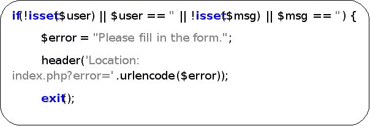

话不多说，让我们开始课程吧！

## 第一章 – 简介、环境搭建与 “Hello World”

### PHP 简介

PHP 代表 **PHP: Hypertext Preprocessor**（最初代表 Personal Home Page），是使用最广泛的 Web 编程语言之一（安装在超过 2.5 亿个网站上）。它类似于 C 等语言。但让我们不要在历史参考上花费太多时间，直接开始工作吧！

### 搭建我们的工作环境

为了在本地计算机上开始使用 PHP，您需要安装一个开发环境。为什么要这样做？PHP 是一种服务端语言；因此，本质上您需要在计算机上安装一个“本地服务器”才能运行 PHP 代码。有许多提供 PHP 包的解决方案，但最常见的形式称为 LAMP 包。有许多适合不同操作系统的 LAMP 包。最常见的有：

*   **XAMPP** – 一个包含 PHP、MySQL 和 Perl 的 Apache 发行版。支持 Windows、Linux 和 Mac；
*   **WAMP** – 专为 Windows 设计；
*   **MAMP** – 专为 Mac 设计；

挑选一个，在 Google 中输入名称，按照下载链接和说明操作，您就可以准备就绪了。

此外，您还需要某种文本编辑器。您可以找到许多免费和付费的程序。本课程使用的是 **Notepad++**。

### 我们的第一个 PHP 文件

安装好 LAMP 包后，您无疑想创建您的第一个 PHP 文件。如果您还没有这样做，请确保 Apache 和 MySQL 处于激活状态。要检查这一点，请转到您的 LAMP 设置的控制面板，您应该会看到类似这样的内容：

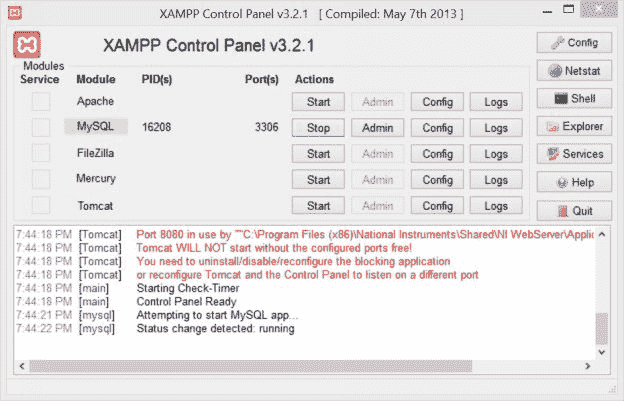

导航到您的 LAMP 包的安装目录。在我的例子中，它看起来像：`C:\xampp\htdocs`。`htdocs` 是包含您所有网站的目录。通常，为了清晰起见，我喜欢在 `htdocs` 内部创建一个 `websites` 目录并从那里工作。无论哪种情况，为您的网站创建一个新文件夹并给它命名。请尽量避免使用空格（改用 `_`）。在该文件夹内，创建一个 `index.php` 文件。在文本编辑器中打开该文件并输入以下代码行：

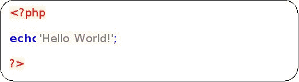

所有 PHP 代码都包裹在 PHP 标签（`<?php ?>`）内。请注意，我们说的是所有 PHP *代码*，而不是所有 PHP *文件*。也就是说，您可以在 `.php` 文件中包含 HTML 等内容。更多相关内容将在另一章介绍。

在语法方面，还有一些规则需要牢记：

*   在 PHP 中，每个语句都以分号结尾。
*   **注释：**

    PHP 中的注释可以是单行或多行。单行注释以两个反斜杠（`//`）开头。放在这些斜杠之后的任何内容都被视为注释，不会被编译器执行。多行注释以正斜杠和星号开头，以星号和正斜杠结尾（`/* 注释内容 */`）。同样，编译器将忽略放在这些符号内的任何内容。

    以下是代码中注释的示例：

    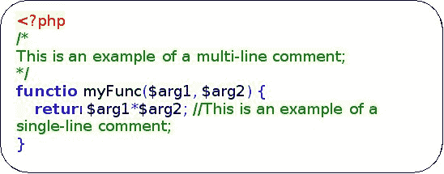

    多行注释通常用于较长的代码块描述，而单行注释则用于（如上例所示）描述某一特定代码行的作用。多行注释对于调试也很有用。例如，如果您有一段代码无法按预期工作，您可以使用多行注释将其“注释掉”，并逐块测试以查看究竟哪里出了错。

    PHP 中没有强制规定您是否必须使用注释，但使用注释被认为是良好的实践。如果您打算与他人共享代码，您绝对应该（所谓绝对，是指*始终*！）使用注释。对您显而易见的事情，对另一位编码者可能并不明显。此外，即使您不打算共享代码，只是为自己编写某个文件，您仍然应该使用注释（即使注释不如共享时那样详尽）。您经常会发现自己需要重温旧代码，当那一刻到来时，您会希望能快速回忆起自己在做什么以及为什么这么做。虽然注释不给代码增加功能，但它们与您编写的代码同样重要，所以请不要忽视它们！

好了，扯远了，让我们回到第一个 PHP 文件。打开您选择的 Web 浏览器并输入以下 URL：`localhost/websites/your_folder_name_here/index.php`，如果您的新网站直接在 `htdocs` 文件夹中，则去掉 `websites`。

您应该会在网页顶部看到显示的 “Hello World!” 字样。

万岁！我们的第一个 PHP 文件完成了！但这不是很有趣，对吧？让我们继续第二章，在那里我们将学习 PHP 中不同类型的变量，并开始玩得更开心些！

## 第二章 – 变量

### 变量简介

#### 基础

在 PHP 中，变量使用美元符号（`$`）声明：

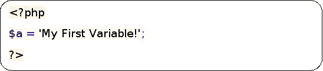

这声明（或创建）了该变量。重要的是要注意，在创建变量之前，它被视为未设置。它不存在。这很直观，但正如我们稍后将看到的，这有时会导致一些意想不到的错误。

这里我们创建了一个字符串变量（注意我们不声明类型）。我们将在本章稍后查看不同的变量类型。

##### 规则

在 PHP 中创建变量时，有一些规则需要牢记。我们将列出所有规则，之后再看展示这些规则的代码。以下是基本规则：

*   变量名必须以字母或下划线开头；
*   变量名不能以数字开头；
*   变量名可以包含任意数量的字母、下划线或数字；
*   有效字母为 ASCII 十六进制 00 到 FF 之间的所有字母；

让我们看一个声明变量的代码示例：

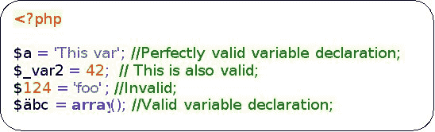

如果我们测试该文件，将得到以下错误消息：

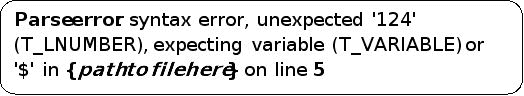

这告诉我们在声明变量时出现了错误。

### 变量类型与类型转换

与许多其他语言不同，PHP 不要求你显式声明变量类型，而是根据上下文确定类型。换句话说，你不必显式地告诉 PHP 你想要一个双精度数字还是一个字符串。为了帮助你理解这一点，你可以把变量想象成盒子。想象一排储物柜（就像你在机场或火车站看到的那种）。每个储物柜代表一个变量。每个储物柜都有自己唯一的编号，将其与其他所有储物柜区分开来。如果有人让你打开 42 号储物柜，你能毫不费力地找到它，也不会将其与其他储物柜混淆（例如 24 号）。同样，PHP 变量名是唯一的，每个 PHP 变量也是唯一的。现在，你打开 42 号储物柜，发现它是空的。你走到 43 号储物柜，发现里面有一个包裹。你从 43 号取出包裹放入 42 号。在打开储物柜之前，你不知道里面装着什么。检查后，你知道该储物柜里装着什么，并可以按需操作。同样，PHP 中的变量可以包含你放入的任何内容。本质上，当你检查变量类型时，你是在检查变量内部内容的类型。

这个解释可能有点令人困惑，但你会很快习惯，并且在处理 PHP 变量时不会有问题。让我们看看 PHP 中的一些变量：

#### Boolean

Boolean 是 PHP 中存在的最简单的变量类型。Boolean 用于逻辑语句和表达真值。Boolean 是二元的，意味着它们只取两个值之一：`TRUE` 或 `FALSE`。话虽如此，让我们看一个 Boolean 变量的示例：

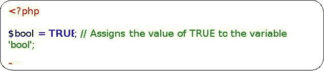

与许多其他语言一样，PHP 在 Boolean 变量的使用和解释上很灵活。换句话说，我们可以在不明确将它们定义为 `TRUE` 或 `FALSE` 的情况下创建 Boolean。事实上，以下是 PHP 判定哪些值被视为 `FALSE` 的规则列表：

*   Boolean 值 `FALSE`；
*   整数 `0`；
*   浮点数 `0.0`；
*   空字符串和字符串 `"0"`；
*   零个元素的数组；
*   特殊类型 `NULL`；
*   由空标签创建的 `SimpleXML` 对象；

其他所有值都将返回 `true`。

这意味着我们可以编写以下代码，它将是有效的：

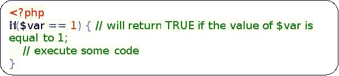

即使我们还没有介绍 `if` 语句，你也大致能推断出这里会发生什么。隐式 Boolean 变量定义在括号 `()` 内。一旦逻辑操作执行，它将返回 `TRUE` 或 `FALSE`。

关于上述示例有几点重要的注意事项：

PHP 认为整数 `1` 与 `TRUE` 相同。这意味着，如果我们将变量 `var` 定义为 `TRUE`，并将其与整数 `1` 进行比较，逻辑语句将返回 `TRUE`：

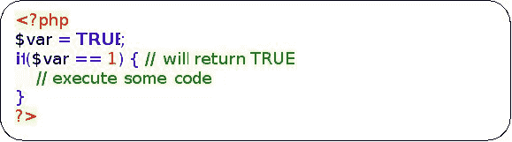

第二点注意事项：

我们使用双等号（`==`）来检查一个值是否等于另一个值。不要犯使用单等号（`=`）的错误。

说了这么多，我们应该介绍类型转换。类型转换是指我们获取一个变量的值并将其从一种类型转换为另一种类型。例如，我们可以有一个值为 `42` 的变量，并想将其转换为 Boolean。另一个例子是如果我们有一个值为 `42` 的变量，并想将其转换为字符串（稍后详述）。对于 Boolean，类型转换在大多数情况下是不必要的（即你几乎永远不会这样做）。这是因为如果运算符、函数或控制结构需要 Boolean 作为参数，值会自动转换为 Boolean。然而，为了与其他类型转换保持一致，这是将变量转换为 Boolean 的方法：

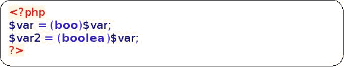

#### Number

PHP 和大多数编程语言中的数字有不同的“口味”。PHP 中数字的两个子类型是 Integers（整数）和 Floating point numbers（浮点数）。让我们分别看看。

##### Integers

根据定义，整数是集合中所有的数字：

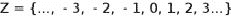

换句话说，整数是所有完整的实数（包括正数、负数和零）。PHP 允许我们以多种方式定义整数。你可以用十进制（基数 10）、八进制（基数 8）、十六进制（基数 16）或二进制（基数 2）定义整数。要使用八进制表示法表示整数，需要在数字前加上 `0`。要使用十六进制表示法，在数字前加上 `0x`。最后，如果要使用二进制表示法，在数字前加上 `0b`。这是一个示例：

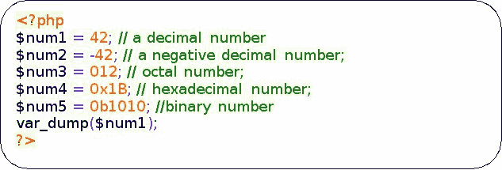

请注意我们使用的最后一个函数（如果你不知道什么是函数也不用担心）。

> **Helpful Tip!**
>
> 你可以使用 `var_dump()` 检查变量的类型和内容。该函数接受一个输入作为参数（同样，如果你不完全理解也没关系。这意味着你应该在括号内只放一件东西）。该函数将变量的类型和内容打印到屏幕上。在上面的示例中，屏幕上的输出将如下所示：
>
> 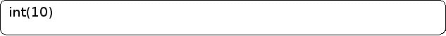
>
> 现在尝试在其他变量上使用 `var_dump()`。你注意到什么有趣的东西了吗？你看到每个变量打印到屏幕上的值了吗？它是什么进制的？

在 32 位系统上，作为整数存储的最大数字的量级为 `21474783647`。任何大于该值的数字将自动转换为 `float` 类型。对于 64 位系统，该数字的量级为 `9223372036854775807`。任何大于该值的数字将自动转换为 `float` 类型。

如果你想将变量转换为整数，换句话说将其转换为整数类型，你可以执行以下操作：

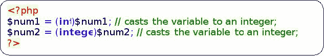

这种类型的转换在许多情况下很有用，但最常见的用途是安全性。本章末尾的练习之一将向你展示整数转换用于安全目的的特定用法。

##### Floating Point Numbers

整数是实数和整数的集合，因此逻辑上，浮点数（也称为“floats”、“doubles”或“real numbers”）将包含其他所有内容。即位于整数之间的数字。因此，我们得到了所有实数的集合。话虽如此，必须注意所有计算机在显示数字的精度方面都有限制（这被称为机器 epsilon）。此外，处理浮点数时可能会出现一些奇怪的差异。我们不会深入探讨，因为这超出了本书的范围，但如果你在处理浮点数时发现任何非直观的结果，请考虑 PHP 处理浮点数的精度。

浮点数在 PHP 中可以用以下方式表示：

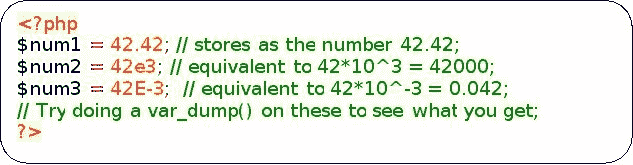

#### String

PHP 中的字符串是一系列字符。你可以用它们来存储文本片段和单词。PHP 将每个字符作为一个字节处理。话虽如此，我们应该注意 PHP 支持的最大字符串大小为 2GB。有趣的部分在于定义字符串。

##### Single quotes

在 PHP 中定义字符串最简单的方法是使用单引号。

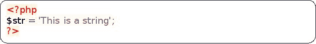

如果我们想在字符串中加入新行会怎样？

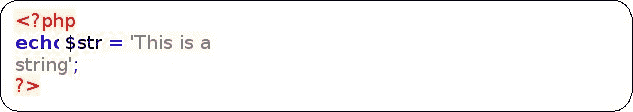

这是 PHP 中有效的语法，但换行符不会被包含在最终输出中。注意 `echo` 函数的使用。上面的代码输出什么？

> **Helpful Tip!**
>
> 你可以使用 `echo` 命令将字符串输出到屏幕上。事实上，除了 `array` 和 `object` 类型外，`echo` 可以与任何变量类型一起使用以输出其内容。这是一个非常有用的调试工具，当你需要快速检查某些内容或查找代码中的错误时，应该经常使用它。

好的，现在想象一下，你想要输入一个包含单引号的字符串。你认为输出会是什么？

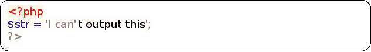

你可能仅从语法高亮就能看出这行不通。每当 PHP 遇到单引号时，它要么开始要么结束一个字符串变量。为了存储单引号，我们需要对其进行转义。在 PHP 中，这是通过反斜杠完成的。如果我们想包含一个反斜杠，也会发生同样的情况。我们必须用另一个反斜杠对其进行转义：

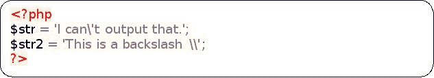

使用 `echo` 查看上述结果。请记住，反斜杠用于转义。（这意味着 `\\n` 不会渲染为换行符）

另一个不能在单引号内使用的东西是变量。例如，以下内容不会在单引号内展开。

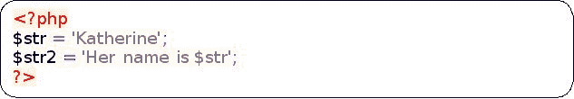

这将不会像你期望的那样显示“Her name is Katherine”。

为了使上述示例生效，我们需要将变量和字符串连接起来。在 PHP 中，我们将执行以下操作：

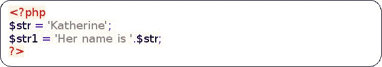

测试上述代码并确认其有效。如果你想在变量后继续字符串，只需将下一个字符串连接到变量上。换句话说，你使用 `$str . 'your string here'`。只要变量可以转换为字符串，这就会生效（在这种情况下 PHP 会自动为你完成转换）。

##### 双引号

这是在 PHP 中定义字符串更复杂的方式，但它给你提供了更多的控制和灵活性。在前面的示例中，我们看到 `\\n`、`\\t`、`\\r` 等在单引号中不起作用。双引号的情况并非如此。双引号允许你使用那些特殊符号。

然而，双引号最有用的地方在于它们解析变量的能力。在双引号内解析变量有两种方法。

###### 简单变量解析

解析变量的简单方法是在字符串内直接使用美元符号：

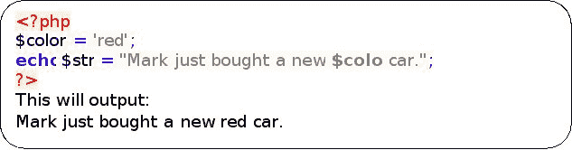

如果你想引用数组的元素，可以使用同样的概念。（在阅读下一种变量类型后，你最好回到这一节）。

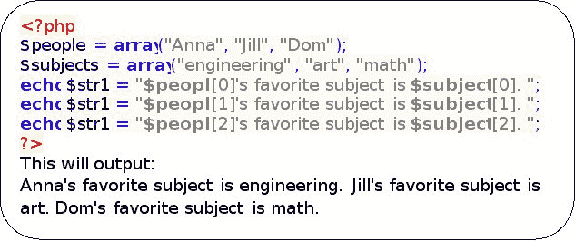

###### 复杂变量解析

这被称为复杂解析，是因为它允许你创建更复杂的表达式，而不是因为该方法本身复杂。此方法要求你在变量周围使用花括号。

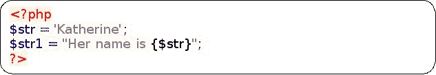

一旦你了解了数组、对象和函数，就可以扩展此功能并在它们身上进行测试。

##### 字符串转换

与所有其他变量一样，我们可以将变量转换为字符串。为此，你使用 `(string)` 函数。根据表达式的作用域以及是否需要字符串，PHP 会自动将变量转换为字符串。例如，如果你对变量使用 `echo`，它会首先将其转换为字符串。数字将被转换为其文本表示形式。这意味着 `10` 将变为 `"10"`。不过，数组和对象的表现略有不同。如果你对 `array` 使用 `echo`，你将得到字符串 `"Array"`。同样，如果你对 `object` 使用 `echo`，你将得到字符串 `"Object"`。

#### 数组

数组是一种有序映射类型。这意味着数组将值关联到特定的键。PHP 中的数组可用于表示字典、向量、列表、栈、队列、树和多维数组（数组的数组）。

数组的创建方式如下：

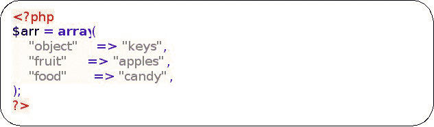

注意我们如何为了清晰起见使用了缩进。额外的空白会被 PHP 忽略，但它使我们的代码更易于阅读和管理。

数组的每一行代表一个键值对。每行以逗号结尾，以指示数组中的下一个键值对。数组的最后一个条目不需要在末尾加逗号，但大多数人喜欢加上。许多使用内容管理系统（如 WordPress、Drupal 等）的人都采用了这一惯例。（保留逗号的想法是，你可以获取整行键值对并在数组中移动它，而无需担心包含逗号的问题）。

数组的键可以是整数或字符串。如果你将其他东西用作数组键，它将自动转换为这两种类型之一。（注意：数组和对象不能用作数组键，因为这会导致错误）。

或者，你并不总是需要提供键。你可以执行以下操作：

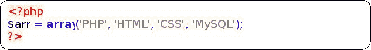

这将通过递增每个键（从 0 开始）自动为你创建键。我们可以检查数组的内容：

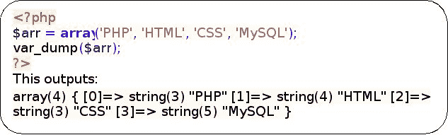

你可以看到数组的第一个条目从键 0 开始。重要的是要记住，对于使用默认键的数组，第一个值总是存储在键 0 下。

你可以使用方括号引用数组的元素。

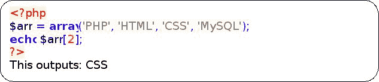

尝试使用这种语法并尝试创建数组的数组（多维数组）。换句话说，尝试让一个数组作为某个键的值。这看起来像：

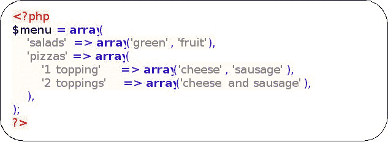

你将在其中一个练习中有机会练习这一点。

如果你想向现有数组添加新元素，或修改现有数组的元素，请使用方括号语法：

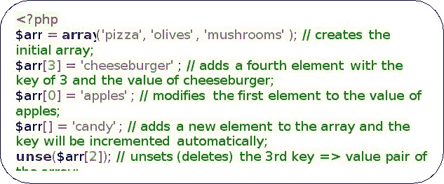

上述代码输出：

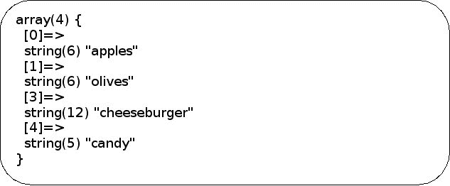

#### 对象

对象将在第 10 章中讨论，我们暂时先不谈。

#### NULL


`NULL` 值很特殊，它表示一个没有值的变量。发生这种情况的唯一可能方式是：变量被赋值为常量 `NULL`、变量尚未被赋值，或者变量已被 `unset`（还记得数组部分的最后一个示例吗，我们取消设置了第 2 个条目的值）。

## 结论

本章到此结束！你学到了很多关于 PHP 及其工作原理的知识。你迈出了第一步，这些步骤将在你编写代码时反复用到。本章某些部分可能有点枯燥，但彻底掌握这些基础知识很重要，这样你以后应用时就无需再思考。这里有一些练习来让你动起来，思考如何运用所学知识。

### 练习 1

给定以下用户数据数组。对其执行指定的操作：

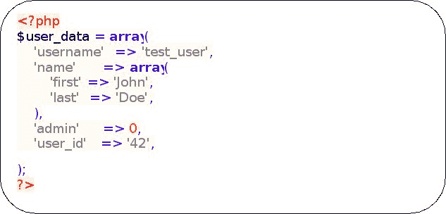

1. 通过连接数组中的值，创建一个由用户名和姓氏组成的字符串。

2. 假设此数组将存储到其他用户的数据库中。我们要确保所有值均为正确的类型。

   1. 将用户 ID 转换为整数类型；

   2. 将 admin 字段转换为布尔类型；

3. 添加一个键为 `'email'` 的新字段，并将其值设为：`'john.doe@example.com'`。

### 练习 2

## 为餐厅创建菜单

为此，你必须使用多维数组。你的菜单必须包含三个主要子类别（将你的数组命名为 `menu`，该数组内的键将作为你的主要子类别）。每个子类别将包含 4 道菜品/食物。对于每道菜品/食物，你需要包含一份配料清单和一份营养信息清单（碳水化合物、糖、蛋白质等）。你必须想出在 PHP 中实现这一点的最高效方法。（提示：考虑一下你想如何为每道菜创建和组织信息。你是想让键成为菜名，还是想让键自动递增并将菜名包含在数组内部？哪种方式对你来说最合理？哪种方式造成的困惑最少？如果需要，可以在纸上草拟一下）。

### 练习 3

假设你正在为一家餐厅创建一个在线应用程序，你的任务是创建外卖部分。使用上一个练习中的数组为菜单提供数据。创建一个变量来代表三个主要子类别中的一个（它应该具有完全相同的名称）。现在创建一个对应你制作的某一种食物的变量。假设这些变量代表用户选择餐点时做出的选择。

创建一个字符串，作为显示给用户的消息，包含关于其订单的重要信息。它应该如下所示：

You picked: {此处为菜名}。

This meal is made from: {此处为配料清单}。

The nutritional information for this meal is: {此处为营养信息清单}。

请考虑字符串连接、单引号与双引号的区别、数组引用。

# 第三章 – 逻辑、数学及其他表达式和运算

## 表达式和运算符简介

### 表达式

PHP 的核心在于表达式。表达式是语言的基本构建块，你编写的几乎任何东西都被视为表达式。表达式更正式的定义是“任何具有值的东西”。

在其最基本的形式中，表达式是常量和变量。例如，如果你想写 `$var = 42`，你本质上是将 `42` 的值赋给 `$var`。如果在代码的后续部分你写 `$var2 = $var`，你期望 `$var2` 的值与 `$var` 的值相同，即 `42`。更进一步说，函数（我们尚未涉及）也被视为表达式。函数是一个表达式，其值为该函数返回的任何值。（即使你不熟悉 PHP 内部的函数，你也应该对数学函数有一些经验。你可以用 `y = f(x)` 的形式来想象这一切，从而了解我们在讨论什么。）

在 PHP 中很容易混淆运算符与表达式，但为了给你一个两者的大致对比，你可以这样理解：运算符用在表达式内部。有比较表达式和比较运算符。运算符是你使用的符号（即 `>`、`<`、`==`），而表达式是比较运算的结果（即它评估为 `TRUE` 还是 `FALSE`）。

我们不会在此深入探讨表达式的更多细节，因为我们希望本书更多地关注实际应用而非理论。

### 运算符

PHP 中运算符的技术定义是“接受一个或多个值（或用编程术语说是表达式）并产生另一个值（因此该结构本身成为一个表达式）的东西”。

运算符的分组取决于运算符作用的值的数量。有一元运算符，例如逻辑非运算符或递增/递减运算符（分别为 `!`、`++`、`--`）。二元运算符接受两个值。这些是我们熟知的数学运算符（`+`、`-` 等）。还有一个三元运算符，我们将在讨论逻辑运算符时详细介绍。

让我们开始分析运算符的类型。

#### 运算符优先级

运算符优先级用于确定一个运算符将两个表达式绑定的紧密程度。当不使用括号来强制优先级时，运算符优先级用于确定诸如 `1 + 2 * 4` 这样的表达式的结果。

当运算符具有相同优先级时，它们的结合性决定了运算符如何分组。例如，如果我们写 `1 - 2 - 4`，结果将是 `-5`，因为减号（`-`）是左结合的。

就像日常数学一样，你可以在 PHP 中使用括号来强制运算符的优先级。通常建议即使你编写表达式的方式不需要括号，也要使用它们。使用括号是一种最佳实践，能使代码更具可读性，更易于理解。

以下是所有运算符优先级的综合列表：

| 结合性 | 运算符 | 更多信息 |
| --- | --- | --- |
| 非结合 | `clone` `new` | 分别用于创建对象的克隆或对象的新实例 |
| 左 | `[]` | 用于读取/写入数组元素。 |
| 右 | `**` | 用于 PHP 中的指数运算 |
| 右 | `++` `--` `(int)` `(float)` `(string)` `(array)` `(object)` `(bool)` `@` | 这些是递增和递减运算符、类型转换运算符以及错误控制运算符（稍后详述） |
| 右 | `!` | 逻辑非运算符 |
| 左 | `*` `/` `%` | 用于乘法、除法和取模（余数）的算术运算符。 |
| 左 | `+` `-` `.` | 用于加法和减法以及字符串连接的算术运算符。 |
| 非结合 | `==` `!=` `===` `!==` `<` `>` | 比较运算符 |
| 左 | `&&` | 逻辑与运算符 |
| 左 | `||` | 逻辑或运算符 |
| 左 | `?:` | 三元运算符 |
| 右 | `=` `+=` `-=` `*=` `**=` `/=` `.=` `%=` `&=` `|=` `^=` `<<=` `>>=` | 赋值运算符 |
| 左 | `and` | 逻辑运算符 |
| 左 | `or` | 逻辑运算符 |

至此，我们结束关于运算符优先级的讨论。

#### 算术运算符

算术运算符的工作方式就像普通数学中的基本算术运算符一样。让我们先看看所有算术运算符的列表，然后再看几个例子。

| 示例 | 名称 | 结果 |
| --- | --- | --- |
| `-$var` | 取反 | 变量的相反数（负数）。 |
| `$var + $var2` | 加法 | 两个变量的和。 |
| `$var - $var2` | 减法 | 两个变量的差。 |
| `$var * $var2` | 乘法 | 两个变量的积。 |
| `$var / $var2` | 除法 | 两个变量的商。 |
| `$var % $var2` | 取模 | 第一个变量除以第二个变量的余数。 |
| `$var ** $var2` | 幂运算 | 将第一个变量提升到第二个变量对应的幂次所得的结果。 |

使用除法运算符时，请记住，除非两个操作数都是能被整除的整数，否则结果将为浮点数。如果两个操作数是不能被整除的整数，返回值将为浮点数类型。

取模运算符的操作数在处理前会被转换为整数。数值的小数部分会被去除，剩余的整数部分被使用。

取模运算符的结果取其符号自被除数。

让我们看几个例子。

```
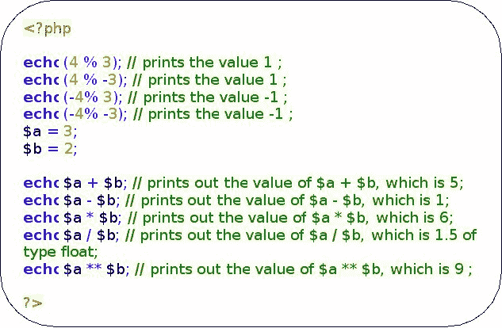
```

#### 赋值运算符

最基本的赋值运算符是 `=`。你可能会倾向于认为这是“等于”，但那将是一个错误。该运算符实际上意味着左操作数获取右侧表达式的值。所以本质上你可以把它理解为“被设置为”。有了这个知识，我们可以做一些巧妙且有趣的事情。

```
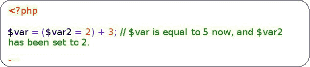
```

在处理数组时，使用 `=>` 运算符将值赋给命名键。该运算符的优先级与所有赋值运算符的优先级相同。

除了基本赋值运算符外，还有一些“组合运算符”，当我们想对二元算术运算使用简写时，它们非常方便。假设我们有一个变量 `$a` 等于某个值。在代码的后续部分，我们想将 `$a` 设为 `$a` 之前的值加上另一个值。为此，我们可以编写：

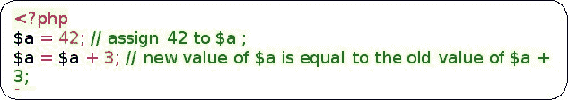

一种更简单的方法是使用加法的组合运算符：

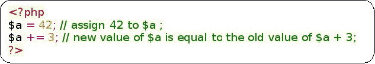

这些组合运算符适用于所有算术运算以及字符串连接。以下是一些示例：

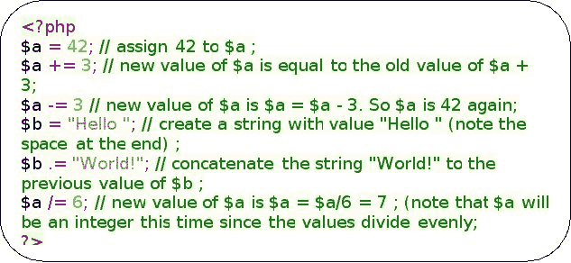

### 比较运算符

比较运算符允许我们比较两个值。让我们看一下比较运算符列表。

| 示例 | 名称 | 结果 |
| --- | --- | --- |
| `$var == $var2` | 相等 | 如果两个变量相等，返回 TRUE。如有必要将进行类型转换。 |
| `$var === $var2` | 全等 | 如果两个变量相等且类型相同，返回 TRUE。 |
| `$var != $var2` | 不相等 | 如果两个变量在类型转换后不相等，返回 TRUE。 |
| `$var <> $var2` | 不相等 | 如果两个变量在类型转换后不相等，返回 TRUE。 |
| `$var !== $var2` | 不全等 | 如果两个变量不相等或类型不同，返回 TRUE。 |
| `$var < $var2` | 小于 | 如果第一个变量严格小于第二个，返回 TRUE。 |
| `$var > $var2` | 大于 | 如果第一个变量严格大于第二个，返回 TRUE。 |
| `$var <= $var2` | 小于或等于 | 如果第一个变量小于或等于第二个，返回 TRUE。 |
| `$var >= $var2` | 大于或等于 | 如果第一个变量大于或等于第二个，返回 TRUE。 |

如果您将字符串与数字进行比较，或者比较涉及数字字符串，则字符串会被转换为数字，并按数值进行比较。使用 `===` 或 `!==` 时不会进行类型转换，因为这些运算符同时检查类型和值。

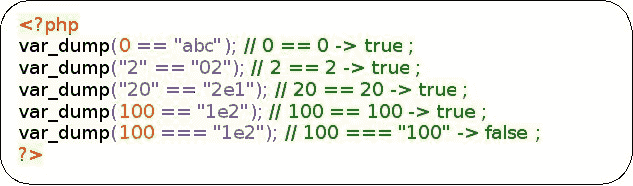

另一个需要注意的条件运算符是三元运算符。三元运算符本质上是 `if/else` 控制结构的简写形式（稍后详述）。三元运算符的形式为 `(某个条件表达式) ? {为真时执行此操作} : {为假时执行此操作}`。（花括号并不使用，只是为了清晰起见）。以下是三元运算符在应用中的使用示例及其所代表的相应 `if/else` 语句：

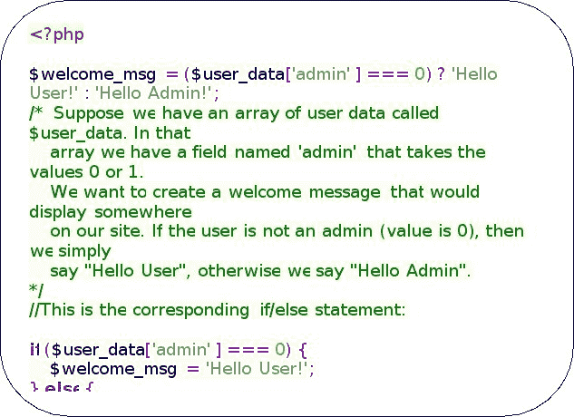

您可以看到，使用三元运算符比写出完整的 `if/else` 语句要短得多。

这结束了我们对比较运算符的概述。我们没有广泛涵盖不同类型变量之间的比较，但此类信息可在网上的 PHP 文档中找到，因此我们决定不将其包含在内。

### 错误控制运算符

错误控制运算符应谨慎使用。在 PHP 中，错误控制运算符是 at 符号（`@`）。当表达式前面加上错误控制运算符时，该表达式通常会产生的任何错误消息都将被忽略。

使用此运算符有其缺点，因为如果您将其加在一个导致脚本终止的错误表达式前，脚本将在不告诉您原因的情况下停止，这不利于调试。

我们将不介绍错误控制运算符的使用示例，因为您很少需要使用它，并且应尽量编写代码以避免依赖它。

### 自增和自减运算符

自增和自减运算符是您在 C 风格语言中会看到的运算符。这些运算符影响数字和字符串，但不影响数组和对象。自减 `NULL` 值无效果，但自增 `NULL` 值结果为 1。

以下是自增和自减运算符列表。

| 示例 | 名称 | 结果 |
| --- | --- | --- |
| `++$var` | 前置自增 | 将变量加一，然后返回值。 |
| `$var++` | 后置自增 | 返回变量的值，然后将变量加一。 |
| `--$var` | 前置自减 | 将变量减一，然后返回值。 |
| `$var--` | 后置自减 | 返回变量的值，然后将变量减一。 |

让我们看几个示例来说明它们如何工作：

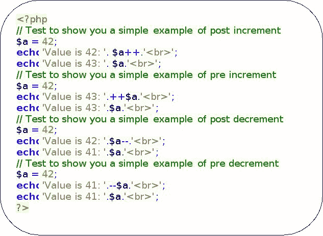

我们也可以自增字符。但不能自减字符。

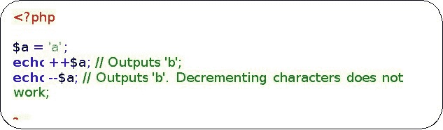

### 逻辑运算符

PHP 支持逻辑运算符，允许我们评估逻辑语句。以下是逻辑运算符列表：

| 示例 | 名称 | 结果 |
| --- | --- | --- |
| `$a and $b` | 逻辑与 | 如果两个变量都为 true，返回 TRUE。 |
| `$a or $b` | 逻辑或 | 如果两个变量中任意一个为 true，返回 TRUE。 |
| `$a xor $b` | 逻辑异或 | 如果两个变量中任意一个为 true，但不同时为 true，返回 TRUE。 |
| `!$a` | 逻辑非 | 如果变量不为 TRUE，返回 TRUE。 |
| `$a && $b` | 逻辑与 | 如果两个变量都为 true，返回 TRUE。 |
| `$a || $b` | 逻辑或 | 如果两个变量中任意一个为 true，返回 TRUE。 |

之所以有两个“逻辑与”和“逻辑或”运算符，是因为它们的优先级顺序不同。逻辑运算符最常见的用法是在 `if/else` 语句中，或在三元运算符的第一个表达式中。让我们看一些逻辑运算符的示例及其用法。

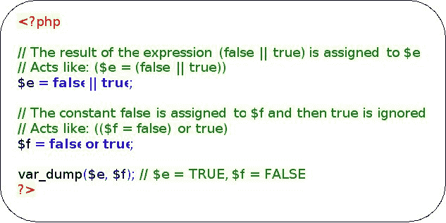

### 字符串运算符

只有两种字符串运算符，我们已经见过两者。第一个运算符是点运算符（`.`），用于连接两个字符串。第二个运算符是组合连接赋值运算符（`.=`），它将右侧参数追加到左侧参数。您将非常频繁地使用这两者。

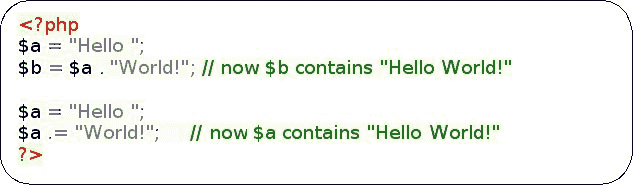

## 结论

这结束了我们对 PHP 中不同类型运算符和表达式的概述。您离编写第一个真正的 PHP 应用程序越来越近了！您还需要两个基本构建块，将在接下来的两章中介绍，随后您就能着手编写中级和高级应用程序了！

### 练习 1

算术赋值运算符在赋新值的同时对变量执行算术运算。对于此 PHP 练习，编写一个脚本以复现下面的输出。仅操作一个变量，不使用简单算术运算符，以生成语句中给出的值。

提示：在脚本中，每条语句以 "Value is now $variable." 结尾。

Value is now 8.

Add 2. Value is now 10.

Subtract 4. Value is now 6.

Multiply by 5. Value is now 30.

Divide by 3. Value is now 10.

Increment value by one. Value is now 11.

Decrement value by one. Value is now 10.

### 练习 2

对于此 PHP 练习，编写一个脚本，使用以下变量：

`$around = "around";`

在 PHP 中，单引号和双引号的工作方式不同。使用单引号（`' '`）和连接运算符，将以下内容输出到浏览器，使用您创建的变量：

What goes around comes around.

### 练习 3

PHP 允许几种不同类型的变量。对于此 PHP 练习，您将创建一个变量并为其赋予不同的值，然后测试每个值的类型。

编写一个脚本，使用一个变量 `$whatsit` 向浏览器打印以下内容。你的 `echo` 语句除“Value is”外不得包含任何单词。换句话说，使用将输出变量类型的函数来获取所需文本。使用简单的 HTML 将每条语句打印在单独的行上，并为页面添加相关标题。在代码中包含换行符以生成整洁、可读的 HTML。

Value is string.

Value is double.

Value is boolean.

Value is integer.

Value is NULL.

# 第四章 – 控制结构

## 简介

PHP 脚本由一系列语句构成。语句可以是赋值、函数调用、循环、条件语句，甚至是空语句。通过用花括号封装语句，可以将它们分组为语句组。语句组本身被视为一条语句。

在本章中，我们将观察不同类型语句的行为。

## If 语句

### If 语句

“if” 语句是任何语言中最重要的结构之一。此控制结构允许你有条件地执行代码片段。PHP 的 “if” 结构类似于 C 语言。也就是说，每个 if 语句在其最基本的形式下看起来像 `if (expression) statement`。表达式会被求值为其布尔值。如果表达式为 `TRUE`，PHP 将执行该语句。如果为 `FALSE`，则不会执行。一个简单的例子是：

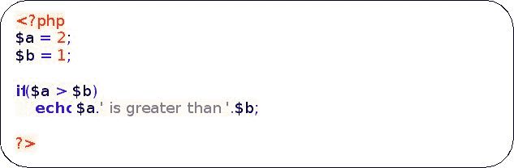

很多时候，如果某个条件为真，你需要执行不止一条语句。你不需要将每条语句都包裹在自己的 if 子句中。相反，你可以使用花括号将想要有条件执行的代码包裹起来。

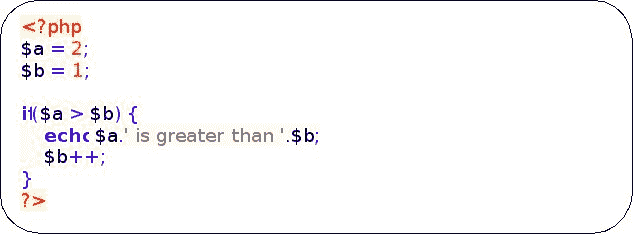

你甚至可以更进一步，在其他 if 语句内部嵌套 if 语句。

### If Else 语句

在某些情况下，你想在条件满足时执行一段代码，而在条件不满足时执行另一段不同的代码。在这种情况下，你必须使用 `if-else` 语句。`else` 扩展了 if 语句，以便在语句求值为 `FALSE` 时执行一个表达式。这里有一个扩展上述示例的例子：

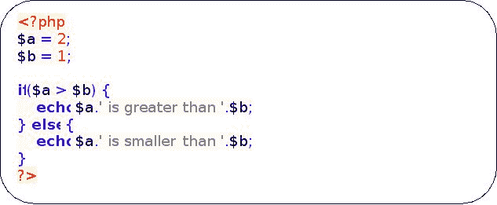

### If-else if-else 语句

这是对 `if` 语句的另一种修改，它呈现了 if 语句最通用的形式。它包含一个 `if` 语句，如果语句为 `TRUE` 则执行一块代码。在此 `if` 语句之后，有若干个 `elseif` 语句。每个 else if 语句都有一个关联的条件和一块待执行的代码（如果为真）。代码块仅在条件求值为 true 时执行。在所有的 `elseif` 语句之后，有一个结束的 `else` 语句。你可以将其视为一种默认情况。如果没有条件求值为 true，则执行 `else` 语句。这是一个例子：

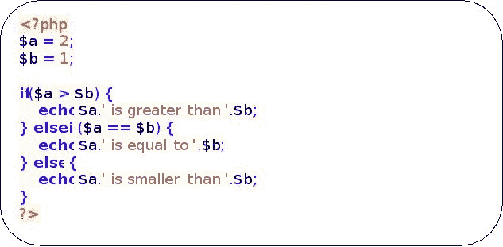

请记住，一旦某个条件求值为 `TRUE`，脚本就会执行关联的代码块并跳出 if-elseif-else 结构，不会继续检查其他条件。也就是说，使用 if-elseif-else 时只会执行一个条件。与 if-elseif-else 结构相关的一种结构是 `switch` 语句，这是接下来要讨论的主题。

## Switch


`switch` 语句类似于在同一个变量上操作的一堆 `if` 语句。想象一下，你有一个可以取某些值的变量。在代码中，你想比较该变量是否对应某些特定值。对于每个值，都有一段必须执行的代码。此外，如果变量不满足任何这些情况，你想执行一些默认代码。你可以使用一个冗长的 `if-elseif-else` 结构来实现，但也可以使用 `switch` 语句。

`switch` 语句的作用与 `if-else-if` 结构相同，但能节省一些输入。`switch` 语句的语法是：

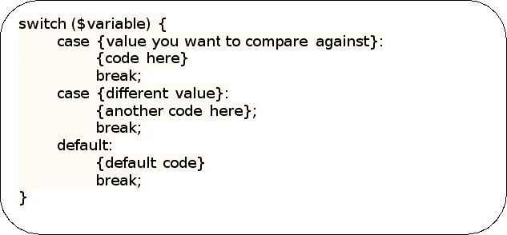

你可以根据代码需要拥有任意数量的 `case`。一个需要牢记的重要事项是 `break` 语句的存在。`break` 命令会跳出你当前所在的结构或循环。如果每个 `case` 内部没有 `break` 命令，PHP 会遍历每一个 `case`。也就是说，PHP 会将变量与每个 `case` 进行比较，如果比较返回 `TRUE`，则执行该 `case` 中指定的代码。如果 PHP 没有遇到 `break` 命令，它会继续执行下一个 `case`，如果该 `case` 的比较返回 `TRUE`，则执行其特定代码。这是使用 `if-elseif-else` 结构和 `switch` 语句的区别之一。

让我们看一个 `if-elseif-else` 结构与 `switch` 语句对比的例子：

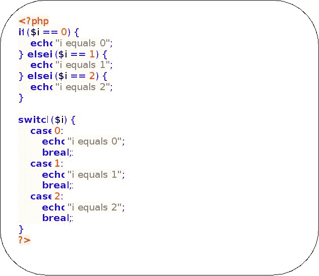

关于 `switch` 语句就这些了。学会如何利用它们，你会比写出所有 `if-else` 语句更高效。

## 控制结构的替代语法

在继续讲解其他控制结构之前，让我们花点时间了解一下 PHP 为控制结构提供的替代语法。PHP 为某些控制结构提供了替代语法。这些结构包括：`if`、`while`、`for`、`foreach` 和 `switch`。在每种情况下，替代语法的基本形式是将左花括号改为冒号，将右花括号分别改为 `endif;`、`endwhile;`、`endfor;`、`endforeach;` 或 `endswitch;`（基本上是以控制结构的名称加上“end”作为后缀）。这使我们能够跳出 PHP 模式以包含 HTML，例如。

我们还没有真正讨论过在 PHP 脚本中包含 HTML，但这实际上是一个非常简单的概念。包含 HTML 的一种方法是将 HTML 字符串保存到变量中，然后 `echo` 或 `print` 该变量。事实上，这是一种你会经常发现自己在使用的方法。然而，这种方法有其缺点。例如，假设你想创建一个不是动态生成的表格（即你不使用 PHP 为你生成表格行）。该表格有特定的布局，你想在其中一个单元格中包含某个 PHP 变量的值。如果你尝试将其写入变量，你会发现这非常繁琐且低效。（除非出于某种原因你需要将 HTML 存储在变量中，那种情况下你只能使用 HTML 转变量的方法）。你可以跳出 PHP，然后再跳回 PHP，在中间包含必要的 HTML。这是一个简单的例子：


好了，在题外话之后，让我们看看 `if` 语句的替代语法：


这看起来与上面的代码完全一样，并且会完全按照你的预期工作。

### 实用技巧！

每当你创建的控制结构需要用花括号封装时，请务必先写出完整的控制结构骨架，然后再填充内容。也就是说，如果你要创建一个 `if` 语句，你应该写出：


请务必始终这样做！如果你这样做，就永远不需要跟踪左/右括号和/或圆括号。事实上，你应该把这作为自己的铁律。每当你打开一个括号或圆括号时，在编写**任何**其他代码之前先将其关闭。然后回去填充所需的代码。这将防止你犯低级错误，并节省宝贵的调试时间，让你有时间编写出色的应用程序。

编写替代语法的另一种方法是保留花括号并像往常一样跳出 PHP。以下两条语句是等效的：


本章到此结束了关于控制结构替代语法的介绍。当你在 PHP 和 HTML 之间切换时，经常会在代码中发现这些替代语法。在下一小节中，我们将开始讨论 PHP 中不同类型的循环结构。请记住，本节讨论的替代语法也适用于接下来的一些结构。

## While

这是我们将要讨论的第一种循环类型，也是最简单的一种。`while` 语句的形式如下：

```
while (expr) statement
```

`while` 循环的含义也很容易理解。`while` 循环告诉 PHP 只要 `while` 表达式的值为 `TRUE`，就执行嵌套语句（不必是单条语句，可以是一个代码块，在大多数情况下也是如此）。表达式在循环开始时只计算一次，因此即使表达式的值在循环执行过程中发生变化，循环也不会终止（除非另有指示），直到下一次迭代开始。值得注意的是，如果表达式在 PHP 第一次检查时为 `FALSE`，则该语句不会被执行。

正如我们提到的，该语句可以是包裹在花括号内的多条语句。与 `if` 语句一样，我们可以使用替代语法来构建 `while` 循环。使用控制结构替代语法的 `while` 循环的一般形式如下：

```
while (expr):
    statement
    ...
endwhile;
```

让我们运行一个简单的例子，使用该循环从 1 计数到 10。

```
$i = 1;
while ($i <= 10):
    echo $i++;
endwhile;
```

`while` 循环非常常用，特别是在从数据库提取信息时（我们将在后面的章节中介绍）。

一个需要注意的潜在陷阱是创建无限循环，即永远不会终止的循环（`while` 条件将始终评估为 `TRUE`）。有时你想创建一个无限循环并在特定条件下终止它，但有时这种行为是不希望的。想象以下示例。

你想设置一个应用程序来检查某事物的状态并向用户发送电子邮件。例如，你正在监控服务器的状态，想知道是否出现故障。你需要一个脚本无限期运行，并在定义的时间间隔内检查服务器状态。这可以通过一个无限循环实现，该循环在恢复操作前暂停一段定义的时间。另一个例子是，如果你使用 PHP 设置一个简单的游戏来测试技能。你想设置一个主循环（如果愿意，可以称之为“游戏循环”），每帧运行一次并执行与游戏相关的操作。还有一个例子是等待用户定义的输入。在这种情况下，你会设置一个无限循环来获取用户输入并对其进行操作。

起初无限循环可能比较棘手，并可能给你带来一些问题，所以在你熟悉循环概念并知道自己在做什么之前，尽量避免使用它们。

设置无限循环最简单的方法是：

```
while (true) {
    statement
}
```

`while` 条件将始终评估为 `TRUE`（本质上，循环读作：while TRUE，执行 {statement}）。

## Do-while

`do-while` 循环与上一小节看到的循环类似，但有一个细微的差别。`do-while` 循环具有以下结构：

```
do
    statement
while (expr);
```

这意味着 PHP 会先执行 `do` 子句内的所有内容，然后检查条件。如果评估为 `TRUE`，PHP 将循环回去。你会注意到条件是在循环结束时评估的，而不是在开始时。这意味着 `do` 语句内的代码**保证至少运行一次**。例如：

```
$i = 0;
do {
    echo $i;
} while ($i > 0);
```

这段代码将在终止前恰好执行一次，因为真值表达式评估为 `FALSE`。

`do-while` 和 `while` 循环的唯一主要区别在于 `do-while` 将至少运行一次代码，而 `while` 循环则不会。话虽如此，值得注意的是 `while` 循环是在实践中最常用的循环，但不要忘记 `do-while` 循环的存在！

## For

`for` 循环比 `while` 和 `do-while` 循环更复杂，但你应该非常熟悉它们，因为你会一直用到它们！以下是 `for` 循环的基本语法：

```
for (expr1; expr2; expr3)
    statement
```

第一个表达式在循环开始时计算（执行）一次。

第二个表达式在每次迭代开始时计算。如果评估为 `TRUE`，循环将继续，并执行嵌套语句。如果评估为 `FALSE`，循环执行终止。在每次迭代结束时，计算（执行）第三个表达式。

每个表达式都可以为空，或者包含由逗号分隔的多个表达式。如果第二个表达式为空，PHP 假定其为 `TRUE`。本质上这将创建一个无限的 `for` 循环。让我们看看以下示例：

```
for ($i = 1; $i <= 10; $i++) {
    echo $i;
}
```

与 `while` 和 `if` 语句一样，`for` 循环支持控制结构的替代冒号语法：

```
for (expr1; expr2; expr3):
    statement
    ...
endfor;
```

人们经常使用 `for` 循环遍历数组。虽然这样做并不错误，但使用 `foreach` 循环遍历数组或对象更方便，因为该控制结构专门为数组设计，并提供了更多控制。

现在我们已经介绍了 PHP 中的两种循环类型，你可能会问自己：`while` 和 `for` 循环有什么区别，何时应该使用每一个？以下是指导你在 PHP 应用程序中正确使用 `for` 和 `while` 循环的一般经验法则。

`for` 循环用于你知道需要多少次循环迭代的情况。例如，如果你想操作数组的每个元素，可以使用一个从数组的第一个值循环到最后一个值的 `for` 循环。最简单的方法是拥有一个每个键都是增量数字的数组。将计数器变量初始化为 0（这通常是数组的第一个值。记住，PHP 从 0 开始计数）。之后，检查是否已到达数组的最后一个元素。为此，检查计数器变量是否小于或等于数组的长度（可以使用 `count()` 函数查找数组中的元素数量）。最后一个表达式将是增加计数器变量。

另一方面，`while` 循环用于在真值条件评估为 `FALSE` 之前，你不知道循环将进行多少次迭代的情况。

关于 `for` 循环的结束语：

`for` 循环也可以用于字符串字符。你能设置一个 `for` 循环来打印出字母表中的字母吗？

## Foreach

`foreach` 结构提供了一种简单的方法来遍历数组和对象，但它**只能**用于数组和对象，如果你尝试在其他类型的变量上使用 `foreach`，将会报错。`foreach` 循环有两种语法：

```
foreach (array_expression as $value) statement
foreach (array_expression as $key => $value) statement
```

第一种语法遍历数组（`array_expression`），并将每个元素的值赋给 `$value`。在第二种语法中，你引用数组中每个元素的键和值。让我们看一个例子：

```
$arr = [1, 2, 3, 4];
foreach ($arr as $value) {
    echo $value;
}
```

注意，对 `$value` 的引用在 `foreach` 循环后仍然存在，因此你应该在循环后 `unset` 它（销毁它），以防止代码出现任何问题。

`foreach` 循环和 `while` 循环在处理数据库信息时经常一起使用，但我们将在涉及数据库的章节中看到这一点。

## Break

到目前为止，我们已经看到了使用 `break` 命令跳出循环，但直到现在我们还没有显式地定义它。

`break` 结束当前 `for`、`foreach`、`while`、`do-while` 或 `switch` 结构的执行。

`break` 接受一个可选的数字参数，该参数指定了要跳出多少层嵌套的外层结构。

下面是一个 `break` 命令配合可选参数工作原理的示例：


## Continue

`continue` 命令类似于 `break` 命令，但它不会跳出循环。相反，它继续执行循环的下一次迭代。此命令也可用在 `switch` 语句中，但其结果与使用 `break` 相同。你可以这样理解：

`continue` 将执行流程带到你的结构最后一个右大括号之前。如果是循环，你将进入循环的下一次迭代。对于 `switch` 语句，当执行流程被带到右大括号之前时，实际上是被带到了 `switch` 语句的末尾。

相比之下，`break` 将执行流程带到你的代码最后一个右大括号之外。对于循环，这意味着你已经跳出了循环。对于 `switch` 语句，这意味着你跳出了 `switch` 语句，不再执行任何 `case` 分支。

与 `break` 语句一样，`continue` 接受一个可选参数，告诉 PHP 应该跳过多少层嵌套循环。

## Return

`return` 命令将程序控制权返回给调用模块。执行将在调用模块的调用语句之后的语句处恢复。

如果你在函数内部使用 `return`，`return` 语句会立即结束当前函数的执行，并将 `return` 的参数作为函数调用的值返回。

尽量避免在被另一个文件包含的文件中使用 `return`，因为这是不良实践。

## Include

文件包含基于给定的文件路径，如果未给定路径，则基于指定的 `include_path`。如果在 `include_path` 中未找到文件，`include` 最后会在调用脚本自己的目录和当前工作目录中查找，然后才会失败。如果 `include` 结构找不到文件，会发出一条警告；这与 `require` 不同，后者会发出致命错误。

如果定义了路径——无论是绝对路径（在 Windows 上以盘符或 `\` 开头，在 Unix/Linux 系统上以 `/` 开头）还是相对于当前目录的相对路径（以 `.` 或 `..` 开头）——`include_path` 将完全被忽略。例如，如果文件名以 `../` 开头，解析器将在父目录中查找请求的文件。

有关 PHP 如何处理文件包含和包含路径的更多信息，请参阅 `include_path` 的文档。

当一个文件被包含时，其中包含的代码将继承 `include` 所在行的变量作用域。调用文件中该行可用的任何变量，从该点开始在被调用文件中都将可用。然而，被包含文件中定义的所有函数和类都具有全局作用域。

## Require

`require` 与 `include` 相同，不同之处在于失败时它会产生一个错误并停止脚本的执行。

## Require_once

这与 `require` 类似，不同之处在于 `require_once` 会检查该文件到此为止是否已经被包含过。如果已经包含过，则不会再次包含。因此，它确保文件只被包含一次。

## Include_once

工作方式与 `require_once` 完全相同，不同之处在于它不会产生错误。

## 结论

这可能是本书中最重要的章节之一。通过本章学到的概念和技巧，你应该能够充分利用你的 PHP 技能来创建令人惊叹的应用程序。本章介绍的控制结构是你将要编写和遇到的每个 PHP 脚本的基础。将这些与接下来关于函数和数据库连接及使用的章节相结合，你将顺利踏上创建高级复杂 Web 应用程序的道路。

### 练习 1

在本 PHP 练习中，你将使用条件语句来确定向浏览器打印的内容。编写一个脚本获取当前月份，并根据是否为八月打印以下响应之一：

* 现在是八月，所以天气真的很热。
* 不是八月，所以至少不在酷热高峰期。

提示：获取当前月份的函数是 `date('F', time())`，用于获取月份的全名。

### 练习 2

在本 PHP 练习中，你将让所有循环大显身手。编写一个脚本将以下内容打印到浏览器：

```
abc abc abc abc abc abc abc abc abc
xyz xyz xyz xyz xyz xyz xyz xyz xyz
1 2 3 4 5 6 7 8 9
1. Item A
2. Item B
3. Item C
4. Item D
5. Item E
6. Item F
```

使用 `while` 循环创建 'abc' 行，使用 `do-while` 循环创建 'xyz' 行，使用 `for` 循环创建最后两个部分。请记得在输出中包含 HTML 和源代码换行符。本解决方案不允许使用数组。

### 练习 3

循环在创建列表和表格时非常有用。在本 PHP 练习中，你将使用循环创建平方方程列表。

使用 `for` 循环，编写一个脚本向浏览器发送数字 1-12 的平方列表。

使用格式 "1 * 1 = 1"，并确保包含代码将每个公式打印在不同的行上。

# 第五章 – 函数

## 简介

PHP 中的函数与许多其他语言一样，赋予你创建极其通用且可复用代码的能力。想象一下以下场景。你正在编写一个脚本，想要执行一组特定的操作。稍后，你需要执行相同的一组操作，但必须将一个变量更改为另一个变量。如果能将这些操作分离出来，并根据需要替换变量，那不是很方便吗？这就是函数的用武之地。

在 PHP 中，函数分为用户定义函数和预定义函数。用户定义函数是你在代码中创建的自定义函数。预定义函数是 PHP 自带的函数。

## 用户定义函数

函数基本上是一组语句块，可以在程序中反复使用，只有在你调用它时才会执行。函数可以接受你预定义的参数，也可以没有参数。让我们看看 PHP 中函数的语法。


函数名称由你定义。最好给函数一个能反映其功能的名称。函数的命名规范与变量的命名规范几乎相同（函数可以字母或下划线开头，但不能以数字开头）。重要的是要注意函数名**不区分大小写**。因此，以下代码将产生错误：


如果你想调用创建的函数，只需写上函数名后跟一对圆括号。如果你的函数接受参数，请将相应的变量放在圆括号之间。


### 函数参数

信息可以通过参数传递给函数。参数就像一个变量。

参数在函数名后的圆括号内指定。你可以添加任意数量的参数，只需用逗号分隔。让我们修改前面的示例以包含一个名称：


函数参数可以接受默认值。例如，如果你调用函数时未指定参数，函数将假定使用默认参数值；


### 返回值

通常，你希望函数返回一个特定的值。为此，你可以使用 `return` 语句：


### 变量作用域


在处理变量时，了解其作用域（或定义它们的上下文）非常重要。例如：


在这种情况下，变量 `$var` 可以被包含在 `functions.php` 内部的任何代码使用。然而，当我们创建自己的函数时，变量的上下文会发生变化。

在用户定义的函数中，引入了局部函数作用域。默认情况下，函数内部使用的任何变量都被限制在局部函数作用域内。例如：


此脚本不会产生任何输出，因为 `echo` 语句引用的是 `$a` 变量的局部版本，且在此作用域内未被赋值。你可能会注意到，这与 C 语言略有不同，在 C 语言中，全局变量自动对函数可用，除非被局部定义特意覆盖。这可能会导致一些问题，即人们可能会无意中更改全局变量。在 PHP 中，如果全局变量将在函数中使用，则必须在函数内部声明为 `global`。

让我们看看如何将变量声明为全局变量。


## 预定义函数

PHP 内置了许多预定义函数，这正是 PHP 高效且实用的原因。我们不可能检查所有的 PHP 函数，因为那本身就需要另一本书（目前，PHP 文档列出了 9457 个内置函数）。让我们从可以在 PHP 内部使用的最基本函数开始。

### Echo、Print、exit、die

#### Echo

`Echo` 是 PHP 中允许我们输出字符串数据的语言结构。PHP 会自动将数值变量转换为字符串。我们已经在本书前面的示例中使用过 `echo`，所以你现在应该已经熟悉这个函数了。

#### Print

`Print` 是另一个执行与 `echo` 相同操作的语言结构，但它更古老且稍慢一些。因此，通常最好使用 `echo`。

一个与 print 不完全相关但名称足够相似以至于我们将其放在此处的函数是 `print_r()` 函数。此函数允许我们将数组的内容打印到屏幕上。

#### Exit 和 Die

这些函数允许你向屏幕打印一条消息并终止脚本。这两个函数是等效的，你可以使用其中任意一个。两者的语法均为：


### 字符串函数

PHP 附带了大量用于字符串操作的函数。

#### 单词计数

PHP 自带一个预建函数，可为你计算字符串中的单词数量。其形式如下：


该函数的第二个参数是可选的，可接受 3 个值。以下是支持的值及各自返回的结果：

*   **0** - 返回找到的单词数量
*   **1** - 返回一个包含在 `string` 中找到的所有单词的数组
*   **2** - 返回一个关联数组，其中键是单词在 `string` 内的数字位置，值是单词本身

该函数还接受一个我们在此未指定的第三个可选参数。第三个参数是一个字符列表，指定你希望被视为单词的额外字符。你只需将符号紧挨着放在一个字符串中，无需其他格式。

#### 字符串打乱

此函数允许你随机打乱字符串内部的字符。如果你想为文件创建伪唯一名称或类似用途，这非常方便。


#### 替换字符串的部分

PHP 有许多不同的函数可以帮助你完成此任务。最简单的是 `str_replace()` 函数。其形式为：


参数可以是字符串或数组。如果 `needle` 和 `replacement` 都是数组，则 `str_replace()` 从每个数组中取一个值，并用它们在 `haystack` 中进行搜索和替换。如果 `replacement` 的值少于 `needle`，则其余替换值使用空字符串。如果 `needle` 是数组而 `replacement` 是字符串，则此替换字符串用于 `haystack` 的每个值。反之则讲不通。

可以传递一个可选的第四个参数，它将被设置为执行的替换次数。

`str_replace` 函数有一个变体，可不区分大小写地进行替换。换句话说，它将执行不区分大小写的替换。此函数称为 `str_ireplace`，接受相同的参数。

#### 字符串长度

PHP 中有许多函数可返回字符串的长度。最简单易用的是以下函数：


另一个可用于此目的的函数是 `mb_strlen()`；


此函数有一个可选参数，即字符串的编码。例如，如果你想将编码设置为 UTF-8，只需提供字符串 `'UTF-8'`。PHP 支持多种编码类型，你可以通过访问 PHP 官方手册轻松找到它们。

计算字符数量的另一种方法是使用 `iconv_strlen()` 函数。它的工作方式与 `mb_strlen()` 函数非常相似，接受相同的参数，只不过在处理字符串中的错误序列时要严格得多。

之所以有不同的函数，是因为它们实际上计算的东西不同。`strlen()` 计算字符串内的字节数。通常一个字符等于一个字节，但并非总是如此。这就是其他函数存在的原因。

有时你会发现字符串末尾有不需要的空白字符。要去除字符串两侧的空白字符，可以使用 `trim()` 函数。`trim()` 函数的一个有用特性是，它不仅可以修剪空白字符，还可以修剪你指定的任何额外字符。或者，如果你只想从左侧或右侧修剪，可以使用 `ltrim()` 和 `rtrim()` 函数。


#### 在字符串中查找子字符串

返回字符串一部分的最简单方法是使用 `substr()` 函数。此函数接受两个必需参数和一个可选参数。第一个参数是你要引用的字符串。第二个参数是字符串部分的起始位置。此参数可以是正数或负数。如果为正数，返回的字符串将从主字符串内的指定位置开始。如果为负数，返回的字符串将从主字符串的末尾开始。第三个参数是可选的，即你想要返回的字符串长度。它也可以是正数或负数。如果为正数，返回的字符串将最多包含该数量的字符。如果值为负数，该值指定从主字符串中省略多少个字符。以下是示例：


如果你想查找一个字符串在另一个字符串中出现的次数，可以使用 `substr_count()` 函数。此函数接受两个必需参数和两个可选参数。以下是该函数的语法以及一些在你自己的代码中使用它的示例：


第一个参数是要检查的字符串。第二个参数是要搜索的字符串。第三个参数指定在字符串的何处开始搜索。第三个参数指定搜索的长度。


另一个在较大字符串中查找子字符串的函数是 `strpos()` 函数。此函数查找一个字符串在另一个字符串中首次出现的位置。让我们看看该函数的语法以及几个不同的示例来理解它：


第一个参数是要检查的字符串。第二个参数是要搜索的字符串。第三个参数指定在字符串的何处开始搜索。


此函数还有一个不区分大小写的替代版本。该函数是 `stripos()` 函数。它接受与 `strpos()` 函数相同的参数，工作方式也相同，只是它不区分大小写。

有两个类似的函数会返回一个字符串在另一个字符串中最后一次出现的位置。同样，这些函数也有区分大小写和不区分大小写两个版本。它们是 `strripos()` 和 `strrpos()` 函数。它们接受的参数与上述两个函数相同，工作方式也相同。

#### 字符串大小写转换

有时你会发现自己不得不将字符串从全大写转换为小写，反之亦然，甚至不得不将单词首字母大写。幸运的是，PHP 中有相关函数，能省去你亲自处理这些的麻烦。

最常用且互为逆操作的两个函数是 `strtolower()` 和 `strtoupper()`。这两个函数都只接受 1 个参数，即你想要编辑的字符串。以下是这两个函数的示例：


你可能会觉得有用的其他大小写函数是 `ucwords()` 和 `ucfirst()`。这是一个示例：


#### 字符串与数组的相互转换

PHP 中有两个非常重要的函数，允许你将字符串转换为数组，以及将数组转换为字符串。我们将逐一查看。

第一个函数是 `implode()` 函数。该函数接受一个数组，并用一个字符串连接数组元素。语法如下：


分隔符指定放置在数组元素之间的内容。这是一个示例：


这是一个非常强大的函数，如果使用得当，可以省去你编写大量代码的工作，并减少执行时间。请务必查看本章末尾的练习，了解如何使用该函数来优化代码性能的示例。

让我们看看另一个函数。我们已经看到了如何将数组植入为字符串，现在让我们看看如何将字符串分解为数组。该函数称为 `explode()`，接受两个参数。


分隔符是你想要用来分隔的字符串部分，而字符串是你要分解的字符串。这是一个示例：


## 总结

在本章中，我们通过涵盖 PHP 中的函数主题，进一步扩展了 PHP 知识。我们介绍了用户定义函数和少量 PHP 预定义函数。以下是一些练习题，帮助你熟练掌握函数。

### 练习 1

在第 2 章的练习 2 和 3 中，你创建了一个表示菜单的关联数组，并必须根据数组内容输出一些字符串。我们在本练习中重新审视这个数组。使用同一个数组，创建一个接受三个参数的函数：菜单数组、类别选择和餐点选择。该函数必须输出一个 HTML 字符串。该字符串应为一个段落标签，包含以下格式的内容：

You picked: {此处为餐点名称（**粗体**)}。

This meal is made from: {此处列出配料（逗号分隔列表)}。

The nutritional information for this meal is: {此处列出营养信息（逗号分隔列表)}。

不要使用循环！使用上述字符串函数来实现。

### 练习 2

此 PHP 练习分两部分。第一部分，你将创建一个函数来接受两个参数，使用它们执行计算，然后向浏览器返回一个包含结果的句子。该函数将计算矩形的面积，两个参数分别为宽度和高度。（提醒：面积 = 宽度 \* 高度。）要返回的句子是 "A rectangle of length $l and width $w has an area of $area."，其中 $l 和 $w 是参数，$area 是结果。

### 练习 3

对于此 PHP 练习，首先创建一个名为 `$months` 的数组。使用月份名称作为键，每个月的天数作为值。对于二月，请使用以下值："28 days, if leap year 29"。

接下来，编写一个函数来为表单的选择字段创建一个选项元素。确保每个选项均为大写。数组和函数都应位于页面的 HTML 之前。

你将再次请求用户输入。为用户创建一个表单，提示 "Please choose a month." 接下来，提供一个选择字段，月份作为选项，通过循环遍历你创建的数组并使用该函数来创建选项元素。

当用户点击提交按钮时，返回语句 "The month of $month has $number days."，其中 $month 是用户选择的月份名称，$number 是天数。务必为二月包含一个不同的响应。

# 第六章 – 数据库

## 简介

在本章中，我们将开始讨论在 PHP 应用程序中使用数据库。为此，我们将使用 MySQL 数据库引擎以及你所选 LAMP 包附带的 PHPMyAdmin 界面。我们假设你已安装并激活了它们，准备继续学习。

为了能够操作数据库，我们将使用 PHP 5 及更高版本提供的 `mysqli` API 以及 `PDO` 抽象层。让我们首先了解什么是 API。以下部分内容直接引用自 PHP 手册。

## 什么是 API？

API（应用程序编程接口）定义了你的应用程序为了执行期望任务而需要调用的类、方法、函数和变量。在需要与数据库通信的 PHP 应用程序中，必要的 API 通常通过 PHP 扩展暴露。

API 可以是过程式的，也可以是面向对象的。使用过程式 API 时，你调用函数来执行任务；使用面向对象 API 时，你实例化类，然后在生成的对象上调用方法。两者中，后者通常是首选接口，因为它更现代，且能带来更有条理的代码。

我们尚未在本书中介绍 PHP 的 OOP（面向对象编程），因此如果你不熟悉该概念，可以跳到第 10 章，掌握 OOP 后再返回本章！

有多种可用的 API 允许你连接到 MySQL 服务器。我们将讨论这些选项，以及如何根据你的应用程序进行选择。

### 连接器

MySQL 提供了解释其所有术语的文档。术语“连接器”指允许你的应用程序连接到 MySQL 数据库服务器的软件。MySQL 根据你的语言提供多种连接器，包括用于 PHP 的连接器。

当你的应用程序需要数据库时，你需要编写代码来执行诸如连接数据库服务器、查询数据库、更新数据库、删除条目和其他数据库相关功能等活动。需要软件来提供你的 PHP 应用程序将使用的 API，并处理你的应用程序与数据库服务器之间的通信，在必要时可能使用其他中间库。这种软件通用地称为连接器，因为它允许你的应用程序连接到数据库服务器。

### 驱动程序

驱动程序是一种设计用于与特定类型的数据库服务器通信的软件。驱动程序也可能调用一个库，例如 MySQL 客户端库或 MySQL 原生驱动程序。这些库实现了用于与 MySQL 数据库服务器通信的低级协议。

举个例子，PHP 数据对象 (PDO) 数据库抽象层可能会使用几种特定于数据库的驱动程序之一。它可用的驱动程序之一是 PDO MYSQL 驱动程序，它允许 PDO 与 MySQL 服务器进行交互。

# MySQL 连接器、驱动程序和 PHP 扩展

有时人们会混用连接器和驱动程序这两个术语，这可能会造成困惑。在 MySQL 相关文档中，“驱动程序”一词专门用于指代提供连接器包中特定于数据库部分的软件。

## 扩展

在 PHP 文档中，你会遇到另一个术语——扩展。PHP 代码由核心以及用于核心功能的可选扩展组成。PHP 的 MySQL 相关扩展，例如 `mysqli` 扩展和 `mysql` 扩展，都是使用 PHP 扩展框架实现的。

扩展通常会向 PHP 程序员暴露 API，以便以编程方式使用其功能。然而，一些使用 PHP 扩展框架的扩展并不向 PHP 程序员暴露 API。

例如，`PDO MySQL driver` 扩展并不向 PHP 程序员暴露 API，而是为其上层的 PDO 层提供接口。

API 和扩展这两个术语不应被视为同义词，因为扩展不一定会向程序员暴露 API。

## PHP MySQL API

PHP 提供了三种连接到 MySQL 服务器的主要 API 选项。然而，其中一个选项已被弃用，我们将不在讨论范围内包含它。以下是三种 API 选项：

*   **MySQL 扩展**；此扩展在较新版本的 PHP 中已被弃用；
*   **MySQLi 扩展**；
*   **PHP 数据对象 (PDO)**；

每种都有其自身的优缺点。以下讨论旨在简要介绍每种 API 的关键方面。

## mysqli 扩展

`mysqli` 扩展，有时也称为 MySQL 增强扩展，是为了利用 MySQL 4.1.3 及更新版本中发现的新特性而开发的。`mysqli` 扩展包含在 PHP 5 及更高版本中。

`mysqli` 扩展具有许多优势，相较于 `mysql` 扩展的关键增强包括：

*   面向对象接口
*   支持预处理语句
*   支持多语句
*   支持事务
*   增强的调试能力
*   嵌入式服务器支持

## PDO 扩展

PHP 数据对象，即 PDO，是专门为 PHP 应用程序设计的数据库抽象层。无论应用程序将连接到哪种类型的数据库服务器，PDO 都为 PHP 应用程序提供了一致的 API。理论上，如果你使用 PDO API，可以将使用的数据库服务器从 Firebird 切换到 MySQL，而只需对 PHP 代码进行微小的更改。

数据库抽象层的其他示例包括用于 Java 应用程序的 JDBC 和用于 Perl 的 DBI。

虽然 PDO 有其优势，例如简洁、简单、可移植的 API，但其主要缺点是无法让你使用最新版本 MySQL 服务器中可用的所有高级功能。例如，PDO 不允许你使用 MySQL 对多语句的支持。

# PHPMyAdmin 和熟悉 MySQL

让我们首先讨论 MySQL 和 PHPMyAdmin 图形用户界面。我们假设你更倾向于使用这个更直观的选项，而不是 MySQL 的命令行版本（除非你真的想要更多控制权，那请随意！）。

## 基础知识

MySQL 是一个数据库服务器，允许你创建和存储多个数据库以供使用。数据库是存储给定应用程序所有数据的地方。数据库由包含条目的多个表组成。表的每一行代表一个数据库条目，该表的每一列代表某些特定信息。下图展示了打开一个数据库并显示其中三个表的 PHPMyAdmin 界面：


下图展示了一个包含多行多列的单个表：


# MySQLi

## 双重接口

`mysqli` 扩展具有双重接口。它支持过程式和面向对象编程范式。

从旧的 `mysql` 扩展迁移的用户可能更倾向于过程式接口。过程式接口类似于旧的 `mysql` 扩展。在许多情况下，函数名称仅前缀不同。一些 `mysqli` 函数将连接句柄作为其第一个参数，而旧 `mysql` 接口中的匹配函数则将其作为可选的最后一个参数。


除了经典的过程式接口，用户还可以选择使用面向对象接口。文档是按照面向对象接口组织的。面向对象接口按功能对函数进行分组，使入门更加容易。参考部分提供了两种语法变体的示例。

两种接口之间没有显著的性能差异。用户可以根据个人喜好进行选择。


## 连接

MySQL 服务器支持对连接使用不同的传输层。连接使用 TCP/IP、Unix 域套接字或 Windows 命名管道。

主机名 `localhost` 具有特殊含义。它绑定到 Unix 域套接字的使用。无法使用主机名 `localhost` 打开 TCP/IP 连接，必须改用 `127.0.0.1`。


根据所使用的连接函数，各种参数可以省略。如果未提供参数，则扩展会尝试使用 PHP 配置文件中设置的默认值。


生成的参数值随后被传递给扩展所使用的客户端库。如果客户端库检测到空或未设置的参数，则可能会默认使用库内置的值。

### 内置连接库默认值

如果主机值未设置或为空，则客户端库将默认在 `localhost` 上建立 Unix 套接字连接。如果套接字未设置或为空，且请求的是 Unix 套接字连接，则会尝试连接到 `/tmp/mysql.sock` 上的默认套接字。

在 Windows 系统上，主机名 `.` 会被客户端库解释为尝试打开基于 Windows 命名管道的连接。在这种情况下，套接字参数被解释为管道名称。如果未给出或为空，则套接字（管道名称）默认为 `\\.\pipe\MySQL`。

如果既不建立基于 Unix 域套接字的连接，也不建立基于 Windows 命名管道的连接，且端口参数值未设置，则库将默认使用端口 `3306`。

`mysqlnd` 库和 MySQL 客户端库 (`libmysqlclient`) 实现了相同的默认值确定逻辑。

### 连接选项

连接选项可用于例如设置连接时执行的初始化命令，或请求使用特定字符集。连接选项必须在建立网络连接之前设置。

要设置连接选项，连接操作必须分三步执行：使用 `mysqli_init()` 创建连接句柄，使用 `mysqli_options()` 设置请求的选项，以及使用 `mysqli_real_connect()` 建立网络连接。

## 执行语句

语句可以使用 `mysqli_query()`、`mysqli_real_query()` 和 `mysqli_multi_query()` 函数执行。`mysqli_query()` 函数最常用，它将语句执行与其结果集的缓冲获取（如果有）结合在一次调用中。调用 `mysqli_query()` 等同于调用 `mysqli_real_query()` 后跟 `mysqli_store_result()`。


语句执行后，结果可以一次性检索以由客户端缓冲，也可以逐行读取。客户端结果集缓冲允许服务器尽早释放与语句结果关联的资源。一般来说，客户端消费结果集的速度较慢。因此，建议使用缓冲结果集。`mysqli_query()` 结合了语句执行和结果集缓冲。

# PHP 缓冲结果集与预处理语句

## 缓冲结果集

PHP 应用程序可以在缓冲结果集中自由导航。导航速度很快，因为结果集保存在客户端内存中。请记住，通常扩展客户端比扩展服务器更容易。


上述示例将输出：


## 预处理语句

MySQL 数据库支持预处理语句。预处理语句或参数化语句用于高效地重复执行同一条语句。

### 基本工作流程

预处理语句的执行分为两个阶段：准备和执行。在准备阶段，语句模板被发送到数据库服务器。服务器执行语法检查并初始化服务器内部资源以供后续使用。

MySQL 服务器支持使用匿名的、位置占位符 `?`。


准备阶段之后是执行阶段。在执行期间，客户端绑定参数值并将它们发送到服务器。服务器根据语句模板和绑定的值创建语句，并使用之前创建的内部资源来执行它。


预处理语句可以重复执行。每次执行时，绑定变量的当前值会被求值并发送到服务器。语句不会被再次解析。语句模板也不会再次传输到服务器。


上述示例将输出：


每个预处理语句都会占用服务器资源。语句应在使用后显式立即关闭。如果没有显式关闭，当 PHP 释放语句句柄时，语句将被关闭。

使用预处理语句并不总是执行语句的最高效方式。仅执行一次的预处理语句比非预处理语句导致更多的客户端-服务器往返通信。这就是为什么上面的 `SELECT` 没有作为预处理语句运行的原因。

## 总结

在本章中，我们介绍了一些与使用 PHP 中的 `MySQLi` API 创建数据库和处理数据库连接相关的概念。你现在应该能够使用 PHPMyAdmin 界面创建自己的数据库，并使用 PHP 连接到它们。

# 第七章 – 表单数据

## 简介

PHP 最强大的功能之一就是它处理 HTML 表单的方式。需要理解的基本概念是，任何表单元素都将自动对你的 PHP 脚本可用。

为了能在 PHP 中使用表单数据，你需要熟悉 HTML 表单。我们不会花太多时间回顾 HTML 表单。这是一个 HTML 表单示例：


这个表单没有什么特别之处。它是一个纯 HTML 表单，没有任何特殊标签。当用户填写此表单并点击提交按钮时，将调用 `action.php` 页面。或者，你也可以留空 action 参数，这样该页面的信息将被发送到你当前所在的同一个页面。（本质上，它将刷新页面并使表单数据对你可用）。

## 发送表单数据的方法

发送表单数据有两种方法 – `POST` 和 `GET`。

`GET` 是一种发送信息更受限且安全性较低的方法（尽管有方法，如使用唯一令牌，可以使 `GET` 稍微安全一些）。`GET` 将表单数据发送到页面的 URL。任何时候你看到一个 URL 以类似以下内容结尾：`？key=value&key=value&key=value`，你就知道你正在处理 `GET` 数据。

`POST` 稍微安全一些，因为用户实际上看不到正在发送的信息，而且它允许你发送更多信息。

这两种方法都可以通过 `$_GET` 和 `$_POST` 超全局数组在 PHP 中使用。

### 引用表单中的信息

你会注意到 HTML 表单的每个输入元素都有自己的名称。此名称对应于相应超全局数组中的一个键。表单的“method”参数标识你是使用 `POST` 还是 `GET`。

一旦我们提交了表单数据，我们就可以引用数组中相应的元素。例如，如果我们想显示数组中的所有信息，可以这样做：


我们将获得该数组内所有的键值对。

## 安全性

**重要！！**

任何时候你处理用户提交的数据，都必须假设使用你网站的用户怀有恶意。始终假设你正在编写一个有人试图入侵的网站。永远不要相信你的用户不会利用你网站中的漏洞。过度安全总比不安全要好。

涉及到表单数据时，你必须时刻保持谨慎。这样想：当你给用户一个字段让他们输入姓名时，谁能保证他们会在那个字段里输入姓名？如果他们输入一些 PHP 代码怎么办？或者一个 SQL 查询？又或者一些 JavaScript？你必须是那个确保防止 XSS（跨站脚本攻击）和 SQL 注入的人。这是最常见的两种“网络黑客攻击”类型，如果你不提前考虑，它们会给你带来巨大的麻烦。

想一下前面示例中的表单。当用户填写此表单并点击提交按钮时，将调用 `action.php` 页面。在这个文件中，你会写类似这样的代码：


输出将是：


除了 `htmlspecialchars()` 和 `(int)` 部分，其余部分应该很容易理解。`htmlspecialchars()` 确保任何在 HTML 中具有特殊含义的字符都被正确编码，这样人们就无法将 HTML 标签或 Javascript 注入到你的页面中。对于年龄字段，既然我们知道它是一个数字，我们可以直接将其转换为整数，这将自动去除任何多余的字符。你也可以通过使用 filter 扩展让 PHP 自动为你完成此操作。`$_POST['name']` 和 `$_POST['age']` 变量由 PHP 自动为你设置。上面我们刚介绍了包含所有 `POST` 数据的 `$_POST` 超全局变量。注意我们表单的 method 是 `POST`。如果我们使用 `GET` 方法，那么我们的表单信息将存在于 `$_GET` 超全局变量中。

表单验证是一个广泛的话题，我们将不会在本书中涵盖，但希望这个例子能给你一个关于该做什么的概念。通常，作为你表单处理页面的页面，你会有一系列的 if 语句来检查许多事情。以下是验证表单时你应该做的事情的一般大纲：

- 如果一个字段很重要，意味着它必须有一个值（例如，用户注册你网站时的密码字段），你必须检查该值是否已设置。例如，使用类似这样的代码：`if(!isset($_POST['password'])) {do sth here};`

- 通常创建一个错误数组是个好主意。该数组将包含表单发生的所有错误。当你验证且某字段验证失败时，你添加一个错误。最后，你将这些错误显示在页面上，这样用户就知道他们哪里做错了并可以修正他们的输入；

- 每当你向数据库发送信息时，**始终**使用 `htmlspecialchars()` 函数以确保不会将 HTML/JS/PHP 代码注入到你的代码中。之后你应该使用 `mysqli_real_escape_string()` 函数。这将转义任何 SQL 字符（如单引号），以防止 SQL 注入。

- 如果你知道某字段必须是整数或其他数字，将其转换为数字。这样就可以防止任何字符串输入；

- 始终使用不同类型的输入测试和调试你的表单。把自己当成黑客。你会尝试在表单字段中输入什么来让网站崩溃？

## 总结

# 第八章 – 会话与 Cookie

## 简介

PHP 中的会话支持包含一种在后续访问中保留特定数据的方法。这使您能够构建更定制化的应用程序并增加您网站的吸引力。

Cookie 常用于识别用户。Cookie 是服务器嵌入在用户计算机上的一个小文件。每当同一台计算机通过浏览器请求页面时，它也会发送该 Cookie。使用 PHP，您可以创建和检索 Cookie 值。

## 会话

会话是一种针对唯一会话 ID 为单个用户存储数据的简单方法。这可用于在页面请求之间持久化状态信息。会话 ID 通常通过会话 Cookie 发送给浏览器，并用于检索现有的会话数据。如果没有 ID 或会话 Cookie，PHP 就会知道要创建一个新会话，并生成一个新的会话 ID。

会话遵循一个简单的工作流程。当会话启动时，PHP 要么使用传递的 ID（通常来自会话 Cookie）检索现有会话，要么如果没有传递会话则创建一个新会话。会话启动后，PHP 会用任何会话数据填充 `$_SESSION` 超全局变量。当 PHP 关闭时，它会自动获取 `$_SESSION` 超全局变量的内容，将其序列化，并使用会话保存处理器将其发送进行存储。

默认情况下，PHP 使用由 `session.save_handler` 设置的内部 files 保存处理器。这会在 `session.save_path` 配置指令指定的位置将会话数据保存在服务器上。

可以使用 `session_start()` 函数手动启动会话。如果 `session.auto_start` 指令设置为 1，会话将在请求启动时自动开始。

当 PHP 完成脚本执行时，会话通常会自动关闭，但也可以使用 `session_write_close()` 函数手动关闭。


> **警告**
>
> 请勿使用 `unset($_SESSION)` 取消设置整个 `$_SESSION`，因为这将禁用通过 `$_SESSION` 超全局变量注册会话变量。

### 传递会话 ID

有两种方法来传播会话 ID：

*   Cookie
*   URL 参数

会话模块支持这两种方法。Cookie 是最佳选择，但因为它们并不总是可用，所以我们也提供了一种替代方式。第二种方法将会话 ID 直接嵌入到 URL 中。

PHP 能够透明地转换链接。除非您使用的是 `PHP 4.2.0` 或更高版本，否则在构建 PHP 时需要手动启用它。在 Unix 下，向 configure 传递 `--enable-trans-sid`。如果启用了此构建选项和运行时选项 `session.use_trans_sid`，相对 URI 将自动更改为包含会话 ID。

或者，您可以使用常量 `SID`，如果会话已启动则会定义该常量。如果客户端未发送适当的会话 Cookie，它的形式为 `session_name=session_id`。否则，它将展开为空字符串。因此，您可以无条件地将其嵌入到 URL 中。

以下示例演示了如何注册一个变量，以及如何使用 `SID` 正确链接到另一个页面。


### 自定义会话处理器

要实现数据库存储或任何其他存储方法，您需要使用 `session_set_save_handler()` 创建一组用户级存储函数。自 PHP 5.4.0 起，您可以使用 `SessionHandlerInterface` 创建会话处理器，或通过继承 `SessionHandler` 来扩展内部 PHP 处理器。

`session_set_save_handler()` 中指定的回调是在会话生命周期期间由 PHP 调用的方法：`open`、`read`、`write` 和 `close`，以及用于维护任务的：用于删除会话的 `destroy` 和用于定期垃圾回收的 `gc`。

因此，PHP 总是需要会话保存处理器。默认通常是内部的 'files' 保存处理器。可以使用 `session_set_save_handler()` 设置自定义保存处理器。PHP 扩展也提供了替代的内部保存处理器，例如 `sqlite`、`memcache` 和 `memcached`，可以通过 `session.save_handler` 进行设置。

当会话启动时，PHP 将在内部调用 `open` 处理器，随后是 `read` 回调，后者应准确返回最初为存储而传递的编码字符串。一旦 `read` 回调返回编码字符串，PHP 将对其解码，然后将生成的数组填充到 `$_SESSION` 超全局变量中。

当 PHP 关闭时（或调用 `session_write_close()` 时），PHP 将在内部对 `$_SESSION` 超全局变量进行编码，并将其连同会话 ID 一起传递给 `write` 回调。`write` 回调完成后，PHP 将在内部调用 `close` 回调处理器。

当会话被专门销毁时，PHP 将使用会话 ID 调用 `destroy` 处理器。

PHP 会不时调用 `gc` 回调，根据会话设置的最大生存期来过期任何会话记录。此例程应删除所有持久存储中最后访问时间超过 `$lifetime` 的记录。

## Cookie

PHP 透明地支持 HTTP Cookie。Cookie 是一种在远程浏览器中存储数据的机制，从而用于跟踪或识别回头用户。您可以使用 `setcookie()` 或 `setrawcookie()` 函数设置 Cookie。Cookie 是 HTTP 头部的一部分，因此 `setcookie()` 必须在任何输出发送到浏览器之前调用。这与 `header()` 具有相同的限制。您可以使用输出缓冲函数来延迟脚本输出，直到您决定是否设置任何 Cookie 或发送任何头部。

## 练习

### 练习 1

在下一个 PHP 练习中，您将请求用户输入，然后将用户的响应从一个文件移动到另一个文件并对其进行处理。

创建两个单独的文件。第一个文件将包含一个表单，其中有一个输入字段询问用户最喜欢的城市。对表单使用 `post` 方法。虽然此文件不包含 PHP 代码，但在我的本地主机上，它需要 `.php` 扩展名才能成功调用第二个文件。

第二个文件将包含处理用户响应的 PHP 代码。（在这种情况下，处理非常简单。）用户单击提交按钮后，回显 `Your favorite city is $city.`，其中 `$city` 是来自表单的输入。

> **提示：** 包含用户输入的变量是一个数组。数组将在未来的练习中讲解，但这个特定的数组需要在这里发挥作用。该数组变量是 `$_POST['name']`，其中 `'name'` 是您的输入字段的名称。

### 练习 2

使用 PHP 可以做的一件非常有用的事情是，使用条件语句告诉 PHP 显示哪一个，将用户输入请求和响应包含在同一个文件中。对于这个 PHP 练习，使用 `if-else` 条件语句将上一个练习的两个文件重写为一个文件。

> **提示：** 您需要某种方法来判断表单是否已提交。用于确定变量是否已设置且不为 null 的函数是 `isset()`。

### 练习 3

对于这个 PHP 练习，您将使用与上一个练习相同的格式，通过 PHP `if-else` 语句的魔力，在第一部分请求输入，在第二部分进行响应。在第一部分，给用户一个输入字段并要求他们输入一周中的某一天。

对于第二部分，您将需要以下诗歌：

> 周一笑，笑出危险。
>
> 周二笑，亲吻陌生人。
>
> 周三笑，笑出信件。
>
> 周四笑，会有更好事。
>
> 周五笑，笑出悲伤。
>
> 周六笑，明天快乐。

使用 `else-elseif-else` 结构，根据用户输入的日期设置每行作为响应输出，对于诗歌中没有的任何输入给出通用响应。

客户端发送的任何 Cookie 都将自动包含在 `$_COOKIE` 自动全局数组中，前提是 `variables_order` 包含 "C"。如果您希望将多个值赋给单个 Cookie，只需在 Cookie 名称后添加 `[]`。

根据 `register_globals` 的设置，可以从 Cookie 创建常规 PHP 变量。不过，不建议依赖它们，因为出于安全考虑，此功能通常被关闭。

有关更多详细信息（包括浏览器 Bug 说明），请参阅 `setcookie()` 和 `setrawcookie()` 函数。

Cookie 是通过 `setcookie()` 函数创建的。


### 使用 PHP 创建和检索 Cookie

以下示例创建了一个名为 "user"、值为 "John Doe" 的 Cookie。该 Cookie 将在 30 天后过期 (86400 * 30)。"/" 表示该 Cookie 在整个网站中可用（否则，请选择您喜欢的目录）。

然后我们检索 "user" Cookie 的值（使用全局变量 `$_COOKIE`）。我们还使用 `isset()` 函数来判断 Cookie 是否已设置：


`setcookie()` 函数必须出现在 `<html>` 标签之前。

### 使用 PHP 修改 Cookie

要修改 Cookie，只需再次使用 `setcookie()` 函数设置该 Cookie 即可：


### 使用 PHP 删除 Cookie

要删除 Cookie，请使用 `setcookie()` 函数并将过期时间设为过去的时间点：


### 使用 PHP 检查 Cookie 是否启用

以下示例创建了一个小脚本，用于检查 Cookie 是否已启用。首先，尝试使用 `setcookie()` 函数创建一个测试 Cookie，然后计算 `$_COOKIE` 数组变量的数量：


## 结论

在本章中，我们介绍了在 PHP 中创建和销毁 Cookie 与 Session。

# 第九章 – 文件处理

## 简介

文件处理是所有 Web 应用程序的重要组成部分。您有时需要出于不同原因和任务打开并处理一个或多个文件。话虽如此，我们必须发出一句警告。操作文件时必须非常小心。如果操作不当，可能会造成严重破坏。常见错误包括：编辑错文件、用垃圾数据填满硬盘、意外删除文件内容。

## 文件处理

### 读取文件

`readfile()` 函数读取文件并将其写入输出缓冲区。

假设服务器上有一个名为 "webdictionary.txt" 的文本文件，内容如下：


读取文件并将其写入输出缓冲区的 PHP 代码如下（`readfile()` 函数成功时返回读取的字节数）：


### 打开文件

打开文件的更好方法是使用 `fopen()` 函数。该函数提供的选项比 `readfile()` 函数更多。

在课程中我们将使用文本文件 "webdictionary.txt"：

`fopen()` 的第一个参数包含要打开的文件名，第二个参数指定文件应以何种模式打开。如果 `fopen()` 函数无法打开指定文件，以下示例还会生成一条消息：


| 模式 | 说明 |
| --- | --- |
| r | 以只读方式打开文件。文件指针指向文件开头 |
| w | 以只写方式打开文件。清空文件内容；如果文件不存在则创建新文件。文件指针指向文件开头 |
| a | 以只写方式打开文件。保留文件现有数据。文件指针指向文件末尾。如果文件不存在则创建新文件 |
| x | 创建新文件并以只写方式打开。如果文件已存在则返回 FALSE 和错误 |
| r+ | 以读写方式打开文件。文件指针指向文件开头 |
| w+ | 以读写方式打开文件。清空文件内容；如果文件不存在则创建新文件。文件指针指向文件开头 |
| a+ | 以读写方式打开文件。保留文件现有数据。文件指针指向文件末尾。如果文件不存在则创建新文件 |
| x+ | 创建新文件并以读写方式打开。如果文件已存在则返回 FALSE 和错误 |

### PHP 读取文件

`fread()` 函数从打开的文件中读取数据。

`fread()` 的第一个参数包含要读取的文件名，第二个参数指定要读取的最大字节数。

以下 PHP 代码读取 "webdictionary.txt" 文件直到末尾：

### PHP 关闭文件

`fclose()` 函数用于关闭打开的文件。

`fclose()` 需要我们要关闭的文件名（或保存文件名的变量）：

> **提示！**
>
> 处理完文件后关闭所有文件是一个良好的编程习惯。您不希望打开的文件在服务器上游荡并占用资源！

### PHP 创建文件

`fopen()` 函数也用于创建文件。这可能有点令人困惑，但在 PHP 中，创建文件使用的是与打开文件相同的函数。

如果对一个不存在的文件使用 `fopen()`，它将创建该文件，前提是文件以写入 (`w`) 或追加 (`a`) 模式打开。

下面的示例创建一个名为 "testfile.txt" 的新文件。该文件将在 PHP 代码所在的同一目录下创建：


### PHP 写入文件

`fwrite()` 函数用于写入文件。

`fwrite()` 的第一个参数包含要写入的文件名，第二个参数是要写入的字符串。

下面的示例将几个名字写入一个名为 "newfile.txt" 的新文件中：


请注意，我们向文件 "newfile.txt" 写入了两次。每次写入时，我们发送的字符串 `$txt` 第一次包含 "John Doe"，第二次包含 "Jane Doe"。写入完成后，我们使用 `fclose()` 函数关闭了文件。

如果我们打开 "newfile.txt" 文件，它将如下所示：


### PHP 覆盖写入

现在 "newfile.txt" 包含了一些数据，我们可以展示以写入模式打开现有文件时会发生什么。所有现有数据将被清除，我们从一个空文件开始。

在下面的示例中，我们打开现有文件 "newfile.txt"，并向其中写入一些新数据：


如果我们现在打开 "newfile.txt" 文件，John 和 Jane 都消失了，只剩下我们刚刚写入的数据：


## 结论

至此，我们结束了关于 PHP 文件处理的讨论。如果您想在服务器上存储信息，但不需要数据库这样的结构（例如，因为您存储的少量信息不会频繁更改），您会发现文件处理很有用。文件处理有用的例子还有很多，但我们不再逐一分析。

# 第十章 – 面向对象编程

## 简介

从 PHP 5 开始，对象模型被重写，以提供更好的性能和更多功能。这是相对于 PHP 4 的重大变化。PHP 5 拥有完整的对象模型。

PHP 5 的新特性包括：可见性、抽象和最终类及方法、额外的魔术方法、接口、克隆和类型约束。

面向对象编程是一种编码风格，允许开发人员将相似的任务组织到类中。这有助于保持代码遵循“不要重复自己”（DRY）原则且易于维护。

DRY 编程的主要优势之一是，如果程序中的某条信息发生变化，通常只需一次更改即可更新代码。开发人员最大的噩梦之一是维护数据反复声明的代码，这意味着对程序的任何更改都会变成一个无限令人沮丧的“沃尔多在哪里？”游戏，因为他们要在重复的数据和功能中搜寻。

OOP 让许多开发者感到畏惧，因为它引入了新的语法，且乍一看似乎比简单的过程式或内联代码复杂得多。然而，仔细观察后会发现，OOP 实际上是一种非常直接，且最终更简洁的编程方法。

## 基础

在深入探究 OOP 的细节之前，有必要先基本了解对象和类之间的区别。本节将介绍类的构建模块、它们的不同功能以及一些用法。

一开始就会遇到 OOP 中的一个困惑点：资深开发者谈论对象和类时，这两个术语似乎可以互换使用。然而事实并非如此，尽管这种区别起初可能难以理解。

例如，**类** 就像是房子的**蓝图**。它在纸上定义了房子的结构，不同部分之间的关系被清晰地定义和规划出来，即使房子尚不存在。

而**对象** 则是根据该蓝图建造的**实际房子**。存储在对象中的数据就像构成房子的木材、电线和混凝土：如果不按照蓝图组装，它们只是一堆材料。然而，当一切组合在一起时，就变成了一座有条理、实用的房子。

类构成了数据和行为的结构，并利用这些信息来构建对象。可以同时从同一个类构建多个对象，每个对象相互独立。延续我们的建筑类比，这类似于整个住宅区可以用同一张蓝图建造：150 栋外观相同但内部家庭和装饰各异的房子。

### 类

基本的类定义以关键字 `class` 开头，后跟类名，再后跟一对花括号，花括号内包含属于该类的属性和方法的定义。

类名可以是任何有效的标签，前提是它不是 PHP 保留字。有效的类名以字母或下划线开头，后跟任意数量的字母、数字或下划线。用正则表达式表示为：`^[a-zA-Z_\x7f-\xff][a-zA-Z0-9_\x7f-\xff]*$`。

一个类可以包含自己的常量、变量（称为“属性”）和函数（称为“方法”）。


当方法在对象上下文中被调用时，伪变量 `$this` 可用。`$this` 是对调用对象的引用（通常是该方法所属的对象，但也可能是另一个对象，如果该方法是从次级对象的上下文中静态调用的）。


### 实例化

要创建一个类的实例，必须使用 `new` 关键字。除非对象定义了一个在错误时抛出异常的构造函数，否则对象总会被创建。类应在实例化之前定义（在某些情况下这是强制要求）。

如果包含类名的字符串与 `new` 一起使用，将创建该类的一个新实例。如果该类位于命名空间中，则必须使用其完全限定名称。


在类上下文中，可以通过 `new self` 和 `new parent` 创建新对象。

当将一个已创建的类实例赋值给一个新变量时，该新变量将访问与被赋值对象相同的实例。将实例传递给函数时，行为也是一样的。可以通过克隆来创建一个已创建对象的副本。


### 继承

一个类可以通过在类声明中使用关键字 `extends` 来继承另一个类的方法和属性。无法继承多个类；一个类只能继承自一个基类。

可以通过用父类中定义的相同名称重新声明来覆盖继承的方法和属性。然而，如果父类将某个方法定义为 `final`，则该方法不能被覆盖。可以通过 `parent::` 引用来访问被覆盖的方法或静态属性。

覆盖方法时，参数签名应保持相同，否则 PHP 将生成 `E_STRICT` 级别的错误。这不适用于构造函数，构造函数允许使用不同的参数进行覆盖。


### 属性

类的成员变量称为“属性”。你可能也会看到它们被称为“特性”或“字段”等其他术语，但为了本参考手册的目的，我们将使用“属性”。它们通过使用关键字 `public`、`protected` 或 `private` 之一来定义，后跟一个普通的变量声明。该声明可以包含初始化，但该初始化必须是一个常量值——即它必须能在编译时求值，且不能依赖运行时信息才能求值。

在类方法中，非静态属性可通过 `->`（对象操作符）访问：`$this->property`（其中 `property` 是属性名）。静态属性通过 `::`（双冒号）访问：`self::$property`。

当类方法在对象上下文中被调用时，伪变量 `$this` 在任何类方法内部均可用。`$this` 是对调用对象的引用（通常是该方法所属的对象，但也可能是另一个对象，如果该方法是从次级对象的上下文中静态调用的）。


### 常量

可以在每个类的基础上定义保持不变且不可更改的常量值。常量与普通变量不同，声明或使用时不使用 `$` 符号。

值必须是一个常量表达式，不能是（例如）变量、属性、数学运算的结果或函数调用。

自 PHP 5.3.0 起，可以使用变量来引用类。该变量的值不能是关键字（例如 `self`、`parent` 和 `static`）。让我们看一些示例：


### 类的自动加载

许多编写面向对象应用程序的开发者为每个类定义创建一个 PHP 源文件。最大的烦恼之一是在每个脚本开头编写一长串所需的 include 语句（每个类一个）。

避免编写多个 include 的好方法是使用 `spl_autoload_register()` 函数。这是一个示例：


在上面的示例中，“MyClass”是你尝试实例化的类的名称，PHP 将此名称作为字符串传递给 `spl_autoload_register()`，这允许你获取该变量并用它来“include”相应的类/文件。因此，你不需要专门通过 include/require 语句来包含该类……

只需像上面的示例中那样简单地调用你想要实例化的类，既然你注册了一个自己的函数（通过 `spl_autoload_register()`）来确定所有类的位置，PHP 就会使用该函数。

### 构造函数和析构函数

PHP 5 允许开发者为类声明构造函数方法。拥有构造函数方法的类会在每次新建对象时调用此方法，因此它适合对象在使用前所需的任何初始化工作。

**重要！**

如果子类定义了构造函数，则不会隐式调用父类的构造函数。为了运行父类构造函数，需要在子类构造函数中调用 `parent::__construct()`。如果子类未定义构造函数，则它可以像普通类方法一样从父类继承（前提是它未被声明为 private）。


### PHP 5 析构函数

PHP 5 引入了析构函数的概念，这类似于其他面向对象语言（如 C++）中的析构函数。只要某个特定对象不再有任何引用，或者在关闭序列期间按任意顺序，析构函数方法就会被调用。


与构造函数一样，引擎不会隐式调用父类的析构函数。为了运行父类的析构函数，必须在析构函数体内显式调用 `parent::__destruct()`。同样与构造函数一样，如果子类本身没有实现析构函数，则可以继承父类的析构函数。

即使使用 `exit()` 停止脚本执行，析构函数仍会被调用。在析构函数中调用 `exit()` 将阻止剩余的关闭例程执行。

## 对象继承

继承是一项成熟的编程原则，PHP 在其对象模型中使用了这一原则。该原则将影响许多类和对象相互关联的方式。

例如，当你扩展一个类时，子类将继承父类所有的公有和受保护方法。除非子类覆盖了这些方法，否则它们将保留原有的功能。

这对于定义和抽象功能很有用，并且允许在相似对象中实现额外功能，而无需重新实现所有共享的功能。


## 作用域解析操作符 (::)

作用域解析操作符（也称为 Paamayim Nekudotayim），简单来说就是双冒号，是一个允许访问类的静态、常量以及被覆盖的属性或方法的标记。

当从类定义外部引用这些项目时，使用类的名称。

自 PHP 5.3.0 起，可以使用变量来引用类。变量的值不能是关键字（例如 `self`、`parent` 和 `static`）。


三个特殊关键字 `self`、`parent` 和 `static` 用于在类定义内部访问属性或方法。


当扩展类覆盖了父类的方法定义时，PHP 不会调用父类的方法。是否调用父类的方法取决于扩展类。这也适用于构造函数和析构函数、重载以及魔术方法定义。


## 结语

在结束本书之前，让我们看几个关于类和对象的练习。

### 练习 1

在本 PHP 练习中，你将构建用户注册表单的开端。为此，你将创建一个用于生成选择字段的类，然后在表单中使用该类派生的对象。

首先，编写一个包含浏览器类型的数组：Firefox、Chrome、Internet Explorer、Safari、Opera、Other。

然后开始编写 `Select` 类。你需要两个属性：用于选择字段名称的 `$name`，以及用于提供选项值的数组 `$value`。除了你将要改造的两个方法外，还需要四个方法：`setName`、`getName`、`setValue`、`getValue`。检查值是否为数组应放在 `setValue` 方法中，所以在这里编写它，并从 `makeSelect` 中删除它。

接下来是你编写的用于生成选择字段的两个函数。更改 `makeOptions` 函数，使其遍历数组参数的值而非键。这将是你的第五个方法。然后修改 `makeSelect` 函数，使其成为类中的第六个方法。

接下来是 HTML 部分。编写一个用户注册表单，询问姓名、用户名、邮箱、浏览器。前三项使用文本字段收集用户数据，然后基于你的类实例化一个对象用于选择字段。当用户点击提交按钮时，返回数据作为确认。

如果你要创建一个用于 Web 的注册表单，你会希望将数据收集到数据库中。然而，将 PHP 与 mySQL 或其他数据库结合使用超出了本网站的范围。

### 练习 2

在上一个 PHP 练习中，`Select` 类可能看起来代码量很大，只是为了一个简单的选择字段。类和对象的真正价值直到你有理由重用代码时才会显现。因此，这一次，你将扩展用户注册表单以使用多个选择字段。

假设你有充分理由需要获取用户浏览能力的数据。可能是你想优化你的网站，或者你的网站内容涉及这些问题，又或是其他类似原因。使用你的选择类，你可以随意重用类代码来创建选择字段。

要构建这个新版本的注册表单，从你为类练习 #1 编写的脚本开始。在 `$browsers` 数组中将 None 的值作为第一个值添加进去。编写两个更多的数组：`$speeds`，包含 Unknown、DSL、T1、Cable、Dialup、Other；`$os`，包含 Windows、Linux、Macintosh、Other。（当然，这些也可以是屏幕分辨率、Flash 版本或任何其他相关能力。）

你想获取用户在家和工作场所的浏览数据。在浏览器选择字段上方，添加副标题 Work Access，并将浏览器标签重命名为 Primary Browser。（我们都知道很多人不止使用一种浏览器。）在此下方，为 Connection Speed 和 Operating System 添加标签和选择字段对象。接下来，添加副标题 Home Access，并创建三个对应 Work Access 字段的新选择字段。

由于脚本中使用了这么多对象，在每个对象完成工作后销毁它是个好主意。这将释放对象占用的内存。

当用户点击提交按钮时，在相同标题（Work Access、Home Access）下，以两个项目符号列表的形式返回用户的选择字段选项。

### 练习 3

如果你完成了 PHP 类练习 #1 和 #2，你现在已经编写了一个可用的用户注册表单。是时候调整它，使其更完善了。


首先，最好在每个选择字段的顶部显示消息 `--Select one--`。在 `makeSelect()` 方法中添加一行代码来实现这一点。其值应为 `No response`。你不再需要 `$browsers` 数组顶部的 "None" 值，所以删除它。通过对 `Select` 类的这一更改，你可以看到使用类如何简化你的工作。只需一行代码，所有选择字段即可更新。

如果没有一些基本信息，用户的响应就不会很有用，所以下一个任务是使三个字段成为必填项。在表单上方添加 `* Indicates required field`。然后在 Name、Username 和 Email 字段添加星号。

接下来，添加代码验证这三个字段中的数据。这段代码将出现在脚本的后半部分，即从 `$_POST[]` 变量检索数据之后。函数 `empty()` 可以让你知道字段中是否有数据。为了帮助用户提供缺失信息，请在错误消息中包含一个返回按钮。（如果你完成了表单练习 #3，你已经写过其中一个了。）

Email 字段是特殊情况。你不仅可以检查数据是否存在，还可以检查是否包含 `@`（at 符号），任何有效的邮箱地址都会包含它。因此，这里的数据必须满足两个条件才算可接受。你可以使用 `strpos()` 函数来确认 `@` 字符的存在。

恭喜！你做到了。这是我们 PHP 课程的最后一章。你现在应该能够创建自己的应用程序并应对各种项目。希望你喜欢这本书，就像我们享受写作的过程一样。希望你觉得它有用，并带走了一些有用的概念和技术。

# 练习答案

这些是每章后练习的答案。请记住，许多练习可以用不同的方式解决，因此你的代码不需要与下面提供的代码完全一致也能正常工作。在许多情况下，提供的代码只是一个通用模板，你可以以此为基础开发适合该练习的自己的代码。

## 第 2 章

### 练习 1


### 练习 2


### 练习 3


## 第 3 章

### 练习 1


### 练习 2


### 练习 3


## 第 4 章

### 练习 1


### 练习 2


### 练习 3


## 第 5 章

### 练习 1


### 练习 2


### 练习 3


## 第 6 章


## 第 7 章

### 练习 1


### 练习 2


### 练习 3


## 第 10 章

### 练习 1


### 练习 2


### 练习 3


## 结语

这本书之所以能与你相遇，是因为你拥有无限的潜能。

你可能很容易认为并感觉到自己是有限的，但真相是，你远比你自以为的要伟大。我们也曾身处其中。我们曾经历过这样的境地：放弃或安于现状似乎是最好的选择。幸运的是，作为激情栖息地的心灵却告诉了我们另一种可能。

那是 2014 年，我们的团队成立了。我们的指南针就是这个梦想——创作出能够传播编程知识与教育的书籍。目标是触达全世界尽可能多的人。让他们学会如何编程，并在过程中找到解决方案、进行数学计算、展示图形图像、处理和存储数据等等。我们为实现这一梦想而走过的整个旅程，在我们个人生命中都至关重要。我们相信，共享的梦想终将成真。

我们希望你能成为这段旅程、这美好现实的一部分。我们想让学习编程对你来说变得轻松有趣。此外，我们想让你看清这样一个真相：编程可以成为你生命中更多美好事物的起点。

编程可能有着过于极客、压力过大的刻板印象。我们想告诉你，如今我们享受这种生活方式：冲浪-编程-阅读-写作-进食。这有多棒？如果你喜欢这种生活，我们向你保证，没有什么是不可能的，就像我们一样，你也可以把编程作为垫脚石，释放你解决问题、最大化方案的潜能，享受你真正应得的生活。

这本书之所以能与你相遇，是因为你正站在一切美好事物的边缘！

感谢阅读！

您可能感兴趣：

["CSS: Learn CSS In A DAY!"](http://www.amazon.com/CSS-Ultimate-Learning-Development-Beginners-ebook/dp/B011EXASE4/ref=sr_1_1?s=digital-text&ie=UTF8&qid=1437515731&sr=1-1&keywords=css+acodemy)


[这里是我们的完整图书库：http://amzn.to/1HPABQI](http://www.amazon.com/Acodemy/e/B00TQ910KU/ref=sr_tc_2_0?qid=1434474148&sr=1-2-ent)

祝你成功，

Acodemy 团队。
