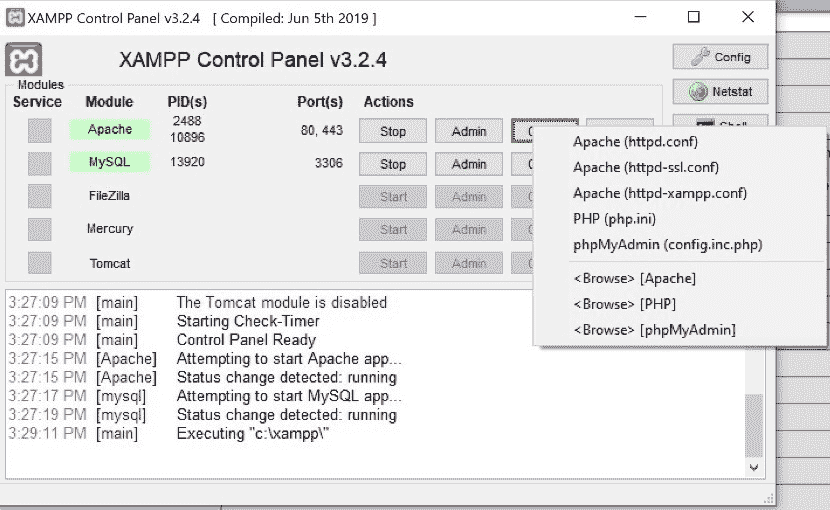

# PHP：一天学会并精通 PHP——带项目的初学者 PHP 实用指南

> 通过实战项目快速学习编程系列 6

## 前言

本书旨在帮助你快速且精通地学习 `PHP`。虽然本书适合 `PHP` 绝对初学者，但你确实需要熟悉 `HTML` 和 `SQL`（针对第 11 章）。

本书涵盖了广泛的 `PHP` 主题，经过精心挑选，旨在让你对该语言有广泛的接触。如果你是 `PHP` 的绝对初学者，你会发现这本书以易懂且简洁的方式解释了复杂的概念。

在书的末尾，你将在一个项目的指导下完成学习，这让你有机会运用所学，并看到它们是如何联系在一起的。你可以在 [`www.learncodingfast.com/php`](https://www.learncodingfast.com/php) 下载示例和项目的源代码。任何错误可以在 [`www.learncodingfast.com/errata`](https://www.learncodingfast.com/errata) 找到。

## 联系信息

我乐意收到你的反馈。如需反馈或咨询，可以通过 `jamie@learncodingfast.com` 与我联系。

## Jamie 的其他书籍

-  [一天学会 SQL（使用 MySQL）并精通它](https://www.amazon.com/dp/B07K374J19)
-  [一天学会 CSS（结合 HTML 5）并精通它](https://www.amazon.com/dp/B00UI2QHQG)
-  [一天学会 Python 并精通它（第二版）](https://www.amazon.com/dp/B071Z2Q6TQ)
-  [一天学会 Python 并精通它（练习册）](https://www.amazon.com/dp/B07WH99L1J)
-  [一天学会 C# 并精通它](https://www.amazon.com/dp/B016Z18MLG)
-  [一天学会 Java 并精通它](https://www.amazon.com/dp/B01LZOCVN9)

## 6.4.4 显示 HTML 代码

## 12.2 处理错误

# 第一章：PHP 简介

感谢你拿起这本书。我非常高兴你选择这本书，衷心希望它能帮助你掌握 `PHP`，并带你进入动态 Web 编程的世界。

在书中，我们将涵盖 `PHP` 的大部分主要主题。这些主题经过了精心挑选，旨在让你对 `PHP` 有广泛的接触，同时又不会被不必要的细节所困扰。在书的末尾，我们还将一起构建一个动态网站。很期待吗？

在正式开始 `PHP` 之前，请注意本书要求你对 `HTML` 和 `MySQL` 有基础的了解。如果你不熟悉这些语言，建议你参考我的书籍《[一天内学会并精通 CSS（带 HTML 5）](https://www.amazon.com/dp/B00UI2QHQG)》和《[在内内学会并精通 SQL（使用 MySQL）](https://www.amazon.com/dp/B07K374J19)》。如果你已经熟悉了，那我们继续吧。

## 1.1 什么是 PHP？

`PHP` 是一种通用型编程语言，主要用于 Web 开发。它由 Rasmus Lerdorf 于 1994 年创建，允许开发者轻松地创建动态网页。

例如，开发者可以在 HTML 中创建一个表单，并使用 `PHP` 对其进行处理。根据表单中输入的内容，开发者可以使用 `PHP` 向用户显示不同的输出结果。

大多数情况下，`PHP` 被用作服务器端语言。这意味着 `PHP` 代码不是在用户的计算机（也称为客户端）上处理的。换句话说，当你通过浏览器访问一个 `PHP` 页面时，代码不会在你的计算机上运行。

相反，你的浏览器会向 Web 服务器发送请求，然后由服务器处理代码，并将结果以网页的形式返回给浏览器。在通常情况下，这个 Web 服务器是存储 `PHP` 文件的远程计算机。

为了让 Web 服务器能够处理 `PHP` 代码，需要安装一种名为 `PHP` 解释器的特殊软件。在下一章节中，我们将学习如何使用一种名为 `XAMPP` 的免费软件来搭建 Web 服务器并安装 `PHP` 解释器。

## 1.2 为什么要学习 PHP？

学习 `PHP` 有很多理由。

首先，`PHP` 是使用最广泛的 Web 编程语言之一，被许多流行的内容管理系统（如 `Wordpress`、`Drupal` 和 `Joomla`）所使用。因此，对 `PHP` 程序员的需求很大。如果你计划从事自由开发者工作，`PHP` 是一项必备技能。

其次，`PHP` 设计对初学者友好且易于学习。此外，由于这种语言的流行，如果你在 `PHP` 代码上遇到任何问题，都可以轻松地找到帮助。在互联网上简单搜索就能帮助你解决面临的大部分问题。

最后但同样重要的是，`PHP` 的语法与 `Java` 或 `C` 等其他编程语言非常相似。一旦你熟悉了 `PHP`，你会发现掌握其他语言变得容易得多。准备好开始了吗？让我们开始吧！

# 第 2 章：安装 XAMPP

正如上一章提到的，在本章中我们将学习如何设置 Web 服务器并安装 `PHP` 解释器。此外，由于我们在书的后续部分将使用 `PHP` 与数据库进行交互，我们还需要设置数据库服务器。

为了设置 Web 服务器和数据库服务器，我们需要安装三个软件：Apache Web 服务器、`PHP` 解释器和 MarieDB 数据库服务器。如果一个接一个安装这三个软件，可能会非常繁琐。

幸运的是，Apache Friends 的热心人士创建了一个包含了我们所需所有软件的免费软件包。这个软件包被称为 `XAMPP`，代表跨平台（X）、Apache Web 服务器（A）、MarieDB 数据库服务器（M）、`PHP`（P）和 Perl（P）。

MarieDB 数据库服务器是 `MySQL` 服务器的社区开发分支版本。虽然 `XAMPP` 中的 `M` 正式代表 `MarieDB`，但你会发现 `XAMPP` 在软件中将数据库服务器标记为 `MySQL`。我们将遵循这一标记，在书中将数据库服务器称为 `MySQL`。

关于安装 `XAMPP` 以及使用它设置服务器的详细说明，请查看 [`learncodingfast.com/how-to-install-xampp-and-brackets`](https://learncodingfast.com/how-to-install-xampp-and-brackets)。说明可以在本书的配套网站上找到，每当 `XAMPP` 有任何变化时，你都可以在网站上找到更新后的说明。这将确保你始终获得最新的安装说明。

除了安装 `XAMPP` 之外，强烈建议你安装一个高级文本编辑器来编写代码。虽然你完全可以在基础文本编辑器（如 `Notepad`）中编写代码，但高级文本编辑器提供语法高亮等功能，可以让你的代码更易于阅读和调试。

推荐的免费编辑器是 `Brackets`。关于安装 `Brackets` 的说明，也请前往 [`learncodingfast.com/how-to-install-xampp-and-brackets`](https://learncodingfast.com/how-to-install-xampp-and-brackets)。

## 2.1 配置 php.ini

在电脑上安装好 `XAMPP` 和 `Brackets` 之后，你就可以开始创建你的动态网站了。然而，在我们开始之前，我们需要对 PHP 服务器上的错误设置进行一些更改。这确保了每当代码中出现任何错误时，浏览器上都会显示错误消息。

要配置这些设置，最直接的方法是修改名为 `php.ini` 的文件。以下说明在编写时是有效的。如果说明有任何更改，你可以在 [`learncodingfast.com/php`](https://learncodingfast.com/php) 找到更新后的说明。

要修改 `php.ini`，我们需要先找到文件。在 Windows 上，启动 `XAMPP` 并点击 `Apache` 的“Config”按钮。接下来，选择 `php.ini`。文件将在 `Notepad` 中打开。



在 Mac 上，启动 `XAMPP` 并点击“General”标签页中的“Start”按钮。等待状态变为绿色。接下来，选择“Volumes”标签页并点击“Mount”按钮。最后，点击“Explore”并寻找“etc”文件夹。你会在该文件夹找到 `php.ini`。使用 `Brackets` 打开它。


一旦打开了 `php.ini`，滚动到页面底部并添加以下几行：

```ini
error_reporting=ALL
display_errors=On
```

将这些行添加到页面底部，是为了如果之前已经设置过这些设置（在 `php.ini` 文件的早期部分），新行将覆盖旧设置。

保存文件并重启 `Apache`。在 Windows 上，停止 `Apache` 服务器（如果它正在运行）然后重新启动。在 Mac 上，选择“Services”标签页并点击“Apache”。如果 `Apache` 正在运行，点击“Restart”按钮。否则，点击“Start”按钮。

等待 `Apache` 重启，你的设置将会更新。当代码中有错误时，现在你会收到错误消息。根据你使用的 `PHP` 版本，测试代码时遇到的错误可能与描述的不同。不要担心这一点。

## 2.2 重要链接

在编写我们的第一个网页之前，我想让你注意两个重要链接。

第一个是 [`learncodingfast.com/php`](https://learncodingfast.com/php)。本书使用了大量示例来解释不同的概念。我们鼓励你自己在 `Brackets` 中输入这些示例，如果你不愿意，可以在上面的链接下载源代码。

项目文件和本书的任何更新也可以在那里找到。我们已尽努力确保书中没有错误，所有源代码已在多台机器上经过广泛测试，如果发现任何错误，你可以在 [`learncodingfast.com/errata`](https://learncodingfast.com/errata) 找到。

## 2.3 编写我们的第一个网页

太棒了！我们现在准备好编写代码了。

首先，确保你在 `XAMPP` 中启动了 `Apache`。注意：如果在启动 `Apache` 时遇到任何问题，可能是由于端口冲突。按照 [`learncodingfast.com/how-to-install-xampp-and-brackets`](https://learncodingfast.com/how-to-install-xampp-and-brackets) 的说明解决冲突。

接下来，在 `Brackets` 中创建一个新文件并添加以下代码：

```html
<!DOCTYPE html>
<html>
<head>
    <title>My first PHP page</title>
</head>
<body>
    <h1>My first PHP page</h1>
    <?php #Simple hello world page
    echo "Hello World!";
?>
</body>
</html>
```

如果你使用的是电子书阅读器，上面的行可能会因为宽度限制而换行。尝试将设备切换为横屏模式或使用较小的字体。这适用于书中的所有示例。

将上面的文件保存为 `hello.php` 到你的 `htdocs` 文件夹中。任何包含 `PHP` 代码的文件必须以 `.php` 扩展名保存。以 `.php` 结尾的文件称为 PHP 脚本。

你可以在 `XAMPP`（Windows）或 `LAMP`（Mac）文件夹找到 `htdocs` 文件夹。`htdocs` 是你本地 Web 服务器的根目录。

在 Windows 上，要加载 `htdocs` 中的文件，只需在浏览器地址栏输入 `http://localhost/<filename>`。例如，要加载 `hello.php`，输入 [`localhost/hello.php`](http://localhost/hello.php)。

在 Mac 上，加载 `htdocs` 中文件的简单方法是启用端口转发。这可以在 `XAMPP` 的“Network”标签页下完成。假设你在 `XAMPP` 中启用了 `localhost:8080->80`（通过 SSH），要加载 `hello.php`，请在浏览器地址栏中输入 [`localhost:8080/hello.php`](http://localhost:8080/hello.php)。

懂了吗？你可以参考 [`learncodingfast.com/how-to-install-xampp-and-brackets`](https://learncodingfast.com/how-to-install-xampp-and-brackets) 获取更详细的说明。

为了方便引用，从现在起，我将使用 [`localhost`](http://localhost) 指代你的本地。如果你使用的是 Mac，请在 URL 中添加端口号（例如 [`localhost:8080`](http://localhost:8080)）。

现在让我们分析 `hello.php` 中的代码。大部分代码你看起来应该是熟悉的，除了以下内容：

```php
<?php 
#Simple hello world page 
echo "Hello World!"; 
?>
```

上面的 `<?php` … `?>` 标签被称为 PHP 标签；它们告诉服务器内部的代码被视为 PHP 代码。在示例中，我们有两行简单的 PHP 代码（一行是注释，一行是语句）。

第一行 `#Simple hello world page` 是注释。注释是由程序员编写的，用于向其他程序员解释代码；PHP 解释器会忽略这些注释。

要在我们的代码中添加单行注释，我们在注释前加上 `#` 或 `//`。例如：

```php
# This is a comment
// This is also a comment
```

要添加多行注释，我们将注释包含在 `/*...*/*/` 中。例如：

```php
/*
This is an example of a multi-line comment.
*/
```

注释之后，我们使用语句 `echo "Hello World!";` 在浏览器上显示“Hello World!”字样。这被称为 `echo` 语句；我们将在下一章中学习更多内容。

注意我们 `echo` 语句是以分号（`;`）结尾的。PHP 中的所有语句都必须以分号结尾。这类似于我们在英语中使用句号（`.`）结束句子。

# 第 3 章：基础 PHP 任务

在上一章中，我们安装了 `XAMPP` 和 `Brackets`，并编写了我们的第一个 PHP 脚本。在本章中，我们将学习执行 PHP 中三个非常基础的任务——向用户显示输出、在多个页面之间复制代码以及重定向用户。

## 3.1 显示输出

在学习显示输出之前，让我们先创建一个 PHP 文件作为模板，以便我们测试本节中的 PHP 语句。

在 `Brackets` 中创建一个文件并将其保存为 `output.php` 到你的 `htdocs` 文件夹中。在 `output.php` 中添加以下代码：

```php
<?php
//在此处添加代码
```

每当你想要测试本节中的任何 PHP 语句时，都可以将该语句添加到 `output.php`（`<?php` 开启标签之后），并在浏览器中加载它以检查输出。

注意，我们没有为 `output.php` 添加结束标签（`?>`）。这是因为 `output.php` 只包含 PHP 代码。

根据 PHP 框架互操作组（PHP Framework Interop Group）推荐的标准，任何只包含 PHP 代码的 PHP 脚本都不应以结束标签结尾。这样做是为了防止文件末尾出现意外的空格，这在修改响应头时可能会导致如“Headers already sent”（头部已发送）之类的警告。

如果上面的语句看起来没有意义，不要担心；我们稍后会学习“Headers already sent”警告。现在，让我们继续学习如何在 PHP 中显示输出。

### 3.1.1 echo

在 PHP 中显示输出最简单的方法是使用 `echo` 语句。要做到这一点，我们在 `echo` 关键字之后使用一对匹配的引号将我们想要显示的文本括起来。

`echo` 关键字是不区分大小写的。因此，`echo`、`Echo` 或 `ECHO` 都能正常工作。

使用 `echo` 语句非常直接。我们在第 2 章就用过它，当时是用它显示“Hello World!”单词。除了使用 `echo` 语句显示简单的文本消息外，我们还可以使用它们显示带有 HTML 标记的文本。

例如，我们可以写 `echo 'PHP is fun<BR>and easy!';`。这将带给我们 PHP is fun and easy! 的输出；由于 `<BR>` 标签，文本“and easy!”显示在第二行。

我们还可以在单个 `echo` 语句中组合多个消息。要做到这一点，我们用逗号分隔消息。例如，`echo "ABCD", "EFGH";` 将带给我们 ABCDEFGH 的输出。

当消息更复杂时（例如消息包含变量和函数时），组合消息是非常有用的。我们将在书的后续部分学习变量和函数。

最后但同样重要的是，我们可以使用带括号或不带括号的 `echo` 语句。你可能见过执行以下操作的代码：`echo ("ABCD");`。这在大多数情况下都是良好的。

然而，如果你使用括号，则不允许在单个 `echo` 语句中组合多个消息。例如，`echo ("ABCD", "EFGH");` 将导致错误。在大多数情况下，你最好使用不带括号的 `echo` 语句。

### 3.1.2 print


除了使用`echo`语句显示输出外，我们还可以使用`print`语句。`print`语句与`echo`语句非常相似。来看这个例子：`print "My name is Brody.";`将带给我们 My name is Brody. 的输出。如你所见，`print`语句的作用与`echo`语句一样。虽然它们之间存在一些差异，但在大多数情况下，没有必要使用`print`语句。

在 PHP 中，有多种方法执行某项任务是非常常见的。这是开发者对 PHP 的主要抱怨之一，因为它让事情变得不必要的复杂。在大多数情况下，这些不同方式彼此非常相似。为了不让你被过多的选项困扰，我将在书中坚持一种选择，并在必要时简要提到其他选项。在书中，我将使用`echo`语句来显示输出。

### 3.1.3 转义字符

接下来，让我们学习在 PHP 中转义字符。在之前的节中，我们学习了在 ways `echo`（或`print`）语句时用用引号将文本括起来。如果我们想显示一个单引号会发生什么呢？例如，假设我们有如下语句：`echo '<BR>Today is Friday, we're going to the zoo.';`当我们尝试运行上述语句时会得到错误，因为 PHP 默认不区分单引号和双引号。因此，它将“we’re”单词中的单引号视为结束结束引号。换句话说，它将该语句看作`echo '<BR>Today is Friday, we'`并期望在单引号后有一个分号或逗号。当情况没有发生时，PHP 就会困惑并给出一个错误。

处理上述错误有两种方法。第一种是使用双引号括文本并将语句重写为`echo "<BR>Today is Friday, we're going to the zoo.";`由于 PHP 使用双引号来结束另一个双引号，因此“we’re”中的单引号不会被误解为结束引号。

另一种，我们可以通过在原始语句的单引号前面加上反斜杠字符（`\\`）来转义它。转义字符会改变字符的含义。没有反斜杠，单引号会被解释为结束单引号；有了反斜杠，它就会被视为要在在浏览器上显示的单引号。例如，为了显示上一个例子中的单引号，可以使用下面的语句：`echo '<BR>Today is Friday, we\'re going to the zoo.';`这带给我们 Today is Friday, we're going to the zoo 的 输出。

反斜杠的其他常见用法包括：

- 使用它显示双引号：`echo """`会产生错误，而`echo "\"";`带给我们`"`

- 使用它显示反斜杠本身：`echo "\"`会产生错误，而`echo "\\";`带给我们`\`

## 3.2 复制代码

接下来，让我们学习如何在脚本中复制代码。在 PHP 中，通常情况下脚本是相互独立的。因此，在一个脚本中编写的代码（例如`index.php`）在导航到另一个页面时可用。如果我们希望网站上的多个页面具有相同的 HTML 或 PHP 代码，我们需要使用`include`语句。

### 3.2.1 include

假设你希望网站上的多个页面具有相同的`<h1>`标题，不需要将代码复制到所有页面。相反，你可以使用`include`语句。让我们尝试一下。创建一个名为`heading.html`的文件（在`htdocs`中），为其添加以下代码：`<h1>Welcome to PHP</h1>`

接下来，创建一个名为`includedemo.php`的文件并将其保存到`htdocs`中。向该文件添加以下代码：

```php
<!DOCTYPE html>
<html>
<body>
<?php include 'heading.html'; ?>
</body>
</html>
```

注意`includedemo.php`中的语句`include 'heading.html';`。当 PHP 看到这个语句时，它会去`heading.html`，复制里面的代码并将其粘贴到`includedemo.php`中。这节省了我们手动复制代码的麻烦。如果你现在启动`includedemo.php`，你会看到“Welcome to PHP”作为`<h1>`标题显示。

明白了吗？

使用`include`语句我们需要给 PHP 要包含的文件路径。这类似于我们在 HTML 中将 CSS 或文件链接到网页。在上面的示例中，由于`heading.html`与`includedemo.php`在同一个文件夹中，我们只需提供文件名。如果`heading.html`存储在另一个文件夹（例如`htdocs`内部的`includes`文件夹中），我们需要使用下面的语句：`include 'includes/heading.html';`

### 3.2.2 require

除了`include`语句，PHP 还有`require`语句。区别在于，如果 PHP 找不到文件，`require`会产生致命错误并停止脚本。而`include`只产生警告而不停止脚本。如果你想要包含的内容对于页面的正确执行至关重要，你应该使用`require`语句。否则，你可以使用`include`语句。

### 3.2.3 include_once, require_once

`include`和`require`语句都带有`_once`版本。正如名称所示，`include_once`和`require_once`只向文件中“复制粘贴”一次代码。这些语句适用于同一个文件可能被包含多次的情况（例如，当脚本很长你忘记之前是否包含过该文件）。如果你在`includedemo.php`中添加另一个`include 'heading.html';`语句（`?>`标签之前）并加载页面，你会看到两次“Welcome to PHP”作为`<h1>`标题。另一方面，如果你将包含语句改为`include_once 'heading.html'; include_once 'heading.html';`你只会看到一次`<h1>`标题。

## 3.3 重定向用户

太棒了！我们来到了本章的最后一节。在本节中，我们将学习使用 PHP 重定向用户。在 HTML 中，我们知道可以使用`<meta>`标签将用户重定向到另一个页面。在 PHP 中，我们使用名为`header()`的内置函数。

首先，什么是函数？函数是执行特定任务的代码块。作为一个类比，想想 MS Excel 中的函数。如果我们想相加电子表格中某些单元格的值，可以使用名为`sum()`的内置函数。该函数是由其他程序员预写的并包含在 Excel 中的。与 Excel 中的预写函数类似，PHP 带有许多内置函数。大多数函数都要求我们提供某些信息以便它们执行任务。在 PHP 中，我们通过在函数名后的一一对括号（按照预定义的顺序）来提供这些信息。我们传递给函数的信息称为参数。要要使用`header()`函数，我们需要向函数传递“Location”一词，后面跟一个冒号和重定向 URL。使用函数也称为调用函数。要调用`header()`函数，在`includedemo.php`的开头添加以下代码（`<!DOCTYPE html>`标签之前）：

```php
<?php header('Location: http://example.com'); ?>
```

如果你现在加载`includedemo.php`，你将被重定向到`http://example.com`。明白了吗？

当你使用`header()`函数时，注意它必须在你的脚本向浏览器生成任何输出之前调用，无论是通过普通的 HTML 标签、空行还是来自 PHP。如果在调用函数之前有任何输出，该函数将无法工作。例如，它在以下两个示例中将无法工作：

示例 1：

```php
<?php echo 'Hello'; header('Location: http://example.com'); ?>
```

示例 2：

```html
<p>This is some text.</p>
<?php header('Location: http://example.com'); ?>
```

在第一个示例中，输出是在`header()`函数调用之前由`echo`语句（`echo 'Hello';`）产生的。在第二个示例中，输出是由`<?php`标签之前的两行代码产生的。这两行在`header()`函数调用之前生成了一个 HTML 段落和一个空行。

# 第 4 章：PHP 中的常量、变量、数据类型和运算符

太棒了我们已经来到了第 4 章。在本章中，我们将学习常量和变量。此外，我们还将讨论变量存储的数据以及我们可以对它们执行的各种操作。在继续之前，你可能想创建一个名为`chap4.php`的新 PHP 脚本，并用它来测试章中的示例。准备好了吗？太好了！让我们开始吧。我们将从常量开始。

## 4.1 常量

PHP 中的常量类似于数学中的常量。还记得我们在数学中学过的数字 3.14159（保留 5 位小数）吗？这个数字被称为圆周率（π），它的值永远不会。就像数学中的 Pi 一，我们可以在 PHP 中定义自己的常量并为它们命名以便方便引用。要做到这一点，我们使用一个名为`define()`的内置函数。一旦定义了常量，就不允许更改它的值。要使用`define()`函数，我们需要向函数传递两个参数（用逗号分隔）——常量名（用引号括起）和值。常量名默认对大小写敏感，可以由字母、数字或下划线组成。然而，它必须以字母或下划线开头。命名常量时使用全大写字母是一种约定。

让我们来看一个示例。

```
define("BASIC_MEMBER", 1112020);
echo BASIC_MEMBER;
echo '<BR>';
define("BASIC_MEMBER", 16932);
echo BASIC_MEMBER;
```

在这里我们定义了一个名为`BASIC_MEMBER`的常量，并指定其值为`1112020`。接下来，我们使用它的名称引用它，并使用`echo`语句输出它的值。在输出之后，我们尝试重新定义`BASIC_MEMBER`并将其值改为`16932`。最后，我们再次输出它的值。如果你运行上面的代码，将得到以下输出：

```
1112020
Notice : Constant BASIC_MEMBER already defined in ...
1112020
```

如果你仔细研究输出结果，你会发现我们在第一次定义`BASIC_MEMBER`之后并没有成功更改它的值。因此，当我们第二次输出它时，它的值仍然是`1112020`。明白了吗？很好！在上面的示例中，注意当我们输出它的值时，我们没有给`BASIC_MEMBER`括上引号。如果我们使用引号（例如，`echo 'BASIC_MEMBER';`），我们将得到`BASIC_MEMBER`作为输出，这并不是我们想要的。我们只在定义常量时才将常量名括在引号内（即在调用`define()`函数时）。

## 4.2 变量

接下来，让我们进入变量。变量用于在程序中存储数据。它们有名称，并在需要时可以更改其值。和常量一样，变量名需要遵循某些命名规则。首先，变量名必须以`$`符号开头。在该符号之后，名称不能以数字开头，且只能包含字母数字下划线（`A-z`、`0-9`和`_`）。像`$userName`、`$age1`和`$user_email`这样的名称是可以的，而像`$4ever`（以数字开头）、`$unit+NY`（包含`+`符号）和`$var 1`（包含空格）是不行的。接下来，变量名是大小写敏感的；`$userName`与`$username`不同。最后，变量名应该具有意义。使用`$x`、`$y`和`$z`等变量来存储用户的姓名、年龄和密码会让你的代码变得混乱且不直观。虽然不是强制的，但你绝对应该使用更有意义的名称，如`$name`、`$age`和`$password`，以提高代码的可读性。

在 PHP 中为变量命名时有两种常用的风格。我们可以使用驼峰命名法或下划线。驼峰命名法是用混合大小写编写复合词，每个单词（第一个除外）大写开头（例如，`$thisIsAVariable`）。另一种常见风格是使用下划线（`_`）分隔单词（例如，`$this_is_a_variable`）。选择一种风格而不是另一种取决于个人偏好。更重要的是在整个代码中保持一致。在书中，我们将变量使用驼峰命名法（camelCase）。

在 PHP 中声明变量，我们写如下：

```
$x = 7;
```

在这里，我们声明了一个名为`$x`的变量并给它赋值`7`。给变量赋值被称为赋值赋值。在声明变量时给它初始值被称为初始化变量。这在 PHP 中不是强制的。然而，这样做被认为是一种坏习惯，因为它可能导致脚本出现意想不到的行为。当我们声明并初始化变量时，PHP 会在服务器存储空间上分配特定的区域来存储这些数据。随后可以通过引用其名称访问并修改这些数据。

例如，要显示`$x`的值，我们写道：

```
echo $x;
```

这给了我们输出`7`。如果我们改变`$x`的值，只需给它赋一个新值。例如：

```
$x = 5;
echo $x;
```

这更新了`$x`的值并给了我们`5`。在上面的示例中，注意我们使用`echo`语句时没有给`$x`括上引号。通常情况下，在使用`echo`语句时不将常量、变量或函数的名称括在引号内。这是因为`echo`语句将任何在引号内的内容视为文本或 HTML 代码并原样输出。例如，如果我们写`echo '$x';`，我们将得到输出`$x`。唯一的例外是双引号括起的变量名。如果我们把变量名括在双引号内，`echo`语句不会原样输出变量名。相反，它会用变量的值替换名称并输出该值。例如，如果我们写道：

```
echo 'The value is $x.';
echo '<BR>';
echo "The value is $x.";
```

我们将得到输出`The value is $x. The value is 5.`。当使用单引号时，`echo`语句会原样输出文本。相比之下，当使用双引号时，它会将`$x`替换为它的值。明白了吗？

## 4.3 基本数据类型

接下来，让我们讨论 PHP 中的类型。PHP 中的变量可以存储不同类型的数据。变量存储的数据类型被称为数据类型。在本节中，我们将讨论三种基本数据类型：`int`、`float`和`bool`。

- `int`：指整数，即没有小数部分的数字。这种数据类型有上限和下限，且取决于平台。也就是说，它只能存储特定范围内的数字。超出这些边界的整数（例如很大的数字）会被解释为浮点。

- `float`：指浮点数，即带有小数部分的数字。示例包括`5.7`、`-3.5`和`7`。

- `bool`：指布尔，是一种只能存储两个值之一的特殊类型——`true`或`false`。这两个值对大小写敏感。也就是说，`true`和`TRUE`指同一个值。同样，`false`和`FALSE`指同一个值。`bool`数据类型目前似乎是冗余的。当我们在讨论比较运算符和条件语句时，它的意义将会体现。PHP 被认为是一种弱类型语言。当我们声明变量时，不需要指定其数据类型。为了存储整数或布尔。如果我们有以下变量：

```
$x = 5;
$y = 2.1;
$z = true;
```

`$x`是整数，`y`是浮点，`z`是布尔。为了验证变量的类型，我们可以使用内置函数`var_dump()`。

```
var_dump($x);
var_dump($y);
var_dump($z);
```

`int(5)`、`float(2.1)`、`bool(true)`。在上一节中，我们可以轻松地将一种数据类型转换为另一种。这被称为类型转换。

## 4.4 类型转换

在上一节中，我们学习了基本数据类型——`int`、`float`和`bool`。我们可以轻松地将一种数据类型转换为另一种。这被称为类型转换。将值/变量转换为整数，我们添加`(int)`或`(integer)`。将其转换为浮点，我们添加`(float)`或`(double)`。让我们来看一个例子：

```
$p = 4.6;
var_dump($p);
```

在这里我们声明了一个名为`$p`的变量并给它赋值`4.6`。接下来我们使用`var_dump()`函数显示`$p`的类型和值。如果我们运行上面的代码，我们将得到输出`int(4)`，PHP 通过截断小数部分将`4.6`转换为整数。除了将值转换为整数或浮点之外，我们也可以将其转换为字符串、数组或对象，添加`(string)`、`(array)`和`(object)`。

## 4.5 PHP 中的运算符

PHP 带有许多可以使用变量的运算符。让我们先讨论赋值运算符。

### 4.5.1 赋值运算符

之前我们学习了使用`=`给变量赋值。这个符号被称为赋值运算符，与数学中的等号不同。在 PHP（以及大多数编程语言）中，赋值是从右到左进行的。也就是说，我们将赋值运算符右侧的值（或变量）赋值给左侧的变量。因此，`$x = 7;`不等于`7 = $x;`。虽然这两个语句在数学上都是接受的，但在 PHP 中第二个语句是不允许的。在第一个语句中，我们将`7`赋值给`$x`。这是正确的且不会产生错误。另一方面，在第二个语句中，我们将`$x`赋值给`7`（从右到左）。这没有意义并且会产生错误。

### 4.5.2 算术运算符

接下来，让我们讨论算术运算符。这些运算符用于执行基本的算术运算。它们包括加（`+`）、减（`-`）、乘（`*`）、除（`/`）、取模（`%`）和幂（`**`）。

假设你有：

```
$x = 5;
$y = 2;
```

`$x + $y`给了我们`7`，`$x - $y`给了我们`3`，`$x * $y`给了我们`10`，`$x / $y`给了我们`2.5`，`$x % $y`给了我们`1`，因为取模运算符给了 5 除以 2 的余数，而`$x ** $y`给了我们`25`，因为幂运算符给了 5 的 2 次方。

### 4.5.3 复合赋值运算符


除了上述算术运算符，我们还有一组将算术运算与赋值结合的运算符。假设你有`$x = 5;`，你想给`$x`加 3，你可以这样做：

```php
$x = $x + 3;
```

赋值总是从右到左发生。因此，右侧的表达式`$x + 3`先被求值，结果为`5+3`。然后这个值被赋值回左侧的变量`$x`。也就是说，`$x`的值变成了`8`。除了写`$x = $x + 3;`，我们还可以使用`+=`运算符。这个运算符是赋值运算符与加法运算符结合的简写。如果你写道：

```php
$x = 5;
$x += 3;
echo $x;
```

你将得到输出 8。`$x += 3`仅仅意味着`$x = $x + 3`。除了`+=`运算符，我们还有`-=`运算符，它将`-`运算符与赋值运算符结合。适用于上一节提到的所有算术运算符。因此，`$x -= 4`等于`$x = $x - 4`，`$x *= 2`等于`$x = $x * 2`等。

### 4.5.4 自增/自减运算符

最后但同样，让我们讨论自增（`++`）和自减（`--`）运算符。这些运算符增加或减少变量的值 1 并返回新值。让我们尝试一些代码（添加了行号）：

```php
$q = 3;
echo "<BR>$q<BR>";
echo ++$q;
```

如果你运行上面的代码，将得到以下输出：

```
3
4
```

第 2 行使用`echo`语句输出`$q`的原始值。第 3 行执行的是：

1. 将`$q`的值增加 1
2. 输出`$q`的新值

因此我们得到了输出 4。`++`运算符被称为自增运算符。它可以放在变量名的前面（称为预自增）或后面（称为后自增）。尝试将上面的第 3 行改为`echo $q++;`并重新运行代码，你将得到输出：

```
3
3
```

这次感到惊讶吗？这是因为现在第 3 行执行的是：

1. 输出`$q`的原始值
2. 将`$q`的值增加 1

也就是说，这两个任务（自增和输出）的执行顺序反转了。自增是在输出语句执行完毕后完成的（因此故名为后自增）。为了证明`$q`确实被增加了，你可以在第 3 行之后再次输出它的值。这次你将得到输出 4。明白了吗？除了自增运算符，我们还有自减运算符（`--`）。这个运算符由两个减号组成，并将变量的值减少 1。它也可以作为预自减或后自减运算符使用。

# 第 5 章：PHP 中的更多数据类型

在上一章中，我们查看了 PHP 的一些基本数据类型。在本章中，我们将讨论另外两种数据类型——字符串和数组。你可以创建一个名为`chap5.php`的新文件来测试本章中的示例。

## 5.1 字符串

字符串指的是文本。在 PHP 中，字符串必须包含单引号或双引号内。例如，如果我们写：

```php
$msg = 'Hello';
$greeting = "Good Morning";
$emptyStr = "";
```

`$msg`和`$greeting`分别存储字符串`'Hello'`和`"Good Morning"`。另一方面，`$emptyStr`存储一个被称为“空字符串”的特殊字符串。这是因为在我们分配给它的双引号对之间没有任何文本。在 PHP 中，你可以使用连接运算符（`.`）组合多个字符串。让我们来看一个例子：

```php
$areacode = "(208)";
$contact = '+1' . $areacode . '1234567';
echo $contact;
```

在这里，我们使用两次连接运算符来连接字符串`'+1'`、变量`$areacode`和字符串`'1234567'`以形成一个新的字符串。我在连接运算符前后添加了空格，以便你更清楚地看到这三个部分；你不需要添加这些空格。连接后，我们将新字符串赋值给名为`$contact`的变量，并使用`echo`语句输出它的值。如果你运行上面的代码，将得到输出`+1(208)1234567`。

### 5.1.1 PHP 中常用的字符串函数

接下来，让我们讨论 PHP 中一些常用的字符串函数。PHP 带有许多处理字符串的内置函数。大多数函数在执行任务后返回一个结果。我们可以将结果赋值给变量，或使用`echo`语句直接显示结果。某些函数可能有不同的变体，因为某些函数允许我们提供可选参数来修改函数的行为。下面的示例讨论了使用每个函数最常见且有效的方法。

#### `strlen()`

`strlen()`函数用于获取字符串的长度。示例：

```php
$str1 = 'Good Day!';
echo strlen($str1);
```

输出：9

在这里，我们声明了一个名为`$str1`的变量，并将字符串`'Good Day!'`赋值给它。接下来，我们将`$str1`传递给`strlen()`并使用`echo`语句直接显示函数的输出。我们得到输出`9`，是因为`4`（`'Good'`）+ `1`（`' '`）+ `3`（`'Day'`）+ `1`（`'!'`）= `9`。

#### `strtolower()`、`strtoupper()`

`strtolower()`和`strtoupper()`函数分别将字符串转换为小写和大写，并返回新字符串。原始字符串不会改变。示例：

```php
$str2 = 'Hello World';
$str3 = strtolower($str2);
$str4 = strtoupper($str2);
echo '<BR>'.$str2;
echo '<BR>'.$str3;
echo '<BR>'.$str4;
```

在这里，我们声明了一个名为`$str2`的变量，并将字符串`'Hello World'`赋值给它。接下来，我们将`$str2`传递给`strtolower()`和`strtoupper()`，并将结果分别赋值给`$str3`和`$str4`。最后，我们使用三个`echo`语句输出`$str2`、`$str3`和`$str4`的值。在每个情况下，我们把`'<BR>'`与变量连接，以便输出从新行开始。如果你运行上面的代码，将得到输出`Hello World hello world HELLO WORLD`。

#### `trim()`

`trim()`函数默认删除字符串开头和结尾的空格，并返回新字符串。你可以通过向函数传递第二个可选参数来指定要删除的其它字符。

示例 1：

```php
$str5 = ' is ';
echo 'PHP'.$str5.'Fun<BR>';
echo 'PHP'.trim($str5).'Fun<BR>';
```

输出：PHP is Fun PHPisFun

在这里，我们首先将`$str5`与字符串`'PHP'`和`'Fun<BR>'`连接，并使用`echo`语句直接输出结果字符串。我们得到输出`"PHP is Fun"`。接下来，我们使用`trim()`函数移除`$str5`中的空格，并再次与`'PHP'`和`'Fun<BR>'`连接。这次我们得到输出`"PHPisFun"`。

示例 2：

```php
$str6 = '\*\*Hello\*\*World\*\***';
echo trim($str6, '\*');
```

输出：Hello**World

在这里，我们将`'\*'`作为第二个参数传递给`trim()`函数。结果是从`$str6`的前后删除了星号（而不是空格），我们得到输出`"Hello**World"`。

#### `substr()`

`substr()`函数返回一个子串。要使用此函数，我们需要向它传递两个参数——要提取子串的字符串以及开始提取的位置。我们还可以传递第三个参数来指定要提取的子串长度。如果不提供此参数，函数将提取从指定起始位置到字符串结束的子串。字符串的位置从 0 开始。例如，如果我们有字符串`'ABCDEF'`，`'A'`在位置 0，`'B'`在位置 1，依此类推。位置也可以是负数。如果是负数，则从字符串末尾计数。在`'ABCDEF'`中，`'F'`在位置 -1，`'E'`在位置 -2 等。示例：

```php
$str7 = 'ABCDEF';
echo substr($str7, 2).'<BR>';
echo substr($str7, -3).'<BR>';
echo substr($str7, 2, 1);
```

输出：C DEF C

在这里，我们声明了一个名为`$str7`的变量，并将字符串`'ABCDEF'`赋值给它。接下来，我们将`$str7`传递给`substr()`以提取不同的子串。在前两个示例中，`substr()`分别从位置 2 和 -3 开始提取。因此我们得到了输出`"C"`和`"DEF"`。在第三个示例中，我们通过向`substr()`传递指定的长度 1 得到输出`"C"`。

明白了吗？我们涵盖了 PHP 中的几个字符串函数。关于所有可用字符串函数的完整列表，你可以查看[`www.php.net/manual/en/ref.strings.php`](https://www.php.net/manual/en/ref.strings.php)。

## 5.2 使用字符串表示日期

接下来，让我们学习使用字符串表示日期。为了这一点，我们使用内置函数`strtotime()`。

### 5.2.1 `strtotime()`函数

顾名，`strtotime()`函数将字符串转换为时间。它接受描述日期（和时间）的字符串并尝试将其转换为时间戳。如果你传递给函数一个它无法转换的字符串，它返回`false`。另一方面，如果你传递一个它能够转换的字符串，它会解析字符串并返回时间戳。Unix 时间戳是一个整数，表示自 1970 年 1 月 1 日 00:00:00 UTC 经过的秒数。例如，如果你运行语句`echo strtotime("next Monday");`，你会得到类似 1587340800 的数字，这是下周一的时间戳。`strtotime()`函数非常智能，能够将各种文本日期描述转换为时间戳。例如，它可以处理诸如`"now"`、`"tomorrow"`、`"next Monday"`、`"15 Nov 2019"`或`"+1 week"`。然而，虽然该函数很容易用，但如果你想获得更有意义的日期格式，可以使用另一个内置函数`date()`。

#### 5.2.2 `date()`函数

`date()`函数接受可选的时间戳并将其格式化为易读的字符串。如果没有提供时间戳，它将格式化当前时间戳。假设我们要格式化当前时间 10 小时后的时间戳，可以使用下面的语句：

```php
echo date('d-M-Y', strtotime("+10 hours"));
```

在这里，我们向函数传递两个参数。第一个参数指定了我们如何格式化时间戳。为此，我们使用由标点符号和预定义字符组成的字符串（在[`www.php.net/manual/en/function.date.php`](https://www.php.net/manual/en/function.date.php)中定义）。在我们的示例中，我们使用字符串`'d-M-Y'`。字符`'d'`表示我们用两位数字表示日期，必要时补零（例如，3 输出为 03）。字符`'M'`和`'Y'`表示我们希望月份和年份分别用三个字母文本（例如 Jan）和四位数字表示。最后，标点符号`'-'`表示我们希望日、月、年用连字符分隔。在指定所需的格式后，我们向`date()`函数传递了第二个参数`strtotime("+10 hours")`。此参数是可选的，指定了我们要格式化的日期。如果你运行上面的语句，将得到类似 03-Apr-2020 的输出，这是现在 10 小时后的日期。明白了吗？

#### 5.2.3 设置时区

上面的章节讨论了 PHP 中许多内置日期/时间函数的两个。虽然大多数函数很容易用，但请注意它们的结果受服务器设置的时区的影响。例如，虽然`date('d-M-Y', strtotime("+10 hours"))`在一个时区给出的 03-Apr-2020，但在另一个时区可能会给出 04-Apr-2020。为了避免结果出现差异，强烈建议在你的 PHP 服务器中手动设置时区。为此，你需要修改`php.ini`文件。找到文件后，打开它并滚动到底部。接下来，前往[`www.php.net/manual/en/timezones.php`](https://www.php.net/manual/en/timezones.php)获取有效时区标识符列表。假设你想让 PHP 使用纽约时区，需要在`php.ini`文件中添加`date.timezone=America/New_York`。完成后，保存文件并重启 Apache，设置就会生效。如果你没有权限更新`php.ini`文件，可以使用`date_timezone_set()`函数。该函数接受一个时区标识符并设置 PHP 的默认时区。例如，`date_timezone_set('America/New_York')`。

## 5.3 数组

现在我们熟悉了字符串和日期，让我们转向 PHP 中的另一种常用类型——数组。数组是一种特殊的数据类型，允许我们将多个值存储在一个变量中。例如，假设你想存储 5 个学生的成绩，与其将它们存储为`$marks1`、`$marks2`，可以使用数组。

### 5.3.1 创建数组

PHP 中有几种方法创建数组；最常见的方法是使用`array()`函数。

示例 1：

```php
$firstArr = array();
```

这创建一个空数组。

示例 2：

```php
$secondArr = array(11, 16, 4, 9, 12);
```

这创建一个包含 5 个元素的数组，被称为索引数组，因为数组中的每个元素都有索引。第一个元素 (11) 的索引为 0，第二个 (16) 的索引为 1，依此类推。要访问数组中的某个元素，我们使用一对括号。例如，如果你写`echo $secondArr[3];`，你正在访问第 4 个元素；你会得到输出 9。你也可以使用索引来更新元素的值。

```php
$secondArr[3] = 20;
```

更新第 4 个元素为 20。`$secondArr`变为 (11, 16, 4, 20, 12)。

示例 3：

除了存储数字，数组还可以存储其他数据类型。在下面的示例中，`$fruitsArr`用于存储字符串。

```php
$fruitsArr = array('Apple', 'Banana', 'Coconut');
```

示例 4：

除了索引数组，我们创建关联数组。关联数组中的每个值关联到一个键。例如，在下面的示例中，值 16 关联到`'Jane'`（作为键）。

```php
$assocArr = array('Peter' => 11, 'Jane' => 16, 'Paul' => 12);
```

要访问关联数组中的值，我们使用键。如果你写`echo $assocArr['Paul'];`，我们将得到输出 12。

示例 5：接下来，数组可以存储数组。这被称为多维数组。

```php
$simpleMDArr = array(
    array(1, 2, 1, 4, 5),
    array(0, 5, 1, 3, 4),
    array(4, 7, 8, 9)
);
```

在上面的示例中，`$simpleMDArr[0]`存储数组 (1, 2, 1, 4, 5)，`$simpleMDArr[1]`存储 (0, 5, 1, 3, 4)，`$simpleMDArr[2]`存储 (4, 7, 8, 9)。如果你想访问“内部”数组中的元素，我们使用两对括号。例如，`echo $simpleMDArr[2][3];`给出`$simpleMDArr[2]`中的第 3+1 个元素。我们将得到输出 8。

示例 6：关联数组也可以存储数组。在下面的示例中，`$assocArr`是用于存储三个索引数组的关联数组。

```php
$assocArr = array(
    "first array" => array(1, 2, 6, 1, 3),
    "second array" => array(3, 5, 1, 8, 9),
    "third array" => array(1, 0, 9, 4, 7)
);
```

`$assocArr["first array"]`存储数组 (1, 2, 6, 1, 3)。如果你写`echo $assocArr["first array"][2];`，我们将得到`$assocArr`中的第 3 个元素。换句话，我们将得到输出 6。

示例 7：最后，我们可以使用关联数组存储关联数组。

```php
$anotherAssocArr = array(
    "first player" => array("name" => "John", "age" => 25),
    "second player" => array("name" => "Tim", "age" => 35)
);
```

在上面的示例中，`$anotherAssocArr["first player"]`存储数组 ("name" => "John", "age" => 25)。如果你写`echo $anotherAssocArr["first player"]["age"];`，我们将得到输出 25。

### 5.3.2 显示数组的内容

接下来，让我们学习显示数组内容的两种方便方法。一种是使用上一章介绍过的`var_dump()`函数。该函数显示变量类型和值。例如，如果我们写`$myArray = array(2, 5, 'PHP'); var_dump($myArray);`，我们将得到：

```
Array(
  [0] => int(2)
  [1] => int(5)
  [2] => string(PHP)
)
```


`array(4)` 表示 `$myArray` 是一个有 4 个元素的数组。括号内的部分遵循每个元素的索引类型和值。例如，`[0] => int(2)` 告诉索引 0 的元素是整数 2；`[1] => int(5)` 告诉索引 1 的元素是整数 5。接下来，我们有 `print_r()` 函数。该函数类似于 `var_dump()` 函数，但它的输出更简洁，因为它不给出每个元素的类型。例如，`print_r($myArray);` 将我们得到：

```
Array
(
    [0] => 2
    [1] => 5
    [2] => PHP
)
```

### 5.3.3 向数组中添加元素

创建数组后，我们可以向它添加新元素。最简单的方法是使用方括号。

示例 1：

```php
$addDemo = array(1, 5, 3);
$addDemo[] = 7;
```

在上面的示例中，我们向 `$addDemo` 添加 7。数组变为 (1, 5, 3, 7)。

示例 2：

```php
$addDemo = array('Peter' => 20, 'Jane' => 15);
$addDemo['James'] = 17;
```

在这里，我们向 `$addDemo` 添加 'James'。数组变为 ('Peter' => 20, 'Jane' => 15, 'James' => 17)。

### 5.3.4 从数组删除元素

除了向数组添加元素，我们还可以删除元素。一种方法是使用 `array_splice()` 函数。要使用此函数，我们需要向它传递两个参数——要从中删除元素的数组以及开始删除的位置。我们还可以传递第三个参数来指定要删除元素的数量。如果不提供此参数，函数将从指定的起始位置到数组结束的所有元素。

示例 1：

```php
$colors = array("red", "black", "pink", "white");
array_splice($colors, 2);
```

在这里，我们希望 `array_splice()` 从索引 2 开始（包含） `$colors` 中的元素。`$colors` 变为 ("red", "black")。

示例 2：

```php
$winners = array("Gold" => "Max", "Silver" => "Boots", "Bronze" => "Dora");
array_splice($winners, 1);
```

在这里，我们希望 `array_splice()` 从位置 1 开始删除 `$winners` 中的所有元素。`$winners` 变为 ("Gold" => "Max")。

示例 3：

```php
$pets = array("corgi", "poodle", "golden retriever", "jack russell");
array_splice($pets, 1, 2);
```

在这里，我们希望从位置 1 开始（包含）从 `$pets` 中删除 2 个元素。`$pets` 变为 ("corgi", "poodle")。

### 5.3.5 PHP 中常用的数组函数

我们在前面的章节中涵盖了几个数组概念。在结束本章之前，让我们看一些常用的数组函数。

#### `count()`

第一个是 `count()` 函数。该函数接受数组并返回数组中的元素数量。

示例：

```php
$countDemo = array(1, 4, 5, 1, 2);
echo count($countDemo);
```

输出：5

#### `array_search()`

接下来，我们有 `array_search()` 函数。该函数在数组中搜索特定的值。如果找到了该值，函数返回相应的索引或键。如果发现了多个相同的值，则返回第一个匹配值的索引或键。

示例：

```php
$indexArrDemo = array(11, 4, 5, 1, 2, 5, 6);
$assocArrDemo = array('A' => 12, 'B' => 5, 'C' => 20);
echo array_search(5, $indexArrDemo).'<BR>';
echo array_search(20, $assocArrDemo).'<BR>';
var_dump(array_search('B', $assocArrDemo));
```

输出：2 C bool(false)

在上面的第一个 `echo` 语句中，我们使用 `array_search()` 函数在 `$indexArrDemo` 中搜索 5。虽然数组中有两个 5，但只返回第一个匹配值的索引。在上面的第二个 `echo` 语句中，我们使用 `array_search()` 在 `$assocArrDemo` 中搜索 20。我们得到输出 "C"。

#### `in_array()`

`in_array()` 函数类似于 `var_dump()` 函数。然而，它的输出更简洁，因为它不给出每个元素的类型。它会检查数组中是否存在指定的值。如果找到了，它返回 true，否则返回 false。

例如：

```php
$myArray = array(2, 5, 'PHP');
var_dump($myArray);
```

```php
dump(in_array(5, $myArray)); // true
dump(in_array(10, $myArray)); // false
```

#### `array_merge()`

最后，我们有 `array_merge()` 函数。该函数合并两个或多个数组并返回合并后的数组。

示例：

```php
$arr1 = array(1, 2, 3);
$arr2 = array(4, 5, 6);
$result = array_merge($arr1, $arr2);
print_r($result);
```

输出：Array ( [0] => 1 [1] => 2 [2] => 3 [3] => 4 [4] => 5 [5] => 6 )

# 第 6 章：PHP 中的控制结构

恭喜你来到了第 6 章；有趣的内容开始了！在本章中，我们将介绍 PHP 中的各种控制结构，例如 `if` 语句、`for` 循环和 `while` 循环。这些结构允许我们控制程序的执行流。然而，在开始之前，我们需要讨论两组运算符——比较运算符和逻辑运算符。控制程序的执行流涉及评估这些运算符的结果并据此进行。

## 6.1 比较运算符

让我们先来看看比较运算符。这些运算符比较两个值并根据比较结果返回 `true` 或 `false`。它们包括：

- 相等（`==`）：如果两边的值相等则返回 `true`（例如，`5 == 5`、`'Hello' == 'Hello'` 和 `5 == 5.0` 均返回 `true`）。
- 相同（`===`）：如果两边的值相等且类型相同则返回 `true`（例如，`5 === 5` 返回 `true`，而 `5 === 5.0` 返回 `false`）。
- 不等于（`!=` 或 `<>`）：如果两边的值不相等则返回 `true`（例如，`5 != 7` 和 `5 <> 7` 均返回 `true`）。
- 不相同（`!==`）：如果两边的值不相等或类型不同则返回 `true`（例如，`5 !== 5.0` 返回 `true`，因为 `5` 和 `5.0` 的数据类型不同）。
- 大于（`>`）：如果左侧的值大于右侧的值则返回 `true`（例如，`7 > 2` 返回 `true`）。
- 大于等于（`>=`）：如果左侧的值大于或等于右侧的值则返回 `true`（例如，`8 >= 5` 和 `6 >= 6` 均返回 `true`）。
- 小于（`<`）：如果左侧的值小于右侧的值则返回 `true`（例如，`9 < 12` 返回 `true`）。
- 小于等于（`<=`）：如果左侧的值小于或等于右侧的值则返回 `true`（例如，`10 <= 14` 和 `13 <= 13` 均返回 `true`）。
- 船位运算符（`<=>`）：在 PHP 7 中引入。如果两边的值相等（不一定相同）则返回 0；如果左侧的值大返回 1；如果左侧的值小则返回 -1（例如，`5 <=> 7` 返回 `-1`，而 `5 <=> 5.0` 返回 `0`）。

## 6.2 逻辑运算符

接下来我们有一组逻辑运算符。常用的运算符包括：

### NOT

当 `NOT`（`!`）运算符跟在一个为假的表达式之前时，返回 `true`。例如，`!(5 > 10)` 返回 `true`，因为 `5 > 10` 是 `false`（即 `5` 不大于 `10`）。

### AND

`AND` 运算符允许我们组合两个比较结果，并在两个比较都返回 `true` 时返回 `true`。我们可以使用 `and` 关键字（不区分大小写）或 `&&` 符号。两者作用相似，但优先级不同。

示例 1：

```php
$a = 5 > 3 and 4 < 10;
$b = 5 > 3 && 4 < 10;
$c = 5 > 1 && 13 < 5;
var_dump($a); var_dump($b); var_dump($c);
```

输出：

```text
bool(true)
bool(true)
bool(false)
```

在上面的示例中，`$a` 和 `$b` 为 `true`，因为两个比较（`5 > 3 and 4 < 10`）都是 `true`。相比之下，`$c` 为 `false`，因为第二个比较（`13 < 5`）是 `false`。

示例 2：

```php
$d = 3 > 2 && 3 < 1;
$e = 3 > 2 and 3 < 1;
var_dump($d); var_dump($e);
```

输出：

```text
bool(false)
bool(true)
```

这个示例说明了 `and` 关键字与 `&&` 符号之间的优先级差异。`&&` 的优先级高于赋值运算符（`=`）。因此，语句 `$d = 3 > 2 && 3 < 1;` 被评估为 `$d = (3 > 2 && 3 < 1);`；由于 `3 < 1` 为 `false`，`$d` 为 `false`。相反，`and` 关键字的优先级低于赋值运算符。因此，语句 `$e = 3 > 2 and 3 < 1;` 被评估为 `($e = 3 > 2) and 3 < 1;`；`$e` 为 `true`，因为只有第一个比较（`3 > 2`）的结果被赋值给它。在大多数情况下，由于优先级更高，优于使用 `&&`。

### OR

接下来是 `OR` 运算符。当至少有一个比较返回 `true` 时，该运算符返回 `true`。我们可以使用 `or` 关键字或 `||` 符号。不过，我鼓励你使用 `||`，它的优先级更高。

示例：

```php
$f = 4 < 7 || 10 > 3;
$g = 3 < 2 || 3 > 1;
$h = 10 > 15 || 12 < 1;
var_dump($f); var_dump($g); var_dump($h);
```

输出：

```text
bool(true)
bool(true)
bool(false)
```

`$f` 为 `true`，因为两个比较都是 `true`。`$g` 为 `true`，即使第一个比较（`3 < 2`）是 `false`，因为 `||` 只需要一个比较为真。`$h` 为 `false`，因为没有比较是 `true`。

## 6.3 控制结构

现在我们已经熟悉了比较，准备好讨论 PHP 中的各种控制结构。

### 6.3.1 If 语句

首先是 `if` 语句。该语句允许程序在满足条件时根据结果执行相应的操作。`if` 语句的语法如下：

```php
if (条件 1 满足) {
    // 执行任务 A
} elseif (条件 2 满足) {
    // 执行任务 B
} elseif (条件 3 满足) {
    // 执行任务 C
} else {
    // 执行任务 D
}
```

让我们来看一个真实的示例：

```php
$a = 7;
if ($a < 0) {
    echo 'if block\ns smaller than 0';
} elseif ($a < 5) {
    echo 'First elseif block';
} elseif ($a < 10) {
    echo 'Second elseif block';
} else {
    echo 'Else block';
}
```

在这里，我们首先声明变量 `$a` 并将其赋值为 `7`。接下来，从第 3 行到第 7 行是 `if` 块。测试条件 `$a < 0`。如果真，程序执行大括号内的内容（即第 4 到 7 行），跳过 `if` 语句其余部分。另一方面，如果 `$a < 0` 为假，程序跳过 4 到 7 行，继续测试第 8 行的 `elseif` 条件（`$a < 5`）。如果该条件为，执行第 9 行。注意我们没有将第 9 行包裹在大括号中吗？这是因为只有一个语句要执行，大括号是可选的。如果条件 `$a < 5` 为假，程序继续测试第 10 行的下一个 `elseif` 条件（`$a < 10`）。如果该条件也为假，则进入 `else` 块并执行第 13 行。

等等，抱歉。上面的示例中有 `elseif` 块。此外，`elseif` 和 `else` 块是可选的。如果我们省略它们，当 `if` 条件不满足时，`if` 语句什么都不做。如果你运行上面的代码，将得到以下输出：

```text
Second elseif block
```

由于 `$a` 等于 `7`，它通过了 `if` 条件（`$a < 0`）和第一个 `elseif` 条件（`$a < 5`）。然而，它通过了第二个 `elseif` 条件（`$a < 10`）。因此，执行了第 11 行。尝试更改第 1 行 `$a` 的值并重新运行代码以完全工作原理。`$a` 可能值的输出如下：

- 如果 `$a` 等于 `-2`，我们得到 `if block smaller than 0`。
- 如果等于 `3`，我们得到 `First elseif block`。
- 如果等于 `11`，我们得到 `Else block`。

### 6.3.2 三元运算符

接下来，让我们讨论三元运算符。在之前的示例中，我们有一个带有两个 `elseif` 块的相对复杂的 `if` 语句。如果你只想做一个简单的 `if-else` 测试（无任何 `elseif` 块），可以使用三元运算符（`?`）。语法如下：

`条件 ? 任务 A : 任务 B`

三元运算符首先检查左侧的条件。如果为真，执行任务 A。否则，执行任务 B。

让我们来看一个示例：

```php
$a = (7 == 7 ? 'Yes' : 'No');
echo $a;
```

在这里，测试的条件是 `7 == 7`。由于该条件为真，三元运算符执行第一个任务并返回字符串 `'Yes'`。然后我们将此字符串赋值给 `$a` 并使用 `echo` 语句在下一行显示其值。如果运行上面的代码，我们将得到输出“Yes”。相反，如果我们把三元语句改为 `$a = (7 > 10 ? 'Yes' : 'No');`，我们将得到输出“No”，因为 `7 > 10` 为假。

### 6.3.3 Switch 语句

接下来我们有 `switch` 语句。该语句与 `if` 语句类似，如果你有很多条件需要测试，它的速度可能会更快。它通常用于条件涉及将变量与单个值进行比较（而不是值范围）的情况。语法如下：

```php
switch (用于切换的变量) {
    case 情况 1: 任务 A; break;
    case 情况 2: 任务 B; break;
    ...
    default: 默认任务;
}
```

让我们来看一个示例：

```php
$b = 20;
switch ($b) {
    case 10:
        echo 'Chocolate';
        break;
    case 20:
        echo 'Lemon';
        break;
    case 25:
        echo 'Strawberry';
        break;
    default:
        echo 'None of the above';
}
```

在上面的示例中，我们首先声明变量 `$b` 并将其赋值为 `20`。接下来，从第 3 行到第 15 行是 `switch` 语句。`switch` 语句使用 `$b` 的值来决定执行哪个 `case`。当满足某个 `case` 时，执行其内容。如果 `$b` 是 `10`，满足了 `case 10`，程序执行第 5 行并输出“Chocolate”。另一方面，如果 `$b` 是 `25`，满足了 `case 25`，程序执行第 11 行并输出“Strawberry”。最后，如果 `$b` 不是 `10` 或 `25`，则执行 `default` 情况。

### 6.3.4 For 循环

接下来，让我们来看 `for` 循环。该控制结构重复执行代码块，直到条件不再有效。语法如下：

```php
for (初始值; 测试条件; 修改值) {
    // 执行任务
}
```

让我们来看一个示例：

```php
for ($c = 1; $c < 5; ++$c) {
    echo 'The value of $c is '.$c;
}
```

`for` 循环的重点是第一行。该行有三个部分，用分号分隔。在我们的示例中，第一部分声明变量 `$c` 并将其初始化为 `1`。第二部分测试 `$c < 5`。如果真，将执行大括号内的语句。第三部分修改用于测试的变量的值。在我们的示例中，我们使用递增运算符将 `$c` 加 1。递增后，程序测试 `$c` 的新值是否仍然小于。直到条件 `$c < 5` 不再成立，程序退出 `for` 循环。如果你运行上面的代码，将得到：


```text
The value of $c is 1
The value of $c is 2
The value of $c is 3
The value of $c is 4
```

### 6.3.5 Foreach 循环

接下来我们有 `foreach` 循环。这种循环类似于 `for` 循环，但用于遍历数组。有两种语法：

```php
foreach ($array as $value) {
    // 要执行的代码;
}
foreach ($array as $key => $value) {
    // 要执行的代码;
}
```

上面语法中的名称 `$array`、`$value` 和 `$key` 是我们选择的；如果需要，可以使用其他名称。让我们来看一个使用第一种语法的示例：

```php
$arr1 = array(11, 12, 13, 14, 15);
foreach ($arr1 as $num) {
    echo 'The number is '.$num;
}
```

在这里，我们声明一个带有 `11`、`12`、`13`、`14` 和 `15` 值的数组 `$arr1`。接下来我们有 `foreach` 循环。该循环逐个遍历 `$arr1` 中的元素并将每个元素赋值给名为 `$num` 的变量。第一次运行时，`arr1` 中的第一个元素被赋值给 `$num`。也就是说，`11` 被赋值给 `$num`。在将 `11` 赋值给 `$num` 后，程序执行后续大括号中的代码。我们得到了“The number is 11”。一旦完成，`foreach` 循环移动到第二个元素并赋值给 `$num`。`$num` 变为 `12`，再次执行 `echo` 语句输出“The number is 12”。这一直重复，直到 `$arr1` 中的所有元素都处理完毕。如果你运行上面的代码，将得到：

```text
The number is 11
The number is 12
The number is 13
The number is 14
The number is 15
```

接下来，让我们来看关联数组的第二种语法：

```php
$arr2 = array(
    'Aaron' => 12,
    'Ben' => 23,
    'Charlie' => 34,
    'David' => 45,
    'Eve' => 56
);
foreach ($arr2 as $key => $value) {
    echo "$key is $value\n";
}
```

在这个示例中，`$key` 代表键，`$value` 代表值。

## 6.4 控制中的其他话题

太棒了！我们已经涵盖了 PHP 中所有的控制结构。在结束本章之前，我想讨论一些与 PHP 控制相关的杂杂话题。

### 6.4.1 布尔值

首先，让我们谈谈 `bool` 数据类型。我们在第 4.3 章遇到过这种数据类型，并了解到它只能存储两个值之一——真或假。在 PHP 中，大多数值都可以转换为真或假（即转换为 `bool` 数据类型）。转换为假的值包括：

| 值 (Value) | 说明 (Description) |
| --- | --- |
| 表示零的数字（例如 `0` 和 `0.0`） | |
| 空字符串（例如 `''`，由两个单引号组成且没有包含文本） | |
| 字符串 `"0"` | |
| 元素个数为数组 | |
| 一个名为 `NULL` 的特殊值 | |

另一方面，大多数其他值（如 `1`、`3.4` 和 `"Hello"`）都会转换为 `true`。我们已经见过控制结构如何根据条件的求值是 `true` 还是 `false` 来决定是否执行某段代码块。假设我们有以下 `if` 语句：

```php
if ("hello") echo 'if block'; else echo 'else block';
```

如果运行上述语句，我们将得到 `if block` 作为输出。这是因为字符串 `"hello"` 被转换为了 `true`。对于任何控制结构，只要条件的求值为 `true`，无论它是比较的结果（例如 `$a < 5`）还是转换为 `true` 的值，对应的代码块都将被执行。在上面的 `if` 语句中，由于 `if` 条件 `("hello")` 求值为 `true`，因此 `if` 块被执行了。明白了吗？很好！

### 6.4.2 Break, Continue

接下来，让我们讨论 `break` 和 `continue` 语句。这些语句可以用于修改控制结构的行为。我们在之前讨论 `switch` 语句时已经遇到过 `break` 语句。当满足某个特定的 `switch` case 时，`switch` 语句会执行后续的所有内容，直到遇到 `break` 语句为止。除了在 `switch` 语句中使用它外，我们可以在循环中使用 `break` 语句。`break` 语句会结束其所在循环的执行。

让我们来看一个例子：

```php
for ($i = 0; $i < 50; ++$i) {
    echo "$i<BR>";
    if ($i == 4) break;
}
```

在这里，我们在 `for` 循环内部有一个 `if` 语句。在编程中，将一个控制结构嵌套在另一个内部是非常常见的。在 `for` 循环中，我们首先输出 `$i` 的值。接下来，我们检查 `$i` 是否等于 `4`。如果相等，我们希望程序跳出 `for` 循环。如果你运行上面的代码，将得到以下输出：`0 1 2 3 4`。

如果没有 `break` 语句，`for` 循环应该运行 50 次，从 `$i = 0` 到 `$i = 49`。然而，由于有了 `break` 语句，这个循环只从 `$i = 0` 运行到 `$i = 4`。这是因为当 `$i` 等于 `4` 时，`if` 条件 `($i == 4)` 求值为 `true`。随后的 `break` 语句导致程序跳出 `for` 循环，跳过剩余的迭代（从 `$i = 5` 到 `$i = 49`）。明白了吗？

接下来我们是 `continue` 语句。这个语句不会导致循环提前结束。相反，它会导致跳过特定迭代的循环剩余部分。让我们来看一个例子：

```php
for ($i = 0; $i < 6; ++$i) {
    echo '$i = '.$i.', ';
    if ($i == 4) continue;
    echo 'First.';
    echo 'Second.<BR>';
}
```

如果你运行上面的代码，将得到以下输出：

```text
$i = 0, First.Second.
$i = 1, First.Second.
$i = 2, First.Second.
$i = 3, First.Second.
$i = 4, $i = 5, First.Second.
```

注意当 `$i` 等于 `4` 时，“First.Second.” 没有出现？这是因为当 `$i` 等于 `4` 时，`continue` 语句导致程序跳过了该迭代的 `echo 'First.'; echo 'Second.<BR>';` 语句。除此之外，代码正常运行。清楚了吗？

### 6.4.3 替代语法

接下来，让我们谈谈 PHP 中控制结构的替代语法。PHP 为其某些控制结构提供了替代语法，特别是 `if`、`while`、`for`、`foreach` 和 `switch` 结构。这种语法涉及将大括号替换为冒号（`:`），并将最后一个大括号分别替换为 `endif;`、`endwhile;`、`endfor;`、`endforeach;` 或 `endswitch;`。

让我们用一个 `if` 语句来说明：

```php
if ($condition) {
    echo "true block";
} else {
    echo "false block";
}
```

使用替代语法：

```php
if ($condition):
    echo "true block";
else:
    echo "false block";
endif;
```

注意在替代语法中，左大括号被冒号替换，右大括号被 `endif;` 替换。这种语法在与 HTML 混合时特别有用。

# 第 7 章：函数

在本章中，让我们来讨论函数。在之前的章节中我们已经遇到过函数。例如，在第 5 章中，我们学习了使用各种 PHP 函数来处理字符串和数组。在本章中，我们将学习定义自己的函数。

## 7.1 定义自己的函数

要定义我们自己的函数，我们使用以下语法：

```php
function functionName(list of parameters) { 
    //要执行的代码; 
    // 返回语句，如果有的话 
}
```

所有的函数声明必须以 `function` 关键字开头。接下来是函数名。PHP 中的函数名是不区分大小写的，并且可以包含字母、数字或下划线。然而，它们必须以字母或下划线开头。与变量名类似，我们在命名函数时通常使用 `camelCase`（驼峰命名法）或下划线。在书中，我们将使用 `camelCase`。

在函数名之后，我们用括号将函数所需的参数列表（如果有）括起来。参数是用于存储传递给函数的值的变量；我们传递的值被称为 `arguments`（参数）。在声明函数后，我们使用大括号括起我们想要函数执行的代码。如果函数返回结果，我们使用 `return` 关键字。明白了吗？让我们来看一些示例。

### 示例 1

```php
function displayGreetings(){ 
    echo 'Hello'; 
}
```

在这里，我们声明了一个名为 `displayGreetings()` 的函数，它没有参数（如函数名后的一对空括号所示）。这个函数只是输出“Hello”单词。要调用该函数，我们使用它的名称后跟一对括号：`displayGreetings();`。这让我们得到了 `Hello` 输出。

### 示例 2

```php
function displayGreetings2($name, $message){ 
    echo "Hello $name, $message"; 
}
```

在这里，我们声明了一个名为 `displayGreetings2()` 的函数，它有两个参数 - `$name` 和 `$message`。如果我们使用以下语句 `displayGreetings2('Jamie', 'good morning');` 调用该函数，参数 `'Jamie'` 和 `'good morning'` 将分别赋值给参数 `$name` 和 `$message`。当我们运行上面的代码时，我们将得到 `Hello Jamie, good morning` 输出。

### 示例 3

在声明函数时，我们可以为参数提供默认值。

```php
function displayGreetings3($name, $message = 'have a good day' ){ 
    echo "Hello $name, $message"; 
}
```

在上面的示例中，我们将 `'have a good day'` 为参数 `$message` 的默认值（参考下划线代码）。要调用该函数，我们可以使用以下语句：

```php
displayGreetings3('Jamie');
echo '<BR>';
displayGreetings3('Jamie', 'how are you?');
```

在第一次函数调用中，我们省略了第二个参数。当我们这样做时，函数将使用默认值 `'have a good day'` 作为 `$message` 的值。如果我们运行上面的代码，我们将得到 `Hello Jamie, have a good day` 和 `Hello Jamie, how are you?` 输出。

当我们在声明带有默认值的参数函数时，请注意，带有默认值的参数必须在不带默认值的参数之后。如果我们声明一个函数 `function redundantDefault($a = 1, $b){ //某些代码 }`，那么 `$a` 的默认值将不起作用，因为它在 `$b`（没有默认值）之前；在调用函数时，我们仍然需要两个参数。

### 示例 4

最后但同样重要的是，函数可以在完成任务后返回结果。

```php
function addNumbers($num1, $num2, $num3){ 
    return $num1 + $num2 + $num3; 
}
```

上面的函数返回 `$num1`、`$num2` 和 `$num3` 的和。要使用它，我们在语句中添加了 `echo`：`echo addNumbers(9, 6, 1);`。这让我们得到了 `16` 输出。

## 7.2 类型声明

在进入下一章之前，我想讨论 `type declaration`（类型声明）。类型声明（也称为 `type hinting` 类型提示）从 PHP 7 开始可用。标量类型（Scalar types）指的是存储单个值的数据类型，如 `int`、`float`、`bool` 和 `string`。类型声明是可选的，但如果你对代码很有把握，那么它是很有用的。

要使用类型声明，我们需要在脚本中添加 `strict_types`。在 Brackets 中创建一个新文件并将其命名为 `typedec.php`。向其中添加以下代码：

```php
<?php
declare(strict_types=1);
function addNumbers(int $num1, int $num2, int $num3){ 
    return $num1 + $num2 + $num3; 
}
echo addNumbers('9', '6', '1');
```

在这里，我们使用内置函数 `declare()` 将 `strict_types` 设置为 1。该语句必须是脚本中的第一语句。接下来，我们声明一个带有三个参数 `$num1`、`$num2` 和 `$num3` 的函数 `addNumbers()`。我们通过在它们前面添加 `int` 来指示这些参数必须是 `int` 类型。最后，我们通过传递 `'9'`、`'6'` 和 `'1'` 调用函数。如果你运行上面的代码，将得到类似于下面的输出：

```text
Fatal error : Uncaught TypeError: Argument 1 passed to addNumbers() must be of the type int, string given
```

接下来将 `echo` 语句改为 `echo addNumbers(9, 6, 1);` 并重新运行代码。由于 `9`、`6` 和 `1` 都是 `int` 类型，我们现在不会得到任何错误。相反，我们将得到 `16` 输出。明白了吗？除了对参数进行类型声明外，如果我们使用的是 PHP 7 及以上版本，还可以对返回类型进行声明。要这样做，我们在函数声明的括号后使用冒号指示返回类型。向 `typedec.php` 添加以下代码：

```php
function addTwoNums($a, $b): int { 
    return $a + $b; 
}
echo '<BR>'.addTwoNums(3, 1);
```

在这里，我们指示 `addTwoNums()` 的返回值应该是 `int` 类型。接下来，我们使用 `3` 和 `1` 作为参数调用函数。如果你运行上面的代码，你将得到 `4` 输出。接下来，将最后一行改为 `echo '<BR>'.addTwoNums(3.9, 1);` 并再次运行页面。你将得到以下输出：

```text
Fatal error : Uncaught TypeError: Return value of addTwoNums() must be of the type int, float returned
```

这是因为 `3.9 + 1` 我们得到了 `4.9`，它不是 `int` 类型。

# 第 8 章：PHP 超全局变量

我们在前面的章节中涵盖了许多内容。目前为止涵盖的大多数主题都是其他编程语言共同的基础概念。在本章中，我们将学习 PHP 特有的内容——PHP 超全局变量。我们将学习使用这些超全局变量与 HTML 表单交互，并将信息从一个 PHP 脚本传递到另一个。

## 8.1 PHP 表单处理

首先，这个主题要求你对 HTML 表单元素有基本的理解。如果你不熟悉，[`www.w3schools.com/html/html_form_elements.asp`](https://www.w3schools.com/html/html_form_elements.asp) 提供了一个你可以参考的快速指南。如果你熟悉，让我们从创建一个简单的 HTML 表单开始，供以后使用。打开 Brackets 并在 `htdocs` 文件夹中创建一个名为 `form.php` 的新文件。向其中添加以下代码：


```html
<!DOCTYPE html>
<html
<head><title>PHP Form Handling</title></head>
<body <form action = "" method = "get"> Enter Name <BR> <input type = "text" name = "studentname" value = "Your Name"> <BR><BR> Favorite Subject(s)<BR> <input type = "checkbox" name = "subj[]" value = "EL">English <input type = "checkbox" name = "subj[]" value = "MA">Math <input type = "checkbox" name = "subj[]" value = "PG">Programming <BR><BR> Gender <BR> <input type = "radio" name = "gender" value = "M">Male <input type = "radio" name = "gender" value = "F">Female <BR><BR> <input type = "submit" name="sm" value = "Submit Form"> </form></body></body></html>
```

仔细研究上面的代码。注意我们使用了以下 `<form>` 标签来创建一个 HTML 表单：`<form action = "" method = "get">`。这个标签有两个属性——`action` 和 `method`。`action` 属性指定了我们想要用于处理 HTML 表单的文件。在示例中，我们给它赋值了一个空字符串。这意味着我们想要使用当前文件（即 `form.php`）来处理表单。如果我们想使用另一个文件来处理表单，我们需要将该文件的路径分配给 `action` 属性。例如，假设我们想使用 `process.php`，且 `process.php` 与 `form.php` 在同一个文件夹中，我们需要写 `<form action = "process.php" method = "get">`。

接下来是 `method` 属性。该属性指定了我们想要用于发送表单数据的方法。有两种方法：`get` 和 `post`。如果我们不指定任何方法，默认是 `get`。在示例中，我们指定了想要使用 `get` 方法。我们稍后会讨论这两种方法。

接下来，看看表单中的 `<input>` 标签；这些标签用于创建各种表单元素。注意所有的 `<input>` 标签都有一个 `name` 属性吗？这个属性用于命名相应的表单元素。例如，第一个表单元素（一个文本框）被命名为 `studentname`，如下代码所示：

```html
<input type = "text" name = "studentname" value = "Your Name">
```

如果我们想用 PHP 处理这些元素，必须为表单元素命名。就像 PHP 中的变量有名称一样，所有表单元素必须有名称，以便我们稍后在代码中引用它们。

接下来，注意表单中所有的复选框（`type = "checkbox"`）都命名为 `subj`，两个单选按钮（`type = "radio"`）都命名为 `gender`。两个单选按钮名称相同，因为它们属于同一组（即它们都是“性别”的选项）。同样，三个复选框具有相同的名称，因为它们都是“喜科目”的选项。由于用户可以选择复选框可以选择多个选项，我们需要添加一对方括号来表示所选选项将被存储为数组。

最后，注意所有的 `<input>` 标签都有一个 `value` 属性吗？该属性的行为取决于表单元素。对于文本框，它指定了显示在框中的初始值。对于“submit”（提交）按钮，它指定了按钮上的文本。对于复选框、单选按钮和下拉列表，它指定了每个被选中选项的值。例如，如果选择了下面的复选框：

```html
<input type = "checkbox" name = "subj[]" value = "EL">
```

字符串 `"EL"` 将提交到 PHP 服务器，因为将其赋值了 `value` 属性。明白了了吗？太棒了！让我们继续讨论 `isset()` 函数。

### 8.1.1 `isset()` 函数

`isset()` 函数是 PHP 表单处理中常用的函数。它检查变量是否已声明且不是 `NULL`。`NULL` 是一个特殊值，表示变量没有值。假设我们有两个变量 `$a` 和 `$b`：

```php
$a = 5;
$b = NULL;
```

以下语句：

```php
var_dump(isset($a));
var_dump(isset($b));
var_dump(isset($c));
```

将输出 `bool(true)`、`bool(false)`、`bool(false)`。`$a` 被视为已设置，因为它有值。相比之下，`$b` 和 `$c` 都被视为未设置，因为 `$b` 的值为 `NULL`。`isset()` 通常用于判断按钮是否被点击。我们稍后会学习。

### 8.1.2 `get` 和 `post`

`get` 和 `post` 方法都可以用于将表单数据发送到 PHP 服务器处理。主要的区别在于，当使用 `get` 方法时，表单数据会被附加到 URL 中。此外，使用 `get` 方法传输的数据量有一个限制。`form.php` 中的表单目前使用 `get` 方法。

假设我们在表单中填写了以下数据：点击“Submit Form”按钮时，URL 变为 `http://localhost/form.php?studentname=Alex&subj[]=EL&subj[]=MA&gender=M&sm=Submit+Form`。注意 URL 中的问号（`?`）？问号用作分隔符；问号之后的内容被称为查询字符串。查询字符串包含了我们提交的表单数据，以 `name=value` 对的形式呈现，并用连字符号（`&`）分隔。

例如，我们在名为 `studentname` 的文本字段中输入字符串“Alex”，`studentname=Alex` 就会附加到 URL。接下来，为“科目”选择了“English”和“Math”。因此，附加到 URL 的 `subj[]=EL&subj[]=MA` 使用 URL 编码来表示无法在 URL 中显示的特殊字符。`%5B` 编码 `[`，而 `%5D` 编码 `]`。你会得到 `subj[]=EL&subj[]=MA`，表示我们提交了“subj”的值。

现在，假设我们想在 PHP 脚本中使用查询字符串存储的信息，该怎么做？简单。使用 `$_GET` 超全局变量。`$_GET` 是将查询字符串存储为关联数组的超全局变量。要查看 `$_GET` 中的所有数据，可以使用 `print_r()` 函数。为了查看效果，在 `form.php` 的 `</form>` 和 `</body>` 标签之间添加以下代码：

```php
<?php
if (isset($_GET['sm']))
    print_r($_GET);
?>
```

这里，我们使用 `isset()` 函数检查 `$_GET['sm']` 是否设置。在点击“Submit Form”按钮（名为 `sm`）之前，`$_GET['sm']` 为未设置。当我们点击按钮时，PHP 将字符串 `'Submit Form'` 分配给 `$_GET['sm']`，变量变为设置。发生这种情况时，`isset($_GET['sm'])` 返回 `true` 并执行 `if` 块。

重新加载 `form.php`（不带查询字符串）并输入相同的数据。接下来，点击“Submit Form”按钮；你会在页面底部看到以下内容：

```text
Array (
    [studentname] => Alex
    [subj] => Array
        (
            [0] => EL
            [1] => MA
        )
    [gender] => M
    [sm] => Submit Form
)
```

这给了我们 `$_GET` 数组的内容。换句话说，`$_GET['studentname'] = 'Alex'`，`$_GET['subj'] = array('EL', 'MA')`，`$_GET['gender'] = 'M'` 以及 `$_GET['sm'] = 'Submit Form'`。

### 8.1.3 `post` 和 `$_POST`

`post` 方法类似于 `get` 方法，但表单数据不会附加到 URL。这使得 `post` 方法适用于向服务器发送敏感信息，因为信息不会在 URL 中可见。

让我们来看例子。将 `form.php` 中的行 `<form action = "" method = "get">` 改为 `<form action = "" method = "post">`。接下来，将 PHP 代码改为：

```php
if (isset($_POST['sm']))
    print_r($_POST);
```

最后，再次加载没有查询字符串的 `form.php` 并输入我们之前在表单中输入的数据。点击“Submit Form”按钮；你应该看到 URL 保持不变。除此之外，其他一切都是一样的。换句话说，会在表单底部得到相同的输出。使用 `get` 方法对比 `post` 方法的主要区别在于前者会将查询字符串附加到 URL。`post` 方法使用 `$_POST` 超全局变量。

### 8.1.4 在表单中保留值

在之前的章节中，我们学习了如何使用 `get` 和 `post` 方法处理 HTML 表单。无论使用哪种方法，注意每当点击“Submit Form”按钮时，表单都会刷新，输入的内容不再显示在表单上。如果表单处理成功，这是正确的。但如果表单没有处理成功且我们需要用户重新填写表单，这将非常麻烦。

对于文本框，我们可以使用 `echo` 语句修改 `value` 属性。该属性允许我们在文本框中预填充文本。或者，将 `<input type = "text" name = "studentname" value = "Your Name">` 改为：

```html
<input type = "text" name = "studentname" value="<?php echo "Your Name ?>">
```

分析上面的代码，你会发现我们将“Your Name”替换成了如下的 PHP 代码块：

```php
<?php
if (isset($_POST['studentname']))
    echo $_POST['studentname'];
?>
```

这段代码首先检查 `$_POST['studentname']` 是否设置。如果是（即用户提交了该字段的数据），我们使用 `echo` 语句预填充文本框。

对于复选框、单选按钮和下拉列表，预填充这些元素变得有点复杂。我们需要知道哪个选项被选中了。让我们通过复选框来看例子。在标签中添加单词“checked”（不带引号），例如：

```html
<input type="checkbox" name="subj[]" value="EL" checked>
```

会导致“English”复选框被选中。如果我们想让 PHP 动态选择这个复选框，我们需要将上面的代码替换为：

```html
<input type="checkbox" name="subj[]" value="EL">
<?php
if (isset($_POST['subj']) && in_array('EL', $_POST['subj']))
    echo 'checked';
?>
```

在这里，我们使用 PHP 检查 `$_POST['subj']` 是否设置以及当前选项是否被选中。如果是，`in_array('EL', $_POST['subj'])` 在 `$_POST['subj']` 数组中找到并返回 `true`。如果是这样，输出 `'checked'` 来选择这个复选框。这动态选择了“English”复选框。

### 8.1.5 过滤用户输入

接下来，讨论如何在表单中过滤用户输入。过滤指的是清理（sanitization）和验证（validation）。

清理是从输入中移除无效字符。例如，清理整数涉及移除数字正负号以外的所有字符。验证则是检查输入是否符合某些标准。例如，如果输入应该是电子邮件地址，我们可以使用验证过程检查它确实是电子邮件地址（例如是否包含 `@` 字符）。

为了过滤输入，我们使用名为 `filter_var()` 的内置函数。使用此函数时，我们需要指定使用定义的过滤器之一来过滤输入。例如，如果我们想从整数中移除无效字符，可以使用 `FILTER_SANITIZE_INT` 过滤器：

```php
$num = '15abc';
echo filter_var($num, FILTER_SANITIZE_INT);
```

运行上面的代码，你会得到输出 `15`。如果我们想验证邮件地址是否有效，可以使用 `FILTER_VALIDATE_EMAIL` 过滤器。如果向函数传递有效的邮件地址，它返回该邮件地址。否则，它返回 `false`。

```php
$email = 'abc@gmail';
var_dump(filter_var($email, FILTER_VALIDATE_EMAIL));
```

给了我们 `bool(false)`，因为“abc@gmail”不是有效的邮件地址（缺少“com”）。

### 8.1.6 跨站脚本

太棒了！我们涵盖了 PHP 中大多数表单处理概念。最后，让我们讨论跨站脚本。为了这个，我需要做一个小演示。将 `form.php` 中的 PHP 代码（`</form>` 和 `</body>` 标签之间）改为以下内容：

```php
if (isset($_POST['studentname']))
    echo 'You entered'.$_POST['studentname'].' into the text field';
```

并刷新页面。在文本字段中输入 `<script>alert('Hacked');</script>` 并点击“Submit Form”按钮。你得到了？你得到了一个显示“Hacked”的警告框。惊讶吗？

这个示例演示了 PHP 中的一个关键安全概念——跨站脚本（XSS）。跨站脚本发生在用户在我们的表单中输入不良代码并提交时。如果我们的网站存储了这段代码（例如在数据库中）并将其显示给另一个用户，恶意代码将在受害者的浏览器中执行。

在我们的示例中，使用 JavaScript 创建了一个无害的警告框。为了防止这种情况发生，每当我们显示用户输入的信息时，我们需要小心。有几种方法。最简单的是使用名为 `htmlspecialchars()` 的内置函数。该函数将特殊字符转换为 HTML 实体。

特殊字符是指在 HTML 中具有特殊意义的字符，如 `<` 和 `>`。如果我们不想代表 HTML 标签的开始和结束，我们需要使用 `htmlspecialchars()` 函数。该函数会将 `<` 和 `>` 分别转换为 `&lt;` 和 `&gt;`。因此 `script&gt;` 将不再被解释为 HTML 标签。

为了看到它如何工作，将上面的 PHP 代码改为：

```php
if (isset($_POST['studentname']))
    echo 'You entered '.htmlspecialchars($_POST['studentname']).'.into the text field';
```

为了演示目的，我们只编码文本字段。在实际编码中，你必须对用户允许插入每个表单元素进行编码。

## 8.2 `$_SESSION`

本章到为止我们涵盖了很多内容。在之前的表单处理章节，你学习了 `$_GET` 和 `$_POST` 超全局变量。在本节中，我们将讨论另一个超全局变量——`$_SESSION`。

在 PHP 中，session 是一种跨页面存储信息的方式。与 `$_GET` 和 `$_POST` 超全局变量一样，`$_SESSION` 是一个关联数组。该数组存储在服务器上，并在 session 期间对所有页面可用。

为了演示 session 的使用，我们需要创建两个页面：`session.php` 和 `session2.php`。现在就开始。首先，在 `htdocs` 中创建一个名为 `session.php` 的新文件并添加以下代码（行号供参考）：

```php
<?php
session_start();
$_SESSION['myFavFood'] = 'Pizza';
$_SESSION['myFavDrink'] = 'Cola';
$_SESSION['myFavColor'] = 'Orange';
// 更新 session
$_SESSION['myFavDrink'] = 'Beer';
// 删除 session 变量
unset($_SESSION['myFavColor']);
?>
```

在这里，我们使用名为 `session_start()` 的内置函数在第 2 行开启一个新的 session。该函数在尚未创建 session 时创建一个新的，如果已存在则恢复当前的。

在创建 session 后，我们分别使用 `myFavFood`、`myFavDrink` 和 `myFavColor` 将 `'Pizza'`、`'Cola'` 和 `'Orange'` 存储到 `$_SESSION` 超全局变量。接下来，我们在第 9 行通过分配一个新字符串更新 `$_SESSION['myFavDrink']`。

最后，在第 12 行，我们使用另一个名为 `unset()` 的内置函数删除 `$_SESSION` 超全局变量中的元素。要使用此函数，我们需要传递要删除元素的名称。元素被删除后，我们将无法再次访问它。

接下来，在 `htdocs` 中创建另一个名为 `session2.php` 的文件并添加以下代码：


```php
<?php
session_start();
echo 'Food: '.$$_SESSION['myFavFood'];
echo 'Drink: '.$$_SESSION['myFavDrink'];
echo 'Color: '.$$_SESSION['myFavColor'];
?>
```

在这里，我们通过调用`session_start()`来恢复当前的 session。每当我们想要访问`$_SESSION`时，都需要调用此函数。接下来，我们使用`echo`语句输出存储在`$_SESSION`中的值。现在，我们准备好演示 session 是如何工作的。为此，在浏览器中加载`session.php`。这样做，`session.php`会启动一个新的 session 并存储数据到`$_SESSION`超全局变量。接下来，在浏览器中加载`session2.php`。根据你 PHP 服务器的错误设置，你将得到类似于所示的输出：

```
Food: Pizza
Drink: Beer
Notice: Undefined index: myFavColor in ...session2.php on line 4
Color:
```

注意我们得到了`myFavColor`的未定义索引？这是因为`$_SESSION['myFavColor']`在`session.php`中通过`unset()`函数删除了。除此之外，我们成功获取了`$_SESSION['myFavFood']`和`$_SESSION['myFavDrink']`的值。这两个值存储在`session.php`中并在`session2.php`中检索。这演示了我们如何使用`$_SESSION`超全局变量在不同的 PHP 页面之间存储和检索数据。

## 8.3 $_COOKIE

酷酷！我们到了本章的最后一个主题——cookie。cookie 是另一种跨页面访问信息的方式。cookie 本质上是存储在用户计算机上的小文件（与存储在服务器上的 session 不同）。由于 cookie 存储在用户的计算机上，用户可能会操纵它。因此，如果存储的信息是关重要的或敏感的，应该使用 session。为了创建一个 cookie，我们使用`setcookie()`函数。类似于第 3.3 节涵盖的`header()`函数，`setcookie()`函数必须在脚本生成任何输出之前被调用。`setcookie()`函数接受最多七个参数；我们通常提供前三个：cookie 的名称、cookie 的值以及 UNIX 时间戳格式的过期日期。让我们来看例子。在`htdocs`中创建一个`cookie.php`文件并添加以下代码：

```php
<?php
setcookie('userName', 'Joy', time() + 3600);
setcookie('userAge', 25, time() + 3600);
setcookie('userLevel', '', time() - 3600); // 修改一个 cookie
setcookie('userAge', 26, time() + 3600); // 修改一个 cookie
setcookie('userLevel', '', time() - 3600); // 删除一个 cookie
?>
```

对于第一个 cookie（`userName`），它的值和过期日期分别是`'Joy'`和`time() + 3600`。`time()`是一个内置函数，给出当前时间戳；`time() + 3600`意味着 cookie 将 3600 秒（即 1 小时）后过期。接下来，我们有`userAge` cookie。这个 cookie 设置了两次。当 cookie 被设置多次时，最新的 cookie 会覆盖之前的。因此，`userAge`的值从 25 更新为 26。最后，我们有`userLevel` cookie。该 cookie 的初始过期时间为`time() + 3600`，但随后被更新为`time() - 3600`。当 cookie 的过期时间在过去时，它就会被删除。让我们看看现在如何访问这些 cookie。我们使用`$_COOKIE`超全局变量。在`htdocs`中创建另一个名为`cookie2.php`的文件并添加以下代码：

```php
<?php
echo 'User Name is '.$$_COOKIE['userName'];
echo '<BR>User Age is '.$$_COOKIE['userAge'];
echo 'User Level is '.$$_COOKIE['userLevel'];
?>
```

首先，在浏览器中启动`cookie.php`。这样做，三个 cookie（`userName`、`userAge`和`userLevel`）被创建了。接下来，启动`cookie2.php`。根据你 PHP 服务器的错误设置，你将得到类似于所示的输出：

```
User Name is Joy
User Age is 26
Notice: Undefined index: userLevel in ...cookie2.php on line 3
User Level is
```

注意我们得到了`userLevel`的未定义索引？这是因为`$_COOKIE['userLevel']`在`cookie.php`中通过`unset()`函数删除了（等等，文本说的是`unset()`，但代码使用了带有过去的时间的`set_cookie`）。实际上，文本说“这是因为`$_COOKIE['userLevel']`被删除了”，但代码显示`setcookie('userLevel', '', time() - 3600);`。除此之外，我们成功获取了`$_COOKIE['userName']`和`$_COOKIE['userAge']`的值。这两个值存储在`cookie.php`中并在`cookie2.php`中检索。

# 第 9 章：面向对象编程

在接下来的两个章节中，我们将介绍 PHP 的另一个重要概念——面向对象编程（OOP）。OOP 是一个大课题，因此，对其进行全面讨论超出了本书的范围。在本章中，我们将涵盖 OOP 的核心概念。在下一章，我们将讨论继承。准备好了吗？让我们开始。

## 9.1 什么是 OOP？

首先，什么是 OOP？OOP 是一种编程方法，我们通过将相关的变量、常量和函数分组到一个`class`（类）中组织代码。这个`class`作为一个模板，我们可以从它创建所谓的`objects`（对象）。对象可以用于存储数据并访问在`class`内部定义的函数。困了吗？别担心。理解 OOP 的最好方法是看例子。现在让我们编写自己的`class`。

## 9.2 编写我们自己的类

要编写自己的`class`，我们使用`class`关键字，后面跟着类的名称。类名不区分大小写，可以包含字母、数字或下划线。然而，它不能是 PHP 的保留字（即在 PHP 中具有预定义含义的单词，例如`echo`、`switch`、`break`等），并且不能与数字开头。在命名`classes`时，使用`pascal case`（大驼命名法）是一种约定。Pascal case 指每个单词的首字母大写的做法，包括第一个单词（例如`ClassName`）。

为了创建我们的`class`，让我们首先在 Brackets 中创建一个文件并保存为`Movie.php`到我们的`htdocs`文件夹中。接下来，将以下代码添加到`Movie.php`：

```php
<?php
class Movie{
    //在此处添加类成员
}
```

在这里，我们使用`class`关键字声明了一个名为`Movie`的`class`。在`Movie`类内部（大括号`{}`内），我们将添加变量、常量和函数。在`class`内部声明的变量和函数分别被称为`properties`（属性）和`methods`（方法）。总来说，这些属性、常量和方法被称为`class members`（类成员）。

我们将首先为`Movie`类添加属性。为了做到这一点，将以下代码添加到`Movie.php`（大括号内部）：

```php
private $id;
public $title;
public $rentalPrice;
```

在这里，我们声明了三个属性：`$id`、`$title`和`$rentalPrice`。注意我们没有在上面的代码中初始化它们。这是因为我们稍后将在名为`constructor`（构造函数）的特殊方法中对它们进行初始化。此外，注意我们在属性声明之前使用了`public`或`private`单词。现在不要担心这些关键字；我们稍后会回到它们。

接下来，为我们的`Movie`类添加一个常量。为了做到这一点，将以下代码添加到`Movie.php`（大括号内部）：

```php
const DISCOUNT = 10;
```

在这里，我们定义了一个名为`DISCOUNT`的常量并给它赋值为`10`。注意我们在这里定义常量的方式有所不同（与我们在 4.1 节中学到的相比）？确实，在`class`内部定义常量，我们不使用`define()`函数。相反，我们使用所示的`const`关键字。

最后，为我们的`class`添加一些方法。如前所述，`method`是定义在`class`内部的函数。我们将从`constructor`开始。`constructor`是 PHP 中的一个魔术方法。魔术方法是 PHP 中具有特殊功能的方法；它们的名称是预定义的并且始终以两个下划线开头。`constructor`命名为`__construct()`，每当我们从`class`创建`object`时，它是第一个被调用的方法。我们通常使用此方法来初始化`class`中的属性。

在常量之后（但在`Movie`类结束括号之前）向`Movie`类添加以下代码：

```php
public function __construct($pId, $pTitle, $pRentalPrice){
    $this->id = $pId;
    $this->title = $pTitle;
    $this->rentalPrice = $pRentalPrice;
}
```

在这里，我们定义了一个带有三个参数的`constructor`：`$pId` `$pTitle`和`$pRentalPrice`。在`constructor`内部，我们分别用`$pId` `$pTitle`和`$pRentalPrice`的值初始化`$id`、`$title`和`$rentalPrice`。注意上面的代码中有一个新关键字`$this`？我们将在下一节学习创建对象时解释这个关键字。现在，只需知道每当我们想在`class`内部访问`class`的属性和方法时，我们需要使用`$this`关键字，后跟`->`运算符。

接下来，为我们的`Movie`类添加一个普通的（即非魔术的）`method`。在`__construct()`方法之后（但在`Movie`类结束括号之前）添加以下方法：

```php
public function conversion($country){
    $rate = 1;
    switch($country){
        case 'UK':
            $rate = 0.76;
            break;
        case 'Japan':
            $rate = 110;
            break;
    }
    return round($rate*$this->rentalPrice, 2);
}
```

在这里，我们定义了一个名为`conversion()`的`method`。该方法有一个参数——`$country`，并根据`$country`的值将美元转换为镑或日元。在方法内部，我们声明并初始化了一个名为`$rate`的变量，并使用`switch`语句根据`$country`的值更新它的值。

接下来，我们将`$rate`与`$rentalPrice`属性相乘（`$rate*$this->rentalPrice`），并将乘积作为参数传递给名为`round()`的内置函数。该函数接受两个参数，并将第一个参数四舍五到第二个参数指定的精度。在我们方法中，我们将乘积四舍五到 2 位小数。最后，我们使用`return`关键字返回`round()`函数的结果。在方法内部，注意我们没有使用`$this`关键字来访问`$country`和`$rate`。这是因为`$country`是一个参数，而`$rate`是一个局部变量（即在方法内部声明）。换句话说，它们不是类属性。我们只在访问类属性和方法时才使用`$this`关键字。例如，我们使用`$this`关键字来访问`$rentalPrice`属性。明白了吗？一旦你在`Movie`类中添加了`conversion()`方法，我们的`class`就完成了。我们现在准备好使用这个`class`了。

## 9.3 创建对象

创建一个`object`，我们使用`new`关键字。`object`也称为`class`的一个`instance`（实例），创建`object`的过程被称为`instantiating`（实例化）。在 Brackets 中创建一个新文件并将其保存为`chap9.php`到你的`htdocs`文件夹中。向`chap9.php`添加以下代码：

```php
<?php
include 'Movie.php';
$mov1 = new Movie('N001', 'Lusso', 99);
```

在这里，我们首先使用`include`语句包含`Movie.php`（包含了`Movie`类的代码）。接下来，我们使用`new`关键字创建一个名为`$mov1`的`object`。由于`__construct()`是一个魔术方法，PHP 会自动查找并执行它。我们还记得`class`里的`$this`关键字吗？`$this`指向当前对象。当我们使用语句`$mov1 = new Movie('N001', 'Lusso', 99);`创建`$mov1`时，`$this`指向`$mov1`。换句话说，当 PHP 执行构造函数时，`$this->id = 'N001';`变成了赋值操作。结果是值`'N001'`被赋值给`$mov1`的`$id`属性。构造函数中的其他赋值语句也是如此。因此，值`'Lusso'`和`99`分别赋值给`$mov1`的`$title`和`$rentalPrice`属性。接下来，我们使用下面的语句创建一个名为`$mov2`的第二个`object`：

```php
$mov2 = new Movie('P002', 'Junior', 89);
```

当 PHP 创建`$mov2`并调用构造函数时，`$this`指向`$mov2`。因此，语句`$this->id = 'P002';`变成了`$mov2->id = 'P002';`。构造函数中的两个赋值语句也是如此。结果是，值`'Junior'`和`89`分别赋值给`$mov2`的`$title`和`$rentalPrice`属性。明白了吗？好了！继续。

## 9.4 访问类成员

创建对象后，我们可以使用对象名和`->`运算符访问它的属性和方法。例如，访问`chap9.php`中`$mov1`的属性和方法，我们使用以下代码：

```php
echo $mov1->title;
echo $mov1->conversion('Japan');
```

在这里，我们首先使用`->`运算符访问`$mov1`的`title`属性。接下来，我们使用`->`运算符调用`conversion()`方法，并将`'Japan'`作为参数。将上述代码添加到`chap9.php`（实例化语句之后）并加载页面，你会得到输出 Lusso 89。很直接吧？

现在，假设我们想访问`Movie`类中定义的`DISCOUNT`常量，我们该怎么做？访问类常量不使用`->`运算符。相反，我们使用`::`运算符。这是因为类常量与类属性不同；它们每个类分配一次，而不是每个对象分配一次。这意味着即使有 100 个`Movie`对象（在我们示例中的`$mov1`和`$mov2`），存储`DISCOUNT`常量的内存位置也只有一个。要访问`Movie`类中的`DISCOUNT`常量，向`chap9.php`添加以下代码：

```php
echo Movie::DISCOUNT;
echo $mov1::DISCOUNT;
echo $mov2::DISCOUNT;
```

如果你运行上面的代码，你会看到三次 10。这显示我们可以使用类名（`Movie`）或对象名（`$mov1`或`$mov2`）来访问类常量。三个给出相同的值，因为它们访问同一个内存位置。

## 9.5 访问修饰符

现在我们知道如何创建对象并使用这些对象访问类成员，让我们讨论之前跳过的概念——`public`和`private`关键字。这两个关键字被称为“access modifiers”（访问修饰符）；它们作为控制我们在哪里可以访问特定类的成员。`public`类成员可以在地方访问，而`private`类成员只能在声明它们的类内部访问。


在我们的`Movie`类中，有两个`public`属性（`$title`和`$rentalPrice`）和一个`private`属性（`$id`）。之前我们学习了访问`chap9.php`中`$mov1`的`$title`属性。由于`$title`是公共类属性，我们在`chap9.php`中访问它没有问题。现在，尝试访问`$id`属性。向`chap9.php`添加这一行`echo $mov1->id;`并再次加载页面。你得到了什么？输出中增加了`Fatal error: Uncaught Error: Cannot access private property Movie::$id...`，对吧？这是因为`$id`是一个私有属性。由于私有类成员只能在声明它们的类内部访问，我们不允许在类外的`chap9.php`中访问`$id`属性。这就是访问修饰符的工作原理；它们基本上控制我们是否可以在声明类的外部访问特定的类成员。

在 PHP 中，访问修饰符对于属性是强制的，对于方法是可选的。如果我们没有为属性声明修饰符，就会报错。如果我们不为方法声明修饰符，默认是`public`。从 PHP 7.1.0 开始，我们也可以为常量添加访问修饰符。如果不为常量声明修饰符，默认是`public`。除了公共和私有成员，PHP 还有`protected`（保护）成员。这些成员可以在声明它们的类以及任何继承自该类的类内部访问。我们将在下一章讨论保护成员。

此时，你们中的一些人可能在想，为什么我们希望类成员是私有的。例如，如果我们无法访问它，为什么要大费心思声明`$id`属性呢？原因是虽然私有成员不能在声明它们的类外部访问，但它们在内部是可以访问的。例如，我们可以在`Movie`类内部编写一个根据`$id`属性显示标题的函数。为了看到它是如何工作的，将以下代码添加到`Movie.php`（`conversion()`方法之后但在`Movie`类结束括号之前）：

```php
public function displayHeading($tag){
    if (substr($this->id, 0, 1) == 'N') return $tag;
    else return "Movies";
}
```

这个方法使用`substr()`检查`$id`是否以`'N'`开头。如果是，它返回一个由参数`$tag`定义的元素；否则，它返回元素"Movies"。接下来，将`chap9.php`中的`echo $mov1->id;`替换为`echo $mov1->displayHeading('H');`。由于`displayHeading()`是公共方法，我们在类外部访问它没有问题。现在运行代码，你会得到"Movies"。明白了吗？

## 9.6 Getter（get 器）和 Setter（Setter）

在前一节中，我们讨论了`public`和`private`类成员之间的区别。在可能的情况下，我们应该将类成员声明为`private`，如果类外部代码不需要访问它们。这种防止外部访问的行为被称为`encapsulation`（封装）。封装使得我们能够在不影响类外部代码的情况下对类成员进行更改。例如，如果我们想将我们`Movie`类中`$id`属性的名称改为`$movieID`，我们只需要在类内部进行更改；类外的代码不受影响。将类属性声明为`private`的优点之一。

将类属性声明为`private`的另一个优点是它可以防止对象的非法修改。为了验证这一点，向`chap9.php`添加以下代码：

```php
$mov1->rentalPrice = -20;
echo $mov1->rentalPrice;
```

在这里，我们首先给`$mov1`的`$rentalPrice`属性赋值 -20。接下来，我们使用`echo`语句输出它的值。如果你运行上面的代码，你会得到 -20，这意味着我们可以在类外部访问并将其更改为任何值。这显然是不理想的，因为价格不应该是负数。为了防止这种修改发生，我们不应该将`$rentalPrice`属性声明为`public`。相反，我们应该将其声明为`private`。

如果我们将所有类属性声明为`private`，如果类外部需要访问或修改这些属性怎么办？在这种情况下，我们可以使用`getters`和`setters`。这些魔术方法允许我们受限地访问`private`属性。为了看到它是如何工作的，向`Movie.php`添加以下方法：

```php
public function __get($propertyRequested){
    if ($propertyRequested == 'id') return 'You do not have permission to access id.';
    else return $this->$propertyRequested;
}

public function __set($propertyToModify, $value){
    if ($propertyToModify == 'rentalPrice' && $value > $this->rentalPrice)
        $this->rentalPrice = $value;
    else echo 'Failed to modify '.$propertyToModify;
}
```

第一个方法（`__get()`）被称为 getter；它控制类外部可以访问哪些属性，并有一个名为`$propertyRequested`的参数。该参数存储我们想要访问的属性名称。在`__get()`方法中，我们使用`if-else`语句检查`$propertyRequested`是否等于`'id'`。如果是，`__get()`方法返回一个字符串告诉我们没有权限访问`$id`属性。否则，它返回请求的属性。

第二个方法`__set()`被称为 setter；它控制哪些属性可以被修改，并有两个参数：`$propertyToModify`和`$value`。在`__set()`方法内部，我们使用`if-else`语句检查`$propertyToModify`是否为`'rentalPrice'`且`$value`是否大于`$this->rentalPrice`。如果是，我们将`$value`赋值给`$this->rentalPrice`。

# 第 10 章：继承

在上一章中，我们涵盖了面向对象编程（OOP）的基础知识。OOP 中的某些概念对于初学者来说可能会有些困惑。如果你是第一次接触 OOP，你可能需要多读几遍上一章，以完全掌握这些概念。一旦你熟悉了第 9 章涵盖的主题，我们就可以进入 OOP 中一个更高级但同样重要的概念——继承。

正如其名所示，继承涉及到两个或多个类之间的关系。通过继承，可以声明类为一种关系，使得一个类是另一个类（称为父类`parent class`或基类`base class`）的子类（也称为子类`subclass`）。这使我们能够将相关的类组合在一起。解释继承最简单的方法是看一个例子。

## 10.1 编写子类

我们将使用第 9 章中的`Movie`类作为父类来演示。打开 Open Brackets 并创建一个名为`AwardWinningMovie.php`的新文件。将此文件保存到你的`htdocs`文件夹中。在`AwardWinningMovie.php`中添加以下代码：

```php
<?php
include "Movie.php";
class AwardWinningMovie extends Movie{
    private $award;
    public function __construct($pId, $pTitle, $pRentalPrice, $pAward){
        parent::__construct($pId, $pTitle, $pRentalPrice);
        $this->award = $pAward;
    }
}
```

在上面的代码中，我们首先使用`include`语句包含`Movie`类的代码。接下来，我们创建一个名为`AwardWinningMovie`的类。注意`AwardWinningMovie`类声明中的有一个新关键字`extends`吗？这个关键字表示`AwardWinningMovie`是`Movie`的子类。当一个类是另一个类的子类时，它会继承父类所有的`public`和`protected`成员。换句话说，它可以直接访问和使用这些成员，就像它们是自己代码的一部分一样。我们稍后会说明这意味着。

在`AwardWinningMovie`类中，我们声明了一个名为`$award`的私有属性。接下来，我们声明了一个带有 4 个参数的构造函数：`$pId`、`$pTitle`、`$pRentalPrice`和`$pAward`。在构造函数内部，注意有一个新关键字`parent`吗？正如你所猜的，这个关键字用于调用父类的构造函数。由于子类有自己的构造函数，当我们想要访问父类的构造函数时，我们需要使用`parent`关键字和`::`运算符。

当我们调用父类构造函数时，我们并没有创建一个新对象。相反，我们使用构造函数的名称（`__construct()`）。在我们的示例中，我们将`$pId`、`$pTitle`和`$pRentalPrice`的值作为参数传递给父类构造函数。这些值将分别用于初始化在父类中声明的`$id`、`$title`和`$rentalPrice`属性。由于这些属性在父类中被声明为`private`，我们不允许在子类中直接访问它们。相反，我们只能通过父类构造函数来初始化它们。

接下来，我们有语句`$this->award = $pAward`。该语句用于初始化子类中声明的`$award`属性。到此，子类的构造函数完成。现在，让我们给子类添加另一个方法。将下面的代码添加到`AwardWinningMovie`类中，位于`__construct()`方法之后但在类结束的大括号之前：

```php
public function recommend($country){
    switch ($this->award){
        case 'Best Picture':
            $others = 'The Rail';
        break;
        case 'Best Actor':
            $others = '1729';
            break;
        default:
            $others = 'And so it begins';
    }
    return 'You should watch ' . $others . ' in ' . $country;
}
```

在`recommend`方法中，我们使用`switch`语句根据`$this->award`的值来设置`$others`。最后返回一个字符串：`'You should watch ' . $others . ' in ' . $country`。

# 第 11 章：与数据库交互

在本章中，让我们开始讨论数据库。每当我们开发网站时，很有可能需要在数据库中存储信息（例如用户输入的数据）。本章假设你已经熟悉`MySQL`。如果你还不，我强烈建议在继续之前先查阅我的另一本书“[在一天内学会 SQL（使用 MySQL）并精通它](https://www.amazon.com/dp/B07K374J19)”。如果你已经熟悉`MySQL`，我们继续吧。

## 11.1 PDO 库

在 PHP 程序中使用数据库，我们可以使用两个内置库之一。库是其他开发者编写并提供给我们在自己的程序使用的代码集合。PHP 中用于连接数据库的两个库是`MySQLi`和`PDO`库。它们本质上执行的是相同的工作：连接到数据库并向其发送查询。然而，它们之间存在一些关键区别。

主要区别在于我们可以使用`PDO`库连接到 12 种不同类型的服务器——例如`MySQL`服务器、`Oracle`服务器或`Microsoft SQL Server`。相比之下，`MySQLi`库仅适用于`MySQL`数据库服务器。因此，我们将在本书中使用`PDO`库。

## 11.2 连接数据库

要使用`PDO`向数据库发送查询，我们需要首先连接到它。为了实现这一点，我们需要四个信息：服务器主机名、数据库名称、授权访问该数据库的账户用户名以及密码。在大多数情况下，主机名简单为“localhost”。获取其他三项信息，你需要联系你的数据库管理员。对于书中的示例，我们将自己担任数据库管理员，稍后使用`XAMPP`中的`phpMyAdmin`创建数据库和用户账户。

现在，假设你有一个名为“pawszone”的数据库，以及一个名为`pz_admin`、密码为“ABCD”的用户账户。在接下来的章节中，我们将首先介绍使用`PDO`需要了解的各种概念。介绍完概念后，我们将通过一个 PHP 脚本进行实战，展示这些概念如何应用。准备好了吗？让我们先学习连接数据库。

`PDO`使用面向对象的方法。为了连接数据库，我们创建一个`PDO`对象。例如，要连接到“pawszone”数据库，我们使用以下代码：

```php
$pdo = new PDO("mysql:host=localhost;dbname=pawszone", "pz_admin", "ABCD");
$pdo->setAttribute(PDO::ATTR_ERRMODE, PDO::ERRMODE_EXCEPTION);
```

在第一行中，我们通过向`PDO`构造函数传递三个参数创建一个`PDO`对象。第一个参数是指示我们正在使用的数据库类型的字符串（在本例中为`mysql:`）、服务器主机名（`host=localhost`）以及数据库名称（`dbname=pawszone`）。第二个参数是用户名（`pz_admin`），第三个是密码（`ABCD`）。创建对象后，将其赋值给变量`$pdo`并在下一行使用`$pdo`调用`setAttribute()`方法。

`setAttribute()`方法允许我们设置`PDO`对象的属性。在这里，我们正尝试设置错误模式。默认情况下，建立连接后，`PDO`不会通知我们后续发生的任何错误。例如，如果我们尝试从一个不存在的表中选择数据，`PDO`不会通知我们没有这样的表。相反，我们将得到一个没有结果的页面。这在我们试图查明错误原因时是非常令人沮丧的。

为了让`PDO`通知我们任何问题，我们需要使用`setAttribute()`方法来配置错误模式。为此，我们向方法传递两个预定义的常量。第一个常量告诉`PDO`我们想要设置的属性，第二个常量告诉`PDO`我们想要设置的值。你可以在[`www.php.net/manual/en/pdo.constants.php`](https://www.php.net/manual/en/pdo.constants.php)查看所有预定义`PDO`常量的列表。

在我们的示例中，我们要把错误模式属性（`PDO::ATTR_ERRMODE`）设置为`PDO::ERRMODE_EXCEPTION`。在这种模式下，当发生问题时，`PDO`会抛出一个异常。我们将在下一章学习更多关于异常的知识。现在，只需要知道可以使用此异常中的信息来找出什么问题。就这样！连接数据库所需的全部内容。连接到数据库后，我们就准备好向它发送查询了。

## 11.3 SQL 注入


`MySQL` 中有两种主要的查询类型——从数据库返回数据的查询（例如 `SELECT`）以及不返回数据的查询（例如 `CREATE`、`INSERT`、`UPDATE` 和 `DELETE`）。发送不返回数据查询的最简单方法是使用 `exec()` 方法，而发送数据查询的最简单方法是使用 `query()` 方法。然而，这两种方法都让我们面临一种名为 SQL 注入的攻击风险。

还记得我们在第 8.1.6 节中讨论过的跨站脚本吗？SQL 注入与此类似，黑客可以向我们的网站输入数据并利用此破解我们的数据库。

## 11.4 预处理语句 (Prepared Statements)

使用预处理语句涉及几个步骤：

1. 使用占位符创建 SQL 语句
2. 准备语句
3. 将变量或值绑定到占位符
4. 执行语句
5. 如果需要获取数据

### 步骤 1：使用占位符创建 SQL 语句

使用预处理语句，我们需要使用占位符来替换 SQL 语句中包含用户输入的变量。这些占位符可以是命名的也可以是非命名的。未命名的占位符用问号 `?` 表示。例如，如果想使用用户输入针对 `owner` 和 `petname` 两个列从 `pets` 表选择信息，我们可以使用以下 SQL 语句：

```php
$sqlUnnamed = "SELECT * FROM pets WHERE owner = ? AND petname = ?";
```

（此处后续翻译遵循原文逻辑，但由于原文存在大量重复，此处已提取核心逻辑说明）

# 第 12 章：管理错误和异常

我们已经到了项目开始前的最后一章了。在本章中，我们将学习如何在 PHP 脚本中管理错误和异常。坦率地说，这是 PHP 中最令人混乱的领域之一，因为 PHP 区分了异常（exception）和错误（error）。当出现问题时，我们会得到一个异常或一个错误。PHP 内部函数在出现问题时主要向我们抛出错误信息。另一方面，现代的面向对象扩展（例如我们在上一节中学习的 `PDO` 扩展）更有可能使用异常。在本章中，我们将先分别讨论异常和错误，最后在最后一节中将所有内容整合到一个文件中。准备好了吗？让我们先来看看异常。

## 12.1 处理异常

### 12.1.1 什么是异常？

异常是 PHP 中的一个预定义对象，它允许我们在发生不理想的情况时更改脚本的执行流。例如，如果我们尝试连接数据库但连接失败了，我们可以使用异常来帮助我们处理这种情况。要查看异常是什么，请在 `htdocs` 中创建一个名为 `connect.php` 的文件并向其中添加以下代码：

```php
<?php
$pdo = new PDO("mysql:host=localhost;dbname=pawszone", "wrongadmin", "ABCD");
$pdo->setAttribute(PDO::ATTR_ERRMODE, PDO::ERRMODE_EXCEPTION);
```

在这里，我们尝试使用无效的用户名（`wrongadmin`）连接到“pawszone”数据库。接下来，在 `htdocs` 中创建一个名为 `exceptionHandling.php` 的新文件并向其中添加以下代码：

```php
<?php include "connect.php";
echo '<BR>Welcome to Pawszone';
```

在这里，我们使用 `include` 语句来包含 `connect.php` 文件（其中包含无效代码），并使用 `echo` 语句在 `include` 之后输出文本“Welcome to Pawszone”。在创建这两个文件后，尝试在浏览器中加载 `exceptionHandling.php`（确保 Apache 和 MySQL 正在运行），你得到了什么？你得到了一条与下方所示类似的消息，对吧？我对消息的部分部分进行了格式化处理并加了下划线，以便使其更易读。

```text
Fatal error : Uncaught PDOException : SQLSTATE[HY000] [1045] Access denied for user 'wrongadmin'@'localhost' (using password: YES) in /opt/lampp/htdocs/connect.php:3
Stack trace:
#0 /opt/lampp/htdocs/connect.php(3) : PDO->__construct('mysql:host=loca...', 'wrongadmin', 'ABCD' )
#1 /opt/lampp/htdocs/exceptionHandling.php(2) : include('/opt/lampp/htdo...')
#2 {main} thrown in /opt/lampp/htdocs/connect.php on line 3
```

这条消息告诉我们发生了一个 `PDO` 异常（`PDOException`）且未被捕获（即未被处理）。发生这个异常是因为我们在连接“pawszone”数据库时使用了无效的用户名。当异常发生且未被捕获时，PHP 会显示与上方所示类似的消息。此输出包含了列出与异常相关的所有文件的堆栈跟踪（stack trace）。上面的跟踪告诉我们当前异常与 `connect.php` 的第 3 行以及 `exceptionHandling.php` 的第 2 行有关。此外，数据库密码“ABCD”在跟踪中暴露了。注意到 `exceptionHandling.php` 中的第二个语句（`echo '<BR>Welcome to Pawszone';`）没有执行吗？这是因为任何未被捕获的异常都会导致致命错误（fatal error）；脚本在执行 `echo` 语句之前就会立即终止。如果我们不希望在异常发生时发生脚本终止（或显示上述消息），我们需要捕获该异常。

### 12.1.2 try-catch-finally

为了捕获异常，我们使用 `try`、`catch` 和 `finally` 块。其语法如下：

```php
try {
    //执行某些操作
} catch (type of exception) {
    // 当发生异常时执行其他操作
} finally {
    // 无论 try 或 catch 块是否执行，都执行此操作
}
```

`try` 块首先尝试执行一项任务。如果任务失败，将抛出一个异常。抛出异常仅意味着 PHP 将使用用于处理异常的预定义类之一来创建一个对象。这些类包括 `Exception`、`PDOException`、`DOMException` 和 `OutOfBoundsException` 类。当异常发生时，PHP 会创建相关异常类的对象。该对象包含有关异常的信息，并可用于调用类中定义的各种方法。这些方法包括 `getMessage()`、`getFile()`、`getLine()` 和 `getTraceAsString()` 方法，它们分别为我们提供异常的消息、文件名、行号和堆栈跟踪。

在异常抛出后（即在 PHP 创建异常对象后），我们需要使用 `catch` 块来捕获它。我们可以定义多个 `catch` 块来处理不同类型的异常。在 `catch` 块之后，我们有 `finally` 块。该块是可选的，无论 `try` 块成功还是失败，它总是会被执行。为了说明 `try`、`catch` 和 `finally` 块的工作原理，请将 `exceptionHandling.php` 中的原始代码替换为以下代码：

```php
<?php
try{
    include "connect.php";
}catch(PDOException $e){
    echo '<BR>Unable to connect '.$e->getMessage();
}catch(Exception $e){
    echo '<BR>Something else'.$e->getMessage();
}finally{
    echo '<BR>The finally block is always executed';
}
echo '<BR>After connecting';
```

在这里，我们首先在 `try` 块中尝试连接“pawszone”数据库。如果无法连接，将抛出一个异常。其中一个 `catch` 块将被执行。在示例中，我们有两个 `catch` 块。第一个 `catch` 块捕获 `PDO` 异常（`PDOException`），第二个 `catch` 块捕获通用异常（`Exception`）。`PDOException` 是 无法执行任务时的预定义类。`Exception` 是所有异常类的父类，处理通用异常。在 `catch` 块内部，我们使用 `$e` 调用内置的 `getMessage()` 方法并使用 `echo` 语句输出。如果我们运行上述代码，将得到如下输出：

```text
Unable to connect SQLSTATE[HY000] [1045] Access denied for user 'wrongadmin'@'localhost' (using password: YES)
The finally block is always executed
After connecting
```

输出的第一行来自 `catch(PDOException $e)` 块。由于 PHP 无法连接 `connect.php` 中的数据库，它抛出了 `PDO` 异常。第二行来自 `finally` 块。无论 `try` 块成功还是失败，该块都会执行。最后一行来自 `try-catch-finally` 块之后的 `echo` 语句。这一行说明当异常发生并被捕获时，脚本继续执行。简单吧？很好！

### 12.1.3 抛出异常

接下来，让我们学习抛出自己的异常。在上面的部分，我们学习了捕获 PHP 抛出的异常。除了依赖 PHP 为我们抛出异常外，我们也可以抛出自己的异常。我们使用 `throw` 关键字来实现。让我们来看示例。在 `exceptionHandling.php` 的 `echo '<BR>After connecting';` 语句之后添加以下函数：

```php
function displayUserInput($userInput){
    if ($userInput > 100) {
        throw new OutOfRangeException('<BR>User input is too big');
    }else {
        echo '<BR>'.$userInput;
    }
}
```

在这里，我们定义了一个名为 `displayUserInput()` 的函数，它有一个参数 `$userInput`。如果 `$userInput` 大于 100，我们使用 `throw` 关键字抛出一个 `OutOfRangeException` 异常。`OutOfRangeException` 是继承自 `Exception` 的预定义类。抛出 `OutOfRangeException` 异常涉及创建该类的新对象。创建新的 `OutOfRangeException` 对象时，我们可以向构造函数传递几个可选参数。我们通常传递错误消息。在示例中，我们向构造函数传递字符串 `'<BR>User input is too big'`。

```php
try {
    displayUserInput(105);
} catch (OutOfRangeException $e) {
    echo $e->getMessage();
}
```

在 `try` 块中，由于，会抛出一个 `OutOfRangeException` 异常，这被 `catch` 块捕获。在 `catch` 块内部，我们使用 `getMessage()` 方法获取错误消息。如果我们运行上述代码，我们将得到输出“User input is too big”。如果我们将函数调用改为 `displayUserInput(16);`，则不会抛出异常，我们将得到输出“16”。明白了吗？太棒了！

### 12.1.4 异常处理器

在之前的章节，我们学习了抛出和捕获异常。某些异常（例如 `PDO` 异常）很容易预处理。其他的可能更难。在大多数情况下，尽管我们尽了努力，仍会有无法预料的异常。在这种情况下，PHP 允许我们指定一个自定义处理器，每当发生无法捕获的异常时就会被调用。我们可以使用这个自定义处理器向用户显示自定义消息。然而，在调用异常处理器后，PHP 脚本将终止。要查看异常处理器是如何工作的，请在 `exceptionHandling.php` 末尾添加以下代码：

```php
function myExceptionHandler($e) {
    echo '<BR>Oppsss... An uncaught exception occurred.<BR>'.$e->getMessage();
}
set_exception_handler('myExceptionHandler');
```

在这里，我们定义了一个名为 `myExceptionHandler()` 的函数作为异常处理器。函数若要成为异常处理器，需要一个参数来存储未捕获的异常对象。该参数在示例中是 `$e`。在函数内部，我们使用 `$e` 调用 `getMessage()` 方法并使用 `echo` 语句输出消息。编写函数后，我们需要使用一个名为 `set_exception_handler()` 的内置函数将 `myExceptionHandler()` 设置为异常处理器。为了测试我们的异常处理器，在 `exceptionHandling.php` 末尾添加以下几行：

```php
$pdo = new PDO("some invalid");
echo 'This will not be executed';
```

在这里，我们尝试使用无效参数创建一个 `PDO` 对象。这导致了一个 `PDO` 异常，它没有被任何 `catch` 块捕获。如果你运行上述代码，你将得到 Oppsss... An uncaught exception occurred. The 异常处理器（`myExceptionHandler`）已成功处理了异常。然而，注意 `PDO` 实例化之后的 `echo` 语句没有执行？明白了吗？

## 12.2 处理错误

太棒了！现在你已经熟悉了异常，让我们讨论错误。正如之前提到的，当 PHP 出现问题时，你会得到一个异常或一个错误。错误与异常的一个主要区别是，异常可以被捕获，而错误不能（这在 PHP 7 之前尤其如此）。从 PHP 7 开始，发生错误时 PHP 会抛出一个 `Error` 异常；这种异常是可以被捕获的。PHP 定义了四种主要的错误类型：通知、警告、语法错误和致命错误。每种错误类型进一步细分为子类型。警告和通知是不导致终止的小级错误。常见原因包括除以零（产生警告）和访问未定义变量（产生通知）。语法错误会导致终止。它们是由程序员在代码语法中犯错引起的。示例包括忘记关闭括号或分号。最后，致命错误也会导致终止。常见原因包括调用不存在的函数。不要担心不同错误类型之间的区别。当错误发生时，PHP 有一套很好的报告系统。例如，如果你使用语句 `echo $some_undefined_variable;` 访问未定义的变量，你会得到类似下面的输出：

```text
Notice: Undefined variable: some_undefined_variable in ...code.php on line 6
```

输出告诉我们这是一个通知，并给了我们错误的原因。它还给了我们错误文件名和发生的行号。你可以看到，错误信息非常丰富。这些消息让我们调试代码变得非常容易。然而，它们可能会向用户暴露过多信息。因此，我们的做法是在网站的开发阶段显示这些消息。当网站上线时，强烈建议不要向用户显示此类消息。为了调整错误消息，我们需要更新 PHP 服务器中的错误设置。

### 12.2.2 PHP 中的错误报告设置

这里有两个设置：`error_reporting` 和 `display_errors`。`error_reporting` 设置影响 PHP 将报告的错误类型。有几个预定义常量可以分配给此设置。如果我们想要 PHP 只报告致命错误（不报告警告和通知等），我们将 `E_ERROR` 常量分配给此设置。另一方面，如果我们想要 PHP 报告所有错误，则分配 `E_ALL`。除了 `E_ERROR` 和 `E_ALL`，我们还可以为 `error_reporting` 设置其他常量。你可以在 [`www.php.net/manual/en/errorconstants.php`](https://www.php.net/manual/en/errorconstants.php) 找到所有错误常量和代码。接下来，我们有 `display_errors` 设置。它影响 PHP 报告的错误是否显示在浏览器中。在开发阶段，我们希望显示错误。我们将 `display_errors` 设置为 `On`。在在线网站上，我们不想显示任何错误。我们将 `display_errors` 设置为 `Off`。当 `display_errors` 关闭时，PHP 通常会将报告的错误记录到日志文件中。稍后我们会学习这样做。要配置上述错误设置，最直接的方法是修改 `php.ini` 文件。我们在第 2 章中已经做过，将 `error_reporting` 设置为 `E_ALL` 并将 `display_errors` 设置为 `On`。如果你没有权限编辑 `php.ini`，可以使用两个内置函数——`error_reporting()` 和 `ini_set()` 来修改设置。为了这样做，向你的所有 PHP 脚本添加以下语句：

```php
error_reporting(E_ALL);
ini_set('display_errors', '1');
```

在上面的第一个语句中，我们使用 `error_reporting()` 函数将 `error_reporting` 设置为 `E_ALL`。接下来，在网站开发阶段，我们使用 `ini_set()` 函数将 `display_errors` 设置为 `'1'`。网站上线后，你应该使用以下语句将 `display_errors` 设置为 `'0'`：


```php
ini_set('display_errors', '0');
```

使用`ini_set()`更改`display_errors`设置有其局限性。如果你的脚本中有任何语法错误，`ini_set()`函数将不起作用。例如，如果你的脚本中有以下这一行：`echo 'Hello;`

`display_errors`设置不会被设置，因为上述语句有语法错误（缺少右引号）。页面将无法加载，且没有任何关于产生原因的指示。因此，尽可能，强烈建议你更新`php.ini`文件。如果你没有`php.ini`的访问权限，可以尝试使用`httpd.conf`或`.htaccess`修改错误设置。这些文件允许你修改 Apache Web 服务器设置，反过来可以用于修改 PHP 设置。根据你的托管公司，你可能被允许向目录添加自定义的`php.ini`文件并用它来配置 PHP 设置。向你的托管公司确认是否有权限执行上述操作，如果有，如何操作。这些技术的说明超出了本书的范围。

### 12.2.3 错误处理器和退出函数

在上一节中，我们学习了调整`display_errors`设置。在在线网站上，建议关闭`display_errors`。然而，有时不显示任何错误消息并不是最佳方法。例如，如果我们的网站上发生了致命错误，网站将无法加载且没有任何信息。与其在出现问题时让用户完全困惑，不如我们提供一个“友好的”错误消息。为了这样做，我们需要创建一个错误处理器。自定义错误处理器允许我们自己处理错误，而不是依赖 PHP 的默认处理器。

要查看它是如何工作的，在`htdocs`文件夹中创建一个新文件并保存为`errorHandling.php`。向其中添加以下代码：

```php
<?php
function myErrorHandler($errno, $errstr, $file, $line) {
    echo '<BR>Oppsss... An error occurred.<BR>'.$errstr;
}
set_error_handler('myErrorHandler');
```

在上面的代码中，我们首先创建了一个名为`myErrorHandler()`的函数，它有四个参数——`$errno`、`$errstr`、`$file`和`$line`。前两个参数是强制强制的，后两个是可选的。这四个参数分别用于存储错误代码、错误消息、发生错误的文件名和行号。发生错误时，PHP 会提供这四部分信息。

在函数内部，我们使用`echo`语句输出消息。编写函数后，我们使用一个名为`set_error_handler()`的内置函数将`myErrorHandler()`设置为错误处理器。明白了吗？

此时，你可能注意到这个错误处理器与 12.1.4 节中的异常处理器非常相似。然而，异常处理器处理未捕获异常，而错误处理器处理错误。此外，错误处理器不会导致脚本终止。

为了测试错误处理器，在`errorHandling.php`末尾添加以下代码：

```php
echo $a;
echo '<BR>Script is not terminated';
```

现在运行`errorHandling.php`，你将得到如下输出：

```text
Oppsss... An error occurred.
Undefined variable: a
Script is not terminated
```

错误处理器首先执行，在我们尝试访问未定义变量时给了我们自定义消息。之后，脚本继续并执行第二个`echo`语句。错误处理器替换了 PHP 的默认处理器，并给了我们修改显示给用户的方法。

然而，它无法处理所有错误。例如，致命错误会导致脚本终止。为了处理这些错误，我们需要另一个名为`register_shutdown_function()`的内置函数。该函数告诉 PHP 在脚本即将终止时运行哪个函数。

要查看它是如何工作的，在`errorHandling.php`末尾添加以下代码：

```php
function myDownHandler(){
    $lastError = error_get_last();
    if (isset($lastError)) {
        echo '<BR>Oppsss... Script terminated.<BR>';
    }
}
register_shutdown_function('myDownHandler');
```

在这里，我们声明了一个函数`myDownHandler()`。在函数内部，我们需要判断终止是否由于错误引起。为了这样做，我们使用`error_get_last()`。

如果没有发生错误，该函数返回`NULL`。另一方面，如果发生了错误，它将最后的错误返回为一个关联数组。该数组包含四个键：`type`（错误类型）、`message`（错误消息）、`file`（发生错误的文件）和`line`（发生错误的行号）。

在调用`error_get_last()`后，我们使用`if`语句检查是否发生了错误。如果是，我们向用户输出一个自定义消息。编写完`myDownHandler()`函数后，我们使用另一个内置函数`register_shutdown_function()`将其注册为退出函数。

为了测试我们的退出函数，在`errorHandling.php`末尾添加以下代码：

```php
hello();
```

在这里，我们尝试调用一个不存在的函数。如果你现在加载`errorHandling.php`，你将得到下面的消息：

```text
Fatal error : Uncaught Error: Call to undefined function hello() in ...errorHandling.php:27
Stack trace:
#0 {main} thrown in ...errorHandling.php on line 27
```

“Fatal error”消息仅在`display_errors`被设置为 On（`'1'`）时显示。如果你将`display_errors`设置为 Off（`'0'`），则只显示最后一行。这一行是由我们的退出函数生成的。明白了吗？

## 12.3 整合在一起

在之前的章节中，我们讨论了异常和错误，以及如何分别处理它们。在本节中，让我们将所有内容整合到一个文件中。

为了这样做，在`htdocs`文件夹中创建一个名为`debugging.php`的文件。在该文件中，我们需要首先创建一个名为`myDebugger()`的函数；此函数将作为以后处理任何未捕获异常或错误的主函数。为了创建该函数，向`debugging.php`添加以下代码：

```php
function myDebugger($msg, $file, $line) {
    echo "Error: $msg<br>File: $file<br>Line: $line";
}

try {
    // 放置一些可能产生错误的代码
} catch (Exception $e) {
    myDebugger($e->getMessage(), $e->getFile(), $e->getLine());
}

set_error_handler(function($errno, $errstr, $file, $line) {
    myDebugger($errstr, $file, $line);
});

// 触发错误
echo $undefined_variable;
```

（注：上面的代码是根据逻辑推断的整合示例，原文未提供完整的`debugging.php`最终内容，此处根据高级文档工程师的标准展示了整合逻辑。）

# 第 13 章：项目

恭喜你读到了本书的最后！在之前的章节中，我们学习了很多。学习编程最好的方法就是完成一个实际项目。在本章中，我们将一起完成一个项目。这个项目涵盖了你在之前章节中学到的许多概念，并让你看到所有内容是如何协同工作的。我们还将在这个项目中介绍一些新的杂杂概念。期待吗？让我们开始吧！

## 13.1 关于项目

这个项目涉及创建一个类似于迷你博客的网站，拥有管理员账户的用户可以登录并发布文章。在博客上发布文章时，管理员用户可以选择是否让该文章对非成员或成员可见。管理员和成员需要登录，而非成员不需要。管理员可以读写写文章，成员在登录后可以阅读“成员专属”文章，而非成员只能阅读“公共”文章。

当成员或管理员登录网站时，网站会检索他/她最后阅读的文章并通知他/她哪些文章是新的。要查看网站如何运行的演示，请访问`https://learncodingfast.com/php`。

## 13.2 致谢与要求

此项目使用了 HTML、CSS、Javascript、PHP 和 MySQL。理解 HTML（特别是 HTML 表单）和 SQL 对于该项目至关重要。本章仅涵盖 PHP，并将引导你完成所有用到的 PHP 代码。所有的 HTML、CSS、Javascript 和 SQL 代码都将提供给你。你可以在`https://learncodingfast.com/php`下载它们。

然而，由于项目使用了 Bootstrap（`https://getbootstrap.com/`）作为用户界面并使用 CKEditor（`https://ckeditor.com/ckeditor-4/`）作为文本编辑器，它们的代码将不会提供。相反，`<head>`元素中提供链接以从各自的内容交付网络（CDN）引入这些文件。这意味着在运行项目代码时需要连接互联网。

这里提供的某些说明（例如创建数据库和用户）专门针对 XAMPP。如果你没有使用 XAMPP，将必须参考软件的文档来获取特定说明。

最后，此项目使用 PHP 5.5 及以上版本。如果你刚刚下载了 XAMPP，内置的 PHP 解释器至少是 PHP 7。

## 13.3 项目结构

项目的主文件夹是`phpproject`。在主文件夹内部，我们有八个文件：`admin.php`、`error.html`、`index.php`、`logout.php`、`read.php`、`signup.php`、`UI_include.php`和`write.php`。这些文件负责博客的用户界面。

除了这八个文件，我们还有一个名为`includes`的子文件夹。在`includes`内部，我们有三个文件：`loadclasses.php`、`header.html`和`debugging.php`。我们还有三个子文件夹：`process`（包含用于处理 HTML 表单的文件）、`classes`（包含定义类的文件）和`css`（包含 CSS 代码的文件）。

## 13.4 创建数据库、用户账户和表

在我们开始编写 PHP 代码之前，我们需要创建数据库、表和用户账户。首先，确保你已经启动了 XAMPP 以及 Apache 和 MySQL 服务器。接下来，访问`http://localhost/phpmyadmin/index.php`并按照第 11.5 节的说明创建一个名为“project”的数据库。

接着，为“project”数据库创建一个具有以下信息的用户：

- 用户名：`project_admin`
- 主机名：`localhost`

为该用户选择一个你自己的密码并点击“执行（Go）”来创建用户。完成后，点击页面顶部的 SQL 选项卡，并将以下 SQL 代码复制到编辑器中。这段代码可以在`https://learncodingfast.com/php`下载。

```sql
USE project;
CREATE TABLE IF NOT EXISTS members (
  username VARCHAR(100) PRIMARY KEY,
  password VARCHAR(255) NOT NULL,
  is_admin BOOLEAN DEFAULT false,
  last_viewed int DEFAULT 0
);
CREATE TABLE IF NOT EXISTS posts(
  id INT AUTO_INCREMENT PRIMARY KEY,
  post_date TIMESTAMP DEFAULT NOW() NOT NULL,
  username VARCHAR(100) NOT NULL,
  title VARCHAR(255) NOT NULL,
  post TEXT NOT NULL,
  audience INT NOT NULL,
  CONSTRAINT FOREIGN KEY (username) REFERENCES members(username) ON DELETE CASCADE
);
```

上述代码为“project”数据库创建了两个表：“members”和“posts”。点击“执行”来运行代码。完成后，我们就可以开始编写 PHP 代码了。

## 13.5 编辑`classes`文件夹

首先，导航到你的`htdocs`文件夹并将解压后的`phpproject`文件夹粘贴其中。接下来，在浏览器中启动`http://localhost/phpproject/index.php`。如果你看到下面的页面，说明一切正常。

关闭浏览器并导航到电脑上的`htdocs\phpproject\includes\classes`文件夹。你应该会在里面看到五个 PHP 文件。

### 13.5.1 `Helper.php`

我们将从`Helper.php`开始。在 Brackets 中打开此文件；你会看到我们创建了一个名为`Helper`的类。该类没有属性和构造函数。在类内部，我们的任务是实现五个公共方法——`passwordsMatch()`、`isValidLength()`、`isEmpty()`、`isSecure()`和`keepValues()`。

让我们从`passwordsMatch()`开始。该方法有两个参数`$pw1`和`$pw2`。在项目中，为了代码兼容旧版本的 PHP，我们不会在函数和方法中使用声明。尝试声明`passwordsMatch()`。

在方法内部，我们需要检查两个参数的值是否相等。如果是，返回`true`。否则返回`false`。提示：你需要使用`if-else`语句。一旦完成了`if-else`语句，`passwordsMatch()`方法就完成了。

接下来，让我们来看`isValidLength()`。该方法有三个参数——`$str`、`$min`和`$max`。`$min`的默认值为`8`，而`$max`的默认值为`20`。如果你熟悉函数（和方法）默认值，可以参考第 7 章。

在方法内部，我们需要检查`$str`的长度是否小于`$min`或大于`$max`。如果是，返回`false`。否则返回`true`。提示：你可以使用内置函数`strlen()`获取`$str`的长度。

在`isValidLength()`之后，我们有`isEmpty()`。该方法有一个存储数组的参数`$postValues`。在方法内部，我们需要使用`foreach`循环遍历`$postValues`中的每个元素，并使用`if`语句检查是否为空字符串。如果是，返回`true`。在遍历所有元素后，如果没有找到空字符串，返回`false`。也就是说，在`foreach`循环之外返回`false`。

尝试编写此方法。你可以参考第 6.3 节获取关于`foreach`循环的帮助。

接下来，我们有`isSecure()`。该方法有一个参数`$pw`，检查`$pw`是否包含至少一个小写字母、一个大写字母和一个数字。为了实现，我们需要使用正则表达式。正则表达式允许我们将上述要求（英文编写）翻译成 PHP 可以理解的表达式。

所有正则表达式必须以分隔符开头和结尾。常用的分隔符包括斜杠（`/`）、井号（`#`）和波浪号（`~`）。我们在代码中使用波浪号。“至少一个小写字母”的正则表达式是`~[a-z]+`，其中`~`是分隔符，`[a-z]`代表小写字母集，`+`代表“至少一个”。

“至少一个大写字母”的正则表达式是`~A-Z]+`，“至少一个数字”的是`~0-9]+`。为了检查`$pw`是否满足上述正则表达式，我们需要使用内置函数`preg_match()`。

该函数接受两个参数——正则表达式和要检查的字符串。为了检查`$pw`是否包含至少一个小写字母，我们写下`preg_match("~[a-z]+", $pw)`，如果`$pw`包含至少一个小写字母，它返回`true`。否则返回`false`。

我们的`isSecure()`方法需要应用三次`preg_match()`函数来检查是否满足所有三个要求。如果三个都满足，返回`true`。否则返回`false`。尝试自己这样做。


完成了吗？最后，让我们来看`Helper`类中最复杂的方法。该方法用于在表单处理失败时保留用户输入（你可以参考第 8.1.4 节获取更多细节）。为了实现这一点，我们需要在表单重载时用用户之前的输入填充表单。

预填充文本框，我们使用`value`属性。例如，`<input type="text" value="Hello">`会在文本框中填充“Hello”。预填充文本区域，我们在`<textarea>`开始和结束标签之间包含文本。例如，`<textarea>Hello</textarea>`会在文本区域中填充“Hello”。预选下拉列表，我们在选中的选项中添加“selected”单词。例如，`<select><option value='P'>Public</option><option value='M' selected>Members Only</option></select>`会预选“成员专属”选项。

我们现在的任务是写一个方法为我们预填充/预选用户输入。这个方法名为`keepValues()`，并有三个参数——`$val`、`$type`和`$attr`。`$val`代表用户提交的值。对于文本框和文本区域，提交的值是输入相应表单元素的文本。对于下拉列表，提交的值是赋值给选中选项`value`属性的字符串。例如，在上面的下拉列表中，如果选择了第二个选项，提交的值是'M'（而不是“成员专属”）。

`$type`代表表单元素的类型。`$attr`仅适用于下拉列表且默认值为`''`（空字符串）。它代表赋值给下拉列表选项`value`属性的字符串。例如，对于上面的下拉列表，第一个选项的`$attr`是'P'，第二个选项是'M'。尝试自己声明这个方法。

接下来，在方法内部，我们有以下`switch`语句：

```php
switch ($type){
  case 'textbox':
    echo "value = '$val'";
    break;
  case 'textarea':
    // 在此处添加代码
  case 'select':
    // 在此处添加代码
}
```

该语句使用`$type`的值来决定什么。第一个`case`已经为你完成了。根据描述，尝试自己完成其他`case`并输出相应的字符串。提示：对于'select'情况，我们需要使用`if`语句来比较`$val`（用户提交的值）和`$attr`（赋值给属性的字符串）以决定输出什么。

明白了吗？你可能需要多次阅读这一部分来完成这个`switch`语句。一旦你完成了`switch`语句，`keepValues()`方法就完成了，`Helper`类也是如此。

### 13.5.2 Database.php

让我们来看`Database.php`。在该文件中，我们创建了一个名为`Database`的类，带有三个常量（`SELECTSINGLE`、`SELECTALL`和`EXECUTE`）和一个私有属性（`pdo`）。此外，我们有一个构造函数用于创建一个新的 PDO 对象。在构造函数中，第 13 行修改“Password”为实际密码。注意`$pdo`是`Database`类的属性，我们在第 9.2 章学过访问属性需要使用`$this`。因此，在第 13 行将`$pdo = ...`修改为`$this->pdo = ...`。尝试自己这样做。

接下来，我们需要向`Database`类添加一个公共方法`queryDB()`。为了编写此方法，你需要熟悉 PHP 中的预处理语句。如果不熟悉，可以参考第 5.3 章。`queryDB()`方法有三个参数——`$sql`、`$mode`和`$values`。`$sql`代表要执行的 SQL 语句，`$mode`表示是否需要从数据库获取任何行，`$values`的默认值为`array()`（空数组），用于绑定 SQL 语句中的占位符。尝试自己声明该方法。

在方法内部，我们需要使用`$this->pdo`属性（提醒：通过`$this->pdo`访问它）来准备 SQL 语句（`sql`），并将结果赋值给变量`$stmt`。尝试自己这样做。

接下来，我们需要绑定 SQL 语句中的占位符。假设占位符是`:username`和`:password`，要绑定的变量分别是`$uname`和`$pwd`，用户需要将以下数组传递给`queryDB()`方法：

```php
$values = array(
  array(':username', $uname),
  array(':password', $pwd)
);
```

为了处理这个数组，我们使用下面的`foreach`循环：

```php
foreach($values as $valueToBind){
  $stmt->bindValue($valueToBind[0], $valueToBind[1]);
}
```

当循环第一次运行时，数组`(':username', $uname)`被赋值给`$valueToBind`。在循环内部，我们使用`bindValue()`方法将`$uname`（`$valueToBind[1]`）绑定到`:username`（`$valueToBind[0]`）。当循环第二次运行时，我们使用`bindValue()`方法将`$pwd`绑定到`:password`。

明白了吗？最后，我们需要使用第二个参数`$mode`来决定是否获取任何结果。这个`if`语句的作用类似于下面的伪代码：

```
if ($mode != SELECTSINGLE && $mode != SELECTALL && $mode != EXECUTE){
  throw new Exception('Invalid Mode');
} elseif ($mode == SELECTSINGLE){
  return $stmt->fetch(PDO::FETCH_ASSOC);
} elseif ($mode == SELECTALL){
  return $stmt->fetchAll(PDO::FETCH_ASSOC);
}
```

首先，我们检查`$mode`的值是否有效（即它必须是`SELECTSINGLE`、`SELECTALL`或`EXECUTE`）。接下来，我们检查`$mode`是`SELECTSINGLE`还是`SELECTALL`，并分别使用变量`$stmt`调用`fetch(PDO::FETCH_ASSOC)`或`fetchAll(PDO::FETCH_ASSOC)`方法。我们然后使用`return`关键字返回获取的结果。

尝试自己将伪代码转换为 PHP 代码。提示：要访问`Database`类中定义的常量，你需要使用`self`关键字或类名后跟`::`操作符。例如，要访问`EXECUTE`，你可以写`Database::EXECUTE`。关于在类中使用常量，请参考第 9.7 章。要抛出异常，你创建一个新的`Exception`对象并将错误消息传递给构造函数。参考第 12.1.3 章关于抛出异常。一旦你完成了`if`语句，`queryDB()`方法就完成了，`Database`类也是如此。

### 13.5.3 BlogReader.php

让我们来看`BlogReader`类。该类有两个常量——`READER`和`MEMBER`，分别为 1 和 2。此外，它有两个保护属性——`$db`和`$type`。构造函数已经为你写好了：

```php
public function __construct(){
  $this->db = new Database();
  $this->type = BlogReader::READER;
}
```

这初始化了`$db`和`$type`。现在，我们需要为类添加一个方法`getPostsFromDB()`。该方法是公共且没有参数；尝试自己声明它。

blog reader 指的是未登录的读者。未登录的读者只能读取`posts`表中`audience`小于 1 的文章。因此，在`getPostsFromDB()`方法中，我们需要使用以下语句：

```sql
$sql = "SELECT id, unix_timestamp(post_date) as post_date, username, title FROM posts WHERE audience <= :audience ORDER BY id DESC";
```

将上述语句添加到`getPostsFromDB()`方法；我们将使用`$stmt->execute()`方法来执行。该语句有一个占位符`:audience`。根据我们在`Database`类中提到的，我们需要创建一个数组并使用它来绑定到占位符：

```php
$values = array(
  array(':audience', $this->type)
);
```

在这里，我们将`$type`属性绑定到`:audience`占位符。由于我们之前将`BlogReader::READER`（等于 1）赋值给了`$type`属性，我们在构造函数里本质上是将 1 绑定到`:audience`占位符。

明白了吗？接下来，我们需要使用`Database`对象`$db`来调用`queryDB()`方法：

```php
$result = $this->db->queryDB($sql, Database::SELECTALL, $values);
```

在这里，我们将结果赋值给变量`$result`。模式是`Database::SELECTALL`，因为我们从`posts`表中检索多行。接下来，我们需要检查`queryDB()`方法是否返回了任何行。为了这样做，我们检查`$result`中是否有任何元素。如果没有，返回 0。否则返回`$result`数组。尝试自己编写这个语句。提示：你可以使用`count()`函数获取`$result`中的元素数量。一旦完成，`getPostsFromDB()`方法就完成了，`BlogReader`类也是如此。

### 13.5.4 BlogMember.php

现在让我们写一个继承`BlogReader`的类。打开`BlogMember.php`并创建一个名为`BlogMember`的新类。该类继承`BlogReader`类并有一个私有属性`$username`。尝试自己声明该类。

在类内部，我们有一个带有参数`$pUsername`的构造函数。在构造函数中，我们需要调用`parent`构造函数来初始化属性`$db`。接下来，我们需要将`$pUsername`赋值给`$username`属性，并将`BlogMember::MEMBER`（继承自`BlogReader`类）赋值给属性`$type`。尝试自己实现构造函数。提示：你需要使用`parent`关键字后跟`::`操作符来调用父类构造函数。

明白了吗？好！在实现构造函数后，你需要实现另外六个方法。这些方法是：

```php
public function isDuplicateID()
public function insertIntoMemberDB($pPassword)
public function isValidLogin($pPassword)
private function getLatestPostID()
public function updateLastViewedPost()
public function getLastViewedPost()
```

让我们从`isDuplicateID()`方法开始。该方法是公共且没有参数的。每当新用户注册时就会调用它，如果新用户选择的用户名已存在于`members`表中则返回`true`。尝试自己声明该方法。

在方法内部，我们需要执行以下 SQL 语句：

```sql
SELECT count(username) AS num FROM members WHERE username = :username
```

如果没有找到绑定到`:username`的用户名，该语句返回 0。尝试使用`Database`类中的`queryDB()`方法执行此 SQL 语句。你需要将`$username`属性绑定到`:username`并使用`Database::SELECTSINGLE`模式（因为我们只从数据库选择一行）调用`queryDB()`方法。尝试自己这样做。你可以参考`BlogReader`类中的`getPostsFromDB()`方法了解如何使用`queryDB()`方法。

明白了吗？一旦完成，将`queryDB()`返回的结果赋值给变量`$result`。接下来，使用`if`语句检查`$result['num']`是否等于零。如果是，返回`false`。否则返回`true`。尝试自己编写这个方法。

一旦完成了`isDuplicateID()`方法，我们可以处理`insertIntoMemberDB()`方法。该方法是公共的并有一个参数`$pPassword`。它用于在`members`表中插入新行，当新用户注册时`$pPassword`存储用户输入的密码。

在方法内部，我们需要使用`Database::EXECUTE`模式`queryDB()`方法（因为我们没有获取任何数据）执行以下 SQL 语句：

```sql
INSERT INTO members (username, password) VALUES (:username, :password)
```

为了执行此语句，我们需要将`$username`属性绑定到`:username`，并将`$pPassword`绑定到`:password`。然而，由于`$pPassword`存储的是用户输入的密码，我们不应该以原始格式存储在数据库中。相反，我们应该先对其哈希。可以使用内置函数`password_hash()`完成。该函数从 PHP 5 开始并接受两个参数——要加密的字符串和使用的算法。使用的算法可以在`https://www.php.net/manual/en/password.constants`找到。在我们的项目中，我们将使用`PASSWORD_DEFAULT`作为常量。

因此，在绑定`:username`和`:password`占位符时，我们使用下面的数组：

```php
$values = array(
  array(':username', $username),
  array(':password', password_hash($pPassword, PASSWORD_DEFAULT))
);
```

使用该数组和`Database::EXECUTE`常量调用`queryDB()`方法。一旦完成，`insertIntoMemberDB()`方法就完成了。由于`queryDB()`方法在模式为`Database::EXECUTE`时不返回任何结果，因此不需要返回。

明白了吗？好！让我们来看`isValidLogin()`方法。该方法是公共的并有一个参数`$pPassword`。它在用户登录时检查用户名和密码是否有效。

在方法内部，我们需要使用`queryDB()`方法执行以下语句：

```sql
SELECT password FROM members WHERE username = :username
```

为了这样做，我们需要将`$username`属性绑定到`:username`并使用`Database::SELECTSINGLE`模式（因为我们只从数据库选择一行）。尝试自己完成。然后将结果赋值给变量`$result`。

接下来，我们需要检查`$result['password']`是否。除了检查`$result['password']`设置，我们还需要检查用户输入的密码是否与从数据库获取的密码匹配。记得数据库中存储的密码是哈希过的。为了检查哈希密码是否匹配用户输入的密码，我们需要使用另一个内置函数`password_verify()`。该函数接受两个参数，如果第一个匹配第二个，则返回`true`。第二个参数必须是通过`password_hash()`函数哈希过的。

在我们的`isValidLogin()`方法中，为了判断密码匹配，我们使用以下`if`语句：

```php
if (isset($result['password']) && password_verify($pPassword, $result['password']))
  return true; 
else
  return false;
```

将上述语句添加到`isValidLogin()`方法，方法就完成了。

好！让我们继续`getLatestPostID()`方法。这是一个没有参数的私有方法，稍将在`updateLastViewedPost()`方法中使用。尝试自己声明。在方法内部，我们需要使用`queryDB()`方法执行以下语句：

```sql
SELECT max(id) AS max FROM posts
```


为此 SQL 语句选择合适的模式并尝试调用`queryDB()`方法。注意，对于此语句不需要向`queryDB()`方法传递任何数组，因为语句不包含任何占位符。一旦执行`queryDB()`方法，将结果赋值给变量`$result`。如果`posts`表中文章，上述语句将返回`NULL`。因此，我们需要首先检查`$result['max']`是否设置。如果是，返回它的值。否则返回 0。尝试自己这样做。一旦完成，`getLatestPostID()`方法就完成了，我们可以继续`updateLastViewedPost()`方法。

该方法是公共且没有参数。尝试自己声明。在方法内部，我们需要更新`members`表的`last_viewed`列以反映成员查看的最新文章。每当成员登录我们的网站时，该成员的`last_viewed`值将更新为`posts`表中最新文章的 ID。这个 ID 由我们之前写的`getLatestPostID()`方法提供。

为了使用该方法，在`updateLastViewedPost()`方法中添加此行：

```php
$max = $this->getLatestPostID();
```

在这里，我们使用`$this`关键字调用`getLatestPostID()`方法并将结果赋值给`$max`。接下来，我们需要使用`queryDB()`方法执行以下 SQL 语句：

```sql
UPDATE members SET last_viewed = :max WHERE username = :username
```

为了执行此语句，我们需要将`$username`属性绑定到`:username`并将变量`$max`绑定到`:max`。此外，我们需要决定在调用`queryDB()`时使用合适的模式。尝试自己完成。一旦完成，方法就完成了。

最后，我们来看`getLastViewedPost()`方法。该方法是公共且没有参数的。它使用`queryDB()`方法执行以下语句：

```sql
SELECT last_viewed FROM members WHERE username = :username
```

为了执行此语句，我们需要将`$username`属性绑定到`:username`并使用`Database::SELECTSINGLE`模式（因为我们只从数据库选择一行）调用`queryDB()`方法。一旦完成，将结果赋值给变量`$result`。接下来，我们需要检查`$result['last_viewed']`是否设置。除了检查`$result['last_viewed']`设置，我们还需要检查用户输入的密码（注：这里应该是`last_viewed`，此处原文可能有误，根据逻辑翻译）。尝试自己完成该方法完成。

## 13.6 编辑 process 文件夹

`process`文件夹中的文件用于处理 HTML 表单。

### 13.6.1 p-index.php

我们将从`p-index.php`开始。该文件用于处理`index.php`，其中包含一个成员登录“成员专属”文章的表单。`index.php`有两个名为“username”和“password”的输入框和一个名为“submit”的按钮。如果在处理`index.php`时发生错误，页面将输出在变量`$msg`中的错误信息。

如果你打开`process`文件夹中的`p-index.php`，你会发现代码已经为你完成了。这样做是为了让你处理其他文件时参考此文件。让我们一起运行代码。

首先，声明变量`$h`并为其分配一个新的`Helper`对象。接下来，声明两个变量`$msg`和`$username`并为它们分配空字符串。声明并初始化变量后，准备好处理`index.php`中的表单。

我们使用以下`if`语句检查“submit”按钮是否被点击：

```php
if (isset($_POST['submit'])) {
}
```

在`if`块内部，我们首先将`$_POST['username']`赋值给`$username`。我们需要这样做，因为稍后会在`index.php`中使用`$username`。

接下来，我们使用`if-else`语句检查用户是否都在“username”和“password”输入框中输入了数据。为了这样做，我们使用`$h`调用`Helper`类中的`isEmpty()`方法。该方法接受一个包含我们想要检查的所有变量的数组。向方法传递以下数组：

```php
array($username, $_POST['password'])
```

如果数组中的任何元素为空字符串，`isEmpty()`方法将返回`true`。当发生这种情况时，执行`if`块并将字符串“所有字段均为必填”赋值给`$msg`。相反，如果元素都不为空，则执行`else`块。

在`else`块内部，我们创建一个名为`$member`的`BlogMember`对象。接下来，我们有另一个`if-else`语句。这个内部`if-else`语句使用`$member`对象调用`BlogMember`类中的`isValidLogin()`方法。

如果方法返回`false`，条件`!$member->isValidLogin($_POST['password'])`结果为`true`（因为`!false`等于`true`），并执行`if`块。随后会将字符串“用户名或密码错误”赋值给`$msg`。

相反，如果方法返回`true`，则执行`else`块。在这个`else`块中，我们将`$username`赋值给会话变量`$_SESSION['username']`并使用`header()`函数将用户重定向到`read.php`。

一旦完成，`p-index.php`页面就完成了。仔细检查`p-index.php`并确保在继续之前理解了它。明白了吗？好！

### 13.6.2 p-admin.php

现在来看`p-admin.php`文件。该文件用于处理`admin.php`，其中包含一个管理员登录的表单。`admin.php`有两个名为“username”和“password”的输入框和一个名为“submit”的按钮。如果在处理`admin.php`时发生错误，页面将输出在变量`$msg`中的错误信息。

正如你所料，`p-admin.php`与`p-index.php`非常相似。这是我们在`p-admin.php`中需要做的：

首先，声明`$h`、`$msg`和`$username`。接下来，检查“submit”按钮是否被点击。如果是，将`$_POST['username']`赋值给`$username`。

接下来，我们需要确保所有输入框都不为空。如果任何一个框为空，并将相应的错误信息赋值给`$msg`。为了这样做，我们使用`$h`调用`Helper`类中的`isEmpty()`方法。该方法接受一个包含我们想要检查的所有变量的数组。向方法传递以下数组：

```php
array($username, $_POST['password'])
```

如果数组中的任何元素为空字符串，`isEmpty()`方法将返回`true`。当发生这种情况时，执行`if`块并将字符串“所有字段均为必填”赋值给`$msg`。相反，如果元素都不为空，则执行`else`块。

在`else`块内部，我们创建一个名为`$admin`的`Admin`对象。接下来，我们有另一个`if-else`语句。这个内部`if-else`语句使用`$admin`对象调用`Admin`类中的`isValidLogin()`方法。正如我们所说的，该方法执行以下 SQL 语句：

```sql
SELECT password FROM members WHERE username = :username AND is_admin = true
```

尝试自己编写该方法。如果方法返回`false`，将“管理员登录错误”赋值给`$msg`。相反，如果方法返回`true`，则执行`else`块。

在这个`else`块中，我们将`$username`赋值给会话变量`$_SESSION['username']`并将`$_SESSION['is_admin']`赋值为`true`。最后，使用`header()`函数将用户重定向到`read.php`。明白了吗？好！

### 13.5.5 Admin.php

我们剩下的最后一个类要编写——`Admin`。`Admin`类有两个私有属性——`$db`和`$username`。在类内部，我们有一个带有参数`$pUsername`的构造函数（不，这里应该是构造函数初始化`$db`和`$type`）。构造函数已经为你写好了：

```php
public function __construct(){
  $this->db = new Database();
  $this->type = BlogReader::READER;
}
```

这初始化了`$db`和`$type`。现在，我们需要为类添加一个方法`insertPostDB()`。该方法是公共的并带有三个参数——`$title`、`$post`和`$audience`。在方法内部，我们执行以下 SQL 语句：

```sql
INSERT INTO posts (username, title, post, audience) VALUES (:username, :title, :post, :audience)
```

为了执行此语句，我们需要将`$username`属性绑定到`:username`，并将`$title`、`$post`和`$audience`分别绑定到相应的占位符。此外，我们需要决定在调用`queryDB()`时使用合适的模式。尝试自己完成。一旦完成，方法就完成了。

1. `signup.php`中的所有输入框均已填写。
2. `$username`的长度在 6 到 100 个字符之间（包含边界）。
3. `$_POST['password']`的长度在 8 到 20 个字符之间（包含边界）。
4. `$_POST['password']`至少包含一个小写字母、一个大写字母和一个数字。
5. `$_POST['password']`与`$_POST['confirm_password']`匹配。

如果不符合上述任一情况，我们将为`$msg`赋值适当的错误消息。否则，我们将执行以下操作：创建一个`BlogMember`对象并使用它调用`isDuplicateID()`方法。如果该方法返回`true`，则为`$msg`赋值适当的错误消息，通知用户用户名已被占用。否则，使用`BlogMember`对象调用`insertIntoMemberDB()`方法，并使用`header()`函数将用户重定向到`index.php`。在`index.php`后附加查询字符串`new=1`。

明白了吗？尝试自己编写`p-signup.php`。提示：参考`p-index.php`获取处理表单的帮助。如果不熟悉查询字符串，可以参考第 8.1.2 章。要检查上述列出的五种情况，你可以使用`Helper`类中的`isEmpty()`、`isValidLength()`、`isSecure()`和`passwordsMatch()`方法。参考`Helper.php`和`BlogMember.php`以确定在调用`Helper`和`BlogMember`类中的各种方法需要传递哪些参数。一旦你完成了`p-signup.php`，我们就可以继续处理`p-write.php`。

### 13.6.4 p-write.php

`write.php`有一个名为“title”的输入框、一个名为“post”的文本区域、一个名为“audience”的下拉列表和一个名为“submit”的按钮。如果在处理`write.php`时发生错误，页面将输出存储在变量`$msg`中的错误消息。

如果你分析`write.php`中的代码，你会发现我们在文本区域之后添加了一个`<script>`元素。这是为了用更高级的文本编辑器 CKEDITOR 替换文本区域（可以在[https://ckeditor.com/ckeditor-4/]免费获取）。我们不会详细介绍如何使用`CKEDITOR`，因为它只影响用户界面。使用`CKEDITOR`不会以任何方式影响我们的 PHP 代码。

以下是`p-write.php`中需要做的工作：

1. 首先，我们需要获取两个会话变量——`$_SESSION['username']`和`$_SESSION['is_admin']`并检查它们是否设置。如果任一会话变量未设置，我们就知道用户正尝试在未登录管理员账户的情况下访问`write.php`。如果是这样，我们使用`header()`函数将他们重定向到`admin.php`。
2. 否则，我们执行以下操作：首先，声明并初始化名为`$h`的`Helper`对象。接下来，声明四个变量`$title`、`$post`、`$audience`和`$msg`并为它们各赋值空字符串。之后，检查是否点击了“submit”按钮。如果是，则将`$_POST['title']`、`$_POST['post']`和`$_POST['audience']`分别赋值给`$title`、`$post`和`$audience`。
3. 接下来，检查`write.php`中的所有字段是否已填写。如果有为空，则为`$msg`赋值适当的错误消息。否则，使用`$_SESSION['username']`作为参数创建一个`Admin`对象。使用该对象调用`insertIntoPostDB()`方法。（参考`Admin`类来决定传递给方法的参数。）
4. 一旦完成，将字符串`'Message saved successfully'`赋值给`$msg`。

明白了吗？尝试自己编写`p-write.php`。一旦完成，我们就可以准备好处理最复杂的文件——`p-read.php`。

### 13.6.5 p-read.php

`p-read.php`用于处理`read.php`，后者用于向读者显示帖子。我们需要在`p-read.php`中实现两个核心功能：

首先，根据用户是否登录，我们需要显示不同的帖子。如果用户已登录，显示所有帖子；否则只显示“公共”（Public）帖子。

接下来，如果用户已登录，我们需要为登录后发布的帖子显示“新”图标。为了实现这一点，打开`p-read.php`并执行以下操作：

- 首先，声明变量`$h`并赋值一个`Helper`对象。
- 接下来，声明变量`$update`并赋值为`false`。
- 最后，声明变量`$is_member`并赋值`isset($_SESSION['username'])`。在这里，我们使用`isset()`函数检查会话变量`$_SESSION['username']`是否设置。如果是，说明访问`read.php`的用户已登录。

接下来，我们需要在`p-read.php`中使用几个`if-else`语句，结构如下：

```php
if ($is_member){
    // 创建 BlogMember 对象并使用它调用 getLastPost() 方法
}else{
    // 创建 Reader 对象
}
// 调用 getPosts() 方法
if ($posts == false){
    // 包含 card.html 文件
}else{
    // 使用 foreach 循环处理 $posts 中的元素
    // 包含 card.php 文件
}
if ($is_member) {
    // 包含.html 文件
}
if ($update) {
    // 使用 BlogMember 对象调用 getLastPost() 方法
}
```

在第一个`if-else`语句中，我们检查用户是否登录。如果用户已登录（即`$is_member`为`true`），我们初始化`BlogMember`对象并赋值给变量`$reader`。然后我们使用`$reader`调用`BlogMember`类中的`getLastPost()`方法并将结果赋值给变量`$lastPost`。另一方面，如果用户未登录，我们初始化`Reader`对象并赋值给`$reader`。尝试自己编写这个`if-else`语句。参考相应的类找到调用它们时需要传递什么。

一旦`if-else`语句完成，我们需要使用`$reader`对象调用`getPostsDB()`方法；该方法定义在`Reader`类中。记住`BlogMember`是`Reader`的子类。因此，无论`$reader`是`BlogMember`还是`Reader`对象，都可以访问`getPostsDB()`方法。尝试调用此方法并将结果赋值给变量`$posts`。

接下来，我们需要使用第二个`if-else`语句检查`getPostsDB()`是否返回了结果。如果没有结果（即`$posts`为`false`），我们想要显示`output_code`文件夹中的`blankcard.html`。为了包含此文件，我们使用以下语句：

```php
include "output_code/blankcard.html";
```


接下来，在`else`块中（如果有结果），我们使用`foreach`循环遍历`$posts`。`$posts`是使用`Reader`类中的`getPostsDB()`方法获取的二维数组。该方法使用`Database`类中的`queryDB()`方法，后者又使用`PDO`类的`fetchAll()`方法。`fetchAll()`方法从表中获取二维数组，数组中的每个元素代表一行。在我们的`p-read.php`文件中，我们将从“posts”表获取的数据赋值给`$posts`。为了处理`$posts`，我们可以使用以下`foreach`循环遍历它：

```php
foreach($posts as $result) {
    $msgid = $result['id'];
    $title = htmlspecialchars($result['title']);
    $post = strip_tags($result['post'], "<strong><em><p><ol><<ul>><<li>><a>"); 
    $username = htmlspecialchars($result['username']);
    $postdate = htmlspecialchars($result['post_date']);
    include "output_code/messagecard.php";
}
```

对于每次迭代，我们将`$posts`中的数组赋值给`$result`。接下来，在循环内部，我们将`$result`中的元素赋值给各种变量。例如，我们将`$result['title']`赋值给`$title`。然而，在此之前，我们先对`$result['title']`应用了`htmlspecialchars()`函数。同样的情况也适用于`$result['username']`和`$result['post_date']`。这样做的原因是我们稍将在`read.php`中显示这些元素的值。因此，我们必须将这些元素中的任何特殊字符转换为 HTML 实体以防止跨站脚本攻击。如果你忘记了跨站脚本攻击，请参考第 8.1.6 章。

然而，注意我们没有对`$result['post']`应用`htmlspecialchars()`函数吗？这是因为我们希望在`$result['post']`中允许某些 HTML 标签。具体来说，我们希望允许`<strong>`、`<em>`、`<p>`、`<ol>`、`<ul>`、`<li>`和`<a>`标签。为了实现这一点，我们需要另一个名为`strip_tags()`的内置函数。该函数会从字符串中删除所有非第二个参数传递的 HTML 标签。因此，`strip_tags($result['post'], "<strong><em><p><ol><<ul><a>")`删除了`$result['post']`中除了想要的之外标签。

明白了吗？在将`$result`中的所有元素赋值给相应的变量后，我们使用`include`语句包含`messagecard.php`。`messagecard.php`存储在`output_code`文件夹中，包含了显示值的代码。一旦完成，`foreach`循环就结束了。根据提供的代码，尝试完成第二个`if-else`语句。该语句检查`$is_member`是否为`true`。如果是，我们使用`include`语句包含`logout.html`。该文件存储在`output_code`文件夹中，包含了带有链接的代码。

## 13.6.6 messagecard.php

首先，我们需要在`messagecard.php`中添加一些代码。该文件位于`output_code`文件夹内。如上所述，该文件包含了从“posts”表中检索帖子的代码。当用户登录博客时，我们需要在`read.php`中为用户登录后的帖子显示一个“新”图标。当使用`messagecard.php`文件显示帖子时，我们需要进行一些修改。为了实现这一点，将`messagecard.php`中的注释`//add code`替换为以下`if`语句：

```php
<?php
if ($is_member and $lastPost < $msgid) {
    echo '<span class="new-post">NEW</span>';
    $update = true;
}
?>
```

在这里，我们使用`if`语句检查用户是否登录。此外，我们检查`$lastPost`是否小于`$msgid`。`$lastPost`存储用户查看的最后一个帖子的 ID。我们通过`p-read.php`中的第一个`if-else`语句获取了这一点。`msgid`存储当前帖子的 ID。在`foreach`循环中，如果`$lastPost`小于当前帖子的 ID，我们这是一个新帖子。因此，我们使用`echo`语句输出带有“NEW”字样的`<span>`标签。此外，我们将`$update`的值设置为`true`。如果`$update`为`true`，我们调用`p-read.php`中最后一个`if`语句中的`getLastPost()`方法，更新“members”表中的`last_viewed`列为“posts”表中的最新帖子 ID。明白了吗？如果不确定`getLastPost()`方法如何工作，请参考`BlogMember`类 (`BlogMember.php`)。

插入`if`语句后，我们需要将`messagecard.php`中的一些文本替换为 PHP 代码。具体来说，我们需要将“post_title”、“user_name”、“post_date”和“post_text”分别替换为`$title`、`$username`、`postdate`和`$post`的值。我们使用`echo`语句来实现这一点。例如，为了替换“post_title”，我们写道：

```php
<?php echo $title; ?>
```

尝试自己替换“user_name”、“post_date”和“post_text”。然而，在替换“post_date”之前，我们需要将`$postdate`转换为字符串。这是因为`$postdate`目前存储的是 UNIX 时间戳。为了以更易读的格式显示`$postdate`，你需要使用`date()`函数将时间戳转换为日期时间字符串。尝试自己这样做，使用`'d-M-Y g:i'`作为函数的第一个参数。如果`date()`函数上需要帮助，请参考第 5.2.2 章。一旦更新了`messagecard.php`，process 文件夹就完成了。

## 13.7 includes Folder

我们现在准备好讨论 includes 文件夹中剩下的三个文件。这三个文件是`header.html`、`debugging.php`和`loadclasses.php`。

- `header.html`包含`<head>`元素的 HTML 代码并已经为你完成。
- `debugging.php`包含处理错误和异常的代码。该文件在第 12.3 章中详细介绍过，因此我们在这里不再介绍它。然而，在这个项目中，请注意我们没有尝试捕获任何异常。相反，我们使用`debugging.php`处理所有异常。这是因为当发生异常时，网站继续运行是没有意义的。例如，如果我们无法连接到数据库，网站的其他部分将无法工作。因此，简单使用`debugging.php`处理异常是合理的。如果发生异常或错误，当`display_errors`设置为 '1'（即我们在开发网站时），`debugging.php`在浏览器上显示详细消息。当`display_errors`设置为 '0'（即上线），它会记录消息并将用户重定向到`error.html`（存储在主`phpproject`文件夹中）。
- 最后是`loadclasses.php`文件。正如名称所示，该文件用于自动加载类。你是否注意到在之前所有的文件中，我们在创建对象时都没有要求你`include`相关类文件？例如，在`p-admin.php`中，我没有要求你`include` `Helper.php`。这通常会导致致命错误，因为每个 PHP 脚本都不知道另一个 PHP 脚本中的代码。因此，为了防止该错误，我们需要在创建`Helper`对象之前包含`Helper.php`。然而与其手动包含此文件，PHP 为我们提供了一个方便的替代方案 autoloader。如果在我们的 PHP 脚本中定义 autoloader，每当我们创建一个对象时，autoloader 会自动为我们包含文件。要使用 autoloader，我们需要确保文件名与类名匹配。例如，如果文件名是`MyClass.php`，类名为`MyClass`。此外，使用 autoloader 非常简单。如果你打开`loadclasses.php`，你会发现定义了一个名为`autoloader()`的函数，它有一个参数`$class`。在这个函数内部，我们使用`include_once`包含相关的类文件。`INC_DIR`是一个提供了项目 includes 文件夹路径的常量；我们将在下一节讨论这个常量。在`autoloader()`函数内部，我们将`INC_DIR`与字符串`'classes/'`、变量`$class`以及字符串`'.php'`拼接以获取类的直接路径。例如，如果`$class`等于`'Helper'`，拼接结果为`INC_DIR.'classes/Helper.php'`，这是`Helper.php`文件的直接路径。我们使用`include_once`来帮助包含该文件。明白了吗？编写`autoloader()`后，我们需要使用一个名为`spl_autoload_register()`的内置函数将其注册为 autoloader。一旦完成，我们只需要在所有 PHP 脚本中包含`loadclasses.php`，每当我们创建一个对象时，PHP 就会自动加载类。好了！我们现在回到`phpproject`文件夹。

## 13.8 Editing the phpproject Folder

在这个文件夹中，我们有八个文件，其中七个是界面文件。这七个文件是`signup.php`、`admin.php`、`write.php`、`index.php`、`read.php`、`logout.php`和`error.html`。除了这些界面文件，我们还有一个名为`UI_include.php`的文件。

### 13.8.1 UI_include.php

我们将从`UI_include.php`文件开始。如果你打开这个文件，你会发现已经为你完成了。让我们来看代码。

在文件中，我们首先定义常量`INC_DIR`并向其赋值字符串`$_SERVER['DOCUMENT_ROOT'] . '/phpproject/includes/'`。`$_SERVER['DOCUMENT_ROOT']`是一个预定义变量，存储当前脚本执行的根目录。如果你使用的是 XAMPP，此根目录指向`htdocs`文件夹。当我们拼接`$_SERVER['DOCUMENT_ROOT']`和`"/phpproject/includes/"`时，我们得到了 includes 文件夹的直接路径。如果你重命名了`phpproject`文件夹，必须相应地编辑给`INC_DIR`的路径。例如，如果你将文件夹重命名为`myproject`，则需要赋值`$_SERVER['DOCUMENT_ROOT'] . '/myproject/includes/'`。

接下来，我们有两个`include`语句用于包含`loadclasses.php`和`debugging.php`。之前提到，我们使用`loadclasses.php`自动加载类并使用`debugging.php`处理所有错误和异常。这两个文件以后需要包含在大部分界面文件中。`UI_include.php`文件完成后，我们就准备好处理界面文件。

### 13.8.2 User Interface Files

第一个是`error.html`文件。该文件包含了当网站发生错误或异常时向用户显示自定义消息的 HTML 代码。已经为你完成了。

接下来，我们有五个非常相似的文件——`admin.php`、`write.php`、`index.php`、`signup.php`和`read.php`。在每个文件中，我们需要添加 PHP 代码执行以下操作：启动新会话并包含`UI_include.php`和`header.html`文件。此外，每个文件都包含一个由自身处理的 HTML 表单。为了处理表单，我们需要使用`include`语句将相关的处理文件添加到界面文件中。例如，为了处理`admin.php`中的表单，我们需要包含`p-admin.php`文件。上述操作已经在`admin.php`中为你完成。参考`admin.php`中的代码，尝试对`write.php`、`index.php`、`signup.php`和`read.php`执行同样的操作。在每种情况下，注意`UI_include.php`文件必须在另外两个文件之前包含（因为我们需要在使用它之前定义`INC_DIR`）。此外，你还需要相应地更改处理文件。

明白了吗？太棒了！一旦完成了上述操作，我们需要进行一些修改。

- 对于`signup.php`，没有需要启动新会话，因为`p-signup.php`没有使用会话变量。因此，我们应该从`signup.php`中删除`session_start()`语句。
- 对于`read.php`，由于`p-read.php`包含了输出代码，我们应该在文件开头包含它。相反，我们应该在`<body>...</body>`标签之间包含它。
- 最后对于`signup.php`、`admin.php`、`index.php`和`write.php`，我们需要将 HTML 代码中的“Error Message”（带引号）替换为存储在变量`$msg`中的实际消息。为了这样做，我们使用以下 PHP 代码：

```php
<?php echo $msg; ?>
```

尝试自己完成上述修改。现在我们需要对`index.php`进行最后一次修改。如果你参考`p-signup.php`，你会注意到我们在引导用户到`index.php`时添加了查询字符串`new=1`。在成功后，我们希望在`index.php`中使用这个字符串。在`<div class="form">`之后添加以下代码：

```php
<div class="new">
<?php if (isset($_GET['new'])) echo 'ACCOUNT CREATED'; ?>
</div>
```

在这里，我们使用查询字符串检查用户是否被成功引导到`index.php`。如果是，输出`'ACCOUNT CREATED'`。明白了吗？太棒了。让我们处理最后一个界面文件——`logout.php`。由于登录代码非常简单，我们没有为`logout.php`创建单独的文件。相反，我们将直接向`logout.php`添加处理代码。为了这样做，我们需要在`logout.php`中做几件事：

- 首先，我们需要恢复现有会话（使用`session_start()`）并销毁会话中的变量（使用`session_destroy()`）。
- 接下来，我们需要包含`UI_include.php`和`header.html`文件。

尝试完成上述操作。一旦完成，在浏览器中加载`http://localhost/phpproject/logout.php`；你会看到两个显示“点击此处重新”的链接。这不是错误。第一个链接指向`admin.php`，第二个指向`index.php`。如果你回到`write.php`并仔细研究代码，你会注意到我们在页面末尾添加了查询字符串`admin=1`。这个查询字符串告诉我们注销的用户是管理员。如果是这样，我们希望在`logout.php`中显示第一个链接。另一方面，如果用户不是管理员（即没有查询字符串），我们希望显示第二个链接。尝试使用`logout.php`中的`if-else`语句来实现上述操作。你可以参考`index.php`获取关于查询字符串的帮助。一旦完成，`logout.php`文件就完成了。此时项目几乎已经完成。事实上，如果你都做得正确，你可以加载`http://localhost/phpproject/signup.php`且一切正常。尝试在第一个输入框中输入你想要的用户名并点击“提交”。你注意到什么？你应该得到一条显示“所有字段必填”的错误消息。注意你输入的第一个输入框的用户名消失了吗？我们项目的最后部分是在界面文件中添加 PHP 代码，以确保在处理表单出错时保持表单中输入的值。记得我们在`Helper`类中为此写了一个名为`keepValues()`的方法吗？假设我们有一个名为`$h`的`Helper`对象，这里是使用该方法的方法：

- 如果我们有一个名为`tb`的文本框，并将提交的`tb`的值赋值给`$tb`，我们写道：`<input type="text" name="tb" <?php $h->keepValues($tb, 'textbox'); ?>>`
- 如果我们有一个名为`ta`的文本区域，并将提交的`ta`的值赋值给`$ta`，我们写道：`<textarea name="ta"><?php $h->keepValues($ta, 'textarea'); ?></textarea>`
- 最后，如果我们有一个名为`sl`的下拉列表带有两个值属性`1`和`2`，并将提交的`sl`的值赋值给`$sl`，我们写道：


```html
<select name="sl">
    <option value="1"><?php $h->keepValues($sl, '1'); ?>1</option>
    <option value="2"><?php $h->keepValues($sl, '2'); ?>2</option>
</select>
```

在我们的项目中，用于存储每个输入的变量名称与输入字段名称对应。例如，`$username`存储名为“username”文本框的输入。根据上述描述，修改`index.php`、`signup.php`、`admin.php`和`write.php`，使得在处理表单出错时，除`passwords`以外的所有值都保持不变。明白了吗？一旦完成，我们需要对`write.php`做一些额外的更改。对于大多数页面，如果没有处理表单出错，网站将根据我们传递给`header()`函数的URL自动加载另一个页面。然而，这没有发生在`write.php`上。对于此页面，在管理员点击“submit”按钮后，无论数据是否成功提交到数据库，他/她都留在留在页面。我们希望修改`write.php`，以便如果数据成功插入数据库，我们将清除表单，以便可以编写新帖子。换言之，如果数据插入成功，我们不想调用`keepValues()`方法。为了这样做，我们需要使用`p-write.php`中声明的变量`$msg`。下面的示例显示了如何对第一个输入字段（“title”）执行操作：

```html
<input id="txttitle" type="text" name="title" placeholder="Enter Title" autofocus <?php if ($msg != 'Message saved successfully') $h->keepValues($title, 'textbox'); ?>>
```

尝试对其他输入字段执行此操作。一旦完成，项目就完成了。
