# PHP 库开发 101：从基础到高级：PHP 库开发指南：成功的原则、实践与模式


## 前言

我使用 PHP 已经接近 10 年了。在此期间，我使用了社区提供的多个框架和库，甚至还为一些开源项目贡献过代码。

主要在过去的 5 年里，我在一些公司工作，需要为公司内部的开发者构建内部库。在此期间，我在构建这些库的过程中探索了不同的主题、经验和领域。

我发现，通过向他人解释概念或将其写下来我学得最好，因此，我想把我在构建库时需要探索的主题整理出来，帮助其他开发者进入这个庞大的世界。

本书作为 PHP 库开发世界的入门介绍，我们将开启一段旅程，学习在构建库以及你的日常工作中至关重要的不同主题。本书将深入探讨某些主题（而其他书籍可能仅仅触及表面），并带你进入进一步探索这些主题的正确道路，以及将它们应用到你的日常开发工作中。

我希望你喜欢这段旅程以及本书提供的学习体验。

## 致谢

我由衷地感谢那些卓越的评审员，他们为本书的内容贡献了时间和知识。你们宝贵的见解和意见非常珍贵，极大地丰富了书的最终手稿。本书受益于你们的多样视角和对细节的关注。

此外，我妻子日复一日、夜夜复始的支持，也对我编写这本书并将其呈现给你们提供了巨大的帮助。

# 引言

本书的第一章通过向读者介绍本书的目的来设定基调，特别是它旨在实现的目标以及它努力影响的目标读者。

这个引言部分为后续内容奠定了坚实的基础，并为读者接下来的精彩旅程做好准备，深入探讨 PHP 社区库构建的复杂性。

## 概述

本书旨在通过深入研究深度 PHP 主题（如面向对象编程、自动加载、命名空间和测试），提升你的 PHP 专业知识。我们将这些概念应用于设计、构建和评估我们自己的 Jazzon PHP 库。让我们花点时间讨论本书涵盖的内容、它为什么对你有利，以及它的目标群体是谁。

{notice} 在书中构建的 Jazzon 库是一个处理 JSON 解析函数的库。这个名字来源于 `JSON` 和 `Jazz` 两个词，为了给它独特且响亮的名字。

## 从书中受益的前提条件

为了充分享受并从书中获益，你应该具备：

* 对 `PHP` 有深入理解，包括其核心原理如 `variables`（变量）、`arrays`（数组）、`loops`（循环）、`functions`（函数）和面向对象编程。

* 熟悉 `Composer`、`Git`、`Docker` 和 `PHPUnit` 等技术。

* Web 开发的基础知识。

## 本书的目标

在你将能够：

* 通过设计、编码和测试编写你自己的 `PHP` 库。

* 更好地掌握 `PHP` 命名空间以及自动加载，以便你能够在开发工作中成功使用它们。

* 增强编写 `PHP` 重用代码的能力，从而贡献你自己的 `PHP` 库。

## 这本书是给谁看的？

它是为想要提升水平的初级和中级开发者设计的。即使你是经验丰富的开发者，本书也将帮助你刷新知识以及如何构建。

## 搭建舞台

在整本书中，我们将使用代码示例，这提供了一个绝佳的机会。到书结束时，你将掌握高级 `PHP` 概念并拥有一个可用的库。

那么，话不多说，让我们开始吧！

# PHP 库

在这一部分，我们将把 `PHP` 库作为复用单元进行检查、它们与框架的区别以及它们在提高开发速度和成本效益方面的作用。我们将了解如何使用它们，并检查框架、`SDK` 和第三方示例之类的库分类。

在部分结束后，你将了解 `PHP` 库的含义，并了解库开发的流程。

## PHP 库简介

在软件开发中，库是生态系统中不可或缺的一部分。它们是复用代码的集合，帮助开发者节省精力。在本节中，我们将定义 `PHP` 库以及它们与框架的区别。

### 什么是 PHP 库？

`PHP` 库是预写代码的集合，用于解决特定问题或执行特定功能。它们可以包含特定的函数、类或整个模块，并轻松集成到 `PHP` 项目中。它们可以用于加速开发时间、降低开发成本并提高整体代码质量。它们的设计目的是帮助开发者编写结构良好且高效的代码，并避免重复编写代码。

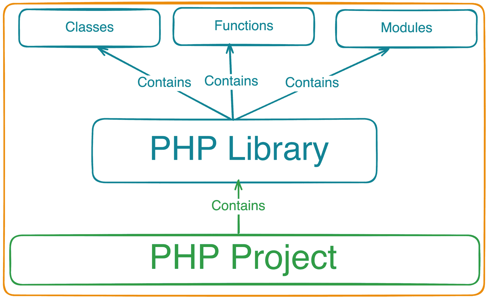

项目背景下 PHP 库的结构概述

### 它与框架或应用程序有何不同？

另一方面，应用程序是完整的、自包含的软件产品，旨在执行特定任务或为用户提供特定服务而构建。PHP 库是可重用的组件，可以用于构建应用程序，而不是框架或应用程序那样是完整且自包含的产品。它们可以用于各种项目（如框架），或者与其他库轻松集成以构建整个应用程序。

## PHP 库是如何运作的？

PHP 库通常是独立的实体，或者是更大包的一部分。在 PHP 语文中，一个包（package）通常不仅包含一个库，还包括配置文件和文档等额外资源。这些包可以使用 `Composer` 等包管理器进行下载或安装。一旦安装了库或包，你就可以在代码中使用库提供的 `functions`（函数）、`classes`（类）或 `modules`（模块）。某些情况下，库在使用需要先进行某些配置或初始化。

通常情况下，要在代码中使用 PHP 库，你需要先使用 `require_once` 或 `include_once` 关键字引入该库（你也可以使用 `require` 或 `include` 关键字）。

例如，如果你想使用一个提供数据库操作函数的库：

```php
<?php  

// 将数据库库导入到你自己的文件中  

require_once 'path/to/database-library.php';  

// 实例化数据库对象  

$db = new Database();  

// 使用新创建的 DB 对象  

$results = $db->query("SELECT * FROM table");
```

如果你使用 composer 来管理项目依赖项，它会将库安装在名为 `vendor` 的目录下，因此你可以直接在文件中加载该目录，例如：

```php
<?php  

// 将数据库库导入到你自己的文件中  

require_once __DIR__ . '../vendor/autoload.php';  

// 实例化数据库对象  

$db = new Database();  

// 使用新创建的 DB 对象  

$results = $db->query("SELECT * FROM table");
```

我们已经探索了 PHP 世界中库的定义，以及它们与框架或应用程序的区别。在了解了库的运作方式后，现在让我们看看为什么我们需要它们以及存在哪些不同类型。

## 库的优势、风险和类型

在本节中，我们将探索使用 PHP 库的一些优势以及它们流行的不同类型。

### 使用库的优势

PHP 库提供了许多优势，从代码重用到社区支持。它们可以轻松简化开发过程，并使构建高质量应用程序变得更加容易。让我们仔细观察其中的一些优势。

#### 代码重用

这指的是在多个项目中重用代码的能力，这可以通过使用 `classes`、`functions`或其他可重用组件来实现。PHP 库在这里起着至关重要的作用，因为它们提供了一种方便封装和分发重用代码的方法。想象开发者在构建多个需要发送电子邮件函数的项目时，而不是反复编写相同的代码，他们可以轻松地将其封装在库并在多个项目中重用，而无需每次都重新发明轮子。

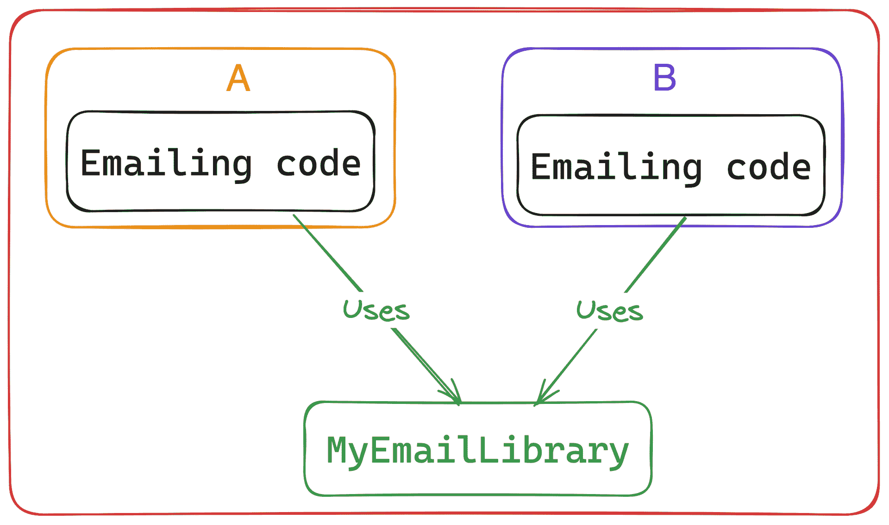

##### 代码重用示例

发送电子邮件的示例：

```php
<?php  

// 定义此类所在的命名空间  

// 这允许我们避免不同库或应用程序部分之间的命名冲突。  

namespace MyEmailLibrary;  

// 定义一个名为 EmailSender 的类  

class EmailSender {  

    // 这些是私有属性，只能在此类内部访问和修改。  

    // 它们将存储 SMTP 服务器的详细信息和凭据。  

    private $smtpServer;  

    private $username;  

    private $password;  

    // 这是构造方法。当创建该类的实例时会自动调用它。  

    public function __construct($smtpServer, $username, $password) {  

        // 将传递的 SMTP 服务器详细信息和凭据存储在此类的私有属性中。  

        $this->smtpServer = $smtpServer;  

        $this->username = $username;  
        $this->password = $password;  

    }  

    // 这是一个发送电子邮件的方法。它接受接收者地址、主题和邮件正文作为参数。  

    public function sendEmail($to, $subject, $body) {  

        // 这是使用存储的凭据连接到 SMTP 服务器的代码。  
        // 然后，代码将使用提供的参数发送电子邮件。  
        // 为了示例起见，省略了实际的邮件发送代码。相反，我们只是输出一条消息。  
        // 输出消息表示邮件已发送。  

        echo "Email sent to $to with subject: $subject\n";  

    }  
}  

// 以下是该类的使用方式：  
// 首先，创建一个 EmailSender 类的实例，并传递 SMTP 服务器详细信息和凭据。  

$emailSender = new EmailSender("smtp.example.com", "username", "password");  

// 使用创建的对象的 sendEmail 方法发送电子邮件。  

$emailSender->sendEmail("user@example.com", "Welcome!", "Thank you for joining us!");
```

#### 模块化

指的是将大型软件应用程序拆分为更小、更易管理的组件的能力，这些组件可以在各种项目中轻松重用。将应用程序拆分为较小的组件允许开发者创建用于执行特定任务（如身份验证、数据验证、文件处理或发送电子邮件）的 PHP 库。

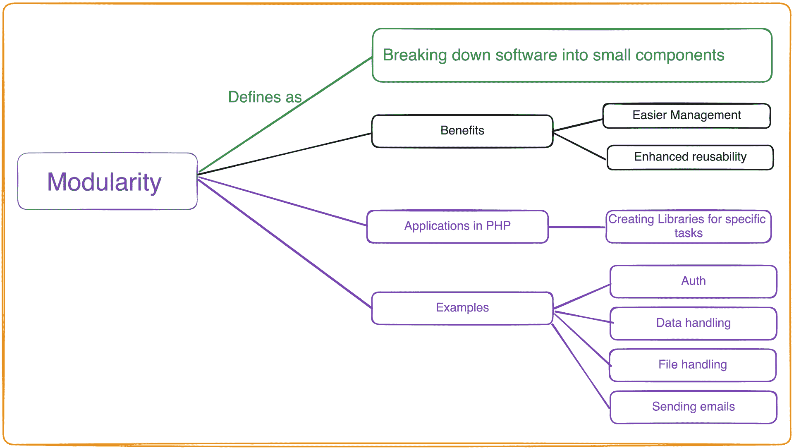

##### 软件开发中模块化的思维图

让我们来看代码中模块化的示例，我们将使用之前发送电子邮件的示例：

```php
<?php  

// 我们将代码分为四个模块：身份验证、数据验证、文件处理和电子邮件。  

// ===== 身份验证模块 =====  

// 为身份验证模块定义命名空间  

namespace Modules\Authentication;  

// 负责身份验证任务的类，例如登录功能  

class Authenticator {  

    // 验证用户名和密码并登录用户的方法  

    public function login($username, $password) {  

        // 验证用户名和密码的代码（为了简单起见已省略）  

        return "User $username logged in.\n";  

    }  
}  

// ===== 验证模块 =====  

// 为数据验证模块定义命名空间  

namespace Modules\DataValidation;  

// 负责数据验证任务的类  

class Validator {  

    // 验证电子邮件地址格式的方法  

    public function validateEmail($email) {  

        // 使用 PHP 内置过滤器验证邮件格式  

        return filter_var($email, FILTER_VALIDATE_EMAIL) !== false;  

    }  
}  

// ===== 文件处理模块 =====  

// 为文件处理模块定义命名空间  

namespace Modules\FileHandling;  

// 负责文件处理任务的类  

class FileHandler {  

    // 读取文件并返回其内容的方法  

    public function readFile($filePath) {  

        // 使用 PHP 内置函数读取文件  

        return file_get_contents($filePath);  

    }  
}  

// ===== 电子邮件模块 =====  

// 为电子邮件模块定义命名空间  

namespace Modules\Email;  

// 负责电子邮件相关任务的类，例如发送电子邮件  

class Emailer {  

    // 发送电子邮件的方法（实现细节已省略）  

    public function sendEmail($to, $subject, $body) {  

        // 发送电子邮件的代码（已省略）  

        return "Email sent to $to with subject: $subject\n";  

    }  
}  
```

#### 节省时间和成本

在软件开发中，时间就是金钱。库提供了可重用的代码，可以极大地减少构建应用程序所需的时间和精力。作为回报，这降低了开发成本并使其更容易满足截止日期，因为开发者不需要花费更多时间编写已经存在且可以轻松复用的代码。

```php
<?php  

// 不使用库：  

class ManualEmailSender {  

    public function sendEmail($to, $subject, $body) {  

        // 手动连接到 SMTP 服务器的代码  
        // 手动设置邮件头和正文的代码  
        // 手动发送邮件的代码  
        echo "Email sent manually to $to\n";  

    }  
}  

// 使用库：  

namespace UsingLibrary;  

use MyEmailLibrary\EmailSender;  // 假设 EmailSender 库存在于我们之前的示例中

class EfficientEmailSender {  

    private $emailer;  

    public function __construct() {  
        $this->emailer = new EmailSender("smtp.example.com", "username", "password");  
    }  

    public function sendEmail($to, $subject, $body) {  
        $this->emailer->sendEmail($to, $subject, $body);  
        echo "Email sent using library to $to\n";  
    }  
}  

// 使用上述两种方法：  

$manualSender = new ManualEmailSender();  

$manualSender->sendEmail("user1@example.com", "Hello!", "Manually sent this.");  

$efficientSender = new UsingLibrary\EfficientEmailSender();  

$efficientSender->sendEmail("user2@example.com", "Hello!", "Used a library to send this.");
```

#### 一致性和标准化

PHP 开发者为常见问题提供了一致且标准的解决方案，而不是让每个开发者都编写自己的解决方案，这样他们可以轻松使用经过证明良好的 PHP 库。这确保了代码的一致性并遵循最佳实践，使其他开发者更容易理解和处理代码，有助于减少错误和 Bug 的概率，并提高代码的可读性。

#### 提高代码质量

PHP 库通常由经验丰富的开发者编写，他们对 PHP 和软件开发最佳实践有深入的理解。这意味着这些库中的代码质量通常高于从零编写的代码。

通常，PHP 库具有完善的文档和充分的测试，这有助于你确保代码质量。开发者可以利用这些资源来避免常见的错误或问题。

#### 社区支持

许多 PHP 库拥有大型且活跃的开发者社区，他们为代码库做出贡献、提供支持并为库的使用提供有用资源。对于使用该库的开发者来说，这是一个非常宝贵的资源，特别是那些新熟悉特定库或在特定问题上需要帮助的开发者。

#### 提高可维护性

正如前面的优点提到的，使用成熟的库时，你可以利用其提供的社区支持。你可以从库的持续开发和维护中获益，这意味着 Bug 和问题更有可能被快速识别并修复。而且随着时间的推移，库更有可能会更新新的改进和功能。

#### 增强协作

上述两个优势直接引出了这一点，因为在不同的应用程序中共享和使用同一个库可以增强开发者之间的协作。这可以导致更精简的开发流程，因为每个人使用相同的代码库，并更高效地协作进行改进。

### 库的类型

我们已经定义了库以及使用它们的好处。让我们探索一下最流行的 PHP 库类型。

#### 框架库

正如我们之前讨论过的，PHP 框架带有它们自己的库和工具，这些工具专门设计用于与框架协同工作。这些库提供了大多数 Web 应用程序所需的功能，例如缓存。

框架库的一些示例包括：

* `Symfony` 框架：提供用于验证（Validation）、HTTP 处理和模板渲染的库。

* `Laravel` 框架：提供用于身份验证处理、路由和数据库访问的库。

这些库实际上在两个框架和其他库之间共享，但通常它们以不同的方式实现或使用相同的库。例如，（`Symfony` 和 `Laravel`）都依赖 `PHPUnit` 库进行测试。

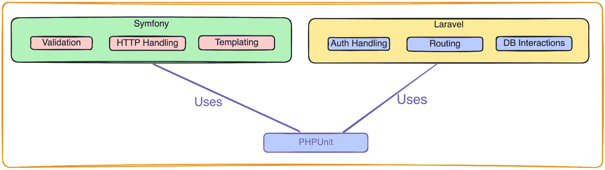


Symfony/Laravel 框架使用 `PHPUnit`

## SDK 库

SDK（软件开发包）库是工具和库的集合，提供了访问第三方服务 API 的接口。它让能够能够构建集成这些服务的应用程序。

这些 SDK 库的示例有：

* `Google SDK`：提供对 Google APIs 的访问。
* `Stripe SDK`：提供对 Stripe APIs 的访问。
* `AWS SDK`：提供对 AWS APIs 的访问。

## 第三方库

第三方库也称为工具库（Utility Libraries），是 PHP 开发中最常用的 PHP 库。这些库由第三方开发者开发并增加功能。

一些常见的库有：

* `Guzzle`：用于发送 HTTP 请求和处理响应的库。
* `Monolog`：用于 PHP 应用程序的日志库。
* `Mailer`：由 Symfony 核心团队构建用于发送邮件的库。

## 测试库

测试库是提供为应用程序编写自动化测试能力的库集合。这些库的设计旨在让开发者更容易测试应用程序并确保其运行正常。

一些常见的测试库有：

* `PHPUnit`：最流行的 PHP 测试框架。
* `Behat`：用于行为驱动开发（BDD）测试的库。
* `Codeception`：可以用于 Web 应用程序的验收测试也可以用于单元测试。

### 组件库

这些库是可重用的组件，可以构建整个 Web 应用程序。这些库是模块化的，可以广泛应用于各种应用程序。

常见的组件库有：

* `Doctrine`：数据库抽象层。
* `Twig` 或 `Blade`：PHP 模板引擎。

### 自定义库

这些库是由 PHP 开发者在内部（特定公司或组织内）为特定项目或目的开发的。这些库旨在用于特定项目，或在组织内部多个项目之间共享。

这些库的示例可以是：

* 一个以特定方式发送电子邮件的库。
* 一个用于确定用户或服务访问权限的授权库。
* **过时的库**：使用过时的库可能会让您的应用程序暴露于已知的安全漏洞。

## 性能开销

* **臃肿**：为了微小功能引入大型库会导致应用程序出现不必要的臃肿和性能开销。
* **开销成本**：某些库可能消耗资源，会影响性能，特别是在资源受限的环境中。

## 学习曲线和开销

* **复杂性**：某些库非常复杂，学习曲线陡峭。开发者可能需要花费大量时间来理解并正确实现它们。
* **文档质量**：文档记录不全的库会增加开发时间并导致实现错误。

## 法律和许可问题

* **许可证限制**：不同的库带有不同的许可证。某些许可证可能会对您的软件的使用或分发实施限制。
* **合规性**：确保符合每个库的许可协议是一项挑战，特别是在商业项目中。

## 缺乏定制化

* **一刀切**：库通常是为了通用情况设计的，可能无法完美适应您的特定需求。
* **灵活性**：修改库代码进行定制化是具有挑战性的，在某些情况下，这可能会违反库的许可证条款。

## 集成挑战

* **兼容性**：确保不同库之间或与现有项目代码之间的兼容性具有挑战性。
* **更新与维护**：库需要不断更新。更新可能会引入破坏性更改，需要对项目进行大规模的重构。

## 缓解风险

尽管有这些缺点，但在 PHP 开发中，使用库是一种常见且通常必要的做法。关键在于通过最佳实践来缓解这些风险，例如：

* **筛选库**：在使用库之前，仔细评估它们，考虑维护性、社区支持和性能等因素。
* **保持更新**：定期将库更新到最新版本以避免安全漏洞。
* **使用依赖管理器**：利用 `Composer` 等工具有效率管理依赖项。
* **理解许可**：意识到并遵守所用库的许可条款。

通过意识到这些风险并主动管理它们，开发者可以利用库的力量，同时最大限度地减少潜在的缺点。

# 库开发概述

开发 PHP 库是一个结构化的、逐步进行的过程，以确保结果或产品符合预期并具有高质量。在本节中，让我们检查这些步骤。

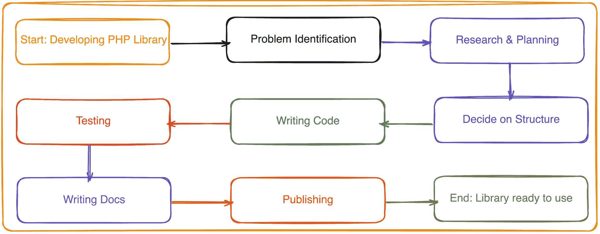

PHP 库开发流程

## 问题识别

在开始编写代码之前，准确识别该库应该解决的具体问题或需求关关重要。识别这些问题不仅是勾勒功能的基础，还能保证在解决问题时的相关性。这好比在出去冒险之前画一张地图。了解了要去哪里，在开发过程中更容易导航，并确保采取的每一步都让你向交付真实价值更近。此外，有了明确的问题陈述，可以减少偏离正轨的情况，从而避免不必要的转向和功能膨胀。

## 库的研究与规划

伟大的艺术总是始于规划。在这个阶段，开发者对建立库所需的工具、技术可能需要的框架进行初步研究。此外，考虑其他方面也很重要，例如确保高性能的用户体验以及包含强大的安全功能。这可以被视为为您的库奠定基础。

## 决定结构

现在基础工作已经就绪，是时候构建大厦了。这包括选择合适的编程语言、定义组织良好的文件结构并遵循原则和命名约定。架构起着蓝图的作用，这样随着您的库不断成长，每个组件都能完美匹配。

## 编写代码

创建库的核心方面在于编码。与其一次性处理所有功能，拆分成较小的部分会有帮助。使用模块化方法可以确保每个部分都经过适当测试。编写代码应专注于库的可重用可维护性，以使其具有生命力和适应性。查看这个解决算术问题的类示例。

```php
<?php
// 这种模块化方法确保算术运算与高级运算分离。
// 通过划分功能，库变得易于维护并可以分段测试。
// 为库定义命名空间。
namespace MathLibrary;

// 基础操作类。
class Arithmetic {
    // 两个数字相加。
    public function add($a, $b) {
        return $a + $b;
    }
    // 从第一个数减去第二个数。
    public function subtract($a, $b) {
        return $a - $b;
    }
}

// 高级操作类。
class AdvancedOperations {
    // 计算数字的阶乘。
    public function factorial($n) {
        if ($n <= 1) {
            return 1;
        }
        return $n * $this->factorial($n - 1);
    }
    // 检查数字是否为质数。
    public function isPrime($n) {
        if ($n <= 1) return false;
        for ($i = 2; $i <= $n; $i++) {
            if ($n % $i == 0) return false;
        }
        return true;
    }
}
```

## 测试库

编写良好的库不仅是功能性的，而且是可靠的。编码完成后，彻底的测试是必不可少的步骤。它将确保库的功能满足所有要求并通过质量基准。在此阶段应该进行性能和安全测试。`PHPUnit` 等自动化工具可以提高执行测试的速度。测试可以在编码的同时在任何级别进行，因为可以根据反馈立即实施更改。现在让我们为之前写的算术函数编写测试用例。

```php
<?php
// 我们现在为 Arithmetic 类有两个测试用例。
// 通过使用 PHPUnit 运行这些测试，我们可以验证类的方法是否正常工作。
// 如果 Arithmetic 类的功能发生变化，这些测试将有助于确保它仍按预期工作。
// 我们首先包含 PHPUnit 必要的依赖项。
use PHPUnit\Framework\TestCase;
use MathLibrary\Arithmetic;

// 我们的测试类应该继承自 TestCase。
class ArithmeticTest extends TestCase {
    // 我们在这里测试 add 方法。
    public function testAdd() {
        $arithmetic = new Arithmetic();
        // 断言 1 + 2 等于 3。
        $this->assertEquals(3, $arithmetic->add(1, 2));
        // 断言 5 + 0 等于 5。
        $this->assertEquals(5, $arithmetic->add(5, 0));
    }
    // 测试 subtract 方法。
    public function testSubtract() {
        $arithmetic = new Arithmetic();
        // 断言 5 - 3 等于 2。
        $this->assertEquals(2, $arithmetic->subtract(5, 3));
        // 断言 4 - 7 等于 -3。
        $this->assertEquals(-3, $arithmetic->subtract(4, 7));
    }
}
```

## 文档化库

对于一个库要对用户产生影响，清晰度比功能更重要。完整的文档正是为了这一目的。应该重点突出库的目标、特性以及清晰的使用指南。在你的文档中穿插实用的示例，以突出该库的潜力并帮助开发者有效地利用它。让我们看看如何利用代码中的 `DocBlocks` 来为我们的库编写文档。

```php
<?php  

/**  
 * 算术类  
 * 此类提供了基本的算术运算。  
 *  
 * @package MathLibrary  
 * @author 你的名字
 * @version 1.0.0  
 */  
class Arithmetic {  
    /**  
     * 两个数字相加。  
     *   
     * 此方法接收两个数值值并返回它们的和。  
     *   
     * @param float|int $a 第一个要加的数字。  
     * @param float|int $b 第二个要加的数字。  
     *   
     * @return float|int 返回 $a 和 $b 的和。  
     *   
     * @example  
     * ```php  

     * $math = new Arithmetic();  

     * echo $math->add(3, 4); // 输出: 7  

     * ```  
     */  
    public function add($a, $b) {  
        return $a + $b;  
    }  
    /**  
     * 从另一个数字中减去一个。  
     *   
     * 此方法接收两个数值。它从第一个值中减去第二个值并返回结果。  
     *   
     * @param float|int $a 要被减的数字。  
     * @param float|int $b 要减的数字。  
     *   
     * @return float|int 返回 $a 减去 $b 的结果。  
     *   
     * @example  
     * ```php  

     * $math = new Arithmetic();  

     * echo $math->subtract(7, 3); // 输出: 4  

     * ```  
     */  
    public function subtract($a, $b) {  
        return $a - $b;  
    }  
}
```

## 发布库

在通过上述所有里程碑后，终于是时候展示我们的杰作了。GitHub 或 Packagist 等平台为我们库的发布提供了理想的舞台。然而，我们不应局限于此——应该在社交媒体、博客文章或其他推广渠道上宣传它的存在，号召世界地的开发者使用我们创建的内容。

有了这样一套系统的流程，我们不仅是在创建一个 PHP 库——我们正在打造一个实用的工具，准备为许多数字项目服务。

# 库的结构与组织

这部分深入探讨了组织项目目录的方法，重点关注 PHP 库项目。它强调了结构良好的库的重要性，突出了它如何同时增强可维护性和可扩展性。这部分涵盖了如自动加载和维护一致文档的重要性等核心方面。这些特性和最佳实践对于 PHP 库的有效管理和运行至关重要。

此外，它强调了依赖管理在 PHP 库中的关键作用，并使用 `GuzzleHttp` 和 `PHPUnit` 等示例来说明其重要性。文中强调了熟练使用 `Composer`，因为它在确保兼容性和依赖的高效管理方面发挥着至关重要的作用。结构还引导读者为代码和测试设置目录。在这种背景下，再次强调了 `Composer` 的作用，特别是在管理依赖和 `Jazzon` 库的设置中的用途。该章节提供了对 `PSR-4` 自动加载过程的全面理解，并强调了 `Composer` 在 PHP 库项目测试和依赖领域的重要性。

## 项目结构

PHP 库的项目结构是使库成功的至关重要的方面，因为它直接影响库的可维护性、可扩展性和易用性。设计良好的结构可以更容易导航，而组织不当的结构会降低效率。

PHP 库的项目结构是使库成功的至关重要的方面，因为它直接影响库的可维护性、可扩展性和易用性。设计良好的结构可以更容易导航，而组织不当的结构会降低效率。

### 良好的项目结构

通常，它包含了各种

![image_src3.jpg]

正如名称所示，它遵循 PSR-4 自动加载标准，并将所有文件放在基于命名空间的目录结构下。这样使得开发者更容易理解和使用该库，并确保所有类都能被自动加载。

### 标准项目结构

现在，让我们看看库的标准项目结构。在高级别，它包括：

![image_src4.jpg]

* `src/`: 源代码。
* `tests/`: 库的测试用例。
* `vendor/`: 外部库。
* `composer.json`: 此文件指定依赖并被 `Composer` 使用。
* `README.md`: 此文件应包含有关库的信息。

### 模块化结构

这涉及到库如何被组织成模块或组件，每个模块都有自己独立的目录和命名空间结构。这允许更多的代码复用和极高的灵活性，但在设置和维护方面可能会非常复杂。

示例：

```text
jazzon/
  composer.json
  src/
    Jazzon/
      Jazzon.php
      Parser/
        Json.php
  tests/
    JazzonTest/
      JazzonTest.php
      ParserTest/
        JsonTest.php
```

在选择项目结构时，你必须同时考虑对库本身有利的因素以及对使用该特定库的用户而言。你希望设计出一个组织良好、易于理解、使用和维护方案。

### 最佳实践

在根据选定的项目结构构建 PHP 库时，还有一些需要遵循的最佳实践。

* **自动加载 (Autoloading)**：这涉及到使用 `PSR-4` 标准进行自动加载。通过执行这一标准，你可以确保类和函数自动加载，而无需在代码中显式地包含它们。这减少了大量的类类加载，从而提高了整个库的可维护性。

    即自动加载：

    ```json
    "autoload": {
      "psr-4": {
        "Jazzon\\\\": "src/"
      }
    }
    ```

* **命名规范 (Naming Conventions)**：一致的命名规范可以提高可读性，并有助于保持整个库风格的统一。建议命名空间和类名都遵循 `PSR-4` 命名规范。

    示例：

    ```php
    <?php
    // 声明命名空间以避免类命名冲突并组织相关类。
    namespace Jazzon\\Parser;

    // 在 'Jazzon\Parser' 命名空间内定义名为 'JsonParser' 的类。
    class JsonParser {}
    ```

* **使用 Composer 进行依赖管理 (Dependency Management with Composer)**：`Composer` 是一个依赖管理工具，协助轻松管理外部依赖，并确保所有库都能被快速安装和更新。

* **编写文档 (Document Your Code)**：这包括使用 `PHPDoc` 为代码编写注释，并编写清晰的 `README.md` 文件来解释如何使用此库。

    示例：

    ```php
    <?php
    /**
     * JsonParser - 负责将 JSON 字符串解析为 PHP 数组的类。
     *
     * @package Jazzon\Parser
     */
    namespace Jazzon\\Parser;

    // 在 'Jazzon\Parser' 命名空间内定义名为 'JsonParser' 的类。
    class JsonParser {}
    ```

```php
return "Welcome, $name!";  

}

}
```

### JazzonTest.php


```php
<?php  

// 导入 Jazzon 类和 PHPUnit 的 TestCase 类  

use Jazzon\Jazzon;  

use PHPUnit\Framework\TestCase;  

// 定义一个继承自 PHPUnit TestCase 的测试类  

class JazzonTest extends TestCase  

{  
    // 一个测试方法，确保 Jazzon 类的 welcome 方法按预期工作  
    public function testWelcome()  
    {  
      // 实例化 Jazzon 类  
      $jazzon = new Jazzon();  
      // 断言默认的欢迎消息是正确的  
      $this->assertEquals("Welcome, Jazzon!", $jazzon->welcome());  
      // 断言欢迎消息在名称为 "John" 时工作正常  
      $this->assertEquals("Welcome, John!", $jazzon->welcome("John"));  
      // 断言欢迎消息在名称为 "David" 时工作正常  
      $this->assertEquals("Welcome, David!", $jazzon->welcome('David'));  
    }  
}
```

我们将遵循 PSR-4 自动加载机制，通过在 `composer.json` 中包含以下内容加载 `src` 文件下的所有库类：

```json
"autoload": {  
    "psr-4": {  
        "Jazzon\\": "src/"  
    }  
}
```

这将加载 `Jazzon` 命名空间下的所有类。我们将使用 PHP `8.1`，因此你会在 `composer.json` 中找到所需的配置，并将 `PHPUnit` 添加到 `require_dev` 部分。

因此，我们完整的 `composer.json` 如下：

```json
{  
    "name": "jazzon/jazzon",  
    "description": "一个 JSON 解析器库",  
    "type": "library",  
    "license": "MIT",  
    "require": {  
        "php": ">=8.1"  
    },  
    "require-dev": {  
        "phpunit/phpunit": "¹⁰.1"  
    },  
    "autoload": {  
        "psr-4": {  
            "Jazzon\\": "src/"  
        }  
    },  
    "authors": [  
        {  
            "name": "Ahmed Raafat",  
            "email": "ahmed.raafat1412@gmail.com"  
        }  
    ]  
}
```

## 运行 Jazzon

你可以在提供的资源（`initial-jazzon-library` 目录）中看到整个项目已经作为一个带有测试函数的起点初始化，你只需要关注包含我们库实现的 `Jazzon` 目录。

{notice} 你可以在提供的名为 `initial-jazzon-library` 的目录中找到库的初始版本。

一旦打开了项目目录，你可以运行以下命令来启动它并查看运行情况：

*   启动所有容器：

`$ docker-compose up -d --build`

*   安装所有依赖项：

`$ docker-compose exec php composer install`

*   运行测试以确保一切正常：

`$ docker-compose exec php ./vendor/bin/phpunit tests/`

我们将有一个名为 `php` 的容器，我们在其中运行该库。

# 理解 PHP 库的架构

在这一部分，读者将沉浸在 PHP 生态系统中库设计的世界中。这部分旨在提供对如何创建结构良好、高效库的深度理解。它首先强调设计模式的使用，这对于开发可重复、可扩展且清晰的软件解决方案至关重要。鼓励读者获得这些模式的实践经验，这些模式对于开发健壮且模块化的 PHP 库至关重要。

## 设计模式概述

软件中的设计模式是解决软件设计中常见问题的复用方案。它们不是完成的设计，而是解决许多不同场景下出现问题的模板。

### 模式类型

模式通常分为三类：

| 类型 | 特征 | 示例 |
| :--- | :--- | :--- |
| 创建型 (Creational) | 对象创建、抽象 | 单例模式 (Singleton)、抽象工厂 (Abstract Factory) |
| 结构型 (Structural) | 对象组合、关系 | 装饰器 (Decorator)、桥接 (Bridge) |
| 行为型 (Behavioral) | 对象通信、职责 | 观察者 (Observer)、命令 (Command)、策略 (Strategy) |

## 创建型模式

创建型模式处理对象的创建机制，试图以适合情况的方式创建对象。

### 单例模式 (Singleton)

单例模式将类的实例化限制为一个对象，并为其提供全局访问点。

```php
<?php 

// 声明一个名为 Singleton 的类
class Singleton {  
    // 声明一个静态私有变量 $instance。这将存储 Singleton 类的唯一实例。  
    private static $instance;  

    // 声明私有构造函数以防止 Singleton 类的直接实例化。  
    private function __construct() {}  

    // 声明公共静态函数 getInstance 来获取 Singleton 类的唯一实例。  
    public static function getInstance() {  
      // 检查 $instance 变量是否为空。  
      if (self::$instance === null) {  
        // 如果为空，创建 Singleton 类的类实例并存储在 $instance 变量中。  
        self::$instance = new self();  
      }  
      // 返回 Singleton 类的实例。  
      return self::$instance;  
    }  
}

// 获取 Singleton 类的唯一实例并存储在 $singleton 变量中。  
$singleton = Singleton::getInstance();  

var_dump($singleton);
```

### 工厂方法 (Factory Method)

工厂方法为父类中的创建对象提供接口，但允许子类更改创建对象的类型。

```php
<?php 

// 声明一个带有 describe 方法的接口 Product。  
interface Product {  
    public function describe();  
}  

// 声明一个实现了 Product 接口的类 ConcreteProductA。  
```

```php
class ConcreteProductA implements Product {
    // Implement the describe method from the Product interface.
    public function describe() {
        echo "I'm product A!";
    }
}

// Declare a class named ProductFactory for creating products.
class ProductFactory {
    // Declare a public static method named createProduct which takes a parameter $type.
    public static function createProduct($type) {
        // Check if the $type parameter is 'A'.
        if ($type === 'A') {
            // If it is, return a new instance of the ConcreteProductA class.
            return new ConcreteProductA();
        }
        // ... other products can be added here in similar fashion.
    }
}

// Use the ProductFactory class to create a product of type 'A' and store it in the $product variable.
$product = ProductFactory::createProduct('A');

// Call the describe method on the $product object.
$product->describe();
```

* 抽象工厂（Abstract Factory）提供了一个创建一组相关或依赖对象的接口，而无需指定它们的具体类。示例：

```php
<?php
// Declare an interface named Button with a method click.
interface Button {
    public function click();
}

// Declare an interface named Window with a method open.
interface Window {
    public function open();
}

// Declare a class named ConcreteButtonA that implements the Button interface.
class ConcreteButtonA implements Button {
    // Implement the click method from the Button interface.
    public function click() {
        echo "Button A clicked!";
    }
}

// Declare a class named ConcreteWindowA that implements the Window interface.
class ConcreteWindowA implements Window {
    // Implement the open method from the Window interface.
    public function open() {
        echo "Window A opened!";
    }
}

// Declare an interface named GUIFactory with methods createButton and createWindow.
interface GUIFactory {
    public function createButton();
    public function createWindow();
}

// Declare a class named ConcreteGUIFactoryA that implements the GUIFactory interface.
class ConcreteGUIFactoryA implements GUIFactory {
    // Implement the createButton method from the GUIFactory interface.
    public function createButton() {
        // Return a new instance of the ConcreteButtonA class.
        return new ConcreteButtonA();
    }
    // Implement the createWindow method from the GUIFactory interface.
    public function createWindow() {
        // Return a new instance of the ConcreteWindowA class.
        return new ConcreteWindowA();
    }
}
// Create a new instance of the ConcreteGUIFactory class and store it in the $factory variable.
$factory = new ConcreteGUIFactory();
// Use the $factory object to create a button and store it in the $button variable.
$button = $factory->createButton();
// Call the click method on the $button object.
$button->click();
```

* 结构型（Structural）：它们处理对象的组合并帮助形成大型结构。它们提供了识别对象之间关系的方法，从而简化设计。示例：

* 装饰器（Decorator）允许静态或动态地为单个对象添加行为，而不影响同类中其他对象的行为。示例：

```php
<?php
// Declare an interface named Coffee with a method getCost.
interface Coffee {
    public function getCost();
}

// Declare a class named SimpleCoffee that implements the interface.
class SimpleCoffee implements Coffee {
    // Implement the getCost method from the Coffee interface.
    public function getCost() {
        // Return a cost of 10.
        return 10;
    }
}

// Declare a class named MilkDecorator that implements the Coffee interface. This class will act as decorator.
class MilkDecorator implements Coffee {
    // Declare a protected variable to store the coffee instance that will be decorated.
    protected $coffee;
    // Constructor to inject the Coffee instance that will be decorated.
    public function __construct(Coffee $coffee) {
        $this->coffee = $coffee;
    }
    // Implement the getCost method from the Coffee interface.
    public function getCost() {
        // Return the sum of the coffee's cost and an additional 2 for the milk.
        return $this->coffee->getCost() + 2;
    }
}
// Create a new SimpleCoffee instance.
$coffee = new SimpleCoffee();
// Decorate the $coffee instance with MilkDecorator.
$coffeeWithMilk = new MilkDecorator($coffee);
// Output the cost of the coffee with milk.
echo $coffeeWithMilk->getCost();
```

* 适配器（Adapter）允许具有不兼容接口的类通过创建一个中间类（将一个请求翻译成另一个）来协同工作。示例：


```php
<?php
// Old Interface
interface OldInterface {
    public function oldRequest();
}

// Old Class implementing Old Interface
class OldClass implements OldInterface {
    public function oldRequest() {
        return "Old request data";
    }
}

// New Interface
interface NewInterface {
    public function request();
}

// Adapter Class
class Adapter implements NewInterface {
    private $old;
    public function __construct(OldInterface $old) {
        $this->old = $old;
    }
    // Adapt the oldRequest method to fit the new interface
    public function request() {
        $oldData = $this->old->oldRequest();
        // Adapting the data from a string to an array
        return ['adaptedData' => $oldData];
    }
}
// Usage
$old = new OldClass();
$adapter = new Adapter($old);
// The adapter now returns the old data in a new format
print_r($adapter->request());
```

* 桥接（Bridge）允许对象的接口与其实现之间分离，允许它们独立发生变化。

* 行为型（Behavioral）：它们关注对象之间的通信并定义对象之间如何相互关联。它们更关注分配给不同对象的算法和职责。示例：

* 观察者（Observer）定义了对象之间的一对多的依赖关系，当一个对象的状态发生变化时，所有的依赖者都会自动收到此变化。示例：

```php
<?php
// Declare an interface named Observer with a method update.
interface Observer {
    public function update($message);
}

// Declare a class named ConcreteObserver that implements the Observer interface.
class ConcreteObserver implements Observer {
    // Implement the update method from the Observer interface.
    public function update($message) {
        // Display the received message.
        echo "Received: $message";
    }
}

// Declare a class named Subject to manage and notify its observers.
class Subject {
    // Declare a private variable as an array to store observer instances.
    private $observers = [];
    // Method to add an observer to the Subject's list of observers.
    public function addObserver(Observer $observer) {
```

```php
$this->observers[] = $observer;
}

// 向所有观察者发送给定消息的方法。
public function notify($message) {
    // 遍历每个观察者并使用提供的消息更新它们。
    foreach ($this->observers as $observer) {
        $observer->update($message);
    }
}
}

// 创建一个新的 ConcreteObserver 实例。
$observer = new ConcreteObserver();
// 创建一个新的 Subject 实例。
$subject = new Subject();
// 将观察者添加到主题的观察者列表中。
$subject->addObserver($observer);

// 向所有观察者发送消息。
$subject->notify("Hello, observers!");
```

* `Command` 模式有助于将请求封装为对象，允许你用不同的请求对客户端进行参数化、记录或队列请求，并支持撤销操作。

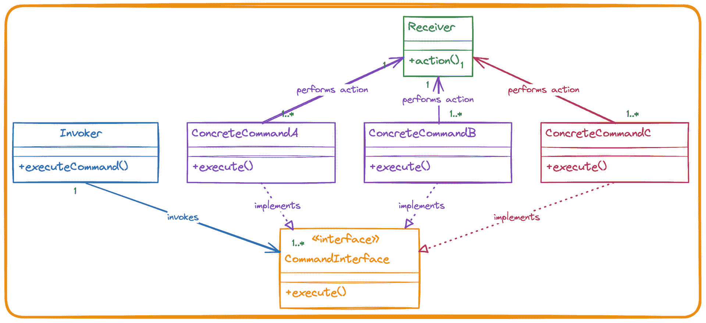

PHP 中 `Command` 设计模式的结构布局

* 通过 `Strategy`，用户可以定义一组算法，封装每个算法并使它们可以相互替换，从而允许算法从使用它的客户端独立变化。

在我们检查了不同类型的设计模式之后，让我们探索它们在库开发中的优势和用法。

## PHP 库中的设计模式

对于 PHP 库的开发，一些已知且广泛使用的模式也将帮助开发者以结构化且高效的方式解决常见问题。

我们将涵盖 PHP 库开发中最常用的六种设计模式，并结合采用这些模式的示例库。

### PHP 库中常用的模式

I. **单例模式 (Singleton)**：用于确保一个类只能有一个实例，并为其提供一个全局访问点。该模式通常用于资源管理、日志记录和数据库连接。示例：

- 用于日志记录的 `Monolog`

- 用于依赖注入的 `PHP-DI`。

让我们看看 `Singleton` 模式创建数据库连接的示例：

```php
<?php
// 声明一个名为 Database 的类来表示数据库连接。
class Database {
    // 声明一个私有静态变量来存储 Database 类的实例。
    private static $instance;

    // 私有构造函数确保无法从外部实例化 Database 类。
    private function __construct() {}
    // 声明一个公共静态方法来获取 Database 类的实例。
    public static function getInstance() {
        // 检查实例是否为空。如果是，则创建 Database 类的新实例。
        if (self::$instance === null) {
            self::$instance = new self();
            // 在此处初始化数据库连接（这只是一个注释；连接代码将放在这里）。
        }
        // 返回 Database 类的实例。
        return self::$instance;
    }
}
// 获取 Database 类的单实例。
$db = Database::getInstance();
// 为了调试目的输出实例。
var_dump($db);
```

2. **工厂模式 (Factory)**：每当你想在不指定具体类的情况下创建对象时，请使用此模式。当你想要根据某些条件在运行时创建对象，或者确切的对象类型未知时，它非常有用。示例：

- `Laravel` 的 `Factory` 类允许轻松创建模型实例。

- 用于 PHP 测试的 `PHPUnit`。

展示 `Factory` 模式实际运行的示例：

```php
<?php
// 声明一个带有 speak 方法的 Animal 接口。
interface Animal {
    public function speak();
}
// 声明一个实现 Animal 接口的 Dog 类。
class Dog implements Animal {
    // 实现 Animal 接口的 speak 方法。
    public function speak() {
        echo "Woof!";
    }
}
// 声明一个实现 Animal 接口的 Cat 类。
class Cat implements Animal {
    // 实现 Animal 接口的 speak 方法。
    public function speak() {
        echo "Meow!";
    }
}
// 声明一个 AnimalFactory 类来创建动物的实例。
class AnimalFactory {
    // 声明一个静态方法根据类型创建 Animal。
    public static function createAnimal($type) {
        if ($type === 'Dog') {
            // 返回一个 Dog 实例。
            return new Dog();
        } elseif ($type === 'Cat') {
            // 返回一个 Cat 实例。
            return new Cat();
        }
        // 注意：更健壮的实现可能包含 else 来处理未知类型。
    }
}
// 使用 AnimalFactory 创建一只狗。
$animal = AnimalFactory::createAnimal('Dog');
// 让狗说话。
$animal->speak();
```

3. **适配器模式 (Adapter)**：每当你想让不兼容的接口一起工作时，请使用此模式。当你也想重用现有代码但它符合你的要求时，它非常有用。示例：

- 用于 HTTP 请求的 `Guzzle`。

- `Monolog` 库使用了这种模式。

展示 `Adapter` 模式实际运行的示例：

```php
<?php
// 声明一个带有 pay 方法的 PaymentGateway 接口。
interface PaymentGateway {
    public function pay($amount);
}
// 声明一个 Paypal 类来模拟支付。
class Paypal {
    // 通过 PayPal 发送支付。
    public function sendPayment($amount) {
        echo "Paying via PayPal: $amount";
    }
}
// 声明一个实现 PaymentGateway 接口的 PaypalAdapter 类。
// class 作为 Paypal 类的适配器。
class PaypalAdapter implements PaymentGateway {
    // 声明一个私有变量来存储 Paypal 实例。
    private $paypal;
    // 初始化 Paypal 实例的构造函数。
    public function __construct() {
        $this->paypal = new Paypal();
    }
    // 实现 PaymentGateway 接口的 pay 方法。
    public function pay($amount) {
        // 将支付过程委托给 Paypal 实例的 sendPayment 方法。
        $this->paypal->sendPayment($amount);
    }
}
// 创建一个新的 PaypalAdapter 实例。
$payment = new PaypalAdapter();
// 通过 PaypalAdapter 支付 50。
$payment->pay(50);
```

4. **装饰器模式 (Decorator)**：允许你通过封装在另一个提供这些功能的对象内部，静态或动态地添加对象的特定功能。示例：

- `Guzzle` 通过允许添加中间件来修改请求/响应对象使用了它。

展示 `Decorator` 模式实际运行的示例：

```php
<?php
// 定义一个强制执行 log 方法的 Logger 接口。
interface Logger {
    public function log($message);
}
// 实现 FileLogger，将日志记录到文件。
class FileLogger implements Logger {
    public function log($message) {
        // 模拟将日志到文件。
        echo "\nLogging to file: $message";
    }
}
// 为 Logger 创建装饰器以添加数据库日志功能。
class DatabaseLoggerDecorator implements Logger {
    private $logger; // 持有一个 Logger 实例。
    // 需要 Logger 实例的构造函数。
    public function __construct(Logger $logger) {
        $this->logger = $logger;
    }
    // 覆盖 log 方法以添加数据库日志功能。
    public function log($message) {
        // 使用构造函数传递的 logger 记录日志。
        $this->logger->log($message);
        // 添加新行为：将日志记录到数据库（在此模拟）。
    }
}
```

```php
echo "\nLogging to database: $message";  

}

}

// 创建一个包装了 FileLogger 的 DatabaseLoggerDecorator 实例。  

$logger = new DatabaseLoggerDecorator(new FileLogger());  

// 使用 logger 记录一条消息。  

$logger->log('Hello, world!');
```

## 策略模式 (Strategy)

这种模式允许你定义一组算法，将每一个算法封装成对象，并使它们可以相互替换。当你想要在运行时切换算法，或者根据某些条件更改算法的行为时，这种模式非常有用。示例：

- Symfony 的 `HTTPKernal` 用于处理 HTTP 请求。

- Laravel `Eloquent` 用于数据库访问。

一个展示策略模式运行的示例：

```php
<?php  

// 定义一个排序策略的接口。  

interface SortStrategy {  

    public function sort($array);  

}  

// 实现升序排序策略。  

class AscendingSort implements SortStrategy {  

    public function sort($array) {  

        sort($array);  // 使用 PHP 内置的 sort 函数。  

        return $array;  

    }  

}  

// 实现降序排序策略。  

class DescendingSort implements SortStrategy {  

    public function sort($array) {  

        rsort($array);  // 使用 PHP 内置的反 sort sort 函数。  

        return $array;  

    }  
}  

// 定义一个使用排序策略的上下文类。  

class Context {  

    private $sortStrategy;  // 持有排序策略实例。  

    // 构造函数需要一个排序策略实例。  

    public function __construct(SortStrategy $sortStrategy) {  

        $this->sortStrategy = $sortStrategy;  

    }  

    // 使用提供的策略执行排序。  

    public function executeStrategy($array) {  

        return $this->sortStrategy->sort($array);  

    }  
}  

// 使用上下文按升序排序一个数组。  

$context = new Context(new AscendingSort());  

$result = $context->executeStrategy([3, 1, 2]);  

print_r($result);
```

## 观察者模式 (Observer)

这主要用于事件驱动编程，允许对象接收其他对象的更改通知。它通常出现在处理用户输入或需要与外部系统交互的库中。当你想要解耦对象并确保对一个对象的更改不会对其他对象产生影响时，这种模式非常有用。示例：

- Symfony 的 `EventDispatcher` 允许向注册的监听器轻松创建并分发事件。

- Laravel `Eloquent` 在模型事件中使用了这种模式。

一个展示观察者模式运行的示例：


```php
<?php  

// 定义一个 Event 类，用于维护观察者并对其发送通知。  

class Event {  

    private $observers = [];  // 用于存储观察者实例的数组。  

    // 将观察者实例添加到列表。  

    public function addObserver($observer) {  

        $this->observers[] = $observer;  

    }  

    // 向所有观察者分发消息。  

    public function notify($message) {  

        foreach ($this->observers as $observer) {  

            $observer->update($message);  

        }  
    }  
}  

// 定义一个接收并处理消息的 Observer 类。  

class Observer {  

    private $name;  // 观察者的名称。  

    // 构造函数初始化观察者名称。  

    public function __construct($name) {  

        $this->name = $name;  

    }  

    // 模拟接收消息的更新方法。  

    public function update($message) {  

        echo "Observer $this->name received: $message\n"; 

    }  
}    

// 创建一个事件并添加观察者。  

$event = new Event();  

$event->addObserver(new Observer('A'));  

$event->addObserver(new Observer('B'));  

// 向所有观察者分发消息。  

$event->notify('Event occurred!');
```

```php
protected function setUp(): void {
    // 使用 `Calculator` 类的一个新实例初始化 `$calculator` 属性。
    $this->calculator = new Calculator();
}

// 定义一个名为 `testAdd` 的测试。按照惯例，测试方法名应该以 "test" 开头。
public function testAdd() {
    // 调用 `$calculator` 实例的 `add` 方法并传入参数 2 和 3，存储结果。
    $result = $this->calculator->add(2, 3);
    // 使用断言检查加法结果是否为 5。
    // 如果不是 5，测试将失败。
    $this->assertEquals(5, $result);
}
```

通过遵循良好的可测试性实践：

- `Calculator` 类非常易于测试，因为它的设计简单，没有隐藏的依赖关系或副作用。
- 我们编写了测试（`CalculatorTest`），这些测试保证了 `Calculator` 类的行为符合预期。

## 不要重复自己 (DRY)

我们讨论过 PHP 库的优点，其中一个优点就是代码的可重用性。这正是该设计原则的核心所在，它确保我们不编写冗余代码。

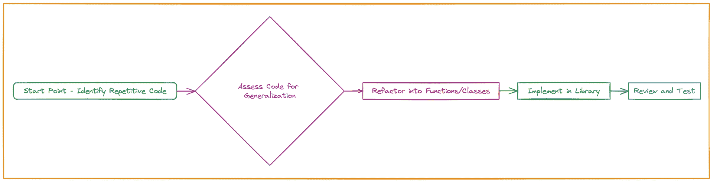

在 PHP 库开发中实现 DRY 原则的流程图

考虑这种情况：你有用于计算不同几何形状面积的函数。

以下脚本包含计算三角形、矩形和正方形面积的独立函数。每个形状函数都是独立实现的，并带有某些值调用。

让我们这些不符合 DRY 原则的这些几何函数：

```php
<?php
// 这里，我们定义了一个名为 "triangleArea" 的新函数。
// 该函数计算并返回三角形的面积。
function triangleArea($base, $height) {
    // 这一行使用公式 (base * height) / 2 计算三角形面积。
    // 然后返回计算出的面积。
    return 0.5 * $base * $height;
}

// 这里，我们定义了一个名为 "rectangleArea" 的新函数。
// 该函数计算并返回矩形的面积。
function rectangleArea($width, $height) {
    // 这一行使用公式 width * height 计算矩形面积。
    // 然后返回计算出的面积。
    return $width * $height;
}

// 这里，我们定义了一个名为 "squareArea" 的新函数。
// 该函数计算并返回正方形的面积。
function squareArea($side) {
    // 这一行使用公式 side * side (或 side²) 计算正方形面积。
    // 然后返回计算出的面积。
    return $side * $side;
}

// 计算并打印三角形的面积。
triangleArea(5, 10);
// 计算并打印矩形的面积。
rectangleArea(5, 20);
// 计算并打印正方形的面积。
squareArea(5);
```

现在，假设在所有这些函数中，除了计算面积，你记录记录日志。如果我们直接每个函数内部添加日志代码，那么它就会重复出现，代码看起来像如下：

```php
<?php
// 计算并返回三角形面积的函数。
function triangleArea($base, $height) {
    $area = 0.5 * $base * $height;  // 计算三角形面积。
    echo "Calculated area: " . $area . PHP_EOL;  // 打印计算出的面积。
    return $area;  // 返回计算出的面积。
}

// 计算并返回矩形面积的函数。
function rectangleArea($width, $height) {
    $area = $width * $height;  // 计算矩形面积。
    echo "Calculated area: " . $area . PHP_EOL;  // 打印计算出的面积。
    return $area;  // 返回计算出的面积。
}

// 计算并返回正方形面积的函数。
function squareArea($side) {
    $area = $side * $side; // 计算正方形面积。
    echo "Calculated area: " . $area . PHP_EOL; // 打印计算出的面积。
    return $area; // 返回计算出的面积。
}
```

等待，让我们重新检查逻辑。提供的文本包含了几个重复的代码块和解释 DRY 的注释。我将在保持所请求格式的同时，整合核心逻辑。

现在，假设在所有这些函数中，除了计算面积，你还想记录日志。如果我们直接每个函数内部添加日志代码，那么它就会重复出现……

提供的文本随后列出了相同逻辑的多个版本。根据指令，我将清晰地组织输出。

## 简单性

我们之前讨论过，需要让库尽可能易于维护，并且代码要让其他开发者容易阅读和理解，因此我们需要确保代码应该写得简单。过度复杂的代码会增加测试、调试和库维护的复杂性。

简单且清晰的代码的一些属性是：

- 格式化的代码。
- 解耦的代码。
- 具有描述性的变量、类、对象名称。
- 短而清晰的函数和类。

检查这段没有描述性的代码：

```php
<?php
// 根据给定 ID 查询数据库获取信息的函数。
function f($db, $i) {
    $q = $db->prepare("SELECT * FROM t WHERE id = ?"); // 准备 SQL 语句，其中 "?" 是将要绑定的占位符。
    $q->execute([$i]); // 执行准备语句，将 "?" 占位符替换为 i 的值。
    $r = $q->fetch(); // 从结果集中获取下一行。
    echo $r['n'] . " - " . $r['e']; // 显示获取行中的 'n' 和 'e' 字段。
}

// 调用函数。
// 假设 $database 是一个 PDO 实例，你想获取的 ID 是 1。
// f($database, 1);
```

让我们它变得更详细且清晰：

```php
<?php
// 根据给定的用户 ID 查询数据库并显示用户名和电子邮件的函数。
function fetchAndDisplayUser($database, $userId) {
    $query = $database->prepare("SELECT * FROM users WHERE id = ?"); // 准备 SQL 语句，其中 "?" 是将要绑定的占位符。
    $query->execute([$userId]); // 执行准备语句，将 "?" 占位符替换为 $userId 的值。
    $result = $query->fetch(); // 从结果集中获取下一行。
}
```

```php
echo $result['name'] . " - " . $result['email'];  // 显示从获取的行中的'name'和'email'字段。  

}  

// 调用函数。  

// 假设 $database 是一个 PDO 实例，并且你想获取的用户 ID 为 1。  

// fetchAndDisplayUser($database, 1);
```

在简单版本中，这段代码更具可读性，因为它清晰地展示了它的功能——获取用户详情并显示它们。通过对变量和函数使用描述性名称，代码的可读性也得到了提高，使代码更易维护。

# PHP 库中的设计原则

在我们已经在概念中讨论过设计原则之后，现在是时候了解 `S.O.L.I.D` 原则，它是构建 PHP 库以及 PHP 开发领域中最常用的原则。同时，了解在构建 PHP 库时依赖设计原则对我们有什么益处。

## S.O.L.I.D 原则

`SOLID` 原则是一个设计原则的缩写，每个字母代表以下原则之一：

下表概述了每个 `SOLID` 原则及其核心思想以及它们如何在编码场景中实现，这有助于创建更健壮、灵活且可扩展的软件。

| 原则 | 说明 | 示例实现 |
| --- | --- | --- |
| 单职责原则 | 类/函数应该只有一个职责 | 分离 `User` 和 `UserNotification` 类 |
| 开/闭原则 | 对扩展开放，对修改关闭 | 为 `Shapes` 使用接口，在 `Square`、`Circle` 等中实现 |
| 里氏夫替换原则 | 子类应该增强而非替换父类 | 分离 `Shape` 接口，区分 `Rectangle` 和 `Square` 实现 |
| 接口隔离 | 任何类都不应被强制实现未使用的方法 | 分离 `Workable` 和 `Eatable` 接口 |
| 依赖倒置 | 依赖抽象而非具体实现 | 关键类依赖 `SwitchableDevice` 接口，而不是 `LightBulb` 类 |

- **单一职责**：意味着每个类或函数应该只做一件事。因此，一个类/函数应该只有一个职责和一个改变的原因。

```php
<?php  

// 不符合 SRP (单一职责原则)  

// 这里的 Account 类同时处理用户管理和用户通知。  

class Account {  
    public function createUser() { /*...*/ */ }  // 创建用户。  
    public function deleteUser() { /*...*/ */ }  // 删除用户。  
    public function notifyUser() { /*...*/ */ }  // 向用户发送通知。  

    // 这不符合单一职责原则 (SRP)  
    // 因为用户通知不是用户管理类的直接职责。  
}  

// 使用 SRP (单一职责原则) 来分离职责  
// User 类应该只处理用户管理职责。  

class User {  
    public function createUser() { /*...*/ */ }  // 创建用户。  
    public function deleteUser() { /*...*/ */ }  // 删除用户。  
}  

// 另一个独立的类用于处理用户通知。  
// 这更符合 SRP，因为该类只负责用户通知。  

class UserNotification {  
    public function notifyUser() { /*...*/ */ }  // 向用户发送通知。  
}  

// 在这里，你通常会有可执行调用来使用这些类，但由于方法中填充了占位符 (/*...*/)，它们无法直接执行。  
// 然而，在实践中，你可能会像这样：  
// $user = new User();  
// $user->createUser();  
// $notification = new UserNotification();  
// $notification->notifyUser();
```

- **开/闭**：意味着实体应对扩展开放，但对修改关闭。开发者可以向类中添加功能，而无需修改该类的源代码。

```php
<?php  

// 不符合开/闭

class Rectangle {  
    public $width;  // 矩形的宽度。  
    public $height; // 矩形的高度。  
}  

class AreaCalculator {  
    // 此类计算给定形状的面积。  
    public function calculateArea($shapes) {  
        $area = 0; // 初始化面积为 0。  
        foreach ($shapes as $shape) {  
            if ($shape instanceof Rectangle) {  
                $area += $shape->width * $shape->height;  
            }  
        }  
        return $area; // 返回总计。  
    }  
}
```

*(注：所提供的开/闭示例源码中的逻辑是碎片化的且包含冗余注释；我已清理了结构以使其成为有效的表示，同时按照要求保留了所有描述性文本和变量。)*

- **里氏夫替换**：子类应该增强而非替换父类。

- **接口隔离**：任何类都不应被强制实现未使用的方法。

- **依赖倒置**：依赖抽象而非具体实现。

```php
protected $width;  // 矩形的宽度。

protected $height; // 矩形的高度。

// ... 其他方法，例如构造函数和 setters/getters ...

// 计算矩形面积的方法。
public function getArea() {
    return $this->width * $this->height;
}

}

// 实现 Shape 接口的正方形类。
class Square implements Shape {
    protected $sideLength; // 正方形边长。

    // ... 其他方法，例如构造函数和 setters/getters ...

    // 计算正方形面积的方法。
    public function getArea() {
        return $this->sideLength * $this->sideLength;
    }
}

// 可执行部分：
// （假设已定义构造函数或 setters 来设置属性）
$rectangle \= new Rectangle(/* ... */);

echo $rectangle->getArea() . "\n";

$square \= new Square(/* ... */);

echo $square->getArea() . "\n";
```

### 接口隔离

- 接口隔离：任何客户端都不应该被强制依赖于它们不使用的方法。因此，每个类都必须有一个只包含其所需方法的接口。

我们不应该这样做：

```php
<?php
// 此接口定义了一个“Worker”（工作者）类型的蓝图。
interface Worker {
    // 此函数签名确保任何实现类都必须有“work”（工作）方法。
    public function work();

    // 此函数签名确保任何实现类都必须有“eat”（吃）方法。
    public function eat();
}
```

相反地，我们应该这样做：

```php
<?php
// 此接口定义了任何可以执行工作的实体的蓝图。
interface Workable {
    // 此函数签名确保任何实现类都必须有“work”（工作）方法。
    public function work();
}

// 此接口定义了任何可以进实体的蓝图。
interface Eatable {
    // 此函数签名确保任何实现类都必须有“eat”（吃）方法。
    public function eat();
}
```

### 依赖倒置

- 依赖倒置：意味着高层模块不应该依赖于低层模块，两者都应该依赖于抽象。简单来说，你应该依赖于接口级别，而不是具体的实现级别。

我们不应该这样做：


```php
<?php
// 定义一个名为“LightBulb”（灯泡）的类。
class LightBulb {}

// 定义另一个名为“Key”（钥匙）的类。
class Key {
    // 声明一个私有属性来持有“LightBulb”对象的引用。
    private $bulb;

    // “Switch”类的构造方法。
    public function __construct() {
        // 当实例化一个新的“Key”对象时，它会创建自己的“LightBulb”对象并将其赋值给“bulb”属性。
        $this->bulb \= new LightBulb();
    }
}
```

相反地，我们应该这样做：

```php
<?php
// 定义一个名为“SwitchableDevice”（可开关设备）的接口，强制任何实现类必须有“operate”（操作）方法。
interface SwitchableDevice {
    public function operate();
}

// 定义一个实现“SwitchableDevice”接口的“LightBulb”类。
class LightBulb implements SwitchableDevice {
    // 实现来自“SwitchableDevice”接口的“operate”方法。
    public function operate() { /*......*/ }
}

// 定义另一个名为“Key”的类。
class Key {
    // 声明一个私有属性来持有“SwitchableDevice”对象的引用。
    private $device;

    // “Key”类的构造方法，接受一个“SwitchableDevice”对象作为参数。
    public function __construct(SwitchableDevice $device) {
        // 将提供的“SwitchableDevice”对象赋值给“device”属性。
        $this->device \= $device;
    }
}
```

S.O.L.I.D 原则是最重要的之一。

## 使用 S.O.L.I.D 原则的优势

让我们来看看使用这些原则的优势：

- **提高质量**：设计原则有助于确保高质量代码。
- **可扩展性**：遵循这些原则使得系统更容易增长。
- **促进一致性**：它保持了整个项目中代码的统一性。
- **增加复用性**：设计原则鼓励编写可重用的代码，使其更容易共享。
- **促进协作**：原则有助于开发者更有效地共同工作。

## 与规范

在本节中，我们将探索收集需求和规范的重要性。

### 定义问题陈

我们的库需要能够解析和处理 JSON 数据。我们需要能够将 JSON 转换为数组，反之亦然。

### 定义库的需求

1. 库应该能够将关联数组编码为 JSON 字符串。例如：`encode(['name' => 'David', 'age' => 30])` 应该返回 `'{"name": "David", "age": 30}`。
2. 库应该能够将 JSON 字符串解码为关联数组。例如：`decode({"name": "David", "age": 30})` 应该返回 `['name' => 'David', 'age' => 30]`。

```php
<?php
/**
 * 将 JSON 字符串解码为关联数组。
 *
 * @param string $jsonString 要转换为数组的 JSON 字符串。
 * @return mixed JSON 的关联数组表示或错误消息。
 * @throws InvalidArgumentException 如果 JSON 字符串无效。
 */
function decode($jsonString) {
    // 解码 JSON 字符串
    $result \= json_decode($jsonString, true);

    // 检查 JSON 解码错误
    if (json_last_error() !== JSON_ERROR_NONE) {
        // 向用户返回清晰的错误消息
        return "Invalid JSON string provided.";
    }

    // 返回解码后的关联数组
    return $result;
}

// 使用
print_r(decode('{"name": "David", "age": 30}')); // 预期输出: Array ([name] => David [age] => 30 )
```

### 3. 库应该能够优雅地处理错误，并向用户提供清晰/有效的错误消息。

- 示例：如果 `decode()` 函数的输入无效，库应该返回类似 `Invalid JSON string provided.` 的错误消息。

```php
<?php  

/**
 * 将 JSON 字符串转换为关联数组。
 *
 * @param string $jsonString 要转换为数组的 JSON 字符串。
 * @return mixed JSON 的关联数组表示形式或错误消息。
 * @throws InvalidArgumentException 如果 JSON 字符串无效。
 */
function decode($jsonString) {
    // 解码 JSON 字符串
    $result = json_decode($jsonString, true);
    // 检查 JSON 解码错误
    if (json_last_error() !== JSON_ERROR_NONE) {
        // 向用户返回清晰的错误消息
        return "Invalid JSON string provided.";
    }
    // 返回解码后的关联数组
    return $result;
}

// 带有错误的解码
echo decode('name": "David", "age": 30}'); // 预期输出: Invalid JSON string provided.
```

### 4. 库应该兼容 PHP 7.0 及以上版本。

### V. 库应该遵循 PSR-4 自动加载标准，以便与其他库和框架轻松集成。

我们在这里指定了 PHP 库的基本要求，在构建新库时，你应该始终遵循相同的方法，从写下你想要解决的问题以及对库的预期要求开始。

让我们草拟基础的库规范。

### 定义库规范

I. 库应该使用面向对象的编程原则进行实现。
2. 库应该提供两个主要类：一个用于编码，一个用于解码。
3. 编码类应该有一个公共方法 `encode()`，它接收关联数组作为输入并返回 JSON 字符串。
4. 解码类应该有一个公共方法 `decode()`，它接收 JSON 字符串作为输入并返回一个关联数组。
V. 如果在编码或解码过程中发生错误，库应该抛出异常。
6. 库应该有一个命名空间 `MyLibrary/Json` ，以遵循 PSR-4 自动加载标准。
7. 库应该有一个 `composer.json` 文件，其中指定了依赖项、自动加载信息和许可协议。
8. 库应该拥有单元测试，以确保其按预期工作。

通过定义库的要求和规范，我们对想要让库做什么以及它应该如何实现有了清晰的思路。这使得开发过程更有组织，并且在库中更容易实现。

请记住，这些要求只是开始的一个构想，在构建库的过程中，我们可能需要为库添加更多功能，例如一个从 JSON 对象中检索特定元素的函数，或添加新元素的功能。

我们还需要考虑库的非功能性需求，例如：

- 性能：库应该能够处理大型对象。
- 安全性：验证输入并确保其有效性。
- 可维护性：我们的库应该容易维护和更新。

## 架构与设计

在构建 PHP 库时，对架构和设计有坚实的理解至关重要。让我们在 PHP 库的语境下定义架构和设计的含义。架构指的是库的高层结构和组织，包括组件、模块和接口。相反，设计侧重于单个组件和模块的实现细节，包括它们的数据结构、算法和接口。

现在，让我们深入设计和构建 PHP 库的一些关键原则和最佳实践。

### 命名空间和目录结构

设计库时首先需要考虑的事情之一是命名空间和目录结构。命名空间用于将代码组织成逻辑组，而目录结构应该反映这种组织形式。例如，如果我们正在构建一个名为 `Json` 的用于解析 JSON 的库，我们可以使用以下命名空间和目录结构：

带有目录的命名空间

在此示例中，我们创建了一个包含 `JsonParser` 类的 `Parser` 命名空间，用于解析 JSON。同时，我们创建了一个包含 `JsonException` 类的 `Exception` 命名空间，用于处理异常。

### 关注点分离

库设计中的另一个重要考虑因素是关注点分离。符合单一职责原则的关注点分离意味着每个组件或模块都应该有特定的职责，且不过度关注其他实现细节。

例如，在我们的 `Json` 库中，`JsonParser` 类负责解析数据，而 `JsonEncoder` 类则专注于编码任务。

```php
<?php

class JsonParser {
    /**
     * 将 JSON 字符串转换为关联数组。
     *
     * @param string $jsonString 要解析的 JSON 字符串。
     * @return array JSON 的关联数组表示形式。
     */
    public function parse($jsonString) {
        // 解码 JSON 字符串
        return json_decode($jsonString, true);
    }
}

class JsonEncoder {
    /**
     * 将关联数组转换为 JSON 字符串。
     *
     * @param array $data 要转换为 JSON 的关联数组。
     * @return string JSON 的表示形式。
     */
    public function encode($data) {
        // 将关联数组转换为 JSON 字符串
        return json_encode($data);
    }
}
```

此脚本整体符合关注点分离原则，因为它拥有解析 JSON 和编码 JSON 数据的类。

### 抽象与封装

在设计库时，抽象和封装是非常重要的原则。

抽象是用更简单、更易管理的方式表示复杂概念或系统。在库设计，抽象可以隐藏实现细节并为用户提供更直观的接口。封装是指将数据和行为封装在单个单元（类）中，并保护该单元不受外部干扰。

在我们的 `Json` 库中，我们可能会使用抽象为 JSON 数据解析提供一个简单的高层接口，例如一个名为 `parse` 的函数，它接收 JSON 数据作为输入并返回一个 PHP 数组。封装可能也用于保护 `JsonParser` 类免受外部干扰，通过将其内部状态设为私有并仅暴露必要的公共方法。

让我们来看看：

```php
<?php

class JsonParser {
    // 存储 JSON 数据的私有属性
    private $jsonData;

    /**
     * 初始化 JSON 数据的构造函数。
     *
     * @param string $jsonData JSON 字符串数据。
     */
    public function __construct($jsonData) {
        $this->jsonData = $jsonData;
    }

    /**
     * 将 JSON 数据转换为关联数组。
     *
     * @return array JSON 的关联数组表示形式。
     */
    public function parse() {
        // 将复杂的逻辑抽象为简单的接口
    }
}
```

```php
return json_decode($this->jsonData, true);
}

}

// Usage:

$jazzonParser = new JsonParser('{"name": "David", "age": 30}');

$result = $jazzonParser->parse();

print_r($result);
```

### 扩展性与模块化（灵活性）

扩展性是指向库中添加新功能的难易程度，而模块化则指的是在库内部更换组件或模块的能力。

一个良好的库应该具有足够的灵活性，以适应各种用例和场景，同时不会牺牲性能或可维护性。

示例。Jazzon 库可以提供一系列配置选项，例如支持自定义数据类型和格式化选项，允许用户根据其特定需求定制库。

### 松散耦合

这意味着库的组件或模块在设计时应最大限度地减少它们之间的依赖关系，这样对其中一个组件的更改就不会对整个库产生连锁反应。这使得系统具有更高的灵活性适应性。

示例。Jazzon 库可以使用插件架构，以便能够方便地添加新的数据格式，而无需更改核心解析或编码模块。

让我们来看看依赖注入和接口使用的实际应用：

```php
<?php

// 定义一个表示数据格式操作的接口。
interface DataFormatter {
    // 将数据编码为特定格式的方法。
    public function encode($data);

    // 从特定格式解码数据的方法。
    public function decode($data);
}

// 为 JSON 数据格式实现 DataFormatter 接口。
class JsonFormatter implements DataFormatter {
    // 将关联数组或对象转换为 JSON 字符串。
    public function encode($data) {
        return json_encode($data);
    }

    // 将 JSON 字符串转换为关联数组。
    public function decode($data) {
        return json_decode($data, true);
    }
}

// 定义处理数据格式的 Jazzon 主类。
class Jazzon {
    // 用于存储数据格式化器实例的属性。
    private $formatter;

    /**
     * 构造函数，用于注入数据格式化器依赖。
     *
     * @param DataFormatter $formatter 实现 DataFormatter 的类实例。
     */
    public function __construct(DataFormatter $formatter) {
        $this->formatter = $formatter;
    }

    // 使用提供的格式化器编码数据的方法。
    public function encode($data) {
        return $this->formatter->encode($data);
    }

    // 使用提供的格式化器解码数据的方法。
    public function decode($data) {
        return $this->formatter->decode($data);
    }
}

// 使用 Jazzon 库的演示：
// 创建 JSON 格式化器的实例。
$formatter = new JsonFormatter();

// 将格式化器注入到 Jazzon 类。
$jazzon = new Jazzon($formatter);

// 使用 Jazzon 类将数据编码为 JSON 格式。
$result = $jazzon->encode(['name' => 'David', 'age' => 30]);

// 打印结果。
print_r($result);
```

在对库的设计和架构有了整体了解后，现在是时候关注一种在 PHP 库世界非常流行的特定设计方法：模块化设计。

## 模块化设计

在软件开发中，模块化设计是指将应用程序或库拆分为更小的、更易管理的模块。这些模块可以独立地快速开发和测试，从而使应用程序/库更容易理解、维护和扩展。每个模块的设计旨在执行特定任务或一组相关任务，并且可以在不影响应用程序其他部分的情况下轻松修改或替换。

### PHP 库模块化设计的优势

在 PHP 库的背景下，模块化设计非常重要，因为通过将库拆分为更小、独立的模块，你可以创建出重用性更高、更容易维护且更易扩展的代码。此外，它可以让为代码编写单元测试变得更容易，因为每个模块都可以独立进行测试。

### PHP 库中的模块设计

在设计 PHP 库的模块时，有几个关键原则需要记住：

- **目的**意味着每个模块都有明确的角色。
- **松耦合**意味着模块之间不应直接依赖。
- **高内聚**意味着模块内部的代码与其目的相关。

以下代码段展示了这些概念的实际应用：


```php
<?php
// 1. 目的：每个模块都应该明确定义的目的。
class UserManager {
    public function createUser($username, $password) {
        // ... 创建用户的逻辑 ...
    }

    public function deleteUser($userId) {
        // ... 删除用户的逻辑 ...
    }
}

// 2. 松耦合：模块之间不应直接依赖。
interface Logger {
    public function log($message);
}

class FileLogger implements Logger {
    public function log($message) {
        // ... 将消息写入文件 ...
    }
}

// 3. 高内聚：模块内部的代码应与其目的相关。
class EmailManager {
    public function sendEmail($to, $subject, $body) {
        // ... 发送邮件的逻辑 ...
    }

    // 这个方法不属于这里，因为它与邮件没有关系。
    public function parseCsv($filePath) {
        // ... 解析 CSV 的逻辑 ...
    }
}

// 使用模块的示例：
$userManager = new UserManager();
$logger = new FileLogger();

$userManager->createUser("alice", "password123");
$logger->log("User alice was created.");
```

```php
}

}

// 工具函数的命名空间。

namespace Jazzon\Utils;

class JsonUtils {
    // 此类将包含与 JSON 相关的工具函数。
    // 这种分离确保了工具函数不会弄乱其他类。
    public function someUtilityFunction($data) {
        // ... 此处是工具函数的代码 ...
    }
}
```

// 每个类都包含在自己的命名空间中并处理 JSON 的特定方面（解析、编码或工具函数），

确保了关注点分离，并且每个类都具有单一职责。

通常，此脚本代表了如何根据功能需求或关注点分离原则，使用命名空间来组织类和功能。

## 接口与抽象类

在 PHP 库中实现模块化设计的另一种策略是使用接口和抽象类为每个模块定义通用的 API。这通过允许模块被轻松替换或扩展，有助于促进代码的可用性和模块化。

例如，在我们的 `Jazzon` 库中，我们可以为 JSON 解析定义一个接口：

```php
<?php
// 定义命名空间有助于组织代码并避免冲突。

namespace Jazzon\Parsing;

// 接口是一种合约，规定了类应该如何结构。
// 此 `JsonParserInterface` 确保任何实现它的类都将拥有 `parse` 方法。
interface JsonParserInterface {
    // 此方法声明确保任何实现类必须提供
    // 一个接收单个参数（JSON 数据）并提供所需功能的 'parse' 方法。
    public function parse($json);
}
```

然后，我们可以在我们的 `JsonParser` 类中实现这个接口：

```php
<?php
// 命名空间是分组相关类并避免命名冲突的一种。

namespace Jazzon\Parsing;

// `JsonParser` 类实现了 `JsonParserInterface`，这意味着
// 它必须为接口中声明的所有方法提供实现。
class JsonParser implements JsonParserInterface {
    // 实现 `JsonParserInterface` 中的 `parse` 方法。
    // 此方法将处理解析给定 JSON 字符串的逻辑。
    public function parse($json) {
        // JSON 解析代码将放在此处，将输入的 JSON 字符串
        // 转换为相应的 PHP 结构（如关联数组）。
    }
}
```

通过为 JSON 解析定义此通用接口，我们可以轻松地切换 `JsonParser` 类的不同实现，使库更具模块化和扩展性。

## 依赖注入 (DI)

我们提到的模块化设计的另一个关键原则是松耦合，这意味着模块不应该直接相互依赖。实现这一点的方法是通过依赖注入，它允许模块依赖于接口而不是具体的实现。

例如，在我们的 `Jazzon` 库中，我们可以使用 DI 为 `JsonSerializer` 对象提供一个 `JsonParser` 对象，而不是让 `JsonSerializer` 对象创建它自己的 `JsonParser` 对象。

```php
<?php
// 使用命名空间分组相关类并避免命名冲突。

namespace Jazzon\Encoding;

// 导入 `JsonParserInterface` 用于在构造函数中类型提示。
use Jazzon\Parsing\JsonParserInterface;

class JsonSerializer {
    // 声明一个私有属性来存放我们的 `JsonParser` 实例。
    // 这确保依赖关系仅在该类内可用。
    private $jsonParser;

    // 依赖注入：我们正在将一个实现了
    // `JsonParserInterface` 的对象注入到 `JsonSerializer` 类中。
    // 这将 `JsonSerializer` 类与任何特定的解析器实现解耦。
    public function __construct(JsonParserInterface $jsonParser) {
        $this->jsonParser = $jsonParser;
    }

    // 处理 JSON 编码的方法。
    public function encode($data) {
        // JSON 编码逻辑将放在此处，将输入的
        // PHP 数据转换为相应的 JSON 字符串。
    }
}
```

通过将 `JsonParser` 依赖注入到 `JsonSerializer` 中，

我们实现了组件之间的松耦合，使系统

更具维护性、灵活性且更容易测试。

总而言之，此脚本演示了应用依赖注入来构建灵活、可维护且松耦合代码结构的积极意义。

最后，模块化设计是创建像我们的 `Jazzon` 库这样可维护且可扩展的 PHP 库的强大工具。通过使用命名空间、接口、抽象类和依赖注入，我们可以创建一个在各种应用程序中于理解、修改和使用的库。

# 命名空间与自动加载

这部分深入探讨了命名空间和自动加载的关键方面。这一全面部分旨在增强读者在大型应用程序中管理和组织代码的理解与技能。它从对命名空间的深入检查开始，命名空间是封装的一种本质机制。读者将接触到命名空间声明、使用策略和其他相关主题的复杂性。

课程随后进展到对命名空间的更高级的探索。它涵盖了核心概念，如命名空间运算符、别名、导入。这种深度探讨使读者具备了处理命名空间复杂性所需的专业知识。

PHP 中的自动加载是一种自动类加载器机制，它对更整洁、更易维护的代码有显著贡献，是本部分的另一个关注重点。读者将学习 `spl_autoload_register` 函数以及如何在自动加载器中管理命名空间，包括 `Composer` 自动加载器的实现。学习延伸到 PHP 的 `PSR-4` 自动加载标准，这是高效构建和加载 PHP 类的关键工具。提供了来自 `Jazzon` 库的实用示例来说说明 `PSR-4` 标准的能力和应用。

此外，课程还探索了 PHP 依赖管理的基石 `Composer`，强调了它在自动加载中的重要作用。通过检查 `Jazzon` 库中 `Composer` 的使用，展示了它是如何提高 PHP 项目管理效率的。最后，本部分通过引导读者遵循 PHP 命名空间和自动加载的最佳实践而结束。这些实践侧重于提高代码可读性、防止名称冲突、维护结构一致性并高效管理依赖，如 `Jazzon` 库所示。

## 深入探讨命名空间

在 PHP 中，命名空间用于让具有相同名称的项目可以共存而不产生冲突。对于 PHP 库和大型应用程序，我们需要系统地管理和组织代码，它们非常重要。我们稍后将讨论它们。

{notice} 不要担心用于说明的类；你将在后续章节中学习它们。

### 什么是命名空间？

假设你正在编写一本书，每章都专注于一个主题。每章的不同章节和子节可以有不同的名称。但如果它们位于各自章节的范围内，那么第一章可以重复其包含的任何章节名称，而不会与第二章产生冲突。PHP 中的命名空间也是如此。

PHP 使用 `namespace` 关键字来声明命名空间。这些命名空间的设计理念是防止代码实体因共享相同名称而产生非预期的冲突。你可以使用命名空间，在不同位置使用名称相同的类、函数和常量时避开命名冲突。

## 声明命名空间

要声明命名空间，请使用关键字 `namespace` 后紧跟你的命名空间名称。最需要记住的一点是，命名空间的声明应该位于 PHP 文件的开头，在任何代码之前（`declare` 语句和注释除外）。

示例：

```php
<?php  

// 声明此文件中的代码属于 "Jazzon" 命名空间

namespace Jazzon;
```

通过使用关键字 `namespace` 以及命名空间名称（此处为 `Jazzon`），它声明了从此处开始对特定文件中所有其他代码的可见性。

## 使用命名空间实体

你可以通过以下三种类型之一访问在命名空间内部定义的实体：

1. **完全限定名（Fully Qualified Name）**：从全局命名空间开始，包含类、函数或常量的完全限定名（FQN）：

```php
<?php  

// 从 `Jazzon\Decoding` 命名空间实例化 `DecodedValue` 类的一个新实例

// 通过提供 `$data` 和 `$bytesConsumed` 作为构造函数参数

$result = new \Jazzon\Decoding\DecodedValue($data, $bytesConsumed);
```

类名之前的反斜杠（并同样用反斜杠分隔）告诉脚本引用该类的全局命名空间位置。在这里，例如，为 `Jazzon\Decoding` 命名空间实例化 `DecodedValue` 类的一个实例。在实例化时，构造函数参数 `$data` 和 `$bytesConsumed` 被传递到 `DecodedValue` 类。

2. **使用 `use` 导入**：使用 `use` 语句导入类、函数或常量，然后在代码中可以直接使用，而无需命名空间前缀：

```php
<?php  

// 从 `Jazzon\Decoding` 命名空间导入 `DecodedValue` 类，以便在无需完整命名空间的情况下引用它

use Jazzon\Decoding\DecodedValue;  

// 实例化（来自导入的命名空间）`DecodedValue` 类的一个新实例

// 通过提供 `$data` 和 `$bytesConsumed` 作为构造函数参数

$result = new DecodedValue($data, $bytesConsumed);
```

与之前一样，构造函数参数 `$data` 和 `$bytesConsumed` 在实例化期间被传递。

3. **别名或使用 `use` 导入**：当一个文件中存在两个同名的类时，你可以使用 `as` 关键字为其中任一个创建别名：

```php
<?php  

// 从 `AnotherLibrary\Decoding` 导入 `DecodedValue` 类

use AnotherLibrary\Decoding\DecodedValue;  

// 从 `Jazzon\Decoding` 导入 `DecodedValue` 类并给它起一个别名 "JazzonDecodedValue"  

// 以避免与上述导入发生名称冲突

use Jazzon\Decoding\DecodedValue as XMLDecodedValue;  

// 实例化（来自 `AnotherLibrary\Decoding`）`DecodedValue` 类的一个新实例

// 通过提供 `$data` 和 `$bytesConsumed` 作为构造函数参数

$result = new DecodedValue($data, $bytesConsumed); // 这是 `AnotherLibrary\Decoding\DecodedValue`  

// 使用别名实例化（来自 `Jazzon\Decoding`）`DecodedValue` 类的一个新实例

// 通过提供 `$data` 和 `$bytesConsumed` 作为构造函数参数

$jazzonResult = new XMLDecodedValue($data, $bytesConsumed); // 这是 `Jazzon\Decoding\DecodedValue`
```

因此，别名帮助我们同时使用来自不同命名空间或库的同名类，而它们之间不会产生任何冲突。它确保了代码块内清晰的边界，同时避免了潜在的歧义或错误。

命名空间是开发大型复杂应用程序或库时，PHP 的一个非常重要的特性。它有助于组织代码、避免命名冲突，并提高代码在其他项目中的重用性。良好掌握命名空间的工作原理可以极大提升你 PHP 代码的质量。

## PHP 中的高级命名空间

在上一节中，我们从零开始学习了命名空间。现在，让我们进入 PHP 命名空间的高用法。在本节中，我们将学习命名空间运算符、命名空间别名以及多个类的导入和全局空间的使用。

### 命名空间运算符

PHP 有两种类型的命名空间运算符：

1. `\` - 完全限定名运算符，用于从给定的命名空间内部引用任何全局类、函数或常量，或者通过其完全限定名（包含直到根目录的父命名空间）访问任何类、函数或常量：

```php
<?php  

// 声明此文件中的代码属于 "Jazzon\Decoding" 命名空间

namespace Jazzon\Decoding;  

// 从 `Jazzon\Decoding` 命名空间实例化 `DecodedValue` 类的一个新实例

// 通过提供 `$data` 和 `$bytesConsumed` 作为构造函数参数

$result = new \Jazzon\Decoding\DecodedValue($data, $bytesConsumed);  

// 使用全局命名空间中的全局函数

$value = \str_replace(" ", "", $value);
```

2. `namespace\` - 要引用当前命名空间，使用 `namespace` 关键字：

```php
<?php  

// 声明此文件中的代码属于 "Jazzon\Decoding" 命名空间

namespace Jazzon\Decoding;  

function test() {  
    return 'Jazzon\Decoding namespace function';  
}  

// 从当前命名空间 (Jazzon\Decoding) 调用 test 函数

echo namespace\test(); // 输出: Jazzon\Decoding namespace
```

### 命名空间的别名和导入

你经常需要来自其他命名空间的类。很不方便的是，每次都需要输入创建该类的命名空间。PHP 引入了一种运算符，允许你导入/别名类、函数和常量。

### 类别名和导入

我们可以使用 `use` 关键字将另一个命名空间的类导入到此文件中：

```php
<?php  

// 声明此文件中的代码属于 "Jazzon\Parsers" 命名空间

namespace Jazzon\Parsers;  

// 从 `Jazzon\Decoding` 命名空间导入 `DecodedValue` 类

use Jazzon\Decoding\DecodedValue;  

// 通过提供 `$data` 和 `$bytesConsumed` 作为构造函数参数实例化 `DecodedValue` 类

$result = new DecodedValue($data, $bytesConsumed);
```

### 类别名/导入和重命名

有时我们导入的类在不同命名空间中存在同名的类。在这种情况下，为了避免这些类的冲突，我们在导入后可以使用 `as` 关键字给它起一个别名：

```php
<?php  

// 声明此文件中的代码属于 "Jazzon\Parsers" 命名空间

namespace Jazzon\Parsers;  

// 从 `Jazzon\Decoding` 命名空间导入 `DecodedValue` 类并给它起一个别名 "DValue"

use Jazzon\Decoding\DecodedValue as DValue;  

// 使用别名通过提供 `$data` 和 `$bytesConsumed` 作为构造函数参数实例化 `DecodedValue` 类

$result = new DValue($data, $bytesConsumed);
```

### 分组导入声明

分组导入的概念也是随着 PHP 7 出现的，允许我们从同一个命名空间导入多个项：


```php
<?php

// 声明此文件中的代码属于 "Jazzon\Parsers" 命名空间
namespace Jazzon\Parsers;

// 使用分组 `use` 语句从 `Jazzon\Decoding` 命名空间导入多个类
use Jazzon\Decoding\{
    DecodedValue,
    AnotherClass,
    YetAnotherClass
};

// 通过提供 `$data` 和 `$bytesConsumed` 作为构造函数参数实例化 `DecodedValue` 类
$result = new DecodedValue($data, $bytesConsumed);
```

```php
$result = new DecodedValue($data, $bytesConsumed);
```

### 使用全局类、函数和常量

所有起始部分未指定反斜杠（`\`）的完全限定或未限定类名，都将相对于当前命名空间进行解析。

因此，全局类将引用以反斜杠开头的完全限定名称：

```php
<?php

// 声明此文件中的代码属于 "Jazzon\\Parsers" 命名空间
namespace Jazzon\\Parsers;

// 实例化全局命名空间中的 DateTime 类
$dateTime = new \DateTime();
```

对于函数和常量，PHP 将在当前命名空间中查找同名的函数或常量。如果没有找到，它将直接获取全局函数或常量：

```php
<?php

// 声明此文件中的代码属于 "Jazzon\\Parsers" 命名空间
namespace Jazzon\\Parsers;

// 在不使用前导反斜杠的情况下使用全局函数 strlen
$value = strlen("Hello");

// 打印变量 `$value` 的值
echo $value;
```

但如果你想确保调用的是全局函数，请使用其完全限定名称：

```php
<?php

// 声明此文件中的代码属于 "Jazzon\\Parsers" 命名空间
namespace Jazzon\\Parsers;

// 使用前导反斜杠使用全局函数 strlen 以确保它是一个全局函数
$value = \strlen("Hello");

// 打印变量 `$value` 的值
echo $value;
```

初看之下，这些关于 PHP 命名空间的细节似乎很复杂——但一旦掌握，这个新工具将为你提供一种更好地结构和组织代码的绝佳方式。通过掌握复杂的命名空间功能如何协同工作，可以编写更高效、更易维护的 PHP 代码。

## PHP 中的自动加载（Autoloading）

到目前，我们深入研究了 PHP 命名空间并检查了它们的高级用法。本节将介绍另一个关键的 PHP 概念——自动加载。

在 PHP 中，自动加载是一种无需通过 `require` 或 `include` 关键字人工/手动包含即可加载 PHP 类的方法。它告诉 PHP：每当我使用一个尚未被引入或包含的类时，去包含该类定义的文件并加载它。

### 自动加载的重要性

随着项目规模的扩大，不同类和文件之间的依赖关系变得越来越难以管理。你可能会发现在脚本开头需要引入多个文件，这可能导致代码杂乱且难以维护。

这就是自动加载大显身手的地方。有了自动加载器，你只需要使用需要的类，PHP 会自动加载必要的文件。这将产生更整洁、更易维护的代码。

### `spl_autoload_register()` 函数

PHP 有一个用于注册自动加载器的函数，称为 `spl_autoload_register()`。你可以向 `spl_autoload_register()` 传递一个回调函数，当你尝试使用一个尚未定义的类时，该函数就会被调用。

以下是使用 `spl_autoload_register()` 的简单示例。

首先，让我们创建一个简单的类来使用，`MyClass.php`：

```php
<?php

// 声明类
class MyClass
{
    // 类构造函数
    public function __construct()
    {
        // 当创建 MyClass 的实例时将执行此代码
        echo "MyClass has been instantiated!";
    }

    // 这里添加额外的方法和属性
}
```

然后，我们有 `autoload.php` 文件，在其中使用 `spl_autoload_register()` 函数来加载我们的类：

```php
<?php

// 注册一个自定义的自动加载函数
spl_autoload_register(function ($class) {
    // 尝试从当前目录引入与类相同的 PHP 文件
    require __DIR__ . '/' . $class . '.php';
});

// 创建 MyClass 的新实例。
// 如果当前目录下存在 'MyClass.php'，它将会被自动加载
new MyClass();
```

回调函数中的 `$class` 参数将需要加载的类的完全限定名称。这包含了命名空间，因此请记住目录结构和名称。

### 自动加载与命名空间

我们之前讨论过 PHP 命名空间以及如何使用它们将相关类组合在一起并避免命名冲突。与自动加载结合时，命名空间为管理和组织项目类提供了一种强有力的方法。

以下是如何向自动加载器添加命名空间支持。

我们将使用之前创建的 `MyClass.php`，我们的 `autoload.php` 将更新为如下所示：

```php
<?php

// autoload.php

// 注册一个自定义的自动加载函数
spl_autoload_register(function ($class) {
    // 将命名空间反斜杠转换为目录斜杠（符合 PSR-4 规范）
    $path = str_replace('\\', '/', $class);

    // 根据类的命名空间和名称引入适当的文件
    require __DIR__ . '/' . $path . '.php';
});

// 使用 MyClass
$instance = new MyClass();
```

在这个版本的自动加载器中，命名空间分隔符（`\\`）被目录分隔符（`/`）替换。这使我们能够将命名空间与目录关联。类 `Jazzon\\Parsers\\JsonParser` 对应文件 `Jazzon/Parsers/JsonParser.php`。

虽然初看开发自动加载器非常有用，但在实践中，你可能会使用 Composer 提供的自动加载器。Composer 是一个带有强大自动加载器的依赖管理器。

### Composer 的自动加载器

要使用 Composer 的自动加载器，请在项目根目录下创建一个 `composer.json` 文件。你可以在此指定项目类如何被自动加载。这是一个示例：

```json
{
  "autoload": {
    "psr-4": {
      "Jazzon\\": "src/"
    }
  }
}
```

我们在这个 `composer.json` 文件中告诉 Composer 使用 PSR-4 标准并将 `Jazzon\` 映射到 `src/`。现在，任何位于 `Jazzon` 命名空间的类都应该放在 `src/` 中。要使用它，只需在脚本开头引入以下代码：

```php
<?php

// 引入 Composer 生成的加载器
require __DIR__ . '/vendor/autoload.php';

// 创建 Jazzon\\Parsers\\JsonParser 的新实例
new Jazzon\\Parsers\\JsonParser();
```

我们在本节中学了 PHP 自动加载的重要性、工作原理以及如何在应用程序中使用。我们查看了内置的 `spl_autoload_register()` 函数，学习了如何在加载器中处理命名空间，并研究了 Composer 加载器。

自动加载是管理项目依赖和保持代码整洁组织的有用工具。我们将在未来的课程中继续构建我们的 Jazzon 库，并看到这些自动加载技术的实际应用。

```php
<?php

// 此类有自己独立的文件 "MyFirstClass.php"
class MyFirstClass
{
    // 此处编写类代码
}
```

* `MySecondClass.php`

```php
<?php

// 此类有自己独立的文件 "MySecondClass.php"
class MySecondClass
{
    // 此处编写类代码
}
```

2. 类（Class）和命名空间（Namespace）名称是区分大小写的：`PSR-4` 认为命名空间和类名是区分大小写的。这意味着 `MyClass` 不等于 `Myclass`，两者被视为两个完全不同的类。

3. 命名空间层级 <==> 目录结构：你的类命名空间层级应该与你文件系统的目录结构对应。这种方法在你的命名空间和文件结构之间建立了自然的映射。

```php
<?php

/**
 * 文件夹结构示例
 * project/
 *   src/
 *     MyNamespace/
 *       SubNamespace/
 *         MyClass.php
 */

// 在 `MyNamespace` 命名空间下声明 `SubNamespace`
namespace MyNamespace\SubNamespace;

// 命名空间直接对应目录结构
class MyClass
{
    // 此处编写类代码
}
```

4. 类文件的 `.php` 扩展名：所有类文件都应该使用 `.php` 扩展名。

```php
<?php

// 此类应该存在于名为 `MyClass.php` 的文件中
class MyClass
{
    // 此处编写类代码
}
```

### 使用 Composer 进行 PSR-4 自动加载

PHP 依赖管理工具 `Composer` 通常用于实现 `PSR-4` 自动加载标准。在 `composer.json` 文件中，你创建一个从命名空间到目录的映射，以通过 `Composer` 配置 `PSR-4`：

```json
{
  "autoload": {
    "psr-4": {
      "Jazzon\\": "src/"
    }
  }
}
```

在此示例中，`Jazzon` 命名空间下的任何类都对应 `src/` 目录下的一个文件。`Composer` 将查找 `src/Parsers/JsonParser.php` 文件来自动加载类 `Jazzon\Parsers\JsonParser.php`。

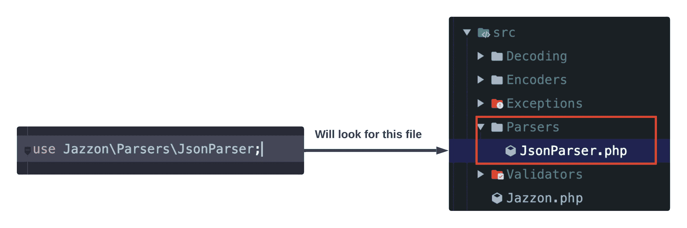

#### JsonParser 自动加载

在指定命名空间后，你可以使用 `composer install` 或 `composer dump-autoload` 构建自动加载文件。在你的 PHP 文件开头包含以下代码，以使用 `Composer` 的自动加载器：

```php
<?php

// 引入 Composer 自动加载器，它为你的项目设置了类加载。
require __DIR__ . '/vendor/autoload.php';

// 创建 JsonParser 类的实例。
// 得益于自动加载器，你不需要手动引入（require）类。
$parser = new Jazzon\Parsers\JsonParser();
```

理解并实现 `PSR-4` 自动加载标准在当前的 PHP 开发中至关重要。它让组织和管理 PHP 类变得更容易，允许构建更易管理和高效的应用程序。我们可以简单地使用 `Composer` 在项目（例如 `Jazzon` 库）中实现 `PSR-4` 自动加载。

### Composer 与自动加载

`Composer` 是现代 PHP 开发的必修工具。它不仅是一个依赖管理器，还提供了一个标准化的自动加载框架，提高了处理 PHP 项目的效率。在研究了 PHP 命名空间和 `PSR-4` 自动加载之后，让我们仔细查看一下 `Composer` 及其与自动加载的关系。

`Composer` 是一个 PHP 依赖管理工具，允许你定义项目依赖的库，并将为你管理（安装/更新）这些库。它以项目为基础维护包或库，并将它们安装在 `vendor` 等目录中。

### Composer 与自动加载

除了依赖管理外，`Composer` 还提供了一个重要功能：它有一个通用的自动加载器，可以与任何遵循 `PSR-0`、`PSR-4` 或 `class-map` 自动加载标准的库配合。此功能允许开发者无缝高效地将任何合适的 PHP 库集成到项目中。让我们看看如何利用 `Composer` 在我们的 `Jazzon` 库中实现自动加载。

1. 定义你的命名空间：在 `composer.json` 文件的 `autoload` 部分下将你的命名空间映射到文件夹：

```json
{
  "autoload": {
    "psr-4": {
      "Jazzon\\": "src/"
    }
  }
}
```

2. 生成自动加载文件：使用 `composer install` 或 `composer dump-autoload` 开始。`vendor/autoload.php` 文件在此阶段被创建。

3. 在你的脚本中引入自动加载器：在 PHP 文件的顶部引入自动加载文件。如果你的项目完全依赖 `Composer`，则不需要这一步，它会为你完成所有这些“魔法操作”。

```php
<?php

// 加载 Composer 的自动加载器，根据指定的配置启用自动类加载。
require __DIR__ . '/vendor/autoload.php';

// 实例化 JsonParser 类。
// 得益于自动加载，无需手动引入类文件。
$parser = new Jazzon\Parsers\JsonParser();
```

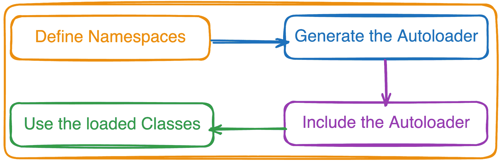

#### Composer 自动加载步骤

`Composer` 在当前的 PHP 编程中是至关重要的，因为它不仅用于依赖管理，还提供了强大的自动加载能力。它改进了我们管理依赖和自动加载类的效率和标准化。我们可以更好地理解 PHP 项目的结构和运行。

## 命名空间与自动加载的最佳实践

在设计大型应用程序或库（如 `Jazzon`）时，对命名空间和自动加载实施最佳实践可以极大提高代码的可维护、扩展性和可读性。让我们来看看这些最佳实践。

### 命名空间最佳实践

1. 逻辑结构：定义命名空间时，使用与项目结构对应的逻辑结构。这种方法有助于自动加载。

```php
<?php

// 为当前 PHP 文件声明 Jazzon\Parsers 命名空间。
// 这允许在该命名空间下组织代码。
namespace Jazzon\Parsers;
```

查看以下关于 Jazzon 结构的示例：

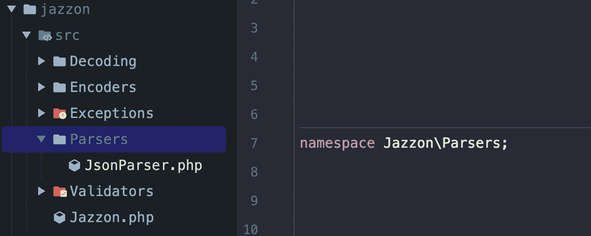

*Jazzon 逻辑结构*

2. 类名与文件名匹配：类名应与文件名相同。这是 `PSR-4` 的要求，并有助于代码的可读性和发现。

```php
<?php

// 指定文件的位置和名称以增加清晰度。
// 文件：src/Parsers/JsonParser.php
// 为此 PHP 文件声明 Jazzon\Parsers 命名空间。
namespace Jazzon\Parsers;

// 在 Jazzon\Parsers 命名空间内定义名为 JsonParser 的类。
class JsonParser
{
}
```

3. 命名空间使用大驼峰命名：对于命名空间和类名，PHP-FIG 标准建议使用大驼峰命名（也称为 PascalCase）。它增加了代码的统一性和可读性。

### 自动加载最佳实践

1. 使用 Composer 的自动加载器：使用 `Composer` 的自动加载器可以显著简化 PHP 项目的自动加载。它可以加载函数和常量，并支持 `PSR-4` 和 `PSR-0`。

```php
<?php

// 加载 Composer 自动加载脚本。
// 该脚本根据项目设置自动类加载。
require __DIR__ . '/vendor/autoload.php';
```

2. 自动加载与性能：由于自动加载可能对性能产生影响，建议使用生产优化的自动加载器。可以通过 `composer dump-autoload-optimize` 命令生成。

### 3. 命名空间映射（Namespace Mapping）

在你的 `composer.json` 文件中，将基础命名空间映射到 `src/` 目录。这是一个典型的策略，可以提高项目结构的统一性。

```json
{
  "autoload": {
    "psr-4": {
      "Jazzon\\\\": "src/"
    }
  }
}
```

### 4. 类的使用（Class Usage）

为了避免混乱，请在文件顶部导入类，而不是在代码中使用完全限定名引用它们。

```php
<?php

// 指定在该文件中将使用来自 "Jazzon\Parsers" 命名空间的 JsonParser 类。
// 这避免了在实例化类时需要使用完整的命名空间路径。
use Jazzon\Parsers\JsonParser;

// 实例化 JsonParser 类。
// 由于上面的 "use" 语句，我们在这里不需要完整的命名空间路径。
$parser = new JsonParser();
```


命名空间和自动加载是 PHP 的核心组成部分，对于较大的应用程序尤其如此。通过采用最佳实践，你可以让代码库更加整洁、高效且易于管理。记住，结构良好、组织合理的代码库更容易被理解、调试和维护。

# 创建库组件 (Creating Library Components)

在此部分中，重点是构建库的核心元素，针对特定的问题和用例进行定制。本书的这部分帮助读者识别并开发构成库的各种组件，例如函数、类、接口和 trait（特质）。它强调了优先考虑、完善和迭代这些组件的重要性，以有效解决库领域内的问题。

这部分首先提供了关于创建 PHP 函数的最佳实践见解。这包括保持清晰的焦点、避免全局变量、使用描述性名称、应用类型提示（type hinting）以及有效地处理异常。这些实践对于在 PHP 库中开发结构良好且可靠的函数至关重要。

接下来将探讨类在 PHP 库中的作用。类在封装数据和函数方面是基础，这部分强调了遵循最佳实践的重要性，例如单一职责原则、实现依赖注入以及利用抽象类或接口。这些原则确保了创建设计良好、可维护且可扩展的类。

此外，这部分将引导读者掌握 Jazzon 库中基本函数的实现。它承认，虽然这些函数展示了 PHP 库构建的基础，但在实际应用中可能需要更复杂的、非内置的 PHP 函数。

最后，这部分涵盖了将重要的库函数组装成类并将其组织到不同的命名空间中。这一过程对于实现库结构的清晰度和确保命名无冲突至关重要。通过有效地实现命名空间，指南展示了如何无缝使用来自不同命名空间的类，增强 PHP 库的整体功能和用户体验。

## 库组件 (Library Components)

在深入构建库的类和函数之前，定义库的组件至关重要，这意味着定义库将提供的不同部分或功能。

库组件是库的构建块，可以包括函数、类、接口和 trait。在库开发的早期定义这些组件至关重要，以便清晰地理解正在构建的内容。

### 识别问题领域 (Identify the problem domain)

第一步是识别库将解决的问题领域。这可能是一个特定的业务领域或一个特定的技术问题。

我们的 Jazzon 库旨在解决 PHP 中解析 JSON 数据的问题。因此，Jazzon 的问题领域与数据解析有关。

### 识别用例 (Identify the use cases)

下一步是识别库的用例。用例是该库将被使用的特定场景或情况。

Jazzon 库的一个用例可能是解析来自 API 的 JSON 响应并将其转换为 PHP 数组或对象。

### 识别库组件 (Identify the library components)

一旦你识别了库的问题领域和用例，下一步就是定义库组件。正如我们之前说的，库组件是库将提供的部分或功能。

Jazzon 可能的某些组件包括：

* 一个将 JSON 字符串解析为 PHP 数组的函数。
* 一个将 JSON 字符串解析为 PHP 对象的函数。
* 一个将 PHP 数组转换为 JSON 字符串的函数。
* 一个将 PHP 对象转换为 JSON 字符串的函数。
* 一个处理验证等功能的类。

我们可以这样定义 Jazzon 的通用组件结构：

* `JsonParser` 类：负责将 JSON 字符串解析为数组或对象。

```php
<?php
// JsonParser 类负责将 JSON 字符串解析为数据结构（数组或对象）。
class JsonParser {
    // 解析方法的实现
}
```

* `JsonEncoder` 类：负责将数组或对象转换为 JSON 字符串。

```php
<?php
// JsonEncoder 类负责将数据结构（数组或对象）编码为 JSON 字符串。
class JsonEncoder {
    // 编码方法的实现
}
```

* `JsonValidator` 类：负责验证 JSON 数据的结构和完整性。

```php
<?php
// JsonValidator 类提供验证 JSON 数据结构和完整性的方法。
class JsonValidator {
    // 验证方法的实现
}
```

* `JsonException` 类：处理 JSON 解析或编码错误的自定义类。

```php
<?php
// JsonException 类为 JSON 提供自定义异常处理。
class JsonException extends Exception {
    // 异常方法的实现
}
```

通过定义库组件，你可以轻松地将开发过程拆分为更小、更容易管理的任务。

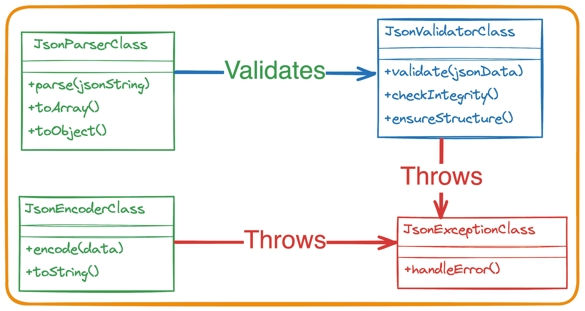

Jazzon 库中的组件关系

### 组件排序 (Prioritize the components)

识别组件后，根据其重要性和复杂性对它们进行排序。这将帮助你关注最重要的组件，避免负担不堪。

在 Jazzon 的情况下，解析函数可能是最重要的组件，因为它们是库的核心功能。

### 完善和迭代 (Refine and Iterate)

最后，根据需要对库组件进行完善和迭代。当你开始开发时，可能会发现某些组件不再需要，或者需要新的组件。

假设我们的 Jazzon 库某些用户在处理无效 JSON 数据时遇到问题，可能需要在库中添加新的验证规则/组件。通过完善和迭代定义的库组件，你可以确保库满足用户需求并保持活力。

## 定义库函数 (Defining Library Functions)

在 PHP 库开发中，函数和类是库组件的构建块。

函数是执行特定任务的集。

类是创建具有共同属性和方法的蓝图。

在本节中，我们将定义并设计 Jazzon 库预期的基本函数，本节的目标是让你了解在开始编写库函数时需要做什么。

{notice} 我们将在本章的稍后部分提供函数的实现。

## 函数最佳实践

在定义/设计库函数时，请记住以下一些良好实践：

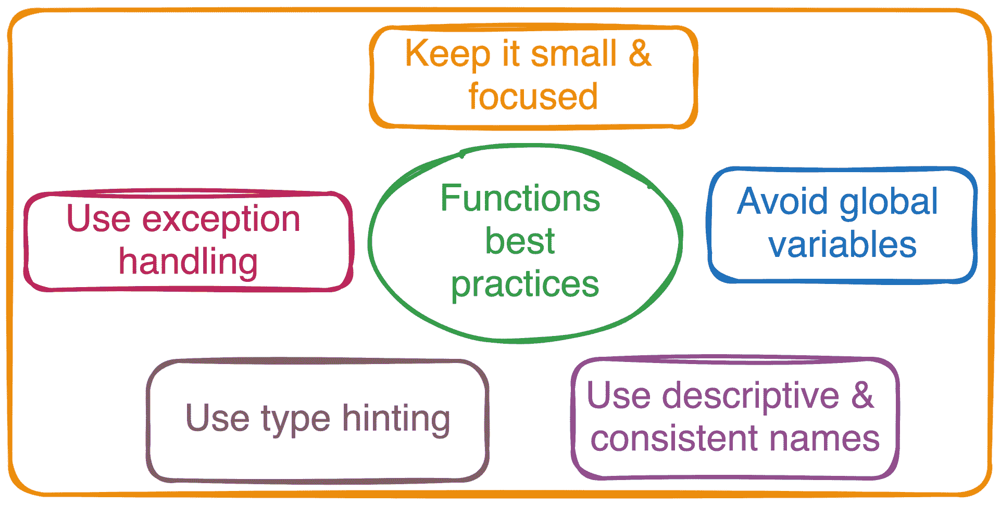

## 函数最佳实践

* 保持函数短小并专注于单一的小型任务，以提高代码的可读性和可维护性。

```php
<?php
// 此函数执行一个微小且集中的任务：两个数字相加。
function add(int $a, int $b): int {
    return $a + $b;
}
// 使用该函数将 5 和 3 相加。
$result = add(5, 3);
echo $result; // 输出: 8
```

* 避免使用全局变量，并使用参数传递数据。

```php
<?php
// 与使用全局变量，我们将值作为参数传递给函数。
function multiply(int $x, int $y): int {
    return $x * $y;
}
// 使用该函数将 6 乘以 4。
$result = multiply(6, 4);
echo $result; // 输出: 24
```

* 使用具有描述性的常量命名，以便于理解函数。

```php
<?php
// 函数名清晰地描述了它的目的：将华氏度转换为摄氏度。
function convertFahrenheitToCelsius(float $fahrenheit): float {
    return ($fahrenheit - 32) * (5/9);
}
// 使用该函数将 98.6 华氏度转换为摄氏度。
$celsius = convertFahrenheitToCelsius(98.6);
echo $celsius; // 输出: 37
```

* 使用类型提示以确保传递到函数的数据类型是正确的。

```php
<?php
// 类型提示确保函数只接受数组并返回整数。
function countElementsInArray(array $items): int {
    return count($items);
}
// 使用该函数计算数组中的项数。
$arrayItems = ['apple', 'banana', 'cherry'];
$count = countElementsInArray($arrayItems);
echo $count; // 输出: 3
```

* 使用异常处理来优雅地处理函数内部的错误和失败。

```php
<?php
// 此函数安全地除法两个数字，如果除数为 0，则抛出异常。
function safeDivide(int $numerator, int $denominator): float {
    if ($denominator === 0) {
        throw new Exception("除数不能为零.");
    }
    return $numerator / $denominator;
}
// 尝试使用该函数将 8 除以 0。这将触发异常。
try {
    $result = safeDivide(8, 0);
    echo $result;
} catch (Exception $e) {
    echo $e->getMessage(); // 输出: 除数不能为零。
}
```

## JSON 函数

让我们列出库中预期的函数：

* `parse(bool $assoc = false, int $depth = 512, int $options = 0)` - 负责将 JSON 字符串解析为 PHP 数组。

```php
<?php
/**
 * 解析 JSON 字符串并返回对象或数组
 *
 * @param bool $assoc [可选] 如果为 true，返回的对象将转换为关联数组。
 * @param int $depth [可选] 用户指定的递归深度。
 * @param int $options [可选] JSON 解码选项的位码。
 * @return mixed
 * @throws JsonException
 */
function parse(bool $assoc = false, int $depth = 512, int $options = 0): string
{
    // 解析逻辑
}
```

* `getArray()` 返回解析后的 JSON 字符串的 PHP 数组。
* `getObject()` 返回解析后的 JSON 字符串的 PHP 对象。
* `encode(int $options = 0, int $depth = 512)` 用于将数据编码为 JSON 字符串。

```php
<?php
/**
 * 将数组或对象编码为 JSON 字符串。
 * @param int $options [可选] JSON 编码选项。
 * @param int $depth [可选] 最大深度。
 * @return string
 * @throws JsonException
 */
function encode(int $options = 0, int $depth = 512): string
{
    // 编码逻辑
}
```

* `validate(string $json)` 是验证 JSON 字符串的函数。

```php
<?php
/**
 * 验证 JSON 字符串
 *
 * @param string $json 要验证的字符串
 * @return bool 如果 JSON 字符串有效，否则为 false
 */
function validate(string $json): bool
{
    // 验证逻辑
}
```

这是我们库中定义函数的起点。

### 类

类是面向对象编程的基础。它们允许我们将数据和函数封装到单个单元中。

例如，在我们的 Jazzon 库中，我们有一个名为 `DecodedValue` 的类，它可以表示解码后的结果：

```php
<?php
// DecodedValue.php
/**
 * 表示解码结果。
 */
class DecodedValue
{
    /**
     * 解码的数据。
     * @var mixed
     */
    private $data;

    /**
     * 解码数据时的字节数。
     * @var int
     */
    private $bytesConsumed;

    /**
     * 创建一个新的解码结果。
     *
     * @param mixed $data 解码的数据。
     * @param int $bytesConsumed 解码数据时的字节数。
     */
    public function __construct($data, $bytesConsumed)
    {
        $this->data = $data;
        $this->bytesConsumed = $bytesConsumed;
    }

    /**
     * 获取解码的数据。
     *
     * @return mixed
     */
    public function getData()
    {
        return $this->data;
    }

    /**
     * 获取解码数据时的字节数。
     *
     * @return int
     */
    public function getBytesConsumed()
    {
        return $this->bytesConsumed;
    }
}
```

另一个类将是 `JsonParser` 类，它为我们封装解析函数。正如我们在上一节中定义的，`parse()` 函数是该类的一部分：

```php
<?php
// JsonParser.php
/**
 * 解析 JSON 字符串并返回对象或数组
 */
class JsonParser
{
    /**
     * 解析 JSON 字符串并返回对象或数组
     *
     * @param bool $assoc [可选] 如果为 true，返回的对象将转换为关联数组。
     * @param int $depth [可选] 用户指定的递归深度。
     * @param int $options [可选] JSON 解码选项的位码。
     * @return mixed
     * @throws JsonException
     */
    public function parse(bool $assoc = false, int $depth = 512, int $options = 0): string
    {
        // 解析逻辑
    }
}
```

这个 `JsonParser` 还可以包含与解析算法相关的其他函数，例如我们需要添加一个从文件解析 JSON 的新功能，我们可以实现另一个名为 `parseFile(...)` 的过程。

{注意} 我们将在实现阶段遍历属于每个类的函数。

我们还有另一个用于将 PHP 数组或对象解码为 JSON 的类。

```php
<?php
// JsonEncoder.php
/**
 * JsonEncoder 类
 * 将数据编码为 JSON 字符串
 */
class JsonEncoder
{
    public function encode(int $options = 0, int $depth = 512): string
    {
        // encoding logic
    }
}
```

另一个用于校验的类如下：

```php
<?php
// JsonValidator.php
/**
 * Class JsonValidator
 * 验证 JSON 字符串
 */
class JsonValidator
{
    /**
     * 验证 JSON 字符串
     *
     * @param string $json 需要验证的 JSON 字符串
     * @return bool 如果 JSON 字符串有效则返回 true，否则返回 false
     */
    public function validate(string $json): bool
    {
        // validation logic
    }
}
```

我们在库初始版本中需要的最后一个类是自定义异常类：

```php
<?php
// JsonException.php
/**
 * Class JsonException
 * 用于处理 JSON 错误的自定义异常类
 */
class JsonException extends \RuntimeException
{
}
```

### 类最佳实践

在设计类时，我们需要遵循一些实践，使其更加清晰且易于维护。我们在讨论函数时谈到的相同实践也适用于这里。除了这些实践外，我们还需要考虑以下几点：

* 使用单一职责原则确保一个类只有一个职责。

```php
<?php
// 此类专门负责管理系统中的用户。
class UserManager
{
    // 添加新用户的函数。
    public function addUser($user) {
        // 在此处编写添加用户的代码。
    }
    // 移除用户的函数。
    public function removeUser($user) {
        // 在此处编写移除用户的代码。
    }
}
// `UserManager` 类不处理其他职责
// 例如管理产品或订单。
```

* 在可能的情况下，使用依赖注入而非继承，以确保类不会与其他类紧密耦合。我们可以用不同的、更准确的说法来表述，即“使用组合代替继承”。


```php
<?php  

interface Logger {  
    public function log($message);  
}  
// 基于文件的 Logger。  
class FileLogger implements Logger {  
    public function log($message) {  
        echo $message;  
    }  
}  
// `OrderManager` 与 `FileLogger` 没有紧密耦合。它只需要一个可以记录的对象。  
class OrderManager {  
    private $logger;  
    // 注入了 `Logger` 依赖，而不是强制 `OrderManager` 使用特定的 logger。  
    public function __construct(Logger $logger) {  
        $this->logger = $logger;  
    }  
    public function createOrder() {  
        // 创建订单的逻辑。  
        $this->logger->log("Order created.\n");  
    }  
}  
$orderManager = new OrderManager(new FileLogger());  
$orderManager->createOrder();
```

在可能的情况下，使用抽象类或接口来定义通用功能，并确保相关类之间的一致性。

```php
<?php  

// 定义所有支付网关通用功能的抽象类。  
abstract class PaymentGateway {  
    public abstract function processPayment($amount);  
    // 所有支付网关的通用实用工具函数。  
    protected function logTransaction($message) {  
        // 记录交易的逻辑。  
        echo $message;  
    }  
}  
// 扩展抽象类 `PaymentGateway` 的 PayPal 网关。  
class PayPalGateway extends PaymentGateway {  
    public function processPayment($amount) {  
        // 通过 PayPal 处理支付的特定逻辑。  
        $this->logTransaction("Processed $amount using PayPal.\n");  
    }  
}  
// 扩展抽象类 `PaymentGateway` 的 Stripe 网关。  
class StripeGateway extends PaymentGateway {  
    public function processPayment($amount) {  
        // 通过 Stripe 处理支付的特定逻辑。  
        $this->logTransaction("Processed $amount using Stripe.\n");  
    }  
}  
$paypal = new PayPalGateway();  
$paypal->processPayment(100);  
$stripe = new StripeGateway();  
$stripe->processPayment(100);
```

在最后，会创建一个新的 `DecodedValue` 对象，包含解码后的值和消耗的字节数，然后返回。

该函数直接使用 PHP 内置函数 `json_decode()` 来解析 JSON 字符串并将其转换为 `DecodedValue` 对象，我们可以用它来获取 PHP 数组或 PHP 对象。如果在解析过程中发生错误，它将抛出一个带有适当错误消息的 `JsonException`。

## `encode()`

我们将使用 `$this->valueToEncode` 作为从需要转换为 JSON 的 PHP 数组/对象的引用。

```php
<?php  

/**  
 * 将数据编码为 JSON 字符串  
 *  
 * @param int $options [可选] JSON 编码选项的位掩码。  
 * @param int $depth [可选] 设置最大深度。该值必须大于 0。  
 * @return string  
 * @throws JsonException  
*/  
function encode(int $options = 0, int $depth = 512): string  
{  
  // 在此处，我们将使用 PHP 内置的 json_encode() 函数  
  // 我们还将处理编码过程中可能发生的任何错误  
  $result = json_encode($this->valueToEncode, $options, $depth);  
  if (json_last_error() !== JSON_ERROR_NONE) {  
      throw new JsonException(json_last_error_msg());  
  }  
  return $result;  
}
```

让我们从高层级分析此函数以看看它的作用：

- 定义的 `encode` 函数将 PHP 数据转换为格式化的 JSON 字符串。它可选地接收参数：用于设置编码选项的 `$options` 和用于最大递归深度的 `$depth`。它将返回编码后的 JSON 结果或抛出一个 `JsonException` 异常。

- 使用 PHP 内置的 `json_encode()` 函数对给定数据进行编码。如果编码过程中发生错误，则抛出带有适当错误消息的 `JsonException`。

- 返回成功编码的 JSON 字符串。

我们使用 PHP 内置函数 `json_encode()` 将 PHP 数组/对象转换为 JSON 字符串，并在发生任何错误时抛出 `JsonException`。

## `validate()`

```php
<?php  

/**  
 * 验证 JSON 字符串  
 *  
 * @param string $json 需要验证的 JSON 字符串  
 * @return bool 如果 JSON 字符串有效则返回 true，否则返回 false  
*/  
public function validate(string $json): bool  
{  
    // 我们将使用 json_decode() 尝试解码字符串。  
    // 如果它返回 null，且我们知道字符串不是 'null'，
    // 那么它不是有效的 JSON。  
    $decoded = json_decode($json);  
    if ($decoded === null && strtolower($json) !== 'null') {  
        return false;  
    }  
    return true;  
}
```

让我们从高层级分析此函数以看看它的作用：

定义 `validate` 函数来验证提供的 JSON 字符串。该函数返回一个布尔值，表示验证是否通过。

- 如果使用 `json_decode()` 解码 JSON 字符串结果为 null 且提供的字符串未显式为‘null’，则判定该 JSON 字符串无效。

- 如果解码成功，该函数返回 true，表示 JSON 是有效的。

## 组装库类

接下来，我们将所有内容整合在一起，完成我们库类的完整实现。

到目前，我们在设计库和实现其核心函数方面做得非常出色，现在是时候将我们的函数集成到库类中，并确保它们被正确地命名空间。

{notice} 你可以在提供的名为 `jazzon-lib-classes-implmentation` 的文件夹中找到整个库类的实现，你可以根据需要对其打开并修改。

我们将为每个部分创建命名空间（目录），因此我们的项目中将拥有以下命名空间：

- `Jazzon`：父命名空间。

- `Decoding`：用于解码值对象类或任何其他我们需要实现解码值的类。

- `Validators`：将包含库的验证器。

- `Exceptions`：将存放库的自定义异常。

- `Parsers`：存放我们的解析器，目前是 `JsonParser`。

- `Encoders`：存放编码器，目前是 `JsonEncoder`。

### `DecodedValue`

首先，让我们实现对象值类，即 `DecodedValue` 类，它将持有解码后的 JSON 值。

正如我们之前约定的，用户可以请求解码后的值为混合类型（mixed）、PHP 数组，最后是 PHP 对象。我们讨论了命名空间，以及为我们的类和文件设置命名空间有多重要，因此我们将 `DecodedValue` 添加到一个名为 `Decoding` 的独立命名空间中。

```php
<?php  

namespace Jazzon\Decoding;  

class DecodedValue  
{  
    /** @var mixed $data */  
    private mixed $data;  
    /** @var int $bytesConsumed */  
    private int $bytesConsumed;  

    /**  
     * @param mixed $data  
     * @param int $bytesConsumed  
     */  
    public function __construct(mixed $data, int $bytesConsumed)  
  {  
      $this->data = $data;  
      $this->bytesConsumed = $bytesConsumed;  
  }  

    /**  
     * @return mixed  
     */  
    public function getData(): mixed  
  {  
      return $this->data;  
  }  

    /**  
     * @return array  
     */  
    public function getDataArray(): array  
  {  
      return (array)$this->data;  
  }  

    /**  
     * @return object  
     */  
    public function getDataObject(): object  
  {  
      return (object)$this->data;  
  }  

    /**  
     * @return int  
     */  
    public function getBytesConsumed(): int  
  {  
      return $this->bytesConsumed;  
  }  
}
```

让我们从高层级查看该类：

- 位于 `Jazzon\Decoding` 命名空间。

- `DecodedValue` 类实现了解码的结果。它有私有成员来存储数据以及消耗的字节数。

- 构造函数根据输入初始化数据。

- `getData()` 方法返回数据。

- `getDataArray()` 以数组形式返回数据。

- `getDataObject()` 以对象形式返回数据。

- `getBytesConsumed()` 返回调用时消耗的字节数。

### `JsonValidator`

现在，我们在 `Validators` 命名空间中实现 `JsonValidator`。

```php
<?php  

namespace Jazzon\Validators;  

class JsonValidator  
{  
    /**  
     * 验证 JSON 字符串  
     *  
     * @param string $json 需要验证的 JSON 字符串  
     * @return bool 如果 JSON 字符串有效则返回 true，否则返回 false  
    */  
    public function validate(string $json): bool  
  {  
      // 我们将使用 json_decode() 尝试解码字符串。  
      // 如果它返回 null，且我们知道字符串不是 'null'，
      // 那么它不是有效的 JSON。  
      $decoded = json_decode($json);  
      if ($decoded === null && strtolower($json) !== 'null') {  
          return false;  
      }  
      return true;  
  }  
}
```

让我们从高层级查看该类：

- 这种类属于 `Jazzon\Validators` 命名空间。

- `JsonValidator` 类评估 JSON 字符串。

- `validate` 方法用于检查给定字符串是否为有效的 JSON。

### `JsonException`

我们将 `JsonException` 放在它自己的 `Exceptions` 命名空间中。

```php
<?php  

namespace Jazzon\Exceptions;  

class JsonException extends \RuntimeException  
{  
}
```

让我们从高层级查看该类：

- 它属于 `Jazzon\Exceptions` 命名空间。

- `JsonException` 类继承自 PHP 的标准 `RuntimeException`，以便在发生任何由于 JSON 操作引起的异常时，可以提供相关的特殊异常处理。

### `JsonParser`

现在，让我们来实现 `JsonParser`。记住我们已经实现了 `parse()` 函数，因此我们将将其放置在类中，并创建一个构造函数来初始化 JSON 字符串变量、我们的 `JsonValidator` 实例，最后是 `DecodedValue` 实例。

我们也将将其放在一个独立的命名空间 `Parsers` 中，这将使得以后如果需要为文件添加新的解析器或不同的解析器将变得非常方便。这里会有三个对 `DecodedValue`、`JsonValidator` 和 `JsonException` 的导入，因为它们都存在各自的命名空间中。


```php
<?php  

namespace Jazzon\Parsers;  

use Jazzon\Decoding\DecodedValue;  

use Jazzon\Exceptions\JsonException;  

use Jazzon\Validators\JsonValidator;  

class JsonParser  

{  

    /** @var string $valueToEncode */  
    private string $valueToEncode;  

    /** @var JsonValidator $jsonValidator */  
    private JsonValidator $jsonValidator;  

    /**  
     * @param string $valueToEncode  
     */  
    public function __construct(string $valueToEncode)  
    {  
        $this->valueToEncode = $valueToEncode;  
        $this->jsonValidator = new JsonValidator();  
    }  

    /**  
     * 解析 JSON 字符串并返回对象或数组  
     *  
     * @param bool $assoc [Optional] 如果为 true，返回的对象将转换为关联数组。  
     * @param int $depth [Optional] 用户指定的递归深度。  
     * @param int $options [Optional] JSON 解码选项的位掩码。  
     * @return DecodedValue  
     * @throws JsonException  
     */  
    public function parse(bool $assoc = false, int $depth = 512, int $options = 0): DecodedValue  
    {  
        // 首先，验证 JSON 字符串是否为有效字符串  
        if (!$this->jsonValidator->validate($this->valueToEncode)) {  
            throw new JsonException("The provided JSON string is not valid!");  
        }  
        // 我们需要计算 json_decode 函数消耗的字节数。
        // 做到此的一种方法是计算 JSON 字符串的长度。
        // 注意：这是计算代码最简单、最直接的方法，可以被更高效的方法替换。  
        $bytesConsumed = strlen($this->valueToEncode);  
        // 这里我们将使用 PHP 内置的 json_decode() 函数  
        // 我们还将处理解析过程中可能发生的任何错误  
        $result = json_decode($this->valueToEncode, $assoc, $depth, $options);  
        if (json_last_error() !== JSON_ERROR_NONE) {  
            throw new JsonException(json_last_error_msg());  
        }  
        // 现在我们创建一个新的 DecodedValue 对象并返回它  
        return new DecodedValue($result, $bytesConsumed);  
    }  
}
```

从高层角度来看这个类，我们可以说：

- 它属于 `Jazzon\Parsers` 命名空间。
- 导入了所需类所需的必要命名空间。
- `JsonParser` 类承担解析 JSON 字符串的角色。它拥有私有属性，负责持有待解析的字符串和一个验证器。
- 构造函数用于初始化类属性。
- `parse` 方法用于解析 JSON 字符串并返回 `DecodedValue` 实例。该方法处理验证错误、字节计数以及解析错误。

## JsonEncoder

让我们对 `JsonEncoder` 执行相同的操作。我们将它也放在一个独立的命名空间 `Encoders` 中。

```php
<?php  

namespace Jazzon\Encoders;  

use Jazzon\Parsers\JsonParser;  

use Jazzon\Exceptions\JsonException;  

class JsonEncoder  

{  

    /** @var mixed $valueToEncode */  
    private mixed $valueToEncode;  

    /**  
     * @param mixed $valueToEncode  
     */  
    public function __construct(mixed $valueToEncode)  
    {  
        $this->valueToEncode = $valueToEncode;  
    }  

    /**  
     * 将数据编码为 JSON 字符串  
     *  
     * @param int $options [Optional] JSON 解码选项的位掩码。  
     * @param int $depth [Optional] 设置深度。  
     * @return string  
     * @throws JsonException  
     */  
    public function encode(int $options = 0, int $depth = 512): string  
    {  
        // 这里我们将使用 PHP 内置的 json_decode() 函数  
        // 我们还将处理解析过程中可能发生的任何错误  
        $result = json_decode($this->valueToEncode, false, $depth, $options);  
        if (json_last_error() !== JSON_ERROR_NONE) {  
            throw new JsonException(json_last_error_msg());  
        }  
        // 返回结果
        return $result; 
    }  
}
```

从高层角度来看这个类，我们可以说：

- 它属于 `Jazzon\Encoders` 命名空间。
- 导入了所需类所需的必要命名空间。
- `JsonEncoder` 类承担将数据编码为 JSON 字符串的角色。它拥有私有属性，负责持有待解析的字符串。
- 构造函数用于初始化类属性。
- `encode` 方法使用 PHP 内置的 `json_decode()` 函数，并处理解析过程中可能发生的任何错误（通过抛出 `JsonException`）。

在软件开发中，确保代码的韧性和稳定性至关重要。单元测试是实现这一目标的技术之一，它是被称为**测试驱动开发（TDD）**的更广泛测试策略的基础。

单元测试用于确保软件中的单个组件（或单元）能够正常工作。每个单元测试都关注应用程序中一个微小的、隔离的区域（通常是一个单个函数或方法），并在独立于其他组件的情况下评估其有效性。这种隔离的测试环境确保了每个组件在受控环境中按照预期执行，且不受程序其他组件引入的任何副作用的影响。

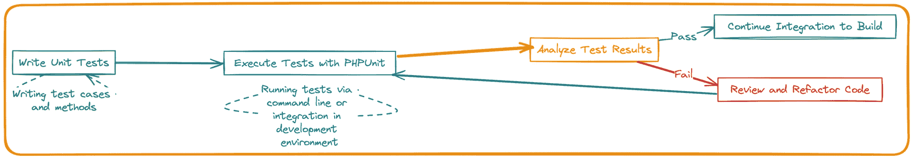

一个在 PHP 中使用 `PHPUnit` 的单元测试过程流程图

PHP 开发者可以使用多种工具来帮助单元测试。`PHPUnit` 是最流行、最强大且灵活的框架之一，它提供了在 PHP 项目中构建和执行单元测试所需的各种。`PHPUnit` 不仅允许开发者设计测试，还允许他们执行这些测试并生成可以指导未来开发的有用报告。

## 单元测试原则

让我们从学习单元测试原则开始：

1. **隔离**：每个测试都应该关注特定的函数或方法。在单元测试中应避免使用数据库或文件等外部依赖，因为它们可能会导致意之外的结果并阻碍测试执行。

```php
<?php  

// 等待测试的简单函数  

function add($a, $b) {  

    return $a + $b;  

}  

// 对 `add` 函数的单元测试  

function testAdd() {  
    $result = add(2, 3);  
    // 检查结果是否符合预期
    if ($result === 5) {  
        echo "Test passed!";  
    } else {  
        echo "Test failed!";  
    }  
}  

testAdd();  // 执行测试
```

- 定义了一个返回两个数字之和的简单 `add` 函数。
- `add` 的单元测试命名为 `testAdd()` 函数，专门编写作为一个隔离的单元测试。它用于检查已知输入与预期输出。
- `testAdd()` 函数验证了 `add` 函数的正确性。

2. **自动化**：单元测试应该是自动化的。这允许你在每次做出更改时轻松地重新运行测试，保证你的修改不会破坏任何当前功能。

让我们看看下面的示例：

```php
<?php  

// File: Adder.php  

class Adder {  
    public function add($a, $b) {  
        return $a + $b;  
    }  
}  

// File: AdderTest.php  

use PHPUnit\Framework\TestCase;  

class AdderTest extends TestCase {  
    public function testAdd() {  
        $adder = new Adder();  
        $this->assertEquals(5, $adder->add(2, 3));  
    }  
}
```

- 我们定义了一个类 `Adder`，它有一个方法 `add`，提供两个数字之和。
- 通过名为 `AdderTest` 的独立测试类对 `Adder` 类进行测试。这允许使用 `PHPUnit` 的 `TestCase` 类进行结构化测试。在上面的代码段中，`PHPUnit` 的 `assertEquals` 方法确保了 `add` 函数实现了它的目标。

3. **易读易写**：单元测试应该是简单直接的。它们起到了文档的作用，解释你的代码是如何工作的。

让我们检查下面的示例，仅通过阅读测试函数 `testSubtract()`，你就能知道我们代码的作用：

```php
<?php  

function subtract($a, $b) {  
    return $a - $b;  
}  

// 对 `subtract` 函数的单元测试  

function testSubtract() {  
    $result = subtract(5, 3);  
    // 检查结果是否符合预期
    if ($result === 2) {  
        echo "Test passed!";  
    } else {  
        echo "Test failed!";  
    }  
}  

testSubtract();  // 执行测试
```

## 单元测试的组件

让我们看看典型 PHP 单元测试的一些基本组件：

1. **测试类**：这是你存放测试方法的地方。`PHPUnit` 中的测试类是继承自 `TestCase` 类的标准 PHP 类。
2. **测试方法**：断言位于这些方法内部。
3. **断言**：这些是用于验证代码行为是否符合预期的语句。

在后续过程中，我们将探讨如何将单元测试集成到我们的 Jazzon 库中。

# 为库编写测试

测试是任何软件开发过程中不可或缺的一部分，库也不例外。通过为我们的库组件实现单元测试，我们可以及早发现可能的错误、加速更新并简化集成过程。在本节中，我们将学习如何使用 `PHPUnit` 为我们的 Jazzon 库组件创建单元测试。

## 设置 PHPUnit

在开始编写测试之前，我们必须首先安装 `PHPUnit`。PHPUnit 必须安装在本地或全局环境中。以下是使用 `Composer` 在本地进行安装的方法：

```bash
composer require --dev phpunit/phpunit ¹⁰.1
```

安装 `PHPUnit` 后，我们可以在项目根目录下创建一个 `phpunit.xml` 配置文件，用于存储我们为测试定义的任何配置：

```xml
<?xml version="1.0" encoding="UTF-8"?> 
<phpunit bootstrap="vendor/autoload.php" colors="true">
    <testsuites>
        <testsuite name="Jazzon Test Suite">
            <directory>tests</directory>
        </testsuite>
    </testsuites>
</phpunit>
```

该配置文件告诉 `PHPUnit` 使用 `Composer` 的自动加载器来加载我们的类，并在 `tests` 目录中查找测试。

### 编写测试

查看我们库中的 `JsonValidator` 类。该类有一个方法 `validate()`，用于检查给定的字符串是否为有效的 JSON。

```php
<?php 

namespace Jazzon\Validators;

class JsonValidator
{
    /**
     * 验证 JSON 字符串
     * 
     * @param string $json 需要验证的 JSON 字符串
     * @return bool 如果 JSON 字符串有效则返回 true，否则返回 false 
     */
    public function validate(string $json): bool
    {
        // 我们将使用 json_decode() 尝试解码字符串。
        // 如果它返回 null，且我们知道字符串不是 'null'，
        // 那么它不是有效的 JSON。
        $decoded = json_decode($json);
        if ($decoded === null && strtolower($json) !== 'null') {
            return false;
        }
        return true;
    }
}
```

我们可以编写一个新的测试用例来测试此类类，`JsonValidatorTest`，其实现如下：

```php
<?php
// 为测试定义命名空间。这有助于组织代码并避免命名冲突。
namespace Jazzon\Tests;

// 从 Jazzon\Validators 命名空间导入 JsonValidator 类。该将在此测试类中进行测试。
use Jazzon\Validators\JsonValidator;

// 从 PHPUnit 导入 TestCase 类，它是所有 PHPUnit 测试的基类。
use PHPUnit\Framework\TestCase;

// 定义一个新的测试类 JsonValidatorTest，它继承自 PHPUnit 的 TestCase 类。
class JsonValidatorTest extends TestCase
{
    // 定义一个测试方法，确保 validate 方法对有效 JSON 返回 true。
    public function testValidateReturnsTrueForValidJson(): void
    {
        $validator = new JsonValidator();
        $this->assertTrue($validator->validate('{"key":"value"}'));
    } 

    public function testValidateReturnsFalseForInvalidJson(): void
    {
        $validator = new JsonValidator();
        $this->assertFalse($validator->validate('invalid-json'));
    }
}
```

`testOrderProcessorWithMockedPaymentGateway` 方法旨在孤离 `PaymentGateway` 类来测试 `OrderProcessor` 类。通过创建一个 `PaymentGateway` 的模拟对象（mock），可以在不依赖支付网关实际实现的情况下验证 `OrderProcessor` 的功能。


```php
<?php  

public function testOrderProcessorWithMockedPaymentGateway(): void  

{  
    // 为 PaymentGateway 创建一个模拟对象。  
    $paymentGatewayMock = $this->createMock(PaymentGateway::class);  
    // 配置模拟对象，使其在被调用 `processPayment` 方法时返回 true。  
    $paymentGatewayMock->method('processPayment')->willReturn(true);  
    // 在 OrderProcessor 中使用模拟的 PaymentGateway。  
    $orderProcessor = new OrderProcessor($paymentGatewayMock);  
    $orderProcessed = $orderProcessor->processOrder(new Order());  
    $this->assertTrue($orderProcessed);  
}
```

为库组件编写有效的测试是创建健壮可靠代码的关键部分。通过遵循最佳实践并专注于代码中每个部分的预期功能，你可以验证组件在各种条件下的运行是否正确。

## 库组件测试

在本节中，我们将为库类编写所有其他需要的测试。

{notice} 我们在上一节中已经实现了对 `JsonValidator` 类的测试。你可以在提供的 `jazzon-lib-classes-implmentation` 文件夹中找到所有代码测试，并在你的机器上运行。

### JsonEncoder 类测试

`JsonEncoder` 类的 `encode()` 函数接收一个值并生成一个 JSON 编码字符串。让我们来看看如何测试该函数的某些基础用例；

```php
<?php  

// 为此测试类声明命名空间。  
namespace Jazzon\Tests;  

// 导入测试所需的类。  
use Jazzon\Encoders\JsonEncoder;  
use Jazzon\Exceptions\JsonException;  
use PHPUnit\Framework\TestCase;  

// 定义继承自 PHPUnit TestCase 的测试类。  
class JsonEncoderTest extends TestCase  

{  
    // 测试编码数组是否返回了有效的 JSON。  
    public function testEncodeReturnsValidJsonForArray(): void  
    {  
        // 使用示例数组实例化 JsonEncoder。  
        $encoder = new JsonEncoder(['key' => 'value']);  
        // 断言编码该数组得到的是预期的 JSON 字符串。  
        $this->assertEquals('{"key":"value"}', $encoder->encode());  
    }  
    // 测试编码畸格式数据是否抛出 JsonException。  
    public function testEncodeThrowsJsonExceptionForMalformedData(): void  
    {  
        // 设置预期：将抛出一个 JsonException。  
        $this->expectException(JsonException::class);  
        // 使用畸格式数据实例化 JsonEncoder。  
        $encoder = new JsonEncoder("\xB1\x31");  
        // 尝试编码，这应该抛出预期的异常。  
        $encoder->encode();  
    }  
}
```

上面的代码段包含两个函数：

- `testEncodeReturnsValidJsonForArray` 函数确保通过 `JsonEncoder` 类编码的数组返回了有效的 JSON 字符串。

- `testEncodeThrowsJsonExceptionForMalformedData` 函数确保使用 `JsonEncoder` 类编码不当的数据时应该抛出 `JsonException`。

### JsonParser 类测试

`JsonParser` 类的 `parse()` 函数接收一个 JSON 字符串并返回一个 `DecodedValue` 对象。让我们来看看如何测试该函数的某些基础用例；

```php
<?php  

// 为此测试类声明命名空间。  
namespace Jazzon\Tests;  

// 导入测试所需的类。  
use Jazzon\Parsers\JsonParser;  
use Jazzon\Decoding\DecodedValue;  
use Jazzon\Exceptions\JsonException;  
use PHPUnit\Framework\TestCase;  

// 定义继承自 PHPUnit TestCase 的测试类。  
class JsonParserTest extends TestCase  

{  
    // 测试解析 JSON 是否返回 DecodedValue 实例。  
    public function testParseReturnsDecodedValueForJson(): void  
    {  
        // 实例化 JsonParser。  
        $parser = new JsonParser('{"key":"value"}');  
        // 解析 字符串。  
        $result = $parser->parse();  
        // 断言结果是 DecodedValue 的实例。  
        $this->assertInstanceOf(DecodedValue::class, $result);  
        // 断言解析后的数据匹配预期的数组。  
        $this->assertEquals(['key' => 'value'], $result->getData());  
    }  
    // 测试解析无效 JSON 是否抛出 JsonException。  
    public function testParseThrowsJsonExceptionForInvalidJson(): void  
    {  
        // 设置预期：将抛出一个 JsonException。  
        $this->expectException(JsonException::class);  
        // 使用无效 JSON 实例化 JsonParser。  
        $parser = new JsonParser('invalid-json');  
        // 尝试解析，这应该抛出预期的异常。  
        $parser->parse();  
    }  
}
```

上面的代码段包含两个函数：

- `testParseReturnsDecodedValueForJson` 函数确保 `JsonParser` 解析有效的 JSON 返回 `DecodedValue` 实例。

- `testParseThrowsJsonExceptionForInvalidJson` 函数确保使用 `JsonParser` 解析无效数据时抛出 `JsonException`。

### DecodedValue 类测试

这个类看起来非常基础，但正如我们之前讨论的，测试每个可行的代码是最佳实践。

让我们来看看它的基础测试用例：

```php
<?php  

// 为此测试类声明命名空间。  
namespace Jazzon\Tests;  

// 导入测试所需的类。  
use Jazzon\Decoding\DecodedValue;  
use PHPUnit\Framework\TestCase;  

// 定义继承自 PHPUnit TestCase 的测试类。  
class DecodedValueTest extends TestCase  

{  
    // 定义一个属性来持有测试的 DecodedValue 实例。  
    protected DecodedValue $decodedValue;  

    // 在每个测试方法之前运行设置方法。  
    protected function setUp(): void  
    {  
        // 使用示例数据实例化 DecodedValue 并存储在属性中。  
        $this->decodedValue = new DecodedValue(['key' => 'value'], 15);  
    }  

    // 测试 getData 方法返回正确的数据。  
    public function testGetData(): void  
    {  
        // 断言返回的数据匹配预期的数组。  
        $this->assertSame(['key' => 'value'], $this->decodedValue->getData());  
    }  

    // 测试 getDataAsArray 方法以数组形式返回正确的数据。  
    public function testGetDataAsArrayReturnsDataAsArray(): void  
    {  
        // 断言返回的数组匹配预期的数组。  
        $this->assertSame(['key' => 'value'], $this->decodedValue->getDataAsArray());  
    }  

    // 测试 getDataAsObject 方法以对象形式返回正确的数据。  
    public function testGetDataAsObjectReturnsDataAsObject(): void  
    {  
        // 断言返回的对象匹配预期的对象。  
        $this->assertEquals((object)['key' => 'value'], $this->decodedValue->getDataAsObject());  
    }  

    // 测试 getBytesConsumed 方法返回正确消耗的字节数。  
    public function testGetBytesConsumedReturnsBytesConsumed(): void  
    {  
        // 断言返回的字节数匹配预期的值。  
        $this->assertSame(15, $this->decodedValue->getBytesConsumed());  
    }  
}
```

上述代码段包含以下 5 个函数：

- `setUp` 函数在运行此类类中的任何测试之前，创建一个持有示例数据的 `DecodedValue` 对象的实例。

- 一个函数用于确保 `DecodedValue` 的 `getData` 方法返回特定的数据。

- 一个函数用于检查 `DecodedValue` 的 `getDataAsArray` 方法是否返回给定的数组格式数据。

- 一个函数用于测试 `DecodedValue` 的 `getDataAsObject` 方法是否数据的对象表示。

- 一个函数用于断言 `DecodedValue` 的 `getBytesConsumed` 方法返回当前实例中消耗的特定字节数。

为你的库组件编写单元测试是软件开发中至关重要的部分。它们能确保你的代码按计划运行，使代码库更具可维护性，并甚至有助于未来功能的开发。这些测试评估了我们 Jazzon 解析器、验证器和编码器的主要功能，使其更加健壮和可靠。

## 调试简介

调试是软件开发生活方式中不可或缺的一部分。它涉及到定位、诊断和纠正程序中的缺陷或错误（bug）。无论你是在编写基础脚本还是一个巨大的在线应用程序，调试都是一项必须习得的重要能力。

在本节中，我们将涵盖调试的基础知识、它为什么重要，以及它是如何融入 PHP 开发流程的。

### 概述

调试是发现并纠正代码中错误的过程。这些问题或 bug 可能会以各种方式出现：脚本可能会崩溃，网页可能无法正确渲染，或者应用程序可能无法生成所需的结果。无论表现如何，调试的目的是识别并纠正这些问题的根源。

调试可以涵盖广泛的任务，从简单的代码审查和手动测试到更高级的操作，如使用调试器逐步执行代码、日志记录和静态代码分析。

最后，你选择的调试方法取决于问题的性质、代码库以及你个人或团队的调试偏好。

### 为什么调试很重要？

调试至关重要，有以下几个原因。

调试首先验证你的代码是否按预期运行并产生预期的结果。没有人希望使用一个频繁崩溃的网站或提供不准确信息的服务。调试帮助你维护软件的质量和可靠性。

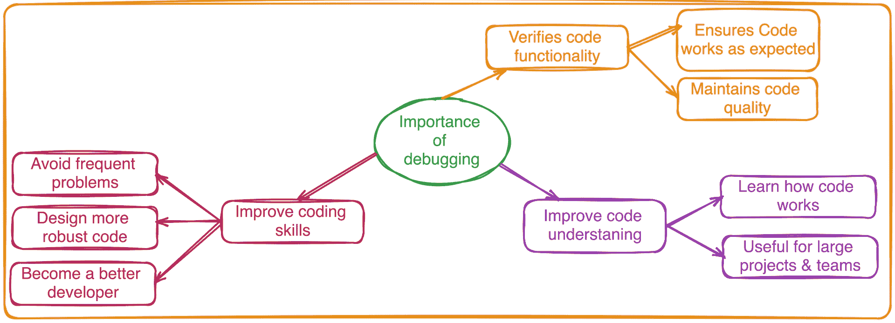

一张显示调试重要性的思维图

其次，调试可以帮助你更好地理解你的代码。在调试代码时，你将频繁对其工作原理以及代码库的不同部分之间如何相互作用产生更好的认知。这对于大型项目或作为团队成员工作时（你可能不熟悉代码库的每个方面）特别有用。

最后，调试可以帮助你提高自己的编码能力。当你发现并修复错误时，你将学会预测和防止频繁出现的问题，设计更健壮的代码，并通常成为一名更优秀的开发者。

### PHP 中的调试

由于提供了许多可用的调试工具和内置函数，PHP 中的调试可能是一个简单的过程。PHP 包含了许多错误报告级别以帮助你定位代码中的问题，你可以使用 `error_reporting` 函数来自定义这些级别。

此外，PHP 的 `var_dump()` 和 `print_r()` 函数对于检查变量以及学习数据在脚本各个位置的结构非常有用。

让我们来看一个非常基础的 PHP 代码，其中我们使用它的内置函数作为调试工具：

```php
<?php

// 声明一个带有 "name" 和 "age" 键及其对应值的关联数组。

$arr = ["name" => "Alex", "age" => 30];

// 打印一个字符串，指示接下来将使用 print_r 函数。
echo "Use print_r function: \n";

// 使用 print_r 函数打印数组的可读性表示形式。
print_r($arr);

// 打印另一个字符串，指示接下来将使用 var_dump 函数。
echo "Use var_dump function: \n";

// 使用 var_dump 函数打印数组的详细结构，包括数据类型和值。
var_dump($arr);
```

你可能使用 Xdebug 或 Zend Debugger 进行更高级的调试。这些工具包含了断点、堆栈跟踪和逐步执行，它们能让你精确地观察代码在每个执行阶段的运行情况。

> 在涉及到调试 PHP 项目时，Xdebug 是最流行的工具。

值得一提的是，虽然调试至关重要，但它应该是更大型错误预防策略的一部分。编写整洁、组织良好且文档的代码；遵循最佳实践和编码标准；以及使用 linters（代码检查器）和静态代码分析器等工具，都可以助于防止错误。

> 将调试视为你编码习惯中不可或缺的元素。

调试是软件开发的重要部分，因为它有助于维护代码的质量、可靠性和准确性。

我们已经涵盖了调试的基础知识、它为什么重要，并简要提到了 PHP 中的调试。接下来的课程将深入探讨 PHP 调试工具。请记住，调试不仅仅是修复错误，它还是一种非常有价值的学习工具。

## PHP 调试工具与技术

PHP 调试是任何 PHP 开发者都应该具备的基础技能。彻底理解调试工具和程序可以通过发现、诊断和修复错误来加速开发。让我们看看一些流行的 PHP 调试工具和技术。

### 使用 `var_dump()`、`print_r()` 和 `echo()`

PHP 调试最基础的方法是使用 `var_dump()`、`print_r()` 和 `echo()` 等函数打印变量的值。虽然这是一种古老的调试方法，但在你想查看代码中特定时刻变量的内容时它非常方便。

```php
<?php

// 声明一个值为 "Hello, world!" 的字符串变量。
$variable = "Hello, world!";

// 使用 var_dump 函数显示详细信息。
var_dump($variable);
```

上面的示例将打印 `$variable` 的类型和值。

### 使用 Xdebug 调试

Xdebug 是一个强大的 PHP 调试和分析工具。堆栈跟踪、断点以及观察变量和表达式的功能只是让调试变得轻松的特性之一。

安装 PHP 的 Xdebug 扩展并在 `php.ini` 文件中配置它即可开始。安装后，你可以在各种 IDE（如 PhpStorm、VS Code 或 Eclipse）中使用它。

以下是 `php.ini` 中 Xdebug 配置的示例：


```ini
; 加载 PHP Xdebug 扩展模块。
zend_extension="xdebug.so"

; 将 Xdebug 设置为 "debug"。用于启用调试功能。
xdebug.mode=debug

; 配置 Xdebug 每次请求都启动调试，而无需触发 GET/POST 变量或 cookie。
xdebug.start_with_request=yes

; 指定客户端（通常是 IDE 或调试器界面）监听 Xdebug 连接的 IP 地址。
xdebug.client_host=127.0.0.1

; 指定 Xdebug 尝试连接到客户端的端口号。
; 许多环境和 IDE（包括 PhpStorm）的默认端口为 9003。
xdebug.client_port=9003
```

`xdebug.log="/path/to/your/logfile"`

{notice} 你可以通过检查提供的 `jazzon-lib-classes-implmentation` 文件夹中的 `docker-containers/php-fpm/Dockerfile` 第 13 行以及 `docker-containers/php-fpm/php-ini-local.ini` 第 13-18 行，查看我们如何为 Jazzon 库设置 XDebug。

## 使用 PHP debug bar 进行调试

[PHP Debug Bar](https://github.com/maximebf/php-debugbar) 是一个具有简单友好界面的调试工具。它可以显示广泛的数据，如内存使用、执行时间、错误和数据库查询。它集成到任何项目中都非常简单，并通过自定义数据收集器进行扩展。

## 错误日志

记录日志是确定代码中出现问题的有用工具。PHP 包含了错误报告程序，例如 `eror_log()`，它可以将消息写入服务器的错误日志或指定的文件。

以下示例将将错误消息打印到特定文件中：

```php
<?php  

// 使用 error_log 函数将错误消息写入指定的日志文件。  

// 参数 "3" 表示消息应追加到下一个参数指定的文件。  

error_log("An error occurred", 3, "/path/to/my/error_log");
```

此外，你还可以利用像 `Monolog` 这样的日志库，它提供了更复杂的功能，例如变量日志级别和处理器。

## 使用 PHPUnit 进行调试

虽然 PHPUnit 主要是一个测试工具，但它也包含调试功能。例如，你可以使用 PHPUnit 编写测试来复现 bug。这可以让你更好地了解代码中哪里有问题以及故障点在哪里。

下面是一个非常基本的单元测试示例，用于确认数组值的和是否正确，你也可以添加另一个单元测试来测试不同的边界情况，以确保你的代码能够处理各种错误情况。

```php
<?php  

use PHPUnit\Framework\TestCase;  // 使用 PHPUnit 的 TestCase 类。  

// 定义一个继承自 PHPUnit TestCase 类的类。  

class ArraySumTest extends TestCase  

{  
    // 定义一个测试数组之和的方法。  

    public function testArraySum(): void  
    {  
        // 声明一个包含值 1, 2 和 3 的数组。  
        $array = [1, 2, 3];  
        // 断言数组中值的和等于 6。  
        $this->assertEquals(6, array_sum($array));  
    }  
}
```

你可以使用 PHPUnit 生成一些覆盖报告，以验证你的所有代码部分都已正确覆盖。

## 使用 XHProf 进行性能分析

性能分析是通过检查你的代码以查看哪些区域较慢且可以改进的。XHProf 是一个 PHP 分层性能分析器。性能分析是通过检查你的代码以查看哪些区域较慢且可以改进的。XHProf 是一个 PHP 分层性能分析器。

```php
<?php
// 开始 XHProf
xhprof_start();

// ... 待分析的代码 ...

// 停止 XHProf
$data = xhprof_stop();
// 保存分析数据
file_put_contents('profiling.prof', serialize($data));
```

性能分析是通过检查你的代码以查看哪些区域较慢且可以改进的。XHProf 是一个 PHP 分层性能分析器。性能分析是通过检查你的代码以查看哪些区域较慢且可以改进的。XHProf 是一个 PHP 分层性能分析器。

```php
<?php
// 开始 XHProf
xhprof_start();

// ... 待分析的代码 ...

// 停止 XHProf
$data = xhprof_stop();
// 保存分析数据
file_put_contents('profiling.prof', serialize($data));
```

```php
$outputDir = './profiles';
// 确保目录存在
if (!file_exists($outputDir)) {
    mkdir($outputDir, 0777, true);
}

// 生成一个唯一名称
$profilingFile = $outputDir . uniqid() . '.prof';
// 保存分析数据
file_put_contents($profilingFile, serialize($data));
```

性能分析是通过检查你的代码以查看哪些区域较慢且可以改进的。XHProf 是一个 PHP 分层性能分析器。性能分析是通过检查你的代码以查看哪些区域较慢且可以改进的。XHProf 是一个 PHP 分层性能分析器。

```php
<?php
// 开始 XHProf
xhprof_start();

// ... 待分析的代码 ...

// 停止 XHProf
$data = xhprof_stop();
// 保存分析数据
file_put_contents('profiling.prof', serialize($data));
```

```php
$outputDir = './profiles';
// 确保目录存在
if (!file_exists($outputDir)) {
    mkdir($outputDir, 0777, true);
}

// 生成一个唯一名称
$profilingFile = $outputDir . uniqid() . '.prof';
// 保存分析数据
file_put_contents($profilingFile, serialize($data));
```

性能分析是通过检查你的代码以查看哪些区域较慢且可以改进的。XHProf 是一个 PHP 分层性能分析器。性能分析是通过检查你的代码以查看哪些区域较慢且可以改进的。XHProf 是一个 PHP 分层性能分析器。

```php
<?php
// 开始 XHProf
xhprof_start();

// ... 待分析的代码 ...

// 停止 XHProf
$data = xhprof_stop();
// 保存分析数据
file_put_contents('profiling.prof', serialize($data));
```

```php
$outputDir = './profiles';
// 确保目录存在
if (!file_exists($outputDir)) {
    mkdir($outputDir, 0777, true);
}

// 生成一个唯一名称
$profilingFile = $outputDir . uniqid() . '.prof';
// 保存分析数据
file_put_contents($profilingFile, serialize($data));
```

如果库没有按照预期方式工作，请逐步步进库的代码。虽然这看起来很耗时（特别是对于较大的库而言），但这种方法通常能找到问题的根源。Xdebug 支持此类分析，它让你能够在任何代码行暂停执行，并检查应用程序中的当前状态。

## 单元测试

为你的库编写单元测试是发现 Bug 的另一个绝方法。覆盖库整个功能的测试可以帮助在问题变得令人困扰之前就发现它们。

{notice} 我们在之前的课程中已经详细介绍过单元测试。

使用 `PHPUnit` 等工具可以帮助你生成报告，让你对库功能是如何测试的有非常好的见解，你可以生成覆盖率报告，以了解库中有多少部分被单元测试覆盖。

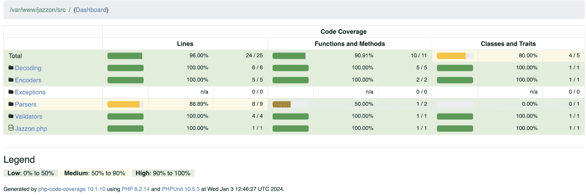

PHPunit 覆盖率报告

## 日志解决方案

使用 PHP 内置的错误日志功能来捕获库中发生的错误和异常。由此产生的日志在调试期间是无价的资源。将你的库设置为将错误记录到文件中，然后你可以打开并检查它以找出出了什么问题。

让我们来看如何在简单的函数或 PHP 文件中设置日志的示例。

```php
<?php  

/**  
* 将错误记录到文件的错误处理函数。  
 */  
function customErrorHandler($error_level, $error_message, $error_file, $error_line) {  
    $errorMessage = "[" . date("Y-m-d H:i:s") . "] Error: {$error_message} in {$error_file} on line {$error_line}\n";  
    // 指定日志文件的路径  
    $logFile = "/path/to/error_log.txt";  
    // 将错误消息追加到日志文件中  
    error_log($errorMessage, 3, $logFile);  
}  

// 设置错误处理器  
set_error_handler("customErrorHandler");  

// 触发一个错误以演示（这通常来自你的应用程序代码）  
trigger_error("Sample error for logging demonstration");
```

让我们来分解这段代码段：

*   `customErrorHandler()` 函数用于处理错误。它格式化错误消息并将其写入特定文件。

*   `set_error_handler()` 函数用于将 `customErrorHandler()` 设置为错误处理器。

*   `error_log()` 函数用于将错误类型为 `3` 的错误消息写入文件。

*   `$logFile` 变量保存你想要存储错误消息的文件路径。

*   `trigger_error()` 函数用于触发错误以演示其工作原理。

## 库文档

每个库的文档通常包含常见 Bug 列表及其解决方案。当你被某些问题困住时，你应该第一个查看的地方是库文档，因为即使它没有直接给你答案，通常也会提供关于下一步该去哪的提示。

## 检查源代码

如果遇到问题，请检查其源代码。通过深入源代码，通常可以发现问题的根源。虽然这可能很耗时，但它往往是有效的。

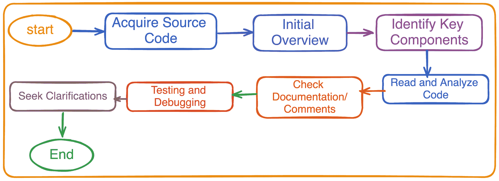

源代码流程图

通过 `Xdebug`、`PHPUnit` 等工具，可以更好地理解代码的结构。这些工具可以帮助你发现库中的问题。

## 代码质量指标

代码质量的衡量决定了代码的健康程度。以下是关于代码质量的一些指标：

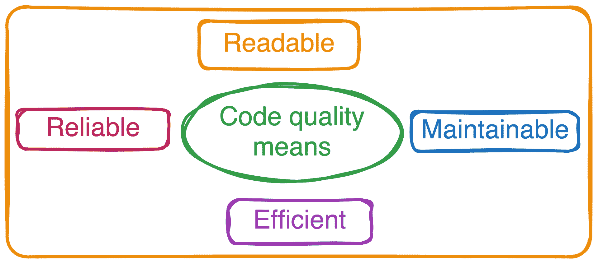

代码质量指标

总而言之，代码质量意味着：

- **可读性**：代码易于阅读。

- **可维护性**：代码易于维护。

- **高效性**：代码运行高效。

- **可靠性**：代码运行可靠。

## 代码质量的重要性

关注代码质量从长期来看可以节省时间。

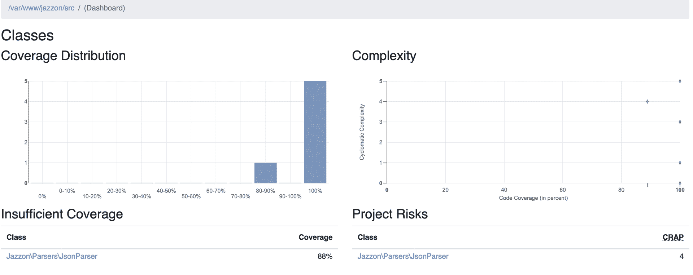

类覆盖率报告

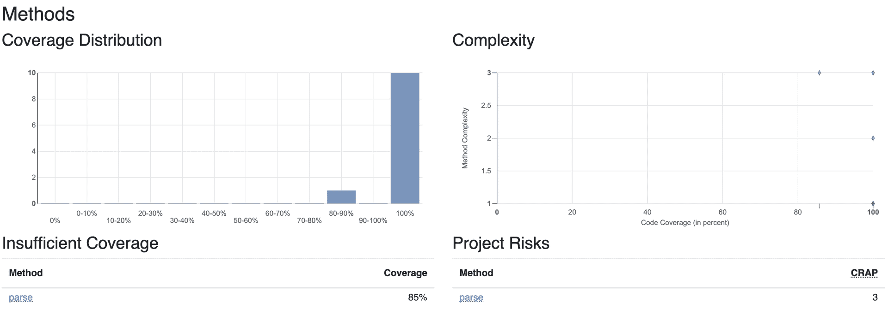

函数覆盖率报告

## 代码覆盖率

单元测试覆盖的代码量被测量为覆盖率。较高的覆盖率百分比意味着代码库经过了更多的测试，可能减少错误。

`PHPUnit`、`Xdebug` 和 `PCOV` 都能为你的 PHP 代码创建覆盖率报告。


PHPunit 覆盖率报告

## PHP 代码质量测量

有很多工具可以帮助你测量 PHP 代码。

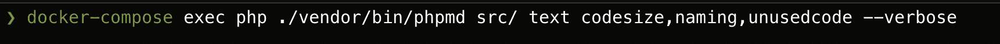

PHPMD 输出

## 圈复杂度

圈复杂度决定了代码的复杂度。高复杂度意味着代码难以维护。你可以使用 [PHPMD](https://github.com/phpmd/phpmd) (PHP Mess Detector) 等工具来计算 PHP 代码的圈复杂度。


PHPMD 输出

## 代码重复

代码重复是指你在多处有相同的代码。由于必须对应用程序的不同部分进行更新，代码重复可能会阻碍维护。使用 `PHPCP` (PHP 复制粘贴检测) 或 `PHP_codesiffer` 等工具可以帮助发现重复代码。

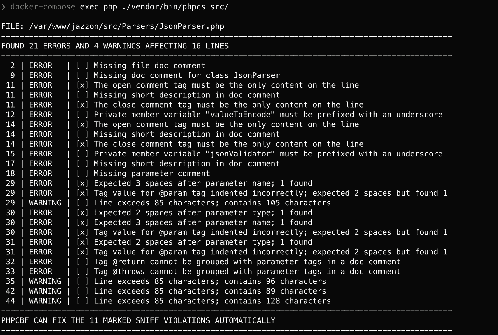

PHP_codesiffer 输出

## NPath 复杂度

NPath 复杂度与函数中执行路径的数量有关。它是通过计算整个函数的无环执行路径得出的。高 NPath 复杂度就像圈复杂度一样，提示代码较为复杂。

可以通过 PHPMD 获取 NPath 复杂度。

我们应该努力编写易于阅读、维护且高效的代码，并使用这些工具。这可能包括将复杂方法重构为简单方法、删除冗余代码或添加组件以显示代码中某些部分的用途。

对于任何专业的 PHP 开发工作，都必须关注高质量编码。虽然编写高质量代码在最初可能需要付出一些精力，但在可维护性和可靠性方面的回报是值得的。

我们可以使用指标和工具对 PHP 代码的质量进行独立衡量，并针对需要改进的区域进行优化。

# 在 PHP 库中维护代码质量

在 PHP 库实现高标准后，工作远未结束。随着时间的推移，代码会变得成熟，维护这种质量的代码至关重要。在这方面，代码质量的维护涉及通过审查新增的内容或修改，对代码库进行增量和持续的增强。

维护代码质量是一项无休止的任务。它包括：

### 定期代码审查

代码审查可以显著提高你的代码质量。另一个眼睛查看你的代码可能会发现你起初没有考虑到或看到的潜在问题、缺陷和改进点。任何重大更改都应该由其他开发者进行审查，以确保 PHP 库的质量不受损害。

我们可以将定期代码审查的过程绘制成如下流程图：

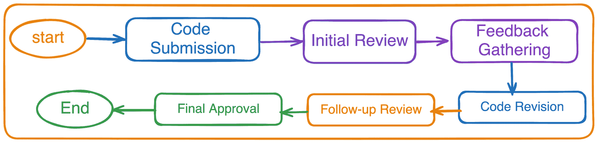

定期代码审查流程的流程图

### 使用自动化工具

自动化工具有助于识别在手动审查过程中可能被忽略的问题。诸如 `PHPMD` (PHP Mess Detector)、`PHPCS` (PHP Code Sniffer) 和 `PHPCPD` (PHP Copy/Paste Detector) 等工具可以识别代码异味、风格不一致、重复代码等潜在问题，从而协助维护 PHP 库的代码质量水平。

### 编写测试

验证代码质量的另一种棒方法是为其编写单元测试和功能测试。通过编写测试，你可以确保代码的行为符合预期，并且不会因代码库的更改而引入任何回归。

假设我们编写了一个名为 `StringUtility` 的基础类，它包含一个简单的函数，接收一个字符串并返回该字符串反后的结果，我们将其命名为 `reverseString()`，为了实现这一点，我们使用了 PHP 内置函数 `strrev()`。

```php
<?php  

class StringUtility {  

    /**
     * 反转给定的字符串。
     *  
     * @param string $input 需要反转的字符串。
     * @return string 反转后的字符串。
     */  
    public function reverseString($input) {  
        // 使用 PHP 的内置 strrev 函数来反转字符串  
        return strrev($input);  
    }  
}
```

现在，我们需要确保该函数按预期工作并返回预期的结果。因此，这里有一个简单的 PHPUnit 类，用于测试该函数的某些用例/场景。


```php
<?php  

use PHPUnit\Framework\TestCase;  

// StringUtility 的测试类  
class StringUtilityTest extends TestCase {  

    private $stringUtility;  

    // 在每个测试之前初始化 StringUtility 的设置方法  
    protected function setUp(): void {  
        $this->stringUtility = new StringUtility();  
    }  

    // 测试普通字符串的 reverseString 方法  
    public function testReverseString() {  
        $result = $this->stringUtility->reverseString('hello');  
        // 断言反转后的字符串匹配预期输出  
        $this->assertEquals('olleh', $result);  
    }  

    // 测试空字符串的 reverseString 方法  
    public function testReverseStringWithEmptyString() {  
        $result = $this->stringUtility->reverseString('');  
        // 断言反转空字符串返回空字符串  
        $this->assertEquals('', $result);  
    }  

    // 测试包含特殊字符的字符串的 reverseString  
    public function testReverseStringWithSpecialCharacters() {  
        $result = $this->stringUtility->reverseString('h!e@l#l$o');  
        // 断言反转后的字符串匹配预期输出  
        $this->assertEquals('o$l#le!h', $result);  
    }  
}
```

```php
// 检查订单类型是否为店内并进行相应的处理  

elseif ($order->type \=== 'store') {  
    // 店内订单处理逻辑  
}  

}  
}
```

使用工厂模式（Factory pattern）和多态（Polymorphism）重构此代码段，为每个订单类型创建独立的类，并创建一个用于处理订单的通用接口。这增强了代码的灵活性和维护性。

```php
<?php  

// 订单处理接口
interface OrderProcessorInterface {  
    // 定义处理订单的方法  
    public function processOrder($order);  
}  

// 处理在线订单的类
class OnlineOrderProcessor implements OrderProcessorInterface {  
    // 处理在线订单
    public function processOrder($order) {  
        // 在线订单处理逻辑  
    }  
}  

// 处理店内订单的类
class StoreOrderProcessor implements OrderProcessorInterface {  
    // 处理店内订单
    public function processOrder($order) {  
        // 店内订单处理逻辑  
    }  
}  

// 创建订单处理器的工厂类
class OrderProcessorFactory {  
    // 根据订单类型创建订单处理器
    public static function create($type) {  
        // 为在线订单返回 OnlineOrderProcessor
        if ($type \=== 'online') {  
            return new OnlineOrderProcessor();  
        }  
        // 为店内订单返回 StoreOrderProcessor
        elseif ($type \=== 'store') {  
            return new StoreOrderProcessor();  
        }  
    }  
}
```

## PHPDoc 简介

PHPDoc 是一种用于 PHP 代码文档的广泛采用的标准。它允许你轻松高效地编写文档。

### 什么是 PHPDoc？

PHPDoc 是 PHP 代码文档的一种标准。类似于 Java 的 JavaDoc 或 Python 的 PyDoc，它让开发者能够系统地创建文档。大多数 PHPDoc 是一种内联文档系统，你可以在类定义、方法定义、属性定义和函数定义上方放置文档注释。

```php
<?php  

/**
 * 解析 JSON 字符串并返回对象或数组  
 *
 * @param bool $assoc [可选] 如果为 true，返回的对象将转换为关联数组。  
 * @param int $depth [可选] 用户指定的递归深度。  
 * @param int $options [可选] JSON 解码位掩码。  
 * @return DecodedValue  
 * @throws JsonException  
 */
public function parse(bool $assoc \= false, int $depth \= 512, int $options \= 0): DecodedValue  
{  
    // 代码在此  
}
```

上面的示例包含了一个关于 `parse` 方法的块。该块由如 `@param` 等标签组成，它为我们提供了预期参数的信息、参数类型以及简短描述。同样，`@return` 标签告诉我们预期的返回类型。`@throws` 标签指示了方法可能会抛出的异常。

### 为什么要使用 PHPDoc？

使用 PHPDoc 在以下方面有益：

*   **可读性**：使用 PHPDoc 注释使你的代码更具可读性。它们为代码的每个部分提供了清晰的解释，这在涉及复杂或模糊的代码时非常有用。

*   **维护性**：PHPDoc 注释有助于代码的维护。当你或其他开发者以后需要修改现有代码库时，注释提供了关键信息，帮助他们节省大量时间。

*   **入职引导**：PHPDoc 注释可以帮助新团队成员快速熟悉代码库。通过阅读注释，他们可以更容易地理解你的代码并缩短他们的学习曲线。

*   **文档生成**：通过你的 PHPDoc 注释，你可以使用工具生成 HTML（或其他格式）文档——这对于内部和外部用户都非常有用。

### PHPDoc 语法

PHPDoc 注释以 `/**` 开始，以 `*/` 结束。这里是一个极其简单的 PHPDoc 注释示例：

```php
<?php  

/**  
 * This function adds two numbers.  
 *  
 * @param int $a The first number.  
 * @param int $b The second number.  
 *  
 * @return int The sum of the two numbers.  
 */  
function add($a, $b)  
{  
    return $a + $b;  
}  
// call the add() function  
echo add(3, 5); // output: 8
```

你可以看到上面有一个 PHPDoc 块详细解释了 `add()` 函数，使用 `@param` 标签提到它的目的和参数，并通过 `@return` 标签明确表示它返回一个 `int`。

### PHPDoc 标签

PHPDoc 有许多可用于语法的标签。以下是一些常用标签的列表：

*   `@param`：指定函数/方法的参数。

*   `@return`：描述函数/方法的返回类型。

*   `@var`：声明类属性类型。

*   `@throws`：列出函数或方法可能抛出的异常。

*   `@deprecated`：表示该元素不再使用，应避免使用。

*   `@see`：表示指向另一个元素的链接。

对于每个标签，都列出了标签分类并在后是其描述。类型可以是任何有效的 PHP 类型或类名。

下面是我们 Jazzon 库中的一个示例，使用了大部分这些标签。

```php
<?php  

class JsonParser  
{  
    /** @var string $valueToEncode */  
    private string $valueToEncode;  
    /** @var JsonValidator $jsonValidator */  
    private JsonValidator $jsonValidator;  
    /**  
     * Parses a JSON string and returns an object or array  
     *  
     * @param bool $assoc [Optional] If true, returned objects will be converted into associative arrays.  
     * @param int $depth [Optional] User specified recursion depth.  
     * @param int $options [Optional] Bitmask of JSON decode options.  
     * @return DecodedValue  
     * @throws JsonException  
     */  
    public function parse(bool $assoc = false, int $depth = 512, int $options = 0): DecodedValue  
    {  
    }  
}
```

如果你在大型代码库中或作为团队的一部分编写 PHP 代码，学习如何使用和编写 PHPDoc 块是必须的。PHPDoc 注释提高了代码的可读性和可维护性，便于向团队新成员介绍项目，并让你能够自动生成文档。为了充分发挥这些功能的作用——请在将其整合到日常开发流程之前，充分学习 PHPDoc 的语法及其基础标签。

## 编写 PHPDoc 注释

PHPDoc 注释作为 PHP 环境的重要组成部分，确保开发人员能够快速准确地理解代码的含义和复杂性。本课程将深入探讨编写 PHPDoc 注释的规范，专注于确保你的注释真正有效的方法和技术。

### 为什么良好的 PHPDoc 注释很重要？

在进入细节之前，了解为什么投入精力编写有效的 PHPDoc 注释是有益的很重要：

*   **清晰性**：信息丰富的注释消除了歧义。它们确保开发者理解某段代码的作用。

*   **缩短入职时间**：这些注释对于进入成熟项目的新团队成员或开发者来说是关键的指南。

*   **一致性**：统一的 PHPDoc 注释在整个代码库中呈现出专业、统一的形象，使代码看起来良好且规范。

*   **辅助调试**：如果出现故障，PHPDoc 注释可以提供代码原始意图的见解。

让我们来看下面两个示例，看看 PHPDoc 注释有什么益处；

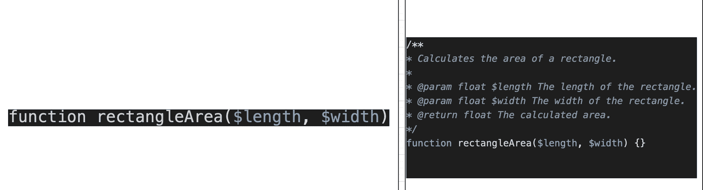

显示带有和不带 PHPDoc 函数示例

如果我们看左边的一个，可以看到一个函数，但很难看出这些参数是什么、它返回什么类型、可能会产生哪些错误，最后这个函数是做什么的。

但通过右边的示例，我们可以从 PHPDoc 注释块清楚地理解这个函数是什么，并学习关于它的一切。

### 从基础开始

PHPDoc 注释以 `/**` 开始，以 `*/` 结束。你在这个结构中提供描述和各种标签来指示关于代码的特定信息。

查看以下代码段示例：

```php
<?php  

/**  
 * Calculates the area of a rectangle.  
 *  
 * @param float $length The length of the rectangle.  
 * @param float $width The width of the rectangle.  
 * @return float The calculated area.  
 */  
function rectangleArea($length, $width)  
{  
    return $length * $width;  
}  
// call the rectangleArea() function  
echo rectangleArea(4, 5); // output: 20
```

PHPDoc 块描述了 `rectangleArea` 函数的目的以及它通过该函数执行的工作。像 `@param` 等标签告诉了输入参数的类型和含义，而 `@return` 则告诉了计算后应该返回什么类型的数据。

### 编写描述性摘要

第一个描述（在上面的示例中是：计算矩形面积”）是该函数/类功能的简要概述。这应该是简洁且具有描述性的。

### 有效使用标签

*   `@param`：始终以类型、变量名，最后是描述开头。

*   `@return`：描述返回类型。

*   `@var`：对于类属性非常有用。

*   `@throws`：使用此标签描述你的方法或函数何时可能抛出异常。

### 高级 PHPDoc 技术

*   **多行描述**：如果函数行为复杂，不要害怕提供多行解释。

*   **使用 {} 处理复杂类型**：如果参数接受不同的类型，可以使用大括号。

*   **文档间的链接**：你可以使用 `@see` 标签提供指向相似函数或方法的连接。

最佳实践是编写优秀 PHPDoc 注释的基础。本课程将介绍这些技术，以确保你的文档脱颖而出。

## 简洁且描述清晰

PHPDoc 旨在作为一个快速参考指南，而不是完整的手册。

*   **要做**：提供简短的概述，立即明确代码的用途。

    ```php
    /**
     * 计算用户的年龄。 
     */
    ```

*   **不要**：用不必要的细节让注释块负担过重。

    ```php
    /**
     * 此方法根据用户提供的出生日期来计算年龄。
     */
    ```

## 文档公共 API

公共 API 是你的库或框架的门面。适当的文档确保使用者能够毫不费力地使用它们。

*   为所有公共类、方法和属性提供 PHPDoc 注释。

*   内部或私有方法可以有更宽松的文档要求。

## 一致的数据类型

它确保了预期的输入和输出是清晰的。

*   在 `@param` 和 `@return` 标签中，始终标明类型。

*   谨慎使用多类型声明。

    ```php
    /**
     * @param int|string $value 
     */
    ```

## 随更改更新

过时的文档会引起困惑，弊大于利。

*   当代码（特别是逻辑或参数）发生时，调整 PHPDoc 注释。

*   在代码库审计中，定期检查文档。

## 避免冗余

冗余信息会造成阻塞并分散注意力。

*   如果函数名为 `setUsername()`，请避免在 PHPDoc 注释中编写“设置用户名”。

*   相反，请包含条件、返回值或特殊实例。

检查以下示例，并比较这两个函数的 PHPDoc；

```php
<?php  

/**  
 * 这是一个不该做法的示例：  
 *  
 * @param string $username 要设置的用户名  
 * @return void  
 */  
public function setUsername($username) {  
    // ... implementation ...  
}  

// 对比：  

/**  
 * 分配一个非空用户名。  
 *  
 * @param string $username 有效的字母数字用户名；最多 15 个字符。  
 * @throws InvalidArgumentException 如果用户名为空或无效。  
 * @return void  
 */  
public function setUsername($username) {  
    if (empty($username) || !preg_match('/^[a-zA-Z0-9]{1,15}$/', $username)) {  
        throw new InvalidArgumentException("Invalid username provided.");  
    }  
    // ... further implementation ...  
}
```

第一个示例中的注释没有提供方法名显而易见之外的信息。第二个示例中修改后的注释强调了用户名标准并指出了可能出现的异常，为开发者增加了价值。

## 注意异常

帮助用户和开发者预测并处理问题。

*   要指定可能抛出的异常，请使用 `@throw` 标签。

*   为要抛出的异常提供要求。

    ```php
    /**
     * @throws InvalidArgumentException 如果 $username 为空。  
     */
    ```

## 第三人称语气

保持整个文档的一致性和清晰度。

*   将“This method will return the value”（此方法将返回该值）替换为“Returns the value”（返回该值）。


```php
<?php  

/**  
 * 这是一个不该做法的示例：  
 *  
 * This method will retrieve the total price of the items in the cart.  
 *  
 * @return float  
 */  
public function getTotalPrice() {  
    // ... implementation ...  
}  

// 对比：  

/**  
 * 这是一个正确做法的示例：  
 *  
 * Retrieves the total price of items.  
 *  
 * @return float  
 */  
public function getTotalPrice() {  
    // ... further implementation ...  
}
```

## 使用 Jazzon 最佳实践

考虑以下场景，以我们的 `Jazzon` 库为背景：

```php
<?php  

/**  
 * 将值编码为 JSON。  
 *  
 * @param mixed $value 要编码的值。  
 * @return string 编码后的 JSON 字符串。  
 * @throws JsonEncodeException 如果编码失败。  
 */  
public function encode($value): string  
{  
    // ...  
}
```

清楚地看到，我们在为 `encode()` 函数编写 PHPDoc 注释块时采用了所有的最佳实践。

采用 PHPDoc 最佳实践体现了你对清晰、专业和开发者友好的追求。在你继续开发像 `Jazzon` 这样的 PHP 库/应用程序时，使用这些策略来确保你的文档成为 PHP 社区的指南明灯。

## 使用 PHPDoc 生成代码文档

PHPDoc 就像 Java 的 JavaDoc 一样，不仅关于编写注释，还关乎如何利用这些注释获取完整的文档。一旦你对代码编写了极其精确且注重细节的注释，下一步就涉及使用工具扫描这些注释并生成格式化、可读性强的文档。

PHPDocumentor（也称为 `phpdoc`）是创建文档的行业标准工具。

### 安装

遗憾的是，根据 `phpdoc` 文档，不建议通过 Composer 安装。为了此目的，我们将使用 `phive`。

请确保先安装 `phive`。

现在让我们使用 `phive` 安装 PHPDocumentor：

```bash
phive install --force phpdoc
```

### 使用

安装后，运行 PHPDocumentor 只需要输入：

```bash
php tools/phpDocumentor -d src/ -d tests/
```

使用 `-d` 来指定你想要为哪些目录生成文档。默认情况下，此命令将查找当前目录下的 PHP 文件，读取它们的 `phpdoc` 注释并将 HTML 写入名为 `output` 的文件夹中。

找到 `phpdoc` 索引页

在浏览器中打开此 `index.html` 将让你得到类似下面的的内容：

### 输出格式配置

虽然 HTML 是默认输出格式，但 PHPDocumentor 也支持 PDF、CHM 和 XML。这种灵活性确保了你可以创建符合团队或客户要求的文档。

你可以通过在上述运行命令中添加 `--template` 选项来指定你想使用的格式：

```bash
php tools/phpDocumentor -d src/ -d tests/ --template=PDF
```

### 使用 phpdoc.xml 进行高级配置

对于较大的项目，通常创建一个名为 `phpdoc.xml` 的配置文件更方便。这些文件可以指定搜索和忽略的目录，并构建模板。

一个 `phpdoc.xml` 文件如下：

```xml
<phpdocumentor>
  <title>Jazzon Library Documentation</title>
  <files>
    <directory>src/</directory>
    <directory>tests/</directory>
    <ignore>vendor/</ignore>
  </files>
</phpdocumentor>
```

通过这些配置，PHPDocumentor 将仅检查 `src` 和 `tests` 目录，而忽略 `vendor` 目录中的任何文件。

## 导航生成的文档

PHPDocumentor 文档的主要优势是其可导航性。

*   类层次结构、方法摘要和文件结构直观地排列。

*   可点击的连接引导读者查看相关的类、方法和属性。

*   例如，颜色编码显示了可见性（公共、私有或保护）。

你可以在下方截图的左侧看到导航栏，通过它可以轻松地在代码的不同部分之间进行；

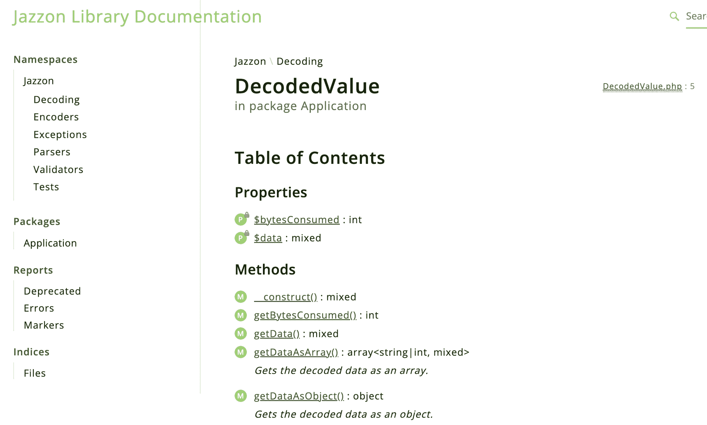

# 导航示例

## 结合 Jazzon 示例

由于 PHPDoc 注释是为 `Jazzon` 类编写的，我们可以运行 `PHPDocumentor` 来生成完整的文档。这些文档将为终端用户提供有关 `Jazzon` 库的方法、属性、返回类型以及该库其他方面的简要信息。对于任何使用 `Jazzon` 库的开发者来说，这份文档都是无价之宝。

{notice} 你可以在 `jazzon-lib-classes-implmentation` 文件夹中找到 PHPDoc 工具如何在 docker 容器中安装的，请检查 `docker-containers/php-fpm/Dockerfile` 文件的第 `15-23` 行；为了能够在本地运行并查看其效果，请查看 `ReadMe` 文件中的运行命令。

使用 `PHPDoc` 创建文档的过程是创造性工作与自动化的结合。尽管如此，创建文档的大部分繁重工作由 `PHPDocumentor` 完成——但确保 `PHPDoc` 注释编写得良好、有用且全面，是开发者的责任。这样做有助于团队确保最终获得高质量、可读性强且专业的文档，将其作为当前及未来开发者的资产。

## 维护 PHPDoc 注释和文档

文档并不是一项“设置后一劳永逸”的任务，即使是自动生成的也是如此。你的库或软件的文档应该随之不断增长和变化。

### 维护需求

文档的主要目的是支持开发者——无论是为了让他们快速上手、简化对库复杂性的理解，还是为了更容易进行调试。当你的文档过时时，可能会发生以下情况：

* 对函数的误解或理解错误。

* 在已弃用或修改的函数上浪费时间。

* 因过时的流程导致效率低下或出现错误。

### 审查 PHPDocs

定期审查 `PHPDoc` 注释（类似于代码审查）被证明是有有益的。

* 定期审查注释，特别是在代码发生变更之后。

* 训练你的团队成员标记过时或错误的注释。

* 在更新代码时，优先考虑 `PHPDoc` 注释。每当你更新一个方法或函数时，请确保同时更新 `PHPDoc` 注释。

### 文档的版本控制

你需要像管理软件一样对文档进行版本控制。

* 你可以在发布软件新版本的同时，创建并保留相应的文档。

* 通过确保存在显式链接或下拉菜单，允许用户在不同版本之间切换。

* 突出最新版本，并为维护遗留系统的开发者保留旧版本的可用。

### 自动化检查

自动化可以确保每个方法和类都包含 `PHPDoc` 注释。

* 将 `PHP_CodeSniffer` 添加到你的 `CI/CD` 流水线。

* 创建规则，在合并新代码之前检查其是否包含 `PHPDoc` 注释。

* 定期运行 `PHPDocumentor`，对缺失或格式错误的注释发出警告或提供反馈。

### 文档访问

为你的同事以及一些潜在的外部开发者/用户提供访问权限和方便的浏览选项。

* 将文档托管在特殊的子域名或已知平台上。

* 频繁备份你的文档。

* 确保文档中包含的所有链接都是有效的。

### 社区参与

为你的同事以及一些潜在的外部开发者/用户提供访问权限和方便的浏览选项。

* 将文档托管在特殊的子域名或已知平台上。

* 频繁备份你的文档。

* 确保文档中包含的所有链接都是有效的。

在知名且流行的网站上发布，可以为你的库带来一种真实感。这证明了你的库满足特定的需求，并且在项目中使用是可信的。

## 持续演进

当库发布后，它们通常会经历一系列持续更新。这再次是因为社区反馈、错误报告，或者开发者改进库的动力。随着今天用户在不同的语境下使用该库，他们会发现原始开发者可能没有考虑到的微妙之处或边缘情况。

因此，这种反馈-增强循环约束了库在用户群体需求变化的情况下仍然保持相关性、健壮性和精细。由真实世界应用驱动的动态演进通常比其他的更具通用性和稳定性。

## Jazzon：一个案例

在整个章节中，我们将利用我们的 JSON 处理库 `Jazzon` 作为示例，提供一个实用的视角。`Jazzon` 与许多其他库一样，最初是作为一个满足特定需求的工具。然而，它必须经过正确的披露和分发，才能让更大的开发者社区受益。

库的发布和分发不仅仅是共享代码。它关乎确保你的工作以最佳状态到达预期的受众。它关乎确保当人们使用 `Jazzon` 或任何其他库时，他们得到的是精炼、高效且可靠的工具。以 `Jazzon` 为用例，我们将介绍 PHP 库发布和分发的基本流程和最佳实践。

## 准备发布库

在准备发布库时，特别是准备像 `Jazzon` 这样复杂的库，需要注意代码的精炼并在在此过程中密切关注细节。简而言之，这意味着将代码的改进与扩展的文档以及对潜在开发者的用户体验考虑结合起来。

### 代码精炼

*   优化性能：检查库是否以优化的方式运行。审查算法，移除冗余操作，并优化代码路径。

*   单元测试：测试你的库的每个组件是否都有足够的测试用例覆盖。对于我们的 `Jazzon` 示例，必须为 `JsonEncoder`、`JsonParser` 和 `JsonValidator` 类编写单独的测试。此外，我们应该让所有的测试都像图片中那样通过。

    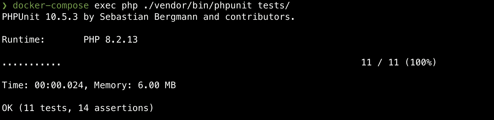

    Jazzon 单元测试通过

*   错误处理：库应该优雅地处理错误。这包括包含信息的错误消息，并附带关于如何修复它们的清晰指示。

*   代码一致性：保持统一的代码可以确保可维护性。这包括遵循编码标准、使用易于理解的变量名并保持缩进一致。

### 完善的文档

*   PHPDoc 注释：正如本文之前提到的，PHPDoc 注释是不可或的。它们提供了背景信息，描述了函数，并为使用你库的其他开发者提供了指南。

*   用户指南：除了技术文档之外，有一个解释如何使用该库及其功能的用户指南将非常有用。它可能包含使用 `Jazzon` 进行 JSON 解析和验证的简单示例。

*   包含示例：真实世界的示例和用例有助于用户理解你的库可以做什么。`Jazzon` 可以包含编码复杂的 PHP 对象或处理嵌套 JSON 结构的示例。

### 用户体验考虑

*   直观的 API 设计：你库的公共接口应该易于操作。例如，在 `Jazzon` 中，`encode()`、`parse()` 和 `validate()` 等方法自言其明。

*   用户指南：将外部依赖降至最低，如果存在依赖，要保持它们维护良好且不会给用户带来问题。

*   版本兼容性：确保你的库能够兼容许多 PHP 版本，或者预先说明它与哪个版本兼容。

### 打包和仓库考虑

*   目录结构：为你的库创建一个清晰且逻辑性的目录结构。一个标准可以是 `src/` 用于源文件，`tests/` 用于测试代码，`docs/` 用于文档。这里是来自我们 `Jazzon` 库的示例。

    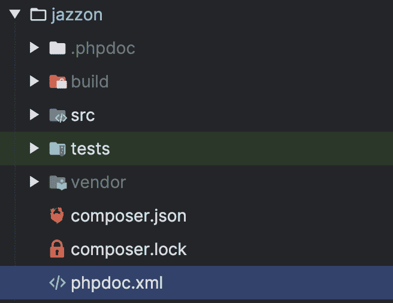

    Jazzon 文件夹结构

*   许可证：为你的库选择一个合适的许可证。这明确说明了赋予软件用户哪些权利，以及是否存在任何使用限制。

*   变更日志（Changelog）：保留一份改进、错误修复和新功能的变更日志。有助于查看随着时间的推移发生了哪些变化。

准备发布库意味着不仅仅是检查它是否运行正常。它关乎为将在其项目中使用你库的另一个开发者提供便利。你根据所有适当规则设计的库不仅功能完备，在开发者工作时也成为一种乐趣。

## 将库发布到仓库

在你准备好发布库之后，下一步是让世界其他地方可以使用它。仓库是开发者寻找库的地方，拥有顺畅的发布流程至关重要。

### 选择合适的仓库

*   Packagist 和 Composer：对于 PHP 库，Packagist 是主要的仓库。它与 PHP 依赖管理器 `Composer` 无缝集成，允许开发者轻松地引入你的库。

*   GitHub 和 GitLab：两者不仅仅用于版本控制；它们也已成为发现和审查库的事实所在地。确保你的库位于这些站点中的一个（或两个）上有助于增强其可见性。

### 在 Packagist 上发布的步骤

*   创建账户：如果你还没有账户，请[在 Packagist 上创建一个账户](https://packagist.org/login/)。

    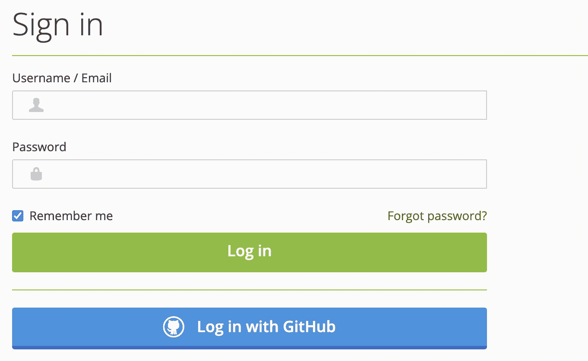

    Packagist 登录页面

*   链接仓库：注册后，点击提交按钮然后输入你的 GitHub 或 GitLab 仓库的 URL。Packagist 将提取所需信息。

    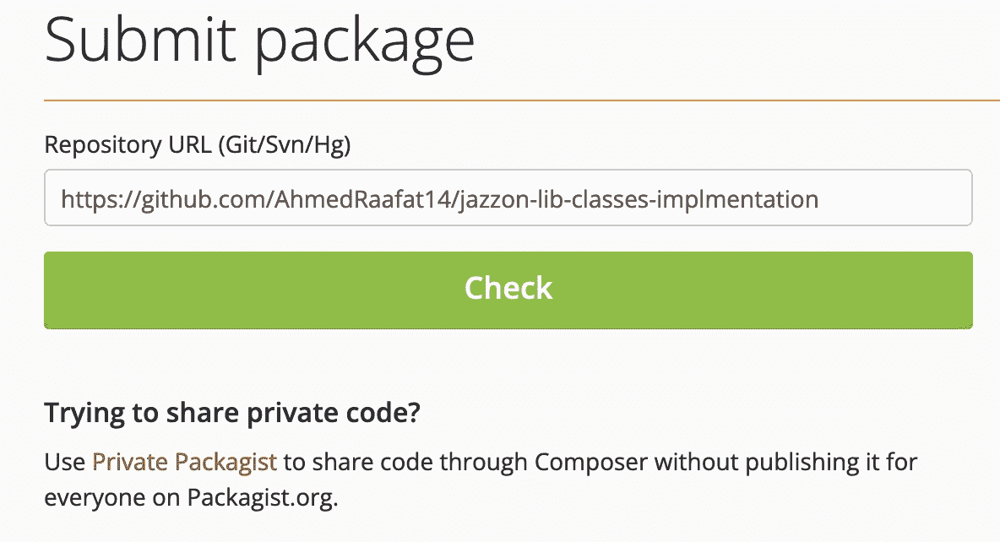

    提交库到 Packagist 表单

*   配置 composer.json：确保你的 `composer.json` 文件正确配置了名称、描述、许可证和其他信息。Jazzon 的示例可以是：

```json
{
  "name": "jazzon/jazzon",
  "description": "A parser library",
  "type": "library",
  "license": "MIT",
  "require": {
    "php": ">=8.1"
  },
  "require-dev": {
    "phpunit/phpunit": "¹⁰.1"
  },
  "autoload": {
    "psr-4": {
      "Jazzon": "src/"
    }
  },
  "authors": [
    {
      "name": "Ahmed Raafat",
      "email": "ahmed.raafat1412@gmail.com"
    }
  ]
}
```

*   发布版本：使用语义化版本对你的库的稳定版本进行标记。这有助于开发者理解版本之间的差异。

*   Webhooks（可选）：将 Webhooks 与你的 GitHub/GitLab 仓库集成以自动更新。这确保 Packagist 显示库的最新版本。

### 仓库维护

定期应用以下步骤，确保你的库维护良好：

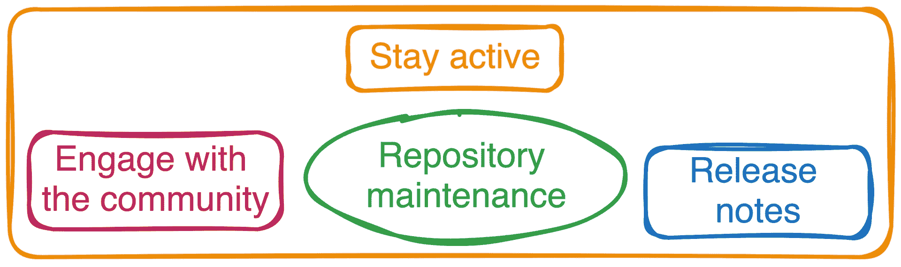

    维护良好库的步骤

*   保持活跃：定期更新你的库，解决错误并纳入反馈。维护良好的仓库会吸引更多用户。

*   与社区互动：响应用户的查询、问题或拉取请求（pull requests）。社区参与可以带来协作改进和更好的声誉。

*   **发布日志**：每当更新你的库时，请提供详细的发布日志，概述更改、新功能或错误修复。这体现了开放性并建立了用户的预期。

### 许可与版权

*   **明确许可情况**：在仓库和库的根目录中明确库的许可类型。如果你的库采用了 `MIT` 许可，请向潜在用户明确说明。

*   **尊重第三方许可**：如果你的库（如 `Jazzon`）使用了第三方组件，请确保遵循了它们的许可要求。这既保护了你库的完整性，避免了潜在的法律问题。

将你的库发布到仓库（尤其是像 `Packagist` 这样重要的仓库）是重要的一步。这意味着你的库现在供全球成千上万开发者可以使用。然而，请记住，发布只是开始。为了保持库的更新并被广泛使用，需要定期的维护、社区互动和更新。

## 通过包分发库

包是 `PHP` 生态系统中包含可重用代码的可分发项。分发程序不仅仅是让库公开，它还确保了它可以被轻松地集成到其他项目中。

### Composer 和 Packagist 的力量

`Composer` 是事实 `PHP` 依赖管理器。开发者可以使用 `Composer` 轻松地管理并将许多库（包）集成到他们的应用程序中。这些包的默认仓库是 `Packagist`。

### 打包你的库

*   `composer.json` 配置：这是你包中的主文件。它指定了包名、依赖项、自动加载指令和其他信息。一个基础的 `composer.json` 文件如下：

```json
{  
  "name": "username/jazzon",
  "description": "A potent JSON manipulation library for PHP.",
  "type": "library",
  "require": {
      "php": ">=7.4"
  },
  "autoload": {
    "psr-4": {
      "Jazzon\\\\": "src/"
    }
  }
}
```

*   **语义版本控制**：实施清晰的版本控制策略，例如 `SemVer`（语义版本化标准命名规范）。它确保了者可以轻松识别更新，并理解此类更新的性质（破坏性的功能添加或修复）。

*   **依赖项**：确保 `composer.json` 中列出了所有依赖项。如果你的库依赖另一个包来实现特定功能，应在此予以说明。

### 分发包

*   **推送到 `Packagist`**：一旦你的库完成并配置了 `composer.json`，就将其推送到 `Packagist`。现在用户可以通过 `Composer` 安装它了。

*   **安装与使用**：你的库（以 `Jazzon` 为例）可以通过以下命令轻松集成到用户的项目中：

```bash
$ composer require username/jazzon
```

该命令从 `Packagist` 下载库并将其安装到用户的项目中。


- **更新包**：每当发布新版本时，在 `Packagist` 上更新你的库是至关重要的。如果你配置了 `webhooks`，这将自动发生。否则，请手动更新以确保消费者获得最新版本。

### 妥当打包的重要性

- **易于集成**：妥当的打包意味着开发者可以轻松将你的库引入到他们的项目中。
- **依赖管理**：使用 `Composer` 打包可以实现自动依赖处理，确保所有必要的包都已安装。
- **版本控制**：开发者可以选择特定的库版本，以确保项目的兼容性和稳定性。

打包和分发是像 `Jazzon` 这样的库生命周期中最后也是持续的步骤。妥当的打包确保了库能够无缝集成到各种项目中，造福更多的开发者社区。

# 库的维护

这部分深入探讨了保持 `Jazzon` 等 `PHP` 库对其用户社区保持更新和相关的关键方面。本书的这部分旨在全面理解持续维护过程、其重要性以及确保库随时间推移保持实用和安全的策略。

首先，这部分强调了库维护的重要性以及定期升级的必要性。它解释了持续的维护不仅能延长库的寿命和实用性，还能确保它继续满足用户不断变化的需求。这部分旨在让读者理解主动维护在保持库的相关性和功能性方面的价值。

接下来，这部分建议紧密跟踪问题和反馈，以根据用户需求不断改进库。它强调了互动社区在此过程中的作用，并建议了对内容进行分类和积极参与用户的方法。这种参与不仅让用户感到更有参与感，还为库的发展提供了宝贵的见解。

分析和规划库更新的过程是另一个关键主题。指南涵盖了如何实施、测试并负责任地发布更新，并强调了维护兼容性和完整文档的重要性。它还强调了更新后增长的重要性，这包括监控结果并积极寻求反馈以持续改进。

书中还强调了库开发中同时需要向前和向后兼容性的必要性。这部分提供了如何平衡创新与稳定性的见解，使用 `Semantic Versioning` 等工具和有效的沟通策略来应对此过程中可能出现的挑战。

安全性是这部分涵盖的库维护的一个关键方面。它涉及理解风险、进行定期审核、维护当前的编码标准、实施响应事件计划、保护依赖项以及持续监控威胁。这些实践对于确保库的安全性和完整性至关重要。

最后，这部分强调了作为库维护一部分定期更新文档的重要性。它鼓励与用户社区互动以增强库的价值并更好地满足用户需求。这种持续的互动和文档更新确保了库对用户来说一直是有价值且信任的资源。

## 库维护与更新简介

库的维护是一个编码之外的持续过程。它主要关注库的维护、质量检查以及根据终端用户不断的需求对其功能进行改进。关于库维护和更新的关键方面，本节涵盖了理解库维护所需的知识领域。

### 维护的必要性

- **质量保证**：维护确保库能够正常运行并符合性能和安全标准。换句话说，它让代码库保持更新，使其不会随时间推移变得过时或失效。
- **社区互动**：维护良好的库会吸引其他开发者和用户，从而创建一个能够决定库未来发展的活跃社区。
- **适应变化**：技术和用户需求不断变化，因此库必须具有灵活性和创新性，以保持相关性和实用性。
- **寿命**：通过维护，使库能够生存多年，从而成为开发者之间可靠的选择。

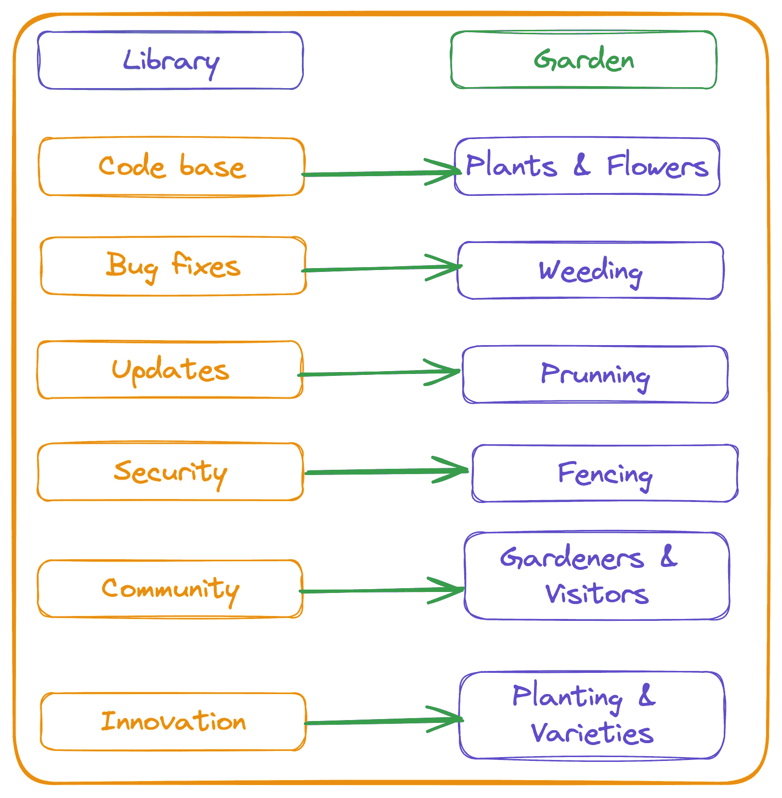

# 维护良好的花园与库维护的类比

## 理解更新

更新不仅意味着修复漏洞或添加新功能。它们体现了库对追求卓越的能量和投入。

- **漏洞修复**：快速解决漏洞可以建立用户信任，并消除不便。
- **功能增强**：对现有功能进行增强或添加新功能可以保持库的吸引力和时效性。
- **安全更新**：定期修复安全漏洞对于确保库的完整性及其声誉至关重要。
- **兼容性更新**：如果该库已被广泛使用，则需要更新以实现与多个平台、版本和依赖项的兼容。
- **性能优化**：专注于速度、效率和资源使用的更新有助于确保愉悦的用户体验。

以下是库更新的不同侧面：

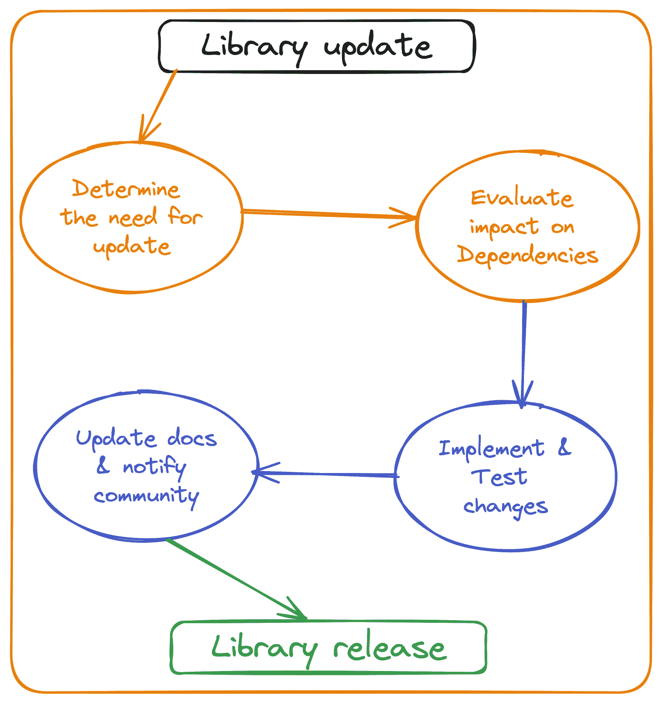

### 库更新的不同维度

维护和更新库是保持库健康、相关性和成功的关键。例行维护、对用户反馈的响应、对趋势的预测以及审慎的升级，使库在充满挑战的市场中保持活力。以下课程将深入探讨这些细微差别，提供良好库管理的概述。

## 监控并响应问题与反馈

在软件开发世界中，特别是涉及库时，问题监控和响应是开发者的主要活动之一。它们有助于故障排除、实现新功能，并为用户提供库的最佳体验。

### 监控问题

问题监控的一项活动是跟踪用户报告的问题和请求的。需要一个组织良好的系统来分析、优先排序并对所有报告的问题做出及时响应。

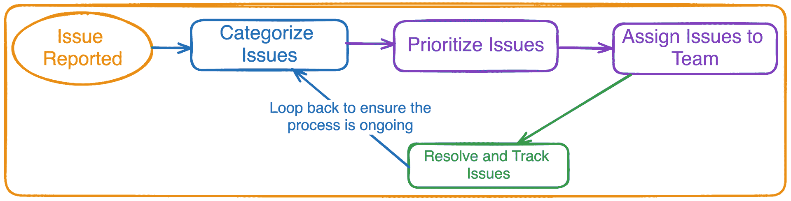

#### 问题监控流程流程图

- **问题分类**：不同类别的问题，如漏洞报告、增强请求和查询请求。
- **问题优先级**：需要逐一考虑紧急和重要程度。
- **分配给团队成员**：让合适的团队成员处理问题的解决。

通过 `Trello` 或 `Jira` 等 Scrum 面板跟踪所有问题/任务的进度。

### 用户反馈

用户反馈是信息的重要来源。它可能揭示库是如何使用的，以及哪些地方可以改进。

- **收集反馈**：使用 `GitHub`、论坛或直接用户调查来收集反馈。
- **分析反馈**：寻找共同模式以及独特的用户请求或困难。
- **深思回复**：认可用户的输入并提供实际的后续操作。

### 通信渠道

需要有效的通信通道来实现透明度和协作。问题跟踪器、论坛、邮件列表——任何能让社区围绕你的库聚集起来的工具。

### 自动化工具

有很多种自动化方法帮助你节省时间，同时仍掌控问题。自动化的漏洞跟踪、告警——有时甚至对那些反复提问的常见问题提供初始解决方案，都能帮助进一步提高速度。

利用 `GitHub Actions` 等工具，你可以自动化漏洞跟踪、为关键问题发送警报，甚至回答常见问题。这些自动化流程不仅节省了时间，还确保了问题得到及时且系统的处理。

你可以通过访问仓库视图上的 `Actions` 标签并点击“自行设置工作流”，在你的 `GitHub` 库仓库上设置工作流，你应该看到类似的内容：

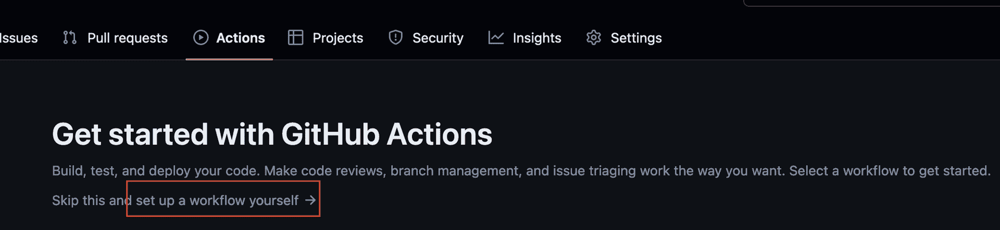

#### 找到工作流设置链接/按钮

在新窗口打开后，你可以按照下面的说明添加你的工作流配置并将其提交到仓库，你应该会有像这样的视图：


#### 添加你的工作流

你可以利用这种强大的工具完成一些事情，例如：

- **自动标记**：自动化的一个有效用途是在问题被报告时对其进行分类。例如，使用 `GitHub Actions`，你可以根据问题标题中的特定关键词自动将问题标记为 `bug`。例如，此脚本如果问题标题中包含 `bug`，则会自动将新问题标记为 `bug`，从而简化分类过程。

```yaml
name: Automated Labeling
on:
  issues:
    types: [opened]
jobs:
  bug-labeling:
    runs-on: ubuntu-latest
    steps:
      - uses: actions/checkout@v2
      - name: Label Issue
        uses: actions/github-script@v3
        with:
          github-token: ${{secrets.GITHUB_TOKEN}}
          script: |
            const issueTitle = context.payload.issue.title;
            const bugKeywords = ['crash', 'error', 'bug'];
            const isBug = bugKeywords.some(keyword => issueTitle.includes(keyword));
            if (isBug) {
              github.issues.addLabels({
                issue_number: context.issue.number,
                owner: context.repo.owner,
                repo: context.repo.repo,
                labels: ['bug']
              });
            }
```

- **关键问题的自动告警**：为关键问题设置自动告警可确保紧急事项得到及时处理。`GitHub Actions` 可用于在问题标记为 `critical` 时向相关团队成员或利益相关者发送通知。此工作流片段每当问题标记为 `critical` 时就会触发告警，便于立即关注高优先级问题。

```yaml
name: Critical Issue Alert
on:
  issues:
    types: [labeled]
jobs:
  issue-alert:
    runs-on: ubuntu-latest
    steps:
      - uses: actions/checkout@v2
      - name: Send Alert for Critical Issue
        uses: actions/github-script@v3
        with:
          github-token: ${{secrets.GITHUB_TOKEN}}
          script: |
            const label = context.payload.label.name;
            if (label === 'critical') {
              // 发送告警的代码（例如电子邮件、短信或 Slack 通知）
            }
```

- **常见问题的自动回复**：通常，用户有可以使用标准回答的常见查询。可以配置自动化工具提供这些初始解决方案，提供快速且一致的回复。以下工作流示例展示了如何自动回答常见问题，提升用户体验并减少重复性任务。

```yaml
name: Automated Issue Response
on:
  issues:
    types: [opened]
jobs:
  issue-response:
    runs-on: ubuntu-latest
    steps:
      - uses: actions/checkout@v2
      - name: Respond to issue
        uses: actions/github-script@v3
        with:
          github-token: ${{secrets.GITHUB_TOKEN}}
          script: |
            const issueComment = `感谢您的报告！我们将进行调查.*;
            github.issues.createComment({
              issue_number: context.issue.number,
              owner: context.repo.owner,
              repo: context.repo.repo,
              body: issueComment
            });
```

总而言之，通过利用 `GitHub actions` 等自动化工具，库维护者可以成功地管理问题并与社区互动。这些工具有助于在库的支持和开发中保持极高的响应速度和高质量。

这是一个持续倾听并响应关注点及意见的过程。它要求你保持敏锐，与社区所表达的需求保持密切联系，在尝试满足这些需求时保持敏感性，并准备好正确的工具。以这种方式与社区保持联系可以帮助你为库营造一个更健康的氛围——这种氛围能够支持更好的质量和用户满意度。

## 更新库以进行改进

在更新库时，仅仅添加新功能或修复漏洞是不够的。这是一种对提高库整体质量、效率和可靠性的持续承诺。一个良好的更新过程需要考虑到用户的需求、兼容性以及长期可行性。

### 为什么要更新？

- 满足用户需求：随着用户需求的演变，库必须不断调整以满足这些需求。
- 修复漏洞：需要定期更新以解决已知的漏洞并维护库的完整性。
- 增强性能：优化和增强将带来性能的提升。
- 合规性与标准：遵循最新的标准和法律可以确保库保持相关性和合法性。
- 安全：保持库的更新可以确保其符合最新的安全标准。

### 更新流程

此过程涉及某些步骤，以实现可靠且适用于生产的库，步骤如下：

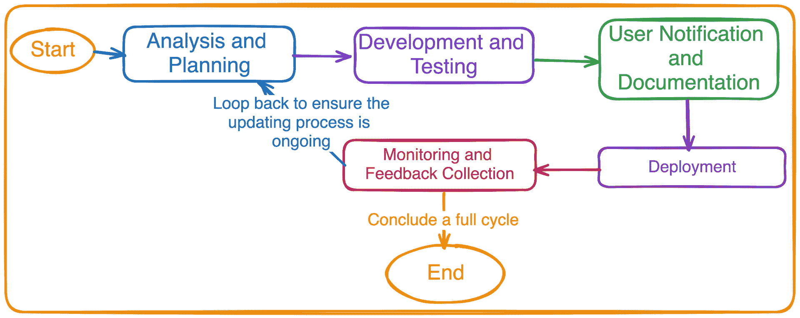

PHP 库更新过程流程图

- 分析与规划：确定需要更新的内容以及更新原因。
- 开发与测试：实施改进措施并进行广泛测试。
- 用户通知与文档：告知用户更新情况并提供相应的文档。
- 部署：受控地部署更新，以确保与当前系统兼容。
- 监控与反馈收集：更新后的监控有助于尽早发现任何潜在问题。

### 更新的考虑因素

- 向后兼容性：这是确保更改不会破坏现有功能的过程。
- 测试：进行彻底的测试，以保证新更改不会引入新漏洞。

  以下代码段演示了使用 `PHPUnit` 对假设的新功能进行基础单元测试。该测试检查 `NewFeature` 类的 `functionality` 方法是否返回预期结果，以确保新功能按预期工作。

```php
assertEquals('Expected result', $feature->functionality()); } }
```

- 文档：用户必须拥有更新后的文档以反映新的进展。

  以下片段显示了如何在 PHP 库中记录新功能。`PHPDoc` 注释提供了方法的清晰描述，包括其用途、参数和返回类型，这对于用户和开发者理解其功能至关重要。

```php
<?php

/**
* New Feature Functionality
*
* 此方法实现了提供……的功能
*
* @param type $param Description
* @return type Description 
*/ 
public function functionality($param) { // 方法实现 }
```

更新库需要细致的准备、执行和监控。这关乎持续的改进、适应新需求以及维护库的质量和安全。理解为什么要更新以及如何更新对于每个库维护者都是至关重要的。

## 维护库的兼容性和向后兼容性

在软件库的开发和维护过程中，确保向前和向后兼容性至关重要。本节将介绍为什么兼容性很重要、维护兼容性的困难之处，以及在开发和增强库时管理兼容性的解决方案。

### 兼容性的重要性

#### 用户信任与采用

- 稳定性：用户依赖库的一致行为。突然的变化可能会导致困惑或破坏现有代码。
- 迁移路径：直接的迁移过程有助于用户适应新版本，而不会中断他们的生产力。
- 长寿：对旧版本的支持可以建立信任，并确保用户即使在旧系统中也能继续使用该库。

### 兼容性中的挑战

#### 平衡创新与稳定性

- 创新：新的添加和更新对于增长是必要的，但它们可能会带来不兼容性。
- 弃用：移除过时的功能需要仔细的规划和沟通。
- 依赖关系：依赖项的变化可能会影响兼容性。

### 维护兼容性的策略

为了维护你的库/项目的兼容性，你需要遵循并定期应用特定的模式，这些模式为：

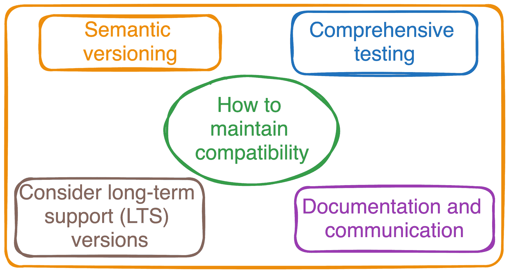

维护库/项目兼容性的步骤

#### 语义版本控制（SemVer）

- 清晰的版本控制：遵循 `SemVer` 指南有助于用户理解更改的性质和影响。
- 版本规划：通过根据兼容性规划发布，促进平滑过渡。

#### 全面测试

- 自动化测试：定期运行测试，以确保新的修改不会损坏现有功能。
- 跨版本测试：通过在多个版本上测试来评估兼容性。

#### 文档与沟通

- 更新文档：通过修改和弃用维护文档。
- 与用户互动：当用户获知计划变更时，他们准备得更充分并提供更有价值的投入。

#### 考虑长期支持（LTS）版本

- 稳定发布：LTS 版本为需要长期支持的人提供了稳定的基础。

在库开发中维护兼容性是一项艰巨但必要的努力。必须在交付新功能和保持现有功能之间取得微妙的平衡。

通过仔细的规划、全面的测试和开放的沟通，在不疏远消费者或产生不必要障碍的情况下创新是可行的。

## 库维护中的安全考虑

安全在软件开发中至关重要，保持安全的库更新是一个持续的过程。本节检查了开发者必须遵循的基本原则和方法，以确保库在整个生命周期内的安全。

### 理解安全风险

可能同时存在外部和内部安全威胁。理解这些威胁是创建安全库的第一步。

- 外部风险：包括黑客攻击、第三方依赖项的缺陷等。
- 内部风险：包括代码缺陷、测试不足、不符合安全要求等。

### 安全审计

定期安全审计有助于识别和解决任何安全问题。

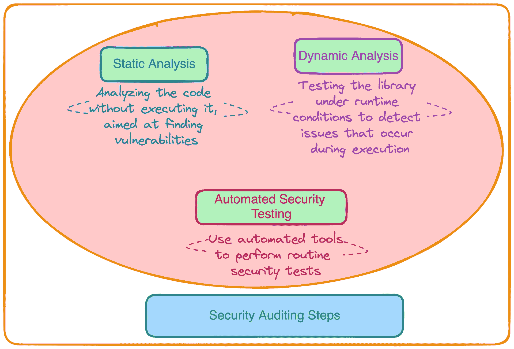

PHP 库维护中安全审计的思维图

- 静态分析：通过分析代码而不运行它来发现漏洞。
- 动态分析：通过在运行时条件下测试库来检测问题。
- 自动化安全测试：指使用自动化工具执行例行安全测试。

### 依赖扫描

库经常依赖第三方库。跟踪这些依赖项并确保它们更新且安全是至关重要的。

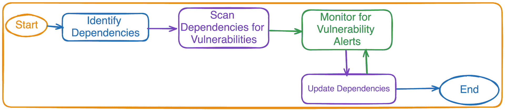

依赖扫描和更新过程流程图

- 定期更新依赖项：保持所有依赖项为最新状态。
- 漏洞告警监控：使用技术接收有关已知漏洞的通知。

### 安全编码实践

遵循安全编码标准和指南可以确保库对安全风险有强大的防御能力。

- 输入验证：始终对用户输入进行验证，以避免 SQL 注入、XSS 和其他漏洞。

  让我们来看一个使用 `filter_var()` 等函数验证电子邮件地址的示例。像这样验证用户输入可以确保只处理格式正确的数据，从而帮助防止 SQL 注入和 XSS 攻击等常见漏洞。


```php
<?php
// 输入验证示例
if (filter_var($email, FILTER_VALIDATE_EMAIL)) {
    // 邮箱有效
} else {
    // 邮箱无效
}
```

- **加密**：对于敏感数据，使用适当的加密。

下面的示例演示了如何使用 OpenSSL 的 `AES-128-CBC` 算法加密数据。这种加密对于保护敏感数据至关重要，确保即使数据被拦截，在没有正确密钥的情况下也无法读取。

```php
<?php
// 加密示例
$encryptedData = openssl_encrypt(data, 'AES-128-CBC', $key, 0, $iv);
```

- **身份验证与授权**：建立稳健的身份验证和授权程序。

下面的基础示例使用 PHP 的 `password_verify` 函数安全地将用户输入的密码与存储的哈希进行比较。这种身份验证方法对于维护安全的访问控制至关重要，确保只有经过验证的用户才能访问某些功能。

```php
<?php
// 身份验证示例
if (password_verify($inputPassword, $storedPasswordHash)) {
    // 密码正确，继续登录
} else {
    // 密码错误，拒绝访问
}
```

### 应急响应计划

当发生安全事件时，拥有一份计划可能有助于减轻损害。

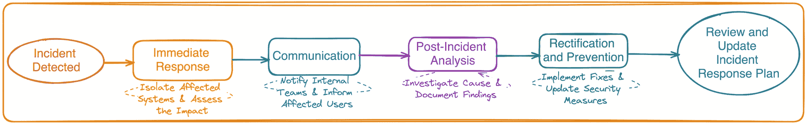

应急响应计划的流程图

- **立即响应**：识别出事件后立即需要做什么。
- **通信计划**：如何将事件通知给用户和利益相关者？
- **事后分析**：调查哪里出了问题，并确定未来如何避免此类问题发生。

保持库的安全需要多样化的方法。理解风险、进行定期审计、监控依赖项、遵循安全编码实践以及拥有应急响应策略都是其中的一部分。一个维护良好且安全的库能够赢得用户的信任，并使更广泛的开发者社区受益。

## 维护中的文档与社区参与

你的文档应该随着你的库同步变化。为了给用户提供清晰的信息，在文档中反映库中的所有变化至关重要。

### 定期更新文档的原因

有多个理由说明你应该保持文档的更新。这里是显示此过程的流程图：

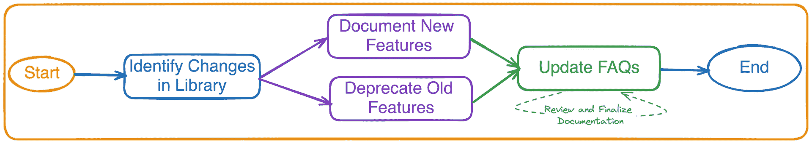

PHP 库开发中文档更新过程的流程图

- 通知用户新功能或已弃的功能。
- 对已知 Bug 提供修复方案或解释。
- 回答常见问题或解释疑难点。

### 利用社区反馈改进维护

你的用户群可能是一项重要资产。他们提供了新的视角，发现了隐藏的问题，并提供了真实的应用场景。

你可以用来从社区收集反馈的某些参与平台包括：

- **论坛与讨论板**：人们讨论问题、分享解决方案和提供反馈的地方。
- **调查问卷**：收集关于库的使用、功能和潜在改进的系统性输入。
- **社交媒体**：社交媒体有助于快速公告和互动。

### 社区对库代码的贡献

开源库经常从社区贡献中受益。这种参与可以包括从 Bug 修复到功能增强的所有内容。

社区对库贡献的某些益处是：

- 多样化的视角有助于提供解决方案。
- 更快速地检测和解决 Bug。
- 由于更广泛的开发者群体，功能集得到了增强。

### 保持清晰的通信渠道

活跃的用户群更有可能拥有响应及时的维护者。解决问题、认可贡献以及通知更新都是有效沟通的一部分。

为了实现有效的沟通，你可以遵循某些良好实践：

- 对问题做出回应。
- 认可贡献。
- 通知更新。

### 通过研讨会和教程教育用户

通过研讨会和教程教育用户。这样做可以带来一些好处：

- 缩短用户的学习曲线。
- 提供对复杂功能的深度解析。
- 增强社区关系。

提高 PHP 库的性能也是核心重点之一。开发者将学习最佳实践，以确保库运行顺畅高效，从而使其在所属领域脱颖而出。性能优化对于满足用户预期以及处理增长的流量或数据处理需求至关重要。

最后，这部分介绍了可扩展性和可维护性，教授开发者如何创建不仅能高效扩展以处理更高流量，而且在成熟后仍保持易于维护的库。平衡这些方面对于 PHP 库的长期成功和易用性至关重要，确保它在增长和演进过程中持续满足用户需求。

## 编写整洁且高效的代码

整洁的代码不仅仅是语法和结构，它是一种心态。整洁的代码读起来令人愉快，消除了认知负担，并且易于调整。它降低了改进成本和引入 Bug 的风险。

### 拥抱整洁代码哲学

让我们考虑一个基础任务：从列表中提取所有奇数并求总和。

```php
<?php  

function p($a) {  
    $s=0;  
    foreach($a as $n) {  
        if ($n % 2 == 1) {  
            $s += $n;  
        }  
    }  
    return $s;  
}  

$l = array(1, 2, 3, 4, 5, 6, 7);  
echo p($l);  // Outputs: 16
```

上述代码的问题：

- 函数名 `p()` 缺乏描述。
- 变量名不具描述性 `$a`, `$s`, `$n`, `$l`。
- 没有注释或文档。
- 单字母变量名难以查找它们出现的位置。

现在，让我们看看这段代码的另一个版本。

```php
<?php  

/**  
* 计算数组中所有奇数的和。  
*  
* @param array $numbers 整数数组。  
* @return int 所有奇数的和。  
*/  
function sumOfOdds(array $numbers): int {  
    $total = 0;  
    foreach ($numbers as $number) {  
        if ($number % 2 == 1) {  
            $total += $number;  
        }  
    }  
    return $total;  
}  

$sampleList = array(1, 2, 3, 4, 5, 6, 7);  
echo sumOfOdds($sampleList);  // Outputs: 16
```

新版本的改进：

- `sumOfOdds()` 是一个具描述性的函数名。
- 对函数参数和返回值使用了类型提示。
- 变量名具描述性 `$numbers`, `$total`, `$number`, `$sampleList`。
- 添加了 doc-block 注释，明确了函数的用途和参数。

### 遵循命名规范

- **变量**：变量名应始终具描述性。例如，使用 `$number` 代替 `$n`。
- **函数**：函数和方法的名称应指示其功能。选择 `sumOfOdds()` 而不是 `p()`。
- **类**：使用能清晰表达目的的名词，例如 `JsonEncoder`。

### 追求代码效率

- **时间复杂度**：评估算法的性能。是否存在多余的循环或冗余的操作？
- **空间复杂度**：从空间复杂度的角度分析内存占用。可以通过优化数据结构来节省内存吗？
- **数据库调用**：通过最小化和优化数据库交互来降低延迟。

### 倡导重构

定期重构有助于：

- 检测并修正代码气味。
- 通过采用新标准或技术保持代码库更新。
- 使功能开发变得容易，无需昂贵的权宜方案。

### 清晰优于巧妙

巧妙、紧凑的代码可能很好，但往往以牺牲可读性为代价。当更详细、直观的答案足够时，避免使用深度嵌套循环或晦涩的单行代码。

让我们来看示例：

```php
<?php  
echo (function($a, $b) { return $a * $b; })(5, 10);
```

在这个版本中，使用了匿名函数（也称为 lambda 函数），并立即用参数 `5` 和 `10` 调用了它。这段紧凑的代码片段减少了行数，并消除了对命名函数和结果的独立变量的需求。但重要的是，虽然这样更紧凑，但它的可读性可能较低，特别是对于那些不熟悉 PHP 中匿名函数或立即函数调用的人来说。

这段代码更好的版本可以是：

```php
<?php  
function calculateProduct($number1, $number2) {  
    return $number1 * $number2;  
}  

$totalProduct = calculateProduct(5, 10);
echo $totalProduct;
```

- 包含了指定这些税收法规来源的标记，这可能对未来的参考或更新有所裨益。
- `function` 内部的注释提供了对每个条件背后逻辑的见解。

如果这样做了，未来的开发者（甚至是过段时间后回到代码的同一位开发者）将立即理解税收计算机制背后的逻辑。

## 通过代码风格保持一致性

- 采用风格指南：无论是 Python 的 `PEP 8`、PHP 的 `PSR` 还是其他指南，都要严格不疑地遵守。
- 自动化代码检查工具：诸如 `ESLint` 或 `Prettier` 等工具可以强制执行一致风格并检测差异。

考虑以下场景：你正在编写一个用于管理系统用户配置的库。

```php
<?php  

function addUsr($usr_data){  
  $db_conn = new mysqli('localhost', 'user', 'password', 'database');  
  $stmt = $db_conn->prepare("INSERT INTO user_profiles (name, age, email) VALUES (?, ?, ?)");  
  $stmt->bind_param("sis", $usr_data['username'], $usr_data['userAge'], $usr_data['mail']);  
  $stmt->execute();  
  $stmt->close();  
  $db_conn->close();  
}  

$ud = ['username' => 'JohnDoe', 'userAge' => 30, 'mail' => 'john.doe@example.com'];  
addUsr($ud);
```

现在让我们看看遵循一致代码风格的改进后的版本：

```php
<?php  

function addUser($userData) {  
    $databaseConnection = new mysqli('localhost', 'user', 'password', 'database');  
    $statement = $databaseConnection->prepare("INSERT INTO user_profiles (name, age, email) VALUES (?, ?, ?)");  
    $statement->bind_param("sis", $userData['name'], $userData['age'], $userData['email']);  
    $statement->execute();  
    $statement->close();  
    $databaseConnection->close();  
}  

$userData = [  
    'name'  => 'John Doe',  
    'age'    => 30,  
    'email' => 'john.doe@example.com'  
];  

addUser($userData);
```

在上面的修订版本中：

- 遵循了命名规范。变量具有描述性并使用了 `camelCase`。
- 间距和缩进都是一致的。
- 数组键标签标记正确。
- 函数名以动词为基础，指示了它们的操作。

当贯应用于整个代码库时，这种统一性可以显著提高代码的可读性和维护性。使用像 `PHP_CodeSniffer` 这样的工具在项目中强制此类风格将会有帮助。

## 代码审查的价值

- **疏忽**：即使是经验丰富的开发者也会出错。审查确保每一处修改都经过了多双眼睛的审视。
- **知识传递**：通过允许开发者分享想法、方法论和最佳实践，促进了学习。
- **可维护性**：审查有助于验证代码不仅功能正常，而且具有维护性并符合更广泛的架构。

代码审查的价值通常不是通过代码本身体现，而是通过审查过程中提供的输入。然而，我们可以展示一段示例 PHP 代码，然后演示开发者在代码审查期间可能收到的反馈。

```php
<?php  

function userAge($dob){  
  $today = new DateTime();  
  $bday = new DateTime($dob);  
  $age = $today->diff($bday);  
  return $age->y;  
}  

$usr_dob = "1990-05-10";  
echo userAge($usr_dob);
```

潜在的代码审查反馈可能是：

- 关于 `function` 名称歧义的注释可能是：
  - “函数名 `userAge` 暗示它与用户对象或类相关。” “考虑重命名函数 `calculateAgeFromDOB` 以明确其目的。”
- 关于变量命名的注释可能是：
  - `$user_dop` 应该更明确。为了更清晰起见，考虑将其更改为 `$userDateOfBirth`。
- 关于错误处理的注释可能是：
  - “如果提供的 `$dob` 不符合预期格式或无效会发生什么？” 设置错误检查来处理此类情况是一个好主意。
- 关于内联文档的注释可能是：
  - 在函数上方添加 doc 注释以描述其目的、接受的参数及其返回值。

让我们将这些注释应用到最后的代码段中，这里是修订版本：

```php
<?php  

/**  
 * 根据出生日期计算年龄。  
 *  
 * @param string $dateOfBirth 格式为 "Y-m-d"。  
 * @return int 以岁为单位的年龄。  
 */  
function calculateAgeFromDOB($dateOfBirth) {  
    $today = new DateTime();  
    $birthDate = new DateTime($dateOfBirth);  
    $age = $today->diff($birthDate);  
    if ($birthDate > $today) {
        throw new \Exception("日期不能在未来.");
    }  
    return $age->y;  
}  

$userDateOfBirth = "1990-05-10";  
echo calculateAgeFromDOB($userDateOfBirth);
```

检查修订版本：

- 遵循了命名规范。变量具有描述性并使用了 `camelCase`。
- 间距和缩进都是一致的。
- 数组键标记正确。
- 函数名以动词为基础，指示了它们的操作。

代码不仅仅是行。

## 设计与架构

库的架构影响其可扩展性和维护性。良好的架构可以确保你的库：

- 轻松适应变化
- 与其他库良好协作
- 利于新开发者理解

### PHP 中的模块化设计

采用模块化设计。使用 PHP 命名空间，将你的库组织成独立的模块。这不仅使源代码更易维护，还允许用户使用他们需要的部分。

### PHP 中的设计模式

使用与属性兼容的设计模式。在 PHP 库中，`Singleton`、`Dependency Injection` 等模式被广泛用于增加重用性和灵活性。例如，使用 `Factory` 模式构建数据库连接或 HTTP 客户端，确保灵活性。

## 使用 Composer 关注依赖管理

Composer 改变了 PHP 依赖管理。在设计库时要明确依赖关系，并在 `composer.json` 中精确列出它们。这避免了冲突并提供了平滑集成。

让我们通过我们的 `Jazzon` 库来看完整的 `composer.json` 示例：

```json
{
  "name": "jazzon/library",
  "description": "一个面向 JSON 爱好者的 PHP 库。",
  "type": "library",
  "require": {
    "php": "⁷.4 || ⁸.0",
    "monolog/monolog": "².2"
  },
  "require-dev": {
    "phpunit/phpunit": "⁹.3"
  },
  "autoload": {
    "psr-4": {
      "Jazzon\\": "src/"
    }
  },
  "license": "MIT",
  "authors": [
    {
      "name": "Jazz Enthusiast",
      "email": "jazz@example.com"
    }
  ],
  "minimum-stability": "stable",
  "prefer-stable": true
}
```

### 使用 PHP 测试框架

拥有健全的测试策略是实现健壮软件架构的基石之一。通过测试框架的帮助，开发者不仅可以验证代码的正确性，还可以保护自己免受未来回归的影响，确保新更改不会导致旧更改失效。`PHPUnit` 和 `Behat` 都是 PHP 生态系统中优秀的工具，使用它们将帮助你确保你的库不仅在功能上是健全的，在结构上也是如此。

当你专门针对可测试性设计你的库架构时，你会更容易诊断问题、更快速地进行调试，并能够更有信心地发布代码。此外，一个经过良好测试的库将提高项目在开发者社区中的声誉，从而确保用户能够信任其项目中该软件组件的可靠性。

### 跟进 PHP-FIG 建议

`PSRs`（PHP 标准建议）是由 PHP 框架互操作性小组（`PHP-FIG`）提出的 PHP 库开发指南。遵循这些指南可以使你的库符合社区标准。

### 将代码逻辑与框架解耦


虽然框架能够快速开发，但将你库的核心功能从任何单一框架中隔离出来至关重要。这确保了使用多个 PHP 框架的用户可以轻松集成你的库。

例如，不要将日志库绑定到单个框架的日志系统，而是考虑实现 `PSR-3` 日志接口。

### 在 PHP 中遵循 SOLID 原则

`SOLID` 原则是五种设计原则的缩写，旨在使软件设计更加清晰、灵活且易于维护，这些原则对于 PHP 库至关重要。

| 原则 | 说明 | 示例实现 |
| --- | --- | --- |
| 单一职责 | 类/函数应该只有一个职责 | 分离 `User` 和 `UserNotification` 类 |
| 开/闭原则 | 对扩展开放，对修改关闭 | 为 `Shapes` 使用接口，在 `Square`、`Circle` 等中实现 |
| 里氏替换原则 | 子类应该增强而非替换父类 | 分离 `Shape` 接口，区分 `Rectangle` 和 `Square` 实现 |
| 接口隔离 | 任何类都不应被强制实现未使用的方法 | 分离 `Workable` 和 `Eatable` 接口 |
| 依赖倒置 | 依赖抽象，而非依赖具体实现 | 核心类依赖于 `SwitchableDevice` 接口，而不是 `LightBulb` 类 |

- `SRP`（单一职责原则）：你库中的每个 PHP 类应该只有一个变化的理由。这确保了每个类都处理一个不同的问题。
  - 考虑将一个同时负责数据验证和数据存储的类分为两个独立的类。
- `开/闭原则`（`OCP`）：PHP 类应该应对扩展开放但对修改关闭。这鼓励了更模块化的方法，允许在不更改现有代码的情况下进行简单扩展。
  - 使用 `abstract` 类或可以在不更改源代码的情况下进行扩展的接口作为示例。
- `里氏替换原则`（`LSP`）：该原则规定超类对象可以与子类对象交换，而不影响程序的正确性。
  - 例如，如果你在库中扩展了一个类或实现了一个接口，请确保派生类与基类兼容。
- `接口隔离原则`（`ISP`）：该原则规定客户端类不应被强制依赖于它们不使用的接口。
  - 与其使用单一宽泛接口，不如将其拆分为更小、更关注的接口。
- `依赖倒置原则`（`DIP`）：该原则规定你应该依赖抽象而非具体的实现。这使得你的库能够扩展。

### PHP 的扩展性

一个经过深思的分支策略可以确保主分支保持稳定。以下是一个策略示例：

- `Main/Master` 分支：此分支包含库的稳定版本。
- `Development/Dev` 分支：这是所有新开发发生的地方。
- `Feature` 分支：每个新功能或功能都会创建一个新分支。完成后，将其合并到开发分支。
- `Hotfix` 分支：用于必须应用到主分支的紧急修复。

## 版本控制与协作

版本控制系统是任何开发项目的骨干，在创建 PHP 库时尤为重要。

它们有助于：

- 记录更改：每个更改都可能追溯到其来源，提供更好的调试和理解。
- 促进协作：由于多个开发者可以在同一个库上工作，而不会覆盖彼此的更改，协作变得更加容易。
- 自动化测试：当提交拉请求（pull request）时，结合 `CI/CD` 系统可以对代码进行自动测试。

### 使用 Git 进行标记和版本控制

当你的库达到关键里程碑或准备发布时，请使用以下标签：

```bash
$ git tag v1.0.0
```

这与 `SemVer` 策略一致，有助于用户和开发者理解库的成熟度和稳定性。

### 版本控制之外的协作工具

- 使用 `Slack`、`Microsoft Teams` 或 `Discord` 进行团队通信。
- 使用 `Trello` 或 `Jira` 进行任务和项目管理。
- 使用 `Docker` 提供一致的开发环境。

在开发 PHP 库时，使用版本控制（尤其是 `Git`）至关重要。它不仅提供了无缝的开发流程，还能鼓励参与并保留库的历史记录。接受促进协作并简化你库开发流程的工具和平台。

## 库设计中的安全性

良好的安全性并非为了构建强大可靠的 PHP 库而额外添加的。开发者依赖于这样一个事实：当他们使用一个库时，它的运行方式符合描述，且没有充斥着损害其应用程序的漏洞。

### 良好的库设计安全性的重要原则

- **深度防御**：不要依赖单一方式来阻止威胁。分层你的防御，这样当一种机制失效时，另一种机制也可以阻止攻击。
- **最小权限原则**：组件（函数或方法）应仅具有执行其功能所需的权限。
- **安全失败机制**：当发生任何问题时，返回安全状态，而不是暴露漏洞。
- **避免通过隐性实现安全**：依赖于隐藏库内部实现的技术不是一种良好的安全技术。即使攻击者知道如何绕过保护，良好的安全性也必须有效的。

### 常见漏洞及其缓解

- **注入攻击**：对所有输入进行清理和验证。通过参数化查询防止 `SQL` 注入。让我们在示例中查看：

下面的代码片段显示了一个通过直接引入用户输入而容易注入攻击的 `SQL` 查询：

```php
prepare("SELECT * FROM users WHERE username = :username"); 
$stmt->execute(['username' => $_GET['username']]);
```

- **跨站脚本 (XSS)**：如果你的库处理网页内容，请转义所有输出并使用内容安全策略（`CSP`）。让我们在示例中查看：

在代码片段中，我们直接打印用户输入，如果包含恶意脚本，可能会导致 `XSS`：

```php
<?php
// 显示用户输入
echo "Hello," . $_GET['username'];
```

在接后的片段中，使用 `htmlspecialchars()` 转义用户输入，防止 `XSS` 攻击：

```php
<?php
// 安全转义用户输入
echo "Hello," . htmlspecialchars($_GET['username'], ENT_QUOTES, 'UTF-8');
```

- **不安全的依赖**：定期更新你的库所依赖的库和组件。使用 `Composer` 内置的安全检查器或类似工具来监控已知漏洞。
- **不安全的反序列化**：不要反序列化来自不可信源的数据。如果必须这样做，请考虑 `JSON` 等安全数据格式。让我们来看一个简单的示例：

从不可信源反序列化数据会导致安全问题：

```php
// 不安全的反序列化
$data = unserialize($untrusted_data);
```

使用安全的数据格式：

```php
// 安全的数据格式
$data = json_decode($json_data);
```

- 负载测试：这涉及使用 `Apache JMeter` 等工具模拟许多用户同时访问你的库。

性能优化是任何一个成功的 PHP 库开发过程中不可或缺的一部分。每一个细节都至关重要——从基础算法和数据结构，到关于现代 PHP 特性的更细微细节。

> 定期监控和测试可以使你的库保持高效，从而为更广泛的采用和认可奠定基础。

## 可扩展性与可维护性

在本节中，我们将学习在构建 PHP 库时，在扩展性和可维护性方面需要注意的注意事项。

### 从开始就为扩展性进行设计

在当今快速发展的的技术世界中，可扩展性已从事后考虑变成了首要设计考虑。确保你的软件能够处理增长的需求并能够在不完全重新设计的情况下演进，对其生命力和成功至关重要。针对可扩展性的库设计，其核心规则是从设计阶段开始就遵循基本原则。

尝试模块化架构：通过采用模块化架构，可以将不同的功能封装到独立的单元或模块中。这不仅让你的库更具可扩展性，而且更容易维护。每个模块都可以独立进行测试、更新或替换，而对整个系统产生任何影响。这种模块化分离使得随着需求的增加，可以对特定部分进行优化或重构，而无需扰及整个库。

### 负载处理

如果你的库旨在服务器上运行，请考虑它如何处理许多并发请求。

- 并发：确保你的库可以同时处理许多请求而不产生阻塞。
- 分布：设计你的库，使其在进行大型计算时，能够将负载分散到许多服务器或核心上。

### 选择无状态设计

无状态组件本质上是可扩展的，因为它们在操作之间不维护任何数据。

- 避免全局变量：使用全局变量可能会导致组件变为有状态的。请通过参数或依赖注入传递数据。
- 依赖纯函数：纯函数带来了可预测性，因为它们没有副作用，且给定输入时，将始终具有相同的输出。

### 维护向后兼容性

确保你的库即使随着时间的推移，也能与旧版本兼容。

- 版本控制：使用约定的版本方法（如语义化版本）进行良好的通信。
- 弃用策略：将某功能标记为已弃用（deprecated），而不是突然删除它并提供替代方案。这有助于开发者进行适应而不破坏他们的应用程序。

### 自动化测试以提高可维护性

建立一套优秀的测试流程，以确保你的库保持可维护。

- 单元测试：测试库的单个组件，以查看它们是否按预期正确工作。
- 集成测试：检查库的不同部分之间如何工作，并确保整体大于部分之和。

### 完善的文档

可维护性很大程度上取决于人们如何理解和使用你的包。

- 行内注释：代码展示了“如何做”，而注释解释了“为什么”。谨慎使用。
- API 文档：可以使用 `PHPDocumentor` 等工具自动生成。
- 教程和用例：为用户和潜在贡献者提供真实的示例和教程。

### 一致的代码风格

遵循一致的代码风格可以确保任何开发者都能快速理解库的结构和逻辑。

- 编码规范：对于 PHP，请使用声誉良好的标准，如 `PSR-12`。
- 自动检查工具：使用 `PHP_CodeSniffer` 等工具自动发现并纠正代码标准的违反行为。

创建一个既良好扩展又能保持维护的 PHP 库并不是任何人随心所欲就能做到的，而是需要认真的规划和投入。从为扩展性进行设计到确保向后兼容性，再到通过文档和一致的编码实践鼓励可维护性，你正在为库创建基础，使其能够随着时间的推移而成熟，同时有效地为你的用户群体服务。

# 结论

在这一部分，我们将回顾 PHP 库开发的完整过程，从构思到维护。作为一名经验丰富的 PHP 开发者，窥见你未来的事业。

## 总结

我们探索 PHP 库世界的之旅是丰富且富有教育意义的。以下是简要回顾：

- 库的核心要素：我们从创建库的基本考虑因素开始，例如目录结构、命名空间、编写代码、测试以及对文档的需求。
- 反馈与维护：我们学习了维护的重要性以及对问题做出反馈以获得更好的结果，同时也确保库的兼容性。
- 社区参与：文档的需求和社区参与是两个关键课程，强调了清晰指令和团队合作的重要性。
- 构建的最佳实践：我们从构建库的最佳实践开始，关注编写简洁高效的代码、智能的设计与架构、版本控制协作以及安全优先。
- 安全优先：这是一个关于库安全性的重要课程。我们贯穿强调安全优先策略，从安全编码技术到定期安全评估。
- 性能与扩展性：我们旅程的最后重点是性能优化的本质，确保库能够优雅扩展并长期维护。

### 下一步？

- 实践经验：从一个实际项目开始。通过升级现有的开源 PHP 库或从零创建一个。
- 持续学习：技术世界不断变化。利用 PHP 社区更新、最佳实践并定期开发。
- 深度学习：深入研究特殊主题，如复杂的 PHP 安全程序、特定的 PHP 框架或数据库改进。
- 参与社区：积极参与社区可以改变现状。论坛、网络研讨会和 PHP 大会可以是极佳的资源。

### 感谢说明

在整个课程中，你表现出的毅力和投入令人赞叹。最后，请记住，你创建或贡献的库对全球开发者社区具有巨大影响。请继续突破边界，保持好奇，并对 PHP 世界产生巨大影响。

### 你的反馈是宝贵的

当我们的旅程结束时，我渴望听取你的想法、经验和建议。你的反馈不仅宝贵，而且对于让这本书对像你这样的读者产生影响和益处至关重要。无论你是遇到了挑战、面临特定问题，还是对改进有绝佳的想法，我都准备好倾听。

随时通过 `ahmed.raafat1412@gmail.com` 与我联系。你的意见将有助于完善这本书，并帮助其他在 PHP 库开发道路上的人。

感谢你与我一起学习 PHP 库开发。祝你在该领域取得成功并不断进步！

祝未来有许多编程体验！

## 资源与进一步学习

- PHP 文档：理解 PHP 特性和函数的必备工具。[访问 PHP 官方文档链接](https://www.php.net/docs.php)
- SOLID 原则文章：为了深入理解这些设计原则，你可以阅读一些文章，例如[通俗易懂的面向对象 SOLID 原则](https://www.freecodecamp.org/news/solid-principles-explained-in-plain-english/)
- Composer 文档：了解 PHP 包管理。[访问 Composer 官方文档链接](https://getcomposer.org/doc/)

## 在线教程与课程

- PHPUnit 教程：学习 PHP 单元测试。
  - [PHPUnit 手册](https://docs.phpunit.de/en/10.5/)：`PHPUnit` 的官方文档和教程，适用于学习 PHP 单元测试。
  - [初学者 PHPUnit 教程](https://startutorial.com/view/phpunit-beginner-part-1-get-started)：一份适合入门者的 `PHPUnit` 入门指南。
- PHP 安全实践：关于安全 PHP 的教程和课程。
  - OWASP 提供的 [PHP 安全备查表](https://www.owasp.org/index.php/PHP_Security_Cheat_Sheet)：提供了安全 PHP 编码的最佳实践指南集。
  - [PHP: The Right Way - Security](https://phptherightway.com/#security)：热门指南“PHP: The Right Way”中专门介绍安全实践的章节。

## 软件工具与库

- Xdebug：用于 PHP 的调试工具。[访问 Xdebug 链接](https://xdebug.org/)
- Blackfire.io：用于 PHP 的性能分析器。[访问 Blackfire.io 链接](https://blackfire.io/)
- `PHP_CodeSniffer`：维护编码规范。[访问 PHP_CodeSniffer 链接](https://github.com/squizlabs/PHP_CodeSniffer)

## 在线平台与社区

- GitHub：探索开源 PHP 项目和库。[访问 GitHub 链接](https://github.com/)
- Stack Overflow：故障排除和社区支持的论坛。[访问 Stack Overflow 链接](https://stackoverflow.com/)
- PHP 框架互操作小组 (PHP-FIG)：跟踪 PHP 标准和 PSR。[访问 PHP-FIG 链接](https://www.php-fig.org/)

## 文档工具

- PHPDocumentor：用于生成 API 文档。[访问 PHPDocumentor 链接](https://phpdoc.org/)

## 性能优化工具

- Redis：用数据库缓存的内存数据结构存储器。[访问 Redis 链接](https://redis.io/)
- Memcached：分布式内存缓存系统。[访问 Memcached 链接](https://memcached.org/)

## 版本控制与协作工具

- Git：版本控制系统。[访问 Git 链接](https://git-scm.com/)
- GitHub, GitLab, Bitbucket：托管和管理代码仓库的平台。

## PHP 开发资源

1. [PHP 官方手册](https://www.php.net/manual/en/)：关于 PHP 语法、函数和最佳实践的全面资源。
2. [PHP: The Right Way](https://phptherightway.com/)：一个关于 PHP 最佳实践、编码规范和权威教程的热且易于遵循的指南。
3. [Packagist](https://packagist.org/)：主要的 `Composer` 仓库，作为 PHP 包和库的集中来源。
4. [Laracasts](https://laracasts.com/)：提供大量关于 PHP 及其框架（尤其是 Laravel）的视频教程。
5. [PHP Weekly](http://www.phpweekly.com/)：包含 PHP 相关文章、新闻和教程的精选每周通讯。
6. [SitePoint PHP](https://www.sitepoint.com/php/)：提供涵盖 PHP 及相关技术的文章、教程和书籍。
