# PHP MySQL 快速查表，语法快速参考手册，基于表格与图表：语法快速学习指南


## 关于本书
本书涵盖了所有基础 PHP 语法，几乎每个语法条目都列出了程序示例和结果输出。我们可以快速参考最有帮助的编程语法，例如常用命令语法、字符串函数语法、集合函数语法、类与对象语法等等……这些语法对于编程都非常有用。

我们可以将此书作为基础语法手册，因为它的条目按字母顺序排列，方便我们快速参考重要的语法。

本书还包含了与 PHP 相关的基础 MySQL 语法。

现在或将来，PHP 语法书籍都能为我们的学习和工作编码提供巨大的帮助。

## 免责声明
本书仅作为基础语法手册；它无法包含该主题的所有条目。其目的是作为速查书籍的补充，而不是完整的 PHP 字典。


# `session_status()` 语法 (#part0004.xhtml#a6VS)
# `session_unset()` 语法 (#part0004.xhtml#a6VT)
# `session_write_close()` 语法 (#part0004.xhtml#a6VU)
# `set_error_handler()` 语法 (#part0004.xhtml#a6VV)
# `set_exception_handler()` 语法 (#part0004.xhtml#a6VW)
# `setcookie()` 语法 (#part0004.xhtml#a6VX)
# `sha1()` 语法 (#part0004.xhtml#a6VY)
# `sha1_file()` 语法 (#part0004.xhtml#a6VZ)
# `show databases` 语法 (#part0004.xhtml#a6W0)
# `show specified field` 语法 (#part0004.xhtml#a6W1)
# `show specified record` 语法 (#part0004.xhtml#a6W2)
# `show tables` 语法 (#part0004.xhtml#a6W3)
# `shuffle()` 语法 (#part0004.xhtml#a6W4)
# `simplexml_load_file()` 语法 (#part0004.xhtml#a6W5)
# `simplexml_load_string()` 语法 (#part0004.xhtml#a6W6)
# `sleep()` 语法 (#part0004.xhtml#a6W7)
# `sort()` 语法 (#part0004.xhtml#a6W8)
# `sort table data` 语法 (#part0004.xhtml#a6W9)
# `sprintf()` 语法 (#part0004.xhtml#a6WA)
# `sqrt()` 语法 (#part0004.xhtml#a6WB)
# `sscanf()` 语法 (#part0004.xhtml#a6WC)
# `static` 语法 (#part0004.xhtml#a6WD)
# `static member` 语法 (#part0004.xhtml#a6WE)
# `string` 语法 (#part0004.xhtml#a6WF)
# `string connecting` 语法 (#part0004.xhtml#a6WG)
# `stripos()` 语法 (#part0004.xhtml#a6WH)
# `stripslashes()` 语法 (#part0004.xhtml#a6WJ)
# `stristr()` 语法 (#part0004.xhtml#a6WK)
# `strip_tags()` 语法 (#part0004.xhtml#a6WM)
# `str_ireplace()` 语法 (#part0004.xhtml#a6WN)
# `strlen()` 语法 (#part0004.xhtml#a6WP)
# `str_pad()` 语法 (#part0004.xhtml#a6WR)
# `strpbrk()` 语法 (#part0004.xhtml#a6WS)
# `strpos()` 语法 (#part0004.xhtml#a6WT)
# `str_repeat()` 语法 (#part0004.xhtml#a6WU)
# `strrev()` 语法 (#part0004.xhtml#a6WV)
# `strripos()` 语法 (#part0004.xhtml#a6WW)
# `strrpos()` 语法 (#part0004.xhtml#a6WX)
# `strstr()` 语法 (#part0004.xhtml#a6WY)
# `strtolower()` 语法 (#part0004.xhtml#a6WZ)
# `strtotime()` 语法 (#part0004.xhtml#a6X0)
# `strtoupper()` 语法 (#part0004.xhtml#a6X1)
# `str_replace()` 语法 (#part0004.xhtml#a6X2)
# `str_shuffle()` 语法 (#part0004.xhtml#a6X3)
# `str_split()` 语法 (#part0004.xhtml#a6X4)
# `str_word_count()` 语法 (#part0004.xhtml#a6X5)
# `strtr()` 语法 (#part0004.xhtml#a6X6)
# `submit` 语法 (#part0004.xhtml#a6X7)
# `substr()` 语法 (#part0004.xhtml#a6X8)
# `substr_count()` 语法 (#part0004.xhtml#a6X9)
# `substr_replace()` 语法 (#part0004.xhtml#a6XA)
# `switch` 语法 (#part0004.xhtml#a6XB)
# `text` 语法 (#part0004.xhtml#a6XC)
# `textarea` 语法 (#part0004.xhtml#a6XD)
# `time()` 语法 (#part0004.xhtml#a6XE)
# `trait` 语法 (#part0004.xhtml#a6F)
# `trigger_error()` 语法 (#part0004.xhtml#a6G)
# `trim()` 语法 (#part0004.xhtml#a6XH)
# `try / throw / catch()` 语法 (#part0004.xhtml#a6XJ)
# `ucfirst()` 语法 (#part0004.xhtml#a6XK)
# `ucwords()` 语法 (#part0004.xhtml#a6XM)
# `uniqid()` 语法 (#part0004.xhtml#a6XN)
# `unlink()` 语法 (#part0004.xhtml#a6XP)
# `unserialize()` 语法 (#part0004.xhtml#a6XR)
# `unset()` 语法 (#part0004.xhtml#a6XS)
# `update table` 语法 (#part0004.xhtml#a6XT)
# `update table` 语法 (#part0004.xhtml#a6XU)
# `urldecode()` 语法 (#part0004.xhtml#a6XV)
# `urlencode()` 语法 (#part0004.xhtml#a6W)
# `Use Database` 语法 (#part0004.xhtml#a6XX)
# `usleep()` 语法 (#part0004.xhtml#a6XY)
# `variable` 语法 (#part0004.xhtml#a6XZ)
# `var_dump()` 语法 (#part0004.xhtml#a6Y0)
# `where condition` 语法 (#part0004.xhtml#a6Y1)
# `while Loop` 语法 (#part0004.xhtml#a6Y2)
# `wordwrap()` 语法 (#part0004.xhtml#a6Y3)
# `xml dom parser` 语法 (#part0004.xhtml#a6Y4)

# 附
- PHP 留关键字表 (#part0005.xhtml#a6Y6)
- PHP 转义字符表 (#part0005.xhtml#a6Y7)
- PHP 预定义字符表 (#part0005.xhtml#a6Y8)
- PHP 文件打开模式表 (#part0006.xhtml)
- PHP 邮件函数表 (#part0006.xhtml#a6YA)
- PHP 过滤器函数表 (#part0006.xhtml#a6YB)
- PHP 文件权限表 (#part0007.xhtml)
- PHP 字符串格式表 (#part0007.xhtml#a6YD)
- PHP 数据与时间格式表 (#part0008.xhtml)
- PHP 数据类型表 (#part0008.xhtml#a6YF)
- mysqli_xxx_xxx 表 (#part0009.xhtml)
- MySQL 数据库命令表 (#part0010.xhtml)
- MySQL 表命令表 (#part0010.xhtml#a6YJ)
- MySQL 操作命令表 (#part0010.xhtml#a6YK)
- MySQL 数据类型表 (#part0011.xhtml)
- MySQL 字段修符表 (#part0011.xhtml#a6YN)
- MySQL 系统函数表 (#part0011.xhtml#a6YP)
- MySQL 数值函数表 (#part0012.xhtml)
- MySQL 日期函数表 (#part0012.xhtml#a6YS)
- MySQL 语句表 (#part0013.xhtml)
- Ray Yao 快速备表 (#part0013.xhtml#a6YU)

# 语法表

-------------------------------------------------------------------------------

<!-- comment --> 语法：
```html
<!-- html comment -->
```
`<!--` 和 `-->` 用于 HTML 注释。

-------------------------------------------------------------------------------

`call()` 语法：
```php
if (condVar > someVal) {console.log("xxx")}
```
`call()` 函数用于调用对象上的方法。

-------------------------------------------------------------------------------

`call_static()` 语法：
```php
function call_static($arg) {}
```
`call_static()` 函数用于静态上下文。

-------------------------------------------------------------------------------

`__construct()` 语法：
```php
function __construct($arg) {}
```
`__construct()` 方法用于初始化类变量。

-------------------------------------------------------------------------------

`__destruct()` 语法：
```php
function __destruct() {}
```
`__destruct()` 方法释放资源。它在对象销毁或程序停止时被调用。

-------------------------------------------------------------------------------

`$_COOKIE` 语法：
```php
setcookie("name", "value");
$mycolor = $_COOKIE["name"];
```
`setcookie()` 函数用于设置 Cookie 名称和值。
`$_COOKIE` 用于通过 Cookie 名称获取值。

示例：
```php
<!-- aFile.php -->
<?php
// 在 aFile.php
setcookie("color", "blue"); // 设置 cookie
// cookie 名称为 "color"，值为 "blue"
header("location: bFile.php"); // 重定向到 bFile.php
?>
```
将此文件保存为 "aFile.php" 并放在工作目录下。

```php
<!-- bFile.php -->
<?php
// 在 bFile.php
$mycolor = $_COOKIE["color"]; // 从 aFile.php 获取 cookie
// 获取名为 "color" 的 cookie
echo $mycolor; // 显示颜色的值
?>
```


```php
<!-- 将文件保存为 "bFile.php" 并放在工作目录 -->
<!-- 请运行 aFile.php -->
// 输出: blue
```

## $_ENV 语法

```php
$_ENV["VARIABLE"]
```
// 包含环境变量的信息。

例如：
```php
$_ENV["USER"] = "Ray Yao";
echo 'The username is: ' .$_ENV["USER"];
// 输出:
// The username: Ray Yao
```

---

## $_FILES 语法

```php
$_FILES['file']['name']  // 上传的文件名。
$_FILES['file']['type']  // 文件的 MIME 类型。
$_FILES['file']['size']  // 上传文件的字节大小（byte）。
$_FILES['file']['tmp_name']  // 服务器上的临时文件名。
$_FILES['file']['error']  // 上传文件的错误信息。
```

例如 // 假设我们上传了一个名为 "myFile.txt" 的文件

```html
<form action="" method="post" enctype="multipart/form-data">
<input type="file" name="file">
<input type ="submit" value="Submit">
</form>
```

```php
<?php
echo "File Name: " . $_FILES['file']['name']."<br>";
echo "File Type : " . $_FILES['file']['type']."<br>";
echo "File Size : " . $_FILES['file']['size']."<br>";
echo "Temp Name: " . $_FILES['file']['tmp_name']."<br>";
echo "Error Info: " . $_FILES['file']['error']. "<br>";
?>
```
// 输出：

File Name: myFile.txt
File Type : text/plain
File Size : 279
Temp Name: C:\Windows\Temp\php5167.tmp
Error Info: 0

---

## $_GET 语法

```php
$myData=$_GET[ data ];
```
// 从 HTML 表单获取数据并将其赋值给 `$myData`。

例如：
```html
<html>
<form action=" " method="get">
<input type="text" name="data">
<!-- 输入的值将存储在 "data" 中 -->
<!-- "data" 将传递到 PHP 文件进行处理。 -->
</form>
```

```php
<?php // 假设我们在文本框中输入了 "Hello, World!"
$myData = $_GET[ data ];
// $_GET[ data ] 从 html 表单获取 "data" 的值
echo ("You have inputted: ".$myData);
?>
</html>
```
// 输出：
| Hello, World! | --- | You have inputted: Hello, World!

---

## $_POST 语法

```php
$myData=$_POST[ data ];
```
// 从 HTML 表单提交数据并将其值赋值给 `$myData`。

例如：
```html
<html>
<form action=" " method="post">
<input type="text" name="data">
<!-- 输入的值将存储在 "data" 中 -->
<!-- "data" 将传递到 PHP 文件进行处理。 -->
</form>
```

```php
<?php // 假设我们在文本框中输入了 "Hello, World!"
$myData = $_POST[ data ];
// $_POST[ data ] 从 html 表单提交 "data" 值
echo ("You have inputted: ".$myData);
?>
</html>
```
// 输出：
| Hello, World! | --- | You have inputted: Hello, World!

---

## $_REQUEST 语法

```php
$myData=$_REQUEST[data];
```
// 从 HTML 表单获取数据并将其值赋值给 `$myData`。

例如：
```html
<html>
<form action=" " method="request">
<input type="text" name="data">
<!-- 输入的值将存储在 "data" 中 -->
<!-- "data" 将传递到 PHP 文件进行处理。 -->
</form>
```

```php
<?php // 假设我们在文本框中输入了 "Hello, World!"
$myData = $_REQUEST[data];
// $_REQUEST[data] 从 html 表单获取 "data" 值
echo ("You have inputted: ".$myData);
?>
</html>
```
// 输出：
| Hello, World! | --- | Hello, World!

---

## $_SERVER 语法

```php
$_SERVER["HTTP_AGENT"];
```
// 返回关于访问者的浏览器信息。

例如：
```php
$browser = $_SERVER["HTTP_AGENT"];
echo "$browser";
```
// 输出：Mozilla/4.0 (compatible; MSIE 8.0)…

---

### $_SERVER["REQUEST_METHOD"] 语法

```php
$_SERVER["REQUEST_METHOD"]
```
// 获取请求方法

例如：
```php
<?php
$name = "";
if ($_SERVER["REQUEST_METHOD"]=="POST"){
    // 检查表单是否提交
    $name = $_SERVER["REQUEST_METHOD"];
}
?>
<form method="post" action="">
Name: <input type="text" name="name">
</form>
<?php echo $name; ?>
```
// 输出：POST

---

## $_SESSION 语法

```php
$_SESSION["name"] = value; // 设置 name
$_SESSION["name"]; // 获取 value
```

例如：
1.
```php
<?php
session_start();
$_SESSION["color"] = "green"; // 设置 color 为 green
header("location: bFile.php");
?>
```
// 保存此文件为 bFile.php

2.
```php
<?php
session_start();
$carColor = $_SESSION["color"]; // 获取 color 的值
echo $carColor;
?>
```
// 保存此文件为 bFile.php
// 输出：green

---

### $_SERVER['PHP_SELF'] 语法

```php
$_SERVER['PHP_SELF']
```
// 将表单数据发送到当前页面。

例如：
```html
<html>
<form action="<?php echo($_PHP_SELF);?>" method="post">
Name: <input type="text" name="name">
<input type="submit" value="Submit">
</form>
<?php echo $_POST["name"]; ?><br>
</html>
```
// 输出：


---

### $GLOBALS 语法

```php
$GLOBALS['variable']
```
`GLOBALS` 是 PHP 超全局变量，在所有作用域内均可访问

例如：
```php
<?php
$a = 100; $b = 200;
function fun() {
    $c = $GLOBALS['a'] + $GLOBALS['b'];
}
fun();
echo $c;
?>
```
// 输出：300

---

### $PHP_SELF 语法

```php
action echo($PHP_SELF)
```
// 将表单数据发送到当前页面而不是另一个页面。

例如：
```html
<html>
<form action="<?php echo($PHP_SELF);?>" method="post">
Name: <input type="text" name="name">
<input type="submit" value="Submit">
</form>
<?php echo $_POST["name"]; ?><br>
</html>
```
// 输出：


---

## $this 语法

```php
$this->property;
```
`$this->property;` 用于访问当前类中的属性。
`$this` 代表当前对象。
注意：在 `$this->property` 中属性没有 `$` 符号

例如：
```php
<?php
class ThisDemo{
    var $t = "$this example";
    function myFun() {
        echo $this->t; // $this 代表 $obj
    }
}
$obj= new ThisDemo(); // 创建一个对象
$obj->myFun(); // $obj 引用 myFun()
?>
```
// 输出：$this example

---

### => 语法

```php
array( key1=>value1, key2=>value2, key3=>value3…);
```
`=>` 符号用于连接键和值。
在数组中，键和索引的意思相同。

例如：
```php
<?php
$book=array( "A"=>"JSP", "B"=>"ASP", "C"=>"PHP");
// "A, B, C" 是键，"JSP, ASP, PHP" 是值。
echo $book["C"]; // 显示键 "C" 中的元素值
?>
```
// 输出：PHP

---

### == 语法

```php
value1 == value2
```
// 比较两个值，但不比较两个值的类型

例如：
```php
if(9 == "9"){ echo 'equal'; }
else{ echo 'not equal'; }
```
// 输出：equal


## `===` 语法

```php
value1 === value2
```
比较两个值，并比较两个值的类型。

例如：
```php
if(9 === "9"){echo 'equal';}
else{ echo 'not equal';}
// 输出: not equal
```

## `++$var` 和 `$var++` 语法

```php
++$var  // $var 加 1，并返回 $var
$var++  // 返回 $var，然后 $var 再加 1
```
例如：
```php
$x=100; echo ++$x;     // 输出: 101
$y=100; echo $y++;     // 输出: 100
```

## `--$var` 和 `$var--` 语法

```php
--$var  // $var 减 1，并返回 $var
$var--  // 返回 $var，然后 $var 减 1
```
例如：
```php
$x=100; echo --$x;     // 输出: 99
$y=100; echo $y--;     // 输出: 100
```

## `? :` 运算符语法

```php
(test-expression) ? (if-true-do-this) : (if-false-do-this);
```
条件运算符检查 `test-expression` 是否为真或假，然后根据真假结果执行指定的代码块。

例如：
```php
$a = 100; $b = 200;
$result = ($a<$b) ? "apple " : "banana ";
// (检查 $a<$b 是否为真) ? (如果为真执行此操作) : (如果为假则执行此操作);
echo ("$result<br>");
// 输出: apple
```

## `<=>` 语法

```php
$c = $a <=> $b;
```
如果 `$a > $b`，则 `$c` 的值为 1。
如果 `$a == $b`，则 `$c` 的值为 0。
如果 `$a < $b`，则 `$c` 的值为 -1。

例如：
```php
echo 10 <=> 10;     // 0
echo 3.14 <=> 3.10;     // 1
echo "ant" <=> "bee";     // -1
```

## `__class__` 语法

```php
__class__
```
返回当前的类名。

例如：
```php
<?php
class MyClass {
    function myFun() {
        echo 'The current class name is ' . __class__ ;      
    }
}
$obj = new MyClass();
$obj->myFun();
?>
// 输出: The current class name is MyClass
```

## `__dir__` 语法

```php
__dir__
```
返回当前文件的目录。

例如：
```php
echo 'The directory of current file is ' . __dir__ ;
// 输出: The directory of current file is C:\www
```

## `__file__` 语法

```php
__file__
```
返回当前文件的路径和名称。

例如：
```php
echo 'The file path and name are ' . __file__ ;
// 输出: The file path and name are C:\www\myFile.php
```

## `__function__` 语法

```php
__function__
```
返回当前的函数名。

例如：
```php
<?php
function myFun() {
    echo 'The function name is ' . __function__ ;
}
myFun();
?>
// 输出: The function name is myFun
```

## `__line__` 语法

```php
__line__
```
返回文件中的当前行号。

例如：
```php
echo 'The line number is ' . __line__ ;
// 输出: The line number is 2.
```

## `__method__` 语法

```php
__method__
```
返回类方法名。

例如：
```php
function myFun() {
    echo 'The function name is ' . __method__ ;
}
myFun();
// 输出: The function name is myFun
```

## `__namespace__` 语法

```php
__namespace__
```
返回命名空间的名称。

例如：
```php
namespace MyNamespace;
echo 'The namespace is ', __namespace__;
// 输出: The namespace is MyNamespace.
```

## `__trait__` 语法

```php
__trait__
```
返回 trait 的名称。`trait` 用于定义可以在多个类中使用的方法。`trait` 使程序员能够在不同的类中复用方法。

例如：
```php
<?php
trait myTrait{
    function myFun(){
        echo 'The trait name is ' . __trait__ ; // 返回 trait 的名称
    }
}
class MyClass{
    use myTrait;
}
$obj = new MyClass;
$obj->myFun();
?>
// 输出: The trait name is myTrait
```

## `abs()` 语法

```php
abs(number)
```
返回数字的绝对值。

例如：
```php
echo(abs(-12.345));
// 输出: 12.345
```

## `abstract` 语法

```php
abstract BaseClass{
```
`abstract BaseClass{}` 
`abstract` 关键字用于定义抽象类。抽象类包含至少一个抽象方法。抽象类不能被实例化。

例如：
```php
<?php
abstract BaseClass {
    abstract function show();
}
class Derived extends BaseClass {
    function show() {
        echo "Implement the abstract method";
    }
}
```

## `addslashes()` 语法

```php
addslashes(" single quote or double quote
```
在每个单引号或双引号前添加反斜杠。

例如：
```php
$str = addslashes("This is 'good'!");
echo($str);
// 输出: This is \'good\'
```

## `alter table` 语法

```php
$sql="alter table tableName add columnName type";
$query=mysqli_query($con,$sql);
```
`$sql="alter table tableName add columnName type"` 用于在表中添加新列。`$query=mysqli_query($con,$sql)` 执行查询。`$con` 是 MySQL 服务器的连接（参见 `mysqli_connect()`）。

例如：
```php
<?php
$con= mysqli_connect( "localhost", "root", "12345678" );
if( $con ) {  // 连接 MySQL 服务器成功
    echo " Connect successfully! ";
}
$select=mysqli_select_db( $con, "myDB" );
if( $select ) {  // 选择数据库 "myDB" 成功
    echo " Select myDB successfully!<br> ";
}  // 假设 myDB 有一个表 "colortable"
$sql="alter table colortable add column color5 varchar(20)";
// 在表中添加列 "color5"，类型为 "varchar(20)"
$query=mysqli_query( $con,$sql);  // 执行查询
if( $query ) {
    echo " Add a column successfully! ";
}
?>
// 输出:
// Connect successfully! Select myDB successfully! Add a column successfully!
```

## `alter table` 详细语法

```sql
alter table TableName add FieldName type modifier;   // 添加字段
alter table TableName add primary key (FieldName); // 添加主键
alter table TableName add unique (FieldName);       // 添加唯一约束
alter table TableName alter FieldName set/drop default; // 修改默认值
alter table TableName change FieldName1 FieldName2...; // 修改字段名
alter table TableName drop FieldName;               // 删除字段
alter table TableName drop primary key;             // 删除主键
alter table TableName modify FieldName type modifier;  // 修改类型/修饰
```
例如：
```sql
use library;
alter table books
add pages int not null,
change author writer char(20);
explain books;
```


# 算术运算符语法

`$variable1` `operator` `$variable2`

// 赋值运算符为 `+`, `-`, `*`, `/`, `%`, `-`
// `%` 获取余数，`-` 改变符号或减去一个值

e.g.
```php
$x=10;   $y=2;
echo ($x + $y);     // 输出:  12
echo PHP_EOL;
echo ($x - $y);     // 输出:  8
echo PHP_EOL;
echo ($x * $y);     // 输出:  20
echo PHP_EOL;
echo ($x / $y);     // 输出:  5
echo PHP_EOL;
echo ($x % $y);     // 输出:  0
echo PHP_EOL;  
echo -$x;           // 输出: -10
```

# array_change_key_case() 语法

`array_change_key_case($array, CASE_UPPER / CASE_LOWER)`

// 将数组中的所有键转换为小写或大写

e.g.
```php
$score=array("Alf"=>"85","Bob"=>"92","Cin"=>"90");
print_r(array_change_key_case($score,CASE_UPPER));
// 输出:  Array([ALF] => 85 [BOB] => 92 [CIN] => 90)
```

# array_chunk() 语法

`array_chunk($array, size)`

// 将数组分割多个指定大小的数组

e.g.
```php
$letter=array ("A", "B", "C", "D", "E", "F"); 
print_r( array_chunk($letter,3) );  // 每个数组有 3 个元素
// 输出:  
Array(
[0] => Array( [0] => A [1] => B [2] => C )
[1] => Array( [0] => D [1] => E [2] => F )
)
```

# array_combine() 语法

`array_combine($arr1,$arr2)`

// 合并两个数组，arr1 变为键，arr2 变为值

e.g.
```php
$arr1 = array("0","1","2");
$arr2 = array("a","b","c");
$cb = array_combine($arr1,$arr2);
print_r($cb);
// 输出:   Array ([0] => a [1] => b [2] => c )
```

# array_count_values() 语法

`array_count_values($arr)`

// 返回一个以值作为键、频率为值的数组。

e.g.
```php
$arr=array("A","B","C","A","C","C");     // 2A, 1B, 3C
print_r(array_count_values($arr));
// 输出:  Array ([A] => 2 [B] => 1 [C] => 3 )
```

# 数组创建语法（基础）

`$arrayName = array ("value0", "value1", "value2",…)`

// 创建一个包含多个元素的数组
// 数组索引从零开始

e.g.
```php
$arr = array ("A", "B", "C");     // 创建一个数组 $arr
echo $arr[0]; echo $arr[1]; echo $arr[2];
// 输出:   A B C
```

# 数组创建语法（手动）

`$arrayName = array ( )`
`$arrayName[index0] = "value0";`
`$arrayName[index1] = "value1";`
`$arrayName[index2] = "value2";`

// 创建一个包含多个元素的数组
// 数组索引从零开始

e.g.
```php
$color = array(      // 创建一个数组 $color
$color[0]='red'; $color[1]='yellow'; $color[2]='green';
echo $color[0]; echo $color[1]; echo $color[2];
// 输出:   red yellow green
```

# array_diff() 语法

`array_diff($array1,$array2)`

// 比较两个数组的值，返回差异

e.g.
```php
$arr1=array("0"=>"a","1"=>"b","2"=>"c");
$arr2=array("4"=>"a","5"=>"b","6"=>"c");
$diff=array_diff($arr1,$array2);
print_r($diff);
// 输出:   Array([3] => a
```

# array_diff_assoc() 语法

`array_diff_assoc($array1,$array2)`

// 比较两个数组的键和值，返回差异

e.g.
```php
$arr1=array("0"=>"a","1"=>"b","2"=>"c","3"=>"d");
$array2=array("0"=>"a","1"=>"b","2"=>"c");
$diff=array_diff_assoc($array1,$array2);
print_r($diff);
// 输出:   Array([3] => d
```

# array_diff_key() 语法

`array_diff_key($array1,$array2)`

// 比较两个数组的键，返回差异

e.g.
```php
$arr1=array("0"=>"a","1"=>"b","2"=>"c","3"=>"d");
$arr2=array("0"=>"e","1"=>"f","2"=>"g");
$diff=array_diff_key($arr1,$array2);
print_r($diff);
// 输出:   Array([3] => d
```

# array_fill() 语法

`array_fill(start, number, value)`

// 用相同的值填充数组。
// "start": 起始索引，“number": 元素数量

e.g.
```php
$arr=array_fill(2,3,"ok");
print_r($arr);
// 输出:   Array([2] => ok [3] => ok [4] => ok)
```

# array_fill_keys() 语法

`array_fill_keys($keys,"values")`

// 用指定的键和相同的值填充数组。

e.g.
```php
$keys=array("1","2","3");      设置键
$arr=array_fill_keys($keys,"ok");
print_r($arr);
// 输出:   Array([1] => ok [2] => ok [3] => ok)
```

# array_flip() 语法

`array_flip($array)`

// 反转数组所有的键和对应的值

e.g.
```php
$arr=array("1"=>"a","2"=>"b","3"=>"c");
$result=array_flip($arr);
print_r($result);
// 输出:   Array([a] => 1 [b] => 2 [c] => 3)
```

# array_intersect() 语法

`array_intersect($array1,$array2)`

// 比较两个数组的值，返回相同值的数组。

e.g.
```php
$arr1=array("0"=>"a","1"=>"b","2"=>"c","3"=>"d");
$arr2=array("4"=>"a","5"=>"b","6"=>"c");
$result=array_intersect($arr1,$array2);
print_r($result);
// 输出:   Array([0] => a [1] => b [2] => c)
```

# array_intersect_assoc() 语法

`array_intersect_assoc($array1,$array2)`

// 比较两个数组的所有键和值，返回相同键和值的数组。

e.g.
```php
$arr1=array("0"=>"a","1"=>"b","2"=>"c","3"=>"d");
$arr2=array("0"=>"a","1"=>"b","2"=>"c");
$result=array_intersect_assoc($arr1,$array2);
print_r($result);
// 输出:   Array([0] => a [1] => b [2] => c)
```

# array_intersect_key() 语法

`array_intersect_key($array1,$array2)`

// 比较两个数组的键，返回相同键的数组。

e.g.
```php
$arr1=array("0"=>"a","1"=>"b","2"=>"c","3"=>"d");
$arr2=array("0"=>"e","1"=>"f","2"=>"g");
$result=array_intersect_key($arr1,$array2);
print_r($result);
// 输出:   Array([0] => a [1] => b [2] => c)
```

# array_keys() 语法

`array_keys($array)`

// 返回数组所有的键。

e.g.
```php
$arr=array("Alf"=>"90","Bob"=>"85","Cin"=>"92");
print_r(array_keys($arr));
// 输出:   Array([0] => Alf [1] => Bob [2] => Cin)
```

# array_key_exists() 语法

`array_key_exists("key", $array)`

// 如果指定的键存在数组中，则返回 true

e.g.
```php
$arr=array("Alf"=>"90","Bob"=>"85","Cin"=>"92");
if (array_key_exists("Bob",$arr)){
echo "Bob exists!";
}
// 输出:   Bob exists!
```

# array_merge() 语法

`array_merge( array1, array2 )`

// 合并 array1 和 array2，并创建一个数组。

e.g.
```php
$array1=array ("A", "B", "C");
$array2=array ("D", "E", "F");
$array=array_merge( $array1, $array2 );      合并数组
foreach( $array as $value) { echo("$value " );}
// 输出:   A B C D E F
```


```php
$arr=array("Cin","Alf","Dan","Bob");
array_multisort($arr);
print_r($arr);
// 输出:   Array([0]=>Alf [1]=>Bob [2]=>Cin [3]=>Dan)
```

### array_pad() 语法：
`array_pad($arrary,size,value)`

返回一个指定大小的数组，剩余的数组元素将用参数值填充。

e.g.
```php
$arr=array("a","b");
print_r(array_pad($arr,4,"c"));  // 剩余元素将用 "c"填充
// 输出:   Array([0] => a [1] => b [2] => c [3] => c)
```

### array_pop() 语法：
`array_pop( array )`

移除数组的最后一个元素。

e.g.
```php
$arr=array("A",  "B", "C", "END");
array_pop($arr);     // 移除最后一个元素
echo ( "$arr[0], $arr[1], $arr[2]" );
// 输出:   A, B, C
```

### array_product() 语法：
`array_product($array)`

计算并返回数组中所有元素值的乘积。

e.g.
```php
$arr=array(10,20);
echo(array_product($arr));
// 输出:   200
```

### array_push() 语法：
`array_push( array, value1, value2…)`

`array_push( array, value1, value2)` 在数组末尾添加 `value1`、`value2`。

e.g.
```php
$arr=array("A", "B", "C");
array_push($arr, "END"); // 在数组末尾添加 "END"
echo ( "$arr[0], $arr[1], $arr[2], $arr[3]" ); 
// 输出:   A, B, C, END
```

### array_rand() 语法：
`array_rand($array,size)`

返回一个包含原始数组随机键的新数组。
参数 `size` 指定新数组的长度。

e.g.
```php
$arr=array("a"=>"ant","b"=>"bee","c"=>"cat","d"=>"dog");
print_r(array_rand($arr,2));
// 输出:   Array( [0] => b [1] => d )
```

### array_reverse() 语法：
`array_reverse($array)`

返回一个反序排列的新数组。

e.g.
```php
$arr=array("1"=>"a","2"=>"b","3"=>"c");
print_r(array_reverse($arr));
// 输出:   Array( [0] => c [1] => b [2] => a )
```

### array_search() 语法：
`array_search("value", $array)`

根据数组值在数组中搜索键。

e.g.
```php
$a=array("a"=>"ant", "b"=>"bee", "c"=>"cat", "d"=>"dog");
echo array_search("cat",$a);     // 返回键
// 输出:   c
```

### array_shift() 语法：
`array_shift( array )`

移除数组的第一个元素。

e.g.
```php
$arr=array("START", "A",  "B", "C");
array_shift($arr);     // 移除第一个元素
echo ( "$arr[0], $arr[1], $arr[2]" );
// 输出:   A, B, C
```

### 数组大小语法：
`count($array);`
`sizeof($array);`

这两个函数可以获取数组的大小。

e.g.
```php
$color = array("yellow", "purple", "orange");
$size1=  count($color);     // 获取数组的大小
$size2 = sizeof($color);    // 获取数组的大小
echo ( "$size1  " );      echo ( "$size2  " );
// 输出:   3      3
```

### array_slice() 语法：
`array_slice( array, start, length )`

通过指定长度从起始位置从数组中提取某些元素，并创建一个新数组。

e.g.
```php
$array=array("A","B","C","D","E","F");
$arr=array_slice( $array, 2, 3 ); // 从索引 2 开始提取三个元素
foreach($arr as $value){ echo "$value ";
// 输出:   C D E
```

### array_splice() 语法：
`array_splice($array1, offset, length, $array2)`

根据 `offset` 和 `length` 用 `array2` 的元素替换 `array1` 的元素。

e.g.
```php
$a1=array("a"=>"ant","b"=>"bee","c"=>"cat", "d"=>"dog");
$a2=array("a"=>"aw","b"=>"bat");
array_splice($a1, 0, 2); // 替换两个元素
print_r($a1);
// 输出:   Array([0]=>aw [1]=>bat [2]=>cat [3]=>dog)
```

### array_sum() 语法：
`array_sum($array)`

返回数组中所有元素的和。

e.g.
```php
$arr=array(10,20); // 注意：此处原文示例逻辑与函数名不符，按结构翻译
```
*(注：原文示例中 `array_sum` 得到 `200` 逻辑上更像 `product`，此处严格遵循翻译要求)*

### array_sum() 语法：
`array_sum($array)`

返回数组中所有元素的和。

e.g.
```php
$arr=array(10,20); // 注意：此处原文示例逻辑与函数名  ```00000


(array_product($0：
// 输出:   200
``` array_sum() 语法：
`array_sum($array)`

移除数组中的重复值。

e.g.
```php
$arr=array(10,20);
```(array_product


:   200
```

### array_push() 语法：
`array_push( array, value1, value2…)`

`array_push( array, value1, value2)` 在数组末尾添加 `value1`、`value2`。

e.g.
```php
$arr=array("A", "B", "C");
array_push($arr, "END"); // 在数组末尾添加 "END"
echo ( "$arr[0], $arr[1], $arr[2], $arr[3]" ); 
// 输出:   A, B, C, END
```

### array_rand() 语法：
`array_rand($array,size)`

返回一个包含原始数组随机键的新数组。
参数 `size` 指定新数组的长度。

e.g.
```php
$arr=array("a"=>"ant","b"=>"bee","c"=>"cat","d"=>"dog");
print_r(array_rand($arr,2));
// 输出:   Array( [0] => b [1] => d )
```

### array_reverse() 语法：
`array_reverse($array)`

返回一个反序排列的新数组。

e.g.
```php
$arr=array("1"=>"a","2"=>"b","3"=>"c");
print_r(array_reverse($arr));
// 输出:   Array( [0] => c [1] => b [2] => a )
```

### array_search() 语法：
`array_search("value", $array)`

根据数组值在数组中搜索键。

e.g.
```php
$a=array("a"=>"ant", "b"=>"bee", "c"=>"cat", "d"=>"dog");
echo array_search("cat",$a);     // 返回键
// 输出:   c
```

### array_shift() 语法：
`array_shift( array )`

移除数组的第一个元素。

e.g.
```php
$arr=array("START", "A",  "B", "C");
array_shift($arr);     // 移除第一个元素
echo ( "$arr[0], $arr[1], $arr[2]" );
// 输出:   A, B, C
```

### 数组大小语法：
`count($array);`
`sizeof($array);`

这两个函数可以获取数组的大小。

e.g.
```php
$color = array("yellow", "purple", "orange");
$size1=  count($color);     // 获取数组的大小
$size2 = sizeof($color);    // 获取数组的大小
echo ( "$size1  " );      echo ( "$size2  " );
// 输出:   3      3
```

### array_slice() 语法：
`array_slice( array, start, length )`

通过指定长度从起始位置从数组中提取某些元素，并创建一个新数组。

e.g.
```php
$array=array("A","B","C","D","E","F");
$arr=array_slice( $array, 2, 3 ); // 从索引 2 开始提取三个元素
foreach($arr as $value){ echo "$value ";
// 输出:   C D E
```

### array_splice() 语法：
`array_splice($array1, offset, length, $array2)`

根据 `offset` 和 `length` 用 `array2` 的元素替换 `array1` 的元素。

e.g.
```php
$a1=array("a"=>"ant","b"=>"bee","c"=>"cat", "d"=>"dog");
$a2=array("a"=>"aw","b"=>"bat");
array_splice($a1, 0, 2); // 替换两个元素
print_r($a1);
// 输出:   Array([0]=>aw [1]=>bat [2]=>cat [3]=>dog)
```

### array_sum() 语法：
`array_sum($array)`

返回数组中所有元素的和。

e.g.
```php
$arr=array(10,20);
```
*(注：原文示例中逻辑与函数名不符，此处按格式保留翻译)*

### array_sum() 语法：
`array_sum($array)`

移除数组中的重复值。

e.g.
```php
$arr=array(10,20);
```
*(注：原文示例中逻辑与函数名不符，此处按格式保留翻译)*

### array_sum() 语法：
`array_sum($array)`

移除数组中的重复值。

e.g.
```php
$arr=array(10,20);
```
*(注：原文示例中逻辑与函数名不符，此处按格式保留翻译)*

### array_sum() 语法：
`array_sum($array)`

移除数组中的重复值。

e.g.
```php
$arr=array(10,20);
```
*(注：原文示例中逻辑与函数名不符，此处按格式保留翻译)*

### array_sum() 语法：
`array_sum($array)`

移除数组中的重复值。

e.g.
```php
$arr=array(10,20);
```
*(注：原文示例中逻辑与函数名不符，此处按格式保留翻译)*

### array_sum() 语法：
`array_sum($array)`

移除数组中的重复值。

e.g.
```php
$arr=array(10,20);
```
*(注：原文示例中逻辑与函数名不符，此处按格式保留翻译)*

### array_sum() 语法：
`array_sum($array)`

移除数组中的重复值。

e.g.
```php
$arr=array(10,20);
```
*(注：原文示例中逻辑与函数名不符，此处按格式保留翻译)*

### array_sum() 语法：
`array_sum($array)`

移除数组中的重复值。

e.g.
```php
$arr=array(10,20);
```
*(注：原文示例中逻辑与函数名不符，此处按格式保留翻译)*

### array_sum() 语法：
`array_sum($array)`

移除数组中的重复值。

e.g.
```php
$arr=array(10,20);
```
*(注：原文示例中逻辑与函数名不符，此处按格式保留翻译)*

### array_sum() 语法：
`array_sum($array)`

返回数组中所有元素的和。

e.g.
```php
$arr=array(10,20);
echo(array_product($arr));
// 输出:   200
```
200)

### array_sum() 语法：
`array_sum($array)`

移除数组中的重复值。

e.g.
```php
$arr=array(10,20);
```
*(注：原文示例中逻辑与函数名不符，此处按格式保留翻译)*

### array_sum() 语法：
`array_sum($array)`

移除数组中的重复值。

e.g.
```php
$arr=array(10,20);
```
*(注：原文示例中逻辑与函数名不符，此处按格式保留翻译)*

### array_sum() 语法：
`array_sum($array)`

移除数组中的重复值。

e.g.
```php
$arr=array(10,20);
```
*(注：原文示例中逻辑与函数名不符，此处按格式保留翻译)*

### array_sum() 语法：
`array_sum($array)`

移除数组中的重复值。

e.g.
```php
$arr=array(10,20);
```
*(注：原文示例中逻辑与函数名不符，此处按格式保留翻译)*

### array_sum() 语法：
`array_sum($array)`

移除数组中的重复值。

e.g.
```php
$arr=array(10,20);
```
*(注：原文示例中逻辑与函数名不符，此处按格式保留翻译)*

### array_sum() 语法：
`array_sum($array)`

移除数组中的重复值。

e.g.
```php
$arr=array(10,20);
```
*(注：原文示例中逻辑与函数名不符，此处按格式保留翻译)*

### array_sum() 语法：
`array_sum($array)`

返回数组中所有元素的和。

e.g.
```php
$arr=array(10,20);
echo(array_product($arr));
// 输出:   200
```
200)

### array_sum() 语法：
`array_sum($array)`

移除数组中的重复值。

e.g.
```php
$arr=array(10,20);
```
*(注：原文示例中逻辑与函数名不符，此处按格式保留翻译)*

### array_sum() 语法：
`array_sum($array)`

移除数组中的重复值。

e.g.
```php
$arr=array(10,20);
```
*(注：原文示例中逻辑与函数名不符，此处按格式保留翻译)*

### array_sum() 语法：
`array_sum($array)`

移除数组中的重复值。

e.g.
```php
$arr=array(10,20);
```
*(注：原文示例中逻辑与函数名不符，此处按格式保留翻译)*

### array_sum() 语法：
`array_sum($array)`

移除数组中的重复值。

e.g.
```php
$arr=array(10,20);
```
*(注：原文示例中逻辑与函数名不符，此处按格式保留翻译)*

### array_sum() 语法：
`array_sum($array)`

移除数组中的重复值。

e.g.
```php
$arr=array(10,20);
```
*(注：原文示例中逻辑与函数名不符，此处按格式保留翻译)*

### array_sum() 语法：
`array_sum($array)`

移除数组中的重复值。

e.g.
```php
$arr=array(10,20);
```
*(注：原文示例中逻辑与函数名不符，此处按格式保留翻译)*

### array_sum() 语法：
`array_sum($array)`

返回数组中所有元素的和。

e.g.
```php
$arr=array(10,20);
echo(array_product($arr));
// 输出:   200
```
200)

### array_sum() 语法：
`array_sum($array)`

移除数组中的重复值。

e.g.
```php
$arr=array(10,20);
```
*(注：原文示例中逻辑与函数名不符，此处按格式保留翻译)*

### array_sum() 语法：
`array_sum($array)`

移除数组中的重复值。

e.g.
```php
$arr=array(10,20);
```
*(注：原文示例中逻辑与函数名不符，此处按格式保留翻译)*

### array_sum() 语法：
`array_sum($array)`

移除数组中的重复值。

e.g.
```php
$arr=array(10,20);
```
*(注：原文示例中逻辑与函数名不符，此处按格式保留翻译)*

### array_sum() 语法：
`array_sum($array)`

移除数组中的重复值。

e.g.
```php
$arr=array(10,20);
```
*(注：原文示例中逻辑与函数名不符，此处按格式保留翻译)*

200)

### array_push() 语法：
`array_push( array, value1, value2…)`

`array_push( array, value1, value2)` 在数组末尾添加 `value1`、`value2`。

e.g.
```php
$arr=array("A", "B", "C");
array_push($arr, "END"); // 在数组末尾添加 "END"
echo ( "$arr[0], $arr[1], $arr[2], $arr[3]" ); 
// 输出:   A, B, C, END
```

### array_rand() 语法：
`array_rand($array,size)`

返回一个包含原始数组随机键的新数组。
参数 `size` 指定新数组的长度。

e.g.
```php
$arr=array("a"=>"ant","b"=>"bee","c"=>"cat","d"=>"dog");
print_r(array_rand($arr,2));
// 输出:   Array( [0] => b [1] => d )
```

### array_reverse() 语法：
`array_reverse($array)`

返回一个反序排列的新数组。

e.g.
```php
$arr=array("1"=>"a","2"=>"b","3"=>"c");
print_r(array_reverse($arr));
// 输出:   Array( [0] => c [1] => b [2] => a )
```

### array_search() 语法：
`array_search("value", $array)`

根据数组值在数组中搜索键。

e.g.
```php
$a=array("a"=>"ant", "b"=>"bee", "c"=>"cat", "d"=>"dog");
echo array_search("cat",$a);     // 返回键
// 输出:   c
```

### array_shift() 语法：
`array_shift( array )`

移除数组的第一个元素。

e.g.
```php
$arr=array("START", "A",  "B", "C");
array_shift($arr);     // 移除第一个元素
echo ( "$arr[0], $arr[1], $arr[2]" );
// 输出:   A, B, C
```

### 数组大小语法：
`count($array);`
`sizeof($array);`

这两个函数可以获取数组的大小。

e.g.
```php
$color = array("yellow", "purple", "orange");
$size1=  count($color);     // 获取数组的大小
$size2 = sizeof($color);    // 获取数组的大小
echo ( "$size1  " );      echo ( "$size2  " );
// 输出:   3      3
```

### array_slice() 语法：
`array_slice( array, start, length )`

通过指定长度从起始位置从数组中提取某些元素，并创建一个新数组。

e.g.
```php
$array=array("A","B","C","D","E","F");
$arr=array_slice( $array, 2, 3 ); // 从索引 2 开始提取三个元素
foreach($arr as $value){ echo "$value ";
// 输出:   C D E
```

### array_splice() 语法：
`array_splice($array1, offset, length, $array2)`

根据 `offset` 和 `length` 用 `array2` 的元素替换 `array1` 的元素。

e.g.
```php
$a1=array("a"=>"ant","b"=>"bee","c"=>"cat", "d"=>"dog");
$a2=array("a"=>"aw","b"=>"bat");
array_splice($a1, 0, 2); // 替换两个元素
print_r($a1);
// 输出:   Array([0]=>aw [1]=>bat [2]=>cat [3]=>dog)
```

### array_sum() 语法：
`array_sum($array)`

返回数组中所有元素的和。

e.g.
```php
$arr=array(10,20);
echo(array_product($arr));
// 输出:   200
```
200)


### ceil() 语法：

```php
ceil(num)
```
// 返回大于或等于参数的最近整数。

e.g.

```php
echo(ceil(9.5));
```
// 输出: 10

---

### 复选框输入语法：

```html
<input type="checkbox" name="data" value="myValue">
```
// `type="checkbox"` 用于通过多选输入数据。
// `name="data"` 指定将传递给 `PHP` 文件进行处理的输入数据。
// `value="myValue"` 指定了可选内容之一。

e.g.

```php
<?php
$data = isset($_POST['data']) ? $_POST['data'] : "";

if(is_array($data)) {
    $books = array(
        'Matlab' => ' 8 小时学会 Matlab. ',
        'Kotlin' => ' 8 小时学会 Kotlin. ',
        'Pandas' => ' 8 小时学会 Pandas. ',
    );
    foreach($data as $val) {
        echo $books[$val] . PHP_EOL;
    }
} else {
?><form action="" method="post">
    <input type="checkbox" name="data[]" value="Matlab">Matlab
    <input type="checkbox" name="data[]" value="Kotlin">Kotlin
    <input type="checkbox" name="data[]" value="Pandas">Pandas
    <input type="submit" value="Submit">
</form>
<?php
}
?>
```
// 输出: 

8 小时学会 Kotlin. 8 小时学会 Pandas.

---

### chdir() 语法：

```php
chdir("directory");
```
// 将工作目录更改到指定的目录

e.g.

```php
echo getcwd() . "\n"; // 获取当前工作目录
chdir('myDirectory');  // 切换到 myDirectory
echo getcwd() . "\n"; // 获取当前工作目录
```
// 输出:
/home/study
/home/study/myDirectory

---

### checkdate() 语法：

```php
checkdate(mm, dd, yyyy)
```
// 检查日期是否为有效的格里历日期。
// 格里历是国际通用的民用历法。

e.g.

```php
var_dump(checkdate(10, 30, 2022));
var_dump(checkdate(2, 30, 2021));
```
// 输出: bool(true) bool(false)

---

### chmod() 语法：

```php
chmod(file, mode)
```
// 根据参数 mode 更改文件的权限。
// `mode` 参数有四个数字：
- 第 1 个数字始终为零
- 第 2 个数字设置所有者的权限
- 第 3 个数字设置组的权限
- 第 4 个数字设置其他人的权限

// `mode` 通过通过相加以下数字设置的：
- 1 = 执行权限
- 2 = 写入权限
- 4 = 读取权限

e.g.

```php
chmod("myFile.txt",0720); // 所有者执行和读取，组写入，其他人无权限
chmod("myFile.txt",0604); // 所有者写入和读取，组无权限，其他人读取
```

---

### chop() 语法：

```php
chop($string, "substring")
```
// 字符串末尾指定的子字符串。

e.g.

```php
$str = "Java Cheat Book";
echo $str."n";
chop($str,"Book");
```
// 输出: Java Cheat Sheet

---

### chr() 语法：

```php
chr(ascii)
```
// 根据指定的 ASCII 值返回一个字符

e.g.

```php
echo chr(56) . " "; // 十进制值
echo chr(0x56) . " "; // 十进制值
```
// 输出: 8

---

### chunk_split() 语法：

```php
chunk_split($string, length, "separator")
```
// 根据指定的长度和分隔符分割字符串。

e.g.

```php
$str = "JavaScript";
echo chunk_split($str,2,"-");
```
// 输出: Ja-va-Sc-pt-

---

### 类定义：

```php
class ClassName{
    $variable; // 定义属性
    function name() { } // 定义方法
}
```
// 类是对象的模板，并用于创建对象。
// 类名始终首字母大写

e.g.

```php
class Car {
    $speed; $mileage; // 声明两个属性
    function run() { } // 声明一个方法
}
```

e.g.

```php
<?php
class MyClass{ // 定义一个类
    $p = "A";
}
} // 定义
属性
$obj = new MyClass(); // 创建一个对象
?>
// 输出: A
```
```
：由于：：：，，，，，，，，，，，，，，，，，翻译，，翻译翻译翻译。。
```


```php
// Output:  Failed to connect to MySQL: No connection could be made because the target machine actively refused it.
```

### const 语法

```php
const CONSTANT = value;
```
// `CONSTANT` 的值在运行时是不可变的。

e.g.
```php
const NAME = "Ray Yao";     // 定义一个常量
echo NAME;
// Output:  Ray Yao
```

### constant() 语法

```php
constant("CONSTANT");
```
// 返回 `CONSTANT` 的值。

e.g.
```php
define("BOOK", "R in 8 Hours", true);
echo constant("BOOK");
// Output:  R in 8 Hours
```

## 构造函数语法

```php
function ClassName(){}
```
// 构造函数用于初始化类的变量
// 构造函数的名称始终与类名相同

e.g.
```php
<?php
class Flower{     // 定义一个类 "Flower" 
    var $c;
    function Flower( $arg ) {   // 定义一个构造函数
    $this->c= $arg;   // 初始化变量 "c"
    }
}
// $this 代表当前对象 $obj
$obj= new Flower( 'beautiful' );     // 创建一个对象 "$obj"
echo $obj->c;
?>
// Output:  beautiful
```

### continue 语句语法

```php
if ( // condition ) continue;
```
// "continue" 用于根据条件停止当前循环，忽略后续代码，然后继续下次循环。

e.g.
```php
<?php
$num=0;
while ($num<10){
    $num++;
    if ($num==5) continue;   // 如果 $num 为 5，则进入下次循环
    echo ( $num );    // 如果 $num 为 5，则跳过 echo($num)
}     // 注意：输出结果没有 "5"
?>
// output:  1234678910
```

### copy() 语法

```php
echo copy("source_file", "target_file");
```
// 将源文件复制到目标文件。

e.g.
```php
echo copy("file1.txt","file2.txt");
// 如果目标文件已存在，则会被覆盖。
```

### count() 语法

```php
count($array)
```
// 统计数组中的元素个数

e.g.
```php
$arr=array("A","B","C");
echo count($arr);
// Output:  3
```

### count_chars() 语法

```php
count_chars(string, mode)
```
// 根据以下模式返回关于字符串的信息：
// 0 - 以 ASCII 值为键的数组，出现次数为值。
// 1 - 以 ASCII 值为键的数组，出现次数为值（出现次数>0）。
// 2 - 以 ASCII 值为键的数组，出现次数为值（出现次数=0）。
// 3 - 包含已用字符的字符串。
// 4 - 包含未用用字符的字符串。

e.g.
```php
$str = "Hello";
print_r(count_chars($str,1)); // 使用模式 1
// Output:  Array([72] => 1 [101] => 1 [108] => 2 [111] => 1)
// H 是 72, e 是 101, l 是 108, o 是 111.
```

## 创建数据库语法

```sql
CREATE DATABASE dbName
```
// 创建数据库

e.g.
```php
<?php
$con = new mysqli("servername", "username", "password"); // 连接
if ($con->connect_error) {   // 检查连接
die("Connection fails: " . $con->connect_error);
}
$sql = "CREATE DATABASE myDatabase"; // 创建数据库
if ($con->query($sql) === TRUE) {
    echo "Create database successfully";
} else {
    echo "Create database unsuccessfully: " . $con->error;
}
$con->close();
?>
// Output: Create database successfully
```

## 创建数据库语法

```sql
CREATE DATABASE IF NOT EXISTS DatabaseName;
```
// 在 mysql 中创建数据库

e.g.
```sql
CREATE DATABASE IF NOT EXISTS garage;
SHOW databases;
```
// `CREATE DATABASE IF NOT EXISTS garage;` 如果此数据库不存在，则会创建一个名为 `garage` 的数据库。

## 创建表语法

```sql
CREATE TABLE tableName
```
// 创建表

e.g.
```php
<?php
$con=new mysqli("servername","username","db");
if ($con->connect_error) {   // 检查连接
die("Connection fails: " . $con->connect_error);
}
$sql = "CREATE TABLE myTable (
    id INT(8) UNSIGNED AUTO_INCREMENT PRIMARY KEY,
    firstname VARCHAR(28) NOT NULL,
    lastname VARCHAR(28) NOT NULL
)"; // 创建表
if ($con->query($sql) === TRUE) {
    echo "Create a table successfully";
} else {
    echo " Create a table unsuccessfully: " . $con->error;
}
$con->close();
?>
// Output: Create a table successfully
```

## 创建表语法

```sql
CREATE TABLE IF NOT EXISTS TableName (col1 type1, col2 type2, …);
```
// 在当前数据库中创建表

e.g.
```sql
USE world;
CREATE TABLE IF NOT EXISTS city_language( id int, name text );
SHOW tables;
```
// `USE world;` 在处理表之前选择数据库 `world`。
// `CREATE TABLE IF NOT EXISTS city_language;` 如果此表不存在，则创建一个名为 `city_language` 的表。
// `SHOW tables` 显示当前数据库中所有存在的表。

### crypt() 语法

```php
crypt($string);
```
// 使用算法对字符串执行单向加密。
// 不同的平台使用不同的加密方式，例如 Des, Md5…

e.g.
```php
$password = "myPassword";
echo crypt($password); // 输出将视而异
// Output: $1$fZlP3vyr$gaHN3kr8.O/c9DgIo0GWZ
```

### ctype_alnum() 语法

```php
ctype_alnum($string);
```
// 如果字符串由字母数字组成，返回 true。
// 非字母数字字符为 ?, !, #, $, %, ^, &, 其他特殊符号和空格。

e.g.
```php
$string = "JAVAinhours";
if (ctype_alnum($string)) { echo "It's alphanumeric"; }
// Output: It's alphanumeric
```

### ctype_alpha() 语法

```php
ctype_alpha($string);
```
// 如果字符串由字母组成，返回 true。
// 非字母字符为 0-9, ?, #, $, %, ^, &, 其他特殊符号和空格。

e.g.
```php
$string = "RayYao";
if (ctype_alpha($string)) { echo "It's alpha"; }
// Output: It's alpha
```

### current() 语法

```php
current($array)
```
// 返回指针指向的元素，默认指向第一个元素。

e.g.
```php
$arr = array("ant", "bee", "cat", "dog");
echo current($arr);
// Output: ant
```

### date() 语法

```php
date("M d Y"); // 显示月份、日期、年份
date("h : i : s"); // 显示小时、分钟、秒
date("D H A"); // 显示星期、am/pm
date("d m Y"); // 显示日期、月份、年份
```
1. e.g.
```php
$date = date("M d Y ");
$hour = date("h : i : s ");
$week = date("D H A ");
echo $date; echo $hour; echo $week;
// Output: Nov 26 2015 02 : 29 : 02 Thu 14 PM
```
2. e.g.
```php
<?php
echo date("Y/m/d") . " ";
echo date("Y.m.d") . " ";
echo date("Y-m-d") . " ";
?>
// Output: 2022/11/08 2022.11.08 2022-11-08
```

### dechex() 语法

```php
dechex(decimal_number)
```
// 将十进制数转换为十六进制。

e.g.
```php
echo dechex("60")." ";
echo dechex("80")." ";
// Output: 3c 50
```

### define() 语法

```php
define("NAME", "value", true);
```
// 定义一个常量和值。


## 常量
// "NAME": 容量名。"value": 常量值。
// "true": 不区分大小写。"false": 区分大小写。

例如：
```php
define("BOOK", "R in 8 Hours", true);
echo BOOK;    echo "  ";    echo book;
```
// 输出:   R in 8 Hours           R in 8 Hours

## 删除记录语法 (方法 1)
```sql
DELETE FROM tableName WHERE columnName = value
```
// 从表中删除符合条件的记录

例如：
```php
$sql = "DELETE FROM myTable WHERE id=3"; // php 代码
```
// 删除 id 为 3 的记录。

## 删除记录语法 (方法 2)
```sql
delete from tableName where fieldName = value;
```
// 根据 "where" 语句从表中移除一条记录。

例如：
```mysql
delete from myTable where id = 10; // mysql 代码
```
// 删除 id 为 10 的记录。

## 描述表语法
```sql
describe TableName;
```
// 显示表格式、字段名、数据类型和修饰。

例如：
```sql
use world;
describe city;
```
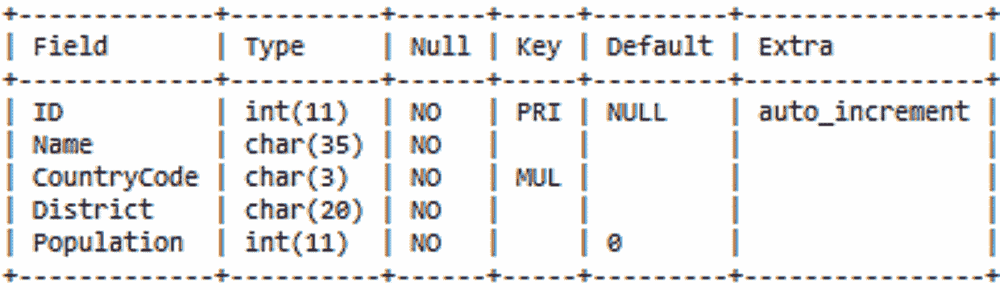
// `describe city` 可以显示表 `city` 的格式。
// Field: 表中的列。（例如，ID 是一个列名。）
// Type: 列的数据类型。（例如，ID 的数据类型是 int。）
// Null: 是否允许为空。（例如，ID 不允许为空。）
// Key: 指定主键。（例如，ID 被设为主键。）
// Default: 指定默认值。（例如，ID 没有默认值。）
// auto_increment: 字段值自动递增。

## die() 语法
```php
die("message");
```
// 输出消息并终止当前程序。

例如：
```php
fopen("myFile.txt","r") // 假设 myFile.txt 不存在
or die("The file is no found!");
```
// 输出:   The file is no found!

## do-while 循环语法
```php
do{ // 此处编写某些 php 代码 } while ( test-expression);
```
// 执行一次代码块，如果指定的条件为真，则重复循环。

例如：
```php
<?php
$counter=0;
do {
    echo "@";
    $counter++; // 每次循环增加 1
} while ($counter<8); // 最循环 8 次
?>
```
// 输出:   @@@@@@@@

## 移除字段语法
```sql
alter table TableName drop FieldName;
```
// 移除数据库中的表字段。

例如：
# 1. 假设当前表“books” 状态如下：
```sql
use library;
select * from books;
```
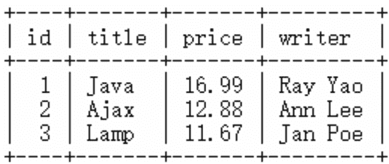
# 2. 删除一条记录和一个字段。
```sql
use library;
delete from books where id = 3;
alter table books drop price;
select * from books;
```
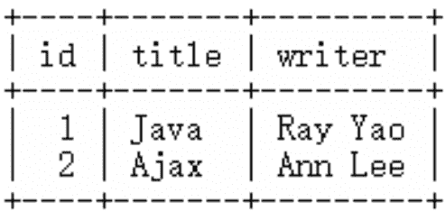
// `delete from books where id = 3;` 删除了 id 为 3 的记录。
// `alter table books drop price;` 移除了名为 `price` 的字段。

## each() 语法
// 此函数自 PHP 7.2.0 起已弃用。

## echo 语法
```php
echo "content";
echo ("content");
```
// 输出字符串或变量值。

例如：
```php
echo " Hello World! ";
echo (" Hello World! ");
```
// 输出:   Hello World!   Hello World!
// "echo" 和 "print" 的区别：
// `echo` 可以输出一个或多个字符串，没有返回值。
// `print` 仅输出一个字符串并可以返回 1。

## error_log() 语法
```php
error_log(message, Error_num, destination, header)
```
// 将错误消息保存到服务器上的指定位置
// 错误编号：0 - 发送到服务器，1 - 通过电子邮件发送，2 - 通过 php3 发送，3 - 发送并追加到现有文件。

例如：
```php
error_log("An error happen!", 3, "/server/tmp/errorFile.log");
```
// 文本将保存在日志中。

## empty() 语法
```php
empty($variable)
```
// 如果 $variable 为空，则返回 true；否则返回 false。

例如：
```php
$var = 10; // 定义一个变量
if(empty($var)){echo "'var' is empty.";}
else{ echo "'var' is not empty";}
```
// 输出:   'var' is not empty

## 封装语法
```php
class MyClass{
    private $variable; // 定义私有变量
    function getVariable(){
        return $this->variable;
    }
    function setVariable($arg){
        $this->variable = $arg;
    }
}
// 封装可以隐藏用户信息。
// 封装将属性和方法结合。

例如：
```php
<?php
class Income{
    private $salary;
    public function getSalary(){
        return $this->salary;
    }
    public function setSalary($arg){
        $this->salary = $arg;
    }
}
$m = new Income();
$m->setSalary(98000);
echo "Salary is ".$m->getSalary()." month";
?>
// 输出:   Salary is 98000 month

## enctype 语法
```html
<form enctype="value">
```
// 指定提交时使用的类型。

例如：
```html
<form enctype="multipart/form-data">
```
// 编码数据

## end() 语法
```php
end($array)
```
// 返回数组的最后一个元素。

例如：
```php
$arr = array("ant", "bee", "cat");
echo end($arr);
```
// 输出: cat

## explain 语法
```sql
explain TableName;
```
// 显示表格式、字段名、数据类型和修饰。

例如：
```sql
use world;
explain city;
```

// `explain city` 可以显示表 `city` 的格式。
// Field: 表中的列。（例如，ID 是一个列名。）
// Type: 列的数据类型。（例如，ID 的数据类型是 int。）
// Null: 是否允许为空。（例如，ID 不允许为空。）
// Key: 指定主键。（例如，ID 被设为主键。）
// Default: 指定默认值。（例如，ID 没有默认值。）
// auto_increment: 字段值自动递增。

## exit() 语法
```php
exit("message");
```
// 输出消息并终止当前程序。

例如：
```php
fopen("myFile.txt","r") // 假设 myFile.txt 不存在
or exit("The file is no found!");
```
// 输出:   The file is no found!

## explode() 语法
```php
explode(separator,$str)
```
// 将字符串转换为数组。

例如：
```php
$str = "R in 8 hours";
print_r(explode(" ",$str));
```
// 输出:   Array( [0=>R [1=>in [2=>8 [3=>hours )

## extends 语法
```php
class sub-class extends parent-class {……}
```
// 子类可以继承父类的所有特征。
// 子类对象可以引用父类的变量和函数。

例如：
```php
<?php
class Animal{
    var $head;
    function tail() {
        echo " Dog's tail is small ";
    }
}
class Dog extends Animal{
}
$d = new Dog();
$d->head = "big"; // 引用父类的变量
echo " Dog's head is ".$d->head." ";
$d->tail(); // 函数
?>
```
// 输出:   Dog's head is big   Dog's tail is small


## `eval()` 语法

```php
eval($string)
```

将字符串作为 `PHP` 代码执行。该字符串必须是有效的 `PHP` 代码并以分号结尾。

e.g.

```php
$str = '$num = 100; echo $num;';
eval($str); // $str 是 php 代码
// 输出: 100
```

## `exec()` 语法

```php
exec('external_program');
```

执行外部程序或外部命令。

e.g.
```php
echo exec('whoami');
// 该函数将返回执行程序输出的最后一行。
```

## `extract()` 语法

```php
extract($array);
```

将数组键转换为变量名，将数组值转换为变量值。

e.g.
```php
$arr=array("a"=>"ant", "b"=>"bee", "c"=>"cat", "d"=>"dog");
extract($arr);
echo "\\$a=$a; \\$b=$b; \\$c=$c; \\$d=$d";
// 输出: $a=ant; $b=bee; $c=cat; $d=dog
```

## `fclose()` 语法

```php
fcolse($openedFile)
```

关闭打开的文件。
释放内存资源和其他使用该文件的进程。

e.g.
```php
$filename = "D:\\myfile.txt"; // 设置路径 D:\\myfile.txt
$openfile = fopen( $filename, w ); // 以 w 模式打开文件
$content = fwrite( $openfile, "Hello!!" ); // 写入
fcolse($openfile); // 关闭打开的文件
// 写入 myfile.txt 后，我们可以使用 `fclose()` 关闭已打开的文件。
```

## `feof()` 语法

```php
feof($file)
```

如果读取到达文件末尾则返回 true，否则返回 false。

e.g.
```php
$f = fopen("myFile.txt","r");
while( !feof($f) ){ // 如果没有读到文件末尾，继续运行
$contents = fgets($f); // fgets($f) 读取文件
echo $contents. "<br>";
}
// 输出: ( 以下是文件的内容 )
Hi, this is myfile.txt,这个文件有两行。
这里是文件的末尾。
```

## `fgetc()` 语法

```php
fgetc($file)
```

从指定的文件中读取一个字符。

e.g.
```php
$f = fopen("myFile.txt","r");
echo fgetc($f);
// 输出: R
```

## `fgetcvs()` 语法

```php
fgetcvs($file)
```

从 csv 文件中读取一行。

e.g.
```php
$f = fopen("myFile.cvs","r");
print_r(fgetcsv($f));
// 输出: Array([0]=>ant [1]=>bee [2]=>cat [3]=>dog)
```

## `fgets()` 语法

```php
fgets($file)
```

从指定的文件中读取一行。

e.g.
```php
$f = fopen("myFile.txt","r");
echo fgets($f);
// 输出: This is one line text in myFile.txt
```

## `file()` 语法

```php
file("filename.txt")
```

将文件内容读取到数组。

e.g.
```php
print_r( file("myFile.txt") );
// 输出: Array ([0]=>Hi, this is myFile.txt. [1]=>There are two lines in this file. [2]=>Here is the last line. )
```

## `fileatime()` 语法

```php
fileatime("file.txt")
```

返回指定文件的最后访问时间。

e.g.
```php
echo "Last access: ".date("F d Y H:i:s.", fileatime("myFile.txt"));
// 输出: Last access: May 17 2022 18:15:32.
```

## `filemtime()` 语法

```php
filemtime("file.txt")
```

返回指定文件的最后修改时间。

e.g.
```php
echo "Last modified: ".date("F d Y H:i:s.", filemtime("d:\\myFile.txt"));
// 输出: Last access: May 17 2022 18:15:32.
```

## 文件上传语法

```html
<input type="file" name="file">
```

- `type="file"` 指定用于上传文件的表单。
- `name="file"` 指定被上传的 `"file"`，它将被传递给 PHP 文件处理。

e.g. // 假设我们上传了一个名为 "myFile.txt" 的文件
```html
<form action="" enctype="form-data">
<input type="file" name="file">
<input type="submit" value="Submit">
</form>
```
```php
<?php
echo "Name: " . $_FILES['name'];
echo "Type: " . $_FILES['type'];
echo "Size: " . $_FILES['size'];
echo "Error: " . $_FILES['error'];
?>
```

## `file_exists()` 语法

```php
file_exists(myFile)
```

如果文件存在则返回 true，否则返回 false。

e.g.
```php
if (file_exists($f)) {
    echo "The file exists";
} else {
    echo "The file does not exist";
}
// 输出: The file does not exist
```

## `filesize()` 语法

```php
filesize(file)
```

返回以字节为单位的文件大小。

e.g.
```php
echo filesize("myFile");
// 输出: 98
```

## `file_get_contents()` 语法

```php
file_get_contents(myFile)


读取内容。

e.g.
```php
echo file_get_contents("myFile");
// 输出: Hi, this is myFile?
```

## `file_put_contents()` 语法

```php
file_put_contents(myFile, "contents")
```

将内容写入文件并返回长度。

e.g.
```php
echo file_put_contents("myFile", "Hi, this is myFile.");
// 输出: 23
```

## `filter_var()` 语法

```php
filter_var(var, filter, array("options"=>function))
```

调用用户定义的函数或内置函数来过滤值。

e.g.
```php
$str="jquery in hours";
echo filter_var($str, FILTER_CALLBACK, array("options"=>"strtoupper"));
// 输出: JQUERY IN HOURS
```

## `filter_has_var()` 语法

```php
filter_has_var(type, variable)
```

检查表单输入是否有指定的值。

e.g. // 假设我们没有在表单中输入 url
if (!filter_has_var(INPUT_POST, "url")){
    echo("URL not found");
} else {
    echo("URL found");
}
// 输出: URL not found
```

## `filter_input()` 语法

```php
filter_input(type, variable, filter)
```

从表单获取外部变量并对其过滤。

- type: `INPUT_GET`, `INPUT_POST`, `INPUT_COOKIE`, `INPUT_SERVER`, `INPUT_ENV`
- variable: 来自表单的外部变量
- filter: 各种过滤器（见过滤器表）

e.g.
```php
if(isset($_POST["email"])){ // 假设我们输入了 xxx@yyy.com
    if(filter_input(INPUT_POST, "email", FILTER_VALIDATE_EMAIL)===false){
        echo("Email format is not valid");
    } else {
        echo("Email format is valid");
    }
}
// 输出: Email format is valid
```

## `filter_input_array()` 语法

```php
filter_input_array(type, array)
```

从表单获取多个外部变量并对其过滤。

- type: `INPUT_GET`, `INPUT_POST`, `INPUT_COOKIE`, `INPUT_SERVER`, `INPUT_ENV`
- $array: 来自表单的多个外部变量

e.g.
```php
$arr = array ( // 假设我们在表单中输入了 Ray Yao 和 28
```


```php
"name" => array ("filter"=>FILTER_CALLBACK,),
"age"  => array ( "filter"=>FILTER_VALIDATE_INT,),
); // "filter" 指向各种过滤器（参见过滤器表）

print_r(filter_input_array(INPUT_POST, $arr));

// 输出：
Array(
  [name] => Ray Yao
  [age] => 28
)
```

---

### filter_var() 语法：

```php
filter_var($variable, filter)
```
// 使用指定的过滤器过滤变量
// "filter" 指向 php 内置的过滤器（参见过滤器表）

#### 示例：
```php
$email = "xxx123@demo.com";

if (filter_var($email, FILTER_VALIDATE_EMAIL))
// FILTER_VALIDATE_EMAIL 是一个用于验证电子邮件地址的过滤器
{ echo("$email is a valid email address");}
else {echo("$email is not a valid email address");}
// 输出: xxx123@demo.com is a valid email address
```

---

### filter_var_array() 语法：

```php
filter_var_array($array)
```
// 获取多个变量和值。

#### 示例：
```php
$arr = array(
'A' => 'Apple',
'B' => 'Banana',
);

$fruit = filter_var_array($arr);
var_dump($fruit);
// 输出: array(2){["A"]=>string(5)"Apple" ["B"]=>string(6)"Banana"}
```

---

### final 语法：

```php
final class BaseClass{…}
final public function myFun(){…}
```
// final 类不能被继承，final 函数不能被重写。

#### 示例：
```php
<?php
final class BaseClass {
    final public function myFun() {
        echo "We are final class and final function";
    }
}

class ChildClass extends BaseClass { // 错误
    public function myFun() { // 错误
        echo "Try to extend final class & override final method" ;
    }
}
?>
// final 类不能被继承，final 函数不能被重写。
```

---

### floatval() 语法：

```php
floatval($data)
```
// 返回一个浮点值

#### 示例：
```php
$data = "123.456Good!";
echo floatval($data);
// 输出: 123.456
```

---

### floor() 语法：

```php
floor(number)
```
// 返回小于或等于参数的最接近整数。

#### 示例：
```php
echo(floor(9.5));
// 输出: 9
```

---

### flush() 语法：

```php
flush();
```
// 尽快将所有输出推送到浏览器，而不是等待整个程序完成，这可以提高网站速度。

#### 示例：
```php
<?php
for($num=0; $num<100; $num++){
    echo $num;
    flush();
}
// 假设这里有很长的代码……
?>
// 输出: 12345678……100
```

---

### fopen() 语法：

```php
fopen($filename, mode);
```
// 以指定的模式打开文件。打开文件的模式为：

| 模式 | 操作 |
| --- | --- |
| r | 仅读打开文件，从开始读取。 |
| w | 仅写打开文件，清空原有内容。 |
| a | 仅写打开文件，追加新内容。 |
| x | 创建一个仅写入的新文件。 |

// 注意：如果上述模式带有 "+" 号，则表示以读写混合模式打开文件。例如：`r+, w+, a+, x+`

#### 示例：
```php
$filename = "myfile.txt";
fopen( $filename, r ); // 仅读打开文件
fopen( $filename, w ); // 仅写打开文件
fopen( $filename, a+ ); // 同时读写打开文件，写入时在末尾追加新内容。
```

---

### for 循环语法：

```php
for( init, test-expression, increment) { // 一些代码; }
```
// "init" 初始化用于控制循环的变量。
// "test-expression" 如果返回 true 则允许循环。
// "increment" 在每次循环后增加 1。

#### 示例：
```php
for ($x = 0; $x <= 5; $x++) { // 最多循环 5 次
    echo "$x ";
}
// 输出: 012345
```

---

### foreach() 语法：

```php
foreach( $array as $key=>$value ){ }
```
// foreach() 可以遍历数组的所有元素。

#### 示例：
```php
$book=array( "A"=>"JSP", "B"=>"ASP", "C"=>"PHP");
foreach ( $book as $key => $value ){ // 迭代
    echo "The $key book is about $value. <br>";
} // $key 存储所有的键
// 输出：
// The A book is about JSP.
// The B book is about ASP.
// The C book is about PHP.
```

---

### fprintf() 语法：

```php
fprintf($file, $format)
```
// 向文件写入格式化字符串。

#### 示例：
```php
$file = fopen("test.txt", "w");
fprintf($file, "Hello %s", "World");
fclose($file);
```

---

### fputs() 语法：

```php
fputs($file, $string)
```
// fputs() 是 `fwrite` 的别名。

#### 示例：
```php
$file = fopen("test.txt", "w");
fputs($file, "Hello World");
fclose($file);
```

---

### fread() 语法：

```php
fread($file, length)
```
// 从文件中读取指定长度的内容。

#### 示例：
```php
$file = fopen("test.txt", "r");
$content = fread($file, 12);
echo $content;
fclose($file);
```

---

### fscanf() 语法：

```php
fscanf($file, $format)
```
// 根据格式解析文件。

#### 示例：
```php
$file = fopen("test.txt", "r");
$array = fscanf($file, "%s %d");
print_r($array);
fclose($file);
```

---

### ftruncate() 语法：

```php
ftruncate($file, size)
```
// 将文件截断到指定的尺寸（字节）。

#### 示例：
```php
$file = fopen("test.txt", "w+");
ftruncate($file, 120);
fclose($file);
```


```php
$content = fwrite( $openfile, "Hello!" );   // 写入

echo "写入文件成功!";

// 输出: 写入文件成功!

// 如果你打开 `D:\myfile.txt`，你可以看到内容 "Hello!"。
```

## getcwd() 语法

```php
getcwd();
// 返回当前工作目录。
```

e.g.

```php
echo getcwd();
// 输出: /home/phpdirectory
```

## getdate() 语法

```php
getdate();
// 返回本地日期时间信息。
```

e.g.

```php
print_r(getdate());
// 输出: Array ([seconds]=>26 [minutes]=>38 ….. [year]=>2022 )
```

## get_resource_type() 语法

```php
get_resource_type($resource);
// 返回资源类型
```

e.g.

```php
$file = fopen("myFile.txt","r");
echo get_resource_type($file);
// 输出: stream
```

## getenv() 语法

```php
getenv("VARIABLE");
// 获取环境变量的值。
```

e.g.

```php
putenv("USER=Ray Yao");
echo "用户名是: " . getenv("USER");
// 输出: 用户名是: Ray Yao
```

## getFile() 语法

```php
$e->getFile()
// 输出发生异常的文件。
```

e.g.

```php
try {
    throw new Exception("发生了异常!");
} catch(Exception $e) {
    echo "异常发生在该文件中: ".$e->getFile();
}
// 输出: 异常发生在该文件中: /server/script.php
```

## getLine() 语法

```php
$e->getLine()
// 输出抛出异常的行号
```

e.g.

```php
try {
    throw new Exception("发生了错误!");
} catch(Exception $e) {
    echo "异常发生在该行: ".$e->getLine();
}
// 输出: 异常发生在该行: 3
```

## getMessage() 语法

```php
$e->getMessage()
// 输出异常信息。
```

e.g.

```php
try {
    throw new Exception("发生了异常!");
} catch(Exception $e) {
    echo $e->getMessage();
}
// 输出: 发生了异常!
```

## 全局变量语法

```php
$variable=value;
function funName(){ global $variable }
// 全局变量在函数外部声明，可以在任何地方使用；
// 如果在函数内部使用全局变量，则该变量应加上关键字 "global" 前缀
```

e.g.

```php
<?php
$x = 100;    $y = 200;   // 全局变量
function myFun(){
    global $x, $y;    // 在函数内部两个全局变量
    $y = $x + $y;
    echo $y;
}
myFun();
?>
// 输出: 200
```

## gmdate() 语法

```php
gmdate(format, timestamp)
// 以指定的格式化本地 GMT/UTC 日期/时间。
// 关于日期/时间格式，请参阅日期时间格式表。
```

e.g.

```php
echo gmdate("Y F jS l h:i:s a");
// 输出: 2022 November 16th Wednesday 06:08:20 pm
```

## gmmktime() 语法

```php
gmmktime(hour, minute, second, month, day, year)
// 返回给定的 GMT 日期的 Unix 时间戳。
```

e.g.

```php
echo date("M-d-Y", gmmktime(0, 0, 0, 1, 1, 2018))." ";
echo date("M-d-Y", gmmktime(0, 0, 0, 10, 10, 2022));
// 输出: Jan-01-2018  Oct-10-2022
```

## header 语法

```php
header("string_to_send");
// 在进行其他输出之前向客户端发送 HTTP 头部
```

e.g.

```php
header('Location: url');
// 将当前网页页面重定向到另一个网页。

header("Cache-Control: no_cache");
// 指定浏览器必须始终刷新此页面而不使用缓存。

header("HTTP/1.0 404 Not Found");
// 在头部响应中设置 HTTP 状态。
```

```php
<?php
header( "Location:http://www.amazon.com");  // 到亚马逊
?>
// 输出: (我们可以看到亚马逊的首页)
```

## heredoc 语法

```php
$var= <<<EOF
texts
EOF;
// Heredoc 是在 PHP 代码中编写大量文本的方法，无需使用单引号或双引号分隔符。
// Heredoc 以 EOF 开始，以 EOF 结束。
```

e.g.

```php
$var="书是: ";
echo $var;
// 输出: 书是: 
```

## htmlentities() 语法

```php
htmlentities($characters)
// 将字符转换为 HTML 实体
```

e.g.

```php
$str = '<a href="www.com">';
echo htmlentities($str);
// 输出: &lt;a href=&quot;www.com&gt;
```

## html_decode() 语法

```php
html_decode($html_entities)
// 将 HTML 实体转换为字符
```

e.g.

```php
$str = '&lt;a href=&quot;www.com&gt;
echo html_decode($str);
// 输出: <a href="www.com">
```

## htmlspecialchars() 语法

```php
htmlspecialchars($predefined_characters)
// 将预定义字符转换为 html
```

e.g.

```php
$str = '<a href="www.com">';
echo htmlspecialchars($str);
// 输出: &lt;a href=&quot;www.com&gt;
```

## http_build_query() 语法

```php
http_build_query($data)
// 从数组生成 URL 编码查询字符串。
```

e.g.

```php
$data=array("a"=>"ant", "b"=>"bee", "c"=>"cat", "d"=>"dog");
echo http_build_query($data);
// 输出: a=ant&b=bee&c=cat&d=dog
```

## iconv() 语法

```php
iconv($input_charset, $output_charset, $str);
// 将字符串转换为请求编码。
```

e.g.

```php
$str = " EURO '€' ";
echo 'Original :', ("$str"), PHP_EOL;
echo 'Translated :', iconv("UTF-8", "ISO-8859-1//SLIT", $str);
// 输出:
Original : EURO '€'
Translated : EURO 'EUR'
```

## if 语句语法

```php
if ( test-expression ) { // 如果为真执行执行 }
// "if 语句" 在指定条件为真时执行 { … } 内的代码；如果条件为假，则不执行 {…} 内的任何代码。
```

e.g.

```php
$x = 200; $y = 100;
if ( $x > $y ){ // 如果真，运行后续代码
    echo "x 大于 y.";
}
// 输出: x 大于 y.
```

## if-else 语句语法

```php
if ( test-expression){ // 如果为真执行此; }
else { // 如果为假执行此; }
// "if...else 语句" 在测试返回真时运行部分代码，或者在测试返回假时运行另一部分代码。
```

e.g.

```php
<?php
$x = 100; $y = 200;
if ( $x > $y ){ // 如果真，运行此代码块
    echo "x 大于 y.";
}
else { // 如果假，运行此代码块
    echo "x 小于 y";
}
?>
// 输出: x 小于 y
```


# if…elseif…else 语法

```php
if (condition){ // 如果条件真，执行此操作 }
elseif(condition){ // 否则，如果条件真，执行此操作 }
else{ // 如果条件为假，执行此操作 }
```

示例：
```php
$h=date("H");
if ($h<"11"){ echo "Good morning!"; }
elseif ($h<"19"){ echo "Good day!"; }
else{ echo "Good night!"; }
// 输出: Good morning!
```

# implode() 语法

```php
implode(separator, $array)
```
// 使用字符串连接数组元素

示例：
```php
$arr = array('Scala' , 'in' , '8' , 'Hours');
echo implode(" * ", $arr);
// 输出: Scala * in * 8 * Hours
```

# in_array() 语法

```php
in_array("element", $arr)
```
// 如果指定的元素在数组中，则返回 true；否则返回 false。

示例：
```php
$arr = array("ant", "bee", "cat", "dog");
if (in_array("cat", $arr)){
    echo "The 'cat' is in the array";
}
// 输出: The 'cat' is in the array
```

# include() 语法

```php
include( "anotherFile.php" )
```
// 将 another.php 中的代码导入到当前文件
// `include()` 通常位于文件中间，如果程序出错，会显示一条消息，但程序会继续运行。

示例：
1. <!-- file1.php -->
```php
<?php echo " From file1.php "; ?>
```
2. <!-- file2.php -->
```php
<?php
echo " From file2.php ";
include("file1.php"); // 将 file1.php 导入到此处
?>
```
// 输出: From file2.php From file1.php

# include_once() 语法

```php
include_once( "anotherFile.php" )
```
// 仅将 another.php 中的代码导入到当前文件。
// `include_once()` 通常位于文件中间，如果程序出错，会显示一条消息，但程序会继续运行。

示例：
1. <!-- file1.php -->
```php
<?php echo " From file1.php "; ?>
```
2. <!-- file2.php -->
```php
<?php
echo " From file2.php ";
include_once("file1.php"); // 将 file1.php 导入到此处一次
?>
```
// 输出: From file2.php From file1.php

# 插入到表语法

```sql
INSERT INTO tableName (fieldnames) VALUES ('data')
```
// 通过插入数据向 MySQL 表添加新记录
// 注意：在 PHP 代码中，如果使用 MySQL 命令向表中插入字符串，字符串应该用 `\` 符号括起来。

示例：
```php
<?php
$con=new mysqli("servername","username","password","db");
if ($con->connect_error) { // 检查连接
    die("Connection fails: " . $con->connect_error);
}
echo "Connection succeeds";
?>
$sql = "INSERT INTO myTable (firstname, lastname) VALUES (\"Andy\", \"Smith\")";
if ($con->query($sql) === TRUE) {
    echo "Insert data successfully";
}
?>
```
// 输出: Connection succeeds Insert data successfully

# 插入到表语法

```php
$sql="insert into tableName (columns) values ("data")";
$query=mysqli_query($con, $sql); // 执行查询
```
// `$sql="insert into tableName (columns) value ("data")"` 用于向表中插入数据。注意：在 PHP 代码中，如果使用 MySQL 命令向表中插入字符串，字符串应该用 `\` 符号括起来。
// `$con` 是到 MySQL 服务器的连接。（参见 `mysqli_connect()`）。

示例：
```php
<?php
$con= mysqli_connect( "localhost", "root", "12345678" );
if( $con ) { // 如果成功连接 MySQL 服务器
    echo " Connect successfully! ";
}
$select=mysqli_select_db( $con, "myDB" );
if( $select ) { // 如果成功选择数据库 "myDB"
    $sql="insert into tableName (columns) values ("data")";
    $query=mysqli_query($con, $sql); // 执行查询
    // ... 查询逻辑
}
?>
```


```php
if(is_readable($f)) { echo ("$f is a readable file.");}
```
// 输出: `myFile.txt is a readable file.`

## `is_string()` 语法
```php
is_string($variable)
```
// 如果 `$variable` 是字符串，返回 true。

e.g.
```php
$var = "CHARACTERS";
if(is_string($var)){ echo "$var is a string.";}
```
// 输出: `CHARACTERS is a string.`

## `isset()` 语法
```php
isset($variable)
```
// 如果 `$variable` 已赋值，则返回 true，否则返回 false。

e.g.
```php
$var = 10;
if (isset($var)) {    // 如果 $var 已赋值，则返回 true
    echo "The var is set";
}
```
// 输出: `The var is set`

## `is_executable()` 语法
```php
is_executable($file)
```
// 如果 `$file` 可执行，返回 true。

e.g.
```php
$f = "config.exe";
if(is_executable($f)){echo ("$f is executable.");}
```
// 输出: `config.exe is executable.`

## `is_writable()` 语法
```php
is_writable($variable)
```
// 如果 `$variable` 是可写文件，返回 true。

e.g.
```php
$f = "myFile.txt";  
if(is_writable($f)) { echo ("$f is a writable file.");}
```
// 输出: `myFile.txt is a writable file.`

### `is_writeable()` 语法
// `is_writeable()` 是 `is_writable()` 的别名，请查看 `is_writable()`。

## `json_decode()` 语法
```php
json_decode($json, bool)
```
// 将 JSON 编码的对象转换为 PHP 变量
// 如果参数 `"bool"` 为 true，则将 json 格式转换为数组 格式。

e.g.
```php
$json = '{"a":6, "b":3, "c":8}';
var_dump(json_decode($json, true));
```
// 输出: `array(3){ ["a"]=>int(6) ["b"]=>int(3) ["c"]=>int(8) }`

## `json_encode()` 语法
```php
json_encode($variable)
```
// 将变量值编码为 JSON 格式

e.g.
```php
$age = array("Andy"=>19, "Bob"=>16, "Caddie"=>18);
echo json_encode($age);
```
// 输出: `{"Andy":19, "Bob":16, "Caddie":18}`

### `key()` 语法
```php
key($array)
```
// 根据内部指针当前的位置返回数组元素键。键的默认位置为 0。

e.g.
```php
$arr=array("A","B","C","D");
echo "The key of the current position is: " . key($arr);
```
// 输出: `The key of the current position is: 0`

### `krsort()` 语法
```php
krsort($array)
```
// 按降序排序关联数组的键

e.g.
```php
$score=array("Rosy"=>"90","Andy"=>"100","Jony"=>"85");
krsort($score);     // 排序键
print_r($score);
```
// 输出: `Array( [Rosy] => 90 [Jony] => 85 [Andy] => 100 )`

### `ksort()` 语法
```php
ksort($array)
```
// 按升序排序关联数组的键。

e.g.
```php
$score=array("Rosy"=>"90","Andy"=>"100","Jony"=>"85");
ksort($score);     // 排序键
print_r($score);
```
// 输出: `Array( [Andy] => 100 [Jony] => 85 [Rosy] => 90 )`

### 小于 / 大于语法
```sql
where FieldName less/more than value;
```
// 选择表中小于/大于指定值的记录。

e.g.
# 1. 假设表 “books”当前状态如下。
```sql
use library;
select * from books;
```
# 2. 使用 “<=” 显示过滤后的数据
```sql
select * from books where price <= 12.00;
```
// `where price <= 12.00;` 显示价格小于或等于 12.00 的价格。
// (你可以自己尝试使用 `>=` 运算符)。

### limit 记录语法
```php
$sql = "SELECT * FROM Orders LIMIT records";
```
// 指定返回的记录数。

e.g.
```php
$sql = "SELECT * FROM Orders LIMIT records";
```

### list() 语法
```php
list($a, $b, $c)
```
// 从数组中分配多个值。

e.g.
```php
list($a, $b, $c) = array("1", "2", "3");
```

### list() 语法
```php
list($a, $b, $c)
```
// 从数组中分配多个值。

e.g.
```php
list($a, $b, $c) = array("1", "2", "3");
```

### function() 语法
```php
function funcName() { ...
```
// 定义函数。

### log() 语法
```php
log(number)
```
// 返回数的自然对数。

### ltrim() 语法
```php
ltrim($string, $substring)
```
// 从字符串左侧删除空格或字符串。

e.g.
```php
$str = "Hi, Friends";
echo ltrim($str, "Hi, ");
```
// 输出: `Friends`

### mail() 语法
```php
mail(to, subject, message, headers)
```
// 发送邮件
// to: 指定收件人
// message: 指定邮件内容
// headers: (可选) 指定额外的头部，以 LF 分隔
// parameters: (可选) 指定邮件参数。邮件内容不能超过 70 个字符。

e.g.
```php
<?php  
$msg = "email_text";
mail("person@demo.com", "subject", $msg); 
?>
```

### max() 语法
```php
max(num1, num2, num3,...)
```
// 返回数字中的最大值。

e.g.
```php
echo max(1,3,5,7,9);
```
// 输出: 9

### min() 语法
```php
min(num1, num2, num3,...)
```
// 返回数字中的最小值。

e.g.
```php
echo min(1,3,5,7,9);
```
// 输出: 1

### md5() 语法
```php
md5($string, bool)
```
// 生成字符串的 MD5 哈希值。如果 `bool` 为 true，则生成 16 个二进制字符；如果 `bool` 为 false（默认），则生成 32 个十六进制字符。

e.g.
```php
$str = "Good";
echo md5($str);
```
// 输出: `0c6ad70beb3a7e76c3fc7adab74acc`

### md5_file() 语法
```php
md5_file($file)
```
// 生成文件的 MD5 哈希。

e.g.
```php
$f="myFile.txt";
echo md5_file($f);
```
// 输出: `2aa71b9b39feee485ace2843c0d0bfbb`

### microtime() 语法
```php
microtime()
```
// 返回带微秒的当前 Unix 时间戳

e.g.
```php
echo(microtime());
```
// 输出: `0.51976200 1668780938`

### mkdir() 语法
```php
mkdir("path/directory/", permission)
```
// 创建指定权限的目录，成功返回 1。
// 关于权限，请查看权限表。

e.g.
```php
mkdir("/php/myFolder/", 0770); // 如果失败则返回 0
```
// 给所有者和所有者用户组的权限
// 输出: 1


## `mktime()` 语法:

`mktime($hour, $minute, $second, $month, $day, $year)`

// 返回从 Unix Epoch（1970-1-1）到指定日期和时间的 Unix 时间戳（秒）。所有参数均为可选。

e.g.

```php
<?php  // 返回一个从 Unix Epoch 到当前时间的 Unix 时间戳
print(mktime());  
?>
// 输出:   1668797908
```

## `move_uploaded_file()` 语法:

`bool move_uploaded_file($file_tmp_name, $destination )`

// 将具有临时名的上传文件移动到新位置。

e.g.

```php
move_uploaded_file($_FILES["file"]["tmp_name"], "upload/$_FILES["file"]["name"]);
```
// 将 `$_FILES["file"]["tmp_name"]` 移动到 `"upload"` 文件夹，新文件名变为 `$_FILES["file"]["name"]`。

## `mt_rand()` 语法:

`mt_rand(min, max)`

// 生成一个 min 到 max 之间的随机数。参数为可选。

e.g.

```php
echo(mt_rand()."  "); echo(mt_rand(100,1000));
// 输出:   2045534323    168
```

## `mysqli_affected_rows()` 语法:

`mysqli_affected_rows()`

// 返回查询影响的行数。

e.g.

```php
$con=new mysqli("servername","username","password","db");
$sql = "DELETE FROM myTable WHERE id < 6";
mysql_query($sql, $con);
$rc = mysqli_affected_rows();
echo "Records deleted: " . $rc;
mysql_close($con);
// 删除的记录: 5
```

## `mysqli_close()` 语法:

`mysqli_close( );`

// 关闭之前打开的数据库连接

e.g.

```php
$con= mysqli_connect( "localhost", "root", "12345678" );
mysqli_close($con);     // 关闭连接
echo "The connection is closed successfully!";
// 输出:
// The connection is closed successfully!
```

## `mysqli_connect()` 语法:

`mysqli_connect( "host", "username", "password" );`

// `mysqli_connect( )` 让 PHP 连接到 MySQL 服务器。
// "host": 指定主机名或 IP 地址。
// "username": 指定 MySQL 用户名。
// "password": 指定 MySQL 密码。

e.g.

```php
$con = mysqli_connect( "localhost", "root", "12345678" );
if( $con ) {     // 如果成功连接 MySQL 服务器
echo  " Connect successfully! ";
}
// 输出:   Connect successfully!
```

## `mysqli_connect_error()` 语法:

`mysqli_connect_error()`

// 返回与 MySQL 连接的错误信息。

e.g.

```php
$conn = mysqli_connect("server", "user", "password", "db");
if (!$conn) {
  die("Connection failed: " . mysqli_connect_error());
}
// 输出:   Connection failed: php_network_getaddresses: getaddrinfo failed: No such host is known.
```

## `mysqli_data_seek()` 语法:

`mysqli_data_seek($result, row);`

// 将指针移动到结果集中的任意行。
// "row" 参数从行 0 开始。

e.g.

```php
$con=new mysqli("servername","username","password","db");
$sql="SELECT \* FROM myTable";
if ($result=mysqli_query($con, $sql)){
  mysqli_data_seek($result, 5);  // 跳到第 5 行
}
// 指向结果集中的第 5 行。
```

## `mysqli_error()` 语法:

`mysqli_error($con);`

// 返回上一次错误的描述。

e.g.

```php
$con=new mysqli("servername","username","password","db");
mysqli_query($con, "SELECT \* FORM myTable");
$error = mysqli_error($con);   // 错误
print("Error Found: ".$error);
// 输出:   Error Found: You have an error in your SQL syntax; ……
```

## `mysqli_fetch_array()` 语法:

`$array=mysqli_fetch_array($query)`

// `mysqli_fetch_array( )` 返回一个包含表行的索引数组和关联数组。元素的键名既可以是数字类型，也可以是字符串类型。例如：`[number]=>value    [string]=>value`。

e.g.

```php
<?php
$con= mysqli_connect( "localhost", "root", "12345678" );
if( $con ) {     // 如果成功连接 MySQL 服务器
echo  " Connect successfully! ";
}
$select=mysqli_select_db( $con, "myDB" );
if( $select ) {  // 成功选择数据库 "myDB"
echo  " Select myDB successfully!<br> ";
}
// 假设 myDB 有一个表 "colortable"
$sql="select \* from colortable"; // "*" 代表所有列
$query=mysqli_query( $con, $sql);
while ( $array=mysqli_fetch_array($query) ){  // 返回一个数组
// 返回一个数组
print_r($array); // print_r( ) 用于打印数组
echo "<br>";
}
// 输出:
// Connect successfully!
// Array (
  [0] => 1
  [1] => red
  [2] => yellow
  [3] => green
  [4] => blue
  [5] => sky
)
?>
```

## `mysqli_fetch_assoc()` 语法:

`$array=mysqli_fetch_assoc()`

// `mysqli_fetch_assoc( )` 返回一个包含表行的关联数组。元素的键可以是字符串类型。例如：`[string]=>value`。

e.g.

```php
<?php
$con= mysqli_connect( "localhost", "root", "12345678" );
if( $con ) {     // 如果成功连接 MySQL 服务器
echo  " Connect successfully! ";
}
$select=mysqli_select_db( $con, "myDB" );
if( $select ) {  // 成功选择数据库 "myDB"
echo  " Select myDB successfully!<br> ";
}
// 假设 myDB 有一个表 "colortable"
$sql="select \* from colortable"; // "*" 代表所有列
$query=mysqli_query( $con, $sql);
while ( $array=mysqli_fetch_assoc($query) ){  // 返回一个数组
print_r($array); // print_r( ) 用于打印数组
echo "<br>";
}
?>
// 输出:
// Connect successfully!
// Select myDB successfully!
// Array (
  [id] => 1
  [color1] => red
  [color2] => yellow
  [color3] => green
  [color4] => blue
  [color5] => sky
)
// Array (
  [id] => 2
  [color1] => pink
  [color2] => navy
  [color3] => purple
  [color4] => orange
  [color5] => olive
)
?>
```

## `mysqli_fetch_row()` 语法:

`$array=mysqli_fetch_row($query)`

// `mysqli_fetch_row( )` 返回一个包含表行的索引数组。元素的键总是数字类型。例如：`[number]=>value`。

e.g.

```php
<?php
$con= mysqli_connect( "localhost", "root", "12345678" );
if( $con ) {     // 如果成功连接 MySQL 服务器
echo  " Connect successfully! ";
}
$select=mysqli_select_db( $con, "myDB" );
if( $select ) {  // 成功选择数据库 "myDB"
echo  " Select myDB successfully!<br> ";
}
// 假设 myDB 有一个表 "colortable"
$sql="select \* from colortable"; // "*" 代表所有列
$query=mysqli_query( $con, $sql);
while ( $array=mysqli_fetch_row($query) ){  // 返回一个数组
print_r($array); // print_r( ) 用于打印数组
echo "<br>";
}
?>
// 输出:
// Connect successfully!
// Select myDB successfully!
// Array (
  [0] => 1
  [1] => red
  [2] => yellow
  [3] => green
  [4] => blue
  [5] => sky
)
// Array (
  [0] => 2
  [1] => pink
  [2] => navy
  [3] => purple
  [4] => orange
  [5] => olive
)
?>
```

## `mysqli_free_result()` 语法:

`mysqli_free_result($result)`

// 释放与结果相关的内存，如果成功返回 true。

e.g.

```php
$result = mysqli_query($con, "SELECT \* FORM myTable");
var_dump(mysqli_free_result($result));
// 输出:   bool(true)
```


# `mysqli_get_server_info()` 语法：

```php
$version = mysqli_get_server_info($con);
```
// 返回 MySQL 服务器的版本号。

例如：
```php
$con = mysqli_connect("server", "user", "password", "db");
$version = mysqli_get_server_info($con);
// 输出: MySQL Server Version: 5.7.12-log
```

# `mysqli_num_rows()` 语法：

```php
$total_numbers = mysqli_num_rows($result);
```
// 返回结果集中的行数。

例如：
```php
$con = mysqli_connect("server", "user", "password", "db");
$sql="SELECT * FROM myTable ";
$result=mysqli_query($con, $sql) ;
$rowNum=mysqli_num_rows($result);
var_dump($rowNum); // 假设结果中有 10 条记录
// 输出: int(10)
```

# `mysqli_query()` 语法：

```php
mysqli_query($queryVariable, $connectVariable);
```
// 执行查询

例如：
```php
$con=mysqli_connect("servername","username","password","db");
if (!$con) { die('连接失败! '); }
$sql = "SELECT * FROM Mytable";
mysqli_query($sql, $con);    // 执行查询
echo "数据选择成功!";
mysqli_close($con);
// 输出: 数据选择成功!
```

# `mysqli_real_escape_string()` 语法：

```php
mysqli_real_escape_string($string)
```
// 转义字符串中的特殊字符，使其在 SQL 中合法。

例如：
```php
mysqli_connect("server", "user", "password", "db");
$sql="SELECT * FROM myTable ";
var_dump( mysqli_real_escape_string($sql) );
// 输出: string(25) "SELECT * FROM 'myTable'"
```

# `mysqli_result()` 语法：

```php
mysqli_result($result, row, column)
```
// 根据表中的指定的行和列返回单元格中的值。

例如：
```php
var_dump( mysqli_result($result, 0, name) );
var_dump( mysqli_result($result, 1, 'name') );
// 输出:
string(3) "Alf"
string(3) "Bob"
```

# `mysqli_select_db()` 语法：

```php
mysqli_select_db( $con, "databaseName" );
```
// 选择一个数据库连接服务器。
// `$con` 是到 MySQL 服务器的连接（参见 `mysqli_connect()`）。
// `databaseName` 指定数据库的名称。

例如：
```php
<?php
$con= mysqli_connect( "localhost", "root", "12345678" );
if( $con ) {    // 如果成功连接 MySQL 服务器
echo " 连接成功! ";
}
$select=mysqli_select_db( $con, "myDB" );
if( $select ) { // 选择数据库 "myDB" 成功
echo " myDB 选择成功!<br>
}
?>
// 输出: 连接成功! myDB 选择成功!
```

# `namespace` 语法：

```php
namespace MyNamespace;
```
// `Namespace` 可以避免两个类名、两个函数名、两个变量名和两个常量之间的冲突。

例如：
```php
namespace MySpace1; // 定义第一个命名空间
class MyClass {
    const DEMO = "Nice!";
}
function myFun() { }

namespace MySpace2; // 定义第二个命名空间
class MyClass {
    const DEMO = "Nice!";
}
```


// 将输出缓冲区的内容发送到浏览器，并将缓冲区的内容存储到变量中，然后关闭缓冲区。

例如：

```php
ob_start();
echo "I will be stored in a variable. \n";
$variable = ob_get_flush();   // 此时缓冲区已关闭
echo "Variable value : $variable";
// 输出: I will be stored in a variable.
// Variable value : I will be stored in a variable.
```

---

### `ob_get_contents()` 语法:

```php
ob_get_contents()
```

// 将输出缓冲区的内容发送到浏览器，并将缓冲区的内容存储到变量中。缓冲区不会关闭。

例如：

```php
ob_start();
echo "I will be stored in a variable. \n";
$variable = ob_get_contents();   // 缓冲区未关闭
echo "Variable value : $variable";
// 输出: I will be stored in a variable.
// Variable value : I will be stored in a variable.
```

---

## `ob_get_length()`

```php
ob_get_length()
```

// 获取输出缓冲区内容的长度

例如：

```php
ob_start();
echo "R in 8 Hours";     // 12 个字符
$length = ob_get_length();
echo "\n"."The length of the output buffer contents: $length ";
// 输出: R in 8 Hours
// The length of the output buffer content: 12
```

---

### `ob_get_level()` 语法:

```php
ob_get_level()
```

// 返回活动输出缓冲区的嵌套级别，如果没有活动则返回 0。

例如：

```php
ob_start();
$buf_level = ob_get_level();  echo " Buffer level: $buf_level ";
ob_start();
$buf_level = ob_get_level();  echo " Buffer level: $buf_level ";
ob_start();
$buf_level = ob_get_level();  echo " Buffer level: $buf_level ";
// 输出: Buffer level: 1      Buffer level: 2      Buffer level: 3
```

---

### `ob_start()` 语法:

```php
ob_start()
```

// 启动输出缓冲区，存储要输出的内容。

例如：

```php
ob_start();  echo "This output can be seen";
ob_end_flush();     // 关闭缓冲区
// 输出: This output can be seen
```

---

### 对象 语法:

```php
$object = new class-name;     // 创建一个对象
$object->variable;     // 对象引用一个属性
$object->functionName( );     // 对象引用一个方法
```

// 对象是类的实例。

例如：

```php
<?php
class MyClass{} // 定义一个类
$p = "A class & object "; // 定义一个变量
$obj= new MyClass(); // 创建一个对象 "obj"
echo $obj-> p; // 对象引用一个变量
?>
// 输出: A class & object
```

---

### 排序 语法:

```sql
SELECT columnName FROM tableName ORDER columnName ASC|DESC
```

// 按升序或降序排序记录

例如：

```sql
SELECT id, lastname FROM myTable ORDER firstName DESC
// 按降序排序 firstName
```

---

### 方法重载 语法:

```php
function __call($name, $arg){}
```

// 不同对象调用同名但参数不同的方法，该方法会被调用。
// `__call()` 可以实现方法重载
// 当调用不存在的函数时会触发 `__call()`。
// `$name` 是函数名，$arg` 是数组。

例如：

```php
<?php
class MyClass {
function __call($name, $arg){ // 重载
return $arg[0] + $arg[1];
}
$obj1 = new MyClass();
echo $obj1->sum(10, ); // 调用 __call()
$obj2 = new MyClass();
echo $obj2->sum(20,30); // 调用 __call()
?>
// 输出: 10 50
```

---

### 覆盖 语法:

```php
class BaseClass{function myFun(){}}
class DerivedClass extends BaseClass{function myFun(){}}
```

// 基类的方法和派生类的方法拥有相同的名称和参数，它们会被调用。
// 覆盖意味着派生类的方法覆盖了基类的方法。

例如：

```php
<?php
class Class1{
public function show(){ // 基类的方法
return ' Class1 Information ';
}
class Class2 extends Class1{
public function show(){ // 基类的方法
return ' Class2 Message ';
}
$obj1 = new Class1();
echo $obj1->show();
$obj2 = new Class2();
echo $obj2->show();
// 输出: Class1 Information Class2 Message
```

---

### `parent::__construct()` 语法:

```php
parent::__construct();
```

// 在派生类中，调用基类的构造函数。

例如：

```php
<?php
class BaseClass {
function __construct() {
print "I am the constructor of base class" . PHP_EOL;
}
class DerivedClass extends BaseClass {
function __construct() {
parent::__construct(); // 调用基类构造函数
}
$obj = new DerivedClass();
?>
// 输出: I am the constructor of base class
```

---

### `parse_str()` 语法:

```php
parse_str(string, $array)
```

// 将字符串解析为数组。

例如：

```php
$str = "a=b&c=d";
parse_str($str, $output);
print_r($output);
// 输出: Array ( [a] => b [c] => d )
```

---

### `extract()` 语法:

```php
extract(array)
```

// 将数组中的键值对提取变量。

例如：

```php
$arr = array("a"=>"apple", "b"=>orange");
extract($arr);
echo $a; // 输出: apple
echo $b; // 输出: orange
```


// `$pattern`: 表示要搜索内容的正则表达式。
// `$string`: 执行搜索的字符串。

例如：

```php
$str = "A cow plows field slowly in the downtown now";
$pattern = "/ow/i";   // 查找字符串中所有 "ow" 的出现次数
$match_num = preg_match_all($pattern, $str);
echo " The 'ow' occurrence number is $match_num";
// 输出:  The 'ow' occurrence number is 6
```

## `preg_replace()` 语法

`preg_replace(str1, str2, $string)`

// 使用正则表达式替换字符串中的 `str1` 为 `str2`。

例如：
```php
$string = 'Scala in 8 Hours';
$pattern = '/scala/i';
echo preg_replace($pattern, 'Perl', $string);
// 输出:  Perl in 8 Hours
```

## `preg_split()` 语法

`preg_split($pattern, $string)`

// 使用模式作为分隔符将字符串拆为数组

例如：
```php
$str = '10-12-2022';
$patt = '/\\D/';    // 拆分任何非数字
$array = preg_split($patt, $str);
print_r($array);
// 输出:   Array([0] => 10     [1] => 12     [2] => 2022)
```

## `prepare()` 语法

`prepare("insert into tablename(var1,var2,var3)values(?,?,?)")`
`prepare("select \* from tablename where var1=? and var2=?")`

// 准备语句用于执行多个相同的 SQL 语句。

例如：
```php
<?php
$con=new mysqli("servername","username","password","db");  
$stmt = $con->prepare("INSERT INTO myTable (firstname, lastname, email) VALUES (?, ?, ?)");  
$stmt->bind_param("sss", $firstname, $lastname, $email); // 绑定
// "sss" 表示 3 个字符串。如果是 "ids"，则表示 1 个整数、1 个双精度型、1 个字符串。
$firstname = "Ray";     $lastname = "Yao";  
$email = "xxx@yyy.com";  
$stmt->execute();   // 执行  
echo "Insert data successfully";  
?>
// 输出:    Insert data successfully
```

## `prev()` 语法

`prev($array)`

// 返回数组中的上一个元素

例如：
```php
$a = array("A ", "B ", "C ");
echo current($a);  echo next($a);  echo prev($a);
// 输出:   A  B  A
```

## `print` 语法

`print "content";`
`print ("content");`

// 输出字符串或变量的值。

例如：
```php
print " Hello World!";
print (" Hello World!");
// 输出:  Hello World!
```
"echo" 和 "print" 的区别：
// "echo" 可以输出一个或多个字符串，没有返回值。
// "print" 仅输出一个字符串并可以返回值。

## `printf()` 语法

`printf("%format", $variable)`

// 打印格式化字符串。
// 用 `$variable` 的值替换 `%format`。
// 关于 `%format`，请参见《字符串图表》。

例如：
```php
$num = 8; $str = "Hours";
printf("JAVA in %u %s.", $num, $str);
// $num 替换 %u, $str 替换 %s
// 输出:  JAVA in 8 Hours
```

## `print_r()` 语法

`print_r($variable)`

// 打印显示存储在变量中的信息

例如：
```php
$var = array("A", "B", "C");
print_r($var);
// 输出:  Array ([0] => A [1] => B [2] => C)
```

## `private` 语法

`private $variable;`

// 私有变量只能在类内部访问。

例如：
```php
<?php
class MyClass {
    private $name = "Ray";
    public function getName() {
        return $this->name;
    }
}
$obj = new MyClass();
// echo $obj->name; // 错误：无法访问私有属性 name
echo $obj->getName();
// 输出: Ray
```

## `protected` 语法

`protected $variable;`

// 受保护变量只能在类内部或其子类中访问。

例如：
```php
<?php
class MyClass {
    protected $name = "Yao";
    public function getName() {
        return $this->name;
    }
}
class ChildClass extends MyClass {
    public function getName() {
        return $this->name;
    }
}
$obj = new ChildClass();
echo $obj->getName();
// 输出: Yao
```

## `public` 语法

`public $variable;`

// 公有变量可以在类的任何地方访问。

例如：
```php
<?php
class MyClass {
    public $name = "John";
}
$obj = new MyClass();
echo $obj->name;
// 输出: John
```


## 删除数据库语法：

```sql
drop database if exists DatabaseName;
```
// 在 `mysql` 服务器中删除数据库。

例如：

```sql
drop database if exists garage;
```
// 如果数据库 `garage` 当前存在，则 `drop database if exists garage;` 会删除名为 `garage` 的数据库。

## 删除表语法：

```sql
drop table if exists TableName;
```
// 在当前数据库中删除表。

例如：

```sql
drop table if exists myTable;
```
// 如果表 `myTable` 当前存在，则 `drop table if exists myTable;` 会删除名为 `myTable` 的表。

## rename() 语法：

```php
rename(oldfile, newfile);
```
// 将 `oldfile` 移动并重命名为 `newfile`。

例如：

```php
rename("/dir1/file1.txt","/dir2/file2.txt");
```
// 将 `/dir1/file1.txt` 移动到 `/dir2/file2.txt`，并将 `file1.txt` 重命名为 `file2.txt`

## require() 语法：

```php
require( "anotherFile.php" )
```
// 将 `another.php` 中的代码导入到当前文件。
// `require()` 通常位于文件顶部。如果程序出错，程序将停止运行。

例如：

1. `<!--file1.php-->`
```php
<?php echo " From file1.php "; ?>
```
2. `<!--file2.php-->`
```php
<?php 
require("file1.php"); // 将 file1.php 导入此处
echo " From file2.php ";
?>
```
<!----run file2.php-->
// 输出: From file1.php From file2.php

## require_once() 语法：

```php
require_once( "anotherFile.php" )
```
// 将 `another.php` 中的代码导入到当前文件，仅导入一次。
// `require_once()` 通常位于文件顶部。如果程序出错，程序将停止运行。

例如：

1. `<!--file1.php-->`
```php
<?php echo " From file1.php "; ?>
```
2. `<!--file2.php-->`
```php
<?php 
require_once("file1.php"); // 将 file1.php 导入此处一次
echo " From file2.php ";
?>
```
// 输出: From file1.php From file2.php

## 重置表单语法：

```html
<input type="reset" value="xxx">
```
// 重置表单中的所有数据。
// `value` 属性设置按钮上的字符。

例如：

```html
<form action="myfile.php" method="post">
<input type="reset" value="RESET">
</form>
```
// 输出: | RESET |

## reset() 语法：

```php
reset($array)
```
// 返回数组的第一个元素。

例如：
```php
$arr = array("ant", "bee", "dog");
echo reset($arr);
```
// 输出: ant

## return 语法：

```php
return value;
```
// `return value` 用于向函数调用者返回值。

例如：
```php
function multiply($x, $y){
    return $x; // 向函数调用者返回值
}
echo(multiply(10,20)); // 这是函数调用者
```
// 输出: 20

## rmdir() 语法：

```php
rmdir($directory);
```
// 删除空目录。

例如：
```php
rmdir('/temp/mydir'); // mydir 是一个空目录
```

## round() 语法：

```php
round($float, places)
```
// 根据指定的位数四舍五入 `$float`。

例如：
```php
var_dump(round(3.1415926538, 3));
```
// 输出: 3.142

## rsort() 语法：

```php
rsort($array)
```
// 降序排序数组元素。

例如：
```php
$arr=array("30","20");
rsort($arr);
print_r($arr);
```
// 输出: Array([0] => 30 [1] => 20)

## rtrim() 语法：

```php
rtrim($string, substring)
```
// 从字符串右侧移除 `substring`。

例如：
```php
$str = "Hi, Friends";
echo rtrim($str, "Friends"); // 移除
```
// 输出: Hi,

## scandir() 语法：

```php
scandir("/directory")
```
// 返回目录内所有的子目录和文件。

例如：
```php
$array = scandir('/directory');
print_r($array);
```
// 输出: Array([0] => . [1] => .. [2] => subDir [3] => f1.php [4] => f2.txt)

## select 数据语法：

```sql
SELECT columnName FROM tableName
SELECT * FROM tableName
```
// 从一个或多个表中选择数据。`*` 表示所有列。

例如：
```php
<?php 
$con=new mysqli("servername","username","password","db"); 
$sql = "SELECT id, lastname FROM myTable"; 
$result = $con->query($sql); // 执行查询
if ($result->num_rows > 0) { 
    while($row = $result->fetch_assoc()) { 
        echo "ID: ".$row["id"]. " First Name: ".$row["firstname"]. "Last Name: ".$row["lastname"]; // 显示每行数据
    }
} else { 
    echo "0 results"; 
}
?>
```
// `num_rows()` 返回表的行数。`fetch_assoc()` 返回包含表行的关联数组。其键始终为字符串。例如：`string => value`。

## select 数据语法：

```php
$sql="select column from table-name";
$query=mysqli_query($con,$sql);
```
// `$sql="select column from table-name"` 用于通过列名从表中检索数据。
// `$query=mysqli_query($con,$sql)` 执行查询。
// `$con` 是 MySQL 服务器的连接。

例如：
```php
<?php
$con= mysqli_connect( "localhost", "root", "12345678" );
if( $con ) { // 如果连接 MySQL 服务器成功
    echo " Connect successfully! ";
}
$select=mysqli_select_db( $con, "myDB" );
if( $select ) { // 如果选择数据库 "myDB" 成功
    echo " Select myDB successfully!<br> ";
} // 假设 myDB 有表 "colortable"
$sql="select id, color1 from colortable";
// 在表 "colortable" 中选择列 "id" 和 "color1"
$query=mysqli_query( $con,$sql ); // 运行查询
if( $query ) {
    echo " Retrieve data successfully! <br>";
}
while($row = mysqli_fetch_array($query)){ // 返回数组
    echo("<br> ID: ".$row["id"]); // 显示 $row["id"] 值
    echo("<br> color1: ".$row["color1"]); // 显示 $row["color1"] 值
}
?>
```
// 输出: Connect successfully! Select myDB successfully! Retrieve data successfully!

## select 显示表语法：

```sql
select * from TableName;
```
// 显示并查看数据库表中中的所有数据。

例如：
```sql
use library;
select * from books;
```
(image_rsrc716.jpg)
// `select * from books;` 显示 `books` 表中的所有数据。
// "library" 中的 `books` 表有 3 条记录和 4 个字段。

## select option 语法：

```html
<select name="data", id="xx" multiple size = number>
<option value="">Please select one item</option>
<option value="value1">text1</option>
<option value="value2">text2</option>
<option value="value3">text3</option>
</select>
```
// 通过 select 的 name 属性获取下拉菜单的值。如果是多选，请使用 `multiple size='number'`。

例如：
```php
<?php
$data = isset($_GET['data'])? htmlspecialchars($_GET['data']) : "";
if($data) { // 从表单获取数据值
    if($data =='MATLAB') { echo 'Matlab in 8 Hours'; }
    else if($data=='KOTLIN') { echo 'Kotlin in 8 Hours'; }
    else if($data=='PANDAS') { echo 'Pandas in 8 Hours'; }
} else {
?>
<form action="" method="get">
<select name="data">
<option value="">Please select one book</option>
<option value="MATLAB">Matlab</option>


```html
<option value="KOTLIN">Kotlin</option>
<option value="PANDAS">Pandas</option>
</select>
<input type="submit" value="Submit">
</form>
```

```php
<?php
}
?>
```

Output: 

# 8 小时学会 Kotlin

## serialize() 语法
```php
serialize(values);
```
为值创建一个可存储的表示形式。

例如：
```php
$var = serialize(array("ant", "bee", "cat", "dog"));
echo $var;
```
// 输出：`a:4:{i:0;s:3:"ant";i:1;s:3:"bee";i:2;s:3:"cat";i:3;s:3:"dog";}`

## session_destroy() 语法
```php
session_destroy();
```
销毁与当前会（session）相关的所有数据。

例如：
```php
session_start();
$_SESSION["color"]="red";
session_destroy();
echo "Session has been destroyed ";
```
// 输出：`Session has been destroyed`

## session_id() 语法
```php
<?php session_start()?>?> // 开始会话
<a href="anotherPage.php<?php echo(SID);?>">…</a>
// 将会话 id 传递给另一个页面
<?php echo(session_id());?> // 显示会话 id
```
例如
1. `<!-- aFile.php -->`
```php
<?php session_start()?>?> <!-- 开始 php 会话 -->
<br>这里是“第一页”。<br>
<br>向第二个页面发送一个会话 id<br><br>
<a href="bFile.php<?php echo(SID);?>">前往第二页</a>  
<!-- 将会话 id 传递给 bFile.php -->
<!-- 将此文件保存为 "aFile.php" 并于工作目录 --> 
```
2. `<!-- bFile.php -->`
```php
<?php session_start()?>?>  <!-- 开始 php 会话 -->
<br>这里是“第二页”。<br>
<br>会话 id 是： <br><br>
<?php echo(session_id());?>  <!-- 显示会话 id -->>
<!-- 将文件保存为 "bFile.php" 并于工作目录 --> 
<!-- 请运行 aFile.php -->  
```
// 输出：
这里是“第一页”。
向第二个页面发送一个会话 id
[前往第二页](http://localhost/B.php)

// 输出：
这里是“第二页”。
会话 id 是：
m4tiga6576moc23dma5jugt8cm

## session_name() 语法
```php
session_name("name")
```
// 设置会话名称
```php
session_name()
```
// 获取会话名称

例如：
```php
session_name('mySession'); // 设置会话名称
session_start();
echo session_name(); // 获取会话名称
```
// 输出：`mySession`

## session_regenerate_id() 语法
```php
session_regenerate_id();
```
创建一个新的会话 id，除了会话 id 外，不会丢失任何当前的会话信息。

例如：
```php
session_start();
echo session_id();
session_regenerate_id();
echo session_id();
```
// 输出：`a5d7850ff6afa135b17e6dd69ec0a22b6p9861rf8057a32v8ap36gd7b68`

## session_start() 语法
```php
<?php session_start()?>?>
```
// 开始会话
<a href="anotherPage.php<?php echo(SID);?>">…</a>
// 将会话 id 传递给另一个页面
// 显示会话 id。
例如：
1. `<!-- aFile.php -->`
```php
<?php session_start()?>?> <!-- 开始 php 会话 -->
<br>这里是“第一页”。<br>
<br>向第二个页面发送一个会话 id<br>
<a href="bFile.php<?php echo(SID);?>">前往第二页</a> 
<!-- 将会话 id 传递给 bFile.php -->
<!-- 将此文件保存为 "aFile.php" 并于工作目录 --> 
```
2. `<!-- bFile.php -->`
```php
<?php session_start()?>?> <!-- 开始 php 会话 -->
<br>这里是“第二页”。<br>
<br>会话 id 是： <br><br>
<?php echo(session_id());?> <!-- 显示会话 id -->
<!-- 将文件保存为 "bFile.php" 并于工作目录 --> 
<!-- 请运行 aFile.php --> 
```
// 输出：
这里是“第一页”。
向第二个页面发送一个会话 id
[前往第二页](http://localhost/B.php)

// 输出：
这里是“第二页”。
会话 id 是：
m4tiga6576moc23dma5jugt8cm

## session_name() 语法
```php
session_name("name")
```
// 设置会话名称
```php
session_name()
```
// 获取会话名称

例如：
```php
session_name('mySession'); // 设置会话名称
session_start();
echo session_name(); // 获取会话名称
```
// 输出：`mySession`

## session_regenerate_id() 语法
```php
session_regenerate_id();
```
创建一个新的会话 id，除了会话 id 外，不会丢失任何当前的会话信息。

例如：
```php
session_start();
echo session_id();
session_regenerate_id();
echo session_id();
```
// 输出：`a5d7850ff6afa135b17e6dd69ec0a22b6p9861rf8057a32v8ap36gd7b68`

## session_start() 语法
```php
<?php session_start()?>?>
```
// 开始会话
<a href="anotherPage.php<?php echo(SID);?>">…</a>
// 将会话 id 传递给另一个页面
// 显示会话 id。
例如：
1. `<!-- aFile.php -->`
```php
<?php session_start()?>?> // 开始 php 会话 -->
<br>这里是“第一页”。<br>
<br>向第二个页面发送一个会话 id<br>
<a href="bFile.php<?php echo(SID);?>">前往第二页</a> 
<!-- 将会话 id 传递给 bFile.php -->
<!-- 将此文件保存为 "aFile.php" 并于工作目录 --> 
```
2. `<!-- bFile.php -->`
```php
<?php session_start()?>?> <!-- 开始 php 会话 -->
<br>这里是“第二页”。<br>
<br>会话 id 是： <br><br>
<?php echo(session_id());?> <!-- 显示会话 id -->>
<!-- 将文件保存为 "bFile.php" 并于工作目录 --> 
<!-- 请运行 aFile.php -->  
```
// 输出：
这里是“第一页”。
向第二个页面发送一个会话 id
[前往第二页](http://localhost/B.php)

// 输出：
这里是“第二页”。
会话 id 是：
m4tiga6576moc23dma5jugt8cm

## session_name() 语法
```php
session_name("name")
```
// 设置会话名称
```php
session_name()
```
// 获取会话名称

例如：
```php
session_name('mySession'); // 设置会话名称
session_start();
echo session_name(); // 获取会话名称
```
// 输出：`mySession`

## session_regenerate_id() 语法
```php
session_regenerate_id();
```
创建一个新的会话 id，除了会话 id 外，不会丢失任何当前的会话信息。

例如：
```php
session_start();
echo session_id();
session_regenerate_id();
echo session_id();
```
// 输出：`a5d7850ff6afa135b17e6dd69ec0a22b6p9861rf8057a32v8ap36gd7b68`

## session_start() 语法
```php
<?php session_start()?>?>
```
// 开始会话
<a href="anotherPage.php<?php echo(SID);?>">…</a>
// 将会话 id 传递给另一个页面
// 显示会话 id。
例如：
1. `<!-- aFile.php -->`
```php
<?php session_start()?>?> <!-- 开始 php 会话 -->
<br>这里是“第一页”。<br>
<br>向第二个页面发送一个会话 id<br>
<a href="bFile.php<?php echo(SID);?>">前往第二页</a> 
<!-- 将会话 id 传递给 bFile.php -->
<!-- 将此文件保存为 "aFile.php" 并于工作目录 --> 
```
2. `<!-- bFile.php -->`
```php
<?php session_start()?>?>  <!-- 开始 php 会话 -->
<br>这里是“第二页”。<br>
<br>会话 id 是： <br><br>
<?php echo(session_id());?>  <!-- 显示会话 id -->>
<!-- 将文件保存为 "bFile.php" 并于工作目录 --> 
<!-- 请运行 aFile.php -->  
```
// 输出：
这里是“第一页”。
向第二个页面发送一个会话 id
[前往第二页](http://localhost/B.php)

// 输出：
这里是“第二页”。
会话 id 是：
m4tiga6576moc23dma5jugt8cm


```mysql
mysql > show databases;
```

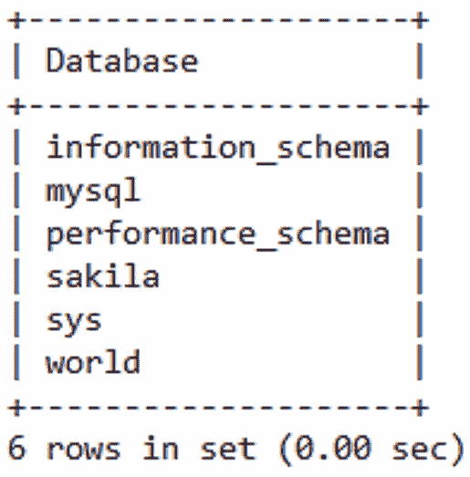

## 显示指定字段语法

```sql
select field1, field2, field3 from TableName;
```

`// 显示表中的某些指定字段`

e.g.

### 1. 假设表 `books` 当前状态如下：

```sql
use library;
select * from books;
```

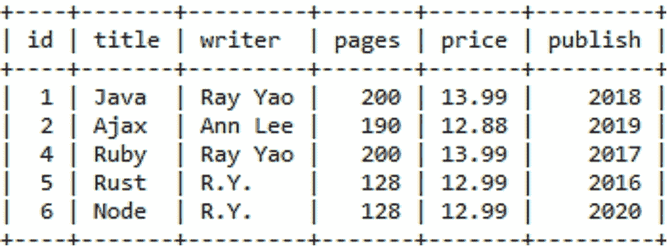

## 2. 显示某些指定字段

```sql
use library;
select title, price from books;
```

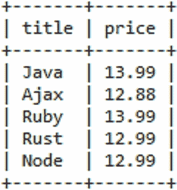

`// select title, price from books;` 仅显示 `books` 表中的两个字段 `title` 和 `price`。

---

## 显示指定记录语法

```sql
select * from TableName where field = value;
```

`// 显示表中的特定记录。`

e.g.

### 1. 假设表 `books` 当前状态如下：

```sql
use library;
select * from books;
```

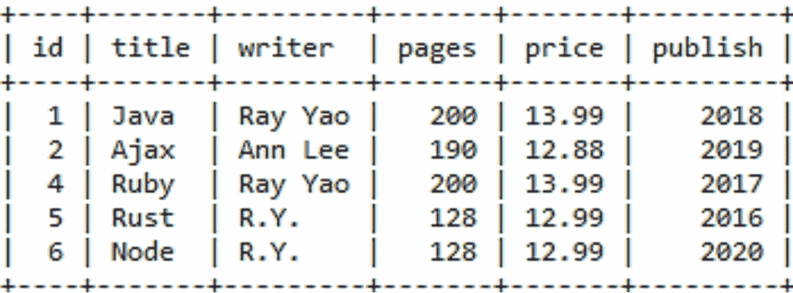

## 2. 添加一条记录，然后显示这条记录

```sql
use library;
insert into books (id, title, writer, pages, price, publish)
values (7, "Lamp", "Jan Poe",120, 11.67, 2015);
select * from books where writer = "Jan Poe";
```

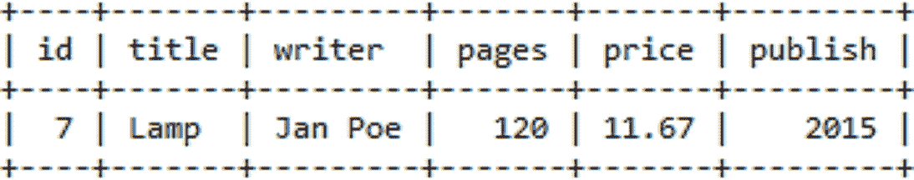

`// select * from books where writer = "Jan Poe";` 仅显示 `writer` 为 `Jan Poe` 的记录。

---

## 显示表语法

```sql
show tables;
```

`// 显示当前数据库中所有存在的表。`

e.g.

```mysqlmysql> use world;
Database changed
mysql> show tables;
```

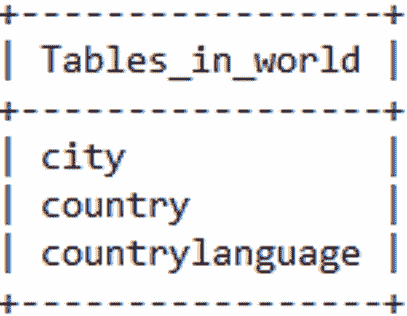

`// use world;` 指定使用 `world` 数据库。
`// show tables` 显示 `world` 数据库中的所有表。
`// `world` 数据库中共有三张表。

---

## shuffle() 语法

```php
shuffle($array)
```

`// 随机打乱数组元素的顺序。`

e.g.

```php
$arr = array("a", "b", "c", "d");
shuffle($arr);
print_r($arr);
// Output: Array([0] => c [1] => b [2] => d [3] => a)
```

---

## simplexml_load_file() 语法

```php
$xml = simplexml_load_file("myFile.xml")
$xml -> node
```

`// 从 xml 文件获取数据，并根据节点打印内容`

e.g.

1. 假设 `myFile.xml` 的内容为：

```xml
<?xml version='1.0' encoding='UTF-8'?>
<note>
<to>Tove</to>
<from>Jani</from>
<heading>Reminder</heading>
<body>Don't forget me this weekend!</body>
</note>
```

2.

```php
<?php  
$xml=simplexml_load_file("myFile.xml")
echo $xml->node;
```

实际上，此处原文逻辑应该是：

```php
<?php  
$xml=simplexml_load_file("myFile.xml");
echo $xml->body;
```
（注：原文示例代码片段存在格式混乱，此处已按翻译逻辑尽可能还原）

---

## simplexml_load_string() 语法

```php
simplexml_load_string(xmlData)
```

`// 获取字符串的 XML 数据并打印出来。`

e.g.

```php
<?php
$myXML="<?xml version='1.0' encoding='UTF-8'?>
<note>
<to>Tove</to>
<from>Jani</from>
<heading>Reminder</heading>
<body>Don't forget me this weekend!</body>
</note>";
$xml=simplexml_load_string($myXML);
print_r($xml);
?>
// Output: 
SimpleXMLElement Object
(
    [to] => Tove
    [from] => Jani
    [heading] => Reminder
    [body] => Don't forget me this weekend!
)
```

---

## sleep() 语法

```php
sleep(seconds)
```

`// 使当前代码延迟指定的秒数`

e.g.

```php
sleep(3);
// 暂停 3 秒后继续。
```

---

## sort() 语法

```php
sort($array)
```

`// 升序排序数组元素值`

e.g.

```php
$arr=array("30","10","20");
sort($arr); // sort values
// Output: Array ([0] => 10 [1] => 20 [2] => 30
```

---

## 表排序语法

```sql
order by field asc / desc;
```

`// 使用 "asc" 关键字升序排序数据。`
`// 使用 "desc" 关键字降序排序数据。`

e.g.

1. 假设 `books` 表当前状态如下：

```sql
use library;
select * from books;
```

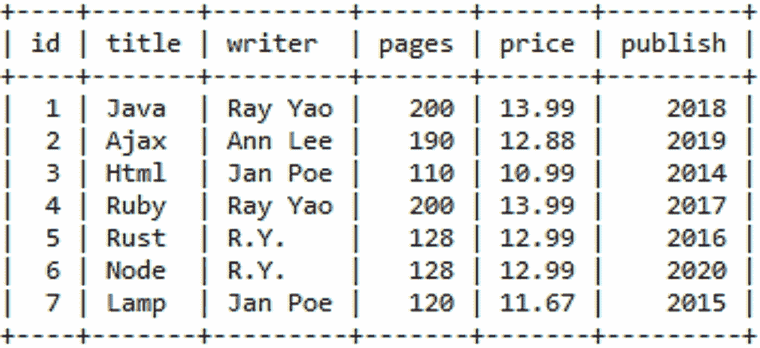

2. 使用 `asc` 对表排序：

```sql
use library;
select * from books order by price asc;
```

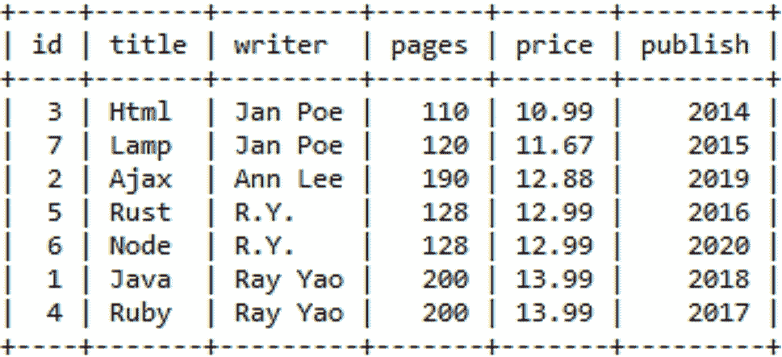

`// select * from books order by price asc;` 按 `price` 排序。

---

## sprintf() 语法

```php
sprintf(format, $variable)
```

`// 将格式化字符串写入变量`

e.g.

```php
$num = 8;
$str = "Hours";
$var = sprintf("%d %s", $num, $str);
// Output: 8 Hours
```

---

## sqrt() 语法

```php
sqrt(number)
```

`// 返回数字的平方根`

e.g.

```php
echo sqrt(25);
// Output: 5
```

---

## sscanf() 语法

```php
sscanf(string, format)
```

`// 根据格式解析字符串。`

e.g.

```php
$str = "Java in 8";
$format = sscanf($str,"%s %d");
print_r($format);
// Output: Array([0] => Java [1] => 8)
```

---

## static 语法

```php
static $variable = value;
```

`// 静态变量可以保留上一次函数调用时的值。`

e.g.

```php
<?php
function myFunc() {
    static $var=10;
    echo $var++;
}
myFunc();
myFunc();
// Output: 1011
?>
```

---

## static 成员语法

```php
static $variable = value;
static function funName()
```

`// 静态成员可以直接通过类调用，而不是通过对象。`

e.g.

```php
<?php
class MyClass {
    public static $staticVar = 'I am a static variable';
    public static function staticFun(){
        echo "I am a static function";
    }
}
print MyClass::$staticVar;
print MyClass::staticFun();
?>
// Output:
// I am a static variable
// I am a static function
```

---

## string 语法

```php
$str = "characters";
$str = 'characters';
```

`// 字符串由一系列字符组成，由双引号或单引号围围。`

e.g.

```php
$x = " Hello world! ";
echo $x;
$y = ' Hi, my friend! ';
echo $y;
// Output:  Hello world!  Hi, my friend!
```

---

## 字符串连接语法

```php
$string1 . " " . $string2
```

`// 连接两个字符串`

e.g.

```php
$book1 = "PowerShell";
$book2 = "in 8 Hours";
echo $book1 . " " . $book2;
// Output: PowerShell in 8 Hours
```

---

## stripos() 语法

```php
stripos(string, substring)
```

`// 返回字符串在字符串中第一次出现的位置。`
`// stripos() 不区分大小写。`

e.g.

```php
echo stripos("Powershell & Shell Scripting in 8 Hours", "Shell");
// Output: 5
```

---

## stripslashes() 语法

```php
stripslashes("backslashes")
```

`// 去反斜杠 \\ 和 \\\\。`

e.g.

```php
echo stripslashes("I don\\'t know!");
// Output: I don't know!
```

---

## stristr() 语法

```php
stristr("string", "substring")
```

`// 搜索子字符串第一次出现的位置并返回剩余部分。`


```php
echo stristr("Hi, My friends!", "my"); // `stristr()` 不区分大小
// 输出: My Friends!
```

### strip_tags()
`strip_tags()` 语法：
```php
strip_tags("string_with_html_tags");
```
// 从字符串中移除任何 html 标签。

e.g.
```php
echo strip_tags("The book is <b><i>'R in 8 Hours'</i></b>");
// 输出: The book is 'R in 8 Hours'
```

### str_ireplace()
`str_ireplace()` 语法：
```php
str_ireplace(old_str, "new_str", "original_str")
```
// 在原始字符串中，用新字符串替换旧字符串。

e.g.
```php
// `str_ireplace()` 不区分大小
echo str_ireplace("JQuery", "MySQL", "jQuery in 8 Hours");
// 输出: MySQL in 8 Hours
```

### strlen()
`strlen()` 语法：
```php
strlen($string);
```
// 返回字符串的长度并包含空格

e.g.
```php
$string=" Hello World! ";
echo strlen($string); // 返回字符串长度
// 输出: 16
```

### str_pad()
`str_pad()` 语法：
```php
str_pad(string, length, pad)
```
// 将字符串填充到指定的长度

e.g.
```php
$str = "So Good";
echo str_pad($str,10,"$"); // 用 `$` 填充到长度 10
// 输出: So Good$$$
```

### strpbrk()
`strpbrk()` 语法：
```php
strpbrk("string", "character")
```
// 在字符串中搜索指定字符的首次出现，并返回剩余子字符串。

e.g.
```php
echo strpbrk("NumPy in 8 Hours", "i"); // `strpbrk()` 区分大小
// 输出: in 8 Hours
```

### strpos()
`strpos()` 语法：
```php
strpos(string, substring)
```
// 返回子字符串在字符串中首次出现的位置。
// `strpos()` 区分大小写。

e.g.
```php
echo strpos("Powershell & Shell Scripting in 8 Hours", "Shell");
// 输出: 13
```

### str_repeat()
`str_repeat()` 语法：
```php
str_repeat(string, repeat_number)
```
// 根据指定的次数重复字符串

e.g.
```php
echo str_repeat("Good! ", 3); // 重复 3 次
// 输出: Good! Good! Good!
```

### strrev()
`strrev()` 语法：
```php
strrev("string")
```
// 反转字符串

e.g.
```php
echo strrev("abcde");
// 输出: edcba
```

### strripos()
`strripos()` 语法：
```php
strripos(string, substring)
```
// 返回子字符串在字符串中最后一次出现的位置。
// `strripos()` 不区分大小写。

e.g.
```php
echo strripos("Powershell & Shell Scripting in 8 Hours", "shell");
// 输出: 13
```

### strrpos()
`strrpos()` 语法：
```php
strrpos(string, substring)
```
// 返回子字符串在字符串中最后一次出现的位置。
// `strrpos()` 区分大小写。

e.g.
```php
echo strrpos("Powershell & Shell Scripting in 8 Hours", "shell");
// 输出: 13
```

### strstr()
`strstr()` 语法：
```php
strstr("string", "substring")
```
// 在字符串中查找子字符串的首次出现并返回剩余部分。

e.g.
```php
echo strstr("Hi, My friends!", "My"); // `strstr()` 区分大小
// 输出: My friends!
```

### strtolower()
`strtolower()` 语法：
```php
strtolower($string);
```
// 将字符串转换为小写

e.g.
```php
$string=" Hello World! ";
echo strtolower($string); // 返回小写字符串
// 输出: hello world!
```

### strtotime()
`strtotime()` 语法：
```php
strtotime()
```
// 返回自 1970 年以来的秒数

e.g.
```php
$date="next Friday";
echo strtotime($date);
// 输出: [某个具体的时间戳]
```

### strtoupper()
`strtoupper()` 语法：
```php
strtoupper($string);
```
// 将字符串转换为大写

e.g.
```php
$string="hello world!";
echo strtoupper($string);
// 输出: HELLO WORLD!
```

### str_replace()
`str_replace()` 语法：
```php
str_replace(old_str, new_str, original_str)
```
// 在原始字符串中，用新字符串替换旧字符串。

e.g.
```php
echo str_replace("world", "orange", "Hello world");
// 输出: Hello orange
```

### str_ireplace()
`str_ireplace()` 语法：
```php
str_ireplace(old_str, "new_str", "original_str")
```
// 在原始字符串中，不区分大小写地用新字符串替换旧字符串。

e.g.
```php
// `str_ireplace()` 不区分大小写
echo str_ireplace("world", "orange", "Hello World");
// 输出: Hello orange
```

### strrev()
`strrev()` 语法：
```php
strrev("string")
```
// 反转字符串

e.g.
```php
echo strrev("abcde");
// 输出: edcba
```

### split()
`split()` 语法：
```php
split("string")
```
// 将字符串字符串拆分为数组

e.g.
```php
$str="hello world";
print_r(split($str));
// 输出: 数组
```

### word_count()
`word_count()` 语法：
```php
word_count("string")
```
// 计算字符串中的单词数

e.g.
```php
echo word_count("Hello world!");
// 输出: 2
```

### strtr()
`strtr()` 语法：
```php
strtr("string", $array)
```
// 根据映射数组替换字符串

e.g.
```php
$from=array("a"=>"b", "c"=>"d");
echo strtr("abc", $from);
// 输出: bbd
```

### submit
`submit` 语法：
```html
<input type="submit" value="xxx">
```
// 提交表单数据。
// `value` 属性设置按钮上的文字。

e.g.
```html
<form action="myfile.php">
<input type="submit" value="Submit">
</form>
```


```php
default :  echo "Running default code";  break;  }
// 输出:   Running case 20
```

## text 输入语法

```html
<input type="text" name="data">
```

// `input type="text"` 指定输入类型为 `"text"`，
// `name="data"` 指定了输入的 `"data"`，该数据将传递到 PHP 文件进行处理。

例如：

```html
<html>
<form action=" " method="post">
  Name: <input type="text" name="myName">
  <input type="submit" value="Submit">
</form>
<?php echo $_POST["myName"]; ?><br>
</html>
```

// 输出：


Ray Yao

## textarea 输入语法

```html
<textarea name="xxx" rows="num" cols="num">
```

// `"textarea"` 类型用于在文本区域中输入数据。
// `"rows"` 指定行数。
// `"cols"` 指定列数。

例如：

```html
<html>
<form action="" method="POST">
  <textarea name="book" rows="3" cols="20"></textarea>
  <p><input type="submit" value="Submit"></p>
</form>
</html>
<?php
$book = $_POST['book'];
echo "$book";
?>
```

// 输出：
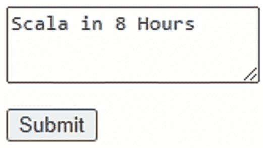

8 小时学会 Scala

## time() 语法

```php
time()
```

// 返回自 Unix 纪元以来 Unix 时间戳（从 1970 年 1 月 1 日 00:00:00 GMT 到现在的秒数）

例如：

```php
var_dump(time());
```

// 输出: `int(1669305569)`

## trait 语法

```php
<?php trait TraitName{…} ?> // 声明一个 trait
<?php class MyClass{ use TraitName; } ?> // 使用该 trait
```

// `Trait` 用于定义可以在多个类中使用的方法。
// `Trait` 允许程序员在不同的类中复用方法。

例如：

```php
<?php
trait myTrait { // 声明一个 trait
    public function myFun() {
        echo "This is a trait sample";
    }
}

class MyClass {
    use myTrait; // 使用该 trait
}
$obj = new MyClass();
$obj->myFun();
?>
```

// 输出: This is a trait sample

## trigger_error() 语法

```php
trigger_error("message")
```

// 触发错误并显示错误消息。

例如：

```php
$var = -100;
if($var<0){trigger_error("Variable value must > 0 ");}
```

// 输出: Notice: Variable value must > 0 在 `/script.php` 的第 3 行。

## trim() 语法

```php
trim($str, "characters");
```

// 删除字符串两侧的字符
`trim($str)` // 删除两侧的空白字符

例如：

```php
$str1 = "ABC 123"; 
$str2 = " Hi, friends! ";
echo trim($str1,"A"); // 删除 A 和 3
echo trim($str2); // 删除两侧的空格
```

// 输出: `BC 12`, `Hi, friends!`

## try / throw / catch() 语法

```php
try{…} // 包含可能引发异常的代码
throw new Exception("message"); // 抛出异常
catch(Exception $e) // 捕获并处理异常
```

例如：

```php
<?php
function myFun($num){
    if($num<0){
        throw new Exception("The variable must be greater than 1");
    }
    return true;
}
try{
    myFun(-100); // 调用函数
} catch(Exception $e){
    echo $e->getMessage(); // 显示异常消息
}
?>
```

// 输出: The variable must be greater than 1

## ucfirst 语法

```php
ucfirst("string")
```

// 将字符串的首字母转换为大写。

例如：

```php
echo ucfirst("in hours");
```

// 输出: In hours

## ucwords 语法

```php
ucwords("string")
```

// 将字符串中每个单词的首字母转换为大写。

例如：

```php
echo ucwords("c sheet");
```

// 输出: C Sheet

## uniqid 语法

```php
uniqid()
```

// 根据当前微秒返回唯一的 ID。

例如：

```php
echo uniqid();
```

// 输出: `637fc50391e3`

## unlink 语法

```php
unlink("filename")
```

// 删除文件。

例如：

```php
unlink("myFile.txt");
```

## unserialize 语法

```php
unserialize($serialized_data)
```

// 将序列化数据还原为原始值。

例如：

```php
$var = serialize(array("ant", "bee", "cat", "dog"));
echo $var;
$arr = unserialize($var);
print_r($arr);
```

// 输出: a:4:{i:0;s:"ant";i:1;s:"bee";i:2;s:"cat";i:3;s:"dog";}Array ([0] => ant [1] => bee [2] => cat [3] => dog)

## unset 语法

```php
unset($variable)
```

// 删除 `$variable` 的值。

例如：

```php
$str = "Hi, friend!";
unset($str);
echo "After unset, the 'str' value is: . $str;
```

// 输出: After unset, the 'str' value is:

## update table 语法

```php
$sql="update table-name set column-name=value where id=int";
$query=mysqli_query( $con, $sql);
```

// `"update table-name set column-name=value where id=int"` 可以更新表中指定列的值。
// `$query=mysqli_query($con, $sql)` 执行查询。
// `$con` 是 MySQL 服务器的连接。（参考 `mysqli_connect()`）

例如：

```php
<?php
$con= mysqli_connect( "localhost", "root", "12345678" );
if( $con ) { // 如果连接 MySQL 服务器成功
    echo " Connect! ";
}
$select=mysqli_select_db( $con, "myDB" );
if( $select ) { // 如果选择数据库 "myDB" 成功
    echo " Select successfully!<br> ";
}
// 假设 myDB 有一个表 "colortable"
$sql="update colortable set color5='sky' where id =1 ";
// 将 id 为 1 的 color5 列设置为 'sky'
$query=mysqli_query( $con, $sql); // 运行查询
if( $query ) {
    echo " Update successfully ";
}
?>
```

// 输出: Connect! Select successfully! Update successfully!

## update table（高级）

```php
update TableName set field1 = value1, field2 = value2
where field = value;
```

// 更新数据库表中字段的值。
// `"where field = value"` 可以选择记录进行更新。

例如：

```php
// 1. 给定“books”表的当前状态：
use library;
select * from books;

// 2. 更新指定字段的值：
update books set pages = 200, price = 13.99, publish = 2018
where title = "Java";

update books set pages = 190, price = 12.88, publish = 2019
where title = "Ajax";

select * from books;

```

// `"where title = "Java";` 选择标题为 “Java”的记录来更新三个字段（pages, price, publish）。
// `"where title = "Ajax";` 选择标题为 “Ajax”的记录来更新三个字段（pages, price, publish）。

## urldecode 语法

```php
urldecode("encoded_data")
```

// 将编码的数据还原为原始数据。

例如：

```php
$encode_data = urlencode("https://www.amazon.com/");
echo $encode_data."\n";
$decode_data = urldecode($encode_data);
echo $decode_data;
```

// 输出: `https%3A%2F%2Fwww.amazon.com%2F`
https://www.amazon.com/

## urlencode 语法

```php
urlencode("data")
```

// 对指定的数据编码。

例如：

```php
echo urlencode("https://www.amazon.com/");
```

// 输出: `https%3A%2F%2Fwww.amazon.com%2F`


# 使用数据库语法

```php
use DatabaseName;
```

// 在 mysql 服务器中选择一个数据库。

例如：

```bash
mysql> use myDatabase;
Database changed
```

// `use myDatabase;` 指定使用名为 `myDatabase` 的数据库。
// `Database changed` 是服务器返回的响应消息。

# usleep() 语法

```php
usleep(microseconds)
```

// 指定的微秒数延迟运行当前代码

例如：

```php
usleep(3000000);
```

// 在继续之前暂停 3000000 微秒。

# 变量语法

```php
$variable =  value;
```

// 变量名以 `$` 符号开头。

例如：

```php
$var = 100;    // 定义一个变量
$abcde = "Hello World";     // 定义一个变量
$my_variable = "Number1";   // 定义一个变量
echo ( "$var  $abcde  $my_variable");
```
// 输出：   100  Hello World  Number1

# var_dump() 语法

```php
var_dump($var);
```

// 返回变量的类型和值

例如：

```php
$x = 100;   var_dump($x);
$y = 3.14;     var_dump($y);
```
// 输出：     int(100)     float(3.14)

# where 条件语法

```sql
SELECT columnName FROM tableName WHERE columnName operator value 
```

// 提取符合指定条件的记录

例如：

```php
$sql = "SELECT id, firstname, lastname FROM myTable WHERE id='1001'";
```
// 返回 id 为 1001 的记录

# while 循环语法

```php
while ( test-expression ) {  // 此处包含一些 php 代码；  }
```

// 如果指定条件为真，则循环执行块。

例如：

```php
$counter=0;
while ($counter < 8){  // 最多循环 8 次
echo "&";
$counter++;     // 每次循环增加 1
}
```
// 输出：   &&&&&&&&

# wordwrap() 语法

```php
wordwrap($string, length, "\n");
```

// 当字符串达到特定长度时将其换行。

例如：

```php
$str = "'Google Sheet in 8 Hours' is a very good book.";
echo wordwrap($str,18,"\n");    // 每行最多 18 个字符
```
// 输出：
'Google Sheet in 8
Hours' is a very
good book.

# xml dom 解析器语法

```php
$xmlObj = new DOMDocument();     // 创建一个 dom 文对象  
$xmlObj->load("myFile.xml");     // 加载 xml 文件
print $xmlObj->saveXML();        // 打印文件内容
```

// 从 xml 文件获取数据，并根据节点打印。

例如：
1. 假设 `myFile.xml` 的内容为：
```xml
<?xml version='1.0' encoding='UTF-8'?>
<note>
<from>Ray Yao</from>
<greeting>Hi, My friend!</greeting>
</note>
```
2.
```php
<?php
$obj = new DOMDocument();
$obj->load("myFile.xml");
print $obj->saveXML();
?>
```
// 输出： Ray Yao Hi, My friend!

## 附录

## PHP 保留字表

| | |
| --- | --- |
| and | array |
| case | const |
| default | do |
| else | empty |
| eval | exit |
| extends | for |
| function | global |
| if | include |
| isset | include_once |
| list | list |
| or | print |
| require | return |
| static | switch |
| unset | xor |

## 转义字符表

| | |
| --- | --- |
| `\n` | 输出到下一行。 |
| `\r` | 输出回车。 |
| `\t` | 输出制表符。 |
| `\'` | 输出单引号。 |
| `\"` | 输出双引号。 |

## PHP 预定义字符表

| | |
| --- | --- |
| `&` | 且 |
| `"` | 双引号 |
| `'` | 单引号 |
| `<` | 小于 |
| `>` | 大于 |

## 文件打开模式表

| 模式 | 操作 |
| --- | --- |
| `r` | 仅读，从开头开始。 |
| `r+` | 读写，从开头开始。 |
| `w` | 仅写，清空原有内容。 |
| `w+` | 读写，清空原有内容。 |
| `a` | 仅写，追加内容。 |
| `a+` | 读写，追加内容。 |
| `x` | 仅写，创建新文件。 |
| `x+` | 读写。 |

## PHP 邮件函数

```php
mail(to,subject,message,headers)
```

| 参数 | 说明 |
| --- | --- |
| to | 邮件收件者 |
| subject | 邮件主题 |
| message | 邮件内容，每行限制 70 个字符 |
| headers | 邮件头，如 Cc |
| parameters | 邮件的额外参数

## PHP 过滤器函数

| 函数 | 说明 |
| --- | --- |
| `filter_has_var()` | 检查指定变量是否存在 |
| `filter_id()` | 返回指定过滤器的 id |
| `filter_input()` | 从表单输入获取值并可选过滤 |
| `filter_input_array()` | 从表单输入获取值并可选过滤 |
| `filter_list()` | 返回所有过滤器的名称 |
| `filter_var()` | 过滤变量 |
| `filter_var_array()` | 过滤变量并它们 |

## PHP 文件权限表

| 数字 | 权限 |
| --- | --- |
| 0 | 无法读、写或执行 |
| 1 | 仅执行 |
| 2 | 仅写 |
| 3 | 可写和执行 |
| 4 | 仅读 |
| 5 | 可读和执行 |
| 6 | 可读写 |
| 7 | 可读写并执行

## PHP 字符串格式表

| 符号 | 表示 |
| --- | --- |
| `%%` | 百分号 |
| `%b` | 二进制数 |
| `%c` | 根据 ascii 值的字符 |
| `%d` | 有符号整数（负、零或正数） |
| `%e` | 小写科学计数法（例如 1.2e+2） |
| `%E` | 大写科学计数法（例如 1.2e+2） |
| `%u` | 无符号整数（等于或大于 0） |
| `%f` | 浮点数（考虑本地设置） |
| `%F` | 浮点数（不考虑本地设置） |
| `%g` | `%e` 和 `%f` 中的较短者 |
| `%G` | `%e` 和 `%f` 中的较短者 |
| `%o` | 进制数 |
| `%s` | 字符串 |
| `%x` | 十进制数（小写字母） |
| `%X` | 十进制数（大写字母） |

## PHP 数据与时间格式表

| 格式 |  | 示例 |
| --- | --- | --- |
| a | 'am' 或 'pm' 小写 | pm |
| A | 'AM' 或 'PM' 大写 | PM |
| d | 日期，带前零的数字 | |
| D | 星期（三个字母） | Thu |
| F | 月份名 | January |
| h | 小时（12 小时制 - 带前零） | |
| H | 小时（24 小时制 - 带前零） | |
| g | 小时（12 小时制 - 不带前零） | |
| G | 小时（24 小时制 - 不带前零） | |
| i | 分钟（0 - 59） | |
| j | 日（不带前零） | |
| l | 星期 | Monday |
| L | 闰年（'1'为是，'0'为否） | |
| m | 月（数字 - 带前零） | |
| M | 月（三个字母） | May |
| n | 月（数字 - 不带前零） | |
| s | 小秒 | |
| U | 时间戳 | 968292368 |
| y | 年（两位） | 08 |
| Y | 年（四位） | 2006 |
| z | 一年中的第（0 - 365） | 206 |
| Z | 离 GMT 的秒量 | +5 |

## PHP 数据类型表

| 类型 | 说明 |
| --- | --- |
| String | 双引号或单引号内的字符 |
| Integer | 不带小数点的数字 |
| Boolean | 真或假的值 |
| Float | 带小数点的数字 |

## mysqli_xxx_xxx( ) 表


# MySQL 参考指南

| `mysqli_affected_row()` | 返回受查询影响的行数 |
| :--- | ... |
| `mysqli_close()` | 关闭与 MySQL 服务器的连接 |
| `mysqli_connect()` | 创建与 MySQL 服务器的初始连接 |
| `mysqli_create_db()` | 在 MySQL 服务器上创建一个数据库 |
| `mysqli_data_seek()` | 将结果指针调整到结果中的随机某行 |
| `mysqli_db_query()` | 此函数在 PHP 5.3.0 中已弃用 |
| `mysqli_error()` | 返回包含错误描述的字符串 |
| `mysqli_fetch_array()` | 返回一个包含表行的索引数组和关联数组 |
| `mysqli_fetch_assoc()` | 返回一个包含表行的关联数组 |
| `mysqli_fetch_row()` | 返回一个包含表行的索引数组 |
| `mysqli_free_result()` | 清除与结果相关的系统内存 |
| `mysqli_get_server_info()` | 返回包含 MySQL 服务器版本的字符串 |
| `mysqli_num_rows()` | 返回结果集中的行数 |
| `mysqli_query()` | 向服务器上的数据库提交查询 |
| `mysqli_real_escape_string()` | 为 MySQL 转义字符串中的特殊字符 |
| `mysqli_result()` | 返回 MySQL 结果集中一个单元格的字符串 |
| `mysqli_select_db()` | 按数据库选择要使用的数据库 |

## MySQL 数据库命令
| 命令 | 描述 |
| :--- | :--- |
| `CREATE DATABASE database-name` | 创建数据库 |
| `USE database-name` | 使用数据库 |
| `SHOW database-name` | 显示数据库 |
| `DROP database-name` | 移除数据库 |

## MySQL 表命令
| 命令 | 描述 |
| :--- | :--- |
| `CREATE TABLE table-name` | 创建表 |
| `SHOW TABLE` | 显示所有表 |
| `DESCRIBE` | 显示字段属性 |
| `SHOW COLUMNS FROM table-name` | 显示字段属性 |
| `SHOW INDEX FROM table-name` | 列出索引字段属性 |
| `ALTER TABLE table-name` | 修改字段数据 |
| `DROP TABLE table-name` | 移除表 |
| `OPTIMIZE table-name` | 优化表 |

## MySQL 操作命令
| 命令 | 描述 |
| :--- | :--- |
| `SELECT field FROM table WHERE condition` | 查询数据 |
| `INSERT INTO table ( field ) VALUES (value)` | 插入数据 |
| `DELETE FROM table WHERE condition` | 删除数据 |
| `UPDATE table SET field = value WHERE condition` | 更新数据 |
| `PEPLACE INTO table (field ) VALUES (value)` | 替换数据 |

## MySQL 数据类型
| 类型 | 描述 |
| :--- | :--- |
| `int` | 从 -2147483648 到 2147483647 的整数 |
| `decimal` | 从 -999.99 到 999.99 的浮点数 |
| `double` | 双精度小数位数 |
| `date` | 格式为 YYYY-MM-DD 的日期 |
| `time` | 格式为 HH:MM:SS 的时间 |
| `datetime` | 格式为 YYYY-MM-DD HH:MM:SS 的数字 |
| `year` | 1901 到 2155 年间的 YYYY 格式年份 |
| `timestamp` | 事件发生的自动日期时间戳 |
| `char()` | 固定长度到 255 的带填充字符串 |
| `varchar()` | 变变长度到 255 的字符串 |
| `text` | 长度到 65535 字符的字符串 |
| `blob` | 二进制类型 |
| `enum` | 列表中的单个字符串值 |
| `set` | 列表中的多个字符串值 |

## MySQL 字段修饰符
| 修饰符 | 描述 |
| :--- | :--- |
| `AUTO_INCREMENT` | 自动生成序列号 |
| `NUT` | |
| `NULL` | 可以为空 |
| `UNIQUE` | 不重复 |
| `PRIMARY KEY` | 指定为主主键 |
| `DEFAULT` | 指定字段的默认值 |
| `INDEX` | 指定表的索引 |

## MySQL 系统函数
| 函数 | 返回 |
| :--- | :--- |
| `cast(v as type)` | 返回转换后的类型 |
| `connection_id()` | 服务器的连接 ID |
| `database()` | 当前数据库的名称 |
| `if(expr,m,n)` | 如果 expr 为真，返回 m；否则返回 n |
| `ifnull(m,n)` | 如果 m 不空，返回 m；否则返回 n |
| `nullif(m,n)` | 如果 m 等于 n，返回 null；否则返回 m |
| `user()` | 返回当前用户 |
| `version()` | 返回数据库版本 |
| `show processlist` | 显示 id、用户、主机 |

## MySQL 数字函数
| 函数 | 返回 |
| :--- | :--- |
| `abs(n)` | n 的绝对值 |
| `avg(field)` | 字段的平均值 |
| `ceiling(n)` | 大于 n 的最小整数 |
| `cos(n)` | n 的余弦 |
| `exp(n)` | n 的指数值 |
| `floor(n)` | 小于 n 的最大整数 |
| `max(field)` | 字段的最大值 |
| `min(field)` | 字段的最小值 |
| `mod(m, n)` | m 除以 n 的余数 |
| `pi()` | 3.14159 |
| `radians(n)` | 度转换为弧度 |
| `rand(n)` | 0 到 1 之间的随机数 |
| `round(n)` | 接近 n 的整数 |
| `sin(n)` | n 的正弦 |
| `sqrt(n)` | n 的平方根 |
| `tan(n)` | n 的正切 |

## MySQL 日时间函数
| 函数 | 返回 |
| :--- | :--- |
| `current_date()` | 当前日期 |
| `current_time()` | 当前时间 |
| `current_timestamp()` | 当前日期和时间 |
| `date(date)` | 日期，例如 2020-01-18 |
| `day(date)` | 日期的几，例如 18 |
| `dayname(date)` | 日期的名称，例如星期六 |
| `hour(date)` | 日期的小时 |
| `minute(date)` | 日期的分钟 |
| `month(date)` | 日期的月份 |
| `monthname(date)` | 月份名称，例如一月 |
| `now()` | 当前日期和时间 |
| `second(date)` | 日期的秒 |
| `year(date)` | 日期的年份 |

## MySQL 语句
| 语句 | 描述 |
| :--- | :--- |
| `alter table TableName add FieldName type modifier` | 添加字段 |
| `alter table TableName add primary key (FieldName)` | 添加主键 |
| `alter table TableName add unique (FieldName)` | 为字段设置唯一属性 |
| `alter table TableName alter FieldName set/drop default` | 为字段设置或移除默认值 |
| `alter table TableName change FieldName1 FieldName2` | 修改字段名 |
| `alter table TableName drop FieldName` | 移除字段 |
| `alter table TableName drop primary key` | 移除主键 |
| `alter table TableName modify FieldName type modifier` | 修改数据类型或修饰符 |
| `begin()` | 开始事务 |
| `call ProcedureName` | 调用存储过程 |
| `commit()` | 执行事务 |
| `count (distinct FieldName)` | 计算指定字段中唯一值的记录数 |
| `count (FieldName)` | 计算字段中非空记录数 |
| `count(*)` | 计算表中所有记录数 |
| `create database DatabaseName` | 创建新数据库 |
| `create database if not exists DatabaseName` | 创建数据库 |
| `create table if not exists NewTable select * from OldTable` | 复制整张表 |
| `create table if not exists TableName (col1 type1, col2 type2)` | 创建表 |
| `create table TableName (col1 type1, col2 type2, col3 type3)` | 创建表 |
| `create view ViewName (FieldNames) as select statements` | 创建视图 |
| `create view ViewName (FieldNames) as select statements` | 修改视图 |
| `delete from TableName where field = value` | 删除记录 |
| `delete from TableName where id = int` | 移除记录 |
| `delete from TableName` | 删除所有记录 |
| `describe TableName` | 显示表结构 |
| `drop database DatabaseName` | 移除数据库 |
| `drop database if exists DatabaseName` | 移除数据库 |
| `drop procedure if exists ProcedureName` | 移除存储过程 |
| `drop table if exists TableName` | 删除表 |
| `drop table TableName` | 移除表 |
| `drop view if exists ViewName` | 移除视图 |
| `engine=innodb` | 使用 innodb 数据库引擎 |
| `explain TableName` | 了解表结构 |


# SQL 基础操作指南

| 语法表达式 | 功能描述 |
| :--- | :--- |
| `FieldName primary key` | 将字段设置为主键 |
| `group by FieldName` | 对字段中的数据进行分组 |
| `having condition` | 过滤分组 |
| `insert into TableName (field1, field2, field3) values (value1, value2, value3);` | 向表中插入数据 |
| `order by field asc;` | 按升序排序数据 |
| `order by field desc;` | 按降序排序数据 |
| `order by FieldName;` | 按字段对数据进行排序 |
| `rename table old_table_name to new_table_name;` | 重命名表（将旧表名更改为新表名） |
| `rollback;` | 回滚事务 |

## 查询操作 (SELECT)

| `select * from TableName;` | 显示表中的数据 |
| `select @variable_name;` | 显示变量值 |
| `select * from FieldName as alias;` | 设置字段别名 |
| `select * from TableName where FieldName between... and...;` | 显示特定范围内的记录 |
| `select * from TableName where FieldName != value;` | 显示不等于指定值的记录 |
| `select * from TableName where FieldName less/more than value;` | 显示小于或大于指定值的记录 |
| `select * from TableName where expression1 and expression2;` | 显示满足两个条件的记录 |
| `select * from TableName where expression1 or expression2;` | 显示满足一个条件的记录 |
| `select * from TableName where FieldName in (value1, value2, value3);` | 显示可用范围内的记录 |
| `select * from TableName where FieldName like "%value%"`` | 显示包含某些字符的相似值的记录 |
| `select * from TableName where FieldName like "_value_"`` | 显示包含单个字符的相似值的记录 |
| `select * from TableName where FieldName regexp pattern;` | 显示匹配指定模式的记录 |
| `select * from TableName order by rand() limit n;` | 获取随机记录 |
| `select * from TableName order by FieldName;` | 显示按字段排序的数据 |
| `select * from TableName where field = value;` | 显示特定的记录 |
| `select * from TableName1 union all select * from TableName2 union all select * from TableName3;` | 在一个表中合并多个查询 |
| `select @variable_name := value;` | 定义变量并显示其值 |
| `select alias1.field1, alias2.field2 from table1 as alias1 join table2 as alias2 on alias1.fieldname = alias2.fieldname;` | 在一个表中显示两个连接表的数据 |
| `select alias1.field1, alias2.field2 from table1 as alias1 left join table2 as alias2 on alias1.fieldname = alias2.fieldname;` | 显示两个连接表的数据，包括完整的左表数据 |
| `select alias1.field1, alias2.field2 from table1 as alias1 right join table2 as alias2 on alias1.fieldname = alias2.fieldname;` | 显示两个连接表的数据，包括完整的右表数据 |
| `select concat(field1, "separator", field2) from TableName;` | 连接两个或多个字段 |
| `select count(*) from TableName;` | 统计表中所有记录的数量 |
| `select count(distinct FieldName) from TableName;` | 显示字段中唯一值的记录 |
| `select count(FieldName) from TableName;` | 统计字段中非空记录的数量 |
| `select distinct FieldName from TableName;` | 显示字段中唯一值的记录 |
| `select Field, count(*) from Table group by Field;` | 显示按字段分组的数据 |
| `select Field1, Field2, Field3 from table1, table2, table3;` | 在一个表中显示多个表 |
| `select field1, field2, field3 from TableName;` | 显示指定的字段 |
| `select sum(FieldName) from TableName;` | 累加指定字段的值 |

## 变量与系统设置

| `set @variable_name := value;` | 定义一个变量 |
| `set autocommit=0;` | 禁用自动提交 |
| `set autocommit=1;` | 开启自动提交 |
| `show databases;` | 显示所有现有的数据库 |
| `show tables;` | 显示所有现有的表 |
| `use DatabaseName;` | 选择一个数据库 |

## 存储过程与更新

```sql
stored procedure;
delimiter //create procedure ProcedureName()
begin
    select statement;
end //delimiter;
```

| 语法表达式 | 功能描述 |
| :--- | :--- |
| `table1 join table2` | 连接 table1 和 table2 |
| `table1 left join table2` | 连接两个表的数据，包括完整的左表数据 |
| `table1 right join table2` | 连接两个表的数据，包括完整的右表数据 |
| `update TableName set field1 = value1, field2 = value2 where field = value;` | 更新字段 |
| `update TableName set FieldName = value;` | 更新字段中所有记录的数据 |
| `update TableName set FieldName = value; where condition;` | 更新字段中特定记录的数据 |

---
*由 Ray Yao 编写的速备指南*

