# 高级学习的 PHP MySQL


```php
<?php
$user_name=$_GET['username'];
$password=$_GET['password'];
echo 'Hello '.$user_name;
?>
```

## 关于作者


Hirdesh Bhardwaj 是 Webs Jyoti - 开发与培训组织的创始人兼首席执行官，以其最佳的培训和发展技能而闻名。

他是 IT 领域的创新者，并以新颖且传统的方法重新定义了教学技巧。在他 10 年的职业生涯中，他交付了 350 多个网站，并教授了 5000 多名学生。

Hirdesh Bhardwaj 在高中还是新手时就对写作产生了兴趣。他写了一首印地语诗歌“21 世纪”，后来于 2009 年 6 月发表。

作为企业培训师，Hirdesh 迄今已举办了 50 多场企业和研讨会。

除了书籍之外，Hirdesh 还有约 250 个脚本和教程，将在未来几年出版。

## Webs Jyoti 的服务

Webs Jyoti 是总部位于古尔冈的专业网页开发和信息技术（IT）组织，为全球企业家提供网页设计和信息技术服务。

我们为印度各地及其他地区的客户提供网站开发服务。我们专注于网站设计、教育软件、电子商务和 CMS。

## 感谢

我谨向所有一直以来不时给予支持的人们表示感谢：

- 我的父母，我的上帝和女神，感谢他们的美好祝愿和祝福。
- 我深爱的妻子 Chanchal，感谢她提供的支持。
- 我 2 岁的儿子 Vansh，他认为他的爸爸写了这么长的书，做了网站的工作，进行了培训和研讨会，但希望其中包含像卡通角和忍者故事这样的章节。
- 我的姐妹 Mona 和 Preeti（也像女儿一样），她们希望她的兄弟能花更多时间陪伴她们，而不是在这本书上工作。
- 我年幼的弟弟 Jaiprakash，他总是抱怨他的哥哥总是责骂他努力工作并在清晨散步以减轻体重。
- 我在 Webs Jyoti 的小团队，像家人一样，他们认为老板仍然把他们当作学生并强迫他们每天学习新东西。
- 我的创意团队，P. Serign Ndiaye、Jeff Sidabutar 和 Hernan Apraez Pastrana，他们总是让我从我们的开发部门提供更多实时示例。

## 引言

完成这本书是我有史以来最困难的事情之一。让我花了将近三年时间才把它整理成你正在阅读的形式。每次我阅读之前的草稿，我几乎总是不得不重写整个脚本。在大多数地方，我试图展示事物在实时场景中的工作原理。

如果你让我说出这本书最重要的特点，我会说简单。无论是文本还是代码，我都尽力让它尽可能简单。

本书的大部分示例都取自我培训课程或我们内部开发工作。

更重要的是，我试图为一名正在努力学习新而复杂的编程的程序员设计这本书。我已将最好的努力倾注于这些页面。我相信你会觉得这本书有用。

## 谁应该阅读这本书？

本书假设你已经了解网页设计或使用 HTML、CSS 的 UI 设计。如果你完全是 PHP 新手，我建议你阅读我于 2016 年 8 月出版的《网页设计-第 1 版》入门书籍。

## Hirdesh Bhardwaj 著作的其他书籍


## PHP - 简介

PHP 是目前最流行的服务器端脚本语言之一。如果你有一个用于运行博客或网站的主机账户，我可以保证 PHP 已安装在同一服务器上。

PHP 代码可以嵌入到 HTML 中，也可与各种网页主题系统、网页内容管理系统（CMS）和框架如 CakePHP、Zend、Laravel 和 Symfony 结合使用。PHP 代码通常由 Zend Engine 驱动的 PHP 解释器处理。

## PHP 事实

- PHP 最初代表 Personal Home Page，现在正式称为“Hypertext Preprocessor”，由 Rasmus Lerdorf 于 1995 年发布。
- PHP 是免费软件，开源软件，在 PHP 许可证下发布。
- PHP 可用于所有主要操作系统，包括 Linux、Microsoft Windows 和 Mac OS X。
- PHP 最初设计用于创建动态和更具交互性的网页。它是最广泛使用的开源通用脚本语言。
- PHP 已安装在超过 2000 万个网站和 100 万个 Web 服务器上。
- 75% 的 Web 2.0 网站使用 PHP 构建。81.7% 的服务器端编程语言已知的网站使用 PHP。
- Facebook、Digg、Flickr、Technorati 和 Yahoo! 等一些最大的在线品牌均由 PHP 开发。


## PHP 开发工具

我们需要以下主要工具来开发基于 PHP 的应用程序 -

**Apache 服务器**- 一个使用 HTTP 或 HTTPS 通过万维网 (WWW) 传输内容的 Web 服务器。

**MySQL / MariaDB 数据库** - 这是你存储信息的地方。

**PHP** – 是一种广泛使用的语言，用于生成或开发动态网页。

有各种软件捆绑包可用于满足上述要求-

- **LAMP** - Linux、Apache、MySQL 和 PHP
- **WAMP** - Windows、Apache、MySQL 和 PHP
- **MAMP / DAMP** - macOS / Mac OS X、Apache、MySQL 和 PHP
- **XAMPP** - 跨平台 (X)、Apache (A)、MariaDB (M)、PHP (P) 和 Perl (P)

从上述捆绑包列表中，我推荐下载并安装 **XAMPP**

### 使用 XAMPP 捆绑包，需要执行以下步骤 -
- 下载并安装 XAMPP 最新版本。
- 运行 XAMPP 控制面板，并启动 Apache 和 MySQL 服务。
- 要测试 Apache 服务器的安装，请打开 Web 浏览器并输入 http://localhost/
- 如果安装成功，您将在浏览器中看到 Apache “success” 页面。

### PHP IDE / 代码编辑器

有各种代码编辑器和 IDE 可用于 PHP 环境。

您可以使用 Notepad++、Dreamweaver、NetBeans 或 Sublime Text 作为 PHP 代码编辑器。

### 自定义安装

PHP 的主要配置文件是 php.ini；它可以在 XAMPP 的根目录中找到，例如 c:\xampp\apache\php.ini

### php.ini 中可用的一些主要设置 -
short_open_tag: 允许解析短标签 (<? 和 ?>)

output_buffering: 允许在 HTML 已发送到服务器后发送头部行。默认值为“Off”，

max_execution_time: 设置脚本运行或执行的最长时间限制

max_input_time: 设置脚本解析数据的最长时间限制。

memory_limit: 设置脚本运行可使用的内存限制（以 MB 为单位）。

file_uploads: 允许网站访问者向您的服务器上传文件。

upload_max_filesize: 设置上传文件大小的限制（以 MB 为单位）。

mysql.allow_persistent: 确定是否可以与 MySQL 服务器建立持久连接。

mysql.max_persistent: 设置允许的持久连接数量限制。

## PHP 语法：

PHP 程序使用文本编辑器编写，例如 Notepad 或 Dreamweaver，就像 HTML 页面一样。我们使用 .php 扩展名来创建 php 文件。此扩展名告诉服务器在将 HTML 响应发送到 Web 浏览器之前需要解析 PHP 代码，因为当访问您的网站时 PHP 代码对人们是不可见的。

### PHP 语法的规则

在使用 PHP 时，您应始终牢记以下规则：

- PHP 在页面中用开始和结束标签表示，如下所示：<?php 和 ?>
- PHP 行以分号结束或终止

您还可以通过使用双斜杠 (//) 或 /* 和 */ 在程序中添加注释来使程序更易于理解

## PHP 中的变量

变量用于存储数据，可以通过使用变量名调用，并且它所保存的数据将被输出。因此变量是存储信息的对象，您在程序中经常使用它。

您为变量指定的名称应具有意义。然而在为变量命名时，您需要遵循某些命名规则。

### 命名约定
- 变量名以美元符号开头
- 只能包含字母、数字和下划线
- 不能以数字值开头
- 变量名区分大小写

为了最大限度地减少混淆和错误，最好坚持使用一种命名方案。两种最常见的风格是

使用全小写，用下划线分隔单词：`$first_name`、`$emp_code` 等。

主要使用小写，用大写字母分隔单词：`$textName`、`$fName` 等。

### 为变量赋值

变量可以使用赋值运算符 (=) 进行赋值。以下是为变量赋值的一些示例 -

```php
$empCode = 231;
```

## PHP 数据类型：

数据类型定义变量使用的数据类型。PHP 允许几种数据类型。

**整数：** 它保存整数，包括正数和负数 示例 $rating = 8;

**双精度：** 可以保存包含小数部分或小数点的数字，包括正数和负数。示例 $amount=50.85;

**字符串：** 保存字母或任何字母以及数字 示例 Name ="Alex";

**布尔：** 仅保存两个值，即 TRUE 或 FALSE

**数组：** 可以保存相同数据类型的多个值 示例 $arr = array(5,8,12,15);

**对象：** 对象被定义为用户定义类的实例，可以同时保存值和函数。

您可以将字符串与变量中的内容连接起来。为此使用句点（句号或点）。

假设您想打印出以下内容 "Variable contains the value - 10"。在 PHP 中，您可以这样做：

```php
<?php

$num = 10;

$text = "Variable contains the value ";

print($text . $num);

?>
```

现在我们有两个变量。$text 保存我们的直接文本，而 $num 包含一个数值，即 10。当我们打印两个变量的内容时，使用点运算符来分隔或连接两个或多个变量。

您也可以这样做：

```php
<?php

$num = 10;

echo ("Variable contains the value - " . $num);

?>
```

这次，直接文本（不在变量中），但只是包含在 echo 语句中。再次使用点 (.) 将直接文本与变量名分隔开。

您还可以通过分配 null 或空白来删除信息或重置变量值，如下所示

```php
$name = " ";
```

这里，变量 $name 存在但不包含值。这并不意味着 $name 被设置为 0，因为 0 是一个值。这意味着 $name 不存储任何信息。

*您甚至可以进一步使用 unset 语句取消创建变量或从内存存储中删除变量：*

```php
unset($name);
```

执行 unset 语句后，变量 $name 将不再存在。

变量在整个页面中保留其信息，而不仅仅是单行 PHP 代码。因此，如果在文件开头将变量设置为“OK”，它在页面末尾仍将保持“OK”。

**示例** - 使用 PHP 变量相加

```php
<?php
// program to calculate sum of two numbers

$num1 =20;

$num2=30;

$sum=$num1+$num2;

echo "Sum is ".$sum;
?>
```

减法或乘法基本相同。只需将加号 (+) 替换为减号 (-) 和 (*) 更改您的 $sum 行 –

```php
$sum = $num1 - $num2;
```

## echo 与 print 语句的区别：
- echo 没有返回值，而 print 的返回值为 1，因此可以在表达式中使用。
- echo 可以接受多个参数，而 print 只能接受一个参数。
- echo 比 print 语句更快。

## PHP 超全局变量

我们已经学习了变量，但 PHP 中有一些现成或预定义的关键字，您无需先创建即可使用。

预定义或超全局变量用于提供有关 Web 服务器、Web 浏览器和用户的信息。

有几种类型的超全局变量：-

$_GET - 用于通过 URL 传递数据。示例：
http://websjyoti.com?id=2

$_POST - 用于通过隐藏 URL 将数据传递到服务器。

$_REQUEST – 是 $_GET、$_POST 和 $_COOKIE 的组合。

$_SESSION - 用于维护会话和从本地机器到服务器的数据。

$_COOKIE – 用于在同一机器的浏览器 cookie 中保存/获取用户数据。

$_SERVER – 是一个关联数组，用于了解服务器信息，即 IP 地址、主机名、查询字符串、文件名等。

$_FILES – 用于处理 PHP 中的上传文件操作。即文件大小、类型、名称等。

### 示例 - $_SERVER 超全局变量

```php
<?php

echo "Current IP Address is : ".$_SERVER['REMOTE_ADDR'];

echo "You are Page at : " . $_SERVER['PHP_SELF'];

?>
```

请注意，在 PHP 中 $_SERVER['REMOTE_ADDR'] 返回系统的当前 IP 地址。如果您在本地主机上运行此代码，则应返回 127.0.0.1


## PHP 中的函数

PHP 中的函数与 C 或其他编程语言中的函数行为相似。当我们定义函数时，必须指定函数可以期望接收什么值。

那么让我们创建一个函数。我们需要给函数一个名称并告诉它期望什么变量。我们还需要在调用它之前定义函数。

当你使用任何函数时，它会提供完整的参考，例如使用该函数需要多少个输入或值。假设如果我要创建并使用一个函数，它需要两个输入，即

```php
<?php

function sum($a, $b)
{
$output=$a+$b;
echo "Sum is ".$output;
}

sum(10,5);  // Calling a PHP function
?>
```

上述 sum 函数接受两个值，在技术术语中

我们称之为参数，函数返回的和为

我分配的数字。因此，从上述函数我们了解到：

- 函数名称是 sum
- 函数接受两个值或参数
- 函数返回数值输出

如果你计划创建接受多个参数并返回某种固定格式输出的函数，那么 PHP 函数可能是最佳选择。

除了用户创建的函数外，PHP 中还有一些预定义或内置函数，我们将在下一教程中学习。

Hirdesh Bhardwaj

## 备注

## PHP - 构建块

### If-else 语句

if…else 语句 – 如果条件为真则执行一组代码，如果条件为假则执行另一段代码

在语句中，如果某个条件为真，则会发生某事。否则，会发生其他事情。我们可以根据需要继续添加任意多次 else 语句。

> 简而言之，“*IF Else 语句检查指定的条件是否得到满足。*”

### 语法

```
if (condition)
    code to be executed if condition is true;

elseif (condition)

    code to be executed if condition is true;

else

    code to be executed if condition is false;
```

**条件运算符：** 有时也称为比较运算符，用于比较和测试逻辑和表达式。

以下是条件运算符：

- = 等于
- > 大于
- < 小于
- >= 大于等于
- <= 小于等于
- != 或 <> 不等于

### 逻辑运算符：

逻辑运算符用于组合多个语句并测试条件是否满足为真/假。

以下是逻辑运算符：

- And 或 && - 所有条件必须为真
- Or || - 至少一个应为真
- Xor - 一侧或另一侧必须为真但不能同时为真
- == 比较运算符

*请注意 = 是赋值运算符，而 == 是 PHP 中的比较运算符。*

### 基本 If else 示例 1

```php
<?php
$avg = 50;
if ($avg>60)
{
echo "You have a good score";
}
else
{
echo "Score is less than average";
}
?>
```

上述程序将返回“Score is less than average”，因为变量 $avg 的值为 50。

### 示例 2：

```php
<?php
$status = 1;

if ($status == 1)
{
print ("");
}
else
{
print ("");
}
?>
```

变量 $status 已被赋值为 1。if 语句的第一行测试变量 $status 中包含的内容。它正在测试该变量是否具有值 1。

### 示例 3：

```php
<?php

// Below line returns month (1-12) from current date
$month=date("n");
if ($month==1 || $month==3 || $month==5 || $month==7 ||
$month==8 || $month==10 || $month==12 )
{
echo "31 Days";
}
else if ($month==2)
{
echo "28 or 29 Days";
}
else
{
echo "30 Days";
}
?>
```

我们通过使用内置的 date 函数来获取变量 $month 的值。date("n") 返回服务器上设置的当前月份的数值（1 到 12），例如 1 代表一月，2 代表二月，以此类推。

Hirdesh Bhardwaj

## PHP 中的循环

循环无疑是任何编程语言中最强大的组件之一。循环只是一组重复执行多次的语句。

可能存在需要多次执行一段代码的情况。

但如果你一遍又一遍地运行相同的代码，结果会相同。那么在这种情况下使用循环有什么好处呢？

基本上，循环包含一个每次略有变化的变量。

PHP 中有几种类型的循环：

- For 循环
- For Each 循环
- Do while 循环
- While 循环

### For 循环

PHP for 循环可用于在指定次数内遍历代码集。例如，如果你想重复某件事十次或二十次。

如果迭代或重复次数已知，则应使用它，否则我建议你使用 while 循环。

### For 循环语法

```
for (Initialization; Condition; Progressive)
{
    //set of statements to be executed;
}
```

### 参数说明：

Initialization: 初始化循环计数器的值

Hirdesh Bhardwaj

**条件**：检查条件。如果它求值为 TRUE，则循环继续。如果为 FALSE，则循环结束。

**递增**：增加/减少循环计数器的值

### For 循环示例 1：

```php
<?php
for($var=1; $var<=20; $var=$var+1)
{
echo $var . " ";
}
?>
```

**输出：**

1 2 3 4 5 6 7 8 9 10 11 12 13 14 15 16 17 18 19 20

从上面的例子来看，$var=$var+1 语句可以简化为类似 $var++ 的形式

### 示例 2：显示前 20 个自然数在下拉列表中

```php
<?php

echo "<select>";

for($i=1; $i<=20; $i++)
{
echo "<option>".$i. "</option>";
}
echo "</select>";

?>
```

请注意，在循环区域内，我们使用变量 $i 在下拉列表中显示值（在 HTML 中称为 Select Option 字段），因为我们使用每次略有变化的变量。

### 嵌套 For 循环：

我们可以在 PHP 中在另一个 for 循环内使用 for 循环，这称为嵌套 for 循环。对于内部或嵌套循环而言，嵌套 for 循环会为一次外部 for 循环完全执行。

例如，如果外部循环 i 要执行 2 次，嵌套内部循环执行 2 次，则嵌套内部循环将执行 4 次（1 次外部循环执行 2 次，2 次外部循环执行 2 次）。

所以下面是 PHP 嵌套 for 循环的示例，用于设计三角形形状的输出

### For 循环示例 3：

```php
<?php
for($i=1; $i<=5; $i++)
{
for($j=1; $j<=$i; $j++)
{
echo $j. " ";
}
echo "<br>";
}
?>
```

### 输出

- 1
- 1 2
- 1 2 3
- 1 2 3 4
- 1 2 3 4 5

### 反向 For 循环：

在 PHP 中，你也可以从较高值到较低值使用 For 循环。要实现这一点，我们需要在递增中提及负数。

```php
<?php
for($var=10; $var>=1; $var=$var-1)
{
    echo $var . " ";
} ?>
```

输出：10 9 8 7 6 5 4 3 2 1

### While 循环

While 循环用于在条件为假时重复执行一组语句。当重复次数事先未知时，它可能是最佳选择。

可以用通俗英语解释为“*一直做某事，直到条件为真*。”

### 语法

```
while (condition)
{
    // Set of statements goes here;
}
```

### While 循环示例 1

```php
<?php
$ct=5;
while($ct<=50)
{
echo $ct ."<br>";
$ct = $ct+5;
}
?>
```

### 输出：

5 10 15 20 25 30 35 40 45 50

### PHP 中的 do...While 循环

do..while 循环几乎与 while 循环相似，但它们之间有一个主要区别。do...while 循环将始终至少执行一次代码块。

### while 和 do...while 循环之间的区别：

对于 while 循环，待评估的条件在每次循环语句开始时进行测试，因此如果条件表达式求值为 false，循环将永远不会执行。

另一方面，对于 do-while 循环，即使条件表达式为 false，循环也总是会执行一次，因为条件是在循环语句结束时评估的。

Hirdesh Bhardwaj

### do...while 循环示例：

```php
<?php
$i = 1;
do
{
    $i++;
    echo $i . "<br>";
}
while($i <= 3);
?>
```

输出：2 3 4


## PHP 中的 foreach 循环

PHP 中的 foreach 循环广泛用于数组以在列表中显示元素。foreach 循环遍历数组的所有元素。

### 语法

```
foreach ($array_object as $value)
{
    Set of lines here;
}
```

### foreach 循环示例

```
<html>
<body>
<?php
$tools=array("WP","OpenCart","Xampp","Laravel", "Zend");
foreach ($tools as $x)
{
    echo $x . " ";
}
echo "Total elements: ".count($tools);
?>
</body>
</html>
```

### 输出：

WP OpenCart Xampp Laravel Zend
Total elements: 5

Hirdesh Bhardwaj

## PHP 中的 Switch Case 语句

switch 语句类似于针对同一表达式的一系列 if 语句。

Switch Case 检查变量的不同情况或值。如果其中任何一个 case 为真，则执行相应的 case，程序会忽略所有其他 cases。

例如当你拨打客服电话时，最开始你会听到一些录音提示，如“for billing support press 1, for technical support press 2, to go back to main menu press 9 and so on...” how this concept work?

这只是 Switch case 的一个例子，其中每个键都绑定了一些特定的操作。

### Switch Case 示例 1

```php
<?php

$i=0;

switch ($i)

{

case 0:

echo "$i equals 0."."<br/>";

break;

case 1:

echo "$i equals 1."."<br/>";

break;

case 2:
echo "$i equals 2"."<br/>";
break;
}
?>
```

### Switch Case 示例 2

```
<html>
<head>
<title>Switch Case Example in PHP</title>
</head>
<body>
<?php
$f=10;
$s=5;
$choice='-'; // you can change value of $choice + / - / *
switch ($choice)
{
case "+":
$sum=$f+$s;
echo "Sum=".$sum;
break;
```

### 注释

## PHP 中的数据发送方式

有一些特定的方式可以将你的信息或数据发送到 PHP 页面-

- 1. 使用表单方法 - Get & Post
- 2. 使用 Cookies & Session
- 3. 使用查询字符串 / URL 重写
- 4. 使用隐藏表单字段

### 表单方法

**GET 方法**：GET 方法通过 ? 运算符分隔发送信息。

**示例：** http://www.xyz.com/home.html?city=Gurgaon

请注意，GET 方法仅限发送最多 1024 个字符（1024 字节）。如果你有密码或其他机密信息需要在服务器上传输，就不应该使用 GET 方法。

GET 不能用于向服务器发送二进制数据，如图像或 Word 文档。

PHP 提供了 $_GET 关联数组或超全局变量来访问使用 GET 方法发送的数据。

### 示例 – GET 方法：

让我们创建一个包含表单元素-文本字段的 HTML 表单

### HTML 页面：form.html

```
<form action ="thanks.php" method="GET">
Enter Name : <input type="text" name="txtName">
<input type="submit" value="Submit">
</form>
```

### 解释：

这里我们有一个名为 txtName 的文本字段，基本上我们想要将此字段的值发送到名为 thanks.php 的 PHP 页面。请确保你的表单包含一个按钮类型 submit 以发送信息到 action 页面。

让我们在与上述 html 页面相同的目录中创建一个 thanks.php 页面

### PHP 页面：thanks.php

```
<?php
echo $_GET['txtName'];
?>
```

同时你可以在浏览器的地址栏中看到相同的输入值。这里我们打印了通过文本字段名 txtName 接收到的相同值。请确保在超全局变量 $_GET 的 [ ] 中放入与 HTML 表单中提到的相同名称。

### POST 方法

POST 方法通过 HTTP 头传输信息。

POST 方法对发送的数据大小没有限制。因此它可以用于发送文件、图像以及二进制数据。

PHP 提供了 $_POST 超全局变量或关联数组来访问使用 POST 方法发送的数据。

### 示例 – POST 方法：

让我们创建一个包含多个表单元素的 HTML 表单

### HTML 页面：form.html

```
<form action ="thanks.php" method="POST">
Enter Email : <input type="email" name="email">
Enter Password : <input type="password" name="pass">
<input type="submit" value="Login">
</form>
```

这里我们有两个字段 email 字段名为 email，密码字段名为 pass，基本上我们想要将上述值发送到名为 thanks.php 的 PHP 页面

让我们在与上述 html 页面相同的目录中创建一个 thanks.php 页面

### PHP 页面：thanks.php

```
<?php
echo $_POST['email'];
echo $_POST['pass'];
?>
```

这里我们分别打印了通过 email 和 password 字段接收到的相同值。

我们可以使其更高级一些，通过将上述已发布的值赋给变量。使用变量的优点是我们可以在使用数据之前进行一些验证和清理，然后再将其传递到数据库。

因此上面的代码可以修改如下-

```
<?php
// collect values in the variables separately
$email= $_POST['email'];
$password= $_POST['pass'];
// you may use some validations like
if($email=="" || $password=="")
echo "Input required";
else
echo "Welcome ".$email . " Your password is ".$password;
?>
```

### $_REQUEST 变量

PHP $_REQUEST 变量包含 $_GET、$_POST 和 $_COOKIE 的内容。我们在讲解 cookies 时会讨论 $_COOKIE 变量。

PHP $_REQUEST 变量可用于获取使用 GET 和 POST 方法发送的表单数据的结果。

### 示例

```
<?php

if( isset($_REQUEST["name"]) )
{
    echo "Welcome ". $_REQUEST['name']. "<br />";
    echo "You are ". $_REQUEST['age']. " years old.";
}
?>
```

```
<html>

<body>

<form action = "" method = "POST">

    Name: <input type = "text" name = "name" />

    Age: <input type = "text" name = "age" />

    <input type = "submit" />

</form>

</body>
```

让我们创建一个 PHP 页面 [view.php](view.php) 应该接收两个变量值如下-
city =Gurgaon, state=Haryana

### view.php

```php
<?php

echo "Location is ".$_REQUEST['city']." ".$_REQUEST['state'];

?>
```

你也可以检索 ? 之后的所有内容并将其分配给一个变量，我们可以简单地使用 $_SERVER 超全局变量，如下所示：

```php
<?php

$txt = $_SERVER['QUERY_STRING'];

var_dump($txt);

?>
```

请注意，如果没有查询字符串，则 $_SERVER 中的 QUERY_STRING 键将为空字符串

### 注释

## PHP - 字符串函数

字符串函数是 PHP 中最重要且经常使用的函数。字符串是字符的序列，如 "Let’s learn String functions"。使用字符串函数无需安装。

### 示例

```php
<?php
$name = "Hirdesh Bhardwaj";
print($name);
?>
```

### 字符串连接运算符

要将两个字符串变量连接在一起，我们使用点 (.) 运算符 –

```php
<?php
$txt1="Hello Readers";
$txt2="8756";
echo $txt1 . " " . $txt2;
?>
```

### 使用 strlen() 函数

strlen() 函数用于获取字符串的长度。

```php
<?php
$txt="Webs Jyoti";
echo strlen($txt);
?>
```

这将产生以下结果 – 10 (including space)

### 使用 strpos() 函数

strpos() 函数用于在字符串中搜索文本或字符。如果找到该值，则返回第一个值的位置。如果未找到匹配项，则返回 FALSE。

让我们看看是否能在我们的字符串中找到字符串 "PHP" –

```
<?php

echo strpos("Hello PHP","PHP");

?>
```

这将产生以下结果 – 6

### explode() 函数：

用于将字符串转换为数组变量。它可用于在你想要的信息位于更大的字符串中的情况下，可以使用 explode() 函数将其提取出来。

### 示例：

```
$db = explode(';','host=localhost;db=hirdesh;uid=root ');

print_r($settings);
```

### 输出：

Array ( [0] => host=localhost [1] => db=hirdesh [2] => uid=root [3]

### 另一个示例：

```php
<?php

$text = "Lets Learn PHP Strings";

echo (explode(' ',$text));

?>
```

输出

Array
(
[0] => Lets
[1] => Learn
[2] => PHP
[3] => Strings

### substr() 函数：

substr() 用于返回字符串的一部分。它接受三个 (3) 个基本参数。第一个是要缩短的字符串，第二个参数是起始位置，第三个参数是要返回的字符数。

### 示例：

```php
echo str_replace(' ','-','PHP Tutorial');
```

它会将空格替换为 -，最终输出将如下所示

PHP-Tutorial


### md5() 函数：

用于计算字符串值的 md5 哈希。当你想要将密码从纯文本转换为哈希代码以防止未经授权的用户使用时，可以使用此函数。

### 示例
```php
<?php
echo md5('password123');
?>
```

### 输出
9f161034ee4de758baf4de09c4eb1a75

### trim() 函数：

trim() 用于移除字符串两侧的空白字符和预定义字符。

### 语法
trim(string,charlist)

### 示例
```php
<?php
$txt = "Webs Jyoti";
echo trim($txt,"Weti");
?>
```

### 输出
bs Jyo

Hirdesh Bhardwaj

### str_replace() 函数

这可以用于当你只想将字符串中的某些单词或一组字符替换为其他内容时。

### 示例：
```php
<?php

$oldstr = "The cat is black";

$newstr = str_replace("black", "white", $oldstr);

echo $newstr;

?>
```

输出：The cat is white

### 示例：字符串函数——综合应用

### 任务：
收集用户的姓名和联系电话，并继续进行验证

### form.html
```html
<form action="viewdata.php">
Enter Name : <input type="text" name="txtName" />
<br />
Phone : <input type="text" name="phone" />
<br />
<button type="submit">Send Value</button>
</form>
```

### viewdata.php
```php
<?php
$name= $_REQUEST['txtName'];
$p=$_REQUEST['phone'];
$l=strlen($name);
if(strlen($p)<10)
{
echo "Invalid mobile number ";
//exit;
}
echo "Length of your Name is ".$l;
echo "<br>First Name is ".substr($name,0,strpos($name," "));
$lft=substr($p,0,2);
$last=substr($p,8,2);
echo "<br> OTP should send to ".$lft."XXXXXX".$last;
?>
```

### 笔记

## PHP - 日期/时间函数

在任何编程语言中工作时，处理日期和时间都是常见任务，我们在 PHP 中经常使用。

PHP 的 date() 函数为你提供关于当前日期所需的全部信息。

```php
<?php
$today = date("d/m/Y");
echo "Today is ".$today;
?>
```

我们可以使用带有分隔符的不同时间格式，如 d-m-Y、d.m.Y 等等。

**PHP 中的 DateTime 类**：DateTime 类在 PHP 5 及更高版本中可用。

```php
<?php
$d = new DateTime;

echo $d->format('Y-m-d H:i:s');
?>
```

以上示例将以 yyyy-mm-dd h:m:s 格式显示今天的日期和时间。如果你收到警告，提示不要依赖系统时区，请在代码中添加以下代码行。

```php
date_default_timezone_set('Asia/Kolkata ');
```

**示例：** 要自动刷新你网站上的版权年份——&copy; - <?php echo date("Y");?> 保留所有权利。

### PHP time()：

time() 函数用于获取当前时间的 Unix 时间戳。

示例：
```php
<?php
$cDate = 1394003958;

echo(date("F d, Y h:i:s", $cDate));
?>
```

示例：要打印类似 10 July 2015 的日期
```php
<?php
$date1 = date_create("2016-05-10");

echo date_format($date1, 'j-F-Y');
?>
```

输出：10 May 2016

| 代码示例 | 输出 |
|---|---|
| $d = new DateTime('now'); echo $d->format('Y-m-d') ; | 当前日期 2010-12-20 |
| $d = new DateTime('tomorrow'); echo $d->format('Y-m-d') ; | 明天的日期 |
| $d = new DateTime('yesterday'); echo $d->format('Y-m-d') ; | 昨天的日期 |
| $d = new DateTime('+1 day'); echo $d->format('Y-m-d') ; | 当前系统日期的下一天（尝试以下代码：+1 month、Monday +1 day、+2 years 10 days、+3 years |

### PHP 时区

如果 PHP DateTime 与你的当前时间不匹配，那可能是因为你使用的服务器位于不同的时区。

**date_default_timezone_get()** 用于获取默认时区，脚本中的所有日期/时间函数都使用该时区。

*要在 PHP 中获取默认或当前时区，请使用以下代码*

```php
<?php
$tz = date_default_timezone_get();

echo "Default timezone: ".$tz;
?>
```

*要设置时区，请使用以下代码*

```php
<?php
date_default_timezone_set("America/Los_Angeles");
echo "The Current time is " . date("h:i:sa");
?>
```

### 笔记

## PHP 中的数组

数组是一种数据结构，将相似类型的值存储在一个公共变量中。数组也被称为同质数据类型。

例如，如果要存储 50 个数字，那么与其定义多个变量，不如定义一个大小为 50 的数组来得简单。

在 PHP 中，array() 函数用于创建数组。

数组可以存储数字、字符串和任何对象，但其索引将由数字表示。默认情况下，数组索引从零开始。

### 示例
```php
$x=array("Laxmi","Hirdesh","Rahim","Ashu","Amit");
```

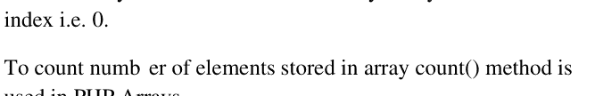

从上图可以看出，每个方框中显示的值称为数组中的索引。数组中的值插入总是从第一个索引开始，即 0。

要计算数组中存储的元素数量，在 PHP 数组中使用 count() 方法。

```php
echo count($x);
```

在声明并分配数组后，你可以按照如下方式从任何特定索引填充值：

```php
echo $x[1];  // output – Hirdesh
```

Hirdesh Bhardwaj

要打印数组 x 中存在的所有元素，你可以使用 foreach 或简单的 for 循环，如下所示：

### 使用 foreach 循环
```php
foreach ($x as $val)
{
    echo $val . " ";
}
```

### 使用 For 循环
```php
for($i=0; $i<count($x); $i++)
{
    echo $x[$i] . "<br>";
}
```

**数组排序：** PHP 提供了许多简便的方法，按预定义顺序（升序和降序）对数组值进行排序。

**arsort：** 按值降序对数组排序，并保持键/值关系。

**asort：** 按值升序对数组排序，并保持键/值关系。

**rsort：** 按值降序对数组排序。

**sort：** 按值升序对数组排序。

### 示例 - 数组排序
```php
$x=array("laxmi","hirdesh","rahim","ashu","amit", "mohit");
```

### // rsort 用于降序，sort 用于升序
```php
sort($x);

foreach ($x as $val)
{

echo $val . " ";

}
```

### 关联数组

关联数组在功能上与默认数组相似，但它们的索引不同。关联数组的索引为字符串，因此你可以在键和相应的值之间进行绑定。

### asort 用于按值（数值）升序显示，arsort 用于降序
```php
echo "<br> ASort <br>";

$emp = array("hirdesh"=>"12", "Amit"=>"54", "Laxmi"=>"50", "Rahim"=>"87");

asort($emp);

foreach($emp as $x => $code)
{
```

Hirdesh Bhardwaj

```php
echo "Name=" . $x . ", Emp Code=" . $code . "<br>";
}
```

### ksort 用于按键（名称或首键字符串）升序显示，krsort 用于降序
```php
echo "<br> KSort <br>";

$emp = array("Hirdesh"=>"12", "Amit"=>"54", "Laxmi"=>"50",
"Rahim"=>"87");

ksort($emp);

foreach($emp as $x => $code)
{
    echo "Name=" . $x . ", Emp Code=" . $code . "<br>";
}
```

## 笔记：

## 清理和验证函数

数据验证是处理表单的主要部分。无效的提交数据不仅会导致安全问题，还可能破坏你的页面和输出。因此，在继续操作或将数据插入数据库之前，你需要对其进行验证以避免任何错误。

### PHP 中的 filter_var 函数

filter_var 既用于清理数据，也用于验证数据。清理将移除数据中的任何非法字符，而验证将确定数据是否符合预期或格式是否正确。

### 如何使用 filter_var

使用 filter_var 非常简单。它只是一个 PHP 函数，接受两个数据输入：

你要检查的变量和要使用的检查类型。

### 示例
```php
$title = "<h1>Lets learn PHP Functions <br></h1>";
$ftitle = filter_var($title, FILTER_SANITIZE_STRING);
echo "After SANITIZE data is ".$ftitle;
```

输出：Lets learn PHP Functions

### 检查有效 IP 地址的示例
```php
$ip = "127.0.0.1.33";

$valid_ip = filter_var($ip, FILTER_VALIDATE_IP);

if($valid_ip)

echo "valid IP Address ";

else

echo "invalid IP Address ";

// to check url received in proper format ?

//$homepage = filter_var($_POST['homepage'],
FILTER_SANITIZE_URL);
```

### 检查邮箱格式是否正确的示例
```php
echo "<br>";

$x="info@websj​​yoti.com";

$email = filter_var($x, FILTER_SANITIZE_EMAIL);

if (filter_var($email, FILTER_VALIDATE_EMAIL))

{

echo "email id is a valid .<br/><br/>";

}

else
{

echo "$x is NOT a valid email address.<br/><br/>";

}
```


<form name="form1" method="post" action="form-sanitize.php">

    电子邮件地址： <br/>

    <input type="text" name="email" value="<?php echo $_POST['email']; ?>" size="50"/>

    <br/><br/>

    主页： <br/>

    <input type="text" name="homepage" value="<?php echo $_POST['homepage']; ?>" size="50" /> <br/>

    <br/>

    <input type="submit" />

</form>

为了确保数据格式正确，需要对其进行验证

```
<?php

    if (isset($_POST['email'])) {

        $email = filter_var($_POST['email'], FILTER_SANITIZE_EMAIL);

        if (filter_var($email, FILTER_VALIDATE_EMAIL)) {

            echo "$email is a valid email address.<br/><br/>";

        } else {

            echo "$email is <strong>NOT</strong> a valid email address.<br/><br/>";
```

Hirdesh Bhardwaj

```
}
}

if (isset($_POST['homepage'])) {

    $homepage = filter_var($_POST['homepage'],
    FILTER_SANITIZE_URL);

    if (filter_var($homepage, FILTER_VALIDATE_URL)) {

        echo "$homepage is a valid URL.<br/><br/>";

    } else {

        echo "$homepage is <strong>NOT</strong> a valid URL.<br/><br/>";

    }

}

?>
```

<form name="form1" method="post" action="form-validate.php">

电子邮件地址： <br/>

<input type="text" name="email" value="<?php echo $_POST['email']; ?>" size="50"/> <br/><br/>

<input type="text" name="homepage" value="<?php echo $_POST['homepage']; ?>" size="50" /> <br/>

<input type="submit" />

</form>

### Notes :

## MySQL / MariaDB 简介

PHP MariaDB 正式名称为 PHP MYSQL，于 2009 年开发，与 MySQL API 和命令高度兼容且完全匹配。MySQL 的原始开发者在 Oracle 收购 MySQL 引发担忧后创建了 MariaDB。MariaDB（及其前身 MySQL）在全球已使用超过 20 年

### 关系数据库简介：

数据库是一组相关文件的集合。数据库及其控制数据库的工具称为数据库管理系统（DBMS）。大多数数据库今天都是关系数据库，因为它们处理包含相关字段的表。

那么让我们了解一些与数据库相关的术语：

- 数据库 – 数据库是包含相关数据表的 数据源。
- 表 – 表，如电子表格或 Excel 表格，以表格方式包含数据。
- 列 – 列是一种结构，用于保存一种类型的数据。
- 行 – 行，有时也称为元组或记录，是对相关数据进行分组的结构。
- 主键 – 这指的是唯一、标识的值。该值在表中不能重复，且表中只能有一个主键。

**外键** – 外键充当两个表之间的链接或接口。

**复合键** – 复合键是指引用多个列的键。

## MySQL / MariaDB 中的数据类型：

### 数值数据类型：

**INT（整数）：** Int 数据类型表示正常大小的整数。因此它可以简单地用于存储数值。还有 BIGINT、MEDIUMINT、SMALLINT 和 TINYINT，它们表示不同范围的整数值。

**DECIMAL：** Decimal 数据类型表示具有特定浮点值的数字。最大允许值为 65，最大小数位数为 30。还有 FLOAT 和 DOUBLE 用于存储带浮点数的数值。

**BOOLEAN：** 该数据类型将值 0 与“false”关联，将值 1 与 true 关联。

### 日期和时间数据类型：

**DATE：** DATE 数据类型以“YYYY-MM-DD”格式表示日期。

**TIME：** TIME 数据类型以 "hh:mm:ss" 格式表示时间。

**DATETIME：** DATETIME 数据类型以“YYYY-MM-DD HH:MM:SS”格式表示日期和时间。

**TIMESTAMP：** 该数据类型表示“YYYY-MM-DD HH:MM:SS”格式的时间戳。它主要用于插入记录插入/更新和删除过程中的当前日期和时间。

### 字符串数据类型

**CHAR：** 该数据类型表示定长字符串。默认值是 1。

**VARCHAR：** 该数据类型表示长度为 0 到 65535 的变长字符串。

**TEXT：** 该数据类型表示最大长度为 65,535 个字符的文本列。还有一些文本数据类型是 MEDIUMTEXT、LONGTEXT 和 TINYTEXT。

**ENUM：** ENUM 数据类型表示字符串对象，仅允许从给定列表中选择一个值。

**SET：** SET 数据类型表示字符串对象，具有来自给定列表的零个或多个值。

## MySQL / MariaDB 表的类型

现在你了解了一些表的一般特性，你应该知道有不同类型的表。

当前版本的 Mysql 中有一些主要类型的表：

MyISAM- 默认表，通常足以满足用户的需求。它支持所有字段类型和参数。

ISAM- 它与 MyISAM 表相同，只是它无法处理大于 4GB 的数据，这意味着它在操作系统之间不可移植。此表类型在 PHP5 中不再可用。

HEAP - 这些主要用于临时表，它们不支持 MyISAM 表的常见功能，例如 auto_increment 和 blob/text 列等。

当你处理日志数据并且不想长期存储时，可以使用它。

InnoDB- 被认为是“事务安全”的，这意味着你可以从崩溃中恢复数据。

## 一些流行的 MySQL 命令

- CREATE：创建新的数据库和表
- ALTER：修改现有表
- SELECT：显示你想要的数据
- DELETE：从表中擦除或删除数据
- INSERT INTO...：将值放入表中
- UPDATE：让你修改已存在表中的数据

Hirdesh Bhardwaj

DROP：删除整个表或数据库

## 使用 MySQL / MariaDB 数据库

在使用 PHP 实现 Mysql 之前，让我们通过 MYSQL 控制台探索数据库和表的基本概念。

- 打开 XAMPP 控制面板并启动 Apache 和 MYSQL\Mariadb 服务
- 打开命令提示符（在运行选项中输入 cmd）并使用 cd 命令复制粘贴你的 MYSQL/Mariadb 路径，如 cd C:\xampp\mysql\bin
- 要打开 MYSQL 环境，输入 mysql.exe –u root
  （这里 root 是你的 Mysql 数据库的用户名。如果你的 Mysql 有密码，则输入 mysql.exe –u root –p mypassword）
- 一旦你的 MYSQL 欢迎屏幕打开，你就可以开始使用 Mysql / MariaDB 环境工作了。

## MySQL 常用命令

### 打开 MySQL 或 MariaDB 中存在的数据库列表

```
show databases;
```

### 创建名为 "Chanchal" 的新数据库

```
create database Chanchal;
```

### 使用或进入新创建的名为 "Chanchal" 的数据库

```sql
use Chanchal;
```

### 检查当前数据库中有多少个表？

```sql
show tables;
```

### 向表中插入记录，如列中所示，即 name、email 和 phone

```sql
insert into users(name,email,phone) values ('chanchal', 'chanchal@gmail.com', '878787');
```

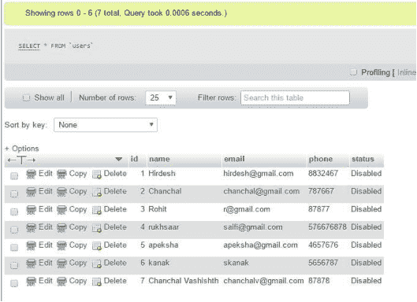

### 显示名为 Users 的表中的所有记录

```sql
SELECT * FROM users order by name DESC;
```

### 从表中仅显示选择的列 Name 和 Phone

```sql
SELECT name,phone FROM users;
```

Hirdesh Bhardwaj

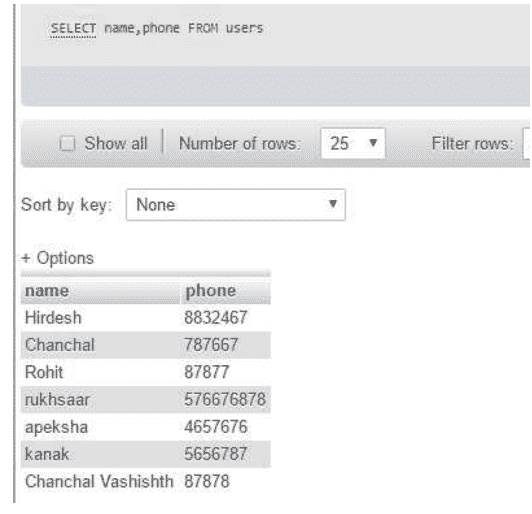

### 按 ID 列以升序显示所有记录

```sql
SELECT * FROM users order by id ASC;
```

### 使用 where 子句过滤记录

```sql
SELECT * FROM users WHERE name='chanchal' ;  ( Exact Match)
```

OR

```sql
SELECT * FROM users WHERE id >3;  (Using comparison operator)
```

## MySQL 中的聚合函数

聚合函数对多行执行计算，使我们能够轻松地从数据库或表中生成汇总数据。

Mysql 中的一些聚合函数，如 SUM、COUNT、MAX、MIN 和 AVG

**SUM 函数：** SUM 函数返回数值列的总和。让我们计算表中工资的总金额。

### 示例：

```sql
SELECT SUM(salary) as 'Total Salary' from mytable;
```

**COUNT 函数：** COUNT 函数返回列中行或记录的计数。让我们统计在 IT 部门工作的员工总数。

### 示例：

```sql
SELECT COUNT(name) from mytable where dept='IT';
```

**DISTINCT 关键字：** DISTINCT 关键字允许我们省略重复项并从列中返回唯一记录。同样也可以通过分组（Group By 子句）将相似值组合在一起实现。

### 示例：

```sql
SELECT DISTINCT (city) FROM mytable;
```


## 使用 GROUP BY 子句

GROUP BY 广泛地与聚合函数一起使用，如 sum、avg、max、min、count 等。它为列中存在的每个元素创建唯一的组。

### 示例

```
select dept, sum(salary) from emp_table group by dept;
```

*上述查询将以透视视图显示每个部门的薪资总和。*

## GROUP BY 子句和 DISTINCT 关键字

| 组按 | 唯一 |
|---|---|
| GROUP BY 子句广泛地与聚合函数一起使用，如 sum、avg、max min count 等。它为列中存在的每个元素创建唯一的组 | DISTINCT 关键字用于简单查询中与 WHERE 子句一起使用以获取唯一记录。DISTINCT 不能用于计算或聚合目的。 |

## HAVING 子句：

HAVING 子句可以在应用 GROUP BY 子句后用于过滤记录。因此它可用于汇总组记录。因此只有满足 HAVING 条件的组（在 GROUP BY 子句后创建）才会被作为结果返回。

## HAVING 子句与 WHERE 子句有何不同？

HAVING 应用于汇总的组记录，而 WHERE 应用于单个记录。简而言之，“ where clause never work with aggregate function with group by ”。

WHERE 子句在数据聚合之前过滤记录，而 HAVING 在聚合/计算执行后执行。

## HAVING 子句语法

```
SELECT column-names FROM table-name WHERE condition
GROUP BY column-names HAVING condition
```

**示例：** 列出每个部门的员工数量。

仅包含员工数量超过 15 的部门。

```
SELECT COUNT(name), dept FROM mytable GROUP BY dept
HAVING COUNT(name) > 15
```

## 示例 2

```
select min(salary) from emp group by emp_name having min(salary)<15000;
```

## 示例 3

```
select dept,count(*) from emp group by dept having count(*)>3;
```

## MySQL 中的子查询：

子查询或内部查询有时称为嵌套查询，是嵌入在 WHERE 子句中的另一个 SQL 查询内的查询。简单来说，子查询是一个内部查询，它使用不同的 SQL 子句放置在外部查询中。

我们可以在 MySQL 中主要与 SELECT 命令一起在括号内使用子查询。ORDER BY 命令不能在子查询中使用，尽管主查询可以使用 ORDER BY。GROUP BY 命令可用于执行相同的操作。

示例：查找部门员工数量超过 3 人的部门的姓名列表。

```
select name from emp where dept in(select dept from emp group by dept having count(*)>3);
```

示例 2：按部门显示最高薪资以及领取最高薪资的人员姓名。

```
select emp_name from emp where salary in(select dept, max(salary) from emp group by dept);
```

```
SELECT employee_id,first_name,last_name,salary
FROM employees WHERE salary >
(SELECT AVG(SALARY) FROM employees);
```

### 注释

## PHP-向 MariaDB/MySQL 插入数据

在之前的教程中，我们学习了如何将 HTML 表单数据发送到 PHP 页面。现在我们需要将相同的信息存储到 MySQL 或 MariaDB 数据库中。

完成上述任务，我们需要遵循以下步骤-

- 设计包含 HTML 表单字段的 HTML 页面
- 使用 $_GET、$_REQUEST 或 $_POST 将表单字段数据接收到 PHP 页面
- 准备数据库连接
- 放置适当的查询将记录插入 MySQL 表

### 那么让我们创建一个包含必要表单字段的示例 HTML 页面

### add-employee.html

```html
<html>
<head>
<title>Add Employee Details</title>
</head>
<body>
<form method="post" action="thanks.php">
<table border="1" width="350">
<tr>
<td>Enter Name</td>
<td><input type="text" name="txtName"></td>
</tr>
<tr>
<td>Enter Email</td>
<td><input type="email" name="txtEmail"></td>
</tr>
<tr>
<td>Enter Password</td>
<td><input type="text" name="txtPassword"></td>
</tr>
<tr>
<td>Enter Phone</td>
<td><input type="text" name="txtPhone"></td>
</tr>
<tr>
<td colspan="2" align="center">
<input type="submit" value="Add Record">
</td>
</tr>
</table>
</form>
</body>
</html>
```

现在让我们创建一个名为 thanks.php 的动作页面来接收来自上述 HTML 表单页面的数据。请确保您应有一个提交按钮以继续。

### thanks.php

```php
<?php
// create a variable
$name=$_REQUEST['txtName'];
$email=$_REQUEST['txtEmail'];
$password=$_REQUEST['txtPassword'];
$phone=$_REQUEST['txtPhone'];
// create a database connection
$con=mysqli_connect("localhost","root","","mydb");
// test database connectivity
if(mysqli_connect_errno($con))
{
echo 'Failed to connect...';
}
//Prepare and execute the insert query
$q= mysqli_query($con, "insert into employees(name,email,password,phone) values ('$name','$email','$password','$phone')");
if($q)
{
echo "Record inserted successfully";
}
else
{
echo mysqli_error($con);
}
mysql_close($con);
?>
```

现在让我们创建数据库和表（打开 MySQL localhost://phpmyadmin）如下所示

**数据库名称：** mydb

**表名称：** employees

**列列表：** name, email, password, phone

### 要创建上述数据库 mydb，请运行以下命令

```
Create database mydb;
```

### 要创建包含上述列的 employees 表，请运行以下命令 -

```
Create table employees (name varchar(20), email varchar(30),
password varchar(20), phone varchar(25));
```

### 连接到 MySQL 服务器

在使用 MySQL 之前，您必须首先使用特定的连接变量连接到 MySQL 服务器。连接变量由以下参数组成，您在连接到服务器之前必须知道这些参数：

**主机名**- 在我们的例子中，它是 localhost，因为我们已在本地安装了所有内容。您需要将其更改为您 MySQL 服务器所在的主机。

**用户名**- 我们仅对本地计算机使用了 root 用户，但您可能有另一个用户名，在网站上线时需要创建用户名。

**密码**- 我们对本地计算机仅使用空白 " " 密码，但在网站上线时您需要使用自己的密码。

因此，您可以将相同的配置放入 PHP 页面，如下所示-

```php
<?php

$host = "localhost";

$user = "root";

$pass = " ";

$db="mydb";

$connect = mysqli_connect($host, $user, $pass,$db);

OR

$connect = mysqli_connect("localhost", "root", "","mydb");

?>
```

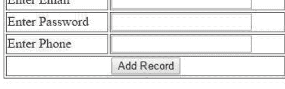

### 注释

## 从 MySQL/MariaDB 检索数据

在上一课中，我们学习了如何将数据发送到数据库。现在是时候从数据库检索数据到我们的 PHP 页面了。

这确实是本书中最重要的课程之一。一旦您阅读并理解了本课，您就会明白为什么基于数据库的 Web 应用程序如此强大。

要从数据库检索数据，您可以使用如下 select 查询 -

```
SELECT * FROM employees
```

将数据从数据库显示到网页将分为两个步骤处理 -

- 首先它会计算行数。您应该知道表中记录的数量。
- 其次我们需要相应地设置循环。每次它会递增一。它将获取结果的每一行并打印其中存储的数据。

在 PHP 中检索数据库记录有一些流行的方法-

mysql_fetch_row(): 它将以数字方式获取结果行。它返回一行，其中值按其在 SQL 查询中定义的顺序出现。

mysql_fetch_assoc(): 它将以关联数组的形式获取结果行。此函数将返回一个关联数组行，其中列名将作为键存储相应的值。

这意味着我们可以通过表列名获取记录。

mysql_fetch_array(): 它将以关联数组或数字数组的形式获取结果行。因此这是 mysql_fetch_row 和 mysql_fetch_assoc 两种方法的组合。

mysql_fetch_object(): 它将以对象形式获取结果行

### 示例 1：从 MySQL 表检索数据 - 让我们检索最近添加的表记录如下-

数据库名称：mydb

表名称：employees

列列表：name, email, password, phone

```php
<?php

// Prepare a database connectivity first
$con = mysqli_connect("localhost", "root", " ", "mydb");

// Prepare SQL Statements to fetch record
$query = mysqli_query("SELECT * from employees");

// Use any fetch method to retrieve records
    while ($row = mysqli_fetch_assoc($query))
{
/* Now you can display columns using $row variable as all records
to be processed by the $row variable */
```


```
echo $row['name'] . "<br>";
echo $row['email'] . "<br>";
}
/* close connection */
mysqli_close($con);
?>
```

### 示例2：使用 mysqli_fetch_array()

```
<?php
//Connect to database
$con = mysqli_connect("localhost", "root", "", "mydb");
//execute simple query
$result = mysqli_query("SELECT * FROM employee",$con);
while ($row = mysqli_fetch_array($result))
{
//access array with column number index
echo $row[0]. " " .$row[1];
}
mysqli_free_result($result);
?>
```

### 示例3：在下拉列表中显示记录（姓名）

```
<?php
//Connect to database
$con = mysqli_connect("localhost", "root", "", "mydb");
//execute simple query
$result = mysqli_query("SELECT * FROM employee",$con);
echo "<select style='width:150px'>";
while ($row = mysqli_fetch_array($result))
{

echo "<option>".$row[0]."</option>";
}

mysqli_free_result($result);
?>
```

### 示例4：在HTML表格中显示MySQL记录

```
<?php
//Connecting to the database

$con = mysqli_connect("localhost", "root", "", "mydb");

//execute simple query

$result = mysqli_query("SELECT * FROM employee",$con);
?>

<table border="1" width="400" cellpadding="5">
<?php
while ($row = mysqli_fetch_assoc($result))
{
?>
<tr>
<td><?php echo $row['name']; ?></td>
<td><?php echo $row['email']; ?></td>
<td><?php echo $row['phone']; ?></td>
</tr>
<?php
}
?>
</table>
```

### 示例4：使用MySQL where子句的基本搜索操作

### HTML 表单

```html
<html>
<head>
<title>Simple Search</title>
</head>
<body>
<form action="search-records.php" method="get">
Name : <input type="text" name="txtName" placeholder="Enter few letters">
<input type="submit" value="Search">
</form>
</body>
</html>
```


### Search.php

```php
<?php
$name=$_REQUEST['txtname'];
// Connecting to the database
$con = mysqli_connect("localhost", "root", "", "mydb");
//execute simple query
$result = mysqli_query("select * from employee where name like '%$name%' ",$con);

?>

<table border="1" width="400" cellpadding="5">

<?php

while ($row = mysqli_fetch_assoc($result))

{

?>

<tr>

<td><?php echo $row['name']; ?></td>

<td><?php echo $row['email']; ?></td>

<td><?php echo $row['phone']; ?></td>

</tr>

<?php

}

?>

</table>
```

### 说明

### 示例

```
<?php
if(!file_exists("/docs/resume.txt"))
{
    die("File not found");
}
else
{
    $file = fopen("/docs/resume.txt","r");
}
?>
```

## 示例：

```
<?php
$a = 0;
$b = 200;
$result = $b/$a;
echo "RESULT: ". $result;
?>
```

输出：Warning: Division by zero in ... on line 4

## 示例：

```
<?php
echo "Hi lets learn PHP"
echo "<br/>This is another line";
?>
```

输出：Parse error: syntax error, unexpected 'echo' (T_ECHO), expecting ',' or ';' in ... on line 3

## **PHP 中的一些可能错误**

- E_ERROR——致命的运行时错误。脚本的执行被中止。
- E_WARNING——非致命错误。执行不会中止。
- E_PARSE——编译时的解析错误。
- E_NOTICE——运行时的通知。
- E_ALL——除E_STRICT级别之外的所有错误和警告。
- E_CORE_WARNING——PHP初始启动期间发生的非致命运行时错误。

我们可以在以下几个不同的位置控制错误：

- 在 php.ini 文件中
- 在 Web 服务器上的 .htaccess 文件中
- 从你自己的 PHP 代码中。

我们也可以在运行时通过从自己的PHP代码中调用 error_reporting() 函数来做到这一点，如下所示：

```
error_reporting(E_ALL);
```

要打开错误日志并将错误记录到我们指定的日志文件中（而不是默认的错误日志文件，默认通常是 Web 服务器的错误日志文件）：

```
log_errors = on
error_log = "/tmp/error.log"
```

## **创建自定义错误处理器：**

我们只需创建一个特殊函数，当 PHP 中发生错误时可以调用该函数。在示例中，如果发生特定错误，我们将发送一封包含错误信息的电子邮件：

```php
<?php
//error handler function
function customError($errno, $errstr)
{
    echo "<b>Error:</b> [$errno] $errstr<br>";
    echo "Error Occurred";
    error_log("Error: [$errno] $errstr",1,
    "info@websjyoti.com","From: webmaster@websjyoti.com");
}

//set error handler
set_error_handler("customError",E_USER_WARNING);

//trigger error
$test=2;
if ($test>=1)
{
    trigger_error("Value must be 1 or below",E_USER_WARNING);
}
?>
```

## 解释：

set_error_handler()：PHP 的默认错误处理器是内置的错误处理器。我们在脚本运行期间将上面的函数设为默认错误处理器。由于我们希望自定义函数处理所有错误，set_error_handler() 只需要一个参数，也可以添加第二个参数来指定错误级别。

### 示例

set_error_handler("customError",E_USER_WARNING); 当非法输入发生时，trigger_error() 函数会引发错误。

## 使用 include() 函数：

假设你想在每个页面上打印相同的信息，比如公司的详细信息和地址，或者今天的日期。如果你在网站的每个页面中都放置相同的代码，那效率并不高，因为——

- 你一遍又一遍地输入相同的信息，这不是一个好方法。
- 如果需要更新或更改，你必须对网站的每个页面进行修改，这是一个非常耗时的过程。

解决这个问题的方法是使用 include() 方法。你可以将常用信息放到一个单独的文件中。例如，如果有一组变量需要在网站的每个页面中使用，你可以在一个 PHP 文件中一次性定义它们。然后，在每个页面中，你可以通过引用该文件来 include() 它。

## include 和 require 之间的区别：

PHP 中 include 和 require 语句的主要区别在于：如果发生任何错误，include 将产生一条错误消息，然后继续执行页面中的其余代码；而 require 将产生一个致命错误并终止执行。

require() 函数会抛出一个错误（E_COMPILE_ERROR）并停止脚本。

include() 函数会抛出一个警告（E_WARNING），但脚本将继续执行。

## **require_once()**

当代码的结果是必需的，但后续的包含会抛出错误时，require_once() 函数非常有用。这适用于带有函数的脚本。如果这样的脚本被多次包含，就会抛出错误，因为函数不能被重新声明。

## **include_once()**

include_once() 函数在包含远程文件并且不希望因 HTTP 开销而多次包含它们的情况下非常有用。这在支付网关以及电子商务网站的处理过程中也很有用。

### 示例

```html
<html>

<head>

<title>My Web page</title>

</head>

<body>

<div class="header">

<?php
include_once "menu.php";
?>
</div>
<div class="footer">
<?php
include_once "menu.php";
?>
</div>
</body>
</html>
```

在此示例中，当你尝试重新调用文件“menu.php”时，会看到一个警告。

## PHP 错误——故障排查

Fatal error: Call to undefined function xyz() in localhost/test.php on line 2

解决方案：这意味着当前页面需要的 PHP 函数找不到。请仔细检查所有包含的文件是否已上传或替换，以及是否遵循了安装说明。

PHP Warning: include(abc.php): failed to open stream: No such file or directory in localhost/test.php on line 2

解决方案：此警告告诉你，一个包含文件（使用 PHP 的 include 语法包含的文件）未找到。如果你收到有关无法打开文件的警告或错误消息，请检查错误消息中提到的文件是否存在，以及你的路径是否正确。

Warning: move_uploaded_file(upload/logo.jpg) [function.move-uploaded-file]: failed to open stream: Permission denied in localhost/upload.php on line 32

**解决方案：** 此警告是一个权限错误的示例。脚本试图将文件上传到一个目录，但该目录没有足够的权限让文件移动进去。


## 备注

## 处理图像和其他上传文件

处理上传文档是任何服务端编程语言的主要部分。上传 PDF 文档、图像、视频和其他文件是通过 HTML 中的 `enctype="multipart/form-data"` 属性来处理的。我们需要创建一个 HTML 表单，允许你选择要上传的文件。

注意：请确保你的表单 method 类型为 `post`，并且 `enctype="multipart/form-data"`，这样才能成功处理文件上传过程。

### HTML 代码

```html
<form enctype="multipart/form-data" action="process.php" method="POST">
Choose File : <input name="myfile" type="file" />
<input type="submit" value="Upload" />
</form>
```

现在创建一个 PHP 文件 `process.php` 来处理文件信息。请注意，你不能在此页面上直接查看上传的文件。我们将使用 `$_FILES` 超全局变量来获取上传文件的信息。

示例：`$_FILES['myfile']['name'];`

`$_FILES[][]` 是一个关联二维数组，保存与上传文件相关的所有信息。第一个 `[]` 包含文件字段的名称（`myfile`），第二个 `[]` 包含预定义属性（`name`）。

下面还有一些其他预定义属性：

- `$_FILES['file']['tmp_name']` – 上传文件在 Web 服务器临时目录中的位置。
- `$_FILES['file']['name']` – 上传文件的实际名称。
- `$_FILES['file']['size']` – 上传文件的大小（以字节为单位）。
- `$_FILES['file']['type']` – 上传文件的 MIME 类型。
- `$_FILES['file']['error']` – 与文件相关的错误代码。

那么让我们来看一个例子：

```php
<?php
// get the uploaded file name
$filename = $_FILES['myfile']['name'];

// get the file type
$filetype = $_FILES['myfile']['type'];

// get the file size (in bytes)
$filesize = $_FILES['myfile']['size'];
echo "<h2>Uploaded file information</h2>";
echo "File Name : ".$filename;
echo "<br> File Size : ".$filesize;
echo "<br>File Type : ".$filetype;
?>
```

文件成功上传后，你可以根据需要添加一些验证，使其更有用：

```php
<?php
// get the uploaded file name
$filename = $_FILES['myfile']['name'];
// get the file type
$filetype = $_FILES['myfile']['type'];
// get the file size (in bytes)
$filesize = $_FILES['myfile']['size'];
// You may put your validations here i.e restrict file size
if($filesize >= 1000000)
{
    echo "File is too Large, Maximum file size should be 1 MB";
    exit;
}
// Validation to check if uploaded file is an Image
if($filetype != "image/jpeg" && $filetype != "image/png" &&
   $filetype != "image/JPEG")
{
    echo "Only Images allowed, Kindly upload valid Image.";
    exit;
}
else
{
    // create a folder – upload (in the same location where you have this PHP file) to move uploaded image from your local computer to server
    $target = "upload/";
    $target = $target . basename( $_FILES['myfile']['name'] );
    move_uploaded_file($_FILES['myfile']['tmp_name'], $target);
    echo "Image Uploaded Successfully";
}
?>
```

你需要将上传的图像保存到 Web 服务器上的文件夹中，这意味着你需要一个 Web 服务器可写的目录。要使文件夹对 Web 服务器可写，你可以使用 FTP 客户端来完成。

要将上传的图像写入目标文件夹，可以使用 `move_uploaded_file` 函数。这个 PHP 函数会获取图像并将其移动到指定位置。

**错误消息：** PHP 通过 HTML 表单上传文件时会返回一个错误代码。我们可以通过 PHP 获取文件上传过程中的错误代码。下面解释一些错误消息：

- `UPLOAD_ERR_OK` – 没有错误，文件上传成功。
- `UPLOAD_ERR_INI_SIZE` – 上传的文件超过了 `php.ini` 文件中 `upload_max_filesize` 指定的值。
- `UPLOAD_ERR_FORM_SIZE` – 上传的文件超过了 HTML 表单中指定的 `MAX_FILE_SIZE` 指令。
- `UPLOAD_ERR_PARTIAL` – 文件仅被部分上传，或者上传过程被中断。
- `UPLOAD_ERR_NO_FILE` – 用户没有上传任何文件。当用户尝试上传文件但 PHP 没有收到任何内容时会发生。
- `UPLOAD_ERR_NO_TMP_DIR` – 缺少临时文件夹。
- `UPLOAD_ERR_CANT_WRITE` – 无法将文件写入磁盘。
- `UPLOAD_ERR_EXTENSION` – 某个 PHP 扩展停止了文件上传过程。

### 示例

```php
// Check if file already exists
if (file_exists($yourfile))
{
    echo "Sorry, file already exists.";
}

// Check if there are any errors in the upload.
if($_FILES['file1']['error'] > 0)
{
    die("An error occurred");
}

// Verify uploaded file is an image - Alternate way
if(!getimagesize($_FILES['file1']['tmp_name']))
{
    die("Please ensure you are uploading a valid image.");
}
```

### 将上传的图像设为个人资料图片

将图像上传到服务器后，你可以将其显示在网页的任何部分。你可以在完成图像上传后发出 Ajax 请求来实现这一点。请参考下面的示例：

```php
<?php

// put your query along with database connectivity here
$file = mysql_query("select * from Users");

// consider that you have image path in a column called pro_img
```

开发者会编制一份危险扩展名列表，如果上传文件的扩展名在该列表中，则拒绝访问。

- 客户端验证：文件上传表单中另一种常见的验证方式是对要上传的文件进行客户端验证。通常，这种方法在 ASP.NET 应用程序中更常见，因为 ASP.NET 提供了易于使用的验证控件。

## 备注

## 管理会话和 Cookie

在学习会话和 Cookie 之前，你应该了解 HTTP 及其无状态过程。无状态意味着服务器不知道你之前的请求，因为浏览器会将每个请求都视为新请求。那么，每次你在网站上浏览个人账户时，都必须重新登录吗？但我们并没有重新登录，这是因为 Cookie 或会话。

*因此，Cookie 和会话的基本任务都是存储访问者数据，以便网站上的每个页面都可以访问这些数据。*

### Cookie：

Cookie 是存储在访问者浏览器中的小型文本文件，可以存储特定时间或较长时间。访问者可以编辑 Cookie。简而言之，Cookie 是包含用户信息的客户端文件。

### 会话：

会话是存储在网站服务器上的小型文件。会话的有效期有限，当浏览器关闭或退出会话时，会话就会过期。访问者或用户无法编辑会话。根据 `php.ini` 文件的定义，会话的最大生命周期为 1440 秒（24 分钟）；不过，你可以相应地更改它。

简而言之，Cookie 服务于访问者的计算机，会话服务于服务器。

通过为每个访问者提供一个带有唯一 ID 的 Cookie，我可以在他们返回时使用该 Cookie 来识别每个访问者。然后，我可以使用会话来处理页面间的数据交换，从而真正为每个访问者提供其自定义的设置和信息；这些信息由每个访问者提供，并存储在数据库中，直到它们被 Cookie 中存储的唯一 ID 引用为止。

### Cookie 示例

PHP 允许你创建、检索和更新 Cookie。`setcookie()` 函数首先用于创建 Cookie。

语法为：`setcookie(name, value, expire, path, domain);`

```php
<?php
setcookie("username", "Hirdesh Bhardwaj", time()+20);
setcookie("pin", "4412", time()+20);
?>
```

这里我们设置了一个名为 `username` 的 Cookie，并为其设置了值 `Hirdesh Bhardwaj`。`username` Cookie 将从当前时间（或你第一次将此 Cookie 发送到浏览器的时间）起，在接下来的 20 秒内存储该值。

现在，我们可以使用 PHP 超全局关键字 `$_COOKIE` 来检索 Cookie 中存储的值。最好使用 `isset()` 函数来实现这一点，因为如果我们要从中检索 Cookie 的计算机上尚未设置该 Cookie，则可能会遇到麻烦。

```php
<?php
if (isset($_COOKIE["username"]))
{
    echo "Welcome " . $_COOKIE["username"];
}
else
{
    echo "Welcome guest!<br> Cookies Expired.";
}
?>
```


## 会话示例：

在使用 `$_SESSION` 之前，你必须先调用 `session_start()`；这样会话才会启动，你才能在该页面访问 `$_SESSION` 变量。

### 使用会话的登录系统

让我们创建一个包含注册用户成功登录仪表板所需代码的程序。

### Login.html

```html
<form method="post" action="login.php">
Email : <input type="text" name="txtEmail" /> <br>
Password: <input type="text" name="txtPassword" /> <br>
<input type="submit" value="Login" />
</form>
```

### Login.php

```php
<?php
session_start();
$email=$_REQUEST['txtEmail'];
$password=$_REQUEST['txtPassword'];

/* connecting to the database, you may include a file contain database details */
include 'db.php';

// Check if username and password are correct
if(mysqli_fetch_array(mysqli_query($con, "select * from student where email ='$email' and password ='$password'")))
{
    // save users email to the session variable.
    $_SESSION['email']=$email;
    echo "login successfully";
    header("Location:welcome.php");
}
else
{
    echo "Login failed";
}
?>
```

### Welcome.php

```php
<?php

session_start();

if(isset($_SESSION['email']))
{
    echo $_SESSION['email'];
}
else
{
    echo "This document is protected";
}

?>
```

### 销毁会话（注销）

要删除所有全局会话变量并销毁会话，请使用 `session_unset()` 和 `session_destroy()`：

### Logout.php

```php
<?php
session_start();
session_destroy();
echo "You have logged-out successfully";
?>
```

## 备注：

## 发送自动电子邮件 – PHP 中的 Mail 函数

几乎在每个 Web 应用程序中，系统发送自动电子邮件都是一个常见需求。因此，这是开发者必须掌握的非常常见且重要的部分。

一个简单的例子是，当网站的访客填写咨询表单时。

mail 函数返回一个布尔值：如果电子邮件发送成功，则返回 true，否则返回 false。

### 语法

```php
mail ($to, $subject, $message, $additional_headers);
```

**$to：** 这是 mail 函数的第一个参数，包含收件人的电子邮件地址，即邮件需要发送到的地址。

**$subject：** 每封电子邮件都应有主题。此参数不能包含任何换行字符。

**$message：** 这是要发送的电子邮件的实际正文或内容。请注意，每一行都应由 \n 换行，并且每行不应超过 70 个字符的限制。

**$additional_headers：** 这包含额外的标头值，例如 From、CC 或 Bcc 等。这是 mail 函数中的可选参数。

### 示例

```php
<?php
$to = "info@websjyoti.com";
$subject = "Welcome to Webs Jyoti";
$txt = "Hi, You received a new enquiry from the visitor.";
$headers = "From: sales@websjyoti.com" . "\r\n";
mail($to, $subject, $txt, $headers);
echo "Mail sent successfully";
?>
```

### 创建网站咨询表单的示例

让我们先创建一个 HTML 表单：

```html
<form action="thanks.php" method="post">
    Your Name: <input type="text" name="name">
    <br>
    Email : <input type="email" name="email">
    <br>
    Phone: <input type="text" name="phone">
    <br>
    <textarea cols="40" rows="7" name="feedback"></textarea>
    <br>
    <input type="submit" value="Submit">
</form>
```

- 您的姓名
- 您的电子邮件
- 联系电话
- 留言
- 提交

### thanks.php

```php
<?php

// Collect information

$name=$_REQUEST['name'];

$email=$_REQUEST['email'];

$phone=$_REQUEST['phone'];

$feedback=mysql_real_escape_string($_REQUEST['feedback']);

// Create required parameters for the mail functions

$sendto="info@websjyoti.com";

$subject="New Enquiry on the website";

$headers="From: $email" . "\r\n" ;

$message="------------Enquiry Details------------\n\n Name :".$name . "\n Email :".$email . "\n Phone :".$phone . "\n Feedback ".$feedback ;

if(mail($sendto,$subject,$message,$headers))
{
    echo " Thanks for your feedback. We will contact you soon";
}
else
{
    echo " There is some error in sending mail";
}

?>
```

### 创建并发送激活码以激活用户账户的示例

当用户在网站上成功注册后，创建一段生成激活码的代码：

```php
<?php

$name= $_REQUEST['txtName'];

$email=$_REQUEST['txtEmail'];

$password= $_REQUEST['txtPassword'];

$city= $_REQUEST['txtCity'];

include 'db.php';

// include your mail sending code file (notification.php) here

include_once("notification.php");

mysql_query("insert into student(name,email,
password,city,`code`)values ('$name', '$email',
'$password','$city','$code')" );

echo "Registration process is done, please check email to verify account to instant activation";

?>

<script>
alert("You have been registered");

window.location='login.html';

</script>
```

```php
//notification.php
<?php
//$sendto=$email;

$subject="Account Created Successfully- Verify Account";

$code= rand(11111,99999);

$headers ="From:Webs Jyoti info@websjyoti.com \n"; //from address

$headers .= "MIME-Version: 1.0\n";

$headers .= "Content-type: text/html; charset=iso-8859-1 \n";
$mess="Hi, \n\n Thanks for creating account at
<b>Websjyoti.com</b> Your activation code is $code. alternatively
you can click here to <a href='http://websjyoti.com/temp/verify.php?code=$code'>verify
your account</a> <br><br> regards, <font color='red'>automail,
webs jyoti</font> ";

$f=mail($email,$subject,$mess,$headers);
if($f == "1")
{
    echo "Pls check your mail to activate your account";
}
else
{
    echo "pls check mail function";
}
?>
```

```php
//Verify.php
<?php

include 'db.php';

$code=$_REQUEST['code'];

mysql_query("update student set status='verified' where `code`=$code");

echo "You have been verified ";
?>
```

## 备注：

## PHP 中的面向对象编程

面向对象编程（OOP）是一种方法，你可以将程序分解为若干部分或模块，并可根据需要创建这些模块的副本。它还允许你将特定概念的所有变量和函数组合到一个类中。因此，面向对象编程（OOP）比过程式编程风格更先进、更高效。

### 使用 OOP 的一些优点：

- 可重用性 – 代码易于使用和管理
- 数据隐藏 – 数据抽象与封装
- 模块化
- 应对变化的弹性
- 快速高效
- 现实建模

在深入了解之前，让我们先定义与面向对象编程相关的重要术语。

- **类** – 类是成员变量和函数的集合。换句话说，类是一个蓝图或一段代码，描述了我们希望如何管理一个任务。
- **对象** – 你只需定义一次类，然后创建多个属于该类的对象，就像根据蓝图建造多栋房屋一样。对象可以拥有状态、行为和身份。要创建对象，我们使用 *new* 关键字。
- **成员函数和变量** – 这些是在类中定义的函数和变量，用于访问对象数据。例如，改变我房子的颜色或使用的材料，就是在我的房子对象上执行的一个方法。
- **继承** – 继承被定义为从现有类创建新类。当一个类通过继承父类的现有函数来定义时，就称为继承。
- **多态** – 使用多态，你可以创建多个同名函数。简单来说，函数名保持不变，但它可以接受不同数量的参数，并执行不同的任务。
- **重载** – 多态的一种类型，其中部分或全部运算符根据其参数类型具有不同的实现。同样，函数也可以通过不同的实现进行重载。
- **数据抽象** – 隐藏（抽象）了实现细节的任何数据表示形式。
- **封装** – 指将所有数据和成员函数封装在一起以形成一个对象的概念。
- **构造函数** – 构造函数与其类同名，一旦创建了该类的对象，它就会自动调用。
- **析构函数** – 指的是一种特殊类型的函数，每当对象被删除或超出作用域时，它都会被自动调用。


## 定义 PHP 类和对象：

一个类包含一组函数和成员变量（也称为属性）。一个 PHP 类可以包含许多函数和变量，如下所示：

```php
class Teacher
{
    public $course = "Java";

    function students()
    {
        // set of statements or lines here
    }
}
```

上面的 Teacher 类包含一个成员变量（类变量或属性），即 course，和一个函数，即 students()。这里的 public 是一个访问说明符，意味着变量 $course 可以被其他类访问或使用。请注意，在声明类变量或属性之前，我们应该添加可见性关键字（public / private / protected）来定义该变量在何处可用。

## 命名类：

你为类使用的名称（上例中的 “Teacher”）：

- 不应是 PHP 保留字（关键字）。
- 应以字母或下划线开头。
- 首字母之后可以包含字母、数字或下划线。

要访问任何类的成员变量或函数，你首先需要创建该类的一个对象。示例如下：

```php
$obj = new Teacher;
```

一旦创建了类的对象，你就可以像这样访问成员变量或函数：

```php
$obj->students();
echo $obj->course;
```

请记住，要执行或查看函数的输出，你必须先调用它。函数只有在你调用它之后才会产生输出。

## 什么是构造函数？

如前所述，每个函数都需要被调用才能获得输出。但构造函数是一个不需要调用的函数，因为一旦创建了类的对象，它就会被自动调用。在 PHP 中，构造函数是通过 __construct() 方法定义的。示例如下：

**示例：PHP 构造函数**

```php
class Teacher
{
    public $course = "Java";

    function __construct()
    {
        echo "This function is constructor- default function";
    }

    function __destruct()
    {
        echo "This function is destructor will call after end of program";
    }
}

$obj = new Teacher;
```

在上面的程序中，我们创建了 2 个函数：__construct() 和 __destruct()，它们会在对象创建后自动被调用。构造函数用于初始化内存，而析构函数用于释放或取消初始化类的内存，通常是在脚本结束时。

*请注意：如果你的构造函数带有参数，你应该在创建对象时传入这些参数的值。*

## $this 关键字

`$this` 是一个伪变量，仅在方法内部可用。`$this` 用于访问当前类的属性/成员变量。换句话说，我们使用 `$this` 变量来访问当前对象。示例如下：

```php
<?php

class Users {
    public $email;
    function sendData($x)
    {
        $this -> email = $x;
    }
}
```

## PHP 中的访问说明符或可见性模式

PHP 中有 3 种可见性/访问说明符：public、private 和 protected。这些可见性与属性或成员变量一起使用，以允许从类外部访问。这些说明符在验证和限制程序中的信息方面也起着重要作用。例如，我的信用卡及其 PIN 码详细信息是私有的，我不想与他人分享。

- **公共**属性和方法可以在任何地方或类外部访问。
- **私有**属性和方法只能在类内部访问。
- **受保护**的属性可以被继承其父类的类访问。

```php
<?php
class myDetails
{
    private $pin = "1234";

    function view_details()
    {
        echo $this->pin;    // Inside class this is valid
    }
}

$ob = new myDetails;

echo $ob->pin;   // Error: cannot access outside the class
```

因此，从上面的例子可以看出，类内部的任何方法都可以访问私有属性（pin）。但是，你不能从类外部访问它。

## PHP 面向对象编程中的继承

继承是从现有类创建新类的过程。不过，除了现有基类之外，我们还可以向新创建的类添加一些额外的功能或资源。

如果你有一些类表示公共的方法或属性，这会很有用。例如，一个电子商务门户有多个类，而在每个类中你都需要一些用户信息，如电子邮件和认证密钥。因此，与其为每个类创建单独的属性，你可以创建一个主类，并允许其他类通过继承使用这些属性。

当我们说继承类时，它是指子类或派生类，而被继承的类称为父类或基类。

PHP 面向对象编程中有几种继承类型，如下所示：

- **单继承**：一个类仅被一个类继承时，称为单继承。
- **多级继承**：当一个父类被子类继承，而该子类又被另一个子类继承时，称为多级继承。
- **层次继承**：当一个父类有多个子类时，称为层次继承。

*请注意，PHP 不支持多继承；不过，PHP 中有 **Traits** 可以解决这个问题。*

Hirdesh Bhardwaj

```php
class B extends A   // First child class of A
{
    function fn1()
    {
        $this->price = 200;
        echo $this->price;
    }
}

class C extends A   // Second child class of A
{
    function fn2()
    {
        $this->price = 300;
        echo $this->price;
    }
}

$ob1 = new B;
$ob1->fn1();
echo "<br>";

$ob2 = new C;
$ob2->fn2();
```

**PHP 中的 Traits：** 既然我们已经知道 PHP 不支持多继承，那么可以使用 PHP 中的 Traits 来声明可用于多个类的方法。这样做可以减少代码重复，因为不需要一遍又一遍地重新定义相同的方法。

### 示例：在 PHP 中使用 Traits

```php
<?php
Trait A
{
    public function hello()
    {
        echo "Hello This is Trait A";
    }
}

Trait B
{
    public function test()
    {
        echo "Hello This is Trait B";
    }
}

class MyClass
{
    use A, B; // Calling Traits A and B in the class
}

$obj = new MyClass();
$obj->hello();
$obj->test(); // Calling function test
?>
```

## PHP 中的静态方法和属性

静态方法广泛用于创建辅助函数和工具函数（例如自动加载），这让你能更好地组织和调用函数。PHP 中的静态函数可以直接调用（使用解析运算符 `::`），而无需创建类的对象。`static` 关键字用于在 PHP 中定义静态函数。

### 示例

```php
class A
{
    static function fn()
    {
        echo "This is a Static Function";
    }
}

echo A::fn(); // Calling function without creating object
```

请注意，如果未声明可见性模式或访问说明符（public、private 或 protected），则可见性模式默认为 *public*。

静态方法也可以使用 **self** 关键字和 `::`（解析运算符）从同一类的其他方法中访问。

**静态属性或变量：** 就像静态函数或方法一样，你也可以使用 `::` 运算符以相同方式访问静态属性或变量。示例：

```php
<?php
class A
{
    public static $rating = 7;  // Static properties / Member variable

    public function __construct()
    {
        echo "Rating is" . self::$rating;  // Accessing static variable
    }
}
```

```php
echo A::$rating;    // Accessing static variable directly
A::$rating = 10;
new A();  // Object to call constructor
```

## PHP 中的 Getter 和 Setter

Getter 和 Setter 方法提供数据封装，因此要设置或获取数据，必须通过一个方法。

“getter” 允许你检索或“获取”给定属性。“setter” 允许你“设置”给定属性的值。

### 示例

```php
<?php

class MyClass
{
    public $greeting = "Good Morning";

    public function setProperty($x)
    {
        $this->greeting = $x;
    }

    public function getProperty()
    {
```


```php
return $this->greeting. "<br />";
}
}
// 创建类对象
$obj = new MyClass;
// 获取属性值
echo $obj->getProperty();
// 设置一个新值
$obj->setProperty("Good Afternoon");
// 让我们打印当前值
echo $obj->getProperty();
?>
```

### 注释

## PHP 中的 MVC（模型-视图-控制器）

MVC 是一种应用程序架构或设计模式，其基本原理基于应用逻辑应与表示层分离这一思想。简单来说，MVC 是一种更好地将应用逻辑与显示分开的方式。使用 MVC 的好处是让你的应用更易于维护。

### 模型（Model）

模型是系统所有部分中最复杂的，它将包含所有特定于应用的逻辑。它是应用程序中获取数据（来自任何来源）并处理数据的部分。简单来说，模型负责管理数据；它存储和检索应用程序使用的实体（通常来自数据库），并包含应用程序实现的逻辑。

### 视图（View）

视图包含所有显示逻辑。在 PHP 中，它是应用程序中生成 HTML 的部分。它可以直接访问模型，并可以查询模型以获取其数据。简单来说，视图负责以特定格式显示模型提供的数据。它与一些流行的 Web 应用程序（如 WordPress、Joomla 等）中的模板模块有类似的用法。

### 控制器（Controller）

控制器接收用户输入，并在需要时更新模型。请注意，控制器不是视图和模型之间的中介或网关。视图从自己的模型中获取数据。控制器可以访问模型，但自身不包含任何显示逻辑。控制器所做的只是响应用户输入。

换句话说，“控制器处理模型和视图层的协同工作。控制器接收来自客户端的请求，调用模型执行请求的操作，并将数据发送给视图。视图将数据格式化后呈现给用户，在 Web 应用程序中通常输出为 HTML。”

### MVC 程序流程

- 模型、视图和控制器被初始化
- 视图向用户显示，并从模型读取数据
- 用户与视图交互（例如按下按钮），这会调用指定的控制器动作
- 控制器以某种方式更新模型
- 视图刷新（从模型获取更新后的数据）

### 一个简单的 MVC 程序

```php
<?php

class Model
{
    public $text;

    public function __construct()
    {
        $this->text = 'Hello.. Lets learn MVC pattern in PHP';
    }
}

class View
{
    private $model;

    public function __construct(Model $model)
    {
        $this->model = $model;
    }

    public function output()
    {
        return '<h1>'. $this->model->text .'</h1>';
    }
}

class Controller
{
    private $model;

    public function __construct(Model $model)
    {
        $this->model = $model;
    }
}

$model = new Model();

$controller = new Controller($model);

$view = new View($model);

echo $view->output();

?>
```

### 注释

## MySQL/MariaDB – 进阶学习

### 连接（Joins）

MySQL JOIN 用于从多个表中检索数据。在大多数实际的 MySQL 使用场景中，你经常需要在单个查询中从多个表获取数据。因此，为了访问可能相互关联的不同表中的数据，我们在 MySQL 中使用 JOIN 子句。

MySQL 连接有三种类型：

- INNER JOIN（简单连接）
- LEFT OUTER JOIN（左连接）
- RIGHT OUTER JOIN（右连接）

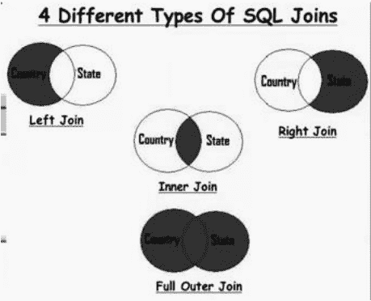

### INNER JOIN 或简单连接

MySQL INNER JOIN 用于从表中返回满足连接条件的所有行。它也是默认的连接类型。简单来说，它可以用来从多个表中检索共同的记录/行。

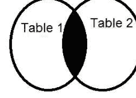

考虑两个表“users”和“rec”，它们具有以下数据。

### 表 - Users

| uid | email | city | name |
|---|---|---|---|
| 1 | h@gmail.com | gurgaon | hirdesh |
| 2 | suzeet@gmail.com | delhi | sujeet |
| 3 | pooja@gmail.com | noida | pooja |
| 4 | sw@gmail.com | gurgaon | swati |

### 表 - rec

| uid | month | days |
|---|---|---|
| 1 | Jan | 23 |
| 2 | jan | 21 |
| 2 | march | 30 |
| 3 | feb | 25 |
| 4 | jul | 21 |
| 3 | mar | 12 |
| 4 | dec | 22 |
| 4 | jul | 13 |

这个 MySQL INNER JOIN 示例将返回 users 和 rec 表中所有在两个表中具有匹配 uid 值的行。

### 查询

```sql
Select * from users inner join rec on users.uid=rec.uid;
```

### 左外连接（LEFT OUTER JOIN）

MySQL LEFT OUTER JOIN 返回 ON 条件中指定的左表中的所有行，以及另一个表中连接字段相等的那些行。

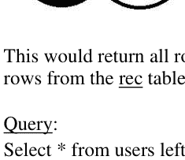

这将返回 users 表中的所有行，以及 rec 表中连接字段相等的那些行。

### 查询

```sql
Select * from users left join rec on users.uid=rec.uid;
```

### 右外连接（RIGHT OUTER JOIN）

MySQL RIGHT OUTER JOIN 返回 ON 条件中指定的右表中的所有行，以及另一个表中连接字段相等的那些行。


### 查询

```sql
Select * from users right join rec on users.uid=rec.uid;
```

这将返回 **rec** 表中的所有行，以及 **users** 表中连接字段相等的那些行。

### 练习作业

1. 编写一条 SQL 语句，为同时出现在两个表中的客户准备一份包含客户姓名、城市、计划类型、付款方式及其收入来源的列表。
2. 编写一条 SQL 语句，为同时出现在两个表中且其保单状态为有效的客户准备一份包含客户姓名、城市、计划类型、付款方式及其收入来源的列表。
3. 编写一条 SQL 语句，为存款金额在 7000 到 10000 之间的订单准备一份包含客户姓名、存款金额及其城市的列表。
4. 列出不在辅助表中但也不在主表中的客户（提示：使用基于电子邮件地址的右连接）。

并且不在实际表中，因此即使应用了非聚集索引，列值也会保持在相同的位置。

你可以在同一个 SQL 表中拥有多个非聚集索引。

```sql
Create Nonclustered index emp_salary on employees (Salary ASC);
```

### 查看表中的索引的查询

```sql
show index from employee;
```

### 删除索引的命令的查询

```sql
drop index employees.emp_salary;
```

请注意，当你向列添加主键或唯一键时，会自动创建索引（类型为聚集索引），因为主键本身就是一个聚集索引。因此，自动创建索引的过程称为隐式索引。

**聚集索引：** 当你向列添加主键时，意味着你已经添加了三个约束，即主键、非空和聚集索引。所以一个表只能有一个聚集索引。（不过这一个聚集索引可以引用多个列，称为复合索引）

你也可以在有主键或没有主键的情况下创建聚集索引（也称为自定义索引），如下所示——

```sql
create clustered index ids on employees (id desc);
```

在多个列上创建复合聚集索引

```sql
create clustered index myIndex on employees (id desc,gender ASC);
```

### 非聚集索引与聚集索引

聚集索引有助于在内存中物理地排列行。因此，索引后的更改可以在表中看到，而不是在堆中。另一方面，非聚集索引不会在内存中按排序顺序物理地排列行。

请注意：MySQL InnoDB 引擎有强制性的聚集索引。这意味着总是存在一个聚集索引，通常使用主键。如果没有可用的合适唯一键，MySQL 将使用生成的行 ID 来实现该目的。MyISAM 存储引擎不支持聚集索引，并且一直使用堆表。

在 MyISAM 引擎中只能使用一种类型的索引（非聚集）。


### 笔记

## MySQL – 存储过程：
通常，存储过程有助于提升应用程序的性能。存储过程一旦创建，就会被编译并存储在数据库中。不过，MySQL 实现存储过程的方式略有不同。MySQL 存储过程是按需编译的。编译完存储过程后，MySQL 会将其放入缓存中。

存储过程有助于减少应用程序与数据库服务器之间的通信流量，因为应用程序只需发送存储过程的名称和参数，而无需发送多条冗长的 SQL 语句。

存储过程是安全的。数据库管理员可以授予应用程序适当的权限，使其能够访问数据库中的存储过程，而无需对底层数据库表授予任何权限。

注意：不要创建过多存储过程，因为它们会占用大量内存。

### 示例

```sql
DELIMITER //
CREATE PROCEDURE myproc()
BEGIN
SELECT * FROM users where city='gurgaon';
END //
```

```
DELIMITER ;
```

```
//执行或调用过程 myproc
```

```
call myproc();
```

### 说明：
- 我们使用分隔符来指示存储过程的开始或结束。最后一条命令（DELIMITER;）将分隔符改回分号（;）。
- 我们使用 CREATE PROCEDURE 语句来创建新的存储过程。在 CREATE PROCEDURE 语句之后，我们指定存储过程的名称。并在存储过程名称后面加上括号。
- BEGIN 和 END 之间的部分称为存储过程的主体。我们在主体中编写声明式 SQL 语句以处理业务逻辑。

### 带参数的存储过程

```sql
DELIMITER //

CREATE PROCEDURE proc(IN city1 VARCHAR(50))

BEGIN

SELECT * FROM users WHERE city = city1;

END //

DELIMITER ;
```

### 执行存储过程 proc

call proc ('delhi');

### MySQL 存储过程中的循环

MySQL 提供了循环语句，允许你根据条件重复执行一段 SQL 代码块。MySQL 中有三种循环语句：WHILE、REPEAT 和 LOOP。

### WHILE 循环示例

```sql
DELIMITER $$
CREATE PROCEDURE myloop()
BEGIN
DECLARE x INT;
DECLARE str VARCHAR(255);
SET x = 1;
SET str = "";
WHILE x <= 10 DO
SET str = CONCAT(str,x,',');
SET x = x + 1;
END WHILE;
SELECT str;
END$$
```

```
DELIMITER ;
```

首先，我们重复构建 str 字符串，直到 x 变量的值大于 10。然后，我们使用 SELECT 语句显示最终的字符串。

现在让我们调用 myloop 存储过程——

```
CALL myloop();
```

**输出：** 1 2 3 4 5 6 7 8 9 10

## MYSQL – 触发器

SQL 触发器是存储在数据库中的一组 SQL 语句。每当与表关联的事件发生时（例如 insert、update 或 delete），它就会被触发。

触发器与存储过程的主要区别在于：当对表执行数据修改事件时，触发器会自动调用；而存储过程必须显式调用。

理解 SQL 触发器的优点和缺点很重要，这样你才能恰当地使用它。

### 使用 SQL 触发器的优点

SQL 触发器提供了一种检查数据完整性的替代方法。

SQL 触发器提供了一种运行定时任务的替代方法。

SQL 触发器对于审计表中数据的更改非常有用。

### 使用 SQL 触发器的缺点

SQL 触发器仅能提供扩展验证，无法取代所有验证。

SQL 触发器是在客户端应用程序不可见的情况下被调用和执行的；因此，很难弄清楚后台发生了什么。

### 触发器的两种类型

- 1. BEFORE 触发器 - BEFORE 触发器在 INSERT、DELETE 和 UPDATE 命令执行之前触发。
- 2. AFTER 触发器 - AFTER 触发器在 INSERT、DELETE 和 UPDATE 命令执行之后触发。

我们将创建一个名为 customer 的表，该表有两个列，用于在同一表中添加或删除新记录时准备日志。

- 只要添加/删除新值，表 logfile 将插入当前时间。

--DELIMITER $$ 用于避免每条行尾的 ; ，所有语句将被视为一组并持续连接，直到 DELIMITER $$ 结束

```sql
DELIMITER $$

CREATE TRIGGER trigger1 BEFORE INSERT ON users

FOR EACH ROW BEGIN

insert into logfile(lastupdate) values(now());

END$$

DELIMITER ;
```

Hirdesh Bhardwaj

## 删除触发器

```
DROP TRIGGER [IF EXISTS] [schema_name].trigger_name
```

该语句用于删除触发器。schema（数据库）名称是可选的。如果省略 schema，触发器将从默认 schema 中删除。DROP TRIGGER 在 MySQL 5.0.2 中新增。使用此语句需要拥有与触发器关联的表的 TRIGGER 权限。

### 笔记

## MySQL 事务：

事务是一组按顺序执行的数据库操作或查询，它们作为一个单一的工作单元来执行。换句话说，只有组内的每个单独操作都成功，事务才算完成。如果事务中的任何操作失败，则整个事务都将失败。

简而言之，你可以将多个 SQL 查询组合到一个组中，并将它们作为一个事务的一部分一起执行。

### 为什么数据库中需要事务：

以 ATM 机为例。我们都使用 ATM 取款和转账。如果你将取款操作分解为各个步骤，你会发现：

- 1) 验证账户详情。
- 2) 接受取款请求
- 3) 检查余额
- 4) 更新余额
- 4) 出钞

假设你的账户余额为 1000 美元，你发起一笔 900 美元的取款请求。在第四步，你的余额已更新为 900 美元，此时 ATM 机因断电而停止工作

Hirdesh Bhardwaj

```
start transaction
select balance from Account where Account_Number='9001';
select balance from Account where Account_Number='9002';
update Account set balance=balance-900 where Account_Number='9001';
update Account set balance=balance+900 where Account_Number='9002';
commit;  // 如果所有 sql 查询成功
rollback; // 如果任何 Sql 查询失败或出错
```

### 另一个示例：

```php
// 需要 php 5+ 版本，因为这是 PHP 的最新概念
// 创建表时将数据库切换为 innoDB，因为它支持 ACID
$mysqli = new mysqli("localhost", "my_user", "", "hirdesh");

/* 检查连接 */
if (mysqli_connect_errno())
{
    printf("连接失败");
    exit();
}

/* 关闭自动提交 */
$mysqli->autocommit(FALSE);
```

```
/* 插入一些值 */
$mysqli->query("INSERT INTO users VALUES ('hirdesh',
'gurgaon', 'M', 11.2)");
$mysqli->query("INSERT INTO users VALUES ('ashok',
'gurgaon', 'M', 5.2)");

/* 提交事务 */
if (!$mysqli->commit())
{
    print("事务提交失败\n");
    exit();
}
/* 删除表 */
$mysqli->query("DROP TABLE users");

/* 关闭连接 */
$mysqli->close();
?>
```

### 示例 2：

```php
// 按步骤执行的另一个示例
try {
    // 首先，让我们开始一个事务
    $db->beginTransaction();
    // 一组查询；如果其中一个失败，应该抛出异常
```

Hirdesh Bhardwaj

```php
$db->query('第一个查询');
$db->query('第二个查询');
$db->query('第三个查询');

// 如果我们到达这里，意味着没有抛出异常
// 即没有查询失败，我们可以提交事务
$db->commit();
}
catch (Exception $e)
{
    // 已抛出异常
    // 我们必须回滚事务
    $db->rollback();
}
?>
```

### 笔记

3. Web 浏览器接收到 XML 消息后，会解析该消息，以更新页面该部分的内容。

XMLHttpRequest 对象是一种名为 Ajax（异步 JavaScript 和 XML）的技术的一部分。使用 Ajax，可以通过 XMLHttpRequest API 在浏览器和服务器之间传递数据，而无需重新加载网页。

## XMLHttpRequest 对象：

为了通过 Ajax 向服务器发出请求，必须创建一个可用于不同功能形式的对象。Microsoft Internet Explorer 将该对象创建为 ActiveX 控件，而 Firefox 和 Safari 等浏览器则使用基本的 JavaScript 对象。

## 常用的 XMLHttpRequest 方法：

abort()：abort 方法用于中途停止请求。如果你只想让请求持续特定时间，可以调用 abort 方法来提前停止请求。

getAllResponseHeaders()：你可以使用此方法获取所有正在传递的 HTTP 头的完整信息。例如 - 服务器名称、日期、连接和内容类型。

open ("method","URL","async","username","pswd")：这是你用于打开与服务器上特定文件连接的方法。


服务器。在这里，你传入打开文件的方法（GET 或 POST），并定义文件的打开方式。

## setRequestHeader("label","value")：

你可以通过传入一个表示标签及其值的字符串来为请求头（header）设置标签。此方法只能在 open() 方法使用之后、调用 send 函数之前调用。

## send(" ")：

这是实际将请求发送到服务器的方法。如果请求是异步发送的，响应将立即返回；如果不是异步的，则会在收到响应后返回。

## XMLHttpRequest 属性：

一些主要的 XMLHttpRequest() 属性如下：

## onreadystatechange：

onreadystatechange 属性是一个事件处理器，允许你在状态改变时触发特定的代码块或函数。

## readyState：

readyState 是一个对异常处理非常有用的属性，在决定何时执行某些操作时也很重要。例如，你可以让一组代码在 readyState 为加载状态时执行，或在 readyState 为完成状态时停止执行。

responseText：一旦请求完成，responseText 属性将被返回。如果你向某种脚本发起请求，脚本的输出将通过此属性返回。

一旦收到请求，服务器就会决定返回什么响应。有许多不同的响应代码，如下所示。

- 200 - 成功（OK）
- 401 未授权（Unauthorized）
- 403 禁止访问（Forbidden）
- 404 未找到（Not Found）
- 500 服务器内部错误（Internal Server Error）

## 向服务器发送请求：

要向服务器发出请求，你需要决定要连接哪个页面（或脚本），以及要将页面或脚本加载到哪个区域。

## 让我们看一个基本示例-

```html
<script>

function sendRequest(serverPage, objID)
{
```

## AJAX 操作的步骤

- 发生客户端事件。
- 创建 XMLHttpRequest 对象。
- 配置 XMLHttpRequest 对象。
- XMLHttpRequest 对象向 Web 服务器发出异步请求。
- Web 服务器返回包含 XML 文档的结果。
- XMLHttpRequest 对象调用 callback() 函数并处理结果。
- 更新 HTML DOM。

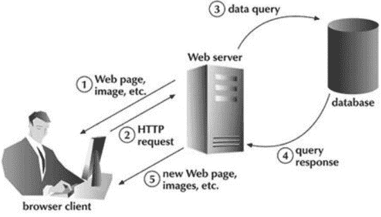

## 示例代码

```html
<script>

function showme(str)

{
```

Hirdesh Bhardwaj

```
// to check if you don’t enter anything...
if(str.length==0)
{
    document.getElementById("result").innerHTML='pls type something';
    return;
}
// make xmlhttp object for request
if (window.XMLHttpRequest)
{
    // code for IE7+, Firefox, Chrome, Opera, Safari
    xmlhttp=new XMLHttpRequest();
}
else
{
    // code for IE6, IE5
    xmlhttp=new ActiveXObject("Microsoft.XMLHTTP");
}
xmlhttp.onreadystatechange=function()
{
    document.getElementById("result").innerHTML=xmlhttp.responseText;
}
```

```
// send your request to getlist.java page via GET method with
argument city

xmlhttp.open("GET","getlist.php?city="+str,true);

xmlhttp.send();

}

</script>
```

```html
<form>

<input type="text" onkeyup="showme(this.value)" name="city" />

</form>
```

在这里，你将通过 getElementById 方法在 result 这个 id 中获取结果。

```html
<span id="result"></span>
```

## Getlist.php

```php
<?php

// Receive request on php page

$city=$_REQUEST['city'];

echo "City is ".$city;

// You may collect data from database on the base of requested city

?>
```

### 说明

## 托管你的网站

许多人喜欢在家中或办公室运行自己的服务器，如果你有时间，这是一个可行的托管解决方案。但自己托管网站可能会带来比其价值更多的问题。

你需要考虑备用电源、修补安全漏洞、定期维护、定期升级以及许多其他问题。请记住，你不仅需要让 Web 服务器保持运行，还需要有东西来管理你的域名。

## 服务器（DNS 服务器）

服务器就像你的计算机一样，存储文件并在被请求时提供服务。

服务器每天 24 小时保持运行。确保你的网站安全且始终可供访问是它们的职责。例如，当你写博客或发布任何文章时，你将文件保存到虚拟主机服务商的服务器上，现在任何访问你博客的人都可以访问它。

## 域名：

域名是网址中最重要的部分。域名是公司在互联网上的身份标识。每个域名都有其后跟点的扩展名。例如，www.irctc.gov.in 是 .gov.in 域名，表示它是一个政府网站。一些常见的扩展名有 .com / .co / .in / .net / .me

## 虚拟主机

虚拟主机服务商（虚拟主机公司）帮助你的网站上线并可供公众访问。以下是虚拟主机服务商允许你执行的操作：

- 为你提供空间来保存文件、图片和其他媒体资源
- 允许人们在请求时访问你存储的文件/图片/媒体资源。

在选择主机时，以下是外包托管时需要考虑的几个标准：

- 支持的语言：PHP、JAVA、CGI 等。
- 支持的数据库：MySQL、Postgresql、MSSQL 等。
- 服务器控制：超级用户访问权限（Super User Access）
- 服务器访问：如 FTP、telnet、SSH 等。
- 管理 GUI：电子邮件、数据库、用户设置等。
- 带宽使用：网站、电子邮件、流媒体、数据库连接等。

## 虚拟主机的类型：

几乎所有虚拟主机公司都为你提供以下三种流行的托管方案：

- 共享主机（Shared hosting）。
- 经销商主机（Reseller hosting）。
- VPS 和独立主机（Dedicated hosting）。

**共享主机：** 在此方案下，你可以托管许多网站。有些共享主机方案还允许你托管不限数量的网站。在共享主机方案中，你只能获得一个 CPanel（控制面板）来管理所有网站。

**经销商主机：** 经销商主机允许你将托管服务转售给其他客户。但你也可以用它来托管自己的网站。在经销商主机账户中，你可以为每个网站创建单独的账户。因此，当你购买经销商主机套餐时，你会获得一个 Cpanel（控制面板）和 WHM（网站托管管理器），用于创建和管理不同的网站账户。

Hirdesh Bhardwaj

**VPS 和独立主机：** VPS 主机更适合访问量非常高的网站和需要大量功能的网站。通常，如果你使用共享或经销商主机方案，虚拟主机服务商不会允许你消耗那么多资源。他们会停用你的网站，并要求你升级到 VPS 或独立主机方案。

**存储空间和带宽：** 如上所述，虚拟主机公司为你提供存储文件的空间和带宽，使你的文件可供公众访问。因此，基本上，存储空间就是用来存储你的博客文章、图片、媒体文件（视频、播客等）、WordPress 安装文件、主题、插件等的空间，它们都存储在服务器上。

**带宽：** 每次访问者访问你的网站时，他/她都会使用服务器资源。这是因为服务器需要将所有文件/图片/媒体发送到他的计算机。

因此，以这种方式提供文件所消耗的资源被计算为带宽。

你的访问者越多，所需的服务器资源就越多，因此你需要更多的带宽。

带宽以字节为单位进行测量，其值通常以 GB（千兆字节）或 TB（太字节）表示。

## 支持的语言

首先，我们来说说支持的语言。显然，因为你购买了这本书，我们假设你正在考虑使用 PHP，但你可能还需要使用其他语言。有些时候，其他语言（如 JavaScript）可能比 PHP 更适合某项工作。例如，

如果你想在网站上直播音频或视频，你可能会使用某种 Java 小程序（applet），因为 PHP 需要来自服务器的请求来处理信息。PHP 可以通过对服务器的不同调用来实现，但由于这更像是来自浏览器的客户端请求，因此客户端语言更适合此任务。

有时，你可能需要使用另一种编程语言来完成客户在其他主机或服务器上已经设置好的功能。如果是这样，至少可以有选择地使用例如 Perl 脚本，而不是花费时间和金钱用 PHP 重新开发应用程序。


类似 WordPress 的 CMS 使用 MySQL 数据库来存储和检索数据以动态生成网页。

如果计划运行一个不使用任何 CMS 或 PHP 语言的静态网站，则不需要数据库。

## 服务器控制和访问

许多主机提供商不会给 Web 开发人员对其托管域的完全访问和/或控制权限。

我们倾向于避开这些主机，因为当你想对服务器进行一些自定义配置时，更有可能遇到问题。

查看你的主机提供的访问类型。显然，你的主机会提供 FTP 访问，以便你将文件上传到 Web 服务器。然而，有些主机只提供 FTP 访问，其他什么都没有。

问题在于你很可能会遇到想要配置服务器的情况。为此你需要 telnet 或 SSH 访问来使用命令行。

事实上，配置能力在执行主机默认通常不允许的任务时往往是必要的。例如，考虑 htaccess。使用 htaccess，你可以根据 htpasswd 文件中允许的用户来拒绝和允许对某些文件和目录的访问

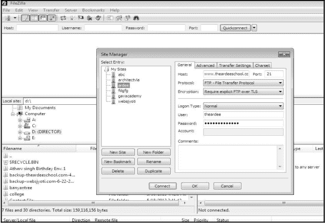

## 管理 GUI

某些主机在其套餐中提供管理 GUI（图形用户界面）或用户控制面板作为功能。很多人并不特别喜欢 GUI，但当你别无选择时——要么是因为你没有足够的服务器访问权限，要么是因为你不完全了解如何通过 telnet 完成操作——点按式解决方案就是一个很棒的工具。

界面可以简单到只允许你查看有关服务器的信息，也可以复杂到允许你一键安装应用程序和编程语言。另外，请记住，如果你的客户希望能够管理其电子邮件用户，许多控制面板都有实用程序允许客户自行操作。有了这样的功能，客户无需打电话给你或
托管公司来设置电子邮件帐户，客户只需登录控制面板并根据需要设置和删除用户即可。

## 备注

## 备注

## PHP 分页

当我们在同一页面上显示大量内容时，我们开始考虑添加分页，因为在同一页面上加载所有数据在优化方面不是正确选择。因此我们将所有内容拆分为多个页面。在这种情况下——每个页面包含我们信息的一部分。我们可以使用服务器端以及客户端分页，使用 javascript 和 PHP 来管理我们的页面。

你的 SQL SELECT 语句查询可能产生数千条记录的情况总是存在的。但在一页上显示所有结果并不是一个好主意。因此我们可以根据需要将此结果分成多个页面。

分页意味着将查询结果显示在多个页面中，而不是全部放在一个页面上。

### 使用 LIMIT 获取记录以生成分页的简单示例

```
<?php

include 'dbconnectivity.php';

// to check if page url already contain page number like
test.php?pageNum=2

if (isset($_GET['pageNum']))

{

$pageNum = $_GET['pageNum'];

} else
{
    // if no pageNum variable exist in url then set pageNum variable to page 1
    $pageNum = 1;
}

// place your query here
$query=mysql_query("select * from imageslave");

$resultRows = mysql_num_rows($query);

// Set number of Records per page
$rowsPerPage = 4;

/* Calculate how many pages to be generate example if you have 20 record and you want to display 4 pages each page then last page will be 5. ( 20/4 =5 )*/
$lastPage = ceil($resultRows/$rowsPerPage);

// set page position to beginning or at the end of the page
if ($pageNum > $lastPage)
{
    $pageNum = $lastPage;
}
    else if ($pageNum < 1)
{
$pageNum = 1;
}
while($row =mysql_fetch_assoc($query))
{

// display data fields here
echo $row['fname'];
echo " " .$row['lname']."<br>";
}
echo "<br><br>";

// Display links of Next / Prev Page
if ($pageNum > 1)
{
    $prevPage = $pageNum-1;
    echo " <a href='{$_SERVER['PHP_SELF']}?pageNum=1'>FIRST</a> ";
    echo " <a href='{$_SERVER['PHP_SELF']}?pageNum=$prevPage'>PREVIOUS</a> ";
}
echo "Page $pageNum of $lastPage ";
if ($pageNum < $lastPage)
{

$nextPage = $pageNum+1;

echo " <a href='{$_SERVER['PHP_SELF']}?pageNum=$nextPage'>NEXT</a> ";

echo " <a href='{$_SERVER['PHP_SELF']}?pageNum=$lastPage'>LAST</a>" ;

}

?>
```

## 备注

## **Bootstrap – 框架**

Bootstrap 是一个免费的开源 CSS 框架，面向响应式、移动优先的前端 Web 开发。它包含用于排版、表单、按钮、导航和其他界面组件的基于 CSS- 和（可选）JavaScript 的设计模板。*(来源：维基百科)*

最初名为 Twitter Blueprint，由 **Mark Otto 和 Jacob Thornton** 在 **Twitter** 开发，作为一个框架以鼓励内部工具的一致性。

**安装指南：** 你可以访问 getbootstrap.com 下载 bootstrap 的最新版本。下载设置后你需要解压或提取它。你将获得以下三个目录

- **CSS** – 包含所需的 css 文件，例如 – bootstrap.min.css, bootstrap-theme.css 等
- **Fonts** - 包含用于额外字体的 ttf 和 otf 文件
- **JS** - 包含所需的 JS 文件 – 例如 – bootstrap.min.js, npm.js 等。

### **示例代码：安装 Bootstrap**

```
<!DOCTYPE html>

<html lang="en">

  <head>

    <meta charset="utf-8">

    <meta http-equiv="X-UA-Compatible" content="IE=edge">

    <meta name="viewport" content="width=device-width, initial-scale=1">

<title>Bootstrap 101 Template</title>
<link href="css/bootstrap.min.css" rel="stylesheet">
</head>
<body>
// Your HTML code goes
</body>
</html>
```

## Bootstrap 3 中可用的一些主要类

### .container

- 为元素设置固定宽度（根据屏幕尺寸会更改为其他固定值，因此仍然具有响应性）在除 xs 之外的所有屏幕尺寸上 - 在 xs 上，宽度会自动计算（此行为可以更改）
- 固定宽度的响应式网站应包装在 .container 中（或仅内容而不带菜单，随便你——由你决定）
- .container 不能嵌套！

### .container-fluid

- 设置 100% 宽度，margin-left 和 margin-right: auto，padding-left 和 padding-right: 15px
- 全屏网站应包装在 .container - fluid 中
- .container-fluid 不能嵌套！

### .row

- 创建列的水平组（通常具有宽度类，见下文）
- 必须在 .container 内以确保正确的填充和对齐
- 只有列（具有宽度类的块元素）可以是行的直接子元素
- 设置 margin-left 和 margin-right: -15px

### .pull-right

### .pull-left

- 将 float 设置为 left 或 right

### .center-block

- 将 margin-left 和 margin-right 设置为 auto

## Bootstrap 网格类

- 可以嵌套，嵌套的列也必须包装在 .row 中
- 所有列都有 float: left 和 position: relative 样式

### .col-xs-1 .col-xs-2 .col-xs-3 .col-xs-4 .col-xs-5 .col-xs-6 .col-xs-7 .col-xs-8 .col-xs-9 .col-xs-10 .col-xs-11 .col-xs-12

- 在超小屏幕（<768px）上设置列的宽度（以 % 指定）

### .col-sm-1 .col-sm-2 .col-sm-3 .col-sm-4 .col-sm-5 .col-sm-6 .col-sm-7 .col-sm-8 .col-sm-9 .col-sm-10 .col-sm-11 .col-sm-12

- 在小屏幕（≥768px）上设置列的宽度（以 % 指定）

### .col-md-1.col-md-2.col-md-3.col-md-4.col-md-5.col-md-6.col-md-7.col-md-8.col-md-9.col-md-10.col-md-11.col-md-12

- 在中等尺寸屏幕（≥992px）上设置列的宽度（以 % 指定）

### .col-lg-1.col-lg-2.col-lg-3.col-lg-4.col-lg-5.col-lg-6.col-lg-7.col-lg-8.col-lg-9.col-lg-10.col-lg-11.col-lg-12

- 在大屏幕（≥1200px）上设置列的宽度（以 % 指定）
- 通过指定列数设置偏移（margin-left）（例如，在小屏幕上将列移动三列，将 .col-sm-offset-3 类设置为列）

### .col-xs-pull-* (.col-xs-pull-1, .col-xs-pull-2 ... up to -12)
.col-sm-pull-* (.col-sm-pull-1, .col-sm-pull-2 ... up to -12)
.col-md-pull-* (.col-md-pull-1, .col-md-pull-2 ... up to -12)
.col-lg-pull-* (.col-lg-pull-1, .col-lg-pull-2 ... up to -12)

- 以与列相同的方式按 % 设置 left 位置（例如，使用 -pull-9 时 left: 75%）

## Bootstrap 可见性类

- 你可以在单个元素上应用任意多个这些类，这种混合为你的布局提供了更多可能性

### .clearfix

- 显而易见，clear: both
- 通常与下面的类组合使用

### .visible-xs-block and .visible-xs .visible-sm-block and .visible-sm .visible-md-block and .visible-md .visible-lg-block and .visible-lg
-   仅在指定尺寸的屏幕上显示元素（设置 display: block 属性），并在其他尺寸的屏幕上自动隐藏它（设置 display: none）
-   通常与 .clearfix 结合使用，使 clearfix 仅在选定的屏幕尺寸上生效

### .hidden-print
-   在打印（预览）时隐藏元素（设置 display: none）

## Bootstrap Typography Classes
-   <body> a <p> 元素的默认字体大小为 14px，行高为 1.428；<p> 还有 margin-bottom 为其行高的一半（14px 字体时为 20px），因此默认为 10px
-   b、big、code、em、i、mark、small、strong、sub、sup、ins、del、s、u、abbr、address 和 blockquote（以及内部的 small 和 cite）等元素都被正确样式化
-   这些类的绝大多数最常设置在段落、strong 或 em 元素上

### .page-header
-   用于标题的包装 div 的类
-   添加一些 margin、padding 和 border-bottom

### .lead
-   用于突出显示元素
-   将元素的 font-size 设置为 21px，font-weight 为 300，line-height 为 1.4，margin-bottom 为 20px

### .text-left .text-center .text-right .text-justify
-   使用 text-align CSS 属性对齐文本，通常是段落

### .text-nowrap
-   保持带有此类的整个文本在一行上，不换行，因为该类的 white-space: nowrap CSS 属性

### .text-lowercase .text-uppercase .text-capitalize
-   设置 text-transform CSS 属性，使带有此类的元素内的所有字符变为小写、大写或首字母大写

### .text-muted
-   使文本变灰

### .text-primary
-   使文本变蓝

### .text-success
-   使文本变绿

### .text-info
-   使文本变深蓝

### .text-warning
-   使文本变深黄

### .text-danger
-   使文本变红

## Bootstrap Lists' Classes
### .list-unstyled
-   在列表项上移除 list-style 和 margin-left
-   对嵌套列表不适用（如果需要，嵌套列表也必须具有 .list-unstyled 类）

### .list-inline
-   将列表项放置在一行上（使用 display: inline-block 和 padding）

### .dl-horizontal
-   用于定义列表（<dl>）的类
-   为定义列表内的 <dt> 和 <dd> 设置漂亮的样式（文本对齐、字体粗细）

### .list-group
-   列表项的父元素的类（通常是 <ul>，也可以是 <div>）
-   列表项必须具有 .list-group-item 类

### .list-group-item
-   用于 .list-group 子元素的类
-   使列表项看起来更美观
-   通常用于 <li>，也可以是 <a>

### .table-condensed
-   应与 .table 类结合使用
-   用于普通表格，单元格内边距减半，因此行不高

### .table-responsive
-   用于表格包装器（！大多是 div）的类，使其在超小设备上响应式，滚动条会出现
-   用于 <tr> 或仅 <td> 的类
-   将表格行中所有 <td>（或仅一个 <td>）的背景色设置为灰色（active）/绿色（success）/蓝色（info）/黄色（warning）/红色（danger）

## Bootstrap Forms' Classes
-   不要忘记即使是表单元素也可以在 Bootstrap 网格中，所以不要害怕在表单内使用 .row，然后使用 col-*-* 包装器

### .form-group
-   在创建垂直表单时，它是每个标签及其输入的包装器（大多是 div）的类，添加一些 margin-bottom

### .form-control
-   用于每个表单元素（input、textarea...），使其宽度为 100%
-   要使其更窄，请使用更窄的包装器（row 和 col-*-* div）

### .form-control-static
-   用于替换表单元素（input...）的段落

### .form-horizontal
-   用于标签与输入在同一行的水平表单
-   你必须为每个标签及其输入（或任何内容）使用列类（如 col-xs-10）
-   仍与 .form-group 包装器和 .form-control 类结合使用

### .form-inline
-   用于单行表单（但在超小屏幕上仍为垂直）
-   通常与 placeholder 属性一起使用，以不需要标签
-   内联表单的标签应获得 .sr-only 类，以便定位使其不可见（但不会获得 display: none 或 visibility: hidden 属性）

### .input-lg
### .input-sm
-   使表单元素如 input 或 select 比默认更大或更小

### .input-group-lg
### .input-group-sm
-   用于 .input-group（见下文）的类
-   始终与 .input-group 类一起使用

### .caret
-   用于创建下拉箭头的空 span 的类

### .help-block
-   用于作为用户帮助文本的 span 的类
-   必须放在表单输入的正后方

### .has-success
### .has-warning
### .has-error
-   用于带有 .form-group 类的包装 div 的类
-   将内部的标签、输入和 .help-block span 颜色变为绿色/黄色/红色
-   包装器内带有这些类之一的标签必须具有 .control-label 类才能被着色

### .has-feedback
-   当在包装器内为输入使用 glyphicon 时，用于带有 .form-group 类的包装 div 的类

要禁用输入，请使用 disabled="disabled" 或 readonly="readonly"。

## Bootstrap Image Classes
-   图像应具有 .img-responsive 或 .thumbnail 以实现响应式，并被包装在列包装器中（如 col-xs-3...）

### .img-rounded
-   提供轻微 border-radius 的 img 类

### .img-circle
-   提供 50% border-radius 使图像呈圆形形状的 img 类

### .img-thumbnail
-   提供 1px 实心灰色边框、4px 内边距、白色背景、display: inline-block 属性和快速 CSS3 过渡的 img 类

### .thumbnail
-   用于图像的包装 div（或在图库情况下为 <a>）的类，添加一些样式（边框、内边距、背景、过渡）并设置图像 max-width: 100%、height: auto；display: block；以及 margin-left 和 margin-right 为 auto

### .img-responsive
-   使任何图像响应式（相对于父元素缩放）的 img 类，因为它具有 max-width: 100% 和 height: auto
-   如果放置在浮动元素中可能不起作用！

### .caption
-   用于 .thumbnail 元素（a 或 div）内部的 div 的类，可能包含 h3、p、a（也包括按钮）以获得适当的 margin/padding

## Bootstrap Navbar Classes
-   nav 和 navbar 类之间的区别在于 navbar 可以折叠整个 nav（nav 不能自行完成）

### navbar
-   用于导航包装器（通常是 `<nav>`）的基本类，设置边框、下边距、最小高度和 position: relative
-   如果不打算固定，可以放置在 `.container` 或 `.container-fluid` 中的任何位置

### navbar-default
-   为导航包装器（背景渐变和 box-shadow）及其项目（包括 `<li>` 上的 `.active` 类）设置其他基本样式
-   对于深色，请参见下文的 `.navbar-inverse`

### navbar-inverse
-   navbar-default 的变体，但使用深色
-   不要在同一个元素上同时使用 navbar-default 和 navbar-inverse，因为这没有任何意义

### .navbar-brand
-   为菜单中的特殊超链接和其他“简单文本”设置样式（float: left、更大的字体大小、一些内边距、text-shadow...）

### .navbar-fixed-top
### .navbar-fixed-bottom
-   添加到 .navbar 的附加类，使导航在滚动时固定在页面顶部（或底部）
-   与 .navbar 以及 .navbar default 一起使用（只是为了保持美观）
-   你应该为 <body> 添加一些顶部或底部内边距，以防止导航覆盖你的内容

### .navbar-static-top
-   移除导航的顶部、右侧和左侧边框以及 border-radius

### .breadcrumb
-   用于作为面包屑的 <ul> 的类
-   使面包屑看起来很酷

### .pagination
-   用于作为分页的 <ul> 的类
-   正确样式化此分页内的 <li>，也包括 .disabled 和 .active 类（请记住 .disabled 不会移除链接的功能）

### .pagination-lg
### .pagination-sm
-   与 .pagination 一起用于 <ul>，使分页比默认更大或更小

### .pager
-   用于 <ul>，使“Previous”和“Next”链接看起来更好，带有灰色边框
-   其列表项可以具有 .previous、.next 以及 disabled 类以获得更好的样式

### .next


## .previous

- 用于 `<ul class="pager">` 中的 `<li>`，为链接添加箭头。

## Bootstrap 4：Bootstrap 4 的新变化

**Bootstrap 4 中的新类：** Bootstrap 从 Bootstrap 3 迁移到 Bootstrap 4 时做了一些显著的更改。以下是一些主要更改：

### 表单

- 重写了自定义和默认的复选框和单选按钮。
- 弃用了 `.input-group-addon` 和 `.input-group-btn`，改用两个新类 `.input-group-prepend` 和 `.input-group-append`。

### 网格系统

- `xs` 网格类已修改为无需断点，因此不再是 `.col-xs-6`，现在是 `.col-6`。

### 图片

- 将 `.img-responsive` 重命名为 `.img-fluid`。
- 将 `.img-rounded` 重命名为 `.rounded`。
- 将 `.img-circle` 重命名为 `.rounded-circle`。

### 表格

- 响应式表格现在只需将 `.table-responsive` 直接放在 `<table>` 上。
- 新增了 `.table-inverse` 选项。
- 将上下文类重命名为带有 `.table-` 前缀。因此 `.active`、`.success`、`.warning`、`.danger` 和 `.info` 变为 `.table-active`、`.table-success`、`.table-warning`、`.table-danger` 和 `.table-info`。

### 表单

- 将 `.control-label` 重命名为 `.col-form-label`。
- 分别将 `.input-lg` 和 `.input-sm` 重命名为 `.form-control-lg` 和 `.form-control-sm`。
- 弃用了 `.radio-inline` 和 `.checkbox-inline`。
- 用 HTML5 表单验证替换了 `.has-error`、`.has-warning` 和 `.has-success` 类，通过 CSS 的 `:invalid` 和 `:valid` 伪类实现。

### 按钮

- 将 `.btn-default` 重命名为 `.btn-secondary`。
- 将按钮的 `[disabled]` 改为 `:disabled`。
- 移除了按钮工具栏中按钮组之间的显式间距。

### 面板

- `.panel` 变为 `.card`，现在使用 flexbox 构建。
- `.panel-default` 已移除且无替代。
- `.panel-group` 已移除且无替代。
- `.panel-heading` 变为 `.card-header`。
- `.panel-title` 变为 `.card-title`。
- `.panel-body` 变为 `.card-body`。
- `.panel-footer` 变为 `.card-footer`。
- `.panel-primary`、`.panel-success`、`.panel-info`、`.panel-warning` 和 `.panel-danger` 已被弃用，改用从我们的 `$theme-colors` Sass 映射生成的 `.bg-`、`.text-` 和 `.border` 工具类。

## 示例 – 使用 Container、Jumbotron、Well、按钮、文本类

```html
<!DOCTYPE html>
<html lang="en">
<head>
<meta charset="utf-8">
<meta http-equiv="X-UA-Compatible" content="IE=edge">
<meta name="viewport" content="width=device-width, initial-scale=1">
<title>Bootstrap 101 Template</title>
<link href="css/bootstrap.min.css" rel="stylesheet">
</head>
<body>
<div class="container">
<div class="jumbotron">
<h2>Jumbotron Example.</h2>
</div>
<div class="well">
<h2>Well Example.</h2>
</div>
<h3>Button Examples</h3>
<button class="btn btn-primary">Primary Button</button>
<button class="btn btn-success">Success Button</button>
<button class="btn btn-danger">Danger Button</button>
<button class="btn btn-default">Default Button</button>
<button class="btn btn-primary btn-lg">Large Button</button>
<button class="btn btn-primary btn-sm">Large Button</button>
<br>
<h3>Text Classes - Text Color, Alignment & Text Case</h3>

<p class="text-danger">Bootstrap Classes are taken by
<mark>Hirdesh Bhardwaj</mark> </p>
<p class="text-primary text-uppercase">Text Classes</p>
<h3 class="text-warning text-left">Text Alignments</h3>

</div>
</body>
</html>
```

**输出：**

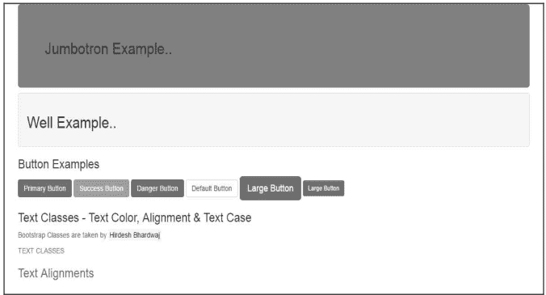

## 示例：Bootstrap 中的图片类


```html
<!DOCTYPE html>
<html lang="en">
<head>
<meta charset="utf-8">
<meta http-equiv="X-UA-Compatible" content="IE=edge">
<meta name="viewport" content="width=device-width, initial-scale=1">
<title>Bootstrap 101 Template</title>
<link href="css/bootstrap.min.css" rel="stylesheet"> <!--Link to bootstrap CSS File -->
</head>
<body>


</body>
</html>
```

## 示例：理解网格系统 – 行与列

Bootstrap 的网格系统允许页面跨度最多 12 列，因此一行最多可创建 12 列。

示例 – 让我们在一行中创建 3 个相等列，每列各占 4 个网格。

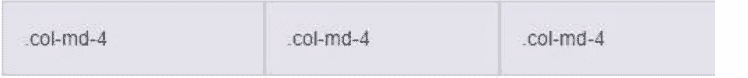

让我们再创建一个行，包含 8 和 4 的 2 列。


**示例：**

```html
<!DOCTYPE html>

<html lang="en">

<head>

<meta charset="utf-8">

<meta http-equiv="X-UA-Compatible" content="IE=edge">

<meta name="viewport" content="width=device-width, initial-scale=1">

<title>Bootstrap 101 Template</title>

</div>

</div> <!-- row end -->

</div>

</body>

</html>
```

**输出：**

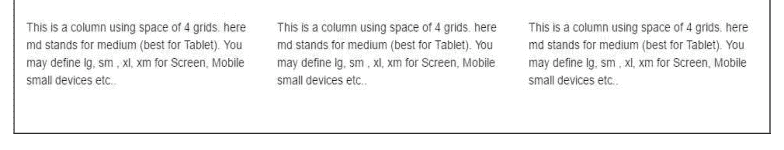

## Bootstrap 中的面板

面板是一个带边框且样式美观的框，其内容和标题、正文、页脚等部分周围有一些内边距。

**代码示例：**

```html
<!DOCTYPE html>
<html lang="en">
<head>
<meta charset="utf-8">
<meta http-equiv="X-UA-Compatible" content="IE=edge">
<meta name="viewport" content="width=device-width, initial-scale=1">
<title>Bootstrap 101 Template</title>
<link href="css/bootstrap.min.css" rel="stylesheet"> <!--Link to bootstrap CSS File -->
</head>
<body>
<div class="container">
<div class="row"> <!--row start -->
<div class="col-md-4">
<div class="panel panel-primary"> <!--panel in blue border -->
<div class="panel-heading">About Panel</div> <!--heading tag not required here -->
<div class="panel-body"> <!--panel main content area -->
A panel is a bordered and stylish box having some padding around its content and sections like heading, body and footer.
</div>
<div class="panel-footer">Learn More...</div>
</div>
</div>
<div class="col-md-4">
<div class="panel panel-danger">
<div class="panel-heading">About Panel</div>
<div class="panel-body">
A panel is a bordered and stylish box having some padding around its content and sections like heading, body and footer.
</div>
<div class="panel-footer">Learn More...</div>
</div>
</div>
<div class="col-md-4">
<div class="panel panel-success">
<div class="panel-heading">About Panel</div>
<div class="panel-body">
A panel is a bordered and stylish box having some padding around its content and sections like heading, body and footer.
</div>
<div class="panel-footer">Learn More...</div>
</div>
</div>
</div> <!-- row end -->
</div>
</body>
</html>
```

**输出：**


## Bootstrap 中的表格示例

用于在 Bootstrap 中创建表格的一些类有 `.table`、`.table-responsive`、`.table-bordered`、`.table-striped`、`.table-hover` 等。

### .table-responsive

用于创建响应式表格。表格在小设备上会水平滚动。

### .table-striped

用于为表格添加斑马纹。

### .table-bordered

用于为表格添加边框。

### .table-hover

用于在表格行上启用悬停状态，即鼠标悬停时会自动出现灰色背景。

### .table-condensed

用于通过将内边距减半使表格更紧凑。

**示例：**

```html
<!DOCTYPE html>
<html lang="en">
<head>
<meta charset="utf-8">
<meta http-equiv="X-UA-Compatible" content="IE=edge">
<meta name="viewport" content="width=device-width, initial-scale=1">
<title>Bootstrap 101 Template</title>
<link href="css/bootstrap.min.css" rel="stylesheet"> <!--Link to bootstrap CSS File -->
</head>
<body>
<div class="container">
<table class="table table-responsive table-striped table-bordered">
<tr>
<th>Name</th>
<th>City</th>
<th>Dept.</th>
</tr>
<tr>
<td>Rehaan</td>
<td>Noida</td>
<td>IT</td>
</tr>
<tr>
<td>Pooja Dayal</td>
<td>Udaipur</td>
<td>Development</td>
</tr>
```


```html
<tr>
<td>Sonali Jain</td>
<td>Agra</td>
<th>Sales</th>
</tr>
</table>
</div>
</body>
</html>
```

## 输出

| 姓名 | 城市 | 部门 |
|---|---|---|
| Rehaan | Noida | IT |
| Pooja Dayal | Udaipur | 开发 |
| Sonali Jain | Agra | 销售 |

## 导航栏示例

```html
<nav class="navbar navbar-default">
<div class="container-fluid">
<div class="navbar-header">
<a class="navbar-brand" href="#">Webs Jyoti</a>
</div>

<ul class="nav navbar-nav">

<li><a href="#">Home</a></li>

<li><a href="#">About us</a></li>

<li class="active"><a href="#">Gallery</a></li>

<li><a href="#">Contact</a></li>

</ul>

</div>

</nav>

</div>

</body>

</html>
```

## 使用 Bootstrap 的示例设计


## 代码

```html
<!DOCTYPE html>

<html lang="en">

<head>

<meta charset="utf-8">

<meta http-equiv="X-UA-Compatible" content="IE=edge">

<meta name="viewport" content="width=device-width, initial-scale=1">

<title>Bootstrap Template</title>
</head>
<body>
<!-- main menu items -->
<div class="collapse navbar-collapse" id="navbarCollapse">
<ul class="nav navbar-nav">
<li class="active"><a href="#">Home</a></li>
<li><a href="#">About</a></li>
<li><a href="#">Services</a></li>
<li><a href="#">Gallery</a></li>
<li><a href="#">Contact</a></li>
</ul>
</div>
</div>
</nav>
<div class="container">
<div class="jumbotron">
<h1>Welcome to My Websites</h1>
<p>Website Designing covers many different skills and disciplines that are used for developing a website. The different areas of website designing include; web graphic design, interface logo design, Brochures and catalogs, user experience design and SEO.</p>

<p><a href="#" target="_blank" class="btn btn-success btn-lg">Order Now</a></p>

</div>

<div class="row">

<div class="col-md-4">

<h2>Our Services</h2>

<p><strong>Webs Jyoti </strong> provides design to your website on very affordable cost. We design website in customize and on existing websites. Webs Jyoti web design services is all about delivering high quality web-based solutions at low and reasonable costs with great commitments.</p>

<p><a href="#" class="btn btn-success">Read More &raquo;</a></p>

</div>

<div class="col-md-4">

<h2>Tools</h2>

<p>Our web designers are using latest web design tools that bring continuous improvisations in the existing methodologies. Our recognition as a reputed website design company is rooted in the field. We use the latest tools and technologies at our development centre.</p>

<p><a href="#" class="btn btn-success">Read More &raquo;</a></p>

</div>

<div class="col-md-4">

<h2>Strategy</h2>

<p>We follow flexible system for improved results. Our Tester perform full testing over the completed system. We focus on product goals and ease of use. We provide results that are secure, reliable and super fast. We are always there for you, offering you the best results.</p>

<p><a href="#" target="_blank" class="btn btn-success">Learn More &raquo;</a></p>

</div>

</div>

<div class="row">

<div class="col-md-12">
</footer>

</div>

</div>

</div>

</body>

</html>
```

## 致谢

我想对出版团队表示感谢，他们在整个出版过程中一直鼓励我。感谢所有审阅我书籍的人。感谢我的读者抽出一天中的时间来阅读它。

获取我即将推出的教程和书籍的最新更新和详情，您可以在 www.websjyoti.com 订阅我。

如果您想邀请我到您的校园或办公室进行全天培训，请写信至 info@websjyoti.com

*****

## 关于作者

Hirdesh Bhardwaj 于 1987 年 8 月 15 日出生于印度阿利加尔。他以出色的网站/软件脚本而闻名，并于 2008 年被 Oracle 杂志提名为“印度顶尖 IT 年轻人”。

2005 年，他完成了中学教育并移居哈里亚纳邦古尔冈接受高等教育。他于 2008 年在 NIIT 古尔冈完成了软件工程文凭，并于 2010 年在卡纳塔克大学获得 Msc.IT 学位。

Hirdesh Bhardwaj 在高中一年级时对写作产生了兴趣。他写了一首印地语诗歌《21 世纪》，于 2009 年 6 月出版。

2009 年，他加入 The Ardee Group，担任开发人员和 IT 主管。随后他使用 PHP/MySQL 构建了图书管理系统、学生管理系统、MLM 系统、在线调查以及许多应用程序。

除了书籍外，Hirdesh 还有约 250 个脚本和教程将在未来几年出版。

2009 年他创立了“Webs Jyoti”- 开发与培训组织。Webs Jyoti 已开发了约 350 多个网站和 Web 应用程序。


**您可以通过以下方式联系作者：**  
*info@websjyoti.com*
