# PHP & MySQL 快速入门指南

## 介绍 PHP 与 MySQL

最具吸引力的现代网站通过动态响应某些当前条件（如用户名、当天时间、最新博客、购物车内容等）来提供定制化的用户体验。这些动态网站中的许多都是使用 PHP 和 MySQL 创建的。


### 什么是 PHP？

PHP 是一种广泛使用的通用型脚本语言，特别适用于 Web 开发，并可以嵌入到 HTML 中。它由程序员 Rasmus Lerdorf 创建，最初是一组维护其网站的脚本，并于 1995 年 6 月 8 日作为“个人主页工具（PHP Tools）版本 1.0”发布。这些脚本在 1997 年的 2 版本中得到了扩展，名称在次年的 3 版本中变为一个递归缩写“PHP: Hypertext Preprocessor（超文本预处理器）”。2000 年随着 PHP4 的发布，性能、可靠性和扩展性得到了提高，该版本由新的 Zend 引擎（一个虚拟机）驱动。当前版本 PHP5 由 Zend II 引擎驱动，由 PHP 组作为免费软件制作。今天，PHP 已安装在超过 2000 万个网站和 100 万台 Web 服务器上。


### 什么是 MySQL？

MySQL 是世界上最流行的数据库软件，用于管理存储的数据，被称为数据库管理软件（DBMS）或关系型数据库管理软件（RDBMS）。MySQL 由 Michael Wildenius 和 David Axmark 于 1995 年创建。其名称（正式读作“My-SQL”，但通常读作“My Sequel”）是 Michael 的女儿的名字“My”与“SQL”（结构化查询语言）的组合。MySQL 最初由其创始人创立的 MySQL AB 公司生产，该公司在 2008 年被太阳微系统收购，随后于 2010 年被 Oracle 收购。当前版本 MySQL 8.0 由 InnoDB 存储引擎驱动，MySQL 社区版版作为免费软件提供。今天，MySQL 被用于一些访问频率最频繁的网站，包括 Google、维基百科、Facebook 和 Twitter。

重要的是，PHP 和 MySQL 都是“服务端”技术——也就是说，它们驻留在 Web 服务器上。它们不是驻留在用户计算机上的“客户端”技术。因此，它们的魔力发生在“云端”。

### 理解云端

当用户在浏览器中请求查看网页时，浏览器会向 Web 服务器请求页面，并通过 HTTP 协议接收响应页面。如果网页包含 PHP 脚本，Web 服务器可能会先调用 PHP 引擎处理代码，并在需要时在发送响应到浏览器之前从 MySQL 数据库请求数据。

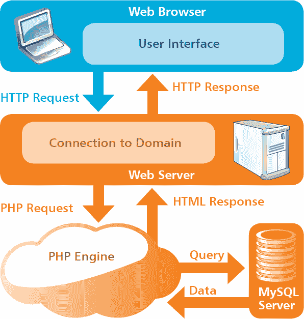

接下来的页面将描述如何在本地安装以下服务端技术，为数据驱动型网站创建开发环境：

* Web 服务器 – Abyss Web Server 免费个人版
* PHP 引擎 – PHP 7.2
* MySQL 服务器 – MySQL 社区版 8.0


HTTP（超文本传输协议）是通用通信标准，允许任何连接到任何 Web 服务器的计算机访问网络上的文件。书中的示例是用列出的软件创建和测试的，但对于其他版本可能需要修改。

## 安装 Abyss Web 服务器

Abyss 是一款适用于 Windows、macOS/Mac X 和 Linux 操作系统的免费紧凑型服务器，可以在 `aprelium.com` 下载。尽管占用空间很小，但 Abyss 支持许多强大的功能，包括使用服务器端脚本生成动态内容——因此是 PHP 和 MySQL 的理想伴侣。你可以在自己的电脑上安装 Abyss Web 服务器，为 PHP 和 MySQL 开发提供环境。


从 `aprelium.com/abyssws/download.php` 下载适用于你系统的 Abyss Web 服务器安装包。

运行下载的可执行文件启动安装向导，然后点击 Next（下一步）按钮开始。

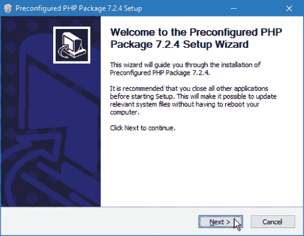

接下来，接受许可条款，然后点击 Next（下一步）按钮继续安装。

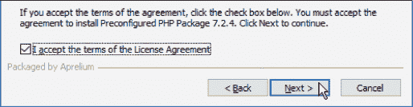

关于安装 Abyss Web 服务器的进一步指导，可以在 `aprelium.com/abyssws/start.php` 获取。

Windows 版本的 Abyss 安装包是一个名为 `abws1.exe` 的可执行文件，运行它即可安装 Web 服务器。

接受建议的路径 `C:\Abyss Web Server`，然后选择将 Abyss 安装为 Windows 服务。

下一步，选择你偏好的语言，然后输入以后访问 Abyss 服务器所需的用户名和密码。

现在，使用选择的用户名和密码登录，查看 Abyss 控制台确认服务器状态为 Running（运行）。

最后，在浏览器地址栏中输入 `http://localhost`，然后按回车键查看由 Abyss Web 服务器提供的默认欢迎页面。

如果你选择 Manual（手动）选项，Abyss 标志将不会出现在系统托盘中以便快速启动/停止和访问服务器控制台。相反，可以通过浏览器访问 `http://localhost:9999` 控制台。

在 Abyss 控制台中，点击 Configure（配置）按钮然后点击 General（常规）图标，查看默认 HTTP 端口为 80，默认 Documents Path（你的网页所在路径）为 `/htdocs`。

## 安装 PHP 引擎

PHP 解释器“引擎”用于网页中实现 PHP 脚本，适用于 Windows、macOS/Mac X 和 Linux 操作系统，可在 `php.net` 免费下载。

关于 PHP 安装的进一步指导可以在 `php.net/manual/en/install.php` 获取。

此外，从 `aprelium.com` 提供了适用于 Windows Abyss Web 服务器的预配置包，推荐用于快速安装。

从 `aprelium.com/downloads` 下载适用于你系统的 PHP 安装包。

运行下载的可执行文件启动安装向导，然后点击 Next（下一步）按钮开始。

接下来，接受许可条款，然后点击 Next（下一步）按钮继续安装。

如果从 `php.net` 为 Windows 安装 PHP，请确保选择 VC6 Thread Safe 版本——因为它需要的 Windows 依赖较少。

接受建议的路径 `C:\Program Files\PHP7`，然后点击 Install（安装）按钮继续。

最后，安装完成后点击 Finish（完成）按钮关闭安装向导。

在为 Abyss Web 服务器配置 PHP 时需要 PHP 的安装位置——请记录目标文件夹。

安装 PHP 后，Web 服务器尚无法执行 PHP 脚本，除非对其进行配置以识别这些脚本并找到 PHP 解释器引擎——所有说明如第 14-15 页所示。

## 为 PHP 配置 Abyss

必须配置 Abyss Web 服务器以识别 PHP 脚本，并在遇到它们时使用 PHP 解释器。这可以通过 Abyss 服务器控制台实现：将 `.php` 文件扩展名关联为 PHP 脚本，并指定系统上 PHP 引擎的位置来解释它们。


关于 Abyss Web 服务器配置的更多指导，可以在线访问：**[aprelium.com/abyssws/start.html](http://www.aprelium.com/abyssws/start.html)**。

在浏览器地址栏中输入 `http://localhost:9999`（或点击系统托盘中的 Abyss 图标）启动 Abyss 服务器控制台，然后点击 `Configure` 按钮打开配置页面。


接下来，点击 Scripting Parameters 图标打开 Scripting Parameters 页面进行编辑。

确保勾选 `Enable Scripts Execution` 复选框，然后点击 Interpreters 表格中的 `Add` 按钮打开 Interpreters-Add 页面。

现在，将 `Interface` 设置为“FastCGI”，将 `Interpreter` 设置为系统上 PHP 解释器 (`php-cgi.exe`) 的路径，并 `Add` 文件扩展名 `.php` 然后点击 `OK`。

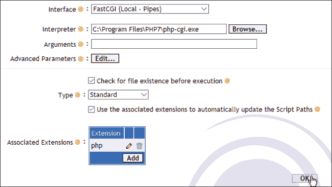


`localhost` 域名是 IP 地址 `127.0.0.1` 的别名——因此 Abyss Web 服务器控制台也可以通过 `http://127.0.0.1:9999` 访问。

在控制窗口中点击 `OK`，然后点击 `Restart` 按钮将更改应用于 Abyss 配置。


现在 Abyss Web 服务器应已在您的系统中运行，并正确配置为识别具有 `.php` 文件扩展名的文档应由 PHP 引擎解释。现在可以通过创建一个简单的 PHP 脚本由 Abyss 为您的浏览器提供服务来测试配置。


`phpinfo.php`

打开一个纯文本编辑器并准确输入以下脚本：

```php
<?php phpinfo() ?>
```

将脚本保存为 `phpinfo.php`，位于 Abyss 文档路径目录中，通常位于 `C:\Abyss Web Server\htdocs`。

在浏览器地址栏中准确输入位置 `http://localhost/phpinfo.php`，查看 Abyss 提供的包含您的 PHP 版本信息的网页。

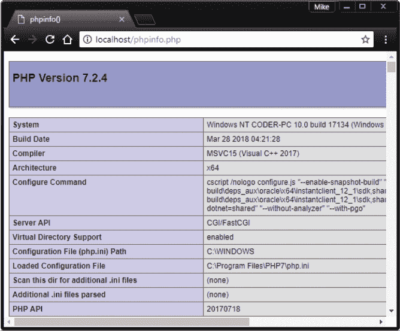


PHP 脚本对大小写敏感，因此您必须仅使用小写字母复制列出的脚本。


文档只有在 Web 服务器使用 HTTP 协议提供服务时才能被 PHP 引擎解释。您不能直接在浏览器中打开 PHP 文件。请始终使用位置 `http://localhost/`。

## 嵌入 PHP 脚本

PHP 脚本可以嵌入 HTML 文档中——这意味着 PHP 和 HTML 代码可以和谐地存在于同一个文件中。所有嵌入的 PHP 代码必须包含在 `<?php` 和 `?>` 标签内，以便 PHP 引擎能够识别并进行解释。通常，PHP 代码会将内容写入 HTML 文档的 body 部分，然后发送到浏览器。


`hello.php`

启动纯文本编辑器并创建一个带有空 body 部分的有效基础 HTML5 文档：

```html
<!DOCTYPE HTML>
<html lang="en">
<head><meta charset="UTF-8">
<title>Getting Started With PHP</title>
</head>
<body>
</body>
</html>
```

```php
<?php
echo "Hello World!";
?>
```

记下你选择的 root 用户密码、用户名和用户密码——你将经常需要它们。


在继续之前，确保 MySQL 服务器配置成功完成。如有必要，请重复安装过程。

## 使用 MySQL 客户端

在将 MySQL 服务器安装为 Windows 服务后（详情请参见第 18-19 页），你可以通过随服务器包一起安装的 MySQL 命令行客户端与数据库进行通信。启动后，它会首先要求你输入在安装期间选择的 root 用户密码。密码验证后，MySQL 命令行客户端将显示 `mysql>` 命令提示符，你可以在其中创建和操作数据库。

从已添加到开始菜单的 MySQL 组启动 MySQL 命令行客户端，然后输入安装时选择的 root 密码

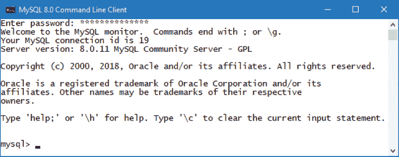

在 `mysql>` 提示符下，准确输入此命令以创建一个名为“site\_db”的新数据库

```sql
CREATE DATABASE IF NOT EXISTS site\_db ;
```

现在，准确输入另一条命令来显示你的 MySQL 服务器上当前的所有数据库

```sql
SHOW DATABASES ;
```

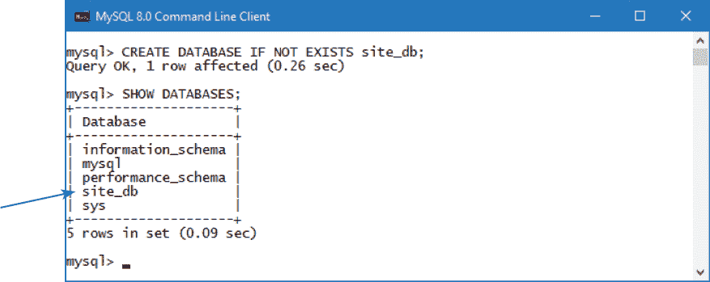


MySQL 命令行客户端也可以通过执行命令 `mysql -u root -p` 从常规命令提示符启动（前提是 `mysql` 已添加到你的系统 Path 中），或者在其 `/bin` 目录内启动。


所有 MySQL 命令都以 `;` 分号结束。


安装会创建一些默认数据库，例如“sys”，但你的“site\_db”数据库将是本书中使用的数据库。

## 创建 MySQL 用户

虽然 MySQL root 用户允许对 MySQL 服务器上的数据库具有完全控制权，但为了数据库的最佳安全性，显然不建议允许其他用户拥有这种自由。因此，root 用户可以创建具有特定“权限”的用户，用以控制他们在 MySQL 服务器上可以执行的操作。

root 用户可以在 MySQL 命令行客户端中通过执行一个识别唯一用户的子句来创建用户，如下所示：

```sql
CREATE USER IF NOT EXISTS ‘username’@’hostname’*
IDENTIFIED WITH mysql\_native\_password BY ‘password’* ;
```

root 用户随后可以执行一个子句，为特定用户指定特定数据库允许的权限，如下所示：

```sql
GRANT *privileges* ON database.\* TO ‘username’@‘hostname’* ;
```

权限以逗号分隔列表的形式指定，用户在访问指定数据库时可以使用这些关键字。例如，`SELECT`、`INSERT` 和 `UPDATE` 等基本权限。

以 root 用户身份登录 MySQL 命令行客户端，然后准确输入此子句来创建用户

```sql
CREATE USER IF NOT EXISTS ‘mike’@’locahost’
IDENTIFIED WITH mysql\_native\_password BY ‘easysteps’ ;
```

接下来，允许访问“site\_db”数据库的权限

```sql
GRANT SELECT, INSERT, UPDATE ON site\_db.\*
TO ‘mike’@‘localhost’ ;
```

现在，执行一个子句来确认此用户的权限

```sql
SHOW GRANTS FOR ‘mike’@’localhost’ ;
```

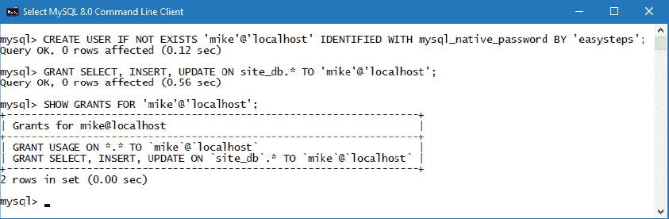


MySQL 是大小写敏感的且要求语法精确——你必须确保使用与列出的正确的空格和大小写。例如，不要在定义用户名和主机的 @ 字符周围留空格。


MySQL 8 引入了 `caching\_sha2\_password` 认证，但仍可以使用早期的 `mysql\_native\_password` 认证来指定未加密密码。

## 连接 PHP 与 MySQL

在 PHP 中可以使用标准脚本尝试连接 MySQL 数据库，该脚本描述了四个连接参数：主机、用户名、密码和数据库名。如果失败，脚本将提供描述性消息；如果成功，它将指定在与数据库服务器之间发送数据时使用的字符集：

```php
$dbc = mysqli\_connect ( ‘host’, ‘user’, ‘password’, ‘database’ )
OR die ( mysqli\_connect\_error() ) ;
mysqli\_set\_charset( $dbc, ‘charset’ ) ;
```

在此阶段你不需要详细了解脚本如何工作，但要意识到它包含敏感信息。出于这个原因，它不应该像其他 PHP 脚本那样放在 Web 服务器的 `/htdocs` 目录（那里内容可能被访问），而应该安全地放置在 `/htdocs` 的父目录——例如，放在 `C:/Abyss Web Server` 目录，而不是 `C:/Abyss Web Server/htdocs` 目录。

任何 PHP 脚本都可以通过“require”语句指定另一个脚本的路径来引入另一个 PHP 脚本。这一功能可以很好地用于引入连接脚本而不暴露其敏感信息。


`connect_db.php`

启动纯文本编辑器，并创建一个描述之前页面参数的连接脚本


```php
<?php
# 连接到 ‘localhost’
## 用于用户 ‘mike’
## 使用密码 ‘easysteps’ 连接数据库 ‘site_db’
$dbc = mysqli\_connect ( ‘host’, ‘user’, ‘password’, ‘database’ )
OR die ( mysqli\_connect\_error() ) ;
## 设置字符集。
mysqli\_set\_charset( $dbc, ‘charset’ ) ;
```

将该文件保存在 Web 服务器的 `/htdocs` 的父目录中，命名为 `connect_db.php`


`require.php`

现在，编写一个引入连接脚本的脚本

```php
<?php
## 引入连接脚本。
require (../connect_db.php ;
```

将脚本保存在 Web 服务器的 `/htdocs` 目录中，命名为 `require.php`，然后在浏览器中打开它以查看连接详情

接下来，通过添加显示指令来完成此脚本

```php
## 显示 MySQL 版本和主机。
if( mysqli_ping( $dbc ) )
{ echo ‘MySQL Server ‘ . mysqli_get_server_info( $dbc ).
’connected on ‘ . mysqli_get_host_info( $dbc ) ; }
```

临时修改 `connect_db.php` 将数据库更改为不存在的名称，然后保存文件并在浏览器中刷新页面以查看错误


最后，通过将数据库名称改 `site_db` 来修正 `connect_db.php` 脚本，然后保存文件并刷新页面看到再次成功

恭喜，你现在已成功配置了用于开发的 Abyss Web Server、PHP 引擎和 MySQL 服务器。


你现在不需要理解这些脚本如何工作——它们仅仅确保你可以用 PHP 连接 MySQL。但你以后可以参考它们，看看你 PHP 知识的进展。

## 总结

- PHP 是一种脚本语言，特别适用于 Web 开发，因为它可以嵌入 HTML 中。
- MySQL 是一种关系型数据库管理软件（RDBMS），可以为网站提供后端数据存储。
- PHP 和 MySQL 都是服务器端技术，从云端向浏览器交付数据驱动的网站。
- 通过安装 Web 服务器、PHP 引擎和 MySQL 服务器可以创建一个本地开发环境。
- Web 服务器必须配置为识别脚本，以便将其重定向到 PHP 引擎进行解释。
- 所有嵌入的 PHP 代码必须包含在 `<?php` 和 `?>` 标签中，以便 PHP 引擎能够识别。
- 包含 PHP 脚本的文档最好使用流行的 UTF-8 格式进行编码。
- MySQL Server 可以安装在 Windows 系统上作为后台服务运行，以便它始终随时可用。
- MySQL 命令行客户端随服务器包一起安装，可以创建和操作数据库。
- 安装 MySQL 时选择的 root 用户密码可用于启动 MySQL 命令行客户端。
- 在 PHP 中，可以使用标准脚本尝试连接 MySQL 数据库，该脚本描述了 `Host`、`Username`、`Password` 和数据库名称等连接参数。
- 任何 PHP 脚本都可以通过 `require` 语句并指定另一个脚本的路径来包含另一个 PHP 脚本。

# 2 执行操作

本章演示了如何使用 PHP 运算符来存储和处理数据。

- 创建变量
- 管理字符串
- 生成数组
- 排序数组
- 描述维度
- 进行算术运算
- 比较值
- 评估逻辑
- 定义常量
- 总结

## 创建变量

“变量”是 PHP 脚本中一个命名的容器，可以在其中存储数据值。存储的值可以使用变量名进行引用，并随着脚本的执行而更改（变化）。脚本作者可以为变量选择任何名称，只要它遵循以下三个命名规范：

- 名称必须以 `$` 美元符号开始——例如 `$name`。
- 名称可以由字母、数字和下划线字符组成，但不能包含空格——例如 `$subtotal_1`。
- `$` 符号后的第一个字符必须是字母或下划线字符——不能是数字。

注意，PHP 中的变量名是区分大小写的，因此 `$name`、`$Name` 和 `$NAME` 是三个相互独立的变量。

PHP 变量是“弱类型”的，这意味着它们可以包含任何类型的数据，与某些语言中的“强类型”变量不同（在那些语言中创建变量时必须指定数据类型）。因此，PHP 变量可以很方便地包含整数、浮点数、文本字符串、布尔值 `TRUE` 或 `FALSE`、或者一个对象，或者一个 `NULL` 空值。

在 PHP 脚本中，只需声明变量名称即可创建变量。然后可以使用 `=` 赋值运算符指定其值来为其分配初始值（初始化）。该语句以及 PHP 中的所有语句都必须以分号结束，如下：

```php
$body_temp = 98.6 ;
```

然后可以通过引用变量名来显示变量中包含的值，如下所示：

```php
echo $body_temp ;
```

非常有用的是，可以通过将字符串和变量名括在双引号中，将变量的值作为混合字符串的一部分显示：

```php
echo “Body temperature is $body_temp degrees Fahrenheit” ;
```

双引号确保 PHP 将评估整个字符串并将命名的变量替换为其存储的值。如果字符串被括在单引号中，此功能将不起作用！


不要混淆双引号和单引号的作用。记住，PHP 只对括在双引号内的混合字符串进行变量替换。

创建一个有效的 HTML 文档，如第 16 页的此处列出的那个，然后向 body 部分插入 PHP 标签

```php
<?php
### 插入在此处的语句。
?>
```


`variable.php`

现在，在 PHP 标签之间插入一条语句来创建并初始化一个变量

```php
$body_temp = 98.6 ;
```

接下来，插入一条语句单独显示变量值

```php
echo $body_temp ;
```

然后，插入一条语句显示在混合字符串中替换的变量值——在双引号中赋值

```php
echo “<p>Body temperature is $body_temp degrees Fahrenheit ” ;
```

插入一条语句为变量分配新值

```php
$body_temp = 37.0 ;
```

最后，插入一条语句显示在混合字符串中替换的新变量值

```php
echo “( $body_temp degrees Celsius )</p>” ;
```

将文档保存到网络浏览器的 `/htdocs` 目录下并命名为 `variable.php`，然后通过 HTTP 访问页面以查看变量的值

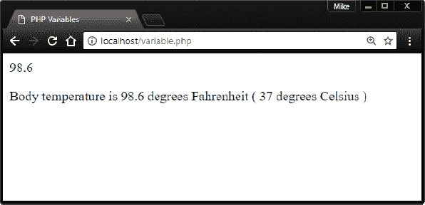


注意，在脚本主体中创建的变量（如示例所示）可以在整个 PHP 脚本中“全局”地访问。


PHP 语言中的每个语句都必须以分号结束——就像每个语句一样。

## 管理字符串

文本“字符串”可以像数值一样存储在变量中，但赋值必须用引号括字符串。单引号和双引号都可以用于此目的。

```php
$title = “Sumertime Blues ;
$title = ‘Sumertime Blues’
```

如果你希望存储一个包含引号的字符串，可以在引号前加上 `\` 反斜杠字符来“转义”它们，或者使用另一种类型的引号。例如：

```php
$song_title = “the \"Sumertime\" aria by Gerswin” ;
$song_title = ‘the “Sumertime” aria by Gerswin’ ;
```

使用双引号的这种技术更易读，并在书中推荐这种方法。

可以通过将混合字符串括在双引号中将其显示为混合字符串的一部分，如下：

```php
echo “Many regard $song_title as a classic” ;
```

可以使用 `.` 连接连接字符串，如下：

```php
$hi = ‘Hello’ ;
$bye = ‘Goodbye’ ;
$song_title = $hi . $bye ; # ‘HelloGoodbye’
```

此外，在连接字符串时可以很好地插入空格和标点，因此上面的标题赋值可以修改为包含逗号和空格：

```php
$song_title = $hi . ‘’ . $bye ; # ‘Hello, Goodbye’
```


变量名不能包含空格——但下划线字符经常用于替代。

创建一个有效的 HTML 文档，如第 16 页的此处列出的那个，然后向 body 部分插入 PHP 标签

```php
<?php
### 插入在此处的语句。
?>
```


`string.php`

现在，在 PHP 标签之间插入两条语句来创建并初始化两个变量

```php
$phrase = ‘The truth is rarely pure’ ;
$author = ‘Oscar Wilde’ ;
```

接下来，插入一条语句单独显示变量值

```php
echo $phrase ;
```

然后，插入一条语句显示在混合字符串中替换的变量值——在双引号中赋值

```php
echo “<p>It is often said that <q>$phrase</q> </p>” ;
```

插入一条语句将字符串连接到变量

```php
$phrase = $phrase . ‘ and never simple’ ;
```

最后，插入一个语句来显示在混合字符串中替换的当前变量值

```php
echo “<p><q>$phrase</q><cite>$author</cite></p>” ;
```

将文档保存到网络浏览器的 `/htdocs` 目录并命名为 `string.php`，然后通过 HTTP 打开该页面，查看变量值的显示情况

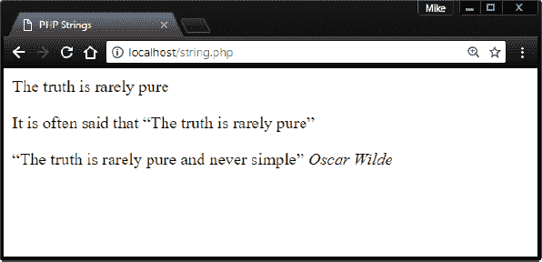


你也可以使用简写连接赋值运算符 `.=` 来连接两个字符串——这样 `$a = $a . $b` 就可以简单写成 `$a .= $b`。


为你的变量采用一致的命名风格——例如全小写的 `$my_var` 或“驼峰命名法” `$myVar`。

## 创建数组

数组变量可以在顺序的数组“元素”中存储多个数据项，这些元素从零开始编号（“索引”）。因此，第一个数组值存储在编号为零的元素中。可以使用变量名后跟方括号中的索引数字来引用单个数组元素值。例如，`$months[0]` 引用存储在第一个元素中的值，`$months[1]` 引用存储在第二个元素中的值，依此类推。

可以通过创建多个向连续元素赋值的语句来创建变量数组，或者通过使用单个语句使用 PHP 的 `array()` 函数来填充元素：

```php
$months[] = ‘January’ ;
$months[] = ‘February’ ;
$months[] = ‘March’ ;
```

```php
$months = array( ‘January’ , ‘February’ , ‘March’ ) ;
```

这两种方法都会创建一个数组，其中每个元素中存储的值可以使用其索引数字来引用，例如 `$months[0]`。

在创建数组时，你可以可选地为每个元素指定一个键名（key），用于引用该元素的值：

```php
$months['jan'] = ‘January’ ;
$months['feb'] = ‘February’ ;
$months['mar'] = ‘March’ ;
```

```php
$months = array( ‘jan’ => ‘January’ , ‘feb’ => ‘February’ , ‘mar’ => ‘March’ ) ;
```

这两种方法都会创建一个数组，其中每个元素中存储的值可以使用其键名来引用，例如 `$months['jan']`。

可以使用 `foreach` 循环访问数组的所有元素，依次引用每个元素的值并将其赋值给变量：

```php
foreach( $months as $value )
{
    # 在每次迭代中使用当前的 $value。
}
```

也可以在循环的每次迭代中通过以下方式访问键：

```php
foreach( $months as $key => $value )
{
    # 在每次迭代中使用当前的 $key 和 $value。
}
```


方括号表示“元素”，因此在使用 `array()` 函数进行赋值时，变量名后不需要方括号——只有在访问元素时才需要。


如果你指定了两次键名，第二个值将覆盖该元素中的第一个值。

创建一个有效的 HTML 文档，如此处第 16 页列出的文档，然后在 body 部分插入 PHP 标签

```php
<?php
### 在此处插入的语句。
?>
```


`array.php`

现在，在 PHP 标签之间插入一个语句创建并初始化一个带有值的变量数组

```php
$days = array( ‘Monday’ , ‘Tuesday’ , ‘Wednesday’ ) ;
```

接下来，插入一个语句，以项目符号列表的形式显示所有数组元素中的值

```php
foreach( $days as $value ) { echo “&bull; $value “ ; }
```

然后，插入一个语句创建并初始化一个包含键和值的变量数组

```php
$months = array( ‘jan’ => ‘January’ ,
‘feb’ => ‘February’ , ‘mar’ => ‘March’ ) ;
```

最后，插入语句以定义列表的形式显示所有元素中的键和值

```php
echo ‘<dl>’ ;
foreach( $months as $key => $value )
{ echo “<dt>$key<dd>$value” ; }
echo ‘</dl>’ ;
```

将文档保存到网络浏览器的 `/htdocs` 目录并命名为 `array.php`，然后通过 HTTP 打开该页面，查看变量数组元素值的显示情况

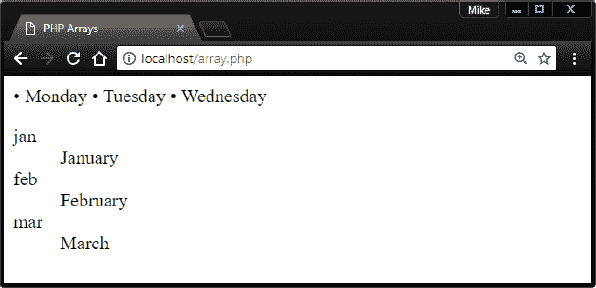


你可以将第一个元素的键设置为 1，这样索引将从 1 而不是 0 开始，使用 `$months = array( 1 => ‘January’ , ‘February’ , March’);`


你可以使用 PHP 的 `range()` 函数轻松创建包含顺序数字或字母的数组。例如：

```php
$six = range( 1 , 6 ) ;
```

```php
$a = range( ‘a’ , ‘z’ )
```

### 数组排序

PHP 提供了两个实排序函数：`sort()` 和 `rsort()`。这些函数根据值进行排序并丢弃键。例如：

```php
$fruits = array( ‘a’ => ‘apple’ , ‘b’ => ‘banana’ , ‘c’ => ‘cherry’ ) ;
sort( $fruits );
```

执行 `sort()` 之后，数组变为：

```php
$fruits = array( 0 => ‘apple’ , 1 => ‘banana’ , 2 => ‘cherry’ ) ;
```

如果你想降序排序数组，可以使用 `rsort()`。该函数也按值排序但会丢弃键：

```php
rsort( $fruits );
```

数组变为：

```php
$fruits = array( 0 => ‘cherry’ , 1 => ‘banana’ , 2 => ‘apple’ ) ;
```

如果你想保留原始键，可以使用 `ksort()` 和 `krsort()`。`ksort()` 按键升序排序数组：

```php
ksort( $fruits );
```

键将被保留。

如果你想按键降序排序数组，可以使用 `krsort()`：

```php
krsort( $fruits );
```

如果你想按值排序但保留键，可以使用 `asort()` 和 `arsort()`。`asort()` 按值升序排序并保留键：

```php
asort( $fruits );
```

键将被保留。


如果你想按值降序排序但保留键，可以使用`arsort()`：

```php
arsort( $fruits );
```

键将被保留。


在键（key）重要的情况下，请勿使用`sort()`或`rsort()`函数。

### 描述维度

数组元素的编号更准确的说法是“数组索引”（array index），由于元素编号从零开始，所以有时被称为“零基索引”。使用单个索引创建的数组是一维数组，其元素出现在单行中：


| 元素内容... || **A** || **B** || **C** || **D** || **E** |

| --- | --- | --- | --- | --- | --- |

| 索引数字... || [0] || [1] || [2] || [3] || [4] |

数组也可以有多个索引——用于表示多个维度。使用两个索引创建的数组是二维数组，其元素出现在多行中：

| 第一个索引 || [0] || **A** || **B** || **C** || **D** || **E** |

| --- | --- | --- | --- | --- | --- |

| 第二个索引 || [1] || **F** || **G** || **H** || **I** || **J** |

| | [0] || [1] || [2] || [3] || [4] |

在多维数组中，每个元素的值通过指定每个索引的数字来引用。例如，对于上面的二维数组，`[1] [2]`处的元素包含字母`H`。

二维数组用于存储基于网的信息，例如 XY 坐标。创建一个具有三个索引的三维数组将允许存储 XYZ 坐标。

在 PHP 中创建多维数组只需是创建一个外部数组，其元素本身也是数组。与往常一样，你可以选择性地为每个元素指定一个键名——在这种情况下，用于表示每个内部数组。然后可以使用键名和内部索引数字来引用单独的值：

`$matrix['Letter'][0]`

然而，当在字符串中使用带引号键的数组变量时，必须始终将其括在花括号内：

`echo “Element value is {$matrix['Letter'][0]} ” ;`

可以使用`foreach`循环通过遍历数组来访问多维数组中的所有内部数组。然后可以使用嵌套的`foreach`循环依次引用每个元素。


超过两个索引的多维数组可能会产生难以阅读的源代码，并可能导致错误。

创建一个有效的 HTML 文档，如此处第 16 页 所示的那样，然后在 body 部分插入 PHP 标签：

```php
<?php
### 在此处插入语句。
?>
```


matrix.php

现在，在 PHP 标签之间插入一条语句，创建并初始化两个普通变量数组和一个带键名的二维数组：

`$letters = array( ‘A’ , ‘B’ , ‘C’ ) ;`

`$numbers = array( 1 , 2 , 3 ) ;`

`$matrix = array( ‘Letter’ => $letters , ‘Number’ => $numbers ) ;`

接下来，插入一条语句来显示存储的单个值：

`echo “<p>Start : {$matrix['Letter'][0]} </p>” ;`

最后，插入语句将所有元素中的键和值以两个无序列表的形式显示：

```php
foreach( $matrix as $array => $list )
{
    echo ‘<ul’ ;
    foreach( $list as $key => $value )
    { 
        echo “<li>$array [ $key ] = $value” ; 
    }
    echo ‘</ul>’ ;
}
```

将文档保存到 浏览器的`/htdocs`目录中作为`matrix.php`，然后通过 HTTP 打开页面以查看变量数组值的显示：

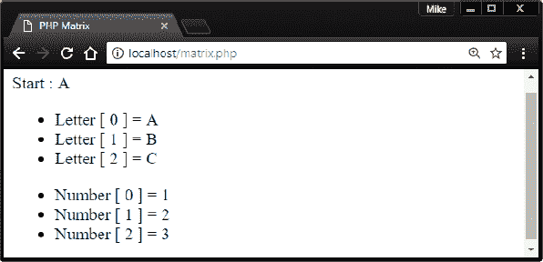


多维数组比你想象的要常见。例如，允许对相同名称输入进行多次选择的 HTML 表单是以多维数组的形式提交的。


使用引号键的数组变量在包含字符串字符串时必须括在花括号内。

### 算术运算

PHP 脚本中常用的算术运算符下表所示，以及它们执行的操作：

| 运算符: | 操作: |

| --- | --- |

| `+` | 加法 |

| `-` | 减法 |

| `*` | 乘法 |

| `/` | 除法 |

| `%` | 取模 |

| `++` | 递增 |

| `--` | 递减 |

加、减、乘、除法运算符的作用如你所预期的那样工作。然而，当使用多个运算符时，必须对表达式进行分组以保持清晰度：

`a = b * c -d % e / f ; # 这不清晰.`

`a = ( b * c ) - ( ( d % e ) / f ) ; # 这清晰得多.`

`==`等于运算符会比较两个操作数，如果两者的数值值相等，则返回一个布尔值`TRUE`结果，否则返回`FALSE`。字符和字符串也会根据它们的 ASCII 代码值进行数值比较。相反，`!=`不等运算符在两个操作数不相等时返回`TRUE`，否则返回`FALSE`。

`>`“大于”运算符比较两个操作数，如果第一个操作数的值大于第二个操作数，则返回`TRUE`；如果它的值等于或小于另一个值，则返回`FALSE`。`<`“小于”运算符执行相同的比较，但如果第一个操作数的值小于第二个操作数，则返回`TRUE`，否则返回`FALSE`。在`>`“大于”或`<`“小于”运算符后添加`=`运算符，可以使其在两个操作数完全相等时也返回`TRUE`。

`?:`三元运算符评估一个表达式以得到`TRUE`或`FALSE`的布尔值，然后根据评估结果执行两条语句中的一条。可以使用此语法将适当的返回值赋值给变量：

`$var = ( *expression*) ? *if-TRUE-return-this* : *if-FALSE-return-this* ;`


相等和不等运算符用于测试两个变量的状态，以便在 PHP 脚本中执行条件分支。

创建一个有效的 HTML 文档，如此处第 16 页列出的那样，然后在 body 部分插入 PHP 标签

```php
<?php

### 在此处插入语句。

?>
```


comparison.php

现在，在 PHP 标签之间插入语句创建并初始化五个变量

`$zero = 0 ; $nil = 0 ; $one = 1 ; $upr = ‘A’ ; $lwr = ‘a’ ;`

接下来，插入语句显示相等比较

`$result = ( $zero == $nil ) ? ‘TRUE’ : ‘FALSE’`

`echo “0 == 0 is $result <br>” ;`

`$result = ( $zero == $one ) ? ‘TRUE’ : ‘FALSE’ ;`

`echo “0 == 1 is : $result <br>” ;`

`$result = ( $upr == $lwr ) ? ‘TRUE’ : ‘FALSE’ ;`

`echo “A == a is $result <br>” ;`

`$result = ( $upr != $lwr ) ? ‘TRUE’ : ‘FALSE’ ;`

`echo “A != a is $result <hr>” ;`

最后，插入语句显示大于比较

`$result = ( $one > $nil ) ? ‘TRUE’ : ‘FALSE’ ;`

`echo “1 > 0 is $result <br>” ;`

`$result = ( $zero >= $nil ) ? ‘TRUE’ : ‘FALSE’ ;`

`echo “0 >= 0 is $result <br>” ;`

`$result = ( $one <= $nil ) ? ‘TRUE’ : ‘FALSE’ ;`

`echo “1 <= 0 is $result <br>” ;`

将文档保存在网络浏览器的`/htdocs`目录并为`comparison.php`，然后通过 HTTP 访问页面以查看显示的结果

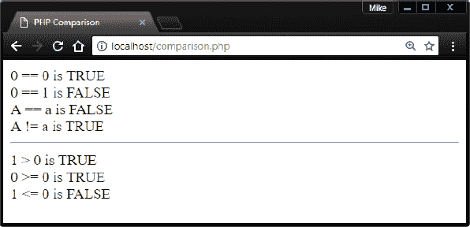


在 PHP 语言中，布尔值`TRUE`在数值上用 1 表示。


大写‘A’的 ASCII 代码值为 65，小写‘a’的值为 97 —— 所以它们的比较结果为`FALSE`。

### 逻辑评估

PHP 中常用的逻辑运算符如下表所示：

| 运算符: 操作: |

| --- | --- |

| `&&` | 逻辑与 |

| `AND` | 逻辑与（`&&`的替代形式）| |

| `||` | 逻辑或 |

| `OR` | 逻辑或（`||`的替代形式）| |

| `!` | 逻辑非 |

逻辑运算符用于具有`TRUE`或`FALSE`布尔值的操作数，或者可以转换为`TRUE`或`FALSE`的表达式。

`&&`与运算符评估两个操作数，只有当两个操作数均为`TRUE`时才返回`TRUE`；否则，它返回`FALSE`。这用于条件分支，通过测试两个条件来决定 PHP 脚本的方向。如果两个条件都满足，程序将进入某个方向，否则将进入另一个方向。

与需要两个操作数均为`TRUE`的`&&`与运算符不同，`||`或运算符评估两个操作数，如果其中一个操作数为`TRUE`，则返回`TRUE`。如果两个操作数都不是`TRUE`，则`||`或运算符将返回`FALSE`。这在 PHP 脚本中用于满足两个测试条件之一时执行某些操作。

第三种逻辑`!`非运算符是一个元运算符 —— 用于单个操作数之前。它返回给定操作数的反值，因此如果变量为`TRUE`则为`FALSE`。`!`非运算符在 PHP 脚本中像开关一样切换值。

“布尔”一词指的是由乔治·布尔（George Boole，1815-1864）开发的系统。

PHP 还有一个`XOR`（异或）运算符，如果它的操作数中有一个`TRUE`，则返回`TRUE`，但如果两个操作数均为`TRUE`，则返回`FALSE`。

注意`FALSE && FALSE`的评估返回`FALSE` —— 这证明了“错错不为对”的格言。

### 定义常量

当脚本需要一个永远 way 的固定数据值时，将其存储在 PHP “常量”中而不是变量中。常量是 PHP 脚本中的命命名容器，可以在其中存储数据值，并通过常量名称进行引用。与变量不同，在脚本执行过程中存储的值无法更改。

PHP 常量的创建方式与变量不同。相反，你必须使用`define()`函数来指定常量的名称及其将包含的值，语法如下：

`define('NAME', value) ;`

常量只能包含字母数字值（字符串、整数和浮点数），因此它们不能包含`TRUE`或`FALSE`的布尔值，也不能表示对象或`NULL`空值。

虽然常量值可以像变量值一样被访问（使用其名称来引用它们包含的值），但常量不能包含在用于混合字符串中——因为 PHP 解释器无法将常量名与普通的大写文本区分开来。例如：

```php
define( ‘USER’ , ‘Mike’ ) ;
```

```php
echo “Hello USER” ; # 显示: Hello USER
```

因此，常量值必须单独引用：

```php
echo ‘Hello ‘ ;

echo USER ;
```

或者通过将引用的值连接到字符串中，如下：

```php
echo ‘Hello ‘ . USER ;
```

脚本作者定义的常量可以像 PHP 内置的预定义常量一样使用，例如`PHP_VERSION`和`PHP_OS`，它们描述版本和服务器操作系统。


在创建变量时，务必考虑其值是否会改变——如果不会，你应该创建一个常量。例如：

```php
define( ‘PI’ , 3.14 ) ;
```

创建一个有效的 HTML 文档，如此处第 16 页列列的那样，然后向 body 部分插入 PHP 标签

```php
<?php
### 在此处插入语句。
?>
```


constant.php

现在，在 PHP 标签之间插入一条语句来创建并初始化一个常量

```php
define( ‘USER’ , ‘Mike’ ) ;
```

接下来，插入一条语句在连接的字符串中显示常量值

```php
echo ‘<p>Hello ‘ . USER . ‘</p>’ ;
```

插入一条语句在连接的字符串中显示 PHP 版本的预定义常量值

```php
echo ‘<p>You are using PHP version ‘ . PHP_VERSION ;
```

最后，插入一条语句在字符串中显示主机操作系统的预定义常量值

```php
echo ‘ running on ‘ . PHP_OS . ‘</p>’ ;
```

将文档保存到 浏览器的`/htdocs`目录并作为`constant.php`，然后通过 HTTP 打开页面以查看显示的结果

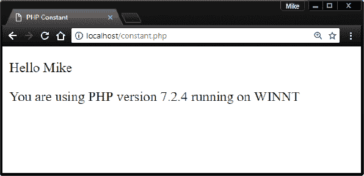


你不能将常量包含在混合字符串中，不能更改其值或以美元符号开头其名称。


你应该始终对常量名使用大写，以便在代码中将其与变量区分开。

## 总结

- 在 PHP 中，变量是一个命名的容器，可以在其中存储更改的数据值，而常量是一个命名的容器，可以在其中存储固定的数据值。

- 存储在变量或常量中的值可以使用其名称引用。

- 变量名必须以`$`美元符号开头，可以由字母、数字和下划线组成，且`$`后的第一个字符只能是字母或下划线。

- 常量名没有`$`前缀，且全大写。

- 变量使用`=`赋值运算符初始化，而常量使用`define()`函数初始化。

- 变量的值可以通过仅将字符串和变量名括在双引号中来作为混合字符串的一部分显示。

- 字符串可以使用单引号或双引号括起来，内部引号可以使用反斜杠进行转义。

- 字符串值可以使用`.`点连接运算符连接成一个单一字符串。

- 数组变量可以在顺序的数组元素中存储多个数据项，这些元素默认情况下数字从零开始编号。

- 可选，可以为每个数组元素指定键名。

- `foreach`循环可以访问数组中的每个元素。

- `implode()`和`explode()`函数通过添加或删除指定的分隔符在字符串和数组之间转换。

- 数组可以根据值或键按字母数字顺序排序。

- 多维数组简单来说就是元素为数组的数组。

- PHP 拥有执行算术（`+ - * / % ++ --`）、比较（`== != > < >= <= ?:`）和逻辑（`&& || !`）操作的运算符。

# 3 控制进度

*本章演示了如何编写 PHP 语句来评估表达式，以确定脚本应该如何进行。*

- 分支选择

- 切换分支

- 执行循环

- 当为真时循环

- 退出循环

- 创建函数

- 传递参数

- 返回值

- 总结

## 分支选择

`if`关键字用于执行基本的条件测试，该测试评估给定表达式的布尔值`TRUE`或`FALSE`。评估之后的大括号内的语句仅在表达式被发现为`TRUE`时才会执行。`if`语句的形式如下：

```php
if ( *test-expression* ) { *statements-when-true*
```

当测试为`TRUE`时，可以有多个语句，但必须以分号结束。

可以使用逻辑`&&`运算符测试多个表达式，以确保当两个表达式都被发现为`TRUE`时执行语句：

```php
if ( ( *test-expression* ) && ( *test-expression* ) )
{ *statements-when-true* }
```

通过附加`else`语句来扩展`if`语句，当表达式评估为`FALSE`时执行大括号内的语句：

```php
if ( *test-expression* )
{ *statements-when-true* }
else
{ *statements-when-false* }
```

也可以通过添加`elseif`语句评估备选表达式，当备选表达式发现为`TRUE`时执行大括号内的语句。其语法如下：

```php
if ( *test-expression* )
{ *statements-when-true* }
elseif ( *test-expression* )
{ *statements }
else
{ *statements-when-all-false* }
```

这是一种基础的编程技术，根据评估结果为脚本提供不同的方向，被称为“条件分支”。


当要执行的代码只是单个语句时，可以省略大括号。


`elseif` 关键字也可以写成两个单词 `else if`。


`ifelse.php`

开始一个 PHP 脚本，仅当测试表达式被发现为 `TRUE` 时输出结果：

```php
<?php
if ( 4 > 2 ) { echo ‘<p>Yes, 4 is greater than 2 <br>’ ; }
```

接下来，添加一条语句，仅当两个测试表达式都被发现为 `TRUE` 时输出结果：

```php
if ( ( 4 > 2 ) && ( 8 > 4 ) )
{ echo ‘4 is greater than 2 AND 8 is greater than 4<br>’ ; }
```

现在，添加一条语句，当测试表达式被发现为 `TRUE` 或 `FALSE` 时输出结果：

```php
if ( 4 > 8 )
{ echo ‘4 is greater than 8 <br>’ ; }
else
{ echo ‘4 is less than 8 <br>’ ; }
```


```php
{ echo ‘This test is True </p> ; }

elseif ( 8 \> 4 )

{ echo ‘Alternative test is True </p>’ ; }

else

{ echo ‘Both tests are False </p>’ ; ?>
```

将文档保存到网络浏览器的 `/htdocs` 目录并命名为 `ifelse.php`，然后通过 HTTP 打开页面以查看条件分支显示的结果。

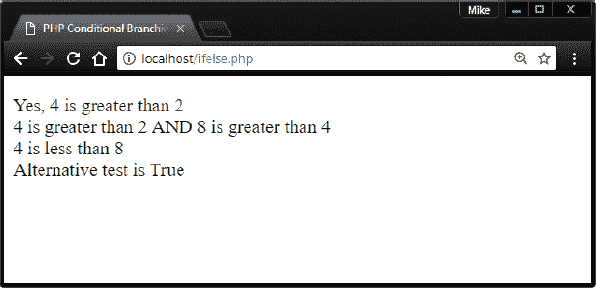


你可以嵌套条件 `if` 测试（一个嵌套在另一个内部），使得内部块中的语句只有在两个测试都被确定为 `TRUE` 时才会执行。

## 切换分支

当测试表达式仅评估一个条件时，通过多个 `if-elseif-else` 语句执行的条件分支通常可以使用 `switch` 语句更高效执行。

`switch` 语句的工作方式不同寻常。它接受一个给定的值作为参数，然后尝试从多个 `case` 语句中匹配该值。当找到匹配时，执行的代码包含在每个 `case` 语句中。

在每个 `case` 语句结束时使用 `break` 关键字语句是非常重要的，这样 `switch` 语句在找到匹配后就会退出而不再继续寻找匹配——除非这是刻意的要求。

可选地，`case` 语句列表后面可以跟跟一个最后的 `default` 语句，用于指定在任何 `case` 语句中都未找到匹配时要执行的代码。因此，`switch` 语句的语法通常如下：

```php
switch ( *test-value* )
{
case *match-value : statements-to-execute-when-matched* ; break ;
case *match-value : statements-to-execute-when-matched* ; break ;
case *match-value : statements-to-execute-when-matched* ; break ;
default : *statements-to-execute-when-no-match-found ;*
}
```

`switch` 语句可以有很多许多 `case` 语句，但它的两个 `case` 语句不能尝试匹配相同的值。

当多个 `match-values` 需要执行相同的语句时，只需要在最后一个 `case` 语句中包含要执行的语句和退出 `switch` 语句块的 `break` 语句。例如，为 `match-values` 为 0、1 和 2 的输出相同的消息：

```php
switch ( $number )
{
case 0 :
case 1 :
case 2 : echo ‘Less than 3’ ; break ;
case 3 : echo ‘Exactly 3’ ; break ;
default : echo ‘Greater than 3 or less than zero’ ;
}
```


包含 `default` 语句始终是一个好主意——即使它只是在 `switch` 语句失败时输出错误消息。


`default` 语句不需要出现在 `switch` 块的末尾，但将其放在那里是有逻辑的，因为那里不需要 `break` 语句。


`switch.php`

使用创建和初始化两个带有整数和字符值的变量语句开始 PHP 脚本

```php
$number \= 2 ; $letter \= ‘B’ ;
```

接下来，添加一个尝试匹配整数值的 `switch` 语句

```php
switch ( $number )
{
case 1 : echo ‘Number is One<br>’ ; break ;
case 2 : echo ‘Number is Two<br>’ ; break ;
case 3 : echo ‘Number is Three<br>’ ; break ;
default : echo ‘Number is Unrecognized<br>’ ;
}
```

现在，添加一个尝试匹配字符值的 `switch` 语句

```php
switch ( $letter )
{
case ‘A’ : echo ‘Letter is A<br>’ ; break ;
case ‘B’ : echo ‘Letter is B<br>’ ; break ;
case ‘C’ : echo ‘Letter is C<br>’ ; break ;
default : echo ‘Letter is Unrecognized<br>’ ;
}
```

最后，添加一个 `switch` 语句尝试匹配多个整数值

```php
switch ( $number )
{
case 0 : case 1 : case 2 : echo ‘Less than 3<br>’ ; break ;
default : echo ‘3 or more, or less than zero’ ;
}
```

将文档保存到网络浏览器的 `/htdocs` 目录并命名为 `switch.php`，然后通过 HTTP 打开页面以查看条件分支显示的结果。

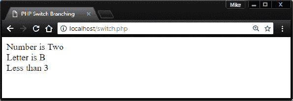


在 `switch` 语句中，`case` 关键字、`match-value` 和冒号字符被视为一个唯一的“标签”。

## 执行循环

循环是脚本中自动重复的代码。循环内所有语句的完整完整执行被称为一次“迭代”或“一通过”。循环的长度由循环内部制作的条件测试控制。只要测试的表达式被确定为 `TRUE`，循环将继续——直到测试的表达式被确定为 `FALSE`，此时循环结束。

在 PHP 中，有以下四种用于测试的循环结构：

- `for` 循环——在测试表达式被确定为 `TRUE` 时执行指定的循环次数。

- `while` 循环——只有在循环开始时制作的测试为 `TRUE` 时才执行。

- `do while` 循环——只有在循环结束时制作的测试为 `TRUE` 时才执行。

- `foreach` 循环——遍历数组的每个元素[见第 30 页]。

也许有趣的循环结构是 `for` 循环，它通常具有以下语法：

```php
for (initializer ; test-expression ; incrementer* )
{ *statements-to-execute* }
```

`initializer` 用于设置计数器的起始值，传统上命名为“i”。在循环的每次迭代中 `test-expression` 被评估，只要该表达式为 `TRUE`，循环就会继续。当 `test-expression` 变为 `FALSE` 时，循环结束。每次迭代计数器递增。循环可以嵌套，一个在另一个内部，以便在外部循环的每次迭代中执行所有迭代。


`forloop.php`

输出循环计数器值的 for 循环开始 PHP 脚本

```php
for ( $i \= 1 ; $i < 4 ; $i++ )
{
echo `<dt>Outer loop iteration $i” ;
### 在此处插入嵌套循环
}
```

将文档保存到网络浏览器的 `/htdocs` 目录并命名为 `forloop.php`，然后通过 HTTP 打开页面以查看循环计数器值

现在，插入一个嵌套的 for 循环并在每次迭代输出其计数器值

```php
for ( $j \= 1 ; $j < 4 ; $j++ )
{
echo `<dd>Inner loop iteration $j” ;
}
```

再次保存文档，然后通过 HTTP 打开页面查看两个循环计数器值

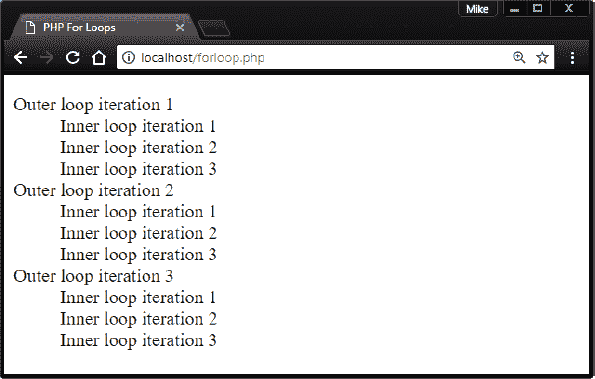


`for` 循环计数器也可以递减——通过在每次迭代中使用 `i--` 代替 `i++`。

### 当真循环

`while` 循环是上例中 `for` 循环的替代方案。`while` 循环同样需要 `initializer`、`test-expression` 和 `incrementer`，但这些并不像 `for` 循环那样整齐地列在一对括号内。相反，`initializer` 必须出现在循环块之前，`test-expression` 必须出现在 `while` 关键字后的括号内，随后是包含递增器和每次迭代执行的语句的大括号：

```php
***initializer***
while ( *test-expression* )
{ *statements-to-be-executed ; incrementer* }
```

`do while` 循环提供了上述语法的细微变化，将 `do` 关键字放在循环块之前并将 `while` 语句移动到循环块之后：

```php
***initializer***
do { *statements-to-be-executed ; incrementer* }
while ( *test-expression* ) ;
```

`while` 循环和 `do while` 循环都会持续迭代，直到测试表达式的结果为 `FALSE`（假），此时循环将退出。因此，循环体必须包含在某个时刻改变测试表达式评估结果的代码——否则将创建一个导致系统锁定的死循环。

`while` 循环和 `do while` 循环之间的显著区别在于，如果测试表达式在第一次求值时为 `FALSE`，`while` 循环将不会执行任何迭代。相比之下，`do while` 循环至少会执行一次，因为它的语句是在评估之前执行的。如果这是你需要的，那么 `do while` 循环显然是最佳选择；否则在 `for` 循环和 `while` 循环之间的选择很大程度上取决于个人喜好。经验法则建议 `for` 循环最适合执行指定次数的迭代，而 `while` 循环适合迭代直到满足特定条件。

循环是数组的完美搭档，因为每次迭代都可以轻松地读取或写入连续的数组元素。


确保循环结构中的测试表达式会在某时刻变为 `FALSE`，以避免创建永不结束的死循环。


你将在本书后面部分发现如何使用 PHP `while` 循环从 MySQL 数据库中检索记录。


`whileloop.php`

用创建一个数组的语句开始 PHP 脚本

```php
$numbers = array( 10 , 20 , 30 ) ;
```

接下来，添加一个 `while` 循环输出每个数组元素的值

```php
echo ‘<dt>While Loop : ’ ;
$i = 0 ;
while ( $i < 3 )
{
echo “<dd>Element $i = $numbers[$i] ” ;
$i++ ;
}
```

现在，添加一个 `do while` 循环输出每个数组元素的值

```php
echo ‘<dt>Do While Loop : ’ ;
$i = 0 ;
do
{
echo “<dd>Element $i = $numbers[$i] ” ;
$i++ ;
}
while ( $i < 3 ) ;
```

将文档保存在网页浏览器的 `/htdocs` 目录下并命名为 `whileloop.php`，然后通过 HTTP 打开页面，查看数组元素的值是否相同地显示

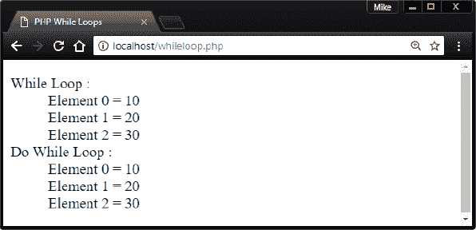


将此测试表达式中的值改为零，以便两个循环中的 `while ( $i = 0 )` 仅执行 `do while` 循环的第一次迭代。

### 退出循环

`break` 关键字可以在满足指定条件时提前终止循环。`break` 语句位于循环语句块内部，前面有一个测试表达式。当测试返回 `TRUE`（真）时，循环立即结束，程序继续执行下一个任务。例如，在嵌套内部循环中，它会进入下一次迭代。


`breakcontinue.php`

用一个执行三次迭代的 `for` 循环开始 PHP 脚本

```php
for ( $i = 1 ; $i < 4 ; $i++ )
{
### 插入的嵌套循环（步骤 2）。
}
```

接下来，插入一个同样执行三次迭代的嵌套 `for` 循环

```php
for ( $j= 1 ; $j < 4 ; $j++ )
{
### 插入的语句（步骤 5 & 6）。
}
```

现在，插入一条在每次迭代时输出两个循环计数值的语句

```php
echo “Running i = $i and j = $j” ;
```

将文档保存在网页浏览器的 `/htdocs` 目录下并命名为 `breakcontinue.php`，然后通过 HTTP 打开页面，查看循环计数器的值

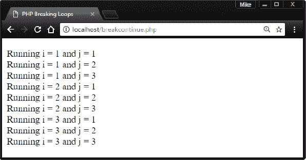

接下来，在内部循环的最开始插入此 `break` 语句，以跳出内部循环——然后保存文档并查看更改

```php
if ( $i == 2 && $j == 1 )
{
echo “Breaks inner loop when i = $i and j = $j” ;
break ;
}
```

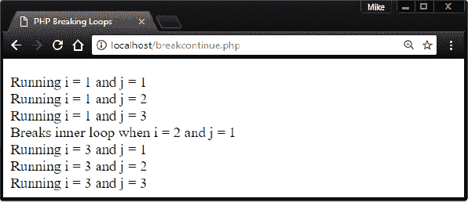

`continue` 关键字可以在满足指定条件时跳过循环的单次迭代。`continue` 语句位于循环块内部，前面有一个测试表达式。当测试返回 `TRUE` 时，该迭代结束。

现在，在内部循环开头插入此 `continue` 语句以跳过第一次迭代——然后保存文档并查看更改

```php
if ( $i == 1 && $j == 1 )
{
echo “Continues inner loop when i = $i and j = $j” ;
continue ;
}
```

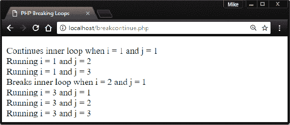

在这里，`break` 语句当外部循环尝试运行时会停止内部循环的所有迭代。

在这里，`continue` 语句当外部循环尝试运行时将跳过内部循环的第一次迭代。

### 创建函数

PHP 提供了许多可以通过名称调用的内置函数，如第 32 页所示的数组函数。此外，你可以创建自定义函数来执行特定操作。这允许 PHP 脚本模块化，以便理解和维护。

自定义函数名可以包含字母、数字和下划线字符，但必须以字母或下划线开头。与变量名一样，函数名对大小写敏感，因此 `cube()`、`Cube()` 和 `CUBE()` 是独立的。

在 PHP 脚本中创建函数只需通过 `function` 关键字指定名称，后跟括号和大括号，包含调用该函数时要执行的语句：

```php
function function_name()
{
    statements-to-executed
}
```

创建自定义函数时，理解变量访问性如何受其“作用域”限制很重要：

- 函数外部的变量具有全局作用域，但在函数内部无法访问。

- 函数内部创建的变量具有“局部”作用域，因此仅在该函数块内有效。

由于函数内部创建的变量无法外部访问，其名称可以与函数外部或另一个函数块内的变量重名而不产生冲突。这允许全局变量包含与同名局部变量不同的值。

函数内部创建的变量的作用域可以通过在声明前加上 `global` 关键字来更改，使其全局可用——但这是一种糟糕的做法并应避免。

避免使用 `global` 关键字更改局部变量的作用域，以维护代码的完整性。


`function.php`

 用创建一个初始化全局变量的语句开始 PHP 脚本

```php
$result = 5 + 5 ;
```

 接下来，添加一个函数创建一个同名的局部变量并输出其值

```php
function square()
{
$result = 5 * 5 ;
echo “Local Square Result = $result<br>” ;
}
```

 现在，再次添加另一个函数创建一个同名的局部变量并输出其值

```php
function cube()
{
$result = 5 * 5 * 5 ;
echo “Local Cube Result = $result<br>” ;
}
```

 最后，添加语句输出全局变量的值并调用两个自定义函数

```php
echo “Global Sum Result = $result<br>” ;
```

```php
square() ;
```

```php
cube() ;
```

 将文档保存在网络浏览器的 `/htdocs` 目录中并命名为 `function.php`，然后通过 HTTP 打开该页面以查看同名变量值的显示。

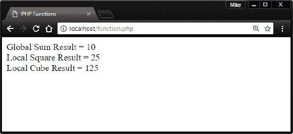

 同名的变量在不同作用域内声明时不会发生冲突——它们之间相互不可见。

### 传递参数

数据可以作为“参数”（也称为“形参”）传递给自定义函数，这与你向某些内置 PHP 函数传递参数的方式相同。例如，`sort()` 函数将要排序的数组作为其参数传入。

可以创建带有任意数量参数的函数，但当调用函数时，必须为每个参数提供数据以避免错误。

创建一个包含参数的函数，方法是在函数名后的括号内包含一个用逗号分隔的参数变量列表，如下所示：

```php
function function_name ($arg_1 , $arg_2 , $arg_3)
{
    statements-to-be-executed
}
```

参数名称必须遵循与其它 PHP 变量相同的命名规范，并且理想情况下应该具有意义，以表示它们将传递的数据性质。参数数据必须按照正确的顺序在调用时传递，然后可以在该函数内部的语句中使用：

```php
function print_name($first_name , $last_name)
{
    echo “Name is $first_name $last_name “ ;
}

print_name (‘Mickey’ , ‘Mouse’ ; # Name is Mickey Mouse
```

函数调用可以传递字面量（如上述示例中的字符串），也可以传递普通变量——变量反过来会将它们的值提供给函数。例如：

```php
$forename = ‘Donald’ ;
$surname = ‘Duck’ ;
print_name($forename , $surname) ; # Name is Donald Duck
```

参数变量具有局部作用域，因此仅在创建它们的函数内部是可的。这意味着在许多函数中可以使用相同的参数名称，而不会与彼此或普通变量名发生冲突。


参数必须在函数声明中指定，并由调用者以逗号分隔的列表传递。


`argument.php`

 使用语句创建并初始化全局变量开始 PHP 脚本

```php
$number = 5 ;
```

 接下来，添加一个带有一个参数的函数，在计算中使用它的值并输出其结果

```php
function square($number)
{
    $result = $number * $number ;
    echo “$number Squared = $result<br>” ;
}
```

 现在，添加另一个带有一个参数的函数，在计算中使用它的值并输出其结果

```php
function cube($number)
{
    $result = $number * $number * $number ;
    echo “$number Cubed = $result<br> ; ;
}
```

 最后，添加语句来调用函数并并传递字面量参数和变量参数

```php
square(3) ;
cube(4) ;
square($number) ;
cube($number) ;
```

 将文档保存在网络浏览器的 `/htdocs` 目录中并命名为 `argument.php`，然后通过 HTTP 打开该页面以查看结果显示。

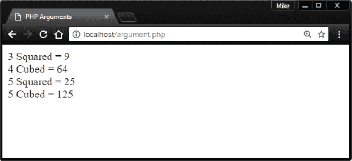

 你可以对参数和普通变量使用相同的名称。

### 返回值

函数在调用时可以传递值，也可以通过 `return` 关键字返回值。通常由调用者决定返回值的函数可以使用 `return` 语句：

| 参数 | 描述 | 示例： |

| --- | --- | --- |

| Y | 数字 | 18 |

| y | 数字 | 14 |

| n | 数字 | 5 |

| m | 数字 | 05 |

| F | 星期名称 | 二月 |

| M | 星期名称 | 二月 |

| d | 星期数字 | 04 |

| S | 星期数字 | 24 |

| l | 星期名称 | 周一 |

| D | 星期数字 | 周一 |

| H | 小时 | 14 |

| i | 分钟 | 45 |

| s | 秒 | 30 |

自定义函数在调用时也可以返回值，只需在语句中使用 `return` 关键字。这些是 `date()` 的某些用法，通过 `return` 语句来实现。

`date()` 函数通常可以通过 `switch` 语句来执行，以返回特定的值。

 `return.php`

# 处理提交的数据

## 创建固定表单

## 包裹表单

### 附加链接数据

### 移动位置

## 总结

## 执行操作

处理来自网页上 HTML 表单提交的数据也许是 PHP 脚本执行的最基础任务之一。

HTML `<form>` 标签的 `action` 属性用于指定将处理（“处理”）表单数据的 PHP 脚本。此外，`<form>` 标签的 `method` 属性用于指定如何将数据发送到脚本——通常通过 `POST` 方法。因此，HTML 表单标签和属性看起来可能如下所示：

```html
<form action="script.php" method="POST">
```

PHP 提供了一个特殊的“超全局”`$_POST` 数组变量，在其中存储通过 `POST` 方法提交的表单数据。它会创建一个与提交的表单元素名称相同的数组元素，并存储它们包含的值。例如，使用此表单元素：

```html
<input type="text" name="email">
```

在提交表单时，PHP 将创建一个名为 `$_POST['email']` 的数组元素，其中包含用户在该表单输入框中输入的值。

为了方便识别，可以为与表单元素同名的 PHP 变量赋值存储在相应 `$_POST` 数组元素中的值。这些值随后就可以在由 `action` 处理脚本创建的响应页面中显示。

 创建一个包含表单的 HTML 文档，其中包含三个用于数据提交的文本输入字段

```html
<form action="action_handler.php" method="POST">
<dl>
  <dt>姓名:</dt>
  <dd><input type="text" name="name"></dd>
  <dt>邮箱地址:</dt>
  <dd><input type="text" name="mail"></dd>
  <dt>评论:</dt>
  <dd><textarea rows="5" cols="20" name="comment"></textarea></dd>
</dl>
<p><input type="submit"></p>
</form>
```


`action.php`

 现在，将文档保存到网页浏览器的 `/htdocs` 目录中，命名为 `action.php`


PHP 是区分大小写的，因此大小写必须与描述完全一致——例如，`$_POST['EMail']` 或 `$_Post['email']` 是错误的。

 接下来，创建一个包含脚本的 HTML 文档，该脚本将表单值赋值给同名的 PHP 变量以便输出

```php
<?php
$name = $_POST['name'];
$mail = $_POST['mail'];
$comment = $_POST['comment'];
echo "<p>感谢你的评论 $name ...</p>";
echo "<p><i>$comment</p></p>";
echo "<p>我们将回复到 $mail</p>";
?>
```

 `action_handler.php`

 将文档保存到网页浏览器的 `/htdocs` 目录中，命名为 `action_handler.php`，然后通过 HTTP 打开 `action.php` 并提交一些数据，查看它们在 PHP 脚本生成的响应页面中的显示

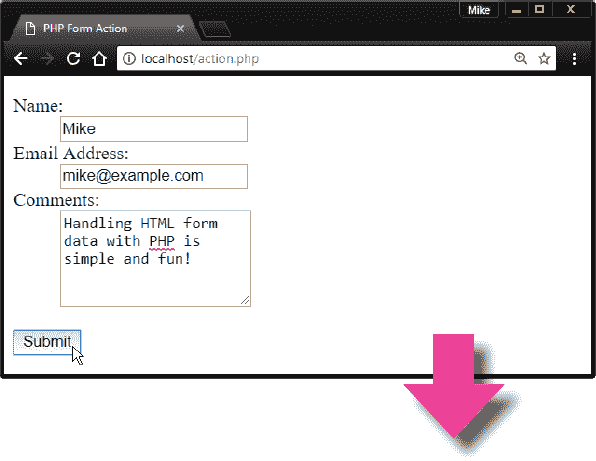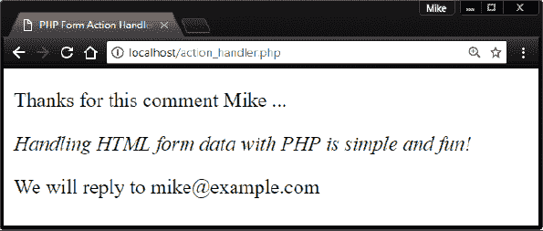

表单提交方法可以是 `GET` 或 `POST`。`GET` 方法将 `name=value` 键对添加到 URL 中，但主要用于请求信息——例如检索数据库记录。`POST` 方法可以提交更多数据，由于数据没有附加到 URL，因此更安全，并且主要用于需要执行的操作——例如更新数据库记录。因此，对于大多数示例首选 `POST` 方法。

## 检查值

PHP 可以使用内置的 `isset()` 函数轻松确保用户已在表单字段中输入数据。该函数接受变量名作为参数，并且仅当该变量为 `NULL` 时返回 `TRUE`——从而确保变量已“设置”了某些值。除非用户输入了值，否则空表单字段将为 `NULL`。

可以使用 `isset()` 函数进行条件测试，以指示哪些表单字段留空，或者为完成的字段提供一个响应页面。

 创建一个包含表单的 HTML 文档，其中包含三个单选按钮，提供单个数据提交字段

```html
<form action="isset_handler.php" method="POST">
<fieldset>
  <legend>PHP 是什么种语言?</legend>
  <input type="radio" name="definition" value="Scripting">
  <input type="radio" name="definition" value="Markup">
  <input type="radio" name="definition" value="Programming">
</fieldset>
<p><input type="submit"></p>
</form>
```

 `isset.php`

 现在，将文档保存到网页浏览器的 `/htdocs` 目录中，命名为 `isset.php`

 `isset_handler.php`

 接下来，创建一个包含 PHP 脚本的 HTML 文档，用提交的值初始化变量——如果没有提交值则初始化为 `NULL`

```php
<?php
if (isset($_POST['definition'])) {
    $definition = $_POST['definition'];
} else {
    $definition = NULL;
}
### 在此处插入响应语句
?>
```

 最后，根据变量的值输出相应的响应

```php
if ($definition != NULL) {
    if ($definition != 'Scripting') {
        echo "$definition 是错误的";
    } else {
        echo "$definition 是正确的";
    }
} else {
    echo '你必须选择一个';
}
```

 将文档保存到网页浏览器的 `/htdocs` 目录，命名为 `isset_handler.php`，然后通过 HTTP 打开 `isset.php` 并提交表单查看响应

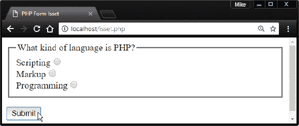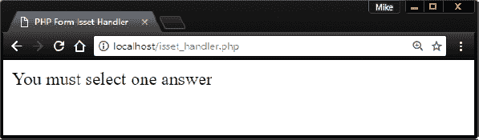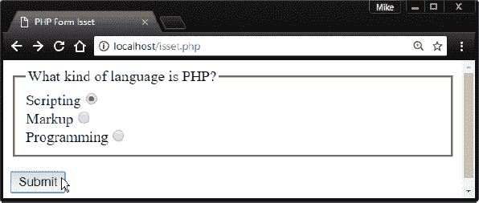

技术上，测试条件是否为 `TRUE` 比测试其是否更高效

## 验证表单数据

由于用户可能会无意中提交空字段或格式错误的数据，因此 PHP 脚本确保必填字段已填写且提交的数据有效是非常关重要的。

要确保用户在文本字段中输入了内容，PHP 提供了 `empty()` 函数，它接受变量参数，如果该值为空字符串、零、`NULL` 或 `FALSE` 则返回 `TRUE`。

要确保用户输入的是数字格式的数据，PHP 提供了 `is_numeric()` 函数，它接受变量参数，并且仅当该值为数字时返回 `TRUE`。

更具体的数据验证可以使用 PHP 的 `preg_match()` 函数，它接受一个“正则表达式”参数和一个用于搜索模式的变量参数。这通常用于确保邮箱地址符合预期格式。

 创建一个包含表单的 HTML 文档，其中包含两个数据提交的文本字段

```html
<form action="valid_handler.php" method="POST">
<fieldset>
  <legend>输入数量和邮箱地址</legend>
  <p>数量：<input type="text" name="quantity"></p>
  <p>邮箱地址：<input type="text" name="email"></p>
</fieldset>
<p><input type="submit"></p>
</form>
```

 `valid.php`

 现在，将文档保存到网页浏览器的 `/htdocs` 目录中，命名为 `valid.php`

 接下来，创建一个包含 PHP 脚本的 HTML 文档，用提交的值初始化变量——如果没有提交值则初始化为 `NULL`

```php
<?php
if (!empty($_POST['quantity'])) {
    $quantity = $_POST['quantity'];
} else {
    $quantity = NULL;
    echo '你必须输入数量<br>';
}
?>
```

 `valid_handler.php`

 插入语句确保格式为数字

```php
if (!is_numeric($quantity))
```

```php
{ $quantity \= NULL ; echo ‘Quantity must be numeric<br>’ ; }
```

 现在，添加语句用提交的值初始化另一个变量——或者在未提交任何值时初始化为 `NULL`

```php
if ( !empty ( $\_POST\[‘email’\] ) )
{
  $email \= $\_POST\[‘email’\] ;
  # 在此处插入格式验证代码。
}
else
{ $email \= NULL ; echo ‘You must enter an email address’ ; }
```

 接下来，插入语句以确保电子邮件地址使用符合预期的模式

```php
$pattern \= ‘/\\b\[\\w.-\]+@\[\\w.-\]+\\.\[A-Za-z\]{2,6}\\b/ ;
if ( !preg\_match( $pattern ,$email ) )
{ $email \= NULL ; echo ‘Email address is incorrect format’ ; }
```

 最后，添加语句输出有效的提交数据

```php
if ( ( $quantity != NULL ) && ( $email != NULL )
{ echo “Email : $email<br>Quantity : $quantity “ }
```

 将文档保存到网络浏览器的 `/htdocs` 目录并为 `valid_handler.php`，然后通过 HTTP 打开 `valid.php` 并提交表单查看响应

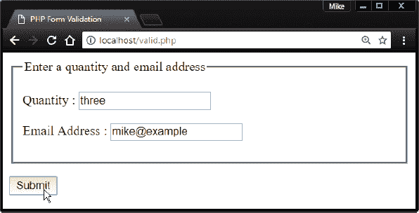

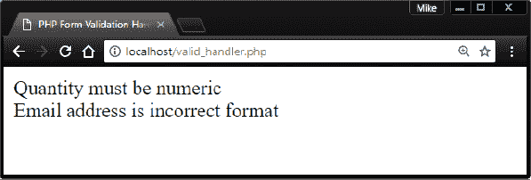


严格来说，正则表达式不是本书的内容，但你可以精确复制示例中的模式以确保电子邮件地址符合格式。

## 发送隐藏数据

除了用户输入到 HTML 表单字段的数据外，可以使用 HTML 隐藏字段提交 PHP 生成的数据。与普通字段一样，它们也向表单处理脚本发送 `name=value` 对，但此处的值是由 PHP 提供的，而不是用户。

通常，使用隐藏表单提交的数据可能包括用户名和提交时间戳。

创建一个 PHP 脚本的 HTML 文档以定义时区并初始化两个变量

```php
date\_default\_timezone\_set( ‘UTC’ ) ;
$time \= date( ‘ H:i , F j ‘ ) ;
$user \= ‘Mike’ ;
```


`hidden.php`

现在，添加语句写入一个表单，包含一个普通输入字段和两个由变量设置的隐藏字段

```php
echo ‘
<form action=”hidden_handler.php” method=”POST”>
<fieldset>
<legend>Send us your comments</legend>
<textarea rows=”5” cols=”20” name=”comment”>
</textarea>
<input type=”hidden” name=”user” value=” ‘. $user .’ “>
<input type=”hidden” name=”time” value=” ‘. $time.’ “>
</fieldset><p><input type=”submit” ></p></form> ‘ ;
```

将文档保存到网络浏览器的 `/htdocs` 目录并为 `hidden.php`

接下来，创建一个包含 PHP 脚本的 HTML 文档，用提交的值初始化变量——或者在未提交值时初始化为 NULL

```php
if ( !empty ( $\_POST\[‘comment’\] ) )
{
  $comment \= $\_POST\[‘comment’\] ;
}
else
{
  $comment \= NULL ;
  echo ‘You must enter a comment’ ;
}
```


`hidden_handler.php`


示例中的时间戳是在表单创建时创建，而不是在表单提交时创建。

现在，如果隐藏表单字段已设置，添加语句初始化两个变量

```php
$time \= ( !isset ( $\_POST\[‘time’\] ) ) ? NULL : $\_POST\[‘time’\] ;
$user \= ( !isset ( $\_POST\[‘user’\] ) ) ? NULL : $\_POST\[‘user’\] ;
```

最后，添加语句输出有效的提交数据

```php
if ( ( $comment != NULL ) &&
 ( $time != NULL ) && ( $user != NULL )
{ echo “<p>Comment received : \\” $comment \\”<br>
From $user at $time </p>” }
```

将文档保存到网络浏览器的 `/htdocs` 目录并为 `hidden_handler.php`，然后通过 HTTP 打开 `hidden.php` 并提交表单查看响应

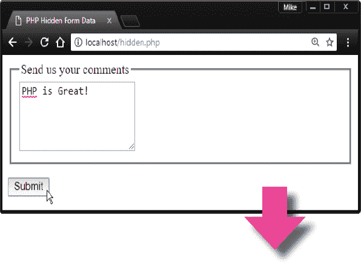

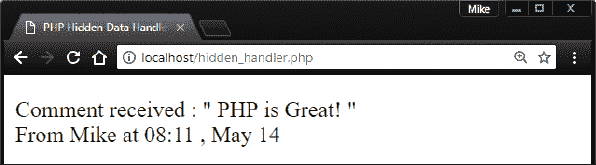

注意这里使用了三元运算符 `? :` 而不是更长的 `if else` 语句。

你可以在其中包含

## 处理提交

到为止的示例使用了 POST 方法提交数据，也可以使用 GET 方法。使用 GET 时，数据将作为查询字符串附加到 URL 中。这对于非敏感数据（例如搜索查询）非常有用。可以使用 `$_GET` 全局变量访问数据。

到为止的示例使用了 POST 方法提交数据，也可以使用 GET 方法。使用 GET 时，数据将作为查询字符串附加到 URL 中。这对于非敏感数据（例如搜索查询）非常有用。可以使用 `$_GET` 全局变量访问数据。


一个 HTML](2p.jpg)现在，当页面通过方法被请求时，插入语句显示表单

```php
echo ‘
<form action=”single.php” method=”POST”>
<fieldset>
<legend>Send us your comments</legend>
<textarea rows=”5” cols=”40” name=”comment”>
</textarea>
</fieldset>
<p><input type=”submit” ></p>
</form> ‘ ;
```

接下来，当页面通过 POST 方法被请求时，插入语句处理表单提交

```php
if ( !empty ( $\_POST\[‘comment’\] ) )
{
  $comment \= $\_POST\[‘comment’\] ;
  echo “Comment : $comment “ ;
}
else
{
  $comment \= NULL ;
  echo ‘You must enter a comment’ ;
}
```

将文档保存到网络浏览器的 `/htdocs` 目录并为 `single.php`，然后提交表单查看响应

<p>Name:</p>

<input type="text" name="name" value="<?php if ( isset( $_POST['name'] ) ) echo $_POST['name'] ; ?>"></p>

<p>Email:</p>

<input type="text" name="email" value="<?php if ( isset( $_POST['email'] ) ) echo $_POST['email'] ; ?>"></p>

<p><input type="submit"></p>

</form>


现在，添加一个 PHP 脚本来处理表单提交

```php
<?php
if ($_SERVER['REQUEST_METHOD'] == 'POST' )
{
    # Statements to be inserted here.
}
?>
```


接下来，在 PHP 脚本块中插入一个语句来创建一个错误消息数组

```php
$errors = array() ;
```


`if` 语句通过检查请求方法是否为 POST 来测试表单是否提交，而不是用于显示空表单的 GET 方法。


然后，插入语句用提交的值初始化变量，或者在存在缺失时添加到错误数组中

```php
if ( empty($_POST['name'] ) ) { $errors[] = 'name'; }
else { $name = trim($_POST['name'] ) ; }
if ( empty($_POST['email'] ) ) { $errors[] = 'email'; }
else { $email = trim($_POST['email'] ) ; }
```


现在，插入语句来写入错误消息或确认表单成功提交

```php
if( !empty($errors) )
{ echo 'Error! Please enter your ' ;
foreach ( $errors as $msg ) { echo " - $msg " ; } }
else { echo "Success! Thanks $name " ; }
```


将文档保存到 Web 浏览器的 `/htdocs` 目录并命名为 `sticky.php`，然后通过 HTTP 打开并提交表单以查看保留的值和响应消息。

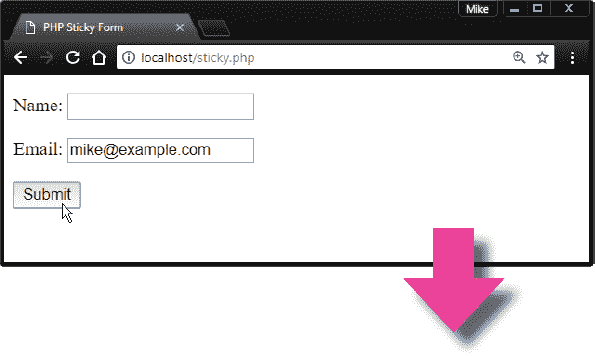

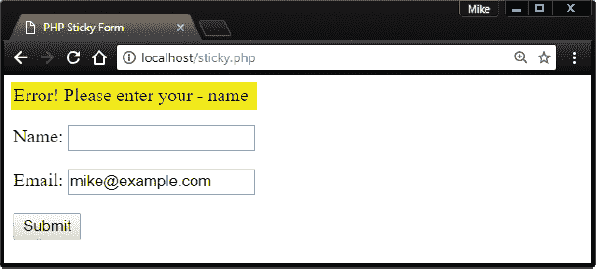


在这里使用 `trim()` 函数是一种良好的做法，它可以移除提交字段值中的任何前导和尾空格。

### 包围表单

PHP 有用地允许将多个文件合并在一起以创建一个单个网页。这意味着动态表单可以被静态页眉和页脚内容包围，这些内容可以被重复使用以创建网站内的其他页面。

`include()` 函数接受另一个文件的 URL 作为参数，将其合并到网页中。通常，包含的静态内容文件是 HTML 文件，并位于 Web 服务器 `/htdocs` 目录下的“includes”文件夹中。

PHP 还提供了一个 `require()` 函数，它的工作方式与 `include()` 函数一样，用于在网页中包含其他文件，但它们有细微的差别。当 `include()` 函数失败时（因为找不到指定的文件），系统会向浏览器发送一个警告，但脚本将继续运行。当 `require()` 函数失败时，会打印错误但脚本将停止。通常，`include()` 函数包含 HTML 文件，而 `require()` 函数包含动态 PHP 脚本。这一点是，包含多个文件的网页标题可以由 PHP 动态编写，从而为原本静态的页眉内容提供灵活性。


创建一个包含静态页眉内容和写入页面标题的 PHP 代码的 HTML 文档

```html
<!DOCTYPE HTML>
<html lang="en">
<head>
<meta charset="UTF-8">
<title><?php echo $page_title ; ?></title>
<link rel="stylesheet" href="includes/style.css">
</head>
<body>
<header><h1>Page Header</h1></header>
```


现在，创建一个包含页脚内容的 HTML 文档

```html
<footer><p>Page Footer</p></footer>
</body>
</html>
```

 

接下来，在你的 Web 服务器的 `/htdocs` 目录中创建一个名为“includes”的文件夹，并将上述文档分别保存为其中的 `header.html` 和 `footer.html`。


创建一个 CSS 样式表来展示页眉和页脚内容（以及用于展示后续示例中某些方面的规则）

```css
header > h1 { border-bottom: 1px dashed black; font-style: italic; font-size: x-large; }
footer > p { border-top: 1px dashed black; font-style: italic; }
table { border-spacing: 5px; width: 530px; }
th { color: #FFF; background: #000; text-align: left; }
td { border-bottom: 1px solid black; padding: 3px; background: #F0F0F0; text-align: left; vertical-align:top; }
p#err_msg { color: #00; font-weight: bold; }
```

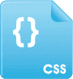

将样式表保存到你创建的 `/includes` 文件夹中，与 HTML 页眉和页脚文件一起。


最后，创建一个 PHP 脚本，设置网页标题并用页眉和页脚内容包围表单

```php
$page_title = 'PHP Include';
include ( 'includes/header.html' )
echo '<form action="include.php" method="POST">
<p>Name: <input type="text" name="name"></p>
<p>Email: <input type="text" name="email"></p>
<p><input type="submit"></p></form>' ;
include ( 'includes/footer.html' ) ;
```


将 PHP 脚本保存到 Web 浏览器的 `/htdocs` 目录并命名为 `include.php`，然后通过 HTTP 打开以查看设置的标题和被静态内容包围的表单。

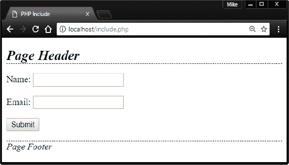


你可以使用浏览器的“查看源代码”功能查看整个内容是否已有效地合并到单个网页中。

### 附加链接数据

PHP 预定义的“超级全局”变量，例如存储页面请求方法的 `$_SERVER` 数组变量，以及跨页面存储用户数据的 `$_SESSION` 数组变量，在用户退出之前，在任何脚本的作用域内都是可用的。

当 HTML 表单使用 POST 方法提交数据时，`$_POST` 数组存储提交表单值的命名元素。因此，名为“city”的提交值可以通过 `$_POST['city']` 访问。

同样，当使用 GET 方法提交数据时，`$_GET` 数组存储值的命名元素。因此，名为“id”的提交值可以通过 `$_GET['id']` 访问。这通常通过在 HTML 超链接的 URL 中附加 `name=value` 对来向脚本提交数据，如下：

```html
<a href="www.example.com/script.php?id=1">
```

接收超链接数据的脚本随后可以使用传递的值来确定响应。

创建一个包含 PHP 脚本的 HTML 文档，该脚本在 `$_GET` 数组中寻找名为“id”的元素

```php
if ( isset($_GET['id']) )
{
    # Handler statements to be inserted here.
}
```


接下来，插入语句将传递的值赋值给同名的 PHP 变量

```php
$id = $_GET['id'] ;
```


现在，插入语句根据传递的值输出相应的响应

```php
switch( $id )
{
    case 1 : echo 'Cow selected<hr>' ; break;
    case 2 : echo 'Dog selected<hr>' ; break;
    case 3 : echo 'Goat selected<hr>' ; break;
}
```


`$_SESSION` 超级全局将在下一个示例中用于存储用户详情。

最后，添加语句显示带有附加值的链接

```php
echo '<h1>Select a buddy</h1>' ;
echo ' <p><a href="link.php?id=1">Cow</a> |' ;
echo ' <a href="link.php?id=2">Dog</a> | ' ;
echo ' <a href="link.php?id=3">Goat</a></p>' ;
```


将 PHP 脚本保存到 Web 浏览器的 `/htdocs` 目录并命名为 `link.php`，然后通过 HTTP 打开并点击链接以查看传递的值的响应。

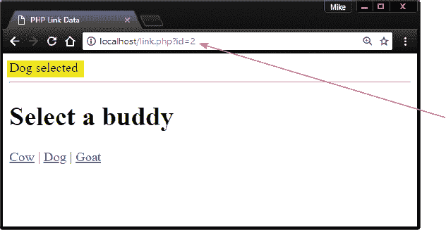


PHP 还提供了一个 `$_REQUEST` 超全局变量，它包含了 `$_POST` 和 `$_GET` 数组的所有内容。这意味着可以使用 `$_REQUEST['city']` 来访问 `$_POST['city']` 对应的内容，但应该避免这样做。相反，请始终根据提交类型使用特定的数组。


注意，传递的 `name=value` 对在浏览器的地址栏中是可见的。

### 移动位置

PHP 提供了一个 `header()` 函数，它接受一个参数来指定要发送到浏览器的原始 HTTP “头部”（header）。头部在 Web 服务器发送任何其他数据之前就已发送，并且通常对用户不可见。最有用的是，PHP 的 `header()` 函数可以设置“Location”头部将浏览器重定向到新页面，使用此语法：

`header( 'Location: *www.example.com/page.php*' ) ;`

在移动到新页面时，可以通过先将数据存储在特殊的 PHP 超全局变量 `$_SESSION` 数组中来保留用户数据。然而，在脚本调用 `session_start()` 函数之前，该变量并不会自动可用。变量值可以存储在 `$_SESSION` 数组的同名元素中，这样它们在网站的其他页面上可用，直到用户退出或在脚本中调用 `session_destroy()` 函数。


创建一个包含 PHP 脚本的 HTML 文档，该脚本在 `$_POST` 数组中查找名为“id”的元素

```php
if ( isset ( $_POST['id'] ) )
{
    $id = $_POST['id'] ;
    # 在此此处插入处理语句。
}
```


`header.php`

接下来，插入处理语句以将匹配的 id 值存储在 `$_SESSION` 数组元素中并重定向浏览器——或者为任何其他 id 值显示消息

```php
if( $id== 123 )
{
    session_start() ;
    $_SESSION['id'] = $id ;
    header( 'Location: location.php' ) ;
    exit() ;
}
else { echo “<p>$id is an incorrect ID!</p>” ; }
```

现在，添加一个语句显示一个表单，用户可以在其中输入 id 值进行提交

```php
echo ‘<form action=”header.php” method=”POST">
<fieldset> <legend>Enter Your User ID</legend>
<p>ID : <input type=”text” name=”id”></p>
</fieldset> <input type=”submit”> </form> ‘ ;
```


在重定向浏览器时，调用 `exit()` 函数停止脚本是一个良好的习惯。

将文档保存到浏览器的 `/htdocs` 目录并命名为 `header.php`

最后，创建一个目标 HTML 文档，包含一个显示保留的 `$_SESSION` 数组值的 PHP 脚本

```php
session_start() ;
if ( isset( $_SESSION['id'] ) )
{
    $id = $_SESSION['id'] ;
    echo “Welcome user ID #$id” ;
}
```


`location.php`

将此文档保存到浏览器的 `/htdocs` 目录并命名为 `location.php`，然后通过 HTTP 打开 `header.php` 并提交 id 值以查看响应

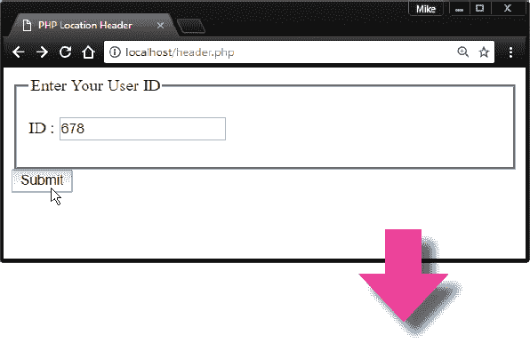

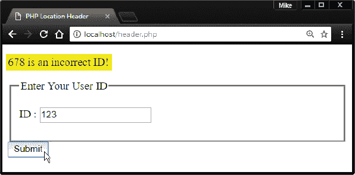

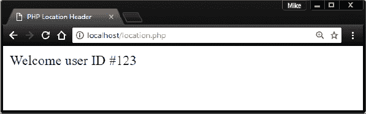注意，传递的 name=value 对在浏览器的地址栏中是可见的。

### 移动位置

PHP 提供了一个 `header()` 函数，它接受一个参数来指定要发送到浏览器的原始 HTTP “头部”（header）。头部在 Web 服务器发送任何其他数据之前就已发送，并且通常对用户不可见。最有用的是，PHP 的 `header()` 函数可以设置“Location”头部将浏览器重定向到新页面，使用此语法：

`header( 'Location: *www.example.com/page.php*' ) ;`

在移动到新页面时，可以通过先将数据存储在特殊的 PHP 超全局变量 `$_SESSION` 数组中来保留用户数据。然而，在脚本调用 `session_start()` 函数之前，该变量并不会自动可用。变量值可以存储在 `$_SESSION` 数组的同名元素中，这样它们在网站的其他页面上可用，直到用户退出或在脚本中调用 `session_destroy()` 函数。

PHP 还提供了一个 `$_REQUEST` 超全局变量，它包含了 `$_POST` 和 `$_GET` 数组的所有内容。这意味着可以使用 `$_REQUEST['city']` 来访问 `$_POST['city']` 对应的内容，但应该避免这样做。相反，请始终根据提交类型使用特定的数组。

## 总结

- PHP 还提供了一个 `$_REQUEST` 超全局变量，它包含了 `$_POST` 和 `$_GET` 数组的所有内容。这意味着可以使用 `$_REQUEST['city']` 来访问 `$_POST['city']` 对应的内容，但应该避免这样做。相反，请始终根据提交类型使用特定的数组。
- 注意，传递的 name=value 对在浏览器的地址栏中是可见的。
- PHP 提供了一个 `header()` 函数，它接受一个参数来指定要发送到浏览器的原始 HTTP “头部”（header）。头部在 Web 服务器发送任何其他数据之前就已发送，并且通常对用户不可见。最有用的是，PHP 的 `header()` 函数可以设置“Location”头部将浏览器重定向到新页面，使用此语法：`header( 'Location: *www.example.com/page.php*' ) ;`
- 在移动到新页面时，可以通过先将数据存储在特殊的 PHP 超全局变量 `$_SESSION` 数组中来保留用户数据。然而，在脚本调用 `session_start()` 函数之前，该变量并不会自动可用。变量值可以存储在 `$_SESSION` 数组的同名元素中，这样它们在网站的其他页面上可用，直到用户退出或在脚本中调用 `session_destroy()` 函数。
- 创建一个包含 PHP 脚本的 HTML 文档，该脚本在 `$_POST` 数组中查找名为“id”的元素。
- 接下来，插入处理语句以将匹配的 id 值存储在 `$_SESSION` 数组元素中并重定向浏览器——或者为任何其他 id 值显示消息。
- 现在，添加一个语句显示一个表单，用户可以在其中输入 id 值进行提交。
- 在重定向浏览器时，调用 `exit()` 函数停止脚本是一个良好的习惯。
- 将文档保存到浏览器的 `/htdocs` 目录并命名为 `header.php`。
- 最后，创建一个目标 HTML 文档，包含一个 PHP 脚本来显示保留的 `$_SESSION` 数组值。
- 将此文档保存到浏览器的 `/htdocs` 目录并命名为 `location.php`，然后通过 HTTP 打开 `header.php` 并提交 id 值以查看响应。

现在，执行另一个查询来显示 `site_db` 数据库中存在的所有表

```sql
SHOW TABLES ;
```

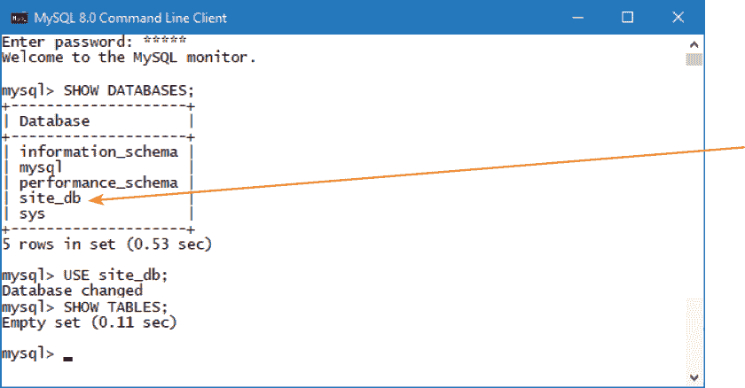


你在第一章安装 MySQL Server 之后创建了名为 `site_db` 的数据库——请参阅此处第 20 页。


此示例中的 `SHOW TABLES;` 查询返回了“空集”（empty set）消息，因为 `site_db` 数据库中还没有任何表——但本书的剩余内容中，你将在那里创建表。

## 创建表

通过执行此查询可以创建一个 MySQL 数据库表：

```sql
CREATE TABLE IF NOT EXISTS table-name ( col type , col type ) ;
```

该查询语句后面必须跟着括号，括号内包含一个用逗号分隔的列定义列表——定义每个表列的名称以及该列可能包含的数据类型。例如，一个名为“fruit”（水果）的表可能包含三个名为 `id`、`name` 和 `color` 的列。`INT` 关键字可以指定 `id` 列可能只包含整数值，而 `TEXT` 关键字可以指定 `name` 和 `color` 列可能只包含文本值。

你可以使用此查询来发现任何表的格式：

```sql
EXPLAIN table-name ;
```

也可以使用此查询从数据库中删除表：

```sql
DROP TABLE IF EXISTS table-name ;
```

在 `mysql>` 提示符下准确输入创建一个具有许多列的表的创建查询可能很困难，因此最好先将查询创建为 SQL 文本文件，然后在命令行提示符中使用 `SOURCE` 关键字实现查询，并指定文件路径，例如位于系统根目录（`C:\`）下的“SQL”文件夹中的路径：


`create_table.sql`

启动一个纯文本编辑器（如记事本），并创建一个定义上述“fruit”表示例的查询

```sql
CREATE TABLE IF NOT EXISTS fruit
(
| id INT , |
| --- | --- |
| name TEXT , |
| color TEXT , |
) ;
```

将文件保存到 `C:\SQL` 文件夹中并命名为 `create_table.sql`，然后启动 MySQL 命令行客户端并以具有完全访问权限的用户（如 root）登录

接下来，执行一个查询以使用已建立的数据库

```sql
USE site_db ;
```


你可能也会看到较短的 `CREATE TABLE` 和 `DROP TABLE` 查询，但使用这些长版本来检查现有表是一个良好的习惯。

现在，通过指明系统中 SQL 文件的源路径来实现 SQL 查询

```sql
SOURCE C:\SQL\create_table.sql
```

执行查询以确认表的存在和格式

```sql
EXPLAIN fruit ;
```

最后，删除表并确认其已删除

```sql
DROP TABLE IF EXISTS fruit ;
SHOW TABLES ;
```

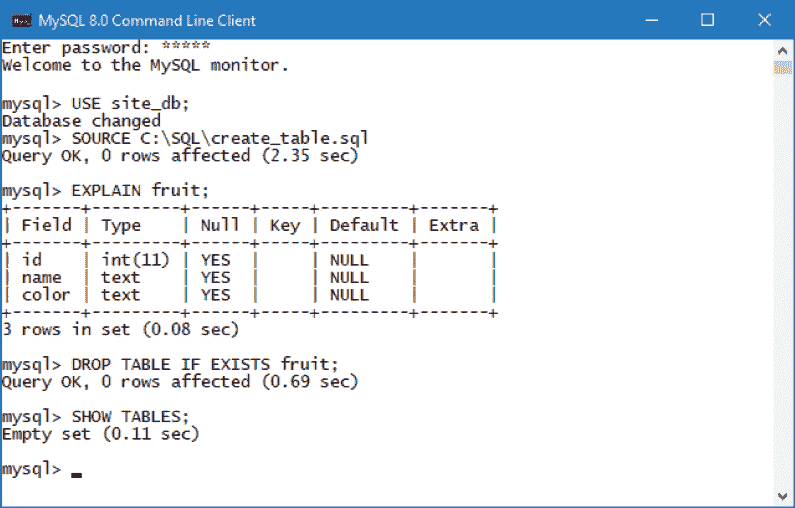


`EXPLAIN` 查询揭示了“fruit”表的格式，它允许 `id` 字段包含长达 11 位的整数 —— 实际上，这限制在 -2147483648 到 2147483647 之间的值。

在此示例中，“YES”表示每个字段都允许不包含值，即由 `NULL` 关键字定义。事实上，每个字段在创建时都没有设置默认值，因此确实包含 `NULL` 值。请注意，`NULL` 代表完全没有值 —— 这与用 `""` 表示的空字符串不同。


MySQL 查询使用结构化查询语言（SQL）的一个版本，其中每个查询必须以分号结束，但 `SOURCE` 关键字仅描述一个不能以分号结尾的路径。


你可以在 SQL 文件中格式化列定义以提高可读性 —— 额外的空格和换行会被忽略。

```sql
Defining data types
```

下表描述了可用于定义数据库表列的数据类型指定符的范围。建议精确指定允许的数据类型。例如，如果一列只包含短字符串，请使用 `VARCHAR()` 而不是 `TEXT`。

| Type: | Value: |
| --- | --- |
| `INT` | 整数 -2,147,483,648 到 2,147,483,647 |
| `DECIMAL` | 浮点数，可以指定允许的位数。例如，`DECIMAL(5,2)` 允许 -999.99 到 999.99 |
| `DOUBLE` | 双精度浮点数 |
| `DATE` | YYYY-MM-DD 格式的日期 |
| `TIME` | HH:MM:SS 格式的时间 |
| `DATETIME` | YYYY-MM-DD HH:MM:SS 格式的组合日期和时间 |
| `YEAR` | 1901-2155 年，格式为 YY 或 YYYY |
| `TIMESTAMP` | 最后输入的日期和时间 |
| `CHAR()` | 固定长度的字符串，最大 100 |
| `VARCHAR()` | 可变长度字符串，最大 255 |
| `TEXT` | 最大 65535 字节的字符串 |
| `BLOB` | 二进制类型 |
| `ENUM()` | 从定义列表中选择单个字符串 |
| `SET()` | 从定义列表中选择一个或多个字符串 |

相反的 SQL 脚本创建一个具有各种类型的表。`id` 列仅接受整数值。可以记录每条记录的日期和时间。`first_name` 和 `last_name` 列各可以包含 20 个字符。

```sql
CREATE TABLE IF EXISTS user_log
(
| id INT, |
| --- | --- |
| date TIMESTAMP, |
| first_name VARCHAR(20), |
| last_name VARCHAR(20), |
) ;
```


`data_types.sql`

将文件保存到 `C:\SQL` 文件夹中并为 `data_types.sql`，然后启动 MySQL 命令行客户端并以具有完全访问权限的用户（如 root）登录

## 添加修饰符

除了指定允许的数据类型外，结合上一页的关键字，可以使用下表的修饰关键字来进一步控制列内容：

| Modifier: | Purpose: |
| --- | --- |
| `NOT NULL` | 强制每条记录必须在该列中包含数据值 |
| `UNIQUE` | 强制记录不得重复该列中的任何输入 |
| `AUTO_INCREMENT` | 仅适用于数值列，自动生成比该列上一个值大 1 的数字 |
| `DEFAULT` | 在插入记录时未说明此列值时，指定使用的值 |
| `PRIMARY KEY` | 指定列或多个列作为该表的主键 |

当某个记录必须包含某列的值时，该列应定义为 `NOT NULL` 修饰符。这允许在其中存储空字符串 `""`，但不允许该列为空或为 `NULL`。当列中存储的数据永远不应重复时，该列应定义为 `UNIQUE` 修饰符。例如，为了避免产品代码的意外重复。`AUTO_INCREMENT` 修饰符对于每行自动生成递增标识符特别有用——第一行编号为 1，第二行编号为 2，依此类推。设置列的 `DEFAULT` 允许插入记录，而无需繁琐地为通常不变的列提供值。例如，“quantity”列在每条记录中通常包含值 1——因此可以将 1 设置为它的默认值。

对应的列出的 SQL 脚本创建了一个表，其列定义使用了修饰符来控制允许的内容。“id”列自动为每行编号，“quantity”列在插入其他值之前将包含 1。所有其他所有列都必须包含值——它们不能为空或为 `NULL`。


`PRIMARY KEY` 修饰符在此处第 92 页有更详细描述。

启动一个纯文本编辑器（如记事本），并创建一个查询来定义具有各种修饰符列的表

```sql
CREATE TABLE IF NOT EXISTS products
(
| id | INT UNIQUE | AUTO_INCREMENT , |
| --- | --- | --- |
| code | INT | NOT NULL , |
| name | VARCHAR(25) | NOT NULL , |
| quantity | INT | DEFAULT 1 NULL , |
| price | DECIMAL(6,2) | NOT NULL |
) ;
```


`modifiers.sql`

将文件保存到 `C:\SQL` 文件夹中的 `modifiers.sql`，然后启动 MySQL 命令行客户端并以具有完全访问权限的用户身份登录（如 root）。

接下来，发布查询以使用已建立的数据库

```sql
USE site_db ;
```

现在，通过说明系统中 SQL 文件的源路径来实现 SQL 查询

```sql
SOURCE C:\SQL\modifiers.sql
```

发布查询以确认表的存在和格式

```sql
EXPLAIN products ;
```

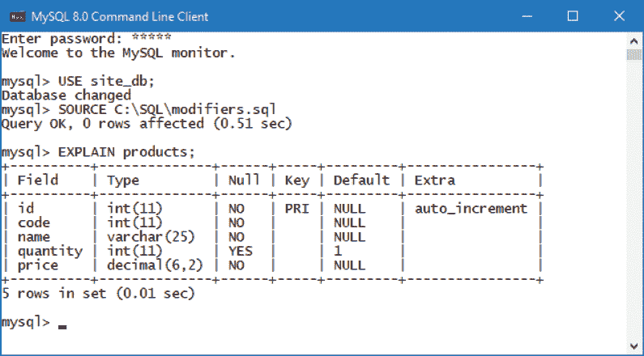


此图右侧的列标题为“Extra”，并注明了 `auto_increment` 修饰符。

## 设置主键

`PRIMARY KEY`（主键）是一种应用于列的“约束”，用于唯一标识该数据库表中的每一行。它确保该列中每行的值都是唯一的且永远不会改变，因此这些值可以用于引用任何特定的行。

通过设置 `PRIMARY KEY` 约束，可以对数据库表中的特定行进行数据操作。

任何列都可以被设置为 `PRIMARY KEY`，但通常使用第一列来提供唯一的标识符。

任何被设置为 `PRIMARY KEY` 的列都必须符合以下标准：

- 该列中的每个字段必须有值——它不能为空或具有 `NULL` 值。
- 该列中的每个值必须是唯一的——不能有重复。
- 该列中的每个值永远不能被修改或更新。
- 该列中的每个值不能重用——当行被删除时，其 `PRIMARY KEY` 值不能被重新分配为新行的 `PRIMARY KEY` 值。

注意上一个例子，MySQL 自动将“id”列设置为 `PRIMARY KEY`，因为在该列定义中包含了 `UNIQUE` 修饰符。唯一值（如此处第 91 页`EXPLAIN` 查询输出中“Key”标题下的“PRI”项所示）可以标识表的行。

## 修改表

现有数据库表的格式可以通过 `ALTER TABLE` 查询进行更改。该查询可以进行单一更改，也可以通过逗号分隔列表指定多个更改。

### 添加列

`ALTER TABLE` 查询可以向现有表 `ADD` 一个完整的新列，如下：

```sql
ALTER TABLE table_name ADD column_name data-type;
```

### 添加主键

可以使用语法为现有列 `ADD` 主键：

```sql
ALTER TABLE table_name ADD PRIMARY KEY (column_name);
```

### 修改列

`ALTER TABLE` 查询可以 `CHANGE` 现有列的名称。新列不会继承原始列指定的任何数据类型或修饰符——这些必须在 `ALTER TABLE` 查询中重新设置，如下：

```sql
ALTER TABLE table_name CHANGE old_column_name new_column_name data-type;
```

### 删除列

`ALTER TABLE` 查询可以使用 `DROP COLUMN` 关键字永久删除表中的整列：

```sql
ALTER TABLE table_name DROP COLUMN column_name;
```

在 `ADD COLUMN` 和 `DROP COLUMN` 示例中，`COLUMN` 关键字是可选的——它是手册所谓的“纯噪音词”，仅有助于可读性。

以下 SQL 脚本演示了所有可能性：


```sql
CREATE TABLE IF NOT EXISTS pans
(
| id | INT | NOT NULL , |
| --- | --- | --- |
| pattern | VARCHAR(25) | NOT NULL , |
| price | DECIMAL( 6,2 ) |  |
) ;
```


`alter_table.sql`

接下来，发布查询以确认表的格式

```sql
EXPLAIN pans ;
```

现在，发布查询来更新表

```sql
ALTER TABLE pans
ADD PRIMARY KEY ( id ) ,
ADD COLUMN INT UNIQUE NOT NULL ,
CHANGE pattern pan_pattern VARCHAR(25) NOT NULL ,
DROP COLUMN price ;
```


将文件保存到 `C:\SQL` 文件夹并命名为 `alter_table.sql`，然后以 root 登录 MySQL 命令行客户端并执行查询使用已建立的数据库

```sql
USE site_db ;
```

通过指明系统上 SQL 文件的源路径来执行 SQL 查询

```sql
SOURCE C:\SQL\alter_table.sql
```

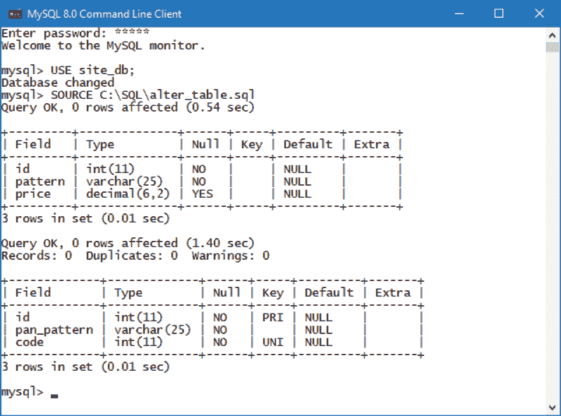


使用 `DROP COLUMN` 时应小心，因为它将移除该列包含的任何数据——这些数据无法恢复。


如果设计的数据库表已经预见了所有可能的未来需求，则永远不需要进行修改。

## 总结

- `USE DATABASE` 查询选择一个要操作的数据库。
- 使用 `SHOW TABLES` 查询可以显示数据库中所有表的名称。
- 使用 `EXPLAIN` 查询可以检查表的格式。
- 使用 `CREATE TABLE` 查询可以创建一个新表。
- `CREATE TABLE` 查询可以配合 `IF NOT EXISTS` 使用，以确保指定名称的表已不存在。
- 使用 `DROP TABLE` 查询可以删除现有表。
- `DROP TABLE` 查询可以配合 `IF EXISTS` 使用，以确保指定名称的表已存在。
- 列定义应指定其可能包含的数据类型，使用识别的数据类型关键字如 `INT`、`DOUBLE`、`DECIMAL`、`DATETIME`、`TIMESTAMP`、`DATE`、`TIME`、`YEAR`、`CHAR()`、`VARCHAR()`、`TEXT`、`BLOB` 或 `SET`。
- 列定义可选地指定一个字段修改符来进一步控制该列的允许内容，使其 `NOT NULL`、`AUTO_INCREMENT`、`UNIQUE`、`DEFAULT` 或 `PRIMARY KEY`。
- 当列设置为 `PRIMARY KEY` 时，每行必须在该列中包含唯一且不可更改的数据，这可以识别该表的每行。
- 使用 `ALTER TABLE` 查询可以向现有表 `ADD` 一个新列。
- 使用 `ALTER TABLE` 查询可以 `CHANGE` 现有表中的列。
- 使用 `ALTER TABLE` 查询可以配合 `DROP` 关键字从现有表中删除一列。

# 6 处理数据

***本章演示了如何编写 SQL 语句使用 MySQL 数据库表存储和检索数据。***

- 插入数据
- 更新列
- 更新字段
- 删除数据
- 选择数据
- 检索列
- 检索行
- 排序数据
- 设置方向
- 进行比较
- 总结

## 插入数据

可以使用 `INSERT INTO` 查询向现有的数据库表中插入数据，该查询首先指定表名。然后 SQL `VALUES` 关键字将通过括号内的逗号分隔列表指定要插入的实际数据，如下：

```sql
INSERT INTO table-name VALUES ( value , value ) ;
```

每个 `INSERT INTO` 查询仅向数据库表插入一行。必须为每列指定一个数据值——并按照相应的顺序。要插入的数据还必须匹配数据类型。可以使用 `INSERT INTO` 查询通过指明系统上 SQL 文件的源路径来执行 SQL 查询。

`INSERT INTO` 查询可以向 `NULL` 来执行 SQL 如下：

```sql
INSERT INTO table-name VALUES ( value , value )
```

如果设计的数据库表已经预见了所有可能的未来需求，则永远不需要进行修改。使用 `DROP COLUMN` 时应小心，因为它将移除该列包含的任何数据——这些数据无法恢复。使用 `INSERT INTO` 查询通过指明系统上 SQL 文件的源路径来执行 SQL 查询如下：

```sql
INSERT INTO table-name VALUES ( value , value ) ;
```

`INSERT INTO` 查询可以现有的数据库表中插入数据，该如下表如下：

```sql
INSERT INTO table-name VALUES ( value , value ) ;
```

`INSERT INTO` 查询可以向 `NULL`

```sql
INSERT INTO table-name VALUES ( value , value ) ;
```

`INSERT INTO` 查询可以向 `NULL`


将文件保存到 `C:\SQL` 文件夹并命名为 `alter_table.sql`，然后以 root 登录 MySQL 命令行客户端并执行查询使用已建立的数据库

```sql
USE site_db ;
```

通过指明系统上 SQL 文件的源路径来执行 SQL 查询

```sql
SOURCE C:\SQL\alter_table.sql
```


使用 `DROP COLUMN` 时应小心，因为它将移除该列包含的任何数据——这些数据无法恢复。


如果设计的数据库表已经预见了所有可能的未来需求，则永远不需要进行修改。

## 总结

- `USE DATABASE` 查询选择一个要操作的数据库。
- 使用 `SHOW TABLES` 查询可以显示数据库中所有表的名称。
- 使用 `EXPLAIN` 查询可以检查表的格式。
- 使用 `CREATE TABLE` 查询可以创建一个新表。
- `CREATE TABLE` 查询可以配合 `IF NOT EXISTS` 使用，以确保指定名称的表已不存在。
- 使用 `DROP TABLE` 查询可以删除现有表。
- `DROP TABLE` 查询可以配合 `IF EXISTS` 使用，以确保指定名称的表已存在。
- 列定义应指定其可能包含的数据类型，使用识别的数据类型关键字如 `INT`、`DOUBLE`、`DECIMAL`、`DATETIME`、`TIMESTAMP`、`DATE`、`TIME`、`YEAR`、`CHAR()`、`VARCHAR()`、`TEXT`、`BLOB`、`ENUM` 或 `SET`。
- 列定义可选地指定一个字段修改符来进一步控制该列的允许内容，使其 `NOT NULL`、`AUTO_INCREMENT`、`UNIQUE`、`DEFAULT` 或 `PRIMARY KEY`。
- 当列设置为 `PRIMARY KEY` 时，每行必须在该列中包含唯一且不可更改的数据，这可以识别该表的每行。
- 使用 `ALTER TABLE` 查询可以向现有表 `ADD` 一个新列。
- 使用 `ALTER TABLE` 查询可以 `CHANGE` 现有表中的列。
- 使用 `ALTER TABLE` 查询可以配合 `DROP` 关键字从现有表中删除一列。

# 6 处理数据

***本章演示了如何编写 SQL 语句使用 MySQL 数据库表存储和检索数据。***

- 插入数据
- 更新列
- 更新字段
- 删除数据
- 选择数据
- 检索列
- 检索行
- 排序数据
- 设置方向
- 进行比较
- 总结

## 插入数据


可以使用`INSERT INTO`查询向现有的数据库表中插入数据，该查询首先指定表名。然后 SQL `VALUES`关键字将通过括号内的逗号分隔列表指定要插入的实际数据，如下：

```sql
INSERT INTO table-name VALUES ( value , value ) ;
```

每个`INSERT INTO`查询仅向数据库表插入一行。必须为每列指定一个数据值——并按照相应的顺序。要插入的数据还必须匹配数据类型。可以使用`INSERT INTO`查询通过指明系统上 SQL 文件的源路径来执行 SQL 查询（此处由于原文文本存在严重重复导致翻译逻辑混乱，已根据上下文重新梳理）。

（注：由于您提供的待翻译文本中包含大量重复的乱码片段，以上翻译已根据 Markdown 结构逻辑进行了清理和修正。）

将文件保存到`C:\SQL`文件夹下命名为`update_all.sql`，然后启动 MySQL 命令行客户端并执行查询以使用建立的数据库

```sql
USE site_db ;
```

现在，通过指定系统上 SQL 文件的源路径来实现 SQL 查询

```sql
SOURCE C:\SQL\update_all.sql
```

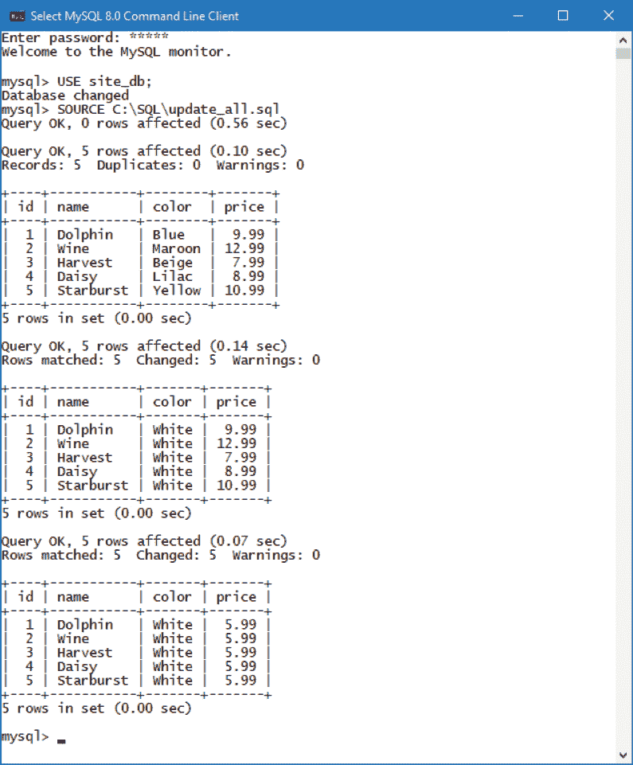


有时，使用`UPDATE`查询删除列中的所有值并将每个字段设置为`NULL`是很有用的——前提是列定义允许`NULL`值。

### 更新字段

通常情况下，需要使用`UPDATE`查询来更改特定行中特定列所包含的数据。可以通过在`UPDATE`查询中添加`WHERE`关键字来匹配指定列中的值，从而识别该行。特定`UPDATE`查询的语法如下：

```sql
UPDATE table-name
SET column-name = value WHERE column-name = value ;
```

单个`UPDATE`查询也可以通过在`SET`关键字后创建以逗号分隔的多个`column-name = value`语句，来更改特定行的多个列值。

如果`WHERE`关键字识别出多行具有相同指定值的行，它们都将用新值更新——这可能会导致意外的数据丢失。因此，通过其`PRIMARY KEY`值来识别行更为安全，因为该值保证是唯一的，因此不会意外更新多行。


```sql
update_where.sql
```

启动如记事本之类的纯文本编辑器，并创建一个定义四列表的查询

```sql
CREATE TABLE IF NOT EXISTS tiles
(
| id | INT AUTO_INCREMENT PRIMARY KEY , |
| --- | --- |
| pattern | CHAR(16) , |
| color | CHAR(16) , |
| price | DECIMAL(6,2) |
) ;
```

接下来，添加一个查询向此表插入四条记录

```sql
INSERT INTO tiles ( pattern , color , price )
VALUES ( "Spring" , "Green" , 9.99 ),
( "Summer" , "Yellow" , 12.99 ),
( "Autumn" , "Brown" , 9.99 ),
( "Winter" , "Blue" , 8.99 ) ;
```

现在，添加一个查询显示此表的所有记录

```sql
SELECT * FROM tiles ;
```

添加一个查询，通过识别其当前值来更新此表的“pattern”列

```sql
UPDATE tiles
SET pattern = "Fall" WHERE pattern = "Autumn" ;
```


如果`UPDATE`查询中省略了`WHERE`关键字，所有行都将被更新——丢失的数据无法恢复。

添加查询通过识别当前的“color”、“price”和“id”值来更新其他列并显示它们

```sql
UPDATE tiles SET color = "Gold" WHERE color = "Yellow" ;
UPDATE tiles SET price = 10.99 WHERE price = 9.99 ;
UPDATE tiles SET price = 11.99 WHERE id = 4 ;
SELECT * FROM tiles ;
```

将文件保存到`C:\SQL`文件夹下命名为`update_where.sql`，然后启动 MySQL 命令行客户端并执行查询以使用建立的数据库

```sql
USE site_db ;
```

现在，通过指定系统上 SQL 文件的源路径来实现 SQL 查询

```sql
SOURCE C:\SQL\update_where.sql
```

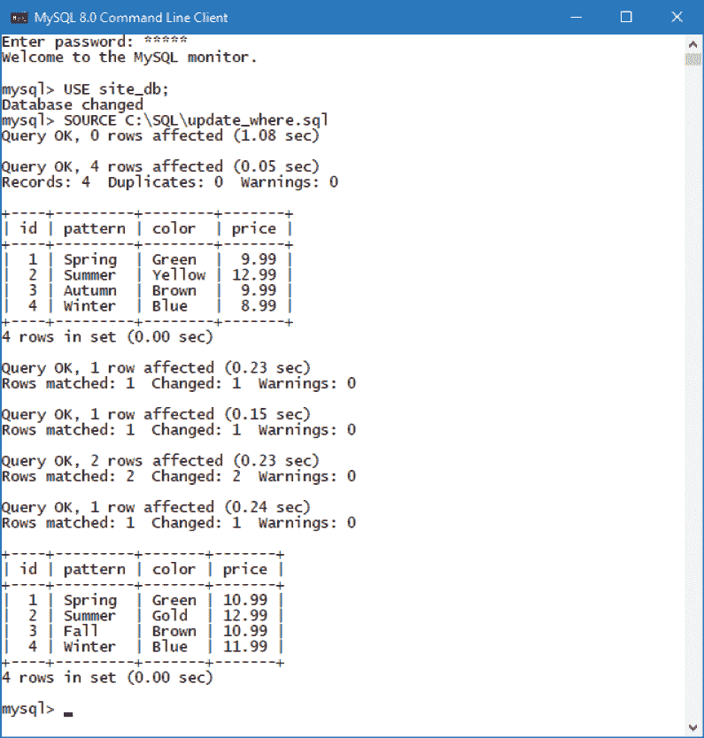

始终通过其`PRIMARY KEY`值识别行来尝试`UPDATE`表。

### 删除数据

可以使用`DELETE FROM`查询从数据库表中删除行。使用此语法删除所有行：

```sql
DELETE FROM table-name ;
```

此外，通过在`DELETE FROM`查询中添加`WHERE`关键字识别行，可以从表中删除特定行。`DELETE FROM`查询的语法如下：

```sql
DELETE FROM table-name WHERE column-name = value ;
```

如果`WHERE`关键字识别出多行具有相同值的行，它们都将被删除——可能会导致意外的数据丢失。因此，通过其`PRIMARY KEY`值识别行更为安全，因为它是保证唯一的，所以不会意外删除多行。


```sql
delete_from.sql
```

启动如记事本之类的纯文本编辑器，并创建一个定义四列表的查询

```sql
CREATE TABLE IF EXISTS pens
(
| id | INT AUTO_INCREMENT PRIMARY KEY , |
| --- | --- |
| maker | CHAR(32) , |
| model | CHAR(32) , |
| price | DECIMAL(6,2) |
) ;
```

接下来，添加一个查询向此表插入四条记录

```sql
INSERT INTO pens ( maker , model , price )
VALUES ( "Montegrappa" , "Silver Dragon" , 950.00 ),
( "Paul Rossi" , "Egyptian Lady" , 650.00 ),
( "Michel Perchin" , "Red Cross" , 450.00 ),
( "Bexley" , "Poseidon Magnum" , 350.00 ) ;
```

现在，添加一个查询显示此表的所有记录

```sql
SELECT * FROM pens ;
```

添加查询通过各种列值单独删除行，然后显示剩余记录

```sql
DELETE FROM pens WHERE maker = "Montegrappa" ;
SELECT * FROM pens ;
DELETE FROM pens WHERE model = "Egyptian Lady" ;
SELECT * FROM pens ;
DELETE FROM pens WHERE price = 450.00 ;
SELECT * FROM pens ;
DELETE FROM pens WHERE id = 4 ; 
SELECT * FROM pens ;
```

`DELETE`关键字不能用于删除表——你必须使用`DROP`关键字进行删除。

将文件保存到`C:\SQL`文件夹下命名为`delete_from.sql`，然后启动 MySQL 命令行客户端并执行查询以使用建立的数据库

```sql
USE site_db ;
```

现在，通过指定系统上 SQL 文件的源路径来实现 SQL 查询

```sql
SOURCE C:\SQL\delete_from.sql
```

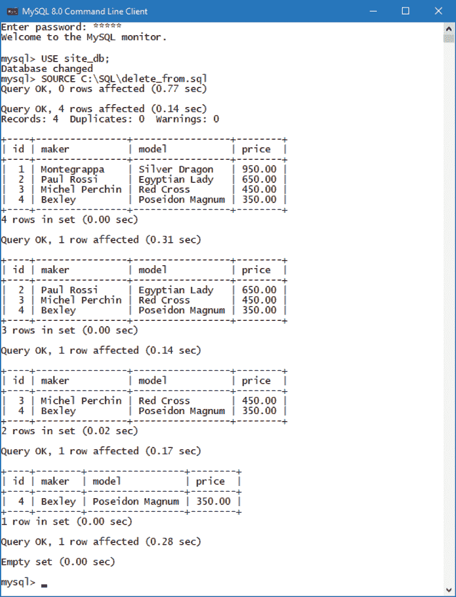


如果`DELETE FROM`查询中省略了`WHERE`关键字，所有行都将被删除——丢失的数据无法恢复。

### 选择数据

查看数据库表中数据的 SQL 查询在本章开头介绍。通配符`*`意味着“所有”，可以替换为列名以仅检索特定列的数据。该查询的语法如下：

```sql
SELECT column-name FROM table-name ;
```

以下脚本创建并显示整个表，然后选择单独列进行显示。


```sql
selection.sql
```

启动如记事本之类的纯文本编辑器，并创建一个定义四列表的查询

```sql
CREATE TABLE IF EXISTS paintings
(
| id | INT AUTO_INCREMENT PRIMARY KEY , |
| --- | --- |
| artists | CHAR(32) , |
| titles | CHAR(64) , |
| styles | CHAR(16) |
) ;
```

接下来，添加一个查询向此表插入四条记录

```sql
INSERT INTO paintings ( artists , titles , styles )
VALUES
( "Salvador Dali" , "Meditative Rose" , "Surrealist" ),
( "Henri Matisse" , "Blue Hair" , "Impressionist" ),
( "Pablo Picasso" , "Girl Reading" , "Cubist" ),
( "Marc Chagall" , "Bonjour Paris" , "Primitivist" ) ;
```

现在，添加一个查询显示此表的所有记录

```sql
SELECT * FROM paintings ;
```

添加一个查询单独显示“artists”列

```sql
SELECT artists FROM paintings ;
```

添加一个查询单独显示“titles”列

```sql
SELECT titles FROM paintings ;
```

添加一个查询单独显示“styles”列

```sql
SELECT styles FROM paintings ;
```

将文件保存到`C:\SQL`文件夹下命名为`selection.sql`，然后启动 MySQL 命令行客户端并执行查询以使用建立的数据库

```sql
USE site_db ;
```

现在，通过指定系统上 SQL 文件的源路径来实现 SQL 查询

```sql
SOURCE C:\SQL\selection.sql
```


注意，数据的检索顺序与它们在每列中的存储顺序相同，都是“自上而下”的

## 获取列

`SELECT`查询可以通过在查询中包含所需的列名作为以逗号分隔的列表，来返回来自多个列的数据。获取多个列数据的语法如下：

```sql
SELECT *column-name* , *column-name* FROM *table-name* ;
```

接后的脚本创建并显示了整个表，然后选择了多个列进行显示。


```sql
select_columns.sql
```

启动一个纯文本编辑器（如记事本），并创建一个查询来定义一个具有四列的表

```sql
CREATE TABLE IF NOT EXISTS phones
(
| id | INT AUTO_INCREMENT PRIMARY KEY , |
| --- | --- |
| make | CHAR(16) , |
| model | CHAR(16) , |
| platform | CHAR(16) |
) ;
```

接下来，添加一个查询向此表插入四条记录

```sql
INSERT INTO phones ( make , model , platform )
VALUES
( "Apple" , "iPhone" , "iOS" ) ,
( "RIM" , "Curve" , "BlackBerry" ) ,
( "HTC" , "Desire" , "Android" ) ,
( "Nokia" , "Lumia" , "Windows" ) ;
```

现在，添加一个查询显示此表中的所有记录

```sql
SELECT * FROM phones ;
```

添加一个查询显示“id”和“make”列

```sql
SELECT id , make FROM phones ;
```

添加一个查询显示“make”和“model”列

```sql
SELECT make , model FROM phones ;
```

添加一个查询显示“id”和“platform”列

```sql
SELECT id , platform FROM phones ;
```

将文件保存到`C:\SQL`文件夹中的`select_columns.sql`，然后启动 MySQL 命令行客户端并执行查询以使用建立的数据库

```sql
USE site_db ;
```

现在，通过指定系统上 SQL 文件的路径来执行 SQL 查询

```sql
SOURCE C:\SQL\select_columns.sql
```

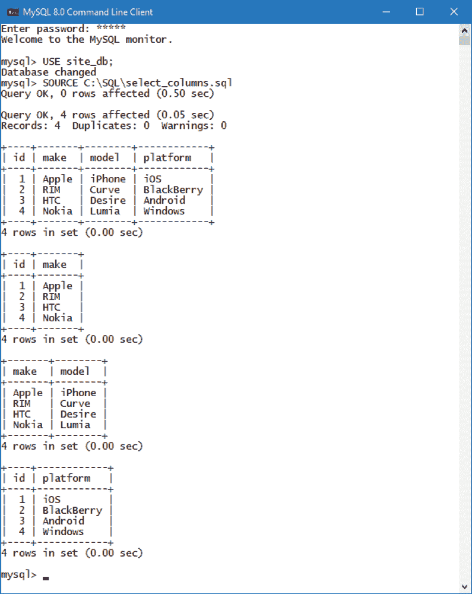


`SELECT`查询仅检索指定表中包含的数据副本——表本身不会被更改

## 获取行

如果`SELECT`查询包含`WHERE`关键字来标识所需的行，则它可以从数据库表中检索特定的行。应该通过其`PRIMARY KEY`（主键）值来标识以防止可能的重复。检索特定行的`SELECT`查询语法如下：

```sql
SELECT * FROM *table-name* WHERE *column-name* = *value* ;
```

此外，`SELECT`查询中的`WHERE`子句可以使用`IN`关键字指定一个备选值列表，以便与列数据进行比较。其后跟的是在一个对括号内用逗号分隔的值列表。因此，语法如下：

```sql
SELECT * FROM *table-name* WHERE *column-name* IN ( value , value ) ;
```

当列数据匹配列表中的任何一个值时，`WHERE`子句评估为`TRUE`，并返回该行的数据。可以通过在`IN`关键字之前加上`NOT`来反转比较。这时，只有当列表中的值都不匹配列数据时，`WHERE`子句才会被评估为`TRUE`。


```sql
select_rows.sql
```

启动一个纯文本编辑器（如记事本），并创建一个查询来定义一个具有四列的表

```sql
CREATE TABLE IF NOT EXISTS coffee_machines
(
| id | INT AUTO_INCREMENT PRIMARY KEY , |
| --- | --- |
| make | CHAR(16) , |
| model | CHAR(16) , |
| price | DECIMAL(6,2) |
) ;
```

接下来，添加一个查询向此表插入五条记录

```sql
INSERT INTO coffee_machines ( make , model , price )
VALUES
( "Krups" , "Dolce Gusto" , 140.00 ) ,
( "Gaggia" , "Cubika" , 170.00 ) ,
( "DeLonghi" , "Magnifica" , 500.00 ) ,
( "Magimix" , "Nespresso" , 300.00 ) ,
( "Cuisart" , "Espresso" , 280.00 ) ;
```

现在，添加一个查询显示此表中的一行


```sql
SELECT * FROM coffee_machines WHERE id= 3 ;
```

添加一个查询显示两个特定的行

```sql
SELECT * FROM coffee_machines WHERE make IN (“Krups” , “Gaggia” )
```

最后，添加一个查询显示所有其他行

```sql
SELECT * FROM coffee_machines WHERE make NOT (“Krups” , “Gaggia” )
```

将文件保存到 `C:\SQL` 文件夹中的 `select_rows.sql`，然后启动 MySQL 命令行客户端并执行查询以使用建立的数据库

```sql
USE site_db ;
```

现在，通过指定系统上 SQL 文件的路径来执行 SQL 查询

```sql
SOURCE C:\SQL\select_rows.sql
```


`SELECT` 查询仅检索指定表中包含的数据副本——表本身不会被更改

## 获取行

如果 `SELECT` 查询包含 `WHERE` 关键字来标识所需的行，则它可以从数据库表中检索特定的行。应该通过其 `PRIMARY KEY`（主键）值来标识以防止可能的重复。检索特定行的 `SELECT` 查询语法如下：

`SELECT * FROM *table-name* WHERE *column-name* = *value* ;`

此外，`SELECT` 查询中的 `WHERE` 子句可以使用 `IN` 关键字指定一个备选值列表，以便与列数据进行比较。其后跟的是在一个对括号内用逗号分隔的值列表。因此，语法如下：

`SELECT * FROM *table-name* WHERE *column-name* IN ( value , value ) ;`

当列数据匹配列表中的任何一个值时，`WHERE` 子句评估为 `TRUE`，并返回该行的数据。可以通过在 `IN` 关键字之前加上 `NOT` 来反转比较。这时，只有当列表中的值都不匹配列数据时，`WHERE` 子句才会被评估为 `TRUE`。

## 排序

SQL 查询可以使用 `ORDER BY` 子句根据指定的列名来对返回的数据进行排序。`ORDER BY` 子句的用法语法如下：

`SELECT * FROM *table-name* WHERE *column-name* = *value* ORDER BY *column-name*`

通常情况下，`SELECT` 查询的结果是升序排列的。`ORDER BY` 子句可以通过在排序列名后添加 `DESC`（降序）或 `ASC`（升序）来显式指定排序方向。

以下 SQL 示例展示了数值排序和字母排序的 `ORDER BY` 子句。


`order_by.sql`

启动一个纯文本编辑器（如记事本），并创建一个查询来定义一个具有四列的表

```sql
CREATE TABLE IF NOT EXISTS watches
(
| id | INT AUTO_INCREMENT PRIMARY KEY , |
| --- | --- |
| model | CHAR(16) , |
| style | CHAR(16) , |
| price | DECIMAL(6,2) |
) ;
```

接下来，添加一个查询向此表插入五条记录

```sql
INSERT INTO watches ( model , style , price )
VALUES
( “Boston” , “Gents” , 70.00 ) ,
( “Avante” , “Ladies” , 90.00 ) ,
( “Club” , “Gents” , 60.00 ) ,
( “Denver” , “Ladies” , 80.00 ) ,
( “Eton” , “Gents” , 50.00 ) ;
```

现在，添加一个查询显示此表中的所有记录，按“price”升序排序

```sql
SELECT * FROM watches ORDER BY price ;
```

添加一个查询显示所有模型和价格，按“model”字母序排序

```sql
SELECT model , price FROM watches ORDER BY model ;
```

最后，添加一个查询显示所有模型和样式，按“style”字母序排序

```sql
SELECT model , style FROM watches ORDER BY style ;
```

将文件保存到 `C:\SQL` 文件夹中的 `order_by.sql`，然后启动 MySQL 命令行客户端并执行查询以使用建立的数据库

```sql
USE site_db ;
```

## 方向

`ORDER BY` 子句只能作为 `SELECT` 查询的最后一个子句出现——否则会产生错误

## 设置方向

默认情况下，`SELECT` 查询会自动按升序排列。`ORDER BY` 子句可以通过在排序列名后添加 `DESC`（降序）或 `ASC`（升序）关键字来显式指定排序方向，语法如下：

`SELECT *column-name* , *column-name*

FROM *table-name*

ORDER BY *column-name* DESC ;`

列出的 SQL 脚本使用了 `ASC` 和 `DESC` 关键字来确定三列数据的排序方向


`sort_direction.sql`

启动一个纯文本编辑器（如记事本），并创建一个定义三列表格的查询

```sql
CREATE TABLE IF NOT EXISTS top_5_films
(
| position | INT PRIMARY KEY , |
| title | CHAR(32) NOT NULL , |
| year | INT NOT NULL |
) ;
```

接下来，添加一个查询向此表中插入五条记录

```sql
INSERT INTO top_5_films ( position , title , year )
VALUES
( 1 , “Citizen Kane” , 1941 ) ,
( 2 , “Casablanca” , 1942 ) ,
( 3 , “The Godfather” , 1972 ) ,
( 4 , “Gone With The Wind” , 1939 ) ,
( 5 , “Lawrence Of Arabia” , 1962 ) ;
```

现在，添加一个查询显示此表中所有记录的所有列，并按“position”降序排序

```sql
SELECT * FROM top_5_films ORDER BY position DESC ;
```

添加一个查询显示此表中所有的年份和标题，按“year”升序排序

```sql
SELECT year , title FROM top_5_films ORDER BY year ASC ;
```

最后，添加一个查询显示此表中所有的标题和年份，按“title”字母升序排序

```sql
SELECT title , year FROM top_5_films ORDER BY title ASC ;
```


对于史上最好的五部电影，意见可能不一——本例中的数据代表了美国电影学会的选择

将文件保存到 `C:\SQL` 文件夹中并命名为 `sort_direction.sql`，然后启动 MySQL 命令行客户端并执行查询以使用已建立数据库

```sql
USE site_db ;
```

现在，通过指定系统上 SQL 文件的源路径来实现 SQL 查询

```sql
SOURCE C:\SQL\sort_direction.sql
```

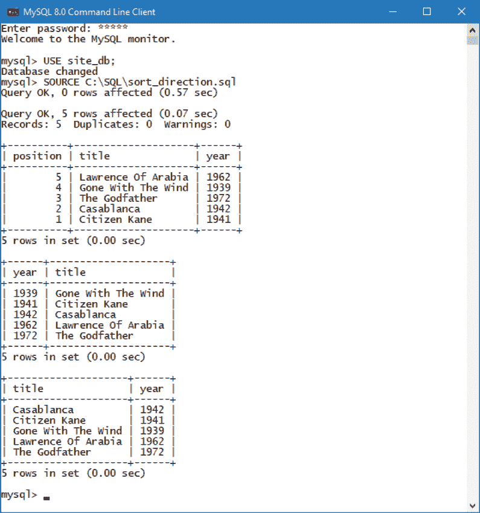


默认情况下，排序顺序是不区分大小写的，但使用 `ORDER BY BINARY` 会在排序中赋予大写字符优先级。

## 比较

与 PHP 一样，MySQL 拥有内置运算符和函数，可以用于对数据库中存储的数据进行快速过滤。强烈建议使用这些功能，因为比让 SQL 查询检索所有数据后再由 PHP 进行过滤效率更高。MySQL 可用的比较运算符列如下：

| 运算符: | 说明: |
| --- | --- |
| = | 等于 |
| != | 不等于 |
| < | 小于 |
| <= | 小于或等于 |
| > | 大于 |
| >= | 大于等于 |
| `BETWEEN` min `AND` max | 在 min 到 max 范围内 |
| `IS NULL` | 为空值 |
| `IS NOT NULL` | 不为空值 |

比较运算符用于带有 `WHERE` 子句的查询中，以测试特定条件是否满足。当评估结果为 TRUE 时，查询将返回数据，否则将不返回任何内容。有用的是，内置 `NOW()` 函数返回 `YYYY-MM-DD HH:MM:SS` 格式的当前日期时间，提供了访问数据库的时间戳。此外，内置的 `SHA2()` 加密函数允许安全地存储密码。它接受两个参数，指定密码和哈希长度以返回 224、256、384 或 512 位（返回 64 个字符）。


`comparison.sql`

启动一个纯文本编辑器（如记事本），并创建一个定义五列表格的查询

```sql
CREATE TABLE IF NOT EXISTS items
(
| id | INT AUTO_INCREMENT PRIMARY KEY , |
| name | CHAR(16) NOT NULL , |
| quantity | INT NOT NULL , |
| pass | TEXT(256) NOT NULL , |
| stamp | DATETIME NOT NULL |
) ;
```

在 `dev.mysql.com/doc/refman/8.0/en/` 上的在线 MySQL 8 参考手册中发现更多 MySQL 内置功能

接下来，添加一个查询向此表中插入四条记录

```sql
INSERT INTO items ( name , quantity , pass , stamp )
VALUES ( “Alan” , 10 , SHA2(“river”, 256) , NOW() ) ,
( “Dean” , 20 , SHA2(“blue”, 256) , NOW() ) ,
( “Gary” , 30 , SHA2(“light”, 256) , NOW() ) ,
( “Mike” , 40 , SHA2(“shine”, 256) , NOW() ) ;
```

现在，通过比较“quantity”值来显示名称和数量

```sql
SELECT name , quantity FROM items
WHERE quantity BETWEEN 15 AND 35 ;
```

添加一个查询，通过比较“quantity”值显示时间和密码

```sql
SELECT stamp , pass FROM items
WHERE quantity < 15 ;
```

将文件保存到 `C:\SQL` 文件夹中并命名为 `comparison.sql`，然后启动 MySQL 命令行客户端并执行查询使用已建立数据库

```sql
USE site_db ;
```

现在，通过指定系统上 SQL 文件的源路径来实现 SQL 查询

```sql
SOURCE C:\SQL\comparison.sql
```

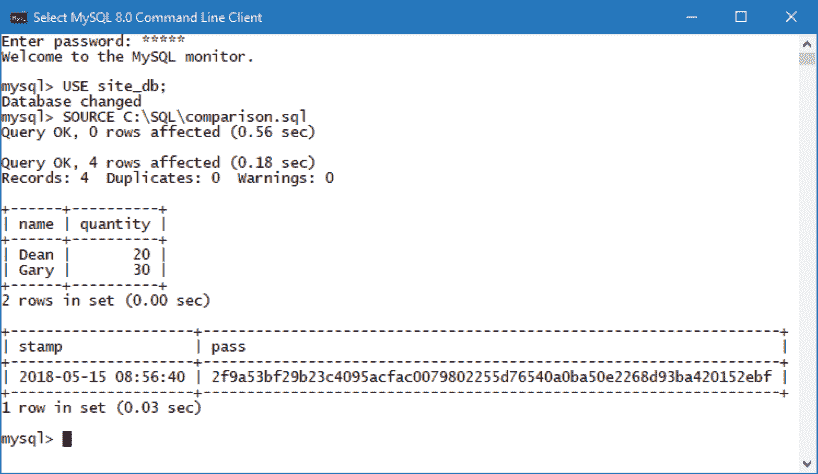


`NOW()` 返回的是服务器的时间，可能与用户的本地时间不同。

## 总结

通过 `INSERT INTO` 查询向表插入数据。`INSERT INTO` 查询中的 `VALUES` 关键字指定逗号分隔的值列表。文本值必须用引号包围。通过 `SELECT * FROM` 查询从表中检索所有数据。使用 `UPDATE` 查询更改列中的字段。在 `UPDATE` 查询中添加 `WHERE` 关键字以识别要更改的特定行。`SET` 关键字用于 `UPDATE` 查询以更改一个或多个字段。使用 `DELETE` 查询删除表中的所有行。在 `DELETE` 查询中添加 `WHERE` 关键字以识别要删除的特定行。所有表应指定一个包含 `PRIMARY KEY` 的列。通过在 `SELECT` 查询中指定逗号分隔的列列表检索多列数据。通过在 `SELECT` 查询中添加 `WHERE` 关键字检索特定行。`WHERE` 子句可以指定跟在 `IN` 关键字逗号分隔的可选比较值列表。在 `IN` 关键字之前添加 `NOT` 关键字可以返回不匹配列表中任何值的行的数据。`ORDER BY` 子句可以指定排序列，并使用 `ASC` 和 `DESC` 关键字指定如何排序检索到的数据。MySQL 拥有与 PHP 类似的比较运算符。内置的 MySQL `NOW()` 函数提供时间戳，内置的 `SHA2()` 函数安全地存储密码。

# 7 连接数据库

本章介绍如何在 PHP 脚本中连接 MySQL 数据库并执行 SQL 查询。

- 连接
- 执行查询
- 检索结果
- 应用更改
- 计数记录
- 更新记录
- 验证结果
- 确保安全
- 错误处理

## 连接

连接到 MySQL 服务器的标准脚本在第 1 章配置开发环境时描述过，此处重复以供解释：

```php
<?php
$dbc = mysqli_connect( *‘host’ , ‘user’ , ‘password’ , ‘database’ )
OR die ( mysqli_connect_error() ) ;
mysqli_set_charset( $dbc , ‘utf8’ ) ;
```

脚本定义了一个名为 `dbc`（数据库连接）的 PHP 变量，其值赋值为内置函数 `mysqli_connect()` 的返回值。该调用需要四个参数来指定 MySQL 用户详情和要连接的数据库。当调用成功时，`mysqli_connect()` 函数返回一个代表与 MySQL 服务器连接的“对象”。

成功调用 `mysqli_connect()` 返回的对象非常重要，因为它在其他与 MySQL 服务器通信的 PHP 函数调用中被用作参数传递。例如，在上面的脚本中，它必须作为 `mysqli_set_charset()` 函数调用的第一个参数以标识该连接。

当 `mysqli_connect()` 函数调用失败时，脚本将跳转到调用 `die()` 函数的备选分支。这等于调用 `exit()` 来立即终止脚本。可选地，`die()` 函数可以接受字符串参数，该字符串将在脚本停止时打印出来。在这种情况下，字符串消息是由 `mysqli_connect_error()` 函数返回的，用于描述连接失败的原因。

由于连接脚本包含敏感的用户信息，因此不能将其放置在 Web 服务器 `/htdocs` 目录下的其他 PHP 脚本并列。`connect_db.php` 脚本应该位于 `/htdocs` 的父目录，在那里它无法被直接访问，但可以通过 `require` 语句与其他 PHP 脚本合并，如下所示：

```php
<?php
require ( '../connect_db.php’ ) ;
if ( mysqli_ping( $dbc ) )
{
    echo ‘MySQL Server ‘ . mysqli_get_server_info( $dbc ) . ‘ on ‘ . mysqli_get_host_info( $dbc ) ;
}
```


`require.php`

因此，Web 服务器目录结构中的文件应按所示的分级结构排列，这样当通过 HTTP 请求 `require.php` 脚本时，`connect_db.php` 脚本将从其父目录的位置引入，并建立到 MySQL 服务器的连接。


包含纯 PHP 代码的文件（如此处列出的两个文件）应省略文件末尾的 PHP `?>` 结束标签。这可以防止 PHP 结束标签后出现意外的空格或换行，这些可能会导致意外的影响。


在继续之前，确保你的连接脚本 `connect_db.php` 运行成功——在本书的其余部分都需要它来连接到 `site_db` MySQL 数据库。

### 执行查询

一旦你的 PHP 脚本建立了与 MySQL 服务器上指定数据库的连接，就可以使用 PHP `mysqli_query()` 函数进行查询，其语法如下：


`mysqli_query ( database-connection-object , sql-query )`

数据库连接对象是标准脚本在此处第 121 页中赋值给变量（`$dbc`）的对象。通常，SQL 查询是一个赋值给另一个变量的字符串，该字符串可以作为函数的第二个参数使用。

当调用 `mysqli_query()` 函数时，调用成功则返回一个“结果集”或 `TRUE` 值，调用失败则返回 `FALSE` 值。将返回值赋值给变量可以测试查询的执行是成功还是失败。

可选地，你的脚本可以在查询执行后调用 `mysqli_close()` 来显式关闭连接。尽管这在脚本结束时会自动发生，但进行此调用被认为是一种良好的做法。


query.php

创建一个 PHP 脚本，首先引入标准脚本以建立到 MySQL 服务器上数据库的连接

```php
<?php
require ( ../connect_db.php ‘ ) ;
```

接下来，初始化一个带有 SQL 查询字符串的变量

```php
$q \= ‘SHOW TABLES’ ;
```

现在，初始化另一个变量，这次是对 MySQL 服务器数据库的查询结果

```php
$r \= mysqli_query ( $dbc , $q ) ;
```

测试查询是否成功并显示适当的消息

```php
if ( $r )
{ echo ‘<h1>Result Set Returned OK</h1>’ ; }
else
{ echo ‘<p>’ . mysqli_error( $dbc ) . ‘</p> ; }
```

最后，关闭 MySQL 服务器数据库连接

```php
mysqli_close ( $dbc ) ;
```

将 PHP 脚本保存在 Web 服务器的 `/htdocs` 目录下并命名为 `query.php`，然后通过 HTTP 打开它查看确认查询成功的消息


现在，编辑 SQL 查询字符串使其出错

```php
$q \= ‘SHOW TABLE’ ;
```

再次保存编辑过的 PHP 脚本，然后再次通过 HTTP 打开它查看描述查询失败的消息


仅包含纯 PHP 代码的文件（如此处列出的两个文件）应省略文件末尾的 PHP `?>` 结束标签。这可以防止 PHP 结束标签后出现意外的空格或换行，这些可能会导致意外的影响。


在继续之前，确保你的连接脚本 `connect_db.php` 运行成功——在本书的其余部分都需要它来连接到 `site_db` MySQL 数据库。

### 执行查询

一旦你的 PHP 脚本建立了与 MySQL 服务器上指定数据库的连接，就可以使用 PHP `mysqli_query()` 函数进行查询，其语法如下：

```
mysqli_query ( database-connection-object , sql-query )
```

数据库连接对象是标准脚本在此处第 121 页中赋值给变量（`$dbc`）的对象。通常，SQL 查询是一个赋值给另一个变量的字符串，该字符串可以作为函数的第二个参数使用。

当调用 `mysqli_query()` 函数时，调用成功则返回一个“结果集”或 `TRUE` 值，调用失败则返回 `FALSE` 值。将返回值赋值给变量可以测试查询的执行是成功还是失败。

可选地，你的脚本可以在查询执行后调用 `mysqli_close()` 来显式关闭连接。尽管这在脚本结束时会自动发生，但进行此调用被认为是一种良好的做法。


query.php

创建一个 PHP 脚本，首先引入标准脚本以建立到 MySQL 服务器上数据库的连接

```php
<?php
require ( ../connect_db.php ‘ ) ;
```

接下来，初始化一个带有 SQL 查询字符串的变量

```php
$q \= ‘SHOW TABLES’ ;
```

现在，初始化另一个变量，这次是对 MySQL 服务器数据库的查询结果

```php
$r \= mysqli_query ( $dbc , $q ) ;
```

测试查询是否成功并显示适当的消息

```php
if ( $r )
{ echo ‘<h1>Result Set Returned OK</h1>’ ; }
else
{ echo ‘<p>’ . mysqli_error( $dbc ) . ‘</p> ; }
```

最后，关闭 MySQL 服务器数据库连接

```php
mysqli_close ( $dbc ) ;
```

将 PHP 脚本保存在 Web 服务器的 `/htdocs` 目录下并命名为 `query.php`，然后通过 HTTP 打开它查看确认查询成功的消息


现在，编辑 SQL 查询字符串使其出错

```php
$q \= ‘SHOW TABLE’ ;
```

再次保存编辑过的 PHP 脚本，然后再次通过 HTTP 打开它查看描述查询失败的消息


仅包含纯 PHP 代码的文件（如此处列出的两个文件）应省略文件末尾的 PHP `?>` 结束标签。这可以防止 PHP 结束标签后出现意外的空格或换行，这些可能会导致意外的影响。

### 获取结果

某些 SQL 查询（如 `INSERT`、`UPDATE`、`DELETE` 或 `ALTER`）不返回数据，因此在执行成功时仅返回 `TRUE` 值。其他 SQL 查询（如 `SHOW` 或 `SELECT`）在执行成功时返回“结果集”。

结果集包含记录行，可以使用 `while` 循环逐行读取。`mysqli_fetch_array()` 函数需要结果集变量作为第一个参数。可选地，可以通过第二个参数指定返回的数组类型——关联数组、索引数组或两者兼有。可以使用下方列出的内置 PHP 常量：

| 常量: | 示例 |
| --- | --- |
| `MYSQLI_ASSOC` | `$row['column-name']` |
| `MYSQLI_NUM` | `$row[0]` |
| `MYSQLI_BOTH` | `$row['column-name']` OR `$row[0]` |

可选地，你的脚本可以调用 `mysqli_free_result()` 来释放结果集。尽管这在脚本结束时会自动发生，但进行此调用被认为是一种良好的做法。


result.php

创建一个 PHP 脚本，首先引入标准脚本以建立到 MySQL 服务器上数据库的连接

```php
<?php
require ( ../connect_db.php ‘ ) ;
```

接下来，初始化一个带有 SQL 查询字符串的变量

```php
$q \= ‘SHOW TABLES’ ;
```

现在，初始化另一个变量，这次是对 MySQL 服务器数据库的查询结果

```php
$r \= mysqli_query ( $dbc , $q ) ;
```

测试查询是否成功并显示适当的消息

```php
if ( $r )
{
    echo ‘<h1>Tables on site_db database</h1> ‘ ;
    // 在此处插入语句（步骤 5）。
}
else
{
    echo ‘<p>’ . mysqli_error( $dbc ) . ‘</p> ; }
}
```

现在，插入语句显示返回的每行数据并释放结果集

```php
while ( $row \= mysqli_fetch_array( $r , MYSQLI_NUM ) )
{
    echo ‘<br>’. $row\[ 0 \] ;
}
mysqli_free_result( $r ) ;
```

最后，关闭 MySQL 服务器数据库连接

```php
mysqli_close ( $dbc ) ;
```

将 PHP 脚本保存在 Web 服务器的 `/htdocs` 目录下并命名为 `result.php`，然后通过 HTTP 打开它查看结果


如果未显式指定数组类型，`mysqli_fetch_array()` 函数默认返回两种类型。


此处显示的结果列出了在前两个章节中使用 MySQL 命令行客户端创建的表。

### 应用更改

可以通过执行 `INSERT`、`UPDATE`、`DELETE` 或 `ALTER` SQL 查询来对现有的 MySQL 数据库表应用更改。当通过 PHP 脚本中的 `mysqli_query()` 函数执行这些操作时，如果查询成功，它将返回一个 `TRUE` 值。可以测试此条件以执行适当的操作。例如，在成功添加新行后显示表中的所有记录，或在失败时显示错误消息。


insert.php

创建一个 PHP 脚本，开头引入标准脚本以建立与 MySQL Server 上的数据库的连接

```php
<?php
require ( '../connect_db.php' );
```

 接下来，添加一个函数来显示现有表中的所有记录，或显示错误消息

```php
function show_records( $dbc )
{
    $q = 'SELECT * FROM prints';
    $r = mysqli_query( $dbc , $q );
    if ( $r )
    {
        echo '<h1>Records in prints table</h1>' ;
        while ( $row = mysqli_fetch_array( $r , MYSQLI_ASSOC ) )
        {
            echo '<br>' . $row['id'] . ' | ' . $row['name'] .
            ' @ ' . $row['price'];
        }
    }
    else { 
        echo '<p>' . mysqli_error( $dbc ) . '</p>'; 
    }
}
```

现在，调用该函数来显示所有记录

```php
show_records( $dbc );
```

创建并执行另一个查询以向表中添加行

```php
$q = 'INSERT INTO prints ( name , price ) VALUES ( "One Center" , 32.99 ), ( "Yellow Red Blue" , 36.99 ) ';
$r = mysqli_query( $dbc , $q );
```


此 `SELECT` 查询使用 `MYSQLI_ASSOC` 常量将结果集返回为关联数组，因此可以通过名称访问列。

再次调用该函数显示所有记录，如果更改失败则显示错误消息

```php
if( $r )
{
    show_records( $dbc );
}
else
{
    echo '<p>' . mysqli_error( $dbc ) . '</p>';
}
```

最后，关闭 MySQL Server 数据库连接

```php
mysqli_close ( $dbc );
```

将 PHP 脚本保存到 Web 服务器的 `/htdocs` 目录并命名为 `insert.php`，然后通过 HTTP 打开它以查看数据库表的更改已应用


记住 `SELECT` 查询在成功后会返回结果集，而 `INSERT` 查询在成功时仅返回一个 `TRUE` 值。


你可以按照此处第 99 页的步骤通过 MySQL 命令行客户端创建原始“prints”表。

### 计数记录

可以对内置 PHP 函数 `mysqli_query()` 返回的结果集进行检查，使用 `mysqli_num_rows()` 函数来发现它包含多少行。该函数接受结果集作为参数，并返回它包含的行数，如下：

```php
$num = mysqli_num_rows( $r );
```

很有用的是，在执行返回记录的 `while` 循环之前可以测试返回的行数，以确保结果集不为空。


count.php

创建一个 PHP 脚本，开头引入标准脚本以建立与 MySQL Server 上的数据库的连接

```php
<?php
require ( '../connect_db.php' );
```

 接下来，添加一个函数来显示现有表中的所有记录，或显示错误消息

```php
function show_records( $dbc )
{
    $q = 'SELECT * FROM prints';
    $r = mysqli_query( $dbc , $q );
    $num = mysqli_num_rows( $r );
    if ( $num > 0 )
    {
        echo '<h1>Records in prints table</h1>';
        while ( $row = mysqli_fetch_array( $r , MYSQLI_ASSOC ) )
        {
            echo '<br>' . $row['id'] . ' | ' . $row['name'] .
            ' @ ' . $row['price'];
        }
    }
    else { 
        echo '<p>' . mysqli_error( $dbc ) . '</p>'; 
    }
}
```

现在，调用该函数显示所有记录

```php
show_records( $dbc );
```

创建并执行另一个查询以向表中添加行

```php
$q = 'INSERT INTO prints ( name , price ) VALUES ( "One Center" , 32.99 ), ( "Yellow Red Blue" , 36.99 ) ';
$r = mysqli_query( $dbc , $q );
```

你也可以使用 `mysqli_num_rows()` 函数来分页结果。

### 更新记录

`mysqli_affected()` 函数返回一个整数，受 `INSERT`、`UPDATE` 或 `DELETE` 查询影响的行数。与接受结果集作为参数的 `mysqli_num_rows()` 函数不同，`mysqli_affected()` 函数接受数据库连接作为参数：

```php
$num_affected = mysqli_affected( $dbc );
```

update.php

创建一个 PHP 脚本，开头引入标准脚本以建立与 MySQL Server 上的数据库的连接

```php
<?php
require ( '../connect_db.php' );
```

 接下来，添加一个函数来显示现有表中的所有记录，或显示错误


```php
function show_records( $dbc )
{
    $q = 'SELECT * FROM prints';
    $r = mysqli_query( $dbc , $q );
    $num = mysqli_num_rows( $r );
    if ( $num > 0 )
    {
        echo '<h1>Records in prints table</h1>';
        while ( $row = mysqli_fetch_array( $r , MYSQLI_ASSOC ) )
        {
            echo '<br>' . $row['id'] . ' | ' . $row['name'] .
            ' @ ' . $row['price'];
        }
    }
    else { 
        echo '<p>' . mysqli_error( $dbc ) . '</p>'; 
    }
}
```

现在，调用该函数显示所有记录

```php
show_records( $dbc );
```

创建并执行另一个查询以更新表中具有特定值的（两条）记录

```php
$q = 'UPDATE watches SET style = “Gents” WHERE style = “Ladies” ';
$r = mysqli_query( $dbc , $q );
```

如果预期的记录已更新，再次调用该函数显示所有记录

```php
if( mysqli_affected( $dbc ) == 2 )
{
    echo '<hr>' . mysqli_affected( $dbc ) . ' Records Updated...';
    show_records( $dbc );
}
```

最后，关闭 MySQL Server 数据库连接

```php
mysqli_close ( $dbc );
```

将 PHP 脚本保存到 Web 服务器的 `/htdocs` 目录并命名为 `update.php`，然后通过 HTTP 打开它以查看数据库表的更改以及受影响的行数

PHP 提供了内置函数，允许对数据进行类型测试以进行验证。下表中的每个函数如果数据属于特定类型，则返回 TRUE，否则返回 FALSE：

| 函数: | 验证内容: | 示例: |
| --- | --- | --- |
| `is_numeric()` | 数字，即使是字符串形式 | `2.0, 20, ‘20’` |
| `is_int()` | 整数 | `100` |
| `is_float()` | 浮点数 | `3.124` |
| `is_string()` | 字符串 | `‘Hello World!’` |
| `is_null()` | 空 | `NULL` |
| `is_scalar()` | 变量 | `$var` |
| `is_array()` | 数组 | `$days` |
| `is_bool()` | 布尔 | `TRUE` |
| `is_resource()` | 外部资源 | `File Stream` |


### validate.php


创建一个 PHP 脚本，首先引入标准脚本以建立与 MySQL 服务器上数据库的连接。

```php
<?php
require ( '../connect_db.php’ );
```


接下来，添加语句从数据库表中检索单条数据进行验证。

```php
$q = ‘SELECT price FROM watches WHERE model = “Boston”’;
$r = mysqli_query($dbc , $q);
while ($row = mysqli_fetch_array($r , MYSQL_NUM)) {
    $var = $row[0];
}
```


现在，添加语句来测试获取到的数据类型并显示适当的结果。

```php
$result = is_numeric($var) ? ‘numeric’ : ‘not numeric’;
echo "$var is $result";

$result = is_int($var) ? ‘an integer’ : ‘not integer’;
echo "$var is $result";

$result = is_float($var) ? ‘a float’ : ‘not float’;
echo "$var is $result";

$result = is_string($var) ? ‘a string’ : ‘not string’;
echo "$var is $result";

$result = is_null($var) ? ‘NULL’ : ‘not NULL’;
echo "$var is $result";

$result = is_scalar($var) ? ‘a variable’ : ‘not variable’;
echo "$var is $result";

$result = is_array($var) ? ‘an array’ : ‘not array’;
echo "$var is $result";

$result = is_bool($var) ? ‘a boolean’ : ‘not boolean’;
echo "$var is $result";

$result = is_resource($var) ? ‘a resource’ : ‘not resource’;
echo "$var is $result";
```


最后，关闭 MySQL 服务器连接。

```php
mysqli_close($dbc);
```


将 PHP 脚本保存到 Web 服务器的 `/htdocs` 目录下并命名为 `validate.php`，然后通过 HTTP 打开它查看验证结果。


你应该始终验证 HTML 表单输入的数据，以确保其符合预期的类型。


你可以在这里看到小数是以字符串形式存储在变量中的，而不是浮点数。

### 确保安全性

在用 PHP 和 MySQL 脚本时，考虑这些问题非常重要，以防止用户输入可能意外或恶意产生不良良影响的数据：

- 不要允许数据库连接脚本被直接访问 –将其放置在 `/htdocs` 的父目录中。

- 使用验证函数来确保数据存在且类型正确 – 频繁使用 `isset()`、`empty()` 和 `is_numeric()`。


你可以看到这里小数是以字符串形式存储在变量中的，而不是浮点数。

### 确保安全性

在用 PHP 和 MySQL 脚本时，考虑这些问题非常重要，以防止用户输入可能意外或恶意产生不良良影响的数据：

- 不要允许数据库连接脚本被直接访问 –将其放置在 `/htdocs` 的父目录中。

- 使用验证函数来确保数据存在且类型正确 – 频繁使用 `isset()`、`empty()` 和 `is_numeric()`。


你可以看到这里小数是以字符串形式存储在变量中的，而不是浮点数。

### 确保安全性

在用 PHP 和 MySQL 脚本时，考虑这些问题非常重要，以防止用户输入可能意外或恶意产生不良良影响的数据：

- 不要允许数据库连接脚本被直接访问 –将其放置在 `/htdocs` 的父目录中。

- 使用验证函数来确保数据存在且类型正确 – 频繁使用 `isset()`、`empty()` 和 `is_numeric()`。


你可以看到这里小数是以字符串形式存储在变量中的，而不是浮点数。

### 确保安全性

在用 PHP 和 MySQL 脚本时，考虑这些问题非常重要，以防止用户输入可能意外或恶意产生不良良影响的数据：

- 不要允许数据库连接脚本被直接访问 –将其放置在 `/htdocs` 的父目录中。

- 使用验证函数来确保数据存在且类型正确 – 频繁使用 `isset()`、`empty()` 和 `is_numeric()`。


你可以看到这里小数是以字符串形式存储在变量中的，而不是浮点数。

### 确保安全性

在用 PHP 和 MySQL 脚本时，考虑这些问题非常重要，以防止用户输入可能意外或恶意产生不良良影响的数据：

- 不要允许数据库连接脚本被直接访问 –将其放置在 `/htdocs` 的父目录中。

- 使用验证函数来确保数据存在且类型正确 – 频繁使用 `isset()`、`empty()` 和 `is_numeric()`。


你可以看到这里小数是以字符串形式存储在变量中的，而不是浮点数。

### 确保安全性

在用 PHP 和 MySQL 脚本时，考虑这些问题非常重要，以防止用户输入可能意外或恶意产生不良良影响的数据：

- 不要允许数据库连接脚本被直接访问 –将其放置在 `/htdocs` 的父目录中。

- 使用验证函数来确保数据存在且类型正确 – 频繁使用 `isset()`、`empty()` 和 `is_numeric()`。


你可以看到这里小数是以字符串形式存储在变量中的，而不是浮点数。

### 确保安全性

在用 PHP 和 MySQL 脚本时，考虑这些问题非常重要，以防止用户输入可能意外或恶意产生不良良影响的数据：

- 不要允许数据库连接脚本被直接访问 –将其放置在 `/htdocs` 的父目录中。

- 使用验证函数来确保数据存在且类型正确 – 频繁使用 `isset()`、`empty()` 和 `is_numeric()`。


你可以看到这里小数是以字符串形式存储在变量中的，而不是浮点数。

### 确保安全性

在用 PHP 和 MySQL 脚本时，考虑这些问题非常重要，以防止用户输入可能意外或恶意产生不良良影响的数据：

- 不要允许数据库连接脚本被直接访问 –将其放置在 `/htdocs` 的父目录中。

- 使用验证函数来确保数据存在且类型正确 – 频繁使用 `isset()`、`empty()` 和 `is_numeric()`。


你可以看到这里小数是以字符串形式存储在变量中的，而不是浮点数。

### 确保安全性

在用 PHP 和 MySQL 脚本时，考虑这些问题非常重要，以防止用户输入可能意外或恶意产生不良良影响的数据：

- 不要允许数据库连接脚本被直接访问 –将其放置在 `/htdocs` 的父目录中。

- 使用验证函数来确保数据存在且类型正确 – 频繁使用 `isset()`、`empty()` 和 `is_numeric()`。


你可以看到这里小数是以字符串形式存储在变量中的，而不是浮点数。

### 确保安全性

在用 PHP 和 MySQL 脚本时，考虑这些问题非常重要，以防止用户输入可能意外或恶意产生不良良影响的数据：

- 不要允许数据库连接脚本被直接访问 –将其放置在 `/htdocs` 的父目录中。

- 使用验证函数来确保数据存在且类型正确 – 频繁使用 `isset()`、`empty()` 和 `is_numeric()`。


你可以看到这里小数是以字符串形式存储在变量中的，而不是浮点数。

### 确保安全性

在用 PHP 和 MySQL 脚本时，考虑这些问题非常重要，以防止用户输入可能意外或恶意产生不良良影响的数据：

- 不要允许数据库连接脚本被直接访问 –将其放置在 `/htdocs` 的父目录中。

- 使用验证函数来确保数据存在且类型正确 – 频繁使用 `isset()`、`empty()` 和 `is_numeric()`。


你可以看到这里小数是以字符串形式存储在变量中的，而不是浮点数。

### 确保安全性

在用 PHP 和 MySQL 脚本时，考虑这些问题非常重要，以防止用户输入可能意外或恶意产生不良良影响的数据：

- 不要允许数据库连接脚本被直接访问 –将其放置在 `/htdocs` 的父目录中。

- 使用验证函数来确保数据存在且类型正确 – 频繁使用 `isset()`、`empty()` 和 `is_numeric()`。


你可以看到这里小数是以字符串形式存储在变量中的，而不是浮点数。

### 确保安全性

在用 PHP 和 MySQL 脚本时，考虑这些问题非常重要，以防止用户输入可能意外或恶意产生不良良影响的数据：

- 不要允许数据库连接脚本被直接访问 –将其放置在 `/htdocs` 的父目录中。

- 使用验证函数来确保数据存在且类型正确 – 频繁使用 `isset()`、`empty()` 和 `is_numeric()`。


跨站脚本 (XSS) 通过移除 `<script>` 标签来防止执行。

### 确保安全性

在用 PHP 和 MySQL 脚本时，考虑这些问题非常重要，以防止用户输入可能意外或恶意产生不良良影响的数据：

- 不要允许数据库连接脚本被直接访问 –将其放置在 `/htdocs` 的父目录中。

- 使用验证函数来确保数据存在且类型正确 – 频繁使用 `isset()`、`empty()` 和 `is_numeric()`。


你可以看到这里小数是以字符串形式存储在变量中的，而不是浮点数。

### 确保安全性

在用 PHP 和 MySQL 脚本时，考虑这些问题非常重要，以防止用户输入可能意外或恶意产生不良良影响的数据：

- 不要允许数据库连接脚本被直接访问 –将其放置在 `/htdocs` 的父目录中。

- 使用验证函数来确保数据存在且类型正确 – 频繁使用 `isset()`、`empty()` 和 `is_numeric()`。


你可以看到这里小数是以字符串形式存储在变量中的，而不是浮点数。

### secure.php


创建一个包含 HTML 表单的文档，输入数据。

```html
<form action="secure.php" method="POST">
<p>Name: <input type="text" name="name">
<input type="submit" value="Submit">
</form>
```


在 PHP 脚本中，首先引入数据库连接脚本。

```php
<?php
require ( '../connect_db.php’ );
```


使用 `htmlspecialchars()` 函数将 HTML 字符转换为实体，以防止 SQL 注入或 XSS 攻击。

```php
<?php
$name = $_POST['name'];
$safe_name = htmlspecialchars($name, ENT_QUOTES, 'UTF-8');
$q = "SELECT * FROM towels WHERE id = '$safe_name'";
$r = mysqli_query($dbc , $q);
while ($row = mysqli_fetch_array($r , MYSQL_NUM)) {
    echo $row[0];
}
?>
```


关闭 MySQL 连接。

```php
mysqli_close($dbc);
```


将 PHP 脚本保存到 Web 服务器的 `/htdocs` 目录下并命名为 `secure.php`，然后通过 HTTP 打开它查看结果。

在处理用户输入的脚本中，当用户输入不适当的数据时，“触发”错误是非常用的。这通过使用 PHP 的 `trigger_error()` 函数实现，该函数接受两个参数来指定错误消息和级别。由于此函数仅描述用户生成的错误，指定的错误级别必须是上表中的 `E_USER` 常量类型之一。


PHP 错误处理通过其配置文件开启，也可以通过调用 `ini_set( ‘display_errors’,1)` 手动开启。


### error.php

创建一个包含 PHP 脚本的 HTML 文档，该脚本开头指定一个自定义的错误处理函数

```php
<?php
set_error_handler( ‘error_handler’ ) ;
```


接下来，添加自定义错误处理函数，以便在调用时向用户显示错误详情：

```php
function error_handler ( $level , $message , $file , $line )
{
    echo “Error [$level] : $message <br>
(Check line $line in $file )” ;
}
```

现在，初始化一个变量，模拟用户输入值：

```php
$num = 500 ;
```

最后，设置触发器调用自定义错误处理函数：

```php
if ( $num > 100 )
{ 
    trigger_error( ‘Number must be less than 100’ , E_USER_ERROR ) ; 
}
?>
```

将 PHP 脚本保存到 Web 服务器的`/htdocs`目录下并命名为`error.php`，然后通过 HTTP 打开以查看由自定义错误处理函数生成的消息。


单独表达式错误可以通过在表达式前加上`@`错误控制运算符来抑制。因此，`$num = @( 8 / 0 ) ;`会抑制默认的`Division By Zero`错误消息。

## 总结

- PHP `mysqli_connect()`函数将用户连接到指定的数据库并返回一个数据库连接对象。
- 数据库连接对象被用作与其他数据库通信的其他 PHP 函数的参数。
- PHP `mysqli_query()`函数将 SQL 查询发送到 MySQL 服务器上连接的数据库。
- 当调用`mysqli_query()`函数时，成功时返回一个结果集或`TRUE`值，失败时返回`FALSE`值。
- 可选，可以调用`mysqli_close()`来显式关闭数据库连接。
- SQL `SELECT`查询返回一个包含记录行的结果集，可以使用`while`循环逐行读取这些行。
- PHP `mysqli_fetch_array()`函数将结果集的每行作为关联数组或数字数组返回。
- 可选，调用`mysqli_free_result()`可以显式释放结果集资源。
- SQL `INSERT`、`UPDATE`、`DELETE`或`ALTER`查询在成功时仅返回`TRUE`值。
- PHP `mysqli_num_rows()`函数返回一个表示指定结果集中行数的整数。
- `mysqli_affected_rows()`函数返回一个表示受`INSERT`、`UPDATE`或`DELETE`影响的行数的整数。
- 按类型测试数据的 PHP 函数如果数据为特定类型，则返回`TRUE`，否则返回`FALSE`。
- `mysqli_real_escape_string()`函数转义字符串中的特殊字符，`strip_tags()`移除 HTML 标签。
- `set_error_handler()`函数指定自定义错误处理程序，`trigger_error()`可生成错误。

# 注册用户

*本章演示了如何创建一个简单的注册程序和登录应用程序。*

- 创建用户数据库
- 提供注册页面
- 处理注册
- 提供登录页面
- 提供登录工具
- 处理登录尝试
- 确认登录成功
- 总结

## 创建用户数据库

用户详情可以在首次注册访问时存储地存储在 MySQL 数据库表中，这样在随后的访问中，PHP 脚本就可以轻松检索这些详情进行比较。当用户输入的登录详情与数据库表中已存储的信息相匹配时，脚本可以允许访问网站。通常，包含用户详情的数据库表可能会以单独列的形式存储每个用户的用户 ID、名字、姓氏、电子邮件地址、密码和注册日期：

| **列名：** | 内容类型: | 示例: |
| --- | --- | --- |
| `user_id` | 数字 | 123 |
| `first_name` | 文本 | Mike |
| `last_name` | 文本 | McGrath |
| `email` | 文本 | mike@example.com |
| `pass` | 文本 | m00nshine |
| `reg_date` | 日期/时间 | 2018-05-14 12:30:00 |

用户详情可以在用户首次注册访问时很有用地存储在 MySQL 数据库表中，这样在随后的访问中，PHP 脚本就可以轻松检索这些详情进行比较。当用户输入的登录详情与数据库表中已存储的信息相匹配时，脚本可以允许访问网站。通常，包含用户详情的数据库表可能会以单独列的形式存储每个用户的用户 ID、名字、姓氏、电子邮件地址、密码和注册日期：

| **列名：** | 内容类型: | 示例: |
| --- | --- | --- |
| `user_id` | 数字 | 123 |
| `first_name` | 文本 | Mike |
| `last_name` | 文本 | McGrath |
| `email` | 文本 | mike@example.com |
| `pass` | 文本 | m00nshine |
| `reg_date` | 日期/时间 | 2018-05-14 12:30:00 |

用户详情可以在用户首次注册访问时很有用地存储在 MySQL 数据库表中，这样在随后的访问中，PHP 脚本就可以轻松检索这些详情进行比较。当用户输入的登录详情与数据库表中已存储的信息相匹配时，脚本可以允许访问网站。通常，包含用户详情的数据库表可能会以单独列的形式存储每个用户的用户 ID、名字、姓氏、电子邮件地址、密码和注册日期：

| **列名：** | 内容类型: | 示例: |
| --- | --- | --- |
| `user_id` | 数字 | 123 |
| `first_name` | 文本 | Mike |
| `last_name` | 文本 | McGrath |
| `email` | 文本 | mike@example.com |
| `pass` | 文本 | m00nshine |
| `reg_date` | 日期/时间 | 2018-05-14 12:30:00 |

用户详情可以在用户首次注册访问时很有用地存储在 MySQL 数据库表中，这样在随后的访问中，PHP 脚本就可以轻松检索这些详情进行比较。当用户输入的登录详情与数据库表中已存储的信息相匹配时，脚本可以允许访问网站。通常，包含用户详情的数据库表可能会以单独列的形式存储每个用户的用户 ID、名字、姓氏、电子邮件地址、密码和注册日期：

| **列名：** | 内容类型: | 示例: |
| --- | --- | --- |
| `user_id` | 数字 | 123 |
| `first_name` | 文本 | Mike |
| `last_name` | 文本 | McGrath |
| `email` | 文本 | mike@example.com |
| `pass` | 文本 | m00nshine |
| `reg_date` | 日期/时间 | 2018-05-14 12:30:00 |

用户详情可以在用户首次注册访问时很有用地存储在 MySQL 数据库表中，这样在随后的访问中，PHP 脚本就可以轻松检索这些详情进行比较。当用户输入的登录详情与数据库表中已存储的信息相匹配时，脚本可以允许访问网站。通常，包含用户详情的数据库表可能会以单独列的形式存储每个用户的用户 ID、名字、姓氏、电子邮件地址、密码和注册日期：

| **列名：** | 内容类型: | 示例: |
| --- | --- | --- |
| `user_id` | 数字 | 123 |
| `first_name` | 文本 | Mike |
| `last_name` | 文本 | McGrath |
| `email` | 文本 | mike@example.com |
| `pass` | 文本 | m00nshine |
| `reg_date` | 日期/时间 | 2018-05-14 12:30:00 |

用户详情可以在用户首次注册访问时很有用地存储在 MySQL 数据库表中，这样在随后的访问中，PHP 脚本就可以轻松检索这些详情进行比较。当用户输入的登录详情与数据库表中已存储的信息相匹配时，脚本可以允许访问网站。通常，包含用户详情的数据库表可能会以单独列的形式存储每个用户的用户 ID、名字、姓氏、电子邮件地址、密码和注册日期：

| **列名：** | 内容类型: | 示例: |
| --- | --- | --- |
| `user_id` | 数字 | 123 |
| `first_name` | 文本 | Mike |
| `last_name` | 文本 | McGrath |
| `email` | 文本 | mike@example.com |
| `pass` | 文本 | m00nshine |
| `reg_date` | 日期/时间 | 2018-05-14 12:30:00 |

用户详情可以在用户首次注册访问时很有用地存储在 MySQL 数据库表中，这样在随后的访问中，PHP 脚本就可以轻松检索这些详情进行比较。当用户输入的登录详情与数据库表中已存储的信息相匹配时，脚本可以允许访问网站。通常，包含用户详情的数据库表可能会以单独列的形式存储每个用户的用户 ID、名字、姓氏、电子邮件地址、密码和注册日期：

| **列名：** | 内容类型: | 示例: |
| --- | --- | --- |
| `user_id` | 数字 | 123 |
| `first_name` | 文本 | Mike |
| `last_name` | 文本 | McGrath |
| `email` | 文本 | mike@example.com |
| `pass` | 文本 | m00nshine |
| `reg_date` | 日期/时间 | 2018-05-14 12:30:00 |

用户详情可以在用户首次注册访问时很有用地存储在 MySQL 数据库表中，这样在随后的访问中，PHP 脚本就可以轻松检索这些详情进行比较。当用户输入的登录详情与数据库表中已存储的信息相匹配时，脚本可以允许访问网站。通常，包含用户详情的数据库表可能会以单独列的形式存储每个用户的用户 ID、名字、姓氏、电子邮件地址、密码和注册日期：

| **列名：** | 内容类型: | 示例: |
| --- | --- | --- |
| `user_id` | 数字 | 123 |
| `first_name` | 文本 | Mike |
| `last_name` | 文本 | McGrath |
| `email` | 文本 | mike@example.com |
| `pass` | 文本 | m00nshine |
| `reg_date` | 日期/时间 | 2018-05-14 12:30:00 |

用户详情可以在用户首次注册访问时很有用地存储在 MySQL 数据库表中，这样在随后的访问中，PHP 脚本就可以轻松检索这些详情进行比较。当用户输入的登录详情与数据库表中已存储的信息相匹配时，脚本可以允许访问网站。通常，包含用户详情的数据库表可能会以单独列的形式存储每个用户的用户 ID、名字、姓氏、电子邮件地址、密码和注册日期：

| **列名：** | 内容类型: | 示例: |
| --- | --- | --- |
| `user_id` | 数字 | 123 |
| `first_name` | 文本 | Mike |
| `last_name` | 文本 | McGrath |
| `email` | 文本 | mike@example.com |
| `pass` | 文本 | m00nshine |
| `reg_date` | 日期/时间 | 2018-05-14 12:30:00 |

用户详情可以在用户首次注册访问时很有用地存储在 MySQL 数据库表中，这样在随后的访问中，PHP 脚本就可以轻松检索这些详情进行比较。当用户输入的登录详情与数据库表中已存储的信息相匹配时，脚本可以允许访问网站。通常，包含用户详情的数据库表可能会以单独列的形式存储每个用户的用户 ID、名字、姓氏、电子邮件地址、密码和注册日期：

| **列名：** | 内容类型: | 示例: |
| --- | --- | --- |
| `user_id` | 数字 | 123 |
| `first_name` | 文本 | Mike |
| `last_name` | 文本 | McGrath |
| `email` | 文本 | mike@example.com |
| `pass` | 文本 | m00nshine |
| `reg_date` | 日期/时间 | 2018-05-14 12:30:00 |

用户详情可以在用户首次注册访问时很有用地存储在 MySQL 数据库表中，这样在随后的访问中，PHP 脚本就可以轻松检索这些详情进行比较。当用户输入的登录详情与数据库表中已存储的信息相匹配时，脚本可以允许访问网站。通常，包含用户详情的数据库表可能会以单独列的形式存储每个用户的用户 ID、名字、姓氏、电子邮件地址、密码和注册日期：

| **列名：** | 内容类型: | 示例: |
| --- | --- | --- |
| `user_id` | 数字 | 123 |
| `first_name` | 文本 | Mike |
| `last_name` | 文本 | McGrath |
| `email` | 文本 | mike@example.com |
| `pass` | 文本 | m00nshine |
| `reg_date` | 日期/时间 | 2018-05-14 12:30:00 |

用户详情可以在用户首次注册访问时很有用地存储在 MySQL 数据库表中，这样在随后的访问中，PHP 脚本就可以轻松检索这些详情进行比较。当用户输入的登录详情与数据库表中已存储的信息相匹配时，脚本可以允许访问网站。通常，包含用户详情的数据库表可能会以单独列的形式存储每个用户的用户 ID、名字、姓氏、电子邮件地址、密码和注册日期：

| **列名：** | 内容类型: | 示例: |
| --- | --- | --- |
| `user_id` | 数字 | 123 |
| `first_name` | 文本 | Mike |
| `last_name` | 文本 | McGrath |
| `email` | 文本 | mike@example.com |
| `pass` | 文本 | m00nshine |
| `reg_date` | 日期/时间 | 2018-05-14 12:30:00 |

用户详情可以在用户首次注册访问时很有用地存储在 MySQL 数据库表中，这样在随后的访问中，PHP 脚本就可以轻松检索这些详情进行比较。当用户输入的登录详情与数据库表中已存储的信息相匹配时，脚本可以允许访问网站。通常，包含用户详情的数据库表可能会以单独列的形式存储每个用户的用户 ID、名字、姓氏、电子邮件地址、密码和注册日期：

| **列名：** | 内容类型: | 示例: |
| --- | --- | --- |
| `user_id` | 数字 | 123 |
| `first_name` | 文本 | Mike |
| `last_name` | 文本 | McGrath |
| `email` | 文本 | mike@example.com |
| `pass` | 文本 | m00nshine |
| `reg_date` | 日期/时间 | 2018-05-14 12:30:00 |

用户详情可以在用户首次注册访问时很有用地存储在 MySQL 数据库表中，这样在随后的访问中，PHP 脚本就可以轻松检索这些详情进行比较。当用户输入的登录详情与数据库表中已存储的信息相匹配时，脚本可以允许访问网站。通常，包含用户详情的数据库表可能会以单独列的形式存储每个用户的用户 ID、名字、姓氏、电子邮件地址、密码和注册日期：

| **列名：** | 内容类型: | 示例: |
| --- | --- | --- |
| `user_id` | 数字 | 123 |
| `first_name` | 文本 | Mike |
| `last_name` | 文本 | McGrath |
| `email` | 文本 | mike@example.com |
| `pass` | 文本 | m00nshine |
| `reg_date` | 日期/时间 | 2018-05-14 12:30:00 |

用户详情可以在用户首次注册访问时很有用地存储在 MySQL 数据库表中，这样在随后的访问中，PHP 脚本就可以轻松检索这些详情进行比较。当用户输入的登录详情与数据库表中已存储的信息相匹配时，脚本可以允许访问网站。通常，包含用户详情的数据库表可能会以单独列的形式存储每个用户的用户 ID、名字、姓氏、电子邮件地址、密码和注册日期：

| **列名：** | 内容类型: | 示例: |
| --- | --- | --- |
| `user_id` | 数字 | 123 |
| `first_name` | 文本 | Mike |
| `last_name` | 文本 | McGrath |
| `email` | 文本 | mike@example.com |
| `pass` | 文本 | m00nshine |
| `reg_date` | 日期/时间 | 2018-05-14 12:30:00 |


用户详情可以在用户首次注册访问时很有用地存储在 MySQL 数据库表中，这样在随后的访问中，PHP 脚本就可以轻松检索这些详情进行比较。当用户输入的登录详情与数据库表中已存储的信息相匹配时，脚本可以允许访问网站。通常，包含用户详情的数据库表可能会以单独列的形式存储每个用户的用户 ID、名字、姓氏、电子邮件地址、密码和注册日期：

| 列名 | 内容类型 | 示例 |
| --- | --- | --- |
| `user_id` | 数字 | 123 |
| `first_name` | 文本 | Mike |
| `last_name` | 文本 | McGrath |
| `email` | 文本 | mike@example.com |
| `pass` | 文本 | m00nshine |
| `reg_date` | 日期/时间 | 2018-05-14 12:30:00 |

`reg_date` 字段使用 `DATETIME` 类型。

用户详情：

- `user_id` 字段是数字。
- `first_name` 字段是文本。
- `last_name` 字段是文本。
- `email` 字段是文本。
- `pass` 字段是文本。
- `reg_date` 字段是日期/时间。

在处理用户输入的脚本中，当用户输入不适当的数据时，“触发”错误是非常有用的。这通过使用 PHP 的 `trigger_error()` 函数实现，该函数接受两个参数来指定错误消息和级别。由于此函数仅描述用户生成的错误，指定的错误级别必须是上表中的 `E_USER` 常量类型之一。


PHP 错误处理通过其配置文件开启，也可以通过调用 `ini_set('display_errors', 1)` 手动开启。


`error.php`

 创建一个包含 PHP 脚本的 HTML 文档，该脚本开头指定一个自定义的错误处理函数：

```php
<?php
set_error_handler('error_handler');
```

 接下来，添加自定义错误处理函数，以便在调用时向用户显示错误详情：

```php
function error_handler($level, $message, $file, $line)
{
    echo "Error [$level] : $message <br>
(Check line $line in $file)";
}
```

 现在，初始化一个变量，模拟用户输入值：

```php
$num = 500;
```

 最后，设置触发器调用自定义错误处理函数：

```php
if ($num > 100)
{
    trigger_error('Number must be less than 100', E_USER_ERROR);
}
?>
```

 将 PHP 脚本保存到 Web 服务器的 `/htdocs` 目录下并命名为 `error.php`，然后通过 HTTP 打开以查看由自定义错误处理函数生成的消息。


单独表达式错误可以通过在表达式前加上 `@` 错误控制运算符来抑制。因此，`$num = @(8 / 0);` 会抑制默认的 `Division By Zero` 错误消息。

## 总结

- PHP `mysqli_connect()` 函数将用户连接到指定的数据库并返回一个数据库连接对象。
- 数据库连接对象被用作与其他数据库通信的其他 PHP 函数的参数。
- PHP `mysqli_query()` 函数将 SQL 查询发送到 MySQL 服务器上连接的数据库。
- 当调用 `mysqli_query()` 函数时，成功时返回一个结果集或 `TRUE` 值，失败时返回 `FALSE` 值。
- 可选，可以调用 `mysqli_close()` 来显式关闭数据库连接。
- SQL `SELECT` 查询返回一个包含记录行的结果集，可以使用 `while` 循环逐行读取这些行。
- PHP `mysqli_fetch_array()` 函数将结果集的每行作为关联数组或数字数组返回。
- 可选，调用 `mysqli_free_result()` 可以显式释放结果集资源。
- SQL `INSERT`、`UPDATE`、`DELETE` 或 `ALTER` 查询在成功时仅返回 `TRUE` 值。
- PHP `mysqli_num_rows()` 函数返回一个表示指定结果集中行数的整数。
- `mysqli_affected_rows()` 函数返回一个表示受 `INSERT`、`UPDATE` 或 `DELETE` 影响的行数的整数。
- 按类型测试数据的 PHP 函数如果数据为特定类型，则返回 `TRUE`，否则返回 `FALSE`。
- `mysqli_real_escape_string()` 函数转义字符串中的特殊字符，`strip_tags()` 移除 HTML 标签。
- `set_error_handler()` 函数指定自定义错误处理程序，`trigger_error()` 可生成错误。

# 注册用户

*本章演示了如何创建一个简单的注册程序和登录应用程序。*

- 创建用户数据库
- 提供注册页面
- 处理注册
- 提供登录页面
- 提供登录工具
- 处理登录尝试
- 确认登录成功
- 总结

## 创建用户数据库

用户详情可以在用户首次注册访问时很有用地存储在 MySQL 数据库表中，这样在随后的访问中，PHP 脚本就可以轻松检索这些详情进行比较。当用户输入的登录详情与数据库表中已存储的信息相匹配时，脚本可以允许访问网站。通常，包含用户详情的数据库表可能会以单独列的形式存储每个用户的用户 ID、名字、姓氏、电子邮件地址、密码和注册日期：

| 列名 | 内容类型 | 示例 |
| --- | --- | --- |
| `user_id` | 数字 | 123 |
| `first_name` | 文本 | Mike |
| `last_name` | 文本 | McGrath |
| `email` | 文本 | mike@example.com |
| `pass` | 文本 | m00nshine |
| `reg_date` | 日期/时间 | 2018-05-14 12:30:00 |

当用户输入并提交表单后，PHP 脚本将显示消息提示用户任何验证错误，或显示注册成功的确认并提供指向登录页面的超链接。


页面的头部和页脚包含在 HTML 文档中通过 CSS 样式表进行简单样式化。


### `register.php`

 启动一个纯文本编辑器，并编写设置页面标题和包含页面头部的 PHP 脚本：

```php
<?php
$page_title = 'Register';
include('includes/header.html');
```

 现在，添加一个条件测试，只有在表单已提交时才执行其包含的语句：

```php
if ($_SERVER['REQUEST_METHOD'] == 'POST')
{
    # 在此处插入语句（步骤 3-10）。
}
?>
```

 接下来，插入语句以打开数据库连接并初始化用于错误消息的数组：

```php
require('../connect_db.php');
$errors = array();
```

 插入语句：如果姓字段为空，则存储错误消息，或者将其值存储在变量中：

```php
if (empty($_POST['first_name']))
{ $errors[] = 'Enter your first name.'; }
else
{ $fn = mysqli_real_escape_string($dbc, trim($_POST['first_name'])); }
```

 现在，插入语句：如果姓字段为空，则存储错误消息，或者将其值存储在变量中：

```php
if (empty($_POST['last_name']))
{ $errors[] = 'Enter your last name.'; }
else
{ $ln = mysqli_real_escape_string($dbc, trim($_POST['last_name'])); }
```

 插入语句：如果邮箱地址字段为空，则存储错误消息，或者将其值存储在变量中：

```php
if (empty($_POST['email']))
{ $errors[] = 'Enter your email address.'; }
else
{ $e = mysqli_real_escape_string($dbc, trim($_POST['email'])); }
```


数据库连接变量 `$dbc` 由 `connect_db.php` 脚本初始化，`$_POST[]` 数组包含命名表单字段的值。


使用 `mysqli_real_escape_string()` 函数转义特殊字符，并使用 `trim()` 函数移除不需要的空格。

 接下来，插入语句：如果密码匹配，则将密码值存储在变量中；如果不匹配或第一个字段为空，则存储错误消息：

```php
if (!empty($_POST['pass1']))
{
    if ($_POST['pass1'] != $_POST['pass2'])
    { $errors[] = 'Passwords do not match.'; }
    else
    { $p = mysqli_real_escape_string($dbc, trim($_POST['pass1'])); }
}
else { $errors[] = 'Enter your password.'; }
```

 插入语句：如果邮箱地址已经在 `users` 数据库表中注册过，则存储错误消息：

```php
if (empty($errors))
{
    $q = "SELECT user_id FROM users WHERE email='$e'";
    $r = mysqli_query($dbc, $q);
    if (mysqli_num_rows($r) != 0)
    { $errors[] = 'Email address already registered. <a href="login.php">Login</a>'; }
}
```

 现在，插入语句将用户数据存入数据库表、注册成功时显示确认、关闭数据库连接、包含页脚并退出脚本：

```php
if (empty($errors))
{
    $q = "INSERT INTO users (first_name, last_name, email, pass, reg_date) VALUES ('$fn', '$ln', '$e', SHA2('$p', 256), NOW())";
    $r = mysqli_query($dbc, $q);
    if ($r)
    {
        echo '<h1>Registered!</h1><p>You are now registered.</p><p><a href="login.php">Login</a></p>';
    }
    mysqli_close($dbc);
    include('includes/footer.html');
}
```

## 提供登录页面

在完成用户注册过程（详见第 142-147 页介绍）后，你现在可以创建登录页面了。用户可以通过注册时提供的超链接或直接输入登录页面地址来访问该页面。


`login.php`

启动一个纯文本编辑器，并开始编写 PHP 脚本，使用语句设置页面标题并包含页面页眉

```php
<?php
$page_title = ‘Login’ ;
include ( ‘includes/header.html’ ) ;
```

现在，添加一个条件测试，如果存在任何错误消息则显示它们，并在登录尝试失败时提供返回注册页面的超链接

```php
if ( isset( $errors ) && !empty( $errors ) )
{
    echo ‘<p id=”err_msg>Oops! There was a problem:<br>’ ;
    foreach ( $errors as $msg )
    {
        echo “ - $msg<br>” ;
    }
    echo ‘Please try again or
<a href=”register.php”>Register</a></p>’ ;
}
?>
```

接下来，添加 HTML 表单，将用户登录详情提交给 PHP 脚本进行处理

```html
<h1>Login</h1>
<form action=”login_action.php” method=”POST">
<p>
Email Address: <input type=”text” name=”email">
</p><p>
Password: <input type=”password” name=”pass">
</p><p>
<input type=”submit” value=”Login” >
</p>
</form>
```

添加最后一条脚本指令以包含页面页脚，然后将脚本保存到 Web 服务器的 `/htdocs` 目录中，命名为 `login.php`

```php
<?php include ( ‘includes/footer.html’ ) ; ?>
```


只有在表单提交且登录失败后，PHP 处理脚本程序才会设置 `$errors` 数组。

点击注册页面上的超链接，或在浏览器地址栏输入位置 `http://localhost/login.php`，即可看到 Abyss 呈现登录页面


当提交登录表单时，必须通过验证函数确保字段不为空，然后在“users”数据库表中查找到其输入值。

如果找到了提交的值，则登录尝试成功，因此可以从“users”表中检索相应的用户 ID、名字和姓氏，并调用另一个函数在浏览器中加载首页（Home page）。

如果未找到提交的值，则登录尝试失败，验证函数将简单设置一个描述性的错误消息。

这两个函数（验证表单字段的函数和加载新页面的函数）可以方便地在独立的 PHP 脚本中创建为登录“工具”，这样它们就可以从处理登录页面表单的脚本中轻松调用，并在用户导航到网站其他页面时被其他 PHP 脚本调用。


在创建 PHP 处理脚本之前点击登录按钮，只会产生 HTTP 404 页面未找到错误。


如果这些函数对网站的多个页面都有用，可以在独立的 PHP 脚本中创建它们以实现模块化。

## 提供登录工具

在完成用户登录表单（详见第 148-149 页）后，你现在可以创建登录工具，用于验证登录尝试并在需要时加载新页面。只需通过在工具中插入指向此脚本的 PHP `require` 语句，即可轻松供网站上的其他页面使用。


`login_tools.php`

启动一个纯文本编辑器，并开始编写 PHP 脚本，包含一个函数块来加载作为参数指定的页面

```php
<?php
function load( $page = ‘login.php’ )
{
    # 在此处插入语句（步骤 2-4）。
}
```

现在，在 `load` 函数块中，插入一条语句来构建一个包含协议、当前域名和目录的 URL 字符串

```php
$url = ‘http://’ . $_SERVER['HTTP_HOST’] .
dirname( $_SERVER['PHP_SELF'] ) ;
```

接下来，在 `load` 函数块中，插入语句移除 URL 字符串中的任何末尾斜杠，然后追加正斜杠和指定的页面参数

```php
$url = rtrim( $url , ‘/’ ) ;
$url .= ‘/’ . $page ;
```

最后，在 `load` 函数块中，插入语句来加载指定的页面然后退出脚本

```php
header( “Location: $url” ) ;
exit() ;
```

添加一个函数块来验证用户登录详情是否正确，或提供错误消息

```php
function validate( $dbc, $email = '', $pwd = '' )
{
    // 在此处插入语句（步骤 6-10）。
}
```

在 `validate` 函数块中，插入一个语句来初始化错误数组

```php
$errors = array();
```

如果未指定页面，则将 `load` 函数的名称赋予默认页面。

`load` 函数的存在可能会给 URL 字符串添加斜杠，因此在追加页面之前必须移除它们。

接下来，如果 email 字段为空，插入语句来存储错误消息

```php
if ( empty( $email ) )
{
    $errors[] = ‘Enter email address.’ ;
}
else
$e = mysqli_escape_string($dbc, trim($email));
```

现在，如果密码 字段为空，插入语句来存储错误消息

```php
if ( empty( $pwd ) )
{
    $errors[] = ‘Enter password.’ ;
}
else
$p = mysqli_escape_string($dbc, trim($pwd));
```

如果在数据库中找到 email 和密码，向调用者返回关联的用户 ID、姓氏

```php
if ( empty( $errors ) )
{
    $q = “SELECT user_id, first_name, last_name
    FROM users
    WHERE email = ‘$e’
    AND pass = SHA2( ‘$p’, 256 ) ” ;
    $r = mysqli_query( $dbc , $q ) ;
    if ( mysqli_num_rows( $r ) == 1 )
    {
        $row = mysqli_fetch_array ( $r , MYSQLI_ASSOC ) ;
        return array( true , $row ) ;
    }
    else
    { $errors[] = ‘Email address and password not found.’ }
}
```

最后，如果登录尝试失败，在 `validate` 函数中返回错误列表

```php
return array( false , $errors );
```

确保现在将此脚本保存到 Web 服务器的 `/htdocs` 目录中，命名为 `login_tools.php`


为了稳定性，你应该使用 `mysqli_real_escape_string()` 函数转义任何意外字符。

注册过程使用 MySQL `SHA2()` 函数加密格式存储用户密码（请参阅此处第 116 页）——因此 SELECT 比较也必须使用该函数。

## 处理登录尝试

在完成登录表单和登录工具（详见第 148-151 页）后，你现在可以创建 PHP 脚本来实际处理登录尝试。当登录尝试成功时，此脚本将从数据库检索的用户详情设置为会话数据——这样已登录用户在网站的其他页面之间导航时可以被轻松识别。


`login_action.php`

启动一个纯文本编辑器，并开始编写 PHP 脚本，包含一个测试块来检查登录表单是否已提交

```php
<?php
if ( $_SERVER['REQUEST_METHOD'] == ‘POST’ )
{
    # 在此处插入语句（步骤 2-6）。
}
```

现在，插入一条语句打开数据库连接

```php
require ( ‘../connect_db.php’ ) ;
```

接下来，插入一条语句使登录工具可用

```php
require ( ‘login_tools.php’ ) ;
```

插入一条语句确保登录成功，并获取关联的 ID、名和姓的用户详情

```php
list ( $check , $data ) = validate ( $dbc , $_POST['email'] , $_POST['pass'] ) ;
```

现在，插入语句将用户详情设置为会话数据并加载首页，或者分配错误消息

```php
if ( $check )
{
    session_start() ;
    $_SESSION['user_id'] = $data['user_id'] ;
    $_SESSION['first_name'] = $data['first_name'] ;
    $_SESSION['last_name'] = $data['last_name'] ;
    load ( ‘home.php’ ) ;
}
else { $errors = $data ; }
```

接下来，插入一条语句关闭数据库连接

```php
mysqli_close( $dbc ) ;
```


你的 `validate()` 登录工具函数返回一个数组，其元素由 PHP `list()` 函数赋值给单独变量。


将用户详情存储为服务器端会话数据比存储为用户可以选择禁用的客户端“cookies”更优。

最后，在测试块之后，添加一条语句在登录失败时继续显示登录页

```php
include ( ‘login.php’ ) ;
```

将此脚本保存到 Web 服务器的 `/htdocs` 目录下并命名为 `login_action.php`，然后在浏览器地址栏中输入登录页位置 `http://localhost/login.php`，并尝试使用错误的用户详情登录


此登录表单不是“粘性”表单——因此表单提交后输入的用户详情不会保留。


`login_tools.php` 中的 `validate()` 函数设置了此处显示的错误消息——因此当被 `login_action.php` 中的 `include` 语句加载时，它会被显示。

## 确认登录成功

在完成实际处理登录尝试的 PHP 脚本（详见第 152-153 页）后，你现在可以创建一个在登录成功时加载的首页。通常，这将包含超链接，允许用户在网站的其他页面之间导航。


### home.php

启动一个纯文本编辑器，并从允许访问会话数据的语句开始 PHP 脚本

```php
<?php
session_start() ;
```

现在，添加语句如果用户尚未登录，则将浏览器重定向到登录页

```php
if ( !isset( $_SESSION['user_id']) )
{
    require ( ‘login_tools.php’ ) ;
    load() ;
}
```

接下来，添加语句设置页面标题并包含页面页眉

```php
$page_title = ‘Home’ ;
include ( ‘includes/header.html’ ) ;
```

添加一条语句确认具名用户已登录

```php
echo “<h1>HOME</h1>
<p>You are now logged in,
{ $_SESSION['first_name'] } { $_SESSION['last_name'] }
</p>” ;
```

现在，添加语句创建指向此网站其他页面的超链接

```php
echo ‘<p>
<a href=”forum.php”>Forum</a> |
<a href=”shop.php”>Shop</a> |
<a href=”goodbye.php”>Logout</a>
</p> ’ ;
```

添加最后一条语句包含页面页脚

```php
include ( ‘includes/footer.html’ ) ;
?>
```


在完成登录过程在此期间会话变量会被设置之前，无法访问首页。

将此脚本保存到 Web 服务器的 `/htdocs` 目录下并命名为 `home.php`，然后在浏览器地址栏中输入登录页位置 `http://localhost/login.php`，并尝试使用正确的用户详情登录


首页上的超链接将在本书接下来的两个章节中演示 PHP 论坛和电子商务。

## 总结

- 用户详情可以存储在 MySQL 数据库表中，以便后续访问网站时进行比较。

- MySQL 数据库表可能会存储 ID、电子邮件地址、密码和注册日期。

- 典型的注册表单可能会请求用户的姓名、电子邮件地址，以及他们选择的密码。

- 注册表单应通过 `POST` 方法提交，并指定 PHP 脚本的名称作为其操作。

- 处理注册尝试的 PHP 脚本应首先确保所有字段数据都是有效的，并在失败时提供错误消息。

- 当所有注册数据有效时，处理注册尝试的 PHP 脚本可以将提交的数据存储在 MySQL 数据库表中。

- 登录工具可以包含在单独的 PHP 脚本中，以便网站的其他页面可以使用。

- 当所有登录数据有效且在数据库中找到用户时，处理登录尝试的 PHP 脚本可以将用户详情设置为会话数据，以便用户在网站的其他页面之间导航时能被识别。

# 9 提供论坛

***本章基于上一章的内容，演示如何创建一个简单的论坛应用程序。***

## 创建论坛数据库

用户消息可以通过 PHP 脚本存储在 MySQL 数据库表中，以便后续检索并显示在论坛页。通常，包含发布的用户消息的数据库表可能会存储帖子 ID、用户的名和姓、主题、消息本身以及发布日期：

| 列名: | 内容类型: | 示例: |

| --- | --- | --- |

| **post_id** | 数字 | 123 |

| **first_name** | 文本 | Mike |

| **last_name** | 文本 | McGrath |

| **subject** | 文本 | Ice Cream |

| **message** | 文本 | Delicious on a hot day. |

| **post_date** | 日期/时间 | 2018-05-14 12:30:00 |

此数据库表的设计仅要求为存储文本的列指定 `VARCHAR` 或 `TEXT` 数据类型。帖子 ID 应该是正的（`UNSIGNED`）`INT` 值，由表通过 `AUTO_INCREMENT` 自动分配，消息发布时间戳应存储为 `DATETIME` 值。所有这些项目对于向数据库发布消息都是必需的，因此每一列都必须具有 `NOT NULL` 规则。

要将此设计生成为名为“forum”的 MySQL 数据库表，所需的 SQL 命令可以在 MySQL 命令行客户端的提示符处执行。或者，可以将 SQL 命令保存在 SQL 文件中，通过在 MySQL 命令行客户端提示符处输入 `SOURCE` 命令并接系统上 SQL 文件的路径来实现。


MySQL 数据库表只能由 root MySQL 用户或其他被授予完全访问权限的 MySQL 用户创建。


`create_forum.sql`

启动一个纯文本编辑器，并创建一个描述右侧所示表结构要求的 SQL 命令。


```sql
CREATE TABLE IF NOT EXISTS forum (
post_id INT UNSIGNED NOT NULL AUTO_INCREMENT ,
first_name VARCHAR(20) NOT NULL,
last_name VARCHAR(40) NOT NULL,
subject VARCHAR(60) NOT NULL,
message TEXT NOT NULL,
post_date DATETIME NOT NULL,
PRIMARY KEY ( post_id ) ) ;
```

将文件保存到 `C:\SQL` 文件夹中并命名为 `create_forum.sql`，然后启动 MySQL 命令行客户端并以具有完全访问权限的用户（如 root 用户）登录。

接下来，执行命令使用已建立的数据库。

```sql
USE site_db ;
```

现在，通过指定系统上 SQL 文件的路径来实现 SQL 命令。

```sql
SOURCE C:\SQL\create_forum.sql
```

最后，执行命令确认表格式。

```sql
EXPLAIN forum ;
```


MySQL 的 `TEXT` 数据类型最多可容 65,535 个字符。更大的消息可以使用 `MEDIUMTEXT` 和 `LONGTEXT` 数据类型容纳。

## 提供论坛页面

通常，显示已发布论坛消息的消息板页面可能对注册用户可用。提供此页面的 PHP 脚本可以通过测试会话数据来检查用户已注册，并在测试失败时重定向到登录页面。测试成功后，可以从 MySQL 论坛数据库表中检索之前发布的消息并在页面上显示，或者脚本也可以简单地提示当前没有消息。论坛消息可以显示页眉和页脚之间，并带有一个指向另一个页面的链接，当前用户可以在该页面发布新的论坛消息。


`forum.php`

启动一个纯文本编辑器，并使用允许访问会话数据的语句开始 PHP 脚本。

```php
<?php
session_start() ;
```

现在，添加语句，如果用户尚未登录，将浏览器重定向到登录页面。

```php
if ( !isset($_SESSION['user_id']) ) )
{
    require ( 'login_tools.php' ;
    load() ;
}
```

接下来，添加语句设置页面标题并包含页面页眉。

```php
$page_title = 'Forum' ;
include ( 'includes/header.html' ) ;
```

添加语句打开数据库连接。

```php
require ( '../connect_db.php' ) ;
```

现在，添加语句从数据库检索消息或提供默认消息。

```php
$q = "SELECT * FROM forum" ;
$r = mysqli_query( $dbc , $q ) ;
if ( mysqli_num_rows( $r ) > 0 )
{
    # 在此处插入语句（步骤 6）。
}
else
{ echo '<p>There are currently no messages.</p>' ; }
```


在完成登录过程之前，无法访问论坛页面，在此期间会话变量将被设置。

接下来，插入语句，如果从数据库表中检索到任何消息，则编写一个显示所有消息的表格。

```php
echo '<table><tr><th>Posted By</th>
<th>Subject</th><th id="msg">Message</th></tr>';
while ( $row = mysqli_fetch_array( $r , MYSQLI_ASSOC ) )
{
    echo '<tr>
<td>'.$row['first_name'].' '.$row['last_name'].'<br>'
.$row['post_date'].'</td>
<td>'.$row['subject'].'</td><td>'.$row['message'].'</td>
</tr>';
}
echo '</table>' ;
```

添加语句创建指向此网站其他页面的超链接，包括“发布消息”页面。

```php
echo '<p>
<a href="post.php">Post Message</a> |
<a href="shop.php">Shop</a> |
<a href="home.php">Home</a> |
<a href="goodbye.php">Logout</a></p>' ;
```

现在，添加语句关闭数据库连接。

```php
mysqli_close( $dbc ) ;
```

添加最后的语句包含页面页脚。

```php
include ( 'includes/footer.html' ) ; ?>
```

将此脚本保存到浏览器的 hdocs 中命名为 `forum.php`，然后登录并点击论坛页面上的链接进入此 `forum.php`。表格上的单元格允许用户发布消息。此页面提供返回论坛页面的超链接，如果用户希望返回那里。

启动一个纯文本编辑器并开始编写 PHP 脚本，添加语句允许访问会话数据。

```php
<?php
session_start() ;
```

接下来，添加一个语句使 `load` 函数可用。

```php
require ( 'login_tools.php' ;
```

现在，添加一个语句，如果用户尚未登录，将浏览器重定向到登录页面。

```php
if ( !isset( $_SESSION['user_id'] ) ) { load() ; }
```

添加语句设置页面标题并包含页眉。

```php
$page_title = 'Post Error' ;
include ( 'includes/header.html' ) ;
```

接下来，添加一个语句块以确保提交的表单字段为空，否则显示错误消息。

```php
if ($_SERVER['REQUEST_METHOD'] == 'POST' )
{
    if ( empty($_POST['subject']) )
    { echo '<p>Please enter a subject for this post.</p>' ; }
    if ( empty($_POST['message']) )
    { echo '<p>Please enter a message for this post.</p>' ; }
    # Statements to be inserted here (Step 6).
}
```


此脚本由 `post.php` 中的表单调用，用于处理提交的用户数据消息。

在块中插入语句，将表单数据添加到 MySQL `forum` 数据库表中。

```php
if( !empty($_POST['subject'])
&& !empty($_POST['message']) )
{
    require ( '../connect_db.php' ) ;
    $q = "INSERT INTO forum (first_name,last_name,subject,message,post_date) VALUES ('{$_SESSION[first_name]}' ,
'{$_SESSION[last_name]}' ,
'{$_POST[subject]}' ,
'{$_POST[message]}' ,
NOW() )" ;
    $r = mysqli_query ( $dbc , $q ) ;
    # Statements to be inserted here (Step 7).
    mysqli_close( $dbc ) ;
}
```

现在，插入语句在成功时显示论坛消息，或失败时显示 MySQL 错误消息。

```php
if ( mysqli_affected_rows( $dbc ) != 1 )
{
    echo '<p>Error</p>'.mysqli_error( $dbc ) ;
}
else
{
    load( 'forum.php' ) ;
}
```

在语句块之后，添加语句创建一个返回论坛页面的超链接。

```php
echo '<p><a href="forum.php">Forum</a>' ;
```

添加最后的语句包含页脚。

```php
include ( 'includes/footer.html' ) ?>
```

将此脚本保存到网络浏览器的 `/htdocs` 目录并命名为 `post_action.php`，然后提交一个没有主题或消息的表单，以查看脚本显示错误消息。


如果脚本发现表单字段为空，它将提供自己的错误消息；如果数据无法添加到数据库表，则将提供 MySQL 错误消息。


表单不是持久性的（sticky），因此字段数据不会保留。

## 确认发布成功

在创建了处理提交论坛消息的 PHP 脚本后（参见第 164-165 页），你现在可以测试留言板流程，以确保验证检查能够正确执行并在适当时显示错误，并且发布的消息出现在论坛页面上。

登录并导航到“发布消息”页面，然后输入主题和消息——提交表单以查看消息出现在留言板上。


“发布者”详情是从 MySQL `forum` 数据库表的 `first_name`、`last_name` 和 `post_date` 列中检索的。

接下来，返回到“发布消息”页面，然后只输入主题标题并提交表单以查看错误。


现在，以不同用户登录并提交更多消息，查看它们如何被添加到留言板。


你可以停止 MySQL Server 服务并发布一个空表单以查看 MySQL 错误报告。


新的论坛消息被添加在此处的表格底部，但通过在 SQL 查询中添加 `SORT` 子句可以反转其顺序。

## 总结

- 用户消息可以存储在 MySQL 数据库表中并在稍后检索以显示在论坛页面上。
- 通常，一个 MySQL 数据库论坛表可能会存储帖子 ID、用户姓名、主题、消息和发布日期。
- 论坛页面通常仅对注册用户可用，因此提供论坛页面的 PHP 脚本将检查用户登录。
- 论坛页面将显示用户列表。

现在，创建一个 SQL 命令来填充该表：

```sql
INSERT INTO shop
( item_name , item_desc , item_img , item_price )
VALUES
( "Cow", "A friendly field buddy." "images/cow.png", 19.99 ),
( "Dog", "A friendly lap buddy." "images/dog.png", 14.99 ),
( "Goat", "A friendly mountain buddy." "images/goat.png", 16.99 ),
( "Leopard", "A friendly spotted buddy." "images/leopard.png", 17.99 ),
( "Rhino", "A friendly jungle buddy." "images/rhino.png", 29.99 );
```

将文件保存到 `C:\SQL` 文件夹并命名为 `create_shop.sql`，然后以 root 用户身份启动 MySQL 命令行客户端，并执行使用已建立数据库的命令。

```sql
USE site_db ;
```

现在，通过指明系统中 SQL 文件的源路径来执行 SQL 命令。

```sql
SOURCE C:\SQL\create_shop.sql
```

最后，执行命令以确认表格式并查看其中包含的所有项目。

```sql
EXPLAIN shop ; SELECT * FROM shop ;
```


注意如何通过指定逗号分隔列表作为其数据组，在单个命令中向表中填充多个项目。

## 创建订单数据库

用户在商店页面上为订单选择的项目，存储在两个 MySQL 数据库表中效果最好——允许用户如果他们愿意，可以在多个订单中选择多个项目。

第一张表仅包含订单 ID、用户 ID、总价和下单日期的摘要详情：

| 列名: | 内容类型: | 示例: |
| --- | --- | --- |
| order_id | 数字 | 8 |
| user_id | 数字 | 123 |
| total | 小数 | 20.00 |
| order_date | 日期/时间 | 2018-05-14 12:30:00 |

第二张表包含按内容 ID、订单 ID、项目 ID、数量和价格的实际项目的内容详情：

| 列名: | 内容类型: | 示例: |
| --- | --- | --- |
| content_id | 数字 | 100 |
| order_id | 数字 | 8 |
| item_id | 数字 | 1 |
| quantity | 数字 | 2 |
| price | 小数 | 10.00 |

`order_id`、`content_id` 和 `order_date` 列由 MySQL 生成。`user_id` 由 `users` 表为当前登录用户提供，`item_id` 由 `shop` 表为所选项目提供。提交购物车提供价格和数量，并据此计算总额。


注意此购物车应用程序使用了四张表（`users`、`shop`、`orders`、`order_contents`），完美地展示了 MySQL 数据库的“关系型”属性。


`create_orders.sql`

启动纯文本编辑器，创建一个 SQL 命令来描述右侧显示的第一个表的需求：

```sql
CREATE TABLE IF NOT EXISTS orders (
order_id INT UNSIGNED NOT NULL AUTO_INCREMENT ,
user_id INT UNSIGNED NOT NULL ,
total DECIMAL(8,2) NOT NULL ,
order_date DATETIME NOT NULL ,
PRIMARY KEY ( order_id ) ) ;
```


`create_order_contents.sql`

将文件保存到 `C:\SQL` 文件夹并命名为 `create_orders.sql`，然后创建一个 SQL 命令来描述第二张表的需求：

```sql
CREATE TABLE IF NOT EXISTS order_contents (
content_id INT UNSIGNED NOT NULL AUTO_INCREMENT ,
order_id INT UNSIGNED NOT NULL,
item_id INT UNSIGNED NOT NULL,
quantity INT UNSIGNED NOT NULL DEFAULT 1,
price DECIMAL(4,2) NOT NULL,
PRIMARY KEY ( content_id ) ) ;
```

将文件保存为 `create_order_contents.sql`，然后以 root 用户身份启动 MySQL 命令行客户端，并执行使用已建立数据库的命令。

```sql
USE site_db ;
```

现在，通过指明 SQL 文件的源路径来执行 SQL 命令并确认表格式：

```sql
SOURCE C:\SQL\create_orders.sql
SOURCE C:\SQL\create_order_contents.sql
EXPLAIN orders ; EXPLAIN order_contents ;
```


## 提供商店页面


创建了第 170-171 页描述的“shop”数据库后，你现在可以创建一个 PHP 脚本来显示所有可以选择添加到购物车的项目。每个项目都将在商店页面的表格单元格中显示，包含项目详情、关联图像，以及一个将该项目添加到购物车的超链接。


`shop.php`

启动纯文本编辑器并开始编写 PHP 脚本，如果用户未登录则允许访问会话数据：

```php
<?php
session_start();
if ( !isset($_SESSION['user_id']) ) {
header("Location: login.php");
exit;
}
```

现在，添加语句设置页面标题并包含页头：

```php
$page_title = 'Shop';
include ('includes/header.html');
```

添加语句打开数据库连接：

```php
require ('connect_db.php');
```

现在，添加语句从数据库检索所有项目：

```php
$q = "SELECT * FROM shop";
$r = mysqli_query($dbc, $q);
if ( mysqli_num_rows($r) > 0 ) {
    echo '<table><tr>';
    while ( $row = mysqli_fetch_array($r, MYSQLI_ASSOC) ) {
        echo '<td><strong>' . $row['item_name'] . '</strong><br>' . $row['item_desc'];
        echo '<br><br>' . $row['item_price'];
        echo '<br><a href="added.php?id=' . $row['item_id'] . '">加入购物车</a></td></tr>';
    }
    echo '</tbody></table>';
} else {
    echo '<p>该商店目前没有项目。</p>';
}
```

添加语句关闭连接并创建指向网站其他页面的超链接，包括“查看购物车”页面：

```php
echo '<p><a href="cart.php">查看购物车</a> |
<a href="forum.php">论坛</a> |
<a href="home.php">首页</a> |
<a href="goodbye.php">退出</a></p>';
```

添加最后的语句包含页脚：

```php
include ('includes/footer.html');
```

将此脚本保存到浏览器的`htdocs`目录并命名为`shop.php`，然后登录并访问商店页面

## 确认购物车添加

在提供了商店页面后，你现在可以创建一个 PHP 脚本，将用户选择的项目存储在会话变量数组中。这将使用“加入购物车”超链接中附加的项目 ID 数字，从“shop”数据库表中检索关联的项目名称，显示在确认项目已添加到购物车的消息中。

现在，如果用户尚未登录，添加语句将浏览器重定向到登录页面

```php
if ( !isset( $_SESSION['user_id'] ) )
{
    require ( 'login_tools.php' ) ;
    load() ;
}
```

接下来，添加语句设置页面标题并包含页头

```php
$page_title = '加入购物车' ;
include ( 'includes/header.html' ) ;
```

将传递的项目 ID 赋值给变量

```php
if ( isset( $_GET['id'] ) ) $id = $_GET['id'] ;
```

现在，添加语句打开数据库连接

```php
require ( '../connect_db.php' ) ;
```

接下来，添加语句从数据库中检索所选项目的数据

```php
$q = "SELECT * FROM shop WHERE item_id = $id" ;
$r = mysqli_query( $dbc , $q ) ;
if ( mysqli_num_rows( $r ) == 1 )
{
    $row = mysqli_fetch_array( $r , MYSQLI_ASSOC ) ;
    # 在此处插入语句（第 7 步）。
}
```


所选项目的 ID 号由 Shop 页面的 PHP 脚本附加到此网页的 URL 之后。

插入语句将所选项目添加到购物车并显示相应的确认消息

```php
if ( isset( $_SESSION['cart'][$id] ) )
{
    $_SESSION['cart'][$id]['quantity']++ ;
    echo '<p>另一个 '.$row["item_name"].' 已加入您的购物车</p>' ;
}
else
{
    $_SESSION['cart'][$id] = array ( 'quantity' => 1, 'price' => $row['item_price'] ) ;
    echo '<p>项目 '.$row["item_name"].' 已加入您的购物车</p>' ;
}
```

接下来，添加语句关闭数据库连接

```php
mysqli_close( $dbc ) ;
```

现在，添加语句创建指向网站其他页面的超链接

```php
echo '<p><a href="shop.php">商店</a> | <a href="cart.php">查看购物车</a> | <a href="forum.php">论坛</a> | <a href="home.php">首页</a> | <a href="goodbye.php">退出</a></p>' ;
```

添加最后的语句包含页脚

```php
include ( 'includes/footer.html' ) ;
```

将此脚本保存到网络浏览器的`/htdocs`目录中并命名为`added.php`，然后在 Shop 页向购物车添加项目


注意，当第一个具有该 ID 的项目添加时，购物车数组的数量被设置为 1 并设置了价格，否则其数量简单地增加 1。


在浏览器中重新加载此网页将再次将选择传递给脚本——再次增加其购物车数量。

# 处理购物车

在提供了确认将所选项目添加到购物车的页面后（请参见此处第 176-177 页描述），你现在可以创建一个 PHP 脚本来显示所有选择的摘要。这将使用会话数据创建一个所选项目和数量的表格，从数据库中检索相关的名称和描述，计算总额，并允许更新数量。


### `cart.php`

启动纯文本编辑器，并以允许访问会话数据的语句开始 PHP 脚本

```php
<?php
session_start() ;
```

现在，如果用户尚未登录，添加语句将浏览器重定向到登录页面

```php
if ( !isset( $_SESSION['user_id'] ) )
{
    require ( 'login_tools.php' ) ;
    load() ;
}
```

接下来，添加语句设置页面标题并包含页头

```php
$page_title = '购物车' ;
include ( 'includes/header.html' ) ;
```

如果页面已提交修改，则添加语句更新数量

```php
if ( $_SERVER['REQUEST_METHOD'] == 'POST' )
{
    foreach ( $_POST['qty'] as $item_id => $item_qty )
    {
        # 确保值是整数。
        $id = (int) $item_id ;
        $qty = (int) $item_qty ;
        # 如果为零则更改数量或删除。
        if ( $qty == 0 )
            unset( $_SESSION['cart'][$id] );
        elseif ( $qty > 0 )
            $_SESSION['cart'][$id]['quantity'] = $qty ;
    }
```

用户可能会向数量字段输入非数字值，因此脚本必须确保数量是整数。现在，添加语句初始化总额

```php
$total = 0 ;
```

接下来，添加语句，如果购物车为空则显示一条消息

```php
if ( !empty($_SESSION['cart']) )
{
    # 在此处插入语句（第 7 步）。
}
else
{
    echo '<p>购物车为空。</p>' ;
}
```

插入语句打开数据库连接

```php
require ( '../connect_db.php' ) ;
```

接下来，插入语句从数据库检索数据

```php
$q = "SELECT * FROM shop WHERE item_id IN (" ;
foreach ($_SESSION['cart'] as $id => $value)
{
    $q .= $id . ',' ;
}
$q = substr($q , 0, -1) . ") ORDER BY item_id ASC" ;
$r = mysqli_query( $dbc , $q ) ;
```

现在，添加语句创建购物车表单

```php
while ( $row = mysqli_fetch_array( $r , MYSQLI_ASSOC ) )
{
    # 计算小计。
    $subtotal += $row['item_price'] * $_SESSION['cart'][$id]['quantity'];
    echo '<tr><td>'.$row["item_name"].'</td><td>'.$row["item_desc"].'</td><td><input type="text" name="qty[$id]" size="3" value="'.$_SESSION['cart'][$id]['quantity'].'"></td><td>'.$row["item_price"].'</td></tr>' ;
}
```

添加语句显示购物车中的表单

```php
echo '<form action="cart.php" method="POST"><table><tr><th>项目</th><th>描述</th><th>数量</th><th>单价</th></tr>' ;
echo '<tr><td colspan="5">总计 = '.number_format($total, 2).'</td></tr>' ;
echo '</table><input type="submit" value="更新购物车"></form>'
```

在表格末尾显示总额，并在表单末尾添加提交按钮

```php
$total += $subtotal ;
```

现在，添加语句关闭数据库连接

```php
mysqli_close( $dbc ) ;
```

添加语句创建指向网站其他页面的超链接，包括一个将总额附加到 URL 的“结算”页面

```php
echo '<p><a href="shop.php">商店</a> | <a href="checkout.php?total='.$total.'">结算</a> | <a href="forum.php">论坛</a> | <a href="home.php">首页</a> | <a href="goodbye.php">退出</a></p>' ;
```


你可以将所有数量更改为零并点击“更新”（Update）按钮查看默认的空购物车消息。

## 结算订单

在制作了此处第 174-181 页描述的购物车页面后，你现在可以创建一个 PHP 脚本来处理用户选择的项目并作为一个“结账”订单。这是购物车流程的终点，它将购物车的选择存储在“order”和`order_contents`数据库表中，以供供应商后续履行订单。


### `checkout.php`

启动一个纯文本编辑器，并使用语句开始 PHP 脚本允许访问会话（session）数据。

```php
<?php
session_start();
```

现在，添加语句，如果用户尚未登录，则将浏览器重定向到登录页面。

```php
if (!isset($_SESSION['user_id'])) {
    require ('login_tools.php');
    load();
}
```

接下来，添加语句设置页面标题并包含页面页头。

```php
$page_title = 'Checkout';
include ('includes/header.html');
```

添加语句将购物车项目存储在数据库中，或提供默认消息。

```php
if (isset($_GET['total']) && ($_GET['total'] > 0) && (!empty($_SESSION['cart']))) {
    # 在此处插入语句（步骤 5-10）。
} else {
    echo '<p>There are no items in your cart.</p>';
}
```

现在，插入一条语句来打开数据库连接。

```php
require ('../connect_db.php');
```

接下来，插入语句将用户 ID、订单总值和当前日期/时间存储在“orders”数据库表中。

```php
$q = "INSERT INTO orders ( user_id , total , order_date ) VALUES (" . $_SESSION['user_id'] . "," . $_GET['total'] . ", NOW() )";
$r = mysqli_query($dbc, $q);
```

购物车的总值由购物车页面的 PHP 脚本附加到此网页的 URL 中。

插入一条语句获取当前的订单号。

```php
$order_id = mysqli_insert_id($dbc);
```

现在，添加语句从“shop”数据库中检索选定的购物车项目详情。

```php
$q = "SELECT * FROM shop WHERE item_id IN (";
foreach ($_SESSION['cart'] as $id) {
    $q .= $id . ",";
}
$q = substr($q, 0, -1) . ") ORDER BY item_id ASC";
$r = mysqli_query($dbc, $q);
```

接下来，插入语句将项目详情存储在“order_contents”数据库中。

```php
while ($row = mysqli_fetch_array($r, MYSQLI_ASSOC)) {
    $query = "INSERT INTO order_contents ( order_id, item_id, quantity, price ) VALUES (" . $order_id . "," . $row['item_id'] . "," . $row['quantity'] . "," . $row['price'] . ")";
    $result = mysqli_query($dbc, $query);
}
```

现在，插入一条语句关闭数据库连接，显示确认消息并清空购物车。


```php
mysqli_close($dbc);
echo '<p>Thanks for your order.</p>';
echo '<p>Order Number ' . $order_id . "</p>";
$_SESSION['cart'] = NULL;
```

添加语句创建指向其他页面的链接，退出登录。

```php
echo '<a href="shop.php">Shop</a> | <a href="forum.php">Forum</a> | <a href="home.php">Home</a> | <a href="goodbye.php">Logout</a>';
```

添加语句包含页面页脚。

```php
include ('footer.html');
```

购物车页面的 PHP 脚本将购物车的总值附加到此网页的 URL 中。插入一条语句获取当前的订单号。现在，添加语句从“shop”数据库中检索选定的购物车项目详情。接下来，插入语句将项目详情存储在“order_contents”数据库中。关闭数据库连接，显示确认消息并清空购物车。

## 结算成功

在制作了此处第 182-183 页描述的结算页面后，你现在可以创建一个 PHP 脚本允许用户从网站注销。这将销毁会话数据，使用户在不登录的情况下无法访问网站。


### goodbye.php

启动一个纯文本编辑器，并使用语句开始 PHP 脚本允许访问会话数据。

```php
<?php
session_start();
```

现在，添加语句，如果用户尚未登录，则将浏览器重定向到登录页面。

```php
if (!isset($_SESSION['user_id'])) {
    require ('login_tools.php');
    load();
}
```

接下来，添加语句设置页面标题并包含页面页头。

```php
$page_title = 'Goodbye';
include ('includes/header.html');
```

添加语句清空会话变量。

```php
$_SESSION = array();
```

现在，添加语句结束会话。

```php
session_destroy();
```

接下来，添加语句显示确认消息并提供返回登录页面的超链接。

```php
echo '<h1>Goodbye!</h1><p>You are now logged out.</p><p><a href="login.php">Login</a></p>';
```

最后，添加语句包含页面页脚。

```php
include ('footer.html');
```

将该脚本保存到你浏览器的`htdocs`目录并命名为`goodbye.php`，然后从商店选择项目、结算，最后从网站注销。


 PHP 和 MySQL 是一个灵活且强大的组合，在 Web 的未来扮演着重要的角色。默认情况下，会话直到用户关闭浏览器才会结束——因此 PHP 脚本必须在用户注销时结束会话。你可以轻松扩展结算页面脚本以包含订单详情。

## 总结

- 项目详情可以存储在 MySQL 数据库表中，用于在包含待选项目的商店页面中显示。
- 通常，包含商店项目的数据库表可能存储项目 ID、名称、描述、图像路径和价格。
- 订单详情可以存储在两个相关的 MySQL 数据库表中，允许多个订单中包含多个项目。
- 通常，包含订单摘要详情的数据库表可能存储订单 ID、用户 ID、总值和订单日期。
