# PHP & MySQL：从新手到忍者，第7版

* **产品经理：** Simon Mackie
* **技术编辑：** Tim Boronczyk
* **英文编辑：** Ralph Mason
* **封面设计师：** Alex Walker


## 关于 SitePoint

SitePoint 专注于为网页专业人士出版有趣、实用且易于理解的内容。访问 [`www.sitepoint.com/`](http://www.sitepoint.com/) 以获取我们的博客、书籍、通讯、文章和社区论坛。你将找到关于 JavaScript、PHP、设计等的大量信息。

## 关于作者

Tom Butler 是一名网页开发人员和大学讲师。他在软件工程最佳实践领域拥有博士学位，并喜欢评估解决编程问题不同的方法。

# 前言

1998 年，我十二岁，父母刚刚为我们家买了第一台现代个人电脑。没过多久，我就学会了如何修改我最喜欢的第一人称射击游戏的代码——一些小事，比如让火箭发射器每秒发射一百发火箭而不是一发，然后让它向各个方向发射一百发火箭……并立即导致游戏崩溃。我上瘾了，从那时起我就一直在编程。

这款游戏是多人游戏。其他人也发现了如何修改代码，军备竞赛迅速升级。有人会向我发射一百发火箭。我会准备好一个脚本，瞬间在我面前建造一堵墙来阻挡它们全部。

我的对手会在我下面生成一打地雷。我会关闭重力，然后跳跃，飞离即将发生的爆炸。每个人都可以飞行。到了后来就不再好玩了。你进入游戏时，有人写了脚本把你传送到地图的另一侧，瞬间杀死你并强迫你重生，每秒重复这个过程十几次。他们当然也会冻结你的控制。

我们发现了阻止这一切的方法，但到最后陷入了僵局。谁先进入游戏就能完全控制它，无论你的脚本多好，都无能为力。好玩的时间也就这么长。

这就是我学习编码基础的方式，也是我明白唯一的限制就是你自己的想象力和创造力。在那段时间里，我也自学了 HTML，并拥有自己的网站，在上面分享一些游戏黑客技术和脚本。不，网站现在已经不在了。是的，它很糟糕，充满了糟糕的语法和俗气的动画（那时就是这种风格，我保证！）。

到 2000 年，我自学了 PHP 和 MySQL 的基础知识，并为一群游戏玩家运营着一个网站。我写了一些粗糙的 PHP 脚本来在网站上发布新闻，以及投票，甚至还有一个脚本来处理我们的迷你锦标赛排名和赛程。

之后，我转向用一种可怕的语言 Delphi 编写桌面应用程序，编写工具来帮助人们修改各种游戏。我于 2007 年以软件工程学位毕业于大学，曾在多家公司担任 PHP 开发人员，然后重返学术界攻读软件工程博士学位。我目前在英国诺森比亚大学任教。

我现在 34 岁了，我编程的时间比不编程的时间还多。这很有趣，而且是我非常喜欢做的事情。我写这本书是为了与你分享我的知识，并帮助你避开一些容易陷入的陷阱。

学习编码非常有趣且有回报。你可以看到自己的程序在构建过程中变得鲜活。然而，这也可能是一次令人难以置信的令人沮丧的经历。在本书中，我将尝试利用自己的经验，让你的旅程比我和许多开发人员经历的更顺畅。我可以从一开始就把你引向正确的方向。

在介绍任何代码之前，我将给你一些关于编程和学习编码的一般建议——这些是我对所有学生都给出的建议。

## 本书适合哪些读者

本书面向希望迈向服务器端编程的中级和高级网页设计师。你需要对简单的 HTML 感到舒适，因为我会使用它而不会做太多解释。不假定或要求具备层叠样式表（CSS）或 JavaScript 的知识，但如果你 *do* 知道 JavaScript，你会发现它会让学习 PHP 变得轻而易举，因为两种语言的基础非常相似。

到本书结束时，你可以预期对构建现代 PHP 网站所涉及的内容、PHP 的基础知识以及当今开发人员使用的经过验证的技术有一个把握。最重要的是，你将带着构建自己的网站所需的一切离开！

## 编程已经改变

作为现在开始的初级开发人员，在你能够发布网站之前需要了解的东西，比 2001 年构建网站的人要多得多。

我开始的时候是一个更简单的时代。例如，网站安全根本不是考虑的问题。除非你是银行或接受信用卡付款的公司，否则几乎没有人会针对你的网站。

而现在，每一个网站都不断地被机器人和脚本轰炸，这些脚本专门寻找你可能留下的任何小漏洞。

PHP 脚本的编写方式也发生了巨大变化——当然是变得更好了。现在下载和使用他人代码到自己的项目中变得非常容易。缺点是，在你能做任何有用的事情之前，你需要对编程概念有更广泛的理解。

为了跟上竞争，并满足更 demanding 项目的需求，PHP 和 MySQL 也不得不进化。PHP 现在比 2001 年时更加复杂和强大的语言，MySQL 也是一个更复杂、更强大的数据库。今天学习 PHP 和 MySQL 会打开许多在 2001 年对 PHP 和 MySQL 专家来说仍然关闭的大门。

这是好消息。坏消息是，就像黄油刀比瑞士军刀更容易弄明白（也更不容易造成自我伤害）一样，所有这些令人眼花缭乱的新特性和改进无疑使 PHP 和 MySQL 对初学者来说更难学习。

## 成为专家需要一万小时

这一说法的科学依据值得怀疑，但其含义是正确的。编程是一项技能，掌握起来极其困难。不要指望一夜之间变得熟练。到本书结束时，你将对 PHP 有很好的理解，但无论你在哪个水平，永远都有更多东西需要学习。


话虽如此，在编程中，少量的知识就能走得很远。你会惊讶于仅凭为数不多的工具就能做到多少！

你会发现，在掌握了最基础的知识之后，你几乎可以实现任何想要的东西。尽管你只了解现有的编程概念中的一小部分，但几乎没有什么你做不到的。更高级的概念是关于让你的代码更高效、更快、更容易编写，并且更简单地在其之上构建。

## 抵制跳过的诱惑
这是我一遍又一遍对缺课的学生强调的一点。编程概念是层层构建的。大多数情况下，你需要在掌握早期概念后才能进入下一个概念。如果你试图进展太快，你会不必要地感到困惑，让自己更困难。

并没有多少编程概念是孤立存在的，所以如果你卡住了，通常是因为没有完全理解之前的某个概念。不要害怕回头，给自己复习一下你认为已经知道的东西。通常这样总体上会更快，而不是在卡住时挣扎并试图强行前进！

## 协和式飞机谬误
在 20 世纪 70 年代末，英国和法国政府继续资助协和式飞机，尽管它正在损失巨额资金。他们的理由是他们已经在项目上花费了太多，如果取消它，他们就会损失到目前为止所有的投资。当然，他们最终损失更大，因为他们一直在投入资金。如果他们更早停止，长期来看本可以节省很多钱。这通常被称为“Concorde fallacy”。有时，止损比继续在失败的项目上工作更好！

你会遇到花了几个小时在某件事上却仍然无法正常工作的时候。发生这种情况时，退一步，尝试用不同的方法解决问题。利用你手头的替代工具。解决方案可能没有那么优雅，但一旦它能工作，你就可以对其进行调整。

不要害怕全部丢弃重新开始。当你刚开始时，你会写很多代码，试图将其融入之前做过的工作，并逐渐构建出一个怪物。而且你不会*真正*理解代码在做什么。它会变得无法使用，你会感到沮丧。即使做最小的改动也会很困难，因为它很可能会破坏其他东西。

发生这种情况时，不要害怕从头开始。我已经数不清有多少次在项目部分完成后从头开始。你通常可以在几个小时内回到卡住的同一点，而且代码会更整洁，你对它的理解也会更好！

然而，我强烈建议保留那段代码作为参考，而不是删除它。

每个人起初写的都是糟糕的代码。让任何程序员看看他们刚开始时写的代码，他们都会感到尴尬，即使他们才开始几个月。

## 你并不是在学习 PHP
是的，你没看错。这本书完全专注于 PHP 和 MySQL，但不要陷入认为自己正在*学习 PHP*的陷阱。好吧，你确实在学习 PHP，但我用 PHP 来教你如何*编程*。

当你学习开车时，你不是学习开福特。你学习的是驾驶的概念，并且可以将其应用于你坐进的任何汽车，即使有些控制装置位置不同。

你在这里学到的概念将适用于未来你想学习的几乎任何其他语言。当然，有些差异，但底层概念是相同的。

一旦你能熟练地用一种语言编程，你可以在几天内在另一种语言中达到合理的水平！所以不要带着“我正在学习 PHP”的想法阅读这本书，而要想“我正在学习编程”。

记住*概念*比记住*语法*更重要。你随时可以查阅正确的语法，但理解底层概念更困难。这就引出了我的下一个观点…

## 把大括号和分号放在正确位置是容易的部分
当你刚开始时，你会不断地把括号、大括号、分号、点号以及几乎所有东西都放在错误的位置。你会忘记输入一个字符，而你的整个程序就无法工作。

这起初会令人非常沮丧！但一旦你掌握了窍门，你很快就会意识到语法正确是容易的部分。因为它很严格。要么对，要么错。它要么工作，要么不工作。

困难的部分实际上是编写*逻辑*——将问题分解为最小的部分，以便你能向计算机解释。计算机很快会告诉你语法是否错误，但它无法告诉你是否给出了解决当前问题的正确指令。

## 通过计划你什么也做不成
> 你不会通过计划做成任何事。—— Karl Pilkington

如果你读过关于编程的任何资料，你可能听说过你需要花大量时间设计代码——在编写第一行代码之前，你应该仔细规划程序的逻辑以及它如何工作。你会遇到教开发方法论的书籍和文章，叫做“requirements engineering”的东西，用于可视化表示代码的图表，以及各种在编写代码前规划代码的技巧。例如，在 Sam 的 *Teach Yourself Beginning Programming in 24 Hours* 中就有这样的建议：

> 当你需要编写一个程序时，你应该执行三个基本步骤：
>
> 1. 定义输出和数据流。
> 2. 开发实现该输出的逻辑。
> 3. 编写程序。
>
> 注意，编写程序是编写程序的最后一步。这听起来并不愚蠢。记住，实际建造房子是建造房子的最后阶段；在任何实际建造开始之前，适当的规划至关重要。你会发现，实际编写和输入程序的行是编程过程中最容易的部分之一。如果你的设计考虑周全，程序几乎会自己写出来；输入它几乎成了整个过程的次要考虑。

我现在要说一些会让大多数程序员皱眉的话：完全忽略那个建议，开始编写代码。

当我在讲座上这么说时，我的学生们松了一口气。他们来这里是为了学习编程，而学习编程最好的方式就是开始写。

这个建议的根本问题在于它忘记了一个显而易见的事实：要设计软件，你需要知道有哪些工具可用以及它们解决什么问题。否则，如果你不知道有哪些工具可用，你提出的任何设计都将毫无意义。

用 Sam 的类比，假设你对建造房子一无所知。你不知道如何使用锤子、锯子，支撑屋顶的梁需要多强，地基需要多深，如何安装卫生间的管道，哪些材料适合房子的哪个部分等等。

你可以花尽可能长的时间在设计上，并尽可能仔细地规划，但除非你知道你的工具能做什么以及它们的局限性，否则你最终会得到一个无法充分利用工具的设计，或者一个用你可用的工具/材料根本无法实现的设计。如果不知道三层房子需要六米的地基，你就无法设计三层房子。

同样，如果你不知道如何编程，就无法设计计算机程序！


为了证明我的观点，这里有一个来自 TED 演讲的故事，演讲名为 “[想帮助别人？闭嘴并倾听](https://www.ted.com/talks/ernesto_sirolli_want_to_help_someone_shut_up_and_listen)”，演讲者是 Ernesto Strolli：

> 这是一个项目，我们意大利人决定教赞比亚人如何种植食物。所以我们带着意大利种子来到赞比亚南部，在这个通往赞比西河的绝对壮观的山谷里。我们惊讶于在这样肥沃的山谷里当地人竟没有任何农业。但我们没有问他们为什么不种任何东西，而是简单地说，“感谢上帝我们来了。就在千钧一发之际拯救赞比亚人民免于饥饿。”

> 当然，一切在非洲都长得非常好，我们有了这些壮观的西红柿。在赞比亚，西红柿长得比在意大利还要大。我们对赞比亚人说，看农业是多么容易。当西红柿变得又好又熟又红时，一夜之间，大约 200 头河马从河里上来，把一切都吃掉了。我们对赞比亚人说，“我的天啊，河马。”赞比亚人说，“是的，这就是我们这里没有农业的原因。”

Ernesto 的团队完全知道自己在做什么。他们仔细规划了一切并取得了想要的结果。然而，所有这些规划和设计都因为一些他们没预料到的事情而白费了。

程序员不会遇到河马，但有很多障碍是你无法预料的，而且你不可避免地会遇到它们。当相当于 200 头河马来吃掉你的代码时，你花费在设计上的任何时间都白费了。你必须废弃设计并重新开始。

在本书中，我会警告你可能遇到的各种河马，但自己亲自测试是个好主意。边做边学。冲进去。写一些代码。它几乎肯定第一次不会成功，但你在过程中会学到一些东西。用不同的方法再试一次，你就会想出真正可行的方法。

在你意识到可能遇到的各种问题以及可用工具的局限性之前，没有办法设计一个程序。

## 设计并非全无好处

为了防止其他程序员的讨厌邮件潮，我将通过以下说法来结束本节：对于 *专业程序员* 来说，在构建之前提前花时间设计代码是 *至关重要* 的。然而，专业人士编写的代码他们可能需要使用数年甚至数十年。所写的代码需要以可扩展且易于他人理解的方式编写。

在本书中，我会让你思考代码的结构以及如何编写可重用和可扩展的代码。但你来这里不是为了编写将在实际项目中使用并需要维护数年的代码。你来这里是为了学习。去找那些河马吧。你从犯错中学到的东西比从一开始就运行的代码中学到的更多。

你花在规划代码上的时间应与你的编程能力成正比。如果你只是刚开始，只要你对程序想要做什么有大致的了解，就跳进去开始写代码，直到它按你想要的方式运行。你可能会卡住并尝试不同的方法，而不会觉得自己 *做错了*，因为这违背了你花了数小时工作的设计。我上面提到的协和式飞机谬误在这里同样适用。

至少在前几章里，就直接跳进去吧。运行你的代码，看看是否有效。在我给出解决方案之前，先尝试解决我设定的一些问题。你通过自己发现解决方案学到的东西，比盲目输入我给你的代码要多得多。

随着你的知识增长，你将更清楚地了解有哪些工具可用以及问题需要如何拆分。一旦达到那个水平，你就可以在编写代码之前更详细地规划事情。

## 使用的约定

### 代码示例

本书中的代码使用等宽字体显示，如下所示：

```
<h1>A Perfect Summer's Day</h1>
<p>It was a lovely day for a walk in the park.
The birds were singing and the kids were all back at school.</p>
			
```

你会注意到我们在整本书中使用了某些布局样式来表示不同类型的信息。请留意以下项目。

### 提示、说明和警告

#### 嘿，你！

提示提供了有用的小建议。

#### 咳，借过...

说明是有用的旁注，与主题相关——但并非关键。把它们当作额外的信息碎片。

#### 请务必始终...

... 注意这些重要点。

#### 小心！

警告突出了可能在途中绊倒你的陷阱。

## 在哪里寻求帮助

PHP 和 MySQL 都是不断变化的目标，因此到你阅读本书时，这些技术中的某些细节很可能已与书中描述的不同。幸运的是，SitePoint 拥有一个蓬勃发展的 PHP 开发者社区，随时准备在你遇到问题时帮助你，我们还维护着一份已知勘误表，供你查阅最新更新。

### SitePoint 论坛

[SitePoint 论坛](https://www.sitepoint.com/community/) 是讨论论坛，你可以在那里提问关于网页开发的任何问题。当然，你也可以回答问题。这就是讨论论坛网站的工作方式——有些人提问，有些人回答，大多数人两者兼顾。分享你的知识有利于他人并增强社区。许多有趣且经验丰富的网页设计师和开发者都在那里聚集。这是一个学习新东西、快速获得问题的答案并单纯享受乐趣的好方法。

SitePoint 论坛为 PHP 和 MySQL 设有单独的论坛：

*   [PHP](https://www.sitepoint.com/community/c/php/31)

*   [Databases & MySQL](https://www.sitepoint.com/community/c/databases/38)

### 代码档案

随着你阅读本书的进展，你会注意到对 **代码档案** 的多次引用。这是一个 GitHub 仓库，其中包含本书中印刷的每一行示例源代码。如果你想作弊（或避免腕管综合征），请继续 [下载档案](https://github.com/spbooks/phpmysql7)。请检查此 URL  从标有 **Branch** 的下拉菜单中选择示例，然后选择 **Clone or Download**，你就可以下载该示例的 `.zip` 文件。

另外，如果你熟悉 `Git`，你可以 `clone` 该仓库。

## 你的反馈

如果你无法通过论坛找到答案，或出于其他原因想联系我们，最好的联系方式是 `books@sitepoint.com`。我们设有配备充足人员的电子邮件支持系统来跟踪你的咨询，如果我们的支持团队成员无法回答你的问题，他们会直接转给我们。改进建议以及你可能发现的任何错误通知都非常受欢迎。你也可以在本书的 GitHub 仓库中报告和讨论问题。

## 开始吧

现在我已经介绍了自己，给了你一些广泛的提示，并向你展示了在哪里寻求帮助，是时候开始了！你将首先设置一个开发环境，很快你就会编写你的第一行代码。

# 第 1 章：安装

在本书中，我将指导你迈出超越使用纯客户端技术 HTML、CSS 和 JavaScript 构建网页的静态世界的第一步。我们将一起探索构建网站的世界，并发现它们所开启的令人眼花缭乱的动态工具、概念和可能性。不管你做什么，别往下看！

好吧，也许你 *应该* 往下看。毕竟，本书的其余部分就在那里。但记住，你已经被警告过了！


在你构建第一个动态网站之前，你必须先收集完成这项工作所需的工具。就像烘焙蛋糕一样，在开始按照食谱操作之前，你需要先准备好原料。在本章中，我将向你展示如何下载和设置所需的软件包。

如果你习惯使用 HTML、CSS，甚至少量 JavaScript 来构建网站，你可能熟悉将构成网站的文件上传到某个位置。它可能是你付费的网络托管服务、由你的互联网服务提供商提供的网络空间，或是你在公司工作的 IT 部门搭建的 Web 服务器。无论如何，一旦你将文件复制到这些目的地中的任何一个，一个名为 Web 服务器的软件程序就能在 Web 浏览器（如 Microsoft Edge、Internet Explorer、Google Chrome、Safari 或 Firefox）请求时找到并提供这些文件的副本。你可能听说过的常见 Web 服务器软件包括 Apache HTTP Server（Apache）、NGINX 和 Internet Information Services。

PHP 是一种服务器端脚本语言。它完全免费下载和使用。你可以把它想成是 Web 服务器的一个插件，使其能够做的不只是发送 Web 浏览器请求的 exact 文件副本。安装 PHP 后，你的 Web 服务器将能够运行名为 PHP 脚本的小程序，这些程序可以执行诸如从数据库检索最新信息并即时生成网页，然后再将其发送给请求该网页的浏览器等任务。本书的很大一部分内容将专注于编写 PHP 脚本来完成这些工作。

要让你的 PHP 脚本从数据库检索信息，你必须首先 *have* 一个数据库。这就是 MySQL 登场的地方。MySQL 是一种 **relational database management system**，即 RDBMS。我们稍后会讨论它确切的作用以及其工作原理，但简而言之，它是一种能够高效地组织和管理大量信息，同时跟踪这些信息之间相互关系 的软件程序。MySQL 还能让服务器端脚本语言（如 PHP）非常轻松地访问这些信息。而且，与 PHP 一样，它在大多数用途下完全免费。

本章的首要目标是为你配置一台配备 PHP 和 MySQL 的 Web 服务器。我将提供适用于最近版本的 Windows、macOS 和 Linux 的逐步说明，因此无论你使用什么类型的计算机，你需要的说明都应在此处。

## 你自己的 Web 服务器

很可能，你当前 Web 主机的 Web 服务器已经安装了 PHP 和 MySQL——这也是 PHP 和 MySQL 如此受欢迎的原因之一。如果你的 Web 主机已具备这些功能，好消息是，你无需寻找支持正确技术的 Web 主机即可发布你的第一个网站。

在开发静态网站时，你可以直接从硬盘将 HTML 文件加载到浏览器中查看其外观。这样做时并不涉及 Web 服务器软件，这没问题，因为 Web 浏览器完全可以自行读取和理解 HTML 代码。

然而，对于使用 PHP 和 MySQL 构建的动态网站，你的 Web 浏览器需要一些帮助。Web 浏览器无法理解 PHP 脚本。相反，PHP 脚本包含指令，供精通 PHP 的 Web 服务器执行，以便 *generate* 浏览器能够理解的 HTML 代码。

即使你已有支持 PHP 的现有 Web 主机，你仍然希望能够在不使用他人服务器的情况下自行运行 PHP 脚本。为此，你需要设置自己的 Web 服务器。“服务器”一词可能会让你联想到一个装满机架式大型计算机的空调房间。但不用担心，你不需要任何花哨的新硬件。你的笔记本电脑或台式电脑完全可以胜任。

要在你的 Web 主机上运行 PHP 脚本，你需要在编辑器中编写它们，打开 FTP 或 SSH 客户端并将它们上传到服务器。只有这样，你才能通过导航到你创建的文件的 URI 在浏览器中看到结果。如果犯了错误出现错误，你需要更改代码，再次进入 FTP 程序，重新上传文件，然后重新加载页面。这很繁琐，会占用本可用于编写代码的宝贵时间。通过在自己的 PC 上运行服务器，你可以在编辑器中保存文件，然后只需刷新浏览器页面即可查看更改——无需文件上传。这是一个真正的省时方法，也是即使你已有完美的 Web 主机，在 PC 上运行服务器的最大（尽管不是唯一！）优势之一。

那么如何在你的 PC 上运行 Web 服务器呢？有四种方法可以实现，每种方法都有其自身的优缺点。

## 服务器设置 1：手动安装所有软件组件

Apache 是一个 Web 服务器，和大多数软件一样，它附带一个安装程序，可以让你轻松地在 PC 上设置它。几乎不需要什么努力，你就可以让它 *serve* 网页。然而，有数百种配置选项，除非你知道自己在做什么，否则让它用于开发 PHP 网站可能会耗时且令人困惑。

就我们运行 PHP 脚本的目的而言，仅有 Web 服务器是不够的。对于手动安装，你还需要安装 PHP——它没有安装程序——并对其进行配置。与 Apache 一样，选项很多，默认设置是假设你在运行一个实时网站。对于代码开发来说，这很糟糕，因为不会显示任何错误。如果你犯了错误，你会得到一个空白页面，没有任何提示说明出了什么问题。即使是一个字符放错位置——例如缺少大括号或分号——也会导致空白页面，没有任何提示说明问题原因。为了解决这个问题，你需要手动配置 PHP 安装并调整设置以显示错误消息并启用其他使开发更愉快的工具。

你还需要配置 Apache 与 PHP 通信，以便当有人连接到服务器并请求带有 `.php` 扩展名的文件时，该文件首先发送给 PHP 进行处理。

要跟随本书学习，你还想要 MySQL，这意味着也需要手动安装和配置它。

Apache、MySQL 和 PHP 各自都有数十种配置选项，除非你确切知道自己在做什么，否则它们可能很难设置。即使你是专家，至少也需要一个小时才能让一切正常工作！

手动安装需要大量的知识或研究，超出了本书的范围。能够配置服务器确实是一项有用的技能，但它并不能帮助你学习使用 PHP 编程——如果你正在阅读本书，这才是你真正感兴趣的。

这个选项不适合胆小的人，即使对于经验丰富的专业人士来说，很容易遗漏一些重要设置。幸运的是，我们不必担心单独设置和配置所有软件。
## 服务器设置 2：预打包安装

多年来，开发人员群体已经认识到手动安装的问题，并为此构建了预打包安装——一个安装程序，它安装 PHP、Apache、MySQL 以及其他相关软件，并全部预先配置为适合像你这样的开发者的设置。这种软件包最受欢迎的例子是 XAMPP：X（任何操作系统）、Apache、MySQL（或更具体地说，MariaDB，是 MySQL 的一个具有更好许可证的“fork”）、PHP 和 Perl。替代方案包括 WAMP（Windows、Apache、MySQL 和 PHP）、LAMP（Linux、Apache、MySQL 和 PHP）以及 MAMP（macOS、Apache、MySQL 和 PHP）。


这显然比手动安装每件软件要简单得多，而且不需要你学习如何配置服务器。它快速、简单，远胜于手动安装，不过使用这种方法仍可能遇到几个问题，列在下面。

* 你的网络主机很可能运行着 `Linux`，但你的 PC 可能不是。虽然 `Apache`、`MySQL` 和 `PHP` 在 `Windows`、`Linux` 或 `macOS` 上都能运行，但操作系统的工作方式存在一些很大差异。在 `Windows` 上，文件名不是 *case-sensitive*，也就是说 `FILE.PHP` 与 `file.php` 和 `fIlE.pHp` 相同。在你的网络主机上，这几乎肯定不会如此！这会导致频繁出现问题，即在你的 `Windows` 开发服务器上运行完美的脚本上传后无法工作，因为代码中引用的文件大小写错误。

* `Apache` 和 `MySQL` 是 *servers*，它们在后台运行。即使你没有开发软件，它们也会一直运行，占用你的计算机的 RAM 和处理能力。

* 预包装软件总是略显过时。虽然安全修复对于开发计算机来说不是优先事项（你不应该允许人们通过网络访问它！），但对于开发者来说，保持在最新版本的软件上以检查在网络主机软件更新时可能遇到的问题始终是有用的。如果你的网络主机使用的 `PHP` 版本比你的开发服务器更新，这可能会导致已更改或删除的功能出现问题。最后，开发者喜欢在新功能发布时尝试它们。如果你不使用最新版本，就无法做到这一点！

虽然预包装安装比安装要好得多，但这些问题使得它们并不理想。幸运的是，还有更好的方法！

## 服务器设置 3：虚拟服务器

获取服务器运行的第三种方法是“虚拟服务器”。一个 **virtual server** 像是在另一台计算机上的 Web 服务器一样运行。这台计算机可以运行任何操作系统，你可以从你的 PC 连接到它，就好像它在世界上的其他地方一样。

虚拟化软件如 `VirtualBox` 和 `VMware` 提供的工具很常见。作为一名 Web 开发者，你可能熟悉诸如 [modern.ie](http://modern.ie/) 这样的工具，这是由 Microsoft 提供的有帮助的服务，让你可以下载运行各种版本 `Windows`、Microsoft Edge 和 Internet Explorer 的 **virtual machines**。如果你想看看你的网站在 `Windows XP` 上的 Internet Explorer 8 中的样子，你可以下载相关的虚拟机并在你的 `Windows 10`/`macOS`/`Linux` 桌面上以一个窗口运行，而无需在现有的 `Windows 10`、`Linux` 或 `macOS` 安装中实际安装并运行带有 Internet Explorer 8 的 `Windows 7`。

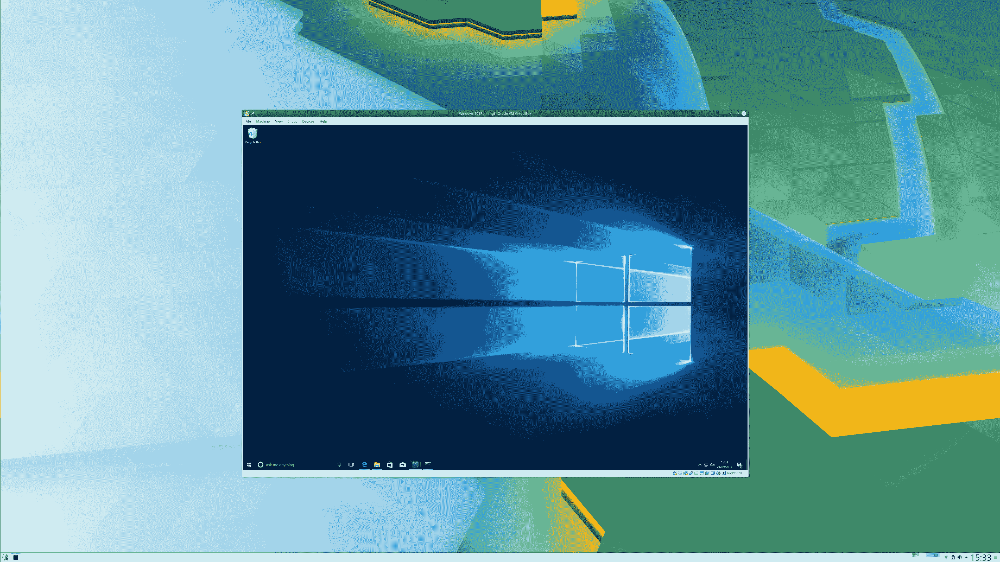

类似 `VirtualBox` 的软件允许你在另一个操作系统内部运行一个操作系统。对于测试 Internet Explorer 8，你可以在虚拟机中运行 `Windows 7`。然而，就我们运行 `PHP` 脚本的目的而言，这让我们可以做一些更酷的事情：我们可以在 `Windows` 或 `macOS` PC 上运行安装了 `PHP`、`Apache` 和 `MySQL` 的 `Linux` Web 服务器。

这可以让你在完全相同的操作系统上运行与你的网络主机上使用的完全相同的 `PHP`、`MySQL` 和 `Apache` 版本，从而防止因版本差异或所使用操作系统的差异而可能存在的问题。

最大的优势之一是你可下载预配置的虚拟机，例如 Microsoft 提供的 `Windows XP` 和 Internet Explorer 8 虚拟机，或安装并配置好 `PHP`、`Apache` 和 `MySQL` 以协同工作的虚拟机。这就像预配置的软件包，但它在 `Linux` 上运行，就像网络上的一台真正的 Web 服务器一样。

所有这些的缺点是你必须下载整个操作系统才能运行你的代码。这意味着更多的下载。它还意味着软件包被锁定在你下载的虚拟机所提供的范围内。将 `PHP 7` 换成 `PHP 8` 需要下载操作系统的全新副本。

## 服务器设置 4：Docker

`Docker` 采用了虚拟化的概念并将其颠倒过来。每个程序（在 `Docker` 的术语中称为“service”）都在其隔离的环境中运行，称为 **container**。

`Docker` 允许软件开发者提供一个配置文件，描述运行应用程序所需的所有程序——例如 `PHP`、`MySQL`、`Apache` 等。

该配置文件随后被视为其自身的应用程序。当你运行应用程序时，`Docker` 会自动下载并设置配置文件中列出的所有软件。

其开销比你想象的要低得多，并且有诸多好处：

* 服务器配置作为应用程序的一部分提供。当你将网站上线时，你可以连同网站一起上传所有配置文件。在传统模式下，你必须手动设置 Web 服务器并进行配置。

* 多个网站可以在你的开发机器上同时运行，具有不同的配置甚至不同的服务器软件（例如，一个网站使用 `Apache`，另一个使用 `NGINX`）。如果没有 `Docker`，通常只安装一个 `PHP` 版本，并将单一配置应用于机器上运行的每个网站。

* 你可以轻松替换软件。如果想将网站从 `PHP 7` 更改为 `PHP 8`，只需在一个文件中做一次更改，并且可以按网站进行操作，而不是一次性强制升级所有网站。

`Docker` 目前是设置 `PHP` 开发环境的最佳选择。如果你想了解更多关于使用 `Docker` 为自己设置开发环境的信息，请查看我的文章“[使用 Docker 设置现代 PHP 开发环境](https://www.sitepoint.com/docker-php-development-environment/)”。

## 开始使用

在编写任何 `PHP` 代码并开发你的网站之前，我们将使用 `Docker` 设置开发环境。我已为你提供了所有配置，但在开始之前，你需要安装 `Docker`。

### Windows 安装

首先，从 [Docker 官方网站](https://hub.docker.com/editions/community/docker-ce-desktop-windows/) 下载并安装适用于 `Windows` 的最新版 `Docker`。

安装完 `Docker`（如果要求则重启）后，在你的计算机上创建一个文件夹来存放你的网站。这可以是任何地方：你的 `Documents` 文件夹、桌面、外置硬盘等，但请确保你知道它在哪里，因为你需要经常返回此文件夹。

你还需要知道如何打开终端。`Windows 10` 使这变得简单。在文件资源管理器中打开该文件夹后，选择窗口左上角的 **File** 菜单，然后点击 **Open Windows PowerShell**。请确保从 **File** 菜单执行此操作，而不是从开始菜单，因为从 **File** 点击会将命令提示符打开在你选择的文件夹中。

打开 `PowerShell` 后，验证它显示的路径是否为你选择的文件夹——例如 `C:\Users\Tom\Documents\My Website`。然后前往下面的“使用 Docker 开始”部分。

在撰写本文时（2021 年 9 月），在 `Windows 11` 的当前预览版中，`PowerShell` 已更名为 `Windows Terminal`，并且访问方式不同：

1. 通过从开始菜单手动打开一次 `Windows Terminal` 应用程序来启用该选项。你只需打开并关闭程序即可。不可思议的是，Microsoft 设计了 `Windows 11`，以至于打开一个程序会打开另一个程序中的隐藏设置，如果跳过此步骤，第三步的菜单项就会缺失。

2. 使用 `File Explorer` 导航到你的文件夹。


3. 在主面板中右键单击（应显示“此文件夹为空”）并选择 `Open in Windows Terminal`。

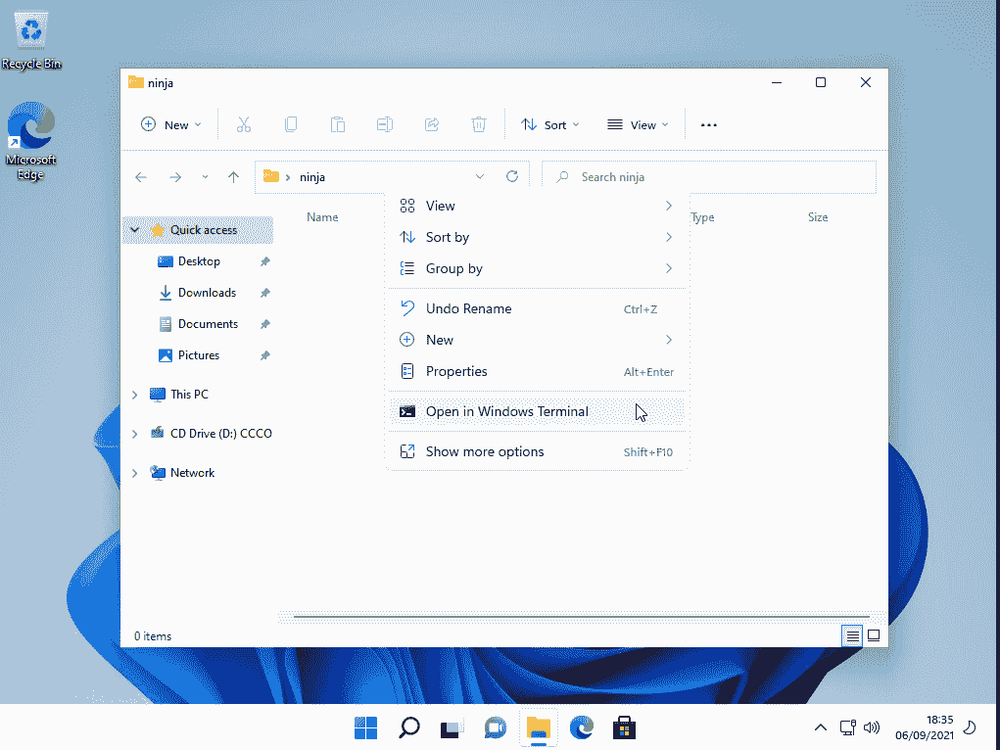

### Windows 11 注意事项
这些说明到 Windows 11 发布时以及本书出版后可能已经发生变化。

### 在 macOS 上安装
首先，从 [Docker 官网](https://hub.docker.com/editions/community/docker-ce-desktop-mac/) 下载并安装适用于 macOS 的 Docker。

安装 Docker 后（如果要求请重启），在计算机上创建一个目录用于存放你的网站。可以放在任何位置：你的 `Documents` 目录、桌面、外置硬盘等等，但请确保你知道其位置，因为你需要经常返回此文件夹。

如果你熟悉使用终端在计算机上导航，可以跳过此步骤，但为了方便，我建议启用一个功能，让你可以在当前目录中打开终端。可以通过以下步骤开启：
1. 打开“系统偏好设置”
2. 进入“键盘”
3. 选择“快捷键”标签
4. 点击“服务”按钮
5. 勾选“在文件夹中新建终端”复选框

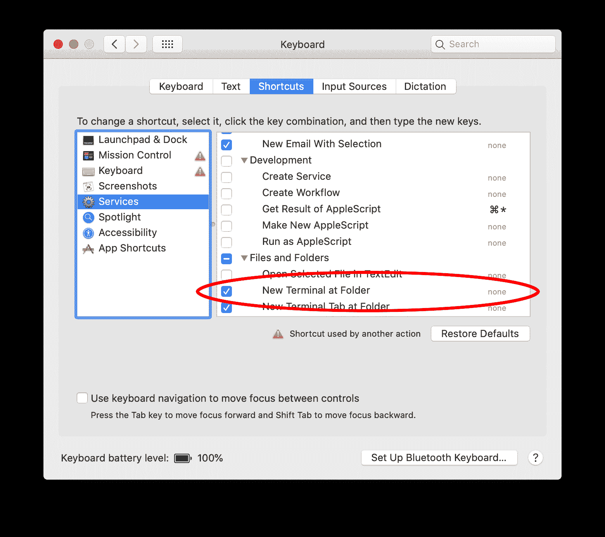

启用后：
1. 从 `Applications` 文件夹打开 Docker 应用并接受条款
2. 返回 Finder
3. 导航到你想存放网站的目录
4. 在目录名称上右键单击（或 `control` 单击），从上下文菜单中选择“服务”选项，然后选择 `New Terminal At Folder`

在此终端打开的情况下，你可以继续进行下面的“开始使用 Docker”部分。

从现在开始，每次想要启动或停止服务器时，只需重复最后几步即可。

### 在 Linux 上安装
Linux 通常使安装软件变得非常简单，而且 Docker 本身就是为 Linux 设计的程序。在大多数发行版中，可以通过包管理器安装，但你可能需要设置自定义包仓库。

对于基于 Debian 的发行版（Debian、Ubuntu、Mint 和 KDE Neon）以及基于 RedHat 的发行版（RedHat、CentOS、Fedora），有一个安装脚本可以设置自定义仓库并安装 Docker：
```
curl -fsSL https://get.docker.com -o get-docker.sh
sudo sh get-docker.sh
```

有关你发行版的具体说明，请查看 [Docker 手册](https://docs.docker.com/engine/install/)。

安装 Docker 后，你需要使用以下命令启用并启动服务：
```
sudo systemctl enable docker
sudo systemctl start docker
```

最后，你可以将自己添加到 `docker` 组，这样就不需要通过 `sudo` 运行 Docker 应用程序了：
```
sudo usermod -aG docker ${USER}
```

更改用户组需要注销并重新登录，因此请注销并重新登录（记得保存所有打开的内容！），重新登录后即可打开终端。

重新登录后，在计算机上创建一个目录用于存放你的网站。可以放在任何位置：你的 `Home` 目录、桌面、外置硬盘等等，但请确保你知道其位置，因为你需要经常返回此文件夹。

在文件管理器中打开文件夹并选择 `Open Terminal` 选项。在 Dolphin 文件管理器中，你可以右键单击并选择 `Open Terminal`，但此选项的位置可能不同，具体名称也可能因使用的文件管理器而异。

## 开始使用 Docker
现在你已经安装了所有软件，并且终端已在正确的位置打开，是时候运行一些 Docker 命令了。

虽然你可以手动设置环境并自行配置一切，但这需要与编程不同的技能集，超出了本书范围。我提供了基于 [我之前链接的文章](https://www.sitepoint.com/docker-php-development-environment/) 的一些配置。

首先，使用以下命令复制配置：
```
docker run --rm -v ${PWD}:/install vjedev/installer:latest
```

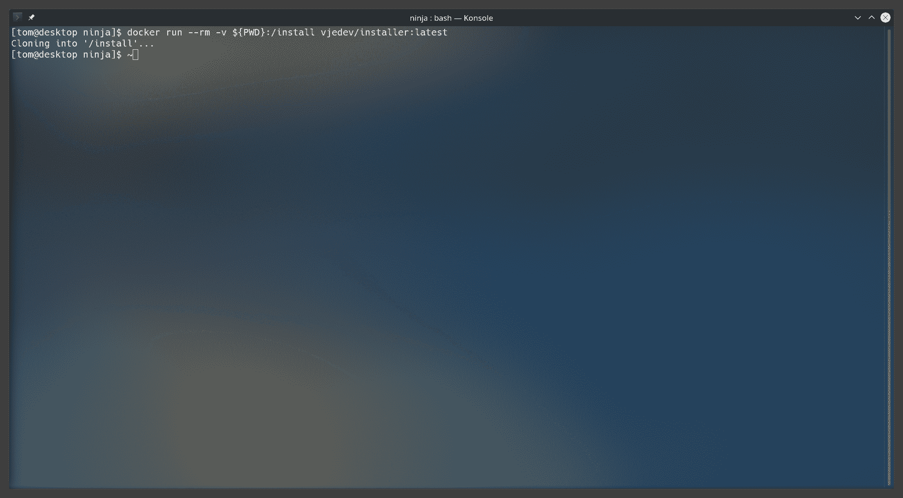

此命令从 GitHub 仓库下载一些配置文件并将其复制到当前文件夹。目录必须为空才能工作，因此请确保你要运行此命令的目录中没有任何文件或子目录。

### GitHub 和仓库
GitHub 是一个被大量开源项目使用的源代码托管平台。仓库是给单个项目起的名字。在本例中，代码是从 [github.com/v-je/docker](https://github.com/v-je/docker) 下载的。

### 使用 Git
如果你已安装 Git，可以在此处直接运行以下命令：
```
git clone https://github.com/v-je/docker .
```

然而，与其要求本书的每位读者为一条命令安装 Git，我创建了一个安装脚本来为你完成此操作。

你只需第一次执行此操作，命令完成后你会在目录中看到一些配置文件出现。随意查看创建的文件。其中有 `nginx.conf`，用于配置 Web 服务器；`PHP.Dockerfile`，用于配置 PHP 扩展；以及 `docker-compose.yml`，列出了启动服务器时将安装并运行的所有程序（NGINX、MySQL、PHP 等）。

不必担心试图理解这些文件。你无需对它们做任何操作，因为它们只是用于在运行下一个命令时配置服务器。

### Apache 和 NGINX
在继续之前，值得一提的是，我们刚刚设置的環境使用的是 NGINX 而不是 Apache。如果你使用过 XAMPP 或类似的软件包，你使用的 Web 服务器是 Apache。Web 服务器是服务器中监听来自 Web 浏览器的请求并发送文件的部分。

Apache 没问题，而且能工作，但它已经存在很久了。Apache 创建时，Web 是完全不同的样子。Apache 体积庞大，经历了许多功能的兴衰——但 Apache 仍然支持这些功能。自 Apache 创建以来，Web 发生了很大变化，虽然 Apache 是一个功能强大的服务器并且能正常工作，但如今大多数网站倾向于使用 NGINX。它更易于配置、更轻量级，并且针对许多现代网站使用的任务（如视频流）进行了更好的优化；因此，[其市场份额正在迅速增长，挤占了 Apache 的份额](https://news.netcraft.com/archives/category/web-server-survey/)。

我的一般建议是：如果你的网站已经在运行 Apache，就没有必要费力去更改它，但如果你从头开始一个新项目，请使用 NGINX。

现在你已经下载了服务器配置文件，是时候让 Docker 下载并运行服务器所需的所有程序了。运行以下命令：
```
docker compose up
```

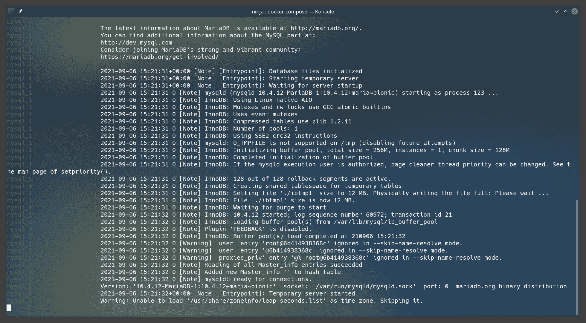

### Compose 说明
出于一些无聊的技术原因，这里不展开讨论，`docker compose` 命令过去是一个名为 `docker-compose` 的独立程序。此功能现已移入 Docker 本身。然而，如果你使用的是较旧的 Linux 发行版，或运行的是较旧版本的 Docker Desktop，你可能需要在所有 `docker compose` 命令中将 `docker compose` 替换为 `docker-compose`。仅对 `compose` 进行此替换。其他命令如 `docker run` 应保留空格。

运行 `docker compose up` 时，你可能会收到以下错误：
```
docker: 'compose' is not a docker command.
```

如果是这样，你需要将命令替换为 `docker-compose up`，并且如果在 Linux 上，你可能还需要使用包管理器安装单独的 `docker-compose` 包。


The `docker compose` command loads `docker-compose.yml`, then downloads and installs all the software listed as *服务*. The main things we’re interested in for now are PHP, NGINX, and MariaDB.

首次运行此命令时需要几分钟，因为它必须下载所有必需的软件。别担心，这只会在第一次发生。一旦软件下载并安装完成，今后启动服务器将显著更容易。

与直接在 PC 上手动安装 NGINX/PHP/MySQL 不同，服务器仅在您想要时才启动，通过运行 `docker compose up`。您可以通过返回终端并按 `Ctrl` + `C` 随时停止服务器。

另外，您也可以使用以下命令在后台启动服务器：

```
docker compose up -d
```

您可以通过在终端中运行 `docker compose down` 来停止服务器。（您必须在正确的目录中打开终端以启动和停止服务器！）

每次您想要处理网站时，都可以使用相同流程启动和停止服务器：

1. 导航到创建的文件夹
2. 如之前一样打开您的终端/Windows PowerShell
3. 运行 `docker compose up -d`

完成后，您可以使用相同流程停止服务器：

1. 导航到创建的文件夹
2. 如之前一样打开您的终端/Windows PowerShell
3. 运行 `docker compose down`

如果您已在后台保持终端打开，只需打开窗口并运行步骤 3 即可。

## 上下起伏

命令 `docker compose down` 会停止正在运行的服务并将其删除，从而释放磁盘空间。它还强制每次都重新创建它们。

您也可以使用 `docker compose stop` 和 `docker compose start` 来停止和启动服务器。但这些依赖于容器、网络以及 Docker 在幕后创建的其他事物在执行之间得以保留。系统还原、将文件在计算机之间移动，甚至运行您为其他任务使用的其他 Docker 命令（请注意 `docker prune`！）都可能将其删除。

使用 `up` 和 `down` 将采用空白 slate 方法并保持一致的可靠性。然而，它确实需要在不使用时删除，使用时重新创建。别担心：您在创建的目录中的所有 PHP、JavaScript 和 CSS 文件都不会被删除！

## 连接到服务器并创建您的第一个文件

现在服务器正在运行，您可以使用喜欢的网页浏览器连接到它。服务器就像在互联网上的某个地方运行的真实 Web 服务器。您可以通过打开浏览器，在地址栏输入 `v.je` 并按 `enter` 来连接它。

您应该会看到如下图所示的测试页面。

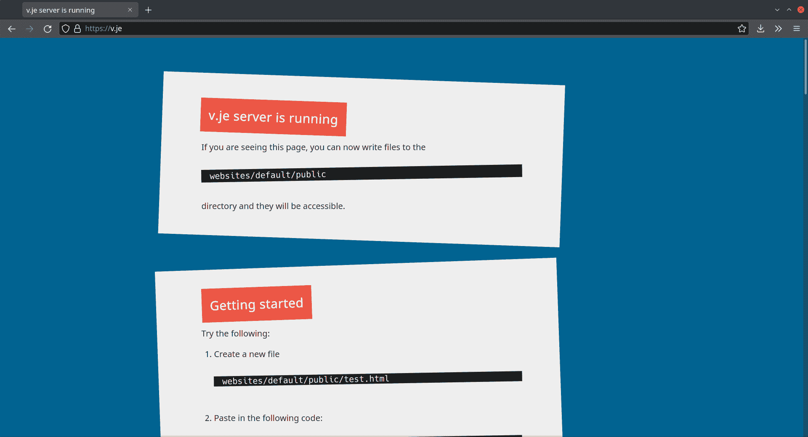

服务器运行时，是时候创建您的第一个文件了。当您运行 `docker-compose up` 命令时，名为 `websites` 的文件夹会在运行命令的目录中自动创建。`websites/default/public` 文件夹中的文件就是上图截图中测试页面所使用的文件。

使用您喜欢的文本编辑器，在 `websites/default/public` 目录中创建一个名为 `test.html` 的文件，其中包含以下代码：

```
<!DOCTYPE html>
<html>
    <body>
        <h1>Hello World!</h1>
    </body>
</html>
```

您现在可以在服务器上查看网页。默认情况下（我们稍后会看到这可以被覆盖），URL 直接映射到文件。放在 `public` 目录中的名为 `test.html` 的文件可以通过 `https://v.je/test.html` 访问，`public/products.html` 可以在 `https://v.je/products.html` 查看，文件甚至可以放在子目录中。例如，`public/Images/logo.png` 可以在 URL `https://v.je/Images/logo.png` 查看。

### 文件夹层级

您可能会想知道为什么有三个文件夹层级——`websites`、`default` 和 `public`——而不是直接拥有包含文件的 `public` 目录。

环境配置为从创建的 `websites` 目录内的不同文件夹托管多个网站。要创建可在 `https://mysite.v.je/` 访问的新网站，请执行以下步骤：

1. 在 `websites` 目录内创建 `mysite` 目录。
2. 在 `mysite` 目录内创建 `public` 目录。
3. 将可通过 Web 访问的文件放在 `websites/mysite/public` 目录中。例如，`websites/mysite/public/phpinfo.php` 中的文件将可在 URL `https://mysite.v.je/phpinfo.php` 访问。

`websites` 目录内创建的任何目录都被视为 `v.je` 的子域。如果未指定子域且您只是访问 `v.je`，它将从 `default` 目录加载网站。

正如我们在书中稍后会看到的，出于安全考虑，将某些文件保留在 `public` 目录之外是良好的实践，这就是每个网站都有一个 `public` 目录的原因。

### 文本编辑器

您操作系统提供的文本编辑器——例如 Notepad 或 TextEdit——并不真正适合编辑 HTML 和 PHP 脚本。然而，有几款功能强大的文本编辑器提供丰富的 PHP 脚本编辑支持，您可以免费下载。以下是适用于 Windows、macOS 和 Linux 的几个示例：

* [Visual Studio Code](https://code.visualstudio.com/) ([入门指南](https://visualstudio.microsoft.com/vs/getting-started/))
* [Atom](http://atom.io/) ([入门指南](https://flight-manual.atom.io/getting-started/))
* [Sublime Text](http://www.sublimetext.com/) ([文档](http://www.sublimetext.com/docs/))

它们都非常相似，对于本书的目的而言，其中任何一个都是不错的选择，并且会让您作为开发者的生活比使用 Notepad 或 TextEdit 简单得多。

## 我们已全部设置完成

在本章中，您学习了如何使用 Docker 设置 Web 服务器，以及如何在服务器上托管 HTML 文件。我只涵盖了基础知识，以便快速进入本书的核心：实际使用 PHP 编程。然而，作为 PHP 开发人员拥有良好的开发工作流程本身就是一项技能。就我们的目的而言，服务器已启动并运行，您已准备好编写第一个 PHP 脚本。

# 第 2 章：介绍 PHP

现在您的服务器已启动并运行，是时候编写第一个 PHP 脚本了。PHP 是一种服务器端语言。这个概念可能有点难以理解，尤其是如果您只使用 HTML、CSS 和 JavaScript 等客户端语言设计过网站的话。

服务器端语言与 JavaScript 相似，因为它允许您将动态生成的内容嵌入到网页的 HTML 代码中，从而比仅使用 HTML 提供更大的控制权，控制浏览器窗口中显示的内容。JavaScript 和 PHP 之间的关键区别在于代码运行的阶段。

像 JavaScript 这样的客户端语言是在从 Web 服务器下载网页（包括嵌入的程序）后由 Web 浏览器读取和执行的。相比之下，像 PHP 这样的服务器端语言是由 web *服务器* 运行的，在网页发送到浏览器之前。客户端语言让您控制页面在浏览器中显示后如何行为，而服务器端语言则让您在页面甚至发送到浏览器之前即时生成自定义页面。

一旦 Web 服务器执行了嵌入在网页中的 PHP 代码，结果就会取代页面中的 PHP 代码。浏览器接收页面时看到的全部是标准 HTML 代码。这就是 PHP 被称为“服务器端语言”的原因：它的工作在服务器上完成。

## 服务器上的 JavaScript


## 引言

在 Web 的早期——以及本书第一版出版时！——JavaScript 是一种主要在浏览器中使用的客户端脚本语言。随后出现了 Ajax 等技术，使得 JavaScript 能够与服务器通信。而更近些年，JavaScript 已被用于浏览器和服务器两端来创建数据库驱动的应用程序。虽然 JavaScript 的这些新用途提供了令人兴奋的可能性，但 PHP 仍然大有可为——本书正是要证明这一点！

## PHP 标签和文件要求

PHP 代码是用 PHP 标签编写的。与大多数 HTML 标签一样，PHP 有开始标签和结束标签：`<?php` 和 `?>` 分别。位于这些 PHP 标签内的任何内容都被视为 PHP 代码并在 *服务器* 上运行。

PHP 代码必须放在扩展名为 `.php` 的文件中。当有人连接到服务器并要求它加载扩展名为 `.php` 的文件时，服务器就会将其作为 PHP 脚本运行。如果你把 PHP 标签放在扩展名为 `.html` 或除 `.php` 之外的任何扩展名的文件中，Web 服务器不会运行任何 PHP 代码，而 PHP 代码将被直接发送到浏览器——浏览器并不理解 PHP 代码！

让我们看一下 PHP 脚本。

### 示例：PHP 随机数字

**示例：[PHP-随机数字](https://github.com/spbooks/phpmysql7/tree/PHP-RandomNumber)**

```
<!DOCTYPE html>
<html lang="en">
  <head>
    <meta charset="utf-8">
    <title>Random Number</title>
  </head>
  <body>
    <p>Generating a random number between 1 and 10:
      <?php
      echo rand(1, 10);
      ?>
    </p>
  </body>
</html>
```

要运行此代码，将其保存为 `random.php` 到 `public` 目录并导航到 `https://v.je/random.php`。

其中大部分是纯 HTML。只有 `<?php` 和 `?>` 之间的那一行是 PHP 代码。`<?php` 标记嵌入式 PHP 脚本的开始，`?>` 标记其结束。Web 服务器会被要求解释这两个分隔符之间的所有内容，并在将其发送到请求浏览器之前将其转换为常规 HTML 代码。如果你右键单击浏览器内部并选择 `View Source`（标签可能因你使用的浏览器而不同），你可以看到浏览器呈现的内容类似于这样：

```
<!DOCTYPE html>
<html lang="en">
  <head>
    <meta charset="utf-8">
    <title>Random Number</title>
  </head>
  <body>
    <p>Generating a random number between 1 and 10:
      5
    </p>
  </body>
</html>
```

服务器上没有包含此确切代码的 HTML 文件。此 HTML 是在发送到浏览器之前在服务器上动态生成的。

尝试运行脚本几次，注意数字如何变化。PHP 代码已被用来生成一个随机数，但在浏览器中查看源代码时，PHP 代码的任何痕迹都已消失。取而代之的是脚本的输出，它看起来就像标准的 HTML。此示例展示了服务器端脚本的几个优势：

## 服务器端脚本的优势

*   **安全性**。在上面的示例中，我们将由 Web 服务器生成的随机数放入网页中。如果我们使用 JavaScript 插入该数字，数字将在浏览器中生成，有人可能会修改代码以插入特定数字。
*   **无浏览器兼容性问题**。PHP 脚本仅由 Web 服务器解释，因此无需担心你使用的语言特性是否受访问者浏览器支持。
*   **访问服务器端资源**。服务器上的代码可以做任何事情；它不受浏览器功能的限制。生成的 HTML 可以来自数据库或 Excel 文件，也可以是计算结果，例如用户购物车的总价。
*   **减轻客户端负载**。JavaScript 会显著延迟网页的显示（尤其是在移动设备上！），因为浏览器必须先下载然后运行脚本才能显示网页。有了服务器端代码，这一负担就转移到了 Web 服务器，你可以让其强大到足以满足应用程序的需求（以及你的钱包承受得起）。
*   **选择**。编写在浏览器中运行的代码时，浏览器必须理解如何运行提供给它的代码。所有现代浏览器都理解 HTML、CSS 和 JavaScript。要编写在浏览器中运行的代码，你必须使用这些语言之一。通过运行在服务器上生成 HTML 的代码，你可以选择多种语言——其中之一就是 PHP。

## 基本语法和语句

对于了解 JavaScript、C、C++、C#、Objective-C、Java、Perl 或任何其他 C 派生语言的人来说，PHP 语法会非常熟悉。但如果你不熟悉这些语言，或对编程总体上是新手，也无需担心。

PHP 脚本由一系列命令或 **语句** 组成。每个语句都是 Web 服务器在继续执行下一条指令之前必须遵循的指令。PHP 语句与上述语言中的语句一样，始终以分号 (`;`) 终止。

这是一个典型的 PHP 语句：

```
echo 'This is a <strong>test</strong>!';
```

这是一个 `echo` 语句，用于生成内容（通常是 HTML 代码）发送到浏览器。`echo` 语句只是简单地取出它所给定的文本并将其插入到页面 HTML 代码中 PHP 脚本所在的位置。

在这种情况下，我们提供了一段要输出的文本：`This is a <strong>test</strong>!`。请注意，文本字符串包含 HTML 标签（`<strong>`和 `</strong>`），这是完全可以接受的。

因此，如果我们将此语句放入一个完整的网页中，这里是 resulting 代码。

**示例：[PHP-回显](https://github.com/spbooks/phpmysql7/tree/PHP-Echo)**

```
<!DOCTYPE html>
<html lang="en">
  <head>
    <meta charset="utf-8">
    <title>Test page</title>
  </head>
  <body>
    <p><?php echo 'This is a <strong>test</strong>!'; ?></p>
  </body>
</html>
```

如果你将此文件放在 Web 服务器上然后使用 Web 浏览器请求它，你的浏览器将收到以下 HTML 代码：

```
<!DOCTYPE html>
<html lang="en">
  <head>
    <meta charset="utf-8">
    <title>Test page</title>
  </head>
  <body>
    <p>This is a <strong>test</strong>!</p>
  </body>
</html>
```

我们之前查看的 `random.php` 示例包含一个稍微复杂一些的 `echo` 语句：

```
echo rand(1, 10);
```

你会注意到，在第一个示例中，PHP 被赋予了一些要直接打印的文本，而在第二个示例中，PHP 被赋予了一条要遵循的指令。PHP 会尝试将引号之外存在的任何内容读取为必须遵循的指令。引号内的任何内容都被视为文本——或者用技术术语来说，是一个 **字符串**。PHP 不会将字符串作为要遵循的命令来处理。它们在应用程序中被视为 *数据*。你可以对它们做一些事情，例如将它们发送到浏览器，但 PHP 不会将一个字符串与另一个字符串区别对待。

因此，以下代码会将字符串 `This is a <strong>test</strong>!` 直接传递给 `echo` 命令：

```
echo 'This is a <strong>test</strong>!';
```

字符串使用开始引号和结束引号表示。PHP 会将第一个 `'` 看作字符串的开始，并找到下一个 `'` 并将其用作字符串的结束。

引号外的任何内容都被视为要运行的一系列命令。以下不是有效代码：

```
echo This is a <strong>test</strong>!;
```

由于引号被删除，PHP 首先会尝试运行命令 `This`，然后是命令 `is`，接着是命令 `a`，依此类推。由于这些都不是 PHP 中的有效命令，以上代码会产生错误消息。如果你想将某物视为文本，请记住给它加上引号！

相比之下，以下代码将运行一个有效命令——内置的“函数” `rand`——生成一个随机数，然后将结果传递给 `echo` 命令：

```
echo rand(1, 10);
```


一个 **函数** 是一种执行特定任务的特殊类型的命令。在幕后，PHP 会进行一些处理然后生成结果。在这种情况下，`rand` 函数会产生一个随机数，但不同的函数执行不同的任务。

你可以快速判断某物是否为 *函数*，因为它后面跟着括号。PHP 有许多内置函数，可以让你做各种事情，例如发送电子邮件以及处理存储在各种类型数据库中的信息。

PHP 不会尝试运行字符串内部的任何内容。以下代码不会处理 `rand` 函数：

```
echo 'rand(1, 10)';
```

PHP 会将 `'rand(1, 10)'` 看作一个字符串，并将文本 `rand(1, 10)` 发送到浏览器，这可能不是你想要做的。理解字符串和 *代码* 之间的区别很重要。PHP 会将引号外的任何文本视为应遵循的一系列命令。引号内的任何内容都是字符串，是 PHP 将处理的数据 *数据*。

PHP 不会尝试理解字符串。它们可以包含任意顺序的任何字符。但代码（引号内外的任何内容）——本质上是一系列 *指令* ——必须遵循严格的结构才能被计算机理解。

## 代码编辑器和语法高亮

使用带语法高亮的代码编辑器可以轻松快速地判断某物是字符串还是代码。字符串的颜色与需要处理的代码不同。

下图显示了 Visual Studio Code 编辑器中的简单代码高亮。

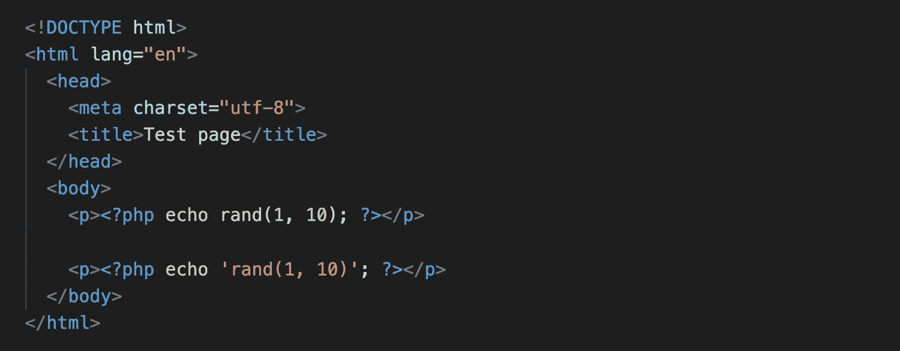

PHP 支持使用单引号 (`'`) 和双引号 (`"`) 来包围字符串。对于大多数用途来说，它们是可以互换的。PHP 开发者倾向于使用单引号，因为我们经常处理 HTML 代码，而 HTML 代码往往包含大量双引号。例如：

```
echo '<a href="http://www.sitepoint.com">Click here</a>';
```

如果在此处两端都使用双引号，我们需要通过在它前面放置一个 `\` 来告诉 PHP `href=` 后的引号不是字符串的结束（称为 **转义字符**），并对我们实际希望作为 HTML 部分发送到浏览器的任何双引号做同样的处理：

```
echo "<a href=\"http://www.sitepoint.com\">Click here</a>";
```

因此，PHP 开发者使用单引号，尽管单引号和双引号之间存在一些差异。但就我们此处的用途而言，它们本质上是可以互换的。

函数可以被视为程序内部的微型程序。你可以通过使用其名称（例如我们之前示例中的 `rand`）后跟括号来指示 PHP 运行函数。指令 `rand(1, 10)` 告诉 PHP 运行名为 `rand` 的函数。运行函数也更常被称为 **调用** 一个函数。

大多数 PHP 函数在被调用时会返回一个值。一旦值返回，PHP 的行为就好像你实际上只是将该返回值直接输入到代码中一样。在 `echo rand(1, 10);` 示例中，我们的 `echo` 语句包含对 `rand` 函数的调用，该函数返回一个随机数作为文本字符串。然后 `echo` 语句输出函数调用返回的值。

每个 PHP 函数都可以有一个或多个 **参数**，让你以略微不同的方式使函数行为发生变化。`rand` 函数接受两个参数：最小和最大随机数。通过更改传递给函数的值，你可以改变其工作方式。例如，如果你想要 1 到 50 之间的随机数，可以使用以下代码：

```
echo rand(1, 50);
```

我们用括号包围参数 (`(1, 50)`) 有两个原因。首先，它们表示 `rand` 是一个你想要调用的函数。其次，它们标记参数列表的开始和结束——你希望提供的 PHP 语句——以便告诉函数你想要它做什么。在 `rand` 函数的情况下，你需要提供最小值和最大值。这些值由逗号分隔。

稍后，我们将研究接受不同类型参数的函数。我们还将考虑完全不接受参数的函数。这些函数仍然需要括号，即使括号之间什么也不输入。

## 变量、运算符和注释

### 变量

PHP 中的变量与大多数其他编程语言中的变量相同。对于初学者来说，**变量** 可以被视为赋予一个想象中的盒子的名称，任何值都可以放入其中。以下语句创建一个名为 `$testVariable` 的变量（PHP 中所有变量名都以美元符号开头）并将其赋值为 `3`：

```
$testVariable = 3;
```

PHP 是一种 **松散类型** 语言。这意味着单个变量可能包含任何类型的数据——无论是数字、文本字符串还是其他类型的值——并且在其生命周期中可以存储不同类型的值。如果你随后输入以下语句，它将为现有的 `$testVariable` 分配一个新值。虽然 `$testVariable` 变量以前包含一个数字，但现在它包含一个文本字符串：

```
$testVariable = 'Three';
```

一旦你在变量中存储了数据，你就可以使用之前的 `echo` 命令将其发送到浏览器：

```
$testVariable = 3;
echo $testVariable;
```

当此代码运行时，数字“3”将被发送到浏览器以在页面上显示。

除了特定的字符串或数字之外，还可以将函数的结果存储起来，然后在脚本后面使用：

```
$randomNumber = rand(1, 10);
echo $randomNumber;
```

### 运算符

我们在最后两个语句中使用的等号称为 **赋值运算符**，因为它用于为变量赋值。（在 PHP 中表示“等于”实际上有不同的方法，如下所述。）其他运算符可用于对值执行各种数学运算：

```
$testVariable = 1 + 1;  // assigns a value of 2
$testVariable = 1 - 1;  // assigns a value of 0
$testVariable = 2 * 2;  // assigns a value of 4
$testVariable = 2 / 2;  // assigns a value of 1
```

从这些示例中，你可能可以看出 `+` 是 **加法运算符**，`-` 是 **减法运算符**，`*` 是 **乘法运算符**，而 `/` 是 **除法运算符**。这些都称为 **算术运算符**，因为它们对数字执行算术运算。

#### 注释

上面的每个算术行在分号后都以“注释”结尾。**注释** 使你能够描述代码正在做什么。它们在代码中插入解释性文本——PHP 解释器会忽略的文本。

单行注释以 `//` 开始。单行注释可以单独成行，也可以像上面的示例那样放在代码行的末尾。

如果你希望注释跨越多行，请以 `/*` 开始，以 `*/` 结束。PHP 解释器会忽略这两个分隔符之间的所有内容。我将在本书的其余部分使用注释来帮助解释我展示的一些代码。

将文本字符串粘合在一起的运算符称为 **字符串连接运算符**：

```
$testVariable = 'Hi ' . 'there!';  // Assigns a value of 'Hi there!'
```

变量几乎可以在你使用值的地方使用。考虑以下一系列语句：


```
$var1 = 'PHP';          // assigns a value of 'PHP' to $var1
$var2 = 5;              // assigns a value of 5 to $var2
$var3 = $var2 + 1;      // assigns a value of 6 to $var3
$var2 = $var1;          // assigns a value of 'PHP' to $var2
$var4 = rand(1, 12);    // assigns a value to $var4 using the rand() function
echo $var1;             // outputs 'PHP'
echo $var2;             // outputs 'PHP'
echo $var3;             // outputs '6'
echo $var4;             // outputs the random number generated above
echo $var1 . ' rules!'; // outputs 'PHP rules!'
echo '$var1 rules!';    // outputs '$var1 rules!'
echo "$var1 rules!"     // outputs 'PHP rules!'
```

请特别注意最后两行。如果将变量放在 *单* 引号内，它将打印名称而不是变量的内容。相反，使用双引号时，字符串中的变量会被替换为变量的内容。

将变量放在双引号内在简单情况下可行，但对于本书的大部分内容来说将无法使用，因为我们不会使用如此简单的代码。因此，养成使用连接的习惯是个好主意（在倒数第三行显示：`echo $var1 . ' rules!';`）。

## 控制结构

我们迄今为止看到的 PHP 代码示例要么是输出文本字符串到网页的单语句脚本，要么是一系列按顺序依次执行的语句。如果你曾用其他语言（如 JavaScript、Objective-C、Ruby 或 Python）编写过程序，你已经知道实际的程序很少如此简单。

PHP 就像任何其他编程语言一样，提供了影响控制流的设施。也就是说，语言包含特殊的语句，你可以用它们偏离迄今为止主导我们示例的逐个执行顺序。此类语句称为 **控制结构**。不明白？别担心！几个例子会完美地说明它。

### If 语句

最基本且最常用的控制结构是 `if` 语句。程序通过 `if` 语句的流程可以如下面所示进行可视化。

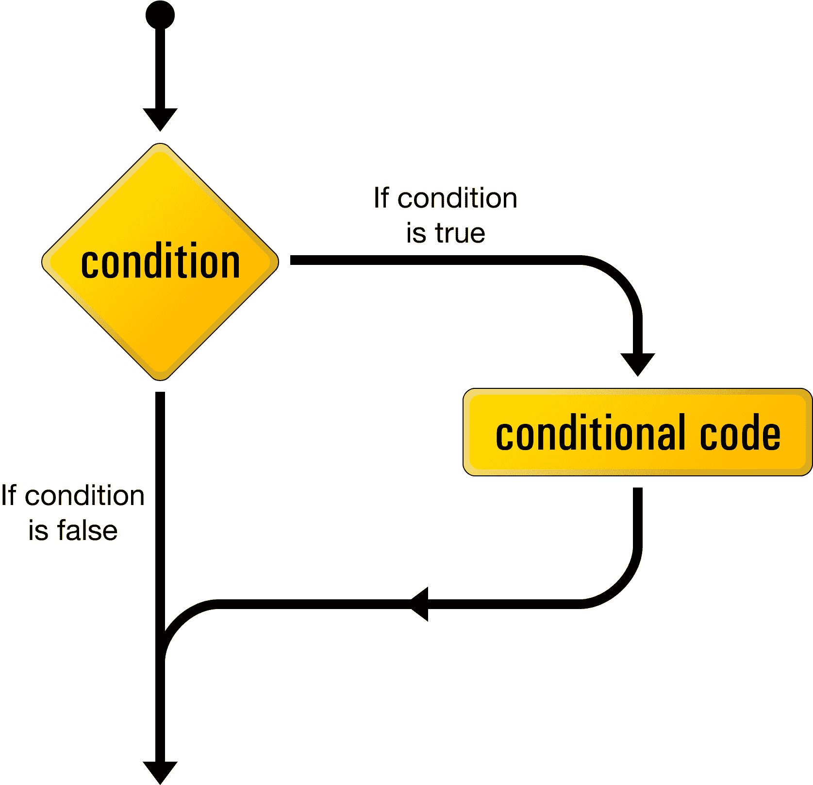

以下是 PHP 代码中 `if` 语句的写法：

```
if (condition) {
  ⋮ conditional code to be executed if condition is true
}
```

此控制结构让我们可以告诉 PHP 仅在满足某些条件时执行一组语句。

例如，我们可能想要创建一个模仿掷骰子的游戏，其中你必须掷出六点才能获胜。掷骰子可以使用我们之前使用的 `rand()` 函数来模拟，将最小值和最大值设为 1 到 6：

```
$roll = rand(1, 6);

echo 'You rolled a ' . $roll;
```

如果玩家掷出六点并获胜，则打印出消息，可以使用 `if` 语句。

**示例：[PHP-掷骰子](https://github.com/spbooks/phpmysql7/tree/PHP-DiceRoll)**

```
$roll = rand(1, 6);

echo 'You rolled a ' . $roll;

if ($roll == 6) {
  echo 'You win!';
}
```

条件中使用的 `==` 是 **等于运算符**，用于比较两个值是否相等。这与使用单个 `=` 完全不同，单个 `=` 用于 *赋值*，不能用于比较。

`if` 语句使用大括号（`{` 和 `}`）包围仅在条件满足时想要运行的代码。你可以在大括号之间放置任意多行代码；代码仅在条件满足时运行。放在闭合大括号（`}`）之后的任何代码都会始终运行：

```
$roll = rand(1, 6);

echo 'You rolled a ' . $roll;

if ($roll == 6) {
  echo 'You win!'; // This line will only be printed if you roll a 6
}

echo 'Thanks for playing'; // This line will always be printed
```

#### 赋值与相等

请记得输入双等号（`==`）。PHP 初学者常见的错误是用单个等号输入类似这样的条件：

```
if ($roll = 6)     // Missing equals sign!
```

此条件使用的是赋值运算符（`=`）而不是等于运算符（`==`）。因此，它不会比较 `$roll` 的值与数字 `6`，而是实际上 *设* 置 `$roll` 的值为 `6`。糟糕！

更糟糕的是，`if` 语句会将此赋值操作用作条件，并将其视为 true，因此 `if` 语句内的条件代码将始终执行，而不管 `$roll` 的原始值是什么。

如果将此保存为 `diceroll.php` 并运行代码，你会看到随机数被生成。如果一直运行直到获胜，你会在浏览器中看到以下内容：

```
You rolled a 6You win!Thanks for playing
```

这不太好看。但由于 PHP 输出 HTML，你可以添加一些段落标签来格式化输出。

**示例：[PHP-掷骰子-格式化](https://github.com/spbooks/phpmysql7/tree/PHP-DiceRoll-Formatted)**

```
$roll = rand(1, 6);

echo '<p>You rolled a ' . $roll . '</p>';

if ($roll == 6) {
  echo '<p>You win!</p>';
}

echo '<p>Thanks for playing</p>';
```

如果运行更新后的代码，你会看到它现在在浏览器中打印以下内容：

```
You rolled a 6

You win!

Thanks for playing
```

这更友好。为了让游戏本身更友好，你可能希望向没有掷出 6 且未获胜的人显示不同的消息。这可以通过 `else` 语句完成。`else` 语句必须跟在 `if` 之后，如果条件不满足则会运行。

**示例：[PHP-掷骰子-否则](https://github.com/spbooks/phpmysql7/tree/PHP-DiceRoll-Else)**

```
$roll = rand(1, 6);

echo '<p>You rolled a ' . $roll . '</p>';

if ($roll == 6) {
  echo '<p>You win!</p>';
}
else {
  echo '<p>Sorry, you didn\'t win. Better luck next time!</p>';
}

echo '<p>Thanks for playing</p>';
```

#### 一个幸运的转义

由于单词 `didn't` 包含单引号，因此需要进行 *转义*。通过在单引号前加上反斜杠（`\`），它告诉 PHP 不要将 `'` in `didn't` 视为字符串的结束。

使用 else 语句时，两个代码块中只有一个（且仅一个！）保证会运行。如果条件满足，则 `if` 块中的代码会运行；如果不满足，则 `else` 块中的代码会运行。

条件可以比单一相等检查更复杂。`if` 语句可以包含多个条件。例如，假设游戏被调整为 `5` 和 `6` 都是获胜数字。`if` 语句可以更改为以下内容。

**示例：[PHP-掷骰子-或](https://github.com/spbooks/phpmysql7/tree/PHP-DiceRoll-Or)**

```
if ($roll == 6 || $roll == 5) {
  echo '<p>You win!</p>';
}
else {
  echo '<p>Sorry, you didn\'t win. Better luck next time!</p>';
}
```

双竖线运算符（`||`）表示“或”。上面的条件现在在任一条件满足时即成立。可以读作“如果你掷出 6 或掷出 5”。

然而，这可以表达得更好。`if` 语句并不限于使用等于（`==`）运算符。它们也可以利用数学上的大于（`>`）和小于（`<`）运算符。上面的 `if` 语句也可以用单个表达式完成。

**示例：[PHP-掷骰子-大于](https://github.com/spbooks/phpmysql7/tree/PHP-DiceRoll-Greater)**

```
if ($roll > 4) {
  echo '<p>You win!</p>';
}
else {
  echo '<p>Sorry, you didn\'t win. Better luck next time!</p>';
}
```

条件 `$roll > 4` 将在存储在 `$roll` 变量中的值大于 `4` 时满足，使我们可以用单个条件将 5 和 6 作为获胜数字。如果我们想要 4、5 和 6 作为获胜数字，条件可以更改为 `$roll > 3`。

像“或”表达式（`||`）一样，还有一个“与”表达式，仅在两个条件都满足时才成立。我们可以扩展游戏以包含两个骰子，并要求玩家掷出两个六点才能获胜。


### 示例：[PHP 掷骰子-双骰子](https://github.com/spbooks/phpmysql7/tree/PHP-DiceRoll-TwoDice)

```
$roll1 = rand(1, 6);
$roll2 = rand(1, 6);

echo '<p>You rolled a ' . $roll1 . ' and a ' . $roll2 . '</p>';

if ($roll1 == 6 && $roll2 == 6) {
  echo '<p>You win!</p>';
}
else {
  echo '<p>Sorry, you didn\'t win. Better luck next time!</p>';
}

echo '<p>Thanks for playing</p>';
```

条件 `$roll1 == 6 && $roll2 == 6` 只有在 `$roll1 == 6` 为真 *和* `$roll2 == 6` 时才会被满足。这意味着玩家必须在两个骰子上都掷出 6 才能赢得游戏。如果我们将 and (`&&`) 改为 or (`||`)——即 `if ($roll1 == 6 || $roll2 == 6)`——玩家只要在任一骰子上掷出 6 就会获胜。

我们会在需要时查看更复杂的条件。目前，熟悉 `if … else` 语句就足够了。

### `and` 和 `or`

PHP 还允许使用 `or` 代替 `||`，使用 `and` 代替 `&&`。例如：

```
if ($roll == 6 or $roll == 5) { … }
```

`or` 和 `||` 的工作方式存在一些细微差异，这可能导致意外的行为。一般来说，避免使用“拼写出来”的运算符。坚持使用双竖线 (`||`) 和双与号 (`&&`) 有助于防止许多令人困惑的错误。

## 循环

另一种非常有用的控制结构是“循环”。**循环** 允许你一次又一次地重复相同的代码行。两种重要的循环是 `for` 循环和 `while` 循环。让我们看看它们是如何工作的。

### For 循环

`for` 循环用于在开始时就知道需要运行相同代码的次数。下面的图像显示了 `for` 循环的流程。

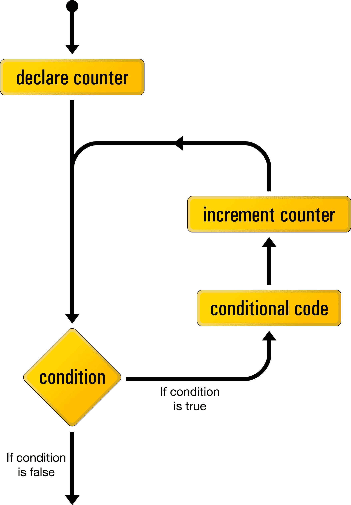

它在代码中看起来是这样的：

```
for (declare counter; condition; increment counter) {
  ⋮ statement(s) to execute repeatedly as long as condition is true
}
```

`declare counter` 语句在循环开始时执行一次。`condition` 语句在每次循环之前检查，然后执行循环体中的语句。`increment counter` 语句在每次循环体中的语句执行后执行。

要使用 `for` 循环数到十，可以使用以下代码：

```
for ($count = 1; $count <= 10; $count++) {
  echo $count . ' ';
}
```

这看起来很吓人，因为有很多内容，但让我为你分解一下：
*   `$count = 1;`. 你已经熟悉这段代码。它创建了一个名为 `$count` 的变量并将其值设为 `1`。
*   `$count <= 10;`. 这是条件。可以读作“只要 `$count` 小于或等于 10 就继续循环”。
*   `$count++`. 这表示“每次将计数器加 1”。它等同于 `$count = $count + 1`。
*   `echo $count . ' ';`. 这会打印计数器的值后跟一个空格。

此示例中的条件使用了 `<=` 运算符。它与小于运算符 (`<`) 类似，但如果比较的数字 *小于或等于* 第二个数字，则求值为真。其他可用的运算符包括 `>=`（大于或等于）和 `!=`（不等于）。

`for` 循环的三个部分组合起来产生完整的循环。乍一看，代码似乎有点难以阅读，但将控制循环的所有代码放在同一位置，一旦习惯了语法，反而更容易理解。本书中的许多示例都会使用 `for` 循环，因此你会有充足的机会练习阅读它们。

你可以更改 `for` 循环的每个部分以获得不同的结果。例如，让我们看看如何每次加 `3` 你可以更改 `for` 循环通过修改最后一部分。

循环的最后一部分 `$count++` 表示 *将 1 加到 `$count` 的值上*，并且它是 `$count = $count + 1` 的简写方式。

通过将 `$count++` 更改为 `$count = $count + 3`，`for` 循环可用于按三计数。

### 示例：[PHP-For](https://github.com/spbooks/phpmysql7/tree/PHP-For)

```
for ($count = 1; $count <= 10; $count = $count + 3) {
  echo $count . ' ';
}
```

这将产生以下结果：

```
1 4 7 10
```

`for` 循环可以与其他语句（如 `if` 语句）结合使用，以在每次迭代中执行特定任务。例如，与其每次刷新页面玩我们的骰子游戏，我们可能希望掷骰子十次并打印结果。

### 示例：[PHP 掷骰子-多次掷骰子](https://github.com/spbooks/phpmysql7/tree/PHP-DiceRoll-ManyDice)

```
for ($count = 1; $count <= 10; $count++) {
  $roll = rand(1, 6);
  echo '<p>You rolled a ' . $roll . '</p>';

  if ($roll == 6) {
    echo '<p>You win!</p>';
  }
  else {
    echo '<p>Sorry, you didn\'t win. Better luck next time!</p>';
  }
}

echo '<p>Thanks for playing</p>';
```

这让我们可以在不每次刷新页面的情况下掷骰子十次。使用循环在功能上等同于复制并粘贴代码十次，并且会产生与以下完全相同的结果：

```
$roll = rand(1, 6);
echo '<p>You rolled a ' . $roll . '</p>';

if ($roll == 6) {
  echo '<p>You win!</p>';
}
else {
  echo '<p>Sorry, you didn\'t win. Better luck next time!</p>';
}

$roll = rand(1, 6);
echo '<p>You rolled a ' . $roll . '</p>';

if ($roll == 6) {
  echo '<p>You win!</p>';
}
else {
  echo '<p>Sorry, you didn\'t win. Better luck next time!</p>';
}

$roll = rand(1, 6);
echo '<p>You rolled a ' . $roll . '</p>';

if ($roll == 6) {
  echo '<p>You win!</p>';
}
else {
  echo '<p>Sorry, you didn\'t win. Better luck next time!</p>';
}

// and so on …
```

计算机不在乎你使用哪种方法：你可以复制/粘贴或使用循环。它只会运行代码。然而，作为一名开发者，你很快就会意识到循环是更好的选择。如果想更新代码以允许 `5` 也作为获胜数字，你需要在十个不同的地方更新条件。使用循环，你可以在一个地方更改代码，它将影响循环的每次迭代。如果你发现自己在复制/粘贴代码，总有更好的方法来实现你想要做的事情。

### For 循环挑战

有了你对循环的新知识，你应该能够开始为自己编写代码。你能完成这些挑战吗？
*   **挑战 1**：打印 21 到 99 之间的所有奇数。
*   **挑战 2**：打印九的乘法表直到 12 x 9（`9 18 27` … 等），不要使用乘法运算符（`*`）或 `if` 语句。
*   **挑战 3**：以以下格式打印九的乘法表：

```
1x9 = 9
2x9 = 18
… etc.
```

这次，你需要使用乘法运算符！

### While 循环

另一种常用的 PHP 控制结构是 `while` 循环。`if … else` 语句允许我们根据某个条件选择是否执行一组语句，而 `while` 循环允许我们使用条件来确定重复执行一组语句的 *次* 数。

下图显示了 `while` 循环的工作方式。

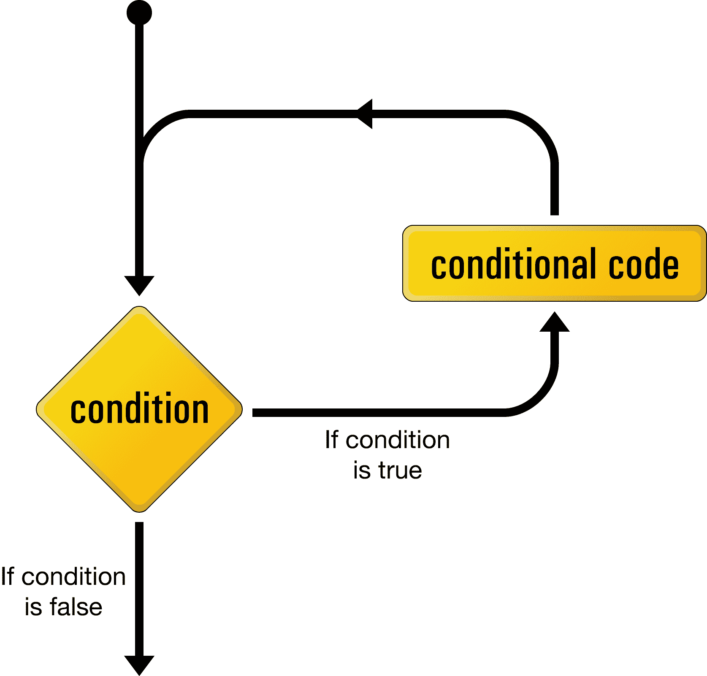

`while` 循环在代码中看起来是这样的：

```
while (condition) {
  ⋮ statement(s) to execute repeatedly as long as condition is true
}
```

`while` 循环的工作方式与 `if` 语句非常相似。不同之处在于当条件为真且执行语句时。与其继续执行闭合大括号 (`}`) 之后紧跟的语句，条件会被再次检查。如果条件仍然为真，语句将被第二次执行，第三次执行，并且只要条件保持为真就会继续执行。条件第一次求值为假时（无论是第一次检查还是第一百次），执行会立即跳转到 `while` 循环之后的大括号之后的语句。


你可以使用 `while` 循环来创建一个计数器，其结果与 `for` 循环类似。

**示例：[PHP-WhileCount](https://github.com/spbooks/phpmysql7/tree/PHP-WhileCount)**

```
$count = 1;
while ($count <= 10) {
  echo $count . ' ';
  ++$count;
}
```

这与 `for` 循环的工作方式完全相同，你会注意到很多相同的语句只是位置不同。这段代码看起来可能有点吓人，我知道，但让我逐行为你讲解：
*   `$count = 1;`. 第一行创建了一个名为 `$count` 的变量并将其值赋为 `1`。
*   `while ($count <= 10)`. 第二行是 `while` 循环的开始，其条件是 `$count` 的值小于或等于 (`<=`) 10。
*   `{`. 开括号标记了 `while` 循环条件代码块的开始。这段条件代码通常被称为循环的 **主体**，只要条件成立，就会一遍又一遍地执行。
*   `echo $count . ' ';`. 这行代码只是输出 `$count` 的值，后面跟着一个空格。
*   `++$count;`. 第四行将 `1` 加到 `$count` 的值上。`++$count` 是 `$count = $count + 1` 的简写。`$count++` 在这里也有效！`++` 的位置可能很重要，但在这种情况下无关紧要。如果 `++` 在变量名之前，计数器会在读取值之前递增。当 `$count` 为零时，代码 `echo ++$count;` 会打印 `1`，而 `echo $count++;` 会打印 `0`。使用 `++` 时要小心，将其放在错误的位置可能会导致错误。
*   `}`. 闭括号标记了 `while` 循环主体的结束。

下面是这段代码执行时发生的情况。第一次检查条件时，`$count` 的值为 `1`，因此条件肯定为真。`$count` 的值 `1` 被输出，并且 `$count` 被赋予新的值 `2`。第二次检查条件时条件仍然为真，因此值 `2` 被输出并分配新的值 `3`。此过程继续，输出值 `3`、`4`、`5`、`6`、`7`、`8`、`9` 和 `10`。最后，`$count` 被赋值为 `11`，条件被判定为假，从而结束循环。

代码的净结果如下图所示。

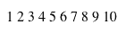

`while` 循环通常不用于这种简单的计数器；这通常是 `for` 循环的工作。虽然你可以用 `while` 循环创建计数器，但通常它们用于在某事发生之前保持运行代码。例如，我们可能想一直掷骰子直到掷出 6。在编写代码时无法知道需要多少次掷骰：可能一次就能掷出六点，也可能需要上百次。因此你可以将掷骰子放在 `while` 循环中。

**示例：[PHP-DiceRoll-While](https://github.com/spbooks/phpmysql7/tree/PHP-DiceRoll-While)**

```
$roll = 0;
while ($roll != 6) {
  $roll = rand(1, 6);
  echo '<p>You rolled a ' . $roll . '</p>';

  if ($roll == 6) {
    echo '<p>You win!</p>';
  }
  else {
    echo '<p>Sorry, you didn\'t win, better luck next time!</p>';
  }
}
```

这将一直掷骰子直到掷出 6。每次运行代码时，在获胜之前所需的掷骰次数都会不同。

`while` 语句使用条件 `$roll != 6`。为了使 `while` 循环第一次运行，`$roll` 变量必须为初始比较设置一个值。这就是 `while` 循环上方 `$roll = 0;` 行的目的。通过初始将值设为零，当 `while` 循环第一次运行时，条件 `$roll != 6` 成立，因为 `$roll` 等于零而不是 6，循环将开始。如果在开始循环之前未创建 `$roll` 变量，你会收到错误，因为 `$roll` 变量在使用前未被设置任何值。

`while` 循环有一个变体称为 `do … while`，在这种情况下很有用。它允许你在没有条件的情况下运行一些代码，然后如果代码未设置则再次运行。它采用以下结构：

```
do {
 statement(s) to execute and then repeat if the condition is true
}
while (condition);
```

对于上面的掷骰子示例，这允许你忽略第一行。

**示例：[PHP-DiceRoll-DoWhile](https://github.com/spbooks/phpmysql7/tree/PHP-DiceRoll-DoWhile)**

```
do {
  $roll = rand(1, 6);
  echo '<p>You rolled a ' . $roll . '</p>';

  if ($roll == 6) {
    echo '<p>You win!</p>';
  }
  else {
    echo '<p>Sorry, you didn\'t win, better luck next time!</p>';
  }
}
while ($roll != 6);
```

这次，因为条件在底部，到 `while` 语句运行时，`$roll` 变量已经被赋予了值，因此你不需要给它一个初始的零值来强制循环第一次运行。

### 编码风格

PHP 不在乎你如何格式化代码，并且会忽略空白。你可以像这样编写之前的示例：

```
do {
  $roll = rand(
  1,
  6);

  echo '<p>You rolled a ' . $roll . '</p>';

  if (
      $roll == 6
  ) 
  {
    echo '<p>You win!</p>';
  }
  else
  {
    echo '<p>Sorry, you didn\'t win, better luck next time!</p>';
  }
}
while ($roll != 6);
```

脚本将以完全相同的方式执行。不同的程序员有不同的首选风格，例如使用制表符或空格进行缩进，或将开括号放在语句同一行或其后。甚至还有 [编码风格指南](https://www.php-fig.org/psr/psr-12/) 规定大括号和方括号应放置的位置以及代码应如何格式化。但计算机并不关心大括号是在同一行还是下一行，所以使用你感觉最舒适的风格即可。

## 数组

一个 **array** 是一种包含多个值的特殊变量。如果你把变量想象成包含一个值的盒子，那么数组可以被想象成一个带隔间的盒子，其中每个隔间都能存储一个单独的值。

要在 PHP 中创建数组，请使用方括号（`[` 和 `]`）包含你想要存储的值，用逗号分隔：

```
$myArray = ['one', 2, '3'];
```

### `array` 关键字与方括号

PHP 中的数组也可以使用 `array` 关键字定义。以下代码等同于上面的方括号表示法：

```
$myArray = array('one', 2, 3);
```

方括号表示法是在 PHP 5.4 中引入的，并被 PHP 开发者所偏爱，因为它更少打字，并且在 `if` 语句和 `while` 循环等控制结构中的圆括号中，方括号更易于辨认。

这段代码创建了一个名为 `$myArray` 的数组，包含三个值：`'one'`、`2` 和 `'3'`。就像普通变量一样，数组中的每个空间可以包含任何类型的值。在这种情况下，第一和第三个空间包含字符串，而第二个包含数字。

要访问存储在数组中的值，你需要知道其 **index**。通常，数组使用数字作为索引来指向它们包含的值，从零开始。也就是说，数组的第一个值（或元素）的索引为 0，第二个为 1，第三个为 2，以此类推。因此，数组中第 n 个元素的索引为 n–1。一旦你知道感兴趣的值的索引，你就可以通过在数组变量名后放置该索引在方括号中来检索该值：

```
echo $myArray[0];    // outputs 'one'
echo $myArray[1];    // outputs '2'
echo $myArray[2];    // outputs '3'
```

存储在数组中的每个值称为一个 **element**。你可以使用方括号中的键来添加新元素，或为现有数组元素分配新值：

```
$myArray[1] = 'two';     // assign a new value
$myArray[3] = 'four';    // create a new element
```


You can also add elements to the end of an array using the assignment operator as usual, but leaving empty the square brackets that follow the variable name:

```
$myArray[] = 'five';
echo $myArray[4];    // outputs 'five'
```

Array elements can be used like any other variable, and in a lot of cases choosing to use an array or multiple variables will depend on the programmer’s preference. However, arrays can be used to solve problems that normal variables can’t!

Remember the dice game from the last section? It would be more user-friendly if it showed the English word rather than the numeral for the result. For example, instead of “You rolled a 3” or “You rolled a 6”, it might be nicer to read “You rolled a three” or “You rolled a six”.

To do this, we need some way of converting from a numeral to the English word for that number. This is possible with a series of `if` statements.

**示例：[PHP 骰子掷骰英文 If](https://github.com/spbooks/phpmysql7/tree/PHP-DiceRoll-English-If)**

```
$roll = rand(1, 6);

if ($roll == 1) {
  $english = 'one';
}
else if ($roll == 2) {
  $english = 'two';
}
else if ($roll == 3) {
  $english = 'three';
}
else if ($roll == 4) {
  $english = 'four';
}
else if ($roll == 5) {
  $english = 'five';
}
else if ($roll == 6) {
  $english = 'six';
}

echo '<p>You rolled a ' . $english . '</p>';

if ($roll == 6) {
  echo '<p>You win!</p>';
}
else {
  echo '<p>Sorry, you didn\'t win. Better luck next time!</p>';
}*
```

This solution works, but it’s very inefficient, as you need to write an `if` statement for each possible dice roll. Instead, you can use an array to store each roll value:

```
$english = [
  1 => 'one',
  2 => 'two',
  3 => 'three',
  4 => 'four',
  5 => 'five',
  6 => 'six'
];
```

The `=>` notation (known as a **双箭头运算符**) allows you to define both the keys and the values when creating the array. This is equivalent to the following:

```
$english = [];
$english[1] = 'one';
$english[2] = 'two';
$english[3] = 'three';
$english[4] = 'four';
$english[5] = 'five';
$english[6] = 'six';
```

Although these are equivalent, the code required to use the shorthand notation is a lot quicker to type, and is arguably easier to read and easier to understand.

Now that the array is created, it’s possible to read each English word from it:

```
echo $english[3];    // Prints "three"
echo $english[5];    // Prints "five"
```

In PHP, a number like `3` can be replaced with a variable that contains that value. This is also possible with array keys. For example:

```
$var1 = 3;
$var2 = 5;

echo $english[$var1];    // Prints "three"
echo $english[$var2];    // Prints "five"
```

Knowing this, we can piece it all together and adjust the dice game to display the English word of the dice roll by reading the relevant value from the array using the `$roll` variable.

**示例：[PHP 骰子掷骰英文数组](https://github.com/spbooks/phpmysql7/tree/PHP-DiceRoll-English-Array)**

```
$english = [
  1 => 'one',
  2 => 'two',
  3 => 'three',
  4 => 'four',
  5 => 'five',
  6 => 'six'
];

$roll = rand(1, 6);

echo '<p>You rolled a ' . $english[$roll] . '</p>';

if ($roll == 6) {
  echo '<p>You win!</p>';
}
else {
  echo '<p>Sorry, you didn\'t win, better luck next time!</p>';
}
```

As you can see, this is a lot cleaner and tidier than a long list of `if` statements. There are two big advantages here.

Firstly, if you wanted to represent a ten-sided dice, it’s a lot easier to add to the array than add an extra `if` statement for each number.

Secondly, the array is reusable. For the version with two dice, you can just reuse the `$english` array rather than repeating all the `if` statements for each dice roll.

**示例：[PHP 骰子掷骰英文 If 双骰](https://github.com/spbooks/phpmysql7/tree/PHP-DiceRoll-English-If-TwoDice)**

```
$roll1 = rand(1, 6);
$roll2 = rand(1, 6);

if ($roll1 == 1) {
  $english = 'one';
}
else if ($roll1 == 2) {
  $english = 'two';
}
else if ($roll1 == 3) {
  $english = 'three';
}
else if ($roll1 == 4) {
  $english = 'four';
}
else if ($roll1 == 5) {
  $english = 'five';
}
else if ($roll1 == 6) {
  $english = 'six';
}

if ($roll2 == 1) {
  $englishRoll2 = 'one';
}
else if ($roll2 == 2) {
  $englishRoll2 = 'two';
}
else if ($roll2 == 3) {
  $englishRoll2 = 'three';
}
else if ($roll2 == 4) {
  $englishRoll2 = 'four';
}
else if ($roll2 == 5) {
  $englishRoll2 = 'five';
}
else if ($roll2 == 6) {
  $englishRoll2 = 'six';
}

echo '<p>You rolled a ' . $english . ' and a ' . $englishRoll2 . '</p>';
```

Instead, the array can be used for both rolls.

**示例：[PHP 骰子掷骰英文数组双骰](https://github.com/spbooks/phpmysql7/tree/PHP-DiceRoll-English-Array-TwoDice)**

```
$english = [
  1 => 'one',
  2 => 'two',
  3 => 'three',
  4 => 'four',
  5 => 'five',
  6 => 'six'
];

$roll1 = rand(1, 6);
$roll2 = rand(1, 6);

echo '<p>You rolled a ' . $english[$roll1] . ' and a ' . $english[$roll2] . '</p>';
```

While numbers are the most common choice for array indices, there’s another possibility. You can also use strings as indices to create what’s called an **关联数组**. It’s called this because it *关联* values with meaningful indices. In this example, we associate a date (in the form of a string) with each of three names:

```
$birthdays['Kevin'] = '1978-04-12';
$birthdays['Stephanie'] = '1980-05-16';
$birthdays['David'] = '1983-09-09';
```

Like the numerical indexes, you can use the shorthand notation for associative arrays as well:

```
$birthdays = [
  'Kevin' => '1978-04-12',
  'Stephanie' => '1980-05-16',
  'David' => '1983-09-09'
];
```

Now, if we want to know Kevin’s birthday, we look it up using the name as the index:

```
echo 'Kevin\'s birthday is: ' . $birthdays['Kevin'];
```

This type of array is especially important when it comes to user interaction in PHP, as we’ll see shortly. I’ll also demonstrate other uses of arrays throughout this book.

### 转义撇号

Because `Kevin's` contains an apostrophe (single quote) and PHP would see this as the end of the string, it must be escaped with a `\` so that PHP treats it as part of the string, rather than marking the end.

## 用户交互和表单

Database-driven websites often need to do more than dynamically generate pages based on database data. You also need to provide some degree of interactivity, even if it’s just a search box.

Because JavaScript code can live in the browser, it allows users to have all sorts of immediate interactions with a web page. Server-side scripting languages such as PHP have a more limited scope when it comes to support for user interaction. As PHP code is only activated when a request is made to the server, user interaction occurs solely in a back-and-forth fashion: the user sends requests to the server, and the server replies with dynamically generated pages.

The key to creating interactivity with PHP is to understand the techniques we can employ to send information about a user’s interaction, along with a request for a new web page. As it turns out, PHP makes this quite easy.

### JavaScript 与交互性

As the Web has evolved, so too have the options for communication between the front and back ends of a web app. JavaScript allows for communication with a back end without page reloading. A JavaScript framework such as Vue.js, for example, can communicate with PHP frameworks like Laravel. For the purposes of this book, however, we’ll focus on what can be done with PHP alone.

### 在链接中传递变量

The simplest way to send information along with a page request is to use the URL query string. If you’ve ever noticed a URL containing a question mark that follows the filename, you’ve seen this technique in use. For example, if you search for “SitePoint” on Google, it will take you to a search result page with a URL like this:

```
http://www.google.com/search?hl=en&q=SitePoint
```


## 理解 PHP GET 和 URL 查询字符串

看到 URL 中的问号了吗？问号后面的文本包含你的搜索查询（`SitePoint`）。这些信息会随请求一起发送给 `http://www.google.com/search`。

## 创建示例

让我们编写一个简单的示例。创建一个名为 `name.html` 的普通 HTML 文件（不需要 `.php` 文件扩展名，因为该文件中不会有 PHP 代码），并插入以下链接：

```
<a href="name.php?name=Tom">Hi, I’m Tom!</a>
```

这是一个链接到名为 `name.php` 的文件，但除了链接到该文件外，你还在页面请求中传递了一个变量。该变量作为查询字符串的一部分传递，查询字符串是 URL 中问号后面的部分。变量名为 `name`，其值为 `Tom`。因此，你创建了一个加载 `name.php` 的链接，并告知该文件中包含的 PHP 代码 `name` 等于 `Tom`。

## 检查 name.php

要真正理解此链接的效果，我们需要查看 `name.php`。将其作为新文件创建，但这次请注意 `.php` 文件扩展名。这告诉 Web 服务器它可以期望解释文件中的一些 PHP 代码。在这个新网页的主体中，输入以下内容。

**示例：[PHP-GET](https://github.com/spbooks/phpmysql7/tree/PHP-GET)**

```
<?php
$name = $_GET['name'];
echo 'Welcome to our website, ' . $name . '!';
?>
```

## 运行示例

现在，将这两个文件（`name.html` 和 `name.php`）放入 `public` 文件夹，并在浏览器中加载第一个文件。（URL 应为 `https://v.je/name.html`。）点击该第一页中的链接以请求 PHP 脚本。生成的页面应显示“Welcome to our website, Tom!”，如下图所示。

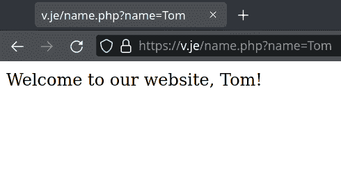

## 分析代码

让我们更仔细地看看使此操作成为可能的代码。这是最重要的行：

```
$name = $_GET['name'];
```

根据你在上面“数组”部分学到的知识，你可能能够弄清楚这行代码的作用。它将名为 `$_GET` 的数组中 `'name'` 元素存储的值赋给一个名为 `$name` 的新变量。但是 `$_GET` 数组来自哪里？

原来 `$_GET` 是 PHP 在收到浏览器请求时自动创建的多个变量之一。PHP 将 `$_GET` 创建为一个数组变量，其中包含 URL 查询字符串中传递的任何值。`$_GET` 是一个关联数组，因此可以在查询字符串中传递的 `name` 变量的值可以作为 `$_GET['name']` 访问。你的 `name.php` 脚本将此值赋给一个普通的 PHP 变量（`$name`），然后使用一个 `echo` 语句将其作为文本字符串的一部分显示：

```
echo 'Welcome to our website, ' . $name . '!';
```

`$name` 变量的值使用我们在“变量、运算符和注释”部分看到的字符串连接运算符（`.`）插入到输出字符串中。

### 安全漏洞

但要注意！这段代码中潜伏着一个安全漏洞！尽管 PHP 是一种易于学习的编程语言，但如果不了解需要采取哪些预防措施，使用 PHP 在网站中引入安全问题也特别容易。在我们进一步学习语言之前，我想确保你能够发现并修复这个特定的安全问题，因为它可能是当今网络上最常见的问题之一。

此处的安全问题源于 `name.php` 脚本生成包含用户控制的内容的页面——在这种情况下是 `$name` 变量。尽管 `$name` 变量通常会从 `name.html` 页面链接中的 URL 查询字符串接收其值，但恶意用户可以编辑 URL 以发送 `name` 变量的不同值。

要了解其工作原理，请再次点击 `name.html` 中的链接。当你看到生成的页面（包含名称“Tom”的欢迎信息）时，查看浏览器地址栏中的 URL。它应该类似于这样：

```
https://v.je/name.php?name=Tom
```

编辑 URL，在名称前插入 `<b>` 标签，在名称后插入 `</b>` 标签：

```
https://v.je/name.php?name=<b>Tom</b>
```

按 `enter` 加载此新 URL，并注意页面中的名称现在已加粗，如下图所示。

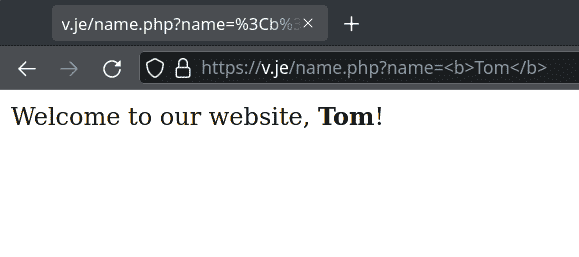

#### 将代码转换为转义序列

你可能会注意到某些浏览器会自动将 `<` 和 `>` 字符转换为 URL 转义序列（分别为 `%3C` 和 `%3E`），但无论如何，PHP 都会收到相同的值。

看出这里发生了什么吗？用户可以在 URL 中输入任何 HTML 代码，而你的 PHP 脚本会毫不质疑地将其包含在生成的页面的代码中。如果代码像 `<b>` 标签一样无害，则没有问题，但恶意用户可以包含复杂的 JavaScript 代码来执行某些低级操作，例如窃取用户的密码。攻击者所要做的就是在攻击者控制的某个其他网站上发布修改后的链接，然后诱使用户点击它。攻击者甚至可以将链接嵌入电子邮件并发送给你的用户。如果你的其中一个用户点击了该链接，攻击者的代码将被包含在你的页面中，陷阱就会被触发！

我不喜欢用这种谈论恶意黑客通过利用你自己的 PHP 代码来攻击你的用户的话来吓唬你，尤其是在你才刚刚学习这门语言的时候。事实是，PHP 作为一种语言的最大弱点就是引入此类安全问题是多么容易。有人可能会说，你花费在学习以专业标准编写 PHP 的精力很大一部分都花在了避免安全问题上。然而，你越早接触这些问题，就越早习惯避免它们，未来它们对你的阻碍就越小。

## 清理输出

那么，我们如何在不让攻击者滥用的情况下生成包含用户姓名的页面？解决方案是将为 `$name` 变量提供的价值视为要在页面上显示的纯文本，而不是要包含在页面代码中的 HTML。这是一个微妙的区别，让我来展示我的意思。

再次打开你的 `name.php` 文件并编辑其中包含的 PHP 代码，使其看起来像下面的代码。

**示例：[PHP-GET-Sanitized](https://github.com/spbooks/phpmysql7/tree/PHP-GET-Sanitized)**

```
<?php
$name = $_GET['name'];
echo 'Welcome to our website, ' .
  htmlspecialchars($name, ENT_QUOTES, 'UTF-8') . '!';
?>
```

这段代码有很多内容，让我为你分解一下。第一行与之前相同，将 `$_GET` 数组中 `'name'` 元素的值赋给 `$name`。但随后的 `echo` 语句则截然不同。以前我们只是简单地将 `$name` 变量——裸露地——转储到 `echo` 语句中，而这个版本的代码使用内置的 PHP 函数 `htmlspecialchars` 执行关键转换。

请记住，安全漏洞发生的原因是，在 `name.php` 中，`$name` 变量中的 HTML 代码被直接转储到生成的页面的代码中，因此可以做 HTML 代码能做的任何事情。`htmlspecialchars` 所做的是将 `<` 和 `>` 等“特殊 HTML 字符”转换为 `&lt;` 和 `&gt;` 等 HTML 字符实体，这可以防止浏览器将其解释为 HTML 代码。我稍后会为你演示。

首先，让我们更仔细地看看这段新代码。对 `htmlspecialchars` 函数的调用是本书中第一个接受多个参数的 PHP 函数的示例。以下是单独的函数调用：

```
htmlspecialchars($name, ENT_QUOTES, 'UTF-8')
```

第一个参数是 `$name` 变量（要转换的文本）。第二个参数是 PHP“常量”`ENT_QUOTES`，它告诉 `htmlspecialchars` 除了其他特殊字符外，还转换单引号和双引号。

#### PHP 常量


A PHP `constant` 就像一个值无法更改的变量。与变量不同，常量不以美元符号开头。PHP 带有许多内置常量，如 `ENT_QUOTES`，用于控制像 `htmlspecialchars()` 这样的内置函数。

第三个参数是字符串 `'UTF-8'`，它告诉 PHP 在解释你提供的文本时使用什么字符编码。

## 字符编码

你可能已经注意到，本书中的所有示例 HTML 页面在顶部附近都包含以下 meta 元素：

```
<meta charset="utf-8">
```

该元素告诉接收此页面的浏览器，该页面的 HTML 代码以 UTF-8 文本编码。

UTF-8 是用于将文本表示为计算机内存中一系列零和一的标准之一，称为字符编码。如果你好奇想了解有关字符编码的所有信息，请查看 “[Web 字符编码权威指南](http://www.sitepoint.com/article/guide-web-character-encoding/)”。

在几页之后，我们将进入“在表单中传递变量”部分。通过将页面编码为 UTF-8，你的用户可以提交包含数千个外文字符的文本，否则你的网站将无法处理。

不幸的是，PHP 的许多内置函数，例如 `htmlspecialchars()`，默认假设你使用的是更简单的 ISO-8859-1（或 Latin-1）字符编码。因此，在使用这些函数时，你需要让它们知道你正在使用 UTF-8。

如果可以，你还应该告诉你的文本编辑器将 HTML 和 PHP 文件保存为 UTF-8 编码的文本。只有当你想在 HTML 或 PHP 代码中输入高级字符（例如花体引号或破折号）或外文字符（如“é”）时才需要这样做。本书中的代码采取安全做法，使用 HTML 实体引用（例如 `&rsquo;` 表示花体右引号），无论如何都有效。

在浏览器中打开 `name.html` 并点击现在指向已更新的 `name.php` 的链接。你再次会看到消息“Welcome to our website, Tom!”像之前一样，修改 URL 以包含包围名称的 `<b>` 和 `</b>` 标签：

```
https://v.je/name.php?name=<b>Tom</b>
```

当你这次按下 `enter` 时，名称不会在页面中变为粗体，而应显示你实际输入的文本，如下图所示。

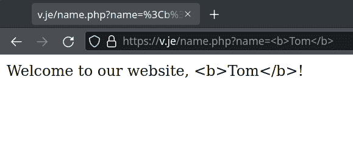

如果查看页面的源代码，你可以确认 `htmlspecialchars()` 函数已完成其工作，并分别将 `<` 和 `>` 字符转换为 `&lt;` 和 `&gt;` 实体引用。这可以防止恶意用户向你的网站注入不需要的代码。如果他们尝试这样做，代码将无害地以纯文本形式显示在页面上。

我们将在整本书中大量使用 `htmlspecialchars()` 函数来防止此类安全漏洞。即使你目前难以掌握其使用细节，也无需过于担心。不久之后，你会发现它的使用变得自然而然。现在，让我们来看一些在请求 PHP 脚本时传递值的更高级方法。

在查询字符串中传递单个变量很不错，但事实证明如果你愿意，可以传递 *更多* 的值！让我们来看一下前一个示例的稍微复杂一点的版本。再次打开你的 `name.html` 文件，并更改链接，使其指向 `name.php`，使用这个更复杂的查询字符串：

```
<a href="name.php?firstname=Tom&amp;lastname=Butler">Hi,
  I’m Tom Butler!</a>
```

这次，我们的链接传递了两个变量：`firstname` 和 `lastname`。变量在查询字符串中由一个与号分隔（`&`，在 HTML 中应写为 `&amp;`——是的，即使在链接 URL 中也是如此！……不过，如果你错误地使用了 `&`，浏览器 *大多* 会为你修复）。你可以通过用与号分隔每个 `name=value` 对来传递更多变量。

像之前一样，我们可以在 `name.php` 文件中使用这两个变量值。

示例：[PHP-GET-TwoVars](https://github.com/spbooks/phpmysql7/tree/PHP-GET-TwoVars)

```
<?php
$firstName = $_GET['firstname'];
$lastName = $_GET['lastname'];
echo 'Welcome to our website, ' .
  htmlspecialchars($firstName, ENT_QUOTES, 'UTF-8') . ' ' .
  htmlspecialchars($lastName, ENT_QUOTES, 'UTF-8') . '!';
?>
```

`echo` 语句现在变得相当庞大，但你应该仍然能理解它。使用一系列字符串连接（`.`），它输出“Welcome to our website”，随后是 `$firstName` 的值（使用 `htmlspecialchars()` 使其适合显示），一个空格，`$lastName` 的值（再次使用 `htmlspecialchars()` 处理），最后是一个感叹号。

结果如下图所示。

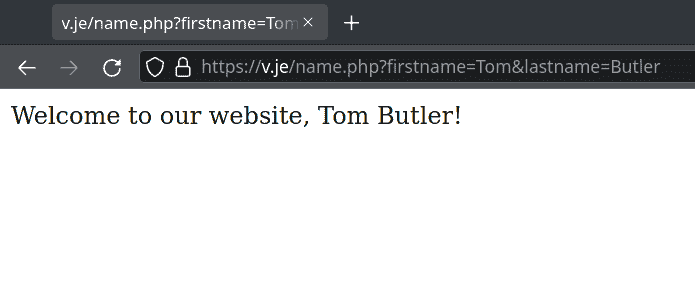

所有这些都很好，但我们仍未实现真正的用户交互目标，即用户可以输入任意信息并由 PHP 处理。为了继续我们个性化欢迎消息的示例，我们希望邀请用户输入他们的姓名并使其出现在结果页面中。为了让用户能够输入值，我们需要使用 HTML 表单。

## 在表单中传递变量

从 `name.html` 中删除链接代码并用以下 HTML 代码替换它以创建表单。

示例：[PHP-GET-Form](https://github.com/spbooks/phpmysql7/tree/PHP-GET-Form)

```
<form action="name.php" method="get">
  <label for="firstname">First name:</label>
  <input type="text" name="firstname" id="firstname">

  <label for="lastname">Last name:</label>
  <input type="text" name="lastname" id="lastname">

  <input type="submit" value="GO">
</form>
```

下图显示了浏览器如何显示此代码生成的表单。

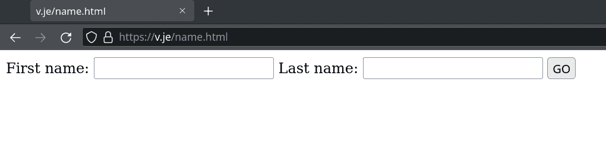

### 使用 CSS 样式化

我已向表单添加了一些 CSS（在示例代码中的 `form.css` 中可用），使其看起来更漂亮一些。我使用的 CSS 非常通用，可以用于以标签-输入-换行格式显示任何表单。我将在包含表单的任何页面上包含此 CSS 文件。

然而，由于这是一本关于 PHP 和 MySQL 的书，我不会详细介绍 CSS 的工作原理。请查看 SitePoint 的 *HTML5 & CSS3 for the Real World* 以获取有关使用 CSS 样式化表单的建议。

此表单的效果与我们在上面“在链接中传递变量”部分查看的第二个链接完全相同（查询字符串中包含 `firstname=Tom&amp;lastname=Butler`），区别在于你现在可以输入任何你喜欢的姓名。当你点击提交按钮（标记为 `GO`）时，浏览器将加载 `name.php` 并自动将变量及其值添加到查询字符串中。它从 `type="text"` 输入的 name 属性中检索变量的名称，并从用户在文本字段中输入的文本中获取值。

`form` 标签的 `method` 属性用于告诉浏览器如何将变量及其值与请求一起发送。值为 `get`（如上面 `name.html` 中使用）会导致它们通过查询字符串传递（并出现在 PHP 的 `$_GET` 数组中），但还有另一种选择。让值出现在查询字符串中可能是不可取的，甚至在技术上不可行。如果我们在表单中包含一个 `<textarea>` 元素，让用户输入大量文本怎么办？包含几段文本的查询字符串的 URL 会荒谬地长，并且可能超过当今浏览器对 URL 的最大长度限制。另一种选择是让浏览器在幕后隐形地传递信息。

再次编辑你的 `name.html` 文件。通过将其设置为 `post` 来修改表单方法：


```
<form action="name.php" method="post">
  <label for="firstname">First name:</label>
  <input type="text" name="firstname" id="firstname">

  <label for="lastname">Last name:</label>
  <input type="text" name="lastname" id="lastname">

  <input type="submit" value="GO">
</form>
```

这个 method 属性的新值指示浏览器将表单变量作为页面请求的一部分不可见地发送，而不是将它们嵌入到 URL 的查询字符串中。

由于我们不再将变量作为查询字符串的一部分发送，它们将不再出现在 PHP 的 `$_GET` 数组中。相反，它们被放置在专门为“已发布”表单变量保留的另一个数组中：`$_POST`。因此我们必须修改 `name.php` 以从这个新数组中检索值。

**示例: [PHP-POST-Form](https://github.com/spbooks/phpmysql7/tree/PHP-POST-Form)**

```
<?php
$firstname = $_POST['firstname'];
$lastname = $_POST['lastname'];
echo 'Welcome to our website, ' .
  htmlspecialchars($firstname, ENT_QUOTES, 'UTF-8') . ' ' .
  htmlspecialchars($lastname, ENT_QUOTES, 'UTF-8') . '!';
?>
```

下图显示了提交此新表单后结果页面的外观。

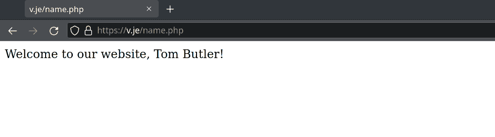

该表单在功能上与之前的表单相同。唯一的区别是，当用户点击 **GO** 按钮时加载的页面的 URL 将不带查询字符串。一方面，这让你可以在表单提交的数据中包含大值（或敏感值，如密码和信用卡号码），而不会让它们出现在查询字符串中。另一方面，如果用户将表单提交后生成的页面加入书签，该书签将毫无用处，因为它缺少提交的值。顺便说一下，这正是搜索引擎使用查询字符串提交搜索词的主要原因。如果你将 Google 上的搜索结果页面加入书签，你可以稍后使用该书签再次执行相同的搜索，因为搜索词包含在 URL 中。

## GET 或 POST？

作为经验法则，只有在表单提交时服务器上的内容 *不会* 发生变化时才应使用 `GET` 表单——例如在请求搜索结果列表时。因为搜索词在 URL 中，用户可以对搜索结果页面进行书签保存，并在无需再次输入搜索词的情况下返回该页面。但如果在提交表单后文件被删除、数据库被更新或记录被插入，则应使用 `POST`。这样做的主要原因是，如果用户将页面加入书签（或在浏览器中按返回按钮），它不会再次触发表单提交，从而可能创建重复记录。

`POST` 也更安全。通过 `GET` 发送的任何内容都会出现在 URL 中，并存储在用户的历史记录和书签中——这些对于密码和信用卡详细信息等敏感数据来说是非常不安全的位置。

这涵盖了使用表单与 PHP 产生基本用户交互的基础知识。我们将在后面的示例中查看更高级的问题和技术。

## 隐藏缝隙

你现在已经掌握了 PHP 编程语言基本语法的实用知识。你明白可以取任意 HTML 网页，将其重命名为 `.php` 文件扩展名，并向其中注入 PHP 代码以即时生成页面内容。不错的一天工作量！

不过，在继续之前，我想停下来对迄今为止讨论的示例进行批判性审视。假设你的目标是创建符合专业标准的数据库驱动网站，我们需要清理一些难看的瑕疵。

本章剩余部分中的技术将帮助你将编程技能提升到初学者水平之上，使其具有一定的专业水准。我将在本书其余部分中依赖这些技术，以确保无论示例多么简单，你都能对交付产品的质量充满信心。

### PHP 模板

在迄今为止看到的简单示例中，直接将 PHP 代码插入 HTML 页面是一种合理的方法。然而，随着生成平均页面所涉及的 PHP 代码量增加，维护这种 HTML 和 PHP 代码的混合体可能会变得难以管理。

特别是如果你在一个不特别精通 PHP 的网页设计师团队中工作，在 HTML 中混杂大量晦涩的 PHP 代码是灾难的根源。设计师很容易意外修改 PHP 代码，从而导致他们无法修复的错误。

一种更稳健的方法是将大部分 PHP 代码分离出来，使其驻留在自己的文件中，从而使 HTML 基本不受 PHP 代码污染。

实现这一点的关键是 PHP `include` 语句。有了 `include` 语句，你可以在语句所在的位置将另一个文件的内容插入到你的 PHP 代码中。为了向你展示其工作原理，让我们重建之前看到的“数到十” `for` 循环示例。

首先在你的 `public` 目录中创建一个新文件 `count.php`。打开文件进行编辑并输入以下代码：

```
<?php
$output = '';
for ($count = 1; $count <= 10; $count++) {
    $output .= $count . ' ';
}

include 'count.html.php';
```

是的，这就是该文件的 *完整* 代码。它完全不包含 HTML 代码。`for` 循环现在应该对你来说很熟悉了，但让我指出这段代码中有趣的部分：

*   而不是使用 `echo` 输出 1 到 10 的数字，此脚本会将这些数字添加到名为 `$output` 的变量中。因此，在此脚本开始时，我们将该变量设为空字符串。
*   行 `$output .= $count . ' '` 将每个数字（后跟一个空格）添加到 `$output` 变量的末尾。你在这里看到的 `.=` 运算符是将赋值和字符串连接运算符组合成一个的简写方式，用于向现有字符串变量末尾添加值。该行的长写法是 `$output = $output . $count . ' '`，但 `.=` 运算符可以节省你的输入。
*   `include` 语句指示 PHP 在此位置执行 `count.html.php` 文件的内容。你可以将 `include` 语句视为一种 *复制粘贴*。你可以通过打开 `count.html.php`，复制其内容并将其粘贴到 `count.php` 中，覆盖 `include` 行来获得相同的结果。
*   最后，你可能注意到该文件没有以 `?>` 结束以匹配开头的 `<?php`。如果你真的想加也可以，但不是必要的。如果 PHP 文件以 PHP 代码结束，就无需指示代码结束的位置；文件的末尾会为你完成。PHP 领域的聪明人通常更喜欢在仅包含 PHP 代码的此类文件末尾省略它。

#### Include 中的括号

在本书之外，你有时会看到 `include` 代码中文件名周围带有括号，就好像 `include` 是像 `date` 或 `htmlspecialchars` 这样的函数一样，事实远非如此。例如，除了 `include 'count.html.php';` 之外，你可能会看到 `include('count.html.php');`。这些括号在使用时只会使文件名表达式复杂化，因此在本书中避免使用。`echo` 也是如此，它是另一个流行的单行代码。

由于我们的 `count.php` 文件的最后一行包含了 `count.html.php` 文件，你应该接下来创建该文件。

**示例: [PHP-Count-Template](https://github.com/spbooks/phpmysql7/tree/PHP-Count-Template)**

```
<!DOCTYPE html>
<html lang="en">
  <head>
    <meta charset="utf-8">
    <title>Counting to Ten</title>
  </head>
  <body>
    <p>
      <?php echo $output; ?>
    </p>
  </body>
</html>
```

该文件几乎完全是纯 HTML，除了输出 `$output` 变量值的那一行之外。这就是由 `count.php` 文件创建的同一个 `$output` 变量。


我们在这里创建的是一个 PHP 模板：一个 HTML 页面，其中只包含很少的 PHP 代码片段，用于将动态生成的值插入到原本静态的 HTML 页面中。 而不是将生成这些值的复杂 PHP 代码嵌入到页面中，我们将生成值的代码放在一个单独的 PHP 脚本中——本例中为 `count.php`。

使用这种 PHP 模板，你可以将模板交给前端设计师，而不用担心他们可能会对你的 PHP 代码做什么。 它还能让你专注于 PHP 代码，而不会被周围的 HTML 代码分散注意力。

我喜欢将我的 PHP 模板文件命名为以 `.html.php` 结尾。 不过就你的 Web 服务器而言，这些仍然是 `.php` 文件； `.html.php` 后缀作为一个有用的提醒，表明这些文件同时包含 HTML 和 PHP 代码。

要查看我们页面现在的工作方式，请在浏览器中输入 `https://v.je/count.php`。 你将看到 `count.php` 脚本的结果显示在我们的 `count.html.php` 模板中。

## 安全问题

将 HTML 和 PHP 代码分离到不同文件的一个问题是，有人可能会在没有从对应的 PHP 文件包含的情况下运行 `.html.php` 代码。 这不是一个大问题，但任何人都可以直接访问 `count.html.php`。 如果你在 Web 浏览器中输入 `https://v.je/count.html.php`，而不是看到从一到十的计数，你会看到一条错误消息： `Notice: Undefined variable: output in /websites/default/public/count.html.php on line 9`。

最好不要让人们以你不期望的方式运行代码。 根据页面的操作，这可能会让他们绕过你已有的安全检查并查看他们无权访问的内容。 例如，考虑以下代码：

```
if ($_POST['password'] == 'secret') {
  include 'protected.html.php';
}
```

查看这段代码，似乎你需要提交表单并在密码框中输入 `secret` 才能看到 `protected.html.php` 中的受保护内容。 然而，如果有人可以直接导航到 `protected.html.php` 并查看页面的内容，就会使安全检查变得多余。 将所有文件通过 URL 访问会带来其他潜在的安全问题。 避免此类安全问题很容易。 你实际上可以从 `public` 目录以外的目录包含文件。

你可能之前想过，为什么开发环境在 `default` 目录内创建了 `public` 目录，然后我们又将所有文件写入 `public` 目录。 嗯，这个安全问题就是原因。 `public` 目录之外的文件无法通过 URL 访问（通过在 Web 浏览器中输入文件名）。

`include` 命令可以调整为从另一个目录包含文件。 在我们的例子中，该目录将是 `default` 目录，其中包含我们一直写入文件的 `public` 目录。

那么问题是，当包含文件位于不同目录时，PHP 脚本如何找到它？ 最明显的方法是指定包含文件的绝对路径。 在 Windows 服务器上，它看起来是这样的：

```
<?php include 'C:/Program Files/Apache Software Foundation/Apache2.2/protected.html.php'; ?>
```

而使用我们正在使用的 Docker 环境，它看起来是这样的：

```
<?php include '/websites/default/protected.html.php'; ?>
```

虽然这种方法可行，但它不可取，因为它将你的网站代码与 Web 服务器配置绑定在一起。 由于我们使用 Docker，部署网站时也会使用相同的 Docker 环境，所以如今这并不是真正的问题。 然而，你理想情况下应该能够将基于 PHP 的网站放到任何启用了 PHP 的 Web 服务器上并直接运行。 如果你的代码引用特定于某台服务器的驱动器和目录，这就不可行。 即使你有在单台服务器上工作的奢侈，如果你以后需要将网站移动到该服务器上的另一个驱动器/目录，你也会后悔莫及。

更好的方法是使用相对路径——即相对于当前文件的文件位置。 当你使用 `include 'count.html.php'` 时，这实际上是一个相对路径： `count.html.php` 是从执行脚本的同一目录包含的。

要从上一级目录包含文件，可以使用以下代码：

```
include '../count.html.php';
```

`../` 部分告诉 PHP 在当前脚本目录的上级目录中查找文件。 它将在 `default` 目录而不是 `public` 目录中查找 `count.html.php`。

继续将 `count.html.php` 向上移动一级到 `default` 目录，并修改 `count.php` 以引用新位置。

示例： [PHP 计数模板已保护](https://github.com/spbooks/phpmysql7/tree/PHP-Count-Template-Secured)

```
<?php
$output = '';
for ($count = 1; $count <= 10; $count++) {
    $output .= $count . ' ';
}

include '../count.html.php';
```

如果运行上面的代码，它会工作。 但以这种方式包含文件时存在潜在问题。 相对路径是相对于运行的脚本，而不是每个文件。

也就是说，如果你打开 `default/count.html.php` 并添加行 `include 'count2.html.php';`，你会期望 `count2.html.php` 从 `default` 目录包含。 然而，路径是相对于称为当前工作目录的东西，当你运行 PHP 脚本时，它最初设置为该脚本存储的目录。 因此，从 `count.html.php` 运行 `include 'count2.html.php';` 实际上会尝试从 `public` 目录加载 `count2.html.php`！

当前工作目录在脚本开始时设置，并适用于所有 `include` 语句，无论它们在哪个文件中。 为了增加更多混淆，可以使用 `chdir()` 函数更改当前工作目录。

因此，我们不能依赖以下内容：

```
include '../count.html.php';
```

它会工作，但如果目录被更改，或者 `count.php` 本身是一个包含文件，可能不会得到我们期望的结果。

为克服这个问题，我们实际上需要使用绝对路径。 幸运的是，PHP 提供了一个名为 `__DIR__` 的常量（即 `DIR` 词前后各有两个下划线），它始终包含当前文件的路径。

例如，你可以在 `public` 目录内创建一个名为 `dir.php` 的文件，代码如下：

```
echo __DIR__;
```

这将显示 `/websites/default/public`，即包含 `dir.php` 的目录的完整路径。 要从 `public` 上级目录读取 `count.html.php`，可以组合 `/../` 运算符和 `__DIR__` 常量：

```
include __DIR__ . '/../count.html.php';
```

这现在将包含文件 `/websites/default/public/../count.html`。 也就是说，PHP 将在 `public` 目录中查找，然后向上移动一级到 `default` 并包含 `count.html.php`。

这种方法在任何服务器上都有效，因为 `__DIR__` 会根据文件存储位置而不同，并且不依赖于不断变化的当前工作目录。 我将在整本书中采用这种方法来包含文件。

从现在开始，我们只会将我们希望用户能够直接从 Web 浏览器访问的文件写入 `public` 目录。 `public` 目录将包含用户需要直接访问的任何 PHP 脚本以及浏览器所需的任何图像、JavaScript 和 CSS 文件。 仅由 `include` 语句引用的任何文件都将放置在 `public` 目录之外，以便用户无法直接访问它们。


随着本书的推进，我将向你介绍几种不同类型的 *包含文件*。为了保持整洁，将不同类型的包含文件存储在不同的目录中是明智的。我们将把模板文件（扩展名为 `.html.php`）存储在 `default` 文件夹内的名为 `templates` 的目录中。然后我们可以在 `include` 语句中使用 `include __DIR__ . '../templates/file.html.php';` 来引用它们。

## 多个模板，一个控制器

使用 `include` 语句加载 PHP 模板文件的优点在于，你可以在单个 PHP 脚本中拥有 *多个* `include` 语句，并且在不同情况下让它显示不同的模板！

响应浏览器请求并选择其中一个 PHP 模板进行填充后发送回来的 PHP 脚本通常被称为“控制器”。**控制器**包含控制将哪个模板发送到浏览器的逻辑。

让我们回顾一下本章前面出现的一个示例——提示访客输入名字和姓氏的欢迎表单。

我们将从表单的 PHP 模板开始。对于此，我们只需重用之前创建的 `name.html` 文件。如果尚未创建，请在 `default` 内创建 `templates` 目录，并将 `name.html` 的副本命名为 `form.html.php` 保存到此目录中。此文件中唯一需要更改的代码是表单标签的 action 属性。

**示例：[PHP 表单控制器](https://github.com/spbooks/phpmysql7/tree/PHP-Form-Controller)**

```
<!doctype html>
<html>
  <head>
    <title>Enter your name</title>
    <link rel="stylesheet" href="form.css" />
    <meta charset="utf-8">  
  </head>
  <body>
  <form action="" method="post">
    <label for="firstname">First name:</label>
    <input type="text" name="firstname" id="firstname">

    <label for="lastname">Last name:</label>
    <input type="text" name="lastname" id="lastname">

    <input type="submit" value="GO">
  </form>
  </body>
</html>
```

如你所见，我们将 action 属性留空。这告诉浏览器将表单提交回它接收表单的同一 URL——在本例中，即包含此模板文件的控制器的 URL。

让我们看一下此示例的控制器。在 `public` 目录内创建一个 `index.php` 文件，其中包含以下代码：

```
<?php
if (!isset($_POST['firstname'])) {
    include  __DIR__ . '/../templates/form.html.php';
} else {
    $firstName = $_POST['firstname'];
    $lastName = $_POST['lastname'];

    if ($firstName == 'Tom' && $lastName == 'Butler') {
        $output = 'Welcome, oh glorious leader!';
    } else {
        $output = 'Welcome to our website, ' .
      htmlspecialchars($firstName, ENT_QUOTES, 'UTF-8') . ' ' .
      htmlspecialchars($lastName, ENT_QUOTES, 'UTF-8') . '!';
    }

    include  __DIR__ . '/../templates/welcome.html.php';
}
```

这段代码乍一看应该相当熟悉。它与我们之前编写的 `name.php` 脚本非常相似。让我解释一下区别：

*   控制器首先要做的就是判断当前请求是否是 `form.html.php` 中表单的提交。你可以通过检查请求是否包含 `firstname` 变量来做到这一点。如果包含，PHP 将把值存储在 `$_POST['firstname']` 中。

    `isset()` 是 PHP 内置函数，可告诉你某个变量（或数组元素）是否已被赋予值。如果 `$_POST['firstname']` 有值，`isset($_POST['firstname'])` 将为 true。如果 `$_POST['firstname']` 未设置，`isset($_POST['firstname'])` 将为 false。

    为了可读性，我喜欢先在控制器中放置发送表单的代码。我们需要此 `if` 语句来检查 `$_POST['firstname']` 是否 *未* 设置。为此，我们使用 not 运算符（`!`）。将此运算符放在函数名称之前会反转该函数返回的值——从 true 到 false，或从 false 到 true。

    因此，如果请求 *不* 包含 `firstname` 变量，则 `!isset($_POST['firstname'])` 将返回 true，并且 `if` 语句的主体将被执行。

*   如果请求不是表单提交，控制器将包含 `form.html.php` 文件以显示表单。

*   如果请求 *是* 表单提交，则改为执行 `else` 语句的主体。

    此代码从 `$_POST` 数组中取出 `firstname` 和 `lastname` 变量，然后为提交的名称生成适当的欢迎消息。

*   而不是 `echo` 欢迎消息，控制器将欢迎消息存储在名为 `$output` 的变量中。

*   生成适当的欢迎消息后，控制器包含 `welcome.html.php` 模板，该模板将显示该欢迎消息。

剩下的就是将 `welcome.html.php` 文件写入 `templates` 目录。如下所示：

```
<!DOCTYPE html>
<html lang="en">
  <head>
    <meta charset="utf-8">
    <title>Form Example</title>
  </head>
  <body>
    <p>
      <?php echo $output; ?>
    </p>
  </body>
</html>
```

就这样！启动你的浏览器并指向 `https://v.je/index.php`。你将被提示输入姓名，提交表单后，你将看到适当的欢迎消息。在整个过程中 URL 应保持不变。

你会注意到我要求你将文件命名为 `index.php` 而不是 `name.php` 或类似名称。我使用 `index.php` 的原因是它具有特殊含义。`index.php` 被称为 **目录索引**。如果你在浏览器中访问 URL 时未指定文件名，服务器将查找名为 `index.php` 的文件并显示它。尝试在浏览器中仅输入 `https://v.je`，你将看到索引页面。

### 目录索引

Web 服务器可以有不同的配置并指定不同的文件作为目录索引。然而，`index.php` 在大多数 Web 服务器上无需进一步配置即可工作。

在提示用户输入姓名并显示欢迎消息的整个过程中保持相同的 URL 的好处之一是，用户可以在此过程中随时将页面加入书签并获得合理的結果。无论是表单页面还是欢迎消息被加入书签，当用户返回时，表单将再次出现。在此示例的先前版本中，欢迎消息拥有自己的 URL，如果在未提交表单的情况下返回该 URL，将会生成损坏的欢迎消息（“Welcome to our website, !”），或者如果像我们的服务器一样启用了错误报告，则会生成 PHP 错误消息。

### 会话

在第 11 章，我们讨论“sessions”时，我将向你展示如何在访问之间记住用户的姓名。

## 引入数据库

在本章中，我们看到了 PHP 服务器端脚本语言的实际应用，我们探索了所有基本语言特性：语句、变量、运算符、注释和控制结构。我们看到的示例应用程序相当简单，但我们仍然花时间确保它们具有吸引人的 URL，并且生成的页面的 HTML 模板不受控制它们的 PHP 代码的干扰。

正如你可能已经怀疑的那样，PHP 的真正强大之处在于其数百（甚至数千）个内置函数，这些函数可让你访问 MySQL 数据库中的数据、发送电子邮件、动态生成图像，甚至即时创建 Adobe Acrobat PDF 文件。

在第 3 章，我们将深入研究 PHP 内置的 MySQL 函数，然后创建一个笑话数据库。然后，在第 4 章，我们将了解如何将该笑话数据库发布到 Web 上。这些任务将为本书的最终目标奠定场景：在 PHP 和 MySQL 中为你的网站创建一个完整的内容管理系统。

# 第 3 章：介绍 MySQL


正如我在上一章中解释的那样，PHP 是一种服务器端脚本语言，让你可以在网页中插入指令，这些指令会在你的网页服务器软件将页面发送给请求它们的浏览器之前执行。我们已经看过一些基本示例，包括生成随机数和使用表单捕获用户的输入。

现在，这一切都很好，但当加入数据库时，它*真的*变得有趣起来。在本章中，我们将学习数据库是什么，以及如何使用结构化查询语言（SQL）操作自己的数据库。

## 数据库简介

**数据库服务器** 是一种程序，可以以有组织的格式存储大量信息，并可通过 PHP 等编程语言轻松访问。例如，你可以指示 PHP 在数据库中查找你希望出现在网站上的笑话列表。

在这个示例中，笑话将完全存储在数据库中。这种方法有两个优点。首先，不必为每个笑话编写一个 HTML 页面，你可以编写一个单一的 PHP 脚本，专门从数据库中获取任何笑话并通过即时生成 HTML 页面来显示它。其次，向网站添加笑话只需将笑话插入数据库即可。PHP 代码会处理其余部分，在从数据库获取列表时自动将新笑话与其他笑话一起显示。

让我们沿用这个示例来了解数据如何在数据库中存储。数据库由一个或多个 **表** 组成，每个表都包含 **项目** 或 *事物* 的列表。对于我们的笑话数据库，我们可能会从一个名为 `joke` 的表开始，其中包含笑话列表。数据库中的每个表都有一个或多个 **列** 或 **字段**。每列保存有关表中每个项目的特定信息。在我们的示例中，`joke` 表可能有一列用于笑话的文本，另一列用于笑话添加到数据库的日期。以这种方式存储的每个笑话被称为表中的 **行** 或 **条目**。这些行和列形成一个表，如下图所示。

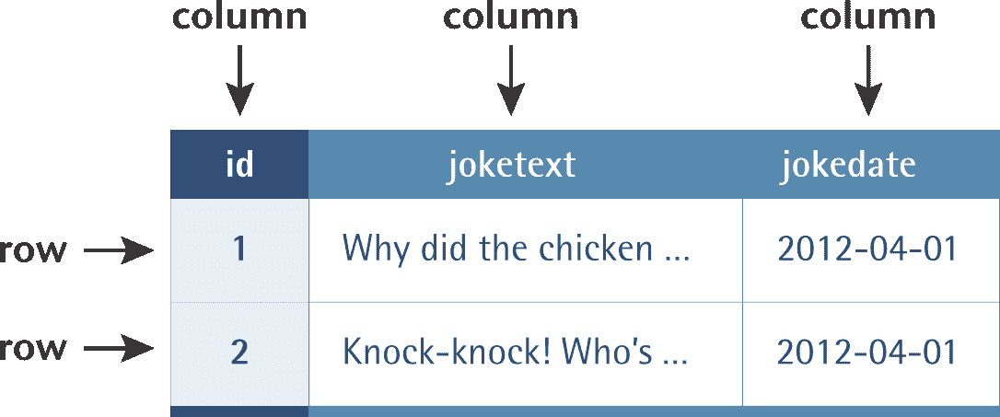

如果你曾经创建过电子表格，这看起来会很熟悉。数据库表类似，因为数据存储在行和列中。唯一的区别是，与 Excel 不同——在 Excel 中列名为 `A`、`B`、`C` 等——当你创建数据库表时，你为每列选择一个名称。

请注意，除了笑话文本 (`joketext`) 和笑话日期 (`jokedate`) 的列外，还有一列名为 `id`。作为良好的设计原则，数据库表应始终提供一种方式来唯一标识每一行。由于可能在同一天输入两个相同的笑话，我们不能依赖 `joketext` 和 `jokedate` 列来区分所有笑话。因此，`id` 列的功能是为每个笑话分配一个唯一编号，以便我们有一种简单的方式来引用它们并跟踪哪个笑话是哪个。我们将在第 5 章更详细地讨论此类数据库设计问题。

### 将列组合作为唯一标识符

也可以使用列的组合作为唯一标识符——例如制造商名称和产品名称一起。一个制造商可能有多个产品，而两个制造商可能有同名产品。通过组合这两个名称，可以唯一标识每个产品。

回顾一下，上图中的表是一个三列表，包含两行（或条目）。表中的每一行包含三个字段，对应表中的每一列：笑话的 ID、其文本和笑话的日期。掌握了这些基本术语后，你就可以开始自己创建数据库了。

## MySQL

本书的标题是 *PHP and MySQL: Novice to Ninja*——其中 *MySQL* 指的是我们使用的数据库。然而，如果你查看在设置 Docker 环境时下载的 `docker-compose.yml` 文件，你会注意到它实际上安装的是一个名为 *MariaDB* 的数据库。

2009 年，MySQL 被大型软件公司 Oracle 收购。对 MySQL 的未来感到不确定，原始 MySQL 数据库的创始人之一 Michael Widenius 决定 fork MySQL 以创建名为 MariaDB 的新数据库。（**Forking** 指从现有项目创建新项目，以原始项目的源代码为基础。）MariaDB 不受 Oracle 控制，并且相比 MySQL 具有一些性能优势，这使其成为一个很好的选择。

MariaDB 是 MySQL 的即插即用替代品，任何教你如何使用 MySQL 的教程都可以用 MariaDB 以完全相同的方式工作。作为 PHP 开发人员，你不会注意到两者之间的任何区别，并且可以相互替换。

### MySQL 和 MariaDB

随着时间的推移，MySQL 和 MariaDB 之间的差异略有增加，但你将使用的基本命令、工具和技术将保持相同。在两个数据库支持的一些更高级功能方面存在一些细微差异。

尽管这已经发生十多年了，大多数开发人员和包管理系统都互换使用两者。例如，在 Arch Linux 上，如果你安装 `mysql` 包，它实际上会安装 MariaDB，而我在第一章中讨论的 XAMPP 包安装的是 MariaDB 而不是 MySQL。

尽管如此，如果你使用 MariaDB 开始开发 PHP 代码，你会看到不断提到 MySQL，而不是 MariaDB。这是因为客户端软件（任何连接到服务器以与数据库交互的东西）不知道它是否连接到 MySQL 或 MariaDB。对于客户端软件来说，MySQL 是一个 *协议*。就像你可以通过计算机上的 USB 端口插入键盘或鼠标一样，你可以通过 MySQL 协议连接到 MySQL 服务器或 MariaDB 服务器。

因此，当你听到开发人员谈论“向 MySQL 数据库添加记录”时，他们通常指的是使用 *MySQL 协议* 来管理数据库，而不管使用的具体实现是什么。

你会发现开发人员经常使用“ MySQL”一词，即使他们实际上使用的是 MariaDB。出于一致性的考虑，我将在本书中做同样的事情。与其将服务器称为 MariaDB，在讨论从 PHP 连接时使用 MySQL 一词，不如在整本书中都使用 MySQL。

## 使用 MySQL Workbench 运行 SQL 查询

正如 Web 服务器旨在响应来自 **客户端**（Web 浏览器）的请求一样，数据库服务器响应来自 **客户端程序** 的请求。在本书后面，我们将以 PHP 脚本的形式编写自己的 MySQL 客户端程序，但现在我们可以使用与编写 MySQL 的同一团队编写的客户端程序：MySQL Workbench。你可以从 [mysql.com/products/workbench/](https://www.mysql.com/products/workbench/) 免费下载 MySQL Workbench。

有许多不同的 MySQL 客户端可供使用，本书早期版本使用了 phpMyAdmin，这是一个具有许多相同功能的基于 Web 的 MySQL 客户端。然而，它不如 MySQL Workbench 易于使用，而且通常速度很慢。

下载并安装 MySQL Workbench 后，打开它，你应该会看到如下图所示的屏幕。

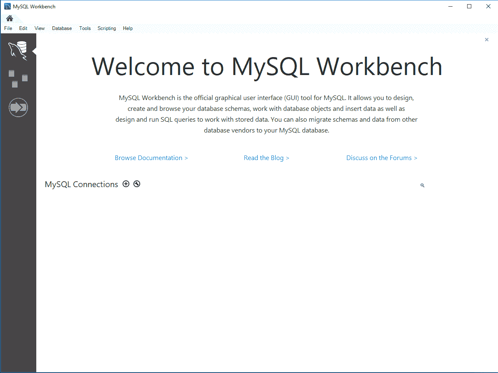

在向数据库添加任何数据之前，你需要连接到它。第 1 章中下载的 Docker 环境中正在运行一个 MariaDB 服务器，你可以使用 MySQL Workbench 等 MySQL 客户端连接到它。

连接到数据库需要三条信息：

*   服务器地址

*   用户名

*   密码

对于我们使用的 Docker 环境，信息是：


* **服务器**: `v.je`
* **用户名**: `v.je`
* **密码**: `v.je`

你会注意到服务器名称与你在网页浏览器中用于查看 PHP 脚本的 URL 完全相同。Docker 环境同时运行着 Web 服务器和数据库服务器，因此你只需记住一个地址。

要连接 MySQL Workbench 中的数据库，请按下窗口中央“ MySQL Connections ”标签旁边的 **+** 按钮。（老实说，这个标签标得不是很清楚，其用途也不太明显，但没关系！）

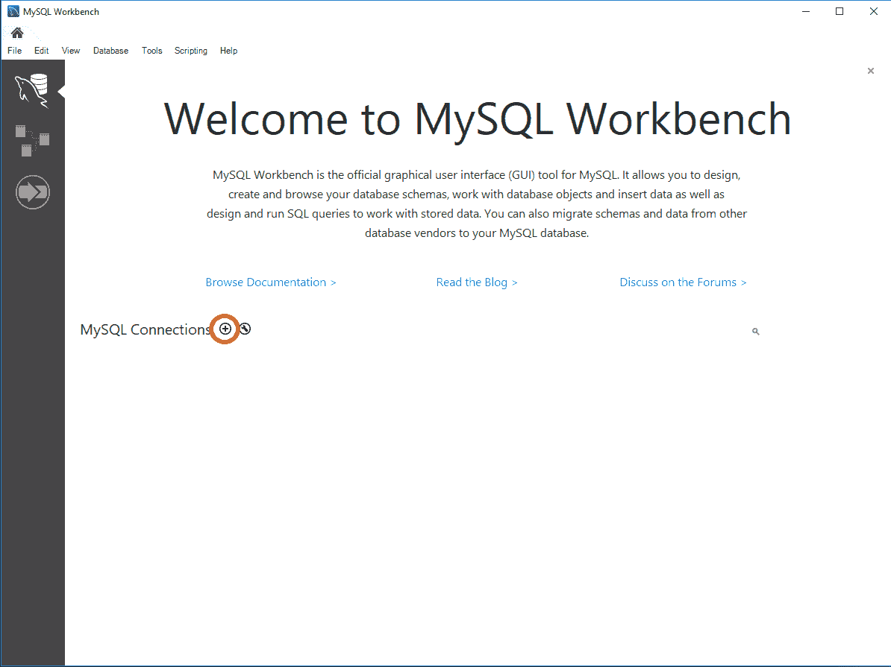

按下 **+** 按钮后，你会看到一个新窗口。

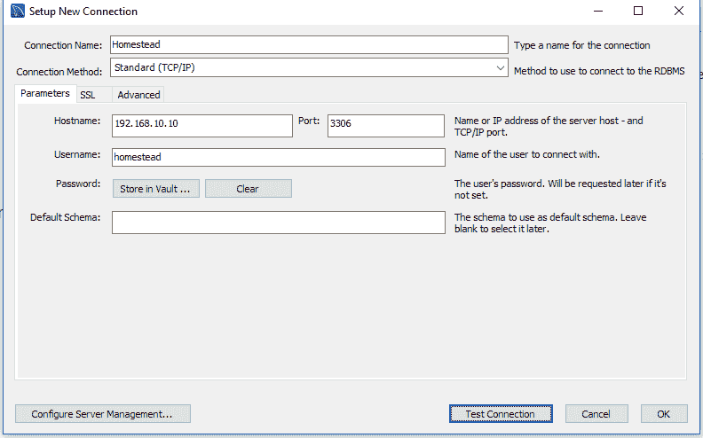

输入服务器地址和用户名。你还需要为连接命名。我将其命名为 `v.je`，但你可以随意命名。这只是在 MySQL Workbench 中供将来参考时列出的名称。

输入用户名和服务器后，你可以按窗口底部的 **测试连接** 按钮尝试连接数据库。

你应该会看到一个密码提示框。

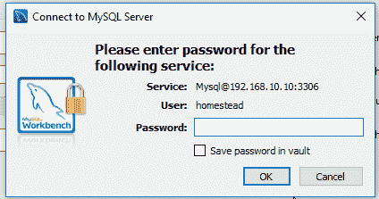

如果没有，请按以下步骤操作：
1. 再次检查你的环境是否正在运行。（如果你在设置后重新启动过电脑，可能需要在项目的目录中再次运行 `docker-compose up` 以使其运行！）
2. 确保用户名、密码和服务器地址正确。

### Up 与 Start 的区别

你可以在这里使用命令 `docker-compose start`。`start` 会启动任何已存在的容器，而 `up` 会在容器不存在时创建它们然后启动它们。根据你在本书章节之间在电脑上所做的事情，Docker 创建的容器（以及诸如网络连接之类的其他内容）如有需要将被重新创建。如果你更换了电脑、执行了系统还原或某些软件更新，容器可能需要重新创建。

因此，`up` 无论系统如何变化都能工作，而 `start` 是否能工作则取决于上次运行它之后发生了什么。

### 大小写敏感

用户名和密码区分大小写，所以请确保两者都以小写输入！

在框中输入密码 `v.je` 并勾选“保存密码”复选框。通过勾选该框，你在每次连接时就无需输入密码。然后按 **确定**。

如果密码输入正确，你会看到一条连接成功的消息。按“设置新连接”窗口中的 **确定**，你将在主 MySQL 窗口中看到一个框，显示你输入的部分信息。

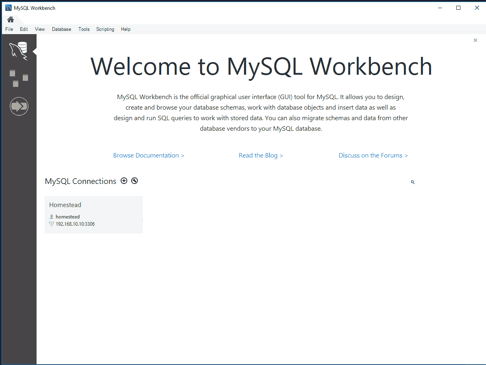

连接设置好后，每次打开 MySQL Workbench 时它都会存在。你无需每次都添加连接。

你终于准备好真正连接到数据库了。要做到这一点，只需双击代表你连接的新建框，你就会看到不同的屏幕。

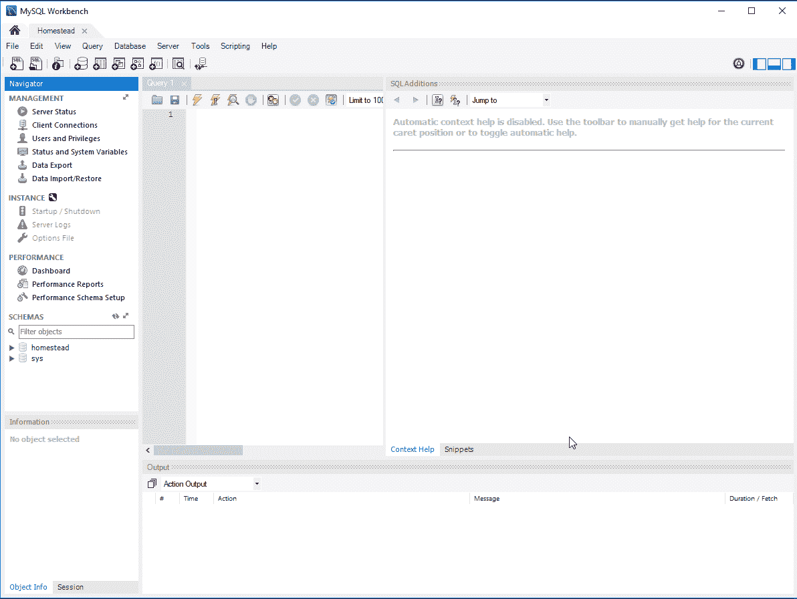

起初看起来有点令人望而生畏，因为有很多不同的按钮和面板代表不同的事物。左侧有一个包含许多不同选项的菜单。你唯一需要关注的是底部标题为“SCHEMAS”的部分。

**模式** 只是一个“数据库”的花哨说法。MySQL 是一个 **数据库服务器**。从实际角度来说，这意味着它可以托管许多不同的数据库，就像 Web 服务器可以托管许多不同的网站一样。

## 创建数据库

在向数据库添加任何信息之前，你需要先创建一个。要创建数据库，请在 SCHEMAS 面板中右键单击并选择 **创建模式**。这会打开一个窗口，包含多个选项，但你只需要输入一个：模式名称。

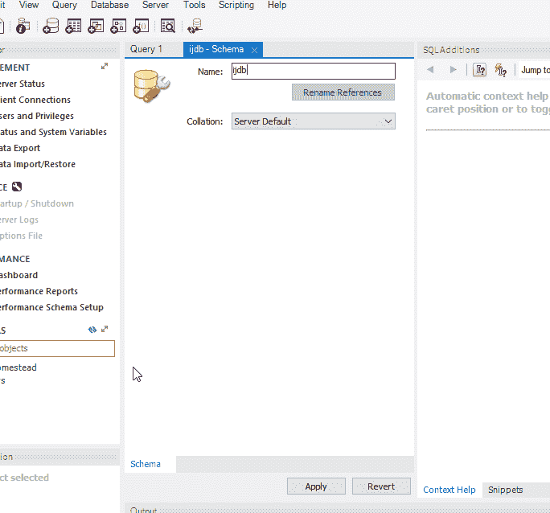

我选择将数据库命名为 `ijdb`，即 Internet Joke Database（向 [互联网电影数据库](http://www.imdb.com) 致敬），因为这与本章开头给出的示例相符：一个显示笑话数据库的网站。当然，你可以随意命名数据库。（随着你在本书中深入，你需要频繁输入它，所以不要选择太复杂的名称！）

输入名称后，你可以安全地将其他选项保留为默认值，然后按 **应用**。这样做时，MySQL Workbench 会要求你确认操作。（习惯这些对话框吧。MySQL Workbench 对你做的几乎所有事情都坚持要求确认！）在下面所示的屏幕上再次按 **应用**。

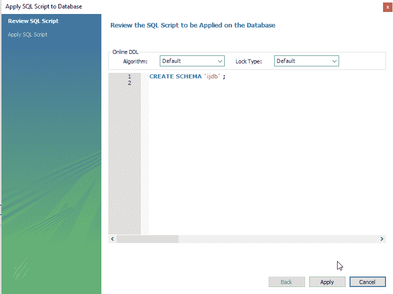

按下 **应用** 后，你需要在下一个屏幕上按 **完成**。这就是 MySQL Workbench 令人烦恼的地方之一：它强制你在每个操作后确认然后 **完成**。不过，这比替代方案要好，我们稍后会看到！

在上面的截图中，你会看到一个白色面板，上面写着：

```
CREATE SCHEMA `ijdb`
```

这是一个 SQL 查询，在本书中你会看到更多这样的查询。你本可以自己输入此命令并运行它，避免使用 GUI，节省你通过 MySQL Workbench 确认对话框的过程。对于像这样简单的命令：

```
CREATE SCHEMA `ijdb`
```

GUI 可能有点大材小用。然而，正如你稍后会看到的，并非所有命令都这么简单，对于一些更复杂的查询，使用 MySQL Workbench 的 GUI 要容易得多。

如果你想能够删除数据库（鉴于本书中我会鼓励你做大量实验，这可能是一项很好的能力），MySQL Workbench 使这变得很容易。在主窗口的 SCHEMAS 面板中，右键单击要删除的模式并选择 `DROP Schema`。MySQL 使用 `DROP` 这个词来表示删除。（有点不一致的是，某些操作也使用 **删除**！）

## 结构化查询语言

就像我们刚才看到的 `CREATE SCHEMA` 命令一样，我们在本书其余部分用来指导 MySQL 的命令都是一个名为 **结构化查询语言** 的标准的一部分，或 **SQL**（发音为“sequel”或“ess-cue-ell”，随你选择）。SQL 中的命令也称为 **查询**，我会交替使用这两个术语。

SQL 是与大多数数据库交互的标准语言，因此即使你将来从 MySQL 转到 Microsoft SQL Server 之类的数据库，你也会发现大多数命令是相同的。重要的是你要理解 SQL 和 MySQL 之间的区别。MySQL 是你正在使用的数据库服务器软件——而你正在使用的 MariaDB 遵循相同的标准。SQL 是你用来与该数据库交互的语言。

这些命令的大多数都可以由 MySQL Workbench 生成，我们将用它来创建数据库的结构。然而，你需要学习一些命令，因为你将从 PHP 脚本而不是 MySQL Workbench 执行它们！

### 深入 SQL

在本书中，我将教你每个 PHP 开发人员需要了解的 SQL 基础知识。如果你决定以构建数据库驱动网站为职业，了解 SQL 的更多高级细节会很有帮助，尤其是在让网站尽可能快速顺畅运行方面。要深入了解 SQL，我强烈推荐 Rudy Limeback 的书籍 *[简单 SQL](https://www.sitepoint.com/premium/books/simply-sql/)*，或 Timothy Boronczyk 的书籍 *[MySQL 快速入门](https://www.sitepoint.com/premium/books/jump-start-mysql/)*。

### 大小写敏感与约定


## MySQL Workbench 基础

大多数 MySQL 命令不区分大小写，这意味着你可以输入 `CREATE DATABASE`、`create database`，甚至 `CrEaTe DaTaBaSe`，它都会知道你的意思。然而，当 MySQL 服务器运行在具有区分大小写文件系统的操作系统上时，数据库名称和表名称是区分大小写的（例如 Linux、macOS，或在 Docker 中运行）。

此外，表、列和其他名称在同一查询中多次使用时必须拼写完全相同。

为了保持一致，本书将遵循公认的惯例，即数据库命令全部大写，而数据库实体（数据库、表、列等）全部小写。

这也让人们（如你！）更容易阅读查询。MySQL 不在意，但你能快速轻松地识别命令，因为它是大写的，以及对表、列或数据库的引用，因为它是小写的。

一旦你的数据库创建完成，它将出现在左侧的 `SCHEMAS` 列表中。

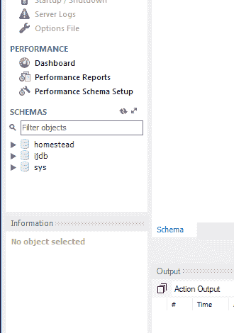

现在你有了数据库，你需要告诉 MySQL Workbench 你想要使用它。为此，只需双击新创建的架构，其名称将变为粗体。你一次只能选择一个架构，你需要告诉 MySQL Workbench 你想使用哪一个。

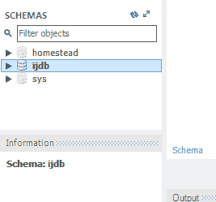

你现在准备好使用你的数据库了。由于在添加表之前数据库是空的，我们的首要任务是创建一个表来存放你的笑话。（现在可能是想一些笑话的好时机！）

## 创建表

如果你通过按名称旁边的箭头展开新创建的 `ijdb` 架构，你会看到一些条目。

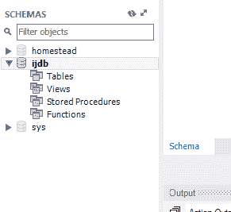

就本书而言，我们关心的唯一条目是 `Tables`。因为你的架构刚刚创建，它没有任何表。

表描述了你的数据的格式。你需要知道你想要存储的数据的 *结构*。在创建表之前，你需要考虑你到底想存储什么。对于笑话示例，我们想要存储以下信息：
*   笑话的文本
*   它被添加的日期

除了文本和日期之外，我们还需要某种方式来标识每个笑话。为此，我们将为每个笑话分配一个唯一的 ID。

每条信息都放在表中的一个字段中，每个字段都有一个“类型”。**类型**可用于以数字、文本和日期等不同格式存储数据。

你会遇到三种主要的类型：
*   数字，用于存储数值
*   文本，用于存储字符串
*   日期/时间，用于存储时间戳

MySQL 中有很多列类型，但对于大多数用途，你只需要了解其中三种！

要使用 MySQL Workbench 创建表，请在 `SCHEMAS` 列表中展开数据库，然后右键单击 `Tables` 条目并选择 `Create Table`。

窗口的中间面板将更改为显示如下图所示的内容。

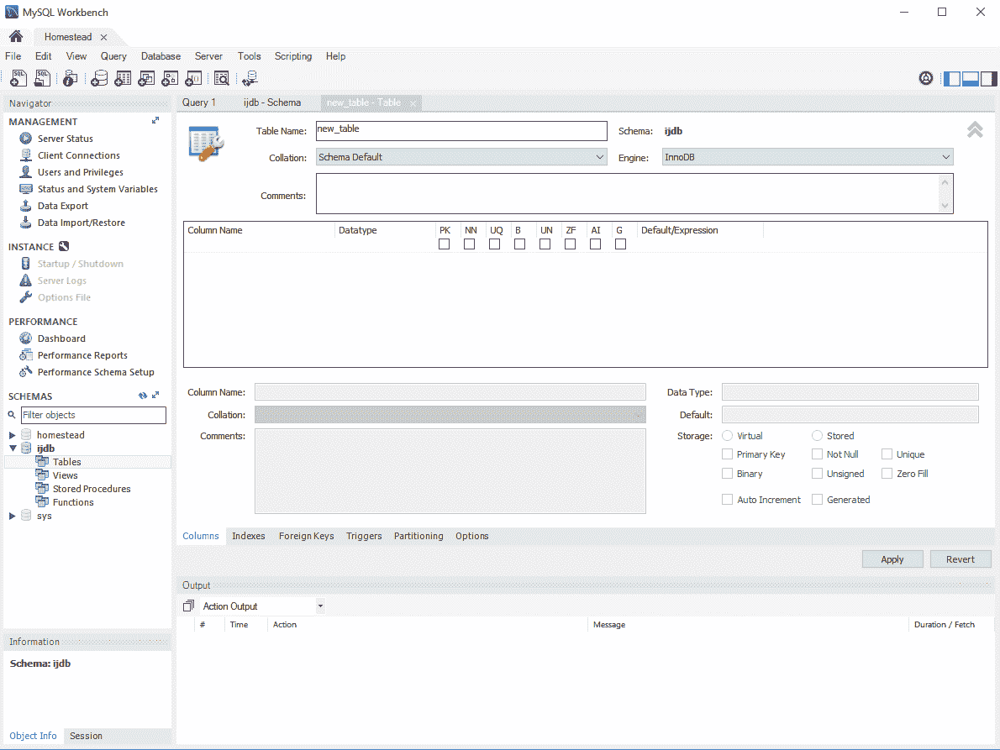

每个表都有一个名称来标识它以及一系列列。首先，将表的名称输入为 `joke` 并在列列表中添加以下列：
*   `id`，它将作为每个笑话的唯一标识符，以便我们以后可以检索它
*   `joketext`，它将存储笑话的文本
*   `jokedate`，它将存储笑话被添加的日期

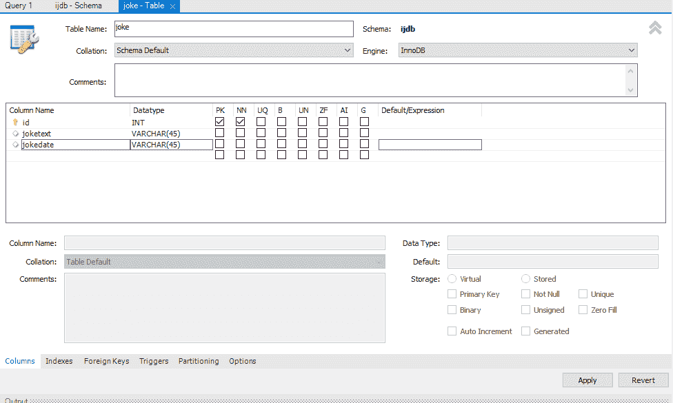

你会注意到有一个名为 `Datatype` 的第二列。数据库表中的每一列都必须分配一个类型。我们需要的三种类型是：
*   `INT`，表示“整数”，用于数字的 `jokeid`
*   `TEXT`，用于存储笑话的文本
*   `DATE`，用于存储笑话发布的日期

这有助于保持数据的有序，并允许你以强大的方式比较列中的值，如我们稍后将看到的。

如果我们在此停止设置表，你就可以开始向表中添加记录（我很快就会告诉你怎么做！）。然而，你必须提供全部三条信息：笑话 ID、笑话文本和笑话日期。这意味着，要添加下一个笑话，你需要跟踪其中有多少个，以便分配下一个 ID。

这听起来像是额外的工作，但幸运的是 MySQL Workbench 提供了避免它的便捷方法。除了列的名称和它存储的数据类型之外，你会注意到表中的每个字段都有一系列复选框。

对于我们的 ID 字段，这里有三个我们感兴趣的：
*   `PK`。这表示“主键”。勾选此框指定此列作为表中条目的唯一标识符，因此此列中的所有值必须是唯一的，确保没有两个笑话会共享相同的 ID。
*   `NN`。这代表“Not Null”，意思是当添加记录时，必须在字段中放置一个值。对于我们的 ID 列，勾选此框会告诉 MySQL 不接受没有 ID 的笑话。
*   `AI`。这是会为我们节省工作的巧妙之处。不是，“AI”不是“人工智能”，某种为我们工作的计算机大脑。在这种情况下，它代表“Auto Increment”，并且通过勾选此框（并且它只允许在 `INT` 字段上！），每当向表中添加记录（在我们的例子中是笑话）时，它将自动分配下一个可用的 ID。这是一个真正的省时功能，值得记住。

你的表现在应该看起来像下图所示的那样。

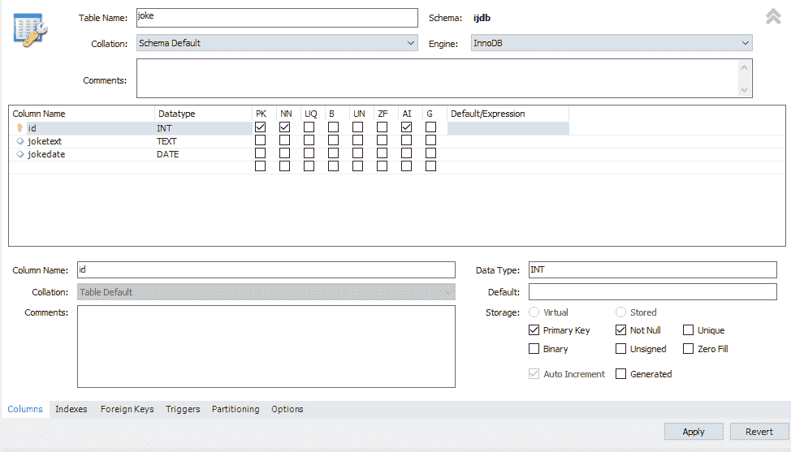

按下 `Apply` 按钮，笑话表将被创建。你将在窗口中看到以下查询出现：
```
CREATE TABLE `ijdb`.`joke` (
  `id` INT NOT NULL AUTO_INCREMENT,
  `joketext` TEXT NULL,
  `jokedate` DATE NULL,
  PRIMARY KEY (`id`));
```

你会注意到 GUI 中输入的很多相同信息都被重复了。GUI 只是为我们生成这段代码，这比记住编写查询所需的全部语法和词汇要快得多、也容易得多。

作为一名开发者，你不需要经常创建表。但你 *会* 需要与它们交互——添加和删除记录以及从数据库中检索它们——因此花时间学习如何编写查询来执行此操作是值得的。然而，对于创建表，使用 MySQL Workbench GUI 通常要快得多、也容易得多，因为一旦表创建完成，你就不需要再编写另一个 `CREATE TABLE` 语句。

我们需要查看最后一个任务：删除表。这个任务令人恐惧地简单，所以要小心！如果你删除一个表，就无法恢复它。

在 `SCHEMAS` 列表中，右键单击你想要删除的表并选择 `Drop Table`。*不要* 在你实际上想摆脱笑话表的情况下运行此命令。如果你真的想尝试，请准备好从头重新创建你的笑话表。当你删除一个表时，表连同其中存储的任何数据都会被永久删除。*在表被删除后没有任何办法恢复数据*，因此在使用此命令时要非常小心！

## 添加数据

现在表已经创建，是时候向其中添加一些数据了。虽然这可以使用 MySQL Workbench 的 GUI 完成，但这次我们将自己编写查询。最终，我们需要能够直接从 `PHP` 编写自己的数据库查询，因此提前练习编写它们是很有好处的。


## MySQL Workbench 查询和插入指南

## 打开查询窗口并运行查询

运行查询时，需要打开一个查询窗口。最简单的方法是在 `SCHEMAS` 列表中展开你的数据库。展开 `Tables` 条目，你会看到刚刚创建的 `joke` 表。右键单击该表，然后单击最上面的选项 `Select Rows - Limit 1000`。

这将显示一个略有不同的屏幕，水平分为两个面板。

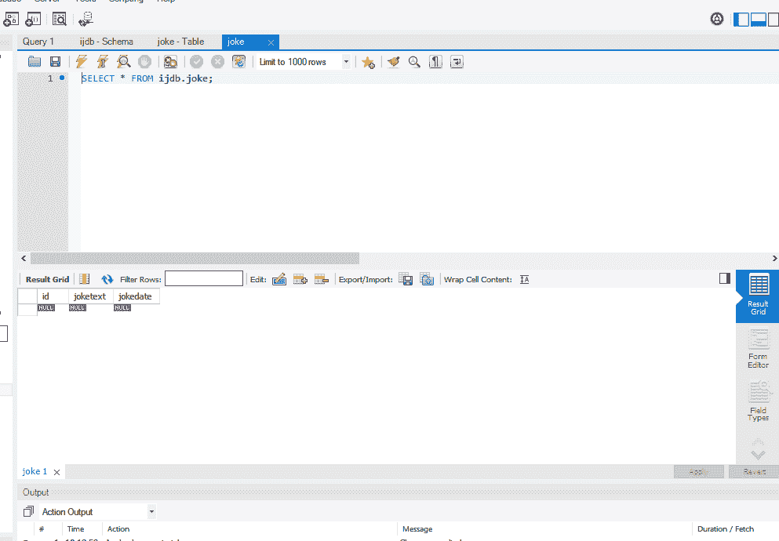

上半部分是一个文本框，你可以在其中输入命令向数据库服务器提问或使其执行任务。下半部分是该查询的结果。你会看到顶部面板中已经有一个查询：

```
SELECT * FROM `ijdb`.`joke`;
```

我们稍后会回到这是什么意思。除了顶部面板中的此查询外，底部面板中还有一行列表——或者说如果表中有任何内容的话就会有！因为表刚刚创建，目前是空的。在查看表内容之前，你需要添加一些记录。

## 使用 INSERT 插入数据

剩下的就是把一些笑话放入数据库。插入数据到数据库的命令恰如其名，叫做 `INSERT`。该命令有两种基本形式：

```
INSERT INTO tableName SET
  column1Name = column1Value,
  column2Name = column2Value,
  …
```

```
INSERT INTO tableName
  (column1Name, column2Name, …)
  VALUES (column1Value, column2Value, …)
```

因此，要向我们的表添加一个笑话，我们可以使用以下任一命令：

```
INSERT INTO joke SET
joketext = "A programmer was found dead in the shower. The instructions read: lather, rinse, repeat.",
jokedate = "2021-10-29"
```

```
INSERT INTO joke
(joketext, jokedate) VALUES (
"A programmer was found dead in the shower. The instructions read: lather, rinse, repeat.",
"2021-10-29")
```

请注意，列/值对的顺序并不重要，但按位置将正确的值与正确的列配对很重要。如果第一个括号集中提到的第一列是 `joketext`，那么 `VALUES` 列表中的第一项必须是将被放置到 `joketext` 列中的文本。第一个括号中的第二个列名从 `VALUES` 列表中的相同位置获取其值。否则，列的顺序并不重要。继续交换列和值对的顺序并尝试查询。

### 处理引号和转义

当你输入查询时，你会注意到我们使用了双引号 (`"`) 来标记笑话文本的开始和结束。这样用引号括起来的文本片段称为 **文本字符串**，这就是你在 SQL 中表示大多数数据值的方式。例如，日期也以文本字符串的形式输入，格式为 `"YYYY-MM-DD"`。

如果你愿意，你也可以用单引号 (`'`) 而不是双引号包围文本字符串：

```
INSERT INTO joke SET
joketext = '',
jokedate = '2021-10-29'
```

你可能会想知道当笑话文本中使用引号时会发生什么。好吧，如果文本包含单引号，就用双引号包围它。相反，如果文本包含双引号，就用单引号包围它。

如果你想在查询中包含的文本同时包含单 *和* 双引号，你就必须转义文本字符串中冲突的字符。你可以通过在字符前立即添加反斜杠 (`\`) 来在 SQL 中转义字符（这很方便，与 `PHP` 中的用法相同）。这告诉 MySQL 忽略该字符可能具有的任何“特殊含义”。对于单引号或双引号而言，这告诉 MySQL 不要将该字符解释为文本字符串的结束。

为了尽可能清楚地说明，这里有一个包含单引号的笑话的 `INSERT` 命令示例，即使使用了单引号来标记字符串：

```
INSERT INTO joke
(joketext, jokedate) VALUES (
'!false - it\'s funny because it\'s true',
"2021-10-29")
```

如你所见，我使用单引号标记了笑话文本的文本字符串的开始和结束。因此，我必须在它们前面加上反斜杠来转义字符串中的两个单引号（撇号）。MySQL 会看到这些反斜杠，并知道将单引号视为字符串内的字符，而不是字符串结束标记。

如果你特别聪明，你现在可能会想知道如何在 SQL 文本字符串中包含实际的反斜杠。答案是输入双反斜杠 (`\\`)，MySQL 会将其视为文本字符串中的单个反斜杠。

将你的插入查询写入 MySQL Workbench 中的顶部文本框，然后按其上方的黄色闪电图标来执行查询。

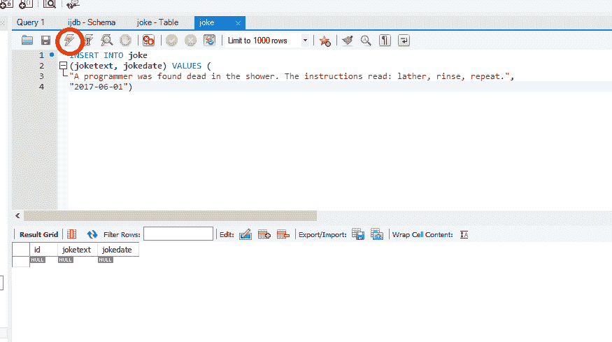

当查询执行时，屏幕底部会出现一个面板，告诉你查询是否成功执行。

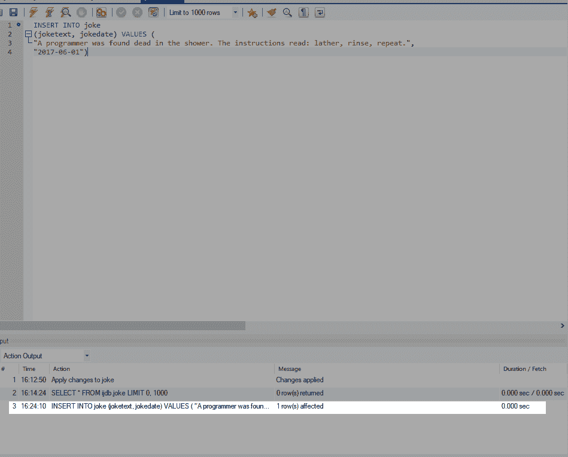

如果出现错误且查询不成功，请查看错误消息。它应该给你一个提示，说明去哪里查找。仔细检查你的语法，并检查引号和括号是否在正确的位置。

## 在低分辨率屏幕上显示底部面板

如果你的屏幕分辨率低于其预期，MySQL Workbench 会隐藏底部面板。要显示它，将鼠标悬停在窗口底部滚动条正下方，你会得到一个调整大小的光标。然后你可以拖动面板使其显示出来。

使用 `INSERT` 查询将笑话（以及你能想到的任何其他笑话！）都添加到数据库中。现在你知道如何向表添加条目了，让我们看看如何查看这些条目。

## 警告

你会注意到 MySQL Workbench 生成的查询中有些微妙的奇怪之处。我们得到的查询不是这样的：

```
SELECT * FROM joke
```

而是生成了这样的查询：

```
SELECT * FROM `joke`
```

`` `joke` `` 周围有一些奇怪的引号。这些实际上不是引号，甚至不是我们用来指定字符串的撇号。它们是 **反引号**。

这是一个安全预防措施。SQL 中有很多对语言有意义的词。你已经见过一些：`SELECT`、`FROM` 和 `INSERT`。但还有数百个其他词，被称为 **保留字**。想象一下，如果你把表命名为 `SELECT`。你需要运行的查询看起来会像这样：

```
SELECT * FROM SELECT
```

不幸的是，这可能会导致 MySQL 有点困惑。它可能会将 `SELECT` 看作命令而不是表名。更糟糕的是，`date` 就是其中之一，而且你可能会想在表中的一列命名为 `date` 并不奇怪。你期望以下查询运行时会发生什么？

```
INSERT INTO joke
(joketext, date) VALUES (
'!false - it\'s funny because it\'s true',
"2021-04-01")
```

因为 `date` 这个词在 SQL 中已有意义，它可能不会被视为列名，而是被视为查询的一部分，如 `VALUES` 或 `INTO`。

MySQL *通常* 能很好地猜测你是指表/列名还是它需要遵循的命令，但有时它无法做出这种区分。为了避免这种混淆，将所有表名和列名用反引号包围是一个良好的做法。反引号告诉 MySQL 将字符串视为 *名称* 而不是 *指令*。从一开始就养成这种习惯是好的，因为它可以避免以后经常不那么明显的明显问题。

从现在开始，我会用反引号包围所有表、模式和列名。这也有助于你——作为程序员——区分命令和列名。例如，上面的 `INSERT` 查询应写成这样：

```
INSERT INTO `joke`
(`joketext`, `date`) VALUES (
'!false - it\'s funny because it\'s true',
"2021-04-01")
```

### 该死的反引号键在哪里？


在许多英文键盘布局中，反引号键位于数字 `1` 键的正左侧并且在 `Esc` 键下方。在非英文键盘和/或各种设备（如笔记本电脑和平板电脑）上，其位置可能会有所不同。

## 查看存储的数据

我们用来查看数据库表中存储数据的命令是 `SELECT`。你之前看到过由 MySQL Workbench 为你生成的示例 `SELECT` 查询。`SELECT` 查询是 SQL 中最复杂的命令。之所以如此复杂，是因为数据库的主要优势在于其数据检索的灵活性。在我们使用数据库的这个早期阶段，我们只需要关注相当简单的结果列表，因此这里让我们考虑 `SELECT` 命令的更简单形式。

该命令将列出 `joke` 表中存储的所有内容：

```
SELECT * FROM `joke`
```

该命令的意思是“从 joke 中选择所有内容”，其中 `*` 表示“所有列”。默认情况下，`SELECT` 查询会返回表中的每一条记录。如果你尝试此命令，你的结果将类似于下图。

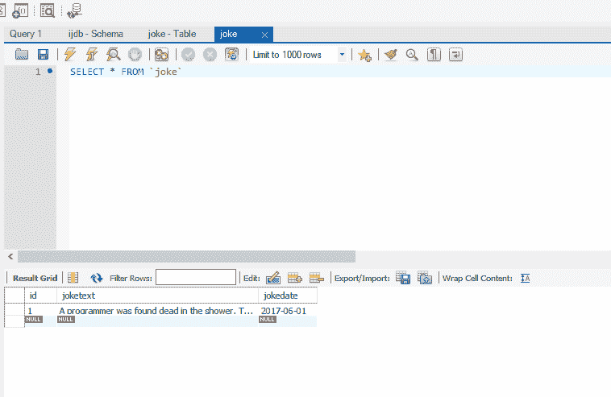

注意 `id` 列中存在一些值，即使你在之前运行的 `INSERT` 查询中并未指定它们。MySQL 已自动为笑话分配了 ID。这是因为你在创建表时勾选了“AI”（自动递增）复选框。如果你没有勾选该框，你就需要为插入的每个笑话指定 ID。

如果你在这样的数据库上进行严肃的工作，你可能会想停下来阅读数据库中所有有趣的笑话。为了避免分心，你可能希望告诉 MySQL 省略 `joketext` 列。执行此操作的命令如下：

```
SELECT `id`, `jokedate` FROM joke
```

这次，我们没有告诉它“选择所有内容”，而是精确地告诉它我们想要查看哪些列。结果应如下图所示。

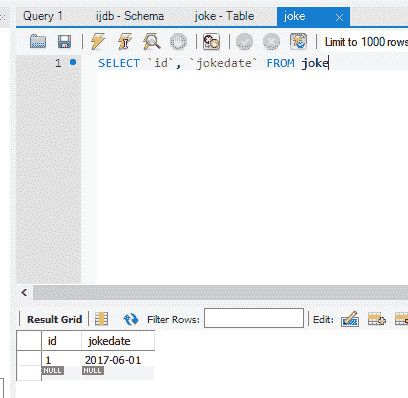

如果我们想查看 *部分* 笑话文本怎么办？除了能够指定我们希望 `SELECT` 命令显示的特定列外，我们还可以使用函数来修改每列的显示方式。其中一个函数名为 `LEFT`，它使我们能够告诉 MySQL 显示列内容最多指定数量的字符。例如，假设我们只想查看 `joketext` 列的前 20 个字符。这里是我们将使用的命令：

```
SELECT `id`, LEFT(`joketext`, 20), `jokedate` FROM `joke`
```

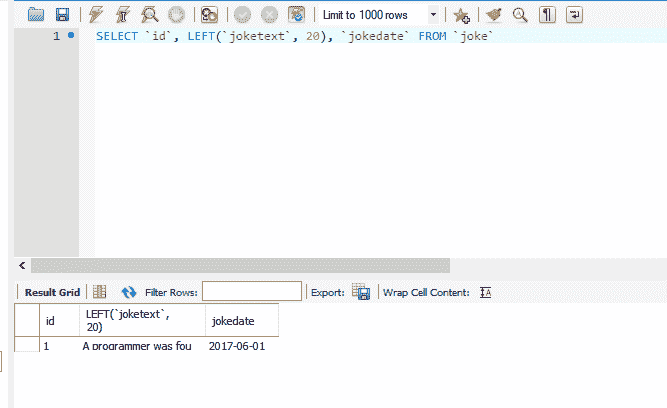

看到它是如何工作的吗？另一个有用的函数是 `COUNT`，它可以让我们统计返回的结果数量。例如，如果你想知道表中存储了多少个笑话，你可以使用以下命令：

```
SELECT COUNT(`id`) FROM `joke`
```

正如你在下图中所看到的，你的表中只有两个笑话。

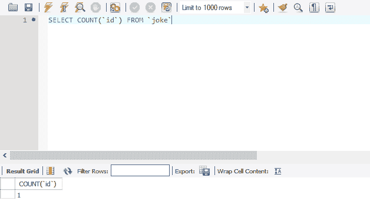

### 改用 *

你可以使用 `COUNT(*)` 得到相同的结果，但这样会更慢，因为所有列都将被从表中选取。通过使用主键，只需要检索一列。

到目前为止，我们查看的示例都获取了表中的所有条目。然而，你可以将结果限制为仅具有你想要的特定属性的数据库条目。你通过向 `SELECT` 命令添加所谓的 `WHERE` 子句来设置这些限制。请考虑以下示例：

```
SELECT COUNT(*) FROM `joke` WHERE `jokedate` >= "2021-01-01"
```

此查询将统计日期大于或等于 2021 年 1 月 1 日的笑话数量。对于日期而言，“大于或等于”意味着“在...之后或当天”。此主题的另一个变体允许你搜索包含特定文本的条目。查看此查询：

```
SELECT `joketext` FROM `joke` WHERE `joketext` LIKE "%programmer%"
```

此查询显示 `joketext` 列中包含文本“programmer”的所有笑话的完整文本。`LIKE` 关键字告诉 MySQL 命名列必须与给定的模式匹配。在本例中，我们使用的模式是 `"%programer%"`。`%` 符号（称为 **通配符**）表示文本“programmer”前面和/或后面可能跟随任意字符串的文本。（有趣的是，`LIKE` 不区分大小写，因此此模式也将匹配包含“Programmer”甚至“FuNkYProGRammeR”的笑话。）

`WHERE` 子句中也可以组合条件以进一步限制结果。例如，仅显示 2021 年 4 月的敲门笑话，你可以使用以下查询：

```
SELECT `joketext` FROM `joke` WHERE
`joketext` LIKE "%knock%" AND
`jokedate` >= "2021-04-01" AND
`jokedate` < "2021-05-01"
```

在表中输入一些更多笑话。（例如，“程序员为什么辞职？他得不到数组。”）然后尝试使用 `SELECT` 查询。

你可以用 `SELECT` 命令做很多事情，所以我鼓励你非常熟悉它。我们稍后在需要时再查看其更高级的功能。

## 修改存储的数据

在向数据库表输入数据后，你可能会发现想要更改它。无论是纠正拼写错误，还是更改附加到笑话的日期，此类修改都是使用 `UPDATE` 命令进行的。该命令包含 `SELECT` 和 `INSERT` 命令的元素，因为该命令既挑选出要修改的条目，又设置列值。`UPDATE` 命令的一般形式如下：

```
UPDATE `tableName` SET
  `colName` = newValue, …
WHERE conditions
```

例如，如果我们想更改之前输入的笑话的日期，我们将使用以下命令：

```
UPDATE `joke` SET `jokedate` = "2021-04-01" WHERE id = "1"
```

这里 `id` 列派上了用场，使你能够轻松地单独选出一个笑话进行更改。这里使用的 `WHERE` 子句的工作方式与在 `SELECT` 命令中相同。例如，下一个命令会更改所有包含单词“programmer”的条目的日期：

```
UPDATE `joke` SET `jokedate` = "2021-04-01"
WHERE `joketext` LIKE "%programmer%"
```

### WHERE 是可选的

信不信由你，`UPDATE` 命令中的 `WHERE` 子句是可选的。因此，在输入此命令时你应非常小心！如果你省略 `WHERE` 子句，`UPDATE` 命令将应用于 *表中的所有条目*。

以下命令将为表中的所有记录设置日期！

```
UPDATE `joke` SET `jokedate` = "2021-04-01"
```

## 删除存储的数据

在 SQL 中删除条目是危险地简单，这你可能已经注意到是一个反复出现的主题。这里是命令语法：

```
DELETE FROM `tableName` WHERE conditions
```

要从表中删除所有程序员笑话，你将使用以下查询：

```
DELETE FROM `joke` WHERE `joketext` LIKE "%programmer%"
```

### 再次，WHERE 是可选的

与 `UPDATE` 一样，`DELETE` 命令中的 `WHERE` 子句也是可选的。因此，在使用它时你应非常小心。如果你省略 `WHERE` 子句，`DELETE` 命令将应用于 *表中的所有条目*。

以下命令将一次性清空 joke 表：

```
DELETE FROM `joke`
```

可怕吧？

## 让 PHP 来输入

MySQL 数据库服务器软件和 SQL 的内容远不止我在此介绍的少数基本命令，但这些命令无疑是最常用和最有用的！

在此时，你可能会认为数据库似乎有点笨重。SQL 打字起来可能很棘手，因为与其它计算机语言相比，其命令往往很长且冗长。你可能正担心输入一个完整的笑话库的想法，这些笑话以 `INSERT` 命令的形式出现。


别担心！随着我们阅读本书，你会惊讶于实际亲手输入的 SQL 查询有多少。通常，你会编写 PHP 脚本来替你输入 SQL。例如，如果你想向数据库中插入一批笑话，你通常会创建一个用于添加笑话的 PHP 脚本，其中包含必要的 `INSERT` 查询，并为笑话文本留出占位符。然后，只要有笑话要添加，你就可以运行该 PHP 脚本。PHP 脚本会提示你输入笑话，然后向你的 MySQL 服务器发出适当的 `INSERT` 查询。

现在，重要的是培养亲手输入 SQL 的感觉。它会让你对 MySQL 数据库的内部工作原理有深刻的认识，并且会让你更加珍惜 PHP 为你节省的工作！

到目前为止，我们只使用过一个表，但要实现关系数据库的真正威力，你需要学会如何一起使用多个表，以表示数据库中存储的项目之间可能存在的复杂关系。我将在第 5 章中涵盖所有这些内容以及更多内容，在其中我将讨论数据库设计原则并展示一些更高级的示例。

在此期间，我们已经完成了目标，你可以使用 MySQL Workbench 查询窗口舒适地与 MySQL 交互。在第 4 章，乐趣继续，我们将深入 PHP 语言，并使用它创建几个动态生成的网页。

如果你愿意，可以在继续之前先练习一下 MySQL，通过创建一个规模适中的笑话表来练习（就我们的目的而言，五个就足够了）。这个笑话库在你到达第 5 章时会派上用场。

# 第 4 章：在网上发布 MySQL 数据

就是这个——你报名学习的内容！在本章中，你将学习如何将存储在 MySQL 数据库中的信息取出并显示在网页上供所有人查看。

到目前为止，你已经编写了第一个 PHP 代码并学习了 MySQL、一个关系数据库引擎，以及 PHP、一种服务器端脚本语言的基础知识。

现在你准备好学习如何将这些工具结合起来创建一个网站，让用户可以从数据库中查看数据甚至添加自己的数据。

## MySQL 和 MariaDB

与第 3 章一样，我在这里使用“MySQL”来指代数据库协议。你的 PHP 脚本也会这样做。本章中——以及你将编写的 PHP 代码中——有许多对“MySQL”的引用，即使我们实际上连接的是 MariaDB 数据库。

## 总体思路

在我们继续之前，退一步看清我们的最终目标是值得的。我们手头有两个强大的工具：PHP 脚本语言和 MySQL 数据库引擎。了解这些工具如何配合非常重要。

使用 MySQL 为我们的网站提供服务的目的是允许内容从数据库动态提取，以创建可在普通浏览器中查看的网页。因此，系统的一端是你使用网络浏览器请求页面的网站访客。该浏览器期望收到一份标准的 HTML 文档作为回报。在另一端，你的网站内容存放在 MySQL 数据库的一个或多个表中，该数据库只懂得如何响应 SQL 查询（命令）。

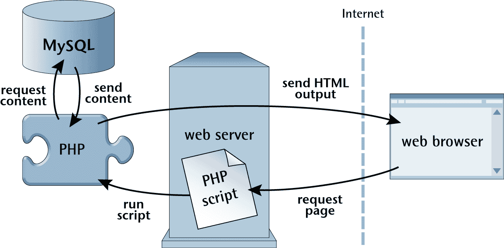

如上图所示，PHP 脚本语言是两者之间的桥梁。它处理页面请求并使用 SQL 查询从 MySQL 数据库获取数据，就像你在第 3 章中用来创建笑话表的那样。然后它将其动态输出为浏览器期望的格式良好的 HTML 页面。

为了让你清楚地记住，当有人访问你网站上的页面时会发生什么：

1. 访客的网络浏览器从你的 Web 服务器请求网页。
2. Web 服务器软件（通常是 Apache 或 NGINX）识别出所请求的文件是 PHP 脚本，因此服务器启动 PHP 解释器来执行文件中的代码。
3. 某些 PHP 命令（本章的重点）连接到 MySQL 数据库并请求属于网页的内容。
4. MySQL 数据库通过向 PHP 脚本发送所请求的内容来响应。
5. PHP 脚本将内容存储到一个或多个 PHP 变量中，然后使用 `echo` 语句将内容作为网页的一部分输出。
6. PHP 解释器完成工作，将其创建的 HTML 副本交给 Web 服务器。
7. Web 服务器将 HTML 发送给网络浏览器，就像发送普通 HTML 文件一样，只是页面不是直接来自 HTML 文件，而是 PHP 解释器提供的输出。然而，浏览器无法知道这一点。对浏览器而言，它就像请求和接收任何其他网页一样。

## 创建 MySQL 用户账户

为了让 PHP 连接到你的 MySQL 数据库服务器，它需要使用用户名和密码。到目前为止，你的笑话数据库只包含一些机智的 *bon mots*，但不久后它可能包含电子邮件地址和其他关于你网站用户的私人详细信息。出于这个原因，MySQL 被设计为非常安全，让你可以严格控制它接受哪些连接以及这些连接被允许做什么。

Docker 环境在第 3 章中已经包含了一个 MySQL 用户，你已经用它登录到 MySQL 服务器。

你 *could* 使用相同的用户名（`v.je`）和密码（`v.je`）从 PHP 脚本连接到数据库，但创建新账户是有用的——因为如果你有一个 Web 服务器，你可能希望用它托管多个网站。通过为每个网站提供自己的用户账户，你可以更好地控制谁可以访问给定站点的數據。如果你与其他开发人员合作，你可以让他们访问他们正在处理的站点，但不能更多。

你应该创建一个新用户账户，只赋予其在网站所依赖的 `ijdb` 数据库上工作所需的特定权限。我们现在就这样做。

要创建用户，请打开 MySQL Workbench 并连接到你的服务器。然后运行以下查询：

```
CREATE USER 'ijdbuser'@'%' IDENTIFIED BY 'mypassword';
GRANT ALL PRIVILEGES ON `ijdb`.* TO 'ijdbuser'@'%';
```

第一个查询很简单：它创建了一个名为 `ijdbuser` 的用户，密码为 `mypassword`。用户名后的 `%` 符号表示可以从任何位置连接到数据库。第二个查询授予用户对 `ijdb` 架构的完全访问权限，因此该用户可以查看和修改 `ijdb` 架构中的所有表、列和数据，但无法访问其外部的任何内容。

现在 `ijdbuser` 用户已创建，我们可以用它连接到数据库。可以为此用户在 MySQL Workbench 中设置连接，但由于权限有限，最好让 MySQL Workbench 继续使用 `v.je` 账户。相反，我们将在从 PHP 脚本连接时使用新用户。

## 使用 PHP 连接到 MySQL

在你能够从网页中检索 MySQL 数据库的内容之前，必须知道如何从 PHP 脚本内部建立与 MySQL 的连接。到目前为止，你使用名为 MySQL Workbench 的应用程序连接到数据库。就像 MySQL Workbench 可以直接连接到正在运行的 MySQL 服务器一样，你自己的 PHP 脚本也可以。

尽管本章完全讨论从 PHP 连接到 MySQL，但我们实际上连接的是上一章讨论的 MariaDB 数据库。PHP 无法区分 MySQL 和 MariaDB，因为它们可以互换。我将始终将数据库称为 MySQL，因为使用的所有命令都可用于连接到 MySQL 或 MariaDB 数据库服务器。


## 从 PHP 连接到 MySQL

原始 MySQL 数据库提供了一种标准化的方法，让 *客户端* 例如 MySQL Workbench 和 PHP 与服务器通信。MariaDB 复制了该标准，而 PHP 中的所有命令都使用名称 *MySQL*，因此为了保持简单，我将在本章中始终使用术语 *MySQL* 来指代数据库。

## 可用的连接方法

从 PHP 连接到 MySQL 服务器有三种方法：

* the MySQL library
* the MySQLi library
* the PDO library

它们本质上做的是同一件事——连接到数据库并向其发送查询——但它们使用不同的代码来实现。

## MySQL 库（已弃用）

MySQL 库是连接数据库最旧的方法，于 PHP 2.0 中引入。其包含的功能非常有限，并在 PHP 5.0（2004 年发布）起被 MySQLi 取代。

要使用旧的 MySQL 库连接和查询数据库，会使用诸如 `mysql_connect()` 和 `mysql_query()` 之类的函数。这些函数自 PHP 5.5 起已被 **弃用**——意味着应避免使用——并且自 PHP 7.0 起已完全从 PHP 中移除。

尽管大多数开发者在 PHP 5.0 发布时就看到了更改的原因，但在网络上仍有数百篇文章和代码示例使用这些现在已不存在的 `mysql_*` 函数——尽管 MySQLi 实际上已是十五年来的首选库。

如果您遇到包含行 `mysql_connect()` 的代码示例，请检查文章的日期。它可能来自 2000 年代初期，而在编程中，您永远不应该信任如此古老的东西。事物总是在变化——这就是为什么本书已是第七版！

## MySQLi 库

在 PHP 5.0 中，MySQLi 库——代表“ MySQL Improved ”——被发布以解决原始 MySQL 库中的一些限制。您可以通过代码轻松识别 MySQLi 的使用，因为代码将使用诸如 `mysqli_connect()` 和 `mysqli_query()` 之类的函数。

## PDO 库

在 PHP 5.0 中发布 MySQLi 库后不久，PHP 5.1 被发布，其中包含大量有助于塑造我们今天编写 PHP 方式的更改（主要是与面向对象编程有关，您将在本书后面看到很多）。PHP 5.1 的主要更改之一是它引入了第三个库，`PDO`（PHP 数据对象），用于连接 MySQL 数据库。

`PDO` 和 MySQLi 之间存在一些差异，但主要区别在于您可以使用 `PDO` 库连接到几乎任何数据库服务器——例如 Oracle 服务器或 Microsoft SQL Server。对于开发者来说，这种通用方法的最大优势是，一旦您学会如何使用该库与 MySQL 数据库交互，与另一个数据库服务器交互就非常简单。

可以说，为 `PDO` 编写代码更简单，并且有一些细微差别可以使 `PDO` 代码更具可读性——预处理语句中的命名参数是主要优势。（别担心，我稍后会解释这意味着什么。）

由于这些原因，大多数最近的 PHP 项目使用 `PDO` 库，而这也是我将在本书中向您展示如何使用的库。有关差异的更多信息，请参阅 SitePoint 文章“[重新介绍 PDO – 在 PHP 中访问数据库的正确方式](https://www.sitepoint.com/re-introducing-pdo-the-right-way-to-access-databases-in-php/)”。

## 创建 PDO 连接

在那段简短的历史课之后，您可能急于回到编写代码。以下是如何使用 `PDO` 建立到 MySQL 服务器的连接：

```
new PDO('mysql:host=hostname;dbname=database', 'username',
  'password')
```

现在，将 `new PDO` 视为内置函数，就像我们在第 2 章中使用的 `rand` 函数一样。如果您在想“嘿，函数名称中不能有 *空格*！”，那么您比普通人更聪明，我稍后会解释这里到底发生了什么。无论如何，它接受三个参数：

* a string specifying the type of database (`mysql:`), the hostname of the server (`host=hostname;`), and the name of the database (`dbname=database`)
* the MySQL username you want PHP to use
* the MySQL password for that username

您可能还记得第 2 章中提到的，PHP 函数在被调用时通常会返回一个值。这个 `new PDO`“函数”返回一个名为 `PDO` 对象的 值，该对象标识已建立的连接。由于我们打算使用该连接，因此我们应该通过将其存储在变量中来保留此值。以下是其外观，使用必要的数值填充以连接到您的数据库：

```
$pdo = new PDO('mysql:host=mysql;dbname=ijdb', 'ijdbuser',
  'mypassword');
```

您可能已经看出最后两个参数发生了什么：它们是您在本章前面创建的用户名和密码。

第一个参数稍微复杂一些。`dbname=ijdb` 部分告诉 `PDO` 使用名为 `ijdb` 的数据库（也称为 *模式*）。从 PHP 运行的任何查询都将默认使用该模式中的表。`SELECT * FROM joke` 将从 `ijdb` 模式中的 `joke` 表中选择记录。

即使您已经熟悉 PHP、`PDO` 和 MySQL，`host=mysql` 部分看起来也很 confusing。通常，这将是 `host=localhost`（指本地计算机，即运行 PHP 的同一台机器）或指向数据库托管的特定域名，例如 `host=sitepoint.com`。

为什么是 `host=mysql`，这里的 `mysql` 指什么？在 Docker 中，每个 *服务* 都有一个名称。如果您检查配置服务器的 `docker-compose.yml` 文件，数据库服务称为 `mysql`，在 Docker 中，一个服务可以使用另一个服务的名字连接到另一个服务。

撇开参数不谈，这里重要的是要看到 `new PDO` 返回的值存储在名为 `$pdo` 的变量中。

MySQL 服务器是与 Web 服务器完全分开的软件。因此，我们必须考虑服务器可能因网络中断而无法使用或无法访问，或者您提供的用户名/密码组合被服务器拒绝，或者您只是忘记启动 MySQL 服务器！在这种情况下，`new PDO` 将无法运行，并会抛出 PHP 异常。

## 异常处理

### 关闭异常抛出

至少默认情况下，PHP 可以配置为不抛出异常并且根本不会连接。这通常不是理想的行为，因为它使得弄清楚出了什么问题变得更加困难。

如果您想知道“抛出 PHP 异常”是什么意思，请做好准备！您即将发现 PHP 语言的更多功能。

PHP **异常** 是当您告诉 PHP 执行一项任务而它无法完成时发生的情况。PHP 会尝试执行您告诉它的操作，但会失败；为了告诉您失败的原因，它会向您抛出异常。异常不过是 PHP 带着特定错误消息崩溃。当异常被抛出时，PHP 会停止。错误之后的代码行将不会执行。

作为负责任的开发者，捕获该异常并采取措施使程序继续运行是您的职责。

### 未捕获的异常

如果您不捕获异常，PHP 将停止运行您的 PHP 脚本并显示一个极其难看的错误消息。该错误消息甚至会显示抛出错误的脚本代码。在这种情况下，该代码包含您的 MySQL 用户名和密码，因此尤其重要的是避免用户看到错误消息！

要捕获异常，您应该使用 `try … catch` 语句将可能抛出异常的代码包围起来：

```
try {
  ⋮ do something risky
}
catch (ExceptionType $e) {
  ⋮ handle the exception
}
```

您可以将 `try … catch` 语句视为 `if … else` 语句，只是第二个代码块是在第一个代码块执行失败时发生的情况。

困惑了吗？我知道我（无意双关）向您抛出了很多新概念，但如果我把它们全部放在一起并向您展示我们有什么，就会更有意义：


```
try {
  $pdo = new PDO('mysql:host=mysql;dbname=ijdb', 'ijdbuser',
    ’mypassword’);
  $output = 'Database connection established.';
}
catch (PDOException $e) {
  $output = 'Unable to connect to the database server.';
}

include  __DIR__ . '/../templates/output.html.php';
```

正如你所见，这段代码是一个 `try … catch` 语句。在顶部的 `try` 块中，我们使用 `new PDO` 尝试连接数据库。如果成功，我们将生成的 `PDO` 对象存储在 `$pdo` 中，以便我们可以操作新的数据库连接。如果连接成功，`$output` 变量将被设置为稍后会显示的消息。

重要的是，在 `try … catch` 语句内部，一旦抛出异常，后续的任何代码都不会被执行。在这种情况下，如果连接数据库时抛出异常（也许密码错误，或服务器未响应），`$output` 变量永远不会被设置为“Database connection established”。

如果我们的数据库连接尝试失败，PHP 将抛出 `PDOException`，这是 `new PDO` 抛出的异常类型。因此，我们的 `catch` 块表示它将捕获一个 `PDOException`（并将其存储在名为 `$e` 的变量中）。在该块内部，我们将 `$output` 变量设置为包含有关出现问题的信息的消息。

然而，此错误消息并不特别有用。它告诉我们的只是 `PDO` 无法连接到数据库服务器。最好能提供一些有关原因的信息——例如，因为用户名和密码无效。

`$e` 变量包含有关发生的异常的详细信息，包括描述问题的错误消息。我们可以使用连接将其添加到 `$output` 变量中：

```
try {
  $pdo = new PDO('mysql:host=mysql;dbname=ijdb', 'ijdbuser',
    'mypassword');
   $output = 'Database connection established.';
}
catch (PDOException $e) {
  $output = 'Unable to connect to the database server: ' . $e->getMessage();
}

include  __DIR__ . '/../templates/output.html.php';
```

### `$e` 变量

`$e` 变量不是一个字符串，而是一个 *对象*。我们稍后会讨论这意味着什么。现在，你只需要知道代码 `$e->getMessage()` 会根据发生的特定异常获取错误消息。

就像 `if … else` 语句一样，`try … catch` 语句的两个分支之一保证会运行。`try` 块中的代码要么成功执行，要么 `catch` 块中的代码会运行。无论数据库连接是否成功，`$output` 变量中都会有一条消息——要么是错误消息，要么是表示连接成功的消息。

最后，无论 `try` 块是否成功，还是 `catch` 块运行，模板 `output.html.php` 都会被包含进来。这是一个通用模板，只是在页面上显示一些文本：

```
<!doctype html>
<html>
  <head>
    <meta charset="utf-8">
    <title>Script Output</title>
  </head>
  <body>
      <?php echo $output; ?>
  </body>
</html>
```

完整代码可在 **示例：[MySQL-Connect](https://github.com/spbooks/phpmysql7/tree/MySQL-Connect)** 中找到。

当包含模板时，它将显示错误消息或“数据库连接已建立”消息。

我希望上述代码现在对你来说是有意义的。如果感到迷失，请随时回到本节的开头重新阅读，因为其中有一些棘手的概念。但是，一旦你牢牢掌握了代码，你可能会意识到我仍然留下一个未解之谜：PDOs。`new PDO` 到底是什么，当我说它返回一个“`PDO` 对象”时，对象到底是什么？

### 模式

所有下载的示例代码都包含一个名为 `ijdb_sample` 的模式和一个名为 `ijdb_sample` 的用户，这样无论你将模式和用户命名为什么，都可以运行它。数据库文件以 `database.sql` 的形式提供，你可以导入它。

如果使用提供的基于 Web 的示例代码查看器，`idbj_sample` 数据库将在加载示例时创建，但对该模式的任何更改在查看另一个示例时都会丢失。（你可以搞乱它，切换到另一个示例再切回来会重置它，但如果你想保留所做的任何更改，请在你创建的模式中进行。）

如果想使用 MySQL Workbench 将示例数据加载到你的模式中，请从 `project` 目录导入 `database.sql`，方法是选择 `Data Import/Restore`。然后选择 `Import from self-contained file`，浏览到 `database.sql`，并在 `default` 目标模式中选择你的模式名称。如果已创建同名的任何表，它们将被覆盖并且所有记录丢失。

## 面向对象编程速成课程

你可能已经注意到，在上一节中，“object” 这个词开始出现在我的词汇中。`PDO` 是 PHP Data *Objects* 扩展，`new PDO` 返回一个 `PDO` *对象*。在本节中，我想解释对象到底是什么。

也许你在探索 PHP 或编程时遇到过 **面向对象编程 (OOP)** 这个术语。OOP 是一种高级的编程风格，尤其适合构建具有大量组件的非常复杂的程序。如今大多数活跃使用的编程语言都支持 OOP。有些甚至 *要求* 你以 OOP 风格工作。PHP 在这方面稍微宽松一些，并将是否以 OOP 风格编写脚本的决定权留给开发者。

到目前为止，我们以一种更简单的风格编写 PHP 代码，称为 **过程式编程**，我们现在将继续这样做，后续会更详细地介绍对象。过程式风格非常适合我们目前处理的相对简单的项目。然而，你会遇到的几乎所有复杂项目都使用 OOP，我将在本书后面更详细地介绍它。

话虽如此，我们将用于连接和操作 MySQL 数据库的 `PDO` 扩展是按照面向对象编程风格设计的。这意味着，与其简单地调用一个函数来连接 MySQL，然后调用其他使用该连接的函数，我们必须首先创建一个代表数据库连接的 `PDO` *对象*，然后使用该对象的功能来操作数据库。

创建对象与调用函数非常相似。事实上，你已经见过如何操作：

```
$pdo = new PDO('mysql:host=mysql;dbname=ijdb', 'ijdbuser',
  'mypassword');
```

`new` 关键字告诉 PHP 你想要创建一个新对象。然后你留一个空格并指定一个 **类名**，这告诉 PHP 你想要创建什么类型的对象。**类** 是 PHP 为创建对象而遵循的一组指令。你可以把类想象成食谱，比如蛋糕的食谱，而对象则是按照食谱制作出的实际蛋糕。不同的类可以产生不同的对象，就像不同的食谱可以产生不同的菜肴一样。

正如 PHP 附带了一堆可调用的内置函数，PHP 也附带了一个可用于创建对象的类库。因此，`new PDO` 告诉 PHP 创建一个新的 `PDO` 对象——即内置 `PDO` 类的一个新对象。

在 PHP 中，对象是一种值，就像字符串、数字或数组一样。你可以将对象存储在变量中或作为参数传递给函数——所有这些都可以像对其他 PHP 值一样操作。然而，对象具有一些有用的额外功能。


首先，一个对象在很多方面都像一个数组，因为它充当其他值的容器。正如我们在第 2 章看到的，你可以通过指定其索引来访问数组中的值（例如，`$birthdays['Kevin']`）。对于对象来说，概念相似但名称和代码不同。与其访问数组索引中存储的值，我们说我们在访问对象的 **属性**。与其使用方括号来指定我们想要访问的属性名称，我们使用 **箭头表示法** (`->`)——例如，`$myObject->someProperty`：

```
$myObject = new SomeClass();    // create an object
$myObject->someProperty = 123;  // set a property's value
echo $myObject->someProperty;   // get a property's value
```

而数组通常用于存储一组 *相似* 的值（例如生日数组），对象则用于存储一组 *相关* 的值（例如数据库连接的属性）。不过，如果对象仅此而已，那也没什么意义：我们完全可以用数组来存储这些值，对吧？当然，对象还能做更多。

除了存储一组属性及其值之外，对象还可以包含一组函数，为我们提供更有用的功能。存储在对象中的函数称为 **方法**（如果问我，这是编程世界中更令人困惑的名称之一）。方法只是在类内部的函数。更令人困惑的是，当我们开始编写自己的类时，方法是使用 `function` 关键字定义的！即使是经验丰富的开发人员也经常错误地将 *函数* 和 *方法* 互换使用。

要调用一个方法，我们再次使用箭头表示法——`$myObject->someMethod()`：

```
$myObject = new SomeClass();    // create an object
$myObject->someMethod();        // call a method
```

就像独立函数一样，方法可以接受参数并返回值。

在这个阶段，这可能听起来有点复杂且毫无意义，但相信我：将变量（属性）和函数（方法）的集合组合成称为对象的微小捆绑包，对于某些任务会产生更整洁、更易读的代码——使用数据库就是其中之一。有一天，你甚至可能想要开发自定义类，以便创建你自己设计的[content]
首先，一个对象在很多方面都像一个数组，因为它充当其他值的容器。正如我们在第 2 章看到的，你可以通过指定其索引来访问数组中的值（例如，`$birthdays['Kevin']`）。对于对象来说，概念相似但名称和代码不同。与其访问数组索引中存储的值，我们说我们在访问对象的 **属性**。与其使用方括号来指定我们想要访问的属性名称，我们使用 **箭头表示法** (`->`)——例如，`$myObject->someProperty`：

```
$myObject = new SomeClass();    // create an object
$myObject->someProperty = 123;  // set a property's value
echo $myObject->someProperty;   // get a property's value
```

而数组通常用于存储一组 *相似* 的值（例如生日数组），对象则用于存储一组 *相关* 的值（例如数据库连接的属性）。不过，如果对象仅此而已，那也没什么意义：我们完全可以用数组来存储这些值，对吧？当然，对象还能做更多。

除了存储一组属性及其值之外，对象还可以包含一组函数，为我们提供更有用的功能。存储在对象中的函数称为 **方法**（如果问我，这是编程世界中更令人困惑的名称之一）。方法只是在类内部的函数。更令人困惑的是，当我们开始编写自己的类时，方法是使用 `function` 关键字定义的！即使是经验丰富的开发人员也经常错误地将 *函数* 和 *方法* 互换使用。

要调用一个方法，我们再次使用箭头表示法——`$myObject->someMethod()`：

```
$myObject = new SomeClass();    // create an object
$myObject->someMethod();        // call a method
```

就像独立函数一样，方法可以接受参数并返回值。

在这个阶段，这可能听起来有点复杂且毫无意义，但相信我：将变量（属性）和函数（方法）的集合组合成称为对象的微小捆绑包，对于某些任务会产生更整洁、更易读的代码——使用数据库就是其中之一。有一天，你甚至可能想要开发自定义类，以便创建你自己设计的。

现在，我们还是坚持使用随 PHP 一起提供的类。让我们继续使用我们创建的 `PDO` 对象，看看通过调用其方法能做什么。

## 配置连接

到目前为止，我已经向你展示了如何创建一个 `PDO` 对象来建立与 MySQL 数据库的连接，以及如何在出现问题时显示有意义的错误消息：

```
<?php
try {
    $pdo = new PDO('mysql:host=mysql;dbname=ijdb', 'ijdbuser', 'mypassword');
    $output = 'Database connection established.';
} catch (PDOException $e) {
    $output = 'Unable to connect to the database server: ' . $e->getMessage();
}

include  __DIR__ . '/../templates/output.html.php';
```

假设连接成功，不过，在使用之前你需要对其进行配置。你可以通过调用新 `PDO` 对象的一些方法来配置连接。

在向数据库发送查询之前，我们需要配置数据库连接的字符编码。正如我在第 2 章中简要提到的，你应该在网站中使用 UTF-8 编码的文本，以最大化用户在填写网站表单时可用的字符范围。默认情况下，PHP 连接到 MySQL 时使用的是更简单的 ISO-8859-1（或 Latin-1）编码，而不是 UTF-8。如果我们保持原样，就无法轻松插入中文、阿拉伯文或大多数非英文字符。

即使你 100% 确定你的网站只会被英语使用者使用，不设置字符集也会导致其他问题。如果你的网页未设置为 UTF-8，当人们在文本框中写入某些字符，例如花体引号 `”` 时，就会出现问题，因为它们在数据库中会显示为不同的字符。

因此，我们现在需要将新的 `PDO` 对象设置为使用 UTF-8 编码。

我们可以通过在连接字符串末尾添加 `;charset=utf8mb4` 来指示 PHP 在查询数据库时使用 UTF-8。只要你的 PHP 脚本也以 `UTF-8` 发送到浏览器（这是最近 PHP 版本的默认值），这样做没有任何缺点：

```
$pdo = new PDO('mysql:host=mysql;dbname=ijdb;charset=utf8mb4', 'ijdbuser',
  'mypassword');
```

### 其他设置字符集的方式

如果你去搜索，你会发现设置字符集的不同方法，本书早期版本指示你使用以下代码：

```
$pdo->exec('SET NAMES "utf8"');
```

这是因为，直到 PHP 5.3.6，PHP 并未正确应用字符集选项。由于在你实际使用的任何 PHP 版本中此问题已得到修复，将字符集作为连接字符串的一部分设置是首选选项。

因此，我们用于连接到 MySQL 然后配置该连接的完整代码如下所示。

**示例：[MySQL 连接完整](https://github.com/spbooks/phpmysql7/tree/MySQL-Connect-Complete)**

```
<?php
try {
    $pdo = new PDO('mysql:host=mysql;dbname=ijdb;charset=utf8mb4', 'ijdbuser', 'mypassword');
    $output = 'Database connection established.';
} catch (PDOException $e) {
    $output = 'Unable to connect to the database server: ' . $e->getMessage();
}

include  __DIR__ . '/../templates/output.html.php';
```

在浏览器中启动此示例。（如果你将数据库代码放在 `public` 目录中的 `index.php` 内，并将 `output.html.php` 文件放在 `templates` 目录中，则该页面的 URL 将为 `https://v.je/`。）

如果你的服务器正在运行，并且一切正常，你应该会看到一条表示成功的消息。

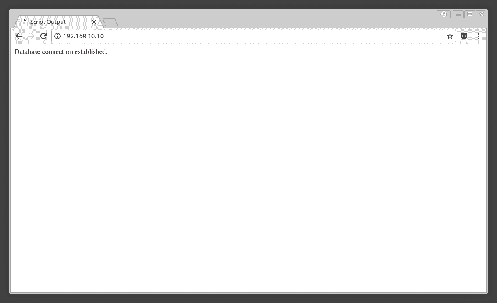

如果 PHP 无法连接到你的 MySQL 服务器，或者你提供的用户名和密码不正确，你将看到与下面类似的屏幕。为了确保你的错误处理代码正常工作，你可能想故意拼错密码来测试它。

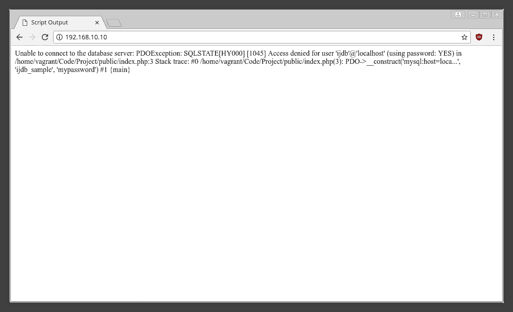

多亏了我们的 `catch` 块，数据库的错误消息已包含在页面上：

```
catch (PDOException $e) {
  $output = 'Unable to connect to the database server: ' . $e->getMessage();
}
```

方法 `getMessage()` 返回描述发生的异常的消息。还有其他方法——包括 `getFile()` 和 `getLine()`——用于返回引发异常的文件名和行号。你可以生成如下非常详细的错误消息：

```
catch (PDOException $e) {
  $output = 'Unable to connect to the database server: ' . $e->getMessage() . ' in ' .
  $e->getFile() . ':' . $e->getLine();
}
```

如果你有一个包含数十个包含文件的大型网站，这非常有用。错误消息会告诉你确切要查看哪个文件以及错误发生的行号。

如果你好奇，尝试在数据库连接代码中插入其他一些错误（例如拼错的数据库名称），并观察由此产生的详细错误消息。完成后，当你的数据库连接工作正常时，回到简单的错误消息。这样，如果你的数据库服务器出现真正问题，你的访客就不会被技术性的乱码轰炸。

在建立连接并选择数据库后，你就可以开始使用数据库中存储的数据了。

### 脚本执行完毕后会发生什么？


你可能会想知道脚本执行完毕后与 MySQL 服务器的连接会发生什么。如果你真的想，可以通过丢弃代表你连接的 `PDO` 对象来强制 PHP 与服务器断开连接。你通过将包含该对象的变量设为 `null` 来实现：

```
$pdo = null;  // disconnect from the database server
```

话虽如此，PHP 在运行完你的脚本后会自动关闭所有打开的数据库连接，因此你通常只需让 PHP 在之后自行清理即可。

## 使用 PHP 发送 SQL 查询

在第 3 章中，我们使用 MySQL Workbench 连接到 MySQL 数据库服务器，这使我们能够输入 SQL 查询（命令）并立即查看这些查询的结果。`PDO` 对象提供了一个类似的机制—— `exec()` 方法：

```
$pdo->exec($query)
```

这里，`$query` 是一个字符串，包含你想要执行的任何 SQL 查询。

正如你所知，如果执行查询时出现问题（例如，你在 SQL 查询中输入有误），此方法会抛出 `PDOException` 供你捕获。

请考虑以下示例，它尝试生成我们在第 3 章中创建的笑话表。

### 示例：[MySQL-创建](https://github.com/spbooks/phpmysql7/tree/MySQL-Create)

```
try {
  $pdo = new PDO('mysql:host=mysql;dbname=ijdb;charset=utf8mb4', 'ijdbuser', 'mypassword');

  $sql = 'CREATE TABLE joke (
    id INT NOT NULL AUTO_INCREMENT PRIMARY KEY,
    joketext TEXT,
    jokedate DATE NOT NULL
  ) DEFAULT CHARACTER SET utf8 ENGINE=InnoDB';

  $pdo->exec($sql);

  $output = 'Joke table successfully created.';
}
catch (PDOException $e) {
  $output = 'Database error: ' . $e->getMessage() . ' in ' .
  $e->getFile() . ':' . $e->getLine();
}

include  __DIR__ . '/../templates/output.html.php';
```

请注意，我们使用相同的 `try … catch` 语句技术来处理查询可能产生的错误。使用多个 `try … catch` 块来显示不同的错误消息是可行的——一个用于连接，一个用于查询——但这可能会导致大量额外的代码。

相反，我选择使用同一个 `try` 语句同时包含连接和查询。`try … catch` 块在出现错误后会停止执行代码，因此如果在数据库连接期间发生错误，`$pdo->exec($run)` 行将永远不会运行，确保如果向数据库发送查询，则必须已建立连接。

这种方法让我们对显示的错误消息的控制力稍弱，但节省了为每次数据库操作键入 `try … catch` 语句的工作。本书后面我们会将它们拆分为不同的块，但现在，请将所有数据库操作保留在同一个 `try` 块中。

此示例还使用 `getMessage()` 方法从 MySQL 服务器检索详细的错误消息。下图显示了例如笑话表已存在时显示的错误。

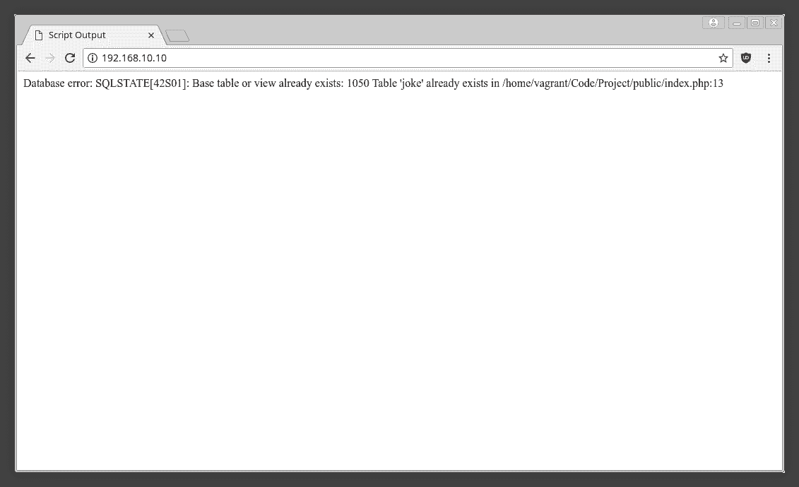

对于 `DELETE`、`INSERT` 和 `UPDATE` 查询（用于修改存储的数据），`exec()` 方法返回受查询影响的表行（条目）数量。请考虑以下我们在第 3 章中使用的 SQL 命令，用于设置包含单词“programmer”的所有笑话的日期。

### 示例：[MySQL-更新](https://github.com/spbooks/phpmysql7/tree/MySQL-Update)

```
try {
  $pdo = new PDO('mysql:host=mysql;dbname=ijdb;charset=utf8mb4', 'ijdbuser', 'mypassword');

  $sql = 'UPDATE joke SET jokedate="2021-04-01"
      WHERE joketext LIKE "%programmer%"';

  $affectedRows = $pdo->exec($sql);

  $output = 'Updated ' . $affectedRows .' rows.';
}
catch (PDOException $e) {
  $output = 'Database error: ' . $e->getMessage() . ' in ' .
  $e->getFile() . ':' . $e->getLine();
}

include  __DIR__ . '/../templates/output.html.php';
```

通过将 `exec()` 方法返回的值存储在 `$affectedRows` 中，我们可以在模板中打印时在 `$output` 变量中使用该变量。

下图显示了此示例的输出，假设你的数据库中只有一个“programmer”笑话。

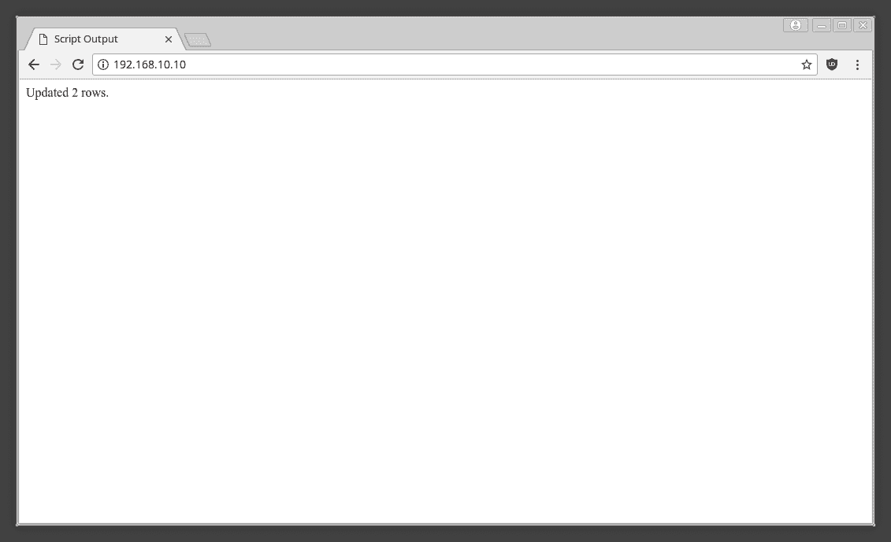

如果你刷新页面再次运行相同的查询，你应该会看到消息发生变化，如下图所示。它表明没有行被更新，因为应用到笑话上的新日期与现有日期相同。


`SELECT` 查询的处理方式略有不同，因为它们可以检索大量数据，而 PHP 提供了处理这些信息的方法。

## 处理 `SELECT` 结果集

对于大多数 SQL 查询，`exec()` 方法工作得很好。查询对你的数据库执行某些操作，并且你可以通过方法的返回值获得受影响的行数（如果有）。`SELECT` 查询，然而，需要比 `exec()` 更复杂一点的东西。你会记得 `SELECT` 查询用于查看数据库中存储的数据。与仅影响数据库不同，`SELECT` 查询有结果——我们需要一种方法来返回它们。

`query()` 方法看起来与 `exec()` 完全一样，因为它接受一个 SQL 查询作为参数发送到数据库服务器。然而，它返回的是一个 `PDOStatement` 对象，该对象表示一个结果集，其中包含查询返回的所有行（条目）的列表：

```
<?php
try {
    $pdo = new PDO('mysql:host=mysql;dbname=ijdb;charset=utf8mb4', 'ijdbuser', 'mypassword');

    $sql = 'SELECT `joketext` FROM `joke`';
    $result = $pdo->query($sql);
} catch (PDOException $e) {
    $error = 'Unable to connect to the database server: ' . $e->getMessage() . ' in ' .
  $e->getFile() . ':' . $e->getLine();
}
```

前提是没有在处理查询时遇到错误，这段代码会将结果集（以 `PDOStatement` 对象的形式）存储到变量 `$result` 中。此结果集包含存储在 `joke` 表中的所有笑话的文本。由于数据库中笑话的数量没有实际限制，结果集可能相当大。

我在第 2 章中提到过，当我们需要循环但不知道循环多少次时，`while` 循环是一个有用的控制结构。我们不能使用 `for` 循环，因为我们不知道查询返回了多少条记录。事实上，你可以在这里使用 `while` 循环一次处理结果集中的一行：

```
while ($row = $result->fetch()) {
  ⋮ process the row
}
```

`while` 循环的条件可能与你习惯的条件不同，所以让我解释一下它是如何工作的。把条件单独看作一个语句：

```
$row = $result->fetch();
```

`PDOStatement` 对象的 `fetch()` 方法将结果集中的下一行作为数组返回（我们在第 2 章中讨论过数组）。当结果集中没有更多行时，`fetch()` 改为返回 `false`。（这是一个特例，即要求 PDO 对象执行它无法执行的操作——例如当结果集中没有剩余行时 `fetch()` 无法返回下一行——将 *不* 抛出 `PDOException`。如果它这样做，我们将无法像这里这样在 `while` 循环条件中使用 `fetch()` 方法。）

现在，上述语句为 `$row` 变量分配一个值，但与此同时，整个语句也取该相同的值。这就是为什么你可以在 `while` 循环中使用该语句作为条件的原因。由于 `while` 循环会一直循环直到其条件求值为 `false`，因此此循环将发生与结果集中的行数一样多次，每次循环执行时 `$row` 都会取下一行的值。剩下的唯一需要弄清楚的是每次循环运行时如何从 `$row` 变量中检索值。


## 结果集获取与模板渲染

`fetch` 返回的结果集的行表示为关联数组，其索引以结果集中表列的名称命名。如果 `$row` 是我们结果集中的一行，则 `$row['joketext']` 是该行 `joketext` 列中的值。

我们在此代码中的目标是保存所有笑话的文本，以便在 PHP 模板中显示它们。最好的做法是将每个笑话存储为数组 `$jokes` 中的一个新项：

```
while ($row = $result->fetch()) {
  $jokes[] = $row['joketext'];
}
```

从数据库中取出笑话后，我们现在可以将它们传递给 PHP 模板 `jokes.html.php`。

## 控制器代码

总结一下，到目前为止本示例控制器的代码如下：

```
<?php

try {
    $pdo = new PDO('mysql:host=mysql;dbname=ijdb;charset=utf8mb4', 'ijdbuser', 'mypassword');

    $sql = 'SELECT `joketext` FROM `joke`';
    $result = $pdo->query($sql);

    while ($row = $result->fetch()) {
        $jokes[] = $row['joketext'];
    }
} catch (PDOException $e) {
    $error = 'Unable to connect to the database server: ' . $e->getMessage() . ' in ' .
  $e->getFile() . ':' . $e->getLine();
}

include  __DIR__ . '/../templates/jokes.html.php';
```

`$jokes` 变量是一个存储笑话列表的数组。如果你在 PHP 中写出该数组的内容，它看起来会像这样：

```
$jokes = [];
$jokes[0] = 'A programmer was found dead in the shower. The instructions read: lather, rinse, repeat.';
$jokes[1] = '!false - it\'s funny because it\'s true';
$jokes[2] = 'A programmer\'s wife tells him to go to the store and "get a gallon of milk, and if they have eggs, get a dozen." He returns with 13 gallons of milk.';
```

然而，数据是从数据库中检索出来的，而不是在代码中手动输入的。

你会注意到，根据 `try` 块是否成功执行，会设置两个不同的变量——`$jokes` 和 `$error`。

## 模板渲染

在 `jokes.html.php` 模板中，我们需要显示 `$jokes` 数组的内容或 `$error` 变量中包含的错误消息。

为了检查变量是否已被赋予值，我们可以使用 `isset` 函数，该函数之前用于检查表单是否已提交。模板可以包含一个 `if` 语句来确定是显示错误还是笑话列表：

```
if (isset($error)) {
  ?>
  <p>
  <?php
  echo $error;
  ?>
  </p>
}
else {
  : display the jokes
}
```

这里没有新内容，但要显示笑话，我们需要显示 `$jokes` 数组的内容。与到目前为止我们使用过的其他变量不同，`$jokes` 数组包含的不仅仅是一个值。

在 PHP 中处理数组最常见的方法是使用循环。我们已经见过 `while` 循环和 `for` 循环。`foreach` 循环对于处理数组特别有帮助：

```
foreach (array as $item) {
  ⋮ process each $item
}
```

与条件不同，`foreach` 循环顶部的括号中包含一个数组，后跟关键字 `as`，然后是新变量的名称，该变量将依次用于存储数组中的每个项。然后循环体对数组中的每个项执行一次。每次该项都存储在指定的变量中，以便代码可以直接访问它。

在 PHP 模板中使用 `foreach` 循环依次显示数组中的每个项是很常见的。以下是它在我们 `$jokes` 数组中的可能外观：

```
<?php
foreach ($jokes as $joke) {
    ?>
  ⋮ HTML code to output each $joke
<?php
}
?>
```

由于 PHP 代码描述循环与 HTML 代码显示内容的混合，代码看起来相当杂乱。因此，在模板中使用时，通常会使用另一种编写 `foreach` 循环的方式：

```
foreach (array as $item):
  ⋮ process each $item
endforeach;
```

这两段代码在功能上是相同的，但后者在与 HTML 代码混合时看起来更友好。以下是这种形式的代码在模板中的外观：

```
<?php foreach ($jokes as $joke): ?>
  ⋮ HTML code to output each $joke
<?php endforeach; ?>
```

对 `if` 语句也可以做同样的处理，通过避免使用大括号，使其在 HTML 模板中看起来更美观：

```
<?php if (isset($error)): ?>
  <p>
  <?php echo $error; ?>
  </p>
<?php else: ?>
  : display the jokes
<?php endif; ?>
```

掌握了这些新工具后，我们就可以编写模板来显示笑话列表。

### 示例：MySQL-ListJokes

```
<!doctype html>
<html>
  <head>
    <meta charset="utf-8">
    <title>List of jokes</title>
  </head>
  <body>
  <?php if (isset($error)): ?>
  <p>
    <?php echo $error; ?>
  </p>
  <?php else: ?>
  <?php foreach ($jokes as $joke): ?>
  <blockquote>
    <p>
    <?php echo htmlspecialchars($joke, ENT_QUOTES, 'UTF-8') ?>
    </p>
  </blockquote>
  <?php endforeach; ?>
  <?php endif; ?>
  </body>
</html>
```

要么在页面上显示 `$error` 文本，要么每个笑话都显示在块引用 (`<blockquote>`) 内的段落 (`<p>`) 中，因为我们实际上是在本页中引用每个笑话的作者。

因为笑话可能包含会被解释为 HTML 代码的字符（例如 `<`、`>` 或 `&`），我们必须使用 `htmlspecialchars` 来确保它们被转换为 HTML 字符实体（即 `&lt;`、`&gt;` 和 `&amp;`），以便正确显示。

下图显示了在向数据库添加几个笑话后此页面的外观。

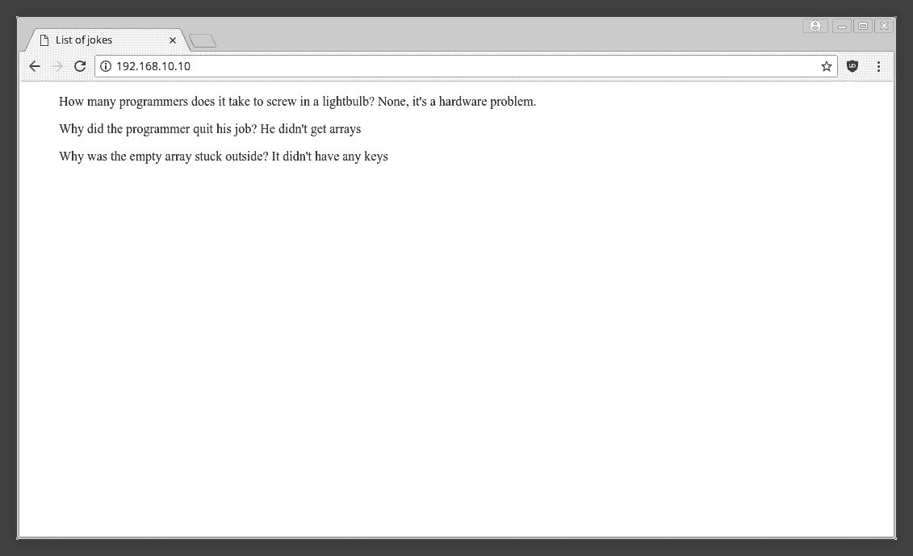

### 使用 foreach 处理 PDOStatement

还记得我们在控制器中如何使用 `while` 循环一次从 `PDOStatement` 结果集中获取一行吗？

```
while ($row = $result->fetch()) {
  $jokes[] = $row['joketext'];
}
```

事实证明，`PDOStatement` 对象在传递给 `foreach` 循环时被设计为表现得就像数组一样。因此，你可以使用 `foreach` 循环代替 `while` 循环来稍微简化数据库处理代码：

```
foreach ($result as $row) {
  $jokes[] = $row['joketext'];
}
```

我将在本书的其余部分使用这种更整洁的 `foreach` 形式。

### 简写 Echo 语法

PHP 提供的另一个不错的工具是调用 `echo` 命令的简写形式——正如你已经看到的，我们需要频繁使用它。我们的 `echo` 语句看起来像这样：

```
<?php echo $variable; ?>
```

相反，我们可以使用这个：

```
<?=$variable?>
```

这完全一样。`<?=` 表示 `echo`，为你提供了一种稍短的打印变量的方式。不过这也有局限性：如果使用 `<?=`, 你只能打印。不能包含 `if` 语句、`for` 语句等，尽管可以使用连接，并且可以在其后跟随函数调用。

以下是使用简写 echo 的更新模板。

### 示例：MySQL-ListJokes-Shorthand

```
<!doctype html>
<html>
  <head>
    <meta charset="utf-8">
    <title>List of jokes</title>
  </head>
  <body>
  <?php if (isset($error)): ?>
  <p>
    <?=$error?>
  </p>
  <?php else: ?>
  <?php foreach ($jokes as $joke): ?>
  <blockquote>
    <p>
    <?=htmlspecialchars($joke, ENT_QUOTES, 'UTF-8')?>
    </p>
  </blockquote>
  <?php endforeach; ?>
  <?php endif; ?>
  </body>
</html>
```

从现在开始，我将在适用时使用简写表示法。

### 使用简写

在 PHP 5.4 之前的版本中，这种简写表示法需要启用一个相当不常见的 PHP 设置，因此出于兼容性原因而被不鼓励使用。使用简写表示法可能会导致你的代码在从启用了该设置的服务器迁移到未启用的服务器时停止工作。


自 PHP 5.4 起（也就是你现实中会遇到的任何版本），简写 echo 无论 PHP 设置如何都能正常工作，因此你可以安全地使用它，而不必担心它在所有服务器上都无法工作。

## 提前思考

在我们刚才查看的示例中，我们创建了一个模板，`jokes.html.php`，其中包含显示页面所需的所有 HTML。然而，随着网站的增长，我们会添加更多页面。我们肯定需要一个页面让人们能够向网站添加笑话，还需要一个带有一些介绍性文字的首页、一个包含网站所有者联系方式的页面，以及随着网站的增长，或许还有一个人们可以 *log in* 到网站的页面。

我在这里有点跳得太快了，但始终值得考虑项目的增长方式。如果我们将刚才对 `jokes.html.php` 使用的方法应用到其他模板——`addjoke.html.php`、`home.html.php`、`contact.html.php`、`login.html.php` 和 so on——我们最终会得到大量重复的代码。

网站上的每个页面都需要一个模板，大致如下：

```
<!doctype html>
<html>
  <head>
    <meta charset="utf-8">
    <title>IJDB - Internet Joke Database</title>
  </head>
  <body>
  <?php if (isset($error)): ?>
  <p>
    <?=$error?>
  </p>
  <?php else: ?>
    : do whatever is required for this page: show text,
    : show a form, list records from the database, etc.
  <?php endif; ?>
  </body>
</html>
```

作为程序员，重复代码是最糟糕的事情之一。事实上，程序员经常提到 **DRY** 原则，其含义是“Don’t repeat yourself”。如果你发现自己在重复代码段，几乎肯定有更好的解决方案。

所有优秀的程序员都很懒，而重复代码意味着重复工作。使用这种复制/粘贴方法来处理模板会使网站变得难以维护。让我们想象一下，我们希望在每个页面上都出现页脚和导航部分。我们的模板现在会看起来像这样：

```
<!doctype html>
<html>
  <head>
    <meta charset="utf-8">
    <title>IJDB - Internet Joke Database</title>
  </head>
  <body>
  <nav>
    <ul>
      <li><a href="index.php">Home</a></li>
      <li><a href="jokes.php">Jokes List</a></li>
    </ul>
  </nav>

  <main>
  <?php if (isset($error)): ?>
  <p>
    <?=$error?>
  </p>
  <?php else: ?>
    : do whatever is required for this page: show text,
    : show a form, list jokes, etc.
  <?php endif; ?>
  </main>

  <footer>
  &copy; IJDB 2021
  </footer>
  </body>
</html>
```

我们会在 2022 年遇到问题！如果网站上所有页面的模板——例如，`jokes.html.php` `addjoke.html.php`、`home.html.php`、`contact.html.php` 和`login.html.php`——都包含上述结构中的代码，要将版权声明中的年份更新为“2022”，你就需要打开每个模板并更改日期。

我们可以聪明一点，让日期动态地从服务器时钟读取（`echo date('Y');` 如果你好奇的话！）以避免这个问题，但如果我们想在每个页面上都添加一个 `<script>` 标签呢？或者在菜单中添加一个新链接呢？我们仍然需要打开每个模板文件并进行更改！

更改五六个模板可能有点烦人，但不会造成太大问题。然而，如果网站增长到数十或数百个页面呢？每次你想在菜单中添加一个链接时，你就必须打开每个模板并进行更改。

这个问题 *could* 通过一系列 `include` 语句来解决。例如：

```
<!doctype html>
<html>
  <head>
    <meta charset="utf-8">
    <title>IJDB - Internet Joke Database</title>
  </head>
  <body>
  <nav>
    <?php include 'nav.html.php'; ?>
  </nav>

  <main>
  <?php if (isset($error)): ?>
  <p>
    <?=$error?>
  </p>
  <?php else: ?>
    : do whatever is required for this page: show text,
    : show a form, list jokes, etc.
  <?php endif; ?>

  </main>

  <footer>
  <?php include 'footer.html.php'; ?>
  </footer>
  </body>
</html>
```

但这种方法需要预知能力：我们需要准确预见到未来可能需要做哪些更改，并在我们预见到会发生变化的地方使用相关的 `include` 语句。

例如，在上面的示例中，通过将它们添加到 `nav.html.php` 很容易添加新的菜单项，但要在每个页面上添加一个 `<script>` 标签，甚至像给 `nav` 元素添加一个 CSS 类这样微不足道的事情，仍然意味着要打开每个模板来进行更改。

无法准确预测网站生命周期内可能需要的所有更改，因此我在本章开头向你展示的方法实际上更好：

```
<!doctype html>
<html>
  <head>
    <meta charset="utf-8">
    <link rel="stylesheet" href="jokes.css">
    <title><?=$title?></title>
  </head>
  <body>

  <header>
    <h1>Internet Joke Database</h1>
  </header>
  <nav>
    <ul>
      <li><a href="index.php">Home</a></li>
      <li><a href="jokes.php">Jokes List</a></li>
    </ul>
  </nav>

  <main>
  <?=$output?>
  </main>

  <footer>
  &copy; IJDB 2021
  </footer>
  </body>
</html>
```

如果我们始终包含这个模板，我们称之为 `layout.html.php`，就可以将 `$output` 变量设置为一些 *HTML code*，并让它与导航和页脚一起出现在页面上。这样做的好处是，要更改网站每个页面上的日期，我们只需在一个位置进行更改。

我还偷偷加入了一个 `$title` 变量，这样每个控制器都可以定义一个出现在 `<title>` 和 `</title>` 标签之间的值，以及一些 CSS（在示例代码中作为 `jokes.css` 提供）来让页面看起来更漂亮一些。

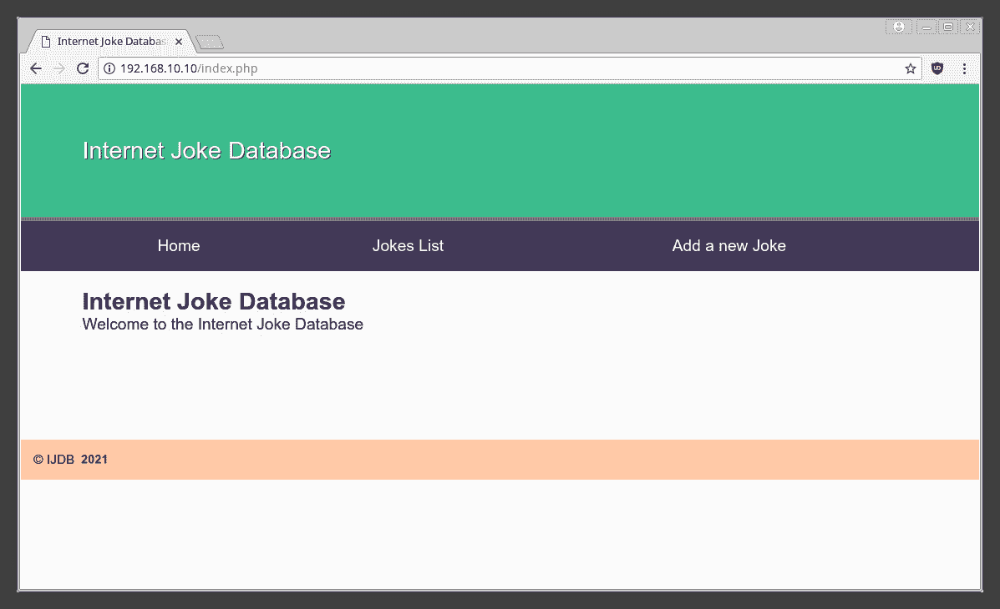

任何控制器现在都可以使用 `include __DIR__ . '/../templates/layout.html.php';` 并为 `$output` 和 `$title` 提供值。

使用 `layout.html.php` 的我们的 `jokes.php` 代码如下所示。

**示例：[MySQL-列出笑话-布局-1](https://github.com/spbooks/phpmysql7/tree/MySQL-ListJokes-Layout-1)**

```
<?php

try {
    $pdo = new PDO('mysql:host=mysql;dbname=ijdb;charset=utf8mb4', 'ijdbuser', 'mypassword');

    $sql = 'SELECT `joketext` FROM `joke`';
    $result = $pdo->query($sql);

    while ($row = $result->fetch()) {
        $jokes[] = $row['joketext'];
    }

    $title = 'Joke list';

    $output = '';

    foreach ($jokes as $joke) {
        $output .= '<blockquote>';
        $output .= '<p>';
        $output .= $joke;
        $output .= '</p>';
        $output .= '</blockquote>';
    }
} catch (PDOException $e) {
    $title = 'An error has occurred';

    $output = 'Database error: ' . $e->getMessage() . ' in ' .
  $e->getFile() . ':' . $e->getLine();
}

include  __DIR__ . '/../templates/layout.html.php';
```

但等等！`try` 块中 `$output` 到底发生了什么？`$output` 变量实际上包含了一些 HTML 代码：循环构建了一个包含笑话列表 HTML 代码的字符串。

原则上，这正是我们想要发生的事情：`$output` 变量包含将要插入到 `layout.html.php` 中导航和页脚之间的 HTML 代码，但我想你会同意这段代码非常丑陋。

我已经向你展示了如何通过 `include` 语句避免混合 HTML 和 PHP 代码。像我们之前做的那样，将显示笑话的 HTML 移到自己的文件中会很好——这次，只是将笑话列表页面独有的 HTML 代码移出。

`templates` 目录中的 `jokes.html.php` 应包含以下代码：

```
<?php foreach ($jokes as $joke): ?>
<blockquote>
  <p>
  <?=htmlspecialchars($joke, ENT_QUOTES, 'UTF-8')?>
  </p>
</blockquote>
<?php endforeach; ?>
```

重要的是，这只是用于显示笑话的代码。它不包含导航、页脚、`<head>` 标签或我们希望在每个页面上重复的任何内容；它只是笑话列表页面独有的 HTML 代码。

要使用此模板，你可以尝试以下操作：


## 输出缓冲与模板布局

```
  while ($row = $result->fetch()) {
    $jokes[] = $row['joketext'];
  }

  $title = 'Joke list';

  include 'jokes.html.php';
}
```

或者如果你很聪明：

```
  while ($row = $result->fetch()) {
    $jokes[] = $row['joketext'];
  }

  $title = 'Joke list';

  $output = include 'jokes.html.php';
}
```

采用这种方法，你的逻辑完全正确。我们需要包含 `jokes.html.php`。不幸的是，`include` 语句只是在调用时执行包含文件中的代码。如果你运行上面的代码，输出实际上会是这样的：

```
<blockquote>
  <p>
  A programmer was found dead in the shower. The instructions read: lather, rinse, repeat.
  </p>
</blockquote>
<blockquote>
  <p>
  !false - it's funny because it's true
  </p>
</blockquote>
<!doctype html>
<html>
  <head>
    <meta charset="utf-8">
    <title>Joke List</title>
  </head>
  <body>
  …
```

因为 `jokes.html.php` 首先被包含，所以它首先被发送到浏览器。我们需要做的是加载 `jokes.html.php`，但不是直接将输出发送到浏览器，而是需要捕获它并存储在 `$output` 变量中，以便稍后由 `layout.html.php` 使用。

`include` 语句不返回值，所以 `$output = include 'jokes.html.php';` 没有期望的效果，而且 PHP 没有替代语句来执行此操作。然而，这并不意味着它不可能。

PHP 有一个很有用的功能叫做“输出缓冲”。它听起来可能很复杂，但概念实际上非常简单：当你使用 `echo` 打印内容，或使用 `include` 包含包含 HTML 的文件时，通常它会直接发送到浏览器。通过使用输出缓冲，输出不会直接发送到浏览器，而是 HTML 代码存储在服务器上的“缓冲区”中，这基本上只是一个包含迄今为止打印的所有内容的字符串。

更妙的是，PHP 让你可以随时打开缓冲区并读取其内容。

## 使用输出缓冲的解决方案

我们需要两个函数：

* `ob_start()`，它启动输出缓冲。在调用此函数后，通过 `echo` 打印的任何内容或通过 `include` 打印的 HTML 将存储在缓冲区中而不是发送到浏览器。
* `ob_get_clean()`，它返回缓冲区的內容并清空它。

正如你可能猜到的，函数名中的“ob”代表“output buffer”。

要捕获包含文件的內容，我们只需要使用这两个函数：

```
while ($row = $result->fetch()) {
   $jokes[] = $row['joketext'];
}

$title = 'Joke list';

// Start the buffer

ob_start();

// Include the template. The PHP code will be executed,
// but the resulting HTML will be stored in the buffer
// rather than sent to the browser.

include  __DIR__ . '/../templates/jokes.html.php';

// Read the contents of the output buffer and store them
// in the $output variable for use in layout.html.php

$output = ob_get_clean();
}
```

当这段代码运行时，`$output` 变量将包含在 `jokes.html.php` 模板中生成的 HTML。

我们将从现在开始使用这种方法。每个页面将由两个模板组成：

* `layout.html.php`，它包含每个页面所需的所有通用 HTML
* 一个唯一的模板，它只包含特定页面独有的 HTML 代码

## 完整的 jokes.php 示例

完整的 `jokes.php` 如下所示：

```
try {
  $pdo = new PDO('mysql:host=mysql;dbname=ijdb;charset=utf8mb4', 'ijdbuser', 'mypassword');

  $sql = 'SELECT `joketext` FROM `joke`';
  $result = $pdo->query($sql);

  while ($row = $result->fetch()) {
     $jokes[] = $row['joketext'];
  }

  $title = 'Joke list';

  ob_start();

  include  __DIR__ . '/../templates/jokes.html.php';

  $output = ob_get_clean();
}
catch (PDOException $e) {
  $title = 'An error has occurred';

  $output = 'Database error: ' . $e->getMessage() . ' in ' .
  $e->getFile() . ':' . $e->getLine();
}

include  __DIR__ . '/../templates/layout.html.php';
```

## 首页示例

让我们通过添加一个 `index.php` 文件使“Home”链接生效。我们可以在此页面放置任何内容：最新的笑话、本月最佳笑话，或我们喜欢的任何内容。不过现在，我们将保持简单，只显示一条消息，内容为“Welcome to the Internet Joke Database”。

在 `templates` 文件夹中创建一个名为 `home.html.php` 的文件：

```
<h2>Internet Joke Database</h2>

<p>Welcome to the Internet Joke Database</p>
```

我们的 `index.php` 比 `jokes.html.php` 简单得多。它不会从数据库获取任何信息，所以不需要数据库连接，我们也不需要 `try … catch` 语句，所以我们只需加载两个模板并设置 `$title` 和 `$output` 变量。

示例：[MySQL-ListJokes-Layout-3](https://github.com/spbooks/phpmysql7/tree/MySQL-ListJokes-Layout-3)

```
<?php

$title = 'Internet Joke Database';

ob_start();

include  __DIR__ . '/../templates/home.html.php';

$output = ob_get_clean();

include  __DIR__ . '/../templates/layout.html.php';
```

### 仅在必要时连接数据库

这是良好的实践。数据库是许多网站上最常见的性能瓶颈，因此尽可能减少连接次数是首选。

在浏览器中测试两个页面是否正常工作。当你访问 `https://v.je/jokes.php` 时，你应该能看到笑话列表，而在 `https://v.je/jokes.php` 上可以看到欢迎消息。两个页面都应包含导航和页脚。

尝试修改 `layout.html.php`。你所做的更改将出现在两个页面上。如果网站有数十个页面，对布局的更改将影响每个页面。

## 向数据库插入数据

在本节中，我将演示如何使用你手头的工具让网站访客将自己的笑话添加到数据库中。

如果你想让网站访客输入新笑话，你显然需要一个表单。这里有一个符合要求的表单模板：

```
<form action="" method="post">
  <label for="joketext">Type your joke here:</label>
  <textarea id="joketext" name="joketext" rows="3" cols="40">
  </textarea>
  <input type="submit" name="submit" value="Add">
</form>
```

将其保存为 `templates` 目录中的 `addjoke.html.php`。

`<form>` 元素最重要的一部分是 `action` 属性。`action` 属性告诉浏览器在表单提交后将数据发送到哪里。这可以是一个文件名，例如 `"addjoke.php"`。

然而，如果你将该属性留空，设置为 `""`，用户提供的数据将被发送回你当前查看的页面。如果浏览器的 URL 显示页面为 `addjoke.php`，那么数据将在用户按下 Add 按钮时发送到那里。

让我们将此表单与前面显示数据库中笑话列表的示例关联起来。打开 `layout.html.php` 并为“Add a new Joke”链接添加一个指向 `addjoke.php` 的 URL：

```
<!doctype html>
<html>
  <head>
    <meta charset="utf-8">
    <link rel="stylesheet" href="jokes.css">
    <title><?=$title?></title>
  </head>
  <body>
  <nav>
    <header>
      <h1>Internet Joke Database</h1>
    </header>
    <ul>
      <li><a href="index.php">Home</a></li>
      <li><a href="jokes.php">Jokes List</a></li>
      <li><a href="addjoke.php">Add a new Joke</a></li>
    </ul>
  </nav>

  <main>
  <?=$output?>
  </main>

  <footer>
  &copy; IJDB 2021
  </footer>
  </body>
</html>
```

在 `layout.html.php` 打开时，如上所示包含第 2 章的 `form.css` 样式表。现在，布局内显示的任何表单都将具有我们之前使用的样式。

当此表单提交时，请求将包含一个变量——`joketext`——它包含在文本区域中输入的笑话文本。该变量随后将出现在 PHP 创建的 `$_POST` 数组中。

让我们在 `public` 目录中创建 `addjoke.php`。该控制器的基本逻辑是：


## 添加笑话示例和 SQL 注入防护

* 如果未设置 `joketext` POST 变量，则显示一个表单。
* 否则，将提供的笑话插入数据库。

## 创建骨架 `addjoke.php`

创建此骨架 `addjoke.php`：

```php
<?php
if (isset($_POST['joketext'])) {
    try {
        $pdo = new PDO('mysql:host=mysql;dbname=ijdb;charset=utf8mb4', 'ijdbuser', 'mypassword');
    } catch (PDOException $e) {
        $title = 'An error has occurred';

        $output = 'Database error: ' . $e->getMessage() . ' in ' .
    $e->getFile() . ':' . $e->getLine();
    }
} else {
    $title = 'Add a new joke';

    ob_start();

    include  __DIR__ . '/../templates/addjoke.html.php';

    $output = ob_get_clean();
}
include  __DIR__ . '/../templates/layout.html.php';
```

这段开头的 `if` 语句检查 `$_POST` 数组是否包含名为 `joketext` 的变量。如果已设置，则表单已被提交。否则，`addjoke.html.php` 中的表单将被加载到 `$output` 变量中以在浏览器中显示。

如果此时你在浏览器中打开 `addjoke.php`，你会看到表单，但输入笑话并按下 **添加** 不会起作用，因为我们还没有对 `$_POST['joketext']` 中包含的数据做任何处理。

## SQL 注入漏洞

为了将提交的笑话插入数据库，我们必须执行一个 `INSERT` 查询，使用存储在 `$_POST['joketext']` 中的值来填充 `joke` 表的 `joketext` 列。这可能会让你写出类似这样的代码：

```
$sql = 'INSERT INTO `joke` SET
  `joketext` ="' . $_POST['joketext'] . '",
  `jokedate` ="2021-02-04"';

$pdo->exec($sql);
```

然而，这段代码存在一个严重问题：`$_POST['joketext']` 的内容完全由提交表单的用户控制。如果恶意用户在表单中输入一些恶意的 SQL 代码，此脚本会毫不质疑地将其提供给你的 MySQL 服务器。这种类型的攻击称为 **SQL 注入攻击**，在 PHP 的早期，它是黑客在基于 PHP 的网站中发现并利用的最常见的安全漏洞之一。（在许多编程领域，SQL 注入攻击仍然出人意料地有效，因为开发者并不期望它们。考虑一下这个令人惊叹的尝试来让交通摄像头删除其数据库：“[SQL 注入车牌希望挫败欧洲交通摄像头](https://gizmodo.com/sql-injection-license-plate-hopes-to-foil-euro-traffic-5498412)”）

用户可能会在文本框中输入以下内容：

```
How many programmers does it take to screw in a lightbulb? None. It's a hardware problem.
```

发送到数据库的查询如下：

```
INSERT INTO `joke` SET
  `joketext` ="How many programmers does it take to screw in a lightbulb? None. It's a hardware problem.",
  `jokedate` ="2021-02-04
```

但如果用户输入以下内容：

```
A programmer's wife tells him to go to the store and "get a gallon of milk, and if they have eggs, get a dozen." He returns with 13 gallons of milk.
```

在这种情况下，发送到数据库的查询将是：

```
INSERT INTO `joke` SET
  `joketext`="A programmer's wife tells him to go to the store and "get a gallon of milk,
and if they have eggs, get a dozen." He returns with 13 gallons of milk.",
  `jokedate`="2021-02-04
```

因为笑话中包含引号字符，MySQL 将返回错误，因为它会将 “get” 前的引号视为字符串的结束。

为了使其成为有效查询，我们需要转义文本中的所有引号，以便发送到数据库的查询变为：

```
INSERT INTO `joke` SET
  `joketext`="A programmer's wife tells him to go to the store and \"get a gallon of milk, and if they have eggs, get a dozen.\" He returns with 13 gallons of milk.",
  `jokedate`="2021-02-04
```

如果数据包含引号则无法插入，这对用户来说是个令人烦恼的问题。他们会丢失输入的内容。但恶意用户能够利用这一点。在旧版本的 PHP 中，可以通过分号 (`;`) 分隔来从 PHP 运行多个查询。

想象一下如果用户在框中输入以下内容：

```
"; DELETE FROM `joke`; --
```

这将向数据库发送以下查询：

```
INSERT INTO `joke` SET
        `joketext`="";

DELETE FROM `joke`;

--`jokedate`="2021-02-04
```

`--` 在 MySQL 中是单行注释，因此最后一行将被忽略，`INSERT` 查询将运行，然后是用户输入的 `DELETE` 查询。事实上，用户可以在框中输入任何他们喜欢的查询，并且它将在数据库上运行！

## 魔术引号

在 PHP 的早期，SQL 注入攻击令人如此恐惧，以至于 PHP 团队在语言中添加了一些内置的 SQL 注入防护措施。首先，他们禁用了同时发送多个查询的能力。其次，他们添加了名为 **魔术引号** 的东西。PHP 的这个保护特性会自动分析浏览器提交的所有值，并在任何“危险”字符（如撇号）前面插入反斜杠 (`\`)——如果它们无意中包含在 SQL 查询中，可能会导致问题。

magic quotes 功能的问题在于它造成的麻烦与它防止的麻烦一样多。首先，它检测到的字符以及用于清理它们的方法（在前面加上反斜杠）仅在某些情况下有效。根据你网站和使用的数据库服务器的字符编码，这些措施可能完全无效。

其次，当提交的值用于创建 SQL 查询之外的某些目的 *其他* 时，那些反斜杠可能会非常烦人。magic quotes 功能会在用户姓氏包含撇号时插入一个多余的反斜杠。

简而言之，magic quotes 功能是个坏主意——糟糕到它从 PHP 5.4 版本开始被移除。然而，由于 PHP 的历史悠久以及现存代码的数量，你可能会遇到一些对其的引用，因此了解 magic quotes 功能本应做什么是有价值的。

一旦 magic quotes 被认定为坏主意，PHP 开发者的建议就是将其关闭。然而，这意味着有些 Web 服务器已将其关闭，而另一些则已打开。这对开发者来说是个头疼的问题：他们要么必须指示所有将使用其代码的人将其关闭——这在某些共享服务器上是不可能的——要么编写额外代码来应对它。

大多数开发者选择了后者，你可能会遇到类似这样的代码：

```
if (get_magic_quotes_gpc()) {
  // code here
}
```

如果你在处理的遗留代码中看到类似这样的 `if` 语句，可以安全地删除整个块，因为在最近的 PHP 版本中，`if` 语句内的代码永远不会被执行。

如果你确实看到了这样的代码，这意味着原始开发者理解了 magic quotes 的问题并尽力防止它。从 PHP 5.4 开始（你永远不应该遇到它，因为它不再受支持），`get_magic_quotes_gpc()` 将始终返回 `false`，代码永远不会被执行。

你真正需要了解的关于 magic quotes 的全部内容是，它是对当前问题的糟糕解决方案。当然，没有 magic quotes，你需要找到解决问题的不同方案。幸运的是，`PDO` 类可以通过使用称为“预处理语句”的东西为你完成所有繁重的工作。

## 预处理语句

**预处理语句** 是一种特殊的 SQL 查询，你已提前将其发送到数据库服务器，给服务器一个准备执行它的机会——但实际上并不执行它。把它想象成编写一个 `.php` 脚本。代码就在那里，但直到你在 Web 浏览器中访问该页面时，它实际上才会被运行。预处理语句中的 SQL 代码可以包含占位符，你将在查询 *被* 执行时稍后提供其值。在填充这些占位符时，`PDO` 足够智能，可以自动防止“危险”字符。


## 安全地准备和执行 INSERT 查询

这里是如何准备一个 `INSERT` 查询然后安全地执行它，使用 `$_POST['joketext']` 作为笑话的文本：

```
$sql = 'INSERT INTO `joke` SET
  `joketext` = :joketext,
  `jokedate` = "today's date"';

$stmt = $pdo->prepare($sql);

$stmt->bindValue(':joketext', $_POST['joketext']);
$stmt->execute();
```

## 拆解语句

让我们逐条拆解。首先，我们像往常一样将 SQL 查询写成 PHP 字符串并存储在一个变量（`$sql`）中。然而，这个 `INSERT` 查询不寻常的地方在于，`joketext` 列没有指定值。相反，它包含该值的占位符（`:joketext`）。暂时不用担心 `jokedate` 字段；我们稍后会回到它。

接下来，我们调用我们的 `PDO` 对象（`$pdo`）的 `prepare()` 方法，将我们的 SQL 查询作为参数传递。这会将查询发送到 MySQL 服务器，请求它 `prepare` 运行查询。MySQL 此时还无法运行它，因为 `joketext` 列没有值。`prepare()` 方法返回一个 `PDOStatement` 对象（是的，就是那种从 `SELECT` 查询中为我们提供结果的对象），我们将其存储在 `$stmt` 中。

现在 MySQL 已为执行准备好我们的语句，我们可以通过调用我们的 `PDOStatement` 对象（`$stmt`）的 `bindValue()` 方法来发送缺失的值。我们对每个需要提供的值调用一次此方法（在本例中，我们只需要提供一个值——笑话文本），将要填充的占位符（`':joketext'`）和要填充的值（`$_POST['joketext']`）作为参数传递。因为 MySQL 知道我们发送的是一个离散值，而不是需要解析的 SQL 代码，所以值中的字符被解释为 SQL 代码的风险为零！使用预处理语句时，SQL 注入漏洞根本不可能出现！

最后，我们调用 `PDOStatement` 对象的 `execute()` 方法，告诉 MySQL 使用我们提供的值执行查询。（是的，这个 `PDOStatement` 方法叫做 `execute()`，不像 `PDO` 对象的类似方法叫做 `exec()`。PHP 有很多优点，但一致性不是其中之一！）

这个代码中你会注意到一个有趣的事情：我们从未在笑话文本周围放置引号。`:joketext` 在查询中存在且没有任何引号，并且当我们调用 `bindValue()` 时，我们传递的是来自 `$_POST` 数组的纯笑话文本。使用预处理语句时，你不需要引号，因为数据库（在我们的例子中是 MySQL）足够智能，能够知道该文本是一个字符串，并在查询执行时将其视为字符串处理。

## 使用 CURDATE() 获取今天的日期

这段代码中悬而未决的问题是如何将今天的日期分配给 `jokedate` 字段。我们 *可以* 编写一些花哨的 PHP 代码来生成 MySQL 所需的 `YYYY-MM-DD` 格式的今天日期，但事实证明 MySQL 本身就有执行此操作的函数——`CURDATE()`：

```
$sql = 'INSERT INTO `joke` SET
  `joketext` = :joketext,
  `jokedate` = CURDATE()';

$stmt = $pdo->prepare($sql);
$stmt->bindValue(':joketext', $_POST['joketext']);
$stmt->execute();
```

这里使用 MySQL 的 `CURDATE()` 函数将当前日期分配为 `jokedate` 列的值。MySQL 实际上有数十个这样的函数，但我只会在需要时介绍它们。

## 完成 if 语句

现在我们有了查询，我们可以完成之前开始的 `if` 语句，以处理“添加笑话”表单的提交：

```
if (isset($_POST['joketext'])) {
  try {
    $pdo = new PDO('mysql:host=mysql;dbname=ijdb;charset=utf8mb4', 'ijdbuser', 'mypassword');

    $sql = 'INSERT INTO `joke` SET
      `joketext` = :joketext,
      `jokedate` = CURDATE()';

    $stmt = $pdo->prepare($sql);

    $stmt->bindValue(':joketext', $_POST['joketext']);

    $stmt->execute();
  }
  catch (PDOException $e) {
    $title = 'An error has occurred';

    $output = 'Database error: ' . $e->getMessage() . ' in ' .
    $e->getFile() . ':' . $e->getLine();
  }
}
```

但是等等！这个 `if` 语句还有一个额外的技巧。一旦我们将新笑话添加到数据库中，而不是像之前那样显示 PHP 模板，我们希望将用户的浏览器重定向回笑话列表。这样，用户就能在其中看到新添加的笑话。这就是上面 `if` 语句末尾的两行代码所做的。

## 表单提交后重定向

为了达到期望的结果，你的第一反应可能是允许控制器在添加新笑话后简单地从数据库获取笑话列表，并像往常一样使用 `jokes.html.php` 模板显示列表。这样做的问题在于，从浏览器的角度来看，笑话列表是提交“添加笑话”表单的结果。如果用户随后刷新页面，浏览器将重新提交该表单，导致新笑话的另一份副本被添加到数据库中！这很少是期望的行为。

相反，我们希望浏览器将更新后的笑话列表视为一个正常的网页，可以在不重新提交表单的情况下重新加载。实现这一点的方法是使用 HTTP 重定向来响应浏览器的表单提交——这是一种特殊响应，告诉浏览器导航到另一个页面。（HTTP 代表超文本传输协议，是描述访客网络浏览器与你的网络服务器之间交换的请求/响应通信的语言。）

PHP 的 `header()` 函数通过让你在发送给浏览器的响应中插入特定的头部，提供发送此类特殊服务器响应的手段。为了发出重定向信号，你必须发送一个 `Location` 头部，其中包含你希望将浏览器导向的页面的 URL：

```
header('Location: URL');
```

在本例中，我们希望将浏览器发送到 `jokes.php`。以下是将浏览器重定向回我们在将新笑话添加到数据库后控制器的两行代码：

```
header('Location: jokes.php');
```

## 完整的 addjoke.php 控制器

下面是 `addjoke.php` 控制器的完整代码。

**示例：[MySQL-AddJoke](https://github.com/spbooks/phpmysql7/tree/MySQL-AddJoke)**

```
<?php
if (isset($_POST['joketext'])) {
    try {
        $pdo = new PDO('mysql:host=mysql;dbname=ijdb;charset=utf8mb4', 'ijdbuser', 'mypassword');

        $sql = 'INSERT INTO `joke` SET
      `joketext` = :joketext,
      `jokedate` = CURDATE()';

        $stmt = $pdo->prepare($sql);

        $stmt->bindValue(':joketext', $_POST['joketext']);

        $stmt->execute();

        header('location: jokes.php');
    } catch (PDOException $e) {
        $title = 'An error has occurred';

        $output = 'Database error: ' . $e->getMessage() . ' in ' .
    $e->getFile() . ':' . $e->getLine();
    }
} else {
    $title = 'Add a new joke';

    ob_start();

    include  __DIR__ . '/../templates/addjoke.html.php';

    $output = ob_get_clean();
}
include  __DIR__ . '/../templates/layout.html.php';
```

在你审阅以确保一切对你有意义时，请注意，通过创建 `new PDO()` 对象来连接数据库的代码必须在运行任何数据库查询的代码之前。但显示“添加笑话”表单不需要数据库连接。连接仅在表单提交时才建立。

在浏览器中加载它并通过浏览器向数据库添加一两个新笑话。

就是这样：你能够查看现有笑话并向你的 MySQL 数据库添加新笑话。

## 从数据库中删除数据

在本节中，我们将对我们的笑话数据库网站进行最后一次改进。在笑话页面（`jokes.php`）上的每个笑话旁边，我们将放置一个标记为 **Delete** 的按钮。点击后，它将从数据库中删除该笑话并显示更新后的笑话列表。

如果你喜欢挑战，你可能想在阅读我的解决方案之前自己尝试编写此功能。虽然我们正在实现一个全新的功能，但我们主要会使用本章前面示例中使用的相同工具。以下是一些提示供你开始：


*   你需要一个新的控制器（`deletejoke.php`）。
*   将需要 SQL `DELETE` 命令，我在第 3 章中介绍过它。
*   要在你的控制器中删除特定的笑话，你需要唯一地识别它。`joke` 表中的 `id` 列就是为此目的而创建的。你必须将要删除的笑话的 ID 与删除笑话的请求一起传递。最简单的方法是使用隐藏的表单字段。

至少，花点时间思考一下你将如何处理这个问题。当你准备好查看解决方案时，请继续阅读！

首先，我们需要修改从数据库获取笑话列表的 `SELECT` 查询。除了 `joketext` 列之外，我们还必须获取 `id` 列，以便我们可以唯一地识别每个笑话：

```
try {
  $pdo = new PDO('mysql:host=mysql;dbname=ijdb;charset=utf8mb4', 'ijdbuser', 'mypassword');

  $sql = 'SELECT `id`, `joketext` FROM `joke`';
  $result = $pdo->query($sql);
  // …
```

我们还必须修改将数据库结果存储到 `$jokes` 数组中的 `while` 循环。不是简单地将每个笑话的文本作为数组中的一项存储，我们存储每个笑话的 ID 和文本。一种方法是使 `$jokes` 数组中的每个项目本身就是一个数组：

```
while ($row = $result->fetch()) {
  $jokes[] = ['id' => $row['id'], 'joketext' => $row['joketext']];
}
```

### 改用 `foreach` 循环

如果你已经改用 `foreach` 循环来处理数据库结果行，那也完全可以：

```
foreach ($result as $row) {
  $jokes[] = array('id' => $row['id'], 'joketext' =>
    $row['joketext']);
}
```

一旦此循环运行完毕，我们将拥有 `$jokes` 数组，其中的每个项目都是一个关联数组，包含两个项目：笑话的 ID 和其文本。对于每个笑话（`$jokes[n]`），因此我们可以检索其 ID（`$jokes[n]['id']`）和其文本（`$jokes[n]['text']`）。

下一步是更新 `jokes.html.php` 模板以从此新数组结构中检索每个笑话的文本，并为每个笑话提供一个 **删除** 按钮：

```
<?php foreach ($jokes as $joke): ?>
<blockquote>
  <p>
  <?=htmlspecialchars($joke['joketext'], ENT_QUOTES, 'UTF-8')?>
  <form action="deletejoke.php" method="post">
    <input type="hidden" name="id" value="<?=$joke['id']?>">
    <input type="submit" value="Delete">
  </form>
  </p>
</blockquote>
<?php endforeach; ?>
```

以下是此更新代码的亮点：

*   每个笑话都将显示一个表单，如果提交，将删除该笑话。我们使用表单的 `action` 属性将其信号发送给新的控制器 `deletejoke.php`。
*   由于 `$jokes` 数组中的每个笑话现在都由一个包含两项的数组而不是简单的字符串表示，我们必须更新此行以检索笑话的文本。我们使用 `$joke['text']` 而不是仅使用 `$joke` 来实现这一点。
*   当我们提交表单以删除此笑话时，我们会发送要删除的笑话的 ID。为此，我们需要一个包含笑话 ID 的表单字段，但我们更希望将此字段对用户隐藏；这就是为什么我们使用隐藏表单字段（`input type="hidden"`）。此字段的名称为 `id`，其值为要删除的笑话的 ID（`$joke['id']`）。

与笑话的文本不同，ID 不是用户提交的值，因此无需担心使用 `htmlspecialchars` 使其对 HTML 安全。我们可以放心它将是一个数字，因为它是由 MySQL 在笑话添加到数据库时为 `id` 列自动生成的。
*   提交按钮（`input type="submit"`）在点击时提交表单。其 value 属性为其提供 **删除** 标签。
*   最后，我们关闭此笑话的表单。

### 为什么表单和输入标签不在 blockquote 外部？

如果你了解 HTML，你可能正在思考表单和输入标签应该位于 blockquote 元素之外，因为它们不是引用文本（笑话）的一部分。

严格来说，这是正确的：表单及其输入实际上应该在 blockquote 之前或之后。不幸的是，使该标签结构清晰地显示需要一些 CSS（层叠样式表）代码，这超出了本书的范围。

与其在 PHP 和 MySQL 书中教您 CSS 布局技术，我决定使用这种不完美的标记。如果您计划在现实世界中使用此代码，您应该花一些时间学习 CSS（或至少聘请 CSS 专家）。这样，您就可以完全控制 HTML 标记，而不必担心使其看起来美观所需的 CSS。如果您想了解有关 CSS 布局的更多信息，请查看 Tiffany Brown 所著的 *[CSS 精通，第三版](https://www.sitepoint.com/premium/books/css-master-3rd-edition)*。

将以下 CSS 添加到 `jokes.css` 中以使按钮出现在笑话右侧并在它们之间画一条线：

```
blockquote {display: table; margin-bottom: 1em; border-bottom: 1px solid #ccc; padding: 0.5em;}
blockquote p {display: table-cell; width: 90%; vertical-align: top;}
blockquote form {display: table-cell; width: 10%;}
```

下图显示了添加 **删除** 按钮后的笑话列表。

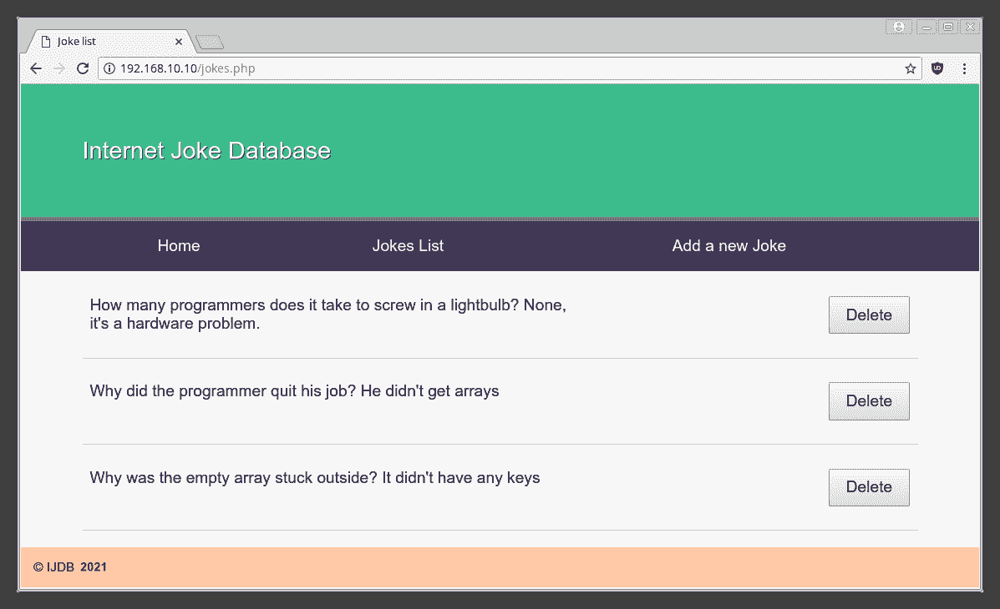

但等等！在我们继续使 **删除** 按钮工作之前，让我们先退一步仔细看看这一行：

```
$jokes[] = ['id' => $row['id'], 'joketext' => $row['joketext']];
```

这里，我们正在循环遍历 `PDOStatement` 对象，它为我们提供了一个包含键 `id` 和 `joketext` 以及相应值的 `$row` 变量，我们使用它来构建另一个具有相同键和值的数组。

您可能已经意识到这是极其低效的。我们可以使用以下代码实现相同的效果：

```
while ($row = $result->fetch()) {
  $jokes[] = $row;
}
```

但正如我们所知，这也可以使用 `foreach` 循环实现：

```
foreach ($result as $row) {
 $jokes[] = $row;
}
```

在这种情况下，我们使用 `foreach` 来遍历数据库中的记录并构建一个数组。然后我们在模板中用另一个 `foreach` 循环遍历该数组。我们可以直接写：

```
$jokes = $result;
```

现在，当在模板中遍历 `$jokes` 时，它不是一个数组而是一个 `PDOStatement` 对象。然而，这对输出没有影响并节省了一些代码。事实上，我们可以完全省略 `$result` 变量，并直接将 `PDOStatement` 对象加载到 `$jokes` 变量中。完整的 `jokes.php` 控制器现在如下所示：

```
try {
  $pdo = new PDO('mysql:host=mysql;dbname=ijdb;charset=utf8mb4', 'ijdbuser', 'mypassword');

  $sql = 'SELECT `joketext`, `id` FROM joke';

  $jokes = $pdo->query($sql);

  $title = 'Joke list';

  ob_start();

  include  __DIR__ . '/../templates/jokes.html.php';

  $output = ob_get_clean();
}
catch (PDOException $e) {
  $title = 'An error has occurred';

  $output = 'Database error: ' . $e->getMessage() . ' in ' .
  $e->getFile() . ':' . $e->getLine();
}

include  __DIR__ . '/../templates/layout.html.php';
```

现在我们在控制器中甚至没有一个遍历记录的 `while` 循环，而是在模板中直接遍历记录，节省了一些代码并使页面执行速度略快，因为它现在只遍历记录一次。

回到我们新的 **删除** 按钮：要使此新功能工作所剩下的就是添加一个相关的 `deletejoke.php` 来向数据库发出 `DELETE` 查询：


```
try {
  $pdo = new PDO('mysql:host=mysql;dbname=ijdb;charset=utf8mb4', 'ijdbuser', 'mypassword');

  $sql = 'DELETE FROM `joke` WHERE `id` = :id';

  $stmt = $pdo->prepare($sql);

  $stmt->bindValue(':id', $_POST['id']);
  $stmt->execute();

  header('location: jokes.php');
}
catch (PDOException $e) {
  $title = 'An error has occurred';

  $output = 'Unable to connect to the database server: ' . $e->getMessage() . ' in ' .
  $e->getFile() . ':' . $e->getLine();
}

include  __DIR__ . '/../templates/layout.html.php';
```

完整的更新后的 `jokes.php` 和 `deletejoke.php` 代码可作为 **示例：[MySQL-DeleteJoke](https://github.com/spbooks/phpmysql7/tree/MySQL-DeleteJoke)** 获取。

这段代码的工作方式与本章前面添加用于处理“添加笑话”代码的那段完全相同。我们首先准备一个 `DELETE` 查询，其中包含要删除的笑话 ID 的占位符。

### 是否需要预处理语句？

你可能会认为在这种情况下使用预处理语句是不必要的，以保护数据库免受 SQL 注入攻击，因为笑话 ID 是由对用户不可见的隐藏表单字段提供的。事实上，*所有* 表单字段——即使是隐藏的——最终都在用户控制之下。例如，有广泛分发的浏览器插件会使隐藏表单字段可见并可供用户编辑。请记住：从浏览器提交的任何值在保护网站安全方面最终都是可疑的。

然后我们将提交的值 `$_POST['id']` 绑定到该占位符并执行查询。一旦查询完成，我们使用 PHP `header` 函数要求浏览器发送新的请求以查看更新后的笑话列表。

### 不要使用超链接执行操作

如果你自己处理这个示例，你的第一反应可能是为每个笑话提供一个 **删除** 超链接，而不是费力为页面上的每个笑话编写一个包含 **删除** 按钮的完整 HTML 表单。事实上，这种链接的代码会简单得多：

```
<?php foreach ($jokes as $joke): ?>
  <blockquote>
    <p>
      <?=htmlspecialchars($joke['joketext'], ENT_QUOTES, 'UTF-8')?>
      <a href="deletejoke.php&amp;id=<?=$joke['id']?>">Delete</a>
    </p>
  </blockquote>
<?php endforeach; ?>
```

简而言之，超链接绝不应该用于执行 *操作*（例如删除笑话）。它们只能用于提供指向某些相关内容的链接。带有 `method="get"` 的表单也是如此，它们只能用于查询现有数据。操作只能通过提交带有 `method="post"` 的表单的结果来执行。

原因在于带有 `method="post"` 的表单会被浏览器和相关软件以不同的方式处理。例如，如果你提交了带有 `method="post"` 的表单然后点击浏览器中的刷新按钮，浏览器会询问你是否确定要重新提交表单。当涉及到链接和带有 `method="get"` 的表单时，浏览器没有类似的重新提交保护。

搜索引擎和其他网络爬虫也会遵循你网站上的所有链接，以确定何时在搜索结果中显示你网站的页面。

如果你的网站在有人点击超链接时删除了一个笑话，那么每当搜索引擎找到你的网站时，你的笑话可能会被删除。

## 任务完成

在本章中，你学习了有关 PHP 数据对象（`PDO`）的所有知识，`PDO` 是一组内置的 PHP 类（`PDO`、`PDOException` 和 `PDOStatement`），它们允许你通过创建对象然后调用它们提供的方法来与 MySQL 数据库服务器交互。在此过程中，你还掌握了面向对象编程（OOP）的基础知识——对于 PHP 初学者来说，这绝非易事！

使用 `PDO` 对象，你构建了第一个数据库驱动的网站，该网站将 `ijdb` 数据库发布到网上，并允许访客添加和删除笑话。

从某种意义上说，本章实现了本书所述的使命：教你如何构建数据库驱动的网站。当然，本章中的示例只包含最基本的内容。在本书的其余部分，我将向你展示如何完善你在本章中学到的构建骨架。

在第 5 章中，我们将回到 MySQL Workbench 中的 SQL 查询窗口。我们将学习如何使用关系数据库原理和高级 SQL 查询来表示更复杂类型的信息，并为访客添加的笑话给予署名！

# 第 5 章：关系数据库设计

自第 3 章以来，我们一直使用一个非常简单的笑话数据库，它由一个名为（恰如其分地）`joke` 的单个表组成。虽然这个数据库作为 MySQL 数据库的入门介绍非常有用，但关系数据库设计远不止能从这个简单示例中理解的内容。在本章中，我们将扩展这个数据库并学习 MySQL 的一些新功能，以实现和欣赏关系数据库所提供的真正强大功能。

请注意，我将只以一种非正式、非严格的方式涵盖几个主题。正如任何计算机科学专业人士会告诉你的那样，数据库设计是一个严肃的研究领域，具有经过测试且可数学证明的原理，虽然有用，但超出了本书的范围。

要更全面地了解数据库设计概念和 SQL 的一般内容，请阅读 *[Jump Start MySQL](https://www.sitepoint.com/premium/books/jump-start-mysql)*。

## 给予应有的署名

首先，让我们回顾一下我们的 `joke` 表的结构。它包含三个列：`id`、`joketext` 和 `jokedate`。这些列共同允许我们识别笑话（`id`），并跟踪其文本（`joketext`）和输入日期（`jokedate`）。供你参考，以下是创建此表并插入几条记录的 SQL 代码：

```
## Code to create a simple joke table

CREATE TABLE `joke` (
  `id` INT NOT NULL AUTO_INCREMENT PRIMARY KEY,
  `joketext` TEXT,
  `jokedate` DATE NOT NULL
) DEFAULT CHARACTER SET utf8 ENGINE=InnoDB;

## Adding jokes to the table

INSERT INTO `joke` SET
`joketext` = 'Why was the empty array stuck outside? It didn\'t have any keys',
`jokedate` = '2021-04-01';

INSERT INTO `joke`
(`joketext`, `jokedate`) VALUES (
'!false - It\'s funny because it\'s true',
"2021-04-01"
);
```

### 从头重建数据库

如果你需要从头重建数据库，可以使用 MySQL Workbench 删除所有表，然后转到数据导入/恢复并从示例代码中选择 `database.sql`。请注意，`database.sql` 文件会根据你查看的示例而变化。这样，你就可以使用本书代码档案中的 `.sql` 文件作为数据库快照，在需要时随时加载它们。

现在，假设我们想跟踪笑话的另一条信息：提交者的姓名。为此，在我们的 `joke` 表中添加一个新列是很自然的。SQL `ALTER TABLE` 命令（我们尚未见过）正好可以做到这一点。

正如我之前演示的那样，你可以自己输入这些查询，也可以让 MySQL Workbench 等工具为你完成。当你使用 MySQL Workbench 的 GUI 与数据库交互时，它会为你生成查询。它甚至会在应用到数据库之前向你展示这些查询。如果你不太确定如何编写查询，你可以始终让 MySQL Workbench 为你生成，然后再根据需要修改它。

SQL 查询分为两类：

*   **数据定义语言（DDL）查询**。这些是描述数据将如何存储的查询。这些是我在第 3 章向你展示的 `CREATE TABLE` 和 `CREATE DATABASE` 查询，以及前面提到的 `ALTER TABLE` 查询。


## 数据操作语言（DML）查询
这些是你用来操作数据库中数据的查询。你已经见过其中一些：`INSERT`、`UPDATE`、`DELETE` 和 `SELECT`。

对于 PHP 开发者来说，学习 DML 查询的语法和不同变体是值得的，因为它们需要在 PHP 脚本中经常输入。了解幕后发生的事情也很实用。话虽如此，让 MySQL Workbench 为你生成 DDL 查询而不是自己输入，对你作为开发者的进步也不会造成损害。由系统为你生成查询可以节省时间，因为它让你学习更少的语法，而且 DDL 查询格式通常比大多数 DML 查询更难理解。

要向数据库表添加新列，请像在第 4 章中那样打开 MySQL Workbench，连接到你的数据库，双击我们创建的名为 `ijdb` 的模式，并展开 Tables 条目。你会看到 `joke` 表。

### 如果你已注销或重启
如果自上一章以来你已注销或重启了电脑，你需要像在第 1 章中使用 `docker-compose up` 命令那样启动服务器。

要添加新列，右键单击表名并选择 **Alter Table**。这将打开熟悉的表编辑屏幕。从这里，你可以像在第 3 章中那样添加列。

添加一个名为 `authorname` 的新列，它将与每个笑话一起存储笑话作者的名字。将类型设置为 `VARCHAR(255)`。声明的类型是长度最长为 255 个字符的 **可变长度字符字符串**，`VARCHAR(255)`——这对于即使是非常冷僻的名字也绰绰有余。让我们也为作者的电子邮件地址添加一列，将列名设置为 `authoremail`，类型设置为 `VARCHAR(255)`。

一旦你按下 **Apply**，确认对话框会出现以下 DDL 查询：
```
ALTER TABLE `joke` ADD COLUMN `authorname` VARCHAR(255)
ALTER TABLE `joke` ADD COLUMN `authoremail` VARCHAR(255)
```
你本可以自己输入这些，但 MySQL Workbench 中的 GUI 提供了一些有用的错误检查，并且它总是会生成有效的查询。

只是为了确保两列已正确添加，在 SCHEMAS 面板中右键单击表名并选择 **Rows - Limit 1000**。你应该会看到两个额外的列被列出。当然，目前你的笑话中这两个字段都没有值。

这应该会给你一个如下图所示的结果表。

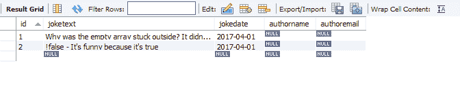

看起来不错，对吧？显然，为了适应这种扩展的表结构，我们需要对我们在第 4 章中编写的 HTML 和 PHP 表单代码进行更改，该代码允许我们向数据库添加新笑话。使用 `UPDATE` 查询，我们现在可以向表中的所有笑话添加作者详细信息。但在花费太多时间进行此类更改之前，我们应该停下来考虑一下这种新的表设计是否在这里是正确的选择。在这种情况下，结果证明它不是。

## 经验法则：保持实体分离
随着你对数据库驱动网站的了解不断增长，你可能会决定个人笑话列表太有限了。事实上，你收到的提交笑话可能比你自己的原创笑话还要多。假设你决定启动一个网站，让世界各地的人可以互相分享笑话。向每个笑话添加作者姓名和电子邮件地址当然很有意义，但我们上面使用的方法会导致潜在问题：
* 如果你网站上的常客 Joan Smith 更改了她的电子邮件地址怎么办？她可能会开始使用新地址提交新笑话，但她过去提交的笑话仍会附带旧地址。查看你的数据库，你可能会简单地认为有两个名叫 Joan Smith 的人提交了笑话。她可能会通知你地址变更，你可能会尝试用新地址更新所有旧笑话，但如果你漏掉了一个笑话，你的数据库仍会包含错误信息。数据库设计专家将这种问题称为 **更新异常**。
* 你自然会依赖数据库提供曾经向你的网站提交过笑话的所有人员列表。事实上，你可以使用以下查询轻松获得邮件列表：
```
SELECT DISTINCT `authorname`, `authoremail`
FROM `joke`
```
上述查询中的 `DISTINCT` 关键字会阻止 MySQL 输出重复的结果行。例如，如果 Joan Smith 向你的网站提交 20 个笑话，使用 `DISTINCT` 选项会使她的名字在列表中只出现一次而不是 20 次。

然后，如果出于某种原因你决定删除特定作者提交到你网站的所有笑话，你会在此过程中从数据库中删除此人的任何记录，并且你将无法再通过电子邮件向他们发送有关你网站的信息！数据库设计专家称之为 **删除异常**。

由于你的邮件列表可能是你网站收入的主要来源，仅因为你不喜欢某人提交的笑话就随意丢弃作者的电子邮件地址是不明智的。
* 你无法保证 Joan Smith 每次输入名字的方式都相同。考虑一下这些变体：Joan Smith、J. Smith、Smith、Joan——你明白我的意思了。这使得跟踪特定作者变得异常困难，尤其是如果 Joan Smith 还有几个她喜欢使用的电子邮件地址。

这些问题——以及更多问题——都可以通过使用成熟的数据库设计原则非常轻松地解决。不要将作者的信息存储在与笑话相同的表中，让我们为作者列表创建一个全新的表。就像我们在 `joke` 表中有 `id` 列用唯一数字标识每个笑话一样，我们将在新表中使用同名列来标识我们的作者。然后，我们可以在 `joke` 表中使用这些作者 ID 将作者与其笑话关联起来。完整的数据库布局如下图所示。

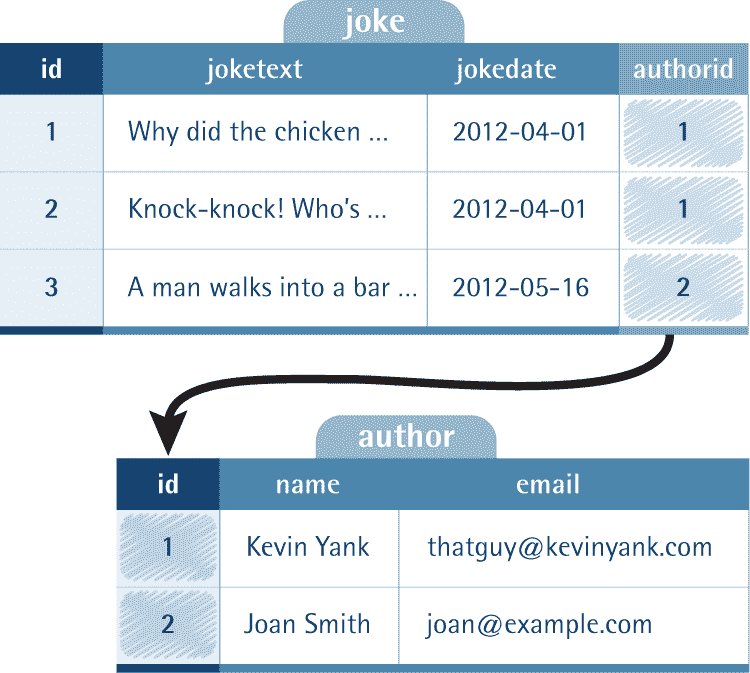

这些表显示有三个笑话和两个作者。`joke` 表的 `authorid` 列在两个表之间建立了关系，表明 Kevin Yank 提交了笑话 1 和 2，而 Joan Smith 提交了笑话 3。请注意，由于每个作者现在只在数据库中出现一次，并且独立于提交的笑话，我们避免了上面概述的所有潜在问题。

关于这种数据库设计真正重要的是，我们正在存储有关两种类型的 *事物*（笑话和作者）的信息，因此拥有两个表是最合适的。这是你在设计数据库时应始终牢记的经验法则：你想要存储信息的每种类型的实体（或“事物”）*都应有自己的表*。

从头开始设置上述数据库是相当简单的（仅涉及两个 `CREATE TABLE` 查询），但由于我们希望以非破坏性的方式进行这些更改（即不丢失我们珍贵的笑话），我们将使用 MySQL Workbench 从 `joke` 表中删除 `authorname` 和 `authoremail` 列。为此，在 SCHEMAS 列表中右键单击 `joke` 表并选择 **Alter Table**。再次，它将为你提供一个包含表中所有列的可编辑网格。要删除两列，右键单击列名并选择 **Delete Selected**。你需要对两列都执行此操作。一旦你点击 **Apply**，你会看到 MySQL Workbench 已为你生成了此查询：
```
ALTER TABLE `ijdb`.`joke`
DROP COLUMN `authoremail`,
DROP COLUMN `authorname`;
```


## 数据库模式更新和连接

## 使用 ALTER TABLE 删除列

这是一个用于删除列的 DDL `ALTER TABLE` 查询。与所有这些 DDL 查询一样，你本可以手动将其输入到查询面板并执行，但我们使用了 GUI 以避免记住所有不同的命令。

## 创建作者表

现在，我们需要创建一个新表来存储作者。为此，请按照创建 `joke` 表时使用的相同步骤操作：在 `SCHEMAS` 面板中右键单击 Tables 条目并选择 `Create Table`。

将表名设置为 `author` 并添加以下字段：
* `id`，并勾选 `PK`、`AI` 和 `NN` 框
* `name`, `VARCHAR(255)`
* `email`, `VARCHAR(255)`

单击 `Apply`，MySQL Workbench 将生成类似以下的 `CREATE TABLE` 查询：

```
CREATE TABLE `author` (
  `id` INT NOT NULL AUTO_INCREMENT PRIMARY KEY,
  `name` VARCHAR(255),
  `email` VARCHAR(255)
) DEFAULT CHARACTER SET utf8 ENGINE=InnoDB
```

最后，我们向 `joke` 表添加 `authorid` 列。编辑 `joke` 表并添加一个名为 `authorid` 的列，类型为 `INT`。

如果你愿意，这里是 `CREATE TABLE` 命令，可从头开始创建这两个表：

```
## Code to create a simple joke table that stores an author ID

CREATE TABLE `joke` (
  `id` INT NOT NULL AUTO_INCREMENT PRIMARY KEY,
  `joketext` TEXT,
  `jokedate` DATE NOT NULL,
  `authorid` INT
) DEFAULT CHARACTER SET utf8 ENGINE=InnoDB;

## Code to create a simple author table

CREATE TABLE `author` (
  `id` INT NOT NULL AUTO_INCREMENT PRIMARY KEY,
  `name` VARCHAR(255),
  `email` VARCHAR(255)
) DEFAULT CHARACTER SET utf8 ENGINE=InnoDB;
```

剩下的就是向新表添加一些作者，并通过填写 `authorid` 列为数据库中所有现有笑话分配作者。（目前，你必须手动完成此操作，但请放心，在第 8 章中，我们将看到 PHP 如何自动插入具有正确 ID 的条目，反映它们之间的关系。）如果你愿意，现在就可以这样做，因为这将让你练习 `INSERT` 和 `UPDATE` 查询。但是，如果你是从头开始重建数据库，这里有一系列 `INSERT` 查询可以完成任务：

```
## Adding authors to the database
## We specify the IDs so they're known when we add the jokes below.

INSERT INTO `author` SET
  `id` = 1,
  `name` = 'Kevin Yank',
  `email` = 'thatguy@kevinyank.com';

INSERT INTO `author` (`id`, `name`, `email`)
VALUES (2, 'Tom Butler', 'tom@r.je');

## Adding jokes to the database

INSERT INTO `joke` SET
  `joketext` = 'How many programmers does it take to screw in a lightbulb? None, it\'s a hardware problem.',
  `jokedate` = '2021-04-01',
  `authorid` = 1;

INSERT INTO `joke` (`joketext`, `jokedate`, `authorid`)
VALUES (
  'Why did the programmer quit his job? He didn\'t get arrays',
  '2021-04-01',
  1
);

INSERT INTO `joke` (`joketext`, `jokedate`, `authorid`)
VALUES (
  'Why was the empty array stuck outside? It didn\'t have any keys',
  '2021-04-01',
  2
);
```

### 两种 `INSERT`

我借此机会提醒你两种 `INSERT` 查询语法的记忆。它们执行完全相同的任务并产生相同的结果，所以使用哪一种由你决定，主要取决于个人偏好而非实际原因。

## `SELECT` 与多表

现在你的数据已分离到两个表中，似乎你在使数据检索过程复杂化。例如，考虑我们的原始目标：显示一个笑话列表，并在每个笑话旁边显示作者的姓名和电子邮件地址。在单表解决方案中，你可以使用 PHP 代码中的单个 `SELECT` 查询获得生成此类列表所需的所有信息：

```
try {
  $pdo = new PDO('mysql:host=mysql;dbname=ijdb;charset=utf8mb4', 'ijdbuser', 'mypassword');
  $pdo->setAttribute(PDO::ATTR_ERRMODE, PDO::ERRMODE_EXCEPTION);

  $sql = 'SELECT `id`, `joketext` FROM `joke`';

  $jokes = $pdo->query($sql);

  $title = 'Joke list';

  ob_start();

  include  __DIR__ . '/../templates/jokes.html.php';

  $output = ob_get_clean();
}
catch (PDOException $e) {
  $title = 'An error has occurred';

  $output = 'Database error: ' . $e->getMessage() . ' in ' .
  $e->getFile() . ':' . $e->getLine();
}

include  __DIR__ . '/../templates/layout.html.php';
```

在我们新的数据库布局中，这起初似乎不再可能。由于每个笑话的作者详细信息不再存储在 `joke` 表中，你可能会认为你需要为要显示的每个笑话单独获取这些详细信息。所需的代码将涉及对每个要显示的笑话调用 `PDO` `query` 方法。这会很混乱并涉及大量额外的代码。

综合考虑，似乎“旧方法”是更好的解决方案，尽管它存在弱点。幸运的是，像 MySQL 这样的关系数据库旨在使处理存储在多个表中的数据变得容易！使用一种名为 `join` 的 `SELECT` 语句的新形式，你可以兼得两者之利。连接允许你将多个表中的相关数据视为存储在单个表中。这是一个简单连接的语法示例：

```
SELECT columns
FROM `table1`
INNER JOIN `table2`
  ON condition(s) for data to be related
```

在你的情况下，我们感兴趣的列是 `joke` 表中的 `id` 和 `joketext`，以及 `author` 表中的 `name` 和 `email`。`joke` 表中的条目与 `author` 表中的条目相关的条件是 `joke` 表中 `authorid` 列的值等于 `author` 表中 `id` 列的值。

让我们看一个连接的例子。前两个查询显示了两个表中包含的内容；执行连接时它们是不必要的。第三个查询才是关键所在：

```
SELECT `id`, LEFT(`joketext`, 20), `authorid` FROM `joke`
```

此查询现在应给出下面所示的结果。

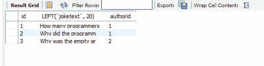

```
SELECT * FROM `author`
```

而这个查询，如你所料，将显示所有作者。


可以使用 SQL `JOIN` 语句查询两个表中的数据：

```
SELECT `joke`.`id`, LEFT(`joketext`, 20), `name`, `email`
FROM `joke` INNER JOIN `author`
  ON `authorid` = `author`.`id`
```

这将显示两个表中的所有数据。


看？第三个 `SELECT` 的结果——一个 `join`——将存储在两个表中的值分组到一个结果表中，相关数据正确地一起出现。即使数据存储在两个表中，你仍然可以使用单个数据库查询访问在网页上生成笑话列表所需的所有信息。请注意，在查询中，由于两个表中都有名为 `id` 的列，因此在引用任一 `id` 列时必须指定表名。笑话表的 ID 称为 `joke.id`，而作者表的 ID 列为 `author.id`。如果未指定表名，MySQL 将不知道你指的是哪个 `id`，并会产生以下错误：

```
Error Code: 1052. Column 'id' in field list is ambiguous
```

现在你知道如何高效地访问两个表中存储的数据，可以重写笑话列表的代码以利用连接：


```
try {
  $pdo = new PDO('mysql:host=mysql;dbname=ijdb;charset=utf8mb4', 'ijdbuser', 'mypassword');
  $pdo->setAttribute(PDO::ATTR_ERRMODE, PDO::ERRMODE_EXCEPTION);

  $sql = 'SELECT `joke`.`id`, `joketext`, `name`, `email`
    FROM `joke` INNER JOIN `author`
      ON `authorid` = `author`.`id`';

  $jokes = $pdo->query($sql);

  $title = 'Joke list';

  ob_start();

  include  __DIR__ . '/../templates/jokes.html.php';

  $output = ob_get_clean();
}
catch (PDOException $e) {
  $title = 'An error has occurred';

  $output = 'Database error: ' . $e->getMessage() . ' in ' .
  $e->getFile() . ':' . $e->getLine();
}

include  __DIR__ . '/../templates/layout.html.php';
```

然后你可以更新你的 `jokes.html.php` 模板以显示每个笑话的作者信息：

```
<?php foreach($jokes as $joke): ?>
<blockquote>
  <p>
  <?=htmlspecialchars($joke['joketext'], ENT_QUOTES, 'UTF-8')?>

  (by <a href="mailto:<?php
    echo htmlspecialchars($joke['email'], ENT_QUOTES,
      'UTF-8'); ?>"><?php
    echo htmlspecialchars($joke['name'], ENT_QUOTES,
      'UTF-8'); ?></a>)

  <form action="deletejoke.php" method="post">
    <input type="hidden" name="id" value="<?=$joke['id']?>">
    <input type="submit" value="Delete">
  </form>
  </p>
</blockquote>
<?php endforeach; ?>
```

如果运行此脚本，你将看到以下结果。


你在数据库中工作得越多，就越会意识到将来自不同表的数据组合成单个结果表的强大之处。例如，考虑以下查询，它显示了 Tom Butler 编写的全部笑话列表：

```
SELECT `joketext`
FROM `joke` INNER JOIN `author`
  ON `authorid` = `author`.`id`
WHERE `name` = "Tom Butler"
```

此查询输出的结果，如下图所示，仅来自 `joke` 表，但查询使用连接使其能够根据存储在 `author` 表中的值来搜索笑话。整本书中还会有更多类似的巧妙查询示例，但仅此一个例子就说明了连接的实际应用多种多样，在几乎所有情况下都能为你节省大量工作！


## 简单关系

数据库布局的类型通常由其需要存储的数据之间存在的关系形式决定。在本节中，我将介绍典型的关系类型，并解释如何在关系数据库中最好地表示它们。

在简单的 **一对一关系** 情况下，一个表就足够了。我们 `joke` 数据库中每个作者的电子邮件地址就是一对一关系的例子。由于每个作者只有一个电子邮件地址，每个电子邮件地址对应一个作者，因此没有理由将地址拆分到单独的表中。（此规则有例外。例如，如果单个表变得非常大且包含大量列，其中一些列在 `SELECT` 查询中很少使用，将这些列拆分到自己的表中是有意义的。这可以提高对现在更小的表的查询性能。）

**多对一关系** 稍微复杂一些，但你也已经见过其中一种。数据库中的每个笑话都只与一位作者相关联，但一位作者可能写了许多笑话。这种笑话–作者关系是多对一的。我已经讨论过将笑话作者相关信息存储在与笑话相同的表中所导致的问题。简而言之，它可能导致相同数据的许多副本，这些副本难以保持同步并浪费空间。如果我们将数据拆分为两个表并使用一个 `ID` 列将它们链接在一起，使如前所示的连接成为可能，所有这些问题都会消失。

**一对多关系** 只是在相反方向看到的多对一关系。由于笑话–作者关系是多对一的，因此作者–笑话关系是一对多，潜在上一个作者对应许多笑话。这在理论上很容易看出，但在从相反方向处理问题时就不那么明显了。在笑话和作者的情况下，我们从一个笑话库，即多开始，然后想为每个笑话指定一个作者，即一。现在让我们来看一个假设的设计问题，我们从一开始并想添加多。

假设我们希望数据库中的每个作者，即一，拥有多个电子邮件地址，即多。当数据库设计经验不足的人处理这种一对多关系时，第一个想法通常是尝试在一个数据库字段中存储多个值，如下图所示。


这可行，但要从数据库中检索单个电子邮件地址，我们需要通过搜索逗号或你选择的用作分隔符的任何特殊字符来拆分字符串。这是一个不那么简单、可能耗时的操作。试着想象删除特定作者的某个特定电子邮件地址所需的 PHP 代码！此外，你需要在 `email` 列中允许更长的值，这可能导致磁盘空间浪费，因为大多数作者只有一个电子邮件地址。

现在退一步，认识到这种一对多关系与笑话和作者之间面临的多对一关系完全相同。因此，解决方案也相同：将新实体，即在本例中为电子邮件地址，拆分到自己的表中。 resulting 数据库结构如下所示。


使用此结构的连接，我们可以轻松列出与特定作者关联的电子邮件地址：

```
SELECT `email`
FROM `author` INNER JOIN `email`
  ON `authorid` = `author`.`id`
WHERE `name` = "Kevin Yank"
```

## 多对多关系

好吧，你的网站上发布的笑话数据库现在稳步增长。事实上，增长如此之快，以至于笑话的数量变得难以管理！你的网站访问者面临着一个庞大的页面，其中包含数百个毫无结构可言的笑话。我们需要做出改变。

你决定将笑话分为以下类别：敲门笑话、过马路笑话、律师笑话、灯泡笑话和政治笑话。记住我们之前的大拇指规则，你将笑话类别识别为一个新实体，并为其创建一个表，要么通过 MySQL Workbench，要么通过发出一个 `CREATE TABLE` 查询：

```
CREATE TABLE `category` (
  `id` INT NOT NULL AUTO_INCREMENT PRIMARY KEY,
  `name` VARCHAR(255)
) DEFAULT CHARACTER SET utf8 ENGINE=InnoDB
```

此表将以与 `joke` 表具有一个 `authorid` 列来归属每个笑话给作者完全相同的方式，为每个类别存储名称和 ID。我们可以在 `joke` 表中添加一个 `categoryid` 表来将每个笑话与类别关联。甚至可以使用它来查询某个特定类别的所有笑话：

```
SELECT `joketext`, `jokedate` FROM `joke` WHERE `categoryId` = 2
```

现在你面临着为笑话分配类别的艰巨任务。你意识到政治笑话也可能是过马路笑话，敲门笑话也可能是律师笑话。单个笑话可能属于多个类别，每个类别包含多个笑话。这是一种 **多对多** 关系。


再次，许多缺乏经验的开发者开始思考如何在单个列中存储多个值，因为显而易见的解决方案是在 `joke` 表中添加一个 `category` 列，并用它来列出每个笑话所属的那些类别的 ID。这里有一个经验法则会很有用：*如果需要在单个字段中存储多个值，你的设计可能存在缺陷。*

表达多对多关系正确的方法是使用 **查找表**。这是一个不包含实际数据的表，但列出了相关的条目对。下图显示了我们笑话类别的数据库设计会是什么样子。


`jokecategory` 表将笑话 ID（`jokeid`）与类别 ID（`categoryid`）关联起来。在此示例中，我们可以看到以“有多少律师…”开头的笑话同时属于律师和灯泡类别。

查找表与其他表的创建方式基本相同。区别在于主键的选择。到目前为止我们创建的每个表都有一个名为 `id` 的列，在创建表时被指定为 `PRIMARY KEY`。将一列指定为主键会告诉 MySQL 禁止该列中的两个条目具有相同的值。它还能加快基于该列的连接操作。

对于查找表，我们没有想要强制具有唯一值的单个列。每个笑话 ID 可能出现多次，因为一个笑话可能属于多个类别，每个类别 ID 也可能出现多次，因为一个类别可能包含许多笑话。我们想要防止的是相同的 *值对* 在表中出现两次。而且，由于此表的唯一目的是促进连接，主键提供的速度优势将非常有用。因此，我们通常按如下方式使用多列主键创建查找表：

```
CREATE TABLE `jokecategory` (
  `jokeid` INT NOT NULL,
  `categoryid` INT NOT NULL,
  PRIMARY KEY (`jokeid`, `categoryid`)
) DEFAULT CHARACTER SET utf8 ENGINE=InnoDB
```

这同样可以在 MySQL Workbench 中通过为两列都勾选 `PK` 复选框来完成。这会创建一个表，其中 `jokeid` 和 `categoryid` 列共同构成 `PRIMARY KEY`。这强制执行了适合查找表的唯一性，防止某个笑话被分配到特定类别超过一次，并加快使用此表的连接操作。（如果你愿意，可以使用第 3 章中的 `CREATE TABLE` 和 `INSERT` 命令从头创建 `jokecategory` 表——以及其他表，包括表中的笑话——以便跟随操作。）

现在你的查找表已经就位并包含类别分配，你可以使用 `JOIN` 来创建几个有趣且实用的查询。此查询列出 knock-knock 类别中的所有笑话：

```
SELECT `joketext`
FROM `joke`
INNER JOIN `jokecategory`
  ON `joke`.`id` = `jokeid`
INNER JOIN `category`
  ON `categoryid` = `category`.`id`
WHERE name = "knock-knock"
```

如你所见，此查询使用了 *两个* `JOIN`。首先，它将 `joke` 表与 `jokecategory` 表连接。然后将该连接后的数据与 `category` 表连接。随着数据库结构变得更复杂，像这样的多连接查询变得很常见。

以下查询列出包含以“有多少律师…”开头的笑话的类别：

```
SELECT `name`
FROM `joke`
INNER JOIN `jokecategory`
  ON `joke`.`id` = `jokeid`
INNER JOIN `category`
  ON `categoryid` = `category`.`id`
WHERE `joketext` LIKE "How many lawyers%"
```

而此查询——它还使用我们的 `author` 表将 *四个表* 的内容连接在一起——列出了所有撰写过 knock-knock 笑话的作者姓名：

```
SELECT `author`.`name`
FROM `joke`
INNER JOIN `author`
  ON `authorid` = `author`.`id`
INNER JOIN `jokecategory`
  ON `joke`.`id` = `jokeid`
INNER JOIN `category`
  ON `categoryid` = `category`.`id`
WHERE `category`.`name` = "knock-knock"
```

这开始变得复杂了！虽然可以使用 `JOIN`，但在本书后面我们将看到一些不同的方法，可以帮助减少这种复杂性——尽管有时会以效率为代价。

我们暂时还不会向网站添加类别，但你现在至少对数据库如何结构化以实现这一点有基本的了解。

### `INNER` 和 `OUTER` 连接

SQL 中既有 `INNER` 也有 `OUTER` 连接，它们完成的工作相同，即在单个查询中从多个表中检索数据，但方式略有不同。`INNER JOIN` 只会找到两个表中都有匹配记录的记录，而 `OUTER JOIN` 会找到一个表中的所有记录以及另一个表中的匹配记录。

我们不会在本書中使用 `JOIN`，因此这种区别并不重要；但如果你想了解更多关于关系数据库的知识，我推荐 Timothy Boronczyk 所著的 *[Jump Start MySQL](https://www.sitepoint.com/premium/books/jump-start-mysql/)*。

## 一对多，多对一

在本章中，我解释了良好数据库设计的基础，并介绍了 MySQL 以及所有关系数据库管理系统如何支持实体之间不同类型关系的表示。从你对一对一关系的初始理解出发，你现在应该已将知识扩展到包括多对一、一对多和多对多关系。

在此过程中，你学习了一些常见的 SQL 命令——特别是如何使用 `SELECT` 查询将分布在多个表中的数据连接成单一结果集。

随着多个数据库表带来的表达力增强，你现在具备了扩展你在第 4 章组装的简单“笑话列表”网站以包含作者和类别的能力，而这正是第 9 章要讲的内容。在着手这个项目之前，你应该花一些时间提升你的 PHP 技能。正如你在本章学习 MySQL 数据库设计的某些细微之处一样，第 6 章将教你一些 PHP 编程的细微差别——这将使构建更完整的笑话数据库网站的工作变得更有趣。

# 第 6 章：结构化 PHP 编程

在我们全力投入 `joke` 数据库的下一个增强功能之前，让我们花一点时间磨练你的“PHP-fu”。具体来说，我想向你展示一些更好地组织代码的技巧。

结构化编码技术在几乎所有 PHP 项目中都很有用，除了最简单的项目。在第 2 章中，我们研究了如何将 PHP 代码拆分为多个文件，使用控制器和一组相关模板。这让我们可以将网站的服务器端逻辑与用于显示该逻辑生成的动态内容的 HTML 代码分开。为此，我们研究了如何使用 PHP `include` 命令。

PHP 语言提供了许多此类设施来帮助你为代码添加结构。其中最强大的无疑是对面向对象编程（`OOP`）的支持，我们在第 4 章中简要涉及过。但要使用 PHP 构建复杂（且结构良好的）应用程序，并不需要学习 OOP 的所有复杂性。值得庆幸的是，通过 PHP 的更基本功能也可以进行代码结构化。

在本章中，我将探讨一些保持 PHP 代码可管理且可维护的方法。随着项目规模的增长，代码也会增长。当你想要更改某样东西时，你需要找到想要更改的代码位置。这可能很棘手，有时需要在多个地方编辑代码。


程序员都很懒，我们不想在多个位置做同样的更改。通过将代码放在一处，并使用它与 `include` 语句，可以避免重复。如果你发现自己在复制粘贴代码，那么几乎肯定最好是将重复的代码移至自己的文件中，并在两个位置都使用 `include` 语句使用它。这通常被称为 *不要重复自己*（DRY）原则。任何时候你发现自己为一段代码伸手去按 `Ctrl` + `C`，几乎肯定有比重复同一代码两次或更多次更好的解决问题的方法。

另一方面，计算机不在乎你如何组织代码，并且会盲目地执行你给出的任何指令。程序员组织代码、减少重复并将代码拆分为小块纯粹是为了让自己的工作更轻松。当代码被拆分为小任务时，管理起来会简单得多。在一个做十几件不同事情的 1000 行 PHP 脚本中查找错误，要比在一个只执行单一任务的 30 行文件中查找同样的错误困难得多。

## 包含文件
即使是非常简单的基于 PHP 的网站也经常需要在多个地方使用相同的代码片段。你已经学会使用 PHP `include` 命令从控制器内部加载 PHP 模板。事实证明，你可以使用相同的功能来避免反复编写相同的代码，就像你对 `layout.html.php` 所做的那样：你编写了一些 HTML 代码并在每个页面上重复使用它。

**包含文件**（也仅称为 **包含**）还包含 PHP 代码片段，你可以将其加载到其他 PHP 脚本中，而不必重新输入它们。

## 包含 HTML 内容
包含文件的概念早在 PHP 之前就出现了。如果你像我一样是个老古董（在网络世界中，这意味着你超过 30 岁），你可能曾尝试过服务器端包含（SSIs）——一种在早期 Web 服务器中存在的久已被遗忘的功能。SSIs 让你可以将常用的 HTML（以及 JavaScript 和 CSS）片段放入包含文件中，然后在多个页面中使用——例如，将导航栏的代码放在一个文件中，并在每个页面上引用该文件。这样做的好处是，要在每个页面上添加导航栏的链接，你只需要编辑一个文件。

PHP 支持这种包含文件。对于主要习惯于使用纯 HTML 文件的人来说，这些包含是 PHP 提供的最立即可受益的工具之一。

在 PHP 中，包含文件最常见的是包含纯 PHP 代码，或者在 PHP 模板的情况下，包含 HTML 和 PHP 代码的混合。但你 *不必* 在包含文件中放置 PHP 代码。如果你愿意，包含文件可以只包含严格的静态 HTML。这对于在网站中共享通用设计元素最有用，例如每个页面底部的版权声明：

```
<footer>
  The contents of this web page are copyright &copy; 1998&ndash;2021
  Example LLC. All Rights Reserved.
</footer>
```

此文件是一个 **模板片段**——供 PHP 模板使用的包含文件。为了将此类文件与其他项目中的文件区分开，我建议为其命名以 `.html.php` 结尾，以区别于非模板页面。这种命名约定在以这种方式使用模板的项目中很常见。

### `.html.php` 扩展名
扩展名 `.html.php` 是可选的，但它使文件管理更轻松。例如，你可能在编辑器的不同标签页中打开了名为 `jokes.html.php` 的模板和名为 `jokes.php` 的文件。通过为文件赋予不同的扩展名，很容易快速识别它们各自是什么。

然后你可以在任何 PHP 模板中使用此片段：

```
<!DOCTYPE html>
<html lang="en">
  <head>
    <meta charset="utf-8">
    <title>A Sample Page</title>
  </head>
  <body>
  <main>
    This page uses a static include to display a standard
    copyright notice below.
  </main>
  <?php include 'footer.html.php'; ?>
  </body>
</html>
```

最后，这里是加载此模板的控制器：

```
<?php
include 'samplepage.html.php';
?>
```


上面的屏幕截图显示了页面在浏览器中的外观。

现在你需要做的就是编辑 `footer.html.php` 来更新你的版权声明。不再需要耗时的、容易出错的查找和替换操作！

当然，如果你 *真的* 想让自己的生活更轻松，你可以让 PHP 为你完成工作：

```
<p id="footer">
  The contents of this web page are copyright &copy;
  1998&ndash;<?php echo date('Y'); ?> Example LLC.
  All Rights Reserved.
</p>
```

## 包含 PHP 代码
在大多数带有数据库的网站中，几乎每个控制器脚本都必须首先建立数据库连接，最后包含 `layout.html.php` 文件。我们的控制器都遵循这种模式：

```
<?php
try {
    $pdo = new PDO('mysql:host=mysql;dbname=ijdb;charset=utf8mb4', 'ijdbuser', 'mypassword');

    // do something unique for this page
  // setting the $title and $output variables
} catch (PDOException $e) {
    $title = 'An error has occurred';

    $output = 'Unable to connect to the database server: ' . $e->getMessage() . ' in ' .
  $e->getFile() . ':' . $e->getLine();
}

include __DIR__ . '/../templates/layout.html.php';
```

长约 12 行，它只是一个稍显笨拙的代码块，但在每个控制器脚本中重复它很快就会变得烦人。许多新的 PHP 开发者经常会省略必要的错误检查以节省输入（例如，在此代码中省略 `try … catch` 语句），这可能导致在出现错误时花费大量时间寻找原因。其他人会大量使用剪贴板，将此类代码片段从现有脚本复制到新脚本中使用。有些人甚至使用文本编辑器软件的功能将有用的代码片段存储为常用片段。

与其在每个文件的顶部重复此代码，我们可以将其移至 *包含文件*。包含文件就像普通的 PHP 文件一样，但通常它们包含的代码片段仅在较大脚本的上下文中有用。因此，与模板一样，我们不希望人们能够通过在浏览器中输入文件名直接导航到这些文件，因为它们只包含小的片段，单独使用不会产生任何有意义的输出。

我们将以与处理模板相同的方式解决此问题：创建一个位于 `public` 目录之外的目录，这样放置在此新目录中的任何文件只能由其他 PHP 脚本访问。我们将此目录命名为 `includes`，并用它来存储我们的代码片段。

在新的 `includes` 目录内，创建一个名为 `DatabaseConnection.php` 的文件并将数据库连接代码放入其中：

```
<?php
$pdo = new PDO('mysql:host=mysql;dbname=ijdb;charset=utf8mb4', 'ijdbuser', 'mypassword');
```

### 命名文件
在本书的早期版本中，数据库连接被放在名为 `db.inc.php` 的文件中，当时这是约定：所有包含文件都使用 `.inc.php` 扩展名命名。这种约定已失去流行，包含文件通常使用 camelCase 创建。这部分归因于 [PSR-0 标准](http://www.php-fig.org/psr/psr-0/) 以及现代网站中面向对象编程的广泛使用。

现在你可以在控制器中使用此 `DatabaseConnection.php` 文件。修改你的每个控制器——`addjoke.php`、`deletejoke.php` 和 `jokes.php`——以包含新文件。

更新后的 `jokes.php` 看起来如下。

**示例：[结构-包含](https://github.com/spbooks/phpmysql7/tree/Structure-Include)**


```
<?php

try {
    include __DIR__ . '/../includes/DatabaseConnection.php';

    $sql = 'SELECT `joke`.`id`, `joketext`, `name`, `email`
    FROM `joke` INNER JOIN `author`
      ON `authorid` = `author`.`id`';

    $jokes = $pdo->query($sql);

    $title = 'Joke list';

    ob_start();

    include  __DIR__ . '/../templates/jokes.html.php';

    $output = ob_get_clean();
} catch (PDOException $e) {
    $title = 'An error has occurred';

    $output = 'Database error: ' . $e->getMessage() . ' in ' .
  $e->getFile() . ':' . $e->getLine();
}

include  __DIR__ . '/../templates/layout.html.php';
```

对 `addjoke.php` 和 `delete.php` 做同样的修改，使它们使用 `include` 语句而不是重复数据库连接代码。

正如你所见，无论我们的控制器何时需要数据库连接，我们只需通过 `include` 语句包含 `DatabaseConnection.php` 文件即可获取。并且由于执行此操作的代码只是一行，我们可以通过在控制器的每个 SQL 查询之前使用单独的 `include` 语句来使代码更具可读性。

当 PHP 遇到 `include` 语句时，它会暂停当前脚本并运行指定的 PHP 脚本。执行完毕后，它会返回到原始脚本并继续执行。

包含文件是组织 PHP 代码最简单的方式。正因其简单，它们也是使用最广泛的方法。即使是非常简单的 Web 应用程序，使用包含文件也能获得很大益处。

你已经看到如何在控制器中创建 `$title` 这样的变量，并且它在 `layout.html.php` 等包含文件中可用。这里，你可以看到反过来也成立。`$pdo` 变量是在 `DatabaseConnection.php` 中创建的，但可以在控制器中使用。

可以把 `include` 语句看作是自动化的复制粘贴。当 PHP 遇到行 `include __DIR__ . '/../includes/DatabaseConnection.php';` 时，它实际上读取文件中的代码并将其复制/粘贴到当前代码的 `include` 语句位置。

在你修改了所有控制器以包含 `include` 语句后，如果数据库密码更新，你只需要编辑 `DatabaseConnection.php`，而不是在每个控制器中更新密码。你不是很高兴我们现在做了这个更改，而不是等到控制器更多时再做吗？

## 包含类型

我们迄今为止使用的 `include` 语句实际上只是可以在当前运行脚本中包含另一个 PHP 文件的四个语句之一：

*   `include`
*   `require`
*   `include_once`
*   `require_once`

它们之间的唯一区别是当指定的文件无法包含时（即文件不存在，或 Web 服务器没有权限读取它）会发生什么情况。使用 `include` 时，会显示警告并且脚本继续运行。使用 `require` 时，会显示错误并且脚本停止。

### `include` 与 `require`

在生产环境中，警告和错误通常在 `php.ini` 中被禁用。在这种环境中，失败的 `include` 没有可见效果（除了通常由包含文件生成的缺失内容外），而失败的 `require` 会导致页面在失败点停止。当失败的 `require` 在任何内容发送到浏览器之前发生时，不幸的用户将只看到空白页面！

通常，只要应用程序在没有成功加载所需代码的情况下根本无法工作，就应使用 `require`。不过，我确实建议尽可能使用 `include`。例如，即使你的网站的 `DatabaseConnection.php` 文件无法加载，你可能仍希望让首页的脚本继续加载。数据库中的内容将不会显示，但用户可能可以使用页面底部的 **Contact Us** 链接来通知你问题！

`include_once` 和 `require_once` 分别的工作方式与 `include` 和 `require` 相同——但如果指定的文件在当前页面请求中已被包含至少一次（使用此处描述的四个语句中的*任意一个*），该语句将被忽略。这对于执行只需完成一次的任务的包含文件非常有用，例如连接数据库。

`include_once` 和 `require_once` 对于加载函数库也很实用，正如我们在下一节中将看到的那样。

正如你在书中后面会看到的，随着代码变得更高级，你将开始使用 *自动加载器*，并且很少需要在代码中直接编写 `include` 语句，但我有点抢跑了。

## 自定义函数和函数库

到目前为止，你可能对函数的概念已经相当熟悉。函数是可以按需调用的 PHP 代码，通常你会为其提供一个或多个参数供其使用，并且通常会得到一个返回值。你可以使用 PHP 庞大的函数库来完成 PHP 脚本几乎能被要求做的任何事情，从获取当前日期（`date`）到即时生成图形（使用 [`imagecreatetruecolor`](http://www.php.net/imagecreatetruecolor)）。

但你可能不知道的是，你可以创建自己的函数！**自定义函数**一旦定义，就像 PHP 的内置函数一样工作，并且可以做任何普通 PHP 脚本能做的事情。

让我们从一个非常简单的例子开始。假设你有一个 PHP 脚本，需要根据矩形的宽度（`3`）和高度（`5`）计算其面积。回想你在学校的基础几何课，你应该记得矩形的面积是其宽度乘以高度：

```
$areaOfRectangle = 3 * 5;
```

但如果有一个名为 `areaOfRectangle` 的函数，只需根据尺寸计算矩形的面积，那就更好了：

```
$areaOfRectangle = areaOfRectangle(3, 5);
```

巧合的是，PHP 没有内置的 `areaOfRectangle` 函数，但像你我这样的聪明的 PHP 程序员完全可以自己动手编写这个函数：

```
<?php
function areaOfRectangle($width, $height)
{
    return $width * $height;
}
```

这个包含文件定义了一个自定义函数——`areaOfRectangle`。`<?php` 标记可能是此代码中唯一看起来熟悉的行。我们这里有一个 **函数声明**。让我逐行为你解释：

```
function areaOfRectangle($width, $height)
```

关键字 `function` 告诉 PHP 我们希望为当前脚本声明一个新函数。然后，我们为函数提供一个名称（在本例中为 `areaOfRectangle`）。函数名遵循与变量名相同的规则：它们必须以字母或下划线（`_`）开头，并且可以包含字母、数字和下划线——当然，没有美元符号前缀。相反，函数名后面总是跟着一组括号（`()`），括号可以为空也可以不为空。

函数名后面的括号包含函数将接受的参数列表。你应该已经从使用 PHP 内置函数的经验中熟悉这一点。例如，当你使用 `rand` 生成随机数时，可以在括号内提供最小值和最大值。

在声明自定义函数时，不是给出参数的值列表，而是给出变量名列表。在此示例中，我们列出了两个变量：`$width` 和 `$height`。因此，当函数被调用时，它将期望接收两个参数。第一个参数的值将被赋给 `$width`，而第二个参数的值将被赋给 `$height`。然后这些变量可用于函数内部的计算。


说到计算，函数声明的其余部分是执行计算的代码，或执行函数本应做的其他操作。该代码必须用一对大括号（`{ … }`）括起来。你可以在开头和结尾大括号之间编写几乎任何你喜欢的代码，但面积函数的代码如下：

```
return $width * $height;
```

你可以将这些大括号内的代码视为一个微型的 PHP 脚本。这个函数很简单，因为它只包含一个语句——一个 `return` 语句。

一个 `return` 语句可以在函数的代码中使用，将数据从函数发送回调用它的地方。在这种情况下，我们将 `$width * $height` 计算的结果从函数中发送出去，就像 `rand()` 函数将随机数从函数发送到我们存储该数字的变量中一样。

此外，`return` 语句会立即跳回主脚本。当 PHP 解释器遇到 `return` 语句时，它会立即停止运行该函数代码并返回到函数被调用的地方。它有点像函数的弹射座椅！

单独编写一个函数什么也不做。函数内部的代码在函数被调用之前不会运行。就像本书开头使用的 `rand()` 函数一样，它只是坐着等待被调用。

你可以将编写函数想象成在电脑或手机上安装一个应用。你需要它在使用它，但一旦安装，它就处于休眠状态，可供使用，但直到你运行它才真正做任何事情。

虽然可以将函数写在我们想要运行它的同一个文件中，但这是一个坏主意。我们可能想从不同的文件中运行该函数，而且像上面数据库连接一样，重复代码是不好的。相反，我们可以将它放在自己的文件中（例如 `areaOfRectangle.php`），放在 `includes` 目录中，然后在我们希望使用它的脚本中包含它：

```
include_once  __DIR__ . '/../includes/areaOfRectangle.php';

$areaOfRectangle = areaOfRectangle(3, 5);

include 'output.html.php';
```

避免使用 `include` 或 `require` 来加载包含函数的包含文件。如本章前面“包含类型”部分所述，这样做会冒着在库中多次定义函数的风险，并在用户的屏幕上显示 PHP 警告。

将函数库包含在脚本顶部是标准做法（但不是必需的），这样你就可以快速查看任何特定脚本使用了哪些包含函数的包含文件。

我们在这里看到的是一个 **函数库** 的开端——一个包含一组相关函数声明的包含文件。如果你愿意，可以将包含文件重命名为 `geometry.php`，向其中添加一大堆函数，并执行各种几何计算。

## 变量作用域

自定义函数和包含文件之间一个很大的区别是 **变量作用域** 的概念。主脚本中存在的任何变量也将在包含文件中可用并且可以被更改。虽然有时这很有用，但更常见的是令人头疼。无意中在包含文件中覆盖主脚本的一个变量是常见错误的原因——而且这些错误可能需要很长时间才能追踪并修复！为了避免此类问题，你需要记住正在处理的脚本中的变量名，以及脚本使用的包含文件中存在的任何变量名。

函数可以保护你免受此类问题的困扰。函数就像一个拥有输入（参数）和输出（返回值）的独立迷你程序。函数所做的任何事情对调用它的脚本来说都是有效地隐藏的。调用函数的脚本向其发送一些值，然后接收返回值。函数在接收参数和返回值之间做了什么并不重要。

在函数内部创建的变量（包括任何参数变量）仅存在于该函数内部，并在函数运行完毕后消失。此外，在函数外部创建的变量在函数内部完全无法访问。函数唯一可以访问的变量是作为参数提供给它的那些变量。

用程序员的话说，这些变量的 **作用域** 是函数；它们被称为具有 **函数作用域**。相比之下，在主脚本中、在任何函数之外创建的变量在函数内部不可用。这些变量的作用域是主脚本，它们被称为具有 **全局作用域**。

好吧，但抛开这些花哨的名字，这对我们来说到底 *意味着* 什么？这意味着你可以在主脚本中有一个名为 `$width` 的变量，在函数中也有另一个名为 `$width` 的变量，而 PHP 会将它们视为两个完全不同的变量！也许更有用的是，你可以有两个不同的函数各自使用相同的变量名，它们不会相互影响，因为它们的变量是保持分离的。

在某些情况下，你可能实际上 *想* 在函数内部使用全局作用域变量（简称为 **全局变量**）。例如，`DatabaseConnection.php` 文件为脚本创建数据库连接并将其存储在全局变量 `$pdo` 中。然后你可能想在需要访问数据库的函数中使用此变量。

让我们创建一个函数来查询数据库并返回当前存储在 `joke` 表中的笑话数量。忽略变量作用域，你可能会期望这样的函数按如下方式工作：

```
include_once __DIR__ . '/../includes/DatabaseConnection.php';

function totalJokes() {
  $stmt = $pdo->prepare('SELECT COUNT(*) FROM `joke`');
  $stmt->execute();

  $row = $stmt->fetch();

  return $row[0];
}

echo totalJokes();
```

### 请注意文件放置位置

请注意，此控制器脚本的第一行使用了 `includes` 目录中 `DatabaseConnection.php` 文件的共享副本。确保你已将此文件的副本放在 `includes` 目录中。否则，PHP 会抱怨它无法找到 `DatabaseConnection.php` 文件。

`DatabaseConnection.php` 文件创建了变量 `$pdo`，我们在函数内部引用它。

`DatabaseConnection.php` 包含文件在脚本中创建了变量 `$pdo`。问题在于 `$pdo` 变量在函数的作用域内不可用。如果你尝试按原样调用此函数，你将收到以下图片中显示的错误。


此错误的原因为 **作用域**。`$pdo` 变量是在函数外部创建的，因此在函数内部不可用。

虽然 *有* [一种方法](http://php.net/manual/en/reserved.variables.globals.php) 可以使相同的 `$pdo` 变量在函数中可用，但这是一个非常糟糕的主意。（说真的，不要这样做！）例如，如果函数不小心将 `$pdo` 改为字符串——`$pdo = 'select * from joke';`——那么 `$pdo` 变量在 PHP 脚本的其他地方现在就变成了一个字符串。全局变量是一个 *非常* 糟糕的主意，会导致非常难以追踪和修复的问题。你应该不惜一切代价避免全局变量。

### 为什么全局变量很糟糕

有关全局变量为何很糟糕的更多信息，请参阅以下链接之一：

*   “[全局变量是邪恶的](https://www.cs.usfca.edu/%7Ewolber/courses/110/lectures/globals.htm)”

*   “[哇，他们是对的，全局变量很糟糕](https://blog.cranksoftware.com/wow-they-were-right-global-variables-are-bad/)”

*   “[全局变量很糟糕](http://wiki.c2.com/?GlobalVariablesAreBad)”

为了避免这种情况，你可以将 `$pdo` 作为参数使用并将其作为所需变量传递给你的函数：


```
function totalJokes($pdo) {
  $stmt = $pdo->prepare('SELECT COUNT(*) FROM `joke`');
  $stmt->execute();

  $row = $stmt->fetch();

  return $row[0];
}
```

然后，当调用该函数时，你传入在 `DatabaseConnection.php` 中创建的 `$pdo` 对象：

```
include_once __DIR__ . '/../includes/DatabaseConnection.php';
echo totalJokes($pdo);
```

这通过将其作为参数传入，使得 `$pdo` 变量在 `totalJokes` 函数中可用。值得花一点时间来准确理解这里发生了什么。`$pdo` 变量是在 `DatabaseConnection.php` 中创建的，这使得它在上面的代码块中可用。然后它被传入 `totalJokes` 函数。存储在全局 `$pdo` 变量中的对象随后被复制到函数内部名为 `$pdo` 的局部变量中。数据库连接需要作为参数传入，因为函数只能访问它们被赋予的数据；它们无法访问除所给变量之外的变量（或者，如前所述，确实有办法做到这一点，但它们几乎总是坏主意）。

通过将 `$pdo` 作为参数传入，如果函数中出现错误并且 `$pdo` 变量在函数内部被字符串覆盖，它只会在函数内部成为字符串，而不会影响脚本其余部分。

这意味着实际上存在两个不同的名为 `$pdo` 的变量。我们可以将函数内部的 `$pdo` 变量重命名为 `$database`，脚本仍然可以正常工作：

```
function totalJokes($database) {
  $stmt = $database->prepare('SELECT COUNT(*) FROM `joke`');
  $stmt->execute();

  $row = $stmt->fetch();

  return $row[0];
}
```

在这里，`$database` 变量存储的与全局作用域中 `$pdo` 变量存储的 `PDO` 连接相同。即使函数仍然使用 `totalJokes($pdo)` 调用，函数外部 `$pdo` 变量的内容与函数内部 `$database` 变量包含相同的数据库连接。尽管名称不同，两者都引用同一个连接。

如果你想深入技术细节，这个过程称为 **依赖注入**，但你需要知道的是，从实际角度来看，它是一种使单个变量在多个位置可用的方法。

## 将函数移至单独文件

将函数移至单独的文件是个好主意。将 `totalJokes` 函数放在 `includes` 目录下的名为 `DatabaseFunctions.php` 的文件中，然后你就可以按如下方式使用该函数。

**示例：[结构-总笑话数](https://github.com/spbooks/phpmysql7/tree/Structure-TotalJokes)**

```
// Include the file that creates the $pdo variable and connects to the database
include_once __DIR__ . '/../includes/DatabaseConnection.php';

// Include the file that provides the `totalJokes` function
include_once __DIR__ . '/../includes/DatabaseFunctions.php';

// Call the function
echo totalJokes($pdo);
```

将其保存为 `public` 目录下的 `showtotaljokes.php`，并在浏览器中导航到它。你应该会看到一个页面，页面大部分为空，但会显示数据库中笑话的总数。

你可能已经意识到，如果程序像这样被拆分为函数，你就需要将 `$pdo` 变量传入每个想要使用的函数。正如你可能怀疑的那样，这并不是实现此目标最高效的方式，我们稍后在学习对象和类时会看到这一点。

## 在网站中使用该函数

让我们在网站内部使用我们的新函数。在笑话列表顶部我们可以打印“[number] 条笑话已提交到互联网笑话数据库”。

打开 `jokes.php` 并将其更改为以下内容：

```
<?php

try {
    include __DIR__ . '/../includes/DatabaseConnection.php';
    include __DIR__ . '/../includes/DatabaseFunctions.php';

    $sql = 'SELECT `joke`.`id`, `joketext`, `name`, `email`
    FROM `joke` INNER JOIN `author`
      ON `authorid` = `author`.`id`';

    $jokes = $pdo->query($sql);

    $title = 'Joke list';

    $totalJokes = totalJokes($pdo);

    ob_start();

    include  __DIR__ . '/../templates/jokes.html.php';

    $output = ob_get_clean();
} catch (PDOException $e) {
    $title = 'An error has occurred';

    $output = 'Database error: ' . $e->getMessage() . ' in ' .
  $e->getFile() . ':' . $e->getLine();
}

include  __DIR__ . '/../templates/layout.html.php';
```

这创建了一个可在 `jokes.html.php` 中使用的 `$totalJokes` 变量。

**示例：[结构-总笑话列表](https://github.com/spbooks/phpmysql7/tree/Structure-TotalJokesList)**

```
<p><?=$totalJokes?> jokes have been submitted to the Internet Joke Database.</p>

<?php foreach ($jokes as $joke): ?>
<blockquote>
  <p>
  <?=htmlspecialchars($joke['joketext'], ENT_QUOTES, 'UTF-8')?>

  (by <a href="mailto:<?php
    echo htmlspecialchars(
    $joke['email'],
    ENT_QUOTES,
      'UTF-8'
); ?>"><?php
    echo htmlspecialchars(
          $joke['name'],
          ENT_QUOTES,
      'UTF-8'
      ); ?></a>)

  <form action="deletejoke.php" method="post">
    <input type="hidden" name="id" value="<?=$joke['id']?>">
    <input type="submit" value="Delete">
  </form>
  </p>
</blockquote>
<?php endforeach; ?>
```

你可能会想知道如果 `totalJokes` 函数内部的查询包含错误会发生什么。我们可以在函数内部放置一个 `try … catch` 语句，但由于该函数已在现有的 `try … catch` 语句内部被调用，因此我们不需要这样做。

异常会 *冒泡*。从实际角度来看，这意味着即使在函数内部抛出异常，它仍然会被周围的 `try … catch` 语句捕获。

最好避免在函数内部处理错误。想象一下我们在函数内部有一个 `try … catch` 语句，如下所示：

```
function totalJokes($database) {
  try {
    $stmt = $database->prepare('SELECT COUNT(*) FROM `joke`');
    $stmt->execute();

    $row = $stmt->fetch();

    return $row[0];
  }
  catch {
    $title = 'An error has occurred';

      $output = 'Database error: ' . $e->getMessage() . ' in ' .
      $e->getFile() . ':' . $e->getLine();

    include  __DIR__ . '/../templates/layout.html.php';
    die();
  }
}
```

不仅我们有重复的代码，而且现在，无论 `totalJokes` 函数从何处被调用，错误都将以相同的方式处理。通过将其排除在函数之外，可以在 `totalJokes` 函数使用的不同位置使用不同的错误处理。例如，我们可能希望使用网站生成笑话列表作为 PDF 或 Excel 文件，而不是 HTML 文档。如果是这种情况，我们当然不希望错误信息以 HTML 形式显示。

通过让错误自然发生，我们可以在不同情况下以不同方式处理错误。

## 将代码拆分为可重用函数

现在你已经熟悉声明自己的函数，可以开始编写函数来执行每个任务。例如，与每次想要从数据库读取特定笑话时都写出 `SELECT` 查询相比，你可以编写一个可重用的函数来为你完成此操作：

```
function getJoke($pdo, $id) {
  $stmt = $pdo->prepare('SELECT * FROM `joke` WHERE `id` = :id');

  $values = [
      'id' => $id
  ];
  $stmt->execute($values);

  return $stmt->fetch();
}
```

这与之前的 `totalJokes` 函数的工作方式相同。唯一的区别是有一个第二个参数 `$id`，它将存储要查找的笑话的 ID。

这使我们能够通过 ID 快速查找笑话：

```
include __DIR__ . '/../includes/DatabaseConnection.php';

//Equivalent of SELECT * FROM `joke` WHERE id = 1
$joke1 = getJoke($pdo, 1);

echo $joke1['joketext'];

//Equivalent of SELECT * FROM `joke` WHERE id = 2
$joke2 = getJoke($pdo, 2);

echo $joke2['joketext'];
```


你现在拥有函数 `getJoke` 和 `totalJokes`，它们可以在任何你想要查找特定笑话或统计数据库中笑话数量的地方使用。无需写出查询、准备它、创建值数组并执行查询，你可以用一行简短的代码完成整个过程，例如 `getJoke($pdo, 1)`。

## 使用函数替换查询

`totalJokes` 函数允许轻松查询数据库中表格里的笑话数量，而 `getJoke` 函数让我们可以快速从数据库中获取笑话。让我们采用同样的方法并将其应用于使用 `INSERT` 查询向数据库添加笑话：

```
function insertJoke($pdo, $joketext, $authorId) {
  $stmt = $pdo->prepare('INSERT INTO `joke` (`joketext`, `jokedate`, `authorId`)
      VALUES (:joketext, :jokedate, :authorId)');

  $values = [
    ':joketext' => $joketext, 
    ':authorId' => $authorId,
    ':jokedate' => date('Y-m-d')
  ];

  $stmt->execute($values);
}
```

`insertJoke` 函数允许我们通过提供数据库连接（`$pdo`）、笑话文本（`$joketext`）和作者 ID（`$authorId`）来用一行代码非常快速地向 `joke` 表中插入记录：

```
insertJoke($pdo, 'Why did the programmer quit his job? He didn\'t get arrays', 1);
```

数据库中的每一列都是该函数的参数，现在可以重复调用该函数，以远少于之前所需的代码快速发出相关的 `INSERT` 查询：

```
insertJoke($pdo, 'Why was the empty array stuck outside? It didn\'t have any keys', 1);

insertJoke($pdo, 'An SQL query goes into a bar, walks up to two tables and asks "Can I join you?"', 2);
```

这种方法比每次插入笑话时都要编写运行查询的所有代码要快得多，也更简单：准备查询、绑定参数，然后最终执行查询。

现在，最后，你*可以*使用以下控制器代码来添加笑话：

```
if (isset($_POST['joketext'])) {
  try {
    include __DIR__ . '/../includes/DatabaseConnection.php';

    $sql = 'INSERT INTO `joke` (`joketext`, `jokedate`, `authorId`)
    VALUES (:joketext, :jokedate, :authorId)';

    $stmt = $pdo->prepare($sql);

    $values = [
      ':joketext' => $_POST['joketext'], 
      ':authorId' => 1,
      ':jokedate' => date('Y-m-d')
    ];

    $stmt->execute($values);

    header('location: jokes.php');
  }
  catch (PDOException $e) {
    $title = 'An error has occurred';

    $output = 'Database error: ' . $e->getMessage() . ' in ' .
    $e->getFile() . ':' . $e->getLine();
  }
}
```

但与其这样，你可以将 `insertJoke` 和 `query` 函数放入 `DatabaseFunctions.php` 文件中，然后编写以下更简单的版本。

**示例：[结构-添加笑话](https://github.com/spbooks/phpmysql7/tree/Structure-AddJoke)**

```
if (isset($_POST['joketext'])) {
  try {
    include __DIR__ . '/../includes/DatabaseConnection.php';
    include __DIR__ . '/../includes/DatabaseFunctions.php';

    insertJoke($pdo, $_POST['joketext'], 1);

    header('location: jokes.php');
  }
  catch (PDOException $e) {
    $title = 'An error has occurred';

    $output = 'Database error: ' . $e->getMessage() . ' in ' .
    $e->getFile() . ':' . $e->getLine();
  }
}
```

你可以看到我已将 `getJoke`、`totalJokes` 和 `insertJoke` 函数放入名为 `DatabaseFunctions.php` 的文件中并按需包含它。

目前，所有笑话的 `authorId` 都将设置为 `1`。稍后，我将向你展示如何处理登录并将笑话与当前登录用户关联。

## 更新笑话

除了插入笑话之外，能够更新记录也很有用。也许其中一个笑话有拼写错误，需要更改。

更新函数比插入函数需要更多信息。它需要知道正在更新的记录的 ID，以及每列的新值：

```
function updateJoke($pdo, $jokeId, $joketext, $authorId) {
  $stmt = $pdo->prepare('UPDATE `joke` SET 
                           `authorId` = :authorId, 
                           `joketext` = :joketext 
                         WHERE `id` = :id');

  $values = [
    ':joketext' => $joketext,
    ':authorId' => $authorId,
    ':id' => $jokeId
  ];

  $stmt->execute($values);

}
```

`updateJoke` 函数可以在任何需要更新笑话的地方调用：

```
updateJoke($pdo, 1, '!false - It\'s funny because it\'s true', 1);
```

上一行将使用提供的 `authorId` 和 `jokeText` 更新 ID 为 `1` 的笑话——相当于运行以下所有代码：

```
$stmt = $pdo->prepare('UPDATE `joke` SET 
                           `authorId` = :authorId, 
                           `joketext` = :joketext 
                         WHERE `id` = :id');

$values = [
  ':joketext' => '!false - It\'s funny because it\'s true',
  ':authorId' => 1,
  ':id' => 1
];

$stmt->execute($values);
```

这是一个显著的优势。代码中任何需要更新笑话的地方，单个函数调用即可完成，节省了大量输入和重复工作。

## 在网站上编辑笑话

让我们利用我们新的函数 `getJoke` 和 `updateJoke`，添加一个允许编辑现有笑话的页面。本质上，它与 `addjoke.php` 相同。它将显示一个表单，并在表单提交时将数据发送到数据库。

然而，有两个主要区别：

*   当编辑页面加载时，它需要从数据库中检索当前笑话文本，以便用当前笑话预填充 `<textarea>`。毕竟，如果只是简单的拼写错误，你不希望让用户重新输入整个笑话！
*   当表单提交时，它需要运行 `UPDATE` 查询而不是 `INSERT` 查询。

在 `public` 目录中，创建 `editjoke.php`，内容如下：

```
<?php
try {
    include __DIR__ . '/../includes/DatabaseConnection.php';
    include __DIR__ . '/../includes/DatabaseFunctions.php';

    if (isset($_POST['joketext'])) {
        updateJoke($pdo, $_POST['jokeid'], $_POST['joketext'], 1);

        header('location: jokes.php');
    } else {
        $joke = getJoke($pdo, $_GET['id']);

        $title = 'Edit joke';

        ob_start();

        include  __DIR__ . '/../templates/editjoke.html.php';

        $output = ob_get_clean();
    }
} catch (PDOException $e) {
    $title = 'An error has occurred';

    $output = 'Database error: ' . $e->getMessage() . ' in ' .
    $e->getFile() . ':' . $e->getLine();
}

include  __DIR__ . '/../templates/layout.html.php';
```

这个新的 `editjoke.php` 页面与 `addjoke.php` 页面之间有几个主要区别。

首先，你可能已经注意到两个 include 文件已包含在页面的最顶部。这样无论表单是否已提交，数据库函数都可用。

如果表单尚未提交，我们需要查询数据库获取当前笑话文本。如果已提交，我们需要运行相关的更新查询。

其次，`try` 语句包围了 `if`，而不是 `if` 包围 `try`。原因很简单：`if` 或 `else` 块中都可能出现错误。

说到 `else` 块，那就是下一个更改。与其只是加载表单，`else` 块包含以下代码行：

```
$joke = getJoke($pdo, $_GET['id']);
```

这部分代码使用之前的 `getJoke` 函数按 ID 从数据库中选择一个笑话。正在编辑的笑话的 ID 必须使用 `GET` 变量提供——因此例如访问 `editjoke.php?id=4` 将执行查询 ``SELECT * FROM `joke` WHERE `id` = 4`` 并将结果笑话存储在 `$joke` 数组中。

`$joke` 变量现在可以在对应的模板文件 `editjoke.html.php` 中使用：


```
<form action="" method="post">
  <input type="hidden" name="jokeid" value="<?=$joke['id'];?>">
  <label for="joketext">Type your joke here:</label>
  <textarea id="joketext" name="joketext" rows="3" cols="40"><?=htmlspecialchars($joke['joketext'], ENT_QUOTES, 'UTF-8')?></textarea>
  <input type="submit" value="Save">
</form>
```

此模板与添加笑话的模板略有不同。最明显的变化是，当前笑话文本从 `$joke` 变量加载到页面加载时 `<textarea>` 中。然而，还有另一个变化：还有一个隐藏的输入字段，在提交按钮被按下时将正在编辑的笑话的 ID 发送回页面。

在 `editjoke.php` 中，表单提交后现在有两个 `$_POST` 变量可用——`$_POST['jokeid']`，表示正在编辑的笑话的 ID，以及 `$_POST['joketext']`，包含笑话的新文本。

这些然后传递到我们的 `updateJoke` 函数中：

```
updateJoke($pdo, $_POST['jokeid'], $_POST['joketext'], 1);
```

在你自己测试此示例之前，你需要在笑话列表中每个笑话旁边添加一个链接，该链接指向带有正在编辑笑话 ID 的 `editjoke.php` 控制器。如果你直接访问 `editjoke.php`，你会看到一个错误，因为 `editjoke.php` 需要正在编辑的笑话的 ID，以便将 `joketext` 列中的当前值显示在 `<textarea>` 中。

打开 `templates` 目录中的 `jokes.html.php`，并为每个笑话添加指向 `editjoke.php` 的链接：

```
<p><?=$totalJokes?> jokes have been submitted to the Internet Joke Database.</p>

<?php foreach ($jokes as $joke): ?>
<blockquote>
  <p>
  <?=htmlspecialchars($joke['joketext'], ENT_QUOTES, 'UTF-8')?>

  (by <a href="mailto:<?=htmlspecialchars($joke['email'], ENT_QUOTES,'UTF-8'); ?>"><?=htmlspecialchars($joke['name'],ENT_QUOTES, 'UTF-8'); ?></a>)

  <a href="editjoke.php?id=<?=$joke['id']?>">Edit</a>

  <form action="deletejoke.php" method="post">
    <input type="hidden" name="id" value="<?=$joke['id']?>">
    <input type="submit" value="Delete">
  </form>
  </p>
</blockquote>
<?php endforeach; ?>
```

每个笑话都链接到 `editjoke.php?id=`，后面跟上你想要编辑的笑话的 ID。当 `editjoke.php` 运行 时，具有指定 `id` 的笑话将从数据库加载并用于表单。

尝试此示例（**示例：[结构-编辑笑话](https://github.com/spbooks/phpmysql7/tree/Structure-EditJoke)**）并加载笑话列表。每个笑话在作者姓名后都会有一个 **编辑** 链接，通过点击该链接，笑话文本将被加载到表单中。当你按下 **保存** 时，它将通过调用 `updateJoke` 函数触发更新查询。

### 删除功能

现在可以用 `delete` 做同样的事情，以单行代码快速轻松地允许删除笑话：

```
function deleteJoke($pdo, $id) {

  $stmt = $pdo->prepare('DELETE FROM `joke` WHERE `id` = :id');

  $values = [
    ':id' => $id
  ];

  $stmt->execute($values);
}
```

然后调用函数从数据库中删除具有特定 ID 的笑话：

```
// Delete a joke with the ID of 2
deleteJoke($pdo, 2);
```

将函数添加到 `DatabaseFunctions.php` 并修改 `deletejoke.php` 以使用新函数：

```
<?php

try {
    include __DIR__ . '/../includes/DatabaseConnection.php';
    include __DIR__ . '/../includes/DatabaseFunctions.php';

    deleteJoke($pdo, $_POST['id']);

    header('location: jokes.php');
} catch (PDOException $e) {
    $title = 'An error has occurred';

    $output = 'Unable to connect to the database server: ' . $e->getMessage() . ' in ' .
    $e->getFile() . ':' . $e->getLine();
}

include  __DIR__ . '/../templates/layout.html.php';
```

### 选择功能

我们可以通过向 `DatabaseFunctions.php` 添加 `allJokes` 函数并相应地修改 `jokes.php` 来将相同的逻辑应用于从 `joke` 表中获取所有笑话：

```
function allJokes($pdo) {
  $stmt = $pdo->prepare('SELECT `joke`.`id`, `joketext`, `name`, `email`
    FROM `joke` INNER JOIN `author`
      ON `authorid` = `author`.`id`');

  $stmt->execute();

  return $stmt->fetchAll();
}
```

在此实例中，查询比用于 `deleteJoke` 和 `updateJoke` 的一行代码更复杂。它与我们已在 `jokes.php` 中用于选择笑话和作者信息的查询相同。

这里我使用了 `PDO` 的 `fetchAll` 函数。它返回查询检索到的所有记录的数组。你可以像这样使用新的 `allJokes` 函数：

```
$jokes = allJokes($pdo);

echo '<ul>';
foreach ($jokes as $joke) {
  echo '<li>' . $joke . '</li>';
}
echo '</ul>';
```

这将以列表形式打印出数据库中的所有笑话。

更新 `jokes.php` 控制器以使用新函数。

**示例：[结构-删除-全部笑话](https://github.com/spbooks/phpmysql7/tree/Structure-Delete-AllJokes)**

```
try {
  include __DIR__ . '/../includes/DatabaseConnection.php';
  include __DIR__ . '/../includes/DatabaseFunctions.php';

  $jokes = allJokes($pdo);

  $title = 'Joke list';

  $totalJokes = totalJokes($pdo);

  ob_start();

  include  __DIR__ . '/../templates/jokes.html.php';

  $output = ob_get_clean();
}
catch (PDOException $e) {
  $title = 'An error has occurred';

  $output = 'Database error: ' . $e->getMessage() . ' in ' .
  $e->getFile() . ':' . $e->getLine();
}

include  __DIR__ . '/../templates/layout.html.php';
```

我们现在有一组可重用的函数，可以在任何需要与数据库表交互的地方使用。无论是查找所有笑话、单个笑话，还是发出 `INSERT`、`UPDATE` 或 `DELETE` 查询，都可以在不每次都输入所有代码的情况下运行查询。在网站上任何需要与数据库表 `jokes` 交互的地方，使用我们新的一组函数都非常快速简单。

## 最佳方式

在本章中，我帮助你超越了 PHP 能为你做什么的基本问题，并开始寻找编码解决方案的 *最佳* 方式。当然，你可以将许多简单脚本视为你希望 PHP 为你执行的操作列表，但当你处理全站问题（如数据库连接、共享导航元素、访问者统计和访问控制系统）时，花时间仔细构建代码真的很值得。

我们现在已经探索了几种简单但有效的编写结构化 PHP 代码的方法。包含文件让你可以在网站的多个页面中重用同一段代码，在需要更改时大大减轻负担。编写自己的函数放入这些包含文件中，可以让你构建强大的函数库，根据需要执行任务并向调用它们的脚本返回值。这些新技术将在本书的其余部分带来巨大的回报。

在第 7 章中，你将学习如何进一步完善这些函数，使其更具可重用性，使用一些新技术，包括编写自己的对象和类。

# 第 7 章：改进插入和更新函数

在上一章中，我向你展示了如何将代码分解为易于重用的函数。这有几个优点：

*   调用函数处的代码更易于阅读
*   你可以从任何地方重用同一个函数

在本章中，我将更进一步，展示如何制作一个可用于 *任何* 数据库表的函数，然后展示面向对象编程如何进一步简化此任务。

## 改进更新函数

```
updateJoke($pdo, 1, 'Why did the programmer quit his job? He didn\'t get arrays', 1);
```

要运行此函数，必须提供该函数的所有参数：

*   笑话 ID
*   笑话文本
*   作者 ID


如果只是想更新笑话文本，而不是笑话文本和作者 ID 呢？或者只是更新笑话的作者？使用上面的 `updateJoke` 函数，每次都需要提供所有信息。

更好的做法是修改该函数，使其接受字段值作为数组，其中键表示字段名，对应的值表示要存储在数据库中的数据。例如：

```
updateJoke($pdo, [
    'id' => 1,  
    'joketext' => 'Why did the programmer quit his job? He didn\'t get arrays']
);
```

另一个示例：

```
updateJoke($pdo, [
    'id' => 1,  
    'authorId' => 4
]);
```

这样好得多，因为只需要发送正在更新的信息（以及主键）给函数即可。它还有一个优点就是更易读：你可以阅读这段代码并清楚地看到每个字段被设置为什么。使用之前的版本，你必须知道哪个参数代表哪个字段。如果你将其应用于包含 10 或 20 个字段的表，你就必须完全正确地记住参数的顺序以及每个位置的字段。

为了支持更多用例或使其更通用而重写函数的过程称为 **重构**——我们在接下来的几章中会经常做这件事！

要使函数接受数组，需要对其进行更新。目前它看起来像这样，并为每个字段接收一个参数：

```
function updateJoke($pdo, $jokeId, $joketext, $authorId) {
    $stmt = $pdo->prepare('UPDATE `joke` SET 
        `authorId` = :authorId, 
        `joketext` = :joketext 
        WHERE `id` = :id');

    $values = [
        ':joketext' => $joketext,
        ':authorId' => $authorId,
        ':id' => $jokeId
    ];

    $stmt->execute($values);

}
```

将函数更改为可以接受数组作为第二个参数并运行查询并不那么简单，因为上面的查询期望 `:authorid`、`:joketext` 和 `:primaryKey` 参数。如果没有全部提供会怎样？如果你尝试，就会得到一个错误。

为了解决这个错误，我们需要动态生成查询，使其只包含相关字段（仅我们实际想要更新的字段）。

`foreach` 循环（我们在第 2 章学过）可以遍历数组。看下面的代码：

```
$array = [
    'id' => 1,
    'joketext' => 'Why was the empty array stuck outside? It didn\'t have any keys'
];

foreach ($array as $key => $value) {
    echo $key . ': ' . $value . ',';
}
```

这将打印以下内容：

```
id: 1, joketext: Why was the empty array stuck outside? It didn’t have any keys,
```

我们可以使用 `foreach` 结合另外几个工具来生成 `UPDATE` 查询的相关部分。

可以使用 `foreach` 循环来生成 `UPDATE` 查询：

```
$array = [
    'id' => 1,
    'joketext' => '!false - it\'s funny because it\'s true'
];

$query = ' UPDATE `joke` SET ';

$updateFields = [];
foreach ($array as $key => $value) {
    $updateFields[] = '`' . $key . '` = :' . $key;
}

$query .= implode(', ', $updateFields);

$query .= ' WHERE `id` = :primaryKey';

echo $query;
```

### `.=` 运算符
注意上面 `.=` 运算符的使用。它是在现有字符串末尾添加内容，而不是覆盖它！

这里有几个步骤。首先，创建一个空数组（`$updateFields`）。然后，对于每个正在更新的字段，生成 SQL。循环结束时，`$updateFields` 数组将如下所示：

```
$updateFields = [
    'id = :id',
    'joketext => :jokeText'
];
```

最后，在循环之后，这些内容会使用 PHP 的 `implode` 函数连接起来，该函数将数组创建为单个字符串，并用第一个参数提供的文本分隔每个部分——在本例中，是逗号后跟空格：`', '`。

在上面的代码结束时，`$query` 变量将包含整个 `UPDATE` 查询的字符串：

```
UPDATE `joke` SET `id` = :id, `joketext` = :joketext WHERE `id` = :primaryKey
```

查询是根据 `$array` 的内容动态生成的，只有数组中的字段名才会出现在查询中。

你会注意到 `id` 字段包含在语句中。这不是必需的，但将其放在这里也不会有任何区别，因为如果我们将值设置为它已有的值，则不会执行更新。

以下代码可用于仅生成 `authorId` 的查询：

```
$array = [
    'id' => 1,
    'authorid' => 4
];

$query = 'UPDATE `joke` SET ';

$updateFields = [];
foreach ($array as $key => $value) {
    $updateFields[] = '`' . $key . '` = :' . $key;
}

$query .= implode(', ', $updateFields);

$query .= ' WHERE `id` = :primaryKey';

echo $query;
```

上面的代码将打印以下查询：

```
UPDATE `joke` SET `id` = :id, `authorId` = :authorId WHERE `id` = :id
```

将这段代码放入函数中后，改进版的 `updateJoke` 现在就可以使用了：

```
function updateJoke($pdo, $values) {

    $query = ' UPDATE `joke` SET ';

    $updateFields = [];
    foreach ($values as $key => $value) {
        $updateFields[] = '`' . $key . '` = :' . $key;
    }

    $query .= implode(', ', $updateFields);

    $query .= ' WHERE `id` = :primaryKey';

    // Set the :primaryKey variable
    $values['primaryKey'] = $values['id'];

    $stmt = $pdo->prepare($query);
    $stmt->execute($values);
}
```

你会注意到我用这一行手动设置了 `primaryKey` 键：

```
// Set the :primaryKey variable
$values['primaryKey'] = $values['id'];
```

这样查询中的 `WHERE` 子句就能获得相关的 ID 以进行更新。不能使用 `:id`，因为它在查询中已经被使用过，每个参数都需要一个唯一名称。

使用这个版本的 `updateJoke` 函数，现在可以按我们之前设计的方式运行它：

```
updateJoke($pdo, [
        'id' => 1,  
        'joketext' => '!false - it\'s funny because it\'s true'
    ]
);
```

或者我们可以这样做：

```
updateJoke($pdo, [
        'id' => 1,  
        'authorId' => 4
    ]
);
```

### 编写函数
编写函数时，通常先写一些你认为它应该如何被调用的示例，再编写函数内部的代码会更容易。这为你提供了一个目标，以及一些可以运行的代码来查看它是否正常工作。

### 改进插入函数
利用这些知识，我们可以对 `insertJoke` 函数做同样的事情。

就像我们对更新函数所做的那样，让我们先思考一下它被调用时会是什么样子。函数将接受一个数组，表示要添加的笑话，如下所示：

```
insertJoke($pdo, [
    'authorId' => 4,
    'joketext' => '!false - it\'s funny because it\'s true',
    'jokedate' = '2021-04-22'
    ]
);
```

要使 `insertJoke` 函数以这种方式工作，它需要接受一个数组并根据提供的字段生成 `INSERT` 查询，就像我们刚才对 `updateJoke` 函数所做的那样。

我们将要生成的 `INSERT` 查询如下所示：

```
$query = 'INSERT INTO `joke` (`joketext`, `jokedate`, `authorId`)
    VALUES (:joketext, :jokedate, :authorId)';
```

这分为两部分——字段名和值。首先，让我们处理列名。就像我们对 `updateJoke` 函数所做的那样，我们可以使用循环和 `implode` 来创建查询第一行的字段列表：

```
function insertJoke($pdo, $values) {
    $query = 'INSERT INTO `joke` (';

    $insertFields = [];
    foreach ($array as $key => $value) {
        $updateFields[] = '`' . $key . '`';
    }

    $query .= implode(', ', $updateFields);

    $query .= ') VALUES (';
}
```

`foreach` 遍历 `$values` 数组中的每个元素，并使用数组中的键（包含字段名）生成一个逗号分隔的字段列表。


## 使用 PDO 进行动态 INSERT

## 构建查询

这将生成查询的第一部分，并且 `$query` 将存储以下内容：

```
INSERT INTO `joke` (`authorId`, `:jokedate`, `joketext`) VALUES (
```

… when called with this array:

… 当使用以下数组调用时：

```
[
    'authorId' => 4,
    'joketext' => '!false - it\'s funny because it\'s true'
    'jokedate' = '2021-04-22'
]
```

查询的下一部分应该是值的占位符：

```
VALUES (:authorId, :joketext)
```

这些是以冒号 (`:`) 为前缀的键。再次，我们可以使用 `foreach` 循环遍历列名并在将查询发送到数据库之前添加占位符：

```
function insertJoke($pdo, $values) {
    $query = 'INSERT INTO `joke` (';

    foreach ($values as $key => $value) {
        $query .= '`' . $key . '`,';
    }

    $query = rtrim($query, ',');

    $query .= ') VALUES (';

    foreach ($values as $key => $value) {
        $query .= ':' . $key . ',';
    }

    $query = rtrim($query, ',');

    $query .= ')';

    $stmt = $pdo->prepare($query);

    $stmt->execute($values);

}
```

## 使用 insertJoke

`insertJoke` 函数现在可用于使用一个指定哪个值将被放置到哪个列中的数组来插入笑话：

```
insertJoke($pdo, [
    'authorId' => 4,
    'joketext' => '!false - it\'s funny because it\'s true',
    'jokedate' = '2021-04-22'
    ]
);
```

当然，如果使用错误的列名，它将导致错误，但对查看此代码的任何人来说都很清楚哪些数据被放置到每列中。正如我们稍后会看到的，这也使得使用该函数与表单变得更容易。

现在，通过在 `DatabaseFunctions.php` 中替换现有函数，使你的网站使用这两个新函数。然后修改 `editjoke.php` 以使用新的 `updateJoke` 函数：

```
updateJoke($pdo, [
    'id' => $_POST['jokeid'],
    'joketext' => $_POST['joketext'],
    'authorId' => 1
]);
```

最后，修改 `addjoke.php` 以使用新函数。

[结构 2-数组函数-错误](https://github.com/spbooks/phpmysql7/tree/Structure2-ArrayFunctions-Error)

```
insertJoke($pdo, [
                    'authorId' => 1, 
                    'joketext' => $_POST['joketext'],
                    'jokedate' => date('Y-m-d')
            ]
 );
```

## 处理日期

你可能想知道在向数据库插入日期时，如何设置特定日期而不是当前日期。

之前，我们使用了 `date()` 函数。使用新的 `insertJoke` 函数，你可能会尝试这样设置笑话：

```
insertJoke($pdo, ['authorId' => 1,
    'jokeText' => $_POST['joketext'],
    'jokedate' =>  date('Y-m-d')
]);
```

`date()` 函数在我们想要使用系统日期时简单易用，但如果我们想要轻松设置特定日期，我们可以使用不同的工具。PHP `DateTime` 类可用于在 PHP 中表示日期并以任何方式格式化它们。例如：

```
$date = new DateTime();

echo $date->format('d/m/Y H:i:s');
```

与更简单的 `date()` 函数类似，默认情况下，`DateTime` 的新实例（不提供参数）将表示今天的日期，并且 `format` 方法中的字符串与你已熟悉的 `date()` 函数中使用的格式相同。如果你于 2021 年 9 月 8 日大约晚上 7 点阅读本文，它会打印类似以下内容：

```
08/09/2021 19:12:34
```

`DateTime` 类相对于 `date()` 函数的最大优势在于，你可以给它一个代表任意日期的字符串，并让它将其转换为不同的日期格式。例如：

```
$date = new DateTime('5th March 2021');

echo $date->format('d/m/Y');
```

这里的字符串 `d/m/Y` 代表日/月/年，这将打印 `05/03/2021`。PHP `DateTime` 类非常强大，并且在处理 PHP 中的日期时非常有用。有关格式化日期的可用方法的完整列表可在 [在 PHP 手册中](http://php.net/manual/en/function.date.php) 找到。

`DateTime` 类可用于表示任何日期和时间。今天的日期可以以此格式表示，如下所示：

```
// Don't give it a date so it uses the current date/time
$date = new DateTime();

echo $date->format('Y-m-d H:i:s');
```

上面将打印类似以下内容：

```
2021-09-08 19:16:34
```

这是你在 MySQL 中向 `DATETIME` 字段插入数据时需要的格式。

`insertJoke` 函数已经可以处理此问题。我们只需将当前日期作为数组键之一传递给函数即可：

```
$date = new DateTime();

insertJoke($pdo, [
    'authorId' => 4,
    'joketext' => 'Why did the chicken cross the road? To get to the other side',
    'jokedate' => $date->format('Y-m-d H:i:s')
    ]
);
```

这将正常工作。然而，这与仅使用 `date()` 函数并没有什么不同，并且每次我们想要使用该函数时，都需要记住 MySQL 使用的日期格式。这可能有点麻烦，因为每次需要插入日期时都需要重复格式化日期的代码（并记住字符串 `Y-m-d H:i:s`）。

相反，更好的方法是将函数格式化日期供我们使用，每次调用时节省一些工作：

```
function insertJoke($pdo, $values) {
    $query = 'INSERT INTO `joke` (';

    foreach ($values as $key => $value) {
        $query .= '`' . $key . '`,';
    }

    $query = rtrim($query, ',');

    $query .= ') VALUES (';

    foreach ($values as $key => $value) {
        $query .= ':' . $key . ',';
    }

    $query = rtrim($query, ',');

    $query .= ')';

    foreach ($values as $key => $value) {
        if ($value instanceof DateTime) {
            $values[$key] = $value->format('Y-m-d');
        }
    }

        $stmt = $pdo->prepare($query);

        $stmt->execute($values);
}
```

使用上述版本的函数，可以在不格式化的情况下将日期 `object` 传递给函数：

```
insertJoke($pdo, [
    'authorId' => 4,
    'joketext' => '!false - it\'s funny because it\'s true',
    'jokedate' =>  new DateTime()
    ]
);
```

函数将查找它收到的任何日期对象并自动将其格式化为 MySQL 所需的格式。调用函数时，你无需记住 MySQL 所需的确切格式；它在函数内部为你完成。函数将自动将遇到的任何 `DateTime` 对象转换为 MySQL 可理解的字符串：

```
// Loop through the array of fields
foreach ($values as $key => $value) {
    // If any of the values are a DateTime object
    if ($value instanceof DateTime) {
        // Then replace the value in the array with the date in the format
        // Y-m-d H:i:s
        $values[$key] = $value->format('Y-m-d H:i:s');
    }
}
```

你尚未遇到过的一个运算符是 `instanceof` 运算符。这是一个像 `==` 或 `!=` 这样的比较运算符。然而，它不是检查两个值是否 *相同*，而是检查左侧的变量（`$value`）是否与右侧的对象（`DateTime`）是同一类型。一个重要的区别是 *值* 并未被检查，只有 *类型*。这就像说“它是一辆车吗？”而不是“它是一辆 E-Type 捷豹吗？”

无论在数组中何处找到 `DateTime` 对象，它都会被替换为 MySQL 所需格式的等效日期字符串。这使我们完全可以忘记 MySQL 实际需要的格式，只需向 `insertJoke` 函数提供 `DateTime` 对象即可。

有了这段代码，如果我们想要指定要设置在数据库中的日期，可以这样做：

```
insertJoke($pdo, [
        'authorId' => 4,
        'joketext' => '!false - it\'s funny because it\'s true',
        'jokedate' =>  new DateTime('5th September 2021')
        ]
);
```

`insertJoke` 函数将看到 `DateTime` 实例并自动将其转换为 MySQL 使用的格式。

让我们也将自动日期格式化添加到 `updateJoke` 函数中：


```
function updateJoke($pdo, $values) {

    $query = ' UPDATE joke SET ';

    foreach ($values as $key => $value) {
        $query .= '`' . $key . '` = :' . $key . ',';
    }

    $query = rtrim($query, ',');

    $query .= ' WHERE id = :primarykey';

    foreach ($values as $key => $value) {
        if ($value instanceof DateTime) {
            $values[$key] = $value->format('Y-m-d H:i:s');
        }
    }

    // Set the :primaryKey variable
    $values['primaryKey'] = $values['id'];

        $stmt = $pdo->prepare($query);
        $stmt->execute($values);
}
```

这将采用我们在 `insertJoke` 中使用的方法并将其应用于 `updateJoke` 函数。传递给函数 `$values` 数组中的任何 `DateTime` 对象都将被转换为 MySQL 可理解的字符串。

由于我们复制/粘贴了代码，将重复的代码移至自己的函数中以节省重复并遵循 DRY 原则是一个良好的实践：

```
function processDates($values) {
    foreach ($values as $key => $value) {
        if ($value instanceof DateTime) {
            $values[$key] = $value->format('Y-m-d H:i:s');
        }
    }

    return $values;
}
```

此 `processDates` 函数接受一个名为 `$values` 的数组，遍历它们，并将任何 `DateTime` 实例替换为格式化的日期。重要的是，它返回已用更新值修改的数组。函数调用方式如下：

```
$values = processDates($values);
```

此时，`$values` 数组将被 *复制* 到 `processDates` 函数中，并将修改后数组的副本 *返回*。通过使用 `$values =`，原始 `$values` 数组将被 `processDates` 函数中已替换 `DateTime` 实例的数组替换。

我们也可以这样调用函数：

```
processDates($values);
```

如果这样做，`$values` 数组将保持与 `insertJoke` 函数中相同的状态。更新后的数组仅存在于 `processDates` 函数中，因此我们必须使用 `return` 将更新后的数组从函数中复制出来。

### 避免复制/粘贴

如果您发现自己伸手去按 `ctrl` + `c` 和 `ctrl` + `v`，最好将代码移至具有相关参数的函数中，就像我们刚才所做的那样。这样，如果代码中有错误或需要修改它，您只需在一个地方进行更改！

让我们将该函数放入 `DatabaseFunctions.php` 中，并更改 `updateJoke` 和 `insertJoke` 函数以使用它：

```
function insertJoke($pdo, $values) {
    $query = 'INSERT INTO `joke` (';

    foreach ($values as $key => $value) {
        $query .= '`' . $key . '`,';
    }

    $query = rtrim($query, ',');

    $query .= ') VALUES (';

    foreach ($values as $key => $value) {
        $query .= ':' . $key . ',';
    }

    $query = rtrim($query, ',');

    $query .= ')';

    $values = processDates($values);

        $stmt = $pdo->prepare($query);
        $stmt->execute($values);
}
```

```
function updateJoke($pdo, $values) {

    $query = ' UPDATE `joke` SET ';

    foreach ($values as $key => $value) {
        $query .= '`' . $key . '` = :' . $key . ',';
    }

    $query = rtrim($query, ',');

    $query .= ' WHERE `id` = :primaryKey';

    // Set the :primaryKey variable
    $values['primaryKey'] = $values['id'];

    $values = processDates($values);

        $stmt = $pdo->prepare($query);
        $stmt->execute($values);
}
```

最后，修改 `addjoke.php` 以为 `jokedate` 列的值提供 `DateTime()` 对象。

[`Structure2-数组函数-日期`](https://github.com/spbooks/phpmysql7/tree/Structure2-ArrayFunctions-Dates)

```
insertJoke($pdo, ['authorId' => 1,
    'jokeText' => $_POST['joketext'],
    'jokedate' => new DateTime()
]);
```

### 显示笑话日期

既然我们正在处理日期，让我们在模板中与作者姓名一起显示笑话发布的日期。页面现在将显示类似“By Tom Butler on 2021-08-04”的内容。

首先，我们需要修改 `allJokes` 函数以从数据库中检索日期：

```
function allJokes($pdo) {
    $stmt =  $pdo->prepare($pdo, 'SELECT `joke`.`id`, `joketext`, `jokedate`, `name`, `email`
        FROM `joke` INNER JOIN `author`
        ON `authorid` = `author`.`id`');

        $stmt->execute();

    return $stmt->fetchAll();
}
```

现在我们可以在 `jokes.html.php` 模板文件中引用日期列：

```
<p><?=$totalJokes?> jokes have been submitted to the Internet Joke Database.</p>

<?php foreach ($jokes as $joke): ?>
<blockquote>
    <p>
    <?=htmlspecialchars($joke['joketext'], ENT_QUOTES, 'UTF-8')?>

    (by <a href="mailto:<?=htmlspecialchars(
        $joke['email'],
        ENT_QUOTES,
                'UTF-8'
); ?>">
    <?=htmlspecialchars(
                        $joke['name'],
                        ENT_QUOTES,
                'UTF-8'
                ); ?></a> on <?=$joke['jokedate']; ?>)
    <a href="editjoke.php?id=<?=$joke['id']?>">Edit</a>

    <form action="deletejoke.php" method="post">
        <input type="hidden" name="id" value="<?=$joke['id']?>">
        <input type="submit" value="Delete">
    </form>

    </p>
</blockquote>
<?php endforeach; ?>
```

如果运行上面的代码，您将在页面上看到日期打印出来。不幸的是，它将以 MySQL 使用的格式打印——即 `2019-08-04`，而不是网站浏览者更喜欢的更友好的格式。

我们可以通过修改模板文件来创建 `DateTime` 类的实例并以更友好的方式格式化日期，从而使用 `DateTime` 类为我们完成此操作：

```
(by <a href="mailto:<?=htmlspecialchars($joke['email'],  ENT_QUOTES, 'UTF-8'); ?>">
    <?=htmlspecialchars($joke['name'], ENT_QUOTES, 'UTF-8'); ?></a> on
<?php
$date = new DateTime($joke['jokedate']);

echo $date->format('jS F Y');
?>)
    <a href="editjoke.php?id=<?=$joke['id']?>">Edit</a>
```

`DateTime` 类可以接受一个日期参数，幸运的是，它理解 MySQL 使用的格式——允许我们快速以任何我们喜欢的方式格式化数据。

行 `echo $date->format('jS F Y');` 以更友好的方式格式化日期，并将显示类似 `4th August 2019` 的内容。

此示例可在 `Structure2-ArrayFunctions-Dates2` 中找到。

## 自制工具

> 铁匠的独特之处在于他们制作自己的工具。木匠不制作他们的锯子和锤子，裁缝不制作他们的剪刀和针线，管道工不制作他们的扳手，但铁匠可以制作他们的锤子、钳子、铁砧和凿子 — Daniel C. Dennet，**直觉泵与思考的其他工具**

这是一个有趣的观察（我稍后会解释为什么我把它包含进来），但它暗示了一个小悖论。如果需要铁匠来制作铁匠的工具，那么第一个铁匠的工具从何而来？事实证明，实际上有一个简单的解释：第一批工具非常粗糙——只是一些用来敲出金属棒的石头。但铁匠可以将其中两根棒熔合在一起制作一个基本的锤子，然后用那个锤子制作一个更好的锤子，逐渐制造出更新更好的设备。

通过改进工具使其更精确、更易于使用，铁匠可以更快地制造产品，创造更高质量的物品，生产更广泛的产品，制作其他专业工具，并让学徒等技能较低的工人生产超出其技能水平的产品。

制作工具确实需要时间，但一旦工具制作完成，铁匠就可以用它来制作数千件产品。从长远来看，制作工具所花费的时间很快就会得到回报。

您可能在想，这所有内容与 PHP 编程有什么关系。我将稍微修改 Dennet 的引语，说铁匠在能够制作自己的工具方面 *几乎* 是独一无二的——因为程序员也拥有这种能力。


Every opportunity I listed for blacksmiths to create their own tools exists for programmers as well. In fact, everything you use on your computer is a tool written by another programmer. Even the PHP programming language you’re using is a tool originally written by a developer called Rasmus Lerdorf.

Programming languages don’t just suddenly exist. Computers don’t even understand PHP at all! They only understand binary code.

Like blacksmiths, programmers started with very crude tools: punch cards that had a hole or no hole to represent a one or a zero. These were then manually fed into the computer to program it. Writing and understanding the code took an incredible amount of skill. As computers developed, so did the way we program them.

Instead of representing everything as ones and zeros with punch cards, programmers invented tools that take human-readable and easier-to-understand code and convert it (or “编译” it, if you want to get technical) into the binary code that the computer understands. It’s easy to forget that programming languages exist for humans, not for computers.

When you sit down in front of your computer with your favorite code editor, you can be forgiven for thinking you’re using the most refined hammer that can be made and that you have all the tools available to pick from.

A programming language is just a tool, and you can use it to make your own tools. Every time you write a function, you’re creating a new tool. You can either make tools that have many uses, which you can use over and over again, or tools with limited use that can only be used for one very specific job.

In your kitchen you have many tools. You probably need a knife to prepare nearly every meal, but how often do you use a garlic press?

A tool is more useful if it can be used for a variety of different tasks. In the kitchen, the more recipes the tool can help make, the more useful it is.

When writing a function in PHP (or any programming language), strive to write functions that are more like the knife than the garlic press. Write functions that can be used over and over again on any website, rather than functions that only apply to a very specific case on a single website.

So far in this chapter, we’ve taken functions that need an exact number of arguments in a very specific order and rewritten them as functions that allow arguments to be specified in (almost) any order, with values optionally omitted entirely if they don’t need updating.

The problem with the function now is that it’s more like the garlic press than the knife. Just as the garlic press is only useful for recipes that have garlic, the `updateJoke` function is only useful when we want to update a record in the `joke` table. We can’t take this function and use it on another website, because the next website you build probably won’t even have a table called `joke`.

The next step in refining our tools is to make our functions more like the knife, able to work with any database table. After all, a knife can be used to chop garlic anyway.

## 通用函数

Before we make any large-scale changes, let’s expand the website and add a function for retrieving all the authors from the database in the same manner we used for the `allJokes` function:

```
function allAuthors($pdo) {
    $stmt =  $pdo->prepare('SELECT * FROM `author`');
    $stmt->execute();
    return $stmt->fetchAll();
}
```

Let’s also add functions for inserting and deleting authors from the `author` table:

```
function deleteAuthor($pdo, $id) {
    $values = [':id' => $id];

    $stmt = $pdo->prepare('DELETE FROM `author` WHERE `id` = :id');

    $stmt->execute($values)
}
```

```
function insertAuthor($pdo, $values) {
    $query = 'INSERT INTO `author` (';

    foreach ($values as $key => $value) {
        $query .= '`' . $key . '`,';
    }

    $query = rtrim($query, ',');

    $query .= ') VALUES (';

    foreach ($values as $key => $value) {
        $query .= ':' . $key . ',';
    }

    $query = rtrim($query, ',');

    $query .= ')';

    $values = processDates($values);

    $stmt = $pdo->prepare($query);
    $stmt->execute($values);
}
```

You’ll notice that these `deleteAuthor` and `insertAuthor` functions are almost identical to the corresponding joke functions, `deleteJoke` and `insertJoke`. It would be better to create *通用* functions that could be used with any database table. That way, we can write the function *一次* and use it for any database table. If we continued down the route of having five different functions for each database table, we’d very quickly end up with a lot of very similar code.

The differences between the functions are just the names of the tables. By replacing the table name with a variable, the function can be used to retrieve all the records from any database table. That way, it’s no longer necessary to write a different function for each table. Let’s start with a very simple example—a function that can be used to find all the records from any table:

```
function findAll($pdo, $table) {
    $stmt = $pdo->prepare('SELECT * FROM `' . $table . '`');
        $stmt->execute();

    return $stmt->fetchAll();
}
```

This function differs in one major way from those we’ve created so far: the name of the table is an argument, which is then used in the query.

Once the function has been written, this new tool can be used to retrieve all the records from any database table:

```
// Select all the jokes from the database
$allJokes = findAll($pdo, 'joke');

// Select all the authors from the database
$allAuthors = findAll($pdo, 'author');
```

By replacing the table name with an argument, the same thing can be done to convert the `deleteJoke` function into a `delete` function that can be used with any table on any website:

```
function delete($pdo, $table, $id) {
    $values = [':id' => $id];

    $stmt = $pdo->prepare('DELETE FROM `' . $table . '` WHERE `id` = :id');

        $stmt->execute($values);
}
```

This allows for deleting a record from any table based on its ID:

```
// Delete author with the ID of 2
delete($pdo, 'author', 2);

// Delete joke with the id of 5
delete($pdo, 'joke', 5);
```

This function works, but it’s still a little inflexible. It assumes that the primary key field in the table is called `id`. This function can only work with tables that have a field named `id` for their primary key, which isn’t always the case. A table that stored information about books, for example, might have `isbn` as the primary key. In order for our function to work with any database table structure, the name of the column used in the `WHERE` clause of the query can also be replaced with a variable:

```
function delete($pdo, $table, $field, $value) {
        $values = [':value' => $value];

        $stmt = $pdo->prepare('DELETE FROM `' . $table . '` WHERE `' . $field . '` = :value');

        $stmt->execute($values);
}
```

Whenever the `delete` function is called, it’s now supplied with four arguments:
*   `$pdo` 数据库连接
*   要删除记录的表名
*   要删除的记录的 ID
*   要使用的字段名

And it can be called like this:

```
// Delete author with the ID of 2
delete($pdo, 'author', 'id', 2);

// Delete joke with the id of 5
delete($pdo, 'joke', 'id', 5);

// Delete the book with the ISBN 9780994346988
delete($pdo, 'book', '9780994346988', 'isbn');
```

Like any deletion functionality, you’ll need to be very careful with this function! The code `delete($pdo, 'author', 'name', 'John')` will execute the query `DELETE FROM author WHERE name = "John"`.

In addition to the `delete` and `findAll` functions, let’s do the same thing with the `update` and `insert` functions, by replacing the table name with a function argument:


## 通用数据库函数

```
function insert($pdo, $table, $values) {
    $query = 'INSERT INTO `' . $table . '` (';

    foreach ($values as $key => $value) {
        $query .= '`' . $key . '`,';
    }

    $query = rtrim($query, ',');

    $query .= ') VALUES (';

    foreach ($values as $key => $value) {
        $query .= ':' . $key . ',';
    }

    $query = rtrim($query, ',');

    $query .= ')';

    $values = processDates($values);

        $stmt = $pdo->prepare($query);
        $stmt->execute($values);
}

function update($pdo, $table, $primaryKey, $values) {

    $query = ' UPDATE `' . $table .'` SET ';

    foreach ($values as $key => $value) {
        $query .= '`' . $key . '` = :' . $key . ',';
    }

    $query = rtrim($query, ',');

    $query .= ' WHERE `' . $primaryKey . '` = :primaryKey';

    // Set the :primaryKey variable
    $values['primaryKey'] = $values['id'];

    $values = processDates($values);

        $stmt = $pdo->prepare($query);
        $stmt->execute($values);
}
```

这些函数几乎与我们之前创建的 `insertJoke` 和 `updateJoke` 函数相同。唯一的区别是表名已被替换为变量——以便它们可用于 `insert` 或 `update` 任何表中的记录。

请注意，在 `update` 函数中，我还创建了一个名为 `$primaryKey` 的变量，就像在 `delete` 中所做的那样，因为我们不能假设查询中 `WHERE` `id` = `:primaryKey` 部分使用的主键始终是 `id`。

在上一章中，我们创建了一个名为 `getJoke` 的函数，它通过 ID 查找特定的笑话。该函数也可以被修改为适用于任何数据库表。此 `findById` 函数可用于使用主键从任何表中查找单条记录：

```
function findById($pdo, $table, $primaryKey, $value) {
    $stmt = 'SELECT * FROM `' . $table . '` WHERE `' . $primaryKey . '` = :value';

    $values = [
        'value' => $value
    ];

        $stmt = $pdo->prepare($query);
        $stmt->execute($values);
    return $stmt->fetch();
}
```

在急于使用此函数之前，值得考虑是否可以改进此函数。上面的代码允许使用字段 `$primaryKey` 从数据库中查找任何单条记录。

然而，稍微向前思考一下，这就相当受限了。如果我们想查找在特定日期发布的全部笑话，或作者名为“John”的全部笑话怎么办？为此，我们需要格式为 `SELECT * FROM joke WHERE authorName = "John"` 的查询。

该函数几乎已经支持这种行为，因为尽管变量名为 `$primaryKey`，我们实际上可以传递 `authorName` 作为参数。因此，与其拥有一个名为 `findById` 的函数，不如创建一个更通用的名为 `find` 的函数。它看起来像这样：

```
function find($pdo, $table, $field, $value) {
    $query = 'SELECT * FROM `' . $table . '` WHERE `' . $field . '` = :value';

    $values = [
        'value' => $value
    ];

    $stmt = $pdo->prepare($query);
    $stmt->execute($values);
    return $stmt->fetchAll();
}
```

这里有一些非常细微的差异：

* 函数已被赋予一个更具描述性的名称——`find`——而不是 `findById`，以使其更清晰地表明它不仅仅按 ID 查找记录。
* 出于同样的原因，`$primaryKey` 变量已被重命名为 `$field`。
* `return` 语句现在返回 `$stmt->fetchAll()` 而不是 `$stmt->fetch()`。这是一个重要的更改，因为它将找到查询返回的 *全部* 记录。

通过让 `find` 函数返回所有记录的列表，它可以在我们想要符合搜索条件的记录列表时使用——例如某个特定作者的所有记录，或在特定日期发布的所有笑话。

此外，它仍然可以在我们想按 ID 查找记录时使用——有一个小小的注意事项。要查找 ID 为 `123` 的笑话，可以这样调用函数：

```
$joke = find($pdo. 'joke', 'id', 123);

echo $joke['jokeText'];
```

然而，这不会完全得到期望的结果。因为 `find` 函数返回一个列表，或者更准确地说，是 *一个数组*，其中包含所有符合搜索条件的记录，此处的 `$joke` 变量是 ID 为 `123` 的 *全部* 笑话的数组。

在这种情况下，它是一个包含单个笑话的数组。然而，这具有实际意义。行 `echo $joke['jokeText'];` 不会按预期工作，因为 `$joke` 变量是所有笑话的列表，而不是单个笑话。

作为演示，如果我们想使用 PHP 代码手动创建 `$joke` 变量，它看起来会像这样：

```
$joke = [];

$joke[0] = [
    'id' => 123
    'jokeText' => 'Why did the programmer quit his job? He didn\'t get arrays',
    'jokeDate' => '2021-09-24',
];
```

这是一个数组中的数组，也称为 **多维数组**。索引零包含一个表示第一个笑话数据的数组。因此，每当我们想使用 `find` 函数查找单个笑话时，我们需要从数组中提取第一个笑话：

```
$jokes = find($pdo. 'joke', 'id', 123);

$joke = $joke[0];

echo $joke['jokeText'];
```

或者，我们可以通过在函数调用后直接提取第一个笑话来跳过中间的那一行：

```
$joke = find($pdo. 'joke', 'id', 123)[0];

echo $joke['jokeText'];
```

这与之前的代码等效，只是 `[0]` 直接包含在找到笑话列表之后。我将在本书的其余部分中使用这种较短的记法，无论何时我们想使用 `find` 方法检索一条记录。

在完成 `find` 函数后，我们现在拥有一组函数，可用于快速轻松地与 *任何* 数据库表交互并使用 PHP 的 `DateTime` 类处理日期：

```
// Add a new record to the database
$record = [
    'joketext' => '!false - it\'s funny because it\'s true',
    'authorId' => 2,
    'jokedate' => new DateTime()
];

insert($pdo, 'joke', $record);

// Delete from the author table where `id` is `2`
delete($pdo, 'author', 'id', 2);

$jokes = findAll($pdo, $joke);
```

最后，为了完整性，让我们也对 `totalJokes` 函数做同样的更改，以便能够获取任何表中的记录数：

```
function total($pdo, $table) {
    $stmt = $pdo->prepare('SELECT COUNT(*) FROM `' . $table . '`');
        $stmt->execute();
    $row = $stmt->fetch();
    return $row[0];
}
```

## 使用这些函数

现在我们有了这些函数，让我们将它们放入我们的控制器中。首先，我们将更改 `addjoke.php` 控制器以使用新的通用 `insert` 函数。它目前看起来像这样：

```
<?php
if (isset($_POST['joketext'])) {
    try {
        include __DIR__ . '/../includes/DatabaseConnection.php';
        include __DIR__ . '/../includes/DatabaseFunctions.php';

        insertJoke($pdo, [
                'authorId' => 1, 
                'jokeText' => $_POST['joketext'], 
                'jokedate' => new DateTime()
                ]
            );

        header('location: jokes.php');

        // …
```

要使用通用的 `insert` 函数替换 `insertJoke` 函数，我们只需要更改名称并提供表名：

```
<?php
if (isset($_POST['joketext'])) {
    try {
        include __DIR__ . '/../includes/DatabaseConnection.php';
        include __DIR__ . '/../includes/DatabaseFunctions.php';

        insert($pdo, 'joke', [
                'authorId' => 1, 
                'jokeText' => $_POST['joketext'], 
                'jokedate' => new DateTime()
                ]
        );

        header('location: jokes.php');

        // …
```

现在以同样的方式修改 `editjoke.php` 和 `deletejoke.php` 文件。

首先是 `editjoke.php`。请记住用通用的 `updateFunction` 替换 `updateJoke` 函数，并用通用的 `find` 函数替换 `findJoke` 函数，如下所示：


## 用于笑话管理的 PHP 通用函数

```
<?php
include __DIR__ . '/../includes/DatabaseConnection.php';
include __DIR__ . '/../includes/DatabaseFunctions.php';

try {
        if (isset($_POST['joketext'])) {
                update($pdo, 'joke', 'id', [
                        'id' => $_POST['jokeid'],
                        'joketext' => $_POST['joketext'],
                        'authorId' => 1
                     ]
                );

                header('location: jokes.php');
        } else {
                $joke = find($pdo, 'joke', 'id', $_GET['id'])[0];

                $title = 'Edit joke';

                ob_start();

                include  __DIR__ . '/../templates/editjoke.html.php';

                $output = ob_get_clean();
        }
}
// …
```

以下是更新后的 `deletejoke.php`：

```
<?php
try {
    include __DIR__ . '/../includes/DatabaseConnection.php';
    include __DIR__ . '/../includes/DatabaseFunctions.php';

    delete($pdo, 'joke', 'id', $_POST['id']);

    // …
```

下一部分是笑话列表。目前，它使用 `allJokes()` 函数，该函数还会检索每个笑话的作者信息。没有简单的方法可以编写一个从两个表中检索信息的通用函数。它必须知道用于连接表的字段以及正在连接的表。可以用一个参数很多的函数来实现，但该函数会难以使用且过于复杂。

相反，我们可以结合使用通用的 `findAll` 和 `find` 函数来实现这一点：

```
$result = findAll($pdo, 'joke');

$jokes = [];
foreach ($result as $joke) {

    $author = find($pdo, 'author', 'id', $joke['authorId'])[0];

    $jokes[] = [
        'id' => $joke['id'],
        'joketext' => $joke['joketext'],
        'name' => $author['name'],
        'email' => $author['email']
    ];
}
```

完整的 `jokes.php` 如下所示。

**示例：[结构 2-通用函数](https://github.com/spbooks/phpmysql7/tree/Structure2-GenericFunctions)**

```
<?php

try {
        include __DIR__ . '/../includes/DatabaseConnection.php';
        include __DIR__ . '/../includes/DatabaseFunctions.php';

        $result = findAll($pdo, 'joke');

        $jokes = [];
        foreach ($result as $joke) {
                $author = find($pdo, 'author', 'id', $joke['authorId'])[0];

                $jokes[] = [
                        'id' => $joke['id'],
                        'joketext' => $joke['joketext'],
                        'jokedate' => $joke['jokedate'],
                        'name' => $author['name'],
                        'email' => $author['email']
                ];
        }

        $title = 'Joke list';

        $totalJokes = total($pdo, 'joke');

        ob_start();

        include  __DIR__ . '/../templates/jokes.html.php';

        $output = ob_get_clean();
} catch (PDOException $e) {
        $title = 'An error has occurred';

        $output = 'Database error: ' . $e->getMessage() . ' in ' .
        $e->getFile() . ':' . $e->getLine();
}

include  __DIR__ . '/../templates/layout.html.php';
```

这通过获取笑话列表（不含作者信息），然后遍历每个笑话并通过其 `id` 找到对应的作者，然后将来自两个表的信息完整的笑话写入 `$jokes` 数组来实现。这本质上就是 MySQL 中 `INNER JOIN` 的作用。

每个笑话现在都由 `$author` 变量的值组成，该变量是来自 `author` 表的记录，以及来自 `joke` 表的值。

你可能已经意识到这种方法会更慢，因为会向数据库发送更多查询。这类通用函数的常见问题，被称为 **N+1 问题**。有几种方法可以减少这种性能问题，但对于小型站点而言，我们处理的是数百或数千条记录而不是数百万条记录，因此不太可能造成任何实际问题。差异可能在毫秒级别。

### N+1 问题

有关 N+1 问题的更多信息，请参阅 Microsoft 文章“[选择 N+1 问题 – 如何降低您的 ORM 性能](https://dzone.com/articles/select-n1-problem-%E2%80%93-how)”，其中详细解释了它。

要了解如何完全避免 N+1 问题，请参阅“[N+1 问题的（银色）子弹](https://www.sitepoint.com/silver-bullet-n1-problem/)”。

## 重复代码是敌人

无论何时编写软件，都需要警惕重复代码。只要发现自己有两份或更多份相同或非常相似的代码，总是值得退一步看看是否有办法将其合并为一个可重用的块。

通过创建通用的函数 `insert`、`update`、`delete`、`findAll` 和 `find`，我们现在可以非常快速和轻松地创建一个处理任何数据库操作的网站。可以使用这些函数非常简单地与我们可能需要的任何数据库表进行交互。

但仍有改进空间。文件 `addjoke.php` 和 `editjoke.php` 执行非常相似的工作：它们显示一个表单，并在表单提交时将提交的数据发送到数据库。

同样，模板文件 `addjoke.html.php` 和 `editjoke.html.php` 几乎相同。两者之间几乎没有区别。唯一的真正区别是编辑页面显示预填的表单，而添加页面则显示空表单。

重复代码的问题在于，如果需要更改，就必须在多个位置进行相同的更改。如果我们想为笑话添加一个类别，以便用户在添加或编辑笑话时可以选择 *敲门笑话*、*编程笑话*、*双关语*、*一句话笑话* 等，该怎么办？

我们可以通过在添加笑话页面添加一个 `<select>` 框来实现，但也需要在编辑笑话页面做同样的更改。每次对 `addjoke.php` 进行更改时，都需要在 `editjoke.php` 中做相应的更改。

如果你发现自己处于这种情况，必须在多个文件中进行类似的更改，这是一个很好的迹象，表明你应该将两组代码合并为一个。当然，新代码需要处理两种情况。

`addjoke.php` 和 `editjoke.php` 之间有几个区别：

*   `addjoke.php` 发出 `INSERT` 查询，而 `editjoke.php` 发出 `UPDATE` 查询。
*   `editjoke.php` 的模板文件有一个隐藏输入，用于存储正在编辑的笑话的 ID。
*   当编辑笑话表单显示时，正在编辑的笑话的信息会在显示之前加载到表单中。

但其他一切几乎都相同。

让我们将两段代码合并在一起，以便 `editjoke.php` 可以同时处理编辑现有笑话和添加新笑话。脚本将能够根据 URI 中是否提供 ID 来判断我们是添加还是编辑。

访问 `editjoke.php?id=12` 将从数据库加载 ID 为 12 的笑话并允许我们编辑它。当表单提交时，它将发出相关的 `UPDATE` 查询，而仅访问 `editjoke.php`——未指定 ID——将显示空表单，并在提交时执行 `INSERT` 查询。

### 创建添加和编辑页面

首先处理表单——它要么将笑话加载到字段中，要么显示空白表单。目前，`editjoke.php` 假定已设置 `id` URL 变量，并在加载模板文件之前相应地加载笑话：

```
else {
    $joke = find($pdo, 'joke', 'id', $_GET['id'])[0];

    $title = 'Edit joke';

    ob_start();

    include  __DIR__ . '/../templates/editjoke.html.php';

    $output = ob_get_clean();
}
```

这可以用一个 `if` 语句替换，仅在实际提供了 `id` 时才从数据库加载笑话：


## 使用可选数据的编辑笑话表单

```
else {
    if (isset($_GET['id'])) {
        $joke = find($pdo, 'joke', 'id', $_GET['id']);
    }
    else {
      $joke = null;
    }

    $title = 'Edit joke';

    ob_start();

    include  __DIR__ . '/../templates/editjoke.html.php';

    $output = ob_get_clean();
}
```

如果你尝试上面的代码并访问 `editjoke.php` 而不作为 `GET` 变量提供 ID，它不会完全按预期工作。你实际上会在 `<textarea>` 内看到一些奇怪的错误出现。这是因为，当 `editjoke.html.php` 被加载时，它引用了一个名为 `$joke` 的变量，而由于新的 `if` 语句，该变量只有在提供 ID 时才会被创建。

一个解决方案是如果未设置 ID 则加载 `addjoke.html.php` 文件，如果设置了则加载 `editjoke.html.php`。不幸的是，这并不能解决初始问题：使用这种方法向表单添加新字段时，我们仍然需要编辑两个文件。

相反，让我们修改 `editjoke.html.php`，使其仅在笑话变量被设置时才尝试将现有数据打印到 textarea 和隐藏输入中：

```
<form action="" method="post">
    <input type="hidden" name="jokeid" value="<?php if (isset($joke)): ?>
                        <?=$joke['id']?>
                <?php endif; ?>">
        <label for="joketext">Type your joke here:</label>
        <textarea id="joketext" name="joketext" rows="3" cols="40"><?php if (isset($joke)): ?>
                <?=$joke['joketext']?>
        <?php endif; ?></textarea>
        <input type="submit" name="submit" value="Save">
</form>
```

现在 `joketext` 和 `id` 只有在 `$joke` 变量被设置时才会被写入页面，而它仅在我们编辑现有记录时才会被设置。

在继续之前，让我们稍微整理一下代码。之前，要将笑话的 ID 打印到隐藏输入中，需要更简单的代码：

```
<input type="hidden" name="jokeid" value="<?=$joke[id]?>">
```

现在我们使用 `if` 语句，需要完整的 `<?php` 开头和几行代码。

## 使用空合并运算符

PHP 7 中引入的一个不错的功能是 `??` 运算符，它充当简写的 `if-isset`，可用于以下代码的简写：

```
if (isset($something)) {
    echo $something;
}
else {
    echo 'variable not set';
}
```

这可以使用 `??` 运算符像这样表达：

```
echo $something ?? 'variable not set';
```

`??` 运算符左侧是要检查的变量，右侧是如果未设置时使用的输出。在上面的例子中，如果 `$something` 变量已设置，它将打印变量的内容。如果变量未设置，它将打印 `variable not set`，更棒的是，它也适用于数组。

在授课时，我总是尝试让学生猜测这个运算符的名字。就像我的学生一样，在猜到它的名字之前，你会花很长时间。它被称为 `Null coalescing operator`，这听起来比实际复杂得多。

让我们在模板中使用它，而不是为每个字段写出完整的 `if` 语句：

```
<form action="" method="post">
    <input type="hidden" name="jokeid" value="<?=$joke['id'] ?? ''?>">
        <label for="joketext">Type your joke here:</label>
        <textarea id="joketext" name="joketext" rows="3" cols="40"><?=$joke['joketext'] ?? ''?></textarea>
        <input type="submit" name="submit" value="Save">
</form>
```

在这种情况下，右侧部分是一个空字符串。加载的笑话的文本将显示在文本框中，或者如果 `$joke` 变量未设置，它将在框中显示一个空字符串 `''`。

我们需要再次使用 `??` 运算符来解决另一个问题。在上面的代码中，如果 `$_GET['id']` 设置为数据库中不存在的 ID 会怎样？以下代码将运行并尝试从具有指定 ID 的笑话列表中读取第一个笑话。如果列表中没有笑话，它将打印错误！为了避免这种情况，我们可以再次使用 `?? null`，以便如果没有指定 ID 的笑话，则 `$joke` 被设置为 `null`：

```
else {
    if (isset($_GET['id'])) {
        $joke = find($pdo, 'joke', 'id', $_GET['id'])[0] ?? null;
    }
    else {
      $joke = null;
    }
}
```

## 保存记录

要完成此页面，我们需要更改表单提交时发生的情况。需要运行 `update` 或 `insert` 查询。

最简单的方法是查看是否提供了 `ID` 字段：

```
if (isset($_POST['id']) && $_POST['id'] != '') {
    update(...);
}
else ;
    insert(...)
}
```

虽然这会起作用，但再次有机会使其更通用。*如果设置了 ID，则更新，否则插入* 的这种逻辑对于任何表单都是一样的。

如果我们有一个表单用于 *authors*，同样的逻辑也很有用：*如果没有 ID，则执行插入；如果有，则执行更新*。事实上，这适用于任何用于添加或编辑的表单。上面的代码需要为我们以这种方式实现的任何表单重复。

这种方法的另一个问题是，如果主键是表单上的普通字段，例如书籍的 ISBN，则它将无法工作。无论需要 `UPDATE` 还是 `INSERT` 查询，ISBN 都会被提供。

相反，我们可以尝试插入一条记录，如果不成功，则使用 `try … catch` 语句改为更新：

```
try {
    insert(…);

}
catch(PDOException $e) {
    update(…);
}
```

现在将向数据库发送一个 `INSERT`，但它 *可能* 会导致错误——“Duplicate key”——当已存在提供 ID 的记录时。如果确实发生错误，则会改为发出 `UPDATE` 查询以更新现有记录。

为了避免为每个表单重复此逻辑，我们可以再创建一个名为 `save` 的函数，该函数使用上面的 `try … catch` 执行插入或更新：

```
function save($pdo, $table, $primaryKey, $record) {
    try {
        if (empty($record[$primaryKey])) {
          unset($record[$primaryKey]);
        }
        insert($pdo, $table, $record);
    }
    catch (PDOException $e) {
        update($pdo, $table, $primaryKey, $record);
    }
}
```

这适用于任何表中的任何记录。如果尝试插入时出现错误，它将改为发出相应的更新查询。

这里的 `save` 函数需要 `insert` 和 `update` 函数调用它们所需的所有参数。无需重复这些函数的任何逻辑；它们可以只从相对简短的 `save` 函数内部调用。

请注意，如果主键为空，我已取消设置记录的主键。这是因为 `save` 函数可能会从表单中获取完整的记录。主键（通常是 `id`）可能具有空字符串 (`''`) 的值。由于我们不想尝试将空字符串插入 `id` 列，因此在插入记录之前需要将其删除。

### 性能开销

这种方法依赖于向数据库发送两个查询。当发生更新时，这会产生少量性能开销。然而，其他方法——例如使用 `SELECT` 查询来确定记录是否已存在——100% 的时间都会增加性能开销。

另外，MySQL/MariaDB 支持 `REPLACE INTO` 和 `INSERT INTO .. ON DUPLICATE KEY UPDATE`，它们执行相同的任务（根据是否存在指定 ID 的记录进行更新或插入）。它们本身可能很慢，并且是 MySQL 特定的；如果使用不同的数据库引擎代替 MySQL，则它们将无法工作。上面的代码无论使用哪个数据库都有效。

现在 `editjoke.php` 可以修改为使用新的 `save` 函数：


```
try {
    if (isset($_POST['joketext'])) {

        save($pdo, 'joke', 'id', [
                    'id' => $_POST['jokeid'],
                    'joketext' => $_POST['joketext'],
                    'jokedate' => new DateTime(),
                    'authorId' => 1
                 ]
                );

        header('location: jokes.php');  
    }
```

最后，你可以删除控制器 `addjoke.php` 和模板 `addjoke.html.php`，因为它们不再需要。添加和编辑现在都由 `editjoke.php` 处理。将 `layout.html.php` 中菜单中的链接改为指向 `editjoke.php` 而不是 `addjoke.php`。

此示例可在 **示例：[结构 2-通用函数-保存](https://github.com/spbooks/phpmysql7/tree/Structure2-GenericFunction-Save)** 中找到。

## 进一步润色

新的 `save` 函数可用于向数据库添加记录。它会根据 `id` 字段是否设置为现有 ID 自动执行插入或更新操作。对于添加表单，虽然未设置 ID 字段，但 `$_POST` 数组中仍存在 `id` 键，因为表单上仍然存在隐藏输入。

这使我们能够以相同的方式处理添加和编辑，从而节省大量工作。如果没有这个通用的 `save` 函数，我们就需要为处理提交使用不同的 HTML 表单和不同的控制器逻辑。

使用这种方法，初始编写的代码更少，而且没有 HTML 或 PHP 代码重复是额外的好处。要添加新字段，我们所需要做的就是在数据库中添加该字段，修改模板并向 `save` 函数提供新值。

添加新字段是一个非常简单的过程。因为 `save` 函数同时处理 `INSERT` 和 `UPDATE` 查询，并且 `insert` 和 `update` 函数都动态生成查询，所以向查询中添加字段现在就像向数组中添加一个条目一样简单！

与上一章开头使用的代码相比，此更新后的代码极易管理。然而——你可能已经预料到我会这么说——始终值得问问是否还能进一步简化。再次，答案是肯定的。

这里有一点重复：
```
[
    'id' => $_POST['jokeid'],
    'authorId' => 1,
    'jokedate' => new DateTime(),
    'joketext' => $_POST['joketext']
];
```

`$_POST` 数组中的每个字段都映射到 `$joke` 数组中具有相同名称的键。

看一下这一行 `'joketext' => $_POST['joketext'],`。我们在这里真正做的事情就是在 `$joke` 数组中创建一个名为 `joketext` 的键，并赋予来自 `$_POST` 数组 `joketext` 元素的 值。

实际上，我们只是将数据从 `$_POST` 数组完全复制到 `$joke` 数组。如果表单有更多字段，我们也需要复制它们。

使用以下代码也可以实现类似的功能：
```
    $joke = $_POST;
    $joke['authorId'] = 1;
    $joke['jokedate'] = new DateTime();

    save($pdo, 'joke', 'id', $joke);
```

这将自动在 `$joke` 数组中包含表单中的所有字段，而无需手动复制。一旦表单提交，`$_POST` 已经是一个具有 `joketext` 和 `id` 键及其对应值的数组。通过取现有的 `$_POST` 数组并向其添加 `jokedate` 和 `authorId` 键及其对应值，我们可以避免不必要的复制。

现在，如果我们在表单中添加一个新字段，只需两步：在数据库中添加列并在表单中添加该字段。只要数据库中的列名与表单上的字段名相同，就可以在不打开控制器的情况下向表单添加新字段！

听起来很不错，但如果你尝试上面的代码，你会发现会出错。这是因为 `$_POST` 数组还包含提交按钮。当生成 `INSERT` 查询时，它实际上会生成如下查询：
```
INSERT INTO `joke` (`joketext`, `jokedate`, `authorid`, `submit`)
```

这显然是个问题：数据库表 `joke` 中没有 submit 列。一种快速而粗糙的修复方法是使用 `unset` 从数组中移除提交按钮：
```
$joke = $_POST;

// Remove the submit element from the array
unset($joke['submit']);

$joke['authorId'] = 1;
$joke['jokedate'] = new DateTime();

save($pdo, 'joke', 'id', $joke);
```

虽然这可行，但这种方法的问题在于你必须移除任何不想插入数据库的表单元素。例如，如果表单上有一个选中时发送邮件的复选框，你也需要在调用 `save` 函数之前将其从 `$_POST` 数组中移除。

像往常一样，有更好的方法。使用 HTML 表单时，你可以通过更改字段名称实际发送一个 *数组* 作为 post 数据。将 `editjoke.html.php` 改为如下：
```
<form action="" method="post">
    <input type="hidden" name="joke[id]" value="<?=$joke['id'] ?? ''?>">
        <label for="joketext">Type your joke here:</label>
        <textarea id="joketext" name="joke[joketext]" rows="3" cols="40"><?=$joke['joketext'] ?? ''?></textarea>
        <input type="submit" name="submit" value="Save">
</form>
```

代表笑话数据的每个字段都略有更改。每个表单字段的 name 属性已更新以表示一个数组：`jokeid` 现在是 `joke[id]`，而 `joketext` 现在是 `joke[joketext]`。

这告诉 PHP 在表单提交时将这些字段视为数组。

如果你提交表单，`$_POST` 数组将存储两个值：`submit` 和 `joke`。`$_POST['joke']` 本身就是一个数组，你可以使用 `$_POST['joke']['id']` 从中读取 `id` 值。

对于我们的目的，我们可以使用 `$joke = $_POST['joke']` 读取笑话的所有信息，并且它不会包含提交按钮条目，或任何我们不想发送给 `save` 函数的其它数组键/值：
```
$joke = $_POST['joke'];
$joke['authorId'] = 1;
$joke['jokedate'] = new DateTime();
```

`$joke` 数组将包含来自 `$_POST['joke']` 的所有值以及我们想要添加但不来自表单的值——在此情况下为 `authorId` 和 `jokedate`。采用这种方法时，表单上的字段名必须与数据库中的列名完全匹配，因此我使用了 `joke[id]` 而不是 `joke[jokeid]`。后者会尝试写入数据库中名为 `jokeid` 的列，而该列并不存在。

最后，你需要更新检测表单是否已提交的 `if` 语句，使其查找新的 `joke` 键，而不是 `joketext`，后者不再存在：
```
if (isset($_POST['joke'])) {
```

完整的控制器代码现如下所示。

**示例：[结构 2-通用函数-保存数组](https://github.com/spbooks/phpmysql7/tree/Structure2-GenericFunctions-SaveArray)**
```
<?php
include __DIR__ . '/../includes/DatabaseConnection.php';
include __DIR__ . '/../includes/DatabaseFunctions.php';

try {
        if (isset($_POST['joke'])) {
                $joke = $_POST['joke'];
                $joke['jokedate'] = new DateTime();
                $joke['authorId'] = 1;

                save($pdo, 'joke', 'id', $joke);

                header('location: jokes.php');
        } else {
                if (isset($_GET['id'])) {
                    $joke = find($pdo, 'joke', 'id', $_GET['id'])[0] ?? null;
                }
                else {
                  $joke = null;
                }
                $title = 'Edit joke';

                ob_start();

                include  __DIR__ . '/../templates/editjoke.html.php';

                $output = ob_get_clean();
        }
} catch (PDOException $e) {
        $title = 'An error has occurred';

        $output = 'Database error: ' . $e->getMessage() . ' in ' .
        $e->getFile() . ':' . $e->getLine();
}

include  __DIR__ . '/../templates/layout.html.php';
```


如果我们现在想在 `joke` 表中添加一个字段并修改表单，只需要做两处改动：向数据库添加该字段，然后编辑 HTML 表单。对 `editjoke.html.php` 进行一次更新，就能添加一个适用于编辑和添加页面的表单字段。

## 后续进展

本章中，我向你展示了如何减少重复代码并编写可用于任何数据库表的函数。我们已从一些非常具体的函数转向可在多种不同情况下使用的函数。

你现在拥有一套工具，可以用来扩展此网站，甚至编写一个完全不同的网站。没有任何函数与概念如 *笑话* 或 *作者* 绑定，这意味着我们可以在处理完全不同概念的网站上使用它们——例如，*书籍*、*产品*、*博客*，或你能想到的任何东西。现在你已经编写了这些工具，困难的部分已经完成，在下一个项目中，你可以通过重用已创建的工具节省大量时间。

在下一章，我们将继续在此处中断的地方，我将向你展示如何使用对象和类来减少代码中剩余的重复。

# 第 8 章：对象和类

在上一章中，我向你展示了如何编写通用、可重用的函数来操作任何数据库表。在本章中，我们将把这些函数移入一个类中，以避免使用时所需的重复。

函数最大的问题之一是它们执行所需的所有信息都必须作为参数传递给它们。以我们编写的 `delete` 函数为例，有四条信息：
* `$pdo` 数据库实例
* 要删除的表名
* 主键字段名
* 要删除的值

所有函数都是如此——`find`、`findAll`、`update`、`insert` 和 `save`。我们创建的每个函数至少需要传递 `$pdo` 数据库实例和表名。除了 `findAll` 和 `insert` 之外的所有函数还需要知道代表主键的列名。

例如，`save` 函数的使用方式如下：
```
if (isset($_POST['joke'])) {

  $joke = $_POST['joke'];
  $joke['jokedate'] = new DateTime();
  $joke['authorId'] = 1;

  save($pdo, 'joke', 'id', $joke);
  // …
```

每次调用其中一个函数时，都必须传递 `$pdo` 实例。每个函数最多有四个参数，很难记住它们的提供顺序。

避免此问题的一个好方法是把函数放在一个名为“class”的容器中。

## 是时候使用类了

你可以把 **class** 想象成函数和数据（变量）的集合。每个类都包含一组函数和函数可以访问的一些数据。

由于每个类都需要一个名称，而我们的类将处理与数据库表相关的函数，我们将其命名为 `DatabaseTable`。

与变量一样，类名可以包含任何字母数字字符序列。然而，像 `-`、`+`、`{` 或空格这样的特殊字符是不允许的。

按照惯例，PHP 中的类使用 **CamelCase**，以大写字母开头，后跟小写字母，直到下一个单词的开头，由另一个大写字母表示。PHP 允许类名为 `databasetable`、`DATABASETABLE` 或其他类似变体，但最好遵循几乎所有 PHP 程序员使用的命名约定。

我们的 `DatabaseTable` 类需要包含我们为与数据库交互而创建的所有函数，以及这些函数需要调用的任何函数。

作为第一步，将所有数据库函数移入一个类包装器中：
```
<?php
class DatabaseTable {

    public function total($pdo, $table) {
        $stmt = $pdo->prepare('SELECT COUNT(*) FROM `' . $table . '`');
        $stmt->execute();
        $row = $stmt->fetch();
        return $row[0];
    }

    public function find($pdo, $table, $field, $value) {
        $query = 'SELECT * FROM `' . $table . '` WHERE `' . $field . '` = :value';

        $values = [
            'value' => $value
        ];

        $stmt = $pdo->prepare($query);
        $stmt->execute($values);

        return $stmt->fetchAll();
    }

    private function insert($pdo, $table, $values) {
        $query = 'INSERT INTO `' . $table . '` (';

        foreach ($values as $key => $value) {
            $query .= '`' . $key . '`,';
        }

        $query = rtrim($query, ',');

        $query .= ') VALUES (';

        foreach ($values as $key => $value) {
            $query .= ':' . $key . ',';
        }

        $query = rtrim($query, ',');

        $query .= ')';

        $values = $this->processDates($values);

        $stmt = $pdo->prepare($query);
        $stmt->execute($values);
    }

    private function update($pdo, $table, $primaryKey, $values) {
        $query = ' UPDATE `' . $table .'` SET ';

        foreach ($values as $key => $value) {
            $query .= '`' . $key . '` = :' . $key . ',';
        }

        $query = rtrim($query, ',');

        $query .= ' WHERE `' . $primaryKey . '` = :primaryKey';

        // Set the :primaryKey variable
        $values['primaryKey'] = $values['id'];

        $values = $this->processDates($values);

        $stmt = $pdo->prepare($query);
        $stmt->execute($values);
    }

    public function delete($pdo, $table, $field, $value) {
        $values = [':value' => $value];

        $stmt = $pdo->prepare('DELETE FROM `' . $table . '` WHERE `' . $field . '` = :value');

        $stmt->execute($values);
    }

    public function findAll($pdo, $table) {
        $stmt = $pdo->prepare('SELECT * FROM `' . $table . '`');
        $stmt->execute();

        return $stmt->fetchAll();
    }

    private function processDates($values) {
        foreach ($values as $key => $value) {
            if ($value instanceof DateTime) {
                $values[$key] = $value->format('Y-m-d');
            }
        }

        return $values;
    }

    public function save($pdo, $table, $primaryKey, $record) {
        try {
           if (empty($record[$primaryKey])) {
             unset($record[$primaryKey]);
           }
           $this->insert($pdo, $table, $record);
        } catch (PDOException $e) {
           $this->update($pdo, $table, $primaryKey, $record);
        }
    }
}
```

在深入研究这里看起来不熟悉的代码部分之前，请保存文件。与模板和包含文件一样，将类存储在 `public` 目录之外是良好的实践。在你的 `default` 目录内创建一个名为 `classes` 的新目录，并将上面的代码保存为 `DatabaseTable.php`。

### 为类文件命名

将类文件命名为与类完全相同是良好的实践。因此类 `DatabaseTable` 应放在 `DatabaseTable.php` 中，名为 `User` 的类应存储在 `User.php` 中，以此类推。虽然现在无关紧要，但稍后我会介绍一种称为 *自动加载器* 的东西，如果没有这种约定，使用起来会很困难。

如果你检查上面的代码，你会看到除了简单地把函数粘贴到类中之外，我还做了两处改动。第一个改动是，当类内部的函数被调用时，它们前面加上了 `$this->`。而不是 `update($pdo,…`，更新后的代码为 `$this->update($pdo,…`。

### 方法与函数

存在于类内部的函数称为 **method**。尽管许多开发者——以及 PHP 语言本身——使用“function”来描述类中的子程序，正确的术语是 *方法*，在继续时我将使用它。然而，*function* 和 *method* 之间的区别在于 *method* 在类内部，而 *function* 不在。


Anything you can do with a `function` (arguments, return values, calling other functions) you can also do with a `method`. The inverse, however, isn’t true: a `method` can access `class variables` through the `$this` keyword. If you try to use the `$this` keyword in a `function`, you’ll get an error!

You can think of `$this` as “this class”. We can’t just use `processDates()` anymore, because, now that the `processDates()` function is inside the class, it can’t be called like a `global` function, as it’s outside of global scope. Any method inside a class can only be called on a `variable`. In the same way we use `$pdo->prepare()`, the `processDates()` method is now called on an object. From within the class, the current object is referenced as `$this`. The `$this` variable is created automatically inside any method and will always exist without being declared.

## Public vs Private

The second change I’ve made when converting functions to methods is that each is prefixed with either `public` or `private`. The `private` and `public` modifiers determine the **visibility** of the method. That is, they allow the programmer to determine where the method can be called from.

Methods marked `private` can only be called from other methods inside the class, whereas methods marked `public` can be called from both inside and outside the class. You’ve already seen some public methods on the `PDO` instance we’ve been using throughout this book. When you call `$pdo->prepare()`, you’re calling a `public` method called `prepare`. If the method were marked `private`, this wouldn’t be possible.

So, what’s the point of private methods? Take a look at the methods I’ve marked as `private` in the `DatabaseTable` class: `insert`, `update` and `processDates`. The reason these are `private` is that, on their own, they aren’t very useful. Nobody using the `DatabaseTable` class should ever need to call the `processDates` method directly. The `processDates` method is only there to provide some shared functionality for the other methods in the class—`save`, `find`, and so on.

I’ve also set the `insert` and `update` methods to `private`. This is because any script using the code will just call the `save` method, which will then determine whether it’s a new or existing record.

At first glance, it seems a little pointless. However, it’s actually a very useful tool. Once a method such as `update` is `private`, you can completely rewrite the way it works, and you can guarantee the only place it’s being called from is another method within the same class.

When you’re working in large teams or sharing your code online, knowing exactly where a method is called from is useful. You can release a new version of the class without the `insert` method, and you can be guaranteed it’s not being used anywhere else. Someone else can use the new version and their code won’t be broken.

If it were `public` and you changed the code, you’d have no idea if the `insert` function was being called directly from anywhere else, and you’d need to be wary of changing the way it worked in case it broke someone else’s code.

## Protected

You may occasionally also come across the `protected` visibility modifier. This is a kind of middle ground between `private` and `public`. If you’re used to Java, PHP works differently. In PHP, anything marked as `protected` can be accessed by subclasses and the class it was declared in.

Because creating subclasses through inheritance is almost always a poor design choice, you won’t find any examples of it in this book.

### Creating Subclasses through Inheritance

To learn more about why creating subclasses through inheritance is a poor design choice, here are some resources you can read:

*   “[统御一切的模式](https://blog.twitter.com/engineering/en_us/topics/insights/2019/onepattern)”

*   “[继承 vs 组合：组合以 KO 获胜](https://r.je/you-do-not-need-inheritance-oop)”

*   “[继承是代码复用的过程式技术](https://www.yegor256.com/2016/09/13/inheritance-is-procedural.html)”

*   “[为什么 extends 是邪恶的](https://www.infoworld.com/article/2073649/why-extends-is-evil.html)”

Professional developers follow a programming technique called “the principle of least knowledge”, which dictates that methods and variables should only be exposed to exactly what needs them. In essence, this means that you shouldn’t make something `public` if you can make it `private`. As the author of the class, once you make something `public` or `protected` you no longer know where the variable or method is being used, so you can’t remove it when you want to redesign the class.

It’s generally a bad idea to have any variables that are `public` or `protected` (there are some exceptions!), but you’ll quite often need `public` `methods`.

## Objects

You can think of a class as a recipe. On its own, it’s just a series of instructions. To make something from it that’s actually useful—something you can eat—you need to follow the instructions.

A class on its own isn’t very useful; it’s just a series of instructions. There’s no way to call a method from within the class without creating an `object`. An object is an `instance` of a class.

Creating an instance of the `DatabaseTable` class is done the same way as the `$pdo` instance we’ve been using throughout this book, only the name of our class, `DatabaseTable`, is used:

```
$databaseTable = new DatabaseTable();
```

The `new` keyword creates an `object` from the defined class, which can then be used. Without this step, none of the functions defined in the class can be used.

At the moment, this feels like an extra step that doesn’t achieve anything special. But as we’ll see later on, this is a very powerful tool for programmers, allowing us to create different instances that represent different database tables.

Once the object is created, the methods can be called on the variable in the same way we call `$pdo->prepare()` on the `$pdo` object:

```
$databaseTable = new DatabaseTable();
$jokes = $databaseTable->findAll($pdo, 'joke');
```

Any of the `public` methods can be called in this way. However, if you try to call one of the `private` methods, you’ll get an error.

## Class Variables

At the start of this chapter, I mentioned that the goal of using objects and classes was to reduce repeated code. However, so far we’ve actually made the code longer. With the `DatabaseTable` class, each time we want to use one of the methods, we need to call it on an object:

```
$databaseTable = new DatabaseTable();

$jokes = $databaseTable->findAll($pdo, 'joke');

$databaseTable->save($pdo, 'joke', 'id', $_POST['joke']);
```

In this case, we’ve increased rather than reduced the amount of code that’s required.

Each time one of the methods in the class is called, it needs the same information—at a minimum, the database connection and the name of the table that’s being interacted with.

Rather than supply these values every time a method is called, it’s possible to supply them once, to the class, and have the values used within the methods.

Every class can have variables that are available to be used within any method. To declare a variable that will be used inside the class, you need to declare the variable within the class. It’s convention to define variables at the top of the class, before any methods.

To declare a variable, you must make it visible and give it a name. For example:

```
class Cake {
  public $flavor;
}
```

Once the variable has been declared, you can use it when you create an instance of the class. Like methods, variables can be written to, and read from, using the arrow (`->`) operator:

```
$myInstance = new Cake();
$myInstance->flavor = 'Chocolate';

echo $myInstance->flavor; // prints "Chocolate"
```


## 类变量和实例变量

## 实例绑定示例
类变量与普通变量之间的一个重要区别是，它们绑定到特定的实例。实际上，这意味着每个实例可以为同一个变量具有不同的值。例如：
```
$cake1 = new Cake();
$cake1->flavor = 'Chocolate';

$cake2 = new Cake();
$cake2->flavor = 'Fruit';

echo $cake1->flavor;
echo $cake2->flavor;
```
这将打印“Chocolate”，然后是“Fruit”，因为类的每个实例对 `flavor` 变量都有自己的值。稍后，这对我们的 `DatabaseTable` 类非常有用，但现在，让我们先将 `$pdo` 实例、表名和主键的变量添加到类中：
```
class DatabaseTable {
  public $pdo;
  public $table;
  public $primaryKey;

  // …
}
```

## 类作为蓝图
类不仅仅是一组函数的集合。你可以把它看作是一个蓝图，可用于创建对象。类的每个对象或实例都可以为这些变量存储自己的值。

例如，当你为数据库连接创建 `$pdo` 变量时，`$pdo` 变量存储连接信息——数据库服务器地址、用户名、密码等等。你不必每次调用 `prepare` 或 `execute` 时都发送这些信息；信息存储在 `$pdo` 对象内部。

## 使用类变量
对 `DatabaseTable` 类也可以这样做。变量声明后，可以在每个实例上写入：
```
$databaseTable = new DatabaseTable();
$databaseTable->pdo = $pdo;
$databaseTable->table = 'joke';
$databaseTable->prmaryKey = 'id';
```
现在变量已设置，它们可以在类的任何方法内部代替参数使用。例如，`findAll` 方法可以重写为使用类变量，而不是显式传入数据库连接和表名：
```
public function findAll() {
    $stmt = $this->pdo->prepare('SELECT * FROM `' . $this->table . '`');
    $stmt->execute();

    return $result->fetchAll();
}
```
类中的变量是通过 `$this` 变量以与函数相同的方式访问的。现在，当调用 `findAll()` 函数时，它不需要任何参数，因为 `$pdo` 连接和表名是从类变量中读取的：
```
$jokesTable = new DatabaseTable();
$jokesTable->pdo = $pdo;
$jokesTable->table = 'joke';

$jokes = $databaseTable->findAll();
```

## 重构方法
让我们对所有方法都进行此更改。任何使用 `$pdo`、`$table` 或 `$primaryKey` 作为参数的地方，都可以删除该参数并替换为对类变量的引用。

现在 `total` 方法如下所示：
```
public function total() {
    $stmt = $this->pdo->prepare('SELECT COUNT(*) FROM `' . $this->table . '`');
    $stmt->execute();
    $row = $stmt->fetch();
    return $row[0];
}
```
而 `find` 方法如下：
```
public function find($field, $value) {
    $query = 'SELECT * FROM `' . $this->table . '` WHERE `' . $field . '` = :value';

    $values = [
        'value' => $value
    ];

    $stmt = $this->pdo->prepare($query);
    $stmt->execute($values);

    return $stmt->fetchAll();
}
```
请注意，在此函数中，`$value` 的参数仍然存在。`$pdo`、`$table` 和 `$primaryKey` 变量每次调用此方法时都相同，但 `$value` 会不同，因此保留为参数。

实现后，类可以这样使用：
```
$jokesTable = new DatabaseTable();
$jokesTable->pdo = $pdo;
$jokesTable->table = 'joke';
$jokesTable->primaryKey = 'id';

$joke1 = $jokesTable->find('id', 1)[0];

$joke2 = $jokesTable->find('id', 2)[0];
```
通过使用类变量，每次调用 `find` 方法时都不需要提供数据库连接（`$pdo`）和表名（`$table`）。它们可以一次设置为类变量，每次调用 `find` 方法时都会使用它们。

## 保存、更新、插入和删除
以下是 `save` 方法：
```
public function save($record) {
    try {
       if (empty($record[$this->primaryKey]) {
         unset($record[$this->primaryKey]);
       }
       $this->insert($record);
    } catch (PDOException $e) {
       $this->update($record);
    }
}
```
以下是 `update` 方法：
```
private function update($values) {
    $query = ' UPDATE `' . $this->table .'` SET ';

    foreach ($values as $key => $value) {
        $query .= '`' . $key . '` = :' . $key . ',';
    }

    $query = rtrim($query, ',');

    $query .= ' WHERE `' . $this->primaryKey . '` = :primaryKey';

    // Set the :primaryKey variable
    $values['primaryKey'] = $values['id'];

    $values = $this->processDates($values);

    $stmt = $this->pdo->prepare($query);
    $stmt->execute($values);
}
```
与 `find` 方法类似，每次调用方法时要更新到数据库中的 `$values` 会不同，但表名、主键和数据库连接将保持相同，并使用类变量。`insert` 和 `delete` 方法可以用相同的方式实现：
```
private function insert($values) {
    $query = 'INSERT INTO `' . $this->table . '` (';

    foreach ($values as $key => $value) {
        $query .= '`' . $key . '`,';
    }

    $query = rtrim($query, ',');

    $query .= ') VALUES (';

    foreach ($values as $key => $value) {
        $query .= ':' . $key . ',';
    }

    $query = rtrim($query, ',');

    $query .= ')';

    $values = $this->processDates($values);

    $stmt = $this->pdo->prepare($query);
    $stmt->execute($values);
}

public function delete($field, $value) {
    $values = [':value' => $value];

    $stmt = $this->pdo->prepare('DELETE FROM `' . $this->table . '` WHERE `' . $field . '` = :value');

    $stmt->execute($values);
}
```
`processDates` 方法保持不变，因为它不需要任何类变量。

## 实际使用
现在，要与数据库交互，只需设置一次通用变量：
```
$jokesTable = new DatabaseTable();
$jokesTable->pdo = $pdo;
$jokesTable->table = 'joke';
$jokesTable->primaryKey = 'id';
```
然后可以在不重复所有参数的情况下使用方法：
```
// Find the joke with the ID `123`
$joke123 = $jokesTable->find('id', 123)[0];

// Find All the jokes
$jokes = $jokesTable->findAll();

foreach ($jokes as $joke) {
  // …
}

// Delete the joke with the ID `33`
$jokesTable->delete('id', 33);

$newJoke = [
  'authorId' => 1,
  'jokedate' => new DateTime(),
  'joketext' => 'A man threw some cheese and milk at me. How dairy!'
];

$jokesTable->save($newJoke);
```
这减少了每个方法所需的参数数量，并使使用方法的人更容易理解。他们不必记住所有参数的顺序——例如，表名是第一个还是第二个参数。

## 多个实例
你可能会想，如果我们想查询 authors 表会怎样。每个表都可以用自己的实例表示，并且可以通过在相关实例上调用方法来查询任一表：
```
$jokesTable = new DatabaseTable();
$jokesTable->pdo = $pdo;
$jokesTable->table = 'joke';
$jokesTable->primaryKey = 'id';

$authorsTable = new DatabaseTable();
$authorsTable->pdo = $pdo;
$authorsTable->table = 'author';
$authorsTable->primaryKey = 'id';

// Find the joke with the ID `123`
$joke123 = $jokesTable->find('id', 123)[0];

// Find the author with the ID `333`
$joke123 = $authorsTable->find('id', 333)[0];
```
每个表都可以表示为自己的实例，随着新表的添加，可以添加更多实例。我们稍后会再回到这个概念，但现在要记住，类变量应包含在特定实例上的方法每次运行时保持不变的内容（如数据库连接），而参数用于每次调用方法时不同的值（如上面所示的正在查询的记录的 ID）。


将重复的变量移入类变量是一个巨大的改进，但仍存在一些潜在问题。如果在调用 `findAll()` 或其他方法之前变量未被设置会怎样？如果 `$pdo` 变量被设置为字符串而不是对象会怎样？

```
$jokesTable = new DatabaseTable();
$jokes = $databaseTable->findAll();
```

如果你运行此代码会报错，因为 `findAll` 方法期望 `$pdo` 和 `table` 变量被设置为有效值。幸运的是，有办法防止这种情况发生。

## Constructors

作为类的作者，你可以告诉任何使用它的人它是如何工作的。（如果想更技术化一些，这被称为 **应用程序编程接口**，或 **API**）。你可以确保在运行任何函数之前，所有必需的变量都被正确设置。

你可以在类中添加一个特殊的方法，称为 **构造函数**。这是一个在每次创建类的实例时自动运行的方法。要为类添加构造函数，只需添加一个名为 `__construct()` 的方法即可。

### Magic Methods

那是 `construct` 这个词前面有 *两个* 下划线。如果你只用一个，就不会工作！

在 PHP 中，任何以两个下划线为前缀的方法都是 **魔术方法**。这些方法通常在不同情况下自动调用。随着语言的演进，可能会添加更多这些魔术方法，因此最好避免为自己的方法命名时以两个下划线开头。

可用魔术方法的完整列表可以在 [PHP 手册](http://php.net/manual/en/language.oop5.magic.php) 中找到。

`__construct` 方法的声明与其他方法一样，但它会被自动调用。例如：

```
class MyClass {
  public function __construct() {
    echo 'construct called';
  }
}

$myclass1 = new MyClass();
$myclass2 = new MyClass();
```

一旦创建了名为 `__construct()` 的方法，每次创建类的新实例时该方法都会被调用。上面的代码输出如下：

```
construct called
construct called
```

尽管我们从未直接使用 `$myclass1->__construct()` 调用过该方法，但你可以看到它已经被调用，因为字符串 `construct called` 已被打印出来。

你可能还注意到它被调用了 *两次*。这是因为，每次创建类的 *实例* 时，PHP 都会自动调用构造函数。

与其他函数一样，构造函数也可以接受 *参数*。例如：

```
class MyClass {
  public function __construct($argument1) {
    echo $argument1;
  }
}
```

当你创建类的实例时，可以提供参数：

```
$myclass1 = new MyClass('one');
$myclass2 = new MyClass('two');
```

给定类 `MyClass` 以及上面的实例化代码，这将打印 `one`，然后打印 `two`，因为构造函数将被调用两次，每次 `$argument1` 的值都不同。

如果你尝试创建需要构造函数参数且没有定义默认值，但又未传入参数的类的实例，你会看到一个错误。例如，`$myclass3 = new MyClass()` 会导致错误，因为没有为 `$argument` 提供值。

让我们为 `DatabaseTable` 类添加一个构造函数来设置 `$pdo`、`$table` 和 `$primaryKey` 变量：

```
class DatabaseTable {
  public $pdo;
  public $table;
  public $primaryKey;

  public function __construct($pdo, $table, $primaryKey) {
    $this->pdo = $pdo;
    $this->table = $table;
    $this->primaryKey = $primaryKey;
  }

  // …
}
```

如果你开始经常使用对象和类，你会经常遇到这样的构造函数，因此了解这里发生的事情很重要。

### Placing Your Constructor Methods

通常的做法是将构造函数放在类的顶部，在变量之后但在其他方法之前。

存在两个同名但不同的变量，起初可能会让人困惑。第一个版本是 *参数*，它在行 `public function __construct($pdo, $table, $primaryKEy) {` 中定义。当你创建函数参数时，该变量仅在该特定函数内部可用，不能在类的其他函数中使用。

当构造函数被调用时，`$pdo` 实例会被传入，但我们希望使 `$pdo` 实例对类中的 *每个* 函数都可用。使变量在类内部对每个函数都可用的唯一方法就是像上面那样将其设为类变量。我们不想从类外部设置类变量——例如 `$jokesTable->pdo = $pdo;`——而是希望从类内部的构造函数中设置它。

如前所述，`$this` 变量表示当前的 *实例*，而 `$this->pdo = $pdo;` 与 `$jokesTable->pdo = $pdo;` 做的是同一件事，只是从类内部执行。`$jokesTable` 和 `$this` 都引用同一个 *对象*，对其中一个的更改会反映在另一个上。

你可以把它想象成英语。虽然你总是称自己为 “I”，但你的朋友会使用你的名字。无论是你自己在指代自己，还是别人用你的名字指代你，被指代的始终是同一个人——你。

这里也是同样的情况。`$this` 从类内部引用当前实例，就像英语中的 “I”。然而，`$jokesTable` 从类外部使用其名称引用同一个实例。

无论是从类外部使用 `$jokesTable->pdo = $pdo`，还是从类内部使用 `$this->pdo = $pdo;`，`$pdo` 类变量都会被设置，然后在对该实例调用方法时在任何方法内部都可用。

通过使用构造函数，在创建实例时，必须提供两个变量：

```
$jokesTable = new DatabaseTable($pdo, 'jokes', 'id');
```

如果你尝试在不传入两个参数的情况下创建 `DatabaseTable` 类的实例，它会报错，因为这两个参数是代码正常工作的必需条件。

这种检查确保了代码的健壮性。它也有助于使用该类的人，因为他们一旦做错就会立即看到错误。

## Type Hinting

如果我们试图使类防呆，仍然存在一个问题。如果使用你的 `DatabaseTable` 类的人弄错了参数的顺序会怎样？考虑以下两个例子：

```
$jokesTable = new DatabaseTable('jokes', $pdo, 'id');
```

```
$jokesTable = new DatabaseTable($pdo, 'jokes', 'id');
```

第一个很容易被写成第二个。这是一个无意的错误，也很容易不小心犯下。直到类中的某个函数被调用时才会看到错误。例如：

```
$jokesTable = new DatabaseTable('jokes', $pdo, 'id');
$jokes = $jokes->findAll();
```

上面的代码会导致错误 “Call to function prepare on non-object”，因为 `findAll` 函数包含行 `$result = $this->pdo->prepare('SELECT * FROM ' . $this->table);`。

因为构造函数参数的顺序错误，`$pdo` 变量实际上会被设置为字符串 `joke`。字符串 `joke` 没有名为 `prepare` 的函数，这就是导致错误的原因。

错误 “Call to function prepare on non-object” 并没有清楚地说明出了什么问题，如果不深入查看你的类并逐行检查，犯错的人很难弄清楚。

为了帮助他们，最好确保参数是正确的 **类型**。PHP 是 **松散类型** 的，这意味着变量可以是任何类型——例如字符串、数字、数组或对象。即使如此，你也可以在创建函数时强制类型。这对于构造函数尤其有用，因为参数顺序错误看起来似乎也能工作。例如，看看下面的代码：


```
$jokesTable = new DatabaseTable('jokes', $pdo, 'id');
```

这实际上不会导致任何错误。运行这行代码的人不会知道它有问题。可以
使用 `if` 语句来检查每个参数的类型，但 PHP 也提供了一个名为“类型提示”的便捷特性，用更少的代码来解决这个问题。

**类型提示** 允许你指定参数的类型。类型可以是类名，也可以是基本类型之一，例如 string、array 或 integer。

要为参数提供类型提示，请用变量应有的类型作为前缀。对于我们的数据库类，它将是：

```
public function __construct(PDO $pdo, string $table, string $primaryKey) {
```

这告诉 PHP 在提供参数时检查每个参数的类型。如果现在用错误的类型构造对象——例如 `$jokesTable = new DatabaseTable('jokes', $pdo, 'id');` ——PHP 将检查每个参数的 *类型* 是否与 *提示* 匹配。如果不匹配，它将产生错误。此情况下打印的错误是：

```
Uncaught TypeError: Argument 1 passed to DatabaseTable::__construct() must be an instance of PDO, string given
```

这个错误比“在非对象上调用函数 `prepare`”更清晰地解释了问题所在，并且它会阻止脚本的其余部分继续运行。一旦检测到错误，脚本就会停止，以便你修复它。这比在尝试调用对象的方法时才得到一个模糊的错误信息要好得多！

通过像这样在构造函数上使用类型提示，你可以确保类变量被设置为你期望的类型。这样，当在类的某个方法内部运行代码 `$this->pdo->prepare` 时，`$this->pdo` *必须* 被设置为 `$pdo` 的实例并且具有 `prepare` 方法。`$this->pdo` 变量不可能被设置为字符串、数字，甚至不被设置。

这被称为 **防御性编程**，它是一种非常有用的防止错误的方式。通过阻止变量被设置为错误的类型，你可以排除许多潜在错误的可能性。

## 私有变量

`DatabaseTable` 类中的类变量和构造函数现在看起来像这样：

```
class DatabaseTable {
  public $pdo;
  public $table;
  public $primaryKey;

  public function __construct(PDO $pdo, string $table, string $primaryKey) {
    $this->pdo = $pdo;
    $this->table = $table;
    $this->primaryKey = $primaryKey;
  }

  // …
}
```

当创建类的实例时，它 *必须* 传入三个参数，并且这三个参数必须是特定类型（一个 `$pdo` 实例、一个字符串和一个字符串）。

现在如果不提供正确的参数就无法构造该类：

```
$jokesTable = new DatabaseTable($pdo, 'jokes', 'id');
```

任何其他组合——例如 `new DatabaseTable($pdo, 'jokes');`、或 `new DatabaseTable('jokes', $pdo, 'id');`、或 `new DatabaseTable();`——都会显示错误。一旦调用其中一个方法（例如 `$jokesTable->findAll();`），所有类变量都必须已设置为正确类型，这应该会阻止 `$pdo` 变量被设置为真实数据库连接、`PDO` 实例之外的任何内容。

然而，代码仍然存在一个薄弱点。仍然有一种方法可以使类中的 `$pdo` 变量不是 `PDO` 实例。

这是因为变量 `$pdo` 是 *公共* 的。就像公共函数一样，这意味着变量可以从类外部访问，并且以下代码成为可能：

// Correctly create the instance with a database connection
$jokesTable = new DatabaseTable($pdo, 'jokes', 'id');

$jokesTable->pdo = 'a string';

$jokes = $jokesTable->findAll();
```

尽管构造函数在创建对象时确保设置了有效的数据库连接，但上面的代码在构造函数执行和 `findAll` 方法被调用之间覆盖了 `$pdo` 类变量。`$jokesTable` 对象中的 `$pdo` 变量已被设置为“a string”。当 `findAll()` 方法运行时，`$this->pdo->prepare()` 将抛出错误，因为 `$this->pdo` 是一个字符串，而不是具有 `prepare` 方法的对象。

像这样的公共类变量会造成问题，因为它们允许变量从任何地方被覆盖。相反，将类变量设为 *私有* 以防止这些问题是良好的实践：

```
class DatabaseTable {
  private $pdo;
  private $table;
  private $primaryKey;

  public function __construct(PDO $pdo, string $table, string $primaryKey) {
    $this->pdo = $pdo;
    $this->table = $table;
    $this->primaryKey = $primaryKey;
  }

  // …
}
```

当变量为私有时，就像私有函数一样，它们不能从类外部访问（无论是读取还是写入）。

通过结合类型提示、构造函数和私有属性，对该类施加了几个条件：

* 使用 `DatabaseTable` 类创建实例时，如果不传入 `$pdo` 实例是不可能的
* 第一个参数必须是有效的 `PDO` 实例
* 在设置后，无法从类外部更改 `$pdo` 变量

由于这些条件，当调用任何函数时（例如 `findAll()` 或 `save()`），`$pdo`、`$table` 和 `$primaryKey` 变量必须已设置，并且必须是正确类型。当调用 `$this->pdo->prepare()` 时，它不会导致错误，因为除非变量设置正确，否则无法调用 `findAll()`。

这种防御性编程需要多一点思考（例如，什么需要公开，什么需要私有？），但在除最简单项目之外的所有项目中都是值得的！通过消除错误存在的条件，你可以节省以后大量的错误追踪时间。

## 构造函数属性提升

查看带有 `private` 属性的代码：

```
class DatabaseTable {
    private $pdo;
    private $table;
    private $primaryKey;

    public function __construct(PDO $pdo, string $table, string $primaryKey) {
        $this->pdo = $pdo;
        $this->table = $table;
        $this->primaryKey = $primaryKey;
    }
```

这段小代码中有很多重复。每个变量名重复了四次！

直到 PHP 8，此方法是在实现上述好处的唯一方式。然而，PHP 现在支持一项旨在消除所有这些重复的新特性：**构造函数属性提升**。

而不是先声明类变量，然后声明参数，然后将类变量设置为参数，现在可以一次性完成所有这些操作。

下面的代码等同于上面的代码：

```
class DatabaseTable {
    public function __construct(private PDO $pdo, private string $table, private string $primaryKey) {
    }
```

删除了大量代码。变量不再在类中声明，所有以 `$this->` 开头的行也都消失了。

使用这个新的 PHP 特性时，你通过为其加上可见性前缀来将类变量声明为参数。定义为 `private PDO $pdo` 的参数告诉 PHP 从该参数创建同名且私有可见性的类变量。

在功能上，它与手动将类变量分配给对应参数相同，但这个新特性节省了大量输入！

你可能会想知道如何创建一个既不是类变量的构造函数参数。要做到这一点，只需在不使用 `private` 或 `public` 可见性前缀的情况下创建参数，该参数仅在构造函数中可用，不会被提升为类变量。

## 使用 `DatabaseTable` 类

`DatabaseTable` 类的最终版本如下所示：


```
<?php
class DatabaseTable {
    public function __construct(private PDO $pdo, private string $table, private string $primaryKey) {
    }

    public function find($field, $value) {
        $query = 'SELECT * FROM `' . $this->table . '` WHERE `' . $field . '` = :value';

        $values = [
            'value' => $value
        ];

        $stmt = $this->pdo->prepare($query);
        $stmt->execute($values);

        return $stmt->fetchAll();
    }

    public function findAll() {
        $stmt = $this->pdo->prepare('SELECT * FROM `' . $this->table . '`');
        $stmt->execute();

        return $result->fetchAll();
    }

    public function total() {
        $stmt = $this->pdo->prepare('SELECT COUNT(*) FROM `' . $this->table . '`');
        $stmt->execute();
        $row = $stmt->fetch();
        return $row[0];
    }

    public function save($record) {
        try {
           if (empty($record[$this->primaryKey]) {
             unset($record[$this->primaryKey]);
           }
           $this->insert($record);
        } catch (PDOException $e) {
           $this->update($record);
        }
    }

    private function update($values) {
        $query = ' UPDATE `' . $this->table .'` SET ';

        foreach ($values as $key => $value) {
            $query .= '`' . $key . '` = :' . $key . ',';
        }

        $query = rtrim($query, ',');

        $query .= ' WHERE `' . $this->primaryKey . '` = :primaryKey';

        // Set the :primaryKey variable
        $values['primaryKey'] = $values['id'];

        $values = $this->processDates($values);

        $stmt = $this->pdo->prepare($query);
        $stmt->execute($values);
    }

    private function insert($values) {
        $query = 'INSERT INTO `' . $this->table . '` (';

        foreach ($values as $key => $value) {
            $query .= '`' . $key . '`,';
        }

        $query = rtrim($query, ',');

        $query .= ') VALUES (';

        foreach ($values as $key => $value) {
            $query .= ':' . $key . ',';
        }

        $query = rtrim($query, ',');

        $query .= ')';

        $values = $this->processDates($values);

        $stmt = $this->pdo->prepare($query);
        $stmt->execute($values);
    }

    public function delete($field, $value) {
        $values = [':value' => $value];

        $stmt = $this->pdo->prepare('DELETE FROM `' . $this->table . '` WHERE `' . $field . '` = :value');

        $stmt->execute($values);
    }

    private function processDates($values) {
        foreach ($values as $key => $value) {
            if ($value instanceof DateTime) {
                $values[$key] = $value->format('Y-m-d');
            }
        }

        return $values;
    }

}
```

让我们将其保存到自己的文件中，`DatabaseTable.php`。请记住在文件顶部放置 `<?php` 标签。

### 从文件中省略闭合的 PHP 标签

每当你创建一个 PHP 文件时，需要记住将 PHP 代码放在 PHP 标签内。然而，闭合标签是可选的，如果文件仅包含 PHP 代码，实际上最好省略它。

这是因为，如果在文件末尾的闭合 PHP 标签 `?>` 之后存在任何空白字符（空行、制表符或空格），它们将被发送到浏览器，而这并不是你想要发生的。相反，最好通过完全省略 `?>` 标签来防止这种情况发生。通过省略闭合的 PHP 标签，空白将被 PHP 在服务器上解释并忽略，而不是作为 HTML 代码的一部分发送到浏览器。

如前所述，使用类的最有用功能之一是，一旦类被编写完成，就可以使用任意多次。每次使用它时，通过创建 *实例*，该实例可以存储类变量的不同值。例如，可以使用 `DatabaseTable` 类与 `joke` 表和 `author` 表进行交互。

因为每个 *实例* 都有自己版本的变量，所以我们可以有一个类的版本，其中 `$table` 设置为 `joke`，另一个版本其中 `$table` 设置为 `author`：

```
$jokesTable = new DatabaseTable($pdo, 'joke', 'id');
$authorsTable = new DatabaseTable($pdo, 'author', 'id');

// Find the joke with the ID 123
$joke = $jokesTable->find('id', 123)[0];

// Find the author with the ID 34
$author = $authorsTable->find('id', 34)[0];
```

因为类变量 `$table` 不同，所以每个实例都会使用不同的表。

当调用 `$authorsTable->find('id', 34)[0]` 时，`$this->table` 等于 `author`，因此运行的查询将是 `SELECT * FROM author …`，而当调用 `$joke = $jokesTable->find('id', 123)[0];` 时，`$this->table` 设置为 `joke`，因此运行的查询是 `SELET * FROM joke …`。

这意味着 `DatabaseTable` 类现在可以通过在构造函数中传入表名来构造实例，从而用于插入、更新或查找数据库中任何表的记录！

## 更新控制器以使用该类

现在我们有了完整的 `DatabaseTable` 类，让我们在控制器中使用它。

首先，删除 `includes/DatabaseFunctions.php`。我们所有的函数现在都存储在 `classes/DatabaseTable.php` 中的类里。

其次，让我们更新 `public/jokes.php` 以使用新的类：

```
<?php

try {
    include __DIR__ . '/../includes/DatabaseConnection.php';
    include __DIR__ . '/../classes/DatabaseTable.php';

    $jokesTable = new DatabaseTable($pdo, 'joke', 'id');
    $authorsTable = new DatabaseTable($pdo, 'author', 'id');

    $result = $jokesTable->findAll();

    $jokes = [];
    foreach ($result as $joke) {
        $author = $authorsTable->find('id', $joke['authorId'])[0];

        $jokes[] = [
            'id' => $joke['id'],
            'joketext' => $joke['joketext'],
            'jokedate' => $joke['jokedate'],
            'name' => $author['name'],
            'email' => $author['email']
        ];
    }

    $title = 'Joke list';

    $totalJokes = $jokesTable->total();

    ob_start();

    include  __DIR__ . '/../templates/jokes.html.php';

    $output = ob_get_clean();
} catch (PDOException $e) {
    $title = 'An error has occurred';

    $output = 'Database error: ' . $e->getMessage() . ' in ' .
    $e->getFile() . ':' . $e->getLine();
}

include  __DIR__ . '/../templates/layout.html.php';
```

这个控制器更好：它使用 `DatabaseTable` 类，并且不再使用 `INNER JOIN` 查询。现在，每个笑话及其作者都被放入名为 `$jokes` 的数组中。我们将在第 13 章整理它，但在那之前，让我们先看看我们在这里实现了什么。

好处是我们不再需要为每个函数提供表名和 `$pdo` 实例——`total`、`find` 和 `findAll`。请注意，正在创建 `DatabaseTable` 类的两个实例——一个用于 `joke` 表，一个用于 `author` 表。然后可以分别在 `$jokesTable` 变量或 `$authorsTable` 变量上调用这些函数，以在任一表上运行相关查询。

让我们对其他控制器也做同样的事情。

这是更新后的 `deletejoke.php`：

```
<?php
try {
    include __DIR__ . '/../includes/DatabaseConnection.php';
    include __DIR__ . '/../classes/DatabaseTable.php';

    $jokesTable = new DatabaseTable($pdo, 'joke', 'id');

    $jokesTable->delete('id', $_POST['id']);

    header('location: jokes.php');
} catch (PDOException $e) {
    $title = 'An error has occurred';

    $output = 'Unable to connect to the database server: ' . $e->getMessage() . ' in ' .
    $e->getFile() . ':' . $e->getLine();
}

include  __DIR__ . '/../templates/layout.html.php';
```

以及 `editjoke.php`：


## PHP 控制器重构

## 示例控制器代码

```php
<?php
try {
    include __DIR__ . '/../includes/DatabaseConnection.php';
    include __DIR__ . '/../classes/DatabaseTable.php';

    $jokesTable = new DatabaseTable($pdo, 'joke', 'id');

    if (isset($_POST['joke'])) {
        $joke = $_POST['joke'];
        $joke['jokedate'] = new DateTime();
        $joke['authorId'] = 1;

        $jokesTable->save($joke);

        header('location: jokes.php');
    } else {
        if (isset($_GET['id'])) {
            $joke = find($pdo, 'joke', 'id', $_GET['id'])[0] ?? null;
        }
        else {
          $joke = null;
        }
        $title = 'Edit joke';

        ob_start();

        include  __DIR__ . '/../templates/editjoke.html.php';

        $output = ob_get_clean();
    }
} catch (PDOException $e) {
    $title = 'An error has occurred';

    $output = 'Database error: ' . $e->getMessage() . ' in ' .
    $e->getFile() . ':' . $e->getLine();
}

include  __DIR__ . '/../templates/layout.html.php';
```

上面的示例可在 示例：[OOP-数据库表](https://github.com/spbooks/phpmysql7/tree/OOP-DatabaseTable) 中找到。

现在你已经熟悉对象和类，并且知道重复代码对程序员来说是非常糟糕的事情，你可能已经注意到这些文件中存在大量重复。是时候开始整理这些控制器脚本了。

在进行最后几次修改时，你可能会发现自己在多个位置做了类似的更改。正如我在本书前面提到的，`DRY`（不要重复自己）原则指出，重复代码是不良实践。

## DRY

仔细检查不同的控制器。它们到底有什么不同？

每个控制器都遵循以下基本模式：

```php
<?php
try {
    /*
        - include some required files
    */
    include __DIR__ . '/../includes/DatabaseConnection.php';
    include __DIR__ . '/../classes/DatabasetabaseTable.php';

    /*

         - create one or more database table instances
    */
    $jokesTable = new DatabaseTable($pdo, 'joke', 'id');

    /*
        - Do something that's unique to this particular page
            and create the $title and $output variables
    */
} catch (PDOException $e) {

    /*

        - Handle errors if they occur
    */
    $title = 'An error has occurred';

    $output = 'Database error: ' . $e->getMessage() . ' in ' .
    $e->getFile() . ':' . $e->getLine();
}
    /*

        - Load the template file
    */
include  __DIR__ . '/../templates/layout.html.php';
```

使用这种方法，如果你想重命名 `DatabaseConnection.php` 文件，你就必须逐个控制器使用新名称。同样，如果你想更改布局文件，你就需要分别编辑每个控制器。

每个控制器真正发生变化的只是中间部分，该部分为布局创建 `$output` 和 `$title` 变量以供使用。

与其为每个控制器准备不同的文件，不如编写一个单一的控制器类来以方法处理每个 `action`。这样，我们就可以有一个文件处理每个页面共有的部分，而类中的方法则处理各个独立部分。

## 创建控制器类

我们首先可以做的是将每个控制器的代码移动到类的一个方法中。

我们首先创建一个名为 `JokeController` 的类。在这个类中，每个方法将代表网站的一个页面。会有笑话列表页的方法、编辑笑话页的方法、删除笑话页的方法，等等。由于这是一种特殊的类，我们不会将其存储在 `classes` 目录中。相反，我们将创建一个名为 `controllers` 的新目录，并将此文件保存为 `JokeController.php`：

```php
<?php
class JokeController {

}
```

创建此类控制器类时，代表网站单个页面的方法通常被称为 `action`。在将相关代码移动到方法之前，让我们考虑这个类需要哪些变量。各种操作所需的任何变量都需要是类变量，以便它们可以定义一次并在任何方法中使用。

在这种情况下，控制器共有的只有两个变量：`$authorsTable` 和 `$jokesTable`。我们可以将这两个变量添加到类中：

```php
class JokeController {
    private $authorsTable;
    private $jokesTable;
}
```

像 `DatabaseTable` 类一样，将这些变量设为 private 是一个良好的实践，这样它们只能在类内部更改。

也像 `DatabaseTable` 类一样，而不是在构造函数中定义它们，你可以使用构造函数属性提升来节省大量工作。代替：

```php
class JokeController {
    private $authorsTable;
    private $jokesTable;

    public function __construct(DatabaseTable $jokesTable, DatabaseTable $authorsTable) {
        $this->jokesTable = $jokesTable;
        $this->authorsTable = $authorsTable;
    }
}
```

…只要你使用的是 PHP 8.0 或更高版本，你就可以按如下方式表达：

```php
class JokeController {
    public function __construct(private DatabaseTable $jokesTable, private DatabaseTable $authorsTable) {

    }
}
```

让我们开始添加 actions——每个代表网站一个页面的方法。首先为笑话列表页添加 `list` 方法。复制/粘贴 `jokes.php` 中的相关部分，但请记住，只有此特定页面独有的代码才应放在方法中。任何存在于每个页面上的代码——例如顶部的 require 语句，或加载网站布局的代码——都应省略。不要为网站的每个页面重复该代码，我们稍后会将其放在单个位置。

另外，请记住使用类变量 `$jokesTable` 和 `$authorsTable`，而不是包含创建它们的代码。我们将实例创建一次并传递给控制器：

```php
public function list() {
    $result = $this->jokesTable->findAll();

    $jokes = [];
    foreach ($result as $joke) {
        $author = $this->authorsTable->find('id', $joke['authorId'])[0];

        $jokes[] = [
            'id' => $joke['id'],
            'joketext' => $joke['joketext'],
            'jokedate' => $joke['jokedate'],
            'name' => $author['name'],
            'email' => $author['email']
        ];

    }

    $title = 'Joke list';

    $totalJokes = $this->jokesTable->total();

    ob_start();

    include  __DIR__ . '/../templates/jokes.html.php';

    $output = ob_get_clean();

}
```

在使其工作之前，让我们添加对应 `editjoke` 和 `deletejoke` 页面的其他方法，以及来自 `index.php` 的主页：

```php
public function home() {
    $title = 'Internet Joke Database';

    ob_start();

    include  __DIR__ . '/../templates/home.html.php';

    $output = ob_get_clean();
}

public function delete() {
    $this->jokesTable->delete('id', $_POST['id']);

    header('location: jokes.php');
}

public function edit() {
    if (isset($_POST['joke'])) {

        $joke = $_POST['joke'];
        $joke['jokedate'] = new DateTime();
        $joke['authorId'] = 1;

        $this->jokesTable->save($joke);

        header('location: jokes.php');  

    }
    else {

        if (isset($_GET['id'])) {
            $joke = find($pdo, 'joke', 'id', $_GET['id'])[0] ?? null;
        }
        else {
          $joke = null;
        }

        $title = 'Edit joke';

        ob_start();

        include  __DIR__ . '/../templates/editjoke.html.php';

        $output = ob_get_clean();
    }
}
```

如果仔细检查控制器代码，你可能会注意到，无论我们最终如何使用这个类，它都不会非常有用。这是因为 `$title` 和 `$output` 变量永远无法在 `layout.html.php` 中使用。一旦运行 `home`、`edit` 或 `list` 方法中的任何一个，`$title` 和 `$output` 变量及其内容就会丢失。


## 从控制器方法返回数据

为了让调用这些方法的代码能够使用这些变量，我们将使用 `return` 关键字。我们在 `DatabaseTable` 类中已经使用过 `return`。每次方法运行时，它都能将一些数据发送回调用它的地方。`findAll` 方法返回表中所有记录的数组。

使用 `return $output` 返回 `$output` 变量是可行的，但当 `layout.html.php` 被加载时，它需要 `$output` 和 `$title` 两个变量。

与 `DatabaseTable` 类中的 `findAll` 方法类似，单个控制器方法可以返回数组：

```
public function home() {
    $title = 'Internet Joke Database';

    ob_start();

    include  __DIR__ . '/../templates/home.html.php';

    $output = ob_get_clean();

    return ['output' => $output, 'title' => $title];
}

public function list() {
    $result = $this->jokesTable->findAll();

    $jokes = [];
    foreach ($result as $joke) {
        $author = $this->authorsTable->find('id', $joke['authorId'])[0];

        $jokes[] = [
            'id' => $joke['id'],
            'joketext' => $joke['joketext'],
            'jokedate' => $joke['jokedate'],
            'name' => $author['name'],
            'email' => $author['email']
        ];

    }

    $title = 'Joke list';

    $totalJokes = $this->jokesTable->total();

    ob_start();

    include  __DIR__ . '/../templates/jokes.html.php';

    $output = ob_get_clean();

    return ['output' => $output, 'title' => $title];

}

public function edit() {
    if (isset($_POST['joke'])) {

        $joke = $_POST['joke'];
        $joke['jokedate'] = new DateTime();
        $joke['authorId'] = 1;

        $this->jokesTable->save($joke);

        header('location: jokes.php');  

    }
    else {

        if (isset($_GET['id'])) {
            $joke = find($pdo, 'joke', 'id', $_GET['id'])[0] ?? null;
        }
        else {
          $joke = null;
        }

        $title = 'Edit joke';

        ob_start();

        include  __DIR__ . '/../templates/editjoke.html.php';

        $output = ob_get_clean();

        return ['output' => $output, 'title' => $title];
    }
}
```

这里并没有太多变化，但为了在方法被调用后使 `$output` 和 `$title` 变量在方法外部可用，已添加了 `return` 语句。

每个函数的 `return` 值都是一个包含 `output` 和 `title` 变量的数组。现在，当其中一个方法被调用时，它将返回输出和标题字符串，然后可以被使用。

如果运行 `home` 方法，返回的数组将如下所示：

```
[
    'title' => 'Internet Joke Database',
    'output' => '<h2>Internet Joke Database</h2>
                <p>Welcome to the Internet Joke Database</p>'
]
```

每个方法都将返回一个数组，其中包含页面的标题和将放置在整个网站布局中的 HTML。

重要的是，因为每个方法都以相同的格式返回数据（一个带有 `output` 和 `title` 键的数组），无论调用哪个方法，我们都会得到一个包含两个变量的数组。类中的方法要么始终重定向到另一个页面，要么提供这种格式的数组。

到目前为止，我们一直让每个不同的页面使用自己的文件：`index.php`、`jokes.php`、`editjoke.php` 和 `deletejoke.php`。

## 单一入口点

控制器完成后，我们现在可以编写一个单一文件来处理任何页面。重要的是，这个单一文件可以包含之前在每个文件中重复出现的所有代码。

这里显而易见的问题是，如果不再为每个页面提供单独的文件，代码如何知道是显示添加笑话页面、主页还是列表页面？

作为起点，我们将使用 `$_GET` 变量。访问 `index.php?edit` 将显示编辑笑话页面，`index.php?list` 将显示列表页面，依此类推。我们不会长期保留这种方法，因为它效率不高，但它将为您提供一个粗略的示例，说明如何使用 `index.php` 显示网站的所有页面。代码如下所示。

示例：[OOP-入口点](https://github.com/spbooks/phpmysql7/tree/OOP-EntryPoint)

```
<?php
try {
    include __DIR__ . '/../includes/DatabaseConnection.php';
    include __DIR__ . '/../classes/DatabaseTable.php';
    include __DIR__ . '/../controllers/JokeController.php';

    $jokesTable = new DatabaseTable($pdo, 'joke', 'id');
    $authorsTable = new DatabaseTable($pdo, 'author', 'id');

    $jokeController = new JokeController($jokesTable, $authorsTable);

    if (isset($_GET['edit'])) {
        $page = $jokeController->edit();
    } else if (isset($_GET['delete'])) {
        $page = $jokeController->delete();
    } else if (isset($_GET['list'])) {
        $page = $jokeController->list();
    } else {
        $page = $jokeController->home();
    }

    $title = $page['title'];
    $output = $page['output'];
} catch (PDOException $e) {
    $title = 'An error has occurred';

    $output = 'Database error: ' . $e->getMessage() . ' in ' .
    $e->getFile() . ':' . $e->getLine();
}

include  __DIR__ . '/../templates/layout.html.php';
```

将此保存到 `public` 目录中覆盖 `index.php`，并访问 `https://v.je` 上的主页。如果一切正确，页面将按预期显示。

在 `public` 目录打开时，删除 `jokes.php`、`editjoke.php` 和 `deletejoke.php`。我们已将这些文件中的相关代码移至 `JokeController`，因此它们不再需要。

新的 `index.php` 页面遵循与我们每个控制器相同的结构。很多代码看起来都很熟悉，但让我们逐一查看新行。

```
$jokeController = new JokeController($jokesTable, $authorsTable);
```

这创建了我们刚刚编写的 `JokeController` 类的实例。构造函数被调用时，会传入两个 `DatabaseTable` 实例，分别称为 `$jokesTable` 和 `$authorsTable`。

```
if (isset($_GET['edit'])) {
    $page = $jokeController->edit();
} else if (isset($_GET['delete'])) {
    $page = $jokeController->delete();
} else if (isset($_GET['list'])) {
     $page = $jokeController->list();
} else {
    $page = $jokeController->home();
}
```

这个 `if … else if` 块是巧妙的部分。这些 `if` 语句检查 `$_GET` 变量以确定调用 `JokeController` 类中的哪个方法。由于 `else` 子句，至少有一个块保证会被执行。

无论如何访问此页面，`$jokeController` 对象中的一个方法都将被运行，并且 `$page` 变量将被创建，它将包含两个值——页面标题，存储在 `title` 键中，以及页面内容，存储在 `output` 键下。数组的内容对于每个页面都不同，但其结构始终相同。

最后部分通过从新创建的 `$page` 数组中读取它们来创建用于模板的 `$title` 和 `$output` 变量：

```
$title = $page['title'];
$output = $page['output'];
```

要检查所有这些是否正常工作，请在浏览器中打开 `https://v.je/` 上的主页。

不幸的是，如果你点击任何链接——例如笑话列表的链接——你会看到一个错误。

这是因为不再有代表网站每个页面的单独页面。现在，一切都通过 `index.php` 转发。要访问网站上的任何页面，你必须输入 `index.php`，后跟相关的 URL 变量。

要访问笑话列表页面，你必须访问 `https://v.je/index.php?list`。

这被称为 `single entry point` 或 `front controller`。

我们必须修改所有指向旧页面的链接，使其通过 `index.php`，但在这样做之前，让我们先整理一下。

我已经将新的 `index.php` 描述为“粗糙”，因为它效率不高。每次想要向网站添加一个页面时，你需要做两件事：


## 动态控制器分发

* 在 `JokeController` 中添加方法
* 在 `index.php` 中添加相关的 `else if` 块

你可能已经注意到 `GET` 变量名与函数名完全对应：

* 当设置 `$_GET['edit']` 时，`edit` 函数会被调用
* 当设置 `$_GET['list']` 时，`list` 函数会被调用

这看起来有点冗余。PHP 允许做一些很酷的事情。例如，你可以这样做：

```
$function = 'edit';
$jokeController->$function();
```

这将把 `$function` 解析为 `edit` 并实际调用 `$jokeController->edit()`。我们可以利用这个特性读取 `GET` 变量并调用同名的 方法。

我们可以使用 `GET` 变量 `action` 来调用控制器上的相关函数。`index.php?action=edit` 将调用 edit 函数，`index.php?action=delete` 将调用 delete，依此类推。实现这一功能的代码非常简单：

```
<?php
try {
    include __DIR__ . '/../includes/DatabaseConnection.php';
    include __DIR__ . '/../classes/DatabaseTable.php';
    include __DIR__ . '/../controllers/JokeController.php';

    $jokesTable = new DatabaseTable($pdo, 'joke', 'id');
    $authorsTable = new DatabaseTable($pdo, 'author', 'id');

    $jokeController = new JokeController($jokesTable, $authorsTable);

    $action = $_GET['action'] ?? 'home';

    $page = $jokeController->$action();

    $title = $page['title'];
    $output = $page['output'];
} catch (PDOException $e) {
    $title = 'An error has occurred';

    $output = 'Database error: ' . $e->getMessage() . ' in ' .
    $e->getFile() . ':' . $e->getLine();
}

include  __DIR__ . '/../templates/layout.html.php';
```

选择相关操作的整个 `if … else` 块已被两行代码取代：

```
$action = $_GET['action'] ?? 'home';
$page = $jokeController->$action();
```

第一行使用了我在第 7 章介绍的命名令人困惑的“空值合并运算符”。它读取名为 `action` 的 `GET` 变量。如果设置了该变量，则 `action` 从 `GET` 变量中读取；如果未设置，则 `$action` 被设为“home”。

第二行在 `$jokeController` 对象上调用相关方法。

如果你打开浏览器并访问 `index.php?action=list`，你会看到笑话列表。如果你未设置 `action` 的情况下访问 `index.php`，你会看到主页。

这种方法的优点是，要向网站添加新页面，我们所需要做的就是向 `JokeController` 类添加一个方法，并链接到 `index.php`，提供相关的 action 变量。

现在网站的 URL 结构已经完全改变，我们需要遍历每个页面并更新任何链接、表单操作或重定向。

首先，`layout.html.php`：

```
<!doctype html>
<html>
  <head>
    <meta charset="utf-8">
    <link rel="stylesheet" href="jokes.css">
    <title><?=$title?></title>
  </head>
  <body>
  <nav>
    <header>
      <h1>Internet Joke Database</h1>
    </header>
    <ul>
      <li><a href="index.php">Home</a></li>
      <li><a href="index.php?action=list">Jokes List</a></li>
      <li><a href="index.php?action=edit">Add a new Joke</a></li>
    </ul>
  </nav>

  <main>
  <?=$output?>
  </main>

  <footer>
  &copy; IJDB 2017
  </footer>
  </body>
</html>
```

现在打开 `jokes.html.php`，并更改“Edit”链接和删除的表单操作：

```
<p><?=$totalJokes?> jokes have been submitted to the Internet Joke Database.</p>

<?php foreach ($jokes as $joke): ?>
<blockquote>
  <p>
  <?=htmlspecialchars($joke['joketext'], ENT_QUOTES, 'UTF-8')?>

  (by <a href="mailto:<?=htmlspecialchars($joke['email'], ENT_QUOTES, 'UTF-8'); ?>">
  <?=htmlspecialchars($joke['name'], ENT_QUOTES, 'UTF-8'); ?></a> on
<?php
$date = new DateTime($joke['jokedate']);

echo $date->format('jS F Y');
?>)
  <a href="index.php?action=edit&id=<?=$joke['id']?>">Edit</a>
  <form action="index.php?action=delete" method="post">
    <input type="hidden" name="id" value="<?=$joke['id']?>">
    <input type="submit" value="Delete">
  </form>
  </p>
</blockquote>
<?php endforeach; ?>
```

最后，将 `JokeController` 中的两个重定向从 `header('location: jokes.php')` 改为 `header('location: index.php?action=list')`。

上面的示例可以在 Example: [OOP-EntryPoint2](https://github.com/spbooks/phpmysql7/tree/OOP-EntryPoint2) 中找到。

## 保持 DRY

你大量的 PHP 代码现在已整齐地组织在类内部的方法中，并且你可以通过在 `JokeController` 内部简单地创建一个新方法来快速向网站添加新页面。在继续之前，让我们快速删除一些剩余的重复代码。

如果你检查 `JokeController`，大多数方法都执行相同的步骤集。`edit` 方法包含以下代码：

```
ob_start();

include  __DIR__ . '/../templates/editjoke.html.php';

$output = ob_get_clean();

return ['output' => $output, 'title' => $title];
```

`home` 方法包含以下代码：

```
ob_start();

include  __DIR__ . '/../templates/home.html.php';

$output = ob_get_clean();

return ['output' => $output, 'title' => $title];
```

`list` 方法包含以下代码：

```
ob_start();

include  __DIR__ . '/../templates/jokes.html.php';

$output = ob_get_clean();

return ['output' => $output, 'title' => $title];
```

这些代码块都非常相似。有些行是完全相同的。像往常一样，每当你看到这种重复的代码时，都值得考虑如何将其删除。

与让每个操作都包含这段代码相比，让操作提供一个文件名——例如 `home.html.php`——然后在 `index.php` 中加载它会更简单。

要进行此更改，首先打开 `index.php` 并将其更改为如下内容：

```
<?php
try {
    include __DIR__ . '/../includes/DatabaseConnection.php';
    include __DIR__ . '/../classes/DatabaseTable.php';
    include __DIR__ . '/../controllers/JokeController.php';

    $jokesTable = new DatabaseTable($pdo, 'joke', 'id');
    $authorsTable = new DatabaseTable($pdo, 'author', 'id');

    $jokeController = new JokeController($jokesTable, $authorsTable);

    $action = $_GET['action'] ?? 'home';

    $page = $jokeController->$action();

    $title = $page['title'];

    ob_start();

    include  __DIR__ . '/../templates/' . $page['template'];

    $output = ob_get_clean();

} catch (PDOException $e) {
    $title = 'An error has occurred';

    $output = 'Database error: ' . $e->getMessage() . ' in ' .
    $e->getFile() . ':' . $e->getLine();
}

include  __DIR__ . '/../templates/layout.html.php';
```

我已将三个重复的行从各个方法移到了 `index.php` 中。`index.php` 现在期望 `$page` 变量提供 `template` 键来代替 `output` 键。提供的不是生成的 HTML 代码，而是模板文件的名称。让我们修改每个控制器操作以提供它。控制器操作将不再提供 `$output` 变量，而是只提供一个文件名供 `index.php` 包含。

`home` 方法：

```
public function home() {
    $title = 'Internet Joke Database';

    return ['template' => 'home.html.php', 'title' => $title];
}
```

`list` 方法：

```
public function list() {
    $result = $this->jokesTable->findAll();

    $jokes = [];
    foreach ($result as $joke) {
        $author = $this->authorsTable->find('id', $joke['authorId'])[0];

        $jokes[] = [
            'id' => $joke['id'],
            'joketext' => $joke['joketext'],
            'jokedate' => $joke['jokedate'],
            'name' => $author['name'],
            'email' => $author['email']
        ];
    }

    $title = 'Joke list';

    $totalJokes = $this->jokesTable->total();

    return ['template' => 'jokes.html.php', 'title' => $title];
}
```

`edit` 方法：


## 编辑操作 示例

```php
public function edit() {
    if (isset($_POST['joke'])) {

        $joke = $_POST['joke'];
        $joke['jokedate'] = new DateTime();
        $joke['authorId'] = 1;

        $this->jokesTable->save($joke);

        header('location: index.php?action=list');
    }
    else {

        if (isset($_GET['id'])) {
            $joke = find($pdo, 'joke', 'id', $_GET['id'])[0] ?? null;
        }
        else {
          $joke = null;
        }

        $title = 'Edit joke';

        return ['template' => 'editjoke.html.php', 'title' => $title];
    }
}
```

每个操作现在都会提供一个在 `index.php` 中加载的模板名称。我们已免去重复输出缓冲和 `include` 行的需要。

然而，如果你尝试上面的代码，只有主页会正常工作。如果尝试查看笑话列表，你会收到一个错误：

```
Notice: Undefined variable: totalJokes in /websites/default/templates/jokes.html.php on line 2
```

此错误的原因是 `jokes.html.php` 现在是从 `index.php` 包含的，而 `index.php` 并未设置 `$totalJokes` 变量。

我们需要一种方法将 `list` 方法中创建的 `$totalJokes` 和 `$jokes` 变量传递到 `index.php` 中。

乍一看，你可能会想在 `return` 语句中实现——与我们对 `title`、`output` 以及后来的 `template` 变量的处理方式相同：

```
return ['template' => 'jokes.html.php', 'title' => $title, 'totalJokes' => $totalJokes, 'jokes' => $jokes];
```

然后我们可以在 `index.php` 中重新创建这些变量：

```
$action = $_GET['action'] ?? 'home';

$page = $jokeController->$action();

$title = $page['title'];

$totalJokes = $page['totalJokes'];

$jokes = $page['jokes'];
ob_start();

include  __DIR__ . '/../templates/' . $page['template'];

$output = ob_get_clean();
```

如果这样尝试，笑话列表页面会按预期工作。然而，一旦你导航到其他页面，就会收到错误。例如，编辑笑话页面需要一个名为 `joke` 的变量，而它并未提供 `totalJokes` 或 `jokes` 的变量。

一个非常混乱的解决方案是让控制器中的每个方法都返回所有需要的变量，但在不需要时将数组值留空。编辑 `return` 语句最终会看起来像这样：

```
return ['template' => 'jokes.html.php', 'title' => $title, 'totalJokes' => '', 'jokes' => '', 'joke' => $joke];
```

这显然不是一个可行的解决方案。每当我们添加一个需要新名称变量的模板时，我们就需要修改每个控制器方法以提供该变量的空字符串，然后再修改 `index.php` 来设置它！

## 模板变量

相反，我们将以与处理 `return` 语句相同的方式解决这个问题。每个方法将提供一个 *数组* 的变量。

`list` 的 return 语句现在将如下所示：

```
return ['template' => 'jokes.html.php',
    'title' => $title,
    'variables' => [
        'totalJokes' => $totalJokes,
        'jokes' => $jokes
    ]
];
```

这称为 **多维数组**：一个数组内部包含另一个数组。在此情况下，`variables` 键映射到第二个数组，其中包含 `totalJokes` 和 `jokes` 键。

虽然这看起来像是大量无意义的复制，但原因是为了使变量中的数据作为 `index.php` 中的 `$page` 变量的一部分在函数外部可用。

代码略难阅读，但这种方法的优点是每个控制器方法可以在 `variables` 键中提供不同的数组。每个方法将提供要加载的模板名称以及该模板所需变量的列表。

`editJoke` 页面可以使用此 return 语句：

```
return ['template' => 'editjoke.html.php',
    'title' => $title,
    'variables' => [
        'joke' => $joke
    ]
];
```

在上面的代码中，`joke` 数组键映射到 `$joke ?? null`。你可能期望看到 `'joke' => $joke`。

现在，`list` 和 `edit` 控制器操作一致地返回一个包含 `template`、`title` 和 `variables` 键的数组。

我们现在可以在 `index.php` 中使用 `variables` 数组。实现此目的最简单的方法是在 `index.php` 中创建一个名为 `$variables` 的变量，与我们对 `$title` 的处理方式相同：

```
$title = $page['title'];

$variables = $page['variables'];

ob_start();

include  __DIR__ . '/../templates/' . $page['template'];

$output = ob_get_clean();
```

每个模板（例如 `jokes.html.php`）现在都可以访问 `$variables` 数组，并可以从中读取值——例如，通过将以下内容替换为：

```
<p><?=$totalJokes?> jokes have been submitted to the Internet Joke Database.</p>
```

…替换为：

```
<p><?=$variables['totalJokes']?> jokes have been submitted to the Internet Joke Database.</p>
```

此解决方案可行，但意味着需要打开并更改每个模板文件。更简单的替代方案是创建所需的变量。

幸运的是，PHP 提供了这样做的方法。`extract` 函数可用于从数组创建变量：

```
$array = ['hello' => 'world'];

extract($array);

echo $hello; // prints "world"
```

#### 仅在你控制的数据上使用 `extract`

`extract` 函数从给定数组创建变量。因此，它应仅在你直接控制的数据上使用。在上面的示例中，它用于 PHP 脚本中定义的值。这是可以的，但它应 *绝不* 与 `$_GET` 或 `$_POST` 一起使用，因为现有变量会被用户提供的值覆盖，可能导致某人控制你的 PHP 代码！

数组中的任何键都会创建一个变量，其值设置为数组中对应的值。我们可以使用 `extract` 在 `index.php` 中创建相关的模板变量。

**示例：[OOP-EntryPoint3](https://github.com/spbooks/phpmysql7/tree/OOP-EntryPoint3)**

```
$action = $_GET['action'] ?? 'home';

$page = $jokeController->$action();

$title = $page['title'];

if (isset($page['variables'])) {
    extract($page['variables']);
}

ob_start();

include  __DIR__ . '/../templates/' . $page['template'];

$output = ob_get_clean();
```

如果 `$page['variables']` 是来自 `list` 方法的数组，将创建名为 `totalJokes` 和 `jokes` 的变量。如果它是由 `edit` 方法创建的，将创建一个名为 `joke` 的单个变量。

我用 `if (isset($page['variables']))` 包裹了 `extract` 调用，因为某些方法（如 `home` 方法）可能不需要提供 `variables` 键，因为模板没有任何变量。

## 使用 `extract` 时需谨慎

一切工作完美，我们已成功从控制器的 方法中删除了重复代码。不幸的是，我们的工作还未完全结束。

`extract` 最大的问题之一是它在当前作用域中创建变量。再看一下这段代码块：

```
$action = $_GET['action'] ?? 'home';

$page = $jokeController->$action();

$title = $page['title'];

if (isset($page['variables'])) {
    extract($page['variables']);
}

ob_start();

include  __DIR__ . '/../templates/' . $page['template'];
```

如果数组 `$page['variables']` 包含 `page` 和 `title` 键会怎样？`$title` 和 `$page` 变量将被覆盖！被覆盖的 `$page` 变量很可能不再是一个包含名为 `template` 的键且包含模板文件名称的数组。

如果控制器操作的 return 语句在 `variables` 数组中包含名为 `page` 的键，它将阻止该控制器操作加载模板。

*是* 可能告诉 `extract` 函数不要覆盖变量，但如果模板期望一个名为 `$page` 的变量，它将得到错误的信息。


A very simple solution to this is to move the code that loads the template into its own function. Amend `index.php` to the code below.

**示例：[OOP-入口点模板](https://github.com/spbooks/phpmysql7/tree/OOP-EntryPoint-Template)**

```
<?php
function loadTemplate($templateFileName, $variables) {
    extract($variables);

    ob_start();
    include  __DIR__ . '/../templates/' . $templateFileName;

    return ob_get_clean();
}

try {
    include __DIR__ . '/../includes/DatabaseConnection.php';
    include __DIR__ . '/../classes/DatabaseTable.php';
    include __DIR__ . '/../controllers/JokeController.php';

    $jokesTable = new DatabaseTable($pdo, 'joke', 'id');
    $authorsTable = new DatabaseTable($pdo, 'author', 'id');

    $jokeController = new JokeController($jokesTable, $authorsTable);

    $action = $_GET['action'] ?? 'home';

    $page = $jokeController->$action();

    $title = $page['title'];

    $variables = $page['variables'] ?? [];
    $output = loadTemplate($page['template'], $variables);

} catch (PDOException $e) {
    $title = 'An error has occurred';

    $output = 'Database error: ' . $e->getMessage() . ' in ' .
    $e->getFile() . ':' . $e->getLine();
}

include  __DIR__ . '/../templates/layout.html.php';
```

我创建了 `loadTemplate` 函数来加载模板文件并创建 `$variables` 参数中提供的变量。

当调用该函数时，它会接收由控制器操作在 `$page` 中指定的模板名称，以及 `$page['variables']` 中指定的变量：

```
$variables = $page['variables'] ?? [];
$output = loadTemplate($page['template'], $variables);
```

由于 `'variables'` 键可能不存在，我使用了现在熟悉的 `??` 运算符将 `$variables` 变量设置为控制器操作返回值中指定的变量或一个空数组。

通过将加载模板的代码移至其自己的函数中，如果 `variables` 数组包含名为 `page` 或 `title` 的键，现有的变量不会被覆盖，因为它们在函数的作用域内不存在。

在本章中，我向你展示了如何使用面向对象编程进一步拆分代码并减少重复。我们还开始为控制器代码添加更清晰的结构。

有了这种新结构，向网站添加新页面现在是一项非常简单的任务：

1. 在 `jokeController` 中创建一个函数，该函数返回一个包含模板文件名、页面标题和模板使用的变量的数组。
2. 通过在 URL 中指定函数名称来访问页面：`index.php?action=functionName`。

你可能已经意识到这并不具有很强的可扩展性。一个有 100 个页面的网站将需要一个包含 100 个函数的控制器。这将非常难以管理。

在下一章，我将向你展示如何使 `index.php` 可用于其他控制器，并开始思考可以在不同网站上使用的代码。

## 摘要

在本章中，你学习了面向对象编程的基础知识以及如何将代码拆分为类。在这些更改到位后，向网站添加新页面变得更加简单，并且需要复制和粘贴的代码大大减少（记住 DRY 原则！）。

每个页面现在都是通过 `index.php` 访问的函数调用，而不是每个页面一个文件。因此，每个页面上用于连接数据库和加载类文件的所有设置代码都可以在一个地方完成。

# 第 9 章：创建可扩展框架

现在你能够编写具有方法的控制器，并从 `index.php` 调用这些方法，下一步是添加用于管理网站的其余页面。目前，我们可以通过指定 `action` URL 参数通过 `index.php` 将笑话添加到数据库中。然而，真正的网站需要做的事情远不止处理单个表的基本数据库操作。

网站的下一个扩展将是允许用户注册为作者并发布自己的笑话。然而，在这样做之前，我将向你展示如何编写一个现代、灵活的框架以便在此基础上构建。到本章结束时，你将拥有构建任何网站的基础，并且对专业 PHP 开发者使用的技术和概念有良好的理解。

我们在本章中不会添加任何新功能。相反，我将向你展示如何组织代码，以便可以在你构建的每个网站上重复使用。

在上一章中，我们以 `index.php` 中的这段代码结束：

```
<?php
function loadTemplate($templateFileName, $variables) {
    extract($variables);

    ob_start();
    include  __DIR__ . '/../templates/' . $templateFileName;

    return ob_get_clean();
}

try {
    include __DIR__ . '/../includes/DatabaseConnection.php';
    include __DIR__ . '/../classes/DatabaseTable.php';
    include __DIR__ . '/../controllers/JokeController.php';

    $jokesTable = new DatabaseTable($pdo, 'joke', 'id');
    $authorsTable = new DatabaseTable($pdo, 'author', 'id');

    $jokeController = new JokeController($jokesTable, $authorsTable);

    $action = $_GET['action'] ?? 'home';

    $page = $jokeController->$action();

    $title = $page['title'];

    $variables = $page['variables'] ?? [];
    $output = loadTemplate($page['template'], $variables);

} catch (PDOException $e) {
    $title = 'An error has occurred';

    $output = 'Database error: ' . $e->getMessage() . ' in ' .
    $e->getFile() . ':' . $e->getLine();
}

include  __DIR__ . '/../templates/layout.html.php';
```

这使我们可以通过指定 `action` URL 参数来调用 `JokeController` 类中的任何函数——例如，通过链接到或访问 `index.php?action=list`。

## 搜索引擎优化

在对代码进行任何结构性更改之前，我们需要做一些整理工作。在 PHP 中，函数不区分大小写。`list` 的处理方式与 `LIST` 完全相同。由于不区分大小写，访问 `index.php?action=list` 会显示页面，但 `index.php?action=LIST` 或 `index.php?action=List` 也会显示页面。这看起来似乎是一件好事，因为人们可以输入错误的 URL 仍然看到正确的页面。然而，这一特性也可能给搜索引擎带来问题。

一些搜索引擎会将这两个 URL 视为两个完全不同的页面，即使它们显示完全相同的内容。`index.php?action=LIST` 和 `index.php?action=list` 都将出现在搜索结果中。你可能会想“太好了，我的更多页面会出现在搜索结果中！”但搜索引擎通常不喜欢“重复内容”，要么降低其排名，要么完全忽略它。你更愿意在第一页看到一个结果，还是在搜索页面的更后面看到两个结果？

有几种方法可以修复这个问题。你可以告诉搜索引擎忽略某些页面。或者你可以告诉他们哪个是“规范”（主要）版本。但在大型网站上管理起来可能很困难，通常更简单的方法是强制使用严格的 URL。一种常见的方法是强制所有 URL 为小写。

强制 URL 为小写是可能的，使用一段简单的 PHP 代码，该代码检测用户是否输入了小写 URL：

```
$action = $_GET['action'];

if ($action == strtolower($action)) {
    $jokeController->$action();
} else {
    echo 'Sorry that page does not exist.';
}
```

这段代码将 `$action` 与 `$action` 的小写版本进行比较。`strtolower` 函数将任何字符串转换为小写：`LISTJOKES`、`listJokes` 或 `listjokes` 都变成 `listjokes`。通过将原始 `$action` 与小写版本进行比较，可以判断某人是否使用 `$action` 的小写值来访问页面。如果没有，则显示错误。访客和搜索引擎只能看到 URL 小写版本上的内容。

### 配置：PHP 与服务器


你可以在服务器配置中而不是在 PHP 脚本中完成处理 URL 的大量工作（例如将任何请求转发到小写版本）。

通常最好避免将内容放入服务器配置文件中，除非不可避免，因为这样网站逻辑就会分散在 PHP 脚本和服务器配置之间。如果逻辑在服务器配置中，当你将网站迁移到不同的服务器（例如 Apache 服务器）时，你必须在那里重新创建相同的逻辑，如果它甚至受支持的话。

虽然这样做可以防止重复内容并保护你的搜索引擎排名，但对于不小心输入错误 URL 的用户来说帮助不大。幸运的是，我们可以通过将非小写页面重定向到其小写等价页面来获得两全其美的效果。

我们已经使用过 `header` 函数将人们重定向到不同的页面。我们也可以使用 `header` 函数将所有大写 URL 发送到其小写等价页面：

```
<?php

$action = $_GET['action'] ?? 'home';

if ($action == strtolower($action)) {
    $jokeController->$action();
} else {
    header('location: index.php?action=' . strtolower($action));
}
```

现在任何访问 `index.php?action=LISTJOKES` 或 `index.php?action=listJokes` 的人都会被重定向到 `index.php?action=listjokes`。然而，我们还需要做一件事。有两种类型的重定向，**临时** 和 **永久**。要告诉搜索引擎不要列出该页面，你需要告诉他们重定向是永久的。

这是通过“HTTP 响应代码”完成的。你在浏览网页时可能已经遇到过其中至少一个。代码 `404` 表示“未找到”。每次页面发送到浏览器时，都会随之发送一个响应代码，以告诉浏览器和搜索引擎如何处理该页面。要告诉浏览器重定向是永久的，你需要发送代码 `301`。PHP 有一个名为 `http_response_code` 的函数，可用于在重定向时发送 `301` 响应代码：

```
<?php
$action = $_GET['action'] ?? 'home';

if ($action == strtolower($action)) {
    $jokeController->$action();
} else {
    http_response_code(301);
    header('location: index.php?action=' . strtolower($action));
    exit;
}
```

也可以使用 `header` 函数的第二个参数来设置响应代码。然而，根据你发送的响应类型，你必须记住指定正确的头部字符串。`http_response_code` 函数会为你设置这个字符串。

我还在设置头部后添加了 `exit;`，因为它会终止脚本。如果没有它，PHP 将继续处理脚本的其余部分，生成用户永远看不到的页面的 HTML。

### HTTP 响应代码

你可以使用许多不同的 HTTP 响应代码。`404` 在显示错误消息时特别有用，因为这会阻止页面出现在搜索结果中并防止页面进入浏览器的历史记录。你通常不希望“抱歉，您请求的商品已不再提供”出现在搜索引擎中。你甚至可以将 HTTP 响应代码更改为 `404`，以使搜索引擎取消不再相关的页面的收录。

响应代码的完整列表及其含义可以在 [在 W3.org 网站上](https://www.w3.org/Protocols/rfc2616/rfc2616-sec10.html)找到。

完整的 `index.php`，包括我们刚刚添加的重定向，现在如下所示。

**示例：[CMS-重定向](https://github.com/spbooks/phpmysql7/tree/CMS-Redirect)**

```
<?php
function loadTemplate($templateFileName, $variables) {
    extract($variables);

    ob_start();
    include  __DIR__ . '/../templates/' . $templateFileName;

    return ob_get_clean();
}

try {
    include __DIR__ . '/../includes/DatabaseConnection.php';
    include __DIR__ . '/../classes/DatabaseTable.php';
    include __DIR__ . '/../controllers/JokeController.php';

    $jokesTable = new DatabaseTable($pdo, 'joke', 'id');
    $authorsTable = new DatabaseTable($pdo, 'author', 'id');

    $jokeController = new JokeController($jokesTable, $authorsTable);

    $action = $_GET['action'] ?? 'home';

    if ($action == strtolower($action)) {
        $jokeController->$action();
    } else {
        http_response_code(301);
        header('location: index.php?action=' . strtolower($action));
        exit;
    }

    $page = $jokeController->$action();

    $title = $page['title'];

    $variables = $page['variables'] ?? [];
    $output = loadTemplate($page['template'], $variables);

} catch (PDOException $e) {
    $title = 'An error has occurred';

    $output = 'Database error: ' . $e->getMessage() . ' in ' .
    $e->getFile() . ':' . $e->getLine();
}

include  __DIR__ . '/../templates/layout.html.php';
```

我们现有的 `index.php` 代码允许通过指定 `action` URL 参数来调用 `JokeController` 类中的任何函数。

使用单个文件处理任何控制器操作，比为每个操作拥有一个唯一文件有所改进，因为它避免了我们重复代码。但当网站增长时会发生什么？如果有 100 个页面，这将需要在 `JokeController` 类中创建 100 个方法。找到正确的代码片段需要大量向下滚动，而大型文件难以管理。

## 展望未来：用户注册

下一步我们将允许某人注册为用户，以便他们可以发布笑话。为此，我们需要在网站上创建一个新页面。虽然可以继续向 `JokeController` 类添加方法，但为了避免该类变得过大，我们将把注册——以及后来的登录——的代码放在自己的控制器中。

开发人员遵循的一种编程实践是“单一职责原则”，它指出一个类应该只做一件事。虽然我们的控制器并不完全严格遵循它，但将与笑话相关的操作与与用户相关的操作分开是朝着这一目标迈出的一步。如果笑话操作和注册操作在同一个文件中，该类在另一个网站上就不会有用，但仅用户注册的代码可能有用！

让我们创建一个名为 `AuthorController` 的新控制器，其中包含一些方法来处理用户注册。这有助于保持代码的可管理性，将与笑话相关的所有内容保留在 `JokeController` 中，将与用户注册相关的任何页面保留在 `AuthorController` 中。

使用上面的 `index.php`，我们需要编写一个新的 PHP 脚本来利用 `AuthorController`，例如 `author.php`，其内容如下：

```
<?php
try {
    include __DIR__ . '/../includes/DatabaseConnection.php';
    include __DIR__ . '/../classes/DatabaseTable.php';
    include __DIR__ . '/../controllers/AuthorController.php';

    $jokesTable = new DatabaseTable($pdo, 'joke', 'id');
    $authorsTable = new DatabaseTable($pdo, 'author', 'id');

    $authorController = new AuthorController($authorsTable);

    $action = $_GET['action'] ?? 'home';

    if ($action == strtolower($action)) {
        $page = $authorController->$action();
    } else {
        http_response_code(301);
        header('location: index.php?action=' . strtolower($action));
    }

    $title = $page['title'];

    $variables = $page['variables'] ?? [];
    $output = loadTemplate($page['template'], $variables);

} catch (PDOException $e) {
    $title = 'An error has occurred';

    $output = 'Database error: ' . $e->getMessage() . ' in ' .
    $e->getFile() . ':' . $e->getLine();
}

include  __DIR__ . '/../templates/layout.html.php';
```

这段代码的大部分与 `index.php` 相同。要使其支持 `AuthorController.php` 而不是 `JokeController`，需要进行以下更改：

*   `include 'JokeController.php';` 变为 `include 'AuthorController.php';`
*   `$jokeController = new JokeController($jokesTable, $authorsTable);` 变为 `$authorController = new AuthorController($authorsTable);`


*   `$jokeController->$action();` 变为 `$authorController->$action();`

除了这些小的改动之外，代码与之前的版本相同。虽然我们可以为每个控制器都准备一个不同的 `index.php` 版本，但遵循 DRY 原则意味着最好让单个 `index.php` 能与任何控制器配合使用。同样，它目前可以与任何操作配合使用，避免了为加载每个控制器而需要不同的 PHP 文件的需求。为了实现这一点，我们需要修改上面的代码，使其能够与任何控制器一起工作。

我们将以通用方式重写上面列出的三个更改。

### 1\. 包含相关控制器

让 `include` 语句加载正确的控制器类很容易实现。正如我们在加载模板时所看到的，`include` 语句可用于使用存储在变量中的字符串包含文件。

正如你所知，变量可以由其他变量构建，包括 `$_GET` 变量。使用我们定义 `$action` 时使用的相同过程，也可以为 `controller` 指定一个 URL 参数，如下所示：`index.php?controller=joke&action=listJokes`。我们可以用它来加载 `JokesController` 并调用操作 `listJokes`，或使用 URL `index.php?controller=register&action=registrationForm` 在 `AuthorController` 中调用操作 `registrationForm`。

使用 `GET` 变量 `controller`，可以通过将控制器的名称作为文件名的一部分来 `include` 相关控制器类：

```
$controllerName = ucfirst($_GET['controller']) . 'Controller';

include __DIR__ . '/../controllers/' . $controllerName . '.php';
```

然而，这非常不安全。用户可以修改 URL 来加载网站上他们喜欢的任何 PHP 脚本！这种动态包含应尽可能避免。相反，尽管效率低下（我们稍后会处理这个问题），只需无论使用哪个就包含两个控制器：

```
include __DIR__ . '/../controllers/JokeController.php';
include __DIR__ . '/../controllers/AuthorController.php';
```

### 2\. 创建控制器的实例

第二步是有一行代码如下，可以与任何控制器配合使用：

```
$jokeController = new JokeController($jokesTable, $authorsTable);
```

你可以考虑以类似的方式替换类名来创建相关控制器的实例：

```
$controller = new $controllerName($jokesTable, $authorsTable);
```

你可能会惊讶于这段代码是有效的。`$controllerName` 将被求值，并会创建存储在 `$controllerName` 中的类名的实例。

使用这段代码，通过访问 `index.php?controller=joke&action=listJokes`，`$controller` 变量将包含 `JokeController` 的实例，而访问 `index.php?controller=register&action=...` 将创建 `AuthorController` 的实例。

然而，你可能已经发现了一个潜在问题。当控制器被创建时，其构造函数会被调用并传入 `$jokesTable` 和 `$authorsTable` 对象。

### 依赖

不同的控制器不可避免地需要不同的依赖。上一次章节中我们构建的 `JokeController` 需要 `$jokesTable` 和 `$authorsTable` 对象，但并非所有控制器都需要相同的对象。

一个被另一个对象需要的对象称为 **依赖**。例如，`JokeController` *依赖* 于 `$jokesTable` 实例，因为没有它就无法正常工作。

要在代码片段中识别依赖项，请查找对另一个对象的函数调用。例如，控制器中的 `delete` 方法依赖于 `jokesTable` 变量，而该变量必须包含一个 `DatabaseTable` 实例。如果没有 `DatabaseTable` 实例，下面的 `delete` 方法就无法工作。它 *依赖* 于另一个类的功能：

```
public function delete() {
    $this->jokesTable->delete($_POST['id']);
    header('Location: .');
    exit();
}
```

被调用的方法 `jokesTable->delete()` 在另一个类中。如果 `DatabaseTable` 类不存在，此删除函数将失败。我们可以说 `JokeController` 类 *依赖* 于 `DatabaseTable` 类。同样，我们可以说 `DatabaseTable` 类依赖于 `PDO` 类，因为没有它就无法运行。

我们将添加第二个控制器，`AuthorController`，它处理允许新作者注册以便他们可以发布笑话。

首先，我们将创建一个用于注册的单一表单。提交后，信息需要插入到 `author` 表中。这个控制器永远不需要与 `$jokesTable` 对象交互，因此 `AuthorController` 对象将像这样实例化：

```
$controller = new AuthorController($authorsTable);
```

其他控制器可能需要其他数据库表——例如，用于对笑话进行分类的 `categories` 表，或根本不涉及数据库访问的对象，用于验证已输入的数据。

我们在这里面临一个问题。我们可以用变量代替类名，如下所示：

```
$controllerName = $_GET['controller'];
$controller = new $controllerName($authorsTable);
```

但没有简单的方法来确定所需控制器需要的依赖项。

我现在就警告你，这是本书中最复杂的话题，甚至非常有经验的开发人员也会为此苦恼！不同的人提出了一些潜在的解决方案，有很多方法可供选择。然而，其中许多被认为是“不良实践”应避免。我可以仅就此主题写一本书（它是我的博士论文中的一个大章节！），所以与其告诉你不该做什么，我将坚持最佳实践并向你展示几种按首选方式处理它的选项。

#### 不该做什么

如果你想了解更多关于 *不* 该做什么的内容，这里有一些有用的参考资料。

在控制器的构造函数中创建对象：

*   “[如何就单元测试而言思考“new”操作符](http://misko.hevery.com/2008/07/08/how-to-think-about-the-new-operator/)”

*   “[用于松耦合的依赖注入](http://www.codeproject.com/Articles/13831/Dependency-Injection-for-Loose-Coupling)”

*   “[缺陷：构造函数做了实际工作](http://misko.hevery.com/code-reviewers-guide/flaw-constructor-does-real-work/)”

关于单例：

*   “[单例是病态的说谎者](http://misko.hevery.com/2008/08/17/singletons-are-pathological-liars/)”

*   “[单例有什么问题？](http://www.sitepoint.com/whats-so-bad-about-the-singleton/)”

关于服务定位器：

*   “[管理类依赖：依赖注入、服务定位器和工厂简介，第 2 部分](https://www.sitepoint.com/managing-class-dependencies-2/)”

*   “[缺陷：深入挖掘协作者](http://misko.hevery.com/code-reviewers-guide/flaw-digging-into-collaborators/)”

*   “[服务定位器是一种反模式](http://blog.ploeh.dk/2010/02/03/ServiceLocatorisanAnti-Pattern/)”

将依赖项传递给需要它们的类的构造函数是非常好的主意。正如我在上一章提到的，这阻止了对象在没有设置依赖项的情况下存在。我们遇到的问题是不同的控制器将需要不同的依赖项。`JokesController` 类的构造函数如下所示：

```
public function __construct(private DatabaseTable $jokesTable, private DatabaseTable $authorsTable) {
}
```

当我们为 `AuthorController` 类编写代码时，构造函数将如下所示：

```
public function __construct(private DatabaseTable $authorsTable) {

}
```


## 控制器依赖注入与路由

## 依赖注入问题

`JokesController` 类依赖于两个 `DatabaseTable` 对象——一个用于作者，一个用于笑话。`AuthorController` 类仅依赖于一个，即 `$authorsTable`。如果我们尝试自动化控制器的创建，就会产生一个问题：如果构造函数不同，如何自动创建对象？

解决此问题的一种方法是确保所有控制器具有相同的构造函数。它们都需要访问所有可能的 `DatabaseTable` 对象。这种方法可行，但很混乱。它会导致控制器依赖于任何控制器可能需要的全部内容。这种方法的一个主要缺点是，当添加新的数据库表时，所有控制器的构造函数都必须更改。我们可以通过传递所有可能依赖项的数组并挑选出我们需要的依赖项来克服这个问题。这本质上被称为“服务定位器”，这是一种常见的方法，尽管在过去几年中它已被广泛认为是不良实践。（请参阅上文的“不要这样做”提示框，了解有关服务定位器的更多信息。）

我们所做的事情的技术术语是 **依赖注入**。听起来很复杂，但它只是将依赖项传递给构造函数的花哨说法。你一直在不知不觉中这样做！

解决不同构造函数需要不同参数问题的最简单方法是一系列 if 语句。这样，每个控制器都可以用正确的依赖项创建：

```
$action = $_GET['action'] ?? 'home';
$controllerName = $_GET['controller'] ?? 'joke';

if ($controllerName === 'joke') {
    $controller = new JokeController($jokesTable, $authorsTable);
}
else if ($controllerName === 'author') {
    $controller = new AuthorController($authorsTable);
}

$page = $controller->$action();
```

现在控制器由 `$_GET['controller']` 中提供的变量选择，并且在控制器对象上调用 `$_GET['action']` 中定义的方法。如果未设置 `$_GET['controller']`，则默认为 `home`，如果未设置 `$_GET['action']`，则默认为 `home`。

这种方法非常灵活。它允许我们通过在 `controller` URL 变量中指定类名，在 `action` URL 变量中指定方法名，来调用任何控制器的任何方法。

### 3. 在正确的控制器上调用操作

第三个更改非常容易实现。我们需要在正确的控制器上调用正确的方法。完成之前的更改后，只有一个控制器被实例化并存储在 `$controller` 中。它是哪一个控制器并不重要。你只需使用以下代码：

```
$controller->$action();
```

如果 `$controller` 存储的是 `JokeController` 实例，它将调用 `JokeController` 类中的方法。如果它存储的是 `AuthorController` 实例，则会调用 `AuthorController` 类中的方法。

### 完成

完整的 `index.php` 如下所示。

**示例：[CMS-控制器](https://github.com/spbooks/phpmysql7/tree/CMS-Controller)**

```
<?php
function loadTemplate($templateFileName, $variables = []) {
    extract($variables);

    ob_start();
    include  __DIR__ . '/../templates/' . $templateFileName;

    return ob_get_clean();
}

try {
    include __DIR__ . '/../includes/DatabaseConnection.php';
    include __DIR__ . '/../classes/DatabaseTable.php';
    include __DIR__ . '/../controllers/JokeController.php';
    include __DIR__ . '/../controllers/AuthorController.php';

    $jokesTable = new DatabaseTable($pdo, 'joke', 'id');
    $authorsTable = new DatabaseTable($pdo, 'author', 'id');

    $action = $_GET['action'] ?? 'home';
    $controllerName = $_GET['controller'] ?? 'joke';

    if ($controllerName === 'joke') {
        $controller = new JokeController($jokesTable, $authorsTable);
    }
    else if ($controllerName === 'author') {
        $controller = new AuthorController($authorsTable);
    }

    if ($action == strtolower($action) && $controllerName == strtolower($controllerName)) {
        $page = $controller->$action();
    } else {
        http_response_code(301);
        header('location: index.php?controller=' . strtolower($controllerName) .'&action=' . strtolower($action));
    }

    $title = $page['title'];

    $variables = $page['variables'] ?? [];
    $output = loadTemplate($page['template'], $variables);

} catch (PDOException $e) {
    $title = 'An error has occurred';

    $output = 'Database error: ' . $e->getMessage() . ' in ' .
    $e->getFile() . ':' . $e->getLine();
}

include  __DIR__ . '/../templates/layout.html.php';
```

请注意，我还更新了检查 URL 是否为正确大小写的 `if` 语句。它现在还会检查控制器名称是否为小写，并在其不是小写时将用户重定向到小写的控制器和操作。

理想情况下，我们希望能够在不编辑 `index.php` 的情况下使用 *任何* 控制器。但为了简单起见，我们将坚持这种方法。

现在它们已经更改，我们还需要修改 `layout.html.php` 以在菜单中使用新的路由：

```
<li><a href="index.php?controller=joke&amp;action=list">Jokes List</a></li>
<li><a href="index.php?controller=joke&amp;action=edit">Add a new Joke</a></li>
```

在我们继续更改网站上所有链接之前，这些 URL 变得越来越长且笨重，为了避免这种情况，我想介绍一种称为“URL 重写”的方法。

## URL 重写

许多网站都是用 PHP 编写的，包括 Facebook 和 Wikipedia。如果你访问这些网站，你会发现 URL 看起来不像我们在笑话网站上使用的那样。

SitePoint 的 Wikipedia 页面 URL 是 `https://en.wikipedia.org/wiki/SitePoint`，其 Facebook 页面 URL 是 `https://www.facebook.com/sitepoint/`。

使用我们迄今为止查看的结构，你可能会期望看到类似 `https://www.facebook.com/index.php?controller=page&id=sitepoint` 或 `https://en.wikipedia.org/index.php?controller=wiki&action=sitepoint` 的内容。

大多数 PHP 网站实际上不会在 URL 中显示 PHP 文件名。许多年前，搜索引擎会惩罚大量使用 URL 变量的网站，当时的趋势是使用更友好的 URL 以在搜索引擎中排名更高。如今，[搜索引擎不在乎 URL 结构](https://www.sitepoint.com/friendly-urls/)，友好 URL 更多是出于美观原因而使用。例如，当你在社交媒体上粘贴链接时，最好能提供一个简洁明了的地址。

由于大多数网站使用更友好的 URL，了解如何实现这一点很有用。

Web 服务器的默认行为是将 URL 直接映射到文件名。如果你访问 `website.com/logo.png`，它会在其 `public` 目录中查找 `logo.png`。访问 `about-the-company.php` 将根据 URL 查找 PHP 脚本。

URL 到服务器上文件的这种映射是一种合理的约定，但它只是默认行为，可以被覆盖。如果你愿意，可以指示 Web 服务器在有人访问 `homepage.php` 时从其 `public` 目录加载 `home.php`。

URL 和文件仅通过这种默认行为关联，但实际上它们完全相互独立。

**URL 重写** 是更改此约定的工具。你可以配置 Web 服务器，以便当有人访问 `/jokes/list` 时，实际上运行 `index.php?controlelr=joke&action=list`，或者当有人访问 `contact.php` 时，反而运行 `index.php?action=contact`。

重要的是，地址栏中的 URL 可能与服务器上实际运行的 PHP 脚本完全不同，而查看页面的人只能看到更友好的 URL。

URL 重写是一个漫长而复杂的话题。你可以设置各种精彩而令人印象深刻的规则。然而，几乎所有现代 PHP 网站都使用相同的易于实现的规则：如果请求的文件不存在，则加载 `index.php`。


实际上，我们正在使用的 Docker 环境已经设置好执行此操作。访问 `https://v.je/I-dont-exist`，或任何你能想到的奇思妙想的文件名，你会看到网站主页而不是错误页面。

如果你创建文件 `I-dont-exist` 并在浏览器中访问该页面，它将被加载。否则，所有请求都会发送到 `index.php`。

## 配置 NGINX 和 Apache
如果你需要为 URL 重写配置 NGINX 服务器，[在 NGINX 网站上的指南](https://www.nginx.com/blog/creating-nginx-rewrite-rules/) 是查找示例的首选位置。

然而，对于大多数设置，你只需要配置指令：

```
location / {
   try_files $uri $uri/ /index.php?$args;
}
```

对于 Apache 服务器，可以通过在 `public`（或更可能用于 Apache 的 `public_html` 或 `httpdocs`）目录中创建名为 `.htaccess` 的文件并使用以下内容来实现：

```
RewriteEngine on
RewriteCond %{REQUEST_FILENAME} !-f
RewriteCond %{REQUEST_FILENAME} !-d
RewriteRule ^.*$ /index.php [NC,L,QSA]
```

确保你的服务器已配置为允许 `.htaccess` 文件（`AllowOverride all`）并且已加载 `mod_rewrite` Apache 模块。

如何配置服务器超出了本书的范围，但上面的 `.htaccess` 文件将具有与预配置的 Docker 环境相同的效果。如果文件不存在，它将加载 `index.php` 而不是显示错误。有关使用 Apache 配置 URL 重写的更多信息，可在 SitePoint 文章 “[学习 Apache mod\_rewrite：13 个实际示例](https://www.sitepoint.com/apache-mod_rewrite-examples/)” 中找到。

你已经足够了解 URL 重写，可以在网站上使用它。与其使用 `$_GET` 变量来确定路由，你可以使用用户用来连接网站的 URL。PHP 在变量 `$_SERVER['REQUEST_URI']` 中提供此信息。

我们将使用格式为 `/controller/action` 的 URL。例如，`/joke/list` 等同于 `index.php?controller=joke&action=list`。映射到控制器操作的 URL 通常被称为 `route`，因为它决定了脚本在应用程序中的路由。

打开 `index.php` 并删除以下内容：

```
$action = $_GET['action'] ?? 'home';
$controllerName = $_GET['controller'] ?? 'joke';
```

用以下内容替换它：

```
$uri = strtok(ltrim($_SERVER['REQUEST_URI'], '/'), '?');

if ($uri == '') {
    $uri = 'joke/home';
}

$route = explode('/', $uri);

$controllerName = array_shift($route);
$action = array_shift($route);
```

这里有很多内容。在逐步解释这段代码之前，我会先展示它的执行结果。

路由从 `$_SERVER['REQUEST_URI']` 读取并转换为 `$route` 变量中的数组。如果你访问 URL `/joke/list`，`$route` 变量将包含以下数组：

```
[
    'joke',
    'list'
]
```

然后使用此数组中的条目来设置 `$controller` 和 `$action` 变量。

从概念上讲，这相当简单，而实现它所需的代码似乎过多了。这里调用了三个不同的函数：`explode`、`strtok` 和 `ltrim`。让我们看看它实际是如何工作的。

我将从内部开始拆解，首先是 `$_SERVER['REQUEST_URI']`。它读取用户看到的 URL。如果用户导航到 `https://v.je/joke/list`，变量 `$_SERVER['REQUEST_URI']` 将存储 `/joke/list`。

下一步，`ltrim($_SERVER['REQUEST_URI'], '/')` 去除开头的 `/`。`ltrim` 函数（“left trim”的缩写）用于从字符串开头移除字符。在这种情况下，它会移除开头的任何 `/`，因此 `/joke/list` 变为 `joke/list`。

接下来，使用 `strtok`：

```
$uri = strtok(ltrim($_SERVER['REQUEST_URI'], '/'), '?');
```

这会移除查询字符串。如果你访问 `/joke/edit?id=4`，`$_SERVER['REQUEST_URI']` 将包含查询字符串（问号及其后的所有内容）。就我们的目的而言，我们不想要查询字符串。我们只关心它之前的内容。

`strtok` 函数按分隔符拆分字符串并返回它之前的部分。它将 `joke/edit?id=4` 转换为仅 `joke/edit` 并将其存储在 `$uri` 变量中。我将其放在自己的变量中，因为稍后我们还需要它。

最后，`explode` 函数接受两个参数：一个字符串和一个分隔符。在此实例中，字符串是移除查询字符串后的 URI（例如 `joke/edit`），分隔符是 `/`。然后它按 `/` 字符拆分字符串并生成数组 `['joke', 'edit']`：

```
$route = explode('/', $uri);
```

虽然这里也可以再次使用 `strtok` 函数，但我们可能希望 URL 具有超过两级，使用 `explode` 可以让我们保留 `joke/edit` 之后的所有内容。

一旦字符串被拆分，`$rotue` 变量将包含一个包含两个条目的数组。

你可以使用 `array_shift` 函数从数组中读取第一个条目并将其移除。与使用 `$route[0]` 读取值不同，`array_shift($route)` 会读取索引 0 中的内容，然后将其从数组中移除，只留下剩余的数组。

假设我们运行 `array_shift($route)` 两次，如下所示：

```
$controllerName = array_shift($route);
$action = array_shift($route);
```

如果 `$route` 数组最初只有两项，在这段代码运行后它将为空。

唯一剩余的问题是：如果是有人只是访问了主页 `https://v.je` 怎么办？将没有 URL 可以按 `/` 拆分并指定控制器和操作。为了解决这个问题，如果 `$uri` 为空，我已显式设置 `$uri` 变量：

```
if ($uri == '') {
    $uri = 'joke/home';
}
```

如果有人访问 `https://v.je`，`$uri` 变量为空，并被覆盖为 `joke/home`。从那里开始，脚本运行就像有人访问了 `https://v.je/joke/home` 一样。

最后，我们将更新大小写敏感性检查。由于我们不再有不同的 `$_GET` 变量，我们可以对 `?` 之前的 URI 进行一次检查，同样使用 `strtok`：

```
if ($uri == strtolower($uri)) {
    $page = $controller->$action();
} else {
    http_response_code(301);
    header('location: /' . strtolower($uri));
}
```

将此插入你的 `index.php` 中，它的工作方式与之前类似。唯一的区别是现在 URL 更友好。与其访问 `https://v.je/index.php?controller=joke&action=edit`，你可以访问更美观的 `https://v.je/joke/edit` 来查看页面。

完整的 `index.php` 如下所示：


```php
<?php
function loadTemplate($templateFileName, $variables = []) {
    extract($variables);

    ob_start();
    include  __DIR__ . '/../templates/' . $templateFileName;

    return ob_get_clean();
}

try {
    include __DIR__ . '/../includes/DatabaseConnection.php';
    include __DIR__ . '/../classes/DatabaseTable.php';
    include __DIR__ . '/../controllers/JokeController.php';
    include __DIR__ . '/../controllers/AuthorController.php';

    $jokesTable = new DatabaseTable($pdo, 'joke', 'id');
    $authorsTable = new DatabaseTable($pdo, 'author', 'id');

    $uri = strtok(ltrim($_SERVER['REQUEST_URI'], '/'), '?');

    if ($uri == '') {
        $uri = 'joke/home';
    }

    $route = explode('/', $uri);

    $controllerName = array_shift($route);
    $action = array_shift($route);

    if ($controllerName === 'joke') {
        $controller = new JokeController($jokesTable, $authorsTable);
    }
    else if ($controllerName === 'author') {
        $controller = new AuthorController($authorsTable);
    }

    if ($uri == strtolower($uri)) {
        $page = $controller->$action();
    } else {
        http_response_code(301);
        header('location: /' . strtolower($uri));
    }


    $title = $page['title'];

    $variables = $page['variables'] ?? [];
    $output = loadTemplate($page['template'], $variables);

} catch (PDOException $e) {
    $title = 'An error has occurred';

    $output = 'Database error: ' . $e->getMessage() . ' in ' .
    $e->getFile() . ':' . $e->getLine();
}

include  __DIR__ . '/../templates/layout.html.php';
```

## 相对 URL 导致样式丢失

## 问题现象

请尝试访问 `https://v.je/joke/list`。页面会加载，但看起来会很奇怪。它会是黑白的，并且缺少所有样式。这是因为 `layout.html.php` 中的这一行：

```
 <link rel="stylesheet" href="jokes.css">
```

## 原因分析

当浏览器看到上面的行时，它会在 `https://v.je/joke/jokes.css` 处查找 `jokes.css`。当浏览器在 URL 中遇到 `/` 时，它会将其视为目录。如果你查看页面 `https://v.je/joke/list`，浏览器认为你正在查看名为 `list` 的文件，该文件位于名为 `joke` 的目录中。

由于所有链接都相对于正在查看的文件所在的目录，浏览器会在 `joke` 目录中查找 `jokes.css`。由于该文件不存在，因此样式表未被应用。

## 修复方案

有两个可能的修复方法：

*   HTML `<base>` 标签。虽然这是一个可行的解决方案，但它引入了一些不值得在此讨论的问题。
*   使所有 URL 相对于域名。为此，只需为所有链接添加前缀 `/`。

第二个选项工作量更大，但引起的问题更少。让我们打开 `layout.html` 并找到这一行：

```
 <link rel="stylesheet" href="jokes.css">
```

我们将其修改为如下：

```
 <link rel="stylesheet" href="/jokes.css">
```

通过在 HTML 文档中的链接前加上正斜杠 (`/`)，它会告诉浏览器从网站的顶层查找文件。如果我们刷新页面，我们会看到样式现在正确显示。

让我们将网站上的每个链接都修改为使用新的更漂亮的格式。

以下是 `layout.html.php`：

```
<ul>
  <li><a href="/">Home</a></li>
  <li><a href="/joke/list">Jokes List</a></li>
  <li><a href="/joke/edit">Add a new Joke</a></li>
</ul>
```

我们还需要更新 `JokeController.php` 中的两个重定向：

```
header('location: /joke/list');
```

还有两个 URL 需要更新——`jokes.html.php` 中的编辑链接和删除表单的 action。以下是删除按钮表单的 `action` 属性：

```
<form action="/joke/delete" method="post">
  <input type="hidden" name="id" value="<?=$joke['id']?>">
  <input type="submit" value="Delete">
</form>
```

接下来，我们将更新每个笑话的编辑链接。可以修改 URL 并保留 `$_GET` 变量，如下所示：

```
<a href="/joke/edit?id=<?=$joke['id']?>">Edit</a>
```

但为了让 URL 尽可能简洁整洁，我们可以对 `index.php` 中 URL 的处理方式再做一次修改。

## URL 重写与控制器参数传递

## 从查询参数到干净 URL

与其使用 URL `/joke/edit?id=1` 来编辑笑话，我们可以通过对 `index.php` 和 `JokeController.php` 做一些小的调整，使用更简洁的 `joke/edit/1`。

目前，`JokeController` 类中的 `edit` 方法使用 `$_GET['id']` 来确定正在编辑哪个笑话：

```
public function edit() {
    if (isset($_GET['id'])) {
        $joke = $this->jokesTable->find('id', $_GET['id'])[0] ?? null;
    }
    //...
```

与其使用 `$_GET` 变量，该方法可以更新为接受一个 *参数*，如下所示：

```
public function edit($id = null) {
    if (isset($id)) {
        $joke = $this->jokesTable->find('id', $id)[0] ?? null;
    }
    //...
```

我添加了一个参数 `$id`，其默认值是 `null`。这意味着，如果在不带参数的情况下调用该方法，`$id` 将被设置为 `null`，但如果提供了参数 *是*，它将使用给定的 `id`。

如果我们能让 `index.php` 从 URL `/joke/edit/1` 中取出 `1` 并将其作为参数传递给 `edit` 方法，我们就可以使用这个更整洁的 URL。

## 路由解析与参数传递

之前，我使用了 `array_shift` 来从 URL 中移除控制器名称和 action。

给定 URL `joke/edit`，在执行完以下代码后：

```
$controllerName = array_shift($route);
$action = array_shift($route);
```

… `$route` 变量将为空。

然而，如果 URL 有更多层级——例如 `/joke/edit/1`——在移除控制器名称和 action 后，数组中仍会有一个 `1`。`$route` 数组看起来会像这样：

```
[
    1
]
```

在 `index.php` 中，控制器中的方法使用以下行运行：

```
$page = $controller->$action();
```

对于编辑页面，我们可以使用以下代码将正在编辑的笑话的 ID 作为参数发送到方法中：

```
$page = $controller->$action($route[0]);
```

概念上这可行：当访问 URL `joke/edit/1` 时，`joke` 指定控制器（类），`edit` 是 action（要调用的方法），然后 `1` 作为参数发送到方法。我们可以将 URL 视为 `/controller/action/argument`。

这种特定代码会导致两个问题。最明显的是，如果你访问 `/joke/list`，会发生错误，因为没有第三个值设置，并且在移除控制器和 action 后这里的 `$route[0]` 不存在。

但如果我们想要一个控制器 action 带有多个 `$_GET` 变量呢？或者，使用我们新方法，多个参数呢？

我们可以将 URL 格式化为 `/controller/action/argument1/argument2/argument3`，然后使用以下代码调用方法：

```
$page = $controller->$action($route[0], $route[1], $route[2]);
```

这可行，并且大致是我们想要做的，但它不够灵活。如果我们想要两个参数，或四个参数怎么办？

## 参数解包运算符

PHP 中一个相当新的补充是 **参数解包运算符**（也有时被称为 **splat 运算符**），`...`。该运算符使你能够使用数组作为函数的参数：

```
$fruits = [
    'apple',
    'banana'
];

eat(...$fruits);
```

上面的代码等价于：

```
eat('apple', 'banana');
```

我们可以在调用 action 时利用该运算符：

```
$page = $controller->$action(...$route);
```

通过在此处使用参数解包，`$route` 数组中剩余的任何值都将作为参数发送到方法。无论是零个参数还是上百个参数，这段代码都适用。每个参数然后可以通过在 URL 中用 `/` 分隔它们来指定。

你现在可以按如下所示修改编辑笑话链接。

**示例：[CMS 控制器重写](https://github.com/spbooks/phpmysql7/tree/CMS-Controller-Rewrite)**

```
<a href="/joke/edit/<?=$joke['id']?>">Edit</a>
```

现在你知道为什么我们在网站页面太多之前做出这些结构性更改了！

有了这一更改后，所有页面现在都可以通过友好的 URL 访问，例如 `/joke/list`。除了美观之外，还有一些进一步的好处：


* 将来，你可以把你的 PHP 网站换成 ASP.NET、Node.js 或其他 Web 技术，而所有的 URL 仍然可以正常工作。

* 攻击者无法获得关于网站工作原理的太多信息，因为他们看不到它使用的是 PHP 或 `GET` 变量是什么。尽管如此，不要对这种安全措施寄予*太多*的期望，因为伪装 URL 不会阻止除了最懒的黑客之外的任何人。

## 收拾整理

你可能已经注意到 `index.php` 有点长且难以管理。在我们开始创建用于处理用户注册的新控制器之前，让我们先稍微整理一下 `index.php`。

### 使其面向对象

过于复杂的代码的主要原因之一是嵌套的 `if` 语句。可以将任何长代码拆分为一个包含一组方法的单一类。

这可以通过识别代码中的独特任务来实现。查看代码，我们可以看到以下不同的任务：

* 根据 `$route` 实例化控制器并调用相关操作
* `loadTemplate` 函数
* 如有需要，重定向到 URL 的小写版本
* 加载相关的模板文件并设置其变量

让我们把这些分别做成 `classes` 目录中名为 `EntryPoint` 的类内部的函数。

作为起点，让我们稍微拆分 `index.php` 以使其更易于管理。首先，我们已经有一个名为 `loadTemplate` 的函数。这个函数可以直接做成类中的方法。我把它设为 private，因为我们只会从同一个类中的另一个方法调用它：

```
private function loadTemplate($templateFileName, $variables = []) {
    extract($variables);

    ob_start();
    include  __DIR__ . '/../templates/' . $templateFileName;

    return ob_get_clean();
}
```

我们还可以分离出确保 URL 为小写的逻辑。同样，它只会在这个类中使用，所以我把它设为 private。它将接受一个参数——页面的 URI——并检查它是否为小写。如果不是，则重定向到页面的小写版本：

```
private function checkUri($uri) {
    if ($uri != strtolower($uri)) {
        http_response_code(301);
        header('location: ' . strtolower($uri));
    }
}
```

我稍微修改了逻辑。不是在页面为小写时运行控制器中的操作，而在不是小写时重定向，这个函数会在 URI *不* 为小写时重定向到页面的小写版本。

现在，让我们把 `index.php` 中剩余的代码粘贴到名为 `run` 的方法中。`run` 方法将是 public，因为我们将从类外部调用它，并且它将接受一个参数——不带查询字符串的页面 URI：

```
public function run($uri) {
    try {
        include __DIR__ . '/../includes/DatabaseConnection.php';
        include __DIR__ . '/../classes/DatabaseTable.php';
        include __DIR__ . '/../controllers/JokeController.php';
        include __DIR__ . '/../controllers/AuthorController.php';

        $jokesTable = new DatabaseTable($pdo, 'joke', 'id');
        $authorsTable = new DatabaseTable($pdo, 'author', 'id');

        $this->checkUri($uri);

        if ($uri == '') {
            $uri = 'joke/home';
        }

        $route = explode('/', $uri);

        $controllerName = array_shift($route);
        $action = array_shift($route);


        if ($controllerName === 'joke') {
            $controller = new JokeController($jokesTable, $authorsTable);
        }
        else if ($controllerName === 'author') {
            $controller = new AuthorController($authorsTable);
        }

        $page = $controller->$action(...$route);

        $title = $page['title'];

        $variables = $page['variables'] ?? [];
        $output = $this->loadTemplate($page['template'], $variables);

    } catch (PDOException $e) {
        $title = 'An error has occurred';

        $output = 'Database error: ' . $e->getMessage() . ' in ' .
        $e->getFile() . ':' . $e->getLine();
    }

    include  __DIR__ . '/../templates/layout.html.php';
}
```

粘贴后，我做了几处更改。`$uri` 变量将在发送到此函数之前创建，因此创建它的行已被删除。此外，用于检查 URI 和调用 `loadTemplate` 函数的代码现在运行我们在类内部创建的函数。

我们将进一步拆分，但现在是测试一切是否正常工作的好时机。我们将从 `index.php` 使用这个类，将其内容修改为如下：

```
include_once '../classes/EntryPoint.php';

$uri = strtok(ltrim($_SERVER['REQUEST_URI'], '/'), '?');

$entryPoint = new EntryPoint();
$entryPoint->run($uri);
```

我们刚刚做了一些非常重大的更改。虽然没有任何新代码，并且它不会产生任何不同的输出，但结构完全不同。查看完成的 `EntryPoint.php` 看看它是如何工作的。每个任务现在都在自己的方法中，而不是嵌套在一系列 if 语句中。

现在，我们的 `index.php` 和 `EntryPoint.php` 文件可用于加载任何控制器类，并通过指定适当的路由来调用其上的任何方法。

可以通过在 `controllers` 目录中创建类并在 `run` 方法中添加创建控制器和调用相关操作的逻辑来轻松添加控制器。

由于网站上的每个页面现在都将使用 `EntryPoint` 类加载，花一些时间确保它是正确的[content]
* 将来，你可以把你的 PHP 网站换成 ASP.NET、Node.js 或其他 Web 技术，而所有的 URL 仍然可以正常工作。

* 攻击者无法获得关于网站工作原理的太多信息，因为他们看不到它使用的是 PHP 或 `GET` 变量是什么。尽管如此，不要对这种安全措施寄予*太多*的期望，因为伪装 URL 不会阻止除了最懒的黑客之外的任何人。

## 收拾整理

你可能已经注意到 `index.php` 有点长且难以管理。在我们开始创建用于处理用户注册的新控制器之前，让我们先稍微整理一下 `index.php`。

### 使其面向对象

过于复杂的代码的主要原因之一是嵌套的 `if` 语句。可以将任何长代码拆分为一个包含一组方法的单一类。

这可以通过识别代码中的独特任务来实现。查看代码，我们可以看到以下不同的任务：

* 根据 `$route` 实例化控制器并调用相关操作
* `loadTemplate` 函数
* 如有需要，重定向到 URL 的小写版本
* 加载相关的模板文件并设置其变量

让我们把这些分别做成 `classes` 目录中名为 `EntryPoint` 的类内部的函数。

作为起点，让我们稍微拆分 `index.php` 以使其更易于管理。首先，我们已经有一个名为 `loadTemplate` 的函数。这个函数可以直接做成类中的方法。我把它设为 private，因为我们只会从同一个类中的另一个方法调用它：

```
private function loadTemplate($templateFileName, $variables = []) {
    extract($variables);

    ob_start();
    include  __DIR__ . '/../templates/' . $templateFileName;

    return ob_get_clean();
}
```

我们还可以分离出确保 URL 为小写的逻辑。同样，它只会在这个类中使用，所以我把它设为 private。它将接受一个参数——页面的 URI——并检查它是否为小写。如果不是，则重定向到页面的小写版本：

```
private function checkUri($uri) {
    if ($uri != strtolower($uri)) {
        http_response_code(301);
        header('location: ' . strtolower($uri));
    }
}
```

我稍微修改了逻辑。不是在页面为小写时运行控制器中的操作，而在不是小写时重定向，这个函数会在 URI *不* 为小写时重定向到页面的小写版本。

现在，让我们把 `index.php` 中剩余的代码粘贴到名为 `run` 的方法中。`run` 方法将是 public，因为我们将从类外部调用它，并且它将接受一个参数——不带查询字符串的页面 URI：

```
public function run($uri) {
    try {
        include __DIR__ . '/../includes/DatabaseConnection.php';
        include __DIR__ . '/../classes/DatabaseTable.php';
        include __DIR__ . '/../controllers/JokeController.php';
        include __DIR__ . '/../controllers/AuthorController.php';

        $jokesTable = new DatabaseTable($pdo, 'joke', 'id');
        $authorsTable = new DatabaseTable($pdo, 'author', 'id');

        $this->checkUri($uri);

        if ($uri == '') {
            $uri = 'joke/home';
        }

        $route = explode('/', $uri);

        $controllerName = array_shift($route);
        $action = array_shift($route);


        if ($controllerName === 'joke') {
            $controller = new JokeController($jokesTable, $authorsTable);
        }
        else if ($controllerName === 'author') {
            $controller = new AuthorController($authorsTable);
        }

        $page = $controller->$action(...$route);

        $title = $page['title'];

        $variables = $page['variables'] ?? [];
        $output = $this->loadTemplate($page['template'], $variables);

    } catch (PDOException $e) {
        $title = 'An error has occurred';

        $output = 'Database error: ' . $e->getMessage() . ' in ' .
        $e->getFile() . ':' . $e->getLine();
    }

    include  __DIR__ . '/../templates/layout.html.php';
}
```

粘贴后，我做了几处更改。`$uri` 变量将在发送到此函数之前创建，因此创建它的行已被删除。此外，用于检查 URI 和调用 `loadTemplate` 函数的代码现在运行我们在类内部创建的函数。

我们将进一步拆分，但现在是测试一切是否正常工作的好时机。我们将从 `index.php` 使用这个类，将其内容修改为如下：

```
include_once '../classes/EntryPoint.php';

$uri = strtok(ltrim($_SERVER['REQUEST_URI'], '/'), '?');

$entryPoint = new EntryPoint();
$entryPoint->run($uri);
```

我们刚刚做了一些非常重大的更改。虽然没有任何新代码，并且它不会产生任何不同的输出，但结构完全不同。查看完成的 `EntryPoint.php` 看看它是如何工作的。每个任务现在都在自己的方法中，而不是嵌套在一系列 if 语句中。

现在，我们的 `index.php` 和 `EntryPoint.php` 文件可用于加载任何控制器类，并通过指定适当的路由来调用其上的任何方法。

可以通过在 `controllers` 目录中创建类并在 `run` 方法中添加创建控制器和调用相关操作的逻辑来轻松添加控制器。

由于网站上的每个页面现在都将使用 `EntryPoint` 类加载，花一些时间确保它是正确的。 在我们添加另一个控制器之前，让我们考虑如何以比我们到目前为止所看到的更大规模地重用代码。

## 在不同网站上重用代码

现在我们已经整理好了 `index.php`，值得考虑一下我们通过这样做所取得的成就。我们已经将代码分解成更易于管理的块，代码也更易于阅读。如果重定向检查有问题，你知道要查看 `checkUri` 方法。如果模板没有正确加载，你知道要查看 `loadTemplate` 方法。如果 URL 没有显示应有的页面，你知道要查看 `run` 方法。

即使我们还没有完成互联网笑话数据库网站，现在也值得思考你的*下一个*网站。你可能不是为了让人们发布笑话而买这本书的。你可能有一个实际的项目计划，使用从这本书中学到的知识来构建。

我们到目前为止编写的代码有多少可以在你的下一个网站上*无需修改*地使用？

我们专门构建了 `DatabaseTable` 类，使其可以与*任何*数据库表一起工作。 它不仅可以与笑话网站中存在的表——`joke` 和 `author`——一起工作，还可以与购物网站的 `customer`、`product` 和 `order` 表一起工作，或社交媒体网站上的 `account` 和 `message` 表一起工作，实际上可以与任何网站上的任何数据库表一起工作。

### 通用还是项目特定？

除了 `DatabaseTable` 类之外，我们到目前为止编写的代码有多少在另一个网站上会很有用？模板可能不会。另一个网站很可能有完全不同的 HTML，其表单会有完全不同的字段，并且网站会涉及不同的主题。

控制器会不同。`JokeController` 中的代码非常特定于我们正在构建的笑话网站。控制器中的代码不太可能在不更改的情况下有用。

然而，我们刚刚在 `EntryPoint` 类中编写的代码——加载控制器和模板文件——在另一个网站上会很有用。加载的模板和控制器会不同，但加载这些文件的代码会相同。

任何给定网站中都有两种类型的代码文件：

* 项目特定的文件，其中包含仅与该特定网站相关的代码


*   通用、可复用的文件，其中包含可用于构建任何网站的代码

The more code we can make *generic*, the bigger the foundation we have to work from when we start a new website. If we can use a lot of code from our previous website on our next website, we’ll save ourselves a lot of time.

Rather than having to write code that’s similar to the `EntryPoint` and `DatabaseTable` classes for our next website, we could save a lot of time by using the code we already have.

This foundation is called a **框架**—a body of generic code (usually classes) that can be quickly built upon to create any website. It doesn’t contain any code that’s specific to one particular project.

It’s important to make a distinction between *框架代码* and *项目特定代码*. If we can successfully separate them, we can reuse our framework code in every website we build, saving significant upfront development time. If we have framework code mixed with project-specific code, we’ll find ourselves writing very similar code for every website we build.

When you first start a project, it can be difficult to recognize which parts of the code belong specifically to that project and which can be used across different projects.

As a rule of thumb, processes are generic, but data is specific. For example, *向数据库添加笑话* is specific to the joke site, but *向数据库添加* is a generic process that’s needed on most websites.

In Chapter 8, I showed how to separate out the generic *向数据库添加* process from the project-specific process of *添加笑话*. Anything related to *笑话* is in `JokeController.php`, but all the code related to *向数据库添加* is stored in `DatabaseTable.php`.

By identifying the process and separating it from the project-specific data being worked with, we can repeat the same process of *向数据库添加* with any data on any website by reusing the `DatabaseTable` class.

The first step to making something *通用* is usually placing it inside a *类*. This helps us break up the problem into smaller parts. Once we’ve broken the problem up into individual methods, we can then see which are *通用* and which are *项目特定*.

A dead giveaway that something is *项目特定* is a hardcoded value or variable name that alludes to something for that project only.

Let’s apply that to the new `EntryPoint` class. The methods `loadTemplate`, `checkUri` and `run` don’t contain any references to *jokes*, *authors*, or anything that’s specific to the joke website. Indeed, we’ll need a way of loading controllers and templates on future websites; they just won’t be dealing with jokes and authors.

However, the `run` method contains several references to *jokes* and *authors*. If we wanted to reuse this class on a different website—for example, an online shop—we’d need to rewrite the entire method. It won’t have controllers or database tables dealing with `jokes` authors; it will have controllers and database tables for `products`, `customers`, and `orders`.

Let’s imagine we do have two websites—the joke website and an online shop. We’ve copy/pasted the file `EntryPoint.php` and changed `run` to suit each website. If there’s a bug in the `checkUri` or `run` methods, we’ll need to fix the bug in two places, while being careful not to change any code specific to that website.

Instead, if the file contained only the *通用* framework code, we could overwrite the old `EntryPoint.php` with the new one everywhere it’s being used, and fix the bug without worrying about undoing changes that were made specifically for one project.

## 使 `EntryPoint` 通用

The answer, then, is to remove all references to project-specific concepts from otherwise generic classes.

This process is more of an art than a science, and even experienced developers can struggle to work out where to draw the line between generic and project-specific code. However, I’m going to show you a fairly simple, step-by-step process that can be used to remove a project-specific method from a class, turning it into a framework class.

Firstly, identify the method you want to remove. In this case, the `run` method contains a lot of code that’s specific to the joke website:

```
public function run($uri) {
    try {
        include __DIR__ . '/../includes/DatabaseConnection.php';
        include __DIR__ . '/../classes/DatabaseTable.php';
        include __DIR__ . '/../controllers/JokeController.php';
        include __DIR__ . '/../controllers/AuthorController.php';

        $jokesTable = new DatabaseTable($pdo, 'joke', 'id');
        $authorsTable = new DatabaseTable($pdo, 'author', 'id');

        $this->checkUri($uri);

        if ($uri == '') {
            $uri = 'joke/home';
        }

        $route = explode('/', $uri);

        $controllerName = array_shift($route);
        $action = array_shift($route);


        if ($controllerName === 'joke') {
            $controller = new JokeController($jokesTable, $authorsTable);
        }
        else if ($controllerName === 'author') {
            $controller = new AuthorController($authorsTable);
        }

        $page = $controller->$action(...$route);

        $title = $page['title'];

        $variables = $page['variables'] ?? [];
        $output = $this->loadTemplate($page['template'], $variables);

    } catch (PDOException $e) {
        $title = 'An error has occurred';

        $output = 'Database error: ' . $e->getMessage() . ' in ' .
        $e->getFile() . ':' . $e->getLine();
    }

    include  __DIR__ . '/../templates/layout.html.php';
}
```

Let’s go through the code here and determine which parts are specific to the joke website and which are generic. Where possible, we’ll identify a generic process that we could separate out from specific steps needed only for the joke website.

Conceptually, what we’re going to do is fairly simple. We’ll take all the code that’s specific to the joke website and move it into another class, while leaving all the code that can be used on any website in the `EntryPoint` class we already have.

The tricky part is deciding which parts of the code need to stay and which need to be moved. I’ll start with a fairly simple part first, so you can get the hang of how this problem is solved.

Look at this block of code:

```
if ($uri == '') {
    $uri = 'joke/home';
}
```

This sets up the script so that, later on, it runs the `home` method from the `joke` controller. This is the logic here: if the URI is blank, run a specific action that will remain the same on every website, but not every website will have a `home` method in a controller we’re calling `joke`.

To begin with, we’ll create a class to contain all the code that’s specific to the joke website. In this instance, I’ll move the code `'joke/home'` into a method in a class. Save this as `JokeWebsite.php` in the `classes` directory:

```
class JokeWebsite {
    public function getDefaultRoute() {
        return 'joke/home';
    }
}
```

This isn’t very complicated code. It has a single method that returns the default route for the joke website, in this case `joke/home`.

To use this class, the `EntryPoint` class needs to have it as a *依赖项*:

```
class EntryPoint {
    public function __construct(private $website) {
    }

    public function run($uri) {
        try {
            include __DIR__ . '/../includes/DatabaseConnection.php';
            include __DIR__ . '/../classes/DatabaseTable.php';
            include __DIR__ . '/../controllers/JokeController.php';
            include __DIR__ . '/../controllers/AuthorController.php';

            $jokesTable = new DatabaseTable($pdo, 'joke', 'id');
            $authorsTable = new DatabaseTable($pdo, 'author', 'id');

            $this->checkUri($uri);

            if ($uri == '') {
                $uri = $this->website->getDefaultRoute();
            }
            //...
```


我在这里再次使用了简写属性提升来创建 `$this->website` 类变量，但请注意正在发生的事情：当 `EntryPoint` 类被构造时，它需要被赋予一个 `JokeWebsite` 的实例：

```
$website = new JokeWebsite();
$entryPoint = new EntryPoint($website);
```

然后，在为首页设置 `$uri` 变量时，它会从 `$this->website` 实例中读取，该实例将调用 `JokeWebsite` 类中的 `getDefaultRoute()` 方法：

```
if ($uri == '') {
    $uri = $this->website->getDefaultRoute();
}
```

我们已在现有的 `EntryPoint` 类中添加了新的类、新的方法、构造函数和类变量，只为提供一个简单的字符串：`joke/home`。这对于如此微不足道的事情来说似乎工作量很大。

然而，请考虑这里发生的事情。如果我们开发一个新网站——例如在线商店——我们就可以为该特定网站提供 `JokeWebsite` 类的版本：

```
class OnlineShopWebsite {
    public function getDefaultRoute() {
        return 'product/onsale';
    }
}

// and in index.php
$website = new OnlineShopWebsite();
$entryPoint = new EntryPoint($website);
```

通过将 `OnlineShopWebsite` 实例传递给 `EntryPoint` 类，当运行 `getDefaultRoute` 方法时，它将返回 `product/onsale` 并将促销页面加载为首页！

此方法相对简单，但它说明了将特定于站点的代码从一个类移出到另一个类的技术。通过这样做，我们可以创建一个具有相同方法集的另一个类，该类用于完全不同的网站。

我们将在此想法的基础上继续，并将所有特定于笑话网站的代码移入 `JokeWebsite` 类，只在 `EntryPoint` 类中保留对任何网站都有用的代码。

`EntryPoint` 类目前包含大量用于创建笑话网站所需对象的代码。首先，有各种 `DatabaseTable` 实例，稍后还有创建控制器的代码：

```
include __DIR__ . '/../includes/DatabaseConnection.php';
include __DIR__ . '/../classes/DatabaseTable.php';
include __DIR__ . '/../controllers/JokeController.php';
include __DIR__ . '/../controllers/AuthorController.php';

$jokesTable = new DatabaseTable($pdo, 'joke', 'id');
$authorsTable = new DatabaseTable($pdo, 'author', 'id');

//...
if ($controllerName === 'joke') {
    $controller = new JokeController($jokesTable, $authorsTable);
}
else if ($controllerName === 'author') {
    $controller = new AuthorController($authorsTable);
}
```

这段代码的第一部分是创建 `DatabaseTable` 实例，以便稍后在创建控制器类时使用。查看代码：`$jokesTable` 和 `$authorsTable` 变量在创建控制器时以外的地方没有被使用。

让我们将所有这些代码移入 `JokeWebsite` 类中的一个函数：

```
class JokeWebsite {
    public function getDefaultRoute() {
        return 'joke/home';
    }

    public function getController(string $controllerName) {
        include __DIR__ . '/../includes/DatabaseConnection.php';
        include __DIR__ . '/../classes/DatabaseTable.php';
        include __DIR__ . '/../controllers/JokeController.php';
        include __DIR__ . '/../controllers/AuthorController.php';

        $jokesTable = new DatabaseTable($pdo, 'joke', 'id');
        $authorsTable = new DatabaseTable($pdo, 'author', 'id');

        if ($controllerName === 'joke') {
            $controller = new JokeController($jokesTable, $authorsTable);
        }
        else if ($controllerName === 'author') {
            $controller = new AuthorController($authorsTable);
        }

        return $controller;
    }
}
```

我在底部添加了一行代码——`return $controller`——因为我们需要在 `EntryPoint` 类中使用此变量。此方法还需要来自 `EntryPoint` 类的一些信息，因此我将 `$controllerName` 添加为参数，并带有类型提示，指定它必须是字符串。

请注意，我实际上并没有更改这里的任何代码。我只是将其移入自己的方法，并以参数的形式提供它使用的变量。

从概念上讲，此方法实际上相当简单。它将控制器名称作为参数传递（例如，`joke`），然后返回相应的完全构造的对象（例如，`JokeController` 的实例）。

单独使用它时，看起来像这样：

```
$website = new JokeWebsite();
$jokeController = $website->getController('joke');
$authorController = $website->getController('author');
```

现在代码已在 `JokeWebsite` 类中，`EntryPoint` 类可以用来调用新方法，而不是包含所有这些代码。以下是完整的 `EntryPoint` 类，其中包含对 `JokeWebsite` 类的 `getController` 调用：

```
class EntryPoint {
    public function __construct(private $website) {
    }

    public function run($uri) {
        try {
            $this->checkUri($uri);

            if ($uri == '') {
                $uri = $this->website->getDefaultRoute();
            }

            $route = explode('/', $uri);

            $controllerName = array_shift($route);
            $action = array_shift($route);

            $controller = $this->website->getController($controllerName); 

            $page = $controller->$action(...$route);

            $title = $page['title'];

            $variables = $page['variables'] ?? [];
            $output = $this->loadTemplate($page['template'], $variables);

        } catch (PDOException $e) {
            $title = 'An error has occurred';

            $output = 'Database error: ' . $e->getMessage() . ' in ' .
            $e->getFile() . ':' . $e->getLine();
        }

        include  __DIR__ . '/../templates/layout.html.php';
    }

    private function loadTemplate($templateFileName, $variables) {
        extract($variables);

        ob_start();
        include  __DIR__ . '/../templates/' . $templateFileName;

        return ob_get_clean();
    }

    private function checkUri($uri) {
        if ($uri != strtolower($uri)) {
            http_response_code(301);
            header('location: ' . strtolower($uri));
        }
    }
```

为完整起见，下面展示了使用此类的整个 `index.php`。

**示例：[CMS 入口点框架](https://github.com/spbooks/phpmysql7/tree/CMS-EntryPoint-Framework)**

```
include_once '../classes/EntryPoint.php';
include_once '../classes/JokeWebsite.php';

$uri = strtok(ltrim($_SERVER['REQUEST_URI'], '/'), '?');

$jokeWebsite = new JokeWebsite();
$entryPoint = new EntryPoint($jokeWebsite);
$entryPoint->run($uri);
```

现在 `EntryPoint` 类中 *没有任何东西* 是特定于笑话网站的！我们有一个通用的 `EntryPoint.php`。不再有对 *笑话*、*作者* 或任何特定于某个网站的内容的引用。

如果我们想在另一个网站上使用此代码，我们只需要创建一个具有 `getController` 和 `getDefaultRoute` 方法的类，然后调整 `index.php` 以创建替代对象。例如，对于在线商店，你可以创建此类：


## OnlineShopWebsite 示例与自动加载

```
class OnlineShopWebsite {
    public function getDefaultRoute() {
        return 'product/onsale';
    }

    public function getController(string $controllerName) {
        include __DIR__ . '/../includes/DatabaseConnection.php';
        include __DIR__ . '/../classes/DatabaseTable.php';
        include __DIR__ . '/../controllers/ProductController.php';
        include __DIR__ . '/../controllers/SearchController.php';

        $productsTable = new DatabaseTable($pdo, 'joke', 'id');

        if ($controllerName === 'product') {
            $controller = new ProductController($productsTable);
        }
        else if ($controllerName === 'search') {
            $controller = new ProductController($productsTable);
        }

        return $controller;
    }
}
```

可以通过创建遵循此结构的任何类来添加新网站。只要它包含正确的方法，你就可以在未来构建的任何网站上使用现有的 `EntryPoint` 类，从而节省大量时间。

商店网站的 `index.php` 将包含以下代码：

```
$onlineShopWebsite = new OnlineShopWebsite();
$entryPoint = new EntryPoint($onlineShopWebsite);
$entryPoint->run($uri);
```

## 自动加载

我们经常重复 `include` 代码行，以便在每次需要类时包含相关的类。

只要我们使用其中一个创建的类，就必须通过 `include` 语句引用它。这管理起来可能很棘手，因为你需要确保在使用类之前已包含类文件。此外，如果你不小心对同一个类重复发出 `include` 语句，就会看到错误。

我们的 `JokeWebsite` 类必须包含 `DatabaseTable` 和控制器类，而 `index.php` 必须包含包含 `EntryPoint` 和 `JokeWebsite` 类的文件。

某些页面可能需要加载某些类，而其他页面可能需要加载其他类。

一种非常低效但易于组织的管理类加载方法是在 `index.php` 文件顶部包含每个类，以便可能需要的任何类都已加载。使用这种方法，我们永远不需要在 `index.php` 之外为类编写 `include` 语句。

这种方法的重大缺点是，每次向项目添加新类时，你都必须打开 `index.php` 并添加相关的 `include` 语句。这很耗时，并且会在服务器上使用不必要的内存，因为所有类都会被加载，无论是否需要。

在本书中，我建议将类放在各自的文件中，并将文件名与其中包含的类名完全匹配。类 `DatabaseTable` 在文件 `DatabaseTable.php` 中，`JokeController` 存储在 `JokeController.php` 中，`EntryPoint` 存储在名为 `EntryPoint.php` 的文件中，依此类推。

我建议这样组织文件的一个原因是因为这是公认的最佳实践。它有助于阅读代码的人找到被引用的类。如果他们想查看 `JokeController` 的代码，就知道去 `JokeController.php` 中查找。

标准化文件结构的另一个优点是 PHP 包含一个名为“自动加载”的功能。自动加载用于自动加载存储类的 PHP 文件。只要你的文件名与类名一致，就很容易编写一个自动加载器来加载相关的 PHP 文件。

一旦我们编写了 `autoloader`，项目中任何地方都不需要再为类编写 `include` 行。

当我们使用语句 `new ClassName()` 时，如果类 `ClassName` 不存在（因为它尚未被包含），PHP 可以触发一个 `autoloader`，然后加载文件 `ClassName.php`，其余脚本将正常继续，而无需我们手动编写 `include 'ClassName.php';` 行。

`autoloader` 是一个函数，它接受类名作为参数，然后包含包含相应类文件。函数可以简单如下：

```
function autoloader($className) {
  $file = __DIR__ . '/../classes/' . $className . '.php';
  include $file;
}
```

可以手动使用此函数来节省一点时间：

```
autoloader('DatabaseTable');
autoloader('EntryPoint');
```

这将同时包含 `DatabaseTable.php` 和 `EntryPoint.php`。然而，可以指示 PHP 在每当找不到被引用的类时自动调用此函数：

```
spl_autoload_register('autoloader');
```

函数 `spl_autoload_register` 内置于 PHP 中，允许我们在遇到尚未包含的类时告诉 PHP 调用我们指定的函数。

`autoloader` 函数将在类首次使用时自动调用：

```
function autoloader($className) {
  $file = __DIR__ . '/../classes/' . $className . '.php';
  include $file;
}

spl_autoload_register('autoloader');

$jokesTable = new DatabaseTable($pdo, 'joke', 'id');
$controller = new EntryPoint($jokesTable);
```

现在，文件将在其中存储的类首次使用时自动包含。`new DatabaseTable` 将触发 `autoloader`，参数为 `DatabaseTable`，并且 `DatabaseTable.php` 将被包含。

### 大小写敏感性

PHP 类不区分大小写，但文件名通常区分大小写。这可能会导致 `autoloaders` 的问题。类首次使用时将被包含，`new DatabaseTable` 将加载 `DatabaseTable.php`。然而，`new databasetable` 将导致错误，因为文件名区分大小写，而 `databasetable.php` 不存在。

因此在以下情况下会出现问题：

```
$jokesTable = new DatabaseTable($pdo, 'joke', 'id');
$authorstable = new databasetable($pdo, 'author', 'id');
```

上面的代码将按预期工作，因为 `DatabaseTable` 第一次以正确大小写加载时，文件成功包含，并且 PHP 的大小写不敏感允许构造两个对象。

然而，如果我们颠倒参数的顺序——因为 `autoloader` 使用小写名称触发——我们会收到错误：

```
$authorstable = new databasetable($pdo, 'author', 'id');
$jokesTable = new DatabaseTable($pdo, 'joke', 'id');
```

一种替代方案是使所有文件名小写，并在加载文件前让 `autoloader` 将类名转换为小写。虽然这是一种更稳健的方法，并且可以说是更好的技术实现，但它 [违反了 PHP 社区约定](http://www.php-fig.org/psr/psr-4/)，如果我们将来想与他人分享代码，会导致问题。

### 实现自动加载器

让我们实现一个 `autoloader`。为了保持组织性，让我们在 `includes` 目录中创建 `autoload.php` 并保存：

```
<?php
function autoloader($className) {
    $file = __DIR__ . '/../classes/' . $className . '.php';
    include $file;
}

spl_autoload_register('autoloader');
```

现在我们可以修改 `index.php` 以包含 `autoloader`，但删除显式包含 `EntryPoint.php` 和 `IjdbRoutes.php` 的 include 行：

```
<?php
include __DIR__ . '/../includes/autoload.php';

$uri = strtok(ltrim($_SERVER['REQUEST_URI'], '/'), '?');

$jokeWebsite = new JokeWebsite();
$entryPoint = new EntryPoint($jokeWebsite);
$entryPoint->run($uri);
```

我们还可以从 `JokeWebsite.php` 中删除 `DatabaseTable` 的 include 行。

示例：[CMS-EntryPoint-Autoload](https://github.com/spbooks/phpmysql7/tree/CMS-EntryPoint-Autoload)


```
<?php
class JokeWebsite {
    public function getDefaultRoute() {
        return 'joke/home';
    }

    public function getController(string $controllerName) {
        include __DIR__ . '/../includes/DatabaseConnection.php';

        include __DIR__ . '/../controllers/JokeController.php';
        include __DIR__ . '/../controllers/AuthorController.php';
```
注意 `DatabaseConnection.php` 仍然是手动包含的，因为它不包含类。它设置了 `$pdo` 变量，该变量被两个 `DatabaseTable` 对象使用。自动加载器只能用于加载类，这也是将尽可能多的代码结构化在类内部是一个好主意的原因之一。

## 重新装饰

自动加载器适用于 `classes` 目录内的所有类，但对 `JokeController` 或 `AuthorController` 无效。控制器仍然在 `JokeWebsite.php` 的几行中被加载：

```
include __DIR__ . '/../controllers/JokeController.php';
```

我们可以尝试删除这一行，让自动加载器自动加载它。如果这样做，我们会看到一个错误。该错误发生的原因是，当 PHP 遇到 `new JokeController` 并触发自动加载器时，它会尝试从 `classes` 目录加载 `JokeController.php`，而不是从文件实际存储的 `controllers` 目录加载。

本章前面，我提到过 *框架* 代码——你在构建的每个网站上都可能想要使用的代码——与仅存在于某个特定网站的项目特定代码之间的区别。

将它们保存在不同的目录中是一个好主意，这样你就可以轻松地在网站之间复制/粘贴 *框架* 文件，而不必复制特定于单个项目的[content]
```
<?php
class JokeWebsite {
    public function getDefaultRoute() {
        return 'joke/home';
    }

    public function getController(string $controllerName) {
        include __DIR__ . '/../includes/DatabaseConnection.php';

        include __DIR__ . '/../controllers/JokeController.php';
        include __DIR__ . '/../controllers/AuthorController.php';
```
注意 `DatabaseConnection.php` 仍然是手动包含的，因为它不包含类。它设置了 `$pdo` 变量，该变量被两个 `DatabaseTable` 对象使用。自动加载器只能用于加载类，这也是将尽可能多的代码结构化在类内部是一个好主意的原因之一。

## 重新装饰

自动加载器适用于 `classes` 目录内的所有类，但对 `JokeController` 或 `AuthorController` 无效。控制器仍然在 `JokeWebsite.php` 的几行中被加载：

```
include __DIR__ . '/../controllers/JokeController.php';
```

我们可以尝试删除这一行，让自动加载器自动加载它。如果这样做，我们会看到一个错误。该错误发生的原因是，当 PHP 遇到 `new JokeController` 并触发自动加载器时，它会尝试从 `classes` 目录加载 `JokeController.php`，而不是从文件实际存储的 `controllers` 目录加载。

本章前面，我提到过 *框架* 代码——你在构建的每个网站上都可能想要使用的代码——与仅存在于某个特定网站的项目特定代码之间的区别。

将它们保存在不同的目录中是一个好主意，这样你就可以轻松地在网站之间复制/粘贴 *框架* 文件，而不必复制特定于单个项目的


此约定被称为 **PSR-4**（PSR 代表 PHP Standards Recommendations），并且被几乎所有现代 PHP 项目使用。每个类都应包含在直接映射到其命名空间和类名的文件中。完整的类名（包括命名空间）应与目录和文件名完全匹配，包括大小写敏感。PSR-4 标准还提供了一些其他规则，这里就不展开了。要了解更多关于 PSR-4 的信息，请查看 [PHP-FIG 网站](http://www.php-fig.org/psr/psr-4/)。

## 使用 PSR-4 进行自动加载

使用 PSR-4，将命名空间中的类名转换为文件路径变得很简单。让我们用这个 PSR-4 版本替换 `autoload.php`：

```
<?php
function autoloader($className) {
    $fileName = str_replace('\\', '/', $className) . '.php';

    $file = __DIR__ . '/../' . $fileName;

    include $file;
}

spl_autoload_register('autoloader');
```

当自动加载器在命名空间内触发类时，会传递完整的类名，包括命名空间。例如，当加载 `EntryPoint` 时，自动加载器会得到类名 `Ninja\EntryPoint`。

行 `str_replace('\\', '/', $className) . '.php';` 将反斜杠替换为正斜杠以在文件系统中表示文件。`Ninja\EntryPoint` 变为 `Ninja/EntryPoint.php`，引用该文件。

有了自动加载器，我们现在可以从 `IjdbRoutes.php` 中删除 `include` 行，这些行加载 `JokeController` 和 `AuthorController`：

```
include __DIR__ . '/../controllers/JokeController.php';
include __DIR__ . '/../controllers/AuthorController.php';
```

在编辑这些 include 行时，数据库连接也在此处被包含。由于它仅在此类中使用，我们只需将 `DatabaseConnection.php` 中的代码移入此类即可。找到这一行：

```
include __DIR__ . '/../includes/DatabaseConnection.php';
```

用 `DatabaseConnection.php` 的内容替换它：

```
$pdo = new PDO('mysql:host=mysql;dbname=ijdb;charset=utf8mb4', 'ijdbuser', 'mypassword');
```

`Joke` 类中不应再有任何 `include` 行。

然后我们应更改对控制器的引用以使用完整的类名：

```
$controller = new \Ijdb\Controllers\Joke($jokesTable, $authorsTable);
```

快完成了！我们正接近使用新的文件和命名空间结构再次让网站运行起来。然而，如果我们尝试加载其中一个页面，会看到此错误：

```
Uncaught TypeError: Argument 1 passed to Ninja\DatabaseTable::__construct() must be an instance of Ninja\PDO, instance of PDO given
```

要修复它，我们可以打开 `DatabaseTable.php` 并将构造函数中的类型提示从 `PDO` 改为 `\PDO`。我们看到此错误是因为命名空间是 *相对* 的。如果你在类型提示中或 `new` 关键字后提供对类名的引用，PHP 将在当前命名空间中查找具有该名称的类。我们还需要在 `Joke.php` 和 `DatabaseTable.php.` 中将 `DateTime` 替换为 `\DateTime`，并在此 `DatabaseTable.php` 中将 `PDOException` 替换为 `\PDOException`。

由于 `DatabaseTable` 类位于 `Ninja` 前缀内，PHP（没有反斜杠前缀）将希望加载类 `\Ninja\PDO` 而不是内置的 PHP 类 `PDO`。

`PDO` 类位于所谓的 **global namespace** 中——意味着它是一个存在于最顶层的类，实际上不在命名空间内。要引用全局命名空间中的类，我们必须为其添加反斜杠前缀。

保存 `DatabaseTable.php` 并刷新页面。还有一个错误需要修复：

```
Fatal error: Uncaught TypeError: Argument 1 passed to Ijdb\Controllers\Joke::__construct() must be an instance of Ijdb\Controllers\DatabaseTable, instance of Ninja\DatabaseTable given
```

这与上面相同的问题。因为没有指定命名空间，PHP 会在 *当前* 命名空间中查找名为 `DatabaseTable` 的类。由于控制器位于 `Ijdb` 命名空间中，PHP 将尝试加载类 `Ijdb\DatabaseTable`。

我们可以用与上面相同的方式修复——通过提供带命名空间的类名（PHP 将其称为 **fully qualified class name**）：`\Ninja\DatabaseTable`。但更优雅的解决方案是将类 `DatabaseTable` *import* 到当前命名空间。

我们可以在命名空间声明之后使用 `use` 关键字来完成此操作。

**Example: [CMS-EntryPoint-Namespaces](https://github.com/spbooks/phpmysql7/tree/CMS-EntryPoint-Namespaces)**

```
<?php
namespace Ijdb\Controllers;
use \Ninja\DatabaseTable;

class Joke {
    // …
```

如果我们已正确完成所有操作，应该能够刷新网站并再次看到一切正常运行。

我们在这里做了很多更改，但仅限于代码的结构。大多数代码与之前相同；我们只是移动了它们的位置。回顾一下，我们做了以下操作：

*   将我们的代码拆分为类，区分特定于笑话网站的代码和可在任何未来网站上使用的代码
*   将所有类组织在 `Ijdb` 目录（用于项目特定文件）或 `Ninja` 目录（用于框架文件）中
*   为所有类添加了命名空间
*   通过实现 PSR-4–compatible 自动加载器移除了所有类的 include 语句

### Composer

大多数现代 PHP 应用程序使用名为 Composer 的工具来处理所有自动加载。它还用于快速轻松地下载和安装第三方库。这超出了本书的范围，但如果你遵循 PSR-4 约定，当你想开始使用它时，你的类就可以直接使用了，并且你可以使用 Composer 的自动加载器作为我们刚刚编写的 `autoload.php` 的即插即用替代品。

当你开始使用 Composer 时，只需将以下代码添加到你的 `composer.json` 文件中：

```
{
  "autoload": {
    "psr-4": {
        "Ninja\": "Ninja",
        "Ijdb\": "Ijdb"
    }
  }
}
```

有关 Composer 的概述，请查看 SitePoint 文章 “[重新介绍 Composer，现代 PHP 应用的基石](https://www.sitepoint.com/re-introducing-composer/)”。

## 以及 REST

我们路由器的当前迭代使用非常简单的方法。每个路由都是来自 URL 的字符串，映射到控制器并调用特定操作。

如果我们继续使用这种方法，我们很快就会发现自己在控制器中重复逻辑。

我们的编辑笑话表单包含以下逻辑：*if the form is submitted, process the submission, otherwise display the form*。

此逻辑将适用于网站上的任何表单。同样，我们可以设想未来其他功能需要在控制器中实现类似的逻辑。例如：*display the page if the user is logged in, otherwise display the login form*。

当编辑笑话表单被提交时，它使用 `POST` 方法。对网站页面的任何其他请求都将使用 `GET` 方法。

PHP 可以检测页面是使用 `GET` 还是 `POST` 请求的。变量 `$_SERVER['REQUEST_METHOD']` 由 PHP 创建，并将包含字符串 `GET` 或字符串 `POST`，具体取决于浏览器如何请求页面。你已经看到 `GET` 和 `POST` 可以定义为表单的 `action`，但仅在浏览器中导航到页面也是一种 `GET` 请求。

我们可以在 `EntryPoint` 类中使用它来确定表单是否已提交，并在表单提交时调用不同的控制器操作：

```
//...

$controllerName = array_shift($route);
$action = array_shift($route);

if ($_SERVER['REQUEST_METHOD'] === 'POST') {
    $action .= 'Submit';
}

$controller = $this->website->getController($controllerName); 

$page = $controller->$action(...$route);

//...


这个方法非常简单：如果 `REQUEST_METHOD` 是 `POST`，它会将单词 `submit` 追加到 `$action` 变量。也就是说，如果你正在访问 `/joke/edit` 且请求类型为 `POST`，`$action` 变量将被设置为 `editSubmit`，并且控制器中以 `Submit` 结尾的方法将被调用。

让我们将 `edit` 方法拆分为两个不同的方法——`edit` 用于显示表单，`editSubmit` 用于处理表单提交：

```
public function editSubmit() {
    $joke = $_POST['joke'];
    $joke['jokedate'] = new \DateTime();
    $joke['authorId'] = 1;

    $this->jokesTable->save($joke);

    header('location: /joke/list');
}

public function edit($id = null) {
    if (isset($id)) {
        $joke = $this->jokesTable->find('id', $id)[0] ?? null;
    }

    $title = 'Edit joke';

    return ['template' => 'editjoke.html.php',
        'title' => $title,
        'variables' => [
            'joke' => $joke ?? null
        ]
    ];
}
```

我们实际上并没有改变网站的功能，因为用户在显示表单时和提交表单时都已经导航到了 `/joke/edit`。这种让同一个 URL 根据请求方法执行不同操作的做法松散地被称为 **表述性状态转移** (REST)。虽然 REST 最初有稍微严格一点的含义，但最近它已经变成了一个模糊的流行词。你会在招聘信息上看到它，但大多数人现在所说的 REST 只是同一个 URL 根据请求方法做出不同响应。

请记住，我们的 `delete` 方法使用了 `$_POST`，所以你也需要将其重命名为 `deleteSubmit`。

## REST 方法

虽然 REST 通常支持 `PUT` 和 `DELETE` 方法，以及 `GET` 和 `POST`，但由于 Web 浏览器仅支持 `GET` 和 `POST`，PHP 开发者倾向于使用 `POST` 代替 `PUT` 和 `DELETE` 请求。因此，在本书中不值得探讨它们之间的差异。

一些 PHP 开发者找到了模仿 `PUT` 和 `DELETE` 的表面方法，但大多数开发者只是坚持使用 `POST` 来写入数据，使用 `GET` 来读取。

有关 REST 的更多信息，请参阅 SitePoint 文章“[从零构建 REST API：入门介绍](https://www.sitepoint.com/build-rest-api-scratch-introduction/)”。

从现在开始创建表单时，我们将有两个方法：一个用于显示表单，另一个是处理表单提交的该方法的 `submit` 版本。

## 非 Web 应用

我们的 `EntryPoint` 类现在看起来像这样：

```
class EntryPoint {
    public function __construct(private $website) {
    }

    public function run($uri) {
        try {
            $this->checkUri($uri);

            if ($uri == '') {
                $uri = $this->website->getDefaultRoute();
            }

            $route = explode('/', $uri);

            $controllerName = array_shift($route);
            $action = array_shift($route);

            if ($_SERVER['REQUEST_METHOD'] === 'POST') {
                $action .= 'Submit';
            }

            $controller = $this->website->getController($controllerName); 

            $page = $controller->$action(...$route);

            $title = $page['title'];

            $variables = $page['variables'] ?? [];
            $output = $this->loadTemplate($page['template'], $variables);

        } catch (\PDOException $e) {
            $title = 'An error has occurred';

            $output = 'Database error: ' . $e->getMessage() . ' in ' .
            $e->getFile() . ':' . $e->getLine();
        }

        include  __DIR__ . '/../templates/layout.html.php';
    }

    private function loadTemplate($templateFileName, $variables) {
        extract($variables);

        ob_start();
        include  __DIR__ . '/../templates/' . $templateFileName;

        return ob_get_clean();
    }

    private function checkUri($uri) {
        if ($uri != strtolower($uri)) {
            http_response_code(301);
            header('location: ' . strtolower($uri));
        }
    }
}
```

这个方法的问题在于它不够灵活。如果我们以后想在非 Web 应用中使用 `EntryPoint` 类，它将无法工作，因为 `$_SERVER` 变量不会被设置。就像我们对 `uri` 变量所做的那样，最好将其作为参数传入：

```
 public function run($uri, $method) {
        try {
            $this->checkUri($uri);

            if ($uri == '') {
                $uri = $this->website->getDefaultRoute();
            }

            $route = explode('/', $uri);

            $controllerName = array_shift($route);
            $action = array_shift($route);

            if ($method === 'POST') {
                $action .= 'Submit';
            }
```

我们然后在 `index.php` 中提供它：

```
include __DIR__ . '/../includes/autoload.php';

$uri = strtok(ltrim($_SERVER['REQUEST_URI'], '/'), '?');

$jokeWebsite = new \Ijdb\JokeWebsite();
$entryPoint = new \Ninja\EntryPoint($jokeWebsite);
$entryPoint->run($uri, $_SERVER['REQUEST_METHOD']);
```

如果我们愿意，我们可以通过从不同位置提供 `REQUEST_URI` 和 `REQUEST_METHOD` 来在命令行应用中使用 `EntryPoint`。

避免这种硬编码是一种非常好的习惯。PHP（以及软件开发总体上）的趋势是朝着 **测试驱动开发** (TDD) 发展，而像 `$_SERVER['REQUEST_METHOD']` 这样的硬编码值会使测试变得困难。虽然 TDD 超出了本书的范围，但我确实想教你一些实践，让你最终转向 TDD 时尽可能轻松。

## 使用接口强制依赖结构

在第 8 章，当我们创建 `DatabaseTable` 类时，我们编写了构造函数使其检查其参数的类型：

```
public function __construct(\PDO $pdo, string $table, string $primaryKey) {
```

使用这种方法，不提供 `PDO` 的实例作为第一个参数，就不可能构造 `DatabaseTable` 类的实例。

`EntryPoint` 类依赖于作为 `$website` 类变量提供的 `JokeWebsite`。`EntryPoint` 的 `run` 方法调用 `getDefaultRoute()` 和 `getController()` 方法：

```
if ($uri == '') {
    $uri = $this->website->getDefaultRoute();
}
//...
$controller = $this->website->getController($controllerName);
```

然而，如果 `$this->website` 变量不是 `JokeWebsite` 的实例，或者它是一个没有 `getController` 方法的对象，会发生什么？

`run` 方法接受 `$uri` 和 `$method` 变量。如果它们没有被设置为字符串会怎样？

就像我们对 `DatabaseTable` 所做的那样，我们可以在定义参数时使用类型提示来强制类型：

```
namespace Ninja;
class EntryPoint {
    public function __construct(private \Ijdb\JokeWebsite $website) {
    }

    public function run(string $uri, string $method) {
```

在设置了类型提示后，不提供 `\Ijdb\JokeWebsite` 的实例作为构造函数参数 `$website`，就无法构造 `EntryPoint` 类。但这破坏了我们的灵活性！当我们构建在线商店并想使用名为 `\Shop\Routes` 的类时会怎样？理想情况下，我们希望有灵活性让每个网站为 `$website` 变量提供一个类，但我们也希望获得类型检查带来的健壮性。

这可以通过称为“接口”的东西来实现。一个 **接口** 可用于描述类应包含哪些方法，但它不包含任何实际逻辑。然后类可以 *实现* 接口。

路由的接口看起来像这样：

```
<?php
namespace Ninja;
interface Website {
    public function getDefaultRoute();
    public function getController(string $controllerName);
}
```


## 接口概述

你会注意到它看起来有点像一个类。它有一个命名空间、一个名称和一个方法。然而，接口与类之间的区别在于，接口只包含方法头（第一行）。它不包含任何逻辑，并且方法后面没有大括号（`{` 和 `}`）。

让我们将接口保存在 `Ninja` 目录中，命名为 `Website.php`。与类文件一样，接口文件也可以由自动加载器加载。

我们现在可以在 `EntryPoint` 中对接口进行类型提示：

```
public function __construct(private \Ninja\Website $website) {
}
```

目前，这将阻止我们将 `Ijdb\JokeWebsite` 的实例传递给 `EntryPoint` 的 `__construct`。然而，我们可以让 `Idjb\JokeWebsite` 实现该接口。

**示例：[CMS-入口点-接口](https://github.com/spbooks/phpmysql7/tree/CMS-EntryPoint-Interface)**

```
<?php
namespace Ijdb;
class JokeWebsite implements \Ninja\Website {
        //...
```

这有两个影响：

* 类 `Ijdb\JokeWebsite` 必须包含接口中描述的方法。如果没有，将显示错误。
* `Ijdb\JokeWebsite` 类现在可以使用接口进行类型提示。

现在，当我们构建在线商店或其他任何网站时，我们可以通过实现接口来创建路由类的新版本：

```
namespace Shop;
class JokeWebsite implements \Ninja\Website {
  public function getController(string $controllerName) {
        //...
    }

    public function getDefaultRoute() {
        //...
    }
}
```

接口对于我们构建的这种通用框架非常有用。通过提供一组接口，每个网站都可以提供实现这些接口的类，从而保证框架代码和项目特定代码能够很好地契合。

你可以将电视连接到蓝光播放器、卫星电视接收器、游戏主机，甚至是电脑，因为它们都使用 HDMI。电视制造商不知道会连接什么，但只要遵循 HDMI 标准的东西就能与电视配合使用。同样，任何使用 `Ninja\Website` 接口的东西都将与我们创建的 `Ninja` 框架配合工作。

接口在正确使用时，是连接框架代码和项目特定代码的非常强大的工具。

## 返回类型提示

我们上面的代码中还有一个小小的空白。任何实现 `Ninja\Website` 接口的类都必须具有 `getController` 和 `getDefaultRoute` 函数，但如果这些函数什么都不做怎么办？

请看这段代码：

```
$controller = $this->website->getController($controllerName); 

$page = $controller->$action(...$route);
```

由于我们使用了类型提示，当执行到这段代码时，可以保证 `` `$this->website` `` 变量包含一个实现了 `Ninja\Website` 的类。要执行到这一行，`` `$this->website` `` 必须是一个对象，并且该对象必须包含一个名为 `getController()` 的方法。

但是如果 `getController` 方法返回一个字符串会怎样？如果它根本不返回任何东西呢？

有可能在执行 `` `$controller->$action(...$route);` `` 时，`` `$controller` `` 变量实际上是一个字符串。

在声明方法时——无论是在接口还是类中——你可以添加返回类型提示，指定函数必须返回的值类型。

让我们看一个非常简单的例子：

```
function add(int $num1, int $num2): int {
    $result = $num1 + $num2;
    return $result;
}
```

在参数列表之后，有一个返回类型提示——`: int`。你可以在这里指定任何类型，它告诉 PHP 返回值必须是该类型。如果 `` `$result` `` 变量是字符串、对象或除 `int` 之外的任何东西，脚本将停止并显示错误。

与方法和参数一样，此返回类型也可以在接口中强制执行：

```
namespace Ninja;

interface Website {
    public function getDefaultRoute(): string;
    public function getController(string $controllerName): object;
}
```

通过在接口中指定返回类型，实现该接口的任何类也必须指定返回类型。

考虑这段代码运行时：

```
$controller = $this->website->getController($controllerName); 

$page = $controller->$action(...$route);
```

`` `$controller` `` 变量不能是 `object` 之外的任何东西，因为如果 `getController()` 返回除 `object` 之外的任何内容，脚本将停止。

由于类中的方法必须遵循接口，`Ijdb\JokeWebsite` 类也必须更新以提供返回类型提示。完整的 `Ijdb\JokeWebsite` 类现在如下所示的代码。

```
namespace Ijdb;
class JokeWebsite implements \Ninja\Website {
    public function getDefaultRoute(): string {
        return 'joke/home';
    }

    public function getController(string $controllerName): object {
        $pdo = new \PDO('mysql:host=mysql;dbname=ijdb;charset=utf8mb4', 'ijdbuser', 'mypassword');

        $jokesTable = new \Ninja\DatabaseTable($pdo, 'joke', 'id');
        $authorsTable = new \Ninja\DatabaseTable($pdo, 'author', 'id');

        if ($controllerName === 'joke') {
            $controller = new \Ijdb\Controllers\Joke($jokesTable, $authorsTable);
        }
        else if ($controllerName === 'author') {
            $controller = new \Ijdb\Controllers\Author($authorsTable);
        }

        return $controller;
    }
}
```

## 错误处理

在结束本章之前，还有一个最后的收尾工作需要完成。当有人访问没有对应控制器的 URL（例如 `/doesnt/exist`）时会发生什么？或者当有人尝试在存在但控制器中没有对应方法的控制器上运行操作时会发生什么（例如 `/joke/search`）？

如果有人指定一个不存在的控制器，它实际上会在 `Website` 类的 `getController` 方法中导致错误。目前，方法头说它总是返回一个对象：

```
public function getController(string $controllerName): object {
```

但如果你仔细查看代码，返回变量 `` `$controller` `` 可能永远不会被设置。请看当前的方法：

```
if ($controllerName === 'joke') {
    $controller = new \Ijdb\Controllers\Joke($jokesTable, $authorsTable);
}
else if ($controllerName === 'author') {
    $controller = new \Ijdb\Controllers\Author($authorsTable);
}

return $controller;
```

如果有人访问 `/doesnt/exist`，`` `$controllerName` `` 变量将被设置为 `doesnt`，而 `` `$controller` `` 变量将永远不会被设置。我们可以添加一个 else 块，像这样：

```
if ($controllerName === 'joke') {
    $controller = new \Ijdb\Controllers\Joke($jokesTable, $authorsTable);
}
else if ($controllerName === 'author') {
    $controller = new \Ijdb\Controllers\Author($authorsTable);
}
else {
    $controller = new \Ijdb\Controllers\Error();
}
```

但这需要为此错误消息页面创建一个完整的控制器。相反，让我们在没有指定 `` `$controllerName` `` 的控制器时将 `` `$controller` `` 变量设置为 `null`：

```
if ($controllerName === 'joke') {
    $controller = new \Ijdb\Controllers\Joke($jokesTable, $authorsTable);
}
else if ($controllerName === 'author') {
    $controller = new \Ijdb\Controllers\Author($authorsTable);
}
else {
    $controller = null;
}
```

如果你测试这个，它会引发错误，因为方法头包含 `: object`，指定此方法必须返回一个对象。如果 `` `$controller` `` 被设置为 `null`，语句 `` `return $controller` `` 将返回 `null`，而 `null` 不是对象。

这实际上是编程中非常常见的问题。想象一个搜索某物的函数：你搜索的东西可能不存在。

PHP 允许我们通过在返回类型前加上问号来轻松处理这种情况，如下所示：


```
public function getController(string $controllerName): ?object {
```
这表示该函数必须返回一个 `object` 或 `null`，这让我们能够处理上述情况。

现在，在 `EntryPoint` 类中，我们可以检查 `$controller` 变量中是否存在实际的对象。

与其仅仅检查是否存在对象（顺便说一下，`is_object()` 函数可以做到这一点），我们可以检查 `controller` 和 `action` 是否包含可以调用的方法。

内置函数 `is_callable` 用于确定变量是否包含对可调用内容的引用。对于对象，可以指定一个数组。例如：
```
$databaseTable = new DatabaseTable();

//check if $databaseTable->save() is a real function that can be called
var_dump(is_callable([$databaseTable, 'save'])) //true


//check if $databaseTable->otherfunction() is a real function that can be called
var_dump(is_callable([$databaseTable, 'otherfunction'])) //false
```
即使 `$databaseTable` 为 null 或包含的不是函数，这也有效。我们可以利用这一点，在 `controller` 或 `action` 不存在时显示错误：
```
$controller = $this->website->getController($controllerName); 

if (is_callable([$controller, $action])) {
     $page = $controller->$action(...$route);

    $title = $page['title'];

    $variables = $page['variables'] ?? [];
    $output = $this->loadTemplate($page['template'], $variables);
}
else {
    http_response_code(404);
    $title = 'Not found';
    $output = 'Sorry, the page you are looking for could not be found.';
}
```
如果 `$controller` 为 null 或 `$action` 设置为不存在的方法，`else` 块将被触发，页面将显示错误。我还设置了 `404`（未找到）响应代码，这样浏览器就不会将页面存储在历史记录中，搜索引擎也不会索引该页面。

完整的 `EntryPoint` 类现在看起来像这样：
```
class EntryPoint {
    public function __construct(private \Ninja\Website $website) {
    }

     public function run(string $uri, string $method) {
        try {
            $this->checkUri($uri, $method);

            if ($uri == '') {
                $uri = $this->website->getDefaultRoute();
            }

            $route = explode('/', $uri);

            $controllerName = array_shift($route);
            $action = array_shift($route);

            if ($method === 'POST') {
                $action .= 'Submit';
            }

            $controller = $this->website->getController($controllerName); 

            if (is_callable([$controller, $action])) {
                 $page = $controller->$action(...$route);

                $title = $page['title'];

                $variables = $page['variables'] ?? [];
                $output = $this->loadTemplate($page['template'], $variables);
            }
            else {
                http_response_code(404);
                $title = 'Not found';
                $output = 'Sorry, the page you are looking for could not be found.';
            }

        } catch (\PDOException $e) {
            $title = 'An error has occurred';

            $output = 'Database error: ' . $e->getMessage() . ' in ' .
            $e->getFile() . ':' . $e->getLine();
        }

        include  __DIR__ . '/../templates/layout.html.php';
    }

    private function loadTemplate($templateFileName, $variables) {
        extract($variables);

        ob_start();
        include  __DIR__ . '/../templates/' . $templateFileName;

        return ob_get_clean();
    }

    private function checkUri($uri) {
        if ($uri != strtolower($uri)) {
            http_response_code(301);
            header('location: ' . strtolower($uri));
        }
    }
}
```
**示例：[CMS-EntryPoint-错误处理](https://github.com/spbooks/phpmysql7/tree/CMS-EntryPoint-ErrorHandling)**

## 你自己的框架

为 PHP 开发者编写框架是一项必经之路。每个人都会这么做，而我们刚刚写了一个！通过本书，我希望能帮助你避免开发者常会陷入的一些常见陷阱。

在本章中你学习了：
*   框架代码与项目特定代码之间的区别
*   如何通过目录结构和命名空间区分这两种代码
*   如何编写自动加载器
*   接口和 REST 的基础知识
*   如何创建用户友好的 URL 以及如何将它们映射到控制器操作

虽然本章没有添加任何 *功能*，但这里涵盖的知识将使你在处理现代 PHP 应用和同行开发者的第三方代码时拥有非常坚实的基础。

# 第 10 章：允许用户注册账户

既然我们已经完成了构建可扩展框架的所有艰苦工作，现在是时候为网站添加一些新功能了。我们将使其用户能够在网站上注册账户，以便他们自己发布笑话。

你应该已经在数据库中拥有 `authors` 表，并通过 MySQL Workbench 添加了一些数据。如果没有，你可以执行以下查询来创建表：
```
CREATE TABLE author (
  id INT NOT NULL AUTO_INCREMENT PRIMARY KEY,
  name VARCHAR(50),
  email VARCHAR(100),
  password VARCHAR(255)
) DEFAULT CHARACTER SET utf8mb4 ENGINE=InnoDB
```
如果没有记录，不用担心添加。我们将创建一个表单，让我们能够从网站添加作者。

你可能会注意到 `password` 列的类型是 `VARCHAR(255)`。我知道 255 个字符听起来像是一个非常长的密码，但将列设得这么大是有原因的，我们稍后会提到。

首先需要的是控制器代码。让我们在 `Ijdb\Controllers` 目录中创建一个 `Author.php` 文件，然后创建具有以下变量、构造函数以及用于加载注册表单的方法的类。对于用户注册，唯一需要的依赖是代表 `authors` 表的 `DatabaseTable` 对象：
```
<?php
namespace Ijdb\Controllers;

use \Ninja\DatabaseTable;

class Author {
    public function __construct(private DatabaseTable $authorsTable) {
    }

    public function registrationForm() {
        return [
          'template' => 'register.html.php',
            'title' => 'Register an account'
         ];
    }

    public function success() {
        return ['template' => 'registersuccess.html.php',
            'title' => 'Registration Successful'];
    }
}
```
我添加了两个操作：一个用于显示表单，一个用于显示 *注册成功* 页面。

以下是 `templates` 目录中的 `register.html.php` 模板：
```
<form action="" method="post">
  <label for="email">Your email address</label>
  <input name="author[email]" id="email" type="text">

  <label for="name">Your name</label>
  <input name="author[name]" id="name" type="text">

  <label for="password">Password</label>
  <input name="author[password]" id="password" type="password">

  <input type="submit" name="submit" value="Register account">
</form>
```
以下是 `registersuccess.html.php`：
```
<h2>Registration Successful</h2>

<p>You are now registered on the Internet Joke Database</p>
```
如果我们访问 `https://v.je/author/registrationForm`，我们应该能看到表单。为了使表单工作，我们需要添加 `registrationFormSubmit` 方法来处理 `POST` 请求。`Author.php` 如下所示。

**示例：[注册表单](https://github.com/spbooks/phpmysql7/tree/Registration-Form)**
```
public function registrationFormSubmit() {
  $author = $_POST['author'];

  $this->authorsTable->save($author);

  header('Location: /author/success');
}
```
一旦表单被提交，`EntryPoint` 将自动在方法末尾追加 `Submit` 并调用 `registrationFormSubmit` 方法。


通过填写表单、提交它并使用 MySQL Workbench 从 `author` 表中选择所有记录来检查它是否正常工作。如果看不到刚刚添加的记录的数据，请仔细检查所有代码并重试。

我们有一个基本注册表单正在工作，但在当前状态下存在一些问题。我们需要对数据库中允许的内容进行一些控制。在允许记录插入之前，我们可能希望对数据强制执行一些规则：

* 所有字段都应实际包含一些数据，因此不能有空白的电子邮件或姓名。
* 电子邮件地址应为真实的电子邮件地址。例如，`paul@example.org` 允许，但 `abc123` 不允许。
* 输入的电子邮件地址不得已属于现有账户。

这些验证规则需要在数据插入之前检查，也需要在表单提交后检查。如果提交有问题，最好再次向用户显示表单，以便他们可以修正错误。

这些验证规则中的每一个都需要以略有不同方式应用，但结果相似。我们将为每个检查使用 `if` 语句，并设置一个布尔变量 `$valid` 来跟踪数据是否有效。例如，要检查每个字段内部是否有值，我们可以使用一系列 `if` 语句，如果某个字段为空，则将 `$valid` 变量设置为 false：

```
public function registrationFormSubmit() {
  $author = $_POST['author'];

  // Assume the data is valid to begin with
  $valid = true;

  // But if any of the fields have been left blank, set $valid to false
  if (empty($author['name'])) {
    $valid = false;
  }

  if (empty($author['email'])) {
    $valid = false;
  }

  if (empty($author['password'])) {
    $valid = false;
  }

  // If $valid is still true, no fields were blank and the data can be added
  if ($valid == true) {
    $this->authorsTable->save($author);

    header('Location: /author/success');
  }
  else {
    // If the data is not valid, show the form again
    return ['template' => 'register.html.php',
          'title' => 'Register an account'];
  }
}
```

### 使用 `empty()`

我上面使用 `empty($author['name'])` 而不是 `$author['name'] == ''`，因为这样也可以在不导致错误的情况下捕获无效的表单提交。

有人可能在不填写表单的情况下提交 `POST` 请求！他们可能不会为某些表单字段提供值（空字符串仍然是一个值！）。避免此类错误比可能向恶意用户泄露网站的工作方式要好。

自己试试，提交表单并留空一个或多个字段。你应该再次看到空白表单，而不是“Registration Successful”消息。

如果 `$valid` 因为某个字段为空而被设置为 false，则通过返回标题和模板再次显示表单。如果你自己尝试过，你会立即注意到输入框中的内容被删除了，且没有任何错误提示。

为了解决这个问题，让我们首先创建一个第二个数组来保存要向用户显示的错误消息列表：

```
public function registrationFormSubmit() {
  $author = $_POST['author'];

  // Start with an empty array
  $errors = [];

  // But if any of the fields have been left blank, set $valid to false
  if (empty($author['name'])) {
    $errors[] = 'Name cannot be blank';
  }

  if (empty($author['email'])) {
    $errors[] = 'Email cannot be blank';
  }

  if (empty($author['password'])) {
    $errors[] = 'Password cannot be blank';
  }

  // If the $errors array is still empty, no fields were blank and the data can be added
  if (empty($errors)) {
    $this->authorsTable->save($author);

    header('Location: /author/success');
  }
  else {
    // If the data is not valid, show the form again
    return ['template' => 'register.html.php',
          'title' => 'Register an account'];
  }
}
```

还记得数组的 `[] =` 运算符吗？它将被添加到 `$errors` 数组的末尾，因此如果用户将全部三个字段留空，全部三个错误消息都将存储在 `$errors` 数组中。这些错误需要通过在模板中显示它们来展示给用户。

与其同时拥有 `$errors` 数组和 `$valid` 变量，我已移除了 `$valid` 变量。我们可以通过检查 `$errors` 数组是否仍为空来确定是否发生了任何验证检查失败。如果为空，我们就知道没有发生错误。

当我们创建笑话列表页面时，我们使用返回数组中的 `variables` 键向模板提供了一些变量。这里也可以对错误执行同样的操作：

```
// If the data is not valid, show the form again
return ['template' => 'register.html.php',
  'title' => 'Register an account',
  'variables' => [
    'errors' => $errors
  ]
];
```

现在 `$errors` 变量可以在 `register.html.php` 中使用：

```
<?php
if (!empty($errors)) :
    ?>
  <div class="errors">
    <p>Your account could not be created, please check the following:</p>
    <ul>
    <?php
            foreach ($errors as $error) :
                ?>
        <li><?= $error ?></li>
        <?php
            endforeach; ?>
    </ul>
  </div>
<?php
endif;
?>
<form action="" method="post">
  <label for="email">Your email address</label>
  <input name="author[email]" id="email" type="text">

  <label for="name">Your name</label>
  <input name="author[name]" id="name" type="text">

  <label for="password">Password</label>
  <input name="author[password]" id="password" type="password">

  <input type="submit" name="submit" value="Register account">
</form>
```

为了让错误看起来更美观一些，让我们在 `jokes.css` 中添加以下内容：

```
.errors {
  padding: 1em;
  border: 1px solid red;
  background-color: lightyellow;
  color: red;
  margin-bottom: 1em;
  overflow: auto;
}
.errors ul {
  margin-left: 1em;
}
```

如果现在有任何错误，它们都将以列表形式打印在页面顶部表单之前，用户将知道出了什么问题。

为了让事情更简单，我们将使用 `$_POST` 中的数据重新填充表单，这样用户就不必在每个框中重新输入所有内容。

首先，让我们通过修改 `return` 值来向模板提供 `$author` 信息：

```
return ['template' => 'register.html.php',
  'title' => 'Register an account',
  'variables' => [
    'errors' => $errors,
    'author' => $author
  ]
];
```

现在如果已设置则在表单字段中打印值。这正是我们在 `editjoke.html.php` 中用来用数据库中的信息填充表单的方法。

示例：[注册验证](https://github.com/spbooks/phpmysql7/tree/Registration-Validation)

```
<label for="email">Your email address</label>
<input name="author[email]" id="email" type="text" value="<?=$author['email'] ?? ''?>">

<label for="name">Your name</label>
<input name="author[name]" id="name" type="text" value="<?=$author['name'] ?? ''?>">

<label for="password">Password</label>
<input name="author[password]" id="password" type="password" value="<?=$author['password'] ?? ''?>">

<input type="submit" name="submit" value="Register account">
```

## 验证电子邮件地址

上面的验证将防止有人将电子邮件地址字段留空。然而，它并不能保证他们输入了有效的电子邮件地址。他们仍然可以输入“a”到该字段中并通过验证。

为了确保他们输入有效的电子邮件地址，我们需要进行一些检查。我们可以查看字符串中的每个字符并查找“@”符号，确保它不是第一个字符，并且可能还在“@”之后查找“.”以匹配“x@x.x”。

对于大多数常见问题，PHP 包含了一种验证电子邮件地址的方法，其准确性远高于自行构建的方法，使用也更简单。无需重新发明轮子。


要在 PHP 中检查电子邮件地址，可以使用 `filter_var` 函数，如下所示：

```
$email = 'tom@example.org';

if (filter_var($email, FILTER_VALIDATE_EMAIL) == false) {
  echo 'Valid  email address';
}
else {
  echo 'Invalid email address';
}
```

`filter_var` 函数由 PHP 提供，接受两个参数。第一个是要验证的字符串，第二个是要检查的数据类型。有多个选项，包括 `FILTER_VALIDATE_URL` 和 `FILTER_VALIDATE_INT`，用于检查给定字符串是否为有效的 URL 或整数。我们此刻唯一需要的选项是 `FILTER_VALIDATE_EMAIL`，它用于验证电子邮件地址。要查看 `filter_var` 支持的所有选项的完整列表，请参阅函数在 [PHP 网站上的页面](http://php.net/manual/en/function.filter-var.php)。

让我们在 `Author` 控制器中实现此检查。

**示例：[注册-验证-电子邮件](https://github.com/spbooks/phpmysql7/tree/Registration-Validation-Email)**

```
if (empty($author['email'])) {
  $valid = false;
  $errors[] = 'Email cannot be blank';
}
else if (filter_var($author['email']) == false) {
  $valid = false;
  $errors[] = 'Invalid email address';
}
```

首先，我们检查是否提供了电子邮件地址，如果提供了，则使用 `filter_var` 检查其是否有效。如果两个检查都通过，则电子邮件地址有效且不会显示错误。

## 防止同一人注册两次

我们还需要对电子邮件地址执行另一项检查。我们需要确保同一人不能拥有多个账户。允许某人拥有多个账户可能会给网站带来问题。如果他们登录，他们登录的是哪个账户？如果他们可以看到之前的笑话，他们只能看到登录账户发布的笑话，任何针对他们的信息也只会显示在一个账户上。

防止同一人使用相同的电子邮件地址重复注册是非常好的做法。这可以在数据库中强制执行，但使用 PHP 来检查会更一致。我们已经有 `$authorsTable` 对象用于在 `author` 数据库表中搜索记录。我们可以利用它来检查电子邮件地址是否已存在。

让我们利用现有的 `find` 方法来确定电子邮件地址是否已存在于数据库中：

```
if (count($this->authorsTable->find('email', $author['email'])) > 0) {
  $errors[] = 'That email address is already registered';
}
```

`count` 函数可用于统计 `find` 方法返回的记录数。如果它大于零（`> 0`），则系统中已存在一条具有所搜索电子邮件地址的记录，您可以据此显示错误。

## 安全存储密码

现在验证已添加，任何输入有效数据的用户都可以注册并将其信息添加到数据库。请继续添加一些测试用户，并通过验证记录是否已添加到 `author` 表来检查其是否正常工作。

使用上述方法，如果有人在密码字段中输入“mypassword123”，数据库中存储的就是它。我们可能会认为这不是问题，因为只有我们能访问数据库，而且我们不会滥用信息。但我们真的希望我们使用的每个网站的开发人员都知道我们的密码吗？

如果我们的网站被黑，黑客就可以看到我们所有用户的密码，而且由于人们健忘，他们倾向于为每个访问的网站使用相同的密码。

因此，有人访问他人的电子邮件/密码组合，就可能造成超出访问我们刚刚构建的这个网站上的账户的严重损害，例如阅读他们的电子邮件或访问他们的 PayPal 账户。

### 唯一密码的重要性

这就是为什么安全专家建议在注册的每个网站上使用唯一密码的原因。诸如 [BitWarden](https://bitwarden.com/) 和 [LastPass](https://www.lastpass.com/) 之类的工具会为您管理此事，并大大提高您的密码安全性。

一个好的网站开发人员会帮助其用户抵御此类攻击。实现此目的最常见的方法是使用“单向哈希函数”。

**哈希函数** 会将像 `mypassword123` 这样的字符串转换为字符串的加密版本，称为 **哈希**。例如，`mypassword123` 会被 *哈希处理* 以生成看似随机的数字和字母字符串，例如 `9c87baa223f464954940f859bcf2e233`。

要将字符串转换为哈希，我们可以使用 PHP 内置的几种哈希函数中的一种，包括 `md5` 和 `sha1`。使用这些函数很简单：

```
echo md5('mypassword123'); // prints 9c87baa223f464954940f859bcf2e233
```

这在真正的意义上并不是“加密”。没有办法将那串看似随机的字母和数字解密回 `mypassword123`。

存储密码的一种方法是将这些哈希存储在数据库中。当用户在密码字段中输入“mypassword123”时，`9c87baa223f464954940f859bcf2e233` 会存储在数据库的密码列中，而不是 `mypassword123`。

现在，如果有人设法访问数据库，他们看到的将只是一份姓名和哈希的列表。例如：

```
Kevin   9c87baa223f464954940f859bcf2e233
Laura   47bce5c74f589f4867dbd57e9ca9f808
Tom     9c87baa223f464954940f859bcf2e233
Jane    8d6e8d4897a32c5d011a89346477fb07
```

这解决了有权访问数据库的人能够读取每个人的密码的问题。然而，它并不完美。你对 Kevin 和 Tom 的密码了解什么？从列表中可以看到，它们是相同的！如果你能破解 Kevin 的密码，你也会知道 Tom 的。

更糟糕的是，我们实际上知道密码是什么，因为我们已经发现 `9c87baa223f464954940f859bcf2e233` 是 `mypassword123` 的哈希。由于人们都使用相同的常用密码，黑客会生成常用密码的哈希，以便快速找出哪些用户在使用它们。一旦你知道 `password` 的哈希是 `5f4dcc3b5aa765d61d8327deb882cf99`，你就可以查询数据库中任何具有该哈希的用户，并知道他们的密码是 `password`。对前 100、200 或 1000 个密码执行此操作，在大型网站上你就能破解数十个真实的电子邮件/密码组合。

更糟的是，`md5` 和 `sha1` 哈希可以以惊人的速度生成。黑客可以在几天内为长达 16 个字符的所有可能密码创建哈希数据库。然后他们可以在数据库中查找任何哈希并轻松破解任何密码。

有几种方法可以解决使用生成的哈希带来的这个问题，但需要考虑很多因素，而且制作真正安全的密码哈希比看起来更困难。如果你想了解更多关于解决此问题的理论，请查看 SitePoint 文章 “[使用 PHP 5.5 密码哈希 API 进行密码哈希](https://www.sitepoint.com/hashing-passwords-php-5-5-password-hashing-api/)”。

幸运的是，PHP 包含一种非常安全的密码哈希方式。它是由比你我更了解这些事情的人创建的，避免了我们这样的开发人员需要完全理解可能发生的各种安全问题。因此，强烈建议我们使用 PHP 内置的密码哈希算法，而不是自己创建。

现在你已经了解了密码哈希的重要性及其背后的理论，让我们付诸实践。

PHP 包含两个函数，`password_hash` 和 `password_verify`。目前，我们只对 `password_hash` 感兴趣。我们将在下一章中使用 `password_verify`，在检查有人登录时是否输入了正确的用户名和密码时使用。


This is how we can hash a password using the `password_hash()` function:

```
$hash = password_hash($password, PASSWORD_DEFAULT);
```

`$password` stores the text of the password being hashed, and `PASSWORD_DEFAULT` is the algorithm to use. It’s generally best to leave the choice up to PHP, as this will choose the best algorithm currently available. (At the time of writing, this is an algorithm known as [bcrypt](https://en.wikipedia.org/wiki/Bcrypt), but it may change over time.)

If we run the code above with a password such as “mypassword123” and echo the `$hash` variable, we’ll see something like this:

```
$2y$10$XPtbphrRABcV95GxoeAk.OeI8tPgaypkKicBUhX/YbC9QYSSoowRq
```

I say “something like”, because each time you run the function, you’ll get a different result. Even if you use “mypassword123” as the password each time, you’ll get a different hash as a result. If two people have the same password, different hashes will be stored in the database.

Earlier in the chapter, when we added the password column to the database table, I said to make it 255 characters. This is because hashes can be long, and if the default algorithm changes, they may grow in size.

Let’s implement the `password_hash()` function in the registration form. It’s surprisingly easy:

```
// …
if (empty($errors)) {
  // Hash the password before saving it in the database
  $author['password'] = password_hash($author['password'], PASSWORD_DEFAULT);

  // When submitted, the $author variable now contains a lowercase value for email
  // and a hashed password
  $this->authorsTable->save($author);

  header('Location: /author/success');
}
// …
```

The `password` value in the `$author` array is replaced with the hashed version. Now, when the data is saved, the hashed password is stored in the database, instead of the value `mypassword123` (or whatever was entered into the form).

## Registration Complete

The final version of the `Author` controller is shown below.

**示例：[注册-验证-电子邮件 2](https://github.com/spbooks/phpmysql7/tree/Registration-Validation-Email2)**

```
<?php
namespace Ijdb\Controllers;

use \Ninja\DatabaseTable;

class Author {

    public function __construct(private DatabaseTable $authorsTable) {
    }

    public function registrationForm() {
        return [
          'template' => 'register.html.php',
            'title' => 'Register an account'
        ];
    }

    public function success() {  
          return [
            'template' => 'registersuccess.html.php',
            'title' => 'Registration Successful'
          ];
    }

    public function registrationFormSubmit() {
        $author = $_POST['author'];

    // Start with an empty array
        $errors = [];

        // But if any of the fields have been left blank, write an error to the array
        if (empty($author['name'])) {
            $errors[] = 'Name cannot be blank';
        }

        if (empty($author['email'])) {
            $errors[] = 'Email cannot be blank';
        } else if (filter_var($author['email'], FILTER_VALIDATE_EMAIL) == false) {
            $errors[] = 'Invalid email address';
        } else { // If the email is not blank and valid:
            // convert the email to lowercase
            $author['email'] = strtolower($author['email']);

            // Search for the lowercase version of $author['email']
            if (count($this->authorsTable->find('email', $author['email'])) > 0) {
                $errors[] = 'That email address is already registered';
            }
        }

        if (empty($author['password'])) {
            $errors[] = 'Password cannot be blank';
        }

        // If there are no errors, proceed with saving the record in the database
        if (count($errors) === 0) {
            // Hash the password before saving it in the database
            $author['password'] = password_hash($author['password'], PASSWORD_DEFAULT);

            // When submitted, the $author variable now contains a lowercase value for email
            // and a hashed password
            $this->authorsTable->save($author);

            header('Location: /author/success');
        } else {
            // If the data is not valid, show the form again
            return ['template' => 'register.html.php',
        'title' => 'Register an account',
        'variables' => [
            'errors' => $errors,
            'author' => $author
        ]
      ];
        }
    }
}
```

## Chapter Summary

In this chapter, I showed you how to add a new controller to the website, allow users to sign up for accounts, validate the data that’s entered into a form, and how to store passwords securely.

In the next chapter, we’ll build a login form, using a feature called “sessions” to track whether a user is logged in or not.

# Chapter 11: Cookies, Sessions, and Access Control

In the last chapter, I showed you how users can register accounts on the website. Now it’s time to make those accounts functional, so that users can *log in* to the website. The process is familiar to web users: they enter a username and password, and get access to content that’s unique to their account.

Although a familiar process from the perspective of someone using the website, for a developer, building a website that allows *logging in* (or *user authentication*) can seem daunting at first.

By its nature, HTTP is **stateless**. You connect to a website, and the server gives you a file. As you’ve already seen, you can send data from the browser to the server using `GET` variables and HTML forms. However, the information is provided to a single page, and is only available when the browser provides `GET` (or `POST`) variables.

For a login system, the user will need to send their username and password to the server once, and then maintain a “logged-in” state on every subsequent page request.

Although this information could be sent via URL parameters or HTML forms, using `GET` or `POST` alone would require the browser to send the username and password to every single page. From a user’s point of view, entering their username and password each time they visited a different page on the website would be a repetitive and frustrating task.

Two technologies, *cookies* and *sessions*, can be used to store information about a particular user between pages.

Cookies and sessions are two of those mysterious technologies that are almost always made out to be more intimidating and complex than they really are. In this chapter, I’ll debunk those myths by explaining in simple language what they are, how they work, and what they can do for you. I’ll also provide practical examples to demonstrate each.

Finally, we’ll use these new tools to give our newly registered users the ability to navigate around the website and post jokes associated with their account.

## Cookies

Most computer programs these days preserve some form of **state**, whether it be the position of the application window, or the names of the last five files you worked with. The values are usually stored in a small file on your system so they can be read back the next time the program is run. When web developers took web design to the next level—moving from static pages to complete, interactive online applications—there was a need for similar functionality in web browsers. And thus, cookies were born.

A **cookie** is sent by a website to a user’s computer. Importantly, on any subsequent visits to the website, the browser sends the cookie back to the website. The cookie allows the website to store some information on the user’s computer. And that information can be different for each browser—for example, the username of the person who logged in with that particular browser.

A simplified example of a login process looks like this:

1. The user enters their username `tom` and password `secret`.

2. If correct, the website creates a cookie on the user’s computer that stores the login name `tom`.


## Cookie 传输

3. 只要用户在网站上查看页面，cookie（包含登录名）就会被发送回网站。
4. 网站读取 cookie 并知道该用户以 `tom` 登录。

当创建 cookie 时，它也会被赋予一个过期日期。当该日期到来时，浏览器会删除 cookie，用户在下次访问网站时将需要再次登录。这可以是未来的任何时间。用户也可以清除（或删除）自己的 cookie。存储在 cookie 中的信息保存在个人的计算机上，并且只能由创建它的网站访问。因此，与普遍的看法相反，cookie 是一种相对安全的方式来存储个人信息。cookie 本身无法损害用户的隐私。

cookie 尽管很有用，但你不应在真实网站上使用它们来登录用户，因为任何人都可以编辑计算机上存储的 cookie。有人可以将 cookie 中的 `tom` 改为其他任何账户名，并在从未输入密码的情况下以他们选择的任何其他用户身份登录。我们稍后会查看安全的登录流程，但现在你已经了解了 cookie 的工作原理，让我们来看一个更实用的演示，说明你将如何使用它们。

在用户更改信息不会造成任何潜在安全问题的情况下，cookie 很有用。例如，将用户添加到其购物篮中的产品列表存储在 cookie 中是一个不错的用途。如果用户更改 cookie 的内容，不会影响其他用户。但由于 cookie 的内容可以被用户覆盖，开发人员需要记住 cookie 可能不包含他们期望的内容。

## PHP Cookie 创建过程

在 PHP 中，cookie 是使用以下过程创建的：

1. 首先，网络浏览器请求对应于 PHP 脚本的 URL。在该脚本中有一个对 PHP 内置的 `setcookie` 函数的调用。
2. PHP 脚本生成的页面连同 HTTP `set-cookie` 头一起发送回浏览器，该头包含要设置的 cookie 的名称（例如，`mycookie`）和值。
3. 当浏览器收到此 HTTP 头时，它会创建并将指定值存储为名为 `mycookie` 的 cookie。
4. 对该网站的后续页面请求包含一个 HTTP `cookie` 头，将名称-值对 `mycookie=value` 发送到请求的脚本。
5. 在收到带有 `cookie` 头的页面请求时，PHP 会在 `$_COOKIE` 数组中自动创建一个条目，其中包含 cookie 的名称（`$_COOKIE['mycookie']`）及其值。

换句话说，PHP `setcookie` 函数让我们设置一个变量，该变量将由同一浏览器的后续页面请求自动设置。每个浏览器（或网站访问者）可以在同一个 cookie 中设置不同的值。

在我们检查实际示例之前，让我们仔细看看 [该 `setcookie` 函数](http://php.net/manual/en/function.setcookie.php)：

```
bool setcookie ( string $name [, string $value = "" [, int $expire = 0 [, string $path = "" [, string $domain = "" [, bool $secure = false [, bool $httponly = false ]]]]]] )
```

### setcookie 函数

#### 方括号

上面显示的方括号（`[…]`）表示函数的可选参数。你可以省略这些参数，PHP 会自动设置一些默认值。

就像我们在第 4 章看到的 `header` 函数一样，`setcookie` 函数会向页面添加 HTTP 头，因此 *必须在发送任何实际页面内容之前调用*。任何在页面内容已发送到浏览器后尝试调用 `setcookie` 的行为都会产生 PHP 错误消息。因此，通常我们会在控制器脚本中在使用这些函数，在发送任何实际输出之前（例如通过包含的 PHP 模板）。

此函数的唯一必需参数是 `name` 参数，它指定 cookie 的名称。有些令人困惑的是，仅使用名称参数调用 `setcookie` 实际上会删除浏览器上存储的 cookie（如果存在）。`value` 参数允许你创建新 cookie，或修改现有 cookie 中存储的值。

默认情况下，cookie 会由浏览器保留存储，因此会在用户关闭浏览器之前继续随页面请求发送。如果你希望 cookie 在当前浏览器会话之外仍然存在，你必须设置 `expiryTime` 参数，以指定从 1970 年 1 月 1 日起的秒数，直到你希望 cookie 自动删除的时间。虽然这听起来很随意，但这是一种非常常见的已知时间格式 **unix 时间戳**，PHP 具有内置函数来计算它，因此你无需自己计算。

当前时间以此格式可以使用 PHP `time` 函数获得。因此，例如，可以通过将 `expiryTime` 设置为 `time() + 3600` 将 cookie 设置为一小时后过期。要删除具有预设过期时间的 cookie，请将此过期时间更改为过去的时间点（例如一年前：`time() – 3600 * 24 * 365`）。以下是两个展示这些技术实践的示例：

```
// Set a cookie to expire in 1 year
setcookie('mycookie', 'somevalue', time() + 3600 * 24 * 365);

// Delete it
setcookie('mycookie', '', time() - 3600 * 24 * 365);
```

#### UNIX 时间戳

Unix 时间戳将在未来发生变化。在 2038 年，它们将遭受与 [Y2K 问题](https://en.wikipedia.org/wiki/Year_2000_problem) 类似的问题，因为用于存储它们的数据类型无法存储足够高的数字来计算 2038 年 1 月 19 日之后的秒数。

这目前看起来似乎很遥远，但值得记住。为了使 cookie 持久化，我们必须设置一个过期日期。我们可能倾向于将其设为非常遥远的日期，以便它实际上永不过期——也许是当前日期 + 16 年。

如果我们的脚本在 2022 年 1 月 19 日之后任何时间执行，此计算将中断，因为过期日期将在 2038 年之后，cookie 将不会被设置。选择十年时间将在 2032 年破坏我们的程序 RM：不清楚为什么。cookie 不会只是过期吗？。我建议我们选择一年，这样我们就可以安全到 2037 年——到那时会有适当的修复措施。

`path` 参数让我们可以将 cookie 的访问限制到服务器上的给定路径。例如，如果我们为 cookie 设置路径为 `'/admin/'`，只有对 `admin` 目录（及其子目录）中页面的请求才会将 cookie 作为请求的一部分包含在内。请注意末尾的 `/`，它可以防止其他以 `/admin` 开头的目录中的脚本（例如 `/adminfake/`）访问 cookie。如果你在服务器上与其他用户共享，并且每个用户都有一个 Web 主目录，这很有帮助。它允许我们在不向服务器上其他用户的脚本暴露访客数据的情况下设置 cookie。在现代网站上，这通常不是问题，除非你确切知道自己在做什么，否则通常可以省略此参数。

`domain` 参数具有类似的目的：它将 cookie 的访问限制到给定域。默认情况下，cookie 只会返回给最初发送它的主机。然而，大公司通常为其网络 presence 有多个主机名（例如，`www.example.com` 和 `support.example.com`）。要创建可在两个服务器上的页面访问的 cookie，我们将 `domain` 参数设置为 `'.example.com'`。请注意前导 `.`，它允许以 `.example.com` 结尾的任何内容访问 cookie。然而，cookie 从不会在不同域之间共享。将 `domain` 参数设置为 `example2.com` 不会使 cookie 在另一个站点上可用。


## Cookie 安全性和会话

## 安全参数

`secure` 参数在设置为 `1` 时，表示 cookie 仅应在通过安全（SSL）连接发生的页面请求中发送（即 URL 以 `https://` 开头）。如今大多数网站都使用 SSL——包括你为本书使用的开发环境——因此最好设置此项。

你可能会这样想：“我的网站会将所有非 HTTPS 流量重定向到 HTTPS，因此此选项无关紧要，因为数据仅通过 SSL 发送”。然而，如果有人访问 `http://example.com` 并被重定向到 `https://example.com`，则在重定向发生之前，cookie 数据会通过不安全的 HTTP 连接发送。任何监控连接的人都可能从第一次（非 SSL）请求中读取 cookie 数据。因此，当你的网站使用 SSL 时，将此选项设置为良好实践。而且如果你的网站有任何类型的登录系统，它应该使用 SSL。

## HttpOnly 参数

`httpOnly` 参数在设置为 `1` 时，告诉浏览器阻止我们网站上的 JavaScript 代码查看我们设置的 cookie。通常，我们在网站中包含的 JavaScript 代码可以读取服务器为当前页面设置的 cookie。虽然在某些情况下这可能很有用，但如果攻击者设法将恶意 JavaScript 代码注入到我们的网站中，它也会使存储在 cookie 中的数据面临风险。然后该代码可以读取用户可能敏感的 cookie 数据并对其做不可告人的事情。如果我们将 `httpOnly` 设置为 `1`，我们设置的 cookie 将照常发送到我们的 PHP 脚本，但对在我们网站上运行的 JavaScript 代码不可见。除非你特别希望允许 JavaScript 读取 cookie 数据，否则启用此选项是良好的实践。

## 参数顺序和命名参数

除了 `name` 之外的所有参数都是可选的，但在以常规方式调用 `setcookie` 函数时，使用逗号分隔的值列表，我们必须为较早的参数指定值，如果我们想为后面的参数指定值的话。例如，要使用域值调用 `setcookie`，我们还需要为 `expiryTime` 参数指定值。为了省略需要值的参数，我们可以将字符串参数（`value`、`path`、`domain`）设置为 `''`（空字符串），将数值参数（`expiryTime`、`secure`）设置为 `0`。

PHP 8 的一个有用功能是 **命名参数**。而不是使用逗号分隔的值列表调用函数，并且必须记住参数的顺序，以及为我们想要的参数之前的所有参数提供值，PHP 8 允许我们使用名称提供参数。

`setcookie` 函数可以这样调用：

```
setcookie(name: 'name', value: 'value', secure: true, httpOnly: true);
```

### 使用正确的名称

要使用命名参数，你必须获取所调用特定函数的正确名称。对于像 `setcookie` 这样的内置函数，你可以从 [对应的手册页面](https://www.php.net/manual/en/function.setcookie.php) 读取变量名称。

## Cookie 使用示例

现在让我们看一个 cookie 使用的示例。假设我们想在用户首次访问我们网站时显示一条特殊的欢迎消息。我们可以使用 cookie 来计算用户之前访问我们网站的次数，并且仅在 cookie 未设置时显示该消息。下面的代码展示了这一点。

**示例：[会话-Cookie](https://github.com/spbooks/phpmysql7/tree/Sessions-Cookie)**

```
<?php

if (!isset($_COOKIE['visits'])) {
    $_COOKIE['visits'] = 0;
}
$visits = $_COOKIE['visits'] + 1;
setcookie(name: 'visits', value: $visits, expires: time() + 3600 * 24 * 365, secure: true, httpOnly: true);

if ($visits > 1) {
    echo "This is visit number $visits.";
} else {
    // First visit
    echo 'Welcome to our website! Click here for a tour!';
}
```

此代码首先检查 `$_COOKIE['visits']` 是否已设置。如果没有设置，则意味着 `visits` cookie 尚未在用户浏览器中设置。为了处理这种特殊情况，我们将 `$_COOKIE['visits']` 设置为 `0`。然后其余代码可以安全地假设 `$_COOKIE['visits']` 包含用户之前访问该网站的次数。

接下来，为了计算 *这次* 访问的次数，我们取 `$_COOKIE['visits']` 并加上值 `1`。这个 `$visits` 变量将由我们的 PHP 模板使用。

最后，我们使用 `setcookie` 将 `visits` cookie 设置为反映新的访问次数。我们将此 cookie 设置为一年后过期。

下面的图像显示了浏览器首次访问该页面时以及第二次访问后的示例效果。


在过度使用 cookie 之前，我们必须意识到浏览器对每个网站允许的 cookie 数量和大小有限制。某些浏览器在我们从网站设置了 20 个 cookie 后会开始删除旧 cookie 以腾出空间供新 cookie 使用。其他浏览器允许每个站点最多 50 个 cookie，但会 *拒绝* 超过此限制的新 cookie。浏览器还对所有网站的所有 cookie 的最大组合大小进行限制，因此 cookie 特别多的网站可能会导致我们自己网站的 cookie 被删除。

每次有人访问我们的网站时，所有 cookie 都会发送到 Web 服务器。如果我们在 cookie 中存储大量信息，它会减慢网站的响应速度，因为每次页面浏览都必须传输额外数据。

cookie 还可以被获得其存储计算机访问权限的任何人读取，因此 cookie 的安全性仅与用于查看网站的计算机一样安全。

出于这些原因，我们应尽力将我们网站创建的 cookie 的数量和大小保持在最低限度。

## PHP 会话

由于我刚刚描述的限制，cookie 不适合存储大量信息。如果我们运行一个电子商务网站，使用 cookie 在用户浏览我们网站时存储购物车中的商品，这可能是一个大问题。客户的订单越大，就越可能违反浏览器的 cookie 限制。

**会话** 是在 PHP 中为解决此问题而开发的。不是将我们（可能很大）的所有数据作为 cookie 存储在访客的 Web 浏览器中，会话允许我们将数据存储在我们的 Web 服务器上。浏览器中存储的唯一值是一个包含用户 **会话 ID** 的单个 cookie——一个由字母和数字组成的长字符串，用于在用户访问我们网站期间唯一标识该用户。它是一个变量，PHP 在后续页面请求中监视它，并使用它来加载与该会话关联的存储数据。

会话实际上在幕后使用 cookie 工作，其过程如下：

1. 首次访问时，每个用户都会获得一个随机的会话 ID（例如本示例中的 1234）。
2. 创建一个名为 `PHPSESSID` 的 cookie，并存储值 `1234`。
3. 在服务器上创建一个名为 `1234` 的文件。
4. 写入 **会话** 的任何数据都存储在 *服务器* 上的文件 `1234` 中。
5. 每次用户导航到不同页面时，包含 `1234` 的 cookie 都会发送到服务器。
6. 当服务器从 cookie 接收到会话 ID 时，它会从文件 `1234` 加载数据。

会话可用于解决与 cookie 相同类型的问题，并且默认情况下甚至可以在幕后使用 cookie。会话与 cookie 之间的主要区别在于会话数据存储在服务器上，而只有用户的会话 ID 存储在其浏览器中。


## 会话管理

会话提供了许多可用的配置选项。你可以更改会话 ID 的存储位置并配置 Cookie。甚至可以让 PHP 将会话数据存储在数据库中而不是文件中。对于几乎所有网站而言，默认配置就足够了。在本章剩余部分，我将假设你使用的是默认配置。完整的配置选项列表可在 [PHP 手册中](https://www.php.net/manual/en/session.security.ini.php) 查到。

由于每个用户都被分配一个唯一的会话 ID，网站可以为每个网站用户存储不同的信息，并且它知道每个用户是谁，因为每个用户都有自己的唯一标识符。

会话 ID 是一个由数字和字母组成的随机字符串，例如 `69808ef39d7420376d7b74c0447965e1`。使用随机字符串是因为它难以猜测。如果只是顺序数字，攻击者可以尝试将自己的会话 Cookie 设置为不同的数字，看看他们以谁的身份登录。使用默认的会话 ID 算法，可能的会话 ID 有 340,282,366,920,999,872,040,712,440,960,128,544,160（16^³²）个。攻击者需要花费很长时间猜测，才能找到在特定网站上正在使用的会话 ID。

## 会话基础

### 使用 `GET` 变量而非 Cookie 的会话

会话可以配置为使用 `GET` 变量而不是 Cookie，但这通常是个坏主意。启用此选项时，URL 看起来像 `https://example.com/page.php?PHPSESSID=69808ef39d7420376d7b74c0447965e1`。这出于以下几个原因是个问题：
* URL 难看且杂乱。
* 页面上的任何恶意 JavaScript 都可以读取会话 ID。
* 如果用户复制链接并在社交媒体上分享，任何点击该链接的人都会以最初复制链接的用户身份登录！

我们现在准备开始使用 PHP 会话。在进入示例之前，让我们快速了解一下 PHP 中最常见的会话管理函数。要让 PHP 查找会话 ID，或在未找到时启动新会话，我们只需调用 `session_start`。如果调用此函数时找到现有会话 ID，PHP 会恢复属于该会话的变量。由于此函数尝试创建 Cookie，它必须在任何页面内容发送到浏览器之前，就像我们在上面看到的 `setcookie` 一样：

```
session_start();
```

运行此函数时，它会执行以下几项操作：
* 如果用户没有会话 ID，则生成一个会话 ID 并写入 `PHPSESSID` Cookie。
* 如果存在，则读取现有会话 ID。
* 加载包含会话的文件。
* 创建一个名为 `$_SESSION` 的特殊变量，其中包含以 PHP 数组格式从文件中读取的数据。

`$_SESSION` 变量的内容是从由用户会话 ID 指定的文件中加载的。因此，`$_SESSION` 变量可以为网站的每个用户包含不同的数据。这是一个登录系统的非常有用的功能，因为它可以存储已登录的个人用户的用户名。

### 创建 `$_SESSION` 变量

与自动创建的 `$_GET` 和 `$_POST` 不同，`$_SESSION` 变量在调用 `session_start()` 之后才存在。如果你收到 `Undefined variable $_SESSION` 错误消息，请确保在脚本中使用 `$_SESSION` 变量之前已调用 `session_start()`。

为了创建在当前用户访问站点所有页面时都可用的会话变量，我们在 `$_SESSION` 数组中设置一个值。例如，以下代码将把名为 `password` 的变量存储在当前会话中。`$_SESSION` 变量将在调用 `session_start()` 之前为空，因此我们需要确保在会话启动之前不要读取或写入它。会话启动后，我们可以将 `$_SESSION` 变量视为普通数组，对其进行读写：

```
$_SESSION['password'] = 'mypassword';
```

要从当前会话中删除一个变量，我们可以使用 PHP 的 `unset` 函数：

```
unset($_SESSION['password']);
```

最后，如果我们想结束当前会话并在过程中删除所有已注册的变量，请清除所有存储的值并使用 `session_destroy`：

```
$_SESSION = [];
session_destroy();
```

有关这些以及 PHP 中其他会话管理函数的更详细信息，请参阅 [PHP 手册的相关部分](http://www.php.net/session)。

现在我们已经掌握了这些基本函数，让我们在一个简单示例中加以运用。

## 使用会话计数访问次数

我向你展示了如何使用 Cookie 来跟踪某人访问页面的次数，会话也可以做到这一点。

**示例：[会话计数](https://github.com/spbooks/phpmysql7/tree/Sessions-Count)**

```
<?php
session_start();

if (!isset($_SESSION['visits'])) {
    $_SESSION['visits'] = 0;
}
$_SESSION['visits'] = $_SESSION['visits'] + 1;

if ($_SESSION['visits'] > 1) {
    echo 'This is visit number ' . $_SESSION['visits'];
} else {
    // First visit
    echo 'Welcome to my website! Click here for a tour!';
}
```

`$_SESSION` 用在 `$_COOKIE` 的位置，你会注意到代码比用于 Cookie 的代码稍微简单一些。

对于 Cookie，我们需要计算生命周期并设置过期时间。会话更简单：不需要过期时间，但会话中存储的任何数据在浏览器关闭时都会丢失。

## 访问控制

构建数据库驱动网站最常见的原因之一是它允许用户从任何地方的任何 Web 浏览器与站点交互！但在一个欢欣鼓舞的黑客团伙会用病毒和垃圾邮件填满我们网站的世界里，我们需要停下来思考网站的安全性。

至少，我们希望在访客可以在网站上发布任何内容之前要求用户名和密码身份验证。在本节中，我们将增强我们的笑话数据库站点，以使用基于用户名/密码的身份验证保护敏感功能。为了控制用户可以做什么，我们将构建一个复杂的基于角色的访问控制系统。

“What does all this have to do with cookies and sessions?” you might wonder. 嗯，与其每次用户想要查看机密页面或执行敏感操作时都提示他们输入登录凭据，我们可以使用 PHP 会话在他们访问我们网站期间保留这些凭据。

### 登录

在上一章中，我向你展示了用户如何在网站上注册账户并安全地存储密码。下一步是允许这些已注册用户登录并在网站上发布笑话。

显然，访问控制是一个在许多不同的 PHP 项目和网站的不同页面上都很有用的功能。因此，就像 `EntryPoint` 和 `DatabaseTable` 类一样，将尽可能多的访问控制代码作为共享类编写是有意义的，这样我们就可以在整个网站和未来的项目中重复使用它。

“登录”的一般过程包括用户提供电子邮件地址和密码。如果数据库包含匹配的作者，则意味着用户正确填写了登录表单，我们必须让用户登录。

但“登录用户”到底是什么意思？对此有两种方法，都涉及使用 PHP 会话：
* 我们可以通过设置会话变量作为“标志”来登录用户（例如，`$_SESSION['userid'] = $userId`）。在未来的请求中，我们只需检查此变量是否已设置并使用它来读取已登录用户的 ID。
* 我们可以将提供的电子邮件地址和密码存储在会话中，然后在未来的请求中检查这些变量是否已设置。如果已设置，我们可以检查会话中的值与数据库中的值是否匹配。


## 身份验证和密码验证

第一个选项性能更好，因为用户的凭据只在登录表单提交时检查一次。第二个选项安全性更高，因为每次请求敏感页面时，用户的凭据都会与数据库进行核对。

总体而言，更安全的选项更可取，因为它允许我们在作者仍处于登录状态时将其从网站移除。否则，一旦用户登录，只要其 `PHP` 会话保持活跃，他们就会一直保持登录状态。为了一点额外的性能付出如此高的代价是不值得的。

这个理论背后的实现很简单，但它变得更困难，因为数据库中的密码字段不会以用户输入的明文形式存储密码。相反，它存储类似这样的哈希密码：

```
$2y$10$XPtbphrRABcV95GxoeAk.OeI8tPgaypkKicBUhX/YbC9QYSSoowRq
```

无法解密密码来进行比较，但由于我们使用 `password_hash` 对密码进行了哈希，因此可以使用 `password_verify` 来检查它。

`password_verify` 接受两个参数：待检查的明文密码和来自数据库的哈希密码。它根据密码是否正确返回 true 或 false。

要检查密码，在使用 `password_verify` 之前需要先从数据库获取哈希值。幸运的是，得益于 `DatabaseTable` 类和现有的 `$authorsTable` 变量，我们可以通过用户的电子邮件地址轻松查找其哈希密码：

```
$author = $authorsTable->find('email', strtolower($_POST['email']);
```

一旦用户信息存储在 `$author` 中，就可以使用 `password_verify` 函数检查密码，如下所示：

```
if (!empty($author) && password_verify($_POST['password'], $author[0]['password'])) {
    // Login successful
}
else {
    // Passwords don't match, an error occurred
}
```

注意 `$author` 后的 `[0]`。这是因为 `find()` 函数可能返回多条记录。我们需要专门读取返回的第一条记录。

`if` 语句中的第一个条件会检查是否已从数据库检索到作者。如果有，第二个条件将检查用户输入的密码是否与数据库中的密码匹配。

这里顺序很重要。`PHP` 会按从左到右的顺序运行 (`&&`) 条件，并在某个条件求值为 false 时停止。如果顺序颠倒，先进行密码检查再进行 `!empty($author)` 检查，可能会出现错误，因为 `$author` 可能不包含具有 `password` 键的数组！将 `!empty($author)` 检查放在前面，我们就能确定 `$author` 数组的 `password` 键中已设置了某些内容。

### 哈希

你可能认为我们可以使用以下方法：

```
if (password_hash($_POST['password'], PASSWORD_DEFAULT) == $author[0]['password']) { ...
```

然而，`password_hash` 每次调用都会创建不同的哈希值，即使使用相同的密码字符串！我们必须使用 `password_verify` 来检查密码。

用户输入电子邮件地址和密码后，可以通过设置会话变量登录。

使用 `password_verify` 检查密码正确后，是时候向会话写入一些数据了。这里有多种选择。我们只需存储已登录人员的用户 ID 或电子邮件地址即可。

然而，最佳实践是在会话中同时存储登录名和密码，并在每次页面查看时都检查两者。这样，如果用户在两台不同的电脑上登录并且密码被更改，他们将被注销并需要重新登录。

这对用户来说是一个有用的安全功能，因为如果其中一个登录位置并不是真正的用户——有人设法未经授权访问了其账户——攻击者在密码更改后会立即被注销。如果不将密码存储在会话中，攻击者只需登录一次，只要浏览器保持打开状态，他们就能继续访问用户的账户。

实现此目的的一种方法是同时将电子邮件地址和密码存储在会话中：

```
$_SESSION['email'] = $_POST['email'];
$_SESSION['password'] = $_POST['password'];
```

然后，在每次页面查看时，我们会将会话中的信息与数据库进行核对：

```
$author = $authorsTable->find('email', strtolower($_SESSION['email']))[0];

if (!empty($author) && password_verify($_SESSION['password'], $author['password'])) {
  // Display password protected content
}
else {
  // Display an error message and clear the session, logging the user out
}
```

从理论上讲，这就是我们想要做的。通过这种方法，如果数据库中的密码被更改，或作者从数据库中删除，用户将被注销。

然而，这里存在一个明显的安全问题。虽然会话存储在服务器上，但如果有人获得了对我们 Web 服务器的访问权限，他们可以看到任何已登录用户的明文密码，完全抵消了最初对密码进行哈希处理的益处。

为了避免在会话中存储已登录用户的明文密码，我们需要稍微调整逻辑。

与其在会话中存储明文密码，不如存储来自数据库的密码哈希。如果有人能够读取服务器上的会话数据，他们只能看到哈希值，而看不到真正的密码！

要将哈希存储在会话中，我们可以使用以下代码：

```
$_SESSION['email'] = $_POST['email'];
$_SESSION['password'] = $author['password'];
```

将电子邮件地址和哈希存储后，我们可以检查数据库中的值，如果数据库中存储的电子邮件地址或密码发生变化，用户可以被注销。

在每个页面上，我们需要运行以下代码：

```
$author = $authorsTable->find('email', strtolower($_SESSION['email']));

if (!empty($author) && $author[0]['password'] === $_SESSION['password']) {
    // Display password protected content
}
else {
    // Display an error message and log the user out
}
```

上面的代码做了三件事：

* 它使用会话中的电子邮件地址搜索数据库中的用户，该地址是在用户提交登录表单时设置的。
* 它检查是否已从数据库检索到记录。毕竟，用户可能输入了一个实际上不存在于数据库中的电子邮件地址。
* 它将会话中的密码与数据库中当前存储的密码进行比较。如果在登录和查看此页面之间密码已更改，用户将被注销。

由于此检查需要在我们希望受密码保护的每个页面上执行，让我们将其移入一个类以便重复使用。我们需要三个方法：

* 一个方法，在用户尝试使用电子邮件地址和密码登录时调用
* 一个方法，在每个页面上调用以检查用户是否已登录（并确保数据库中的密码未更改）
* 一个用于注销的方法

由于这是在我们构建的任何网站上都很有用的功能，我们将把它放在 `Ninja` 框架命名空间中：


## 认证类

```php
<?php
namespace Ninja;
class Authentication {

    public function __construct(private DatabaseTable $users, private string $usernameColumn, private string $passwordColumn) {
        session_start();
    }

    public function login(string $username, string $password): bool {
        $user = $this->users->find($this->usernameColumn, strtolower($username));

        if (!empty($user) && password_verify($password, $user[0][$this->passwordColumn])) {
            session_regenerate_id();
            $_SESSION['username'] = $username;
            $_SESSION['password'] = $user[0][$this->passwordColumn];
            return true;
        } else {
            return false;
        }
    }

    public function isLoggedIn(): bool {
        if (empty($_SESSION['username'])) {
            return false;
        }

        $user = $this->users->find($this->usernameColumn, strtolower($_SESSION['username']));

        if (!empty($user) && $user[0][$this->passwordColumn] === $_SESSION['password']) {
            return true;
        } else {
            return false;
        }
    }

    public function logout() {
        unset($_SESSION['username']);
        unset($_SESSION['password']);
        session_regenerate_id();
    }
}
```

让我们将它保存为 `classes/Ninja` 目录下的 `Authentication.php`，以便以后使用。

### 配置与灵活性

这基本是我之前向你展示过的代码，只是做了一些小的改动。首先，看看构造函数。该类需要三个变量：
*   一个 `DatabaseTable` 实例，用于配置存储用户账户的表
*   存储登录名的列名
*   存储密码的列名

由于该类将在多个网站上使用，我们需要编写代码，使其尽可能适用于各种情况。虽然在本网站上存储登录名和密码的列名是 `email` 和 `password`，但在其他网站上，登录名可能存储在 `username` 或 `customer_login`，或任何你能想到的名称下。密码列也是如此。

通过将这些作为构造函数参数而不是硬编码到类中，现在可以在任何网站上使用此类，无论数据库中的列名是 `email` 和 `password` 还是其他名称。

每次从数据库读取密码时，都会使用类变量。代码稍微复杂了一些——`$user[0][$this->passwordColumn]` 而不是 `$user[0]['password']`——但能够在密码存储在不同名称列的网站上使用所带来的额外灵活性，远远超过了此类中增加的少量复杂性。

### 会话处理与安全

当创建 `Authentication` 类时，它会在构造函数中启动会话。这样我们就无需在每个页面上手动调用 `session_start`。

只要 `Authentication` 类已被实例化，会话就已经启动。之后，当调用 `login` 或 `isLoggedIn` 时，会话必须已经启动。

`login` 和 `isLoggedIn` 都返回 true 或 false，我们稍后可以调用它们来确定用户是否输入了有效凭据或是否已登录。

`isLoggedIn` 方法中还有一个初始检查，确保会话中有数据。如果没有，它返回 false，因为如果没有会话变量 `username`，用户就未登录。

最后，我在整个代码中使用了类型提示和返回类型提示，以确保方法必须使用正确类型调用，并且方法必须返回布尔值。

一个值得实施的最终安全措施是在成功登录后更改会话 ID。我之前提到过会话 ID 不应易于猜测。否则黑客可以冒充他人——这种攻击通常被称为 **会话固定**。黑客窃取他人会话所需的一切就是会话 ID。

在成功登录后更改会话 ID 是良好的实践，以防有人在用户登录前获取了会话 ID。PHP 使这变得非常容易：单个函数 `session_regenerate_id` 通过为该用户选择一个新的随机 ID 来实现这一点。

这可以放在登录成功时运行的 `if` 块中：
```
if (!empty($user) && password_verify($password, $user[0][$this->passwordColumn])) {
    session_regenerate_id();
    $_SESSION['username'] = $username;
    $_SESSION['password'] = $user[0][$this->passwordColumn];
//...
```

如果你跟随逻辑思考，你可能会意识到频繁更改会话 ID 可以提高安全性。事实上，在每次页面加载时更改用户的会话 ID 非常安全。

然而，这样做会导致几个实际问题。如果有人在不同标签页中打开不同的页面，或者网站使用一种称为 Ajax 的技术，他们在打开另一个标签页时实际上会被注销一个标签页！这些问题比在每个页面上更改会话 ID 所带来的微小安全收益更严重，会话只应在用户登录或更改用户名/密码时重新生成。

## 受保护的页面

现在 `Authentication` 类已完成，是时候在网站上使用它了。在创建登录页面之前，让我们先保护一些现有页面，使其在用户未登录时无法查看（`isLoggedIn` 函数返回 true）。

目前，我们只有一个 `Joke` 控制器。列出笑话的页面应无需登录即可查看，但添加、编辑或删除笑话的功能只能由已登录用户使用。

要实现这一点，我们需要确定用户是否已登录。如果已登录，页面正常显示；如果未登录，则显示错误信息代替。

我们已经有 `Authentication` 类，可以用来确定某人是否已登录。我们可以将 `$authentication` 实例传递给每个控制器，并在每个控制器操作中添加检查，如下所示：
```
public function edit() {
  if (!$this->authentication->isLoggedIn()) {
    return ['template' => 'error.html',
            'title' => 'You are not authorized to view this page'];
  }
  else {
    // Display the form as normal
  }

  // …
```

我们还需要一个相关的 `error.html.php` 来显示诸如“You must be logged in to view this page”的错误信息。

虽然这种方法可行，但会导致代码重复。每个仅对已登录用户可用的控制器操作都需要重复相同的 `if` 语句。正如你所知，如果发现自己在多个地方重复非常相似的代码，通常最好将代码移出，以便一次编写并重复使用。

在这种情况下，更好的方法是调整路由器以执行登录检查，然后使用请求的路由或显示错误页面。

打开 `Ijdb\JokeWebsite` 类。它目前看起来像这样：
```
namespace Ijdb;
class JokeWebsite implements \Ninja\Website {
    public function getDefaultRoute(): string {
        return 'joke/home';
    }

    public function getController(string $controllerName): ?object {
        $pdo = new \PDO('mysql:host=mysql;dbname=ijdb;charset=utf8mb4', 'ijdbuser', 'mypassword');

        $jokesTable = new \Ninja\DatabaseTable($pdo, 'joke', 'id');
        $authorsTable = new \Ninja\DatabaseTable($pdo, 'author', 'id');

        if ($controllerName === 'joke') {
            $controller = new \Ijdb\Controllers\Joke($jokesTable, $authorsTable);
        }
        else if ($controllerName === 'author') {
            $controller = new \Ijdb\Controllers\Author($authorsTable);
        }
        else {
            $controller = null;
        }

        return $controller;
    }
}
```


## 添加登录检查

有几种方法可以添加登录检查。我们可以添加一个方法来返回需要登录才能查看的页面列表。这需要在 `Website` 类中而不是 `EntryPoint` 类中，因为 URL 列表在每个网站上都相同。

## 使用 `getSecurePages` 的初始方法

这里有一个可行但不理想的方法。我们可以让 `Website` 类提供一个页面列表，其中包含仅对已登录用户可用的 URL 列表：

```
class JokeWebsite implements \Ninja\Website {
    public function getSecurePages(): array {
        return ['joke/edit', 'joke/delete'];
    }
}
```

然后我们可以让 `EntryPoint` 类调用此方法，并在当前页面在列表中时应用一些逻辑：

```
class EntryPoint {
 public function run(string $uri, string $method) {
        try {
            $this->checkUri($uri, $method);

            if ($uri == '') {
                $uri = $this->website->getDefaultRoute();
            }

            $requiresLogin = $this->website->getSecurePages();

            $authorsTable = new \Ninja\Database($pdo, 'authors', 'id');
            $authentication = new Authentication($authorsTable, 'email', 'password');

            if (in_array($uri, $this->website->getSecurePages()) && !$authentication->isLoggedIn()) {
                header('location: /login');
                exit();
            }
        }
    }
}
```

上面的代码创建了之前提到的 `Authentication` 类的实例，然后从 `Website` 类获取需要用户登录才能查看的页面列表，然后使用 `in_array()` 检查当前的 `$uri` 是否在登录受限页面列表中。如果 URL 在需要登录的页面列表中且用户未登录（`$authentication->isLoggedIn()` 返回 false），则用户将被重定向到登录页面。

我们添加的登录检查如下所示：

```
$authorsTable = new \Ninja\DatabaseTable($pdo, 'authors', 'id');
$authentication = new Authentication($authorsTable, 'email', 'password');
if (in_array($uri, $this->website->getSecurePages()) && !$authentication->isLoggedIn()) {
    header('location: /login');
    exit();
}
```

## 硬编码值和限制

这段代码包含大量特定于笑话网站的硬编码值。我们可以在 `Website` 类中添加相关方法来处理这个问题：

```
$authentication = $this->website->getAuthentication(); //get the Authentication instance for this particular website from the `website` instance
if (in_array($uri, $this->website->getSecurePages()) && !$authentication->isLoggedIn()) {
    header('location: ' . $this->website->getLoginUrl()); //get the URL of the login page for this particular website from the `website` instance
    exit();
}
```

我没有给出 `Website` 类中对应的方法，因为我们不会使用这种方法。然而，在此示例中，`Authentication` 类由 `Website` 类配置并提供。`Joke` 网站可以提供其 `Authentication` 类的配置（链接到具有 `email` 和 `password` 列名的 `author` 表），而另一个网站可以提供具有不同配置的 `Authentication` 实例。

虽然这样可行，而且具有通用性，但实际上非常受限。虽然到目前为止我们一直将可能在不同网站上重复的代码放在 `EntryPoint` 类中，但在这种情况下，这种方法实际上会适得其反。这种确切的登录检查可能在每个网站上都会使用，而且这种方法仍存在一些问题：

* 它假设每个网站都有只能在登录后查看的页面。
* 它将 `EntryPoint` 类绑定到我们之前创建的 `Authentication` 类。
* 它假设如果有人在未登录的情况下尝试访问受限页面，我们应该只重定向到登录页面。

它没有能力执行以下任何替代方案：

* 使用他人编写的不同登录代码，而不是我们的 `Authentication` 类。
* 当有人尝试查看受限页面时，显示错误消息而不是重定向。
* 记录未登录时查看受限页面的尝试。
* 为不同用户设置不同的权限，以便某些用户可以查看某些页面，而其他已登录用户则不能。

## 重构为 `Website::checkLogin`

而不是尝试将其放在 `EntryPoint` 类中，我们将在 `Website` 类中创建一个名为 `checkLogin` 的方法，该方法接收 URI 然后确定接下来应该发生什么。`EntryPoint` 只需调用该方法并提供正在查看的页面的 URI：

```
class EntryPoint {
 public function run(string $uri, string $method) {
        try {
            $this->checkUri($uri, $method);

            if ($uri == '') {
                $uri = $this->website->getDefaultRoute();
            }

            $route = explode('/' $uri);

            $controllerName = array_shift($route);
            $action = array_shift($route);

            $this->website->checkLogin($controllerName . '/' . $action);
        }
    }
}
```

`Website` 类将提供 `checkLogin` 方法，该方法接收 `$uri` 并确定查看它的人是否应该能够查看该页面。由于 `$uri` 变量可能包含像 `joke/edit/1` 这样的参数，我使用 `$controllerName` 和 `$action` 重构了它，使其仅变为 `controller/action`，不带任何额外参数。

## 将表实例提升为类属性

在添加该方法之前，我们有一个潜在问题。`$authorsTable` 实例需要在 `getController` 方法（其中当前正在创建它）和即将添加的 `checkLogin` 方法中可用。为了解决这个问题，我们将变量提升为类变量，并在构造函数中创建对象（以及它们所需的数据库连接）：

```
namespace Ijdb;
class JokeWebsite implements \Ninja\Website {
    private \Ninja\DatabaseTable $jokesTable;
    private \Ninja\DatabaseTable $authorsTable;

    public function __construct() {
        $pdo = new \PDO('mysql:host=mysql;dbname=ijdb;charset=utf8mb4', 'ijdbuser', 'mypassword');

        $this->jokesTable = new \Ninja\DatabaseTable($pdo, 'joke', 'id');
        $this->authorsTable = new \Ninja\DatabaseTable($pdo, 'author', 'id');
    }

    public function getDefaultRoute(): string {
        return 'joke/home';
    }

    public function getController(string $controllerName): ?object {
        if ($controllerName === 'joke') {
            $controller = new \Ijdb\Controllers\Joke($this->jokesTable, $this->authorsTable);
        }
        else if ($controllerName === 'author') {
            $controller = new \Ijdb\Controllers\Author($this->authorsTable);
        }
        else {
            $controller = null;
        }

        return $controller;
    }
}
```

通过将 `$authorsTable` 和 `$jokesTable` 提升为类变量，它们将对该类的任何方法都可用。由于我们没有使用构造函数参数提升来创建变量，两者都需要使用 `private` 关键字定义为类变量。根据惯例，类变量定义在类的顶部。创建这些类变量后，它们需要在 `getController` 方法中通过 `$this->` 前缀访问。

现在我们可以在类的任何方法中访问 `$this->authorsTable` 对象，让我们添加新的 `checkLogin` 方法，该方法将接收当前页面的 URI 并确定接下来会发生什么：


## 登录检查与身份验证设置

```
namespace Ijdb;
class JokeWebsite implements \Ninja\Website {
    private \Ninja\DatabaseTable $jokesTable;
    private \Ninja\DatabaseTable $authorsTable;
    private \Ninja\Authentication $authentication;

    public function __construct() {
        $pdo = new \PDO('mysql:host=mysql;dbname=ijdb;charset=utf8mb4', 'ijdbuser', 'mypassword');

        $this->jokesTable = new \Ninja\DatabaseTable($pdo, 'joke', 'id');
        $this->authorsTable = new \Ninja\DatabaseTable($pdo, 'author', 'id');
        $this->authentication = new \Ninja\Authentication($this->authorsTable, 'email', 'password');
    }
    //...
    public function checkLogin(string $uri): ?string {
        $restrictedPages = ['joke/edit', 'joke/delete'];

        if (in_array($uri, $restrictedPages) && !$this->authentication->isLoggedIn()) {
            header('location: /login/login');
            exit();
        }

        return $uri;
    }
    //...
```

通过将此逻辑放在 `Website` 类中，不同网站可以遵循完全不同的流程。笑话网站可以在用户未登录时尝试查看受限页面时将用户重定向到 `/login` 页面。另一个网站可以显示错误，使用不同的 `Authentication` 类，记录所有尝试查看受限页面的行为，甚至可以拥有更高级的权限系统，其中不同用户具有不同的访问级别。

你可能会想知道我为什么将 `$authentication` 变量设为类变量，而没有直接在 `checkLogin` 方法中创建它。我在稍微提前考虑：处理登录的控制器也需要访问此对象。通过将其存储在类变量中，它可以在 `checkLogin` 方法中使用，并在稍后实现登录页面时通过 `getController` 方法传递给控制器。

现在登录检查由各个网站自行处理，并且只在 `EntryPoint` 类中添加了一行。由于 `EntryPoint` 要求任何 `$website` 实例都包含一个 `checkLogin` 方法，我们还将它添加到 `Website` 接口中，以确保任何网站都包含此方法。如果某个网站没有登录检查，它仍然需要提供该方法，但该方法将为空。

**示例：[会话-登录检查](https://github.com/spbooks/phpmysql7/tree/Sessions-LoginCheck)**

```
namespace Ninja;

interface Website {
    public function getDefaultRoute(): string;
    public function getController(string $controllerName): ?object;
    public function checkLogin(string $uri): ?string;
}
```

由于目前没有登录方式，你可以通过尝试编辑笑话来测试它是否有效。如果已进行所有必要的更改，每当你尝试编辑或删除笑话时，你都会被重定向到登录页面。

## 创建登录表单

现在登录检查已就位并且我们知道它有效，是时候构建登录表单了。目前尚无添加或编辑笑话的方法，因为没有登录功能。

让我们创建一个名为 `Login` 的新控制器来处理登录表单和提交。由于我们需要调用 `Authentication` 类中的 `login` 方法，`Authentication` 类需要作为构造函数参数提供。我们还需要两个方法：
*   `login`, 用于显示登录表单
*   `loginSubmit`, 用于处理登录流程

这些方法将遵循添加笑话和注册表单的类似结构。这里的主要区别是，表单提交时不是将数据写入数据库，而是使用 `Authentication` 类的 `login` 方法将用户登录：

```
namespace Ijdb\Controllers;

class Login {
    public function __construct(private \Ninja\Authentication $authentication) {

    }

    public function login() {
        return ['template' => 'loginform.html.php',
                'title' => 'Log in'
               ];
    }

    public function loginSubmit() {
        $success = $this->authentication->login($_POST['email'], $_POST['password']);

        if ($success) {
            return ['template' => 'loginSuccess.html.php',
                    'title' => 'Log In Successful'
                   ];
        }
        else {
            return ['template' => 'loginForm.html.php',
                    'title' => 'Log in',
                    'variables' => [
                        'errorMessage' => true
                    ]
                   ];
        }

    }

    public function logout() {
        $this->authentication->logout();
        header('location: /');
    }
}
```

这里的逻辑相当直接。`login` 方法显示登录表单。当表单提交时，`loginSubmit` 方法将被 `EntryPoint` 类调用（与注册表单和添加笑话表单发生的情况相同）。`loginSubmit` 方法获取在表单中输入的电子邮件地址和密码并传递给 `login` 方法。`logout` 方法调用 `Authentication` 类中的 `logout` 方法并将用户重定向回主页。

### 使用 `POST` 进行登录

由于向服务器发送的是敏感信息，请务必使用 `POST` 而不是 `GET` 来处理登录，正如我们在上面所做的那样。

如果登录成功（由 `Authentication` 类的 `login` 方法返回 true 表示），则显示成功页面。否则，表单将再次显示。如果表单再次显示，我已将名为 `errorMessage` 的变量设置为 true，以标记模板应显示错误消息。

说到模板，它们是使此功能正常工作的最后一部分。让我们在模板目录中创建 `loginForm.html` 模板：

```
<?php
if (isset($errorMessage)):
    echo '<div class="errors">Sorry, your username and password could not be found.</div>';
endif;
?>
<form method="post" action="">
  <label for="email">Your email address</label>
  <input type="text" id="email" name="email">

  <label for="password">Your password</label>
  <input type="password" id="password" name="password">

  <input type="submit" name="login" value="Log in">
</form>

<p>Don't have an account? <a href="/author/registrationForm">Click here to register</a></p>
```

让我们也在模板目录中添加一个 `loginSuccess.html.php` 模板：

```
<h2>Log in successful</h2>

<p>You are now logged in, welcome back.</p>
```

### 登录失败消息

你可能会想根据登录失败的原因向用户显示不同的消息——例如，当电子邮件地址不存在时显示“无效电子邮件地址”，当电子邮件地址已注册但密码不匹配时显示“无效密码”。

尽管这有助于用户了解出了什么问题，但这是一种隐私泄露，并且被广泛认为是不良做法，因为任何人都可以输入他人的电子邮件地址并根据显示的错误消息判断他们是否已在你的网站上注册。

对于“忘记密码”页面也是如此。这些也不应指示电子邮件地址是否已在网站上注册。

最后，我们需要将控制器添加到 `Website.php`，以便可以通过 `/login/` URI 调用其方法。由于它需要访问 `Authentication` 类，我们将作为参数传递：


## 初始实现与验证

```
namespace Ijdb;
class JokeWebsite implements \Ninja\Website {
    private \Ninja\DatabaseTable $jokesTable;
    private \Ninja\DatabaseTable $authorsTable;
    private \Ninja\Authentication $authentication;

    public function __construct() {
        $pdo = new \PDO('mysql:host=mysql;dbname=ijdb;charset=utf8mb4', 'ijdbuser', 'mypassword');

        $this->jokesTable = new \Ninja\DatabaseTable($pdo, 'joke', 'id');
        $this->authorsTable = new \Ninja\DatabaseTable($pdo, 'author', 'id');
        $this->authentication = new \Ninja\Authentication($this->authorsTable, 'email', 'password');
    }

    public function getController(string $controllerName): ?object {

        if ($controllerName === 'joke') {
            $controller = new \Ijdb\Controllers\Joke($this->jokesTable, $this->authorsTable);
        }
        else if ($controllerName === 'author') {
            $controller = new \Ijdb\Controllers\Author($this->authorsTable);
        }
        else if ($controllerName == 'login') {
            $controller = new \Ijdb\Controllers\Login($this->authentication);
        }
        else {
            $controller = null;
        }

        return $controller;
    }


    public function checkLogin(string $uri): ?string {
        $restrictedPages = ['joke/edit', 'joke/delete'];

        if (in_array($uri, $restrictedPages) && !$this->authentication->isLoggedIn()) {
            header('location: /login/login');
            exit();
        }

        return $uri;
    }
    //...
```

在进行这些更改后，您现在可以检查它是否正常工作。尝试访问 `https://v.je/login/login` 并使用上一章中创建的用户名/密码组合之一登录。您可以通过确保在登录之前无法添加新笑话、测试登录流程以及确保登录后可以添加笑话来验证一切是否正常工作。

## 注销

让我们在站点布局中添加一个新按钮，以便根据当前登录状态允许登录或注销。对于已登录用户，应显示“注销”按钮。对于未登录的用户，按钮应显示“登录”。

此更改需要编辑 `layout.html` 以添加菜单链接。然而，它需要一些逻辑来显示两个链接中的一个。在 `layout.html.php` 中添加链接：

//...
<ul>
  <li><a href="/">Home</a></li>
  <li><a href="/joke/list">Jokes List</a></li>
  <li><a href="/joke/edit">Add a new Joke</a></li>

  <?php if ($loggedIn): ?>
  <li><a href="/login/logout">Log out</a></li>
  <?php else: ?>
  <li><a href="/login/login">Log in</a></li>
  <?php endif; ?>

</ul>
//...

这段代码相当直接。有一个 `if` 语句，如果您已登录则显示“注销”链接，如果未登录则显示“登录”链接。然而，在此按预期工作之前，我们需要一种方法将用户的登录状态传递到 `layout.html.php` 中的新 `$loggedIn` 变量。

就像 `layout.html.php` 中已存在的 `$title` 和 `$output` 变量一样，我们需要在加载布局之前设置 `$loggedIn` 变量。目前，`layout.html.php` 只是通过 `EntryPoint.php` 中的这一行直接包含：

```
include  __DIR__ . '/../../templates/layout.html.php';
```

我们可以在 `EntryPoint.php` 中像这样读取登录状态：

```
$authentication = new \Ninja\Authentication();
$loggedIn = $authentication->isLoggedIn();
include  __DIR__ . '/../../templates/layout.html.php';
```

然而，正如我之前提到的，将 `Authentication` 类放在 `EntryPoint` 类中是一个坏主意，因为它将通用的 `EntryPoint` 类绑定到此特定的登录机制。但使用上面的代码，如果我们想使用不同的登录系统——例如允许某人使用 Facebook 或 Google 账户登录（该过程称为 OAuth2）——我们也需要创建 `EntryPoint` 的不同版本。理想情况下，我们的 `EntryPoint` 类应与我们选择的任何登录系统一起使用。

我们可以使用与 `Website` 类相同的方法来解决此问题——通过创建相应的 `Authentication` 接口让我们处理不同的身份验证方法。然而，稍微向前思考一下，我们可能希望在布局中显示各种网站特定的内容——例如购物车、侧边栏的最新新闻，或针对不同用户的不同按钮。这些需要像 `$shoppingBasket` 和 `$latestNews` 这样的变量名称——这些变量不会存在于我们构建的每个网站上。

因此，与 `$title` 和 `$output` 变量不同，我们不能在 `EntryPoint` 类中创建它们，因为它们不会存在于所有网站上。我们可以用解决所有 *不同网站上的不同事物* 问题相同的方式来解决这个问题：将不同的逻辑放在 `Website` 类中，使每个网站都能提供自己所需的一组变量。让我们在 `Website` 类中添加一个名为 `getLayoutVariables()` 的方法，该方法将返回 `layout.html.php` 所需的变量数组：

```
namespace Ijdb;
class JokeWebsite implements \Ninja\Website {
    private \Ninja\DatabaseTable $jokesTable;
    private \Ninja\DatabaseTable $authorsTable;
    private \Ninja\Authentication $authentication;

    public function __construct() {
        $pdo = new \PDO('mysql:host=mysql;dbname=ijdb;charset=utf8mb4', 'ijdbuser', 'mypassword');

        $this->jokesTable = new \Ninja\DatabaseTable($pdo, 'joke', 'id');
        $this->authorsTable = new \Ninja\DatabaseTable($pdo, 'author', 'id');
        $this->authentication = new \Ninja\Authentication($this->authorsTable, 'email', 'password');
    }

    public function getLayoutVariables(): array {
        return [
            'loggedIn' => $this->authentication->isLoggedIn()
        ];
    }
```

由于我们之前已将所有 `DatabaseTable` 实例提升为类变量，我们现在有能力将网站特定的数据发送到布局——例如通过返回类似 `['latestJokes' => $this->jokesTable->find(...)]` 的数组来在侧边栏中列出最新笑话，然后在 `layout.html.php` 中遍历 `latestJokes` 变量。然而，由于这需要对 `DatabaseTable.php` 进行一些修改，让我们暂时保持简单，只坚持使用登录状态。

使其正常工作的最后一步是让 `EntryPoint` 类将 `$website->getLayoutVariables()` 中的任何变量在 `layout.html.php` 中可用。

我们在本书中创建的第一个函数之一是 `loadTemplate()` 函数。它接受模板文件的名称并从数组中在其中创建变量。我们可以使用相同的函数来加载布局。在 `EntryPoint.php` 中，找到这一行：

```
include  __DIR__ . '/../templates/layout.html.php';
```

用下面的代码替换它。

**示例：[会话-登录注销](https://github.com/spbooks/phpmysql7/tree/Sessions-LoginLogout)**

```
$layoutVariables = $this->website->getLayoutVariables();
$layoutVariables['title'] = $title;
$layoutVariables['output'] = $output;

echo $this->loadTemplate('layout.html.php', $layoutVariables);
```

除了读取 `getLayoutVariables()` 函数提供的变量外，我还将原始变量 `$title` 和 `$output` 添加到数组中。如果没有这样做，这些变量在模板加载时将不可用。最后，需要使用 `echo` 而不是 `include` 来将完整页面发送到浏览器。

进行此更改后，如果您未登录应会看到“登录”链接，如果已登录应会看到“注销”链接。尝试几次登录和注销，以检查一切是否按预期工作。您甚至可以尝试注册一个新账户然后使用它登录！

### 将添加的笑话分配给已登录用户


现在用户可以注册和登录了，是时候让笑话发布时与已登录的用户关联起来了。我们已经在 `joke` 表中有了 `authorId` 列。我们需要做的就是在添加笑话时为其赋一个值。`Joke` 控制器中的 `editSubmit` 方法目前包含以下代码：

```
public function editSubmit() {
    $joke = $_POST['joke'];
    $joke['jokedate'] = new \DateTime();
    $joke['authorId'] = 1;

    $this->jokesTable->save($joke);

    header('location: /joke/list');
}
```

目前，`authorId` 始终设置为 `1`。要获取已登录用户的 ID，我们需要稍微修改 `Authentication` 类，以提供检索已登录用户记录的方式。

在 `Authentication` 类中，添加以下方法：

```
public function getUser(): ?array {
  if ($this->isLoggedIn()) {
    return $this->users->find($this->usernameColumn, strtolower($_SESSION['username']))[0];
  }
  else {
    return false;
  }
}
```

此函数检查用户是否已登录，如果已登录，则返回一个包含代表已登录用户的记录的数组。与 `login` 和 `isLoggedIn` 方法一样，我们需要在 `find` 方法调用后加上 `[0]` 以返回检索到的第一条记录。

也可以只返回已登录用户的 ID，但以后我们可能还想知道用户的姓名或电子邮件地址。返回整个记录可以提供更大的灵活性。

让我们通过类变量和构造函数参数使 `Authentication` 类在 `Joke` 控制器中可用：

```
<?php
namespace Ijdb\Controllers;

class Joke {

  public function __construct(private \Ninja\DatabaseTable $jokesTable, private \Ninja\DatabaseTable $authorsTable, private \Ninja\Authentication $authentication) {
  }
```

当在 `JokeWebsite` 中实例化 `Joke` 控制器时，也传递 `$authentication` 实例：

//...
if ($controllerName === 'joke') {
    $controller = new \Ijdb\Controllers\Joke($this->jokesTable, $this->authorsTable, $this->authentication);
}
//...

一旦 `JokesController` 可以访问身份验证类，在创建笑话时为其分配作者就非常容易了。

**示例：[会话-作者 ID](https://github.com/spbooks/phpmysql7/tree/Sessions-AuthorId)**

```
public function editSubmit() {
    $author = $this->authentication->getUser();

    $joke = $_POST['joke'];
    $joke['jokedate'] = new \DateTime();
    $joke['authorId'] = $author['id'];

    $this->jokesTable->save($joke);

    header('location: /joke/list');
}
```

每当添加一个笑话时，作者的 ID 就会分配给数据库中的笑话。当前已登录的用户会从数据库中检索，其 ID 会复制到 `joke` 表的 `authorId` 列中。

但这里有一个顾虑：如果用户未登录，`$author` 包含 `false` 会怎样？由于登录检查已在 `EntryPoint` 中完成，除非有人已登录，否则 `editSubmit` 方法无法被调用。

继续在网站上添加几个笑话。你需要登录，但笑话应归属于你登录的账户。你甚至可以尝试使用不同的账户登录并检查笑话是否正确关联到每个账户。

你现在拥有一个功能完备的登录系统。你可以向网站添加页面并使其仅对已登录用户可见。你的用户可以注册账户并登录网站！

## 用户权限

如果你一直在测试登录系统并尝试编辑、删除和添加笑话，你会注意到一个问题：任何人都可以删除或编辑任何人的笑话！

对于大多数网站，当有人发布内容时，他们对其拥有完全控制权，只有他们能够删除或修改它。想象一下，如果人们可以编辑和删除彼此的帖子，Facebook 或 Twitter 会有多混乱！

让我们在网站上添加一些检查，防止用户添加或编辑彼此的笑话。

首先要做的是隐藏笑话列表中不属于已登录用户的笑话的 **编辑** 和 **删除** 选项。

要实现这一点，底层逻辑如下：

*   遍历每个笑话
*   对于每个笑话，将笑话的 `authorId` 与已登录用户的 `id` 进行比较
*   如果它们相同，则该用户发布了该笑话，应显示 **编辑**/**删除** 选项

要实现这一点，我们需要通过从控制器的 `list` 方法传递它，使当前已登录用户的 ID 在模板中可用，并提供发布每个笑话的人的用户 ID：

```
  public function list() {
      $result = $this->jokesTable->findAll();

      $jokes = [];
      foreach ($result as $joke) {
          $author = $this->authorsTable->find('id', $joke['authorId'])[0];

          $jokes[] = [
              'id' => $joke['id'],
              'joketext' => $joke['joketext'],
              'jokedate' => $joke['jokedate'],
              'name' => $author['name'],
              'email' => $author['email'],
              'authorId' => $author['id'],
          ];

      }

      $title = 'Joke list';

      $totalJokes = $this->jokesTable->total();

      $user = $this->authentication->getUser();

      return ['template' => 'jokes.html.php',
        'title' => $title,
        'variables' => [
            'totalJokes' => $totalJokes,
            'jokes' => $jokes,
            'userId' => $user['id'] ?? null
        ]
    ];

  }
```

这从 `$this->authentication->getUser()` 读取当前已登录的用户，然后将用户的 ID 作为 `userId` 变量传递给模板。

由于查看页面的人可能未登录，因此当前用户可能没有关联的作者 ID。为此，我使用了 `$author['id'] ?? null`，在没有用户登录时将模板中的 `userId` 变量设置为 `null`。

最后，在 `jokes.html.php` 中，在遍历笑话的循环内添加一个 `if` 语句。如果当前已登录用户是发布该笑话的用户，则显示 **编辑** 和 **删除** 选项。否则，不要显示它们。

**示例：[会话-检查用户](https://github.com/spbooks/phpmysql7/tree/Sessions-CheckUser)**

```
// …
echo $date->format('jS F Y');
?>)

<?php if (empty($joke) || $userId == $joke['authorId']): ?>
  <a href="/joke/edit/<?=$joke['id']?>">Edit</a>
  <form action="/joke/delete" method="post">
    <input type="hidden" name="id" value="<?=$joke['id']?>">
    <input type="submit" value="Delete">
  </form>
<?php endif; ?>
  </p>
</blockquote>
<?php endforeach; ?>
```

这里巧妙的部分是 `if` 语句。它检查 `$userId`——存储当前已登录用户 ID——是否等于正在打印的笑话的 `authorId`，并且仅为当前已登录用户发布的笑话显示编辑和删除选项。

## 任务完成？

如果你在此阶段测试网站，你可能会认为已经完成了。用户无法编辑或删除彼此的笑话。然而，这并不完全正确。用户看不到他们未发布的笑话的 **编辑** 或 **删除** 选项，但没有任何东西阻止他们直接访问编辑页面。

尝试访问 `https://v.je/joke/edit/1` 并更改 URL 中的 ID。你将看到任何笑话的编辑页面，无论你的账户是否发布了它们。

要修复这个问题，我们需要以与笑话列表相同的方式为此页面添加检查。

首先，像笑话列表页面一样，我们向 `editjoke.html.php` 模板提供已登录用户的 ID：

```
public function edit($id = null) {
  // ...
  $author = $this->authentication->getUser();

  $title = 'Edit joke';

  return ['template' => 'editjoke.html.php',
    'title' => $title,
    'variables' => [
      'joke' => $joke ?? null,
      'userId' => $author['id'] ?? null
    ]
  ];
}
```


然后，在 `editjoke.html.php` 中，只有当 `userId` 与笑话的 `authorId` 匹配时才显示表单：

```
<?php if (empty($joke) || $userId == $joke['authorId']): ?>
<form action="" method="post">
  <input type="hidden" name="joke[id]" value="<?=$joke['id'] ?? ''?>">
    <label for="joketext">Type your joke here:</label>
    <textarea id="joketext" name="joke[joketext]" rows="3" cols="40"><?=$joke['joketext'] ?? ''?></textarea>
    <input type="submit" name="submit" value="Save">
</form>
<?php else: ?>

<p>You may only edit jokes that you posted.</p>

<?php endif; ?>
```

我已包含一条错误消息，以便在有人尝试编辑自己未创建的笑话时有所显示。

现在用户看不到自己未创建的笑话的编辑表单。在庆祝我们网站的新安全措施之前，还有一件事我们需要做。

狡猾的攻击者可以创建一个包含表单的 HTML 文件，该表单向你的网站提交数据。例如，他们可以创建文件 `editjoke.html`：

```
<form action="http://v.je/joke/edit/1" method="post">
  <input type="hidden" name="joke[id]" value="1">
  <label for="joketext">Type your joke here:</label>
  <textarea id="joketext" name="joke[joketext]" rows="3" cols="40"></textarea>
  <input type="submit" name="submit" value="Save">
</form>
```

只要他们登录到网站，他们就可以提交此表单，并且无论以谁的身份登录，都可以编辑 ID 为 `1` 的笑话。我们需要在处理表单提交的方法中添加同样的检查。

为此，我们需要从数据库中读取现有的笑话，并检查其 ID 是否与现有用户的 ID 匹配：

```
public function editSubmit($id = null) {
  $author = $this->authentication->getUser();

  if (isset($id)) {
    $joke = $this->jokesTable->find('id', $id)[0] ?? null;

    if ($joke['authorId'] != $author['id']) {
      return;
    }
  }

  $joke = $_POST['joke'];
  $joke['jokedate'] = new \DateTime();
  $joke['authorId'] = $author['id'];

  $this->jokesTable->save($joke);

  header('location: /joke/list');
}
```

这里的检查如果笑话的 `authorId` 列与当前登录用户的 ID 不同，就会发出 `return` 命令。`return` 命令将退出该方法，其余代码不会运行。

需要在 `delete` 方法中做同样的事情，以防止有人创建表单来删除他人的笑话。

示例：[会话-检查用户-已安全](https://github.com/spbooks/phpmysql7/tree/Sessions-CheckUser-Secured)

```
public function delete() {

  $author = $this->authentication->getUser();

  $joke = $this->jokesTable->find('id', $_POST['id'])[0];

  if ($joke['authorId'] != $author['id']) {
    return;
  }

  $this->jokesTable->delete('id', $_POST['id']);

  header('location: /joke/list');
}
```

就这样！你已确保网站的所有相关功能得到安全保护，只有发布笑话的人才能编辑或删除笑话。

很容易忘记仅仅隐藏链接不足以使某物安全。你还需要确保人们无法找到 URL 并无论如何访问该页面。

## 尽情发挥

在本章中，你学习了创建持久变量的两种主要方法——这些变量在 PHP 中页面与页面之间持续存在。第一种方法以 cookie 的形式将变量存储在访客的浏览器中。默认情况下，cookie 在浏览器会话结束时终止，但通过指定过期时间，它们可以无限期保存。不幸的是，cookie 相当不可靠，因为你无法知道浏览器何时会删除你的 cookie，而且由于一些用户出于隐私考虑偶尔会清除 cookie。

另一方面，会话让你摆脱了 cookie 的所有限制。它们允许你存储无限数量的潜在大型变量。会话是现代电子商务应用中的基本构建块，正如我们在简单的购物车示例中所演示的那样。它们也是提供访问控制的系统的关键组件，就像我们为笑话内容管理系统构建的那样。

到目前为止，你应该已经具备构建自己的数据库驱动网站所需的所有基本技能和概念。虽然你可能会想跳过构建一个安全接受公开提交的完整系统的挑战，但我鼓励你尝试一下。你已经拥有构建它所需的所有技能，而没有比犯一些自己的错误更好的学习方法了。至少，先把这个挑战放在一边，等你读完这本书后再回来。

如果你能充满信心地应对它，你可能想尝试另一个挑战。也许你想让用户对网站上的笑话进行评分？如何让笑话作者修改他们的笑话，但需要管理员在更改上线前批准作为备份？系统的功能和复杂性仅受你的想象力限制。

在本书的剩余部分，我将介绍更高级的主题，这些主题将有助于优化我们网站的性能并使用更少的代码解决一些复杂问题。当然，我们还会探索 PHP 和 MySQL 的更多令人兴奋的功能！

在第 12 章中，我们将学习如何处理相关数据，例如如何将笑话与发布它们的用户关联，以及如何将笑话放入分类中。

# 第 12 章：关系

在构建 Internet 笑话数据库网站的过程中，你有机会探索结构化查询语言（SQL）的大多数方面。你现在已经了解了许多 SQL 命令——从 `CREATE TABLE` 查询的基本形式到 `INSERT` 查询的两种语法。

在第 5 章中，我向你展示了如何使用 SQL 执行基本的 `JOIN`，以便一次从多个表中获取数据。很多时候，你会遇到想要这样做的情况——例如，查找有关作者的信息以及他们发布的所有笑话，或查找一个分类以及其中包含的所有笑话。

SQL `JOIN` 是解决此问题的众多方案之一。虽然使用 `JOIN` 有性能优势，但不幸的是，`JOIN` 与面向对象编程配合并不好。数据库中使用的 *关系* 方法通常与面向对象编程的嵌套结构不兼容。在面向对象编程中，对象以分层结构存储。作者 **包含**——或者，用正确的 OOP 术语来说，**封装**——他们笑话的列表，分类也封装了分类内笑话的列表。

一个获取作者及其所有笑话的 `SELECT` 查询可以这样写：

```
SELECT author.name, joke.id, joke.joketext
FROM author
INNER JOIN joke ON joke.authorId = author.id
WHERE authorId = 123
```

这是一个 *关系* 结构，其中 `joke` 表中的 `authorId` 列通过其 ID 引用 `author` 表中的记录，如下图所示。


使用面向对象的方法，有多种实用的实现方式，我们稍后会探讨。在面向对象的方法中，数据是分层的，一个对象嵌套在另一个对象内部。上面的示例可以用数组这样表达：

```
$jokes = [
  [
    'jokeText' => 'Why did the programmer quit his job? He didn\'t get arrays',
    'jokeDate' => '2021-11-05',
    'author' => [
      'name' => 'Tom Butler'
    ]
  ],
  [
    'jokeText' => '!false - it\'s funny because it\'s true',
    'jokeDate' => '2021-11-02',
    'author' => [
      'name' => 'Kevin Yank'
    ]
  ],
  [
    'jokeText' => 'How many programmers does it take to change a lightbulb? None, it\'s a hardware problem.',
    'jokeDate' => '2021-11-06',
    'author' => [
      'name' => 'Tom Butler'
    ]
  ]
];
```


在上面的层次结构中，可以通过从数组中提取作者，然后读取对应的名称来读取作者姓名：

```
echo $jokes[0]['author']['name'];
```

每个条目在数据结构中低一级。在层次结构中，数据结构中没有层级，因为没有任何嵌套。数据是通过在多个表中重复标识符来关联的。

将此提升到面向对象编程的下一个层次，可以将关系数据表示为层次化数据结构。实现此功能后，获取笑话列表将表示如下：

// Find the author with the id `123`
$author =  $authors->find('id', 123)[0];

// Get all the jokes by this author
$jokes = $author->getJokes();

// Print the text of the first joke by that author.
echo $jokes[0]->joketext;
```

请注意，这里没有 SQL。数据将来自数据库，但所有操作都在幕后进行。

我们可以通过使用上面提供的 SQL 查询获取所有信息，但这与我们迄今为止使用的 `DatabaseTable` 类（或任何面向对象方法）都不太兼容。以这种方式设计类以涵盖我们可能想要的每一种可能的关联集将非常困难。

到目前为止，我们以 *relational* 的方式处理笑话和作者之间的关系。如果我们想要获取有关作者的信息以及他们所有的笑话列表，我们会这样做：

// Find the author with the ID 123
$author = $this->authors->find('id', 123)[0];

// Now find all the jokes posted by the author with that ID
$jokesByAuthor = $this->jokes->find('authorId', $author['id']);
```

这会运行两个单独的 `SELECT` 查询：第一个从 `author` 表中获取作者，第二个获取该特定 `author` 的笑话列表。使用这种方法，两个 `DatabaseTable` 实例完全分开。它们都不知道其他表甚至存在。

我们还使用类似的方法来处理插入笑话到数据库时涉及的两个表：

```
public function editSubmit($id = null) {
  $author = $this->authentication->getUser();

  if (!empty($id)) {
    $joke = $this->jokesTable->find('id', $id)[0];

    if ($joke['authorId'] != $author['id']) {
      return;
    }
  }

  $joke = $_POST['joke'];
  $joke['jokedate'] = new \DateTime();
  $joke['authorId'] = $author['id'];

  $this->jokesTable->save($joke);

  header('location: /joke/list');
}
```

此代码使用 `authentication` 类来获取存储当前登录用户的记录。幕后操作会从 `author` 表中获取一条记录。然后读取作者的 `id`，以便在将笑话添加到 `joke` 表时提供它：`$joke['authorId'] = $author['id'];`。

编写此代码的人必须了解数据库的底层结构，并且作者和笑话以 *relational* 的方式存储。

在面向对象编程中，更可取的做法是隐藏底层实现，上面的代码将表示如下：

```
public function editSubmit($id = null) {
  $author = $this->authentication->getUser();

  if (!empty($id)) {
    $joke = $this->jokesTable->find('id', $id)[0];

    if ($joke['authorId'] != $author['id']) {
      return;
    }
  }

  $joke = $_POST['joke'];
  $joke['jokedate'] = new \DateTime();

  $author->addJoke($joke);

  header('location: /joke/list');
}
```

变化不大，所以请仔细查看！首先，已删除了 `$joke['authorId'] = $author['id'];` 行。其次，笑话不再保存到 `$jokesTable` 对象，而是传递给 `author` 对象：`$author->addJoke($joke);`。

这种方法的优势是什么？编写此代码的人不需要知道幕后发生了什么，也不需要知道数据库中如何建模关系——`joke` 表中是否存在 `authorId` 列。

与其以关系方式建模关系，面向对象编程采用 *hierarchical* 方法，使用嵌套在其他数据结构中的数据结构。类别包含笑话列表，而列表中的每个笑话都包含一个作者。

在上面的示例中，`$author->addJoke($joke)` 方法调用 *might* 将笑话数据写入数据库。或者，它可能将数据保存到文件中。该文件可以是 JSON 格式、XML 格式，或是 Excel 电子表格。编写此 `editSubmit` 方法的开发人员不需要知道任何底层存储机制——数据 *how* 被存储——但只需要知道数据 *is* 以某种方式被存储，并且它被存储在 *inside* 作者实例中。

在面向对象编程术语中，这被称为 **implementation hiding**，它有几个优点。不同的人可以处理代码的不同部分。编写 `editSubmit` 方法的开发人员不需要熟悉 `addJoke` 的实际工作原理。他们只需要知道它存在并且它 *saves data*，并且数据以后可以检索。

当你使用 `$pdo->query` 方法时，你不需要知道 `$pdo` 如何与数据库通信。你只需要知道该方法返回什么以及它需要什么参数。我们可以想象以下代码行做什么，知道它们各自 *how* 工作：

```
$jokes = $author->getJokes();
```

```
echo $joke->getAuthor()->name;
```

```
$joke = $_POST['joke'];
$joke['jokedate'] = new \DateTime();

$author->addJoke($joke);
```

在中间的示例中，只要你知道可以在 `$joke` 实例上调用 `getAuthor` 方法，它的工作方式并不重要。作者姓名可能硬编码在类中，也可能去数据库中获取它。

这特别有用，因为存储系统可以随时更改，而上面的代码不需要更改。方法 `getJokes` 和 `getAuthor` 可以完全重写以写入/读取文件，例如，但上面的代码仍可在没有任何进一步更改的情况下工作。

如果 `editSubmit` 方法包含带有所有相关数据库字段的 `INSERT` SQL 查询以及对 `$pdo->prepare()` 和 `$pdo->execute()` 的调用，并且如果我们想将笑话存储在文件中而不是数据库中，整个方法都需要重写。另一方面，使用上面的代码，其中类中没有任何关于数据 *how* 被存储的信息，我们可以修改 `$author->addJoke($joke)` 内部的代码以将数据保存到文件而不是数据库。

这种拆分逻辑的方法松散地被称为 **separation of concerns**。*saving a joke* 的过程与 *writing data to the database* 的过程不同。每一种都是不同的 *concern*。通过拆分这两个关注点，你有更大的灵活性。`addJoke` 方法可以从任何地方调用而无需重复逻辑。`addJoke` 方法的工作方式可以完全重写以以不同的方式工作，但调用它的代码可以保持不变。

这种额外的灵活性对于一种日益流行的开发方法 **test-driven development** (**TDD**) 非常有用。在 TDD 中，你会通过编写在测试中作为占位符工作的 `DatabaseTable` 类版本来测试代码，而无需包含相关测试数据的可用数据库。

尽管 TDD 超出了本书的范围，但通过思考关注点的分离，你将能够在不进行大规模更改的情况下开始为你的代码编写自动化测试。

中级开发人员在首次学习 TDD 时常见的常见问题是，他们理解其优点，但他们的代码编写方式并不便于测试。通过在编程生涯早期考虑关注点的分离，你将使自己在未来更轻松。


有关 TDD 的更多信息，请查看入门文章 “[重新介绍 PHPUnit：在 PHP 中开始使用 TDD](https://www.sitepoint.com/re-introducing-phpunit-getting-started-tdd-php/)”。

## 对象关系映射器

我们迄今为止逐步构建的 `DatabaseTable` 类是一种名为 **对象关系映射器**（或 **ORM**）的库类型。有很多 ORM 实现可用，例如 [Doctrine](http://www.doctrine-project.org/)、[Propel](http://propelorm.org/) 和 [ReadBeanPHP](http://redbeanphp.com/index.php)。它们都与我们一直在构建的 `DatabaseTable` 类基本做相同的工作——为关系数据库提供面向对象的接口。它们弥合了关系数据库的 SQL 查询与我们在网站其他地方使用的 PHP 代码之间的差距。

通常，ORM 处理 *对象*。使用我们的 `DatabaseTable` 类查找作者并打印其姓名，我们可以使用以下代码：

```
$author = $authors->find('id', 123)[0];

echo $author['name'];
```

这里，`$author` 变量是一个数组，其键对应数据库中的每一列。数组不能包含函数，因此在 `$author` 实例上实现 `addJoke` 方法是不可能的。

### 包含函数的数组

好吧，我上面关于数组不能包含函数的话并不完全正确。它们可以包含一种特殊的函数叫做 **闭包**，但与我接下来要向你展示的基于 OOP 的方法相比，这样做有几个严重的限制。

如果我们想要在 `$author` 实例上调用方法的能力，例如像上面那样 `$author->addJoke($joke)`，`$author` 变量需要是一个 *对象* 而不是数组。我们需要做的第一件事是创建代表作者的相关类。首先，为数据库中的每一列设置一些属性：

```
namespace Ijdb\Entity;

class Author {
  public int $id;
  public string $name;
  public string $email;
  public string $password;
}
```

由于作者的属性是笑话网站特有的，我已将该类放在 `Ijdb` 命名空间中。

像这样设计为直接映射到数据库记录的类通常被称为 **实体类**——这就是为什么我在命名空间中使用了名称 `Entity`。我们将为需要表示的每个数据库表创建一个不同的实体类。让我们在 `Ijdb` 文件夹内创建 `Entity` 目录并将类保存在其中，名称为 `Author.php`。

虽然变量在这里 *不需要* 声明，而且无论是否声明我们所做的事情都能完全相同，但如果包含变量，代码会更容易阅读和理解。

这里有一些重复：每当你在数据库表中添加一列时，你就需要将其添加到此实体类中。因此，许多 ORM 提供了从数据库模式生成这些实体类的方法，甚至可以从对象创建数据库表！

我不会展示如何做到这一点，但如果你想尝试类似的东西，你应该查看 [MySQL `DESCRIBE` 查询](https://dev.mysql.com/doc/refman/5.7/en/getting-information.html) 以检索表中列的列表，或 [PHP Reflection 库](http://php.net/manual/en/book.reflection.php) 以获取类中属性的列表。

### 公共属性

到目前为止，我们创建的每个类变量都是 *私有* 的，这样使用的数据只能由类内部的方法访问。这样做的优点是类变量可以轻松添加、重命名或删除，而不会潜在地破坏使用该类的任何代码。

它还防止开发人员意外破坏类的功能。如果 `DatabaseTable` 类中的 `pdo` 变量是公共的，就有可能这样做：

```
$this->jokesTable->pdo = 1234;
```

对 `DatabaseTable` 类的任何进一步方法调用都会中断：

```
$this->jokesTable->find('id', 1);
```

`find` 方法会调用 `$this->pdo->prepare('…')`，但由于 `pdo` 变量不再是 `PDO` 实例，它会中断！

在大多数情况下，私有属性强烈优先于公共属性。然而，对于实体类，你应该使用公共属性。

实体类的唯一目的是使某些数据可用。如果一个代表作者的类甚至无法读取作者的姓名，那有什么用呢！

十次中有九次——事实上，一百次中有九十九次——公共属性是任何给定问题的错误解决方案。但是，如果类的职责是表示 *数据结构*，并且它可以与 *数组* 互换，那么公共属性是可以的。

作为经验法则，如果你的类做的不仅仅是表示 *数据结构*，那么它应该只包含私有属性。

### 实体类中的方法

使用 *类* 而不是 *数组* 来存储有关作者的数据，是因为类可以包含方法，我们可以做这样的事情：

```
// Find the author with the id 1234
$author = $this->authorsTable->find('id', 1234)[0];

//Print the author's name
echo $author->name;

// Find all the jokes by that author
$jokes = $author->getJokes();

// Add a new joke and associate it with the author represented by $author
$author->addJoke($joke);
```

让我们花点时间思考一下 `getJokes` 方法可能是什么样子。假设 `$author` 类中的 `id` 属性已设置，就有可能这样做：

```
public function getJokes(): array {
  return $this->jokesTable->find('authorId', $this->id);
}
```

假设所有类属性都设置正确，这两段代码是等价的：

```
// (A) Using the current array based DatabaseTable class:

$author = $authorsTable->find('email', 'tom@r.je')[0];

echo $author['name'];

$tomsJokes = $jokesTable->find('authorId', $author['id']);

// (B) Using a `getJokes` method in the entity class:

$author = $authorsTable->find('email', 'tom@r.je')[0];

echo $author->name;

$tomsJokes = $author->getJokes();
```

在方法 *(A)* 中，使用数组，作者的 ID 从 `$author` 数组中提取，然后传递给 `$jokesTable` 实例的 `find` 方法。

在方法 *(B)* 中，此过程隐藏在实体类中的 `getJokes` 方法之后。这种方法的优点如下：

* 任何需要笑话列表的代码只需要访问 `$author` 变量，而不需要 `$jokesTable` 变量。这在模板文件中尤其重要，我们很快就会看到。
* 关系建模的方式在一个位置表达。如果我们想更改关系以使用 `email` 字段，它可以在此单一位置更改。

要实现方法 *(B)*，作者类需要访问 `DatabaseTable` 类的 `jokesTable` 实例。让我们添加 `getJokes` 方法，以及构造函数和类变量，以存储对 `jokesTable` 实例的引用：

```
<?php
namespace Ijdb\Entity;

class Author {
    public $id;
    public $name;
    public $email;
    public $password;

    public function __construct(private \Ninja\DatabaseTable $jokesTable) {

    }

    public function getJokes() {
        return $this->jokesTable->find('authorId', $this->id);
    }
}
```

我们将修改 `DatabaseTable` 类，使其返回此类实例而不是数组。但在这样做之前，让我们看看 `Author` 类如何独立使用：

```
$jokesTable = new \Ninja\DatabaseTable($pdo, 'joke', 'id');

$author = new \Ijdb\Entity\Author($jokesTable);

$author->id = 123;

$jokes = $author->getJokes();
```

首先，创建 `$jokesTable` 实例，就像我第一次介绍对象以来我们一直做的那样。现在 `Author` 实体类需要它作为构造函数参数，它在创建 `$author` 实例时作为参数传入。


The `$author->id = 123;` 行设置了我们所表示的作者的 ID。通常，这将来自数据库中的 `id` 列，但在这个简化示例中我手动设置了它。

设置 ID 后，当 `$jokes = $author->getJokes();` 行运行时，它会在 `Author` 实体类中执行 `getJokes()` 方法，获取与实例上指定的 ID 关联的所有笑话。

除了读取笑话列表之外，让我们使用面向对象的方法添加添加笑话的功能。关系将在幕后创建。使用该类的程序员将添加笑话，但无需手动指定作者的 ID。

实现后，添加笑话将像这样进行：

```
$joke = [
  'jokeText' => 'Why did the programmer quit his job? He didn\'t get arrays',
  'jokeDate' => '2021-11-05'
];

$author->addJoke($joke);
```

请注意，`$joke` 数组不包含谁发布了该笑话的任何信息。笑话是通过在 `Author` 实例上调用名为 `addJoke` 的方法来关联的。然后该方法将创建笑话与作者之间的关联，然后将笑话添加到数据库中。

让我们将此新方法添加到 `Author` 实体类中。它将接受笑话作为参数，然后设置 `authorId` 属性，最后将笑话插入数据库：

```
public function addJoke(array $joke) {
  // set the `authorId` in the new joke to the id stored in this instance
  $joke['authorId'] = $this->id;

  $this->jokesTable->save($joke);
}
```

让我们在 `Joke` 控制器的 `editSubmit()` 方法中使用新类，通过 `$author->addJoke($joke)` 保存笑话。

示例：[关系-作者](https://github.com/spbooks/phpmysql7/tree/Relationships-Author)

```
public function editSubmit() {
  // Get the currently logged in user as the $author to associate the joke with
  $author = $this->authentication->getUser();

  // Create an `Author` entity instance
  $authorObject = new \Ijdb\Entity\Author($this->jokesTable);

  // Copy the values from the `$author` array into the corresponding properties in the entity object
  $authorObject->id = $author['id'];
  $authorObject->name = $author['name'];
  $authorObject->email = $author['email'];
  $authorObject->password = $author['password'];

  // Read the form submission and set the date
  $joke = $_POST['joke'];
  $joke['jokedate'] = new \DateTime();

  // Save the joke using the new addJoke method
  $authorObject->addJoke($joke);

  header('location: /joke/list');
}
```

由于数据库以数组形式返回数据，我已将 `getUser()` 返回的 `$author` 数组中的数据复制到新创建的 `Author` 类的实例中。

`$author` 数组和 `$authorObject` 对象都将表示同一位作者。唯一的区别是一个是对象，另一个是数组。

该方法中的大部分代码行只是简单地将数据从数组复制到对象。这显然效率低下，如果我们可以在 `editSubmit()` 方法之外构造 `Author` 对象，并让 `getUser()` 返回构造好的对象，则可以避免此问题，如下所示：

```
public function editSubmit() {
  $authorObject = $this->authentication->getUser();

  $joke = $_POST['joke'];
  $joke['jokedate'] = new \DateTime();

  $authorObject->addJoke($joke);

  header('location: /joke/list');
}
```

### 从 DatabaseTable 类使用实体类

你可能考虑将复制数组到对象的逻辑移到 `getUser()` 方法中，但我们可以更进一步。任何创建的作者或笑话作为对象都很有用，因此我们可以修改 `DatabaseTable` 类中的 `find()` 方法，使其始终返回对象。

当前 `find()` 方法如下所示：

```
public function find($column, $value) {
    $query = 'SELECT * FROM `' . $this->table . '` WHERE `' . $column . '` = :value';

    $values = [
        'value' => $value
    ];

    $stmt = $this->pdo->prepare($query);
    $stmt->execute($values);

    return $stmt->fetchAll();
}
```

这里，`$stmt->fetchAll()` 返回查询返回的记录数组。数组中的每个条目本身就是一个数组，表示表中的一行。例如，获取作者时，此数组包含键 `id`、`email`、`name` 和 `password`。

我们可以在这里添加一些代码来创建相关的 `Author` 实例，然后将数组中的所有值复制到对象中（如上所述）。然而，PDO 库的开发者已经领先一步，`fetchAll()` 方法可以接受一些参数来配置它返回一个数组，其中每个记录由对象而不是数组表示。

要告诉 `fetchAll()` 方法返回 `Author` 实例，我们可以使用以下参数：

```
return $stmt->fetchAll(\PDO::FETCH_CLASS | \PDO::FETCH_PROPS_LATE, '\Ijdb\Entity\Author', [$jokesTable]);
```

第一个参数 `\PDO::FETCH_CLASS | \PDO::FETCH_PROPS_LATE` 告诉 PDO 创建类的实例而不是数组。第二个参数，在本例中为 `'\Ijdb\Entity\Author'`，是它应创建实例的类的名称（带命名空间且用引号括起来）。最后一个参数是创建第二个参数中命名类的实例所需的构造函数参数列表。

最后一个参数看起来有点奇怪，因为它是一个变量——`$jokesTable`——在方括号内。这段代码创建了一个数组，其中索引零为 `$jokesTable`，等同于以下内容：

```
$array = [
  0 => $jokesTable
];

return $stmt->fetchAll(\PDO::FETCH_CLASS | \PDO::FETCH_PROPS_LATE, '\Ijdb\Entity\Author', $array);
```

第三个参数必须是数组，因为第二个参数中列出的类在其构造函数中可能需要多个参数。

由于 `Author` 类需要 `$jokesTable` 作为构造函数参数，因此在调用 `fetchAll()` 时也必须提供它。然而，我们不能修改 `DatabaseTable` 类以使用上面的 `return` 行——首先，因为它无法访问 `$jokesTable` 变量，其次，因为我们使用 `DatabaseTable` 类与不同的数据库表交互。当调用 `find()` 方法时，它可能在 `authorsTable` 实例、`jokesTable` 实例上，或者代表其他数据库表的 `DatabaseTable` 类实例上。

我们希望为每个表使用不同的实体类，而且它们几乎肯定不会有相同的构造函数参数。

而不是硬编码类名和构造函数参数，我们可以修改 `DatabaseTable` 类的构造函数，使其接受两个可选参数——要创建的类名以及要提供给它的任何参数：

```
class DatabaseTable {

  public function __construct(private \PDO $pdo, private string $table, private string $primaryKey, private string $className = '\stdClass', private array $constructorArgs = []) {

  }
```

每次创建 `DatabaseTable` 的实例时，都可以可选地提供对应实体类的类名和该实体的构造函数参数数组。然后这些值将在 `find()` 和 `findAll()` 方法中使用，以返回对象而不是数组。

请注意，我为每个新参数都提供了默认值。`stdClass` 类是 PHP 内置的空类，可用于简单的数据存储。

通过将其指定为默认值，如果未指定类名，它将使用此通用内置类。这带来的好处是我们不需要为每个数据库表创建唯一的实体类，而只需要为我们想要添加方法的表创建！

现在可以更改 `find()` 方法，使其读取新的类变量，并在 `fetchAll()` 方法调用中使用它们代替硬编码的值：


```
public function find($column, $value) {
    $query = 'SELECT * FROM `' . $this->table . '` WHERE `' . $column . '` = :value';

    $values = [
        'value' => $value
    ];

    $stmt = $this->pdo->prepare($query);
    $stmt->execute($values);

    return $stmt->fetchAll(\PDO::FETCH_CLASS | \PDO::FETCH_PROPS_LATE, $this->className, $this->constructorArgs);
}
```

最后，在 `findAll` 方法中做同样的修改：

```
public function findAll() {
    $query = 'SELECT * FROM `' . $this->table . '`';

    $stmt = $this->pdo->prepare($query);
    $stmt->execute();

    return $stmt->fetchAll(\PDO::FETCH_CLASS | \PDO::FETCH_PROPS_LATE, $this->className, $this->constructorArgs);
}
```

现在我们已经修改了 `DatabaseTable` 类，可以更改 `Website` 类中实例化 `DatabaseTable` 类的地方，并为 `$authorsTable` 实例提供类名和参数：

```
$this->jokesTable = new \Ninja\DatabaseTable($pdo, 'joke', 'id');
$this->authorsTable = new \Ninja\DatabaseTable($pdo, 'author', 'id', '\Ijdb\Entity\Author', [$this->jokesTable]);
```

做出此更改后，当使用 `$authorsTable` 实例检索记录时，如下所示：

```
$author = $authorsTable->find('id', 123)[0];
```

… `$author` 变量将是 `\Ijdb\Entity\Author` 类的一个实例，并且该类中的任何方法（如 `addJoke`）都可供我们调用。

由于我们对 `DatabaseTable` 类进行了更改，这将影响该类的每个实例。检索笑话时，也会检索到对象。由于我们尚未为笑话指定实体类（暂时！），因此从 `$jokesTable` 实例的 `find` 方法返回的对象将是通用的 `stdClass` 类的实例。

如果你此时在浏览器中加载笑话列表页面，你会看到以下错误：

```
Fatal error: uncaught Error: cannot use object of type stdClass as array in /app/classes/Ijdb/Controllers/Joke.php on line 21
```

因为我们已将数组替换为对象，所以在从数据库读取列的任何地方都需要进行调整。我们稍后会修复这个问题，但首先让我们让 `editSubmit` 正常工作。修改 `editSubmit` 方法以避免所有值的复制。删除以下代码：

```
public function editSubmit($id = null) {
    $author = $this->authentication->getUser();

    if (!empty($id)) {
      $joke = $this->jokesTable->find('id', $id)[0];

      if ($joke['authorId'] != $author['id']) {
       return;
      }
    }

    $joke = $_POST['joke'];
    $joke['jokedate'] = new \DateTime();
    $joke['authorId'] = $author['id'];

    $this->jokesTable->save($joke);

    header('location: /joke/list');
}
```

用以下代码替换它：

```
public function editSubmit() {
    $author = $this->authentication->getUser();

    if (!empty($id)) {
      $joke = $this->jokesTable->find('id', $id)[0];

      if ($joke->authorId != $author->id) {
       return;
      }
    }

    $joke = $_POST['joke'];
    $joke['jokedate'] = new \DateTime();

    $author->addJoke($joke);

    header('location: /joke/list');
}
```

这是因为 `getUser` 现在返回一个 `Author` 的实例，其所有属性都已设置并且包含 `addJoke` 方法。不是通过手动设置 `authorId` 来手动描述关系，关系是在 `Author` 类中建模的。我还更新了第二个 `if` 语句中的检查，使用对象表示法 `$joke->authorId` 和 `$author->id`。

在测试此功能是否有效之前，我们还需要修改 `Authentication` 类以使用对象而不是数组。在 `isLoggedIn` 方法中，删除此行：

```
if (!empty($user) && $user[0][$this->passwordColumn] === $_SESSION['password']) {
```

用以下代码替换它：

```
if (!empty($user) && $user[0]->{$this->passwordColumn} === $_SESSION['password']) {
```

这段代码看起来很复杂！不过，让我们花点时间来理解这里发生了什么。

`$user[0]` 变量现在存储 `Author` 类的一个实例。`Author` 类有一个名为 `password` 的属性。要读取此属性，可以使用以下方式：

```
$user[0]->password
```

然而，如果你还记得第 11 章，你会回忆起 `Authentication` 类有一个类变量，用于存储包含密码的数据库列名。在你构建的每个网站中，它可能不是 `password`。

假设密码列 *确实是* `password`，一旦变量被求值，我们在这里所做的就是将 `$user[0]['password']` 替换为对象变体 `$user[0]->password`。但这因我们使用变量作为列名而变得复杂。我们确实需要将 `$user[0][$this->passwordColumn]` 替换为 `$user[0]->$this->passwordColumn`。

可以使用变量通过字符串访问对象上的属性，就像我们对数组所做的那样：

```
$columnName = 'password';

// Read value stored under key 'password' from array
$password = $array[$columnName];

// Read value stored under property 'password' from object
$password = $object->$columnName;
```

因为列名存储在类变量 `$this->passwordColumn` 中，所以我们需要执行类似 `$user[0]->$this->passwordColumn` 的操作。然而，这个表达式会让 PHP 感到困惑，因为箭头运算符被链式使用了。它会先计算 `$user[0]->$this`。从 `$this` 开始，它会查找 `$this` 的值，然后查找具有该名称的属性。由于 `$this` 求值结果为对象，而不是有效的属性名，我们需要告诉 PHP 先计算 `$this->passwordColumn`，再计算 `$user[0]->$this->passwordColumn`。

通过在表达式中对 `{this->passwordColumn}` 使用大括号，PHP 会先计算 `$this->passwordColumn` 列。这等同于以下内容：

```
$columnName = $this->passwordColumn;

$user[0]->$columnName;
```

现在 `isLoggedIn` 方法已使用对象，我们可以对 `login` 方法中的这一行做同样的处理：

```
public function login(string $username, string $password): bool {
    $user = $this->users->find($this->usernameColumn, strtolower($username));

    if (!empty($user) && password_verify($password, $user[0][$this->passwordColumn])) {
        session_regenerate_id();
        $_SESSION['username'] = $username;
        $_SESSION['password'] = $user[0][$this->passwordColumn];
        return true;
    } else {
        return false;
    }
}
```

上面的 `login` 方法需要与 `isLoggedIn` 方法相同的修改，将数组表示法更改为对象表示法。

**示例：[关系-数据库表实体](https://github.com/spbooks/phpmysql7/tree/Relationships-DatabaseTableEntity)**

```
public function login(string $username, string $password): bool {
    $user = $this->users->find($this->usernameColumn, strtolower($username));

    if (!empty($user) && password_verify($password, $user[0]->{$this->passwordColumn})) {
        session_regenerate_id();
        $_SESSION['username'] = $username;
        $_SESSION['password'] = $user[0]->{$this->passwordColumn};
        return true;
    } else {
        return false;
    }
}
```

最后，将 `getUser` 方法的返回类型从 `?array` 更新为 `?object`，因为用户现在由 `author` 对象而不是数组表示。

提交表单后，你会在列表页面看到一个错误，但你可以通过登录网站并添加一个笑话来检查新的 `editSubmit` 方法是否正常工作。重定向到列表页面时，你会看到错误，但可以通过查看 MySQL Workbench 中 `joke` 表的内容来检查笑话是否已添加。

### 笑话对象

现在我们将修复笑话列表页面。目前，它显示错误，原因是控制器中的以下代码：


## PHP 面向对象重构示例
```
$author = $this->authorsTable->find('id', $joke['authorId'])[0];

$jokes[] = [
  'id' => $joke['id'],
  'joketext' => $joke['joketext'],
  'jokedate' => $joke['jokedate'],
  'name' => $author['name'],
  'email' => $author['email']
];
```

错误发生的原因是 `$author` 和 `$joke` 不再是数组。这是一个简单的修复。让我们将从数组中读取的语法改为使用对象语法：

```
$author = $this->authorsTable->find('id', $joke->>authorId])[0];

$jokes[] = [
  'id' => $joke->id,
  'joketext' => $joke->joketext,
  'jokedate' => $joke->jokedate,
  'name' => $author->name,
  'email' => $author->email,
  'id' => $author->id,
];
```

我们还需要更改方法的 `return` 语句，以对 `$author` 变量使用对象语法：

```
$totalJokes = $this->jokesTable->total();

$user = $this->authentication->getUser();

return ['template' => 'jokes.html.php',
  'title' => $title,
  'variables' => [
    'totalJokes' => $totalJokes,
    'jokes' => $jokes,
    'userId' => $user->id ?? null
  ]
];
```

现在让我们也修改 `delete` 方法，从新的对象中读取笑话的 `authorId`。

**示例：[关系-对象](https://github.com/spbooks/phpmysql7/tree/Relationships-Objects)**

```
if ($joke->authorId != $author->id) {
  return;
}
```

让我们回到列表页面并重新审视这里的逻辑。使用对象的更新后方法如下所示：

```
public function list() {
  $result = $this->jokesTable->findAll();

  $jokes = [];
  foreach ($result as $joke) {
    $author = $this->authorsTable->find('id', $joke->authorId);

    $jokes[] = [
      'id' => $joke->id,
      'joketext' => $joke->joketext,
      'jokedate' => $joke->jokedate,
      'name' => $author->name,
      'email' => $author->email,
      'authorId' => $author->id
    ];

  }
```

虽然这个解决方案可行，但现在我们使用面向对象的方法，可以用更优雅的方式解决。目前，每个值从 `author` 或 `joke` 表中存储在 `$jokes` 数组的等效键下。

`$jokes` 数组用于为模板提供访问每个笑话及其作者的功能。

当前流程如下：
* 查询数据库并选择所有笑话
* 遍历每个笑话并：
  * 选择相关的作者
  * 创建一个包含笑话和对应作者所有信息的新数组
* 将此构造的数组传递给模板以显示

对于我们可以使用 OOP 使其变得更简单的事情来说，这是一个非常冗长的过程。

目前，我们可以使用 `$author->getJokes()` 按特定作者获取所有笑话。然而，我们也可以建模反向关系并执行类似以下操作：

```
echo $joke->getAuthor()->name;
```

这将使我们能够获取给定笑话的作者，并且此代码甚至可以从模板中运行。

如果 `$this->jokesTable->findAll();` 调用返回一个笑话 *对象* 数组，每个对象都有自己的 `getAuthor` 方法，那么创建包含两组数据的数组的过程就不再必要了！

首先，让我们在 `Ijdb/Entity/Joke.php` 中创建 `Joke` 实体类：

```
<?php
namespace Ijdb\Entity;

class Joke {
    public int $id;
    public int $authorId;
    public string $jokedate;
    public string $joketext;

    public function __construct(private \Ninja\DatabaseTable $authorsTable) {
    }

    public function getAuthor() {
        return $this->authorsTable->find('id', $this->authorId)[0];
    }
}
```

`Joke` 类的工作方式与 `Author` 类相同：它有一个构造函数，要求提供一个代表相关数据的 `DatabaseTable` 类的实例。在这种情况下，它将接收 `DatabaseTable` 实例，该实例可用于与 `author` 数据库表交互。

`getAuthor` 方法返回当前笑话的作者。如果 `$this->authorId` 为 `5`，它将返回代表 ID 为 `5` 的作者的 `Author` 对象。

## 使用 Joke 类

要使用新的 `Joke` 类，我们需要更新 `Website` 类，以将 `authorsTable` 实例作为构造函数参数提供。构造函数创建两个 `DatabaseTable` 实例，如下所示：

```
public function __construct() {
    $pdo = new \PDO('mysql:host=mysql;dbname=ijdb;charset=utf8mb4', 'ijdbuser', 'mypassword');

    $this->jokesTable = new \Ninja\DatabaseTable($pdo, 'joke', 'id');
    $this->authorsTable = new \Ninja\DatabaseTable($pdo, 'author', 'id', '\Ijdb\Entity\Author', [$this->jokesTable]);
    $this->authentication = new \Ninja\Authentication($this->authorsTable, 'email', 'password');
}
```

创建 `authorsTable` 实例时，第四个和第五个参数提供了应创建的类的名称（`\Ijdb\Entity\Author`），以及该类的构造函数参数数组（`[$this->jokesTable]`）。

要对 `jokesTable` 实例应用相同的逻辑，我们需要在创建实例时提供类名和构造函数参数：

```
$this->jokesTable = new \Ninja\DatabaseTable($pdo, 'joke', 'id', '\Ijdb\Entity\Joke', [$this->authorsTable]);
$this->authorsTable = new \Ninja\DatabaseTable($pdo, 'author', 'id', '\Ijdb\Entity\Author', [$this->jokesTable]);
```

这将在实例化 `jokesTable` 时将 `authorsTable` 实例传递给 `jokesTable` 实例。

花点时间思考一下这里发生了什么。它提出了一个并不立刻明显的问题。

如果 `authorsTable` 实例的构造函数需要一个 `jokesTable` 实例，而 `jokesTable` 构造函数需要一个 `authorsTable` 实例，我们就遇到了两难的局面：要创建 `jokesTable` 实例，我们需要一个已存在的 `authorsTable` 实例。要创建 `authorsTable` 实例，我们需要一个已存在的 `jokesTable` 实例。两个实例都需要另一个实例先存在！

如果你尝试上面的代码，`PDO` 库会抛出异常：“Cannot call constructor”。虽然这个消息不是很清楚，但这是我刚才指出的问题的缘故。

这种两难局面有时会在面向对象编程中出现。幸运的是，在这种情况下（但并不总是），它可以使用一种称为“引用”的东西相当容易地解决。

## 引用

一种 **引用** 是一种特殊的变量类型——有点像 Windows 中的快捷方式，或 macOS 或 Linux 中的符号链接。计算机上的 **快捷方式** 是一种特殊类型的文件本身不包含任何数据。相反，它指向另一个文件。当你打开快捷方式时，它实际上打开了快捷方式指向的文件。

引用以类似的方式工作。变量不是包含特定值，而是可以包含对另一个变量的 *引用*。当你读取存储引用的变量的值时，它将读取被引用变量的值。

要创建引用，请在要创建引用的变量前加上与号 (`&`)：

```
$originalVariable = 1;
$reference = &$originalVariable;
$originalVariable = 2;
echo $reference;
```

上面的代码将打印 `2`。如果没有 `&`，它将打印 `1`！这是因为变量 `$reference` 包含对 `$originalVariable` 变量的引用。每当读取 `$reference` 的值时，它实际上会去读取变量 `$originalVariable` 在那一刻的值。

这很重要，因为它使我们能够解决前面遇到的两难局面。通过为 `Joke` 和 `Author` 类的构造函数参数提供引用，到 `authorsTable` 和 `jokesTable` 实例需要时，它们将已被创建：


```
namespace Ijdb;
class JokeWebsite implements \Ninja\Website {
    private ?\Ninja\DatabaseTable $jokesTable;
    private ?\Ninja\DatabaseTable $authorsTable;
    private \Ninja\Authentication $authentication;

    public function __construct() {
        $pdo = new \PDO('mysql:host=mysql;dbname=ijdb;charset=utf8mb4', 'ijdbuser', 'mypassword');

        $this->jokesTable = new \Ninja\DatabaseTable($pdo, 'joke', 'id', '\Ijdb\Entity\Joke', [&$this->authorsTable]);

        $this->authorsTable = new \Ninja\DatabaseTable($pdo, 'author', 'id', '\Ijdb\Entity\Author', [&$this->jokesTable]);

        $this->authentication = new \Ninja\Authentication($this->authorsTable, 'email', 'password');

    }

   public function getDefaultRoute(): string {
        return 'joke/home';
    }

    public function getController(string $controllerName): ?object {

        if ($controllerName === 'joke') {
            $controller = new \Ijdb\Controllers\Joke($this->jokesTable, $this->authorsTable);
        }
        else if ($controllerName === 'author') {
            $controller = new \Ijdb\Controllers\Author($this->authorsTable);
        }
        else {
            $controller = null;
        }

        return $controller;
    }
}
```

注意，由于我们尝试在初始化之前访问 `authorsTable` 和 `jokesTable` 类变量，因此需要在类型提示中指定它们可以为 null，将其设置为 `?\Ninja\DatabaseTable`

现在，当 `DatabaseTable` 类创建 `Joke` 或 `Author` 对象并需要为其提供 `authorsTable` 或 `jokesTable` 实例时，它会在任何 `Author` 或 `Joke` 实体被实例化时读取存储在 `authorsTable` 或 `jokesTable` 类变量中的内容。

这使得代码可能不稳定。因为我们使用了引用，如果在 `Website` 类中覆盖了 `$this->jokesTable`，任何持有其引用的其他类都可能因此损坏。例如，如果网站类后来包含行 `$this->jokesTable = false`，则 `authorsTable` 实例将会损坏。

使用此类引用时，了解可能的副作用非常重要。引用通常应谨慎使用。

## 简化列表控制器操作

以下操作现在可以在控制器内部完成：

```
$joke = $this->jokesTable->find('id', 123)[0];

echo $joke->getAuthor()->name;
```

现在笑话是一个 *对象*，我们可以将整个对象传递到模板中并从中读取作者。

`list` 方法目前如下所示：

```
public function list() {
  $result = $this->jokesTable->findAll();
   $totalJokes = $this->jokesTable->total();
  $jokes = [];
  foreach ($result as $joke) {
    $author = $this->authorsTable->find('id', $joke->authorId)[0];

    $jokes[] = [
      'id' => $joke->id,
      'joketext' => $joke->joketext,
      'jokedate' => $joke->jokedate,
      'name' => $author->name,
      'email' => $author->email,
      'authorId' => $author->id
    ];

  }

  return ['template' => 'jokes.html.php',
          'title' => 'Joke List',
          'variables' => [
          'jokes' => $jokes,
          'totalJokes' => $totalJokes,
          'userId' => $user->id ?? null
        ]
       ];
}
```

当使用数组时，这段代码是必要的，因为对于每个笑话，我们需要获取笑话的信息，以及该笑话作者的信息，然后将它们合并到单个数据结构中。

然而，现在我们使用对象，这种丑陋的代码复制是多余的。我们可以用下面这段更简单的代码替换上面的代码：

```
public function list() {
  $jokes = $this->jokesTable->findAll();

  $user = $this->authentication->getUser();
  $totalJokes = $this->jokesTable->total();

  return ['template' => 'jokes.html.php',
        'title' => 'Joke List',
        'variables' => [
          'jokes' => $jokes,
          'totalJokes' => $totalJokes,
          'userId' => $user->id ?? null
        ]
       ];
}
```

因为 `DatabaseTable` 类现在提供的是 *对象* 的数组而不是数组，每个 `Joke` 对象都有一个 `getAuthor` 方法，该方法返回笑话的作者。

而不是在控制器中为每个笑话获取对应的作者，我们现在可以在 `jokes.html.php` 模板中完成。让我们更新模板以使用新的对象而不是数组。

**示例：[关系-笑话对象](https://github.com/spbooks/phpmysql7/tree/Relationships-JokeObject)**

```
<p><?=$totalJokes?> jokes have been submitted to the Internet Joke Database.</p>

<?php foreach ($jokes as $joke): ?>
<blockquote>
  <p>
  <?=htmlspecialchars($joke->joketext, ENT_QUOTES, 'UTF-8')?>

    (by <a href="mailto:<?=htmlspecialchars(
    $joke->getAuthor()->email,
    ENT_QUOTES,
          'UTF-8'
); ?>">
      <?=htmlspecialchars(
              $joke->getAuthor()->name,
              ENT_QUOTES,
          'UTF-8'
          ); ?></a> on
<?php
$date = new DateTime($joke->jokedate);

echo $date->format('jS F Y');
?>)

<?php if ($userId == $joke->authorId):
    ?>
  <a href="/joke/edit/<?=$joke->id?>">Edit</a>
  <form action="/joke/delete" method="post">
    <input type="hidden" name="id" value="<?=$joke->id?>">
    <input type="submit" value="Delete">
  </form>
<?php endif; ?>
  </p>
</blockquote>
<?php endforeach; ?>
```

对于来自 `joke` 表的字段，这相当简单。我们只需将语法从数组更改为对象。例如，`$joke['joketext']` 变为 `$joke->joketext`。

在读取每个笑话作者的信息时稍微复杂一些。在读取作者的电子邮件地址之前，我们需要获取作者实例。要读取作者的电子邮件，我们之前使用 `$joke['email']`，现在变为 `$joke->getAuthor()->email`。

这实际上是在模板内部获取作者！以前，在编写控制器时，我们必须预见到模板确切需要哪些变量。

现在，控制器只需提供一个笑话列表。模板现在可以读取它需要的任何值，包括有关作者的信息。如果我们在数据库中添加一个新列——例如笑话分类——我们就可以修改模板以显示该值，而无需更改控制器。

如果你将此示例推向极致并实现了相关的实体类，你可以通过链式调用获取在线商店中相应的制造商名称：

```
echo $customer->getOrders()[0]->getItems()[0]->getManufacturer()->name;
```

一旦在实体类中建模了关系，你就可以通过方法调用遍历关系，每次调用都会查询数据库以获取相关的记录。通过将这些调用放在模板中，控制器中的代码无需知道模板确切需要什么数据。

## 清理

现在我们已经改变了 `DatabaseTable` 类的工作方式，编辑笑话页面已损坏。要修复它，请打开模板 `editjoke.html.php` 并将用于访问笑话属性的数组语法替换为对象语法。

**示例：[关系-编辑笑话](https://github.com/spbooks/phpmysql7/tree/Relationships-EditJoke)**

```
<?php if (empty($joke->id) || $userId == $joke->authorId):
    ?>
<form action="" method="post">
  <input type="hidden" name="joke[id]" value="<?=$joke->id ?? ''?>">
    <label for="joketext">Type your joke here:</label>
    <textarea id="joketext" name="joke[joketext]" rows="3" cols="40"><?=htmlspecialchars($joke->joketext ?? '', ENT_QUOTES, 'UTF-8')?></textarea>
    <input type="submit" name="submit" value="Save">
</form>
<?php else:
        ?>

<p>You may only edit jokes that you posted.</p>

<?php endif; ?>
```

最后，在控制器的 `edit` 方法中做同样的更改，使 `'userId' => $author['id'] ?? null` 变为 `'userId' => $author->id ?? null`。


我们现在已经拥有一个几乎完全面向对象的网站！所有实体都有自己的类，并且我们可以为每个实体类添加任何喜欢的方法。

## 缓存

你可能已经注意到 `Joke` 实体类存在一个潜在的性能问题。`getAuthor` 方法如下所示：

```
public function getAuthor() {
  return $this->authorsTable->find('id', $this->authorId)[0];
}
```

虽然这样工作正常，但不必要地慢。每次调用此 `getAuthor` 方法时，它都会向数据库发送相同的查询并检索相同的结果。以下代码将向数据库发送三个查询：

```
echo $joke->getAuthor()->name;
echo $joke->getAuthor()->email;
echo $joke->getAuthor()->password;
```

查询数据库比直接从变量读取值要慢得多。每次向数据库发送查询时，都会稍微降低页面的速度。虽然每个查询只增加一点点开销，但如果在页面中的循环内执行，可能会导致明显的减速。

为避免此问题，我们可以一次性获取作者对象，然后使用现有实例：

```
$author = $joke->getAuthor();
echo $author->name;
echo $author->name;
echo $author->password;
```

通过这样做，我们避免向数据库发送三个查询，因为 `getAuthor` 只被调用一次。这种方法可行，但相当粗糙。你必须记住实现这种技术，在更大的网站上，你还必须在脑海中跟踪所有需要这样做的地方。

相反，最好实现一种称为 **透明缓存** 的技术。术语 **缓存** 指的是存储一些数据以便以后更快访问，而我即将向你展示的技术称为 *透明缓存*，因为使用该类的人甚至不需要知道它正在发生！

要实现缓存，请向 `Joke` 实体类添加一个属性，以便在方法调用之间存储作者：

```
class Joke {
  // …
  public string $joketext;
  private ?object $author;

  // …
```

`?object` 类型提示意味着变量可以存储对象或 `null`。然后，在 `getAuthor` 方法中，我们可以添加以下逻辑：

*   检查 `author` 类变量是否有值
*   如果为空，则从数据库获取作者并将其存储在类变量中
*   返回存储在 `author` 变量中的值

**示例：[关系-已缓存](https://github.com/spbooks/phpmysql7/tree/Relationships-Cached)**

```
public function getAuthor() {
  if (empty($this->author)) {
    $this->author = $this->authorsTable->find('id', $this->authorId)[0];
  }

  return $this->author;
}
```

有了这个简单的 `if` 语句，数据库只会在对任何给定笑话实例首次调用 `getAuthor` 方法时被查询。后续调用将使用存储在 `$this->author` 变量中的值。

现在，以下代码只会向数据库发送一次查询：

```
echo $joke->getAuthor()->name;
echo $joke->getAuthor()->email;
echo $joke->getAuthor()->password;
```

通过在类内部解决潜在的性能问题，它在外部如何使用就不再重要。每个类的实例永远只有一个查询。

## 笑话分类

现在你已经知道如何为不同表之间添加关系并使用实体类对其建模，让我们添加一个新的关系。

目前，我们只有一个笑话列表。由于网站上只有大约半打笑话，这工作得很好。但展望未来，随着更多人注册网站并发布笑话，笑话列表页面会越来越长！

浏览网站的人可能希望查看特定类型的笑话——例如 *编程笑话*、*敲门笑话*、*一句话笑话*、*双关语* 等。

实现这一目标最明显的方法是我们对笑话和作者之间关系建模的方式：创建一个 `category` 表来列出不同的分类，然后在 `joke` 表中创建一个 `categoryId` 列，以便每个笑话都可以放在一个分类中。

然而，一个笑话可能属于多个分类。

在建模关系之前，让我们添加一个新表单，允许创建新分类并将其存储在数据库中。距离我们上次为网站添加新页面已经有一段时间了，自那时以来我们做了一些更改，所以我会详细说明。

首先，让我们创建存储分类的表：

```
CREATE TABLE `ijdb`.`category` (
  `id` INT NOT NULL AUTO_INCREMENT,
  `name` VARCHAR(255) NULL,
  PRIMARY KEY (`id`));
```

要么使用上面的 SQL 代码，要么使用 MySQL Workbench 创建 `category` 表，包含两个列：`id` 和 `name`。`id` 是主键，因此请确保它是 `AUTO_INCREMENT`，并且类型应为 `VARCHAR`。

在 `Ijdb/Controllers/Category.php` 中创建一个名为 `Category` 的新控制器。此控制器需要访问一个 `DatabaseTable` 实例，以便与新的 `category` 表进行交互：

```
<?php
namespace Ijdb\Controllers;

class Category {
    public function __construct(private \Ninja\DatabaseTable $categoriesTable) {

    }
}
```

像笑话控制器一样，我们需要几个操作：`list` 用于显示分类列表，`delete` 用于删除分类，`edit` 用于显示添加/编辑表单，以及 `editSubmit` 用于处理表单提交。

让我们首先通过创建一个新的 `editcategory.html.php` 模板来添加表单。与添加/编辑笑话模板一样，这将同时处理添加和编辑分类，因此我们需要记住包含隐藏输入，并在设置时将现有值打印到名称框中。

**[关系-添加分类](https://github.com/spbooks/phpmysql7/tree/Relationships-AddCategory)**

```
<form action="" method="post">
  <input type="hidden" name="category[id]" value="<?=$category->id ?? ''?>">
  <label for="categoryname">Enter category name:</label>
  <input type="text" id="categoryname" name="category[name]" value="<?=$category->name ?? ''?>" />
  <input type="submit" name="submit" value="Save">
</form>
```

接下来，我们将向新的 `Category` 类添加 `edit` 方法：

```
public function edit(?string $id = null) {

  if (isset($id)) {
    $category = $this->categoriesTable->find('id', $id)[0];
  }

  return ['template' => 'editcategory.html.php',
    'title' =>  'Edit Category',
    'variables' => [
      'category' => $category ?? null
    ]
  ];
}
```

打开 `Website` 类。这里有两件事需要做：

*   在构造函数中，创建 `DatabaseTable` 的 `categoriesTable` 实例，链接到新的 `category` 表。
*   创建我们刚刚编写代码的 `Category` 控制器，并在 `$controllerName` 为 `category` 时在 `getController()` 中返回它，将编辑页面放在 URI `/category/edit/` 上。

一旦这些更改到位，你的网站类将如下所示：


## 笑话网站和分类管理

```
namespace Ijdb;
class JokeWebsite implements \Ninja\Website {
    private ?\Ninja\DatabaseTable $jokesTable;
    private ?\Ninja\DatabaseTable $authorsTable;
    private ?\Ninja\DatabaseTable $categoriesTable;
    private \Ninja\Authentication $authentication;

    public function __construct() {
        $pdo = new \PDO('mysql:host=mysql;dbname=ijdb;charset=utf8mb4', 'ijdbuser', 'mypassword');

        $this->jokesTable = new \Ninja\DatabaseTable($pdo, 'joke', 'id', '\Ijdb\Entity\Joke', [&$this->authorsTable]);

        $this->authorsTable = new \Ninja\DatabaseTable($pdo, 'author', 'id', '\Ijdb\Entity\Author', [&$this->jokesTable]);

        $this->categoriesTable = new \Ninja\DatabaseTable($pdo, 'category', 'id');

        $this->authentication = new \Ninja\Authentication($this->authorsTable, 'email', 'password');

    }

    public function getDefaultRoute(): string {
        return 'joke/home';
    }

    public function getController(string $controllerName): ?object {
        if ($controllerName === 'joke') {
            $controller = new \Ijdb\Controllers\Joke($this->jokesTable, $this->authorsTable, $this->authentication);
        }
        else if ($controllerName === 'author') {
            $controller = new \Ijdb\Controllers\Author($this->authorsTable);
        }
        else if ($controllerName === 'category') {
            $controller = new \Ijdb\Controllers\Category($this->categoriesTable);
        }
        else {
            $controller = null;
        }

        return $controller;
    }
}
```

注意我没有为 `category` 表指定实体类。除非我们需要为其添加一些功能，否则它可以使用我们设定的默认 `stdClass` 类。

当我们在这里时，`getController` 方法中的 `if … else` 语句开始变得有点长且难以管理。

面对这种问题时，通常最好完全移除 `if` 语句。你可能会想知道如何在没有 `if` 语句的情况下进行这种决策，但实际上非常简单，而且需要的代码更少。

解决此问题而不使用 `if`，我们可以将 `if … else` 移入一个数组：

```
public function getController(string $controllerName): ?object {

  $controllers = [
    'joke' => new \Ijdb\Controllers\Joke($this->jokesTable, $this->authorsTable, $this->authentication),
    'author' => new \Ijdb\Controllers\Author($this->authorsTable),
    'login' => new \Ijdb\Controllers\login($this->authentication),
    'category' => new \Ijdb\Controllers\Category($this->categoriesTable)
  ];

  return $controllers[$controllerName] ?? null;
}
```

这会创建一个包含所有可能控制器的数组，然后按名称查找控制器——这比冗长的 `if … else` 语句简单得多。要添加新的控制器，我们只需在数组中添加一个包含名称和对应控制器对象的条目即可。

## 处理能力与内存

使用这样的数组需要更少的处理，但会占用更多内存。所有类都必须加载到内存中，并且对象必须提前为数组创建。

只要 PHP 的 `OPcache` 打开，加载类几乎没有开销。`OPcache` 将解析后的代码存储在项目中所有类的单个文件中。在 PHP 的旧时代，`require` 语句（即使是由自动加载器触发的）也会导致 PHP 在磁盘上查找文件——这是一个相对较慢的过程。现在情况不再如此。

然而，构造全部三个控制器会使用稍多的内存。最终，你必须在额外的处理能力或额外的内存使用之间做出选择。由于两者都将可以忽略不计，我更喜欢后者，因为代码更简洁。

如果你已按照上述步骤操作，访问 `https://v.je/category/edit` 你应该会看到表单。要使其工作，请添加 `editSubmit` 方法，以便在表单提交时将分类添加到数据库中。

**示例：[关系-添加分类-保存](https://github.com/spbooks/phpmysql7/tree/Relationships-AddCategory-Save)**

```
public function editSubmit() {
  $category = $_POST['category'];

  $this->categoriesTable->save($category);

  header('location: /category/list');
}
```

如果你测试表单并按下 **保存**，你会看到错误消息，因为我们尚未构建列表页面。然而，你可以通过在 `MySQL Workbench` 中从表中选择所有记录来检查表单是否正常工作。

一旦添加了分类，你甚至可以通过访问 `https://v.je/category/edit/1` 来编辑它。

此时，值得暂时退一步，考虑我们所构建的类和框架的好处。只需付出相当少的努力，我们就创建了一个表单，允许将数据插入数据库、加载记录并编辑它。回想一下第 4 章，当时我们手动编写 `INSERT` 和 `UPDATE` 查询，并考虑使用那种方法需要编写多少更多的代码！

## 列表页面

我们也可以用相当少的代码添加列表页面。首先，让我们创建一个 `categories.html.php` 模板，它遍历分类列表并为每个分类显示 **编辑**/**删除** 选项。

**示例：[关系-列出分类](https://github.com/spbooks/phpmysql7/tree/Relationships-ListCategories)**

```
<h2>Categories</h2>

<a href="/category/edit">Add a new category</a>

<?php foreach ($categories as $category): ?>
<blockquote>
  <p>
  <?=htmlspecialchars($category->name, ENT_QUOTES, 'UTF-8')?>

  <a href="/category/edit?id=<?=$category->id?>">Edit</a>
  <form action="/category/delete" method="post">
    <input type="hidden" name="id" value="<?=$category->id?>">
    <input type="submit" value="Delete">
  </form>
  </p>
</blockquote>

<?php endforeach; ?>
```

以下是 `Category.php` 中的控制器动作：

```
public function list() {
  return ['template' => 'categories.html.php',
    'title' => 'Joke Categories',
    'variables' => [
      'categories' => $this->categoriesTable->findAll()
    ]
  ];
}
```

模板中的 **编辑** 链接已经可以工作。添加 **删除** 按钮的路由和控制器动作以完成分类管理页面。

**示例：[关系-删除分类](https://github.com/spbooks/phpmysql7/tree/Relationships-DeleteCategory)**

```
public function deleteSubmit() {
  $this->categoriesTable->delete('id', $_POST['id']);

  header('location: /category/list');
}
```

## 为笑话分配分类

现在分类可以添加到网站中，让我们添加为笑话分配分类的功能。

正如我之前提到的，*最简单* 的方法是在添加笑话页面上有一个 `<select>` 框，它在 `joke` 表中设置一个 `categoryId` 列。

然而，这种方法是最不灵活的。笑话可能属于多个分类。相反，我们将使用 **连接表** 来建模这种关系——即仅包含两列的表。

在我们的例子中，列将是 `jokeId` 和 `categoryId`。

让我们使用 `MySQL Workbench` 或运行以下查询来创建以下表：

```
CREATE TABLE `ijdb`.`joke_category` (
  `jokeId` INT NOT NULL,
  `categoryId` INT NOT NULL,
  PRIMARY KEY (`jokeId`, `categoryId`));
```

请注意，`jokeId` 和 `categoryId` 两列都是主键。正如我在第 4 章中解释的那样，这是为了防止同一个笑话被重复添加到一个分类中。

在继续之前，让我们向数据库添加一些分类。使用 `https://v.je/category/edit` 处的表单，添加分类“programming jokes”和“one-liners”。

目前，我们有三个笑话，每个都属于“programming jokes”分类：

> How many programmers does it take to screw in a lightbulb? None. It’s a hardware problem.

> 

> Why did the programmer quit his job? He didn’t get arrays.

> 

> Why was the empty array stuck outside? It didn’t have any keys.

以下是一些更适合这两个分类的笑话：


> Bug 通过打开的 Windows 进入。*（“编程笑话” 和 “一句话笑话” 分类）*
>
> 函数如何分手？它们停止互相调用。*（仅“编程笑话”）*
>
> 你不需要任何培训就能成为捡垃圾的人，你在路上就会学会。*（仅“一句话笑话”）*
>
> 鹿肉很贵，不是吗？*（仅“一句话笑话”）*
>
> 当魔术师很棘手。*（仅“一句话笑话”）*

暂时不要添加这些。我们将修改添加笑话页面以允许选择分类，然后再添加笑话。

不要使用 `<select>` 框，我们将使用一系列复选框，让用户选择笑话所属的分类。

由于 `Joke` 控制器现在需要能够将分类列表传递给 `editjoke.html.php` 模板，让我们通过添加新的构造函数参数和类变量来修改控制器：

```
<?php
namespace Ijdb\Controllers;
use \Ninja\DatabaseTable;
use \Ninja\Authentication;

class Joke {
  public function __construct(private DatabaseTable $jokesTable, private DatabaseTable $authorsTable, private DatabaseTable $categoriesTable, private Authentication $authentication) {
  }

  // …
```

### 美学选择

为保持一致性，我将该参数放在 `Authentication` 参数之前。这没有实际原因；将所有 `DatabaseTable` 实例放在一起完全是出于美学上的选择。

现在我们应该在 `Websites` 类中实例化 `Joke` 控制器时传入 `categoriesTable` 的 `DatabaseTable` 实例：

```
'joke' => new \Ijdb\Controllers\Joke($this->jokesTable, $this->authorsTable, $this->categoriesTable, $this->authentication),
```

在 `edit()` 方法中，将分类列表传递给模板：

```
public function edit($id = null) {
  $author = $this->authentication->getUser();
  $categories = $this->categoriesTable->findAll();

  if (!empty($id))) {
    $joke = $this->jokesTable->find('id', $id);
  }
  else {
    $joke = null;
  }

  $title = 'Edit joke';

  return ['template' => 'editjoke.html.php',
    'title' => $title,
    'variables' => [
      'joke' => $joke ?? null,
      'userId' => $author->id ?? null,
      'categories' => $categories
    ]
  ];
}

}
```

下一步是在 `editjoke.html.php` 模板中设置分类列表并为每个分类创建复选框：

```
<form action="" method="post">
  <input type="hidden" name="joke[id]" value="<?=$joke->id ?? ''?>">
  <label for="joketext">Type your joke here:</label>
  <textarea id="joketext" name="joke[joketext]" rows="3" cols="40"><?=$joke->joketext ?? ''?></textarea>

  <p>Select categories for this joke:</p>
  <?php foreach ($categories as $category): ?>
  <input type="checkbox" name="category[]" value="<?=$category->id?>" /> <label><?=$category->name?></label>

  <?php endforeach; ?>

  <input type="submit" name="submit" value="Save">
</form>
```

这段代码到现在应该已经很熟悉了，但我会快速回顾一下我所做的添加：

*   `<?php foreach ($categories as $category): ?>`：这会遍历每个分类。
*   `<input type="checkbox" name="category[]" value="<?=$category->id?>" />`：这为每个分类创建一个复选框，并将 `value` 属性设置为该分类的 ID。
*   `name="category[]"`：通过将复选框的名称设置为 `category[]`，表单提交时将创建一个数组。例如，如果你勾选了值为 `1` 和 `3` 的复选框，变量 `$_POST['category']` 将包含一个包含值 1 和 3 的数组（`['1', '3']`）。

如果尝试上面的代码，格式看起来会很奇怪。添加以下 CSS 到 `jokes.css` 以修复它：

```
form p {clear: both;}
input[type="checkbox"] {float: left; clear: left; width: auto; margin-right: 10px;}
input[type="checkbox"] + label {clear: right;}
```

现在分类已在添加笑话页面上列出并可选择，我们需要更改 `editSubmit()` 方法以处理表单提交的新数据。

这里需要发生什么很重要。当表单提交时，已勾选分类的 ID 数组将作为 `$_POST` 变量发送。然后，每个分类 ID 和新笑话的 ID 将写入 `joke_category` 表。

在向 `joke_category` 表添加记录之前，我们需要为其创建一个 `DatabaseTable` 实例。在 `Website` 类中添加类变量并创建实例，这是一个你现在已经熟悉的过程：

```
namespace Ijdb;
class JokeWebsite implements \Ninja\Website {
    private ?\Ninja\DatabaseTable $jokesTable;
    private ?\Ninja\DatabaseTable $authorsTable;
    private ?\Ninja\DatabaseTable $categoriesTable;
    private ?\Ninja\DatabaseTable $jokeCategoriesTable;
    private \Ninja\Authentication $authentication;

    public function __construct() {
        $pdo = new \PDO('mysql:host=mysql;dbname=ijdb;charset=utf8mb4', 'ijdbuser', 'mypassword');

        $this->jokesTable = new \Ninja\DatabaseTable($pdo, 'joke', 'id', '\Ijdb\Entity\Joke', [&$this->authorsTable]);

        $this->authorsTable = new \Ninja\DatabaseTable($pdo, 'author', 'id', '\Ijdb\Entity\Author', [&$this->jokesTable]);

        $this->categoriesTable = new \Ninja\DatabaseTable($pdo, 'category', 'id');

        $this->authentication = new \Ninja\Authentication($this->authorsTable, 'email', 'password');

        $this->jokeCategoriesTable = new \Ninja\DatabaseTable($pdo, 'joke_category', 'categoryId');

    }
```

我们*可以*将 `jokeCategoriesTable` 实例传递给 `Joke` 控制器。然而，就像我们使用 `$author->addJoke` 方法一样，使用面向对象的方法来实现会更好，其中分类通过以下代码分配给笑话：

```
$joke->addCategory($categoryId);
```

为此，我们需要在 `Joke` 控制器的 `editSubmit()` 方法中有一个 `Joke` 实体实例。更新后的 `editSubmit()` 方法的代码如下所示：

```
public function editSubmit() {
  $author = $this->authentication->getUser();

  if (!empty($id)) {
     $joke = $this->jokesTable->find('id', $id)[0];

    if ($joke->authorId != $author->id) {
      return;
    }
  }   

  $joke = $_POST['joke'];
  $joke['jokedate'] = new \DateTime();

  $jokeEntity = $author->addJoke($joke);

  foreach ($_POST['category'] as $categoryId) {
    $jokeEntity->addCategory($categoryId);
  }

  header('location: /joke/list');
}
```

我们目前所拥有的重要更改是 `$jokeEntity = $author->addJoke($joke);` 这一行。

`addJoke()` 方法目前没有返回值，需要返回一个 `Joke` 实体实例，该实例代表刚刚添加到数据库中的笑话。

首先，一个简单的思路是在创建后从 `jokesTable` 实例中获取笑话，使用以下流程：

*   从 `$_POST` 中获取新笑话的数据
*   将其传递给 `Author` 实体类中的 `addJoke()` 方法
*   使用 `SELECT` 查询（或 `find()` 方法）从数据库中检索新添加的笑话

例如：

```
public function addJoke($joke) {

  $joke['authorId'] = $this->id;

  // Store the joke in the database
  $this->jokesTable->save($joke);

  // Fetch the new joke as an object
  return $this->jokesTable->find('id', $joke['id'])[0];
}
```

有两个问题：

*   如果是添加笑话而不是更新，`$joke['id']` 将不会被设置，因此除非是正在编辑的现有笑话，否则我们将无法找到对应的笑话。
*   它增加了额外的开销。我们实际上对数据库进行了两次访问——一次运行 `INSERT` 查询发送有关新笑话的数据，然后立即运行 `SELECT` 查询将完全相同的信息从数据库中取回！我们已经在 `$joke` 变量中有这些信息，因此在这里无需从数据库中获取。


虽然可以在 `addJoke` 方法中创建 `Joke` 实体实例，但将此功能放在 `DatabaseTable` 类中更有意义。每当调用 `save` 时，它可以返回相关的实体实例。通过将此逻辑放在 `save` 方法内部，任何时候向任何数据库表写入数据时，`save` 方法都会返回表示该新添加记录的对象。

The `addJoke` method above should be changed to this:

```
public function addJoke($joke) {

  $joke['authorId'] = $this->id;

  return $this->jokesTable->save($joke);
}
```

这只会返回 `DatabaseTable` 类的 `save` 方法的返回值。也就是说，`save` 方法返回给 `addJoke` 方法的任何内容也将被 `addJoke` 方法返回。

我们很久没有查看过该类的代码了，但请打开 `DatabaseTable` 类并找到 `save` 方法：

```
public function save($record) {
    try {
       if (empty($record[$this->primaryKey]) {
         unset($record[$this->primaryKey]);
       }
       $this->insert($record);
    } catch (PDOException $e) {
       $this->update($record);
    }
}
```

这会调用 `insert` 或 `update` 方法。我们在这里需要做的第一件事是创建相关实体类的实例。对于笑话，将是 `Joke` 类；对于作者，将是 `Author` 类；依此类推。

创建相关实体时，我们可以使用以下代码：

```
$entity = new $this->className(...$this->constructorArgs);
```

这看起来很复杂。这行代码中有很多变量。了解这里发生了什么很重要，所以我会向你展示其工作原理。

实例使用 `new $this->className` 创建。重要的是，PHP 在尝试创建对象之前会先计算 `$this->className`。如果 `$this->className` 包含 `\Ijdb\Entity\Joke`，则计算出的代码将为 `new \Ijdb\Entity\Joke(...)`。

然后，使用我们在第 9 章中看到的 *参数解包运算符* 对 `$this->constructorArguments` 进行解包。这会获取创建实体实例所需的构造函数参数并将其转换为参数。

执行完此代码后，`$entity` 变量将存储 `$this->className` 中定义的类型对象。

此行可以放在 `save` 方法内部，并附带一行返回新创建的实体对象的代码：

```
public function save($record) {
  $entity = new $this->className(...$this->constructorArgs);
  try {
     if (empty($record[$this->primaryKey]) {
       unset($record[$this->primaryKey]);
     }
     $this->insert($record);
  } catch (PDOException $e) {
     $this->update($record);
  }

  return $entity;
}
```

有了这些行，`save` 方法将实例化相关的、空的实体类。下一步是将发送到数据库的数据写入类。这可以用一个简单的 `foreach` 来完成：

```
public function save($record) {
  $entity = new $this->className(...$this->constructorArgs);
  try {
     if (empty($record[$this->primaryKey]) {
       unset($record[$this->primaryKey]);
     }
     $this->insert($record);
  } catch (PDOException $e) {
     $this->update($record);
  }

  foreach ($record as $key => $value) {
    if (!empty($value)) {
      if ($value instanceof \DateTime) {
        $value = $value->format('Y-m-d H:i:s');
      }
      $entity->$key = $value;
    }
  }
  return $entity;
}
```

这里重要的行是 `$entity->$key = $value;`。每次 `foreach` 迭代时，`$key` 变量被设置为列名——例如 `joketext`——而 `$value` 变量被设置为写入该列的值。通过在对象访问运算符 (`->`) 之后使用 `$key` 变量，它将写入具有列名名称的属性。

`if (!empty($value))` 检查的存在是为了防止已设置在实体上的值被 `null` 覆盖。进行此更改后，保存记录后 `$entity` 变量包含一个完全构建的对象。

最后，`DateTime` 实例会被转换回字符串以存储在实体中。

这相当于手动像这样设置对象上的每个属性：

```
$entity->joketext = 'Why did the empty array get stuck outside? It didn\'t have any keys';

$entity->authorId = 1;

$entity->jokedate = '2018-06-22';
```

然而，使用上面的通用方法，属性名称和对应值来自 `$record` 数组。`$record` 中的任何值都将被复制到 `$entity` 对象中。

### 将数组转换为对象

这种方法是将数组转换为对象的常用方法。

有了 `foreach`，将值写入实体对象后，`save` 方法将返回作为数组传递给该方法的所有值的对象。

对于正在更新的记录，这将工作正常，因为 `$record` 变量将包含数据库表中所有列的键。

然而，新创建的记录不会设置主键。当添加笑话时，我们将 `joketext`、`jokedate` 和 `authorId` 列的值传递给 `save` 方法，而 `id` 留空。

`id` 主键实际上是在数据库内部由 MySQL 创建。对于 `INSERT` 查询，我们需要在记录添加后立即从数据库读取该值。

幸运的是，PDO 库提供了一个非常简单的方法来执行此操作。在数据库执行 `INSERT` 查询后，您可以对 `PDO` 实例调用 `lastInsertId` 方法来读取最后插入记录的 ID。

为了实现这一点，让我们修改 `DatabaseTable` 类中的 `insert` 方法，使其返回最后插入的 ID：

```
private function insert($values) {
    $query = 'INSERT INTO `' . $this->table . '` (';

    foreach ($values as $key => $value) {
        $query .= '`' . $key . '`,';
    }

    $query = rtrim($query, ',');

    $query .= ') VALUES (';

    foreach ($values as $key => $value) {
        $query .= ':' . $key . ',';
    }

    $query = rtrim($query, ',');

    $query .= ')';

    $values = $this->processDates($values);

    $stmt = $this->pdo->prepare($query);
    $stmt->execute($values);

    return $this->pdo->lastInsertId();
}
```

这里唯一的修改是最后一行，返回最后插入的 ID。现在，`save` 方法可以读取此值并在创建的实体对象上设置主键：

```
public function save($record) {
  $entity = new $this->className(...$this->constructorArgs);
  try {
     if (empty($record[$this->primaryKey]) {
       unset($record[$this->primaryKey]);
     }
     $insertId = $this->insert($record);

     $entity->{$this->primaryKey} = $insertId;
  } catch (PDOException $e) {
     $this->update($record);
  }

  foreach ($record as $key => $value) {
    if (!empty($value)) {
      if ($value instanceof \DateTime) {
        $value = $value->format('Y-m-d H:i:s');
      }
      $entity->$key = $value;
    }
  }
  return $entity;
}
```

与 `DatabaseTable` 类中的其他方法一样，主键列的名称存储在 `primaryKey` 类变量中。此列和新生成的值存储在实体对象中。我使用了带大括号的简写方法来设置主键，但它与以下内容相同：

```
$insertId = $this->insert($record);

$primaryKey = $this->primaryKey;

$entity->$primaryKey = $insertId;
```

`save` 方法现已完成。任何时候调用 `save` 方法时，它都将返回表示刚刚保存的记录的实体实例。

### 为笑话分配类别

此功能是使 `joke` 控制器能够为笑话实例分配类别所必需的。我们可以修改 `Joke` 控制器中的 `editSubmit` 方法，使其如下所示：


## 笑话实体和类别分配

## editSubmit 方法

```
public function editSubmit() {
  $author = $this->authentication->getUser();

  if (!empty($id)) {
    $joke = $this->jokesTable->find('id', $id)[0];

    if ($joke->authorId != $author->id) {
      return;
    }
  }   

  $joke = $_POST['joke'];
  $joke['jokedate'] = new \DateTime();

  $jokeEntity = $author->addJoke($joke);

  foreach ($_POST['category'] as $categoryId) {
    $jokeEntity->addCategory($categoryId);
  }

  header('location: /joke/list');
}
```

现在 `$author->addJoke($joke)` 返回一个 `Joke` 实体对象，我们可以在代表刚插入记录的实体上调用方法。在这种情况下，可以使用 `$jokeEntity->addCategory($categoryId)` 为刚添加到数据库的笑话分配类别。

当然，要实现这一点，我们需要对 `Joke` 实体类进行一些更改。

由于 `addCategory()` 方法会向新的 `joke_category` 表写入记录，因此它需要一个对 `jokeCategoriesTable` `DatabaseTable` 实例的引用。你知道该怎么做：添加一个类变量和构造函数参数：

## Joke 实体类

```
namespace Ijdb\Entity;

class Joke {
    public int $id;
    public int $authorId;
    public string $jokedate;
    public string $joketext;
    private ?object $author;

    public function __construct(private ?\Ninja\DatabaseTable $authorsTable, private ?\Ninja\DatabaseTable $jokeCategoriesTable) {
    }

    public function getAuthor() {
      if (empty($this->author)) {
        $this->author = $this->authorsTable->find('id', $this->authorId)[0];
      }

      return $this->author;
    }
}
```

然后修改 `Ijdb\JokeWebsite` 以将实例作为参数提供给 `$jokesTable` 实例的构造函数：

```
$this->jokesTable = new \Ninja\DatabaseTable($pdo, 'joke', 'id', '\Ijdb\Entity\Joke', [&$this->authorsTable, &$this->jokeCategoriesTable]);
```

通过将 `&$this->jokeCategoriesTable` 添加到作为第五个参数传递的数组中，每次在 `$jokesTable` 实例内部创建 `\Ijdb\Entity\Joke` 的实例时，构造函数都将使用 `authorsTable` 和 `jokeCategoriesTable` 实例调用。

## addCategory 方法

接下来，将 `addCategory()` 方法添加到 `Joke` 实体类。

示例：[关系-分配类别](https://github.com/spbooks/phpmysql7/tree/Relationships-AssignCategory)

```
public function addCategory($categoryId) {
  $jokeCat = ['jokeId' => $this->id, 'categoryId' => $categoryId];

  $this->jokeCategoriesTable->save($jokeCat);
}
```

这段代码相当简单。第一行创建了一个表示要添加记录的数组。`jokeId` 是我们要添加类别的笑话的 `id`（来自 `$pdo->lastInsertId()`），而 `categoryId` 来自参数。

有了这段代码，每当笑话被添加到网站时，它就会被分配到已选中的类别。

继续添加我之前提供的笑话，或你自己的，并通过在 MySQL Workbench 中从表中选择记录来验证记录是否已添加到 `joke_category` `join` 表中。

## 按类别显示笑话

现在数据库中已有分配了类别的笑话，让我们添加一个页面，允许按类别选择笑话。

在笑话列表页面上，让我们添加一个类别列表以允许筛选笑话。

第一部分相当简单：我们需要在笑话列表页面上以链接的形式列出类别。这涉及两个相当简单的步骤。

首先，修改 `list()` 动作以向模板传递类别列表：

```
public function list() {
  $jokes = $this->jokesTable->findAll();

  $title = 'Joke list';

  $totalJokes = $this->jokesTable->total();

  $author = $this->authentication->getUser();

  return ['template' => 'jokes.html.php',
    'title' => $title,
    'variables' => [
      'totalJokes' => $totalJokes,
      'jokes' => $jokes,
      'userId' => $author->id ?? null,
      'categories' => $this->categoriesTable->findAll()
    ]
  ];
}
```

其次，在 `jokes.html.php` 模板中遍历类别并为每个类别创建带链接的列表：

```
<ul class="categories">
  <?php foreach ($categories as $category): ?>
    <li><a href="/joke/list/<?=$category->id?>"><?=$category->name?></a><li>
  <?php endforeach; ?>
</ul>
```

为了让它看起来更漂亮一些，你还可以添加一个包含的 `<div>` 和围绕笑话列表的 `<div>`：

```
<div class="jokelist">

<ul class="categories">
  <?php foreach ($categories as $category): ?>
    <li><a href="/joke/list?/<?=$category->id?>"><?=$category->name?></a><li>
  <?php endforeach; ?>
</ul>

<div class="jokes">

<p><?=$totalJokes?> jokes have been submitted to the Internet Joke Database.</p>

<?php foreach ($jokes as $joke): ?>
    // …
<?php endforeach; ?>

</div>
```

然后应用以下 CSS：

```
.jokelist {display: table;}
.categories {display: table-cell; width: 20%; background-color: #333; padding: 1em; list-style-type: none;}
.categories a {color: white; text-decoration: none;}
.categories li {margin-bottom: 1em;}
.jokelist .jokes {display: table-cell; padding: 1em;}
```

这个示例可以在 关系-类别列表 中找到。

列表就这样完成了，但链接目前什么都不做。每个链接都会向 URL 传递第三级。如果你点击其中一个新类别链接，你会看到访问的页面是 `/jokes/list/1` 或类似。

你可能已经想出我们现在需要做什么了。我们需要使用第三个 URL 参数来筛选与所选类别关联的笑话。

例如，如果 ID 为 `1` 的类别是 *编程笑话*，并且用户访问 `/jokes/list/1`，它应该只显示 *编程笑话* 类别的笑话。如果用户访问 `/jokes/list/2` 并且 ID 为 `2` 的类别是 *一句话笑话*，则只应显示 *一句话笑话* 类别的笑话。

在第 9 章中，我们修改了 `edit()` 方法以使用可以提供被编辑笑话 ID 的参数。我们已经设置了 `EntryPoint` 类将任何 URL 转换为 `/[controller]/[method]/[argument1]/[argument2]./...`，因此要访问方法中的类别，我们只需向 `list()` 方法添加参数，记住我们也希望能够获取所有笑话的列表，因此我们需要为其提供默认值：

```
public function list($categoryId = null) {
```

当访问 `/joke/list/2` 时，`$categoryId` 参数将被设置为 `2`。

如果我们将关系建模为使用 `joke` 表中 `categoryId` 列的 *一对一* 关系，这将相对简单。在 `list()` 控制器操作中，我们只需修改 `$jokes` 变量的设置方式：

```
if (!empty($categoryId)) {
  $jokes = $this->jokesTable->find('categoryId', $categoryId);
}
else {
  $jokes = $this->jokesTable->findAll();
}
```

然而，由于我们有一个 *多对多* 关系，情况就不那么简单了。一个选择是将 `jokeCategoriesTable` 传递给控制器，从中查询所有对应的笑话：

```
if (!empty($categoryId)) {
  $jokeCategories = $this->jokeCategoriesTable->find('categoryId', $categoryId);

  $jokes = [];

  foreach ($jokeCategories as $jokeCategory) {
    $jokes[] = $this->jokesTable->find('id', $jokeCategory->jokeId)[0] ?? null;
  }
}
else {
  $jokes = $this->jokesTable->findAll();
}
```

在此示例中，我们通过其 `id`（例如 `4`）获取所选类别的 `joke_cagegory` 表中的所有记录。这给我们一个记录集，每个记录都有一个 `categoryId` 和一个 `jokeId`。

在我们的示例中，`categoryId` 将始终为 `4`，因为我们只选择了该类别的记录，但每个记录都有唯一的 `jokeId`。然后我们遍历所有记录并从 `joke` 表中找到相关记录，将每个 `joke` 记录添加到 `$jokes` 数组中。


## 从分类获取笑话

如果你想亲自测试这种方法，请在 `list` 方法中使用上面的代码，创建 `jokeCategoriesTable` 类变量和构造函数参数，并从 `IjdbRoutes` 将实例传递给 `Joke` 控制器。

我没有给你这部分的代码——因为这不是一个很好的解决方案。编程最困难的部分之一是将代码放在正确的位置。上面的逻辑是正确的。它有效，而且推导起来相当简单。然而，如果我们能像这样从分类获取笑话列表会更好：

```
$category = $this->categoriesTable->find('id', $categoryId);

$jokes = $category->getJokes();
```

这样做可以让你在程序的任何地方获取某个分类的笑话列表，而不仅仅是 `list` 方法。

你已经知道如何实现这一点：我们之前对 `$joke->getAuthor()` 做过同样的事情。原则上，这是一样的。

我们需要一个 `Category` 实体类，它可以访问 `jokesTable` 实例、`jokeCategoriesTable` 实例，并且有一个名为 `getJokes()` 的方法：

```
<?php
namespace Ijdb\Entity;

class Category {
    public $id;
    public $name;

    public function __construct(private ?\Ninja\DatabaseTable $jokesTable, private ?\Ninja\DatabaseTable $jokeCategoriesTable) {
    }

    public function getJokes() {
        $jokeCategories = $this->jokeCategoriesTable->find('categoryId', $this->id);

        $jokes = [];

        foreach ($jokeCategories as $jokeCategory) {
            $joke = $this->jokesTable->find('id', $jokeCategory->jokeId)[0] ?? null;
            if ($joke) {
                $jokes[] = $joke;
            }
        }

        return $jokes;
    }
}
```

将其保存到 `classes/Ijdb/Entity/Category.php`。你会注意到 `getJokes()` 方法中的代码几乎与我之前向你展示的代码相同。唯一的区别是它使用 `$this->id` 而不是 `$categoryId`，并返回 `$jokes` 数组。我添加的一个小改动是安全预防措施：`if ($joke)` 检查可确保只有在能够从数据库中检索到笑话时才将其添加到 `$jokes` 数组中，因为笑话可能已被删除。

修改 `Website` 类以设置 `categoriesTable` 实例，使其使用新的 `Category` 实体类并提供两个构造函数参数：

```
$this->categoriesTable = new \Ninja\DatabaseTable($pdo, 'category', 'id', '\Ijdb\Entity\Category', [&$this->jokesTable, &$this->jokeCategoriesTable]);
```

最后，使用新的 `getJokes()` 方法在 `list` 控制器操作中检索笑话。

**示例：[关系-分类列表 2](https://github.com/spbooks/phpmysql7/tree/Relationships-CategoryList2)**

```
if (isset($categoryId)) {
  $category = $this->categoriesTable->find('id', $categoryId)[0];
  $jokes = $category->getJokes();
}
else {
  $jokes = $this->jokesTable->findAll();
}
```

使用这种方法，只要你需要某个分类中存在的笑话列表，就可以找到该分类，然后使用 `$category->getJokes()`。

如果你访问网站的笑话列表页面，你将能够点击分类链接来过滤笑话。

## 编辑笑话

我们已经实现了将笑话放入分类的大部分功能，但如果你尝试编辑笑话，你会注意到一个问题。事实上，有两个问题。

第一个，也是最明显的问题，可以通过编辑笑话发现：尝试编辑一个已经在分类中的笑话，你会立即注意到复选框没有被选中。

要修复这个问题，我们需要修改打印复选框的代码：

```
<p>Select categories for this joke:</p>
<?php foreach ($categories as $category): ?>
<input type="checkbox" name="category[]" value="<?=$category->id?>" /> <label><?=$category->name?></label>
<?php endforeach; ?>
```

要选中一个复选框，你需要在 `input` 元素上添加 `checked` 属性：

```
<input type="checkbox" checked name="category[]" value="<?=$category->id?>" />
```

用一个 `if` 语句在笑话位于该分类内时显示 `checked` 很简单。困难的部分是确定笑话是否在给定分类内。

我们也将以面向对象的方式解决这个问题。让我们在 `Joke` 实体中添加一个方法，以便我们可以使用它：

```
if ($joke->hasCategory($category->id))
```

向 `Joke` 实体类添加 `hasCategory` 方法：

```
public function hasCategory($categoryId) {
  $jokeCategories = $this->jokeCategoriesTable->find('jokeId', $this->id);

  foreach ($jokeCategories as $jokeCategory) {
    if ($jokeCategory->categoryId == $categoryId) {
      return true;
    }
  }
}
```

这通过查找与笑话关联的所有分类，循环遍历它们，并检查其中一个是否与给定的 `$categoryId` 匹配来实现。

这样一来，我们就可以在 `editjoke.html.php` 模板中使用它：

```
<p>Select categories for this joke:</p>
<?php foreach ($categories as $category): ?>

<?php if ($joke && $joke->hasCategory($category->id)): ?>
<input type="checkbox" checked name="category[]" value="<?=$category->id?>" />
<?php else: ?>
<input type="checkbox" name="category[]" value="<?=$category->id?>" />
<?php endif; ?>

<label><?=$category->name?></label>
<?php endforeach; ?>
```

如果你去编辑一个笑话，相关的分类框现在将被选中，解决了第一个问题。

第二个问题稍微隐晦一些。如果你编辑笑话但不更改分类，一切看起来似乎都能正常工作。然而，如果你取消选中一个框，更改将不会被保存！

尝试编辑一个笑话并在按下 **Save** 之前取消选中所有分类框。当你返回编辑该笑话时，框仍将被选中。

这个问题的原因为在使用复选框时很常见。虽然我们有一些逻辑说，“如果框被选中，就向 `joke_category` 表添加一条记录”，但我们没有在复选框被取消选中后删除该记录的任何操作。

我们可以使用以下流程：

*   遍历每个分类
*   检查对应的复选框是否未被选中
*   如果框未被选中并且存在对应的记录，则删除该记录

我们需要对每个分类执行此检查，这需要相当多的代码来实现。

相反，一个更简单的方法是先删除与我们正在编辑的笑话相关的 `joke_category` 表中的所有记录，然后应用之前的相同逻辑：遍历已选中的框并为每个被选中的分类插入记录。

 admittedly, 这并不完全高效。如果笑话被编辑但分类复选框未更改，这将导致不必要的删除和相同数据的重新插入。然而，它仍然是最简单的方法。

我们的 `DatabaseTable` 类有一个 `delete` 方法，允许删除记录，但而不是直接从 `editSubmit` 方法调用它，我们将向 `Joke` 实体类添加一个 `clearCategories` 方法以简化流程。调用时，它将删除与相关笑话的所有分类关联：

```
public function clearCategories() {
  $this->jokeCategoriesTable->delete('jokeId', $this->id);
}
```

当调用 `$joke->clearCategories()` 时，它将删除 `joke_category` 表中代表 `$joke` 中存储的笑话的每一条记录。将此调用添加到 `Joke` 控制器中的 `editSubmit` 方法。

**示例：[关系-更改分类](https://github.com/spbooks/phpmysql7/tree/Relationships-ChangeCategories)**


```
public function editSubmit($id = null) {
  $author = $this->authentication->getUser();

  if (!empty($id)) {
    $joke = $this->jokesTable->find('id', $id)[0];

    if ($joke->authorId != $author->id) {
      return;
    }
  }

  $joke = $_POST['joke'];
  $joke['jokedate'] = new \DateTime();

  $jokeEntity = $author->addJoke($joke);

  $jokeEntity->clearCategories();

  foreach ($_POST['category'] as $categoryId) {
    $jokeEntity->addCategory($categoryId);
  }

  header('location: /joke/list');
}
```

自己试试，编辑一个笑话并取消选中一些分类，然后再返回并重新添加它们。如果您按照这里的步骤操作，您应该能够按预期更改分类。

您现在对以*面向对象*风格编程已经非常熟悉了。通过将此功能移入相关的实体类中，它可以在应用程序的其他部分轻松重用。

## 用户角色

我们现在已经拥有一个功能完整的笑话网站，用户可以在其中注册、发布笑话、编辑/删除自己的投稿并按分类查看笑话。

但是如果有人发布了你想要删除的内容，或者你想修正别人笑话中的拼写错误怎么办？

目前，你不能这样做！有一个检查机制在 place，只允许作者编辑自己的笑话。如果别人发布了内容，目前没有办法让你修改它。

网站还设置成任何人都可以添加新分类。最好只有你（网站所有者）能够这样做。

这是网站上非常常见的问题，通常通过**访问级别**来解决，不同的账户可以执行不同的任务。

在我们的网站上，至少需要以下访问级别：

*   **标准用户**：可以发布新笑话并编辑/删除他们发布的笑话。
*   **管理员**：可以添加/编辑/删除分类、发布笑话，并编辑/删除任何人发布的笑话。他们还应该能够将其他用户提升为管理员。

实现此功能最简单的方法是在 `author` 表中添加一列来表示作者的访问级别。列中的 `1` 可以代表普通用户，而 `2` 可以代表管理员。然后就可以轻松地在任何页面上添加检查，以确定登录用户是否为管理员：

```
$author = $this->authentication->getUser();

if ($author->accessLevel == 2) {
  // They're an administrator
}
else {
  // Otherwise, they're not
}
```

这种方法非常简单易懂，而且我们可以非常轻松地将其抽象为 `if ($author->isAdmin())` 以提高可读性。

对于只有少数用户的小型网站，或只有一个管理员的情况，这种访问级别的实现方式是可以的。

然而，在更大、真实的网站上，你通常需要为用户提供不同的访问级别。例如，我们可能希望某人能够添加分类，但不能授予其他人管理员权限，更糟糕的是，撤销你的管理员权限从而完全控制网站！

更灵活的方法是为每个用户针对每个操作设置单独的权限。例如，我们可以设置用户能够编辑分类但不能添加管理员。

对于本网站，我们已经考虑了以下权限：

*   编辑他人的笑话
*   删除他人的笑话
*   添加分类
*   编辑分类
*   删除分类
*   编辑用户访问级别

在数据库中建模之前，让我们思考一下如何在现有代码中检查这些权限。

我们的 `Author` 实体类可以有一个名为 `hasPermission` 的方法，它接受一个参数并返回 `true` 或 `false`，取决于用户是否具有特定权限。

我们可以为上述每个权限分配数字，这样就可以使用以下代码来检查他们是否有权限编辑他人的笑话：

```
if ($author->hasPermission(1))
```

`2` 可以代表删除其他用户的笑话，`3` 可以决定成员是否被允许添加分类，以此类推。

这大致是我们想要做的，但看上面的代码行，真的不清楚发生了什么。如果你看到代码 `$author->hasPermission(6)`，你就必须去查 `6` 代表什么。

为了使代码更易读，每个值都可以存储在**常量**中——它与变量类似，是赋予值的一个标签。然而不同的是，常量始终具有相同的值。值在程序开始时设置一次且不能更改。

在面向对象编程中，常量在类中像这样定义：

```
<?php
namespace Ijdb\Entity;

class Author {

  const EDIT_JOKE = 1;
  const DELETE_JOKE = 2;
  const LIST_CATEGORIES = 3;
  const EDIT_CATEGORY = 4;
  const DELETE_CATEGORY = 5;
  const EDIT_USER_ACCESS = 6;
```

### 常量约定

按惯例，常量以大写字母书写，单词之间用下划线分隔。虽然可以使用小写字母，但几乎在所有编程语言中，常量都是这样书写的！

我在 `Author` 实体类中定义了常量，因为权限与作者相关。

我们还将在类中定义一个名为 `hasPermission` 的方法：

```
<?php
namespace Ijdb\Entity;

class Author {

  const EDIT_JOKE = 1;
  const DELETE_JOKE = 2;
  const LIST_CATEGORIES = 3;
  const EDIT_CATEGORY = 4;
  const DELETE_CATEGORY = 5;
  const EDIT_USER_ACCESS = 6;
  // …

  public function hasPermission(int $permission) {
    // …
  }
```

在编写此方法代码之前，我将向你展示它将如何使用：

```
$author = $this->authentication->getUser();

if ($author->hasPermission(\Ijdb\Entity\Author::LIST_CATEGORIES)) {
  // …
}
```

注意常量前面加上了命名空间和类名，然后是 `::`。`::` 运算符用于访问给定类中的常量。

访问常量时不需要创建实例，因为每个实例对常量的值都相同。

我们需要在两个不同的地方实现这一点。第一个是页面级访问。就像我们对登录检查所做的那样，可以在 `EntryPoint` 级别进行检查，就像我们之前对登录检查所做的那样。

在第 11 章中，我们向 `Website` 类添加了一个 `checkLogin` 方法，看起来像这样：

```
public function checkLogin(string $uri): ?string {
    $restrictedPages = ['joke/edit', 'joke/delete'];

    if (in_array($uri, $restrictedPages) && !$this->authentication->isLoggedIn()) {
        header('location: /login/login');
        exit();
    }

    return $uri;
}
```

我们将修改它以使用权限，而不是二元的*仅在登录时允许查看*检查。

**[关系-权限检查](https://github.com/spbooks/phpmysql7/tree/Relationships-PermissionsCheck)**

```
public function checkLogin(string $uri): ?string {
    $restrictedPages = [
                        'category/list' => \Ijdb\Entity\Author::LIST_CATEGORIES
                       ];

    if (isset($restrictedPages[$uri])) {
      if (!$this->authentication->isLoggedIn()
         || !$this->authentication->getUser()->hasPermission($restrictedPages[$uri])) {
        header('location: /login/login');
        exit();
      }
    }

    return $uri;

}
```

这里有三个更改。首先，`$restrictedPages` 数组现在有键和值。不是一个除非登录否则不能查看的页面列表，每个页面现在都有一个对应的权限。

第二个更改是一个新的 `if` 块：`if (isset($restrictedPages[$uri])) {`。如果此页面有权限检查，则执行其余代码。否则，没有设置权限的页面将对所有人开放。


最终的更改是检查某人是否可以查看页面的逻辑。有两个检查——一个是查看用户是否已登录，另一个是检查用户是否具有相应的权限。当前页面所需的权限使用 `$restrictedPages[$uri]` 读取，并传递给我们即将添加到 `Author` 实体类中的 `hasPermission()` 方法。如果用户未登录，或没有相关权限，则会被重定向到登录页面。

由于我们尚未在 `Author` 实体类中编写 `hasPermission()` 方法的代码，任何权限检查都将始终返回 false（更准确地说，是 `null`，在 `if` 条件的作用下会被转换为 `false`）。现在就尝试通过访问 `https://v.je/category/list` 查看分类列表，你将被重定向到登录页面。

## 创建用于分配权限的表单

在实现 `hasPermission()` 方法之前，网站需要一个页面来允许为任意用户分配权限，以及对数据库的一些更改来存储用户权限信息。

我们需要两个页面——一个列出所有作者，以便我们可以选择要授予权限的对象，另一个包含针对所选用户的每个权限的复选框表单。

起初，我们将让这些页面对任何人开放，因为目前没有办法为用户分配权限。

与其添加新的控制器，我们将使用已存在且用于处理用户账户更改的 `Author` 控制器。

## 作者列表

让我们先创建列表。在 `Author` 控制器中添加一个名为 `list()` 的方法，该方法获取所有已注册用户列表并将其传递给模板：

```
public function list() {
  $authors = $this->authorsTable->findAll();

  return ['template' => 'authorlist.html.php',
    'title' => 'Author List',
    'variables' => [
      'authors' => $authors
    ]
  ];
}
```

这里是用于列出用户的 `authorlist.html.php` 模板：

```
<h2>User List</h2>

<table>
  <thead>
    <th>Name</th>
    <th>Email</th>
    <th>Edit</th>
  </thead>

  <tbody>
    <?php foreach ($authors as $author): ?>
    <tr>
      <td><?=$author->name;?></td>
      <td><?=$author->email;?></td>
      <td><a href="/author/permissions/<?=$author->id;?>">Edit Permissions</a></td>
    </tr>
    <?php endforeach; ?>
  </tbody>
</table>
```

如果访问 `https://v.je/author/list`，你将看到已注册作者的列表，每个作者都有一个编辑其权限的链接。

Edit Permissions 链接会转到 `/author/permissions` 页面，并提供我们想要更改权限的作者的 `id`——这与我们将要编辑的笑话的 `id` 传递到编辑笑话页面时使用的方法相同。

## 编辑作者权限

编辑权限页面上目前还没有内容，因为我们尚未创建它。这是一个相当简单的页面：它将为系统中的每个权限显示一个复选框，如果作者当前拥有该权限，则复选框将被选中。

模板可能如下所示：

```
<input type="checkbox" value="1" <?php if ($author->hasPermission(EDIT_JOKE)) {
    echo 'checked';
} ?> Edit Jokes
<input type="checkbox" value="2" <?php if ($author->hasPermission(DELETE_JOKE)) {
    echo 'checked';
} ?> Delete Jokes
<input type="checkbox" value="3" <?php if ($author->hasPermission(LIST_CATEGORIES)) {
    echo 'checked';
} ?> Add Categories
// etc.
```

这样可行，但它要求将权限信息存储在两个不同的地方——`Author` 实体类中的常量，以及模板中。我们还需要为每个复选框写出所有的 HTML 和 PHP。

像我们发现这种重复的大多数情况一样，有一种更简单的方法！

该类已在其类常量中包含权限列表及其值：

```
class Author {

  const EDIT_JOKE = 1;
  const DELETE_JOKE = 2;
  const LIST_CATEGORIES = 3;
  const EDIT_CATEGORY = 4;
  const DELETE_CATEGORY = 5;
  const EDIT_USER_ACCESS = 6;
  // …
```

与其在模板文件中通过为每个权限创建复选框来重复此信息，不如从类中读取可用权限列表并循环创建复选框。然后添加新权限只需一个更改：在类中添加一个常量。使用上述方法，你需要在类中添加常量，还需要在模板文件中添加复选框。

你可以使用名为 `Reflection` 的工具读取类中包含的变量、方法和常量信息。PHP 使这变得相当简单。要反射 `Author` 实体类并读取其所有属性，可以使用以下代码：

```
$reflected = new \ReflectionClass('\Ijdb\Entity\Author');

$constants = $reflected->getConstants();
```

`$constants` 数组将包含类中定义的所有常量的信息。如果使用 `var_dump()` 打印 `$constants` 变量的内容，你将看到一个以常量名称作为键、常量值作为值的数组：

```
array (size=6)
  'EDIT_JOKE' => int 1
  'DELETE_JOKE' => int 2
  'LIST_CATEGORIES' => int 3
  'EDIT_CATEGORY' => int 4
  'DELETE_CATEGORY' => int 5
  'EDIT_USER_ACCESS' => int 6
```

### 反射

Reflection 可以是一个非常强大的工具，我只触及了你可以用它做的事情的表面。有关 Reflection 的更多信息，请参阅 [PHP 手册](http://php.net/manual/en/book.reflection.php)。

通过将此数组传递给模板，我们可以循环遍历常量列表并自动创建复选框。

首先，在 `Author` 控制器中添加此 `permissions()` 方法：

```
public function permissions($id = null) {

  $author = $this->authorsTable->find('id', $id)[0];

  $reflected = new \ReflectionClass('\Ijdb\Entity\Author');
  $constants = $reflected->getConstants();

  return ['template' => 'permissions.html.php',
    'title' => 'Edit Permissions',
    'variables' => [
      'author' => $author,
      'permissions' => $constants
    ]
  ];
}
```

其次，更改模板以循环遍历 `$permissions` 数组，该数组是来自类的常量列表：

```
<h2>Edit <?=$author->name?>’s Permissions</h2>

<form action="" method="post">

  <?php foreach ($permissions as $name => $value): ?>
  <div>
    <input name="permissions[]" type="checkbox" value="<?=$value?>" <?php if ($author->hasPermission($value)): echo 'checked'; endif; ?> />
    <label><?=$name?>
  </div>
  <?php endforeach; ?>

  <input type="submit" value="Submit" />
</form>
```

现在向类添加一个常量将导致该常量的复选框出现在用户权限页面上。

就像我们对分类所做的那样，我已将复选框列表设为数组。如果你去编辑其中一个用户的权限，你将看到 `Author` 类中每个常量的一个复选框！

这使得未来的开发变得容易得多。一旦常量被添加到 `Author` 实体类中，它将自动出现在列表中，而无需我们每次想向网站添加新权限时手动去编辑模板。

此代码可在示例中找到：[关系-编辑权限](https://github.com/spbooks/phpmysql7/tree/Relationships-EditPermissions)。

### 一个挑战

这里有一个挑战给你，你应该会觉得很容易。

看看你能否让页面上的文本看起来更漂亮。大写且带下划线的常量看起来不太好看！尝试将 `EDIT_CATEGORY` 转换为 Edit Categories。

*提示：你应该使用 PHP 函数 `str_replace`、`strtolower` 和 `ucwords`。*

## 设置权限

下一步是在按下保存后存储用户的权限。每个用户都有一组权限，并且在数据库中有许多不同的表示方式。


## 用户权限

我们可以用与处理分类相同的方式来做：创建一个 `user_permission` 表，包含两列 `authorId` 和 `permission`。然后我们可以为每个权限写入一条记录。具有 `id` 为 `4` 且权限为 `EDIT_JOKE`、`LIST_CATEGORIES` 和 `DELETE_CATEGORY` 的用户将具有以下记录：

```
authorId | permission
       4 |          1
       4 |          3
       4 |          5
```

你已经知道如何实现这一点。你需要创建表、相关的 `DatabaseTable` 实例，并编写 `permissionsSubmit` 方法为每个被勾选的框在 `user_permission` 表中创建一条记录。最后，`Author` 实体类中的 `hasPermission` 方法看起来会像这样：

```
public function hasPermission($permission) {
  $permissions = $this->userPermissionsTable->find('authorId', $this->id);

  foreach ($permissions as $permission) {
    if ($permission->permission == $permission) {
      return true;
    }
  }
}
```

在实现之前，我将向你展示一种替代方法。

## 在数据库中存储权限

如果我们为每个权限在 `author` 表中设置一列：

```
CREATE TABLE `author` (
  `id` INT(11) NOT NULL AUTO_INCREMENT,
  `name` VARCHAR(255) DEFAULT NULL,
  `email` VARCHAR(255) DEFAULT NULL,
  `password` VARCHAR(255) DEFAULT NULL,
  `permissionEditJoke` TINYINT(1) NOT NULL DEFAULT 0,
  `permissionDeleteJoke` TINYINT(1) NOT NULL DEFAULT 0,
  `permissionListCatgories` TINYINT(1) NOT NULL DEFAULT 0,
  `permissionAddCatgory` TINYINT(1) NOT NULL DEFAULT 0,
  `permissionRemoveCategory` TINYINT(1) NOT NULL DEFAULT 0,
  `permissionEditUserAccess` TINYINT(1) NOT NULL DEFAULT 0,
  PRIMARY KEY (`id`)
) ENGINE=InnoDB CHARSET=utf8;
```

每列都是 `TINYINT(1)`，这意味着它可以存储一个位。它可以是 `1` 或 `0`，我将其默认值设为 `0`。

然后我们可以使用 `UPDATE` 语句设置任何作者的权限。对于我之前提到的 `id` 为 `4` 的用户，可以像这样发送到数据库：

```
UPDATE `author` SET `permissionEditJokes` = 1, `permissionListCategories` = 1, `permissionRemoveCategories` = 1 WHERE `id` = 4
```

我们可以将复选框命名为列名，并像使用其他任何字段一样使用它们。

这种方法的优点是更简单。要判断用户是否具有某个权限，你只需使用以下代码：

```
// Can this author edit jokes?
if ($author->permissionEditJoke == 1)
```

或者：

```
// Can this author remove categories?
if ($author->permissionRemoveCategory == 1)
```

与使用 `join` 表相比，这是一种更优雅的方法，因为使用 `join` 表进行相同的检查需要查询数据库获取用户的所有权限，遍历记录，并检查我们要查找的权限是否有对应的记录。

这种方法的缺点是，每次向网站添加一个权限时，我们都需要向表中添加一列。

不过原则上，这要简单得多。它避免了数据库表，检查用户是否具有权限所需的代码和数据库查询要少得多。

每个权限在数据库中都是简单的 `1` 或 `0`。

如果你在 MySQL Workbench 中检查用户的记录，你可能会在权限列中看到类似 `0 1 0 0 1 0 0` 的内容。

## 二进制入门课程

这一串一和零看起来很像二进制。事实上，存储在数据库中的每个数字实际上在幕后都是以一串一和零的形式存储的。

如果有一个 `INT` 列并且它为某条记录存储数字 `6`，它实际上会在硬盘上存储二进制值 `0110`。计算机上存储的一切都是二进制！

每个二进制数有点像数据库列。每个一或零都在特定的列中，而该列代表一个特定值。

事实上，对于普通的 *十进制* 数字，当你看到值 `2395` 时，你知道 `3`（因为它在从右数第三列）代表 `300`。

上面的数字实际上可以这样表示：

```
2 x 1000 +
3 x  100 +
9 x   10
5 x    1
```

你对这个过程如此熟悉，以至于它已成为本能，不需要思考。二进制的工作方式相同。唯一的区别是只有数字一和零可用，并且列编号不同。

在二进制和十进制中，数字都是从右向左创建的。随着额外数字的添加，它会添加到左侧。要向 `27` 添加 `300`，你就在左侧添加一个 `3`。二进制也是如此：更靠左的数字 RM: this originally said "right", but it's left … right? 具有更高的值。

对于二进制数 `0110` 来说，从右数第三列代表 `4`，从右数第二列代表 `2`。

要将二进制数 `0110` 的值转换为十进制，只要你知道每列的值，就可以进行同样的计算。在十进制中，每向左移动一列就乘以十。在二进制中，每向左移动一列就乘以二。

要计算 `0110` 的总值，我们可以进行同样的计算：

```
0 x 8 +
1 x 4 +
1 x 2 +
0 x 1
```

如果你计算一下，你会得到 6。每列称为一个 **位**，在这个例子中我们可以描述 `8` 位为未设置（因为它被设为零），而 `4` 位为 *已设置*（因为它被设为一）。

看看你是否能将以下二进制数转换为十进制：

*   1000
*   0010
*   1010

(你可以在 [代码笔](https://codepen.io/SitePoint/full/xxXbRjo) 上找到答案。)

## 按位操作

你可能在想为什么这些内容很重要以及它与用户权限有什么关系。

简而言之，二进制与权限无关。但 `if` 语句或复选框也无关。这三者都是我们用来解决权限问题的工具。

有用的地方在于，你可以使用 PHP（以及几乎每种编程语言）来查询给定整数的构成位中是否设置了 1 或 0。

### 按位权限

而不是使用不同的数据库列来存储每个一或零，我们可以使用一个二进制数在单个列中存储这些一和零。

通过为 `permission` 分配一列，二进制数可以表示任何用户拥有哪些权限：

```
EDIT_USER_ACCESS | DELETE_CATEGORY | EDIT_CATEGORY | LIST_CATEGORIES | DELETE_JOKE | EDIT_JOKE
              32 |              16 |             8 |               4 |           2 |         1
```

二进制数 `000001`，在 `EDIT_JOKE` 列中有 `1`，将代表具有 `EDIT_JOKE` 权限的用户。

`111111` 将代表具有所有权限的用户，而 `011111` 将代表具有除编辑其他用户权限（`EDIT_USER_ACCESS`）之外的所有权限的用户。

这个过程与在数据库中使用多个列相同，每个列为一或零。我们只是使用二进制数来表示相同的数据。不是每个位一列，我们可以在单个 `INT` 列中存储多个位。

让我们将二进制数转换为十进制：`000001` 变成 `1`，`111111` 变成 `63` 和 `011111` 变成 `31`。我们可以轻松地将这些数字作为整数存储在数据库中！

如果某人的权限值为 `63`，我们就知道他们拥有所有可用的权限。

## 回到 PHP

困难的部分是提取单个权限。如果我们想知道用户是否具有 `EDIT_CATEGORY` 权限怎么办？在上面的图表中，我将 `8` 位分配为表示 `EDIT_CATEGORY`。如果用户的权限值为 `13`，就无法清楚地知道 `8` 位是否已设置。


## 位权限

在包含多个列的数据库中，我们可以使用 `SELECT * FROM author WHERE id = 4 AND editCategories = 1` 来确定 `editCategories` 列是否对于特定用户被设置为 `1` —— 在本例中，`id` 为 `4` 的用户。

大多数编程语言，包括 PHP 和 MySQL，都支持一种称为 **位运算** 的功能。这些允许你查询任意整数中是否设置了特定的位。使用单个 `permissions` 列，上面的查询可以表示如下：

```
SELECT * FROM author WHERE id = 4 AND 8 & permissions
```

这里巧妙的部分是 `AND 8 & permissions`。它使用位运算符 `&` 来查询该记录的 `permissions` 列中存储的数字是否设置了 `8` 位。

位运算符 `&` 用于检查提供的两个数字中哪些位同时被设置。`&` 运算符实际上是一种像 `+` 或 `-` 这样的数学运算，它接受两个操作数并产生一个输出。位运算符 `&` 的输出是同时在两个操作数中被设置的位列表。例如：

```
0010 & 1111 = 0010
0111 & 1111 = 0111
1000 & 1111 = 1000
1100 & 1001 = 1000
0000 & 1111 = 0000
```

这些相同的表达式在 PHP 和 MySQL 中使用十进制数也适用：

```
2 & 6 // will calculate to 2
```

这表示“数字 2 和 6 中哪些位同时被设置？”，并计算结果为 2。如果你想知道为什么，让我们用二进制数做同样的检查：

```
0010 & 0110
```

同时被设置的唯一位是从右数第二个位，它代表数字 2。在 PHP 中，该表达式将被求值为 true：

```
if (2 & 6 == 2) {

}
```

我们可以利用这一点来存储权限列表。如果用户拥有权限 `011111`（十进制为 31），并且我们想知道他们是否拥有与 `010000`（十进制为 16）关联的权限，我们可以使用表达式 `if (16 & 32 == 16)`

因为 `if` 语句会对任何非零整数求值为 true，如果表达式一侧的任何位在另一侧的数字中被设置，则 if 语句将被求值为 true。因此，这两者是等价的：

```
if (2 & 6) {

}
//equivalent to 
if (2 & 6 == 2) {

}
```

使用此简写时要谨慎。它仅在其中一个数字代表单个位时才有效（因此任何只有一个 1 的二进制数，例如 `00100` 或 `10000`，但不是 `01100`）。

像这样的二进制运算在 PHP 中其实相当常见！当你在 PHP 中将 `error_reporting` 变量设置为 `E_WARNING | E_NOTICE` 时，你所做的是设置代表警告和通知的位。PHP 然后会在遇到错误时内部检查哪些位被设置。

在内部，PHP 会做类似这样的事情：

```
if (E_NOTICE & ini_get('error_reporting')) {
  display_notice($notice);
}
```

我们可以将此应用于权限。假设 `author` 表有一个名为 `permissions` 的列：如果我们将 `EDIT_CATEGORY` 与位 `8` 关联，就可以通过以下代码确定作者是否具有 `EDIT_CATEGORY` 权限：

```
if (8 & $author->permissions) {

}
```

这段代码有我之前提到过同样的问题：对查看代码的人来说，这里到底发生了什么并不清楚。再次，我们可以将位表示为常量：

```
const EDIT_JOKE = 1;
const DELETE_JOKE = 2;
const LIST_CATEGORIES = 4;
const EDIT_CATEGORY = 8;
const DELETE_CATEGORY = 16;
const EDIT_USER_ACCESS = 32;
```

我们就可以像这样编写权限检查：

```
// Does the author have the EDIT_CATEGORY permission?
if (EDIT_CATEGORY & $author->permissions) {

}

// Does the author have the DELETE_JOKE permission?
if (DELETE_JOKE & $author->permissions) {

}
```

如果您不理解上面介绍的所有二进制理论，也没关系。您不需要理解底层理论就能理解这里发生了什么，而且正如您所见，您甚至永远不需要处理单独的数字或二进制值。作为设置此功能的程序员，您只需要将常量与相应的位关联起来。

## 在数据库中存储位权限

让我们在网站上实现这一点。通过向 `author` 表添加一个名为 `permissions` 的列来修改它，并将其设置为 `INT(64)`，以便我们可以存储最多 64 种不同的权限。

更改 `Author` 实体类中的常量值，如上所示。添加新权限意味着计算下一个位；只需将前一个值加倍即可。

我们不需要对编辑权限表单页面做任何更改，但需要添加 `permissionsSubmit` 方法并让它将二进制权限存储到数据库中。

在这样做之前，让我们考虑表单提交时会发生什么。如果您勾选标记为 `EDIT_JOKE` 和 `DELETE_CATEGORY` 的复选框，变量 `$_POST['permissions']` 将是一个包含数字 `1` 和 `16` 的数组（`[1, 16]`）。

我们希望将它们转换为二进制表示，其中 `1` 位和 `16` 位被设置。听起来很困难，但正如你很快就会看到的，其实并不难！

我们需要生成的数字是 `010001`，其中 `16` 位和 `1` 位被设置。利用你新的二进制知识计算此值的十进制版本，你会发现这个二进制数代表 17。

我们需要做的就是将数字加起来！

为了证明理论，让我们假设 `EDIT_JOKE`、`DELETE_JOKE`、`LIST_CATEGORIES` 和 `EDIT_USER_ACCESS` 的复选框被勾选。提交表单时，我们会得到数组 `[1, 2, 4, 32]`。

这些权限的二进制表示是 `100111`。如果你算出它的十进制值，会得到 `39`。将数组中的值相加 `1 + 2 + 4 + 32`，你也会得到 39！

我们需要做的就是将 `$_POST['permissions']` 数组中的每个元素加起来以将数字存储到数据库中。

PHP 甚至包含一个名为 `array_sum` 的函数，可以完全做到这一点。

`Author` 控制器中的 `permissionsSubmit` 方法可以这样写：

```
public function permissionsSubmit($id = null) {
  $author = [
    'id' => $_POST['id'],
    'permissions' => array_sum($_POST['permissions'] ?? [])
  ];

  $this->authorsTable->save($author);

  header('location: /author/list');
}
```

行 `'permissions' => array_sum($_POST['permissions'] ?? [])` 用于将 `$_POST['permissions']` 数组中的所有值相加。然而，如果没有勾选任何复选框，`$_POST['permissions']` 将不会被设置。`??` 运算符用于在 `$_POST['permissions']` 变量中没有内容时为 `array_sum` 提供一个空数组。

就是这样！`permissionsSubmit` 方法将勾选的复选框转换为一个数字，而该数字的二进制表示就是我们对每个用户权限的建模方式。

## 连接表与位方法：优缺点

使用类别的 `join` 表方法时，为了处理未勾选的复选框，我们必须在每次提交表单时专门删除所有记录并重新插入它们。由于 `permissions` 列是一个单一数字，如果没有勾选任何复选框，`array_sum` 将返回 `0`，并且 `0` 将被插入数据库，避免了专门处理未勾选复选框的需求。

最后一步是 `Author` 实体类中的 `hasPermission` 方法。添加 `$permission` 类变量。然后，要检查用户是否具有权限，我们只需要一行代码。

示例：[关系-二进制权限](https://github.com/spbooks/phpmysql7/tree/Relationships-BinaryPermissions)

```
public function hasPermission(int $permission) {
  return $this->permissions & $permission;
}
```

与 `join` 表相比，这种方法有几个优势。首先是性能：我们不需要为用户的权限查询数据库。其次，这在保存表单和检查权限是否设置方面代码要少得多。


这种方法有两个缺点。第一个缺点是，如果你不熟悉位运算符，可能更难理解。然而，位运算符在 PHP 中相当常见。它们被 `PDO` 库使用，也用于各种 `php.ini` 配置设置，例如 `error_reporting`，因此了解它们的基本原理是个好主意。第二个缺点是你只能使用 64 位，因为这就是 CPU 能处理的全部。不过，如果你发现需要更多，可以将权限分组到不同的列中，例如 `jokePermissions` 和 `adminPermissions`。

你是否选择像这里这样使用位运算来实现用户角色，还是使用 `join` 表，由你决定。每种方法都有利有弊。个人而言，我更喜欢位运算符提供的更简洁的代码和更少的数据库操作。

### 清理

还有一点整理工作要做。首先，我们需要将权限添加到路由中。

在进行这些更改之前，请确保已为你的用户账户授予 `EDIT_USER_ACCESS` 权限，否则你将无法更改任何人的权限！

为网站的每个页面添加相关权限：

```
$restrictedPages = [
    'category/list' => \Ijdb\Entity\Author::LIST_CATEGORIES,
    'category/delete' => \Ijdb\Entity\Author::DELETE_CATEGORY,
    'category/edit' => \Ijdb\Entity\Author::EDIT_CATEGORY,
    'author/permissions' => \Ijdb\Entity\Author::EDIT_USER_ACCESS,
    'author/list' => \Ijdb\Entity\Author::EDIT_USER_ACCESS
   ];
```

这将防止没有 `EDIT_USER_ACCESS` 权限的任何人更改其他用户的权限。

### 编辑他人的笑话

最后两个权限是 `EDIT_JOKE` 和 `DELETE_JOKE`，它们决定已登录用户是否可以编辑或删除他人发布的笑话。

我们无法使用 `$routes` 数组来做到这一点，因为检查不在那里。**编辑** 链接和 **删除** 按钮隐藏在模板中，而检查则在 `joke` 控制器内部。

首先，让我们在列表页面上，如果你拥有 `EDIT_JOKE` 或 `DELETE_JOKE` 权限，则让所有笑话的 **编辑** 链接和 **删除** 按钮显示出来。

`jokes.html.php` 中的相关部分如下所示：

```
<?php if ($userId == $joke->authorId) {
    ?>
  <a href="/joke/edit/<?=$joke->id?>">Edit</a>
  <form action="/joke/delete" method="post">
    <input type="hidden" name="id" value="<?=$joke->id?>">
    <input type="submit" value="Delete">
  </form>
<?php
} ?>
```

现在我们对 **编辑** 和 **删除** 有不同的权限，我们需要两个单独的 `if` 语句——一个用于 **删除** 按钮，一个用于 **编辑** 链接。

然而，仅凭 `$userId` 无法做到这一点。不要将 `$userId` 变量传递给模板，而应更改 `Joke` 控制器中的 `list()` 方法，以传递代表已登录用户的整个 `$author` 对象：

```
return ['template' => 'jokes.html.php',
  'title' => $title,
  'variables' => [
    'totalJokes' => $totalJokes,
    'jokes' => $jokes,
    'user' => $author, //previously 'userId' => $author->id
    'categories' => $this->categoriesTable->findAll()
  ]
];
```

现在可以修改模板中的检查，使按钮和链接仅对发布笑话的人或拥有相关权限的人可见：

```
<?php if ($user): ?>
  <?php if (empty($joke) || $user->id == $joke->authorId || $user->hasPermission(\Ijdb\Entity\Author::EDIT_JOKE)): ?>
  <a href="/joke/edit/<?=$joke->id?>">Edit</a>
  <?php endif; ?>
  <?php if ($user->id == $joke->authorId || $user->hasPermission(\Ijdb\Entity\Author::DELETE_JOKE)): ?>
  <form action="/joke/delete" method="post">
    <input type="hidden" name="id" value="<?=$joke->id?>">
    <input type="submit" value="Delete">
  </form>
  <?php endif; ?>
<?php endif; ?>
```

这变得复杂得多，因为现在有三个 `if` 语句。我在整个块周围添加了 `if ($user)`，因为如果没有人登录，`$user` 变量可能为空。

以下两个使用逻辑 `or` 来确定查看页面的人是否与发布笑话的人相同，或者他们是否拥有相关权限。

编辑 `jokes.html.php` 模板会使按钮出现，但如果你拥有 `EDIT_JOKE` 权限并尝试编辑你未发布的笑话，你会看到错误“ You may only edit jokes that you posted”。这是因为我们在 `editjoke.html.php` 模板中添加了特定检查，并在 `Joke` 控制器的 `delete()` 方法中也做了检查。

更改 `delete()` 以包含权限检查：

```
public function delete() {

  $author = $this->authentication->getUser();

  $joke = $this->jokesTable->find('id', $_POST['id']);

  if ($joke->authorId != $author->id && !$author->hasPermission(\Ijdb\Entity\Author::DELETE_JOKE)) {
    return;
  }

  $this->jokesTable->delete('id', $_POST['id']);

  header('location: /joke/list');
}
```

并且，与 `list()` 方法一样，在 `edit()` 方法中将整个 `$author` 对象传递给模板，并调整模板以包含权限检查。

`controllers/joke.php`:

```
return ['template' => 'editjoke.html.php',
  'title' => $title,
  'variables' => [
    'joke' => $joke ?? null,
    'user' => $author,
    'categories' => $categories
  ]
];
```

现在在 `editjoke.html.php` 中找到这段代码：

```
<?php if (empty($joke->id) || $userId == $joke->authorId):  ?>
```

将其更改为：

```
<?php if (empty($joke->id) || $user->id == $joke->authorId || $user->hasPermission(\Ijdb\Entity\Author::EDIT_JOKE)): ?>
```

就这样！所有权限检查现在都已到位。代码可在 [`Relationships-Permissions-Complete`](https://github.com/spbooks/phpmysql7/tree/Relationships-Permissions-Complete) 中获得

## 呼！

在本章中，我向你展示了如何以更面向对象的方式思考，以及如何以面向对象的方式而非关系方式处理对象之间的关系。

你学习了如何使用 `join` 表和位运算两种方式表示多对多关系。

我们向现有站点添加了权限，但今后，你可以在编写原始代码时逐步考虑用户权限并创建它们。

就这样！我们拥有一个完全功能且可用的网站，它几乎可以满足我们在真实项目中想要的任何功能。我还有几件小事要向你展示，但基本上我们已经完成了！我能教你的东西已经不多了。

在下一章，我将向你展示如何对 `DatabaseTable` 类进行一些调整以允许排序和限制，但你已经拥有构建完全功能网站所需的大部分工具。

# 第 13 章：内容格式化与分页

我们快到了！我们设计了一个数据库来存储笑话，按类别组织，并跟踪作者。我们学会了如何创建网页向网站访客展示这个笑话库。我们甚至开发了一套网页，网站管理员无需了解任何数据库知识即可管理笑话库。

在此过程中，我们构建了一个网站，使维护该站点的程序员无需不断地将新内容插入陈旧的 HTML 页面模板，也无需维护难以管理的庞大 HTML 文件集合。HTML 现在与它显示的数据完全分离。如果你想重新设计网站，只需对你构建的 PHP 模板中包含的 HTML 进行更改即可。对一个文件的更改（例如修改页脚）会立即反映在网站所有页面的版面布局中。唯一仍需要 HTML 知识的任务是：**内容格式化**。


## 引言

在任何非最简单的网站上，都需要允许内容（在我们的例子中是笑话）包含某种格式。在简单情况下，这可能只是能够将文本分段。然而，通常内容提供者会期望能够创建 **粗体** 或 *斜体* 文本、超链接等等。

目前，我们使用 `htmlspecialchars` 函数移除了用户输入文本中的任何格式。

如果我们改为直接 `echo` 从数据库中提取的原始内容，就能让管理员在笑话文本中以 HTML 代码的形式包含格式：

```
<?php echo $joke->joketext; ?>
```

经过这一简单修改，网站管理员可以在笑话文本中包含 HTML 标签，当插入页面时这些标签会产生其通常的效果。

但这真的是我们想要的吗？如果不加限制，内容提供者可以通过在添加到您网站数据库的内容中包含 HTML 代码造成大量破坏。特别是如果您的系统允许非技术用户提交内容，您会发现无效、过时以及其他不合适的代码会逐渐侵蚀您最初打造的整洁网站。只要一个 stray 标签，一个善意的用户就可能破坏您网站的布局。

在本章中，您将学习几种之前未见过的 PHP 函数，它们用于在网站内容中查找和替换文本模式。我将向您展示如何使用这些功能为用户提供一种更简单的标记语言，更适合内容格式化。到我们完成时，我们将拥有一个任何拥有网络浏览器的人都可以使用的内容管理系统——无需任何 HTML 知识。

## 正则表达式

为了实现我们自己的标记语言，我们必须编写一些 PHP 代码来在笑话文本中识别我们的自定义标签，然后将其替换为相应的 HTML 等价物。PHP 提供了对正则表达式的广泛支持来处理这类任务。

**正则表达式** 是描述可能出现在我们笑话等内容中的文本模式的一段简短代码。我们使用正则表达式来搜索和替换文本模式。它们在许多编程语言和环境中都可用，尤其在 PHP 等 Web 开发语言中十分常见。

正则表达式的流行完全取决于它们的实用性，而与易用性毫无关系——因为它们一点也不容易。事实上，对大多数初次接触的人来说，正则表达式看起来就像你睡着时脸部压在键盘上可能会产生的东西。

例如，这里有一个相对简单的（真的！）正则表达式，它将匹配任何可能有效的电子邮件地址的字符串：

`/^[\w\.\-]+@([\w\-]+\.)+[a-z]+$/i`

吓人吧？到本节结束时，您实际上能够理解它。

正则表达式的语言晦涩到足以让你，一旦掌握它，就感觉自己能用所写的代码编织出神奇的咒语。首先，让我们从一些非常简单的正则表达式开始。

这是一个搜索文本“PHP”（不含引号）的正则表达式：

`/PHP/`

挺简单的，对吧？它就是你想要搜索的文本，被一对匹配的 **定界符** 包围。传统上，斜杠 (`/`) 被用作正则表达式定界符，但另一个常见选择是井号 (`#`)。实际上你可以使用任何字符作为定界符，除了字母、数字或反斜杠 (`\`)。在本章中我将为所有正则表达式使用斜杠。

### 转义定界符

要在以正斜杠作为定界符的正则表达式中包含正斜杠，必须用前面的反斜杠进行转义 (`\/`)。否则，它将被解释为标记模式的结束。

其他定界符字符也一样：如果使用井号作为定界符，就需要用反斜杠转义表达式中的任何井号 (`\#`)。

要使用正则表达式，您必须熟悉 PHP 中可用的正则表达式函数。`preg_match` 是最基本的，可以用来确定某个文本字符串是否与正则表达式匹配。

考虑这段代码：

```
<?php
$text = 'PHP rules!';

if (preg_match('/PHP/', $text)) {
    echo '$text contains the string "PHP".';
} else {
    echo '$text does not contain the string "PHP".';
}
```

在此示例中，正则表达式找到了匹配，因为存储在变量 `$text` 中的字符串包含“PHP”。因此此示例将输出下图所示的消息。


### 使用单引号

请注意，代码中字符串周围的单引号阻止了 PHP 填充变量 `$text` 的值。

默认情况下，正则表达式区分大小写。也就是说，表达式中的小写字符只匹配字符串中的小写字符，大写字符只匹配大写字符。如果您想执行不区分大小写的搜索，可以使用模式修饰符使正则表达式忽略大小写。

**模式修饰符** 是表达式结束定界符后面跟随的单字符标志。用于执行不区分大小写匹配的修饰符是 `i`。因此虽然 `/PHP/` 只会匹配包含“PHP”的字符串，但 `/PHP/i` 会匹配包含“PHP”、“php”甚至“pHp”的字符串。

这里有一个示例来说明这一点：

```
<?php
$text = 'What is Php?';

if (preg_match('/PHP/i', $text)) {
    echo '$text contains the string "PHP".';
} else {
    echo '$text does not contain the string "PHP".';
}
```

同样，如下图所示，尽管字符串实际包含“Php”，它仍输出相同的消息。


正则表达式几乎是一种独立的编程语言。各种各样的字符在正则表达式中具有特殊意义。使用这些特殊字符，您可以详细描述 PHP 函数如 `preg_match` 将搜索的字符模式。为了说明我的意思，让我们看一个稍微复杂一点的正则表达式：

`/^PH.*/`

插入符号 (`^`) 放在表达式开头，表示模式必须匹配字符串的开始。上面的表达式只会匹配以 `PH` 开头的字符串。

点号 (`.`) 表示“任意单个字符”。表达式 `/PH./` 将匹配 `PHP`、`PHA`、`PHx` 以及任何以 `PH` 开头再加一个字母的字符串。

星号 (`*`) 是点号的修饰符，表示“前一个字符出现零次或多次”。表达式 `P*` 将匹配 `PPPPPPP` 但不匹配 `PHP`。

`.*` 匹配 *任意字符* 零次或多次。

因此，模式 `/^PH.*/` 不仅匹配字符串“PH”，还匹配“PHP”、“PHX”、“PHP: Hypertext Preprocessor”，以及任何以“PH”开头的其他字符串。

当您初次接触时，正则表达式语法可能令人困惑且难以记住，因此如果您打算大量使用它，一个好的参考资料会很有帮助。正则表达式是一种复杂且庞大的迷你语言。我不会在这里尝试全面覆盖它。相反，我会在需要时介绍各个字符。PHP 手册包含非常详尽的 [正则表达式参考](http://php.net/manual/en/reference.pcre.pattern.syntax.php)，而交互式工具如 [regex101.com](https://regex101.com/) 对于视觉学习非常有用。

## 使用正则表达式进行字符串替换


正如你可能回忆起来的那样，在本章中我们的目标是让不熟悉 HTML 的用户更容易为我们网站上的笑话添加格式。例如，如果用户在笑话文本中的某个词周围加上星号——例如 `'Knock *knock*…'`——我们希望以 HTML 强调标签显示该笑话，围绕该词：`Knock <em>knock</em>…'`。

我们可以使用 `preg_match` 以及刚刚学到的正则表达式语法来检测笑话文本中是否存在此类纯文本格式。然而，我们*需要*做的是精确定位该格式并*替换*为适当的 HTML 标签。为此，我们需要查看 PHP 提供的另一个正则表达式函数：`preg_replace`。

`preg_replace` 与 `preg_match` 类似，接受一个正则表达式和一段文本字符串，并尝试在字符串中匹配正则表达式。此外，`preg_replace` 还接受另一段文本字符串，并用该字符串替换正则表达式的每次匹配。

The syntax for `preg_replace` is as follows:

```
$newString = preg_replace($regExp, $replaceWith, $oldString);
```

这里，`$regExp` 是正则表达式，而 `replaceWith` 是将替换 `$oldString` 中匹配项的字符串。该函数返回进行所有替换后的新字符串。在该代码中，这个新生成的字符串存储在 `$newString` 中。

我们现在准备构建我们的笑话格式化函数。

## 强调文本

我们可以在使用模板的任何地方使用相关的 `preg_replace` 方法。然而，由于这将在多个地方以及我们构建的任何网站中都很有用，我们将为其创建一个类并将其放在我们的 `Ninja` 命名空间中：

```
namespace Ninja;

class Markdown {
  public function __construct(private string $string) {
  }

  public function toHtml() {
    // convert $this->string to HTML

    return $html;
  }
}
```

纯文本格式化语法我们将支持的是 Markdown 的简化形式，Markdown 是由 John Gruber 创建的一种标记语言。Markdown 在其主页上是这样描述的：[在其主页上](http://daringfireball.net/projects/markdown/)：

> Markdown 是一款面向网页作者的文本到 HTML 转换工具。Markdown 允许你使用易读、易写的纯文本格式写作，然后将其转换为结构有效 XHTML（或 HTML）。

由于此类将把 Markdown 转换为 HTML，因此命名为 `Markdown`。

此第一步是使用 `htmlentities` 函数将文本中存在的任何 HTML 代码转换为文本，通过删除浏览器理解的任何字符（`<`, `>`, `&`, `"`）。我们希望避免任何 HTML 代码出现在输出中，除了由纯文本格式生成的代码。

### 不完全是 Markdown

从技术上讲，我们在这里做的事情破坏了 Markdown 的一个功能：对内联 HTML 的支持。“真正的” Markdown 可以包含 HTML 代码，这些代码会原封不动地传递给浏览器。其想法是，你可以使用 HTML 来生成任何使用 Markdown 的纯文本格式化语法太复杂而无法创建的格式。由于我们不想允许这种情况，更准确的说法可能是我们将支持 Markdown-*样式* 格式化。

让我们从将创建 **粗体** 和 *斜体* 文本的格式开始。

在 Markdown 中，你可以通过一对星号 (`*`) 或一对下划线 (`_`) 来环绕文本以强调文本。（例如，*强调的文本* 可以通过 `*emphasized text*` 或 `_emphasized text_` 实现。）我们将用 `<em>` 和 `</em>` 标签替换任何此类配对。

### `<em>` 和 `<strong>` 与 `<i>` 和 `<b>`

你可能更习惯于使用 `<i>` 和 `<b>` 标签来表示粗体和斜体文本。然而，我选择尊重最新的 HTML 标准，这些标准分别建议使用更有意义的 `<em>` 和 `<strong>` 标签。如果粗体文本在你的内容中不一定表示强烈强调，而斜体文本也不代表强调，你可能想改用 `<i>` 和 `<b>`。

为此，我们将使用两个正则表达式：一个处理一对星号，另一个处理一对下划线。

让我们从下划线开始：

`` `/_[^_]+_/` ``

分解如下：

*   `/`：我们选择通常的斜杠字符来开始（因此也分隔）我们的正则表达式。
*   `_`：在正则表达式中，下划线没有什么特别之处，因此它将简单地匹配文本中的下划线字符。
*   `[^_]`：方括号用于匹配放置在左括号 `[` 和右括号 `]` 之间的一个或多个字符的序列。插入符号（`^`）在方括号内放置时，充当逻辑*非*。表达式 `[^_]` 将匹配任何不是下划线的字符。
*   `+`：加号表示与前一个表达式匹配的一个或多个字符。`[^_]+` 可以读作*一个或多个不是下划线的字符*。
*   `_`：第二个下划线，标记斜体文本的结束。
*   `/`：正则表达式的结束。

用英语来说，表达式 `/_[^_]+_/` 可以翻译为：“查找一个下划线，后跟一个或多个不是下划线的字符，并在下一个下划线处停止。”

现在，将这个正则表达式传递给 `preg_replace` 很容易，但我们有一个问题：

```
$text = preg_replace('/_[^_]+_/', '<em>emphasized text</em>', $text);
```

我们传递给 `preg_replace` 的第二个参数需要是我们想要用它替换每个匹配项的文本。问题是，我们不知道 `<em>` 和 `</em>` 标签之间的文本会是什么。它是我们正则表达式匹配的文本的一部分！

幸运的是，`preg_replace` 的另一个功能来拯救我们了。如果你用括号括住正则表达式的一部分，你可以捕获匹配文本的对应部分并在替换字符串中使用它。为此，你将使用代码 `$n`，其中 `n` 为 `1` 表示正则表达式的第一个带括号部分，`2` 表示第二个，以此类推，直到第 99 个的 `99`。考虑这个例子：

```
$text = 'banana';
$text = preg_replace('/(.*)(nana)/', '$2$1', $text);
echo $text; // outputs 'nanaba'
```

因此 `$1` 被替换为正则表达式的第一个分组部分匹配的文本（`(.*)`——零个或多个非换行字符），在本例中为 `ba`。`$2` 被替换为 `nana`，这是正则表达式的第二个分组部分匹配的文本（`(nana)`）。因此，替换字符串 `'$2$1'` 生成 `'nanaba'`。

### 双引号和正则表达式中的美元符号

如果你回想一下第 2 章，你会记得 PHP 对字符串同时支持双引号（`"`）和单引号（`'`）。双引号和单引号之间的一个区别是，双引号中的变量会自动展开。例如，看看这段代码：

```
$name = 'Tom';

echo "Welcome back $name";
```

这将打印“Welcome back Tom”。这在使用正则表达式时会带来问题，因为美元符号具有特殊含义。

让我们在上面的第二个参数中将单引号换成双引号：

```
$text = preg_replace('/(.*)(nana)/', "$2$1", $text);
```

现在，PHP 会在字符串创建时尝试展开变量 `$1` 和 `$2`，而不是将它们用作正则表达式替换的一部分。为克服这一点，你可以像在字符串内部转义引号一样转义 `$`，方法是前面加上反斜杠：

```
$text = preg_replace('/(.*)(nana)/', "\$2\$1", $text);
```

我们可以使用同样的原则来创建我们的强调文本，在正则表达式中添加括号：

`` `/_([^_]+)_/` ``


## Markdown 强调与段落处理

## 强调模式

这些括号对表达式的工作方式完全没有影响，但它们创建了一个匹配字符组，我们可以在替换字符串中重用它。将此表达式转换为英文读起来是：“查找任何下划线，然后存储其后跟随的、不是下划线的任何内容到第一个匹配组”。

以下代码会将 `_Hello_` 替换为 `<em>Hello</em>`：

```
$text = preg_replace('/_([^_]+)_/', '<em>$1</em>', $text);
```

匹配和替换成对的星号的模式看起来非常相似，只是我们需要用反斜杠转义星号，因为在正则表达式中星号字符通常具有特殊含义：

```
$text = preg_replace('/\*([^\*]+)\*/', '<em>$1</em>', $text);
```

这处理了强调文本，但 Markdown 还支持通过用一对 *双* 星号或下划线包围文本来创建强调（`<strong>` 标签）（`**strong emphasis**` 或 `__strong emphasis__`）。以下是匹配成对双下划线的正则表达式：

`/__(.+?)__/s`

开始和结束的双下划线很简单，但括号内发生了什么？

之前，在我们的单下划线模式中，我们使用 `[^_]+` 来匹配一个或多个字符序列，其中不包含下划线。当强调文本的结束由单个下划线标记时，这效果很好。但当结束是 *双* 下划线时，我们希望允许强调文本包含单个下划线（例如，`__text_with_strong_emphasis__`）。“不允许下划线”，因此，不够：我们必须想出一些其他方法来匹配强调文本。

你可能会想使用 `.+`（一种或多种字符，任何种类），给我们一个像这样的正则表达式：

`/__(.+)__/s`

## The `s` Pattern Modifier

`s` 模式修饰符在正则表达式末尾确保点（`.`）将真正匹配任何字符，包括换行符。

这个模式的问题是 `+` 是 **贪婪** 的：它会使正则表达式的这一部分吞噬尽可能多的字符。例如考虑这个笑话：

```
__Knock-knock.__ Who’s there? __Boo.__ Boo who? __Aw, don’t cry about it!__
```

当呈现这段文本时，以上正则表达式将只看到一个匹配，从笑话开始的两个下划线开始，到末尾的两个下划线结束。其间的所有其他文本（包括所有其他双下划线）将被贪婪的 `.+` 作为要强调的文本吞噬！

为了解决这个问题，我们可以要求 `+` 通过在其后添加一个问号来变为 *非贪婪*。而不是匹配尽可能多的字符，`.+?` 将匹配尽可能少的字符，同时仍匹配模式的其余部分，确保我们将每个强调文本（及其周围的双下划线）单独匹配。这使我们得到了最终的正则表达式：

`/__(.+?)__/s`

使用相同的技术，我们也可以为双星号设计一个正则表达式。这就是应用强强调的完成代码的[content]
## Markdown 强调与段落处理

## 强调模式

这些括号对表达式的工作方式完全没有影响，但它们创建了一个匹配字符组，我们可以在替换字符串中重用它。将此表达式转换为英文读起来是：“查找任何下划线，然后存储其后跟随的、不是下划线的任何内容到第一个匹配组”。

以下代码会将 `_Hello_` 替换为 `<em>Hello</em>`：

```
$text = preg_replace('/_([^_]+)_/', '<em>$1</em>', $text);
```

匹配和替换成对的星号的模式看起来非常相似，只是我们需要用反斜杠转义星号，因为在正则表达式中星号字符通常具有特殊含义：

```
$text = preg_replace('/\*([^\*]+)\*/', '<em>$1</em>', $text);
```

这处理了强调文本，但 Markdown 还支持通过用一对 *双* 星号或下划线包围文本来创建强调（`<strong>` 标签）（`**strong emphasis**` 或 `__strong emphasis__`）。以下是匹配成对双下划线的正则表达式：

`/__(.+?)__/s`

开始和结束的双下划线很简单，但括号内发生了什么？

之前，在我们的单下划线模式中，我们使用 `[^_]+` 来匹配一个或多个字符序列，其中不包含下划线。当强调文本的结束由单个下划线标记时，这效果很好。但当结束是 *双* 下划线时，我们希望允许强调文本包含单个下划线（例如，`__text_with_strong_emphasis__`）。“不允许下划线”，因此，不够：我们必须想出一些其他方法来匹配强调文本。

你可能会想使用 `.+`（一种或多种字符，任何种类），给我们一个像这样的正则表达式：

`/__(.+)__/s`

## The `s` Pattern Modifier

`s` 模式修饰符在正则表达式末尾确保点（`.`）将真正匹配任何字符，包括换行符。

这个模式的问题是 `+` 是 **贪婪** 的：它会使正则表达式的这一部分吞噬尽可能多的字符。例如考虑这个笑话：

```
__Knock-knock.__ Who’s there? __Boo.__ Boo who? __Aw, don’t cry about it!__
```

当呈现这段文本时，以上正则表达式将只看到一个匹配，从笑话开始的两个下划线开始，到末尾的两个下划线结束。其间的所有其他文本（包括所有其他双下划线）将被贪婪的 `.+` 作为要强调的文本吞噬！

为了解决这个问题，我们可以要求 `+` 通过在其后添加一个问号来变为 *非贪婪*。而不是匹配尽可能多的字符，`.+?` 将匹配尽可能少的字符，同时仍匹配模式的其余部分，确保我们将每个强调文本（及其周围的双下划线）单独匹配。这使我们得到了最终的正则表达式：

`/__(.+?)__/s`

使用相同的技术，我们也可以为双星号设计一个正则表达式。这就是应用强强调的完成代码的[content]
## Markdown 强调与段落处理

## 强调模式

这些括号对表达式的工作方式完全没有影响，但它们创建了一个匹配字符组，我们可以在替换字符串中重用它。将此表达式转换为英文读起来是：“查找任何下划线，然后存储其后跟随的、不是下划线的任何内容到第一个匹配组”。

以下代码会将 `_Hello_` 替换为 `<em>Hello</em>`：

```
$text = preg_replace('/_([^_]+)_/', '<em>$1</em>', $text);
```

匹配和替换成对的星号的模式看起来非常相似，只是我们需要用反斜杠转义星号，因为在正则表达式中星号字符通常具有特殊含义：

```
$text = preg_replace('/\*([^\*]+)\*/', '<em>$1</em>', $text);
```

这处理了强调文本，但 Markdown 还支持通过用一对 *双* 星号或下划线包围文本来创建强调（`<strong>` 标签）（`**strong emphasis**` 或 `__strong emphasis__`）。以下是匹配成对双下划线的正则表达式：

`/__(.+?)__/s`

开始和结束的双下划线很简单，但括号内发生了什么？

之前，在我们的单下划线模式中，我们使用 `[^_]+` 来匹配一个或多个字符序列，其中不包含下划线。当强调文本的结束由单个下划线标记时，这效果很好。但当结束是 *双* 下划线时，我们希望允许强调文本包含单个下划线（例如，`__text_with_strong_emphasis__`）。“不允许下划线”，因此，不够：我们必须想出一些其他方法来匹配强调文本。

你可能会想使用 `.+`（一种或多种字符，任何种类），给我们一个像这样的正则表达式：

`/__(.+)__/s`

## The `s` Pattern Modifier

`s` 模式修饰符在正则表达式末尾确保点（`.`）将真正匹配任何字符，包括换行符。

这个模式的问题是 `+` 是 **贪婪** 的：它会使正则表达式的这一部分吞噬尽可能多的字符。例如考虑这个笑话：

```
__Knock-knock.__ Who’s there? __Boo.__ Boo who? __Aw, don’t cry about it!__
```

当呈现这段文本时，以上正则表达式将只看到一个匹配，从笑话开始的两个下划线开始，到末尾的两个下划线结束。其间的所有其他文本（包括所有其他双下划线）将被贪婪的 `.+` 作为要强调的文本吞噬！

为了解决这个问题，我们可以要求 `+` 通过在其后添加一个问号来变为 *非贪婪*。而不是匹配尽可能多的字符，`.+?` 将匹配尽可能少的字符，同时仍匹配模式的其余部分，确保我们将每个强调文本（及其周围的双下划线）单独匹配。这使我们得到了最终的正则表达式：

`/__(.+?)__/s`

使用相同的技术，我们也可以为双星号设计一个正则表达式。这就是应用强强调的完成代码的[content]
## Markdown 强调与段落处理

## 强调模式

这些括号对表达式的工作方式完全没有影响，但它们创建了一个匹配字符组，我们可以在替换字符串中重用它。将此表达式转换为英文读起来是：“查找任何下划线，然后存储其后跟随的、不是下划线的任何内容到第一个匹配组”。

以下代码会将 `_Hello_` 替换为 `<em>Hello</em>`：

```
$text = preg_replace('/_([^_]+)_/', '<em>$1</em>', $text);
```

匹配和替换成对的星号的模式看起来非常相似，只是我们需要用反斜杠转义星号，因为在正则表达式中星号字符通常具有特殊含义：

```
$text = preg_replace('/\*([^\*]+)\*/', '<em>$1</em>', $text);
```

这处理了强调文本，但 Markdown 还支持通过用一对 *双* 星号或下划线包围文本来创建强调（`<strong>` 标签）（`**strong emphasis**` 或 `__strong emphasis__`）。以下是匹配成对双下划线的正则表达式：

`/__(.+?)__/s`

开始和结束的双下划线很简单，但括号内发生了什么？

之前，在我们的单下划线模式中，我们使用 `[^_]+` 来匹配一个或多个字符序列，其中不包含下划线。当强调文本的结束由单个下划线标记时，这效果很好。但当结束是 *双* 下划线时，我们希望允许强调文本包含单个下划线（例如，`__text_with_strong_emphasis__`）。“不允许下划线”，因此，不够：我们必须想出一些其他方法来匹配强调文本。

你可能会想使用 `.+`（一种或多种字符，任何种类），给我们一个像这样的正则表达式：

`/__(.+)__/s`

## The `s` Pattern Modifier

`s` 模式修饰符在正则表达式末尾确保点（`.`）将真正匹配任何字符，包括换行符。

这个模式的问题是 `+` 是 **贪婪** 的：它会使正则表达式的这一部分吞噬尽可能多的字符。例如考虑这个笑话：

```
__Knock-knock.__ Who’s there? __Boo.__ Boo who? __Aw, don’t cry about it!__
```

当呈现这段文本时，以上正则表达式将只看到一个匹配，从笑话开始的两个下划线开始，到末尾的两个下划线结束。其间的所有其他文本（包括所有其他双下划线）将被贪婪的 `.+` 作为要强调的文本吞噬！

为了解决这个问题，我们可以要求 `+` 通过在其后添加一个问号来变为 *非贪婪*。而不是匹配尽可能多的字符，`.+?` 将匹配尽可能少的字符，同时仍匹配模式的其余部分，确保我们将每个强调文本（及其周围的双下划线）单独匹配。这使我们得到了最终的正则表达式：

`/__(.+?)__/s`

使用相同的技术，我们也可以为双星号设计一个正则表达式。这就是应用强强调的完成代码的[content]
## Markdown 强调与段落处理

## 强调模式

这些括号对表达式的工作方式完全没有影响，但它们创建了一个匹配字符组，我们可以在替换字符串中重用它。将此表达式转换为英文读起来是：“查找任何下划线，然后存储其后跟随的、不是下划线的任何内容到第一个匹配组”。

以下代码会将 `_Hello_` 替换为 `<em>Hello</em>`：

```
$text = preg_replace('/_([^_]+)_/', '<em>$1</em>', $text);
```

匹配和替换成对的星号的模式看起来非常相似，只是我们需要用反斜杠转义星号，因为在正则表达式中星号字符通常具有特殊含义：

```
$text = preg_replace('/\*([^\*]+)\*/', '<em>$1</em>', $text);
```

这处理了强调文本，但 Markdown 还支持通过用一对 *双* 星号或下划线包围文本来创建强调（`<strong>` 标签）（`**strong emphasis**` 或 `__strong emphasis__`）。以下是匹配成对双下划线的正则表达式：

`/__(.+?)__/s`

开始和结束的双下划线很简单，但括号内发生了什么？

之前，在我们的单下划线模式中，我们使用 `[^_]+` 来匹配一个或多个字符序列，其中不包含下划线。当强调文本的结束由单个下划线标记时，这效果很好。但当结束是 *双* 下划线时，我们希望允许强调文本包含单个下划线（例如，`__text_with_strong_emphasis__`）。“不允许下划线”，因此，不够：我们必须想出一些其他方法来匹配强调文本。

你可能会想使用 `.+`（一种或多种字符，任何种类），给我们一个像这样的正则表达式：

`/__(.+)__/s`

## The `s` Pattern Modifier

`s` 模式修饰符在正则表达式末尾确保点（`.`）将真正匹配任何字符，包括换行符。

这个模式的问题是 `+` 是 **贪婪** 的：它会使正则表达式的这一部分吞噬尽可能多的字符。例如考虑这个笑话：

```
__Knock-knock.__ Who’s there? __Boo.__ Boo who? __Aw, don’t cry about it!__
```

当呈现这段文本时，以上正则表达式将只看到一个匹配，从笑话开始的两个下划线开始，到末尾的两个下划线结束。其间的所有其他文本（包括所有其他双下划线）将被贪婪的 `.+` 作为要强调的文本吞噬！

为了解决这个问题，我们可以要求 `+` 通过在其后添加一个问号来变为 *非贪婪*。而不是匹配尽可能多的字符，`.+?` 将匹配尽可能少的字符，同时仍匹配模式的其余部分，确保我们将每个强调文本（及其周围的双下划线）单独匹配。这使我们得到了最终的正则表达式：

`/__(.+?)__/s`

使用相同的技术，我们也可以为双星号设计一个正则表达式。这就是应用强强调的完成代码的[content]
## Markdown 强调与段落处理

## 强调模式

这些括号对表达式的工作方式完全没有影响，但它们创建了一个匹配字符组，我们可以在替换字符串中重用它。将此表达式转换为英文读起来是：“查找任何下划线，然后存储其后跟随的、不是下划线的任何内容到第一个匹配组”。

以下代码会将 `_Hello_` 替换为 `<em>Hello</em>`：

```
$text = preg_replace('/_([^_]+)_/', '<em>$1</em>', $text);
```

匹配和替换成对的星号的模式看起来非常相似，只是我们需要用反斜杠转义星号，因为在正则表达式中星号字符通常具有特殊含义：

```
$text = preg_replace('/\*([^\*]+)\*/', '<em>$1</em>', $text);
```

这处理了强调文本，但 Markdown 还支持通过用一对 *双* 星号或下划线包围文本来创建强调（`<strong>` 标签）（`**strong emphasis**` 或 `__strong emphasis__`）。以下是匹配成对双下划线的正则表达式：

`/__(.+?)__/s`

开始和结束的双下划线很简单，但括号内发生了什么？

之前，在我们的单下划线模式中，我们使用 `[^_]+` 来匹配一个或多个字符序列，其中不包含下划线。当强调文本的结束由单个下划线标记时，这效果很好。但当结束是 *双* 下划线时，我们希望允许强调文本包含单个下划线（例如，`__text_with_strong_emphasis__`）。“不允许下划线”，因此，不够：我们必须想出一些其他方法来匹配强调文本。

你可能会想使用 `.+`（一种或多种字符，任何种类），给我们一个像这样的正则表达式：

`/__(.+)__/s`

## The `s` Pattern Modifier

`s` 模式修饰符在正则表达式末尾确保点（`.`）将真正匹配任何字符，包括换行符。

这个模式的问题是 `+` 是 **贪婪** 的：它会使正则表达式的这一部分吞噬尽可能多的字符。例如考虑这个笑话：

```
__Knock-knock.__ Who’s there? __Boo.__ Boo who? __Aw, don’t cry about it!__
```

当呈现这段文本时，以上正则表达式将只看到一个匹配，从笑话开始的两个下划线开始，到末尾的两个下划线结束。其间的所有其他文本（包括所有其他双下划线）将被贪婪的 `.+` 作为要强调的文本吞噬！

为了解决这个问题，我们可以要求 `+` 通过在其后添加一个问号来变为 *非贪婪*。而不是匹配尽可能多的字符，`.+?` 将匹配尽可能少的字符，同时仍匹配模式的其余部分，确保我们将每个强调文本（及其周围的双下划线）单独匹配。这使我们得到了最终的正则表达式：

`/__(.+?)__/s`

使用相同的技术，我们也可以为双星号设计一个正则表达式。这就是应用强强调的完成代码的[content]
## Markdown 强调与段落处理

## 强调模式

这些括号对表达式的工作方式完全没有影响，但它们创建了一个匹配字符组，我们可以在替换字符串中重用它。将此表达式转换为英文读起来是：“查找任何下划线，然后存储其后跟随的、不是下划线的任何内容到第一个匹配组”。

以下代码会将 `_Hello_` 替换为 `<em>Hello</em>`：

```
$text = preg_replace('/_([^_]+)_/', '<em>$1</em>', $text);
```

匹配和替换成对的星号的模式看起来非常相似，只是我们需要用反斜杠转义星号，因为在正则表达式中星号字符通常具有特殊含义：

```
$text = preg_replace('/\*([^\*]+)\*/', '<em>$1</em>', $text);
```

这处理了强调文本，但 Markdown 还支持通过用一对 *双* 星号或下划线包围文本来创建强调（`<strong>` 标签）（`**strong emphasis**` 或 `__strong emphasis__`）。以下是匹配成对双下划线的正则表达式：

`/__(.+?)__/s`

开始和结束的双下划线很简单，但括号内发生了什么？

之前，在我们的单下划线模式中，我们使用 `[^_]+` 来匹配一个或多个字符序列，其中不包含下划线。当强调文本的结束由单个下划线标记时，这效果很好。但当结束是 *双* 下划线时，我们希望允许强调文本包含单个下划线（例如，`__text_with_strong_emphasis__`）。“不允许下划线”，因此，不够：我们必须想出一些其他方法来匹配强调文本。

你可能会想使用 `.+`（一种或多种字符，任何种类），给我们一个像这样的正则表达式：

`/__(.+)__/s`

## The `s` Pattern Modifier

`s` 模式修饰符在正则表达式末尾确保点（`.`）将真正匹配任何字符，包括换行符。

这个模式的问题是 `+` 是 **贪婪** 的：它会使正则表达式的这一部分吞噬尽可能多的字符。例如考虑这个笑话：

```
__Knock-knock.__ Who’s there? __Boo.__ Boo who? __Aw, don’t cry about it!__
```

当呈现这段文本时，以上正则表达式将只看到一个匹配，从笑话开始的两个下划线开始，到末尾的两个下划线结束。其间的所有其他文本（包括所有其他双下划线）将被贪婪的 `.+` 作为要强调的文本吞噬！

为了解决这个问题，我们可以要求 `+` 通过在其后添加一个问号来变为 *非贪婪*。而不是匹配尽可能多的字符，`.+?` 将匹配尽可能少的字符，同时仍匹配模式的其余部分，确保我们将每个强调文本（及其周围的双下划线）单独匹配。这使我们得到了最终的正则表达式：

`/__(.+?)__/s`

使用相同的技术，我们也可以为双星号设计一个正则表达式。这就是应用强强调的完成代码的[content]
## Markdown 强调与段落处理

## 强调模式

这些括号对表达式的工作方式完全没有影响，但它们创建了一个匹配字符组，我们可以在替换字符串中重用它。将此表达式转换为英文读起来是：“查找任何下划线，然后存储其后跟随的、不是下划线的任何内容到第一个匹配组”。

以下代码会将 `_Hello_` 替换为 `<em>Hello</em>`：

```
$text = preg_replace('/_([^_]+)_/', '<em>$1</em>', $text);
```

匹配和替换成对的星号的模式看起来非常相似，只是我们需要用反斜杠转义星号，因为在正则表达式中星号字符通常具有特殊含义：

```
$text = preg_replace('/\*([^\*]+)\*/', '<em>$1</em>', $text);
```

这处理了强调文本，但 Markdown 还支持通过用一对 *双* 星号或下划线包围文本来创建强调（`<strong>` 标签）（`**strong emphasis**` 或 `__strong emphasis__`）。以下是匹配成对双下划线的正则表达式：

`/__(.+?)__/s`

开始和结束的双下划线很简单，但括号内发生了什么？

之前，在我们的单下划线模式中，我们使用 `[^_]+` 来匹配一个或多个字符序列，其中不包含下划线。当强调文本的结束由单个下划线标记时，这效果很好。但当结束是 *双* 下划线时，我们希望允许强调文本包含单个下划线（例如，`__text_with_strong_emphasis__`）。“不允许下划线”，因此，不够：我们必须想出一些其他方法来匹配强调文本。

你可能会想使用 `.+`（一种或多种字符，任何种类），给我们一个像这样的正则表达式：

`/__(.+)__/s`

## The `s` Pattern Modifier

`s` 模式修饰符在正则表达式末尾确保点（`.`）将真正匹配任何字符，包括换行符。

这个模式的问题是 `+` 是 **贪婪** 的：它会使正则表达式的这一部分吞噬尽可能多的字符。例如考虑这个笑话：

```
__Knock-knock.__ Who’s there? __Boo.__ Boo who? __Aw, don’t cry about it!__
```

当呈现这段文本时，以上正则表达式将只看到一个匹配，从笑话开始的两个下划线开始，到末尾的两个下划线结束。其间的所有其他文本（包括所有其他双下划线）将被贪婪的 `.+` 作为要强调的文本吞噬！

为了解决这个问题，我们可以要求 `+` 通过在其后添加一个问号来变为 *非贪婪*。而不是匹配尽可能多的字符，`.+?` 将匹配尽可能少的字符，同时仍匹配模式的其余部分，确保我们将每个强调文本（及其周围的双下划线）单独匹配。这使我们得到了最终的正则表达式：

`/__(.+?)__/s`

使用相同的技术，我们也可以为双星号设计一个正则表达式。这就是应用强强调的完成代码的[content]
## Markdown 强调与段落处理

## 强调模式

这些括号对表达式的工作方式完全没有影响，但它们创建了一个匹配字符组，我们可以在替换字符串中重用它。将此表达式转换为英文读起来是：“查找任何下划线，然后存储其后跟随的、不是下划线的任何内容到第一个匹配组”。

以下代码会将 `_Hello_` 替换为 `<em>Hello</em>`：

```
$text = preg_replace('/_([^_]+)_/', '<em>$1</em>', $text);
```

匹配和替换成对的星号的模式看起来非常相似，只是我们需要用反斜杠转义星号，因为在正则表达式中星号字符通常具有特殊含义：

```
$text = preg_replace('/\*([^\*]+)\*/', '<em>$1</em>', $text);
```

这处理了强调文本，但 Markdown 还支持通过用一对 *双* 星号或下划线包围文本来创建强调（`<strong>` 标签）（`**strong emphasis**` 或 `__strong emphasis__`）。以下是匹配成对双下划线的正则表达式：

`/__(.+?)__/s`

开始和结束的双下划线很简单，但括号内发生了什么？

之前，在我们的单下划线模式中，我们使用 `[^_]+` 来匹配一个或多个字符序列，其中不包含下划线。当强调文本的结束由单个下划线标记时，这效果很好。但当结束是 *双* 下划线时，我们希望允许强调文本包含单个下划线（例如，`__text_with_strong_emphasis__`）。“不允许下划线”，因此，不够：我们必须想出一些其他方法来匹配强调文本。

你可能会想使用 `.+`（一种或多种字符，任何种类），给我们一个像这样的正则表达式：

`/__(.+)__/s`

## The `s` Pattern Modifier

`s` 模式修饰符在正则表达式末尾确保点（`.`）将真正匹配任何字符，包括换行符。

这个模式的问题是 `+` 是 **贪婪** 的：它会使正则表达式的这一部分吞噬尽可能多的字符。例如考虑这个笑话：

```
__Knock-knock.__ Who’s there? __Boo.__ Boo who? __Aw, don’t cry about it!__
```

当呈现这段文本时，以上正则表达式将只看到一个匹配，从笑话开始的两个下划线开始，到末尾的两个下划线结束。其间的所有其他文本（包括所有其他双下划线）将被贪婪的 `.+` 作为要强调的文本吞噬！

为了解决这个问题，我们可以要求 `+` 通过在其后添加一个问号来变为 *非贪婪*。而不是匹配尽可能多的字符，`.+?` 将匹配尽可能少的字符，同时仍匹配模式的其余部分，确保我们将每个强调文本（及其周围的双下划线）单独匹配。这使我们得到了最终的正则表达式：

`/__(.+?)__/s`

使用相同的技术，我们也可以为双星号设计一个正则表达式。这就是应用强强调的完成代码的样子：

```
$text = preg_replace('/__(.+?)__/s', '<strong>$1</strong>', $text);
$text = preg_replace('/\*\*(.+?)\*\*/s', '<strong>$1</strong>', $text);
```

最后一点：我们必须避免在将文本中的成对双星号和下划线转换为 `<strong>` 和 `</strong>` 标签之前，将成对的单星号和下划线转换为 `<em>` 和 `</em>` 标签。因此，我们的 `toHtml` 函数将首先应用强强调，然后再应用常规强调：

```
namespace Ninja;

class Markdown {
  public function __construct(private string $string) {
  }

  public function toHtml() {
    // remove any HTML characters and convert to UTF-8
    $text = htmlspecialchars($this->string, ENT_QUOTES, 'UTF-8');

    // strong (bold)
    $text = preg_replace('/__(.+?)__/s', '<strong>$1</strong>', $text);
    $text = preg_replace('/\*\*(.+?)\*\*/s', '<strong>$1</strong>', $text);

    // emphasis (italic)
    $text = preg_replace('/_([^_]+)_/', '<em>$1</em>', $text);
    $text = preg_replace('/\*([^\*]+)\*/', '<em>$1</em>', $text);

    return $text;
  }
}
```

## 段落

虽然我们可以选择字符来标记段落的开始和结束，就像我们对强调文本所做的那样，更简单的方法更有意义。由于你的用户会将内容输入到允许他们使用 `Enter` 键创建段落的表单字段中，我们将使用单个换行符表示换行（`<br />`），双换行符表示新段落（`</p><p>`）。

你可以在正则表达式中将换行符表示为 `\n`。其他可以这样书写的空白字符包括回车符（`\r`）和制表符（`\t`）。

当用户按下 `Enter` 时插入到文本中的确切字符取决于用户的操作系统。一般来说，Windows 将换行表示为回车后跟换行（`\r\n`）。macOS 以前将其表示为单个回车字符（`\r`）。如今，macOS 和 Linux 使用单个换行符（`\n`）来表示新行。

### 换行与软件

事实上，在同一台计算机上的不同软件程序中使用的换行类型可能会有所不同。如果你曾经在记事本中打开文本文件却看到所有换行都丢失了，你就体验到了这可能造成的挫败感。程序员使用的高级文本编辑器通常允许你在保存文本文件时指定要使用的换行类型。

为了处理这些不同的换行样式，浏览器中可能提交任何一种，我们必须进行一些转换：

```
// Convert Windows (\r\n) to Unix (\n)
$text = preg_replace('/\r\n/', "\n", $text);

// Convert Macintosh (\r) to Unix (\n)
$text = preg_replace('/\r/', "\n", $text);
```

### 避免使用带正则表达式的双引号字符串

到目前为止本章中我们看到的所有正则表达式都已表示为单引号 PHP 字符串。PHP 字符串提供的自动变量替换有时更方便，但在使用正则表达式时它们会引起头痛。

双引号 PHP 字符串和正则表达式共享许多特殊字符转义代码。`"\n"` 是一个包含换行符的 PHP 字符串。同样， `/\n/` 是一个将匹配包含换行符的任何字符串的正则表达式。我们可以将此正则表达式表示为单引号 PHP 字符串（`'/\n/'`），一切正常，因为代码 `\n` 在单引号 PHP 字符串中没有特殊含义。

如果我们使用双引号字符串来表示此正则表达式，我们必须写 `"/\\n/"`——带双反斜杠。双反斜杠告诉 PHP 在字符串中包含实际的反斜杠，而不是将其与后面的 `n` 结合起来表示换行符。因此，此字符串将生成所需的正则表达式 `/\n/`。

由于它引入的额外复杂性，最好在编写正则表达式时避免使用双引号字符串。但是请注意，我 *确实* 为传递给 `preg_replace` 的第二个参数的替换字符串使用了双引号（`"\n"`）。在这种情况下，我们确实希望创建一个包含换行符的字符串，因此双引号字符串做得非常完美。

将所有换行都转换为换行符后，我们可以将它们转换为段落分隔符（成对出现时）和换行符（单独出现时）：

```
// Paragraphs
$text = '<p>' . preg_replace('/\n\n/', '</p><p>', $text) . '</p>';

// Line breaks
$text = preg_replace('/\n/', '<br />', $text);
```

注意在笑话文本周围添加了 `<p>` 和 `</p>` 标签。由于我们的笑话可能包含段落分隔符，我们必须确保笑话文本一开始就在段落的上下文中输出。


这段代码实现了效果：文本中的换行现在会变成用户期望的自然行和段落换行，省去了学习任何新东西来创建这种简单格式的需求。

然而事实证明，在这种情况下有更简单的方法达到相同效果：根本不需要使用正则表达式！PHP 的 `str_replace` 函数的工作方式与 `preg_replace` 非常相似，只是它只搜索字符串而不是正则表达式模式：

```
$newString = str_replace($searchFor, $replaceWith, $oldString);
```

因此我们可以按如下方式重写我们的换行代码：

// Convert Windows (\r\n) to Unix (\n)
$text = str_replace("\r\n", "\n", $text);
// Convert Macintosh (\r) to Unix (\n)
$text = str_replace("\r", "\n", $text);

// Paragraphs
$text = '<p>' . str_replace("\n\n", '</p><p>', $text) . '</p>';
// Line breaks
$text = str_replace("\n", '<br>', $text);
```

`str_replace` 比 `preg_replace` 高效得多，因为它无需应用管理正则表达式的复杂规则。每当 `str_replace`（或如果需要不区分大小写的搜索，则为 `str_ireplace`）可以完成任务时，你应该改用它而不是 `preg_replace`。

你可能在这里注意到了，当使用 `str_replace` 时，我把 `\r` 和 `\n` 放在双引号而不是单引号中。当 PHP 遇到 `\n` 或 `\r` 时，它会将其替换为相关字符，但仅在它们位于双引号中时。如果使用单引号，PHP 将在目标字符串中查找反斜杠后跟字符 `n`，而不是换行字符。

## 超链接

虽然在笑话文本中支持包含超链接似乎是不必要的，但这种功能在其他应用中非常有意义。

这就是 Markdown 中超链接的样子：

```
linked text
```

### Markdown 中的链接

Markdown 还支持一种更高级的链接语法，即将链接 URL 放在文档末尾作为脚注。但我们不会在简化的 Markdown 实现中支持这种类型的链接。

简单吧？你把链接的文字放在方括号中，然后用圆括号跟上链接的 URL。

事实证明，你已经学到了将此类链接与 HTML 链接匹配和替换所需的一切。如果你觉得有挑战性，就应该在这里停止阅读并尝试自己解决这个问题！

首先，我们需要一个正则表达式来匹配这种格式的链接。正则表达式如下：

/\[([^\]]+)]\((.+)\)/i
```

这是一个相当复杂的正则表达式。你可以看到正则表达式为何声名狼藉，难以解读！

盯着它看一会儿，看看是否能弄明白它是如何工作的。尝试在 [regex101.com](https://regex101.com/) 上写出该表达式，它会以组的形式显示正则表达式并提供一些有用的高亮。你可以尝试输入各种字符串来查看哪些匹配。

让我为你分解一下：

*   `/`: 与我们所有的正则表达式一样，我们选择用斜杠标记其开头。

*   `\[`: 这匹配开方括号（`[`）。由于方括号在正则表达式中有特殊含义，我们必须用反斜杠转义它才能使其按字面解释。

*   `([^\]]+)`: 首先，正则表达式的这一部分被括号包围，因此匹配的文本在我们编写替换字符串时将作为 `$1` 可用。在括号内部，我们要找的是链接文本。因为链接文本的结尾由闭合方括号（`]`）标记，所以我们可以将其描述为一个或多个字符，其中没有一个是闭合方括号（`[^\]]+`）。

*   `]\(`: 这将匹配结束链接文本的闭合方括号，然后是表示链接 URL 开始的开圆括号。圆括号需要用反斜杠转义以防止其产生通常的分组效果。（方括号不需要用反斜杠转义，因为当前没有未转义的开方括号在起作用。）

*   `(.+)`: 由于 URL 可以包含（几乎）任何字符，Markdown 圆括号内输入的任何内容都将被 `.+` 匹配并存储在替换字符串中的组 `$2` 内。

*   `\)`: 这个转义的圆括号匹配链接 URL 末尾的闭合圆括号（`)`）。

*   `/i`: 我们用斜杠标记正则表达式的结尾，后跟不区分大小写的标志 `i`。

因此我们可以用以下 PHP 代码转换链接：

```
$text = preg_replace(
  '/\[([^\]]+)]\(([-a-z0-9._~:\/?#@!$&\'()*+,;=%]+)\)/i',
  '<a href="$2">$1</a>', $text);
```

正如你所见，`$1` 在替换字符串中用于替换捕获的链接文本，而 `$2` 用于捕获的 URL。

此外，由于我们将正则表达式表示为单引号的 PHP 字符串，你必须用反斜杠转义可接受字符列表中出现的单引号。

## 全部整合

这就是我们用于将 Markdown 转换为 HTML 的完成类的样子：

```
<?php
namespace Ninja;

class Markdown {
    public function __construct(private string $string) {
    }

    public function toHtml()
    {
        // convert $this->string to HTML
        $text = htmlspecialchars($this->string, ENT_QUOTES, 'UTF-8');

        // strong (bold)
        $text = preg_replace('/__(.+?)__/s', '<strong>$1</strong>', $text);
        $text = preg_replace('/\*\*(.+?)\*\*/s', '<strong>$1</strong>', $text);

        // emphasis (italic)
        $text = preg_replace('/_([^_]+)_/', '<em>$1</em>', $text);
        $text = preg_replace('/\*([^\*]+)\*/', '<em>$1</em>', $text);

        // Convert Windows (\r\n) to Unix (\n)
        $text = str_replace("\r\n", "\n", $text);
        // Convert Macintosh (\r) to Unix (\n)
        $text = str_replace("\r", "\n", $text);

        // Paragraphs
        $text = '<p>' . str_replace("\n\n", '</p><p>', $text) . '</p>';
        // Line breaks
        $text = str_replace("\n", '<br>', $text);

        // linked text
        $text = preg_replace('/\[([^\]]+)]\(([-a-z0-9._~:\/?#@!$&\'()*+,;=%]+)\)/i', '<a href="$2">$1</a>',  $text);

        return $text;
    }
}
```

然后我们可以在输出笑话文本的模板 `jokes.html.php` 中使用这个类：

```
<div class="jokelist">

<ul class="categories">
  <?php foreach ($categories as $category): ?>
    <li><a href="/joke/list/<?=$category->id?>"><?=$category->name?></a><li>
  <?php endforeach; ?>
</ul>

<div class="jokes">

<p><?=$totalJokes?> jokes have been submitted to the Internet Joke Database.</p>

<?php foreach ($jokes as $joke): ?>
<blockquote>
  <p>
  <?=htmlspecialchars($joke->joketext, ENT_QUOTES, 'UTF-8')?>

    (by <a href="mailto:<?=htmlspecialchars(
    $joke->getAuthor()->email,
    ENT_QUOTES,
      'UTF-8'
); ?>">
        <?=htmlspecialchars(
          $joke->getAuthor()->name,
          ENT_QUOTES,
          'UTF-8'
      ); ?></a> on
<?php
$date = new DateTime($joke->jokedate);

echo $date->format('jS F Y');
?>)

<?php if ($user): ?>
  <?php if ($user->id == $joke->authorId || $user->hasPermission(\Ijdb\Entity\Author::EDIT_JOKE)): ?>
  <a href="/joke/edit/<?=$joke->id?>">Edit</a>
  <?php endif; ?>
  <?php if ($user->id == $joke->authorId || $user->hasPermission(\Ijdb\Entity\Author::DELETE_JOKE)): ?>
  <form action="/joke/delete" method="post">
    <input type="hidden" name="id" value="<?=$joke->id?>">
    <input type="submit" value="Delete">
  </form>
  <?php endif; ?>
<?php endif; ?>
  </p>
</blockquote>
<?php endforeach; ?>

</div>
```

我们感兴趣的行是这行：

```
<?=htmlspecialchars($joke->joketext, ENT_QUOTES, 'UTF-8')?>
```

然而，每个笑话已经用 `<p>` 标签包裹。这可以被移除：


```
<div class="jokelist">

<ul class="categories">
  <?php foreach($categories as $category): ?>
    <li><a href="/joke/list/<?=$category->id?>"><?=$category->name?></a><li>
  <?php endforeach; ?>
</ul>

<div class="jokes">

<p><?=$totalJokes?> jokes have been submitted to the Internet Joke Database.</p>

<?php foreach($jokes as $joke): ?>
<blockquote>
 <!-- Remove the opening tag <p> -->

  <?=htmlspecialchars($joke->joketext, ENT_QUOTES, 'UTF-8')?>

    <!--- … -->
<?php endif; ?>
  <!-- Remove the closing tag </p> -->
</blockquote>
<?php endforeach; ?>

</div>
```

现在，替换显示笑话文本的那一行，改为如下：

```
<?php
$markdown = new \Ninja\Markdown($joke->joketext);
echo $markdown->toHtml();
?>
```

这将把 `joketext` 的内容作为构造函数参数传递给 `markdown` 类，并调用 `toHtml()` 方法将文本转换为 HTML。

这比原来的方法混乱得多，因为它需要两行代码。就像 PHP 中的大多数事物一样，可以使用更简短的语法来表达：

```
<?=(new \Ninja\Markdown($joke->joketext))->toHtml()?>
```

上述代码可在 **示例：[格式化-Markdown](https://github.com/spbooks/phpmysql7/tree/Formatting-Markdown)** 中找到。

完成这些更改后，试试你的新纯文本格式吧！编辑几条笑话，使其包含 Markdown 语法，并验证格式是否正确显示。

## 为什么使用 Markdown 很酷

采用像 Markdown 这样的格式化语法为自己的网站带来好处的是，通常有大量开源代码可以帮助你处理它。

你新掌握的正则表达式技能将在你作为网页开发人员的职业生涯中为你提供良好的服务，但如果你想在你的网站上支持 Markdown 格式，最简单的方法就是 *不* 自己编写所有处理 Markdown 格式的代码！

常用 Markdown 库包括 [ParseDown](https://github.com/erusev/parsedown) 和 [cebe/markdown](https://github.com/cebe/markdown)。

## 排序、限制和偏移

我们花了很多时间编写 PHP 代码，并且由于 `DatabaseTable` 类，已经有一段时间没有学习任何新的 SQL 了。

然而，在你获得 Ninja 称号之前，我还想向你展示几个最终的 MySQL 功能。

### 排序

MySQL 支持按特定顺序请求检索的记录。目前，笑话列表页面按发布顺序显示笑话。最好是先显示最新的。

`SELECT` 查询可以包含一个 `ORDER BY` 子句，指定数据按其排序的列。

对于我们的笑话表，以下查询将按发布的日期对笑话进行排序。你还可以指定 `ASC`（升序，或递增）或 `DESC`（降序，或递减）的修饰符：

```
SELECT * FROM `joke` ORDER BY `jokedate`
```

```
SELECT * FROM `joke` ORDER BY `jokedate` DESC
```

此查询将选择所有笑话，并按日期以 *降序* 排序，最新的排在最前面（或顶部）。

让我们在网站上实现这一点。所有 SQL 查询都由 `DatabaseTable` 类生成，因此我们需要对其进行修改以包含一个 `ORDER BY` 子句。

目前，`findAll()` 方法如下所示：

```
public function findAll($pdo, $table) {
  $stmt = $pdo->prepare('SELECT * FROM `' . $table . '`');
  $stmt->execute();

  return $stmt->fetchAll(\PDO::FETCH_CLASS | \PDO::FETCH_PROPS_LATE, $this->className, $this->constructorArgs);
}
```

让我们为 `ORDER BY` 添加一个可选参数：

```
public function findAll($orderBy = null) {
  $query = 'SELECT * FROM `' . $this->table . '`';

  if ($orderBy != null) {
    $query .= ' ORDER BY ' . $orderBy;
  }

  $stmt = $this->pdo->prepare($query);
  $stmt->execute();

  return $stmt->fetchAll(\PDO::FETCH_CLASS | \PDO::FETCH_PROPS_LATE, $this->className, $this->constructorArgs);
}
```

`SELECT` 查询现在以与我们构建 `INSERT` 和 `UPDATE` 查询相同的方式构建。当提供 `$orderBy` 的值时，它会连同 `ORDER BY` 子句一起附加到查询中。通过使参数可选，我们现有的所有代码仍可在不修改的情况下工作。我们只能在需要的地方为 `$orderby` 参数提供值。

要按日期降序对笑话列表页面进行排序，请修改 `Joke` 控制器的 `list()` 方法以向 `findAll()` 方法提供参数：

```
public function list($id = null) {

  if (isset($id)) {
    $category = $this->categoriesTable->find('id', $id)[0];
    $jokes = $category->getJokes();
  }
  else {
    $jokes = $this->jokesTable->findAll('jokedate DESC');
  }       

  // …
```

目前，主笑话列表页面按最新在前排序。然而，如果你点击其中一个分类，它们是按最旧在前列出。

你可以考虑为 `find()` 方法添加相同的可选参数：

```
public function find(string $column, string $value, string $orderBy = null) {
    $query = 'SELECT * FROM `' . $this->table . '` WHERE `' . $column . '` = :value';

    $values = [
      'value' => $value
    ];

    if ($orderBy != null) {
      $query .= ' ORDER BY ' . $orderBy;
    }

    $stmt = $this->pdo->prepare($query);
    $stmt->execute($values);

    return $stmt->fetchAll(\PDO::FETCH_CLASS | \PDO::FETCH_PROPS_LATE, $this->className, $this->constructorArgs);
}
```

虽然这会很有用，但它并不能解决问题。笑话列表是在 `Category` 实体类中生成的：

```
public function getJokes() {
  $jokeCategories = $this->jokeCategoriesTable->find('categoryId', $this->id);

  $jokes = [];

  foreach ($jokeCategories as $jokeCategory) {
    $joke =  $this->jokesTable->find('id', $jokeCategory->jokeId)[0] ?? null;
    if ($joke) {
      $jokes[] = $joke;
    }           
  }

  return $jokes;
}
```

因为 `find()` 方法是在代表 `joke_category` 表的 `DatabaseTable` 实例上调用的，所以我们无法轻松按日期排序。

有几种方法可以解决这个问题。我们可以在 `joke_category` 表中添加一个 `date` 列用于排序目的。我们也可以使用 SQL `JOIN`，但这将很难实现到我们的 OOP `DatabaseTable` 类中。

相反，我们可以在 PHP 本身中使用 `usort()` 函数进行排序。`usort()` 函数接受两个参数：要排序的数组，以及比较两个值的函数的名称。

[PHP 手册](http://php.net/manual/en/function.usort.php) 中给出的示例是：

```
<?php
function cmp($a, $b) {
    if ($a == $b) {
        return 0;
    }
    return ($a < $b) ? -1 : 1;
}

$a = [3, 2, 5, 6, 1];

usort($a, "cmp");

foreach ($a as $key => $value) {
    echo "$key: $value\n";
}
```

上述代码输出如下：

```
0: 1
1: 2
2: 3
3: 5
4: 6
```

数组已按从小到大排序。`cmp()` 函数使用数组中的两个值调用，并返回 `1` 如果第一个应放在第二个之后，以及 `-1` 如果第一个应放在第二个之前。重要部分是这一行：

```
return ($a < $b) ? -1 : 1;
```

如果你之前没有遇到过，这里语法看起来很奇怪。你实际上知道这里发生了什么，但你还没有以这种方式看到它。这里的代码是简写（或三元）`if` 语句，其执行与以下内容相同：

```
if ($a < $b) {
  return -1;
} else {
  return 1;
}
```

比较函数可以接受对象作为参数，我们可以在 `Category` 类中构建一个比较函数，如下所示。

**示例：[格式化-Usort](https://github.com/spbooks/phpmysql7/tree/Formatting-Usort)**


```php
public function getJokes() {
  $jokeCategories = $this->jokeCategoriesTable->find('categoryId', $this->id);

  $jokes = [];

  foreach ($jokeCategories as $jokeCategory) {
    $joke =  $this->jokesTable->find('id', $jokeCategory->jokeId)[0] ?? null;
    if ($joke) {
      $jokes[] = $joke;
    }           
  }

  usort($jokes, [$this, 'sortJokes']);

  return $jokes;
}

private function sortJokes($a, $b) {
  $aDate = new \DateTime($a->jokedate);
  $bDate = new \DateTime($b->jokedate);

  if ($aDate->getTimestamp() == $bDate->getTimestamp()) {
    return 0;
  }

  return $aDate->getTimestamp() > $bDate->getTimestamp() ? -1 : 1;
}
```

## 使用 usort 对笑话进行排序

这里有很多内容，所以我会逐行讲解。首先，`$jokes` 数组使用 `usort` 函数进行排序：`usort($jokes, [$this, 'sortJokes'])`。要调用类中的方法，而不是仅仅一个函数，可以使用一个包含要调用方法的对象（在我们的例子中是同一个实例，`$this`）和要调用的方法名称（`sortJokes`）的数组。

`sortJokes` 方法首先将 `$a` 和 `$b` 对象的日期转换为 `\DateTime` 实例以便更容易比较。`getTimestamp` 方法返回一个 Unix 时间戳——从 January 1, 1970 到所表示日期之间的秒数。使用时间戳允许我们将日期作为整数进行比较。

`if` 语句检查日期是否具有相同的时间戳。如果是，则返回 `0`，表示在排序列表中两者都不应被移动到前面或后面。

如果日期不同，则返回 `1` 或 `-1` 来排序日期。请注意我使用了 `$a > $b`，这将使数组按与示例相反的顺序排序，并将较大的时间戳（较晚的日期）放在前面。

使用 `usort` 而不是 `ORDER BY` 并让数据库执行排序会带来轻微的性能开销，但除非你处理的是成千上万条记录，否则两者之间的差异最多也只是毫秒级！

### 使用 `LIMIT` 和 `OFFSET` 进行分页

现在你已经知道如何排序记录，我们可以稍微考虑一下可扩展性。你目前数据库中可能不到十几个笑话。网站上线几个月后开始流行会怎样？你可能会有用户每天发布数百个笑话。

笑话列表页面加载时间会变得非常长，因为它显示了数百甚至数千个笑话。仅性能问题就会让用户却步，而且没有人会坐下来阅读两千个笑话的页面。

一种常见的方法是使用 **分页** 来显示合理的数量——例如，每页十个笑话——并允许点击链接在页面之间移动。

在继续之前，请至少向数据库添加 21 个笑话，以便我们能正确测试。或者，出于测试目的，将以下各节中的 `10` 改为 `2` 以显示每页两个笑话。

#### 如果我不知道任何笑话？

如果想不出任何笑话也不用担心。只需添加一些测试数据 like “joke one”、“joke two”、“joke three”，and so on。

我们的第一个任务是仅显示前十个笑话。使用 SQL，这非常简单。`LIMIT` 子句可以附加到任何 `SELECT` 查询以限制返回的记录数：

```
SELECT * FROM `joke` ORDER BY `jokedate DESC` LIMIT 10
```

我们需要将其作为可选参数构建到 `DatabaseTable` 类的 `findAll` 和 `find` 方法中，就像我们对 `$orderBy` 变量所做的那样：

```
public function find(string $column, string $value, string $orderBy = null, int $limit = 0) {
    $query = 'SELECT * FROM `' . $this->table . '` WHERE `' . $column . '` = :value';

    $values = [
      'value' => $value
    ];

    if ($orderBy != null) {
      $query .= ' ORDER BY ' . $orderBy;
    }

    if ($limit > 0) {
        $query .= ' LIMIT ' . $limit;
    }

    $stmt = $this->pdo->prepare($query);
    $stmt->execute($values);

    return $stmt->fetchAll(\PDO::FETCH_CLASS | \PDO::FETCH_PROPS_LATE, $this->className, $this->constructorArgs);
}

public function findAll(string $orderBy = null, int $limit = 0) {
    $query = 'SELECT * FROM ' . $this->table;

    if ($orderBy != null) {
        $query .= ' ORDER BY ' . $orderBy;
    }

    if ($limit > 0) {
        $query .= ' LIMIT ' . $limit;
    }

    $stmt = $this->pdo->prepare($query);
    $stmt->execute();

    return $stmt->fetchAll(\PDO::FETCH_CLASS | \PDO::FETCH_PROPS_LATE, $this->className, $this->constructorArgs);
}
```

然后，要限制为十个笑话，请打开 `Joke` 控制器类并为新的 `$limit` 参数提供值 `10`：

```
$jokes = $this->jokesTable->findAll('jokedate DESC', 10);
```

也在 `Category` 实体类中提供新的限制：

```
$jokeCategories = $this->jokeCategoriesTable->find('categoryId', $this->id, null, 10);
```

你会注意到我为 `$orderBy` 参数提供了 `null`。即使该参数是可选的，要为 `$limit` 提供值，必须为所有之前的参数提供值。然而，从 PHP 8 开始，可以像这样使用命名参数：

```
$jokeCategories = $this->jokeCategoriesTable->find(column: 'categoryId', 
                                                   value: $this->id, 
                                                   limit: 10);
```

设置好之后，你将在笑话列表页面上只看到十个笑话。现在的问题是如何查看剩下的笑话！

解决方案是拥有可以通过 URL 参数访问的不同页面：`/joke/list/1/1` 将查看 ID 为 `1` 的分类中的第 `1` 页，或 `/joke/list/1/2` 选择分类 2 的第 1 页。我们已经设置并运行了第一个参数，所以我们只需要应用第二个参数。然而，如果我们想显示所有笑话的第 2 页呢？为此，我们需要使用一个不是有效分类 ID 的标识符，例如 `all`，这样 `/joke/list/all/3` 就是所有笑话的第 3 页。

在那之前，让我们在模板中创建链接。我们可以轻松使用一个 `for` 循环来显示指向不同页面的链接集。以下代码将在 `all` 分类中显示指向第 1–10 页的链接：

```
for ($i = 1; $i <= 10; $i++) {
  echo '<a href="/joke/list/all/' . $i . '">' . $i . '</a>';    
}
```

问题是，我们需要知道会有多少页。实际上计算起来非常容易。如果我们每页显示十个笑话，则页数是数据库中笑话的数量除以十，然后向上取整。

系统中共有 21 个笑话，`21/10` 是 `2.1`，向上取整后得到 `3` 页（两页各十个，最后一个页面只有一个笑话）。PHP 的 `ceil` 函数可用于向上取整任何小数。

模板已经可以访问 `$totalJokes` 变量，所以我们可以在 `jokes.html.php` 的末尾显示页面：

```
// …
<?php endif; ?>
</blockquote>
<?php endforeach; ?>

Select page:

<?php
// Calculate the number of pages
$numPages = ceil($totalJokes/10);

// Display a link for each page
for ($i = 1; $i <= $numPages; $i++):
?>
  <a href="/joke/list/all/<?=$i?>"><?=$i?></a>
<?php endfor; ?>

</div>
```

如果你点击链接，第二个 URL 参数将被设置。现在只需要使用它来显示不同的笑话集合。

SQL 子句 `OFFSET` 可以与 `LIMIT` 一起使用来实现我们想要的功能：

```
SELECT * FROM `joke` ORDER BY `jokedate` LIMIT 10 OFFSET 10
```

此查询将返回十个笑话，但不是返回 *第一个* 十个笑话，而是从第十个笑话开始显示十个笑话。

我们需要将页码转换为偏移量。第 `1` 页为 `OFFSET 0`，第 `2` 页为 `OFFSET 10`，第 `3` 页为 `OFFSET 20`，以此类推。这是一个简单的计算：`$offset = ($page - 1) * 10`。

就像我们对 `limit` 所做的那样，让我们将 `OFFSET` 作为可选参数添加到 `findAll` 和 `find` 方法中：


## 分页与偏移处理

## 数据库方法

```
public function findAll(string $orderBy = null, int $limit = 0, int $offset = 0) {
  $query = 'SELECT * FROM ' . $this->table;

  if ($orderBy != null) {
    $query .= ' ORDER BY ' . $orderBy;
  }

  if ($limit > 0) {
    $query .= ' LIMIT ' . $limit;
  }

  if ($offset > 0) {
    $query .= ' OFFSET ' . $offset;
  }

  $stmt = $this->pdo->prepare($query);
  $stmt->execute();

  return $stmt->fetchAll(\PDO::FETCH_CLASS | \PDO::FETCH_PROPS_LATE, $this->className, $this->constructorArgs);
}

public function find(string $column, string $value, string $orderBy = null, int $limit = 0, int $offset = 0) {
  $query = 'SELECT * FROM ' . $this->table . ' WHERE ' . $column . ' = :value';

  $parameters = [
    'value' => $value
  ];

  if ($orderBy != null) {
    $query .= ' ORDER BY ' . $orderBy;
  }

  if ($limit > 0) {
    $query .= ' LIMIT ' . $limit;
  }

  if ($offset > 0) {
    $query .= ' OFFSET ' . $offset;
  }

  $stmt = $this->pdo->prepare($query);
  $stmt->execute();

  return $stmt->fetchAll(\PDO::FETCH_CLASS | \PDO::FETCH_PROPS_LATE, $this->className, $this->constructorArgs);
}
```

然后在 `Joke` 控制器的 `list` 方法中提供 `offset`：

```
public function list(mixed $categoryId = 0, int $page = 0) {

  if (is_numeric($categoryId)) {
    $category = $this->categoriesTable->find('id', $categoryId)[0];
    $jokes = $category->getJokes();
  }
  else {
    $jokes = $this->jokesTable->findAll('jokedate DESC', 10, $page);
  }       

  $title = 'Joke List';

  $totalJokes = $this->jokesTable->total();

  $author = $this->authentication->getUser();

  return ['template' => 'jokes.html.php',
  'title' => $title,
    'variables' => [
      'totalJokes' => $totalJokes,
      'jokes' => $jokes,
      'user' => $author,
      'categories' => $this->categoriesTable->findAll()
    ]
  ];
}
```

现在，如果你在不同的分页链接之间点击，你会在每个页面上看到十个不同的笑话。

这种新的分页对于分类内的列表不起作用，我们稍后会修复这个问题。但目前，这些链接并不太友好。让我们更改代表当前页面的链接的样式。

我们可以将当前页码和当前分类传递给模板：

```
return ['template' => 'jokes.html.php',
  'title' => $title,
  'variables' => [
    'totalJokes' => $totalJokes,
    'jokes' => $jokes,
    'user' => $author,
    'categories' => $this->categoriesTable->findAll(),
    'currentPage' => $page,
    'categoryId' => $categoryId
  ]
];
```

然后如果它是当前页面，就为分页链接添加一个 CSS 类：

```
Select page:

<?php

$numPages = ceil($totalJokes/10);

for ($i = 1; $i <= $numPages; $i++):
  if ($i == $currentPage):
?>
  <a class="currentpage" href="/joke/list?page=<?=$i?>"><?=$i?></a>
<?php else: ?>
  <a href="/joke/list/<?=$categoryId?>/<?=$i?>"><?=$i?></a>
<?php endif; ?>
<?php endfor; ?>

</div>
```

如果打印的链接是正在查看的当前页面，我已为该链接添加了 `currentpage` CSS 类。向 `jokes.css` 添加一些 CSS 使链接更突出。你可以更改颜色，使其加粗、下划线等等。我选择用方括号将数字包围起来。

```
.currentpage:before {
  content: "[";
}
.currentpage:after {
  content: "]";
}
```

## 分类中的分页

目前代码中有一个小错误。如果你点击其中一个分类，它不会提供正确的 `offset` 值。

为了解决这个问题，我们可以在 `Category` 实体类的 `getJokes` 方法中添加一个 `$offset` 参数。在此期间，你也可以将 `$limit` 作为参数提供，以提高灵活性，而不是在方法中硬编码：

```
public function getJokes(int $limit = 0; int $offset = 0) {
  $jokeCategories = $this->jokeCategoriesTable->find('categoryId', $this->id, null, $limit, $offset);

  $jokes = [];

  foreach ($jokeCategories as $jokeCategory) {
    $joke =  $this->jokesTable->find('id', $jokeCategory->jokeId)[0] ?? null;
    if ($joke) {
      $jokes[] = $joke;
    }           
  }

  usort($jokes, [$this, 'sortJokes']);

  return $jokes;
}
```

然后在 `list` 方法中调用该方法时提供这些值：

```
if (isset($category)) {
  $category = $this->categoriesTable->find($category)[0];
  $jokes = $category->getJokes(10, $offset);
}
```

这样做之后，分页将...有点工作。你可以手动在 URL 中输入页码——例如，`https://v.je/joke/list/1/1`。然而，我们创建的链接不起作用。

如果你运行代码，当你选择了特定分类时，你会注意到一个问题。显示的分页链接数量基于数据库中笑话的总数，而不是所选分类中的笑话数量。

目前，`DatabaseTable` 类中的 `total` 方法返回给定表中记录的总数。要统计记录的子集，它需要一个 `WHERE` 子句。我们可以像 `find` 方法一样实现它：

```
public function total(string $field = null, string $value = null) {
  $sql = 'SELECT COUNT(*) FROM `' . $this->table . '`';
  $parameters = [];

  if (!empty($field)) {
    $sql .= ' WHERE `' . $field . '` = :value';
    $parameters = ['value' => $value];
  }

  $query = $this->query($sql, $parameters);

  $row = $query->fetch();
  return $row[0];
}
```

`total` 方法现在支持执行类似 `echo $this->jokesTable->total('authorId', 4);` 的操作，这将给出 `id` 为 `4` 的作者的笑话总数。

我们不能用同样的方法来统计某个分类中的笑话数量，因为 `joke` 表中没有 `categoryId` 列。我们需要在 `jokeCategoriesTable` 实例上调用 `total` 方法——`$this->jokeCategoriesTable->total('categoryId', 2);`——这将统计 `id` 为 `2` 的分类中的笑话数量。

而不是在 `list` 方法中实现这一点，让我们在 `Category` 实体类中添加一个新方法，该方法返回该特定分类中的笑话数量——`$totalJokes = $category->getNumJokes();`：

```
public function getNumJokes() {
  return $this->jokeCategoriesTable->total('categoryId', $this->id);
}
```

然后可以从 `Joke` 控制器的 `list` 方法中调用它。

**示例：[最终网站](https://github.com/spbooks/phpmysql7/tree/Final-Website)**

```
public function list(mixed $categoryId = 0, int $page = 0) {

  $offset = ($page-1)*10;

  if (is_numeric($categoryId)) {
    $category = $this->categoriesTable->find('id', $_GET['category'])[0] ?? null;
    $jokes = $category->getJokes(10, $offset);
    $totalJokes = $category->getNumJokes();
  }
  else {
    $jokes = $this->jokesTable->findAll('jokedate DESC', 10, $offset);
    $totalJokes = $this->jokesTable->total();
  }       
  
  $title = 'Joke List';
  // …
```

请注意，我已将原始的 `$totalJokes` 变量移到了 `if` 语句的 `else` 分支中。当选择了分类时，`$totalJokes` 是所选分类中的笑话总数。当没有选择分类时，`$totalJokes` 存储数据库中的笑话总数。

## 成就解锁：忍者

就是这样！你完成了，并且获得了你的 PHP 黑带。

在本章中，我向你展示了一些在开发下一个网站时有用的额外工具。你对正则表达式有基本的了解，以及 SQL 的 `LIMIT` 和 `OFFSET` 功能，并且你知道如何将它们结合起来对数据集进行分页。

你现在拥有构建真实网站所需的所有工具。你知道如何思考编写代码，并且知道如何将项目特定的代码与可在未来项目中使用的代码分离。你也对 PHP 框架背后的概念有了解。你可以进入 Symfony、Zend 或 Laravel，虽然代码会不同，但你在本书中学到的所有概念都会很熟悉。

### 下一步？


# 结论

你已经拥有构建一个功能完备的 `PHP` 网站并将其上线所需的所有工具。去发布你的第一个网站吧。这感觉很棒！

编程总有更多东西可学。你可以尝试不同的技术和方法，还有很多不同的工具可以帮助你更高效地开发并减少错误。

记住你永远不会“完成”。你永远不会完成游戏。你只是不断地玩下去。每当你学到新东西——无论是新工具、新技术，甚至是新语言——它都会扩展你之前的知识，你会想自己以前没有它是怎么应付的。事物也在不断变化，很难跟上。你觉得我们为什么要出到这本书的第七版呢？不要失望：学习很有趣，只要你不陷入自以为无所不知的陷阱，你就会走得很远。

现在你已经读完这本书，你实际上已经拥有足够的知识来开展自己的项目，甚至去应聘一名初级 `PHP` 开发者！

在迈出下一步之前，我建议你至少完成两三个项目，以确保你对书中的所有内容都感到自如。它不会立刻消化，你在前进的过程中会发现自己在解决不同类型的问题。需要几次尝试才能让一切在你的脑海中变得清晰。

## 后续步骤

一旦完成，你就可以继续下一步了。那些步骤是什么？

* [`Composer`](https://www.sitepoint.com/re-introducing-composer/)。`Composer` 是一个包管理工具，如今几乎所有 `PHP` 项目都在使用。如果你想在项目中使用别人的代码，你就需要学会使用 `Composer`。

* 看看一些 `PHP` 框架，看看别人是如何做的。2022 年，我会推荐 [`Laravel`](https://www.sitepoint.com/bootstrapping-laravel-crud-project/) 和 [`Symfony`](https://www.sitepoint.com/building-a-web-app-with-symfony-2-bootstrapping/) 作为起点。它们已经强势多年了，短期内看起来也不会被取代。

* [`PHPUnit`](https://www.sitepoint.com/re-introducing-phpunit-getting-started-tdd-php/)。测试驱动开发在过去几年里在 `PHP` 中真正流行起来，原因很充分。一旦你开始使用 `TDD`，就很难回头了。一切看起来都更整洁、更容易。不用再加载你的网站、填写表单，然后检查记录是否插入数据库，你只需运行一个脚本就能完成所有这些！

* [`Git`](https://www.sitepoint.com/git-for-beginners/)。`Git` 是软件开发人员必不可少的工具。你可能遇到过网站 `GitHub`，它允许分享代码并与其他开发者协作。要使用该网站，你需要了解 `Git`。但从最基本层面来说，它是一个不可思议的工具。不再需要在修改后复制/粘贴代码，或注释掉大段内容。直接删除即可，`Git` 会跟踪你所做的所有更改！

话虽如此，我也没什么好补充的了。不管你从此如何前行，可以放心，你已经在基础知识上打下了坚实的基础，并对现代 `PHP` 网站使用的工具和技术有了良好的理解。这比许多今天工作的开发者所能说的要多。抓住这个优势并加以利用。

最重要的是，去写一些代码吧！
