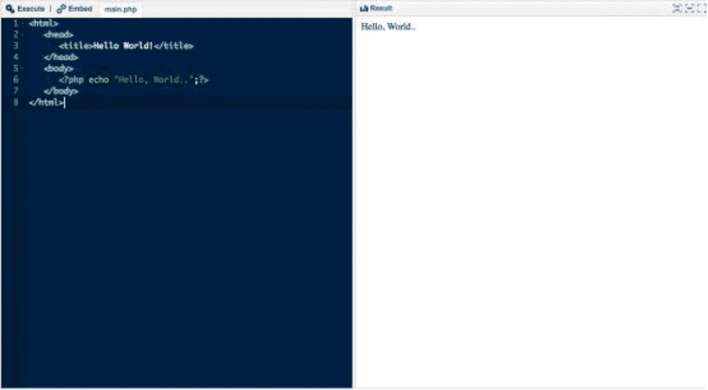
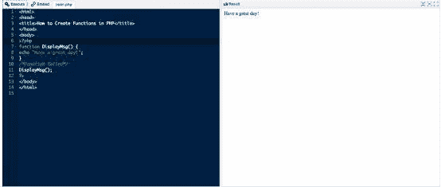
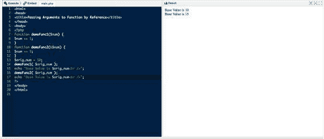
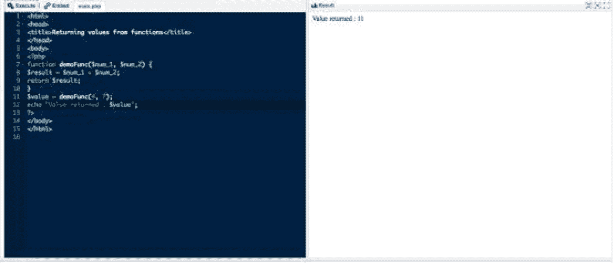
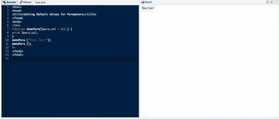
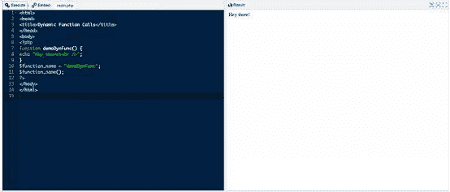

# 绝对初学者的 PHP 编程：掌握 PHP 基础快速课程

## 引言

PHP（超文本处理器）是一种编程语言，其设计目的是为了创建动态内容。此外，PHP 能够与数据库交互。作为一种脚本语言，PHP 被广泛用于 Web 开发。通过 PHP，你可以轻松实现各种功能。学习 PHP 并不需要预先具备任何编程知识。考虑到 PHP 的特性，它能够帮助你快速掌握相关的编程技巧。PHP 是一个强大的工具，能够让你深入理解相关的知识点。

## 第 1 章：概述

PHP 的第一个版本于 1994 年由 Rasmus Lerdorf 发行。在深入学习之前，让我们先了解关于 PHP 的一些知识。首先，PHP 是“超文本处理器”（Hypertext Preprocessor）的缩写。基本上，它是一种用于服务器端的脚本语言，可以嵌入在 HTML 代码中。事实上，PHP 的出现极大地推动了 Web 应用的发展。PHP 允许与各种数据库交互，这是其核心优势之一。通过 PHP，你可以构建复杂的网站功能。由于其语法简单易懂，它非常适合初学者。

### 第一个程序

首先，让我们来看最简单的 PHP 脚本，并尝试理解它是如何工作的。这个脚本会在屏幕上打印“hello World!”字符串。正如前面提到的，PHP 脚本是嵌入在 HTML 代码中的。以下是供参考的示例代码：

```html
<html>
<head>
<title>hello World!</title>
</head>
<body>
<?php echo "hello, World..";?>
</body>
</html>
```

执行该代码后，将得到以下结果。



如示例代码所示，网络浏览器不会原样输出 PHP 代码。相反，它会处理这些代码，我们在客户端浏览器屏幕上看到的是纯 HTML 输出。PHP 代码可以通过下面所示的三种方式之一与 HTML 集成——

- `<?php php 代码写在此处 ?>`
- `<?php <?​ Php 代码写在此处 ?>`
- `<script language = "php"> php 代码写在此处 </script>`

使用上述所示的格式之一，你可以将 PHP 代码放入 HTML 中。这告诉解析器存在于这种格式中的文本是 PHP 脚本，需要执行。用于 PHP 与 HTML 集成的最常用的标签是 `<?php ... ?>`。

## 环境搭建

显而易见，PHP 在网络浏览器中配合 HTML 一起运行，为了测试 PHP 代码，你需要搭建一个本地系统。为了在网页中作为 HTML 的一部分运行 PHP 脚本，你需要在本地系统中安装三个组件。这些组件包括——

### Web 服务器

你可以使用任何 Web 服务器，并放心 PHP 可以在其上工作。因此，如果你在 Windows 系统上工作，可以安全地使用微软的 Internet 信息服务 (`IIS`)。尽管如此，由于其开源特性，Apache 仍然是 PHP 最受欢迎的服务器。

### 数据库

同样，PHP 可以与任何数据库解决方案配合，包括 Sybase 和 Oracle 等流行数据库。然而，最常用的解决方案是 `MySQL`。

### PHP 解析器

在你的机器上安装 PHP 解析器之前，系统无法读取和理解你提供的 PHP 指令，该解析器会读取 PHP 状态并生成发送到网络浏览器的 HTML 输出。

### 安装 PHP 的解析器

首先，你必须做的第一件事是打开浏览器，并在地址栏中输入以下地址：`http://127.0.0.1/info.php`。如果浏览器打开了一个包含 PHP 相关信息的有效网页，可以假设 Web 服务器和 PHP 已正确安装在系统上。反之，如果情况并非如此，你必须为你的系统安装 Apache 和 PHP。你可以简单地在你正在使用的平台上搜索 Apache 和 PHP 的安装。这将为你提供一组指令，你可以按照这些步骤逐步操作。

## 第 2 章：语法

现在我们已经写了第一个 PHP 程序，让我们带着这些知识继续学习，用这种编程语言编写更多程序。然而，为了过渡到更复杂的程序，你需要学习这种编程语言所使用的语法。

### 转义 PHP (Escaping to PHP)

首先，我们需要理解 PHP 代码是作为 HTML 的一部分编写或嵌入 HTML 的。因此，必须有一种方式让 PHP 解析器区分 HTML 和 PHP。用于此目的的机制被称为“转义 PHP”。这可以通过四种方式实现，具体如下——

#### 标准 PHP 标签

PHP 最为普遍接受且有效的标签样式是 `<?php ... ?>`。使用这种标签样式可以确保你的标签被大多数系统正确解释。

#### 短开标签 (SG-style tags)

SG 标签类似于下面的格式。显而易见，这种格式是告诉 PHP 解析器你正在嵌入代码的最短方式。然而，为了确保 PHP 识别你的标签，你需要以下操作：

- 在编译 PHP 时，使用配置选项 `short_open_tag`。
- 打开 `php.ini` 文件并检查 `short_open_tag` 是否设置为‘on’。
- 由于 XML 标签也使用相同的语法，你在解析 XML 时必须将此选项切换为‘off’。

#### ASP 样式标签

这些标签使用的与 Active Server Pages 定义代码块的方法相同。你必须检查 `php.ini` 以查看这些标签是否在你的 PHP 配置中启用。为了使用这些标签，你必须遵循语法——`<%...%>`

#### Script 标签

HTML Script 标签可以按以下方式使用——`<script language="php">...</script>`

### PHP 中的注释

注释是解析器忽略的文本或行。这些文本行通常用于提高代码的可读性和理解性。然而，它们对改变输出没有任何形式的贡献。PHP 支持单行注释以及多行注释。

#### 单行注释

通过在行前加上 `#` 或 `//` 可以创建单行注释。这些字符的存在告诉解析器，从该字符之后到遇到换行符之前的文本都是注释。单行注释的示例见下文：

```php
<?php
# 这是一个注释，并且 # 这是是注释的第二行
// 这也是一个注释。
Each style comments only print "An example with single line comments";
?>
```

#### 多行注释

多行注释是跨越多行的注释。换句话说，多行注释的结束并不假设于换行符的存在。这些注释以字符 `/*` 开始，以 `*/` 结束。在这两个字符组合之间编写的任何文本都被称为“多行注释”。多行注释的示例所示：

```php
<?php
 /* 这是一个带有多行说明的注释 
Purpose: multiline comments demo print "An example with multi line comments";
Author : mohammad
Subject: php */
?>
```

这里需要说明的是，PHP 对空格不敏感。换句话说，无论你使用多少个空白字符，无论是单独使用还是在一起，系统都会忽略它。通常，空白字符包括各种制表符、空格、换行和回车。此外，PHP 是大小写敏感的。换句话说，变量 `xz` 和 `Xz` 对于 PHP 系统来说是两个不同的标识符。最后，所有的 PHP 表达式必须以分号 `;` 结束。分号的存在指示系统表达式已经结束，现在它可以期待一个新表达式了。深入研究表达式的概念，它们只是无法进一步拆分为实体的标记（tokens）的组合。这些标记是字符串、数字、常量和变量。除了这些，关键字也是标记。一组执行特定函数的语句集合被称为块（block），并借助大括号进行标记。下面的示例代码演示了文中提到的所有概念。

```php
<?php
if (2==2) print("Equality prevails<br>");
if (2 == 2) {
    print("Re- Analysis");
    print("completed.<br>");
}
?>
```

## 第 3 章：变量

为了存储信息，我们需要创建可以包含这些信息并用于引用相同信息的变量。在使用这一编程语言的变量时，需要理解的一些重要点如下——

- 按照规定，所有变量名必须以美元符号 (`$`) 开头，才能被系统视为有效。
- 与变量相关的最近一次赋值语句决定了它的当前值。
- 为了给变量赋值，必须使用等号运算符 (`=`)。该运算符的符号左侧必须是变量，右侧必须是值或计算该值的表达式。
- 在使用变量之前先声明变量是一个良好的编程习惯；但是，即使你不这样做，`PHP` 仍然允许你继续使用该变量。
- `PHP` 不为变量分配任何内在类型。因此，你可以使用变量来存储任何类型的信息，无论是数字还是字符串。不需要提前为变量分配此类类型。
- 如果你使用一个变量而不给它赋值，则该变量将持有一个默认值。
- 必要时，变量的类型会自动在不同类型之间转换。
- `PHP` 中的变量与 Perl 中的变量相似。

`PHP` 在变量存储信息方面支持八种数据类型。这些数据类型如下——

### 布尔值

这种数据类型只能包含两种值，包括 `true` 和 `false`。在某些情况下需要将表达式评估为布尔值，给出 `true` 或 `false` 的结果。在执行此类评估时，必须记住以下规则——

- 如果表达式评估为数字零，则表达式的值为 `false`。任何其他数字都被视为非零并被评估为 `true`。
- 如果表达式评估为字符串，那么如果其评估结果为有效字符串，则表达式的布尔值为 `true`。相反，如果字符串为空，则表达式被评估为 `false`。
- 任何评估结果为 `null` 的表达式其等效布尔值均为 `false`。
- 如果表达式评估为数组，如果数组有元素，则表达式的布尔值为 `true`。相反，如果表达式的值是一个没有元素的数组，其布尔值为 `false`。
- 考虑到对象的情况，如果对象的任何成员变量都被分配了值，则对象被评估为布尔值 `true`，否则被评估为 `false`。
- 任何对 `PHP` 系统有效的资源都会被评估为 `true`。必须避免将双精度浮点数用作布尔值。

### 整数

整数包含所有的全数字。例如，任何如 `675` 或 `54` 的数字都是整数。`PHP` 为整数赋值的语法或表达式如下——`$int_variable = 45`；要注意，系统可以包含的最大整数是 `2,147,483,647`。

### 双精度浮点数

所有浮点数实际上都是整数后面跟着小数点和小数部分，它们都属于这种数据类型。

### 字符串

任何字符的表示法称为字符串。`PHP` 支持所有字符串操作。

### 空值

这种数据类型只能存储一个值，通常用于初始化变量。它存储的值是 `null`。尽管习惯上使用大写字母写 null，但它也可以写为‘null’，系统将其识别为相同。因此，以下语句是有效的——`$var1 = null;`。关于 null 有两个重要的注意事项：

- 第一，`null` 在确定布尔值时始终评估为 `false`。
- 第二，如果用 `isset()` 测试 `null`，它始终评估为 `false`。

### 数组

相同类型的数据集合也可以称为数组。事实上，数组也可以被视为若干个相同类型的变量，通过它们所在的索引来区分开。

### 对象

程序员定义类或模板，在实例化时创建对象。一个类通常由数据值和函数组成。该类的对象可以访问该类的所有函数，并根据类定义的数据拥有一组自己的数据变量。

### 资源

可能存在某些编程场景需要你引用 `PHP` 内部不可用的资源。此类编程场景的一个示例是数据库连接。为了持有此类引用，需要特殊的变量，这些被称为资源。

单引号字符串和双引号字符串的区别在于前者被字面处理，而后者可以替换变量的值。此外，特殊解释的字符序列也表示为双引号字符串。至于字符串长度的限制，双引号并不实施任何此类限制。因此，只要内存允许，你就可以创建很长的字符串。双引号字符串由系统按以下方式之一处理——

- 每当遇到变量名（通过名称中第一个字符为 `$` 来识别），变量的字符串表示会自动放在该位置。
- 特殊字符以反斜杠 (`\`) 开头，并相应地解释为具有特定目的的特殊字符。

转义序列的常见替换如下——

| 转义序列 | 说明 |
| :--- | :--- |
| `\\` | 反斜杠 |
| `\"` | 双引号 |
| `\$` | 美元符号 |
| `\t` | 制表符 |
| `\r` | 回车符 |
| `\n` | 换行符 |

### 变量的作用域

变量的作用域决定其在程序中的访问范围，即哪些元素允许访问变量，哪些不能。`PHP` 中有四种作用域，包括局部、全局、静态变量和函数参数。

- 在所属代码块内有效的变量称为局部变量。
- 另一方面，全局可用且所有人都可以访问的变量称为全局变量。
- 函数参数是提供函数的参数，并充当函数的局部变量。
- 静态变量是一种特殊的变量，它们在函数调用之间保持其值并存在。因此，如果你在使用静态变量并在被调用三次的函数中使用它，那么静态变量的值将被假设为最后一次函数调用赋值的值。

### 变量命名

在为变量命名时需要遵循特定的规则。这些规则包括——

- 变量名只能以下划线 (`_`) 或字母开头。
- 不允许使用数字作为变量名的开头字符。
- 不允许使用如 `%`、`+` 和 `-` 等特殊字符。换句话说，除了下划线外，你不能使用任何其他特殊字符。
- 最后，变量的大小没有限制。

## 第 4 章：常量

用于引用简单值的一个标识符或名称称为“常量”。需要注意的是，常量的值在程序运行过程中不能改变。因此，常量在整个过程中始终保持其原有值！按照惯例，常量使用大写字母声明。然而，默认情况下，它们是区分大小写的。常量的命名规范与变量相同。名称可以是任何字符的组合，包括下划线 (`_`)，特殊字符字符。此外，常量名称不能以数字开头。如前所述，常量的值始终是“常量”的。因此，一旦你定义了一个常量，就无法更改它的值也无法为了这个目的取消定义。为了定义常量，需要使用 `define()` 函数。获取常量的值只需提及其名称。使用变量和常量的区别在于，变量名前面有 `$` 符号，而常量名直接写即可。或者，也可以使用 `constant()` 函数来获取常量的值。

### 常量函数

此函数用于获取常量的值。调用此函数会返回常量的值。此函数通常用于未提及名称且存储在变量中的常量，或者作为函数的返回值。该概念的示例实现如下：

```php
<?php
define("MINIMUM_SIZE", 25);
echo MAXIMUM_SIZE;
echo constant("MINIMUM_SIZE");
?>
```

这里需要提到的是，常量只能持有标量数据，如整数、浮点数、布尔和字符串。

### 常量与变量的区别

提到常量，与变量进行比较是显而易见的。一些主要区别如下：

- 美元符号 (`$`) 是常量和变量之间的第一个区别。变量必须以美元符号开头，而常量在指定时不需要。
- 变量使用简单赋值进行赋值；然而，常量不能通过这种方式定义。常量只能使用 `define()` 函数定义。
- 变量可以赋值、重新赋值和取消定义；但常量在程序运行过程中不能以任何方式修改。
- 变量的作用域规则不适用于常量。它们可以在任何地方访问和定义。

### 魔术常量

PHP 支持一些预定义的常量。任何运行在 PHP 上的脚本都可以访问这些常量。PHP 中的某些常量会根据它们使用的位置而改变。这些常量是区分大小写的。一些定义为“魔术”的 PHP 常量如下：

| 魔术常量 | 描述 |
| :--- | :--- |
| `__FUNCTION__` | 声明时的函数名称。名称区分大小写。 |
| `__CLASS__` | 此常量以区分大小写的方式返回相关的类名，且与声明的方式完全一致。 |
| `__METHOD__` | 此常量以区分大小写的方式返回相关的方法名称，且与声明的方式完全一致。 |

---

## 第 5 章：运算符

每当需要执行某些操作时，就需要操作数和一个作用于操作数的运算符。该概念最常见的例子是加法。当你将两个数字（例如 2 和 3）相加时，数字是操作数，`+` 是作用于数字的加法运算符。加法只是我们执行的操作之一。对于你基础编程任务需要执行的所有其他操作，都有专门运算符。运算符分为五类，包括条件运算符、逻辑运算符、算术运算符、赋值运算符和比较运算符。下面对这些类别分别进行了描述。

### 算术运算符

所有的数学操作都是使用属于算术运算符类的运算符执行的。支持的运算符列表所示：

- 加法 (`+`)：此运算符执行两个数字之间的加法。如果 `a` 和 `b` 是两个分别持有 5 和 6 的变量，那么 `c = a + b` 将产生 `c = 11`。
- 乘法 (`*`)：此运算符执行两个数字之间的乘法。如果 `a` 和 `b` 是两个分别持有 5 和 6 的变量，那么 `c = a * b` 将产生 `c = 30`。
- 减法 (`-`)：此运算符执行两个数字之间的减法。如果 `a` 和 `b` 是两个分别持有 5 和 6 的变量，那么 `c = a - b` 将产生 `c = -1`。
- 除法 (`/`)：此运算符执行两个数字之间的除法。如果 `a` 和 `b` 是两个分别持有 10 和 5 的变量，那么 `c = a / b` 将产生 `c = 2`。
- 取模 (`%`)：此运算符返回两个数相除后的余数。如果 `a` 和 `b` 是两个分别持有 10 和 5 的变量，那么 `c = a % b` 将产生 `c = 0`。
- 递增 (`++`)：此运算符将变量的值加 1。如果 `a` 是一个持有 1 的变量，`a++` 将产生 2。


- 递减 (`--`)：此运算符从变量的值中减 1。如果 `a` 是一个持有 1 的变量，`a--` 将产生 0。

## 比较运算符

所有涉及比较的操作都是使用比较运算符执行的。该语言支持的运算符所示：

- 不等于 (`!=`)：此运算符作用于两个操作数。检查两个操作数之间的相等性。如果相等，返回 `false`，否则返回 `true`。
- 等于 (`==`)：此运算符作用于两个操作数。检查两个操作数之间的相等性。如果相等，返回 `true`，否则返回 `false`。
- 大于 (`>`)：此运算符作用于两个操作数。检查两个操作数之间的相等性。如果第一个操作数大于第二个操作数，返回 `true`，否则返回 `false`。
- 小于 (`<`)：此运算符作用于两个操作数。检查两个操作数之间的相等性。如果第一个操作数小于第二个操作数，返回 `true`，否则返回 `false`。
- 大于或等于 (`>=`)：此运算符作用于两个操作数。检查两个操作数之间的相等性。如果第一个操作数大于或等于第二个操作数，返回 `true`，否则返回 `false`。
- 小于或等于 (`<=`)：此运算符作用于两个操作数。检查两个操作数之间的相等性。如果第一个操作数小于或等于第二个操作数，返回 `true`，否则返回 `false`。

## 逻辑运算符

PHP 中所有的逻辑操作都是通过逻辑运算符完成的。该编程语言支持的运算符列表下所示。

### 逻辑与 (and)

该运算符作用于两个操作数。如果两个操作数都非零，则表达式返回 `true`，否则返回 `FALSE`。该运算符的用法如下：`(A and B)`。

### 逻辑或 (or)

该运算符作用于两个操作数。如果其中一个或两个操作数非零，则表达式返回 `true`，否则返回 `FALSE`。该运算符的用法如下：`(A or B)`。

### 逻辑与 (&&)

该运算符作用于两个操作数。如果两个操作数都非零，则表达式返回 `true`，否则返回 `FALSE`。该运算符的用法如下：`(A && B)`。

### 逻辑或 (||)

该运算符作用于两个操作数。如果其中一个或两个操作数非零，则表达式返回 `true`，否则返回 `FALSE`。该运算符的用法如下：`(A || B)`。

### 逻辑非 (!)

该运算符作用于一个操作数。如果该操作数为零，则表达式返回 `true`，否则返回 `FALSE`。该运算符的用法如下：`(!A)`。

## 赋值运算符

PHP 支持的赋值运算符列表包括：

### 简单赋值运算符 (=)

该运算符将右侧计算出的值赋值给左侧的变量。如果 `a`、`b` 和 `c` 是三个变量，且表达式为 `c = a+b`，那么 `a` 和 `b` 的加之和将被赋值给 `c`。

### 加法并赋值运算符 (+=)

该运算符将右侧与左侧相加计算出的值赋值给左侧的变量。如果 `a` 和 `c` 是两个变量，且表达式为 `c += a`，那么 `a` 和 `c` 的加之和将被赋值给 `c`。

### 减法并赋值运算符 (-=)

该运算符将左侧减去右侧计算的结果赋值给左侧的变量。如果 `a` 和 `c` 是两个变量，且表达式为 `c -= a`，那么 `c-a` 的值将被赋值给 `c`。

### 乘法并赋值运算符 (*=)

该运算符将右侧与左侧相乘计算的结果赋值给左侧的变量。如果 `a` 和 `c` 是两个变量，且表达式为 `c *= a`，那么 `c*a` 的值将被赋值给 `c`。

### 除法并赋值运算符 (/=)

该运算符将左侧除以右侧计算的结果赋值给左侧的变量。如果 `a` 和 `c` 是两个变量，且表达式为 `c /= a`，那么 `c/a` 的值将被赋值给 `c`。

### 取模并赋值运算符 (%=)

该运算符将左侧除以右侧取模的结果赋值给左侧的变量。如果 `a` 和 `c` 是两个变量，且表达式为 `c %= a`，那么 `c%a` 的值将被赋值给 `c`。

## 条件运算符 (?:)

条件运算符是简单 if-else 状态的替代方案。条件运算符的语法为 `condition?A:B`；当给定此状态时，它会检查条件的真假值。如果条件为真，则执行对应 `A` 的表达式，否则执行对应 `B` 的表达式。

## 运算符优先级

如果一个表达式使用了多个运算符，则使用运算符优先级规则来确定执行顺序。运算符从右到左或从左到右评估的优先级定义在以下运算符组中定义：

- 从右到左：一元、条件、赋值
- 从左到右：后置、乘法、加法、移位、关系、相等、逻辑与、逻辑或

例如，如果我们需要评估表达式 `a = 3 + 5 * 5`，乘法会在加法之前执行。因此，`a = 28` 而不是 40。

# 第 6 章：决策

某些场景需要根据条件做出决策。为此目的提供的编程结构被称为决策状态。PHP 支持决策结构，即 `if`、`else if` 和 `switch`。这些结构的流程图如下所示：

## if…else 状态

该状态通常用于此类编程场景：如果测试的条件被发现为真，则执行代码块；然而，如果发现条件为假，则执行另一个代码块。该结构的语法如下：

```php
if (condition)
    // 如果条件为真则要执行的代码
else
    // 如果条件为假则要执行的代码
```

下方提供了实现此概念的示例代码供你参考：

```php
<?php
$d = date("d");
if ($d == "Fri")
    echo "thank god";
else
    echo "";
?>
```

执行上述代码将得到结果。

## else if 状态

有时需要合并测试多个条件。`else if` 结构允许程序员在单个 if 块中提到多个条件。实现 else if 的语法如下：

```php
if (condition1)
    // 如果 condition1 为真则执行的代码
else if (condition2)
    // 如果 condition2 为真则执行的代码
else
    // 如果两个条件都为假则执行的代码
```

下方提供了实现此概念的示例代码供你参考：

```php
<?php
$d = date("d");
if ($d == "Fri")
    echo "thank god";
else if ($d == "Sun")
    echo "happy Sunday!";
else
    echo "have a nice day!";
?>
```

执行上述代码将得到结果。

## Switch 状态

在需要对单个变量进行不同值测试的场景中，switch 状态是一种非常有用的编程结构。相同的场景可以使用嵌套的 if 状态来实现。然而，switch 是更高效的选择，因为它创建了一个值表，并根据接收到的值直接跳转到对应的代码块。使用 switch 状态的语法如下：

```php
switch (expression){
    case value1:
        // 如果表达式的值等于 value1，则执行的代码
        break;
    case value2:
        // 如果表达式的值等于 value2，则执行的代码
        break;
    default:
        // 如果表达式的值不等于 value1 或 value2，则执行的代码
}
```

下方提供了实现此概念的示例代码供你参考：

```php
<?php
$d = date("d");
switch ($d){
    case "Mon":
        echo "It is Monday!";
        break;
    case "tue":
        echo "It is Tuesday!";
        break;
    case "Wed":
        echo "It is Wednesday!";
        break;
    case "thu":
        echo "It is Thursday!";
        break;
    case "Fri":
        echo "It is Friday!";
        break;
    case "Sat":
        echo "It is Saturday!";
        break;
    case "Sun":
        echo "It is Sunday!";
        break;
    default:
        echo "Unpredictable result!";
} 
?>
```

# 第 7 章：循环

通过循环的概念，代码块可以多次执行。PHP 支持四种循环，包括 `for`、`while`、`foreach` 和 `do...while`。本章将讨论这些中的每一个，并向你介绍 `break` 和 `continue` 等循环语句。

## for

`for` 语句通常用于需要重复执行一段代码块直到条件为真，且循环涉及一个变量的编程场景，该变量作为 `for` 语句的一部分进行初始化和更新。这种循环构造的语法如下：

```php
for (initialization; condition; expression) {
    // 代码块
}
```

`initialization` 通过声明变量并赋给其初始值来初始化循环变量。`condition` 是循环执行前需要返回真（true）的表达式。如果发现 `condition` 为假（FALSE），则循环终止。循环语句的第三部分包含更新循环变量的表达式。循环变量通常声明为 `$i`。下面给出了该编程构造的示例实现供你参考。

```php
<body>
<?php
$x = 0;
$y = 0;
for ($i = 0; $i < 3; $i++) {
    $x += 1;
    $y += 2;
}
echo ("the values of x and y are x = $x and y = $y");
?>
</body>
```


## while

`while` 语句通常用于需要重复执行一段代码块直到条件为真的编程场景。这种循环构造的语法如下：

```php
while (condition) {
    // 代码块
}
```

`condition` 是循环执行前需要返回真（true）的表达式。如果发现 `condition` 为假（FALSE），则循环终止。下面给出了该编程构造的示例实现供你参考。

```php
<body>
<?php
$x = 0;
$y = 0;
$i = 0;
while ($i < 3) {
    $x += 1;
    $y += 2;
    $i++;
}
echo ("While Loop: the values of x and y are x = $x and y = $y");
?>
</body>
```

## do...while

`do...while` 循环与 `while` 循环类似，但它保证至少执行一次循环体。语法如下：

```php
do {
    // 代码块
} while (condition);
```

`condition` 是循环执行前需要返回真（true）的表达式。如果发现 `condition` 为假（FALSE），则循环终止。下面给出了该循环构造的示例实现供你参考。

```php
<body>
<?php
$x = 0;
$y = 0;
$i = 0;
do {
    $x += 1;
    $y += 2;
    $i++;
} while ($i < 3);
echo ("do...While Loop: the values of x and y are x = $x and y = $y");
?>
</body>
```


## foreach

为了遍历数组，使用了 `foreach` 语句。循环的每次通过或迭代都会获取数组的当前值，并将指针移动到下一个元素。因此，在下一次通过中，将处理下一个元素。该循环的语法为：

```php
foreach (array as value) {
    // 要执行的代码
}
```

下面给出了该构造的示例实现供你参考。

```php
<body>
<?php
$x_array = array(9, 8, 7, 6);
foreach ($x_array as $value) {
    echo "Value of the element: $value <br>";
}
?>
</body>
```


## break

为了提前终止循环，可以使用 `break` 关键字。它被放置在循环块内部，通常用作条件循环操作语句。换句话说，如果实现了 `if` 块且 `if` 语句内部的条件为真，则循环中断；否则循环继续正常运行。一旦遇到 `break` 语句，将执行其后出现的第一个语句。下面给出了示例实现供你参考。

```php
<body>
<?php
$x = 0;
$y = 0;
$i = 0;
while ($i < 3) {
    $i++;
    if ($i == 2) break;
}
echo ("Loop stopped at i = $i");
?>
</body>
```

## continue

为了停止循环的执行并跳转到下一次迭代，可以使用 `continue` 关键字。它被放置在循环块内部，通常用作条件操作语句。换句话说，如果实现了 `if` 块且 `if` 语句内部的条件为真，则循环停止；否则循环正常运行。一旦遇到 `continue` 语句，将跳转到循环语句。下面给出了示例实现。

```php
<body>
<?php
$i = 0;
while ($i < 5) {
    $i++;
    if ($i == 2) continue;
    echo ("Loop executed for i = $i <br />");
}
?>
</body>
```

# 第 8 章：数组

PHP 支持的最常用数据结构之一是数组。数组是相同类型元素的集合。例如，如果你想存储 20 个整数，可以将它们存储在一个包含 20 个元素的数组中。你也可以将数组视为相同类型变量的集合；每个变量都可以存储数据。PHP 支持三种数组，包括数值数组、多维数组和关联数组。数组的元素可以通过索引或在数组中的位置来访问。这三种数组在访问方式上有所不同。

## 数组类型概述

数组具有递增的数值索引。例如，数组的第一个元素的默认索引为 0。对于随后的所有数据值，索引增加 1。另一方面，关联数组使用字符串作为索引。数组以键值对的形式组成，键作为索引存储，值通过键访问。因此，元素的存储和访问取决于键与值之间的关联。最后，一个数组可以由元素组成，每个元素本身也是数组。这种数组是二维的。相应地，数组的维度可以根据编程需求增加。具有多个维度的数组被称为多维数组。此外，此类数组元素可以通过多个索引访问。

## 数值数组

数值数组可以存储任何类型的数据，如字符串、数字和对象；然而，唯一值得注意的是数组的索引是数值型的。此外，数组第一个元素的默认索引是 0。创建数组的函数是 `array()`。下面是用于演示数值数组功能的示例代码。

```php
<body>
<?php
// 示例代码缺失
?>
</body>
```

# 第 9 章：函数

函数是可重用的代码块，用于执行特定任务。PHP 提供了大量内置函数，同时也允许用户定义自己的函数。

## 创建函数

在 PHP 中创建函数使用 `function` 关键字。下面是一个简单的函数定义和调用示例：

```php
<html>
<head>
    <title>how to create Functions in php</title>
</head>
<body>
<?php
/*function defined*/
function displaymssg() { 
    echo "have a great day!"; 
} 
/*Function called*/
displaymssg(); 
?>
</body>
</html>
```

执行该代码后将得到如下结果 – 。

## 函数参数

与任何其他编程语言一样，向函数提供输入时可以给函数传递参数。此外，你可以传递任意数量的参数。这些参数类似于函数的局部变量，函数可以自由访问它们。下面提供了如何将参数发送到函数的示例实现。

```php
<html>
<head>
    <title>带参数的函数实现</title>
</head>
<body>
<?php 
function demofunction($num_1, $num_2) { 
    $result = $num_1 + $num_2; 
    echo "Result of addition : $result"; 
} 
demofunction(5, 6); 
?> 
</body>
</html>
```

该函数的执行结果将产生如下输出 – 。

## 通过引用传递参数

由于传递的参数充当函数的局部变量，因此系统会为函数创建一个变量的局部副本。如果在函数内部对变量值进行编辑，则编辑后的值仅在函数内部可用。如果你希望变量在函数外部也能反映更改，则需要通过引用将参数传递给函数。下面提供了演示如何通过引用将参数传递给函数的示例代码。

```php
<html>
<head>
    <title>通过引用向函数传递参数</title>
</head>
<body>
<?php 
function demofunc1($num) { 
    $num += 1; 
} 
function demofunc2(&$num) { 
    $num += 5; 
} 
$orig_num = 10; 
demofunc1($orig_num); 
echo "base Value is $orig_num<br />"; 
demofunc2($orig_num); 
echo "base Value is $orig_num<br />"; 
?> 
</body>
</html>
```

执行后，屏幕上将出现以下结果 。

## 函数返回值

`return` 语句用于将控制权从函数返回到调用函数。此外，它还用于从函数返回数值。使用该语句的语法是关键字 `return` 后面跟随需要返回的值或变量。如果需要返回多个值，PHP 允许返回数组。下面提供了演示该语句的示例代码：

```php
<html>
<head>
    <title>函数返回值演示</title>
</head>
<body>
<?php
// 示例代码缺失
?>
</body>
</html>
```


# 从函数返回值

```php
<?php 

function demo($num_1, $num_2) { 

    $result = $num_1 + $num_2; 

    return $result; 

} 

$value = demo(4, 7); 

echo "Value returned : $value"; 

?> 
```

执行此代码后，将出现以下结果 

## 默认值

为了使系统自给自足并应对参数少于预期的问题，你可以为参数设置默认值。因此，如果调用函数没有为参数提供值，它会自动假设默认值。该概念可以通过以下方式实现：

```php
<?php 

function demo($para_val = null) { 

    print $para_val; 

} 

demo("test call!"); 

demo(); 

?> 
```

执行后，你可以预期得到结果 

PHP 允许程序员将函数名赋值给变量。这些名称以字符串的形式分配给相关的变量，然后程序员可以根据需要使用它们。这种行为在下文提供的示例代码中有描述：

```php
<?php 

function demofunc() { 

    echo "hey there!<br />"; 

} 

$function_name = "demofunc"; 

$function_name(); 

?> 
```

该代码的输出如下，供你参考 

# 第 11 章：PHP 中的文件

一个 PHP 文件的内容可以在服务器执行之前包含在另一个 PHP 文件中。为了执行此操作，PHP 提供了两个函数，即 `include()` 和 `require()`。头部、页脚和函数等元素可以直接从一个文件导入到另一个文件，因此它们可以在多个页面上使用。除了支持代码复用外，PHP 的此功能还允许进行代码管理，这意味着无需花费大量精力即可轻松更改网站的整体外观。要实现更改，你只需要更改被包含的那个文件。

## include() 函数

此 `include()` 函数仅获取指定文件中的文本，并在需要时将其用于相关文件。加载文件时可能会出现问题，结果只会生成相应的警告。然而，这不会停止文件的执行。你可能需要包含文件的一个良好示例是，当你想要为所有页面创建一个副本时。下面作为 `menu.php` 包含的文件内容供代码引用：`<a href="www.google">google</a> - <a href="www.yahoo">Yahoo</a> - <a href="www.facebook">Facebook</a>`。使用此文件创建的菜单将包含 google、Yahoo 和 Facebook 三个网站的链接。此外，还将显示相应的文本。要包含此文件，可以使用类似于下面的代码：

```php
<?php include("menu.php"); ?>

<p>of inclusion</p>
```

## require() 函数

此 `require()` 函数从指定文件中复制文本并将其放入目标文件中。因此，它相当于无需费精力直接编写代码。然而，如果加载文件出现问题，程序执行将停止并产生致命错误。整体而言，`include()` 和 `require()` 是相同的，区别在于它们处理错误的方式。尽管如此，建议使用 `require()` 而不是 `include()`，因为文件缺失时执行脚本会导致不可预测的行为。

## 打开、关闭、读取和写入

PHP 提供了专门的函数来执行这些操作。打开文件使用 `fopen()`。调用此函数通常需要两个参数：文件名和程序员希望打开文件的模式。PHP 中可用的模式如下：

| 模式 | 说明 |
| :--- | :--- |
| `r` | 仅读。指针指向文件的第一个字符。 |
| `r+` | 可读可写。指针指向文件的第一个字符。 |
| `w` | 仅写。指针指向文件的开头。此外，文件长度将被截断为零。如果文件不存在，系统将尝试创建文件。 |
| `w+` | 读写。指针指向文件的开头。此外，文件长度将被截断为零。如果文件不存在，系统将尝试创建文件。 |
| `a` | 仅写。指针指向文件的末尾。如果文件不存在，系统将尝试创建文件。 |
| `a+` | 可读可写。指针指向文件的末尾。 |

## 文件操作

如果文件不存在，系统会尝试创建一个文件。

如果成功打开请求的文件，将返回该文件的文件指针。相反，如果打开操作失败，则向调用函数返回 `FALSE`。作为原则，请务必关闭你打开的任何文件。用于此目的的函数是 `fclose()`，它将在下文中讨论。

一旦文件被打开，你将执行的操作之一就是读取。这通常通过 `fread()` 实现，它需要两个参数：文件指针和长度。如果文件的大小未知，可以使用 `filesize()` 来确定大小，该函数只需要文件作为参数。

为了读取文件，你需要遵循的步骤包括：

- 使用 `fopen()` 打开文件
- 使用 `filesize()` 确定文件大小
- 使用 `fread()` 读取文件内容
- 使用 `fclose()` 关闭文件

下面提供了用于演示该过程中不同步骤的示例代码，供你参考。

```php
<?php

$file = "tmp.txt";

$file1 = fopen($file, "r");

if ($file1 == false) {

    echo "cannot open file";

}

$file_size = filesize($file);

$file_text = fread($file1, $file_size);

fclose($file1);

echo "Size of File : $file_size bytes";

echo "<pre>$file_text</pre>";

?>
```

你可以运行这段代码来查看它生成的输出。如果文件不存在，程序将给出错误信息，否则将提供预期的输出。

你可以预期对文件执行的另一个函数是写入。可以使用 `fwrite()` 覆盖或追加文件，它需要两个参数：文件指针和需要写入的字符串。此外，此函数还期望第三个参数，即要写入数据的长度。通常，如果你提供了此参数，写入文件的操作将在达到数据中指定的字节数后停止。

# 第 12 章：Web 概念

随着互联网的普及，对动态内容以及能够响应用户输入、随机生成并动态适应不同浏览器的网页日益增加。客户端浏览器重定向也是这的一个重要概念，在本章中进行了讨论。

## 识别浏览器和平台

当设置 PHP 环境时，PHP 会创建一些实用的环境变量。你可以在 `phpinfo.php` 文件中查看这些变量。`user_agent` 变量包含正在使用的平台和操作系统的信息。你可以使用 `getenv()` 访问环境变量的值。该环境变量提供的信息用于创建浏览器友好的内容。下面的示例代码可以帮助你识别客户端的平台和操作系统。

```php
<?php

function demoBrowser() {

    $user_agent = $_SERVER['HTTP_USER_AGENT'];

    $browser_name = 'Unknown';

    $user_platform = 'Unknown';

    $user_version = "";

    /* 确定平台的代码 */

    if (preg_match('/linux/i', $user_agent)) {

        $user_platform = 'linux';

    } elseif (preg_match('/macintosh|mac os x/i', $user_agent)) {

        $user_platform = 'mac';

    } elseif (preg_match('/windows|win32/i', $user_agent)) {

        $user_platform = 'windows';

    }

    /* 确定用户浏览器名称的代码 */

    if (preg_match('/MSIE/i', $user_agent) && !preg_match('/opera/i', $user_agent)) {

        $browser_name = 'Internet Explorer';

        $ub = "MSIE";

    } elseif (preg_match('/Firefox/i', $user_agent)) {

        $browser_name = 'Firefox';

    } elseif (preg_match('/chrome/i', $user_agent)) {

        $browser_name = 'chrome';

    } elseif (preg_match('/Safari/i', $user_agent)) {

        $browser_name = 'Safari';

    } elseif (preg_match('/opera/i', $user_agent)) {

        $browser_name = 'opera';

    } elseif (preg_match('/Netscape/i', $user_agent)) {

        $browser_name = 'Netscape';

    }

    /* 随机生成器代码 */

    $matches = array('browser', 'other');

    $pattern = '/[a-zA-Z0-9]+/';

    if (preg_match($pattern, $user_agent)) {

        $i = rand(0, 1);

        if (strpos($user_agent, $matches[$i]) !== false) {

            $result = $matches[$i];

        } else {

            $result = "other";

        }

    } else {

        $result = "other";

    }

    echo "Platform: $user_platform";

    echo "Browser: $browser_name";

}

?>
```

```php
<?php 

if ($_POST['name']) { 

    echo "Welcome " . $_POST['name'] . "<br />"; 

    echo "You are " . $_POST['age'] . " years old."; 

    exit(); 

} 

?> 

<html>

<body>

  <form action="<?php echo $_SERVER['PHP_SELF']; ?>" method="post"> 

    name: <input type="text" name="name" /> Age: <input type="text" name="age" /> <input type="submit" /> 

  </form>

</body>

</html>
```

使用此脚本创建的表单将包含一个提交按钮。点击该按钮时，将会调用名为 `$_SERVER['PHP_SELF']` 的默认 PHP 变量。该代码还使用了 `post` 和 `get` 方法。我们将在下一章中详细讨论这些方法。

## 浏览器重定向

通过 `header()` 函数向浏览器提供原始的 HTTP 头部。该函数也可用于将浏览器重定向到另一个位置。为了避免在重定向发生之前加载页面不同元素，重定向代码必须放在页面顶部。

`Location:` 是 `header()` 函数的参数，用于指定目标。建议在该函数调用后使用 `exit()` 以避免对代码进行任何进一步解析。下面提供了重定向示例代码供你参考。

```php
<?php 

if ($_POST["location"]) { 

    $location = $_POST["location"]; 

    header("Location: $location"); 

    exit(); 

} 

?> 

<html>

<body>

  <p>选择您想要访问的网站：</p> 

  <form action="<?php echo $_SERVER['PHP_SELF']; ?>" method="post"> 

    <select name="location">

      <option value="http://www.google.com"> google.com</option> 

      <option value="http://www.yahoo.com"> Yahoo.com</option> 

    </select> 

    <input type="submit" /> 

  </form> 

</body>

</html> 
```

# 第 13 章：GET 和 POST 方法

客户端浏览器使用两种方法从客户端向信息到 Web 服务器。这些方法是 `get` 和 `post`。然而，在发送信息之前，浏览器首先使用称为 URL 编码的编码方案对信息进行编码。在这种编码方案中，键值对（此处为名称值对）被组合在一起，不同的键值对通过 `&`（和符号）分隔开。任何空格都会被替换为加号（`+`），非字母数字字符被替换为它们的十六进制值。编码过程完成后，数据将发送到 Web 服务器。

## GET 方法

当使用 GET 方法向 Web 服务器发送信息时，它会将信息连同页面 URL 一起发送。URL 后面附加编码后的信息，并用问号（`?`）将两者分开。使用此方法时需要注意的一些关键点包括：

- 由于该方法附加了页面 URL，发送的信息也将出现在服务器的日志中。
- 使用 `get` 方法可以发送的最大字符数是 1024 个字符。
- 该方法存在机密性损害的固有问题。因此，在向 Web 服务器发送密码或关键信息时，必须避免使用它。
- `get` 方法的另一个固有限制是无法使用此方法向服务器发送文档和图像。
- 除了上述，还可以通过获取 `QUERY_STRING` 变量来访问使用此方法发送的数据。因此，数据是不安全的。

可以通过访问 `$_GET`（PHP 为此目的提供的关联数组）来访问所有通过此方法发送的数据。

```php
<?php

if ($_GET["name"] || $_GET["age"]) { 

    echo "Welcome " . $_GET['name'] . "<br />"; 

    echo "You are " . $_GET['age'] . " years old."; 

    exit(); 

} 

?> 

<html>

<body>

  <form action="<?php echo $_SERVER['PHP_SELF']; ?>" method="get"> 

    name: <input type="text" name="name" /> Age: <input type="text" name="age" /> <input type="submit" /> 

  </form>

</body>

</html>
```

## POST 方法

GET 方法的替代方案是 `post` 方法。该方法利用 HTTP 头部将信息从客户端传输到服务器。编码后的信息被放入请求体中。关于使用此方法进行传输时，你必须了解的一些要点包括：

- 与 GET 方法不同，使用此方法发送信息的字符数量没有限制。
- 可以使用此方法发送二进制数据以及 ASCII 数据。

就数据安全性而言，数据安全完全取决于 HTTP 协议。通过使用 HTTPS，你可以确保更高的数据安全性。使用 POST 方法的所有数据都可以通过 `$_POST` 关联数组进行访问。

```php
<?php

if ($_POST["name"] || $_POST["age"]) { 

    if (preg_match("/^[A-Za-z-]/", $_POST['name'])) { 

        die ("名称无效!"); 

    } 

    echo "Welcome " . $_POST['name'] . "<br />"; 

    echo "You are " . $_POST['age'] . " years old."; 

    exit(); 

} 

?> 

<html>

<body>

  <form action="<?php echo $_SERVER['PHP_SELF']; ?>" method="post"> 

    name: <input type="text" name="name" /> Age: <input type="text" name="age" /> <input type="submit" /> 

  </form>

</body>

</html>
```


### `$_request` 变量

`$_get` 和 `$_post` 的内容可以通过 `$_request` 获取。此外，`$_request` 还包含与 `$_cookie` 相关的数据。使用 `get` 和 `post` 两种方法向 Web 服务器发送的表单数据都可以通过访问该变量来获取。此处 `$_php_SELF` 变量包含调用它的自身的脚本名称。

## 总结

现在我们已经到达这本关于 PHP 编程书籍的末尾，我们希望这本书帮助你掌握了这门编程语言的基础知识。你可以通过学习 PHP 的高级概念来继续你的学习之旅。学习是一个终身过程，随着你练习 PHP 编程，你将了解更多这门语言以及它为开发者提供的功能。此外，书中教授的功能只有在你实现所给出的概念时才能发挥作用。展望未来，我们建议你运行书中提供的示例代码，并根据你的理解对其进行编辑或改进。这将让你对 PHP 生态系统有良好的掌握。
