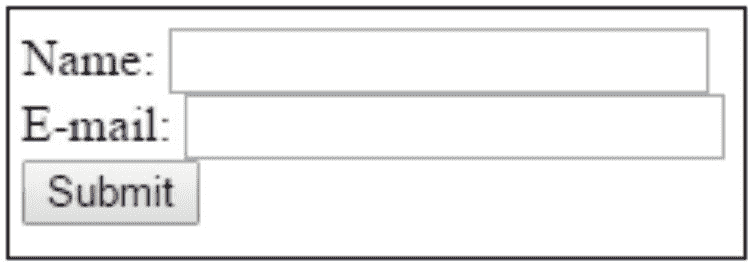

# PHP 编程初学者指南：逐步解答你的所有问题

## 第 1 章：PHP 语言简介

### 1. 什么是 PHP？

i) `PHP` 代表“超文本预处理器”（Hypertext Preprocessor）。

ii) 它被用于创建“动态网页”。

iii) 它是一门“服务器端脚本”语言，可以替代 `ASP`、`JSP`、`PERL`。

iv) 它是一项“开源软件”。

### 2. 列出 PHP 的特性

i) `PHP` 易于阅读和理解。

ii) 不需要包含像 `C` 那样的库。

iii) 它是开源的——因此可以“免费使用”。

iv) 它是一门服务器端脚本语言。

v) 它是跨平台的（即它可以运行在任何操作系统上——Windows、Mac 等）。

vi) 它提供了与数据库的连接（如 `Oracle`、`MySQL`、`Ms-Access` 等）。

vii) `PHP` 是面向对象的。

### 3. 列出运行 PHP 的要求

i) 一个 Web 服务器（如 `IIS Web server`、`Apache Web server` 等）。

ii) Web 浏览器（如 `IE`、`Google Chrome`）。

iii) 文本编辑器（`Notepad` 或 `Notepad++`）。

### 4. PHP 和 HTML 的区别

| 序号 | PHP | HTML |
| --- | --- | --- |
| 1 | `PHP` 用于设计动态网页 | `HTML` 用于设计静态网页 |
| 2 | `PHP` 文件在服务器端执行 | `HTML` 文件由浏览器解释并执行 |
| 3 | `PHP` 文件先由 `PHPengine` 执行，在发送给客户端之前转换为 `HTML` 代码 | 因为它在客户端浏览器上运行，所以速度更快 |

### 5. 服务器端脚本与客户端脚本的区别

| 序号 | 服务器端脚本 | 客户端脚本 |
| --- | --- | --- |
| 1 | 通常用 `ASP`、`JSP` 或 `PHP` 编写 | 它是用 `VBScript` 或 `JavaScript` 编写 |
| 2 | 始终由 Web 服务器处理 | 由客户端的 Web 浏览器处理 |
| 3 | 能够根据用户需求创建 `HTML` 文件 | 无法根据需求创建 `HTML` 文件 |

### 6. 什么是 IIS Web 服务器？

i) `Internet Information Services (IIS)` 是由 `Microsoft Inc.` 创建的 Web 服务器。

ii) 它是开发和运行 `PHP` 文件的选项之一。

iii) 使用 `IIS` 时，`PHP` 文件必须保存在 `C:\INETPUB\WWWROOT\` 文件夹中。

### 7. 什么是 Apache Web 服务器？

i) `Apache` 是最广泛使用的 Web 服务器软件。

ii) `Apache` 是一个免费提供的开源软件。

iii) 可以使用 `XAMPP` 安装 `Apache` Web 服务器。

iv) 使用 `XAMPP` 时，`PHP` 文件必须保存在 `C:\htdocs\` 文件夹中。

### 8. 如何在网页中引入 PHP？

i) 使用：

```php
<?php echo "hello world"; ?>
```

ii) 使用 `<script language="php">`。

### 9. PHP 中分号（;）的作用是什么？

i) 分号（`;`）用于终止或结束一条命令。

ii) 示例：

```php
<?php echo "hello world"; ?>
```

### 10. PHP 中如何编写注释？

i) 单行注释（`//`）。

ii) 多行注释（`/* */`）。

iii) 示例：

```php
/* 这个 echo 语句将打印消息 */
echo “Hello World”;
// 我也可以显示欢迎消息
echo “Ajay”;
// 以防用户名为 Ajay
```

### 11. 变量（Variable）是指什么？

i) 变量是一个命名的位置。

ii) 变量的值在执行过程中可以改变。

iii) PHP 变量示例：

```php
<?php
$x = 52;
echo $x;
?>
```

### 12. 关于变量需要记忆的点

i) 所有变量以 `$` 开头，后跟变量名。

ii) 变量名只能包含字母、数字和下划线（`_`）。

iii) 变量名不能以数字开头。

iv) 变量名是对大小写敏感的。

v) 变量名不能包含空格。

vi) 变量在初始化时可以没有值。

vii) 变量的值可以是任何类型。

viii) 变量在定义时必须赋值。

ix) 变量在作用域内是有效的。

### 13. 变量赋值（Assignment）是指什么？

i) 将一个值赋给变量的过程。

ii) 赋值操作可以在执行过程中完成。

iii) 赋值示例：

```php
<?php
$name = "John";
echo $name;
?>
```

### 14. 作用域（Scope）是指什么？

i) 变量在程序中可以访问的范围。

ii) `PHP` 中有三种作用域：

- 局部作用域（在函数内部）
- 全局作用域（在函数外部）
- 静态作用域（使用 `static` 关键字）

### 15. 常量（Constants）是指什么？

i) 常量是指一旦定义就不能更改的值。

ii) 使用 `define()` 函数或 `const` 关键字定义。

iii) 常量示例：

```php
<?php
define("SITE_URL", "localhost");
echo SITE_URL;
?>
```

### 16. 数组（Arrays）是指什么？

i) 数组是用于存储多个值的变量。

ii) `PHP` 支持三种主要类型的数组：

- 索引数组（Indexed arrays）
- 关联数组（Associative arrays）
- 多维数组（Multidimensional arrays）

iii) 数组示例：

```php
<?php
$colors = array("Red", "Green", "Blue");
echo $colors[0];
?>
```

### 17. 什么是函数（Functions）？

i) 函数是执行特定任务的代码块。

ii) 它们通过 `function` 关键字进行定义。

iii) 函数示例：

```php
<?php
function greet($name) {
    echo "Hello, $name!";
}
greet("World");
?>
```

### 18. 超局变量（Superglobals）是指什么？

i) 超局变量是 PHP 中预定义的内置变量，在脚本的任何地方都可以访问。

ii) 常见的超局变量包括：

- `$_GET`
- `$_POST`
- `$_REQUEST`
- `$_SESSION`
- `$_COOKIE`
- `$_SERVER`
- `$_ENV`
- `$_GLOBALS`
- `$_FILES`

```php
Print gettype($myAge); // 返回：Integer
$age = (string) $myAge;
Print gettype($age); // 返回：String
```

# 第 2 章：PHP 中的运算符

## 1. 什么是表达式（Expression）？

i) `Expression` 表达式是值、变量、运算符和函数的组合，结果产生一个值。

ii) 示例：`$Num = 5 + 15 / 2;`

## 2. 什么是运算符（Operators）？

i) `Operators` 运算符字符（或一组字符），用于在 `PHP` 代码中执行特殊操作。

ii) 示例：`$Num = 5 + 15 / 2;`，其中 `=`、`+`、`/` 是运算符。

## 3. 解释 PHP 运算符的类型

i) 赋值运算符。

ii) 算术运算符。

iii) 一元和二元运算符。

iv) 复合赋值运算符。

v) 比较运算符。

vi) 逻辑运算符。

vii) 增减运算符。

viii) 三元运算符。

## 4. 结合示例解释赋值运算符

i) 赋值运算符 `=` 用于给变量赋值。

ii) 示例：`$Num = 7`。

## 5. 复合赋值

赋值运算符可以与算术运算符结合创建复合运算符。

例如 `+=`、`-=`、`/=`、`*=`、`%=`。复合赋值运算符允许编写更短的表达式。例如：

```php
<?php
    $i = 100;
    $i = $i + 10;
    echo $i;
?>
```

可以写为：

```php
<?php
    $i = 100;
    $i += 10;
?>
```

## 6. PHP 中的字符串运算符有哪些？

i) 用于字符串拼接和追加操作的运算符。

ii) 字符串运算符列表：

iii) `PHP` 有两个专门为字符串设计的运算符。

| 运算符 | 名称 | 示例 | 结果 |
| --- | --- | --- | --- |
| `.` | 拼接 | `$txt1 . $txt2` | `$txt1` 和 `$txt2` 的拼接 |
| `.=` | 拼接赋值 | `$txt1 .= $txt2` | 将 `$txt2` 追加到 `$txt1` 后 |

## 7. 结合示例解释算术运算符

i) 这些是通用的数学运算符。

ii) 算术运算符列表：

| 运算符 | 用途 |
| --- | --- |
| `+` | 加法 |
| `-` | 减法 |
| `*` | 乘法 |
| `/` | 除法 |
| `%` | 取模 |

iii) `/` 运算符返回商，`%`（模）返回除法所得余数。

## 8. 结合示例解释一元运算符

i) 一元运算符只处理一个参数（通常是一个单一变量）。在 `PHP` 中，只有几个，如下所示：

| 运算符 | 用途 |
| --- | --- |
| `!` | 取反 |
| `++` | 加 1 |
| `--` | 减 1 |

ii) 以下是这些运算符使用的一些示例：

```php
<?php
// 取反
$bool = true;
$bool = !$bool; // $bool 现在将为 false
$k = 0; // 将 k 的值初始化为 0

// 加 1
$k++;
echo "k = ".$k; // 输出：k = 1

// 减 1
$k--;
echo "k = ".$k; // 输出：k = 0
?>
```

## 9. 结合示例解释二元运算符

i) 二元运算符是处理两个参数的运算符，两个参数都是变量或常量。二元运算符的一些示例如下：

| 运算符 | 用途 |
| --- | --- |
| `+` | 加法 |
| `-` | 减法 |
| `*` | 乘法 |
| `/` | 除法 |
| `%` | 取模 |
| `=` | 赋值 |
| `==` | 等于 |
| `>` | 大于 |
| `<` | 小于 |
| `&&` | 与（AND） |
| `||` | 或（OR） |

ii) 这些运算符是 `PHP` 中最直观的运算符。它们非常容易理解，因为学校里都学过。例如，看这段代码：

```php
<?php
$a = 5;
$b = 6;
$c = $a + $b; // $c 现在是 11
?>
```

## 10. PHP 中的比较运算符有哪些？

i) 用于比较并返回 `true` 或 `False` 的运算符。

ii) `PHP` 比较运算符列表：

| 运算符 | 名称 | 示例 | 结果 |
| --- | --- | --- | --- |
| `==` | 等于 | `$x == $y` | 如果 `$x` 等于 `$y` 则返回 `true` |
| `===` | 恒等 | `$x === $y` | 如果 `$x` 等于 `$y` 且它们类型相同则返回 `true` |
| `!=` | 不等于 | `$x != $y` | 如果 `$x` 不等于 `$y` 则返回 `true` |
| `<>` | 不等于 | `$x <> $y` | 如果 `$x` 不等于 `$y` 则返回 `true` |
| `!==` | 不恒等 | `$x !== $y` | 如果 `$x` 不等于 `$y` 或类型不同则返回 `true` |
| `>` | 大于 | `$x > $y` | 如果 `$x` 大于 `$y` 则返回 `true` |
| `<` | 小于 | `$x < $y` | 如果 `$x` 小于 `$y` 则返回 `true` |
| `>=` | 大于等于 | `$x >= $y` | 如果 `$x` 大于等于 `$y` 则返回 `true` |
| `<=` | 小于等于 | `$x <= $y` | 如果 `$x` 小于等于 `$y` 则返回 `true` |

## 11. 逻辑运算符有哪些？

i) 用于逻辑操作并返回 `true` 或 `False` 的运算符。

ii) 逻辑运算符：

| 运算符 | 名称 | 示例 | 结果 |
| --- | --- | --- | --- |
| `and` | 与 | `$x and $y` | 如果 `$x` 和 `$y` 都为真 |
| `or` | 或 | `$x or $y` | 如果 `$x` 或 `$y` 任为真 |
| `&&` | 与 | `$x && $y` | 如果 `$x` 和 `$y` 都为真 |
| `||` | 或 | `$x || $y` | 如果 `$x` 或 `$y` 任为真 |
| `!` | 取反 | `!$x` | 如果 `$x` 不为真 |

## 12. PHP 中的增减运算符有哪些？

i) 增运算符用于增加变量的值。

ii) `PHP` 递减运算符用于减少变量的值。

| 运算符 | 名称 | 描述 |
| --- | --- | --- |
| `++x` | 前置增 | `$x` 增加 1 |
| `$x++` | 后置增 | `$x` 增加 1 |
| `--x` | 前置减 | `$x` 减少 1 |
| `$x--` | 后置减 | `$x` 减少 1 |

## 13. 三元运算符有哪些？

i) 用于 `if/else` 语句的简写形式。

ii) 语法：`condition ? expression1 : expression2`

iii) 示例 1：

```php
$x = 10;
$y = 15;
$z = ($x > $y) ? "true" : "false";
echo $z; // 输出：false
```

iv) 示例 2：

```php
$age = 20;
$z = ($age >= 18) ? "Eligible" : "Not Eligible";
echo $z; // 输出：Eligible
```

## 14. PHP 中的数组运算符有哪些？

i) 用于执行数组操作的运算符。

ii) 数组运算符列表。

iii) `PHP` 运算符用于比较数组。

| 运算符 | 名称 | 示例 | 结果 |
| --- | --- | --- | --- |
| `+` | 合并 | `$x + $y` | `$x` 和 `$y` 的合并 |
| `==` | 等于 | `$x == $y` | 如果 `$x` 和 `$y` 相同 |
| `===` | 恒等 | `$x === $y` | 如果 `$x` 和 `$y` 相同且类型相同 |
| `!=` | 不等于 | `$x != $y` | 如果 `$x` 不等于 `$y` |
| `<>` | 不等于 | `$x <> $y` | 如果 `$x` 不等于 `$y` |
| `!==` | 不恒等 | `$x !== $y` | 如果 `$x` 不等于 `$y` 或类型不同 |

## 15. 什么是常量（Constant）？

i) 常量是一个命名的内存位置。

ii) 常量的值在执行期间不能更改。

iii) 常量使用 `define` 关键字定义。

iv) 常量名称通常使用大写。

v) `constant()` 可以显示常量的值。

vi) PHP 常量的示例：

```php
define("PI", 3.14);
define("MAXSIZE", 100);
echo "Value of Pi is " . PI . "<BR>";
echo "six is " . MAXSIZE;
echo constant("PI");
```

## 16. 什么是字面量（Literal）？

字面量是用于表示常量值的字符序列。

## 17. 解释字符串类型

### i) 单引号

单引号用于表示“字面量”。字面量不会尝试解析特殊字符或变量。

```php
<?php
echo 'This is my string, look at how pretty it is.'; // 无需解析简单字符串
?>
```

### ii) 双引号

双引号不仅会解析变量，还会解析各种特殊字符，如 `\n` 换行、`\t` 制表符等。

```php
<?php
echo 'phptherightway is '.$adjective.'. // 单引号示例，使用了多次拼接用于
."\n" // 变量和转义字符串
.'I love learning'.$code.'!';

// 对比
echo "phptherightway is $adjective.\n I love learning $code!"; // 相比多次拼接，使用双引号
?>
```

`//enablesustouseaparsablestring`

双引号可以包含变量；这被称为“插值”。

```php
<?php
$juice = 'plum';
echo "I like $juicejuice"; // Output: I like plumjuice
```

在使用插值时，变量通常会紧挨另一个字符。这会导致对哪些是变量名、哪些是字面字符产生混淆。

为了解决这个问题，请将变量包裹在花括号中。


```php
<?php
$juice = 'plum';
echo "I drank some juice made of $juices"; // $juice 无法解析
```

```php
$juice = 'plum';
```

## 常量和变量之间有什么区别？

常量和变量的区别在于：

1. 常量前面不需要写美元符号（`$`），而变量则必须写美元符号。
2. 常量不能通过简单的赋值定义，只能使用 `define()` 函数定义。
3. 常量可以在任何地方定义和访问，而不受变量作用域规则的限制。
4. 常量一旦设置，就不能重新定义或取消定义。

## 运算符优先级是指什么？

1. 运算符优先级决定了表达式中项的分组。某些运算符会在其他运算符之前执行。
2. 示例：

```php
$x = 7 + 3 * 2;
```

这里 `$x` 被赋值为 13 而不是 20，因为运算符 `*` 的优先级高于 `+`，所以它先计算 `3 * 2`，然后加到 `7`。

### 列出运算符优先级

| 顺序 | 运算符 | 操作 |
| :--- | :--- | :--- |
| 1 | `!` | 逻辑非 |
| 2 | `++` | 增 |
| 3 | `--` | 递减 |
| 5 | `*` | 乘法 |
| 6 | `/` | 除法 |
| 7 | `%` | 取模 |
| 8 | `+` | 加法 |
| 9 | `-` | 减法 |
| 10 | `.` | 字符串拼接 |
| 11 | `<`, `<=` | 小于、小于等于 |
| 12 | `>`, `=>` | 大于、大于等于 |
| 13 | `=` | 值相等 |
| 14 | `!=`, `<>` | 不相等 |
| 15 | `===` | 类型和值相等 |
| 16 | `!==` | 类型和值不相等 |
| 17 | `&&` | 逻辑与 |
| 18 | `||` | 逻辑或 |
| 19 | `?:` | 三元运算符 |
| 20 | `=` | 赋值 |
| 21 | `+=`, `-=`, `*=`, `/=`, `.=`, `%=`, `&=`, `|=`, `^=`, `~=`, `<<=`, `>>=` | 带运算的赋值 |
| 22 | `and` | 逻辑与 |
| 23 | `xor` | 逻辑异或 |
| 24 | `or` | 逻辑或 |
| 25 | `,` | 列表分隔符 |

# 第 3 章：PHP 内置函数

## 1. 什么是函数？

1. 函数是一段代码，它以参数的形式接收一个或多个输入，进行某些处理并返回一个值。
2. 函数可以反复重复使用。

## 2. 函数有几种类型？

1. 内置/系统定义函数
2. 用户定义函数

## 3. 函数有什么用处？

1. 函数可以反复重复使用。
2. 易调试。

## 4. 什么是内置函数？

1. 内置函数是系统定义的函数。
2. 示例：

## 5. 解释字符串处理函数

1. `strtoupper()`：将你的字符串转换为全大写。

```php
$name = "Matthew ";
echo strtolower($name); // matthew
```

2. `strtolower()`：将你的字符串转换为全小写。

```php
$name = "Matthew ";
echo strtolower($name); // matthew
```

3. `strlen()`：它通过传递字符串或变量来工作，然后返回包括空格在内的字符总数。

```php
```

4. `strchr()`：此函数用于找到字符串第一次出现的位置，并返回从搜索位置到字符串末尾的所有字符。

```php
$x = "CBSE Multimedia and Web Technology";

$y = strchr($x, 'M');

echo $y; // 输出将为：Multimedia and Web Technology
```

5. `strpos()`：此函数用于找到字符串第一次出现的位置，返回值为一个数字。

语法：`strpos(string, find, start)`

`start` 是可选的。

```php
$x = "CBSE Multimedia and Web Technology";

$y = strpos($x, 'M', 0);

echo $y; // 输出将为：5
```

6. `ord()`：此函数用于找到字符串第一个字符的 ASCII 值。

```php
$x = "CBSE Multimedia and Web Technology";

$y = ord($x);

echo $y; // 输出将为：67
```

7. `chr()`：此函数用于将指定的 ASCII 值转换为对应的字符并返回它。

```php
$x = chr(67);
```

8. `trim()`、`ltrim()`、`rtrim()`：这些函数用于去除指定的字符。

9. `substr()`：此函数用于从指定位置开始截取字符串。

语法：`substr(string, start, length)`

`start` 是可选的。

```php
$x = "Multimedia and Web Technology";
```

10. `strrev()`：此函数用于反转字符串。

```php
$x = "Multimedia";
```

11. `str_replace()`：此函数用于替换字符串中的某些字符。

```php
$x = "Multimedia";
```

12. `str_count()`：此函数用于统计字符串中字符出现的次数。

```php
$x = "Multimedia";
```

13. `str_split()`：此函数用于将字符串分割为数组。

```php
$x = "Multimedia";
```

14. `preg_replace()`：此函数用于使用正则表达式替换字符串中的内容。

```php
$x = "Multimedia";
```

15. `preg_match()`：此函数用于根据正则表达式匹配字符串内容。

```php
$x = "Multimedia";
```

## 6. 解释数值函数

1. `abs()`：此函数返回数字的绝对值，去掉负号。

```php
echo abs(-48.6); // 返回 48
```

2. `atan()`：此函数返回指定数的反正切。

3. `cos()`：此函数返回指定数的余弦。

4. `ceil()`：此函数返回 `x` 的向上取整，即不小于 `x` 的最小整数。

```php
echo ceil(48.6);  // 返回 49
echo ceil(48.1);  // 返回 49
echo ceil(-48.1); // 返回 -48
```

5. `exp()`：此函数返回 `e` 的幂，即 `e` 的几次方。

```php
echo exp(1); // 返回 2.7182818284
```

6. `floor()`：此函数返回 `x` 的向下取整，即不大于 `x` 的最大整数。

```php
echo floor(48.6);  // 返回 48
echo floor(48.1);  // 返回 48
echo floor(-48.1); // 返回 -49
```

7. `log()`：此函数返回指定数的自然对数。

8. `pow()`：此函数返回 `x` 的 `y` 次方。

```php
echo pow(5, 2); // 返回 25
```

9. `rand()`：该函数返回一个随机数。

语法：`rand(min, max)`

`min` 和 `max` 是可选的。如果你不带参数使用 `rand()`，将返回 0 到 32767 之间的任意数字。

```php
echo rand();      // 返回 1254
echo rand(5, 15); // 返回 13
```

10. `sin()`：此函数返回指定数的正弦。

11. `round()`：此函数用于根据其值四舍五入。任何 `.5` 或以上的小数都会四舍五入，任何小于 `.5` 的都会向下舍入。甚至可以作为可选参数指定保留的小数位数。

语法：`round(number, optional_decimal)`

```php
echo round(3.141);      // 返回 3
echo round(3.67);       // 返回 4
echo round(3.9078, 2);  // 返回 3.91
```

12. `sqrt()`：此函数返回数字的平方根。

示例：

```php
echo sqrt(144); // return: 12
```

13. `tan()`：此函数返回指定数字的正切值。

## 7. 解释日期和时间函数

| 参数字符串 | 格式 | 描述 | 返回示例 |
| :--- | :--- | :--- | :--- |
| 天 | `d` | 月份中的几天，2 位数，带前导零 | 01 到 31 |
|  | `D` | 日期的文本表示，三个字母 | Mon 到 Sun |
|  | `j` | 不带前导零的月份中的几天 | 1 到 31 |
|  | `l`（小写 `L`） | 星期几完整文本表示 | Sunday 到 Saturday |
|  | `N` | 星期几的 ISO-8601 数字表示法（在 PHP 5.1.0 中添加） | 1（周一）到 7（周日） |
|  | `S` | 月份中的英文序数后缀，2 字符 | st、nd、rd 或 th。与 `j` 配合良好。 |
|  | `w` | 星期几的数字表示 | 0（周日）到 6（周六） |
|  | `z` | 一年中的第几天（从 0 开始） | 0 到 365 |
| 周 | `W` | ISO-8601 年周，每周从周一开始（在 PHP 4.1.0 中添加） | 示例：42（年的第 42 周） |
| 月 | `F` | 月份的完整文本表示，例如 January 或 March | January 到 December |
|  | `m` | 月份的数字表示，带前导零 | 01 到 12 |
|  | `M` | 月份的短文本表示，三个字母 | Jan 到 Dec |
|  | `n` | 不带前导零的月份的数字表示 | 1 到 12 |
|  | `t` | 给定月份的天数 | 28 到 31 |
| 年 | `L` | 是否为闰年 | 如果是闰年则为 1，否则为 0。 |
|  | `o` | ISO-8601 年数。此值与 `Y` 相同，但如果 ISO 周数（`W`）属于上一年或明年，则使用该年份。（在 PHP 5.1.0 中添加） | 示例：1999 或 2003 |
|  | `Y` | 年份的完整数字表示，4 位数 | 示例：1999 或 2003 |
|  | `y` | 年份的两位表示 | 示例：99 或 03 |
| 时间 | `a` | 小写的上午和下午 | am 或 pm |
|  | `A` | 大写的上午和下午 | AM 或 PM |
|  | `B` | 瑞士标准网络时间 | 000 到 999 |
|  | `g` | 不带前导零的 12 小时制小时 | 1 到 12 |
|  | `G` | 不带前导零的 24 小时制小时 | 0 到 23 |
|  | `h` | 带前导零的 12 小时制小时 | 01 到 12 |
|  | `H` | 带前导零的 24 小时制小时 | 00 到 23 |
|  | `i` | 带前导零的分钟 | 00 到 59 |
|  | `s` | 带前导零的秒 | 00 到 59 |
|  | `u` | 微秒（在 PHP 5.2 中添加）。注意 `date()` 始终生成 000000，因为它接受 `integer` 参数，而 `DateTime::format()` 支持微秒。 | 示例：654321 |
|  | `e` | 时区标识符（在 PHP 5.1.0 中添加） | 示例：UTC、Azores |
|  | `I`（大写 `i`） | 是否为夏令时 | 如果是夏令时为 1，否则为 0。 |
|  | `O` | 与格林威治时间（GMT）的小时偏移 | 示例：+0200 |
|  | `P` | 与格林威治时间（GMT）的小时分钟偏移（带冒号） | 示例：+02:00 |
|  | `T` | 时区缩写 | 示例：EST、MDT |
|  | `Z` | 秒偏移。UTC 时区的偏移始终为负，东区的偏移始终为正。 | -43200 到 5400 |

### 日期和时间函数

1. `date_default_timezone_set()`：设置时区的函数。代码为 `"Asia/Calcutta"`。

2. `date_default_timezone_get()`：显示已设置时区的函数。

```php
date_default_timezone_set('Asia/Calcutta');

echo date_default_timezone_get();
```

结果：`Asia/Calcutta`

3. `date()`：此函数根据指定的格式字符串或时间戳返回字符串。

语法：`date(format, timestamp)`

示例：显示日期

```php
echo "Today is " . date("Y/m/d") . "<br>";
echo "Today is " . date("m.d") . "<br>";
echo "Today is " . date("Y-m-d") . "<br>";
echo "Today is " . date("l");
```

以下是日期常用的字符：

- `d`：代表月份中的几天（01 到 31）。
- `m`：代表月份（01 到 12）。
- `Y`：代表年份（四位数）。
- `l`（小写 `L`）：代表星期几。

结果：

```text
Today is 2016/08/03
Today is 2016.08.03
Today is 2016-08-03
Today is Wednesday
```

示例：显示时间

```php
echo "The time is " . date("h:i:sa");
```

以下是时间常用的字符：

- `h`：带前导零的 12 小时制小时（01 到 12）。
- `i`：带前导零的分钟（00 到 59）。
- `s`：带前导零的秒（00 到 59）。
- `a`：小写的上午和下午（am 或 pm）。

结果：`The time is 11:01:19am`

4. `time()`：作为时间戳返回当前时间。

返回自 Unix Epoch（1970 年 1 月 1 日 00:00:00 GMT）开始的秒数。

- 这是一个很大的数字，必须使用 `date()` 格式化后才易读。

示例：

```php
$t = time();

echo($t . "<br>");

echo(date("Y-m-d", $t));
```

结果：

```text
1470236933 // 这个数字无法理解
2016-08-03 // 使用 date() 将其格式化为年、月、日
```

5. `gettimeofday()`：作为数组返回当前时间。

数组项：

- `sec`：自 Unix Epoch 开始的秒。
- `usec`：微秒。
- `minuteswest`：格林威治以西分钟。
- `dsttime`：夏令时修正类型。

示例：

```php
// 打印 gettimeofday() 的数组
print_r(gettimeofday());

// 打印 gettimeofday() 的浮点数
echo gettimeofday(true);
```

结果：

```text
Array ([sec] => 1470237375 [usec] => 298062 [minuteswest] => 240 [dsttime] => 1)
1470237375.298062
```

6. `mktime()`：此函数返回对应于参数的时间戳。

语法：`mktime(hour, minute, day, month, year, dst)`

示例：

```php
以下每一行都会产生字符串 "23:00:00"
```

……（等待，原文是碎片化的，保留逻辑）

7. `strtotime()`：将英文日期时间解析为 Unix 时间戳。

示例：

```php
echo(date("Y/m/d", strtotime("now"))) . "<br>";
echo(date("Y/m/d", strtotime("3 October 2005"))) . "<br>";
echo(date("Y/m/d", strtotime("+5 hours"))) . "<br>";
echo(date("Y/m/d", strtotime("+1 week"))) . "<br>";
echo(date("Y/m/d", strtotime("+1 week 3 days 7 hours 5 seconds"))) . "<br>";
echo(date("Y/m/d", strtotime("next Monday"))) . "<br>";
```

结果：

```text
2016/08/03
2005/10/03
2016/08/03
2016/08/10
2016/08/14
2016/08/08
2016/07/31
```

8. `cal_days_in_months()`：它返回指定年份月份的天数。

语法：`cal_days_in_months(calendar, month, year)`

示例：

```php
$d = cal_days_in_months(CAL_GREGORIAN, 10, 2005);

echo "There was $d days in October 2005";
```


```text
结果：There was 28 days in February 1965.
There was 29 days in February 2004.
```

# 第 4 章：PHP 中的分支

## 1. 分支

- 分支的主要两个结构是 `if` 和 `switch`。
- `if` 是核心工具，通常是任何人学习的第一个条件结构。
- 在某些情况下，如果你想根据单个值有多个可能的分支，且一系列 `if` 语句会很繁琐，`switch` 是一个非常有用的替代方案。

## 1.1 `if-else`

### 语法

```php
if (condition)
{
    statement-1
}
```

或者带有可选的 `else` 分支：

```php
if (condition)
{
    statement-1
}
else
{
    statement-2
}
```

- 当处理 `if` 语句时，会评估测试表达式，并将结果解释为布尔值。
- 如果 `condition` 为真（`true`），则执行 `statement-1`。如果 `condition` 不为真，且存在 `else` 子句，则执行 `statement-2`。
- 如果 `condition` 为假（`false`），且没有 `else` 子句，执行将直接继续 `if` 结构之后的下一个语句。

### 示例 1：简单 `if`

```php
<?php

$a = 10;

if ($a == 10)
{
    echo $a;
}

?>
```

### 示例 2：简单 `if` 和 `else`

```php
<?php

$a = 10;
$b = 4;

if ($a > $b)
{
    echo "A is greater than";
}
else
{
    echo "B is greater than";
}

?>
```

### 示例 3：`elseif`

```php
<?php

$a = 2;

if ($a == 1)
{
    print "Mon";
}
elseif ($a == 2)
{
    print "Thu";
}
else
{
    print "wrong choice";
}

?>
```

### 示例 4：嵌套 `if...else`

```php
<?php

$a = 1;
$b = 2;
$c = 3;

if ($a > $b)
{
    if ($a > $c)
    {
        print "a is max";
    }
    else
    {
        print "c is max";
    }
}
else
{
    if ($b > $c)
    {
        print "b is max";
    }
    else
    {
        print "c is max";
    }
}

?>
```

## 2. `switch`

- 对于特定类型的多路分支，`switch` 结构非常有用。
- `switch` 并不是根据任意逻辑表达式进行分支，而是根据单个表达式的值采取不同的路径。
- 语法如下，可选部分包含在方括号 `[]` 中：

```php
switch (expression)
{
    case value-1:
        statement-1
        statement-2
        ...
        [break;]

    case value-2:
        statement-3
        statement-4
        ...
        [break;]

    ...

    [default:
        default-statement]
}
```

- 表达式可以是变量或任何其他表达式，只要它评估结果为一个简单值（即整数、双精度浮数或字符串）。
- 该结构通过评估表达式，然后将结果与每个 `case` 值进行等值性测试来执行。
- 一旦找到匹配的值，后续语句将按顺序执行，直到遇到特殊语句 `break;` 或到达 `switch` 结构的末尾。
- 在末尾可以使用特殊的 `default` 标签，如果目前为止没有其他 `case` 匹配该表达式，则它将匹配该表达式。

### 示例

```php
<?php

$a = 6;

switch ($a)
{
    case 1:
        print "Mon";
        break;

    case 2:
        print "Tue";
        break;

    case 3:
        print "Wen";
        break;

    case 4:
        print "Thu";
        break;

    case 5:
        print "Fri";
        break;

    case 6:
        print "sat";
        break;

    case 7:
        print "Sun";
        break;

    default:
        print "Wrong Choice";
}

?>
```

# 第 5 章：PHP 中的循环

循环：它允许程序员执行一个可以重复执行的操作，直到给定的条件为真。

## 1. `while`

- 最的 PHP 循环结构是 `while`，它具有如下语法：

```php
while (condition)
{
    Statement
}
```

- `while` 循环将条件表达式评估为布尔值——如果为真，则执行 `statement`，然后通过重新评估 `condition` 开始循环。
- 如果 `condition` 为假，`while` 循环终止。当然，就像 `if` 一样，`statement` 可以是一个单独的语句，也可以是一个大括号包裹的块。

### 示例

```php
<?php

$a = 1;

while ($a <= 10)
{
    print "count is $a<BR>";
    $a = $a + 1;
}

?>
```

## 2. `do-while`

- `do-while` 结构与 `while` 类似，不同在于测试发生在循环的末尾。
- 语法为：

```php
do
{
    code to be executed;
}
while (condition);
```

- 语句执行一次，然后评估表达式。
- 如果表达式为真，则重复语句，直到表达式变为假。
- `while` 和 `do-while` 之间唯一的实际区别是 `do-while` 至少执行一次语句。

### 示例

```php
<?php

$a = 1;

do
{
    print "count is $a<BR>";
    $a = $a + 1;
}
while ($a <= 10);

?>
```

## 3. `for`

- 最复杂的循环结构是 `for`，它具有如下语法：

```php
for (initialization; condition; increment)
{
    statement
}
```

- `for` 循环通过初始化、评估条件和增量来执行。
- 只要条件为真，循环就会继续执行。

### 示例

```php
<?php

for ($i = 0; $i < 10; $i++)
{
    echo $i;
}

?>
```

## 4. `foreach`

- 存在 `foreach` 作用于数组。
- `foreach` 语法如下：

```php
foreach (array as value)
{
    statement
}
```

### 示例

```php
<?php

$authors = array("Rahul", "ravi", "ajit", "pratik");

foreach ($authors as $name)
{
    echo $name;
}

?>
```

## 5. `break` 和 `continue`

- `break` 和 `continue` 命令提供了控制循环的方法。
- `break` 命令退出它所所在的内层循环。
- `continue` 命令跳过当前迭代。

### 示例（`break`）

```php
<?php

for ($i = 0; $i < 10; $i++)
{
    if ($i == 6)
        break;

    echo $i;
}

?>
```

### 示例（`continue`）

```php
<?php

for ($i = 0; $i < 10; $i++)
{
    if ($i == 5)
        continue;

    echo $i;
}

?>
```

## 字符串

```php
$a = array("Rahul", "ravi", "ajit", "pratik");

$b = $a[0]; // $myAuthor contains "Rahul"
$c = $a[1]; // $anotherAuthor contains "ravi"

$a = array("Rahul", "ravi", "ajit", "pratik");
$pos = 2;

echo $a[$pos + 1]; // Displays "ajit"
```

## 使用 `print_r()` 输出整个数组

你不能像打印普通变量那样直接用 `print()` 或 `echo()` 来打印数组，因为这些函数一次只能处理一个值。

不过，PHP 确实为你提供了一个名为 `print_r()` 的函数，你可以用它来输出数组的内容以便调试。

使用 `print_r()` 非常简单简单——只需将你想要输出的数组传递给它即可：

```php
print_r($a);
```

以下示例代码创建了一个索引数组和一个关联数组，然后显示这两个数组：

```php
<?php

$a = array("Rahul", "ravi", "ajit", "pratik");

print_r($a);

?>
```

## `foreach` 循环结构

- 存在一种 `foreach` 结构（命令），它可以对数组中的每个值执行一组语句。
- 然而，它只对数组有效，如果你尝试对其他类型的变量使用它，它会给出一个巨大的错误。
- 你的 `foreach` 命令语法如下所示：

```php
foreach ($array_variable as $value_variable)
{
    // .. 对 $value_variable 中的值进行某些操作
}

foreach ($array_variable as $key_var => $value_var)
{
    // .. 对 $key_var 和/或 $value_var 进行某些操作
}
```

### 示例

```html
<html>
<head>
<title>For Each 结构</title>
</head>
<body>

<?php

$a[] = "Rahul";
$a[] = "Ravi";
$a[] = "Pratik";

echo "My Name -->" . "</br>";

foreach ($a as $b)
{
    // 只要 $a 中还有值，这些行就会执行
    echo $b . "</br>";
}

?>

</body>
</html>
```

## 数组的内置函数：`sort()` 和 `rsort()`

### 1. `sort()`

- 对数组排序。
- 定义和用法：`sort()` 函数按值对数组进行排序。
- 此函数为数组中的元素分配新键。现有的键将被删除。
- 此函数在成功时返回 `TRUE`，失败时返回 `FALSE`。
- 语法：`sort(array, sorttype)`
  - `Array`：必须。指定要排序的数组。
  - `Sorttype`：可选。指定如何对数组值排序。可能的值有：
    - `SORT_REGULAR`：默认。按原样处理值（不改变类型）。
    - `SORT_NUMERIC`：以数值方式处理值。
    - `SORT_STRING`：将值视为字符串处理。
    - `SORT_LOCALE_STRING`：根据本地设置将值视为字符串处理。

### 示例

```php
<?php

$animal = array("a" => "Dog", "b" => "Cat", "c" => "Horse");

sort($animal);

print_r($animal);

?>
```

输出：

```text
Array ( [0] => Cat [1] => Dog [2] => Horse )
```

### 2. `rsort()`

- 按降序顺序返回数组。
- 定义和用法：`rsort()` 函数按降序顺序返回数组。
- `Array`：必须。指定一个数组。
- `Preserve`：可选。可能的值为：`true` 或 `false`。指定该函数是否应该保留数组的键。

### 示例

```php
<?php

$a = array("a" => "Dog", "b" => "Cat", "c" => "Horse");

print_r(rsort($a));

?>
```

输出：

```text
Array ( [c] => Horse [b] => Cat [a] => Dog )
```

# 第 7 章：自定义函数和全局变量

## 函数

函数在代码需要多处使用时最有用，但即使在只使用一次的情况下也有帮助，因为可以使你的代码更具可读性。

### 语法

函数定义具有以下形式：

```php
function function-name($argument-1, $argument-2)
{
    statement-1;
    statement-2;
    ...
}
```

### 示例 1

```php
<?php

function add($a, $b)
{
    $c = $a + $b;
    echo "Total" . $c;
}

$x = 10;
$y = 20;

add($x, $y);

?>
```

### 示例 2：返回值

```php
<?php

function add($a, $b)
{
    return $a + $b;
}

$x = 10;
$y = 20;
$c = add($x, $y);

echo "Total" . $c;

?>
```

## 形参数与实际参数

在前面的示例中，我们传递给函数的参数恰好是变量，但这不是要求的。实际参数（即函数调用中的参数）可以是任何求值为某个值的表达式。在我们的示例中，我们可以向函数调用传递数字而不是变量，如：`add(10, 20)`。

还要注意，在示例中，我们有几种情况实际参数变量的名称与形参数相同（例如 `$a`），而且我们也有实际名称和形名称不同的情况（`$x` 不等于 `$a`）。正如我们将在下一节中看到的，这种名称的一致并不重要——函数形参数的名称完全独立于函数外部，包括函数调用本身。

### 示例

```php
<?php

function add($a, $b)
{
    $c = $a + $b;
    echo "Addition" . $c . '</br>';
}

function sub($d, $e)
{
    $f = $d - $e;
    echo "Sub" . $f;
}

add(10, 20);

$x = 20;
$y = 10;

sub($x, $y);

?>
```

## 参数传递：传值传递与引用传递

PHP 提供了两种方式传递参数：传值传递和引用传递。

### 值传递

PHP 默认行为是值传递。这意味着当你向函数调用传递变量时，PHP 会创建变量值的副本。如果你只想通过函数的返回值使用函数，这种行为是很好的，但如果你想修改传递的变量，可能会导致困惑。

### 示例

```php
<?php

function display($b1, $b2)
{
    $b1 = 30;
    $b2 = 40;
}

$a1 = 10;
$a2 = 20;

display($a1, $a2);

echo $a1;
echo $a2;

?>
```

输出：

```text
10
20
```

### 引用传递

PHP 提供了不同的方式让函数实际修改参数：在函数定义和函数调用中。

### 示例

```php
<?php

function display(&$b1, &$b2)
{
    $b1 = 30;
    $b2 = 40;
}

$a1 = 10;
$a2 = 20;

display($a1, $a2);

echo $a1;
echo $a2;

?>
```

输出：

```text
30
40
```

## 返回

通过可选的 `return` 语句返回值。任何类型都可以被返回，包括数组和对象。这会导致函数结束执行并将控制权交回调用它的行。如果从函数内部调用，`return()` 函数会立即结束当前函数的执行，并将参数作为函数调的值。

### 示例

```php
<?php

function sum($a, $b)
{
    $c = $a + $b;
    return $c;
}

$x = 10;
$y = 20;
$z = sum($x, $y);

echo $z;

?>
```

输出：`30`

## 默认参数

要定义带有默认参数的函数，将形参数名称转换为赋值表达式。如果实际调用的参数少于定义的形参数，PHP 将匹配实际和形参数直到实际参数耗尽，然后将使用默认赋值填充剩余部分。

### 示例

```php
<?php

function info($fname = "rahul", $lname = "patel")
{
    echo $fname;
    echo $lname . '</br>';
}

info();
info("ravi");
info("ravi", "dave");

?>
```


输出：

```text
Rahulpatel
Ravipatel
Ravidave
```

## 变量的作用域和生命周期

### 局部变量

正如你所见的，函数的局部变量不存在于函数外部。事实上，在函数内部声明的所有变量在函数退出时被删除，并在下次调用函数时重新创建。

- 这通常是你希望发生的情况，因为这允许你编写出良好的、自包含的函数，这些函数之间可以独立运行。
- 然而，有时创建一个生命周期较长的局部变量也是很有用的。
- 静态变量（static variables）让你能够实现这一点。这些类型的变量在意义上仍然是函数的局部的，因为它们只能在函数代码内部被访问。
- 但是，与退出函数后就会消失的局部变量不同，静态变量会记住从一次函数调用到下一次调用的值。
- 要将局部变量声明为静态的，你只需要在变量名之前编写 `static` 关键字，并为变量分配一个初始值：

```php
static $var = 0;
```

- 当函数第一次被调用时，该变量被设置为它的初始值（在本例中为 0）。
- 但是，如果变量的值在函数内部被更改，那么在下一次调用函数时将记住这个新值。
- 该值只在脚本运行期间被记住，因此当你下次运行脚本时，变量将重新初始化。

### 示例：（局部变量）

```php
<?php

function nextNumber()
{
  $counter = 0;

  return ++$counter;
}

echo "I’ve counted to:".nextNumber()." <br/> ";
echo "I’ve counted to:".nextNumber()." <br/>";
echo "I’ve counted to:".nextNumber()." <br/>";

?>
```

输出：

```text
I’ve counted to: 1
I’ve counted to: 1
I’ve counted to: 1
```

- 每次调用 `nextNumber()` 函数时，它的局部变量 `$counter` 都会被重新创建并初始化为 0。
- 随后它被递增到 1，并将其值返回给调用代码。
- 因此，无论调用多少次，该函数始终返回 1。

### 示例：（静态变量）

```php
<?php

function nextNumber()
{
  static $counter = 0;

  return ++$counter;
}

echo "I’ve counted to:".nextNumber()." <br/> ";
echo "I’ve counted to:".nextNumber()." <br/>";
echo "I’ve counted to:".nextNumber()." <br/>";

?>
```

输出：

```text
I’ve counted to: 1
I’ve counted to: 2
I’ve counted to: 3
```

- 你可能不会频繁使用静态变量，而且你通常可以使用全局变量来实现相同的效果（尽管风险更大）。

## 全局变量

- 尽管变量作用域的概念非常有用，但有时你确实想要创建一个可以在脚本中任何地方被访问的变量，无论是在函数内部还是外部。这种变量被称为全局变量（global variable）。
- PHP 支持全局变量，但如果你习惯其他编程语言，你会发现 PHP 处理全局变量的方式略有不同。
- 在 PHP 中，所有在函数外部创建的变量某种意义上都是全局的，因为它们可以被脚本中任何函数之外的任何代码访问。
- 要在函数内部使用此类变量，请在函数代码中编写 `global` 关键字后跟变量名。

### 示例

```php
<?php

$myGlobal = "Hello";

function hello()
{
  global $myGlobal;

  echo "$myGlobal";
}

hello(); // 显示 Hello
?>
```

- 你可以看到，`hello()` 函数通过使用 `global` 语句将 `$myGlobal` 变量声明为全局来访问它。
- 随后函数可以使用该变量来显示问候。事实上，你不需要在函数外部创建变量就可以将其作为全局变量使用。
- 查看下面的脚本：

```php
<?php

function setup()
{
  global $myGlobal;

  $myGlobal = "Hello there!";
}

function hello()
{
  global $myGlobal;

  echo "$myGlobal";
}

setup();
hello(); // 显示 Hello there!

?>
```

- 在此脚本中，首先调用了 `setup()` 函数。
- 它将 `$myGlobal` 变量声明为全局，并给它赋值。
- 然后调用了 `hello()` 函数。
- 它也将 `$myGlobal` 声明为全局，这意味着它现在可以访问之前由 `setup()` 设置的值并将其显示。
- 顺便说一下，你还可以在同一行上使用逗号同时声明多个全局变量：

```php
function myFunction()
{
  global $oneGlobal, $anotherGlobal;
}
```

- 最后，你还可以使用 `$GLOBALS` 数组访问全局变量。
- 该数组是一种特殊的变量类型，称为超级全局（superglobal），这意味着你可以从任何地方访问它而无需使用 `global` 语句。
- 它包含了所有全局变量列表，变量名存储在键中，变量值存储在值中。这里有一个使用 `$GLOBALS` 的示例：

```php
<?php

$myGlobal = "Hello";

function hello()
{
  echo $GLOBALS["myGlobal"];
}

hello(); // 显示 Hello

?>
```

- `hello()` 函数通过 `$GLOBALS` 数组访问 `$myGlobal` 变量的内容。注意，函数不需要将 `$myGlobal` 变量声明为全局即可访问其值。

## SUPERGLOBALS

### 1. PHP 超全局变量

PHP 中的几个内置变量是“超级全局变量”，这意味着无论在函数、类还是文件中，都可以访问它们。

### 2. 超全局变量列表

- `$GLOBALS`
- `$_SERVER`
- `$_REQUEST`
- `$_POST`
- `$_GET`
- `$_FILES`
- `$_ENV`
- `$_COOKIE`
- `$_SESSION`

`$GLOBALS` 是一个 PHP 超全局变量，它将全局变量存储在一个数组中。

a. 它的索引是变量名。  
b. 下面的示例展示了如何使用 `$GLOBALS`：

```php
<?php

$x = 75;
$y = 25;

function addition()
{
  $GLOBALS['z'] = $GLOBALS['x'] + $GLOBALS['y'];
}

addition();

echo $z;

?>
```

输出：100

`$_SERVER` 是 PHP 超全局变量，包含了标头、路径和脚本位置的信息。

a. 下面的示例展示了如何使用 `$_SERVER` 中的某些元素：

```php
<?php

echo $_SERVER['PHP_SELF'];
echo "<br>";
echo $_SERVER['SERVER_NAME'];
echo "<br>";
echo $_SERVER['HTTP_HOST'];
echo "<br>";
echo $_SERVER['HTTP_REFERER'];
echo "<br>";
echo $_SERVER['HTTP_USER_AGENT'];
echo "<br>";
echo $_SERVER['SCRIPT_NAME'];

?>
```

输出：

```text
/php/demo_global.php

www.w3schools.com

www.w3schools.com

http://www.w3schools.com/php.asp?filename=demo_global

Mozilla/5.0 (Windows NT 6.1) AppleWebKit/537.36 (KHTML, like Gecko) Chrome/52.0.2743.116 Safari/537.36

/php/demo_global.php
```

下表列出了 `$_SERVER` 中最重要的元素：

| 元素/代码 | 说明 |
| --- | --- |
| `$_SERVER['PHP_SELF']` | 返回当前执行的文件 |
| `$_SERVER['GATEWAY_INTERFACE']` | 返回服务器使用的通用网关接口（CGI）版本 |
| `$_SERVER['SERVER_ADDR']` | 返回服务器的 IP 地址 |
| `$_SERVER['SERVER_NAME']` | 返回服务器名称（例如 www.w3schools.com） |
| `$_SERVER['SERVER_SOFTWARE']` | 返回服务器标识字符串（例如 Apache/2.2.24） |
| `$_SERVER['SERVER_PROTOCOL']` | 返回协议协议名称和修订（例如 HTTP/1.1） |
| `$_SERVER['REQUEST_METHOD']` | 返回访问页面的请求方法（例如 POST） |
| `$_SERVER['REQUEST_TIME']` | 返回请求开始的时间戳（例如 1377687496） |
| `$_SERVER['QUERY_STRING']` | 如果通过查询字符串访问页面，则返回查询字符串 |
| `$_SERVER['HTTP_ACCEPT']` | 返回当前请求中的 Accept 头部 |
| `$_SERVER['HTTP_ACCEPT_CHARSET']` | 返回当前请求中的 Accept_Charset 头部（例如 utf-8,ISO-8859-1） |
| `$_SERVER['HTTP_HOST']` | 返回当前请求中的 Host 头部 |
| `$_SERVER['HTTP_REFERER']` | 返回当前页面的完整 URL（不可靠，因为并非所有用户代理都支持） |
| `$_SERVER['HTTPS']` | 表示脚本是否通过安全的 HTTP 协议查询 |
| `$_SERVER['REMOTE_ADDR']` | 返回用户查看当前页面的 IP 地址 |
| `$_SERVER['REMOTE_HOST']` | 返回用户查看当前页的主机名（Host） |
| `$_SERVER['REMOTE_PORT']` | 返回用户机器上与 Web 服务器通信使用的端口 |
| `$_SERVER['SCRIPT_FILENAME']` | 返回当前执行脚本的绝对路径 |
| `$_SERVER['SERVER_ADMIN']` | 返回 Web 服务器配置文件中 `SERVER_ADMIN` 指令赋的值（如果你的脚本运行在虚拟主机上，它将是该虚拟主机定义的值），例如 `someone@w3schools.com` |
| `$_SERVER['SERVER_PORT']` | 返回服务器机器上 Web 服务器使用的端口（例如 80） |
| `$_SERVER['SERVER_SIGNATURE']` | 返回添加到服务器生成页面中的服务器版本和虚拟主机名称 |
| `$_SERVER['PATH_TRANSLATED']` | 返回指向当前脚本的文件系统路径 |
| `$_SERVER['SCRIPT_NAME']` | 返回当前脚本的路径 |
| `$_SERVER['SCRIPT_URI']` | 返回当前页面的 URI |

# 第 8 章：PHP 表单处理与表单验证

（使用 `$_GET`、`$_POST`、`$_REQUEST`）

## 1. `<FORM>` 标签的 `ACTION` 属性

`ACTION` 属性在点击“提交”按钮时调用指定的 ASP 文件。如果 `<FORM>` 没有给出 `ACTION` 属性，则 ASP 将请求自身，即这是一个“自引用”页面。

## 2. `GET` 和 `POST` 方法

a. `GET` 方法通过将表单的变量名和键值对连接到 URL 中作为查询字符串（Query String）来发送数据。

b. `POST` 方法将表单的变量名和键值对编码后随 HTTP 请求头一起发送。

i. `POST` 的优点：信息的安全性。

ii. `POST` 的缺点：生成的响应页面无法加入书签。

## 3. PHP 有两个全局变量 `$_GET` 和 `$_POST`

PHP 有两个全局变量 `$_GET` 和 `$_POST`，用于从 HTML 表单获取用户输入信息。

## 4. 超全局变量 `$_REQUEST`

超全局变量 `$_REQUEST` 用于收集输入字段的值，而不是使用 `$_GET` 或 `$_POST`。

## 5. 实际示例：分离 HTML 和 PHP 文件

### Q. 编写 HTML 和 PHP 程序创建欢迎消息



**答：保存在桌面的 HTML 文件（wel.html）**

```html
<html>

<body>

<form action="welcome.php" method="post">

Name: <input type="text" name="name"><br>

E-mail: <input type="text" name="email"><br>

<input type="submit">

</form>

</body>

</html>
```

**保存在 htdocs 中的 PHP 文件（welcome.php）**

```php
<?php

echo "Your name is: " . $_POST["name"], "<br>";
echo "You Email is " . $_POST["email"];

?>
```

**输出：**

Welcome John  
Your email address is john.doe@example.com

## 实际示例：带有 HTML 表单的单个 PHP 文件

### Q. 编写单个 PHP 文件，包含一个可以接受用户姓名和年龄的表单，并在点击提交按钮时显示这些内容

（注意：示例使用了 `$_GET`。）

**答：**

```html
<html>

<head>

<title>$_POST result in URL</title>

</head>

<body>

<FONT SIZE="6pt" color=blue FACE="Comic Sans MS">

<H3>处理 HTML 表单</H3>

</FONT>

<HR>

<form name="DisplayDetails" method="GET" action="<?php echo $_SERVER["PHP_SELF"]; ?>">

Name: <input type="text" name="fname" />

Age: <input type="text" name="age" />

<input type="submit" name="btnSubmit" id="btnSubmit" value="Submit"/>

</form>

<?php

echo "Your name is: " . $_GET["fname"], "<br>";
echo "You age is " . $_GET["age"];

?>

</body>

</html>
```

## 实际示例：表单验证

### Q. 编写 PHP 程序，显示一个接受用户名的表单。然后验证用户名是否为空并显示消息

（注意：示例使用了 `$_REQUEST`。）

**答：**

```html
<html>

<body>

<form method="post" action="<?php echo$_SERVER['PHP_SELF'];?>">

  Name: <input type="text" name="fname">

  <input type="submit">

</form>

<?php

if ($_SERVER["REQUEST_METHOD"] == "POST") {

    // 收集输入字段的值

    $name = $_REQUEST['fname'];

    if (empty($name)) {

        echo "Name is empty";

    } else {

        echo "Welcome, " . $name;

    }

}

?>

</body>

</html>
```

## 会话（Session）

- 客户端与服务器的交互被称为会话（session）。
- 会话通过 `session_start()` 函数启动。
- 用户关闭浏览器窗口或调用 `session_destroy()` 函数时，会话结束。
- 每个会话都有一个唯一的 `SessionID`。
- 可以创建会话变量来存储用户信息。
- 会话变量比 Cookie 更安全，因为会话变量存储在服务器端，而 Cookie 存储在客户端计算机上。

### 示例

```php
<?php

// Start the session

session_start();

?>
```

```php
<?php

// Set session variables

$_SESSION["favcolor"] = "green";
$_SESSION["favanimal"] = "cat";

echo "Session variables are set.";

?>
```

```php
<?php

session_start();

?>
```

```php
<?php
```


```php
// Echo session variables that were set on previous page

echo "Favorite color is " . $_SESSION["favcolor"] . ".<br>";

echo "Favorite animal is " . $_SESSION["favanimal"] . ".";

?>
```

```php
<?php

session_start();

?>
```

```php
<?php

print_r($_SESSION);

?>
```

### 修改 PHP 会话变量

```php
<?php

session_start();

?>
```

```php
<?php

// to change a session variable, just overwrite it 

$_SESSION["favcolor"] = "yellow";

print_r($_SESSION);

?>
```

### 销毁 PHP 会话

要移除所有全局会话变量并销毁会话，使用 `session_unset()` 和 `session_destroy()`：

```php
<?php

session_start();

?>
```

```php
<?php

// remove all session variables

session_unset(); 

// destroy the session 

session_destroy(); 

?>
```

# 第 9 章：PHP 中的文件操作与错误处理

本章将解释以下与文件相关的函数：

- 打开文件
- 读取文件
- 写入文件
- 关闭文件

## I. 打开和关闭文件

### 1. `fopen()` 函数

1. PHP `fopen()` 函数用于打开文件。它需要两个参数，首先是文件名，然后是操作模式。
2. 如果尝试打开文件失败，`fopen` 返回 `false` 值，否则返回一个文件指针，用于对该文件进行后续读取或写入。
3. 文件模式可以指定为表中的六个选项之一。

| 模式 | 目的 |
| --- | --- |
| `r` | 以只读模式打开文件。将文件指针放在文件开头。 |
| `r+` | 以读写模式打开文件。将文件指针放在文件开头。 |
| `w` | 以只写模式打开文件。将文件指针放在文件开头并将文件截断为零长度。如果文件不存在，则尝试创建文件。 |
| `w+` | 以读写模式打开文件。将文件指针放在文件开头并将文件截断为零长度。如果文件不存在，则尝试创建文件。 |
| `a` | 以只写模式打开文件。将文件指针放在文件末尾。如果文件不存在，则尝试创建文件。 |
| `a+` | 以读写模式打开文件。将文件指针放在文件末尾。如果文件不存在，则尝试创建文件。 |

如果文件不存在，则尝试创建文件。

### 2. `fclose()` 函数

在对打开的文件进行更改后，使用 `fclose()` 函数关闭它非常重要。`fclose()` 函数需要一个文件指针作为参数，关闭成功时返回 `true`，失败时返回 `false`。

## II. 读取文件

### 1. `fread()` 函数

1. 一旦使用 `fopen()` 打开文件，就可以用 `fread()` 读取。
2. 该函数需要两个参数：文件指针和以字节为单位的文件长度。

### 2. `fgets()` 函数

`fgets()` 函数用于从文件中读取单行，调用该函数后文件指针将移动到下一行。

### 3. `fgetc()` 函数

`fgetc()` 函数从文件中读取单个字符，调用该函数后文件指针将移动到下一个字符。

### 4. `filesize()` 函数

可以使用 `filesize()` 函数查找长度，它接收文件名作为参数并返回以字节为单位的文件大小。

### 5. `feof()` 函数

如果到达文件末尾则返回 `True`，否则返回 `False`。

PHP 读取文件的步骤如下：

- 使用 `fopen()` 函数打开文件。
- 使用 `filesize()` 函数获取文件长度。
- 使用 `fread()` 函数读取内容。
- 使用 `fclose()` 函数关闭文件。

#### 示例 1：PHP 读取文件

```php
<?php

$fileName = "myFile.txt";

$fp = fopen($fileName, "r");

if ($fp == false) {
    echo ("Error in file");
    exit();
}

$fileSize = filesize($fileName);

$fileData = fread($fp, $fileSize);

?>
```

#### 示例 2：逐行读取文件

示例：

```php
<?php

$fileName = "myFile.txt";

$fp = fopen($fileName, "r");

if ($fp == false) {
    echo ("Error in file");
    exit();
}

while (!feof($fp)) {
    echo fgets($fp) . "<br>";
}

?>
```

#### 示例 3：逐字符读取文件并显示次数

示例：

```php
<?php

$fileName = "myFile.txt";

$fp = fopen($fileName, "r");

if ($fp == false) {
    echo ("Error in file");
    exit();
}

while (!feof($fp)) {
    if (fgetc($fp) == " ") {
        $count++;
    }
}

echo “The total number of times is :).count;

?>
```

## III. PHP 写入文件

### 1. `fwrite()` 函数

1. 使用 `fwrite()` 函数可以写入新文件或向现有文件追加文本。
2. 该函数需要两个参数：文件指针和要写入的字符串。
3. 可选的第三整数参数可以指定数据长度。如果使用了第三参数，文件将在达到指定长度后停止。

#### 示例 1：PHP 写入文件

```php
<?php

$fileName = "myFile.txt";

$fp = fopen($fileName, "w");

if ($fp == false) {
    echo ("Error in file");
    exit();
}

fwrite($fp, "This is sample text to write");

?>
```

## IV. PHP 关闭文件

### 1. `fclose()` 函数

在 PHP 中，使用后关闭所有文件并不是必须的，因为文件会自动关闭。你可以使用 `fclose()` 函数关闭文件。

示例：

```php
<?php

$fileName = "myFile.txt";

$fp = fopen($fileName, "w");

if ($fp == false) {
    echo ("Error in file");
    exit();
}

// some code to be executed

fclose($fp);

?>
```

### 2. `file()` 函数

1. PHP `file()` 函数用于将整个内容读取到数组中。
2. 该函数也会以读模式打开文件，不需要单独打开和关闭文件。
3. 每个数组元素包含文件中的一行。

示例：使用 `file()` 读取整个文本文件并逐行显示的 PHP 程序。

```php
<?php

$FArray = file('myFile.txt');

foreach ($FArray as $line) {
    echo $line . '<br>';
}

?>
```

# 第 10 章：PHP 错误处理

## 1. 错误类型

- **语法错误 (Syntax Error)**：当我们违反编程规则时发生。例如：`$abc=”hello"`（缺少分号）。
- **运行时 (Run time error)**：程序运行时发生的错误。例如：当数据库服务器关闭时尝试连接数据库。
- **逻辑错误 (Logical Error)**：由于编程中算法错误导致的错误。

## 2. PHP 通过三种方法处理错误

- PHP `die()` 函数
- 设置自定义处理程序和触发错误
- 错误报告

## 3. 使用 PHP `die()` 函数

`die()` 函数显示消息并停止执行当前脚本。

示例：打开文本文件时，如果文件没有打开，则显示错误消息并停止脚本。

```php
<?php

$file = fopen("welcome.txt", "r");

if (!file_exists("welcome.txt")) {
    die("File not found");
} else {
    $file = fopen("welcome.txt", "r");

    echo “File is ready for reading”;
}

?>
```

## 4. 创建自定义错误处理器与 PHP 错误报告

1. 可以通过 `CustomError()` 函数覆盖默认 PHP 错误。
2. 该函数必须处理至少 2 个参数（错误级别和错误消息）。
3. 自定义错误处理函数的示例：

```php
<?php

function handleError($errno, $errstr, $error_file, $error_line)
{
    echo "<b>Error:</b> [$errno] $errstr – $error_file:$error_line";
    echo "<br />";
    echo "Terminating PHP Script";
    die();
}

// 设置错误处理函数

set_error_handler("handleError");

// 触发错误

myFunction();

?>
```

4. `set_error_handler()` 函数：可以使用此函数更改 PHP 的默认错误处理程序。
5. `trigger_error()` 函数：PHP 还提供了 `trigger_error()` 函数，可以用于触发错误。

示例：

```php
<?php

$test = 2;

if ($test >= 1) {
    trigger_error("Value must be 1 or below");
}

?>
```
