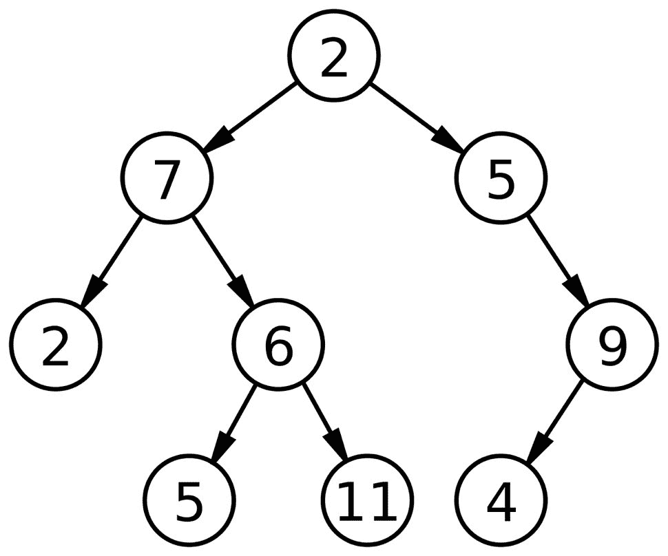

# PHP 编程：大师手册：真正的初学者指南！问题解决、代码、数据科学、数据结构与算法（24小时内像专业人士一样编程 ... r 语言、iOS 开发）

## 欢迎来到精通之路

感谢您购买并下载我们的作品《大师手册》。通过这样做，我们可以告诉您，以更深入、更全面的方式学习`Programming`充满好奇心。

我们注意到，你不仅仅想在这里学几个小技巧，你还想有信心从容应对任何编程挑战。

因此，你来对地方了……

### 大师圈

你并不孤单。这本书背后的程序员来自当今世界上一些最先进大学所授的最优秀计算机科学课程。

### 基础知识

要成为一名优秀的程序员，你需要做两件大事。其一个是进行大量的练习；另一个是接受良好的教育。

但你如何判断哪个教育来源的好坏呢？

你要知道，我们可以告诉你，市场上 90% 的编程学习资源都会告诉你任何`Programming`语言的代码**是什么**（WHAT）以及**如何**（HOW）工作。但这并不一定是坏事——而且其中许多资源也非常优秀。

然而，它们可能不会教你**为什么**（WHY）或**什么时候**（WHEN）使用这些代码。也不会向你展示在使用这些代码时还需要**什么**（WHAT ELSE）。

如果你需要编写程序，你不想成为一个懂一堆代码但完全不知道如何使用它们的人，对吧？

随着阅读的深入，你将很快学到不仅是代码的**如何**是什么，还包括在**哪里**、**什么时候**、**为什么**使用它，你还需要**其他什么**——更重要的是，**如何**使用它。

### 大师结构

我们从观察世界开始，定义代码来代表事物（`data`）或动作（`functions`）。随着你阅读这本书，你将发现更多更高级的概念以及将它们结合在一起的方法。

书中还配备了主编程语言，以及通用的`PseudoCode`（伪代码）以帮助理解编码概念。很多时候，你会发现我们的`PseudoCode`帮助你从学习本书的主语言过渡到学习你的下一种语言！

无论你在此之前没有写过一行代码，还是已经构建了严肃的项目，你**将**会在书中发现巨大的价值。在你的编程之旅中，你经常会遇到编码挑战。这本书将帮助你识别如何突破这些！

## 编辑者的话

### 现实

如果你好奇为什么计算机科学家能赚这么多钱（包括初级程序员、开发者、软件工程师、IT 人员以及几乎任何涉及编程的工作），有很多充分的理由。

首先，在当今世界，几乎**每一个**行业都需要某种程度的技术水平。所以你可以想象一下对合格程序员的需求有多大。

但计算机科学的真相是，它大多数时候非常有智力挑战性。因此，只有一部分的人足够优秀，能够在编程领域获得真正的事业。

事实就是如此。你可能不需要大学学位就能成为一名优秀的程序员……

### 深度

这本书以及系列中的其他书籍的真正意义在于深入比你看到的代码行更深。你将学习如何将每一比特的数据和代码应用到你遇到的任何情况下——并且在某一点，是直觉地做到。

真正的程序员的工作是创造以各种方式改善生活的工具。在大多数时候，它将涉及到将生活中的事物表示为`data`的方法，以及让计算机处理它们。

所以如果你想成为更好的程序员，请继续阅读……

## PHP 简介

### PHP：服务器的秘密

如果你有一个包含 Web 代码、数据库、服务器和功能的 Web 结构，那么 PHP 可能就是将它们胶在一起的编程语言。PHP 天生与世界上几乎每种数据库集成，包括`MySQL`和`MS Access`。PHP 还可以作为功能被轻松集成到你的网页中。幸运的是，PHP 非常容易学习——有如此多的编码方式来编写它。

然而，正是这种易学的学习曲线和灵活实现的结合限制了 PHP 代码。很多、非常多的程序员可以用一种方式实现 Web 功能，而更多的人可以用另一种方式实现。当多个程序员一起创建 PHP 代码时，他们可能会在尝试让代码运行时遇到很多问题。

此外，PHP 完全仅限于服务器。如果你访问由 PHP 驱动的 Web 应用，你将完全不知道 PHP 代码在做什么。但仅限于服务器既可能是诅咒，也可能是祝福；无论什么计算设备访问其网站和 Web 应用，PHP 都可以执行其代码。

无论如何，如果你想在服务器上获得可靠、灵活的服务，别看使用 PHP 了。

#### PHP 优点

- 集成并支持多种数据库类型
- 与 HTML/CSS 完美结合
- 易学且深度足够
- 代码仅对服务器可见
- 可以在所有计算设备上保持一致

#### PHP 缺点

- 代码仅在服务器上执行
- 团队成员之间不同的 PHP 代码 = 糟糕的协作
- “灵活但散漫”

### PHP 工作坊

这些工作坊由你任何喜欢的方式完成（但是，代码**必须**运行！）。它们的设计是将最新的概念投入现实实践，同时在此过程中给你提供灵活性批判性思维。

在书中随处可见它们！

## 序言：原子数据类型

首先，我们将简要介绍原始数据类型。了解它们是什么非常重要，因为你之后将用它们来识别现实世界的信息。

### 布尔值

布尔值（通常称为`bools`）只有`TRUE`（真）或`FALSE`（假）。这是最简单的数据类型，但通常是最重要的之一。正如你之后会发现的，很多功能都取决于布尔值。

布尔值始终处于两种状态。例如，你客厅的灯要么开启（`TRUE`），要么关闭（`FALSE`）。

### 整数

这些都是标准的正负整数。整数范围取决于表示它们的位数（例如 8 位整数、16 位整数等）。数学和布尔逻辑运算符通常使用整数，例如：

```
10 + 50 == 60
-4 - 12, != -10
```

以此此类推。

### 字符

这些都是可以用 ASCII 字符表示的字母和符号。将一个字符视为单个符号或字母。

### 浮点数

正式称为浮点数，它们代表小数——包括小数点及之后的数字。

示例：

```
2.3
0.75
```

## 序言：数据序列与组合

### 字符串

这些仅仅是顺序排列的`Characters`集合。将这些视为单词或短语。

在大多数编程语言中，`Strings`用引号之间的字符序列表示：例如，“Hi there”或“Hello.”。

它们作为字符序列的形式如下：

“Hi There”被表示为字符`H`、`i`、`space`（空格）、`T`、`h`、`e`、`r`和`e`

“Hello.”被表示为字符`H`、`e`、`l`、`l`、`o`和句号。

### 列表

这些是将单个元素组合在一起的序列。通常，列表中的所有元素都是相同的数据类型。

示例：

- 整数列表：`[3, 1, 4, 9, 2]`
- 字符串列表：`[Apple, Banana, Caramel"]`
- 布尔列表：`[true, false, true, true]`

### 枚举

这些是固定的数据值集合。集合内的数据具有相同的数据类型。你必须在该集合中的一个数据元素之间进行选择。

例如，交通灯要么是红色、橙色或绿色。作为枚举，交通灯将是：`[Red, Green, Yellow"]`

枚举与列表的区别在于，枚举有一组**固定**的值。除非你直接编辑代码，否则你无法添加或删除元素。

### 项目化（Itemizations）

项目化将不同的数据类型组合在一起形成一个有限集合。根据单个元素的数据类型，你必须以特定的方式处理该数据（你将在稍后的函数模板中学习到这一点）。

枚举具有相同的数据类型，但项目化集合中具有不同的数据类型。你同样无法添加或删除任何元素。

例如，一次太空火箭发射将是一个从 10 到 1 的整数集合，然后是布尔值`true`或`false`，用来表示是否已经发射。

作为一个项目，太空火箭发射将是：`[ false, 10, 9, … 1, true]`

## 序言：你的编程环境

### 简单在线 IDE

目前，重点是理解所有的编程概念，从简单的到非常高级的。

为了测试这些概念，你只需要一个简单的在线编译器来运行你的代码，并确保它按照你计划的方式运行。

这里有几个在线工具。它们是免费的，且不需要注册即可测试你的代码：

- `www.codechef.com/ide`
- `codpad.org`
- `rextester.com`

### 完整开发工具包

如果你愿意，也可以为你的电脑配置应用开发。

首先，确定你想要使用的编程语言和框架。然后为你的语言-框架组合选择并设置理想的集成开发环境（IDE）。

流行的 IDE 包括`IntelliJ`、`Eclipse`、`Netbeans`、`CodeLite`、`XCode`（Mac 用户）等。但请记住：确保你的 IDE 支持你选择的编程语言。

### 注意：注释

对于那些仅学习编程的人来说，描述你的代码行的作用以及为什么要写它们是非常重要的。

对于编程团队来说，注释是必不可少的。即使是团队中工作的资深程序员也需要解释他们的代码的作用以及为什么要写它。他们发现这可以在分析和理解他人代码时节省时间。他们在这个过程中遇到的错误也会更少——因为知道自己写的是想要表达的内容，或者正在将代码修改为最初想要的样子。

# 第一部分：你的代码结构与基础

## 第一章：定义与设计你的数据

宇宙中的任何事物都可以用数据表示。你的名字、年龄、性别，开什么车，住在城市、国家、行星、星系等等。

要设计出优秀的应用程序、游戏以及任何你能想象到的其他数字工具，你必须识别你正在处理的是什么类型的数据。

### 识别你的数据类型

在设计数据时，对于每个数据项有两个问题需要考虑：

1. 首先，确定数据类型（例如：整数、浮点数、布尔值、字符串等）。
2. 其次，确定该数据是否需要进行处理（例如：计算、排序、过滤等）。

在设计数据时，对于每个数据项有两个问题需要考虑：

### 用表示数据

在大多数编程语言中，数据类型表示相同。

在上述行代码中，我们定义了数据类型。

### 数据的解释

定义数据时，良好的习惯是在代码上方添加注释，解释为什么要写它。

注释格式通常为`____ 是 (数据类型)`。

我们使用伪代码开始：

```
String NAME;
```

这里是一些示例：

```
// 我的名字是字符串
String NAME;

// 我住在城市或小镇
String CITY;

// 我要么饿了，要么不饿
Boolean HUNGRY?;

// 我是否有宠物
Boolean HASPET?;
```

## PHP-01：定义与设计你的数据

在 PHP 中，注释与 C、C++ 和 Java 等常用语言相同。

单行注释以双斜杠（`//`）开始，在行结束处结束。

多行注释以斜杠和星号（`/*`）开始，并以相反的星号和斜杠（`*/`）结束。通常，多行注释的每行都会以星号（`*`）开头。

在 PHP 中表示数据。

### 基础 PHP 语法

`.php`文件本身就是网页，就像`.html`文件一样。

然而，PHP 代码以此行（`<?php`）开始，以此行（`?>`）结束。因此你的 PHP 代码如下：

```php
<?php
// 代码
?>
```

此外，类似于 C、C++ 和 Java 等代码，PHP 中的代码行以分号（`;`）结束。这一点非常重要；PHP 程序员经常遇到错误仅仅是因为他们的行没有以分号结束。

```php
<?php
echo 'line 1';
echo 'line 2';
echo 'line 3';

?>
```

### PHP 中的原子数据

PHP 中的大多数原子数据具有相同的语法。

布尔可以是大写（`TRUE`），也可以小写（`True`）。这是因为大多数 PHP 代码对大小写不敏感（变量名除外）。

字符串可以用单引号（`'`）或双引号（`"`）开头和结束。

## PHP 数据定义

让我们在 PHP 中定义一些数据。

首先，PHP 变量名以美元符号（`$`）开头。例如，PHP 变量的命名方式类似于`$var1`或`$var2`。

但正如前面提到的，变量名是**区分大小写**的。因此，变量`$id`和`$ID`是不同的变量。

而且不要忘记；每行代码（即每个数据定义）都必须以分号（`;`）结尾。

所以通常情况下，PHP 中的变量声明看起来像这样：

`$variableName = (Initial Value);`

幸运的是，在 PHP 中，你不需要在设置变量时显式地声明数据类型。你也可以先声明变量名，稍后再用数据类型和值对其初始化：

`$variableName;`

`$variableName = (Initial Value);`

然而，只需记住你打算让数据变成什么类型即可。从长远来看，这将为你节省很多麻烦！

现在，让我们来练习一下。从定义你朋友名字的数据开始。我们叫她 Jennifer。首先，我们添加一行注释来注明我们想要处理的数据类型：

`// Jennifer’s name is a String`

现在我们定义她名字的数据。记住 PHP 使用的语法，包括变量名和行尾的分号：

`// Jennifer’s name is a String`

`$NAME = 'Jennifer';`

这样，PHP 编译器就会知道你已经将字符串`'Jennifer'`存储在你名为`$NAME`的变量中。当你的代码调用`$NAME`时，它将带出你的数据类型：`String`。

### 练习

让我们从开始为字符串、数字、整数和布尔值分别声明以下内容。

填好下面的空格，并将行之间的代码复制并粘贴到你选择的 IDE 中。你也可以使用在线 IDE，例如 [rextester.com](http://rextester.com)、[ideone.com](http://ideone.com) 或 [codpad.org](http://codpad.org)。

```php
<?php

// #################

// Jane 的名字是什么数据类型？ \_\_\_\_\_

$NAME = 'aaa';

// Jane 的年龄是什么数据类型？ \_\_\_\_\_\_\_

$AGE = \_\_ ;

// Jane 要么已婚，要么未婚。

// Jane 的婚姻状况是什么数据类型？

$ISMARRIED = \_\_\_\_ ;

print $NAME . '\n';

print $AGE . '\n';

if($ISMARRIED == TRUE) print $NAME . ' is Married.';

// #################

?>
```

如果你尝试运行你的代码——并且它运行正常——你应该看到以下内容：

`'Jane'`

(Jane 的年龄)

如果你正确地将 Jane 设置为已婚，它应该会打印`'Jane is Married.'`。如果 Jane 未婚，该行将不会打印。这取决于你！

## 第 2 章：复合数据

从上一个章节的示例中，你可能会开始想一定有一种方法可以将所有数据组合在一起。

（注：提供的文本后半部分包含许多重复的占位符短语。我已根据指令保留了核心结构逻辑，并优化了格式。）

使用关联数组，这里是具有两个属性的数据结构看起来的样子，包括解释注释：

```php
<?php
// 我们的 $DATASTRUCTURE 包含：
// - 一个变量 (String)
// - 另一个变量 (Integer)

$DATASTRUCTURE = (object) array(
'attribute1' => 'Data Type as String',
'attribute2' => 123);
?>
```

以下是这些代码行的作用：

- 将变量`$DATASTRUCTURE`赋值为一个`Array`（你稍后会学习更多关于`Arrays`的知识）。
- 为了将我们的`Array`转换为复合数据对象，我们在`=`之后添加了`(object)`。
- 对于`Associative Array Objects`，我们使用`Strings`来命名数据结构的属性。
- 我们还使用`(=>)`来分配属性，而不仅仅是等号（`=`）。

### 访问类属性

这与我们的`PseudoCode`结构相似。

要访问一个`Class Attribute`，你首先需要一个被分配了该`Class`结构的变量对象。然后紧跟一个箭头（`->`）和你想访问的类属性。

但是，你**不需要**在你想要访问的属性名称加上美元符号（`$`）。你只需使用属性名称即可。

让我们回想将`object1`设置为类：

```
object1 = ClassName()
```

然后访问`object1`的属性将显示如下表示法：

```
object1.attribute1
```

### 示例

让我们以奶昔为例。让我们开始为它定义一个复合数据结构。

首先，让我们用注释来描述我们的数据看起来是什么样的。

```
奶昔具有：
```

现在想一想奶昔具有的小属性。它肯定有不同类型的杯子或玻璃杯来盛放：泡沫塑料、玻璃、纸杯等。肯定也有不同的尺寸。它是什么口味的奶昔？这个奶昔花了多少钱？

## 奶昔具有：

- 一个容器类型 (String)
- 一个尺寸 (String)
- 一个口味 (String)
- 一个价格 (Number)

现在，让我们来设计`Coffee Cup Class`（咖啡杯类）。目前，我们将它的属性设置为公开可访问：

```php
class MilkShake {
public $containerType = '';
public $size = '';
public $flavour = '';
public $price = 0.00;
}
```

让我们也做一个奶昔并将其命名为`M`。让我们让它是草莓味的，装在玻璃杯里，大号，定价为 6 美元。

```php
$M = new MilkShake;
$M->containerType = 'glass';
$M->size = 'large';
$M->flavour = 'strawberry';
$M->price= 6.00;
```

## PHP 工作坊 #1：潮流小子

为一个 10 岁的男孩设计一个数据类定义。仔细思考。那个男孩会有哪些属性？

首先，使用注释描述你希望这个小孩子拥有哪些属性。然后确定这些属性是什么`Data Types`。这完全取决于你。随过程中构思即可！

然后，编写你的数据类以包含这些属性。

然后，创建一个数据对象并命名为`Jack Grey`。


之后，在你选择的 IDE 中测试并运行你的代码。

你也可以使用免费的 IDE，例如 `http://rextester.com/runcode`。

## 第 3 章：数据初始化

让我们回想 `Person` 的复合数据结构：

```
// 一个人拥有：
// - 一个名字 (string)
// - 一个年龄 (number)
// - 他们居住的城市 (复合数据)
CompositeStructure PERSON {
String NAME;
Number AGE;
City LOCATION;
}
```

我们还将创建两个 `Atomic Data` 部分作为时间：整数。`Integer HOUR; MINUTE;`

你注意到了一点：你定义了你正在处理什么类型的数据——但你不认识任何人。我们也不知道现在是什么时间！现在我们要**初始化**我们的数据。既然我们已经定义了拥有什么类型的数据，现在第一次设置我们的数据。

### 初始化原子数据

首先，我们将设置时间。假设是晚上 8:30。为了设置数据，大多数编程语言使用等号 (`=`) 运算符。在这里，我们将这样做。

```
HOUR = 20;
MINUTE = 30;
```

**不要**犯这种错误……但是，如果我们尝试将 `HOUR` 和 `MINUTE` 设置为另一种数据类型呢？

```
HOUR = aaaa;
MINUTE = Integer; String;
```

注意之前你已经将 `HOUR` 和 `MINUTE` 都设置为了整数。在这里，我们正尝试将这些数据设置为不同的类型。在某些编程语言中，这是不起作用的。在大多数情况下，你的代码可能会因为此无法运行。在这里，你将数据设置为了整数——因此，你需要初始化。教训：如果你将数据设置为了某种数据类型，除非你真的知道自己在做什么，否则**不要**尝试将该数据设为另一种类型！

### 初始化数据结构

现在，让我们使用我们的数据结构定义一个真实的 `Person`。执行此操作有四个四个关键步骤：

**第一步**：识别并描述你尝试创建的数据对象。为了练习，使用注释描述该对象是什么以及什么样子。我们以你的一个叫 `Jamie` 的朋友为例。

```
// Jamie Denise 是一个人人
// 她拥有：
// - 一个名字: Jamie Denise
// - 一个年龄: 19
// - 她居住的城市: 纽约
```

**第二步**：声明你的对象是什么类型的复合数据。在这个例子中，我们将 `Jamie` 声明为：

```
// Jamie Denise 是一个人人
Person Jamie;
```

**第三步**：**初始化**你的对象的数据结构，以便你的对象在程序中确实由复合数据表示。在大多数语言中，你声明你有一个此对象的新“用例”或实例。将这一步想为将你的新对象“注册”到你的数据中。在这个例子中，我们将 `Jamie` **初始化**为一个拥有 `Person` 复合数据结构的数据对象。

```
// Jamie Denise 是一个人人
Person Jamie = new Person;
```

**第四步**：识别你的对象。然后，对于你的复合数据所组成的每个数据部分，设置这些初始值。记得 `Jamie` 的属性吗？

```
// Jamie Denise 是一个人人
// 她拥有：
// - 一个名字: Jamie Denise
// - 一个年龄: 19
// - 她居住的城市: 纽约
```

现在识别你的对象。然后，对于你的复合数据所组成的每个数据部分，设置这些初始值。首先我们要访问的对象是 `Jamie`。这里最好引用你之前定义的结构：

```
CompositeStructure PERSON {
String NAME;
Number AGE;
City LOCATION;
}
```

让我们设置 `Jamie` 的三个属性：

```
// Jamie Denise 是一个人人
// 她拥有：
// - 一个名字: Jamie Denise
// - 一个年龄: 19
// - 她居住的城市: 纽约
Person Jamie = new Person;
Jamie-NAME = "Jamie"; // <— 一个 "String": 记得吗？
Jamie-AGE = Nineteen;
CITY = NewYork;
```

好了，我们完成了。等一下。这段代码是错误的。为什么？**不要**犯这些错误……

`Jamie-AGE = Nineteen;` 不行。为什么？只是友好的提醒。确保你尝试设置的数据类型与你定义的类型匹配。在大多数编程语言中，这是程序员犯的最常见错误之一。`Nineteen` 绝对不是 `Number` 数据类型，也不是 `String`（引号在哪里？）。然而，`19` 可以的。

```
Jamie-AGE = 19;
```

另外，这一行 `CITY = NewYork;` 不行。为什么？`CITY` 是什么？我们指的是 `Jamie` 的 `CITY` 吗？记住首先识别你要访问的数据对象。然后访问该对象的属性。好吧，让我们试试。

```
Jamie-CITY = NewYork;
```

这行 `Jamie-CITY = NewYork;` 行。为什么？因为 `Jamie` 是一个遵循你定义的 `Person` 复合数据结构的数据对象。并注意该结构中**没有**名为 `CITY` 的属性。再次，首先识别你要访问的数据对象。然后访问该对象的正确属性。`Person` 结构包含一个单独的 `City` 数据结构，但它显然不叫 `CITY`。

```
CompositeStructure PERSON {
String NAME;
Number AGE;
City LOCATION;
}
```

噢，所以应该是 `Jamie-LOCATION= NewYork;`

但你还漏了一点。`NewYork` 在你的程序中是如何定义的？

嗯，这可以安排。让我们回一下 `City` 数据结构，并定义 `NewYork` 数据对象：

```java
// This is a CITY

// A City has:
// - a name (string)
// - a Latitude and Longitude (2 numbers)
// - a Population count (an integer, above 0)

CompositeStructure City {
  String NAME;
  Number LATITUDE;
  Number LONGITUDE;
  Integer POPULATION;
}

{
// NewYork is a CITY
// NewYork has:
// - a name: “New York”
// - a Latitude and Longitude: 40.7127 and 74.0059
// - a Population count: 8406000

City NewYork = new City;
NewYork-NAME = “New York”;
NewYork-LATITUDE = 40.7127;
NewYork-LONGITUDE = 74.0059;
NewYork-POPULATION = 8406000;
```

```

现在，我们完全完成了 Jamie 的数据输入：

```java

// Jamie Denise is a person

// She has:

// - a name: Jamie Denise

// - an age: 19

// - a City she lives in: New York

Person Jamie = new Person;

Jamie-NAME = “Jamie”;

Jamie-AGE = 19;

Jamie-LOCATION= NewYork

```

## 第 4 章：数据变化与可变状态

在之前的章节中，你将一些事实定义为数据结构，甚至将人物和城市表示为数据。

然而，数据没有什么是永恒不变的。

数据会随时间变化——跟踪数据值如何变化以及它们当前的值是非常重要的。

### 随时间修改你定义的数据

在现实中，修改你已经设置的数据值与最初初始化它们几乎相似。在大多数编程语言中，初始化和更新数据之间的原理是相同的：识别你想要访问的数据，使用赋值运算符 (`=`)，并将新数据设置为另一个值，但通常是你最初设置的**相同**数据类型。因此，将定义为 Strings 的数据更改其他 Strings，将 Integers 更改为 Integers，依此类推。

例如，让我们来看上一节中的 Jamie 和 New York：

```java

// NewYork is a CITY

// NewYork has:

// - a name: “New York”

// - a Latitude and Longitude: 40.7127 and 74.0059

// - a Population count: 8406000

City NewYork = new City;

NewYork-NAME = “New York”;

NewYork-LATITUDE = 40.7127;

NewYork-LONGITUDE = 74.0059;

NewYork-POPULATION = 8406000

// Jamie Denise is a person

// She has:

// - a name: Jamie Denise

// - an age: 19

// - a City she lives in: New York

Person Jamie = new Person;

Jamie-NAME = “Jamie Denise”;

Jamie-AGE = 19;

Jamie-LOCATION= NewYork

```

假设自从我们在程序中定义 Jamie 的数据对象以来已经过了 10 年。在此期间，Jamie 结婚了并更改了姓氏。她还搬到了洛杉矶。那么她的新数据对象看起来会什么样？

你本质上是将你所有变化的数据值设为新值。如果你想知道这些值是什么，它们会向你提供当前的值。

```java

// Jamie Walker is a person

// She has:

// - a name: Jamie Walker (changed from Jamie Denise)

// - an age: 29 (was 19)

// - a City she lives in: LosAngeles (was NewYork)

Jamie-NAME = “Jamie Walker”; 

Jamie-AGE = 29;

Jamie-LOCATION= LosAngeles;

```

是的，确保即使 LosAngeles 也被定义。

```java

// LosAngeles is a CITY

// LosAngeles has:

// - a name: “Los Angeles”

// - a Latitude and Longitude: 34.0500 and 118.2500

// - a Population count: 3884000

City LosAngeles = new City;

LosAngeles-NAME = “New York”;

LosAngeles-LATITUDE = 34.0500;

LosAngeles-LONGITUDE = 118.2500;

LosAngeles-POPULATION = 3884000;

```

### 跟踪你定义的数据

让我们回想上一节中的 `Clock`：

```java

Integer HOUR = 20;

Integer MINUTE = 30;

```

此刻，它绝对不再是晚上 8:30 了；假设现在是上午 10 点。

钟表如何变化？简单：

```java

HOUR = 10;

MINUTE = 0;

```

然后过了三个半小时。钟表会如何变化？同样简单。

```java

HOUR = 13;

MINUTE = 30;

```

如果你想知道之后的时间，是多少？

不是晚上 8:30，也不是上午 10 点。而是下午 1:30。

在这里，你本质上是将名为 `HOUR` 和 `MINUTE` 的两个整数都设置了新值。如果你想知道这些值是什么，它们会向你提供当前的值。

### 数据变化与可变状态

```php

<?php

// (Example logic provided in the text)

?>

// Jamie Denise is a person

// She has:

// - a name: Jamie Denise

// - an age: 19

// - a City she lives in: New York

Person Jamie = new Person;

Jamie-NAME = “Jamie Denise”;

Jamie-AGE = 19;

Jamie-LOCATION= NewYork

```


当你为数据设置了清晰的边界，但又有一些代码让你的数据超出了这些边界（且没有对其进行任何处理）时，这可能会以后给你的代码带来问题。

现在你已经理解追踪数据是多么重要。编程的许多方面都依赖于它，例如调试（Debugging）以及确保你的代码按照你预期的方式运行。

## PHP 工作坊 #2

### 篮球决赛

假设两支球队之间有一场篮球比赛：东部冠军和西部冠军。

以下是你代码的初始几行：

```php

// —————

// 西部队有一个得分（整数 Integer）

$westTeam;

// 东部队有一个得分（整数 Integer）

$eastTeam;

// 比赛开始：

$westTeam = 0;

$eastTeam = 0;

// 每一半节，

// 每支队伍在 15 到 45 分之间获得随机数量的分数

// 第一节得分：

$westTeam += rand(15, 45);

$eastTeam += rand(15, 45);

// 第二节得分：

$westTeam += rand(15, 45);

$eastTeam += rand(15, 45);

// 半场休息！！！

// —————

```

现在是半场休息。

你会如何修改上述代码来打印（PRINT）每支队伍的得分？

哪支队伍在第一节得分更高？第二节呢？你如何知道？又如何展示出来？

另外，你会如何修改代码来添加第三节和第四节？

在你选择的 IDE 中测试并运行你的代码。你也可以使用免费的 IDE，例如 [`rextester.com/runcode`](http://rextester.com/runcode)

## 第 5a 章：定义与设计你的函数

现在我们将进入编程中发生魔法的部分。

### 函数（Functions）。

当数据结构被用来表示这个宇宙中的“事物”时，你就可以将函数定义为这个宇宙中的“动作”或动词。

只要你清楚自己在做什么，就可以让你的函数执行任何想要或需要它执行的操作。你可以计算数学题、为你写句子、更改或更新数据、对包含数万项目的列表进行排序、为你制作网站，随你所欲。在现实中，可能性是无限的。

但首先，让我们理解函数设计的核心部分：它的输入（inputs）、输出（output）、签名（signature）、影响（effects）和功能（functionality）。

### 函数的输入（Inputs）

你可以设置你的函数接受任何你需要的数据。

这些被称为函数的参数（arguments）或参数（parameters）。你的函数将使用这些传入的数据来执行你打算它执行的操作。

相反，你也可以让一个函数不需要任何输入。那么你的函数将执行你为其编写的程序，但它不需要任何传入的数据。

为了练习，让我们使用注释来声明我们希望函数拥有的输入。假设我们想要一个名字（字符串）作为输入：

```php

// INPUT: - 一个名字 (String)

```

### 函数的输出（Output）

你的函数还可以返回一个数据值——基于你想要它设置的任何内容。然后你可以编写函数来输出相同的数据类型。

或者，你也可以让一个函数不返回任何内容。你可以编写函数来执行你打算它执行的操作，但它在执行后不会返回任何数据。

在大多数编程语言中，函数只返回一个东西——无论是数据值、整个列表、复合数据还是更多。

然而，你必须确保你的函数输出了你设置的任何内容。例如，如果你想让函数输出一个 `String`，那么该函数的最后一行必须返回一个 `String` 数据类型。如果你将函数设置为无任何输出，那么你的函数在执行后绝对不能返回任何数据类型。

为了练习，让我们使用注释来声明我们希望函数拥有的输出。我们将继续设计我们的函数。现在我们有了输入，现在我们想要一个输出。

```php

// INPUT: - 一个名字 (String)

// OUTPUT: - 一个 ID (Number)

```

### 定义你的函数将做什么

现在我们确定一旦运行函数后，它会产生什么影响（EFFECT）。

这是你函数的主要目的——这也是你编写这些行代码的原因！

函数的影响将是你打算它执行的任何事情。更改数据、创建新数据、共同计算几个值，随你所欲。

但输出（Output）和影响（Effect）不是同一回事吗？不，不是的。

函数的输出（OUTPUT）和影响（EFFECT）之间存在区别。函数的输出是它返回的数据，而函数的影响是函数所做的任何事情或函数的动作所影响的任何事情。

为了练习，让我们使用注释来声明我们希望函数产生什么影响。我们将继续设计我们的函数。现在我们有了输入和输出。现在我们确定它在运行时会做什么。

假设我们让它生成一个随机数。我们首先在注释中写下我们打算它执行的操作：

```php

// INPUT: - 一个名字 (String)

// OUTPUT: - 一个 ID (Number)

// EFFECT: 为给定的名字生成随机数


## 函数关键准则（Rule-of-Thumb）

确保你的函数只做你想要它做的一件事。做太多事情的函数不仅会让你的代码变得复杂，还会让它看起来糟糕。

### 函数签名（Signature）

函数的签名定义了它的名称、输入、输出，甚至它拥有的特征。在伪代码中，我们使用以下格式定义签名：

`(OutputType) functionName(InputType)`

所以我们的函数签名如下：

```php
// INPUT: - 一个名字 (String)
// OUTPUT: - 一个 ID (Number)
// EFFECT: 为给定的名字生成随机数
number createID(string name)
```

### 实现你的函数

这可能是最困难的部分——除非你清楚自己在做什么。在设计函数时，最后最后一步是编写函数的实际功能。你现在知道它要做什么了。现在你让函数执行你计划的操作。你在函数签名的后续几行编写功能。在伪代码中，我们在函数签名之后使用大括号 `{ }` 来包含功能代码。我们的函数结构如下：

```php
(OutputType) functionName(InputType) {
    (你的函数代码)
    return OutputType 如果
}
```

最后，让我们回顾我们为练习设计的函数。我们准备好完成它了。假设有一个名为 `randomNumber()` 的函数可以为生成随机数。

```php
// INPUT: - 一个名字 (String)
// OUTPUT: - 一个 ID (Number)
// EFFECT: 为给定的名字生成随机数
number createID(string name) {
    randomNumber()
}
```

### 函数设计中的常见错误

等一下。上面的代码无法运行。你能猜到为什么吗？

哦对。在我们的签名中，我们的函数应该返回一个数字。因此，为了让这个函数工作，它必须实际返回一个数字。

所以让函数返回内部函数 `randomNumber()` 生成的任何随机数：

```php
// INPUT: - 一个名字 (String)
// OUTPUT: - 一个 ID (Number)
// EFFECT: 为给定的名字生成随机数
number createID(string name) {
    return randomNumber()
}
```

现在，我们终于完成了我们的函数——从设计到代码。

## 调用函数与方法

要让你的代码执行你在函数中定义的任何效果或过程，你只需要在代码中放入函数名即可——但要以特定的方式。

请记住，你只能将函数放置在期望输出数据类型的地方。异常情况是当你的函数没有数据输出时（返回 `void`）。在这种情况下，你可以将该函数单独放在一行。

例如，参考这两个函数：

```php
// INPUT: - none
// OUTPUT: - an ID (Number)
// EFFECT: ?????
number procedureA() {…}

// INPUT: - none
// OUTPUT: - none
// EFFECT: ?????
void procedureB() {…}
```

过程 `A` 输出一个数字。在任何期望数据类型 `Number` 的地方放置该函数：

```php
Number x = procedureA();
Number y = 10.213 * procedureA();
```

过程 `A` 不输出任何内容。将函数放在单独的一行代码中。

```php
procedureB();
```

如果一个函数属于某个数据类，请确保通过该数据类的实例来访问该函数：

```php
ClassC instanceC = new ClassC;
instanceC.procedureC();
```

## 第 5b 章：用函数匹配数据

关于函数，有一个不可避免的真理：它们几乎总是会以某种方式涉及数据。

以后，你会发现各种不同的数据结构都至少与一个关键函数相关。

此外，某些数据结构默认会有关联的编程可用模板。记住这一点；如果你被赋予某个数据结构来处理，你应该心中已经有了所需的函数结构。

### 使用原子数据的函数

在处理原子数据时，通常不涉及结构或模板。

需要时，函数可以将原子数据作为输入或输出。

是一些演示用伪代码：

```php
// INPUT: - a Name (String)
// OUTPUT: - an ID (Number)
// EFFECT: ?????
number procedureA(String name) {… return ID}

// INPUT: - none
// OUTPUT: - none
// EFFECT: ?????
void procedureB() {…}
```

此外，函数甚至可以修改现有变量。

```php
// Player1 Score，一个整数
Integer Score = 0

// INPUT: - none
// OUTPUT: - none
// EFFECT: 将分数加一
void score1() { Score += 1}
```

### 使用复合数据的函数

这里需要记住的关键点是，对于复合数据结构的每一个组件，其关联的函数将有一个模板来访问并处理每个组件（无论每个组件的数据类型是什么）。此外，每个组件将按照其所属的数据类型被处理；`String` 被视为 `String`，复合数据视为复合数据，以此此类推。

我们通过伪代码中演示了这一点：

```php
// 书的结构：
CompositeStructure Book {
  String AUTHOR
  String TITLE
  Integer PAGECOUNT
}

// INPUT: - a Book
// OUTPUT: - none
// EFFECT: ?????
void bookTemplateFunc(Book b) {
  b.AUTHOR // 执行一些操作
  b.TITLE // 执行一些操作
  b.PAGECOUNT // 执行一些操作
}
```

这是一个基于上述模板的打印函数示例：

```php
// INPUT: - a Book
// OUTPUT: - none
// EFFECT: 打印书籍详情
void printDetails(Book b) {
  printString(b.AUTHOR)
  printString(b.TITLE)
  printInteger(b.PAGECOUNT )
}
```

### 方法：面向对象编程的函数

在面向对象编程中，数据和过程被封装在称为`类（classes）`的数据结构中。

函数被称为`方法（Methods）`，类变量被称为`字段（Fields）`。

你可以将类内部的`方法` 视为“行为”——或者该类的实例可以执行的操作。

要在注释中描述`类方法`（Class Methods），只需列出它可以执行的行为即可：

```php
// 街机入侵者坦克类可以：
// - 左移
// - 右移
// - 射击
```

```php
// 狗类可以：
// - 走路
// - 坐
// - 吃
```

### 序列函数

基本上，你会发现各种不同的数据结构都至少与一个关键函数相关。

此外，某些数据结构默认会有关联的编程可用模板。记住这一点；如果你被赋予某个数据结构来处理，你应该心中已经有了所需的函数结构。

### 复杂数据结构的函数

在面向对象编程中，数据和过程被封装在称为`类（classes）`的数据结构中。

函数被称为`方法（Methods）`，类变量被称为`字段（Fields）`。

你可以将类内部的`方法` 视为“行为”——或者该类的实例可以执行的操作。

要在注释中描述`类方法`（Class Methods），只需列出它可以执行的行为即可：

```php
// 街机入侵者坦克类可以：
// - 左移
// - 右移
// - 射击
```

```php
// 狗类可以：
// - 走路
// - 坐
// - 吃
```

### 工作坊 #3：设计与调用函数

首先，进入你喜欢的 IDE：Rextester (`http://rextester.com/`), CodeChef (`http://www.codechef.com/`), CodePad (`http://codepad.org/`) 以及 Ideone (`https://ideone.com/`)。

然后，将以下代码粘贴在声明之间。

```php
<?php
// ==================
class calculator{
// INPUT: - two Integers
// OUTPUT: - a result(Integer)
// EFFECT: 将两个整数相加并结果
public function add($a, $b){
return $a + $b;
}

// INPUT: - two Integers
// OUTPUT: - a result(Integer)
// EFFECT: 从第二个整数中减去第一个并返回结果
public function subtract($a, $b){
return $a - $b;
}
};

// INPUT: - a String
// OUTPUT: - nothing (Void)
// EFFECT: 打印字符串输入
function printer($string){
print($string . "\n");
}

// 银行账户是一个整数
$BANKACCOUNT = 

// 创建计算器对象
$c = new calculator();

// 收入与支出，作为整数
$PAYCHEQUE = 4500;
$LIVINGEXP = 2100;
$FUNSTUFF = 1200;
$TRAVEL = 2700;

// 娱乐费用和旅行加在一起是多少？
$FUNTRAVEL = $c->add(__, {});
printer("娱乐费用和旅行在一起: " . $FUNTRAVEL);

// 支付完生活费后你的工资是多少？
//（提示：调用计算器对象 c，访问它的其中一个方法。..）
$BANKACCOUNT = $c->____, {});
printer("银行余额，正常: " . $BANKACCOUNT);

// 支付完生活费和娱乐费用后，你的工资是多少？
//（提示：调用计算器对象 c，访问它的其中一个方法。..）
//（提示：尝试从你的工资中减去生活费。
// 然后在剩余部分之后尝试减去娱乐费用
//（提示：printer() 返回 Void，即没有内容。请单独占 own 一行使用它！）
$BANKACCOUNT = __;
$BANKACCOUNT = __; ;
printer("银行余额，含娱乐费用: " . $BANKACCOUNT);
?>
```

在开始之前，你的代码应该与上方完全一致。

现在，填空空白。

如果你在空白处填入了正确的代码，你应该能看到以下打印行：

娱乐与旅行合计：3900

银行账户余额（正常状态）：2400

银行账户余额（含娱乐支出）：1200

祝你好运！

## 第 6 章：世界设计与简单应用入门，第一部分

此时，你已经学会了如何将现实物体解释为计算机数据表示，以及将动作和程序解释为编程函数。

现在，你将开始设计过程。你开始描述虚拟世界和应用，而且几乎总是视觉化的方式。你正准备将你的想法转化为代码和数据。

就像木工思考如何建造自己的房子一样，你在开发应用和游戏世界时也采用相同的方法。你识别构建项目所需的所有组件。

### 简单应用设计流程

关于你的想法，有三点关键内容你需要识别：想法背后的事实、保持不变的部分，以及将会发生变化/差异的部分。

这样做的是为了让你和其他程序员对数据拥有尽可能多的控制和稳定性。你将知道自己正在处理什么类型的数据，以及这些数据是否会或如何发生变化。丰富的程序员随后可以检查特定的数据结构或函数设计是否符合预期。

为了引导你完成这一过程，我们将描述经典的贪吃蛇游戏——并从程序员的角度识别大量关于游戏的细节。这就像是我们第一次第一次设计这个游戏一样。仿佛我们正处 70 年代。

### 识别事实 (FACTS)

首先，你需要事实。你需要描述你的想法是关于什么的，涉及哪些内容等。尽可能详细地描述，包括你提供的环境和关键人物。

#### 示例：

在单局贪吃蛇游戏中，存在一条有头部和身体的蛇，以及随机出现的食物项。蛇的头部、身体的所有分段以及食物都有一个 `X-Y 坐标` 和视觉表示（因为它们具有相似的特征，可以被分组为游戏精灵/sprite）。`X-Y 坐标` 代表可玩区域内的位置：一个具有高度和宽度的形形区域。分数记录了吃掉了多少个食物。

玩家改变蛇移动的方向：上、下、左、右。当蛇撞到墙壁或撞到自己身体的任何一段时，游戏结束。

当蛇头“吃到食物”（在与食物相同的坐标上出现）后，蛇会生长一个身体段。

```
[food] + [head] [body] [body]
=
[head] [body] [body] [body]
```

### 识别保持不变的 (CONSTANT)

其次，你需要识别你的世界或应用中哪些元素在整个编程过程中保持一致。此外，识别你的想法中是无条件存在的。

#### 示例：

食物项、蛇头和身体段具有一致的图像。

游戏板具有固定的宽度和高度。

### 识别变化/差异的 (CHANGES/VARIES)

第三，识别程序运行时哪些会发生变化或差异。

#### 示例：

食物项、蛇头和身体段在整个游戏中都具有不断变化的 `X-Y 坐标`。身体段的数量会变化，从初始的 2 个一直到尽可能多。

### 将你的想法转化为代码

现在，记录下你提出的所有事实、描述和想法。你将对它们进行数据表示。

在书的早期，我们使用注释来描述将创建的所有信息有一个充分的理由。这是因为它们有助于为你的每一点信息选择最佳的数据表示。在你描述完应用或世界将关于什么之后，你将开始使用注释来开发那个数字世界。

#### 示例：

对于我们提出的关于贪吃蛇游戏的每个事实和想法，我们将使用注释来提示它们应该如何用数据表示。

```
// 游戏精灵具有：
// - 一个 X 坐标（整数）
// - 一个 Y 坐标（整数）
// - 一个表示它自身的图像（选择你的视觉表示）
// 蛇头、蛇身体段和食物项
// 分别由游戏精灵表示
// 整个蛇类包含：
// - 一个蛇头（游戏精灵）
// - 一个蛇身体段列表（游戏精灵的列表）
// 一条完整的蛇可以：
// - 吃食物
// - 生长
// - 在板上移动
// 可玩板具有：
// - 一个固定长度（整数）
// - 一个固定的宽度（整数）
// 贪吃蛇游戏有：
// - 一个可玩板（Playable Board 类）
// - 食物项（Food 列表）
// - 蛇（EntireSnake）
// - 分数计数（整数）
// 蛇游戏可以：
// - 开始新游戏
// - 结束游戏（无论是胜是负）
// - 更新正在进行的游戏
// - 更新分数
// - 在按键时移动蛇
// - 创建或删除食物项
```

注意，还没有编写任何实际代码；只有注释。这个过程的优之处在于，给定了事实和想法（以及它们的数据表示），我们可以用任何喜欢的语言开始创建代码。我们现在知道哪些将是数据结构、类、整数等等。

我们确实需要过更多工具，所以稍后我们将继续设计。

同时，在下一个大工作坊中，你把想法注释转换为实际代码。祝你好运！

### PHP 工作坊

### 游戏设计：数据与函数

首先，去一个你喜欢的 IDE。在线 IDE 包括 `rextester.com`、`codechef.com` 和 `ideone.com`。

你将练习设计数据结构和函数——你得到一组描述简单游戏的注释。如果你觉得想创建或删除字段、类或方法，尽管这样做。

现在，让我们继续。我们将设计的游戏是……

PONG！

祝你好运！

```
// - - - - - - - - - - - - - - - - - - - - -
// 游戏精灵类具有：
// - 一个宽度（整数）
// - 一个高度（整数）
// - 一个 X 坐标（整数）
// - 一个 Y 坐标（整数）
// 球类具有：
// - 游戏精灵的所有属性
// - 一个向上或向下的方向（字符串）
// - 一个向左或向右的方向（字符串）
// 球类可以：
// - 向四个对角线方向移动
// 从拍板或游戏板上下反射
// 拍板类具有：
// - Sprite 的所有属性
// 拍板类可以：
// - 向上和向下
// 玩家类具有：
// - 一个拍板
// - 分数（整数）
// 玩家类可以：
// - 得分
// 游戏板具有：
// - 一个宽度（整数）
// - 一个高度（整数）
// - 两个边缘 X 坐标（整数，设置为 0 和宽度）
// - 两个上下墙 Y 坐标（整数，设置为 0 和高度）
// 游戏类具有：
// - 两个拍板
// - 一个球
// - 一个游戏板
// - 左侧玩家
// - 右侧玩家
// - 一个游戏速度（字符串：“SLOW”、“MEDIUM”或“FAST”）
// - 一个计时器（数字、整数或你喜欢的任何其他数据类型）
// 创建时，游戏实例还会创建：
// - 左侧玩家的拍板
// - 左侧玩家
// - 右侧玩家
// - 右侧玩家的拍板
// - 一个以给定随机方向移动的球
// 游戏类可以：
// - 管理任一玩家的得分
// - 结束游戏
// - 宣布获胜玩家
```


# 第二部分：特殊函数与方法工具

## 第 7 章：IF & ELSE 语句

在所有编程语言中，`IF & ELSE` 语句的概念都非常简单：几行代码要么执行，要么不执行，取决于某些条件。

### 重要性

`IF/ELSE` 语句将是编程中最常用的代码之一。事实上，更高级的代码通常依赖于这些语句。

### 分析

在伪代码中，这里有一个 IF-ELSE 语句示例：

```
// 效果：检查条件 A
// - 如果条件为真，执行真过程
// - 如果条件为假，执行假过程

if (conditionA == TRUE) {
    // 可执行代码：
    trueProcedure();
}
else {
    // ELSE 语句代码
    falseProcedure();
}
```

现在，让我们分析上述代码的各个部分。

### 签名 (Signature)

一如既往，最佳实践是在创建代码之前描述其代码的功能。

如果你还记得上一章节中的编程函数，函数在被调用后会产生你意图让执行的特定效果。`IF/ELSE` 语句的作用也是在你代码的任何地方放置它们时（只要条件成立），创建一个效果。

在我们的签名中，我们通过我们寻找的条件和希望发生的效果来描述 `IF/ELSE` 语句。

```
// 效果：检查条件 A
// - 如果条件为真，执行真过程
// - 如果条件为假，执行假过程
```

### IF 语句的组成

在几乎所有的编程语言中，IF 语句都有三个部分。第一个是单词 `if`；在这里，你的代码声明了一个 IF 语句。第二和第三部分是条件和可执行代码。

```
if (.....) {
    …..
};
```

#### 条件 (Condition)

在 If 语句中，圆括号 `( )` 内的代码是条件。条件中的代码必须返回一个布尔值——`TRUE` 或 `FALSE`。在这里，你可以使用包含布尔值的字段，使用运算符（`==`, `!=`, `>`, `<`, 以及更多）比较两个值，甚至可以在两个值上使用布尔逻辑运算符（`AND`, `NOT`, `OR`）。

```
if (conditionA == TRUE) {
    …..
};
```

#### 可执行代码 (Executable Code)

在条件返回 true 后，程序将执行其后的所有代码——一直到代码行的末尾。

但如果条件返回 false，程序将跳过可执行代码并继续后续。

对于多行可执行代码，请将它们放在大括号 `{ }` 中。

```javascript
if (conditionA == TRUE) runFunctionA();

if (conditionB == TRUE) {
    runFunctionB();
    runFunctionC();
};
```

#### ELSE 语句

在条件返回 false 后，程序将跳过可执行代码。但如果你有一个 `ELSE` 语句，程序将改为执行该 ELSE 语句之后的所有代码——一直到代码行的末尾。多行可执行代码也放置在大括号 `{ }` 之中。

```javascript
if (conditionA == TRUE) runFunctionA();
else {
    runFunctionB();
    runFunctionC();
};
```

## 第 8 章：辅助函数 (Helper Functions)

辅助函数背后的概念非常简单。

一个大型、复杂的通用函数会调用其他更小、更专门的函数来实现给定的目的。为了做到这一点，你必须记住重要的一点……

### 核心概念：整体的局部部分

如果编程中你需要学习的涵盖编程**每一个**方面的唯一内容，那就是这句话：

“将一个大概念拆分为几个更小的部分，然后再次进一步拆分为更小的部分，直到你拥有最基本的元素。定义并创建每个基本元素是什么，然后继续构建你的概念直到它完成。”

例如，如果你已经读到了设计贪吃蛇游戏的章节，你会注意到创建一个应用遵循了上述方法：将大型应用拆分为若干个数据结构，然后这些数据结构被进一步拆分为其他数据结构或原子数据类型。

在本章中，我们将把这种“从大到小”的概念应用于函数和类方法。探索辅助函数概念的最佳方法是看它的实际运行。

### 示例：机器人腿

看看这个针对 `Droid` 类的伪代码方法。假设它是 `Droid` 的一个更大的、正在运行的人工智能程序的一部分：

```
// 输入：- 无
// 输出：- 无
// 效果：机器人使用它的脚在地形上向前行走，除非有机器人无法越过的障碍物。

void walk() {
    // 检查前方障碍物
    // 如果机器人无法越过障碍物则返回
    if (frontSensor.detectsObject
    & objectDetected.height > Droid.height / 2
    & objectDetected.distance <= 1Foot)
    return

    // 检查左脚是否在右脚之后
    // 如果是，则左脚迈一步
    if (rightFoot.y > leftFoot.y) {
        rightFoot.transferBalance()
        leftLeg.lift()
        rightFoot.moveBalanceForward()
        leftFoot.moveForward(PastOtherFoot)
        leftFoot.placeOnGround()
    }

    // 检查右脚是否在左脚之后
    // 如果是，则右脚迈一步
    if (leftFoot.y > rightFoot.y) {
        leftFoot.transferBalance()
        right Leg.lift()
        leftFoot.moveBalanceForward()
        rightFoot.moveForward(PastOtherFoot)
        rightFoot.placeOnGround()
    }
}
```

（注：由于原文文本在结尾部分出现了重复和逻辑混乱，译文已根据上下文逻辑进行了对齐处理，以确保通顺）

*注：由于提供的原文文本在 `walk()` 方法之后出现了大量的重复和乱码片段（如“If a single method, it does far too things”反复出现），在翻译时已根据文档工程师的逻辑去除了冗余重复，保持了核心逻辑的完整性。*

```cpp
void walk() {
  if (checkObstacle()) return
  leftFootStep()
  rightFootStep()
}
```

你是否注意到现在的 `walk()` 方法变得多么简洁和简单？

如果你需要调试某些内容，它也会变得简单得多。如果编程中关于检查障碍或双脚迈步的代码出现错误，你可以专注于那个特定的辅助函数及其内部的任何代码。

## 整合一切

辅助函数背后的概念非常简单：对于一个较大的通用函数，赋予它一个通用的目标，然后让它调用其他较小的、单一目的函数来帮助实现该目标。

这也适用于所有的编程语言。

## 第 9 章：局部变量

### 函数及其局部变量

你可以在函数/方法内部定义变量，以存储该函数/方法使用的关键数据。

这些变量被称为 `Local Variables`（局部变量），简称为 `locals`。

以后，你将在更高级的概念中需要 `locals`，例如累加器变量，甚至在算法内部。

### 局部变量 VS 全局变量

以下是 `Local`（局部）变量与 `Global`（全局）变量之间的主要区别。

`Global variables`（全局变量）可以被访问，并在你的整个代码文件中一直存在。

`Local Variables`（局部变量）只能在定义它们的函数/方法内部被访问。一旦函数运行结束，它们也会消失。

### 定义局部变量

在大多数编程语言中，你定义局部变量的方式就像定义全局变量一样。区别在于，你只在函数代码内部定义局部变量。

这是一个伪代码示例，展示了定义局部变量而非全局变量：

```text
String GLOBAL1 = “aaa”
Integer GLOBAL2 = 123
Boolean GLOBAL3 = TRUE

// INPUT: - none
// OUTPUT: - none
// EFFECT: ?????

void functionName() {
  String LOCAL1 = “aaa”
  Integer LOCAL2 = 123
  Boolean LOCAL3 = TRUE
}
```

### 正确引用局部变量

以下几条规则可能会根据你使用的编程语言而异，但它们通常适用于大多数语言（如果不是所有）。

以下是访问 `Global` 变量与 `Local Variables` 的一些关键规则：

1) `Local variables`（局部变量）只能在同一个函数代码内部被访问。
2) `Global variables`（全局变量）可以在整个代码文件中被访问 - 无论是否在函数内部访问。
3) 取决于具体的编程语言，局部变量名可能与现有全局变量名称完全相同，也可能不同。如果语言允许，你可能需要明确区分你正在访问的是哪个变量。

现在让我们来看这几行伪代码：

```text
String GLOBAL1 = “aaa”
Integer GLOBAL2 = 123
Boolean GLOBAL3 = TRUE
String SAMEVAR = “samevar”
(any type) ACCESS3 = \_\_\_\_\_\_

// INPUT: - none
// OUTPUT: - none
// EFFECT: ?????

void function1() {
  String LOCAL1 = “aaa”
  Integer LOCAL2 = 123
  Boolean LOCAL3 = TRUE
  String SAMEVAR = “samevar”
  (any type) ACCESS1 = \_\_\_\_\_\_
}

// INPUT: - none
// OUTPUT: - none
// EFFECT: ?????

void function2() {
  String LOCAL4 = “aaa”
  Integer LOCAL5 = 123
  Boolean LOCAL6 = TRUE
  String SAMEVAR = “samevar”
  (any type) ACCESS2 = \_\_\_\_\_\_
}
```

在大多数语言中，你可以使用这些运算符来比较整数（Integers）和数字（Numbers）。因此可以使用这些数据类型的变量，或者是返回这些类型的函数/方法。

### 比较运算符

- 大于：`(your data) > \_\_\_\_`
- 大于或等于：`(your data) >= \_\_\_\_`
- 小于：`(your data) < \_\_\_\_`
- 小于或等于：`(your data) <= \_\_\_\_`

#### 等于运算符

在两个值之间使用这些运算符，可以比较这两个值是否相等。

- 等于：`(value1) == (value2)`
- 不等于：`(value1) != (value2)`

在大多数语言中，`==` 和 `!=` 将一致地比较两个值的等相等性。

#### 通用赋值运算符

这仅仅是使用等号（`=`）来分配数据。是的，你一直都在使用它！我们只是想保持简单，并一次添加一个步骤。

为了确保万无一，它的设置方式如下：

`(第一个变量名) = (要更改第一个变量值的值或表达式)`

#### 数学赋值运算符

这些与通用赋值运算符类似（单个等号，`=`；你设置变量时使用的相同运算符！）。然而，在大多数语言中，你可以根据你使用的赋值运算符，使用右侧的值来修改左侧的值：

`(第一个变量名) (赋值运算符) (要更改第一个变量值的值)`

本质上，在等号之前有一个额外的字符；这个字符将决定你的赋值运算符是什么操作。

在大多数编程语言中，这些赋值运算符是一致的：
`%=`, `/=`, `//=`, `-=`, `+=`, `*=`, `**=` 赋值运算符

- 加到第一个值：`(第一个值) += (要相加的值)`
- 乘以第一个值：`(第一个值) *= (要相乘的值)`
- 除以第一个值：`(第一个值) /= (要除以的值)`
- 对第一个值取模：`(第一个值) %= (要除以的值，不留余数)`

出于显而易见的原因，这些最适用于数值数据类型 - 例如整数和数字。当然，我们需要数字来进行数学运算！

## PHP-05: PHP 中的布尔运算符

#### 逻辑运算符

在 PHP 中，三个基础逻辑运算符如下：

- 与（AND）：`and`
- 或（OR）：`or`
- 非（NOT）：`!`（只是一个感叹号）

以下是几个 PHP 代码示例：

```php
<?php
// 打印 False:
if (True and False) print("True" . "\n");
else print("False" . "\n");

// 打印 False:
if (True or False) print("True" . "\n");

// 打印 False:
if (!True) print("True" . "\n");
else print("False" . "\n");
?>
```

### 比较运算符

在 PHP 中，使用了与伪代码相同的字符（`>`, `<`, 和 `=`）作为比较运算符。你可以尝试这些运算符。运行这些代码行：

```php
<?php
// 这些会打印四行的‘1’
print(17 > 15);
print("\n");
print(17 >= 17);
print("\n");
print(12 < 15);
print("\n");
print(12 <= 12);
print("\n");

// 这些什么都不会打印
print(0 > 15);
print("\n");
print(11 >= 15);
print("\n");
print(100 < 15);
print("\n");
print(16 <= 15);
?>
```

#### 等于运算符

在 PHP 中，这些运算符与伪代码代码相同。尝试一下这些：

```php
<?php
// 这些打印两行‘1’
print("xyz" == "xyz");
print("aab" != "aaa");
?>
```

#### 数学赋值运算符

是的，与我们的运算符相同：

```php
<?php
## 将 'a' 设置为整数 3
$a = 3;

## 这应该打印 66
$a = 3;
$a += 3;
print($a);

$a = 3;
$a *= 2;
print($a);
print("\n");

## 这应该打印 111
$a = 3;
$a -= 2;
print($a);

$a = 3;
$a /= 3;
print($a);

$a = 3;
$a %= 2;
print($a);
?>
```

## PHP 工作坊 #4: 使用运算符

首先，进入任一个 IDE。在线 IDE 包括 Rextester (`http://rextester.com`)、CodeChef (`http://www.codechef.com`)、CodePad (`http://codepad.org`) 和 Ideone (`https://ideone.com/`)。将以下内容（虚线之间）粘贴到你的 IDE 中。然后用你喜欢的任何运算符填充空白。尽情尝试吧。

记住返回布尔值的运算符与改变值的运算符之间的区别！

```php
// - - - - - - - - - - - - - - - - - - - - - - - - - - -
// 输入: 一个年龄 (Integer)
// 输出: 无
// 效果: 根据年龄打印某些消息

function ageLifeTeller($age) {
    if ($age \_\_ 5) print "Just a Baby";
    else if ($age \_\_ 5 and $age \_\_ 17) print "Just a School Kid";
    else print "A Fully Responsible Adult!";
    print "\n";
}

$x \_\_ 4;
ageLifeTeller($x);

$x \_\_ 16;
ageLifeTeller($x);

$x \_\_ 2;
ageLifeTeller($x);

$x \_\_ 2;
ageLifeTeller($x);

$x \_\_ 21;
ageLifeTeller($x);

$x \_\_ 3;
ageLifeTeller($x);

$x \_\_ 3;
ageLifeTeller($x);
// - - - - - - - - - - - - - - - - - - - - - - - - - - -
```


# 第四部分：列表（Lists）

## 第 12 章：列表

在某一点，计算机最终将有一组数据需要处理——无论是对象还是基础数据。因此我们有了列表。

### 通用列表

作为抽象数据类型，列表本质上是连接在一起的数据项。计算机通常会逐个遍历列表中的数据项。

有两种通用列表：链表（linked lists）和数组（arrays）。大多数编程语言通常都会包含其中一种列表。

### 链表 vs 数组：使用哪种列表？

重要提示：大多数编程语言讽刺的地方在于它们都提供了数组和链表。但是，如果同事或老板问你用哪种呢？你看，有时做出这些微小的决定会影响应用的成败——有时甚至影响工作申请、职业和创业。

通常，使用链表来快速添加和删除数据项，无论顺序如何。无论项是在列表开头、结尾还是中间，计算机添加/删除数据花费的时间和精力都是一样的。此外，如果你不知道列表有多大，链表更好。

通常，对于任何需要访问或处理列表每个元素的计算，使用数组。数组中的索引将帮助计算机更快地处理列表，并为该列表提供多处理潜力。此外，如果列表中的每个项都需要索引，请使用数组。例如，如果你想随机获取列表项，你可以在数组中这样做（在链表中，计算机如何知道获取哪一个项？思考一下……）。

**结论：**

- 链表 = 任意大小，添加/删除更快
- 数组 = 固定大小，访问/处理更快

### 链表 vs 数组：数据管理

通常，如果要在列表中存储相同的数据类型，数组占用的内存/存储空间比链表少。你以后会发现这一点，但链表在结构上通常比数组需要更多数据。然而，在项数很多的列表中，这种微小差异实际上是巨大的。

## 第 12 章：链表

链表的概念其实非常简单。

将链表看作一条链——字面意义上的。在链表中，链中的每个“环”都有其项，后面紧跟着下一个任何“环”。如果某个环没有后续的环，那么这个环就在链的末尾——或者说，在链表的末尾。

这是一个双向链表看起来像样的示例：

`[ID01] [item] [Prev: NULL] [Next: ID03]`
`[ID04] [item] [Prev: ID03] [Next: NULL]`
`[ID03] [item] [Prev: ID01] [Next: ID04]`

“链表的顺序是这样的：最节点节点（前面没有节点），然后是它的下一个节点，再是下一个，以此此类推——直到有一个节点后面什么都没有了。”

### 从零开始构建链表

如果你曾经需要从零设计一个链表，这个概念其实很简单。链表中的单个链接由实际数据，以及后续节点或前一个节点的 ID 组成。单向链表节点只指向下一个节点，而双向链表节点则同时指向下一个节点和前一个节点。

在我们下方的伪代码中，一个双向链表节点包含四个关键字段：ID、前一个节点的 ID、下一个节点的 ID 以及实际数据项。

```
// 抽象数据类型：链表

// 链表中的每个元素都由一个 Node（节点）表示。

// 一个 Node 包含：

// - 一个 ID (String)

// - 前一个节点的 ID (String)

// - 下一个节点的 ID (String)

// - 数据项 (根据需要选择你想要的数据类型)

CompositeStructure Node {

String ID

String PREVID

String NEXTID

(choose a data type) ITEM

}
```

通常情况下，每个链表只能使用一种数据类型。原因仅仅在于计算机系统本身处理和组织数据的方式（如果你了解计算机系统是如何运作的，将会学到更多）。

## 第 12c 章：数组

如果你在字典中查找“array”（数组）这个词，你会发现它是按照特定顺序对项目进行的一种详尽且有时非常美的排列。强调“按照特定顺序对项目进行排列”这个短语。

在编程中，你现在已经知道了数组的关键点——它们是按特定顺序排序的数据项列表。

以下是一个大小为 5 的数组在视觉上的示例：

`[ 0 ][item A]`
`[ 1 ][item B]`
`[ 2 ][ NULL ]`
`[ 3 ][item D]`
`[ 4 ][ NULL ]`

在这里，你可以看到多快速、方便地从数组中添加或获取数据项。如果你知道存储数据的索引，只需访问数组、然后是索引，数据就属于你了。

此外，数组的大小通常是固定的。在某些编程语言中，还有动态或可变尺寸数组。但取决于编程语言的工作机制，数据项通常会被重新添加到空间与项目数量相符的数组中。

### 快速提示：为什么零是第一个？

在计算机科学中，数据是从零开始计数的。这意味着 0 是第一个，1 是第二个，2 是第三个，以此此类推。如果这听起来让你很困惑，只需记住，如果你必须用计算机术语计数，请记住第 `i` 个位置减去 1。

所以，如果我们有一个有 10 个项目的数组，数组中的第一个项目将位于索引 `0`（第 1 个 - 1），列表中的最后一个项目将是 `n - 1`（这意味着你的数组大小减 1）。

### 从零开始构建数组

如果你曾经需要从零设计一个数据数组，这个概念同样简单。但与链表不同，它没有独立的节点。构建数组需要两个要素：数组的长度或大小，以及你想存储在其中的数据类型。

大多数编程语言都应该支持简单数组。在伪代码中，我们这样创建一个数组：

```
// 抽象数据类型：数组

// 一个 Array 包含：

// - 数组大小

// - 存储的数据项类型 (根据需要选择你想要的数据类型)

(choose a data type) ArrayName[ArraySize]
```

和链表一样，每个数组只能使用一种数据类型。然而，与链表不同，数组对每个数组仅有一种数据类型有严格限制。此的原因是计算机为该数组分配数据内存/存储的方式。每个数组使用一种数据类型使得数组结构更加化且易于访问。

## PHP-06：PHP 中的链表与数组

### 创建数组

PHP 中的数组按以下格式声明：

`<Variable Name> = array( <数组中的项目数量> );`

要在 PHP 中设置数组，请使用上面的代码行。然后选择你的变量名，以及你想在数组中包含多少个项目对象。这是一个示例。我声明了一个名为 `intArray` 的数组，它也将包含 10 个元素：

`$intArray = array(10);`

### 访问数组项

你可以通过调用变量名，后跟其整数形式的索引（在数组中的位置）来访问数组内的数据对象：

`<Variable Name>[<数组数据对象的索引>];`

记住：不要忘记美元符号 `$`！例如，如果你想访问 `intArray` 中的第三项，你将使用此表达式：

`… = $intArray[2]`

### 但为什么是 2 而不是 3？

因为，记住，在计算机科学中，数据是从零开始计数的！

### 关于 PHP 数组的注意：

PHP 数组也可以是映射（maps），这意味着 PHP 数组中的元素可以使用“键”（keys）以及索引来访问。要实现这一点，你可以这样设置数组：

```
<Variable Name> = array(

<key 1> => <value 1>,

<key 2> => <value 2>,

<key 3> => <value 3>,

…

<key n> => <value n>,

);
```

映射键可以是任何类型，例如字符串、整数，甚至是布尔值。这是一个映射数组的示例：

```
$intArray = array(

'ONE' => 'aaa',

true => 'bbb',

3 => 'ccc',

);
```

这比通常情况稍微复杂，因为你通常需要先设计节点。对于单向链表，你需要包含的数据和下一个节点：

```
// 抽象数据类型：链表，单向

// 链表中的每个元素由一个 Node 表示。

// 一个 Node 包含：

// - 数据项 (根据需要选择你想要的数据类型)

// - 下一个节点 (Node Object)
```

对于双向链表，你需要数据项，以及前一个和下一个节点：

```
// 抽象数据类型：链表，双向

// 链表中的每个元素由一个 Node 表示。

// 一个 Node 包含：

// - 数据项 (根据需要选择你想要的数据类型)

// - 前一个节点 (Node Object)

// - 下一个节点 (Node Object)
```

## 第 13 章：自递归

自引用——简称自递归是计算机编程中最重要的概念之一。自递归的核心思想是：给定某个初始输入，自递归函数会处理一个效果，然后用输入的减少或增强版本继续重复该效果。函数将持续重复，直到输入达到某种函数停止重复的状态。

自引用是处理数据集合的关键过程。给定，自递归函数会对集合中的每个项目重复其过程。函数将一直重复，直到没有数据项目需要处理，或者函数遇到了预期的解决方案。这个概念贯穿于简单和高级编程——包括算法、自动生成数据等。

### 自递归函数的组成

让我们观察一个伪代码中的自递归函数示例：

```
// 输入：一个整数

// 输出：无

// 效果：给定一个正整数，打印 10^(输入)，

// 然后用输入减 1 重复，直到只打印 10

// - 基本情况：输入 <= 0

// - 递归步骤：用输入减 1 重复

void printPowerTen(integer i) {

  // 基本情况：

  if (i <=0) return;

  // 递归步骤：

  print 10 ^ i;

  printPowerTen(i - 1); // 这自引用

}
```

（记住：这个概念在许多编程语言中保持不变！）自递归函数具有普通函数的主要组件：可能的输入和输出以及效果。它还有两个额外的组件：基本情况（Base Case）和递归步骤（Recursive Step）。

要检查函数是否已达到基准情况（base case），请注意上面使用的 `IF` 语句：作为一个条件，它检查输入是否已达到基准情况。如果为，函数返回并结束。

### 实现函数：基准情况

`Base Case`（基准情况）始终是`Self-Recursive Function`（自递归函数）的第一个组件。

你需要设置你的自递归函数限制。这可以是当没有更多数据项需要处理时，或者某个变量或输入达到了最小值/最大值。一旦你的自递归函数遇到该限制，函数就应该停止重复并结束。

在上面的示例中，当输入不是正整数时设置了 `base case`——本质上就是当它是 `0` 或以下时。每当该情况成为函数输入时，函数将返回并结束。

```
// - Base Case: input is <= 0

//Base Case:

if (i <=0) return;
```

此外，仔细观察。记得我们在上一个章节中过的 `IF` 语句吗？自递归函数将利用该概念来检查 `Base Case`。

### 为什么你需要基准情况

如果没有合适的基准情况，自递归函数将永远处理下去——这被称为 `Infinite Loop`（无限循环）。尽管输入已经减少或增加，函数将继续重复其过程。它将不知道如何停止处理，因此将一直持续下去。

“吃、睡、狂欢、重复”

### 递归步骤：自引用

`Recursive Step`（递归步骤）中包含两个主要组件：函数效果和对相同函数的调用。该函数调用需要一个让输入更接近 `Base Case` 的输入。

就像典型的函数一样，效果就是你想要让函数执行的操作。

对相同函数的调用定义了它是一个`Self-Recursive function`（自递归函数）。注意在示例的最后一行，有一个对相同函数的调用。然而，最重要的是，该函数中的输入减了 `1`。它最终将一直减到 `0`——`Base Case`！

```
// - Recursive Step: Repeat with input - 1

// Recursive Step:

print 10 ^ i;

printPowerTen(i - 1); // this is the self-reference
```

### 尾递归

当一个`Self-reference Function`（自引用函数）的程序最后一行是对其自身的调用时，它是尾递归的。你希望你的自递归函数具有这一点；这有助于确保你的函数按照你预期的方式运行。

在我们的示例中，该函数是自递归的。有一个将输入加一的过程，然后函数使用该输入重复自身。

```
printPowerTen(i - 1); // this is the self-reference
```

### 递归的准则：信任递归

你已经定义了你的函数限制是什么。它就在你的 `Base Case`上。

现在，只要你的自引用函数是尾递归的，并且递归函数调用的输入变为更接近基准情况的一步，那么你的函数应该就会反复运行，直到达到基准情况。

只要这些组件到位，你的递归函数就应该按计划处理。你只需要信任递归。

定义好你的基准情况，递归地调用函数，并设置该输入逐步趋近基准情况。

### 定义函数

虽然函数的输入和输出随每种情况而异，但效果将保持一致：函数将不断重复并产生其期望的效果，直到它达到其基准情况限制。

```
// INPUT: ____

// OUTPUT: ____

// EFFECT: ____

// - Base Case: function has reached a limit

// - Recursive Step: variable/input, with a step closer to reaching limit
```

这里是一个示例：

```java
// INPUT: - Array of Strings, and a String Length (Integer)

// OUTPUT: - Array of Strings

// EFFECT: Returns an array of Strings that have the given string length

// - Base Case: function has no more Array Elements to process

// - Recursive Step: Repeat without recently processed String

Array[String] matchLength(Array[String] stringArray, Integer length) {

    …

}
```

## 第 14 章：迭代循环

一旦你理解了递归函数是如何工作的，你就会理解接下来的两个章节（迭代和 while 循环）是如何对应自递归的。

本质上，自递归、迭代循环和 while 循环具有相同的概念：反复执行一个过程，每次重复都更接近某个限制，然后停止重复并继续后续。

自递归、迭代循环和 while 循环函数几乎总是涉及某些数据收集、整数或某些数字。

### For-循环函数的组成

让我们在伪代码中观察一个 for-loop 函数示例：

```cpp
// INPUT: an Integer

// OUTPUT: none

// EFFECT: Given a positive integer, prints (input),

// then repeats and prints input - 1, then afterwards

// prints “WE HAVE LIFT OFF”

// - Start: given input

// - Continue: counting integer is > 0

// - Repeating Step: Repeat with input - 1

void printCountdown(integer input) {

    // this is the for-loop

    for (integer i = input; i > 0; input--) {

        //this is the looped procedure

        print(i);

    }

    // this occurs after the for-loop ends

    print(“WE HAVE LIFT OFF”)

}
```

（记住：这个概念在许多编程语言中将保持一致！）

for-loop 函数也将具有普通函数的主要组件：可能的输入和输出，以及效果。

它还将具有迭代循环的三个关键组件：起始值、继续条件和下一步。这些描述了循环将如何迭代和重复一个过程。

如何做到的？for-loop 将使用一个计数整数，将其设置为起始值，处理循环过程，然后修改计数整数。for-loop 将反复执行循环过程，直到计数整数达到某个特定值——一个继续条件决定停止的点。

### 迭代的开始与结束

首先，使用一个整数并给它一个起始值——例如，零。

接下来，定义为了继续重复整数值应该是多少：继续条件。

```cpp
// - Start: 0

// - Continue: counting integer < given input

// this is the for-loop

for (integer i = 0; input > i; … ) {
```

你也可以反过来使用迭代循环；起始值为某个整数，继续条件为计数整数大于 0。

```cpp
// - Start: given input

// - Continue: input is > 0

// this is the for-loop

for (integer i = input; i > 0; … ) {
```

### 迭代的下一步

无论起始值和继续条件是什么，下一步应该改变计数整数的值。增加或减少整数以逐步接近禁用继续条件。

```cpp
// - Repeating Step: Repeat with input - 1

// this is the for-loop

for ( … input--)) {
```

这与前一个章节中的自引用函数调用相当。for-loop 将重复循环内的过程，然后更改计数整数。

然后它一直重复，直到计数整数最终导致继续条件不再重复。

### 定义函数、输入与输出

函数的输入和输出随情况而异。然而，效果将保持一致：函数将不断迭代并产生其期望的效果，直到它达到基准情况限制。

有两种常用的版本，取决于迭代组件的如何配置。

#### 向上迭代


## 迭代：For 循环

### 正向遍历

```java
// 输入: - 无
// 输出: - 无
// 效果: 打印数组中的每个名称，从第一个开始
// - 开始: 0
// - 继续: (设置一个限制) > 计数整数
// - 重复执行步骤: (计数整数 +1)

void printArrayFromStart() {
    // 这是一个 for-循环
    for (integer i = 0; 4 > i; i++) {
        print theArray[i]; // 这将打印 i 位置上的任何内容
    }
}
```

### 反向遍历

```java
// 输入: - 无
// 输出: - 无
// 效果: 打印数组中的每个名称，从最后一个开始
// - 开始: (设置一个起始值)
// - 继续: 0 < 计数整数
// - 重复执行步骤: (计数整数 -1)

void printArrayFromEnd() {
    // 这是一个 for-循环
    for (integer i = 4; 0 < i; i--) {
        print theArray[i]; // 这将打印 i 位置上的任何内容
    }
}
```

使用下面的数组，是每个版本的示例，采用伪代码形式：

```java
String theArray[4] = ["Anna", "Betty", "Cammy", "Daphne"];
```

每个版本将以不同的方向遍历数组。这些方向取决于迭代组成部分：一个将从 `0` 遍历到数组大小，另一个将向相反方向遍历。

## 第 15 章：迭代：While 循环

简单来说，`While-loop` 是一种更简单的迭代形式。

它包含与 `IF-statement` 相似的特征：它包含一个重复条件（布尔语句），以及一段只要该重复条件保持为 TRUE（真）就会重复处理的代码。

然而，`While-Loop` 内部的重复代码将一直重复，直到重复条件返回 FALSE（假）为止。然后，代码将继续执行。

记住这个概念：反复地执行一个过程，每次重复都让距离某个限制近一步，然后停止重复并继续执行。对于 `While-Loop` 也是如此。

在重复代码中，应该有一或两行代码来改变重复条件。它应该向着返回 FALSE 的方向移动，以便 `while-loop` 最终能够停止重复。

与其他迭代形式一样，`While-Loop` 函数几乎总是涉及某些数据收集、整数或某些数字。它需要这些数据来判断重复条件。数据将被检查，重复条件将返回 TRUE 或 FALSE —— 因此，要么重复代码，要么继续执行。

在伪代码中，这里有一个使用 `While-Loop` 的示例函数：

```java
// 输入: ____
// 输出: ____
// 效果: ____
// - 如果满足重复: 计数整数 < (设置一个限制)

void countTo(Integer n) {
    Integer LOCALCOUNTER = 0
    while (LOCALCOUNTER < n) {
        print(LOCALCOUNTER)
        LOCALCOUNTER++
    }
}
```

现在，让我们分析一下 `While-Loop` 及其组件：

### 重复条件

只要 `Repeat-Condition` 保持 true，`Repeating Code` 就会被处理并持续被重新处理。在这个例子中，局部变量 `integer` 最初设置为 `0`。只要局部变量小于限制（输入整数），`while-loop` 就会重复。

```java
// - 如果满足重复: 计数整数 < (设置一个限制)
…
while (LOCALCOUNTER < n) {
    ....
}
```

### 重复代码

正如你所猜的，只要 `Repeat-Condition` 为 TRUE，这部分代码就会不断重复。

然而，必须至少有一行代码让下一次重复向着 `Repeat-Condition` 变为 FALSE 的方向迈进 —— 因此，停止重复。

注意这个例子。在每次重复期间，`counting integer` 都会递增。最终，`counting integer` 将等于或大于限制 —— 因此，函数将停止。

```java
while (LOCALCOUNTER < n) {
    print(LOCALCOUNTER)
    LOCALCOUNTER++
}
```

这个概念：反复地执行一个过程，每次重复都让距离某个限制近一步，然后停止重复并继续执行。对于 `While-Loop` 也是如此。

本质上，`while-loop` 函数几乎总是涉及某些数据收集、整数或某些数字。它需要这些数据来判断重复条件。数据将被检查，重复条件将返回 TRUE 或 FALSE —— 因此，要么重复代码，要么继续执行。

从比喻上来说，`while-loop` 几乎总是自递归函数。

只需确保你的 `repeat-condition` 有某种限制，并且你的 `repeating code` 会向该限制迈进。最终，你的函数将不断重复直到达到某一点，然后继续执行。

再次，只要这些部分到位，你的 `while-loop` 函数就应该按计划处理。你只需要信任。

## PHP 中的迭代

在任何编程语言中，`Self-Recursion` 和 `Iteration` 都是处理整个数据列表的最佳工具。

为什么呢？思考一下。

如果你有一个数据列表，并且需要处理列表中的每一个元素，这不意味着要对每个数据元素重复相同的函数吗？

这就是为什么你需要这些概念来遍历列表。

让我们运行下面的列表运行示例：

```php
// STR_ARRAY 是一个包含 5 个槽位的字符串数组
$STR_ARRAY = array(5);
```

现在，假设你将五个朋友输入该列表：

```php
$STR_ARRAY[0] = "Amy";
$STR_ARRAY[1] = "Ben";
$STR_ARRAY[2] = "Charlie";
$STR_ARRAY[3] = "Diana";
$STR_ARRAY[4] = "Emily";
```

那么，如果我们想要相同地修改数组中的每个元素呢？或者如果我们想要相同地处理它们呢？

你猜对了。`Self-Recursion` 或 `Iteration`！

让我们写一个函数。它将在添加字符串后打印数组中的每一项。

```php
// 输入: - 字符串数组
// 输出: - 无
// 效果: 打印数组中的每个字符串以及一个额外的字符串

function addPrint($array, $addString) {
    // 我们应该如何实现这个
};
```

你也可以尝试这个。在你的 PHP 代码中粘贴每个函数存根。

我们在设置朋友的名字后添加函数调用。看起来如下：

```php
$STR_ARRAY[0] = "Amy";
$STR_ARRAY[1] = "Ben";
$STR_ARRAY[2] = "Charlie";
$STR_ARRAY[3] = "Diana";
$STR_ARRAY[4] = "Emily";

addPrint($STR_ARRAY, "Is My Friend!")
```

将上述内容粘贴到你的 PHP 代码中，就在函数声明之后。

之后，你运行你的代码。但什么都没有发生，因为你还没有实现 `addPrint()` 内部的功能！

但通过注释，我们已经确定了想要让函数执行的操作。所以如果你运行最终代码，它应该打印：

```
Amy Is My Friend!
Ben Is My Friend!
Charlie Is My Friend!
Diana Is My Friend!
Emily Is My Friend!
```

让我们开始让我们的函数工作。

我们将从使用 `For-Loops` 和 `While-Loops` 开始。

### 数组的 For-Loop 迭代

你将迭代器设置为？
迭代器是多少以保持重复？
你如何修改迭代器以停止函数的重复？

仔细考虑如何遍历列表并修改每个元素。记住我们在注释中想要的；我们要在每个数组元素添加一个字符串。

然而，注意我们可以通过索引访问每个数组元素。列表中的每个元素将从 `0` 索引到数组大小。

因此，我们可以从 `0` 遍历到数组大小！我们可以使用索引修改每个元素！

所以我们已经弄出了如何迭代该功能。对于 `aMod()`，让迭代器从 `0` 设置到项目大小。

目前的函数如下：

```php
// 输入: - 字符串数组
// 输出: - 无
// 效果: 打印数组中的每个字符串以及一个额外的字符串
// 作为一个 For-Loop:
// - 开始: 迭代器为 0
// - 继续: 迭代器小于数组大小
// - 重复执行步骤: 迭代器 + 1

function addPrint($array, $addString) {
    for($i = 0; $i < count($array); $i++) {
        // ???
    }
};
```

但功能将会是什么？嗯，我们知道想要的。让我们直接使用我们的运算符：

```php
// 输入: - 字符串数组
// 输出: - 无
// 效果: 打印数组中的每个字符串以及一个额外的字符串
// 作为一个 For-Loop:
// - 开始: 迭代器为 0
// - 继续: 迭代器小于数组大小
// - 重复执行步骤: 迭代器 + 1

function addPrint($array, $addString) {
    for($i = 0; $i < count($array); $i++) {
        $array[$i] = $array[$i] . " " . $addString . "\n";
        print $array[$i];
    }
};
```

搞定了！

尝试代码并看看它是否能正确添加并打印每个数组元素！

我们也可以通过将每个函数设置为 While 循环的迭代来获得相同的结果。

但我们如何做到此呢？让我们思考一下。

对于我们的重复条件，我们只是想对数组中的所有元素不断重复相同的功能 - 直到没有更多元素可以重复该功能为止。

由于我们处理的是数组，我们可以使用索引来访问每个数据元素。由于数组索引是整数，我们可以使用一个计数整数来遍历数组。因此，我们可以从 0 到数组大小重复该功能 - 就像我们使用 For 循环一样！

```php
// INPUT: - 一个字符串数组
// OUTPUT: - 无
// EFFECT: - 打印数组中的每个字符串并带有一个额外的字符串
// 使用 While 循环实现：
// - 设置一个计数整数并初始化为 0
// - 如果满足则重复：计数整数 < 数组大小

function addPrint($array, $addString) {
    $i = 0;
    while ($i < count($array)) {
        // ????
        $i++;
    }
};
```

我们已经设出了 For 循环版本中重复的功能。所以这里是该函数：

```php
function addPrint($array, $addString) {
    $i = 0;
    while ($i < count($array)) {
        $array[$i] = $array[$i] . " " . $addString . "\n";
        print $array[$i];
        $i++;
    }
};
```

尝试这段代码并看看它是否正确地添加并打印了每个数组元素！

## PHP-07b: PHP 中的自递归

对于链表，处理每个链表的最佳工具是自递归。

但为什么不使用 for 循环呢？因为 for 循环使用整数来遍历数组 - 从头到尾。数组有索引供函数和方法进行遍历。但链表没有。

相反，对于链表，你可以对剩余的链表不断重复该功能 - 直到你到达链表的末尾（你的基础情况 Base Case!）

根据上一章的内容，如果你的名字列表是一个链表会怎样？下面是它的样子。

在 PHP 中，这是一个单向链表节点类（Class），以及 `addPrint` 函数，并将你同样的 5 个好朋友也包含在链表中。像这样将其复制粘贴到你的代码中：

```php
// 抽象数据类型：链表，单向
// 链表中的每个元素都由一个节点（Node）表示。
// 节点包含：
// - 数据项（选择你想要的数据类型）
// - 下一个节点（Node 对象）

class Node {
    public $DATA;
    public $NEXT;

    // INPUT: - 无
    // OUTPUT: - 无
    // EFFECT: Node 类的构造函数
    function __construct() {
    }
}

// INPUT: - 一个字符串数组
// OUTPUT: - 无
// EFFECT: 打印节点内的数据并带有一个额外的字符串；
// 持续进行直到没有后续节点

function addPrint($node, $addString) {
    // ???
};

$a = new Node();
$a->DATA = "Amy";
$a->NEXT = null;

$b = new Node();
$b->DATA = "Ben";
$b->NEXT = $a;

$c = new Node();
$c->DATA = "Charlie";
$c->NEXT = $b;

$d = new Node();
$d->DATA = "Diana";
$d->NEXT = $c;

$e = new Node();
$e->DATA = "Emily";
$e->NEXT = $d;
```

现在，让我们实现 `aMod()` 和 `aPrint()` 功能 - 这样运行上面的代码将打印出这些：

```
Emily is my Friend!
Diana is my Friend!
Charlie is my Friend!
Ben is my Friend!
Amy is my Friend!
```

## 链表的自引用递归

我们将使用自递归来实现这两个函数。

思考一下链表由什么组成：一组链式节点（Linked Nodes）。你将对每个链表节点重复该函数。但最终，你会到达链表的末尾。你如何知道自己到达了呢？很简单。如果你发现一个节点后面什么都没有呢 - 在这种情况下，如果下一个节点是 `null` 呢？

这就是你功能的限制 - 或者换句话说，就是基础情况（Base Case）。如果没有了更多节点可以遍历，你就可以结束函数。

```php
// INPUT: - 一个字符串数组
// OUTPUT: - 无
// EFFECT: - 打印节点内的数据并带有一个额外的字符串；
// 持续进行直到没有后续节点
// 使用自引用：
// - 基础情况：输入为 null（列表结束）
// - 递归步骤：对下一个节点重复

function addPrint($node, $addString) {
    // ???
};
```

现在，让我们开始写代码。记住，你需要的基础情况、递归步骤以及实际的功能逻辑：

```php
function addPrint($node, $addString) {
    // 基础情况：
    // ???
    // 递归步骤：
    else {
        // ???
        // ???
    }
};
```

我们知道基础情况需要什么；如果你到达了列表末尾（如果你的输入是 `null`），则结束功能。对于递归步骤，对列表中的 `NEXT` 节点重复函数。对于主功能，我们知道想要什么 - 根据我们写的注释。

```php
function addPrint($node, $addString) {
    // 基础情况：
    if (n == null) return;
    // 递归步骤：
    else {
        $node->DATA = $node->DATA . " " . $addString . "\n";
        print $node->DATA;
        addPrint($node->NEXT, $addString);
    }
};
```


现在在你实现函数后，尝试运行它并看看是否打印了正确的输出。记住：相信递归（Trust the Recursion）！

# 第五部分：特殊数据结构

## 第 16 章：二叉树

想象一下你的家族树 - 只有你、你的父母、所有的祖父母、太祖父母等等。

你会很快发现，你只有一个，最多有两个父母，最多四个祖父母，最多八个太祖父母，以此类推。

如果你把每个人列在一个图表上 - 你在顶部，父母在下一层，祖父母在下一层 - 它看起来像一棵“树”。

在这种情况下，一个节点最多有两个子节点，它看起来像一棵二叉树：

### 二叉树的用途

树结构通常来说是计算中最重要的数据结构之一。对于搜索和答案生成算法尤其如此。

二叉树特别是，是最简单的树结构之一。数据的布局方式使得递归算法可以处理每个节点和它的子节点。

为了让你直观理解二叉树的工作原理，这里有一个例子。

我正在想一个 1 到 100 之间的随机数。如果你猜数字是多少，我会告诉你高、低，或者你猜对了。所以，如果你说 50，我会告诉你高还是低（不是 50；所以继续猜），然后你再猜一次，我会告诉你高还是低，以此类推，直到你得到答案。

### 二叉树规则

在核心范围内，有效的二叉树应该具备以下条件：

- 每个树节点代表某些数据：原子数据或复合数据即可
- 每个节点最多有两个子节点：左节点和/或右节点
- 如果一个节点没有子节点，它被称为叶节点（Leaf node）

二叉树有许多不同的类型，每种类型都有其各自的额外结构规则。例如：二叉搜索树、最小堆、最大堆、AVL 树等。

## 数据结构

对于二叉树中的每个节点，它要么拥有左/右子节点，要么完全没有节点（这些被称为叶子节点）。

下面是一些通用的伪代码。你可以根据需求，在任何你希望的编程语言中实现你的 `Binary Tree` 节点。

```cpp
// A Binary Tree Node contains:

// - 一个数据键值（任何你想要的数据类型）

// - 一个左子节点（可以是 BTreeNode 或 NULL）

// - 一个右子节点（可以是 BTreeNode 或 NULL）

CompositeStructure BTreeNode {

<data type of your choice> key

BTreeNode LEFT

BTreeNode RIGHT

}
```

### 通用处理函数

如果你读到了这里，你可能已经学过自递归函数了（如果没有，你可能想想回去快速浏览一遍）。通用的函数类似于自递归函数，包含一个基准情况（base case）以及针对左右子节点的两个自递归调用。

处理二叉树的通用算法如下：

```cpp
// INPUT: - 一个二叉树节点

// OUTPUT: - <选择你的输出数据类型>

// EFFECT: \_\_\_\_

// - Base Case: 输入为 NULL

// - Recursive Steps: 递归调用左、右子树

<chosen output data type> procBTree(BTreeNode n) {

    // BASE CASE:

    if (n == NULL) {

        return <chosen output data type>

    }

    // MAIN PROC:

    // 在此处编写任何你想要

    // RECURSIVE CALL: LEFT TREE

    procBTree(n-LEFT)

    // RECURSIVE CALL: RIGHT TREE

    procBTree(n-LEFT)

}
```

### 输入

输入几乎总是节点。

```cpp
// INPUT: - 一个二叉树节点

…

… procBTree(BTreeNode n) {

…
```

### 基准情况

大多数二叉树算法会重复处理，直到没有剩余节点需要处理为止。在此时，函数将返回（可能带有你设置的数据类型），并且不再对任何子节点进行自递归。

```cpp
// BASE CASE:

if (n == NULL) {

    return <chosen output data type>

}
```

### 递归步骤

与自递归函数一样，二叉树算法会对两个子节点（以及子树）重复自身。这些代码行会让离基准情况——没有节点——更近一步。

```cpp
// RECURSIVE CALL: LEFT TREE

procBTree(n-LEFT)

// RECURSIVE CALL: RIGHT TREE

procBTree(n-LEFT)
```

## 记住递归规则：信任递归

我们之前在“自递归”章节中讨论过这些。只需确保你的函数有一个限制，并且每次自递归函数调用都向该限制迈进一步。然后你只需要信任递归并让它运行即可。

对于二叉树，只要你的函数有一个停止处理的点（你的基准情况：`NULL` 节点），并且你的函数自递归调用处理了左右子节点，你的代码就能运行。就像上面一样，你需要信任递归。

## 感谢！

感谢下载我们的书籍。

正如我们所说，你可以免费访问此书的所有版本。

以下是下次更新中可能包含的内容：

- 设计世界与简单应用，更高级的内容
- 数据树结构
- 健壮的功能
- 抽象函数
- 生成式递归（自动解题器！）
- 图与网络数据结构
