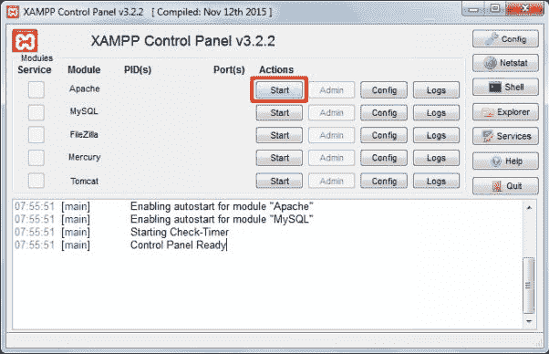
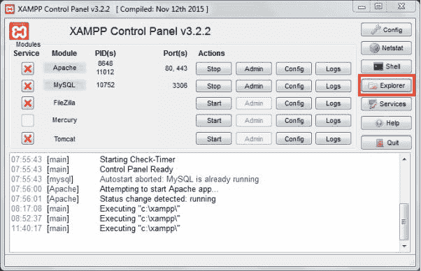
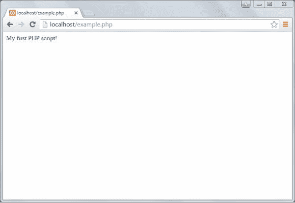
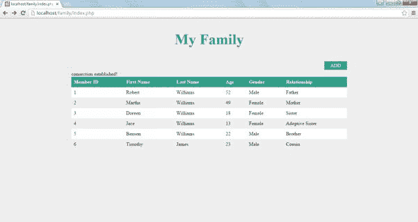

# PHP 编程：PHP 速成课程！4 小时学会 PHP 编程！PHP 初学者指南 - 智能且简单的 PHP 与 MySQL 方法（PHP 和 MySQL Web 开发，PHP 编程）


## 书籍简介

《4 小时学会 PHP！》承诺将为你提供关于 PHP 和 MySQL 的完整介绍性知识。你将开启构建优秀动态网站的旅程，帮助你短在内实现梦想。

本书包含了直白易懂的定义、短小精悍的示例以及能够确保你快速掌握基础知识的解释。

你将能够快速读完这本书的同时获得深度知识，使你准备好应对 PHP 和 MySQL 的高级功能，同时利用最佳实践完成非常实用的工作。这是一本极好的教育书籍！

### 书中包含什么？


我们将讨论 Web 服务器软件包的安装，并展示如何使用它来运行 PHP 脚本。我们还将涵盖 PHP 的一些基础知识。

我们将深入探讨 PHP 的基础。

我们将讨论如何访问命令行以输入 MySQL 命令，并使用它们来处理数据库中的数据。

我们将巩固知识，并使用 PHP 和 MySQL 创建一个具有动态内容的简单网站。

让我们开始吧！


## 简介

“不读书就学不到任何东西。” —— 孔子

人们学习 PHP 有很多原因。每种语言都有的一定的学习曲线，人们可能会陷入过多的理论中，导致它失去吸引力，因为眼前的任务看起来很枯燥。也许你想建立一个简单的博客，或者像拥有成千上万商品出售的大型在线电子商务网站那样复杂的网站。要知道从哪里开始获取所需的知识是很的。

如果你正在寻找一种快速上手的方法让你的愿景变为现实，那么你来对地方了！本书旨在让你在 4 小时内开启 PHP 和 MySQL 精通之旅！它通过告诉对于绝对初学者来说（无论是 PHP 还是 MySQL）快速上手需要知道的最重要内容来实现，让你能够尽可能快地做实用的事情。

这不是一份涵盖所有层面的 PHP 和 MySQL 全方位指南，而是一门速成课程，为你提供实用的指南，教你如何单独以及结合使用 PHP 和 MySQL 完成非常酷的基础操作。这两者可以变得非常高级，但有了书中的知识，你在应对更高级的话题时，应该能够让原型运行起来。

之前需要一些 HTML 和 CSS 的基础知识，因为实际上，PHP 只是用来生成网页的语言，其最终输出是 HTML。我们将涵盖 PHP 和 MySQL 的所有基础知识，最后将它们整合在一起，构建一个简单的网站，你将可以使用这对“黄金搭档”存储你喜欢的艺术家的记录。

基础知识就是你在 4 小时内所需的一切（当然，还有这本书）是你所需的一切。

但什么是 PHP 或 MySQL？你为什么需要它们来完成这项以前不可能的任务呢？

### PHP 简介绍

PHP 代表超文本处理器（Hypertext Processor）。它是一种服务器端脚本语言，用于生成动态 Web 内容等。这意味着 PHP 所做的一切都不是在用于查看网页的电脑（称为客户端）上完成的，而是在一台名为服务器的特殊计算机上，服务器托管了你在客户端机器上查看的所有网页。

作为一种脚本语言，PHP 实际上不能用于制作运行在你的计算机上的独立应用程序，因为它被设计为仅在网页内发生事件时执行操作，例如：点击链接或提交 Web 表单时获取表单数据。

你可以将 PHP 嵌入到 HTML 网页中，并根据从用户那里获得的信息生成自定义页面。这使得网页比静态页面更令人兴奋。PHP 可以用于生成网页，因为它的最终输出是 HTML。

它在服务器端非常高效，被广泛使用，跨平台（运行在 Windows、Linux、UNIX、Mac OS X 等），并且比任何其他功能齐全的语言（如 C、Java 或 Perl）更容易学习。

PHP 也非常强大。如果你怀疑它的力量，下次当你决定登录 Facebook 时，只需仔细看浏览器中的地址栏。你会发现，全球最大的社交网络网站是由 PHP 驱动的！甚至维基百科（那个告诉你需要知道的一一切的网站）也是由 PHP 驱动的。这就是 PHP 背后的力量，使其成为微软 Active Server Pages (ASP) 等竞争对手的良好替代方案。

它还有一个活跃的社区，可以在你困难时真正提供帮助，并且始终保持活跃。

根据 [`www.w3schools.com`](http://www.w3schools.com) 页面；PHP 允许你完成：

### MySQL 简介绍

MySQL 是一种流行的开源关系型数据库，以 SQL 为基础。它允许你存储、检索和处理数据。它是一种高效且可扩展的解决方案，而且具有效益。

许多基于 Web 的程序（包括计算机程序）使用数据库来存储信息。社交应用程序需要一个地方来存储用户信息、图片、评论等，这就是像 MySQL 这样的数据库大显身手的地方，它让存储和检索大量信息变得简单。

SQL（读作 sequel）代表结构化查询语言。它仅仅是为 MySQL 等数据库管理数据的语言。它们使用特殊的命令，并不很难学习。最重要的，你可以将 SQL 嵌入 PHP 等编程语言中。

此外，MySQL 是开源的，免费并且可以通过修改源代码进行更改。

## 本书将涵盖的内容

本书分为四个主要章节或小时，帮助你进入 PHP 和 SQL 的核心，并让你迅速成为大师。

在第一小时，我们将花时间安装非常需要的 Web 服务器软件包——XAMPP。我建议你在开始该章节之前在这里下载：[`www.apachefriends.org/index.html`](https://www.apachefriends.org/index.html)。这将使我们在整本书中运行示例。然后我们将为 PHP 代码选择一个文本编辑器。然后我们将查看如何运行 PHP 脚本，最后我们将涵盖 PHP 的一些基础知识，如注释、变量、常量和运算符。

书中的示例可以手动输入，也可以为了节省时间复制并粘贴到你的代码编辑器或命令行界面中。

在第二小时，我们将继续学习 PHP 并涵盖条件语句、循环、数组和函数。在本章之后，你应该认为自己已经熟悉了 PHP，可以应对更高级的话题。


完成这一部分后你可以休息一下，让这些内容融入脑海，然后去泡杯咖啡。

在第三小时，我们将处理 MySQL 及其命令，但首先我们要学习如何访问命令行。然后，我们将学习创建和删除数据库的命令；创建、修改和删除表格；以及在表中插入、查询、更新和删除数据的命令。

最后，在最后一个小时，我们将 PHP 和 MySQL 结合，创建一个简单的网站，向你展示这两个工具是如何紧密合作的。

让我们开始吧。拿起你的第一杯咖啡！

# 第 1 章 - 第 1 小时：安装与 PHP 基础

“开始的方法是带着梦想的乐观主义迈出第一步。” - Debasish Mridha

本章将涵盖：

*   安装 Web  服务器
*   安装文本编辑器
*   启动 Apache 以运行 PHP 脚本
*   创建并运行 PHP 脚本
*   PHP 基础（注释、变量、运算符、常量、字符串）

请稍等我一下。我知道几乎每本编程书籍的第一章都会堆砌大量的大量的理论，以确保你了解自己正在面对什么。我不我不骗你；即使在这本简短的书中，我们仍然需要稍微过一遍。只需要过一点点，涵盖 PHP 的一些基础知识。那是为了本小时后面之后的内容。现在，你需要安装服务器，并选择一个合适的文本编辑器来编写 PHP 代码！

## 安装 Web 服务器

你通往 PHP 的第一个真正步骤带你来到了这里。你不能像运行 HTML 那样直接在浏览器中运行 PHP。要运行 PHP，你需要在本地机器上安装服务器，以便浏览器解析 PHP 脚本并在数据库上运行 MySQL 查询返回结果。或者，你可以使用支持 PHP 和 MySQL 的主机，这样你可以将其上传到他们的服务器，并直接在那里测试和部署你的梦想网站。但我猜你真的想在本地快速地测试。因此，我们将安装一个本地服务器，让你自己的电脑变成一台测试服务器。

你可以在本地机器上安装许多服务器，例如 XAMP、WAMP（适用于 Windows）以及适用于 Mac OS X 的 MAMP 等，本书涵盖了 XAMP。它是一个免费的开源跨平台 Web 服务器包，适用于 Windows、Mac 和 Linux。

访问此网站

`www.apachefriends.org/index.html` 

并下载适用于 windows 的最新版本 XAMP（同样的步骤可以轻松适用于 Mac OSX 或 Linux）。下载完成后，在本地机器上找到该文件并双击它进行安装。

简单！现在 PHP 和 MySQL 已经准备就绪。

注意：如果你此时正在运行防病毒软件，它可能会干扰安装过程。你可能希望在服务器安装完成之前将其关闭，以避免任何潜在问题。

## 安装文本编辑器

现在，你需要一个文本编辑器来编写优美的 PHP。理想情况下，任何文本编辑器都可以，即使是 Windows 默认的记事本或 Mac OS X 的终端都可以用于编写 PHP。我们将使用 notepad++，因为它具有一些实用的功能，有助于快速编写整洁高效的代码，例如语法高亮和自动补全。

而且它是免费的！

只需在此安装文本编辑器 下载并安装，这些文本编辑器将为你节省大量时间并避免许多痛苦。只需记住，任何文本都可以。所以即使你没有 notepad++，也可以可以使用任何你喜欢的工具。

## 启动 Apache 运行 PHP 脚本

现在你已经安装了 XAMPP，你需要启动 apache Web 服务，以便浏览器能够运行 PHP 脚本。要做到这一点，双击图标打开 XAMPP 控制面板。默认情况下，它应该会自动启动，但你可以通过点击下图中的“Start”手动启动：



注意：电脑上安装的某些应用程序可能会导致 Apache 无法启动，只需停止那些服务并重新启动。

## 创建你的第一个 PHP 脚本

这部分非常简单。你只需要遵循以下步骤：

### 第一步 - 创建 PHP 文件

打开你的文本编辑器，创建一个普通的文本文件并将以下代码放入其中：

```html
<!DOCTYPE html>  
<html>  
    <body>
        <?php  
            echo "My first script!";  
        ?>
    </body>
</html>
```

`echo` 语句会将之后的所有内容输出到屏幕上。文件仍然看起来像 `<?php` 和 `?>`。将文件保存为 `example.php`。

### 第二步 - 将其放在 XAMPP 根目录下

获取 `example.php` 并将其放入 `htdocs` 文件夹。

注意：要找到根目录，你可以打开 XAMPP。



### 第三步 - 在浏览器中运行

打开你的浏览器（推荐 Google Chrome）并输入：

`http://localhost/example.php`



搞定！

## PHP 基础

### 注释

想给未来的自己或团队成员留下信息吗？那么注释可以省去你记忆的麻烦。

```php
// 这是一个单行注释
// 这是另一个单行注释

/*
这是一个注释。它可以跨越多行。
*/
```

### 变量

为了构建你的梦想网站，你需要数据以及存储这些数据的方法。PHP 提供了使用变量将它们存储在内存的方法。每个变量都以 `$` 符号开头。

让我们通过以下代码查看一些操作：

```html
<!DOCTYPE html>  
<html>  
    <body>
        <?php  
            $txt = "My second PHP script!";  
            echo $txt;
        ?>
    </body>
</html>
```

如果你在浏览器中运行此脚本，它应该输出以下内容：

"My second PHP script!"

关于变量还有几点需要记住：

*   它们是大小敏感的。这意味着 `$name` 和 `$naMe` 是两个不同的变量
*   变量必须以字母或下划线开头
*   变量不能以数字开头
*   变量只能包含字母数字


PHP 是一种弱类型语言，因此你不需要为变量定义数据类型。PHP 将根据赋值给变量的值，自动将变量转换为正确的数据类型。

以下是你将用到的常用数据类型列表：

- `Integer`（整数）– 整数
- `Float`（浮点数）– 小数
- `String`（字符串）– 字符串或字符
- `Boolean`（布尔）– 真或假
- `Array`（数组）– 多个项目
- `Object`（对象）– 由类定义的对象

你可以通过变量来实现与示例相同的结果：

```html
<!DOCTYPE html>
<html>
<<body>
    <?php
        $txt = "third";
        echo "My " .  $txt ." PHP script!";
    ?>
</body>
</</html>
```

在例例中，我们使用句号（`.`）将两个字符串连接在一起，因为它用于连接两个字符串，并将连接后的字符串输出到屏幕上。

## 常量

常量类似于变量，不同之处在于它们的值不能被更改或未定义。

当定义一个常量时，我们使用 `define()` 方法，后面跟着括号内的参数，这些参数为它提供名称和一个值。下面的示例显示了如何定义常量：

```php
<?php
    define("MESSAGE", "Happy Learning!");  //定义常量的函数
    echo MESSAGE;
?>
```

输出：
Happy Learning!

与变量不同，你实际上可以在定义值之后再添加一个参数（接受一个布尔值）来指定你是否想要常量不区分大小写（默认认为 false）：

```php
<?php
    define("MESSAGE", "Happy Learning!", true);
    echo MESSAGE;
?>
```

关于常量需要记住的规则：
- 它们必须以字母或下划线开头（不需要以 `$` 开头）
- 它们在整个脚本中全局有效

## 运算符

PHP 使用运算符来对变量和值执行各种操作。我们现在来看 PHP 组使用的运算符。

### 算术运算符

这些是对值上执行数学运算并返回结果的运算符：

| 示例 | 运算符 | 结果 |
| :--- | :--- | :--- |
| `$x + $y` | 加法 | `$x` 和 `$y` 的和 |
| `$x - $y` | 减法 | `$x` 和 `$y` 的差 |
| `$x * $y` | 乘法 | `$x` 和 `$y` 的积 |
| `$x / $y` | 除法 | `$x` 和 `$y` 的被除 |
| `$x % $y` | 取模 | `$x` 除以 `$y` 的余数 |
| `$x ** $y` | 幂 | `$x` 的 `$y` 次方的结果（PHP 5.6 新增） |

### 赋值运算符

这些运算符用于为变量设置值：

| 赋值 | 等同于 | 描述 |
| :--- | :--- | :--- |
| `$x = $y` | | 获取 `$y` 的值并将其赋给 `$x` |
| `$x += $y` | | 获取 `$x` 和 `$y` 的和并将结果设置为 `$x` |
| `$x -= $y` | | 获取 `$x` 和 `$y` 的差并将结果设置为 `$x` |
| `$x *= $y` | | 获取 `$x` 和 `$y` 的积并将结果设置为 `$x` |
| `$x /= $y` | | 获取 `$x` 和 `$y` 的被除并将结果设置为 `$x` |
| `$x %= $y` | | 获取 `$x` 除以 `$y` 的余数并将结果设置为 `$x` |

### 比较运算符

PHP 中的比较运算符用于比较两个值：

| 示例 | 名称 | 结果 |
| :--- | :--- | :--- |
| `$x == $y` | 等于 | 如果 `$x` 和 `$y` 相等 |
| `$x === $y` | 全等 | 如果 `$x` 和 `$y` 相等且类型相同 |
| `$x != $y` | 不等于 | 如果 `$x` 和 `$y` 不相等 |
| `$x <> $y` | 不等于 | 如果 `$x` 和 `$y` 不相等 |
| `$x !== $y` | 不全等 | 如果 `$x` 和 `$y` 不相等或类型不同 |
| `$x > $y` | 大于 | 如果 `$x` 大于 `$y` |
| `$x < $y` | 小于 | 如果 `$x` 小于 `$y` |
| `$x >= $y` | 大于等于 | 如果 `$x` 大于等于 `$y` |
| `$x <= $y` | 小于等于 | 如果 `$x` 小于等于 `$y` |

### 逻辑运算符

逻辑运算符用于组合布尔值值（我们将在接下来的小时内讨论条件语句），以得到真或假的结果：

| 示例 | 运算符 | 结果 |
| :--- | :--- | :--- |
| `$x && $y` | 与 | 如果 `$x` 和 `$y` 均为真 |
| `$x || $y` | 或 | 如果 `$x` 或 `$y` 至少有一个为真 |
| `!$x` | 非 | 如果 `$x` 不为真 |
| `$x and $y` | 与 | 如果 `$x` 和 `$y` 至少有一个为真 |
| `$x xor $y` | 异或 | 如果 `$x` 或 `$y` 仅有一个为真 |

### 增/递减运算符（三元运算符）

这些运算符也称为三元运算符，用于增加或减少变量的值：

| 示例 | 名称 | 结果 |
| :--- | :--- | :--- |
| `++$x` | 前置增 | 将 `$x` 增加一 |
| `$x++` | 后置增 | 将 `$x` 增加一 |
| `--$x` | 前置减 | 将 `$x` 减少一 |
| `$x--` | 后置减 | 将 `$x` 减少一 |

### 字符串运算符

这些是专门为字符串设计的运算符：

| 示例 | 名称 | 结果 |
| :--- | :--- | :--- |
| `$str1 . $str2` | 连接 | 返回 `$str1` 和 `$str2` 的连接 |
| `$str1 .= $str2` | 连接赋值 | 将 `$str2` 追加到 `$str1` |

### 数组运算符

这些是用于比较数组的运算符（我们将在接下来的小时内讨论）：

| 示例 | 运算符 | 结果 |
| :--- | :--- | :--- |
| `$x + $y` | 并 | `$x` 和 `$y` 的并集 |
| `$x == $y` | 等于 | 如果 `$x` 和 `$y` 具有相同的键值对 |
| `$x === $y` | 全等 | 如果 `$x` 和 `$y` 相等且类型相同 |

## 第 2 章 - 第 2 小时：更多 PHP 基础

“说话很廉价。给我看代码。” – Thomas C. Gale

在本章中我们将涵盖：

-   条件语句
-   循环
-   数组
-   函数

这部分我们将深入探讨 PHP 基础并学习很多酷的东西。你已经完成了基础部分的蔬菜，现在是肉部分。

## 条件语句

条件语句允许在代码中进行一些决策。它们根据程序员指定的条件被评估为真还是假来执行不同的操作。

以下是 PHP 中使用的条件语句列表：

-   if 语句
-   if…else 语句
-   if…else if…else 语句
-   switch 语句

让我们详细查看每一个。

### if 语句

if 语句评估表达式，结果为真，则执行代码块。如果评估结果为假，则代码块被忽略。

下面的示例如果条件为真，将输出“5 小于 10!”，否则，代码块将被忽略：

```php
<?php
    $x = 5;
```

## 总结

到为止，我们已经涵盖了你开始并运行 PHP 所需的很多内容。我们安装了一个名为 XAMPP 的 Web 服务器软件包，它带有 APACHE Web 服务，允许我们在浏览器中运行 PHP 脚本。你现在应该已经足够的知识来创建和运行 PHP 脚本，并了解如何向屏幕输出信息。我们还涵盖了 PHP 的一些基础知识，如变量和常量，并查看了一些运算符；其中一些在接下来的小时内将很有用。

让我们继续吧！


```php
if ($x < 10) {
    echo "$x is less than 10!";
}
?>
```
Output:
5 is less than 10!

### if…elseif 语句

`if…elseif` 语句在表达式求值为真时执行 `if` 代码块，在当表达式求值为假时执行另一个 `if` 代码块。

让我们稍微修改一下之前的示例。以下代码将输出“50 is greater than 20!”，它位于第二个代码块，因为它满足第二个条件。赋值给 `$x` 的值是 `50`，它在第一个条件上返回 `false`：

```php
<?php
$x = 50;
if ($x < 10) {
    echo “$x is less than 10!”;
} else if ($x > 20) {
    echo “$x is greater than 20!”;
}
?>
```
Output:
50 is greater than 20!

### if…elseif…else 语句

与 `if…elseif` 语句相同。区别在于当所有其他条件都失败时，将执行最后一个代码块。

下面的示例将输出“15 is between 10 and 20!”，因为 `$x` 的值为 `15`。它需要小于 10 以满足第一个条件，大于 20 以满足第二个条件，否则它就于 10 和 20 之间：

```php
<?php
$x = 15;
if ($x < 10) {
    echo “$x is less than 10!”;
} else if ($x > 20) {
    echo “$x is greater than 20!”;
}else {
    echo “$x is between 10 and 20!”;
}
?>
```
Output:
15 is between 10 and 20!

### switch 语句

`switch` 语句将表达式的值与 `cases` 进行匹配。如果找到匹配项，则执行与 `case` 关联的代码。如果未找到匹配项，则使用 `default` 语句。`break` 语句防止代码跳转到下一个 `case`。

在下面的示例中，将对 `$lunch` 的值进行所有 `cases` 的检查，看是否有任何一个匹配。在这种情况下，输出将是“Burgers are yummy!”，因为那是对应的 case。

```php
<?php
$lunch = “burger”;
switch ($lunch) {
    case “cereal”:
        echo “Cereal You had breakfast for lunch!”;
        break;
    case “salad”:
        echo “Salad makes a healthy lunch!”;
        break;
    case “burger”:
        echo “Burgers are yummy!”;
        break;
    default:
        echo “looks you skipped lunch. That is not good!”;
}
?>
```
Output:
Burgers are yummy!

## 循环

以下是 PHP 中的循环语句列表：

* `while`
* `do…while`
* `for`
* `foreach`

我们将详细介绍每一个循环。

### while 循环

`while` 循环在指定条件保持为真的情况下重复执行代码块。

下面的代码显示了当 `$x` 小于或等于 `5` 时的值。如果条件为真，则将其输出到屏幕上，然后递增，直到条件返回为假：

```php
<?php
$x = 1;
while ($x <= 5) {
    echo “The value of x is: ” . $x . “<br />”;
    $x++;
}
?>
```
Output:
value of x is: 1
value of x is: 2
value of x is: 3
value of x is: 4
value of x is: 5

### do…while 循环

`do…while` 循环只要指定条件保持为真就会重复执行代码块。

下面的代码显示了当 `$x` 大于或等于 `0` 时的值。它至少执行一次代码，将其输出到屏幕，然后递减，直到条件返回为假：

```php
<?php
$x = 5;
do {
    echo “The value of x is: ” . $x . “<br />”;
    $x--;
} while ($x >= 0);
?>
```
Output:
value of x is: 5
value of x is: 4
value of x is: 3
value of x is: 2
value of x is: 1
value of x is: 0

### for 循环

`for` 循环按照指定的次数执行代码块。为了让循环工作需要三件事：

1. 初始化：这是声明变量并设置值的地方 `$x = 1`。
2. 条件：检查循环是否继续 `$x <= 5`。
3. 递增：当循环结束时增加 `$x` 的值 `$x++`。

```php
<?php
for ($x = 1; $x <= 5; $x++) {
    echo “The value of x is: ” . $x . “<br />”;
}
?>
```
Output:
value of x is: 1
value of x is: 2
value of x is: 3
value of x is: 4
value of x is: 5

### foreach 循环

遍历数组中每个元素的循环。它会对数组中的每个元素执行代码块。

下面的代码遍历数组中的所有元素，并将元素输出到屏幕：

```php
<?php
$foods = array(“cereal”, “salad”, “burgers”, “fries”);
foreach ($foods as $food) {
    echo “$food <br />”;
}
?>
```

## 函数

函数是程序中可以重复使用的代码段。函数接收一个或多个输入（称为参数），并对它们进行某些操作。函数在完成后有时会返回一个值。

关于函数的几点注意事项：

* 它们对大小写不敏感
* 在被代码调用之前，它们不会自动执行
* PHP 有超过 1000 个内置函数可以满足你的需求

### 创建函数

创建自己的函数非常简单；只需以 `function` 关键字开头，后跟函数名。之后将你的代码放在两个大括号 `{` 和 `}` 之间，分别称为左括号和右括号。现在你可以根据需要多次使用该函数。这节省了每次都重写代码的麻烦。

下面的代码演示了一个向屏幕输出消息的函数

```php
<?php
functionechoMessage() {
    echo “Hello, I am a PHP function!”;
}
echoMessage();
?>
```

### 函数参数

有时你可以向函数传递信息以便对其进行操作。这些信息被称为参数，并放在括号中。你可以通过逗号分隔添加多个参数。

下面的示例显示了一个接收两个数字作为参数并进行相减的函数：

```php
<?php
functionsubFunction($num1, $num2) {
    $diff = $num1 - $num2;
    echo “The difference between $num1 and $num2 is: ” . $diff;
}
?>
```


```php
subFunction(5, 6);
?>
```

输出:
5 和 6 之间的差是：-1

### 返回值的函数

函数不仅可以接受信息，还可以以返回值的的形式将其传回。只需编写 `return` 关键字，后跟上你希望函数返回的值或对象即可。这会停止函数的执行。

在接下来的示例中，我们使用函数将两个数字相加并返回和。然后我们将数字之和赋值给变量 `$return_val`，然后将其输出到屏幕上。

```php
<?php
function addFunction($num1, $num2) {
    $sum = $num1 + $num2;
    return $sum;
}
$return_val = addFunction(20, 15);

echo "The value returned by the function is: " . $return_val;
?>
```

输出:
函数返回的值是：5

### 参数的默认值

如果在调用需要参数的函数时没有传递任何参数，我们可以为该参数指定一个默认值。

在下面的示例中，我们调用了三次函数。我们在第一次函数调用时没有传递值，仅仅是为了演示这种差异：

```php
<?php
function PrintName($name = "Jack") {
    echo "Hi, my name is $name <br />";
}
PrintName(); 将 将使用默认值 Jack
PrintName("Jill");
PrintName("Adam");
?>
```

输出:
Hi, my name is Jack
Hi, my name is Jill
Hi, my name is Adam

## 数组

数组是一种可以在单个变量中存储多个值的数据结构。每个值都与一个键关联，该键用于识别和返回它。

### 数值数组

这些是使用数字作为索引的数组。索引默认从零开始。

创建数值数组有两种方法：
1. 这种方法会自动分配索引：`$dairy = array("yogurt", "ice cream");`
2. 这种方法手动分配索引：`$dairy[0] = "yogurt"`, `$dairy[1] = "ice cream"`, `$dairy[2] = "cheese cake"`

下面的示例展示了如何使用以下方法从数值数组中获取值：

```php
<?php
$dairy = array("yogurt", "ice cream", "cheese cake");
// 通过索引访问值
echo "I to eat " . $dairy[0] . ", " . $dairy[1] . " and " . $dairy[2] . "!";
// PHP 内置函数，返回数组中的元素个数
$arrayCount = count($dairy);
// 使用 for 循环遍历数值数组
for ($i = 0; $i < $arrayCount; $i++) {
    echo $dairy[$i] . "<br />";
}
?>
```

输出:
I to eat yoghurt, ice cream and cheese cake!
yogurt
ice cream
cheese cake

### 关联数组

使用字符串作为索引，这使得键和值之间建立了强有关联。

创建关联数组有两种方法。我们将通过西装的价格来演示：
1. 第一种方法：`$suit_prices = array("batman" => 4000, "arrow" => 1500, "superman" => 0);`
2. 第二种方法：`$suit_prices["batman"] = 4000;`, `$suit_prices["arrow"] = 1500;`, `$suit_prices["superman"] = 0;`

注意：在输出关联数组的值时，不要将关联数组放在双引号内，否则值将无法输出。

下面的示例演示了如何访问关联数组的值：

```php
<?php
$suit_prices = array("batman" => 4000, "arrow" => 1500, "superman" => 0);
echo "The Bat suit costs: " . $suit_prices['batman'] . "<br />";
echo "The Green Arrow suit costs: " . $suit_prices['arrow'] . "<br />";
echo "The Superman suit costs: " . $suit_prices['superman'] . "<br />";
?>
```

输出:
The Bat suit costs: 4000
The Green Arrow suit costs: 1500
The Superman suit costs: 0


让我们通过输入以下命令来创建一个数据库：

```sql
CREATE DATABASE music;
```

始终记住此点：

- 从现在开始，所有输入的语句和命令都应该以分号或 `/g` 结尾。否则客户端将认为你仍在输入命令，导致其不会执行。
- 虽然不是强制要求的，但因为命令行对大小不敏感，MySQL 命令通常使用大写字母，以区分命令与数据库名、表名、列和行等内容。

要删除数据库，只需输入：

```sql
DROP database_name;
```

其中 `database_name` 是你想要删除的数据库名称。

现在我们已经创建了数据库，我们需要选择它以便创建表。在命令行中输入以下内容来选择我们刚刚创建的数据库，然后按回车：

```sql
USE music;
```

警告：不要忘记选择数据库，否则当你在尝试创建表等操作时将会遇到错误。

注意：命令行提示符会告诉你你选择了哪个数据库。它看起来应该像这样：`Maria DB [music]>`。

## 创建、修改和删除表

现在我们已经选择了数据库，让我们创建一些表。我们将创建的第一张表是关于艺术家信息的。

良好的习惯（也是为了避免很多头恼）是先检查是否存在同名的表，因为你不能同一个数据库中创建两个同名的表。如果找到了同名表，它将连同数据一起被删除。因此，在使用此命令时要小心，特别是当表与其他表相关时。

### 创建表

我们如下创建表：

```sql
CREATE TABLE Album
(  
    AlbumID smallint unsigned NOT NULL auto_increment PRIMARY KEY,  
    AlbumName varchar(255) NOT NULL,  
    AlbumArtist varchar(80) NOT NULL,  
    AlbumType ENUM('A', 'E', 'M') NOT NULL,  
    numTracks varchar(3) NOT NULL,  
    DateReleased DATE NOT NULL  
);
```

提示：在输入长命令时很容易出错，特别是在使用命令行时。如果发生这种情况，只需按键盘上的上箭头调出之前的命令，并使用左、右箭头导航到出错的地方进行修复。

要查看数据库中的表列表，请输入以下代码：

```sql
SHOW tables;
```

你将看到以下输出：

```
+-----------------+  
| Tables_in_music |  
+-----------------+  
| album           |  
+-----------------+
```

当你按下回车键时，下面的表将被添加到数据库中。让我们分析一下正在发生什么：

1. **创建 Album 表**：`CREATE TABLE()` 创建新表，括号内的行定义了表的结构。
2. **为每个专辑分配唯一 ID**：字段（列）`AlbumID` 具有以下属性：
   - `smallint unsigned`（无符号整数）——这意味着我们可以在 `0` 到 `65,535` 范围内存储数据。 
   - `NOT NULL` —— 意味着在创建记录时该字段不能为空。
   - `auto_increment` —— 意味着你不需要在该字段中输入任何内容。当创建记录时，MySQL 会为其分配一个新值。
   - `PRIMARY KEY` - 每个表只能有一个主键。它用于唯一标识数据库中的记录/行，且一旦创建，它永远不会更改（这将是以牺牲一些存储为代价的）。
3. **添加 AlbumName 字段**：接下来创建一个字段来存储专辑名称。数据类型 `varchar` 表示最多 255 个可变字符。
4. **添加 AlbumArtist 字段**：此字段存储可变字符，并限制为 80 个。
5. **添加 AlbumType 字段**：枚举类型 `ENUM` 是一个有一组允许值的字符串对象。在我们的情况下，允许的值为 `'L'`（长胶 Long Play）、`'E'`（扩展播放 Extended Play）和 `'M'`（混合 mix）。
6. **添加 numTracks 字段**：如果你觉得这不对，说明你很专注！此字段用于存储专辑拥有的曲目数量，应该是数值类型而不是字符串类型。这样做是为了演示以后如何更改字段的数据类型。
7. **添加 DateReleased 字段**：最后创建的一行存储专辑的发行日期。`date` 数据类型用于存储日期值。

让我们来看你将使用的一些常用数据类型：
- **数值类型**：`INT`（整数 -2³¹ 到 2³¹-1）、`FLOAT`（小数 -1.1E-38 到 1.1E37）、`Double`（小数 -1.7E-308 到 1.7E307）。
- **字符串类型**：`CHAR`（固定长度字符串）、`VARCHAR`（变长字符串）、`ENUM`（具有有限值的字符字符串）。
- **日期和时间**：`DATE` (`YYYY-MM-DD`）、`TIME` (`HH:MM:SS`）、`DATETIME` (`YYYY-MM-DD HH:MM:SS`）、`YEAR` (`YYYY`）。

### 修改表

有时你可能会出错，或者只是想更改表中的内容。幸运的是，你可以通过 MySQL 的 `ALTER` 语句来实现。我们将查看更改表名和数据类型。首先，我们需要通过输入以下命令来查看我们刚刚创建的表：

```sql
DESCRIBE Album;
```

你应该看到以下输出：

```
+--------------+----------------------+-----++----------------+
| Field       | Type                 | Null | Default | Extra           |
+--------------+----------------------+-----++----------------+
| AlbumID     | smallint(5) unsigned | NO    | NULL    | auto_increment |
| AlbumName   | varchar(255)         | NO    | NULL    |                 |
| AlbumArtist | varchar(80)          | NO    | NULL    |                 |
| AlbumType   | enum('A','E','M')   | NO    | NULL    |                 |
| numTracks   | varchar(3)           | NO    | NULL    |                 |
| DateReleased| date                 | NO    | NULL    |                 |
+--------------+----------------------+-----++----------------+
```

我们确实可以更改：

1. **更改表名**：单数形式“Album”作为表名并不太合理，因为表用于存储多条记录。我们应该使用复数形式使其符合逻辑。以下是更改表名的方法：

```sql
RENAME TABLE Album TO Albums;
```

如果我们输入 `show tables` 命令，应该看到表名已经更改：

```
+-----------------+
| Tables_in_music |
+-----------------+
| albums           | 
+-----------------+
```

2. **更改 numTracks 的数据类型**：`numTracks` 字段不应该是字符串类型而是数值。以下代码应将其数据类型更改为相应的：

```sql
ALTER TABLE Albums MODIFY COLUMN numTracks smallint(2) NOT NULL;
```

3. **更改 numTracks 的列名**：看起来我们还没有处理完 `numTracks` 字段。我们需要更改它使其更具可读性，从 `numTracks` 更改为 `NumberOfTracks`。

```sql
ALTER TABLE Albums CHANGE numTracks NumberOfTracks smallint(2) NOT NULL;
```

注意：即使更改列名，我们仍然需要定义数据类型。经过这些更改后，当我们输入描述表的语句时，应该看到以下内容：


| 字段 | 类型 | 空空 | 键 | 默认 | 额外 |
| :--- | :--- | :--- | :--- | :--- | :--- |
| `AlbumID` | `smallint(5) unsigned` | NO | PRI | NULL | 自动增 |
| `AlbumName` | `varchar(255)` | NO | | NULL | |
| `AlbumArtist` | `varchar(80)` | NO | | NULL | |
| `AlbumType` | `enum('A','E','M')` | NO | | NULL | |
| `NumberOfTracks` | `smallint(2)` | NO | | NULL | |
| `DateReleased` | `date` | NO | | NULL | |

这看起来好多了！

### 删除表

下面的代码可以用于从数据库中删除表及其所有数据：

```sql
DROP TABLE table_name;
```

其中 `table_name` 是你想要删除的表名。

## 向表中插入记录

我们使用 `INSERT INTO` 语句向表中插入新记录。

```sql
INSERT INTO Albums VALUES
(NULL, "Rush of Blood to the Head", "Coldplays", 'A', 12, "2002-08-02"),
(NULL, "Dirty Gold", "Angel Haze", 'A', 16, "2013-12-30"),
(NULL, "Back to the Woods", "Angel Haze", 'M', 13, "15-09-15"),
(NULL, "Parachutes", "Coldplay", 'A', 10, "1999-07-10"),
(NULL, "1989 (Delux Edition)", "Taylor Swift", 'A', 15, "2014-10-27"),
(NULL, "Prospekts March", "Coldplay", 'E', 8, "2008-09-21"),
(NULL, "Random Access Memories", "Daft Punk", 'A', 14, "2013-05-13"),
(NULL, "X & Y", "Coldplay", 'A', 13, "2005-06-01");
```

感觉 Coldplay 有点太多了。

## SELECT 语句

`SELECT` 语句允许你从数据库中检索数据。接下来的示例演示了如何使用 `SELECT` 从 `Albums` 表中检索所有记录：

```sql
SELECT * FROM Albums;
```

输出应该类似于：

| AlbumID | AlbumName | AlbumArtist | AlbumType | NumberOfTracks | DateReleased |
| :--- | :--- | :--- | :--- | :--- | :--- |
| 1 | Rush of Blood to the Head | Coldplays | A | 12 | 2002-08-02 |
| 2 | Dirty Gold | Angel Haze | A | 16 | 2013-12-30 |
| 3 | Back to the Woods | Angel Haze | M | 13 | 2015-09-15 |
| 4 | Parachutes | Coldplay | A | 10 | 1999-07-10 |
| 5 | 1989 (Delux Edition) | Taylor Swift | A | 15 | 2014-10-27 |
| 6 | Prospekts March | Coldplay | E | 8 | 2008-09-21 |
| 7 | Random Access Memories | Daft Punk | A | 14 | 2013-05-13 |
| 8 | X & Y | Coldplay | A | 13 | 2005-06-01 |

使用 `SELECT` 语句选择特定的列：

```sql
SELECT AlbumName, AlbumArtist FROM Albums;
```

输出应该是：

| AlbumName | AlbumArtist |
| :--- | :--- |
| Rush of Blood to the Head | Coldplays |
| Dirty Gold | Angel Haze |
| Back to the Woods | Angel Haze |
| Parachutes | Coldplay |
| 1989 (Delux Edition) | Taylor Swift |
| Prospekts March | Coldplay |
| Random Access Memories | Daft Punk |
| X & Y | Coldplay |

## WHERE 子句

有时你需要过滤记录并只选择符合条件的记录。这就是 `WHERE` 子句发挥作用的地方，接下来的示例演示：

```sql
SELECT * FROM Albums WHERE AlbumArtist = 'Coldplay';
```

输出应该是：

| AlbumID | AlbumName | AlbumArtist | AlbumType | NumberOfTracks | DateReleased |
| :--- | :--- | :--- | :--- | :--- | :--- |
| 4 | Parachutes | Coldplay | A | 10 | 1999-07-10 |
| 6 | Prospekts March | Coldplay | E | 8 | 2008-09-21 |
| 8 | X & Y | Coldplay | A | 13 | 2005-06-01 |

你可以使用 `AND` 和 `OR` 运算符来进一步缩小结果：

`AND` 运算符显示符合两个条件的记录：

```sql
SELECT * FROM Albums WHERE AlbumArtist = 'Coldplay' AND AlbumType = 'A';
```

输出应该显示 `AlbumArtist` 为 Coldplay 且 `AlbumType` 为 'A' 的记录。如果不符合任何一个条件，它将被排除：

| AlbumID | AlbumName | AlbumArtist | AlbumType | NumberOfTracks | DateReleased |
| :--- | :--- | :--- | :--- | :--- | :--- |
| 4 | Parachches | Coldplay | A | 10 | 1999-07-10 |
| 8 | X & Y | Coldplay | A | 13 | 2005-06-01 |

`OR` 运算符用于返回符合任一条件的记录：

```sql
SELECT * FROM Albums WHERE AlbumType = 'E' OR AlbumType = 'M';
```

在上面的示例中，任何 `AlbumType` 为 'E' 或 'M' 的记录将被显示。其他的将被排除。输出应该是：

| AlbumID | AlbumName | AlbumArtist | AlbumType | NumberOfTracks | DateReleased |
| :--- | :--- | :--- | :--- | :--- | :--- |
| 3 | Back to the Woods | Angel Haze | M | 13 | 2015-09-15 |
| 6 | Prospekts March | Coldplay | E | 8 | 2008-09-21 |

## ORDER BY 关键字

为了根据一个或多个列对结果集进行排序，我们使用 `ORDER BY` 关键字并指定是降序还是升序：

```sql
SELECT AlbumName, AlbumArtist FROM Albums ORDER AlbumArtist ASC;
```

**注意**：默认按升序排序。这意味着如果我们省略 `ASC` 关键字，将没有区别。我们可以通过将上述示例中的 `ASC` 替换为 `DESC` 来按降序排序。

这应该根据专辑艺术家名称升序输出记录：

| AlbumName | AlbumArtist |
| :--- | :--- |
| Dirty Gold | Angel Haze |
| Back to the Woods | Angel Haze |
| Parachutes | Coldplay |
| Prospekts March | Coldplay |
| X & Y | Coldplay |
| Rush of Blood to the Head | Coldplays |
| Random Access Memories | Daft Punk |
| 1989 (Delux Edition) | Taylor Swift |

## UPDATE 语句


回顾我们目前展示的一些记录，似乎我们在其中一条记录中犯了错误，将 Coldplay 命名为了 Coldplays。这可以通过使用 `UPDATE` 语句更新该记录来纠正。

如果现在现在使用以下代码输出该记录：

```sql
SELECT AlbumID, AlbumName, AlbumArtist
FROM Albums;
```

输出应该是：

```
+---------+---------------------------+--------------+
| AlbumID | AlbumName                 | AlbumArtist  |
+---------+---------------------------+--------------+
|       1 | Rush of Blood to the Head | Coldplays    |
|       2 | Dirty Gold               | Angel Haze   |
|       3 | Back to the Woods         | Angel Haze   |
|       4 | Parachutes                | Coldplay      |
|       5 | 1989 (Delux Edition)      | Taylor Swift |
|       6 | Prospekts March           | Coldplay      |
|       7 | Random Access Memories    | Daft Punk    |
|       8 | X & Y                     | Coldplay      |
+---------+---------------------------+--------------+
```

我们像这样更新该记录：

```sql
UPDATE Albums
SET AlbumArtist = 'Coldplay'
WHERE AlbumID = 1;
```

警告：不要省略 `WHERE` 子句，否则表中的所有记录都将被更新。

如果现在输出它，我们应该看到记录已经过更新：

```
+---------+---------------------------+--------------+
| AlbumID | AlbumName                 | AlbumArtist  |
+---------+---------------------------+--------------+
|       1 | Rush of Blood to the Head | Coldplay      |
|       2 | Dirty Gold               | Angel Haze   |
|       3 | Back to the Woods         | Angel Haze   |
|       4 | Parachutes                | Coldplay      |
|       5 | 1989 (Delux Edition)      | Taylor Swift |
|       6 | Prospekts March           | Coldplay      |
|       7 | Random Access Memories    | Daft Punk    |
|       8 | X & Y                     | Coldplay      |
+---------+---------------------------+--------------+
```

## 在表中删除记录

要删除表中的记录，我们使用 `DELETE` 语句。以下示例删除了表中 `AlbumID` 为 1 的记录/行：

```sql
DELETE FROM Albums
WHERE AlbumID = 1;
```

警告：不要省略 `WHERE` 子句，否则表中的所有记录都将被删除。

现在我们输出表中的记录。我们将列限制为仅包含 `AlbumID`、`AlbumName` 和 `AlbumArtist`。`AlbumID` 为 1 的记录应该已经从 `result_set` 中出现，因为它已经被删除。

```
+---------+------------------------+--------------+
| AlbumID | AlbumName              | AlbumArtist  |
+---------+------------------------+--------------+
|       2 | Dirty Gold               | Angel Haze   |
|       3 | Back to the Woods         | Angel Haze   |
|       4 | Parachutes                | Coldplay      |
|       5 | 1989 (Delux Edition)      | Taylor Swift |
|       6 | Prospekts March           | Coldplay      |
|       7 | Random Access Memories    | Daft Punk    |
|       8 | X & Y                     | Coldplay      |
+---------+------------------------+--------------+
```

如果你想删除表中的所有记录，使用以下 `DELETE` 语句即可：

```sql
DELETE from Albums;
```

## 总结

好了，现在你已经熟悉了 `MySQL`，并且可以使用命令行访问它，用它创建和删除数据库；创建、修改和删除表；选择、插入、更新和删除数据；并使用 `MySQL` 命令对数据进行其他漂亮的操作，如按你想要的方式进行过滤和排序。


现在我们已经完成了命令行操作（但尚未完成 MySQL），所以可以将其关闭。

## 为网站创建 PHP 配置文件

我们必须首先创建一个命名为 `Family` 的文件夹，并将其放在 `htdocs` 文件夹中。该文件夹位于我们 XAMPP 安装的根目录下。然后，我们创建一个名为 `config.php` 的文件，并将其放在网站的根目录下。

> **警告：** 为了安全考虑，此文件需要放置在服务器外部，因为虽然通过浏览器读取 PHP 并不容易，如果服务器配置不当，这种情况可能会发生。但由于我们想尽可能保持简单，我们将将其放在这里。

接下来，我们定义了建立连接字符串所需的常量，我们将使用该字符串来连接音乐数据库：

```php
<?php  
define('DB_NAME', 'Family');  
define('DB_USER', 'root');  
define('DB_PASSWORD', '');   
define('DB_HOST', 'localhost');  
?>
```

> **警告：** 出于安全考虑，明文密码是一个重大的安全风险。你可以使用 `hash()` 并哈希值存储在配置文件 `config.php` 中。这样在登录时，你就可以检查输入的密码是否与哈希值匹配。

然后，通过通过将主机名、用户名、密码和数据库名称传递给建立连接的方法来建立连接字符串：

```php
<?php
define('DB_NAME','Family');
define('DB_USER','root');
define('DB_PASSWORD','');
define('DB_HOST','localhost');
$conn = @mysqli_connect(DB_HOST, DB_USER, DB_PASSWORD, DB_NAME);
?>
```

现在我们需要检查连接是否成功。如果没有成功，我们将显示相应的错误消息并停止 PHP 脚本的执行：

```php
<?php
define('DB_NAME','Family');
define('DB_USER','root');
define('DB_PASSWORD','');
define('DB_HOST','localhost');
$conn = @mysqli_connect(DB_HOST, DB_USER, DB_PASSWORD, DB_NAME);
if (!$conn) {
    die('Could not connect: ' . mysqli_error());
}
?>
```

建立连接字符串的操作就此结束。每个需要连接到数据库的 PHP 脚本都需要此脚本才能运行。

## 创建索引页

现在我们需要创建一个落地页，该页面将以表格的形式列出数据库中的家庭成员。我们将一些 CSS（通过链接外部表格）来创建一个吸引人的表格以显示我们的数据。我们创建一个名为 `index.php` 的文件并将其放在网站的根目录。代码应该如下：

```html
<!DOCTYPE html>
<html>
<head>
    <link rel="stylesheet" href="css/main.css">
    <link rel="stylesheet" href="css/table_styling.css">
</head>
<body>
    <div id="container">
        <div id="header">
            <h2>My Family</h2>
        </div>
        <div id="btn_add">
            <a href="form.php">ADD</a>
        </div>
        <div id="content">
<?php
            require_once('config.php');
            $sql = "SELECT MemberID, FirstName, LastName, Age, Gender, Relationship FROM FamilyMembers";
            $response = @mysqli_query($conn, $sql);
            if ($response){
                echo '<table>
                    <tr>
                        <th>Member ID</th>
                        <th>First Name</th>
                        <th>Last Name</th>
                        <th>Age</th>
                        <th>Gender</th>
                        <th>Relationship</th>
                    </tr>';
                while ($row = mysqli_array($response)){
                    echo '<tr>
                        <td>'.'.$row['MemberID'].'</td>
                        <td>'.'.$row['FirstName'].'</td>
                        <td>'.'.$row['LastName'].'</td>
                        <td>'.'.$row['Age'].'</td>
                        <td>'.'.$row['Gender'].'</td>
                        <td>'.'.$row['Relationship'].'</td>
                    </tr>';
                }
                echo '</table>';
            }
            else {
                echo "Cound not get a response from database " . mysqli_error($conn);
            }
            mysqli_close($conn);
    ?>
        </div>
    </div>
</body>
</html>
```


```html
<th>Relationship</th>
</tr>';
```

好了，列的部分就完成了。现在我们需要动态地逐行显示行，以防有很多数据。以下代码实现了这一功能：

```php
while ($row = mysqli_fetch_array($response)){

    echo '<tr
                <td>' . $row['MemberID'] . '</td>
                <td>' . $row['FirstName'] . '</td>
                <td>' . $row['LastName'] . '</td>
                <td>' . $row['Age'] . '</td>
                <td>' . $row['Gender'] . '</td>
                <td>' . $row['Relationship'] . '</td>
          </tr>';
}
```

在上面的代码中，我们使用循环来遍历通过 `mysqli_fetch_array()` 函数从 `response` 获取的数组，并将 `$response` 变量作为参数传递。我们将从函数获取的值（也是一个包含行字段的数组）赋值给变量 `$row`，并在周围嵌入 HTML 标签，从而根据数组中元素的数量动态地创建新的表格行。

然后我们关闭表格，动态显示数据就完成了：

```php
echo '</table>';
```

但如果因为某些错误导致数据库没有响应该怎么办？这种情况可能会发生。在这种情况下，我们在 `if` 语句之后添加一个 `else` 语句，使用 `mysqli_error` 函数显示错误信息，并将连接作为参数传递：

```php
else{ 
    echo "Cound not get a response from database " .             mysqli_error($conn);
}
```

最后，我们使用 `mysqli_close` 函数关闭数据库连接，并将连接作为参数，索引页就写完了：

```php
mysqli_close($conn);
```

进入浏览器并输入如下路径 `index.php`，然后按回车：

https://localhost/Family/index.php

下面的窗口应该显示：



如你所见；它显示了我们之前输入的记录，并动态生成了表格。很酷吧！

### 索引页的 CSS

在网站根目录下创建一个名为 `css` 的文件夹，并创建两个名为 `main.css` 和 `table_styling.css` 的 CSS 文件。这些是页面的外部样式表。

我们在 `main.css` 中输入以下代码来为主体、头部和链接设置样式。它还让内容居中：

```css
body {
background-color: #EEE;
}

#container {
width: 900px;
margin-left: auto;
margin-right: auto;
}

#header {
color: #2ca089;
text-align: center;
font-size: 2em;
}

/* links */
a:link, a:visited {
background-color: #2ca089;
color: white;
padding: 5px 12px;
text-align: center;             
text-decoration: none;
display: inline-block;
}

a:hover, a:active {
background-color: #AFDCB1;
}

#btn_add {
padding: 5px 0px;
text-align: right;
}
```

然后我们在 `table_styling.css` 中输入以下代码来设置表格样式：

```css
table {
border-collapse: collapse;
width: 100%;
}

th, td {
text-align: left;
padding: 8px;
}

tr:nth-child(even){background-color: white; }

th {
background-color: #2ca089;
color: white;
}
```

## 创建输入数据的表单

我们创建一个名为 `form.php` 的文件，并将其放在网站的根目录下。然后放入以下代码：

```html
<!DOCTYPE html>
<html>
<head>
<link rel="stylesheet" type="text/css" href="css/main.css">
<link rel="stylesheet" type="text/css" href="css/form_styling.css">
</head>
<body>
<div id="container">
<div id=content>
<div>
<form action="member_added.php" method="post">
<div id="header">
<h3>Add Family Member</h3>
</div>
<div id="btn_add">
<a href="index.php">View Members</a>
</div>
<label for="fname">First Name</label>
<input type="text" id="first_name" name="first_name" maxlength="80">
<label for="lname">Last Name</label>
<input type="text" id="last_name" name="last_name" maxlength="80">
<label for="age">Age</label>
<input type="number" id="age" name="age" min="1" max="100">
<label for="gender">Gender</label>
<select id="gender" name="gender">
<option value="Male">Male</option>
<option value="Female">Female</option>
</select>
<label for="relationship">Relationship</label>
<input type="text" id="relationship" name="relationship" maxlength="80">
<input type="submit" name="submit" value="ADD">
</form>
</div>
</div>
</div>
</body>
</html>
```

这里没有任何其他内容。表单使用了以下 HTML 属性：
- `action`: 它将数据发送到 `member_added.php`。
- `method="post"`: 这意味着通过 POST 请求发送数据。

### 表单页的 CSS

创建一个 `form_styling.css` 文件并将其放在根目录下。使用以下 CSS 规则来设置表单：

```css
input[type=text], input[type=number], select {
    width: 100%;
    padding: 2px;
    margin: 8px 0;
    display: inline-block;
    border: 1px solid #ccc;
    border-radius: 4px;
    box-sizing: border-box;
}

input[type=submit] {
    width: 100%;
    background-color: #2ca089;
    color: white;
    padding: 4px 20px;
    margin: 8px 0;
    border: none;
    border-radius: 4px;
    cursor: pointer;
}

input[type=submit]:hover {
    background-color: #AFDCB1;
}
```

## 创建成员成员页

最后，你需要创建一个最后的 PHP 脚本来处理表单发送的数据。我们创建一个名为 `member_added` 的新 PHP 文件并放在根目录下。然后放入以下代码：

```php
<!DOCTYPE html>
<html>
<head>
<link rel="stylesheet" type="text/css" href="css/main.css">
<link rel="stylesheet" type="text/css" href="css/form_styling.css">
</head>
<body>
<div id="container">
<div id="content">
<?php
require_once('config.php');
if(isset($_POST['submit'])) { 
    $null_fields = array();
    if (empty($_POST['first_name'])) {
        $null_fields[] = 'First Name';
    } else {
        $first_name = trim($_POST['first_name']);
    }
    if (empty($_POST['last_name'])) {
        $null_fields[] = 'Last Name';
    } else {
        $last_name = trim($_POST['last_name']);
    }
    if (empty($_POST['age'])) {
        $null_fields[] = 'Age';
    } else {
        $age = $_POST['age'];
    }
    if (empty($_POST['gender'])) {
        $null_fields[] = 'Gender';
    } else {
        $gender = $_POST['gender'];
    }
    if (empty($_POST['relationship'])) {
        $null_fields[] = 'Relationship';
    } else {
        $relationship = $_POST['relationship'];
    }
}
if (empty($null_fields)) {
```


```php
$null_variable = NULL;
$sql = "INSERT INTO FamilyMembers VALUES ('$null_variable', '$first_name', '$last_name', '$age', '$gender', '$relationship')";
if (!mysqli_query($conn, $sql)) {
    die ('Error: ' . mysqli_error($conn));
}
echo " member has been entered!";
mysqli_close($conn);
else {
    echo "You need to enter the follwing data: <br />";
    foreach ($null_fields as $null_field) {
        echo $null_field . "<br />";
    }
}
```

```<form action="member_added.php" method="post">
    <div id="header">
        <h3>添加家庭成员</h3>
    </div>
    <div id="btn_add">
        <a href="index.php">查看成员</a>
    </div>
    <label for="fname">名字</label>
    <input type="text" id="first_name" name="first_name" maxlength="80">
    <label for="lname">姓氏</label>
    <input type="text" id="last_name" name="last_name" maxlength="80">
    <label for="age">年龄</label>
    <input type="number" id="age" name="age" min="1" max="100">
    <label for="gender">性别</label>
    <select id="gender" name="gender">
        <option value="Male">男性</option>
        <option value="Female">女性</option>
    </select>
    <label for="relationship">关系</label>
    <input type="text" id="relationship" name="relationship" maxlength="80">
    <input type="submit" name="submit" value="添加">
</form>
```

让我们拆解一下并看看最有趣的部分。在处理信息之前，我们必须检查这些信息是否由表单提交。我们通过一个 `if` 语句并使用 PHP 内置函数 `isset()` 来实现，该函数检查变量是否为空。我们将关联数组 `$_POST` 作为参数传入。它包含了输入表单的所有值。该数组通过表单的 post 方法传递给脚本：

```php
if(isset($_POST['submit'])) {
```

在条件语句内部，我们声明了一个数组来检查我们是否不小心遗漏了任何表单输入：
`$null_fields = array();`

接下来，在将值发送到数据库之前，我们开始检查数组中的任何值是否为空。如果是，将其添加到 `$null_fields` 数组中；否则，我们创建一个变量并存储它们。我们只需看一个 `if…else` 语句，因为：

```php
if (empty($_POST['first_name'])) {
    $null_fields[] = '名字';
} else {
    $first_name = trim($_POST['first_name']);
}
```

我们对 `$_POST` 中的其余值也执行此操作。警告：这可能不是在数据进入数据库之前验证数据最安全的方法。对于这一点，我们需要使用正则表达式，那是一个高级话题。我们只是试图保持保持简单。

接下来，我们必须检查 `$null_fields` 数组是否为空。这意味着所有数据都已提交：

```php
if (empty($null_fields)) {
```

如果我们处于该条件内部，意味着所有数据都已提交，我们可以查询数据库。我们使用 `INSERT TO` 语句将数据插入 `FamilyMembers` 表中。我们遵循向表中插入数据的规则，确保变量的顺序与它们在表中定义的顺序一致。在创建查询字符串之前，我们声明了一个额外变量作为主键的空值传入。我们还确保参数的数量与表字段匹配：

```php
$null_variable = NULL;
$sql = "INSERT INTO FamilyMembers VALUES ('$null_variable', '$first_name', '$last_name', '$age', '$gender', '$relationship')";
```

接下来我们使用 `mysqli_query()` 操作数据库，将连接和查询字符串作为参数，同时检查返回的错误。失败时返回 `FALSE`。如果发现错误，我们将显示它们以便修复。如果没有发现错误，我们将输出成功消息：

```php
if (!mysqli_query($conn, $sql)) {
    die ('Error: ' . mysqli_error($conn));
} else {
    echo "成员已输入!";
}
```

所以现在我们处理了用户输入所有数据的情况，但如果他漏掉了任何内容，我们将通过 `foreach` 循环遍历 `$null_fields` 数组并将它们显示在屏幕上：

```php
else {
    echo "你需要输入以下数据：<br />";
    foreach ($null_fields as $null_field) {
        echo $null_field . "<br />";
    }
}
```

之后，我们退出检查 `$_POST` 数组是否为空的条件并关闭数据库连接：
`mysqli_close($conn);`

然后在 PHP 标签之后，我们再次显示表单，允许 PHP 脚本自调用以便我们可以继续输入。

## 总结

情况就是这样！在本章之前，我们分别学习了 PHP 和 MySQL，而本章旨在将两者结合，并展示如何使用它们来生成动态内容。修改网站以满足你的需求并不难，因为你现在已经具备了这种能力。

在本章中，我们创建了一个存储数据库连接的配置文件，并在整个网站中使用它建立数据库连接，并通过查询来存储和检索数据。我们创建了一个允许你查看已添加到数据库的家庭成员信息的页面。

# 结语

“教育是点燃火火焰，而不是填满一个容器。” —— 苏格拉底

这本书到此结束，但并不是你学习的终点。你仍然需要出去学习还可以用 PHP 和 MySQL 做哪些其他事情，并对这些概念有更深入的理解。尽管在此，我诚地希望你已经具备了足够的知识，能够根据 PHP 和 MySQL 的基础知识完成你需要的工作。


# 第一小时：PHP 基础
在第一小时中，我们涵盖了 PHP 的基础知识，如注释、变量、常量和运算符。在此之前，我们学习了如何安装服务器软件包 `XAMPP`，以获取服务器提供 `Apache` 服务。我们运行了 PHP 脚本并在屏幕上显示了整洁的消息。我们还选择了一个酷的文本编辑器来编写优美的 PHP 代码。

# 第二小时：控制流与函数
在第二小时，我们更深入地学习了 PHP 基础，并了如何编写条件语句，允许我们根据指定的条件执行代码块。接着，我们学习了如何使用 `while` 和 `for` 循环来遍历代码，直到满足特定条件。然后，我们学习了如何通过 `functions` 封装代码块并在程序中复用它们。我们以参数的形式向函数传递信息，函数会在对这些信息进行操作后返回部分结果。最后，我们学习了如何将数据集合存储在 `arrays` 中以及如何遍历它们。

# 第三小时：MySQL
在第三小时，我们学习了 `MySQL`。我们学习了如何调出命令行提示符并输入 `MySQL` 命令来执行各种操作，例如创建和删除数据库；创建、修改和删除表；检索、插入、更新和删除表中的数据。

# 第四小时：集成
在第四章也是最后一章中，我们学习了如何结合使用 `PHP` 和 `MySQL` 为我们正在制作的简单网站创建动态内容，我们正在列出我们喜欢的家庭成员及其详细信息。

# 结语
这些都是为绝对初学者提供的知识，他们需要清晰的示例和解释来快速引导。祝愿你未来的事业一切顺利，我相信你正走在实现梦想的道路上。很高兴能帮上忙。

