# PHP 编程：MySQL 和 Oracle 使用指南

## 概述

PHP 是一种用于开发世界范围内动态网页的编程语言。HTML 或超文本标记语言是开发网页的基础，但用 HTML 创建的页面是静态的。PHP 使这些 HTML 页面能够与数据库交互，并执行诸如添加数据或从中检索数据等操作。

此外，PHP 可用于创建验证用户输入并为页面提供保护的能力。理解 PHP 的前提是 HTML。JavaScript 允许网页具有动态性，然而 JavaScript 不是基于服务器的。它在客户端浏览器中运行。另一方面，PHP 是基于服务器的。事实是，要完成一个专业外观且可工作的页面，需要 HTML、JavaScript 和 PHP 之类的脚本语言。

本书关于 PHP。 如果需要复习该主题，可以考虑我的 JavaScript 书籍。

本书的网页位于：`http://beamto.fjtbooks`

开始之前：

要运行 PHP 脚本，这是一种基于服务器的脚本，需要以下内容：

用于保存扩展名为 `".php"` 的文件的记事本编辑器或类似工具。以及

放置完成后的脚本的位置。这可以是托管站点，其中有许多（免费或廉价的网络托管站点）允许 PHP 脚本。在独立计算机上，可以下载免费的 PHP 编辑器软件。本书的代码使用 EasyPHP 编辑器（版本 17）和服务器开发，该编辑器和服务器在撰写本书时可以免费下载并安装。PHP 有不同的版本，当前版本是 7。本书适用于版本 5 和 7。 这两个版本之间存在一些显著差异。然而，许多托管站点仍在使用版本 5 系列。

大多数 PHP 托管站点包含的默认数据库是 MySQL，并且像上面提到的这样的免费编辑器也附带此类数据库。除了此数据库外，本书还将探讨连接到 Oracle 数据库的连接。 本书中使用的 Oracle 数据库是可单独使用的 Windows 版本 11.2g Express 版本，可免费下载，网址为 `http://www.oracle.com`。

## 第 1 章. 简介

在任何语言中，按不成文的传统，第一个程序都是“Hello World”。在 PHP 中实现的方法如下：

使用扩展名为 `".php"` 的记事本创建一个名为 hello (`hello.php`) 的文件。 在该文件中输入以下行。

```
<?php  print "Hello World!!!";?>
```

`print` 也可以被单词 `echo` 替换。

现在如果有人想将其包装在 HTML 标签中是可以的，例如：

```
<html><body><?php  print "Hello World!!!";?></body></html>
```

`<?` 开始 PHP 代码部分，`?>` 结束它。两者都是强制性的。如果此代码放在没有 PHP 的服务器上，此代码的每一行都将对用户可见。

这实际上是本书中 PHP 的第一个程序。

```
<html><body><?php  phpinfo();?></body></html>
```

上面的代码将给出客户端 PHP 服务器上 php 安装的 PHP 配置信息。

所有设置都将显示，从版本号开始。 在撰写本文时，大多数免费或廉价的托管站点在其服务器上对 PHP 的版本为 5.4 或更高。向后兼容性是编程的重要组成部分，即使 PHP 的当前版本更高，了解旧版和新版的功能也很重要。

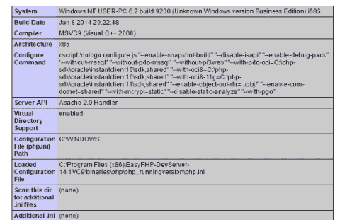

如果使用当前版本为七（7）的 PHP，`phpinfo()` 的示例输出将如下所示：

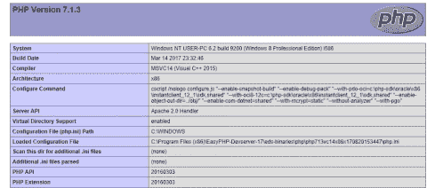

建议以小写字母编写代码，除非函数对字母大小写有特定要求。请记住，键盘的默认设置是小写字母。`hello.php` 文件可以修改为以红色、粗体、斜体和下划线打印相同的单词“Hello World”。请注意，所有 HTML 代码都可以通过 PHP 文件传递。

```
<html><body><?php  print"<font color= red> <b><i><u>Hello World!!</u></i></b></font>?></body></html>
```

通过在代码行之间或相似代码的模块之间添加空格，可以增强代码的清晰度。

可以向脚本添加注释。有两种类型的注释。一种用于单行，另一种用于多行。

单行注释为：`//`

多行注释为：`/* ...... */`

始终用程序编写的任何语言注释代码。

### 变量

像任何编程语言一样，PHP 也离不开变量，就像其他语言一样，变量是数据的容器。流行的 x、y 和 z 采用不同值的情况在 PHP 中也可用。

变量应赋予合理的名称，以标识其代表的内容或预期内容。PHP 的保留字不能用作变量。

变量名区分大小写。 在 PHP 中变量名所需的 `$` 符号之后，名称必须以字母（A-Z 或 a-z）或下划线（`_`）开头。名称不能以数字开头。 这条规则并不新鲜，许多语言都有，但 `$` 符号要求是 PHP 中必须的。名称中不允许有空格，只能使用下划线。

PHP 中变量主要有四类 - 数字、字符串、数组和对象。

数字变量包括以下内容：

整数 - 1,2,3, -1, -2 等

浮点数 - 1.0, -19.2 等

PHP 中的日期类型由数字和字符串组成，并未明确定义为变量类型。

#### 字符串

如果变量由一对单引号或双引号括起来的字符组成，则该变量为字符串。

示例："Hello World"

"Hello, `$name`"

" 1"

"21.07.17"

"2017"

#### 数组

数组按定义以索引格式存储数据。数据使用键输入并使用这些键检索。数组可以是单维或多维的。

示例：

| John || Adam || Smith || Mary || Sally |

| --- | --- | --- | --- | --- |

其中 John 的索引或键为 0，Adam 的键为 1，以此类推，直到 Sally，她的索引为 4。 这个单维数组的大小为 5（0-4）。

使用数字作为键的数组称为索引数组。使用字符串作为键的数组称为关联数组。

数组是任何编程语言的重要组成部分。

#### 对象

对象被视为高级功能。要定义对象，必须先定义其结构，即类。然后创建该结构的实例。

在 C++ 或 Java 等中看到的面向对象编程的概念就是这种类型变量的示例。

例如：如果有一个名为 car 的变量，则 `car.length` 就是 car 对象的特征示例。

在 PHP 中使用 "=" 赋值运算符为变量赋值。

示例：

```
$x = 1.5;
$y ="John ";
```

要打印结果，我们使用 `print` 函数。

示例：

```
print "The number is $x";
```

现在让我们创建一个 PHP 程序，它将打印名为 John 的人的姓名和地址。

```
<html><head> <title>Address</title></head><body><?php$name = "John";$street= "101, Orchard Lane";$city ="Columbia";$state ="SC";$zip =29208;print "The address of $name  |
```

结果将在附加到所使用的 PHP 编辑器的浏览器中显示。在本书的情况下，使用了 EasyPHP (`http://www.easyphp.org`) 编辑器，使用该编辑器的输出如下：

# 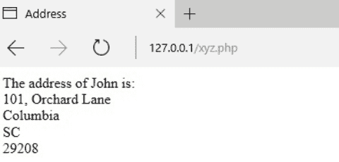

#

脚本的位置会根据编辑器而有所不同。即使在 EasyPHP 编辑器中，也可以在旧版本（12 到 14）的 projects 文件夹下运行此脚本，或在版本 17 中使用 `eds-www` 文件夹。

如果出现错误，而且有时会发生——请阅读错误消息，返回记事本或编辑器中编写的代码，并在错误消息中给出的行号附近更正代码。

单引号意味着其中的内容应被原样对待。双引号意味着应采用引号内内容的数值。

例如：

`$name = 'John'` 和 `$name = "John"` 会给出相同的结果。

但 

`$name = "$firstname"` 和 `$name ='$firstname'` 会给出两个结果。

`firstname` 的值为 John 和 `$firstname`。

可以像这样将一个变量的值赋给另一个变量：

`$name =$firstname;`

最好使用双引号，并且本书其余部分将使用双引号。除了 `print` 函数外，还有另一个名为 `echo()` 的函数，它会将结果或消息打印到屏幕上。

如果使用的是 EasyPHP 编辑器版本（17），其中包含 PHP 7 和 PHP 5.6，则界面将如下所示。

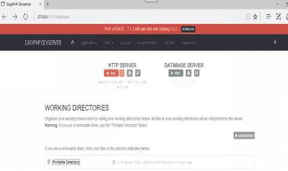

上面的两个选项用于启动 apache 服务器。HTTP 服务器下的设置图标将允许在这种情况下仅通过从下拉菜单中选择版本并单击重启来在 PHP 5.6 和 PHP 7.1.3 之间切换。

在撰写本书时，大多数托管网站——尤其是低成本和免费的网站——其服务器上仍使用 PHP 版本 5。本书将显示两个版本的输出并突出显示新版本 PHP 中有显著变化的地方。

除非另有说明，本书中看到的代码将适用于旧版和新版 PHP。

## Chapter 2. HTML and PHP Form

HTML 是充分利用 PHP 所必需的。PHP 程序可以包含 HTML，而 HTML 脚本可以嵌入 PHP。

本章的第一个脚本将请求一个人的姓名和电话号码。表单将有一个输入姓名和电话号码的框，以及一些单选按钮来选择姓名的称谓。

其工作原理如下：

HTML 表单/页面要求用户输入数据。然后它要求服务器上的 PHP 脚本处理数据请求，最终数据将被添加到数据库中。

HTML 或网页在数据处理方面与服务器交互的能力有限。它使用 `<form action = </form>` 方法将此任务转移。

现在让我们首先为 html 网页编写 html 代码。

```
<html><head><title>Feedback form</title></head><body><form action="feedback.php"> Mr.<input type="radio" name="title" value="Mr."/>Mrs.<input type="radio" name="title" value="Mrs."/>Ms.<input type="radio" name="title" value="Ms."/><br>Please complete the feedback form</p><p>Name: <input type="text" name="name" size="20"><p>Phone:<input type="text" name="name" size="20"><p><input type ="submit" name="submit" value="Send my response"></form></body></html>
```

此 HTML 文件的输出如下：请注意，`feedback.html` 文件及其关联的 `feedback.php` 文件保存在同一位置。然而，这不是必需的。如果文件位于不同的文件夹中，则必须在 `<form action >` 语句中包含 PHP 文件的路径。

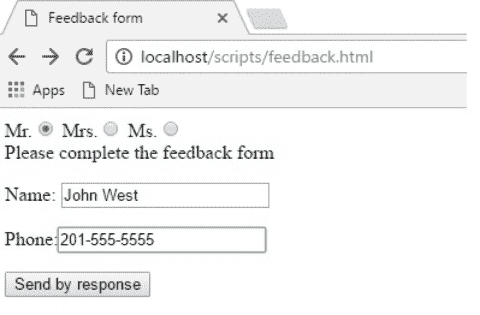

因此反馈 html 文件有三个部分——称谓选择、姓名和电话。`<form action>` 语句说明此文件将连接到脚本文件以进行进一步处理。`<form action>` 由 `</form>` 关闭。现在这个 html 文件将数据传输到 PHP 文件——PHP 文件必须能够捕获正在传输的数据。

观察 `<form action>` 语句。它缺少一个方法。有两种方法——`get` 和 `post`。这两种方法有什么区别？

GET 方法将收集到的所有数据作为 URL 的一部分发送。POST 方法则隐式传输数据。因此选择 GET 方法可能会使某些重要信息在单击提交按钮时变得可见。GET 方法传输的数据量也有限制。

从 `feedback.html` 文件的传输方法将为 POST。必须对上一页的 feeback.html 代码进行以下更改。

`<form action ="feedback.php" method="post">`

以下是 `feedback.php` 文件的代码：

```
<?php$title=$_POST['title'];$name=$_POST['name'];$phone=$_POST['phone'];print"Thank you,$title $name for your feedback.";print"<p> Your phonenumber,$phone has been added to our database.";?>
```

请注意，在上面的 `feedback.php` 文件中，应该有接收变量来接收从 `feedback.html` 文件发送的值。

在上述情况下，变量名与接收到的数据相同，但这不是必需的。字段的名称可以是 x、y 或 z。

请注意，`feedback.php` 没有 HTML 代码。此代码可以按如下方式修改以包含 HTML 代码。

```
<html><head><title>Feedback</title></head><body><?php$title=$_POST['title'];$name=$_POST['name'];$phone=$_POST['phone'];print"Thank you,$title $name for your feedback.";print"<p> Your phonenumber,$phone has been added to our database.";?></body></html>
```

可以使用更高级的 HTML 来创建更具吸引力的响应页面。但我们这里的重点是 PHP 代码。

请注意，HTML 代码可以包含在 `print` 函数中，并且在高级 PHP 脚本中通常会动态使用 HTML。

`feedback.php` 文件的输出如下：

# 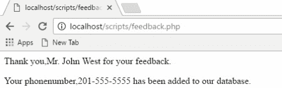

# 如果在 `feedback.html` 文件中使用 get 方法将数据传输到 `feedback.php` 表单，则检索数据时应使用 `$_GET['fieldname']` 方法。PHP 4.1 之前的旧版本曾使用 `$HTTP_POST_VARS` 和 `$HTTP_GET_VARS`。

现在让我们再看一个 HTML 文件。此 HTML 页面将请求供应商的三个不同商品的价格、数量、折扣和不幸的是税费。让我们将这些不同的商品称为 `widget1`、`widget2` 和 `widget3`。HTML 代码如下所示：

```
<html><head><title>Price Checker</title></head><body><form action="price.php" method="post"> Widget1.<input type="radio" name="item" value="Widget1."/>Widget2.<input type="radio" name="item" value="Widget2."/>Widget3.<input type="radio" name="item" value="Widget3"/><p>Quantity: <input type="text" name="quantity" size="20"><p>Price:<input type="text" name="price" size="20"><p>Discount:<input type="text" name="discount" size="20"><p>Tax:<input type="text" name="tax" size="20"><input type ="submit" name="submit" value="Send my response"></form> </body></html>
```

关联的 php 文件名为 `price.php`，如下所示：

```
<?php$item=$_POST['item'];$quantity=$_POST['quantity'];$price=$_POST['price'];$discount=$_POST['discount'];$tax=$_POST['tax'];$tax = ($tax/100);$taxrate =1+$tax;$total = ($quantity * $price)-$discount;$final=$total*$taxrate;print"You have chosen $item";print"<p>The quantity ordered is $quantity, at $price$.";print"<p>The discount is $discount$.";print"<p>The tax is $tax.";print"<p>The final cost is $final$";print"<p>Thank you.";?>
```

生成的页面如下所示：

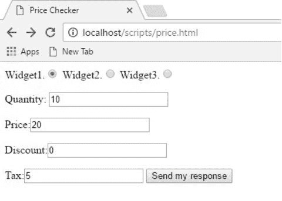

上面是 `price.html` 页面。输入的值为数量为 `10` 的 `widget1`，价格为 `$20`，无折扣，税率为 `5%`。

这里 `5` 除以 `100` 然后加上 `1` 得到税率。总价通过将数量乘以价格并减去折扣来计算。在这种情况下折扣为 `0`。

最终成本通过将税率与上面的总成本相乘计算得到。`price.php` 文件的输出如下：

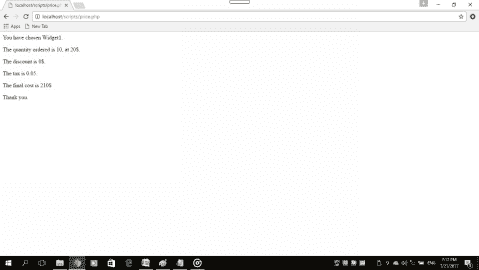

在上面的示例中，我们看到了 PHP 程序中数字的使用及其上的数学运算。上面的示例还说明了使用括号来考虑数学运算优先级顺序的使用。

数字可以使用 PHP 中的许多数字函数进行格式化。一些最常用的数字函数是：

`round()` -

示例：

`round(4.5)= 4`

`round(4.567,2) = 4.57` 表示四舍五入到小数点后两位

`$x = 200.152`

`round($x,2);` （将得到 `200.15`）

`number_format()` -

示例：


`number_format(400.43567,2) = 400.44`

`number_format(450,2); = 450.00`

`number_format(567890321) = 567,890,321`

这个最后一个例子不能用 `round()` 完成。

`rand()` -

示例：

`$x = rand();` 将给出一个随机数

如果需要一个随机数范围，则：

`$x = rand(0, 1000)` 将给出 `0` 到 `1000` 范围内的数字。

`rand()` 函数在 PHP 版本为 `4.2` 或更高时可用。早于 `4.2` 的旧版本使用 `srand()` 函数代替。

`getrandmax()` -

将获取使用 `rand()` 可以创建的最大随机数。

`ceil()` -

此函数是 `rand()` 函数的一部分，并将每个数字四舍五入到下一个最高整数。 (`PHP 5`)

`floor()` -

此函数将每个数字四舍五入到下一个最低整数。

`abs()`-

示例：

`$x = abs(-25);` 将得到 `25`

`$x = abs(25);` 将得到 `25`

PHP 支持三角函数、指数、进制转换和对数函数。

让我们修改我们在本章前面使用过的反馈表单。这次我们除了其他内容外，还将增加一个名字和姓氏框。

其代码如下：

| `<html><head><title>Feedback form</title></head><body><form action="feedback.php" method="post"> Mr.<input type="radio" name="title" value="Mr."/>Mrs.<input type="radio" name="title" value="Mrs."/>Ms.<input type="radio" name="title" value="Ms."/><br>Please complete the feedback form</p><p> First Name: <input type="text" name="firstname" size="20"><p> Last Name:<input type="text" name="lastname" size="20"><p>Phone:<input type="text" name="phone" size="20"><p><input type ="submit" name="submit" value="Send my response"></form></body></html>` |

| --- |

注意表单的标题仍然是 feedback。唯一的区别是：

1\. 添加了姓氏和名字文本框。

2\. 每个名字框的名称值已被更改。这些名称值将通过 post 方法传输到 PHP 文件。

反馈网页现在看起来像这样：

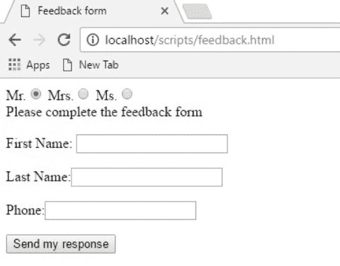

现在让我们修改 `feedback.php` 表单以匹配上面的网页。代码如下所示。

| `<?php$title=$_POST['title'];$firstname=$_POST['firstname'];$lastname=$_POST['lastname'];$phone=$_POST['phone'];print"Thank you,$title $firstname $lastname for your feedback.";print"<p> Your phonenumber,$phone has been added to our database.";?>` |

| --- |

代码与原始 `feedback.php` 文件没有太大不同。我们有两个名字，即名字和姓氏，在第一个 print 函数中我们放置了 `$firstname $lastname`。如果名字之间需要一个点，可以出于格式原因放置一个点。

我们想要一个全名，所以我们必须将名字和姓氏加在一起。PHP 允许在不使用两个字符串变量之间通常的点的情况下实现相同的效果。这是因为 PHP 处理变量的方式。

使用新的 `feedback.html` 网页时，上面代码的结果如下。

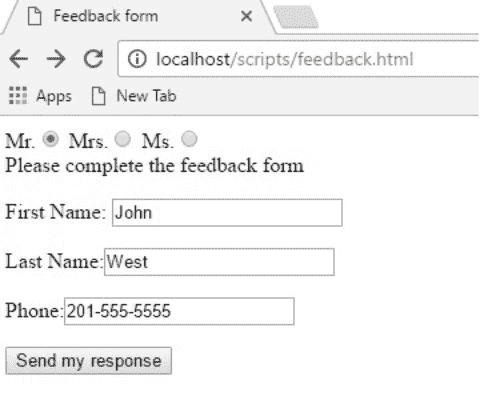

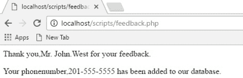

在 PHP 中有一个称为 magic quotes 的术语。如果在设置中打开它 - （检查如前所示的 `phpinfo()`）那么这些 magic quotes 将自动转义有问题的字符。这意味着字符串中的单引号和双引号前面会加上反斜杠。

三种 magic quotes 类型是：

影响通过 get 或 post 方法传输的数据以及存储在 cookie 中的数据的 GPC magic quotes。

影响从数据库和命令行操作检索的数据的 Runtime magic quotes。

Sybase magic quotes 是一种特殊类型，问题较少。

默认设置是关闭 magic quotes。为了解决这个问题，使用以下函数：

`stripslashes()` 如下所示。

`$string = stripslashes($string);`

在上面的 `feedback.php` 文件中可以这样使用：

`$firstname = ($_POST['firstname'];`

`$firstname = stripslashes($firstname);`

在不知道设置的情况下使用此函数不会影响 PHP 脚本。

一些可能有用的字符串函数如下：

`urlencode()` -

示例：

`$string = urlencode($string);`

用于在通过 get 或 post 方法传递到 PHP 文件之前对字符串进行编码。

`urldecode()` -

用于解码传递的已编码字符串。

`str_replace()` -

可以替换字符串的一部分。这类似于子字符串。

示例：

`$name = str_replace($x, $y,$z);`

如果

`$x = "E.";`

`$y = "Edward";`

`$z =" John E. Smith";`

那么 `"E."` 将被单词 `Edward` 替换为原始姓名 `John E.Smith`。

新名字将是 `John Edward Smith`。

该函数可用于捕获响应或反馈表单中可能被认为冒犯的那些词。

`strlen()` -

返回字符串中的字符数。这将包括标点符号和空格。

`str_ireplace()` -

这与 `str_replace` 相同，只是它是同一函数的大小写敏感版本。

`str_word_count()` -

这使用空格作为分隔符返回给定字符串中的单词数。请注意，此函数仅在 PHP 版本 `4.3` 及更高版本中可用。

`strstr()` -

这在字符串中搜索函数给定的搜索模式的第一次出现。

`strpos()` -

这搜索一个字符串并返回函数给定的搜索模式的数字位置。

`strcmp()` -

这用于通过返回一个整数来比较两个字符串。

`strnatcmp()` -

这与 `strcmp()` 类似，但被认为在语言学上更精确。

`strcasecmp()` 和 `strnatcasecmp()` -

这些是 `strcmp()` 和 `strnatcmp()` 的大小写不敏感的伴侣。

`trim()`-

示例：

`$firstname =trim($_POST['firstname']);` 通常在 `register_globals` 设置设置为关闭时设置。检查如前所示的 `phpinfo()` 设置。

但在不知道设置的情况下使用此函数不会损害 PHP 脚本。

`trim()` 函数可以进一步分为两个函数 - `rtrim()` 删除字符串变量末尾找到的空格，`ltrim()` 处理字符串变量开头处的空格。

这用于删除文本前后的空格。

`ucfirst()` -

使字符串的首字母大写。

`ucwords()` -

使字符串中单词的首字母大写。

`strtoupper()` -

使整个字符串大写。

`strtolower()` -

使整个字符串小写。

## 第 3 章. 控制与循环

在每种编程语言中都有控制和循环结构。`IF` 语句是最常见的一种。

PHP 中 `IF` 语句的基本结构如下：

```
if (condition)
{
statement(s);
}
```

`IF` 条件可以通过使用 `else` 进一步增强，如下所示。

```
if (condition)
{
statement(s);
} else {
other statement(s);
}
```

让我们看一个例子。用户登录页面的 HTML 文件如下。

### 用户登录表单

```html
<html><head><title>User Login Form</title></head><body><form action="userlogin.php" method="post"> <p>Please login. </p><p> Username: <input type="text" name="username" size="20"><p> Password:<input type="password" name="password" size="20"><p><input type ="submit" name="submit" value="Send my details"></form></body></html>
```

在上面的代码中，用户必须输入他的/她的用户名和关联的密码。密码会被隐藏。上面的 HTML 文件将调用名为 `user login` 的 PHP 文件。HTML 文件的名称是 `userlogin.html`。页面看起来像这样。

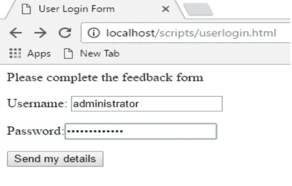

现在让我们假设用户名不应少于十（10）个字符，密码也不应少于十（10）个字符。此外，让管理员用户名的密码为 `administrator`。

此代码背后的逻辑如下：

1. 用户为用户名输入 `administrator`。

2. 用户为密码输入 `administrator`。

3. 如果用户名和密码长度大于 10，则代码将检查用户名和密码是否匹配。

4. 代码接受输入并感谢用户。

5. 如果用户名和密码不匹配，则显示登录失败的消息。

需要注意的是，这里密码是硬编码的。在现实生活中，用户名和密码将存储在数据库中。

#### `userlogin.php` 的 PHP 代码

```php
<?php
$username=$_POST['username'];
$password=$_POST['password'];
$x = strlen($username);
$y = strlen($password);
if (($x < 10) || ($y < 10)){
print"The username/password entered is incorrect";
} else {
if (($username=="administrator") && ($password =="administrator")){
print"Thank you for loging in, $username.";
}else { 
print"Wrong username or password";
}
}
?>
```

在上面的代码中，以下几行：

`$x = strlen($username);`

`$y = strlen($password);`

`if (($x < 10) || ($y < 10))`

检查字符串的长度是否大于等于 10。如果不是，则用户名和密码错误。

`else` 语句会检查密码和用户名的值，如果两者长度正确。

第二个 `else` 语句在两个变量的值与硬编码组合不匹配时写入用户名或密码错误的消息。

`IF` 语句可以像 `else` 语句一样嵌套。上面的示例说明了控制 PHP 代码中逻辑流程的能力。

它类似于许多众所周知的语言，如 `C++`、`Java` 等。

前面的示例还显示在商业术语中，用户名和密码值必须来自存储位置，例如数据库。

`&&` 和 `||` 被称为比较运算符。`==` 也是一个比较运算符。它与为变量赋值值的 `=` 不同。

PHP 中的比较运算符是：

| Operator | Usage |
| --- | --- |
| `==` | Equality |
| `!=` | Inequality |
| `<` | Less than |
| `>` | Greater than |
| `<=` | Less than or equal to |
| `>=` | Greater than or equal to |
| `!` | Negation |
| `And` | And |
| `&&` | And |
| `Or` | Or |
| `||` | Or |
| `XOR` | Or not |

使用比较运算符时，括号非常重要。编程中的简单规则是如果打开一个括号，请确保在代码中较低的位置将其关闭。

PHP 也有 `elseif` 控制结构。这不应与上面的代码中的以下内容混淆：

`else {if (($username=="administrator") && ($password =="administrator"))`

```
{
print "Thank you for logging in, $username.";
}
```

只是编写 `if` 语句还是像上述情况那样使用 `else` 语句的选择取决于程序员。大多数第一次学习编程的学生对仅使用 `if` 语句感到舒适。

上面的代码可以使用 `elseif` 控制结构重写。

```php
<?php
$username=$_POST['username'];
$password=$_POST['password'];
$x = strlen($username);
$y = strlen($password);
 if (($x < 10) || ($y < 10)){
print"The username/password entered is incorrect";
} elseif(($username=="administrator") && ($password =="administrator")){
print"Thank you for loging in, $username.";
}else { 
print"Wrong username or password";
}
?>
```

#### Switch 控制结构

与 `IF` 语句一样，`switch` 条件是控制结构的一个示例。`switch` 条件只接受一个可能的条件，即变量的值。例如：

```php
switch ($variable) {
case "value1":
statement(s);
break;
case "value2":
statement(s);
break;
case "value3":
statement(s);
break;
}
```

这相当于说如果值为 `value1`，则执行 `:` 之后跟随的语句，如果不是，如果值为 `value2`，则执行该 `:` 之后的语句，依此类推。`break` 告诉 PHP 在找到正确的 case 匹配后退出。

看下面的 PHP 代码。

```php
<?php
$x =$POST['choice'];
switch($x){
case 1:
If ($x ==1){
print "You have chosen item 1.";
}break;
case 2:
If ($x==2) {
print "You have chosen item 2.";
}break;
}
print"You have not chosen anything!";
?>
```

在上面的代码中，使用 `switch` 代替 `if` 语句来选择两个项目中的一个。项目将从类似于下面的 HTML 页面中选择。

```html
<html><head><title>Switch</title></head><body><form action="switch.php" method="post"> Please complete the feedback form</p><p> Your choice: <select name="choice"><option value="1">Item 1</option><option value="2">Item 2</option><p><input type ="submit" name="submit" value="Send the choice"></form></body></html>
```

上面的 HTML 页面将提供一个名为 `choice` 的下拉选择选项。Choice 将有两个选项。Item 1 和 Item 2。在更详细的示例中可以给出更具描述性的名称或选项。

目前，网页将允许用户选择两个选择之一并单击提交按钮。

`switch.php` 文件将由 HTML 页面中的 `form action` 语句调用，并且 PHP 文件将采用提供的 `choice` 值，并在项目 1 和项目 2 之间进行选择以显示。

请注意，在 HTML 文件中，为每个选项在 option 语句中给出了一个值。

正是此值作为选择发送到 PHP 文件。

HTML 中的选择选项非常方便。然而，其局限性在于，在 Web 浏览器屏幕上显示大量选项可能会很烦人。

#### PHP 中的循环

PHP 中的循环重复一组语句，直到条件不再为真为止。`for` 循环是 PHP 中循环控制结构的一个示例。`for` 循环的结构如下：

```php
for ($x =1; $x<=10; $x++) {
print $x;
}
```

这里在 `for` 循环中有一个初始点，即 `$x =1`，然后是一个条件，即 `$x<=10`（小于等于 10）。如果条件满足，则将 `x` 的值递增 1 并每次打印 `x` 的值。

因此数字将从 1 到 10 包含。


`while` 循环设计为只要条件为真就工作。条件在每次迭代中都会检查，就像在 `for` 循环中一样。

在 `do... while` 循环中，语句至少执行一次。

让我们看一些使用上述循环的 PHP 脚本。

```php
<?php
for($x=0;$x<10;$x++)
print "$x<br>";
?>
```

在此代码中，`$x` 的值可以从表单中获取，如果制作了关联的网页。

使用 `<br>` 或换行符的输出如下。

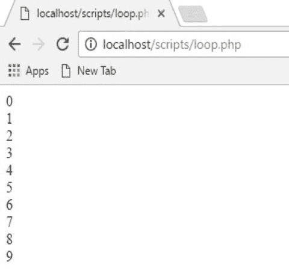

现在如果我们为上面的 PHP 脚本制作一个网页，代码可能看起来像下面的表格中所示。

PHP 脚本将被修改为如下表所示，以接受 `x` 的传入值，然后打印值。

这里的示例显示步长为 2 而不是 1。

PHP 文件中使用的变量名本可以更有描述性，因此在选择变量名时请记住这一点。

我们这里有三个变量，它们是：`xmin`、`xmax` 和 `xstep`。

进入`/path/to/xxx`目录，找到`xxx.json`。

在表达式`cvar = avar + bvar`中，加法运算符（`+`）将`avar`与`bvar`相加，得到它们的和`cvar`

在`List.of(arg0, arg1, arg2)`中，`List`接口的工厂方法`of()`接受一系列的元素，返回包含它们的只读列表。

之后我们这样调用`cmd`命令：`cmd arg0 arg1 arg2`。

```
if (condVar > someVal) {console.log("xxx")}
```

### Loop Form

```html
<html><head><title>loop form</title></head><body><form action="loop.php" method="post"><p> Value for X starting point: <input type="text" name="xmin" size="20"><p> Value for maximum value of X:<input type="text" name="xmax" size="20"><p>Increment step for each value of X:<input type="text" name="xstep" size="20"><p><input type ="submit" name="submit"></form></body></html>
```

The PHP code is as follows:

```php
<?php$x =$_POST['xmin'];$y =$_POST['xmax'];$z =$_POST['xstep'];for($x=$x;$x<$y;$x=$x+$z)print "$x<br>";?>
```

The webpage will look as follows:

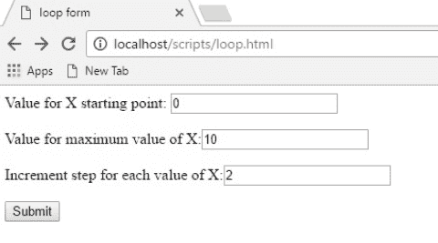

The following PHP code demonstrates the while loop.

```php
<?php$x=0;while ($x<10){$x=$x+1;print"$x";}?>
```

The `while` loop has the initial point outside the `while` loop and the increment steps within its statement body.

The loop continues until condition is not true. The output of this 1...10.

The following code demonstrates the `do...while` loop.

```php
<?php$x=0;do{$x=$x+1;print"$x";}while ($x<10);?>
```

The output will be the same as the `while` loop. 1...10.

In addition to the `break` statement in PHP there is an `Exit` and `die` statement. The `break` statement was seen in the `switch`.

Instead of exiting the current structure, the `Exit` and `die` language constructs terminate the execution of the PHP script.

All PHP code after the instance of either `Exit` or `die` will never be executed. HTML code after the use of these two constructs will not be send to the web browser.

The `die` construct will be used frequently in code that accesses files and databases. `Exit` is used often with the `header()` function.

## Chapter 4. Arrays

An Array was mentioned as a variable type in the beginning of the book. An array can consist of numbers and or strings. The array is given a name similar to a variable and the it has the ability to hold more than one value.

Example: An array can be made to include a list of cars as shown below.

`$car1 = ' Toyota';`

`$car2 = 'GM';`

`$car3 = 'Ford';`

`$car4 = 'Nissan';`

Array variable naming is as follows:

1\. Start with a `$` sign.

2\. Continue with a letter or underscore.

3\. Finish with any combination of letters or numbers or the underscore.

An array variable has an index system. An array stands out from other variables with the presence of the `[]` brackets. Thus, `$car[]` is an array variable.

The `$car[3]` stands for a specific element of the array at index position 3.

To create an array in PHP using the cars example do as follows:

`$car = array ('Toyota', 'GM' , 'Ford' , 'Nissan');`

The indexes are automatically assigned by PHP server. Here the model Toyota is indexed at 0. Array indexation automatically starts with 0. This can be changed if needed.

In the car array example, we can specifically put the model Toyota at index position 1 by doing the following.

`$car = array(1=> 'Toyota', 2=>'GM' , 3=>'Ford', 4=>'Nissan');`

For most purposes leaving the PHP server to index the values in the default manner will be sufficient.

```php
<?phpprint"This script will print an array of cars";$car = array ('Toyota', 'GM' , 'Ford' , 'Nissan');print "$car <p>";print_r($car);?>
```

The output from running this code will be as follows:

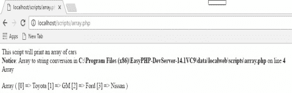

The output above tells the following:

1\. Array values cannot be printed using the `print()` function used in the previous chapters.

2\. Array values can be printed using the `print_r()` function instead.

3\. When using the `print_r()` function the array prints out with its index position shown in number format.

There is no requirement that index positions should be numbers. Words can be used. Let us modify the above PHP code to illustrate this.

```php
<?phpprint"This script will print an array of cars";$car = array ('Yaris'=>'Toyota', 'Spark'=>'GM' , 'Escort'=>'Ford' ,'Pathfinder'=> 'Nissan'); print_r($car); ?>
```

The output of this code will be as follows:

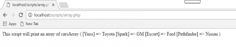

The output is more descriptive as the models are attached to the various car companies in this output. The models have become the index values. In the default setting for an array the elements of the array are referred to by the index number as follows: `$car[2]`.

The `range()` function can be used to create an array of items based on a range of values. For example:

`$num = range(1,20);`

`$alp = range('a', 't');`

The `range` function will allow for steps such as:

`$num = range(1,20,2);`

The `var_dump()` function when used with an array the values and structure of the array will be shown. Let us look at a code that will demonstrate these two functions next.

```php
<?phpprint"This script will print an array of cars";$car = array ('Yaris'=>'Toyota', 'Spark'=>'GM’, 'Escort'=>'Ford' ,'Pathfinder'=> 'Nissan');var_dump($car);print"<br>";$num= range(10,20,2);print"<br>";$alp= range('a','z',2);print_r($num);print"<br>";print_r($alp);?>
```

The output will be as follows:

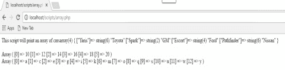

An array whose keys are numbers is called an indexed array and those with keys that are strings is called associative array. These two types have been illustrated in the two examples above.

It is possible to add more elements to an array. In the above two examples the car array was used. Once an array is defined in PHP it is possible to add more elements by using the equal to sign and the name of the array with the `[]` brackets.

Example:

`$car[] ='Mazda';`

`$car[] ='Hyundai';`

If a key is not specified in the brackets, then each new entry or element of the array will be appended to the existing list. If a key is mentioned in the brackets any value at that key index will be removed and the new element added to that location.

```php
<?phpprint"This script will print an array of cars";$car = array ('Toyota', 'GM' , 'Ford' , 'Nissan');$car[] = 'Mazda';$car[] ='Hyundai';print_r($car);?>
```

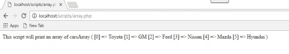

The output will add the new car companies to end of the list as shown above. Let us modify the above script as follows.

```php
<?phpprint"This script will print an array of cars";$car = array ('Toyota', 'GM' , 'Ford' , 'Nissan');$num1= count($car);print "The original array has $num1 elements.<p>";$car[] = 'Mazda';$car[] ='Hyundai';print_r($car);$num2 =count($car);print"<p>The new array has $num2 elements. <br>";?>
```

The output of the code is as follows.

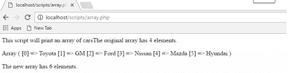

The additional function in the above code is `count()` which is used to count the number of elements in the `car[]` array.

To delete an individual element from an array use the `unset()` function.

For example:

`unset($car[4]);`

`unset($xyz['name']);`

If applied to the entire array the whole array will be deleted. To reset an array- that is to empty it without deleting the array variable altogether) use the `array()` function.

For example:

`$car =array();`

Let us look at the following code.

```php
<?phpprint"This script will print an array of cars";$car = array ('Toyota', 'GM' , 'Ford' , 'Nissan');unset($car[2]);print_r($car);?>
```

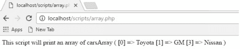

The value at index value 2 is now deleted.

PHP has a function to merge two arrays. The function `array_merge($array1,$array2)` can be used for this purpose. The names of the two arrays have to be entered into the brackets of the function.

For Example:


`$car1[] =('Toyota','GM','Ford');`

`$car2[] =('Nissan','Mazda','VW','Hyundai');`

Writing the code in the following manner will merge the two arrays.

```php
<?phpprint"This script will print an array of cars";$car1[] =('Toyota','GM','Ford');$car2[] =('Nissan','Mazda','VW','Hyundai');$car3 =array_merge($car1,$car2);print_r($car3);?>
```

The above merge of two arrays can also be achieved by writing as follows.

`$car3 = $car1 + $car2;`

There is only one way to retrieve an array element that is by indicating the key index value. If all elements of an array has to be printed a loop will be needed.

For example:

### PHP 数组遍历与排序

进入 `/path/to/xxx` 目录，找到 `xxx.json`。

#### 使用 `foreach` 遍历关联数组

```php
<?php
$salary = array ('Adam'=>1000, 'Smith'=> 2000, 'Mary'=> 2500, 'Sally'=>1800);
print"The original array looks like this. <br>";
foreach($salary as $emp => $amount){
print"$emp:$amount<br>";
}
?>
```

The output for this code will look like this.

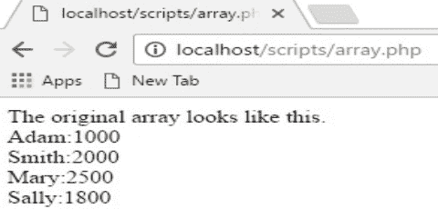

The loop is a special version of for. Notice in this example the key is a word and the value is a number unlike the earlier example of car models where both key and value were text.

If the output expected is the values of the array and not the index or key along with it then the above code can be modified as in the table below.

The difference is in the `foreach` loop where the index reference is dropped and the value is mentioned.

The print is only of the amount and not the index value. Note if the array has no shown index such as `$name = array ('Tom','Harry','Smith','Adam');` Then also this method shown below will work.

```php
<?php
$salary = array ('Adam'=>1000, 'Smith'=> 2000, 'Mary'=> 2500, 'Sally'=>1800);
print"The original array looks like this. <br>";
foreach($salary as $amount){
print"$amount<br>";
}
?>
```

##### 无键的数组示例

```php
<?php
$name = array ('Tom','Harry','Smith','Adam');
print"The original array looks like this. <br>";
foreach($name as $emp){
print"$emp<br>";
}
?>
```

The output is as follows.

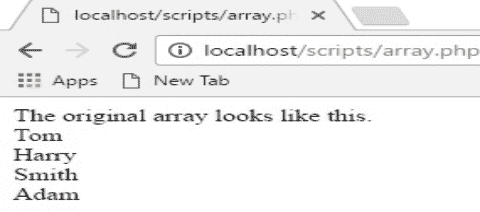

#### 数组排序函数

Sorting arrays can be done by using the following functions.

`sort()` - This sorts by values but does not maintain the key values.

`rsort()` - This reverses the values and does not maintain the key values.

`asort()` - These sorts by values and does maintain the key values.

`arsort()` - The values are sorted in inverse manner and it does maintain the key values.

`ksort()` - The sorting is done by keys and it maintains the key values.

`krsort()` - Sorting is by keys in inverse and it maintain the key values.

Let us look at an example:

```php
<?php
$salary = array ('Adam'=>1000, 'Smith'=> 2000 , 'Mary'=> 2500, 'Sally'=>1800);
print"The original array looks like this.<br>";
foreach($salary as $emp => $amount){
print"$emp:$amount<br>";
}
print"The sort using sort() looks like this:<br>";
sort($salary);
foreach($salary as $emp => $amount){
print"$emp:$amount<br>";
}
print"The sort using rsort() looks like this:<br>";
rsort($salary);
foreach($salary as $emp => $amount){
print"$emp:$amount<br>";
}
?>
```

The output will be as follows.

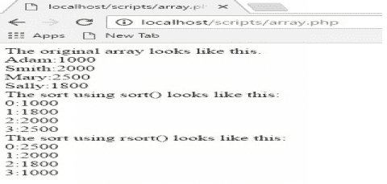

The code for the other sort functions is below.

```php
<?php
$salary = array ('Adam'=>1000, 'Smith'=> 2000, 'Mary'=> 2500, 'Sally'=>1800);
print"The sort using asort() looks like this:<br>";
asort($salary);
foreach($salary as $emp => $amount){
print"$emp:$amount<br>";
}
print"The sort using arsort() looks like this:<br>";
arsort($salary);
foreach($salary as $emp => $amount){
print"$emp:$amount<br>";
}
?>
```

The output is as follows.

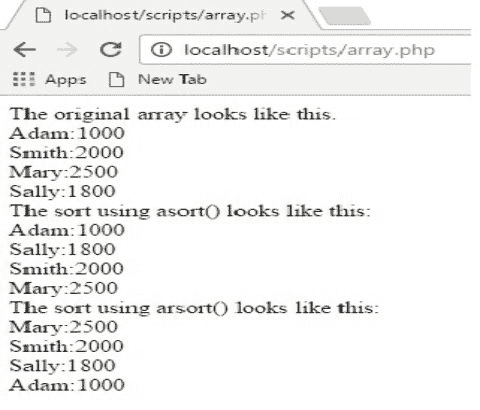

To sort by keys, we use the last two sort functions listed earlier as follows.

```php
<?php
$salary = array ('Adam'=>1000, 'Smith'=> 2000, 'Mary'=> 2500, 'Sally'=>1800);
print"The sort using ksort() looks like this:<br>";
ksort($salary);
foreach($salary as $emp => $amount){
print"$emp:$amount<br>";
}
print"The sort using krsort() looks like this:<br>";
krsort($salary);
foreach($salary as $emp => $amount){
print"$emp:$amount<br>";
}
?>
```

The output will be as follows.

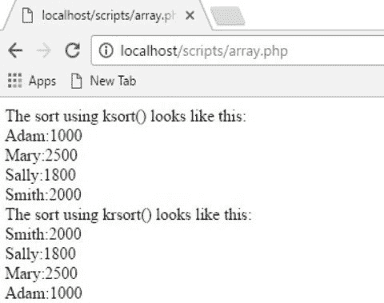

The `shuffle()` function randomly reorganizes the order of an array.

The following code can be used to see its working.

```php
<?php
$salary = array ('Adam'=>1000, 'Smith'=> 2000, 'Mary'=> 2500, 'Sally'=>1800);
print"The shuffle() looks like this:<br>";
shuffle($salary);
foreach($salary as $emp => $amount){
print"$emp:$amount<br>";
}
?>
```

The output looks like this.

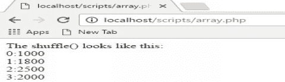

If the code is run again another order will be seen. In other words, it shuffles randomly and reorganizes the order of an array.

#### `explode` 与 `implode`

There are times when one of the following has to be done:

1. Convert an array into a string to pass its values to a URL.
2. Convert an array into a string to store the information in a database.
3. Convert a string into an array to convert comma delimited text field into separate parts.

There are two functions `explode` and `implode` to do these above things. Let us look at an example.

In this example we will create two files. One is an HTML file that will send the second file which is in PHP a bunch of words to alphabetize. The words will be separated by a coma. The separator can be something other than a coma also, say for example just empty space.

The HTML file code looks like this.

```html
<html><body>Enter some words separated by commas. <br><p><form action="array.php" method="post"><input type="text" name="words" size="100"><p><input type="submit" name="submit" value="Submit"></form></body></html>
```

The webpage will look like this.

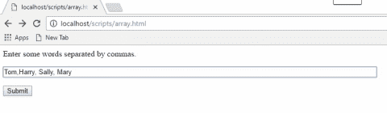

The associated PHP file is as follows:

```php
<?php
$words=explode(',',$_POST['words']);
sort($words);
$string = implode('<br>',$words);
print"<p> The alphabetized version of the list entered is:<br> $string<p>";
?>
```

The output of running this code is as follows.

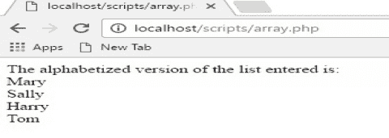

The words are received from the HTML page and then converted into an array which is sorted. The sorting done here is without a need to maintain a key value association. One may try to other sorts as an experiment.

Then a new string is created from the sorted array and the string is then printed.

Let us look at an example of an HTML code below.

```html
<html><head><title>Price Checker</title></head><body><form action="array.php" method="post"> Widget1.<input type="radio" name="item[]" value="Widget1."/>Widget2.<input type="radio" name="item[]" value="Widget2."/>Widget3.<input type="radio" name="item[]" value="Widget3"/><p><input type ="submit" name="submit" value="Send my response"></form></body></html>
```

The output of this is as follows.

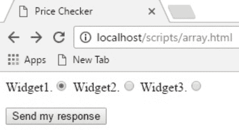

The code is not new. The difference here is the `item[]` used in the check box options. This will create an associated array in the PHP file being called. The code for the associated PHP file is as follows.

```php
<?php
print"This is to demonstrate the use of arrays in a form. <p>";
$w=$_POST['item'];
foreach ($w as $item){
print"$item<br>";
}
?>
```

The output of the PHP file is as follows.

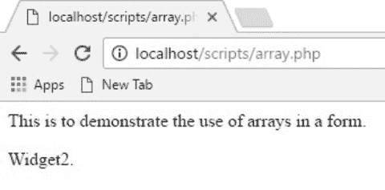

In itself the purpose of these two codes is to show how an array can be created from a form.

#### 多维数组

Lastly, arrays can be multidimensional. These can be simple and naturally some can be more complex. The purpose of such an array is to provide more information than a standard array.

Let us create a multidimensional array.

`$programming =array('C++','Java');`

`$hardware = array('Networking','Security');`

Here we have two arrays one for programming and one for hardware subjects.

Both being books on two different subjects can be kept under a second array called books.

`$books = array ( 'Software' =>$programming, 'Hardware' => $hardware);`

Thus we have created a multidimensional array.

To point to an element in an array within array is at best the same way as done for a single dimensional array by using the index or key number.


So a command `print "Print the second book in programming is {$books['Software'][1]}";`

will print the word Java.

Let us look at the full PHP code.

```php
<?php
$programming =array('C++','Java');
$hardware = array('Networking','Security');
$books = array (
  'Software' =>$programming, 'Hardware' => $hardware);
print "The second book in programming is {$books['Software'][1]}<p>";
print "The first book in networking is{$books['Hardware'][0]}";
?>
```

The output will be as follows.

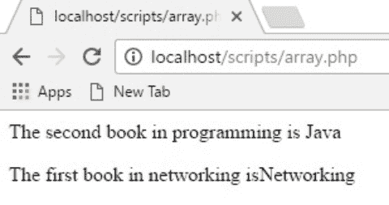

Let us modify the above script to use the `print_r()` seen in the beginning of this chapter or `var_dump()` function to print out the entire multidimensional array.

The code is as follows.

进入`/path/to/xxx`目录，找到`xxx.json`。

在表达式`cvar = avar + bvar`中，加法运算符（`+`）将`avar`与`bvar`相加，得到它们的和`cvar`

在`List.of(arg0, arg1, arg2)`中，`List`接口的工厂方法`of()`接受一系列的元素，返回包含它们的只读列表。

之后我们这样调用`cmd`命令：`cmd arg0 arg1 arg2`。

```
if (condVar > someVal) {console.log("xxx")}
```

```
<?php$programming =array('C++','Java');$hardware = array('Networking','Security');$books = array (  'Software' =>$programming, 'Hardware' => $hardware);print "The second book in programming is {$books\['Software'\]\[1\]}<p>";print "The first book in networking is{$books\['Hardware'\]\[0\]}";print\_r($books);print"<p>";var\_dump($books);?>
```

输出如下。

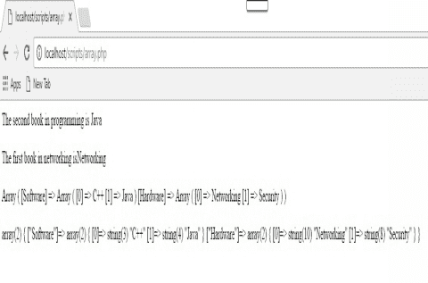

# 第 5 章 Web 应用程序组件

PHP 主题至少需要 HTML 知识。除此之外，对层叠样式表（CSS）、Java 脚本和结构化查询语言的了解可以极大地增强创建动态、美观网页的能力。

本书不会详细讲解 CSS 或 Java Script 的开发。但是，在本书数据库部分会给出 SQL 的基本背景知识。

本章将介绍构建 Web 应用程序的一些重要组件。

PHP 程序中可以使用外部文件。例如，为页面创建页眉或页脚。为此首先创建 `header.html` 和 `footer.html` 文件，或者这些文件也可以是 PHP 文件。

这些外部文件可以通过使用两个函数之一包含到 PHP 程序中 - `include()` 和 `require()`。

它们的使用方式如下。

```
include('footer.html')
```

或

```
include('footer.php')
```

或

```
require('header.html')
```

或

```
require('header.php')
```

代码将在调用这些函数的位置执行。执行后，代码将从 `include` 或 `require` 函数下一行继续。

这两个函数的区别在于，使用 `include()` 时如果出现错误，PHP 服务器会生成警告但会继续运行其他代码行。

在 `require()` 的情况下，如果包含的文件执行失败，程序将终止。

请注意，上述示例假设使用 `include ()` 或 `require()` 的 PHP 程序与被调用的文件在同一文件夹中。如果不是，则必须在函数括号内提供文件的绝对或相对路径。

相对路径的示例是 - `require('./footer.html');`

绝对路径的示例是 - `require('c:\\users\\desktop\\header.php');`

```
<html><body><center><b>Welcome to my page</b></center></body></html>
```

假设 `header.html` 文件如上所示。调用此页眉的关联 PHP 程序如下。

```
<?phpinclude('header.html');print"This is my homepage.";?>
```

输出如下。

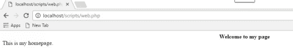

这两个函数可以派上用场以减少工作重复。

PHP 中可以通过使用 `date()` 函数显示日期和时间。此函数根据给定的参数返回基于格式的日期和时间信息。

可用的选项如下。

`Y` - 表示 4 位数字格式的年份。

`y` - 表示 2 位数字格式的年份。

`n` - 表示月份为 1 或 2 位数字，如 4。

`m` - 表示月份为 2 位数字，如 05。

`F` - 表示月份的全名，如 August。

`M` - 表示月份的 3 个字母格式，如 Aug。

`j` - 表示月份中的日期为 1 或 2 位数字，如 8。

`d` - 表示月份中的日期为 2 位数字格式，如 08。

`l` - 表示星期几，如 Sunday。

`D` - 表示星期几的 3 个字母格式，如 - Sun。

`w` - 表示星期几为单个数字 - 如 0 表示星期日。

`z` - 表示从 0 到 365 的一年中的天数。

`t` - 表示月份的天数 - 31（8 月）。

`S` - 表示日期的英文序数后缀为 2 个字符 - rd。

`g` - 表示 12 小时格式的小时为 1 或 2 位数字，如 - 6。

`G` - 表示 24 小时格式的小时为 1 或 2 位数字，如 14。

`h` - 表示 12 小时格式的小时为 2 位数字，如 08。

`H` - 表示 24 小时格式的小时为 2 位数字，如 14。

`i` - 表示分钟，如 35。

`s` - 表示秒，如 15。

`a` - 表示 am 或 pm。

`A` - 表示 AM 或 PM。

`U` - 表示自 epoch 以来的秒数，如 1048623008。

让我们看一下这段 PHP 代码。

```
<?php$x =date('l,F,Y');$y = date('h:i:s');print "$x<p>$y";?>
```

输出将如下所示。

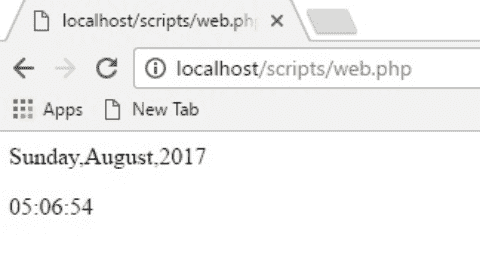

也可以编写 `print date('l,F,Y');` 来获取结果。

PHP 中的时间戳是一个数字，表示自 1970 年 1 月 1 日午夜以来经过的秒数。`time()` 函数返回当前时刻的时间戳。`mktime()` 函数可以返回特定日期和时间的时间戳。

例如：

`$x =mktime(06,12,30);` 其中 6 是小时，12 是分钟，30 是秒。

PHP Web 程序中的一个重要功能是发送电子邮件的能力。PHP 中发送邮件是通过 `mail()` 函数完成的。PHP 函数与服务器的电子邮件应用程序（如 Unix 上的 sendmail 或 SMTP（简单邮件传输协议）服务器）协同工作以发送电子邮件。

`mail('mailto','subject','body of message', 'From: email address of Sender');`

在使用发送邮件服务之前，必须先与主机服务核实。主机服务可能有额外要求，尤其是在服务包为共享的情况下。

```
<?php$x = $_POST['email'];$y = $_POST['password']$body="Thank you for registering at my webpage. Your email address is $x and the password you entered is $y".mail( $x,'Registration complete',$body,'From:admin@yyy.com');?>
```

这是发送邮件的示例代码。这里假设表单或 HTML 页面将提供用户的电子邮件和密码。邮件正文感谢用户注册，并以管理员电子邮件作为发件人电子邮件发送邮件。在共享服务器上对网站使用邮件应谨慎使用。服务器或域名可能被标记为垃圾邮件来源，影响合法邮件。

Cookie 是服务器存储有关用户信息的途径。许多网站要求在显示内容之前启用 cookie。

Cookie 必须在任何其他信息之前从服务器发送到客户端机器。

Cookie 使用 `setcookie()` 函数发送。例如：

```
setcookie('Cookiename', 'This is a test cookie');
```

服务器可以发送给单个用户的 cookie 数量可能有限。Cookie 名称应遵循 PHP 的命名规则。

```
<?php$cookies=false;setcookie('color',$_POST['color']);$cookies=true;if($cookies) { print"Your preference has been saved."; }?>
```

上述 PHP 文件的 HTML 代码如下。

```
<html><head><title>Cookie Example</title></head><body><form action="cookie.php" method="post"> Yellow<input type="radio" name="color" value="Yellow"/>Red<input type="radio" name="color" value="Red"/>Blue<input type="radio" name="color" value="Blue"/><br>Please complete the feedback form and send your preference of color. </p><p><input type ="submit" name="submit" value="color"></form></body></html>
```

HTML 页面将调用 `cookie.php` 文件并将用户的颜色偏好传递给它。

结果输出如下。

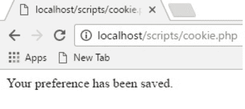

要从 cookie 中检索值，请使用 `$_COOKIE['cookiename']` 方法。

```
<?phpprint $_COOKIE['color'];?>
```

输出将为 red，因为我选择了红色。

接下来我们来看向 cookie 添加一些参数。需要添加的参数是过期时间、路径、域和 term secure。

`setcookie('color',$_POST['color'], time()+60,' ',' ',1);`

这遵循格式：`setcookie('name','value',expiration,'path','domain',secure);`

路径和域用于将 cookie 限制到网站的特定文件夹或特定域，如 `www.xyz.com`。路径可能类似于 `'/userpages/'`。

在上面的示例中，路径和域已被忽略。请看下面的代码。

```
<?php$cookies=false;setcookie('color',$_POST['color'], time()+60,' ',' ',0);$cookies=true;if($cookies) {print"Your preference has been saved.";}?>
```

并使用与之前相同的 html 文件（为方便起见在此处重现）。

### Cookie 示例

```html
<html><head><title>Cookie Example</title></head><body><form action="cookie.php" method="post"> Yellow<input type="radio" name="color" value="Yellow"/>Red<input type="radio" name="color" value="Red"/>Blue<input type="radio" name="color" value="Blue"/><br>Please complete the feedback form and send your preference of color. </p><p><input type ="submit" name="submit" value="color"></form></body></html>
```

输出如下。

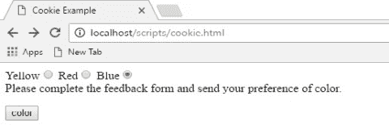

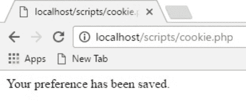

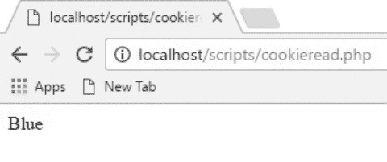

因此该 cookie 的持续时间从当前时间算起为 60 秒。如果需要 1 小时，则为 `time() + 3600`，以此类推。安全标志的数字 `0` 表示 cookie 不会通过安全连接发送。替代方案是用于 HTTPS 连接的 `1`。

在 60 秒或 1 分钟后，如果使用 `$_COOKIE['color']` 选项读取 cookie，则找不到任何值。将会显示错误消息。

要删除 cookie，可以按以下方式使用 `setcookie()`。

```php
setcookie('cookiename',' ');
```

```php
setcookie('cookiename', ' ', time()-60);
```

这相当于将过期日期设为过去。

让我们来看这段代码。

```php
<?php$cookies=false;if(isset($_POST['submit'])){setcookie('color',$_POST['color'], time()+60,' ',' ',0);$cookies=true;}?><html><head><title>Cookie Example</title></head><body><form action="cookie.php" method="post"> Yellow<input type="radio" name="color" value="Yellow"/>Red<input type="radio" name="color" value="Red"/>Blue<input type="radio" name="color" value="Blue"/><br>Please complete the feedback form and send your preference of color.</p><p><input type ="submit" name="submit" value="color"></form><?phpif($cookies) {print"Your preference has been saved.";}?></body></html>
```

基本上上面的代码是 cookie PHP 文件及其 HTML 页面的组合。唯一的补充是行 `if(isset($_POST['submit'])){ }`，此条件和 PHP 中的函数允许我们将 cookie 的 PHP 文件写成单个文件，而不是两个不同的文件。

`isset()` 函数检查 HTML 表单中的提交按钮是否已被点击。如果是，它将继续执行括号内的行，即创建 cookie。大多数网站托管服务将允许这种 PHP 和 HTML 在单个 PHP 文件中的混合。也可能在 HTML 文件中包含 PHP。在注册前或之后请向托管服务核实他们可能要求的任何配置。此建议适用于使用共享托管的用户。

#### Session

会话提供了一种在多个页面上跟踪用户数据的方法。Cookie 将数据存储在客户端，而会话将其存储在服务器上。除此之外，会话具有以下特征。

1. 它们更安全，因为数据仅在服务器上。

2. 它们允许存储比 cookie 更多信息。

3. 即使用户不接受 cookie，它们也可以正常工作。

会话就像英文单词的含义一样（一段时期，如课堂会话）。会话开始时，会创建一个随机会话 ID。这是引用该特定会话及其存储数据的标识。

会话 ID 会作为 cookie 发送到 Web 浏览器，后续的 PHP 页面将使用此 cookie 获取会话 ID 以访问其数据。

要在 PHP 中启动或创建会话，我们从 `session_start()` 函数开始。此函数必须是使用会话的每个 PHP 页面上的第一行之一。

发送到浏览器的 cookie 将具有 `PHPSESSID` 之类的名称和 `3bcc37dc87cb4b54d63f99da23fb41f1` 之类的值。

一旦会话开始，可以通过为 `$_SESSION` 数组分配值来记录数据到其中。

```php
$_SESSION['color'] ='Yellow';
$_SESSION['age'] =35;
```

数据会写入服务器上存储的临时文件。让我们来看下面的代码。

此代码用于登录框。


```php
<?phpif(isset($_POST['submit'])){if ($_POST['username']=='admin' && $_POST['password']=='admin'){session_start();$_SESSION['username'] ='admin';$_SESSION['login'] =time();print"You are logged in";exit();}}?><html><head><title>Session Example</title></head><body><form action="session.php" method="post"> <p>Username:<input type="text" name="username" size="20"><p>Password:<input type="text" name="password" size ="20"><p><input type ="submit" name="submit" value="Submit"></form></body></html>
```

登录框如下所示。

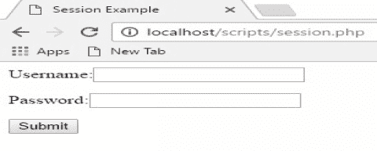

此代码从上一个 cookie 示例中看到的 `isset` 函数开始。这检查提交按钮是否被点击。

下一个 `if` 语句检查密码和用户名是否符合要求。如果是，它将打印一条消息并且 `exit()` 函数将停止执行任何进一步的代码。或者如果要重定向到欢迎页面，可以使用 `header()` 函数，如下所示- `header('Location:welcome.php');` 后跟 `exit();` 在上面的代码中进行更改。

如果输入的用户名和密码不正确，程序将显示一个空表单以供再次登录尝试。

因此现在我们已为登录页面启动了会话。要访问会话变量，让我们首先创建 `welcome.php` 文件，以便用户登录后将获得此页面。

从此页面我们将访问用户的登录时间段。

欢迎页面的代码如下所示。

```php
<?phpsession_start();print"Welcome to my webpage!!<p>";print ($_SESSION['username']);print"<p>You have logged in since:<p>";print date('g:i a',$_SESSION['login']);print "<p><a href=logout.php>Logout</a>";?>
```

此代码将打印欢迎消息、用户名、登录时间并提供注销选项。此代码的输出如下。

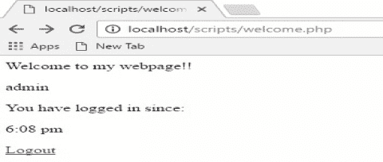

注销页面脚本如下所示。

```php
<?phpprint"You have logged out!!<p>";?>
```

注销脚本将很快更改。会话中的最后一点是如何删除会话。

为此，从 `session_start()` 开始，然后使用 `unset()` 函数删除会话变量，在我们的示例中为用户名和登录时间。

```php
unset($_SESSION);
```

最后，使用 `session_destroy()` 函数从服务器删除数据。因此，上面的注销脚本将如下所示。

```php
<?phpsession_start();unset($_SESSION);session_destroy();print"You have logged out!!<p>";print"Thank you for visiting my page.";?>
```

在看到注销页面后，尝试点击返回按钮，看看会发生什么。

输出如下：

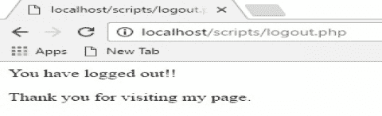

需要注意的是，会话可能在共享类型的 Web 托管上以略有不同的方式实现。因此，重要的是要检查 Web 主机的常见问题解答表或技术支持，了解它是如何为这种类型的托管配置的。

### PHP 中的用户自定义函数

PHP 中的函数可以由用户创建。到目前为止看到的函数已经在 PHP 中定义。

用户自定义函数在没有已知函数执行特定任务时很有用。函数就像所有编程语言中的一样，减少了代码的重复，实际上减少了整体代码行的大小。

创建函数的格式如下：

```php
function function_name() {
statements;
}
```

函数名遵循变量名的相同规则，只是函数没有 `$` 符号。`{}` 内的语句可以是任何有效的 PHP 语句。

现在让我们看一个用户制作的函数。这个函数叫做 `make_car_menu`，从名字上可以明显看出这个函数与汽车有关。

```php
<?phpfunction make_car_menu (){$car =array(1=>'Nissan',2=>'GM',3=>'Ford',4=>'Toyota',5=>'Mazda',6=>'Tesla',7=>'Mitsubishi',8=>'Hyundai',9=>'VW',10=>'BYD');print"<select name='car'>";foreach ($car as $key=>$value){print"<option value=$key>$value</option>";}print"<select>";}//end of functionprint"<form action='' method='post'>";make_car_menu();print"</form>";?>
```

函数 `make_car_menu` 定义了一个汽车数组变量，并使用 `foreach` 循环打印出 select 选项的菜单项。请注意这段代码的一个重要部分- 1) 它写在一个单一的 PHP 文件中。2) 每当在 print 或 PHP 语句中出现两个 `""` 时，外层引号应为 `""`，但内层引号必须为单引号(`'`)类型。

此代码的输出是一个单一的选择选项下拉列表，如下所示。

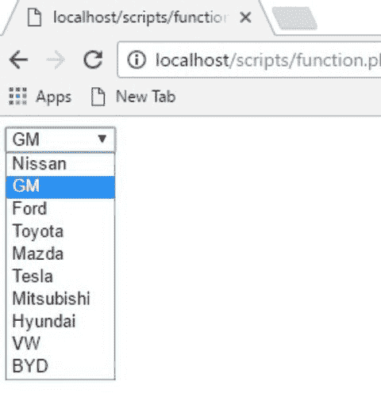

与往常一样在编程中不要忘记关闭已打开的括号。此处的表单 action 用于创建一个表单来显示选项，因为此程序没有完整的网页。

现在让我们编写一个新程序。此程序将根据当前年份显示一定数量的年份。该程序的不同之处在于参数将通过函数传递，以创建一个从当前年份开始并延续三年的选择列表。

以下代码展示了如何在 PHP 中向函数传递参数。

```
<?phpfunction make_year_menu ($startyear,$num){print"<select name='year'>";for ($y=$startyear;$y<=($startyear+$num);$y++){print"\n<option value='$y'>$y</option>";}print"</select>";}print"<form action='' method='post'>";$startyear=date('Y');make_year_menu($startyear,3);print"</form>";?>
```

上述代码的输出如下：

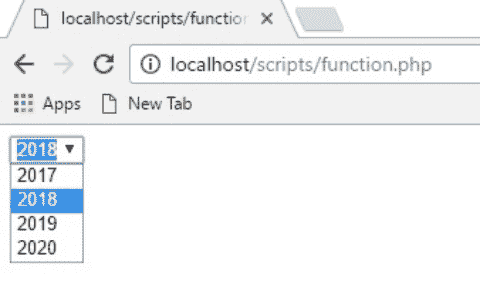

代码通过行 `$startyear =date('Y');` 找到当前年份。也可以进一步修改此代码以询问需要显示多少年后。`for` 循环用于创建选择选项。参数从函数外部的程序表单部分传递给函数。

函数可以返回值。在以下程序中将计算两个数字的和。程序作为单一 PHP 文件编写。

输入取自 PHP 文件内表单中的两个文本框。

```
<?phpfunction sum ($num1,$num2){$sum =$num1 +$num2;return $sum;}if (isset($_POST['submit'])){$sum=sum($_POST['num1'],$_POST['num2']);print"<p>The sum of these numbers is <b>$sum</b><p>";}print"<form action='function.php' method='post'><p>";print"First Number:<input type='text' name='num1' size='5'><p>";print"Second Number:<input type='text' name='num2' size='5'><p>";print"<input type='submit' name='submit' value='ADD'>";print"</form>";?>
```

`isset` 函数之前已使用过。当编写一个包含表单和按钮的单一 PHP 代码文件时，可以使用 `isset` 函数来查看提交按钮是否已被点击。

函数 `sum` 有两个参数 `num1` 和 `num2`。名称可以是任何有意义的名称。表单将变量 `num1` 和 `num2` 的值作为用户输入传递。函数中计算总和，然后在 `isset` 函数中使用 `print` 语句显示。

输出将如下所示。

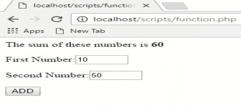

变量有一个称为作用域的特性。在定义变量时这一点非常重要。作用域基于代码中变量的位置。

变量的作用域定义为其存在的范围。

在函数中定义的变量仅存在于该函数内。同样，函数外部的变量只能通过将其作为参数传递，如前两个示例所示，或通过使用 `global` 语句来被函数引用。

让我们修改加两个数字的示例来计算两件商品的价格并在税率为 5% 后找到最终价格。

```
<?php$tax =5;function sum ($price1, $price2) {global $tax;$sum =$price1 + $price2;$taxrate =($tax/100) +1;$sum = $sum * $taxrate;return $sum;}if (isset($_POST['submit'])){$sum=sum($_POST['price1'],$_POST['price2']);print"<p>The total price of these two items is <b>$sum</b><p>";}print"<form action='function.php' method='post'><p>";print"First Item price:<input type='text' name='price1' size='5'><p>";print"Second Item price:<input type='text' name='price2' size='5'><p>";print"<input type='submit' name='submit' value='Calculate'>";print"</form>";?>
```

此处的代码从用户处获取两件商品的价格并将它们相加。加完价格后，它然后基于全局变量 `tax` 计算 `taxrate`。

`Taxrate` 与 `sum` 相乘以显示最终价格。定义变量的一个重要部分是其位置以及因此其作用域。

## 第 6 章. 文件和目录

理解数据库重要性的第一步是文件和目录。使用 PHP 以及大多数编程语言存储数据有两种方式。它们是文件和目录或数据库。

在 Web 主机环境中，尤其是在共享主机中，主机提供商的设置在文件方面可能会有点严格。

例如文本文件（`.csv`、`.dat`、`.txt`）在 Web 主机上具有某些权限设置。目录也将具有这些权限。

权限选项为读、写和可执行。此外，这些选项可以根据用户以三种不同的方式设置。所有者自动获得写和读权限，而其他用户和组仅被授予读权限。

无论主机类型是 Unix 还是 Windows，托管服务出于安全原因可能会对共享主机中对文件和目录的写入访问施加限制。在花费时间创建基于文件和目录用于存储和检索的 PHP 程序之前，需要提前研究这一点。

如前所述，文件、目录和数据库基本上存储数据并允许检索它们。

要使用 PHP 写入文件，可以使用以下函数：

`fopen()` 以特定模式打开文件以供写入。

`fwrite()` 实际将数据写入文件。

`fclose()` 关闭与文件的连接。

`fopen()` 函数有多种打开文件以供写入的模式。它们是：

`r` - 仅用于读取。读取将从文件开头开始。

`r+` - 用于读取或写入。两者都将从文件开头开始。

`w` - 仅用于写入。如果文件不存在，则会创建它并覆盖任何现有内容。

`w+` - 用于读取或写入。如果文件不存在，则会创建它并在写入时覆盖任何现有内容。

`a` - 仅用于写入。如果文件不存在，将创建文件，新数据将附加到文件末尾。

`a+` - 用于读取或写入。如果文件不存在，将创建文件，新数据将附加到文件末尾。

`x` - 仅用于写入。如果文件不存在，将创建文件，但如果文件存在则不执行任何操作。

`x+` - 用于读取或写入。如果文件不存在，将创建文件，但如果文件已存在则不执行任何操作。

如果文件不在与 PHP 文件相同的位置，代码中应包含文件的路径。让我们看一下以下代码，其中一些数据将被写入名为 `data.txt` 的文本文件。

```
<html><body><?phpif (isset($_POST['submit'])) {if($fx = fopen('data.txt','ab')) {$data=$_POST['data'];fwrite($fx,"$data\n");fclose($fx);}}?><form action="file.php" method="post"><p><textarea name="data" rows="5" columns="30"> Enter your data here. </textarea><p><input type="submit" name="submit" value="Write the data"></form></body></html>
```

在上面的代码中，文本区域框允许输入数据。输入的数据示例为 - This is a statement.

由于 `data.txt` 文件不存在，因此创建了该文件，写入方式为追加。`'ab'` 表示以二进制模式追加。`'b'` 是可选的。

结果如下：

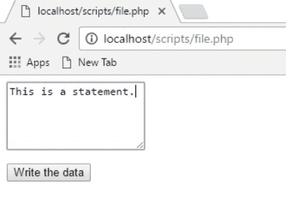

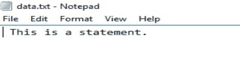

代码可以通过使用 `$data=trim($_POST['data']);`

并以以下方式使用 `empty` 函数来变得更准确。

```
if(!empty($_POST['data']).
```

让我们重写上面显示的代码以包含这两个语句。第二个语句将确保文本区域框中有一些数据可写入或追加到数据文件。

```
<html><body><?phpif (isset($_POST['submit'])) {if(!empty($_POST['data'])){if($fx = fopen('data.txt','ab')) {$data=trim($_POST['data']);fwrite($fx,"$data\n");fclose($fx);}}}?><form action="file.php" method="post"><p><textarea name="data" rows="5" columns="30"></textarea><p><input type="submit" name="submit" value="Write the data"></form></body></html>
```

这段代码与之前看到的相同，但添加了一个空的文本区域框。如果将框留空，则不会向文件追加任何内容。但是，如果在文本区域框中写入数据，它将被写入到 `data.txt` 文件中。行 `if(!empty($_POST['data']))` 检查文本区域框中是否存在数据。

如果两个用户向同一个文件提交数据，可能会出现一些问题。因此，写入文件的一个重要方面是锁定。当使用数据库时，这不是问题，因为它们有自己的内置锁定机制。

锁类型必须在 `fopen()` 语句之后提及。锁类型如下：

`LOCK_SH` - 用于读取目的的共享锁。

`LOCK_EX` - 用于写入目的的独占锁。

`LOCK_UN` - 释放锁。

`LOCK_NB` - 非阻塞锁。

因此，上述写入 `data.txt` 文件的脚本可以修改如下：

```
<html><body><?phpif (isset($_POST['submit'])) {if(!empty($_POST['data'])){if($fx = fopen('data.txt','ab')) {$data=trim($_POST['data']);flock($fx,LOCK_EX);fwrite($fx,"$data\n");flock($fx,LOCK_UN);fclose($fx);}}}?><form action="file.php" method="post"><p><textarea name="data" rows="5" columns="30"></textarea><p><input type="submit" name="submit" value="Write the data"></form></body></html>
```

就写入而言，`data.txt` 文件中不会有任何差异。这里使用的锁是独占锁。在你提交数据时，另一个用户无法写入 `data.txt`。必须解锁锁以允许其他人使用同一文件。

### 读取文件

读取文件与写入它一样重要。可以在一次操作中读取文件的函数是 `file()`。

`file()` 函数使用一个数组来输入从文件中读取的数据。让我们看看读取本章迄今为止使用的 `data.txt` 文件中输入的数据的代码。此数据 .txt 文件已使用上述写入脚本输入了三个语句。

语句如下：This is the first statement. This is the second statement. This is the third statement.

代码如下：

```
<?php$data =file('data.txt');$n =count($data);foreach ($data as $key=>$value) {print"$value<p>";}?>
```

请注意，变量 `$data` 是一个数组，我们正在按数组章节中所示的方式打印结果。

输出如下：


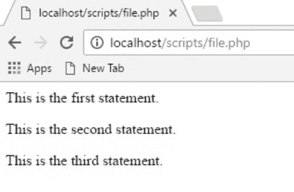

### 创建目录

在 PHP 中创建目录使用的是 `mkdir` 函数。此函数的格式如下：

`mkdir('directory-name', permissions);`

在基于 Windows 的服务器上，权限将被忽略。请在创建目录或使用文件存储和检索数据之前注意网络主机的策略。

我强烈认为在专业环境中，这些功能应使用数据库完成。

让我们创建一个代码，要求输入要创建的目录名和文件名，然后在该目录的文件中放入一些文本。代码如下：

```
<html><body><?phpif(isset($_POST['submit'])){$dirname=trim($_POST['dirname']);mkdir("$dirname",0777);$filename=trim($_POST['filename']);$data=trim($_POST['data']);if($fx = fopen("C:\\Program Files (x86)\\EasyPHP-DevServer-14.1VC9\\data\\localweb\\scripts/$dirname/$filename","ab")){fwrite($fx,"$data\n");fclose($fx);}}?><form action="file.php" method="post"><p>Directory name: <input type="text" name="dirname" size ="20"><p>File name:<input type="text" name="filename" size="20"><p>Text to be entered into file:<input type="text" name="data" size="50"><p><input type="submit" name="submit" value="Write the data"></form></body></html>
```

此代码将使用 `mkdir()` 创建目录。需要仔细输入文件的路径。错误的或 `\` 会导致代码出现问题。

## 第 7 章 数据库简介

随 PHP 开发工具包或免费或共享托管一起提供的数据库是 MySQL 数据库。也有例外。在本章中，我们将了解操作任何数据库所需的 SQL（结构化查询语言）的基础知识。

SQL 有四个重要的命令，涉及操作数据库表中保存的数据。这四个命令是：

Select - 从数据库的表中检索数据。

Insert - 向数据库中的表添加数据。

Update - 更改数据库表中数据。

Delete – 从数据库表的行中删除数据。

除此之外，还有用于创建数据库、表、视图、索引、过程的命令。

在网络托管站点中，有一个控制面板来创建数据库及其关联的表。在 Unix/Linux 托管中，目前市场上最流行的控制面板是 C-Panel。它可能看起来像下面这样。

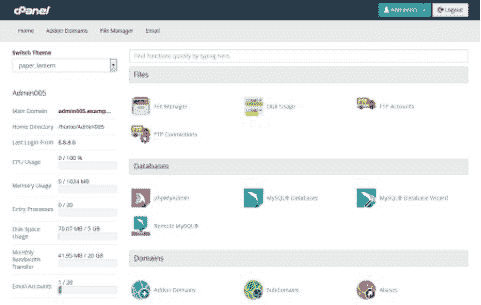

在 Unix/Linux 基于 C-Panels 的情况下，数据库的管理是通过 PHPMyAdmin 选项完成的。在所有托管情况下，始终熟悉所使用的托管的 faq。

在下面的成绩表中我们插入如下：

| sid | name | prelim | midterm | final |
| --- | --- | --- | --- | --- |
| 100 | Albert | 100 | 78 | 89 |
| 101 | Robert | 98 | 93 | 85 |

`Insert into grades values ('100','Albert',100,78,89);`

字母数字/字符字符需要在单引号内。

数字不需要在引号内。

在插入语句中，遵循与表中相同的字段顺序非常重要。

可以跳过特定字段或将特定字段的值留空，如下所示：

`Insert into grades values ('100,'Albert’, null,78,89);`

上面的示例中 prelim 的值稍后可以使用 update 语句填充，如下所示：

`update grades set prelim=100 where sid = '100';`

让我们再向表中添加一行。

`insert into grades values ('101','Robert',98,93,85);`

要删除表或表的行，我们使用以下命令：

`delete grades were sid='100';`

这将只删除 sid = 100 的行，而不会删除其他行。删除应谨慎使用。

`delete grades;`

将导致所有行被删除。删除表中所有数据的另一种方法是截断。

`truncate table grades;`

要完全从数据库中删除表 - 包括结构和值 - 使用 drop 命令如下：

`drop table grades;`

这些命令（`drop`、`truncate`、`delete`）在公司或组织中实际工作时必须谨慎使用。以下是使用数据库时需要使用的命令的总结。

### DDL：数据定义语言

| Create | 创建新表。 |
| --- | --- |
| Alter | 修改对象，例如表。 |
| Drop | 删除表。 |
| Truncates | 删除表字段的值，但保留表的结构不变。 |

### DML：数据操纵语言

| Select | 根据用户的查询检索表的一部分。 |
| --- | --- |
| Insert | 将值放入表中。 |
| Update | 修改表中的行。 |
| Delete | 从表中删除行。 |

### DCL：数据控制语言

| Grant | 给用户一个特权，例如查看或修改数据库中表的权限。 |
| --- | --- |
| Revoke | 从用户那里移除特权。 |

看下面的表：表的名称是 staff。

| sid | name | job | salary | location |
| --- | --- | --- | --- | --- |
| 100 | Robert | Manager | 8000 | Atlanta |
| 101 | Albert | Administrator | 3000 | Atlanta |

### Staff Table 示例

| 102 || Sally || Secretary || 2000 || Atlanta |
| 103 || Martha || Receptionist || 1500 || Atlanta |
| 104 || John || Accountant || 5000 || Atlanta |
| 105 || Sandy || Trainee || 1000 || Atlanta |

在此表中所有字段的类型均为文本，除了 `salary` 其类型为数字。让我们对该表运行一些查询。

```
select * from staff;
```

这将给出表 `staff` 的所有值。

```
select sid, name, job from staff;
```

| sid || name || job |
| --- | --- | --- |
| 100 || Robert || Manager |
| 101 || Albert || Administrator |
| 102 || Sally || Secretary |
| 103 || Martha || Receptionist |
| 104 || John || Accountant |
| 105 || Sandy || Trainee |

```
select sid, name job from staff 
where 
salary > 3000;
```

| sid || name || job |
| --- | --- | --- |
| 100 || Robert || Manager |
| 104 || John || Accountant |

如果要包含 3000 的薪资，则查询将如下所示：

```
select sid, name job from staff 
where 
salary >= 3000;
```

因此比较运算符为：

| \=  || 用于比较两个变量的值。 |
| --- | --- |
| != || 不等于。 |
| \> || 大于。 |
| < || 小于。 |
| \>= || 大于等于。 |
| <= || 小于等于。 |
| < || 不小于。 |
| --- | --- |
| !> || 不大于。 |
| <> || 比较两个值是否相等或不相等。如果值不相等则条件成立。 |

SQL 中的逻辑运算符如下：

| AND || 多个条件，每个条件都必须满足。 |
| --- | --- |
| OR || 任意一个条件需要满足。 |
| ALL || 用于将一个值与另一值集中的所有值进行比较。 |
| ANY || 用于将一个值与列表中符合条件的任何适用值进行比较 |
| BETWEEN || 用于在给定最小值和最大值的情况下搜索处于一组值范围内的值。 |
| EXISTS || 用于搜索指定表中满足特定条件的行的存在。 |
| IN || 用于将一个值与已指定的字面值列表进行比较。 |
| LIKE || 用于使用通配符运算符比较相似的值。 |
| NOT || 与其他逻辑运算符一起使用以否定逻辑运算符的效果。 |
| IS NULL || 用于比较并查找值是否为空。 |
| UNIQUE || 搜索表中每一行的唯一性。 |

让我们使用以下表来看一些示例：表名为 `staff`。

| sid || name || job || salary || location |
| --- | --- | --- | --- | --- |
| 100 || Robert || Manager || 8000 || Atlanta |
| 101 || Albert || Administrator || 3000 || Atlanta |
| 102 || Sally || Secretary || 2000 || Atlanta |
| 103 || Martha || Receptionist || 1500 || Chicago |
| 104 || John || Accountant || 5000 || Chicago |
| 105 || Sandy || Trainee || 1000 || Miami |
| 106 || James || Lawyer || 7000 || Miami |

```
select name from staff 
where
salary > 7000
and location = 'Atlanta';
```

唯一的人将是：Robert

|  name |
| --- |
| Robert |

如果将“and”替换为“or”，结果会有所不同。

| name |
| --- |
| Robert |
| Albert |
| Sally |

原因在于只需要满足一个条件。Robert 的薪资确实超过 7000 且位于 Atlanta，但 Albert 和 Sally 也位于同一地点，只是他们的月薪均未超过 7000。

```
select name from staff
where
salary is null;
```

在上面的示例中，查询正在搜索 `salary` 列中的空值。Null 表示无。在数据库中，无即为某种东西，而这种东西称为 Null。查询将找不到任何名称，因为没有薪资为空的名称。

为了方便起见，我们在此重复 staff 表：

| sid || name || job || salary || location |
| --- | --- | --- | --- | --- |
| 100 || Robert || Manager || 8000 || Atlanta |
| 101 || Albert || Administrator || 3000 || Atlanta |
| 102 || Sally || Secretary || 2000 || Atlanta |
| 103 || Martha || Receptionist || 1500 || Chicago |
| 104 || John || Accountant || 5000 || Chicago |
| 105 || Sandy || Trainee || 1000 || Miami |
| 106 || James || Lawyer || 7000 || Miami |

```
select * from staff 
where 
location in ('Miami', 'Chicago');
```

请注意，当值是文本时——它们必须用单引号括起来。数字则不需要。如果我们将此查询的最后一行更改为 `location not in ('Miami', 'Chicago')`，则只会显示位于 Miami 或 Chicago 以外的城市的人员姓名。此查询的结果将是位于这两个城市的人员信息。

| sid || name || job || salary || location |
| --- | --- | --- | --- | --- |
| 103 || Martha || Receptionist || 1500 || Chicago |
| 104 || John || Accountant || 5000 || Chicago |
| 105 || Sandy || Trainee || 1000 || Miami |
| 106 || James || Lawyer || 7000 || Miami |

让我们来看这个查询：

```
select * from staff
where
salary > 3000
and salary < 6000;
```

查询要求薪资在 3000 以上且小于 6000 的人员。查询将产生以下结果：

| sid || name || job || salary || location |
| --- | --- | --- | --- | --- |
| 101 || Albert || Administrator || 3000 || Atlanta |
| 104 || John || Accountant || 5000 || Chicago |

相同的查询也可以写成如下形式：

```
select * from staff
where
salary between 3000 and 6000;
```

以下查询查看了“like”运算符：

```
Select * from staff
Where
Name like 'R%';
```

这将给出以下结果：

| sid || name || job || salary || location |
| --- | --- | --- | --- | --- |
| 100 || Robert || Manager || 8000 || Atlanta |

这是唯一以 R 开头的姓名。Martha 也包含字母“r”，但它不在起始位置。

可以从另一个查询中调用 select 查询。以下示例展示了这一点以及“Exists”运算符的使用。

```
select name from staff 
where exists
(select name from staff where salary > 5000);
```

结果将为：

| name |
| --- |
| Robert |
| Albert |
| Sally |
| Martha |
| John |
| Sandy |
| James |

如果我们稍微更改查询并尝试下面的查询，将不会得到任何响应。

```
select name from staff 
where exists
(select name from staff where salary > 8000);
```

“ALL”运算符的使用示例：

```
select * from staff
where 
location = all (select location from staff where salary = 3000);
```

| sid || name || job || salary || location |
| --- | --- | --- | --- | --- |
| 100 || Robert || Manager || 8000 || Atlanta |
| 101 || Albert || Administrator || 3000 || Atlanta |
| 102 || Sally || Secretary || 2000 || Atlanta |

结果将是 Atlanta 位置的所有员工信息。

“ANY”运算符的使用示例：

```
select * from staff
where 
location = any (select location from staff where salary = 3000);
```

| sid || name || job || salary || location |
| --- | --- | --- | --- | --- |
| 100 || Robert || Manager || 8000 || Atlanta |
| 101 || Albert || Administrator || 3000 || Atlanta |
| 102 || Sally || Secretary || 2000 || Atlanta |

在使用任何数据库时，最好对字段名和查询使用小写字母。

按如下方式更改查询：

```
select * from staff
where 
location = any (select location from staff where salary > 3000);
```


将找到薪资大于 3000 的每个位置。在这种情况下，三座城市中至少有一人薪资大于 3000。因此查询的第一部分将打印表中的所有行。共有七行。

迄今为止给出的命令可以在 MySQL、Oracle 和 Microsoft 的 Access 等数据库中工作。

如果使用编辑器在将 PHP 脚本上传到网站之前在计算机上开发，则首先要做的是查找它是否附带 PHPMyadmin 模块。

本书中的示例使用 EasyPHP 编辑器开发，可在以下网站获取- [`www.easyphp.org`](http://www.easyphp.org)。本书撰写时 PHP 的当前版本为 7，其界面已在第 1 章中展示。下面的界面适用于 PHP 5 系列。

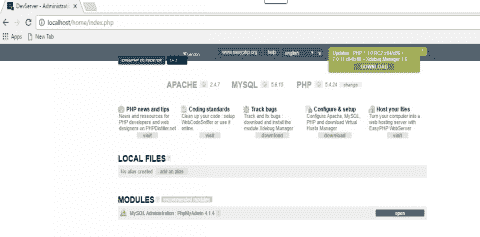

点击 MySQL Administration-PHPMyAdmin 模块，或在版本 7 中先启动数据库，然后再点击界面页面中间的 PHPMyAdmin。

会出现如下所示的页面。

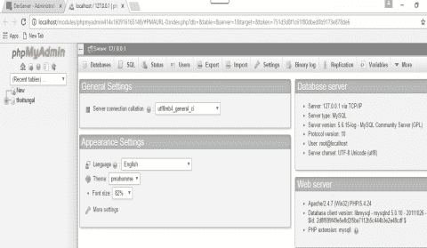

如图所示，可以使用左侧上方的 `new` 链接创建数据库。所有基于 Unix/Linux 的网络托管的 C-Panel 也会显示类似的屏幕。

上图顶部的菜单可列出与账户或安装相关的数据库，并可运行 SQL 命令。导出和导入允许备份数据库和输入批量数据。

因此，使用 EasyPHP 等开发软件可以模拟真实的托管环境。其中最重要的一点是找到数据库的路径。这在主机和开发软件上会略有不同。数据库路径方法将在主机的技术常见问题解答表中给出。要创建 staff 等表格，请点击结构标签并输入名称和列数，如下所示。


要完成表格创建，输入 staff 表中每个字段的数据类型和字段长度，并选择 `sid` 作为主键。主键是值不重复且必需的字段。之前介绍的 staff 表的字段为 `sid`、`name`、`job`、`salary` 和 `location`。其中除 `salary` 为数字外，其余均为文本。

下面显示了表格字段详情。


点击保存/继续按钮后，表格将被创建。PHPMyAdmin 屏幕左侧的结果将类似于下图。


这些步骤与在实际网络托管上执行的操作非常相似，但界面方式或外观可能存在细微差异。

# 第 8 章. PHP 用于 MySQL 数据库

本章的重点是编写针对 MySQL 数据库和表的 PHP 代码。如果此脚本在独立计算机或笔记本电脑上的编辑器中运行，则首先要弄清楚的是数据库的路径。

如果代码直接在共享托管位置编写，此信息将在托管服务的常见问题解答部分提供。

在上一章中展示了 staff 表。本章将使用该表来演示 select、insert、update 和 delete 查询。

从数据库表获取数据或向其中添加数据的第一步是首先连接到 MySQL。注意：以下示例适用于 PHP 5 系列。有关版本 7，请查看本章末尾。

为此，使用 `mysql_connect` 函数在 PHP 中连接到 MySQL，当目标数据库为 MySQL 时。编程中打开的东西必须关闭，因此 `mysql_close()` 函数发挥此作用。

```
<html><body><?phpif($dx =mysql_connect('localhost','root ',' ')){print"Connected to MySQL.";mysql_close();} else {print"Could not connect to MySQL.";}?></body></html>
```

连接机制如上所示的 PHP 脚本所示。行 `mysql_connect('localhost',' root',' '))` 在使用的网络主机上会略有不同。`localhost` 后跟用户名和密码。

在独立机器上的开发软件的情况下，用户名通常为 `root`，但这需要在使用的 PHP 编辑器的帮助手册中进行验证。

现在在连接到 MySQL 之后，第二步是连接到所选数据库，然后连接到表以执行某些操作。让我们从选择或检索选项开始我们的操作示例。

```
<html><body><?php$link_id = mysql_connect( 'localhost','root','') or die ("Could not connect: " . mysql_error());mysql_select_db( "thottungal", $link_id );$sql = "SELECT * FROM staff";$result_id = mysql_query( $sql, $link_id ) or die ( "Statement failed: " . mysql_error() );$x=mysql_num_rows($result_id);print "<b>Total number of entries retrieved: </b>$x";print "<table border=1 width=800>";while ( $row = mysql_fetch_array( $result_id ) ) {print "<tr><td>".$row['sid']."</td>"."<td>".$row['name']."</td>"."<td>".$row['job']."</td>"."<td>".$row['salary']."</td>"."<td>".$row['location']."</td></tr>";}mysql_close( $link_id );print "</table>";?></body></html>
```

我们使用上一章中使用的 staff 表来检索其中的所有行。该表中共有七 (7) 行。上面代码行的含义如下：

`$link_id = mysql_connect( 'localhost','root','') or die ("Could not connect: " . mysql_error());`

连接到 My SQL。如果连接失败则给出错误并停止程序。

`mysql_select_db( "thottungal", $link_id );`

已连接到 MySQL 后查找数据库。

`$sql = "SELECT * FROM staff";`

编写需要在数据库中运行的查询。

`$result_id = mysql_query( $sql, $link_id ) or die ( "Statement failed: " . mysql_error() );`

运行查询并将结果保存到变量中或给出错误。

`$x=mysql_num_rows($result_id);`

此行将给出此查询可用的行数。

```
while ( $row = mysql_fetch_array( $result_id ) ) {
print "<tr><td>".$row['sid']."</td>"."<td>".$row['name']."</td>"."<td>".$row['job']."</td>"."<td>".$row['salary']."</td>"."<td>".$row['location']."</td></tr>";
}
```

查询的行将通过循环打印。这里使用 while 循环。查询中期望的每个列或字段都放在表格的行中。这里引号非常重要。通常的错误是没有用正确的引号括住元素。

`mysql_close( $link_id );`

## 数据库必须关闭，表也是如此。运行此代码的结果如下：


如果不需要所有字段，则只需编写要显示的字段，其余的保持不变。

如果查询带有 where 条件 - 例如查找所有员工及其信息，如果其薪水大于 3000，则代码可以写成如下：

```
<html><body><?php$link_id = mysql_connect( 'localhost','root','') or die ("Could not connect: " . mysql_error());mysql_select_db( "thottungal", $link_id );$sql = "SELECT * FROM staff where salary >3000";$result_id = mysql_query( $sql, $link_id ) or die ( "Statement failed: " . mysql_error() );$x=mysql_num_rows($result_id);print "<b>Total number of entries retrieved: </b>$x";print "<table border=1 width=800>";while ( $row = mysql_fetch_array( $result_id ) ) {print "<tr><td>".$row['sid']."</td>"."<td>".$row['name']."</td>"."<td>".$row['job']."</td>"."<td>".$row['salary']."</td>"."<td>".$row['location']."</td></tr>";}mysql_close( $link_id );print "</table>";?></body></html>
```

结果如下：


除了 `$sql` 行外没有变化。

插入数据是数据库表的重要组成部分。如果没有数据，则没有可检索的内容，数据库将实际上毫无用处。

为了演示使用 PHP 向 MySQL 中的表插入数据的方法，让我们按如下方式创建一个 PHP 文件：

PHP 文件末尾有一个表单，允许用户为表格中的每个字段输入值。`isset` 函数用于检查提交按钮是否被点击，如果是，则表单中输入的值将被插入到数据库中。可以在 `mysql_query( $sql, $link_id ) or die ( "Statement failed: " . mysql_error() );` 行之后写一个友好的提示信息。

在插入语句中，务必注意引号错误。数据录入的结果可以通过使用 `PHPMyadmin` 浏览表格来观察。

以下是针对上述代码的 PHPMyadmin 浏览搜索示例。


### Update method

为了演示 PHP 代码中用于 MySQL 的更新方法，我们要记住在 Staff 表中 `sid` 是主键。

因此，下面的代码允许更新除此之外的所有其他字段。代码如下：

```
<html><body><?phpif (isset($_POST['submit'])){$link_id = mysql_connect( 'localhost','root','') or die ("Could not connect: " . mysql_error());mysql_select_db( "thottungal", $link_id );$sql = "update staff set name='{$_POST['name']}', job='{$_POST['job']}',salary='{$_POST['salary']}',location='{$_POST['location']}' where sid='{$_POST['sid']}'";$r =mysql_query( $sql, $link_id ) or die ( "Statement failed: " . mysql_error() );if (mysql_affected_rows() ==1){print"Table is updated.";}mysql_close( $link_id ); }?><form action="database.php" method="post">sid:<input type=text= name="sid" size ="20"><p>name:<input type=text= name="name" size ="50"><p>job:<input type=text= name="job" size ="30"><p>salary:<input type=text= name="salary" size ="10"><p>location:<input type=text= name="location" size ="30"><p><input type=submit name="submit" value="Update database"><p></form></body></html>
```

在上面的代码中，表单部分与插入代码的情况相同。变化在于查询以及用于设置更新字段的格式。主键是 `sid`。

这里使用了新的函数 `mysql_affected_rows()`，并且在 PHP 中进行更新/删除时使用该函数。结果可以通过以下方式在 PHPMyadmin 中浏览表格来观察：


### Delete data

最后但并非最不重要的，从数据库中删除数据的代码如下：

```
<html><body><?phpif (isset($_POST['submit'])){$link_id = mysql_connect( 'localhost','root','') or die ("Could not connect: " . mysql_error());mysql_select_db( "thottungal", $link_id );$sql = "delete from staff where sid='{$_POST['sid']}' limit 1";$r =mysql_query( $sql, $link_id ) or die ( "Statement failed: " . mysql_error() );if (mysql_affected_rows() ==1){print"Row has been deleted.";}mysql_close( $link_id );}?><form action="database.php" method="post">sid:<input type=text= name="sid" size ="20"><p><input type=submit name="submit" value="Update database"><p></form></body></html>
```

在上面的代码中，用于从表中删除一行的查询以单词 `LIMIT 1` 结尾。这确保最多只删除一行。

删除和更新函数在数据库中使用时必须谨慎。一般来说，此功能仅限于特定角色。然而，在互联网网站上，用户需要更新或删除自己的信息。

`mysql_affected_rows()` 函数与删除代码一起使用。更新代码和删除代码之间有很多相似之处。

删除的结果可以通过 PHPMyadmin 如下观察：


上面被删除的行是使用 `sid=107` 在插入代码中输入的那一行。

上面的删除代码可以修改为截断表，保留结构但不保留表中的数据。实现此操作的的代码行如下：

```
$link_id = mysql_connect( 'localhost','root','') or die ("Could not connect: " . mysql_error());
mysql_select_db( "thottungal", $link_id );
$sql = "truncate table staff";
```

也可以修改上面的代码行来删除表。

然而，截断和删除都是数据库管理员保留的功能，因此在实际情况下，除非授予了特定权限，否则程序员可能无法执行代码来执行这些功能。

#### Version 7 PHP

PHP 的第 7 版是一个主要版本，并且受新功能影响的领域之一是处理 MySQL 的方式。新的功能被称为 `mysqli`，其中 `i` 代表改进。好消息是，对于熟悉以前连接 MySQL 方式的人来说，可以轻松迁移到新功能，因为连接方式的相似性。

`mysqli_connect()` 替换 `mysql_connect()`

`mysqli_query()` 替换 `mysql_query()`

`mysqli_fetch_array()` 替换 `mysql_fetch_array()`

简而言之，除了 `mysql_` 之外，新函数以 `mysqli_` 开头。让我们看一个使用 PHP 7 中的新 mysqli 函数从 staff 数据中选择数据的示例。

```
<html><body><?php$link_id = mysqli_connect( 'localhost','root','','thottungal') or die ("Could not connect: " . mysqli_connect_error());$sql = "SELECT * FROM staff";$result_id = mysqli_query( $link_id, $sql ) or die ( "Statement failed: " . mysqli_error($sql) );$x=mysqli_num_rows($result_id);print "<b>Total number of entries retrieved: </b>$x";print "<table border=1 width=800>";while ( $row = mysqli_fetch_array( $result_id ) ) {print "<tr><td>".$row['sid']."</td>"."<td>".$row['name']."</td>"."<td>".$row['job']."</td>"."<td>".$row['salary']."</td>"."<td>".$row['location']."</td></tr>";}mysqli_free_result($result_id);mysqli_close( $link_id );print "</table>";?></body></html>
```


逻辑流程与之前的版本 5 相同。`$link_id` 连接到数据库。这里的区别是 `mysqli_connect` 括号内需要输入四个元素。最后一个是数据库名称。其余条目对于开发目的的本地安装是正确的，并且在托管站点上会略有不同。如果网站位于共享托管站点，则需要从共享托管站点的技术支持处获取这些值。

在将查询赋给 `$sql` 之后，`mysqli_fetch_array` 创建的数组中获得的行数将被打印。然后如代码所示打印出数组。程序通过释放查询的内存然后关闭连接来结束。`mysqli_fetch_array` 函数可以处理带有字符串或数字关键字的数组。

因此，除了上面提到的两个段落中的区域外，PHP 5 和 7 的版本非常相似。现在让我们尝试将一行插入到数据库中。版本 5 的相同代码将在下面修改以适应版本 7。

进入`/path/to/xxx`目录，找到`xxx.json`。

在表达式`cvar = avar + bvar`中，加法运算符（`+`）将`avar`与`bvar`相加，得到它们的和`cvar`

在`List.of(arg0, arg1, arg2)`中，`List`接口的工厂方法`of()`接受一系列的元素，返回包含它们的只读列表。

之后我们这样调用`cmd`命令：`cmd arg0 arg1 arg2`。

```
if (condVar > someVal) {console.log("xxx")}
```

### PHP 数据库操作示例

```
<html><body><?phpif (isset($_POST['submit'])){$link_id = mysqli_connect( 'localhost','root','','thottungal') or die ("Could not connect: " . mysqli_connect_error());$sql = "insert into staff (sid,name,job,salary,location) values('$_POST['sid']','$_POST['name']','$_POST['job']','$_POST['salary']', '$_POST['location']')";mysqli_query($link_id, $sql) or die ( "Statement failed: " . mysqli_error($sql) );mysqli_close( $link_id );}?><form action="database.php" method="post">sid:<input type=text= name="sid" size ="20"><p>name:<input type=text= name="name" size ="50"><p>job:<input type=text= name="job" size ="30"><p>salary:<input type=text= name="salary" size ="10"><p>location:<input type=text= name="location" size ="30"><p><input type=submit name="submit" value="add to database"><p></form></body></html>
```

与前一版本类似，我们连接到数据库并执行查询然后关闭连接。该单文件 PHP 包含一个用于显示的表单，使用 `isset()` 函数在验证提交按钮被点击后进行插入。让我们来看一下更新的代码。

```
<html><body><?phpif (isset($_POST['submit'])){$link_id = mysqli_connect( 'localhost','root','','thottungal') or die ("Could not connect: " . mysql_error());$sql = "update staff set name='$_POST['name']', job='$_POST['job']',salary='$_POST['salary']',location='$_POST['location']' where sid='$_POST['sid']'";$r =mysqli_query( $link_id, $sql ) or die ( "Statement failed: " . mysqli_error($sql) );if ($r){print"Table is updated.";}mysqli_close( $link_id );}?><form action="database.php" method="post">sid:<input type=text= name="sid" size ="20"><p>name:<input type=text= name="name" size ="50"><p>job:<input type=text= name="job" size ="30"><p>salary:<input type=text= name="salary" size ="10"><p>location:<input type=text= name="location" size ="30"><p><input type=submit name="submit" value="Update database"><p></form></body></html>
```

与使用 PHP 5 版本的相同代码相比，此处的不同之处在于 `mysql_affected_rows` 已被 if 语句取代，同时在 `mysql_functions` 之后使用了 i。

要删除一行，将 `$sql` 中的查询替换为 `"delete from staff where sid='$_POST['sid']' limit 1"` 并移除除 `sid` 之外的所有输入文本框，`sid` 是主键。

if 条件下的消息应为 `if ($r) { print"Row deleted"}`

## 第 9 章. PHP 用于 Oracle 数据库

在上一章中讨论的数据库是 MySQL。在本章中，让我们来看一下 PHP 与 Oracle 数据库的关系。这里讨论的 Oracle 数据库是 express 版本 11.2。如果客户端或独立机器上没有安装，附录 II 展示了如何安装它。

要使用 PHP 与 Oracle 进行配合，需要对 PHP 安装进行一些配置更改。本书的代码使用 WAMP 编辑器 EasyPHP 开发，该编辑器有多个版本。并非必须使用最新版本，但运行本书代码所需的最低编辑器版本是运行 PHP 5 及以上的版本。使用编辑器或类似工具连接到 Oracle 所需的配置更改在附录 III 和 IV 中显示。

非常重要的是要写下 Oracle 安装的默认值。在本章的示例中，默认安装的数据库称为 `orcl`。`hr` 用户及其关联的表将被使用。

让我们在 Oracle 数据库的 `hr` 用户下创建一个名为 `employee` 的表，密码为 `hr`。为此，请从 Windows 开始菜单中的 Oracle 应用菜单使用 SQL Plus 接口。界面看起来像这样。如果 `hr` 账户被锁定，以 `sysdba` 登录并使用以下命令 - `alter user hr account unlock;` 然后连接到 `hr`。


要创建 employee 表，使用以下命令：

```
create table employee (sid varchar2(10), name varchar2(50), manager varchar2(10) constraint sid_pk primary key = (sid));
```

这将创建 employee 表并将 `sid` 设为主键。就本书而言，这个简单的表已足够。如果 Oracle 相关的 SQL 对你来说是新的，我的 SQL 书籍可能会有所帮助。

如果已按照附录 III 和 IV 中讨论的方式对 `PHP.ini`（配置文件）进行了更改并保存，那么现在是时候了解 PHP 连接器用于 Oracle 了。PHP 程序使用 PHP `OCI8` 扩展连接到 Oracle 数据库。

在撰写本书时，该扩展可用于 Oracle 12、11、10 和 9 数据库。PHP 本身与 Oracle 数据库无关。

要连接到数据库，OCI8 PHP 类库提供了以下函数 `oci_connect()`、`oci_pconnect()` 和 `oci_new_connect()`。如果需要非持久连接，则使用 `oci_connect()`。这也是缓存的。这提高了连接效率。

`oci_connect` 使用的缓存会在脚本运行后或连接资源被关闭时被移除。

`oci_new_connect` 不会被缓存，而 `oci_pconnect()` 会被缓存并可在请求之间使用。`oci_close()` 函数与前面提到的三个函数中的任何一个一起使用都是必需的。

在上面使用 create 语句创建 employee 表之后，必须插入值。

最简单的方法是使用如下的 insert 语句：

```
insert into employee values('101','Albert','103');
```

并类似地插入上一页图片中显示的其他三行数据。

安装 Oracle 后，找到 `tnsnames.ora` 文件，通常位于 `network/admin/` 文件夹中。该文件会给出数据库的 `sid` 值。默认是如本章前面提到的 `orcl`。通常端口是 `1521`，主机为本地。如果是独立计算机或笔记本上安装的 Oracle 11.2 express，则主机为该安装。

`oci_connect()` 函数有三个部分 - 用户名、密码和 connection_string。

由于我们要连接到 `hr` 用户下的表，因此用户名为 `hr`，密码为 `hr`，连接字符串为 `orcl` - 即 sid 名称或数据库名称。

确保 sid 名称与 `tnsmames.ora` 文件中所述完全一致。

`oci_parse()` 用于解析查询。

`oci_execute()` 用于执行语句。

`oci_fetch_array()` 用于以数组格式获取查询的下一行。

最后 `oci_close()` 将关闭与数据库的连接。

可能会注意到所有这些步骤都与 PHP 连接到 MySQL 数据库的方式相似。现在让我们来看下面的代码。

```
<?php
$db = oci_connect('hr', 'hr', 'orcl');
if (!$db) {trigger_error('Unable to connect to database', E_USER_ERROR);}
$sql = 'select * from employee';
$stmt = oci_parse($db, $sql);
oci_execute($stmt);
$count = 0;
print"<table border=1>";
while (($row = oci_fetch_array($stmt,OCI_BOTH)) != false) {
print "<tr><td>".$row['0']."</td>"."<td>".$row['1']."</td>"."<td>".$row['2']."</td></tr>";
$count++;
}
print"</table>";
print $count . ' record(s) found.';
oci_free_statement($stmt);
```

```
oci_close($db);?></body></html>
```

输出如下：


`oci_free_statement()` 函数主要与 select 查询一起使用，因为会涉及大量数据，最好在执行此类查询后清除内存。

在上面的代码中，`oci_fetch_array` 有两个参数 - 正在解析的语句和数组键的类型。`OCI_BOTH` 表示数组同时使用字符串和数字键。如果键是字符串，则可改用 `OCI_ASSOC`。`row[0]` 表示数组中 oracle 表的第一列。

如果需要使用每个 Oracle 表的列标题，请记住名称可能区分大小写。默认情况下，列标题为大写字母。因此，如果需要将列标题而不是数字用作数组键，上面的代码可以修改如下。

```
while (($row = oci_fetch_array($stmt,OCI_BOTH)) != false) {print '<tr><td>'.$row["SID"].'</td>'.'<td>'.$row["NAME"].'</td>'.'<td>'.$row["MANAGER"].'</td></tr>';}
```

其余代码保持不变。PHP 中有一个名为 `htmlentities` 的函数。其目的是将所有适用字符转换为 HTML 实体。它接受两个参数。其中一个是字符串或输入，另一个参数必须从下面选择：

`ENT_COMPAT` - 将双引号转换并保留单引号。

`ENT_QOUTES` - 将双引号和单引号都转换。

`ENT_NOQOUTES` - 将双引号和单引号都保持不转换。

`ENT_IGNORE` - 丢弃无效代码单元序列，而不是返回空字符串。由于安全问题，应谨慎使用。

`ENT_SUBSTITUTE` - 用 Unicode 替换字符 U + FFFD（UTF-8）或 `&#FFFD` 替换无效代码单元序列，而不是返回空字符串。

`ENT_DISALLOWED` - 用替换字符 U + FFFD（UTF-8）或 `&#FFFD` 替换给定文档类型中无效的代码点，而不是保留原样。在包含嵌入外部内容的 XML 文档中有用。

让我们修改上面的代码以使用 html 实体打印员工表的输出结果。

```
<?php
$db = oci_connect('hr', 'hr', 'orcl');
if (!$db) {trigger_error('Unable to connect to database', e_user_error);}
$sql = 'select * from employee';
$stmt = oci_parse($db, $sql);
oci_execute($stmt);
$count = 0;
print"<table border=1>";
while (($row = oci_fetch_array($stmt,OCI_ASSOC+OCI_RETURN_NULLS)) != false) {
echo "<tr>";
foreach ($row as $item) {
```

```
echo "<td>" . ($item !== null ? htmlentities($item, ENT_QUOTES) : "&nbsp;") . "</td>\n";    
}
print "</tr>";
$count++;
}
print"</table>";
print $count . ' record(s) found.';
oci_free_statement($stmt);
oci_close($db);
?></body></html>
```

输出将与之前的代码相同。这里的不同之处在于无需以数字或非数字方式提及键值。

现在让我们看一个向 Oracle 数据库插入数据的代码。

```
<?php
$db = oci_connect('hr', 'hr', 'orcl');
if (!$db) {trigger_error('Unable to connect to database', e_user_error);}
$sql = "insert into employee (sid,name,manager) values ('104','Adam','102')";
$stmt = oci_parse($db, $sql);
oci_execute($stmt, OCI_NO_AUTO_COMMIT);
oci_commit($db);
oci_close($db);
?></body></html>
```

执行语句后跟一个提交以确认向数据库表插入。

`oci_execute()` 函数接受两个参数。第一个是如上所示的解析语句，第二个是一个方法。`oci_execute()` 中可用的方法如下：

`OCI_COMMIT_ON_SUCCESS` - 当语句成功时，这将自动提交此连接的所有未决更改。这是默认值。

`OCI_DEFAULT` - 这是一种旧方法，可能在使用的 OCI8 版本中可用，但自 PHP 5.3.2 版本以来不建议使用。

`OCI_NO_AUTO_COMMIT` - 与上面示例中使用的类似，不提交更改。因此如果需要提交，则必须使用 `oci_commit()`，类似于上面的示例。如果未使用此方法，执行语句请求的任何更改将在程序退出后回滚。

上面示例中完成的插入可以通过另一种方法完成。此方法涉及使用 OCI8 函数 `oci_bind_by_name()`。

`oci_bind_by_name()` 将 PHP 变量绑定到 Oracle 占位符。此绑定可提高数据库性能，也是避免 SQL 注入安全问题的一种方法。SQL 注入是一种计算机攻击，其中恶意代码嵌入到设计不佳的应用程序中，然后传递到后端数据库。绑定变量不被视为 SQL 语句的一部分，因此减少了 SQL 注入问题。代码如下：


```
?php
$db = oci_connect('hr', 'hr', 'orcl');
if (!$db) {trigger_error('Unable to connect to database', e_user_error);}
$sql = "insert into employee (sid,name,manager) values (:sid_bv,:name_bv,:manager_bv)";
$stmt = oci_parse($db, $sql);
$sid='104';
$name ='Adam';
$manager ='102';
oci_bind_by_name($stmt, ":sid_bv", $sid);
oci_bind_by_name($stmt, ":name_bv", $name);
oci_bind_by_name($stmt, ":manager_bv",$manager);
oci_execute($stmt,OCI_NO_AUTO_COMMIT);
```

```
oci_commit($db);
oci_close($db);
?></body></html>
```

上面的代码创建了三个以 `_bv` 结尾的绑定变量，并通过引用在与 `$sql` 关联的绑定语句中将值发送到插入语句。

更新 Oracle 数据库表中一行的代码如下：

```
<?php
$db = oci_connect('hr', 'hr', 'orcl');
if (!$db) {trigger_error('Unable to connect to database', e_user_error);}
$sql = "update employee set manager='102' where sid='103'";
$stmt = oci_parse($db, $sql);
oci_execute($stmt, OCI_NO_AUTO_COMMIT);
oci_commit($db);
oci_close($db);
?>
```

可以从上面获得删除行或删除表的代码，只要管理员授予执行这些操作的权限即可。

```
<?php
$db = oci_connect('hr', 'hr', 'orcl');
if (!$db) {trigger_error('Unable to connect to database', e_user_error);}
$sql = "delete employee where sid='103'";
$stmt = oci_parse($db, $sql);
oci_execute($stmt, OCI_NO_AUTO_COMMIT);
oci_commit($db);
oci_close($db);
?>
```

## 第 10 章. 正则表达式

正则表达式存在于所有编程语言中，以考虑某些输入的格式。例如，许多国家的邮政编码或邮编格式与美国不同。

PHP 支持两种类型的正则表达式 - POSIX 扩展和 PCRE，即 Pearl 兼容。注意：以下信息适用于 PHP 版本 5 仅。即使在版本 5 中，一些版本也不会接受下面的函数。本章末尾显示了 PHP 7 中的函数。

POSIX 在 PHP 中有六个函数，它们是：

`ereg()` - 匹配模式且区分大小写。

`eregi()` - 匹配模式且不区分大小写。

`ereg_replace()` - 匹配并替换模式且区分大小写。

`eregi_replace()` - 匹配并替换模式且不区分大小写。

`split()` - 使用模式拆分字符串且区分大小写。

`spliti()` - 使用模式拆分字符串且不区分大小写。

元字符有助于创建模式以测试输入字符串。

`.` 是一个句点，表示任意单个字符？

`^` 是一个插入符号，表示字符串的开头。

`$` 表示字符串的结尾。

`|` 表示替代项（或）。

`() ` 表示分组。

量词：

`?` - 出现零次或一次。

`*` - 出现零次或多次。

`+` - 出现一次或多次。

`{x}` - 恰好出现 x 次。

`{x , y}` - 出现 x 到 y 次（两者都包含）

`{x, }` - 至少出现 x 次。

字符类：

`[a-z]` - 任意小写字母。

`[a-z A-Z]` - 任意字母。

`[0-9]` - 任意数字。

`[\f\r\t\n\v]` - 任意空白。

`[aeiou]` - 任意元音。

`[\[:alnum:\]]` - 任意字母或数字。

`[\[:alpha:\]]` - 任意字母（与 `[a-zA-Z]` 相同）

`[\[:blank:\]]` - 任意制表符或空格。

`[\[:digit:\]]` - 任意数字。

`[\[:lower:\]]` - 任意小写字母。

`[\[:upper:\]]` - 任意大写字母。

`[\[:punct:\]]` - 任意标点字符。

`[\[:space:\]]` - 任意空白。

字面量是按原样写入并按原样解释的值。例如，字母 "b" 匹配字母 b。

现在让我们编写一个程序，将输入与五位邮政编码匹配。邮政编码仅由数字组成。

进入`/path/to/xxx`目录，找到`xxx.json`。

在表达式`cvar = avar + bvar`中，加法运算符（`+`）将`avar`与`bvar`相加，得到它们的和`cvar`

在`List.of(arg0, arg1, arg2)`中，`List`接口的工厂方法`of()`接受一系列的元素，返回包含它们的只读列表。

之后我们这样调用`cmd`命令：`cmd arg0 arg1 arg2`。

```
if (condVar > someVal) {console.log("xxx")}
```

```
<html><body><?phpif (isset($_POST['submit'])){$pattern = $_POST['pattern'];print $pattern;$zipcode = $_POST['zipcode'];print $zipcode;if (eregi($pattern,$zipcode)){print"The zipcode is a five-digit number";} else { print"The zipcode is not a five-digit number";}}?><form action="expression.php" method="post">pattern:<input type=text= name="pattern" size ="20"><p>zipcode:<input type=text= name="zipcode" size ="20"><p><input type=submit name="submit" value="Check zipcode"><p></form></body></html>
```

现在如果模式输入为 `^(\[0-9\]{5})` 它代表五位邮政编码，然后输入一个数字，如果数字匹配则会给出肯定的答案，如果不匹配则会给出否定的答案。

修改代码并查看模式是否为 `^ http://www.` 并输入一个 URL 与模式进行比较。请注意，错误消息和输入框将需要修改以传递正确的信息。

### PHP 7

在 PHP 的新版本中

`eregi()` 和 `ereg()` 函数被 `preg_match()` 替换。

`ereg_replace()` 被 `preg_replace()` 替换

`split()` 被 `preg_split()` 替换

让我们看一些例子。

```
<?php
// The "i" after the pattern delimiter indicates a case-insensitive search
if (preg_match("/php is easy./i", "PHP is easy.")) {
    echo "A match was found.";
} else {
    echo "A match was not found.";
}
?>
```

```
<?php
/* The \b in the pattern indicates a word boundary, so only the distinct
* word "fun" is matched, and not a word partial like "have".
*/
if (preg_match("/\bhave\b/i", "We are having fun with PHP.")) {
    echo "A match was found.";
} else {
    echo "A match was not found.";
}
```

```
<?php
// get host name from URL
preg_match('@^(?:http://)?([^/]+)@i',
    "http://www.xyz.com/index.html", $matches);
$host = $matches[1];
print $host;
?>
```

这将打印 `www.xyz.com`。

## 附录 I. 研讨会

任何编程书籍的结尾好坏取决于从中获得的理解程度。以下问题是应从本书或类似书籍中获得的知识示例。

1. 命名 PHP 中打印消息的任意两个函数？

答案：`echo()`，`print()`；

2. 如何在一个 PHP 程序中包含外部文件？

答案：可以使用 `include()` 或 `require()` 函数来包含外部文件。区别在于 `include()` 函数可以在继续运行代码的同时给出错误消息，而 `require()` 在遇到任何错误时会终止程序。

3. GET 和 POST 传输数据方式有什么区别？

答案：`GET` 用于传输少量数据，且此数据在传输过程中可见。`POST` 不会显示发送到 PHP 程序的值。

4. PHP 中如何声明数组？

答案：`$fruit = array('apple', 'grape', 'lemon');`

5. 哪个函数会给出数组的元素数量？

答案：`count()`。例如 `count($array);`

6. 会话和 cookie 有什么区别？

答案：会话存储在服务器中，cookie 存储在客户端机器中。Cookie 有过期时间。会话在浏览器关闭时结束。用户无法访问存储在会话中的数据。

7. 如何创建和读取 cookie？

答案：cookie 是通过使用 `setcookie()` 函数创建的，并使用 `$_COOKIE['cookie name']` 函数检索。在 `setcookie()` 函数中应包含 cookie 的名称、值和持续时间。

8. 在 PHP 中编写循环的不同方式有哪些？

答案：While、For 和 do..while。

9. 使用 PHP 尝试连接 MySQL 数据库的第一步是什么？

答案：连接到 MySQL。然后是数据库。

10. `explode()` 的功能是什么？

答案：Explode 通过字符串将字符串拆分为数组。

11. `trim()` 的作用是什么？

答案：从字符串的两端删除空白字符。

12. 如何将用户重定向到另一个网页？

答案：使用 `header` 函数。

13. 如何找到字符串的长度？

答案：使用 `strlen()` 函数。

14. 具有字符串键的数组称为 ______________。

答案：关联数组。

15. 哪个函数可用于检查表单是否已在 PHP 程序中提交？

答案：`isset()` 与 if 语句一起使用。

16. 如何在 PHP 中发送邮件？

答案：使用 `mail()` 函数 - `mail($to,$subject,$message,$headers);`

17. 命名可在 PHP 中使用的任何一种加密函数。

答案：`MD5`。

18. 术语 pear 的含义是什么？

答案：`PEAR` 是一个用于可重用 PHP 组件的框架和分发系统。该项目旨在提供结构化的代码库，维护代码分发系统和管理代码包，并推广标准的编码风格。`PEAR` 分为三个类别：PEAR 核心组件、PEAR 包和 PECL 包。

19. PHP 和 Javascript 有什么区别？

答案：PHP 基于服务器，而 Javascript 基于客户端。

20. 使用 PHP 与 Oracle 需要激活哪个扩展？

答案：需要在 PHP 配置文件中取消注释 `oci8` 扩展。

### 实践研讨会

1. 在 Oracle 数据库中以用户 `HR` 创建一个名为 `staff` 的表。它应有六列 - `id`、`name`、`job`、`manager`、`salary` 和 `location`。所有变量都是文本或 varchar2，除了 salary 是数字。主键是 `id`。

使用 PHP 向此表插入任意六行值。

2. 使用 PHP 显示 salary 大于 1000 的所有行。

3. 编写一个程序读取一组数字并按升序排列它们。

4. 开发一个 PHP 页面，可保存用户的页面偏好设置并允许他在大约十五分钟内使用该页面。

5. 开发一个 PHP 网页，允许用户输入邮政编码、电话号码和基于美国、加拿大、欧洲和任何亚洲格式的三字母国家代码。该程序必须能够给出适当的提示信息来指导用户。

## 附录 II. 安装 Oracle 数据库

检查所有应用程序并查看是否已安装 Oracle。在 Windows 机器上，我们通常从开始按钮查看应用程序或程序。展开任何 oracle 安装并找到 SQL plus 选项。

如果 Oracle 不是您的应用程序之一，则转到 `www.oracle.com` 并下载部分，根据您的 Windows 或 Linux 详细信息下载适合您计算机的适当版本。在撰写本书时，唯一的 express 版本是 11G 版本 2。

如果有人有任何较旧版本，如 Oracle 10 Express 或 Oracle 9i，本书中的代码也适用。安装更新版本对于本书内容不是必需的。

请注意，完成 Oracle 下载的注册和安装需要互联网连接。

安装和注册后，操作数据库时不需要互联网连接。在撰写本书时，oracle 网站看起来像这样。


按照下载到数据库然后到 oracle 数据库的步骤。会出现以下屏幕。


请注意，Windows 有两个版本。选择与您的机器相关的版本。确保两个文件都已下载。

点击查看全部以获取更多详细信息。Oracle 要求其产品的下载者注册。这是一个免费的个人资料注册。

如果点击查看全部，下一个屏幕将如下所示。在下载适当软件之前，需要接受许可。一旦文件下载完成，请确保在准备安装软件之前计算机上有互联网连接。


Windows 版 Oracle release 11.2 express 版的安装看起来与以下屏幕截图类似。请确保记录每个屏幕的详细信息。


请务必记下创建的数据库的密码和名称。这应保存在安全的地方。


## 附录 III. PHP 与 Oracle

要更改 EasyPHP WAMP，请点击桌面上的 E 图标并选择配置和 PHP。这是适用于版本 12 -14 使用 PHP 5 至 5.6 的版本。


这将打开 PHP 配置文件。前往以下行


其中写着 `extension=php_oci8_11g.dll` 并取消注释它。即去掉前面的 `;`。请注意上一行应保持不变。这是因为我们正在激活用于 11g express 版本的 oci8 扩展。保存文件并使用文件保存，然后重新启动机器或 EasyPHP 编辑器，就完成了。如果 PHP 是单独安装的，则 PHP.ini 配置文件也应进行同样的操作，前提是已备份原始文件。

在对任何配置文件进行更改之前，请先确认管理员是否允许，计算机不是独立的。请查阅附录 IV 以了解 PHP 7。

### 附录 IV. Easy PHP 界面

在本节中，我们将介绍本书用于编写程序的编辑器的不同功能或界面。编辑器是 Easy PHP，可以从 http://www.easyphp.org 下载。


安装 EasyPHP 编辑器的最新版本后即可获得该界面。直到版本 17，无需互联网连接即可完成安装。一旦桌面上出现图标快捷方式，右键单击并选择打开。当导航栏底部屏幕上出现 “E” 图标时，右键单击并选择打开仪表板。这将引导至上述界面。

要开始使用编辑器，请点击启动 HTTP 服务器，如果需要数据库则点击启动数据库服务器。请注意，版本 17 中 PHP 的默认版本为 5.6，因此如果这不是所需版本，请在 HTTP 服务器下选择更改设置。这是红色按钮之后的第三个按钮。选择版本 7 并点击确定。

便携目录是脚本所在的位置，PHP 脚本必须从此处运行。文件位于 C 盘或 EasyPHP 下所选驱动器中的 `eds-www` 目录下。使用记事本编写 PHP 程序并保存在此目录中。它将出现在便携目录下。

MySQL 管理允许打开 PHPMyadmin 以创建数据库和/或表。MySQL 数据库的整个管理都从这里进行。

此界面无法直接访问其他数据库，例如 Oracle。也许在编辑器的后续版本中会有。 要激活用于连接 Oracle 的 OCI8 功能，必须找到 PHP.ini 文件。此版本编辑器中会有两个，因为与之关联有两个 PHP 版本。找到您想要的版本的 PHP.ini 文件，为此请前往 EasyPHP 的安装文件夹。在本书使用的计算机上，其位置为：


`C:\\Program Files (x86)\\EasyPHP-Devserver-17\\eds-binaries\\php`

适用于版本 7 和版本 5。选择您想要的 PHP 版本的文件夹，然后找到 `PHP.ini` 文件并取消注释 `remove ;` 处理 `OCI8` dll 的行。如果有两行，则取消注释与 Oracle express 版本关联的那一行，如果计算机上安装的是该版本的数据库。

此编辑器上 PHP 的默认版本 `version 7` 是 PHP 5.6。可以使用的在线快速编辑器可用于粘贴代码并进行测试。


对于 PHP 新手或不喜欢在记事本等中创建文件的人来说，这非常方便。

请记住，迄今为止，此在线编辑器适用于版本 5.6，并且可以肯定的是，在此编辑器的未来更新版本中，可以看到更现代的在线编辑器。

## 附录 V. 参考文献

我为与网页开发本科课程相关的实验室课程编译了这本书。

以下来源被参考：

Programming PHP, 3rd Edition, Creating Dynamic Web Pages ,By [Rasmus Lerdorf](http://www.oreillynet.com/pub/au/85), [Kevin Tatroe](http://www.oreillynet.com/pub/au/810), [Peter MacIntyre](http://www.oreillynet.com/pub/au/2342), [O'Reilly Media](https://www.safaribooksonline.com/library/publisher/oreilly-media-inc/?utm_medium=referral&utm_campaign=publisher&utm_source=oreilly&utm_content=catalog&utm_content=catalog),February 2013.

Beginning PHP and MySQL, From Novice to Professional, Gilmore, W Jason, Apress, 2010

Oracle with PHP: php.net/manual/en/function.oci-connect.php

### 关于作者

作者是 Oracle 认证的，并在过去十七年里在公共和私营部门担任 IT 和管理顾问。作者的教育背景是电气和计算机工程师，拥有工程系统与管理硕士学位。

作者本和其他书籍的网页为：http://beam.to/fjtbooks
