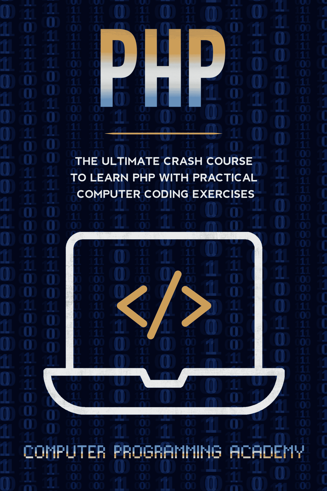

# PHP：终极速成指南：通过实用计算机编程练习学习 PHP





# 引言
互联网是一项在全球范围内以各种方式使用的奇迹。互联网的很大一部分由连接到某项服务的网页组成。反之，这些服务在我们的日常生活中非常有用。网页主要是使用 `PHP` 程序构建的。因此，总而言之，即使在我们不知情的情况下，`PHP` 也构成了我们生活中不可或缺的一部分。就此，无论 `PHP` 如何或在何处被应用，它对学习者来说有多重要，怎么强调都不为过。这正是写这本书的原因。它旨在让初学者了解该语言的基础知识，并向他们介绍巨大的潜力。书中包含了详细的内容、简洁风格以及无与伦比的实用性。开启 `PHP` 世界之旅，在了解互联网运行机制的知识中成长。你会为自己的选择感到高兴的。

# 第一章：PHP 简介
`PHP` 是 Hypertext Pre-processor（超文本预处理器）的递归缩写。它是一种开源编程语言，可以用于各种用途，这使得它广受欢迎并应用广泛。然而，正如其名称所示，由于它是 1994 年由 `Rasmus Lerdorf` 创建的原始脚本，`PHP` 特别适用于超文本标记语言 (`HTML`) 和 Web 开发。在当代编程语言中，`PHP` 表现出色，使其赢得了作为当今世界上最常用且最强大的语言之一的高高地位。它的多功能性解释了为什么 `Facebook` 和 `WordPress`（这些是目前各自领域中最重要的机构之一）使用它们进行编程。该语言的灵活性、速度和实用性使其对那些认为这些品质至关重要的程序员来说更具青睐。

编码风格：
```html
<!DOCTYPE html> <<html> <head> <title>Samplecode</title> </head > <<body> <?php echo "Hello, this is a PHP script!";  </body></</html>
```

`PHP` 页面并不像 `Perl` 和 `C` 等其他编程语言那样在输出 HTML 时使用大量命令，而是由一个包含用于执行功能的嵌入式编程的 HTML 组成。在上面的代码示例中，该功能是输出“Hello, this is a PHP script.”这一行。此外，`PHP` 代码封装在开头和结尾的特殊指令中，允许用户进出 `PHP` 模式。`PHP` 与另一种编程语言（如客户端 `JavaScript`）之间的一个关键区别在于，代码在服务器上运行，并生成发送给客户端的 HTML。客户端将收到脚本执行过程的结果，而无需对脚本的底层代码一无所知。也可以配置 Web 服务器使其处理每一个 `PHP` 中的 HTML 文件。这使得用户无法获知你的代码或脚本。学习 `PHP` 的优点之一是，它对初学者来说学习并不困难，同时又提供了资深程序员会认为有用的多个高级功能。尽管 `PHP` 有许多长长的功能列表，但人们可以在短时间内加入，并以创纪录的速度创建简单的 `PHP` 程序。像任何其他编程语言一样，`PHP` 代码可以使用包含在 HTML 代码中的 `CLI`（命令行界面）运行，或者与许多 Web 系统、内容管理框架和 Web 模板系统一起使用。`PHP` 解释器可以看到 `PHP` 代码的处理，并通常作为实现模块位于 `CGI`（通用网关接口）或 Web 服务器上。Web 服务器输出已运行并解释的 `PHP` 代码的结果。输出的代码可以采取任何形式，从二进制图像数据到生成的 HTML 代码，应有有。在 Web 开发和应用之外，还可以将 `PHP` 用于其他形式的编程，如机器人无人机控制或独立图形应用程序。

## PHP 历史
`PHP` 的发展可以追溯到 1994 年的 `Rasmus Lerdorf`。据信，`Lerdorf` 用 `C` 编程语言编写了几个 `CGI`（通用网关接口）程序。据说他使用这些程序来管理他的主页。`Lerdorf` 实验了 Web 表单并获得了成功，因此扩展到了 Web 开发和数据库的通信。他将自己的实现命名为 `PHP/FI`，这是“Personal Home Page/Forms Interpreter”的缩写。`Lerdorf` 的这一创作可以用于创建简单结构的动态 Web 应用。为了加快错误报告速度以改进代码，`Lerdorf` 于 1995 年 6 月 8 日在 `Usenet` 的讨论组上宣布将 `PHP/FI` 重新发明为 `PHP Tools`（个人主页工具）。新版本已经包含了 `PHP` 直至今能够具备的一些主要功能，包括 HTML 的嵌入、类似 `Perl` 的变量和表单处理。其语法与 `Perl` 使用的某些相似之处；然而，其简洁的设计证明比其一致性更具抑制性。以下是该语言早期语法之一的代码示例：

```text
<!--include /selectedtext/header.html-->
<!--getenv HTTP\_USER\_AGENT-->
<!--ifsubstr $exec\_resultChrome--> Hello, you are using Netscape!<p > <!--endif-->
<!--sql database select \* from group where user='$username'-->
<!--ifless $numentries2--> Sorry, such record does not exist<p> <!--endif exit--> Welcome <!--$user-->!<p> You have <!--index:4--> credits remaining in your account.<p>
<!--include /selectedtext/footer.html-->
```

`PHP` 的早期形式并非为了成为编程语言，因此其增长和传播是自然的。即使是 `Lerdorf` 也承认这一点，他承认自己完全没有打算阻止其广泛使用。成立了一个开发团队来研究该语言，在长时间的工作和测试测试后，`PHP/FI` 2 于 1997 年亮相。由于 PHP 并非专门设计为编程语言，而是有机开发的，导致了在函数命名和参数顺序等领域的一些不一致。其他不一致的案例可以在补充 PHP 的函数中看到。

## PHP 3&4
1997 年，`Andi Gutmans` 和 `Zeey Suraski` 共同编写了解析器，并被认为是 `PHP 3` 的基础部分以及该语言名称更变为现在这种递归缩写的作者。随后开始了 `PHP 4` 的公开测试，但直到 1998 年 6 月才正式发布。此时，`Gutmans` 和 `Suraski` 开始重写语言的核心，导致 1999 年 `Zend Engine` 的诞生。两位程序员还被认为在以色列（拉马特甘地区）创立了 `Zend Technologies`。2000 年 5 月发布了 `PHP 4`。它运行在新的 `Zend Engine 1.0` 上。到 2008 年 8 月，`PHP 4` 达到了 `4.4.9` 版本并停止支持；因此不再对其进行进一步的发布或更新。

## 练习 1
1. `PHP` 最适合执行什么功能？
2. `PHP` 解释器位于？
3. `Lerdorf` 将他管理的个人主页实现命名为什么？
4. 哪个团体被认为是 `PHP 3` 的基础部分以及该程序现在所使用的名称的作者？


### 5. PHP 代码处理使用了什么工具？

### 6. 哪些特质让程序员喜爱 PHP？

### 7. PHP 页面是如何输出 HTML 的？

### 8. PHP 与其他编程语言之间的关键区别因素是什么？

### 9. 学习 PHP 的显著优势是什么？

## 第二章：为什么要学习 PHP？

根据历史，`PHP` 起是一个静静的开源项目，随着它在认为它非常有用的群体中获得认可，它不断成长和演变。自 1994 年发布以来，它越来越受到寻求提升软件工程水平的学习者和专业人士的追捧，特别是在 Web 开发领域。

以下列出了学习 `PHP` 的一些优势：

* `PHP` 是一种用于服务器和浏览器的脚本语言，并嵌入 `HTML` 中。因此，它被应用于数据库管理、动态内容和会话跟踪。它还用于电子商务网站的构建和设计。
* `PHP` 与多种流行数据库有大量集成，如 `Microsoft SQL Server`、`MySQL`、`Oracle`、`Informix`、`PostgreSQL` 和 `Sybase`。
* 在执行速度方面，`PHP` 很容易成为快速语言，特别是当它在支持 Unix 的平台上以 `Apache modules` 形式编译时。一旦开始，`MySQL` 服务器甚至可以运行最复杂的查询，并以破纪录的速度产生大量结果。
* `PHP` 支持编程中使用的许多重要协议，如 `LDAP`、`IMAP` 和 `POP3`。在 `PHP 4` 中，引入了对 `Java` 的支持，以及如 `COBRA` 和 `COM` 等分布式对象架构的支持。多层级开发首次成为可能。
* `PHP` 是一种宽容的语言。`PHP` 语言在许多方面都尝试保持宽容。`PHP` 的语法与 `C` 相似。

### `PHP` 的特性：
五个重要特性贡献了 `PHP` 的实用性并使其成为可能：

* 熟悉感
* 效率
* 灵活性
* 简单性
* 安全性

### 在 PHP 中创建一个简单的程序：Hello World 程序

为了帮助你开始 `PHP` 编程，我们尝试创建一个传统的 Hello World 程序。这是一个简单的程序，执行时会产生 "Hello World!"。

```html
<html>
<head>
  <title>Hello World Program</title>
</head>
<body>
  <?php echo "Hello, World!";?>
</body>
</</html>
```

### PHP 的应用场景：

请记住，`PHP` 是当今世界上广为人知且流行的编程语言之一。在本节中，我们考虑了目前看到的一些 `PHP` 应用：

1. `PHP` 可用于限制用户对网站上单个页面的访问。
2. `PHP` 可用于系统功能。也就是说，它可以对系统包含的文件进行关闭、打开、创建、写入和读取操作。
3. `PHP` 可用于数据加密。
4. `PHP` 用于处理表单。也就是说，从文件中收集数据、将数据保存到文件中、通过电子邮件转发数据以及向用户返回数据。
5. `PHP` 用于设置 cookie 和访问 cookie 变量。
6. `PHP` 可用于添加、删除和修改数据库中包含的元素。


# 在你的系统上设置 PHP 环境

为了在 PHP 中构建和执行网页页面，需要在计算机系统中安装三个至关重要的组件。它们包括：

- **PHP 解析器**：为了处理 PHP 脚本的指令，你必须安装一个解析器来生成可以转发到网络浏览器的 HTML 输出。在接下来的段落中，将有一份教程引导你了解如何在你的系统中安装 PHP 解析器。
- **Web 服务器**：PHP 几乎可以应用于每种形式的 Web 服务器软件，包括但不限于微软 Internet 信息服务器 (`IIS`)。然而，它最经常与免费提供的 `Apache` 服务器配合使用。要获取 `Apache` 服务器，你可以通过此链接下载：`https://httpd.apache.org/download.cgi`。
- **数据库**：PHP 几乎可以应用于所有形式的数据库软件，包括但不限于 Sybase 和 Oracle；但是，它通常与免费提供的 `MySQL` 数据库配合使用。要获取 `MySQL` 服务器，你可以通过此链接下载：`https://www.mysql.com/downloads/`。

## 如何安装 PHP 解析器

在继续安装之前，确保你已经在系统中设置好了 PHP 环境，以便使用 PHP 开发 Web 程序。首先，在浏览器的查询框中输入下方地址：`http://127.0.0.1/info.php`。当执行该地址时，将显示一个包含 PHP 安装相关信息的页面。这意味着你的 Web 服务器和 PHP 已经正确安装。如果没有，你必须使用下方所示的程序在你的系统中安装 `PHP`。

## 设置开发环境

### 在 Windows 系统上
安装 Windows 服务器相当昂贵，因此你可能需要转向第三方应用中更便宜的替代方案，这些应用可以安装并设置以提供适用于编码的服务器环境。可以使用的一些应用包括 `WAMP` 和 `XAMPP`。这些应用都执行在程序内安装 `PHP`、`MySQL` 和 `Apache` 的相同功能。在两个应用中，`XAMPP` 最受用户青睐。你可以从链接 `www.apachefriends.org` 获取最新的 `XAMPP`，因为它是跨平台的。`XAMPP` 是一个缩写，代表跨平台 (`X`)、`Apache` (`A`)、`MariaDB` (`M`)、`PHP` (`P`) 和 `Perl` (`P`)。

`XAMPP` 的安装过程非常容易执行，所以不应该是问题。另外，请记住可以使用 `XAMPP` 安装 `Laravel`。当安装向导弹出时，点击“下一步”，并在需要时点击“同意”。尽管如此，在开发环境方面，你必须安装所需的开发环境来转换 `php.ini` 文件并启用显示错误消息。如果未显示错误消息，请访问路径 `c:xampp/php/` 并点击 `php.ini` 文件。确保第 `463` 行中放置在日志和错误处理下方的所有内容都已开启，然后重新启动你的 `Apache` 服务器。

当 `XAMPP` 完全安装完成后，应该打开一个仪表板，可用于初始化、结束和设置服务。当你完成 `XAMPP` 的安装并最终将其设置好运行后，访问位于 `c:xampp/htdocs/` 的 Webroot，这是创建网站和应用程序的工作环境。要检查你的工作，请继续在浏览器的地址栏中访问 `localhost`。这样做应该启动 `htdocs` 内 index 文件的运行。

### 在 Mac 系统上
Mac 上的安装与 Windows 系统非常相似。设置开发环境最便宜且最直接的方法是通过安装第三方应用。在这种情况下，你甚至可以使用 `MAMP` 和 `XAMPP`。尽管如此，你选择哪种安装并不重要，因为它们执行的功能相似。此外，你必须安装所有的开发文件。在 Mac 上，Webroot 与 Windows 的不同，因为它位于 `applications/xampp/htdocs` 路径，除此之外，没有其他明显的区别。

### 在 Linux（基于 Debian 的）系统上
与 Mac 和 Windows 系统不同，在 Linux 系统上，不使用第三方应用是一个更明智的方法。与其将此软件安装到系统中，不如直接使用该软件。不过，如果你倾向于使用它，仍然可以安装 `XAMPP` 应用。但是，请记住这是一个开发环境，在执行诸如实时服务器等任务时，你不能使用或配置那些第三方应用。

现在，在你开始向系统安装任何内容之前，请确保操作系统是最新的。这可以通过在你的系统终端中执行下方所示的命令来实现：

```bash
sudo apt-get update
sudo apt-get upgrade
sudo apt-get dist-upgrade
```

执行这些命令可以确保系统是最新的，并与当前的软件版本保持同步。如果你的系统是最新的，你应该会发现大多数 Linux 系统已经安装了 `Apache 2`，不过，如果你还不确定它的可用性，可以尝试运行命令 `sudo apt-get install apache2`。请记住，尝试对系统中已应用程序执行安装命令将变为检查该应用程序的更新。

到此时，你必须安装数据库。请自由探索并使用你选择的任何数据库。不过，通常使用的数据库是 `MySQL`。要在你的系统中安装 `MySQL`，请执行以下命令：

```bash
sudo apt-get install mysql-server
sudo mysql_secure_installation
```


[content]

1. 为什么在 Windows 系统上设置开发环境时需要第三方应用程序？
2. 在 Linux 系统上设置开发环境之前需要什么前提条件？
3. `phpmyadmin` 的作用是什么？
4. 哪种第三方应用程序可以同时用于 Windows 和 Mac 系统？
5. `PHP` 嵌入 HTML 对于该语言本身意味着什么？
6. `PHP` 支持哪些重要的协议？
7. 解析器（parser）的功能是什么？
8. `PHP` 集成在哪些类型的数据库中？
9. 在计算机系统中创建和运行 `PHP` 脚本，需要安装的三个关键组件是什么？
10. 在表单处理中，PHP 是如何应用的？

# 第三章 基础语法

在本节中，我们将查看 PHP 语法的主要形式，因为它们是建立良好的 PHP 编程基础的基础知识。

## 转义 PHP (Escaping to PHP)
有时，需要 PHP 解析引擎来区分页面上的其他元素与 PHP 代码。使用一种被称为“转义 PHP”的特殊机制来执行此类功能。在任何情况下，都有四种实现此功能的方法。它们是：

### 使用标准 PHP 标签
这种方法是最通用有效的 PHP 标签样式之一，写为：`<?php…?>`。使用这种样式时，请确保无论在什么情况下，你的标签总会有一个正确的解释。

### 使用 SGML 风格（短开启型）标签
短标签，又称为短开启标签，通常写为：`<?...?>`。正如名称所示，短标签提供了最短的方案。为了让 PHP 识别你的短标签，你必须完成两个任务：
1. 创建 PHP 脚本时，选择启用短标签的配置选项。
2. 接下来，进入 `php.ini` 文件的设置部分并开启 `short_open_tag`。
在同时处理 XML 和 PHP 时，必须禁用此选项，因为 XML 标签使用了与其类似的语法。

### 使用 ASP 风格标签
ASP 风格标签与用于 Active Server Pages 上界定代码块的标签具有类似的结构和功能。ASP 风格标签通常以这种格式出现：`<%...%>`。使用 ASP 风格标签时，你必须在 `php.ini` 文件设置配置选项。

### HTML 脚本标签
HTML 脚本标签通常写为：`<script language = “PHP”...</script>`。

## 如何 PHP 代码中编写注释
注释是指为人类用户编写程序部分，并在程序输出结果之前会被剔除。在 PHP 中，注释有两种形式。它们是：

### 单行注释
这些注释通常作为与编写的代码相关的简短备注或解释。考虑下面关于单行注释使用的示例：
```php
<?php 
### 这是一个单行注释，且
### 这是单行注释的另一行
// 这也是另一个注释。 
每个风格的注释只会打印 "A sample of a single line comment"; 
?>
```

### 多行打印
下面显示在一个打印语句中输出多行的示例：
```php
<?php 
### 第一个示例
print <<<END 这使用“此处文档”（here document）语法输出带有变量插值的多行内容。 
注意，此处文档的终止符必须出现在仅包含分号的一行，不能有额外的空格！ 
END ;
### 第二个示例
print "这跨越了多行。换行符也将输出"; 
?>
```

### 多行注释
这种注释通常用作编码时引入简要说明或伪代码算法的手段。PHP 中使用的多行样式与 C 语言相似。下面提供了一个多行注释的示例以便更好地理解：
```php
<?php 
/* 
这是一个多行注释
作者：Jane Doe
目的：多行注释演示
主题：PHP 
*/ 
print "A sample with multi-line comments"; 
?>
```

## 空格字符不敏感性
空白字符是指代码中在输入时肉眼不可见的区域。它们包括制表符、空格和回车（即换行符）。PHP 对空白字符的不敏感性意味着一行中空白字符的数量是无关紧要的，因为单个空白字符的看待方式与多个空白字符相同。例如，在下面所示的每个 PHP 语句中，将 `5 + 1` 操作赋值给输出变量 `$six` 的语句是等的：
```php
$six = 5 + 1; // 单个空格
$six <tab>=<tab>2<tab>+<tab>2 ; // 空格和制表符
$six = 5+ 1; // 多行
```

## 大写敏感性
PHP 是一种对大小写非常敏感的编程语言；意味着它会区分不同大小写的变量。例如，`PHP`、`php` 和 `pHp` 条目将被不同的解释，而不是视为同一个东西。考虑下面的代码示例：
```html
<html>
<body>
<?php
$profit = 34;
print("Variable profit is $profit<br>");
print("Variable PrOfiT is $PrOfiT<br>");
?>
</body>
</html>
```
当执行时，这段代码的结果将是：`Variable profit is 34`，`Variable PrOfiT is…`

## 语句与表达式
### 使用分号结束
在 PHP 中，语句是指使用分号（`;`）结束的表达式形式。PHP 中的一系列有效语句代表一个有效的 PHP 程序，特别是当它被封装在标签中时。考虑下面一个将字符赋值给变量 `$greeting` 的常用 PHP 语句：
```php
$greeting = "Welcome to PHP!";
```

### 表达式是令牌的组合
令牌是组成程序的最小不可分构建块。它们可以是常量（例如 `FALSE`）、变量（例如 `$greeting`）、数字（例如 `π`）以及字符串。

### 大括号形式
尽管无法以相同的方式组合语句，但可以通过封装在大括号内将一组语句放在所有位置。考虑下面两个相等语句的示例：
```php
if (7 == 4) { print("Great - haven't completely"); }
if (7 == 4) { print("my mind.<br>"); }
```

## 如何从命令行执行 PHP 脚本
可以从计算机的命令行执行 PHP 脚本。假设你在 `test.php` 文件中有上面的内容：
```php
<?php echo "Hello PHP!"; ?>
```
按照以下方式通过你的命令行执行上述脚本：
`php test.php`
输出结果将采取如下格式：`Hello PHP!`

[/content]


### 5. PHP 中使用的变量没有内在类型，这意味着变量对于它将用于存储什么没有先验或未来的知识，无论是字符集还是一个特定的数字。

### 6. 任何在赋值任何值之前引入的变量都会采用默认值。

### 7. 在 PHP 中，从一种类型状态转换为另一种类型状态的转换会在需要时自动执行。

### 8. PHP 中的变量与 Perl 中的变量相似。

## 变量与数据类型
在 PHP 中，多达八种不同的数据类型可以用于变量的构建。它们包括：

- **整数 (Integers)**：整数指不带小数点的全整数。例如：`12`、`1234` 等。
- **双精度浮点数 (Doubles)**：双精度数指浮点数，例如 `12.3`、`1.234` 等。
- **布尔值 (Booleans)**：布尔值指只有两种确定结果的值：均为 `True` 或 `False`。
- **NULL**：`NULL` 可以被视为一种特殊的数据类型，它只有一个可能的值——`NULL`。
- **字符串 (Strings)**：字符串可以被视为一组字符。例如，`"String operations are supported in PHP"` 是一个字符串。
- **数组 (Arrays)**：数组指各种经过索引和命名的其他值的集合。
- **对象 (Objects)**：对象指程序员定义的类的实例，它们能够封装被认为是类特有的其他类型的函数和值。
- **资源 (Resources)**：资源指特殊的变量类型，包含对 PHP 外部获取资源的引用，例如数据库连接。

前五种变量类型被归类简单类型，而随后的两种类型（即 `objects` 和 `arrays`）被称为复合变量类型。复合变量能够封装各种其他具有任意值的任意数据类型，而后者无法执行此类功能。为了更好地理解这些分类，我们将分别考虑每个类并简要讨论它的成员。

### 简单类型
#### 整数 (Integers)
整数是 PHP 中最基本的变量形式，它们与基础数学整数相似，因为它们可以是正的或负的。可以将整数赋值给变量；然而，也可以以类似的方式用于表达式：

```
$int_var = 678910; $another_int = -678910 + 678910;
```

整数可以以任何形式存在，包括但不限于 8 进制（八进制）、10 进制（十进制）和 16 进制（十六进制）。默认情况下，使用 10 进制（十进制），而 8 进制或八进制整数使用前导零（`0`）表示，16 进制或十六进制以 `0x` 开始。在大多数常用平台上，知的最小整数是 `(-2,147,483,648)` 或 `(-2**31)`，而最大的是 `(2,147,483,647)` 或 `(2**31 - 1)`。

#### 双精度浮点数 (Doubles)
在默认状态下，双精度数以所需的位数打印。请查看下面的示例以更好地理解：

```php
<?php 
$many_a = 1.3422220; 
$many_b = 2.1111345; 
$few = $many_a + $many_b; 
print("$many_a"); 
print("$many_b"); 
print("$few"); 
?>
```

#### 布尔值 (Boolean)
在默认状态下，双精度数以所需的位数打印。请查看下面的示例以更好地理解：

```php
<?php 
$many_a = 1.3422220; 
$many_b = 2.1111345; 
$few = $many_a + $many_b; 
print("$many_a"); 
print("$many_b"); 
print("$few"); 
?>
```

#### NULL
在默认状态下，双精度数以所需的位数打印。请查看下面的示例以更好地理解：

```php
<?php 
$many_a = 1.3422220; 
$many_b = 2.1111345; 
$few = $many_a + $many_b; 
print("$many_a"); 
print("$many_b"); 
print("$few"); 
?>
```

#### 字符串 (Strings)
在默认状态下，双精度数以所需的位数打印。请查看下面的示例以更好地理解：

```php
<?php 
$many_a = 1.3422220; 
$many_b = 2.1111345; 
$few = $many_a + $many_b; 
print("$many_a"); 
print("$many_b"); 
print("$few"); 
?>
```

#### 数组与对象 (Arrays and Objects)
在默认状态下，双精度数以所需的位数打印。请查看下面的示例以更好地理解：

```php
<?php 
$many_a = 1.3422220; 
$many_b = 2.1111345; 
$few = $many_a + $many_b; 
print("$many_a"); 
print("$many_b"); 
print("$few"); 
?>
```


## Here Document（在此在此文档）

对于单个字符串变量，可以使用在此在此文档（here document）为其赋值多个行。请考虑下方的示例：

```php
<?php 
$channel =<<\_XML\_ <channel> <title>How Are You</title> <link>http://menu.sample.org/ </link> <description>It’s been a rather long while.</description> </channel> \_XML\_ ; 
echo <<<END 这一行使用了“here document”语法来返回带有变量插值的多行。请记住，here document 的结束符必须出现在仅包含分号的行上，且不能有额外的空格！ END; 
print $channel; 
?>
```

运行此脚本将输出以下结果：这利用了“here document”语法使用变量插值输出多行。请记住，here document 的结束符必须出现在仅包含分号的行上，且不能有额外的空格！

`<channel> <title>How Are You<title > <link>http://menu.sample.org/<link> <description> It’s been a rather long while.</description>`

## 变量作用域

Variable scope（变量作用域）是一个术语，用于描述变量在赋值赋值的程序中的可用范围。PHP 中的变量倾向于采用四种作用域类型之一。这些类型包括：

1. 静态变量
2. 函数参数
3. 局部变量
4. 全局变量

## 在 PHP 中命名变量

在 PHP 中创建变量的规则和约定如下：变量名由下划线、字母和数字组成，但不能使用如 `+`、`-`、`%`、`(`、`)`、`&` 等字符。变量名必须以下划线或字母开头。记住，变量的大小没有限制。

## 练习 4：

1. 什么是变量作用域？
2. 列出五个禁止在变量名中使用的字符。
3. “没有人为限制”这句话对于字符串长度意味着什么？
4. 单引号字符串和双引号字符串之间的区别是什么？
5. 在布尔上下文中 `NULL` 的求值结果？
6. PHP 中哪两个常量用作布尔值？
7. 如何表示八进制整数？
8. 什么是变量？
9. 如何使用 here document？
10. 解释“整数”一词。

# 第五章：PHP 中的常量

Constant（常量）是一个用于标识简单值值的术语。在脚本执行期间，常量的值不能更改。默认情况下，常量对大小写敏感，尽管根据惯例，常量标识符总是以大写字母开头。常量的名称通常以下划线或字母开头，紧接着任意数量的下划线、数字或字母。一旦定义了常量，它在整个执行过程中就不能被取消定义或更改。

`define()` 函数用于定义常量，在检索赋值给常量的值时，你必须指定它的名称。与其他变量不同，常量不需要是以美元符号（`$`）开头的。在读取常量值时，也可以使用 `constant()` 函数，特别是当你需要动态地收集常量的名称时。

`constant()` 函数：正如其名所示，该函数输出赋值给常量的值。当你需要输出常量的值但不知道它的名称是什么时，这个函数特别有用。也就是说，它是通过函数输出的，或者存储在变量中。

考虑下方的示例：

```php
<?php 
define("MINSIZE", 50); 
echo MINSIZE; 
echo constant("MINSIZE"); // 与上一行相同 
?>
```

只有标量数据，如字符串、浮点数、整数和布尔值可以存储在常量中。

## 变量与常量的区别

1. 在引入任何常量之前没有必要使用美元符号（`$`），而在变量的情况下，使用美元符号是必不可少的。
2. 常量不能通过简单的赋值来定义，因为它们只能通过 `define()` 函数定义。
3. 可以从任何地方访问和定义常量，而不考虑变量作用域的规则。
4. 当常量被设置后，可能会被取消定义或重新定义。

## 有效和无效的常量名：

```php
// 有效的常量名
define("ONE", "first thing");
define("TWO2", "second thing");
define("THREE\_3", "third thing");

// 无效的常量名
define("2TWO", "second thing");
define("\_\__THREE\_\_", "third value");
```

# PHP 中的魔法常量

PHP 为执行的脚本提供了大量的预定义常量。魔法常量（magical constants）共有五个，并且取决于取决于应用的部分而变化。例如，`__LINE__` 的值取决于它在脚本中应用的行。这类特殊常量通常对大小写敏感，并按以下方式构造：

为了更好地理解，下面显示了 PHP 中的某些魔法常量：

1. `__LINE__`：此常量表示文件的当前行号。
2. `__FILE__`：此常量表示文件的完整文件名和路径。当应用于包含的文件时，它返回被包含文件的名称。从 PHP 4.0.2 版本开始，`__FILE__` 常量始终包含绝对路径，尽管在早期版本中它在某些情况下会包含相对路径。
3. `__FUNCTION__`：此常量表示函数的名称。
4. `__CLASS__`：此常量表示类的名称。
5. `__METHOD__`：此常量表示方法的名称。

## 练习 5：

1. 什么数据可以存储在常量中？
2. `__FILE__` 是如何工作的？
3. 常量的命名条件是什么？
4. `constant()` 用于什么？
5. 常量在执行期间具有什么特性？
6. 哪五个魔法常量？
7. 从赋值的角度来看，常量与变量有什么区别？
8. 什么是常量？
9. `constant()` 是如何使用的？
10. `__LINE__` 的值取决于什么？


3. `/`: 此运算符用于将被除数除以除数。例如 `Y / X` 结果为 3。

4. `%`: 此运算符称为模运算符，用于计算整数除法后的余数。例如 `Y % X` 结果为 0。

5. `++`: 此运算符称为递增运算符，用于将整数的值加一。例如 `Y++` 结果为 16。

6. `--`: 此运算符称为递减运算符，用于将整数的值减一。例如 `X--` 结果为 4。

## 比较运算符
下文将讨论 PHP 支持的比较运算符：为了更好地理解，将包含示例以说明其功能。在示例中，变量 `X` 的值为 5，变量 `Y` 的值为 15。

1. `==`: 此运算符用于判断两个操作数的值是否相等。例如 `(X == Y)` 为假。

2. `!=`: 此运算符用于检查两个操作数的值是否相等。如果值不相等，则条件返回真。例如 `(X != Y)` 为真。

3. `>`: 此运算符用于检查左操作数的值是否大于右操作数的值。如果答案为是，则条件返回真。例如 `(X > Y)` 为假。

4. `<`: 此运算符用于检查左操作数的值是否小于右操作数的值。如果答案为是，则条件返回真。例如 `(X < Y)` 为真。

5. `>=`: 此运算符用于检查左操作数的值是否大于或等于右操作数的值。如果答案为是，则条件返回真。例如 `(X >= Y)` 为假。

6. `<=`: 此运算符用于检查左操作数的值是否小于或等于右操作数的值。如果答案为是，则条件返回真。例如 `(X <= Y)` 为真。

### 逻辑运算符
下文将讨论 PHP 支持的逻辑运算符：为了更好地理解，将包含示例以说明其功能。在示例中，变量 `X` 的值为 5，变量 `Y` 的值为 15。

1. `and`: 此运算符称为逻辑与运算符。当两个操作数都为真时，条件返回真。例如 `(X and Y)` 为真。

2. `or`: 此运算符称为逻辑或运算符。当两个操作数都非零时，条件返回真。例如 `(X or Y)` 为真。

3. `&&`: 此运算符称为逻辑与运算符。当两个操作数都非零时，条件返回真。例如 `(X && Y)` 为真。

4. `||`: 此运算符称为逻辑或运算符。当两个操作数都非零时，条件返回真。例如 `(X || Y)` 为真。

5. `!`: 此运算符称为逻辑非运算符。它用于反转操作数的逻辑状态。当条件为真时，逻辑非运算符将其转为假。例如 `!(X && Y)` 为假。

### 赋值运算符
下文将讨论 PHP 支持的赋值运算符：

1. `=`: 这是一个简单的赋值运算符，将右侧操作数的值赋值给左侧操作数。例如 `Z = X + Y` 将将运算 `(X + Y)` 的结果赋值给 `Z`。

2. `+=`: 这是一个加赋值运算符。它将右侧操作数加到左侧操作数上，并将返回的值赋值给左操作数。例如 `Z += X` 等同于 `Z = Z + X`。

3. `-=`: 这是一个减赋值运算符。它将右侧操作数从左侧操作数中减去，并将返回的值赋值给左操作数。例如 `Z -= X` 等同于 `Z = Z - X`。

4. `*=`: 这是一个乘赋值运算符。它将左侧操作数乘以右侧操作数，并将返回的值赋值给左操作数。例如 `Z *= X` 等同于 `Z = Z * X`。

5. `/=`: 这是一个除赋值运算符。它将左侧操作数除以右侧操作数，并将返回的值赋值给左操作数。例如 `Z /= X` 等同于 `Z = Z / X`。

6. `%=`: 这是一个模赋值运算符。它将左侧操作数对右侧操作数取模，并将返回的值赋值给左操作数。例如 `Z %= X` 等同于 `Z = Z % X`。

### 条件运算符
条件运算符用于评估表达式的真值或假值，然后根据评估过程的结果执行两个输出语句之一。PHP 支持的条件运算符语法下所示：

1. `?:`: 在 PHP 中，此运算符表示条件表达式。例如：当条件为真时 `?` 取值 A `:` 否则取值 B。

## 运算符分类
除了运算符类型外，还有四种运算符所属的分类：

### 一元运算符
一元运算符有 `!`、`++` 和 `--`。

### 二元运算符
二元运算符需要两个操作数。

### 乘法运算符
乘法运算符有 `*`、`%` 和 `/`。

### 加法运算符
加运算符有 `+` 和 `-`。

### 关系运算符
关系运算符有 `<`、`<=`、`>` 和 `>=`。

### 等价运算符
等价运算符包括 `==` 和 `!=`。

### 逻辑运算符
逻辑与运算符为 `&&`。逻辑或运算符为 `||`。

### 条件运算符
条件运算符为 `?:`。它们需要三个操作数。

### 赋值运算符
赋值运算符包括：`=`、`+=`、`-=`、`*=`、`/=` 和 `%=`。

运算符优先级决定了项的组合方式。某些运算符在优先级上高于其他运算符，因此它们倾向于先被评估。考虑示例 `j = 2 - 4 * 3`；结果为 -10 而不是 -6。乘法运算符的优先级高于减法运算符。在数学术语中，该表达式可以解释为 `2 - (4 * 3)`。


## 复习题

9. 什么是三元运算符？

10. 除法赋值运算符 (`/=`) 属于哪种类型的运算符？

11. 写出两种加法运算符的名称。

# 第七章 PHP 中的决策

PHP 中的每个脚本都是由一组语句创建的。这些语句可以是循环、函数调用、赋值，甚至是完全不执行任何操作的条件语句（即空语句）。此外，通过将一组语句放入大括号中的过程，可以将语句分类为名为 `statement-group`（语句组）的组。语句组本身也代表一条语句。在 PHP 中，下面所示语句用于根据一定数量的条件做出决策：

1. `Else` 语句
2. `If` 语句
3. `Elseif` 语句
4. `Switch` 语句

### If…else 语句

该语句用于在当其中一个条件为真而另一个条件为假时，运行一系列代码。

**语法：** `if (condition) 如果条件为真要运行的代码; else 如果条件为假要运行的代码;`

**示例：** 下面示例如果一天的时间段是早晨（Morning），则生成“Have a great day!”；否则，生成“Good night! Sleep well.”。

```html
<html>
<body>
<?php
$t = time("H");
if ($t == "Morn") echo "Have a great day!";
else echo "Good night! Sleep well.";
?>
</body>
</html>
```
生成的输出如下：Have a great day!

### If 语句

`if` 语句作为一种手段，用于控制其后继语句如何执行——在这种情况下，是包含在大括号中的代码块或单一语句。`if` 语句评估括号内的表达式。如果表达式的结果被认为真（true），则启动执行过程。否则，整个语句将跳过。这使得你的 PHP 脚本能够根据选择的一系列因素自行做出决策。

**语法：**
```php
if ( expression ) {
    // 如果表达式输出为真，则运行的代码
}
```

**示例：** 如果 `$x` 大于 `$y`，以下代码将显示 x is greater than y：

```php
<?php
$x=5;
$y=2;
if ($x > $y) echo "x is bigger than y";
?>
```

### Elseif 语句

该语句在执行系列代码时与 `if…else` 语句配合使用，当多种条件中的一个为真时。正如名称所示，`elseif` 语句是 `if` 语句和 `else` 语句的混合。与 `else` 语句一样，`elseif` 语句扩展了 `if` 语句，在主 `if` 表达式评估为假的情况下运行另一个语句。尽管与 `else` 语句相反，`elseif` 语句仅在赋值的条件表达式评估为真时才运行替代表达式。简单来说，当你想在多个不同条件中的一个评估为真时运行一组代码，就应该使用 `elseif` 语句。

**语法：**
`if (condition) 如果条件评估为真要运行的代码;`
`elseif (condition) 如果条件评估为真要运行的代码;`
`else 如果条件评估为假要运行的代码;`

**示例：** 下面示例如果一天的时间段是早晨，则生成“Good morning. Rise and shine!”，在晚上则生成“Good night! Sleep well.”。否则，生成“Have a great day!”。

```html
<html>
<body>
<?php
$t = time("H");
if ($t == "Morn") echo "Good morning. Rise and shine!";
elseif ($t == "Nigt") echo "Good night! Sleep well.";
else echo "Have a great day!";
?>
</body>
</html>
```

### Else 语句

当 `if` 语句评估为假时使用 `else` 语句。它在条件不满足时提供一个回备块。

**语法：**
```php
if ( expression ) {
    // 如果表达式输出为真，则运行的代码
} else {
    // 如果表达式为假，则运行的代码
}
```
**示例：** 如果 `$x` 大于 `$y`，以下代码将显示 x is greater than y：

```php
<?php
$x=5;
$y=2;
if ($x > $y) echo "x is bigger than y";
?>
```

### Switch 语句

`switch` 语句允许将变量与多个值进行比较。在检查单个变量时，它通常是多个 `if…elseif…else` 语句更简洁的替代方案。

**语法：**
```php
switch (expression) {
    case value1:
        // 如果表达式 == value1，则运行的代码
        break;
    case value2:
        // 如果表达式 == value2，则运行的代码
        break;
    default:
        // 如果没有值匹配，则运行的代码
}
```
**示例：** 下面示例使用 `switch` 来评估时间：

```php
<?php
$t = time("H");
switch ($t) {
    case "Morn":
        echo "Good morning. Rise and shine!";
        break;
    case "Nigt":
        echo "Good night! Sleep well.";
        break;
    default:
        echo "Have a great day!";
}
?>
```

## 练习 7

1. `if` 语句评估的表达式包含在什么？
2. 哪种语句是 `else` 和 `if` 语句的结合？
3. 当 `if` 语句评估为假时，使用哪种语句？
4. `elseif` 语句负责运行哪个表达式？
5. 在 `switch` 语句中，如果没有值匹配，语句如何评估？
6. 当多个不同条件中的一个为真时，使用哪种语句？
7. 没有用途的语句被称为？
8. 什么是 `statement-group`？
9. 在 `if` 语句中，什么情况下表达式会被跳过？
10. `switch` 语句的作用是什么？

# 第八章 PHP 中的循环

在 PHP 中，循环是用于在满足特定条件时重复执行单个代码块的工具。循环概念的核心思想是对重复操作引入自动化，以节省精力和时间。在 PHP 编程中，支持四种类型的循环。它们是：

1. `while` 循环
2. `for` 循环
3. `do…while` 循环
4. `foreach` 循环


在本节中，我们将深入探讨循环的概念、它们的工作原理，以及如何遍历数组中的一组值；特别是直接针对数组的循环，如 `foreach` 循环。

### While 循环
只要 `while` 循环指定的条件评估为 `true`，`while` 语句就会持续循环一系列代码。因此，当评估的表达式输出为 `true` 时，它会启动代码块的执行。一旦代码完全执行了测试表达式，过程将重新从评估开始，循环将持续直到测试表达式或语句达到 `false` 状态。

**语法：**
```php
while(expression){ // 要执行的代码 }
```

考虑下面所示的示例，循环从 `$x = 2` 开始。只要 `$x` 的值等于或小于 4，循环就会继续执行。每次执行循环时，`$x` 都会加 1。

```php
<?php
$i = 1;
while($i<= 3){
    $i++;
    echo "The number is " . $i ."<br>";
}
?>
```

考虑另一个例子。在这种情况下，变量的值在每次循环迭代时都会减少，而计数器不断增加，直到评估结果为 `false` 时循环终止。

```html
<html>
<body>
<?php
$a = 0;
$num = 30;
while( $a < 15) {
    $num--;
    $a++;
}
echo ("Loop stopped at a = $a and num = $num" );
?>
</body>
</html>
```
执行此脚本的结果如如下方的结果所示：循环在 Loop stopped at a = 15 and num = 30

### for 循环
`for` 循环用于在达到特定条件的期间重复执行一组特定的代码。它通常用于需要执行一定次数代码块的场景。在 `for` 循环中，初始化部分用作设置循环迭代次数计数器起始值的手段。由于这个原因，可以在此点声明变量，并且将其命名为 `$i` 是很常见的。

**语法：**
```php
for(initialization; condition; increment){ // 要执行的代码 }
```

在 `for` 循环中，有多种参数。它们包括：
- **初始化 (Initialization)**：顾名思，它用于初始化所有计数器变量，并在整个循环体首次运行之前无条件地评估。
- **条件 (Condition)**：在每次迭代过程的开始时，都会处理该条件。如果评估为 `true`，则循环继续，所有的嵌套语句都将被执行。然而，如果评估为 `false`，则循环执行将停止。
- **增量 (Increment)**：增量用于在每次迭代后用新值更新循环计数器。增量在每次迭代过程的结束时处理。

**示例：**
下面所示的示例输出五次迭代，并在每个循环后更改两个变量的给定值。

```html
<html>
<body>
<?php
$x = 0;
$y = 0;
for( $i = 0; $i<6; $i++ ) {
    $x += 12;
    $y += 6;
}
echo ("At the end of the loop x = $x and y = $y" );
?>
</body>
</html>
```
这产生了结果 − At the end of the loop a = 72 and b = 36

考虑下面的另一个示例，它定义了一个从 `$i = 2` 开始的循环。循环一直持续到 `$i` 达到小于或等于 5 的值。每执行一次循环，变量 `$i` 就会继续增加 1：

```php
<?php
for($i=1; $i<=3; $i++){
    echo "The number is " . $i ."<br>";
}
?>
```

### PHP do…while 循环
`do…while` 循环是 `while` 循环的另一种形式，它在每次循环迭代的终点评估条件。在 `do…while` 循环中，代码块会立即执行，然后评估条件。当条件通过为 `true` 时，只要给定的评估条件仍通过为 `true`，表达式就会重复处理。

**语法：**
```php
do{ // 要执行的代码 }
while(condition);
```

**示例：**
考虑下面所示的示例，它将在每次迭代中增加 `$x` 的值。只要 `$x` 的赋值小于 15，变量 `$x` 的值就会继续增加。

```html
<html>
<body>
<?php
$x = 0 ;
$num = 0;
do {
    $x++;
} while( $x < 15 );
echo ("Loop stopped at x = $x" );
?>
</body>
</html>
```
执行此脚本产生的结果如下：Loop terminated at x = 15

### do…while 和 while 循环的区别
对于 `while` 循环，与 `do…while` 循环的主要区别在于执行执行的方式。在 `while` 循环中，被评估的表达式在每次循环迭代的开始时处理。结果是，当表达式评估为 `false` 时，循环 own 执行。而 `do…while` 循环另一方面，它会在循环迭代的终点进行评估。

### Foreach 循环
`foreach` 循环用于需要遍历数组时。

**语法：**
```php
foreach(array as value){ // 要执行的代码 }
```

**示例：**
考虑下面所示的示例，它定义了遍历数组的值：

```html
<html>
<body>
<?php
$array = 5, 6, 7, 8, 9;
foreach( $array as $output ) {
    echo "Answer is $output <br />";
}
?>
</body>
</html>
```
执行此脚本的结果如下：Answer is 5 Answer is 6 Answer is 7 Answer is 8 Answer is 9

### PHP 中的其他语句。它们是：

#### Break 语句
在 PHP 中，`break` 语句用于提前终止循环的执行。为了更好的功能，`break` 语句位于代码块内。当你认为需要离开循环时，这样做赋予了你绝对控制权。

**示例：**
在下面所示条件下，当计数器达到 5 时，循环被取消：

```html
<html>
<body>
<?php
$x = 0;
while( $x < 10) {
    $x++;
    if( $x == 5 )break;
}
echo ("Loop stopped at x = $x" );
?>
</body>
</html>
```
执行脚本的结果如下：Loop stopped at x = 5

#### Continue 语句
PHP 中的 `continue` 语句用于暂停循环的当前迭代过程，尽管它并不一定结束循环过程。与 `break` 语句的使用一样，`continue` 语句位于循环执行的代码块内，并由一个条件测试引导。

**示例：**
在下面所示的示例中，循环输出数组的值，然而对于通过为 `true` 的条件，代码将被完全跳过，并输出下一个值。

```html
<html>
<body>
<?php
$array =( 5, 6, 7, 8, 9);
foreach( $array as $ouptut ) {
    if( $output == 5 )continue;
    echo "Answer is $output <br />";
}
?>
</body>
</html>
```
执行此脚本产生的结果遵循如下方式：这产生了结果 − Answer is 5 Answer is 6 Answer is 7 Answer is 8 Answer is 9

**练习 8：**
1. 什么是循环？
2. 什么语句被引入用于遍历数组？
3. `for` 循环的作用是什么？
4. 为什么要使用循环？


# 第章：PHP 中的数组

在 PHP 中，数组是指有序映射（ordered maps）系统。映射可以被视为一种将值（values）与键（keys）链接的数据类型，并根据许多不同的原因进行优化。映射也可以视为数组、字典、队列、列表（向量）、集合、哈希表（映射的实现）、栈等。同样，数组中的值可以是其他数组；它也可以是多维数组和树。

## 如何创建数组

可以使用 `array()` 语言结构来创建数组。它使用任意数量的由逗号分隔的键值对（arguments）作为参数。

```php
array( key => value, key2 => value2, key3 => value3, ... )
```

数组中最后一个元素后的逗号是一个可选的结构，可以包含也可以不包含。它特别常用于单行数组。也就是说，`array (x, y)` 优于 `array (x, y, )`。另一方面，对于多行数组，通常会加上随后的逗号，因为它允许方便地在末尾添加新元素。

在 5.4 版本中，可以使用短数组语法 `[]` 代替 `array()` 函数。考虑下面的示例：

### 示例 #1：简单数组

```php
<?php
$array = array( "foo" => "bar", "bar" => "foo", ) ; 正 从 PHP 5.4 开始
$array = [ "foo" => "bar", "bar" => "foo", ];
?>
```

在这种情况下，键可以是整数字符串，而值可以是任何形式。此外，通常会发生以下重要的类型转换（vital casts）：

1. 包含有效十进制整数的字符串（数字前有 `+` 号的情况除外）会被转换为整数类型。例如，键 `"5"` 可以被起始为 `5`。另一方面，无法转换 `"08"`，因为在有效的十进制状态下它并不存在。
2. 浮点数也可以转换为整数，这意味着即使是小数也可以被截断。例如，键 `5.7` 可以存储在 `5` 下。
3. 布尔值也可以转换为整数。也就是说，键 `true` 可以存储在 `1` 下，即使它在 `0` 下为假。
4. `Null` 可以转换为空字符串。也就是说，主 `null` 可以存储为 `""`。
5. 对象和数组不能作为键，因为这样做只会触发关于某些非法偏移量类型（illegal offset type）的警告。
6. 单个数组声明中的许多不同元素倾向于使用相似的键，通常最后一个会留存，因为其他键在过程中会被覆盖。

## 数组的类型

在 PHP 中有三种不同类型的数组，对于每个数组，通过称为数组索引（array index）的 ID 来访问值。数组的类型讨论如下：

### 数值数组
数值数组是指具有数字索引的数组。值可以以线性方式存储和访问。数值数组能够存储字符串、数字和对象，但它们的索引始终用数字表示。默认情况下，每个数值数组索引都从零开始。

**示例：**
这里考虑的示例展示了如何创建一个数值数组并访问它。在创建过程中使用了 `array()` 函数。

```html
<html>
<body>
<?php
/* 创建数组的第一种方法。 */
$digits = array( 5, 6, 7, 8, 9);
foreach( $digits as $value ) {
    echo "Answer is $value <br />";
}
/* 创建数组的第二方法。 */
$digits[5] = "five" ;
$digits[6] = "six";
$digits[7] = "seven";
$digits[8] = "eight";
$digits[9] = "nine";
foreach( $digits as $value ) {
    echo "Answer is $value <br />";
}
?>
</body>
</html>
```

执行执行时，数值数组的结果如下：
Answer is 5
Answer is 6
Answer is 7
Answer is 8
Answer is 9
Answer is five
Answer is six
Answer is seven
Answer is eight
Answer is nine

### 关联数组
关联数组是以字符串作为索引的数组。它们能够结合关键值（critical values）来存储元素的值，而不是以直接的线性索引方式。关联数组与数值数组是非常同义的，因为它们的功能相似，尽管在索引表示方式上存在差异。对于关联数组，它们的索引通常表示为字符串，以便在键和值之间建立强有的联系。例如，在数组中存储工人的工资时，带有数值索引的数组在这种情况下似乎不是最佳选择。相反，使用工人的姓名作为关联数组中的键更为合理，结果的值即为工人的相应工资。记住在打印时不要将关联数组放在双引号内；否则，将不会返回任何值。

**示例：**
```html
<html>
<body>
<?php
/* 创建关联数组的第一种方法。 */
$wages = array( "John" => 5000, "Mary" => 6000, "Joe" => 7000);
foreach( $wages as $name => $wage ) {
    echo "$name earns $wage <br />";
}
/* 创建关联数组的第二种方法。 */
$wages["John"] = 5500;
$wages["Mary"] = 6500;
$wages["Joe"] = 7500;
foreach( $wages as $name => $wage ) {
    echo "$name earns $wage <br />";
}
?>
</body>
</html>
```
*(注：原文示例代码中的逻辑与描述略有出入，此处已根据原文保留代码并翻译)*

### 多维数组
多维数组是包含一个或多个数组的数组，可以通过多个索引进行访问。在多维数组中，主数组的每个元素也可以是数组。

示例：
在下面的示例中，创建了一个二维数组来存储三个学生三门科目的成绩。

```html
<html>
<body>
<?php
$scores = array(
    "kaleb" => array( "english" => 40, "biology" => 45, "agric" => 31 ),
    "karen" => array( "english" => 35, "biology" => 42, "agric" => 33 ),
    "tara" => array( "english" => 41, "biology" => 29, "agric" => 37 )
);
/* 访问多维数组 */
echo "Scores for kaleb in english : "  echo $scores['kaleb']['english'] . "<br />";
echo "Scores for karen in biology : "; echo $scores['karen']['biology'] . "<br />";
echo "Scores for tara in agric : " ; echo $scores['tara']['agric'] . "<br />";
?>
</body>
</html>
```
当此脚本执行时，结果如下：
Scores for kaleb in english : 40
Scores for karen in biology : 42
Scores for tara in agric : 37

## 第 9 章练习

1. 如何访问多维数组的值？
2. PHP 中有三种数组类型？
3. 数值数组和关联数组之间的关键区别是什么？
4. 哪种形式的数组可以使用许多不同的索引访问？
5. 数值数组的值是如何存储和访问的？
6. 字符串与哪种形式的数组相关？
7. 数值索引默认从哪个数字开始？
8. 为什么在打印时不要将关联数组放在双引号内？
9. 如何访问多维数组的值？
10. 什么是映射（map）？


# 第十章章 PHP 中的字符串

在 PHP 中，字符串指的是一组算术值、特殊字符、数字和字母，或者有时是它们中每一个的组合。创建字符串的最简单方法是将字符串字面量（即字符串中的字符）包括在两个单引号（''）之间。考虑下方的语法：

```php
$my_string = 'Hello World';
```

也可以使用双引号（"）。尽管双引号和单引号的使用方式有所不同。包含在单引号中的字符串几乎是按**字面量**的方式使用的，而包含在双引号中的字符串则被用于将变量替换为其值的字符串表示，并专门翻译各种转义序列。通常使用的转义序列替换包括以下内容：

- `\\` 被替换为单个反斜杠（`\`）
- `\n` 被替换为换行符
- `\"` 被替换为单个双引号（`"`）
- `\r` 被替换为回车符
- `\$` 被替换为单独的美元符号（`$`）
- `\t` 被替换为制表符

考虑下面所示有效字符串示例：

```php
$string_4 = "This is a string with double quotes";
$string_3 = 'This is a slightly longer, singly-quoted string';
$string_26 = "This string contains twenty-six characters";
$string_0 = ""; // 一个没有字符的字符串
```

## 引号字符串类型

如前面讨论过的，单引号字符串被以字面量的方式处理，而双引号字符串则用于替换变量及其值，甚至可以解释某些字符序列。考虑下面所示的示例，它指出了双引号和单引号字符串的区别：

```php
<?php
$my_str = 'World';
echo "Hello, $my_str!<br>"; // 显示: Hello World!
echo 'Hello, $my_str!<br>'; // 显示: Hello, $my_str!
echo '<pre>Hello\tWorld!</pre>'; // 显示: Hello\tWorld!
echo "<pre>Hello\tWorld!</pre>"; // 显示: Hello World!
echo 'I\'ll be back'; // 显示: I'll be back
?>
```

考虑下面的所示第二个示例：

```php
<?php
$output = "song";
$lyrics = 'My $output will not print!\\n';
print($lyrics);
print "<br />";
$lyrics = "My $output will print!\\n";
print($lyrics);
?>
```

执行代码时，结果如下：
My $output will not print!\n My song will print!\n

## 在 PHP 中操作字符串

PHP 中有许多内置函数用于字符串操作活动，例如查找字符或子字符串、分解字符串、计算字符串长度、使用各种字符替换字符串的某部分等。以下是 PHP 中处理字符串的一些函数：

### 字符串长度

字符串的长度没有定义限制，因此，你必须能够符合你可用内存范围的任意长度的字符串。双引号字符串（例如 "this"）会按以下方式进行预处理：

1. 某些以反斜杠（`\`）开头的字符序列将被交换并使用特殊字符替换。
2. 变量名（如以 `$` 开头的）将被替换为其值的字符串表示。

### 计算字符串长度

在 PHP 中，`strlen()` 函数用于计算字符串包含的字符数量，甚至是字符串内部使用的空格。

```php
<?php
$a_str = 'Welcome to PHP programming'; // 输出: 24
echo strlen($a_str);
?>
```

考虑下面另一个 `strlen()` 函数如何应用于包含 "Hello world!" 的不同字符串的示例：

```php
<?php echo strlen("Hello world!"); ?>
```

执行此字符串的结果是： 12。字符串的长度通常会考虑到其他函数以及循环，因此，在 PHP 编程中，知道字符串何时结束是非常重要的。这是因为当使用循环时，知道在字符串中的最后一个字符被评估后终止进程是至关重要的。

### 统计字符串中的单词数

要统计字符串所含有的单词数量，使用了 `str_word_count` 函数。

```php
<?php
$my_str = 'The quick brown fox jumps over the lazy dog.'; // 输出: 9
echo str_word_count($my_str);
?>
```

### 字符串拼接操作

在两个字符串变量的拼接中，使用了点（`.`）运算符：

```php
<?php
$string4="Hey there!";
$string5="abcd";
echo $string4 . " " . $string5;
?>
```

当执行此脚本时，结果如下：Hello there! Abcd. 当我们深入观察上面所示示例的工作原理时，可以看到拼接运算符被使用了多次（确切说是两次）。这是因为加入了第三个字符串。使用一个空格来分隔两个变量，并在两个字符串变量之间引入了一个包含单个字符的字符串。

### 替换字符串中的文本

`str_replace()` 函数用于替换目标字符串中找到的每个查询项。

```php
<?php
$a_str = 'When the moving gets tough, the tough get moving.'; // 显示替换后的字符串
echo str_replace("moving", "going", $a_str);
?>
```


- `chunk_split()`: 此函数用于将字符串分割成若干部分。
- `convert_cyr_string()`: 此函数用于将字符串从西里尔字符集转换为另一种。
- `convert_uudecode()`: 此函数用于解码 uu 编码的字符串。
- `convert_uuencode()`: 此函数用于使用 uuencode 算法对字符串进行编码。
- `count_chars()`: 此函数用于返回字符串中出现字符的信息。
- `crc32()`: 此函数用于计算字符串中的 crc32 多项式。
- `crypt()`: 此函数用于单向字符串加密，也称为哈希加密。
- `echo()`: 此函数用于输出一个或多个字符串。
- `explode()`: 此函数用于通过指定的字符串将字符串分割为数组。
- `fprintf()`: 此函数用于将格式化字符串写入文件输出流中。
- `get_html_translation_tablet()`: 此函数用于返回 `htmlentities()` 和 `htmlspecialchars()` 函数使用的翻译表。
- `hebrev()`: 此函数用于将逻辑希伯来语形式的文本转换为视觉文本。
- `hebrevc()`: 此函数用于将逻辑希伯来语文本形式转换为带有换行转换的密集文本。
- `hex2bin()`: 此函数用于解码以十六进制编码的二进制字符串。
- `html_entity_decode()`: 此函数用于将 HTML 中的每个实体转换为相应的字符。
- `htmlentities()`: 此函数用于将任何适用的字符转换为相应的 HTML 实体。
- `htmlspecialchars_decode()`: 此函数用于将特殊的 HTML 实体转换回字符。
- `htmlspecialchars()`: 此函数用于将特殊字符转换为 HTML 实体。
- `implode()`: 此函数用于通过使用指定的字符串组合数组元素来返回一个字符串。
- `join()`: 此函数是 `implode()` 函数的别名。
- `lcfirst()`: 此函数用于将字符串的第一个字符转换为小写。
- `levenshtein()`: 此函数用于计算两个字符串之间的 Levenshtein 距离。
- `localeconv()`: 此函数用于返回货币格式化和本地化数字的信息。
- `ltrim()`: 此函数用于移除字符串开头的空格或其他任何字符。
- `md5()`: 此函数用于计算字符串的 md5 哈希。
- `md5_file()`: 此函数用于查找文件中的 md5 哈希。
- `metaphone()`: 此函数用于计算字符串中的 metaphone 键。
- `money_format()`: 此函数用于将数字格式化为货币字符串。
- `nl_langinfo()`: 此函数用于返回给定的本地信息。
- `nl2br()`: 此函数用于在字符串的换行符之前引入 HTML 换符。
- `number_format()`: 此函数用于格式化带有千分位分隔的数字。
- `ord()`: 此函数用于返回与字符串第一个字符相关的 ASCII 值。
- `parse_str()`: 此函数用于将字符串解析为变量。
- `print()`: 此函数用于输出字符串。
- `printf()`: 此函数用于输出格式化字符串。
- `quoted_printable_decode()`: 此函数用于将引用可打印字符串转换为 8 位字符串。
- `quoted_printable_encode()`: 此函数用于将 8 位字符串转换为引用可打印字符串。
- `quotemeta()`: 此函数用于对元字符进行转义。
- `rtrim()`: 此函数用于消除字符串末尾的空格或其他字符。
- `setlocale()`: 此函数用于设置有关区域设置的信息。
- `sha1()`: 此函数用于计算字符串的 sha1 哈希。
- `sha1_file()`: 此函数用于计算文件中的 sha1 哈希。
- `similar_text()`: 此函数用于计算两个字符串之间的相似度。
- `soundex()`: 此函数用于计算字符串中的 soundex 键。
- `sprintf()`: 此函数用于返回格式化字符串。
- `sscanf()`: 此函数用于根据格式解析从字符串获取的内容。
- `str_getcsv()`: 此函数用于将 CSV 字符串解析为数组。
- `str_ireplace()`: 此函数用于使用替换字符串替换搜索字符串的所有出现。此函数是 `str_replace()` 的别名，但它对大小不敏感。
- `str_pad()`: 此函数用于用另一个字符串填充字符串以达到特定高度。
- `str_repeat()`: 此函数按指定的次数重复字符串。
- `str_replace()`: 此函数用于使用替换字符串替换搜索字符串的所有出现处。
- `str_rot13()`: 此函数用于对字符串执行 ROT13 编码。
- `str_shuffle()`: 此函数用于打乱字符串中的每个字符。
- `str_split()`: 此函数用于将字符串分割为数组。
- `str_word_count()`: 此函数用于统计字符串包含的单词数。
- `strcasecmp()`: 此函数用于在两个字符串之间执行二进制安全的比较。它对大小不敏感。
- `strchr()`: 此函数用于定位字符串在另一个字符串中首次出现的位置。它是 `strstr()` 函数的别名。
- `strcmp()`: 此函数用于在两个字符串之间执行二进制安全的比较。与 `strcasecmp()` 不同，它对大小敏感。
- `strcoll()`: 此函数用于对两个字符串执行基于区域设置的比较。它对大小敏感。
- `strcspn()`: 此函数用于返回字符串在找到包含指定字符的区域之前包含的字符数。
- `strip_tags()`: 此函数用于移除字符串中的 PHP 和 HTML 标签。
- `stripcslashes()`: 此函数用于使用 `addcslashes()` 函数进行反转义。
- `stripos()`: 此函数用于定位字符串中不区分大小的子字符串首次出现的位置。
- `stripcslashes()`: 此函数用于反转义带引字符串。
- `stristr()`: 此函数用于定位字符串在另一个字符串中首次出现的位置，且对大小不敏感。它是 `strstr()` 函数的大小不敏感版本。
- `strlen()`: 此函数用于返回字符串的长度。
- `strnatcasecmp()`: 此函数用于使用“自然排序”算法比较两个字符串。它对大小不敏感。
- `strnatcmp()`: 此函数用于使用“自然排序”算法比较两个字符串。它对大小敏感。
- `strpbrk()`: 此函数用于分析字符串是否包含任意几个字符。
- `strpos()`: 此函数用于搜索子字符串在字符串中首次出现的位置。
- `strrchr()`: 此函数用于定位字符在字符串中最后出现的位置。
- `strrev()`: 此函数用于反转字符串。
- `strripos()`: 此函数用于定位字符串在另一个字符串中最后出现的位置。它对大小不敏感。
- `strripos()`: 此函数用于定位字符串在另一个字符串中最后出现的位置。它对大小敏感。
- `strspn()`: 此函数用于当字符串由给定字符列表组成时，返回字符串包含的字符数。


## 字符串函数

81. `strstr()`：此函数用于在另一个字符串中定位字符串首次出现的位置。它是区分大小写的。

82. `strtok()`：此函数用于将字符串拆分为更小的字符串。

83. `strtolower()`：此函数用于将字符串转换为小写。

84. `strtloupper()`：此函数用于将字符串转换为大写。

85. `strtr()`：此函数用于替换子字符串或翻译字符。

86. `substr()`：此函数用于返回字符串的一部分。

87. `substr_compare()`：此函数用于比较两个字符串，从特定的起始点开始，直到达到指定的长度。比较过程可以选择性是否区分大小写；然而，它是完全二进制安全的（binary-safe）。

88. `substr_count()`：此函数用于统计子字符串在字符串中出现的次数。

89. `substr_replace()`：此函数用于使用另一个字符串替换字符串的一部分。

90. `trim()`：此函数用于消除字符串开头和结尾的空格以及其他字符。

91. `ucfirst()`：此函数用于将字符串中的第一个字符转换为大写。

92. `ucfirst()`：此函数用于将字符串中每个单词的起始字符转换为大写。

93. `vfprintf()`：此函数用于将格式化字符串写入指定的输出流。

94. `vprintf()`：此函数用于输出格式化字符串。

95. `vsprintf()`：此函数用于返回格式化字符串。

96. `wordwrap()`：此函数用于将字符串包装到指定的字符长度内。

## 练习 10

1. 哪种区分大小写的函数用于两个字符串之间二进制安全的比较？

2. `strstr()` 函数是做什么用的？

3. 在两个字符串变量的拼接中使用了什么运算符？

4. `strlen()` 函数在 PHP 中的作用是什么？

5. PHP 是如何处理带有单引号的字符串的？

6. 什么是字符串？

7. 引号字符串有哪两种类型？

8. 哪个函数用于按指定的次数重复字符串？

9. `printf()` 函数与 `print()` 函数有何区别？

10. 从字符串中移除 PHP 和 HTML 标签使用哪个函数？

# 第十一章：PHP 中的函数

PHP 中的函数与其他编程语言中的函数几乎没有区别。函数是指接收输入（通常以参数的形式）、处理并返回值的代码段。到目前，你已经非常熟悉 PHP 中的许多不同函数，例如用于字符串操作的函数。这些函数是 PHP 编程语言的内置函数；然而，你也可以创建自己的函数。虽然费力创建自己的函数有些没必要，特别是因为 PHP 本身并不缺少自己的函数，但有许多适用于各种场景的内置库函数供你随取随用。

### 函数如何工作

1. 函数是代码块，可以应用于程序的任何位点，并且可以重复使用。

2. 当程序启动时，函数不会自动运行的。

3. 只有在程序中被调用时，函数才会执行。


## 创建自定义函数

在 PHP 中创建自己的函数的过程非常简单。在声明自定义函数时，使用 `function` 关键字开始声明。语法如下：

```
function functionName() { code to be executed; }
```

请记住，每个函数名必须以下划线或字母开头。通常，函数名是区分大小大小的。

### 示例
例如，你希望在 PHP 中创建一个函数，每当在程序中调用该函数时，都能在浏览器上写入你指定的任何笔记。后续部分显示的示例展示了如何创建一个名为 `noteWriter()` 的函数，以及如何在创建后立即调用它。请记住，在创建函数时，分配给它的名称必须以关键字 `function` 开头；这意味着该名称应当反映函数的用途。完成后，所有的 PHP 代码都应该包含在花括号 `{}` 中，如下例所示：

```html
<<html>
<head>
<title>Coding in PHP</title>
</head>
<body>
<?php
/* 定义 PHP 函数 */
function noteWriter() {
    echo "It is a fine day today. Have a great day ahead!";
}
/* 调用 PHP 函数 */
noteWriter();
?>
</body>
</html>
```

当代码执行时，输出结果如下：`It is a fine day today. Have a great day ahead!`。左大括号表示函数代码的开始，而右大括号用于指示函数的终点。该函数打印“Welcome to PHP.”。要访问该函数，我们只需要写出它（或调用它）并为其附上括号 `()` 即可：

```php
<?php
function noteWriter() {
    echo "Welcome to PHP!";
}
noteWriter(); // 调用函数
?>
```

## PHP 中的函数参数

可以使用参数将任何信息传递给函数。参数与变量非常相似；但它们通常被指定在函数名后的括号内。在 PHP 中，可以同时添加许多不同的参数。不过，请记住使用逗号分隔每个参数，以获得更好的可读性和更顺畅的执行。

考虑下面的示例，该函数只有一个参数——`($mnum)`。每当调用 `matricNumber()` 函数时，请注意传递一个数字（例如 `131`），该数字将应用于函数内部，输出许多不同的学号，但使用的是相同的基础代码 `(U1963/5203)`：

```php
<?php
function matricNumber($mnum) {
    echo "$mnumRefsnes.<br>";
}
matricNumber("131");
matricNumber ("132");
matricNumber ("133");
matricNumber ("134");
matricNumber ("135");
?>
```

### 通过引用传递参数

通过引用向函数传递参数是一种可行的操作。在此过程中，函数操作的是变量的引用而不是赋值值的副本。因此，在这种情况下对参数的修改会修改第一个变量的值。通过在函数定义或函数调用中的变量名中包含符号符号 `&`，可以按引用传递参数。查看下面的示例以更好地理解这两种情况：

```html
<html>
<head>
<title>Passing Argument through Reference</title>
</head>
<body>
<?php
function addTen($num) {
    $num += 10;
}
function addFifteen(&$num) {
    $num += 15;
}
$initnum = 20;
add10( $initnum );
echo "Initial Value is $initnum<br />";
addFifteen( $initnum );
echo "Initial Value is $initnum<br />";
?>
</body>
</html>
```

当代码执行时，输出结果如下：`Initial Value is 30`, `Initial Value is 35`。

## PHP 中的默认参数值

下面的示例描述了如何在 PHP 中使用默认参数。当不带任何参数调用 `setLength()` 函数时，它将假设一个默认值作为参数：

```php
<?php
declare(strict_types=5); // 严格要求
function setLength(int $minlength = 25) {
    echo "The length is : $minlength<br>";
}
setLength (100);
setLength (); // 将使用默认值 25
setLength (150);
setLength (75);
?>
```

## PHP 中的带参数函数

在 PHP 中，你可以在函数内部传递参数。与参数一样，可以同时传递许多不同的参数。参数在函数内部的作用类似于变量。查看下面的示例，其中两个整数参数被相加并打印出来：

```html
<html>
<head>
<title>Functions with Parameters in PHP</title>
</head>
<body>
<?php
function addFunction($num5, $num10) {
    $sum = $num5 + $num10;
    echo "Sum of the both numbers is : $ans";
}
addFunction(30, 50);
?>
</body>
</html>
```

执行时，上述示例代码的结果如下：`Sum of both numbers is: 80`。

### PHP 的特性

注意正上面的示例，关于 PHP 并没有提及由哪种数据类型表示变量。程序能够根据其值自动为变量分配特定的数据类型。由于数据类型没有按照任何严格顺序排列，因此执行诸如向字符串添加整数等操作而不会触发错误。

类型声明在 PHP 7 中引入。这允许用户在声明函数时指定预期的数据类型，通过包含 `"strict"` 声明，如果数据类型不匹配，将触发“致命错误（Fatal Error）”。

在概述的示例中：

```php
<?php
function addFunction($num5, $num10) {
    $sum = $num5 + $num10;
    echo "Sum of the both numbers is : $ans";
}
?>
```
（注：提供的文本后半部分包含重复和碎片化的内容；类型声明的核心逻辑保留在下方）。

类型声明允许用户指定预期的数据类型。通过包含 `declare(strict_types=1)`，在不匹配时会触发 `Fatal Error`。

```php
<?php
declare(strict_types=1);
function addNumbers(int $x, int $y): int {
    return $x + $y;
}
echo addNumbers(10, 20);
?>
```

## PHP 中的返回值

要从函数返回值，我们使用 `return` 关键字。这允许函数将结果返回给调用者。一旦遇到 `return`，函数就会终止。

### 返回值的示例
```php
<?php
function addFunction($num5, $num10) {
    $sum = $num5 + $num10;
    return $sum;
}
$result = addFunction(30, 50);
echo $result;
?>
```

## 练习 11:


1.  `return` 关键字是如何运作的？

2.  当具有严格要求声明的代码块中发生类型不匹配时，会发生什么？

3.  为什么给参数赋值默认值？

4.  如何通过引用传递参数？

5.  什么是函数？

6.  PHP 中函数命名的规则和惯例是什么？

7.  什么是参数，它的作用是什么？

8.  类型声明是什么时候引入的，它们起起到什么作用？

9.  为了更平滑的执行和更好的可读性，PHP 中是如何分隔多个参数的？

10. 函数操作中，大括号的开启和闭合表示什么含义？

# 第十二章：PHP 中的文件

在 PHP 中，文件指的是包含超文本文本处理器（PHP）代码的网页。这些文件可以包含 PHP 函数，能够处理在线表单、访问数据库中的数据或获取时间和日期。位于 Web 服务器上的 PHP 引擎负责解析或处理网页中找到的 PHP 代码，从而动态生成 HTML。请记住，网页的内容包含在 HTML 中，是这些 HTML 被转发到用户的浏览器中。因此，用户即使在查看源代码时，也很少意识到网页所包含的真实 PHP 代码。当用户的浏览器从支持 PHP 的 Web 服务器请求目录时，默认加载的文件通常是 `index.php` 文件。例如，当请求示例页面 `http://myexample.org/` 时，加载的页面通常是 `http://myexample.org/index.php`。

## PHP 文件操作

### 在 PHP 中打开文件

对于支持 Windows 的系统，可以使用应用程序 `Notepad` 打开 PHP 文件。但在学习 PHP 代码时，建议使用语法高亮，更专业的 PHP 程序员也更倾向于此。因此，在寻找具有语法高亮功能的文本编辑器时，可以选择以下任一：`Programmer's Notepad`、`Visual Studio Code`、`Sublime Text`、`Vim`、`Atom` 和 `CodeLobster IDE`。尽管上述程序可以用于编辑和更改 PHP 文件，但它们没有操作 PHP 服务器的功能。要实现这一点，你需要复杂的程序，例如 `Apache Web Server`。

### 让 PHP 与 HTML 工作

当 PHP 代码包含在 HTML 文件中时，如果它包含在标签而不是传统的 HTML 标签中，被认为是 PHP 相关的而非 HTML：

```php
<?php [此处填写 PHP 代码] ?>
```

### 在 PHP 中关闭和打开文件

在 PHP 中，函数 `fopen()` 用于打开文件。它需要两个参数：首先指定文件名，然后是指定其应操作的模式。文件模式大约有六种可选。它们包括：

1.  `r`: 此模式用于以只读方式打开文件。在该模式下，文件指针被放在文件的开头。
2.  `r+`: 此模式用于以读写方式打开文件。在该模式下，文件指针也被放置在文件的开头。
3.  `w`: 此模式仅以只写模式打开文件。文件指针被放在文件的开头。此外，如果文件不存在，则将文件长度截断为零。
4.  `w+`: 此模式仅以只写模式打开文件。文件指针被放在文件的开头。
5.  `a`: 此模式以追加模式打开文件。文件指针被放在文件的末尾。
6.  `a+`: 此模式以读写模式打开文件。文件指针被放在文件的末尾。


2. PHP 中 `fwrite()` 函数的作用是什么？ 

3. 在 PHP 中如何识别文件的长度？ 

4. 什么是 `index.php` 文件？ 

5. 打开文件失败时会发生什么？ 

6. 文件系统函数的目的是什么？ 

7. 脚本中 `file_exist` 函数的作用是什么？ 

8. 打开 PHP 文件使用哪个函数？ 

9. `fclose()` 函数的参数是什么？ 

10. 什么是文件？

# 第十三章 PHP 中的 Web 概念

Web 概念仅仅演示了 PHP 如何根据浏览器类型、用户输入和随机生成的数字提供动态内容。

识别平台和浏览器：PHP 会创建一些重要的环境变量，可以在 `phpinfo.php` 页面中找到，该页面用于设置 PHP 环境。`HTTP_USER_AGENT` 是 PHP 设置的许多环境变量之一，用于识别用户的操作系统和浏览器。此外，PHP 提供了 `getenv()` 函数来获取每个环境变量的值。`HTTP_USER_AGENT` 环境变量所持有的数据可以用于创建适用于浏览器的动态内容。下文所示示例演示了如何识别客户端的操作系统和浏览器。

```html
<html>
<body>
<?php 
function getBrowser() {
  $u_agent = $_SERVER['HTTP_USER_AGENT'];
  $bname = 'Unknown';
  $platform = 'Unknown';
  $version = ""; //首先获取平台？
  if (preg_match('/linux/i', $u_agent)) {
    $platform = 'linux';
  }elseif (preg_match('/macintosh|macos x/i', $u_agent)) {
    $platform = 'mac';
  }elseif (preg_match('/windows|win32/i', $u_agent)) {
    $platform = 'windows';
  }
  // 然后获取用户代理的名称，分开获取是有原因的
  if(preg_match('/MSIE/i',$u_agent) && !preg_match('/Opera/i',$u_agent)) {
    $bname = 'Internet Explorer';
    $ub = "MSIE";
  } elseif(preg_match('/Firefox/i',$u_agent)) {
    $bname = 'Mozilla Firefox';
    $ub = "Firefox";
  } elseif(preg_match('/Chrome/i',$u_agent)) {
    $bname = 'Google Chrome';
    $ub = "Chrome";
  }elseif(preg_match('/Safari/i',$u_agent)) {
    $bname = 'Apple Safari';
    $ub = "Safari";
  }elseif(preg_match('/Opera/i',$u_agent))  {
    $bname = 'Opera';
    $ub = "Opera";
  }elseif(preg_match('/Netscape/i',$u_agent)) {
    $bname = 'Netscape';
    $ub = "Netscape";
  }
  // 最后获取正确的版本号
  $known = array('Version', $ub, 'other');
  $pattern = '#(?<browser>' . join('|', $known) . ')\[/ \]+(?<version>\[0-9.|a-zA-Z.\]\*)#';
  if (!preg_match_all($pattern, $u_agent, $matches)) {
    // 我们没有匹配的数字，继续即可
  }
  // 查看我们有多少个
  $i = count($matches['browser']);
  if ($i != 1) {
    // 我们有两个，因为我们还没有使用 'other' 参数
    // 查看版本号是在名称之前还是之后
    if (strripos($u_agent,"Version") <strripos($u_agent,$ub)){
      $version= $matches['version'][0];
    }else {
      $version= $matches['version'][1];
    }
  }else {
    $version= $matches['version'][0];
  }
  // 检查我们是否有数字
  if ($version == null || $version == "") {
    $version = "?";
  }
  return array(
    'userAgent' => $u_agent,
    'name'      => $bname, 
    'version'  => $version, 
    'platform' => $platform, 
    'pattern'  => $pattern
  );
}
// 现在尝试一下
$ua = getBrowser();
$yourbrowser = "Your browser: " . $ua['name'] . " " . $ua['version']  . " on ." .$ua['platform'] . " reports: <br>" . $ua['userAgent'];
print_r($yourbrowser); 
?> 
</body>
</html>
```

当执行示例代码时，可能会产生许多结果，取决于你的电脑、操作系统、浏览器等。产出的结果如下：Your browser: Google Chrome 54.0.2840.99 on windows reports: Mozilla/5.0 (Windows NT 6.3; Win64; x64) AppleWebKit/537.36 (KHTML, like Gecko) Chrome/54.0.2840.99 Safari/537.3 6

### 随机显示图片：PHP 中的 `rand()` 函数用于生成随机数。该函数能够生成指定范围内的数字。随机数生成器应该被种子，以抑制一系列规律性数字的生成。为了做到这一点：使用 `srand()` 函数代替 `rand()` 函数，为参数指定一个种子数。下文所示示例演示了如何显示四张图片中的任意一张随机图片：

```html
<html>
<body>
<?php 
srand( microtime() * 1000000 );
$num = rand( 1, 4 );
switch( $num ) {
  case 1:
    $image_file = "/php/images/logo.png";
    break;
  case 2:
    $image_file = "/php/images/php.jpg";
    break;
  case 3:
    $image_file = "/php/images/logo.png";
    break;
  case 4:
    $image_file = "/php/images/php.jpg";
    break;
}
echo "Random Image : <imgsrc=$image_file />"; 
?> 
</body>
</html>
```

当执行示例代码时，结果应该是四张图片中的任意一张。

### 在 PHP 中使用 HTML 表单：在使用 HTML 表单和 PHP 代码时，必须记住一点：HTML 页面内的任何表单元素都可以自动供 PHP 脚本使用。将源代码放入 `test.php` 脚本来考虑下面的代码：

```php
<?php 
if($_POST["name"] || $_POST["age"]) ) {
  if (preg_match("/\[^A-Za-z'-\]/",$_POST['name'] )) {
    die ("名称无效，名称应为字母");
  }
  echo "Welcome ".$POST['name']."<br />";
  echo "You are ".$POST['age']. years old.";
  exit();
} 
?> 
<html>
<body>
<form action="<?php $_SERVER['PHP_SELF']; ?>" method="POST">
  Name: <input type="text" name="name" />
  Age: <input type="text" name="age" />
  <input type="submit" />
</form>
</body>
</html>
```

输出结果将如下：Name: Age: Submit 默认变量 `$_PHP_SELF` 可以用作 PHP 脚本的名称。点击提交按钮后，将调用同一个脚本产生类似的结果。`POST` 方法可用于数据提交到服务器。

### 练习 13

1. PHP 中如何实现浏览器重定向？ 
2. PHP 中 `rand()` 函数的作用是什么？ 
3. 描述环境变量 `HTTP_USER_AGENT` 的用途。 
4. 定义“Web 概念”一词。 
5. 采取了什么措施来限制加载页面的其他部分？ 


# 第十四章：PHP 中的 Get 和 Post 方法

HTTP（超文本传输协议）被用于在服务器和客户端之间建立连接。HTTP 作为服务器与客户端之间请求与响应的协议运行。客户端浏览器提交一个 HTTP 请求，客户端期望服务器返回某种形式的响应。响应包含有关所提请求的状态数据，有时可能包含客户端请求的内容。

HTTP 有两种类型的请求方法。它们是：GET 方法和 POST 方法。

在浏览器开始发送信息之前，它使用一种名为 URL 编码的方案对信息进行编码。通过这种方案，值或键值对通常使用等号连接，不同的键值对使用使用& 符号隔开。`name1=value1&name2=value2&name3=value3`。空格通常会被消除并用字符 `+` 替换，所有非字母数字字符都会替换为十六进制值。一旦信息成功编码，它就会直接传输到服务器。

## GET 方法

此方法用于从给定的资源请求数据。对于 GET 方法，数据通过 URL 参数转发，这些参数通常是使用连接符 (`&`) 分隔的值和键值对字符串。通常情况下，包含 GET 数据的 URL 往往采用如下格式：

示例：`http://www.example.com/action.php?name=Jerry&height=5`

原理：在 URL 中，**粗体部分**代表 GET 参数，而*斜体部分*代表分配给这些参数的值。通过使用连接符 (`&`) 拼接，可以在 URL 中嵌入多个参数。在 GET 方法中，用户只能发送简单的文本数据。

输入：
```php
<?php
if($_GET["name"] || $_GET["weight"]) {
    echo "Welcome ". . $_GET['height']. "<br />";
    echo "You are ". . $_GET['height'] . " cms in height.";
    exit();
}
?>
<html>
<body>
    <form action="<?php $_PHP_SELF; ?>" method="GET">
        Name: <input type="text" name="name" />
        Weight: <input type="text" name="height" />
        <input type="submit" />
    </form>
</body>
</html>
```

执行时，输出如下：Name: Height: Submit

*   GET 方法会创建一个长字符串，该字符串可以在服务器日志或浏览器的 `Location:` 框中找到。
*   GET 方法有字符限制，一次最多允许 1024 个字符。
*   请记住，当您需要向服务器发送密码或其他高优先级数据时，切勿使用 GET 方法。
*   使用 GET 方法无法向服务器发送二进制数据（如 Word 文档或图像）。
*   可以使用环境变量 `QUERY_STRING` 来访问通过 GET 方法发送的数据。
*   PHP 使用 GET 方法并提供了一个 `$_GET` 关联数组，用于访问每个被发送的信息。

### 使用 GET 方法的优点
1. 由于通过 GET 方法 发送的数据显示在 URL 中，因此完全可以使用指定的查询字符串值对页面进行书签标记。
2. GET 请求可以缓存，并且 GET 请求倾向于保留在浏览历史记录中。
3. GET 请求也可以被书签。

### 使用 GET 方法的缺点
1. GET 方法非常不适合传输用户密码和用户名等敏感数据，因为这些数据倾向于在 URL 查询字符串中完全显示，而且它们可能被存储在客户端浏览器的内存中作为最近访问页面。
2. 由于 GET 方法倾向于将数据分配给服务器的环境变量，因此 URL 的长度存在限制。结果是，可以传输的数据总量受到抑制。

## POST 方法

POST 方法用于提交数据以将其解析到给定的资源。对于 POST 方法，信息通过 HTTP 头部传输。信息的编码方式与 GET 方法的编码过程类似，然后被放置在名为 `QUERY_STRING` 的标头中。对于 POST 方法，数据以包含在与处理脚本的清晰通信中的“包”的形式转发到服务器。通过 POST 方法转发的数据倾向于在 URL 中是不可见的。

示例：`POST /test/demo_`

原理：通过 POST 方法转发的数据倾向于在 URL 中是不可见的。

示例：`POST /test/demo_`

输入：
```php
<?php
if($_POST["name"] || $_POST["weight"]) {
    if (preg_match("/[a-z]/", $_POST['name'])) {
        echo "Welcome ". . $_GET['height']. "<br />";
        echo "You are ". . $_GET['height'] . " cms in height.";
        exit();
    }
}
?>
<html>
<body>
    <form action="<?php $_PHP_SELF; ?>" method="POST">
        Name: <input type="text" name="name" />
        Weight: <input type="text" name="height" />
        <input type="submit" />
    </form>
</body>
</html>
```

执行时，输出如下：Name: Height: Submit

*   GET 方法会创建一个长字符串，该字符串可以在服务器日志或浏览器的 `Location:` 框中找到。
*   GET 方法有字符限制，一次最多允许 1024 个字符。
*   请记住，当您需要向服务器发送密码或其他高优先级数据时，切勿使用 GET 方法。
*   使用 GET 方法无法向服务器发送二进制数据（如 Word 文档或图像）。
*   可以使用环境变量 `QUERY_STRING` 来访问通过 GET 方法发送的数据。
*   PHP 使用 GET 方法并提供了一个 `$_GET` 关联数组，用于访问每个被发送的信息。

（等一下，让我仔细处理提供的文本，因为 POST 部分在某些地方混乱/重复了 GET 方法逻辑)。

**修改后的 POST 部分：**

post 方法用于提交数据以将其解析到给定的资源。对于 POST 方法，信息通过 HTTP 头部传输。信息的编码方式与 GET 方法的编码过程类似，然后被放置在名为 `QUERY_STRING` 的标头中。对于 POST 方法，数据以包含在与处理脚本的清晰通信中的“包”的形式转发到服务器。通过 POST 方法转发的数据倾向于在 URL 中是不可见的。

示例：`POST /test/demo_`

原理：通过 POST 方法转发的数据倾向于在 URL 中是不可见的。

输入：
```php
<?php
if($_POST["name"] || $_POST["weight"]) {
    if (preg_match("/[a-z]/", $_POST['name'])) {
        echo "Welcome ". . $_GET['height']. "<br />";
        echo "You are ". . $_GET['height'] . " cms in height.";
        exit();
    }
}
?>
<html>
<body>
    <form action="<?php $_PHP_SELF; ?>" method="POST">
        Name: <input type="text" name="name" />
        Weight: <input type="text" name="height" />
        <input type="submit" />
    </form>
</body>
</html>
```

### 使用 POST 方法的优点
1. POST 方法在安全性上高于 GET 方法，因为信息永远不会显示在查询字符串或日志中。
2. POST 方法对于传递的数据边界大得多，用户可以轻松地转发二进制数据（上传文件或图像）和文本数据。

### 使用 POST 方法的缺点
1. 由于通过 POST 方法转发的数据未显示在 URL 中，无法对任何给查询进行书签。
2. 此外，POST 请求不会被缓存。
3. POST 请求不会保存在浏览器历史记录中，因此它没有日志。

## $_REQUEST 变量

PHP 中的 `$_REQUEST` 变量由三个变量组成：`$_COOKIE`、`$_POST` 和 `$_GET`。`$_REQUEST` 变量可用于获取通过 POST 和 GET 方法转发表单的结果。

输入：
```php
<?php
if($_REQUEST["name"] || $_REQUEST["height"]) {
    echo "Welcome ". . $_REQUEST['name']. "<br />";
    echo "You are in". . $_REQUEST['height'] . " meters tall.";
    exit();
}
?>
<html>
<body>
    <form action="<?php $_PHP_SELF; ?>" method="POST">
        Name: <input type="text" name="name" />
        Height: <input type="text" name="height" />
        <input type="submit" />
    </form>
</body>
</html>
```

### 练习 14
1. 在安全性方面，POST 方法为什么比 GET 方法更好？


### 2. 哪种方法可以书签请求？

### 3. HTTP 是如何工作的？

# 第十五章：PHP 中的文件包含

在通过服务器处理之前，可以将一个 PHP 文件的内容添加到另一个文件中。通常情况下，可以使用两种类型的 PHP 函数来将一个 PHP 文件包含到第二个 PHP 文件中。它们是：`require()` 函数和 `include()` 函数。在 PHP 中，这是一项非常重要的操作，因为它有助于创建页眉（headers）、元素、页脚和函数，这些内容可以在多个不同的页面中重复引入。它可以帮助开发者以最少的精力设计出修改整个网站布局的方法。如果需要进行任何形式的更改，而不是修改数以千计的文件，只需更改被添加的文件即可。

### `include()` 函数

此函数用于获取特定文件中包含的所有文本，并将其复制到应用 `include` 函数的文件中。在处理文件时，如果遇到任何问题，`include()` 函数会抛出一个警告，但无论如何，脚本都会继续执行。例如，你想为网页创建一个公共菜单。使用下面所示的命令创建一个文件 `menu.php`：

```html
<a href="http://www.sampledomain.com/index.htm">首页</a> - <a href="http://www.sampledomain.com/ebxml">ebXML</a> - <a href="http://www.sampledomain.com/ajax">AJAX</a> - <a href="http://www.sampledomain.com/perl">PERL</a>
```

一旦成功完成该操作，继续创建你需要的任意页面。继续添加下面所示的文件来开发页眉。例如，你的 `test.php` 文件可以包含下面所示的代码：

```php
<html>
<body>
  <?php include("menu.php"); ?>
  <p>这是一个显示如何包含 PHP 文件的示例！</p>
</body>
</html>
```

注（更正）

当脚本被解析时，结果如下：首页 - ebXML AJAX – PERL。这是一个演示如何包含 PHP 文件的示例。

### `require()` 函数

此函数用于获取给定文件中找到的文本并将其复制到使用 `include` 函数的文件中。如果在执行文件的过程中出现任何问题，`require()` 函数负责抛出一个致命错误（fatal error），从而严重中断该文件的运行。从这个来看，可以看出 `require()` 和 `include()` 函数之间的区别不存在，除非是在处理错误情况的情况下。从这个意义上说，`require()` 函数是替代 `include()` 函数的更好、更推荐的方案。原因是，当发现错误（如命名错误或文件缺失）时，不应继续处理脚本。

你可以尝试对上面的示例使用 `require()` 函数，生成的结果没有区别。但是，如果你遵循第二个文件不存在的示例，那么 `include()` 和 `require()` 函数得到的结果是不同的。

```php
<html>
<body>
  <?php include("xxmenu.php"); ?>
  <p>这是一个演示如何包含错误的 PHP 文件的示例！</p>
</body>
</html>
```

当脚本被处理时，得到的结果如下：这是一个演示如何包含错误的 PHP 文件的示例！在完成此操作后，让我们这次尝试使用 `require()` 函数运行相同的示例：

```php
<html>
<body>
  <?php require("xxmenu.php"); ?>
  <p> 这是一个演示如何包含错误的 PHP 文件的示例！</p>
</body>
</html>
```

在这种情况下，当处理该文件时，它会停止，没有任何输出。请记住，倾向于报告致命错误或普通的警告消息。在某些情况下，甚至什么都没有。这一切都取决于你的 PHP 服务器的设置。

## 练习 15：

1. 哪个函数获取文件中包含的所有文本并将其复制到带有 `include()` 函数的文件中？
2. `include()` 函数的目的是什么？

# 第十六章：PHP 编码标准与规范

对于每个组织，都有特定的编码标准，以符合他们认为的最佳实践。编码标准和规范是必要的，因为许多开发者有时可能在不同的模块上工作。如果他们开始制定自己的标准，源代码将变得非常难以管理，以后对源代码的管理将变得困难，甚至完全无法实现。以下是使用编码标准和规范的许多不同理由：

- 为了让程序员及其同行能够理解生成的代码。编码标准起着蓝图的作用，向团队传达代码细节。
- 通过一致的编码实现的清晰性和简单性可以节省时间。
- 为了更好地理解代码，特别是在修订后。
- 全局常量应使用大写字母并用划线分隔。

在 PHP 中，有特定的标准需要遵守，包括但不限于以下：

**行长度与缩进**：使用 4 个空格作为缩进，不要使用 Tab 键。建议行长度保持在 75 到 85 个字符之间。

**控制结构**：控制结构由 `while`、`if`、`switch`、`for` 等组成。编写代码时，控制关键字与左括号之间应留空格。这样做是为了区分控制关键字和函数调用。示例如下：

```php
if ((condition1) || (condition2)) {
    action1;
} elseif ((condition3) && (condition4)) {
    action2;
} else {
    default action;
}
```

可以使用以下方式编写 switch 语句：

```php
switch (condition) {
  case 1:
    action1;
    break;
  case 2:
    action2;
    break;
  default:
    defaultaction;
    break;
}
```

**函数调用**：函数名、第一个参数和左括号之间不留任何空格。同样，在每个参数和随后的逗号之间应该有空格，而在最后一个参数、分号和右括号之间不留空格。考虑下面的示例：

```php
$var = foo($open, $close, $value);
```

**函数定义**：函数声明通常根据 BSD/Allman 风格定制。

```php
function fooFunction($arg1, $arg2 = '') {
    if (condition) {
        statement;
    }
    return $val;
}
```

**注释**：标准的 C++ 注释 (`//`) 和 C 风格注释 (`/* */`) 没有问题。然而，使用 shell 风格或 Perl 风格的注释 (`#`) 是禁止的。

**PHP 代码标签**：确保使用 `<?php ?>` 来界定 PHP 代码，而不是简写版本 `<? ?>`。这是因为前者符合 PHP 标准，是在不同设置和操作系统中引入 PHP 代码的最具移植性的方法。


## 编码规范

**使函数可重入**：函数不应保持会阻止函数可重入的静态变量。
**对齐声明块**：声明块应当处于可对齐的状态。
**每行一个语句**：每行不应多于一个语句，除非该行中的语句之间有非常紧密的关系。
**短函数或方法**：方法应限制在单页代码内。

在编写 PHP 程序时，还有许多其他约定和标准。但通常情况下，代码的意图在长度上必须保持某种程度的一致性；只有在充分遵守编码规范和约定时，这才是可能的。此外，如果你有不同的偏好，可以快速制定你自己的编码规范。

### 练习 16

1. 代码中 "g" 的作用是什么？
2. 编写函数调用的编码规范和约定是什么？
3. 控制结构编码规范概念背后的思想是什么？
4. 开发编码规范和约的原因是什么？
5. 为了良好的可读性，推荐的每行字符长度是多少？

# 第十七章：PHP 中的 Cookies

Cookies 是存储在客户端计算机上的文本文件，用于跟踪使用情况。PHP 能够支持 HTTP cookies。在识别返回用户时，涉及三种方法。它们包括：

* 服务器脚本向浏览器发送一系列 cookies。例如标识、有效期、名称等。
* 浏览器在本地机器上存储数据供以后使用。
* 下次浏览器向 Web 服务器发送请求时，后者会将存储在 cookies 中的信息发送回来。

在本节中，你将学习设置 cookies 的基础知识、访问它们以及删除它们。

### Cookie 基础

Cookies 通常构建在 HTTP 头中，尽管可以在 `JavaScript` 中直接在浏览器设置 cookie。PHP 脚本生成的 cookie 头如下：

```http
HTTP/1.1 200 OK
Date: Fri, 04 Feb 2000 21:03:38 GMT
Server: Apache/1.3 (UNIX) PHP/4.0
Set-Cookie: name=xyz; expires=Friday, 04-Feb-07 22:03:38 GMT; path=/; domain=tutorial.com
Connection: close
```
```
从示例可以看出，`Set-Cookie` 头包含域名、路径、GMT 日期和键值对。

值和名称通常编码在 URL 中。`expires` 字段代表给浏览器的过期信息。如果浏览器配置了存储 cookies，则 cookie 在过期之前保留。当用户进入 cookie 路径的任何页面时，cookie 会发送到服务器。

浏览器头通常如下：

```http
GET / HTTP/1.0
Connection: Keep-Alive
User-Agent: Mozilla/4.6 (Linux; 2.2.6)
Host: zink.co.uk
Accept: image/gif,*
Accept-Encoding: gzip
Accept-Language: en
Accept-Charset: iso-8859-1,utf-8
Cookie: name=xyz
```

然后可以通过环境变量 `$_COOKIE` 和 `$_HTTP_COOKIE_VARS` 让 PHP 脚本访问 cookie。上述，可以使用 `$_HTTP_COOKIE_VARS["name"]` 访问 cookies。

### 在 PHP 中设置 Cookies

PHP 提供了 `setcookie()` 函数用于设置 cookie。该函数需要多个参数，并且必须在 `<html>` 标签之前调用。每个 cookie 必须单独调用该函数。

```php
setcookie(name, value, expire, path, domain, security);
```

以下是 cookies 中使用的参数详细列出：

* **Name (名称)**：用于设置 cookie 的名称，可以在环境变量 `HTTP_COOKIE_VARS` 中找到。在尝试访问 cookies 时使用 `name` 变量。
* **Value (值)**：`value` 变量用于设置变量的值，代表存储的内容。
* **Expiry (过期)**：`expiry` 变量用于指定未来的时期，如 1963 年 1 月 1 日 00:00:00 GMT+1。在此之后，cookie 将变为不可访问。如果此时未设置 `expiry` 参数，cookie 在浏览器关闭时会自动过期。
* **Path (路径)**：`path` 变量用于指定 cookie 有效的目录。斜杠 `/` 允许 cookie 在所有目录中有效。
* **Domain (域名)**：`domain` 变量用于指定域名，必须至少有两个点才能视为有效。每个 cookie 仅对其创建的域名和主机有效。
* **Security (安全性)**：可以将 `security` 变量设置为 `1`，并指定 cookie 必须通过 `HTTPS` 安全传输。否则，将其设置为 `0`，这意味着 cookie 可以通过普通的 `HTTP` 传输。

按照下面的示例将形成两个 cookie：`name` 和 `department`。两个 cookie 的有效期均为一小时（3600 秒）。

```php
setcookie("name", "Jane Doe", time() + 3600, "/");
setcookie("department", "English", time() + 3600, "/");
```

### 访问 Cookies

在 PHP 中，有许多访问 cookies 的方法。简单的方法通常是使用 `$_HTTP_COOKIE_VARS` 或 `$_COOKIE`。按照上述示例：

```php
echo $_HTTP_COOKIE_VARS["name"];
echo $_COOKIE["department"];
```

要检查 cookie 的状态（是否设置），可以使用 `isset()` 函数：

```php
if(isset($_COOKIE["name"])) {
    echo "欢迎, " . $_COOKIE["name"];
} else {
    echo "对不起... 用户无效";
}
```

### 在 PHP 中删除 Cookies

在 PHP 中删除 cookies 的通用接受方法围绕着仅使用 `name` 参数调用 `setcookie()` 函数。由于这并不总是有效，因此不应完全依赖它。最好的替代方案是使用已经过期的日期设置 cookie，如下所示：

```php
setcookie("name", "", time()-60, "/");
setcookie("department", "", time()-60, "/");
```

### 练习 17

1. 在 PHP 中如何删除 cookies？
2. 变量 `$_HTTP_COOKIE_VARS` 和 `$_COOKIE` 用于什么？
3. 什么变量用于指定 cookie 有效的目录？
4. 哪里发送信息以忘记找到的 cookies？
5. Cookies 是做什么用的？

### 练习 1 答案

1. PHP 特别适用于超文本标记语言 (HTML) 和 Web 开发。
2. PHP 解释器通常位于 CGI（通用网关接口）或 Web 服务器中作为实现模块。
3. PHP/Fi，意味着个人主页/表单解释器。
4. Andi Gutmans 和 ZeeySurask。
5. PHP 4 于 2000 年 5 月发布。


## PHP 概述

6. `PHP` 解释器负责处理 `PHP` 代码。

7. 该语言具有灵活性、速度快和实用性。

8. PHP 页面并不是在输出 HTML 时使用大量命令，而是包含一个嵌入了编程代码的 HTML，用于执行特定功能。

9. `PHP` 与其他编程语言的一个关键区别在于，代码是在服务器上执行的，并生成转发到客户端的 HTML。

10. 对于初学者来说，`PHP` 学习并不困难，而且它还提供了许多资深程序员会认为有用的高级特性。

## 练习 2

1. Windows 服务器的搭建非常昂贵。
2. 系统已经是最新版本。
3. `phpmyadmin` 让设置和更改数据库变得更加简单、快速。
4. `XAMPP`。
5. 这意味着该语言可以用于数据库、动态内容和会话跟踪，还可以用于电子商务网站的构建和设计。
6. `PHP` 支持编程中主要协议，如 `LDAP`、`IMAP` 和 `POP3`。
7. 使用解析器生成可以发送到网络浏览器的 HTML 输出。
8. `PHP` 与多种流行数据库有大量集成，如 `Microsoft SQL Server`、`MySQL`、`Oracle`、`Informix`、`PostgreSQL` 和 `Sybase`。
9. `PHP` 解析器、Web 服务器和数据库。
10. 从文件中收集数据、将数据保存到文件中、通过电子邮件转发数据以及向用户返回数据。

## 练习 3

1. `PHP` 中用分号来结束语句。
2. 标记（Tokens）是指组成 `PHP` 程序的最小、最不可分割的构建块。
3. 注释是程序中为人类用户编写的部分，在程序结果输出之前会被剪掉。
4. `PHP` 对不同大小写的变量处理方式不同。
5. `PHP` 中的一系列有效语句代表一个一个的 `PHP` 程序，特别是当它被包含在 `PHP` 标签中时。
6. 一行中空白字符的数量无关紧要，因为在 `PHP` 中，单个空白字符与多个空白字符的看待方式相同。
7. 多行注释用于在编码时引入简洁的解释或伪代码算法。
8. 首先，选择启用短标签的配置选项。其次，进入 `php.ini` 文件的设置部分并点击开启 `short_open_tag`。
9. 当需要 `PHP` 解析引擎区分页面上的其他元素和 `PHP` 代码时使用它。
10. 标准 `PHP` 标签。

## 练习 4

1. 变量作用域是一个术语，用于描述变量在赋值它的程序中的可用范围。
2. 加法符号 (`+`)、减法符号 (`-`）、取地址符 (`&`）、取模符号 (`%`）和左括号 (`(`)。
3. 这意味着根据可用内存值，用户应该能够创建尽可能多的任意长度的字符串。
4. 单引号字符串以字面方式使用；然而，双引号字符串会替换变量及其值，甚至会对比某些字符集进行特殊解释。
5. 在布尔上下文中，它的评估值为 `FALSE`。
6. `FALSE` 和 `TRUE`。
7. 8 进制或八进制整数使用前零 (`0`）表示。
8. 变量用于存储 `PHP` 程序体内部的信息。
9. 在单个字符串变量中，这里文档（here document）用于分配多行。
10. 整数是 `PHP` 中最基本的变量形式，它们与基础数学整数相似，因为它们可以是正的也可以是负的。

## 练习 5

1. 只有标量数据（如字符串、浮点数、整数和 `Boolean`）才能存储在常量中。
2. 在包含的文件中使用时，它返回被包含的文件名。
3. 常量的名称应当以下划线或字母开头，随后紧跟任意数量的下划线、数字或字母。
4. `constant()` 函数输出分配给常量的值。
5. 当定义常量时，在整个执行过程中不能被取消定义或更改。
6. `__LINE__`、`__CLASS__`、`__FUNCTION__`、`__FILE__` 和 `__METHOD__`。
7. 常量不能通过赋值定义，因为它们只能通过 `define()` 函数定义。
8. 常量是指标识简单值的术语。
9. 在读取常量值时使用 `constant()` 函数，特别是当你需要动态收集常量名称时。
10. `__LINE__` 的值取决于它在脚本中应用的行数。

## 练习 6

1. 取模符号 (`%`)。
2. 关系运算符。
3. 运算符是用于在多个变量之间执行操作结构。
4. 运算符的优先级决定了操作中项的分组方式。
5. 二元运算符需要两个操作数来执行一系列逻辑和算术操作的运算符。
6. 递减运算符用于将整数的值减一。
7. 在任何表达式中，高优先级运算符应该在低优先级运算符先求值。
8. 三元运算符需要使用三个操作数，并评估第一个的结果。
9. 赋值运算符。
10. 加法 (`+`) 和减法 (`-`)。

## 练习 7

1. 大括号或括号。
2. `elseif` 语句。
3. `else` 语句。
4. 备用表达式。
5. 使用默认代码执行语句。
6. `if` 语句。
7. 空语句。
8. 语句组是语句的组。
9. 当表达式的值被 `if` 语句认为为假时。
10. 为了避免重复使用 `if`。

## 练习 8

1. 循环是在满足特定条件时重复执行单块代码的工具。
2. `foreach` 循环。
3. `for` 循环用于在达到特定条件的持续时间内重复特定的代码集。
4. 循环用于为重复性操作引入自动化，以节省精力和时间。

## 练习 9

1. 通过多维数组评估的值可以通过多个索引访问。
2. 数值数组、多维数组和关联数组。
3. 主要区别在于它们索引的表示方式。
4. 多维数组。
5. 数值数组的值以线性方式存储和访问。
6. 关联数组。
7. 默认情况下，每个数值索引从零开始。
8. 在打印时使用双引号将导致没有返回值。
9. 通过多维数组评估的值可以通过多个索引访问。
10. 映射（map）是一种键值对值的数据类型，并可以出于许多原因进行优化。

## 练习 10

1. `strcmp()` 函数。
2. 它用于在另一个字符串中查找字符串的首次出现。它是区分大小写的。
3. 点 (`.`) 运算符
4. 它用于计算字符串中找到字符的数量，包括字符串内部使用的空格。
5. 单引号字符串以字面方式处理。
6. 字符串是一组算术值、特殊字符、数字和字母，或者有时是每一项的组合。
7. 单引号字符串和双引号字符串
8. `str_repeat()` 函数。
9. `printf()` 函数用于输出格式化字符串，而 `print()` 函数仅输出字符串。
10. `strip_tags()` 函数。

## 练习 11

1. 它停止函数的执行并将值发送给调用函数的代码。
2. 严格要求声明会抛出“致命错误（Fatal Error）”。


### PHP 函数概念

3. 这样当调用函数的程序无法执行时，参数仍有值可以运行。
4. 通过在函数调用或函数定义中的变量名中加入取地址符号 `&` 来。
5. 函数可以被看作一段接收输入（通常是参数的形式）、进行处理并返回值的代码。
6. 所有函数名都必须以下划线或字母开头。
7. 参数与变量非常相似；然而，它通常指定在附加在函数名括号内。它用于在代码中向函数传递信息。
8. 类型声明是在 PHP 7 中引入的。它允许用户在声明函数时指定任何预期的数据类型，并且通过引入“strict”（严格）声明，在发生数据类型不匹配时会抛出 `Fatal Error`。
9. 在 PHP 中，多个参数之间使用逗号分隔。
10. 左大括号 `{` 表示函数代码的开始，右大括号 `}` 则用于指示函数的终点。

### 练习 12

1. 位于 Web 服务器中的 PHP 引擎会解析或处理网页中的 PHP 代码，从而动态生成 HTML。
2. `fwrite()` 函数使得在 PHP 中编写新文件以及向现有文件追加文本成为可能。
3. 可以使用 `filesize()` 函数发现文件长度，该函数使用文件名作为参数，并以字节为单位返回文件大小的表达式。
4. `index.php` 文件是当用户的浏览器向启用了 PHP 的 Web 服务器请求目录时，默认加载的文件。
5. `fopen` 函数返回值 `FALSE`。
6. 文件系统函数用于访问和操作提供的文件系统，为用户提供进行文件操作所需的各种可能的功能。
7. `file_exist()` 函数用于确认文件是否存在，并以文件名作为参数。
8. `fopen()` 函数。
9. 文件指针。
10. 文件是包含超文本预处理器（PHP）代码的网页。

### 练习 13

1. PHP 中的 `header()` 函数用于将浏览器重定向到其他位置。
2. `rand()` 函数用于在特定范围内生成随机数。
3. `HTTP_USER_AGENT` 用于识别用户的操作系统和浏览器。
4. 这里的 Web 概念演示了 PHP 如何能够根据浏览器类型、用户输入和随机生成的数字提供动态内容。
5. 为了避免加载页面的其他部分，重定向脚本必须放在页面的顶部区域。

### 练习 14

1. `POST` 方法比 `GET` 方法具有更高的安全性，因为用户输入的信息永远不会显示在 URL 的查询字符串或服务器日志中。
2. `GET` 方法。
3. HTTP 作为服务器与客户端之间请求和响应的协议。

### 练习 15

1. `require()` 函数。
2. 它用于获取所选文件中包含的所有文本，并将其复制到应用了 `include` 函数的文件中。

### 练习 16

1. `g` 用于在代码中声明全局变量。
2. 调用函数时，函数名、第一个参数和左括号之间不应有空格。
3. 这样做的为了将控制关键字与函数调用区分开来。
4. 为了更容易地管理源代码。
5. 75 到 85。

### 练习 17

1. 删除 cookie 的通用接受方法涉及仅使用名称参数调用 `setcookie()` 函数。
2. 使用 PHP 获取 cookie 。
3. `path` 变量。
4. 在 `expires` 字段中。
5. 跟踪客户端使用情况。

