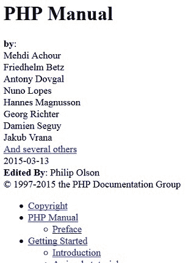
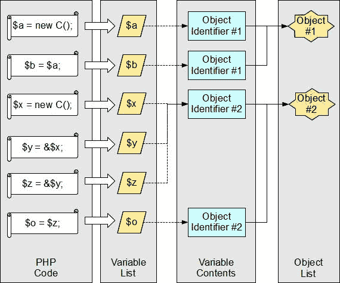
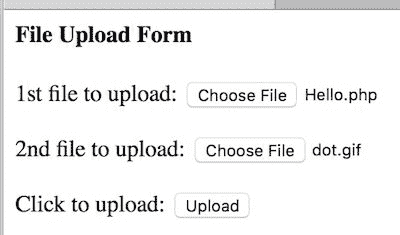
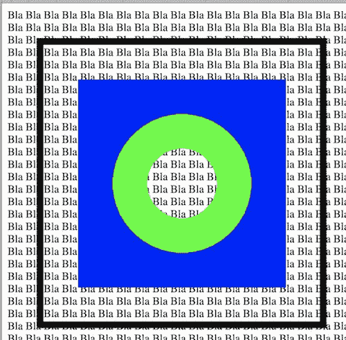
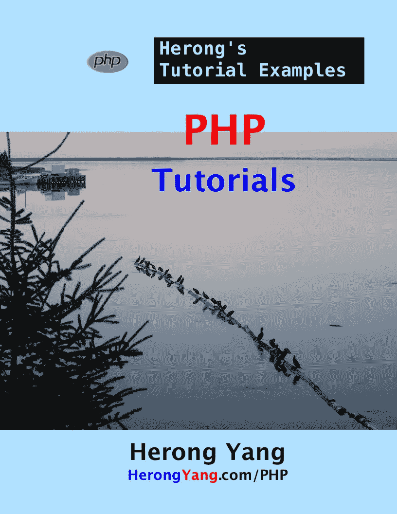

## PHP 教程 - Herong 的教程示例


本书是作者在自学 PHP 过程中编写的笔记和示例代码的集合。主题包括 PHP 脚本语法；数据类型、变量、数组、表达式、语句和函数；Web 服务器集成；HTTP 请求和控制 HTTP 响应；会话、Cookie 以及文件上传/下载；MySQL 数据库服务器访问；文件、目录和 ZIP 压缩包；解析 HTML 文档；处理图像文件；SOAP 扩展；管理非 ASCII 字符；类和对象；在 Windows、macOS 和 Linux 上使用 PHP；在操作系统上执行外部程序。2022 年更新（版本 v5.16），包含微小变更。如需获取最新更新和免费试读章节，请访问 https://www.herongyang.com/PHP。


### 在 PHP 脚本中控制 HTTP 响应头行

#### 什么是 HTTP 响应

#### HTTP 响应头行

#### header() - 插入原始头行

#### HttpRequestGet.php - 查看头行

#### 静态文件的响应头行

#### HttpHeaderLines.php - 插入头行的示例

#### Location: - 强制浏览器重定向到另一个 URL

#### Content-Type: - 生成非 HTML 响应体

#### Content-Disposition: - 发送文件供下载

### 管理文件上传

#### 文件上传 Web 表单

#### 文件上传 PHP 脚本

### MySQL 服务器连接和访问函数

#### 为 MySQL 服务器访问配置 PHP

#### mysqli_connect() 和其他 MySQL 函数

#### MySqlLoop.php - MySQL 函数测试

### 管理目录、文件和图像的函数

#### opendir() 和目录管理函数

#### file_exists() 和文件测试函数

#### FileExistsTest.php - 文件测试示例

#### fopen() 和文件输入/输出函数

#### File_Input_Output_Test.php - 文件输入/输出示例

#### readfile() 和特殊文件处理函数

#### ShowPhoto.php - 简单幻灯片展示脚本

### SOAP 扩展函数和调用 Web 服务

#### PHP 的 SOAP 实现

#### 开启默认 SOAP 扩展

#### Hello_There.php - SOAP 第一个示例

#### SoapClient - SOAP 客户端类和函数

#### Hello_There_Dump.php - 调试 SOAP 消息

#### 什么是 WSDL

#### 在非 WSDL 模式下使用 SOAP 扩展

#### SOAP 服务器函数和示例

#### SoapServer - SOAP 服务器类和函数

#### HelloServer.php - 第一个 SOAP 服务器应用程序

## HelloServer12.php - 第一个 SOAP 1.2 服务器应用程序

## HelloServerWsdl.php - WSDL 模式下的 SOAP 1.2 服务器应用程序

### Web 应用程序本地化概述

## 什么是本地化 / 国际化

## 基于 Web 的应用程序本地化

#### 字符串传输路径

#### 从 PHP 脚本输出 ASCII 字符串

#### 在 HTML 文档中使用非 ASCII 字符

#### 在 HTML 文档中使用非 ASCII 字符的基本规则

#### HTML 文档中的法文字符 - UTF-8 编码

#### HTML 文档中的法文字符 - ISO-8859-1 编码

## HTML 文档中的中文字符 - UTF-8 编码

## HTML 文档中的中文字符 - GB2312 编码

#### HTML 文档中的多语言字符

## 将非 ASCII 字符作为 PHP 脚本字符串字面量使用

#### 在 HTML 文档中使用非 ASCII 字符的基本规则

#### 字符串字面量中的法文字符 - UTF-8 编码

#### HTML 文档中的法文字符 - ISO-8859-1 编码

#### 字符串字面量中的中文字符 - UTF-8 编码

#### 字符串字面量中的中文字符 - GB2312 编码

#### 字符串字面量中的多语言字符

#### 从输入表单接收非 ASCII 字符

#### 从输入表单接收非 ASCII 字符的基本规则

#### 使用 GET 方法接收非 ASCII 字符

## 使用 POST 方法接收非 ASCII 字符

## 以 UTF-8 编码接收非 ASCII 字符

#### 解码 HTML 实体

#### "mbstring" 扩展和非 ASCII 编码管理

#### "mbstring" - 多字节字符串扩展

#### mb_convert_encoding() 和其他 mbstring 函数

#### 使用 "mbstring" 函数的示例

#### 管理 HTTP 输入和输出编码

#### 使用 MySQL 服务器管理非 ASCII 字符串

#### 在数据库中存储非 ASCII 字符

#### 与数据库传输非 ASCII 字符

#### MySqlUnicode.php - MySQL Unicode UTF-8 编码示例

### 解析和管理 HTML 文档

#### 用于 HTML 文档的 DOM 扩展

#### 解析和遍历 HTML 文档

#### 构建新的 HTML 文档

#### 使用 LIBXML_NOBLANKS 加载 HTML 文档

#### 移除 HTML 文档中的空白字符

#### HTML 文档中的 DOCTYPE 元素

#### 移除 HTML 文档中的虚拟元素

#### 在 CentOS 上安装 DOM 扩展

### 配置和发送电子邮件

#### 使用本地 Windows 系统作为邮件服务器

#### 从 PHP 脚本发送电子邮件

#### 在 Linux 系统上发送电子邮件

#### 在 CentOS 系统上安装 PHPMailer

#### 使用 PHPMailer 发送本地邮件

#### 使用 PHPMailer 发送远程邮件

#### 使用 PHPMailer 配合 SMTPS 协议

#### PHP 5.6 和 PHPMailer 5.2

#### 从源代码安装 PHPMailer

### 图像和图片处理

#### GD 图像函数库

#### GD 库 - 绘制图形元素

#### GD 库 - 在 1 页上打印 2 张图片

#### GD 库 - 创建透明图像

#### 文字网页上的透明图像

#### GD 库 - 填充透明图像

### 管理 ZIP 归档文件

#### ZipArchive 类

#### 创建新的 ZIP 归档

#### 从 ZIP 归档中提取文件

#### 带目录创建 ZIP 归档

#### 创建用于下载的 ZIP 归档

### 在 macOS 上管理 PHP 引擎和模块

#### macOS 预装的 PHP 版本

#### 在 macOS 上升级 PHP 引擎

### 在 CentOS 上管理 PHP 引擎和模块

#### CentOS 预装的 PHP 版本

#### 在 CentOS 上安装 PHP 扩展

#### CentOS 6 预装的 PHP 版本

#### 在 CentOS 计算机上使用 PHP Composer

### 归档教程

#### 归档：下载和安装用于 Windows 的 PHP 7.0

#### 归档：下载和安装用于 Windows 的 PHP 5.6.6

#### 归档：下载和安装用于 Windows 的 PHP 5.4.3

#### 归档：下载和安装用于 Windows 的 PHP 5.2.2


#### 关于本书

本节提供关于本书《PHP 教程 - Herong 的教程示例》的一些详细信息。

**书名：** PHP 教程 - Herong 的教程示例

**作者：** Herong Yang - 可通过电子邮件 `herong_yang@yahoo.com` 联系。

**类别：** 计算机 / 编程语言 / PHP

**版本/版次：** v5.16，2022 年

**页数：** 472

**描述：** 本 PHP 教程书籍是作者在自学 PHP 过程中编写的笔记和示例代码的集合。主题包括 PHP 脚本语法；数据类型、变量、数组、表达式、语句和函数；Web 服务器集成；HTTP 请求与控制 HTTP 响应；会话、Cookie 以及文件上传/下载；MySQL 数据库服务器访问；文件、目录和 ZIP 压缩包；解析 HTML 文档；处理图像文件；SOAP 扩展；管理非 ASCII 字符；类和对象；在 Windows、macOS 和 Linux 上使用 PHP；在操作系统上执行外部程序。2022 年更新（版本 v5.16），包含细微更改。

**关键词：** Apache、class、cookie、HTML、HTTP、image、MySQL、PHP、redirect、SOAP、Unicode、XML、ZIP。

**版权：**

*   本书受 © 2003-2022 Herong Yang 版权保护。保留所有权利。
*   本书中的材料不得以任何形式出版、广播、重写或重新分发。
*   示例代码按“原样”提供，不提供任何形式的担保。

**修订历史：**

*   版本 5.16，2022 年。小幅更新。
*   版本 5.10，2020 年。增加了 ZIP 压缩包教程。
*   版本 5.00，2019 年。更新以支持 PHP 7。
*   版本 4.00，2015 年。增加了类、对象和 Apache 教程。
*   版本 3.00，2009 年。第三版。
*   版本 2.00，2007 年。第二版。
*   版本 1.00，2003 年。第一版。

**网页版：** [`www.herongyang.com/PHP`](https://www.herongyang.com/PHP) - 提供免费试读章节、最新更新和读者评论。本书网页版总浏览量为：

*   2,479,704 次（截至 2018 年 12 月）。
*   2,381,664 次（截至 2018 年 12 月）。
*   2,301,842 次（截至 2018 年 12 月）。
*   2,241,750 次（截至 2018 年 12 月）。
*   2,180,865 次（截至 2017 年 12 月）。
*   2,119,742 次（截至 2016 年 12 月）。
*   2,054,798 次（截至 2015 年 12 月）。
*   1,916,316 次（截至 2014 年 12 月）。
*   1,557,001 次（截至 2013 年 12 月）。
*   1,368,846 次（截至 2012 年 12 月）。
*   1,203,837 次（截至 2011 年 12 月）。
*   1,017,118 次（截至 2010 年 12 月）。

**PDF/EPUB 版本：** [`www.herongyang.com/PHP/PDF-Full-Version.html`](https://www.herongyang.com/PHP/PDF-Full-Version.html) - 提供关于如何获取本书 PDF、EPUB 或其他格式完整版本的信息。

### PHP 7.3 简介与安装

本章提供关于 PHP 安装的教程笔记和示例代码。主题包括 PHP 快速简介、下载和安装 PHP 引擎、PHP 命令行选项、编写第一个 PHP 脚本。

> 什么是 PHP
>
> 下载并安装适用于 Windows 的 PHP 7.3
>
> “php -help” - 命令行选项
>
> “php -m” - 内置模块
>
> “php -i” - PHP 引擎信息
>
> php.ini - PHP 运行时配置
>
> Hello.php - 我的第一个 PHP 脚本
>
> “php -a” - PHP 交互式 Shell
>
> 下载并安装 PHP 文档

**要点：**

*   PHP 正成为当前最流行的 Web 服务器端脚本语言。
*   下载并安装适用于 Windows 系统的标准 PHP 构建版本非常容易。

#### 什么是 PHP

本节介绍什么是 PHP 语言以及 PHP 支持的主要特性。

**什么是 PHP？** PHP 代表 PHP: Hypertext Preprocessor（PHP：超文本预处理器），这是一个递归首字母缩略词。它主要是一种 Web 服务器端脚本语言。但也可用于其他用途。

PHP 最初由 Rasmus Lerdorf 于 1995 年创建，作为一个名为 PHP/FI（Personal Home Page/Forms Interpreter，个人主页/表单解释器）的简单网页生成工具。如今，它已成为第一大服务器端脚本语言。以下是不同流行脚本关键词在 Google 上的匹配数量对比：

```
关键词                 匹配数量

"PHP scripting"         400,000
"perl scripting"        371,000
"ASP.NET scripting"      40,100
"ASP scripting"          30,900
"JSP scripting"          17,500
```

PHP 的主要特性：

*   **Web 应用特性** - PHP 支持最常用的 Web 应用特性，如：HTTP Cookie、Session、文件上传等。
*   **CLI（命令行接口）** - PHP 通常用于编写 Web 应用程序，通过通用网关接口 (CGI) 与 Web 服务器集成。但 PHP 也可用于编写由 CLI（命令行接口）执行的独立应用程序。
*   **数据类型** - PHP 像其他编程语言一样支持多种数据类型：有符号和无符号整数、浮点数、字符串、资源、null 等。
*   **文件 I/O** - PHP 支持最常用的文件 I/O 特性，如本地文件和路径管理、使用 HTTP 和 FTP 等互联网协议进行远程资源访问。
*   **安全模式** - PHP 支持安全模式，许多内置函数受到限制或被禁用。
*   **预编译** - PHP Web 应用程序通常以源代码形式部署，当 Web 请求到达服务器时即时解释执行。但 PHP Web 应用程序也可以预编译并以可执行格式部署，以加快 Web 请求响应时间。
*   **面向对象编程** - PHP 支持面向对象编程特性，如对象引用、私有和受保护的成员变量和方法、抽象和最终类及方法、构造函数和析构函数、接口等。
*   **内置模块** - 标准 PHP 构建版本附带许多免费开源库作为内置模块，用于日历日期处理、FTP 协议支持、XML 处理、加密和解密、ODBC 支持、ZIP 支持、正则表达式支持等。
*   **扩展** - 有大量 PHP 扩展可用于为标准 PHP 构建版本添加功能。PHP 扩展的示例包括 Windows API、Unix 操作系统上的进程管理、多字节字符串支持、cURL（客户端 URL 传输）、图像处理、数据压缩、数据库访问、Web 服务等。

PHP 主要版本发布时间表：

```
7.0   2015 年 12 月 3 日
6.x   未发布
5.6   2014 年 8 月 28 日
5.4   2012 年 3 月 1 日
5.3   2009 年 6 月 30 日
5.0   2004 年 7 月 13 日
4.0   2000 年 5 月 22 日
3.0   1998 年 6 月 6 日
2.0   1997 年 11 月 1 日
1.0   1995 年 6 月 8 日
```


### PHP 7.3 简介与安装

#### 在 Windows 上下载并安装 PHP 7.3

本节提供了一个教程示例，介绍如何在 Windows 系统上下载并安装 PHP 7.0 引擎。

1. 访问 [windows.php.net/download/](http://windows.php.net/download/) 并下载适用于 Windows 的 "VC15 x64 Thread Safe (2018-Dec-06 04:31:24)" 二进制版本。你将获得一个名为 `php-7.3.0-Win32-VC15-x64`、大小为 21,846,474 字节的文件。

2. 将 `php-7.3.0-Win32-VC15-x64` 解压到 `\php` 文件夹。

3. 打开一个命令窗口，并尝试运行以下命令：

```
herong> \php\php -v
```

4. 如果看到错误消息提示："The program can't start because VCRUNTIME150.dll is missing from your computer. Try reinstalling the program to fix this problem."（无法启动此程序，因为计算机中丢失 VCRUNTIME150.dll。尝试重新安装该程序以解决此问题。），则需要安装 "Visual Studio 2015 x86"。

* 访问 "Microsoft Visual C++ Redistributable for Visual Studio 2015" 页面：[microsoft.com/en-us/download/details.aspx?id=48145](https://www.microsoft.com/en-us/download/details.aspx?id=48145)。
* 点击 "Download"（下载）按钮。
* 将下载的文件 `vc_redist.x86.exe` 保存到桌面。
* 双击 `vc_redist.x86.exe` 运行它。
* 按照说明完成安装。

5. 再次打开一个命令窗口，并尝试运行以下命令：

```
herong> \php\php -v

PHP 7.3.0 (cli) (built: Dec  6 2018 01:54:19)
   (ZTS MSVC15 (Visual C++ 2017) x64)
Copyright (c) 1997-2018 The PHP Group
Zend Engine v3.3.0-dev, Copyright (c) 1998-2018 Zend Technologies
```

太棒了，PHP 的命令行界面（CLI）和通用网关接口（CGI）均已正常工作！

#### "php -help" - 命令行选项

本节提供了一个教程示例，介绍如何查看 PHP 引擎支持的所有命令行选项：`php -help`。

如果你想了解 PHP 引擎支持哪些命令行选项，可以使用 `-help` 选项运行 PHP：

```
herong> \php\php -help

Usage: php [options] [-f] <file> [--] [args...]
   php [options] -r <code> [--] [args...]
   php [options] [-B <begin_code>] -R <code> [-E <end_code>] [--] [args...]
   php [options] [-B <begin_code>] -F <file> [-E <end_code>] [--] [args...]
   php [options] -- [args...]
   php [options] -a

  -a               交互式运行
  -c <path>|<file> 在此目录中查找 php.ini 文件
  -n               不使用 php.ini 文件
  -d foo[=bar]     定义值为 'bar' 的 INI 条目 foo
  -e               为调试器/分析器生成扩展信息
  -f <file>        解析并执行 <file>。
  -h               显示此帮助
  -i               PHP 信息
  -l               仅语法检查 (lint)
  -m               显示内编译的模块
  -r <code>        运行 PHP <code> 而无需使用脚本标记 <?..?>
  -B <begin_code>  在处理输入行之前运行 PHP <begin_code>
  -R <code>        对每个输入行运行 PHP <code>
  -F <file>        对每个输入行解析并执行 <file>
  -E <end_code>    在处理完所有输入行后运行 PHP <end_code>
  -H               从外部工具隐藏传递的任何参数。
  -S <addr>:<port> 使用内置 Web 服务器运行。
  -t <docroot>     为内置 Web 服务器指定文档根目录 <docroot>。
  -s               输出 HTML 语法高亮源代码。
  -v               版本号
  -w               输出去除注释和空白的源代码。
  -z <file>        加载 Zend 扩展 <file>。

  args...          传递给脚本的参数。当第一个参数以 - 开头或从 stdin 读取脚本时使用 -- args

  --ini            显示配置文件名

  --rf <name>      显示关于函数 <name> 的信息。
  --rc <name>      显示关于类 <name> 的信息。
  --re <name>      显示关于扩展 <name> 的信息。
  --rz <name>      显示关于 Zend 扩展 <name> 的信息。
  --ri <name>      显示关于扩展 <name> 的配置。
```

#### "php -m" - 内置模块

本节提供了一个教程示例，介绍如何获取预编译进 PHP 引擎的所有模块列表：`php -m`。

PHP 7.3 引擎的 Windows 二进制版本预编译了许多模块。`-m` 选项可以列出所有内置模块：

```
herong> \php\php -m

[PHP Modules]
bcmath
calendar
Core
ctype
date
dom
filter
hash
iconv
json
libxml
mysqlnd
pcre
PDO
Phar
readline
Reflection
session
SimpleXML
SPL
standard
tokenizer
wddx
xml
xmlreader
xmlwriter
zip
zlib

[Zend Modules]
```

#### "php -i" - PHP 引擎信息

本节提供了一个教程示例，介绍如何获取关于 PHP 引擎及其执行环境的更多信息：`php -i`。

如果你想了解更多关于 PHP 引擎及其执行环境的信息，可以使用 `-i` 选项运行 `php.exe` 程序：

```
herong> \php\php -i

phpinfo()
PHP Version => 7.3.0

System => Windows NT Local 6.1 build 7601 (Windows 7 Professional ...
Build Date => Dec  6 2018 01:48:44
Compiler => MSVC15 (Visual C++ 2017)
Architecture => x64
Configure Command => cscript /nologo configure.js  "--enable-snaps...
Server API => Command Line Interface
Virtual Directory Support => enabled
Configuration File (php.ini) Path => C:\windows
Loaded Configuration File => (none)
Scan this dir for additional .ini files => (none)
Additional .ini files parsed => (none)
PHP API => 20180731
PHP Extension => 20180731
Zend Extension => 320180731
Zend Extension Build => API320180731,TS,VC15
PHP Extension Build => API20180731,TS,VC15
Debug Build => no
Thread Safety => enabled
Zend Signal Handling => disabled
Zend Memory Manager => enabled
Zend Multibyte Support => disabled
IPv6 Support => enabled
DTrace Support => disabled

Registered PHP Streams => php, file, glob, data, http, ftp, zip, ...
Registered Stream Socket Transports => tcp, udp
Registered Stream Filters => convert.iconv.*, mcrypt.*, mdecrypt....

This program makes use of the Zend Scripting Language Engine:

...
```

#### php.ini - PHP 运行时配置

本节描述 PHP 运行时配置文件 `php.ini`。

PHP 的运行时行为可通过 `\php` 文件夹中的名为 `php.ini` 的运行时配置文件进行控制。PHP 安装包提供了 2 个版本的 `php.ini`：

```
php.ini-development   - 更安全且性能更好
php.ini-production    - 错误消息更详细
```

既然我们是在本地机器上运行 PHP 以学习 PHP 语言，我们应该使用 `php.ini-development` 版本。因此，让我们将 `php.ini-development` 复制为 `php.ini`：

```
>copy \php\php.ini-development \php\php.ini
        1 file(s) copied.

>type \php\php.ini | more
[PHP]

;;;;;;;;;;;;;;;;;;;
; About php.ini   ;
;;;;;;;;;;;;;;;;;;;
; PHP's initialization file, generally called php.ini, is responsible
; for configuring many of the aspects of PHP's behavior.
; ...

; Name for user-defined php.ini files. Default is ".user.ini"
;user_ini.filename = ".user.ini"

; To disable this feature set this option to empty value
;user_ini.filename =

; TTL for user-defined php.ini files (time-to-live) in seconds.
; Default is 300 seconds (5 minutes)
;user_ini.cache_ttl = 300

; Enable the PHP scripting language engine under Apache.
engine = On

...
```

正如你所见，`php.ini` 文件非常易于使用。行首的 `;` 字符表示注释行。配置设置以 `name = value` 的格式提供。默认版本的 `php.ini` 包含大量注释，帮助你理解每项设置的含义。


# 例如，如果我想在运行时环境中设置默认时区，我可以编辑 php.ini 并更改 "date.timezone" 设置：

```
>edit \php\php.ini

; 定义日期函数使用的默认时区
date.timezone = Europe/Paris
```

现在 PHP 引擎将以 Europe/Paris 作为默认时区运行。


### PHP 7.3 简介与安装

#### Hello.php - 我的第一个 PHP 脚本

本节提供了一个教程示例，介绍如何编写第一个 PHP 脚本 Hello.php，并使用 PHP CLI 和 PHP CGI 运行它。

使用记事本等任意文本编辑器，输入第一个 PHP 脚本 Hello.php：

```
Hello <?php echo "world!"; ?>
```

首先使用 PHP CLI 运行它：

```
herong> \php\php Hello.php

Hello world!
```

然后使用 PHP CGI 运行它：

```
herong> \php\php-cgi Hello.php

X-Powered-By: PHP/7.3.0
Content-type: text/html; charset=UTF-8

Hello world!
```

正如预期的那样，两个版本的 PHP 引擎都运行良好。PHP CGI 版本确实为我生成了 HTTP 响应头。

但请注意，PHP 7.3 中的 "Content-type" 设置为 "UTF-8"，这与 PHP 5.6 不同。请看 PHP 5.6 的输出：

```
>\php5.6\php-cgi Hello.php
Content-type: text/html
X-Powered-By: PHP/5.6.6

Hello world!
```


### PHP 7.3 简介与安装

#### "php -a" - PHP 交互式 Shell

本节提供了一个教程示例，介绍如何将 PHP 引擎作为交互式 Shell 运行，即 `php -a`，它允许你输入一条 PHP 语句并立即在屏幕上看到结果。

在上一教程中，我学习了如何运行 PHP 引擎来执行存储在文件中的 PHP 脚本。

PHP 引擎也可以用作交互式 Shell，从控制台获取 PHP 脚本并逐行交互式地执行。

以下是运行 PHP 引擎作为交互式 Shell 的一个会话：

```
herong> \php\php -a

Interactive shell

php > print "I am tossing a coin...\n";
I am tossing a coin...
php > $coin = rand(0,1);
php > if ($coin==1) {
php {    print "   Head\n";
php { } else {
php {    print "   Tail\n";
php { }
   Head
php > exit

C:\herong>
```

很酷。这确实是一个有助于学习 PHP 的好工具。只需输入一条 PHP 语句，即可立即在屏幕上看到显示的结果。


### PHP 7.3 简介与安装

#### 下载和安装 PHP 文档

本节提供了一个教程示例，介绍如何下载和安装 HTML 格式的 PHP 文档。

为了帮助学习 PHP 语言和内置扩展，我们还应该下载 PHP 文档：

1. 访问 [php.net/download-docs.php](http://php.net/download-docs.php) 并下载 "English" 和 "Many HTML files" 版本的 "tar.gz" 格式。你将得到一个名为 "php_manual_en.tar.gz" 的文件，大小为 11,269,511 字节。

2. 将 "php_manual_en.tar.gz" 解压到 `\php\html` 文件夹。

3. 在 Web 浏览器中打开 `\php\html\index.html` 并将其加入书签。



PHP 文档 - HTML 版本


### PHP 脚本文件语法

本章提供关于 PHP 脚本文件语法的教程笔记和示例代码。主题包括在脚本文件中包含 PHP 代码段使用什么标签；脚本文件处理规则；如何将 1 条语句拆分为多行，如何在 PHP 脚本中输入注释。

> PHP 脚本源代码文件格式

> PHP 脚本处理规则

> PHP 语句分隔符和注释

要点：

*   PHP 处理标签 `<?php ... ?>` 用于将 PHP 代码段包含到 PHP 脚本文件中。

*   所有非 PHP 文本段在 PHP 执行前都会被转换为 PHP print 语句。

*   所有 PHP 代码段和转换后的 print 语句会被合并为单个 PHP 代码块以供执行。

*   分号 `;` 用作 PHP 语句分隔符。

*   注释可以用 Perl、Java 或 C 风格输入到 PHP 代码段中。


### PHP 脚本文件语法

#### PHP 脚本源代码文件格式

本节描述 PHP 脚本源代码文件格式——一个将 PHP 代码段混合到非 PHP 文本中的文本文件。混合 PHP 代码最常用的方法是使用 PHP 处理标签 `?php`。

与其他任何脚本语言一样，PHP 通过将 PHP 代码段混合在输入文本中，将文本信息从输入转换为输出。这种混合了 PHP 代码和非 PHP 文本的输入称为 PHP 脚本源代码，通常存储为文本文件。

由于多个 PHP 代码段可以与非 PHP 文本混合，PHP 脚本源代码将如下所示：

```
text PHP_code text PHP_code text PHP_code ...
```

当你请求 PHP 处理 PHP 脚本源代码时，它将使用以下 3 条默认规则将 PHP 代码段与非 PHP 文本分离：

1. PHP 处理标签：`<?php PHP_code ?>` - `?php` 标签中包含的所有内容将作为 PHP 代码处理。例如：

```
Hello <?php
   $name = "Herong";
   echo $name;
?>
, Nice to meet you!
```

2. PHP 处理标签简写：`<? PHP_code ?>` - `?` 标签中包含的所有内容将作为 PHP 代码处理。例如：

```
Hello <?
   $name = "Herong";
   echo $name;
?>
, Nice to meet you!
```

3. HTML "script" 标签：`<script language="php">PHP_code</script>` - "script" 起始标签和 "script" 结束标签之间的所有内容将作为 PHP 代码处理。例如：

```
Hello <script language="php">
   $name = "Herong";
   echo $name;
</script>
, Nice to meet you!
```

PHP 处理标签是将 PHP 代码混合到非 PHP 文本中以创建 PHP 脚本源代码文件的最常用方法。由于大多数 PHP 脚本旨在生成网页，PHP 脚本源代码中的非 PHP 文本主要由 HTML 标签组成。下面是一个生成简单网页的 PHP 脚本源代码示例：

```
<html>
<head>
<title>Welcome Page</title>
</head>
<body>
<p>
Hello <?php
   $name = "Herong";
   echo $name;
?>
, Nice to meet you!
</p>
</body>
</html>
```

## PHP 教程 - Herong 的教程示例

### PHP 脚本文件语法

#### PHP 脚本处理规则

本节描述 PHP 脚本源代码处理规则——所有非 PHP 文本段被转换为 print 语句并与 PHP 代码段合并，形成单个代码块。

正如我在上一节中提到的，PHP 脚本源代码是非 PHP 文本段和 PHP 代码段的序列。PHP 引擎将按 3 个逻辑步骤处理源代码：

*   将每个非 PHP 文本段转换为带有 print 语句的 PHP 代码段。

*   将所有 PHP 代码段连接成单个最终 PHP 代码块。

*   执行最终的 PHP 代码块。

换句话说，PHP 脚本源代码可以被视为单个 PHP 代码块。所有非 PHP 文本段只是以一种特殊方式编写的 PHP print 语句。

PHP 的处理规则与 Active Server Page (ASP) 的处理规则非常相似。

现在让我们看一个示例 PHP 脚本源代码文件：

```
<?php
/* HeadOrTail.php
#- Copyright 2003 (c) HerongYang.com. All Rights Reserved.
*/ ?>
I am tossing a coin now. Guess what the result will be?
<?php $coin = rand(0,1); ?>
<?php if ($coin==1) { ?>
   Head
<?php } else { ?>
   Tail
<?php } ?>
```

如果你用 PHP 引擎处理此脚本，你将得到：

```
herong> \php\php HeadOrTail.php

I am tossing a coin now. Guess what the result will be?
   Tail
```

基于 PHP 引擎处理规则，从 PHP 引擎处理的角度来看，上述脚本与以下脚本完全相同：


### PHP 脚本文件语法

#### PHP 语句分隔符和注释

本节提供了一个教程示例，说明如何在 PHP 源代码文件中编写 PHP 语句和注释。PHP 使用分号 `;` 作为语句分隔符。注释可以采用 Perl、Java 或 C 风格编写。

PHP 使用分号 `;` 作为语句分隔符。PHP 语句可以通过不同方式编写在源代码文件中：

* 最常见的方式是每行代码编写一条语句。
* 但如果语句很长，你可以将一条语句拆分为多行代码。
* 如果你愿意，也可以在一行代码中编写多条语句。

如果你想在 PHP 源代码中输入注释，可以用 3 种方式：

* Perl 风格：使用 `#`
* Java 风格：使用 `//`
* C 风格：使用 `/*` 和 `*/`

下面是一个关于如何编写 PHP 语句和注释的教程示例：

```php
<?php
/* StatementSamples.php
#- Copyright 2003 (c) HerongYang.com. All Rights Reserved.
*/

# 接下来的 1 条语句写在 2 行代码中。
print "I am tossing a coin now. "
   . "Guess what the result will be?\n";

/* 我正在使用 rand() 函数来模拟抛硬币的随机性。rand(min,max) 函数返回一个介于指定最小数和最大数之间的随机整数。
-- 这是一个 C 风格注释的示例
*/

# 接下来的 1 条语句写在 1 行代码中。
$count = 0;
while ($count < 7) {
   # 接下来的 2 条语句写在 1 行代码中。
   $count++; print "Round # $count:\n";

   $coin = rand(0,1);
   if ($coin==1) {
      print "   Head\n"; // Java 风格注释
   } else {
      print "   Tail\n"; # Perl 风格注释
   }
}
?>
```

输出结果毫无意外：

```
herong> \php\php StatementSamples.php

I am tossing a coin now. Guess what the result will be?
Round # 1:
   Tail
Round # 2:
   Tail
Round # 3:
   Head
Round # 4:
   Tail
Round # 5:
   Tail
Round # 6:
   Head
Round # 7:
   Tail
```

### PHP 数据类型和数据字面量

本章提供了关于 PHP 数据类型和数据字面量的教程笔记和示例代码。主题包括 PHP 支持的 8 种数据类型；在 PHP 代码中为不同数据类型提供数据值的数据字面量；整数和浮点数值溢出条件。

* PHP 支持的数据类型
* PHP 支持的数据字面量
* 整数、字符串和其他数据类型的数据字面量示例
* 整数和浮点数值的溢出

#### 要点

* PHP 支持 8 种数据类型：布尔型、整型、浮点型、字符串、数组、对象、资源、空值。
* PHP 整型数据类型使用 32 位有符号整数存储格式。
* PHP 浮点型数据类型使用 64 位浮点数存储格式，即 IEEE 754 双精度标准。
* PHP 字符串数据类型使用 8 位字节存储格式。
* PHP 数组数据类型使用键值对来管理数组元素。PHP 数组实际上是其他编程语言中的关联数组、映射或哈希表。
* PHP 通过自动将结果转换为浮点数据类型来处理整数值溢出条件。
* PHP 通过自动将结果转换为“无穷大”或 0 来处理浮点数值溢出条件。

#### PHP 支持的数据类型

本节描述了 PHP 支持的所有 8 种数据类型，并通过一个教程示例展示如何使用它们：布尔型、整型、浮点型、字符串、数组、对象、资源、空值。

PHP 支持 8 种数据类型：

* **boolean（布尔型）**：它只有两个字面量值：`true` 和 `false`。我不确定布尔型数据项的存储大小是多少。
* **integer（整型）**：它作为 32 位有符号整数存储。这意味着整型数据项可以容纳 -2,147,483,648 到 2,147,483,647 范围内的整数值。整数字面量有 3 种形式：十进制、八进制（前缀为 `0`）和十六进制（前缀为 `0x`）。
* **float（浮点型）**：它作为 64 位 IEEE 双精度浮点数存储。浮点数字面量采用标准浮点数形式。
* **string（字符串）**：它是 8 位字符的序列。字符串字面量有 3 种形式：单引号、双引号和 heredoc 语法。这些形式与 Perl 非常相似。
* **array（数组）**：它存储键值对的有序映射。这与其他语言中使用的数组类型截然不同。PHP 中的数组类似于 Perl 中的关联数组。
* **object（对象）**：它存储一个类的实例。
* **resource（资源）**：它代表一个外部资源，如文件或数据库连接。
* **null（空值）**：它代表变量未被赋值的状态。Null 类型只有一个字面量值：`null`。

下面是一个教程示例 PHP 脚本，展示了所有 8 种数据类型：

```php
<?php
/* DataTypeSamples.php
#- Copyright 2003 (c) HerongYang.com. All Rights Reserved.
*/

$isValid = '1'==1; // boolean 数据类型
print "\n Boolean data type - '1'==1 evaluation result: ".$isValid;

$yearDays = 365; // integer 数据类型
print "\n Integer data type - Days in a year: ".$yearDays;

$equatorLength = 3.14159*2*6371; // float 数据类型
print "\n Float data type - Length of the equator: ".$equatorLength;

$greetingMessage = "Hello Herong!"; // float 数据类型
print "\n String data type - Greeting message: ".$greetingMessage;

$monthDays = array("Jan"=>31,"Feb"=>28,"Mar"=>31); // array 数据类型
print "\n Array data type - Days in each month: "
   .$monthDays['Jan'].", ".$monthDays['Feb'].", ".$monthDays['Mar']
   ."...";

$currentTime = new DateTime(); // object 数据类型
print "\n Object data type - Current time: "
   .$currentTime->format(DATE_ATOM);

$currentDirectory = opendir("."); // resource 数据类型
print "\n Resource data type - First item in the current directory: "
   .readdir($currentDirectory);
closedir($currentDirectory);

$nothing = null; // null 数据类型
print "\n Null data type - Null means nothing:".$nothing;
?>
```

如果你运行这个示例脚本，应该会得到：

```
herong> \php\php DataTypeSamples.php

 Boolean data type - '1'==1 evaluation result: 1
 Integer data type - Days in a year: 365
 Float data type - Length of the equator: 40030.13978
 String data type - Greeting message: Hello Herong!
 Array data type - Days in each month: 31, 28, 31...
 Object data type - Current time: 2005-02-12T21:19:47-05:00
 Resource data type - First item in the current directory: .
 Null data type - Null means nothing:?>
```

#### PHP 支持的数据字面量

本节描述了用于为不同数据类型指定值的数据字面量：保留关键字；十进制、八进制和十六进制数字；浮点数格式；单引号、双引号和 heredoc 字符串。

数据字面量是在 PHP 源代码中为不同数据类型提供值的方式。PHP 数据字面量规则总结如下：

1. **boolean 数据字面量**：布尔数据类型的数据字面量是两个保留关键字：`true` 和 `false`。请注意 `true` 和 `false` 不区分大小写 - `TRUE` 和 `FALSE` 也是有效的布尔字面量。

2. **integer 数据字面量**：整数数据类型的数据字面量有 3 种形式：

* **十进制形式**：一串十进制数字（0 到 9），首位数字大于 0。十进制形式的整数数据字面量可以带正负号，也可以不带。例如：`366`、`-42`、`6371`、...


### 整数、字符串及其他数据类型的数据字面量示例

本节提供了一个教程示例，说明如何对各种数据类型使用数据字面量：`TRUE`、`FALSE` 和 `NULL`；十进制、八进制和十六进制数字；浮点数格式；单引号、双引号和 heredoc 字符串。

为了帮助我们更好地理解如何对各种数据类型使用数据字面量，我编写了以下教程示例脚本：

```php
<?php
/* DataLiteralSamples.php
#- Copyright 2003 (c) HerongYang.com. All Rights Reserved.
*/

print "\n\n Boolean data literals: ";
$isGood = TRUE;
$isBad = false;
print "\n    TRUE: ".$isGood;
print "\n    false: ".$isBad;

print "\n\n Integer data literals in decimal form: ";
$leapYearDays = 366;
$supercoolWater = -42;
$earthRadius = 6371;
print "\n    366: ".$leapYearDays;
print "\n    -42: ".$supercoolWater;
print "\n    6371: ".$earthRadius;

print "\n\n Integer data literals in octal form: ";
$leapYearDays = 0556;
$supercoolWater = -052;
$earthRadius = 014343;
print "\n    0556: ".$leapYearDays;
print "\n    -052: ".$supercoolWater;
print "\n    014343: ".$earthRadius;

print "\n\n Integer data literals in hexadecimal form: ";
$leapYearDays = 0x16E;
$supercoolWater = -0x2A;
$earthRadius = 0x18E3;
print "\n    0x16E: ".$leapYearDays;
print "\n    -0x2A: ".$supercoolWater;
print "\n    0x18E3: ".$earthRadius;

print "\n\n Float data literals in hexadecimal form: ";
$pi = 3.14159;
$lightSpeed = 3e8;
$gdpGrowth = -1.25e-2;
print "\n    3.14159: ".$pi;
print "\n    3e8: ".$lightSpeed;
print "\n    2.7322e1: ".$gdpGrowth;

print "\n\n String data literals in single quoted form: ";
$title = 'Today\'s Special:';
$headers = 'Item\tPrice\tUnit';
$apples = 'Apples\t3.49\tkg';
$eggs = 'Eggs\t1.99\tdozen';
print "\n    ".$title;
print "\n    ".$headers;
print "\n    ".$apples;
print "\n    ".$eggs;

print "\n\n String data literals in double quoted form: ";
$title = "Today\'s Special:";
$headers = "Item\tPrice\tUnit";
$apples = "Apples\t3.49\t\x6B\x67";
$price = 1.99;
$eggs = "Eggs\t$price\tdoz\145\156";
print "\n    ".$title;
print "\n    ".$headers;
print "\n    ".$apples;
print "\n    ".$eggs;

print "\n\n String data literals in heredoc form: ";
$todaySpecial = <<<EOS
    Today's Special:
    Item        Price   Unit
    Apples      3.49    kg
    Eggs        1.99    dozen
EOS;
print "\n".$todaySpecial;

print "\n\n Null data literals: ";
$nothing = NULL;
$void = null;
print "\n    NULL: ".$nothing;
print "\n    null: ".$void;
?>
```

如果运行此示例脚本，你应该会得到：

```
herong> \php\php DataLiteralSamples.php

 Boolean data literals:
    TRUE: 1
    false:

 Integer data literals in decimal form:
    366: 366
    -42: -42
    6371: 6371

 Integer data literals in octal form:
    0556: 366
    -052: -42
    014343: 6371

 Integer data literals in hexadecimal form:
    0x16E: 366
    -0x2A: -42
    0x18E3: 6371

 Float data literals in hexadecimal form:
    3.14159: 3.14159
    3e8: 300000000
    2.7322e1: -0.0125

 String data literals in single quoted form:
    Today's Special:
    Item\tPrice\tUnit
    Apples\t3.49\tkg
    Eggs\t1.99\tdozen

 String data literals in double quoted form:
    Today\'s Special:
    Item        Price   Unit
    Apples      3.49    kg
    Eggs        1.99    dozen

 String data literals in heredoc form:
    Today's Special:
    Item        Price   Unit
    Apples      3.49    kg
    Eggs        1.99    dozen

 Null data literals:
    NULL:
    null:
```

### 整数和浮点数值的溢出

本节描述了什么是算术溢出条件，PHP 5 引擎如何处理整数和浮点数值溢出，以及如何编写 PHP 代码来检测溢出条件。

#### 什么是溢出？

**溢出** 或算术溢出是一种条件，当计算产生的结果在量级上大于给定数据类型所能存储或表示的范围时发生。

将此定义应用于 PHP 整数数据类型，我们可以这样说：PHP 整数值溢出是指整数运算产生的整数超出了有符号 32 位整数值范围的条件。

将此定义应用于 PHP 浮点数数据类型，我们可以这样说：PHP 浮点数值溢出是指浮点数运算产生的浮点数值超出了 64 位浮点数值范围的条件。

根据 PHP 手册，以下是 PHP 5 引擎处理算术溢出条件的方式：

*   当整数值溢出发生在整数值范围的上限时，结果整数值将自动转换为浮点数数据类型。
*   当整数值溢出发生在整数值范围的下限时，结果整数值将自动转换为浮点数数据类型。
*   当浮点数值溢出发生在指数值范围的上限时，结果浮点数值将自动转换为一个称为“无穷大”的特殊值。
*   当浮点数值溢出发生在指数值范围的下限时，结果浮点数值将自动转换为 0。这也称为下溢。


#### PHP 数值溢出处理

注意在所有算术溢出情况下，PHP 不会放弃操作也不会引发任何运行时错误。因此如果你编写的 PHP 代码处理的数字接近整数或浮点数值范围限制，你需要非常小心并编写额外代码来自行检测溢出条件。

为了帮助我们理解什么是整数和浮点数值范围以及如何检测算术溢出条件，我编写了这个教程示例 PHP 脚本：

#### NumericOverflow.php 示例脚本

```
<?php
/* NumericOverflow.php
#- Copyright 2003 (c) HerongYang.com. All Rights Reserved.
*/
print "\n Signed 32-bit integer positive overflow test:\n";
$integerLimit =  0x7FFFFFFF;
$integerOverflow = $integerLimit + 1;
print "    Integer upper limit: "; var_dump($integerLimit);
print "   Upper limit overflow: "; var_dump($integerOverflow);

print "\n Signed 32-bit integer positive overflow test:\n";
$integerLimit =  -0x7FFFFFFF - 1;
$integerOverflow = $integerLimit - 1;
print "    Integer lower limit: "; var_dump($integerLimit);
print "   Lower limit overflow: "; var_dump($integerOverflow);

print "\n 64-bit floating point number overflow test:\n";
$floatLimit = 1.0;
$floatOverflow = $floatLimit*10;
while (!is_infinite($floatOverflow)) {
   $floatLimit *= 10;
   $floatOverflow = $floatLimit*10;
}
print "   Float high limit: "; var_dump($floatLimit);
print "     Float overflow: "; var_dump($floatOverflow);

print "\n 64-bit floating point number underflow test:\n";
$floatLimit = 1.0;
$floatUnderflow = $floatLimit/10;
while (!$floatUnderflow==0) {
   $floatLimit /= 10;
   $floatUnderflow = $floatLimit/10;
}
print "   Float low limit: "; var_dump($floatLimit);
print "   Float underflow: "; var_dump($floatUnderflow);
?>
```

如果你运行这个示例脚本，你应该得到：

```
herong> \php\php NumericOverflow.php

 Signed 32-bit integer positive overflow test:
    Integer upper limit: int(2147483647)
   Upper limit overflow: float(2147483648)

 Signed 32-bit integer positive overflow test:
    Integer lower limit: int(-2147483648)
   Lower limit overflow: float(-2147483649)

 64-bit floating point number overflow test:
   Float high limit: float(1.0E+308)
     Float overflow: float(INF)

 64-bit floating point number underflow test:
   Float low limit: float(9.88131291682E-324)
   Float underflow: float(0)
```

结果告诉我在我的计算机上：

*   PHP 整数值范围是从 `-2147483648` 到 `2147483647`。
*   PHP 浮点数值范围大约是从 `9.88131291682E-324` 到 `1.0E+308`。
*   当然，浮点数值在负数侧还有另一个有效范围。它大约应该是从 `-1.0E+308` 到 `-9.88131291682E-324`。

**练习**：修改我的示例脚本以找出负浮点数值范围。

---

### PHP 变量、引用和常量

PHP 教程 - Herong 的教程示例 ∟ 变量、引用和常量

本章提供关于 PHP 变量、引用和常量的教程笔记和示例代码。主题包括如何命名变量；给变量赋值；创建变量的引用；使用变量变量名；使用字符串表达式作为变量名；定义常量名到值的映射；从常量检索值。

> 变量和赋值操作
>
> 引用和变量
>
> 变量变量名 - 使用表达式命名变量
>
> 常量和 define() 函数

#### 要点总结

*   PHP 变量是无类型的。不同数据类型的值可以赋给同一个变量。
*   PHP 变量名以 `$` 符号开头。
*   `&` 运算符返回变量的引用。
*   变量的引用可以赋给新变量以创建原变量的别名。
*   变量名可以表示为字符串表达式。这称为变量变量名。
*   `define()` 函数定义一个带有常量名和常量值的常量。
*   只有标量数据类型的值可以用作常量值。

---

PHP 教程 - Herong 的教程示例 ∟ 变量、引用和常量 ∟ 变量和赋值操作

本节描述什么是变量、以 `$` 为前缀的变量名、变量的 'set' 和 'unset' 状态、给变量赋值、使用 `var_dump($var)` 打印变量信息。

#### 什么是变量？

变量是在程序执行期间存储在内存中一段数据的标识符。在 PHP 中，变量遵循以下基本规则：

1.  PHP 中的变量名必须以 `$` 符号为前缀。Perl 对标量变量有类似规则。
2.  变量名区分大小写。所以 `$address` 和 `$Address` 指代两个不同的变量。
3.  PHP 中的变量是无类型的。因此 PHP 中没有变量类型声明语句。任何变量都可以用作任何数据类型的标识符。
4.  变量有两种状态："set" 和 "unset"。如果一段数据已赋给变量，则变量处于 "set" 状态。如果没有数据赋给变量，则变量处于 "unset" 状态。
5.  赋值操作（由赋值运算符 `=` 编码）可用于给变量赋值。
6.  `unset($var)` 函数可用于从给定变量中移除已赋的数据。
7.  变量可以像 PHP 源代码中的数据字面量一样用于任何操作。如果使用已赋值的变量进行操作，将使用赋值的数据值进行操作。如果使用未赋值的变量进行操作，将使用 `NULL` 进行操作。
8.  有一些特殊字符不应作为变量名的一部分：`' '`、`'$'`、`'['`、`']'`、`'{'`、`'}'` 等。

PHP 有一个很好的内置函数 `var_dump($var)`，它打印出关于指定变量的详细信息。

为了向你展示上述提到的一些变量规则，我编写了以下 PHP 脚本 `VariableTest.php`：

#### VariableTest.php 示例脚本

```
<?php
#  VariableTest.php
#- Copyright 2003 (c) HerongYang.com. All Rights Reserved.
#
   print "\nVariable assignments:\n";

   $u; # Not assigning to any data
   print "\n   \$u: "; var_dump($u);

   $b = TRUE; # Assigning a boolean
   print "\n   \$b: "; var_dump($b);

   $i = 777; # Assigning an integer
   print "\n   \$i: "; var_dump($i);

   $f = 3.14; # Assigning a float
   print "\n   \$f: "; var_dump($f);

   $s = "Hello Herong"; # Assigning a string
   print "\n   \$s: "; var_dump($s);

   $a = array("Jan"=>31,"Feb"=>28); # Assigning an array
   print "\n   \$a: "; var_dump($a);

   $o = new DateTime(); # Assigning an object
   print "\n   \$o: "; var_dump($o);

   $r = opendir("."); # Assigning a resource
   print "\n   \$r: "; var_dump($r);

   $n = NULL; # Assigning NULL
   print "\n   \$n: "; var_dump($n);
?>
```

如果你运行这个示例脚本，你应该得到：

```
herong> \php\php VariableTest.php

Variable assignments:

   $u: NULL

   $b: bool(true)

   $i: int(777)

   $f: float(3.14)

   $s: string(12) "Hello Herong"

   $a: array(3) {
  ["Jan"]=>
  int(31)
  ["Feb"]=>
  int(28)
  ["Mar"]=>
  int(31)
}

   $o: object(DateTime)#1 (0) {
}

   $r: resource(4) of type (stream)

   $n: NULL
```

---

PHP 教程 - Herong 的教程示例 ∟ 变量、引用和常量 ∟ 引用和变量

本节描述什么是引用、使用 `&` 运算符创建引用、将引用赋给变量、使用 `unset($var)` 函数移除引用链接。

#### 什么是引用？

引用是变量的别名。PHP 支持引用的方式与 Perl 语言非常相似。以下是在 PHP 中使用引用的一些基本规则：

1.  要创建给定变量的引用，你需要使用引用运算符：`&`。例如，`&$title` 创建变量 `$title` 的引用。


#### PHP 引用规则

引用可以使用赋值运算符 `=` 赋给另一个变量。例如，`$subject = &$title` 将变量 `$title` 的引用赋给变量 `$subject`。

持有引用的变量是原始变量的别名，其行为方式与原始变量完全相同。例如，`$subject = &$title; var_dump($subject);` 会打印出赋给变量 `$title` 的数据的信息。

如果原始变量被赋予新数据，引用变量会自动被赋予该新数据。例如，`$subject = &$title; $title = "New String";` 将 "New String" 同时赋给 `$subject` 和 `$title`。

如果引用变量被赋予新数据，原始变量会自动被赋予该新数据。例如，`$subject = &$title; $subject = "New Text";` 将 "New Text" 同时赋给 `$subject` 和 `$title`。

可以通过将引用赋给多个变量来创建多个引用变量。例如，`$subject = &$title; $topic = &$title;` 将 `$title` 的引用同时赋给 `$subject` 和 `$topic`。

实际上，原始变量及其引用变量都可以被视为指向它们共享的同一数据的引用。例如，`$subject = &$title; $topic = &$title; $topic = "New Message";` 创建了 3 个指向同一数据 "New Message" 的变量。

要移除变量与其赋值数据之间的引用链接，需要使用 `unset($var)` 函数。例如，`$title = "New String"; unset($title);` 移除 `$title` 与 "New String" 之间的引用链接。此时 `$title` 处于“未设置”状态。

如果多个变量引用同一数据，移除其中一个变量的引用链接不会影响其他变量。例如，`$subject = &$title; $topic = &$title; $topic = "New Message"; unset($topic);` 移除了 `$topic` 上的引用链接，但 `$subject` 和 `$title` 仍引用 "New Message"。

如果多个变量引用同一数据，将其中一个变量赋予指向新数据的新引用不会影响其他变量。例如，`$subject = &$title; $topic = &$title; $topic = "New Message"; $topic = &$name;` 将 `$name` 的引用赋给 `$topic`，但 `$subject` 和 `$title` 仍引用 "New Message"。

#### ReferenceTest.php 示例

为了演示上述提到的一些引用规则，我编写了以下 PHP 脚本 `ReferenceTest.php`：

```php
<?php
#  ReferenceTest.php
#- Copyright 2003 (c) HerongYang.com. All Rights Reserved.
#
   $title;
   print "\n \$title is not assigned to anything:\n";
   print "    \$title: "; var_dump($title);

   $subject = &$title;
   print "\n \$subject is an alias of $title:\n";
   print "    \$subject: "; var_dump($subject);
   print "    \$title: "; var_dump($title);

   $subject = "Herong's PHP Book";
   print "\n \$subject is assigned with a string:\n";
   print "    \$title: "; var_dump($title);
   print "    \$subject: "; var_dump($subject);

   $title = "Herong's Programming Book";
   print "\n \$title is reassigned with a new string:\n";
   print "    \$title: "; var_dump($title);
   print "    \$subject: "; var_dump($subject);

   $topic = &$subject;
   print "\n \$topic is added as the third reference variable:\n";
   print "    \$title: "; var_dump($title);
   print "    \$subject: "; var_dump($subject);
   print "    \$topic: "; var_dump($topic);

   unset($subject);
   print "\n \$subject's reference link is removed:\n";
   print "    \$title: "; var_dump($title);
   print "    \$subject: "; var_dump($subject);
   print "    \$topic: "; var_dump($topic);


   $name = "Herong's Tutorial Book";
   $title = &$name;
   print "\n \$title is assigned to a new reference:\n";
   print "    \$title: "; var_dump($title);
   print "    \$subject: "; var_dump($subject);
   print "    \$topic: "; var_dump($topic);
   print "    \$name: "; var_dump($name);
?>
```

如果你在 PHP 7 及更高版本中运行此示例脚本，输出中应包含一些 "Notice"（通知）消息。这是因为现在默认消息级别设置为 `E_NOTICE`。你可以更改设置或修改代码，以确保在使用变量前所有变量均已定义。

```
herong> \php-7.3\php ReferenceTest.php

 $title is not assigned to anything:
    $title: PHP Notice:  Undefined variable: title in
       C:\herong\ReferenceTest.php on line 7

Notice: Undefined variable: title in
   C:\herong\ReferenceTest.php on line 7
NULL

 $subject is an alias of :
    $subject: NULL
    $title: NULL

 $subject is assigned with a string:
    $title: string(17) "Herong's PHP Book"
    $subject: string(17) "Herong's PHP Book"

 $title is reassigned with a new string:
    $title: string(25) "Herong's Programming Book"
    $subject: string(25) "Herong's Programming Book"

 $topic is added as the third reference variable:
    $title: string(25) "Herong's Programming Book"
    $subject: string(25) "Herong's Programming Book"
    $topic: string(25) "Herong's Programming Book"

 $subject's reference link is removed:
    $title: string(25) "Herong's Programming Book"
    $subject: PHP Notice:  Undefined variable: subject in
       C:\herong\ReferenceTest.php on line 33

Notice: Undefined variable: subject in
   C:\herong\ReferenceTest.php on line 33
NULL
    $topic: string(25) "Herong's Programming Book"

 $title is assigned to a new reference:
    $title: string(22) "Herong's Tutorial Book"
    $subject: PHP Notice:  Undefined variable: subject in
       C:\herong\ReferenceTest.php on line 41

Notice: Undefined variable: subject in
   C:\herong\ReferenceTest.php on line 41
NULL
    $topic: string(25) "Herong's Programming Book"
    $name: string(22) "Herong's Tutorial Book"
```

如果你在 PHP 5 及更低版本中运行此示例脚本，输出中不应包含任何 "Notice" 消息：

```
herong> \php-5.6\php ReferenceTest.php

 $title is not assigned to anything:
    $title: NULL

 $subject is an alias of :
    $subject: NULL
    $title: NULL

 $subject is assigned with a string:
    $title: string(17) "Herong's PHP Book"
    $subject: string(17) "Herong's PHP Book"

 $title is reassigned with a new string:
    $title: string(25) "Herong's Programming Book"
    $subject: string(25) "Herong's Programming Book"

 $topic is added as the third reference variable:
    $title: string(25) "Herong's Programming Book"
    $subject: string(25) "Herong's Programming Book"
    $topic: string(25) "Herong's Programming Book"

 $subject's reference link is removed:
    $title: string(25) "Herong's Programming Book"
    $subject: NULL
    $topic: string(25) "Herong's Programming Book"

 $title is assigned to a new reference:
    $title: string(22) "Herong's Tutorial Book"
    $subject: NULL
    $topic: string(25) "Herong's Programming Book"
    $name: string(22) "Herong's Tutorial Book"
```

PHP 教程 - Herong 的教程示例

∟ 变量、引用和常量

∟ 变量变量名 - 使用表达式命名变量

#### 变量变量名

本节介绍什么是变量变量名，将变量名存储在另一个变量中，使用表达式命名变量，以及使用任意表达式作为变量名。

**什么是变量变量名：** 变量变量名是指存储在另一个变量内部的变量名。通常，变量名是一个静态字符串。但有时，你希望将变量名存储在另一个变量中，以便能够参与运算。PHP 通过以下基本规则支持变量变量名：

1. 如果原始变量的名称存储在另一个不同的变量中，你可以在 PHP 源代码中使用 `$$var` 符号来标识原始变量。例如，`$variableName = "title"; $$variableName` 代表变量 `$title`。


#### PHP 变量变量

2. 如果原始变量的名称可以通过表达式计算得出，可以在 PHP 源代码中使用 `${exp}` 表示法来标识原始变量。例如，`$variableName = "title"; ${$variableName."_1"}` 代表变量 `$title_1`。

3. 具有变量名称的变量可以像普通变量一样赋值新数据。例如，`$variableName = "title"; $$variableName = "Herong's PHP Book";` 将 `"Herong's PHP Book"` 赋值给 `$title`。

4. 具有变量名称的变量可以像普通变量一样用于任何操作。`$variableName = "title"; $$variableName = "Herong's PHP Book"; print($$variableName." is free");` 输出 `"Herong's PHP Book is free"`。

5. 如果使用表达式作为变量名，表达式的结果将自动转换为字符串，并作为变量名使用。通过这种自动转换，任何东西都可以用作变量名。甚至空字符串也可以用作变量名，`${""}` 是一个完美的变量表达式。

现在让我们看看下面的教程示例，以确认上述提到的一些规则：

```php
<?php
#### VariableVariableName.php
#- Copyright 2003 (c) HerongYang.com. All Rights Reserved.
#
   $variableName = "title";
   $$variableName = "Herong's PHP Book";
   print "\n \$\$variableName is assigned to a message:\n";
   print "    \$variableName: "; var_dump($variableName);
   print "    \$\$variableName: "; var_dump($$variableName);
   print "    \$title: "; var_dump($title);

   $variableName = "";
   $$variableName = "Herong's Programming Book";
   print "\n \$variableName contains an empty string:\n";
   print "    \$variableName: "; var_dump($variableName);
   print "    \$\$variableName: "; var_dump($$variableName);
   print "    \${''}: "; var_dump(${''});

   $variableName = NULL;
   $$variableName = "Herong's Tutorial Book";
   print "\n \$variableName contains the NULL:\n";
   print "    \$variableName: "; var_dump($variableName);
   print "    \$\$variableName: "; var_dump($$variableName);
   print "    \${NULL}: "; var_dump(${NULL});

   $variableName = 1.0/3.3;
   $$variableName = "Herong's Free Book";
   print "\n \$variableName contains a float number:\n";
   print "    \$variableName: "; var_dump($variableName);
   print "    \$\$variableName: "; var_dump($$variableName);
   print "    \${1.0/3.3}: "; var_dump(${1.0/3.3});
?>
```

如果运行此示例脚本，应该得到：

```
herong> \php\php VariableVariableName.php

 $$variableName is assigned to a message:
    $variableName: string(5) "title"
    $$variableName: string(17) "Herong's PHP Book"
    $title: string(17) "Herong's PHP Book"

 $variableName contains an empty string:
    $variableName: string(0) ""
    $$variableName: string(25) "Herong's Programming Book"
    ${''}: string(25) "Herong's Programming Book"

 $variableName contains the NULL:
    $variableName: NULL
    $$variableName: string(22) "Herong's Tutorial Book"
    ${NULL}: string(22) "Herong's Tutorial Book"

 $variableName contains a float number:
    $variableName: float(0.30303030303)
    $$variableName: string(18) "Herong's Free Book"
    ${1.0/3.3}: string(18) "Herong's Free Book"
```

PHP 教程 - Herong 的教程示例

∟ 变量、引用和常量

∟ 常量和 define() 函数

本节介绍什么是常量，`define()` 函数将常量名定义为一个值，常量值可以直接通过名称或通过 `constant()` 函数检索，任何字符串都可以用作常量名。

#### 什么是常量？

常量是数据值的标识符。一旦定义，由常量标识的数据值就不能更改。PHP 支持具有以下基本规则的常量：

1. 常量必须使用 `define(name, value)` 函数定义。例如，`define("PI", 3.14159);` 定义一个名为 `PI` 的常量，其值为 `3.14159`。

2. 要检索常量中定义的值，可以在任何表达式中直接使用常量名。例如，`define("PI", 3.14159); $area = PI * $radius * $radius;` 使用 `PI` 中定义的值来计算面积。

3. 允许对常量名使用任何字符串。例如，`define("LONG PI", 3.14159265359);` 定义一个名为 `'LONG PI'` 的常量，其值为 `3.14159265359`。但不建议在常量名中使用特殊字符。

4. 如果常量名包含特殊字符，需要使用 `constant(name)` 函数来检索常量中定义的值。例如，`define("LONG PI", 3.14159265359); $area = constant("LONG PI") * $radius * $radius;` 使用 `"LONG PI"` 中定义的值来计算面积。

5. 如果想知道是否为给定的常量名定义了常量，可以使用 `defined(name)` 函数。例如，`define("LONG PI", 3.14159265359); defined("LONG PI");` 返回 `TRUE`。而 `defined("LONG RI")` 返回 `FALSE`。

6. 常量只能用标量数据类型的值定义：布尔值、整数、浮点数和字符串。

7. PHP 引擎提供许多预定义（内置）常量。例如，`__FILE__`、`__LINE__`、`PHP_OS`、`PHP_VERSION`、`PHP_INT_MAX`、`DIRECTORY_SEPARATOR` 等。

现在让我们看看下面的教程示例，以确认上述提到的一些规则：

```php
<?php
#### ConstantTest.php
#- Copyright 2003 (c) HerongYang.com. All Rights Reserved.
#
   print "\n PI is not defined as a constant:\n";
   print "    PI: "; var_dump(PI);

   define("PI", 3.14159);
   print "\n PI is defined to a constant now:\n";
   print "    PI: "; var_dump(PI);

   define("LONG PI", 3.14159265359);
   print "\n LONG PI is defined to a constant now:\n";
   print "    LONG PI: "; var_dump(constant("LONG PI"));

   print "\n LONG RI is not defined as a constant:\n";
   print "    LONG PI: "; var_dump(defined("LONG PI"));
   print "    LONG RI: "; var_dump(defined("LONG RI"));

   print "\n Trying to define DAYS to an array:\n";
   define("DAYS", array("Jan"=>31,"Feb"=>28));
   print "    DAYS: "; var_dump(DAYS);

   print "\n PHP built-in constants:\n";
   print "    __FILE__: "; var_dump(__FILE__);
   print "    __LINE__: "; var_dump(__LINE__);
   print "    PHP_OS: "; var_dump(PHP_OS);
   print "    PHP_VERSION: "; var_dump(PHP_VERSION);
   print "    PHP_INT_MAX: "; var_dump(PHP_INT_MAX);
   print "    DIRECTORY_SEPARATOR: "; var_dump(DIRECTORY_SEPARATOR);
?>
```

如果运行此示例脚本，应该得到：

```
herong> \php\php ConstantTest.php

 PI is not defined as a constant:
    PI: string(2) "PI"

 PI is defined to a constant now:
    PI: float(3.14159)

 LONG PI is defined to a constant now:
    LONG PI: float(3.14159265359)

 LONG RI is not defined as a constant:
    LONG PI: bool(true)
    LONG RI: bool(false)

 Trying to define DAYS to an array:

Warning: Constants may only evaluate to scalar values in
C:\herong\ConstantTest.php on line 20
    DAYS: string(4) "DAYS"

 PHP built-in constants:
    __FILE__: string(43) "C:\herong\ConstantTest.php"
    __LINE__: int(25)
    PHP_OS: string(5) "WINNT"
    PHP_VERSION: string(5) "5.0.4"
    PHP_INT_MAX: int(2147483647)
    DIRECTORY_SEPARATOR: string(1) "\"
```

PHP 教程 - Herong 的教程示例

∟ 表达式、运算和类型转换

本章提供关于 PHP 表达式和运算的教程笔记和示例代码。主题包括使用数据字面量、变量和运算编写表达式；位运算、算术运算、比较运算、逻辑运算、字符串运算和赋值运算；运算优先级；数据类型自动转换。

> 什么是表达式
>
> 什么是运算
>
> 运算优先级
>
> 数据类型自动转换

**要点：**

*   PHP 支持 6 种基本类型的运算：位运算、算术运算、比较运算、逻辑运算、字符串运算和赋值运算。


## PHP 教程 - Herong 的教程示例

### 表达式、运算和类型转换

#### 什么是表达式

本节介绍什么是表达式。数据字面量或变量是简单表达式。单个运算或一组多个运算是复杂表达式。

**什么是表达式？** 给出表达式的一个精确单一定义并非易事。因此我将尝试以递归方式定义它：

1. 简单表达式是数据值的表示，如字面量、变量、数组元素或函数调用。
2. 复杂表达式是由运算符表示的运算返回的数据值的表示，该运算包含一个或两个表达式作为操作数。该运算将产生一个新的数据值。

如果递归应用规则 #2，一个表达式可能包含一系列多个运算。当这种情况发生时，运算必须按照以下规则定义的顺序执行：

A. 括在一对括号中的运算必须在括号外的运算之前执行。
B. 优先级较高的运算必须在优先级较低的运算之前执行。
C. 左侧的运算必须在右侧的运算之前执行。
D. 规则 A 必须在规则 B 之前应用，规则 B 必须在规则 C 之前应用。

表达式示例：

```
"Hello world!"   # 简单表达式 - 字符串字面量
777              # 简单表达式 - 整数字面量
$author          # 简单表达式 - 变量
getdate()        # 简单表达式 - 函数调用

7*9.99              # 复杂表达式 - 算术运算
"Hello ".$author    # 复杂表达式 - 字符串连接
(7+2)*9.99 > 50     # 复杂表达式 - 多个运算
```

#### 什么是运算

本节描述什么是运算——一个接受一个或两个操作数并根据由运算符表示的特定处理规则返回结果的过程。

**什么是运算？** 运算是一个接受一个或两个操作数并根据由运算符表示的特定处理规则返回结果的过程。PHP 支持其他编程语言中使用的大多数运算类型：

1. **位运算**：`and` (`$a & $b`)、`or` (`$a | $b`)、`xor` (`$a ^ $b`)、`not` (`~ $a`)、左移 (`$a << $s`)、右移 (`$a >> $s`)。
2. **递增/递减运算**：前置递增 (`++$a`)、后置递增 (`$a++`)、前置递减 (`--$a`)、后置递减 (`$a--`)。
3. **算术运算**：取负 (`-$a`)、加法 (`$a + $b`)、减法 (`$a - $b`)、乘法 (`$a * $b`)、除法 (`$a / $b`)、取模 (`$a % $b`)。
4. **比较运算**：相等 (`$a == $b`)、全等 (`$a === $b`)、不等 (`$a != $b`、`$a <> $b`)、不全等 (`$a !== $b`)、小于 (`$a < $b`)、大于 (`$a > $b`)、小于或等于 (`$a <= $b`)、大于或等于 (`$a >= $b`)。
5. **逻辑运算**：`and` (`$a and $b`、`$a && $b`)、`or` (`$a or $b`、`$a || $b`)、`xor` (`$a xor $b`)、`not` (`!$a`)。
6. **字符串运算**：连接 (`$a . $b`)。
7. **赋值运算**：赋值 (`$a = $b`)、加法赋值 (`$a += $b`)、减法赋值 (`$a -= $b`)、乘法赋值 (`$a *= $b`)、除法赋值 (`$a /= $b`)、取模赋值 (`$a %= $b`)、连接赋值 (`$a .= $b`)。

为了帮助我们理解不同类型的运算，我编写了以下 PHP 脚本 `OperationTest.php`：

```php
<?php
#### OperationTest.php
#- Copyright 2003 (c) HerongYang.com. All Rights Reserved.
#
   print "\n Bitwise Operations:\n";
   print "    0x00FF & 0x3210: " . (0x00FF & 0x3210) . "\n";
   print "    0x0001 | 0x0010: " . (0x0001 | 0x0010) . "\n";
   print "    0x0001 << 4: " . (0x0001 << 4) . "\n";
   print "    0x0100 >> 4: " . (0x0100 >> 4) . "\n";

   print "\n Incrementing/Decrementing Operations:\n";
   $a = 10; $b = ++$a * 2;
   print "    \$b = ++\$a * 2: $a, $b\n";
   $a = 10; $b = $a++ * 2;
   print "    \$b = \$a++ *2: $a, $b\n";

   print "\n Arithmetic Operations:\n";
   $a = 9; $b = 4;
   print "    \$a * \$b: ". $a * $b . "\n";
   print "    \$a / \$b: ". $a / $b . "\n";
   print "    \$a % \$b: ". $a % $b . "\n";

   print "\n Comparison Operations:\n";
   $a = 9; $b = 4;
   print "    \$a > \$b: ". ($a > $b) . "\n";
   print "    \$a < \$b: ". ($a < $b) . "\n";

   print "\n Logical Operations:\n";
   $a = 9; $b = 4; $c = 1;
   print "    \$a > \$b && \$b > \$c: ". ($a > $b && $b > $c) . "\n";

   print "\n String Operation:\n";
   $name = "Herong"; $greeting = "Hello";
   print "    \$greeting . \$name: ". ($greeting . $name) . "\n";

   print "\n Assignment Operation:\n";
   print "    \$name=\"Herong\": ". ($name="Herong") . "\n";
?>
```

如果运行此示例脚本，你应该会得到：

```
herong> \php\php OperationTest.php

 Bitwise Operations:
    0x00FF & 0x3210: 16
    0x0001 | 0x0010: 17
    0x0001 << 4: 16
    0x0100 >> 4: 16

 Incrementing/Decrementing Operations:
    $b = ++$a * 2: 11, 22
    $b = $a++ *2: 11, 20

 Arithmetic Operations:
    $a * $b: 36
    $a / $b: 2.25
    $a % $b: 1

 Comparison Operations:
    $a > $b: 1
    $a < $b:

 Logical Operations:
    $a > $b && $b > $c: 1

 String Operation:
    $greeting . $name: HelloHerong

 Assignment Operation:
    $name="Herong": Herong
```

#### 运算的优先级

本节提供了 PHP 中常用运算的优先级顺序。复杂表达式中的运算必须根据运算优先级的顺序进行求值。

在上一节中，我们了解到复杂表达式中的运算必须根据运算优先级的顺序进行求值。下表显示了一些常用运算的相对优先级顺序：

| 优先级 | 运算 | 说明 |
| :--- | :--- | :--- |
| 16 | `(...)` | 运算分组 |
| 15 | `++` `--` | 递增/递减 |
| 14 | `~` `-` | 一元取反 |
| 13 | `!` | 逻辑非 |
| 12 | `*` `/` `%` | 乘法、除法、... |
| 11 | `+` `-` | 加法和减法 |
| 10 | `.` | 字符串连接 |
| 9 | `<<` `>>` | 位移位 |
| 8 | `<` `>` `<=` `>=` | 比较 |
| 7 | `==` `!=` `<>` `===` `!==` | 比较 |
| 6 | `&` | 位与 |
| 5 | `^` | 位异或 |
| 4 | `|` | 位或 |
| 3 | `&&` `And` | 逻辑与 |
| 2 | `xor` | 逻辑异或 |
| 1 | `||` `Or` | 逻辑或 |
| 0 | `=` `+=` `-=` ... | 赋值 |

请记住：

*   优先级值较高的运算必须首先求值。
*   优先级值相同的运算必须从左到右求值。

为了向您展示上述一些参考规则，我编写了以下 PHP 脚本 `PrecedenceTest.php`：


```php
<?php
#### PrecedenceTest.php
#- Copyright 2003 (c) HerongYang.com. All Rights Reserved.
#
   print "\n Arithmetic, comparison and logical Operations:\n";
   print "    : ". (1 + 2 * 3 / 4) ."\n";
   print "    : ". (1 + 2 * 3 / 4 < 5 != FALSE) ."\n";
   print "    : ". (1 + 2 * 3 / 4 < 5 != FALSE || 6 < 7) ."\n";

   print "\n Operations with groups:\n";
   print "    : ". (((1 + (2 * 3 / 4) < 5) != FALSE) || 6 < 7) ."\n";
   print "    : ". ((1 + (2 * 3 / 4) < 5) != (FALSE || 6 < 7)) ."\n";

   print "\n Bitwise Operations:\n";
   print "    : " . (0x0001 | 0x00FF & 0x3210 << 4) . "\n";
   print "    : " . ((0x0001 | 0x00FF) & 0x3210 << 4) . "\n";
   print "    : " . (0x0001 | (0x00FF & 0x3210) << 4) . "\n";
   print "    : " . (0x0001 | 0x00FF & (0x3210 << 4)) . "\n";
?>
```

如果运行此示例脚本，你应该会得到：

```
herong> \php\php PrecedenceTest.php

 Arithmetic, comparison and logical Operations:
    : 2.5
    : 1
    : 1

 Operations with groups:
    : 1
    :

 Bitwise Operations:
    : 1
    : 0
    : 257
    : 1
```

PHP 教程 - Herong 的教程示例

∟ 表达式、运算和类型转换

∟ 数据类型自动转换

本节提供关于操作数如何转换为运算所需数据类型的规则。PHP 总能找到一种方法将数据从任意类型转换为任意其他类型。

当 PHP 计算一个运算时，如果操作数的数据类型与运算符要求的数据类型不匹配，它将自动转换操作数的数据类型。以下是一些基本的数据类型自动转换规则：

*   对于逻辑运算，`NULL`、`0` 或 `""` 将被转换为 `FALSE`。任何可解析为 `0` 的字符串也将被转换为 `FALSE`。其他值将被转换为 `TRUE`。
*   对于算术运算，字符串将被解析为数值。`TRUE` 将被转换为 `1`。`FALSE` 将被转换为 `0`。
*   对于比较运算，如果一个操作数是数值，则另一个操作数将被转换为数值以进行数值比较。如果两个操作数都是字符串，则将进行字符串比较。
*   对于字符串运算，`NULL` 将被转换为 `""`。`TRUE` 将被转换为 `"1"`。`FALSE` 将被转换为 `""`。数值将被转换为十进制表示形式。

为了演示其中一些规则，我编写了以下示例 PHP 脚本 `TypeAutoConversion.php`：

```php
<?php
#### TypeAutoConversion.php
#- Copyright 2003 (c) HerongYang.com. All Rights Reserved.
#
   print "\n Logical operations:\n";
   print "    NULL==FALSE: "; var_dump(NULL==FALSE);
   print "    0==FALSE: "; var_dump(0==FALSE);
   print "    \"\"==FALSE: "; var_dump(""==FALSE);
   print "    \"0\"==FALSE: "; var_dump("0"==FALSE);
   print "    \"0 - zero\"==TRUE: "; var_dump("0 - zero"==TRUE);
   print "    \"zero\"==TRUE: "; var_dump("zero"==TRUE);

   print "\n Logical operations:\n";
   print "    3.14 * \"2.0\": "; var_dump(3.14 * "2.0");
   print "    3.14 * \"2.0%\": "; var_dump(3.14 * "2.0%");
   print "    3.14 * \"\$2.0\": "; var_dump(3.14 * "$2.0");
   print "    3.14 * TRUE: "; var_dump(3.14 * TRUE);
   print "    3.14 * FALSE: "; var_dump(3.14 * FALSE);

   print "\n Conparison operations:\n";
   print "    3.14 < \"Hello\": "; var_dump(3.14 < "Hello");
   print "    3.14 > \"Hello\": "; var_dump(3.14 > "Hello");
   print "    \"3.14\" > \"Hello\": "; var_dump("3.14" > "Hello");

   print "\n String operations:\n";
   print "    \"Hello \" . TRUE: "; var_dump("Hello " . TRUE);
   print "    \"Hello \" . FALSE: "; var_dump("Hello " . FALSE);
   print "    \"Hello \" . NULL: "; var_dump("Hello " . NULL);
   print "    \"Hello \" . 1.0/3.0: "; var_dump("Hello " . 1.0/3.0);
?>
```

如果在 PHP 7 及更高版本中运行此示例脚本，你应该会得到带有一些消息的输出。这是因为现在默认消息级别设置为 `E_NOTICE`。你可以更改设置或修改代码，以确保在使用变量之前所有变量都已定义。

```
herong> \php-7.3\php TypeAutoConversion.php

 Logical operations:
    NULL==FALSE: bool(true)
    0==FALSE: bool(true)
    ""==FALSE: bool(true)
    "0"==FALSE: bool(true)
    "0 - zero"==TRUE: bool(true)
    "zero"==TRUE: bool(true)

 Logical operations:
    3.14 * "2.0": float(6.28)
    3.14 * "2.0%": PHP Notice:  A non well formed numeric value
       encountered in C:\herong\TypeAutoConversion.php on line 14

Notice: A non well formed numeric value encountered in
   C:\herong\TypeAutoConversion.php on line 14
float(6.28)
    3.14 * "$2.0": PHP Warning:  A non-numeric value encountered in
       C:\herong\TypeAutoConversion.php on line 15

Warning: A non-numeric value encountered in
   C:\herong\TypeAutoConversion.php on line 15
float(0)
    3.14 * TRUE: float(3.14)
    3.14 * FALSE: float(0)

 Conparison operations:
    3.14 < "Hello": bool(false)
    3.14 > "Hello": bool(true)
    "3.14" > "Hello": bool(false)

 String operations:
    "Hello " . TRUE: string(7) "Hello 1"
    "Hello " . FALSE: string(6) "Hello "
    "Hello " . NULL: string(6) "Hello "
    "Hello " . 1.0/3.0: string(22) "Hello 0.33333333333333"
```

如果在 PHP 5 及更低版本中运行此示例脚本，你应该会得到没有任何消息的输出：

```
herong> \php5.6\php TypeAutoConversion.php

 Logical operations:
    NULL==FALSE: bool(true)
    0==FALSE: bool(true)
    ""==FALSE: bool(true)
    "0"==FALSE: bool(true)
    "0 - zero"==TRUE: bool(true)
    "zero"==TRUE: bool(true)

 Logical operations:
    3.14 * "2.0": float(6.28)
    3.14 * "2.0%": float(6.28)
    3.14 * "$2.0": float(0)
    3.14 * TRUE: float(3.14)
    3.14 * FALSE: float(0)

 Conparison operations:
    3.14 < "Hello": bool(false)
    3.14 > "Hello": bool(true)
    "3.14" > "Hello": bool(false)

 String operations:
    "Hello " . TRUE: string(7) "Hello 1"
    "Hello " . FALSE: string(6) "Hello "
    "Hello " . NULL: string(6) "Hello "
    "Hello " . 1.0/3.0: string(20) "Hello 0.333333333333"
```

PHP 教程 - Herong 的教程示例

∟ 条件语句 - "if" 和 "switch"

本章提供关于条件语句的教程示例和说明。主题包括 4 种形式的 'if' 语句、'switch' 语句，以及使用条件语句控制代码执行的示例。

> "if" 语句

> 

> "if" 语句示例

> 

> "switch" 语句

> 

> "switch" 语句示例

要点：

*   "`if`" 后面必须跟一个条件。
*   "`elseif`" 和 "`else if`" 是等价的。
*   "`switch`" 后面必须跟一个测试表达式。
*   如果没有 "`case`" 子句与测试表达式匹配，将执行 "`default`" 子句。
*   一旦匹配到一个 "`case`"，所有剩余的语句块都将被执行。
*   应在 "`case`" 子句中使用 "`break`" 语句以停止执行。

PHP 教程 - Herong 的教程示例

∟ 条件语句 - "if" 和 "switch"

∟ "if" 语句

本节介绍 PHP 中支持的 4 种 'if' 语句形式。较复杂的形式是 'if ... elseif ... else'。

PHP 中支持 4 种 "If" 语句形式：

1.  单语句 "`if`"：

    ```
    if (condition) statement
    ```

    其中 "`condition`" 是一个布尔值，"`statement`" 指定另一条语句。仅当指定条件评估为 "`TRUE`" 时，才会执行指定的语句。

2.  多语句 "`if`"：

    ```
    if (condition) {
       statement;
       statement;
       ...
    }
    ```

    仅当指定条件评估为 "`TRUE`" 时，才会执行指定的多语句块。

3.  "`if ... else`" 语句：

    ```
    if (condition) {
       statement;
       statement;
       ...
    } else {
       statement;
       statement;
       ...
    }
    ```


指定了两个语句块。但根据指定条件的值，只会执行其中一个语句块。如果指定条件为 `TRUE`，则执行第一个块。如果指定条件为 `FALSE`，则执行第二个块。

#### "if ... elseif" 语句

```
if (condition_1) {
   statement;
   statement;
   ...
} elseif (condition_2) {
   statement;
   statement;
   ...
} elseif (condition_3) {
   statement;
   statement;
   ...
...
} else {
   statement;
   statement;
   ...
}
```

指定了多个语句块。但根据为该块指定的条件的值，只会执行其中一个语句块。

PHP Tutorials - Herong's Tutorial Examples

∟ Conditional Statements - "if" and "switch"

∟ "if" 语句示例

本节提供了一个教程示例，演示如何使用不同类型的 `if` 语句来控制代码执行。

为了帮助我们理解 `if` 语句的工作原理，我编写了以下教程示例 PHP 脚本：

```
<?php
#### IfStatements.php
#- Copyright 2003 (c) HerongYang.com. All Rights Reserved.
#

   print("\n Single-statement \"if\":\n");
   $isNewYear = TRUE;
   if ($isNewYear) print("    Happy New Year!\n");

   print("\n Multi-statement \"if\":\n");
   $hasError = TRUE;
   if ($hasError) {
      print("    Open the log file.\n");
      print("    Write an error message.\n");
      print("    Close the log file.\n");
   }

   print("\n \"if ... else\" statement:\n");
   $login = "Herong";
   if ($login == "Admin") {
      print("    Display the delete button.\n");
      print("    Display the edit button.\n");
   } else {
      print("    Display the view button.\n");
   }

   print("\n \"if ... elseif\" statement:\n");
   $dateInfo = getdate();
   $wDay = $dateInfo["wday"];
   $weekDay = $dateInfo["weekday"];
   $openHours = "open";
   if ($wDay == 0) {
      $openHours = "closed";
   } elseif ($wDay >= 1 && $wDay <= 5) {
      $openHours = "open from 9:00am to 9:00pm";
   } elseif ($wDay == 6 ) {
      $openHours = "open from 9:00am to 5:00pm";
   } else {
      $openHours = "not at here";
   }
   print("    Today is: $weekDay\n");
   print("    The library is $openHours\n");
?>
```

如果运行此示例脚本，你应该会得到：

```
herong> \php\php IfStatements.php

 Single-statement "if":
    Happy New Year!

 Multi-statement "if":
    Open the log file.
    Write an error message.
    Close the log file.

 "if ... else" statement:
    Display the view button.

 "if ... elseif" statement:
    Today is: Sunday
    The library is closed
```

PHP Tutorials - Herong's Tutorial Examples

∟ Conditional Statements - "if" and "switch"

∟ "switch" 语句

本节描述 `switch` 语句的工作原理。执行将从其预期值与测试表达式匹配的 `case` 子句开始。执行将继续进行所有剩余的 `case` 子句。

`switch` 语句是根据特定条件选择性执行语句的另一种方式。以下是 `switch` 语句的语法：

```
switch (test_expression) {
   case expected_value_1:
      statement_block_1;
      break;
   case expected_value_2:
      statement_block_2;
      break;
   ...
   default:
      last_statement_block;
}
```

其中 `test_expression` 是一个用于与 `case` 子句中指定的预期值进行比较的表达式，而 `expected_value_*` 是预期值。

`switch` 语句的执行过程如下：

* 每个 `case` 子句将按顺序从上到下依次访问。
* 如果测试表达式的结果与某个 `case` 子句中的预期值匹配，则执行该子句中的语句块。
* 一旦执行了一个语句块，所有剩余的语句块也将被执行。
* 如果没有执行任何 `case` 子句，则执行 `default` 子句。
* 要停止执行剩余语句，可以使用 `break` 语句。

PHP Tutorials - Herong's Tutorial Examples

∟ Conditional Statements - "if" and "switch"

∟ "switch" 语句示例

本节提供了一个教程示例，演示如何使用 `switch` 语句根据预期值的相等条件选择一个语句块。

为了帮助我们理解 `switch` 语句的工作原理，我编写了以下教程示例脚本：

```
<?php
#### SwitchStatements.php
#- Copyright 2003 (c) HerongYang.com. All Rights Reserved.
#
   date_default_timezone_set("Europe/Paris");
   $dateInfo = getdate();
   $wDay = $dateInfo["wday"];
   $weekDay = $dateInfo["weekday"];
   $openHours = "open";

   print "\nLibrary Hours with \"switch\" statements:\n";
   print "   Today is: $weekDay\n";
   switch ($weekDay) {
      case "Monday":
      case "Tuesday":
      case "Wednesday":
      case "Thursday":
      case "Friday":
         $openHours = "open from 9:00am to 9:00pm";
         break;
      case "Saturday":
         $openHours = "open from 9:00am to 5:00pm";
         break;
      case "Sunday":
         $openHours = "closed";
         break;
      default:
         $openHours = "not at here";
   }
   print "   The library is $openHours\n";
?>
```

如果运行此示例脚本，你应该会得到：

```
herong> \php\php SwitchStatements.php

Library Hours with "switch" statements:
   Today is: Sunday
   The library is closed
```

PHP Tutorials - Herong's Tutorial Examples

∟ 循环语句 - "while"、"for" 和 "do ... while"

本章提供了关于循环语句的教程示例和说明。主题包括 `while`、`for` 和 `do ... while` 语句；使用循环语句控制代码执行的示例。

> "while" Statements
>
> "while" Statement Examples
>
> "for" Statements
>
> "for" Statement Examples
>
> "do ... while" Statements
>
> "break" and "continue" Statements

要点：

* `while` 语句是 PHP 中最常用的循环语句。
* `for` 语句是 PHP 中最复杂的循环语句。
* `do ... while` 语句只是 `while` 语句的一种变体。
* `break` 语句接受一个可选参数，用于跳出多层循环。
* `continue` 语句接受一个可选参数，用于跳出并继续在指定层级的循环。

PHP Tutorials - Herong's Tutorial Examples

∟ Loop Statements - "while", "for", and "do ... while"

∟ "while" 语句

本节描述 `while` 语句在 PHP 中的工作原理。只要指定条件为真，就会重复执行一条或多条语句。

`while` 语句是 PHP 中最常用的循环语句。PHP 支持 3 种形式的 `while` 语句：

#### 单语句 "while"

```
while (condition) statement;
```

#### 多语句 "while"

```
while (condition) {
   statement;
   statement;
   ...
}
```

#### 多语句 "while ... endwhile"

```
while (condition):
   statement;
   statement;
   ...
endwhile;
```

所有形式的 `while` 语句执行过程如下：

步骤 1：将 `condition` 计算为布尔值。

步骤 2：如果 `condition` 返回 `TRUE`，继续执行步骤 4。

步骤 3：如果 `condition` 返回 `FALSE`，终止循环。

步骤 4：执行循环中包含的语句。

步骤 5：继续执行步骤 1。

当然，你可以在循环内部使用 `break` 语句来立即终止循环。

PHP Tutorials - Herong's Tutorial Examples

∟ Loop Statements - "while", "for", and "do ... while"

∟ "while" 语句示例


#### “while” 语句

本节提供了一个教程示例，说明如何使用 `while` 语句在指定条件为真时重复执行一条或多条语句。

为了帮助我们理解 `while` 语句的工作原理，我编写了以下教程示例 PHP 脚本：

```php
<?php
#### WhileStatements.php
#- Copyright 2003 (c) HerongYang.com. All Rights Reserved.
#
   $upperLimit = 20;
#
   print("\n Single-statement \"while\":\n");
   $sum = 0; $i = 0;
   while ($i<$upperLimit) $sum += ++$i;
   print("    Sum of 1 to 20: $sum\n");
#
   print("\n Multi-statement \"while\":\n");
   $i = 3;
   while ($i<$upperLimit) {
      $isPrime = true;
      $j = 2;
      while ($j<$i) {
         $isPrime = $i%$j > 0;
         if (!$isPrime) break;
         $j++;
      }
      if ($isPrime) print "   $i is a prime number.\n";
      $i++;
   }
#
   print("\n Multi-statement \"while ... endwhile\":\n");
   $i = 3;
   while ($i<$upperLimit):
      $isPrime = true;
      $j = 2;
      while ($j<$i):
         $isPrime = $i%$j > 0;
         if (!$isPrime) break;
         $j++;
      endwhile;
      if ($isPrime) print "   $i is a prime number.\n";
      $i++;
   endwhile;
?>
```

如果你运行此示例脚本，应该会得到：

```
herong> \php\php WhileStatements.php

 Single-statement "while":
    Sum of 1 to 20: 210

 Multi-statement "while":
   3 is a prime number.
   5 is a prime number.
   7 is a prime number.
   11 is a prime number.
   13 is a prime number.
   17 is a prime number.
   19 is a prime number.

 Multi-statement "while ... endwhile":
   3 is a prime number.
   5 is a prime number.
   7 is a prime number.
   11 is a prime number.
   13 is a prime number.
   17 is a prime number.
   19 is a prime number.
```

PHP 教程 - Herong 的教程示例

∟循环语句 - “while”、“for” 和 “do ... while”

∟“for” 语句

#### “for” 语句

本节描述 `for` 语句在 PHP 中的工作原理。只要指定条件为真，一条或多条语句就会被重复执行。`for` 语句具有用于循环初始化和循环控制更新的额外表达式。

`for` 语句是 PHP 中最复杂的循环语句。PHP 支持 4 种形式的 `for` 语句：

#### 1. 空语句 “for”

```
for (initial_expression; stop_condition; repeating_expression);
```

#### 2. 单语句 “for”

```
for (initial_expression; stop_condition; repeating_expression)
   statement;
```

#### 3. 多语句 “for”

```
for (initial_expression; stop_condition; repeating_expression) {
   statement;
   statement;
   ...
}
```

#### 4. 多语句 “for ... endfor”

```
for (initial_expression; stop_condition; repeating_expression):
   statement;
   statement;
   ...
endfor;
```

所有形式的 `for` 语句执行流程如下：

**步骤 1：** 无条件求值 `initial_expression`。`initial_expression` 通常用于给循环控制变量赋初值，如 `$i=0`。

**步骤 2：** 将 `stop_condition` 作为布尔值求值。`stop_condition` 通常是针对循环控制变量的比较表达式，如 `$i<100`。

**步骤 3：** 如果 `stop_condition` 返回 `TRUE`，继续执行步骤 5。

**步骤 4：** 如果 `stop_condition` 返回 `FALSE`，终止循环。

**步骤 5：** 执行循环中包含的语句。

**步骤 6：** 求值 `repeating_expression`。`repeating_expression` 通常是增加循环控制变量值的表达式，如 `$i++`。

**步骤 7：** 继续执行步骤 2。

如果你想提前终止循环，可以在循环内部使用 `break` 语句，这将立即终止循环。

PHP 教程 - Herong 的教程示例

∟循环语句 - “while”、“for” 和 “do ... while”

∟“for” 语句示例

# “for” 语句示例

本节提供了一个教程示例，说明如何使用 `for` 语句重复执行零条、一条或多条语句。

为了帮助我们理解 `for` 语句的工作原理，我编写了以下教程示例脚本：

```php
<?php
#### ForStatements.php
#- Copyright 2003 (c) HerongYang.com. All Rights Reserved.
#
   $upperLimit = 20;
#
   print("\n No-statement \"for\":\n");
   for ($sum = 0, $i = 0; $i<$upperLimit; $sum += ++$i);
   print("    Sum of 1 to 20: $sum\n");

   print("\n Single-statement \"for\":\n");
   for ($sum = 0, $i = 0; $i<$upperLimit; $i++) $sum += $i;
   print("    Sum of 0 to 19: $sum\n");
#
   print("\n Multi-statement \"for\":\n");
   for ($i=3; $i<$upperLimit; $i++) {
      $isPrime = true;
      for ($j=2; $j<=$i/2; $j++) {
         $isPrime = $i%$j > 0;
         if (!$isPrime) break;
      }
      if ($isPrime) print "   $i is a prime number.\n";
   }
#
   print("\n Multi-statement \"for ... endfor\":\n");
   for ($i=3; $i<$upperLimit; $i++):
      $isPrime = true;
      for ($j=2; $j<=$i/2; $j++):
         $isPrime = $i%$j > 0;
         if (!$isPrime) break;
      endfor;
      if ($isPrime) print "   $i is a prime number.\n";
   endfor;
?>
```

如果你运行此示例脚本，应该会得到：

```
herong> \php\php ForStatements.php

 No-statement "for":
    Sum of 1 to 20: 210

 Single-statement "for":
    Sum of 0 to 19: 190

 Multi-statement "for":
   3 is a prime number.
   5 is a prime number.
   7 is a prime number.
   11 is a prime number.
   13 is a prime number.
   17 is a prime number.
   19 is a prime number.

 Multi-statement "for ... endfor":
   3 is a prime number.
   5 is a prime number.
   7 is a prime number.
   11 is a prime number.
   13 is a prime number.
   17 is a prime number.
   19 is a prime number.
```

PHP 教程 - Herong 的教程示例

∟循环语句 - “while”、“for” 和 “do ... while”

∟“do ... while” 语句

#### “do ... while” 语句

本节描述 `do ... while` 语句在 PHP 中的工作原理。只要指定条件为真，一条或多条语句就会被重复执行。

PHP 还支持一种 `while` 语句的变体，称为 `do ... while` 语句，有 2 种形式：

#### 1. 单语句 “do ... while”

```
do statement while (condition);
```

#### 2. 多语句 “do ... while”

```
do {
   statement;
   statement;
   ...
} while (condition);
```

所有形式的 `do ... while` 语句执行流程如下：

**步骤 1：** 执行循环中包含的语句。

**步骤 2：** 将 `condition` 作为布尔值求值。

**步骤 3：** 如果 `condition` 返回 `TRUE`，继续执行步骤 1。

**步骤 4：** 如果 `condition` 返回 `FALSE`，终止循环。

当然，你也可以在循环内部使用 `break` 语句来立即终止循环。

我将把编写一些 `do ... while` 语句的示例脚本作为练习留给你。

PHP 教程 - Herong 的教程示例

∟循环语句 - “while”、“for” 和 “do ... while”

∟“break” 和 “continue” 语句

#### “break” 和 “continue” 语句

本节描述 `break` 和 `continue` 语句在 PHP 中的工作原理。`break` 语句中断语句块和循环。`continue` 语句中断语句块，但继续循环的下一次迭代。

为了帮助我们更好地控制执行流程，PHP 为语句块提供了两个特殊语句：`break` 和 `continue`：

#### 1. 无选项的 “break” 语句

它中断当前语句块和 `break` 语句所在的当前循环。当前语句块中的剩余语句将不会被执行。如果当前语句块作为循环运行，该循环也将被终止。

```
any_block {
   ...
   any_block {
      ...
      any_block {
         ...
         break;
         ...
      }
      ...
   }
   ...
}
```


#### 2. 带整数选项 n 的 "break" 语句

它会向后跳出 n 层语句块和循环。所有 n 层语句块中的剩余语句将不会被执行。如果其中任何语句块是循环，这些循环也将被终止。

```
any_block {
   ...
   any_block {
      ...
      any_block {
         ...
         break n;
         ...
      }
   }
}
```

#### 3. 不带选项的 "continue" 语句

它会中断当前语句块，并继续执行包含 `continue` 语句的当前循环的下一次迭代。当前语句块中的剩余语句将不会被执行。但如果当前语句块作为循环运行，循环将继续下一次迭代。

```
any_block {
   ...
   any_block {
      ...
      any_block {
         ...
         continue;
         ...
      }
      ...
   }
   ...
}
```

#### 4. 带整数选项 n 的 "continue" 语句

它会向后跳出 n 层语句块和循环。所有 n 层语句块中的剩余语句将不会被执行。但如果第 n 层语句块作为循环运行，第 n 层循环将继续下一次迭代。

```
any_block {
   ...
   any_block {
      ...
      any_block {
         ...
         continue n;
         ...
      }
      ...
   }
   ...
}
```

我将把编写 "break" 和 "continue" 语句的示例脚本作为练习留给你。

PHP Tutorials - Herong's Tutorial Examples

∟ Function Declaration, Arguments, and Return Values（函数声明、参数和返回值）

本章提供关于用户定义函数的教程示例和说明。主题包括定义带参数的函数、在表达式中调用函数、按值或按引用传递参数、可变长度参数列表、为参数提供默认值、按值或按引用返回数据。

> What Is a Function（什么是函数）

> "function" Statements - Defining Functions（"function" 语句 - 定义函数）

> Function Call Operations（函数调用操作）

> Passing Arguments to Functions（向函数传递参数）

> Example of Passing Arguments by Values（按值传递参数示例）

> Using Pass-by-Value Arguments for References（使用按值传递的参数作为引用）

> Example of Passing Arguments by References（按引用传递参数示例）

> Variable-Length Argument Lists（可变长度参数列表）

> Providing Default Values to Argument Variables（为参数变量提供默认值）

> Returning Values from Functions（从函数返回值）

> Returning References from Functions（从函数返回引用）

> Usage Examples of Functions（函数使用示例）

#### 要点

*   `function` 语句定义一个带或不带参数变量的函数。
*   函数中的 `return` 语句停止函数执行并将值返回给调用代码。
*   函数调用选项可以提供比函数定义中更多的参数。
*   `func_get_arg()`、`func_get_args()` 和 `func_num_args()` 允许我们在不使用参数变量的情况下访问参数。
*   如果在参数变量前添加 `&`，参数可以按引用传递。
*   如果在函数名前添加 `&`，函数可以返回变量的引用。

PHP Tutorials - Herong's Tutorial Examples

∟ Function Declaration, Arguments, and Return Values

∟ What Is a Function

本节描述什么是函数。提供了一个快速示例，展示如何定义和调用函数。

#### What Is a Function?

函数是语句块的定义。函数中的语句块仅在函数被调用时执行。PHP 提供了大量内置（预定义）函数。PHP 支持用户定义函数——你可以在 PHP 源代码中定义自己的函数。

要学习如何在 PHP 中使用用户定义函数，我们需要关注以下方面：

1.  如何定义函数？
2.  如何调用函数以执行其语句？
3.  如何将输入值传递给函数？
4.  如何从函数返回结果？
5.  如何与函数共享变量？

以下是一个定义函数、调用函数、向函数传递数据并从函数返回结果的简单示例脚本：

```
function square($x) {
   $y = $x * $x;
   return $y;
}

$radius = 2.0;
$area = M_PI * square($radius);
echo($area);
```

请注意，在此示例脚本中：

*   使用 `function` 语句定义了一个名为 `square` 的函数。
*   函数作为表达式中的操作数按其名称被调用执行。
*   调用时向函数传递了一个输入值。
*   使用 `return` 语句返回结果。

PHP Tutorials - Herong's Tutorial Examples

∟ Function Declaration, Arguments, and Return Values

∟ "function" Statements - Defining Functions

本节描述 `function` 语句，可用于定义具有函数名、参数列表和函数体的自定义函数。

`function` 语句用以下语法定义函数：

```
function function_name($argument_1, $argument_2, ...) {
   statement_1;
   statement_2;
   ...
}
```

其中 `function_name` 是函数名，`$argument_1, $argument_2, ...` 是作为函数参数的一组变量。`statement_1; statement_2; ...` 是成为函数体的语句块。

`function_name` 是函数的标识符，必须遵循 PHP 标识符命名约定。通用规则是不要在函数名中使用任何特殊字符。

参数列表是可选的。如果不需要，定义不带参数但保留参数括号的函数，如下所示：

```
function function_name() {
   statement_1;
   statement_2;
   ...
}
```

当函数在表达式中被调用时，它将始终为该表达式返回一个值。返回值可以通过 3 种方式控制：

1.  如果函数体执行到最后一条语句而未遇到任何 `return` 语句，则默认值 `NULL` 将被返回给调用表达式。
2.  如果在函数体执行期间遇到空的 `return` 语句，函数体的剩余部分将不再执行，默认值 `NULL` 将被返回给调用表达式。
3.  如果在函数体执行期间遇到带有表达式的 `return` 语句（如 `return expression`），函数体的剩余部分将不再执行，指定表达式的结果值将被返回给调用表达式。

为了帮助我们理解如何使用 `function` 语句，我编写了以下教程示例 PHP 脚本：


### 函数声明、参数和返回值

#### 函数调用操作

本节描述函数调用操作，该操作会触发被调用函数的执行，并使用调用中提供的参数。

在 PHP 中调用函数很简单。你只需在任何表达式中使用带有参数列表的函数名即可：

```
... function_name(argument_1, argument_2, ...) ...
```

当执行到达此函数调用操作时，它将：

* 将所有调用参数求值为值或变量引用。
* 将参数值和引用赋给 `function` 语句中定义的参数变量。
* 开始执行函数体的第一条语句。
* 继续执行函数体，直到函数体结束或遇到 `return` 语句。
* 如果到达带有指定值的 `return` 语句，该值将作为本次函数调用操作的结果返回。
* 如果到达未指定值的 `return` 语句，`NULL` 将作为本次函数调用操作的结果返回。
* 如果未到达 `return` 语句，`NULL` 将作为本次函数调用操作的结果返回。

下面是一个简单的示例脚本，展示了如何使用函数调用操作：

```php
<?php
#### FunctionCallOperations.php
#- Copyright 2003 (c) HerongYang.com. All Rights Reserved.
#

#### 定义一个返回值的函数
   function f2c($fahrenheit) {
      $celsius = ($fahrenheit - 32.0 ) / 1.8;
      return $celsius;
   }

#### 定义一个返回 NULL 的函数
   function showAnyFooter($author) {
      print("    Copyright: $author\n");
      print("    Last Modified: 2015\n");
   }

   print("\n Function call as a standalone expression:\n");
   showAnyFooter("Herong Yang");

   print("\n Function call as an operand of another operation:\n");
   if (f2c(20.0)<0.0) print("    It's cold here!\n");

   print("\n Function call as an argument of another call:\n");
   print("    How is the temperature? ");
   print(f2c(110.0));
?>
```

如果你运行此示例脚本，应该会得到：

```
herong> \php\php FunctionCallOperations.php

 Function call as a standalone expression:
    Copyright: Herong Yang
    Last Modified: 2019

 Function call as an operand of another operation:
    It's cold here!

 Function call as an argument of another call:
    How is the temperature? 43.3333333333
```

#### 向函数传递参数

本节描述关于如何将参数从调用代码传递给被调用函数的规则，包括按值传递（默认）或按引用传递。

正如前几节示例所示，向函数传递参数似乎是一项简单的工作。但如果不遵循规则，可能会引起混淆。PHP 对向函数和子程序过程传递参数有以下规则：

1. 默认情况下，函数参数是**按值传递**的。在这种情况下，参数变量包含调用代码提供的数据的副本。
2. 但是，如果将参数变量定义为 `&$variable_name`，则函数参数可以**按引用传递**。在这种情况下，参数变量包含调用代码中原始变量的引用。换句话说，参数变量是原始变量的别名。
3. **按值传递**的参数变量使用起来更安全，因为它在调用时会被赋予来自调用代码的数据副本。如果在函数中将参数变量重新赋值为新数据，将不会对调用代码产生任何影响。
4. **按引用传递**的参数变量既有优势也有风险。优势在于它可以用作函数向调用代码发送数据回去的输出通道。风险在于如果因失误在函数中将参数变量重新赋值为新数据，将会对调用代码产生负面影响。
5. 参数变量可以定义默认值。带有默认值的参数必须位于参数列表的末尾。
6. 如果你想使用参数变量的默认值，可以在函数调用操作中跳过该参数。
7. 函数调用中传递的参数可以在不使用参数变量的情况下检索。你可以使用 `func_num_args()`、`func_get_arg()` 和 `func_get_args()` 函数来访问参数。此功能可用于支持可变长度的参数列表。
8. 如果数组是**按值传递**的，原始数组的副本将被传递给函数。如果数组是**按引用传递**的，函数和调用代码将共享同一个数组。
9. 如果变量的引用是**按值传递**的，该引用的副本将被传递给函数。但该副本和该引用都指向同一个原始变量。因此，**按值传递引用**等同于**按引用传递变量**。

#### 按值传递参数的示例

本节提供了一个教程示例，说明如何使用**按值传递**的参数，这允许函数重新赋值……等等，原文说“allows the function to re-assign new values to original variables in the calling code”，但按值传递实际上*不允许*修改调用代码中的原始变量。这可能是原文笔误，应为“不允许”或描述的是按引用传递。但作为翻译需忠实原文：

本节提供了一个教程示例，说明如何使用**按值传递**的参数，这允许函数重新赋值给调用代码中的原始变量新值。

正如我们从上一节了解到的，PHP 函数默认使用**按值传递**的参数。如果参数被定义为**按值传递**的参数，调用操作可以为此参数提供一个表达式。当函数被调用时，该表达式将被赋值给此参数变量。例如，如果我们定义了 `function f($var) {...}`，则 `f(exp)` 等同于 `{$var=exp; ...}`。

为了演示按值传递参数是如何工作的，我编写了这个教程示例 `PassByValue.php`：


# PHP 传值与传引用教程

#### PassByValue.php 示例

```php
<?php
#  PassByValue.php
#- Copyright 2003 (c) HerongYang.com. All Rights Reserved.
#
function swap($left, $right) {
   $temp = $left;
   $left = $right;
   $right = $temp;
   print("    Swapped in function: ".getString($left, $right)."\n");
}

   date_default_timezone_set("Europe/Paris");

   print("\n 1. 传递两个字面量:\n");
   print("    Before call: ". getString("Apple", "Orange") ."\n");
   swap("Apple", "Orange");

   print("\n 2. 传递两个变量:\n");
   $x = "Dog"; $y = "Cat";
   print("    Before call: ". getString($x, $y) ."\n");
   swap($x, $y);
   print("    After call: ". getString($x, $y) ."\n");

   print("\n 3. 传递两个数组:\n");
   $x = array("Mon", "Tue"); $y = array("Jan", "Feb");
   print("    Before call: ". getString($x, $y) ."\n");
   swap($x, $y);
   print("    After call: ". getString($x, $y) ."\n");

   print("\n 4. 传递两个对象:\n");
   $x = new DateTime("2005-01-01"); $y = new DateTime("2006-01-01");
   print("    Before call: ". getString($x, $y) ."\n");
   swap($x, $y);
   print("    After call: ". getString($x, $y) ."\n");

function getString($left, $right) {
   if (is_scalar($left)) {
      return "$left | $right";
   } elseif (is_array($left)) {
      return "($left[0], $left[1]...) | ($right[0], $right[1]...)";
   } elseif (is_object($left) && get_class($left)=="DateTime") {
      return $left->format("Y")." | ".$right->format("Y");
   } else {
      return NULL;
   }
}
?>
```

如果运行此示例脚本，你应该会得到：

```
herong> \php\php PassByValue.php

 1. 传递两个字面量:
    Before call: Apple | Orange
    Swapped in function: Orange | Apple

 2. 传递两个变量:
    Before call: Dog | Cat
    Swapped in function: Cat | Dog
    After call: Dog | Cat

 3. 传递两个数组:
    Before call: (Mon, Tue...) | (Jan, Feb...)
    Swapped in function: (Jan, Feb...) | (Mon, Tue...)
    After call: (Mon, Tue...) | (Jan, Feb...)

 4. 传递两个对象:
    Before call: 2005 | 2006
    Swapped in function: 2006 | 2005
    After call: 2005 | 2006
```

输出结果确认了：

*   `swap()` 函数非常强大。它交换了从参数列表接收到的任何内容。
*   传值参数可用于标量、数组和对象。
*   传值参数使用安全。`swap()` 函数对调用代码没有影响。

---

#### 在传值参数中使用引用

本节提供了一个教程示例，说明如何在传值参数上使用引用。将引用表达式作为传值参数传递，允许你在调用代码中修改原始变量。

在上一节中，我们测试了使用传值模式将常规变量传递给函数。但如果我们使用传值模式将引用传递给函数，会发生什么？为了找出答案，我编写了这个教程示例脚本：

#### PassByValueWithReference.php

```php
<?php
#### PassByValueWithReference.php
#- Copyright 2003 (c) HerongYang.com. All Rights Reserved.
#
function swap($left, $right) {
   $temp = $left;
   $left = $right;
   $right = $temp;
   print("    Swapped in function: ".getString($left, $right)."\n");
}

   print("\n 1. 传递两个变量:\n");
   $x = "Dog"; $y = "Cat";
   print("    Before call: ". getString($x, $y) ."\n");
   swap($x, $y);
   print("    After call: ". getString($x, $y) ."\n");

   print("\n 2. 传递两个引用:\n");
   $y = "Bob"; $y = "Tom";
   print("    Before call: ". getString($x, $y) ."\n");
   swap(&$x, &$y);
   print("    After call: ". getString($x, $y) ."\n");

   print("\n 3. 传递存储在变量中的两个引用:\n");
   $a = "One"; $b = "Two";
   $x = &$a; $y = &$b;
   print("    Before call: ". getString($a, $b) ."\n");
   print("    Before call: ". getString($x, $y) ."\n");
   swap($x, $y);
   print("    After call: ". getString($a, $b) ."\n");
   print("    After call: ". getString($x, $y) ."\n");

function getString($left, $right) {
   if (is_scalar($left)) {
      return "$left | $right";
   } else {
      return NULL;
   }
}
?>
```

如果在旧版本的 PHP 中运行此教程示例，你将得到：

```
herong> \php\php PassByValueWithReference.php

 1. 传递两个变量:
    Before call: Dog | Cat
    Swapped in function: Cat | Dog
    After call: Dog | Cat

 2. 传递两个引用:
    Before call: Dog | Tom
    Swapped in function: Tom | Dog
    After call: Tom | Dog

 3. 传递存储在变量中的两个引用:
    Before call: One | Two
    Before call: One | Two
    Swapped in function: Two | One
    After call: One | Two
    After call: One | Two
```

你在输出中发现什么有趣的地方了吗？

测试 1 中没有什么奇怪的。对常规变量传值不会对原始变量造成任何改变。

但在测试 2 中，对引用传值导致原始变量被交换。我想我知道原因了。`swap()` 函数接收到了引用的副本，即 `&$x` 和 `&$y`，交换引用实际上交换了原始变量 `$x` 和 `$y`。

但在测试 3 中，对存储在变量中的引用传值导致原始变量未被触动。最初，我认为测试 3 应该表现得像测试 2 一样。但遵循传值逻辑，我想我知道为什么它的表现不同了。在调用 `swap($x, $y)` 时，传递的是 `$x` 和 `$y` 的值的副本。由于 `$x` 和 `$y` 是引用变量，`$x` 和 `$y` 的值就是 `$a` 和 `$b` 的值，即 "One" 和 "Two"。因此，传入函数的是 "One" 和 "Two" 的副本。当然，交换这些副本不会对 `$a` 和 `$b` 的原始值产生任何影响（对 `$x` 和 `$y` 也没有影响，因为它们是 `$a` 和 `$b` 的别名）。

**结论**：如果你使用引用表达式作为传值参数调用函数，这等同于将此参数作为传引用参数使用。在函数内部对此参数的更改将应用到调用代码中的原始变量上。

#### PHP 5 致命错误

如果在 PHP 5 中运行此教程示例，你将得到一个致命错误：

```
herong> \php-5.6\php PassByValueWithReference.php

PHP Fatal error:  Call-time pass-by-reference has been removed;
If you would like to pass argument by reference, modify the declaration
of swap() in C:\herong\PassByValueWithReference.php on line 20.
```

#### PHP 7 解析错误

如果在 PHP 7 中运行此教程示例，你将得到一个解析错误：

```
herong> \php-7.3\php PassByValueWithReference.php
PHP Parse error:  syntax error, unexpected '&'
in C:\herong\PassByValueWithReference.php on line 20
```

---

#### 传引用参数示例

本节提供了一个教程示例，说明如何将参数作为引用传递给函数。如果你希望调用者从函数获取更新后的值，这非常有用。

正如我们从上一节了解到的，如果参数变量在定义时带有 `&` 前缀，PHP 支持传引用参数。如果一个参数被定义为传引用参数，调用操作可以为此参数提供一个变量。当函数被调用时，该变量的引用将被获取并赋值给此参数变量。例如，如果我们定义了 `function f(&$var) {...}`，那么 `f($arg)` 等同于 `{$var=&$arg; ...}`。

为了了解传引用参数是如何工作的，我编写了这个教程示例 `PassByReference.php`：


# PHP 传引用调用和可变长度参数列表

## 传引用调用参数

```php
<?php
#### PassByReference.php
#- Copyright 2003 (c) HerongYang.com. All Rights Reserved.
#
function swap(&$left, &$right) {
   $temp = $left;
   $left = $right;
   $right = $temp;
   print("    Swapped in function: ".getString($left, $right)."\n");
}

   date_default_timezone_set("Europe/Paris");

#   print("\n 1. Passing two literals:\n");
#   print("    Before call: ". getString("Apple", "Orange") ."\n");
#   swap("Apple", "Orange");

   print("\n 2. Passing two variables:\n");
   $x = "Dog"; $y = "Cat";
   print("    Before call: ". getString($x, $y) ."\n");
   swap($x, $y);
   print("    After call: ". getString($x, $y) ."\n");

   print("\n 3. Passing two arrays:\n");
   $x = array("Mon", "Tue"); $y = array("Jan", "Feb");
   print("    Before call: ". getString($x, $y) ."\n");
   swap($x, $y);
   print("    After call: ". getString($x, $y) ."\n");

   print("\n 4. Passing two objects:\n");
   $x = new DateTime("2005-01-01"); $y = new DateTime("2006-01-01");
   print("    Before call: ". getString($x, $y) ."\n");
   swap($x, $y);
   print("    After call: ". getString($x, $y) ."\n");

function getString($left, $right) {
   if (is_scalar($left)) {
      return "$left | $right";
   } elseif (is_array($left)) {
      return "($left[0], $left[1]...) | ($right[0], $right[1]...)";
   } elseif (is_object($left) && get_class($left)=="DateTime") {
      return $left->format("Y")." | ".$right->format("Y");
   } else {
      return NULL;
   }
}
?>
```

如果你运行这个示例脚本，应该会得到：

```
herong> \php\php PassByReference.php

 2. Passing two variables:
    Before call: Dog | Cat
    Swapped in function: Cat | Dog
    After call: Cat | Dog

 3. Passing two arrays:
    Before call: (Mon, Tue...) | (Jan, Feb...)
    Swapped in function: (Jan, Feb...) | (Mon, Tue...)
    After call: (Jan, Feb...) | (Mon, Tue...)

 4. Passing two objects:
    Before call: 2005 | 2006
    Swapped in function: 2006 | 2005
    After call: 2006 | 2005
```

输出结果确认了：

*   `swap()` 函数非常强大。它交换了从参数列表接收的任何类型变量的引用。
*   传引用调用参数可用于标量、数组和对象变量。
*   传引用调用参数允许函数将数据值重新赋给调用代码中的原始变量。
*   传引用调用参数只能接受来自调用代码的变量。如果你在我示例脚本中开启测试 #1，执行将失败并提示：`Fatal error: Only variables can be passed by reference`。

**练习：** 尝试使用以下代码测试传引用调用参数：

```php
   swap("Apple", "Orange");
   swap(array("Mon", "Tue"), array("Jan", "Feb"));
   swap(new DateTime("2015-01-01"), new DateTime("2016-01-01"));
   swap(&$a, &$b);
```

PHP 教程 - Herong 的教程示例

∟ 函数声明、参数和返回值

∟ 可变长度参数列表

---

#### 可变长度参数列表

本节提供了一个教程示例，说明如何在不使用参数变量的情况下访问函数中的参数，以及如何传递比函数语句中定义的更多参数。

如前所述，PHP 还允许你在不使用参数变量的情况下访问函数调用操作中提供的参数。方法如下：

1.  `func_get_arg(position)` - 返回函数调用操作中指定参数的值。`position` 是指定参数的位置索引（第一个参数的索引为 0）。例如，`func_get_arg(2)` 返回第 3 个参数的值。
2.  `func_num_args()` - 返回函数调用操作中提供的参数总数。例如，如果 `func_num_args()` 返回 1，则调用代码只提供了 1 个参数。
3.  `func_get_args()` - 创建并返回一个包含函数调用操作中所有参数值的数组。例如，`$args = func_get_args()` 将一个包含所有参数的数组赋值给 `$args`。

有了这三个函数，PHP 通过一些基本规则支持可变长度参数列表：

*   函数调用可以提供比函数语句中定义的参数变量更多的参数。
*   你可以向一个没有定义参数变量的函数传递参数。

为了帮助理解如何使用可变长度参数列表功能，这里有一个教程示例：

```php
<?php
#### ArgumentList.php
#- Copyright 2003 (c) HerongYang.com. All Rights Reserved.
#
   function f2c($fahrenheit) {
      $celsius = (func_get_arg(0) - 32.0) / 1.8;
      return $celsius;
   }

   print("\n Calling a function that uses func_get_arg():\n");
   if (f2c(20.0)<0.0) print("    It's cold here!\n");

   function myMax() {
      $max = NULL;
      if (func_num_args()>0) $max = func_get_arg(0);
      for ($i=1; $i<func_num_args(); $i++) {
         if ($max < func_get_arg($i)) $max = func_get_arg($i);
      }
      return $max;
   }

   print("\n Calling a function that uses func_num_args():\n");
   print("    ".myMax()."\n");
   print("    ".myMax(3)."\n");
   print("    ".myMax(3, 1, 4)."\n");
   print("    ".myMax(3, 1, 4, 1, 5, 9, 2, 6, 5)."\n");

   function myMin() {
      $list = func_get_args();
      $min = NULL;
      if (count($list)>0) $min = $list[0];
      for ($i=1; $i<count($list); $i++) {
         if ($min > $list[$i]) $min = $list[$i];
      }
      return $min;
   }

   print("\n Calling a function that uses func_get_args():\n");
   print("    ".myMin()."\n");
   print("    ".myMin(5)."\n");
   print("    ".myMin(5, 6, 2)."\n");
   print("    ".myMin(5, 6, 2, 9, 5, 1, 4, 1, 3)."\n");
?>
```

如果你运行这个示例脚本，应该会得到：

```
herong> \php\php ArgumentList.php

 Calling a function that uses func_get_arg():
    It's cold here!

 Calling a function that uses func_num_args():

    3
    4
    9

 Calling a function that uses func_get_args():

    5
    2
    1
```

PHP 教程 - Herong 的教程示例

∟ 函数声明、参数和返回值

∟ 为参数变量提供默认值

---

#### 为参数变量提供默认值

本节提供了一个教程示例，说明如何为参数变量提供默认值。

PHP 允许我们在函数定义语句上使用以下语法为参数变量提供默认值：

```php
   function function_name($arg_1, $arg_2, ... $arg_n=exp) {
   ...
   }
```

其中参数变量 `$arg_n` 已被赋予一个由指定表达式 `exp` 计算得出的默认值。

为参数变量分配默认值有几条简单的规则：

*   只有标量值和数组可以用作参数变量的默认值。对象不能用作参数变量的默认值。
*   如果参数变量定义了默认值，函数调用操作将通过跳过该参数来使用该默认值。

为了帮助理解如何使用参数变量默认值，这里有一个教程示例：

```php
<?php
#### ArgumentDefaultValues.php
#- Copyright 2003 (c) HerongYang.com. All Rights Reserved.
#
   function hello($name="Herong") {
      print("    Hello " . $name . "!\n");
   }

   print("\n Argument with a scalar default value:\n");
   hello();
   hello("World");
   hello(NULL);

   function showList($list=array("Apple", "Orange")) {
      print("    List: " . $list[0] . ", " . $list[1] . "\n");
   }

   print("\n Argument with an array default value:\n");
   showList();
   showList(array("Cat", "Dog"));

#   function showDate($object=new DateTime()) {
#      print("    Year: " . $object->format("Y"));
#   }
?>
```

如果你运行这个示例脚本，应该会得到：


#### 示例：函数参数默认值

```bash
herong> \php\php ArgumentDefaultValues.php

 Argument with a scalar default value:
    Hello Herong!
    Hello World!
    Hello !

 Argument with an array default value:
    List: Apple, Orange
    List: Cat, Dog
```

如果你打开最后 3 行被注释掉的语句，将会得到一个执行错误："Parse error: syntax error, unexpected T_NEW in C:\herong\php\ArgumentDefaultValues.php on line 21"。

PHP Tutorials - Herong's Tutorial Examples

∟ Function Declaration, Arguments, and Return Values

∟ Returning Values from Functions

本节提供了一个教程示例，说明如何从函数返回值——使用 `return` 语句。

PHP 支持函数返回值，并遵循以下基本规则：

*   如果函数执行过程中未到达 `return` 语句，它将返回 `NULL`。
*   函数可以使用 `return` 语句返回所有 8 种类型的值：`boolean`、`integer`、`float`、`string`、`array`、`object`、`resource`、`null`。
*   如果使用 `return` 语句返回一个变量，该变量中数据的副本将被返回给调用代码。

为了帮助理解这些规则，我编写了以下教程示例：

```php
<?php
#### FunctionReturnValues.php
#- Copyright 2003 (c) HerongYang.com. All Rights Reserved.
#
   date_default_timezone_set("Europe/Paris");

   function returnType($arg) {
      if (is_null($arg)) return "NULL";
      elseif (is_bool($arg)) return "BOOLEAN";
      elseif (is_int($arg)) return "INTEGER";
      elseif (is_float($arg)) return "FLOAT";
      elseif (is_string($arg)) return "STRING";
      elseif (is_array($arg)) return "ARRAY";
      elseif (is_object($arg)) return "OBJECT";
      elseif (is_resource($arg)) return "RESOURCE";
      else return "UNKNOWN";
   }
   print("\n Returning a scalar value:\n");
   print("    1: " . returnType(1) . "\n");
   print("    1.0: " . returnType(1.0) . "\n");
   print("    array(1.0): " . returnType(array(1.0)) . "\n");

   function createArray() {
      return func_get_args();
   }
   print("\n Returning an array value:\n");
   print("    createArray(): ".returnType(createArray(3,6,9))."\n");

   function currentDate() {
      return new DateTime();
   }
   print("\n Returning an object value:\n");
   print("    currentDate(): " . returnType(currentDate()) . "\n");

   function noReturn() {
   }
   print("\n Function without return statements:\n");
   print("    noReturn(): " . returnType(noReturn(3,1,4)) . "\n");
?>
```

如果运行此示例脚本，你应该会得到：

```bash
herong> \php\php FunctionReturnValues.php

 Returning a scalar value:
    1: INTEGER
    1.0: FLOAT
    array(1.0): ARRAY

 Returning an array value:
    createArray(): ARRAY

 Returning an object value:
    currentDate(): OBJECT

 Function without return statements:
    noReturn(): NULL
```

PHP Tutorials - Herong's Tutorial Examples

∟ Function Declaration, Arguments, and Return Values

∟ Returning References from Functions

本节提供了一个教程示例，说明如何从函数返回引用——在定义和调用语句中函数名前加上 `&`。

PHP 支持使用以下语法返回函数引用：

```php
   function &function_name() {
      ...
      return $var_1;
   }

   $var_2 = &function_name();
```

当你使用函数返回引用时，需要遵循以下规则：

*   要声明一个返回引用的函数，必须在函数定义语句中在函数名前加上 `&`。
*   如果函数被声明为返回引用，它应该使用 `return` 语句返回一个变量。
*   要调用一个返回引用的函数，必须在函数调用操作中在函数名前加上 `&`。
*   从函数返回的引用应该赋值给另一个变量。

为了帮助理解这些规则，我编写了以下教程示例：

```php
<?php
#### FunctionReturnReferences.php
#- Copyright 2003 (c) HerongYang.com. All Rights Reserved.
#
   function pvrv($arg) {
      $arg = "Two";
      return $arg;
   }
   print("\n 1. Pass by value and return by value:\n");
   $x = "One";
   $y = pvrv($x);
   $y = "Three";
   print("    x: $x\n");
   print("    y: $y\n");

   function prrv(&$arg) {
      $arg = "Two";
      return $arg;
   }
   print("\n 2. Pass by reference and return by value:\n");
   $x = "One";
   $y = prrv($x);
   $y = "Three";
   print("    x: $x\n");
   print("    y: $y\n");

   function &pvrr($arg) {
      $arg = "Two";
      return $arg;
   }
   print("\n 3. Pass by value and return by reference:\n");
   $x = "One";
   $y = &pvrr($x);
   $y = "Three";
   print("    x: $x\n");
   print("    y: $y\n");

   function &prrr(&$arg) {
      $arg = "Two";
      return $arg;
   }
   print("\n 4. Pass by reference and return by reference:\n");
   $x = "One";
   $y = &prrr($x);
   $y = "Three";
   print("    x: $x\n");
   print("    y: $y\n");
?>
```

如果运行此示例脚本，你应该会得到：

```bash
herong> \php\php FunctionReturnReferences.php

 1. Pass by value and return by value:
    x: One
    y: Three

 2. Pass by reference and return by value:
    x: Two
    y: Three

 3.Pass by value and return by reference:
    x: One
    y: Three

 4. Pass by reference and return by reference:
    x: Three
    y: Three
```

测试 4 证明主代码正确地接收了来自 `prrr()` 的引用。`$y` 被赋予了 `$arg` 的引用。但 `$arg` 是 `$x` 的别名，因为 `$x` 是作为引用传递的。所以 `$y` 变成了 `$x` 的别名。

PHP Tutorials - Herong's Tutorial Examples

∟ Function Declaration, Arguments, and Return Values

∟ Usage Examples of Functions

本节提供了函数的使用示例。

这里是一个提供函数使用示例的 PHP 脚本：


#### FunctionTips.php

```php
<?php
#### FunctionTips.php
#- 版权所有 2003 (c) HerongYang.com。保留所有权利。
#

function msg() {
  print("Hello world!\n");
}
msg();
print("\n");

function hello($f) {
  print("Hello $f!\n");
}
hello("Bob");
print("\n");

function getYear() {
  $year = date("Y");
  return $year;
}
print("今年是: ".getYear()."\n");
print("\n");

function f2c($f) {
  return ($f - 32.0)/1.8;
}
print("摄氏度: ".f2c(100.0)."\n");
print("摄氏度: ".f2c(-40.0)."\n");
print("\n");

function swap($a, $b) {
  $t = $a;
  $a = $b;
  $b = $t;
}
$x = "PHP";
$y = "JSP";
print("交换前: $x, $y\n");
swap($x, $y);
print("交换后: $x, $y\n");
print("\n");

#### 禁止按值传递参数并使用引用
# $x = "PHP";
# $y = "JSP";
# print("交换前: $x, $y\n");
# swap(&$x, &$y);
# print("交换后: $x, $y\n");
# print("\n");

function ref_swap(&$a, &$b) {
  $t = $a;
  $a = $b;
  $b = $t;
}
$x = "PHP";
$y = "JSP";
print("交换前: $x, $y\n");
ref_swap($x, $y);
print("交换后: $x, $y\n");
print("\n");

function average($array) {
  $sum = array_sum($array);
  $count = count($array);
  return $sum/$count;
}
$numbers = array(5, 7, 6, 2, 1, 3, 4, 2);
print("平均值: ".average($numbers)."\n");
print("\n");

function shrink($array) {
  array_splice($array,1);
}
$numbers = array(5, 7, 6, 2, 1, 3, 4, 2);
print("缩减前: ".join(",",$numbers)."\n");
shrink($numbers);
print("缩减后: ".join(",",$numbers)."\n");
print("\n");

#### 禁止按值传递参数并使用引用
# $numbers = array(5, 7, 6, 2, 1, 3, 4, 2);
# print("缩减前: ".join(",",$numbers)."\n");
# shrink(&$numbers);
# print("缩减后: ".join(",",$numbers)."\n");
# print("\n");

function ref_shrink(&$array) {
  array_splice($array,1);
}
$numbers = array(5, 7, 6, 2, 1, 3, 4, 2);
print("缩减前: ".join(",",$numbers)."\n");
ref_shrink($numbers);
print("缩减后: ".join(",",$numbers)."\n");
print("\n");

function powerBall() {
  $array = array(rand(1,55), rand(1,55), rand(1,55),
                 rand(1,55), rand(1,55), rand(1,42));
  return $array;
}
$numbers = powerBall();
print("幸运号码: ".join(",",$numbers)."\n");
print("\n");

function myPassword() {
  $password = "U8FIE8W0";
  print("在函数内部定义? ". isset($password)."\n");
}
myPassword();
print("在函数外部定义? ". isset($password)."\n");
print("\n");

$login = "fyicenter";
function myLogin() {
  print("在函数内部定义? ". isset($login)."\n");
}
myLogin();
print("在函数外部定义? ". isset($login)."\n");
print("\n");

$intRate = 5.5;
function myAccount() {
  global $intRate;
  print("在函数内部定义? ". isset($intRate)."\n");
}
myAccount();
print("在函数外部定义? ". isset($intRate)."\n");
print("\n");

$favor = "Blue";
function getFavor() {
  global $favor;
  return $favor;
}
$myFavor = getFavor();
print("喜爱的工具: $myFavor\n");
$favor = "Pink";
print("喜爱的工具: $myFavor\n");
print("\n");

$favor = "Blue";
function &getFavorRef() {
  global $favor;
  return $favor;
}
$myFavor = &getFavorRef();
print("喜爱的工具: $myFavor\n");
$favor = "Pink";
print("喜爱的工具: $myFavor\n");
print("\n");

function printKey($key="download") {
  print("PHP $key\n");
}
printKey();
printKey("hosting");
print("\n");

function myAverage() {
  $count = func_num_args();
  $args = func_get_args();
  $sum = array_sum($args);
  return $sum/$count;
}
$average = myAverage(102, 121, 105);
print("平均值 1: $average\n");
$average = myAverage(102, 121, 105, 99, 101, 110, 116, 101, 114);
print("平均值 2: $average\n");
print("\n");
?>
```

#### 运行结果

如果您运行此示例脚本，应该会得到：

```
herong> \php\php FunctionTips.php

Hello world!

Hello Bob!

今年是: 2019

摄氏度: 37.777777777778
摄氏度: -40

交换前: PHP, JSP
交换后: PHP, JSP

交换前: PHP, JSP
交换后: JSP, PHP

平均值: 3.75

缩减前: 5,7,6,2,1,3,4,2
缩减后: 5,7,6,2,1,3,4,2

缩减前: 5,7,6,2,1,3,4,2
缩减后: 5

幸运号码: 48,16,54,26,2,30

在函数内部定义? 1
在函数外部定义?

在函数内部定义?
在函数外部定义? 1

在函数内部定义? 1
在函数外部定义? 1

喜爱的工具: Blue
喜爱的工具: Blue

喜爱的工具: Blue
喜爱的工具: Pink

PHP download
PHP hosting

平均值 1: 109.33333333333
平均值 2: 107.66666666667
```

### 数组 - 有序映射

PHP 教程 - Herong 的教程示例 ∟ 数组 - 有序映射

本章提供关于数组的教程示例和注释。主题包括使用数组构造函数创建数组，在数组中使用整数键或字符串键，通过键访问值，以及数组相关的内置函数。

> 什么是数组
>
> 创建数组 - 示例
>
> 数组相关内置函数
>
> 数组函数使用示例

#### 要点

*   数组可以使用数组构造函数 `array()` 创建。
*   一对键和值可以指定为 `key=>value` 作为构造函数中的参数。
*   存储在数组中的值可以通过 `$array_variable["key"]` 访问。
*   数组可以通过 `array_push()` 和 `array_pop()` 函数用作栈。
*   `foreach () {}` 语句可用于遍历数组中的所有值。

#### 什么是数组

PHP 教程 - Herong 的教程示例 ∟ 数组 - 有序映射 ∟ 什么是数组

本节描述什么是数组 - 键和值的有序对。如果使用顺序整数键，数组就是一个简单的索引列表。如果使用字符串键，数组就是一个映射。

## 什么是数组？

数组是一种表示键和值的有序对的数据类型。PHP 中的数组与大多数其他语言中的数组不同。PHP 数组的基本规则如下：

1.  数组可以由数组构造函数构建，如：

    ```
    $myArray = array(k1=>v1, k2=>v2, ..., kn=>vn);
    ```

    其中 `k1`、`k2`、... 和 `kn` 是整数类型或字符串类型的键。`v1`、`v2`、... 和 `vn` 是任意数据类型的值。

2.  数组中给定键的值可以用数组变量后跟方括号中的键来表示，如：

    ```
    print $myArray[kn];
    ```

3.  数组中给定键的值可以通过赋值语句修改，如：

    ```
    $myArray[kn] = new_value.
    ```

4.  可以通过赋值语句向数组添加新的一对键和值，如：

    ```
    $myArray[kx] = vx
    ```

5.  如果字符串键代表一个整数，它将被用作整数键。因此 `$myArray['7']` 与 `$myArray[7]` 相同。

6.  如果在数组赋值或数组构造函数中缺少键，将提供值为 0 的整数键，或最高整数键加 1。因此 `$myArray[] = "Last"` 将 "Last" 赋值给一个新的整数键。

7.  空字符串也是一个有效的字符串键，如：

    ```
    $myArray[''] = vy;
    ```

8.  可以使用 `unset()` 函数移除一对键和值，如：

    ```
    unset($myArray[kn]);
    ```

9.  数组中的键值对像队列一样有序。新对总是添加在数组的末尾。

#### 创建数组 - 示例

PHP 教程 - Herong 的教程示例 ∟ 数组 - 有序映射 ∟ 创建数组 - 示例

本节提供关于如何以不同方式创建数组的教程示例。

这是一个教程示例 PHP 脚本，向您展示上一节中描述的一些数组规则：


# PHP 数组教程示例

#### ArrayTest.php 示例代码

```php
<?php
#  ArrayTest.php
#- Copyright 2003 (c) HerongYang.com. All Rights Reserved.
#
   print "\nLibrary hours:\n";
   $libraryHours = array(
      'Monday - Friday'=>'09:00 - 21:00',
      'Saturday'=>'09:00 - 17:00',
      'Sunday'=>'closed');
   print_r($libraryHours);
#
   print "\nPrime numbers:\n";
   $primeNumbers = array(3, 5, 7, 11);
   $primeNumbers[] = 13;
   print_r($primeNumbers);
#
   print "\nFruits:\n";
   $fruits[] = 'Apple';
   $fruits[] = 'Orange';
   $fruits[''] = 'Peach';
   $fruits[''] = 'Banana';
   $fruits['G'] = 'Grape';
   $fruits['7'] = 'Pear';
   $fruits[] = 'Fig';
   print_r($fruits);
#
   print "\nFruits array modified:\n";
   unset($fruits[1]);
   $fruits[1] = 'Orange';
   print_r($fruits);
?>
```

#### 运行结果

```
herong> \php\php ArrayTest.php

Library hours:
Array
(
    [Monday - Friday] => 09:00 - 21:00
    [Saturday] => 09:00 - 17:00
    [Sunday] => closed
)

Prime numbers:
Array
(
    [0] => 3
    [1] => 5
    [2] => 7
    [3] => 11
    [4] => 13
)

Fruits:
Array
(
    [0] => Apple
    [1] => Orange
    [] => Banana
    [G] => Grape
    [7] => Pear
    [8] => Fig
)

Fruits array modified:
Array
(
    [0] => Apple
    [] => Banana
    [G] => Grape
    [7] => Pear
    [8] => Fig
    [1] => Orange
)
```

`$fruits` 数组的行为非常有趣，请仔细研究。

---

#### 数组相关内置函数

本节提供与数组相关的内置函数摘要及其使用示例。

PHP 提供了许多有趣的内置函数来操作数组：

*   `array()` - 使用默认键或给定键创建新数组。
*   `array_combine()` - 将两个数组合并为一个新数组，第一个数组作为键，第二个作为值。
*   `array_count_values()` - 统计数组中值的频率并以数组形式返回。
*   `array_key_exists()` - 在数组中搜索指定键。
*   `array_keys()` - 返回包含数组所有键的数组。
*   `array_merge()` - 将两个数组合并为单个数组。
*   `array_pad()` - 返回用 `value` 值填充到指定 `size` 大小的数组副本。
*   `array_pop()` - 将数组视为栈，弹出栈顶（最后一个）值。
*   `array_push()` - 将数组视为栈，将额外值压入栈顶（末尾）。
*   `array_rand()` - 返回随机条目的键。
*   `array_search()` - 在数组中搜索指定值。
*   `array_slice()` - 从给定数组中提取一段切片。
*   `array_shift()` - 将数组的第一个值移出并返回，数组长度减一，所有元素下移。
*   `array_values()` - 返回包含数组所有值的数组。
*   `count()` - 返回数组元素的个数。
*   `each()` — 返回数组当前的键值对，并将数组指针向前移动一位。
*   `explode()` - 通过字符串将字符串分割为数组。PHP 7.2 中已弃用。
*   `min()` - 返回数组中的最小值。
*   `max()` - 返回数组中的最大值。
*   `ksort()` - 按键对数组进行排序。
*   `list()` - 将数组元素赋值给变量。
*   `range()` - 创建包含指定范围元素的数组。
*   `reset()` - 将数组内部指针重置到第一个元素，并返回第一个元素的值。
*   `sort()` - 按值对数组进行排序。
*   `split()` - 通过正则表达式将字符串分割为数组。PHP 7.3 中已移除。

PHP 还提供了特殊的循环语句来遍历数组：

```php
foreach($myArray as $value) {}
foreach($myArray as $key=>$value) {}
```

#### ArrayLoop.php 示例代码

以下是一个包含 `foreach` 语句的简单脚本：

```php
<?php
#  ArrayLoop.php
#- Copyright 2003 (c) HerongYang.com. All Rights Reserved.
#
   print "\nLibrary hours:\n";
   $libraryHours = array(
      'Monday - Friday'=>'09:00 - 21:00',
      'Saturday'=>'09:00 - 17:00',
      'Sunday'=>'closed');
   foreach($libraryHours as $day=>$hours) {
      print "   $day: $hours\n";
   }
?>
```

#### 运行结果

```
herong> \php\php ArrayLoop.php

Library hours:
   Monday - Friday: 09:00 - 21:00
   Saturday: 09:00 - 17:00
   Sunday: closed
```

---

#### 数组函数使用示例

本节提供一些常用数组函数的使用示例。

以下 PHP 脚本提供了一些常用数组函数的使用示例：


# PHP 数组操作示例

## 代码示例

```php
<?php
#### ArrayTips.php
#- 版权所有 2003 (c) HerongYang.com。保留所有权利。
#

print("空数组:\n");
$emptyArray = array();
print_r($emptyArray);
print("\n");

print("带默认键的数组:\n");
$indexedArray = array("PHP", "Perl", "Java");
print_r($indexedArray);
print("\n");

print("带指定键的数组:\n");
$mappedArray = array("Zero"=>"PHP", "One"=>"Perl", "Two"=>"Java");
print_r($mappedArray);
print("\n");

print("带默认键的数组:\n");
$indexedArray = array("PHP", "Perl", "Java");
$value = $indexedArray["1"];
print("第二个值: $value\n");
print("\n");

print("带指定键的数组:\n");
$mappedArray = array("Zero"=>"PHP", "One"=>"Perl", "Two"=>"Java");
$value = $indexedArray["2"];
print("第三个值: $value\n");
print("\n");

$languages = array();
$languages["Zero"] = "PHP";
$languages["One"] = "Perl";
$languages["Two"] = "Java";
print("带插入值的数组:\n");
print_r($languages);
print("\n");

$mixed = array();
$mixed["Zero"] = "PHP";
$mixed[1] = "Perl";
$mixed["Two"] = "Java";
$mixed["3"] = "C+";
$mixed[""] = "Basic";
print("带混合键的数组:\n");
print_r($mixed);
print("\$mixed[3] = ".$mixed[3]."\n");
print("\$mixed[\"3\"] = ".$mixed["3"]."\n");
print("\$mixed[\"\"] = ".$mixed[""]."\n");
print("\n");

$mixed = array();
$mixed["Zero"] = "PHP";
$mixed[1] = "Perl";
$mixed["Two"] = "Java";
$mixed["3"] = "C+";
$mixed[""] = "Basic";
$mixed[] = "Pascal";
$mixed[] = "FORTRAN";
print("带默认键的数组:\n");
print_r($mixed);
print("\n");

$oldArray = array("Zero"=>"PHP", "One"=>"Perl", "Two"=>"Java");
$newArray = $oldArray;
$refArray = &$oldArray;
$newArray["One"] = "Python";
$refArray["Two"] = "C#";
print("\$newArray[\"One\"] = ".$newArray["One"]."\n");
print("\$oldArray[\"One\"] = ".$oldArray["One"]."\n");
print("\$refArray[\"Two\"] = ".$refArray["Two"]."\n");
print("\$oldArray[\"Two\"] = ".$oldArray["Two"]."\n");
print("\n");

$array = array("Zero"=>"PHP", "One"=>"Perl", "Two"=>"Java");
$array["3"] = "C+";
$array[""] = "Basic";
$array[] = "Pascal";
$array[] = "FORTRAN";
print("仅遍历值:\n");
foreach ($array as $value) {
  print("$value, ");
}
print("\n\n");
print("遍历键和值:\n");
foreach ($array as $key=>$value) {
  print("[$key] => $value\n");
}
print("\n");

$mixed = array();
$mixed["Two"] = "Java";
$mixed["3"] = "C+";
$mixed["Zero"] = "PHP";
$mixed[1] = "Perl";
$mixed[""] = "Basic";
$mixed[] = "Pascal";
$mixed[] = "FORTRAN";
$mixed["Two"] = "";
unset($mixed[4]);
print("数组值的顺序:\n");
print_r($mixed);
print("\n");

$var = array(0,0,7);
print("测试 1: ". is_array($var)."\n");
$var = array();
print("测试 2: ". is_array($var)."\n");
$var = 1800;
print("测试 3: ". is_array($var)."\n");
$var = true;
print("测试 4: ". is_array($var)."\n");
$var = null;
print("测试 5: ". is_array($var)."\n");
$var = "PHP";
print("测试 6: ". is_array($var)."\n");
print("\n");

$array = array("PHP", "Perl", "Java");
print_r("大小 1: ".count($array)."\n");
$array = array();
print_r("大小 2: ".count($array)."\n");
print("\n");

$array = array("Zero"=>"PHP", "One"=>"Perl", "Two"=>"Java");
print("'One' 是否已定义? ".array_key_exists("One", $array)."\n");
print("'1' 是否已定义? ".array_key_exists("1", $array)."\n");
print("'Two' 是否已设置? ".isset($array["Two"])."\n");
print("'2' 是否已设置? ".isset($array[2])."\n");
print("\n");

$array = array("Perl", "PHP", "Java", "PHP");
print("搜索 1: ".array_search("PHP",$array)."\n");
print("搜索 2: ".array_search("Perl",$array)."\n");
print("搜索 3: ".array_search("C#",$array)."\n");
print("\n");

$mixed = array();
$mixed["Zero"] = "PHP";
$mixed[1] = "Perl";
$mixed["Two"] = "Java";
$mixed["3"] = "C+";
$mixed[""] = "Basic";
$mixed[] = "Pascal";
$mixed[] = "FORTRAN";
$keys = array_keys($mixed);
print("输入数组的键:\n");
print_r($keys);
print("\n");

$mixed = array();
$mixed["Zero"] = "PHP";
$mixed[1] = "Perl";
$mixed["Two"] = "Java";
$mixed["3"] = "C+";
$mixed[""] = "Basic";
$mixed[] = "Pascal";
$mixed[] = "FORTRAN";
$values = array_values($mixed);
print("输入数组的值:\n");
print_r($values);
print("\n");

$mixed = array();
$mixed["Zero"] = "PHP";
$mixed[1] = "Perl";
$mixed["Two"] = "Java";
$mixed["3"] = "C+";
$mixed[""] = "Basic";
$mixed[] = "Pascal";
$mixed[] = "FORTRAN";
sort($mixed);
print("按值排序:\n");
print_r($mixed);
print("\n");

$mixed = array();
$mixed["Zero"] = "PHP";
$mixed[1] = "Perl";
$mixed["Two"] = "Java";
$mixed["3"] = "C+";
$mixed[""] = "Basic";
$mixed[] = "Pascal";
$mixed[] = "FORTRAN";
ksort($mixed);
print("按键排序:\n");
print_r($mixed);
print("\n");

$old = array();
$old["Zero"] = "PHP";
$old[1] = "Perl";
$old["Two"] = "Java";
$old["3"] = "C+";
$old[""] = "Basic";
$old[] = "Pascal";
$old[] = "FORTRAN";
$keys = array_keys($old);
$values = array_values($old);
print("合并:\n");
$new = array_combine($keys, $values);
print_r($new);
print("\n");

print("反向合并:\n");
$new = array_combine($values, $keys);
print_r($new);
print("\n");

$array = array("Google", "Yahoo", "Netscape");
list($first, $second, $third) = $array;
print("测试 1: 第三个站点 = $third\n");

#### split() 在 PHP 5.3.0 中被弃用，在 PHP 7.0.0 中被移除
# list($month, $date, $year) = split("/","1/1/2006");
list($month, $date, $year) = explode("/","1/1/2006");
print("测试 2: 年份 = $year\n");
$array = array("Zero"=>"PHP", 1=>"Basic", "One"=>"Perl",
  0=>"Pascal", 2=>"FORTRAN", "Two"=>"Java");
list($first, $second, $third) = $array;
print("测试 3: 第三种语言 = $third\n");
print("\n");

$lang = array("Perl", "PHP", "Java",);
$os = array("i"=>"Windows", "ii"=>"Unix", "iii"=>"Mac");
$mixed = array_merge($lang, $os);
print("已合并:\n");
print_r($mixed);
print("\n");

$waitingList = array();
array_push($waitingList, "Jeo");
array_push($waitingList, "Leo");
array_push($waitingList, "Kim");
$next = array_shift($waitingList);
array_push($waitingList, "Kia");
$next = array_shift($waitingList);
array_push($waitingList, "Sam");
print("当前等待列表:\n");
print_r($waitingList);
print("\n");

$waitingList = array();
array_push($waitingList, "Jeo");
array_push($waitingList, "Leo");
array_push($waitingList, "Kim");
$next = array_pop($waitingList);
array_push($waitingList, "Kia");
$next = array_pop($waitingList);
array_push($waitingList, "Sam");
print("当前等待列表:\n");
print_r($waitingList);
print("\n");

#### each() 自 PHP 7.2.0 起被弃用
# $array = array("Zero"=>"PHP", "One"=>"Perl", "Two"=>"Java");
# print("使用 each() 循环:\n");
# reset($array);
# while (list($key, $value) = each($array)) {
#   print("[$key] => $value\n");
# }
# print("\n");

print("使用 current() 循环:\n");
reset($array);
while ($value = current($array)) {
  print("$value\n");
  next($array);
}
print("\n");

print("整数:\n");
$integers = range(1, 20, 3);
print_r($integers);
print("\n");

print("字符:\n");
$characters = range("X", "c");
print_r($characters);
print("\n");

$array = array("Zero"=>"PHP", "One"=>"Perl", "Two"=>"Java");
$array = array_pad($array, 6, ">>");
$array = array_pad($array, -8, "---");
print("已填充:\n");
print(join(",", array_values($array)));
print("\n\n");

$array = array("Zero"=>"PHP", "One"=>"Perl", "Two"=>"Java");
$removed = array_splice($array, -2, 2);
print("剩余块:\n");
print_r($array);
print("\n");
print("移除的块:\n");
print_r($removed);
print("\n");

$array = array(5, 7, 6, 2, 1, 3, 4, 2);
print("最小数字: ".min($array)."\n");
print("最大数字: ".max($array)."\n");
$array = array("Zero"=>"PHP", "One"=>"Perl", "Two"=>"Java");
print("最小字符串: ".min($array)."\n");
print("最大字符串: ".max($array)."\n");
print("\n");

$array = array("Hello!", "Hi!", "Allo!", "Hallo!", "Coucou!");
$key = array_rand($array);
print("随机问候语: ".$array[$key]."\n");
print("\n");
?>
```


```
herong> \php\php ArrayTips.php

空数组：
Array
(
)

带默认键的数组：
Array
(
    [0] => PHP
    [1] => Perl
    [2] => Java
)

带指定键的数组：
Array
(
    [Zero] => PHP
    [One] => Perl
    [Two] => Java
)

带默认键的数组：
第二个值：Perl

带指定键的数组：
第三个值：Java

带插入值的数组：
Array
(
    [Zero] => PHP
    [One] => Perl
    [Two] => Java
)

带混合键的数组：
Array
(
    [Zero] => PHP
    [1] => Perl
    [Two] => Java
    [3] => C+
    [] => Basic
)
$mixed[3] = C+
$mixed["3"] = C+
$mixed[""] = Basic

带默认键的数组：
Array
(
    [Zero] => PHP
    [1] => Perl
    [Two] => Java
    [3] => C+
    [] => Basic
    [4] => Pascal
    [5] => FORTRAN
)

$newArray["One"] = Python
$oldArray["One"] = Perl
$refArray["Two"] = C#
$oldArray["Two"] = C#

仅遍历值：
PHP, Perl, Java, C+, Basic, Pascal, FORTRAN,

遍历键和值：
[Zero] => PHP
[One] => Perl
[Two] => Java
[3] => C+
[] => Basic
[4] => Pascal
[5] => FORTRAN

数组值的顺序：
Array
(
    [Two] =>
    [3] => C+
    [Zero] => PHP
    [1] => Perl
    [] => Basic
    [5] => FORTRAN
)

测试 1：1
测试 2：1
测试 3：
测试 4：
测试 5：
测试 6：

大小 1：3
大小 2：0

'One' 是否已定义？ 1
'1' 是否已定义？
'Two' 是否已定义？ 1
'2' 是否已定义？

搜索 1：1
搜索 2：0
搜索 3：

输入数组的键：
Array
(
    [0] => Zero
    [1] => 1
    [2] => Two
    [3] => 3
    [4] =>
    [5] => 4
    [6] => 5
)

输入数组的值：
Array
(
    [0] => PHP
    [1] => Perl
    [2] => Java
    [3] => C+
    [4] => Basic
    [5] => Pascal
    [6] => FORTRAN
)

按值排序：
Array
(
    [0] => Basic
    [1] => C+
    [2] => FORTRAN
    [3] => Java
    [4] => PHP
    [5] => Pascal
    [6] => Perl
)

按键排序：
Array
(
    [] => Basic
    [Two] => Java
    [Zero] => PHP
    [1] => Perl
    [3] => C+
    [4] => Pascal
    [5] => FORTRAN
)

合并：
Array
(
    [Zero] => PHP
    [1] => Perl
    [Two] => Java
    [3] => C+
    [] => Basic
    [4] => Pascal
    [5] => FORTRAN
)

反向合并：
Array
(
    [PHP] => Zero
    [Perl] => 1
    [Java] => Two
    [C+] => 3
    [Basic] =>
    [Pascal] => 4
    [FORTRAN] => 5
)

测试 1：第三个站点 = Netscape
测试 2：年份 = 2006
测试 3：第三种语言 = FORTRAN

合并后：
Array
(
    [0] => Perl
    [1] => PHP
    [2] => Java
    [i] => Windows
    [ii] => Unix
    [iii] => Mac
)

当前等待列表：
Array
(
    [0] => Kim
    [1] => Kia
    [2] => Sam
)

当前等待列表：
Array
(
    [0] => Jeo
    [1] => Leo
    [2] => Sam
)

使用 current() 循环：
PHP
Basic
Perl
Pascal
FORTRAN
Java

整数：
Array
(
    [0] => 1
    [1] => 4
    [2] => 7
    [3] => 10
    [4] => 13
    [5] => 16
    [6] => 19
)

字符：
Array
(
    [0] => X
    [1] => Y
    [2] => Z
    [3] => [
    [4] => \
    [5] => ]
    [6] => ^
    [7] => _
    [8] => `
    [9] => a
    [10] => b
    [11] => c
)

填充后：
---,---,PHP,Perl,Java,>>,>>,>>

剩余块：
Array
(
    [Zero] => PHP
)

移除的块：
Array
(
    [One] => Perl
    [Two] => Java
)

最小数字：1
最大数字：7
最小字符串：Java
最大字符串：Perl

随机问候语：Hello!
```

## PHP 教程 - Herong 的教程示例

### 与操作系统交互

本章提供关于 PHP 与操作系统交互的教程笔记和示例代码。主题包括用于命令行参数的 `$argv[]`；用于外部程序执行的 `` `command` ``、`shell_exec()`、`exec()` 和 `system()`；用于将外部程序输入/输出映射为文件句柄的 `popen()` 和 `proc_open()`；重置最大执行时间和内存。

#### `$argv[]` - 命令行参数

#### 执行外部程序的选项

### `` `command` `` - 反引号运算符

### `exec()` - 执行外部程序

### `system()` - 执行外部程序

### `passthru()` - 执行外部程序

### `popen()` - 执行外部程序

### `proc_open()` - 执行外部程序

### `memory_get_usage()` - 内存使用信息

### `set_time_limit()` - max_execution_time

#### 要点总结

*   内置数组 `$argv[]` 可用于在使用 'php' 命令执行 PHP 脚本文件时检索命令行参数。
*   反引号运算符 `` `command` `` 运行命令并返回其输出。
*   `shell_exec("command")` 的作用与 `` `command` `` 相同。
*   `exec("command", $output, $rc)` 函数运行命令并将其输出返回在 `$output` 中。
*   `passthru("command", $rc)` 函数运行命令并将其标准输出与调用脚本共享。
*   `system("command", $rc)` 函数运行命令并将其标准输出与调用脚本共享。但其标准输出会在每个输出行刷新。
*   `$fh = popen("command", "w/r")` 函数运行命令并将其标准输入或标准输出映射到返回的文件句柄。
*   `$ph = proc_open("command", $io_spec, $pipes)` 函数运行命令并根据给定规范将其标准输入、标准输出和标准错误映射到文件句柄。
*   `ini_set('memory_limit', '256M')` 将当前脚本剩余语句运行的最大内存限制重置为 256 MB。
*   `set_time_limit(3600)` 函数将当前脚本剩余语句运行的最大执行时间重置为 1 小时 = 3600 秒。

## PHP 教程 - Herong 的教程示例

### 与操作系统交互

#### `$argv[]` - 命令行参数

本节提供一个教程示例，说明如何使用内置数组 `$argv[]` 在使用 'php' 命令执行 PHP 脚本文件时检索命令行参数。

如果 PHP 脚本文件是通过 "php" 命令执行的，则可以通过内置数组 `$argv` 向脚本传递额外的命令行参数。

例如，如果使用 `"php test.php arg1 arg2 ..."` 来执行名为 test.php 的脚本文件，内置数组 `$argv` 将填充以下值：

```
$argv[0]: test.php
$argv[1]: arg1
$argv[2]: arg2
$argv[.]: ...
```

下面是一个回显其命令行参数的示例 PHP 脚本：

```
herong$ more command-line-arguments.php
<?php
for ($i=0; $i<count($argv); $i++) {
  echo "\$argv[$i] = $argv[$i]\n";
}
?>

herong$ php command-line-arguments.php arg1 arg2 arg3
$argv[0] = command-line-arguments.php
$argv[1] = arg1
$argv[2] = arg2
$argv[3] = arg3

herong$ php command-line-arguments.php "arg1 arg2" arg3
$argv[0] = command-line-arguments.php
$argv[1] = arg1 arg2
$argv[2] = arg3
```

请注意引号是如何用于保护空格字符作为单个参数的一部分的。

## PHP 教程 - Herong 的教程示例

### 与操作系统交互

#### 执行外部程序的选项

本节介绍了从 PHP 脚本在操作系统上执行外部程序的不同选项：`exec()`、`system()`、`passthru()`、`shell_exec()` 和 `open_process()`。

如果你想在 PHP 脚本中在操作系统上执行外部程序，有几个选项：

#### 1. `` `command` `` 反引号运算符

反引号运算符 `` `command` `` 函数允许你通过给定命令执行外部程序并返回其输出。

```
`command`
   返回程序输出

stdin:  标准输入与调用脚本共享。
stdout: 程序的标准输出被返回。
stderr: 标准错误与调用脚本共享。
rc:     程序的返回代码被丢弃。
```

#### 2. `shell_exec()` 函数

`shell_exec()` 函数允许你通过给定命令执行外部程序并返回其输出。它的工作方式与反引号运算符 `` `command` `` 相同。


# PHP 执行外部程序函数对比

#### shell_exec() 函数

```
shell_exec(string $command)
   returns the program output
```

| 流向 | 说明 |
|------|------|
| stdin | 标准输入与调用脚本共享 |
| stdout | 程序的标准输出作为返回值返回 |
| stderr | 标准错误与调用脚本共享 |
| rc | 程序的返回码被丢弃 |

#### exec() 函数

`exec()` 函数允许通过给定命令执行外部程序，并将其输出捕获到行数组中：

```
exec(string $command[, array &$output[, int &$return_var]])
   returns the last line of the program's standard output
```

| 流向 | 说明 |
|------|------|
| stdin | 程序的标准输入与调用脚本共享 |
| stdout | 程序的标准输出被捕获并作为数组传递给 `output` |
| stderr | 标准错误与调用脚本共享 |
| rc | 程序的返回码传递给 `return_var` |

#### system() 函数

`system()` 函数允许通过给定命令执行外部程序，并将其输出逐行刷新到调用脚本的标准输出。

```
system(string $command[, int &$return_var])
   returns the last line of the program's standard output
```

| 流向 | 说明 |
|------|------|
| stdin | 程序的标准输入与调用脚本共享 |
| stdout | 程序的标准输出与调用脚本的标准输出合并，且每行输出都会被刷新 |
| stderr | 标准错误与调用脚本共享 |
| rc | 程序的返回码传递给 `return_var` |

#### passthru() 函数

`passthru()` 函数允许通过给定命令执行外部程序，并将其输出直接传递给调用脚本的标准输出。

```
passthru(string $command[, int &$return_var])
  returns void
```

| 流向 | 说明 |
|------|------|
| stdin | 程序的标准输入与调用脚本共享 |
| stdout | 程序的标准输出与调用脚本的标准输出合并 |
| stderr | 标准错误与调用脚本共享 |
| rc | 程序的返回码传递给 `return_var` |

#### popen() 函数

`popen()` 函数允许通过给定命令执行外部程序，并将其标准输入或输出作为文件句柄进行控制。

```
$fh = popen(string $command, string $mode);
  returns a file handle represents the standard input or output
  depending on "mode"

pclose($fh);
```

| 流向 | 说明 |
|------|------|
| stdin | 当 `mode` = 'w' 时，程序的标准输入映射到 `fh` |
| stdout | 当 `mode` = 'r' 时，程序的标准输出映射到 `fh` |
| stderr | 标准错误与调用脚本共享 |
| rc | 程序的返回码被丢弃 |

#### proc_open() 函数

`proc_open()` 函数允许通过给定命令执行外部程序，并完全控制程序的所有输入输出流。

```
$ph = proc_open(mixed $command, array $descriptorspec, array &$pipes
   [, string $cwd=NULL[, array $env=NULL[, array $other_options=NULL]]]);
   returns a process handle

$rc = proc_close($ph)
   returns the return code from the program.
```

**参数说明：**

- `descriptorspec`：描述 `stdin`、`stdout` 和 `stderr` 如何映射到其源或目标的数组
- `pipes`：用于保存 `stdin`、`stdout` 和 `stderr` 文件句柄的数组

---

#### 反引号操作符 \`command\`

> 来源：PHP Tutorials - Herong's Tutorial Examples > Interface with Operating System > \`command\` - Backtick Operator

从 PHP 脚本在操作系统上执行程序的最简单方法可能是使用反引号操作符 \`command\`，它支持以下特性：

- 可以直接在反引号引号中输入调用外部程序的命令行
- 程序的标准输出 `stdout` 被捕获并由操作符返回
- 程序的标准输入 `stdin` 与调用脚本共享
- 程序的标准错误 `stderr` 与调用脚本共享
- 程序的返回码被丢弃
- 其行为与 `shell_exec("command")` 函数相同

#### 使用示例

```
herong$ php -a
Interactive shell

php > print(`whoami`);
herong

php > $now = `date`;
php > print($now);
Sun Mar  3 08:43:56 CST 2020

php > print(shell_exec('whoami'));
herong

php > $now = shell_exec('date');
php > print($now);
Sun Mar  3 08:43:56 CST 2020

php > $out = `sort`;
Apple
Orange
Banana
<Ctrl>-D

php > echo $out;
Apple
Banana
Orange
```

> 注意：使用 `<Ctrl>-D` 结束标准输入 `stdin` 流。

---

#### exec() 函数详解

> 来源：PHP Tutorials - Herong's Tutorial Examples > Interface with Operating System > exec() - Execute External Programs

`exec()` 函数用于调用外部程序。程序的标准输出 `stdout` 以数组参数形式返回，`stdout` 的最后一行作为返回值返回。

**语法：**

```
$line = exec(string $command[, array &$output[, int &$rc]])
```

**参数说明：**

- `$command`：指定调用外部程序的命令行
- `$output`（可选）：指定用于存储程序标准输出 `stdout` 的数组
- `$rc`（可选）：指定用于存储程序返回码的字符串
- 返回值：`stdout` 最后一行的字符串
- 程序的标准输入 `stdin` 与调用脚本共享
- 程序的标准错误 `stderr` 与调用脚本共享

#### 使用示例

```
herong$ php -a
Interactive shell

php > echo exec("whoami");
herong

php > exec("sort", $out, $rc);
Apple
Orange
Banana
<Ctrl>-D

php > var_dump($out);
array(3) {
  [0]=>
  string(5) "Apple"
  [1]=>
  string(6) "Banana"
  [2]=>
  string(6) "Orange"
}

php > echo $rc;
0
```

---

#### system() 函数详解

> 来源：PHP Tutorials - Herong's Tutorial Examples > Interface with Operating System > system() - Execute External Programs

`system()` 函数用于调用外部程序。程序的标准输出 `stdout` 和输入 `stdin` 与调用脚本共享。`stdout` 的最后一行作为返回值返回。

**语法：**

```
$line = system(string $command[, int &$rc]]);
```

**参数说明：**

- `$command`：指定调用外部程序的命令行
- `$rc`（可选）：指定用于存储程序返回码的字符串
- 返回值：`stdout` 最后一行的字符串
- 程序的标准输入 `stdin` 与调用脚本共享
- 程序的标准输出 `$output` 与调用脚本共享，但 `stdout` 流缓冲区按每个输出行刷新。这非常适合 Web 服务器尽快显示部分输出
- 程序的标准错误 `stderr` 与调用脚本共享

#### 使用示例

```
herong$ php -a
Interactive shell

php > echo system("whoami");
herong
herong

php > system("cat", $rc);
Apple
Apple
Orange
Orange
Banana
Banana
<Ctrl>-D

php > echo $rc;
0
```

---

#### passthru() 函数详解

> 来源：PHP Tutorials - Herong's Tutorial Examples > Interface with Operating System > passthru() - Execute External Programs


## PHP 教程 - Herong 的教程示例

### 与操作系统交互

### passthru() - 执行外部程序

本节提供了一个教程示例，说明如何使用 `passthru()` 函数来调用外部程序。该程序的标准输出 `stdout` 和标准输入 `stdin` 与调用脚本共享。

从 PHP 脚本在操作系统上执行程序的下一个选项是使用 `passthru()` 函数：

```
passthru(string $command[, int &$rc]])
```

*   第一个参数 `$command` 指定调用外部程序的命令行。
*   第二个可选参数 `$rc` 指定一个用于存储程序返回代码的字符串。
*   返回值为 `null`。
*   程序的标准输入 `stdin` 与调用脚本共享。
*   程序的标准输出 `$output` 与调用脚本共享。`stdout` 流缓冲区不会被刷新。
*   程序的标准错误 `stderr` 与调用脚本共享。

以下是使用 `passthru()` 函数的一些示例：

```
herong$ php -a
Interactive shell

php > passthru("whoami");
herong

php > passthru("cat", $rc);
Apple
Apple
Orange
Orange
Banana
Banana
<Ctrl>-D

php > echo $rc; ;
0
```

#### popen() - 执行外部程序

本节提供了一个教程示例，说明如何使用 `popen()` 函数来调用外部程序。该程序的标准输出 `stdout` 或标准输入 `stdin` 被映射到一个文件句柄，用于读取或写入。

如果你想在操作系统上执行一个程序，并写入标准输入 `stdin`，或从程序读取标准输出 `stdout`，可以使用 `popen()` 函数：

```
$fh = popen(string $command, string $mode);
...
pclose($fh);
```

*   第一个参数 `$command` 指定调用外部程序的命令行。
*   第二个参数 `$mode` 指定 "w" 或 "r"，以创建一个用于与程序通信的文件句柄。
*   返回值是文件句柄。
*   如果 `$mode="w"`，程序的标准输入 `stdin` 将映射到文件句柄。否则，它与调用脚本共享。
*   如果 `$mode="r"`，程序的标准输出 `$output` 将映射到文件句柄。否则，它与调用脚本共享。
*   程序的标准错误 `stderr` 与调用脚本共享。

下面是一个使用 `popen()` 函数执行外部程序的示例，其中 `stdout` 被映射到文件句柄：

```
herong$ more popen-for-output.php
<?php
$fh = popen("sort", "w");
fwrite($fh,"Apple\n");
fwrite($fh,"Orange\n");
fwrite($fh,"Banana\n");
fclose($fh);
?>

herong$ php popen-for-output.php
Apple
Banana
Orange
```

下面是另一个使用 `popen()` 函数执行外部程序的示例，其中 `stdin` 被映射到文件句柄：

```
herong$ more popen-for-input.php
<?php
$fh = popen("sort", "r");
$out = fread($fh, 2048);
fclose($fh);
echo $out;
?>

herong$ php popen-for-input.php
Apple
Orange
Banana
<Ctrl>-D

Apple
Banana
Orange
?>
```

#### proc_open() - 执行外部程序

本节提供了一个教程示例，说明如何使用 `proc_open()` 函数来调用外部程序。该程序的 `stdin`、`stdout` 和 `stderr` 可以作为文件句柄映射到任何输入和输出资源。

如果你想在操作系统上执行一个程序，并写入标准输入 `stdin`，或从程序读取标准输出 `stdout`，可以使用 `popen()` 函数：

```
$ph = proc_open(mixed $command, array $descriptorspec, array &$pipes
   [, string $cwd=NULL[, array $env=NULL[, array $other_options=NULL]]]);
...

$rc = proc_close($ph);
```

*   第一个参数 `$command` 指定调用外部程序的命令行。
*   第二个参数 `$descriptorspec` 指定一个数组，描述 `stdin`、`stdout` 和 `stderr` 应如何映射到其来源或目标。
*   第三个参数 `$pipes` 指定一个数组，用于保存 `stdin`、`stdout` 和 `stderr` 的文件句柄。
*   `proc_open()` 的返回值是进程句柄。
*   `proc_close()` 的返回值是程序的返回代码。

下面是一个使用 `proc_open()` 函数的示例：

```
herong$ more proc_open-test.php
<?php
$descriptorspec = array(
   0 => array("pipe", "r"),  // stdin 是一个管道，子进程将从中读取
   1 => array("pipe", "w"),  // stdout 是一个管道，子进程将向其中写入
   2 => array("pipe", "w")   // stderr 是一个管道，子进程将向其中写入
);
$ph = proc_open('sort', $descriptorspec, $pipes);

$fh = $pipes[0];
fwrite($fh,"Apple\n");
fwrite($fh,"Orange\n");
fwrite($fh,"Banana\n");
fclose($fh);

$fh = $pipes[1];
$out = fread($fh, 2048);
fclose($fh);

$rc = proc_close($ph);

echo $out."\n";
echo $rc."\n";
?>

herong$ php proc_open-test.php
Apple
Banana
Orange

0
```

#### memory_get_usage() - 内存使用信息

本节提供了一个教程示例，说明如何使用 `memory_get_usage()` 函数获取内存使用信息。`ini_set('memory_limit', '256M')` 可用于增加内存限制。`unset($o)` 可用于从内存中移除对象。

如果你运行的 PHP 脚本使用大型对象、重复循环和/或递归调用，可能会遇到系统内存问题。有几个函数允许你查询和管理系统内存：

*   `ini_get('memory_limit')` - 返回当前的内存上限，默认为 128M。
*   `ini_set('memory_limit', '256M')` - 将内存上限更改为 256M。
*   `memory_get_usage(True)` - 返回分配给 PHP 进程的总内存。这可以自动扩展，直到达到内存上限。
*   `memory_get_usage(False)` 或 `memory_get_usage()` - 返回 PHP 进程当前使用的内存。
*   `unset($o)` - 从内存中移除给定的对象。

下面是一个演示上述函数的简单 PHP 脚本：

```
<?php
#### memory-test.php
#- Copyright 2003 (c) HerongYang.com. All Rights Reserved.

echo "Memory usage report:"."\n";
$total = memory_get_usage(True);
$used = memory_get_usage(False);
echo "   Total memory: ".$total."\n";
echo "   Used memory: ".$used."\n";

echo "Memory test on string object (10Ki) allocation:"."\n";
$before = memory_get_usage();
$o = str_repeat("Hello PHP!", 1024); # 10,240 byte-string
$after = memory_get_usage();
unset($o);
$final = memory_get_usage();
echo "   Memory used before allocation: ".$before."\n";
echo "   Memory used used by the string: ".($after-$before)."\n";
echo "   Memory freed up by the string: ".($after-$final)."\n";

echo "Increase memory upper limit:"."\n";
$before = ini_get('memory_limit');
ini_set('memory_limit', '256M');
$after = ini_get('memory_limit');
echo "   Memory limit before: ".$before."\n";
echo "   Memory limit after: ".$after."\n";
?>
```

以下是在我的 Linux 计算机上运行上述脚本的输出：

```
herong$ php memory-test.php
Memory usage report:
   Total memory: 262144
   Used memory: 227512

Memory test on string object (10Ki) allocation:
   Memory used before allocation: 227600
   Memory used used by the string: 10536
   Memory freed up by the string: 10264

Increase memory upper limit:
   Memory limit before: 128M
   Memory limit after: 256M
```

请注意：

*   系统启动脚本时仅分配了约 262144 字节。
*   PHP 引擎的占用约为 227512 字节，非常小。
*   一个 10240 字节的字符串对象使用了 10264 字节。因此对象开销为 24 字节。


#### 内存溢出错误分析

如果您收到内存溢出错误消息，应查看报告的内存大小以及导致溢出的对象大小。例如，以下错误消息表明 PHP 引擎在尝试分配一个 12,288 字节的对象（小对象）时失败，位置在第 1,291 行。因此，该行之前的代码几乎消耗了全部 134,217,728 字节的内存。您需要检查代码以确保不存在内存泄漏。

```
Allowed memory size of 134,217,728 bytes exhausted (tried to allocate
12288 bytes) in some-script.php on line 1291.
```

然而，以下错误消息表明 PHP 引擎在尝试分配一个 331,776 字节的对象（大对象）时失败，位置在第 1,291 行。所以这一次，这个大对象可能值得怀疑。为什么这个对象会这么大？

```
Allowed memory size of 268435456 bytes exhausted (tried to allocate
331776 bytes) in other-script.php on line 159.
```

#### set_time_limit() - max_execution_time

本节提供了一个教程示例，用于演示最大执行时间限制，默认仅为 30 秒。您可以通过调用 `set_time_limit()`，或在 `php.ini` 中设置 `max_execution_time` 来更改默认值。

如果您运行的 PHP 脚本完成所需时间较长，可能会遇到“Maximum execution time of 30 seconds exceeded”（最大执行时间超过 30 秒）错误。

默认情况下，PHP 不允许任何脚本运行超过 30 秒。但您可以通过以下几种方式更改此行为：

*   在脚本内调用 `set_time_limit(60*60)` - 将最大执行时间重置为 1 小时 = 60*60 秒，仅适用于运行此脚本。
*   在脚本内调用 `set_time_limit(0)` - 移除最大执行时间限制，使脚本可以永久运行。这仅适用于此脚本。
*   在 `php.ini` 中更新 `max_execution_time = 3600` - 将最大执行时间设置为 1 小时 = 3600 秒，适用于所有脚本。
*   在 `php.ini` 中更新 `max_execution_time = 0` - 移除所有脚本的最大执行时间限制。

以下 PHP 脚本 `Execution_Time.php` 旨在计算执行时间并触发“Maximum execution time of 10 seconds exceeded”（最大执行时间超过 10 秒）错误。

```
<?php
#- Execution_Time.php
#- Copyright 2003 (c) HerongYang.com. All Rights Reserved.

  set_time_limit(10);
  date_default_timezone_set('Europe/Paris');

  $limit = 1000000;
  $step = 1000;
  $time_0 = time();
  $sleep = 0;
  $work = 0;
  for ($i=$step; $i<$limit; $i+=$step) {

    $time_1 = time ();
    $count = find_primes($i);
    $time_2 = time ();
    $work += $time_2-$time_1;

    sleep(1);
    $sleep++;

    print("Total time: ".(time()-$time_0)
      . ", working: ".$work.", sleeping: ".$sleep
      . ". Primes: $count, within: $i\n");
  }

function find_primes($limit) {
  $count = 0;
  $i = 3;
  while ($i<$limit) {
    $isPrime = true;
    $j = 2;
    while ($j<$i) {
      $isPrime = $i%$j > 0;
      if (!$isPrime) break;
      $j++;
    }
    if ($isPrime) $count++;
    $i++;
  }
  return $count;
}
?>
```

如果您运行它，迟早会收到“Maximum execution time of 10 seconds exceeded”错误，具体时间取决于您的 CPU 速度。

```
herong$ php Execution_Time.php

Total time: 1, working: 0, sleeping: 1. Primes: 167, within: 1000
Total time: 2, working: 0, sleeping: 2. Primes: 302, within: 2000
Total time: 3, working: 0, sleeping: 3. Primes: 429, within: 3000
Total time: 4, working: 0, sleeping: 4. Primes: 549, within: 4000
Total time: 5, working: 0, sleeping: 5. Primes: 668, within: 5000
Total time: 6, working: 0, sleeping: 6. Primes: 782, within: 6000
Total time: 7, working: 0, sleeping: 7. Primes: 899, within: 7000
Total time: 8, working: 0, sleeping: 8. Primes: 1006, within: 8000
Total time: 10, working: 1, sleeping: 9. Primes: 1116, within: 9000
Total time: 11, working: 1, sleeping: 10. Primes: 1228, within: 10000
Total time: 12, working: 1, sleeping: 11. Primes: 1334, within: 11000
Total time: 14, working: 2, sleeping: 12. Primes: 1437, within: 12000
Total time: 15, working: 2, sleeping: 13. Primes: 1546, within: 13000
Total time: 17, working: 3, sleeping: 14. Primes: 1651, within: 14000
Total time: 18, working: 3, sleeping: 15. Primes: 1753, within: 15000
Total time: 20, working: 4, sleeping: 16. Primes: 1861, within: 16000
Total time: 22, working: 5, sleeping: 17. Primes: 1959, within: 17000
Total time: 24, working: 6, sleeping: 18. Primes: 2063, within: 18000
Total time: 26, working: 7, sleeping: 19. Primes: 2157, within: 19000
Total time: 28, working: 8, sleeping: 20. Primes: 2261, within: 20000
Total time: 30, working: 9, sleeping: 21. Primes: 2359, within: 21000

PHP Fatal error:  Maximum execution time of 10 seconds exceeded
  in /Users/herong/Execution_Time.php on line 36
```

从输出中可以看出，最大执行时间限制仅适用于累积的**执行时间**，而不适用于**流逝时间**。

### 类与对象简介

本章提供了关于类和对象的教程笔记和示例代码。主题包括类和对象简介；静态变量和方法；超类和子类；抽象类和方法；接口和 Trait；重载属性和方法；对象克隆和序列化；对象变量的引用或别名。

#### 主题

*   什么是类
*   什么是对象
*   什么是构造函数
*   什么是静态方法
*   什么是静态变量
*   什么是超类和子类
*   什么是抽象类
*   什么是抽象方法
*   什么是接口
*   什么是 Trait
*   什么是重载属性
*   什么是重载方法
*   什么是对象属性迭代
*   什么是对象克隆
*   什么是对象序列化
*   对象变量中包含什么
*   更新共享对象的变量
*   将对象作为函数参数传递

#### 核心要点

*   类是一种用户定义的数据类型，与一组预定义的属性和操作（也称为方法）相关联。
*   对象是作为类的实例创建的数据实体。
*   静态变量和方法在类级别声明，无需类的任何对象即可访问。
*   超类和子类是一对类，其中第二个类从第一个类扩展而来，以继承第一个类的所有属性和操作。
*   抽象类被认为是未完全定义的，需要被扩展为子类以完成定义。
*   抽象方法仅声明了其调用签名，没有实现代码，需要在子类中实现。
*   接口类似于一个“半”抽象类，仅声明一些抽象方法且没有属性。任何想要实现接口的类都必须实现其抽象方法。
*   Trait 是一个伪类，定义了一组属性和操作。任何类都可以使用 Trait 来继承其属性和操作。
*   重载属性通过实现 `__set()`、`__get()`、`__isset()` 和 `__unset()` 方法间接提供。
*   重载方法通过实现 `__call()` 或 `__callStatic()` 方法间接提供。
*   对象克隆可以通过使用 `clone` 操作符轻松完成。
*   对象序列化和反序列化可以通过调用 `serialize()` 和 `unserialize()` 函数轻松完成。


## PHP 教程 - Herong 的教程示例

## 类和对象简介

#### 什么是类

本节描述什么是类——一种用户定义的数据类型，它与一组预定义的属性和操作（也称为方法）相关联。

**什么是类？** 类是一种用户定义的数据类型，它与一组预定义的属性和操作（也称为方法）相关联。

在 PHP 中，类是用 `class` 语句块声明的：

```php
class class_name {
   public $var_name;
   ...

   function __construct() {
      ...
   }
   public function method_name() {
      ...
   }
   ...
}
```

请注意：

*   `public $var_name` 用于声明一个公开可访问的属性。
*   `function __construct() {...}` 用于声明一个构造方法，每当从此类实例化一个新对象时，该方法将被执行。
*   `public function method_name() {...}` 用于声明一个公开可访问的方法。

下面是一个简单的 PHP 类，它没有属性，只有一个公共操作：

```php
<?php
class HelloClass {
   public function show() {
      echo "Hello world!\n";
   }
}
?>
```

#### 什么是对象

本节描述什么是对象——一个作为类的实例而创建的数据实体。对象是用 `new` 运算符创建的。

**什么是对象？** 对象是一个作为类的实例而创建的数据实体。

在 PHP 中，对象是用 `new` 运算符创建的，它返回一个对象的标识符。例如，以下语句创建一个 `HelloClass` 类的对象，并将该对象的标识符赋值给变量 `$h`：

```php
$h = new HelloClass();
```

为了检索属性值或调用对象的操作，我们需要使用附加在对象标识符上的 `->` 运算符。例如，以下语句在由 `$h` 标识的对象上调用 `show()` 操作：

```php
$h->show();
```

下面是一个完整的 PHP 脚本，它定义了一个类，创建了一个对象，并在该对象上调用了一个操作：

```php
<?php
/* HelloClassDemo.php
#- Copyright 2015 (c) HerongYang.com. All Rights Reserved.
*/

class HelloClass {
   public function show() {
      echo "Hello world!\n";
   }
}

$h = new HelloClass();
$h->show();
?>
```

如果你运行上面的教程示例，你将得到：

```
herong> \php\php HelloClassDemo.php

Hello world!
```

#### 什么是构造函数

本节描述什么是构造函数——当从类创建新对象时自动调用的特殊方法。构造函数的主要目的是为对象属性提供初始值。

**什么是构造函数？** 构造函数是当从类创建新对象时自动调用的特殊方法。构造函数的主要目的是为对象属性提供初始值。

在 PHP 中，构造方法必须命名为 `__construct()`。例如，下面的类提供了一个构造函数来初始化新对象的两个属性：

```php
<?php
/* MyMessage.php
#- Copyright 2015 (c) HerongYang.com. All Rights Reserved.
*/

class MyMessage {
   public $text;
   public $length;

   function __construct($t) {
      $this->text = $t;
      $this->length = strlen($t);
   }
   public function show() {
      echo $this->text . "\n";
      echo "Number of bytes in the message: " . $this->length . "\n";
   }
}

$msg = new MyMessage("Hello there!");
$msg->show();
?>
```

请注意：

*   `$this` 用作引用当前对象的内置变量。
*   `$this->text` 像变量一样用于给 `$text` 属性赋值和取值。
*   构造方法可以从 `new` 操作接收参数。

如果你运行上面的教程示例，你将得到：

```
herong> \php\php MyMessage.php

Hello there!
Number of bytes in the message: 12
```

#### 什么是静态方法

本节描述什么是静态方法——一种无需任何对象即可调用以执行通用操作的特殊方法。

**什么是静态方法？** 静态方法是一种无需任何对象即可调用以执行通用操作的特殊方法。

在 PHP 中，静态方法用关键字 `static` 声明，并用类名配合 `::` 运算符调用。例如，下面的教程示例提供了一个包含两个名为 `encode()` 和 `mixer()` 的静态方法的类：

```php
<?php
/* MyEncoder.php
#- Copyright 2015 (c) HerongYang.com. All Rights Reserved.
*/

class MyEncoder {
   public static function encode($str) {
      return bin2hex(self::mixer($str));
   }
   private static function mixer($str) {
      $tmp = base64_encode($str);
      $arr = str_split($tmp);
      shuffle($arr);
      $tmp = implode($arr);
      return base64_decode($tmp);
   }
}

echo MyEncoder::encode("Hello world!");
?>
```

请注意 `self` 用作表示当前类的关键字。

如果你运行上面的教程示例，你将得到类似这样的结果：

```
herong> \php\php MyEncoder.php

f06f52815c9bb21d8641b746
```

#### 什么是静态变量

本节描述什么是静态变量——一种在类级别声明、由该类的所有对象共享的特殊变量。

**什么是静态变量？** 静态变量是一种在类级别声明、由该类的所有对象共享的特殊变量。

在 PHP 中，静态变量用关键字 `static` 声明，并用类名配合 `::` 运算符调用。例如，下面的教程示例提供了一个包含名为 `$count` 的静态变量的类：

```php
<?php
/* MyPassGenerator.php
#- Copyright 2015 (c) HerongYang.com. All Rights Reserved.
*/

class MyPassGenerator {
   public static $count = 0;
   public $sequence;
   private $password;

   public function __construct() {
      self::$count += 1;
      $this->sequence = self::$count;
      $words = array_merge(range('a', 'z'), range('A', 'Z'));
      shuffle($words);
      $this->password = substr(implode($words), 0, 6);
   }
   public function getPass() {
      return $this->password;
   }
}

$first = new MyPassGenerator();
$second = new MyPassGenerator();

echo "Total # of objects: ". MyPassGenerator::$count ."\n";
echo "First object: \n";
echo "   Sequence: " . $first->sequence ."\n";
echo "   Password: " . $first->getPass() ."\n";
echo "Second object: \n";
echo "   Sequence: " . $second->sequence ."\n";
echo "   Password: " . $second->getPass() ."\n";
?>
```

请注意 `self` 用作表示当前类的关键字。

如果你运行上面的教程示例，你将得到类似这样的结果：

```
herong> \php\php MyPassGenerator.php

Total # of objects: 2
First object:
   Sequence: 1
   Password: BOYXpv
Second object:
   Sequence: 2
   Password: KRzZOS
```

#### 什么是超类和子类

本节描述什么是超类和子类——第二个类从第一个类扩展而来的一对类。子类的对象继承超类的所有属性和操作。


# 什么是超类和子类？

超类和子类是一对类，其中第二个类继承自第一个类。子类的对象从超类继承所有属性和操作。

在 PHP 中，子类使用关键字 `extends` 后跟超类名称来声明。例如，下面的教程示例提供了一个从类 `MyRectangle` 扩展而来的类 `MySquare`。在这种情况下，`MyRectangle` 是超类，`MySquare` 是子类。

```php
<?php
/* MySquare.php
#- Copyright 2015 (c) HerongYang.com. All Rights Reserved.
*/

class MyRectangle {
   public $width;
   public $height;

   public function __construct($w,$h) {
      $this->width = $w;
      $this->height = $h;
   }
   public function getArea() {
      return $this->width * $this->height;
   }
}

class MySquare extends MyRectangle {
   public $length;

   public function __construct($l) {
      parent::__construct($l,$l);
      $this->length = $l;
   }
   public function getArea() {
      return $this->length**2;
   }
}

  $object = new MySquare(2.0);

  echo "MySquare object: \n";
  echo "   Class name: ".  get_class($object) ."\n";
  echo "   Length: " . $object->length ."\n";
  echo "   Width: " . $object->width ."\n";
  echo "   Height: " . $object->height ."\n";
  echo "   Area: " . $object->getArea() ."\n";
  echo "   Is subclass of MyRectangle: "
     . is_subclass_of($object, 'MyRectangle') ."\n";
  echo "   Is subclass of MySquare: "
     . is_subclass_of($object, 'MySquare') ."\n";
?>
```

请注意：

*   `parent` 被用作关键字来代表超类。
*   超类的操作可以在子类中被重写。例如 `MyRectangle` 中的 `getArea()` 被 `MySquare` 中的 `getArea()` 重写了。

如果你运行上面的教程示例，你将得到类似这样的输出：

```
herong> \php\php MySquare.php

MySquare object:
   Class name: MySquare
   Length: 2
   Width: 2
   Height: 2
   Area: 4
   Is subclass of MyRectangle: 1
   Is subclass of MySquare:
```

PHP Tutorials - Herong's Tutorial Examples

∟ Introduction of Class and Object

∟ 什么是抽象类

---

#### 什么是抽象类？

抽象类是指其定义被认为不完整，且必须被扩展为子类以完成定义的类。不允许直接从抽象类创建对象。

在 PHP 中，抽象类使用关键字 `abstract` 声明。例如，下面的教程示例提供了一个由子类 `MyCircle` 扩展的抽象类 `MyShape`。

```php
<?php
/* MyCircle.php
#- Copyright 2015 (c) HerongYang.com. All Rights Reserved.
*/

abstract class MyShape {
   public $x;
   public $y;
   public $type;

   public function __construct($x,$y,$t) {
      $this->x = $x;
      $this->y = $y;
      $this->type = $t;
   }
   public function showType() {
     echo "   Type: " . $this->type ."\n";
   }
   public function showCenter() {
     echo "   Center: " . $this->x .", " . $this->y ."\n";
   }
}

class MyCircle extends MyShape {
   public $radius;

   public function __construct($x,$y,$r) {
      parent::__construct($x,$y,"Circle");
      $this->radius = $r;
   }
   public function showArea() {
      echo "   Area: " . 3.1459*$this->radius**2 ."\n";
   }
}

  $object = new MyCircle(1.0,2.0,0.5);

  echo "MyCircle object: \n";
  $object->showType();
  $object->showCenter();
  $object->showArea();
?>
```

如果你运行上面的教程示例，你将得到类似这样的输出：

```
herong> \php\php MyCircle.php

MyCircle object:
   Type: Circle
   Center: 1, 2
   Area: 0.786475
```

PHP Tutorials - Herong's Tutorial Examples

∟ Introduction of Class and Object

∟ 什么是抽象方法

---

#### 什么是抽象方法？

抽象方法是指仅声明了调用签名而没有实现代码的方法。抽象方法必须在子类中完全实现。这意味着任何包含抽象方法的类都必须声明为抽象类。

在 PHP 中，抽象方法使用关键字 `abstract` 声明。例如，下面的教程示例提供了一个带有抽象方法 `showArea()` 的抽象类 `MyShape2`，该方法要求由子类实现。

```php
<?php
/* MyCircle2.php
#- Copyright 2015 (c) HerongYang.com. All Rights Reserved.
*/

abstract class MyShape2 {
   public $x;
   public $y;
   public $type;

   public function __construct($x,$y,$t) {
      $this->x = $x;
      $this->y = $y;
      $this->type = $t;
   }
   public function showType() {
     echo "   Type: " . $this->type ."\n";
   }
   public function showCenter() {
     echo "   Center: " . $this->x .", " . $this->y ."\n";
   }
   abstract public function showArea();
}

class MyCircle2 extends MyShape2 {
   public $radius;

   public function __construct($x,$y,$r) {
      parent::__construct($x,$y,"Circle");
      $this->radius = $r;
   }
   public function showArea() {
      echo "   Area: " . 3.1459*$this->radius**2 ."\n";
   }
}

  $object = new MyCircle2(1.0,2.0,0.5);

  echo "MyCircle object: \n";
  $object->showType();
  $object->showCenter();
  $object->showArea();
?>
```

如果你运行上面的教程示例，你将得到类似这样的输出：

```
herong> \php\php MyCircle2.php

MyCircle object:
   Type: Circle
   Center: 1, 2
   Area: 0.786475
```

PHP Tutorials - Herong's Tutorial Examples

∟ Introduction of Class and Object

∟ 什么是接口

---

#### 什么是接口？

接口就像一个“半”抽象类，它只声明一些“抽象”方法且没有属性。实现接口的类必须实现接口中声明的所有抽象方法。

在 PHP 中，接口使用 `interface` 语句块声明。例如，下面的教程示例提供了一个声明了方法 `turnSwitch()` 的接口 `PowerSwitch`。

```php
<?php
/* MyTelevision.php
#- Copyright 2015 (c) HerongYang.com. All Rights Reserved.
*/

interface PowerSwitch {
   public function turnSwitch();
}

class MyTelevision implements PowerSwitch {
   public $status;
   public $size;

   public function __construct($size) {
      $this->size = $size;
      $this->status = "Off";
   }
   public function turnSwitch() {
      if ($this->status=="On") {
         $this->status = "Off";
      } else {
         $this->status = "On";
      }
   }
   public function showInfo() {
      echo "   Size in inches: " . $this->size ."\n";
      echo "   Power status: " . $this->status ."\n";
   }
}

  $object = new MyTelevision(50.0);
  $object->turnSwitch();
  $object->turnSwitch();
  $object->turnSwitch();

  echo "MyTelevision object: \n";
  $object->showInfo();
?>
```

请注意，`implements` 被用作关键字，用于在 `class` 声明中指示一个类要实现一个接口。

如果你运行上面的教程示例，你将得到类似这样的输出：

```
herong> \php\php MyTelevision.php

MyTelevision object:
   Size in inches: 50
   Power status: On
```


## PHP 教程 - Herong 的教程示例

## 类和对象简介

#### 什么是 Trait

本节介绍什么是 trait - Trait 是一个伪类，它定义了一组属性和操作。Trait 无法被实例化以创建新对象。它只能被一个或多个类“使用”，目的是为了代码共享。

**什么是 Trait？** Trait 是一个伪类，它定义了一组属性和操作。Trait 无法被实例化以创建新对象。它只能被一个或多个类“使用”，目的是为了代码共享。

在 PHP 中，trait 通过 `trait` 语句块声明。类可以通过 `use` 语句共享 trait 中定义的代码。例如，下面的教程示例提供了两个 trait `MySize` 和 `MyType` 以及一个同时使用这两个 trait 的类 `MyImage`。

```php
<?php
/* MyImage.php
#- Copyright 2015 (c) HerongYang.com. All Rights Reserved.
*/

trait MySize {
   protected $width;
   protected $height;
   public function showSize() {
      echo "   Size: " . $this->width .", ". $this->height ."\n";
   }
}
trait MyType {
   public $type;
   public function showType() {
      echo "   Type: " . $this->type ."\n";
   }
}

class MyImage {
   use MySize;
   use MyType;
   protected $image;
   public function __construct($w,$h,$t) {
      $this->width = $w;
      $this->height = $h;
      $this->type = $t;
      $this->image = imagecreatetruecolor($this->width,$this->height);
   }
   public function showImage() {
      ob_start();
      imagepng($this->image);
      $buffer = ob_get_contents();
      ob_end_clean();
      echo "   Image: " . base64_encode($buffer) ."\n";
   }
}

  $object = new MyImage(8,8,"JPEG");
  echo "MyImage object: \n";
  $object->showSize();
  $object->showType();
  $object->showImage();
?>
```

如果你运行上面的教程示例，将得到类似如下的输出：

```
herong> \php\php MyImage.php

MyImage object:
   Size: 8, 8
   Type: JPEG
   Image: iVBORw0KGgoAAAANSUhEUgAAAAgAAAAICAIAAABLbSncAAAA
DElEQVQImWNgGB4AAADIAAH4XVuUAAAAAElFTkSuQmCC
```

请注意，本教程需要来自 [cairographics.org](http://cairographics.org) 的 cairo 图形库。

#### 什么是重载属性

本节介绍什么是重载属性 - 一种类属性，它根本没有直接声明，或者没有声明为公开可访问，但通过 `__set()`、`__get()`、`__isset()` 和 `__unset()` 方法的实现间接提供。

**什么是重载属性？** 重载属性是一种类属性，它根本没有直接声明，或者没有声明为公开可访问，但通过 `__set()`、`__get()`、`__isset()` 和 `__unset()` 方法的实现间接提供。

在 PHP 中，任何类都可以实现以下特殊方法来支持重载属性：

*   `__set($name, $value)` - 当向不可访问的属性写入数据时调用，如 `$object->name = $value`。
*   `__get($name)` - 当从不可访问的属性读取数据时调用，如 `$value = $object->name`。
*   `__isset($name)` - 当检测不可访问的属性是否存在时调用，如 `isset($object->name)`。
*   `__unset($name)` - 当从对象中移除不可访问的属性时调用，如 `unset($object->name)`。

例如，下面的教程示例提供了类 `MyPropertyBag`，展示了如何使用 `__set()`、`__get()`、`__isset()` 和 `__unset()` 方法来支持重载属性。

```php
<?php
/* MyPropertyBag.php
#- Copyright 2015 (c) HerongYang.com. All Rights Reserved.
*/

class MyPropertyBag {
   public $size = 0;
   private $propertyBag = array();
   public function __set($name, $value) {
      $this->propertyBag[$name] = $value;
      $this->size = count($this->propertyBag);
   }
   public function __get($name) {
      if (array_key_exists($name, $this->propertyBag)) {
         return $this->propertyBag[$name];
      } else {
         return "__undefined__";
      }
   }
   public function __isset($name) {
      return isset($this->propertyBag[$name]);
   }
   public function __unset($name) {
      unset($this->propertyBag[$name]);
      $this->size = count($this->propertyBag);
   }
}

  $object = new MyPropertyBag();
  $object->type = "Book";
  $object->title = "PHP Tutorials";

  echo "MyPropertyBag object: \n";
  echo "   Size: ". $object->size ."\n";
  echo "   Type: ". $object->type ."\n";
  echo "   Title: ". $object->title ."\n";
  echo "   Author: ". $object->author ."\n";
  echo "   isset(Author): ". isset($object->author) ."\n";
?>
```

如果你运行上面的教程示例，将得到类似如下的输出：

```
herong> \php\php MyPropertyBag.php

MyPropertyBag object:
   Size: 2
   Type: Book
   Title: PHP Tutorials
   Author: __undefined__
   isset(Author):
```

#### 什么是重载方法

本节介绍什么是重载方法 - 一种静态方法或实例方法，它根本没有直接声明，或者没有声明为公开可访问，但通过 `__call()` 或 `__callStatic()` 方法的实现间接提供。

**什么是重载方法？** 重载方法是一种静态方法或实例方法，它根本没有直接声明，或者没有声明为公开可访问，但通过 `__call()` 或 `__callStatic()` 方法的实现间接提供。

在 PHP 中，任何类都可以实现以下特殊方法来支持重载方法：

*   `__call($name, $arguments)` - 当调用不可访问的实例方法时调用，如 `$object->name($arg1,...)`。
*   `__callStatic($name, $arguments)` - 当调用不可访问的静态方法时调用，如 `ClassName::name($arg1,...)`。

例如，下面的教程示例提供了类 `MyPizzaOrder`，展示了如何使用 `__call()` 方法来支持重载方法。

```php
<?php
/* MyPizzaOrder.php
#- Copyright 2015 (c) HerongYang.com. All Rights Reserved.
*/

class MyPizzaOrder {
   private $size = 0;
   private $toppings = array();
   public function __call($name, $arguments) {
      if (substr($name,0,3) == "add") {
         $value = substr($name,3);
         array_push($this->toppings, $value);
      } else {
         echo "ERROR: Method ".$name."() not supported.\n";
      }
   }
   public function setSize($size) {
      $this->size = $size;
   }
   public function showOrder() {
      echo "   Size: ". $this->size ."\n";
      echo "   Toppings: ". implode(",",$this->toppings) ."\n";
   }
}

   $order = new MyPizzaOrder();
   $order->setSize("Large");
   $order->addSausage();
   $order->addBacon();
   $order->addOnions();
   $order->addMushrooms();
   $order->addPepperoni();

   echo "MyPizzaOrder object: \n";
   $order->showOrder();
   $order->noCheese();
?>
```

如果你运行上面的教程示例，将得到类似如下的输出：

```
herong> \php\php MyPizzaOrder.php

MyPizzaOrder object:
   Size: Large
   Toppings: Sausage,Bacon,Onions,Mushrooms,Pepperoni
ERROR: Method noCheese() not supported.
```

#### 什么是对象属性迭代

本节介绍什么是属性迭代 - 一种 PHP 内置特性，允许在 `foreach` 语句中以访问关联数组相同的方式访问对象的属性。

**什么是对象属性迭代？** 对象属性迭代是一种 PHP 内置特性，允许在 `foreach` 语句中以访问关联数组相同的方式访问对象的属性。


# 例如，下面的教程示例提供了类 "MyCar"，展示了如何使用 "foreach" 语句遍历对象的所有可访问属性。

```php
<?php
/* MyCar.php
#- Copyright 2015 (c) HerongYang.com. All Rights Reserved.
*/

class MyCar {
   public $maker = "BMW";
   public $model = "i8";
   public $year = "2015";
   public $color = "Silver";
   public $engine = "1.5L 3-cylinder";
   public $horsepower = "357 HP";
   private $price = 136500.0;
}

   $car = new MyCar();
   echo "MyCar object: \n";
   foreach($car as $key => $value) {
      echo "   $key: $value\n";
   }
?>
```

如果你运行上面的教程示例，你将得到类似如下的结果：

```
herong> \php\php MyCar.php

MyCar object:
   maker: BMW
   model: i8
   year: 2015
   color: Silver
   engine: 1.5L 3-cylinder
   horsepower: 357 HP
```

PHP Tutorials - Herong's Tutorial Examples

∟Introduction of Class and Object

∟What Is Object Cloning

#### 什么是对象克隆

对象克隆是创建新对象并从旧对象复制所有属性的简便方法。PHP 还允许你实现 `__clone()` 方法来修改新创建对象的属性。

PHP 使用 `clone` 运算符来克隆对象，并应用以下规则：

*   `clone $old_object` 操作返回从 `$old_object` 克隆的新对象的标识符。
*   `clone $old_object` 操作从 `$old_object` 复制所有基本类型属性的值。
*   `clone $old_object` 操作从 `$old_object` 复制所有对象类型属性的标识符。
*   如果新对象上可用 `__clone()` 方法，它将在所有属性复制完成后被调用，以允许你修改任何属性值。

例如，下面的教程示例提供了类 `MyCarQuote`，展示了如何使用 `__clone` 方法来改变 `clone` 操作的行为（每次克隆对象时，报价将增加 $400.00）。

```php
<?php
/* MyCarQuote.php
#- Copyright 2015 (c) HerongYang.com. All Rights Reserved.
*/

class MyCarQuote {
   public $maker = "BMW";
   public $model = "i8";
   public $year = "2015";
   public $color = "Silver";
   public $engine = "1.5L 3-cylinder";
   public $horsepower = "357 HP";
   private $quote = 123400.0;
   private $cost = 120000.0;
   public function __clone() {
      $this->quote += 400.00;
   }
   public function getQuote() {
      return $this->quote;
   }
}

   $car1 = new MyCarQuote();
   echo "First car specs: \n";
   foreach($car1 as $key => $value) {
      echo "   $key: $value\n";
   }
   $q = $car1->getQuote();
   echo "   -- quote: \$".intval($q/1000).",".($q%1000).".00\n";

   $car2 = clone $car1;
   echo "Second car specs: \n";
   foreach($car2 as $key => $value) {
      echo "   $key: $value\n";
   }
   $q = $car2->getQuote();
   echo "   -- quote: \$".intval($q/1000).",".($q%1000).".00\n";
?>
```

如果你运行上面的教程示例，你将得到类似如下的结果：

```
herong> \php\php MyCarQuote.php

First car specs:
   maker: BMW
   model: i8
   year: 2015
   color: Silver
   engine: 1.5L 3-cylinder
   horsepower: 357 HP
   -- quote: $123,400.00
Second car specs:
   maker: BMW
   model: i8
   year: 2015
   color: Silver
   engine: 1.5L 3-cylinder
   horsepower: 357 HP
   -- quote: $123,800.00
```

PHP Tutorials - Herong's Tutorial Examples

∟Introduction of Class and Object

∟What Is Object Serialization

#### 什么是对象序列化

对象序列化是将对象转换为二进制字符串以保存到文件、存储在数据库或传递给另一个系统的过程。表示对象的字符串可以通过反序列化过程转换回一个新对象，该新对象具有与原始对象相同的属性值。

在 PHP 中，对象序列化和反序列化可以通过调用 `serialize()` 和 `unserialize()` 函数来完成：

*   `$string = serialize($object)` - 返回包含类名和属性名值对的二进制字符串。
*   `$object = unserialize($string)` - 返回一个具有与原始对象相同属性值的新对象。

请注意，`serialize()` 和 `unserialize()` 函数也可用于序列化和反序列化其他类型的变量，如布尔值、整数、浮点数、字符串或数组。

例如，下面的教程示例展示了如何使用 `serialize()` 函数将对象保存到字符串中，以及使用 `unserialize()` 函数从字符串重建对象的副本：

```php
<?php
/* ObjectSerilizationTest.php
#- Copyright 2015 (c) HerongYang.com. All Rights Reserved.
*/
class MyCarQuote {
   public $maker = "BMW";
   public $model = "i8";
   public $year = "2015";
   public $color = "Silver";
   public $engine = "1.5L 3-cylinder";
   public $horsepower = "357 HP";
   private $quote = 123400.0;
   private $cost = 120000.0;
   public function getQuote() {
      return $this->quote;
   }
}

   $car1 = new MyCarQuote();
   $string = serialize($car1);
   echo "String from serialized car1: \n".$string."\n";

   $car2 = unserialize($string);
   echo "Car2 rebuilt from the serialization string: \n";
   foreach($car2 as $key => $value) {
      echo "   $key: $value\n";
   }
   $q = $car2->getQuote();
   echo "   -- quote: \$".intval($q/1000).",".($q%1000).".00\n";

   echo "\$car1 == \$car2: ". (($car1==$car2)?"Yes":"No") ."\n";
   echo "\$car1 === \$car2: ". (($car1===$car2)?"Yes":"No") ."\n";
?>
```

如果你运行上面的教程示例，你将得到类似如下的结果：

```
herong> \php\php ObjectSerilizationTest.php

String from serialized car1:
O:10:"MyCarQuote":8:{s:5:"maker";s:3:"BMW";s:5:"model";s:2:"i8";
s:4:"year";s:4:"2015";s:5:"color";s:6:"Silver";s:6:"engine";
s:15:"1.5L 3-cylinder";s:10:"horsepower";s:6:"357 HP";
s:17:" MyCarQuote quote";d:123400;s:16:" MyCarQuote cost";d:120000;}

Car2 rebuilt from the serialization string:
   maker: BMW
   model: i8
   year: 2015
   color: Silver
   engine: 1.5L 3-cylinder
   horsepower: 357 HP
   -- quote: $123,400.00
$car1 == $car2: Yes
$car1 === $car2: No
```

输出结果很有趣：

*   `serialize($car1)` 实际上返回一个文本字符串。我以为它会返回一个二进制字符串，可能经过压缩，以节省空间。
*   所有属性，无论公有还是私有，都在序列化字符串中以明文形式列出了它们的值。
*   `$car1 == $car2: Yes` 确认了从序列化字符串重建的对象具有与原始对象相同的属性。
*   `$car1 === $car2: No` 确认了从序列化字符串重建的对象与原始对象是不同的对象。

PHP Tutorials - Herong's Tutorial Examples

∟Introduction of Class and Object

∟What Is in an Object Variable

#### 对象变量中包含什么

对象变量实际上包含指向对象存储位置的对象标识符。

不要将对象变量与变量引用混淆。它们是完全不同的概念。如果它们与对象一起使用，你应该预期会有以下行为：

*   对象变量 `$a` 的内容是一个对象的标识符


# PHP 对象、标识符、变量与引用

当将变量 `$a` 赋值给新变量 `$b`（使用 `$b = $a`）时，`$a` 的内容会被复制到 `$b` 中作为 `$b` 的内容。如果 `$a` 的内容是一个对象的标识符，那么 `$b` 的内容就是指向同一对象的同一标识符的副本。

变量引用 `&$x` 返回原始变量的别名。

当使用 `$y = &$x` 将变量引用 `&$x` 赋值给新变量 `$y` 时，新变量会成为原始变量别名组中的一个别名。所有别名共享相同的内容。

为了帮助我们理解对象、标识符、变量和引用之间的关系，请考虑以下 PHP 代码：

```php
$a = new C();
$b = $a;
$x = new C();
$y = &$x;
$z = &$y;
$o = $z;
```

执行后，内存中应呈现以下结构：

```
Variable       Variable               Object
List           Contents               List

   $a -------> Identifier #1 -------> Object #1
                                |
   $b -------> Identifier #1 ---

   $x -------> Identifier #2 -------> Object #2
         |                      |
   $y ---                       |
         |                      |
   $z ---                       |
                                |
   $o -------> Identifier #2 ---
```

从上图可以看出，对象可以通过两种方式被两个变量共享：

*   **软共享** - 两个变量在各自的内容中存储相同的标识符来共享一个对象，就像 `$a` 和 `$b` 共享 Object #1。
*   **硬共享** - 两个变量在其共享的内容中存储相同的标识符来共享一个对象，就像 `$x` 和 `$y` 共享 Object #2。

下图更好地说明了上述代码及其在内存中的执行结果：



> PHP - Objects, Identifiers, Variables, References
>
> PHP Tutorials - Herong's Tutorial Examples
>
> ∟ Introduction of Class and Object
>
> ∟ Updating Variables Who Share an Object

---

#### 更新共享对象的变量

本节描述对象变量包含的内容——对象变量实际上包含指向对象存储位置的对象标识符。

从上一节我们了解到，对象可以通过两种方式被两个变量共享。现在让我们看看，如果更新一个与另一个对象共享对象的变量，会对另一个变量产生什么影响。以下是我的理解：

*   **无共享** - 两个变量在各自的内容中存储不同的标识符。更新其中一个变量的对象**不会**影响另一个变量。更新其中一个变量的内容**不会**影响另一个变量。
*   **软共享** - 两个变量在各自的内容中存储相同的标识符。更新其中一个变量的对象**会**影响另一个变量。更新其中一个变量的内容**不会**影响另一个变量。
*   **硬共享** - 两个变量在其共享的内容中存储相同的标识符。更新其中一个变量的对象**会**影响另一个变量。更新其中一个变量的内容**会**影响另一个变量。

下面的教程示例展示了这些对象共享类型以及更新一个变量如何影响另一个变量：

```php
<?php
/* SharedObjectTest.php
#- Copyright 2015 (c) HerongYang.com. All Rights Reserved.
*/

class C {
   public $size;
   public function __construct($s = "Medidum") {
      $this->size = $s;
   }
}
   echo "Test on No Sharing:\n";
   $i = new C();
   $j = new C();
   echo "   (i,j)=(".$i->size.",".$j->size.") before updating \$j\n";
   $j->size = "Large";
   echo "   (i,j)=(".$i->size.",".$j->size
      .") after updating the object of \$j\n";
   $j = new C("Small");
   echo "   (i,j)=(".$i->size.",".$j->size
      .") after updating the content of \$j\n";

   echo "Test on Soft Sharing:\n";
   $a = new C();
   $b = $a;
   echo "   (a,b)=(".$a->size.",".$b->size.") before updating \$b\n";
   $b->size = "Large";
   echo "   (a,b)=(".$a->size.",".$b->size
      .") after updating the object of \$b\n";
   $b = new C("Small");
   echo "   (a,b)=(".$a->size.",".$b->size
      .") after updating the content of \$b\n";

   echo "Test on Hard Sharing:\n";
   $x = new C();
   $y = &$x;
   echo "   (x,y)=(".$x->size.",".$y->size.") before updating \$y\n";
   $y->size = "Large";
   echo "   (x,y)=(".$x->size.",".$y->size
      .") after updating the object of \$y\n";
   $y = new C("Small");
   echo "   (x,y)=(".$x->size.",".$y->size
      .") after updating the content of \$y\n";
?>
```

如果运行上述教程示例，将得到类似如下的输出：

```
herong> \php\php SharedObjectTest.php

Test on No Sharing:
   (i,j)=(Medidum,Medidum) before updating $j
   (i,j)=(Medidum,Large) after updating the object of $j
   (i,j)=(Medidum,Small) after updating the content of $j
Test on Soft Sharing:
   (a,b)=(Medidum,Medidum) before updating $b
   (a,b)=(Large,Large) after updating the object of $b
   (a,b)=(Large,Small) after updating the content of $b
Test on Hard Sharing:
   (x,y)=(Medidum,Medidum) before updating $y
   (x,y)=(Large,Large) after updating the object of $y
   (x,y)=(Small,Small) after updating the content of $y
```

输出结果证实了前面提出的理解。

> PHP Tutorials - Herong's Tutorial Examples
>
> ∟ Introduction of Class and Object
>
> ∟ Passing Objects as Function Arguments

---

#### 作为函数参数传递对象

本节描述如何将对象作为函数参数传递——将对象作为函数参数传递有两种方式：按值传递和按引用传递。它们遵循与赋值语句相同的规则。

将对象作为函数参数传递有两种方式：按值传递和按引用传递。它们遵循与赋值语句相同的规则。

1.  **按值传递** - 函数参数变量声明为按值传递，其工作方式类似于将调用表达式的值赋值给参数变量的赋值语句。换句话说，当调用函数时，调用语句提供一个变量（或表达式），其值是对象的标识符，该值的副本被赋值给函数参数变量。例如：

    ```php
    function f($aa) {...}
    $a = new C();
    f($a);
    #     f() receives a copy of the value in $a similar to $aa=$a
    ```

2.  **按引用传递** - 函数参数变量声明为按引用传递，其工作方式类似于将调用表达式的引用赋值给参数变量的赋值语句。换句话说，当调用函数时，调用语句提供一个变量（或表达式），其值是对象的标识符，该变量的引用被赋值给函数参数变量，使其成为该变量的别名。例如：

    ```php
    function f(&$bb) {...}
    $b = new C();
    f($b);
    #     f() receives a reference of $b similar to $bb=&$b
    ```

下面的教程示例展示了如何将对象作为函数参数传递：

```php
<?php
/* PassingObjectAsArguments.php
#- Copyright 2015 (c) HerongYang.com. All Rights Reserved.
*/
class C {
   public $size;
   public function __construct($s = "Medidum") {
      $this->size = $s;
   }
}

function updateObject($aa,&$bb) {
   $aa->size = "Large";
   $bb->size = "Large";
   return $aa;
}
function updateContent($aa,&$bb) {
   $aa = new C("Large");
   $bb = new C("Large");
   return $aa;
}

   echo "Test on updating object identified by variable content:\n";
   $a = new C();
   $b = new C();
   $z = updateObject($a,$b);
   echo "   a: ".$a->size."\n";
   echo "   b: ".$b->size."\n";
   echo "   z: ".$z->size."\n";

   echo "Test on updating variable content:\n";
   $a = new C();
   $b = new C();
   $z = updateContent($a,$b);
   echo "   a: ".$a->size."\n";
   echo "   b: ".$b->size."\n";
   echo "   z: ".$z->size."\n";
?>
```

如果运行上述教程示例，将得到类似如下的输出：


```
herong> \php\php PassingObjectAsArguments.php

Test on updating object identified by variable content:
   a: Large
   b: Large
   z: Large
Test on updating variable content:
   a: Medidum
   b: Large
   z: Large
```

输出结果证实了我之前的理解。

还要注意：

*   `return` 语句仅支持按值传递模式。无法返回变量的引用。
*   PHP 不再支持调用时按引用传递。`$x = f(&$a)` 不再有效。
*   只有变量可以在调用语句中按引用传递。如果 `f()` 声明为 `f(&$aa)`，则不允许 `$x = f("Hello")`。

## PHP 教程 - Herong 的教程示例

### 将 PHP 与 Apache Web 服务器集成

本章提供了在 Windows 系统上安装 Apache Web 服务器的教程笔记。主题包括下载和安装 Apache 2.4.12 二进制分发版；配置 Apache 将 PHP 作为 CGI 脚本运行以及使用 Apache PHP 加载模块；在 Apache 服务器上测试 PHP 脚本。

> 下载适用于 Windows 的 Apache 2.4.37 二进制版
>
> 在 Windows 系统上安装 Apache 2.4.37
>
> 将 HTML 文档发布为网页
>
> 启动和停止 Apache 服务器
>
> 为 PHP CGI 脚本配置 Apache
>
> 将 PHP 脚本发布为网页
>
> php-cgi.exe 权限错误
>
> 配置 Apache PHP 加载模块

#### 要点

*   Apache HTTP Server 是互联网上最常用的开源 Web 服务器。它在 Windows 系统上非常易于安装和设置。
*   在 Windows 上安装 Apache Web 服务器非常简单。你只需下载分发 ZIP 文件并解压即可。
*   你应该选择 Apache VC15 和 64 位构建版本，以匹配之前安装的 PHP 引擎构建版本，从而避免任何兼容性问题。
*   将 Apache Web 服务器与 PHP 引擎集成以使用 `php-cgi.exe` 运行 PHP 脚本，需要在 Apache 配置文件中进行多项更改。
*   使用 Apache PHP 加载模块将 PHP 脚本作为网页运行，效率更高且更安全。

## PHP 教程 - Herong 的教程示例

### 将 PHP 与 Apache Web 服务器集成

#### 下载适用于 Windows 的 Apache 2.4.37 二进制版

本节介绍如何下载适用于 Windows 的 Apache 2.4.37 二进制分发版。你应该选择 VC15 和 64 位构建版本，以匹配 PHP 引擎的构建版本。

为了将 PHP 脚本作为网页提供服务，你需要有一个正在运行并与 PHP 引擎集成的 Web 服务器。目前最流行的 Web 服务器是 Apache (HTTP Server)。以下是我下载适用于 Windows 的 Apache 2.4.37 二进制分发版的步骤：

1.  访问 Apache Lounge 网站 [apachelounge.com/](https://www.apachelounge.com/)。
2.  点击左侧菜单中的“Downloads”。你将看到下载页面。
3.  点击左侧菜单中的“VC15”，因为我下载并安装了 PHP VC15 (Visual C++ v15) 构建版本。
4.  在 Apache 2.4.37 Win64 标题下选择 `httpd-2.4.37-win64-VC15.zip` 开始下载，因为我下载并安装了 PHP 64 位构建版本。
5.  将下载的文件 `httpd-2.4.37-win64-VC15.zip`（17,764,403 字节）保存在临时目录中。

你应该选择 VC15 和 64 位构建版本，以匹配之前安装的 PHP 引擎构建版本。

## PHP 教程 - Herong 的教程示例

### 将 PHP 与 Apache Web 服务器集成

#### 在 Windows 系统上安装 Apache 2.4.37

本节介绍如何在 Windows 系统上安装 Apache 2.4.37 二进制分发版。服务器根目录设置需要更改以匹配安装目录。

下载 Apache HTTP Server 2.4.37 后，我继续在 Windows 系统上安装它：

1.  解压 `httpd-2.4.37-win64-VC15.zip`。你将看到一个名为 `.\\Apache24` 的子目录。
2.  复制并重命名 `.\\Apache24` 子目录为 `\\apache`。
3.  在文本编辑器中打开 `\\apache\\conf\\httpd.conf`，通过注释掉原始设置并复制一行新设置，将服务器根目录更改为匹配我的安装目录：

```
# Define SRVROOT "c:/Apache24"
Define SRVROOT "c:/apache"
```

4.  通过运行以下命令启动 Apache Web 服务器：

```
herong> \apache\bin\httpd
```

5.  使用 Web 浏览器打开 `http://localhost`。你应该会看到 Apache 服务器默认主页显示：

```
It works!
```

恭喜，Apache Web 服务器已安装并正常工作！

## PHP 教程 - Herong 的教程示例

### 将 PHP 与 Apache Web 服务器集成

#### 将 HTML 文档发布为网页

本节介绍如何在 Apache HTTP 服务器上发布 HTML 文档。

Apache 服务器运行后，我准备好将 HTML 文档发布为静态网页。以下是一个使用文本编辑器创建的简单 HTML 文档 `hello.html`：

```
<html>
<body>
Hello world!
</body>
</html>
```

要将此 HTML 文档发布为网页，我将其复制到 Apache 文档目录 `\\apache\\htdocs`：

```
herong> copy hello.html \apache\htdocs
```

然后我在 `http://localhost/hello.html` 查看该页面，正确显示了页面内容。

```
Hello world!
```

## PHP 教程 - Herong 的教程示例

### 将 PHP 与 Apache Web 服务器集成

#### 启动和停止 Apache 服务器

本节介绍如何使用启动和停止脚本来启动和停止 Apache 服务器。Windows 任务管理器也可用于停止 Apache 服务器。

1.  启动和停止 Apache 服务器的常规方法是使用 ApacheMonitor 程序，运行以下命令：

```
herong> \apache\bin\ApacheMonitor.exe
```

2.  查看任务栏区域。你将看到一个 Apache 监视器图标出现。
3.  点击 Apache 监视器图标。你将看到 3 个子菜单项：Start、Stop 和 Restart。你可以随时使用它们来启动和停止 Apache 服务器。
4.  判断 Apache 服务器是否正在运行的另一种方法是使用 Windows 任务管理器。运行 Windows 任务管理器，然后点击“进程”选项卡。如果你看到 `httpd.exe` 列为正在运行的进程，则知道你的 Apache 服务器正在运行。
5.  当然，Windows 任务管理器也可用于停止 Apache 服务器。在 Windows 任务管理器的“进程”选项卡上选择 `httpd.exe`，然后点击“结束进程”按钮。在警告消息上点击“是”以终止 `httpd.exe`。如果看到多个 `httpd.exe` 实例，请重复该过程。

## PHP 教程 - Herong 的教程示例

### 将 PHP 与 Apache Web 服务器集成

#### 为 PHP CGI 脚本配置 Apache

本节介绍如何配置 Apache 服务器以支持 PHP CGI 脚本。

在我的 Windows 系统上同时安装了 PHP 引擎和 Apache Web 服务器后，我继续配置 Apache 服务器以支持 PHP CGI 脚本：

1.  在文本编辑器中打开 Apache 配置文件 `\\apache\\conf\\httpd.conf`
2.  首先我必须定义一个 CGI 脚本目录别名，将 Apache 文档目录映射到 `php-cgi.exe` 所在的真实目录。转到 `alias_module` 部分并添加一行：

```
<IfModule alias_module>
...
   ScriptAlias /cgi-bin-php/ "/local/php/"
</IfModule>
```

3.  然后我需要为此目录添加一个访问控制部分：

```
<Directory "/local/php/">
     AllowOverride None
     Options None
     Require all granted
</Directory>
```

4.  接下来，我必须定义一个新的 MIME 类型以支持 `.php` 文件扩展名。转到 `mime_module` 部分并添加一行：

```
<IfModule mime_module>
...
    AddType application/x-httpd-php .php
</IfModule>
```

5.  最后一个设置是告诉 Apache 使用位于目录别名 `/cgi-bin-php/` 中的 `php-cgi.exe` 来提供新的 MIME 类型：在 LoadModule 部分下方的根级别，定义一个“Action”条目：


# LoadModule xml2enc_module modules/mod_xml2enc.so

Action application/x-httpd-php "/cgi-bin-php/php-cgi.exe"

6. 配置更改已完成。现在通过关闭以下命令行窗口并重新打开它来重启 Apache 服务器：

```
herong> \apache\bin\httpd
```

将 Apache 与 PHP 集成的另一种方法是将 PHP 设置为加载模块。这比 CGI 脚本接口更高效。但就我个人的测试目的而言，CGI 脚本接口已经足够好。

PHP 教程 - Herong 的教程示例

∟将 PHP 与 Apache Web 服务器集成

∟将 PHP 脚本作为网页发布

本节介绍如何在 Apache 服务器上将 PHP 脚本作为网页发布。

为了验证我的 Apache 和 PHP 集成，以下是我将 PHP 脚本作为网页发布到 Apache 服务器上所做的步骤：

1. 我用文本编辑器编写了这个简单的 PHP 脚本 `hello.php`：

```
<html>
<body>
<?php echo "Hello world!"; ?> - PHP script.
</body>
</html>
```

2. 将此脚本文件复制到 Apache 文档目录 `\\apache\\htdocs`：

```
herong> copy hello.php \apache\htdocs
```

3. 在 Web 浏览器中通过 `http://localhost/hello.php` 查看。由 PHP 脚本生成的网页正确显示：

```
Hello world! - PHP script.
```

PHP 教程 - Herong 的教程示例

∟将 PHP 与 Apache Web 服务器集成

∟php-cgi.exe 权限错误

本节描述“You don't have permission to access /cgi-bin-php/php-cgi.exe/hello.php on this server.”错误。这是由 PHP 目录访问权限配置设置的语法变更引起的。

请注意，Apache Web 服务器配置设置在 2.2 和 2.4 版本之间更改了目录访问控制语法。

如果您在 PHP 目录上仍在使用旧语法：

```
<Directory "/local/php/">
    AllowOverride None
    Options None
    Order allow,deny
    Allow from all
</Directory>
```

您将在 Web 浏览器中看到以下错误：

```
Forbidden
You don't have permission to access
   /cgi-bin-php/php-cgi.exe/hello.php on this server.
```

您必须使用新语法来授予 PHP 目录的访问权限：

```
<Directory "/local/php/">
   AllowOverride None
   Options None
   Require all granted
</Directory>
```

PHP 教程 - Herong 的教程示例

∟将 PHP 与 Apache Web 服务器集成

∟配置 Apache PHP 加载模块

本节介绍如何配置 Apache 以使用 Apache PHP 加载模块将 PHP 脚本作为网页运行。Apache PHP 加载模块比 CGI 脚本更安全。

以 CGI 脚本方式运行 PHP 页面对于测试目的来说是可以的。但您应该使用 Apache PHP 加载模块运行 PHP 页面。它更高效也更安全。

以下是我尝试配置 Apache 2.4 服务器以使用 Apache PHP 加载模块所做的步骤。请注意我使用的是 PHP 7.0。

1. 打开 `\\apache\\conf\\httpd.conf` 并移除我为支持 PHP CGI 脚本对 Apache 服务器所做的所有更改以确保安全。

2. 转到 LoadModule 部分并添加：

```
LoadModule php7_module "C:/local/php/php7apache2_4.dll"
PHPIniDir "C:/local/php"
```

3. 转到 `mime_module` 部分并添加一个 mime 类型：

```
<IfModule mime_module>
...
    AddType application/x-httpd-php .php
</IfModule>
```

4. 重启 Apache 服务器并再次运行 PHP 脚本 `http://localhost/hello.php`。由 PHP 脚本生成的网页正确显示：

```
Hello world! - PHP script.
```

恭喜，现在 PHP 脚本可以通过 Apache PHP 加载模块在 Apache 服务器上执行了！

请注意，如果您仍在运行 PHP 5，则需要使用以下设置：

```
LoadModule php5_module "C:/local/php/php5apache2_4.dll"
```

PHP 教程 - Herong 的教程示例

∟从 HTTP 请求中检索信息

本章提供关于 HTTP 请求的教程示例和注释。主题包括从 `$_GET`、`$_POST`、`$_COOKIE`、`$_REQUEST`、`$_SERVER` 检索信息；将 `$_REQUEST` 的键和值提升并注册为全局变量。

> 与 HTTP 请求相关的预定义变量
>
> `$_SERVER` 中的操作系统信息
>
> `$_SERVER` 中的 Web 服务器信息
>
> `$_GET` 和 `$_REQUEST` 中的信息
>
> 将 `$_REQUEST` 键注册为全局变量

要点：

*   `$_GET` 包含使用 GET 方法提交的信息。
*   `$_POST` 包含使用 POST 方法提交的信息。
*   `$_COOKIE` 包含作为 Cookie 存储的信息。
*   `$_REQUEST` 是 `$_GET`、`$_POST` 和 `$_COOKIE` 的总和。
*   `$_SERVER` 包含来自 HTTP 请求、Web 服务器和操作系统的信息。

PHP 教程 - Herong 的教程示例

∟从 HTTP 请求中检索信息

∟与 HTTP 请求相关的预定义变量

本节描述预定义变量 `$_GET`、`$_POST`、`$_COOKIE`、`$_REQUEST` 和 `$_SERVER`，它们包含 PHP 引擎从 Web 服务器接收到的 HTTP 请求中包含的信息。

当 PHP 引擎在 Web 服务器上用于处理 HTTP 请求时，它会将 HTTP 请求中提交的信息转换为预定义变量并传递给 PHP 脚本。

1. `$_GET` - 使用 GET 方法提交的 HTTP 请求信息的关联数组。默认情况下，所有浏览器都使用 GET 方法提交 HTTP 请求。从网页表单收集的输入信息将被组织成名称和值的对，并附加在 HTTP 请求第一行 URL 的末尾。

当 PHP 引擎接收到 HTTP 请求时，它会从请求 URL 的末尾获取那些名称和值的对，并将它们作为键和值存储在 `$_GET` 数组中。

2. `$_POST` - 使用 POST 方法提交的 HTTP 请求信息的关联数组。如果网页使用 POST 方法提交从其表单收集的输入信息。浏览器会将输入组织成名称和值，并将它们作为 HTTP 请求体附加上去。

当 PHP 引擎接收到 HTTP 请求时，它会从请求体中获取那些名称和值的对，并将它们作为键和值存储在 `$_POST` 数组中。

3. `$_COOKIE` - 作为 Cookie 在 HTTP 请求中提交的关联数组。如果浏览器之前从 Web 服务器接收过 Cookie，它会自动将它们附加在发往同一 Web 服务器的下一个 HTTP 请求中。

当 PHP 引擎接收到 HTTP 请求时，它会从请求中获取 Cookie 名称和 Cookie 值，并将它们作为键和值存储在 `$_COOKIE` 数组中。

4. `$_REQUEST` - 来自 `$_GET`、`$_POST` 和 `$_COOKIE` 所有元素的关联数组。为了帮助您在单一位置获取 HTTP 请求输入信息，PHP 引擎会自动将 `$_GET`、`$_POST` 和 `$_COOKIE` 中的所有键和值合并到 `$_REQUEST` 中。

5. `$_SERVER` - 来自 Web 服务器和 HTTP 请求的信息的关联数组。当 PHP 引擎接收到 HTTP 请求时，它会获取请求中包含的其他信息并将其作为键和值存储在 `$_SERVER` 数组中。例如，以下键和值代表从 HTTP 请求接收到的信息：

```
   REDIRECT_HANDLER = application/x-httpd-php
   REDIRECT_STATUS = 200
   HTTP_HOST = localhost
   HTTP_CONNECTION = keep-alive
   HTTP_UPGRADE_INSECURE_REQUESTS = 1
   HTTP_USER_AGENT = Mozilla/5.0 (Windows NT 6.1; Win64; x64) ...
   HTTP_ACCEPT = text/html,application/xhtml+xml,application/xml;..
   HTTP_REFERER = http://localhost/
   HTTP_ACCEPT_ENCODING = gzip, deflate, br
   HTTP_ACCEPT_LANGUAGE = en-US,en;q=0.9
   ......
```


#### PHP 引擎和 `$_SERVER` 数组

PHP 引擎还会从 Web 服务器收集额外信息，并将其作为键和值存储在 `$_SERVER` 数组中。例如，以下键和值代表从 Web 服务器接收到的信息：

```
SERVER_SIGNATURE =
SERVER_SOFTWARE = Apache/2.4.37 (Win64)
SERVER_NAME = localhost
SERVER_ADDR = ::1
SERVER_PORT = 80
REMOTE_ADDR = ::1
DOCUMENT_ROOT = C:/apache/htdocs
REQUEST_SCHEME = http
CONTEXT_PREFIX = /cgi-bin-php/
CONTEXT_DOCUMENT_ROOT = /local/php/
......
```

PHP 引擎还会从运行 PHP 引擎的操作系统收集额外信息，并将其作为键和值存储在 `$_SERVER` 数组中。例如，以下键和值代表从操作系统接收到的信息：

```
SystemRoot = C:\windows
COMSPEC = C:\windows\system32\cmd.exe
PATHEXT = .COM;.EXE;.BAT;.CMD;.VBS;.VBE;.JS;.JSE;.WSF;.WSH;.MSC
WINDIR = C:\windows
...
```

---

#### `$_SERVER` 中的操作系统信息

本节提供了一个教程示例，演示如何转储存储在 `$_SERVER` 数组中的操作系统信息。

为了帮助我们理解预定义变量 `$_GET`、`$_POST`、`$_COOKIE`、`$_REQUEST` 和 `$_SERVER` 的工作原理，我编写了以下教程示例脚本：

```php
<?php
#### HttpRequestDetails.php
#- Copyright 2003 (c) HerongYang.com. All Rights Reserved.
#
   print "<pre>\n";
   print "\nContents of \$_GET:\n";
   foreach ($_GET as $k => $v) {
      print "   $k = $v\n";
   }
#
   print "\nContents of \$_POST:\n";
   foreach ($_POST as $k => $v) {
      print "   $k = $v\n";
   }
#
   print "\nContents of \$_COOKIE:\n";
   foreach ($_COOKIE as $k => $v) {
      print "   $k = $v\n";
   }
#
   print "\nContents of \$_REQUEST:\n";
   foreach ($_REQUEST as $k => $v) {
      print "   $k = $v\n";
   }
#
   print "\nContents of \$_SERVER:\n";
   foreach ($_SERVER as $k => $v) {
      print "   $k = $v\n";
   }
   print "</pre>\n";
?>
```

如果你在不使用任何 Web 服务器的情况下独立运行此示例脚本，你应该会得到：

```
<pre>

Contents of $_GET:

Contents of $_POST:

Contents of $_COOKIE:

Contents of $_REQUEST:

Contents of $_SERVER:
   ALLUSERSPROFILE = C:\ProgramData
   CommonProgramFiles = C:\Program Files\Common Files
   CommonProgramFiles(x86) = C:\Program Files (x86)\Common Files
   CommonProgramW6432 = C:\Program Files\Common Files
   ComSpec = C:\windows\system32\cmd.exe
   configsetroot = C:\windows\ConfigSetRoot
   FP_NO_HOST_CHECK = NO
   ProgramData = C:\ProgramData
   ProgramFiles = C:\Program Files
   ProgramFiles(x86) = C:\Program Files (x86)
   ProgramW6432 = C:\Program Files
   PROMPT = $P$G
   ......
</pre>
```

请注意，`$_GET`、`$_POST`、`$_COOKIE` 和 `$_REQUEST` 都是空的，因为我们在没有任何 HTTP 请求的情况下执行了脚本。`$_SERVER` 仅包含从操作系统收集的信息。

---

#### `$_SERVER` 中的 Web 服务器信息

本节提供了一个教程示例，演示如何转储存储在 `$_SERVER` 数组中的 Web 服务器信息。

现在，让我们在本地 Apache Web 服务器上运行 `HttpRequestDetails.php`。首先将 `HttpRequestDetails.php` 复制到 `\apache\htdocs`，然后使用 `http://localhost/HttpRequestDetails.php` 在 Internet Explorer (IE) 中运行。你应该会得到：

```
Contents of $_GET:

Contents of $_POST:

Contents of $_COOKIE:

Contents of $_REQUEST:

Contents of $_SERVER:
   REDIRECT_HANDLER = application/x-httpd-php
   REDIRECT_STATUS = 200
   HTTP_HOST = localhost
   HTTP_CONNECTION = keep-alive
   HTTP_UPGRADE_INSECURE_REQUESTS = 1
   HTTP_REFERER = http://localhost/
   HTTP_ACCEPT_ENCODING = gzip, deflate, br
   HTTP_ACCEPT_LANGUAGE = en-US,en;q=0.9
   SystemRoot = C:\windows
   COMSPEC = C:\windows\system32\cmd.exe
   PATHEXT = .COM;.EXE;.BAT;.CMD;.VBS;.VBE;.JS;.JSE;.WSF;.WSH;.MSC
   WINDIR = C:\windows
   SERVER_SIGNATURE =
   SERVER_SOFTWARE = Apache/2.4.37 (Win64)
   SERVER_NAME = localhost
   SERVER_ADDR = ::1
   SERVER_PORT = 80
   REMOTE_ADDR = ::1
   DOCUMENT_ROOT = C:/apache/htdocs
   ......
```

请注意，`$_GET`、`$_POST`、`$_COOKIE` 和 `$_REQUEST` 仍然全为空，因为 HTTP 请求不包含使用 GET 或 POST 方法提交的信息。并且 HTTP 请求中没有 Cookie。

然而，HTTP 请求中包含的其他信息以及从 Web 服务器收集的信息现在存储在 `$_SERVER` 数组中。例如，`DOCUMENT_ROOT = c:/apache/htdocs` 是来自 Web 服务器的一条信息，告诉我们 Web 服务器从 `c:/apache/htdocs` 目录获取 HTTP 文档和脚本。

---

#### `$_GET` 和 `$_REQUEST` 中的信息

本节提供了一个教程示例，演示如何转储存储在 `$_GET` 数组和 `$_REQUEST` 数组中的信息。

现在尝试此 URL：`http://localhost/HttpRequestDetails.php?lang=PHP&search`。你应该会得到：

```
Contents of $_GET:
   lang = PHP
   search =

Contents of $_POST:

Contents of $_COOKIE:

Contents of $_REQUEST:
   lang = PHP
   search =

Contents of $_SERVER:
   ......
   QUERY_STRING = lang=PHP&search
   ......
```

请注意：

*   附加在 URL 末尾的 `?lang=PHP&search` 代表使用 GET 方法提交的信息。
*   `?lang=PHP&search` 被 PHP 引擎解析为 2 对名称和值，并存储在 `$_GET` 数组中。
*   PHP 引擎将相同的信息从 `$_GET` 复制到了 `$_REQUEST`。

请注意，如果你正在迁移早于 PHP 5.4.0 的脚本，你可能会发现 `$_POST`、`$_COOKIE` 和 `$_REQUEST` 中引号传递方式的突然变化。

在 PHP 5.4.0 之前，PHP 引擎有一个名为 `magic_quotes_gpc` 的默认选项，它为 GPC（Get/Post/Cookie）操作开启了 `magic_quotes` 状态。当 `magic_quotes` 状态开启时，所有 `'`（单引号）、`"`（双引号）、`\`（反斜杠）都会自动用反斜杠转义。

因此，早于 PHP 5.4.0 的脚本正在使用 `stripslashes()` 函数调用来清理在 `$_POST`、`$_COOKIE` 和 `$_REQUEST` 中接收到的值。

现在你必须从旧脚本中移除那些 `stripslashes()` 函数调用。如果不移除，从客户端接收的值可能会被破坏。例如，`\\` 将被接收为 `\`。

**练习：** 尝试找到一种方法来测试如何使用 POST 方法提供信息以及如何提供 Cookie。

---

#### 将 `$_REQUEST` 键注册为全局变量

本节提供了一个教程示例，演示如何将 `$_REQUEST` 数组中的键和值提升（或注册）为全局变量，这样你就不必使用数组符号来访问它们的值。

要访问存储在 `$_REQUEST` 数组中的信息，可以使用正常的数组元素符号 `$_REQUEST[$key]`。例如，在上一节使用的示例脚本中，`$_REQUEST["lang"]` 将返回 "PHP"。

但 `$_REQUEST` 中的键值对也可以通过以下两种方式之一提升（或注册）为独立的全局变量：

1.  要在整个服务器上将 `$_REQUEST` 键值对注册为全局变量，请编辑 `\php\php.ini` 并设置：

```
register_globals = on
```

使用此设置，PHP 引擎将自动为 `$_REQUEST` 中的每个键创建一个全局变量，并将键名作为变量名。当然，与键关联的值将同时被复制到变量中。例如，如果 `$_REQUEST["lang"]` 包含 "PHP"，则将创建 `$lang` 并赋值为 "PHP"。

2.  要仅为当前脚本执行将 `$_REQUEST` 键值对注册为局部变量，请使用以下函数：


```
import_request_variables("GPC",$prefix);
```

其中 "GPC" 表示从 `$_GET`、`$_POST` 和 `$_COOKIE` 复制的键值对将被注册为局部变量。`$prefix` 定义一个要添加到变量名前面的前缀字符串。

为了测试这一点，我在 `php.ini` 中开启了 `register_globals` 设置，并编写了这个示例脚本 `RequestVariables.php`：

```
<?php
#### RequestVariables.php
#- Copyright 2003 (c) HerongYang.com. All Rights Reserved.
#
   print "<pre>\n";
   print "\nContents of \$_REQUEST:\n";
   foreach ($_REQUEST as $k => $v) {
      print "   $k = $v\n";
   }
#
   print "\nLocal imported variables from the request:\n";
   import_request_variables("GPC","r_");
   print "   \$r_lang = $r_lang\n";
   print "   \$r_search = $r_search\n";
#
   print "\nGlobally imported variables from the request:\n";
   print "   \$lang = $lang\n";
   print "   \$search = $search\n";
   print "</pre>\n";
?>
```

使用 `http://localhost/RequestVariables.php?lang=PHP&search` 打开此脚本，你将得到：

```
Contents of $_REQUEST:
   lang = PHP
   search =

Local imported variables from the request:
   $r_lang = PHP
   $r_search =

Globally imported variables from the request:
   $lang = PHP
   $search =
```

## PHP 教程 - Herong 的教程示例

### 在 PHP 脚本中创建和管理会话

本章提供关于会话的教程示例和说明。主题包括理解会话概念；编写脚本以创建和使用会话；在当前会话中存储数据；将会话 ID 作为 Cookie 和 URL 透明参数进行管理。

> 什么是会话
>
> PHP 如何支持会话
>
> SessionPage*.php - 会话测试脚本页面
>
> 运行会话测试脚本页面
>
> 不使用 Cookie 管理会话 ID
>
> 会话数据存储在哪里

#### 要点：

*   会话 ID 必须在 HTTP 请求和响应之间传递，以将它们链接成一个单一序列。
*   将会话 ID 作为 Cookie 值传递更安全。
*   将会话 ID 作为透明 URL 变量传递安全性较低，因为会话 ID 将显示在网页地址栏中。
*   你必须在 PHP 脚本开头调用内置函数 `session_start()` 来启动一个新会话，或继续一个现有会话。
*   内置数组 `$_SESSION` 可用于将信息从一个脚本传递到另一个与第一个脚本共享同一会话的脚本。
*   会话数据在服务器端永久持久化到硬盘。

## PHP 教程 - Herong 的教程示例

### 在 PHP 脚本中创建和管理会话

#### 什么是会话

本节描述 Web 服务器端应用程序使用的会话概念。Web 会话表示浏览器和 Web 服务器之间交换的一系列 HTTP 请求和响应。通常，使用 Cookie 来携带 Web 会话的 ID。

#### 什么是会话？

会话是一个抽象概念，用于表示特定 Web 浏览器和特定 Web 服务器之间交换的一系列 HTTP 请求和响应。会话概念对于基于 Web 的应用程序非常有用，可用于将信息从一个网页（请求）传递并共享到另一个网页（请求）。

由于 HTTP 协议的当前设计不支持会话概念，所有 Web 服务器端脚本技术（包括 PHP）都设计了自己的方式来支持会话概念。会话支持的关键设计要素在于如何用 ID（标识）来标识会话以及如何维护会话 ID。维护会话 ID 的一种常用方法是使用 Cookie 技术。下图展示了如何做到这一点：

```
           Server                Browser
ID created  | <-- Request #1  --- |
            | --- Response #1 --> | ID kept as cookie
            | <-- Request #2  --- | ID send back to server
            | --- Response #2 --> |
            | <-- Request #3  --- | ID send back to server
            | --- Response #3 --> |
            |     ......          |
```

会话概念应由服务器管理。当来自客户机上浏览器的第一个请求到达时，服务器应创建一个新会话，并分配一个新的会话 ID。然后会话 ID 将作为 Cookie 发送回同一个浏览器。浏览器将记住此 ID，并在后续请求中将 ID 发送回服务器。当服务器收到包含相同会话 ID 的请求时，它知道该请求是现有会话的延续。

当服务器收到来自新客户机上浏览器的请求（不带会话 ID 的请求）时，服务器不仅应创建一个新的会话 ID，还应创建一个与新会话 ID 关联的新会话对象。此会话对象应成为同一会话的不同请求存储和共享信息的存储位置，这些请求包含相同的会话 ID。

如果很长一段时间内没有后续请求针对特定的会话 ID 返回，该会话应超时。会话超时后，如果浏览器再次带着相同的会话 ID 返回，服务器应给出无效会话错误。

## PHP 教程 - Herong 的教程示例

### 在 PHP 脚本中创建和管理会话

#### PHP 如何支持会话

本节描述 PHP 如何支持会话。会话 ID 作为 Cookie 或 GET/POST 变量传递。`session_start()` 是启动会话的内置函数。`$_SESSION` 是管理会话数据的内置数组。

PHP 在配置文件 `php.ini` 中通过以下主要元素支持 Web 会话：

1.  `session.use_cookies = 1/0` - 一个设置，用于确定会话 ID 是否应作为 Cookie 存储和管理。
    *   `session.use_cookies = 1`（默认设置） - 作为 Cookie 管理会话 ID。会话 ID 存储在一个默认名为 "PHPSESSID" 的 Cookie 中。此 "PHPSESSID" Cookie 将由 PHP 引擎自动插入 HTTP 响应并从 HTTP 请求中检索。
    *   `session.use_cookies = 0` - 停止将会话 ID 作为 Cookie 存储。

2.  `session.use_trans_sid = 1/0` - 配置文件 `php.ini` 中的一个设置，用于控制会话 ID 是否应作为 URL 中的透明参数存储和管理。
    *   `session.use_trans_sid = 1` - 作为 URL 中的额外透明参数管理会话 ID。额外的 URL 参数包含默认名为 "PHPSESSID" 的会话 ID 值。此 "PHPSESSID" 参数将由 PHP 引擎自动插入 HTTP 响应中的所有链接，并从 HTTP 请求中检索。
    *   `session.use_trans_sid = 0`（默认设置） - 停止将会话 ID 作为 URL 透明参数存储。

3.  `session.save_handler = files/mm/user` - 配置文件 `php.ini` 中的一个设置，用于控制会话数据应如何存储。
    *   `session.save_handler = files`（默认设置） - 将会话数据作为文件存储在 `session.save_path = "/tmp"` 设置定义的目录中。
    *   `session.save_handler = mm` - 将会话数据存储在共享内存中。
    *   `session.save_handler = user` - 通过用户定义的函数存储会话数据。

4.  `session_start()` - 一个用于创建新会话或恢复现有会话的内置函数。调用 `session_start()` 时，PHP 引擎将检查当前 HTTP 请求，以查看是否包含现有会话 ID。
    *   如果未找到会话 ID，PHP 引擎将创建一个带有新会话 ID 的新会话。
    *   如果找到会话 ID，PHP 引擎将恢复由此会话 ID 标识的会话。如果恢复的会话已超时，将发出错误。


#### PHP 会话管理

#### 内置会话变量和函数

5. `$_SESSION` - 一个附加到当前会话的内置数组，充当存储器。你可以在 PHP 脚本中在 `$_SESSION` 中存储任意数量的键值对，并在另一个脚本中稍后检索它们，前提是该脚本与第一个脚本共享同一个会话。

6. `session_name()` - 一个用于设置和获取当前会话名称的内置函数。

7. `session_id()` - 一个用于设置和获取当前会话 ID 的内置函数。

8. `session_destroy()` - 一个用于销毁当前会话的内置函数。当当前会话被销毁时，存储在 `$_SESSION` 中的信息将被移除。

#### 会话测试脚本页面

本节提供了一个教程示例，说明如何编写多个脚本页面并利用会话概念使它们协同工作。

为了帮助我们测试会话概念，我编写了 3 个 PHP 脚本。

#### 1. SessionPage1.php

```php
<?php
#### SessionPage1.php
#- Copyright 2003 (c) HerongYang.com. All Rights Reserved.
#
   session_start();
   $quantity = 3;
   $_SESSION['quantity'] = $quantity;
   if (isset($_SESSION['count'])) {
      $count = $_SESSION['count'];
   } else {
      $count = 0;
   }
   $count++;
   $_SESSION['count'] = $count;
#
   print "<pre>\n";
   print "\nI am buying $quantity PHP books.\n";

   print "\n<a href=SessionPage2.php>Next</a>\n";
   print "\nCounter = $count\n";
   print "Session name = ".session_name()."\n";
   print "Session id = ".session_id()."\n";
#
   print "\nContents of \$_GET:\n";
   foreach ($_GET as $k => $v) {
      print "   $k = $v\n";
   }
#
   print "\nContents of \$_POST:\n";
   foreach ($_POST as $k => $v) {
      print "   $k = $v\n";
   }
#
   print "\nContents of \$_COOKIE:\n";
   foreach ($_COOKIE as $k => $v) {
      print "   $k = $v\n";
   }
   print "</pre>\n";
?>
```

#### 2. SessionPage2.php

```php
<?php
#### SessionPage2.php
#- Copyright 2003 (c) HerongYang.com. All Rights Reserved.
#
   session_start();
   $quantity = $_SESSION['quantity'];
   $price = 9.99;
   $_SESSION['price'] = $price;
   $count = $_SESSION['count'];
   $count++;
   $_SESSION['count'] = $count;
#
   print "<pre>\n";
   print "\nI am buying $quantity PHP books.\n";
   print "The unit price is $price per book.\n";
#
   print "\n<a href=SessionPage3.php>Next</a> ";
   print " <a href=SessionPage1.php>Prev</a>\n";
   print "\nCounter = $count\n";
   print "Session name = ".session_name()."\n";
   print "Session id = ".session_id()."\n";
#
   print "\nContents of \$_GET:\n";
   foreach ($_GET as $k => $v) {
      print "   $k = $v\n";
   }
#
   print "\nContents of \$_POST:\n";
   foreach ($_POST as $k => $v) {
      print "   $k = $v\n";
   }
#
   print "\nContents of \$_COOKIE:\n";
   foreach ($_COOKIE as $k => $v) {
      print "   $k = $v\n";
   }
   print "</pre>\n";
?>
```

#### 3. SessionPage3.php

```php
<?php
#### SessionPage3.php
#- Copyright 2003 (c) HerongYang.com. All Rights Reserved.
#
   session_start();
   $quantity = $_SESSION['quantity'];
   $price = $_SESSION['price'];
   $total = $quantity * $price;
   $count = $_SESSION['count'];
   $count++;
   $_SESSION['count'] = $count;
#
   print "<pre>\n";
   print "\nI am buying $quantity PHP books.\n";
   print "The unit price is $price per book.\n";
   print "The total price is $total.\n";
#
   print "\n<a href=SessionPage2.php>Prev</a>\n";
   print "\nCounter = $count\n";
   print "Session name = ".session_name()."\n";
   print "Session id = ".session_id()."\n";
#
   print "\nContents of \$_GET:\n";
   foreach ($_GET as $k => $v) {
      print "   $k = $v\n";
   }
#
   print "\nContents of \$_POST:\n";
   foreach ($_POST as $k => $v) {
      print "   $k = $v\n";
   }
#
   print "\nContents of \$_COOKIE:\n";
   foreach ($_COOKIE as $k => $v) {
      print "   $k = $v\n";
   }
   print "</pre>\n";
?>
```

#### 运行会话测试脚本页面

本节提供了一个教程示例，说明如何运行通过会话概念连接的多个脚本页面。页面输出证明了会话概念正在工作。

如果你运行 `http://localhost/SessionPage1.php`，你应该会得到：

```
I am buying 3 PHP books.

Next

Counter = 1
Session name = PHPSESSID
Session id = o9oipjgc4r3fqmfk8mlldl5sl5

Contents of $_GET:

Contents of $_POST:

Contents of $_COOKIE:
```

如果你在第一页点击“Next”，你将运行 `http://localhost/SessionPage2.php`，并应该得到：

```
I am buying 3 PHP books.
The unit price is 9.99 per book.

Next  Prev

Counter = 2
Session name = PHPSESSID
Session id = o9oipjgc4r3fqmfk8mlldl5sl5

Contents of $_GET:

Contents of $_POST:

Contents of $_COOKIE:
   PHPSESSID = o9oipjgc4r3fqmfk8mlldl5sl5
```

如果你在第二页点击“Next”，你将运行 `http://localhost/SessionPage3.php`，并应该得到：

```
I am buying 3 PHP books.
The unit price is 9.99 per book.
The total price is 29.97.

Prev

Counter = 3
Session name = PHPSESSID
Session id = o9oipjgc4r3fqmfk8mlldl5sl5

Contents of $_GET:

Contents of $_POST:

Contents of $_COOKIE:
   PHPSESSID = o9oipjgc4r3fqmfk8mlldl5sl5
```

正如你所见，会话概念正在工作。此处应注意几点：

*   数据可以在一个页面中存入会话，并在另一个页面中检索。例如，数量在第一页存入会话，并在第二页和第三页中检索。
*   会话名称是在 `php.ini` 文件中定义的字符串。
*   会话 ID 由 PHP 创建，并作为 Cookie 进行管理。
*   你可以使用会话对象来管理特定会话中访问的页面计数。但你不能使用会话对象来管理所有会话中访问的页面计数。要跨会话管理信息，你需要一个比会话更高层级的概念。例如，应用程序和服务器概念就高于会话概念。

#### 不使用 Cookie 管理会话 ID

本节描述了什么是数组——键和值的有序对。如果使用顺序整数键，数组就是一个简单的索引列表。如果使用字符串键，数组就是一个映射。

如果你不想使用 Cookie 技术来管理会话 ID，可以尝试使用 URL 透明参数来管理会话 ID。以下是我测试 URL 透明参数的步骤：

1. 打开并编辑配置文件 `\php\php.ini`：

```
session.use_cookies = 0
session.use_trans_sid = 1
```

2. 重新运行 `http://localhost/SessionPage1.php`，我得到了：

```
I am buying 3 PHP books.

Next

Counter = 1
Session name = PHPSESSID
Session id = mg04r204ctuloo2uegmih14ri5
Session module = files

Contents of $_GET:

Contents of $_POST:

Contents of $_COOKIE:
```

3. 在第一页点击“Next”，浏览器上的 URL 地址变为：`http://localhost/SessionPage2.php?PHPSESSID=mg04r204ctuloo2uegmih14ri5`。浏览器显示：

```
I am buying 3 PHP books.
The unit price is 9.99 per book.

Next  Prev

Counter = 2
Session name = PHPSESSID
Session id = mg04r204ctuloo2uegmih14ri5

Contents of $_GET:
   PHPSESSID = mg04r204ctuloo2uegmih14ri5

Contents of $_POST:

Contents of $_COOKIE:
```

4. 在第二页点击“Next”，浏览器上的 URL 地址变为：`http://localhost/SessionPage3.php?PHPSESSID=mg04r204ctuloo2uegmih14ri5`。浏览器显示：

```
I am buying 3 PHP books.
The unit price is 9.99 per book.
The total price is 29.97.

Prev

Counter = 3
Session name = PHPSESSID
Session id = mg04r204ctuloo2uegmih14ri5

Contents of $_GET:
   PHPSESSID = mg04r204ctuloo2uegmih14ri5

Contents of $_POST:

Contents of $_COOKIE:
```


输出显示会话概念仍然正常工作。但这里发生了几件有趣的事情：

*   如果你要求 PHP 使用透明会话 ID 管理，它将修改所有链接以将会话 ID 作为 URL 地址的一部分包含在内。查看浏览器中第一页的源代码，你应该会看到“Next”按钮的 URL 被修改为 `href=SessionPage2.php?PHPSESSID=mg04r204ctuloo2uegmih14ri5`。
*   输出显示现在会话 ID 存储在 `$_GET` 数组中。
*   由于会话 ID 存储在浏览器的 URL 字段中，每个人都能看到它。因此这比将会话 ID 存储在 Cookie 中**安全性更低**。

PHP Tutorials - Herong's Tutorial Examples

∟Creating and Managing Sessions in PHP Scripts

∟Where Is Session Data Stored

本节提供了一个教程示例，说明如何找出 PHP 引擎存储会话数据的位置。`session.save_path` 设置指定了会话数据的目录名称。

PHP 将会话数据存储在哪里？答案并不那么显而易见。

由于我是在 CGI 模式下运行 PHP 引擎，PHP 脚本页面是以 PHP 可执行程序的单独实例运行的。因此没有简单的方法将会话数据存储在内存中并在不同的 PHP 脚本页面之间共享。如果不存储在内存中，会话数据可以存储在硬盘上并在 PHP 页面之间共享。让我们看看能否找到会话数据在硬盘上的存储位置。

首先再次运行 `http://localhost/SessionPage1.php`：

```
I am buying 3 PHP books.

Next

Counter = 1
Session name = PHPSESSID
Session id = mg04r204ctuloo2uegmih14ri5
Session module = files

Contents of $_GET:

Contents of $_POST:

Contents of $_COOKIE:
```

然后使用 Windows 查找工具搜索包含 "mg04r204ctuloo2uegmih14ri5" 的文件名。不出所料，你应该会得到 `\tmp\sess_mg04r204ctuloo2uegmih14ri5`。在文本编辑器中打开此文件，你应该会看到：

```
quantity|i:3;count|i:1;
```

文件格式非常简单，会话数据以明文形式存储，以“;”作为分隔符。如果你想更改会话数据的存储位置，可以修改 `\php\php.ini` 中的 `session.save_path` 设置。例如：

```
session.save_path = "\herong\temp"
```

PHP Tutorials - Herong's Tutorial Examples

∟Sending and Receiving Cookies in PHP Scripts

本章提供了关于 Cookie 的教程示例和注释。主题包括理解 Cookie 概念；使用 `setcookie()` 函数发送 Cookie；使用 `$_COOKIE` 数组接收 Cookie；启用输出缓冲；创建持久 Cookie；指定 Cookie 域和路径。

> What Is a Cookie
>
> Sending and Receiving Cookies
>
> Sending and Receiving Cookies - Example
>
> ob_start() - Output Buffering Function
>
> Persistent Cookies Saved on Hard Disk
>
> Other Cookie Properties - Domain and Path

要点：

*   `setcookie()` 必须在向 HTTP 响应输出任何内容**之前**调用。主要原因是 PHP 默认不缓冲 HTTP 响应。但你可以通过使用 `ob_start()` 函数来改变此行为。
*   持久 Cookie 存储在浏览器本地机器上的 Cookie 文件中。
*   持久 Cookie 可以拥有一个以自纪元以来的秒数表示的过期时间。
*   Web 浏览器仅在域和路径均与请求的域和路径匹配时才会发回 Cookie。
*   要使 Cookie 对顶级域的所有子域可用，请将 domain 属性设置为顶级域名。

PHP Tutorials - Herong's Tutorial Examples

∟Sending and Receiving Cookies in PHP Scripts

∟What Is a Cookie

本节描述什么是 Cookie——一段由 Web 服务器发送给浏览器的信息。服务器期望浏览器将所有 Cookie 发回服务器。

#### What Is a Cookie?

Cookie 是一段由 Web 服务器发送给 Web 浏览器的信息，由浏览器保存，稍后再发回服务器。Cookie 在 HTTP 头部中传输。

Cookie 从服务器移动到浏览器，再回到服务器，如下图所示：

```
Web         Web         Local       Web           Web
Server      Browser     System      Browser       Server

Send        Receive     Save        Send back     Receive
cookies --> cookies --> cookies --> cookies   --> cookies
```

从图中可以看出，Cookie 实际上是由本地系统保存在 Web 浏览器用户机器的内存或硬盘上的。许多用户对此感到担忧。但我认为允许浏览器保存 Cookie 是相当安全的。

如果你真的很担心，可以更改浏览器的设置以拒绝 Cookie。但这可能导致许多基于 Web 的应用程序无法在你的浏览器上运行。

Cookie 主要用于将信息从一个 PHP 脚本传递到下一个脚本。

PHP Tutorials - Herong's Tutorial Examples

∟Sending and Receiving Cookies in PHP Scripts

∟Sending and Receiving Cookies

本节描述 PHP 如何支持 Cookie。`setcookie()` 是在 HTTP 响应中设置 Cookie 的函数。`$_COOKIE` 是包含在下一个 HTTP 请求中接收到的 Cookie 的数组。

PHP 通过以下元素支持 Cookie：

1.  `setcookie()` - 一个内置函数，用于定义一个将作为头部行发送在 HTTP 响应中的 Cookie。与其他头部行一样，Cookie 必须在脚本的任何输出**之前**发送（这是协议限制）。这要求你将对此函数的调用放在任何输出之前，包括 `<html>` 和 `<head>` 标签以及任何空白字符。如果在调用此函数之前存在输出，`setcookie()` 将失败并返回 FALSE。

调用 `setcookie()` 的语法是：

```
bool setcookie(string name, string value, int expire)
```

*   `name` 是此 Cookie 的名称。
*   `value` 是此 Cookie 的值。`value` 是可选的。如果未提供 `value`，此 Cookie 将在 HTTP 响应中被设置但不带任何值。
*   `expire` 是此 Cookie 应过期的时间。`expire` 是可选的。如果未提供 `expire`，此 Cookie 将仅保存在浏览器内存中。如果提供了 `expire`，它表示自纪元以来的秒数。如果提供的时间是未来时间，此 Cookie 将保存在浏览器系统的硬盘上。

例如，`setcookie("user", "Herong")` 将在 HTTP 响应中设置一个名为 "user" 的 Cookie。

2.  `$_COOKIE` - 一个内置数组，存储在下一个 HTTP 请求中浏览器返回的 Cookie。Cookie 名称将用作数组键。例如，`$_COOKIE["user"]` 返回包含在 HTTP 请求中的 Cookie 值 "Herong"。

PHP Tutorials - Herong's Tutorial Examples

∟Sending and Receiving Cookies in PHP Scripts

∟Sending and Receiving Cookies - Example

本节提供了一个教程示例，说明如何使用 `setcookie()` 函数设置和发送 Cookie，以及如何使用 `$_COOKIE` 数组接收 Cookie。

为了帮助我们理解如何发送和接收 Cookie，我编写了以下 PHP 教程示例脚本页面 `CookieTest.php`：

```
<?php
#### CookieTest.php
#- Copyright 2003 (c) HerongYang.com. All Rights Reserved.
#
   $numCookies = count( array_keys($_COOKIE) );
   $numCookies++;
   $cookieName = "Cookie_$numCookies";
   $cookieValue = "My cookie value";
   setcookie($cookieName, $cookieValue);

   print("<pre>\n");
   print("Cookies added by the server:\n");
   print("   $cookieName: $cookieValue\n");

   print("\nCookies received by the server:\n");
   foreach ($_COOKIE as $k => $v) {
      print "   $k = $v\n";
   }

   print "</pre>\n";
?>
```

当我用浏览器运行此脚本时，我得到了：

```
Cookies added by the server:
   Cookie_1: My cookie value

Cookies received by the server:
```


#### 当我点击浏览器的刷新按钮时，页面发生了如下变化：

```
服务器添加的 Cookie：
   Cookie_2: My cookie value

服务器接收到的 Cookie：
   Cookie_1 = My cookie value
```

这里发生的情况是：当我第一次打开页面时，服务器从浏览器的 HTTP 请求中未收到任何 Cookie。因此我的页面在 HTTP 响应中添加了第一个名为 "Cookie_1" 的 Cookie。

当我点击刷新按钮时，浏览器在 HTTP 请求中将我的第一个 Cookie 发回给服务器。然后我的页面在响应中添加了第二个名为 "Cookie_2" 的 Cookie。

如果我持续点击刷新按钮，请求和响应中会添加越来越多的 Cookie。但这是有限制的。浏览器只会接受来自同一 Web 服务器的最多 20 个 Cookie。

#### ob_start() - 输出缓冲函数

本节介绍如何使用 `ob_start()` 函数开启输出缓冲，这允许在响应主体已添加后继续添加 HTTP 响应头行。

正如你从 `setcookie()` 的定义中所见，PHP 引擎不对 HTTP 响应主体提供缓冲。这意味着一旦 PHP 脚本开始向 HTTP 响应主体发送输出，HTTP 头部块将被最终确定，不再允许任何更改。

但可以通过调用输出控制函数来改变这种默认行为：

*   `setcookie()` 必须在向 HTTP 响应输出任何内容之前调用。主要原因是 PHP 不缓冲 HTTP 响应。但你可以通过使用 `ob_*()` 函数来改变此行为。
*   `ob_start()` - 一个开启输出缓冲的内置函数。
*   `flush()` - 一个将输出缓冲区的内容刷新到 HTTP 响应主体的内置函数。

当然，默认行为也可以通过配置文件 `php.ini` 来改变。打开 `php.ini` 并设置以下行：

```
output_buffering = 4096
```

上述配置行指示 PHP 引擎开启输出缓冲，并将缓冲区大小设置为 4096 字节。一旦开启 `output_buffering`，你就不必在脚本中调用 `ob_start()` 了。

为了测试 PHP 引擎的默认行为，我将 `CookieTest.php` 修改为 `CookieOutputBuffer.php`：

```
<?php
#### CookieOutputBuffer.php
#- Copyright 2003 (c) HerongYang.com. All Rights Reserved.
#
   print("<pre>\n");
   print("Adding cookies by the server:\n");

   $numCookies = count( array_keys($_COOKIE) );
   $numCookies++;
   $cookieName = "Cookie_$numCookies";
   $cookieValue = "My cookie value";
   print("   $cookieName: $cookieValue\n");

   setcookie($cookieName, $cookieValue);

   print("\nCookies received by the server:\n");
   foreach ($_COOKIE as $k => $v) {
      print "   $k = $v\n";
   }

   print "</pre>\n";
?>
```

然后我打开 `php.ini` 并设置以下行：

```
output_buffering = 0
```

在 IE 中运行 `CookieOutputBuffer.php` 得到如下结果：

```
Adding cookies by the server:
   Cookie_2: My cookie value

Cookies received by the server:
   User = Herong Yang

PHP Warning: Cannot modify header information - headers already
sent by (output started at ...\CookieOutputBuffer.php:4) ...
```

现在我真正相信 PHP 引擎的默认行为是无输出缓冲。请务必在继续下一个测试前将 `output_buffering` 改回 4096。

#### 保存在硬盘上的持久 Cookie

本节介绍什么是持久 Cookie —— 一个具有未来过期时间并保存在浏览器计算机硬盘 Cookie 文件中的 Cookie。

Cookie 分为两种：持久 Cookie 和临时 Cookie。

持久 Cookie 存储在你计算机硬盘上的一个文件中。关闭 Web 浏览器后它仍然保留在那里。当浏览器向该 Cookie 来源的 Web 服务器发起 HTTP 请求时，会拾取该持久 Cookie 并将其包含在请求中。

临时 Cookie 或会话 Cookie 仅在当前浏览会话期间存储在内存中。关闭浏览器时临时 Cookie 会被删除。

`setcookie(name,value)` 的默认行为是设置一个临时 Cookie。要设置持久 Cookie，我们需要使用以下语法向 `setcookie()` 函数调用添加另一个参数：

```
bool setcookie(string name, string value, int expire)
```

其中 `expire` 指定该 Cookie 何时过期。如果过期时间是未来的时间（如从今天起 30 天后），该 Cookie 将被设置为持久 Cookie。注意 `expire` 应以自纪元以来的秒数表示。设置 `expire` 的最佳方式是使用 `time()` 函数，它以自纪元以来的秒数表示当前时间。例如，从今天起 30 天后可表示为 `time()+60*60*24*30`。

如果未给出 `expire`，将创建一个临时 Cookie。

为了向你展示如何设置持久 Cookie 以及 Cookie 如何存储在文件中，我编写了以下 PHP 脚本页面 `CookiePersisted.php`：

```
<?php
#### CookiePersisted.php
#- Copyright 2003 (c) HerongYang.com. All Rights Reserved.
#
   $cookieName = "User";
   $cookieValue = "Herong Yang";
   $expiration = time()+60*60*24*30;
   setcookie($cookieName, $cookieValue, $expiration);

   print("<pre>\n");
   print("Cookies added by the server:\n");
   print("   $cookieName: $cookieValue\n");
   print("   Expires at: $expiration\n");
   print "</pre>\n";
?>
```

我用 IE (Internet Explorer) 打开此页面，得到：

```
Cookies added by the server:
   User: Herong Yang
   Expires at: 1134531525
```

要找出此 Cookie 存储在我电脑的哪个文件中，我点击 IE 的“工具”菜单，选择“Internet 选项...”，并在“常规”选项卡的“临时 Internet 文件”部分点击“设置...”按钮。我看到了我的“临时 Internet 文件夹”位置。于是我进入该文件夹，看到了一个名为类似 "Cookie:user@localhost/" 的 Cookie 文件。我双击该文件，并在记事本中成功打开它：

```
User
Herong+Yang
localhost/
1024
3801469056
29753439
3934260416
29747404
*
```

实际上，我还看到了许多由我过去访问过的其他网站创建的 Cookie 文件。我把它们全都删除了。

#### 其他 Cookie 属性 - Domain 和 Path

本节介绍什么是数组 —— 键值有序对的集合。如果使用顺序整数键，数组是一个简单的索引列表。如果使用字符串键，数组是一个映射。

Cookie 还有两个其他属性：

1. **domain** - 一个定义该 Cookie 应提供给哪些 Web 服务器域的属性。当 Web 服务器与其定义的域匹配时，Web 浏览器会将 Cookie 发回给该服务器。Web 浏览器绝不会将 Cookie 发回给其定义域以外的域。

   例如，如果一个 Cookie 的域是 `www.google.com`，浏览器仅在访问 `www.google.com` 时才会将此 Cookie 发回给服务器。浏览器绝不会将此 Cookie 发回给 `www.yahoo.com`。

   要使 Cookie 对顶级域的所有子域可用，请将 domain 属性设置为顶级域名。例如，如果 Cookie 的域设置为 `.google.com`，此 Cookie 将对所有 Google 子域可用，如 `groups.google.com` 和 `gmail.google.com`。

2. **path** - 一个定义该 Cookie 应提供给哪个 Web 服务器路径的属性。当 Web 服务器与其定义的域匹配，且请求的页面与其定义的路径匹配时，Web 浏览器会将 Cookie 发回给该服务器。Web 浏览器绝不会将 Cookie 发回给其定义路径以外的请求路径。


请注意，定义的路径也包含其所有子路径。例如，如果 Cookie 的域为 `www.amazon.com`，路径为 `/order/`，那么浏览器会针对 `http://www.amazon.com/order/checkout.html` 和 `http://www.amazon.com/order/report/invoice.html` 等请求发回此 Cookie。但对于 `http://www.amazon.com/catelog/book.html` 等请求，浏览器不应发回此 Cookie。

`setcookie()` 函数提供了两个额外参数，允许您按以下语法设置 Cookie 的 "domain"（域）和 "path"（路径）属性：

```
bool setcookie(string name, string value, int expire, string path,
   string domain)
```

其中 "path" 指定 Cookie 的路径属性，"domain" 指定 Cookie 的域属性。如果未给出 "path"，Cookie 将默认使用 `/` 作为路径。如果未给出 "domain"，Cookie 将默认使用当前域作为域。

好的，让我们通过以下脚本 `CookieProperties.php` 来实验这些属性：

```
<?php
#### CookieProperties.php
#- Copyright 2003 (c) HerongYang.com. All Rights Reserved.
#
   print("<pre>\n");
   print("\nAdding a cookie with default properties:\n");

   $cookieName = "User";
   $cookieValue = "Herong Yang";
   $expiration = time()+60*60*24*30;
   setcookie($cookieName, $cookieValue, $expiration);
   print("   Name: $cookieName\n");
   print("   Value: $cookieValue\n");
   print("   Expiration: $expiration\n");

   print("\nAdding a cookie with non-default properties:\n");
   $cookieName = "Book";
   $cookieValue = "Herong's Tutorial Notes on PHP";
   $expiration = time()+60*60*24*30;
   $path = "/";
   $domain = "localhost";
   setcookie($cookieName, $cookieValue, $expiration, $path, $domain);
   print("   Name: $cookieName\n");
   print("   Value: $cookieValue\n");
   print("   Expiration: $expiration\n");
   print("   Path: $path\n");
   print("   Domain: $domain\n");

   print("\nCookies received by the server:\n");
   foreach ($_COOKIE as $k => $v) {
      print "   $k = $v\n";
   }

   print "</pre>\n";
?>
```

在 IE 中运行此脚本，我得到：

```
Adding a cookie with default properties:
   Name: User
   Value: Herong Yang
   Expiration: 1134622043

Adding a cookie with non-default properties:
   Name: Book
   Value: Herong's Tutorial Notes on PHP
   Expiration: 1134622043
   Path: /
   Domain: localhost
```

点击 IE 的刷新按钮，我得到：

```
Adding a cookie with default properties:
   Name: User
   Value: Herong Yang
   Expiration: 1134622059

Adding a cookie with non-default properties:
   Name: Book
   Value: Herong's Tutorial Notes on PHP
   Expiration: 1134622059
   Path: /
   Domain: localhost

Cookies received by the server:
   User = Herong Yang
```

显然，我的脚本未能正确设置属性。本应发回我的第二个 Cookie。所以 `path=/` 或 `domain=localhost` 与我的本地 IIS 环境不匹配。我无法弄清原因。

PHP 教程 - Herong 的教程示例

∟在 PHP 脚本中控制 HTTP 响应头行

本章提供关于 HTTP 响应头行的教程示例和注释。主题包括理解 HTTP 响应结构和标准头行；使用 `header()` 函数控制头行；转储 HTTP 响应以查看头行；IIS 和 PHP 引擎为静态文件和 PHP 脚本添加的头行；`Location`、`Content-Type` 和 `Content-Disposition` 头行。

> 什么是 HTTP 响应

> 

> HTTP 响应头行

> 

> header() - 插入原始头行

> 

> HttpRequestGet.php - 查看头行

> 

> 静态文件的响应头行

> 

> HttpHeaderLines.php - 插入头行的示例

> 

> Location: - 强制浏览器重定向到另一个 URL

> 

> Content-Type: - 生成非 HTML 响应体

> 

> Content-Disposition: - 发送文件供下载

要点：

*   HTTP 响应头行必须在脚本的任何其他输出之前生成，除非您开启了 `output_buffering`。

*   在 PHP 中设置头行很简单——一个内置函数 `header()` 就能搞定一切。

*   `Location` 是一个有趣的头行。它告诉浏览器重定向到一个新的 URL。

*   `Content-disposition` 告诉浏览器准备下载实体主体。

*   我喜欢这个强大的函数 `readfile()`，它读取文件内容并直接发送到 HTTP 响应中。

PHP 教程 - Herong 的教程示例

∟在 PHP 脚本中控制 HTTP 响应头行

∟什么是 HTTP 响应

本节描述什么是 HTTP 响应——Web 服务器响应客户端机器的 HTTP 请求而返回给该客户端机器的消息。

### 什么是 HTTP 响应？

HTTP 响应是 Web 服务器响应同一客户端机器的 HTTP 请求而需要返回给该 Web 客户端机器的消息。基于 HTTP/1.1 协议，在接收并解析来自客户端机器的 HTTP 请求后，Web 服务器必须响应一个具有以下结构的 HTTP 响应消息：

```
status-line
header-line
...
header-line

entity-body
```

请注意：

*   响应必须包含一行状态行。
*   响应可以包含零行、一行或多行头行。
*   响应只能包含零个或一个实体主体。
*   头行和实体主体之间有一个空行。
*   状态行、头行和空行必须以 CRLF (`\r\n`) 字符结尾。
*   实体主体是客户端请求所请求的实际数据。
*   头行可以按任何顺序排列。

下面是一个包含两个头行的 HTTP 响应示例：

```
HTTP/1.1 200 OK
Content-Type: text/html
Content-Length: 38

<html><body>Hello world!</body></html>
```

PHP 教程 - Herong 的教程示例

∟在 PHP 脚本中控制 HTTP 响应头行

∟HTTP 响应头行

本节将 HTTP 响应头行分为 3 组进行描述。常用的头行有 `Date`、`Cache-Control`、`Last-Modified`、`Content-Length`、`Connection`、`Content-Type`、`Expires`、`Set-Cookie`、`Server` 等。

HTTP/1.1 响应头行允许服务器传递无法放在状态行中的关于响应的附加信息。头行可分为三组：

1.  通用头行 - 关于整个响应消息传输的信息：
    ```
    Cache-Control
    Connection
    Date
    Pragma
    Trailer
    Transfer-Encoding
    Upgrade
    Via
    Warning
    ```

2.  响应头行 - 关于响应的信息：
    ```
    Accept-Ranges
    Age
    ETag
    Location
    Proxy-Authenticate
    Retry-After
    Server
    Vary
    WWW-Authenticate
    ```

3.  实体头行 - 关于客户端请求的数据的信息：
    ```
    Allow
    Content-Encoding
    Content-Language
    Content-Length
    Content-Location
    Content-MD5
    Content-Range
    Content-Type
    Expires
    Last-Modified
    ```

作为示例，下面是从 Yahoo Web 服务器返回的 HTTP 响应中的所有头行列表：

```
Date: Sun, 13 Nov 2018 04:34:17 GMT
P3P: policyref="http://info.yahoo.com/w3c/p3p.xml", CP="CAO DSP CO...
Cache-Control: private
Vary: User-Agent
X-XRDS-Location: http://open.login.yahooapis.com/openid20/www.yaho...
Last-Modified: Sun, 13 Nov 2018 04:31:16 GMT
Accept-Ranges: bytes
Content-Length: 9490
Connection: close
Content-Type: text/html; charset=utf-8
```

PHP 教程 - Herong 的教程示例

∟在 PHP 脚本中控制 HTTP 响应头行

∟header() - 插入原始头行


# 使用 `header()` 函数控制 HTTP 响应头

本节介绍如何使用 `header()` 函数插入原始 HTTP 响应头行，以重置状态行、替换现有头行或添加新的头行。

当请求 PHP 页面时，PHP 引擎会在 HTTP 响应中添加一些基本的头行。但如果你想添加新的头行或更改 PHP 引擎插入的头行，可以使用 `header()` 函数。以下是关于如何使用 `header()` 函数的一些规则：

1. `header()` 的语法是：

```
void header(string $line, bool $replace, int $code)
```

2. `$line` 指定一个完整的头行字符串，如 `"Content-Type: text/html"`。

3. `$replace` 指定一个布尔值，控制是否替换同一标识符的先前定义的头行。
   - 如果 `$replace = TRUE`，指定的头行将替换任何具有相同标识符的现有头行。
   - 如果 `$replace = FALSE`，指定的头行将**不**替换任何具有相同标识符的现有头行。
   - 如果未提供 `$replace`，PHP 将假定 `$replace = TRUE`。

4. `$code` 指定一个用作 HTTP 响应状态码的整数。如果未提供 `$code`，PHP 引擎将决定状态码。

5. 如果输出缓冲已关闭，`header()` 必须在向实体主体输出任何内容**之前**调用。

6. 如果调用 `header()` 设置 `"Location"` 头行，状态行将被设置为 `"HTTP/1.0 302"`。

7. 当多次调用 `header()` 时，状态行将始先生成。其他头行将按照其调用语句的相同顺序生成。

以下是一个使用 `header()` 函数生成一些头行的 PHP 脚本代码片段示例：

```
header("HTTP/1.1 200 OK"); // 重置状态行
header("Cache-Control: no-cache, must-revalidate");
header("Expires: Mon, 26 Jul 2017 05:00:00 GMT"); // 过去的时间也可以
header("Content-Type: text/html; charset=utf-8");
header("Content-Length: 9490");
header("My-Header: SID=909494909", FALSE); // 允许重复
header("My-Header: UID=Herong", FALSE); // 允许重复
```

---

#### HttpRequestGet.php - 查看头行

本节提供了一个教程示例脚本 `HttpRequestGet.php`，演示如何转储来自 Web 服务器的完整 HTTP 响应，包括所有头行。

当客户端程序接收到 HTTP 响应时，它会首先查看头行。根据头行中包含的信息，客户端程序将决定如何处理实体主体中的实际响应数据。

如果你使用 Web 浏览器作为 HTTP 客户端程序，它将主要根据 `"Content-Type"` 实体头行以不同方式处理实体主体中的数据：直接显示数据、将数据渲染为 HTML 文档并显示结果信息，或将数据传递给另一个注册程序处理。

一旦 Web 浏览器完成实体主体的处理，你可以从头行中获取一些有限的信息。例如，你可以在 Internet Explorer 中单击右键并选择“属性”命令，它将在弹出窗口中显示关于此响应的一些常规属性。显示的属性并不总是与响应头行完全一致。`"Modified"` 属性可能与 `"Last-Modified"` 实体头行相同。`"Type"` 属性有时与 `"Content-Type"` 实体头行相关，有时与生成响应的服务器端资源相关。

如何查看 HTTP 响应中接收到的所有头行？我没能轻易找到任何现有工具来完成此任务。因此我编写了以下程序，用于转储从 Web 服务器接收到的完整响应，包括所有头行：

```
<?php
#  HttpRequestGet.php
#- Copyright 2003 (c) HerongYang.com. All Rights Reserved.
#
   $path = "/index.html";
   $port = 80;
   $host = "localhost";
   if (count($argv) > 1) $path = $argv[1];
   if (count($argv) > 2) $port = $argv[2];
   if (count($argv) > 3) $host = $argv[3];

   $address = gethostbyname($host);
   $socket = socket_create(AF_INET, SOCK_STREAM, SOL_TCP);
   socket_connect($socket, $address, $port);
   $in = "GET $path HTTP/1.0\r\n\r\n";
   socket_write($socket, $in, strlen($in));
   while ($out = socket_read($socket, 2048)) {
      echo $out;
   }
   socket_close($socket);
?>
```

请注意：

*   `$argv` 是一个内置数组，包含所有命令行参数，其中 `$argv[0]` 代表 PHP 文件名（如果你以 `"php file_name.php ..."` 方式运行 PHP 文件）。
*   你需要确保在 `php.ini` 配置文件中开启了 `"extension=php_sockets.dll"` 或 `"extension=sockets"`，以便使用 socket 相关函数。

---

#### 静态文件的响应头行

本节提供了一个教程示例，介绍如何测试和查看 IIS 在 3 种类型的静态文件（HTML 文档、GIF 图像文件和 PDF 文档）上返回的 HTTP 响应头行。

由于我使用 Apache 作为 Web 服务器，静态文件将直接由 Apache 服务器提供服务。它将根据 HTTP 请求所询问的静态文件收集的信息为你设置状态行和头行。例如，`"Content-Type"` 头行将根据文件扩展名和服务器配置的 MIME 设置来设置。`"Content-Length"` 头行将被设置为文件的大小。

让我们看看 3 个不同类型静态文件的示例。它们都存储在我的本地机器 `c:\inetpub\wwwroot` 上，IIS 从此处提供文档服务。

1. 命令：`"php HttpRequestGet.php /hello.html"` 给出：

```
HTTP/1.1 200 OK
Date: Sat, 26 Jan 2019 22:32:24 GMT
Server: Apache/2.4.37 (Win64)
Last-Modified: Sat, 18 Nov 2015 05:31:16 GMT
ETag: "26-405d03f0d1100"
Accept-Ranges: bytes
Content-Length: 38
Connection: close
Content-Type: text/html

<html><body>Hello world!</body></html>
```

这里有几个有趣的注意事项：

*   Content-Type 被设置为 `"text/html"`，因为文件扩展名是 `"html"`。
*   请求在 HttpRequestGet 中标记为 HTTP/1.0，但 IIS 以更高版本 HTTP/1.1 进行响应。
*   我也尝试在请求中使用 HTTP/1.1，但 IIS 返回了一个错误。为什么 IIS 无法支持 HTTP/1.1 请求？
*   请注意，按照 HTTP 规范要求，有一个空行将头行和实体主体分隔开。

2. 命令：`"php HttpRequestGet.php /dot.gif"` 给出：

```
HTTP/1.1 200 OK
Date: Sat, 26 Jan 2019 22:36:08 GMT
Server: Apache/2.4.37 (Win64)
Last-Modified: Sat, 26 Jan 2019 22:35:47 GMT
ETag: "2b-5806410a1577b"
Accept-Ranges: bytes
Content-Length: 43
Connection: close
Content-Type: image/gif

GIF89a......
```

正如你所见，Content-Type 根据 MIME 设置中的定义，针对文件扩展名 `"gif"` 正确设置为 `"image/gif"`。我无法在此处包含完整的实体主体，因为它包含二进制数据。

3. 命令：`"php HttpRequestGet.php /hello.pdf"` 给出：

```
HTTP/1.1 200 OK
Date: Sat, 26 Jan 2019 22:38:19 GMT
Server: Apache/2.4.37 (Win64)
Last-Modified: Sun, 27 Jul 2003 21:22:12 GMT
ETag: "38d-3c37707f2a900"
Accept-Ranges: bytes
Content-Length: 909
Connection: close
Content-Type: application/pdf

%PDF-1.3
% ...
4 0 obj
......
```

同样，Content-Type 根据 MIME 设置中的定义，针对文件扩展名 `"pdf"` 正确设置为 `"application/pdf"`。我截断了实体主体以节省空间。

---

#### HttpHeaderLines.php - 插入头行的示例

本节提供了一个教程示例，介绍如何使用 `header()` 函数插入 HTTP 响应头行。


#### PHP HTTP 响应头控制教程

#### PHP 引擎如何定义头部行

首先创建一个简单的脚本 `hello.php`，并将其复制到 `c:\inetpub\wwwroot`：

```
Hello <?php echo "world!"; ?>
```

然后使用 `php HttpRequestGet.php /hello.php` 获取响应：

```
HTTP/1.1 200 OK
Date: Sat, 26 Jan 2019 22:40:01 GMT
Server: Apache/2.4.37 (Win64)
X-Powered-By: PHP/7.3.0
Connection: close
Content-Type: text/html; charset=UTF-8

Hello world!
```

与上一节描述的静态文件对比，输出显示：

*   PHP 引擎添加了自己的头部行 `X-Powered-By`。
*   IIS 保留了头部行 `Server`。
*   `ETag` 被移除了。我也不知道什么是 ETag。
*   PHP 将 `Content-Type` 默认为 `text/html; charset=UTF-8`。
*   未提供 `Content-Length`。如果客户端依赖此值，这是不好的行为。

现在，我准备指导 PHP 如何定义头部行。这是我的测试脚本 `HttpHeaderLines.php`：

```
<?php
#### HttpHeaderLines.php
#- Copyright 2003 (c) HerongYang.com. All Rights Reserved.
#
   $text = "<html><body>Hello world!</body></html>";
   print($text);
   header("Content-Type: text/xml;charset=utf-8");
   header("Content-Length: ".strlen($text));
   header("Version: Unknown");
   header("Version: 2019");
   header("Key-Word: PHP");
   header("Key-Word: HTTP", false);
?>
```

使用 `php HttpRequestGet.php /HttpHeaderLines.php` 的输出：

```
HTTP/1.1 200 OK
Date: Sat, 26 Jan 2019 22:44:26 GMT
Server: Apache/2.4.37 (Win64)
X-Powered-By: PHP/7.3.0
Version: 2019
Key-Word: PHP, HTTP
Content-Length: 38
Connection: close
Content-Type: text/xml;charset=utf-8

<html><body>Hello world!</body></html>
```

好的。我们可以从输出中得出什么结论？

*   我能够在开始输出实体主体后调用 `header()`，因为我开启了输出缓冲。我在 `php.ini` 中设置了 `output_buffering = 4096`。
*   `Content-Type` 定义正常。
*   `Content-Length` 定义正常。但它在 `X-Powered-By` 之后输出。不确定原因。
*   `replace` 标志生效了。默认情况下 replace 开启，所以只有一个 `Version`。因为我在第二次 `header()` 调用中将 `replace` 设为 `false`，所以有两个 `Key-Word`。

PHP 教程 - Herong 的教程示例

∟ 在 PHP 脚本中控制 HTTP 响应头部行

∟ **Location: 强制浏览器重定向到另一个 URL**

本节提供了一个教程示例，说明如何在 HTTP 响应中插入 `Location:` 头部行，告诉浏览器执行 URL 重定向——立即向指定的 URL 发送 HTTP 请求。

PHP 手册称我们可以使用 `header("Location: ...")` 告诉浏览器向给定的 URL 发起新的 HTTP 请求。这称为“重定向”。这是我的测试脚本 `HttpRedirect.php`：

```
<?php
#### HttpRedirect.php
#- Copyright 2003 (c) HerongYang.com. All Rights Reserved.
#
   $text = "<html><body>Moved!</body></html>";
   print($text);
   header("Content-Type: text/xml;charset=utf-8");
   header("Content-Length: ".strlen($text));
   header("Location: https://www.herongyang.com/");
?>
```

Apache 2.4 和 PHP 7 的输出：

```
HTTP/1.1 302 Found
Date: Sat, 26 Jan 2019 22:47:11 GMT
Server: Apache/2.4.37 (Win64)
X-Powered-By: PHP/7.3.0
Content-Length: 32
Location: https://www.herongyang.com/
Connection: close
Content-Type: text/xml;charset=utf-8

<html><body>Moved!</body></html>
```

IIS 和 PHP 5 的输出：

```
HTTP/1.1 302 Object Moved
Server: Microsoft-IIS/5.1
Date: Sat, 19 Nov 2005 03:46:58 GMT
Content-Type: text/html
X-Powered-By: PHP/5.0.4
Content-Length: 32
Location: https://www.herongyang.com/

<head><title>Document Moved</title></head>
<body><h1>Object Moved</h1>This document may be
 found <a HREF="https://www.herongyang.com/">here</a></body>
```

我对输出有点惊讶：

*   我的实体主体完全被 PHP 引擎生成的一个简短 HTML 文档替换了。这在 PHP 文档中完全没有提到！
*   状态行变为 `HTTP/1.1 302 Object Moved`。
*   `Content-Length` 仍然是我的值，即我原始 HTML 消息的字节数，而不是替换后的消息。

PHP 教程 - Herong 的教程示例

∟ 在 PHP 脚本中控制 HTTP 响应头部行

∟ **Content-Type: 生成非 HTML 响应主体**

本节提供了一个教程示例，说明如何更改 HTTP 响应中的 `Content-Type:` 头部行，告诉浏览器将响应实体主体作为不同的文档类型处理，如 `text/html`、`image/gif`、`application/pdf`、`application/msword` 等。

有时，您可能希望在响应实体主体中发回非 HTML 格式的信息，例如 PDF 文档或 MS Word 文档。在这种情况下，我们必须仔细设置 `Content-Type`、`Content-Length` 和其他头部行，为客户端程序提供关于实体主体的正确信息。这是一个示例 PHP 脚本，展示如何为实体主体中的不同数据类型设置头部行。

```
<?php
#### GetFile.php
#- Copyright 2003 (c) HerongYang.com. All Rights Reserved.
#
   $ok = array_key_exists('QUERY_STRING', $_SERVER);
   if ($ok) {
      $p = $_SERVER['QUERY_STRING'];
      $ok = strlen($p)>0 && file_exists($p);
   }
   if ($ok) {
      if (strpos($p,".html")!=false) {
         header("Content-Type: text/html");
      } else if (strpos($p,".gif")!=false) {
         header("Content-Type: image/gif");
      } else if (strpos($p,".pdf")!=false) {
         header("Content-Type: application/pdf");
      } else if (strpos($p,".doc")!=false) {
         header("Content-Type: application/msword");
      } else {
         $ok = false;
      }
   }
   if ($ok) {
      header("Content-Length: ".filesize($p));
      readfile($p);
   } else {
      print("<html><body>Bad request.</body></html>");
   }
?>
```

本脚本使用的思路：

*   目标是在实体主体中发回请求文件的内容，并正确设置 `Content-Type` 和 `Content-Length` 头部行。
*   请求的文件名在 HTTP 请求的查询字符串中给出。使用 `array_key_exists()` 确保提供了查询字符串，以避免数组索引错误。
*   检查请求文件名的扩展名以确定 `Content-Type` 头部行。`strpos()` 作为布尔值用于检查文件名扩展名。
*   然后检查请求文件的大小以设置 `Content-Length` 头部行。
*   然后使用单个函数 `readfile()` 将请求的文件输出到 HTTP 响应。这个函数名有点误导性，但该函数非常有用。
*   如果出现任何问题，将返回带有错误消息的 HTML 实体。使用布尔变量 `$ok` 监控错误条件。

现在让我们看看这个页面是如何工作的。假设我将 `GetFile.php`、`hello.html`、`dot.gif`、`hello.pdf` 和 `hello.doc` 复制到 `c:\apache\htdocs` 目录。当然，我的 Apache 服务器已配置为 PHP 引擎。

1.  使用 IE (Internet Explorer) 请求：`http://localhost/GetFile.php?hello.html`，您应该能看到 hello 消息作为 HTML 文档正确显示。
2.  使用 IE 请求：`http://localhost/GetFile.php?dot.gif`，您应该能看到一个微小的点作为图像显示。
3.  使用 IE 请求：`http://localhost/GetFile.php?hello.pdf`，您应该能看到 IE 调用 Adobe Reader 将 hello 消息作为 PDF 文档显示。
4.  使用 IE 请求：`http://localhost/GetFile.php?hello.doc`，您应该能看到 IE 调用 MS Word 将 hello 消息作为 MS Word 文档显示。
5.  使用 IE 请求：`http://localhost/GetFile.php?any.file`，您应该能看到 IE 显示错误消息。原因当然是请求的文件不存在。


# 6. 使用 IE 请求：http://localhost/GetFile.php

你应该会看到 IE 显示一条错误消息。原因是 HTTP 请求中没有查询字符串。

#### Content-Disposition: - 发送文件供下载

本节提供了一个教程示例，说明如何在 HTTP 响应中插入 `Content-Disposition:` 标头行，以告知浏览器提示用户下载并将响应实体主体保存为文件。

在上一节中，请求的文件被传送给浏览器以立即打开。HTTP 还支持另一个称为 `Content-Disposition` 的标头行，它告诉浏览器不要立即打开文件，而是准备下载实体主体。以下脚本将向你展示如何操作：

```php
<?php
#### Download.php
#- Copyright 2003 (c) HerongYang.com. All Rights Reserved.
#
   $ok = array_key_exists('QUERY_STRING', $_SERVER);
   if ($ok) {
      $p = $_SERVER['QUERY_STRING'];
      $ok = strlen($p)>0 && file_exists($p);
   }
   if ($ok) {
      if (strpos($p,".html")!=false) {
         header("Content-Type: text/html");
      } else if (strpos($p,".gif")!=false) {
         header("Content-Type: image/gif");
      } else if (strpos($p,".pdf")!=false) {
         header("Content-Type: application/pdf");
      } else if (strpos($p,".doc")!=false) {
         header("Content-Type: application/msword");
      } else {
         $ok = false;
      }
   }
   if ($ok) {
      header("Content-Length: ".filesize($p));
      header("Content-disposition: attachment; filename=".$p);
      readfile($p);
   } else {
      print("<html><body>Bad request.</body></html>");
   }
?>
```

在此页面中，向响应中添加了另一个标头行 `Content-Disposition`，其中我告知客户端程序实体数据是一个附件，并指定了文件名。

现在尝试使用 IE 请求 `http://localhost/Download.php?hello.pdf`，你将看到 IE 提示你保存附件，而不是调用 Adobe Reader 显示数据。

尝试使用 IE 请求 `http://localhost/Download.php?other_existing_file`，你将看到 IE 显示“Bad request”消息。脚本工作正常。

### 管理文件上传

本章提供了关于使用 PHP 管理文件上传的教程示例和说明。主题包括创建供用户选择和提交上传文件的 Web 表单；创建用于在 Web 服务器上处理上传文件的 PHP 脚本。

#### 文件上传 Web 表单

本节提供了一个关于如何编写上传文件 Web 表单的教程示例。`input` 元素的 `type='file'` 属性会显示 `Choose File`（选择文件）按钮，供用户选择要上传的本地文件。

要使用 PHP 脚本管理文件上传，你需要构建一个 Web 表单，供用户选择并提交其本地计算机上的文件。以下是构建文件上传表单的一些准则：

1. 使用 `<form method="POST" ...>` 以确保上传的文件包含在 HTTP 请求主体中。
2. 使用 `<form enctype="multipart/form-data" ...>` 以确保上传的文件作为多个附件被正确编码。
3. 在任何 `<input type="file" .../>` 元素之前使用 `<input type="hidden" name="MAX_FILE_SIZE" value="nnnnn"/>` 将上传文件大小限制为给定的字节数。
4. 使用 `<input type="file" ...>` 显示一个 `Choose File`（选择文件）按钮，允许用户搜索并选择要上传的本地文件。

下面是一个用于文件上传的 Web 表单示例 `file-upload-form.html`。

```html
<html>
<!-- file-upload-form.html
- Copyright (c) 2009 HerongYang.com. All Rights Reserved.
-->
<body>
  <h4>File Upload Form</h4>
  <form action="file-upload-handler.php" method="POST"
    enctype="multipart/form-data">
    <p>1st file to upload: <input type="file" name="file_one"/></p>
    <p>2nd file to upload: <input type="file" name="file_two"/></p>
    <p>Click to upload: <input type="submit" name="submit" value=Upload></p>
  </form>
</body>
</html>
```

将 Web 表单文件 `file-upload-form.html` 放置在本地计算机的 Apache Web 服务器上。然后使用 `http://localhost/file-upload-form.html` 在 Web 浏览器中打开此表单。

点击 `Choose File`（选择文件）按钮选择两个不同的文件 `Hello.php` 和 `dot.gif`：



Web Form for File Upload

请参阅下一教程，了解如何编写 `file-upload-handler.php` 以在 Web 服务器上接收上传的文件。

#### 文件上传 PHP 脚本

本节提供了一个关于如何编写 PHP 脚本以在 Web 服务器上处理上传文件的教程示例。PHP 引擎为你准备的内置哈希表 `$_FILES[]` 包含了所有上传文件的信息。

用户选择文件并提交上传表单后，Web 浏览器会将选定的文件发送到 Web 服务器进行处理。如果 Web 服务器将此工作传递给 PHP 脚本，PHP 引擎将解析这些上传的文件，并为 PHP 脚本提供下列接口功能：

1. **文件大小验证** - 如果任何文件大于指定的 `MAX_FILE_SIZE` 值，将被拒绝。
2. **填充 `$_FILES[]`** - 每个上传的文件将以临时名称存储在 Web 服务器上的临时目录中。一个新条目将被添加到内置哈希表 `$_FILES[]` 中，包含以下信息：
   * `$_FILES[$field_name] = $file_info[]` - 哈希键 `$field_name` 是 Web 表单中 `<input>` 字段给定的名称。
   * `$file_info['name']` - 存储客户端机器上上传文件的原始名称。
   * `$file_info['type']` - 上传文件的 MIME 类型（如果浏览器提供了此信息）。例如 `image/gif`。然而，PHP 端不会检查此 MIME 类型，因此不要轻信其值。
   * `$file_info['size']` - 上传文件的大小（以字节为单位）。
   * `$file_info['tmp_name']` - 服务器上存储上传文件的临时文件名。
   * `$file_info['error']` - 与此文件上传相关的错误代码。
3. **提供 `move_uploaded_file()` 函数** - 一个将上传文件移动到更永久位置的实用工具。
4. **提供 `is_uploaded_file()` 函数** - 一个确保上传文件确实是通过 HTTP POST 请求上传的实用工具。这对于防止某些利用上传文件名进行欺骗的上传攻击是必要的。
5. **提供 `getallheaders()` 函数** - 一个访问 HTTP 请求标头的工具，以防你想了解更多关于客户端的信息。
6. **无访问 HTTP POST 请求主体原始数据的功能**，因为它被编码为 `multipart/form-data`，这是上传文件的要求。访问 POST 主体原始数据的两个选项：`php://input` 和 `$HTTP_RAW_POST_DATA` 在 `enctype="multipart/form-data"` 时均不可用。

下面是一个处理上传文件的 PHP 脚本示例 `file-upload-handler.php`。


#### PHP 文件上传处理脚本

```php
<?php
#### file-upload-handler.php
# Copyright (c) 2009 HerongYang.com. All Rights Reserved.
#
  print "<html><body><pre>\n";
  dumpFileInfo();
  processFiles();
  dumpRequest();
  print "</pre></body></html>\n";

function dumpFileInfo() {
  print "\nDumping \$_FILES[] - ".count($_FILES)." entries:\n";
  foreach ($_FILES as $input_name => $file_info) {
    print "   Field name = ".$input_name."\n";
    print "      Error code = ".$file_info['error']."\n";
    print "      Temp name = ".$file_info['tmp_name']."\n";
    print "      File name = ".$file_info['name']."\n";
    print "      File size = ".$file_info['size']."\n";
    print "      File type = ".$file_info['type']."\n";
  }
}

function processFiles() {
  print "\nProcessing uploaded files - ".count($_FILES)." entries:\n";
  foreach ($_FILES as $input_name => $file_info) {
    print "   Field name = ".$input_name."\n";
    $errorCode = $file_info['error'];
    if ($errCode==UPLOAD_ERR_OK) {
      $fileName = $file_info['name'];
      $tempName = $file_info['tmp_name'];
      print "      File $fileName uploaded successfully.\n";
      if (is_uploaded_file($tempName)) {
        # remove potential risk path like: "../../*"
        $fileName = basename($fileName);
        move_uploaded_file($tempName, "/tmp/$fileName");
      } else {
        print "      Upload attack: $tempName.\n";
      }
    } else {
      print "      Upload failed with error code = $errorCode.\n";
    }
  }
}

function dumpRequest() {
  print "\nDumping HTTP request:\n";

  print "   Request headers:\n";
  foreach (getallheaders() as $name => $value) {
    print "      $name: $value\n";
  }

  print "   \$_POST[] entries:\n";
  foreach ($_POST as $name => $value) {
    print "      $name: $value\n";
  }

  print "   Request body:\n";
  $fh = fopen("php://input", "r");
  rewind($fh);
  $req = fread($fh, 4096);
  fclose($fh);
  print "$req\n";
}
?>
```

将 PHP 脚本文件 `file-upload-handler.php` 放置在 Apache Web 服务器上，与 `file-upload-form.html` 位于同一目录。然后使用 Web 浏览器通过 `http://localhost/file-upload-form.html` 再次打开表单。

点击“Choose File”按钮选择两个不同的文件：`Hello.php` 和 `dot.gif`。

点击“Upload”按钮提交表单。`file-upload-handler.php` 脚本将被调用以处理上传的文件并显示以下内容：

```
Dumping $_FILES[] - 2 entries:
   Field name = file_one
      Error code = 0
      Temp name = /private/var/tmp/phpHfgiwZ
      File name = Hello.php
      File size = 29
      File type = text/php
   Field name = file_two
      Error code = 0
      Temp name = /private/var/tmp/phpSXU4AT
      File name = dot.gif
      File size = 43
      File type = image/gif

Processing uploaded files - 2 entries:
   Field name = file_one
      File Hello.php uploaded successfully.
   Field name = file_two
      File dot.gif uploaded successfully.

Dumping HTTP request:
   Request headers:
      Host: localhost
      Content-Type: multipart/form-data; boundary=----WebKitFormBoundary...
      Accept: text/html,application/xhtml+xml,application/xml;q=0.9,*/*;q=0.8
      Accept-Encoding: gzip, deflate
      Connection: keep-alive
      Upgrade-Insecure-Requests: 1
      Origin: http://localhost
      User-Agent: Mozilla/5.0 (Macintosh; Intel Mac OS X 10_12_6) ...
      Referer: http://localhost/local/file-upload-form.html
      Content-Length: 496
      Accept-Language: en-us
   $_POST[] entries:
      submit: Upload
   Request body:
```

如果你真的想看 HTTP POST 请求体的样子，可以打开浏览器的开发者控制台，在“Network”标签页中查看请求体。

```
------WebKitFormBoundary3nhoB7aVAMQTQVI7
Content-Disposition: form-data; name="file_one"; filename="Hello.php"
Content-Type: text/php


------WebKitFormBoundary3nhoB7aVAMQTQVI7
Content-Disposition: form-data; name="file_two"; filename="dot.gif"
Content-Type: image/gif


------WebKitFormBoundary3nhoB7aVAMQTQVI7
Content-Disposition: form-data; name="submit"

Upload
------WebKitFormBoundary3nhoB7aVAMQTQVI7--
```

由于某些原因，Safari 浏览器中仍然不包含每个上传文件的实际内容。

---

# MySQL 服务器连接与访问函数

本章提供关于 PHP 连接 MySQL 服务器的教程示例和说明。主题包括配置 PHP 引擎以使用 MySQL 扩展库、常用 MySQL 函数、运行 SQL 语句创建表、插入行和获取行。

> 配置 PHP 以访问 MySQL 服务器
>
> mysqli_connect() 和其他 MySQL 函数
>
> MySqlLoop.php - MySQL 函数测试

#### 要点

*   PHP 通过扩展库 `php_mysqli.dll` 支持 MySQL。
*   配置 PHP 引擎以配合 MySQL 服务器工作很简单——只需在 `php.ini` 中开启 `extension=php_mysqli.dll`。
*   必须使用 `mysqli_connect()` 函数创建数据库连接资源。
*   可以使用 `mysqli_query()` 函数执行任何 SQL 语句。
*   `php_mysql.dll` 自 PHP 7.0.0 起已被移除，并由 `php_mysqli.dll` 取代。

---

# 配置 PHP 以访问 MySQL 服务器

本节提供关于如何配置 PHP 引擎以进行 MySQL 服务器连接访问的教程示例。需要在配置文件 `php.ini` 中开启设置 `extension=php_mysql.dll`。

要将 PHP 与 MySQL 服务器一起使用，当然首先需要在系统上安装 MySQL 服务器。在我的本地系统上，MySQL 服务器安装在 `\mysql` 目录中。如果你需要关于在系统上安装 MySQL 服务器的帮助，请阅读我的另一本教程书籍“Herong's Notes on SQL”。

为了确保我的 MySQL 服务器在本地系统上运行，我执行了以下命令来启动 MySQL 服务器并检查其状态：

```
herong> \mysql\bin\mysqld

herong> \mysql\bin\mysqladmin ping
mysqld is alive
```

注意 `php_mysql.dll` 自 PHP 7.0.0 起已被移除，并由 `php_mysqli.dll` 取代。因此我需要编辑 `\php\php.ini`：

```
#### for PHP 7
extension=mysqli

#### for PHP 5
extension=php_mysqli.dll
```

然后我将 `\php\ext` 添加到 PATH 系统环境变量中，因为 `php_mysqli.dll` 位于 `\php\ext` 目录中。

当我准备好测试配置时，运行了以下脚本：

```php
<?php
#### MySqlTest.php
#- Copyright 2009-2015 (c) HerongYang.com. All Rights Reserved.
#
   $con = mysqli_connect('localhost');
   print "MySQL server info = ".mysqli_get_server_info($con)."\n";
   print "MySQL status = ".mysqli_stat($con)."\n";
   mysqli_close($con);
?>
```

我得到了以下输出：

```
herong> php MySqlTest.php

MySQL server info = 5.6.28
MySQL status = Uptime: 1167  Threads: 1  Questions: 5  Slow queries...
  Flush tables: 1  Open tables: 0  Queries per second avg: 0.004
```

很酷，这确认了我的 PHP 引擎已配置为访问我的 MySQL 服务器。

---

#### mysqli_connect() 和其他 MySQL 函数

本节描述 MySQL 扩展库 `php_mysql.dll` 支持的函数。`mysql_connect()` 创建到指定 MySQL 服务器的连接。

PHP 的 MySQL 支持来自扩展库 `php_mysql.dll`，它提供了许多函数：

*   `mysqli_connect()` - 连接到 MySQL 服务器，并返回连接资源。在大多数情况下，你需要使用 3 个参数调用它，如 `mysqli_connect($server, $username, $password)`。`$server` 指定运行 MySQL 服务器的机器的网络地址。`$username` 指定 MySQL 服务器上的用户登录名。`$password` 指定登录名的密码。


### MySQL 服务器连接和访问函数

*   `mysqli_close()` - 关闭 MySQL 连接资源。通常使用 1 个参数调用它，如 `mysqli_close($connection)`，其中 `$connection` 代表要关闭的连接资源。
*   `mysqli_get_server_info()` - 返回服务器信息字符串。
*   `mysqli_status()` - 返回服务器状态字符串。
*   `mysqli_query()` - 向服务器发送查询，并返回结果集资源。例如，`mysqli_query('SELECT * FROM MyTable WHERE ID = 10')`。
*   `mysqli_affected_rows()` - 如果执行的查询是 INSERT 或 UPDATE 语句，则返回给定结果集的受影响行数。
*   `mysqli_num_rows()` - 如果执行的查询是 SELECT 语句，则返回给定结果集的行数。
*   `mysqli_fetch_array()` - 从给定结果集中获取一行，并将该行作为同时具有数字索引和列名映射的数组返回。如果结果集中不再有行，则返回布尔值 false。
*   `mysqli_free_result()` - 释放给定的结果集。

#### MySqlLoop.php - MySQL 函数测试

本节提供了一个教程示例，说明如何使用 MySQL 函数连接到 MySQL 服务器，并运行 SQL 语句来创建表、插入行以及从 MySQL 服务器获取行。

为了向您展示其中一些 MySQL 函数应如何使用，我编写了这个简单的脚本 `MySqlLoop.php`：

```php
<?php
#### MySqlLoop.php
#- Copyright 2009-2015 (c) HerongYang.com. All Rights Reserved.
#
   $con = mysqli_connect("localhost", "root", "");
   $rs = mysqli_query($con,'DROP DATABASE MyBase');
   $rs = mysqli_query($con,'CREATE DATABASE MyBase');
   if (!$rs) {
      echo "Error: Unable to create the database.\n";
      echo mysqli_connect_errno()." - ".mysqli_connect_error()."\n";
      exit;
   }
   $rs = mysqli_query($con,'USE MyBase');
   print "Creating a table...\n";
   $rs = mysqli_query($con,'CREATE TABLE MyTable (ID INTEGER,'
      .' Value INTEGER)');
   $n = 100;
   $i = 0;
   print "Inserting some rows to the table...\n";
   while ($i < $n) {
      $rs = mysqli_query($con,'INSERT INTO MyTable VALUES ('.$i.', '
         .rand(0,$n-1).')');
      $i++;
   }
   print "Query some rows from the table...\n";
   $rs = mysqli_query($con,'SELECT * FROM MyTable WHERE ID < 10');
   print "   ".mysqli_field_name($rs,0)."   "
      .mysqli_field_name($rs,1)."\n";
   while ($row = mysqli_fetch_array($rs)) {
      print "    ".$row[0].'   '.$row[1]."\n";
   }
   mysqli_free_result($rs);
   mysqli_close($con);

function mysqli_field_name($result, $field_offset) {
   $properties = mysqli_fetch_field_direct($result, $field_offset);
   return is_object($properties) ? $properties->name : null;
}
?>
```

请注意，如果在查询调用中未指定连接资源，将使用最后一个连接资源。如果您运行此脚本，将得到类似如下的输出：

```
Creating a table...
Inserting some rows to the table...
Query some rows from the table...
   ID   Value
    0   14
    1   91
    2   84
    3   16
    4   88
    5   51
    6   12
    7   19
    8   39
    9   5
```

### 管理目录、文件和图像的函数

本章提供了关于管理目录、文件和图像的函数的教程示例和注释。主题包括目录管理函数（如 `mkdir()`）、文件测试函数（如 `is_file()`）、文件输入和输出函数（如 `fopen()`）。

*   opendir() 和目录管理函数
*   file_exists() 和文件测试函数
*   FileExistsTest.php - 文件测试示例
*   fopen() 和文件输入/输出函数
*   File_Input_Output_Test.php - 文件输入/输出示例
*   readfile() 和特殊文件处理函数
*   ShowPhoto.php - 简单幻灯片播放脚本

#### 要点

*   PHP 支持类似于 Unix 命令的目录管理函数，如 `chdir()`、`mkdir()` 和 `rmdir()`。
*   要遍历目录树，可以使用 `opendir()` 和 `is_dir()` 函数。
*   要获取有关文件的详细信息，可以使用 `stat()` 函数。
*   要从文件读取数据，可以使用 `fopen()` 和 `fread()` 函数。
*   要向文件写入数据，可以使用 `fopen()` 和 `fwrite()` 函数。

#### opendir() 和目录管理函数

本节描述 `opendir()` 和其他目录管理函数。提供了一个教程示例，说明如何将目录作为目录资源句柄打开，并在循环中使用 `readdir()` 函数读取其条目。

PHP 提供以下内置函数来管理文件系统的目录：

*   `chdir($path)` - 此“更改目录”函数将当前目录更改为指定的路径。如果指定的路径无效，则返回 FALSE。例如，`chdir("/herong/php")` 将当前目录更改为 `/herong/php`。
*   `getcwd()` - 此“获取当前工作目录”函数返回当前目录的路径名。
*   `opendir($path)` - 此“打开目录”函数创建并返回一个目录资源句柄，该句柄代表指定路径的目录。返回的目录资源句柄包含一个当前条目指针，最初设置在目录第一个条目前面的位置。如果指定的路径无效，则返回 FALSE。例如，`$dir = opendir("/herong/php")` 将一个代表 `/herong/php` 的目录资源句柄赋值给 `$dir`。
*   `closedir($dir)` - 此“关闭目录”函数关闭指定的目录资源句柄。
*   `readdir($dir)` - 此“读取目录”函数将内部指针移动到由指定目录资源句柄代表的目录中的下一个条目，并将该条目作为字符串返回。如果内部指针当前指向目录末尾，则返回 FALSE，因为没有下一个条目。
*   `rewinddir($dir)` - 此“倒回目录”函数将其内部指针重置为第一个条目前面的位置。
*   `scandir($path,$order)` - 此“扫描目录”函数以数组形式返回目录中指定路径的所有条目，并按指定顺序排序。如果未指定 `$order` 或 `$order=0`，条目按字母顺序升序排序。如果 `$order=0`，条目按字母顺序降序排序。（注：原文此处有误，通常 `$order=1` 为降序，但此处严格翻译原文逻辑）
*   `dir($path)` - 此“目录”类构造函数返回目录对象，代表指定路径的目录。
*   `mkdir($path)` - 此“创建目录”函数使用指定路径创建一个新目录。
*   `rmdir($path)` - 此“删除目录”函数删除指定路径的目录。

为了向您展示如何使用其中一些函数，我编写了这个简单的脚本：

```php
<?php
#### OpendirTest.php
#- Copyright 2003 (c) HerongYang.com. All Rights Reserved.
#
   $path = "/php";

   print "\n First 10 entries in $path:\n";
   $dir = opendir($path);
   $i = 0;
   while (FALSE !== ($entry = readdir($dir)) && $i<10) {
      $i++;
      print "   $entry\n";
   }

   print "\n First 10 entries in $path again:\n";
   $dir = dir($path);
   $i = 0;
   while (FALSE !== ($entry = $dir->read()) && $i<10) {
      $i++;
      print "   $entry\n";
   }
?>
```

如果您运行此脚本，应该会得到：

```
 First 10 entries in /php:
   .
   ..
   deplister.exe
   dev
   ext
   extras
   glib-2.dll
   gmodule-2.dll
   icudt63.dll
   icuin63.dll

 First 10 entries in /php again:
   .
   ..
   deplister.exe
   dev
   ext
   extras
   glib-2.dll
   gmodule-2.dll
   icudt63.dll
   icuin63.dll
```


## PHP 教程 - Herong 的教程示例

### 管理目录、文件和图像的函数

#### file_exists() 和文件测试函数

本节介绍一些内置的文件测试函数。`file_exists()` 允许你测试目录或文件是否存在。如果给定路径是文件而非目录，`is_file()` 返回 true。

PHP 提供了大量优秀的内置函数来测试和管理文件：

*   `disk_total_space($path)` - “磁盘总空间”函数以字节数返回指定路径的总磁盘空间。例如，`disk_total_space("/herong")` 返回 `/herong` 所在处的总磁盘空间。
*   `disk_free_space($path)` - “磁盘可用空间”函数以字节数返回指定路径的可用磁盘空间。例如，`disk_free_space("/herong")` 返回 `/herong` 所在处的可用磁盘空间。
*   `pathinfo($path)` - 此“路径信息”函数以数组形式返回指定路径的信息，数组键名为 `dirname`、`basename`、`extension` 和 `filename`。
*   `realpath($path)` - 此“真实路径”函数返回 `$path` 的绝对路径名。
*   `dirname` - 此“目录名”函数返回指定路径名的目录部分。例如，`dirname("/herong/html/index.php")` 返回 `"/herong/html"`。
*   `basename($path, $suffix)` - 此“文件名”函数返回去除指定后缀后，指定路径名的文件名部分。例如，`basename("/herong/html/index.php", ".php")` 返回 `"index"`。
*   `file_exists($file)` - 此“文件存在”函数在指定文件存在时返回 TRUE。
*   `fileatime($file)` - 此“文件访问时间”函数返回指定文件上次被访问的时间。
*   `filemtime($file)` - 此“文件修改时间”函数返回指定文件上次被修改的时间。
*   `fileperms($file)` - 此“文件权限”函数返回指定文件的权限设置。
*   `filesize($file)` - 此“文件大小”函数以字节数返回指定文件的大小。
*   `filetype($file)` - 此“文件类型”函数返回指定文件的类型。
*   `stat($path)` - 此“统计信息”函数以数组形式返回指定路径的文件信息，数组键名为 `dev`、`ino`、`mode`、`nlink`、`uid`、`gid`、`rdev`、`size`、`atime`、`mtime`、`ctime`、`blksize` 和 `blocks`。
*   `is_dir($path)` - 此“是目录”函数在指定路径为目录时返回 TRUE。
*   `is_file($path)` - 此“是文件”函数在指定路径为文件时返回 TRUE。
*   `is_executable($path)` - 此“可执行”函数在指定路径为可执行程序时返回 TRUE。
*   `is_readable($path)` - 此“可读”函数在指定路径为可读文件时返回 TRUE。
*   `is_writable($path)` - 此“可写”函数在指定路径为可写文件时返回 TRUE。
*   `copy($source, $dest )` - 此“复制”函数将作为源指定的文件复制到作为目标指定的新文件。
*   `rename($old_name, $new_name)` - 此“重命名”函数重命名文件或目录。
*   `unlink($path)` - 此“取消链接”函数移除指定路径实际文件的链接。如果这是最后一个链接，实际文件将被移除。由于 Windows 系统不支持链接，`unlink()` 在 Windows 系统上会移除实际文件。

请参阅下一节的示例 PHP 脚本。

#### FileExistsTest.php - 文件测试示例

本节提供了一个教程示例脚本，演示如何使用 `file_exists()`、`is_dir()` 和 `stat()` 等文件测试函数。该示例脚本显示任意给定文件的详细信息。

为了向你展示如何使用上一节描述的部分文件测试函数，我编写了这个简单的脚本：

```php
<?php
#### FileExistsTest.php
#- Copyright 2003 (c) HerongYang.com. All Rights Reserved.
#
   if (count($argv) > 1) {
      $path = $argv[1];
   } else {
      print("\n Please specify a file path name.\n");
      exit();
   }

   if (file_exists($path)) {
      print("\n Very good. $path does exists!.\n");

      if (is_dir($path)) {
         print("\n   $path is a directory.\n");
      } else if (is_file($path)) {
         print("\n   $path is a file.\n");

         $type = filetype($file);
         $fileInfo = stat($path);
         print("\n   filetype() returns $type\n");
         print("\n   stat()[size] returns ".$fileInfo['size']."\n");
         print("\n   stat()[atime] returns ".$fileInfo['atime']."\n");
         print("\n   stat()[mtime] returns ".$fileInfo['mtime']."\n");
         print("\n   stat()[ctime] returns ".$fileInfo['ctime']."\n");
      } else {
         print("\n   $path is not a directory or a file.\n");
         exit();
      }
   } else {
      print("\n Too bad. $path does not exists!.\n");
      exit();
   }
?>
```

如果你使用不同的路径名运行此示例脚本，应该会得到：

```
herong> \php\php FileExistsTest.php \php

 Very good. \php does exists!.

   \php is a directory.


herong> \php\php FileExistsTest.php \php\php.exe

 Very good. \php\php.exe does exists!.

   \php\php.exe is a file.
   filetype() returns
   stat()[size] returns 32821
   stat()[atime] returns 1236906289
   stat()[mtime] returns 1178148192
   stat()[ctime] returns 1178148192


herong> \php\php FileExistsTest.php \php\something

 Too bad. \php\something does not exists!.
```

#### fopen() 和文件输入/输出函数

本节介绍一些文件输入和输出的内置函数。`fopen()` 打开文件以进行读写。`fclose()` 关闭已打开的文件。`fread()` 从输入文件读取数据。`fwrite()` 向输出文件写入数据。

PHP 提供了许多内置函数来读写文件：

*   `fopen($path,$mode)` - 此“文件打开”函数打开指定路径的文件以读取或写入数据，并返回一个文件资源句柄。`$mode` 参数指定“r”、“w”或“a”作为打开模式，分别用于读取、写入或向文件追加数据。在 Windows 系统上，`$mode` 参数还接受另一个字母“t”或“b”，以控制文件是以文本模式还是二进制模式打开。在文本模式下，PHP 引擎将在 `\n` 和 `\r\n` 之间进行自动转换。在二进制模式下，PHP 引擎不进行任何转换。例如，`fopen($path,"rb")` 以二进制读取方式打开文件。
*   `fclose($file)` - 此“文件关闭”函数关闭指定的文件资源句柄。
*   `fread($file,$length)` - 此“文件读取”函数从 `$file` 读取 `$length` 字节数的数据，并以字符串形式返回输入字节。
*   `fgets($file)` - 此“文件获取字符串”函数从 `$file` 读取一行并以字符串形式返回。
*   `feof($file)` - 此“文件结束”函数在 `$file` 当前指向文件末尾时返回 true。
*   `fwrite($file,$data,$length)` - 此“文件写入”函数将 `$data` 中的 `$length` 字节数数据写入 `$file`。
*   `fscanf($file,$format,$var1,$var2,...)` - 此“文件格式化扫描”函数根据 `$format` 将输入数据解析到 `$var1`、`$var2`... 中。
*   `fprintf($file,$format,$var1,$var2,...)` - 此“文件格式化打印”函数根据 `$format` 将 `$var1`、`$var2`... 中的数据写入。
*   `fflush($file)` - 此“文件刷新”函数强制将所有缓冲输出写入实际的 `$file`。
*   `ftruncate($file)` - 此“文件截断”函数将 `$file` 截断为给定长度。
*   `ftell($file)` - 此“文件指针位置”函数返回 `$file` 指针在实际文件中的当前位置，作为相对于文件开头的偏移量。


#### PHP 文件操作函数参考

#### 文件指针操作函数

*   `fseek($file, $offset)` - 此“文件查找”函数将 `$file` 移动到实际文件中的 `$offset` 位置。
*   `rewind($file)` - 此“倒带”函数将 `$file` 位置重置为实际文件的开头。
*   `flock($file, $locker)` - 此“文件锁定”函数在 `$file` 上应用锁。支持 4 种锁类型：`LOCK_SH`、`LOCK_EX`、`LOCK_UN` 和 `LOCK_NB`。
*   `fstat($file)` - 此“文件统计”函数返回一个包含 `$file` 统计信息的数组。返回的数组包含的元素键有：`dev`、`ino`、`mode`、`nlink`、`uid`、`gid`、`rdev`、`size`、`atime`、`mtime`、`ctime`、`blksize` 和 `blocks`。
*   `fgetc($file)` - 此“文件获取字符”函数读取 1 字节并将其作为字符串返回。

详见下一节的 PHP 示例脚本。

---

#### File_Input_Output_Test.php - 文件输入/输出示例

本节提供了一个教程示例脚本，演示如何使用 `fopen()`、`fread()`、`fwrite()` 和 `fclose()` 等文件输入输出函数。该示例脚本以二进制模式复制任意文件。

为了演示上一节描述的文件测试函数的用法，编写了以下简单脚本：

```php
<?php
#### File_Input_Output_Test.php
#- Copyright 2003 (c) HerongYang.com. All Rights Reserved.
#
   if (count($argv) > 1) {
      $path = $argv[1];
   } else {
      print("\n Please specify a file path name.\n");
      exit();
   }

   if (file_exists($path)) {
      print("\n Good. $path does exists!.\n");

      if (is_file($path)) {
         print("\n Very good. $path is a file.\n");

         print("\n Starting to copy $path to $path.bck...\n");
         $input = fopen($path, "rb"); # For binary read
         $output = fopen($path . ".bck", "wb"); # For binary write
         $inCount = 0;
         $outCount = 0;
         while (!feof($input)) {
            $buffer = fread($input, 1024);
            $inCount += strlen($buffer);
            $outCount += fwrite($output, $buffer);
         }
         fclose($input);
         fclose($output);

         print("   # of bytes read: $inCount\n");
         print("   # of bytes write: $outCount\n");
      } else {
         print("\n Too bad. $path is not a file.\n");
         exit();
      }
   } else {
      print("\n Bad. $path does not exists!.\n");
      exit();
   }
?>
```

如果使用不同的路径名运行此示例脚本，应得到如下输出：

```
herong> \php\php File_Input_Output_Test.php \php\php.exe

 Good. \php\php.exe does exists!.

 Very good. \php\php.exe is a file.

 Starting to copy \php\php.exe to \php\php.exe.bck...
   # of bytes read: 32821
   # of bytes write: 32821


herong> \php\php File_Input_Output_Test.php \php

 Good. \php does exists!.

 Too bad. \php is not a file.
```

---

#### readfile() 和特殊文件处理函数

本节介绍一些特殊的文件处理函数。`readfile()` 将文件复制到标准输出。`fgetss()` 读取一行并移除标签。`tmpfile()` 打开一个临时文件。`file()` 将文件读入数组。

PHP 还提供了许多其他内置函数来执行特殊的文件输入和输出任务：

*   `file_get_contents($path)` - 此“文件获取内容”函数将指定文件的全部内容作为字符串返回。
*   `file_put_contents($path, $data)` - 此“文件写入内容”函数将指定数据写入指定文件。
*   `file($path)` - 此“文件”函数将指定文件的全部内容作为数组返回。数组中的每个元素代表文件中的一行。
*   `readfile($path)` - 此“读取文件”函数读取文件的全部内容并写入标准输出。
*   `fpassthru($file)` - 此“文件直通”函数从 `$file` 读取剩余数据并写入标准输出。
*   `fgetss($file)` - 此“文件获取字符串剥离”函数从 `$file` 读取一行，并返回去除 HTML 和 PHP 标签后的字符串。
*   `fgetcsv($file)` - 此“文件获取 CSV”函数从 `$file` 读取一行，并通过按 CSV 格式解析将其作为数组元素返回。
*   `fputcsv($file, $array)` - 此“文件写入 CSV”函数将 `$array` 中的元素以 CSV 格式写入 `$file`。
*   `tmpfile()` - 此“临时文件”函数以读写（`w+`）模式打开一个临时文件并返回文件资源句柄。当其文件资源句柄关闭时，此临时文件将被删除。
*   `tempnam($path, $prefix)` - 此“临时名称”函数在 `$path` 中创建一个带有 `$prefix` 前缀的临时文件名。

---

#### ShowPhoto.php - 简单幻灯片展示脚本

本节提供了一个教程示例，演示如何以幻灯片格式显示目录中的图像文件。使用 `getimagesize()` 函数从图像文件中检索图像尺寸。

另一个用于图像文件管理的实用函数是“获取图像尺寸”函数 `getimagesize($path)`，它返回存储在 `$path` 位置的文件中的图像的大小和其他信息。

为了演示如何使用 `getimagesize()` 函数，编写了以下示例脚本：

```php
<?php
#### PhotoShow.php
#- Copyright 2009-2015 (c) HerongYang.com. All Rights Reserved.
#
#- Get the photo file name
   $i = intval($_GET['i']);
   $c = 0;
   $p = "";
   if ($d = opendir(".")) {
      while (($f = readdir($d)) != false) {
         if (preg_match('/.jpg$/', $f)) {
            if ($i == $c) {
               $p = $f;
            }
            $c++;
         }
      }
      closedir($d);
    }

#- Build the page
   $h = fopen("header.html", "r");
   $s = fread($h, filesize("header.html"));
   fclose($h);
   print "$s\n";

   if (strlen($p) > 0) {
      $i1 = ($i + $c - 1) % $c;
      $i2 = ($i + $c + 1) % $c;
      list($width, $height, $type, $attr) = getimagesize($p);
      if ($width > 700) {
         $width = $width / 2;
         $height = $height / 2;
      }
      print "<center><a href=\"ShowPhoto.php?i=$i1\"><=</a>&nbsp;"
         . "<a href=\"ShowPhoto.php?i=$i2\">=></a></center>\n"
         . "<center></center><br\>\n"
         . "<center><a href=\"ShowPhoto.php?i=$i1\"><=</a>&nbsp;"
         . "<a href=\"ShowPhoto.php?i=$i2\">=></a></center>\n";
   } else {
      print "<p>Wrong URL. Please go back to the home page.</p>\n";
   }

   $h = fopen("footer.html", "r");
   $s = fread($h, filesize("footer.html"));
   fclose($h);
   print "$s\n";
?>
```

此脚本将显示存储在目录中的图像文件，一次显示一张，如同幻灯片放映。

请尝试运行。它非常易于使用。您可以轻松地对其进行自定义以满足您的需求。

---

# SOAP 扩展函数与调用 Web Services

本章提供关于 SOAP 扩展函数的教程示例和说明。主题包括 PHP 的 SOAP 实现、SOAP 扩展库、SOAP 客户端函数、使用和不使用 WSDL 标准调用 Web Services、用于转储 SOAP 通信详细调试信息的示例脚本。

#### 章节导航

*   PHP Implementations of SOAP
*   Turning on the Default SOAP Extension
*   Hello_There.php - First Example of SOAP
*   SoapClient - SOAP Client Class and Functions
*   Hello_There_Dump.php - Debugging SOAP Messages
*   What Is WSDL
*   Using SOAP Extension in non-WSDL Mode

#### 核心要点

*   似乎有 3 种流行的 PHP SOAP 实现：PEAR SOAP、NuSOAP 和 PHP Group SOAP Extension。
*   PHP Group SOAP Extension 5.0.4 似乎支持 SOAP 1.2。但它默认使用 SOAP 1.1。


#### WSDL 和 SOAP 概述

*   WSDL 是一种基于 XML 的标准，旨在描述 Web 服务的协议绑定和消息格式。
*   WSDL 文档确实有助于简化 SOAP 调用的设置过程。但即使没有 WSDL 文档，进行 SOAP 调用也并不难。
*   www.xmethods.net 为提供此演示 SOAP 服务做出了巨大贡献。

---

#### PHP 的 SOAP 实现

本节介绍 SOAP 协议及 PHP 的 SOAP 实现。`PEAR::Package::SOAP`、`NuSOAP` 和 `php_soap.dll`（来自 PHP Group）似乎是 3 种不同的 SOAP 实现。

#### 什么是 SOAP？

**SOAP**（简单对象访问协议）是一种基于 XML 的协议，旨在在分布式应用环境中交换结构化信息。

如果你在网上用 "PHP Implementation of SOAP" 作为关键词搜索，可能会发现以下实现：

*   `php.net/manual/en/book.soap.php` 上的 PHP SOAP 扩展。
*   NuSOAP - PHP 的 SOAP 工具包，位于 `http://sourceforge.net/projects/nusoap/`。当前版本：2011-01-13 发布的 0.9.5 版。
*   `http://pear.php.net/package/SOAP` 上的 PEAR::Package::SOAP。它已不再可用。

PHP SOAP 扩展包含在 PHP 发行包中：

```
herong> dir \php\ext\php_soap.dll

12/05/2018  09:38 PM           247,808 php_soap.dll
```

---

#### 开启默认 SOAP 扩展

本节提供一个教程示例，说明如何开启默认发行包中包含的 SOAP 扩展 - 在 `php.ini` 文件中设置 `extension=php_soap.dll`。

PHP 发行包自带一个默认的 SOAP 扩展库。但它不会自动开启。我用 `phpinfo()` 函数做了以下测试，看看 SOAP 是否已开启：

```
herong> type PhpInfo.php
   <?php phpinfo();?>

herong> php PhpInfo.php > PhpInfo.txt

herong> find /i "soap" PhpInfo.txt
---------- PHPINFO.TXT

herong> php -v
PHP 7.3.0 (cli) (built: Dec  6 2018 01:54:19) ( ZTS MSVC15 ...
Copyright (c) 1997-2018 The PHP Group
Zend Engine v3.3.0-dev, Copyright (c) 1998-2018 Zend Technologies
```

所以在我的默认安装中 SOAP 功能不可用，该安装是 PHP Group 提供的 PHP 7.3.0。

接下来我通过编辑 `\php\php.ini` 并更新以下行来开启 SOAP 扩展：

```
; Directory in which the loadable extensions (modules) reside.
extension_dir = "ext"
...

#### PHP 7
extension=soap

#### PHP 5
extension=php_soap.dll
```

我又检查了一遍：

```
herong> php PhpInfo.php > PhpInfo.txt

herong> find /i "soap" PhpInfo.txt

---------- PHPINFO.TXT
soap
Soap Client => enabled
Soap Server => enabled
soap.wsdl_cache => 1 => 1
soap.wsdl_cache_dir => /tmp => /tmp
soap.wsdl_cache_enabled => 1 => 1
soap.wsdl_cache_limit => 5 => 5
soap.wsdl_cache_ttl => 86400 => 86400
```

很酷。现在出现了一些与 SOAP 相关的设置。

为了查看是谁开发的这个实现，我右键点击文件 `\php\ext\php_soap.dll`，选择属性。弹出的窗口告诉我：

```
Internal Name: php_soap.dll
File Version: 7.3.0
Copyright (c) 1997-2018 The PHP Group
```

然后我浏览了位于 `\php\html\intro.soap.html` 的已安装文档，获得了以下信息：

*   **SOAP 函数**
*   **简介**
*   **SOAP 扩展可用于编写 SOAP 服务器和客户端。它支持 SOAP 1.1、SOAP 1.2 和 WSDL 1.1 规范的子集。**

---

#### Hello_There.php - SOAP 第一个示例

本节提供一个教程示例，说明如何使用 SOAP 扩展调用 herongyang.com 提供的 Web 服务以获取问候消息。

为了向你展示 PHP SOAP 扩展如何在 SOAP 客户端应用程序中使用，这是我的第一个 SOAP PHP 脚本 `Hello_There.php`：

```
<?php
#### Hello_There.php
#- Copyright 2009-2015 (c) HerongYang.com. All Rights Reserved.
#
   $client = new SoapClient
      ("http://herongyang.com/Service/Hello_WSDL_11_SOAP.wsdl");
   echo("\nReturning value of Hello() call: ".$client->Hello());
?>
```

在你的电脑连接互联网时运行它。你将得到：

```
herong> php Hello_There.php

Returning value of Hello() call:
      Hello from server - herongyang.com.
```

非常好。这证实了：

*   PHP SOAP 扩展易于使用。两条语句足以调用 SOAP 服务。
*   你的 PHP SOAP 扩展安装正确且工作正常。
*   PHP SOAP 扩展支持 WSDL。

---

#### SoapClient - SOAP 客户端类和函数

本节介绍 SOAP 扩展库中提供的 `SoapClient` 类和函数，用于编写 SOAP 客户端应用程序。`__soapCall()` 允许你在目标 SOAP 节点上进行 RPC 函数调用。

如果你阅读 SOAP 扩展参考页，你会看到 SOAP 扩展通过一个名为 `SoapClient` 的类支持 SOAP 客户端应用程序，该类提供以下函数：

*   `SoapClient->__construct()` - 构造一个新的 `SoapClient` 对象
*   `SoapClient->__soapCall()` - 调用一个 SOAP 函数
*   `SoapClient->__getFunctions()` - 返回 SOAP 函数列表
*   `SoapClient->__getLastRequestHeaders()` - 返回最后的 SOAP 请求头
*   `SoapClient->__getLastRequest()` - 返回最后的 SOAP 请求
*   `SoapClient->__getLastResponseHeaders()` - 返回最后的 SOAP 响应头
*   `SoapClient->__getLastResponse()` - 返回最后的 SOAP 响应
*   ...

`SoapClient->__construct()` 允许你用以下语法构造一个新的 `SoapClient` 对象：

```
__construct ( mixed wsdl [, array options] );
```

其中 "wsdl" 指定 WSDL 文档的 URL，"options" 指定选项列表：

```
'location'     => "...", # 发送请求的 URL
'uri'          => "...", # SOAP 服务的命名空间
'soap_version' => SOAP_1_1 | SOAP_1_2,
'trace'        => 0 | 1,
...
```

请注意 `SoapClient` 对象可以用两种模式构造：WSDL 模式和非 WSDL 模式：

```
__construct( "..."[, array options] ); # WSDL 模式，许多选项
   # 由 WSDL 文档提供
__construct( null, array options ); # 非 WSDL 模式，'location'
   # 和 'uri' 是必需选项。
```

`SoapClient->__getFunctions()` 允许你获取目标节点支持的函数列表。此函数仅在 WSDL 模式下有效：

```
array $a = $obj->__getFunctions();
```

`SoapClient->__soapCall()` 允许你在目标 SOAP 节点上进行 RPC 函数调用。

```
$obj->__soapCall(string func_name[, array arguments [, ...]]);
```

请注意在 WSDL 模式下，你也可以将 RPC 调用作为 `SoapClient` 对象上的本地方法进行：

```
$obj->func_name(arg1, arg2, ...);
```

`SoapClient->__getLastRequestHeaders()` 允许你检索最后执行的 SOAP 请求的 HTTP 请求头行。此函数仅在 `SoapClient` 对象以 "trace=1" 选项创建时有效。

```
string $s = $obj->__getLastRequestHeaders();
```

`SoapClient->__getLastRequest()` 允许你检索最后执行的 SOAP 请求的 SOAP 请求消息。此函数仅在 `SoapClient` 对象以 "trace=1" 选项创建时有效。

```
string $s = $obj->__getLastRequest();
```

`SoapClient->__getLastResponseHeaders()` 允许你检索最后执行的 SOAP 请求的 HTTP 响应头行。此函数仅在 `SoapClient` 对象以 "trace=1" 选项创建时有效。

```
string $s = $obj->__getLastResponseHeaders();
```


#### SoapClient->__getLastResponse()

`SoapClient->__getLastResponse()` 允许你检索最后执行的 SOAP 请求的 SOAP 响应消息。仅当 `SoapClient` 对象是使用 `trace=1` 选项创建时，此函数才有效。

```php
string $s = $obj->__getLastResponse();
```

---

#### Hello_There_Dump.php - 调试 SOAP 消息

本节提供了一个教程示例，说明如何使用 SOAP 客户端函数对目标 SOAP 节点进行 Web 服务调用并打印详细的调试信息。

在学习了 `SoapClient` 类的基本函数后，我修改了我的 `Hello_There.php` 客户端程序，以获取更多关于 SOAP 扩展如何工作的信息，并向你展示如何调试 SOAP 客户端程序。新的客户端程序名为 `Hello_There_Dump.php`：

```php
<?php
#### Hello_There_Dump.php
#- Copyright 2009-2015 (c) HerongYang.com. All Rights Reserved.
#
   $client = new SoapClient
      ("http://herongyang.com/Service/Hello_WSDL_11_SOAP.wsdl",
      array('trace' => 1));

   echo("\nDumping client object:\n");
   var_dump($client);

   echo("\nDumping client object functions:\n");
   var_dump($client->__getFunctions());

   $return = $client->Hello();
   echo("\nReturning value of Hello() call: ".$return);

   $return = $client->__soapCall("Hello",array());
   echo("\nReturning value of __soapCall() call: ".$return);

   echo("\nDumping request headers:\n"
      .$client->__getLastRequestHeaders());

   echo("\nDumping request:\n".$client->__getLastRequest());

   echo("\nDumping response headers:\n"
      .$client->__getLastResponseHeaders());

   echo("\nDumping response:\n".$client->__getLastResponse());
?>
```

如果你运行此示例脚本，将得到：

```
Dumping client object:
object(SoapClient)#1 (3) {
  ["trace"]=>
  int(1)
  ["_soap_version"]=>
  int(1)
  ["sdl"]=>
  resource(6) of type (Unknown)
}

Dumping client object functions:
array(1) {
  [0]=>
  string(36) "string Hello(string $helloInputPart)"
}

Returning value of Hello() call:
      Hello from server - herongyang.com.

Returning value of __soapCall() call:
      Hello from server - herongyang.com.

Dumping request headers:
POST /Service/Hello_SOAP_11.php HTTP/1.1
Host: www.herongyang.com
Connection: Keep-Alive
User-Agent: PHP-SOAP/7.3.0
Content-Type: text/xml; charset=utf-8
SOAPAction: "https://www.herongyang.com/Service/Hello"
Content-Length: 235


Dumping request:
<?xml version="1.0" encoding="UTF-8"?>
<SOAP-ENV:Envelope
 xmlns:SOAP-ENV="http://schemas.xmlsoap.org/soap/envelope/"
 xmlns:ns1="https://www.herongyang.com/Service/">
 <SOAP-ENV:Body>
  <ns1:HelloRequest/>
 </SOAP-ENV:Body>
</SOAP-ENV:Envelope>

Dumping response headers:
HTTP/1.1 200 OK
Server: Apache
X-Powered-By: PHP/7.2.14
Keep-Alive: timeout=2, max=199
Connection: Keep-Alive
Transfer-Encoding: chunked
Content-Type: text/xml

Dumping response:
<soapenv:Envelope
  xmlns:soapenv="http://schemas.xmlsoap.org/soap/envelope/"
  xmlns:hy="https://www.herongyang.com/Service/">
  <soapenv:Header/>
  <soapenv:Body>
    <hy:HelloResponse>
      Hello from server - herongyang.com.
    </hy:HelloResponse>
  </soapenv:Body>
</soapenv:Envelope>
```

该输出非常有用。它确认了：

*   默认 SOAP 版本为 SOAP 1.1。对于 SOAP 1.2，信封命名空间应为 `http://www.w3.org/2003/05/soap-envelope`，而非 `http://schemas.xmlsoap.org/soap/envelope/`。
*   传输协议为 HTTP/1.1。请参阅请求标头行。
*   此 WSDL 中仅支持一个 RPC 函数：`string Hello(string $helloInputPart)`。请参阅 `__getFunctions()` 转储。
*   SOAP 扩展根据 WSDL 文档中的定义，将我的 `Hello()` RPC 调用完美地转换为 SOAP 请求消息。

---

#### 什么是 WSDL

本节介绍什么是 WSDL——一种基于 XML 的标准，旨在描述 Web 服务的协议绑定和消息格式。

#### 什么是 WSDL？

**WSDL**（Web Services Definition Language，Web 服务描述语言）是一种基于 XML 的标准，旨在描述 Web 服务的协议绑定和消息格式。WSDL 通常发音为 "Whiz-Dull"。

WSDL 文档是用 WSDL 编写的 XML 文档，用于描述 Web 服务。以下是前几节中使用的演示 Web 服务的 WSDL 文档副本。你可以通过在 Web 浏览器中访问 `http://herongyang.com/Service/Hello_WSDL_11_SOAP.wsdl` 自行下载一个：

```xml
<?xml version="1.0"?>
<wsdl:definitions xmlns:wsdl="http://schemas.xmlsoap.org/wsdl/"
  xmlns:soap="http://schemas.xmlsoap.org/wsdl/soap/"
  xmlns:hy="https://www.herongyang.com/Service/"
  targetNamespace="https://www.herongyang.com/Service/">

  <wsdl:documentation>
    Hello_WSDL_11_SOAP.wsdl
    Copyright (c) 2009 HerongYang.com. All Rights Reserved.
    All rights reserved
  </wsdl:documentation>

  <wsdl:types>
    <xsd:schema xmlns:xsd="http://www.w3.org/2001/XMLSchema"
      targetNamespace="https://www.herongyang.com/Service/">
      <xsd:element name="HelloRequest" type="xsd:string"/>
      <xsd:element name="HelloResponse" type="xsd:string"/>
    </xsd:schema>
  </wsdl:types>

  <wsdl:message name="helloInputMessage">
    <wsdl:part name="helloInputPart" element="hy:HelloRequest"/>
  </wsdl:message>
  <wsdl:message name="helloOutputMessage">
    <wsdl:part name="helloOutputPart" element="hy:HelloResponse"/>
  </wsdl:message>

  <wsdl:portType name="helloPortType">
    <wsdl:operation name="Hello">
      <wsdl:input name="helloInput"
        message="hy:helloInputMessage"/>
      <wsdl:output name="helloOutput"
        message="hy:helloOutputMessage"/>
    </wsdl:operation>
  </wsdl:portType>

  <wsdl:binding name="helloBinding" type="hy:helloPortType">
    <soap:binding transport="http://schemas.xmlsoap.org/soap/http"/>
    <wsdl:operation name="Hello">
      <soap:operation
        soapAction="https://www.herongyang.com/Service/Hello"/>
      <wsdl:input name="helloInput">
        <soap:body use="literal"/>
      </wsdl:input>
      <wsdl:output name="helloOutput">
        <soap:body use="literal"/>
      </wsdl:output>
    </wsdl:operation>
  </wsdl:binding>

  <wsdl:service name="helloService">
    <wsdl:port name="helloPort" binding="hy:helloBinding">
      <soap:address
location="https://www.herongyang.com/Service/Hello_SOAP_11.php"/>
    </wsdl:port>
  </wsdl:service>

</wsdl:definitions>
```

在学习 WSDL 规范之前，我无法很好地阅读此文档。但它似乎精确地描述了应如何使用此 Web 服务。请参阅我的另一本书：["SOAP Web Service Tutorials - Herong's Tutorial Examples"](http://herongyang.com/Web-Services/) 以获取更多关于 SOAP 和 WSDL 的信息。

---

#### 在非 WSDL 模式下使用 SOAP 扩展

本节提供了一个教程示例，说明如何在不使用 WSDL 标准的情况下，使用 SOAP 客户端函数对目标 SOAP 节点进行 Web 服务调用并打印详细的调试信息。

我想我们已经在 WSDL 模式下玩得够多了。现在让我们尝试一下非 WSDL 模式。这是我的 `Get_Temperature.php` SOAP 客户端程序的第三个版本，`Hello_There_Non_WSDL.php`：


#### PHP SOAP 非 WSDL 模式客户端示例

#### 代码示例：Hello_There_Non_WSDL.php

```php
<?php
#### Hello_There_Non_WSDL.php
#- Copyright 2009-2015 (c) HerongYang.com. All Rights Reserved.
#
   $client = new SoapClient(null, array(
      'location' =>
         "https://www.herongyang.com/Service/Hello_SOAP_11.php",
      'uri'      => "https://www.herongyang.com/Service/",
      'trace'    => 1 ));

   echo("\nDumping client object:\n");
   var_dump($client);

   $return = $client->__soapCall("Hello",array());
   echo("\nReturning value of __soapCall() call: ".$return);

   echo("\nDumping request headers:\n"
      .$client->__getLastRequestHeaders());

   echo("\nDumping request:\n".$client->__getLastRequest());

   echo("\nDumping response headers:\n"
      .$client->__getLastResponseHeaders());

   echo("\nDumping response:\n".$client->__getLastResponse());
?>
```

#### 运行输出

运行此示例脚本将得到以下输出：

```
Dumping client object:
object(SoapClient)#1 (4) {
  ["uri"]=>
  string(34) "https://www.herongyang.com/Service/"
  ["location"]=>
  string(51) "https://www.herongyang.com/Service/Hello_SOAP_11.php"
  ["trace"]=>
  int(1)
  ["_soap_version"]=>
  int(1)
}

Returning value of __soapCall() call:
Dumping request headers:
POST /Service/Hello_SOAP_11.php HTTP/1.1
Host: www.herongyang.com
Connection: Keep-Alive
Content-Type: text/xml; charset=utf-8
SOAPAction: "https://www.herongyang.com/Service/#Hello"
Content-Length: 399


Dumping request:
<?xml version="1.0" encoding="UTF-8"?>
<SOAP-ENV:Envelope
 xmlns:SOAP-ENV="http://schemas.xmlsoap.org/soap/envelope/"
 xmlns:ns1="https://www.herongyang.com/Service/"
 xmlns:xsd="http://www.w3.org/2001/XMLSchema"
 xmlns:SOAP-ENC="http://schemas.xmlsoap.org/soap/encoding/"
 SOAP-ENV:encodingStyle="http://schemas.xmlsoap.org/soap/encoding/">
 <SOAP-ENV:Body>
  <ns1:Hello/>
 </SOAP-ENV:Body>
</SOAP-ENV:Envelope>

Dumping response headers:
HTTP/1.1 200 OK
Server: Apache
Keep-Alive: timeout=2, max=200
Connection: Keep-Alive
Transfer-Encoding: chunked
Content-Type: text/xml

Dumping response:
<soapenv:Envelope
  xmlns:soapenv="http://schemas.xmlsoap.org/soap/envelope/"
  xmlns:hy="https://www.herongyang.com/Service/">
  <soapenv:Header/>
  <soapenv:Body>
    <hy:HelloResponse>
      Hello from server - herongyang.com.
    </hy:HelloResponse>
  </soapenv:Body>
</soapenv:Envelope>
```

#### 输出分析

输出显示：

*   `Hello_There_Non_WSDL.php` 的工作方式与 WSDL 模式版本相同。
*   如果将此输出与 WSDL 输出进行比较，SOAP 扩展生成的请求头有一个区别：`SOAPAction` 不再为空。它的值为 `"https://www.herongyang.com/Service/#Hello"`。

---

#### SOAP 服务器函数和示例

本章提供关于 SOAP 服务器函数和示例的教程示例和说明。主题包括 SOAP 服务器类和函数简介、SOAP 服务器示例 `HelloServer.php`、SOAP 1.1 和 1.2 的服务器示例、WSDL 模式下的服务器示例。

#### 相关章节

*   SoapServer - SOAP 服务器类和函数
*   HelloServer.php - 第一个 SOAP 服务器应用程序
*   HelloServer12.php - 第一个 SOAP 1.2 服务器应用程序
*   HelloServerWsdl.php - WSDL 模式下的 SOAP 1.2 服务器应用程序

#### 核心要点

*   SOAP 扩展易于使用，可快速设置 SOAP 服务器以提供 Web 服务。
*   SOAP 扩展支持 SOAP 1.1 和 1.2 规范。
*   WSDL 文档实际上很容易理解。

#### 练习

编写一个温度转换 SOAP 服务。

---

#### SoapServer - SOAP 服务器类和函数

本节介绍 SOAP 扩展库中提供的 `SoapServer` 类和函数，用于编写 SOAP 服务器应用程序。

如果阅读 SOAP 扩展参考页面，你将看到 SOAP 扩展通过一个名为 `SoapServer` 的类支持 SOAP 服务器应用程序，该类提供以下函数：

*   `SoapServer->__construct()` - 构造一个新的 `SoapServer` 对象
*   `SoapServer->addFunction()` - 添加一个或多个处理 SOAP 请求的函数
*   `SoapServer->setClass()` - 设置处理 SOAP 请求的类
*   `SoapServer->handle()` - 处理 SOAP 请求
*   `SoapServer->getFunctions()` - 返回已定义函数的列表
*   ...

#### `SoapServer->__construct()`

`SoapServer->__construct()` 允许你使用以下语法构造一个新的 `SoapServer` 对象：

```php
__construct ( mixed $wsdl [, array $options] );
```

其中 `wsdl` 指定 WSDL 文档的 URL，`options` 指定选项列表：

```php
'uri'          => "...", # SOAP 服务的命名空间
'soap_version' => SOAP_1_1 | SOAP_1_2,
'actor'        => "...", # 角色
'encoding'     => "...", # 编码名称
'classmap'     => "...", # WSDL 类型到 PHP 类的映射
...
```

请注意，`SoapServer` 对象可以通过两种模式构造：WSDL 模式和非 WSDL 模式：

```php
__construct( "..."[, array $options] ); # WSDL 模式，许多选项由 WSDL 文档提供
__construct( null, array $options );    # 非 WSDL 模式，'uri' 是必需选项
```

#### `SoapServer->addFunction()`

`SoapServer->addFunction()` 允许你添加一个或多个函数来处理 SOAP 请求。要添加的函数是在当前 PHP 程序文件中定义的函数。

```php
$obj->addFunction("func");              # 添加一个函数
$obj->addFunction(array("func1",...));  # 添加多个函数
$obj->addFunction(SOAP_FUNCTIONS_ALL);  # 添加所有函数
```

#### `SoapServer->setClass()`

`SoapServer->setClass()` 允许你调用指定类中的方法来处理 SOAP 请求。

```php
$obj->setClass("cls");
```

#### `SoapServer->handle()`

`SoapServer->handle()` 允许你将执行控制权返回给 SOAP 扩展以处理传入的 SOAP 请求。

```php
$obj->handle();
```

#### `SoapServer->getFunctions()`

`SoapServer->getFunctions()` 允许你获取已分配处理 SOAP 请求的所有函数的列表。

```php
array $a = $obj->getFunctions();
```

---

#### HelloServer.php - 第一个 SOAP 服务器应用程序

本节提供关于如何编写简单 SOAP 服务器应用程序的教程示例。`HelloServer.php` 示例定义了一个 `hello()` 函数，将其添加到 SOAP 服务器，并等待客户端程序调用。

好了，现在让我们构建第一个 SOAP 服务器。我希望第一个服务器执行一个非常简单的功能：根据输入的名称返回问候字符串。以下是我的版本，名为 `HelloServer.php`：

```php
<?php
#### HelloServer.php
#- Copyright 2009-2015 (c) HerongYang.com. All Rights Reserved.
#
function hello($someone) {
   return "Hello " . $someone . "!";
}
   $server = new SoapServer(null,
      array('uri' => "urn://www.herong.home/res"));
   $server->addFunction("hello");
   $server->handle();
?>
```

服务器应用程序已准备就绪。请注意：

*   此 SOAP 服务器应用程序不能作为独立的 SOAP 服务器使用。它需要一个 HTTP 服务器来接收 SOAP 请求，以及一个 PHP 运行时作为 CGI 来处理 SOAP 请求。
*   `uri` 值只是一个唯一标识，用作响应消息的命名空间。

我将使用的 HTTP 服务器是 Apache Server。它已经正确配置以与 PHP CGI 接口配合工作。我所要做的就是将服务器应用程序移动到 Apache 文档目录：

```bash
herong> copy HelloServer.php \apache\htdocs
```

为了测试我的服务器应用程序，我编写了这个客户端应用程序 `HelloClient.php`：


#### HelloClient.php - SOAP 1.1 客户端应用程序

```php
<?php
#### HelloClient.php
#- Copyright 2009-2015 (c) HerongYang.com. All Rights Reserved.
#
   $client = new SoapClient(null, array(
      'location' => "http://localhost/HelloServer.php",
      'uri'      => "urn://www.herong.home/req",
      'trace'    => 1 ));

   $return = $client->__soapCall("hello",array("world"));
   echo("\nReturning value of __soapCall() call: ".$return);

   echo("\nDumping request headers:\n"
      .$client->__getLastRequestHeaders());

   echo("\nDumping request:\n".$client->__getLastRequest());

   echo("\nDumping response headers:\n"
      .$client->__getLastResponseHeaders());

   echo("\nDumping response:\n".$client->__getLastResponse());
?>
```

检查 Web 服务器以确保其正在运行。然后运行 `HelloClient.php`。您将获得：

```
Returning value of __soapCall() call: Hello world!

Dumping request headers:
POST /HelloServer.php HTTP/1.1
Host: localhost
Connection: Keep-Alive
Content-Type: text/xml; charset=utf-8
SOAPAction: "urn://www.herong.home/req#hello"
Content-Length: 499

Dumping request:
<?xml version="1.0" encoding="UTF-8"?>
<SOAP-ENV:Envelope
 xmlns:SOAP-ENV="http://schemas.xmlsoap.org/soap/envelope/"
 xmlns:ns1="urn://www.herong.home/req"
 xmlns:xsd="http://www.w3.org/2001/XMLSchema"
 xmlns:xsi="http://www.w3.org/2001/XMLSchema-instance"
 xmlns:SOAP-ENC="http://schemas.xmlsoap.org/soap/encoding/"
 SOAP-ENV:encodingStyle="http://schemas.xmlsoap.org/soap/encoding/">
 <SOAP-ENV:Body><ns1:hello>
  <param0 xsi:type="xsd:string">world</param0>
 </ns1:hello></SOAP-ENV:Body>
</SOAP-ENV:Envelope>

Dumping response headers:
HTTP/1.1 200 OK
Server: Apache
Connection: close
Content-Type: text/xml; charset=utf-8
Content-Length: 522

Dumping response:
<?xml version="1.0" encoding="UTF-8"?>
<SOAP-ENV:Envelope
 xmlns:SOAP-ENV="http://schemas.xmlsoap.org/soap/envelope/"
 xmlns:ns1="urn://www.herong.home/res"
 xmlns:xsd="http://www.w3.org/2001/XMLSchema"
 xmlns:xsi="http://www.w3.org/2001/XMLSchema-instance"
 xmlns:SOAP-ENC="http://schemas.xmlsoap.org/soap/encoding/"
 SOAP-ENV:encodingStyle="http://schemas.xmlsoap.org/soap/encoding/">
 <SOAP-ENV:Body><ns1:helloResponse>
  <return xsi:type="xsd:string">Hello world!</return>
 </ns1:helloResponse></SOAP-ENV:Body>
</SOAP-ENV:Envelope>
```

非常令人兴奋，对吧？服务端和客户端都工作正常。

如果您对服务端上执行是如何进行的感兴趣，我有一个简化的服务端执行流程图：

```
                 IIS      PHP (SOAP Extension)      HelloServer.php
    HTTP request  |
   -------------->|
    SOAP message  |
                  |  CGI   |      PHP CGI API
                  |------->|------------------------>|
                                                     | addFunction()
                                                     |
                                SOAP Extension API   | handle()
                           |<------------------------|
                           |
                           |    SOAP Extension API
                           |------------------------>|
                                                     |
                                SOAP Extension API   | hello()
                           |<------------------------|
                     CGI   |
                  |<-------|
    HTTP response |
   <--------------|
    SOAP message  |
```

PHP Tutorials - Herong's Tutorial Examples

∟SOAP Server Functions and Examples

∟HelloServer12.php - First SOAP 1.2 Server Application

本节提供了一个关于如何编写简单 SOAP 1.2 服务端应用程序的教程示例。`HelloServer.php` 示例定义了一个 `hello()` 函数，将其添加到 SOAP 服务端，等待客户端程序调用。

到目前为止，我们只尝试了 SOAP 1.1。我们可以用 SOAP 1.2 进行一些测试吗？当然可以。这是我为 SOAP 1.2 修改的 hello 服务端，`HelloServer12.php`：

```php
<?php
#### HelloServer12.php
#- Copyright 2009-2015 (c) HerongYang.com. All Rights Reserved.
#
function hello($someone) {
   return "Hello " . $someone . "! - SOAP 1.2";
}
   $server = new SoapServer(null, array(
      'uri' => "urn://www.herong.home/res",
      'soap_version' => SOAP_1_2));
   $server->addFunction("hello");
   $server->handle();
?>
```

这是我为 SOAP 1.2 修改的 hello 客户端，`HelloClient12.php`：

```php
<?php
#### HelloClient12.php
#- Copyright 2009-2015 (c) HerongYang.com. All Rights Reserved.
#
   $client = new SoapClient(null, array(
      'location' => "http://localhost/HelloServer12.php",
      'uri'      => "urn://www.herong.home/req",
      'soap_version' => SOAP_1_2,
      'trace'    => 1 ));

   $return = $client->__soapCall("hello",array("world"));
   echo("\nReturning value of __soapCall() call: ".$return);

   echo("\nDumping request headers:\n"
      .$client->__getLastRequestHeaders());

   echo("\nDumping request:\n".$client->__getLastRequest());

   echo("\nDumping response headers:\n"
      .$client->__getLastResponseHeaders());

   echo("\nDumping response:\n".$client->__getLastResponse());
?>
```

请记得将 `HelloServer12.php` 移动到 IIS 文档目录。然后运行 `HelloClient12.php`。您将获得：

```
Returning value of __soapCall() call: Hello world! - SOAP 1.2

Dumping request headers:
POST /HelloServer12.php HTTP/1.1
Host: localhost
Connection: Keep-Alive
Content-Type: application/soap+xml;
   charset=utf-8; action="urn://www.herong.home/req#hello"
Content-Length: 458

Dumping request:
<?xml version="1.0" encoding="UTF-8"?>
<env:Envelope
 xmlns:env="http://www.w3.org/2003/05/soap-envelope"
 xmlns:ns1="urn://www.herong.home/req"
 xmlns:xsd="http://www.w3.org/2001/XMLSchema"
 xmlns:xsi="http://www.w3.org/2001/XMLSchema-instance"
 xmlns:enc="http://www.w3.org/2003/05/soap-encoding">
 <env:Body>
  <ns1:hello
   env:encodingStyle="http://www.w3.org/2003/05/soap-encoding">
   <param0 xsi:type="xsd:string">world</param0>
  </ns1:hello>
 </env:Body>
</env:Envelope>

Dumping response headers:
HTTP/1.1 200 OK
Server: Microsoft-IIS/5.1
Connection: close
Content-Type: application/soap+xml; charset=utf-8
Content-Length: 570

Dumping response:
<?xml version="1.0" encoding="UTF-8"?>
<env:Envelope
 xmlns:env="http://www.w3.org/2003/05/soap-envelope"
 xmlns:ns1="urn://www.herong.home/res"
 xmlns:xsd="http://www.w3.org/2001/XMLSchema"
 xmlns:xsi="http://www.w3.org/2001/XMLSchema-instance"
 xmlns:enc="http://www.w3.org/2003/05/soap-encoding">
 <env:Body
  xmlns:rpc="http://www.w3.org/2003/05/soap-rpc">
  <ns1:helloResponse
   env:encodingStyle="http://www.w3.org/2003/05/soap-encoding">
   <rpc:result>return</rpc:result>
   <return xsi:type="xsd:string">Hello world! - SOAP 1.2</return>
  </ns1:helloResponse>
 </env:Body>
</env:Envelope>
```

现在输出更有趣了：

*   应用了 SOAP 1.2 HTTP 绑定规则。请参阅 HTTP 请求头行：`Content-Type`。它的值为 `"application/soap+xml"`，并带有 `"action=..."` 参数。
*   应用了 SOAP 1.2 消息规则。请参阅请求消息和响应消息中的信封命名空间值：`xmlns:env="http://www.w3.org/2003/05/soap-envelope`。
*   应用了 SOAP 1.2 RPC 表示规则。请参阅响应消息中响应元素的 `"result"` 子元素。但 SOAP Extension 并没有将返回值直接放在这个子元素中。它在响应元素中插入了第二个子元素，并将返回值放在这个第二个元素中。必需的 `"result"` 元素中的值只是对第二个元素的引用。这似乎违反了 SOAP 1.2 RPC 表示规范。

PHP Tutorials - Herong's Tutorial Examples

∟SOAP Server Functions and Examples

∟HelloServerWsdl.php - SOAP 1.2 Server Application in WSDL Mode

本节提供了一个关于如何以 WSDL 模式编写简单 SOAP 1.2 服务端应用程序的教程示例。`HelloServer.php` 示例定义了一个 `hello()` 函数，将其添加到 SOAP 服务端，等待客户端程序调用。


#### 创建 WSDL 模式的 SOAP 1.2 服务器应用

现在让我们更进一步：在 WSDL 模式下创建一个 SOAP 1.2 服务器应用。以下是修改为 WSDL 模式的相同 hello 服务器，`HelloServerWdsl.php`：

```php
<?php
#### HelloServerWsdl.php
#- Copyright 2009-2015 (c) HerongYang.com. All Rights Reserved.
#
function hello($someone) {
   return "Hello " . $someone . "! - With WSDL";
}
   ini_set("soap.wsdl_cache_enabled", "0");
   $server = new SoapServer("http://localhost/Hello.wsdl",
      array('soap_version' => SOAP_1_2));
   $server->addFunction("hello");
   $server->handle();
?>
```

程序中没有特别之处。服务器对象现在是通过 WSDL 文档的位置创建的。

以下是 WSDL 文档 `Hello.wsdl`：

```xml
<?xml version="1.0"?>
<definitions name="MyDefinition"
 targetNamespace="urn:myTargetNamespace"
 xmlns:tns="urn:myTns"
 xmlns:xsd="http://www.w3.org/2001/XMLSchema"
 xmlns:soap="http://schemas.xmlsoap.org/wsdl/soap/"
 xmlns="http://schemas.xmlsoap.org/wsdl/">
 <message name="myRequest">
  <part name="reqParam" type="xsd:string"/>
 </message>
 <message name="myResponse">
  <part name="resParam" type="xsd:string"/>
 </message>
 <portType name="MyPortType">
  <operation name="hello">
   <input message="tns:myRequest"/>
   <output message="tns:myResponse"/>
  </operation>
 </portType>
 <binding name="MyBinding" type="tns:MyPortType">
  <soap:binding style="rpc"
   transport="http://schemas.xmlsoap.org/soap/http"/>
  <operation name="hello">
   <soap:operation soapAction=""/>
   <input>
    <soap:body use="encoded"
     namespace="urn:myInputNamespace"
     encodingStyle="http://schemas.xmlsoap.org/soap/encoding/"/>
   </input>
   <output>
    <soap:body use="encoded"
     namespace="urn:myOutputNamespace"
     encodingStyle="http://schemas.xmlsoap.org/soap/encoding/"/>
   </output>
  </operation>
 </binding>
 <service name="MyService">
  <documentation>Returns a greeting string.
  </documentation>
  <port name="MyPort" binding="tns:MyBinding">
   <soap:address
  location="http://localhost/HelloServerWsdl.php"/>
  </port>
 </service>
</definitions>
```

WSDL 文档看起来很复杂。但只要记住以下几点，实际上很容易理解：

*   **倒着读文档**。该文档的目标是定义一个“service”，包含两部分信息：“binding”定义和访问服务器的“url”。“binding”再通过“type”、“style”、“transportation”和“operation”来定义。以此类推。
*   大多数元素中 `name` 属性的值只是该文档内部的标识符。你可以使用任意字符串。其中一些将用于 SOAP 消息中。
*   `namespace` 属性的值也可以是任意字符串。它们只是用来区分命名空间。

要将 `HelloServerWsdl.php` 安装到 Apache 服务器，请将这两个文件复制到 Apache 文档目录：

```bash
herong> copy HelloServerWsdl.php \apache\htdocs
herong> copy Hello.wsdl \apache\htdocs
```

当然，我们需要修改 hello 客户端程序，即 `HelloClientWsdl.php`：

```php
<?php
#### HelloClientWsdl.php
#- Copyright 2009-2015 (c) HerongYang.com. All Rights Reserved.
#
   $client = new SoapClient("http://localhost/Hello.wsdl",
      array('soap_version' => SOAP_1_2,'trace' => 1 ));

   echo("\nDumping client object functions:\n");
   var_dump($client->__getFunctions());

   $return = $client->__soapCall("hello",array("world"));
   echo("\nReturning value of __soapCall() call: ".$return);

#   $return = $client->hello("world");
#   echo("\nReturning value: ".$return);

   echo("\nDumping request headers:\n"
      .$client->__getLastRequestHeaders());

   echo("\nDumping request:\n".$client->__getLastRequest());

   echo("\nDumping response headers:\n"
      .$client->__getLastResponseHeaders());

   echo("\nDumping response:\n".$client->__getLastResponse());
?>
```

准备好测试时，运行 `HelloClientWsdl.php`。你将得到：

```
Dumping client object functions:
array(1) {
  [0]=>
  string(30) "string hello(string $reqParam)"
}

Returning value of __soapCall() call: Hello world! - With WSDL

Dumping request headers:
POST /HelloServerWsdl.php HTTP/1.1
Host: localhost
Connection: Keep-Alive
Content-Type: application/soap+xml; charset=utf-8; action=""
Content-Length: 457

Dumping request:
<?xml version="1.0" encoding="UTF-8"?>
<env:Envelope
 xmlns:env="http://www.w3.org/2003/05/soap-envelope"
 xmlns:ns1="urn:myInputNamespace"
 xmlns:xsd="http://www.w3.org/2001/XMLSchema"
 xmlns:xsi="http://www.w3.org/2001/XMLSchema-instance"
 xmlns:enc="http://www.w3.org/2003/05/soap-encoding">
 <env:Body>
  <ns1:hello
   env:encodingStyle="http://www.w3.org/2003/05/soap-encoding">
   <reqParam xsi:type="xsd:string">world</reqParam>
  </ns1:hello>
 </env:Body>
</env:Envelope>

Dumping response headers:
HTTP/1.1 200 OK
Server: Microsoft-IIS/5.1
Connection: close
Content-Type: application/soap+xml; charset=utf-8
Content-Length: 573

Dumping response:
<?xml version="1.0" encoding="UTF-8"?>
<env:Envelope
 xmlns:env="http://www.w3.org/2003/05/soap-envelope"
 xmlns:ns1="urn:myOutputNamespace"
 xmlns:xsd="http://www.w3.org/2001/XMLSchema"
 xmlns:xsi="http://www.w3.org/2001/XMLSchema-instance"
 xmlns:enc="http://www.w3.org/2003/05/soap-encoding">
 <env:Body xmlns:rpc="http://www.w3.org/2003/05/soap-rpc">
  <ns1:helloResponse
   env:encodingStyle="http://www.w3.org/2003/05/soap-encoding">
   <rpc:result>resParam</rpc:result>
   <resParam xsi:type="xsd:string">Hello world! - With WSDL</resParam>
  </ns1:helloResponse>
 </env:Body>
</env:Envelope>
```

这里有什么有趣的地方吗？有的。WSDL 文档中定义的一些名称确实出现在了 SOAP 请求消息和响应消息中，例如：`urn:myInputNamespace`、`reqParam`、`urn:myOutputNamespace` 等。

PHP 教程 - Herong 的教程示例

∟ Web 应用本地化概述

本章提供关于 Web 应用本地化的教程示例和说明。主题包括什么是本地化；Web 应用中的软件组件；输出和输入字符串的传播路径；从 PHP 脚本输出 ASCII 字符。

> 什么是本地化 / 国际化

> 

> 基于 Web 的应用程序本地化

> 

> 字符串传播路径

> 

> 从 PHP 脚本输出 ASCII 字符串

要点：

*   本地化主要是一个根据最终用户需求，用特定语言管理输入和输出字符串的过程。
*   在 Web 应用中，字符必须经过涉及多个程序和系统的不同路径传播。
*   ASCII 字符在不同程序和系统间传播没有问题。
*   非 ASCII 字符必须编码为安全格式，才能在不同程序和系统间传播。
*   接下来的 5 章将提供教程说明，分别处理不同领域的非 ASCII 字符：HTML 文档、PHP 字符串字面量、HTML 输入表单、PHP 字符串函数和 MySQL 数据库。

PHP 教程 - Herong 的教程示例

∟ Web 应用本地化概述

∟ 什么是本地化 / 国际化

本节介绍什么是本地化和国际化。Locale 是一个定义用户界面上地理和文化特定偏好的概念。

本地化（软件本地化），有时简写为 "l10n"，是一个根据用户特定的地理和文化偏好，为其定制软件用户界面的过程。

国际化（软件国际化），有时简写为 "i18n"，是一个使软件支持本地化的过程。

用户特定的地理和文化偏好可以抽象为 locale 概念。一个 locale 通常决定用户界面的以下方面：

*   使用特定语言进行系统输出和用户输入。


# 基于 Web 的应用程序本地化

#### 概述

*   使用特定的时区和日期/时间格式。
*   使用特定的货币和编号系统。

我们知道本地化的主要任务是用本地语言与用户进行交流。这意味着软件必须以本地语言的字符呈现信息，并以本地语言的字符接收信息。

在本书的这一部分，我们将重点介绍如何以本地语言的字符呈现和管理信息。

#### 字符串传输路径

本节描述了在典型的基于 Web 的应用程序中，字符串必须经过的连接路径步骤：输出字符串来自 PHP 文件或数据库表，输入字符串来自用户的 Web 浏览器。

在典型的基于 Web 的应用程序中，字符串将从应用程序的一个部分传输到另一个部分。以下是字符串可能经过的一些路径。

#### 从 PHP 文件到 Web 浏览器

下图说明了字符串从 PHP 文件传输到浏览器屏幕必须经过的步骤。它还显示了在不同步骤中使用的计算技术：

```
A1. 来自键盘的按键序列
      |
      |- 文本编辑器
      v
A2. PHP 文件
      |
      |- PHP CGI 引擎
      v
A3. HTML 文档
      |
      |- Web 服务器
      v
A4. HTTP 响应
      |
      |- Internet TCP/IP 连接
      v
A5. HTTP 响应
      |
      |- Web 浏览器
      v
A6. 屏幕上的可视字符
```

#### 从数据库到 Web 浏览器

下图说明了字符串从数据库表传输到浏览器屏幕必须经过的步骤。它还显示了在不同步骤中使用的计算技术：

```
B1. 存储中的字节序列
      |
      |- 数据库服务器
      v
B2. 字节流
      |
      |- 数据库连接驱动程序
      v
B3. 字节流
      |
      |- PHP 应用程序
      v
B4. HTTP 响应
      |
      |- Internet TCP/IP 连接
      v
B5. HTTP 响应
      |
      |- Web 浏览器
      v
B6. 屏幕上的可视字符
```

#### 从 Web 浏览器到数据库

下图说明了字符串从 Web 浏览器传输到数据库表必须经过的步骤。它还显示了在不同步骤中使用的计算技术：

```
C1. 键盘上的按键序列
      |
      |- 语言输入工具（可选）
      v
C2. 字节序列
      |
      |- 浏览器输入表单
      v
C3: HTTP 请求
      |
      |- Internet TCP/IP 连接
      v
C4. HTTP 请求
      |
      |- Web 服务器
      v
C5. CGI 变量和输入流
      |
      |- PHP 应用程序
      v
C6. PHP 变量
      |
      |- 数据库连接驱动程序
      v
C7. 字节流
      |
      |- 数据库服务器
      v
C8. 存储中的字节序列
```

由于所有计算技术默认都使用 ASCII 编码，因此 ASCII 字符的文本可以安全地通过这些步骤，而不会出现任何问题。

然而，对于非 ASCII 字符，我们必须仔细检查每个步骤，以确保字符不会损坏，并能正确地进行编码和解码。

现在我将尝试在本章和接下来的 5 章中提供一些教程，向您展示如何在不同连接路径的不同步骤中正确处理字符。

#### 从 PHP 脚本输出 ASCII 字符串

本节提供了一个教程示例，说明如何在 PHP 脚本文件中包含输出 ASCII 字符串。ASCII 字符可以直接作为字符串字面量输入 PHP 代码段，或作为非 PHP 代码段中的文本输入。无需特殊技巧。

正如我之前提到的，ASCII 字符可以轻松地从 PHP 文件传输到浏览器，不会有任何麻烦。下面是一个仅包含 ASCII 字符的简单 PHP 文件：

```php
<?php
#### HelpASCII.php
#- Copyright 2009 (c) HerongYang.com. All Rights Reserved.
#
   print("<html><body>\n");
   print("<b>Help</b><br/>\n");
   print("This is a very simple help page...<br/>\n");
?>
This is a very simple help page...<br/>
</body></html>
```

如果您使用浏览器查看此页面，将获得以下输出：

```
Help
This is a very simple help page...
This is a very simple help page...
```

完美，对吧？作为 PHP 字符串字面量输入的 ASCII 文本可以正确传输。作为 PHP 块外部的 HTML 静态文本输入的文本也能正确传输。

#### 在 HTML 文档中使用非 ASCII 字符

本章提供了关于 HTML 文档中非 ASCII 字符的教程示例和说明。主题包括在 HTML 文档中使用非 ASCII 字符的基本规则；使用 UTF-8 和 ISO-8859-1 编码的法文字符示例；使用 UTF-8 和 GB2312 编码的中文字符示例。

> HTML 文档中使用非 ASCII 字符的基本规则
>
> HTML 文档中的法文字符 - UTF-8 编码
>
> HTML 文档中的法文字符 - ISO-8859-1 编码
>
> HTML 文档中的中文字符 - UTF-8 编码
>
> HTML 文档中的中文字符 - GB2312 编码
>
> HTML 文档中的多语言字符

#### 要点

*   在一个 HTML 文档中只能使用一种编码方案。您应该使用 `<meta>` 标签来指定编码名称。


#### 在 HTML 文档中使用非 ASCII 字符的基本规则

本节介绍了在不同步骤中应如何管理非 ASCII 字符串的基本规则，以确保本地化文本字符串可在 HTML 文档中使用，并在浏览器窗口中正确显示。

正如您从前几章所见，基于 Web 的应用程序总是将信息作为 HTML 文档传递给用户界面。应用程序既可以从文件系统获取静态 HTML 文档，也可以从 PHP 脚本生成动态 HTML 文档。

首先，让我们集中讨论如何在静态 HTML 文档中处理非 ASCII 字符。以下是录入 HTML 文档并将其传递给用户界面所涉及的步骤和技术：

```
H1. 来自键盘的按键序列
      |
      |- 文本编辑器
      v
H2. HTML 文档
      |
      |- Web 服务器
      v
H3. HTTP 响应
      |
      |- Internet TCP/IP 连接
      v
H4. HTTP 响应
      |
      |- Web 浏览器
      v
H5. 屏幕上的可视字符
```

根据我的经验，以下是与这些步骤相关的一些基本规则：

1. 您必须首先确定 HTML 文档中要使用的字符编码方案。对于大多数人类书写语言，您有两个选项：a) 使用特定于该语言的编码方案；b) 使用 Unicode 方案。例如，对于中文字符，您可以使用 `GB2312`（一种简体中文字符方案）或 `UTF-8`（一种 Unicode 字符方案）。我过去建议选“a”。但从现在起，我建议选“b”，因为 Unicode 方案可以支持所有语言的所有字符。

2. PHP 似乎是一门不错的语言。字符串数据类型被定义为字节序列，类似于 C 语言。这与 Java 语言不同，后者将字符串定义为 Unicode 字符序列。PHP 中的字符串字面量可以接受任意字节序列。因此，您可以使用任何编码方案将非 ASCII 字符作为 PHP 字符串字面量输入。

3. 从步骤 `H1` 到 `H2`，您需要选择一款支持您所选编码方案的优秀文本编辑器。此步骤的最终目标很简单——HTML 文档中的字符必须使用所选编码方案存储在文件中。不要低估这一步的难度。它可能会让人非常沮丧，因为大多数计算机键盘仅支持字母。您可能不得不使用特定语言的输入法软件将字母转换为特定语言的字符。编辑器有时也可能在内存中以一种编码方案存储字符，而在保存文件到硬盘时提供另一种编码方案供您选择。

4. 从步骤 `H3` 到 `H4`，是 Internet 将数据从 Web 服务器发送到 Web 浏览器的工作。HTTP 响应将原样传输给浏览器。附加在 HTTP 响应中的 HTML 文档中的字符也将保持原样。

5. 从步骤 `H4` 到 `H5`，浏览器打开接收到的 HTML 文档，并将编码字符显示为特定语言的书写字符。为此，浏览器需要您的帮助。第一项帮助是将 HTML 文档中使用的字符编码名称 `charset` 指定为 `<meta>` 标签。第二项帮助是确保浏览器可以访问为指定编码方案设计的字符字体文件。

如果在 `<meta>` 标签中未指定字符编码名称，某些浏览器将尝试根据 HTML 文档内容检测编码方案。如果不成功，浏览器将使用默认编码方案。例如，Internet Explorer (IE) 使用 `Western European`（西欧语言）作为默认编码方案。`Western European` 似乎是指 `ISO-8859-1` 标准。

#### HTML 文档中的法文字符 - UTF-8 编码

本节提供了一个教程示例，说明如何使用 Unicode UTF-8 编码在 HTML 文档中输入和使用法文字符。HTML 文档应包含带有 `charset=utf-8` 的 meta 标签，并以 UTF-8 格式存储。

让我们先在 UTF-8 编码中尝试一些法文字符。

1. 在 Windows 系统上，运行 `开始 > 所有程序 > 附件 > 记事本`。

2. 在记事本中，输入以下 HTML 文档：

```html
<html>
<!-- HelpUtf8French.html
#- Copyright 2009 (c) HerongYang.com. All Rights Reserved.
-->
<meta http-equiv="Content-Type" content="text/html; charset=utf-8"/>
<body>
<b>Help</b><br/>
English: System load is very high.<br/>
French: L'utilisation de système est très haute.<br/>
</body>
</html>
```

3. 要输入法文字符 `e with grave`（带重音符的 e），可以运行 `开始 > 所有程序 > 系统工具 > 字符映射表`。在字符映射表中选择 `e with grave`。单击“选择”按钮，然后单击“复制”按钮。返回记事本并按 `Ctrl-V` 将 `e with grave` 粘贴到 HTML 文档中。

4. 选择菜单 `文件 > 另存为`。输入文件名 `HelpUtf8French.html`。在“编码”字段中选择 `UTF-8`，然后单击“保存”按钮。

5. 将 `HelpUtf8French.html` 复制到 `c:\apache\htdocs`。确保您的 Internet 信息服务正在运行本地默认网站。

6. 现在使用 `http://localhost/HelpUtf8French.html` 运行 Internet Explorer (IE)。您应该会看到法文字符正确显示，如下所示：

```
Help
English: System load is very high.
French: L'utilisation de système est très haute.
```

7. 在 IE 窗口中，选择菜单 `查看 > 编码`。您应该会看到已选中 UTF-8。

请注意我是如何指定 `<meta>` 标签的：

```html
<meta http-equiv="Content-Type" content="text/html; charset=utf-8"/>
```

另一件您应该了解的有趣事情是记事本如何存储 UTF-8 文件。当您使用 UTF-8 编码在记事本中存储文件时，它会在文件开头插入一个 UTF-8 标记（3 字节）。在命令窗口中使用 `type` 命令，您将看到这一点：

```
herong> type HelpUtf8French.html

<html>
<!-- HelpUtf8French.html
#- Copyright 2009 (c) HerongYang.com. All Rights Reserved.
-->
<meta http-equiv="Content-Type" content="text/html; charset=utf-8"/>
<body>
<b>Help</b><br/>
English: System load is very high.<br/>
French: L'utilisation de système est très haute.<br/>
</body>
</html>
```

UTF-8 标记的十六进制值为 `0xEFBBBF`。Web 服务器会将其发送给客户端。IE 浏览器不会在页面上显示它，但如果需要，它会用它来检测编码方案。不确定其他浏览器对此标记的行为会如何。

#### HTML 文档中的法文字符 - ISO-8859-1 编码

本节提供了一个教程示例，说明如何使用 Unicode ISO-8859-1 编码在 HTML 文档中输入和使用法文字符。HTML 文档应包含带有 `charset=ISO-8859-1` 的 meta 标签，并以 ANSI 格式存储。

现在我们知道了如何在 UTF-8 编码方案中使法文字符在 HTML 文档中正常工作。接下来让我们看看如何在 ISO-8859-1 编码方案中在 HTML 文档中使用法文字符。

1. 在 Windows 系统上，运行 `开始 > 所有程序 > 附件 > 记事本`。

2. 在记事本中，输入以下 HTML 文档：


#### 使用非 ASCII 字符的 HTML 文档

#### 法文字符 - ISO-8859-1 编码

```html
<html>
<!-- HelpIsoFrench.html
#- Copyright 2009 (c) HerongYang.com. All Rights Reserved.
-->
<meta http-equiv="Content-Type" content="text/html; charset=iso-8859-1"/>
<body>
<b>Help</b><br/>
English: System load is very high.<br/>
French: L'utilisation de système est très haute.<br/>
</body>
</html>
```

3. 要输入法文字符 "e with grave"，可以运行 `Start > All Programs > System Tools > Character Map`。在字符映射表中选择 "e with grave"。点击 `Select` 按钮，然后点击 `Copy` 按钮。回到记事本并按 `Ctrl-V` 将 "e with grave" 粘贴到 HTML 文档中。

4. 选择菜单 `File > Save as`。输入文件名 `HelpIsoFrench.html`。在 `Encoding` 字段选择 "ANSI" 并点击 `Save` 按钮。注意 ANSI 是微软定义并在 Windows 系统上使用的编码方案。ANSI 包含的字符比 ISO-8859-1 多，但它与 ISO-8859-1 兼容。

5. 将 `HelpIsoFrench.html` 复制到 `c:\apache\htdocs`。确保 Internet Information Service 正在运行本地默认网站。

6. 现在使用 `http://localhost/HelpIsoFrench.html` 运行 Internet Explorer (IE)。你应该能看到法文字符正确显示，如下所示：

```
Help
English: System load is very high.
French: L'utilisation de système est très haute.
```

7. 在 IE 窗口中，选择菜单 `View > Encoding`。你应该看到选中了 "Western European"。同样，"Western European" 是 ISO-8859-1 的另一个名称。

很简单，对吧？我们可以让它更简单。你可以移除 `HelpIsoFrench.html` 中的 `<meta>` 标签设置。法文字符仍会在 IE 窗口中显示。这是因为 ISO-8859-1 是 IE 的默认编码方案。

PHP Tutorials - Herong's Tutorial Examples

∟Using Non-ASCII Characters in HTML Documents

∟Chinese Characters in HTML Documents - UTF-8 Encoding

#### 中文字符 - UTF-8 编码

本节提供了一个教程示例，说明如何使用 Unicode UTF-8 编码在 HTML 文档中输入和使用中文字符。HTML 文档应包含一个带有 `charset=utf-8` 的 meta 标签，并以 UTF-8 格式存储。

现在让我们来处理中文字符。它们绝对比法文字符难处理得多。我的第一个示例展示了如何使用 UTF-8 编码处理 HTML 文档中的中文字符。

1. 在 Windows 系统上，运行 `Start > All Programs > Accessories > Notepad`。

2. 在记事本中，输入以下 HTML 文档：

```html
<html>
<!-- HelpUtf8Chinese.html
#- Copyright 2009 (c) HerongYang.com. All Rights Reserved.
-->
<meta http-equiv="Content-Type" content="text/html; charset=utf-8"/>
<body>
<b>说明</b><br/>
这是一份非常间单的说明书…<br/>
</body>
</html>
```

3. 正如我在这本书前面提到的，输入中文字符并非易事。你需要使用中文 Windows 系统，或在非中文 Windows 系统上使用中文输入工具。如果你没有任何中文输入工具，可以直接访问雅虎中文网站 `http://www.yahoo.com.cn/`，复制一些中文字符，然后粘贴到记事本中。雅虎中文网站采用 UTF-8 编码。

4. 选择菜单 `File > Save as`。输入文件名 `HelpUtf8Chinese.html`。在 `Encoding` 字段选择 "UTF-8" 并点击 `Save` 按钮。

5. 将 `HelpUtf8Chinese.html` 复制到 `c:\apache\htdocs`。确保 Internet Information Service 正在运行本地默认网站。

6. 现在使用 `http://localhost/HelpUtf8Chinese.html` 运行 Internet Explorer (IE)。你应该能看到中文字符正确显示。

7. 在 IE 窗口中，选择菜单 `View > Encoding`。你应该看到选中了 UTF-8。

PHP Tutorials - Herong's Tutorial Examples

∟Using Non-ASCII Characters in HTML Documents

∟Chinese Characters in HTML Documents - GB2312 Encoding

#### 中文字符 - GB2312 编码

本节提供了一个教程示例，说明如何使用 GB2312 编码在 HTML 文档中输入和使用中文字符。HTML 文档应包含一个带有 `charset=GB2312` 的 meta 标签，并以 GB2312 格式存储。

我们准备好测试使用 GB2312 编码方案的 HTML 文档中的中文字符了。

1. 这次我们不能使用记事本，因为记事本与 GB2312 编码不兼容。它实际上会将 GB2312 编码转换为 UTF-8 编码。所以不要使用记事本。

你需要获取另一个文本编辑器，如 Jext，来帮助你以 GB2312 编码输入中文字符。

2. 在一个好的文本编辑器中，输入以下 HTML 文档：

```html
<html>
<!-- HelpGb2312Chinese.html
#- Copyright 2009 (c) HerongYang.com. All Rights Reserved.
-->
<meta http-equiv="Content-Type" content="text/html; charset=gb2312"/>
<body>
<b>??</b><br/>
????????????<br/>
</body>
</html>
```

当我将此 HTML 文档复制到本书中时，我必须用 "?" 替换所有 GB2312 编码的中文字符，因为我的书是用 UTF-8 编码方案编写的 HTML 文档。要遵循我的教程，每当你看到 "?" 时，只需输入任意中文字符即可。

3. 以 GB2312 编码输入中文字符也需要一些中文输入工具。如果你没有任何中文输入工具，可以直接访问我的 GB2312 页面 `https://www.herongyang.com/gb2312_gb/`，打开页面源代码，复制一些中文字符，然后粘贴到编辑器中。我的 GB2312 页面采用 GB2312 编码。警告：不要从 IE 浏览器窗口复制中文字符。浏览器窗口的复制功能假设为 UTF-8 编码，会损坏复制的字符。

4. 选择菜单 `File > Save as`。输入文件名 `HelpGb2312Chinese.html` 并点击 `Save` 按钮。

5. 将 `HelpGb2312Chinese.html` 复制到 `c:\apache\htdocs`。确保 Internet Information Service 正在运行本地默认网站。

6. 现在使用 `http://localhost/HelpGb2312Chinese.html` 运行 Internet Explorer (IE)。你应该能看到中文字符正确显示。

7. 在 IE 窗口中，选择菜单 `View > Encoding`。你应该看到选中了 Gb2312。

仍然不难做，对吧？关键点是使用兼容 GB2312 的编辑器。

PHP Tutorials - Herong's Tutorial Examples

∟Using Non-ASCII Characters in HTML Documents

∟Characters of Multiple Languages in HTML Documents

#### HTML 文档中的多语言字符

本节提供了一个教程示例，说明如何使用 Unicode UTF-8 编码在单个 HTML 文档中输入和使用多种语言的字符。

在完成上述示例后，你应该已经熟悉如何处理任何单一语言的非 ASCII 字符了。你可以选择使用 UTF-8 或特定语言的编码。

如果你想在单个 HTML 文档中包含多种语言的字符，则必须使用 UTF-8 编码。以下是创建支持单个 HTML 文档中多种语言的 UTF-8 HTML 文档的步骤。

1. 在 Windows 系统上，运行 `Start > All Programs > Accessories > Notepad`。

2. 在记事本中，输入以下 HTML 文档：

```html
<html>
<!-- HelloUtf8MultiLanguages.html
#- Copyright 2009 (c) HerongYang.com. All Rights Reserved.
-->
<meta http-equiv="Content-Type" content="text/html; charset=utf-8"/>
<body>
<b>Test</b><br/>
English: Hello world!<br/>
Spanish: ¡Hola mundo!<br/>
Korean: 여보세요 세계 !<br/>
Chinese: 你好世界!<br/>
</body>
</html>
```

3. 不要尝试自己输入那些问候语。访问 Google 语言工具网站 `http://www.google.com/language_tools`。你可以输入 "Hello world!" 并将其翻译成其他语言。在翻译输出页面上，只需复制那些翻译并粘贴回记事本。这不会造成损坏，因为 Google 网站、Windows IE 和记事本都支持 UTF-8。

4. 选择菜单 `File > Save as`。输入文件名 `HelloUtf8MultiLanguages.html`。在 `Encoding` 字段选择 "UTF-8" 并点击 `Save` 按钮。

5. 将 `HelloUtf8MultiLanguages.html` 复制到 `c:\apache\htdocs`。确保 Internet Information Service 正在运行本地默认网站。


## 6. 现在运行 Internet Explorer (IE) 并打开 http://localhost/HelloUtf8MultiLanguages.html。你应该能看到所有字符都正确显示。

## 7. 在 IE 窗口中，选择菜单“查看”>“编码”。你应该能看到已选中 UTF-8。

## PHP 教程 - Herong 的教程示例

#### 在 PHP 脚本字符串字面量中使用非 ASCII 字符

本章提供关于 PHP 脚本中非 ASCII 字符的教程示例和说明。主题包括：在 PHP 脚本中将非 ASCII 字符作为字符串字面量使用的基本规则；使用 UTF-8 和 ISO-8859-1 编码处理法文字符的示例；使用 UTF-8 和 GB2312 编码处理中文字符的示例。

> HTML 文档中使用非 ASCII 字符的基本规则
>
> 字符串字面量中的法文字符 - UTF-8 编码
>
> HTML 文档中的法文字符 - ISO-8859-1 编码
>
> 字符串字面量中的中文字符 - UTF-8 编码
>
> 字符串字面量中的中文字符 - GB2312 编码
>
> 字符串字面量中的多语言字符

#### 要点：

*   PHP 字符串数据类型被定义为字节序列。
*   PHP 字符串字面量可以包含几乎任何编码方案下的几乎所有非 ASCII 字符。
*   编码方案的最佳选择是 UTF-8。
*   在 PHP 脚本中使用 UTF-8 编码需要一个良好的 UTF-8 兼容编辑器。
*   PHP 脚本通过 `print()` 函数生成 HTML 文档，这是一个字节流输出函数，默认不提供编码转换。

## PHP 教程 - Herong 的教程示例

#### 在 PHP 脚本字符串字面量中使用非 ASCII 字符

#### HTML 文档中使用非 ASCII 字符的基本规则

本节介绍关于非 ASCII 字符串在不同步骤中应如何管理的基本规则，以确保本地化文本字符串可用于 PHP 脚本字符串字面量，并在浏览器窗口中正确显示。

正如你从前几章所见，当 PHP 脚本涉及基于 Web 的应用程序时，它们总是用于 Web 服务器之后。PHP 脚本预期生成 HTML 文档并将其传回 Web 服务器。非 ASCII 字符通过 PHP 脚本进入 HTML 文档大约有四种方式：a) 作为字符串字面量输入；b) 从 HTTP 请求接收；c) 从文件检索；d) 从数据库检索。

在本章中，我们将重点关注如何在 PHP 脚本中将非 ASCII 字符作为字符串字面量包含进去。以下是该场景涉及的步骤：

```
A1. 键盘按键序列
      |
      |- 文本编辑器
      v
A2. PHP 文件
      |
      |- PHP CGI 引擎
      v
A3. HTML 文档
```

根据我的经验，以下是与这些步骤相关的一些基本规则：

1.  你必须确定在 PHP 脚本文件中使用的字符编码方案。对于大多数语言，你有两个选项：a: 使用特定于该语言的编码方案；b: 使用 Unicode 方案。例如，对于中文字符，你可以使用 `GB2312`（简体中文字符方案）或 `UTF-8`（Unicode 字符方案）。我过去建议用“a”。但今天，我建议用“b”，因为 Unicode 方案可以支持所有语言的所有字符。

2.  从步骤“A1”到“A2”，你需要选择一个支持你已决定的编码方案的优秀文本编辑器。此步骤的最终目标很简单——字符串字面量中的字符必须使用决定的编码方案存储在 PHP 文件中。不要低估这一步的难度。它可能会让人非常沮丧，因为大多数计算机键盘仅支持字母。你可能不得不使用特定语言的输入法软件将字母转换为特定语言的字符。编辑器有时也可能在内存中以一种编码方案存储字符，而在保存文件到硬盘时提供不同的编码方案。

3.  在 PHP 中，字符串数据类型被定义为字节序列，类似于 C 语言。这与 Java 语言不同，后者将字符串数据类型定义为 Unicode 字符序列。PHP 中的字符串字面量也被视为字节序列。这是一个很好的特性。它允许我们以几乎任何编码方案输入非 ASCII 字符。

4.  所有 PHP 内置字符串函数都假设字符串是字节序列。例如，`strlen()` 返回给定字符串的字节数，而不是特定语言的字符数。要将字符串作为字符序列进行管理，我们需要使用多字节字符串函数 `mb_*()`。

5.  从步骤“A2”到“A3”，HTML 文档主要通过 `print()` 函数从 PHP 脚本生成。`print()` 函数会将指定字符串中的每个字节完美地复制到 HTML 文档中。这保证了以任何编码方案编码的任何非 ASCII 字符都将被正确复制到 HTML 文档中。同样，这与 JSP 页面不同，后者如果你使用基于字符的输出流函数，字符串将根据指定的编码方案转换为字节流。

6.  如果你确实想在 `print()` 函数调用期间将一种编码方案转换为另一种编码方案，可以使用 `mb_output_handler` 作为输出缓冲区上的回调函数：`ob_start("mb_output_handler")`。

## PHP 教程 - Herong 的教程示例

#### 在 PHP 脚本字符串字面量中使用非 ASCII 字符

#### 字符串字面量中的法文字符 - UTF-8 编码

本节提供一个教程示例，说明如何使用 Unicode UTF-8 编码在 PHP 字符串字面量中输入和使用法文字符。PHP 脚本文件应以 UTF-8 格式存储。

首先，让我们先在 UTF-8 编码中试用一些法文字符。

1.  在 Windows 系统上，运行“开始”>“所有程序”>“附件”>“记事本”。

2.  在记事本中，输入以下 PHP 脚本：

```php
<?php
#### HelpUtf8French.php
#- Copyright 2009 (c) HerongYang.com. All Rights Reserved.
#
   print('<html>');
   print('<meta http-equiv="Content-Type"'.
      ' content="text/html; charset=utf-8"/>');
   print('<body>');
   print('<b>Help</b><br/>');
   print('English: System load is very high.<br/>');
   print('French: L\'utilisation de système est très haute.<br/>');
   print('</body>');
   print('</html>');
?>
```

3.  要输入法文字符“带重音符号的 e (è)”，可以运行“开始”>“所有程序”>“系统工具”>“字符映射表”。在字符映射表上选择“带重音符号的 e”。点击“选择”按钮，然后点击“复制”按钮。返回记事本并按 Ctrl-V 将“带重音符号的 e”粘贴到你的 PHP 脚本中。

4.  选择菜单“文件”>“另存为”。输入文件名 `HelpUtf8French.php`。在“编码”字段中选择“UTF-8”，然后点击“保存”按钮。

5.  将 `HelpUtf8French.php` 复制到 `c:\apache\htdocs`。确保你的 Internet 信息服务正在运行本地默认网站。

6.  现在运行 Internet Explorer (IE) 并打开 http://localhost/HelpUtf8French.php。你应该能看到法文字符正确显示，如下所示：

```
Help
English: System load is very high.
French: L'utilisation de système est très haute.
```

7.  在 IE 窗口中，选择菜单“查看”>“编码”。你应该能看到已选中 UTF-8。

另一件你应该知道的有趣事情是记事本如何存储 UTF-8 文件。当你使用 UTF-8 编码在记事本中存储文件时，它会在文件开头插入一个 UTF-8 标记（3 字节）。在命令窗口中使用“type”命令，你将看到这一点：


#### HTML 文档中的法文字符 - ISO-8859-1 编码

本节提供了一个教程示例，说明如何使用 ISO-8859-1 编码在 PHP 字符串字面量中输入和使用法文字符。PHP 脚本文件应以 ANSI 格式存储。

现在我们知道如何让法文字符在 UTF-8 编码方案的 PHP 字符串字面量中工作了。接下来让我们看看如何让它们在 ISO-8859-1 编码方案中工作。

1. 在 Windows 系统上，运行“开始”>“所有程序”>“附件”>“记事本”。

2. 在记事本中，输入以下 PHP 脚本：

```php
<?php
#### HelpIsoFrench.php
#- Copyright 2009 (c) HerongYang.com. All Rights Reserved.
#
   print('<html>');
   print('<meta http-equiv="Content-Type"'.
      ' content="text/html; charset=iso-8859-1"/>');
   print('<body>');
   print('<b>Help</b><br/>');
   print('English: System load is very high.<br/>');
   print('French: L\'utilisation de système est très haute.<br/>');
   print('</body>');
   print('</html>');
?>
```

3. 要输入法文字符“带重音符的 e”，可以运行“开始”>“所有程序”>“系统工具”>“字符映射表”。在字符映射表中选择“带重音符的 e”。点击“选择”按钮，然后点击“复制”按钮。返回记事本并按 `Ctrl-V` 将“带重音符的 e”粘贴到 PHP 脚本中。

4. 选择菜单“文件”>“另存为”。输入文件名 `HelpIsoFrench.php`。在“编码”字段中选择“ANSI”，然后点击“保存”按钮。请注意，ANSI 是微软定义并在 Windows 系统上使用的编码方案。ANSI 包含的字符比 ISO-8859-1 多。但它与 ISO-8859-1 兼容。

5. 将 `HelpIsoFrench.php` 复制到 `c:\apache\htdocs`。确保 Internet 信息服务正在运行本地默认网站。

6. 现在使用 `http://localhost/HelpIsoFrench.php` 运行 Internet Explorer (IE)。您应该会看到法文字符正确显示，如下所示：

```
Help
English: System load is very high.
French: L'utilisation de système est très haute.
```

7. 在 IE 窗口中，选择菜单“查看”>“编码”。您应该会看到选中了“西欧语言”。同样，“西欧语言”是 ISO-8859-1 的另一个名称。

很简单，对吧？我们甚至可以让它更简单。您可以移除 `HelpIsoFrench.html` 中的 `<meta>` 标签设置。法文字符仍将在 IE 窗口中显示。这是因为 ISO-8859-1 是 IE 的默认编码方案。

#### 字符串字面量中的中文字符 - UTF-8 编码

本节提供了一个教程示例，说明如何使用 Unicode UTF-8 编码在 PHP 字符串字面量中输入和使用中文字符。PHP 脚本文件应以 UTF-8 格式存储。

现在让我们来处理中文字符。它们绝对比法文字符更难处理。我的第一个示例将向您展示如何使用 UTF-8 编码在 PHP 脚本中处理中文字符。

1. 在 Windows 系统上，运行“开始”>“所有程序”>“附件”>“记事本”。

2. 在记事本中，输入以下 HTML 文档：

```php
<?php
#### HelpUtf8Chinese.php
#- Copyright 2009 (c) HerongYang.com. All Rights Reserved.
#
   print('<html>');
   print('<meta http-equiv="Content-Type"'.
      ' content="text/html; charset=utf-8"/>');
   print('<body>');
   print('<b>说明</b><br/>');
   print('这是一份非常间单的说明书…<br/>');
   print('</body>');
   print('</html>');
?>
```

3. 正如我在这本书前面提到的，输入中文字符并非易事。您需要使用中文 Windows 系统，或在非中文 Windows 系统上使用中文输入工具。如果您没有任何中文输入工具，可以直接访问雅虎中文网站 `http://www.yahoo.com.cn/`，复制一些中文字符，然后粘贴到记事本中。雅虎中文网站采用 UTF-8 编码。

4. 选择菜单“文件”>“另存为”。输入文件名 `HelpUtf8Chinese.php`。在“编码”字段中选择“UTF-8”，然后点击“保存”按钮。

5. 将 `HelpUtf8Chinese.php` 复制到 `c:\apache\htdocs`。确保 Internet 信息服务正在运行本地默认网站。

6. 现在使用 `http://localhost/HelpUtf8Chinese.php` 运行 Internet Explorer (IE)。您应该会看到中文字符正确显示。

7. 在 IE 窗口中，选择菜单“查看”>“编码”。您应该会看到选中了 UTF-8。

#### 字符串字面量中的中文字符 - GB2312 编码

本节提供了一个教程示例，说明如何使用 GB2312 编码在 PHP 字符串字面量中输入和使用中文字符。PHP 脚本文件应以 GB2312 格式存储。

我想我们已经准备好测试在 GB2312 编码方案的 PHP 脚本中的中文字符了。

1. 这一次，我们不能使用记事本，因为记事本与 GB2312 编码不兼容。它实际上会将 GB2312 编码转换为 UTF-8 编码。所以不要使用记事本。

您需要获取另一个文本编辑器，如 Jext，来帮助您以 GB2312 编码输入中文字符。

2. 在一个好的文本编辑器中，输入以下 HTML 文档：

```php
<?php
#### HelpGb2312Chinese.php
#- Copyright 2009 (c) HerongYang.com. All Rights Reserved.
#
   print('<html>');
   print('<meta http-equiv="Content-Type"'.
      'content="text/html; charset=gb2312"/>');
   print('<body>');
   print('<b>??</b><br/>');
   print("????????????<br/>");
   print('</body>');
   print('</html>');
?>
```

当我将此 HTML 文档复制到本书中时，我不得不将所有 GB2312 编码的中文字符替换为“?”，因为我的书是用 UTF-8 编码方案编写的 HTML 文档。要遵循我的教程，每当您看到“?”时，只需输入任意中文字符即可。

3. 以 GB2312 编码输入中文字符也需要一些中文输入工具。如果您没有任何中文输入工具，可以直接访问我的 GB2312 页面 `https://www.herongyang.com/gb2312_gb/`，打开页面的源代码，复制一些中文字符，然后粘贴到编辑器中。我的 GB2312 页面采用 GB2312 编码。警告，不要从 IE 浏览器窗口复制中文字符。浏览器窗口的复制功能假设为 UTF-8 编码，会损坏复制的字符。

4. 选择菜单“文件”>“另存为”。输入文件名 `HelpGb2312Chinese.php` 并点击“保存”按钮。

5. 将 `HelpGb2312Chinese.php` 复制到 `c:\apache\htdocs`。确保 Internet 信息服务正在运行本地默认网站。

6. 现在使用 `http://localhost/HelpGb2312Chinese.php` 运行 Internet Explorer (IE)。您应该会看到中文字符正确显示。

7. 在 IE 窗口中，选择菜单“查看”>“编码”。您应该会看到选中了 Gb2312。

仍然不难做，对吧？关键点是使用与 GB2312 兼容的编辑器。

#### 字符串字面量中的多语言字符

本节提供了一个教程示例，说明如何使用 Unicode UTF-8 编码在单个 PHP 脚本中输入和使用多种语言的字符。


浏览完上述示例后，你现在应该很清楚如何处理任何单一语言的非 ASCII 字符了。你可以选择使用 UTF-8 或特定语言的编码。

如果你想在单个 PHP 脚本中包含多种语言的字符，则必须使用 UTF-8 编码。以下是创建支持多种语言的 UTF-8 PHP 脚本的步骤。

1. 在 Windows 系统上，运行“开始”>“所有程序”>“附件”>“记事本”。

2. 在记事本中，输入以下 PHP 脚本：

```
<?php
#### HelpUtf8MultiLanguages.php
#- Copyright 2009 (c) HerongYang.com. All Rights Reserved.
#
   print('<html>');
   print('<meta http-equiv="Content-Type"'.
      ' content="text/html; charset=utf-8"/>');
   print('<body>');
   print('<b>Test</b><br/>');
   print('English: Hello world!<br/>');
   print('Spanish: ¡Hola mundo!<br/>');
   print('Korean: 여보세요 세계 !<br/>');
   print('Chinese: 你好世界!<br/>');
   print('</body>');
   print('</html>');
?>
```

3. 不要尝试自己输入那些问候语。访问 Google 语言工具网站 [google.com/language_tools](http://www.google.com/language_tools)。你可以输入 "Hello world!" 并将其翻译成其他语言。在翻译输出页面上，只需复制那些翻译并粘贴回记事本。这不会导致乱码，因为 Google 网站、Windows IE 和记事本都支持 UTF-8。

4. 选择“文件”>“另存为”菜单。输入文件名 `HelloUtf8MultiLanguages.php`。在“编码”字段中选择“UTF-8”，然后点击“保存”按钮。

5. 将 `HelloUtf8MultiLanguages.php` 复制到 `c:\apache\htdocs`。确保你的 Internet 信息服务正在运行本地默认网站。

6. 现在使用 `http://localhost/HelloUtf8MultiLanguages.php` 运行 Internet Explorer (IE)。你应该能看到所有字符都正确显示。

7. 在 IE 窗口中，选择“查看”>“编码”菜单。你应该会看到已选中 UTF-8。

PHP 教程 - Herong 的教程示例

∟ 从输入表单接收非 ASCII 字符

本章提供关于 Web 表单中非 ASCII 字符的教程示例和说明。主题包括从 Web 输入表单接收非 ASCII 字符的基本规则；使用 `$_REQUEST` 数组接收通过 GET 或 POST 方法提交的非 ASCII 字符的示例；处理以 UTF-8 和 ISO-8859-1 编码提交的非 ASCII 字符的示例。

> 从输入表单接收非 ASCII 字符的基本规则

> 使用 GET 方法接收非 ASCII 字符

> 使用 POST 方法接收非 ASCII 字符

> 以 UTF-8 编码接收非 ASCII 字符

> 解码 HTML 实体

要点：

*   非 ASCII 字符在网页上的记录方式取决于页面的 "charset" 设置。
*   当输入字符串传输到服务器时，会应用 URL 编码。
*   PHP CGI 模块在将输入字符串解析到 `$_REQUEST` 时应用 URL 解码。
*   我的建议是为你的输入页面使用 "charset=utf-8"。无需担心 HTML 实体转换。

PHP 教程 - Herong 的教程示例

∟ 从输入表单接收非 ASCII 字符

∟ 从输入表单接收非 ASCII 字符的基本规则

本节介绍在不同步骤中如何管理非 ASCII 字符串的基本规则，以确保本地化文本字符串可以在 HTML 表单中输入，并被处理这些表单的 PHP 脚本正确接收。

正如你从前几章所见，当 PHP 脚本涉及基于 Web 的应用程序时，它们总是用在 Web 服务器之后。PHP 脚本预期生成 HTML 文档并将其传回 Web 服务器。非 ASCII 字符通过 PHP 脚本进入 HTML 文档大约有四种方式：a) 作为字符串字面量输入；b) 从 HTTP 请求接收；c) 从文件检索；d) 从数据库检索。

在本章中，我们将重点关注如何处理在 HTTP 请求中接收到的非 ASCII 字符。以下是该场景涉及的步骤：

```
C1. 键盘上的按键序列
      |
      |- 语言输入工具（可选）
      v
C2. 字节序列
      |
      |- Web 浏览器
      v
C3: HTTP 请求
      |
      |- Internet TCP/IP 连接
      v
C4. HTTP 请求
      |
      |- Web 服务器
      v
C5. CGI 变量和输入流
      |
      |- PHP CGI 接口
      v
C6. PHP 内置变量和输入流
```

根据我的经验，以下是与这些步骤相关的一些基本规则：

1. **页面编码** - 在 HTML 页面中输入的字符串将根据页面的 "charset" 设置立即进行编码。例如，如果页面具有 "charset=iso-8859-1"，双字节 Unicode 字符将被编码为 "`&#nnnnn;`" 形式的 HTML 实体，其中 "nnnnn" 代表 Unicode 字符代码的十进制值。例如，"`&#20320;`" 是作为 HTML 实体编码的 Unicode 字符。

如果页面具有 "charset=utf-8"，双字节 Unicode 字符将被编码为 UTF-8 字节序列。例如，"`\xE4\xBD\xA0`" 是作为 UTF-8 字节序列编码的 Unicode 字符。

2. **URL 编码** - Web 浏览器在将所有输入字符串作为 HTTP 请求的一部分发送到服务器时，会对其应用 "x-www-form-urlencoded"。URL 编码将所有非 ASCII 字节转换为 "`%xx`" 形式，"xx" 是字节的十六进制值。URL 编码还将特殊字符转换为 "`%xx`" 形式，空格字符 " " 除外。它将被转换为 "`+`"。

例如，如果页面 "charset=iso-8859-1"，一个 Unicode 字符被输入到页面中。它将立即被编码为 HTML 实体，如 "`&#20320;`"。发送到服务器时，它将再次被编码为 "`%26%2320320%3B`"。

如果页面具有 "charset=utf-8"，同一个 Unicode 字符被输入到页面中。它将立即被编码为 UTF-8 字节序列，如 "`\xE4\xBD\xA0`"。发送到服务器时，它将再次被编码为 "`%E4%BD%A0`"。

3. 从步骤 "C3" 到 "C4"，Internet 将保持 URL 编码的输入字符串原样。

4. 从步骤 "C4" 到 "C5"，Web 服务器将保持 URL 编码的输入字符串原样。

5. 从步骤 "C5" 到 "C6"，PHP CGI 接口为你做了一些有趣的事情：

*   如果输入是通过 GET 方法提交的，`$_SERVER['QUERY_STRING']` 将原样存储 URL 编码的输入字符串。
*   如果输入是通过 POST 方法提交的，URL 编码的输入字符串将保持在输入流中。
*   PHP 从 `$_SERVER['QUERY_STRING']` 或输入流中解析输入字符串到一个名为 `$_REQUEST` 的数组中。在此解析过程中，应用了 URL 解码。所有输入字符串被转换回它们在页面上输入时的样子。

6. 你想如何处理输入数据中的字符由你决定。你可以将它们输出回 HTML 文档，或存储在文件中。当然，你也可以应用任何你想要的转换。

在下面的章节中，我将展示一些示例 PHP 脚本来验证这些规则。

PHP 教程 - Herong 的教程示例

∟ 从输入表单接收非 ASCII 字符

∟ 使用 GET 方法接收非 ASCII 字符

本节提供一个教程示例，说明如何在 HTML 表单中输入非 ASCII 字符并使用 GET 方法正确接收它们。HTML 表单使用 iso-8859-1 编码。

我们知道，可以使用两种方法在 HTML 表单中提交输入数据：GET 和 POST。让我们先使用 GET 方法。我编写了以下 PHP 脚本来演示非 ASCII 字符在上一节描述的步骤中是如何被管理的。


```php
<?php
#### InputIsoGet.php
#- 版权所有 2009 (c) HerongYang.com。保留所有权利。
#
#- 将 CGI 值提升为局部变量
   global $r_English, $r_Spanish, $r_Korean, $r_ChineseUtf8;
   global $r_ChineseGb2312;
   import_request_variables("GPC","r_");

#- 生成 HTML 文档
   print("<html>");
   print('<meta http-equiv="Content-Type"'
      .' content="text/html; charset=iso-8859-1"/>');
   print("<body>\n");
   print("<form action=InputIsoGet.php method=get>");
   print("English ASCII: <input name=English"
      ." value='$r_English' size=16><br>\n");
   print("Spanish UTF-8: <input name=Spanish"
      ." value='$r_Spanish' size=16><br>\n");
   print("Korean UTF-8: <input name=Korean"
      ." value='$r_Korean' size=16><br>\n");
   print("Chinese UTF-8: <input name=ChineseUtf8"
      ." value='$r_ChineseUtf8' size=16><br>\n");
   print("Chinese GB2312: <input name=ChineseGb2312"
      ." value='$r_ChineseGb2312' size=16><br>\n");
   print("<input type=submit name=submit value=Submit>\n");
   print("</form>\n");

#- 将输入字符串输出回 HTML 文档
   print("<hr>");
   print("<pre>");
   foreach ($_GET as $k => $v) {
      print "$k = ($v)\n";
   }
   print("</pre>");
   print("</body>");
   print("</html>");

#- 将输入字符串转储到文件
   $file = fopen("\\temp\\InputIsoGet.txt", 'ab');
   $str = "------\n";
   fwrite($file, $str, strlen($str));
   if (array_key_exists('QUERY_STRING',$_SERVER)) {
      $str = $_SERVER['QUERY_STRING'];
   } else {
      $str = NULL;
   }
   fwrite($file, $str, strlen($str));

   $str = "------\n";
   fwrite($file, $str, strlen($str));
   foreach ($_REQUEST as $k => $v) {
      $str = "$k = ($v)\n";
      fwrite($file, $str, strlen($str));
   }
   fclose($file);
?>
```

关于此脚本的几点说明：

*   `global` 语句在全局作用域中声明所有变量。我其实并不需要它们位于全局作用域。但此语句也会使这些变量被定义，从而避免运行时出现“未定义变量”错误消息。
*   `import_request_variables()` 是一个很好的方法，可将 `$_GET`、`$_POST` 和 `$_COOKIE` 中的所有输入字符串作为变量引入。这省去了大量类似这样的编码工作：`if (array_key_exists('English',$_GET)) { $r_English = $_GET['English']; } else { $r_English = NULL;}`
*   我在 `<input name=English value='$r_English' ...>` 中使用了单引号 `'` 以防止空白字符破坏标签语法。但我没有对 `'` 做足够的转义处理。我将这留给你来完成。
*   我以二进制模式将所有输入字符串转储到文件中，以便查看我们从 PHP CGI 接口真正获取到了什么。`fopen()` 中使用 `b` 以确保文件以二进制模式打开。`fwrite()` 用于输出二进制数据。在 `fwrite()` 中给出字符串长度，是为了阻止 `magic_quotes_runtime` 去除字符串中的反斜杠。
*   `iso-8859-1` 用作 HTML 文档编码。

现在，将此脚本移至你的 Web 服务器。用 IE 打开 `http://localhost/InputIsoGet.php`。你应该会看到一个简单的 Web 表单。

接下来，在表单上输入以下字符串：

```
English ASCII: Hello world!
Spanish UTF-8: ¡Hola mundo!
Korean UTF-8: 여보세요 세계 !
Chinese UTF-8: 你好世界!
Chinese GB2312: 你好世界!
```

不要尝试自己在表单中直接输入那些 UTF-8 编码的问候语。请访问 Google 语言工具网站 [google.com/language_tools](http://www.google.com/language_tools)。你可以输入 "Hello world!" 并将其翻译成其他语言。在翻译输出页面上，只需复制那些翻译并粘贴回此页面。这不会导致损坏，因为 Google 网站、Windows IE 和记事本都支持 UTF-8。

但对于“Chinese GB2312”字段，你可以在兼容 GB2312 的编辑器中输入该消息。然后复制并粘贴到 Web 表单中。不要直接在 Web 表单上输入，否则 IE 会在不告诉你的情况下将其转换为 Unicode 编码。

准备就绪后，点击提交按钮。你将看到表单返回，输入字符串保留在字段中。输入字符串也显示在表单下方，如下所示：

```
English = (Hello world!)
Spanish = (¡Hola mundo!)
Korean = (여보세요 세계 !)
ChineseUtf8 = (你好世界!)
ChineseGb2312 = (????!)
submit = (Submit)
```

正如你所见，返回 Web 页面的输入字符串似乎与我在表单上输入的值匹配。但它们实际上完全不匹配。如果你查看页面的源代码，将会看到 HTML 实体编码的字符串是在 HTML 文档中生成的：

```
<html><meta http-equiv="Content-Type" content="text/html;
 charset=iso-8859-1"/><body>
<form action=InputIsoGet.php method=get>English ASCII:
 <input name=English value='Hello world!' size=16><br>
Spanish UTF-8: <input name=Spanish value='¡Hola mundo!' size=16><br>
Korean UTF-8: <input name=Korean value='&#50668;&#48372;&#49464;
 &#50836; &#49464;&#44228; !&#50668;&#48372;&#49464;&#50836;
 &#49464;&#44228; !' size=16><br>
Chinese UTF-8: <input name=ChineseUtf8 value='&#20320;&#22909;
 &#19990;&#30028;!' size=16><br>
Chinese GB2312: <input name=ChineseGb2312 value='????¡'
 size=16><br>
<input type=submit name=submit value=Submit>
</form>
<hr><pre>English = (Hello world!)
Spanish = (¡Hola mundo!)
Korean = (&#50668;&#48372;&#49464;&#50836; &#49464;&#44228; !&#50668;
 &#48372;&#49464;&#50836; &#49464;&#44228; !)
ChineseUtf8 = (&#20320;&#22909;&#19990;&#30028;!)
ChineseGb2312 = (????¡)
submit = (Submit)
</pre></body></html>
```

这与以下规则完全吻合：表单输入字符串以解码格式存储在 `$_REQUEST` 中，例如 `&#20320;`，其中 `20320` 是 Unicode 字符 `\u4F60` 的十进制值。

如果你打开转储文件 `\\temp\\InputIsoGet.txt`，将会看到输入字符串在查询字符串中是如何被 URL 编码的，以及在 `$_REQUEST` 中是如何被解码的。

```
------
English=Hello+world%21&Spanish=%A1Hola+mundo%21&
Korean=%26%2350668%3B%26%2348372%3B%26%2349464%3B%26%2350836%3B
+%26%2349464%3B%26%2344228%3B+%21%26%2350668%3B%26%2348372%3B
%26%2349464%3B%26%2350836%3B+%26%2349464%3B%26%2344228%3B+%21&
ChineseUtf8=%26%2320320%3B%26%2322909%3B%26%2319990%3B
%26%2330028%3B%21&ChineseGb2312=%CA%C0%BD%E7%C4%E3%BA%C3%A3%A1
&submit=Submit
------
English = (Hello world!)
Spanish = (¡Hola mundo!)
Korean = (&#50668;&#48372;&#49464;&#50836;
&#49464;&#44228; !&#50668;&#48372;&#49464;
&#50836; &#49464;&#44228; !)
ChineseUtf8 = (&#20320;&#22909;&#19990;&#30028;!)
ChineseGb2312 = (????!)
submit = (Submit)
```

例如，作为 Unicode 输入的中文字符被浏览器记录为 `&#20320;`。提交到服务器时，它被 URL 编码为 `%26%2320320%3B`。PHP CGI 模块将其原样记录在 `$_SERVER['QUERY_STRING']` 中。但当 PHP CGI 模块将其复制到 `$_REQUEST` 时，它又被解码回了 `&#20320;`。

PHP 教程 - Herong 的教程示例

∟从输入表单接收非 ASCII 字符

∟使用 POST 方法接收非 ASCII 字符

本节提供了一个教程示例，说明如何在 HTML 表单中输入非 ASCII 字符并使用 POST 方法正确接收它们。HTML 表单使用 `iso-8859-1` 编码。

为了测试 POST 方法，我编写了以下脚本 `InputIsoPost.php`：


#### 在 UTF-8 编码中接收非 ASCII 字符

本节提供了一个教程示例，演示如何在 HTML 表单中输入非 ASCII 字符，并使用 GET 方法正确接收它们。该 HTML 表单使用 Unicode UTF-8 编码。

在之前的脚本中，输入页面使用的是 `charset=iso-8859-1`。现在让我们尝试使用 `charset=utf-8`。以下是我的示例脚本：

```
<?php
#### InputUtf8Get.php
#- Copyright 2009 (c) HerongYang.com. All Rights Reserved.
#
#- 将 CGI 值提升为局部变量
   global $r_English, $r_Spanish, $r_Korean, $r_ChineseUtf8;
   global $r_ChineseGb2312;
   import_request_variables("GPC","r_");

#- 生成 HTML 文档
   print("<html>");
   print('<meta http-equiv="Content-Type"'
      .' content="text/html; charset=utf-8"/>');
   print("<body>\n");
   print("<form action=InputUtf8Get.php method=get>");
   print("English ASCII: <input name=English"
      ." value='$r_English' size=16><br>\n");
   print("Spanish UTF-8: <input name=Spanish"
      ." value='$r_Spanish' size=16><br>\n");
   print("Korean UTF-8: <input name=Korean"
      ." value='$r_Korean' size=16><br>\n");
   print("Chinese UTF-8: <input name=ChineseUtf8"
      ." value='$r_ChineseUtf8' size=16><br>\n");
   print("Chinese GB2312: <input name=ChineseGb2312"
      ." value='$r_ChineseGb2312' size=16><br>\n");
   print("<input type=submit name=submit value=Submit>\n");
   print("</form>\n");

#- 将输入字符串输出回 HTML 文档
   print("<hr>");
   print("<pre>");
   foreach ($_GET as $k => $v) {
      print "$k = ($v)\n";
   }
   print("</pre>");
   print("</body>");
   print("</html>");

#- 将输入字符串转储到文件
   $file = fopen("\\temp\\InputUtf8Get.txt", 'ab');
   $str = "------\n";
   fwrite($file, $str, strlen($str));
   if (array_key_exists('QUERY_STRING',$_SERVER)) {
      $str = $_SERVER['QUERY_STRING'];
   } else {
      $str = NULL;
   }
   fwrite($file, $str, strlen($str));

   $str = "------\n";
   fwrite($file, $str, strlen($str));
   foreach ($_REQUEST as $k => $v) {
      $str = "$k = ($v)\n";
      fwrite($file, $str, strlen($str));
   }
   fclose($file);
?>
```

如果您输入与之前测试相同的输入字符串：

```
English = (Hello world!)
Spanish = (¡Hola mundo!)
Korean = (여보세요 세계 !)
ChineseUtf8 = (你好世界!)
ChineseGb2312 = (????!)
submit = (Submit)
```

页面将返回并在表单下方显示输入的字符串。在我看来，它们显示正确。

如果您打开转储文件 `\\temp\\InputUtf8Get.txt`，将看到输入字符串如何在查询字符串中被 URL 编码，以及在 `$_REQUEST` 中如何被解码。

```
------
English=Hello+world%21&
Spanish=%C2%A1Hola+mundo%21&
Korean=%EC%97%AC%EB%B3%B4%EC%84%B8%EC%9A%94+%EC%84%B8%EA%B3%84+%21&
ChineseUtf8=%E4%BD%A0%E5%A5%BD%E4%B8%96%E7%95%8C%21&
ChineseGb2312=%C3%8A%C3%80%C2%BD%C3%A7%C3%84%C3%A3%C2%BA%C3%83%C2%A3
   %C2%A1
&submit=Submit------
------
English = (Hello world!)
Spanish = (¡Hola mundo!)
Korean = (여보세요 세계 !)
ChineseUtf8 = (你好世界!)
ChineseGb2312 = (????!)
submit = (Submit)
```

同样，结果与本章前面列出的规则相符。输入字符串在页面输入时被记录为 UTF-8 字节序列。发送到服务器时，每个字节被 URL 编码为 `%xx`。当输入字符串被解析到 `$_REQUEST` 中时，它们被解码回 UTF-8 字节序列。

令我惊讶的是，GB2312 字符也被记录为 UTF-8 字节序列。

#### 解码 HTML 实体

本节提供了一个教程示例，演示如何解码从使用 iso-8859-1 编码的 HTML 表单接收的、包含非 ASCII 字符的 HTML 实体。

正如您在本章前面所见，如果页面使用 `charset=iso-8859-1`，Unicode 字符将在 `$_REQUEST` 中作为 HTML 实体接收。我们如何将它们转换回 Unicode 字符？

我尝试过使用 `urldecode()` 和 `rawurldecode()`。它们对单字节字符效果良好，但无法处理多字节字符。

PHP 有一个专门的函数 `html_entity_decode()`，用于解码包含多字节字符的 HTML 实体。以下是 `html_entity_decode()` 的语法：

```
html_entity_decode(string[, quote_style[, charset]])
```

其中 `string` 是 HTML 实体编码的字符串；`quote_style` 指定如何处理引号；`charset` 指定使用哪种字符集。支持的字符集包括：ISO-8859-1、UTF-8、cp1251、GB2312 和 Shift_JIS。

为了演示如何使用 `html_entity_decode()`，我修改了 InputIsoGet.php，创建了 InputIsoGetDecoded.php：


## PHP 教程 - Herong 的教程示例

## "mbstring" 扩展与非 ASCII 编码管理

本章提供关于 mbstring 扩展库和编码管理的教程示例和说明。主题包括 mbstring 扩展库简介；使用 mbstring 函数的教程示例；使用 `mb_convert_encoding()` 函数；管理 HTTP 输入和输出编码的最佳方式。

> "mbstring" - 多字节字符串扩展

> mb_convert_encoding() 和其他 mbstring 函数

> 使用 "mbstring" 函数的示例

> 管理 HTTP 输入和输出编码

#### 要点

*   "mbstring" 是一个非常有用的扩展，用于处理多字节字符字符串。
*   "mbstring" 在将字符串转换为不同编码时也很有用。
*   管理 Web 应用程序编码的最佳方式是将 UTF-8 同时用于页面内容编码和 PHP 脚本内部编码。

#### "mbstring" - 多字节字符串扩展

本节介绍 mbstring（多字节字符串）扩展库，旨在帮助您操作采用各种编码方案（如 Unicode UTF-8）编码的非 ASCII 字符字符串。

PHP 提供了一个名为 "mbstring（多字节字符串）" 的优秀扩展来帮助您管理非 ASCII 字符串。以下是 "mbstring" 的特性：

*   提供特定于多字节的字符串函数，能正确检测多字节字符的开头或结尾。例如，`mb_strlen()` 和 `mb_split()`。
*   处理可能的编码对之间的字符编码转换。
*   为 HTTP 输入和输出提供自动编码转换。
*   支持“函数重载”特性，使您能为常规字符串函数添加多字节感知能力。例如，您可以用 `mb_substr()` 重载 `substr()`，这样调用 `substr()` 实际上就是在调用 `mb_substr()`。

"mbstring" 扩展需要通过更新 `php.ini` 文件来安装和配置。要开始使用 "mbstring" 特性，我按如下方式修改了我的 `php.ini`：

```
extension=php_mbstring.dll
...
mbstring.language = Neutral
mbstring.internal_encoding = UTF-8
mbstring.http_input = pass
mbstring.http_output = pass
mbstring.encoding_translation = Off
mbstring.detect_order = auto
```

请注意：

*   `mbstring.language = Neutral` 实际上是将语言设置为 UTF-8。我喜欢使用 Unicode UTF-8 编码。
*   `mbstring.http_input = pass` 表示接收 HTTP 输入时不进行解码。我喜欢在 PHP 脚本内部自行管理解码。
*   `mbstring.http_output = pass` 表示生成 HTTP 输出时不进行编码。我喜欢在 PHP 脚本内部自行管理编码。

#### mb_convert_encoding() 和其他 mbstring 函数

本节介绍 mbstring 扩展库中提供的一些基本函数。`mb_strlen()` 返回字符数。`mb_convert_encoding()` 将字符串转换为新的编码方案。

让我们首先看一下 "mbstring" 扩展库中提供的一些基本 "mbstring" 函数：

*   `mb_get_info()` - 返回 "mbstring" 扩展的当前设置。
*   `mb_internal_encoding([string encoding])` - 使用指定的编码名称设置当前内部编码。如果未指定编码，则返回当前内部编码。
*   `string mb_strlen(string str[, string encoding])` - 根据指定的编码名称，返回指定字符串中的字符数。如果未指定编码，则使用当前内部编码。
*   `string mb_convert_encoding(string str, string to_encoding[, mixed from_encoding])` - 将指定字符串从旧编码转换为新编码，并返回转换后的字符串。如果未指定旧编码，则使用当前内部编码。
*   `mb_detect_encoding(string str)` - 检测并返回指定字符串的编码名称。
*   `mb_http_input(string type)` - 检测并返回指定 HTTP 输入类型的编码名称："G" 代表 GET，"P" 代表 POST，"C" 代表 COOKIE。
*   `mb_http_output([string encoding])` - 设置或返回当前 HTTP 输出编码。
*   `mb_output_handler(string contents, int status)` - 输出缓冲区的回调函数。当用作 `ob_start("mb_output_handler")` 时，发送到输出缓冲区的所有字符串将从内部编码转换为 HTTP 输出编码。
*   `mb_parse_str(string encoded_string[, array &result])` - 解析 URL 编码的字符串，如使用 GET 方法接收到的查询字符串。生成的变量将存储在指定的数组中。如果未指定数组，生成的变量将被提升为全局变量。

#### InputIsoGetDecoded.php 示例

```php
<?php
#### InputIsoGetDecoded.php
#- 版权所有 2009 (c) HerongYang.com。保留所有权利。
#
#- 将 CGI 值提升为局部变量
   global $r_English, $r_Spanish, $r_Korean, $r_ChineseUtf8;
   global $r_ChineseGb2312;
   import_request_variables("GPC","r_");

#- 生成 HTML 文档
   print("<html>");
   print('<meta http-equiv="Content-Type"'
      .' content="text/html; charset=utf-8"/>');
   print("<body>\n");
   print("<form action=InputIsoGetDecoded.php method=get>");
   print("English ASCII: <input name=English"
      ." value='$r_English' size=16><br>\n");
   print("Spanish UTF-8: <input name=Spanish"
      ." value='$r_Spanish' size=16><br>\n");
   print("Korean UTF-8: <input name=Korean"
      ." value='$r_Korean' size=16><br>\n");
   print("Chinese UTF-8: <input name=ChineseUtf8"
      ." value='$r_ChineseUtf8' size=16><br>\n");
   print("Chinese GB2312: <input name=ChineseGb2312"
      ." value='$r_ChineseGb2312' size=16><br>\n");
   print("<input type=submit name=submit value=Submit>\n");
   print("</form>\n");

#- 将输入字符串输出回 HTML 文档
   print("<hr>");
   print("<pre>");
   print("解码前的输入字符串:\n");
   foreach ($_GET as $k => $v) {
      print "$k = ($v)\n";
   }
   print("</pre>");

#- 将输入字符串输出回 HTML 文档 - 已解码
   print("<hr>");
   print("<pre>");
   print("解码后的输入字符串:\n");
   foreach ($_GET as $k => $v) {
      print("$k = (".html_entity_decode($v,ENT_COMPAT,"UTF-8").")\n");
   }
   print("</pre>");
   print("</body>");
   print("</html>");

#- 将输入字符串转储到文件
   $file = fopen("\\temp\\InputIsoGet.txt", 'ab');
   $str = "------\n";
   fwrite($file, $str, strlen($str));
   if (array_key_exists('QUERY_STRING',$_SERVER)) {
      $str = $_SERVER['QUERY_STRING'];
   } else {
      $str = NULL;
   }
   fwrite($file, $str, strlen($str));

   $str = "------\n";
   fwrite($file, $str, strlen($str));
   foreach ($_REQUEST as $k => $v) {
      $str = "$k = ($v)\n";
      fwrite($file, $str, strlen($str));
   }
   fclose($file);
?>
```

现在在 `InputIsoGetDecoded.php` 上输入以下输入字符串，看看会发生什么：

```
English ASCII: Hello world!
Spanish UTF-8: ¡Hola mundo!
Korean UTF-8: ???? ?? !
Chinese UTF-8: ????!
Chinese GB2312: ????¡
```

如果您点击提交按钮，将得到：

```
解码前的输入字符串:
English = (Hello world!)
Spanish = (¡Hola mundo!)
Korean = (???? ?? !)
ChineseUtf8 = (????!)
ChineseGb2312 = (????¡)
submit = (Submit)
------
解码后的输入字符串:
English = (Hello world!)
Spanish = (¡Hola mundo!)
Korean = (여보세요 세계 !)
ChineseUtf8 = (仠好世界!)
ChineseGb2312 = (????¡)
submit = (Submit)
```

第一部分显示您接收到的 HTML 实体编码形式的输入字符串。第二部分显示从 HTML 实体编码解码为 UTF-8 编码后的输入字符串。


#### 使用 "mbstring" 函数的示例

本节提供了一个使用 `mbstring` 函数的教程示例，包括 `mb_get_info()`、`mb_detect_encoding()`、`mb_strlen()`、`mb_convert_encoding()` 等。

我编写了以下脚本来测试一些 "mbstring" 基础函数，`MbStringBasic.php`：

```php
<?php
#### MbStringBasic.php
#- Copyright 2009 (c) HerongYang.com. All Rights Reserved.
#
   print("\nCurrent settings:\n");
   $settings = mb_get_info();
   foreach ($settings as $k => $v) {
      print "   $k = ($v)\n";
   }

   print("\nEncoding detection:\n");
   $str = "Hello!";
   $coding = mb_detect_encoding($str);
   print("1. ".$coding." for (\x".bin2hex($str).")\n");

   $str = "\x00H\x00e\x00l\x00l\x00o\x00!";
   $coding = mb_detect_encoding($str);
   print("2. ".$coding." for (\x".bin2hex($str).")\n");

   $str = "\xC2\xA1Hola!";
   $coding = mb_detect_encoding($str);
   print("3. ".$coding." for (\x".bin2hex($str).")\n");

   $str = "\xE4\xBD\xA0\xE5\xA5\xBD!";
   $coding = mb_detect_encoding($str);
   print("4. ".$coding." for (\x".bin2hex($str).")\n");

   $str = "\xC4\xE3\xBA\xC3\xA3\xA1";
   $coding = mb_detect_encoding($str);
   print("5. ".$coding." for (\x".bin2hex($str).")\n");

   print("\nString length:\n");
   $str = "Hello!";
   $length = mb_strlen($str, "ASCII");
   print("1. ".$length." for (\x".bin2hex($str).")\n");

   $str = "\x00H\x00e\x00l\x00l\x00o\x00!";
   $length = mb_strlen($str, "UTF-16");
   print("2. ".$length." for (\x".bin2hex($str).")\n");

   $str = "\xC2\xA1Hola!";
   $length = mb_strlen($str, "UTF-8");
   print("3. ".$length." for (\x".bin2hex($str).")\n");

   $str = "\xE4\xBD\xA0\xE5\xA5\xBD!";
   $length = mb_strlen($str, "UTF-8");
   print("4. ".$length." for (\x".bin2hex($str).")\n");

   $str = "\xC4\xE3\xBA\xC3\xA3\xA1";
   $length = mb_strlen($str, "GB2312");
   print("5. ".$length." for (\x".bin2hex($str).")\n");

   print("\nString conversion - ASCII <--> UTF-16:\n");
   $str = "Hello!";
   print("   String in ASCII = (\x".bin2hex($str).")\n");
   $str = mb_convert_encoding($str, "UTF-16", "ASCII");
   print("   Converted to UTF-16 = (\x".bin2hex($str).")\n");
   $str = mb_convert_encoding($str, "ASCII", "UTF-16");
   print("   Converted to ASCII = (\x".bin2hex($str).")\n");

   print("\nString conversion - UTF-8 <--> UTF-16:\n");
   $str = "\xC2\xA1Hola!";
   print("   String in UTF-8 = (\x".bin2hex($str).")\n");
   $str = mb_convert_encoding($str, "UTF-16", "UTF-8");
   print("   Converted to UTF-16 = (\x".bin2hex($str).")\n");
   $str = mb_convert_encoding($str, "UTF-8", "UTF-16");
   print("   Converted to UTF-8 = (\x".bin2hex($str).")\n");

   print("\nString conversion - UTF-8 <--> GB2312:\n");
   $str = "\xE4\xBD\xA0\xE5\xA5\xBD!";
   print("   String in UTF-8 = (\x".bin2hex($str).")\n");
   $str = mb_convert_encoding($str, "GB2312", "UTF-8");
   print("   Converted to GB2312 = (\x".bin2hex($str).")\n");
   $str = mb_convert_encoding($str, "UTF-8", "GB2312");
   print("   Converted to UTF-8 = (\x".bin2hex($str).")\n");

   print("\nString conversion - GB2312 <--> UTF-16:\n");
   $str = "\xC4\xE3\xBA\xC3\xA3\xA1";
   print("   String in GB2312 = (\x".bin2hex($str).")\n");
   $str = mb_convert_encoding($str, "UTF-16", "GB2312");
   print("   Converted to UTF-16 = (\x".bin2hex($str).")\n");
   $str = mb_convert_encoding($str, "GB2312", "UTF-16");
   print("   Converted to GB2312 = (\x".bin2hex($str).")\n");
?>
```

如果直接运行它，你将得到：

```
Current settings:
   internal_encoding = (UTF-8)
   http_input = ()
   http_output = (pass)
   func_overload = (pass)

Encoding detection:
1. ASCII for (\x48656c6c6f21)
2. ASCII for (\x00480065006c006c006f0021)
3. UTF-8 for (\xc2a1486f6c6121)
4. UTF-8 for (\xe4bda0e5a5bd21)
5. UTF-8 for (\xc4e3bac3a3a1)

String length:
1. 6 for (\x48656c6c6f21)
2. 6 for (\x00480065006c006c006f0021)
3. 6 for (\xc2a1486f6c6121)
4. 3 for (\xe4bda0e5a5bd21)
5. 3 for (\xc4e3bac3a3a1)

String conversion - ASCII <--> UTF-16:
   String in ASCII = (\x48656c6c6f21)
   Converted to UTF-16 = (\x00480065006c006c006f0021)
   Converted to ASCII = (\x48656c6c6f21)

String conversion - UTF-8 <--> UTF-16:
   String in UTF-8 = (\xc2a1486f6c6121)
   Converted to UTF-16 = (\x00a10048006f006c00610021)
   Converted to UTF-8 = (\xc2a1486f6c6121)

String conversion - UTF-8 <--> GB2312:
   String in UTF-8 = (\xe4bda0e5a5bd21)
   Converted to GB2312 = (\xc4e3bac321)
   Converted to UTF-8 = (\xe4bda0e5a5bd21)

String conversion - GB2312 <--> UTF-16:
   String in GB2312 = (\xc4e3bac3a3a1)
   Converted to UTF-16 = (\x4f60597dff01)
   Converted to GB2312 = (\xc4e3bac3a3a1)
```

关于此测试的一些有趣的注意事项：

*   我确实设置了 `mbstring.http_input = pass`，但 `mb_get_info()` 报告没有设置。我不知道为什么。
*   编码检测 #2 未能将字符串 `\x00480065006c006c006f0021` 识别为 UTF-16 编码。
*   编码检测 #3 未能将字符串 `\xc4e3bac3a3a1` 识别为 GB2312。
*   通过告诉 `mbstring` 正确的编码名称，`mb_strlen()` 工作完美。
*   编码转换也工作良好。实际上我很惊讶地看到 UTF-8 和 GB2312 之间的转换能正确工作。

#### 管理 HTTP 输入和输出编码

本节提供了一个教程示例，介绍如何以 3 种不同的方式管理 HTTP 输入和输出编码：使用相同的编码进行输入、输出和内部存储；使用不同的编码并手动管理转换；或使用不同的编码并自动管理转换。

关于如何管理 HTTP 输入和输出编码，有 3 种方法：

1.  将 HTTP 输入编码、HTTP 输出编码和 PHP 脚本内部编码设置为完全相同，例如 UTF-8 或 GB2312。**我强烈推荐这种方法**，因为它避免了在接收 HTTP 输入和生成 HTTP 输出时进行转换的需要。
2.  将 HTTP 输入编码和 HTTP 输出编码设置为相同，而 PHP 脚本内部编码设置为不同的编码。但不要让 PHP 引擎对 HTTP 输入和输出进行自动转换。让你的 PHP 脚本显式地管理它。
3.  将 HTTP 输入编码和 HTTP 输出编码设置为相同，而 PHP 脚本内部编码设置为不同的编码。但让 PHP 引擎对 HTTP 输入和输出进行自动编码转换。

对于方法 #1，你需要通过以下 `php.ini` 设置关闭 HTTP 输入和输出编码转换：

```
mbstring.language = Neutral
mbstring.internal_encoding = UTF-8
mbstring.http_input = pass
mbstring.http_output = pass
mbstring.encoding_translation = Off
```

编写脚本时，你必须始终记住你正在处理 UTF-8 编码的字符串。

如果你希望网页采用 GB2312 编码，同时使用 UTF-8 作为脚本内部编码，并且希望脚本控制 HTTP 输入和输出转换过程，则方法 #2 很有用。以下是 `php.ini` 设置：

```
mbstring.language = Neutral
mbstring.internal_encoding = UTF-8
mbstring.http_input = pass
mbstring.http_output = pass
mbstring.encoding_translation = Off
```

如果你希望网页采用 UTF-8 编码，同时使用 UTF-16 作为脚本内部编码，并且信任 PHP 引擎进行 HTTP 输入和输出编码转换，则方法 #3 很有用。以下是 `php.ini` 设置：

```
mbstring.language = Neutral
mbstring.internal_encoding = UTF-8
mbstring.http_input = GB2312
mbstring.http_output = GB2312
mbstring.encoding_translation = On
```

由于方法 #2 比其他方法更具挑战性，我编写了以下脚本为你提供一些思路：


#### MbStringHttp.php 示例分析

#### PHP 脚本代码

```php
<?php
#### MbStringHttp.php
#- Copyright 2009 (c) HerongYang.com. All Rights Reserved.
#
   mb_internal_encoding("UTF-8");

#- 处理 HTTP 输入转换
   $myRequest['English'] = "";
   $myRequest['ChineseUtf8'] = "";
   $myRequest['ChineseGb2312'] = "";
   foreach ($_REQUEST as $k => $v) {
      $myRequest[$k] = mb_convert_encoding($v,"UTF-8", "GB2312");
   }
   $r_English = $myRequest['English'];
   $r_ChineseUtf8 = $myRequest['ChineseUtf8'];
   $r_ChineseGb2312 = $myRequest['ChineseGb2312'];

#- 处理 HTTP 输出转换
   mb_http_output("GB2312");
   ob_start("mb_output_handler");

#- 生成 HTML 文档
   print("<html>");
   print('<meta http-equiv="Content-Type"'
      .' content="text/html; charset=gb2312"/>');
   print("<body>\n");
   print("<form action=MbStringHttp.php method=get>");
   print("English ASCII: <input name=English"
      ." value='$r_English' size=16><br>\n");
   print("Chinese UTF-8: <input name=ChineseUtf8"
      ." value='$r_ChineseUtf8' size=16><br>\n");
   print("Chinese GB2312: <input name=ChineseGb2312"
      ." value='$r_ChineseGb2312' size=16><br>\n");
   print("<input type=submit name=submit value=Submit>\n");
   print("</form>\n");

#- 将输入字符串输出回 HTML 文档
   print("<hr>");
   print("<pre>");
   print("{$myRequest['English']}\n");
   print("{$myRequest['ChineseUtf8']}\n");
   print("{$myRequest['ChineseGb2312']}\n");
   print("</pre>");
   print("</body>");
   print("</html>");

#- 将输入字符串转储到文件
   $file = fopen("\\temp\\MbStringHttp.txt", 'ab');
   $str = "--- Query String ---\n";
   fwrite($file, $str, strlen($str));
   if (array_key_exists('QUERY_STRING',$_SERVER)) {
      $str = $_SERVER['QUERY_STRING'];
   } else {
      $str = NULL;
   }
   fwrite($file, $str, strlen($str));

   $str = "--- Raw reqeust input ---\n";
   fwrite($file, $str, strlen($str));
   foreach ($_REQUEST as $k => $v) {
      $str = "$k = ($v)\n";
      fwrite($file, $str, strlen($str));
   }

   $str = "--- Converted reqeust input ---\n";
   fwrite($file, $str, strlen($str));
   foreach ($myRequest as $k => $v) {
      $str = "$k = ($v)\n";
      fwrite($file, $str, strlen($str));
   }
   fclose($file);
?>
```

#### 测试输入

我用 IE 测试了这个脚本，并输入了以下字符串：

```
English ASCII: Hello world!
Spanish UTF-8: ¡Hola mundo!
Korean UTF-8: 여보세요 세계 !
Chinese UTF-8: 你好世界!
Chinese GB2312: ????¡
```

#### 返回页面源码分析

返回页面正确显示了输入字符串。但源代码非常有趣：

```html
<html><meta http-equiv="Content-Type" content="text/html;
   charset=gb2312"/><body>
<form action=MbStringHttp.php method=get>
English ASCII: <input name=English value='Hello world!' size=16><br>
Spanish UTF-8: <input name=Spanish value='&iexcl;Hola mundo!'
   size=16><br>
Korean UTF-8: <input name=Korean value='&#50668;&#48372;&#49464;
   &#50836; &#49464;&#44228; !' size=16><br>
Chinese UTF-8: <input name=ChineseUtf8 value='ÄãºÃÊÀ½ç!' size=16><br>
Chinese GB2312: <input name=ChineseGb2312 value='&Ecirc;&Agrave;
   &frac12;&ccedil;&Auml;&atilde;&ordm;&Atilde;&pound;&iexcl;'
   size=16><br>
<input type=submit name=submit value=Submit>
</form>
<hr><pre>Hello world!
&iexcl;Hola mundo!
&#50668;&#48372;&#49464;&#50836; &#49464;&#44228; !
ÄãºÃÊÀ½ç!
&Ecirc;&Agrave;&frac12;&ccedil;&Auml;&atilde;&ordm;&Atilde;
   &pound;&iexcl;
</pre></body></html>
```

#### 观察结果

*   当网页设置 `charset=gb2312` 时，某些 Unicode 字符会记录为 HTML 命名实体，如 `&iexcl;` 和 `&Ecirc;`。某些 Unicode 字符会记录为 HTML 数字实体，如 `&#50668;` 和 `&#48372;`。
*   当 UTF-8 编码的中文字符被复制到表单中时，它们会被记录为 GB2312 编码。
*   当 GB2312 编码的中文字符被复制到表单中时，它们会被记录为 HTML 命名实体。原因未知。

#### 转储文件内容

我查看了转储文件 `\\temp\\MbStringHttp.txt`：

```
--- Query String ---
English=Hello+world%21&
Spanish=%26iexcl%3BHola+mundo%21&
Korean=%26%2350668%3B%26%2348372%3B%26%2349464%3B%26%2350836%3B+
   %26%2349464%3B%26%2344228%3B+%21&
ChineseUtf8=%C4%E3%BA%C3%CA%C0%BD%E7%21&
ChineseGb2312=%26Ecirc%3B%26Agrave%3B%26frac12%3B%26ccedil%3B
   %26Auml%3B%26atilde%3B%26ordm%3B%26Atilde%3B%26pound%3B%26iexcl%3B&
submit=Submit
--- Raw reqeust input ---
English = (Hello world!)
Spanish = (&iexcl;Hola mundo!)
Korean = (&#50668;&#48372;&#49464;&#50836; &#49464;&#44228; !)
ChineseUtf8 = (ÄãºÃÊÀ½ç!)
ChineseGb2312 = (&Ecirc;&Agrave;&frac12;&ccedil;&Auml;&atilde;&ordm;
   &Atilde;&pound;&iexcl;)
submit = (Submit)
--- Converted reqeust input ---
English = (Hello world!)
Spanish = (&iexcl;Hola mundo!)
Korean = (&#50668;&#48372;&#49464;&#50836; &#49464;&#44228; !)
ChineseUtf8 = (你好世界!)
ChineseGb2312 = (&Ecirc;&Agrave;&frac12;&ccedil;&Auml;&atilde;&ordm;
   &Atilde;&pound;&iexcl;)
submit = (Submit)
```

#### 结论

如果输入字符串被 Web 浏览器记录为 GB2312，我的脚本正确处理了 HTTP 输入和输出编码。对于记录为 HTML 实体的其他字符，你需要通过告诉用户正确输入数据来避免它们。

---

#### 使用 MySQL 服务器管理非 ASCII 字符串

本章提供了关于使用 MySQL 服务器处理非 ASCII 字符的教程示例和说明。主题包括使用各种字符集编码在 MySQL 数据库中存储非 ASCII 字符；在向数据库插入数据和从数据库检索数据时管理编码转换；使用 UTF-8 编码的示例。

#### 相关章节

> 存储非 ASCII 字符到数据库
>
> 与数据库传输非 ASCII 字符
>
> MySqlUnicode.php - MySQL Unicode UTF-8 编码示例

#### 核心要点

*   MySQL 对非 ASCII 字符提供良好的支持。它提供多种编码（字符集）。
*   MySQL 允许我们在数据库、表或列级别指定编码。
*   MySQL 允许我们控制接收 SQL 语句和返回查询结果时的编码转换。
*   我的建议是对所有文本信息使用 UTF-8，关闭 MySQL 在接收 SQL 语句和返回查询结果时的编码转换，让 PHP 脚本处理 UTF-8 字符串。

---

# 存储非 ASCII 字符到数据库

本节介绍如何使用在列、表或数据库级别设置的不同字符集设置，在 MySQL 数据库中存储非 ASCII 字符。

MySQL 可以用多种编码在数据库中存储非 ASCII 字符，MySQL 称它们为字符集：


# 字符集与 MySQL 非 ASCII 字符传输

#### 字符集列表

| Charset | Description |
|---------|-------------|
| big5 | Big5 繁体中文 |
| dec8 | DEC 西欧 |
| cp850 | DOS 西欧 |
| hp8 | HP 西欧 |
| koi8r | KOI8-R Relcom 俄语 |
| latin1 | ISO 8859-1 西欧 |
| latin2 | ISO 8859-2 中欧 |
| swe7 | 7bit 瑞典语 |
| ascii | US ASCII |
| ujis | EUC-JP 日语 |
| sjis | Shift-JIS 日语 |
| cp1251 | Windows 斯拉夫语 |
| hebrew | ISO 8859-8 希伯来语 |
| tis620 | TIS620 泰语 |
| euckr | EUC-KR 韩语 |
| koi8u | KOI8-U 乌克兰语 |
| gb2312 | GB2312 简体中文 |
| greek | ISO 8859-7 希腊语 |
| cp1250 | Windows 中欧 |
| gbk | GBK 简体中文 |
| latin5 | ISO 8859-9 土耳其语 |
| armscii8 | ARMSCII-8 亚美尼亚语 |
| utf8 | UTF-8 Unicode |
| ucs2 | UCS-2 Unicode |
| cp866 | DOS 俄语 |
| keybcs2 | DOS Kamenicky 捷克-斯洛伐克语 |
| macce | Mac 中欧 |
| macroman | Mac 西欧 |
| cp852 | DOS 中欧 |
| latin7 | ISO 8859-13 波罗的海语言 |
| cp1256 | Windows 阿拉伯语 |
| cp1257 | Windows 波罗的海语言 |
| binary | 二进制伪字符集 |
| geostd8 | GEOSTD8 格鲁吉亚语 |

#### 指定字符集层级

要在数据库列中存储非 ASCII 字符，需要使用特定字符集定义该列。可在 3 个层级指定字符集：数据库、表和列。例如：

```
CREATE DATABASE db_name CHARACTER SET utf8
CREATE TABLE tbl_name (...) CHARACTER SET utf8
CREATE TABLE tbl_name (col_name CHAR(80) CHARACTER SET utf8, ...)
```

*   若在**数据库层级**指定字符集，则应用于该数据库中所有表的所有 `CHAR`、`VARCHAR` 和 `TEXT` 列。
*   若在**表层级**指定字符集，则应用于该表中所有 `CHAR`、`VARCHAR` 和 `TEXT` 列。
*   若在**列层级**指定字符集，则仅应用于该列。
*   建表语句中指定的列长度按字符级别计算，而非编码字节级别。
*   若在 `CHAR(n)` 列上使用 `utf8`，该列将需要 `3*n` 字节的存储空间。

#### 传输非 ASCII 字符

本节介绍将非 ASCII 字符从 PHP 脚本传输到 MySQL 数据库服务器，以及从 MySQL 服务器传回 PHP 脚本的基本设置和规则。

在 MySQL 中处理非 ASCII 字符，不仅要求使用正确的编码（字符集）设置表列，还要求为向数据库传输字符和从数据库传输字符设置正确的编码。

MySQL 提供以下全局变量控制客户端（PHP 脚本）与服务端（MySQL 数据库）之间传输字符所用的编码：

*   `character_set_server` - 服务器上所有数据库使用的字符集。
*   `character_set_database` - 服务器上默认数据库使用的字符集。
*   `character_set_client` - 客户端用于所有 SQL 语句的字符集。
*   `character_set_connection` - 服务器执行前将所有 SQL 语句转换为的字符集。
*   `character_set_results` - 服务器发回客户端前将所有返回结果转换为的字符集。

大多数情况下，应使客户端（PHP 脚本）使用与服务端（MySQL 服务器）相同的编码（字符集），这样传输字符时无需转换。

有时可能需要使用不同编码。例如，PHP 脚本使用 UTF-8，而 MySQL 表使用 GB2312。

可使用两个特殊的 `SET` 命令更改这些变量：

1.  `SET NAMES 'x'` 等同于以下三条语句：
    ```
    SET character_set_client = x;
    SET character_set_results = x;
    SET character_set_connection = x;
    ```

2.  `SET CHARACTER SET x` 等同于以下三条语句：
    ```
    SET character_set_client = x;
    SET character_set_results = x;
    SET collation_connection = @@collation_database;
    ```

始终可使用 `SHOW VARIABLES LIKE 'variable_name'` 查看给定变量的当前值。

#### MySqlUnicode.php - MySQL Unicode UTF-8 编码示例

本节提供教程示例，演示如何以 Unicode UTF-8 编码向 MySQL 数据库服务器发送和接收非 ASCII 字符串。

以下是演示如何将 UTF-8 字符串发送到 MySQL 服务器并以 UTF-8 编码存储的示例脚本 `MySqlUnicode.php`：

```
<?php
#### MySqlUnicode.php
#- Copyright 2009 (c) HerongYang.com. All Rights Reserved.
#
   $con = mysqli_connect('localhost', 'root', '');
   print "\nDefault settings...\n";
   $rs = mysqli_query($con,"SHOW VARIABLES LIKE 'character_set_%'");
   while ($row = mysqli_fetch_array($rs)) {
      print "    ".$row[0].'   '.$row[1]."\n";
   }

   print "\nUpdated settings...\n";
   $rs = mysqli_query($con,"SET NAMES 'utf8'");
   $rs = mysqli_query($con,"SHOW VARIABLES LIKE 'character_set_%'");
   while ($row = mysqli_fetch_array($rs)) {
      print "    ".$row[0].'   '.$row[1]."\n";
   }

   print "\nCreating a table in UTF-8...\n";
   $rs = mysqli_query($con,'DROP DATABASE MyBase');
   $rs = mysqli_query($con,'CREATE DATABASE MyBase CHARACTER SET utf8');
   $rs = mysqli_query($con,'USE MyBase');
   $rs = mysqli_query($con,'CREATE TABLE MyTable (ID INTEGER,'
      .' Message VARCHAR(80))');

   print "\nInserting some rows to the table...\n";
   $str = "Hello!";
   $rs = mysqli_query($con,"INSERT INTO MyTable VALUES ( 1, '$str')");
   $str = "\xC2\xA1Hola!";
   $rs = mysqli_query($con,"INSERT INTO MyTable VALUES ( 2, '$str')");
   $str = "\xE4\xBD\xA0\xE5\xA5\xBD!";
   $rs = mysqli_query($con,"INSERT INTO MyTable VALUES ( 3, '$str')");

   print "\nQuery some rows from the table...\n";
   $rs = mysqli_query($con,'SELECT * FROM MyTable WHERE ID < 10');
   print "   ".mysqli_field_name($rs,0)."   "
      .mysqli_field_name($rs,1)."\n";
   while ($row = mysqli_fetch_array($rs)) {
      print "    ".$row[0].'   '.$row[1]."=(\x".bin2hex($row[1]).")\n";
   }
   mysqli_free_result($rs);
   mysqli_close($con);

function mysqli_field_name($result, $field_offset) {
   $properties = mysqli_fetch_field_direct($result, $field_offset);
   return is_object($properties) ? $properties->name : null;
}
?>
```

运行结果：

```
Default settings...
    character_set_client   latin1
    character_set_connection   latin1
    character_set_database   latin1
    character_set_results   latin1
    character_set_server   latin1
    character_set_system   utf8
    character_sets_dir   C:\MySQL\share\charsets/

Updated settings...
    character_set_client   utf8
    character_set_connection   utf8
    character_set_database   latin1
    character_set_results   utf8
    character_set_server   latin1
    character_set_system   utf8
    character_sets_dir   C:\MySQL\share\charsets/

Creating a table in UTF-8...

Inserting some rows to the table...

Query some rows from the table...
   ID   Message
    1   Hello!=(\x48656c6c6f21)
    2   -íHola!=(\xc2a1486f6c6121)
    3   S+ásÑ+!=(\xe4bda0e5a5bd21)
```


# MySQL 按预期工作，SQL 语句无需转换，以 UTF-8 存储字符串，且查询结果无需转换。

## PHP 教程 - Herong 的教程示例

### 解析和管理 HTML 文档

本章提供了处理 HTML 文档的教程示例和笔记。主题包括理解 DOM 扩展；解析 HTML 文档字符串；构建新的 HTML 文档。

#### 用于 HTML 文档的 DOM 扩展

#### 解析和遍历 HTML 文档

#### 构建新的 HTML 文档

#### 使用 LIBXML_NOBLANKS 加载 HTML 文档

#### 移除 HTML 文档中的空白字符

#### HTML 文档中的 DOCTYPE 元素

#### 移除 HTML 文档中的虚拟元素

#### 在 CentOS 上安装 DOM 扩展

#### 要点

*   DOM 扩展可用于解析和管理 HTML 文档。
*   `DOMDocument` 类将 HTML 文档表示为一个 "DOMNode" 对象树。
*   `$doc->loadHTML($html)` 将 HTML 文档字符串解析为 `DOMDocument` 对象。
*   `$doc->saveHTML()` 将 `DOMDocument` 对象转储为 HTML 文档字符串。
*   `sudo dnf install php-xml` 在 CentOS 系统上安装 DOM 扩展。

#### 用于 HTML 文档的 DOM 扩展

本节提供了一个教程示例，介绍如何设置本地 Windows 系统以使用 IIS (Internet Information Services) 作为 SMTP 邮件服务器。

**什么是 DOM 扩展？** - DOM 扩展允许您通过 PHP 中的 DOM (Document Object Model) API 操作 XML 或 HTML 文档。

以下是一些 DOM 类和方法的列表。

*   `$doc = new DOMDocument()`：创建一个新的空 DOM 对象。
*   `$doc->loadHTML($html)`：将给定字符串中的 HTML 文档解析到此 DOM 对象中。
*   `$node = $doc`：将 `DOMDocument` 对象作为 `DOMNode` 对象使用。
*   `$node->nodeName`：节点的名称：元素名称、属性名称、`#document`、`#text` 或 `#comment`。
*   `$node->nodeValue`：节点中所有文本内容的连接。
*   `$node->nodeType`：节点类型代码。
*   `$node->attributes`：表示节点属性的节点列表。
*   `$node->childNodes`：表示节点子节点的节点列表。
*   `$element = $doc->createElement()`：创建一个新的 `DOMElement` 对象。
*   `$text = $doc->createTextNode()`：创建一个新的 `DOMText` 对象。
*   `$node->appendChild()`：将子节点插入当前节点。
*   `$element->setAttribute()`：向元素添加新属性。
*   `$doc->saveHTML()`：将此 `DOMDocument` 对象转储为 HTML 文档字符串。
*   `$element->getElementsByTagName()`：返回一个 `DOMNodeList` 对象，表示所有匹配给定标签名称的后代子元素。

#### 解析和遍历 HTML 文档

本节提供了一个教程示例，介绍如何将 HTML 文档解析为 `DOMDocument` 对象，并将其作为 `DOMNode` 对象树进行遍历。

如果您有一个现有的 HTML 文档，可以使用 `DOMDocument::loadHTML()` 方法将其解析为 `DOMDocument` 对象。

`DOMDocument` 对象也是一个 `DOMNode` 对象，它将属性和子元素作为子 `DOMNode` 对象呈现，从而形成一个 `DOMNode` 对象树。

如果您想遍历 `DOMNode` 对象树，可以使用以下 API 属性和方法：

*   `$doc = new DOMDocument()`：创建一个新的空 DOM 对象。
*   `$doc->loadHTML($html)`：将给定字符串中的 HTML 文档解析到此 DOM 对象中。
*   `$node = $doc`：将 `DOMDocument` 对象作为 `DOMNode` 对象使用。
*   `$node->nodeName`：节点的名称：元素名称、属性名称、`#document`、`#text` 或 `#comment`。
*   `$node->nodeValue`：节点中所有文本内容的连接。
*   `$node->nodeType`：节点类型代码。
*   `$node->attributes`：表示节点属性的节点列表。
*   `$node->childNodes`：表示节点子节点的节点列表。

下面是一个 PHP 脚本示例 `Traverse-HTML-DOM-Tree.php`，它打印出给定 HTML 文档中所有元素及其属性的信息。

```php
<?php
#### Traverses-HTML-DOM-Tree.php
#- Copyright 2009 (c) HerongYang.com. All Rights Reserved.

  $file = $argv[1];
  $html = file_get_contents($file);

  $doc = new DOMDocument();
  $doc->loadHTML($html);
  printNode($doc, "");

function printNode($node, $prefix) {
  $attriLen = -1;
  $attriList = $node->attributes;
  if (isset($attriList)) $attriLen = $attriList->length;

  $childLen = -1;
  $childList = $node->childNodes;
  if (isset($childList)) $childLen = $childList->length;

  print($prefix . $node->nodeName . "= "
    . $attriLen . ", " . $childLen . ", " . $node->nodeType) . " ";
  if ($node->nodeType==XML_TEXT_NODE)
    print("text: (" . $node->nodeValue . ")\n");
  else if ($node->nodeType==XML_ATTRIBUTE_NODE)
    print("attribute: (" . $node->nodeValue . ")\n");
  else
    print("other: (...)\n");

  if (isset($attriList)) foreach ($attriList as $n)
    printNode($n, $prefix." @");
  if (isset($childList)) foreach ($childList as $n)
    printNode($n, $prefix." ");
}
?>
```

下面是一个 XHTML 文档示例 `XHTML-Example.html`，它也是一个 HTML 文档。

```xml
<?xml version="1.0" encoding="UTF-8"?>
<!DOCTYPE html PUBLIC "-//W3C//DTD XHTML 1.0 Strict//EN"
   "DTD/xhtml1-strict.dtd">
<!-- XHTML-Example.html
 - Copyright (c) 2009 HerongYang.com. All Rights Reserved.
-->
<html xmlns="http://www.w3.org/1999/xhtml" xml:lang="en" lang="en">
<head>
<title>Strict DTD XHTML Example </title>
</head>
<body>
<p>Please Choose a Day:<br/><br/>
<select name="day">
  <option selected="selected">Monday</option>
  <option>Tuesday</option>
  <option>Wednesday</option>
</select>
</p>
</body>
</html>
```

现在在 HTML 文档文件上运行该 PHP 脚本。您应该会看到以下输出。

```
herong> php Traverses-HTML-DOM-Tree.php XHTML-Example.html

#document= -1, 4, 13 other: (...)
 html= -1, -1, 10 other: (...)
 xml= -1, -1, 7 other: (...)
 #comment= -1, -1, 8 other: (...)
 html= 3, 5, 1 other: (...)
  @xmlns= -1, 1, 2 attribute: (http://www.w3.org/1999/xhtml)
  @ #text= -1, -1, 3 text: (http://www.w3.org/1999/xhtml)
  @xml:lang= -1, 1, 2 attribute: (en)
  @ #text= -1, -1, 3 text: (en)
  @lang= -1, 1, 2 attribute: (en)
  @ #text= -1, -1, 3 text: (en)
  #text= -1, -1, 3 text: (
)
  head= 0, 3, 1 other: (...)
   #text= -1, -1, 3 text: (
)
   title= 0, 1, 1 other: (...)
    #text= -1, -1, 3 text: (Strict DTD XHTML Example )
   #text= -1, -1, 3 text: (
)
  #text= -1, -1, 3 text: (
)
  body= 0, 3, 1 other: (...)
   #text= -1, -1, 3 text: (
)
   p= 0, 6, 1 other: (...)
    #text= -1, -1, 3 text: (Please Choose a Day:)
    br= 0, 0, 1 other: (...)
    br= 0, 0, 1 other: (...)
    #text= -1, -1, 3 text: (
)
    select= 1, 7, 1 other: (...)
     @name= -1, 1, 2 attribute: (day)
     @ #text= -1, -1, 3 text: (day)
     #text= -1, -1, 3 text: (
  )
     option= 1, 1, 1 other: (...)
      @selected= -1, 1, 2 attribute: (selected)
      @ #text= -1, -1, 3 text: (selected)
      #text= -1, -1, 3 text: (Monday)
     #text= -1, -1, 3 text: (
  )
     option= 0, 1, 1 other: (...)
      #text= -1, -1, 3 text: (Tuesday)
     #text= -1, -1, 3 text: (
  )
     option= 0, 1, 1 other: (...)
      #text= -1, -1, 3 text: (Wednesday)
     #text= -1, -1, 3 text: (
)
    #text= -1, -1, 3 text: (
)
   #text= -1, -1, 3 text: (
)
  #text= -1, -1, 3 text: (
)
```

该输出让我们清楚地了解了 HTML 文档是如何表示为 `DOMNode` 对象树的。

#### 构建新的 HTML 文档


本节提供了一个教程示例，介绍如何使用 DOM 扩展提供的方法创建 HTML 文档。

`DOMDocument` 对象也可以从头创建，而不必解析 HTML 文档文本字符串。这可以通过使用以下方法轻松完成：

*   `$doc = new DOMDocument()`：创建一个新的空 DOM 对象。
*   `$element = $doc->createElement()`：创建一个新的 `DOMElement` 对象。
*   `$text = $doc->createTextNode()`：创建一个新的 `DOMText` 对象。
*   `$node->appendChild()`：将子节点插入当前节点。
*   `$element->setAttribute()`：向元素添加新属性。
*   `$doc->saveHTML()`：将此 `DOMDocument` 对象转储为 HTML 文档字符串。

以下程序展示了如何使用这些方法创建一个简单的 HTML 文档：

```php
<?php
#### Create-HTML-DOM-Document.php
#- Copyright 2009 (c) HerongYang.com. All Rights Reserved.

  $file = $argv[1];

  $doc = new DOMDocument();
  createHTML($doc);
  $html = $doc->saveHTML();
  file_put_contents($file, $html);

function createHTML($doc) {

  $doc->appendChild($html);

  $body = $doc->createElement("body");
  $html->appendChild($body);

  $p = $doc->createElement("p");
  $body->appendChild($p);

  $text = $doc->createTextNode("Hello World!");
  $p->appendChild($text);

  $body->setAttribute("bgcolor", "#ddddff");
}
?>
```

现在运行该 PHP 脚本。你应该会得到如下所示的简单 HTML 文档。

```
herong> php Create-HTML-DOM-Document.php Hello.html

herong> type Hello.html
<html><body bgcolor="#ddddff"><p>Hello World!</p></body></html>
```

PHP 教程 - Herong 的教程示例

∟解析和管理 HTML 文档

∟使用 LIBXML_NOBLANKS 加载 HTML 文档

本节提供了一个教程示例，介绍如何使用 PHP DOM 扩展通过 `LIBXML_NOBLANKS` 加载 HTML 文档。它仅移除 `<head>` 元素内部标签之间的空白字符。

在 HTML 文档中，空白字符（空格、制表符、回车和换行的任意序列）在很大程度上会被忽略。准确地说，单词之间的空白字符被视为单个字符，元素标签前后的空白字符会被忽略。

空白字符通常插入 HTML 文档中以使其成为可读格式。下面是一个使用空白字符格式化的 HTML 文档示例，`Hello-Formatted.html`：

```html
<html>
  <head>
    <title>
      Hello
    </title>
  </head>
  <body bgcolor="#ddddff">
    <p>
      Hello World!
    </p>
  </body>
</html>
```

为了节省存储空间，你可能想要从格式化的 HTML 文档中移除空白字符，也称为空白节点。

根据 DOM 扩展文档，`loadHTML()` 方法上的 `LIBXML_NOBLANKS` 选项可用于移除空白节点。

这是我的测试脚本，`Load-HTML-with-NOBLANKS.php`：

```php
<?php
#### Load-HTML-with-NOBLANKS.php
#- Copyright 2009 (c) HerongYang.com. All Rights Reserved.

  $input = $argv[1];
  $option = $argv[2];
  $html = file_get_contents($input);
  $doc = new DOMDocument();

  if ($option=="noblanks") {
    $doc->loadHTML($html, LIBXML_NOBLANKS);
  } else {
    $doc->loadHTML($html);
  }

  print("\n------ HTML Document ------\n");
  print($doc->saveHTML());

  print("\n------ DOMNode Tree ------\n");
  printNode($doc, "");

function printNode($node, $prefix) {
  $attriLen = -1;
  $attriList = $node->attributes;
  if (isset($attriList)) $attriLen = $attriList->length;

  $childLen = -1;
  $childList = $node->childNodes;
  if (isset($childList)) $childLen = $childList->length;

  print($prefix . $node->nodeName . "= "
    . $attriLen . ", " . $childLen . ", " . $node->nodeType) . " ";
  if ($node->nodeType==XML_TEXT_NODE)
    print("text: (" . $node->nodeValue . ")\n");
  else if ($node->nodeType==XML_ATTRIBUTE_NODE)
    print("attribute: (" . $node->nodeValue . ")\n");
  else
    print("other: (...)\n");

  if (isset($attriList)) foreach ($attriList as $n)
    printNode($n, $prefix." @");
  if (isset($childList)) foreach ($childList as $n)
    printNode($n, $prefix." ");
}
?>
```

#### 测试 1 - 不使用 LIBXML_NOBLANKS 运行脚本以查看所有空白节点：

```
herong> php Load-HTML-with-NOBLANKS.php Hello-Formatted.html default

------ HTML Document ------
<!DOCTYPE html PUBLIC "-//W3C//DTD HTML 4.0 Transitional//EN" ...>
<html>
  <head>
    <title>
      Hello
    </title>
  </head>
  <body bgcolor="#ddddff">
    <p>
      Hello World!
    </p>
  </body>
</html>

------ DOMNode Tree ------
#document= -1, 2, 13 other: (...)
 html= -1, -1, 10 other: (...)
 html= 0, 5, 1 other: (...)
  #text= -1, -1, 3 text: (
  )
  head= 0, 3, 1 other: (...)
   #text= -1, -1, 3 text: (
    )
   title= 0, 1, 1 other: (...)
    #text= -1, -1, 3 text: (
      Hello
    )
   #text= -1, -1, 3 text: (
  )
  #text= -1, -1, 3 text: (
  )
  body= 1, 3, 1 other: (...)
   @bgcolor= -1, 1, 2 attribute: (#ddddff)
   @ #text= -1, -1, 3 text: (#ddddff)
   #text= -1, -1, 3 text: (
    )
   p= 0, 1, 1 other: (...)
    #text= -1, -1, 3 text: (
      Hello World!
    )
   #text= -1, -1, 3 text: (
  )
  #text= -1, -1, 3 text: (
)
```

从输出中可以看出，`loadHTML()` 的默认行为会将所有空白字符作为 `#text` 节点保留下来。

#### 测试 2 - 使用 LIBXML_NOBLANKS 运行脚本以查看移除了哪些空白节点。

```
herong> php Load-HTML-with-NOBLANKS.php Hello-Formatted.html noblanks

------ HTML Document ------
<!DOCTYPE html PUBLIC "-//W3C//DTD HTML 4.0 Transitional//EN" ...>
<html><head><title>
      Hello
    </title></head><body bgcolor="#ddddff">
    <p>
      Hello World!
    </p>
  </body></html>

------ DOMNode Tree ------
#document= -1, 2, 13 other: (...)
 html= -1, -1, 10 other: (...)
 html= 0, 2, 1 other: (...)
  head= 0, 1, 1 other: (...)
   title= 0, 1, 1 other: (...)
    #text= -1, -1, 3 text: (
      Hello
    )
  body= 1, 3, 1 other: (...)
   @bgcolor= -1, 1, 2 attribute: (#ddddff)
   @ #text= -1, -1, 3 text: (#ddddff)
   #text= -1, -1, 3 text: (
    )
   p= 0, 1, 1 other: (...)
    #text= -1, -1, 3 text: (
      Hello World!
    )
   #text= -1, -1, 3 text: (
  )
```

输出显示了一些令我惊讶的结果：

*   `LIBXML_NOBLANKS` 选项移除 `<head>` 内部标签之间的空白节点。例如 `<head>` 和 `<title>` 之间的空格和换行作为空白节点被移除。
*   `LIBXML_NOBLANKS` 选项**不**移除 `<body>` 内部标签之间的任何空白节点。例如 `<head>` 和 `<title>` 之间的空格和换行作为空白节点被移除。

我认为 `LIBXML_NOBLANKS` 选项试图保留 `<body>` 内部的空白字符，因为它们在 HTML 文档中确实有含义。这与 XML 文档不同。

PHP 教程 - Herong 的教程示例

∟解析和管理 HTML 文档

∟在 HTML 文档中移除空白字符

本节提供了一个教程示例，介绍如何使用 PHP DOM 扩展在 HTML 文档中移除空白字符。

如果你遵循 XML 语法规则编写 HTML 文档，则可以编写一个 PHP 脚本来移除 `<head>` 和 `<body>` 元素中的空白字符。

这是我的版本，`Remove-Whitespaces-in-HTML.php`；


```php
<?php
#### Remove-Whitespaces-in-HTML.php
#- Copyright 2009 (c) HerongYang.com. All Rights Reserved.

  $input = $argv[1];
  $html = file_get_contents($input);
  $doc = new DOMDocument();

  $doc->loadHTML($html);
  removeBlanks($doc);
  print($doc->saveHTML());

function removeBlanks($node) {
  $junks = array();
  $oldList = array();
  $newList = array();

  $childList = $node->childNodes;
  if (isset($childList)) foreach ($childList as $n) {
    if ($n->nodeType==XML_TEXT_NODE) {
      $t = $n->nodeValue;
      $t = trim($t);
      if (strlen($t)==0) {

        # not safe to touch $node while looping its $childList
        # $node->removeChild($n);
        array_push($junks, $n);
      } else {
        $nn = $node->ownerDocument->createTextNode($t);

        # not safe to touch $node while looping its $childList
        # $node->replaceChild($nn, $n);
        array_push($oldList, $n);
        array_push($newList, $nn);
      }
    } else {
      removeBlanks($n);
    }
  }

  foreach($junks as $n) $node->removeChild($n);

  for ($i=0; $i<count($oldList); $i++)
    $node->replaceChild($newList[$i], $oldList[$i]);
}
?>
```

请注意，在循环其子列表时操作 `DOMNode` 对象是不安全的。每当触及其父节点时，子列表都会被强制重建。

这就是为什么我们不应该在第一个循环中调用 `removeChild()` 和 `replaceChild()`。我们需要缓存这些更改，并在第一个循环完成后执行它们。

在 `Hello-Formatted.html` 文件上试一下：

```
herong> type Hello-Formatted.html

<html>
  <head>
    <title>
      Hello
    </title>
  </head>
  <body bgcolor="#ddddff">
    <p>
      Hello World!
    </p>
  </body>
</html>

herong$> php Remove-Whitespaces-in-HTML.php Hello-Formatted.html

<!DOCTYPE html PUBLIC "-//W3C//DTD HTML 4.0 Transitional//EN" ...>
<html><head><title>Hello</title></head><body bgcolor="#ddddff">\
<p>Hello World!</p></body></html>
```

很酷。HTML 文档中的所有空白字符都被移除了！

如果 HTML 文档完全采用 XML 风格编写且没有 `<pre>` 元素，移除所有空白字符是可以的。

但对于大多数 HTML 文档，空白字符确实有其含义：

*   内联元素之间的空白字符被视为其父元素文本内容的一部分。
*   `<pre>` 元素文本内容的前导和尾随空白字符必须被保留并显示。

因此，请勿在任何真实的 HTML 文档上使用此脚本。

PHP Tutorials - Herong's Tutorial Examples

∟ Parsing and Managing HTML Documents

∟ HTML 文档中的 DOCTYPE 元素

本节简要介绍 HTML 文档中的 DOCTYPE 元素。

根据 HTML 规范，每个 HTML 文档都应在 "html" 元素之前包含一个 "DOCTYPE" 元素。"DOCTYPE" 元素用于指定该 HTML 文档遵循哪种 DTD（文档类型定义）模式。

例如，下面的 HTML 文档示例 `HTML-Exsmples.html` 使用 "DOCTYPE" 元素指定 HTML 4.0 Loose DTD 模式：

```
<!DOCTYPE html PUBLIC "-//W3C//DTD HTML 4.0 Transitional//EN"
 "http://www.w3.org/TR/REC-html40/loose.dtd">
<html><body bgcolor="#ddddff"><p>Hello World!</p></body></html>
```

如果你转储 `DOMNode` 对象树，你应该会看到 "DOCTYPE" 元素被表示为 HTML 文档的第一个子节点。

```
herong> php Traverses-HTML-DOM-Tree.php HTML-Example.html

#document= -1, 2, 13 other: (...)
 html= -1, -1, 10 other: (...)
 html= 0, 1, 1 other: (...)
  body= 1, 1, 1 other: (...)
   @bgcolor= -1, 1, 2 attribute: (#ddddff)
   @ #text= -1, -1, 3 text: (#ddddff)
   p= 0, 1, 1 other: (...)
    #text= -1, -1, 3 text: (Hello World!)
```

从输出中可以看出：

*   第一行 `#document= -1, 2, 13 other: (...)` 代表整个 HTML 文档。
*   第二行 `html= -1, -1, 10 other: (...)` 代表 "DOCTYPE" 元素。
*   第三行 `html= 0, 1, 1 other: (...)` 代表 "html" 元素。

顺便说一下，如果原始 HTML 文档字符串没有 "DOCTYPE" 元素，`loadHTML()` 会自动向 `DOMNode` 对象树中添加一个默认的 "DOCTYPE" 元素。请看下面的例子：

```
herong> type Hello-Formatted.html

<html>
  <head>
    <title>
      Hello
    </title>
  </head>
  <body bgcolor="#ddddff">
    <p>
      Hello World!
    </p>
  </body>
</html>

herong$> php Remove-Whitespaces-in-HTML.php Hello-Formatted.html

<!DOCTYPE html PUBLIC "-//W3C//DTD HTML 4.0 Transitional//EN" ...>
<html><head><title>Hello</title></head><body bgcolor="#ddddff">\
<p>Hello World!</p></body></html>
```

PHP Tutorials - Herong's Tutorial Examples

∟ Parsing and Managing HTML Documents

∟ 移除 HTML 文档中的虚拟元素

本节提供了一个教程示例，说明如何移除 HTML 文档中的虚拟元素，包括空元素、仅包含空白字符的元素以及冗余空白字符。

在某些 HTML 文档中，特别是由 HTML 编辑器生成的文档，你可能会看到许多如下所列的虚拟（不必要或冗余）元素：

1.  由错误产生的多个空白字符序列。例如，`<p> Hello world! </p>`。我们可以将其替换为单个空格。但我们需要保留 `<pre>` 内部的空白字符。
2.  由错误产生的空内联元素。例如，`<span></span>`。我们可以移除它们。但我们需要保留 ``、`<br>`、`<td>` 和 `<meta>`。
3.  由错误产生的仅包含空白字符的内联元素。例如，`<span> </span>`。我们可以将它们替换为单个空格。但我们需要保留它们在 `<pre>` 中。
4.  由错误产生或用于图形展示（如垂直间距、背景或边框）的空块元素。例如，`<div></div>`。如果我们不关心那些图形展示，可以移除它们。
5.  由错误产生或用于图形展示（如垂直间距、背景或边框）的仅包含空白字符的块元素。例如，`<div> </div>`。如果我们不关心那些图形展示，可以移除它们。
6.  用于垂直间距的其他特殊元素，如 `<div><br></div>`。

这是我的 PHP 脚本 `Remove-Dummy-Elements-in-HTML.php`，用于移除 HTML 文档中的虚拟元素。它还会折叠非 `<pre>` 元素中的空白字符。


#### PHP 脚本：移除 HTML 中的虚拟元素

```php
<?php
#### Remove-Dummy-Elements-in-HTML.php
#- Copyright 2009 (c) HerongYang.com. All Rights Reserved.

  $input = $argv[1];
  $html = file_get_contents($input);
  $doc = new DOMDocument();

  $doc->loadHTML($html);

  $hasDummies = true;
  $i = 0;
  while ($hasDummies) {
    $i++;
    print("Removing dummies and whitespaces: $i\n");

    collapseSpaces($doc);
    $hasDummies = removeDummies($doc);

    # After removing "empty", text-empty-text becomes text-text
    # We need to combine those text neighbors.
    $html = $doc->saveHTML();
    $doc->loadHTML($html);

  }

  print($doc->saveHTML());

function collapseSpaces($node) {
  $oldList = array();
  $newList = array();

  $childList = $node->childNodes;
  if (isset($childList)) foreach ($childList as $n) {
    $t = $n->nodeName;
    if ($n->nodeType==XML_TEXT_NODE) {
      $v = $n->nodeValue;
      $v = preg_replace('/\s{2,}/', " ", $v);
      $nn = $node->ownerDocument->createTextNode($v);
      array_push($oldList, $n);
      array_push($newList, $nn);
    } else if ( !($t=="pre") && $n->hasChildNodes() ) {
      collapseSpaces($n);
    }
  }

  for ($i=0; $i<count($oldList); $i++)
    $node->replaceChild($newList[$i], $oldList[$i]);
}

function removeDummies($node) {
  $hasDummies = false;

  $junks = array();
  $oldList = array();
  $newList = array();

  $childList = $node->childNodes;
  if (isset($childList)) foreach ($childList as $n) {
    $t = $n->nodeName;

    # skip some special elements
    if ( $n->nodeType==XML_DOCUMENT_TYPE_NODE
      || $n->nodeType==XML_DOCUMENT_NODE) continue;
    if ( $t=="#text" || $t=="img" || $t=="br" || $t=="td"
      || $t=="meta" ) continue;

    if ($n->hasChildNodes()) {

      $childList = $n->childNodes;
      if ($childList->length==1) { # $n has a single child

        $i = $childList->item(0);
        $it = $i->nodeType;
        $iv = $i->nodeValue;
        if ( $it==XML_TEXT_NODE && preg_match('/^\s+$/', $iv) ) {
          # $n has a single text child with whitespaces only
          $nn = $node->ownerDocument->createTextNode(" ");
          array_push($oldList, $n);
          array_push($newList, $nn);
          $hasDummies = true;

        } else if ($i->nodeName=="br") {
          # $n has a single "br" child
          array_push($junks, $n);
          $hasDummies = true;

        } else {
          $h = removeDummies($n);
          $hasDummies = $hasDummies || $h;
        }

      } else { # $n has multiple children
        $h = removeDummies($n);
        $hasDummies = $hasDummies || $h;
      }

    } else { # remove empties elements
      array_push($junks, $n);
      $hasDummies = true;
    }

  }
  foreach($junks as $n) $n->parentNode->removeChild($n);
  for ($i=0; $i<count($oldList); $i++)
    $node->replaceChild($newList[$i], $oldList[$i]);

  return $hasDummies;
}
?>
```

#### 脚本说明

*   当从 `DOMNode` 对象树中移除虚拟元素时，它们相邻的文本节点需要被连接起来。我没有直接操作对象树，而是将其导出为 HTML 字符串并重新加载，以实现这些文本节点的连接。
*   当从 `DOMNode` 对象树中移除虚拟元素时，它们的父元素也可能变成虚拟元素。因此我必须在循环中运行该过程，直到 HTML 文档中不再有虚拟元素。

#### 包含虚拟元素和空白字符的 HTML 文档示例

```html
<!-- With-Dummies.html
 - Copyright (c) 2009 HerongYang.com. All Rights Reserved.
-->
<html>
<head>
<meta http-equiv="Content-Type" content="text/html; charset=utf-8">
<title></title>
</head>
<body bgcolor="#ddddff">
  <p>Example<br>with<span> </span>Dummies</p>
  <div>
    <p> </p>
  </div>
  <pre>
    Copyright   c   HerongYang.com
  </pre>
  <p>
    Copyright   c   HerongYang.com
  </p>
</body>
</html>
```

#### 移除虚拟元素后的输出

```
herong> php Remove-Dummy-Elements-in-HTML.php With-Dummies.html

Removing dummies and whitespaces: 1
Removing dummies and whitespaces: 2
Removing dummies and whitespaces: 3

<!DOCTYPE html PUBLIC "-//W3C//DTD HTML 4.0 Transitional//EN" ...>
<html>
<head>
<meta http-equiv="Content-Type" content="text/html; charset=utf-8">\
 </head>
<body bgcolor="#ddddff"> <p>Example<br>with Dummies</p> <pre>
    Copyright   c   HerongYang.com
  </pre> <p> Copyright c HerongYang.com </p>
</body>
</html>
```

#### 输出分析

*   执行了 2 轮虚拟元素移除操作，这是由于嵌套的虚拟元素导致的：`<div> <p> </p> </div>`。
*   第 3 轮作为验证操作，确保 HTML 文档中不再有虚拟元素。
*   `<pre>` 元素得到了正确保留。

我认为该脚本对于任何非输入类 HTML 文档都是相当安全的。如果你想在包含输入元素的 HTML 文档上使用它，则需要进行修改。

---

# PHP 教程 - Herong's Tutorial Examples

### 解析和管理 HTML 文档

#### 在 CentOS 上安装 DOM 扩展

本节提供了一个教程示例，说明如何在 CentOS 系统上安装 PHP DOM 扩展。

在某些 Linux 系统上，你可能需要显式安装 PHP DOM 扩展。以下是我在 CentOS 计算机上执行的操作。

1.  尝试运行一个使用 DOM 扩展的 PHP 脚本。你会看到 "Class 'DOMDocument' not found" 错误。

    ```
    herong$ php Create-HTML-DOM-Document.php output.html

    PHP Fatal error:  Uncaught Error: Class 'DOMDocument' not found
      in /home/herong/Create-HTML-DOM-Document.php:7
    ```

2.  使用 "xml" 作为关键词搜索 DOM 扩展的二进制包，而不是 "dom" 或 "html"。

    ```
    herong$ dnf search php | grep xml

    php-xml.x86_64 : A module for PHP applications which use XML
    ...
    ```

3.  安装 DOM 扩展二进制包。

    ```
    herong$ sudo dnf install php-xml

    Installed:
      php-xml-7.2.24-1.module_el8.2.0+313+b04d0a66.x86_64
    ```

4.  再次尝试运行 PHP 脚本。现在应该可以正常工作了。

    ```
    herong$ php Create-HTML-DOM-Document.php hello.html

    herong$ more hello.html
    <html><body bgcolor="#ddddff"><p>Hello World!</p></body></html>
    ```

---

# PHP 教程 - Herong's Tutorial Examples

## 配置和发送邮件

本章提供了关于发送邮件的教程示例和说明。主题包括设置 Windows IIS 作为 SMTP 邮件服务器、配置 PHP 使用 `mail()` 函数、`sendmail` 程序或 SMTP/SMTPS 协议，以及编写 PHP 脚本使用 PHPMailer 包发送邮件。

> *   使用本地 Windows 系统作为邮件服务器
> *   从 PHP 脚本发送邮件
> *   在 Linux 系统上发送邮件
> *   在 CentOS 系统上安装 PHPMailer
> *   使用 PHPMailer 发送本地邮件
> *   使用 PHPMailer 发送远程邮件
> *   使用 PHPMailer 配合 SMTPS 协议
> *   PHP 5.6 和 PHPMailer 5.2
> *   从源代码安装 PHPMailer

#### 要点总结

*   IIS (Internet Information Services) 可用作本地 SMTP 邮件服务器。
*   内置的 `mail()` 函数可用于通过本地 `sendmail` 程序发送邮件。
*   PHPMailer 是一个流行的 PHP 包，允许你使用 SMTP 或 SMTPS 协议发送邮件到远程服务器。
*   安装 PHPMailer 的最佳方式是从 GitHub 下载其源代码。

---

# PHP 教程 - Herong's Tutorial Examples

## 配置和发送邮件

#### 使用本地 Windows 系统作为邮件服务器

本节提供了一个教程示例，说明如何设置本地 Windows 系统以使用 IIS (Internet Information Services) 作为 SMTP 邮件服务器。

PHP 为我们提供了一个很好的内置函数 `mail()`，允许我们通过互联网发送邮件。但它需要一个 SMTP 邮件服务器供 `mail()` 函数通信。


#### 从 PHP 脚本发送电子邮件

如果你没有提供 SMTP 邮件服务的服务提供商，你可以将本地系统设置为 SMTP 邮件服务器来测试 `mail()`。

如果你运行的是 Linux/Unix 系统，设置邮件服务器很简单。只需以守护进程模式运行 `sendmail`。

如果你运行的是 Windows 系统，设置邮件服务器会稍微难一些。但如果你的系统上运行着 IIS（Internet Information Services，互联网信息服务），它也提供 SMTP 服务。以下是检查方法：

1. 进入控制面板 / 服务，确保简单邮件传输协议 (SMTP) 正在运行。
2. 打开命令窗口，并运行以下命令：

```
>telnet localhost 25

220 localhost Microsoft ESMTP MAIL Service, Version: 6.0.2600.1106...
help
214-This server supports the following commands:
214 HELO EHLO STARTTLS RCPT DATA RSET MAIL QUIT HELP AUTH BDAT VRFY
quit
221 2.0.0 localhost Service closing transmission channel
```

如果你得到了类似上述的输出，说明你的 IIS 作为 SMTP 邮件服务器运行正常。

#### 配置 PHP 并发送测试邮件

一旦我们有了可用的 SMTP 邮件服务器，就可以尝试从 PHP 脚本发送电子邮件了。

首先，你需要验证 PHP 初始化文件 `\php\php.ini`，确保以下设置配置正确：

```
SMTP = localhost
smtp_port = 25
```

然后编写并运行以下 PHP 脚本 `MailTest.php`：

```
<?php
#### MailTest.php
#- Copyright 2009 (c) HerongYang.com. All Rights Reserved.
#
mail("nobody","Testing","This is a test.","From: herong@localhost");
?>
```

在命令窗口中检查邮件是否已投递：

```
>dir \inetpub\mailroot\drop

... d9765b3001c54a1200000001.eml

>type \inetpub\mailroot\drop\d9765b3001c54a1200000001.eml

x-sender: herong@localhost
x-receiver: nobody@localhost
Received: from localhost ([127.0.0.1]) by localhost with Microsoft...
Subject: Testing
To: nobody
From: herong@localhost
Return-Path: herong@localhost
......

This is a test.
```

如果你能跟随我走到这里，说明你已成功使用 PHP 引擎从 PHP 示例脚本发送了一封电子邮件。

#### 在 Linux 系统上发送电子邮件

本节提供了一个教程示例，说明如何使用 `mail()` 函数将电子邮件发送到本地 SMTP 邮件服务器。

如果你使用的是 Linux 系统，也可以按照本教程所示从 PHP 脚本发送电子邮件。

1. 确保 `sendmail` 命令工作正常：

```
herong$ which sendmail
/usr/sbin/sendmail

herong$ sendmail -r "herong@localhost" joe@localhost
Subject: Last Test

Hi Joe, This is the last test. Bye!
.

jeo$ mailx ~/Maildir
& $
Message 334:
From herong@localhost Sat Jun 11 14:13:01 2021
Return-Path: <herong@localhost>
X-Original-To: joe@localhost
Delivered-To: jeo@localhost
Subject: Last Test
Date: Sat, 12 Jun 2021 14:13:00 +0800 (CST)
From: Herong Yang <herong@localhost>
Status: RO

Hi Joe, This is the last test. Bye!
```

2. 检查 `sendmail` 日志文件：

```
herong$ sudo grep joe /var/log/maillog
Jun 12 14:04:43 mail postfix/local[697852]: ...: to=<joe@localhost>,
relay=local, delay=23, delays=23/0.01/0/0.07, dsn=2.0.0,
status=sent (delivered to maildir)
```

3. 编写 PHP 脚本以使用内置的 `mail()` 函数。

```
<?php
#### Mail-Test-2.php
#- Copyright 2009 (c) HerongYang.com. All Rights Reserved.

echo 'SMTP = ' . ini_get('SMTP') . "\n";
echo 'smtp_port = ' . ini_get('smtp_port') . "\n";
echo 'sendmail_from = ' . ini_get('sendmail_from') . "\n";
echo 'post_max_size = ' . ini_get('post_max_size') . "\n";
echo 'sendmail_path = ' . ini_get('sendmail_path') . "\n";

$to = "doe@localhost";
$subject = "Testing";
$message = "This is a test.";
$headers = "From: herong@localhost";
mail($to, $subject, $message, $headers);
?>
```

4. 运行上述 PHP 脚本，你应该会看到以下输出：

```
herong$ php Mail-Test-2.php

SMTP = localhost
smtp_port = 25
sendmail_from =
post_max_size = 10M
sendmail_path = /usr/sbin/sendmail -t -i
```

5. 检查 `sendmail` 日志文件：

```
herong$ sudo grep joe /var/log/maillog

Jun 11 17:26:16 mail postfix/local[703828]: ***: to=<doe@localhost>,
relay=local, delay=0.12, delays=0.08/0/0/0.04, dsn=2.0.0,
status=sent (delivered to maildir)
```

#### 在 CentOS 系统上安装 PHPMailer

本节提供了一个教程示例，说明如何在 CentOS 系统上安装 PHPMailer。

使用 `mail()` 函数只能通过本地系统上的 `sendmail` 命令发送电子邮件。

如果你想通过远程邮件服务器发送电子邮件，可以使用 PHPMailer 包。

PHPMailer 具有以下功能：

* 集成 SMTP 支持 – 无需本地邮件服务器即可发送
* 支持多个收件人、抄送、密送和回复地址
* 添加附件，包括内联附件
* 支持 UTF-8 内容以及 8bit、base64、binary 和 quoted-printable 编码
* 通过 SMTPS 和 SMTP+STARTTLS 传输支持 LOGIN、PLAIN、CRAM-MD5 和 XOAUTH2 机制的 SMTP 认证
* 自动验证电子邮件地址
* 防止标题注入攻击
* 提供 50 多种语言的错误消息！
* 支持 DKIM 和 S/MIME 签名

以下是在我的 CentOS 8 计算机上安装 PHPMailer 的步骤。

1. 确保已安装 PHP Composer：

```
herong$ /usr/local/bin/composer --version
  Composer version 2.1.3 2021-06-09 16:31:20
```

2. 使用 `composer require` 命令安装 PHPMailer：

```
herong$ /usr/local/bin/composer require phpmailer/phpmailer
Using version ⁶.4 for phpmailer/phpmailer
./composer.json has been created
Running composer update phpmailer/phpmailer
Loading composer repositories with package information
Updating dependencies
Lock file operations: 1 install, 0 updates, 0 removals
  - Locking phpmailer/phpmailer (v6.4.1)
Writing lock file
Installing dependencies from lock file (including require-dev)
Package operations: 1 install, 0 updates, 0 removals
  - Downloading phpmailer/phpmailer (v6.4.1)
  - Installing phpmailer/phpmailer (v6.4.1): Extracting archive
```

3. 查找 PHPMailer 类目录：

```
herong$ /usr/local/bin/composer show phpmailer/phpmailer
  name     : phpmailer/phpmailer
  descrip. : PHPMailer is a full-featured email creation and transfer
             class for PHP
  keywords :
  versions : * v6.4.1
  path     : /home/herong/local/php/vendor/phpmailer/phpmailer
  names    : phpmailer/phpmailer
```

4. 编写 PHP 脚本以测试 PHPMailer 类：

```
herong$ vi PHPMail-Test.php

<?php
#### PHPMailer-Test.php
#- Copyright 2019 (c) HerongYang.com. All Rights Reserved.

use PHPMailer\PHPMailer\PHPMailer;
use PHPMailer\PHPMailer\SMTP;
use PHPMailer\PHPMailer\Exception;

$srcDir = "/home/herong/local/php/vendor/phpmailer/phpmailer/src/";
require "$srcDir/PHPMailer.php";
require "$srcDir/SMTP.php";
require "$srcDir/Exception.php";

$mail = new PHPMailer(true);

herong$ php PHPMail-Test.php
?>
```

我从 `PHPMailer-Test.php` 的执行中未看到错误消息，因此 PHPMailer 已在我 CentOS 计算机上正确安装。

#### 使用 PHPMailer 发送本地邮件

本节提供了一个教程示例，说明如何使用 `mail()` 函数和 `sendmail` 程序通过 PHPMailer 发送本地邮件。

PHPMailer 支持 3 种将邮件投递给收件人的选项：

* `$mail->isMail()` - 调用此方法可使用 PHP 内置的 `mail()` 函数将邮件投递到本地主机。这是默认选项。


#### PHPMailer 本地发送邮件选项

*   `$mail->isSendmail()` - 调用此方法可使用 `$mail->$sendmail` 变量指定路径中的 `sendmail` 程序发送邮件。
*   `$mail->isSMTP()` - 调用此方法可使用 `STMP` 协议将邮件发送到 `$mail->$host` 变量指定的远程服务器（默认为本地主机）。

以下是用于测试前两个选项的 PHP 脚本。

```php
<?php
#### PHPMailer-Send-Email-Locally.php
#- Copyright 2019 (c) HerongYang.com. All Rights Reserved.

use PHPMailer\PHPMailer\PHPMailer;
use PHPMailer\PHPMailer\SMTP;
use PHPMailer\PHPMailer\Exception;

$srcDir = "/home/herong/local/php/vendor/phpmailer/phpmailer/src/";
require "$srcDir/PHPMailer.php";
require "$srcDir/SMTP.php";
require "$srcDir/Exception.php";

$mail = new PHPMailer(true);
$mail->SMTPDebug = 4; # highest debugginng level

if ($argv[1]=="mail") {
  $mail->isMail();
} else if ($argv[1]=="sendmail") {
  $mail->isSendmail();
  $mail->$sendmail = "/usr/sbin/sendmail";
} else {
  # default option
}

try {
   $mail->setFrom('joe@herongyang.com', 'Joe Doe');
   $mail->addAddress('herong@herongyang.com', 'Herong Yang');
   $mail->Subject = 'PHPMailer Test - Local Delivery';
   $mail->Body = 'There is a test message from PHPMailer.';
   $mail->send();
} catch (Exception $e) {
   # PHPMailer exceptions
   echo $e->errorMessage();
} catch (\Exception $e) {
   # PHP exceptions
   echo $e->getMessage();
}
?>
```

使用不同选项运行上述 PHP 脚本：

```
herong$ php PHPMailer-Send-Email-Locally.php mail
...	Sending with mail()
...	Sendmail path: /usr/sbin/sendmail -t -i
...	Envelope sender: joe@herongyang.com
...	To: Herong Yang <herong@herongyang.com>
...	Subject: PHPMailer Test - Local Delivery
...	Headers: Date: Sun, 13 Jun 2021
      From: Joe Doe <joe@herongyang.com>
      Message-ID: <...@mail.herongyang.com>
      X-Mailer: PHPMailer 6.4.1 (https://github.com/PHPMailer/PHPMailer)
      MIME-Version: 1.0
      Content-Type: text/plain; charset=iso-8859-1
...	Additional params: -fjoe@herongyang.com
...	Result: true

herong$ php PHPMailer-Send-Email-Locally.php sendmail
...	Sending with sendmail
...	Sendmail path: /usr/sbin/sendmail
...	Sendmail command: /usr/sbin/sendmail -oi -fjoe@herongyang.com -t
...	Envelope sender: joe@herongyang.com
...	Headers: Date: Sun, 13 Jun 2021
      To: Herong Yang <herong@herongyang.com>
      From: Joe Doe <joe@herongyang.com>
      Subject: PHPMailer Test - Local Delivery
      Message-ID: <...@mail.herongyang.com>
      X-Mailer: PHPMailer 6.4.1 (https://github.com/PHPMailer/PHPMailer)
      MIME-Version: 1.0
      Content-Type: text/plain; charset=iso-8859-1
...	Result: true

herong$ php PHPMailer-Send-Email-Locally.php default
...	Sending with mail()
...	Sendmail path: /usr/sbin/sendmail -t -i
...	Envelope sender: joe@herongyang.com
...	To: Herong Yang <herong@herongyang.com>
...	Subject: PHPMailer Test - Local Delivery
...	Headers: Date: Sun, 13 Jun 2021
      From: Joe Doe <joe@herongyang.com>
      Message-ID: <...@mail.herongyang.com>
      X-Mailer: PHPMailer 6.4.1 (https://github.com/PHPMailer/PHPMailer)
      MIME-Version: 1.0
      Content-Type: text/plain; charset=iso-8859-1
...	Additional params: -fjoe@herongyang.com
...	Result: true
```

输出确认 `isMail()` 和 `isSendmail()` 选项均工作正常。

请注意，PHPMailer 仅接受完整的电子邮件地址（如 `joe@herongyang.com`）。它会拒绝简短地址，如 `joe` 或 `joe@localhost`。

PHP 教程 - Herong 的教程示例

∟配置和发送电子邮件

∟使用 PHPMailer 发送远程邮件

#### 使用 PHPMailer 发送远程邮件

本节提供了一个教程示例，介绍如何使用 PHPMailer 通过 STMP 协议发送远程邮件。

如果您的本地主机上没有运行邮件服务器，可以使用 PHPMailer 的 `isSMTP()` 选项，通过 SMTP 协议将邮件发送到远程邮件服务器。

以下是一个 PHP 脚本，它使用 SMTP 协议（不带 Opportunistic TLS 选项）将邮件发送到远程邮件服务器。

```php
<?php
#### PHPMailer-Send-Email-Remotely.php
#- Copyright 2019 (c) HerongYang.com. All Rights Reserved.

use PHPMailer\PHPMailer\PHPMailer;
use PHPMailer\PHPMailer\SMTP;
use PHPMailer\PHPMailer\Exception;

$srcDir = "/home/herong/local/php/vendor/phpmailer/phpmailer/src/";
require "$srcDir/PHPMailer.php";
require "$srcDir/SMTP.php";
require "$srcDir/Exception.php";

$mail = new PHPMailer(true);
$mail->SMTPDebug = 4;
$mail->isSMTP();
$mail->SMTPAutoTLS = false; # default is "true"
$mail->Host = "192.168.1.25";

try {
   $mail->setFrom('joe@herongyang.com', 'Joe Doe');
   $mail->addAddress('herong@herongyang.com', 'Herong Yang');
   $mail->Subject = 'PHPMailer Test - Remote Delivery';
   $mail->Body = 'There is a test message from PHPMailer.';
   $mail->send();
} catch (Exception $e) {
   # PHPMailer exceptions
   echo $e->errorMessage();
} catch (\Exception $e) {
   # PHP exceptions
   echo $e->getMessage();
}
?>
```

运行上述 PHP 脚本，您将获得以下调试消息。

```
[herong@mail php]$ php PHPMailer-Send-Email-Remotely.php
...	Connection: opening to 192.168.1.25:25, timeout=300, options=array()
...	Connection: opened
...	SMTP INBOUND: "220 mail.herongyang.com ESMTP Postfix"
...	SERVER -> CLIENT: 220 mail.herongyang.com ESMTP Postfix
...	CLIENT -> SERVER: EHLO mail.herongyang.com
...	SMTP INBOUND: "250-mail.herongyang.com"
...	SMTP INBOUND: "250-PIPELINING"
...	SMTP INBOUND: "250-SIZE 5111222333"
...	SMTP INBOUND: "250-VRFY"
...	SMTP INBOUND: "250-ETRN"
...	SMTP INBOUND: "250-STARTTLS"
...	SMTP INBOUND: "250-ENHANCEDSTATUSCODES"
...	SMTP INBOUND: "250-8BITMIME"
...	SMTP INBOUND: "250-DSN"
...	SMTP INBOUND: "250 SMTPUTF8"

...	CLIENT -> SERVER: MAIL FROM:<joe@herongyang.com>
...	SMTP INBOUND: "250 2.1.0 Ok"
...	SERVER -> CLIENT: 250 2.1.0 Ok
...	CLIENT -> SERVER: RCPT TO:<herong@herongyang.com>
...	SMTP INBOUND: "250 2.1.5 Ok"
...	SERVER -> CLIENT: 250 2.1.5 Ok
...	CLIENT -> SERVER: DATA
...	SMTP INBOUND: "354 End data with <CR><LF>.<CR><LF>"
...	SERVER -> CLIENT: 354 End data with <CR><LF>.<CR><LF>
...	CLIENT -> SERVER: Date: Sun, 13 Jun 2021 08:18:02 +0000
...	CLIENT -> SERVER: To: Herong Yang <herong@herongyang.com>
...	CLIENT -> SERVER: From: Joe Doe <joe@herongyang.com>
...	CLIENT -> SERVER: Subject: PHPMailer Test - Remote Delivery
...	CLIENT -> SERVER: Message-ID: <...@mail.herongyang.com>
...	CLIENT -> SERVER: X-Mailer: PHPMailer 6.4.1
...	CLIENT -> SERVER: MIME-Version: 1.0
...	CLIENT -> SERVER: Content-Type: text/plain; charset=iso-8859-1
...	CLIENT -> SERVER:
...	CLIENT -> SERVER: There is a test message from PHPMailer.
...	CLIENT -> SERVER:
...	CLIENT -> SERVER: .
...	SMTP INBOUND: "250 2.0.0 Ok: queued as ..."
...	SERVER -> CLIENT: 250 2.0.0 Ok: queued as ...
...	CLIENT -> SERVER: QUIT
...	SMTP INBOUND: "221 2.0.0 Bye"
...	SERVER -> CLIENT: 221 2.0.0 Bye
...	Connection: closed
```

PHP 教程 - Herong 的教程示例

∟配置和发送电子邮件

∟配合 PHPMailer 使用 SMTPS 协议

#### 使用 PHPMailer 配合 SMTPS 协议

本节提供了一个教程示例，介绍如何使用 PHPMailer 通过 STMPS (SMTP Secure) 协议发送远程邮件。

如果您的远程邮件服务器使用 STMPS 协议，您需要在 PHPMailer 实例上添加更多设置。

例如，您的远程邮件服务提供商提供了以下访问信息：

```
Host Name: smtp.example.com
Port: 587
Protocol: SMTPS (Use TLS/SSL)
Authentication: Password
User Name: herong@herongyang.com
Password: TopScret
```

然后您可以使用以下 PHP 脚本发送邮件。


#### PHPMailer 发送邮件教程

#### PHPMailer 使用 SMTPS 协议发送邮件

以下是使用 PHPMailer 通过 SMTPS 协议发送邮件的 PHP 脚本示例：

```php
<?php
#### PHPMailer-Send-Email-SMTPS.php
#- Copyright 2019 (c) HerongYang.com. All Rights Reserved.

use PHPMailer\PHPMailer\PHPMailer;
use PHPMailer\PHPMailer\SMTP;
use PHPMailer\PHPMailer\Exception;

$srcDir = "/home/herong/local/php/vendor/phpmailer/phpmailer/src/";
require "$srcDir/PHPMailer.php";
require "$srcDir/SMTP.php";
require "$srcDir/Exception.php";

$mail = new PHPMailer(true);
$mail->SMTPDebug = 4;
$mail->isSMTP();
$mail->SMTPAuth = true;
$mail->SMTPSecure = 'TLS';
$mail->Host = "smtp.example.com";
$mail->Port = 587;
$mail->Username = 'herong@herongyang.com';
$mail->Password = 'TopScret';

try {
   $mail->setFrom('herong@herongyang.com', 'Herong Yang');
   $mail->addAddress('joe@herongyang.com', 'Joe Doe');
   $mail->Subject = 'PHPMailer Test - SMTPS Protocol';
   $mail->Body = 'There is a test message from PHPMailer.';
   $mail->send();
} catch (Exception $e) {
   # PHPMailer exceptions
   echo $e->errorMessage();
} catch (\Exception $e) {
   # PHP exceptions
   echo $e->getMessage();
}
?>
```

运行上述 PHP 脚本后，你应该会看到如下调试信息：

```
heronng$ php PHPMailer-Send-Email-SMTPS.php
...	Connection: opening to smtp.herongyang.com:587, timeout=300
...	Connection: opened
...	SMTP INBOUND: "220 smtp.herongyang.com"
...	SERVER -> CLIENT: 220 smtp.herongyang.com
...	CLIENT -> SERVER: EHLO localhost
...	SMTP INBOUND: "250-smtp.herongyang.com"
...	SMTP INBOUND: "250-PIPELINING"
...	SMTP INBOUND: "250-SIZE 73400320"
...	SMTP INBOUND: "250-STARTTLS"
...	SMTP INBOUND: "250-AUTH LOGIN PLAIN"
...	SMTP INBOUND: "250-AUTH=LOGIN"
...	SMTP INBOUND: "250-MAILCOMPRESS"
...	SMTP INBOUND: "250 8BITMIME"
...	CLIENT -> SERVER: STARTTLS
...	SMTP INBOUND: "220 Ready to start TLS"
...	SERVER -> CLIENT: 220 Ready to start TLS
...	Auth method requested: UNSPECIFIED
...	Auth methods available on the server: LOGIN,PLAIN
...	Requested auth method not available:
...	Auth method selected: LOGIN
...	CLIENT -> SERVER: AUTH LOGIN
...	SMTP INBOUND: "334 ..."
...	SMTP INBOUND: "235 Authentication successful"
...	SERVER -> CLIENT: 235 Authentication successful
...	CLIENT -> SERVER: MAIL FROM:<herong.yang@herongyang.com>
...	SMTP INBOUND: "250 Ok"
...	SERVER -> CLIENT: 250 Ok
...	CLIENT -> SERVER: RCPT TO:<herong.yang@herongyang.com>
...	SMTP INBOUND: "250 Ok"
...	SERVER -> CLIENT: 250 Ok
...	CLIENT -> SERVER: DATA
...	SMTP INBOUND: "354 End data with <CR><LF>.<CR><LF>"
...	SERVER -> CLIENT: 354 End data with <CR><LF>.<CR><LF>
...
...	CLIENT -> SERVER: .
...	SMTP INBOUND: "250 Ok: queued as"
...	SERVER -> CLIENT: 250 Ok: queued as
...	CLIENT -> SERVER: QUIT
...	SMTP INBOUND: "221 Bye"
...	SERVER -> CLIENT: 221 Bye
...	Connection: closed
```

#### 常见错误：证书验证失败

有时可能会遇到以下错误信息。该错误提示远程主机的证书未能通过验证，可能是使用了自签名证书，需要手动导入到本地计算机。

```
...	Connection: opening to somehost.com:587, timeout=300, options=array()
...	Connection: opened
...	SMTP INBOUND: "220 somehost.com ESMTP Postfix"
...	SERVER -> CLIENT: 220 somehost.com ESMTP Postfix
...	CLIENT -> SERVER: EHLO local.herongyang.com
...	SMTP INBOUND: "250-somehost.com"
...
... CLIENT -> SERVER: STARTTLS
... SMTP INBOUND: "220 2.0.0 Ready to start TLS"
... SERVER -> CLIENT: 220 2.0.0 Ready to start TLS
... Connection failed. Error #2: stream_socket_enable_crypto(): SSL
      operation failed with code 1. OpenSSL Error messages:
      rror:14090086:SSL routines: SSL3_GET_SERVER_CERTIFICATE:
      certificate verify failed...
... SMTP Error: Could not connect to SMTP host.
... CLIENT -> SERVER: QUIT
... SMTP INBOUND: "...??????\4O...
... SERVER -> CLIENT: ????B??dU??S9Ly...
... SMTP ERROR: QUIT command failed: ????B??dU??S9Ly...
... Connection: closed
... SMTP Error: Could not connect to SMTP host.
```

## PHP 5.6 与 PHPMailer 5.2

本节提供教程示例，说明如何在 CentOS 8 上为 PHP 5.6 安装 PHPMailer 5.2，以便发送邮件到远程 SMTPS 服务器。

如果你因某些原因仍在使用 PHP 5.6 引擎，可以使用 PHPMailer 5.2 发送邮件。以下是在 CentOS 8 计算机上的操作步骤：

#### 1. 检查 PHP 版本

```
herong$ php -version

PHP 5.6.40 (cli) (built: May 12 2020 15:27:05)
Copyright (c) 1997-2016 The PHP Group
```

#### 2. 安装 Remi 的 RPM 仓库

PHPMailer 包托管在 Remi 的 RPM 仓库中。

```
herong$ export url=http://rpms.remirepo.net/enterprise/8/remi/x86_64
herong$ wget $url/remi-release-8.3-1.el8.remi.noarch.rpm
herong$ sudo rpm -Uvh remi-release-8.3-1.el8.remi.noarch.rpm
```

#### 3. 从 Remi 仓库安装 php-PHPMailer

```
herong$ sudo dnf --enablerepo=remi install php-PHPMailer
...
Installed:
  php-PHPMailer-5.2.28-6.el8.remi.noarch
  php-common-7.2.24-1.module_el8.2.0+313+b04d0a66.x86_64
  php-intl-7.2.24-1.module_el8.2.0+313+b04d0a66.x86_64
  php-mbstring-7.2.24-1.module_el8.2.0+313+b04d0a66.x86_64
```

#### 4. 查找 php-PHPMailer 安装路径

```
herong$ sudo find / -name PHPMailer
/usr/share/php/PHPMailer

herong$ sudo ls -l /usr/share/php/PHPMailer
-rw-r--r-- 1   2464 Mar 19  2020 class.phpmaileroauthgoogle.php
-rw-r--r-- 1   7216 Mar 19  2020 class.phpmaileroauth.php
-rw-r--r-- 1 148027 Mar 26 17:43 class.phpmailer.php
-rw-r--r-- 1  11006 Mar 19  2020 class.pop3.php
-rw-r--r-- 1  43495 Mar 19  2020 class.smtp.php
-rw-r--r-- 1   1216 Mar 26 17:43 PHPMailerAutoload.php
```

#### 5. 运行测试脚本

以下 PHP 脚本用于测试，运行成功！

```php
<?php
#### PHPMailer-PHP-5.php
#- Copyright 2019 (c) HerongYang.com. All Rights Reserved.

$path = "/usr/share/php/PHPMailer";
require "$path/class.phpmailer.php";

$mail = new PHPMailer(true);
$mail->CharSet = "utf-8"; # must be the first
$mail->SMTPDebug = 4;
$mail->isSMTP();
$mail->SMTPAuth = true;
$mail->SMTPSecure = 'TLS';
$mail->Host = "smtp.example.com";
$mail->Port = 587;
$mail->Username = 'herong@herongyang.com';
$mail->Password = 'TopScret';

try {
   $mail->setFrom('herong@herongyang.com', 'Herong Yang');
   $mail->addAddress('joe@herongyang.com', 'Joe Doe');
   $mail->Subject = 'PHPMailer 5.2 and PHP 5.6 Test';
   $mail->Body = 'There is a test message from PHPMailer.';
   $mail->AddCC('amy@herongyang.com', '');
   $mail->AddAttachment('/home/herong/tmp/junk.pdf');
   $mail->send();
} catch (Exception $e) {
   echo $e->errorMessage();
} catch (\Exception $e) {
   echo $e->getMessage();
}
?>
```

#### 避免直接使用 `rpm` 命令安装

应避免直接使用 `rpm` 命令安装 PHPMailer 包文件。它不够智能，无法自动管理依赖关系。以下是直接使用 `rpm` 安装失败的示例：

```
herong$ export url=http://rpms.remirepo.net/enterprise/8/remi/x86_64
herong$ wget $url/php-PHPMailer-5.2.28-6.el8.remi.noarch.rpm

heron$ sudo rpm -Uvh php-PHPMailer-5.2.28-6.el8.remi.noarch.rpm
error: Failed dependencies:
  php-date is needed by php-PHPMailer-5.2.28-6.el8.remi.noarch
  php-filter is needed by php-PHPMailer-5.2.28-6.el8.remi.noarch
  php-hash is needed by php-PHPMailer-5.2.28-6.el8.remi.noarch
  php-intl is needed by php-PHPMailer-5.2.28-6.el8.remi.noarch
  php-mbstring is needed by php-PHPMailer-5.2.28-6.el8.remi.noarch
  php-openssl is needed by php-PHPMailer-5.2.28-6.el8.remi.noarch
  php-pcre is needed by php-PHPMailer-5.2.28-6.el8.remi.noarch
  php-spl is needed by php-PHPMailer-5.2.28-6.el8.remi.noarch
```

## 从源码安装 PHPMailer

本节提供教程示例，说明如何在没有任何安装工具的系统上从源码安装 PHPMailer。

如果你无法在任何系统上使用安装工具安装 PHPMailer，可以尝试按以下方式从源码安装：


#### PHPMailer 安装步骤

1. 访问 PHPMailer GitHub 站点：[`github.com/PHPMailer/PHPMailer`](https://github.com/PHPMailer/PHPMailer)。
2. 点击 "Code > Download ZIP" 获取源代码 `PHPMailer-master.zip`。
3. 解压下载的文件。你将看到 "PHPMailer-master" 子目录。
4. 将 "PHPMailer-master/src" 子目录移动并重命名到共享安装目录，例如：

```bash
linux$ sudo mv PHPMailer-master/src /usr/share/PHPMailer
```

```bash
mac$ sudo mv PHPMailer-master/src /Users/Shared/PHPMailer
```

```cmd
windows> xcopy PHPMailer-master/src C:\Users\public\PHPMailer
```

5. 更新测试程序 `PHPMailer-Test.php` 中的安装目录并运行它。我没有看到错误。

---

### 图像和图片处理

本章提供了关于创建和处理图像以及管理图像文件格式的教程示例和说明。主题包括尝试用于 PNG 图像的 'Imager' 模块；使用 GD 库绘制图形元素、设置透明背景和复制图像。

#### GD 图像函数库

本节简要介绍用于创建图像和管理 BMP、GIF、PNG、JPEG 格式图像文件的 GD 库。

GD 库是一组图像函数，允许你操作多种不同的图像格式，包括 GIF、PNG、JPEG、WBMP 和 XPM。

GD 库支持以下主要功能：

*   创建新图像并绘制图形元素。
*   从 BMP、GIF、PNG、JPEG 格式的图像文件读取图像。
*   将图像保存为 BMP、GIF、PNG、JPEG 格式的图像文件。
*   通过裁剪、缩放、旋转、翻转等方式转换图像。

GD 函数示例：

*   `gd_info()` —— 此 "GD 信息" 函数以数组形式返回关于 GD 图像库的信息。
*   `imagecreate($width, $height)` —— 此 "图像创建" 函数创建一个空白图像对象。
*   `imagecreatetruecolor($width, $height)` —— 此 "真彩色图像创建" 函数创建一个真彩色模式的空白图像对象，该模式使用 RGB 颜色格式，每个颜色分量具有 256 个值。
*   `imagecreatefromgif($path)` —— 此 "从 GIF 创建图像" 函数从 GIF 图像文件创建一个图像对象。
*   `imagecreatefromjpeg($path)` —— 此 "从 JPEG 创建图像" 函数从 JPEG (JPG) 图像文件创建一个图像对象。
*   `imagecreatefromwbmp($path)` —— 此 "从 BMP 创建图像" 函数从 BMP 图像文件创建一个图像对象。
*   `imagegif($image, $path)` —— 此 "图像 GIF" 函数将图像对象写入 GIF 图像文件。
*   `imagejpeg($image, $path)` —— 此 "图像 JPEG" 函数将图像对象写入 JPEG (JPG) 图像文件。
*   `imagerotate($image, $angle, $color)` —— 此 "图像旋转" 函数将图像对象旋转 `$angle` 度并返回旋转后的图像。`$color` 用于填充旋转后未覆盖的区域。
*   `imagesx($image)` —— 此 "图像尺寸 X" 函数返回 `$image` 的宽度。
*   `imagesy($image)` —— 此 "图像尺寸 Y" 函数返回 `$image` 的高度。
*   `imagedestroy($image)` —— 此 "图像销毁" 函数销毁一个图像对象。
*   `imagecopyresized($dst_image, $src_image, $dst_x, $dst_y, $src_x, $src_y, $dst_w, $dst_h, $src_w, $src_h)` —— 此 "图像复制缩放" 函数将 `$src_image` 的一部分复制到 `$dst_image`。`$src_x` 和 `$src_y` 指定复制源位置。`$dst_x` 和 `$dst_y` 指定复制目标位置。`$src_w` 和 `$src_h` 指定复制源尺寸。`$dst_w` 和 `$dst_h` 指定复制目标尺寸。如果目标尺寸大于或小于源尺寸，复制的部分将被缩放。
*   `imagecopyresampled($dst_image, $src_image, $dst_x, $dst_y, $src_x, $src_y, $dst_w, $dst_h, $src_w, $src_h)` —— 此 "图像复制重采样" 函数执行与 `imagecopyresized()` 相同的工作，但质量更好。
*   `imagecopy($dst_image, $src_image, $dst_x, $dst_y, $src_x, $src_y, $src_w, $src_h)` —— 此 "图像复制" 函数执行与 `imagecopyresized()` 相同的工作，只是复制的部分不会被缩放。
*   `imagecopymerge($dst_image, $src_image, $dst_x, $dst_y, $src_x, $src_y, $src_w, $src_h, $percentage)` —— 此 "图像复制合并" 函数执行与 `imagecopy()` 相同的工作，只是复制的部分将以 `$percentage` 因子合并到 `$dst_image` 中。
*   `imagecolortransparent($image, $color)` —— 此 "图像颜色透明" 函数将新颜色设置为透明色。
*   `imagecolorat($image, $x, $y)` —— 此 "图像颜色获取" 函数返回 `$image` 在 `$x` 和 `$y` 位置的颜色值。在真彩色模式下，返回的 `$rgb` 值可以分解为 `$r = ($rgb >> 16) & 0xFF`、`$g = ($rgb >> 8) & 0xFF` 和 `$b = $rgb & 0xFF`。
*   `imagecolorsforindex($image, $color)` —— 此 "图像索引颜色" 函数返回指定颜色索引的 RGB 颜色值和 alpha 键。
*   `imagesetpixel($image, $x, $y, $color)` —— 此 "图像设置像素" 函数在 `$x` 和 `$y` 处用 `$color` 设置一个像素。
*   `imagefill($image, $x, $y, $color)` —— 此 "图像填充" 函数在 `$x` 和 `$y` 位置用给定的 `$color` 执行泛滥填充。
*   `imagecolorallocate($image, $r, $g, $b)` —— 此 "图像颜色分配" 函数用 `$r`、`$g` 和 `$b` 值分配一个颜色索引。返回分配的颜色索引。
*   `imagecolorallocatealpha($image, $r, $g, $b, $alpha)` —— 此 "图像颜色分配 Alpha" 函数执行与 `imagecolorallocate()` 相同的工作，只是它应用一个透明度参数 `$alpha`，范围在 0（完全不透明）到 127（完全透明）之间。
*   `imagestring($image, $font, $x, $y, $string, $color)` —— 此 "图像字符串" 函数在 `$x` 和 `$y` 处用 `$font` 和 `$color` 水平绘制一个 `$string`。
*   `imagettftext($image, $size, $angle, $x, $y, $color, $font, $text)` —— 此 "图像 TTF 文本" 函数在 `$x` 和 `$y` 处用大小为 `$size` 的 `$font` 以 `$color` 绘制 `$text`，角度为 `$angle`。
*   `imageline($image, $x1, $y1, $x2, $y2, $color)` —— 此 "图像线条" 函数用 `$color` 绘制一条线。
*   `imagerectangle($image, $x1, $y1, $x2, $y2, $color)` —— 此 "图像矩形" 函数用 `$color` 绘制一个矩形。

更多信息，请参阅 GD 库网站：[`www.php.net/manual/en/book.image.php`](https://www.php.net/manual/en/book.image.php)。

如果你想使用 GD 库，可能需要在 `php.ini` 中开启 `extension=gd2`（或 PHP 5 中的 `extension=php_gd2.dll`）设置。

---

#### GD 库 - 绘制图形元素

本节提供了一个关于如何使用 GD 库函数绘制图形元素的教程示例。

你可以使用 GD 库函数创建一个新图像并绘制一些图形元素。

1. 编写一个 PHP 脚本来创建一个添加了图形元素的图像并将其保存为 `GD-Graphics.png`：


#### GD 库 - 创建图像

```php
<?php
#### GD-Create-Image.php
#- Copyright 2009 (c) HerongYang.com. All Rights Reserved.

$image = imagecreatetruecolor(400,400);

$blue = imagecolorallocate($image, 0, 0, 255);
$green = imagecolorallocate($image, 0, 255, 0);
$red = imagecolorallocate($image, 255, 0, 0);

print("Drawing a box...\n");
imagefilledrectangle($image, 50, 50, 350, 350, $blue);

print("Drawing a circle...\n");
imagefilledellipse($image, 200, 200, 200, 200, $green);

print("Drawing 2 lines...\n");
imageline($image, 0,0, 400, 400, $red);
imageline($image, 400,0, 0, 400, $red);

$file = "GD-Graphics.png";
imagepng($image, $file);
print("Image saved:\n");
print("   File: $file\n");
?>
```

## 2. 运行上述脚本：

```
herong$ php GD-Create-Image.php
Drawing a box...
Drawing a circle...
Drawing 2 lines...
Image saved:
   File: GD-Graphics.png
```

## 3. 查看 GD-Graphics.png。你将看到一张精美的图像。

---

# GD 库 - 在一页上打印 2 张图片

本节提供了一个教程示例，说明如何使用 GD 库函数编排一张打印页面，并在其上垂直放置 2 张图片。

你可以遵循本教程，使用 GD 库函数编排一张打印页面，并在其上垂直放置 2 张图片。

## 1. 这是 PHP 脚本 GD-2-To-1-Page.php：

```php
<?php
#### GD-2-To-1-Page.php
#- Copyright 2009 (c) HerongYang.com. All Rights Reserved.

$resolution = 300;
$margin = intval(0.5*$resolution);
$page_width = intval(8.5*$resolution);
$page_height = intval(11.0*$resolution);

if (count($argv)<3) {
  print("Usage: php GD-2-To-1-Page input1 input2.\n");
  exit;
}
$pic1 = imagecreatefrompng($argv[1]);
$pic2 = imagecreatefrompng($argv[2]);

$page = imagecreatetruecolor($page_width,$page_height);
$white = imagecolorallocate($page, 255,255,255);
imagefill($page, 0,0, $white);

$width = $page_width - 2*$margin;
$height = intval($page_height/2 - 1.5*$margin);
$center_x = intval($width/2) + $margin;
$center_y = intval($height/2) + $margin;
post_on_page($page, $pic1, $center_x, $center_y, $width, $height);

$width = $page_width - 2*$margin;
$height = intval($page_height/2 - 1.5*$margin);
$center_x = intval($width/2) + $margin;
$center_y = intval($height/2) + $margin + $height + $margin;
post_on_page($page, $pic2, $center_x, $center_y, $width, $height);

$file = "GD-Page.png";
imagepng($page, $file);
print("Page saved:\n");
print("   File: $file\n");

function post_on_page($page, $pic, $center_x, $center_y, $width, $height) {
  $w = imagesx($pic);
  $h = imagesy($pic);
  $ratio = min($width/$w,$height/$h);
  if ($ratio<1.0) {
    $w = intval($ratio*$w);
    $pic = imagescale($pic,$w);
    $h = imagesy($pic);
  }
  $off_x = $center_x - intval($w/2);
  $off_y = $center_y - intval($h/2);
  imagecopy($page,$pic, $off_x,$off_y, 0,0, $w,$h);

  $black = imagecolorallocate($page, 0,0,0);
  imagerectangle($page,$off_x-1,$off_y-1, $off_x+$w+1,$off_y+$h+1, $black);
}
?>
```

使用 2 张示例图片运行它：

```
php GD-2-To-1-Page.php sample1.png sample2.png
Page saved:
   File: GD-Page.png
```

请注意，该脚本使用的是 300 DPI 的分辨率。你的图片在一个方向上应拥有超过 `300*8=2400` 个像素以填满页面。换句话说，相机拍摄的像素应约为 `2400*2400=5,760,000` 或 600 万像素。

---

#### GD 库 - 创建透明图像

本节提供了一个教程示例，说明如何使用 GD 库函数创建具有透明背景的图像。

如果你想使用 GD 库创建具有透明背景的图像，请记住以下几点：

1. 为图像的背景选择一种颜色。确保此背景颜色不用于绘制图像上的任何图形元素。
2. 使用 `imagefilledrectangle()` 用背景颜色填充整个图像。
3. 使用 `imageline()`、`imageRectangle()` 等在图像上绘制所有图形元素。
4. 使用 `imagecolortransparent()` 将背景颜色设置为透明。
5. 以支持透明背景的格式（如 GIF 或 PNG）保存图像。

下面是一个创建 PNG 格式透明背景图像的 PHP 脚本。

```php
<?php
#### GD-Create-Transparent-Image.php
#- Copyright 2009 (c) HerongYang.com. All Rights Reserved.

$image = imagecreatetruecolor(400,400);

$blue = imagecolorallocate($image, 0, 0, 255);
$green = imagecolorallocate($image, 0, 255, 0);
$red = imagecolorallocate($image, 255, 0, 0);
$black = imagecolorallocate($image, 0, 0, 0);

print("Fill the background...\n");
$bgColor = $black;
imagefilledrectangle($image, 0, 0, 400, 400, $bgColor);

print("Drawing some graphics...\n");
imagefilledrectangle($image, 50, 50, 350, 350, $blue);
imagefilledellipse($image, 200, 200, 200, 200, $green);

print("Open a circle to see the backgound...\n");
imagefilledellipse($image, 200, 200, 100, 100, $bgColor);

print("Set the background to be transparent...\n");
imagecolortransparent($image, $bgColor);

$file = "GD-Transparent-Graphics.png";
imagepng($image, $file);
print("Image saved:\n");
print("   File: $file\n");
?>
```

运行上述 PHP 脚本示例：

```
php GD-Create-Transparent-Image.php

Fill the background...
Drawing some graphics...
Open a circle to see the backgound...
Set the background to be transparent...
Image saved:
   File: GD-Transparent-Graphics.png
```

你应该会得到一张有趣的透明图像。

---

# 透明图像悬浮于文本网页之上

本节提供了一个教程示例，说明如何在网页文本上方显示悬浮的透明图像。

如果你正在寻找验证图像透明背景的方法，可以使用我下面的 HTML 文档文件：

```html
<html><body>
<!-- Display-Transparent-Image.html -->

<script type="text/javascript">
for (i=0; i<=2000; i++) {document.write('Bla ');}
</script>
</body></html>
```

现在在 Web 浏览器中打开上述 HTML 文件。你应该会看到网页上显示了一些文本，透明图像悬浮在文本上方。



透明图像悬浮于文本之上

---

#### GD 库 - 填充透明图像

本节提供了一个教程示例，说明如何使用 GD 库函数通过填充透明背景来扩展图像。

如果你想使用 GD 库通过透明背景来填充图像，请记住以下几点：

1. 为图像的背景选择一种颜色。确保此背景颜色不用于绘制图像上的任何图形元素。
2. 创建一个具有原始图像填充后尺寸的新图像。
3. 使用 `imagefilledrectangle()` 用背景颜色填充新图像。
4. 使用 `imagecopy()` 将原始图像复制到新图像。原始图像的透明背景颜色不会被复制。
5. 使用 `imagecolortransparent()` 将新图像的背景颜色设置为透明。
6. 以支持透明背景的格式（如 GIF 或 PNG）保存新图像。

下面是一个 PHP 脚本，它在透明背景图像的四边各填充 10% 进行扩展。


## PHP 教程 - Herong 的教程示例

### 管理 ZIP 归档文件

本章提供了关于管理 ZIP 归档文件的教程示例和说明。主题包括 `ZipArchive` 类简介；创建新的 ZIP 归档；从 ZIP 归档中提取文件；在 ZIP 归档内创建目录结构；使用动态数据在临时文件中创建 ZIP 归档以供下载。

#### ZipArchive 类

#### 创建新的 ZIP 归档

#### 从 ZIP 归档中提取文件

### 创建带目录的 ZIP 归档

#### 创建用于下载的 ZIP 归档

#### 要点

*   使用 `ZipArchive` 类通过 PHP 脚本管理 ZIP 归档。
*   使用 `$zip = new ZipArchive;` 创建 `ZipArchive` 类的实例。
*   使用 `$zip->open($zip_path_name, ZipArchive::CREATE);` 创建 ZIP 归档。
*   使用 `$zip->addFile($file);` 向 ZIP 归档添加文件。
*   使用 `$zip->extractTo($destination, $file);` 从 ZIP 归档中提取文件。
*   使用 `$zip->addEmptyDir($dir_path);` 在 ZIP 归档内创建目录。
*   使用 `$zip->addFile($file, $dir_path);` 将文件添加到 ZIP 归档内的指定目录中。
*   使用 `$tmpDir = sys_get_temp_dir();` 访问系统临时目录。
*   使用 `$tmpFile = tempnam($tmpDir, $prefix);` 获取临时文件名。
*   使用 `$zip->open($tmpFile, ZipArchive::CREATE);` 在临时文件中创建 ZIP 归档。
*   使用 `$zip->addFromString($fileName, $data);` 将动态数据作为文件添加到 ZIP 归档中。

#### ZipArchive 类

本节简要介绍 `ZipArchive` 类，该类提供创建新的 ZIP 归档、从现有 ZIP 归档中提取文件以及其他功能。

**什么是 ZipArchive 类？** - `ZipArchive` 是一个内置的 PHP 类，它提供创建新的 ZIP 归档、从现有 ZIP 归档中提取文件以及其他功能。

以下是 `ZipArchive` 类提供的一些主要方法列表：

*   `$zip = $zip = new ZipArchive`：创建 `ZipArchive` 类的实例作为 `$zip`。
*   `$zip->open()`：将给定的 ZIP 归档关联到 `$zip`。可提供选项标志以创建新归档或更新/提取现有 ZIP 归档。
*   `$zip->close()`：关闭关联的 ZIP 归档。
*   `$zip->addFile()`：将给定文件添加到关联的 ZIP 归档中。
*   `$zip->addFromString()`：将给定字符串作为文件添加到关联的 ZIP 归档中。
*   `$zip->addEmptyDir()`：将给定路径名作为空目录添加到关联的 ZIP 归档中。
*   `$zip->addPattern()`：从给定目录添加与正则表达式模式匹配的文件。该操作不递归。模式仅针对文件名进行匹配。
*   `$zip->extractTo()`：将完整归档或给定文件提取到指定目标位置。
*   `$zip->deleteName()`：使用其名称删除关联归档中的条目。
*   `$zip->setPassword`：为关联的归档设置密码。

#### 创建新的 ZIP 归档

本节提供了一个教程示例，说明如何使用 `ZipArchive` 类创建新的 ZIP 归档并向其中添加文件。

创建新 ZIP 归档的最佳方法是在 `$zip->open()` 方法中使用 `ZipArchive::CREATE` 标志。例如，以下代码将创建一个新的空 ZIP 归档（如果 `/tmp/test.zip` 不存在）。如果 `/tmp/test.zip` 存在，它将被打开以添加新条目或提取条目。仅当 `/tmp/test.zip` 存在且不是 ZIP 文件时才会失败。

```php
$zip = new ZipArchive;
$zip->open('/tmp/test.zip', ZipArchive::CREATE);
```

下面是一个创建新 ZIP 归档并向其中添加一些文件的示例脚本。

```php
<?php
#### zip-create-new.php
#- Copyright 2009 (c) HerongYang.com. All Rights Reserved.

  $zip = new ZipArchive;
  echo "Creating test.zip:\n";
  $rc = $zip->open('/tmp/test.zip', ZipArchive::CREATE);
  if ($rc === TRUE) {
    echo "   test.zip opened\n";

    $file = 'dot.gif';
    if ($zip->addFile($file) === TRUE) {
      echo "   $file added\n";
    } else {
      echo "   Failed to add $file.\n";
    }

    $file = 'zip-create-new.php';
    if ($zip->addFile($file) === TRUE) {
      echo "   $file added\n";
    } else {
      echo "   Failed to add $file.\n";
    }

    $file = 'junk.jnk';
    if ($zip->addFile($file) === TRUE) {
      echo "   $file added\n";
    } else {
      echo "   Failed to add $file.\n";
    }

    $zip->close();
  } else {
    echo "   Failed to create test.zip with error: $rc\n";
  }
?>
```

让我们试一下：

```
herong$ php zip-create-new.php
Creating test.zip:
   test.zip opened
   dot.gif added
   zip-create-new.php added
   Failed to add junk.jnk.

herong$ unzip -l /tmp/test.zip
Archive:  /tmp/test.zip
  Length      Date    Time    Name
---------  ---------- -----   ----
       43  03-01-2020 14:15   dot.gif
      815  03-01-2020 15:17   zip-create-new.php
---------                     -------
      858                     2 files
```

#### 从 ZIP 归档中提取文件

本节提供了一个教程示例，说明如何使用 `ZipArchive` 类打开现有的 ZIP 归档并从中提取文件。

从 ZIP 归档中提取文件最简单的方法是使用 `$zip->extractTo()` 方法。例如，以下代码将 `dot.gif` 从 `/tmp/test.zip` 提取到 `/tmp` 目录中。

```php
$zip = new ZipArchive;
$zip->open('/tmp/test.zip');
$zip->extractTo('/tmp', 'dot.gif');
```

下面是一个打开现有 ZIP 归档并从中提取文件的示例脚本。

```php
<?php
#### zip-extract-file.php
#- Copyright 2009 (c) HerongYang.com. All Rights Reserved.

  $zip = new ZipArchive;
  echo "Opening test.zip:\n";
  $rc = $zip->open('/tmp/test.zip', ZipArchive::CREATE);
  if ($rc === TRUE) {
    echo "   test.zip opened\n";

    $file = 'dot.gif';
    if ($zip->extractTo('.', $file) === TRUE) {
      echo "   $file extracted\n";
    } else {
      echo "   Failed to extract $file.\n";
    }

    mkdir('./tmp');
    if ($zip->extractTo('./tmp') === TRUE) {
      echo "   All files extracted\n";
    } else {
      echo "   Failed to extract all files.\n";
    }

    $zip->close();
  } else {
    echo "   Failed to open test.zip with error: $rc\n";
  }
?>
```

让我们试一下：


# 创建包含目录的 ZIP 归档

本节提供了一个教程示例，介绍如何使用 `ZipArchive` 类创建包含目录的 ZIP 归档，并向该目录添加文件。

如果你想在 ZIP 归档内部创建目录结构，以便将文件添加到归档中的不同位置，你需要使用 `ZipArchive` 类的两个方法：

1. 使用 `addEmptyDir()` 方法在 ZIP 归档内创建目录。例如，以下代码创建一个目录和一个子目录。

```
$zip->addEmptyDir('src');
$zip->addEmptyDir('src/gif');
```

2. 使用 `addFile()` 方法通过本地路径名将文件添加到归档。例如，以下代码将 `dot.gif` 添加到归档中的 `src/gif` 子目录。

```
$zip->addFile('dot.gif', 'src/gif/dot.gif');
```

下面是一个示例脚本，它创建一个包含目录的新 ZIP 归档，并向归档中的该目录添加一些文件。

```
<?php
#### zip-with-directory.php
#- Copyright 2009 (c) HerongYang.com. All Rights Reserved.

  $zip = new ZipArchive;
  echo "Creating test.zip:\n";
  $rc = $zip->open('/tmp/test.zip', ZipArchive::CREATE);
  if ($rc === TRUE) {
    echo "   test.zip opened\n";

    $dir = "srcDir";
    if ($zip->addEmptyDir($dir) === TRUE) {
      echo "   $dir added\n";
    } else {
      echo "   Failed to add $dir.\n";
    }

    $file = 'dot.gif';
    if ($zip->addFile($file, "$dir/$file") === TRUE) {
      echo "   $file added\n";
    } else {
      echo "   Failed to add $file.\n";
    }

    $file = 'zip-create-new.php';
    if ($zip->addFile($file, "$dir/$file") === TRUE) {
      echo "   $file added\n";
    } else {
      echo "   Failed to add $file.\n";
    }

    $zip->close();
  } else {
    echo "   Failed to create test.zip with error: $rc\n";
  }
?>
```

让我们试一下：

```
herong$ php zip-with-directory.php
Creating test.zip:
   test.zip opened
   srcDir added
   dot.gif added
   zip-create-new.php added

herong$ unzip -l /tmp/test.zip
Archive:  /tmp/test.zip
  Length      Date    Time    Name
---------  ---------- -----   ----
        0  06-04-2020 15:53   srcDir/
       43  06-04-2020 15:37   srcDir/dot.gif
      815  06-04-2020 15:17   srcDir/zip-create-new.php
---------                     -------
      858                     3 files
```

#### 创建用于下载的 ZIP 归档

本节提供了一个教程示例，介绍如何使用 `ZipArchive` 类在临时文件中创建包含动态数据的 ZIP 归档，并将其作为下载发送给 Web 浏览器。

如果你有来自数据库的数据项供用户从 Web 服务器下载，你可能希望即时将它们打包成 ZIP，以便用户可以在单个 ZIP 文件中下载它们。

当然，最好的选择是从内存中检索数据库中的数据项，在内存中将它们压缩成 ZIP，并将 ZIP 发送给用户的浏览器，而无需在 Web 服务器上创建任何物理文件。然而，`ZipArchive` 类不支持将 ZIP 归档作为文件句柄或管道处理，因此这是不可行的。

次选方案是从内存中检索数据库中的数据项，将它们压缩到一个临时文件中，发送给用户的浏览器后立即将其删除。这可以通过以下步骤完成：

1. 在系统临时目录中创建一个唯一的文件名作为 ZIP 文件名：

```
$tmpDir = sys_get_temp_dir();
$zipFile = tempnam($tmpDir, "ZIP"); # ZIP 是临时名称的前缀
```

2. 打开临时文件和 ZIP 归档：

```
$zip->open($zipFile, ZipArchive::CREATE);
```

3. 从数据库检索数据项并遍历每一项。

4. 为每一项创建一个唯一的名称，并将项数据作为字符串添加到 ZIP 归档中。

```
$itemData = ...; # 基于数据库中的数据
$itemName = ...; # 基于数据库中的记录 ID
$zip->addFromString("$itemName", $itemData);
```

5. 关闭 ZIP 归档，从临时文件读回 ZIP 数据，并立即删除它。

```
$zip->close();
$zipData = file_get_contents($zipFile);
unlink($zipFile);
```

6. 将 ZIP 数据发送给 Web 浏览器。

下面是一个示例脚本，它在临时文件中创建一个包含动态数据项的新 ZIP 归档。然后将 ZIP 归档推送到客户端浏览器。

```
<?php
#### zip-in-temp-file.php
#- Copyright 2009 (c) HerongYang.com. All Rights Reserved.
  $dir = "msg";
  $file = 'hello.txt';

  $tmpDir = sys_get_temp_dir();
  $zipFile = tempnam($tmpDir, "ZIP");

  $zip = new ZipArchive;
  error_log("Creating ZIP file $zipFile");
  $rc = $zip->open($zipFile, ZipArchive::CREATE);
  if ($rc === TRUE) {
    if ($zip->addEmptyDir($dir) === TRUE) error_log("$dir added");

    # 这可以是任何数据且可多次添加
    if ($zip->addFromString("$dir/$file", 'Hello world!') === TRUE)
      error_log("$file added");

    $zip->close();
  } else {
    error_log("Failed to create ZIP with error: $rc");
  }

  $zipData = file_get_contents($zipFile);
  unlink($zipFile);

  header("Content-Type: application/octet-stream");
  header("Content-Disposition: attachment; filename=Hello.zip");
  header("Content-Length: " . strlen($zipData));
  header("Cache-Control: no-cache");
  print($zipData);
?>
```

如果你将上述脚本放在 Web 服务器上并在 Web 浏览器中打开它。你将获得一个下载的 ZIP 文件 `Hello.zip`。

### 在 macOS 上管理 PHP 引擎和模块

本章提供了关于在 macOS 系统上管理 PHP 引擎和模块的教程示例和说明。主题包括验证 macOS 上的 PHP 安装。

## macOS 上预装的 PHP 版本

本节提供了验证 macOS 上支持的 PHP 版本并运行简单的 PHP 交互式脚本会话的说明。

macOS 预装了 PHP 引擎。以下是我验证 PHP 版本和程序文件位置的步骤：

1. 启动终端并运行 `php -version` 查看 PHP 版本号：

```
herong$ php -version
PHP 5.6.30 (cli) (built: Feb  7 2017 16:18:37)
Copyright (c) 1997-2016 The PHP Group
Zend Engine v2.6.0, Copyright (c) 1998-2016 Zend Technologies
```

2. 交互式运行 PHP 脚本：

```
herong$ php -a
Interactive shell

php > print "Hello world!\n";
Hello world!

php > exit
```

3. 验证 PHP 程序文件位置：

```
herong$ which php
/usr/bin/php
```

4. 获取 PHP 中支持的模块的详细列表：

```
herong$  php -i | more
phpinfo()
PHP Version => 5.6.30

System => Darwin local 16.7.0 Darwin Kernel Version 16.7.0:
   Thu Jun 15 17:36:27 PDT 2017; root:xnu-3789.70.16~2/RELEASE_X86_64 x86_64
Build Date => Feb  7 2017 16:11:14
Configure Command =>  '/Library/Caches/com.apple.xbs/Binaries/apache_mod_php
   /apache_mod_php-117.2~3/TempContent/Objects/php/configure'
   '--mandir=/usr/share/man' '--infodir=/usr/share/info'
   '--disable-dependency-tracking' '--sysconfdir=/private/etc' ...

Server API => Command Line Interface
Virtual Directory Support => disabled
Configuration File (php.ini) Path => /etc
Loaded Configuration File => /etc/php.ini

curl

cURL support => enabled
cURL Information => 7.54.0
Age => 3
Features
AsynchDNS => Yes
CharConv => No
Debug => No
...
```


### 在 macOS 上管理 PHP 引擎和模块

#### 在 macOS 上升级 PHP 引擎

本节提供关于在 macOS 计算机上升级 PHP 的说明。在 Homebrew 仓库中似乎没有适用于 macOS 10.12 的 PHP 二进制包。

以下是我在 macOS 计算机上升级 PHP 引擎所做的步骤。

1. 搜索由 Homebrew 管理的 PHP 二进制包：

```
herong$ brew search php

==> Formulae
php@7.2
phplint
phpmyadmin
phpunit
php
php-cs-fixer
php@7.3
...
```

2. 获取 `php` 包信息：

```
herong$ brew info php

php: stable 7.4.12, HEAD
General-purpose scripting language
https://www.php.net/
Not installed
From: https://github.com/Homebrew/homebrew-core/blob/HEAD/Formula/php.rb
License: PHP-3.01
==> Dependencies
...
==> Options
--HEAD
  Install HEAD version
==> Caveats
...
```

3. 安装 `php` 包。

```
herong$ brew install php

Error:
  homebrew-cask is a shallow clone.
To `brew update`, first run:
  git -C /usr/local/Homebrew/Library/Taps/homebrew/homebrew-cask fetch --unshallow

This restriction has been made on GitHub's request because updating shallow
clones is an extremely expensive operation due to the tree layout and traffic of
Homebrew/homebrew-core and Homebrew/homebrew-cask. We don't do this for you
automatically to avoid repeatedly performing an expensive unshallow operation in
CI systems (which should instead be fixed to not use shallow clones). Sorry for
the inconvenience!

Warning: You are using macOS 10.12.
We (and Apple) do not provide support for this old version.
You will encounter build failures with some formulae.
Please create pull requests instead of asking for help on Homebrew's GitHub,
Twitter or any other official channels. You are responsible for resolving
any issues you experience while you are running this
old version.

Error: php: no bottle available!
You can try to install from source with e.g.
  brew install --build-from-source php
Please note building from source is unsupported. You will encounter build
failures with some formulae. If you experience any issues please create pull
requests instead of asking for help on Homebrew's GitHub, Twitter or any other
official channels.
```

4. 升级 brew：

```
herong$ git -C /usr/local/Homebrew/Library/Taps/homebrew/homebrew-cask fetch --unshallow

remote: Enumerating objects: 94461, done.
remote: Counting objects: 100% (91037/91037), done.
remote: Compressing objects: 100% (28031/28031), done.
remote: Total 83177 (delta 61120), reused 77072 (delta 55130), pack-reused 0
Receiving objects: 100% (83177/83177), 39.20 MiB | 5.31 MiB/s, done.
Resolving deltas: 100% (61120/61120), completed with 5002 local objects.
From https://github.com/Homebrew/homebrew-cask
   6c13600ce5..125cd9a5ca  master     -> origin/master
```

5. 再次尝试安装 PHP。仍然提示 "php: no bottle available!"（php：无可用 bottle 包！）

```
herong$ brew install php

Updating Homebrew...
==> Auto-updated Homebrew!

Warning: You are using macOS 10.12.
...

Error: php: no bottle available!
...
```

看来我需要将 macOS 10.12 升级到更新的版本。我稍后会做。

### 在 CentOS 上管理 PHP 引擎和模块

本章提供在 CentOS 系统上管理 PHP 引擎和模块的教程示例和说明。主题包括在 CentOS 上验证 PHP 安装。

- CentOS 预装的 PHP 版本
- 在 CentOS 上安装 PHP 扩展
- CentOS 6 预装的 PHP 版本
- 在 CentOS 计算机上使用 PHP Composer

要点：

- CentOS 预装了 PHP 引擎。
- 可使用 `sudo dnf install php-*` 命令安装 PHP 扩展。

#### CentOS 预装的 PHP 版本

本节提供验证 CentOS 支持的 PHP 版本并运行简单的 PHP 交互式脚本会话的说明。

CentOS 预装了 PHP 引擎。以下是我验证 PHP 版本和程序文件位置所做的步骤：

1. 运行 `uname -mprsv` 确认 Linux 版本。输出显示我正在运行 Linux 4 和 CentOS 8 (el8)：

```
herong$ uname -mprsv
Linux 4.18.0-147.el8.x86_64
   #1 SMP Wed Dec 4 21:51:45 UTC 2019 x86_64 x86_64
```

2. 运行 `php -version` 查看 PHP 版本号：

```
herong$ php -version

PHP 7.2.11 (cli) (built: Oct  9 2018 15:09:36) ( NTS )
Copyright (c) 1997-2018 The PHP Group
Zend Engine v3.2.0, Copyright (c) 1998-2018 Zend Technologies
```

3. 交互式运行 PHP 脚本：

```
herong$ php -a
Interactive shell

php > print "Hello world!\n";
Hello world!

php > exit
```

4. 验证 PHP 程序文件位置：

```
herong$ which php
/usr/bin/php
```

5. 验证 PHP 安装包信息：

```
herong$ dnf info php
CentOS-8 - AppStream ...
CentOS-8 - Extras ...

Installed Packages
Name         : php
Version      : 7.2.11
Release      : 2.module_el8.1.0+209+03b9a8ff
Architecture : x86_64
Size         : 5.5 M
Source       : php-7.2.11-2.module_el8.1.0+209+03b9a8ff.src.rpm
Repository   : @System
From repo    : AppStream
Summary      : PHP scripting language for creating dynamic web sites
URL          : http://www.php.net/
License      : PHP and Zend and BSD and MIT and ASL 1.0
Description  : PHP is an HTML-embedded scripting language. PHP attempts to make it
             : easy for developers to write dynamically generated web pages. PHP also
             : offers built-in database integration for several commercial and
             : non-commercial database management systems, so writing a
             : database-enabled webpage with PHP is fairly simple. The most common
             : use of PHP coding is probably as a replacement for CGI scripts.
             :
             : The php package contains the module (often referred to as mod_php)
             : which adds support for the PHP language to Apache HTTP Server.
```

#### 在 CentOS 上安装 PHP 扩展

本节提供教程示例，说明如何通过使用 `dnf` 包管理器搜索和安装扩展，在 CentOS Linux 系统上添加 PHP 扩展。

PHP 有许多扩展。其中一些预装，一些则没有。如果您遇到 "Class ... not found"（找不到类……）或 "Call to undefined function ..."（调用未定义的函数……）等错误，则需要安装提供缺失类或函数的扩展。

例如，当我在 CentOS 系统上测试一个新的 Web 应用程序时，我看到此错误。我知道我需要安装 ZIP 扩展。

```
PHP Fatal error:  Uncaught Error: Class 'ZipArchive' not found in
   /var/www/html/download.php:361

Stack trace:
#0 download.php(338): zipData()
#1 dowload.php(22): prepareData()
#2 {main}
```

为了解决该问题，我首先检查系统上已安装了哪些 PHP 扩展：

```
herong$ dnf list installed | grep php

php.x86_64
php-cli.x86_64
php-common.x86_64
php-fpm.x86_64
php-json.x86_64
php-mbstring.x86_64
php-mysqlnd.x86_64
php-pdo.x86_64
```

尚未安装与 ZIP 相关的扩展。因此我搜索 PHP 扩展：

```
herong$ dnf search php

...
php-opcache.x86_64 : The Zend OPcache
php-pecl-zip.x86_64 : A ZIP archive management extension
php-pecl-apcu.x86_64 : APC User Cache
php-pecl-apcu-devel.x86_64 : APCu developer files (header)
```

我看到 `php-pecl-zip` 可用于我的系统。于是我安装它：

```
herong$ sudo dnf install php-pecl-zip
...
Installed:
php-pecl-zip-1.15.3-1.module_el8.1.0+209+03b9a8ff.x86_64
libzip-1.5.1-2.module_el8.1.0+209+03b9a8ff.x86_64
Complete!
```

现在重新运行 Web 应用程序。`ZipArchive` 错误消失了！


# CentOS 6 上预装的 PHP 版本

本节提供说明，用于验证 CentOS 6.0 上支持的 PHP 版本并运行一个简单的 PHP 交互式脚本会话。

旧版本的 CentOS 也预装了 PHP 引擎。以下是我在 CentOS 6 系统上验证 PHP 版本和程序文件位置的操作步骤：

1. 运行 `php -version` 查看 PHP 版本号：

```
herong$ php -version

PHP 5.3.3 (cli) (built: Mar 22 2017 12:17:33)
Copyright (c) 1997-2010 The PHP Group
Zend Engine v2.3.0, Copyright (c) 1998-2010 Zend Technologies
```

2. 交互式运行 PHP 脚本：

```
herong$ php -a
Interactive shell

php > print "Hello world!\n";
Hello world!

php > exit
```

3. 验证 PHP 程序文件位置：

```
herong$ which php
/usr/bin/php
```

4. 检查是否有可用的更新：

```
herong$ yum info php

Installed Packages
Name        : php
Arch        : i686
Version     : 5.3.3
Release     : 49.el6
Size        : 3.3 M
Repo        : installed
From repo   : base
Summary     : PHP scripting language for creating dynamic web sites
URL         : http://www.php.net/
License     : PHP
Description : PHP is an HTML-embedded scripting language. PHP attempts to
              ...

Available Packages
Name        : php
Arch        : i686
Version     : 5.3.3
Release     : 50.el6_10
Size        : 1.1 M
Repo        : updates
Summary     : PHP scripting language for creating dynamic web sites
URL         : http://www.php.net/
License     : PHP
Description : PHP is an HTML-embedded scripting language. PHP attempts to
              ...
```

所以有一个小版本更新可用。如果我想要，可以使用 `yum install php` 命令进行安装。

PHP 教程 - Herong 的教程示例

∟ 在 CentOS 上管理 PHP 引擎和模块

#### 在 CentOS 计算机上使用 PHP Composer

本节提供一个教程示例，说明如何安装 PHP Composer 以在 CentOS 系统上管理 PHP 包。

#### 什么是 PHP Composer？

PHP Composer 是 PHP 环境的扩展包管理器。Composer 会拉取你的 PHP 脚本所依赖的所有必需扩展包并为你进行管理。

以下是我在 CentOS 8 计算机上安装 PHP Composer 的操作步骤。

1. 安装所需工具：

```
herong$ sudo dnf install php-cli php-zip wget unzip
```

2. 下载 Composer 安装脚本：

```
herong$ sudo php -r \
  "copy('https://getcomposer.org/installer', 'composer-setup.php');"
```

3. 运行 Composer 安装脚本：

```
herong$ sudo php composer-setup.php --install-dir=/usr/local/bin \
  --filename=composer

All settings correct for using Composer
Downloading...
Composer (version 2.1.3) successfully installed to: /usr/local/bin/composer
Use it: php /usr/local/bin/composer
```

4. 尝试 Composer 命令：

```
herong$ /usr/local/bin/composer
   ______
  / ____/___  ____ ___  ____  ____  ________  _____
 / /   / __ \/ __ `__ \/ __ \/ __ \/ ___/ _ \/ ___/
/ /___/ /_/ / / / / / / /_/ / /_/ (__  )  __/ /
\____/\____/_/ /_/ /_/ .___/\____/____/\___/_/
                    /_/
Composer version 2.1.3 2021-06-09 16:31:20

Usage:
  command [options] [arguments]

...
Available commands:
  about     Shows a short information about Composer.
  archive   Creates an archive of this composer package.
  config    Sets config options.
  exec      Executes a vendored binary/script.
  help      Displays help for a command
  info      Shows information about packages.
  list      Lists commands
  require   Adds required packages to your composer.json and installs them.
  ...
```

5. 运行 `composer show --platform` 命令以显示平台上的所有 PHP 包。

```
herong$ sudo /usr/local/bin/composer show --platform
composer-plugin-api    2.1.0      The Composer Plugin API
composer-runtime-api   2.1.0      The Composer Runtime API
ext-calendar           7.2.24     The calendar PHP extension
ext-ctype              7.2.24     The ctype PHP extension
ext-curl               7.2.24     The curl PHP extension
ext-date               7.2.24     The date PHP extension
ext-dom                20031129   The dom PHP extension
ext-exif               7.2.24     The exif PHP extension
ext-fileinfo           1.0.5      The fileinfo PHP extension
ext-filter             7.2.24     The filter PHP extension
ext-ftp                7.2.24     The ftp PHP extension
ext-gettext            7.2.24     The gettext PHP extension
ext-hash               1.0        The hash PHP extension
ext-iconv              7.2.24     The iconv PHP extension
ext-json               1.6.0      The json PHP extension
ext-libxml             7.2.24     The libxml PHP extension
ext-mbstring           7.2.24     The mbstring PHP extension
ext-mysqli             7.2.24     The mysqli PHP extension
...
lib-bz2                1.0.6      The bz2 library
lib-curl               7.61.1     The curl library
lib-curl-libssh        0.9.4      curl libssh version
lib-curl-openssl       1.1.1.7    curl OpenSSL version (1.1.1.7)
lib-curl-zlib          1.2.11     curl zlib version
lib-date-timelib       2017.09    date timelib version
lib-date-zoneinfo      0          zoneinfo ("Olson") database for date
lib-fileinfo-libmagic  531        fileinfo libmagic version
lib-iconv              2.28       The iconv library
lib-libxml             2.9.7      libxml library version
lib-libxslt            1.1.32     The libxslt library
...
php                    7.2.24     The PHP interpreter
php-64bit              7.2.24     The PHP interpreter, 64bit
php-ipv6               7.2.24     The PHP interpreter, with IPv6 support
```

PHP 教程 - Herong 的教程示例

### 归档教程

本章包含本书早期版本中一些过时的教程说明和示例代码。

> 归档：为 Windows 下载并安装 PHP 7.0
>
> 归档：为 Windows 下载并安装 PHP 5.6.6
>
> 归档：为 Windows 下载并安装 PHP 5.4.3
>
> 归档：为 Windows 下载并安装 PHP 5.2.2
>
> 归档：为 Windows 下载并安装 PHP 5.0.4
>
> 归档：将 PHP 作为 CGI 添加到 IIS
>
> 归档：为 Windows 下载 Apache HTTP Server 2.4.12
>
> 归档：在 Windows 上安装 Apache HTTP Server 2.4.12
>
> 归档：将 PHP 脚本发布为网页
>
> 归档：`php_mysql.dll` 库的配置
>
> 归档：使用 `php_mysql.dll` 库的 `mysql_connect()`
>
> 归档：使用 `php_mysql.dll` 库的 `MySqlLoop.php`
>
> 归档：`Get_Temperature.php` - SOAP 的第一个示例
>
> 归档：`Get_Temperature_Dump.php` - 转储调试信息
>
> 归档：使用 `php_mysql.dll` 库的 `MySqlUnicode.php`

PHP 教程 - Herong 的教程示例

∟ 归档教程

# 归档：为 Windows 下载并安装 PHP 7.0

本节提供一个教程示例，说明如何在 Windows 系统上下载并安装 PHP 7.0 引擎。

1. 访问 [windows.php.net/download/](http://windows.php.net/download/) 并下载适用于 Windows 的 "VC14 x86 Thread Safe (2016-Jan-06 23:30:05)" 二进制版本。你将获得一个名为 `php-7.0.2-Win32-VC14-x86.zip` 的文件，大小为 21,846,474 字节。

2. 将 `php-7.0.2-Win32-VC14-x86.zip` 解压到 `\php` 文件夹。

3. 打开一个命令窗口，并尝试以下命令：

```
herong> \php\php -v
```

4. 如果看到错误消息："The program can't start because VCRUNTIME140.dll is missing from your computer. Try reinstalling the program to fix this problem."，你需要安装 "Visual Studio 2015 x86"。


### 归档教程

## 归档：下载并安装用于 Windows 的 PHP 7.0.2

本节提供了一个教程示例，介绍如何在 Windows 系统上下载并安装 PHP 7.0.2 引擎。

1. 访问“Microsoft Visual C++ Redistributable for Visual Studio 2015”页面 [microsoft.com/en-us/download/details.aspx?id=48145](https://www.microsoft.com/en-us/download/details.aspx?id=48145)。
2. 点击“Download”按钮。
3. 将下载的文件 `vc_redist.x86.exe` 保存到桌面。
4. 双击 `vc_redist.x86.exe` 运行它。
5. 按照说明完成安装。
6. 打开一个命令窗口，再次尝试以下命令：

```
herong> \php\php -v

PHP 7.0.2 (cli) (built: Jan  6 2016 13:05:11) ( ZTS )
Copyright (c) 1997-2015 The PHP Group
Zend Engine v3.0.0, Copyright (c) 1998-2015 Zend Technologies
```

太棒了，PHP 的命令行界面 (CLI) 和通用网关接口 (CGI) 都在正常工作！

## 归档：下载并安装用于 Windows 的 PHP 5.6.6

本节提供了一个教程示例，介绍如何在 Windows 系统上下载并安装 PHP 5.6.6 引擎。

1. 访问 [windows.php.net/download/](http://windows.php.net/download/) 并下载用于 Windows 的“VC11 x86 Thread Safe (2015-Feb-19 01:45:25)”二进制版本。你将得到一个名为 `php-5.6.6-Win32-VC11-x86.zip` 的文件，大小为 21,072,108 字节。
2. 将 `php-5.6.6-Win32-VC11-x86.zip` 解压到 `\php` 文件夹。
3. 打开一个命令窗口，尝试以下命令：

```
herong> \php\php -v
PHP 5.6.6 (cli) (built: Feb 18 2015 16:02:19)
Copyright (c) 1997-2015 The PHP Group
Zend Engine v2.6.0, Copyright (c) 1998-2015 Zend Technologies

herong> \php\php-cgi -v
PHP 5.6.6 (cgi-fcgi) (built: Feb 18 2015 16:02:17)
Copyright (c) 1997-2015 The PHP Group
Zend Engine v2.6.0, Copyright (c) 1998-2015 Zend Technologies
```

太棒了，PHP 的命令行界面 (CLI) 和通用网关接口 (CGI) 都在正常工作！

## 归档：下载并安装用于 Windows 的 PHP 5.4.3

本节提供了一个教程示例，介绍如何在 Windows 系统上下载并安装 PHP 5.4.3 引擎。

1. 访问 [windows.php.net/download/](http://windows.php.net/download/) 并下载用于 Windows 的“PHP 5.4 (5.4.3) - VC9 x86 Thread Safe (2012-May-08 18:26:37)”二进制版本。你将得到一个名为 `php-5.4.3-Win32-VC9-x86.zip` 的文件，大小为 14.44MB。
2. 将 `php-5.4.3-Win32-VC9-x86.zip` 解压到 `\php` 目录。
3. 打开一个命令窗口，尝试以下命令：

```
herong> \php\php -v
PHP 5.4.3 (cli) (built: May  8 2012 00:51:31)
Copyright (c) 1997-2012 The PHP Group
Zend Engine v2.4.0, Copyright (c) 1998-2012 Zend Technologies

herong> \php\php-cgi -v
PHP 5.4.3 (cgi-fcgi) (built: May  8 2012 00:51:30)
Copyright (c) 1997-2012 The PHP Group
Zend Engine v2.4.0, Copyright (c) 1998-2012 Zend Technologies
```

太棒了，PHP 的命令行界面 (CLI) 和通用网关接口 (CGI) 都在正常工作！

## 归档：下载并安装用于 Windows 的 PHP 5.2.2

本节提供了一个教程示例，介绍如何在 Windows 系统上下载并安装 PHP 5.2.2 引擎。

1. 访问 [php.net](http://www.php.net)，下载用于 Windows 的 PHP 5.2.2 二进制版本。你将得到一个名为 `php-5.2.2-Win32.zip` 的文件，大小为 9722 KB。
2. 将 `php-5.2.2-Win32.zip` 解压到 `\php` 目录。
3. 打开一个命令窗口，尝试以下命令：

```
herong> \php\php -v
PHP 5.2.2 (cli) (built: May  2 2007 19:18:26)
Copyright (c) 1997-2007 The PHP Group
Zend Engine v2.2.0, Copyright (c) 1998-2007 Zend Technologies

herong> \php\php-cgi -v
PHP 5.2.2 (cgi-fcgi) (built: May  2 2007 19:18:25)
Copyright (c) 1997-2007 The PHP Group
Zend Engine v2.2.0, Copyright (c) 1998-2007 Zend Technologies
```

太棒了，PHP 的命令行界面 (CLI) 和通用网关接口 (CGI) 都在正常工作！

## 归档：下载并安装用于 Windows 的 PHP 5.0.4

本节提供了一个教程示例，介绍如何在 Windows 系统上下载并安装 PHP 5.0.4 引擎。

1. 访问 [php.net](http://www.php.net)，下载用于 Windows 的 PHP 5.0.4 二进制版本。你将得到一个名为 `php-5.0.4-Win32.zip` 的文件，大小为 7488 KB。
2. 将 `php-5.0.4-Win32.zip` 解压到 `\php` 目录。
3. 打开一个命令窗口，尝试以下命令：

```
herong> \php\php -v
PHP 5.0.4 (cli) (built: Mar 31 2005 02:45:48)
Copyright (c) 1997-2004 The PHP Group
Zend Engine v2.0.4-dev, Copyright (c) 1998-2004 Zend Technologies

herong> \php\php-cgi -v
PHP 5.0.4 (cgi-fcgi) (built: Mar 31 2005 02:45:43)
Copyright (c) 1997-2004 The PHP Group
Zend Engine v2.0.4-dev, Copyright (c) 1998-2004 Zend Technologies
```

太棒了，PHP 的命令行界面 (CLI) 和通用网关接口 (CGI) 都在正常工作！

#### 归档：将 PHP 作为 CGI 添加到 IIS

本节提供了一个教程示例，介绍如何将 PHP 引擎添加到 IIS 服务器，以 CGI 方式为 PHP 脚本提供 Web 页面服务。

如果你想将 PHP 脚本添加到 IIS 服务器以作为 Web 页面提供服务，你需要将 PHP 引擎作为 CGI 接口添加到 IIS 服务器。

1. 将 `\php` 添加到 PATH 环境变量中。我假设你知道如何操作。
2. 设置 PHP 配置文件。首先将 `\php\php.ini-recommended` 复制到 `\php\php.ini`。然后编辑 `\php\php.ini` 以设置以下值：

```
cgi.force_redirect = 0
doc_root = "c:\inetpub\wwwroot"
cgi.redirect_status_env = ENV_VAR_NAME
```

3. 创建一个值为 `\php` 的新环境变量 `PHPRC`。这是访问 `php.ini` 所必需的。
4. 现在我们需要更改 IIS 配置以将 PHP 脚本作为 CGI 脚本运行。点击控制面板、Internet 信息服务 (IIS)、默认网站，然后点击属性。在“目录”选项卡上，首先将执行权限设置为“仅脚本”。然后点击配置，添加一个新的应用程序映射，可执行文件为 `\php\php-cgi.exe`，扩展名为 `.php`，并勾选脚本引擎。
5. 在 IIS 中停止并启动默认网站。
6. 将 `Hello.php` 复制到 `\inetpub\wwwroot`。
7. 使用 Internet Explorer (IE) 打开 `http://localhost/Hello.php`。你应该会看到：

```
Hello world!
```

恭喜，你已成功将 PHP 作为 CGI 添加到 IIS！

#### 归档：下载用于 Windows 的 Apache HTTP Server 2.4.12

本节介绍如何下载适用于 Windows 系统的 Apache (HTTP Server) 2.4.12 二进制分发版。

为了以 Web 页面形式提供 PHP 脚本服务，你需要运行一个 Web 服务器并将其与 PHP 引擎集成。目前最流行的 Web 服务器是 Apache (HTTP Server)。以下是下载适用于 Windows 的 Apache 2.4.12 二进制分发版的步骤：

1. 如果你的计算机上正在运行旧版本的 Apache (HTTP Server)，请先卸载它。
2. 访问 [Apache HTTP Server 网站](http://httpd.apache.org/)。
3. 转到“Apache 2.4.* Released”部分并点击“Download”链接。你将看到“Downloading the Apache HTTP Server”页面。
4. 转到“Apache HTTP Server 2.4.* (httpd)”部分并点击“Files for Microsoft Windows”。不要点击“Binaries”链接。“Binaries”链接下的“win32”文件夹是空的。
5. 转到“Apache Lounge”网站，在“Apache 2.4.12 Win32”部分点击 `httpd-2.4.12-win32-VC11.zip` 开始下载。
6. 将下载的文件 `httpd-2.4.12-win32-VC11.zip`（12,335,452 字节）保存到一个临时文件夹中。

请参阅下一教程了解如何安装 Apache Windows 版本。

#### 归档：在 Windows 上安装 Apache HTTP Server 2.4.12

本节介绍如何在 Windows 系统上安装 Apache 2.4.12 二进制分发版。


#### Apache HTTP Server 2.4.12 安装与配置

下载 Apache HTTP Server 2.4.12 后，我继续在 Windows 系统上安装它：

1. 解压 `httpd-2.4.12-win32-VC11.zip`。将子文件夹 `.\\Apache24` 移动并重命名为 `C:\\apache`。

2. 尝试在命令窗口中启动 Apache 服务器。我得到了以下错误：

```
C:\>\apache\bin\httpd

httpd: Syntax error on line 37 of C:/apache/conf/httpd.conf:
   ServerRoot must be a valid directory
```

3. 为修复此错误，打开并编辑 `C:\\apache\\conf\\httpd.conf` 中的以下行：

```
#ServerRoot "c:/Apache24" # 原始设置
ServerRoot "c:/apache"
```

4. 在任务管理器中终止 `httpd` 进程并再次启动 Apache 服务器。我得到了另一个错误：

```
C:\>\apache\bin\httpd

AH00526: Syntax error on line 242 of C:/apache/conf/httpd.conf:
DocumentRoot must be a directory
```

5. 再次打开并编辑 `C:\\apache\\conf\\httpd.conf` 以修复 DocumentRoot 配置：

```
#DocumentRoot "c:/Apache24/htdocs"
DocumentRoot "c:/apache/htdocs"
#<Directory "c:/Apache24/htdocs">
<Directory "c:/apache/htdocs">
```

6. 终止 `httpd` 进程并再次启动 Apache 服务器。这次未报告任何错误。

7. 使用 `http://localhost` 打开 Web 浏览器。你应该会看到 Apache 服务器的默认主页，显示："It works!"。

恭喜，Apache 服务器现在已作为 Web 服务器启动并运行，在默认端口 80 上提供 HTTP 请求服务。请参阅下一教程，了解如何在 Apache 服务器上提供 HTML 静态文档服务。

---

#### 已归档：将 PHP 脚本发布为网页

本节介绍如何在 Apache 服务器上将 PHP 脚本发布为网页。

为了验证我的 Apache 和 PHP 集成，我执行了以下操作在 Apache 服务器上将 PHP 脚本发布为网页：

1. 我用文本编辑器编写了这个简单的 PHP 脚本 `hello.php`：

```
<html>
<body>
<?php echo "Hello world!"; ?> - PHP script.
</body>
</html>
```

2. 将此脚本文件复制到 Apache 文档目录 `\\apache\\htdocs`：

```
C:\> copy hello.php \apache\htdocs
```

3. 在 `http://localhost/hello.php` 处用 Web 浏览器查看。令人惊讶的是，我得到了以下错误：

```
Forbidden

You don't have permission to access
   /cgi-bin-php/php-cgi.exe/hello.php on this server.
```

4. 检查错误日志文件：`\\apache\\logs\\error.log`。我看到这条消息：

```
[authz_core:error] ... AH01630: client denied by server
   configuration: C:/local/php/php-cgi.exe
```

5. 我修改了 `\\apache\\conf\\httpd.conf` 中的访问控制部分，使其与 Apache 2.4 为 `/cgi-bin` 目录提供的配置相匹配：

```
<Directory "/local/php/">
    AllowOverride None
    Options None
    Require all granted
</Directory>
```

6. 重启 Apache 服务器并再次运行 PHP 脚本 `http://localhost/hello.php`。这次 PHP 脚本产生的网页正确显示了：

```
Hello world! - PHP script.
```

---

#### 已归档：php_mysql.dll 库的配置

本节提供了一个教程示例，说明如何配置 PHP 引擎以进行 MySQL 服务器连接访问。需要在配置文件 `php.ini` 中开启设置 `extension=php_mysql.dll`。

要将 PHP 与 MySQL 服务器一起使用，当然首先需要在系统上安装 MySQL 服务器。在我的本地系统上，我已在 `\\mysql` 目录中安装了 MySQL 服务器。如果你需要关于在系统上安装 MySQL 服务器的帮助，请阅读我的另一本教程书籍 "Herong's Notes on SQL"。

为确保我的 MySQL 服务器在本地系统上运行，我执行了以下命令来启动 MySQL 服务器并检查其状态：

```
herong> \mysql\bin\mysqld

herong> \mysql\bin\mysqladmin ping
mysqld is alive
```

现在编辑 `\\php\\php.ini`：

```
extension=php_mysql.dll
```

然后我将 `\\php\\ext` 添加到 PATH 系统环境变量中，因为 `php_mysql.dll` 位于 `\\php\\ext` 目录中。

当我准备好测试配置时，我运行了此脚本：

```
<?php
#### MySqlTest.php
#- Copyright 2009 (c) HerongYang.com. All Rights Reserved.
#
   $con = mysql_connect('localhost');
   print "MySQL server info = ".mysql_get_server_info()."\n";
   print "MySQL status = ".mysql_stat()."\n";
   mysql_close($con);
?>
```

我得到了以下输出：

```
herong> php MySqlTest.php
MySQL server info = 5.0.2-alpha
MySQL status = Uptime: 1167  Threads: 1  Questions: 5  Slow queries...
  Flush tables: 1  Open tables: 0  Queries per second avg: 0.004
```

太酷了，这确认了我的 PHP 引擎已配置为访问我的 MySQL 服务器。

---

#### 已归档：使用 php_mysql.dll 库的 mysql_connect()

本节介绍 MySQL 扩展库 `php_mysql.dll` 支持的函数。`mysql_connect()` 创建到指定 MySQL 服务器的连接。

PHP 的 MySQL 支持来自扩展库 `php_mysql.dll`，它提供了许多函数：

*   `mysql_connect()` - 连接到 MySQL 服务器，并返回连接资源。在大多数情况下，你需要使用 3 个参数调用它，如 `mysql_connect($server, $username, $password)`。`$server` 指定运行 MySQL 服务器的机器的网络地址。`$username` 指定 MySQL 服务器上的用户登录名。`$password` 指定登录名的密码。

*   `mysql_close()` - 关闭 MySQL 连接资源。通常，你使用 1 个参数调用它，如 `mysql_close($connection)`，其中 `$connection` 表示要关闭的连接资源。

*   `mysql_get_server_info()` - 返回服务器信息字符串。

*   `mysql_status()` - 返回服务器状态字符串。

*   `mysql_query()` - 向服务器发送查询，并返回结果集资源。例如，`mysql_query('SELECT * FROM MyTable WHERE ID = 10')`。

*   `mysql_affected_rows()` - 如果执行的查询是 INSERT 或 UPDATE 语句，则返回给定结果集的受影响行数。

*   `mysql_num_rows()` - 如果执行的查询是 SELECT 语句，则返回给定结果集的行数。

*   `mysql_fetch_array()` - 从给定结果集中获取一行，并将该行作为数组返回，该数组同时包含数字索引和列名映射。如果结果集中没有剩余行，则返回布尔值 false。

*   `mysql_free_result()` - 释放给定的结果集。

---

#### 已归档：使用 php_mysql.dll 库的 MySqlLoop.php

本节提供了一个教程示例，说明如何使用 MySQL 函数连接到 MySQL 服务器，并运行 SQL 语句在 MySQL 服务器上创建表、插入行和获取行。

为了向你展示如何使用其中一些 MySQL 函数，我编写了这个简单的脚本 `MySqlLoop.php`：


#### MySqlLoop.php

```php
<?php
#### MySqlLoop.php
#- Copyright 2009 (c) HerongYang.com. All Rights Reserved.
#
   $con = mysql_connect('localhost');
   $rs = mysql_query('DROP DATABASE MyBase');
   $rs = mysql_query('CREATE DATABASE MyBase');
   $rs = mysql_query('USE MyBase');
   print "Creating a table...\n";
   $rs = mysql_query('CREATE TABLE MyTable (ID INTEGER,'
      .' Value INTEGER)');
   $n = 100;
   $i = 0;
   print "Inserting some rows to the table...\n";
   while ($i < $n) {
      $rs = mysql_query('INSERT INTO MyTable VALUES ('.$i.', '
         .rand(0,$n-1).')');
      $i++;
   }
   print "Query some rows from the table...\n";
   $rs = mysql_query('SELECT * FROM MyTable WHERE ID < 10');
   print "   ".mysql_field_name($rs,0)."   "
      .mysql_field_name($rs,1)."\n";
   while ($row = mysql_fetch_array($rs)) {
      print "    ".$row[0].'   '.$row[1]."\n";
   }
   mysql_free_result($rs);
   mysql_close($con);

function mysqli_field_name($result, $field_offset) {
   $properties = mysqli_fetch_field_direct($result, $field_offset);
   return is_object($properties) ? $properties->name : null;
}
?>
```

请注意，如果在查询调用中未指定连接资源，则将使用最后一个连接资源。如果运行此脚本，您将获得类似如下的输出：

```
Creating a table...
Inserting some rows to the table...
Query some rows from the table...
   ID   Value
    0   14
    1   91
    2   84
    3   16
    4   88
    5   51
    6   12
    7   19
    8   39
    9   5
```

#### Get_Temperature.php - SOAP 的第一个示例

本节提供了一个教程示例，介绍如何使用 SOAP 扩展调用 xmethods.org 提供的 Web 服务以获取当前温度。

为了向您展示 PHP SOAP 扩展如何在 SOAP 客户端应用程序中使用，这是我的第一个 SOAP PHP 脚本 `Get_Temperature.php`：

```php
<?php
#### Get_Temperature.php
#- Copyright 2009 (c) HerongYang.com. All Rights Reserved.
#
   $client = new SoapClient
      ("http://www.xmethods.net/sd/2001/DemoTemperatureService.wsdl");
   echo("\nReturning value of getTemp() call: ".
      $client->getTemp("12345"));
?>
```

在您的计算机连接互联网的情况下运行它。您将得到：

```
>php Get_Temperature.php

Returning value of getTemp() call: 52
```

非常好。这证实了：

*   PHP SOAP 扩展易于使用。两条语句足以调用 SOAP 服务。
*   您的 PHP SOAP 扩展已正确安装并正常工作。
*   PHP SOAP 扩展支持 WSDL。
*   www.xmethods.net 为提供此演示 SOAP 服务做出了巨大贡献。

#### Get_Temperature_Dump.php - 转储调试信息

本节提供了一个教程示例，介绍如何使用 SOAP 客户端函数对目标 SOAP 节点进行 Web 服务调用并打印详细的调试信息。

在学习了 `SoapClient` 类的基本功能后，我修改了 `Get_Temperature.php` 客户端程序，以获取有关 SOAP 扩展工作原理的更多信息，并向您展示如何调试 SOAP 客户端程序。新的客户端程序称为 `Get_Temperature_Dump.php`：

```php
<?php
#### Get_Temperature_Dump.php
#- Copyright 2009 (c) HerongYang.com. All Rights Reserved.
#
   $zip = "123456";
   $client = new SoapClient
      ("http://www.xmethods.net/sd/2001/DemoTemperatureService.wsdl",
      array('trace' => 1));

   echo("\nDumping client object:\n");
   var_dump($client);

   echo("\nDumping client object functions:\n");
   var_dump($client->__getFunctions());

   $return = $client->getTemp($zip);
   echo("\nReturning value of getTemp() call: ".$return);

   $return = $client->__soapCall("getTemp",array($zip));
   echo("\nReturning value of __soapCall() call: ".$return);

   echo("\nDumping request headers:\n"
      .$client->__getLastRequestHeaders());

   echo("\nDumping request:\n".$client->__getLastRequest());

   echo("\nDumping response headers:\n"
      .$client->__getLastResponseHeaders());

   echo("\nDumping response:\n".$client->__getLastResponse());
?>
```

如果您运行此示例脚本，将得到：

```
Dumping client object:
object(SoapClient)#1 (3) {
  ["trace"]=>
  int(1)
  ["_soap_version"]=>
  int(1)
  ["sdl"]=>
  resource(5) of type (Unknown)
}

Dumping client object functions:
array(1) {
  [0]=>
  string(30) "float getTemp(string $zipcode)"
}

Returning value of getTemp() call: 52

Returning value of __soapCall() call: 52

Dumping request headers:
POST /soap/servlet/rpcrouter HTTP/1.1
Host: services.xmethods.net
Connection: Keep-Alive
User-Agent: PHP SOAP 0.1
Content-Type: text/xml; charset=utf-8
SOAPAction: ""
Content-Length: 510
Cookie: JSESSIONID=uuqkGDvtzw_IPlMLsodnVX9j;

Dumping request:
<?xml version="1.0" encoding="UTF-8"?>
<SOAP-ENV:Envelope
 xmlns:SOAP-ENV="http://schemas.xmlsoap.org/soap/envelope/"
 xmlns:ns1="urn:xmethods-Temperature-Demo"
 xmlns:xsd="http://www.w3.org/2001/XMLSchema"
 xmlns:xsi="http://www.w3.org/2001/XMLSchema-instance"
 xmlns:SOAP-ENC="http://schemas.xmlsoap.org/soap/encoding/"
 SOAP-ENV:encodingStyle="http://schemas.xmlsoap.org/soap/encoding/">
 <SOAP-ENV:Body><ns1:getTemp>
  <zipcode xsi:type="xsd:string">123456</zipcode>
 </ns1:getTemp></SOAP-ENV:Body>
</SOAP-ENV:Envelope>

Dumping response headers:
HTTP/1.1 200 OK
Server: Enhydra-MultiServer/3.1.1b1
Status: 200
Content-Type: text/xml; charset=utf-8
Servlet-Engine: Enhydra Application Server/3.1.1b1 (JSP 1.1;
   Servlet 2.2; Java 1.4.2_03; Linux 2.4.7-10smp i386;
   java.vendor=Sun Microsystems Inc.)
Content-Length: 470
X-Cache: MISS from www.xmethods.net
Keep-Alive: timeout=15, max=99
Connection: Keep-Alive

Dumping response:
<?xml version='1.0' encoding='UTF-8'?>
<SOAP-ENV:Envelope
 xmlns:SOAP-ENV="http://schemas.xmlsoap.org/soap/envelope/"
 xmlns:xsi="http://www.w3.org/2001/XMLSchema-instance"
 xmlns:xsd="http://www.w3.org/2001/XMLSchema">
<SOAP-ENV:Body>
<ns1:getTempResponse xmlns:ns1="urn:xmethods-Temperature-Demo"
SOAP-ENV:encodingStyle="http://schemas.xmlsoap.org/soap/encoding/">
<return xsi:type="xsd:float">52.0</return>
</ns1:getTempResponse>
</SOAP-ENV:Body>
</SOAP-ENV:Envelope>
```

该输出非常有用。它证实了：

*   默认 SOAP 版本为 SOAP 1.1。对于 SOAP 1.2，信封命名空间应为 `http://www.w3.org/2003/05/soap-envelope`，而不是 `http://schemas.xmlsoap.org/soap/envelope/`。
*   传输协议为 HTTP/1.1。请参阅请求标头行。
*   此 WSDL 中仅支持一个 RPC 函数：`float getTemp(string $zipcode)`。请参阅 `__getFunctions()` 转储。
*   SOAP 扩展根据 WSDL 文档中的定义，将我的 `getTemp()` RPC 调用很好地转换为 SOAP 请求消息。
*   返回值也被正确转换为“float”类型的值，而不是“string”。SOAP 响应消息显示“52.0”，但 `$return` 的打印输出为“52”。

#### MySqlUnicode.php 使用 php_mysql.dll 库

本节提供了一个教程示例，介绍如何以 Unicode UTF-8 编码向 MySQL 数据库服务器发送和接收非 ASCII 字符串。

这是我的示例脚本，向您展示如何将 UTF-8 字符串发送到 MySQL 服务器并以 UTF-8 编码存储，`MySqlUnicode.php`：


#### MySQL Unicode PHP 示例

#### PHP 代码

```php
<?php
#### MySqlUnicode.php
#- Copyright 2009 (c) HerongYang.com. All Rights Reserved.
#
   $con = mysql_connect('localhost');
   print "\nDefault settings...\n";
   $rs = mysql_query("SHOW VARIABLES LIKE 'character_set_%'");
   while ($row = mysql_fetch_array($rs)) {
      print "    ".$row[0].'   '.$row[1]."\n";
   }

   print "\nUpdated settings...\n";
   $rs = mysql_query("SET NAMES 'utf8'");
   $rs = mysql_query("SHOW VARIABLES LIKE 'character_set_%'");
   while ($row = mysql_fetch_array($rs)) {
      print "    ".$row[0].'   '.$row[1]."\n";
   }

   print "\nCreating a table in UTF-8...\n";
   $rs = mysql_query('DROP DATABASE MyBase');
   $rs = mysql_query('CREATE DATABASE MyBase CHARACTER SET utf8');
   $rs = mysql_query('USE MyBase');
   $rs = mysql_query('CREATE TABLE MyTable (ID INTEGER,'
      .' Message VARCHAR(80))');

   print "\nInserting some rows to the table...\n";
   $str = "Hello!";
   $rs = mysql_query("INSERT INTO MyTable VALUES ( 1, '$str')");
   $str = "\xC2\xA1Hola!";
   $rs = mysql_query("INSERT INTO MyTable VALUES ( 2, '$str')");
   $str = "\xE4\xBD\xA0\xE5\xA5\xBD!";
   $rs = mysql_query("INSERT INTO MyTable VALUES ( 3, '$str')");

   print "\nQuery some rows from the table...\n";
   $rs = mysql_query('SELECT * FROM MyTable WHERE ID < 10');
   print "   ".mysql_field_name($rs,0)."   "
      .mysql_field_name($rs,1)."\n";
   while ($row = mysql_fetch_array($rs)) {
      print "    ".$row[0].'   '.$row[1]."=(\x".bin2hex($row[1]).")\n";
   }
   mysql_free_result($rs);
   mysql_close($con);
?>
```

#### 运行结果

```
Default settings...
    character_set_client   latin1
    character_set_connection   latin1
    character_set_database   latin1
    character_set_results   latin1
    character_set_server   latin1
    character_set_system   utf8
    character_sets_dir   C:\local\MySQL\share\charsets/

Updated settings...
    character_set_client   utf8
    character_set_connection   utf8
    character_set_database   latin1
    character_set_results   utf8
    character_set_server   latin1
    character_set_system   utf8
    character_sets_dir   C:\local\MySQL\share\charsets/

Creating a table in UTF-8...

Inserting some rows to the table...

Query some rows from the table...
   ID   Message
    1   Hello!=(\x48656c6c6f21)
    2   -íHola!=(\xc2a1486f6c6121)
    3   S+ásÑ+!=(\xe4bda0e5a5bd21)
```

MySQL 按预期工作，SQL 语句无需转换，以 UTF-8 存储字符串，查询结果也无需转换。

#### 参考资料

本文档使用的参考资料列表。

*   **LERDORF.COM**, Rasmus Lerdorf (PHP 编程语言的创建者), [www.lerdorf.com/](http://www.lerdorf.com/)
*   **PHP: Hypertext Preprocessor**, The PHP Group, [www.php.net/](http://www.php.net/)
*   **PHP Freaks.com: Your PHP Help Center!**, The Web Freaks, INC., [www.phpfreaks.com/](http://www.phpfreaks.com/)
*   **Zend - The PHP Company**, Zend Technologies Ltd., [www.zend.com/](http://www.zend.com/)
*   **ISO/IEC 8859-1**, Wikipedia, [en.wikipedia.org/wiki/ISO_8859-1](http://en.wikipedia.org/wiki/ISO_8859-1)
*   **Herong's Tutorial Notes on Unicode**, Herong Yang, [herongyang.com/unicode/](https://www.herongyang.com/unicode/)
*   **Herong's Tutorial Notes on GB23212**, Herong Yang, [herongyang.com/gb2312/](https://www.herongyang.com/gb2312/)


