# PHP[架构师]：领域驱动解析


# 新年快乐

## John Congdon

> 来自 PHP Architect 全体成员祝大家新年快乐。我们衷心希望你度过了一个奇的假期，并准备好在 2022 年大做一场。我们也希望我们为让你的 2022 年变得美好尽了一力。

随着 2021 年从我们的记忆中消失，我们希望你们有几人在假期期间收到了极佳的极客礼物。希望这些极客礼物中包含树莓派。在接下来的几个月里，我们将用树莓派构建一个项目，并希望能激发你为自己创造有用的东西。

这也是制定一些有助于你职业生涯决定的绝佳时机。你今年想完成什么？持续学习永远是一个伟大的目标，也是我们 PHP Architect 致力于提供的。我们不断学习如何改进我们的流程，我们的新年愿望之一是让每月交付更加及时。我们知道这还需要几个月的时间，但这是我们的目标。现在，我想花时间请你个忙。你是否曾想成为一名“已发表的作家”？也许你还需要一个新年愿望。我们会帮你实现的 😉 作为作为我们社区的杂志，我们依靠社区成员为我们撰写文章。更棒的是，我们还会为你发布的内容付费。所以，请花点时间问自己几个问题：“我最近学到了什么对我有帮助的新知识吗？”“我想学习一项新技能并与他人分享吗？”有时，文章截止日期会帮助你专注于并学习那项技能。老实，这一点帮助我写了所有的文章和会议演讲。如果你感兴趣，请发送邮件到 `write@phparch.com` 并附上你的想法，我们将帮助你把主意变成一篇可以发表的文章。

本期杂志从 Mauro Chojrin 的“介绍过滤器迭代器”开始。这篇专题文章将带你以全新的视角来审视你的项目。我们的第二个专题是 Kenneth Marks 编写的系列之首，“如何用树莓派黑入你的家”。我一直对树莓派非常着迷，但一直很畏惧它们。Ken 正在为我开辟眼界，现在我想到处使用它们。

我们的专栏作家也同样努力。Joe Ferguson 的《工作坊》为较新的开发者提供了一门“Apache 与 PHP - 回归基础”的课程。每个开发者都应该更深入地了解在 PHP 代码启动并处理请求之前发生了什么。在《教育站》中，Chris Tankersly 正在讨论“后台队列”以提高应用程序的性能。Eric Mann 在本月的《安全角落》中带我们了解“安全漏洞的恐怖规模”。如果你正在找工作，确保你理解 Oscar Merida 在本期《PHP 谜题》中“臭名昭彰的 Fizz Buzz”的基础知识。然后 Eric Van Johnson 对 Patrick Allaert（你的 PHP 8.1 发布经理之一）进行了一次出色的采访。

最后，`finally{}`，Beth Tucker-Long 讨论了“专家还是脱节了？”，她在其中分享了自己 PHP 内部的一些经历。

一如既往，感谢订阅 PHP Architect。我们对 2022 年有宏大的计划，希望你也是。

# 如何用树莓派黑入你的家 - 第一 - 安装操作系统和配置树莓派

## 作者：Ken Marks

> 在 2017 年 9 月，我在麦迪逊 PHP 大会（Madison PHP Conference）上做了一场名为“用树莓派黑入你的家”的演讲。那是一个期半天的教程，引导参与者完成配置树莓派、在上面安装 LAMP 栈、连接传感器并最终让它向手机发送短信的过程。

从那时起，我一直在我当地社区学院麦迪逊学院（Madison College）教授的高级 PHP 课程中将其作为一个实验室运行。

我提供这个教程的主要原因之一是消除“物联网（IoT）很难”的迷思。有时人们会畏惧编写编写与小型嵌入式设备通信的代码（例如连接到树莓派或 Arduino 板板的传感器）。我的目标是向你展示创建一个并可以在网络上获取传感器数据的设备是多么简单。在此过程中，你会发现将应用程序部署到树莓派与部署到任何基于 Linux 的 LAMP 栈一样简单！[我应该说，它就像用 Pi 一样简单 :-)]

这篇文章是系列文章中的第一篇。我知道 `phparchitect` 杂志是一本致力于 PHP 开发的出版物，但我希望这不会让你感到畏缩，因为你将部署/使用的代码将是 PHP。除了 `PHP`（以及 `SQL`），我们还将使用 `C/C++` 和 `JavaScript`。我们还将创建几个 UNIX 服务。所以，请跟我一起开启这段旅程，看看如何用树莓派黑入你的家！

整个系列（我们可以称之为项目吗？）的目标是：

* 安装树莓派操作系统
* 配置树莓派
* 在树莓派上安装 `LAMP Stack`
* 将加速度传感器连接到树莓派
* 将加速度数据记录到数据库
* 在树莓派上创建并安装 `Unix Service`
* 构建查询加速度数据的 Web 服务
* 构建绘图应用程序来显示加速度数据
* 使用 `SendMail` 向手机发送短信

哇！这是一个相当大的列表，这就是为什么需要几篇文章来涵盖。

在这篇文章中，我将涵盖：

* 安装树莓派操作系统
* 配置树莓派

## 它始于一个故事……

我对这个系列的最初想法和动力始于关于我们旧干机的故事——它某天停止工作了。我被要求更换它。一切顺利，我也因为买了一台不错的干机而受到了赞誉。然而，这台新干机有一个讨厌的缺陷。我们在地下室洗衣服，而这台新干机在衣服烘好后会非常安静地提醒我们。我们的旧干机在干燥周期结束时会疯狂作响，我发誓你在街上都能听到它。当然，作为一个极有远见的鲁布·盖尔伯格式的人，我心想：“我可以为此创建一个应用！”所以，由于我对树莓派相当熟悉，并且总在寻找购买新极客玩具的借口，我将目标锁定在使用市场上最小的树莓派来进行我的项目。


New Samsung Dryer with Pi


来自 Pi 的干燥机已关闭短信

# 核心组件列表

我可以在此项目使用的最小树莓派是 `Raspberry Pi Zero W`：

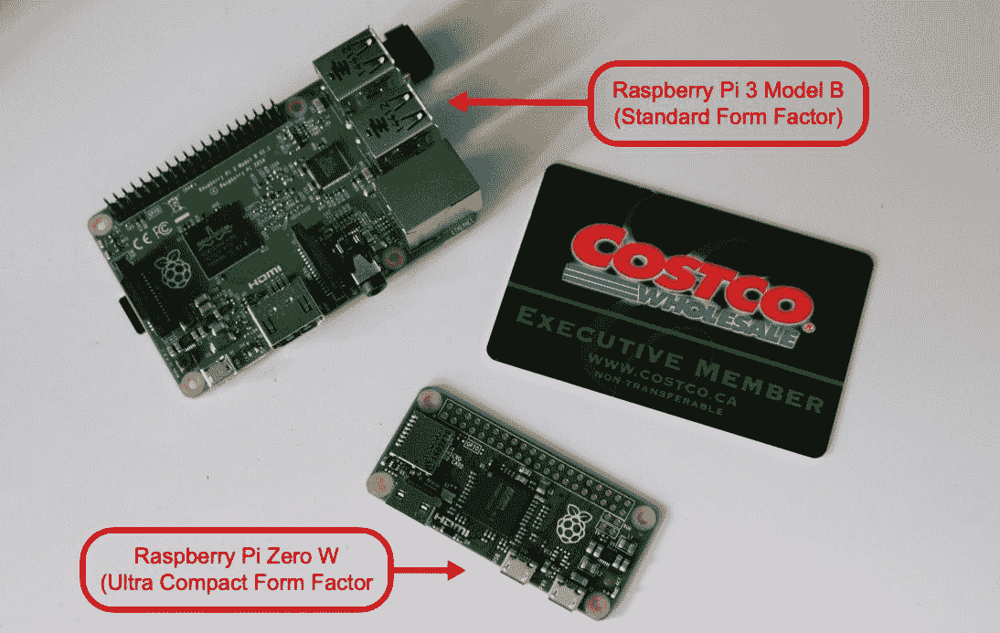

Raspberry Pi Zero W

如果你使用 `Raspberry Pi Zero W`，请记住它只支持 2.4GHz 无线。因此，如果你的无线路由器只支持 5GHz，你可能想使用其他型号的树莓派。`Pi 3 B+` 和 `4 B` 支持 2.4 和 5GHz 无线以太网。使用 `Pi 3 B+` 或 `4 B` 的优点是你可以不需要进行任何焊接。

## 我真的需要学习焊接吗？

> 焊铁对电容器说了什么？“去你的焊吧（Go flux yourself）！”

所有的树莓派都有一个通用输入/输出 (`GPIO`) 总线，这是一个双排 40 针母插针，用于将传感器和其他设备连接到树莓派：


树莓派 40 针插座

稍后我们将加速度传感器连接到树莓派的 `GPIO` 总线。由于我使用的是 `Pi Zero W`，我必须在电路板上焊接一个双排 40 针母插座以暴露 `GPIO` 总线引脚，因为 `Pi Zero W` 板没有预装该插座。

这里是我在树莓派上焊接插座以及在一个版本的加速度传感器上焊接 6 个引脚的一些照片：


在 Pi Zero W 上焊接引脚


已焊接的 40 针插座


在加速度上焊接引脚


将 Pi Zero W 放入外壳

再次，你可以使用任何树莓派，但我觉得使用一个只有信用卡一半大小的树莓派会非常酷。我建议你使用内置无线以太网的树莓派，因为这将是我在这里要记录的配置。


双排 40 针母插座


40 针排线

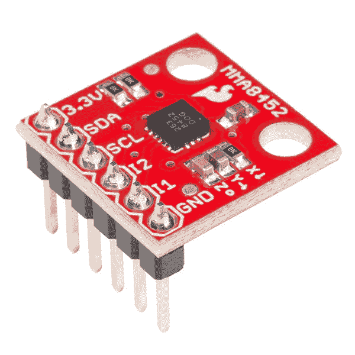

图 1. 来自 Sparkfun 的 MMA8452

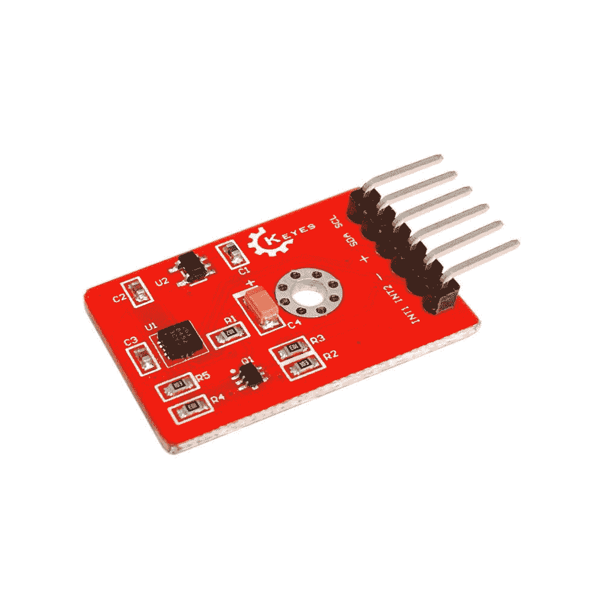

图 2. 来自 eBay 的 Keyes MMA8452Q

好了，让我们列出所需的五件物品：

1. **你的电脑**
   你需要一台连接到互联网的电脑来下载树莓派操作系统。理想情况下，你希望通过电脑通过 `SSH` 连接到树莓派。我假设你正在运行某种类 Unix 系统（Ubuntu, MacOS 等）。但是，如果你有一台 Windows PC，互联网上有大量关于如何与你的树莓派通信的信息。

2. **你的家用无线路由器**
   我不会详细介绍如何配置它，因为每个人的情况都不同。我假设你有一个，并介绍连接到它的通用方法。

3. **树莓派**
   我建议购买一个包含外壳、电源和 SD 卡的套件。我从 [CanaKit](https://www.canakit.com) 买的，但你也可以从 Amazon 或任何其他树莓派经销商处购买。
   以下是你可能想要拥有的与你的树莓派相关的物品列表：
   * 双排 40 针插座（如果你购买了 `Pi Zero W`）。你可以从 [Amazon](https://phpa.me/amazon-40pin-duel) 获取。
   * 烙铁和焊锡（如果你购买了 `Pi Zero W`）
   * 外壳
   * 树莓派电源
   * 至少 8GB 的 SD 卡。（小于 16GB 可能不划值。我建议购买额定为 `UHS-1` 或更好的卡。大多数都是都是。）
   * SD 卡阅读器。许多树莓派套件都带有一个插入电脑 `USB` 端口的阅读器。
   * HDMI 线（如果你想用键盘和显示器配置你的树莓派）
   * 键盘（如果你想用键盘和显示器配置你的树莓派）
   * 显示器（如果你想用键盘和显示器配置你的树莓派）

4. **加速度传感器**
   有很多不同的加速度传感器可用。我在这个项目中想要一个使用 `I2C` 总线的传感器——稍后会详细介绍。我们将使用一个小型 C 程序，它与 `MMA8452Q` 三轴加速度计通信。有两种略有不同的板类型：
   * 图 1 所示的 `MMA8452` 可以从 [Sparkfun](https://www.sparkfun.com/products/13926) 购买。
   * 以及 Keyes 的 `MMA8452Q`，可以从 [eBay](https://phpa.me/ebay-accelerometer) 购买。见图 2。
   Keyes 版本的优点是它预焊了 6 个引脚。

5. **连接加速度传感器到树莓派的母母 4 针排线**
   这些通常以 40 针排线的形式提供，剥下 4 根线将加速度传感器连接到树莓派的 `GPIO` 总线。你可以从 [Amazon](https://phpa.me/amazon-fem-jumper-40) 购买。

# 配置你的树莓派

现在我们已经有了所有的核心设备和组件，我们需要安装操作系统并配置我们的树莓派。

### 下载树莓派 OS 镜像

首先，我们需要获取一个树莓派操作系统 (OS) 镜像并将其放置到 SD 卡中。最好的方法是下载 [Raspberry Pi Imager](https://www.raspberrypi.com/software/)。该页面上有提供适用于 MacOS、Windows 或 Ubuntu 的写入器下载链接。你甚至可以在 UNIX 终端窗口中使用 `apt` 包管理器来安装 `Raspberry Pi Imager`。在下载了适用于你操作系统的写入器包后，按照安装说明进行。

将你的 SD 卡阅读器插入电脑，并插入你将用于树莓派的 SD 卡。

启动 `Raspberry Pi Imager`，你应该看到它的主界面：

![media/file8.png] -> *注：此处原文逻辑对应图片应为 file12* 
（修正：应该是 `Raspberry Pi Imager` 的主界面：

![media/file12.png]

启动 `Raspberry Pi Imager`，你应该看到它的主界面：

![media/file12.png]

选择 `CHOOSE STORAGE`，将弹出 `Storage` 对话框：

![media/file13.png]

选择你的 SD 卡——通常显示为 `Generic MassStorage Media` 以及其大小。

现在选择 `CHOOSE OS`，将弹出 `Operating System` 对话框：

![media/file14.png]

选择 `Raspberry Pi OS (other)`，将显示一组可选的树莓派操作系统：

![media/file15.png]

选择 `Raspberry Pi OS Lite (32-bit)`——这是一个 Linux 服务器安装，由于我们不需要完整的桌面安装，它可以减少 CPU 占用。你现在将返回 `Raspberry Pi Imager` 的主界面：

现在选择 `WRITE` 将镜像写入你的 SD 卡。你现在会看到一个 `Warning` 对话框，告知你 SD 卡上的现有数据将被删除，并确保你想要继续。选择 `YES`。

通常会弹出一个 `Permissions` 对话框，要求你输入电脑管理员密码以便写入 SD 卡。

输入凭据后，`Raspberry Pi Imager` 开始将 OS 写入 SD 卡。当写入操作完成后，将显示 `Write Successful` 对话框。选择 `CONTINUE` 并退出 `Raspberry Pi Imager` 应用程序。你现在可以从 SD 卡阅读器中取出 SD 卡。

现在我们需要配置我们的树莓派。你有两种方法可以实现：

* 无头配置 (Headless configuration)
* 直接配置 (Direct configuration)

我将首先展示无头配置，因为我觉得它是最简单的。然后我将展示直接配置。


假设你已经有一台树莓派（Raspberry Pi），但手头没有键盘或额外的显示器，或者像我一样，把这些忘了（还有树莓派 Zero W 套件附带的魔法 HDMI 转接器）！此时你唯一的选择是对你的派进行无头配置（headless configuration）。这是一件好事，因为这通常是最简单的选项。

要创建无头配置，我们需要修改 SD 卡的内容，以便树莓派在启动时：

* 允许我们 SSH 登录树莓派
* 将派连接到我们的 Wi-Fi 路由器

将 SD 卡插回读卡器。

打开终端窗口并进入 SD 卡的根目录。我使用的是 Mac，将进入 `/Volumes/boot`：

要启用 SSH，我们需要在 SD 卡的 `boot` 文件夹中创建一个名为 `ssh` 的空文件。在终端窗口中输入以下命令：

```

```

接下来，我们需要添加 Wi-Fi 网络信息。为此，我们需要创建一个名为 `wpa_supplicant.conf` 的文件，并将其放在 `boot` 文件夹中。在终端窗口中输入以下命令创建 `wpa_supplicant.conf` 文件：

```

```

接下来，我们需要编辑 `wpa_supplicant.conf` 文件并添加我们的 Wi-Fi 网络 SSID 和密码。将以下内容粘贴到编辑器中，根据需要更新国家代码以及你的网络 SSID 和密码：

```
country=US
ctrl_interface=DIR=/var/run/wpa_supplicant GROUP=netdev
update_config=1

network={
    ssid="NETWORK-NAME"
    psk="NETWORK-PASSWORD"
}
```

保存文件并退出编辑器。

弹出 SD 卡并将其插入树莓派。

***

Mitch Allen 提供了一套[完整的操作说明](https://phpa.me/desertbot-pi-wifi-setup) 教教你如何为你的树莓派创建无头配置，涵盖了你主机电脑的所有主流操作系统。

## 直接配置

直接配置需要将 USB 键盘和 HDMI 显示器连接到你的派（Pi）上。某些树莓派需要转接器来连接标准的 HDMI 线缆和 USB 键盘。Pi Zero 甚至附带了一个 USB 转接器。

将 SD 卡插入你的树莓派。

将你的派连接到显示器和键盘。

将电源连接到你的派，并将电源插上交流电墙插座。

在树莓派启动后，使用用户 `pi` 和默认密码 `raspberry` 登录。

接下来，我们需要添加我们的 Wi-Fi 网络信息。为此，我们需要创建一个名为 `wpa_supplicant.conf` 的文件，并将其放入 `/etc/wpa_supplicant/` 文件夹。我们将使用内置的 `nano` 编辑器创建 `wpa_supplicant.conf` 文件。由于此文件需要 `root` 权限，我们必须以超级用户（superuser）身份创建此文件。在命令行终端中输入以下命令：

```

```

现在让我们来编辑 `wpa_supplicant.conf` 文件并添加我们的 Wi-Fi 网络 SSID 和密码。将以下内容粘贴到编辑器中，根据需要更新国家代码以及你的网络 SSID 和密码：

```
country=US
ctrl_interface=DIR=/var/run/wpa_supplicant GROUP=netdev
update_config=1

network={
    ssid="NETWORK-NAME"
    psk="NETWORK-PASSWORD"
}
```

输入 `^O` 保存文件，输入 `^X` 退出 `nano` 编辑器。

接下来，我们将运行 `raspi-config` 工具，以便你的派允许 SSH 连接。以超级用户身份运行以下命令，以显示 `raspi-config` 工具的主界面。

```

```

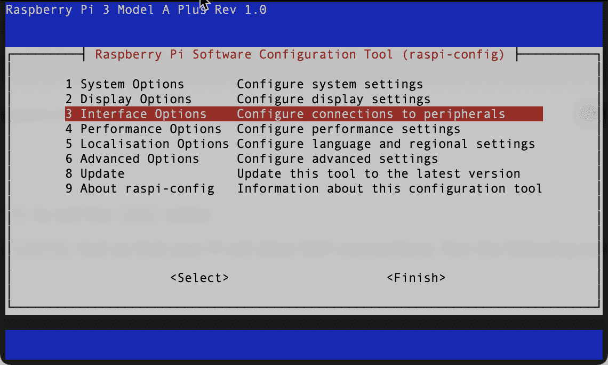

主界面：选择接口选项

使用 `arrow` 键高亮 `3 Interface Options` 并按 `Enter`，将显示 `Interface Options` ：

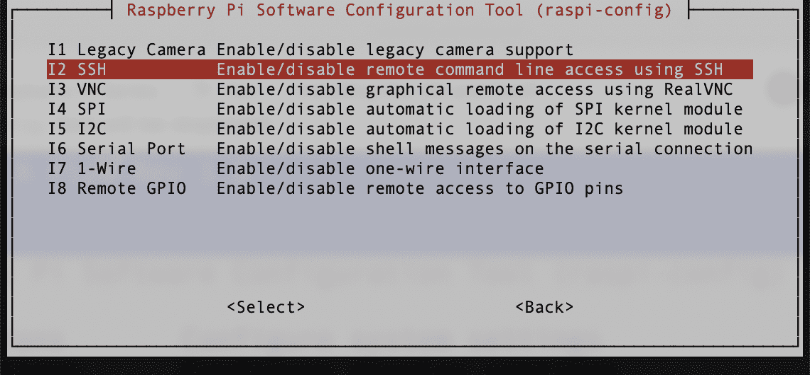

接口选项：选择 SSH

使用 `arrow` 键高亮 `I2 SSH` 并按 `Enter`，会弹出一个对话框询问：“你想要启用 SSH 服务器吗？”。选择 `Yes` 并按 `Enter`。

在弹出“The SSH server is enabled”对话框后按 `Enter`，你将返回 `raspi-config` 工具的 `main` 主界面。使用 Tab 键选择 `<Finish>` 并按 `Enter`。

在命令行终端中输入以下命令关闭树莓派：

```

```

## SSH 登录你的派

现在将电源连接到你的树莓派并插上交流电。

几分钟后，在终端中输入以下命令以删除为主机 `raspberrypi.local` 生成的任何之前的 SSH 密钥：

```

```

如果你收到 `host not found` 错误也没关系。这意味着你之前没有为 `raspberrypi.local` 生成过任何 SSH 密钥。

接下来，在终端中输入以下命令，使用用户 `pi` SSH 登录你的派：

```

```

输入默认密码 `raspberry`。如果一切顺利，你应该已经登录到了你的树莓派。

## 运行 `raspi-config`

此时，你想要为你的树莓派配置本地区域设置，并更改密码。为此，我们将以超级用户身份运行 `raspi-config` 程序。

假设你已经通过 SSH 登录了派，在终端中输入以下命令：

```

```

你应该会再次看到 `raspi-config` 的主界面。

首先，我们需要确保我们拥有最新版本的 `raspi-config` 工具。使用 `arrow` 键高亮 `8 Update`，并切换到 `<Select>` 选项并按 `Enter`。

`raspi-config` 将更新到最新版本，并重新显示 `raspi-config` 主界面，同时高亮 `System Options`。切换到 `<Select>` 选项并按 `Enter`。将显示以下 `System Options`，允许你更改密码：

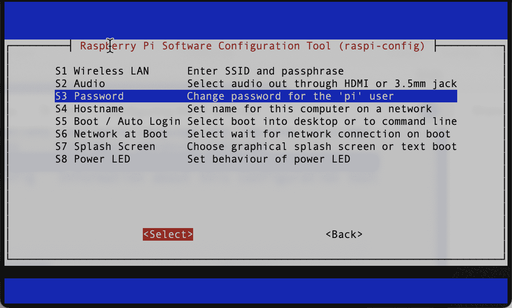

系统选项：选择密码

使用 `arrow` 键高亮 `S3 Password`，并切换到 `<Select>` 选项并按 `Enter`。按照指令输入你的新密码。为了本系列教程，我会将我的设置为。

更改密码后，你将回到 `raspi-config` 的主界面。接下来，我们需要修改 `Interface Options`，以便你的派允许通过 GPIO 与连接的传感器。使用 `arrow` 键高亮 `3 Interface Options` 并切换到 `<Select>` 选项并按 `Enter`。

我们特别想要启用 `I2C` 总线，因为这是传感器通信的协议。使用 `arrow` 键高亮 `I5 I2C` 并切换到 `<Select>` 选项并按 `Enter`。

当你看到“Would you like the I2C interface to be enabled?” 屏幕时，切换到 `<Yes>` 并按 `Enter`。

然后选择 `<Ok>`，你将回到 `raspi-config` 的主菜单。

最后，我们将更改本地化选项。在主界面选择 5 Localisation Options。

我们需要配置 `Locale`、`Timezone` 和 `WLAN Country`：

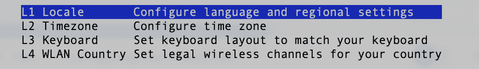

Raspi-config 本地化选项：选择语言

首先是 `Locale.`

使用 `arrow` 键向下滚动直到找到 `en_GB.UTF-8 UTF-8`。由于我不在英国，我将通过按下 `spacebar` 禁用 `en_GB.UTF-8 UTF-8`：


配置语言：禁用 en_GB.UTF-8

这将选择（由星号表示）消失。然后我将继续使用 `arrow` 键直到找到我的语言。我将再次使用 `spacebar` 选择我的语言，即 `en_US.UTF-8 UTF-8`，因为我住在美国。

然后我切换并选择 `<Ok>`，我应该看到一个要求选择系统默认语言的屏幕：

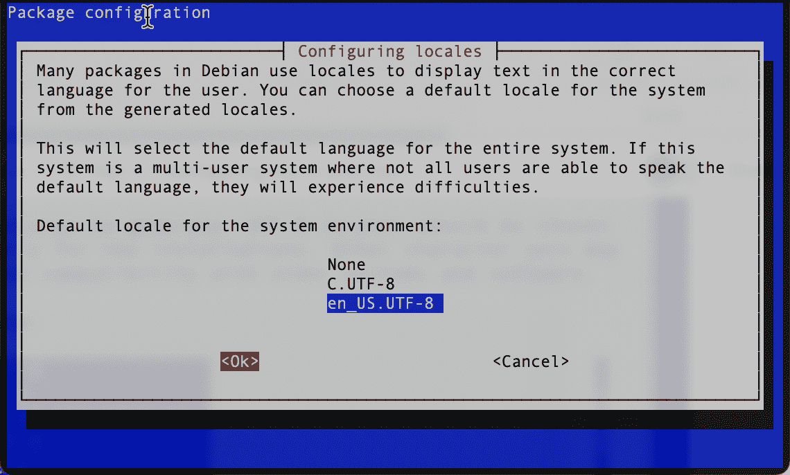

配置语言：选择 en_US.UTF-8 为默认

使用 `arrow` 键选择你刚刚添加的 `locale`，切换到 `<Ok>` 并按 `Enter`。


系统将为你的 `locale` 生成必要的文件，并将你返回到 `raspi-config` 工具的主界面。再次选择 `Localization` 选项，并在 `Localization Options` 屏幕上选择 `L2 Timezone`。

我位于 `America`，所以我在 `Configuring tzdata` 屏幕上选择 `Geographic area` 时选了这一项：

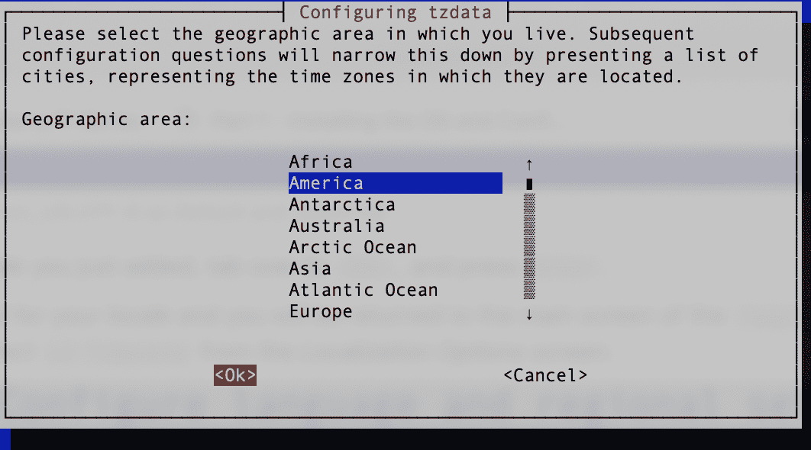

配置 tzdata：选择美国

这样做后，我进入了 `Time zone` 选择界面。我住在威斯康星州的麦迪逊，因此我会在 `Configuring tzdata` 屏幕上选择 `Chicago`：

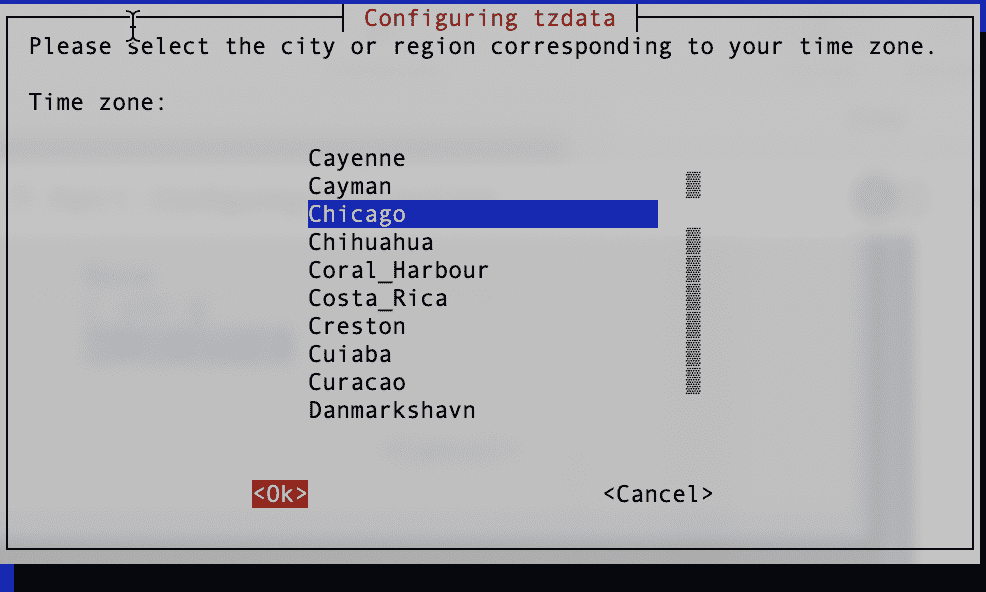
配置 tzdata：选择芝加哥

系统将为你的时区更改必要的设置，并将你返回到 `raspi-config` 主界面。再次选择 `Localization` 并选择 `L4 WLAN Country`。同样，我在美国，所以我选择了这一项。

系统将为你的 WLAN 国家更改必要的设置，并将你返回到 `raspi-config` 主界面。按 Tab 键移动到 `<Finish>` 并按下 `Enter`。

系统会询问你是否想要重启树莓派。选择 `<Yes>`。你将被注销，在树莓派重启期间，你的终端 SSH 连接将关闭。

等待大约一分钟，从主机计算机的终端窗口重新登录你的树莓派。你现在需要使用新密码进行登录。

## 结论

你现在拥有一台完全配置好的树莓派！这标志着我们的*如何用树莓派黑入家庭*第一部分的结束。在下一部分中，我们将安装完整的 LAMP 栈。在下个月之前，希望你玩你的树莓派玩得开心！

> 简介
> Ken Marks 多直一直在威斯康星州麦迪逊的麦迪逊学院担任编程导师，自 2012 年以来一直使用 MySQL 教授 PHP Web 开发。在教学之前，Ken 曾担任了 20 多年的软件工程师，主要开发医疗设备软件。Ken 积极参与 PHP 社区，在会议上演讲和教学。[@FlibertiGiblets](https://twitter.com/FlibertiGiblets)

# 成为高效导师的五种策略
## 作者：Olivia Liddell

> 我职业生涯中最关键的时刻之一发生在大约十年前。当时我距离完成为期一年的导师储备计划还有几周时间。作为该计划最后阶段的一部分，主任给我打来电话，通知我下一年的正式教师分配情况。

我本希望能够被分配到一所和我所有一起参加导师计划的朋友所在的学校，这样我们就可以在全职芝加哥公立学校教师的第一步阶段中继续互相支持。然而，我很快意识到主任对我有不同的计划。我们在电话中交流时，他解释说，虽然我的其他朋友将聚集在几所学校里，但我被分配到了另一所不同的学校，在那里我谁也不认识。他决定把我放在那里，是因为他和其他导师储备计划的领导者看到我不仅作为一名教师，而且作为导师都具有巨大的成功潜力。他们将我分配到那所学校，是为了让他们在几年内快速帮助我进入导师导师新教师实习生的道路。

在我职业生涯的那个阶段，我遇到过几位导师（包括正式和非正式的），但我从未真正指导过任何人。当计划主任继续描述他对我走上这条道路感到多么兴奋时，我能做的只是点头，努力不恐慌，并开始寻找逃脱的方法。

我真希望能够说，接下来发生的事情是我直面恐惧，带着开放的心态去被分配的学校，并完全拥抱成为导师的挑战。但事实并非如此。在接下来的一个月里，我在网络中的另一所学校找到了一个机会，那里实际上更符合我的教学兴趣（初中阿拉伯语），并获得了转到那里的许可。

然而，导师这个话题在随后的多年里一直留在我的脑海中挥之不去。当我回首与计划主任的那次对话时，我最终意识到，我不愿承担导师角色的部分原因在于我不知道如何做导师。

导师已成为我非常热爱的事情，因为它具有帮助他人发现新想法并取得进步的潜力。那么，如何成为一名高效的导师呢？本文探讨了五种关键策略，帮助你开始。在阅读本文时，我鼓励你反思自己的经历（包括作为导师和学员的经历），并思考哪些策略最能引起你的共鸣。

### 策略 #1：识别你的优势

我从那些对导师工作感兴趣但害怕开始的人那里听过的最常见误解之一，是他们觉得自己没有什么可以贡献的。对我来说，导师工作最好的事情之一是，你有机会准确选择你想要突出自己的哪些部分。换句话说，你不需要成为所有领域的专家也能为他人提供价值。

花点时间想想你在流行文化中可能看到导师行为的地方。脑海中浮出的两个最佳例子是真人秀《鲨鱼坦克》（Shark Tank）和《好声音》（The Voice）。在这两个节目中，参赛者可以选择想要哪位评委作为导师——无论是为他们的业务投资，还是指导他们赢得歌唱比赛。这种选择通常基于参赛者的兴趣与评委专业领域之间的某种兼容性。例如，在《鲨鱼坦克》上启动体育主题业务的人，更有可能选择马克·库比（达拉斯独行侠篮队的所有者）作为导师，而不是其他业务兴趣领域的评委。

这引出了一个问题：人们选择 `你` 作为他们的导师的原因可能有哪些？发现你的优势可以帮助你确定哪些技能最适合展示并提供给潜在的导师。

在职业生涯中，我发现专注于我可以帮助导师的特定领域非常有价值，而不是撒一个更广的网。为了让你了解这对你来说可能是什么样的，我最近与导师关注的某些领域包括：公开演讲、从课堂教学转型其他职业，以及帮助准备认证考试的策略。

如果你发现自己在识别优势时遇到瓶颈，可以考虑花时间完成“反思最佳自我练习”（Reflected Best Self Exercise）。这项练习帮助你根据最了解你的人那里获得的反馈，发现并反思你表现最佳的时刻。


1. **选择 3-5 位受访者并向他们寻求反馈。** 具体来说，这些受访者将就他们何时看到你处于最佳提供见解。理想情况下，你希望选择那些在你职业生涯不同阶段都认识你的人，以增加获得多样化回答的可能性。
2. **识别他们回答中的模式。** 当我第一次完成这个练习时，我发现了一个共同的主题——人们认为我擅长公开演讲。在当时，公开演讲的想法让我非常恐惧，但知道其他人将其视为一种优势，有助于我采取有意识的步骤，开始更多地关注这一领域。
3. **撰写你的自画像。** 这一步旨在撰写一份关于你如何看待自己以及潜力的书面自画像，但如果你很有艺术天赋，也可以尝试创作视觉自画像！在练习的这一步中，你正在整合他人分享关于你的信息，并利用这些反馈创建一个你对未来规划的愿景。

### 策略 #2：确定你想从事的导师类型。

在我职业生涯早期，当我害怕成为导师时，我的抵触情绪之一是因为我并不了解可能参与的不同类型的导师指导。从我的角度来看，我当时认为导师必须对引导受导师（mentee）的整个职业生涯完全负责。导师指导似乎是一项极其艰巨的任务，由于不想可能毁掉他人的职业，我决定这不适合我。

我早该就知道导师指导可以以多种形式存在。在今天我作为导师的经验中，我与受导师是以正式身份合作了几个月，而另一些则是根据需要、以更非正式的方式建立了伙伴关系。

在你确定了自己的优势之后，在投入开始指导某人之前，确定哪种类型的导师指导最适合你至关重要。我在本文中重点关注的两种类型是非正式导师和正式导师。

#### 非正式导师指导
在非正式导师指导中，目标通常是不指定的。导师和受导师通常是相互选择的，且结果通常不会被跟踪或衡量。你可能会通过技术聚会小组、部门社交活动，甚至仅仅通过在休息室与同事聊天来找到一位非正式受导师。

在非正式导师关系中，你和受导师在寻求连接机会时保持主动是至关重要的。虽然你可能没有与受导师正式建立目标或跟踪他们的进度，但寻找连接和扩展关系的机会可以帮助你确保他们仍然能从与你互动的时间中受益。

当你在非正式背景下与受导师合作时，向他们提供关于利用与你关系的最佳建议将很有帮助。例如，我通常建议我的非正式受导师带着具体问题联系我，并概述他们为解决某个问题已经采取的步骤。这样，无论是通过面对面会议还是邮件交流，我们都能充分利用我们共处的时间。

######## 正式导师指导
在正式导师指导中，导师和受导师通常根据某种兼容性进行配对。目标是建立的，且结果会被跟踪和衡量。正式导师关系可能通过人力资源部门领导的公司级倡议建立。例如，公司可能会为其实习生提供一项计划，让他们在实习期间正式与员工配对建立导师指导关系。

如果你正在考虑参与正式导师指导，关键的第一步是定义目的和时间表。从这个问题上反推：“当这段导师指导关系结束时，受导师应该能够做什么？”例如，你将专注于帮助你的受导师提高技术技能，还是为新的领导职位做准备？你将与他们合作 6 个月还是一整年？你对这些问题的回答可以帮助你确定如何最好地构建导师关系，并为所有参与者建立清晰的预期。

接下来，你应该确定具体如何衡量导师指导计划的有效性。这些指标可能包括能力评估、员工留存率、工作绩效提升率等。在正式导师指导计划中加入指标可以帮助你获得数据，显示计划的哪些部分最有效，如果你可能需要随着时间的推移增长和扩大计划，这将特别有用。

确定你导师方法的参数可以帮助你成为更有效的导师，因为这能让你更清晰地理解你试图与受导师完成什么。与其试图为受导师做任何事情，从一开始就设定清晰的焦点是帮助自己通向成功的绝佳方法。

### 策略 #3：在与受导师沟通时，专注于积极倾听。

作为一名受导师，我有很多时候觉得我的导师并没有真正在听我的话。有时看起来，他们进入对话时，强调的是他们想告诉我的内容，而不是先听听我想分享的内容。我利用这些经历来提醒自己，作为一名导师，我最重要的责任之一就是倾听我的受导师的话。

积极倾听的一个方面是与你的受导师保持全神投入。虽然很容易想要多任务处理并将注意力同时分散到几个领域，但考虑这样做对你的受导师可能产生的影响是非常重要的。对于许多刚入职场且第一次与导师合作的受导师来说，仅仅是考虑为了个人利益而占用别人的时间就可能让他们感到不知所措。因此，全神投入并与你的受导师互动有助于提醒他们，你选择了花时间与他们一起工作，并在他们的职业旅程中指导他们。

你可以与受导师一起使用的另一种积极倾听策略是转述（paraphrasing）。有时当我与受导师交谈时，我可能在第一次并没有完全理解他们想告诉我的什么。例如，他们可能以非常宽泛或模糊的方式描述一个问题，但仍在寻求一个特定的结果。我并没有假设自己完全理解了所说的话，而是停下来转述我听他们说的信息。转述涉及用你自己的话重述他人的信息。我经常使用方便的句首来帮助我开始转述，例如：

* “我听你说的是……” 
* “根据我的理解，你觉得……” 
* “听起来你是在说……” 

转述让你在进入提供建议和反馈的下一步之前，获得与受导师达成共识的机会。

然而，即使有转述，有时也可能出现你对某些细节不清楚，需要在继续之前进行澄清的情况。作为导师，提问澄清性问题实际上是件好事。虽然提问可能会面临表现得不感兴趣或不投入的风险，似乎令人令畏，但澄清信息的过程可以向受导师证明，你正在积极倾听他们，并且需要更多了解他们提到的某些特定领域。


这是一个说明为什么这重要的例子：有一次，我要和一位导师进行对话，那天我们计划讨论一个即将开展的项目。我的教徒一开头就说：“我确定你对这个新项目很兴奋吧！”实际上我对它感到非常恐惧，接着我觉得，因为我的教徒假设我应该很兴奋，导致我犹豫于向她分享我对该项目的真实感受。另一方面，如果对话开始时是先让我有机会分享自己的感受，我很可能会感到足够放松，从而告诉她我对该项目的焦虑。

在沟通的澄清阶段可以使用的句开头包括：

* “你说的……是什么意思？”
* “你能多告诉我关于……的信息吗？”
* “你对……感觉如何？”

### 策略 #4：为你的教徒提供具体且可操作的反馈。

当我完成教师驻留计划时，我必须与导师和教练参加每日的总结会议。我们会回顾我教的课程，讨论哪些地方做得好，哪些地方可以做得更好，并确定未来需要关注的领域。在整个学年里，我与导师和教练建立了良好的关系，并真正开始重视他们和我分享的反馈。

然而，在计划的一个阶段，我被临时分配到另一所学校，在那里我与一位不同的教练进行总结。她指导我的角色本应和其他人一样，但遗憾的是，她的反馈远没有那么有帮助。我永远不会忘记某个下午她给我的反馈，那是我职业生涯中收到的最没用且不可操作的反馈：“奥莉维亚，你得修一下你的脸表情。”

在平复了最初的震惊并要求教练解释她的意思后，她告诉我，在她看来，我那天教课时看起来并不开心，所以她觉得我需要多微笑。我从中从中获得的真正启示与我的面部表情无关，而与实际上如何向教徒提供有帮助的建议有关。

首先，你想要确保你的反馈是具体的。我上面描述的 `fix your face`（修一下你的脸）建议就是一个极其模糊且令人沮丧的模糊建议示例。然而，即使是积极和鼓励性的反馈也仍然可能是模糊且无用的。例如，如果你收到过诸如“干得好！”或“继续保持良好！”之类的反馈，你可能在那一刻感觉很良好，但随后又会怀疑自己过去到底做对了什么现在显然应该继续做。因此，让你的反馈变得具体可以帮助你的教徒精确地理解他们应该做什么。

接下来，提供可操作的反馈可以帮助你的教徒理解他们为什么要以某种特定的方式做某事。这样做可以强化他们去反思你所建议采取这些行动的逻辑。

假设你和你的教徒正在进行代码审查，你需要给他们提供反馈。一个不具体且不可操作的反馈示例可能是：“干得好，这看起来真的很棒了。”相比之下，一个具体且可操作的反馈示例可以是：

* “你在 \_\_\_\_ 方面做得很好。这非常值得保持，因为……”
* “在将来，考虑做 \_\_\_\_\_\_ ，因为……”

通过接收这种格式的反馈，你赋予了教徒在你所建议的领域进行改进的能力，并让他们继续向你寻求额外的建议。

### 策略 #5：教你的教徒如何承担导师关系的主导。

作为导师，想要为你的教徒付出额外努力并尽一切努力帮助他们成功是一种自然的感觉。知道何时退后并让我的教徒承担更多的主导权，实际上是我在指导生涯早期几年中最努力挣扎的领域之一。我当时没有意识到，当我努力帮助教徒提高他们的技术、领导力和整体职业技能时，我也拥有一个宝贵的机会，教他们将来如何自己成为导师。

具体确定如何给你的教徒更多承担主导机会会有所不同，取决于你们导师关系的特定设置以及他们的个人工作经验。例如，当我指导那些处于职业生涯初期、从事第一份全职工作的员工时，给予他们更多主导权的一部分包括要求他们创建会议的日历邀请、设定会议议程等。对于更有经验的员工，我会挑战他们去识别他们想要与短期和长期指导目标相关的衡量指标。

作为这一策略的一部分，当你的教徒学习如何承担更多责任时，你也应该确保提供具体且可操作的反馈，即使对于最小的任务也是如此。以身作则并提供持续的反馈可以帮助你成为更有效的导师。


通常情况下，PHP 数组就能胜任，这一点无需置疑。但如果你想让代码更轻松地反映你的思路，依赖专门的结构将非常有帮助。

这篇文章将向你展示我为了简单起见实现的 `Collection`。或者，从 PHP 7 版本开始，PHP 通过其 [DS 扩展](https://www.php.net/book.ds) 提供了一个非常好的实现。如果你还不熟悉它，我建议你查看一下。

# 什么是迭代器 (Iterator)？

`Iterator` 是一个 `Object`，其唯一职责是通过特定的算法遍历 `Collection` 中包含的元素。`Iterator` 不应该修改底层 `Collection`，而是仅仅作为一个观察者对其操作。在 PHP 中，`Iterators` 是作为 [SPL 扩展](https://www.php.net/spl.iterators) 的一部分，我将在下面的代码示例中使用它。

## 为什么需要迭代器？

我们使用 `Iterators` 是为了将存储与元素的迭代分离开。从某种意义上说，这是尝试遵守单一职责原则（[SOLID](https://www.thinktocode.com/?p=47) 中的 `S`）。

想象一个复杂的 `Collection`，例如树或图。在这种类结构中，有很多方法可以遍历元素。例如，你可以有一个方法以广度优先搜索的方式返回 `Collection` 的下一个元素，然后另一个方法以深度优先搜索的方式返回。接着，稍后，你可能需要按数字升序遍历元素，而且既然都做在这里了，为什么不再实现另一个按创建顺序遍历集合的器呢？

如果你遵循这条路径，你很快就会发现自己经常频繁地修改 `Collection` 类。如果你想保持 Bug 数量在低水平，这绝对不是一个好主意。

这正是 `Iterators` 要解决的问题：它们提供了一种整洁的方式来创建新的循环机制，而无需更改处理内存组织等代码。

当需要新的迭代标准时，你只需要组合一个全新的 `Iterator` 类，你的应用程序的其他部分就可以保持不变。

如果你想更深入地了解这些概念，我建议阅读这篇关于 [Iterators](https://phpa.me/refactoring-guru-iterator) 的优秀文章。

## 不同类型的迭代器

对于给定的 `Collection`，可以创建[许多类型的迭代器](https://www.php.net/spl.iterators)。让我们快速看看其中一些：

*   [AppendIterator](https://www.php.net/class.appenditerator)。该类允许以顺序方式组合 `Iterators`（当一个 `Iterator` 到达底层集合的末尾时，循环将继续到下一个，直到所有迭代器都被消耗完毕）。
*   [InfiniteIterator](https://www.php.net/class.infiniteiterator)。该类用于产生循环迭代：当到达循环末尾时，`Iterator` 会自动回回，因此始终有下一个元素。
*   [LimitIterator](https://www.php.net/class.limititerator)。该类用于遍历 `Collection` 元素的某个固定子集。

所有这些都是 `Iterators` 的示例，它们可以与其他器组合，从而构建复杂的迭代逻辑。特定的 `Iterators` 专为文件系统设计，例如 [DirectoryIterator](https://www.php.net/class.directoryiterator) 及其家族。

除了这些之外，如果你发现需要组合更具体的迭代算法，也可以创建自己的迭代器。

### 过滤迭代器 (Filteriterators)

一种特别有的 `Iterator` 类型是 [FilterIterator](https://www.php.net/class.filteriterator)。

该类设计用于遍历 `Collection` 元素的子集。然而，与 `LimitIterator` 不同，子集不是固定的而是动态的。`LimitIterator` 元素是通过对每个元素应用过滤函数并保留结果为 true 的元素来选择的。

`FilterIterator` 不直接作用于集合。相反，它利用一个预存在的 `Iterator` 来访问元素，它是另一个组合 `Iterator`。

回到我们的图示例，假设你已经实现了一个广度优先搜索 `Iterator`，现在你想处理这些节点中的特定集合。实现这一点的良好方法是设计一个 `FilterIterator` 然后将其与图一起使用。

## 一个真实的应用案例

最近，我从一个我指导的程序员那里收到了这封邮件：

> 嗨 Mauro，
>
> 好久不见，希望你一切都好？
>
> 我有一个需要用 SOLID 原则解决的 PHP 编程挑战，而且我觉得这涉及到 PHP 的 `Iterator` 类，我不熟悉它。你能帮帮我吗？
>
> 希望你能帮帮我。我真的需要理解解决这个问题的最佳方法。

要解决的问题描述如下：

> 你的任务是创建一个 CLI 脚本，通过 HTTP 从特定端点读取基于 JSON 的数据。该脚本将包含几个子命令，用于过滤和输出加载的数据。命令应为：
>
> 按价格范围查找对象（给定 `price_from` 和 `price_to` 作为参数）。按特定的子对象定义查找对象。所有给定的子命令应只输出库存中的数量。
>
> 技术要求：
>
> 为获取 JSON HTTP 端点实现 `ReaderInterface`，从而在加载的数据上与 `OfferCollectionInterface` 和 `OfferInterface` 一工作。

列表 1 显示了我为了解决这个问题并帮助我的学生理解底层概念而编写的[一个小脚本](https://github.com/mchojrin/HTTPJsonFilter)。

我将介绍它的主要部分，以向你展示如何在 PHP 中实现 `FilterIterator`。让我们从主脚本开始，即列表 1 所示的 `run.php` 文件。

**列表 1。**

```
```
```

在这里你可以看到脚本如何：

1.  通过调用 `spl_autoload_register` 引入了一个非常简单的自动加载函数。这样做目的是为了防止在代码的其他部分显式要求支持类。
2.  通过 `HTTPReader` 实例创建一个 `Product` 集合。`HTTPReader` 的目标是从从外部端点收集的文本应用 `json_decode` 的结果创建一个新的 `Collection`。
3.  通过调用函数 [iterator_count](https://www.php.net/function.iterator-count) 并向其传递 `Iterator`，输出符合命令行参数指定的 `Collection` 中的元素数量。

最后一点是我希望你关注的重点。注意根据指定的子命令，在原始 `Iterator` 之上使用了特定的 `FilterIterator` 子类。

列表 2 显示了 `PriceFilterIterator` 的代码。

**列表 2。**

```
```

该类有两个方法：

*   构造函数
*   `accept`

`accept` 是该类最重要的部分，因为它是存储实际过滤逻辑的地方。在特定情况下，判断产品是否应属于迭代的方法是检查其价格是否在既定边界内。

这些边界是在创建 `Iterator` 实例时定义的。它们是构造方法的参数。

每个 `FilterIterator` 的工作方式如下：对底层 `Iterator` 生成的每个元素调用 `accept` 方法，如果评估结果为布尔 `true`，则该元素将被视为循环的一部分；否则，将被跳过。

现在看列表 3 所示的 `VendorIdFilterIterator` 类。

**列表 3。**

```
```

结构几乎相同。唯一的显著区别是 `accept` 方法的定义，在这种情况下，它将供应商 ID 与构造时建立固定值进行比对。

由于这只是一个模拟，这个概念验证项目包含一个名为 `output_json.php` 的脚本（列表 4），它将产生另一端预期的 JSON 输出。

**列表 4。**

```
```


要测试此代码——首先，启动一个可以作为远程端点的服务器。实现此点的简单方法是运行 `php -S localhost:8000 output_json.php`。然后，如果你执行命令 `OFFERS_ENDPOINT=http://localhost:8000 php run.php count_by_price_range 200 500`，你将得到响应 `2`；如果你使用 `OFFERS_ENDPOINT=http://localhost:8000 php run.php count_by_vendor_id 84`，你将得到 `1`。

要通过任何其他标准（如产品标题）过滤结果，你需要：

1. 创建一个新的 `FilterIterator` 类
2. 在 `$subcommand2FilterMapping` 中添加新条目

第一点完成后，你将拥有如 Listing 5 所示的类。

**Listing 5.**

```
```
```

以及一个定义如 Listing 6 所示的映射。

**Listing 6.**

```
```
```

最后，为了对其进行测试，运行 `OFFERS_ENDPOINT=http://localhost:8000 php run.php count_by_title_prefix Ch`，你应该应该得到结果 `1`。

当然，这些过滤器的使用远不仅限于计数元素。一旦计算出子集，你就可以对它们进行所需的任何操作。事实上，如果这对你想要解决的问题有意义，你可以将这些过滤器作为应用其他过滤器的基础。

获取这些结果的另一种方法是依赖数组过滤函数而不是 FilterIterators，如 Listing 7 所示。

**Listing 7.**

```
```
```

这种方法的主要“问题”在于它不符合挑战的特定要求，因此它并不真正构成所分析案例的有效答案。

在更具真实的场景中，这可能是获取你所寻找的答案的方法。你可以看到，这种实现甚至更简洁，在某些情况下可能更受青。

我对此有两个主要的顾虑：

1. 代码组织没有像前者那样良好。
2. 它需要引入一个*临时*（ad hoc）的 `toArray` 方法来匹配 `array_filter` 函数的签名，这使得使用 Collection 失去了意义。

在我看来，`array_filter` 函数强制第一个参数为数组而不是可迭代对象，是语言的一个缺陷。谁知道呢，也许未来会改变，但目前，这就是现实。

解决此问题的第三种方法是为 Collection 提供一种自过滤的方法。这可能是有趣的，特别是如果这种过滤方法接收回调函数作为参数，从而赋予它极大的灵活性：

```
```
```

尽管如此，我对这种实现长期来看将如何发展仍持怀疑态度。看起来我们可能给 Collection 类施加了过多的责任。

## 结论

在本文中，你学习了集合、通用的迭代器（Iterators），特别是 FilterIterators。

虽然在 PHP 中使用集合以及通来说的高级数据结构并不是非常常见的做法，但有很多新颖有趣的工具可供你利用，特别是当你保持 PHP 版本更新时。

我希望我能够激发你的好奇心，并向你展示如何组织代码，使其随着时间的推移更容易阅读和维护。

> ### 简介

>  Mauro Chojrin 是一位 PHP 培训师和顾问。自 1997 年以来，他就参与了 IT 行业的各种职位，包括技术支持、开发、团队领导、IT 管理和教学。他还维护着[自己的博客](https://academy.leewayweb.com)和[YouTube 频道](https://phpa.me/youtube-leeway)，在上面与世界分享知识。

# PHP 谜题：臭名昭彰的 Fizz Buzz

## 作者 Oscar Merida

> 让我们从一个经典的面试题——Fizz Buzz 开始新年。它被误用来筛选申请人，可能并没有测试它认为认为测试的内容。尽管如此，如果你遇到它，做好准备并没有坏。我们将观察解决它的各种方法。

## 回顾

编写一个 PHP 脚本，打印从 1 到某个 `$maximum` 的整数。

1. 对于 3 的倍数，输出“Fizz”而不是数字
2. 对于 5 的倍数，打印“Buzz”而不是数字
3. 对于 3 和 5 的公倍数，打印“FizzBuzz”而不是数字

## 为什么？

在[为什么程序员不会写程序](https://phpa.me/codinghorror-why-cant)中，Jeff Atwood 普及了使用 Fizz Buzz 以及类似的编程挑战。聘佣程序员是一项挑战性工作。教育和认证只能带你走多远。这类测试旨在评估候选人是否能在合理的时间内像“真正的程序员”一样思考。但我们的日常工作在知道需要写什么代码之前，涉及到发现、调查和试错。

现实世界中的问题很少像 Fizz Buzz 那样定义明确。在糟糕的面试中，你可能只有几分钟的时间展示解决方案，甚至对你的第一个方案进行迭代。它还排除了那些测试不好或没有记住晦僻编程知识的人。正如 Justin Falcone 所解释的，“大多数程序员不会写程序”这个观点本身可能不是真的。

## 秘诀

模运算（modulus operator）是任何解决方案的核心。许多程序员（特别是新手）忘记了它的存在。它通过提供余数来补充除法运算符。

```
echo 32 / 6; // 5.333333333333
echo 32 % 6; // 2
```

## 循环解决方案

一个直接的初始解决方案是循环给定的范围以产生我们的输出。

**Listing 1.**

```
```
```

该循环产生了以下内容：

```
1 2 Fizz 4 Buzz Fizz 7 8 Fizz Buzz 11
Fizz 13 14 FizzBuzz 16 17 Fizz 19 Buzz
Fizz 22 23 Fizz Buzz 26 Fizz 28 29
FizzBuzz 31 32 Fizz 34 Buzz 37 38 Fizz
```

## 改进循环

我们可以对解决方案所做的一个改进是将打印内容的逻辑放入一个函数中。我不喜欢直接 echo 值的函数。这样做是一种无意的副作用，并且假设了你想将结果显示在 `STDOUT` 上。相反，我更倾向于返回字符串，并让调用代码决定如何处理它。

**Listing 2.**

```
```
```

这里的另一个常见错误是 `if` 表达式的顺序错误。确保包含一个处理既是 3 倍数又是 5 倍倍数的整数。我添加的一个微小优化是检查数字是否能被 15 整除，而不是进行两次 3 和 5 的整除检查。

## 无循环

我们可以在不使用循环的情况下完成这吗？当然！我们可以使用我们的 `FizzBuzzResult()` 函数和 PHP 原生的数组函数，采用一种更……怎么说，函数式的方法。

```
```
```


看，妈妈！没有循环。我使用 `range()`(https://php.net/range) 初始化了一个包含 1 到 50 数字的数组。然后，`array_map()`(https://php.net/array_map) 完成了繁重的工作。它将 `$numbers` 数组中的每个元素传递给 `FizzBuzzResult()`，并返回一个包含每个结果的数组。如果你在 `echo` 之前查看一眼这个数组，它看起来像下面的 `var_dump()`。请记住，数组是从零开始索引的。我们原始数组中的第一个元素是索引 `0` 处的整数值 `1`：

**列表 3.**

```php
php > var_dump($numbers);
array(50) {
  [0]=>
  string(1) "1"
  [1]=>
  string(1) "2"
  [2]=>
  string(4) "Fizz"
  [3]=>
  string(1) "4"
  [4]=>
  string(4) "Buzz"
  [5]=>
  string(4) "Fizz"
  [6]=>
  string(1) "7"
  [7]=>
  string(1) "8"
  [8]=>
  string(4) "Fizz"
  [9]=>
  string(4) "Buzz"
  [10]=>
  string(2) "11"
  [11]=>
  string(4) "Fizz"
  [12]=>
  string(2) "13"
  [13]=>
  string(2) "14"
  [14]=>
  string(8) "FizzBuzz"
  [15]=>
```

否则，`join()`(https://php.net/join) 的输出与我们之前的解决方案完全相同。对于非常大的数字范围，由于我们使用了数组，这种解决方案会消耗更多内存。但函数式方法意味着每个步骤都不会产生意想不到的副作用。一旦你熟悉了 PHP 的专用数组函数，就可以使用它们来对数组进行操作，而不需要不断编写循环。这种方法非常适合在 `$numbers` 经过 `array_map()` 之后对其进行其他操作，例如如果我们被要求统计给定范围内 `Fizz`、`Buzz` 和 `FizzBuzz` 的出现次数。

## 惯用 Php

类型提示和函数这些都很好，但一个利用 PHP 的类型转换和内置操作符的解决方案会是什么样呢？它可能会接近那种你讨厌维护的“过度聪明”的代码领域。它看起来应该像这样：

```
```

```

简短而……美妙？我使用三元运算符向 `$result` 追加 FizzBuzz、Fizz、Buzz 或留空。当我准备输出值时，如果 `$result` 为空，PHP 会显示初始数字。它能运行，但需要花费脑力来理解发生了什么，扩展也需要努力。

### 整数因子

对于下个月的谜题，给定一个正整数，编写一个 PHP 脚本，找出并输出可以以任何顺序相乘并等于该整数的正整数对。

例如，给定整数 24，你的脚本应该输出：

```
1,24
2,12
3,8
4,6
```

**加分项：** 对于任何正或负整数，输出可以相乘等于该整数的整数对。

> 一些指南和技巧

> *   谜题可以用纯 PHP 解决。不需要任何框架或库。
> *   每个解决方案都封装在一个函数或类中，我会提供示例输出来测试你的解决方案。
> *   鼓励你在第一次尝试解决问题时不要使用网络寻找线索。
> *   鼓励进行重构。
> *   我寻找的不是解决方案中的速度、巧妙性或优雅性。我寻找的是能够正常运行的解决方案。
> *   如果你喜欢，尽管尝试许多解决方案。
> *   在处理你的解决方案时，PHP 的交互式外壳（命令行中的 `php -a`）或第三方工具如 [PsySH](https://psysh.org) 会很有帮助。
> *   为了保持解决方案简洁，我们将省略对超出范围输入的处理或异常检查。

> ### 个人简介

Oscar Merida 自 PHP 4 版本发布以来就一直在使用 PHP，并不断学习关于它的新知识，他仍然记得在 Apache 上安装过早期版本。在不写代码或写文章时，他喜欢 RPG 游戏、足球和绘画。[omerida](https://twitter.com/omerida)

# 教育站：后台队列

## 作者 Chris Tankersley

> Web 开发者，尤其是 PHP 开发者，过得很轻松。我们编写接收 Web 请求、执行工作并返回某种响应的应用程序。当我们正确工作时，我们会尽可能快地返回请求。根据 [HubSpot](https://blog.hubspot.com/marketing/page-load-time-conversion-rates) 的数据，页面加载的前四秒是最重要的。之后，转化率开始迅速下降。旧的数据显示，用户会在三秒处开始离开。

虽然这大部分内容涉及整个页面的渲染，但在我们返回基础响应之前，什么都不会发生。如今，随着 Web 越来越多转向交付 API，压力随之增加。人类可能会等待三秒来渲染页面，但许多应用程序对 API 的等待不会超过几秒。我们的应用程序需要立即返回。

但是，当你需要执行大量工作时会发生什么？如果用户上传视频，他们仍然期望获得网站能提供的即时响应。如果一个页面或过程是几秒、甚至几分钟或几小时的过程，我们该如何处理？

PHP 传统上是一种单线程过程化语言。这意味着当请求进来时，引擎从脚本开始处并逐行处理它。在当前行完成之前，引擎不会移动到下一行。对于大多数负载，如渲染 JSON 或 HTML 响应，这是没问题的。

```php
echo '这一行先打印' . PHP_EOL;
sleep(1);
echo '这一行在一秒后打印' . PHP_EOL;
echo '然后这一行最后打印' . PHP_EOL;
```

在其他场景中，这可能是问题。由于引擎逐行处理脚本，这导致了被称为“阻塞代码”的情况，这意味着引擎可能会进入某种状态，长时间运行的代码（如 `sleep()` 调用）将“阻塞”后续代码的执行。系统并没有挂起；它只是一次执行一件事。

## 队列与工作进程

我最早的职业之一是在一家保险公司。那里有很多报告需要生成，虽然我们有一套后台系统，但有时我们需要一种更好的方法通过网站提供这些报告。通常意味着直接运行报告并等待输出。

当代理人请求较大的报告时，网站经常会超时。这个问题仅仅是因为从各种来源收集的数据过多，所需时间超过了服务器的等待时间。代理人随后会发邮件说东西坏了。

我们决定做的是实现一个队列系统。当代理人请求报告时，我们会创建一个报告请求并将其放入队列系统或存储消息的程序。运行在生成报告服务器上的第二个程序（称为工作进程/worker）将获取该请求并运行它。报告的输出将保存到磁盘上的某个地方，并通知代理人报告已就绪。

由于这是我第一次这样做，我使用 MySQL 作为“队列”。我会向数据库中名为 `report_queue` 的表插入一行，而工作进程程序将不断执行“`SELECT * FROM report_queue LIMIT 1`”，执行工作，然后再次运行查询。工作进程本身（如列表 1 所示）只是永远运行的小脚本。

**列表 1.**

```
```

这个简单的解决方案有效了，但仅是因为我们只有一个工作进程。需求从未高到让我们在任何时候都堆积超过几个报告。代理人很满意，因为网站会立即确认他们的报告请求，报告在不久后就会就绪了。


这种设置存在一些缺点。第一个是它无法运行多个工作进程（workers）。没有有效的方法可以知道队列中的项何时被取走。你可以为队列表添加一个 `locked` 列，但由于在执行 `SELECT` 获取行到执行 `UPDATE` 标记消息为锁定之间存在时间差，始终存在两个工作进程可能取到同一条消息的可能性。

第二个是卡住的消息。如果某行被标记为锁定但工作进程崩溃了，那么在没有人工干预的情况下，没有简单的方法来解锁该行。自动化检测队列项是否卡住可能会很复杂，因为某些外部系统需要判断它是真的卡住了，还是仅仅运行时间较长。

你可以为消息添加一个 TTL（生存时间）并为锁定添加时间戳。如果时间戳过期，就解锁该行！但现在你又有了另一个程序专门监控需要解锁的行。归根结底，有更好的方法来处理队列。

快进到后后的任务。我们有多个报告需要运行，而且有些报告依赖于其他报告。这不再仅仅是简单的“请求报告”了——我们启动了夜间处理，每晚会生成数百份报告。

我之前使用的简单数据库后端队列已经不够用了。我们需要同时同时运行几十个工作进程。坦率说，现在有很多队列系统与 PHP 配合得非常好。其中最简单的一个是 [beanstalkd](https://beanstalkd.github.io/)。

beanstalkd 是一个轻量级的作业队列，处理了之前数据库系统的所有缺陷。消息在分发给工作进程时会自动锁定，如果工作进程消耗的时间超过预期，则会被解锁。它可以将消息刷新到磁盘，以帮助避免队列本身崩溃导致的问题。如果出现问题，有人可以直接 `telnet` 连接到 beanstalkd 实例并查看或刷新消息。

设置 beanstalkd 非常简单。它存在于[大多数包管理器](https://beanstalkd.github.io/download.html)中（尽管基于 Redhat 和 CentOS 的系统需要启用 EPEL 库）。一旦启动 beanstalkd，它就准备就绪开始接收消息了。它几乎没有什么需要配置的。默认情况下，beanstalkd 监听 11300 端口。

虽然该协议是一个简单的文本协议，但我建议使用 `pda/pheanstalk`。它是 beanstalkd 协议的纯用户态实现，既提供了向队列添加消息的能力，也提供了创建使用这些队列的工作进程的能力。你可以使用 `composer` 安装它。

```
$ composer require pda/pheanstalk:⁴.0
```

Pheanstalk 4（我将将其用于示例代码）需要安装 `mbstring` 扩展以及 PHP 7.3 或更高版本。如果你没有安装 `mbstring` 或使用的是旧版本的 PHP，将必须使用 Pheanstalk 3。总的来说，思路是相同的，只是语法不同。我很兴地告诉你它在 PHP 8.1 上运行良好。

beanstalkd 的工作原理是你的应用程序将消息（或简单的文本块）提交到一个“管道”（tube），管道就是这些消息的队列。工作进程会从队列中“预留”（reserve）或请求消息。beanstalkd 会获取最旧的消息，将其锁定并交付给工作进程。任务结束时，工作进程将请求删除该消息或将其“释放”（release）回队列以供他人处理（例如，如果任务遇到错误无法完成）。

向队列添加消息非常简单。我们需要创建一个到 beanstalkd 实例的连接。然后我们选择一个要使用的管道并向其提交消息。参见列表 2。

**列表 2。**

```

```

在这里我们连接到本地机器上的 beanstalkd 实例。你可以连接到远程机器，但要小心使用类似 SSH 连接的工具对传输进行加密。beanstalkd 是纯文本协议，所以你需要非常小心机器间的通信。

一旦创建了连接，我们使用 `->useTube('reports')` 选择一个管道。beanstalkd 会在请求时自动创建管道，因此我们不需要预先初始化或配置管道。当我们第一次请求某个管道时，它会被创建。如果你想查看现有管道的列表，可以使用 `->listTubes()`。

有了管道，我们就可以通过 `->put()` 向队列中添加消息。在这种情况下，我们使用 JSON，但任何文本格式都可以。。你可以提交 XML、YAML、普通的文本字符串或你想要的任何基于文本的内容。唯一重要的是工作进程必须理解如何解码该消息。beanstalkd 不在乎消息是什么，也不强制执行任何形式的结构。

这段代码可以作为普通 Web 应用后端的一部分。向队列中放入消息是一个快速的过程，不会为 Web 请求的实际执行增加多少时间。我们将耗时较长的工作交给工作进程，它是运行在服务器上的第二个脚本。

消费消息正如列表 3 所示同样简单。我们连接到 beanstalkd，监控一个管道并等待预留消息。

**列表 3。**

```

```

在这里我们连接到 beanstalkd 实例，就像发送消息时一样。这次我们使用 `->watch('reports')` 监控管道，一旦有消息就立即调用 `reserve()` 来获取消息。如果没有消息，工作进程将会等待。

一旦消息被预留，我们就可以获取它。由于我们预计管道中的消息是 JSON 字符串，我们对其解码。执行所需的报告，然后使用 `->delete($job)` 从队列中删除任务。如果我们遇到任何错误，则使用 `->release($job)` 将任务释放回队列，以便以后再次尝试。

### 保持工作进程运行

这种逻辑封装在一个 `while (true) {}` 循环中，一旦我们的工作进程完成任务，它将尝试获取另一条消息。这样做会将脚本变成守护进程或长时间运行的进程。它会尝试预留消息，直到崩溃（如果发生的话）或被中断。

使用 `while()` 循环很容易，但在内存使用方面并非最佳。PHP 的垃圾回收机制（引擎用于清理未使用变量和数据的内部进程）自 PHP 5.3 以来有了巨大的改进。尽管如此，取决于你的工作脚本的结构，可能会出现垃圾回收无法清理所有预期内容的情况，这会导致内存占用随时间增加。

停止这种情况的最简单方法是允许你的工作进程运行若干任务后就停止。例如，我们可以将 `while()` 循环替换为 `for()` 循环，并在处理 100 个任务后停止（列表 4）。

**列表 4。**

```

```

我们可以做什么来保持进程运行？一种方法是，如果你安装了 [pcntl 扩展](https://www.php.net/manual/en/book.pcntl.php)，可以注册一个重启脚本的关闭函数。我们可以在脚本结束之前使用当前进程信息调用 `pcntl_exec()` 来生成第二个进程。参见列表 5。

**列表 5。**

```

```

`$_SERVER['_']` 包含了执行的程序，通常是 PHP 自身的路径。`$argv` 包含了传递命令的所有参数，如脚本名称和任何额外参数。由于我们正在重新启动任务，只需重用所有提供的信息来重启进程。


另一种方案是使用外部程序（如 [supervisord](http://supervisord.org））在进程结束时重启它。`supervisord` 是一个进程监控器，确保某些进程始终运行。虽然我们希望我们的工作进程（worker）始终运行，但我们也需要它重启。使用 `for()` 循环在执行多次后停止并让脚本结束，将强制 `supervisord` 重启脚本，这与我们上面使用的 `pcntl` 选项类似。

我大多数时候使用 `pcntl` 选项。使用 `pcntl` 需要一个大多数主机上通常没有安装的扩展，但使用 `supervisord` 则需要安装自己应用程序的能力。这两种方案都需要一些手动设置，因此请选择适合你的任一种即可。

## 为什么选择队列而不是异步/多线程？

我会认为，与现在所谓的“异步”编程相比，传统的多线程范式更适合后台任务。尽管如此，我总体上推荐使用基于队列的系统。你可以获得多线程扩展的好处，而无需承担编写多线程应用程序的头疼问题。

异步编程的主要吸引力在于避免了进程阻塞并加快了执行速度。在理论上，使用异步编程将允许我们的报告在后台处理，同时其他事务（如服务器 Web 请求）继续运行。在现实中，我发现事实并非如此。

无论使用哪种语言，异步编程都不能完全解决阻塞问题。无意中写出阻塞代码很容易，而且为非常长的任务编写正确的异步代码所需的额外精力可能非常复杂。将一个过程化的流程拆分为较小的异步块可能需要重构大量的代码。这些时间还不如直接编写工作进程（workers），这对于更多开发者来说更容易理解和维护。

此外，事实是大多数的 PHP 代码都是为阻塞而编写的，无论如何重构都无法改变这一点。例如，在异步编程中，你无法使用任何标准的 `PDO` 数据库驱动，因为这些驱动是阻塞的。你必须使用能够感知异步的特殊数据库驱动，这意味着你的代码现在与异步驱动耦合在了一起。你还会错失像 `Doctrine` 这样的库，虽然这些库在技术上可以正常工作，但它们使用的驱动（即 `PDO` 驱动）全都是阻塞的。

多线程应用程序可以在某种程度上规避阻塞问题。一个线程只会阻塞自己，因此任何其他创建的线程将继续正常工作。多线程应用程序的问题在于它们可能更难构建和维护，并且有很多样板代码仅用于创建、监控并确保子线程运行。

编写一个通用的工作进程（worker）通常对大多数 PHP 开发者的编程思维只需要很小的改变。工作进程从队列中获取任务，以过程化的方式处理任务，然后在简单的循环中重复整个过程。扩展工作进程只需要启动更多工作进程一样简单。

## 为这些工作排队

这篇文章应该为你向应用程序添加后台工作进程提供一个良好的基础。传统的工作进程-队列设置对于许多负载来说已经足够健壮。有许多扩展方法，例如功能更丰富的队列，或将你的工作进程扩展为容器化或函数。

所以，请看看为你的应用添加队列系统是否有助于提高速度或为你的用户提供更好的体验。

> ### 简介
>  Chris Tankersley 是一位丈夫、父亲、作者、演讲者、播客主持人和 PHP 开发者。在十二年的编程生涯中，Chris 使用过许多不同的框架和语言，但他大部分时间都在使用 PHP 和 Python 工作。他是《Docker for Developers》的作者，并与公司和开发者合作，将容器集成到他们的工作流中。[@dragonmantank](https://twitter.com/dragonmantank)

# 工作坊：Apache 和 PHP - 回归基础

## 作者：Joe Ferguson

> 这个月，我们将深入研究 [Apache](https://httpd.apache.org) 和 PHP 配置，以更好地理解 Web（HTTP）服务器与我们应用程序之间的关系。在开始学习 PHP 时，教程和指南跳过 Web 服务器而更多地关注语言方面是非常常见的。PHP 开发者需要深刻地理解 Web 服务器是如何执行他们的代码的。因为服务器处理的请求和响应是 Web 应用程序的主要目的。我们将安装 Apache、PHP 并审查配置，以确保我们的应用程序不仅运行良好，还能利用虚拟主机（Virtual Hosts）来提供多个应用程序。


logo

Apache 是一个于 1995 年发布的开源 HTTP 服务器，自 1996 年以来一直一直是互联网上最流行的 Web 服务器。我最早的 Apache 体验可以追溯到 1998 年，在 Debian 和 Red Hat Linux 发行版上使用 PHP 和 Perl [通用网关接口](https://w.wiki/3QZ7) 应用。在 1998 年能够在互联网上构建自己的 Web 服务器感觉是极具赋能感的。如今，静态网站托管在 S3 存储桶中或由热门的初创公司托管，开发者很容易忘记 Web 服务器。

我们将使用 Ubuntu 20.04 作为示例，但 Apache 几乎运行在任何你想要使用的 Linux 发行版上。这些示例在 Ubuntu 类发行版中均适用，但请务必参考你自己的发行版文档。在 Red Hat、Centos 和类似的系统中，Apache 软件包被命名为 `httpd` 而不是 `apache2`；然而，配置选项是相同的。

在 Ubuntu 上使用 `apt` 安装 Apache 和 PHP 将安装并配置几乎所有将 PHP 连接到 apache 的所需部分，这是通过 `libapache2-mod-php` 包实现的，赋予了 Apache 运行我们 PHP 应用程序的能力。

```
sudo apt install apache2 php libapache2-mod-php
```

## 配置与指令

Apache 通过放置在特定文件夹结构中的纯文本指令进行配置。主配置文件是 `apache2.conf`。其余配置文件 `ports.conf` 以及 `conf-enabled`、`mods-enabled` 和 `sites-enabled` 中的文件都被合并为 Apache 配置。结合了要监听的端口、通用语句或片段，以及启用了哪些服务器模块。最后包括哪些 HTTP 服务在哪些设备上运行。虚拟主机是你告诉 Apache 如何运行我们应用程序的方式。

PHP 配置在 Debian 派系统中位于 `/etc/php/`。Apache 的 PHP 配置将位于 `/etc/php/7.4/apache2/php.ini`。这种文件夹结构对于安装的每个 PHP 版本遵循类似的模式。

在 Ubuntu 系统上，我们将看到 `/etc/apache2` 的内容，我们的虚拟主机将放在 `sites-available` 中。我们可以使用 `a2ensite` 命令选择性地启用站点，这将创建一个从 `/etc/apache/sites-available/our-virtualhost.conf` 到 `/etc/apache/sites-enabled/our-virtualhost.conf` 的符号链接，允许我们轻松开启或关闭站点。在尝试特定站点的配置选项时，切换站点的功能非常有帮助。通过关闭不需要的站点或其他配置选项，可以更容易隔离运行配置。参见列表 1。

**列表 1.**

```
/etc/apache2# tree -L 1
.
├── apache2.conf├── conf-available
├── conf-enabled
├── envvars
├── magic
├── mods-available
├── mods-enabled
├── ports.conf
├── sites-available
└── sites-enabled
```

我们将保留 `apache2.conf` 的大部分默认设置，尽管它是用于更改或调整以下内容的文件：

*   Apache 日志的格式，你可以在那里找到 `LogFormat` 定义
*   日志的存储位置


*   `KeepAliveTimeout` 的全局值（等待同一客户端在同一连接上发送另一个请求的秒数）
*   Apache 运行的 Linux 用户和组（默认为 `www-data`）

虽然 `apache2.conf` 看起来非常复杂，但当你查看没有大量注释块的默认配置时，它看起来并不那么令畏。参见列表 2。

**列表 2。**

```
DefaultRuntimeDir ${APACHE_RUN_DIR}
PidFile ${APACHE_PID_FILE}
Timeout 300
KeepAlive On
MaxKeepAliveRequests 100
KeepAliveTimeout 5
User ${APACHE_RUN_USER}
Group ${APACHE_RUN_GROUP}
HostnameLookups Off
ErrorLog ${APACHE_LOG_DIR}/error.log
LogLevel warn
IncludeOptional mods-enabled/*.load
IncludeOptional mods-enabled/*.conf
Include ports.conf
<Directory />
    Options FollowSymLinks
    AllowOverride None
    Require all denied
</Directory>

<Directory /usr/share>
    AllowOverride None
    Require all granted
</Directory>

<Directory /var/www/>
    Options Indexes FollowSymLinks
    AllowOverride None
    Require all granted
</Directory>

AccessFileName .htaccess
<FilesMatch "^\.ht">
    Require all denied
</FilesMatch>
LogFormat "%v:%p %h %l %u %t \"%r\" %>s %O \"%{Referer}i\" \"%{User-Agent}i\"" vhost_combined
LogFormat "%h %l %u %t \"%r\" %>s %O \"%{Referer}i\" \"%{User-Agent}i\"" combined
LogFormat "%h %l %u %t \"%r\" %>s %O" common
LogFormat "%{Referer}i -> %U" referer
LogFormat "%{User-agent}i" agent
IncludeOptional conf-enabled/*.conf
IncludeOptional sites-enabled/*.conf
```

## 默认主机配置

我们可以看到，默认启用了两个站点：`000-default.conf` 和 `default-ssl.conf`。这些文件共同包含了从 `/var/www/html` 路径提供基础站点的指令。虚拟主机配置默认将继承整个 Apache 配置。虚拟主机是针对从 Apache 服务的网站和应用的特定配置。我们可以使用 `sudo vim /var/www/html/info.php` 创建一个新的 PHP 文件并粘贴 `<? phpinfoinfo();`。保存文件（`:wq` 或 `:x`）并访问 `http://localhost/info.php`，你将看到类似于 PHP 版本 7.4.3 信息页的内容。

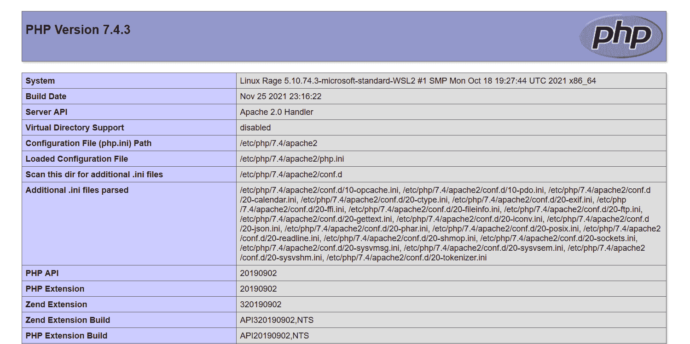

php-info-page.png

PHP 信息页

虽然 PHP 7.4 是一个很好的发行版本，但在 2021 年它已经有些旧了。我们应该使用 [Ondřej Surý 的](https://deb.sury.org) 私有包存档 (PPA) 来安装更高版本的 PHP。要添加该 PPA，我们将运行 `sudo add-apt-repository ppa:ondrej/php`，这会将 Ondřej 的仓库添加到我们的系统中。要在当前配置中安装 PHP 8.1，我们可以运行 `sudo apt install -y php8.1 libapache2-mod-php8.1 php8.1-xml`。在启用新的 PHP 版本后，我们可以使用 `sudo a2mod php7.4` 禁用 Apache 中的 PHP 7.4，并使用 `sudo a2enmod php8.1` 为 Apache 启用 PHP 8.1。要应用 PHP 更改，运行 `sudo service apache2 restart`，我们可以刷新浏览器窗口中的 `http://localhost/info.php` 来看到我们现在正在运行 PHP 8.1。重要提示：我们正在利用 Apache 模块 `mod_php_2725` 来运行 PHP；这意味着我们一次只能运行一个 PHP 版本。要让 Apache 运行多个 PHP 版本，我们需要安装并配置 [PHP-FPM](https://www.php.net/manual/fpm)，我们将在将来介绍。使用 `mod_php` 时，我们将 PHP 封装在 Apache 内部。例如，FPM 是一个外部（相对于 Apache）的服务，通常通过 socket 连接。要为我们的本地开发站点创建一个自签名证书，我们使用 `sudo openssl req -x509 -nodes -days 365 -newkey rsa:2048 -keyout /etc/ssl/private/apachesigned.key -out /etc/ssl/certs/apachesigned.crt`。为了跨网络使用（即一旦你不在本地机器上），你将希望使用 [Let’s Encrypt](https://www.letsencrypt.org)。


> Joe Ferguson 是一位 PHP 开发者和社区组织者。他参与了孟菲斯许多与技术相关的倡议，包括孟菲斯 PHP 用户组。他与非常支持他且极其迷人的妻子已经结婚多年，是妻子把他变成了一个狂热猫奴。他们和他们的两只猫住在孟菲斯的郊区。[@JoePFerguson](https://twitter.com/JoePFerguson)

# 此处有巨龙：转向领域驱动设计

## 作者：Edward Barnard

> 我们将从简单的重构开始对领域驱动设计进行实现。我们将仔细观察预期的实现中可能隐藏着何种复杂性。这种观察将指导我们向领域驱动设计方向进行重构。

## 实现“驯服巨龙”模式（Dragon Wrangling Pattern）

为什么要在你的 PHP 项目中转向领域驱动设计？对于现有的代码库，当代码变得脆弱到无法触碰、更改成本太高时，是时候问问这个问题了。我把这称为“撞墙”，因为继续前进已变得异常困难。在此时，我们作为 PHP 开发者，我们需要同时解决两个问题：

1. 由于添加或更改功能的困难和危险性，我们不愿触碰代码。在此过程中破坏某些东西的风险实在太高了。
2. 我们需要引入新开发者，而对项目不熟悉的人员并不知道深埋在复杂代码库中的陷阱。

我在 2021 年 10 月的 php[architect] 中建议了一个解决方案，即“驯服巨龙模式”。现在是时候在实际项目中开始实现该模式了。这篇文章假设你能够回溯并查看该模式背后的逻辑和动机。

## 运动员注册

我们的项目将实现两个涉及高中中运动员的具体工作流：

* 创建在线账户
* 注册参加特定赛季的比赛

我的公司美国胶靶射击联盟（USA Clay Target League）是一家非营利机构，促进与散弹枪向胶靶射击相关的运动（陷形 Trap、飞靶 Skeet、五点 5-Stand 和运动胶靶）。我们创建了一种机制，让队伍在赛季期间无需面对面即可进行竞争。

你可以这样考虑：想象一个在自己的主保龄球场进行比赛的保龄球联赛。另一个队伍在不同的地点进行比赛，他们都提交分数。我们假设任何特定的保龄球道与任何其他保龄球道设置都是相同的。例如，某人得 90 分应该和在另一个地点得 90 分的人是一致的。在比较或合并分数时，可以说我们是在进行“苹果与苹果的比较”。

胶靶射击也是如此。每个靶场都有相同的设置和布局。我们假设一个地点的得分等同于另一个地点的得分。我们忽略了风和天气在一天之间会产生重大影响的事实。那是乐趣的一部分！

评分非常简单——就像保龄球一样。在保龄球中，每个木瓶要么还立着，要么被击倒。不需要考虑“难度系数”或“艺术表现”。在陷形射击中，一枪要么击碎胶靶，要么没有击碎。

机制非常简单。这应该让它们很容易实现，对吧？遗憾的是，没那么简单！

事实证明，我们实际上无法忽略天气。冬末的风暴可能意味着靶场仍然需要清理并恢复运行。在更南方，热带风暴可能会阻止某个队伍在该周参加比赛。事实上，我们有业务规则来延迟某个州赛季的开始，同时允许受不可抗力（如飓风）影响的个人队伍进行补赛。

换句话说，即使是操作性的评分系统也包含了足够的复杂性，以至于我们应该考虑领域驱动设计。

然而，在比赛之前，我们首先需要组建队伍。我们将以此为关注上述两个工作流（创建账户和赛季注册）。

我将向你展示一个极其简单的模式，以至于它看起来可能是无意义且浪费精力的。但我们也将看到它的力量。它是有效的！

让我们花时间理解我们正在试图解决的问题。让我想起那个老笑话：“我们刚接了一个新项目！你们两个开始写代码吧，我去去找需求。”不要采取那种方法！随着我们对问题的了解，我们将仔细记录复杂性可能隐藏在何处。

 创建在线账户

对于美国胶靶射击联盟，每位运动员都必须创建一个在线账户。此外，每个运动员账户必须绑定到一个队伍。但是，运动员必须先拥有账户，队伍才能邀请该运动员。我们面临“鸡生蛋还是蛋生鸡”的问题。我们的解决方案是：

1. 队伍必须存在。
2. 队伍邀请运动员使用该队伍的“密钥”创建账户。该“密钥”就像一个优惠码。它可以通过纸质发放，也可以通过电子邮件发送。
3. 运动员创建账户。
4. 队伍（即：教练）随后邀请运动员参加一个或多个特定项目（陷形、飞靶等）的赛季。
5. 运动员接受邀请并注册（以及支付）赛季费用。

上述第 3 步（创建账户）的工作流看起来非常简单。

1. 输入密钥、姓名和出生日期。我们的许多业务规则是基于年龄的，因此我们立即需要出生日期。
2. 设置登录，包括用户名和密码。根据年龄（18 岁以下、13 岁以下等），我们可能需要或不需要电子邮件地址。
3. 收集监护人信息（如果运动员 18 岁或以上）和紧急联系人。

这是一个简单的工作流，但某些要求的选择取决于年龄和某些其他因素。因此，我们有一些必须处理的复杂性。但到目前为止，这看起来还没有复杂到足以让我们走向领域驱动设计。

 赛季注册

赛季注册的大部分是一个简单的工作流。输入人口统计信息，例如年级、枪支安全证书编号和完成日期等。

突然，实现变得复杂了。哎！问题在哪里？我们可以简化它吗？

这里是变量：

* 我们是一家非营利机构，我们允许运动员在赛季注册期间包含捐款。
* 赛季费用可以是“运动员支付”或“队伍支付”。对于队伍支付，一旦注册关闭，学校队伍根据实际注册情况支付一张发票。对于运动员支付，运动员在赛季注册期间支付费用。
* 运动员可能被邀请参加一个或最多四个四个项目。每个项目的费用相同。如上所述，费用由队伍或运动员支付。
* 运动员不需要一次性选择所有邀请。例如，如果被邀请参加陷形和飞靶，运动员可以现在注册飞靶，以后再回来注册陷形。

因此，我们的用例数量是（运动员支付或队伍支付）乘以（有或无捐款）乘以（接受零到最多四个邀请）乘以（可能多次进入赛季注册）。


事实上，我所描述的*就是*简化。我们舍弃了一个会为组合中增加另一个复杂变量的功能。这让我在单个网页上减少到了 43 个不同的“快乐路径”（happy path）场景，在该页面上，运动员可以选择参加哪些项目，以及是否要向联盟捐款。

更重要的是，这次练习允许我列出一套简短的业务规则，以便与利益相关者讨论。我们不再在底层堆砌一堆“魔法”，而是写出了结构良好的业务规则，任何相关人员都能轻松理解。我们还通过 `behat` 运行了那 43 个场景，详细展示了我们如何通过代码实现每条不同的路径。

我花了大半半一天的时间才将那个“简单”的邀请页面提炼为一组连贯、合理的业务规则。这段时间花得很值。控制这种意外之外的复杂性至关重要。

让我们开始编写生产代码。

## 第一个工作流

第一个工作流——创建新账户并不困难。我们在美国粘靶联盟（USA Clay Target League）处理这方面有着多年经验。我们将工作流分布在几个网页上。（原因超出了本文的范围，但是基于多年处理该功能的经验。）这是一个数据收集应用，每个屏幕底部都有“下一页”按钮。

对我们来说，将整个工作流放在一个 `Controller` 类中是最合理的。每个网页都变成该 `Controller` 中的一个方法。我们创建了 Fowler 在《企业级应用架构模式》（*Patterns of Enterprise Application Architecture*, PoEAA）第 110 页中所说的“事务脚本”（Transaction Script）：

> 通过过程来组织业务逻辑，每个过程处理一个来自表示层的单个请求。

恰巧的是，这是 PoEAA 中收录的第一个模式，因此它看起来是一个很好的切入点。Fowler 解释了在什么情况下使用它：

> 事务脚本的辉煌之处在于它的简单性。对于逻辑较少的应用程序，以这种方式组织逻辑是自然做法，而且在性能或理解上它的开销都非常小。

这完全符合我们的情况！

但事实并非如此。问题出现了。那个单一的 `Controller` 类变得长度远超过了 1,000 行。业务逻辑变成了深度嵌套的 `if` 块。代码可以运行，这是好事。然而，Fowler 在《重构：改善既有代码的设计》（*Refactoring: Improving the Design of Existing Code, 2nd Edition*）第 73 页（“长函数”）中提到：

> 从编程早期开始，人们就意识到函数越长，就越难以理解。

确实，我们的事务脚本（`Controller` 类）并不复杂，但我们极大地增加了*心理*上的复杂度，这通常被称为认知负荷。

此外，Fowler (PoEAA, pp. 111-112) 指出事务脚本模式很快就会达到它的局限：

> 然而，随着业务逻辑变得越来越复杂，保持其良好的设计会变得越来越困难……复杂的业务领域需要构建领域模型（Domain Model）……很难量化切换点，特别是当你对一种模式比另一种熟悉时。你可以将事务脚本设计重构为领域模型设计，但这比原本需要的要困难。因此，尽早尝试通常是向前发展的最好方法。

发生了一个趣事！看着那个 1,500 行的 `Controller` 类，我决定现在就重构它，尽管现在并不是个好时机。我已经建立了全面的测试覆盖，所以我觉得自己破坏某些东西的风险很低。直到现在我写这篇指南时，我才从书架上拿出 Fowler 的书，发现他在书中第一个模式中包含了完全相同的建议。

Fowler 这样完成了他的建议：

> 无论你成为多么的“对象偏执者”，都不要排除事务脚本。现实中有很多简单的问题，一个简单的解决方案会让你更快速地投入运行。

在我们的 PHP 生态系统中，这仍然是*极其*极好的建议！

## 重构

此时，第一个工作流的整体位于一个大型的 `Controller` 类中。每个 `controller` 方法处理该工作流中的一个特定网页。到目前为止，代码完全是典型的。

每个方法代表一个单一的用例、特性或能力。我之前创建了十个特性文件（feature files），涵盖了“快乐路径”和边界情况，包括各种类型的无效输入。

我为什么要强调特性文件呢？因为它们引导了重构。由于这个原因，它们是“驯龙模式”（Dragon Wrangling Pattern）的一部分。

我们将根据用例来对齐我们的软件。此时，“控制器方法”、“用例”和“特性文件”几乎意味着同一种东西。这使得重构和重组变得容易。我们已经有一套完整的测试，确保我们不会破坏任何现有的特性代码。

因此，对于每个 `controller` 方法，我们将创建两个类：

*   用例处理器（use case handler）
*   用例处理器的 `Repository`

不要把 `controller` 方法看作网页处理器，而要把它看作用例处理器。这基本上是一回事，但现在我们是从功能或业务需求的角度来考虑，而不是视觉呈现。

我们的第一步是将任何业务逻辑从 `controller` 方法移动到用例处理器中。如果有六个 `controller` 方法处理工作流中的六步，这意味着我们现在将六个独立的用例处理器——即六个新类，每个用例处理器都是自己的 `PHP` 类。

人们常说，计算机科学中最难的三个问题是缓存失效、命名和差一错误。我们目前的问题是命名。

所谓的“用例处理器”，诚然如此。Scott Millett 在《领域驱动设计的模式、原则和实践》（*Patterns, Principles, and Practices of Domain-Driven Design*）第 108 页中将用例处理器称为应用服务（Application Service）：

> 应用服务层代表应用程序的用例和行为。用例被实现为应用服务，通过委托给领域层和基础设施层，包含应用逻辑来协调用例的实现。

Scott 说得对。从现在起，我们将这个“东西”称为 `Application Service`。

什么是 `Repository`？在此时，它仅仅是访问应用程序 `MySQL` 数据库的包装器。然而，它是非常具体的，没有以任何方式泛化。它满足了 `Application Service` 的特定需求*且不再多此*。正是这种限制使得 `Repository` 设计如此强大，但其原因目前超出了范围。

## 应用服务

这是来自第一个工作流的 `Application Services` 之一。你会立即注意到那里基本上什么都没有！事实证明，这强大，并且符合 Millet 的陈述：应用服务层通过委托来协调用例。

**Listing 1.**

```

```

`Application Service` 包含三个方法，每个每个方法都委托给同名的 `Repository` 方法。这个 `Application Service` 类仅仅是一个透传。

对应的 `Repository` 看起来如下：

**Listing 2.**

```

```

最后一个方法带有 `try` / `catch` 包围的手动数据库事务，这与 2021 年 12 月在 php[architect] 的“为 MySQL 事务失败设计”中 Listing 3 所解释的模式相。

你可能注意到我们重新加载了要更新的数据库行。我们先加载一次，然后在 `MySQL` 事务内部再次加载。这是为了确保我们不会无意中存储过时数据，被另一个同时在犯相同错误的进程所“覆盖”。这个问题还有其他解决方案，例如在读取行时对该行进行锁定，但无论如何，这是一个重要的实践。


这类细微的时序问题可能罕见且棘手。从一开始就避免它们会更容易。

下一部分同样属于“驯龙模式”（Dragon Wrangling Pattern），是一个独立的 `Factory`，用于将每个 `Application Service` 连接到其对应的 `Repository`（存储库）。以下是部分列表，为了节省空间进行了压缩：

**列表 3。**

```

```

```

每个 `Application Service` 都有自己的类。正如我们所看到的，“添加医疗信息”页面获得了类 `AddMedicalInfo`。我采用了一种命名约定，在配套的 `Repository` 前加上前缀“R”，创建了类 `RAddMedicalInfo` 作为 `Repository`。

由于我们的工作流处理网页表单数据，我将控制器和请求传递到 `factory`。“添加医疗信息”控制器方法的第一行是：

```

```

最后，我发现我可能需要能够从任何地方向用户传回错误消息，无论是在 `Application Service Layer`、`Repository` 还是其他地方。我创建了 `ReportError` 类来处理将消息传回给 `Controller`。

`Factory` 确保了错误报告器拥有指向 `Controller` 对象的链接。其他所有内容（`Application Service` 和 `Repository`）都包含 `Error Reporter` 的链接。错误报告器有两个基础流水线：一个是返回给用户的错误通知，另一个是向数据库报告更全面的失败信息。存储库列表显示在 `catch()` 块中使用了这两个流水线（`flashError()` 和 `logError()` 方法）。

## 益处

在完成第一次重构并通过所有测试后，我发现实现下一个工作流的速度要快得多，无论复杂性如何。第一个工作流的 `application services` 大多是空的。但它为我提供了一个模式，让我处理更复杂的第二个工作流时可以更快地遵循。

事实证明这是一个非常有用的“分而治”策略策略。我可以更容易地一次专注于某一个用例。这使得将额外的逻辑或额外的概念提取到独立的类中变得更容易。这些独立的类由于很少或没有依赖，单元测试变得变得容易得多。

将对象创建分离到 `factory method` 中也被证明是有用的，尽管这几乎不是必须。集中的日志记录和错误报告配合通往 `Controller`（因此是通用户）的热路径，使得错误处理的编写变得简单得多。

事实上，事实证明如此；为每个决策或交互包含错误处理变得非常容易。最终结果可能是应用程序更具韧性，同时保持了较低的复杂性。

最后，自从实现了前两个工作流以来，我们意识到需要在仪表板上添加通知。可能存在某一种需要解决的错误状态（例如缺少认证）、待处理的邀请、锦标赛资格或任何情况。我们可能在工作流进行过程中意识到需要添加通知。

但看！基础设施已经存在了。得益于 `Factory` 方法，所有对象都可以访问集中的错误报告器。该错误报告器可以轻松扩展以包含发布仪表板通知。代码将与“为 MySQL 事务失败设计”中的列表 4、5、6 类似。

## 总结

我们所做的解释比编写代码多得多。这是一件好事，因为我们能够简化代码库。现在它变得更容易理解了，因为我们组织它使其能够一次只看到一个用例。我们引入了“驯龙模式”的几个方面：

*   `behat` 测试套件（特性文件）引导我们根据用例重构代码。
*   为每个用例或功能提供一个独立的 `Application Service` 类，我们就有了一种实用的“分而治”方法。
*   我们没有怎么谈论 `Repository`，但它通常很小，并且局限于直接满足 `Application Service` 的需求。
*   `Factory` 为我们提供了一种一致的方法来连接每个用例的组件，鼓励我们在一个用例到另一个用例遵循类似的实践。

> ### 简介
> Ed Barnard 在 1988 年 11 月莫里斯虫瘫痪互联网时处于第一线。当时，当病毒直接冲击分析师时，他正在向他们讲解 CRAY-1 超级计算机操作系统的内部原理。那是忙碌的一周！Ed 继续投入他对计算机安全的兴趣，并向他人教授软件概念。[ewbarnard](https://twitter.com/ewbarnard)

# 安全角：：安全漏洞的恐怖规模

## 作者：Eric Mann

> 12 月在广泛使用的 Log4J 库中发现的一个远程代码执行漏洞导致数十亿机器暴露在恶意攻击者面前。不幸的是，修复此漏洞并非易事，导致互联网大部分在恶意攻击者面前暴露了一多周。

11 月月中，来自 [阿里巴巴云安全团队](https://www.mcafee.com/blogs/?p=133000) 的安全研究人员发现了流行的 Log4J 库中的一个漏洞，该工具是大多数 Java 开发者用于在应用程序中实现日志记录。漏洞本身允许攻击者向 Java 运行时 Java 命名和目录接口 (JNDI) 组件注入其自行选择的字符串。此接口将尝试解析传入的字符串，在某些情况下通过 DNS 查找额外信息，或通过执行作为输入字符串一部分的代码。

通俗地说——任何使用受漏洞版本 Log4J 记录 Web 请求的应用程序都允许远程未身份验证的攻击者在应用程序服务器上执行他们想要的任何命令。这是任何漏洞最糟糕的结果。或者正如安全公司 Tenable 执行官 Amit Yoran 所说：

> 这是迄今为止规模最大、最关键的漏洞。

注入攻击在现代软件中非常常见。事实上，它们如此常见以以开放 Web 应用安全项目 (OWASP) [将其视为市场上出现频率第三的](https://owasp.org/Top10/A03_2021-Injection/) 应用程序安全风险类别。当不受信的用户输入直接传递到应用程序的关键组件时（例如传递到数据层 (SQL) 或尝试解析系统名的业务逻辑 (JNDI)），就会发生注入漏洞。

## 事件范围

[初始安全报告](https://nvd.nist.gov/vuln/detail/CVE-2021-44228) 包含了通过版本 2.14.1 的所有 Log4J 版本。考虑到漏洞本身的轻而易举——攻击者可以通过在游戏内聊天中粘贴字符串，从而在 Minecraft 服务器上远程执行代码](https://twitter.com/MalwareTechBlog/status/1469290238702874625)——社区迅速行动修复了该问题。

也许太快了。

[Log4J 2.15.0 在](https://us-cert.cisa.gov/node/17179) 原始漏洞被公开记录的同一天发布了。虽然那是周五的下午，但许多工程师工作到了深夜（或贯穿了整个周末）来修复他们的应用程序。

不幸的是，修复是不完全的。几天后，研究人员 [发现了另一个（相关的）漏洞](https://cve.mitre.org/cgi-bin/cvename.cgi?name=CVE-2021-45046)。许多非默认配置会允许进一步利用底层漏洞。这可能导致信息泄露（环境密钥的外泄）、远程代码执行，甚至是拒绝服务攻击。工程师们很快发布了 Log4J 2.17.0](https://phpa.me/techtarget-log4J)，其中包含了之前所有的修复，并且在本文写作时认为是安全的。


总而言之，原始问题不仅需要通过一次，而是通过三个独立的阶段才能完全修复缺陷代码并保持我们的系统补丁。鉴于团队为了纠正该问题行动得如此快，始终存在一种可能性，即最新版本仍然不完整，未来可能还需要更多工作。

## 事件规模

开源库 `Log4J` 由 Apache 基金会发布，并被你可能熟悉的大多数基于 Java 的软件使用。`Minecraft` 使用它进行日志记录，`Jenkins` 也是如此。即使是 iCloud、Spotify 和 Oracle（甲骨文）也使用了它。特斯拉汽车在其控制接口中运行着嵌入式 Java 版本，而该版本使用了 `Log4J`。亚马逊也利用它来驱动[大多数 AWS 基础设施背后的控制平面](https://aws.amazon.com/security/security-bulletins/AWS-2021-006/)。

虽然此次特定问题受影响的是 Java 而非 PHP，但 Java 有多种方式可以影响我们的生活或应用程序。了解到 AWS 堆栈的大部分运行在 Java 上，意味着在亚马逊修补其库之前，`任何`应用程序都可能受到影响。任何将 `Jenkins` 作为任务运行器或 CI/CD 平台的用户都可能面临风险。`Elasticsearch`、`Couchbase`、`Okta` 甚至 Debian [都受到了此漏洞的影响](https://heimdalsecurity.com/blog/?p=39256)。即使你的代码是 100% 安全的，你的堆栈中另一个组件不安全的概率也很大，这需要你跟踪所有这些变化环节，以保持你的应用程序的稳定。

事实上，仅在过去的四个月里，[`Log4J` 的下载量已超过 2800 万次](https://blog.sonatype.com/why-did-log4shell-set-the-internet-on-fire)，使其在流行度和使用量方面处于 Java 模块的前 0.003%。作为对比，在同样的四个月内，PHP 的 Monyog 日志库[仅被下载了 100 万次](https://packagist.org/packages/monolog/monolog/stats)。

截至 12 月 20 日（即公开披露仅十天后），社区终于能够识别出该事件的巨大规模。估计有 [93% 的云环境](https://phpa.me/darkreading-log4j-flaw) 受到 `Log4J` 问题的影响——虽然并非所有这些环境都暴露在公共互联网上，但有足够多的环境是这样，以这确实是我们社区迄今面临的最严重的漏洞。

## 我们接后的去路

开发社区中的一些人经常批评 PHP 的不安全声誉。事实上，任何语言的安全性都取决于使用该语言的开发者所采用的编码实践。更多情况下，是不安全的代码由于无意的失误而漏掉，直到某个包、库或程序获得意想不到的知名度和关注时才被发现。

我在本杂志的[11 月刊中写过我曾针对一个 WordPress 插件接收到类似末日级安全通知的经历](https://www.phparch.com/article/security-corner-no-bug-too-small/)。我怀疑，Apache 团队的一些人将在相当长一段时间内撰写他们处理 `Log4J` 的经历。

在此期间，我们能做的最好就是确保我们始终遵循最佳实践并保持项目安全。

*   跟踪 OWASP 前十（OWASP Top Ten）。
*   进行严格的代码审查。
*   对你的应用程序进行内部和外部渗透测试。
*   更新你使用的每个库或组件（无论是与 PHP 相关的还是其他的），以确保像 `Log4J` 中发现的那种关键漏洞不会溜。

换句话说，我们继续做我们最擅长的事，并清醒地认识到这种 bug 可能会在我们任何一个人身上、任何时间、我们的任何应用程序中发生。

> ### 传记

> Eric 是一位丰富的 Web 开发者，拥有多种语言和平台。他使用 PHP 已十多年，精力专注于帮助开发者入门并使用他们所选的技术学习新技能。你可以通过 Twitter 直接与他联系：[@EricMann](https://twitter.com/EricMann)

# 新闻：新与值得关注

## PHP 发布

*   PHP `8.1.1`（错误修复发布）：[`www.php.net/archive/2021.php#2021-12-17-1`](https://www.php.net/archive22021.php#2021-12-17-1)
*   PHP `8.0.14`（错误修复发布）：[`www.php.net/archive/2021.php#2021-12-17-1`](https://www.php.net/archive2021.php#2021-12-17-1)
*   PHP `7.4.27`（错误修复发布）：[`www.php.net/archive/2021.php#2021-12-16-1`](https://www.php.net/archive2021.php#2021-12-16-1)
*   PHP `7.3`：已结束生命周期，是时候升级了。[`www.php.net/supported-versions.php`](https://www.php.net/supported-versions.php)

## 新闻

### PHP 基金更新

PHP 基金拥有近 1200 名成员。


-   [费曼学习法](https://example.org)
-   **粗体内容**和*斜体内容*。
-   `内联代码` 和代码块保持不变。
-   [链接内容](https://example.org)
- 这是一个引用块。

```javascript
function hello() {
  console.log("Hello, World!");
}
```
```


这种差异让我开始思考 `PHP` 在过去十年里是如何演变的。我曾紧密关注 `PHP Internals`，甚至参与了其中几次讨论。我觉得尽可能地参与其中对我来说是非常重要的。毕竟，这些决策影响着我的生计和我所在的社区。大约一年后，我开始觉得自己对讨论没有太大贡献了。做出决策的人所处的环境与我截然不同，我们都无法真正认同对方的观点。更不用说，我的观点并非那种令人兴奋、学术化且前沿的领域，这无济于事。

我停止了发表评论，只是观察讨论——在潜水的同时保持信息同步。然而，缓慢地，我逐渐离讨论变得越来越远，直到我发现自己阅读帖子已经落后了几个月，于是取消了订阅。对于放弃参与内部机制我感到有些抱歉，但对于 `closures`（包）、`scalar type hints`（量类型提示）或 `inheritance by anonymous classes`（匿名类的继承），我无话可说。坦诚地说，我当时的大多数项目都是刚开始升级到 `5.4` 的公司。当 `7` 正在准备发布时，对于我的许多客户来说，`PHP 5.6` 仍然遥不可及。我的许多项目是短期的，或者使用量很轻，一个完整的、经过良好抽象的系统并没有必要，而且会在不提供任何必要收益的情况下产生痛苦的复杂性。

我最需要核心内部团队做的是避免任何破坏破坏性的更改（breaking changes），这样我才能让客户升级。不用说，这并不是他们的首要任务，而且理所应当。我需要一致性来降低客户的成本。核心内部团队需要让语言现代化，并添加功能和结构以匹配其他流行语言提供的特性。我关注的是调试的便利性，而他们关注的是确保 `PHP` 执行严格标准，以消除编码中的歧义并鼓励最佳实践。

谁错了？谁又脱离了现实？我是不是太深陷于旧代码和预算紧张的项目中，以至于意识到这些我甚至无法想象自己会用到的功能具有重要性？还是核心开发人员过于关注学术理论，并且在庞大的企业基础设施中过于孤立，导致无法理解像我这样的开发者需要什么？

从 `7` 版本及以后对 `PHP` 进行的改进让这门语言跃升到了成熟阶段，大大提高了速度，并帮助 `PHP` 获得了它真正应得的专业尊重。这些都是好事。当他们在简化流程并执行最佳实践时，他们让像这样与小微企业、旧代码库以及不愿升级的托管公司工作的开发者面临了更多困难。为了吸引高级程序员和大型组织而使事情变得先进，他们增加了任何尝试学习 `PHP` 或调试不熟悉代码的人的难度。

有得，每向前一步都伴随着一丝痛苦。改变是困难的。然而，我们社区的魅力之处在于我们是如此多元。我们有一群推动我们前行的强大群体，也有其他让我们脚踏实地的人。得益于此，`PHP` 支持各种组织规模和项目复杂度。从只需要联系表单的小店，到为数百万用户提供内容和服务的公司，`PHP` 正在解决各种问题。当我们遇到差异时，请记住：我们都是自己经验的专家，正因为这些经验如此不同，我们可以从彼此身上学到很多。

### 个人简介

 Beth Tucker Long 是 [Treeline Design](http://www.treelinedesign.com) 一家 Web 开发公司的开发者兼所有者，并与丈夫 Chris 一同运营 [Exploricon](http://www.exploricon.com) 游戏展。她领导着 [Madison Web Design & Development](http://madwebdev.com) 和 [Full Stack Madison](http://www.fullstackmadison.com) 用户组。你可以在她的博客 (http://www.alittleofboth.com) 或推特 [@e3BethT](https://twitter.com/e3BethT) 上找到她。

