# 预测与健康管理中的物理信息机器学习：最新进展与挑战

## ABSTRACT

预测与健康管理（PHM）在设备全生命周期健康服务中发挥着建设性作用。它长期以来一直受益于物理建模和机器学习方法的深入研究。然而，在实际应用中，现有解决方案常常面临因数据稀疏和系统故障知识不完整而导致的困难。在这种情况下，纯机器学习或基于物理的方法有时可能不可行。因此，开发物理信息机器学习（PIML）模型的兴趣日益浓厚，这类模型允许在机器学习流水线的不同位置融入不同形式的物理知识。这种结合为检测、诊断和预后提供了显著帮助。然而，据我们所知，关于PHM中PIML的现有研究文献计量分析和综合综述仍属空白。因此，我们的综述致力于填补这些空白。我们综合了PHM中PIML的概念，并从“告知知识的表达形式”和“知识告知方法”的角度提出了PIML方法的分类法。本文提出的发现和讨论使我们能够澄清PIML方法的当前最新进展和新兴机遇，特别是针对在“小数据和稀缺物理知识”范式下构建PHM系统。

## 1. Introduction

预测与健康管理（PHM）是一门跨学科工程学科。它基于最新信息和数据处理[1]，通过两种主要范式确保系统的实时健康评估和未来状态预测：

缩写: ANN, Artificial Neural Network; CNN, Convolutional Neural Network; CRA, Cumulative relative accuracy; DNN, Deep Neural Networks; FCN, Fully Convolutional Networks; GNN, Graph Neural Networks; KSVD, K Singular Value Decomposition; LSTM, Long short-term memory; MAE, Mean Absolute Error; MSE, Mean Square Error; NMSE, Normalized Mean Square Error; NMAE, Normalized Mean Absolute Error; NODE, Neural Ordinary Differential Equations; PBM, Physics based methods; PCA, Principal Component Analysis; PDE, Partial differential equation; PHM, Prognostic and Health Management; PIML, Physics-informed Machine Learning; RMSE, Root mean square error; RNN, Recurrent Neural Network; ROM, Reduced Order Model; RUL, Remaining useful life; SVM, Support Vector Machine; VAE, Variational AutoEncoder; DRM, Disk-ram.

* 通讯作者。电子邮件地址：weikun.deng@enit.fr (W. DENG)。

数据驱动方法和基于物理模型的方法（PBM）。

得益于机器学习（ML），尤其是近年来与深度学习[2,3]相关的激增，数据驱动方法从数据中提取特征并识别潜在的退化过程，在从宏观到微观退化和损伤的不同故障尺度上显示出有希望的结果[4]。然而，PHM中的机器学习面临三个困境：

- 1. 第一个困境源于有限的数据质量。可以举例：a) 由于结构条件有限和无处不在的监测仪器成本导致的稀疏且带噪声的观测[5]；b) 由于监测时间有限和运行至失效操作成本高昂导致的稀疏且带噪声的故障信息[6]；以及 c) 由于专家知识有限和人工标注成本高昂导致的稀疏标签[7]。
- 2. 第二个困境是机器学习的不透明、不可解释性，导致信任赤字[8]。对于高投资和高风险的工业领域，机器学习输入数据与输出PHM结果之间的不可观测过程被视为具有可解释性困难的“黑箱”[9]。
- 3. 机器学习中的第三个困境源于缺乏物理一致性。机器学习通常收敛于最能拟合训练样本的方向，这可能不完全符合物理约束[10]。

与机器学习不同，基于物理的方法（PBM）观察故障现象，然后建立数学或数值机制模型来表示故障或退化[11]。当故障性质被充分理解时，PBM所需的数据比机器学习少[12]，并能实现更好的泛化能力[13]。然而，现代工程系统复杂，并受子系统之间相互非线性相互作用的影响。因此，PBM的性能可能受系统规模[14]和复杂性[15]等不同因素的影响，导致以下困境：

- 1. 第一个困境涉及模型简化中的认识论不确定性以及计算效率与PBM可信度之间的悖论[16]。
- 2. 第二个困境是有时对故障机制的理解有限，难以构建可信的退化模型[17]。
- 3. 第三个困境源于PBM中未知且不可观测的参数。

由于上述困境，纯基于物理的模型在实际应用中很少使用[18,19]。

鉴于数据驱动方法和基于物理方法的局限性，有必要开发混合方法，以克服缺点并继承各自的优势。图1展示了PBM和ML模型结合的动机。事实上，物理信息机器学习（PIML）在数据稀疏和物理知识不完整的情况下是一种有前景的解决方案。PIML在2016–2020年洛斯阿拉莫斯PIML研讨会上被正式引入[20]，最初用于通过机器学习求解复杂物理问题。特别是，Raissi等人[21]提出了基于物理信息神经网络（PINN）的偏微分方程求解方法，引发了“信息神经网络”的热潮。同时，包括GE[22]、IBM[23]、Nvidia[24]、美国DARPA[25]和NASA[26]、阿贡国家实验室[27]以及西门斯[28]在内的许多工业合作伙伴，都高度关注PIML的应用。

PIML发展背后的动机在现有文献中已被广泛讨论，其固有优势和优点如下：

- 1. PIML融合了数据驱动机器学习和物理原理，以提升预测与健康管理（PHM）系统预测的精度和可解释性。
- 2. PIML在处理PHM应用中复杂非线性系统的复杂动态方面表现出色。它通过集成基于物理的约束和方程来实现这一点，从而增强其预测和建模能力。

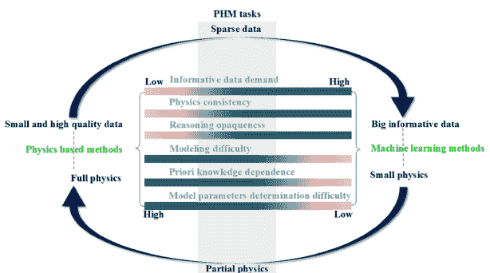

图1. 数据稀疏和物理知识不完整推动PHM技术朝着PBM和ML的结合方向发展。

- 3. 基于物理知识的融合使PIML能够更有效地泛化，即使在观测数据之外也能提供可靠的预测。这在训练数据稀疏或不完整的场景中特别有用。
- 4. PIML模型的一个关键优势是由于明确融入物理而提高了可解释性。通过嵌入物理约束和方程，PIML使阐述驱动系统行为的一些潜在机制变得更加容易，这有助于诊断分析和决策。
- 5. 尽管数据有限，PIML对系统物理知识的高效利用允许进行准确预测，减少了对大型数据集的依赖，并可能最大限度地降低数据获取成本。
- 6. 由于PIML强制执行物理定律，因此对噪声和异常值具有鲁棒性，可以滤除错误或带噪声的数据，从而得出可靠的预测。
- 7. PIML通过将基于物理的约束与机器学习算法相结合，提供计算优势，从而产生高效模型，降低计算复杂度，适用于实时或近实时应用。

受这些进展的启发，已有多项关于PIML在异常检测、故障诊断和预后方面的研究[29]。与其他针对稀疏数据的潜在解决方案（如迁移学习[30]）相比，PIML在PHM中的优势在于辅助数据驱动的洞察、专家知识利用、适应性和可扩展性。通过利用这些优势，PIML还可以增强其他方法，以及应对PHM挑战[31]的能力，这些挑战包括数据可用性有限、复杂非线性系统动态、与物理一致性相关的信任、噪声和不确定性处理、多源异构数据集成，以及跨系统和跨领域的可迁移性[32]。此外，PIML并不与这些方法竞争，而是锦上添花，以实现双赢局面，例如通过航空航天异常检测中的PI-迁移学习[33]和加工刀具磨损预测中的PI-元学习[34]等方法。尽管许多研究令人兴奋，但据我们所知，现有文献中没有一篇论文对PHM中的PIML提供全面的综述。此外，尚未进行总体定性和文献计量分析。最后，PHM中的分类法和应用尚不明确，有待讨论，特别是关于：1) 告知知识的表达形式和 2) 知识告知方法。因此，本文旨在填补上述空白。此外，还强调了PHM中PIML成熟度面临的开放挑战。

本文其余部分组织如下。第2节对PHM中PIML的现有工作进行文献计量分析，从而展示了该主题的研究趋势概览。第3节对PHM中的PIML方法进行了全面而深入的综述。第4节旨在总结和讨论可用于推导机器学习模型的物理知识来源以及相应的集成方法。最后，第5节总结了本文的主要贡献，并对潜在的未来研究提供了见解。

## 2. 文献计量分析

本节旨在概述PHM领域中PIML研究的研究兴趣。首先，我们在子节2.1中描述文献研究方法。然后，基于PHM中PIML的文献计量分析，在子节2.2中讨论该主题的研究趋势。最后，子节2.3汇编了关于应用于PHM的PIML工作的统计分析。

### 2.1. 文献研究方法

本文所调查的书目数据涵盖2013年1月至2023年1月期间。本文选择的时间跨度基于以下认识：PIML技术出现于2016年左右。然而，在调查从混合框架到PIML的研究趋势时，我们发现可追溯至2013年的类似技术概念。因此，我们进行了从2013年至今的文献检索。在图2所示的检索流程图中，该调查同时从Web of Science（WoS）和Google Scholar中检索。在Google Scholar上的检索旨在验证WoS检索的充分性。

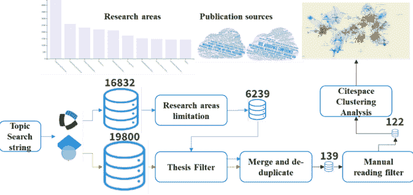

图2. 检索方法流程图。

"主题搜索字符串"定义为 (主题 1) AND (主题 2) 中的所有术语，其中 主题 1: "物理信息的" OR "物理引导的" OR "物理诱导的" OR "物理感知的" OR "物理注入的" OR "领域知识" OR "混合框架" OR "混合方法"。和 主题 2: "机器学习" OR "深度学习" OR "数据驱动"。在进一步过滤中，"主题过滤器"由"核心词汇"和"干扰词"组成：核心词汇："检测" OR "诊断" OR "预后" OR "故障" OR "剩余使用寿命" OR "预测" OR "识别" OR "分类" OR "SHM" OR "损伤" OR "劣化" OR "识别" OR "断裂" OR "裂纹" OR "变形" OR "异常" OR "设备" OR "轴承" OR "齿轮" OR "电力"。干扰词：非 "语言" OR "医学" OR "癌症" OR "人脸" OR "情绪" OR "文本"。第一次搜索结果提供了来自两个最大数据库（Google Scholar 和 Web of Science）的 36,632 多份手稿。然后，我们将搜索限制在通常实施工程 PIML 和 PHM 解决方案的领域，例如 Electronic、Aerospace、Mechanics、Computer Science、Engineering Multidisciplinary、Automation Control Systems、Energy Fuels、Engineering Civil、Engineering Manufacturing 等。此步骤后，保留了 6239 篇论文。为了对已发表材料列表提供洞察，我们实施了进一步的选择步骤，如"论文过滤器"、"人工筛选"和"合并重复"。在"论文过滤器"中，我们使用上述提到的干扰词和核心词汇进行主题过滤，然后在"人工筛选"中对过滤结果进行人工审查，以确定文章主题是否符合综述范围。通过此过程，我们发现只有 139 篇论文的主题涉及 PHM 中的 PIML 相关混合框架。其中，122 篇论文详细讨论了 PHM 中的 PIML。这些论文被用于得出关于研究趋势的关键评论，以及 PIML 在 PHM 中发展的有趣统计结果。

### 2.2. PHM 中 PIML 的研究趋势分析

为了从混合框架到 PIMLs 获取研究趋势的概览，在本节中，可以看出，在仅十年的发展期间，工业中模型驱动与数据驱动方法结合的研究已出现在广泛的会议和科学期刊中，如图 3 所示。可以看出，机械系统与信号处理（MSSP）期刊已就此混合框架发表了大量手稿，超过 573 篇论文。IEEE 航空航天是吸引最多相关混合框架研究的会议，共有 706 篇论文。接下来，为了展示从混合框架到 PHM 中 PIML 方法的演变过程概览，我们使用 CiteSpace 软件 [35] 进行了计量分析。特别是，该软件允许自动分析关键词共现，然后生成最广泛使用关键词的聚类网络（图 4）及其随时间的发展趋势（图 5）。从图 4 的聚类网络可以看出，最广泛使用的关键词是"物理信息机器学习"。与该关键词相关的，可以引用用于构建 PIML 框架的"主动学习"和"微分方程"技术。此外，"物理信息神经网络"也是一个关键关键词，它已与"动力系统"和"深度神经网络"共现。查看相关研究可以看出，PINN 通常用于捕捉系统动态行为，用于损伤检测、故障诊断和故障预测。考虑图 5，可以看出 PIML 研究中使用的关键词的发展趋势从专家系统（2011 年）、加权类关联规则挖掘（2014 年）转向近年来的 PINN。同时，可以注意到对物理知识的需求不断增加，这由经常出现的关键词表示，例如"物理信息稀疏识别"和"基于方程的领域知识利用"。接下来，"深度神经网络"和"扩展卡尔曼滤波器"（或"粒子滤波器"）通常结合以创建 PIML 框架（[36]）。此外，ML 中寿命退化的"嵌入微分方程"相关研究也通过此趋势分析得到突出显示（[37]）。

### 2.3. PHM 中 PIML 的统计分析

本节旨在讨论与 PHM 中 PIML 相关的现有论文的统计分析结果。

(a) 会议

(b) 期刊

图 3. 本综述中考虑的混合框架的出版来源。

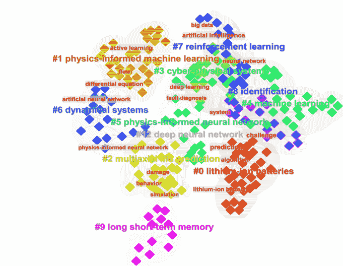

图 4. 关键词共现聚类。

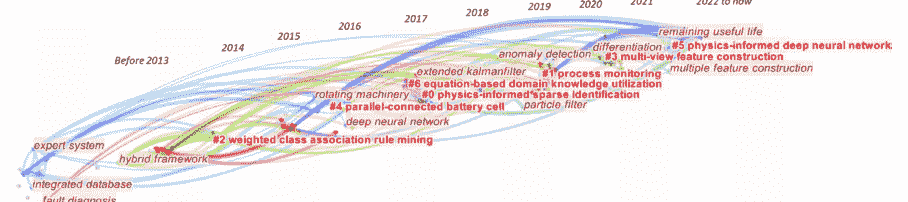

图 5. 知识辅助 PHM 研究中关键词的发展趋势。

#### 2.3.1. 现有术语

存在许多与“物理信息机器学习”相似的术语（见表 1）。根据所有与 PHM 中 PIML 相关的出版物的统计结果，这些术语的分布为：“物理信息的”（47.1%），“基于物理的”（19.9%），“物理引导的”（18.3%），“物理注入的”（8.8%）和“物理感知的”（5.9%）。

这些术语的异质性可能对该主题的研究及其在实践中的广泛应用构成重大障碍。因此，在本小节中，我们寻求澄清现有术语之间的异同。

图 6 展示了每个术语的主要范围，可总结如下：

- 1. “物理注入的”旨在发现并将物理属性约束纳入数据预处理 [54,160]，利用物理导出的参数和关系来增强 ML 模型的性能，尤其是在稀疏数据场景中 [161]。

表 1 与 PHM 中 PIML 相关的现有术语汇总。

| 术语 | 参考文献 | 总数 |
|---|---|---|
| 物理注入的 | [27,38-48] | 12 |
| 基于物理的 | [10,14,32,49-71] | 26 |
| 物理引导的 | [72-94] | 23 |
| 物理感知的 | [95-102] | 8 |
| 物理信息的 | [20,21,37,81,103-109,109-117,117-123,123-159] | 64 |

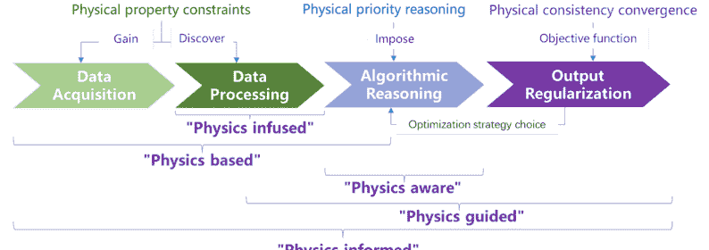

图 6. 不同术语的关注点。

- 2. “基于物理的”侧重于在模型-数据混合框架中集成物理模型或约束 [68,162]，在特征工程、系统建模和基于约束的方法中融入物理原理 [101]。

- 3. “物理感知的”强调感知系统的内在行为和结构特征 [95]，将 ML 算法结构或交互结构与物理系统对齐，以实现物理一致性。

- 4. “物理引导的”扩展了“物理感知的”对可视化表示退化状态或使用物理知识指导数据处理 [79,163]、ML 结构设计、算法权重和偏置 [92] 或经验损失函数 [89] 的关注点。

- 5. “物理信息的”指最广泛的框架 [164]，涵盖整个机器学习过程，在机器学习流水线的各个方面融入物理知识。

因此，在本综述中，术语“PIML”（物理信息机器学习）被选为讨论的术语，以涵盖机器学习方法中物理知识的集成。

#### 2.3.2. 应用领域、主要动机和方法评价指标

图 7 展示了 PHM 中 PIML 研究的应用领域和数据源分布。从图 7 (a) 可以看出，当前 PHM 中的大多数 PIML 研究集中在材料损伤（41.2%），因为该领域已存在大量关于材料动态行为的数学和物理建模研究。这些研究为 PIML 模型的快速发展提供了坚实基础。其他应用，如航空结构与设备（20.0%）、生产设备（13.0%）、轴承与齿轮箱（15.0%）和电网（9%）也近年来吸引了研究界的更多关注。此外，考虑数据源图 7 (b)，我们发现 PIML 研究的大多数数据源来自仿真（30%）。此外，最常用的基准数据集是涡轮发动机仿真数据集（C-MAPSS 和 AGTF30）和电池数据集（Oxford 和 NASA）。针对实际系统的 PIML 模型研究仅限于小型实验平台（16%）。这些观察可以用实际系统通常难以建模且缺乏可利用的基于物理的知识来解释。图 8 显示了每年与 PHM 中 PIML 相关的出版物数量。它突显了研究界对该主题日益增长的兴趣。可以看出，2020 年后每年的出版物数量显著增加。材料、轴承、齿轮、航空航天结构和电力系统方面的研究已引起广泛关注。

图 9 展示了关于数据质量的相关研究统计结果。可以看出，PIML 的很大比例

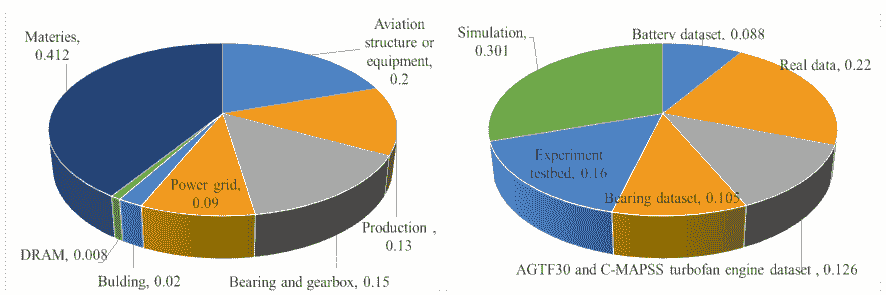

图 7. 与 PHM 中 PIML 的主要应用领域和数据源的统计结果。

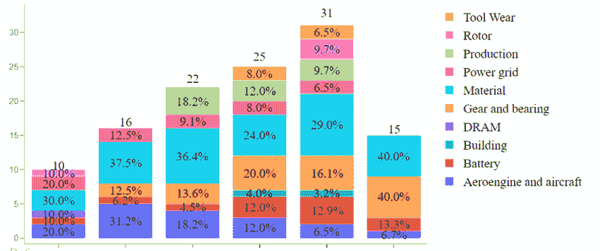

图 8. PHM 中 PIML 应用概览。

研究集中在解决存在稀疏（26%）或噪声（38%）数据的 PHM 任务。这一观点凸显了 PIML 相对于纯数据驱动模型在处理此类数据质量问题时的相关性。表 2 列出了文献中用于训练和评估 PIML 方法性能的指标。它还显示了这些指标对应的具体 PHM 任务，以及监测测量的类型。

从表 2 中，我们可以得出以下结论：

- 1. 本表总结了用于评估 PIML 模型的各种 PHM 任务中的训练和测试指标。均方误差（MSE）、平均绝对误差（MAE）、精确率、召回率、F1 分数等指标被用于评估这些模型在状态监测、故障诊断、剩余使用寿命（RUL）预测和退化预测任务中的性能。在收集的文献中，MSE、MAE 和 RMSE 是最常用的训练指标，分别占 35.7%、20.0% 和 10%。
- 2. 在文献 [76] 中，通常用于分类的指标（二元交叉熵）被用于退化预测。这是因为退化状态的预测被转化为退化水平的分类。
- 3. 值得讨论的一个重要方面是与 PIML 模型相关的知识嵌入。在大多数研究中，选择嵌入哪种类型的知识往往更多基于主观意图。在实践中，嵌入的知识与所使用的监测信号密切相关，例如，应变信号与变形和损伤增长之间的关系，温度与疲劳之间的关系，振动与模态之间的关系，因此，从可用的监测信号中收集该领域的知识以用于知情机器学习将是一个很好的起点。
- 4. 表 2 还概述了每个任务中使用的相应监测信号的具体信息，例如位移、电压、振动、温度、应力、电流等。绝大多数研究（94.3%）专注于处理时间序列或一维监测信号，只有 5.7% 的研究涉及二维图像信号。
- 5. PIML 的应用主要在结构领域。这些应用中处理的信号大部分源自振动（25.7%）和应力（27.1%）。此外，某些非破坏性检测测量方法，如导波或声发射，也被采用。通过考察表 2，可以看出各种 PIML 研究中采用了大量的指标和监测信号。这种多样性反映了 PHM 任务错综复杂且多维的性质，凸显了需要与特定应用和系统特性相匹配的定制方法。对所利用的物理知识、指标和信号的不同组合获得深入理解，可为研究人员和从业人员在为其各自的 PHM 应用选择适当的评估措施和传感器输入时提供宝贵指导。

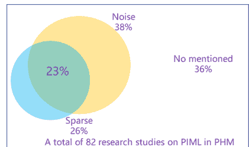

图 9. 数据质量问题相关研究的统计结果。

### 表 2 按 PHM 任务分类的 PIML 训练、测试指标和监测信号摘要。

| 参考文献 | 训练指标 | 测试指标 | PHM 任务 | 信号 |
| :--- | :--- | :--- | :--- | :--- |
| [161] | MSE | MSE | 状态监测 | 位移和电压 |
| [124,131] | MSE | MSE | 状态监测 | 振动 |
| [165] | MSE | MSE | 状态监测 | 电流、电压和时间测量 |
| [106] | MAE, MSE, RMSE | 精确率, 召回率, F1 分数 | 状态监测 & 故障诊断 | 振动, 声学, 图像, 温度 |
| [53,74,151] | MSE | MSE | 状态监测 & 故障诊断 | 应力 |
| [126,132,166] | MAE, 交叉熵损失 | 精确率, 召回率, f-k 值, 准确率, 宏观 F1, 和 G-平均 | 状态监测 & 故障诊断 | 功率, 电压, 电流 |
| [13] | 自定义设计损失 | RMSE | 状态监测 & 故障诊断 | 温度, 压力, 振动, 和气流 |
| [167,168] | 交叉熵 | 相对百分比误差 | 状态监测 & 故障诊断 | 振动 |
| [169] | MAE | 混淆矩阵 | 故障诊断 | 温度 |
| [170] | 最大交叉熵 | MAE | 故障诊断 | 振动 |
| [171,172] | 二元交叉熵 | 类别交叉熵 | 故障诊断 | 振动 |
| [173] | MAE, 相似度距离 | 精确率, 召回率, F 度量, 混淆矩阵 | 故障诊断 | 温度, 压力, 和燃油系数 |
| [14] | 自定义设计指标 | 测试假正率, MAE. | 故障诊断 | 振动, 声学信号, 和温度 |
| [6] | MAE | 混淆矩阵, 召回率, 精确率 | 故障诊断 | 振动 |
| [50] | MSE | MSE, Pearson 相关系数检验 | 故障诊断 | 振动 |
| [112,146] | 交叉熵损失 | 混淆矩阵 | 故障诊断 | 振动, 应变, 扭矩, 声发射 |
| [130] | MSE | MAE | 故障诊断 | 磁通泄漏图像, 应力 |
| [117] | 自定义损失 | 混淆矩阵 | 故障诊断 | 远场载荷, 应力比 和 腐蚀指数 |
| [129,133] | MSE | MAE | 故障诊断 | 应力 |
| [81] | MSE, 核范数 | 相对百分比误差 | 故障诊断 | 超声信号 |
| [27] | MSE | MSE | 故障诊断 | 应力, 温度 |
| [143] | 交叉熵损失 | MAE | 故障诊断 | 振动 |
| [150] | 自定义损失 | 自定义指标 | 故障诊断 | 波形数据 |
| [174] | 交叉熵 | 混淆矩阵 | 故障诊断 | 应力 |
| [175] | Softmax 损失测试 | 相对百分比误差, | 故障诊断 | 导波信号 |
| [37] | MSE | MSE, Pearson 相关系数检验 | 故障诊断 | 声学信号 |
| [84] | 交叉熵, MSE, Softmax 损失 | MAE | 故障诊断 | 模态形状信号 |
| [154] | 自定义损失 | F1 分数 | 故障诊断 | 提议的接入位置, 错误位置 |
| [176] | MAE | 相对百分比率 | 故障诊断 | 应力 |
| [70] | 交叉熵损失函数 | MAE | 故障诊断 & RUL 预测 | 相场图像 |
| [36] | MAE | α_λ 分布准确率 | RUL 预测 | 振动 |
| [51] | MAE | One σ 容差区间 | RUL 预测 | 电压和电流 |
| [16,54,155,177,178] | RMSE | RMSE | RUL 预测 | 温度, 压力, 流量 |
| [55,110] | 相对误差率 | 相对误差率 | RUL 预测 | 应力或应变 |
| [113,179] | MSE | RMSE | RUL 预测 | 电流, 电压, 温度 |
| [180] | F.norm | RMSE | RUL 预测 | 容量和电压 |
| [123] | MSE | RMSE | RUL 预测 | 振动 |
| [181] | MSE | MSE, MAE, R2 | RUL 预测 | 振动 |
| [182] | 相似度距离 | 预测水平, α_λ 分布, CRA, 收敛性, 归一化 RMSE | RUL 预测 & 退化预测 | 应力, 裂纹长度, 压力 |
| [78,123] | MAE, MSE | MAE, RMSE | 退化预测 | 力, 振动和声学信号 |
| [183] | RMSE | MAE | 退化预测 | 振动 |
| [184] | MSE | RMSE | 退化预测 | 应力 |
| [77,114] | MAE | MSE, 测试点向误差, 相对误差 | 退化预测 | 应力 |
| [76] | 二元交叉熵 | F1 分数 | 退化预测 | 切削速度, 温度 |
| [115,118,185] | MSE | MAPE | 退化预测 | 应力或图像 |
| [116] | MSE | RMSE | 退化预测 | 应力, 黏度, 风速, 和温度 |
| [43] | NMSE | NMAE | 退化预测 | 主轴电机电流 |
| [186] | MSE | MSE | 退化预测 | 远场应力 |
| [187] | 离散化误差 | MAE | 退化预测 | 应力 |
| [188] | RMSE | MRSE | 退化预测 | 上升时间, 位移 |
| [93] | 负对数似然 | 灵敏度分析, MAE, 和绝对误差方差 | 退化预测 | 应力, 温度 |

## 3. PHM 中 PIML 研究的综合综述

PHM 领域研究对象中涉及的物理通常多种多样，可以以代数方程、微分方程、仿真结果、逻辑规则和概率关系等不同形式表达，以及有限的监测

| 作者 | 研究主题 | 主要挑战 | 分类法 |
| :--- | :--- | :--- | :--- |
| Rai, Rahul, and Chandan K. Sahu. [72] | • 网络物理系统的动态行为建模 | • 在混沌环境中对连续系统行为进行离散化近似。 • 面向场景的 PIML 混合框架。 • 在大数据中高效提取因果关系和模型参数关系。 | • 基于物理的数据预处理。 • 基于物理的 ML 算法结构设计。 • 基于物理的 ML 正则化项。 |
| Willard, J., Jia, X., Xu, S., Steinbach, M. [32] | • 工程和环境系统建模。 • 模型求解方法。 | • 嵌入不完整的物理知识。 • 在数据挖掘中保持物理一致性。 • 稀疏数据和不确定性定量信息。 • 设计事先知情的深度学习框架。 • ML 训练数据稀缺。 • 保持物理一致性。 • ML 黑盒特性解释。 • 训练数据稀缺。 • 保持物理一致性。 | • ML 算法中的基于物理的正则化项。 • 基于物理的 ML 初始化。 • 基于物理的 ML 算法架构设计。 • 基于物理的特征工程。 • 基于物理的 NN 结构。 • 基于物理的损失函数。 • 并行/串行物理-ML 组合结构。 • ML 目标函数中的基于物理的正则化项。 • 基于物理的数据预处理。 • 基于物理的 ML 算法架构设计。 • ML 算法中的基于物理的正则化项。 |
| Kim, S. W., Kim, I., Lee, J., Lee, S. [189] | • 动态系统行为建模中的基于物理的深度学习。 • 提及 PHM | | |
| Jan Hagendorfer, Elias. [190] | 状态监测 | | |
| Finegan, D. P., Zhu, J., Feng, et al. [71] | 电池单元状态预测。 | 保持物理一致性。 | • 基于物理的数据预处理。 • 基于物理的 ML 算法架构设计。 • ML 算法中的基于物理的正则化项。 |
| Jianjing Zhang, Robert X. Gao. [191] | • 智能制造中的数据整理和模型解释。 • 提及 PHM。 | • 深度学习中不可解释的预测逻辑。 • 错误或不平衡的训练数据。 • 数据和数据标签稀缺。 | • 通过深度学习进行物理模型偏差补偿和未知参数估计。 • 将物理约束纳入深度学习训练。 • 基于物理的架构 • 基于物理的损失函数 |
| Xu, Yanwen and Kohtz, et al. [29] | • 可靠性分析和风险评估。 • 不确定性定量。 • 提及 PHM。 | • 面向场景的 PIML 混合框架及其计算效率。 • 物理知识的不完整性和训练数据集的有限代表性。 • 创建准确数字孪生模型需要准确可靠的数据。 • 集成来自不同来源和格式的数据。 • 为给定物理系统选择适当的建模技术。 • 将数字孪生模型扩展到更大、更复杂的系统。 • 验证数字孪生模型与其代表的物理系统。 | • 修改损失函数。 • 生成合成数据。 • 在基于物理的数据上进行预训练。 • 用未建模物理修正模型。 • 用预测残差修正模型。 • 学习预测输入。 |
| Thelen Adam, Zhang Xiaoge and Fink Olga, et al., [192,193] | • 物理系统建模 | | |

data. 因此，有必要从以下两个角度对PHM中的PIML研究进行综合综述：I) **知识表达形式** 和 II) **知识告知方法**。物理信息机器学习中知识表达形式是指以下知识表达形式：

- 1. 数学方程：知识是通过制定控制问题底层物理的数学方程来表达的。这些方程代表与问题领域相关的基本原理、物理定律和约束。
- 2. 守恒定律：关于质量、动量和能量守恒等守恒原理的知识可以融入物理信息机器学习模型。这些定律提供了指导学习过程的重要约束。
- 3. 微分方程：物理问题通常涉及描述变量之间关系的微分方程。以微分方程形式表达知识有助于在机器学习模型中强制执行物理行为和关系。
- 4. 本构关系：关于问题领域特定的材料属性、本构方程或参数化的知识可以融入。这些关系提供了不同变量如何相互作用和影响彼此的见解。

知识告知方法被视为不同知识表达方式的不同嵌入方式，详情在子节3.2中讨论。分析知识表达形式涉及检查领域知识、物理定律、方程和约束如何集成到机器学习算法中，从而提供对底层物理-ML可转换性的见解。知识告知方式更具体地寻求利用领域知识来设计和训练机器学习模型。然而，同样重要的是要考虑分析知识表达形式的更广泛视角，这在现有综述中常常被忽视。通过分析知识表达形式和知识告知方式，研究人员可以全面了解PHM中PIML方法的优势和局限性。这种双重视角使得对方法的评估更加严谨，并有助于改进物理信息机器学习模型的设计和实现。

### 3.1. 相关综述论文

据我们所知，PHM领域没有对PIML研究进行严谨的综述，但关于PIML主题有相关工作。这些工作提供了额外信息，有助于了解PIML分类法的概览，并更深入地了解该主题的研究挑战。

表3所示的现有综述认为，PIML是解决物理一致性、数据稀缺和模型可解释性等机器学习问题的有前途方案，这对PHM也很有价值。它们对PIML持有相似的分类学观点，描述物理知识可以融入数据预处理、机器学习算法设计和损失函数正则化中。

我们非常认可现有综述中提出的宝贵视角和贡献。然而，重要的是要注意，这些综述往往具有特定的学科侧重点，这可能限制其对PHM所有关键任务的全面覆盖。此外，虽然这些综述涉及将物理知识嵌入机器学习方法，但它们往往缺乏贯穿整个机器学习过程的整体分析视角。尽管它们提供了如何融入物理知识的见解，但并未充分探讨可利用的各种知识来源。此外，现有综述主要强调与特定NN架构（如PINN）相关的应用，而非拥抱物理信息机器学习（PIML）的更广泛框架。最近的一项研究[29]对可靠性领域中PIML的作用、分类法和案例进行了定性分析和全面综述[29]。PHM是应用子节中的主题之一。我们的工作通过从PHM的知识角度提供全面的定量分析，结合对最先进研究的完整定性分析，来补充他们的发现。此外，我们不仅回顾分类学和告知方法论，还考察了各种形式和来源的信息性知识。此外，[192,193]中的研究对数字孪生中的混合建模进行了系统综述，并简要讨论了PIML技术的重要性。然而，这些研究主要集中在数字孪生背景下对系统响应和动态行为建模的分析，并且仅部分包含PHM特定背景下PIML的定性和定量方面。另一方面，我们的论文专门致力于PHM，深入探讨了这些方面，当然在数字孪生的其他方面不如那些研究详尽。考虑到现有论文的局限性，本综述旨在通过在PHM领域内提供对PIML方法更彻底、更具分析性的视角来解决现有技术的不足。通过整合定性和定量方法，我们的研究致力于促进对PHM及其实际应用的整体理解。此外，它旨在阐明对整个机器学习过程的更广泛理解，涵盖融合基于物理的知识所涉及的所有关键任务。

总之，本文旨在通过在PHM背景下提供对PIML方法更全面、更具分析性的视角来弥补这些差距。结合对最先进研究的广泛定性分析，我们的工作致力于促进对PHM及其应用的更整体理解。它澄清了对整个机器学习过程的更广泛理解，涵盖融合物理知识所涉及的所有关键任务。

### 3.2. PHM 中 PIML 的分类法

根据物理知识在混合模型中的作用及其告知位置，我们建议将PIML方法分为三类。第一类利用物理知识指导输入空间的构建，即“物理信息输入空间”。第二类名为“物理嵌入算法结构”，将物理知识融入机器学习过程中的模型架构。第三类在机器学习目标函数上嵌入物理约束，以进行“物理约束学习”。这三类对应机器学习问题的三种典型解决方案：输入数据优化、模型架构优化和目标函数优化。基于物理知识在机器学习管道不同部分中的综合作用，我们总结了8种告知模式，包括“模拟器”、“量规”、“提取器”、“算子”、“结构蓝图”、“初始化器”、“一致性检查”和“冲突检查”，如图10所示，涵盖了机器学习数据流的所有方面。还总结了它们各自的实现以及实现这些实现的相关机器学习技术框架。可以看出，NN是最广泛使用的建模工具。为了帮助理解方法论，相同知识的不同告知方式显示在 https://github.com/pimlphm/Physics-informed-machine-learning-based-on-TCN。

#### 3.2.1. 物理信息输入空间

数据准备通常占据PHM中大部分工作量[194]。关于“物理信息输入空间”类别，PIML试图在机器学习输入空间中获取物理信息，通过辅助数据增强、特征变换、特征选择、降维[155]和信息融合[40]来提炼多源异构监测数据[45,46]。“物理信息输入空间”可以被视为传统“特征工程”或“基于仿真的数据增强”过程的延伸，利用物理知识驱动数据处理和增强，包括三种范式：“模拟器”、“量规”和“提取器”，如图11所示。发生在“数据准备”步骤中的技术“模拟器”和“量规”旨在生成和转换数据。同时，“数据预处理”步骤中的“提取器”专门用于提取有用特征。现有工作中这三种技术的简要摘要如表4所示。

##### 物理信息模拟器

本组工作的重点是构建捕获所研究系统物理行为的模拟器，以生成用于训练机器学习模型的数据。这些模拟器生成的数据提供了涵盖系统不同健康状态的更丰富信息，减少了机器学习的知识盲区，从而提升机器学习性能。要构建模拟器，可以利用不同仿真程度的各种模型，例如基于结构和基于过程的数字孪生模型[192,193]、发动机性能模型或组件有限元模型。实现物理信息模拟器的挑战在于在仿真精度和速度之间找到平衡。其基本范式如图12所示。

传统上，构建物理信息模拟器时，数值模型的输出被用作机器学习模型的输入。然而，高保真仿真计算成本高昂。因此，大多数研究集中在使用降阶模型（ROM）或代理模型以降低仿真成本。前者是大规模模型的简化，用于在低维中建立多维物理过程的近似描述。ROM与虚拟传感器的结合可以创建动态模型标定[58]，这实际上是许多仿真软件（例如Ansys和Modelica）的基础。收集的文献中基于数字孪生的物理信息输入模型也通过基于系统特定行为的ROM模拟某些类型的物理信号来增强机器学习的输入空间。此外，代理模型在选定的有限数量点上计算原始高保真模型的响应。事实上，它是有限运行状态下真实系统的代理[202]。在现有PIML方法中，构建ROM通常通过添加约束来减少模型中未量化变量的数量。这增加了设备运行的前提条件并指定了涉及的状态空间，这依赖于用户对特定故障的理解。相比之下，现有PIML研究中的代理模型倾向于通过将机器学习模型拟合到有限运行条件下运行条件与系统响应之间的关系来完成建模。例如，在齿轮传动啮合振动行为的仿真中，基于ROM的PIML模拟器指定了齿轮传动的运行条件（负载、转速等）。它使用简化的物理模型（例如啮合齿轮对的时变刚度弹簧阻尼模型）来表示组件，并使用简化的数据流连接来表示轴弹簧。它将系统质量建模为集中惯性模块，忽略了不同运行条件下的非线性耦合、机电耦合以及动态状态的变化。

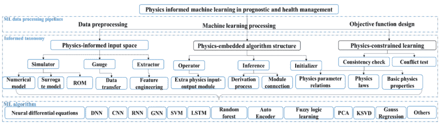

**图10.** PHM中现有PIML方法的分类法。

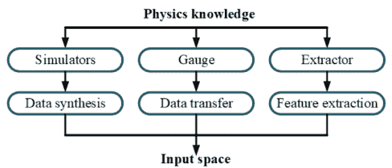

图 11. 构建物理信息输入空间的三种方式。

conditions. 齿磨和齿断裂对啮合刚度的影响是唯一需要考虑的因素。相比之下，基于代理模型的PIML仿真器使用灰箱模型来拟合激励、响应和结构参数之间的关系。它假设灰箱模型的相应映射是恒定的，并适用于不同的工作状态空间，从而进一步增加样本数量。

#### 物理信息量规

在某些特定的案例研究中，例如复杂结构系统，不可避免地需要使用简化的物理模型来构建“仿真器”。然而，这种简化可能导致模型行为以及估计值相对于系统真实值出现显著偏差 [80]。随后，模型更新无法固有地纠正建模错误。为克服这一问题，数据迁移是增强数据空间的一种替代方案。在此背景下，一些研究专注于将物理知识作为“量规”来评估源数据库和目标数据库之间的相似性。该技术通过在两者之间设计基于物理的传递准则，将特征知识从源域迁移到目标域。它有助于增强ML的鲁棒性并提高ML模型的效率和准确性。

图 13 展示了实现“量规”的两种基本方式。其原理在于寻找源域和目标域之间的不变量或不变关系，例如特征对称性、守恒性、变换不变性和单调性 [139,203]。随后，拥有大量数据和信息的源域会根据物理相似性准则有选择地迁移到目标域 [159]。

#### 物理信息提取器

除了数据提取，数据处理是另一项直接影响ML模型性能的关键任务。为确保输入空间包含尽可能多的故障相关特征，有必要创建一个物理信息提取器，以根据物理知识指导数据预处理。例如，所提出的物理信息提取器允许选择合适的域变换方法 [204] 以获取相关的聚合特征 [155]，或融合来自多个来源的异构信息 [40,65]。在 [88] 中，紧弦模型方程标准化了主成分分析方法，用于提取电缆振动的指定模态频带。 [79] 中的研究开发了一种物理引导的ML模型来执行特征提取过程，该过程可以生成直接反映电动汽车性能的特定特征。

特征提取之后，ML模块包含一个嵌入组件，其作为一组子特征提取器发挥作用。随后进行信息融合，主要侧重于合并物理健康指标与虚拟健康指标。前者涉及故障物理，通常在指标方面具有显著的可解释性。对于后者，现有PIML研究中有两种实现方式 [205]：

- 从多个物理域进行信息融合，以获得冗余更少且代表所有原始信息的“感官数据”。例如，多元回归 [132]、升高空间投影 [206] 以及其他监督和无监督学习方法被用于执行信号级数据融合和特征级数据融合 [42]。

- 通过物理关系进行跨物理域关系融合，以获得“感知数据”，其中数据各部分的物理关系凸显 [207,208]，如图 14 所示。例如，在裂纹增长预测中，通过牛顿-拉夫逊法获得的结构响应信息（如位移和相场）以当前裂纹状态的图像形式保存，以构建空间结构知识 [70]。

### 3.2.2. 物理嵌入算法结构

关于“物理嵌入算法结构”，PIML旨在使传统的无物理感知ML变得具有物理感知能力，从而将控制过程添加到ML算法结构的设计和参数搜索过程中。它倾向于将“硬约束投影（HCP）” [90] 与ML相结合，包括以下三种范式：“基本算子”、“ML结构蓝图”和“参数初始化器”，如图 15 所示。

“基本算子”负责在机器学习处理中强制执行物理求解的关系。另一方面，“ML结构蓝图”致力于基于物理推导的关系设计ML模块或层间连接，从而赋予稀疏性。这些组件在算法的结构设计中实现。此外，“参数初始化器”专注于识别ML参数。现有文献中使用的这些方法的简要摘要见表 5。

#### 物理信息算子

#### 表 4 PHM 中物理信息输入空间研究摘要。

| Ref. | Application | Knowledge source | Informed | ML framework | PHM tasks |
|---|---|---|---|---|---|
| [195, 196] | 航空结构 | 基于组件的数字孪生 | 仿真器 | 分类树和SVM | 故障诊断 |
| [170] | 三柱塞泵 | 基于组件的数字孪生 | 仿真器 | 自编码器迁移学习 | 故障诊断 |
| [58] | 石油生产线 | 基于生产的数字孪生模型 | 仿真器 | 自编码器 & LSTM | 状态监测 |
| [197] | 转子 | 负载特征空间可分性的先验评估 | 仿真器 | 汉密尔顿自编码器神经网络、PCA & 随机森林 | 故障诊断 |
| [188] | 电液静力执行器退化 | 物理退化模型 | 仿真器 | LSTM | 退化预测 |
| [13] | 涡扇发动机 | 发动机气路性能模型 | 仿真器 | DNN | 剩余使用寿命预测 |
| [53,55] | 复合结构 | 粘接接头疲劳有限元或格点代理模型 | 仿真器 | FCN | 疲劳预测 |
| [198] | 轴承 | 时域统计特征生成模型 | 仿真器 | SVM | 故障诊断 |
| [174] | 飞机复合结构 | Lamb波的数值解 | 仿真器 | CNN | 故障诊断 |
| [144] | 工业生产 | 扰动值的时间序列导数加权 | 仿真器 | VAE | 故障诊断 |
| [199] | 建筑 | 建筑结构的不变特性 | 量规 | 物理信息多源域对抗网络 | 故障诊断 |
| [59] | 增材制造监测 | 热历史特征和趋势中的几何不变性 | 量规 | 基于树的回归 | 状态监测 |
| [171] | 齿轮箱 | 未标记数据与标记数据之间的隐式物理关联 | 量规 | 深度卷积生成对抗网络 | 故障诊断 |
| [200] | 齿轮箱 | 振动固有的循环平稳特性 | 提取器 | 自编码器 | 故障诊断 |
| [183] | 带锯 | 振动模态分析和有限元分析 | 提取器 | PINN和DCNN | 故障诊断 |
| [167] | 齿轮箱 | 健康自适应物理时标表示嵌入输入模块 | 提取器 | CNN | 故障诊断 |
| [201] | 机电负载 | 特征空间负载可分性的先验评估 | 提取器 | SVM & DNN | 故障诊断 |
| [169] | 空气处理单元 | 基于物理模型语义的重要特征选择 | 提取器 | Wasserstein生成对抗网络 | 故障诊断 |

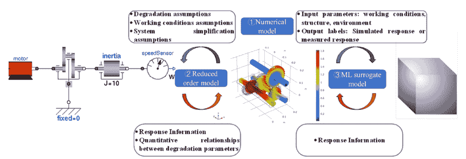

图 12. 构建物理信息输入空间仿真器的三种方式。

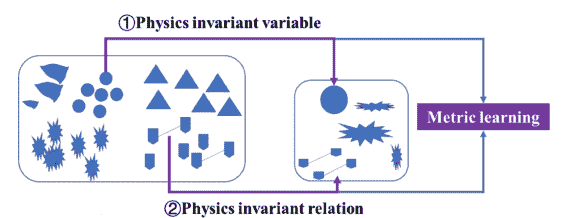

图 13. 构建用于物理相似度度量信息学习的量规的两种方式。

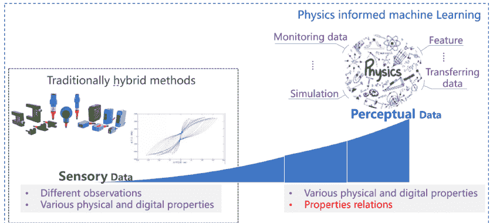

图 14. 基于PIML的信息融合：将多种异构感官信号扩展和提炼为感知信号。

“算子”的原理是利用故障机制的物理知识来构建ML模块，以更好地捕捉输入-输出关系。为此，现有研究提出了两种方式：1) 用物理输入-输出模型替换ML模块，2) 自定义层和神经元来表达物理方程，如图 16 所示。第一种方法，即用物理输入-输出模型替换ML模块，对原始数据进行物理上有意义的转换，生成后续ML模块所需的健康指标。然后通过集成ML模块来融合物理模型和ML模块之间的信息。例如，在文献 [172,213] 中，设计了定制的小波变换层，通过为NN层分配适当的系数和权重来指导特征提取和健康指标构建任务。整体结构包括物理嵌入部分的输出和ML模块处理输出的串行和并行融合方法 [116]。串行架构为每个数据表征和决策步骤选择最佳方法。连续方法之间的兼容性对于先前输出的顺序重新评估至关重要，可减少

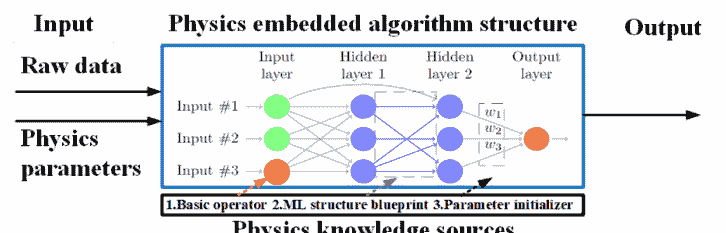

图 15. 构建物理嵌入式算法结构的三种方式。不同颜色的线代表不同的实现，土黄色代表将物理知识嵌入到机器学习的局部模块（如神经元）中，紫色线代表基于物理知识设计模块间连接（如层连接），黑色代表初始化机器学习参数。（关于本图例中颜色引用的解释，读者请参阅本文的网络版。）

#### 表 5 PHM 中物理嵌入式算法结构研究摘要

| 参考文献 | 应用 | 知识来源 | 知情方式 | ML 框架 | PHM 任务 |
| :--- | :--- | :--- | :--- | :--- | :--- |
| [182] | 裂纹扩展和滤芯堵塞 | 疲劳裂纹 Paris 定律和压力降类比公式 | 算子 | ANN | RUL 预测 |
| [165] | 电机条棒断裂 | 故障频率和方包络阈值 | 算子 | CNN | 故障诊断 |
| [209] | 钻杆 | 两个 DNN 之间液压系数关系的嵌入 | 算子 | DNN | |
| [113] | 锂离子电池 | 基于 Nernst 和 Butler-Volmer 方程的降阶模型 | 算子 | RNN | RUL 预测 |
| [43] | 刀具磨损 | Sipos 经验磨损-时间 | 算子 | 自适应神经-模糊推理系统 | 退化预测 |
| [81,130] | 材料缺陷 | 导波电磁声传感器系统的拓扑 | 算子 | 孪生 CNN | 故障诊断 |
| [149] | 轴承疲劳 | 基于 Paris 定律的腐蚀 | 算子 | NN | |
| [114,129] | 结构裂纹 | 基于损伤微分方程和 Dirichlet 边界的生长定律 | 结构蓝图 | DeepONet | 退化预测 |
| [37,210] | 裂纹识别 | 裂纹扩展微分方程 | 结构蓝图 | 堆叠自编码器 | 退化预测 |
| [115,121, 179, 186] | 航空结构裂纹 | 裂纹扩展或振动异常模型 | 结构蓝图 | RNN | 退化预测 |
| [91,115, 120] | 结构疲劳 | 疲劳裂纹扩展的欧拉积分 | 结构蓝图 | RNN 或 CNN | 退化预测 |
| [113] | 电池 RUL 预测 | 基于测量容量和电压曲线的控制微分方程 | 结构蓝图 | RNN | RUL 预测 |
| [156,178] | 结构损伤 | 由损伤引起的结构变化 | 结构蓝图 | 堆叠 NODE | 故障诊断 |
| [20,95,166, 211, 212] | 电网和母线 FD | 物理空间或频谱关联性 | 结构蓝图 | 图 NN | 故障诊断 |
| [154] | DRAM 错误 | DRAM 的空间依赖性 | 初始化器 | SVM, NN, 提升树, 朴素贝叶斯, 随机森林 | 故障诊断 |
| [168] | 轴承 | 基于可解释权重的包络谱 | 初始化器 | 监督学习二分法 | 故障诊断 |
| [57] | 铸造缺陷 | 一维传热方程 | 初始化器 | 非负矩阵分解 | 状态监测 |
| [142] | 材料裂纹/断裂 | 岩土力学改变指数聚类基础 | 初始化器 | K-Means 聚类 | 故障诊断 |
| [76] | 刀具磨损 | 由切削速度和温度参数化的决策空间 | 初始化器 | CNN | 退化预测 |
| [149] | 电网 | 风力振荡方程和电网方程 | 初始化器 | 高斯过程回归 | 故障诊断 |
| [187] | 海上风力涡轮机 | 退化超额矩阵 | 初始化器 | 贝叶斯网络 | 退化预测 |

消除歧义并提高准确性。然而，来自不完整物理信息的累积错误是一个潜在缺点。结合物理模型和机器学习（ML）模块的并行融合结构具有同时发挥两种方法优势的优点。它在提高准确性、鲁棒性和可解释性方面发挥着补偿器的作用

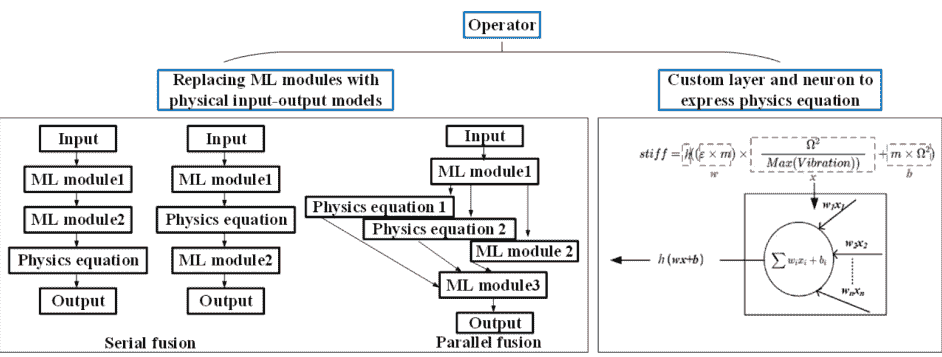

图 16. 以算子形式嵌入物理知识的两种方式。

同时能够全面理解复杂系统的退化行为 [179]。然而，挑战包括复杂性、数据需求、可解释性受损、模型与算法之间的潜在冲突，以及开发和维护所需的专业知识和资源。

在使用 ML 模块表达物理函数的第二种方法中，ML 模块充当强制执行器来推导物理模型输出并提供额外的物理信息。这种方法涉及通过 ML 的内在函数利用数学近似。例如，在文献 [181] 中，采用神经网络的线性求和来表示振动幅值与转速之间的关系。神经网络层之间的激活函数和连接近似特征与 RUL 值之间的关系。可训练权重、偏置和非线性激活函数代表公式中的未知数和参数。

#### 物理信息机器学习结构蓝图

与“PIML 算子”相比，“PIML 结构蓝图”是一种物理感知方法，更侧重于指导机器学习与物理知识之间数据流相似性的构建，包括对物理过程、测量过程、推导过程、几何结构等的建模，如图 17 所示。

由于这类方法的本质在于设计机器学习的结构，包括模块设计和模块间连接，我们提出使用“结构蓝图”来表示物理推理过程或物理结构关系告知的机器学习算法结构。它旨在从几何结构、系统行为或内部材料相互作用 [101] 中寻找拓扑相似性和单元依赖关系映射，以确保在训练机器学习模型时推理过程的物理优先性。PBMs 中对系统行为的推测和抽象是优化指导机器学习训练过程的有用来源。例如，在 [95] 中，神经网络是根据电网的拓扑和物理定律设计的。底层物理模型控制配电网的运行，以稀疏学习模型的结构，其中剪枝在训练过程中以确定性方式进行 [132]。因此，负载异常和电网损坏可以通过网络节点输出的变化来指示。此外，在参考文献 [102] 中，神经网络梯度建模一个势能函数，该函数被用来表示四旋翼机之间干扰与其距离的依赖关系。

可利用多种特殊结构来建模物理推导的关系。在图 3.2.2 中，Runge-Kutta 数值积分过程的每个步骤由一个神经网络层表示，积分路径计算基于物理求和关系完成。动态行为变化（例如 RNN [120] 中的损伤增长）通过递归预测结构表示（见图 18）。损伤增长递归关系中的每个公式由一个自定义神经网络层表示，层间结构使递归关系得以实现。在结构层面表示推导过程时，进一步去解析了大量物理知识 [50]。例如，在文献 [37,156,178] 中，特定的物理关系是非解析的。物理知识的嵌入通过 CODEC（编码器-解码器）结构中共享参数的两个神经网络来实现。后者是声波传播线性二阶偏微分方程的代理，而前者用于从测量值到后者代理神经网络近似模型的解。总之，“PIML 结构蓝图”将机器学习推理过程定义为物理推导形式的一部分，其中机器学习模块保留其原始计算结构，但通过约束模块间关系，充当某些类型物理方程求解过程的映射。

#### 物理信息机器学习参数初始化器

与同时关注“PIML 算子”和“PIML 结构蓝图”不同，“PIML 参数初始化器”的研究更关注机器学习参数和超参数的选择与赋值。例如，权重选择是基于马尔可夫随机场（MRF）[154] 中物理能量最小状态完成来实现的。在 [36] 中，多尺度包络谱的小波特征通过统计健康指数生成模型融合，缺陷状态与融合特征之间的观测函数被假设为线性拟合。基于 Paris 公式的剥落扩展经验模型是一种预测模型，其初始参数设置为概率分布。此外，平均值的

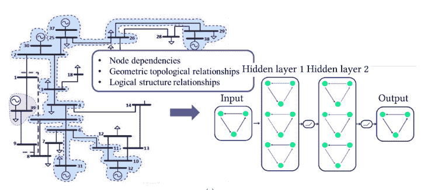

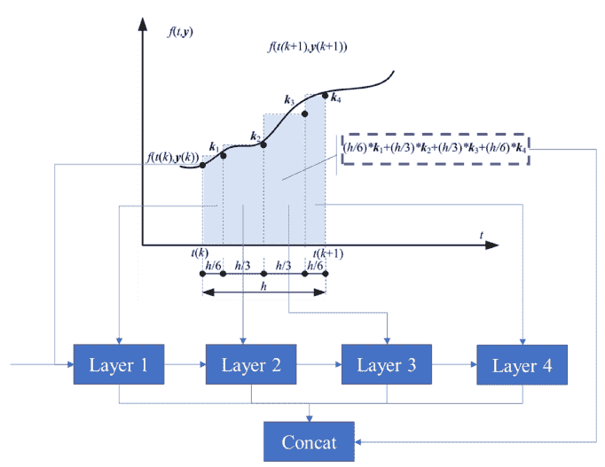

图 17. 构建与基于物理模型（PBMs）具有相似推导过程或结构的物理信息机器学习（PIMLs）。

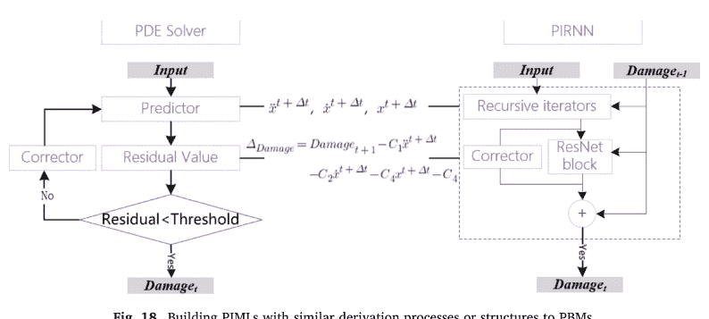

图 18. 构建与基于物理模型（PBMs）具有相似推导过程或结构的物理信息机器学习（PIMLs）。

一维热传递方程求解被用作铸造缺陷监测中非负矩阵分解的初始参数 [57]。总结来说，这些研究中机器学习参数的初始化通常基于物理模型求解。

### 3.2.3. 物理约束学习

与“嵌入式物理算法结构”的硬约束相反，物理信息机器学习还包括软约束，这些软约束通过目标函数的设计，使机器学习能够对给定的一组物理规律产生近似满足。其近似满足可以以积分、微分、概率、逻辑规则以及其他基于物理的偏差形式引入。根据知情物理目标函数与原始机器学习目标函数之间的关系，本文将“物理约束学习”分为两种范式：“一致性检查”和“冲突测试”，如图 19 所示。物理信息机器学习模型的总误差包括传统的机器学习预测误差（“误差1”）和物理一致性误差（“误差2”）。一般来说，对可用数据的数值最佳拟合（残差损失）与物理原理的持续满足（边界损失）之间存在差异 [147]。基于“一致性检查”或“冲突测试”误差设计目标函数，旨在使机器学习结果趋向于物理一致性。相关文献总结于表 6。

从表 6 可以看出，物理知识通过修改目标函数直接用于机器学习目标设计，以此影响机器学习优化寻求学习过程中的参数变化。对于特定的物理信息机器学习框架，“一致性损失”致力于确保机器学习输出符合物理事实，而“冲突损失”则由机器学习输出与物理模型输出之间的冲突构建。

#### 一致性损失设计

在刀具磨损预测 [78] 中，经验知识（随着切割次数增加，磨损增加）被编译为一个检测输出序列中趋势信息的函数。

在金属板超声波损伤检测中，一致性体现为算法识别接近损伤簇对应解析模型的结果，并满足由控制方程残差生成的正则项的能力 [37]。在金属损伤识别的 K-SVD 方法中，文献 [150] 为字典的原子更新过程构建了一个基于一维波方程的额外正则化项的超完备字典。

在这些研究中，机器学习输出除了尽可能保持原始拟合精度外，还需要满足正则项或降低控制方程的惩罚函数值，以实现物理一致性。而这个控制方程可以是表示近似的偏微分关系 [37]。也可以是某些显式物理方程在所需容差内是否满足。例如，在基于自编码器的高阻抗故障检测 [132] 中，电压和电流的旋转轨迹需要满足椭圆方程。在某些情况下，一致性损失的设计不需要完全已知的解析物理模型。同样可行的是，通过神经网络作为退化微分方程的试探解，并通过神经网络外部的额外迭代路径来强制执行微分方程 [133]。

#### 冲突损失设计

基于物理模型与机器学习输出之间的不一致，也可以设计“冲突测试”，该测试仅在误差传播过程中优化机器学习的相关参数。

在文献 [143] 中，基于深度卷积神经网络的人工故障阈值模型的诊断冲突结果被用于设计损失函数，旨在提高轴承故障严重程度的辨别度。在钢结构建筑损伤检测 [84] 中，设计了一个基于物理的损失函数，用于评估神经网络模型输出与有限元模型更新输出之间的差异。这一想法可视为一种传统的融合方法，它在机器学习训练过程中结合不同方法的输出 [216]。它们之间的主要区别在于，此处基于物理的输出主要用于纠正机器学习的行为，而非增强决策。

## 4. 按物理知识形式讨论 PHM 中的 PIML 研究

前几个部分总结了 PHM 中不同的物理信息机器学习框架。它们初步回答了“如何在机器学习中注入物理知识”的问题。然而，物理知识是一个极其复杂的抽象概念，“哪种物理知识可用于注入机器学习”的问题尚未得到解决。该问题将在子节 4.1 中予以考虑。接下来，

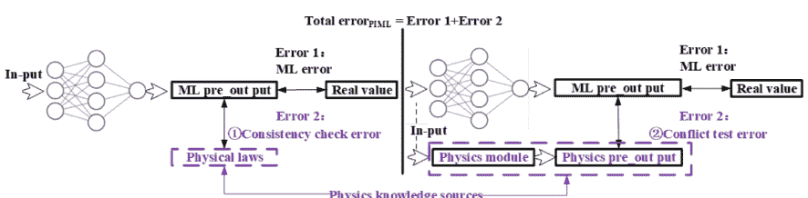

图 19. 构建物理约束学习的两种方式。

### 表 6

PHM 中物理约束学习总结。

| Ref. | Application | Knowledge source | Informed | ML framework | PHM tasks |
|---|---|---|---|---|---|
| [177] | 涡轮发动机 | 基于偏微分方程残差的损失 | 一致性 | 堆叠卷积神经网络 | 剩余使用寿命预测 |
| [96] | 变形识别 | 归一化物理模型的模态残差 | 一致性 | 深度神经网络 | 故障诊断 |
| [133] | 材料损伤 | 有限元分析 | 一致性 | 深度神经网络 | 故障诊断 |
| [123] | 轴承 | 基于韦伯分布的可靠性模型 | 一致性 | 人工神经网络 | 故障诊断 |
| [214] | 车辆传感器 | 基于可迁移算子的残差生成 | 一致性 | 尼曼-皮尔森检验 | 故障诊断 |
| [132] | 高阻抗故障检测 | 电压和电流旋转轨迹的椭圆方程 | 一致性 | 自编码器 | 故障诊断 |
| [215] | 建筑 | 属性-类别矩阵 | 一致性 | MatConvNet | 故障诊断 |
| [146] | 海洋洋流涡轮 | 风扇平衡中平均水流速度的频域特征 | 一致性 | 主成分分析和卷积神经网络 | 故障诊断 |
| [150] | 金属损伤 | 基于一维波方程正则化项的原子更新 | 一致性 | K-SVD | 故障诊断 |
| [131] | 车间机械 | 与皮尔逊相关系数相关的故障频域特征损失 | 一致性 | 深度卷积自编码器 | 故障诊断 |
| [176] | 损伤应力预测 | 基于有限元法的应力分布 | 冲突 | 长短期记忆网络 | 故障诊断 |
| [143] | 轴承 | 基于专家经验的故障程度阈值模型 | 冲突 | 卷积神经网络 | 故障诊断 |
| [84] | 钢结构建筑损伤 | 有限元模型输出 | 冲突 | 深度神经网络 | 故障诊断 |
| [126,173] | 风电场和燃气轮机 | 物理完整的历史数据集 | 冲突 | 人工神经网络 | 故障诊断 |

子节 4.2 旨在综合文献中该知识的注入方式。

### 4.1. 物理知识类别

物理知识是实现物理信息机器学习的前提。在综述 [141] 中，作者建议根据知识的起源对知识来源进行分类。然而，物理信息机器学习的实现方法取决于知识的形式而非知识的来源。例如，论文 [84] 和 [133] 中提出的物理信息机器学习框架来自不同领域（建筑施工和材料行业）且具有不同的知识来源，但两者都使用相同的知识形式，即有限元法，来构建“一致性检查”损失函数。因此，本子节侧重于综合物理知识的形式而非其来源。根据 PHM 中现有的物理信息机器学习研究，物理知识形式可分为三类，如图 20 所示。

- 1) 第一类：与解析失效模型相关的显式知识。显式知识由系统动态行为的解析模型或方程表示，例如转子动力学中的发电机惯性常数、阻尼系数和转速 [140]。它们在数学和物理上明确无歧义、形式化、符号化且结构化。特别是，在 PHM 领域，它们展示了失效过程的可量化性，包括代数关系、控制方程和概率关系。

- 2) 第二类：与结构或特定过程相关的嵌入式知识。它被锁定在物理推导过程、系统惯例、结构或布局中。它提供与每个过程步骤或每个组件结构的顺序和要求相关的信息。它使用机器学习模块来表达关于系统结构 [132]、单元依赖关系 [154] 或系统拓扑框架的信息。特别是，某些知识是非符号化和非显式的，仅仅是推导过程之间的输入-输出或相互验证关系。

- 3) 第三类：与广泛物理信息相关的隐式知识。它涉及假设、专家规则和经验，以及多样的底层物理特性。它指关于劣化过程的知识，这类知识在某种程度上是直觉的且难以量化。

### 4.2. 按知识形式讨论物理注入方式

表 7 总结了 PHM 中物理信息机器学习的不同知识形式，并呈现了它们相应的嵌入机器学习的方式。从该表中可以注意到：

- 1. 由于定义了清晰输入-输出数学关系的显式解析方程或模型，显式知识是构建物理信息机器学习最常见的方式。它广泛用于“模拟器”、“提取器”、“算子”和“一致性检查”的构建。它通常可以在机器学习管道的多个数据流会话中独立或协作使用。它改变数据流中相应环节的输入和输出，但不改变数据流方向。

- 2. 嵌入式知识研究侧重于作为物理信息机器学习结构设计指导。它们寻求构建整个机器学习结构，使得通过机器学习模型推断的信息流类似于通过真实物理模型、结构或推导过程传递的信息流。在典型情况下，当物理推导过程中存在未知项，使得难以建立公式化模型，并且当物理结构之间存在可量化关系时，可以采用诸如结构蓝图（仅基于物理结构关系或推导过程设计机器学习模型的结构和参数）等范式，或者将有限的已知步骤或模型作为局部算子嵌入机器学习框架中。

- 3. 大部分“嵌入式知识”研究实际上指向机器学习与物理推导之间的可互换性。例如，常微分方程（ODE）的欧拉解被实现为循环神经网络的一种特例，并应用于 Dynet [218]。尽管当前研究仍然集中在神经微分方程（NDEs）相关领域，即使用机器学习来推导或嵌入失效的微分方程，如论文 [156,178,217] 所示，但由 Deeponet 领导的算子学习趋势最近引起了广泛关注。例如，论文 [217] 提出了可传递算子，用于表征底层车辆传感器系统输出之间的关系。

- 4. 虽然“隐式知识”是最普遍的知识，但对其进行的研究数量很少。在这些研究中，“隐式知识”通常被转换为可解析的形式，以便嵌入目标函数和推导过程。它使得能够设计物理相似性测试度量 [171,199] 来评估结果的分布或趋势是否符合某些物理特性 [177,214]，以及构建冲突损失 [126,143,173]。

- 5. 对于隐式知识的使用，物理知识通常不是预先给定的，而是通过以合理方式设计机器学习模型来发现故障相关信息而获得的。例如，在 [118] 中，作者使用动态模态分解来提取信号特征。这些特征被用作标签，训练机器学习如何自动发现与裂纹生长相关的信息。这种知识发现过程的实现应基于堆叠的机器学习架构，即一个用于知识发现的机器学习模型和一个用于校对或扩展知识的机器学习模型。例如，可以参考 [132] 中相关的两阶段图神经网络架构。

- 6. 在实践中，可分析和可量化的显式知识无疑是有限的，关于故障过程的知识在很大程度上仍是感性的或定性的。因此，隐式知识可以通过对机制和结构的更深入理解转化为嵌入式知识。例如，图神经网络中的节点和连接可以基于对电网中电流和电压分布的理解来构建 [149]。此外，对基本物理特性和关系的理解可以用公式描述并转化为显式知识。例如，an

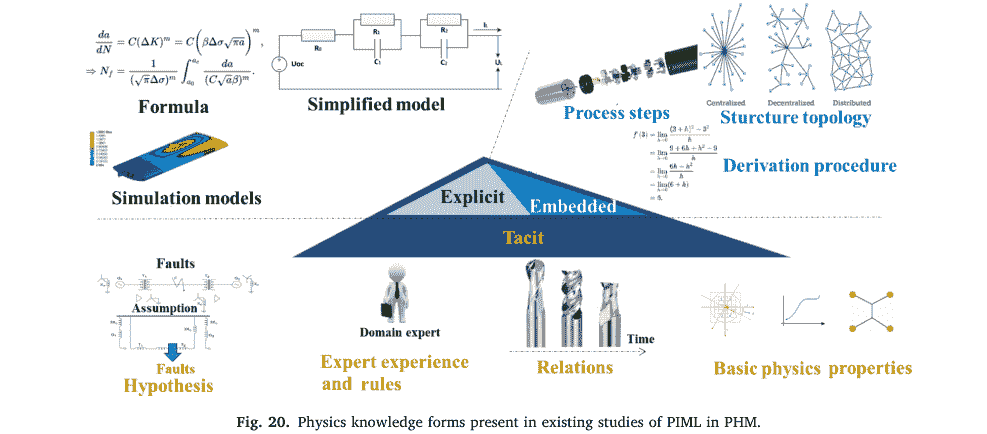

| 参考文献 | 知识形式 | | | 告知方式 |
| :--- | :---: | :---: | :---: | :--- |
| | 显式 | 嵌入式 | 隐式 | |
| [13,53,55,58,144,170,174,188,195–198] | ✓ | | | 模拟器 |
| [59,171,199] | | | ✓ | 量规 |
| [59,167,169,171,183,199,200,201] | ✓ | | | 提取器 |
| [36,62,63,113,149,172,182,213] | ✓ | | | 算子 |
| [43,51,118,165] | | | ✓ | 算子 |
| [81,130,209] | | ✓ | | 算子 |
| [37,113,210,217] | ✓ | | | 结构蓝图 |
| [20,50,91,95,107,114,115,120,121,129,156,166,178,179,186,211,212] | | ✓ | | 结构蓝图 |
| [57,76,142,149,187] | ✓ | | | 初始化器 |
| [154,168] | | ✓ | | 初始化器 |
| [96,123,132,133,150] | ✓ | | | 一致性 |
| [177,214] | | ✓ | | 一致性 |
| [131,146] | | | ✓ | 一致性 |
| [84,176] | ✓ | | | 冲突 |
| [126,143,173] | | | ✓ | 冲突 |

基于建筑损伤模式物理属性的嵌入式迁移学习模型，通过最小化由 L2-范数和角度损失测量的损伤属性损失来训练 [215]。此外，上述建筑相关知识还可用于引入一种新的物理引导加权设计。在 [199] 中，作者利用与目标的物理相似性来衡量每个源的重要性，从而决定将数据转移到哪个源。

- 7. 相同的物理知识可以以不同方式被告知。例如，捕获系统特征的动态模态分解可用于设计图像重建的算子以识别裂缝 [118]，或用于设计生成时滞系统诊断输入特征图的提取器 [169]。特别是，以有限元等自包含输入输出关系和推导形式存在的知识，可用作：1) 嵌入式知识，以指导网络设计来模拟物理推导（例如用于加速 CNN 的动态卷积）[218]；2) 显式知识，通过设计失效代理模型进行数据增强 [55]；或 3) 度量，以设计 ML 与物理预测之间的冲突损失 [176]。

- 8. 关于何时使用何种形式的知识。根据对表 7 中现有研究的分析，本文建议：在处理显式知识时，系统行为可以由具有清晰输入输出关系的数学方程或解析模型来描述。如果方程中涉及的物理信号变量可用，我们可以根据解析公式或系统物理特性来定制 NN 层或单元。当系统行为的显式知识不可用，但我们拥有系统物理结构或行为模型推导知识的信息，并伴随对涉及信号的推理关系处理时，我们可以构建物理告知结构。随后，嵌入式知识被用于定制 NN 结构中的数据流，或将定制设计的 NN 用作物理模型推导特定步骤的代理模型。在隐式知识的情况下，即缺乏系统行为的定量信息，但系统输入输出之间存在物理关系或系统输出上的约束时，这些关系可用于定制 ML 目标函数或调节隐藏层的输出。

需要注意的是，这些知识形式并非互斥，通常可以在 PIML 框架内结合或集成。使用哪种形式或是否结合使用，取决于当前问题的具体要求和目标。PIML 的综合方法可能涉及利用显式、嵌入式和隐式知识的组合，以捕捉系统特征的全范围并优化模型性能。最终，选择适当的知识形式需要仔细考虑问题领域、可用专业知识、数据可用性，以及建模过程中所需的可解释性和准确性水平。

## 5. 挑战与未来研究方向：面向“小数据和稀缺物理知识”背景下的 PHM

### 5.1. PIML 的局限性与挑战

与稀疏和噪声数据、数据可用性以及不完整物理模型相关的挑战在其他综述 [18,29,32] 中已被强调。此外，还需要进一步研究收集更具代表性的数据、选择适当的基准模型，以及确定告知 ML 部分的权重参数或超参数。本文认为，这些挑战背后的根本问题是如何将各种形式的知识转换为 ML 框架所需的类型，即调整知识以适应 ML 模型，而不是选择 ML 模型来拟合物理知识。因此，可以从两个方面突出挑战：

- 1. 构建物理感知 ML 框架

  在当前关于 PIML 设计的研究中，物理知识与 ML 之间的互转，以及 ML 物理不一致性的评估度量，仍然是一个研究不足且具有挑战性的主题。因此，有必要构建一个物理感知 ML 框架，该框架能够根据物理-ML 互转机制和不一致性评估结果，基于知识形式自动将物理知识融入 ML 流水线的各个部分。

- 2. 知识基础的构建

  构建有效的 PIML 框架需要深入理解所研究系统的物理特性。这要求研究人员在计算机科学和物理学（例如力学）方面都具备全面的知识和技能。因此，对于缺乏跨学科经验的初级研究人员来说，在实施 PIML 技术时面临着显著的障碍。此外，由于大多数知识可能含糊不清，数学表达式和物理建模并不总是针对 PHM 案例研究得到充分发展。因此，从含糊信息中构建 PIML 的知识基础至关重要。

### 5.2. 未来方向

虽然很难确定哪个方向会带来颠覆性发现，但 PHM 社区可以通过在以下领域考虑前一节概述的挑战，为 PIML 的未来做出重大贡献：

- 1. 在 ML 中编纂故障机制

  关于 ML 如何更好地利用来自多个来源的集成物理知识，缺乏相关研究。因此，当不同形式的知识被嵌入到不同的 ML 框架中时，建立 PIML 的认知机制似乎是一项有意义的工作。

- 2. 从度量学习的角度

  另一条值得调查的路径是开发具有更多维度度量的 ML 目标函数，这些度量可以涵盖模型复杂度、物理一致性、计算成本和结果准确性。

- 3. 进一步构建合适的基准问题

  一组定义明确的基准问题可以促进不同算法的评估和比较，从而推动该主题的研究发展。由于深层领域背景要求，公共数据集对应的物理知识通常不可用。这常常导致由于知识短缺而在开发 PIML 方法时遇到众多障碍。开发带有共享编码知识的开源基准问题（例如 [219] 中提出的合成疲劳损伤数据库），或其他领域的类似进展，将受到欢迎。

- 4. 结合灵活数字孪生模型构建生命周期工具。[192, 193] 中的建模技术和数字孪生赋能技术为与 PIML 集成提供了一个诱人的机会。这种组合有潜力开发一个强大的生命周期管理工具，该工具包含灵活保真度模型并保持物理一致性。此外，通过构建数字孪生框架，它还能够包含不确定的定量评估评价。

- 5. 适应稀疏运行至失效数据和稀疏标签数据。PHM 中的 PIML 研究大多关注数据集中的稀疏观测或信息偏差。然而，未标记数据和非完整失效过程数据占绝大多数。因此，针对稀疏和噪声数据的 PIML 理论与应用研究值得探索。预计将开发诸如物理告知无监督学习、自监督学习和半监督学习等新的 PHM 范式。

- 6. “小数据和稀缺物理知识”背景下的 PIML。PHM 中 PIML 的最终发展目的之一是能够在“小数据和稀缺物理知识”条件下工作，这将大大扩展潜在 PHM 应用的范围。基于上述研究方向，将 PIML 与知识发现和 ML 架构搜索技术相结合，有潜力涌现出突破性方法。

## 6. 结论

本文介绍了面向预测与健康管理的物理告知机器学习的文献计量结果和最新研究综述。从“如何告知”和“告知什么”的创新视角，总结并提供了其基本范式的概述。现有方法根据物理知识在 ML 流水线中的嵌入位置和方式进行分组。还讨论了将 PIML 应用于解决 PHM 问题的挑战和未来研究方向。本文的主要贡献是提供 PHM 中 PIML 的简洁而全面的概述，并专注于为 PIML 利用翻译适当知识形式的根本挑战。希望本文能鼓励进一步工作，拓展 PIML 在 PHM 领域的潜力。

## 利益冲突声明

作者声明没有已知的可能影响本文所报告工作的竞争性财务利益或个人关系。

## 数据可用性

数据应要求提供。

## 参考文献

- [1] N. Kim, D. An, J.-H. Choi, 工程系统的预测与健康管理, 2017.
- [2] B. Rezaeianjouybari, Y. Shang, 预测与健康管理的深度学习：现状、挑战与机遇, Measurement 163 (2020) 107929.
- [3] O. Fink, Q. Wang, M. Svensen, P. Dersin, W.-J. Lee, M. Ducoffe, 预测与健康管理应用中深度学习的潜力、挑战与未来方向, Eng. Appl. Artif. Intell. 92 (2020) 103678.
- [4] S. Zhang, S. Zhang, B. Wang, T.G. Habetler, 轴承故障诊断的深度学习算法——全面综述, IEEE Access 8 (2020) 29857–29881.
- [5] P. Singh, M. Keyvanloo, A. Sadhu, 基于有限传感器的结构状况评估改进时变经验模态分解, Eng. Struct. 232 (2021) 111882.
- [6] A. Khan, H. Hwang, H.S. Kim, 旋转机械故障诊断的合成数据增强与深度学习, Mathematics 9 (18) (2021) 2336.
- [7] S. Khan, T. Yairi, 系统健康管理中深度学习应用综述, Mech. Syst. Signal Process. 107 (2018) 241–265.
- [8] E. Zio, 预测与健康管理（PHM）：理论与实践中我们在哪里以及需要去往何方, Reliab. Eng. Syst. Saf. 218 (2022) 108119.
- [9] A.K.B.M. Nor, S.R. Pedapati, M. Muhammad, 工业资产 PHM 的可解释 AI（XAI）：最新进展、PRISMA 合规系统综述, arXiv 预印本 arXiv:2107.03869 (2021).
- [10] M. Arias Chao, 结合深度学习与基于物理的性能模型进行诊断与预后, ETH Zurich, 2021. 博士论文.
- [11] A. Rasheed, O. San, T. Kvamsdal, 数字孪生：价值、挑战与推动因素, arXiv 预印本 arXiv:1910.01719 (2019).
- [12] L. Scapino, H.A. Zondag, J. Dirken, C.G. Rindt, J. Van Baal, A. Sciacovelli, 使用人工神经网络建模吸附热能存储反应器的性能, Appl. Energy 253 (2019) 113525.
- [13] M.A. Chao, C. Kulkarni, K. Goebel, O. Fink, 混合深度故障检测与隔离：结合深度神经网络和系统性能模型, arXiv 预印本 arXiv:1908.01529 (2019).
- [14] K.L. de Calle, S. Ferrero, A. Arnau, B. Sierra, 基于数据受限工业环境中降维技术的动态状态监测方法, Comput. Ind. 112 (2019) 103114.
- [15] B. Zhao, G. Wen, H. Sun, D. Sun, H. Yang, J. Cao, L. Dai, B. Wang, 煤与瓦斯突出物理模拟中的相似性准则和类煤材料, Int. J. Coal Sci. Technol. 5 (2) (2018) 167–178.
- [16] P.C. Berri, M.D. Dalla Vedova, L. Mainini, 飞机执行系统实时诊断与预后的计算框架, Comput. Ind. 132 (2021) 103523.

- [17] J.M. Reniers, G. Mulder, D.A. Howey, 锂离子电池机械-化学降解模型综述与性能比较, J. Electrochem. Soc. 166 (14) (2019) A3189.

- [18] Y.A. Yucesan, A. Dourodo, F.A. Viana, 工业设备预后与健康管理建模调查, Adv. Eng. Inf. 50 (2021) 101404.

- [19] Y. Lei, N. Li, L. Guo, N. Li, T. Yan, J. Lin, 机械健康预后：从数据采集到RUL预测的系统综述, Mech. Syst. Signal Process. 104 (2018) 799–834.

- [20] L. Pagnier, M. Chertkov, 用于电力系统参数与状态估计的物理信息图神经网络, arXiv preprint arXiv:2102.06349 (2021).

- [21] M. Raissi, P. Perdikaris, G.E. Karniadakis, 物理信息神经网络：求解涉及非线性偏微分方程的正问题和逆问题的深度学习框架, J. Comput. Phys. 378 (2019) 686–707.

- [22] P. Bonissone, GE的预后与健康管理, (https://nidastorage.blob.core.usgovcloudapi.net/nidia/2006/logistics/bonissone.pdf).

- [23] W.Z. Leviente Klein, 借助物理窥探AI的“黑箱”大脑, (https://www.ibm.com/blogs/research/2018/03/geospatial-temporal-insights/).

- [24] R.M. Michael Eidell, S. Choudhry, 利用物理信息神经网络和NVIDIA Modulus加速产品开发, (https://developer.nvidia.com/blog/accelerating-product-development-with-physics-informed-neural-networks-and-modulus/).

- [25] S.K.A.A. Rohit Tripathy, Illas Bilionis, 多尺度系统的物理信息学习（Pilgrims）, (https://www.predictivesciencelab.org/project/darpa-pilgrims/). 2019年11月14日访问.

- [26] R.M. Michael Eidell, S. Choudhry, PCOE数据集, (https://ti.arc.nasa.gov/tech/dash/groups/pcoe/prognostic-data-repository/).

- [27] S. Mohanty, R.B. Vilim, 基于物理注入的AI/ML数字孪生框架，用于核反应堆换热器流致振动损伤预测, 技术报告, Argonne National Lab.(ANL), Argonne, IL (United States), 2021.

- [28] 利用物理信息AI，机器操作员可以信任和验证, (https://www.sme.org/technologies/articles/2021/november/with-physics-informed-ai-machine-operators-can-trust-and-verify/).

- [29] Y. Xu, S. Kohtz, J. Boakye, P. Gardoni, P. Wang, 面向可靠性和系统安全应用的物理信息机器学习：现状与挑战, Reliab. Eng. Syst. Saf. (2022) 108090.

- [30] Z. Zhao, Q. Zhang, X. Yu, C. Sun, S. Wang, R. Yan, X. Chen, 无监督深度迁移学习在智能故障诊断中的应用：一项调查与比较研究, IEEE Trans. Instrum. Meas. 70 (2021) 1–28.

- [31] V. Atamuradov, K. Medjaher, P. Dersin, B. Lamoureux, N. Zerhouni, 面向维护从业人员的预后与健康管理—综述、实施与工具评估, Int. J. Prognost. Health Manag. 8 (060) (2017) 1–31.

- [32] J. Willard, X. Jia, S. Xu, M. Steinbach, V. Kumar, 将基于物理的建模与机器学习相结合：一项综述, arXiv preprint arXiv:2003.04919 1 (1) (2020) 1–34.

- [33] M. Gong, D. Tang, J. Yu, L. Tian, 一种面向有限遥测数据的航空航天CMG异常检测的物理信息迁移学习方法. 2021 Global Reliability and Prognostics and Health Management (PHM-Nanjing), IEEE, 2021, pp. 1–5.

- [34] Y. Li, J. Wang, Z. Huang, R.X. Gao, 面向加工刀具磨损预测的物理信息元学习, J. Manuf. Syst. 62 (2022) 17–27.

- [35] C. Chen, Citespace：绘制科学文献图谱的实用指南, Nova Science Publishers Hauppauge, NY, 2016.

- [36] J. Wang, Y. Liang, Y. Zheng, R.X. Gao, F. Zhang, 一种面向有限样本风力涡轮轴承预测性维护的集成故障诊断与预后方法, Renew. Energy 145 (2020) 642–650.

- [37] K. Shukla, P.C. Di Leoni, J. Blackshire, D. Sparkman, G.E. Karniadakis, 用于表面开裂裂纹超声无损定量的物理信息神经网络, J. Nondestr. Eval. 39 (3) (2020) 1–20.

- [38] S.K. Singh, R. Yang, A. Bejrat, R. Rai, S. Chowdhury, I. Matei, Pi-LSTM：物理注入的长短期记忆网络. 2019 18th IEEE International Conference on Machine Learning and Applications (ICMLA), IEEE, 2019, pp. 34–41.

- [39] S. Pawar, O. San, P. Vedula, A. Rasheed, T. Kvamsdal, 基于串联神经网络的多保真信息融合, arXiv preprint arXiv:2110.04170 (2021).

- [40] A. Diez-Olivan, J. Del Ser, D. Galar, B. Sierra, 面向工业4.0的工业预后数据融合与机器学习：趋势与展望, Inf. Fusion 50 (2019) 92–111.

- [41] J. Chen, B. Ma, S. Yan, C. Zheng, Q. Zhang, 一种基于排列熵的故障诊断状态监测数据融合重要性度量. 2019 Prognostics and System Health Management Conference (PHM-Qingdao), IEEE, 2019, pp. 1–5.

- [42] T. Meng, X. Jing, Z. Yan, W. Pedrycz, 面向数据融合的机器学习综述, Inf. Fusion 57 (2020) 115–129.

- [43] H. Hanachi, W. Yu, I.Y. Kim, J. Liu, C.K. Mechefske, 面向刀具磨损预测的混合数据驱动基于物理的模型融合框架, Int. J. Adv. Manuf. Technol. 101 (9) (2019) 2861–2872.

- [44] Y. Zheng, 跨域数据融合方法论：概述, IEEE Trans. Big Data 1 (1) (2015) 16–34.

- [45] J. Zhou, X. Hong, P. Jin, 多源材料数据信息融合：进展与挑战, Appl. Sci. 9 (17) (2019) 3473.

- [46] M.D. Sangid, 原位实验与建模耦合——面向数据融合、机器学习和涌现行为发现的机会, Curr. Opin. Solid State Mater. Sci. 24 (1) (2020) 100797.

- [47] Z. Zhang, R. Rai, S. Chowdhury, D. Doermann, Midphynet：在神经网络中对动态系统建模的分解物理记忆注入, Neurocomputing 428 (2021) 116–129.

- [48] Z. Liu, N. Meyendorf, N. Mrad, 使用数字孪生的预测性维护中数据融合的作用. AIP Conference Proceedings volume 1949, AIP Publishing LLC, 2018, p. 020023.

- [49] E. Kipchirchir, M.H. Do, J.G. Njiri, D. Söffker, 基于预后的风力涡轮机寿命控制自适应控制策略, Wind Energy Sci. Discuss. (2021) 1–16.

- [50] S.S. Ekşeveri, M. Takác, S.N. Pakzad, M. Jahani, DyNet：用于非线性结构响应建模与预测的基于物理的神经架构设计, Eng. Struct. 229 (2021) 111582.

- [51] L. Liao, F. Köttig, 一种结合数据驱动与基于模型方法的系统剩余寿命预测混合框架, Appl. Soft. Comput. 44 (2016) 191–199.

- [52] K.M. Siddiqui, et al., 面向PHM的油气减震器系统多物理场仿真, Int. J. Prognost. Health Manag. 8 (2) (2017).

- [53] Y. Gao, H. Yao, Y. Hei, Y. Liu, 复合材料概率断裂分析的基于物理的深度学习. AIAA Scitech 2020 Forum, 2020, p. 1860.

- [54] M.A. Chao, C. Kulkarni, K. Goebel, O. Fink, 面向预后的基于物理与深度学习模型融合, Reliab. Eng. Syst. Saf. 217 (2022) 107961.

- [55] K.R. Lyathakula, F.-G. Yuan, 一种基于ANN混合模型的粘接接头概率疲劳寿命预测, Int. J. Fatigue (2021) 106352.

- [56] A. Cubillo, S. Perinpanayagam, M. Esperon-Miguez, 预后中基于物理模型的综述：应用于旋转机械齿轮和轴承, Adv. Mech. Eng. 8 (8) (2016), 1687814016664660.

- [57] P. Weider, A.M. Tomé, E.W. Lang, 一种基于NMF的金属铸造过程感官数据中物理有意义成分提取方法, J. Manuf. Syst. 54 (2020) 62–73.

- [58] R. Srikonda, A. Rastogi, H. Oestensen, 在动态数字孪生中利用机器学习和基于物理的混合分析提高设施运行时间. Offshore Technology Conference, OnePetro, 2020.

- [59] K.L. Ness, A. Paul, L. Sun, Z. Zhang, 迈向增材制造中几何不变热历史预测的通用基于物理的机器学习模型, J. Mater. Process. Technol. 302 (2022) 117472.

- [60] M. Nouri, J. Artozoul, A. Caillaud, A. Ammar, F. Chinesta, O. Köser, 由基于物理与数据驱动混合模型赋能的收缩孔隙率预测, Int. J. Mater. Form. 15 (3) (2022) 1–16.

- [61] H.Y. Zhang, 一种基于因果表的知识推理模型，用于识别炼油和石化厂的腐蚀失效机理, Eng. Fail Anal. (2012).

- [62] Y. Pan, Y. Jing, T. Wu, X. Kong, 面向油况预测的小样本知识数据增强, Reliab. Eng. Syst. Saf. 217 (2022) 108114.

- [63] M. Sadoughi, C. Hu, 用于滚动轴承故障诊断的基于物理的卷积神经网络, IEEE Sens. J. 19 (11) (2019) 4181–4192.

- [64] M. Sadoughi, C. Hu, 基于物理的深度学习用于旋转机械故障诊断的方法. IECON 2018-第44届IEEE工业电子学会年会, IEEE, 2018, pp. 5919–5923.
- [65] H. Li, H.-Z. Huang, Y.-F. Li, J. Zhou, J. Mi, 基于多源信息融合的涡轮叶片失效物理可靠性预测. Appl. Soft. Comput. 72 (2018) 624–635.
- [66] R. Swischuk, L. Mainini, B. Peherstorfer, K. Willcox, 基于投影的模型约简：面向物理机器学习的公式. Comput. Fluids 179 (2019) 704–717.
- [67] R. Firoozi, S. Sattarzadeh, S. Dey, 极端快充下圆柱电池故障检测：一种基于物理的学习方法. arXiv preprint arXiv: 2105.02169 (2021).
- [68] Y. Yu, H. Yao, Y. Liu, 面向航空器动力学仿真的基于物理的学习. 第10届健康管理与预知维护学会年会, PHM 2018, 健康管理与预知维护学会, 2018.
- [69] T. Pfaff, M. Fortunato, A. Sanchez-Gonzalez, P.W. Battaglia, 基于图网络的网格仿真学习. arXiv preprint arXiv:2010.03409 (2020).
- [70] S. Feng, Y. Xu, X. Han, Z. Li, A. Inecnik, 基于相场和深度学习的结构剩余寿命精确预测方法. Comput. Methods Appl. Mech. Eng. 383 (2021) 113885.
- [71] D.P. Finegan, J. Zhu, X. Feng, M. Keyser, M. Ulmenfors, W. Li, M.Z. Bazant, S.J. Cooper, 数据驱动方法与基于物理的学习在提升电池安全性中的应用. Joule (2020).
- [72] R. Rai, C.K. Sahu, 数据驱动还是物理推导？面向网物理系统 (CPS) 的混合物理引导机器学习技术综述. IEEE Access 8 (2020) 71050–71073.
- [73] N. Muralidhar, J. Bu, Z. Cao, L. He, N. Ramakrishnan, D. Tafti, A. Karpatne, 面向稠密流体颗粒系统阻力预测的物理引导深度学习. Big Data 8 (5) (2020) 431–449.
- [74] Z. Geng, Y. Wang, 基于地震属性数据的物理引导深度学习用于井筒不稳定地质钻探风险预测. Eng. Geol. 279 (2020) 105857.
- [75] S.M. Razak, J. Cornelio, Y. Cho, H.-H. Liu, R. Vaidya, B. Jafarpour, 面向非常规油井稳健产量预测与诊断的物理引导深度学习预测模型. SPE/AAPG/SEG 非常规资源技术会议, OnePetro, 2021.
- [76] J. Kandarickal, T. Schmitz, S. Smith, 面向机加工刀具寿命建模与工艺参数优化的物理引导逻辑分类. J. Manuf. Syst. 59 (2021) 522–534.
- [77] C.T. Nguyen, S. Otterson, E. Oterkus, 基于普通状态相位论的二维结构物理引导机器学习模型. Theor. Appl. Fract. Mech. 112 (2021) 102872.
- [78] J. Wang, Y. Li, R. Zhao, R.X. Gao, 面向机加工刀具磨损预测的物理引导神经网络. J. Manuf. Syst. 57 (2020) 298–310.
- [79] L. Guo, J. Ye, B. Yang, 面向电动汽车的基于物理引导机器学习的网络攻击检测. IEEE Trans. Transp. Electrif. (2020).
- [80] Z. Zhang, C. Sun, B. Guo, 考虑建模不确定性的基于迁移学习引导的贝叶斯模型更新用于损伤识别. Mech. Syst. Signal Process. 166 (2022) 108426.
- [81] H. Sun, L. Peng, J. Lin, S. Wang, W. Zhao, S. Huang, 基于聚焦高阶SH导波EMAT的微裂纹缺陷定量：物理信息深度神经网络GUWNet. IEEE Trans. Ind. Inf. (2021).
- [82] R. Wang, R. Yu, 面向动力系统的物理引导深度学习：综述. arXiv preprint arXiv:2107.01272 (2021).
- [83] X. Jia, J. Willard, A. Karpatne, J. Read, J. Zwart, M. Steinbach, V. Kumar, 面向动力系统建模的物理引导RNN：湖温剖面仿真案例研究. 2019年SIAM国际数据挖掘会议论文集, SIAM, 2019, pp. 558–566.
- [84] Z. Zhang, C. Sun, 基于物理引导机器学习的结构损伤识别：集成模式识别与有限元模型更新的方法论. Struct. Health Monitor. 20 (4) (2021) 1675–1688.
- [85] R. Zhang, Y. Liu, H. Sun, 面向数据驱动地震响应建模的物理引导卷积神经网络(PhyCNN). Eng. Struct. 215 (2020) 110704.
- [86] A. Daw, R.Q. Thomas, C.C. Carey, J.S. Read, A.P. Appling, A. Karpatne, 面向湖温建模不确定性量化的物理引导神经网络架构(PGA). 2020年SIAM国际数据挖掘会议论文集, SIAM, 2020, pp. 532–540.
- [87] S. Pawar, O. San, B. Aksoylu, A. Rasheed, T. Kvamsdal, 使用简化理论的物理引导机器学习. Phys. Fluids 33 (1) (2021) 011701.
- [88] Y. Yang, L. Sanehsi, H. Zhang, A. Roeder, J. Bowland, J. Crochet, C. Garrard, D. Mascarenas, 基于物理引导无监督机器学习和计算机视觉的数字视频测量中缆索振动全场全流实验模态模型估计. Struct. Control Health Monitor. 26 (6) (2019) e2358.
- [89] A.I. Ozdagli, X. Koutsooulos, 面向动力系统的基于物理引导学习的模型损伤检测.
- [90] Y. Chen, D. Huang, D. Zhang, J. Zeng, N. Wang, H. Zhang, J. Yan, 理论引导硬约束投影(HCP)：基于知识的数据驱动科学机器学习方法. J. Comput. Phys. 445 (2021) 110624.
- [91] H. Yao, Y. Gao, Y. Liu, Fea-Net：面向高效力学响应预测的物理引导数据驱动模型. Comput. Methods Appl. Mech. Eng. 363 (2020) 112892.
- [92] J. Chen, Y. Liu, 面向疲劳数据分析的概率物理引导机器学习. Expert Syst. Appl. 168 (2021) 114316.
- [93] J. Chen, Y. Liu, 使用概率物理引导学习对增材制造Ti-6Al-4V疲劳性能进行预测. Addit. Manuf. 39 (2021) 101876.
- [94] A. Karpatne, W. Watkins, J. Read, V. Kumar, 物理引导神经网络(PGNN)：湖温建模应用. arXiv preprint arXiv: 1710.11431 (2017).
- [95] A.S. Zamzam, N.D. Sidiropoulos, 面向配电系统状态估计的物理感知神经网络. IEEE Trans. Power Syst. 35 (6) (2020) 4347–4356.
- [96] A. Odot, R. Haferssas, S. Cotin, DeepPhysics：面向实时仿真的物理感知深度学习框架. arXiv preprint arXiv:2109.09491 (2021).
- [97] H.E. Sánchez Sardi, 面向风力涡轮机的预知维护与健康感知模型预测控制 (2017).
- [98] S. Pakravan, P.A. Mistani, M.A. Aragon-Calvo, F. Gibou, 使用物理感知神经网络求解反问题PDE. J. Comput. Phys. 440 (2021) 110414.
- [99] S. Seo, C. Meng, Y. Liu, 面向稀疏观测动力学的物理感知差分图网络. 国际学习表征会议, 2019.
- [100] A. Behjat, C. Zeng, R. Rai, I. Matei, D. Doermann, S. Chowdhury, 具有输入传输网络的物理感知学习架构用于预测建模. Appl. Soft. Comput. 96 (2020) 106665.
- [101] E. Blasch, J.S. Tiley, D. Sparkman, S. Donegan, M. Cherry, 面向材料感知的数据融合方法. 信号处理、传感器/信息融合与目标识别XXIX 第11423卷, 国际光电学会, 2020, p. 114230K.
- [102] I. Matei, C. Zeng, S. Chowdhury, R. Rai, J. de Kleer, 基于物理感知建模的四旋翼无人机之间气流相互作用控制. J. Intell. Robot. Syst. 101 (1) (2021) 1–21.
- [103] Y. Shin, J. Darbon, G.E. Karniadakis, 关于物理信息神经网络的收敛性与泛化性. arXiv e-prints (2020) arXiv–2004.
- [104] E. Kharazmi, Z. Zhang, G.E. Karniadakis, 面向偏微分方程求解的变分物理信息神经网络. arXiv preprint arXiv: 1912.00873 (2019).
- [105] S. Talukdar, D. Deka, H. Dodi, D. Matarasi, M. Chertkov, M.V. Salapaka, 线性动力系统网络中的物理信息拓扑学习. Automatica 112 (2020) 108705.
- [106] S. Guo, M. Agarwal, C. Cooper, Q. Tian, R.X. Gao, W.G. Grace, Y. Guo, 金属增材制造机器学习：迈向物理信息数据驱动范式. J. Manuf. Syst. 62 (2022) 145–163.
- [107] Y.A. Yucesan, F.A. Viana, L. Manin, J. Mahfoud, 使用物理信息神经网络调整扭转振动阻尼器模型. Mech. Syst. Signal Process. 154 (2021) 107552.
- [108] A.D. Jagtap, K. Kawaguchi, G.E. Karniadakis, 自适应激活函数加速深度与物理信息神经网络的收敛. J. Comput. Phys. 404 (2020) 109136.
- [109] L. Borkowski, C. Sorini, A. Chattopadhyay, 具有正则化的面向物理信息约束的多轴塑性循环神经网络模型. Comput. Struct. 258 (2022) 106678.

- [110] H. El Mir, S. Perinpanayagam, 面向物理信息机器学习的认证方法及其在起落架寿命评估中的应用. 2021 IEEE/AIAA第40届数字航空电子系统会议(DASC), IEEE, 2021, pp. 1–6.

- [111] X. Yang, G. Tartakovsky, A. Tartakovsky, 物理信息克里金法：一种用于数据-模型融合的物理信息高斯过程回归方法, arXiv预印本 arXiv:1809.03461 (2018).

- [112] S. Xu, H.Y. Noh, Pymdran: 基于对抗学习的建筑间物理信息知识迁移用于地震损伤诊断, Mech. Syst. Signal Process. 151 (2021) 107374.

- [113] R.G. Nascentino, M. Corbetta, C.S. Kulkarni, F.A. Viana, 用于锂离子电池建模和寿命预估的混合物理信息神经网络, J. Power Sources 513 (2021) 230526.

- [114] S. Goswami, M. Yin, Y. Yu, G. Karniadakis, 用于脆性材料裂纹路径预测的物理信息变分深度网络, arXiv预印本 arXiv:2108.06905 (2021).

- [115] F.A. Viana, R.G. Nascentino, A. Dourado, Y.A. Yucesan, 基于物理信息神经网络的常微分方程模型不充分性估计, Comput. Struct. 245 (2021) 106458.

- [116] Y.A. Yucesan, F.A. Viana, 用于风力涡轮机主轴承疲劳的物理信息神经网络, Int. J. Prognostic. Health Manag. 11 (1) (2020).

- [117] A.D. Dourado, F. Viana, 用于腐蚀-疲劳偏差补偿的物理信息神经网络, AIAA Scitech 2020论坛, 2020, p. 1149.

- [118] S. Das, S. Dutta, C. Putsch, S. Majumdar, D. Adak, 基于数据驱动的物理信息基础设施系统寿命预估方法：理论及裂纹预测应用, ASCE-ASME J Risk Uncertain. Eng. Syst., Part A: Civil Eng. 6 (2) (2020) 04020013.

- [119] R. Giorgiani do Nascimento, 动力系统的混合物理信息神经网络 (2020).

- [120] R.G. Nascentino, K. Fricke, F.A. Viana, 使用Python和混合物理信息神经网络求解常微分方程教程, Eng. Appl. Artif. Intell. 96 (2020) 103996.

- [121] A. Dourado, F.A. Viana, 用于腐蚀-疲劳寿命预估的物理信息神经网络. PHM学会年会论文集 第11卷, 2019.

- [122] S. Liu, B.B. Kappes, B. Amin-ahmadi, O. Benafan, X. Zhang, A.P. Stebner, 用于成分-工艺-性能合金设计的物理信息机器学习：形状记忆合金演示, arXiv预印本 arXiv:2003.01878 (2020).

- [123] T. von Hahn, C.K. Mechefske, 使用基于Weibull的损失函数的知识信息机器学习, arXiv预印本 arXiv:2201.01769 (2022).

- [124] Y. Chen, M. Rao, K. Feng, M.J. Zuo, 用于齿轮箱故障检测的物理信息LSTM超参数选择, Mech. Syst. Signal Process. 171 (2022) 108907.

- [125] F.A. Viana, A.K. Subramaniyan, 科学建模中贝叶斯校准和物理信息神经网络综述, Arch. Comput. Methods Eng. 28 (5) (2021) 3801–3830.

- [126] L. Schröder, N.K. Dimitrov, D.R. Verelst, J.A. Sørensen, 使用迁移学习构建物理信息机器学习模型以改进风电场监测, Energies 15 (2) (2022) 558.

- [127] M.A. Nabian, R.J. Gladstone, H. Meidani, 基于重要性采样的物理信息神经网络高效训练, Comput.-Aided Civ. Infrastruct. Eng. (2021).

- [128] B.M. de Silva, J. Callaham, J. Jonker, N. Goebel, J. Klemisch, D. McDonald, N. Hicks, J.N. Kutz, S.L. Brunton, A.Y. Aravkin, 基于飞行试验数据的传感器故障检测物理信息机器学习, arXiv预印本 arXiv:2006.13380 (2020).

- [129] S. Goswami, M. Yin, Y. Yu, G.E. Karniadakis, 用于准脆性材料裂纹路径预测的物理信息变分深度网络, Comput. Methods Appl. Mech. Eng. 391 (2022) 114587.

- [130] H. Sun, L. Peng, S. Huang, S. Li, Y. Long, S. Wang, W. Zhao, 高精度磁通漏缺陷尺寸估计的物理信息双馈交叉残差深度神经网络开发, IEEE Trans. Ind. Inf. 18 (3) (2021) 1629–1640.

- [131] M. Russell, P. Wang, 工业状态监测中大数据信号压缩和重建的物理信息深度学习, Mech. Syst. Signal Process. 168 (2022) 108709.

- [132] W. Li, D. Deka, 用于配电系统鲁棒故障定位的物理信息图学习, arXiv e-prints (2021) arXiv:2107.

- [133] C.J. Rojas, M.L. Bittencourt, J.L. Boldrini, 使用物理信息神经网络进行损伤模型参数识别, arXiv预印本 arXiv:2107.08781 (2021).

- [134] V.V. Vesselinov, 大型和噪声数据的无监督和物理信息机器学习. 技术报告, 洛斯阿拉莫斯国家实验室(LANL), 洛斯阿拉莫斯, 新墨西哥州(美国), 2019.

- [135] E.J. Cross, S. Gibson, M. Jones, D. Pitchforth, S. Zhang, T. Rogers, 结构健康监测的物理信息机器学习. 基于数据科学技术的结构健康监测, Springer, 2022, pp. 347–367.

- [136] S. Chakraborty, 无仿真可靠性分析：基于物理信息深度学习的方法, arXiv预印本 arXiv:2005.01302 (2020).

- [137] Z. Chen, J. Gao, W. Wang, Z. Yan, 物理信息生成神经网络：对流层温度预测应用, Environ. Res. Lett. 16 (6) (2021) 065003.

- [138] Z. Liu, Y. Chen, Y. Du, M. Tegmark, 物理增强学习：超越物理信息学习的新范式, arXiv预印本 arXiv:2109.13901 (2021).

- [139] M. Raissi, P. Perdikaris, G.E. Karniadakis, 物理信息深度学习（第一部分）：非线性偏微分方程的数据驱动解法, arXiv预印本 arXiv:1711.10561 (2017).

- [140] J. Siatysny, G.S. Misyris, S. Chatzivasileiadis, 用于电力系统动态非线性系统辨识的物理信息神经网络. 2021 IEEE马德里PowerTech, IEEE, 2021, pp. 1–6.

- [141] L. von Rueden, S. Mayer, K. Beckh, B. Georgiev, S. Giesselbach, R. Heese, B. Kirsch, J. Pfrommer, A. Pick, R. Ramamurthy, 等, 信息机器学习——将知识集成到学习系统中的分类学和综述, arXiv预印本 arXiv:1903.12394 (2019).

- [142] A. Chakravarty, S. Misra, C.S. Rai, 使用物理信息聚类处理超声剪切波进行水力压裂可视化, Int. J. Rock Mech. Min. Sci. 137 (2021) 104568.

- [143] S. Shen, H. Lu, M. Sadooghi, C. Hu, V. Nemani, A. Thelen, K. Webster, M. Darr, J. Sidon, S. Kenny, 用于轴承故障检测的物理信息深度学习方法, Eng. Appl. Artif. Intell. 103 (2021) 104295.

- [144] J. Marcus, 用于异常检测的物理信息变分自编码器中的不确定性量化. 钢铁行业人工智能技术的影响与机遇：持续应用、展望与未来趋势 1338 (2021) 28.

- [145] M.J. Neuer, 用于异常检测的物理信息变分自编码器中的不确定性量化. 欧洲钢铁技术平台网络安全研讨会, Springer, 2020, pp. 28–38.

- [146] B. Freeman, Y. Tang, Y. Huang, J. VanZwieten, 物理信息湍流强度注入：一种用于海洋潮流涡轮机转子叶片故障检测的新混合方法, Ocean Eng. 254 (2022) 111299.

- [147] S. Goswami, C. Anitescu, S. Chakraborty, T. Rabczuk, 用于相场断裂建模的迁移学习增强物理信息神经网络, Theor. Appl. Fract. Mech. 106 (2020) 102447.

- [148] Y.A. Yucesan, F.A. Viana, 基于物理信息神经网络的风力涡轮机主轴承疲劳寿命估计. PHM学会年会 第11卷, 2019.

- [149] R. Tipireddy, A. Tartakovsky, 用于电网中部分观测和未观测状态预测及不确定性量化的物理信息机器学习方法, arXiv预印本 arXiv:1806.10990 (2018).

- [150] H.V. Tetali, K.S. Alagri, J.B. Harley, 一维波动物理信息字典学习. 2019 IEEE第29届信号处理机器学习国际研讨会(MLSP), IEEE, 2019, pp. 1–6.

- [151] C. Sherman, R. Mellors, J. Morris, 基于物理信息深度神经网络对DAS分析的地下监测. 第53届美国岩石力学/岩体力学研讨会, OnePetro, 2019.

- [152] A. Tartakovsky, R. Tipireddy, 用于电网中部分观测和未观测状态预测及不确定性量化的物理信息机器学习方法. 第52届夏威夷国际系统科学会议论文集, 2019.

- [153] D.A. Lizama Molina, H. Yoon, L. Jiang, L.J. Pyrak-Nolte, 基于物理信息机器学习方法的裂纹启动与传播声发射分析。桑迪亚国家实验室(SNL-NM)技术报告，新墨西哥州阿尔伯克基(美国)，2019年。

- [154] E. Baseman, N. DeBardeleben, S. Blanchard, J. Moore, O. Tchaknine, K. Ferreira, T. Siddiqua, V. Sridharan, 基于物理信息机器学习的DRAM错误建模。2018年IEEE VLSI和纳米技术系统缺陷与容错国际研讨会(DFT)，IEEE，2018年，第1–6页。

- [155] M. Sepe, A. Graziano, M. Badora, A. Di Stazio, L. Belani, M. Compare, E. Zio, 应用于旋转机械资产预测性维护的物理信息机器学习框架 (2021)。

- [156] Z. Lai, C. Mylonas, S. Nagarajaiah, E. Chatzi, 基于物理信息神经常微分方程的结构辨识，J. Sound Vib. 508 (2021) 116196。

- [157] A.S. Krishnapriyan, A. Gholami, S. Zhe, R.M. Kirby, M.W. Mahoney, 物理信息神经网络中可能故障模式的表征，arXiv预印本 arXiv:2109.01050 (2021)。

- [158] R. Giorgiani Nascimento, F.A. Viana, 基于物理信息循环神经网络的机队预后，arXiv电子预印本 (2019) arXiv–1901。

- [159] S. Chakraborty, 基于迁移学习的多保真物理信息深度神经网络，J. Comput. Phys. 426 (2021) 109942。

- [160] M.A. Chao, B.T. Adey, O. Fink, 基于深变分自编码器的新兴故障类型故障检测与分割的隐式监督，Neurocomputing 454 (2021) 324–338。

- [161] W. De Groote, S. Van Hoecke, G. Crevecoeur, 凸轮-从动机构中从动跳跃预测：在循环神经网络中使用物理启发特征的优势，Mech. Syst. Signal Process. 166 (2022) 108453。

- [162] A. Gálvez, D. Sevérinate, D. Galar, 集成到混合模型中的供暖、通风和空调系统物理模型的开发与同步，Int. J. Hydromechatron. 4 (3) (2021) 230–258。

- [163] Y. Zheng, J. Li, R. Lin, H. Wu, K. Gao, L. Huang, 地热场中小规模裂缝表征的物理引导机器学习方法。第46届地热储层工程研讨会论文集，斯坦福大学，2021年。

- [164] G.E. Karniadakis, I.G. Kevrekidis, L. Lu, P. Perdikaris, S. Wang, L. Yang, 物理信息机器学习，Nature Rev. Phys. 3 (6) (2021) 422–440。

- [165] A. Boushaba, S. Cauet, A. Chamroo, E. Etien, L. Rambault, 感应电机断条MSA检测中物理信息CNN与PCA的比较研究，Sensors 22 (23) (2022) 9949。

- [166] W. Liao, D. Yang, Y. Wang, X. Ren, 基于图卷积网络的电力变压器故障诊断，CSEE J. Power Energy Syst. 7 (2) (2020) 241–249。

- [167] Y. Kim, K. Na, B.D. Youn, 嵌入式健康自适应时标表示(HTSR)卷积神经网络用于齿轮箱故障诊断，Mech. Syst. Signal Process. 167 (2022) 108575。

- [168] B. Hou, D. Wang, Y. Chen, H. Wang, Z. Peng, K.-L. Tsui, 可解释的在线更新权重：用于机器状态监测和故障诊断的优化平方包络谱，Mech. Syst. Signal Process. 169 (2022) 108779。

- [169] F. Guc, Y. Chen, 基于物理信息迁移学习的故障原因分配，IFAC-PapersOnLine 54 (20) (2021) 53–58。

- [170] M. Xia, H. Shao, D. Williams, S. Lu, L. Shu, C.W. de Silva, 基于数字孪生辅助深度迁移学习的机械智能故障诊断，Reliab. Eng. Syst. Saf. 215 (2021) 107938。

- [171] K. Zhou, E. Diehl, J. Tang, 数据受限条件下扩展齿轮故障诊断的半监督学习支持物理阐释的深度卷积生成对抗网络，Mech. Syst. Signal Process. 185 (2023) 109772。

- [172] T. Li, Z. Zhao, C. Sun, L. Cheng, X. Chen, R. Yan, R.X. Gao, Waveletkernelnet：用于工业智能诊断的可解释深度神经网络，IEEE Trans. Syst. Man Cybern.: Syst. 52 (4) (2021) 2302–2312。

- [173] X. Yang, M. Bai, J. Lyu, J. Liu, D. Yu, 基于深度迁移学习的燃气轮机组气路故障诊断，Measurement 181 (2021) 109631。

- [174] V. Ewald, R.S. Venkat, A. Asokkumar, R. Benedictus, C. Boller, R.M. Groves, 飞机维护中自动化结构诊断的深度学习不变表示感知建模：使用DeepHMS的案例研究，Mech. Syst. Signal Process. 165 (2022) 108153。

- [175] C. Hu, B. Yang, J. Yan, Y. Xiang, S. Zhou, F.-Z. Xuan, 基于卷积神经网络方法的压力容器导波损伤定位，J. Press. Vessel Technol. 142 (6) (2020)。

- [176] H. Bolandi, G. Sreekumar, X. Li, N. Lajnef, V.N. Boddeti, 动态应力预测的物理信息神经网络，arXiv预印本 arXiv:2211.16190 (2022)。

- [177] S. Cofre-Martel, E.L. Drogott, M. Modarres, 通过深度神经网络框架揭示退化系统行为的底层物理：剩余使用寿命预后案例，arXiv预印本 arXiv:2006.09288 (2020)。

- [178] M. Star, K. McKeever, 基于神经常微分方程的剩余使用寿命估计，Int. J. Prognost. Health Manag. 12 (2) (2021)。

- [179] R. Giorgiani do Nascimento, F. Viana, M. Corbetta, C.S. Kulkarni, 基于混合物理信息神经网络的基于使用情况的锂离子电池提升。AIAA AVIATION 2021论坛，2021年，第3046页。

- [180] S. Pepe, J. Liu, E. Quattrochi, F. Guicci, 用于电池健康状态预测的神经常微分方程和循环神经网络 (2021)。

- [181] W. Deng, K.T. Nguyen, C. Gogu, J. Morio, K. Medjaher, 与轴承刚度退化相关的故障预后物理信息轻量时序卷积网络。PHM学会欧洲会议第7卷，2022年，第118–125页。

- [182] O.F. Eker, F. Camci, I.K. Jennions, 一种新的混合预后方法，Int. J. Prognost. Health Manag. 10 (2) (2019)。

- [183] P. Li, X. Jia, J. Feng, F. Zhu, M. Miller, L.-Y. Chen, J. Lee, 基于深度卷积神经网络的机械退化评估新型可扩展方法，Measurement 151 (2020) 107106。

- [184] A.D.P. Dourado, F. Viana, 用于补偿认识论不确定性的混合神经网络集成：系统预后案例研究 (2021)。

- [185] S. Pfingstl, M. Zimmermann, 将先验知识集成到高斯过程用于预后健康监测，Mech. Syst. Signal Process. 171 (2022) 108917。

- [186] R.G. Nascimento, F.A. Viana, 基于循环神经网络的累积损伤建模，AIAA J. 58 (12) (2020) 5459–5471。

- [187] N. Hailing, P.G. Morato, J.S. Nielsen, P. Amirshafii, A. Kolios, P. Rigo, 离岸风电结构部件的检测与维护规划：将疲劳失效准则与贝叶斯网络和马尔可夫决策过程相结合，Struct. Infrastruct. Eng. (2022) 1–19。

- [188] Z. Ma, H. Liao, J. Gao, S. Nie, Y. Geng, 电液执行器系统退化建模的物理信息机器学习，Reliab. Eng. Syst. Saf. 229 (2023) 108898。

- [189] S.W. Kim, I. Kim, J. Lee, S. Lee, 动力系统中深度学习的知识集成：概述与分类，J. Mech. Sci. Technol. (2021) 1–12。

- [190] E. Jan Hagendorfer, 状态监测中机器学习的知识融合：综述。2021年电气、电子与信息工程国际研讨会，2021年，第230–240页。

- [191] J. Zhang, R.X. Gao, 智能制造的深度学习驱动数据整理与模型解释，Chinese J. Mech. Eng. 34 (1) (2021) 1–21。

- [192] A. Thelen, X. Zhang, O. Fink, Y. Lu, S. Ghosh, B.D. Youn, M.D. Todd, S. Mahadevan, C. Hu, Z. Hu, 数字孪生综合综述—第1部分：建模与孪生赋能技术，Struct. Multidiscip. Optim. 65 (12) (2022) 354。

- [193] A. Thelen, X. Zhang, O. Fink, Y. Lu, S. Ghosh, B.D. Youn, M.D. Todd, S. Mahadevan, C. Hu, Z. Hu, 数字孪生综合综述—第2部分：不确定性量化与优化的作用、电池数字孪生及展望，Struct. Multidiscip. Optim. 66 (1) (2023) 1。

- [194] H. Sarli, A.P. Tchangani, K. Medjaher, E. Pére, PHM框架中广播系统监测的数据准备与预处理。2019年第6届控制、决策与信息技术国际会议(CoDIT)，IEEE，2019年，第1444–1449页。

- [195] M.G. Kapteyn, D.J. Knezevic, K. Willcox, 基于基于组件的降阶模型和可解释机器学习的预测性数字孪生。AIAA Scitech 2020论坛，2020年，第0418页。

- [196] T. Ritto, F. Rochinha, 数字孪生、物理模型与机器学习在结构损伤检测中的应用，Mech. Syst. Signal Process. 155 (2021) 107614。

- [197] J. Shen, J. Chowdhury, S. Banerjee, G. Terejanu, 基于哈密顿神经网络的机器故障分类，arXiv预印本 arXiv:2301.02243 (2023)。

- [198] U. Leturiou, M. Mishra, D. Galar, O. Salgado, 滚动轴承混合建模中的合成数据生成, Insight-无损检测. 状态监测. 57 (7) (2015) 395–400.

- [199] S. Xu, H.Y. Noh, 基于对抗学习的建筑物间地震损伤诊断知识迁移, arXiv 预印本 arXiv:2002.09513 (2020).

- [200] F. Perez-Sanjines, C. Peeters, T. Verstraeten, J. Antoni, A. Nowé, J. Helsen, 基于循环谱相干性的物理信息深度学习风力发电机齿轮箱舰队早期故障检测, 机械系统与信号处理. 185 (2023) 109760.

- [201] D.H. Green, A.W. Langham, R.A. Agustin, D.W. Quinn, S.B. Leeb, 用于诊断功率监测的物理信息特征空间评估, IEEE 工业信息学交易. (2022).

- [202] R. Alizadeh, J.K. Allen, F. Mistree, 使用代理模型管理计算复杂性：一项关键综述, 研究与工程设计. 31 (3) (2020) 275–298.

- [203] G.C. Peng, M. Alber, A.B. Tepole, W.R. Cannon, S. De, S. Dura-Bernal, K. Garikipati, G. Karniadakis, W.W. Lytton, P. Perdikaris, 等, 多尺度建模与机器学习的交汇：我们可以学到什么?, 工程计算机方法档案. 28 (3) (2021) 1017–1037.

- [204] R. Liu, B. Yang, E. Zio, X. Chen, 旋转机械故障诊断的人工智能：一篇综述, 机械系统与信号处理. 108 (2018) 33–47.

- [205] R. Moradi, K.M. Groth, 现代化风险评估：PRA 和 PHM 技术的系统集成, 可靠性工程与系统安全. 204 (2020) 107194.

- [206] P. Wang, Z. Fan, D.O. Kazmer, R.X. Gao, 用于改进质量控制的多传感器数据融合正交分析, 制造科学与工程期刊. 139 (10) (2017).

- [207] J. Jiao, M. Zhao, J. Lin, K. Liang, 机器故障诊断中卷积神经网络的全面综述, 神经计算. 417 (2020) 36–63.

- [208] H. Chen, N. Hu, Z. Cheng, L. Zhang, Y. Zhang, 基于深度卷积神经网络的双向振动信号数据融合方法用于行星齿轮箱健康状态识别, 测量. 146 (2019) 268–278.

- [209] C. Jeong, Y. Yu, D. Mansour, V. Vesselinov, R. Meehan, 用于钻杆冲蚀检测的嵌入物理模型的混合深度神经网络, IADC/SPE 国际钻井会议和展览, OnePetro, 2020.

- [210] R. Sepasdar, A. Karpatne, M. Shakiba, 基于深度学习的微结构相关复合材料全场损伤和失效模式预测的数据驱动方法, arXiv 预印本 arXiv:2104.04485 (2021).

- [211] K. Chen, J. Yu, H. Zhang, Z. Yu, J. He, 通过深度图卷积网络进行配电系统故障定位, IEEE 选定领域通信杂志. 38 (1) (2019) 119–131.

- [212] V.N. Ioannidis, A.G. Marques, G.B. Giannakis, 用于多关系数据的循环图神经网络, ICASSP 2019-2019 IEEE 国际声学、语音和信号处理会议 (ICASSP), IEEE, 2019, pp. 8157–8161.

- [213] M. Zhao, M. Kang, B. Tang, M. Pecht, 用于行星齿轮箱故障诊断的带动态加权小波系数的深度残差网络, IEEE 工业电子学交易. 65 (5) (2017) 4290–4300.

- [214] Y. Wang, X. Zheng, L. Wang, G. Lu, Y. Jia, K. Li, M. Li, 基于透过率算子和 Neyman-Pearson 检验的车辆悬架系统传感器故障检测, 可靠性工程与系统安全. (2023) 109067.

- [215] Y. Xu, Y. Bao, Y. Zhang, H. Li, 基于类间知识迁移的少样本元学习属性结构损伤识别, 结构健康监测. 20 (4) (2021) 1494–1517.

- [216] K. Tidriri, N. Chatti, S. Verron, T. Tiplica, 连接数据驱动和基于模型的方法用于过程故障诊断和健康监测：研究综述与未来挑战, 年度控制评论. 42 (2016) 63–81.

- [217] A. Bills, S. Sripad, W.L. Fredericks, M. Guttenberg, D. Charles, E. Frank, V. Viswanathan, 电动飞机通用电池性能和退化模型, arXiv 预印本 arXiv:2008.01527 (2020).

- [218] Y. Zhang, J. Zhang, Q. Wang, Z. Zhong, Dynet：用于加速卷积神经网络的动态卷积, arXiv 预印本 arXiv:2004.10694 (2020).

- [219] A. Akrim, C. Gogu, T. Guillebot de Nerville, P. Strahle, B. Waffa Pagou, M. Salaün, R. Vingerhoeds, 用于疲劳损伤预后问题生成大型数据集的框架, 2022 年 IEEE 预后与健康管理国际会议 (ICPHM) 论文集 (2022).
