# PKI 实现与基础设施指南

技术：Sabon India Pvt Ltd

最终，人们意识到，向商界和学术界提供计算机硬件、外围（如键盘和显示器）以及数据库、电子表格和早期文字处理器等专业软件，存在着巨大的商业机会。

在数据库领域，最初这些系统是在操作系统内部从零开始构建的，直到如`SABRE`这样的专用系统出现。该系统由`IBM`为美国航空开发（为了让他们使用`IBM`计算机），可以追溯到 20 世纪 60 年代。20 世纪 70 代，来自`UBC`的`Ingres`和`IBM`的`System R`等系统利用了关系数据库模型，从那以后几乎所有的东西都依赖于该模型。`LANPAR`和`VisiCalc`是电子表格领域的先驱，而文字处理器也经历过各种尝试，直到`WordStar`凭借其易于使用的菜单和命令真正产生了深远影响。

在这些活动进行的同时，包括`IBM`在内的许多人都意识到，一台较小的“个人”计算机可以承担许多传统的办公任务，并且既可以作为独立设备使用，也可以将多台设备连接成网络，以构建一种更灵活的计算模式。用户不再需要实际上地在大型机上“预留时间”，而是每个人都可以拥有自己的个人计算机（`PC`），同时仍共享数据并在研究或业务活动上进行协作。虽然早期的`PC`在 20 世纪 70 年代后期出现，但它们很笨拙，并没有产生太大影响。然而，当`IBM`在 1981 年 8 月推出其`PC`时，它确实引发了一场计算革命。它结构坚固、可靠，而且带有`IBM`的标志。事实上，该公司早早在 1975 年 9 月推出过型号为`5100`的便携电脑，但这更像是一个带有内置内存和存储器的电子打字机。此外，1981 年，`Microsoft`从一家名为`SCP`（西雅图计算机公司）的公司获得了一种名为`86-DOS`的磁盘操作系统，并对其进行了微调以便在`IBM PC`上运行，随后将其提供给`IBM`进行广泛发行。

现在，我们拥有了一种可行的计算模型，任何地方政府机构、学术部门或企业都可以将其用于自己的目的。他们仍然可以使用大型机处理重负荷工作，而创建的网络可以同时兼顾两者。`PC`可以被有效地作为连接大型机或较小服务器的终端，也可以作为独立设备使用。这种灵活性彻底改变了商业界和爱好者世界。家庭用户购买`PC`用于简单的文字处理任务，以及在电子表格或数据库中创建列表。企业购买`PC`并将其链在小网络中连接起来，在此过程中学习诸如`Novell Netware`等网络工具，使员工能够在文件和项目上进行协作。适用于`DOS`的`Lotus Works`等工具实现了个人用户和企业所需的大部分功能，包括扁平文件数据库、一款好用的文字处理器，当然还有在多年里无处不在的`Lotus 123`电子表格组件（实际上，`Lotus Works`能够实现人们今天使用计算机完成几乎的所有操作）。随着`Microsoft Windows`和`Apple`操作系统的出现，一切都变得更简单、更美观，但我们也开始看到无数可能完全不需要的第三方应用程序。事实上，通过`MS DOS`还是来自`Digital Research`的`DR DOS`，爱好者和家庭用户实际上可以完成他们想做的的大部分事情。

就这样如此，随着新的硬件创新不断出现，例如更快的`CPUs`（中央处理器）和具有更高分辨率的显卡……

讽刺的是，在 Borland 时代，Delphi 以及相关的 C++ Builder 开发环境比竞争对手领先多年。Delphi 2 引入了第一个 32 位编程环境。Delphi 3 引入了包括包（packages）概念在内的许多创新，它的作用类似于今天的容器，可以隔离小的代码块，使其供多个应用程序复用。因此，通过 Delphi，你可以构建自己的 Web 服务器，生成一系列与其运行的包，开发 HTML 页面并将它们连接到数据库服务器上的数据库（无论是 Interbase 还是 Oracle 等任何专有系统）。你还可以构建重型的后台应用程序，并将所有内容整齐地整合在一起，而这一切只需要一个占用空间极小的开发工具，并使用完全面向对象的 Object Pascal 编程语言。今天使用微服务和容器可以完成的任何工作，你在 20 世纪 90 年就可以用 Delphi 实现。此外，它价格便宜，并附带了非常详尽的纸质文档。如果你认为从那时起我们确实在退步，那么你是对，事实确实如此。现在，我们必须使用`JAML`编写清单来创建容器，然后用`JAVA`、`PYTHON`、`PEARL`等多种语言为其编写代码，接着使用`Istio`或类似的环境在它们周围创建一个管理层，也许是使用`KNative`的简化层，我们可能通过`Docker`或`Ansible`等另一个开发层来管理所有活动，然后可能添加各种自动化组件，所有这些组件都必须相互引用，通常是在别人的基础设施（云）上，之后我们仍然需要访问后端数据源。但我们本可以用 Delphi 就能完成这一切。是的，只需要一个简单的工具来学习并精通。Borland 卖掉了 Delphi，它目前仍由 Embarcadero Technologies 提供并持续支持，而该公司又归 Idera Inc 所有。然而，它现在已经略有不同了，早期版本（直到版本 5）那种优雅的简洁已不复存在。尽管如此，你仍然可以使用当前版本的 Delphi 为任何操作系统环境构建任何内容。

因此，我们让软件应用程序的开发过程变得极其复杂，尤其是那些通过互联网部署的应用。用户被误导去遵循“云优先”策略，随后将大部分 IT 工作外包，因为他们已经不再理解它了。即使是许多新技术“堆栈”的提供者也并不真正理解它。人们专注于容器和自动化，但似乎没有人问过那个简单的问题：为什么？重点应该放在实时操作上，而不是技术。但现代的 IT 负责人（他们大多并不理解它）仅仅被快速构建和容器的种种假象所洗脑，然后通常因为他们根本不理解，就将工作外包给四大服务商之一（他们只理解自己那版本的技术）。但这些提供商中，没有一个能理解他们所服务公司的运营模式、运营需求以及可能的运营未来。他们怎么能做到呢？那不是他们的业务。重点应该放在运营上，让技术以最高效的方式为该重点服务。而不是反过来。这种新的基于 Web/云的范式并不支持这一观点。

这一切的基础是本书书的主题：PKI（公钥基础设施）。在早期，PKI 以及相关的证书使用（包括证书颁发机构、证书吊销列表等）通常是容易理解的，那些管理自己 IT 基础设施的组织在处理时并没有太大困难。如果他们的规模扩大，可以利用像 Venafi 及其他供应商提供的工具来自动管理他们所有的证书（这些证书有过期日期），并确保一切运行正常。否则，他们只需通过自己的应用程序支持团队，在应用程序级别简单地自行管理证书即可。如果他们足够聪明，他们会构建自己的证书数据库，并在其中构建其特定业务所需的功能。

现在，有了现代开发模型，容器是自动创建和销毁的，链接被断开，没有人真正知道一切在哪里。层层控制基础设施建立在另一层层控制基础设施之上，使用了不同的语言和规范。在这样的环境中管理证书并非不可能，但要棘手得多。当证书过期或由于地址错误而无法找到时，应用程序就会崩溃。问题会出现，运营也会随之失败。而且这种情况正在发生。作者工作了 20 年的那家大型组织曾由富有知识的人员管理自己的基础设施，他们负责应用程序和运营。然后，他们裁雇了大部分员工，引入了顾问，外包了各种 IT 功能，将大量基础设施置于云端，并普遍拥抱了这种新模型。在 20 年里，他们没有发生过停机。我在本周的周日报读到一篇文章，显示他们在过去几周内发生了四次重大停机，造成了数千万英镑的损失，以及大量的客户不满。所以，他们为什么要这么做？因为董事级的人员已经不知道自己在做什么了。这些情况是否直接归因于 PKI，我无法说，但我确实知道他们没有正确管理 PKI。

自罗马时代起（甚至更早），人们就已经在发送加密信息了。事实上，古代文明，如印度河流域的青铜时代哈拉帕文化和尼罗河河谷的新石器时代古埃及人，很可能拥有各种加密通信的方法。事实上，近期的发现揭示了古埃及故意模糊化或“加密”的象形文字。他们的加密方法一定非常有趣。

甚至在文字出现之前，人们可能就会使用特定的口头短语来指示特定的情况。今天的孩子在自己的小群体中也经常这样做。似乎人类的心理中与生植了一种固有的不信任感。当然，战争加速了秘密代码和密码术的想法。拿破仑在他色彩斑斓的战役中使用各种代码，并一直要求他的军队发明更好的方法。事实上，在法国，存在追溯到路易十四时期的“大密码”（grands chiffres）。

其他国家也有自己使用代码的想法。在第二次世界大战期间，德国人利用便携式`Enigma`机器有效地加密通信，特别是与`U Boats`以及它们对跨大西洋运输造成的毁灭性影响。幸运的是，英国拥有阿伦·图灵和布莱切利公园的团队，他们致力于破解各种德国密码。英国还于 1940 年成立了特种作战执行部，由志愿者组成，他们在敌后方工作以制造破坏。这些极其勇敢的个人（其中许多是女性）严重依赖代码来向基地传回信息。他们在后期使用的一次性口令表（one-time pads）通常用隐形水水写在女特工的丝绸内衣上。只要在手电筒上放置特殊的滤镜照射紫外线，就可以读取它们（顺便提一下，这就是为什么作者自己的加密程序命名为`SilkPad`，纪念他们）。

随着计算机时代的到来，显而易见的是，某种加密对于保护跨网络传输的敏感信息将有用。同样，存储在磁介质上的信息也也可以被加密以受到保护。各种想法和应用运而生，20 世纪 70 年代初，`IBM`成立了一个特殊的密码小组，开发出一种密码，这种密码迅速成为政府机构和其他机构的标准。

它被命名为`数据加密标准 (DES)`，并使用了多年，直到在 1997 年最终被破解。它有变体，包括旨在更安全的`三重 DES`。它在原始使用时的主要问题是它是一个固定算法。无论何时使用，该密码都以相同的方式运行。因此，它引起了那些有理由破解它的人的极极大关注。

大多数现代算法都需要一个“种子”来以特定的程度或强度工作。这个种子可以是一个数字或字符字符串；字符越多，种子就越强，加密算法对数据的加密效果就越好。考虑到加密系统的工作原理是将信息中的原始字符替换为交替字符，算法越复杂、种子越强就越好，因为这将产生密文（加密后的信息），与原始文本的距离越远。

加密系统最初是对称的，即使用同一个种子或“密钥”同时用于加密和解密信息。这种方法没有问题，而且此类系统运行得非常好。然而，这意味着密钥必须严格保密，因为如果落入坏人手中，加密信息可能很容易被拦截和破解。

几个世纪以来，用于加密信息的有效“密钥”一直是间谍活动和阴谋的主题，人们付出了巨大努力去发现秘密机制。在很长一段时间里，这些机制由查表法组成，其中使用的字母表字母被替换为另一个字母或一组字母。还有具有特殊含义的完整短语列表，其含义与实际单词描述的完全不同。这些短语表可能变得极其复杂，并可能在几卷书中迭代。因此，在早些时候，通过密文发送秘密信息是一项复杂且耗时的工作。计算机的出现让一切变得更加简单快速，但基本原理保持不变。我们使用计算机来复制我们以前通过查表和短语书手工完成的工作。

1976 年达到了一个转折点，Whitfield Diffie 和 Martin Hellman 写的一篇研究论文定义了一种完全不同的加密使用方法，这被称为`Diffie Hellman 密钥交换`。在这种方法中，不再使用同一个密钥来加密和解密信息（即明文），而是使用一对非对称密钥。这对密钥对在数学上是相关的，它们必须一起使用，但它允许将密钥中的一个变为“公开”，而另一个可以被小心地保护为“私有”密钥。

现在用户可以将公钥给任何他想要的人或组织，同时保持私钥的安全。拥有公钥的人可以使用标准加密算法对其进行加密，但只有私钥持有者才能解密。它也可以反过来工作。标准算法也可以公开，因为重要的不是算法本身，而是用于初始化它的密钥。唯一密钥对与易于获取的算法的结合，构成了创建众为人知的公钥基础设施或`PKI`的基础。

在 PKI 中应用最广泛的算法是所谓的`AES`，全意思是“高级加密标准”。`美国国家标准与技术研究院 (NIST)`于 1997 年开始进行`AES`的工作，其初意一直是，虽然主要为政府用途开发，但将将其开放供广泛使用以保护通信。`AES`被设计为使用能够处理 128 位块的块密码算法，密钥长度为 128、192 和 256 位。为了选择最佳算法，进行了大量的测试，五个候选算法入围。在这些中，最终选定的算法是`Rijndael`模型，由比利密码学家 Joan Daemen 和 Vincent Rijmen 提交。这仍然是`AES`的基础，并在今天全球范围内广泛使用。然而，它并非无处不在，对于特殊应用（如`SilkPad`），仍会有许多复杂的系统在使用。

现在，我们拥有一套经过证明且对任何希望使用它的人开放的通用消息加密系统。这套系统有许多简单的应用，例如密码管理器和电子邮件客户端，它们允许用户生成可能用于加密和解密目的的密钥对。然而，`PKI`比这要复杂得多，因为它描述了整个可以进行加密通信的设施。这不仅关乎人类用户之间的单个消息，还关乎一般的通信，包括机器之间的通信。事实上，商业、政府和学术界都依赖于机器能够相互识别，并在它们之间进行安全通信。现在情况变得更加复杂了，因为需要的不仅是单台机器，还有虚拟机和容器也需要同样水平的信任。任何连接到其他任何此类实体的软件相关实体，无论是 Web 服务器、数据库还是仅仅一个文件，都需要知道自己正在连接到正确的资源。同样，该资源也需要知道连接到它的服务的身份。世界上有许多犯罪分子正试图拦截在在计算机和软件实体之间传输的消息。如果他们能够提取出密码，就可能在你不知情的情况下访问你所有的业务或私人数据。这就是为什么大型组织有时会丢失他们所有的秘密客户信息，有时持续时间很长，而他们却并没有意识到这一事实。当然，计算机安全和“网络”安全比比使用一个`PKI`要复杂，但`PKI`以某种方式支撑着几乎所有其他活动，因为所有交易都需要两个或多个实体进行通信，为了这一点，它们需要确保所有涉及实体的正确身份。`PKI`使用交换数字证书（将在本书后后的部分介绍）来验证涉及实体的身份，并加密它们之间共享的数据。

一直存在其他方法，例如`Kerberos`，试图实现类似的目标。换句话说，为了确认涉及实体的身份并加密正在交换的数据，它被推广为“网络身份验证协议”，最初由马萨诸塞理工学院开发。它涉及通过认证服务器`Authentication Server`和票据颁发服务器`Ticket Granting Server`交换票据，以便客户端可以使用对称加密（如今使用`AES`加密算法）安全地连接到服务器。它运行良好，并且是一个非常有用的工具。然而，`PKI`提供了更深层次的服务，提供了关于谁正在连接到什么的详细信息。事实上，它最初只是非常简单地作为一种确保双方通信安全的方法。所以，如果 Bob 想和 Alice 交换机密信息，Bob 会生成两个加密密钥：一个私钥和一个公钥。私钥将安全地存储在 Bob 计算机上的安全仓库中，且在任何情况下都绝不会泄露。然而，公钥可以发送给 Alice，以便她可以用它加密消息发送给 Bob，并且只能通过合适的算法使用 Bob 的私钥进行解密。同样，Alice 可以将她的公钥发送给 Bob，Bob 用它来加密消息，而只有她能用她的私钥解密。公钥通过称为证书的数据文件进行交换，这些证书可以通过电子邮件或其他方法发送。例如，它们可以放在 USB 设备上并物理地交给接收者，以确保它们被正确送达。这是公钥基础基础设施原始概念的一个简单示例。多个商业电子邮件客户端使用证书实现了此类加密服务，这些证书在电子邮件客户端的联系人列表中进行交换和存储（图 1.1）。

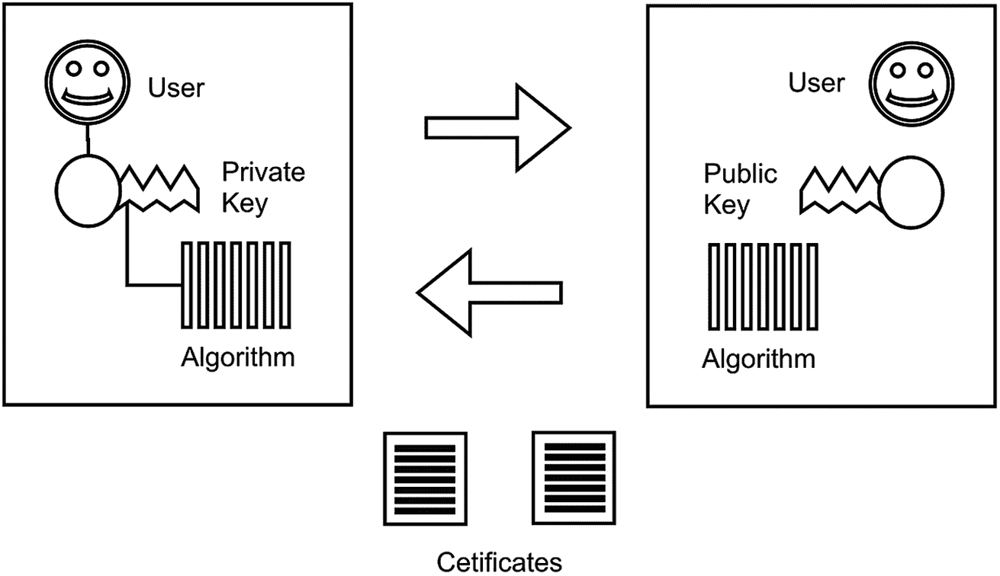

图 1.1 一个简单的 PKI 示例。

人们可能会想，如果 Bob 发现他已经把公钥给了 30 个人，而他们每个人都给了他他们的公钥，那么情况开始变得有点复杂了，特别是因为证书有有效期，如果不注意这一事实，事情就会开始出错。

在给出了个人之间使用`PKI`的非常简单示例后，现在请想象一种纯粹在机器之间使用的`PKI`，具有机器到机器的身份验证并在它们之间进行加密数据传输。在大型网络上，这确实可能变得非常复杂。如果我们在这个网络中加入虚拟机，情况就会变得更加困难。现在，如果我们加入使用容器的现代 Web 开发模型（容器本身也需要通信），情况可能会变得非常棘手，特别是在数字证书的发布和维护方面。

所以，本书将探索所有这些领域，并希望找到方法，使`PKI`能够在涵盖云、虚拟机、容器、传统的本地服务器基础设施以及各种潜在客户端的极其复杂空间内得到有效管理。此外，它将查看证书颁发机构`Certificate Authorities`、证书吊销列表`Certificate Revocation Lists`以及其他机制，这些机制在物理本地基础设施上运行良好，但当该基础设施扩展到云端时就会变得更具挑战性。用户，无论是政府机构、学术机构还是商业实体，在致力于基于云的设施之前，都应该考虑此类问题。在一个恶意黑客无处不在且不惜利用你基础设施中任何弱点的世界里，保护你的关键数据已变得比以往任何时候都重要。他们一直在通过自动化攻击系统尝试这样做，这些系统在你的整个基础设施（或托管它的第三方的设施）的安全性中寻找任何漏洞。这就是为什么，如果你正在使用`PKI`（你应该使用它），确切了解它在你的特定基础设施上是如何工作的至关重要，对于现在的许多组织来说，这种基础设施部分或全部是基于云的。Bob 和 Alice 的时代遗憾地已经早已过去。

在本章中，提供了政府、学术和商业领域计算的简要历史，解释了情况是如何发展的以及`PKI`背后的原始思想。对`PKI`是什么以及它原理上如何工作进行了简要解释，并探索了当前开发模型的一些缺点。这为后续章节在所有这些领域提供更详细的内容铺平了道路。可以说，`PKI`是一个复杂的怪兽，需要非常仔细的考虑和管理。


首先，我们必须理解，在现代世界中，任何通过计算机进行的人机通信以及任何通过计算机进行的机器间通信都是脆弱的。恶意黑客带来的风险是非常真实的，而且每天都有某个地方的机构会经历重大的数据泄露。这并不总是会被报道，因为通常情况下，机构（尤其是政府机构）不希望承认自己已成为攻击目标，并随后丢失了大量敏感信息。有时，这些攻击在被发现之前会持续数周甚至几个月。人们可能会问，既然许多机构已经将他们的 IT 管理（通常是整个 IT 基础设施）外包给了提供此类能力的巨型公司之一，这怎么可能？但这种情况确实会发生。而且会再次发生。在这方面，人们必须时刻警惕，不幸的是，要怀疑每一项提供的服务，包括那些声称能提供无密数据安全的服务。在采用新技术时，也必须谨慎行事，因为这些技术往往会跳过安全方法，而没有提供替代方案。然后，情况就会变得非常混乱。因此，重新回顾一下一个实施良好的公钥基础设施（`PKI`）应当是如何工作的，将是一件令人耳新的事。

任务是确保端到端通信的安全。我们可以将其分为两个基本要求：首先是验证用户或机器的身份，其次是加密随后在两个实体之间传输的数据。在这方面，主要的组件是证书，它的作用是确认实体（无论是人还是机器）的身份，并协调随后发送到网络上的数据的加密。为了获得证书，需要向注册机构（`RA`）提出请求，注册机构用于确认相关实体的身份，然后与证书颁发机构（`CA`）联系，由后者颁发证书。在 `PKI` 的早期，这两个功能通常有明确的界限，`RA` 通常会通过人工操作手动验证用户，然后以此向 `CA` 给出相应的建议。如今，证书提供者在向用户出售证书（或一组证书）之前，会对电子邮件地址等信息进行相当基础的核实。此外还有自签名证书，我们将在本书的后部分对其进行更深入的介绍。

从终端用户的角度来看，大多数证书都是与网站相关的，在这方面，通过点击搜索字段旁边的小锁图标，可以很容易地查看网站的证书。这样做将显示与网站提供者相关的证书的基本信息。例如，这里是与 Red Hat 网站相关的证书详情（图 2.1）。

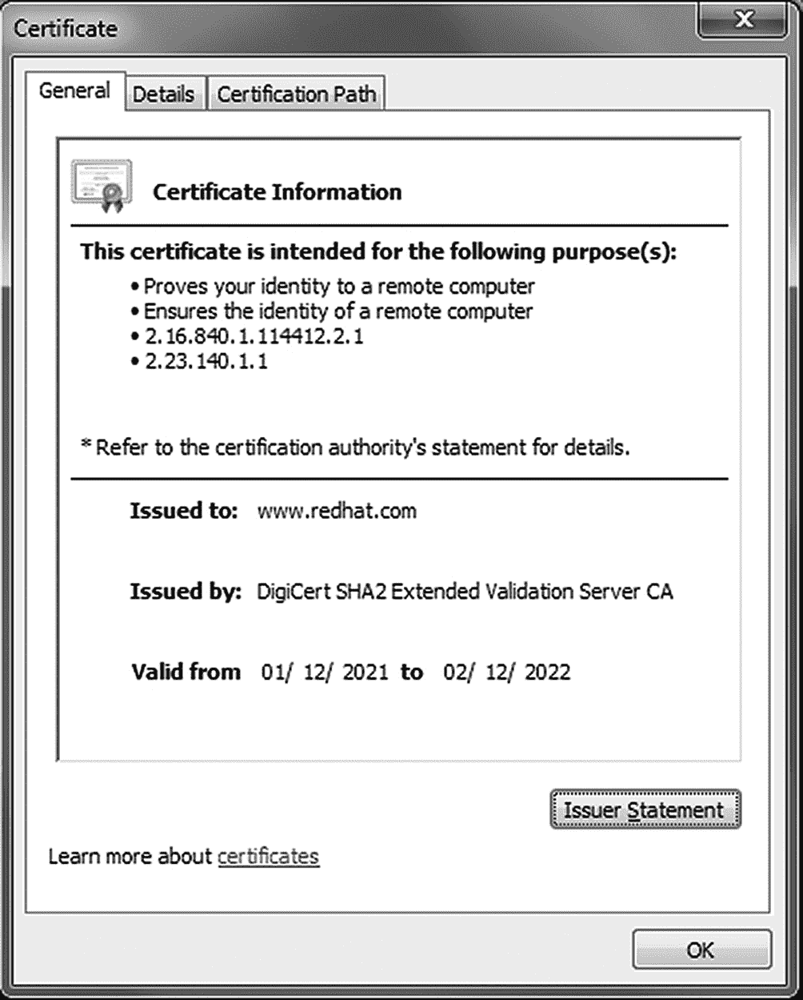

图 2.1 基本证书信息。

在“常规信息”标签页中，指定了发行证书的用途以及发行对应的实体名称。在本例中，网站为 [www.redhat.com](http://www.redhat.com)。提供了颁发证书的 `CA` 名称，随后是证书本身的有效期。如果点击“颁发者语句”按钮，通常会显示颁发者的网站以及一个政策声明，或者更常见的是列出不同时间点颁发的证书的政策声明列表。这些信息虽然有趣，但对终端用户来说实际用途不大。然而，如果这里显示的很少或什么都不显示，那么可能表明出了某种问题。

下一个标签页显示了证书本身的更多细节，外观如图 2.2 所示。


图 2.2 证书详情标签页。

这个标签页更有趣，它显示了 `x.509` 版本号（`x.509` 是一种证书标准）、序列号、用于签署证书的算法、哈希算法、证书颁发者、有效期、主体（即证书对应的个人或实体）、与证书相关的公钥类型和长度（例如 `RSA 2048 bits`）以及与证书相关的完整详细列表。请记住，证书包含公钥，而颁发证书的用户或实体则保留私钥。对话框中的第三个标签页显示了证书路径，如图 2.3 所示。

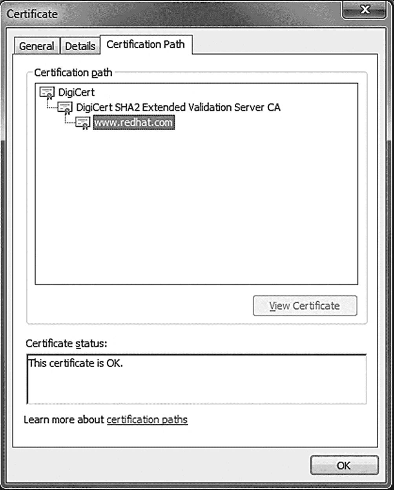

图 2.3 证书路径标签页。

此标签页显示了证书最终颁发的路径。在这种情况下，这是一个非常简单的路径；然而，偶尔这条路径可能会非常复杂，具有许多分支，直到呈现出最终证书。

上述显示的证书详情是一个可能用于网站的简单证书。这种简单证书的变体可能被个人与电子邮件消息关联，其中他们既可以使用该证书来验证自己的身份，也可以用来向与他们交换过公钥的人加密消息。

用于机器间认证和加密的证书是类似的，不同的是它们的用途、颁发实体以及其他精确细节自然是不同的，因为我们处理的是通过 `IP address` 区分的机器身份管理。当然，特定的服务器可能有多个 `IP address`，这取决于设备的物理配置（例如它使用了多少块网卡或地址）以及在该特定服务器上运行的软件。许多软件应用程序需要证书才能与网络内部或外部的关联应用程序进行通信。

然而，让我们首先考虑证书如何在构建在内部架构的典型主机网络中使用，即相关机构所有并托管在其场所范围内的基础设施。许多机构在其主服务器上使用 Linux 操作系统，是因于其固有的可靠性。为了让此类服务器在 `PKI` 中进行安全通信，它们首先需要知道去哪里寻找相应的证书。在 Linux 中，有良好的文件系统层次结构，但它们会根据特定的 Linux 发行版而异。许多机构使用 Red Hat Linux，在这种情况下，`/etc/pki/tls/certs/` 目录用于存储证书，`/etc/pki/tls/private/` 目录用于存储私钥。在其他发行版中（如 Debian 和 Ubuntu），证书目录为 `/etc/ssl/certs/`，而私钥目录为 `/etc/ssl/private/`。Open SUSE、Arch 等发行版还有进一步的变体，但每个 Linux 操作系统都有定义的存储证书和密钥的文件位置。

在 Microsoft Windows 操作系统中，情况通常不那么明确，证书存储在注册表的各个位置，取决于它是与用户相关的还是与相关的。这些位置包括 `HKEY_LOCAL_MACHINE` 根键和 `HKEY_CURRENT_USER` 根键。然而，在逻辑位置和物理位置上，都存储了证书。在 Apple MAC OS 系统上，用户证书与系统证书以及关联存储之间存在区分，分别为 `/users/library/keychains/` 和 `/library/keychains/system/`。此外， `/system/library/keychains/` 也可能被其他应用程序使用。

在配置两台计算机（以及托管在这些设备上的应用程序）在 PKI 内部进行通信并传递数据时，有必要识别适当的证书及其位置，以便在通信之前进行引用和检查。这是通过参考要通信设备的适当 `IP address`，然后是获取该设备或运行在该设备上的服务的证书路径以及证书详细信息完成的。请注意，特定设备上可能有多个 `IP addresses`，且并非所有的证书都在主目录中，某些可能位于应用程序自己的文件系统中。如果此证书检查失败，将报告错误。这是否实际上会阻止应用程序通信，取决于它们最初是如何构建的。通常，当设备 A 在尝试通信时在设备 B 上找不到有效证书，将向设备 A 错误消息并停止通信。然而，情况并非总是如此。有时，会显示警告并提供继续或不继续的选项。

这引出了我们的证书吊销列表（CRL），应用程序以前例行引用它，但在新的开发方法中并不一定如此了。CRL 的理念是，一旦由信誉良好的 `CA` 发，如果证书由于某些原因被取消或变为无效，其序列号将被添加到已发布的列表中，应用程序随后可以根据需要引用该列表。因此，如果一个证书出现在 `CRL` 上，即使它看起来运行正常且在有效期内，应用程序也可能拒绝识别它。检查证书是否被吊销的方法有两种。第一种是访问提供证书的 `CA` 的吊销列表。这些列表是定期发布的，在下载列表后，必须对其进行解析，以检查所涉及证书是否出现在其中。这无疑需要一些编程工作，但对于任何使用安全 PKI 的系统，都应该这样做。第二种方法被称为 `OCSP` 检查。`OCSP` 代表在线证书状态协议，允许应用程序查询由 `CA` 维护的 `OCSP responder`。查询实际上是询问特定证书是否有效，并返回“good”、“revoked”或“unknown”响应，允许应用程序据此做出反应。`OCSP` 通常是检查证书是否有效快得的方法。如果应用程序既不检查发布的 `CRLs`，也不进行实时 `OCSP` 检查，它们就无法对给定的证书完全信任。

在网络内部，组织可以很容易创建自己的 `CRL` 并将其发布在已知位置。这对于运行数千台服务器的大型组织非常有用。同样，对于政府机构或学术机构，发布组织特定的 `CRL` 是有意义的，以防止使用不可信的证书。此类 `CRL` 可能非常简单，操作系统通常包含帮助管理它们的工具（图 2.4 ）。

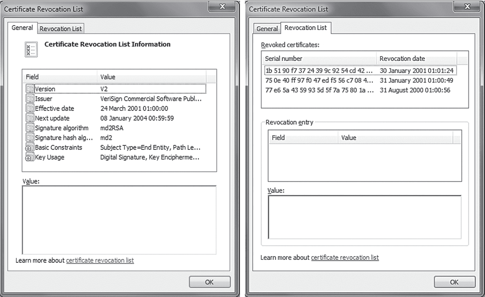

图 2.4 一个简单的吊销列表示例。

关于 `CRLs` 到底有多频繁地被检查，或者在某些情况下是否被检查，存在一些疑问。此外，`CRLs` 还出现过由于变得过大而无法有效管理的问题，标准的 `OCSP` 检查也由于使用了原始协议而容易受到特定类型攻击的影响。针对这个问题，引入了一种名为 `OCSP Stapling` 的系统，它极大地提高了隐私性和安全性。这允许 Web 服务在传输层安全协议 (TLS) 握手过程中发送一个来自 `OCSP` 检查的签名响应，其中包含当前证书的信息。客户端可以验证 `OCSP` 响应，因为它是由 `CA` 签名的，从而确认证书未被吊销。从处理的角度来看，这也更加高效。

当一切配置得当时，PKI 能够实现网络上机器到机器的安全连接，是安全 Web 服务和应用程序的关键。它也是互联网不可或缺的一部分，网络浏览器具有检查 Web 服务器证书的固有能力。然而，在组织层面，更大的场景可能会变得非常复杂。需要有人负责确保证书及时续期，而且当然，他们需要知道它们在哪里。可以使用某些应用程序来管理企业 PKI，包括发现可能被遗忘的证书以及所有证书的自动续期。这些是完全可行且可能的，因为大多数 `CAs` 可以自动连接到此类应用程序并与它们无缝工作。另一种方法是使用已知证书的数据库手动管理一切，但一旦服务器规模开始增长，这种方法可能会非常耗费精力。此外，在一个并购收购频繁发生的世界里，你可能会突然发现 IT 规模翻了一倍，在这种情况下，合并两个 PKI 不是胆小者能完成的任务，我们稍后会发现。

在本章中，我们检查了 PKI 的内部机制，包括证书的发布以及它们在不同操作系统中的存储位置。我们注意了证书错误，并探讨了 `CRLs` 的使用，以及访问它们的不同方法。本章的主要目的是让读者熟悉 PKI 的组成部分，并建立起这是一个相当复杂场景的理解。这种现实在后续章节中将变得更加明显。

DOI: [10.1201/9781003360674-3](https://dx.doi.org/10.1201/9781003360674-3)

公钥基础设施（`PKI`）的初衷是改进数据实体之间一直使用的对称加密。如果实施得当，对称加密并没有特别的问题，但它意味着一旦密钥或口令被泄露且算法被破解，那么任何通过该方式加密的消息或信息都可以被任何拥有密钥的人轻松解密。有些方法可以使其变得更安全。例如，确保每一次数据交换的加密方式都略有不同。此外，可以使用非标准的加密算法，其工作方式可能与标准完全不同。使用此类应用程序的用户可以设计出难以被破解的使用方法。`SilkPad` 应用利用了所有的技术（顺便说一下，它从未被攻破）。然而，对于大型机构和个人来说，安全地使用对称系统需要周密的思考、规划和执行。

使用非对称系统产生了更广泛的可能性，特别是当将加密算法与用于种子的密钥分离离开时。在提出非对称加密的 `Diffie-Hellman` 论文中，人们意识到，只要合理使用密钥，实际使用的算法不需要保密，实际上可以发布供所有人使用。在当时，数据加密标准（`DES`）被认为是足够的，但它最终被废弃，改为使用特定长度非对称密钥的 `Rijndael` 算法的高级加密标准（`AES`）。对于大多数人，加密的概念仍然与个人之间安全发送消息有关。如果 `Bob` 和 `Alice` 希望采用 `PKI`，他们都会生成一对密钥（一个私钥公钥），并通过注册机构（`RA`）和证书机构（`CA`）获取证书。他们各自都会妥善保存私钥，但他们会交换公钥。现在，`Bob` 可以使用 `Alice` 的公钥加密给她的消息，只有她能用私钥解密；`Alice` 可以使用 `Bob` 的公钥加密发给他的消息，只有 `Bob` 能用他的私钥解密。这是通过使用证书实现的，证书可以通过电子邮件甚至通过软盘在物理上轻松地交换。一旦理解了这一概念，这一切就非常容易。然而，对许多人来说，理解这一概念相当困难，个人使用证书来保护电子邮件流量仍然非常稀少。随着手机和所谓的智能手机的出现，有一些服务提供端到端消息加密，但人们产生了疑问：这些系统到底有多安全，因为加密终究是在别人手中。使用带有证书的传统电子邮件可能更好，而如今，几乎所有的电子邮件客户端都提供了这种功能。

如果只有一方拥有证书，仍然可以使用它对消息进行签名，从而验证发送者的身份。在这种情况下，接收者将收到一条如图 3.1 所示的消息。

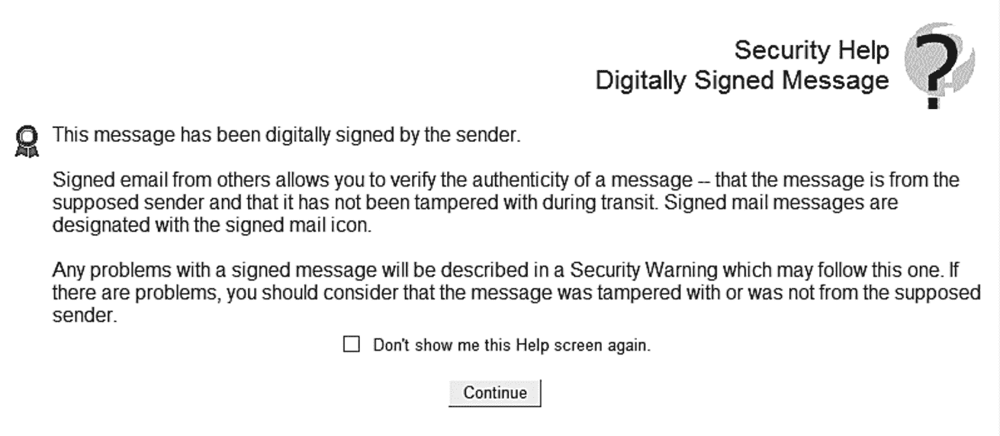

图 3.1 经过签名的确认发送者身份的消息。

现代电子邮件客户端可以轻松实现这一点，此类操作只需点击按钮即可（图 3.2）。

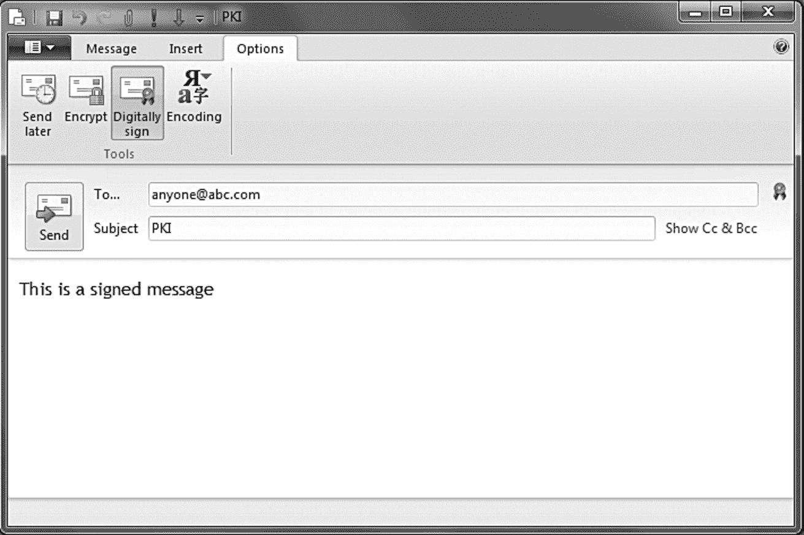

图 3.2 提供服务的典型电子邮件客户端。

因此，值得获取一个简单的“电子邮件”证书，并鼓励与你经常联系的人也这样做。当你第一次向他们发送带带签名的消息时，他们也会获得你的公钥，他们可以将其存储在地址簿中。现在，他们可以使用他们常用的电子邮件客户端加密发给你的消息。当社交圈内有越来越多的人这样做时，他们实际上创建了自己去中心化的 `PKI`，至少对于通过电子邮件交换数据而言。这是一件简单且值得做，反映了后来被称为 `PKI` 的初衷。此外，任何人都可以这样做，而且有一些证书机构提供个人使用的免费电子邮件证书。在大多数情况下，安装这些证书是直接的。此外，这种活动鼓励了对安全和隐私的思考，这从个人和组织的角度来看都不可能是坏事。

因此，消息交换仍然是证书的有效用途，尽管它是去中心化的且处于许多用户手中，每个人都必须负责管理自己的特定证书和凭据。扩展到组织层面，个人证书可以存储在公司目录中，与其他用户信息一起，并从那里进行有效管理。有趣的是，许多拥有 `PKI` 的组织并没有用它来保护电子邮件消息，然而这是一个潜在的安全泄露源。如果我们正在保护机器之间的通信，我们也可以对人类这样做。

```~/easy-rsa/vars
set_var EASYRSA_REQ_COUNTRY="UK"
set_var EASYRSA_REQ_PROVINCE="Derbyshire"
set_var EASYRSA_REQ_CITY="Matlock"
set_var EASYRSA_REQ_ORG="Deckers"
set_var EASYRSA_REQ_EMAIL="admin@deckers.com"
set_var EASYRSA_REQ_OU="Community"
set_var EASYRSA_ALGO="ec"
set_var EASYRSA_DIGEST="sha512"
```

之后，你可以使用命令 `/easyrsa build-ca` 创建 CA。`vars` 文件描述了你的组织，并包含了在商业提供的证书中可以找到的类型信息。实际上，它的意义不仅于此，但核心点在于：你可以创建自己的 CA，并使用足够安全的口令生成密钥对，然后将公钥分发到网络中任何需要的地方。在自己的网络内部，像这样手动操作可能是一个很好的方法，因为它会在组织内部植入 PKI（公密钥基础设施）理念。此外，如果你有大量的服务器和客户端，这代表了一种经济的方法，尽管必须严格按照过期日期的要求来执行。然而，如果你正在访问另一个网络上的服务器，而其他人正在访问你的网络，那么你真的需要使用从外部专业 CA 购买的证书。这些证书需要置于你网络中相应的证书存储中，并在必要时进行更新。这种组织与组织之间的机器识别方法是 PKI 的主要用途之一，而且，这需要谨慎进行，因为通常如果证书过期或无法被识别，可能意味着特定服务被拒绝。因此，机器与机器之间的识别已成为 PKI 的主要应用，并支撑着大多数政府、商业和学术活动，在这些活动中，处理跨网络伙伴关系时信任至关重要。Bob 和 Alice 在这方面稍显失策。

当然，我们现在生活在一个互联网主导的世界里，几乎所有事情都是在线完成的或依赖于某些以网络为中心的服务或其他。因此，数百万个浏览器访问 Web 服务器上的网络服务和应用程序，而这些服务器可能位于其他国家。这使得机器身份变得更加重要，同时为了与网络服务和应用程序交互，还需要对跨未知网络的数据进行加密。幸运的是，这一点已经得到了很好的理解，Web 服务器通过使用证书的加密链接与网络浏览器交换信息。这是 `https` 协议的基础，该协议现在几乎通用于任何交换支付和财务信息等敏感数据的网站。它要求站点利用 `SSL/TLS`（安全套接层或更近期的传输层安全协议），这反过来又要求使用证书。通过点击搜索栏左侧的小锁图标，可以轻松检查特定网站的证书。在那里，你可以找到独立验证的托管该特定网站的组织详细信息。无疑，互联网代表了 PKI 最频繁的用途，尽管它掌握在许多人手中，许多用户可能根本无法理解他们的交易是否得到了充分保护。在这方面，使用安全的浏览器来防止窃听和其他窃取信息的尝试是有意义的。市面上只有少数浏览器在这一方面表现良好，而许多自称安全的其实并非如此，因为它们会不断向浏览器提供者发送数据，然后由提供者将其出售。然而，这是本本书范围之外的另一个安全相关问题。

现在，我们还有另一个非常重要的 PKI 用途，这与构建部署在 Web 上的应用程序有关。近年来，这些应用程序的开发方法发生了显著变化，现在有一种趋势是在 `containers` 中开发一小段代码，然后像虚拟机一样将它们通常部署在云云中。这将在本书的后部分进行介绍，但只需说，在这种背景下对机器身份管理有真实需求。此外，目前尚不清楚这一需求是否得到了充分满足。这背后的原因将在稍后进行解释。


这些是 PKI 的主要应用。证书还有许多其他用途，特别是在工业领域。例如，我们现在在每架商用飞机上都配备了证书（无疑军用飞机也是如此），在自动化制造中，许多过程可能都需要证书。在飞机的情况下，取决于本地设施，可能涉及也可能不涉及网络。可以使用无线网络，但也可能是工程师带着笔记本电脑上机并直接连接到机载计算机，通过受信任 CA 颁发的有效证书进行验证。这些专业应用最好使用适当的 PKI 管理系统，以确保证书的及时更新，同时为组织提供其证书资产的集中视图。应用程序可以简单地定义为两个或多个设备需要在网络（无论受信还是不可信）上相互通信的任何实例。在这种情况下，证书使每个实体能够根据已知且受信任的方法识别自己的身份，该方法利用 `CAs`、唯一密钥对以及用于加密和解密数据的受信任算法。当按照设计部署时，这种方法提供了高水平的信任，使得可以在未知且不可信的网络上进行与业务相关的交易。因此，每个组织都应该有一套设计良好的 PKI。

如今，此类 PKI 的架构设计应该考虑构建应用程序的新方式（即围绕微服务和容器），因此可能会变得比以往情况复杂得多。主要应用保持不变，但解决这些问题的方法已变得复杂得多。在大多数情况下，某种自动化证书管理系统将是合适的。此外，必须对人员进行培训，既包括通用知识，也包括与管理证书的任何系统相关的培训，并在组织内部相应地培养能力。

在本章中，我们探讨了 PKI 的主要用途，并对该方法如何在实践中应用提供了更深入的见解。重要的是，PKI 不仅仅是一个单一、封闭的系统，更像是一种可以推广到许多应用中的方法。任何机器身份重要的地方都代表了 PKI 的可能应用。PKI 本身实际上只是一个结构。应用是将该结构应用于特定任务的过程，在一个典型的组织内可能会有很多这样的任务。无疑，每个组织和每个互联网用户已经接触到 PKI 了。问题在于他们对它的了解程度如何，以及因此如何管理它。

简单来说，数字证书是一个文件。在这个文件中，可以找到关于个人或组织的某些详细信息。这些信息通常由第三方，即证书颁发机构（`CA`）进行验证。一旦 `CA` 验证了个人或组织确实存在，他们就会乐意颁发包含相应详细信息的数字证书。证书通常也颁发给网站，使用相同的 `CA` 严谨程序来验证它们是否与其表现一致。这应该能在很大程度上防止虚假网站的出现。如果你不确定某个网站是否真实，请检查其数字证书的详细信息。这并不是绝对的保证，但它是真实性的一种良好衡量标准，前提是证书的内容合理且与所展示的组织相符。

最常用的证书遵循一个名为 `x.509` 的标准。该标准由国际电信联盟（ITU）开发，该机构本身是联合国的一个机构。符合 `x.509` 标准的证书通过数字签名将身份绑定到公钥。数字签名使用了多种算法，就像数据加密也使用了多种算法一样，而数据加密本身是由证书和密钥实现的。最终证书包含了颁发给该组织或个人的公钥。`x.509` 标准定义了证书应包含的各种字段。这些如下：

*   证书
*   版本号
*   序列号
*   签名算法 ID
*   颁发者名称
*   有效期
*   此以前有效
*   此后失效
*   主体名称
*   主体公钥信息
*   公钥算法
*   主体公钥
*   颁发者唯一标识符（可选）
*   主体唯一标识符（可选）
*   扩展（可选）
*   …
*   证书签名算法
*   证书签名

并不是所有证书都会包含所有信息，因为某些字段是可选的，但大多数字段应根据情况完整填充。所有使用的字段必须由引用该证书的应用程序处理。已填充的证书看起来可能是一个很大的文件，如下所示：

```
Certificate:
  Data:
    Version: 3 (0x2)
    Serial Number:
      03:04:54:08:f9:ff:10:92:e1:69:fe:49:8f:78:d3:6d:dc:47
    Signature Algorithm: sha256WithRSAEncryption
    Issuer: C = DE, O = Let's Encrypt, CN = R3
    Validity
      Not Before: Jul 15 08:01:49 2021 GMT
      Not After : Oct 13 08:01:48 2021 GMT
    Subject: CN = *.mysite.org
    Subject Public Key Info:
      Public Key Algorithm: id-ecPublicKey
        Public Key: (256 bit)
        pub:
          04:a5:9a:47:b2:d3:fc:a7:df:de:f6:cb:45:62:0a:
          d3:c1:a7:38:de:20:bd:d7:10:58:73:de:d1:a1:
          99:70:cc:dd:ab:91:3f:0e:83:97:1b:4f:a2:99:
          f8:30:73:ef:da:be:91:25:18:7a:d6:da:bf:e5:99:
          72:a3:41:ASN1: prime256CURVE: P256
    X509v3 extensions:
      X509v3 Usage: critical:Digital Signature
      X509v3 Extended Usage: TLS Server Authentication, TLS Client Authentication
      X509v3 Constraints: critical:CA
      X509v3 Subject Key: 08:0E:29:26:07:E9:B4:63:5D:86:F6:E2:5A:C:CD:D:A7
      X509v3 Authority Key: 14:2E:B3:14:58:56:CB:AE:54:09:E6:AF:DD:8B:14:C2:C6
      X509v3 Information Access:OCSP-http://r3.oencr.org,Issuers-http://r3.iencr.org/
      X509v3 Alternative Name:DNS:*.mysite.org,DNS:*.data.org,DNS:*.media.org,DNS:mycontent.org
      X509v3 Policies:2.23.140.1.2.1,1.3.6.1.4.4947.1.1,CPS:http://letsencrypt.org
      CT SCTs:
        Signed Certificate Timestamp:
          Version: v1 (0x0)
          Log ID: F6:5C:93:2F:D1:77:30:26:14:52:13:08:30:94:56:E8:E3:4D:13:31:BF:DF:0C:2F
```

证书颁发后将存储在预期的位置，具体取决于设备是基于 UNIX/Linux、Apple Mac 还是 Windows，或者，它也可能存在于运行 `z/OS` 或类似系统的主机上。它也可能是特定于应用程序的并运行在相关应用程序的文件系统中，例如 IBM DB2 数据库系统中的 `db2/ssl_keystore`。许多应用程序维护自己的密钥库，而其他应用程序将需要直接引用它们。这些都是由专业 IT 部门承担的应用部署和管理工作的一部分。在安装新应用程序时，必须了解它将连接到哪些其他应用程序或服务，以及相关证书位于何处。正如想象的那样，对于大型 IT 资产，这可能会变得非常复杂，这就是为什么通常专用的证书管理系统是一个好主意，当然前提是它被实际使用。这通常意味着需要若干人员接受该工具使用的的培训并获得认证（图 4.2）。

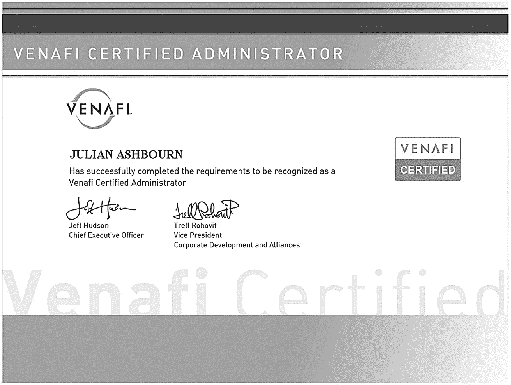

图 4.2 工具的经过认证的管理是一种良好的方法。

从上述内容可以看出，管理 PKI 并不是一项轻易的工程。如果不注意证书，证书本身可能会非常棘手。特别是它们的精确位置，当然，还有它们的过期日期。当 IT 基础设施增长或发生其他变化时，证书需要特别关注。它们可能只是小小的文本文件，但它们是能够启用或禁用 IT 系统正确运行的小文本文件。在典型的政府机构、学术机构或商业运营中，可能有成千上万甚至几十万个证书。一个证书如果放在错误的地方，可能会导致特定的操作或任务停滞，而支持人员可能不理解为什么会发生这种情况。因此，它们值得我们最好的关注。

将这种组织模型扩展到互联网则将问题推向了一个完全不同的尺度。虽然大多数事情通过 `https` 和传输层安全协议（`TLS`）运行得足够良好，但使用安全浏览器并定期检查重要网站（如银行网站或任何发生金融交易的零售相关网站）的证书是有用的。证书不能保证欺诈，但它们确保了存在某种信任基础，并确保网站按预期运行。深入了解它们并理解它们在更宏观体系中如何运作是值得的。即使是个人也应该这样做。此外，如果组织的 IT 工作已经外包，那么明智的做法是获取一份系统上使用的所有证书的完整地图。如果外包的公司无法提供此类信息，那么说明出了严重问题，应该采取措施从这种境地中脱出来。

在本章中，我们解释了什么是证书以及它的组成部分，并根据情况给出了一或两个例子。我们已经涵盖了颁发过程，在这里我们还强调了证书对更广泛运营的重要性，因为我们做的大部分工作都依赖它们。因此，管理证书应该是任何 IT 运营议程中的重中之重，这一点得到了强调。

DOI: [10.1201/9781003360674-5](https://dx.doi.org/10.1201/9781003360674-5)

数据加密已经存在很久了。有证据表明，古埃及人使用过符号替换系统，类似于我们今天使用的字符替换。在这种情况下，苏美尔人、赫梯特人和哈拉帕人等也可能在做类似的事情。到罗马人时期，这一概念已经根深蒂固。从那时起，出现了许多思想，从复杂的字符或整个单词替换，到短语本和查找表（在这些表中，使用完全不同的短语来传达给定消息含义）。大多数情况下，这些被用于军事目的，或用于皇室和政府之间的保密和间谍活动。然而，总有人出于好奇开发了系统，其中一些系统被政府采纳并有时经过了改进。几乎所有的系统都是根据将原始字符（明文）替换为替代字符和符号（密文）的原理工作的，因此不可避免地与所使用的字符集保持一致，而字符集本身可能随着不同的书写语言而异。

在现代史上，加密系统最重大的进展之一出现在 1918 年，德国工程师亚瑟·谢尔比乌斯（Arthur Scherbius）发明了恩尼玛机（Enigma machine），这是一种使用一系列转子的机械设备，通过复杂的编码机制将一个字符替换为另一个。也许恩尼玛机最重要的意义之一是，在加密或解密之前可以使用一组特殊的字符对其进行“种子”设置。这意味着种子可以每天更改，使得任何试图破解代码的人来说都变得非常困难。德国人并不知道，波兰破译员已经预料到了发生的情况，并制造了一台被亲切地称为“炸弹”（bombe）的机器来猜测德国人的密码。在德国人在他们的恩尼玛机上增加更多转子之前，这种方法是有效的，使得破解代码变得更加困难。然而，到此时，随着二战的临近，波兰工程师与他们的英国和法国盟友分享了成就。在英国的布切利园（Bletchley Park），艾伦·图灵在英国制表机公司和工程师哈罗德·基恩（Harold Keen）的帮助下很快开发出了更复杂的“炸弹”。这台设备可以被视为第一台真正的大型计算机，它在破解德国密码方面到了关键作用，无疑缩短了战争。

战后，特别是 20 世纪 70 年代，关于密码和加密产生了大量活动，因为计算机将在现代世界中发挥巨大作用，而加密将在计算中发挥巨大作用。因此，出现了数据加密标准（`DES`）、Blowfish 以及许多其他算法。有趣的是，这些算法都是基于启发原始恩尼玛机以及在此之前的几百年加密系统的相同思想工作的。这就是将一个字符替换另一个字符（有时是将一个短语替换另一个短语）。我们可以用非常简单的方法自己尝试。让我们选取字母 `A,E,I,O,U` 并在表中如下替换它们：

| a | E | i | o | u |
| --- | --- | --- | --- | --- |
| f | H | t | k | s |

现在，让我们构建一个简单的句子：

> ‘This is a very interesting book published by’.

现在，让我们替换表中的字符：

> ‘Thts ts f vhry tnthrhsttng bkkk psbltshhd by’.

让我们通过消除单词之间的空格让事情变得更加复杂：

> ‘Thtstsfvhrytnthrhsttngbkkkpsbltshhdbyfsprhss’.

结果是一个文本字符串，乍看之下似乎毫无意义。然而，一个出色的密码学家可能会很轻松地破译该字符串，首先是寻找重复字符的存在，然后用书面文本中最常用的字符进行替换。然而，我们只更改了五个字符。想象一下，如果我们更改了字母表中的每一个字符，以及数字 `0` 到 `9` 会怎样。那么，我们将得到一个强大得多且更难破解的密码。尽管如此，优秀的破译者在破解密码方面异常精通。在第二次世界大战期间，伦敦的特种执行局（SOE）雇佣了数房间聪明的年轻女性，她们实际上是“人类计算机”。每组人被分配一段加密信息，迟早，她们仅凭铅笔和纸（当然，还结合她们的直觉和受过的训练）就能破解密码。她们对人类的特殊天赋是无法估量的，我们应该带着巨大的爱意和自豪来记住她们。

现代加密系统更加复杂，但工作原理大体相同。由证书中的公钥提供的密钥，充当种子，用于初始化已知算法，例如高级加密标准（`AES`）Rijndael 算法。密钥的长度非常重要，因为较长的密钥会为算法提供更复杂的种子。因此，`512-bit` 密钥提供的加密强度通常比 `256-bit` 密钥更强。`1024-bit` 密钥更好，因为它在相同算法内提供了更大的“扰乱”程度。

使用密钥的替代方案是使用密码短语（pass phrases）。这些短语的优点是容易记忆且可以很长，确实等同于非常大的密钥。它们还可以根据约定的规则在每天之间轻松更改。例如，两个使用密码短语对称加密系统来初始化未知算法的个人，可能会约定使用查尔斯·狄更斯（Charles Dickens）某本特定书籍特定版本中连续章节的第一句话。这在实践中效果可能非常好。然而，在间谍活动和战争时期，容易记忆并非一定是好事，一个在发现其中一个后就可能被轻易猜到的短语系统同样如此。有了公钥基础设施（`PKI`）和强力的密钥长度，没有人能记住密钥，即使他们见过过文本形式的密钥。

## SilkPad 案例研究

加密本身是一个迷人的课题（作者本人编写过几种算法并制作了三个或多个系统，纯粹是为了挑战）。目前的 `PKI` 方法是良好的，并且非常适合计算机时代，只要使用正确。然而，这并不排除在特定应用中使用其他方法，特别是当需要非常易用的工具时，例如供特工在现场使用。让我们采用同样的短语——“这是一本由……出版的非常有趣的书”，并将其输入 `SilkPad` 应用程序。我们得到的结果所示图 5.1。

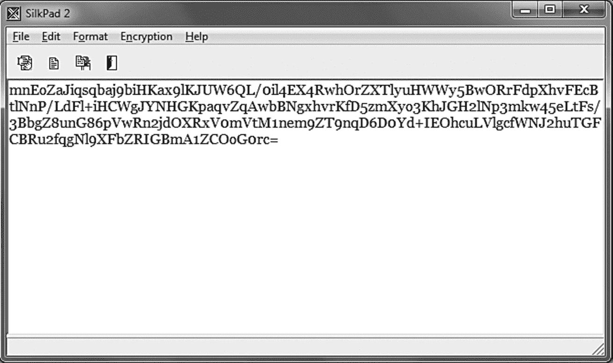

图 5.1 SilkPad 中的加密句子。

我敢于挑战任何人去破译这段特定的密文块并得到相同的句子。事实上，`SilkPad` 已经存在了 20 多年，还没有人破解过 `SilkPad` 编码的密文，尽管已经提供过奖金，密文也发送到了世界各地的机构。人们可以立即看出密文比明文长得多。显然，这里发生的不仅仅是简单的字符替换。事实上，一个明文字符可能由多个密文字符表示，具体数量根据一组特定的规则动态变化。这并不是一种新方法：阿拉伯人在世纪左右就想出了类似的方法，当时他们在数学方面非常先进。事实上，“代数”（algebra）一词就源于此。但 `SilkPad` 在后台对加密进行了一些独特的操作，这也就是为什么创建的密文无法被破解。因此，对于任何两个（或更多）操作者来说，当他们需要简单时，这是一个完美的系统，不需要任何第三方基础设施。此外，`SilkPad` 从一个仅为 `660 kB` 的单个可执行文件运行，并可以在通用总线（`USB`）优盘中使用，无需依赖于主机设备。此外，它可以使用密码短语或某种密钥来初始化算法，这些内容存储在应用程序中，如下所示（图 5.2）。

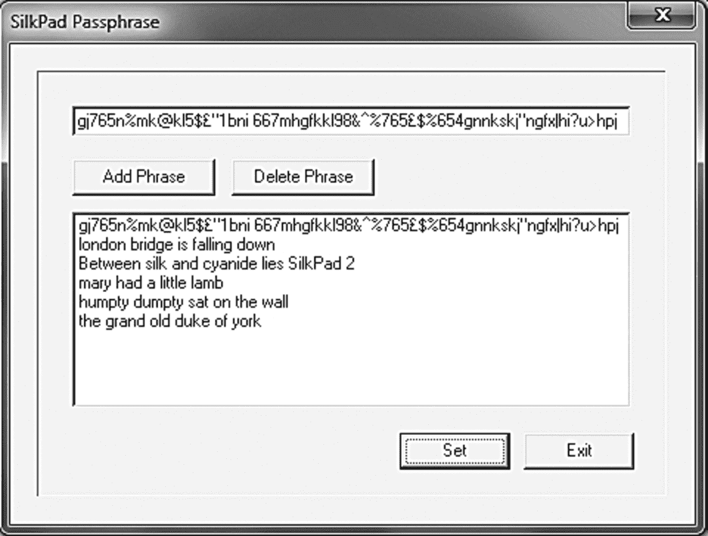

图 5.2 在 SilkPad 中设置密码短语。

下方的对话说明了在 `SilkPad` 中设置密码短语是多么简单。用户在设置密码短语后，只需输入消息并点击加密按钮。然后，密文可以通过电子邮件或其他方式发送给接收者，接收者只需使用相同的密码短语并点击解密密钥返回明文。这是一个非常简单且优雅的系统，为了演示加密原理而构建，同时也为破译者提供了挑战。

大多数 `PKI` 系统使用的 `AES` 算法可以被认为是 `SilkPad` 内部算法的等效物，而证书内部使用的公钥可以被认为是 `SilkPad` 中用于初始化算法的密码短语。这段有些冗长的解释已经阐明了 `PKI` 加密发生了什么；然而，仍然存在它是如何发生的问题。在许多应用程序（如互联网）中，它或多是自动发生的。如果创建网络服务器和网站的人使用带有传输层安全（`TLS`）的 `https` 协议，那么证书会自动交换，数据会在传输过程中被加密。在其他应用程序中，可能需要用户干预。例如，大多数电子邮件客户端都提供加密选项，但用户必须做出选择并采取采取行动来加密消息，这当然需要他拥有对方的公钥。这通常存储在与电子邮件客户端关联通讯录中。

但是机器与机器之间的加密呢？这需要进行专门编码，因为每个设备都需要知道从哪里获取对方的证书，反之亦然，然后它们需要采取行动来加密它们之间传输的数据。如果它们使用适当的协议，这种情况就会发生。这就是 PKI（公密钥基础设施）的第二个重要功能，第一个功能是验证用户或机器的身份，第二个是对它们之间传输的数据进行加密和解密。

在一个大型 IT 环境中，这种情况可能会变得非常复杂，特别是当涉及到许多第三方时。随着供应商越来越多地提供软件即服务（SAAS），并且很多时候相关软件保持在线，这种情况正变得越来越普遍。这意味着敏感数据正跨越不可信的网络（互联网）往回传输。机构在选择使用此类服务之前，应该非常仔细地考虑。


首先，他们完全不知道服务实际上托管在何处。从字面上来说，它可能是世界上任何地方。其次，他们不知道谁在管理软件，以及他们对用户数据可能拥有何种访问权限。对于放置或托管在云端的东西也是如此。实际的服务，即使是你自己定制开发的软件，也可能在任何地方，而运行该服务的硬件将由某人管理，但是谁呢？他们将拥有什么样的管理员权限？这些问题使得维护一个有效的 PKI 变得更加重要。无疑，任何在你的本地系统和任何类型的在线服务之间传输的数据都应该加密。对于你网络内部和防火墙后的系统，你可能使用自签名证书，但加密跨越任何网络和任何机器传输的所有数据仍然是一个好主意。

如今，工业和政治间谍是非常真实的，任何机构都必须对其珍贵的数据格外小心。似乎我们几乎每天都能听到某些重大数据泄露和敏感信息丢失的消息。通常，这些信息是客户详情的形式，不仅来自银行（尽管银行是首要目标），还来自政府机构和各种类型的商业实体。为了确保数据访问，人们应该采取许多步骤，但数据传输（无论是内部还是外部）都应该受到特别保护。为了这一点，我们需要处处加密，为了这一点，我们需要一个活跃且管理良好的 PKI。在这个 PKI 中，我们还必须确保证书不会在在我们不知情的情况下过期。因此，我们需要一个活跃的证书管理系统。如果每个人都使用简单套接层（`SSL`/`TLS` 协议），互联网就能得到保护，但仍然可以找到例外。无论如何，由于机构的每项工作实际上都以某种方式触及互联网，因此确保通过设计良的 PKI 在其整个网络中维护这种方法是关重要的，从而加密所有内部和外部传输的所有内容。风险是贵组织知识产权和相关资产的丢失，如果没有这些，其存在本身将受到质疑。PKI 是重要的，而加密是 PKI 的核心。

在本节中，我们探讨了最广义的加密，以及关于证书和 PKI 方面的加密。我们讨论了加密原理，给出了示例，并简要涵盖了加密的历史。通过这些内容，读者将对加密是如何工作的原理，以及它是如何整合到数字证书和 PKI 概念中的。我们也提到了互联网和云技术的广泛使用，因为这代表了主要的应用场景。

DOI: [10.1201/9781003360674-6](https://dx.doi.org/10.1201/9781003360674-6)

作者最早在 20 世纪 90 年代初开始思考生物识别和证书，并到 20 世纪 90 年代后期，在此背景下制定了一些想法，还将一些应用设计辅助整合到 BANTAM 生物识别和令牌技术应用建模语言中。似乎，如果身份验证很重要，那么生物识别可能与数字证书一起使用将很有用。在最简单的形式中，这可能表现为使用生物识别身份验证检查来释放证书，该证书可以选择性包含生物识别信息。请记住，在那个时代，生物识别通常以算法的形式存在，因此代表了少量的代码。例如，领先的手掌几何设备创建的生物识别模板长度仅为 9 字节。这可以很容易整合到各种事物中，包括如果需要的话的数字证书。

事实上，手掌几何设备结合语音验证设备，首次引起了我对生物识别的关注，我意识到最终它们将被大规模使用，但可能会被错误地使用。大多数早期设备创建了小尺寸算法生物识别模板。有许多早期的指纹设备在这一方面非常高效，在 `xy` 网格上绘制特征。而且这些比目前主要在灰度模式匹配上工作的设备要精确得多。约翰·道格曼教授（Prof. John Daugman）关于虹膜识别的早期工作创建了较小的虹膜码，该代码也非常准确。一段时间内，情况一直朝着正确的方向发展，直到为了边境控制实施生物识别的热潮，当时质量和准确性被实施便利性所取代。然而，那是另一个故事了。请记住，在 20 世纪 90 年代和 21 世纪初，几台笔记本电脑开始配备指纹读取器，并出现了各种将生物识别与智能卡相结合的倡议（现在仍然是如此）。许多指纹读取设备通过在精细网格上绘制特征来工作，这与警方法医部门传统的工作方式相似。如果特征数量达到匹配，那么指纹就被认为匹配。最格格不入的技术一直是人脸识别，它在早期存在各种问题，因为面部图像太容易改变或遮挡了。无论如何，早期基于算法的生物识别系统的优点是可以创建小尺寸模板，这些模板可以使用几乎任何东西，从磁条卡到智能卡，或整合到其他文件中。1992 年，作者将手掌几何模板的代码整合到护照上第二行（当时未使用的）光学字符识别（`OCR`）行中。我相信这是第一次将生物识别编码到护照上。护照上第一张生物识别图像是由阿根廷警察胡安·武塞奇（Juan Vucetich）完成的，他在 1900 年左右在自己的护照上放置了一张指纹图像。因此，使用生物识别进行边境控制的想法并不新鲜。然而，执法与边境控制的合并确实如此，并且产生了巨大的后果。当然，新的“智能”生物识别护照为公密钥基础设施（PKI）提供了支持，而它最初陷入了真正的混乱。希望现在运行顺畅了。

回到 20 世纪 90 年代，当时对于这些技术如何结合有很多讨论。这些想法的催化剂是智能卡。智能卡可以与计算机设备、专用的智能卡读卡器交互，卡上的芯片最初容量有限，但每天都在增长，而成本在不断下降。许多笔记本电脑将智能卡读卡器作为标准配置。我今天还拥有一台运行运行良好。许多曾经带有磁条卡读卡器的销售终端（POS）现在正转向智能卡。甚至以采用新技术缓慢而闻名的银行自动取款机（ATM），也在有系统地转向使用智能卡。事实上，“智能卡”这个词在某种程度上是一个误称，因为早期示例中几乎没有智能性。我总是称它们为“芯片卡”，这是一种更准确的描述。

无论如何，芯片卡具有巨大的潜力，这种潜力直到现在也未被完全实现。一些前瞻性的公司（如瑞典的 Precise Biometrics）在 21 世纪初就实验了“卡上匹配”（match-on-card）技术，他们成功地将指纹识别器放置在一个并非恰好是芯片卡但厚度并不大大的设备上。现在，他们已经完善了设计，使其能够舒适地位于芯片卡上。因此，并不意外，当时也有关于使用带有证书的芯片卡的讨论。当然，证书可以存储在芯片卡中，并由笔记本电脑或销售设备内置的读卡器进行读取。事实上，这已成为许多高安全情况下个人登录网络的标准方式。有时，芯片卡仅包含用户 ID 和密码，有时包含一个证书。如果使用生物识别来首次验证用户身份，并在验证后释放证书，那无疑将提供高水平的用户身份验证和数据加密。请记住，正如之前提到的，当时大多数生物识别技术都在使用适当的算法生物识别匹配，因此倾向于更准确（另一种替代方案，如护照所采用的，是简单地使用模式匹配比较生物识别图像，其可靠性较低）。一个设计良好的指纹生物识别设备可以产生微小的生物识别模板或代码，它可以很容易地写入芯片卡，并提供高程度的个人身份验证。指纹识别器可以是主设备（如笔记本电脑）的一部分，也可以简单地配置为串口/通用串行总线（USB）插入设备。西门子甚至推出了一款非常成功的生物识别鼠标，在第三个鼠标按钮的位置有一个电容传感器。事实上，有几种来自远方的此类设备。此外，还有几种针对网络安全的生物识别产品，其中一些与微软的 `Active Directory` 集成，另一些只需稍加努力即可轻松纳入 `UNIX` 或 `Linux`上的其他企业/轻量级目录访问协议（`LDAP`）目录中。令人惊讶的是没有更多的政府机构和商业实体采用这个想法，因为它是一个相对想法。这可能是由于对生物识别的内在不信任，因为接触过质量低劣的示例。

当时认为将生物识别和证书结合起来是合理的。实现这一目标有两种明显的方法。第一种是使用生物识别身份验证来释放证书，第二种实际上是将生物识别模板代码包含在证书中。在作为握手的一部分提交时，这将用户使用其生物识别进行身份验证。在今天这仍然可行，问题在于（现在仍然在于）标准化。技术界需要制定一种通用的生物识别模板代码，任何设备制造商都可以使用。这仍然允许通过使用的特定匹配算法进行区分，但个人数据将是标准的。这本是可能的；然而，试图让几个制造商对共同格式达成一致总是困难的。然后，试图让这种格式被接受为标准可能需要多年时间。那时没有人似乎有精力做这件事。今天，随着开源的概念早已更加完善，无疑会容易一些，但在 20 世纪 90 年代后期，这对于大多数人来说是无法想象的。生物识别和芯片卡社区已经在维持自身方面陷入了困难，`PKIs` 的概念也难以被更广泛的领域接受。

对于所有技术，采用过程往往遵循贝斯曲线：在早期几年，支持者非常努力地推广这一想法；然后，每个人都想使用它，直到新事出现并将其降为二线技术。所有行业都是如此。一些基础性事物会持久，但许多好想法只是来而去。`PKI`、芯片卡和生物识别这三个好想法注定永远不会完全融合。然而，这并不意味着它们永远不会。总有人会想出新颖的方法将它们结合在一起。

## BANTAM 建模

使用 `BANTAM`，可以设计任何规模的整个系统，该系统利用了 `PKI`或生物识别或芯片卡或三者。此外，它还兼顾了传统的系统组件，如数据库、目录和网络，以及特定的应用程序。它还可以用于流程工程和流程重造，并具有完整的采购文档，这种方式是重复的、可扩展的，并且对整个端到端过程了适当的严谨性。事实上，Springer（Springer）出版了一本专门介绍 `BANTAM` 的书。它包含一张带有许多有趣模板的 CD，当然，还有最初的符号集。更新后的符号集可以从作者处获得。

当然，PKI 的身份验证部分存在一个底层问题，那就是你对连接到你的个人或设备真实身份所能拥有的信任程度。

以电子邮件为例。假设为 Joe Soap 及其邮箱地址 `joe@soap.com` 申请了证书。证书颁发机构将检查该邮箱地址是否存在以及它是否能返回信息。如果是，就会颁发证书。现在，如果你获取了 `joe@soap.com` 的 Joe Soap 的证书和公钥，你将毫无疑问相信你正在连接的是 Joe Soap。

然而，事实是，你完全不知道自己连接的是谁。Fred Jones 可能设置了 `joe@soap.com` 的邮箱地址。或者 Susan Soap 可能设置了 `joe@soap.com` 的别名。又或者其他人可能建立了该邮箱地址。在使用电子邮件证书时，你对连接对象真实身份的信任程度实际上非常低。

至于机器地址，可以为某个域的 `i.p. address` 颁发证书，但这不能保证该机器上运行了什么，或者它被设置为做什么，它很可能带有恶意软件。然而，对于发送者的真实身份，我们确实对个人证书信任有限，而且对于意图，完全没有信任。嗯，我们对意图无能为，但我们可以通过生物识别来增加对用户真实身份的信任。

即使是生物识别，人们对原始注册机构的信任程度也是有限的。在注册生物识别之前，检查身份的严谨程度在国家和组织之间存在巨大差异。例如，某些国家对护照申请的检查严谨性非常糟糕。因此，在护照中添加生物识别并不意味着相关人员就是其所声称的。然而，这意味着这些人已针对某个声称身份注册了其生物识别，因此，可以与该声称身份关联验证。你可以放心，职业犯罪分子会有几个这样的护照，拥有不同的身份和相同的生物识别。作者在许多年前就证明了这样做有多简单。

现在，我们有了一个注册在声称身份上的生物识别，并且无论在何使用，该声称身份都会通过验证（假设实时生物识别与注册模板匹配）。现在，如果我们将该生物识别与数字证书绑定，对于某些应用程序，我们可以要求通过生物识别进行远程身份验证。我们可以通过将生物识别模板——一种嵌入数字证书的适当算法代码——来实现。现在，当进行握手时，可以要求对方使用该特定代码作为参考进行生物识别身份验证，并将结果以二进制“是”或“否”标志返回。现在，我们对对方的身份将有高得信心。

但考虑到证书的大小和使用的证书巨大数量，我们如何做到这一点呢？嗯，一种方法是在证书规范中包含一个字段，留出特定字节数用于生物识别代码或模板。大多数指纹生物识别模板都可以放入紧凑的代码中，虹膜识别如果处理得当也是如此。同样，手部几何结构等也能利用这一功能。从证书的角度来看，使用哪种生物识别并不重要。如果需要，可以在该字段前加一个字母来指示正在使用的生物识别类型，从而启动相应的生物识别阅读器。

这一概念在书中再次被提出，因为它是一个完全行的想法，并且可能对高安全性应用有益。它将解决个人证书的身份验证弱点。目前，任何可以访问带有个人证书的笔记本电脑或其他设备的人都可以该证书对消息进行签名和加密。这并不意味着他们是证书最初发放给的个人。对方实际上不知道他们是谁，只知道他们在使用某个特定的证书，而该证书实际上可能被复制到了多个设备上。一个经过深思熟虑的生物识别证书将增加另一层安全，这对于某些应用可能是无价的，并解决这个特定问题。值得建立一个小型政府工作小组来进一步探索这一想法。无疑，它可以毫不困难地在闭环的官方系统中使用。

在本节中，讨论了通用的生物识别，并区分了生物识别模板与图像模式匹配，后者实际上不是真正的生物识别，因为它测量的是生理特征。书中重新讨论了将生物识别添加到证书中的想法，并将其置于当代语境中。`图 6.1` 提供了表示法的示例。文中指出，生物识别证书的概念在 20 世纪 90 年代提出，作者将 PKI 引入了其他系统的设计中。

DOI: `10.1201/9781003360674-7`

1994 年，Borland Delphi v1 发布，它在应用开发领域引发了某种革命。人们一直在会议和学术界讨论快速应用开发和面向对象编程，但我们并没有真正做到言行一致。然后，Delphi 来了。它是真正的面向对象，并包含了继承实践，使得开发者能够轻松创建自己的组件。它拥有一个远超竞争对手的 IDE，且使用非常直观。它以单元（units）的形式产生代码（我们认为容器是一个新概念，但 Delphi 是从这条路开始的，到 v3 版本，你实际上可以部署容器，Delphi 将其称为包，并在多个应用程序之间复用）。它使用了 Object Pascal，这是一种非常直观的语言，产生人类可读的代码，因此是自成文档的。它具有极好的数据库连接性，并包含了两个桌面数据库，以及与 InterBase 的原生连接，InterBase 是有史以来最好、最高效的数据库之一。它附带了 ReportSmith 报告引擎、大量的组件和对话框等等。这是开发者的梦想成真，许多商业和工业的中端应用都是用 Delphi v1 构建的。

在那个年代，开发部门、运营部门和项目管理部门之间有着非常明确的界限。如果认为需要另一种组织功能，项目管理部门就会对情况进行研究并提出设计规范。开发部门会根据该规范构建必要的软件，并在开发平台上进行测试。运营部门会再次进行测试，如果一切无误，就会将其迁移到生产环境。我当时工作的机构维护着两个对称的镜像数据中心，这两个中心在地理上是分离的，但通过高带宽私有网络连接。一切在晚上都会进行备份，而且一切运行正常。“停机”（outage）这个词并不在我们的词汇中，因为我们从未遇到过。我们自己构建了基础设施，维护着大约 3500 台服务器以及少量的大型主机，一切运行良好。这很大程度上是因为一切都是在内部设计和构建的。我们还是 `Linux` 和 `Open Source` 的早期倡导者（此前已使用了多年 `UNIX`），并拥有许多专家级开发者。这就是许多组织当时的运作方式，直到高管理层的人开始干预。

1996 年，Borland 发布了 `Delphi v.2`，它在他们已取得成就的基础上进行了扩展，并将设计推到了 32 位水平，以便开发者能够为新的 `Windows 95`（尽管它从未完全是 32 位）构建应用程序。开发平台的客户端/服务器版本可以真正为 `Windows` 平台开发企业级系统。次年（1997 年），`Delphi v.3`问世，它包含了大量与互联网相关的功能，并提供了编译自包含的可执行文件或构建小型代码“包”（packages）的选择，这些“包”一旦部署，就可以被多个应用程序利用。是的，在 1997 年，Borland 已经给了我们可以部署在网络任何地方并被多个应用程序引用的容器。但 `Delphi` 程序包是健壮的单元，它们在一个坚固的开发环境中构建，该环境包含了业内最优秀、最快的调试器，以及许多实用的工具，例如“code insight”，它能检查代码并几乎为你编写代码，确保语法的正确。其卓越的数据库连接性依然存在，并且现在包含了一个新的基于 `XML` 的数据组件。还有用于 SQL 构建和检查的工具、用于以几种不同格式构建数据库表的 `Database Desktop`、`InterBase` 的客户端版本以及更多内容。事实上，`Delphi v.3` 是比我们今天拥有的几乎任何东西都更好的开发平台。它拥有完善的文档说明和多种印刷版手册。它保持了真正的面向对象特性，并带有一系列优秀的组件。它甚至有一个独立的 `CLX` 工具集，用于构建兼容 `Linux` 的组件。事实上，几家第三方开发公司为 `Delphi` 生产了组件，包括非常优秀的 `TurboPower`，他们为各种任务生产了优秀且文档齐全的专家级组件。这是 1997 年。

在工业界，那些清楚自己在做什么的组织，趋势是使用 `Linux` 服务器和在桌面上使用 `Windows`。这与微软的 `Active Directory` 产生了一些问题，但这些可以从 `Linux` 端轻松解决。尽管如此，人们倾向于维护自己的 IT 基础设施，并因此保持对它们的控制。但那些决心要变得更大的软件巨头正在向政府、学术界和工业界渗透。而且坦率地说，它们的商业伦理几乎为零。这正是他们成功他们——首先在政府领域，然后扩展到更远的地方。

2001 年，我们有了 `Delphi v.6`，它充分拥抱了互联网，并在其中充分内置了互联网相关功能。它是几乎适用于你能想象的任何东西的开发平台，包括与 `Office` 的集成。`Delphi` 的所有优点依然在那里，但现在变得非常多。它确实是一个针对 `Windows` 的 `development platform`。2002 年，`Delphi v.7` 出现，那是 `Borland` 的最后一个版本。之后有了 `Delphi v.8`，它仅仅是 `.net` 的，但之后它交给了 `Embarcadero`，由他们一直维护下去。

2001 年由于许多原因是一个关键转折年，特别是在政治方面。但 2002 年也是一个转折点。在主要功能外包之后，来的是人员外包和专业技能的流失。互联网正在改变一切，组织变得越来越依赖互联网，而事实上，它们并不需要。很难相信，几乎所有的政府机构、学术界和大多数商业世界都陷入了这种陷阱，并实际上失去了对 IT 的控制。到 2012 年左右，一切都变得非常不同，在接下来的十年里，云端将成为巨大的重点，特别是对于那四个最大的组织，它们共同拥有了绝大部分资源。


旧世界运行着内部的物理 IT 基础设施，这些设施由非常熟悉的熟练人员易于维护，这很大程度上是因为这些设施最初是由他们亲手构建的。如果需要扩展，可以轻松地计划和执行，同时保持适当的技术和安全严谨性。应用程序是根据需要构建的。人们并没有对“快速”开发感到恐慌。它不需要快，而需要的是好。事实也确实如此。程序不会崩溃，如果在应用程序迁移到生产环境后发现了任何问题，他们会立即关注并修复，但此类情况非常罕见。硬件并不昂贵，服务器主板“卡”可以购买并安装在 19 英寸机架中，所有内容都有清晰的标签，所有`i.p. addresses`都清晰可见。手动实现公钥基础设施（`PKI`）足够简单。安全受到了同样的关注，在整个过程中应用了非常严谨的标准，并由一个独立的团队负责维护。唯一面向外部的服务器是 Web 服务器，它们位于自己的区域，处于防火墙和负载均衡器之后，这一切都由相关知识的内部员工进行理解和配置。大型 IT 项目可以轻松完成，因为它们由熟练的人员进行了妥善的计划。在当时，在我工作的组织中，没有什么能让我们困扰。我们从容应对，并在过程中构建我们需要。这是一个很好的模型，因为我们还可以妥善地支持一切（因为最初是由我们构建的）。如果我们需要更多服务器，我们就购买硬件，为其构建操作系统镜像，将其连接到存储设备，然后了。没有人说这个过程太长，因为他们知道这个过程是妥善执行的。

但那些时代不幸地结束了。如今，许多组织已系统地将核心 IT 功能迁移到云端。他们将运营数据和知识资产交给了别人，而完全没有考虑过那个人到底是谁。人们倾向于认为云端真的是在天空中的某个地方。他们忘记了云中的绝对所有内容都位于某处某人的服务器上。或者，更准确地说，位于某人的服务器和磁盘阵列上。这是物理基础设施，由前提到的大公司在世界各地维护。这些公司可能声称它们在英国或美国的服务器上托管云服务，但这没有任何意义。他们甚至可能有一个可以向你展示示例的数据中心。这同样没有任何意义。现实是，他们的大部分服务器和磁盘阵列将部署在世界上任何成本低廉的地方。这可能是印度尼西亚、墨西哥、印度，任何地方。而这就是你组织的关键数据存放的地方。必须有人维护那些物理基础设施。再次，将选择最便宜的选项，而你完全不知道这些人是谁以及他们对你的数据拥有何种访问权限。如果他们拥有物理基础设施的访问权限，他们就能访问其上的任何数据。

如果这一切还不够令人担心，我们现在有了新的开发方法，导致完全足够的应用程序被丢弃，因为人们转而重新开发所有的“微服务”，这些微服务几乎可以被看作 Delphi 的“units”。这些微服务运行在容器中，容器可以被视为 Delphi 的“packages”。问题在于，这些容器是瞬变的，可以随心所欲地创建、销毁或在物理基础设施上移动以尝试负载均衡。这给`PKI`造成了混乱，因为`PKI`真正想要一直知道一切在哪里。这导致的处理开销增加是巨大的，而被推崇的“快速”开发，实际上完全不是如此。此外，正如我在研究这本书时发现的，，即使是这些新技术的提供者也并不真正理解它们。

古埃及人理解秩序与混沌的区别。在有序的世界里，事物运行良好，并取得了有用的进展。在混沌的世界里，事物发生故障，一切停滞或倒退。他们总是意识 true 这种二元对立，因此非常强调适当的培训以及以经过测试的方法妥善地做事。有趣的是，他们在中王国时期预言，“末日”到来之前将会有混沌的时期。好吧，我们目前对 IT 和 IT 开发确实拥有一种混沌的方法。在新世界中，我们比任何时候都需要`PKIs`，但在事物不断移动的云基础基础设施上，它们并不容易实现。将在下一章中进行更深入的讨论。

本章区分了传统的构建和运行 IT 基础设施的方法与更现代的方法。引入了云的概念，并围绕支撑云的物理基础设施提出了相关观点。文章强调，应用程序和数据在云中的不可见性并非良事。重新构建所有内容并年年支付费用，同时在此过程中失去受过培训的人员，其造成的破坏同样如此。开发和管理`PKI`的那些经过测试的方法，在很多情况下已被一种不计代价、采纳新技术的混乱争夺战所取代。这不是一件好事。

DOI: [10.1201/9781003360748](https://10.1201/9781003360748)

一切都始于微服务的概念，即旨在执行一个简单任务且仅此此的小型代码段。这场运动背后的传道者会声称，这意味着每个微服务作为一个执行单一功能的小代码块，必然比执行多个相关功能或事实上一个完整应用程序的大型代码块更健壮。这完全是胡说八道，它意味着现代开发者根本没有编写复杂代码的能力，或者无法在代码迁移到生产环境之前进行妥善的调试和测试。此外，它消除了大型应用程序的问责制，并大幅增加了运行整个应用程序所需的处理能力。“应用程序”一词在很大程度上已被“栈”（stack）所取代，以表示为了提供最基本的服务而运行的海量微服务。这很容易就会达到数千个。如果我们接受负责微服务的单个开发者会写出更好代码的观点（因为微服务很小且只执行单一功能），那么当考虑到同一个开发者可能负责十个左右（或更多）微服务时，这种观点就崩塌了，因为开发者会对大局感到越来越困惑，从而对为每个微服务编写的代码感到困惑。此外，对于开发者来说，这是一种令人沮丧的代码编写方式，因为他们很少看到劳动的成果，只能看到整个“栈”中的小片段。

我观看了一家大型知名机构 IT 负责人的演示，该机构的 IT 模型运行非常完美。她自豪地声称，迁移到微服务仅花了大约七八个月时间，尽管在此期间他们的 IT 成本几乎翻了一倍，但人们必须预料到要为此付出代价。当然，他们的 IT 成本从未回落以前的水平，因为他们现在需要向第三方公司支付更多的支持费用。

她还自豪地声称，他们现在使用他人的基础设施（云），因为这样就可以免于任何支持问题的困扰，尽管他们为此支付了更多的费用。接着，她非常自豪地声称，迁移到微服务的成功是显而易见的，因为以前他们只有 143 个应用程序服务需要维护，而现在他们拥有了超过 2200 个。事实上，她将整个运营的风险增加了 15 倍多。她将运营的复杂性增加到几乎无法维护的地步，破坏了以前可能经受住的任何编码严谨性，并且显著增加了相关机构的 IT 成本，不仅是短期内，而且是永久性的。

这位女士（女性 IT 总监越来越多）无疑会因为她的出色工作获得奖金，然后离开去另一个薪水更高的职位。与此同时，她让机构承担了多得多的成本，却为了做他们已经在做的事情，只是使用了不同的技术。她的最后一张幻灯片是一张“技术栈”的图片，即使在大屏幕上也无法理解，因为它的比例太细了，反过来是因为它太复杂了。而且，那似乎只是冰。

在任何机构中，能够绘制出你的整个 IT 运营图，包括所有的链接、`i.p.`地址以及与外部世界接触的地方是非常关重要的。如果你无法做到这一点，就不可能支持该机构的 IT 模型。但是，像我提到的女士这样的人并不在意这些，因为他们通过外包几乎所有的支持来花费机构的资金。这是一条单行道，许多人已经付出了代价并感到尴尬才发现其中的真相。这不可避免地导致失败，因为接受外包支持的人并不理解相关机构的整个运营模型。因此，当发生崩溃时（这是会发生的），他们并不理解连锁影响。然后，你就会遇到“停机”，而更多的顾问被引入来试图收拾这团乱子。是的，没错，整件事都很荒唐，但这种情况正日益发生在政府机构和商业企业中。

从编码的角度来看，微服务就是我们过去所说的`code block`。一个单元内包含若干个此类区块的代码块。将它们组合在同一个单元中（无论它是一个完整的应用程序、一个`DLL`（动态链接库）还是一个`Delphi`程序包）的好处是它们可以一起进行构建、调试和测试。因此，开发者会有信心整个应用程序或程序包作为一个整体运行良好。此外，它还可以作为一个整体进行维护。

这可能是一个特定的应用程序，比比一个人事应用程序，它是独立运行并具有自己的功能的，但同时也链接到其他应用程序（例如工资单），并根据需要从那里获取动态更新。因此，整个机构的应用程序模型可以很容易地映射，以及所有的内部和外部连接。我工作过的那个机构在主要支持团队内部设有一个大型且活跃的面板，上面列出了每一台服务器以及它们是如何与所有其他事物连接的。此外，该层级还可以进一步钻取，显示每台服务器上运行着什么。如果任何东西停止运行，它会亮红灯并立即得到处理。很难想象他们如何用微服务做到这一点。

尽管如此，组织仍然将转向微服务，因为 IT 总监和高级管理人员（他们受到了供应商的影响）会说服非技术人员这是一个好主意。他们将让自己置于一条成本飙升、IT 停机以及失去对自身数据控制的道路上。读者认为这是否是一个好主意，可能取决于他们在更广泛的 IT 领域中的经验。

微服务的提议点是交付速度。开发和部署将将变得比以前更快。是的，但没有人询问能够比以前更快地进行开发和部署是否真的重要，而且无论如何，我们谈论的只是小块状代码的部署。应用程序和函数的周转速度快并不意味着更好。对于运营稳定性，同样有同等的论据，即任何更改都经过经过的考虑、适当的开发和测试，最后才部署到生产环境中。

但另一个支持微服务和快速部署理念的流行词应运而生，那就是“DevOps”。在`DevOps`的旗帜下，技术传教者声称，将开发、项目管理和运营分成不同的团队是愚蠢的，因为代表了“孤岛”思维。相反，他们应该在一个领导力模型下混合在一起，以便开发人员可以使用新技术快速开发他们喜欢的任何东西，并将其部署到生产环境，除了他们工具自动化的测试之外，几乎不需要任何测试。此外，他们还引入了新的工作职称，如“云架构师”、“基础设施代码编写员”、“DevOps 工程师”和“运营工程师”，从而创造了自己的自己的孤岛，但这些并非基于稳固的理解。

这种革命性的思维在许多组织中破坏了原本可靠的 IT 模型，并取而之的是一种混乱的、随心所欲的心态。这么多东西出现故障难道奇怪吗？无论你走到哪里，服务都会因为“IT 问题”而被拒绝，其中某些问题会持续好几天甚至几周。这些是我们以前没有过的 IT 问题，那么到底哪里出问题了？嗯，首先`DevOps`的概念，以及在这个模型内部相关的微服务概念。它可能对你有效，但要小心。大多数情况下，它增加了复杂性和支持问题。

我已经对这种新的应用程序开发方法提出了重要问题，因为让组织充分理解这种工作方式的影响至关重要。增加复杂性和失去控制是这些影响中较为严重的之一。在容器的情况下，一旦确认为一种工作方法，它们往往会呈指数级增长。开始的几十个可以迅速变成数百个，几百个可以迅速变成数千个，甚至数十万。手动管理这种环境很快变得不再可能，因此以服务网格等形式添加了额外的层级。

关于公钥基础设施（`PKIs`）和证书，组织可能会很快发现自己必须管理成千上万甚至几十万个证书。手动承担这项任务是不可能的，因此引入了自动化。现在任务可能如预期完成了，但你完全失去了对它的控制。此外，如果从证书颁发机构（`CA`）购买证书，相关的成本也会呈指数级增长。所有这些额外的复杂性和成本正将你直接带回到起点。你的应用程序仍然为你执行相同的任务。你仍然有相同的组织需求。但你极大地增加了 IT 运营的复杂性和成本。更严重的是，由于你已经失去了对它的控制。它现在存在于别人的基础设施上，你必须为此支付额外的费用，并且通过自动化层，你不再知道到底发生了什么。

关于证书和`PKI`，你的成本无疑会显著增加，你可能需要聘请另一个第三方来管理这一切。这一切都是为了支持使用`DevOps`进行快速应用程序开发和部署的理念。然而，你真的需要这样做吗？无论如何，这是一个神话，因为额外的复杂性会大大减慢速度。这些因素需要被考虑进去。

所以，让我们回到微服务概念的起点。现在，微服务的问题在于你必须将它们托管在某处。你把它们放在哪里？答案是将它们托管在容器中（记得 1997 年的 Delphi 程序包吗？）。你把容器放在哪里？啊！一个很好的问题。它们最终需要位于基于服务器的基础设施上，但在哪里呢？传教士会告诉你它们必须放置在云端。然后，可以根据需要启动和关闭，但你为什么要这样做呢？此外，为了负载均衡，它们可以自动移动。

负载均衡？谁的负载均衡？显然不是你的，因为你不再拥有基础设施了。他们（云供应商）真正的意思是他们将移动你的容器以促进他们服务器上的负载均衡。问题是，如果你的容器被移动到具有不同`i.p.`地址的不同服务器，访问该容器及其证书的服务将需要知道在哪里寻找它。这将涉及到一个活动的服务层来维护对所有这些连接的控制。这意味着进一步的复杂性、处理能力和成本。尽管如此，容器运行在操作系统之上，但仅包含它们实际需要的操作系统元素，这个想法对某些人来说是有吸引力的。这当然也意味着大量的重复。这种想法通常提供的示意性布局正如图 8.1 所示。

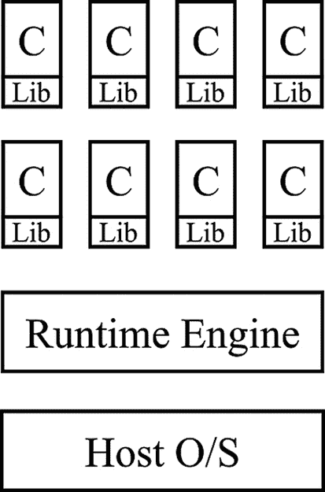

图 8.1 理论性容器模型。

在这个理论模型中，有一个单一的主机操作系统（但请记住这必须托管在硬件服务器上），运行在它之上的是运行时引擎，负责运行和管理你的容器，以及消耗资源的额外处理层。然后，预计位于同一台服务器上的是你的容器。现在，这些每一个容器将托管一个完整的应用程序、一个服务，或者可能只是一个函数（类似于`DLL`）。然而，如果没有访问操作系统内置的功能，这个应用程序、服务或函数无法运行。因此，每个容器都必须拥有从操作系统运行所需的任何运行时环境、库和其他组件，而这种需求可能是巨大的。如果你只有八个容器，那么这种需求大致重复了八次（每个容器可能需要略不同的`O/S`资源）。然而，如果你有八百个容器（这是完全可行的），那么资源就重复了八百次，并需要八百倍的处理能力。

此外，运行在容器中的每个服务都需要它们自己的证书。因此，在传统模型下，一台服务器会有少量证书用于身份验证和加密。现在，如果这台特定的服务器关联了 800 个容器，它就拥有 800 组证书，加上服务器本身的原始证书。此外，这些容器可能会频繁地被移除并出现新容器。每当发生这种情况时，都会影响证书的库存。

容器模型对组织 PKI（公密钥基础设施）产生的影响是巨大的。管理所有这些证书（其中一些可能是自签的，另一些则是从第三方 CA 购买的）的复杂性超出了手动管理的范围。对于大多数人来说，这需要引入一套自动化证书管理系统。这本身就会增加大量的成本，并在初期会影响 IT 部门的平稳运行。

此外，这代表了一条单行道之路，因为一旦走上这条路并失去了管理自己证书的能力，就无法回头了，至少在你在 DevOps 策略下运行微服务和容器模型时是如此的。在这种情况下，组织 PKI 将增长到危险的不可控程度，除非采用自动化手段。事实上，容器模型整体恰恰存在这个问题。随着容器数量近乎指数级增长，管理它们的能力就会下降。因此，必须在已经复杂的模型中添加其他层级（图 8.2）。

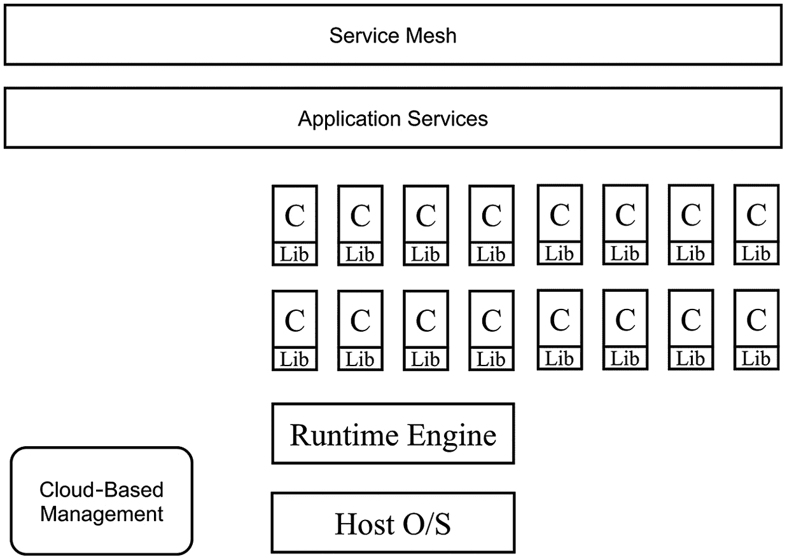

图 8.2 不断增长的基础设施。

在下图中，我们添加了云端容器管理服务的其他其他必要组件，所有容器集群都需要这些组件，加上应用服务（如 PKI 管理层）以及为了维持整个系统运行而不可避免的服务网格。服务网格负责管理和控制容器之间的所有通信和网络流量。它允许服务相互发现，并执行智能路由，以确保消息按预期流动，包括来自各种应用程序接口（`APIs`）的消息。

当容器数量增加到数千个时，这种往返流量网络可能会变得极其复杂，到了无法手动管理的程度。和证书一样，它们也需要某种自动化管理。这正是服务网格发挥作用的地方。它通过附加到每个容器上的网络代理来工作（这增加了复杂性）。这通常被称为 Sidecar 模式。服务网格通过这些代理构建起其对整个容器系统的认知，并允许它们之间进行通信。它还允许对所有连接应用策略和规则，并包含遥测组件，以便至少在理论上可以创建一个整个系统的视图，而且它还包含一个用于创建和应用证书的组件。

PKI 管理系统必须意识到这些其他层级并与它们有效协作。例如，由谁来提供证书？服务网格可能会提供自签证书来保护容器之间的流量，但某些容器可能需要建立外部连接，在这种情况下，它们需要来自受信任 CA 的证书。PKI 管理系统应该真正进行整体控制。它可能会决定使用服务网格的证书创建能力，并结合自身对 CA 的调用。

如果这一切听起来很复杂，那么随着我们不断更多层级，情况会变得更加复杂。这些新层级之一旨在为无服务器应用提供一种简化的构建和部署方法，这种方法保持在容器组内部。但这这横跨了其他某些技术吗？是的，确实。但同时，它依赖于这些技术（特别是服务网格）来提供自己的功能。如果此类层级已部署在组织 IT 模型中，那么 PKI 管理层就需要了解它的存在。

这些这些新技术层经常被提及的优点之一是微服务和应用程序构建及部署的速度。但这种能力本身对于公钥基础设施（PKI）来说是一个巨大的问题。这意味着可能会有成千上万甚至几十万证书不断被创建、使用一段时间后被销毁。额外的处理量和网络流量将是巨大的。相关组织的成本也将随之上升。如果复杂性和成本呈指数级增长，那么“快速开发”这一不断重复的使命将失去意义。复杂性也增加了风险，这意味着必须对安全给予额外的关注。这也意味着成本的增加。这一切都是可以实现的，而且大部分可以实现自动化，但我们必须理解其实际上增加的成本，对于大多数组织来说，这种成本将是非常巨大的。

无论如何，对于接受了 DevOps 理念以及容器、代码仓库、服务网格等的组织来说，部署某种自动化的 PKI 管理系统是至关重要的。服务网格内部的证书创建能力（也可以通过代码手动完成）对于许多容器可能已经足够，但任何面向外部或调用第三方的连接仍然需要由信任的 CA 颁发的证书。但这两类型的证书都必须进行管理。这可以通过手动完成，通过开发者编写的代码让某些容器直接向 CA 的请求。然而，在一个组织内有许多开发者在编写代码，这可能会迅速失控。特别是证书更新可能会变成一个问题，并可能在几乎不使用的证书上产生不必要的开销。这里需要应用一些智能手段，并对证书池及其使用方式进行合理化。

最流行的容器被称为`Kubernetes`，作为一种开发模型，人们对其投入了很多思考，但在 PKI 方面的思考相对较少。此外，还有许多其他组件和服务被编写用来与`Kubernetes`交互。流行的网格之一是`Istio`，同样，人们对其作为机制进行了很多思考，包括自签名证书的创建，但谁在管理这些呢？还有代码仓库和许多其他支持 DevOps 理念的新技术模块。此外，还有大量的文档，尽管其中一些相当复杂，超出了典型的高级经理或总监的水平。现有的开发者会熟练使用如`YAML`等脚本语言，但仍需学习许多新花样并接受新概念。对他们来说，这一切可能很有趣，但有必要吗？我们拥有了“如何做”，但我们缺乏的是“为什么”。


对于 PKI 来说，DevOps 模式在某方面是一场灾难，因为它严重地过度复杂了本就复杂的模型。在另一个意义上，它为 PKI 供应商创造了巨大的机会，让他们也能接受这种模式并开发出自己的更多自动化服务。对于终端用户组织来说，这意味着为了完成你已经在做的事情需要付出巨大的成本和复杂性。你现在可能做得稍微快一点（尽管这尚存争议），但首先，你将经历一个巨大的学习曲线，并随着同样巨大且持续的支出。然而，对于许多人来说，最重要的因素是如果你把一切都放在云端并将其自动化，将会失去控制权。如果你决定接受 DevOps，那么你需要仔细观察 `Kubernetes`（或其对应物）以及这对你自己的 PKI 意味着什么。如果你已经在与 PKI 供应商合作，你可能想和他们讨论这个问题。你可能会发现他们已经在为此挣扎，并为你提供一些你见过的自动化服务。

在本章中，讨论了更广泛的容器模型，介绍了服务网格、无服务器开发和其他理念。最重要的是，强调了所有技术对组织 PKI 的影响。核心观点是，当成千上万甚至几十万个证书取代原来的几十个时，复杂性呈指数级增长。这需要多得的管理。在这种情况下，额外成本可能是重大的，组织应该考虑清楚是否要走这条路。

DOI: `10.1201/9781003606749`

在原始的公钥基础设施（`PKI`）概念中，对信任非常重视。在注册机构和证书颁发机构（`CAs`）之间，会执行操作来测试与新创建并颁发的证书相关的信任。`CAs` 真的会对想要购买一个或多个数字证书的公司进行背景调查。他们会检查公司或组织是否已妥善列出，其执行官是谁，是否曾参与过任何不当活动等。最后，它会联系提供地址的公司，以确保该公司或组织确实存在，并且与其声称的一样。与颁发数字证书相关的这种信任水平确实非常重要。此外，`CA` 会为核实某个组织的真实性所付出的努力感到自豪。

缓慢地，非常缓慢地，使用 PKI 的理念开始扎根，并在互联网的发展以及带有传输层安全（`TLS`）的 `https` 协议的使用大大加速。现在，任何拥有网站的信誉良好的都有必要使用 `https` 协议，这意味着必须使用由受信任提供者（即 `CA`）颁发的证书。但现在，有大量的人想要证书，`CAs` 只需要存在就能开展良好的业务。过去它们对请求证书的机构会进行严谨且尽的检查，现在已缩减为仅检查网站域名是否真实存在且可以访问。如果是如此，相关机构就可以从 `CA` 处购买任意数量的证书。`CA` 现在并不知道网站背后真实是谁。毕竟，任何人都可以建立网站并让互联网服务提供商（`ISP`）托管，而服务提供商在收取相应费用后也会非常乐意提供此类服务。一个网站可以展示一个完全虚构的机构，描述许多他们实际上并未执行的活动，并使用从随处可见的图库中获取的董事成员照片。这样的网站在购买与其域名关联的证书时完全没有任何问题。此类网站还可以有一个“私有”区域，用于存放各种可疑信息的交换和其他活动，但它仍然毫无问题地表现出受信任的形象。

因此，与数字证书相关的信任概念与最初的意图完全不同了。当使用此类证书时，我们真正知道的只是证书正在被使用。我们完全不知道究竟是谁在使用它。这在第 6 章中讨论生物识别时曾提到过。同样，我们并不知道网站上展示的机构是否真的存在，或者它实际上是否是完全不同的机构。当结合合适的算法用于加密通信时，使用数字证书确实很有帮助，但这种信任模型可能并没有我们被引导所相信的得那么强大。即使是 `CAs` 也可能没有我们假设的那样可靠，而且它们在验证已颁发证书的机构真实性方面的作用也已大不如前。目前，通过极少的数据交换就可以从任何热门的提供商处购买证书。如果你有一个网站和一个有效的电子邮箱地址，获取数字证书应该不会有任何问题。当然，这并不意味着你或你所代表的机构是可信的。

自签名证书与从 `CA` 购买的证书之间的区别已经明确。尽管如此，使用的自签名证书数量可能远超商业提供的示例。如果这些证书被用于组织基础设施内部的服务器及其服务器之间，主要用于加密目的，这不一定是个问题。然而，它们仍然需要被妥善构建、注释和管理。如果不是如此，信任将在另一个方面受到影响，特别是关于到期日期，这些日期从开始可能就被设置得不实际地长，然后就被完全遗忘了。或者最初创建它们的人可能已经离开了组织，导致流传中存在许多许多无人真正知晓的证书。这可能是由于对证书和组织 `PKI` 缺乏良好的就地政策所致。

如果证书是由自己的 `CA` 创建的（可能在服务网格内部，或者位于你容器集群的边缘），它们实际上是自签名的，并且可以随意创建和销毁。由于容器之间传输数据的连接非常多，可能会产生大量的此类。从加密的角度来看，这非常有用，因为我们不希望任何数据泄露（假设有人成功黑入了你的容器集群，这本不应该发生）。然而，唯一的信任元素是这些证书似乎来自你自己的 `CA`。但是，由于几乎任何人都可以创建证书，那么一个看起来是由你自己的 `CA` 创建但实际上并非如此的证书，可能会出现在 `/etc/kubernetes/pki` 目录下并可能被积极使用。此外，除了根 `CA` 之外，还可以创建中间 `CA` 为特定目的颁发证书。密钥和证书的典型文件路径结构可能如下：

```
/etc/kubernetes/pki/etcd/ca.key
/etc/kubernetes/pki/etcd/ca.crt
/etc/kubernetes/pki/apiserver-etcd-client.key
/etc/kubernetes/pki/apiserver-etcd-client.crt
/etc/kubernetes/pki/ca.key
/etc/kubernetes/pki/apiserver.key
/etc/kubernetes/pki/apiserver-kubelet-client.key
/etc/kubernetes/pki/apiserver-kubelet-client.crt
/etc/kubernetes/pki/front-proxy-ca.key
/etc/kubernetes/pki/front-proxy-ca.crt
/etc/kubernetes/pki/front-proxy-client.key
/etc/kubernetes/pki/front-proxy-client.crt
/etc/kubernetes/pki/etcd/server.key
/etc/kubernetes/pki/etcd/server.crt
/etc/kubernetes/pki/etcd/peer.key
/etc/kubernetes/pki/etcd/peer.crt
/etc/kubernetes/pki/etcd/healthcheck-client.key
/etc/kubernetes/pki/etcd/healthcheck-client.crt
/etc/kubernetes/pki/sa.key
/etc/kubernetes/pki/sa.pub
```

创建 `CA` 所需的代码非常简单，可以使用 `easyrsa` 或 `openssl` 等命令行工具。换句话说，为云端的容器集群创建 `CA` 和证书，与过去在自己的基础设施上为单个服务器创建证书一样容易。在这两种情况下，证书都可以用于加密数据，但到底谁在控制这些证书？从信任的角度来看，这并不代表一个特别强大的立场，尤其是当你现在有大量的开发人员为你的容器集群生产产品时。此外，这些开发人员也可能不是你的员工。日益，组织倾向于减少自己的带薪人数并外包 IT 等职能。这意味着你可能有一支你一无所知的来自另一个国家的开发人员团队。他们其中一名经理会与你的组织签署一份条款条件声明，但这并不说明什么。你不知道这种团队中谁有足够的权限在任何地方创建 `CA` 并从其颁发证书，而你对此也一无所知。这一切可能运行良好。然而，如果一个怀有恶意的人成功渗透了该团队，他们可能会以对你的组织有害的方式进行。当你外包 IT 等关键职能时情况总是如此，但如果你还拥抱了 DevOps 哲学，情况可能会变得非常混乱。

那么，你应该如何做呢？首先，如果你还没有这样做的话，请不要将 IT 功能外包。其次，正如本文早些时候强调的，即使使用容器，也应该能够为你的整个 IT 资产创建一个完整的计划。如果使用容器集群，可以在高层进行此操作，然后进一步制定显示每个集群细节以及它们在内部和外部如何进行通信的详细计划。当你拥有这种详尽且准确的视图时，你就可以看出何时使用证书是有优势的，以及用途是什么。理解用途非常重要。你可能想要、也可能不想为每一个容器都配置证书。当你拥有了涵盖云内和云外 IT 资产的详细地图时，你就可以据此构建你的 PKI（公密钥基础设施）。这可以手动完成，也可以结合 PKI 管理系统进行，该系统可以搜索证书并将它们置于单一控制点之下。此外，在创建新证书、其用途以及过期日期方面，还需要非常严格的严谨性。自然地，这涉及到职责分工，由关键工作人员成员负责整体 PKI。至少这样，你就能建立起某种程度的信任。如果允许第三方开发者随心所欲地启动 CA（证书颁发机构）并发行证书，那么从 PKI 的角度来看，事情将变得非常混乱。即使你有一个单式的 PKI 系统可以发现这些证书并将其注册一段时间，但其中涉及的信任仍然非常少。如果某些容器需要来自受信的 CA 的第三方证书，那么由谁来做这些决定？基于什么？如果允许开发团队中的任何一个人指定此项，那么你的成本可能会大幅增加。

正如之前指出的，PKI 模型本身就存在信任问题。确保这种问题不会在引入容器和服务网格（service meshes）的 DevOps 策略下被放大是非常重要的。如今，比以往任何时候都，拥有一个小型的、专门的 PKI 团队是有意义的，他们可以监督这一切，并确保每件事都按照适当的严谨性得到处理。将此交给一群程序员（无论组织内部还是外部）将是一个错误。如果你使用专用的 PKI 管理系统，情况也是如此。你需要经过良好培训的人员，他们需要能够准确了解你的 IT 环境中发生了什么，以及了解管理系统本身。然后，他们就可以对你的证书资产负责。

回到关于第三方 CA 的信任问题，它们可以检查域名和电子邮件地址等内容，但它们人生的主要目的是销售证书。它们对究竟在把证书卖给谁知之甚少。这一现实在你更大的 IT 安全模型中需要被考虑。在设计你的云环境时也需要记住。当涉及业务交易时，请记住面对数字证书*真正*意味着什么，并确保有一种安全相关的严谨性像缝线一样贯穿你的运营策略和程序。

在本章中，我们从多个角度考虑了信任这一棘手问题。我们考虑了可能导致你的证书清单指数级增长的情况，以及在你的容器集群内创建所需证书的方法。此外，还注意到受信 CA 角色的变化。在 PKI 中，很容易做出各种假设，但我们应该谨慎行事，特别是当采用 DevOps 模型时，情况下，明智的做法是分配一个小型的、专门的团队来管理组织内部 PKI，并成为组织内其他人员使用的参考和卓越中心。

DOI: [10.1201/9781003360674-10](https://dx.doi.org/10.1201/9781003360674-10)

我们一直在考虑云端容器系统的奇新世界及其所包含的所有内容，特别是它们为公密钥基础设施（PKI）带来的额外复杂性。然而，对于组织来说，很容易构建和维护自己的 IT 基础设施，而无需接触云端。此外，这样做的经验将使他们在对涉及各种系统的持续支持和维护方面处于非常有利的地位。它还将提供一个充分记录一切的宝贵机会，而这在事务外包或移动到云端时很少发生，在 DevOps 环境中也几乎从未发生。如果这三个因素结合在一起（这种情况正日益普遍），那么要求提供全套文档（包括系统图和代码）并查看呈现了什么内容，可能是很有用的。

当价格得起且可靠的计算机首次出现时，它们在当时是某种新奇事物，并很快被用于办公任务。一些最早的应用是文字处理器和电子表格软件，这并不意外，随后是紧凑的桌面级数据库。此时，一个大型组织可能拥有一台主机计算机，上面存储着关键数据，并可能用于为会计目的准备信息或管理组织相关的复杂功能（例如，航空公司的订位系统）。随着个人电脑的出现，人们很快意识到这些设备可以很容易地连接在一起，从而在部门之间轻松共享信息。专用网卡和网络管理软件（如 `Novell NetWare`，它既紧凑又强大）出现了，并且通过增加一个简单的集线器（一个带有一系列网络端口的小型硬件），网络就能在短时间内运行。当走上这这条路线的组织想要在网络中的所有计算机上使用强大的软件时，这是通过客户端/服务器模型实现的，在该模型中，主软件安装在一台指定为 `server` 的计算机上，而所有其他计算机都拥有程序的轻量级版本（`client` 应用程序），并与服务器上的主机进行通信。因此，计算机开始被分为设计用于桌面使用的和设计用于服务器的计算机。后者开始以更好的规格进行制造，具有更好的电源供应，有时可以使用多个处理器，并且通常可以使用更大的内存。它们具有基础的图形能力，并通常通过命令行进行管理，有时是连接在“绿屏”视觉显示设备上。

如果你在一个典型的机房内拥有一组 24 小时运行的大型服务器（正如大多数情况那样），它们往往会产生热量。因此，人们建造了特殊的机房，通过空调维持稳定的环境，即使建筑的其他部分没有空调。这些房间在物理上也被进行了安全防护，以确保只有获得许可的人员才能。数据中心就是这样演变的。

电话线可以用于扩展建筑、城市甚至国家之间的组织范围。从本地角度来看，出于安全考虑，数据中心和办公室之间可以使用私有线路。使用现成的桌面电脑和服务器，可以以相对较少的精力和成本轻松构建和维护组织网络，特别是当你清楚自己真正需要什么以及为什么时。

## IT 人员与安全性的演变

随着时间的推移，事情变得井井有序，IT “职员”被分配了明确的职责，他们自己也会开发专业技能。他们的首要功能是保持一切运行正常，而管理人员可以使用他们提供的计算机和服务。这是一种非常理想的状况。组织的人员成本略有增加，但增加的功能和相关效率的提高完全抵消了这一成本。许多人认为本该保持这样。安全并不是大问题，因为离开网络的唯一流量是电子邮件，而这些邮件通过邮件服务器通过网关，然后进入第三方外部网络（由电信公司提供）。

如上所示的网络可以由实际上任何人构建和维护。当时可用的主要操作系统首先是不同版本的 `DOS`，如 `Microsoft DOS`、`DR DOS`（非常好）以及其他版本，外加早期的 UNIX 类系统。随着 `Microsoft Windows` 和其他图形用户界面的出现，桌面端业务真正腾飞发展，组织开始使用 `C` 和 `C++` 等语言为自己构建出色的应用程序。当 `Delphi` 首次出现时，它从应用开发的角度彻底改变了局面（当时也有 `Microsoft` 的 `Visual Basic`，但它并不具有可比性）。在学术界，大多数事情都首选 `UNIX`。

硬件进步非常快，改进且更快的处理器、更廉价的内存以及主板上内置更好的设施。然而，你仍然需要电源、机箱、磁盘驱动器和硬盘，但为什么要为每台服务器都重复这些东西呢？针对这个问题，开发了简化的服务器“卡卡”，将处理和网络连接与数据存储分离开来。这些卡可以插入 19 英寸机架的框架中，而机架反过来可以托管大量服务器，只需要一个（最好是两个——一个用于备份）电源供应和冷却系统。

数据存储通过高规格硬盘阵列或网络附属存储 (`NAS`) 集群来实现，这些阵列每晚都会自动进行复制和备份。因此，数据中心可以保持为一个大型的空调房；此外，由于安装了不间断电源（UPS），无论发生什么，对可靠运行的信心都很高。无论这个“数据中心”仅仅是主办公楼内一个上锁的房间（这很常见），还是一个位于专用建筑中的正式安全数据中心，在维护方面这实际上是一个非常简单的命题。为了额外的安全，数据中心会在两个地理位置独立的地点建立相同设施的副本，以确保当一个地点发生严重故障时具有某种程度的灾难恢复能力。

尽管如此，成本在可控范围内，并且由组织经过良好培训的员工进行简单的维护。与许多人所进行的外包相比，这实际上是一种非常低成本且可靠的模式。外包总是会导致更高的成本，因为新人员努力理解基础设施，而且由于新的 `DevOps` 模型可能特别昂贵，加上如果使用了 `cloud`（云），会导致对核心组织和知识产权数据的绝对失去控制。董事和高级经理们是否认为这是一个好主意，可能取决于他们对现代世界中 IT 的理解。

然而，即使事情已经外包并陷入了真正的混乱，在目前，仍然可以购买硬件组件来构建一套内部基础设施。完成之后，可以使用任何被认为有用的技术，如果这种基础设施是基于 `Linux` 构建的，那么成本可以保持非常低。事实上，如果从头到尾使用开源软件，那么软件成本实际上可以降为零。节省下的资金（确实非常可观）可以用于雇佣和培训内部人员。现在这代表了一个有趣的命题。

因此，构建你自己的物理基础设施并将其保留在本地或自定义构建的数据中心绝对是可行的。无论采用哪种方式，一旦运行起来，维护它将变得相对简单。你是否需要拥抱当前的“DevOps”时尚，可能取决于你的使用情况。然而，如果你了解你组织的业务，那么就不需要频繁地刷新你的软件应用程序，在这种情况下，DevOps 哲学就是多余的。

阿尔伯特·爱因斯坦曾说，如果你不能用简单的语言来解释某事，那么你就不真正理解它。确实如此。人们可以稍微改述一下：如果你必须不断地重建你的应用程序，那么说明你并不了解你的业务，无论是商业、政府还是学术领域。因此，不断重建和重新部署的需求，在某种程度上，至少是值得商榷的。数据中的细节可能会变化，但这与应用功能不是一回事，应用的功能不应该如此频繁地发生变化。

关于 `PKI`，有许多理由说明回到内部的、定制的基础设施是一个好主意，其中大多数原因与管理的易用性有关，这反过来又意味着更低的成本和更好的安全性。首先，你清楚地知道每样东西在哪里。你的证书存储在何处，用途是什么。这反过来使得它们易于统计和管理。应用程序相关的证书可能由应用支持团队直接管理，同时由一个小型、专门的 `PKI` 部门管理全局视图。大多数证书颁发机构都有应用程序，允许对它们提供的证书进行自动更新。这可以镜像到你自己的 `PKI` 目录中，保持所有内容的更新并按预期方式运行。

这种易于维护的模型与基于云的容器和服务网格（service mesh）模型之间的比较非常有趣。从理论上说，两者都应该良好运行，几乎不需要人工干预。在实践中，对于后一种模型，你永远无法真正理解东西实际在哪里，因此你可能认为一切正常正常，但实际上，某些东西可能被忽略了，或者如果是完全自动化的，可能从根本上没有被正确配置，导致你面对一个出现故障的系统。如果是这种情况，那么也存在安全风险。尽管如此，这种模型在某些情况下可能具有优势。这由相关组织来决定。


简而言之，一个本地的、基于硬件的基础设施以低成本的设计和构建是完全可能且可行的。此外，这样做也有良好的安全性考虑。使用内部经过良好培训的员工也代表了很好的投资，因为在适当的管理和指导下，相关组织可能会经历更少的停机，事实上，应该没有任何停机。这反过来增加了用户的信心，并代表了良好的公关（PR）。与维护外部基础设施的费用相比，硬件成本实际上相当低，而且如果利用了开源哲学，软件成本可能实际上为零或非常少。此外，尽管这意味着工资单上的人员更多了，但这些成本可能远少于交给第三方进行托管基础设施的费用。

在本章中，我们强调了对于许多组织来说，采用传统方法构建并据此进行维护，管理他们自己的内部 IT 基础设施可能仍然很有意义。这将所有一切重新交回自己手中，而对于`PKI`而言，这是一个非常重要且切题的考虑因素。妥善管理`PKI`是至关重要的。由于 DevOps 哲学涉及数量大量的证书，在许多情况下，这意味着要转向自动化。然而，转向自动化意味着失去控制。当然，你将对一个中心化的证书管理系统拥有控制权（或由他人代你拥有），但你对证书何时何地创建和销毁，或者它们是否符合特定策略将了解甚少。支持者会报告说，各种服务网格以及（需要时）单个容器模板中的所有内容都可以通过代码实现；然而，这样做意味着整体上创建了一个极其复杂的系统。可能的结果是（可能是外包的）代码编写人员按照他们认为应该做的方式来做事，但并不一定是以协调的方式进行的。无论如何，相关组织将失去对`PKI`的直接控制，这并不是一件好事。但还有其他方法，正如本章所概述的。此外，从成本的角度来看，这些其他方法可能会带来巨大的节省。

DOI: [10.1201/978103360674-11](https://dx.doi.org/10.1201/978103360674-11)

多年来，IT 支持团队的一种常见做法是配置具有长效有效期的自签名证书。有时是十年，有时甚至长达九年。这是因为它们被认为是一种麻烦。它们对于实现机器之间的加密链接有用，但为什么要通过需要定期更新来增加问题的复杂性呢？事实上，其实有一个非常好的理由来设置一年（或最多两年）的较短更新日期，那就是为了迫使相关团队不断了解他们正在支持什么以及为什么，包括与其他应用程序和数据源的所有链接，无论它们在更广泛的基础设施何处。同样，对于购买的证书，了解最初购买它们的原因以及该原因仍然有效是一件好事。因此，确保所有证书的有效期为一年或两年代表了良好的实践。

还存在支持人员的问题，他们可能会调到另一个部门，甚至可能完全离开组织。如果他们离开了，关于最初部署这些证书的知识也将随之流失，而它们将完全被遗忘。当然，直到它们过期。那时会发生什么呢？嗯，如果它们只是简单的 Web 证书或电子邮件证书，另一端的用户只会收到一条消息，说明该网站或此人不可信。这很难让宿主组织产生信任，并可能导致客户流失，或者该特定网站被接收浏览器拦截，这对于拥有该网站的组织来说将是非常糟糕的公关（PR）。

这已经够糟糕了，但情况可能会变得更糟。如果两台机器定期通过加密链接通信，突然之间由于其中一个证书过期导致链接停止，那么可能会直接断开链接，或者糟糕的是，让链接在无人知晓的情况下以未加密的方式继续。这反过来又使组织面临额外的安全风险。在第一种情况下，工作直接停止运行，支持人员将抓着头纳思为什么（特别是当他们是外包部门时），直到某地的某人想起有数字证书这种东西，并且它们有过期的倾向。如果连接的是外部组织，这可能会导致宿主组织的活动停滞，造成巨大的尴尬，并导致对方失去信心。这将代表非常糟糕的公关。此外，在联系相关的证书颁发机构并更新证书期间，将浪费宝贵的时间。此类事件会发生。至少，在那些真正不理解公钥基础设施（`PKI`）及其工作原理或如何进行管理的组织中会发生。

现在，如果你考虑上述场景并将其推扩展到更大的规模，可能有数千台机器和数万个证书，那么正如你可能理解的，情况可能会变得非常困难。如果 IT 已经外包，情况尤为如此。当然，如果相关人员了解发生了什么并迅速采取行动修复局面，一切可能被很好地重新纳入控制。

如从图 11.1 所示，创建具有长期有效期的证书非常容易，但我们应该留意这种做法。许多 IT 故障和中断实际上是由无人知道其存在的过期证书引起的。找到并替换它们可能是一个耗时的过程，而且如果涉及许多证书，可能会导致长时间停机，对组织的声誉造成巨大损害，对于商业组织来说，可能会导致重大的业务损失以及相关的负面公关。然而，要陷入这种局面出奇地简单，特别是当外包 IT 支持团队正在维护一个他们不熟悉的基础设施时。此外，这样的团队可能对`PKI`有良好的理解，也可能不知道在不同操作系统和特定应用程序中证书存储的位置。如果使用了集中的`PKI`管理系统，它可能没有保持更新，因为开发者有时只是例行公事创建证书，而没有特别提醒其他人这些证书的存在。当然，他们应该遵循严格执行的策略，但这种情况发生的频率有多高呢？

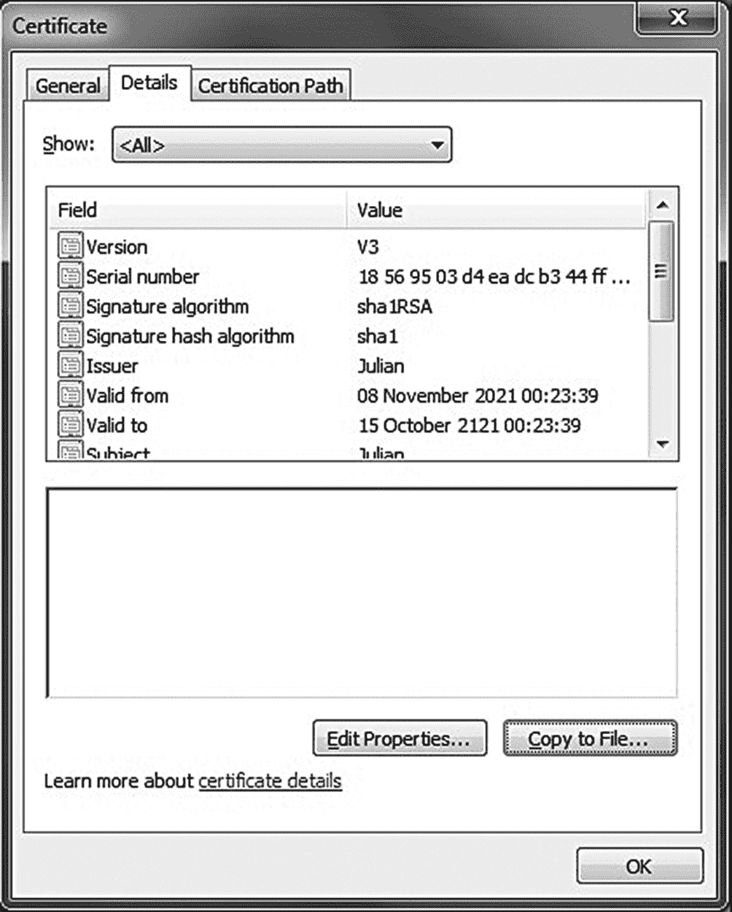

图 11.1 显示具有长期有效期的自签名证书。

举一个具体的例子，想象一个数据库服务器，它本身位于物理服务器上（可能是一个带有网络附属存储的存储卡，数据库软件位于其上）。首先，物理服务器将有一个关联的证书。然后，数据库服务器将有一个关联的证书。任何能够访问数据库的客户端设备（如组织的笔记本电脑或桌面电脑）也将拥有证书。

当通过一个客户端设备向数据库发出查询时，会引用各种证书来识别涉及的机器、进行加密握手，并在数据通过网络传输时对其进行加密。整个过程中可能涉及十几个证书，从发布查询、在数据库服务器上运行、从存储器中检索数据到通过网络发送给客户端，都包含在内。如果这些证书中的任何一个失败，事务将失败。如果此连接延伸到组织网络之外并访问第三方资源，就会涉及更多证书，包括来自可信证书颁发机构的证书。但再次，如果证书失效（由于过期），事务很可能会失败，或者更糟糕的是，让你在安全方面处于暴露风险之中。可能存在以明文传输数据的回退机制，但这几乎是不可接受的，更糟糕的是，你可能甚至没有意识到它的发生。

如果作为组织日常业务的一部分，你每天发起几十个这样的请求，或者可能是数百个，甚至数千个，那么你的`PKI`最好处于良好状态。如果聘用了专家团队来积极管理`PKI`，这种理想状态很容易实现。如果我们考虑到上述场景并将其扩展到更大规模，目前每个人似乎都对 DevOps 模型、容器、网格以及相关设备产生了热情，那么真正理解你的证书库就变得更加必要。这包括理解容器如何工作、如何与“边容器”和“网格”通信、证书存储在哪里、何时过期等。在大型组织内部，这并非小事。如果你真的不理解它，当问题出现时，你就无法有效地进行支持或故障排除。而问题绝对会发生。当问题发生时，你需要快速响应并修复。这种操作速度是容器模型经常引用的优势，但在这种情况下会有效吗？答案是肯定的，可能的，至少如果你安装了所有正确的组件（包括用于遥测目的的组件），并且如果你安装得正确（如果是这样，为什么会失败？）以及你确切知道一切所在的位置。

即使假设上述情况，可能有二十四名开发者在上述的服务器上编写过代码。自数据库构思和构建以来，可能还加入了十几个第三方软件解决方案（当时是谁是首席架构师？）其中任何一个都可能产生负面影响。啊！我听到你说，“但是有了 DevOps”，你可以几乎立即替换错误的容器。”但那推意味着你确切知道故障在哪里，而它可能在任何地方，需要你花费几个小时才能发现。然后，你需要了解故障代码在哪里并识别特定的证书。将这种情况乘以 100 倍，正如你所看到的，寻找和替换失败的证书将面临真正的问题。更糟糕的是，如果系统没有完全失败，那么检查所有证书将是一项巨大的工作。

另一个被简要提到的问题是证书的确切位置。当应用程序首次安装和配置时，诸如证书地址等信息会由相关的特定团队理解并相应地找到。然而，如果发生任何变化，例如`i.p.`地址发生更改，或者应用程序规模扩大并移动到不同的服务器，那么其中某些证书可能会变成“孤儿”证书。问题在于，参与其中的支持团队可能并没有意识到这一事实。他们可能重新配置或重新签发了一些证书，但始终存在这种可能性（如果不是概率的话），即某些证书可能会遗漏。这就是为什么拥有一份证书的最新清单——明确它们的用途以及所处位置——是如此重要的原因。如果没有这样一份清单，应用程序支持团队或新的 DevOps 团队如何可能理解整体状况？答案是，他们做不到。因此，事情会崩溃，故障也会随之发生。在一个大型、复杂的组织网络中，这可能变成严重的问题。如果同时 IT 员工正在被外包，那么问题就加倍了。如果此外，组织正在向基于微服务的架构迁移，那么问题又再次增加了一倍，甚至更多。我们绝不能忽视 PKI 在任何组织 IT 基础设施中所扮演的角色，特别是当其中部分或全部驻留在云端时。

特别是，我们必须理解证书位置错误或过期的影响。这个问题也发生在双操作系统或多操作系统基础架构中，而这在如今已是常态而非例外。过去，支持团队在 Windows、Linux 和大型机之间的不一致性中作斗争就已经足够棘手了。但现在，有了 Apple Mac 笔记本电脑和移动设备的激增，以及一系列基于 Android 的平板电脑和移动设备。所有这些设备都需要连接到组织的主网络，有时在校园内，有时从已知的远程位置，有时从不可信的公共网络。所有此类情况都需要被考虑到，并且每个相关设备都需要安装一个证书。当设备连接并进行握手时，需要检查证书，为了实现这一过程，我们必须知道从哪里找到它们，并且在找到它们时，识别出它们是由我们的组织颁发的，或是由受信任的证书颁发机构授予我们的组织（或其他组织）。在我们组织的服务器、桌面和笔记本电脑中，我们需要知道操作系统使用的标准证书库的位置，以及任何特定应用程序证书库的位置。不言而喻，我们需要了解哪些证书位于何处。对于组织 IT 基础设施使用的每一个证书来说，即使有成千上万个，情况也必须如此。

如果这种更广泛的理解在任何部分缺失，就会面临一种不必要的风险，这种风险有一天可能会导致我们至少部分 IT 基础设施崩溃。当这种情况发生时，支持人员在合理时间范围内使其重新运行的能力将很大程度上取决于他们是谁以及正在追求什么样的开发模型。我们在现代世界中太常看到这种情况了，特别是在尝试与公共系统对接时。“这不是我们的错，是 IT 挂了”这种借口已变得随处可见。以前不是这样的。在规划或运行 IT 基础设施时，这一切都应该被考虑在内。而 PKI 以某种方式支撑着几乎这一切。

在本章中，我们考虑了证书过期时出现问题的可能性，以及在尝试纠正时可能遇到的困难。人们必须考虑的不仅仅是证书过期的问题，而是为什么它们会在未被发现的情况下过期。大多数情况下，这是因为它们的确切位置未知，甚至可能根本不知道它们的存在。这在运行良好的 PKI 中是不会发生的。然而，这就是我们写这本书的原因，为了指出那些不正确关注 PKI 的人所面临的危险，特别是在 DevOps 模型中，这是一个非常容易陷入的境地。每天我们都听到更多的 IT“故障”。如果技术供应商所做的宣传是正确的，这又如何可能呢？

DOI: [10.1201/9781003360674-12](https://dx.doi.org/10.1201/9781003360674-12)

从上一章可以清楚地看到，如果证书开始过期、被遗忘或者可能只是被放置在了错误的位置，任何组织都可能陷入真正的混乱中。同样清楚的是，在 DevOps 模型下，这种情况会加剧，并可能容易导致大量的时间浪费和相关成本。因此，我们必须努力保持事物平稳运行，并确保我们对公钥基础设施（PKI）以及所有相关内容的管理是绝对正确的。

第一步必须是任命一个专门的 PKI 团队，即使他们最初的知识并不完整，也可以通过培训成为一流的 PKI 执业人员。这不需要一个大型团队。事实上，三到四个人就足以应对休假或疾病导致的突发状况了。他们的首要责任将作为 PKI 的专业知识来源。他们将是其他团队寻求建议的团队。反过来，他们将教育其他团队，以确保他们在组织 PKI 方面遵循最佳实践。如果采用了通用的 PKI 管理系统，将由 PKI 团队接受该系统使用的培训，并且只有他们拥有对该系统的管理权限。所有对外部证书的请求都将通过该团队，并由他们单独进行批准或拒绝。此外，管理系统的部署架构将由该团队设计、批准和构建。他们将准确了解管理系统如何与大网络中的每个其他系统进行交互。如果其他系统和服务层需要与 PKI 管理系统进行交互，将由 PKI 专家团队负责设计和协调这种交互。他们将指导其他团队如何使用它。无论这些其他系统和层的供应商建议什么，PKI 团队都对涉及 PKI 的一切事情拥有最终决定权。其他人必须围绕 PKI 模型来设计自己的产品，而不是反过来。最后一点理解至关重要。PKI 才是最重要的实体，而不是可能使用它的服务和层。正是由于这个原因，组织需要这样一个专门的 PKI 团队。

该专家团队所需的技能必须是广泛的 IT 技能，最好是通过在组织内的经验获得的。他们必须熟悉`Windows`、`Linux`以及日益普及的`Apple`操作系统，以及相关的密钥库（keystore）通常存储在何处。他们还必须理解主主机以及运行在上面的应用程序。此外，他们必须适应新的`DevOps`方法论以及在该更广泛的云端框架内使用的所有技术。这看起来可能是一项艰巨的任务，但对于这样一个团队来说，完全掌握并透彻理解这一切是完全现实的。

这就是为什么他们需要一个专职团队。组织绝对不应该做的事情之一是将此项功能外包。它必须由你们的人员进行内部管理。这非常重要，这一决定最终将为组织节省因 IT 停机导致的大量时间、金钱和尴尬。`PKI`是你们 IT 框架的基础。如果它出错或损坏，你们的 IT 就会崩溃，并带来随之产生的所有后果。

现在，让我们探讨一下这个专家`PKI`团队必须吸收的一些知识。首先，他们必须理解存在的各种证书标准。大多数情况下，他们将处理`x.509`系的标准，但也有其他标准。他们必须理解这些证书中的每一个字段、这些字段如何以及为何被使用，以及何时使用。此外，如何检查它们以及如何识别他们看到的内容。

他们还必须理解证书颁发机构（CA）和注册机构（RA）是如何工作的，它们是什么以及做什么的。当然，他们必须理解`PKI`的核心概念、它是如何运作的以及启用它需要什么。

然后，他们必须将这些知识应用到自己的组织中，思考证书将如何工作，以及何时何地应该使用。从这里开始，他们需要构建一个适用于特定组织的 PKI 使用策略。这应该以一份清晰简洁的文档形式呈现，明确规定在该特定组织及其支持的 IT 基础设施中应如何使用证书。

这将包括所有可能参与的人员的角色和职责，从与证书颁发机构谈判的采购人员，到编写部署为服务或应用程序的代码的人员，特别是那些担任系统架构师角色的人。还将清晰、无误地描述这些人以及其他可能参与的人员如何与专家`PKI`团队进行联系，确保对谁负责什么没有任何疑义。

这看起来似乎是一个显而易见的要求，但令人惊讶的是，竟然有很多组织甚至连这重要的第一步都做不好。如果它不对，那么它就是错误的，产生的`PKI`可能会很快变得碎片化、组织混乱，并稳固地走上失败的道路。这种角色和职责声明也可以在组织架构图中进行描述，该图反过来可以发布在组织的内部网站或 wiki 上，方便随时引用。一份副本可以很有用地挂在 PKI 团队办公的墙上，作为对所有相关人员的提醒。这有助于在新 IT 人员出现时向他们解释情况。

在创建并分发了组织政策后，`PKI`团队必须将理解整个基础设施作为其职责，了解通常存储在不同操作系统（以及操作系统版本）中的证书，以及特定证书位于何处。这种理解还必须涵盖正在进行的任何新开发工作以及使用的每个开发模型。这不是一项小任务，它需要大量高度集中的精力。

可能会制作另一张地图，明确说明每种情况下默认证书存储的位置。该文档将与策略文档相关联。他们会很快发现存在例外，有很多例外。大多数是应用程序特定的，有时是因为没有遵循严格的开发方法论和建议。

此外，他们可能会发现个人在没有通知其他人的情况下获取了证书。这些通常是简单的电子邮件证书，但有时一个个人可能同时拥有多个有效的证书，也许是因为他们忘记了与原始证书相关联的密码。发现所有这些事情需要一些纯粹的侦查工作。需要对个人进行询问，并且每当发现某封邮件被签名或加密时，PKI“侦探”们就必须迅速介入并理解该证书来自哪里。

如果一个个人与多个证书关联，则必须对其进行合理化，只留下一个与该名称关联的、定义明确的证书。其他证书如果是自签的，则必须销毁；如果是由证书颁发机构颁发的，则必须吊销。在可能几千名员工中管理这项任务将是一项巨大的工程。然而，一旦完成，并为每个需要证书的用户在证书数据库中正确记录单个用户证书，整体状况可能会变得容易管理得多。

这很自然地引入了教育和意识的主题。可以理解，那些不参与 IT 事务的人员可能对`PKI`和证书管理几乎一无所知。事实上，IT 领域的许多人员取决于其具体角色，可能对此也了解甚少。然而，让所有人员至少具备基本的`PKI`理论知识，并理解他们为什么拥有证书（无论是个人的，还是与他们经常使用的应用程序相关的）是重要的。

因此，必须在组织内部设计、配置并组织一次`PKI 意识提升活动`。这是耗时的，必须以某种方式与 PKI 团队等待的所有其他任务并行进行。然而，如果组织要获得并维护其`PKI`，无论采用什么样的基础设施，都必须开展这项工作。人们可能会理解为什么这样一个专职 PKI 团队对组织或企业至关重要。他们有很多工作要做，工作量永不停歇。工作性质有时会变化，但它永远在那里，如果没有专职团队来管理，事情很快就会一团糟，正如最近许多案例发生的那样。此外，如果你考虑将开发方法论改为类似于微服务和`DevOps`模型，那么你绝对需要这样一个专职团队。

当意识提升完成、证书数据库构建、填充并检查完毕、基础设施得到妥善记录，并且所有细节都经过了检查（再检查）之后，PKI 团队就可以向后退一步，观察实践中正在发生的情况。希望如此，他们会发现策略正在被遵守，角色和职责得到了尊重，并且工作实践被隐含地遵循。任何不低于此的做法都是不够的。如果发现漏洞，或者开发人员走捷径没有按要求办事，这必须立即着手并解决。对于 PKI 而言，组织绝不能容忍任何草率或个人违背协定策略随意行事。这就是导致问题的原因。如果我们希望确保证书不会过期（以及此类过期所涉及的所有问题），并仅严格按照现行策略发放证书，那么我们必须对组织的 PKI 实施严格控制。这是非黑即白的，在这里没有灰色地带。


在了解了每一个证书的位置以及存在那里的原因之后，我们现在可以将它们全部记录在我们的证书数据库或集中管理系统中，记录它们的属性，更重要的是它们的过期日期。从这里开始管理它们的一种逻辑方法是为每个证书至少列出两个联系人，以及他们的电子邮件地址和电话号码。通常，这些联系人将在每个受影响应用程序的应用支持团队工作。当证书在过期前一个月时，可能会向两个联系人发送一条自动电子邮件，要求其回复并确认证书已更新，同时提供新证书的详细信息。收到回复后，可以相应地更新证书数据库。如果一周内没有收到回复，将自动向两个指定的联系人发送另一条消息。如果又过了一周，会发送另一条消息，而且现在将每天发送一次。然而，在到达这一步之前，`PKI` 团队已经采取了行动。首先，他们将调查为什么没有收到回复。这两个指定的联系人是否都离开了部门或组织？如果他们仍在组织内，将追踪到他们，并询问他们为什么没有相应通知 `PKI` 团队。然后，将由两个新人员负责涉及的证书，`PKI` 团队将协助他们在证书过期前完成更新。大多数情况下，不会发展到这一步，因为负责的人员会留任，并对收到的第一条消息做出响应，更新相关证书并提供新或更新后证书的详细信息。在处理大量证书时，建立此类自动化机制至关重要。

在 `DevOps` 世界中，人们期望自动化证书颁发机构能够根据需要颁发证书，并在容器构建、部署和销毁时将其销毁。这在自签名证书上某种程度上是可行的，但如果仅仅依赖此机制并假设一切运行良好，那是危险的，因为实际上你并不知道情况，因为你对该过程没有直接控制。如果出了问题（这是不可避免的），你第一次获知将是某个进程因为通信握手失败而导致失败时，但你可能需要一段时间才能发现这一点。事实上，涉及的容器可能已经被看似运行正常的修改版本所替换。这类故障很难在接近实时的情况下被发现并纠。大多数情况下，停机的发生是因为自动化颁发过程遗漏了某些内容，或者简单来说是陷入了混乱。这种模型在节点数量有限的情况下可能运行良好，但当我们开始达到数万个节点的规模时（这在许多情况下是完全现实的），假设它们都与自动化机构无缝衔接工作就是危险的。请注意，当这一领域是云端时，你可以将这个问题放大百倍。

在本章中，已经证明了防止证书过期的主要方法就是良好的组织。在中间王国时期，古埃及在塞努塞尔特（`Senuset`）和阿蒙涅哈特（`Amenemhat`）王朝的统治下，可能比以前或此后的任何人都更深刻理解从混沌中建立秩序的重要性。他们知道，产生混沌所需的时间和精力与维持秩序一样多，甚至更多。那么，为什么不建立秩序呢？秩序带来了对事情将顺利运行的信心。塞努塞尔特和阿蒙涅哈特非常理解这一点，并确保了一切在他们的指导下繁荣发展。而他们确实繁荣了。我们的 `PKI` 专家团队需要采取类似的方法。是的，有时会很，但努力将换来成功以及事情正被妥当管理的信心。据此，可以产生更加详细的 IT 资产及其中所有证书的地图。在本节中，我们展示了可以构建并自动化证书数据库，以便在证书过期前发送消息，让负责人员做出响应。

`DOI: 10.1201/9781003360674-13`

在微服务的这一奇新世界中，`kubernetes`、服务网格、代码库以及所有其他曾经我们没有它们也能过得相当快乐的杂物，自动化已成为在该模型内运行的关键前提。大多数人将其视为一种便利，一些人将其视为绝对的必要，而另一些人则简单地将其视为如今办事的方式。在整个行业中，自动化导致了每个领域内少数公司利润不断增长，同时伴随而来的是大规模的裁员、失业以及几代人的技能退化。现在在任何行业，所谓的“技能”通常只是对支持性问题非常基础的了解，而真正的知识却掌握在日益稀少的个人手中，这些人有足够的特权接受过良好的教育，这种教育教会了他们“资质”与“理解”之间的区别。这少数人代表了那些通过其特定领域产生的产品和服务真正设计未来的人。遗憾的是，现代另一个缺失的要素是道德勇气。这种对体面的缺乏和对高尚准则的忽视，导致了没有人真正需要的技术的发展，除了那些产生巨额利润却不知道该如何处理这些钱的人，而其他人则生活在苦中。IT 行业在这方面是领导者，因为它所产生的东西直接或间接地影响着数百万人的生活，而且很少是为了更好。

作者最近在访问一家眼镜店时注意到一个有趣的统计数据。它显示，我国家超过 60% 的小学生现在正遭受近视之苦。我对这一发现感到震惊，但并不意外，因为他们在清醒状态的大部分时间里都盯着手机、平板电脑和电视看。他们还经历着日益严重的注意力集中、社交互动以及学习和理解能力的问题。“学习困难”这个术语已几乎无处不在，你不需要看太远就能在自己的社区内找到被贴上这种标签的人。曾经的罕见异常现在几乎是所当然。这是技术对几代人类造成积极伤害的同时，为少数人获取巨额利润的典型例子。此外，此类技术的所谓益处远不能抵消带来的伤害。人类比任何技术都珍贵得多。

因此，问题出在 IT 内部。我们早已过了那种可以认为它对大多数使用者来说是真正有用的界点。再次，所谓的益处被对人类互动和主观性的破坏所抵消了。以银行和能源供应商为例。这是否导致了消费者成本的降低？不，恰恰相反。从组织的角度来看，运营成本的增加与 IT 部署的程度和强度大致一致。此外，这种部署导致了想象之外的失业和技能缺。因此，明智的组织在采用任何新的 IT 相关技术之前会进行审慎的考虑。当然，他们将面临来自供应商的巨大压力，供应商会为了说并做任何事来说服组织必须采用最新趋势。这里存在一种难以忽视的“皇帝的新装”综合症。如果其他一切都失败了，贿赂和腐败随时待命，特别是在公共部门，而且它们被毫不犹豫地使用。

回到公密钥基础设施（`PKI`），理解上述观察结果的现实情况对于设计贵组织实现和维护适当 `PKI` 的方法非常重要。有些公司和服务自豪地声称，他们将直接从你手中接管一切，这样你就不必担心了。那是一个巨大的错误，特别是当这些公司使用 `cloud` 时。这并不是说此类服务不能或不想工作。它很可能运行良好，至少在一个时期。但这是一条单行道。一旦走这条路，就无法回头，因为你失去了对 `PKI` 的控制。

你可能会发现学习曲线比预期的要陡得多。即使有你自己构建的证书数据库，仍然存在哪些自动化是合理的、哪些最好留给信任的人处理的问题。这在开始时就得到了解决。待考虑事项可能包括以下内容：

* 创建和注册自签名数字证书的程序。
* 从证书颁发机构请求外部证书的程序。
* 所需的所有类型证书的精确规范。
* 此类信息的中央存储库。
* 发送提醒的过程。
* 对此类提醒要求的响应。
* 证书数据库是如何填充的。
* 如何在网络上发现新证书。
* 所有相关人员的角色和职责。

与开发和支持人员公开讨论此类问题将将提供对目前运作情况的深入见解。例如，`UNIX/LINUX` 开发人员对于如何管理证书会有非常明确的思路。支持人员可能理解或不理解不同机器上证书存储的位置，但他们可能熟悉证书失效的后果。无论如何，此类讨论都将具有启发性。可能会发现有很多包含已发行证书列表的电子表格，但这些表格可能出现在任何地方，包括埋在只有他才能访问的开发者私有文件夹结构中。如果是这样，检索和检查这些电子表格将是开发更广泛理解的有价值的步骤。

如果该组织习惯了某种特定应用程序的模型（即某些个人在开发前后都与某个应用程序保持一致），那么他们也将对与该特定应用程序相关的证书如何工作有良好的了解。他们可能是自己颁发了大部分（如果不是全部）证书，并知道它们在哪里以及使用了何种过期长度。这对于 `PKI` 团队来说也是一个非常好的起点。

几乎可以肯定，有必要构建一个中央证书数据库，该数据库可以实时更新并在每晚进行备份。这可能是一个简单的扁文件数据库，采用如 `dBase` 等通用格式，它可以被几乎任何应用程序读取，包括所有流行办公套件中常见的电子表格。或者，它也可以是一个使用 `SQL` 查询的更复杂的数据库，并根据客户端-服务器模型进行部署；也可能是一个针对快速搜索优化的 `LDAP`（轻量级目录访问协议）目录。数据库的选择取决于预计的证书数量、它们典型的到期期限是多久，以及可能需要的自动化程度。`LDAP` 的一个优势在于它是一个开放规范，并且有很多现成的开源目录服务器可供选择，它们都是经过验证的且免费的（除非你希望购买某种支持包，在大多数情况下，这种支持包是没有必要的）。后者的很好例子是 `ApacheDS`，它用 `JAVA` 编写，因此在需要时可以嵌入自定义应用程序中。它内置了对 `Kerberos` 的支持以及对密码策略的支持。它还支持跨平台，可以运行在 `Windows` 或 `LINUX` 服务器上，并且有一个良好的社区与之相关。然而，`ApacheDS` 只是许多此类 `LDAP` 服务器之一。同样也存在许多传统的开源数据库应用程序，其中引注目的是 `PostgreSQL`，它以某种方式已存在了 30 多年，并拥有庞大的用户群。然而，它遵循完全的关系型数据库模型，可能比你需要的更复杂。你可能会决定，一个良好的目录服务器（你可以在其上编写标准查询并获得快速结果，即使在条目数量很多时也是如此）可能更符合需求。这种模型还可以通过易于维护的脚本来实现某种程度的自动化。

你的证书管理数据库的主要目的是列出你颁发的每一份证书，并包含类型、颁发机构、至少两个支持人员的字段，以及最重要的有效期开始日期和结束日期。然后，你可以编写查询来检查过期日期，并在到期前通过电子邮件通知列出的支持人员，同时向 `PKI` 核心团队发送一份副本。还应该提供一种机制，让支持人员确认续期并更新新证书的详细信息。随后，目录可以允许原始证书自然过期。具体细节将取决于之前的讨论和相关策略，但类似于上述内容的可能就是你决定的方案。

请注意，在使用上述模型时仍然存在大量的人为交互。这对于许多原因至关重要，其中一个事实是，它会让所有相关人员充分了解组织的 `PKI` 及其工作原理以及当出现问题时可能会产生什么样的问题。因此，如果真的出了问题（尽管本不应该），团队将能够轻松识别问题并快速处理。组织将受益于高水平的内部知识和无与伦比的支持团队。在如今，此类技能是无价的，一旦丢失，将很难重新获得。此外，正如从上述讨论中推断出的，妥善处理 `PKI` 是一个相对容易的问题，并建立起非常好的内部能力，这是外包供应商无法实现的。因此，组织保留了关键机制的控制权，这支撑着与外部世界的每一次交互，并提供了内部网络安全。如果采取审慎、深思熟虑的方法，这并不困难。

上述方法的另一种替代方案是购买一套专门的商用 `PKI` 中央管理系统。它将具有之前提到的类似功能，但可能包含更高程度的自动化，包括证书发现。在纸面上，这些听起来都像一个极佳的主意，而且供应商无疑能够提供系统运行的截图，看起来会非常令人印象深刻。而没那么令人印象深刻的是成本，它可能非常高；安装和部署的复杂性也非常巨大；操作人员所需的培训；以及最重要的是，由于这是一个闭源系统，你不得不为某种支持包支付更多费用。此外，在证书数量、操作人员等方面将存在限制，这些都将导致成本的飙升。那种假设或隐含的该系统能解决所有 `PKI` 相关问题的保证，在实践中很难实现。事实上，它可能只是让已经复杂的局面变得更加复杂。这种方法对你的组织可能适用也可能不适用，但要谨慎，否则你付出的代价将超出预期，而且你将失去那些关重要的底层技能。

你不会惊讶地发现，还有许多开源项目虽然没有提供完整的管理系统，但提供了各种组件，这些组件可以很容易连接起来以构建一个系统。对于一个已经面向开源且拥有若干精通各种开源标准和开发的胜任内部开发人员的组织来说，这代表了一种良好的方法。这种方法的问题在于，如果不加小心，很容易得到一个像“弗兰肯斯坦怪物”的设计，可能很难支持，特别是当开发人员离开去其他组织时。尽管如此，这仍然是一个有效的选择，并且具有培养内部技能和相关专业知识的相关益处。如果认为需要一个相当复杂的系统，它完全从精心挑选的开源组件中构建。再次，在选择这些组件时必须谨慎。有些组件在尚未成熟之前就消失了。

回顾来说，本文讨论的第一种方法对大多数组织来说是。它从技术角度保持了简单性，因此易于维护，同时确保了组织内部强大的人为交互。反之，这意味着内部技能和相关专业知识的培养。

当“信息技术”这一术语首次被创造时，它并没有被视为一种将你所有宝贵的组织或商业数据交给第三方的机制，而你对这些第三方一无所知，甚至甚至不知道你的数据和知识产权最终会落到哪一个大洲。然而，对于许多政府机构和商业企业来说，这恰恰就是发生的事。

IT 早期提出的另一个类比是，你的运营数据是组织的命脉。事实上，既然要为此支付巨额费用来换取这种特权，将其交给第三方的意义何在何？对于大多数人来说，这毫无意义。此外，几乎每一个做过此事的政府机构、商业企业或学术机构起初都拥有自己完美的内部 IT 基础设施，并由自己完全胜任的 IT 人员进行管理。换句话说，他们已经安全地在内部拥有了所有这些能力，那么花钱将其转移到第三方手中又有什么意义呢？显然没有意义。

这里还有其他不道德的机制在起作用，其结果是导致了无序的混乱。古埃及人绝不会允许这种情况持续。对于所有此类事务，我们应该问一个非常简单的问题。只有一个词。字典中最小的词之一，但也是英语中最强大的词之一。仅仅三个小写字母。那个词就是“为什么（`why`）？”

对于每一个建议、每一个主意，都要问为什么？如果没有非常好的答案，就不要去做。这是科学的基础。质疑一切。然后再次质疑，并在过程中不断提问。如果 IT 被认为是一门科学，那么我们理应对其应用科学的严谨性。但在我们勇敢的 IT 世界里，这种情况并没有发生。

那么，我们应该从哪里开始问这些问题呢？从顶层开始。在董事或部长级。问题不应该围绕使用哪种新技术展开，而应该直接回到管理运营信息的原则，包括处理客户委托付给我们的信息。在任何此类讨论中，诚信、荣誉和问责等额外问题也应该处于领先地位。

获得组织公钥基础设施（`PKI`）的控制权可能成为重新掌控更广泛 IT 格局的有用第一步。此外，对于大多数人来说，有充分的理由说明这种方向是有益的。那么第一个问题是，鉴于 `PKI` 对我们所做的一切的重要性，我们是否应该利用自己的内部人力资源将其重新收归直接控制？对于大多数人来说，这个问题的答案应该是肯定的。在这种情况下，就有必要精确识别实现这一点需要哪些人力资源。

已经提到专业 `PKI` 团队的必要性，这应该被列为第一步。但他们应该是谁呢？嗯，如果我们假设对于中等规模的运营，四五个人的小团队就足够了，那么下一步就是确定这个小团队应该涵盖的技能。不言而知，他们应该对 `PKI` 的原理和实际操作都有胜任的理解。其中至少有两人应该对应用开发具有同等的理解，并补充这组技能，且熟悉该语境下的当前标准。

注意，标准和方法之间是有区别的。前者构成了一组确保兼容性的有用规则。后者则主要反映在目前流行的方法中，这些方法可能可能无法经受时间的考验。其中大多数并不能。至少，该 `PKI` 团队的其中一名成员还应该具备扎实的营销技巧，并能够与组织内的所有级别进行互动。

## 完成蓝图

在定义了专业 `PKI` 团队所需的技能后，注意力可能会转向完成蓝图所需的其他人力资源。这些将包括内部应用开发技能，以及相关的支持功能，这些功能不仅涵盖 `PKI`，还包括操作系统、网络、安全，以及在适当的情况下特定的应用程序支持功能，至少对于定义你运营的主要应用程序。

如果组织得当，这不需要大量的人，并且可以根据运营的实际需求进行非常密的定制，至少在 `PKI` 和安全方面。它可以随着时间的推移而增长，包含认为必要的其他元素。

讽刺的是，大多数组织过去拥有这些内部技能，但让它们流失，因为会计师担心负债，特别是组织特定养老金计划的合理性，当然，还有任何现行的国家义务，以及满足这些义务所需的财务投入。此后许多人发现，所有此类义务的总和与支付给第三方应用和支持提供者的金额相比，显得微不足道。此外，在后的情况下，对组织 IT 资产以及其特定知识产权的所有控制都完全失去了。

但现在，随着云、微服务、容器以及这一切的出现，他们正在重演这一切。这对于你的组织是否有任何意义，只有你才能决定。然而，这样的决策应该是基于坚实的科学原则做出的知情决策，并且只在最高层做出的。

让我们先假设已经决定完全在内部管理 `PKI`。我们已经定义了专业 `PKI` 团队所需的技能，该团队将协调活动并将其付诸实施。`PKI` 建立后，他们将对其进行持续管理。此外，我们还接受了需要若干其他内部资源，并对涉及的技能组有了充分认识。然而，在某种程度上，我们将依靠 `PKI` 团队来精确定义这些技能并确定所需人数。

因此，第一步是招聘专业 `PKI` 团队。这时，人力资源部门可以介入，安排与相关机构联系、发布广告或两者兼顾，以确保合适的人才进入大门。然而，面试和招聘不应仅留给人力资源（`HR`）部门。他们确实可以负责筛选短名单，但一旦形成了名单，面试就应该由一个小型的董事小组进行，这些成员的选择是基于他们对组织实际运作方式的理解。

这一点非常重要，因为理解是双向流动的。潜在员工需要理解组织理念以及如何将其落实，而董事们不仅需要了解潜在员工的胜任，还需要了解他们与这种组织理念的契合程度。人力资源部门根本无法胜任此类任务。他们从不胜任，这就是为什么我们经常在错误的位置上安排了错误的人。

如果管理得当，这个过程不应过于艰巨，专业 `PKI` 团队可以很快到位。一旦到位并适应了组织理念，他们就可以着起草运营策略方案，同时盘点现有的 IT 相关人力资源。在短短几周内，他们应该能够向管理层汇报一份起草合理、定义清晰的计划，详细说明所有相关需求。反之，该计划可以被快速考虑、在适用时进行修改，然后签署通过以执行。考虑到现场可能已经存在某种历史性的证书管理机制，这也需要深入理解。现在，`PKI` 团队就可以真正着手处理这种情况了。

在确保所有必要的内部人员已到位后，可以对他们进行适当的培训，让他们了解 `PKI` 行动计划，同时熟悉相关的策略和交互规则。在 `PKI` 团队内部，负责开发的人员此时已经构建了一个证书数据库，该数据库现在可以从团队内部直接填充，也可以通过其他经过仔细识别的相关人员进行填充。发送自动提醒所需的查询和脚本可以进行构建和测试，并设计简单的接口，以便在需要时轻松添加人员。同样，也可以设计并测试一个简单的接口，供开发和支持人员查询系统证书或请求新证书。这样，我们在保持人机交互的同时，让提供此类服务变得简单。

随后可以将注意力集中在应用层，注意证书在何处以及为何使用、存储在哪里以及其他重要信息。在每种情况下，都应该质疑证书的存在。是谁或什么在引用特定的证书？目的是什么？如果此类问题无法得到满意的回答，那么该证书可能就是必要的。在证书发现阶段的每一个机会，都应该问这个“为什么？”的小问题。我们留得到一个详尽的列表，包含企业内部所有正在使用的证书。这将嵌入我们的证书数据库，从那里所有此类证书都将在此处管理。


与此同时，开发人员和应用支持人员可能吸收相应的策略，这些策略将塑造未来所有的证书颁发请求。他们将养成遵循这些策略和程序的习惯，因此默认情况下将对构成相关组织 IT 基础设施的所有系统和服务建立同样完善的知识。随着知识的不断增加，将收回所有主要应用程序和系统支持的能力。即使其中某些已部署在云端，我们仍然能够理解它们是什么、如何运行以及具有哪些基础设施需求。随后，就可以在内部硬件上复制此类基础设施，在上面建立每个系统，检查所有连接性（包括证书），最后切换到内部系统。在内部系统成功运行一段定义的时间后，云端版本就可以停用。如果组织对其所有主系统都这样做，它将缓慢收回对自身 IT 运行的控制权。而*那*确实是一件非常好事。无需说明，PKI 在此类倡议中将发挥重要作用，事实上，它将成为收回控制权所需变革的催化剂，因为 PKI 实际上是系统之间所有事务和交互的地图。因此，在 PKI 的旗帜下采取这些步骤可能意味着该组织及其特定 IT 资产的救星。

在应用层，发现应用程序如何运行以及它具有哪些依赖是非常容易的。从这里，可以很容易得出一个运行中的证书列表及其属性。反之，可以通过中央 PKI 团队进行验证，他们现在可以将特定的应用程序引入中央 PKI 数据库。在整个组织范围内重复这一活动，我们就能快速有效地自己组织好一切。更好的是，我们将构建一个知识框架，使我们能够逐个应用程序地系统地收回对 IT 资产的控制权。只要遵循有序的方法，这一切都非常简单。此外，收益将随着我们的进展而倍增，产生更具知识、更快乐的 IT 员工，他们反过来将为组织提供增强的服务，其实际成本也将降低。这似乎是一个值得的状态。

在本章中，我们再次确认了不仅可以在内部管理组织 PKI，而且组织此所需的一切可行性。这仅仅是构建正确技能组的问题。将 PKI 管理到应用层为我们提供了同步构建这种技能组的能力，甚至超过了 PKI 所需的范围。事实上，它使我们能够重建 IT 技能，使组织能够轻松地收回对其 IT 资产及相关资产的控制权，并按照组织且结构化的计划来实现。此外，实现这种理想状态所需的软件工具几乎全可以在开源模型下免费获得，这反过来促进了技能的进一步发展。

上述描述的混乱局面绝非罕见。事实上，这可能是一种常态。然而，没有任何理由认为这些事情不能从这种状态转变为有序状态。

第一步是拥有妥善实施公钥基础设施（PKI）的意愿。这只能来自组织内部的高层管理。这是一个企业或组织哲学的问题。一旦建立，制定执行计划将是一件容易的事；整个过程可能只需要几周时间。然后，就有必要招募专业的 PKI 团队。了解哪些资质是理想的，更重要的是，了解如贵组织所用系统的知识水平，可能需要左右一周的讨论和研究，随后是两到三周的面试，并挑选将组成专家团队的人员。此时，可能已经过去了几个月，看起来进展缓慢，但实际上，已经取得了重要的进展，因为基础工作已经就绪，为项目本身的开展做好了准备。

## 培训与劳动力整合

当 PKI 专家团队到位后，他们需要花几周时间熟悉 IT 基础设施，同时为开发和应用支持领域的人员制定政策和指令。当他们准备就绪时（可能在一个月后），他们可能会启动一项在每个部门开展的意识和教育计划。该计划将涵盖从 PKI 的基本原理到其在组织内部如何实施以及由谁实施的详细内容。该计划还将提供对角色和职责的初步认识，尽管作为下一步，这些需要被定义到非常详细的程度，以确保涵盖每一个实际发生的情况。随后将是几周的时间，在这段时间内，这些角色和职责将叠加到现有的劳动力中。可能需要招募额外人员，或者某些现有人员需要接受额外的培训。这是预料之中的，因为我们实际上正在重新配置劳动力以匹配需求。这一过程本身将花费几周时间，直到一切都稳妥运行并像涂了润滑的机器一样正常工作。

在有了合适的人员组合和配置后，下一步是发现并列出所有现有的证书。在大型组织中，这可能是一项巨大的工作，因为可能会发现有许多证书并没有任何特定用途。如果这些是自签名证书，可以简单地销毁或在可能的情况下重新分配。如果是购买的商业证书，则根据其说明用途，可能需要通过相关的证书机构进行撤销。这一过程需要对构成整个 IT 资产的每一个应用程序和服务都进行。虽然最初这项任务将由开发和支持人员承担，但可能会出现几种情况需要参考中央 PKI 团队以做出正确决策。因此，这个发现过程可能会花费几周时间，事实上，它可能永远不会真正停止，因为总会有一些没有人真正了解的零散证书遗留。然而，这项任务对于让 PKI 按照预期方式运行至关重要，因此应该带着热情和自豪的心态来。

## 数据库填充与维护

在发现阶段并行的同时，中央 PKI 团队将填充证书数据库，确保他们拥有组织内部使用的每种证书的完整信息，当然还包括为了加密在网络中传输并进入其他网络的数据而可能需要的来自其他组织的证书。这些其他第三方证书列表也必须保存在证书数据库中并保持更新。可以定期对数据库运行查询，以检查此类事项。我们必须了解我们自己的服务器需要哪些第三方证书以及为什么需要。我们还必须验证第三方证书的联系详情，并监控它们的过期情况，就像我们处理自己的证书一样。同样，我们必须了解哪些第三方组织可能持有我们的证书和公钥。如果我们已经一段时间没有在内部管理 PKI，那么更新所有这些信息初看起来可能是一项艰巨的任务。然而，如果采取了系统的方法，这是一项可以系统地进行的任务，直到最终完成。

当所有这些任务完成后，中央 PKI 团队可能会开始承担从证书数据库提供定期报告的任务。这里的首要任务显然是具体指定这些报告的内容。然后，需要对它们进行构建和测试。最后，报告应由董事级的人员进行检查，以确保它们代表了 PKI 内部运行的全面视图。如果 PKI 团队已经理解了组织角度的需求，这应该是相当简单的。在特定时间产生的一系列报告也代表了整个 IT 基础设施的快照，因此从多个角度来看都有价值。

出乎意料，上述任务将花费许多周时间。对于一个典型的中型组织，如果遵循良好的方法，可能需要三个月或更长时间。但这一切都必须得到积极管理。事情不会凭空发生。要实现拥有 PKI 资产准确视图的最终目标，所有相关人员都需要投入大量工作。

除了这些定义项目方法、定义角色和职责、招募合适人员、确保所有人到位并知晓即刻任务、启动证书发现和列表过程以及通过工作运转等基础任务外，核心 PKI 团队还必须根据可靠的架构方法构建组织的 PKI 基础设施。已经讨论了不同的数据库类型，而且可能在许多情况下，轻量级目录访问协议（`LDAP`）目录服务器就能满足需求。为此，人们可能会采用 `OpenLDAP` 理念，它是一个免费提供且文档完备的可靠方案。留在开源领域，我们还可以使用 `OpenSSL` 创建证书，并使用诸如 `EJBCA` 这样经过验证的证书颁发机构。自然地，我们还将利用在线证书状态协议（`OCSP`）服务来根据吊销列表检查其他证书。还有其他一些小型开源服务和产品可能被纳入考虑，但这里的重点是，使用随手可得、经过验证且源代码开放的工具，完全可以在不产生任何成本的情况下构建出稳健、可扩展的 PKI 基础设施。

以这种方式构建具有几个优势：

首先，你所需的所有工具都是零成本的。这与购买商业 PKI 产品的成本相比，商业产品虽然功能丰富，但在发挥任何作用之前，仍需要一段时间的安装、配置和运行。此外，你的内部人员将面临陡峭的学习曲线，他们为了使用此类工具管理组织的 PKI，将必须付出同样甚至更辛苦的努力，而且这种成本是年年持续的。

其次，通过使用开源产品从零开始构建，参与的人员（PKI 团队以及其他几个开发人员）将非常熟悉系统的构建方式和运行原理。他们将对系统了如指掌，如果任何地方运行得不理想，他们能够迅速修复问题。在闭源的商业系统中，这根本是不可能的。此外，在闭源商业系统中，报告的漏洞修复可能需要几个月才能得到处理，这并不罕见。如果该漏洞正在给你的组织带来问题，这绝是不理想的。

从零开始构建自己的 PKI 基础设施所获得的内部知识是无价的。它能够促进技能的发展，这些技能将对组织的发展受益匪浅。它还确保了系统将一步步就班地正确构建，并在组织范围内高效、优化地运行。这是显而易见的选择。

从时间尺度来看，如果我们从零开始，面对一堆混乱的继承证书且对它们几乎没有内部知识，可能需要六个月时间才能将其纳入良好的控制之中。然而，只要采用开源方法，这种时间投入将从许多方面为组织带来回报。在时间尺度上，如果购买、安装并运行一个复杂的商业产品，同样需要同样的时间（甚至更长）才能让证书资产完全处于控制之下。然而，这种方法并不能为组织提供上述的回报，而且涉及巨额的初始和持续成本。这种成本可以被看作是净利润或运营预算每个月白白流失，而对组织没有任何产生任何投资回报。

因此，还有另一种看待这一问题的方法：

- **开源方法**：通过内部方法，时间尺度被大大缩短。系统需要经过设计、构建和运行。

- **商业方法**：时间尺度没有尽头，因为组织将不断地调整系统，而运营人员为了支持系统，必须不断地更新他们对系统的理解。

DOI: [10.1201/9781003360674-16](https://dx.doi.org/10.1201/9781003360674-16)

在前几章节中推广的内部模型是一个很好的模型。此外，它是一个直观的模型，所需的技能非常清晰。此外，在组建核心公密钥基础设施（PKI）团队时，这些技能在面试时很容易演示，因此，组织对被招聘人员的能力会有合理的信心。显然，起点是对 IT 通用知识的良好掌握。请注意，这并不意味着仅仅是对软件的理解。潜在的雇员应该理解计算机实际上是如何运行的。大型机的结构与传统服务器有何不同。后者与 19 英寸机架内服务器卡之间的区别。什么是 `i.p.` 地址、网卡如何工作、负载均衡器是什么、为什么硬件防火墙是理想的、网络附属存储（NAS）是如何工作的、大型机存储是如何分区的等等。如果他们能够证明对这些项目充满自信的知识，那么他们可能是非常可靠的。此外，他们应该理解操作系统、文件系统之间的差异以及加密的工作原理、关系型数据库背后的原理等等。他们应该具备 `Linux` 的实用知识。这看起来可能是一项艰巨的任务，但有成千上万的人因裁员或其他原因为了外包而被挤出去，因此目前有很多此类技能。组织也不应回避招聘资深人员，因为这些人带来了丰富的经验和知识，这些知识可以在组织内部传承。事实上，继任计划应该是人力资源（HR）议程的重点。

核心 PKI 团队面试人员还需要了解开源软件、及其工作原理、如何支持等等。如果他们熟悉 `Linux` 以及如何从命令行配置和安装它，那么他们就有了先机。而且，如果他们熟悉 `Linux`，那么问他们一个好问题是他们喜欢哪种 `Linux` 发行版以及为什么？然后，我们需要转向他们为了让 PKI 平畅运行而采取各种方法所需的技能。他们应该能够证明对 `OpenSSL`、`OpenLDAP` 和 `EJBCA` 以及构建工作 PKI 时可能使用的其他组件和服务的知识。这些技能大多基于通过脚本配置服务、使用所选服务自身的语言的思想。

如果我们以 `OpenLDAP` 为例，并假设一个典型的 `Linux` 服务器，对于一个拥有证明技能的人来说，建立目录服务器并不困难。下载并解压软件后，从建立配置脚本开始，使用这个简单的命令：

```
./configure
```

在建立必要的依赖项后，可以“构建”软件。操作如下：

```
make dependmake
```

此外，可以使用简单的命令建立一个简单的测试套件，以测试构建是否成功：

```
make test
```

之后，假设你拥有“超级用户”（super user）权限（如果你在构建这样的东西，你应该拥有该权限），可以使用命令正式安装软件：

```
su root -c 'make install'
```

如所见，这些都非常直观，经验丰富的 `Linux` 专业人士对此毫无困难，软件将通常安装在 `/usr/local` 目录结构下。现在，需要编辑命名为 `slapd.ldif` 的配置文件（该文件作为包的一部分提供），以包含数据库组件的提供。类似于这样：

```
dn: olcDatabase=mdb,cn=config
objectClass: olcDatabaseConfig
objectClass: olcMdbConfig
olcDatabase: mdb
OlcDbMaxSize: 1073741824
olcSuffix: dc=<OUR-ORGANISATION-DOMAIN>,dc=<COM>
olcRootDN: cn=Manager,dc=<OUR-ORGANISATION-DOMAIN>,dc=<COM>
olcRootPW: secret
olcDbDirectory: /usr/local/var/openldap-data
olcDbIndex: objectClass eq
```

现在，我们可以使用命令导入配置数据库：

```
su root -c /usr/local/sbin/slapadd -n 0 -F /usr/local/etc/slapd.d -l /usr/local/etc/openldap/slapd.ldif
```

现在，我们可以用另一个简单的命令启动 LDAP 守护：

```
su root -c /usr/local/libexec/slapd -F /usr/local/etc/slapd.d
```

所有这些在各种免费在线资源中都有详尽的文档说明，可以下载的手册以及许多示例脚本，因此如所见，这真的并不困难，也不费时间。为了向我们的目录中添加条目，我们将需要使用 `ldapadd` 命令，一旦我们创建了 LDAP 数据交换格式 (`LDIF`) 文件，用以对条目建立某种结构。我们可以这样做：

```
dn: dc=<OUR-ORGANISATION-DOMAIN>,dc=<COM>
objectclass: dcObject
objectclass: organisation
o: <OUR ORGANISATION>
dc: <OUR-ORGANISATION-DOMAIN>
dn: cn=Manager,dc=<OUR-ORGANISATION-DOMAIN>,dc=<COM>
objectclass: organisationalRole
cn: Manager
```

现在，我们可以向新目录添加条目：

```
ldapadd -x -D "cn=Manager,dc=<OUR-ORGANISATION-DOMAIN>,dc=<COM>" -W -f example.ldif
```

这一切基本上就是简单。根据核心 PKI 团队得到的设计，可以使用额外的命令和自定义，但上面的示例提供了一组“骨干”指令，如所述，这些都是直观的。这就是使用开源产品构建 PKI 基础设施的魅力。丰富的 `Linux` 开发者可以完成一切，而且在需要修改时所有的源代码都可用。此外，用于构建和运行这些组件的脚本实际上是自文档的。这意味着，即使一个开发者离职或移动到组织的其他部门，另一个开发者也可以查看脚本并理解发生了什么。这些技能目前并不难找到，但需要被引入内部并培养。否则，它们可能会消失，迫使组织购买产品或外包 IT 功能。

为了创建证书，同样的技能可以应用于 `OpenSSL`，它通常已经作为许多 `Linux` 发行版的组成部分被安装，通常位于 `/etc/ssl` 目录结构下，相关证书存储在 `/etc/ssl/certs` 中；然而，这些位置可能随发行版而异，你可能由于各种原因决定建立指向这些路径的别名。如果安装了旧版本的 `OpenSSL`，或者由于其他原因人们想从头构建该服务，那么正如预期的，在构建之前有一个可以用于该目的配置文件。它看起来如下：

```
./config \
--prefix=/opt/openssl \
--openssldir=/opt/openssl \
no-shared \
-DOPENSSL_TLS_SECURITY_LEVEL=2 \
enable-ec_nistp_64_gcc_128
```

然后，通过首先建立依赖项来准备编译代码：

```
$ make depend
```

然后，运行编译以构建主包：

```
$ make
$ make test
$ sudo make install
```

类似的内容将出现在 `/opt/openssl` 中：

```
drwxr-xr-x 2 root root 4096 Jun 3 08:49 bin
drwxr-xr-x 2 root root 4096 Jun 3 08:49 certs
drwxr-xr-x 3 root root 4096 Jun 3 08:49 include
drwxr-xr-x 4 root root 4096 Jun 3 08:49 lib
drwxr-xr-x 6 root root 4096 Jun 3 08:48 man
drwxr-xr-x 2 root root 4096 Jun 3 08:49 misc
-rw-r--r-- 1 root root 10835 Jun 3 08:49 openssl.cnf
drwxr-xr-x 2 root root 4096 Jun 3 08:49 private
```

然后，最终我们可以确保现有的证书存储在正确的证书存储库中，并可以使用构成 OpenSSL 的各种工具和选项创建新证书。要了解这些工具的范围，可以运行 `openssl help` 命令，它将列出各种可用程序和函数。可以通过输入 `man` 后跟命令来扩展其中任何一个，以查看详细的手册。列表可能如下：


## OpenSSL 标准命令

```
Standard commands
asn1parse         ca      ciphers   cms    crl    crl2pkcs7   dgst    dhparam    dsa                 dsaparam   ec     ecparam     enc        engine       errstr      gendsa    genpkey    genrsa            help     list              
nseq      ocsp      passwd      pkcs12    pkcs7     pkcs8      pkey      pkeyparam        pkeyutl           prime     rand      rehash       req         rsa        rsautl      s_client     s_server      s_time            sess_id        smime      speed       spkac       srp      storeutl      ts       verify       version           x509 
```

### 消息摘要命令

更多信息请参见 `dgst` 命令。

```
blake2b512        blake2s256        gost        md4      md5        rmd160        sha1              sha224        sha256        sha3-224       sha3-256       sha3-384     sha3-512      sha384            sha512      sha512-224      sha512-256     shake128       shake256       sm3
```

### 加密命令

更多信息请参见 `enc` 命令。

```
aes-128-cbc       aes-128-ecb       aes-192-cbc       aes-192-ecb       aes-256-cbc       aes-256-ecb       aria-128-cbc      aria-128-cfb      aria-128-cfb1     aria-128-cfb8     aria-128-ctr      aria-128-ecb      aria-128-ofb
aes-128-cbc       aes-128-ecb       aes-192-cbc       aes-192-ecb       aes-256-cbc       aes-256-ecb       aria-128-cbc      aria-128-cfb      aria-128-cfb1     aria-128-cfb8     aria-128-ctr      aria-128-ecb      aria-128-ofb
aes-128-cbc       aes-128-ecb       aes-192-cbc       aes-192-ecb       aes-256-cbc       aes-256-ecb       aria-128-cbc      aria-128-cfb      aria-128-cfb1     aria-128-cfb8     aria-128-ctr      aria-128-ecb      aria-128-ofb
aes-128-cbc       aes-128-ecb       aes-192-cbc       aes-192-ecb       aes-256-cbc       aes-256-ecb       aria-128-cbc      aria-128-cfb      aria-128-cfb1     aria-128-cfb8     aria-128-ctr      aria-128-ecb      aria-128-ofb
```

## 购买成品软件的技能要求

另一种，如果采用购买成品的路线，则需要一套略有不同的技能。在活动开始之前，你唯一能够衡量的技能将是对对组织基础设施的了解，以及根据客户端-服务器模型安装复杂软件的能力。显然，此类人员还需要对 `PKI` 在概念和实际操作上都有深入的理解。在购买了上述软件后，乐趣才真正开始，因为你会很快而地发现，每个供应商都有自己的处理方式，而你的运营人员将面临非常陡峭的学习曲线，因为他们必须从零开始学习非常复杂且往往是分散的应用程序，而且这个程序在逻辑上可能并不好用。

当软件无法找到所有证书时，员工将不知道该怎么办，他们最终可能会一个接一个地手动输入所有内容，不得不检查诸如 `i.p. addresses`、用途，当然，还要输入过期日期。熟悉这样的软件将是一项耗时巨大的工作。如果有任何集成帮助文件，它们可能也非常稀少，而且无疑只会不断让用户参考供应商的网站，而在那里寻找他们想要的内容体验可能从乏味到无可能不等。

事实上，浏览主要供应商的网站可以发现有大量关于“解决方案”、提供“PKI 即服务”或与你的“DevOps”文化集讨论，并提到了几个实际产品，但没有截图、没有安装说明、没有操作指南。那么，当他们说的话大致相同——即完全什么都没有时，人们该如何在它们之间做出呢？有无数关于 `PKI` 显而易见的解释，辅以所谓的“案例研究”，而这些研究对产品一无所知。事实上，无法发现产品是如何工作的，甚至不知道它长什么样，更不用说它可能有哪些依赖关系了。

而且，完全没有提到成本。要发现可能的费用，你必须与相关公司接触，他们的初始策略将是“额，这取决于具体情况”。然后，他们会尽力在你的办公场所安排会议，以便更多地了解你的组织、运作方式以及关键人物，特别是那些做出购买决策的人。人们可能会持哲学观点，认为这在如今是意料之中的。也许如此，但如果你认为这是你组织的发展道路，它并不能帮助你做出明智的购买决策。如果你和三四个这样的供应商交谈，结果只会变成一场“荷兰拍卖”，你可能会选择最便宜的选项，但仍然完全不知道产品是如何运作的，更重要的是，不知道它可能在你的基础设施上如何运行。这与记录详尽且易于理解的开源路线大相径庭。然而，如果一个组织确实决定购买现成产品，那么尝试三个月的试用期以更好地理解它是合理的。这是合理的，但如果你对五个产品这样做，这将是一项极其耗时且令人混乱的任务，在此过程中你会发现许多针对同一底层需求的矛盾的观点和方法。

## 微服务和 DevOps 方法

此外，还有微服务和 DevOps 方法，事实上，你仍然需要开源讨论中提到的所有组件，只是现在你将通过使用容器、运行时层让情况更加复杂。你通过使用容器、运行时层会让情况更加复杂。你通过使用容器、运行时层会让情况更加复杂。你通过使用容器、运行时层会让情况更加复杂。你通过使用容器、运行时层会让情况更加复杂。你通过使用容器、运行时层会让情况更加复杂。你通过使用容器、运行时层会让情况更加复杂。你通过使用容器、运行时层会让情况更加复杂。你通过使用容器、运行时层会让情况更加复杂。你通过使用容器、运行时层会让情况更加复杂。你通过使用容器、运行时层会让情况更加复杂。你通过使用容器、运行时层会让情况更加复杂。你通过使用容器、运行时层会让情况更加复杂。你通过使用容器、运行时层会让情况更加复杂。你通过使用容器、运行时层会让情况更加复杂。

等等，让我们按照指令保持文本流。

但如果你已经拥有了付过费的自己的基础设施，并且一切都在你自己的尽在控制之中，你为什么要再付一次钱，把它放在一个你完全没有控制权的地方呢？此外，每个走过这条路线的组织都承受了巨大的额外 IT 成本。然而，事实就是如此。皇帝的新衣穿得正合身。

首先，有必要从云供应商处购买云服务，他们会根据自己的特定意愿进行收费。其成本与其实际际成本几乎没有关系，因为他们拥有必要的规模效应。在通过云供应商购买了一些空间后（顺便说一下，你将为此支付越多的费用），现在可以将容器放置在他们基础架构内部的服务器上。然而，要将它们部署到那里并非那么简单。

你需要一个容器“镜像”，并从中使用一个清单文件（用另一种名为 `YAML` 的脚本语言编写，这种语言实际上非常直观）来构建你的容器运行时，容器运行时就是运行在云端内为你的组织分配的服务器空间上的代码块。但是，管理容器还需要另一个组件，该组件也位于你的云空间内。关于这个主题有很多变体，但最流行的管理组件之一是 `Docker`。`Docker` 允许开发者以相当直接的方式开发和部署他们的容器，前提是托管容器的服务器上存在 `Docker` 引擎。哦，顺便说一下，你的容器镜像必须列在仓库中，以便清单文件能够找到它们并构建出容器，然后对容器进行部署。如果这一切听起来有点复杂，与仅仅构建你的应用程序并将其放在你的一台服务器上相比，那是因为事实确实如此。它复杂得多，并且会消耗大量的开发时间和精力。此外，最终结果将消耗大量的处理能力和相关成本。然而，如果这个想法对你的组织有吸引力，那么就有许多附加服务可用。

## 规模扩展的挑战

容器的一个问题是，它们的数量往往会呈指数级增长。当然，因为开发者现在可能花时间编写数不完完的应用程序创意（无论是否需要），并使用第三方服务将它们部署到第三方基础设施上。结果，组织发现自己必须以适当的成本增加对“云”空间的供应，而这数百个容器构成的混乱局面会慢慢变得难以管理。

但没关系，因为组织随后可能会投入更多的资金来购买一种被称为“服务网格”（service mesh）的东西，它会查看所有容器之间应该如何通信，并尝试将该过程自动化。这样，现在组织对其 IT 资产的控制权更小了。是谁在记录这一切的？是谁为每个微服务和每个容器制定了计划，准确地显示出它们部署在何处以及与什么通信？持续的计划又在哪里？正如人们经常声的那样，一天内能够抛出三四个版本的容器构建并不明智。事实上，这是相当愚蠢的，因为在这样的情况下无法维持适当的测试严格性。而且，如果没有任何东西被真正记录或计划，那么在这样的应用程序开发模型中就面临着相当大的风险。事实应当被考虑在内。

## 技能要求与影响

在技能方面这意味着什么？嗯，这意味着除了在本章第一部分提到的所有技能外，开发者和核心 PKI 团队现在必须学习如何创建容器镜像、将它们放入仓库、用 `YAML` 编写清单文件并使用诸如 `Docker` 之类的整体容器管理系统。

这意味着组织将能够创建以前无法创建的应用程序吗？不意味着。这意味着组织将能够更高效地创建应用程序吗？不意味着。这意味着组织将对其 PKI 有更好的掌握吗？不意味着。这意味着组织将能够更好地管理它吗？不意味着。它的意义意味着成本和复杂性的增加，以及开发者对另一套技能组合的需求。当然，在 `DevOps` 模型下，开发者将每天跟进新的构建。这意味着你的应用程序不需要支持吗？不意味着。当然，在假设一切都必须在云端的`云原生应用`（cloud native applications）下，甚至有一个云原生计算基金会，其成员遍布全球，似乎认为人多力量大。赞美“皇帝的新衣”的人越多，它们就越必须真实。这是一个假装自己是由终端用户驱动的开发者组成的基金会。你会发现很难找到一个曾经听说过他们的终端用户。终端用户是你的组织提供的服务的消费者。这仅仅是一个自私自利的模型，其唯一成就就是把事情复杂到无法衡量的地步。这再次让我想起古埃及对末日来临混沌的预测。

## 对 PKI 的影响

那么，容器模型对 PKI 意味着什么？这意味着组织将成倍增加其需要管理的证书数量。如果以前管理几百个，现在将管理几千、几万，或者在某些情况下是几十万个。这让组织或其交易更安全了吗？不意味着。这意味着更易管理证书和密钥吗？不意味着。但它无疑意味着成本的增加，而且一旦出现问题，情况会变得非常糟糕。

到此时，读者可能会理解地疑惑，在这种容器模型中到底是如何管理证书的。答案是极其困难的。如果你至少有一些基础设施是内部的，你可以很轻松地管理那部分的 PKI。如果一部分在云端并位于静态的虚拟机中，那么它们管理起来并不难。但容器可能在一天内被构建和销毁。每当如此，它们依赖的任何证书都需要更新。在服务网格中（例如流行的 `Istio`），通常有一个集成的证书颁发机构（CA），以便快速配置证书从而允许微服务和容器使用传输层安全（TLS)/安全套接层（SSL）协议进行通信。这些构建在服务网格中的集成 CA 的一个问题是，从安全和合规角度来看，它们几乎是不可见的。此外，它们无法与外部 CA 整合，这意味着开发者实际上正在签发成千上万个自签名证书，这从安全角度来看几乎没有价值。

服务网格（service mesh）允许管理微服务与容器之间的通信，并实现负载均衡。后者的功能听起来很了不起，但从 PKI（公钥基础设施）的角度来看，可能是灾难性的。如果容器根据感知负载均衡需求随机移动，那么它们的证书和相关连接也随之移动。这意味着必须发行更多相对不可信的自签名证书。在任何情况下，如果组织的 IT 架构设计得当，本就不需要进行负载均衡。但当然，在云原生领域，架构和相关基础设施不再属于该组织。那么，你正在平衡的是谁的负载？这是一个好问题。尽管如此，服务网格将自动完成这一点。

现在，组织将需要许多来自受信任第三方 CA（证书颁发机构）的外部提供的证书，特别是对于其所有面向外部的应用程序。服务网格可能做到这一点，但将由谁来指令它这样做呢？无论如何，同样关注安全的 PKI 核心团队又如何能控制这一点呢？答案是他们无法控制。在 DevOps 哲学（追求不必要的快速构建和部署）与网络安全哲学（强制执行对构建和运行方式的策略与控制，特别是对证书颁发的控制）之间存在着根本性的对立。这如何如何解决？通过再增加一个层。这次是另一个控制层，它与服务网格集成，但允许证书源自服务网格 CA、企业级 CA（经安全部门批准）以及外部 CA（也经安全部门批准）。这听起来不错，但它代表了另一项相当巨大的成本和更高的复杂性，因为此类工具通常只是附着在服务网格上，这自然会影响服务网格的性能。当然，你将能够发行成千上万个证书，而且额外的层通常会为你提供一个窗口，让你看到它们的所有列表。但在实践中，这对你有什么用呢？你将变得精通搜索违规证书（rogue certificates）。

正如想象的那样，理解和应对这一切所需的技能组合是复杂的，而且，这是一项完全独立于你已拥有技能的额外技能。因此，你要么需要更多具备这种技能组合的开发者，要么将期望让现有员工学习所有这些新新技术及相关技巧的负担。值得注意的是，这一切并无一能让组织做任何他们本没有在做的事情。但它确实让组织的 PKI 变得像魔鬼一样复杂。

## 总结

在本章中，我们讨论并评估了不同部署模式所需的技能。事实证明，组织选择的开发和基础设施模型对维护 PKI 所需技能有非常显著的影响。如果使用内部基础设施，那么通过使用少数开源工具，可以保持相对简单和易于管理。如果使用外部云端基础设施，PKI 将迅速变得不可管理，而且理解其原因所需的技能组合与简单的内部模型有显著不同。如果购买了第三方商业闭源工具，组织无论如何都会失去对其 PKI 的控制，特别是在使用云端基础设施时。已经证明，云原生的“皇帝的新装”综合征对 PKI 意味着灾难，组织将迫使自己层层叠叠地增加技术，以便对其施加任何有意义的管理。这永远不是一件好事。如果一个组织走上这条路，它可能预计将花费大量时间在谈论和玩弄技术上，而不是专注于核心功能。此外，它在这个过程中还将花费大量的资金。

# 第 17 章 我们如何在工作场所植入 PKI 文化？沟通

DOI: [10.1201/9781003360674-17](https://dx.doi.org/10.1201/9781003360674-17)

公钥基础设施 (PKI) 与大多数用户接触的 IT 元素不同。他们通常使用完成应用程序，并不关心后台发生了什么，只要一切运行正常且可靠即可。通常，他们对网络有一定的了解，但对云以及数据迁移到云的影响一无所知。支撑这一切的 PKI 超出了他们的理解范围。

因此，显然，在大多数情况下，对组织内的通用非 IT 员工进行某种沟通活动是必要的。这是一个活动。另一项是针对 IT 人员，其中有些人具有理论理解，而另一些人可能听过这个术语但对此一无知。因此，PKI 核心团队必须将这一双管计划列为议程中的事项，并从开始就系统地实施。此外，这不是一次之后就可以忘记的事。他们必须让每个人了解发生的情况、原因以及进展。简而言之，他们必须在整个组织植入一种 PKI 意识文化。在大多数情况下，这绝非易事，需要大量的精确规划和组织。这还假设组织已经决定主动管理 PKI。

第一步将是识别组织内的逻辑人员分组。例如，董事和高层经理、执行中层管理、包括财务在内的行政人员、IT 人员以及其他人。这将提供五个此类小组，为他们配置定制的演示和支持材料。根据组织的结构，可能还有更多。这些支持材料可能包括描述理论的简单示意图、通用信息文档和详细的代码示例，取决于所讨论的小组。挑战将在于传达每个小组*需要*理解的信息，并确保他们已经理解了。

董事和高层管理人员传统上对 IT 兴趣不大，更不用说对 PKI 了。他们首要考虑的因素就是成本。这可能相当愚蠢，但这是获得他们支持的唯一衡量标准。这就是为什么他们如此容易被“游说者”和“外部顾问”所说服。他们仅仅相信别人告诉他们的话，因为他们并不了解情况，而且他们很少听取自己员工的意见。所以，他们习惯于被大型 IT 公司的员工所误导，PKI 团队必须设法与他们竞争。但是，这种冲击是一个很好的策略。向他们说明如果 PKI 失败对组织可能造成的严重后果，无论是政府部门、学术机构还是企业。任务是让他们参加会议，在会议上将所有情况揭示。在这样的会议上，可能需要强调 PKI 对组织的重要性，并且根据所遵循的发展模式，在内部管理这一切至关重要。如果他们不信任 PKI 项目，他们将不会提供适当的支持，这对于 PKI 团队和所有参与者来说将非常困难。从一开始，为了获得他们的支持，他们必须首先理解这是为了什么，以及它有多重要。通过简明了地解释这些问题，他们可能会得到一份简短的报告。


执行管理层的情况可能会很复杂。他们认为自己是决策者，因此是最重要的。他们倾向于认为自己无所不知。事实上，他们的理解往往很浅薄，仅仅重复外部顾问提供给他们的信息。其中一些人是优秀的，并且对组织的运作方式有良好的理解，尽管这种理解可能并不完整。获得他们的支持和理解将是困难的，因为他们无疑会将 `PKI` 人员仅仅视为一项工作中的资源。接触他们的方法可能是向他们说明这里存在一个巨大的机会，借此转化他们所负责的组织。他们可能会得到充分的技术解释。他们可能无法完全理解这一切，但他们会理解这是重要的，并且也许他们应该参与其中。他们可能会被邀请参与几个领域，例如招聘以及内部构建和维护一切。如果这些人员中的二三位可以被争取过来，那么他们对整个项目将具有巨大的价值。随着这种重要性意识的形成，他们可能也会带动他们小组中的其他成员。让这个小组随时知情是至关重要的，当需要他们的支持时，必须直接且毫不犹豫地提出请求。让他们感到参与其中很重要，他们就会支持这项 `PKI` 倡议。此外，在项目路径推进的几个节点，他们的支持可能证明是无价的。

行政和财务小组可能被视为终端用户。如果发生故障，他们将是受影响最大的人。根据组织内部近期 IT 开发的历史，他们对 IT 部门人员告诉他们的任何事情都可能持有健康的怀疑态度。这实际上是一个优点，可以利用这一特性来赢得他们的支持。可以向他们解释 `PKI` 的基本原理，以及在可能出现故障并影响到他们正在使用的应用程序时的场景。这对于财务小组可能尤为相关。可以向他们说明，他们进行的每项交易完全依赖于 `PKI`。可以向他们解释整个项目，并且他们比任何其他小组都应该被邀请提问并提供他们对 IT 相关问题的经验，因为所有这些问题将归结为应用程序层面的编码错误或证书管理不当。因此，核心 `PKI` 团队可能会对该小组揭示的任何情况表示同情，并尽可能解释他们为什么会经历过这些问题。也可以向他们从高层次解释项目，包括涉及的时间范围以及谁将做什么。他们可能被邀请向核心 `PKI` 团队告知他们使用的应用程序之间任何通信相关的错误。与该小组的持续沟通是重要的，因为是他们会发现 IT 部门漏掉的错误，更重要的是从运营角度来看这些错误意味着什么。

IT 人员小组可能表现参差不齐。无疑，会有一些人固执己见，认为没有理由改变他们在证书管理和组织 `PKI` 方面的习惯。另一些人脑子里充满了新技术和处理事物的激进方法，特别是如果他们参加过会议的话。而一些人可能是结实、有韧性的类型，他们理解组织及其运作方式，并且会听任何影响其平稳运行的信息，特别是与通信相关的信息。良好的第一步是获得小组内部对于应用程序如何设计、构建和部署的共识，非常重要的是为什么要这样做。是谁要求了这些应用程序？它们的部署真的有意义吗？是否有应用程序可以很有用地退役？这些问题应该引发有用的对话，反之可能会导致更连贯地理解这一切是如何运作的，以及他们所负责的组织。核心 `PKI` 团队可能会通过这一沟通渠道识别出来自不同应用程序开发领域的哪些个人对整个项目将最有用。例如，对现有应用程序有深入了解的人，以及参与主要数据库和更广泛 IT 环境中其他重要构建块支持的人员。核心 `PKI` 组计划建立一个全新的且高效的 `PKI` 的完整技术细节可以向该小组揭示，随后的任何讨论对于确定这种方法的正确性将非常有帮助。

“其他人”群体实际上是指任何未被上述小组覆盖、但可能访问应用程序的人，无论频率如何。它也可能包括任何对 `PKI` 的讨论感兴趣的人。这类个人不应被低估，他们可能没有直接参与，但可能拥有潜知识，并对组织的实际运作方式有良好的理解，甚至深入到最细的粒度。这种知识是无价的，如果有任何这类成员出现，应该受到核心 `PKI` 团队的欢迎和款待。他们将证明是整个项目的良好盟友和倡导者。此外，他们可能会获得完整的技术信息，因为毫无疑问，该小组会有人完美地理解所有这些。

执行这样一项沟通计划起初可能看起来艰巨，但很快就会发现，这是一项至关重要的活动。此外，它将非常具启发性，核心 `PKI` 团队将不断发现他们之前未意识到的微小但重要的细节。这些知识将有助于强化项目计划，并确保对 `PKI` 的规划实际上是该组织的最佳解决方案。这还将是一次发现谁是朋友的启发性练习。这一方面不应被低估。`PKI` 团队应该培养这项练习随产生的良好关系，因为随着项目的进展，这些关系将都会变得非常重要。

在此练习结束时，或者至少在第一次迭代时（因为需要经常重复），核心 `PKI` 团队将对组织及其运作方式有更好的理解。这种理解可以叠加在他们的原始计划上，如果有必要，可以根据这些额外知识的回顾之明对计划进行调整。重要的是，任何此类重要的项目步骤应立即反馈给这些小组，同时感谢他们持续的支持和参与。核心 `PKI` 团队很快就会发现，这种内部沟通是绝对必须的。必须让正确的人随时了解正在发生的情况，无论好坏。如果忽视了这种内部沟通，相关团队将在暗中工作，并最终将遇到本可以避免的大问题。是的，`PKI` 文化必须确实真实在实地植根于组织内部，这应该被视为首要任务。

## 总结

本章强调了内部沟通对于任何旨在构建或转型组织 `PKI` 的项目的重要性。文中已就如何实施此类内部沟通计划以及它在实践中如何运作给出了建议。特定的组织可能会对建议的计划细节有所调整，但从原则上讲，它代表了一种科学的方法，即在让组织了解进展状况的同时，强调 `PKI` 的重要性。文中对此类练习的可能反应以及如何管理这种反应进行了观察。注意到，个人性格和相关的知识在这里起着很大作用，沟通计划必须考虑这些因素。无论如何，适当的沟通计划及随后的活动应被视为妥善管理 `PKI` 的核心部分。

# 第 18 章 我们在增长时如何保持其运行？规划与文档

DOI: [10.1201/9781003360674-18](https://dx.doi.org/10.1201/9781003360674-18)

如所示，从零开始构建公钥基础设施（`PKI`）或修复一个处于糟糕状态的 `PKI`，都不是胆小者能完成的任务。它需要理解、规划和非常仔细的执行。如果执行得当，`PKI` 的规模将显著增加。这种扩张的主要原因可能如下：

1. 随组织同步的规模自然增长。
2. 由于收购或更多机构合并导致规模的突然剧增。
3. 高层管理人员决定采用 DevOps 哲学和云。

上述任何一种场景都可能意味着 `PKI` 不可能保持静态。在某些情况下，它的规模可能会缩小，至少是一段时间，但大多数情况下，它会增加，要么是逐渐且有序地增加，要么由于从传统开发模式转向 DevOps 模式而剧增。核心 `PKI` 团队的响应必须适应情况，如果原始的 `PKI` 设计和执行得当，他们将能够毫不费力地应对挑战。现在将更详细地探讨上述三种场景。

在构建或重构 `PKI` 时，应注意文档工作。架构配置和操作策略都应该被详细描述并存放在某个安全的地方。这些是工作文档，应该定期参考它们以确保合规性，并根据需要通过添加和修订保持更新。在这种情况下，`PKI` 可能会自然地演变和增长，因为它将根据明确设定的政策和规则进行。如果添加了另一个服务器或废弃了一个系统，所有这些都将按照定义的政策有序进行，并且文档将在适当的时间和地点保持更新。在这个操作框架内，将很容易判断 `PKI` 是否变得臃肿，或者事情是否疏漏并需要调整。它绝不应该达到由于没有被正确理解而导致证书过期的程度。如果相关工作以正确且有序系统的方式执行，一切都将得到正确的理解。

第二种情况通常由于收购和合并引起，会稍微复杂一些。如果将两个或多个运营单元合并，且它们各自都运行着某种描述的 `PKI`（这通常是必然的），那么必须决定其中哪一个具有优先权。请记住，每一个单元都可能是根据不同的规则集构建的，而且它们都拥有一套不同的策略。

做出这一决定并不易事，特别是当所有单元看起来运行方式都很合理时。这时核心 `PKI` 团队的价值就凸现出来了。核心团队可以立即启动一个项目，以检查和评估每个案例中存在的各种规则、策略和架构配置。因素包括：运行不同操作系统的服务器上证书存储库的位置、命名规范、颁发和吊销证书的流程和程序、组织 `x.509` 证书的精确格式等。

该项目的产出（耗时不应超过几周）将是一个决定，根据现有的某个模型之一进行标准化。这很可能是宿主组织的模型，除非在其他模型中可以明显辨别出更好的模型。

做出决定后，必须制定一个结构清晰的迁移计划，准确说明其他 `PKI` 如何与宿主系统保持一致。这将是一个迭代操作，可能从新证书的颁发过程及其精确规范开始。

如果由于遵循了不同的规范，证书存储库的位置起初会有些混乱。在给定服务器上更改或重命名证书存储库位置存在的问题是，所有引用这些证书的实体都需要知道位置已经发生了变化。在某些情况下，这可能涉及大量的实体。然而，这项任务可以通过专业人员编写明智的脚本来实现部分自动化，因此它并非不可完成的任务。尽管如此，这是一项值得投入精力的任务。

如果另一个 `PKI` 存在，这项工作很快就会开展。然后，必须检查并统一各种策略、其定义和含义，使它们保持一致。如果并入的 `PKI` 存在差异，实现这一点的简单方法仅仅是将他们所有的策略替换为宿主组织的策略。这项任务的大部分工作是让并入组织内的任何人员意识到这些变化。但随后，作为核心 `PKI` 团队项目计划的一部分，将对并入组织的相关员工进行彻底的沟通活动，包括他们的执行经理和董事（在任何情况下，显然都会有一个优化该人员结构的相关项目，因此 `PKI` 团队可以借此进行）。

简而言之，管理由于合并带来的突然增长将并非易事。然而，如果由宿主组织的核心 `PKI` 团队有条理地承担这项任务，那么一切都会顺利。当然，我们必须预计这将需要一些时间，甚至几个月，但这些时间是非常值得的。

最后一种场景是，由于有人规定组织将拥抱 DevOps 哲学，导致证书数量出现快速、几乎指数级的增长，这可能是最难管理的一种情况。部分是因为走上这条路本身就会让组织在现有应用程序和新应用程序方面立即处于变动状态。

此外，这个充满勇气的崭新 DevOps 世界本身对于所有开发和支持人员来说，在他们考虑证书和 `PKI` 之前，这本身就是一项挑战。突然之间，他们那个按照经过验证的模型开发和部署应用程序的有序世界陷入了混乱。现在，一切都将变成运行在 `kubernetes` 或 `containers` 中的微服务，而这种运行模式对他们来说是完全陌生的。如果他们同时向云端迁移（他们很可能会这样做），那么他们将面临许多以前根本不存在的新挑战。

一旦他们终于弄清了他们特定的云空间将如何运行，并配备了在容器中运行程序所需的所有结构化组件，他们就必须学习代码存储库、自动化清单以及所有以前不再需要的各种杂项。然后，当功能运行不符合预期时（这绝对会发生），他们将不得不学习并部署 `service mesh`，并在其中会发现一个非常基础的证书颁发机构，该机构显然不符合他们自己的企业证书颁发机构的标准；无论如何，由于证书是自动创建和销毁的，他们几乎完全无法看到生成的证书。

这仅仅是自签名证书。那么受信任的第三方证书呢？啊！这是一个很好的问题，在这个阶段没有人会提到。因此，他们会被诱导购买另一层工具，它可以与 `service mesh` 集成并对这些证书提供更好的可见性，以及与受信任的第三方证书供应商建立更稳健的连接。当他们忙于应对这一切时，核心 `PKI` 团队将会出现，要求他们演示新证书如何符合组织政策。自然地，他们将一头雾水。这里需要大量工作，而且并不容易。此外，与第三方提供的证书相关的成本将急剧上升，这需要向管理层解释。

然而，主要问题将是复杂性。首先，如果一个组织足够愚蠢，在已经拥有完美的基础设施以及完美的应用程序开发和部署方法论的情况下仍然走上这条路，那么他们将引入一种即时的安全风险，这种风险将以各种方式表现出来。

## 人员与知识

在 DevOps 的旗帜下，运维和支持人员将被裁减，而需要具有不同倾向的开发者来遵循新模型。这将导致立即且严重的人员危机。在某些情况下，经过几十年积累的优秀技能将离开大门并永远消失。那是一个安全风险，因为只有那些个人真正知道一切是如何配置的，以及它们是如何作为一个组织系统相互作用的。一旦失去，这些技能将很难替代，甚至无法替代。那些认为外包是答案的会计师们正生活在另一个世界里。

然后，在缩减并重新组织了 IT 开发和支持人员后，必须定义新的工作模型。具体由谁来定义？也许是一群新的经理？他们对组织的 IT 资产及其运行方式有多少经验？答案是：无从谈起。那是一个安全风险，因为这些人很可能会忽视在向 DevOps 模型过渡期间仍然保留的重要因素。

新员工可能认为他们对这种新办事方式了如指掌，而且他们无疑熟悉所有的流行词汇和政治面前的术语。事实是，他们完全没有经验，而且他们肯定并不完全理解这些层具体是如何运作的。事实上，供应商自己也不理解，正如作者在为这本书做研究时所发现的那样。不，新成立的开发团队并不会真正理解这一切是如何运作的。那是一个安全风险，因为他们可能会在编码中犯严重的错误，特别是在通信方面。

此外，随着他们快速进展（他们会迫切于这样做，以展示这个新模型有多么妙），证书和 `PKI` 将是他们最后考虑的事项。那是一个安全风险，因为他们将不理解他们的证书资产正在发生什么。

在这一切之上，可怜的 `PKI` 核心团队必须尝试与这些缺乏经验的开发者互动，在他们不理解的技术环境中工作，并让他们遵循有关证书的政策和程序，而这些程序在大多数时候他们一无所知，而且从未见过。那是一个安全风险，因为整个证书资产实际上已经失控了。

## 迁移成本

看懂了吗？是的，没错，如果你已经有了自己的内部基础设施，并由自己那些了如指掌的人员支持，那么走上这条路毫无意义。支持者的论点将是：“啊！但这让我们能够快速开发代码，并每天两或三次将东西发布到生产环境”。你到底为什么要这样做呢？这是一个很好的问题。

简单来说，如果组织突然面临这种情况，他们就陷入了真正的麻烦。这虽然不是无法挽回，但它将极其昂贵、非常麻烦，并在很长的一段时间内，使组织暴露在他们以前从未经历的安全风险之中。

答案是尽可能的限制正在发生的容器之间和容器之外的通信，并尝试确保你的云景观足够宽，以不允许容器之间进行自动负载均衡。在此基础上，必须围绕应用程序开发、测试和部署制定一套极其严格的政策，这些政策将有效减慢进程，并强制人们仔细考虑他们正在做的事情。可能还需要部署一个专门的 `PKI` 层。不言而喻，`PKI` 策略和操作文档都需要更新，而且这需要在整个组织中进行沟通，这不是胆小者能完成的任务。

讽刺的是，在走上这条路并投入巨额资金后，你的应用程序（因此你的组织）能做哪些以前做不到的事情呢？答案是，什么也做不了。此外，在此过程中，组织将交出所有价值的数据，并实际上完全失去了对 IT 资产的控制，同时也失去了关键的、不可替代的人员。皇帝的新衣看起来很漂亮，不是吗？

在本节中，我们探讨了三种不同但非常典型的场景，每种场景都会对组织的 `PKI`（公密钥基础设施）产生影响。这种影响的性质各异，从可预测和可控，到从安全和合规角度来看完全混乱且非常令人担忧。针对核心 `PKI` 团队如何应对这些场景，文中提出了建议，从这些建议中，场景本身的性质也变得清晰起来。在有效管理 `PKI` 时，具备这种预见性至关重要。这种预见性也应该整合到组织的灾难恢复计划中。无论如何，增长是一个需要从 IT 管理角度、特别是从管理 `PKI` 的角度仔细理解的现象。

# 第 19 章 如果我们收购其他公司会怎样？合并公密钥基础设施

DOI: [10.1201/9781003360674-19](https://dx.doi.org/10.1201/9781003360674-19)

当合并或收购发生时，我们面临的是一个现实：两套系统在理论上至少必须在同一旗帜下运行。有大量项目需要处理，而且可以肯定，董事和高级经理们将忙于组织架构中的职位分配以及谁获得哪种职位。他们对公密钥基础设施（`PKI`）不会产生特别兴趣。事实上，他们中的大多数人可能从未听说过它。此时，更大的问题将是组织的这两个分支部门将如何运作。尽管它们已归属于同一管理机构，但至少在一段时间内，它们可能继续作为两个独立的实体运行。或者，可能早期就做出了决定，让它们作为一个整体运行，拥有单一的组织层级和一个共同的方向。如果是这样的话，那么议程上将有很多需要合理化的内容，包括财务管理、人力资源，当然还有新合并业务的核心活动。理清所有这些可能需要一些时间，因此，同样可能在一段时间内，两个 IT 运营将继续以基本相同的方式运行。

在时间线的某个时刻，新的管理层会意识到，两项 IT 运营也可以被有效地合并为一个，并拥有共同的方向。其中一个部门很可能是规模更大、更强大的合作伙伴，或者可能只是组织得更好的合作伙伴，毫无疑问，将决定以这个例子为模型来构建新的 IT 运营。无疑会有随之的人员调整，特别是在高层，这需要一些时间来巩固并向整个组织进行。一旦达到这一阶段，较强组件的核心 `PKI` 团队也可以采取措施，开始计划对该特定功能进行合理的整合。事实上，核心团队本身的人员组成可能已经发生了一些变化，可能从另一方吸收了一两个新成员。而且，总会有某种程度的公司政治需要吸收，无疑双方都可能持有一些非常坚固的观点。然而，一旦这些问题稳定下来，在他们相互了解以及对方的工作方式后，就可以制定一个合理的后续执行计划。

一个明智的第一步是收集所有的操作策略和程序，并与（同样合并后的）信息安全部门紧密联系，以确保这些策略从新组织的角度来看是合理的。可能在两套策略中都会有一些非常好的点，这些点需要根据新业务及其陈明的方向进行仔细权衡和考虑。这可能是一个迭代过程，因为在每个阶段，可能会发现一项或多项策略在新组织内是不可行的。或者，正在讨论的策略和程序并不完全满足新组织的安全和合规要求。因此，将会有很多内容需要讨论。然而，不要陷入这些讨论中是重要的。必须做出决定，无论好坏，并且事情必须以合理的速度推进，以便取得进展。在以后始终可以对这些事情进行微调，但必须及时得出一个起始位置，以便真正的整合工作能够进行。

一旦决定并清晰记录了策略和程序，它们必须传达给所有相关人员。这包括开发人员、支持人员以及任何与 `PKI` 有任何关系的人。因此，必须立即制定并实施一份合理的通信计划。在进行这项活动的同时，必须制定一个运营项目计划，将合并后的基础设施迁移到这一新模型。如果策略和程序与较强的一方相比变化不大，那无疑将简化问题。如果情况并非如此，那么迁移项目将非常广泛，但绝非无法完成。计划本身是平稳迁移的关键。如果它遵循系统的方法论，并在过程中进行定期检查，那么一切都应该是没问题的。事实上，让这一切顺畅高效地运行应该是新团队的一件引以为豪的事。


项目计划需要以两套基础设施的架构图作为起点，无论是内部的、第三方托管的还是两者兼有的。在这种背景下，可能会发现一方的文档记录比另一方更好，并且需要进行对接。这需要一定程度的讨论和发现，但不应该是一项过于艰巨的任务。而且，文档本身应该达到特定的标准，并使用所有相关人员都能轻松理解的模板。最终，核心 `PKI` 团队应该达到这样一个程度：满意于确切了解自己拥有什么，并且必须在基础设施方面进行管理。现在必须找到一种系统处理这些基础设施的方法，以使所有内容符合新的策略和程序。实现这一点的方法可能是构建一个简单的关系型数据库，其主表包含每个服务器，下一层代表该服务器上的每个证书、确切存储位置及其用途。这些信息可以与应用程序进行交叉引用，以确保不遗漏任何细节。当然，由于几乎确定会发生某些应用程序合理化，这可能会变得更加复杂。尽管如此，人们必须从某处开始，并准备偶尔回溯之前涵盖过的领域，以确保所有内容都记录在案。是的，这有点复杂，但人们绝不会认为它会太简单。

一旦该计划激活，如果将计划的不同部分委托给由开发和支持人员组成的特定团队，进展可能会迅速取得。他们每个可能被分配到基础设施的一部分，以便进行某些并行处理，从而使工作处于妥善控制之中。当然，他们必须理解自己正在寻找什么，以及在执行过程中如何纠错。为此，核心 `PKI` 团队必须提供正确且详尽的指示。后者将不断检查已完成的工作，并确保一切无误。过了一段时间后，将会看到进展的产生，整个任务开始变得不再那么令人生畏。事实上，可能会发现某些开发者会对这项任务产生真正的兴趣，并以适当的热情投入其中。各个团队之间还可能发展出良好的竞争精神，以确保任务得到妥善执行。

这里还有一项并行的活动，将主要由核心 `PKI` 团队负责，即确保所有的证书信息和相关变更都反映在证书管理数据库中。这可能有点棘手，因为下游合作伙伴本身可能拥有某种证书数据库。该数据库可能是内部开发的，也可能是购买的成品产品。无论哪种，证书都需要从该数据库导出到由核心团队维护的数据库中。如果下游数据库是商业采购的，可能会出现一些相关的支持问题，而相关的供应商不太可能对此事业特别表示同情。合同中无疑会有各种复杂的退出条款，核心 `PKI` 团队将与采购部门一起处理这些条款，同时始终保持透明度并进行积极管理。

这种相当复杂的活动组合无疑会活跃运行一段时间，直到达到一个点，即核心 `PKI` 团队可以宣布他们满意，一切都与策略对齐，一切都是可见的且正在被积极管理。如果涉及到第三方基础设施，这将是一个复杂的问题。此外，信息安全部门也需要从安全和合性的角度同样感到满意。随着使用的第三方基础设施的增加，这一点将变得越来越棘手。供应商可能会信口开舌地宣布他们的基础设施完全符合这些和那些要求，但信息安全团队将希望能够自己证明这一点。至少，如果他们尽职其责，他们会这样做（我们假设他们是这样做的），但他们还可能以某种方式与其他团队合并。事实上，在这样的情况下，会有大量的人力资源重新分配，并在适当的情况下进行重新培训。因此，组织内部的许多领域将处于变动状态。然而，从 `PKI` 的角度来看，在所有这些变化过程中，事情必须继续正常运行。组织不希望在两个 `IT` 部门合并期间经历 `IT` 中断。这引出了对 `PKI` 格局内角色和职责明确清晰性的需求。只要核心 `PKI` 团队被快速定义并到位，其他领域就可以通过相关部门进行对齐。

当所有这些领域都得到处理，且此处仅提到了子部分时，那么新的组织 `PKI` 应该运行得顺畅。所有的证书都应该符合定义的规范，无论是自签名证书还是由信任的第三方提供的，并且都应该注册在证书数据库中，该数据库反过来应该自动监控过期日期并向相关部门发送消息。如果发生了重大的人员变动，则必须更新该数据库以反映 `PKI` 领域内角色和职责的这些变化。特别是负责证书的人员姓名必须更新。

所有这一切的首要问题是，在合并或收购的情况下，会有如此多的活动在新组织中层层涟漪，以至于没有人会对 `PKI` 特别感兴趣。高管职位可能会出现大量变化，很可能整个部门会被创建或关闭。还可能出现员工裁员，以及针对至少部分员工的新雇佣条款和条件。有些人会对自己的新处遇感到满意，另一些则不然如此。但尽管有这些变化，`PKI` 必须继续维持。因此，对于核心 `PKI` 团队来说将是一个非常具有挑战的时期，有大量工作要完成，大部分没有认可，而且有时在敌意的背景下进行。这就是需要良好管理能力的地方。各项任务细节可能会被理顺、记录并启动，但仍然需要依赖来自组织双方的开发和支持人员。此外，这些人员中可能许多人核心团队并不认识，因此在倡议推进的过程中，必须进行一定的团队建设。核心 `PKI` 团队必须做好的重要细节是与整个新组织的董事和高级经理进行沟通。必须让他们理解 `PKI` 对于新组织及其持续平稳管理和运营活动的重要性。当然，如果他们自己自己构建了原始的 `PKI` 并在那时进行过沟通活动，他们就会如何这样做。

## 总结

在本节中，更深入地研究了当两个或多个实体由于合并收购结合时，对于组织 `PKI` 意味着什么。事实证明，需要一种系统的、有方法的方法来合并证书资产并将其置于统一的管理模型之下。此外，这与信息安全团队（他们也经历了重大变化）密切同步进行，审查并完善来自各个不同部门的策略和程序。要对此应用任何有意义的指标并不容易，因为很大程度上取决于组织在结合之前的多样性。通常，会发现其中一方比另一方更有组织，而且他们的策略和程序实际上非常适合另一个组织。然而，他们仍然需要实施这些，这将是一项重大且相当复杂的任务。尽管如此，这一切都是可以实现的，通过敏锐的观察、良好的规划和良好的管理，没有理由认为这一切不能顺畅高效地完成。

# 第 20 章 谁应该负责这一切？问责制

DOI: [10.1201/9781003360674-20](https://dx.doi.org/10.1201/9781003360674-20)

## 引言

已经强调过，公密钥基础设施（`PKI`）是现代世界中运行的任何组织内部不可或缺的组件。几乎每个实体——无论是商业、政府还是学术机构——都以 `IT` 为基础，而在现代世界中，这些 `IT` 又很大程度上依赖于相关的 `PKI`。因此，作为一个实体，无论该组织是什么，它都是支持该组织的关键组件之一。

最终，问责制必须由首席执行官、部长、院长或任何领导该组织的人承担。当然，他们不会理解、也不想理解技术细节，但他们必须意识到 `PKI` 整体上有多么重要。这种理解反过来使他们能够在这一背景下做出明智的决策。从这里开始，责任和问责制必须向下传递到组织和行政的每一个层级。负责日常管理的可能是核心团队，但 `PKI` 触及每一个人，他们都必须发挥各自的特定职责。

## 高层的问责制

如所述，问责最终在于最顶层。如果 `PKI` 完全失效，这个人（无论其是谁）必须对自己负责并解释原因。为了做到这一点，他们必须保持信息灵通。因此，核心 `PKI` 团队的一项职责是确保该背景下的任何重大情况都能报告给指挥链，一直报告到顶层。`PKI` 对组织的重要性要求不仅于此。这位顶层人物（无论称呼为何，都是 `CEO`）可能会质问紧随其下的一群董事、部长或学者，以了解情况并在需要采取行动时推动进展。因此，处于最终领导位置的人必须意识到 `PKI`、影响它的任何重大变化或挑战，以及自然而然的，它对组织的持续重要性。

## 董事与部门主管

紧接在该职位之下的是由董事、部长或同等人员组成的队伍，他们负责组织内部特定的领域或功能。他们的直观观点会认为 `PKI` 是一个 `IT` 实体，因此与他们无关。事实上，事实远非如此。`PKI` 以某种或另一种方式支撑着他们参与的几乎所有活动。如果它停止工作，无疑会影响他们的部门，无论该部门是哪一个。

此外，部门内的员工往往受到 `PKI` 内部任何故障的直接影响。如果他们希望部门运行良好，那么他们必须意识到这一点，并至少对 `PKI` 到底是什么有一个基本的了解。是的，他们负有责任并接受问责。这是`他们的`部门。此外，他们还负责部门的顺畅运营以及所有相关工作，包括相关的 `IT` 景观和 `PKI`。因此，他们必须将理解这一切的运作方式作为自己的事务。

## 执行经理与运营

在这一层之下是执行经理（或同等人员）。这一层是做出许多决策的地方。作为其职责的一部分，他们将与设计、开发和支持应用程序以及其运行的基础设施的人对接。他们还将与其他通用行政和运营人员对接，因此对他们领域内发生的情况会有很清楚的认识。

例如，如果这小组决定拥抱 `DevOps` 和云原生哲学，他们将有权做出最终导致组织花费大量时间和金钱的决策。遗憾的是，这种情况相当常见。这些人应该对他们所做的任何决策的后果负责，包括影响 `PKI` 的决策。

## 部门与区域经理

在这一层之下，通常有一组部门经理或区域经理，他们可能被分配到特定区域。作为局部知识不可或的一部分，他们应该对 `PKI` 是什么以及它在他们区域如何运作有一个良好的了解。如果他们区域内的证书过期并导致连接中断，那么查明真相并弄清楚发生了什么至少部分是他们的责任。

## 技术人员与开发人员

在这一层之下，我们有系统架构师、开发人员、支持人员和项目相关人员，他们负责创建和维护系统及基础设施。自然，他们对所在小组内的证书管理有直接责任，并在整个 `PKI` 方面与核心 `PKI` 团队协作。

特别是开发人员，他们有一些独特的职责。例如，他们必须遵守相关的政策和程序，确保其管辖下的任何证书完全符合这些规定。他们必须能够向信息安全人员证明这一点，并与该小组自由交换信息，以确保一切正常离轨道运行。不言而喻，这一层还负责在适当的时候更新证书，以及创建新证书，并确保未使用的或其他违规证书被妥善吊销。

上述段落已经说明了这一点：实际上，组织中的几乎每个人都对 `PKI` 负有责任，而这里识别出的不同群体具有直接的问责，尽管方式略有不同。为了让这种理想状态在任何组织内部存在，至少在原则上，必须对 `PKI` 是什么以及它为什么对组织如此重要有一个“全员范围内”的理解。因此，沟通至关重要。没有人会欢迎为自己不理解的事情承担责任。核心 `PKI` 团队在这方面面临着艰巨的任务，因为他们无疑会发现很难引起其中一些人的关注。然而，他们必须坚持并将信息传达出去，即这件事情是重要的，他们应该对此有所了。。最终，这些信息会被吸收，并希望能够获得核心 `PKI` 团队的全力支持，并在更高层级上做出明智的决策。

因此，回答本章标题提出的问题，组织中的每个人都有责任理解 `PKI` 是什么以及它的作用。所有董事总监和高级经理级的人员对 `PKI` 及其持续运行负全责。所有执行和中层管理级的人员负责任何可能直接或间接影响 `PKI` 的事务。其他人对其特定区域内的证书管理负有直接责任。然而，负有责任的人也必须意识到他们负有责任，因此，上述的沟通工作至关重要。信息安全团队在此背景下可能是良好的盟友，因为他们无疑对 `PKI` 的平稳运行感兴趣。

## 总结

本节讨论了责任制和问责制，并指出事实上，组织中的几乎每个人都对 `PKI` 负有关怀义务和相关责任。进一步建议认为，董事总监和高级经理级的人员负有直接问责，即使他们并没有意识到这一点；而且执行级的人员有义务至少对 `PKI` 有一个运作上的了解。这很重要，而且这种理解应该指导他们所有与 `IT` 相关的决策。因此，需要良好的沟通来告知、澄清，最重要的一点是，让人们意识到自己在这种背景下应的责任。

# 第 21 章：PKI、云与物联网

## 我们应该理解的

DOI: [10.1201/9781003360674-21](https://dx.doi.org/10.1201/9781003360674-21)

由于人类的运作，世界一直处于变动之中。然而，在过去的二十里，事物的变化变得更快、更根本。虔诚的人无疑会得出结论，认为邪恶最终控制了人类，这正把我们推向审判日或自致的物种灭绝。很难看出为什么这种观点现在正在出现。通过大规模的腐败，权力已转移到每个领域内少数巨头组织手中，而正是这些巨头组织在实际运行事务。智能自治的概念仅仅是一个符号。真正的权力掌握在大型能源供应商、制药公司、高度控制的媒体和 `IT` 公司手中。在这些运营实力的背后，还有一群会计师、律师、出庭律师等分食战果的人员。这可能是略微简化，但见多识广会理解其中的信息。

在这些巨大的变化中，云和物联网尤为重要。云的整个概念是人为的。对于一个已经设计、构建并维护着完美 `IT` 基础设施的组织来说，将这种他们拥有绝对控制权的模式交换为他们不具备控制权的云，实际上没有任何意义。问问任何路过的五岁小孩，他们都会证实这种智慧。在关于使用云的密集宣传中反复陈述的论点主要集中在部署的便利性上。你可以很快地部署新服务器。噢，是吗？你也可以在自己的基础设施上很快地部署新服务器。事实上，明智的 `IT` 部门会有许多这样的服务器在那里，准备好随时激活。这样做并不困难。此外，为什么人们不质疑快速创建服务器的必要性呢？如果相关的内部部门能够正确履行职责，那么完全没有必要，因为本会有适当的规划，包括对每个部门 `IT` 需求的规划。此外，具有丰富 `IT` 经验的人会理解，在没有先想清楚的情况下就做出决定并立即部署东西绝不是个好主意。而且，当然，激活服务器本身没有任何意义，除非将其与某种处理任务相关联。这意味着一个应用程序，而应用程序不应该被仓促地引入。如果这仅仅是容量问题，那么这已经在良好 `IT` 部门的容量规划中得到涵盖了。如果论点是 `IT` 部门做得不好，那么将其移到云端也不会让它变得更好。不，把任何东西放入云中根本没有任何意义。过去如此，未来亦如此。

## 云原生与物联网的影响

人们所所谓的“云原生”（这本身就是一个完全毫无意义的标签）与物联网的结合，让情况变得更加复杂，因为它设定了一种假设，即万事万物都应该通过这种方式进行控制，因此受到 `IT` 巨头供应商的控制。这就是为什么我们还看到了简称为“应用（`apps`）”的兴起。对于你所想象的几乎任何事情都有一个“应用”，而它们几乎全都是多余的。

但这种特定的发展造成了巨大的损害，因为它允许组织撤销物理的、触感的服务，取而代之的是理论服务。这些服务无法提供同样的体验，而且很多时候根本无法运行，特别是当它们依赖手机和相关网络时。银行发生的情况就是一个很好的例子。高街银行随处关闭了，所以你找不到可以面对面谈论你的账户的人。电话服务根本不起作用，在你等待了 20 或 30 分钟后就会就会挂掉。但确实有一个“应用”提供了受限版本的网上银行服务，而这个银行服务本身非常无能且经常崩溃。

结果，所有正规的服务都消失了，普通普通的体面公民不再对自己的财务拥有控制权。这怎么能进步呢？正如任何五岁孩子都会告诉你的那样，这并不是进步。

## 社会与技能的侵蚀

允许这种现象发生的机制正是云原生传道者们所颂扬的。如果你坐下来列出过去五十年左右被毁的所有服务，你很快就会用光纸。技术正在严重地损害社会，因此也损害了文明本身。这种破坏工具的核心是云和物联网，以及所有支持该模型且快速变化的技术。

当然，同样的情况并行导致了技能的巨大侵蚀，因为传统的理解正在流失。通常直率地说，成千上万的熟练工人被裁员，因为这些组织愚蠢地相信了这些宣传并拥抱了这些新想法，通常代价极高，而这些代价最终转嫁给了消费者。许多曾经生活着正常生活的消费者现在生活在贫困线边缘。我们以前所谓的“中产阶级”的人已经变成了“下层阶级”，而且不再有“工人阶级”了，因为传统的工作和相关技能已因贪婪和自动化的邪恶而消失。

此外，如果云原生、容器、服务网格、应用及其所有这一切提供的这个新世界能够真正运作，并有利于普通体面的人，那么它可能还有些意义。但它并没有运作。看看你的周围。考虑一下所有失去的。。也考虑一下政府、商业、工业学术界几乎无处不在的腐败。我们确实进入了古埃及人预言的“末日来前的混沌”。难道现在是时候人们开始清醒并意识到发生了什么了吗？你希望是如此，但事实似乎并非。

## IT 基础设施的现实

更广泛的世界中发生的事情既反映在 `IT` 中，在很大程度上是由 `IT` 造成的。任何寻求妥善办事的组织都需要理解这一现实，因此需要意识到盲目接受宣传并排队欣赏“皇帝的新装”所涉及的风险。相反，他们应该后退一两步，反复询问那个小问题：“为什么？”在大多数情况下，没有答案。此外，走这些道路的后果，特别是对技能留存、安全和整体管理能力的影响，应该经过仔细的考虑。

胜任的领导层也会认可人的价值。聪明、受过培训的个体相信组织并尽力确保其成功，无论是提供公共服务还是提供某种商品。当这些人流失时，组织就会削弱。

约翰·多纳在 1600 年左右曾说：“任何人的死亡都削减了我，因为我是人类的一员，因此永远不要去询问钟声为谁而响；钟声是为你而响。”约翰·多纳认为“人不是一个孤岛”，而是人类这个“更大陆地”的一部分。因此，每个人都是重要的。这同样适用于组织员工的人性，从 `CEO` 到最基层的清洁工或体力劳动者。他们都是代表该组织的大陆的一部分。如果成千上万的人在瞬间被裁员，该组织将受到不可逆转的损害。外包也不是办法，因为这只是把“外地人”带入大陆，而他们并不理解这个大陆及其运作方式。而且不，他们不会拥有与被取代者相同的技能。那些技能将永远消失，组织的大陆将永远无法复如。这些都是每个组织中几乎每个人都应该理解的基本常识。那么，发生了什么？一个词：腐败。

## 拆解云

在本书的其他地方，强调了使用免费的开源工具构建自己的基础设施的优势。如果采取了这种方法，那么管理公钥基础设施（`PKI`）将足够简单。如果采取了上述描述的混乱方法，那么管理 `PKI` 将同样面临困难。

物联网和云原生计算背后的假设是，绝对万物都被简化为一个“东西”，而这个东西又被部署在云的某处。但“云”到底是什么？它不是天空中某个可以让你安全存储所有数据的魔法空间。它不是某种能够一夜之间提升你组织性能，或者像所有宣传一直在告诉你说的那样让你更有“生产力”的魔法系统。不，云的本质，就是他人的基础设施。

在拥抱了云原生、物联网方法后，随之而来的问题就是如何在这个魔法空间中设计、构建和部署应用程序。这正是 `DevOps` 思维大用场的地方。不再设立独立的部门来分别制定设计规范、根据规范进行构建、检查构建是否符合设计规范以及通用的可操作性和稳定性，最后进行测试并部署到生产环境，而是拥有了一支名为 `DevOps` 的团队。这个团队对自己评价极高，理由是他们可以在同一天内、甚至一天内多次，构建出一段简单的代码并将其部署到那个魔法空间中。


这合理吗？不，并不合理。这是一场灾难的源头，因为糟糕的代码会定期进入生产环境，而如今的生产环境通常是面向公众的网站。作者在写下这段话之前，正尝试使用一个银行网站。该网站在身份验证阶段反复冻结。查看我的浏览器后台发生的情况，为应用程序编写的程序在尝试调用验证服务时，简直是发生了相互冲突并崩溃了。糟糕的代码。无疑是由一个“DevOps”团队编写的。这种经历在如今并不罕见。即使你知道自己的连接速度快且良好，商业网站和政府网站的性能也极其糟糕，有时完全无法使用。在银行的情况下，随着街面银行的关闭，无处可去。电话服务完全无法使用，这让消费者处于何地？无处可去。这好吗？不，并不好。云原生环境下 DevOps 的奇新世界极其笨拙、不可靠且完全糟糕。这对 PKI 意味着什么？拭目以待。

这场 IT 悲剧的原因在之前的章节中已有介绍，但它们围绕着基于`kubernetes`的微服务架构、服务网格以及大量的插件工具（包括用于 PKI 管理的工具），试图让这一团团乱局面运转起来。如果你在数百个容器中部署了数千个微服务，而你对这些基础设施（除了其理论规模外）实际上一无所知，那么你就有大量的数字证书需要管理。这个数量可能大到尝试手动管理是不切实际的，你不得不转向另一层自动化。这配置将非常困难，在运行中几乎是不可靠的（这就是为什么我的银行网站在尝试连接时不断崩溃），而且绝不便宜。

或者，你也可以简单地绝望地放弃，让外部机构为你控制。后这种选项正越来越多地采用，尤其是在政府机构中（它们当然正被“鼓励”这样做）。这种选项会更加的昂贵，而且你会失去更多对 PKI 的控制权。事实上，你将一切都委托给了一家你几乎不了解的外部公司，除了他们在网站上告诉你的（几乎无话可言）信息。他们将如何管理事务呢？可能通过坚持你使用特定品牌的服务网格，并在其中集成自己的代理程序，以监控自签名证书和第三方提供的证书的创建和部署。如果他们操作得当，从技术上讲没有理由运行不了。问题是，你是否真的希望所有的证书都自动创建，仅仅因为“DevOps”中某个不负责任的开发者反复提交同一个应用程序的构建？这显然涉及到成本问题，以及运营性能问题，在所有这些层级之下，性能只会变得越来越糟糕，正如我的银行以及我不幸需要访问的几个其他网站一样。供应商会告诉你，他们提供的服务部分没有性能问题。但这意味着什么？此类声明的依据何在？什么都没有。这绝不可能，因为他们不是你的组织。他们不了解你是如何运营的，也不知道你的客户是谁。事实是，对于一个基于容器的大型应用程序，由仅仅在“玩”新技术玩具的开发者分块部署，要在其上叠加 PKI 并使其按照任何标准运行都是困难的。如果你的 DevOps 团队是公司内部的，那么你至少有一种选择，要求他们遵守一套特定的策略和程序，其中一些可能是关于构建和部署频率的，另一些可能是关于根据专业的项目管理团队提供的规范进行构建。仅仅让开发者在 DevOps 模型中放任，让他们想什么就开发什么，是自寻自祸。但这种情况正在发生。事实上，它正在被积极鼓励和热情采纳。

## 引言

回到基础设施方面，如果你有数百个容器分布在许多台服务器上（但你并不确定具体是哪些），并且它们由开发者随心所欲地启动和停止，那么管理它们在相互之间以及与外界通信所需的证书将非常困难。供应商们会吹嘘自动的“负载均衡”。从哪里到哪里？在谁的基础设施上？如果你规划得恰当，就不需要负载均衡的需求。但你的云服务供应商可能想在`他自己`的环境中进行负载均衡。这显然不是你关心的问题，但它会给你的 PKI 造成混乱。证书将以惊人的速度变得孤立，你的云端将会出现大量的证书。此外，你还将从你信赖的第三方提供商那里购买多倍的证书。如果在开发团队内部培养了适当的控制水平和操作严谨性，那么每个团队就可以管理自己的证书，然后将其反馈到中央证书管理数据库和核心 PKI 团队。如果团队非常专注且不是每天提交几次构建，那么这种方法可能是可行的。然而，从长远来看，这可能会变得混乱。

## 自动化与控制

在这样的技术基础设施中，你可能不得不转向自动化，但那是`谁的`自动化？如果你在使用服务网格来管理容器，首先，确保你的容器保持稳定一段时间，不要为了改变而改变。其次，确保你有足够的容量，而不必对事宜进行四处“负载均衡”。第三，仔细观察服务网格提供的证书机构（`CA`），看看你是否可以直接与其协作。它应该能够直接将信息输出到你的证书管理数据库，并从那里接收指令。如果你能按照这种方式进行配置，使得由你的数据库来实际上控制通过服务网格对自签名证书的签发和关闭，那么效果可能就足够了。对于受信任的第三方证书，你可能也可以这样做，或者直接从数据库中控制它们。这绝不是一种理想状态，但在实践中可能运行得良好，而且它能让你（核心 PKI 团队）处于主导地位。

## 复杂性和供应商工具的风险

如果事情已经变得如此复杂和混乱，以至于没有人了解正在使用的证书，那么你就遇到麻烦了。你可能不得不部署某种第三方工具，以便连接到你的容器资产和服务网格，并夺取对正在使用的证书的控制权。千万不要认为这将是一项简单或直接的任务。这些许多工具在大规模运营的现实世界中尚未被证明。忘记那些激进且过度自信的供应商员工告诉你说的话吧，这些东西大部分时候仍处于婴儿阶段。真正的大供应商公司会试图说服你信任他们，`因为`他们真的很大。这没有意义。他们也不真正理解这些东西，仍在摸索。任何认为有必要雇佣技术“倡导者”的人都有不可告人的目的。他们只会将你的组织作为测试床，尝试他们那些毫无根据、不合逻辑的想法。而你将为此付出代价，并且一直付出。

## 内部建设 vs 外包

或者，你可以再次建立自己的内部 IT 基础设施，使用经过验证的开发语言和设计进行智能开发，用你自己的经过良好培训的员工构建并管理自己的 PKI，顺便说一下，他们会乐意为你工作并尽力支持组织。现在，去问问那个五岁的孩子关于`那!`吧！

所以，物联网和云原生 DevOps 的办事方式可能为开发者提供了可以玩的玩具，但它们并不一定为你的组织带来什么。如果你走这条路，就没有回头路，至少在不经过挣扎的情况下回不去。如果你这样做`并且`外包你自己的 IT 员工，那么你就交出了组织的皇冠明珠。做出此类决定的董事将不得不承担其后果。其中一个后果就是你组织的 PKI 可能会陷入完全混乱。如果你最终也将这个外包了，那么你真的失去了对组织大部分部分的控制权，无论它是政府部门、商业企业还是学术机构。

幸运的是，还有其他看待局势的方法，通过一点努力，你可以将这一切很好地重新收回你自己的直接控制之下。讽刺的是，后者的策略几乎不产生成本，而前者将吞噬你大量的运营资金。无论如何，你都需要知道你的 PKI 正在发生什么。如果其他人在管理它……

此类发展的一个重要且潜在担忧的例子是去中心化金融（DeFi）。目前，我们甚至无法对该术语给出单一且明确的定义，因为它显然对不同的人意味着不同的含义。但有一点是可以肯定的，犯罪集团和既有组织都将试图从中获利；而且，如果某人赚了钱，那么另一个人就会亏钱，而这另一个人最终将是平头老百姓。当政府机构或大型组织遭受欺骗时，他们只会将成本转嫁给消费者。随着去中心化金融概念的兴起，这种情况可能会频繁发生。为了理解这种混乱和欺诈的风险，有必要了解这种方案在实践中是如何运作的，而这是几乎所有推广这一理念的人都感到困惑的。当你进行研究并更仔细地检查赋能公司提出的某些主张时，真相就会变得显而易见。这并不容易，因为没有任何所谓的“供应商”实际上告诉他们正在做什么。大型技术供应商往往依赖于术语和所谓的用例，而这些用例通常由一些看起来并不靠谱、无法流利英语的人展示，这进一步模糊了情况。然而，有一点是肯定的，无论情况如何发展，公钥基础设施（`PKI`）都起着重要作用。

### 区块链的概念

区块链的概念是一个很好的起点，因为它是所谓的“赋能技术”之一，其本身也被装饰了诸如“织物”（fabrics）等其他无意义的术语。此外，任何对区块链的定义通常会在技术实际运作方面出现一些基础性错误。这个概念听起来足够简单：“区块”是有限大小的数据容器，当填满后，它们会被下一个区块替换，该区块通过时间和日期戳与上一个区块链接，依此类推，形成一个包含任何类型信息的区块链。此外，当每个区块填满时，会对其进行`hash`（哈希）并在每次读取区块时进行比较，以确保区块内部没有发生任何更改。因此，`Blockchain`通常被描述为一种不可变的、只读的账本，因此与传统的关系型数据库相比，它被认为更安全或更具“信任感”。

这种定义以及区块链的实际情况存在几个问题。首先，认为这种模型因为是“分布式的”所以从某种程度上更好这种想法。嗯，这真正意味着至少在理论上，`Blockchain`数据库（因为它正是这样的）存在于多台物理机器上。它可能仅仅存在于位于不同州（可能不同国家）的两台主机上，但它们可能仍属于同一家公司。即使它们位于 20 台物理机器上，情况也是如此。事实是，作为用户，你不知道这些机器是什么或在哪里，不知道谁拥有它们以及谁在管理它们。但确实有*人*在管理它们，这个人实际上可以访问你的数据，无论这些数据是如何被存储的。这为“信任”这一理念带来了一个大问题。对于区块而言，即使每个区块在填满时都关联了一个`hash`，作为管理员，我只需将十个区块和十个哈希替换为新的，并确保日期戳对齐。如果我知道所有东西的位置和操作模式，没有什么是不可能的。

与关系型数据库的负面比较也是不恰当的。作为数据库管理员，我可以确保表甚至单条记录是只读的，因此不易被更改。我还可以确保在创建新记录之前，表增长的不会超过特定的记录数，并使用包含时间和日期戳的合理命名规范。我还可以将它们隐藏起来并对其进行加密存储。简而言之，我可以让关系型数据库变得和`Blockchain`一样安全，因此急于投入这项新技术实际上没有优势，除非当然，*某人*注定要从中赚大钱。你不需要看远就能发现那是谁。

### 区块链社区与信任

此外，还有`Blockchain`社区的概念，坦率说，这很奇怪。一个经常被引用的“优点”是，用户社区必须由受邀请的个人组成，或者必须寻求许可加入社区。这被认为增强了信任。噢，没错！某人需要请求加入社区并不意味着你可以信任他们。在大多数情况下，你完全不知道他们到底是谁，因为他们也鼓励使用假名。所以，你的“信任”社区很可能是一群你允许访问你的细节和交易（包括财务交易）的带有犯罪记录的诈骗者。相比之下，传统关系型数据库的用户每个都需要由数据库管理员授予访问权限，而管理员又将遵循一系列安全协议和程序。另一个问题是，从组织或个人角度来看，如果你已经在与你信任的人打交道，那么你已经有了处理他们的手段，为什么还需要另一个让你暴露在欺诈风险中的机制呢？无论你从哪个角度看，无论是从技术角度还是从实际操作角度来看，`Blockchain`模型都没有太大意义。一个将你所有的交易与其他人的交易捆绑在一起的分布式、只读账本是没必要的。运营供应链中的参与人员已经可以追踪实体货物的移动，逻辑交易（如金融事件）也是如此。完全没有必要再建立另一个并行的基础设施来回声这些信息。事实上，这是一个巨大的安全风险。无论如何，`Blockchain`的构建将严重依赖于`PKI`。然而，如果这件东西确实分布在几十个甚至数百个节点上，可能在不同的国家，硬件由几十个不同的实体所有，那么谁来承担`PKI`的责任呢？`Blockchain`的个体成员无法做到此，因为他们对基础设施一无所知。只有提供硬件的人可以实现这一点，但如果他们被认为是相互未知的，那么这将如何运作呢？嗯，可能可以通过发现和自签名证书来实现自动化，但即使如此，谁拥有证书机构呢？如果对任何内容授予网络访问权限，就需要面向公众的证书，但在一切都应该是匿名的情况下，谁来配置并支付这些证书的费用呢？如果这一切听起来有点混乱，那是因为它确实如此。

这里的一个重要问题是，区块链技术支撑了整个加密货币模型。这种关于中间媒介、虚构货币的想法本身就非常令人怀疑。更令人怀疑的是，在该领域已经发现了大量的欺诈行为，而且毫无疑问未来会有更多此类行为。这并不难理解。关于在这个领域赚钱有多么容易，充斥着大量的宣传，诱导那些毫无警惕的人投资加密货币。此外，还有大量的“基金”显然在经营这些虚构货币，这些货币在某种类似于并行股票交易所的平台上进行交易，而该交易所反过来又与 DeFi（去中心化金融）相连。很困惑吗？事实上，这一切归结底都是一件事：一个被吹嘘为可靠的 IT 相关平台，但事实并非如此；要建立信任，你必须真正了解幕后发生了什么。区块链概念并不允许这一点，无论如何，它并没有提供任何你无法通过设计良好的关系型数据库就能实现的功能，尽管那些在提供区块链相关技术方面拥有利益的人给出了相反的说法。

在此之上是 DeFi 的理念，这是一种允许两个或多个交易伙伴直接交换资金、从而绕过银行的方法。他们使用加密货币来实现。没有人提到，节省的银行手续费远抵不上进入区块链模型的成本，而且如此，你还面临在加密货币之间转换的成本。人们给人的印象不断是，有人通过投资加密货币和相关基金大发横财，但正如所指出的，如果一方赚了钱，另一方就会同等程度地亏钱。因此，投资区块链和加密货币亏钱的概率至少为 50%。事实上，由于已经揭露的大量欺诈行为，加上最初参与其中的成本，这个概率可能高得多。如往常一样，赢家将是巨型企业，而输家将是中小企业，最终是消费者。令人惊讶的是，这个世界上已经存在着非常显著的存在，自然地，大型技术供应商正在鼓励每个人走上这条路。

DeFi 是关于 PKI（公钥基础设施）的另一个有趣因素。为了让 DeFi 运行，必须有一个所有方都可以订阅的稳健基础设施。现在，这可能仅仅是他们现有的基础设施，通过虚拟私有网络相互通信。为此，他们需要传输层安全协议（TLS）握手和有效证书的交换。因此，每个都必须维护自己的、稳健的 PKI。然而，如果它是建立在分布式区块链结构之上的，那么所有权就成棘手的问题。这里已经有一个庞大的 DeFi 行业，可以在其中检查单个基金或整体的情况，见下所示。

从图 22.1 可以看到，整体 DeFi 指数中存在相当剧烈的波动。


图 22.1 整体 DeFi 指数

在图 22.2 中可以观察到单个基金也存在剧烈波动。在这种情况下，任何在高点投资的人都会感到有些失望。但这些价值究竟去了哪里？这些加密货币流入和流出了哪里导致了这些波动？

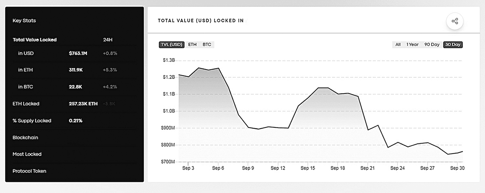

图 22.2 单个基金指数

在图 22.3 中，我们可以看到大量的资金突然消失了，并且从那时起，情况变得变得越来越糟。但所有这些钱都在某个地方，或者被用于某些事了。投资了相同项目的人最好对此感到高兴，当然，前提是他们甚至看懂了。


图 22.3 另一个单个基金

有很多讨论认为 DeFi 正在削弱银行并节省银行手续费。然而，大可以放心，大银行会参与其中的。至于加密货币，其实每当它们被购买、卖出或交易时，`somebody`都在交易中赚钱，而另一个人`somebody`则亏。后者始终是消费者。因此，这种模式与传统银行模式非常相似，只是它掌握在别人手里。然而，它是由技术（区块链）支撑的，而这种技术被严重地过度炒作和误导了，在写本文时情况依然如此。`Blockchains`并没有什么神奇之处，甚至没有特别聪明的地方。它们仅仅是一种数据收集和采集方法，由软件实现，而这些软件本身运行在传统的计算机硬件上。认为它是分布式的因此是匿名的这种想法是荒谬的。`Someone`清楚地知道一切发生在哪里以及是如何连接的。那将是试图向你销售区块链相关产品的公司。认为由于用户必须注册但可以匿名注册所以它是可赖的这种想法也是荒谬的。你将与完全不了解的人打交道。如果你想与你认识并信任的人打交道，你已经可以做到了。所以，根本就不需要这个东西。

在`Blockchain`环境中管理`PKI`可能是一场噩梦，这取决于谁拥有它（千万不要就相信那些暗示`you`拥有它的炒作，你并不拥有）。如果供应商欺骗了你，而实际上，所有硬件都归他们所有，且节点数量比他们引导你所相信的要少得多（这很可能是事实），那么他们至少可以在他们自己的基础设施上管理一个合理的`PKI`。另一方面，如果它确实是分布式架构，掌握在许多人手中，那么我们就有了问题，因为需要有人`someone`对`PKI`承担总体责任。预计每个`Blockchain`实际上都会有一个领先组织负责其 IT 和相关的`PKI`。他们可能是发源者。在这种情况下，管理`PKI`真的取决于他们。如果他们建立了一个动态移动的、类似“比特流”的可能节点网络，这些节点在特定时间点可能上线或离线，那么他们将需要一个同样动态的`PKI`来追踪虚拟网络中的此类变化。这是另一个领域，对于许多人来说，他们将倾向于回到微服务、`kubernetes`和服务网格，并在其之上叠加`Blockchain`环境。这一切确实变得非常复杂，而且都是没有必要的。

如果人们想要一个对定义用户组只读的事务数据库，且其数据经过加密和签名，完全可以使用开源组件或专有系统来构建这样的数据库。在这样的数据库上，可以构建自定义视图来决定谁可以看到什么，同样可以锁定表进行只读快照（这比使用`Blockchains`简单得多），并且从底层数据生成几乎你能想象到的任何报告。此外，你可以在这种模型上实施强有访问控制。如果数据库需要从多个源抓取数据，你将确切知道这些源在哪里，因此能够围绕整个系统构建一个稳固的`PKI`。当然，你也可以将其直接链接到支付结算中心。所以，为什么我们需要其他东西呢？我们不需要。但许多伦理存疑的人正通过`Blockchains`、加密货币和`DeFi`赚大钱。而这些人并没有真正在考虑`PKI`。在这种情况下，这会让你的交易面临更大的风险。如果你参与了这些倡议中的任何一个，请务必是谁在负责`PKI`。如果一小群个人或组织决定建立这样的网络，那么最好的办法是他们使用开源产品自己构建，并作为架构设计的一部分，指派参与的方之一负责`PKI`。该方随后必须熟悉网络上的每一个节点，了解其证书存储库在哪里，并且如果组中的人都对自签名证书的概念表示赞同，则建立一个企业证书权威和一个证书管理数据库，从那里对所有人进行管理。如果涉及到 Web 界面，则有必要使用第三方提供的证书。或者，也可以简单地购买`Blockchain`技术供应商的服务，并相信他们会某种方式为你管理这一切。然而，这将是昂贵的，而且从其本质上来说是不安全的。

## 总结


在本节中，我们快速地接触了`Blockchains`、加密货币和`DeFi`的世界。这些都是目前金融行业需要警惕的因素。更有可能，它会拥抱底层技术并试图对其进行限制。然而，底层技术是有缺陷的，特别是在这个领域，很少有人真正考虑建立一个稳健的`PKI`。对于消费者来说，涉足这个领域等于在雷区行走。许多人正被收割，欺诈横行。这种情况可能在几年后才会好转。那时，我们可能已经失去了与许多传统金融行业实体的接触机会。这一因素应该被认真考虑，包括银行自身，他们将寻找一种参与到更广泛模型的方法。

# 第 23 章 PKI 与政府立法

## 确保立法兼容性

DOI: [10.1201/9781003360674-23](https://dx.doi.org/10.1201/9781003360674-23)

在试图理清公密钥基础设施（`PKI`）政府政策，或者国家可能实施何种类型的`PKI`时，寻找一个起点并不总是那么容易。大多数国家都有安全机构，这是一个很好的起点，因为他们至少对`PKI`的工作原理有良好的理解，而且如果你能找到的话，他们可能有一些记录详尽的指南。

## 英国

在英国，`National Cyber Security Centre`（国家网络安全中心）对于建立私有托管的`PKI`提供了一些优秀的指导。它还就如何使用所讨论的各种原则提供了建议，包括警告和设计权衡。对于首次建立`PKI`或仅想检查自己对该主题思考的人来说，这是一个极佳的资源。此外，在英国，`HM Land Registry`（英国土地注册局）也就其运营的`PKI`提供了一些指导和通用信息。这些内容在多大程度上适用于独立机构，由他们自行决定，但那里有一些很好的背景信息。

同样在英国，`NHS`（国家医疗服务体系）拥有一系列与各种声明和政策文件相关的相当简短的指南，但必须注意的是，指的是`NHS`的政策，而不是英国政府的政策。随机选取的这些政策文件之一，到为止已经过 26 次修订。这告诉我这里有些不对劲，可能是由于`NHS`与第三方供应商合作，而这些供应商正在游说以确保他们的特定产品符合要求。无疑，通过研究这些文件和指南，人们会觉得它们是不必要的冗长，而且事实上并没有提供太多信息。尽管如此，他们至少知道什么是`PKI`。`Ministry of Justice`（司法部）有一些指南，其中充满了指向`Internet Engineering Task Force`（IETF，互联网工程任务组）文档和`Government Functional Standards`（政府功能标准）的链接，这些文件共同描述了各种标准，但没有一个定义了任何明确的政策。人们可以搜遍其他部委和部门并找到一些有用信息，但没有什么似乎是将所有内容统一在某国家政策之下，描述现在和未来应该是什么样。此外，书中并没有承认本书书中讨论过的一些新技术和实践。

## 加拿大

在加拿大，有一套已发布的指南从高层次讨论了安全性，虽然提到了数字证书，但并没有真正涉及建立、使用和管理`PKI`的任何细节。它指向许多其他文档的链接，这些文档被描述为“政策”文件，但实际上除了遵循最佳实践外什么都没说，尽管所谓的最佳实践究竟是什么，无人知晓。在“操作指导”下，提到了“`ICM Common Services CA`”，但你如何找到并访问它是另一回事。推测，如果你在相关的政府机构内部，你会知道这些事情，并能够与实际运行的内容建立接口。指南继续提到了一份应该遵守的项目列表，但它并没有实际提供这些项目。换句话说，这一切都非常理论化且政治正确，但没有细节，也没有能真正引导人们完成这一过程。

然而，转到不列颠伦比亚省（`British Columbia`），`The Office of the Chief Information Officer`（首席信息官办公室）发布了一非常好的文件，它对目的和需要遵守的标准进行了全面覆盖。太棒了，这正是人们参考所需的。值得注意的是，不列颠伦比亚大学（`University of British Columbia`）发布了一份关于加密控制的`信息安全标准 M7`。它涵盖了几乎所有内容，并有一个关于密钥管理的精彩章节，以及指向其他有趣文档的几个链接。看来不列颠伦比亚省在这一方面很到位。

转向萨斯喀彻省（`Saskatchewan`），他们有一系列政策，但我找不到任何关于`PKI`的内容。在阿尔伯塔省（`Alberta`），信息管理和技术部（Information Management and Technology department）拥有丰富的信息，包括战略规划和各种通信技术的使用。它还有网络安全战略，引用了各种更广泛的标准。然而，似乎没有什么能提供关于建立`PKI`的指导。这在后来与他们的对话中得到了证实。

在马尼托巴省（`Manitoba`），为马尼托巴法律行业（`Manitoba Legal Profession`）提供了非常好的指导，解释了如何使用`PKI`以及如何管理证书。值得赞的是，在这份主文件中清晰列出了角色和责任。太棒了，即使只是专门针对法律行业。在安大略省（`Ontario`），存在一份 114 页的文件，详细探讨了`PKI`，包括角色、责任和问责，然后转向了一份关于一切应如何运作的非常好的技术指南。这真的很好，可以作为其他地方的模型。安大略政府（`Government of Ontario`）在此背景下的成就值得祝贺。我不会遍历每一个省份，但显而易见，跨省份移动时存在差异，并且实际上没有一份进入必要细节的中央政策。加拿大是一个大国，因此在这一方面是一个有趣的案例研究。

## 美国

在美国，我们有`NIST`（美国国家标准与技术研究院），当然，它对`PKI`有很好的关注，包括实用的年度工作坊。有一文件解释了公密钥技术和联邦 PKI 基础设施（Federal PKI Infrastructure），并在适用处提供了指向各种标准的链接。在`NIST`文档的某处，你会找到设计和实施`PKI`所需的所有内容，但你可能需要挖掘得非常深。联邦记录管理（Federal Records Management）提供了数字签名文档管理的指导，这其实很好。一份关于美国联邦 PKI 通用策略框架（Common Policy Framework）的`X509 证书策略` 120 页政府文件，到为止已有 36 次修订，但它对该主题深入了一些细节，并代表了良好的指导。事实上，有很多此类文档，它们共同提供了一定程度的重叠。然而，如果一个组织希望符合这些建议和相关标准，他们最好简单地翻阅所有文档并提取他们需要的信息。在某些方面，这里的错误类型信息太多了。那些本身说得很少但指向其他文档和标准的无尽链接的文档，如果你试图设计和构建一个良好的`PKI`，真的没有帮助。一份简单的、通俗易懂的、循序渐的设计和实施指南将有用得多。美国的负责人员应该去不列颠伦比亚省看看他们是如何做的。

## 南非

在南非，存在许多份涵盖电子通信、网络安全和相关主题的文档。然而，它们大多是框架文件，描述了应该做什么，但没有说明怎么做。它们大部分非常官僚且冗长，但几乎没有传达任何技术内容。有趣的是，这些文档大部分似乎是于 2015 年写的，到 2017 年完全停止了。因此，人们怀疑该地区的电子通信安全水平。

在澳大利亚，澳大利亚服务局（Services Australia）提供了许多关于证书和公密钥基础设施（`PKI`）的有趣文档，尽管这些文档似乎主要面向医疗保健。这些文档包含了政策声明和实践声明，通常描述了这些领域内的职责分工以及负责这些事务的部门。对于更广泛的政府领域，有一份《Gatekeeper 公密钥基础设施框架》（`Gatekeeper Public Key Infrastructure Framework`），它通常描述了各项职责，特别是关于注册机构和证书颁发机构（`CAs`）。他们还有一种名为`VANguard`的工具，为其他政府机构提供服务，特别是用于验证目的。事实上，澳大利亚有许多法规，其中大多数在不同一程度上都有文字记录，并与各种标准进行交叉引用。然而，他们确实需要一份通俗易懂的指南，以便在人们实施或扩展`PKI`时提供指导。

跨过海来到新西兰，情况呈现出另一番景象。那里有一些非常优秀的文档，事实上有 12 份涵盖硬件和软件的不同政策文件。此外还有有效的`CA`证书列表、过期的`CA`证书列表以及证书吊销列表。对于部门信息安全人员来说，这是一种非常“实操”的方法，他们会感谢对他们需要理解内容的深度覆盖。目前激活的证书甚至可以打开并安装到你的本地设备上。

如图 23.1 所示，在新西兰，下载并安装新西兰政府证书到本地机器是一件简单的事情。这张证书的有效期到 2025 年。

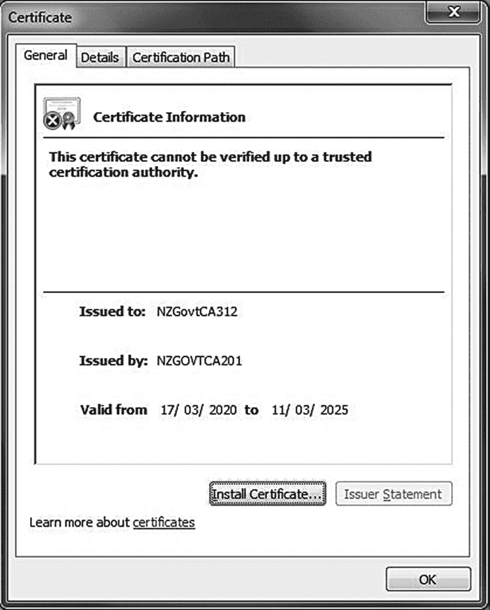

图 23.1 新西兰政府证书。

我们可以环游世界，无疑会发现政府机构内部`PKI`知识水平存在巨大差异。显而易见，在某些情况下，外部顾问仅仅被请来编写政策声明，而这些声明实际上并没有告诉你任何关于基础设施或如何与其交互的实际信息。在大多数国家，你会找到一些信息，但可能需要与内部人员交流才能获得进一步进展。如果你必须与你所属组织的政府`PKI`系统对接，他们可能会让你联系负责他们 IT 工作的人员，然后你们共同合作。很难怀疑许多政府机构是否真正理解`PKI`是什么以及它为什么对他们如此重要。这非常遗憾。新西兰政府显然理解了这一点，而加拿大列颠哥伦比亚省拥有所有地区中最优秀的文档，值得给高分。

这对于其他原因也很重要。首先，还有其他涵盖法律事务和电信的立法。在英国，2020 年通过了《电信安全法案》（`Telecommunications Security Bill`），并附有一份冗长的《影响评估》（`Impact Assessment`），其中大量讨论了成本和第三方参与。它还提到了第三方激励，而且似乎更关注谁应该在全国范围内部署`5G`网络，而不是其安全背后的细节。国家网络安全中心（`National Cyber Security Centre`）还有另一份独立报告，是对英国电信业的“安全分析”。该报告提到了可能的攻击、风险、缓解措施，甚至为威胁分析提出了一套评分系统。这些都很好，但`PKI`在何处呢？这两篇论文都没有承认`PKI`的存在，也没有承认它完全可以适用于覆盖全英国的新型、扩展的`5G`网络。要实现这一点，无疑将依赖蜂窝技术，但还需要一个由关联服务器组成的网络，它们几乎不断地相互通信。这些都需要保护。还有许多其他此类法案，从农业到教育等不如此。这种情况凸显了政府法案普遍存在的问题。它们通常由技术知识匮乏的人编写。他们理解热词和一些显而易见的安全风险，但他们并不事物实际上是如何运作的。这种情况在几乎每个国家的政府机构中都能发现。这呼应了行业的情况，即组织简单地放弃了并将 IT 及相关资产交给了巨大的第三方公司，而这些公司当然在鼓励他们这样做。但`PKI`是重要的，它对政府来说也应该是重要的。合适的政府机构（可能是与 IT 服务合作的安保部门）应该负责所有与`PKI`和证书相关的事务，并应拥有清晰、无歧的指导文档，解释其他机构可以轻松吸收的所有内容。这样，他们就能处于有利地位，来构建自己的、合规的`PKI`。每个政府或许都应该有一个专家团队，就像本书书之前讨论的核心`PKI`团队一样，可以为其他机构和部门提供建议，并提供他们所需的任何帮助以将局面纳入控制。我们需要一套清晰的政策和程序。我们需要一个可重复、稳固的架构。我们需要拥抱开源模型并使用经过证明的基础组件。我们需要规划。我们需要从混乱中建立秩序。

## 总结

本节简要回顾了政府和政府机构如何看待`PKI`。在他们的信息档案中通常会有关于`PKI`的内容，但通常是非常泛化的，对于试图实施或替换`PKI`的人来说帮助不大。那里有大量的交叉引用，往往伴随着失效的链接，显然，编写文档的人有时对该主题缺乏真实知识。他们躲在政治正确的术语和更多的链接后面，但实际上并没有告诉你任何信息。正如所提到的，存在一些例外，但通常情况下，信息层次太高了。他们需要放下政治，关注务实。这样，他们才能真正为他们代表的国家的共同利益服务。目前，政府立法在这一本处于议程高位的问题上显得欠缺。

# 第 24 章 后果 当一切都搞砸时会发生

DOI: [10.1201/97810033674-24](https://dx.doi.org/10.1201/97810033674-24)

故障可能发生在任何 IT 系统中，无论是硬件、软件，还是由于某些未预料的用户界面问题。公密钥基础设施（`PKI`）系统也是如此，但此类系统故障的后果可能是戏剧性的。首先，让我们考虑可能的故障原因。以下列举了一些：

1. 证书过期。可能是最常见的错误。数字证书有有效期，当证书过期时，访问该特定证书的服务会产生反应。

2. 证书位置错位。在某些情况下，由于某种原因，证书不在它应该在的位置，或者至少看起来不在应该的位置。例如，证书可能在签发后存储在了错误的目录位置。也许它被放置在了认为是证书主目录的地方，但实际上它需要在应用程序的目录结构内。

## 3. 系统地址更改

这种情况对于那些使用云端`container`模型进行构建并部署的服务及应用程序尤为适用。虽然服务网格或专用的证书管理系统应该避免此类情况发生，但有时某些类型的自动化负载均衡或对容器本身的操作会导致证书与错误的系统地址对齐。

## 4. 证书吊销列表管理不当

这可能导致异常证书出现，或者导致证书在不应该被拒绝的情况下被拒绝。

## 5. 假设自签名证书会被第三方系统接受

这在容器集群中创建了多个构建版本可能很常见，在原本应使用商业签发证书的情况下，却混入了一个自签名证书。

## 6. 硬件故障

服务器或服务器卡可能发生故障，导致`i.p. address`实际上停滞。这反过来可能会影响许多直接或间接与该特定服务器关联的证书。

## 7. 软件故障

如果底层软件应用程序故障，可能会导致多个证书之失效。取决于恢复应用程序时采取的措施，相关的证书可能会变得混乱，导致连接的应用程序可能难以有效工作。

## 8. 服务故障

在基于微服务的环境中，服务的数量可能非常大，无疑有数千个甚至几十万个。这些服务中的大多数都关联有一个证书，并与其他服务交互或在更高的应用层面进行交互。当其中一个服务故障时，可能不会立即显现，但可能会产生更广泛的影响。

## 9. 证书管理系统故障

这种故障最初可能是难以察觉的。例如，如果此类系统因为软件漏洞导致运行异常并错误地分配了证书，可能一段时间内都不会被注意到。当发现时，可能需要花费大量精力进行清理，因为系统的清单快照与运行现状已经变得不同步。

## 10. 云原生故障

这是一个有趣的可能性。拥抱了云原生哲学的组织必然改变了他们设计、开发和部署的方式，不仅针对服务和应用程序，还针对与其特定 IT 模型相关的整个架构。问题在于，这种宏观图景很少有一个单一视角，而且当它出现问题时（这注定会发生），可能会剧烈地影响组织的 PKI。如果容器集群发生错位、服务网格失效、或者另一层无法正常连接，或者负载均衡失败，一切可能在瞬间变得混乱不堪。此外，由于一切都在云端，组织将不知道事情实际位于何处。他们认为自己已经构建的东西最终看起来可能大不相同，特别是当多个开发者被投入到工作中并被鼓励进行构建和重建时。他们会认为自己是安全的，因为一切都已放在公共的服务目录/存储库中，但由于存在许多层和附加服务是虚拟而非真实的（如在你自己的硬件基础设施中实现的），因此错误的发生可能性是巨大的。

人们可以继续并几乎无限地扩展这个列表，但可以概括为：在商业规模的 IT 基础设施中，完全可能出现以某种方式影响组织 PKI 的故障，甚至说这是很有可能的。正如所有此类情况一样，人们需要意识到这些可能性并制定一些应急预案。此外，我们不能仅仅依赖自动化应急措施，因为这并不总是有效。我们需要积极监控状况，并对任何给定的事件有一系列可能的解决方案。

## 故障的影响

现在，让我们关注故障可能产生的影响。这些影响可能比最初想象的要深得多，程度从轻微的困扰到彻底的灾难之间不等。这一现实是另一个原因，即对于大型 IT 基础设施来说，一个专业且经验丰富的 PKI 团队是真正必要的，无论它是如何部署的。过去人们认为证书主要影响网络浏览器，因此故障并不真正重要。然而，这一论点有两个缺陷。首先，这不仅仅是网络浏览器的问题，而是涉及任何机器之间的通信；其次，网络浏览器已成为大多数应用程序几乎无处不在的入口。考虑一个简单的财务交易，例如用户支付律师的账单。通常情况下，用户将从主站重定向到一个特定的`secure payment portal`。这涉及到握手和对两端证书的检查。然后，客户引用和发票引用将进行验证。这需要引用另一个数据源，并伴随相应的握手和证书检查。完成在线支付表单后，用户将被带到第三方支付结算功能——这是另一次握手和证书检查。结算中心随后将引用客户银行。将进行另一次握手和证书检查，银行可能会进一步验证，这需要通过另一个握手和证书检查来账户持有人数据库。如果这些任何一个证书检查失败（原因包括上述的任何一种），交易将失败。我亲身经历过这种情况，并能清楚地看到问题出在哪里。

对于单一的私有交易，通常会有解决问题的方法。在给出的示例中，用户可以给律师打电话安排其他方式支付。但假设这是一个大型银行，每小时都可能发生数千笔交易呢？如果其中一个主证书发生故障或从视图中消失会怎样？在发现并修复这些问题之前，可能已经造成了巨大的损害，形式为错失的付款，这些付款现在必须重新安排，因为因为涉及的其他方会认为交易已经完成。他们都需要被联系，并告知他们交易实际上并没有完成，现在需要重新提交。这项工程的成本是巨大的，不仅体现在时间投入上，还体品牌损害和对托管组织信任的丧失上。

考虑另一种场景，这次是一个航空公司订票系统。同样，从主网站到由航空公司自身及第三方运行的子网站，将会有多次交接。航空公司需要引用自己的客户数据库、机组组和航班信息，可能还需要一个独立的`cargo`或货运系统或`baggage handling system`，在许多情况下，它还会使用第三方预订系统，所有这一切都需要握手、证书交换等。在这些证书中，只需要有其中一个失败，整个交易就会失败。与平板电脑和手机手机等客户端设备的通信可能会使情况变得更加复杂，因为这些设备实际上可能会传递错误信息。客户可能会变得困惑，或者去一趟他实际上并没有预订的航班。再次，将花费大量时间来理这一团乱麻，但更大的代价将是该相关航空公司的声誉。


我们可以梳理大量的业务和商业案例，在这些案例中，`PKI` 的失败会导致一切陷入停滞。在这种情况下，恢复局面的能力将取决于专业的 `PKI` 团队的专业知识和经验（假设有这样一个团队的话）。无论如何，这将是一次令人不安的经历，在极端情况下，可能会导致一个组织陷入完全停滞。恢复成本可能超过组织所能承受的范围。即使在技术上恢复了，也会导致信任丧失和声誉受损，而这种影响将持续很长时间。人们总是先记住出错的地方，后记住做对的地方。

这种声誉的损失对于商业零售商来说可能是特别破坏性的，因为他们的品牌和形象对其成功至关重要。如果他们被阻止营业，也许可能是因为与支付提供商的链接中断，导致他们无法解决信用卡或手机关联销售问题，这可能会产生极其严重的影响。如果他们恰好是销售新鲜农产品的零售商（例如蔬菜），那么他们还面临着库存积压不得不处理库存的额外风险。如果他们是位于城镇关键位置的主流零售商，其财务影响也可能是巨大的。对于任何基于交易的情况也是如此，从出租车服务到可能需要交叉引用其他系统的医院入院服务。

另一个非常真实的可能性可能由软件开发人员本身触发，特别是当他们关注具有安全上下文的应用程序时。`IT` 和 `IT Security` 的建议和最佳实践多到数不完。在该领域工作的人可能会注意到某些看起来不合规的地方，并因此对代码中直接或间接与证书相关的部分进行更改。例如，他们可能会重写一段代码，却完全忽略了之前的代码正在调用外部证书这一事实。或者，他们可能会亲自干预证书，也许是为了尝试对齐过期日期，导致某些证书比预期更早过期。`首席信息安全官`（`CISO`）角色带来了大量关于合规、安全和灾难恢复的建议，这些建议可能不会传给那些实际上创建容器和相关代码的人。此外，正如之前提到的，`container clusters` 和 `microservices` 越多，它们就越不可能被妥善记录。有人可能会认为它们几乎是自文档的，这其中确实是有道理的；尽管如此，在 `DevOps` 模型下，它们的变化可能会非常快。如果这一切变得一团糟，并且证书开始失效或无法被识别，那么后果将不堪设想。

这一切由于目前对云原生方法论的狂热而被大大加剧，而这种倾向反而模糊了问题。那些足够智慧维护自己的物理基础设施的人，将对自己的 `PKI` 拥有更好的控制力。此外，如果他们采纳了本文提倡的开源模型，他们将拥有绝对的控制权，包括对源代码的控制权，而且对他们自己几乎没有成本。此外，采取这条路线是真正学习 `PKI` 的绝佳方式，可以深入到每一个细节。它将能够与第三方证书提供商建立稳健的连接，并对何时使用自签名证书、以及每个证书的位置、到期日期等有绝对清晰的认识。此外，如果发现外部问题，可以迅速将其标记出来——这反过来也有助于对方（无论对方是谁）。考虑到证书和 `PKI` 失败的影响（此处仅提供了其影响的冰山一角），前行的道路似乎是显而易见的。

## 总结

已经解释了与 `PKI` 相关的失败可能且往往会造成严重后果。在提供的可能原因列表中，作者故意忽略了恶意原因，例如故意操纵代码或伪装成合法身份的证书（实际上它们是伪造的，并可能欺骗系统显示本应隐藏的信息）。当然，存在一群黑客和其他人，他们似乎所做的事情就是故意攻击 IT 系统，无论是企业还是政府的。如果这些人发现了一个薄弱且实现不当的 `PKI`，他们无疑会利用由此提供的机会。

一些机构和学术小组已经编制了与 `PKI` 相关的攻击和中断列表。下方提供了其中一个摘要：

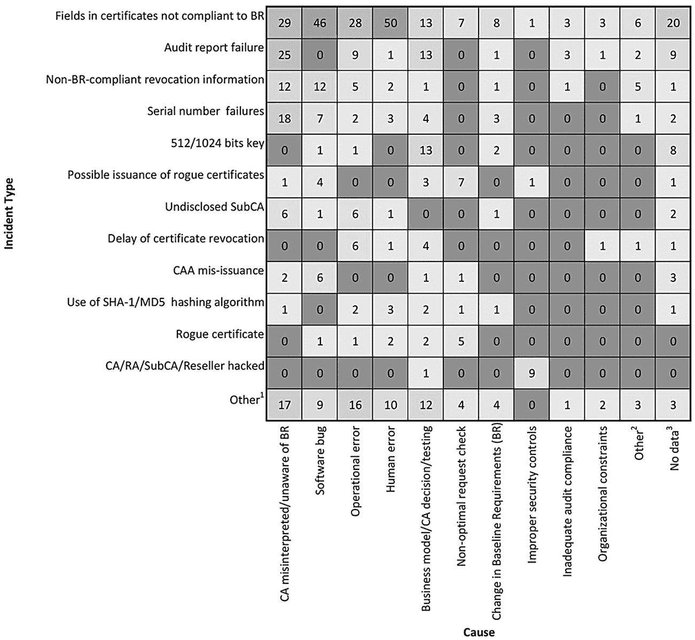

*J Cyber Secur*, Volume 7, Issue 1, 2021, tyab025, [`doi.org/10.1093/cybsec/tyab025`](https://doi.org/10.1093/cybsec/tyab025)

然而，归因于 `PKI` 失败的许多（如果不是大多数）故障将永远不会被报告，因为组织不希望暴露它们遭受了本可以避免的失败这一事实。对于偶尔面临严重问题的证书颁发机构来说也是如此。这也是这本书重要的原因之一。我们不能假设所有技术都是好的，也不能假设方法的改变一定是有帮助的。关于这个主题的最后遗言必须是另一次恳求：拥抱开源模型，学习 `PKI` 到底是如何工作的，使用开源工具，并任命一个内部专家团队来为你管理一切。并警惕云。它们有时会向你身上下雨。

# 结语：总结

DOI: [10.1201/9781003360674-25](https://dx.doi.org/10.1201/9781003360674-25)

祝贺读者读到这里，这是对公密钥基础设施（`PKI`）的一个颇具争议的视角。人们可能期望这样一本书会简单推广所有的现有技术。它会深入探讨 `PKI` 细节的细微之处。它会提供无尽的例子和案例研究。它甚至可能包含让不幸的读者一个接一个完成的练习题。是的，所有这些可能被预料，但为了什么呢？这有什么用呢？它只是对以前写过的一千次内容的重复。如果有人对该主题的毫无意义的论文感兴趣，可以访问几乎任何技术提供者的网站，甚至是上一章中描述的某些政府部门。它们是无穷无尽的。人们可以在其中深及腰地行走几英里，在晚上梦到它们，在会议和研讨会上站起来引用它们。但这一切都是无用功。这个主题将不会被更好的理解，人们仍然会像羊一样追随那些推广无意义技术和愚蠢想法的人。只要这些信徒们还有新的流行术语，他们就会一直追随大群，害怕被视为具有独立思考的能力。不理性的能力。不理性推理的能力。不人类智慧的能力。

是的，这本书是不同的。这种不同是理直气壮的，因为它试图揭露一些荒谬，揭露神话和半真半假，并关注我们应该做什么以及如何做。有些人可能会失望地摇头，因为我没有在不加思考的情况下接纳所有最新的技术理念。有些人可能会质疑为什么我没有简单地跟随他人并重复所有好听的流行术语，或者推广实际上违背公共利益的技术。有些人会感到震惊，因为我没有接纳那种正在破坏我们许多社会和文化的中心化、全球化和自动化模型。事实上，它正在侵蚀文明的根基。这些话严厉吗？是的，我们需要它们。我们需要更多关于如何正确地、为了人类而使用技术的话语。

# 传统 IT 开发 vs 现代趋势

在传统世界中，修订或新开发 IT 应用程序的需求来自业务部门，且通常是在经过仔细考虑后提出的。这些需求会与合适的 IT 项目团队进行讨论，该团队对这一特定的业务领域熟悉。通过这些讨论将制定出一份设计规范，并由相关的业务部门进行进一步的讨论和批准。一旦确定，这本设计规范将交给开发团队，他们将进行必要的编码以生成完成的应用程序。随后，该应用程序将由 IT 运营团队在测试环境中进行严格测试，该测试环境是生产环境的完全副本。如果任何部分运行不完美，它将被返回给开发者。只有在经过详尽测试后，应用程序才会展示给相关的业务部门，希望能获得他们的批准。一旦获得批准，应用程序就会移动到生产环境，而且当然，它将完全按照预期运行。

如果你觉得这个过程听起来漫长而冗长，请相信这并非如此。这一切在同一周内发生，或者最多两三周内完成，并不罕见。但是，这个应用程序可能会使用多年。从现实来看，这实际上非常高效。此外，由于这种方式构建的应用往往不会崩溃，它增强了业务部门（来自其客户）和 IT 部门（来自业务部门）的信心。如果出现了似乎有价值的新技术，例如 `Linux` 的出现，那么这些技术将受到 IT 部门非常仔细、深入的评估，如果认为潜在有用，将进行详尽的测试。然后，再次测试。接着，它们将在测试环境中使用一段时间。只有当出现明显的机会时，它们才会在生产环境中使用。这是引入任何真正有价值技术的稳妥方法。

## 对 DevOps 的批判

这本该是这样的。多年来（在良好的组织中）事情一直是这样运作的，每个人都很愉快。那么为什么要改变一切呢？贪婪。贪婪和直接的腐败。为了强推采用没有人要求、想要或需要的技术，个人作为报答得到了“关照”。`DevOps` 也是如此。整个想法都是愚蠢的。试图将开发团队和运营团队合并是不切实际的。他们真正的意思是摆除任何正规的 IT 运营和测试，将一切交到开发者的手中。其暗示是开发者拥有必要的技能和直觉，能够直接与业务部门联系。他们并没有。他们有完全不同的心态和思维方式。特别是年轻的开发者，在这方面会被发现严重欠缺。他们不是在理解和听取业务部门的需求，而是简单地根据他们玩过的技术玩具向业务部门“推销”新想法。许多政府机构和其他组织就是这样被骗去使用 `cloud`，并用一个他们一无所知的设施替换了原本完好的内部基础设施。这降低了成本吗？没有。这让他们的生产力提高了吗？没有。当然没有，因为他们生产力的衡量将来自他们内部拥有的技能和方向，而不是技术。然而，结果是，他们的成本都急剧上升，而且，这些成本将年年地伴随他们。永远如此。为什么要将自己的、经过验证的基础设施（以及其中包含的知识资产）复制或替换为你不认识的人（可能在世界上完全另一个地方）管理的设施？这真的有意义吗？不，没有意义。再问问那个路过的五岁小孩。现在，组织可能会裁减其 IT 员工，并遭受技能流失的剧痛。它在工资和社保上节省的成本，将由于其能力上的损失所无法比拟，再加上采用这种模型带来的直接且持续的成本。

## 技术技能的侵蚀

这就是书中前面提到的所有其他技术变得重要的意义所在，因为像 `cloud` 一样，它们中没有一个能提供真正的运营优势。它们都引入了显著的成本。

因此，站在这种技术二元对立之上，我们有了 PKI（公钥基础设施）。一方面，它可以很容易被管理并保持良好秩序；另一方面，它会变得混乱、昂贵且可能崩溃。你倾向于哪种？如果是前者，那么你需要重新获得对 IT 资产的控制权，并将它们带回内部。如果你仍然将它们都保留在内部，那么你已经领先了一步。这时，你需要了解你现有的 IT 架构正在发生什么。对于每一台服务器，你都需要精确地知道哪些证书存储在何处以及为什么。如果你正在使用 Linux（你应该这样做），会有特定的定义位置让不同的 Linux 发行版存放其证书库，但这些位置很容易找到的。此外，某些应用程序可能有自己的证书，并存储在自己的文件夹中。这些也需要被识别出来。以此类推。一旦每一张证书都经过记录并列在证书数据库中，就可以检查它们的属性，并确保它们符合你定义的任何标准。当然，需要管理它们的到期日期，并在合理且可行的情况下进行自动续期。以此类推。核心 PKI 团队的活动在本书的其他地方已经有了详尽介绍。如果你使用自己的基础设施，由自己的人管理，并且他们理解你组织的运营，那么这一切都是简单易行且易于持续管理和支持的。

另一方面，如果你将一切都留在云端，并决定拥抱微服务、容器、服务网格和插件方法，那么，祝你好运。你将实际上失去对 PKI 的控制，并毫无疑问地最终将依赖第三方——无论好坏，他们都会将一切自动化，而你将面临故障和停机。此外，你将为这种特权付出昂贵的代价。尽管如此，你可以放心，你将是政治正确的，并且在供应商们互相祝贺*他们*辉煌成就的会议上，你可以理直气壮。但这绝然是夸大其词吗？那些供应商拿出的“案例研究”又是怎么说的？这些案例展示了人们如何将成本减半并让利润翻倍。那么，究竟是谁在代表那个所谓的“案例研究”呢？IT 总监？高级开发人员？无论是谁，他们一定都受到了供应商的“影响”。我见过太多次了。他们那些荒谬主张的证据在哪里？他们向你展示了组织的资产负债表和年度账目吗？那么诸如组织信心、留存客户或员工福祉等无形资产又如何呢？有多少组织因为 IT 方面的不当做法而陷入困境。外包和云的使用，在微服务、容器和服务网格的加剧下，摧毁了许多曾经优秀的、为他们代表的组织良好工作的 IT 部门。我曾近距离观察过这一切，并理解所有的迹象。

但这是一本关于 PKI 的书，所以为什么要提这些其他因素呢？因为 PKI 支撑了其中的大部分内容。PKI 是重要的，如果组织要以负责任的方式行动，它们必须花时间和精力正确地理解 PKI。为了做到这一点，他们还需要理解广泛的 IT 蓝图。在收集*这种*理解的过程中，他们可能会发现一些真实的恐怖故事。如果可能的话（甚至极有可能），他们还会发现公开腐败的迹象，并且几乎肯定缺乏尽职调查。这反过来会影响安全。包括广为人所知的网络安全，以及涉及相关组织知识产权和资产的安全。后一个因素可能以多种方式表现出来，而为了理解组织 PKI 所采取的过程可能会揭示其中的一些。因此，你发现，PKI 本身很重要，它还可以被用作工具，以重新获得对组织 IT 及相关资产的适当控制。在此过程中，你将有机会定义合理的策略、流程和程序，这些程序反过来可能会被所有人员采用。最终，你的组织将成为一个更强大、更有自信的实体，拥有更快乐、受过良好且忠于组织的 IT 人员。这并不困难。敌人是傲慢、无知、贪婪和腐败，不幸的是，它们无处不在。然而，一旦意识到这一点并采取适当措施来对抗它们，那么任何目标都可以实现。

还有别的吗？有的。拥抱开源模型并使用免费的开源工具，与专有产品不同，开源工具拥有丰富的文档，以及许多乐于分享实战经验的人士。如果你遵循这条道路，你将拥有绝对的控制权，并知道一切在哪里以及一切是如何运作的。此外，桌面开源产品现在已经发展到完全实用的程度，并且通常比同类的专有产品更稳定，拥有你梦寐以求的所有桌面应用程序。事实上，只要有意愿，完全可以使用完全免费的开源产品来运行整个组织。这其实很简单。再去问问那个五岁的孩子吧。作为一包糖果的交换，他们可能会和你进行 30 分钟的思想交流。这将是你投资过最值的 30 分钟。

## 总结

好了，结语提供了当前某种混乱的 IT 蓝图的快照。这是一个处于变动中的蓝图，因为新的想法和技术正以极快的速度席卷而来。速度快到许多人无法跟上。但他们当初为什么要觉得有义务跟上呢？这一节表明，跟上并不总是个好主意。技术倡导者所做的承诺在实践中并没有实现。对许多人来说，最终结果是，为了做他们在开始前所做的事情，成本大幅增加，而现在，他们还失去了对事物的控制。这确实不合逻辑。对于 PKI 而言，追随“皇帝的新衣”只会让问题复杂几个数量级。在很多情况下，本书的核心信息是谨慎行事，不要相信激进供应商的未经证实的说法。相反，要保持或重新获得对 IT 的控制，并以衡量应用 PKI。如果你采用免费且文档良好的组件，这一切将非常简单。事实上，它们还为你的内部 IT 人员提供了坚实的实训平台。如果你需要更多 IT 人员，去招聘他们吧。周围有很多才华横溢的人会成为你的福音。我衷心祝愿你的事业顺利。

**Julian Ashbourn**

Berkhamsted，2022 年 6 月

# 索引

*   学术, 1, 9, 10, 12, 15, 40, 41, 131
*   责任制, 6, 84, 125, 126, 127, 128, 148
*   收购, 12, 49, 113, 119
*   管理员, 32, 138
*   代数, 30
*   `algorithm`, 2–4, 9, 15, 19, 21–24, 29, 30, 35, 54
*   `Ansible`, 13
*   `APIs`, 50
*   `application`, 11, 12, 14, 15, 17–20, 24, 25, 29, 30, 32, 33, 36, 39, 41, 42, 45–50, 59, 61, 62, 68, 69, 73–75, 79, 84, 86, 87, 90, 100, 102, 103, 110, 116, 117, 121, 130, 132, 133, 135, 153, 154, 162, 163
*   `array`, 59
*   `asymmetrical`, 2, 15
*   `authentication`, 10, 22, 34, 37, 49, 149
*   `authenticity`, 21
*   `automation`, 13, 14, 48, 49, 63, 75, 77, 80, 81, 130, 133, 134
*   `awareness`, 73, 74, 89
*   `BANTAM`, 33, 36, 38
*   `BASH`, 100
*   `biometrics`, 1, 5, 33–38, 54
*   `Blockchains`, 138, 144, 145
*   `ciphers`, 1, 27, 28, 99
*   `client`, 4, 9, 12, 13, 16, 17, 22, 31, 40, 55, 59, 60, 66, 67, 79, 80, 99, 100, 155, 156
*   `cloud`, 5, 6, 9, 13–15, 19, 32, 41–43, 45, 47, 48, 50, 52, 55–57, 59, 61, 62, 69, 72, 75, 85, 102–107, 110, 115, 117, 126, 129–135, 153, 154, 157, 158, 163, 165
*   `cluster`, 54–57, 153
*   `code`, 10, 13, 19, 27–30, 33–35, 39–41, 45–47, 51, 52, 59, 60, 68, 72, 77, 91–93, 97, 98, 100, 103, 107, 115, 117, 132, 156, 157, 158
*   `codes`, 1, 28
*   `communications`, 1, 3, 4, 7, 17, 50, 54, 68, 105, 107, 110, 111, 115, 120, 122, 134, 148, 149
*   `complexity`, 46–52, 59, 78, 81, 104, 105, 116
*   `computers`, 2, 3, 7, 9–11, 18–19, 28, 34, 59, 60
*   `containers`, 3, 5, 13–15, 19, 39, 40, 43, 45–50, 51, 52, 54–57, 68, 72, 75, 85, 101–105, 115, 117, 130–135, 138, 153–154, 157–158, 162–163, 165
*   `CPUs`, 11
*   `cryptographer`, 28
*   `databases`, 10, 11, 39, 59, 60, 100, 110, 138
*   `debugger`, 40
*   `decentralised`, 16, 137
*   `deciphered`, 1
*   `decommissioned`, 86, 110
*   `decrypt`, 2, 15, 19, 30


# 索引

- `Delphi`, 12, 13, 39–41, 43, 46, 47, 48, 51, 52, 59, 61
- `development`, 1, 5, 6, 12–15
- DevOps, 47–49, 51, 52, 56, 57, 59, 61–63, 68, 70, 71, 72, 74, 75, 101, 102, 104, 105, 113, 115, 116, 126, 132, 133, 135, 157, 162–164
- 目录, 9, 11, 17, 35, 40, 55, 62, 65, 80, 91, 96, 97, 98, 153, 154
- 发现, 14, 81, 86, 90, 91, 120, 139
- 颠覆, 1, 43, 164
- 发行版, 11, 12, 98, 165
- `DLL`, 46, 49
- `Docker`, 13, 103, 104
- 文档, 6, 13, 36, 52, 59, 74, 100, 113, 114, 120, 149, 151, 152, 166
- `EASYRSA`, 17, 18, 55
- `EJBCA`, 91, 96, 100
- 电子邮件, 3, 4, 8, 10, 15–17, 30, 31, 54, 60, 65, 73, 80
- 加密, 1–5, 7, 10, 15, 16, 21, 27–32, 34, 49, 53, 54, 95
- 间谍, 2, 27, 29, 32
- 指纹, 33–35, 37
- 防火墙, 95
- 取证法, 33
- 政府, 1–3, 5, 7, 9, 10, 12, 15, 25, 32, 35, 38, 40, 41, 46, 83, 102, 108, 113, 129, 131, 133, 135, 147–152, 157, 158, 161, 163, 164
- 握手, 12, 35, 37, 67, 69, 75, 108, 140, 155
- 基础设施, 1, 3–7, 9, 11, 14, 15, 25, 27, 29, 30, 33, 34, 39–43, 45, 47, 48, 50, 53–55, 59, 61, 63, 65, 66, 69, 71–74, 78, 83, 86, 89, 91, 92, 101–108, 113, 116, 117, 119–121, 125, 127, 131–135, 137, 144, 147–150, 153, 158, 161, 163, 167
- 继承, 39, 164
- 智能, 29, 34, 51, 131, 161
- `Interbase`, 12, 13, 39, 40, 60
- `Internet`, 6, 12, 13, 18, 20, 25, 30–32, 40, 41, 53, 54, 129–133, 135, 147
- `Istio`, 13, 51, 104
- `JAML`, 13
- `JAVA`, 12, 13, 80, 100
- `JBoss`, 100
- `Kerberos`, 4, 80
- 密钥, 2, 10, 15, 21, 29, 30, 36, 54, 95, 100, 104
- 密钥库, 25, 72
- `Native`, 13
- `Kubernetes`, 5, 45, 47, 49, 51, 52, 55, 77, 115, 133, 144, 164
- `LINUX`, 11, 12, 17, 25, 40, 61, 69, 72, 79, 80, 95–98, 100, 163, 165
- 主机, 9, 11, 25, 59, 95
- 维护, 5, 59, 61, 114
- 恶意软件, 36
- 清清单, 13, 115
- 合并, 119, 122
- 方法论, 2, 10, 19, 20, 29, 32, 47, 72, 74, 81, 116, 120, 158, 162
- `microservices`, 13, 19, 43, 45–48, 51, 69, 74, 77, 85, 101, 105, 115, 133, 144, 157, 165
- `Microsoft`, 10–12, 35, 40, 60, 61
- `migration`, 114, 120
- `Modems`, 10, 11
- `MySQL`, 100
- `network`, 4, 5, 7, 9–11, 13, 17–19, 31, 32, 35, 39, 40, 50, 51, 59–61, 66–69, 71, 79, 81, 90, 95, 140, 144, 145, 151
- `networks`, 2, 10, 11, 18, 32, 34, 36, 60, 69, 84, 107, 130
- `OCSP`, 12, 23, 91, 99
- `OpenJDK`, 100
- `OpenLDAP`, 91, 96, 97
- `openssl`, 55, 91, 96, 98, 100
- `operation`, 14, 25, 26, 46, 48, 60, 61, 68, 81, 82, 84, 86, 92, 101, 114, 119, 120, 126, 127, 133, 162, 163, 165
- `OS2`, 12
- `outage`, 40
- `outages`, 14, 41, 46, 63, 66, 72, 76, 122, 158, 165
- `outsourced`, 7, 14, 26, 41, 46, 59, 61, 63, 66, 69, 80, 132, 157, 162
- `outsourcing`, 13, 41, 46, 61, 95, 116, 131, 135, 165
- `packages`, 13, 39, 40, 43, 48, 102
- `passport`, 34, 37
- `password`, 3, 34, 73, 80
- `PEARL`, 13
- `personnel`, 6, 19, 41–43, 46, 60, 61, 72–74, 80, 81, 83, 85, 86, 89–92, 95, 97, 99–101, 103, 105, 107, 110, 115–117, 119, 121, 122, 127, 162, 166
- `phrases`, 1, 2, 27, 29, 30, 41
- `Planning`, 6, 15, 69, 95, 107, 113, 119, 123, 129, 130, 148
- `Policies`, 23, 50, 54, 57, 74, 78–80, 85, 86, 89, 105, 114–117, 120, 123, 127, 133, 148, 151, 166
- `policy`, 8, 9, 13, 23, 63, 66, 72–74, 78, 80, 117, 121, 135, 147–150
- `PostgreSQL`, 80, 100
- `procedures`, 57, 86, 116, 120, 123, 127, 133, 151, 166
- `processors`, 9–11, 59, 60, 61, 132
- `project`, 36, 39, 47, 89, 91, 93, 108–111, 114, 115, 120, 127, 133, 162
- `protocols`, 12, 32, 105, 139
- `purposes`, 8, 10, 27, 36, 49, 54, 55, 59, 61, 68, 101, 149
- `security`, 4–7, 12, 16–19, 25, 30, 34, 37, 42, 51–53, 57, 60–63, 66, 67, 71, 81, 84, 98, 105, 116, 117, 120–123, 127, 128, 131, 132, 139, 140, 147–149, 151, 156, 157, 166
- `servers`, 10–12, 14, 18, 30, 40, 42, 48, 54, 60, 61, 68, 69, 79, 80, 90, 102, 103, 114, 129, 134, 151
- `sidecar`, 50
- `SilkPad`, 1, 3, 15, 29–31
- `specialist`, 18, 19, 40, 41, 56, 60, 67, 72, 76, 78, 81, 84, 85, 89, 159
- `spreadsheets`, 11, 59, 60, 79
- `SQL`, 40, 80
- `stack`, 14, 40, 45, 46
- `support`, 14, 25, 42, 45, 52, 59, 62, 65, 66, 68, 69, 74, 77–81, 84, 86, 89, 90, 93, 100, 102, 104, 108–111, 115, 116, 120–123, 127, 135
- `symmetrical`, 2, 4, 15, 29
- `terminals`, 9, 10, 34
- `TPF`, 10
- `Trust`, 5, 18, 19, 26, 53–57, 100, 134, 138–140, 144, 145
- `TurboPower`, 40
- `UNIX`, 12, 25, 35, 40, 60, 61, 79, 100
- `VMS`, 12
- `warfare`, 1, 29
- `XENIX`, 10
- `YAML`, 52, 103, 104
