# 核心软件安全实践：参考框架（社会科学研究当代问题）


只要人类仍在编写软件，软件安全成功的关键就在于使软件开发流程更加高效和有效。尽管本教材的方法涵盖了人员、流程和技术层面的软件安全方法，《实用核心软件安全：参考框架》强调了软件安全中的人员因素，而人员因素仍然是软件在开发、控制和利用过程中需要管理的最重要部分。

本文概述了一套针对当今技术、运营、业务和开发环境的软件安全分步流程。它着重于人类如何利用最佳实践和指标来控制和管理安全的软件开发流程。尽管安全问题将始终存在，但学生将学习如何通过在开发过程中构建安全性，最大限度地提高组织在软件产品发布或部署前尽量减少漏洞的能力。

作者们曾与财富500强公司合作，并经常目睹安全开发生命周期（SDL）实践失效的案例。本文采用基于经验的方法，在处理上述问题时应用最佳可用 SDL 模型的组成部分。本书介绍了软件安全最佳实践、SDL 模型和框架。从 SDL 概述开始，本文概述了一种将 SDL 最佳实践映射到软件开发生命周期（SDLC）的模型。它解释了如何使用该模型来构建和管理成熟的 SDL 计划。练习和深入的案例研究有助于学生掌握 SDL 模型。

当今，精通安全软件开发及相关任务的专业人士需求量巨大。该行业继续经历指数级需求，并且在可预见的未来需求应将继续增长。本书对专业人士和学生都同样有益。当他们将本书的理念融入其软件安全实践时，他们对组织、管理团队、社区和行业的价值将随之提升。

## About the Authors

James Ransome 博士，PhD，CISSP，CISM 是一位资深首席信息安全官（CISO）、首席安全官（CSO）和首席生产安全官（CPSO），也是众多网络安全书籍的作者和合著者。

Anmol Misra 是一位成就卓著的领导者、研究者、作者和安全专家，在技术和网络安全领域拥有超过 16 年的经验。

Mark S. Merkow，CISSP，CISM，CSSLP 在企业信息安全领域拥有超过 25 年的经验，并在应用安全（AppSec）领域拥有 17 年的经验，帮助建立并领导应用安全计划取得成功并持续运营。


## Dedications

献给下一代防御性网络战士，他们将为世界的软件提供核心软件安全。

— James Ransome

献给致力于构建安全软件的软件安全专业人士。

— Anmol Misra

本书献给下一代应用安全专业人士，帮助他们缓解扭转有缺陷软件之诅咒的挣扎，无论这些缺陷出现在何处。

— Mark Merkow


## Contents
- 献词 v


## Taylor & Francis

泰勒和弗朗西斯集团

http://taylorandfrancis.com

## 前言

软件驱动机器的时代在过去几年中取得了重大进展。战斗机飞行员、证券交易所交易员、外科医生、工业生产和发电厂操作员等人类任务，这些任务对武器系统、医疗系统以及国家关键基础设施的运行至关重要，已被或正在迅速被软件接管。这是机器的一个革命性步骤，机器的大脑和神经系统现在由软件驱动程序控制，取代了以前需要使用人类思维的复杂非重复性任务。这导致了国家、军队、罪犯、活动家和其他对手试图破坏、修改或影响国家、基础设施、社会和文化的方式发生范式转移。即使是对公司也是如此，多年来我们看到网络企业间谍活动案例不断增加。以前使用大规模军队、昂贵且具有毁灭性的武器系统和平台、武装抢劫、实物信息窃取、暴力抗议和武装起义，正在迅速被所谓的网络战争、网络犯罪和网络活动所取代。

归根结底，网络方法可能产生与以前使用的技术同样深远的影响，因为潜在的软件漏洞利用可能导致：

- 整个或部分基础设施被瘫痪，包括电网、核电站、通信媒体和应急响应系统。
- 化工厂被改造以制造大当量爆炸和/或高度有毒云。
- 关键武器系统或平台的远程控制、修改或禁用。
- 监控系统的禁用或修改。
- 犯罪性金融剥削和敲诈勒索。
- 金融市场和投资的操纵。
- 通过修改医疗支持系统或设备、手术时间表或药品处方，对人类造成谋杀或伤害。
- 通过修改投票软件、敲诈勒索，或通过网站篡改或底层 Web 应用程序瘫痪或破坏导致品牌贬值，从而引发政治起义和特殊利益影响。

网络方法的一个副作用是，它使我们能够以前所未有的规模、距离和匿名程度，从受司法管辖权保护的位置通过远程利用和攻击完成上述操作。这使得政府、犯罪团体和活动家有能力代理主要肇事者，以避免责任、发现和政治后果。

尽管网络安全有很多宣传，但真正的阿喀琉斯之踵是（不安全的）软件，它如上所述提供了对目标进行完全控制和/或修改的潜在能力。随着我们迅速迈向这个新时代，以前被归咎于人类思维的任务正在被软件驱动机器取代，软件安全的重要性不可低估。正是出于这个原因，我们写了这本书。相比之下，在可预见的未来，软件程序是且将继续由人类编写。这也意味着新软件将继续构建在遗留代码或在安全受到重视之前，或在复杂攻击普及之前编写的软件之上。只要人类编写程序，这些程序成功安全的关键就在于使软件开发流程更加高效和有效。虽然本书的方法包括针对软件安全的人员、流程和技术方法，但我们认为，只要软件由人类开发、控制和利用，软件安全中的人员因素仍然是最需要管理的重要部分。以下是针对当今技术、运营、业务和开发环境的软件安全逐步流程，重点在于人类可以采取什么措施以最佳实践和度量指标的形式来控制和管理该流程。我们总会有安全问题，但本书应该有助于在软件最终发布或部署时将其最小化。我们希望您喜欢这本书，就像我们喜欢编写它一样。

## 关于本书

本书概述了一个与当今技术、运营、业务和开发环境相关的软件安全逐步流程。作者们专注于人类可以采取什么措施，以最佳实践和度量指标的形式来控制和管理安全软件开发流程。尽管安全问题将始终存在，但本书将教你如何在软件产品发布或部署之前，通过将安全性构建到开发流程中，来最大限度地提高组织减少软件漏洞的能力。作者们曾与财富 500 强公司合作，并经常看到安全开发生命周期 (SDL) 实践失效的示例。在本书中，我们采用基于经验的方法，将最佳可用 SDL 模型的组件应用于上述问题，形式为 SDL 软件安全最佳实践模型和框架。《实用核心软件安全：参考框架》从 SDL 概述开始，然后概述了将 SDL 最佳实践映射到软件开发生命周期 (SDLC) 的模型，解释了如何使用此模型来构建和管理成熟的 SDL 计划。

这本书既是为了您个人的利益，也是为了您的学术和组织的利益。今天，精通安全软件开发及相关任务的专业人士需求量巨大，并且我们继续看到指数级需求，在可预见的未来将继续增长。当您将这些想法融入日常职责时，您对公司、管理层、社区和行业的价值将随之增加。

尽管安全性在近年来行业构建软件的方式中并非自然组成部分，但作者们认为，开发流程的安全性改进是可能的、切实可行的和必不可少的。他们相信，本书中提出的软件安全最佳实践和模型将使所有读本书的人（包括高管、经理和从业人员）都能明白这一点。

## 受众

本书面向商业或工程学科高等教育项目的学生，以及任何有兴趣在企业环境中了解软件安全的人，包括：

- 产品安全与质量高管
- 软件安全架构师
- 安全顾问
- 软件开发工程师
- 企业 SDLC 计划经理
- 首席信息安全官
- 首席技术官
- 其公司开发软件的首席隐私官

如果您想了解如何在企业软件开发中实施软件安全，这是一本您不容错过的书。

## 支持

本书的勘误和支持可在 CRC Press 网站上获得。

## 结构

本书分为九章。第 1 章介绍软件安全主题以及为什么第一次就做对很重要。第 2 章介绍使软件安全的挑战和 SDL 框架。第 3 至 8 章将我们的 SDL 及其相关最佳实践映射到通用 SDLC 框架。第 9 章描述了如何通过应用第 3 至 8 章中提出的解决方案，成功地将我们的参考框架适应您的环境。每章包括学习目标，以及多项选择题和练习，以提供使用案例研究开发自定义 SDL 的实践操作。多项选择题的答案见附录 B。每章在逻辑上基于前面的章节，帮助您描绘出一套完整的实用步骤，这些步骤将导致安全的应用程序软件，以及能够可预测且可靠地生成高质量和可证明安全的应用程序的响应式、安全开发实践。

## 假设

本书假设读者熟悉软件开发（及方法论）的基础知识和基本安全概念。了解 SDL、不同类型的安全测试和安全架构是推荐的，但不是必需的。对于大多数主题，我们会在深入探讨特定主题之前，温和地向读者介绍该主题。


## Taylor & Francis

Taylor & Francis Group

http://taylorandfrancis.com

## 致谢

我要感谢多年来与我共事并继续宣扬“网络安全必须从源头（即软件）抓起”的所有团队成员、合作伙伴、协作者和合著者。我也要感谢 Anmol 和 Mark 与我合作撰写本书，以及 Taylor & Francis Group 和 Derryfield Publishing Services 将此项目带给我们。

— 詹姆斯·兰索姆

我要感谢多年来支持我的每一个人。我也要感谢 Mark Merkow 与詹姆斯·兰索姆和我合作撰写本书。我还要感谢 Taylor & Francis Group 和 Derryfield Publishing Services 团队对手稿的帮助。

— 安诺尔·米斯拉

我无法充分感谢詹姆斯和安诺尔给予我参与本书编写的绝佳机会——这既是荣幸，也是乐趣！

我也要感谢 Taylor & Francis Group 和 Derryfield Publishing Services 的团队，能有机会与业内一些最优秀的专业人士合作！

— 马克·默科


## Taylor & Francis

Taylor & Francis Group

http://taylorandfrancis.com

## 关于作者

詹姆斯·兰索姆博士 (PhD, CISSP, CISM) 是 CYBERPHOS 的首席科学家，CYBERPHOS 是一家早期阶段的网络安全初创公司。他还是旧金山湾区首席安全官委员会的董事会成员。

最近，詹姆斯担任英特尔产品保障与安全部门 (IPAS) 的安全开发生命周期工程高级总监。在此职位上，他率领一支由 SDL 工程师、架构师和产品安全专家组成的团队，在整个公司推动并实施安全实践。在此之前，詹姆斯曾任英特尔安全（原 McAfee）的产品安全和 PSIRT 高级总监。

詹姆斯的职业生涯涵盖私营和公共部门的领导职位。他曾在应用材料公司、Autodesk 和 Qwest Communications 担任三位首席信息安全官 (CISO)，并在 Pilot Network Services、Exodus Communications、Exodus Communications—Cable and Wireless Company 以及 Cisco 协作软件部门担任四位首席安全官 (CSO)。在进入企业界之前，他在政府部门工作了 23 年，支持美国情报界、联邦执法机构和国防部。

詹姆斯拥有信息系统博士学位 (https://nsuworks.nova.edu/gscis_etd/790/)，专攻信息安全；信息系统理学硕士学位；以及国际商务和国际事务研究生证书。他曾在新东南大学计算机与信息科学研究生院 (SCIS) 信息安全项目担任兼职教授，教授应用密码学、高级网络安全和信息安全管理。该研究生院被美国国家安全局和国土安全部指定为信息保障教育学术卓越中心。

詹姆斯是认证信息安全经理 (CISM)、认证信息系统安全专业人员 (CISSP) 和波蒙研究院杰出院士。

他撰写或合著了 14 本网络安全相关书籍，目前正在撰写第 15 本。

— 詹姆斯·兰索姆

**安诺尔·米斯拉** 是一位成就卓著的领导者、研究人员、作者和安全专家，在技术和网络安全领域拥有超过 16 年的经验。

他的工程、安全和咨询背景使他独特地适合推动颠覆性技术的采用。他是一位团队建设者，专注于指导和培养高潜力领导者，追求卓越，并建立行业合作伙伴关系。他以务实的安全方法著称。

作为基础设施安全高级总监，安诺尔负责 Autodesk 的云和信息安全。在加入 Autodesk 之前，他曾管理 Cisco 协作云的安全与合规。在加入 Cisco 之前，作为安永 (EY) 咨询服务部的一员，他帮助 Fortune 500 公司制定和执行战略；构建和实施安全、可扩展的解决方案；并实现法规合规。

安诺尔是 *Android 安全：攻击与防御* 和 *核心软件安全：安全始于源代码* 的两位作者之一。他也是 *捍卫云端：在网络空间开展战争* 的撰稿作者。他的书籍被全球领先大学用于教授安全。他向学生和专业人士传授安全知识，他的研究成果已被包括 ACM 和 IEEE 出版的期刊在内的权威期刊引用。

— 安诺尔·米斯拉

**马克·S·默科 (CISSP, CISM, CSSLP)** 在企业信息安全领域拥有超过 25 年的经验，并在应用安全领域拥有 17 年的经验，帮助建立并领导应用安全计划取得成功并持续发展。马克是丹佛大学的教员，在那里他开发并教授涵盖信息安全各个主题的在线课程，重点关注安全软件开发。他还担任丹佛大学信息与计算技术课程团队的顾问，负责新课程开发和课程变更，并担任斯特雷尔大学的顾问，负责信息安全本科和研究生课程。

马克的 IT 职业生涯涵盖了应用程序开发、系统分析与设计、安全工程和安全管理等多种角色。马克拥有亚利桑那州立大学 (ASU) 的决策与信息系统理学硕士学位、ASU 的远程教育硕士学位以及 ASU 的计算机信息系统理学学士学位。

马克撰写或合著了 18 本 IT 书籍，并担任另外四本书的撰稿编辑。马克在信息安全社区中非常活跃，为 (ISC)²® 凤凰城分会、ISACA® 和 OWASP® 担任各种志愿者角色。可以在以下网址找到马克的 LinkedIn® 个人资料：linkedin.com/in/markmerkow

— 马克·默科

# 第 1 章

## 简介

## 章节概览

欢迎阅读我们的这本书，我们仍然认为软件安全是可预见未来信息安全领域最重要的主题。在接下来的章节中，我们将涵盖五个主要主题，突出软件安全的必要性、价值和挑战。这将为本书的其余部分奠定基础，在书中我们将描述我们的软件安全模型：使用可运营且易于管理的安全开发生命周期 (SDL) 将安全构建到您的软件中，该模型适用于所有软件开发生命周期 (SDLC)。

## 本章要点

- 描述软件安全的重要性和必要性。
- 理解安全在软件开发生命周期 (SDLC) 中的作用。
- 区分代码中的质量属性和安全属性。
- 描述安全开发生命周期 (SDL) 的基本目标。
- 确定何时以及如何应用威胁建模和应用程序风险分析流程。

实现有效软件安全计划所需的理由和原则包括：

- 1. 软件安全的重要性和相关性。软件对现代世界我们所做的一切都至关重要，并且是我们最关键系统的基础。因此，它必须从设计之初就安全。大多数信息技术 (IT) 相关安全解决方案都是为了降低不安全软件造成的风险而开发的。为了证明软件安全计划的合理性，必须了解不将安全构建到软件中的货币成本和其他风险的重要性和相关性，以及将安全构建进去的重要性、相关性和成本。归根结底，软件安全既是商业决策，也是避免安全风险的问题。


- 2. **软件安全与软件开发生命周期。** 了解软件开发中通常称为*软件安全*和*应用程序安全*的区别很重要。虽然这些术语经常被混用，但我们将它们区分开来，因为我们认为管理这两个目的的程序存在明显的区别。在我们的模型中，*软件安全*是指通过SDLC中的SDL将安全构建到软件中，而*应用程序安全*是指在发布后保护软件及其运行的系统。

- 3. **质量与安全代码。** 尽管安全代码不一定是质量代码，质量代码也不一定是安全代码，但生产软件的开发过程基于质量和安全代码的原则。没有安全就没有质量代码，没有质量就没有安全，它们的属性相辅相成。至少，质量和软件安全计划应在开发过程中密切协作；理想情况下，它们应属于同一组织，并且都属于软件开发工程部门。我们将在本书后面讨论这种组织和运营视角。

- 4. **SDL安全的三个最重要目标。** 所有软件安全分析和实施的核心是安全的三个核心要素：*机密性、完整性*和*可用性*，也称为C.I.A.模型。为了确保所开发软件的高度安全性，这些属性必须在整个SDL过程中作为关键组成部分得到遵循。

- 5. **威胁建模和攻击面验证。** SDL中最耗时且最容易被误解的部分是威胁建模和攻击面验证。在当今的敏捷开发世界中，你必须做好这一点，否则很可能无法使你的软件安全。在整个SDL过程中进行威胁建模和攻击面验证，将最大限度地提高你缓解软件产品发布后发现安全漏洞的潜力。我们认为这一功能非常重要，因此专门为此主题设置了一个SDL章节和一个独立章节。

## 1.1 软件安全的重要性与相关性

虽然这些陈述已过时，但它们仍然相关，并凸显了当今许多软件开发组织中仍然存在的安全挑战。2005年美国总统信息技术咨询委员会（PITAC）报告指出：“常用的软件工程实践允许危险错误，例如缓冲区溢出处理不当，这使得数百个攻击程序每年能够攻陷数百万台计算机。”¹ 这主要是因为“当今的商业软件工程缺乏以可接受成本生产高质量、安全产品所需的科学基础和严格控制。”²

Gartner®集团报告称，当前超过70%的业务安全漏洞存在于软件应用程序中，而非网络边界。³ 因此，应用程序安全的关注应运而生，以降低软件开发、集成和部署不佳的风险。因此，软件保证迅速成为金融、政府和制造业领域信息保证（IA）的关注领域，以降低不安全代码的风险：将安全构建到软件开发生命周期中符合商业常识。

美国国土安全部2006年草案《软件生命周期安全》指出：

安全软件与不安全软件之间最关键的区别在于用于指定、设计和开发软件的过程和实践的性质……在软件开发生命周期中尽早纠正潜在漏洞，主要通过采用安全增强的过程和实践，远比目前普遍的开发并频繁向运行中软件发布补丁的方法更具成本效益。⁴

在RSA® 2011 USA会议上，云安全问题被凸显，但很少有讨论致力于解决该问题；然而，在2012年会议上，重点是解决前一年恰当识别出的云安全问题。2012年也发生了同样的情况，始于几个关键会议，并持续到2013年，主要集中讨论软件安全解决方案。例如，2012年初，Information Week将“代码接受外部审查”列为2012年值得关注的10大安全趋势之一，⁵并指出“这一商业要求很明确：开发人员必须花时间编写干净的代码，并在代码投入生产之前根除每一个可能的安全缺陷。” 2012年3月1日，还有一篇标题为“要获得安全软件开发问题的帮助，请找出你自己的缺陷”的热门安全文章发表，突出了旧金山RSA 2012的小组讨论。⁶ 该小组在识别一些关键问题方面做得很好，但没有解决其识别出的软件安全挑战。然而，2012年年中开始发生变化：2012年5月举行的Microsoft®首届安全开发会议⁷的议程较少涉及Microsoft，而更多是关于汇聚安全软件开发思想领导力，并分为三个独立轨道，包括“安全工程”、“安全开发生命周期（SDL）与业务”以及“管理流程”，以讨论行业中最重要的安全问题——安全软件开发的解决方案。这一趋势延续到了blackhat® USA 2012会议、⁸ RSA 2013会议、⁹ 和2013年Microsoft安全开发会议。¹⁰

想一想：当今大多数信息安全问题究竟是什么造成的？黑客、网络犯罪分子和国家级网络战士的主要目标是什么？是不安全的代码。什么迅速成为软件开发中最高的不必要成本？是已发布到市场的软件产品中源于不安全代码的缺陷。当这些缺陷被发现和/或利用时，它们会导致当前产品开发周期中断，以修复本应在开发有缺陷的产品期间就修复的东西；它们会导致产品发布日期延迟，因为正在处理当前产品的个人或团队被抽离开发周期去修复先前发布产品中的问题；它们还会导致漏洞范围蔓延，因为在一个产品中发现的漏洞可能会影响Web、软件即服务（SaaS）和云应用程序中其他产品的安全性。它们还会引发法律问题、声誉受损和公共关系噩梦，例如索尼®、赛门铁克®和RSA多年来经历的情况。它们还可能给公司带来重大责任。在隐私和数据泄露受到广泛法规管制的时代，即使是大公司也会迅速累积这些成本。这里的观点是，即使高科技世界、其消费者、客户、监管机构和媒体已经开始意识到不仅修复软件安全问题至关重要，而且实际上存在一种通过结构化的安全软件开发生命周期或框架来解决这些问题的方法，以至于所有人都将关注那些开发软件代码的人，特别是用于关键和敏感应用程序的代码，以查看开发人员是否在其自身环境中——无论是传统/瀑布、Scrum/敏捷还是混合开发方法论——遵循这一实践。

全球经济的每个部门，从能源到交通、金融和银行、电信、公共卫生、应急服务、水、化工、国防、工业、食品、农业，一直到邮政和航运部门，都依赖软件。任何威胁该软件的东西，实际上都对我们的生命构成威胁。由于利用代码缺陷可能造成的所有潜在危害，产品不仅要运行正确（*质量*），还必须安全（*安全*）。因此，我们相信本书的标题和内容解决了我们在未来几年面临的信息和网络安全领域最关键的挑战之一。

许多人认为，可以在产品开发完成后修复软件漏洞，然后就万事大吉了。然而，这并不容易，因为修复漏洞的成本会随着SDLC的推进而增加，如图1.1所示，并且大多数安全活动发生在发布后，包括代码审计、修复、错误修复、所需补丁以及黑客攻击。在云环境中，可能有多个版本的应用程序在运行，在所有版本中修复安全漏洞通常是一项挑战。云环境中某个应用程序版本的暴露可能导致所有版本被利用，除非有严格的网络分段控制措施。即使这些措施在复杂攻击面前也可能证明是不够的。

解决软件问题的相关成本会随着项目生命周期的成熟而增加（参见图1.1）。1988年，Barry Boehm指出，在现场发现的缺陷修正成本比早期修正的缺陷高出50–200倍。11多年后，Boehm指出，对于小型非关键系统，该比率为5:1。12 Fortify在2008年提出的数据表明，在需求级别修正安全缺陷的成本比在现场软件中修正安全缺陷的成本低多达100倍。13 无论使用哪些数字，从上述参考文献和行业中使用的其他参考文献可以清楚地看出，在开发过程中早期修正安全缺陷而不是在软件投入现场后修正，可以节省大量成本。对于供应商来说，成本因开发和

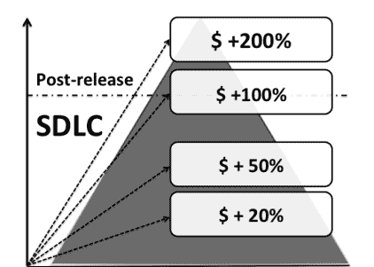

图1.1 解决软件问题的成本映射到SDLC阶段。


发布后修补易受攻击的软件，并且是一种保障应用程序安全的昂贵方式。此外，易受攻击软件的所有者/用户并不总是应用补丁；而且补丁可能包含更多漏洞。[14] 我们看到过一些补丁，它们修复了一个安全问题，却可能打开（或重新打开）其他安全问题。公司并不总是能给每个补丁（修复）应有的关注，或者它可能没有经过常规的软件开发生命周期，从而导致比补丁/修复旨在缓解的更多安全问题。

多年来，信息安全行业一直专注于网络和应用程序安全，假设软件是安全的，而他们的安全控制就是所需的一切，而不是真正保护组织免受软件安全失败的影响。在本书中，当我们回顾安全开发生命周期及其相关最佳实践时，应该清楚，在全面且分层的纵深防御安全计划中，网络和应用程序应放在后面，而软件安全应被视为信息安全生命周期的第一步，而不是最后一步。简而言之，网络和应用程序安全计划更多是关于补偿控制，但只有通过在源头解决安全问题，我们才能真正解决问题。

## 1.2 软件安全与软件开发生命周期

多年来，安全行业中一个重要的混淆领域是对软件安全与应用程序安全之间差异的误解。Gary McGraw 对两者之间的差异提供了出色的描述：

> 一方面，**软件**安全是关于构建安全软件：设计安全软件；确保软件安全；并教育软件开发人员、架构师和用户如何将安全性构建进去。另一方面，**应用程序**安全是在开发完成后，事后保护软件及其运行的系统。[15]

自20世纪80年代末大规模攻击开始出现以来，软件安全已经走过了漫长的道路。当时编写软件时并未太考虑安全性（例如，UNIX 代码、TCP/IP 协议栈）。随着 Microsoft Windows® 以及随后 Web 的出现，攻击在复杂性和频率上都开始增加，因此有必要关注软件安全。行业开始通过各种“附加组件”寻求短期修复方案。这些方案催生了防病毒软件、防火墙、反间谍软件等等。然而，真正的问题——代码的开发和编写方式——并未得到解决。直到过去十年，当 SDL 实践开始受到重视时，这种情况才开始改变。许多受软件安全缺陷影响的企业（例如 Microsoft）开始认真探讨如何通过改进软件开发实践将安全性构建到软件代码中。这促使学术界以及 Microsoft 等软件巨头推荐了 SDL 实践。我们现在拥有了从一开始就将安全性构建到代码中的理论和指南，从而减少攻击者可能利用的软件漏洞的可能性。

机密性、完整性和可用性是行业认为在任何安全软件开发过程中都至关重要的三个主要目标。开发人员为保护、强制执行和确保这些主要目标所做的工作，将等同于安全代码定义中“合理高度信任”的部分。开发人员可以编写非常高效、易于维护且可重用的代码；但是，如果该代码允许未经授权的用户访问应用程序的资产，那么该代码要么暴露，要么不暴露，没有第二次机会做得正确。

SDL 不应与标准软件开发生命周期混淆。顾名思义，SDL 方法论实际上旨在开发安全软件，而不一定是高质量软件。正如 IT Law Wiki 所定义，“安全开发生命周期是一种软件开发过程，用于降低软件维护成本并提高与软件安全相关缺陷的软件可靠性。”[16] 2002 年 1 月，许多 Microsoft 软件开发小组发起了“安全推进”活动，以寻找改进现有安全代码的方法。在此指令下，可信赖计算 (TwC) 团队形成了导致 Microsoft 安全开发生命周期的概念。Microsoft SDL 于 2004 年确立为强制性政策，旨在成为 Microsoft 软件开发过程的组成部分。[17] 自那时起，SDL 这一术语被其他人使用——既用于表示 Microsoft 的流程，也用作 IT Law Wiki 链接中定义的流程的通用术语。本书中我们使用 SDL 这一术语，是为了表示一种安全开发过程，该过程由基于对 Microsoft SDL 及自 2004 年以来开发的替代模型进行比较研究的软件安全最佳实践组成；作者对当今大多数开发组织中哪些有效、哪些无效的经验和研究；以及当今开发紧缩要求与日益增长的在源头使用相关、具成本效益且现实的软件安全实践来保护代码的需求之间的业务现实。

SDL 的目标有两个：第一个目标是减少安全漏洞和隐私问题的数量；第二个目标是降低剩余漏洞的严重性。有一些行业标准定义了软件开发中需要完成的工作，例如 ISO®/IEEE™，它们定义了传统软件工程开发方法的主要阶段。SDL 的元素通常非常灵活，并被纳入组织的标准开发生命周期中。

静态分析和威胁建模是用于开发安全代码的工具之一。静态分析工具使用一种称为“污点分析”的技术，在应用程序代码中查找未经过滤或未经过清理的输入（软件安全的祸根）。静态分析工具最大的前景在于其能够识别许多与软件开发卫生状况不佳相关的常见编码缺陷。不幸的是，由开发人员错误造成的实现缺陷往往只是问题的一部分。静态分析工具无法评估设计和架构缺陷。它们无法识别设计不良的加密库或选择不当的算法，也无法指出可能导致身份验证和授权之间混淆的设计问题。它们还无法识别代码中嵌入的密码或魔术数字。然而，静态分析工具可以比动态分析更轻松地深入程序的更多黑暗角落，而动态分析需要实际运行代码。静态分析还有可能在程序达到可以进行有意义测试的完成程度之前应用。在软件开发生命周期中，越早识别和管理安全风险，效果越好！

尽管这些 SDL 实践在理论上很好，但在应用于企业时，效果参差不齐。这有多种原因。遗留代码仍然构成了我们软件行业的大部分代码库，因此回过头来应用这些实践非常困难。软件外包或离岸外包是另一个难以高效实施这些实践的领域。软件开发人员和公司通常在紧迫的期限下工作，以便在竞争对手之前推出产品，因此软件安全通常被放在次要位置。在这样一个快速变化的环境中，缺乏管理层承诺来有效实施 SDL 实践，而软件安全通常被当作事后考虑。

尽管一些安全实践对软件安全和应用程序安全都是通用的，例如渗透测试、源代码扫描、面向安全的测试和安全教育，但没有什么能替代将安全性集成到软件开发生命周期中。流程中的人为因素是任何安全开发过程成功的关键，需要非常资深的软件安全架构师和工程师才能成功。威胁建模，应用最小权限和纵深防御等原则，或许是软件开发生命周期中最被理解、最重要且最需要的元素，需要人类专业知识而非工具来完成。还必须为系统收集真正的安全需求，并考虑合规性、安全问题、合同要求、应用程序将处理的数据以及业务风险。

培训是 SDL 的另一个关键要素，需要人为因素。培训有助于降低安全成本，有效的培训计划将激励您的开发团队生产更安全的软件，减少问题，并提高效率和成本效益。应强调，没有单一的点解决方案能为软件安全提供单一解决方案；相反，需要一种全面的纵深防御方法，包括人员、流程和技术的结合，并大力强调人员。尽管工具可以快速解析大量代码，速度比人类快，但它们无法取代人类。在可预见的未来，软件安全仍将被视为一门艺术，但这门艺术可以通过流程和技术来增强，与某些从业者散布的神话相反，这门艺术可以通过资深软件安全架构师和工程师的适当指导来教授。这些团队成员拥有经验，能够像对手一样思考，并在整个开发过程中这样做，这是任何 SDL 成功的关键要素。一些作者区分了安全编码最佳实践和安全设计原则；我们将在本书中介绍的软件安全最佳实践中同时涵盖两者，并利用上述资深架构师和工程师的经验来实现这一点。

软件安全需要专注的努力才能成功，它不是传统软件开发过程的自然结果，即使是那些拥有良好传统“质量”实践的开发团队也是如此。然而，软件安全应该是成熟质量计划的关键。正如我们将在本书中解释的，安全代码不一定意味着高质量代码，高质量代码也不一定意味着安全代码，但软件应用程序及其产生的开发过程的基础应基于高质量代码和安全代码的共同最佳实践。

## 1.3 高质量代码与安全代码

软件应用程序及其产生的开发过程的基础，基于高质量代码和安全代码的共同最佳原则。这些原则是行业最佳实践概念和设计的驱动力。要生产经得起时间考验的安全代码，您必须学习如何将这些原则融入


开发过程。请记住，安全代码不一定是高质量代码，高质量代码也不一定是安全代码。¹⁸

安全代码不等于高质量代码：在编写安全代码之前，你必须先知道如何编写高质量代码。开发人员可以编写非常安全的代码，对每个用户事务进行授权和身份验证，记录事务，并拒绝所有未经授权的请求；但是，如果代码无法返回预期结果，那么即使是这种非常安全的代码也可能永远无法面世。软件质量特性与安全不同。质量不是以机密性、完整性和可用性来衡量的，而是以易用性以及是否可重用和可维护来衡量的。¹⁹

高质量代码不等于安全代码：开发人员可以编写易于维护且可重用的高效代码，但如果该代码允许未经授权的用户访问应用程序的资产，那么该代码就毫无用处。与软件质量不同，软件安全不是主观的。敏感信息要么被泄露，要么没有被泄露，没有第二次机会来做正确。最终，质量、安全性和可维护性是行业在任何安全软件开发过程中认为至关重要的三个主要目标。²⁰

没有安全就没有质量，没有质量也没有安全。这两个属性相辅相成，共同提升整体软件产品的完整性和市场价值。优秀的开发人员应该能够识别软件中的质量因素以及如何对其进行编码。同样，优秀的开发人员应该知道他们开发的软件可能受到哪些攻击，以及软件中最薄弱的环节是什么；如果代码允许未经授权的用户访问应用程序的资产，那么该代码要么被泄露，要么没有被泄露，没有第二次机会来做正确。²¹

## 1.4 SDL安全的三个最重要目标

任何称职的开发人员都可以编写非常高效、易于维护和重用的代码；但是，如果代码允许未经授权的用户访问应用程序的资产，那么该代码就不安全。不幸的是，在软件开发生命周期中，安全往往是一个被忽视或仅被最小程度应用的领域。信息安全行业认为，SDL有三个最低目标，被视为首要重要：

- 1. 机密性
- 2. 完整性
- 3. 可用性

这三个目标通常统称为C.I.A.缩写。普遍认为，如果开发人员在软件开发生命周期中通过公认的做法确保、强制执行和保护C.I.A.，这将为代码的安全性提供高度信心。

44 U.S.C., Sec. 3542对信息安全、机密性、完整性和可用性的定义如下：

**信息安全：** 保护信息和信息系统免受未经授权的访问、使用、披露、中断、修改或破坏，以提供机密性、完整性和可用性。

**机密性：** 保留对信息访问和披露的授权限制，包括保护个人隐私和专有信息的手段。

**完整性：** 防止信息被不当修改或破坏，包括确保信息不可否认性和真实性。

**可用性：** 确保及时、可靠地访问和使用信息。²²

机密性、可用性和完整性共同提供信息安全。

机密性是通过防止未经授权的用户（人或软件）访问机密信息来实现的。通过保持机密性，软件将被视为可信赖的。授权和身份验证是支持机密性的两个属性，其中*授权*确保用户具有查看数据的适当角色和权限，而*身份验证*确保用户就是其声称的那个人，并且数据来自适当的位置。应用程序的完整性由应用程序接受、传输和存储数据的方式定义。数据必须保持不变，不受未经授权用户的影响，并且从数据输入点一直到数据库再返回的过程中始终非常可靠。数据加密、数字签名和公钥只是维护完整性和机密性的一些示例。除去任何计划停机时间外，可用性是指系统或软件在其正常计划运行时间内可用的时间百分比。作为软件安全的关键组成部分，缺乏机密性、可用性和完整性将降低产品的声誉，导致声誉和销售的双重损失。归根结底，软件安全既关乎良好的业务流程，也关乎质量。

## 1.5 威胁建模和攻击面验证

威胁建模和攻击面验证可能是SDL中最耗时、最容易被误解和最困难的部分。它们需要软件安全团队中最资深、最有经验的人员的关注：软件安全架构师。威胁建模背后的想法很简单，即了解系统的潜在安全威胁，确定风险，并建立适当的缓解措施（是什么？有多严重？如何修复？）。当正确执行时，威胁建模发生在项目生命周期早期，可以在代码提交之前用于发现安全设计问题。这可以带来显著的成本节约，因为问题在开发生命周期早期得到解决。威胁建模还可以帮助企业管理软件风险，创建对安全依赖和假设的认识，并提供将技术风险转化为业务影响的能力。归根结底，软件生命周期中安全风险越早被识别和管理，效果越好。

进行威胁建模的正确方法需要进入黑客的思维，这需要一种特殊的软件安全专业人员：能够像黑客一样思考，并想象对手可能攻击或利用软件的所有方式的人。因此，这是一种略有不同的应用程序测试方法。尽管质量保证专业人员可以进行安全测试，并且通常可以发现一些漏洞，但他们通常考虑的是客户的想法，而不是黑客的想法。在许多情况下，公司内部没有这种人才，不得不聘请第三方承包商来完成这项工作。

美国软件数据与分析中心（DACS）2008年10月的一份报告《增强开发生命周期以生产安全软件：软件保证参考指南手册》，将软件密集型系统的威胁定义为“任何有可能对该系统或系统拥有或能够访问的数据或资源造成损害的行为者、代理、情况或事件”。23 威胁可以根据其意图性进行分类。例如，威胁可以是无意的、有意但非恶意的，或恶意的；恶意威胁被假定为有意的。尽管所有三类威胁都有可能危及软件安全，但只有恶意威胁会通过攻击实现。DACS报告还指出：

> 针对软件的大多数攻击都利用了该软件中的某些漏洞或弱点；出于这个原因，“攻击”通常与“利用”互换使用，尽管Build Security In攻击模式术语表对这两个术语做出了明确区分，其中攻击指的是针对目标软件的行动，而利用指的是执行该行动的机制（例如，一种技术或恶意代码）。

软件建模是一种设想拟议软件在其预期环境中交互的方式。模型越能反映预期环境，建模方法就越有用。因此，安全软件设计和开发受益于明确包含安全威胁的建模。正如DACS 2007软件安全保证现状报告（SOAR）中所述，“建模的主要问题是做好它；彻底地做；以及知道如何处理结果（例如，如何将分析转换为指标和/或其他可用的决策点。”结合威胁和建模的概念，该报告将威胁建模定义为“一种评估和记录与应用程序相关的安全风险弱点的系统方法。它允许开发团队从对攻击应用程序有特定目标的对手的角度来处理安全问题，从而识别最高风险的组件。”24

考虑到时间和资源的正常限制，不可能测试应用程序中的所有代码。但是，至少，测试应涵盖攻击者可能访问的应用程序的入口点和出口点，通常称为应用程序的攻击面。可访问性会增加攻击面。例如，仅限管理员本地访问的代码比暴露于匿名用户远程访问的代码具有更小的攻击面。

应通过执行应用程序中属于攻击面的所有代码路径来充分测试攻击面。攻击面的元素可以通过扫描工具来识别，例如用于开放端口的端口扫描工具，以及用于定位接收输入和发送输出的代码部分的代码分析工具。甚至可能有必要开发自定义工具，例如，用于定位特定于自定义应用程序的入口点。最小攻击面通常在软件开发生命周期早期定义，并在后续阶段再次测量。在测试之前正式定义和测量攻击面通常很有帮助。正如我们将在本书后面讨论的那样，尽管工具在此分析阶段会很有用，但仍然需要人为因素，并且需要上述资深软件安全架构师的专业知识。


## 1.6 Summary

软件的安全性仅取决于软件开发团队所采用的最佳实践的质量和相关性。软件安全必须从一开始就内建。它必须从一开始就是设计的关键部分，并贯穿每个后续开发阶段，直至部署完整系统。在SDLC中通过采用安全增强的流程和实践尽早修复漏洞，远比在系统投入生产后尝试诊断和纠正此类问题更具成本效益。这将大大减少产品发布后为修复他人发现的安全漏洞而打补丁的需求，这将降低供应商的声誉和可信度，并对其造成财务上的不利影响。当今，我们看到软件开发中对安全的需求日益增加，因为安全需求、设计和防御原则必须融入传统的SDLC，最重要的是，在选择贯穿SDLC所有活动的安全开发实践时要拥抱这一需求。

我们曾与财富500强公司合作，并经常看到SDL实践中出现失效的例子。在本书中，我们采用基于经验的方法，应用最佳可用SDL模型的组件，以SDL软件安全最佳实践模型和框架的形式处理上述问题。我们将首先概述安全开发生命周期，然后概述一个将SDL最佳实践映射到软件开发生命周期的模型，以及如何利用此构建成熟的SDL计划。尽管安全在近年来行业构建软件的方式中并非自然组成部分，但我们相信开发流程的安全改进是可能的、切实可行的和必要的，并且我们相信本书中提出的软件安全最佳实践和模型将使所有读本书的人（无论您是高管、经理还是从业人员）都明白这一点。

## Chapter Quick-Check

- 1. 一旦软件产品发布，修复安全缺陷的成本可能高达开发阶段修复成本的____倍：
  - a. 50
  - b. 100
  - c. 500
  - d. 1500

- 2. 有缺陷的软件是：
  - a. 网络安全问题
  - b. 操作系统安全问题
  - c. 用户造成的问题
  - d. 软件开发和工程问题

- 3. 安全开发生命周期的三个目标是：
  - a. 可靠性、效率和可维护性
  - b. 速度、质量和持续发布
  - c. 机密性、完整性和可用性
  - d. 可用性、可靠性和可移植性

- 4. 威胁建模和攻击面分析在以下时间进行时最有效：
  - a. 发布后
  - b. 产品构思/产品待办列表开发期间
  - c. 集成测试阶段期间
  - d. 代码开发/提交之前

## Exercises

- 1. 访问战略与国际研究中心的重大网络事件网站，查看自2006年以来重大网络事件的时间线。在阅读这些攻击时，考虑安全开发生命周期和安全开发实践如何本可预防这些攻击或减轻其造成的损害。是否有任何特定类型的攻击需要干预或对SDL进行更改？您将如何确定这些更改的优先级？

- 2. 将应用程序、基础设施、平台和管理迁移到云计算迫使IT部门发生诸多变化。从安全角度看，这种迁移如何影响软件规划、开发、测试和实施？需要保留什么？需要重新构思什么？

- 3. 软件安全教育和意识是有效计划的基石，因为开发团队负责保护其生成的所有代码。您将如何说服IT开发管理层，他们的团队需要为安全职责做好充分准备？

## References

- 1. 总统信息技术咨询委员会。(2005). “网络安全：优先级危机，”总统行政办公室，信息技术研究与发展全国协调办公室，2005年，第39页。检索自 https://www.nitrd.gov/pubs/pitac/pitac_report_cybersecurity_2005.pdf
- 2. 同上。
- 3. Aras, O., Ciaramitaro, B., and Livermore, J. (2008). “安全软件开发——IT审计的角色。”ISACA期刊，第4卷，2008年，第45–48页。检索自 https://www.isaca.org/resources/isaca-journal/past-issues
- 4. 美国国土安全部。(2006). “软件生命周期中的安全：使软件开发流程——以及由其生产的软件——更安全，”草案版本1.2，第13页。检索自 https://resources.sei.cmu.edu/asset_files/WhitePaper/2006_019_001_52113.pdf
- 5. Schwartz, M. (2012). “2012年值得关注的10大安全趋势。”检索自 https://www.darkreading.com/vulnerabilities-threats/10-security-trends-to-watch-in-2012
- 6. Parizo, E. (2012). “要获得安全软件开发问题的帮助，请自行发现缺陷。”检索自 http://searchsecurity.techtarget.com/news/2240129160/To-get-help-with-secure-software-development-issues-find-your-own-flaw
- 7. Taft, D. (2012). “微软举办安全开发会议。”检索自 https://www.eweek.com/security/microsoft-holds-security-development-conference/
- 8. blackhat.com。(2013). 黑帽美国2012年会议网页，2012年7月21–26日，内华达州拉斯维加斯。检索自 http://www.blackhat.com/html/bh-us-12
- 9. OWASP基金会。(2013). “接近安全代码。我从哪里开始？”RSA 2013。检索自 https://owasp.org/www-pdf-archive/MASTER-RSA2013-v3.pdf
- 10. 微软公司。(2012). 2013年安全开发会议报名开放：号召所有IT安全专业人士。检索自 https://news.microsoft.com/2012/12/18/registration-open-for-2013-security-development-conference-calling-all-it-security-professionals/
- 11. Boehm, B., and Paccacio, P. (1998). “理解和控制软件成本。”IEEE软件工程事务，第14卷，第10期，1988年10月，第1462–1477页。
- 12. Boehm, B., and Basili, V. (2001). “软件缺陷减少十大清单。”计算机，第34卷，第1期，2001年1月，第135–137页。
- 13. Meftah, B. (2008). “企业软件保证：识别和降低企业中的软件风险，”第9届半年度软件保证论坛，马里兰州盖瑟斯堡，2008年10月。https://buildsecurityin.us-cert.gov/swa/downloads/Meftah.pdf
- 14. Viega, J., and McGraw, G. (2006). 构建安全软件：以正确方式避免安全问题的方法。波士顿，马萨诸塞州：艾迪生-威斯利。
- 15. McGraw, G. (2006). 软件安全：内建安全，第20页。波士顿，马萨诸塞州：艾迪生-威斯利。
- 16. IT法规维基。(2012). “安全开发生命周期定义。”检索自 http://itlaw.wikia.com/wiki/Security_Development_Lifecycle
- 17. 微软公司。(2021). “关于微软SDL。”检索自 https://www.microsoft.com/en-us/securityengineering/sdl/about#:~:text=The%20Microsoft%20Security%20Development%20Lifecycle%20%20%20%20SDL%20%20%20was%20an,the%20software%20development%20process%20at%20Microsoft%20in%202004
- 18. Grembi, J. (2008). 安全软件开发：安全程序员指南。波士顿，马萨诸塞州：课程技术。
- 19. 同上。
- 20. 同上。
- 21. 同上。
- 22. 美国政府。(2006). “44 U.S.C.，第3542条：美国法典，2006年版，”增编5，第44篇；第35章——联邦信息政策协调，III子章节——信息安全，第3542条——定义。检索自 http://www.gpo.gov/fdsys/pkg/USCODE-2011-title44/pdf/USCODE-2011-title44-chap35-subchapIII-sec3542.pdf
- 23. Goertzel, K., 等人，为国土安全部和国防部软件数据与分析中心。(2008). “增强开发生命周期以生产安全软件：软件保证参考指南手册，”第2版，2008年10月。检索自 https://www.academia.edu/1383839/Enhancing_the_Development_Life_Cycle_to_Produce_Secure_Software_A_Reference_Guidebook_on_Software_Assurance
- 24. Goertzel, K., 等人。(2007). “软件安全保证：最新技术报告（SOAR），”2007年7月。检索自 https://www.researchgate.net/publication/279351339_Software_Security_Assurance_A_State-of-Art_Report_SAR


## Taylor & Francis

Taylor & Francis Group

http://taylorandfrancis.com

# 第 2 章

## 安全开发生命周期

## 本章概述

本章首先介绍使用安全开发生命周期（SDL）来克服构建安全软件挑战的概念。将进一步讨论用于管理和克服这些挑战的模型、方法论、工具、人才和指标。最后，我们将讨论将我们的 SDL 及其相关最佳实践映射到通用软件开发生命周期（SDLC）的内容，这将是接下来六个章节的主题，随后是一个将我们的 SDL 最佳实践映射到几种最流行的软件开发方法论的章节。

仍然需要更好的静态和动态测试工具，以及一种集成到 SDLC 中的正式化安全方法论，以使大多数软件开发组织都能使用。在过去十年左右的时间里，主流的 SDL 模型除了最资源丰富的公司之外，其他公司都难以企及。本书的目标是创建一种基于最小资源利用和最佳实践的 SDL，而不是要求大多数软件安全团队无法企及的资源。

## 本章要点

- 解释构建安全软件中存在于流程、人才和技术方面的根本挑战。
- 区分用于衡量软件安全计划进度的行业成熟度模型和衡量进度所需的指标。
- 比较和对比各种用于安全软件开发计划的行业标准、指南和最佳实践。
- 了解能够实现安全软件开发成功的专门开发团队角色的必要性。
- 探索软件开发生命周期和方法论的各种实现，以及将它们转换为安全开发生命周期所需的步骤。

## 2.1 克服构建安全软件的挑战

如第 1 章所述，SDL 是软件安全演进的关键步骤，并有助于引起人们对将安全性构建到软件开发生命周期中必要性的关注。在过去，软件产品利益相关者并不将软件安全视为高优先级。人们曾认为，安全的网络基础设施将提供抵御恶意攻击所需的保护水平。然而，在最近的历史中，仅靠网络安全已被证明不足以抵御此类攻击。用户已成功地通过跨站点脚本（XSS）、结构化查询语言（SQL）注入和缓冲区溢出利用等技术渗透了合法的身份验证渠道。在这种情况下，系统资产被攻破，数据和组织完整性均受到损害。安全行业曾试图通过权宜之计来解决软件安全问题。首先是平台安全（OS 安全），然后是网络/边界安全，现在是应用程序安全。我们确实需要纵深防御来保护我们的资产，但从根本上说，这是一个软件安全缺陷，需要通过 SDL 方法来修复。

SDL 的基础组件包括开发符合行业和政府合规性以及经最佳实践加固的软件所需的所有活动和安全控制。要真正防止、识别和缓解开发系统中的可利用漏洞，需要知识丰富的员工以及安全软件策略和控制。

未能满足 SDL 中的最少活动，将为内部和外部威胁滥用系统资产提供机会。安全不仅仅是网络要求，现在已成为信息技术（IT）要求，其中包括开发所有用于分发、存储和操作信息的软件。组织必须实施最高标准的开发，以确保为其客户及其所保护的人们提供最高质量的产品。

实施 SDL 计划可确保安全性是良好企业软件设计和开发中固有的，而不是后来在生产中加入的事后补救措施。采用 SDL 方法可产生切实的好处，例如确保所有软件发布都满足最低安全标准，并且所有利益相关者都支持和执行安全准则。在开发周期早期（当漏洞更容易且修复成本更低时）消除软件风险，为信息安全团队在开发过程中协作提供了一种系统的方法。

最著名的 SDL 模型是可信计算安全开发生命周期（或 SDL），这是 Microsoft® 采用的一种开发需要抵御恶意攻击的软件的流程。Microsoft 的 SDL¹ 已发展超过十年，被认为是前三大模型中最成熟的一个。其他流行的 SDL 模型包括 BSIMM SSDL 触点点²、OWASP® 代码审查指南³ 和 Cisco® 安全开发生命周期（Cisco SDL）。⁴

Microsoft SDL 还拥有一个安全开发生命周期（SDL）优化模型⁵，旨在促进微软以外的开发组织逐步、一致且具成本效益地实施 SDL。该模型帮助负责在其组织的软件开发生命周期中集成安全性和隐私性的人员评估当前状态，并逐步将其组织推向采用经过验证的 Microsoft 计划以生产更安全软件。

SDL 优化模型使开发经理和 IT 政策制定者能够评估开发中的安全状态。然后，他们可以制定愿景和路线图，以具成本效益、一致且逐步的方式通过创建更安全、更可靠的软件来降低客户风险。随着组织通过 SDL 优化模型的成熟度级别，贵组织高管对 SDL 目标和结果的承诺将从暂时接受增强为强有力的授权。⁶

## 2.2 软件安全成熟度模型

多年来，已开发出两种流行的软件安全成熟度模型，并且正在以快速的速度不断成熟。一种是 BSIMM，⁷ 另一种是 OWASP Open SAMM。⁸ BSIMM 是 Building Security In Maturity Model 的缩写。BSIMM 是对现实世界软件安全计划的研究，其组织方式使您可以确定自身软件安全计划所处的位置，并了解如何随时间推移演进工作。它是一组最佳实践，通过分析九个领先软件安全计划的现实世界数据，并基于共同成功领域创建框架而开发。共有 12 项实践组织为四个领域。这些实践用于组织 122 项 BSIMM 活动。

通过研究这九个计划所做的工作，BSIMM 的创建者能够构建一个最佳实践模型，该模型分解为软件制造商可以遵循的 12 个类别：

- 1. 策略和指标
- 2. 合规性和策略
- 3. 培训
- 4. 攻击模型
- 5. 安全功能和设计
- 6. 标准和需求
- 7. 架构分析
- 8. 代码审查
- 9. 安全测试
- 10. 渗透测试
- 11. 软件环境
- 12. 配置和漏洞管理⁹

BSIMM 第 12 版于 2021 年发布。¹⁰

OWASP 软件保证成熟度模型（SAMM™）是一个灵活且具有规定性的框架，用于将安全性构建到软件开发组织中。SAMM 涵盖的内容比典型的基于 SDLC 的安全模型更多，它使组织能够自我评估其安全保证计划，然后使用推荐的路线图以与组织面临的特定风险相一致的方式进行改进。除此之外，SAMM 还能够创建记分卡，以衡量组织在典型的治理、开发和部署业务职能中进行安全软件开发的有效性。记分卡还能够


在组织内部管理，通过构建安全保证计划的迭代来展示定量改进。11

## 2.3 ISO/IEC 27034—信息技术—安全技术—应用程序安全

2011年，国际标准化组织（ISO®）/国际电工委员会（IEC®）发布了应用程序安全标准ISO/IEC 27034-1:2011的第1部分（共6部分）。12 该标准提供了一种简洁、国际认可的方式，以透明地了解供应商/供应商的软件安全管理流程。其设计旨在足够灵活以适应多样化的工程组织，同时又足够具体以应对现实世界的风险。该标准现已发布，与IT安全的ISO/IEC 27001类似，客户和合作伙伴都将期望合规。作为来自国际组织而非供应商的软件安全标准，它也不与特定技术绑定。第2–7部分包括以下内容：第2部分，组织规范框架；第3部分，应用程序安全管理流程；第4部分，应用程序安全验证；第5部分，协议和应用程序安全控制数据结构；第6部分，特定应用程序的安全指南；第7部分，保证预测框架。13 多年来，随着组织（及其客户）开始关注信息安全，安全和合规行业涌现出大量证明、认证和方法论。这些标准/证明都声称在衡量组织安全态势的方式上独一无二。竞争和营销炒作引发了混乱，不同组织标准化于不同的证明。作者看到组织推动其客户（在大多数情况下是其他公司）采用其推荐的证明。对于财富500强公司来说，这意味着获取多个证明/认证作为安全态势的证明。大多数这些证明/认证专注于“合规控制”或“基于策略的安全”，这并没有帮助。随着SOX、GLBA、Safe Harbor和HIPAA等法规的出台，情况变得更加混乱。公司通常会选择一组认证——分别用于合规、安全、隐私、信用卡、物理安全等等。

ISO/IEC开发了ISO/IEC 27001（包含ISO/IEC 17799，后者曾是信息安全的事实ISO标准）。它是一个信息安全管理体系（ISMS）标准，规定了一种旨在将信息安全置于正式管理控制之下的管理体系。当组织采用该标准时，它强制要求满足特定要求。该标准全面解决信息安全问题，涵盖从物理安全到合规的所有内容。行业热情地采用了这些实践，ISO/IEC 27001当今是信息安全管理体系（ISMS）的领先标准。其他标准中的大多数控制措施都可以映射回ISO/IEC 27001。这使组织能够在一个标准下整合多项安全工作，以整体安全为目标追求单一框架，并以一致的方式收集指标，以衡量和治理组织内的安全。

作者认为软件安全（及SDL）的现状与几年前ISO/IEC 27001出现之前的整体信息安全状况相似。存在多种SDL方法论（开放和专有），每种都声称优于其他方法。关于在组织中实现软件安全的最佳方式，混乱普遍存在。将任何单一框架应用于组织，要么要求组织采用不同的流程，要么要求定制一个适合其环境的SDL框架。随着ISO/IEC 27034的出现，作者预计软件安全标准/框架将出现整合，正如ISO/IEC 27001为信息安全所做的那样。即使在其早期阶段，人们也意识到ISO/IEC 27034的重要性。微软在其发布后不久就宣布其SDL方法论符合ISO/IEC 27034-1。14 我们预计在不久的将来会看到其他框架出现类似结果。

ISO/IEC 27034标准提供指导，帮助组织在其流程中嵌入安全，以保护在环境中运行的应用程序，包括应用程序生命周期流程。它是一个基于风险的框架，通过管理应用程序的流程集成/改进来持续改进安全。它在设计上采用流程方法。

作者推荐的SDL框架可以映射到ISO/IEC 27034框架。我们将在第9章中阐述与ISO/IEC 27034的相关映射。

## 2.4 SDL最佳实践的其他资源

SDL最佳实践还有其他来源，下面描述了一些最流行的来源。

### 2.4.1 SAFECode

代码卓越软件保证论坛（SAFECode）是一个非营利组织，致力于通过推进有效的软件保证方法来提高对信息和通信技术产品及服务的信任。SAFECode是一项全球性的行业主导工作，旨在识别和推广开发和交付更安全、更可靠的软件、硬件和服务的最佳实践。其旨在提供一套基础的安全开发实践，这些实践已被证明在SAFECode成员在其多样化开发环境中的实际实施中能够改进软件安全。这些是SAFECode成员采用的“经过实践的实践”，我们通过对成员各自软件安全工作的持续分析识别出了这些实践。通过将这些方法汇集在一起并与更广泛的社区共享，SAFECode希望推动行业超越定义理论最佳实践，转而描述一组已被证明能改进软件安全且目前在领先软件公司中使用的软件工程实践。15,16

### 2.4.2 美国国土安全部软件保证计划

自2004年以来，美国国土安全部（DHS）软件保证计划一直参与构建安全内嵌（BSI）网站的开发和管理，与卡内基梅隆大学软件工程研究所（SEI）的CERT®部门合作。17 BSI内容基于这样一个原则：软件安全本质上是一个软件工程问题，必须在整个SDLC中以系统的方式进行管理。

国土安全部软件保证（SwA）计划旨在减少软件漏洞、最大限度地减少利用，并解决改进可信软件产品常规开发和部署的方法。与公开政府指令一致，该计划使公私合作能够开发、发布和推广实用指南和工具的使用，促进对更安全、更可靠软件的投资。DHS软件保证计划与私营部门、学术界以及其他联邦部门和机构合作，通过诸如其与国防部（DoD）和国家标准技术研究院（NIST）共同赞助的软件保证论坛等活动，增强软件生命周期流程和技术的安全性。由DHS和国家安全局（NSA）资助的一项关键计划是通用弱点枚举（CWE™）。CWE是DHS与NSA和软件社区（包括政府、私营部门和学术界）的共同努力，由MITRE公司提供技术领导和项目协调。已识别和编目了超过800个软件弱点。已有超过62个安全产品和服务以兼容方式使用CWE。旨在减少最重大的可利用编程错误，SANS研究所（软件保证论坛的活跃参与者）推广了Top 25 CWE。SANS提出了关注Top 25 CWE的想法，这项工作代表了社区合作，以优先处理最容易被利用的构造，这些构造使软件容易受到攻击或故障。18 这促进了DHS共同赞助的CWE工作，并利用了SANS自2001年以来建立的“Top XXX”品牌，始于其Top 10——组织应解决的第一个优先级安全问题列表。

CWE是DHS软件保证计划的重要组成部分。此列表将CWE带入实用、可操作和可衡量的焦点，使人们能够犯错并展示真正的进步。公私合作构成了DHS SwA计划的基础。CWE是该部门一直倡导的公私合作类型的一个良好示例。与公开政府指令一致，SwA计划对CWE的赞助使社区参与、协作和透明度成为可能。CWE提供了可利用软件构造所需的特征描述；因此，它更好地使程序员在软件交付和投入运行之前接受必要的教育和培训，以消除过于常见的错误。这与构建安全内嵌的软件保证方法相一致，使软件在前端开发得更安全，从而避免长期的安全问题。CWE提供了一种了解剩余风险的标准方式，从而使供应商和消费者能够就软件安全性做出更明智的决策。19

### 2.4.3 国家标准技术研究院

国家标准技术研究院（NIST）继续在为政府和企业信息安全社区提供研究、信息和工具方面具有巨大价值。以下是NIST为软件安全社区做出贡献的一些关键领域。

NIST软件保证度量和工具评估（SAMATE）项目致力于通过开发方法来改进软件保证，以使软件工具


评估，衡量工具和技术的有效性，并识别工具和方法中的差距。该项目支持国土安全部的软件保障工具和研发需求识别计划——特别是第3部分，技术（工具和需求）：软件保障工具的识别、增强和开发。SAMATE项目的范围很广，从操作系统到防火墙，从SCADA到Web应用程序，从源代码安全分析器到正确-by-构造方法。20

NIST特刊（SP）800-64，《系统开发生命周期中的安全考虑》，旨在协助联邦政府机构将基本的信息技术安全步骤整合到其既定的IT系统开发生命周期中。本指南适用于所有联邦IT系统，国家安全系统除外。本文档旨在作为参考资源而非教程，应在系统开发过程中根据需要与其他NIST出版物配合使用。21

国家漏洞数据库（NVD）是美国政府基于标准的漏洞管理数据存储库，这些数据使用安全内容自动化协议（SCAP）表示。这些数据使漏洞管理、安全度量和合规性自动化。NVD包括安全检查清单、与安全相关的软件缺陷、错误配置、产品名称和影响度量的数据库。22 NVD通用漏洞评分系统（CVSS）为传达IT漏洞的风险特征和影响提供了一个开放框架。其定量模型确保可重复的准确测量，同时使用户能够查看用于生成评分的底层漏洞特征。因此，CVSS非常适合作为需要准确且一致的漏洞影响评分的行业、组织和政府的标准测量系统。CVSS的两个常见用途是优先处理漏洞修复活动以及计算在自身系统中发现的漏洞的严重程度。NVD为几乎所有已知漏洞提供CVSS评分。特别是，NVD为所有CVE漏洞支持CVSS 2.0标准。NVD提供CVSS“基础评分”，代表每个漏洞的固有特征。它目前不提供“时间评分”（由于漏洞外部事件随时间变化的评分）。但是，NVD确实提供一个CVSS评分计算器，允许您添加时间数据，甚至计算环境评分（针对漏洞对您组织的影响进行定制的评分）。该计算器包含对美国政府机构的支持，以便根据FIPS 199系统评级定制漏洞影响评分。我们将在本书后面讨论使用CVSS评分来管理软件安全。23

### 2.4.4 通用计算机漏洞和暴露

通用计算机漏洞和暴露（CVE*）是一份信息安全漏洞和暴露列表，旨在为公开已知的问题提供通用名称。CVE的目标是通过这个“通用枚举”，使跨独立漏洞功能（工具、存储库和服务）共享数据变得更加容易。信息安全漏洞是软件中的一个错误，黑客可以直接利用它来访问系统或网络。有关此术语在CVE中如何使用的完整解释，请参见CVE网站的术语页面。信息安全暴露是软件中的一个错误，它允许访问信息或功能，黑客可以将其作为进入系统或网络的跳板。使用通用标识符可以更轻松地跨独立数据库、工具和服务共享数据，这些数据库、工具和服务在1999年CVE创建之前不易集成。如果安全功能的报告包含CVE标识符，您可以快速准确地在一个或多个独立的CVE兼容工具、服务和存储库中访问修复信息以修复问题。使用CVE，您的工具和服务可以相互“交谈”（即交换数据）。您将确切知道每个工具涵盖的内容，因为CVE为您提供了评估工具覆盖范围的基准。这意味着您可以确定哪些工具对您组织的需求最有效且最合适。简而言之，CVE兼容的工具、服务和数据库将为您提供更好的覆盖范围、更轻松的互操作性和增强的安全性。

Bugtraq® ID是商业运营的漏洞数据库的标识符，用于安全通告和警报，以及Bugtraq邮件列表上的讨论。CVE标识符来自一项国际信息安全工作，该工作公开可用且免费使用。CVE标识符仅用于提供通用名称。出于这个原因，研究人员以及安全工具、网站、数据库和服务的提供者经常使用CVE标识符作为识别漏洞和与其他也使用CVE标识符的存储库进行交叉链接的标准方法。CVE标识符将为任何给定的漏洞或暴露提供一个标准化标识符。了解此标识符将允许您在多个CVE兼容的信息源中快速准确地访问有关问题的信息。例如，如果您拥有一个安全工具，其报告中包含对CVE标识符的引用，您可以在单独的CVE兼容数据库中访问修复信息。CVE还为您提供评估工具覆盖范围的基准。

CVE列表为美国国家漏洞数据库（NVD）提供数据，NVD随后基于CVE条目中包含的信息，为每个CVE标识符提供增强信息，例如修复信息、严重性评分和影响评级。NVD还提供高级搜索功能，例如按单个CVE-ID；按操作系统；按供应商名称、产品名称和/或版本号；以及按漏洞类型、严重性、相关利用范围和影响进行搜索。

CVE由美国国土安全部赞助。US-CERT是DHS的运作部门。US-CERT在可能的情况下将CVE标识符纳入其安全通告，并倡导美国政府和信息安全社区的所有成员使用CVE和CVE兼容的产品和服务。MITRE公司维护CVE和此公共网站，管理兼容性计划，并在整个过程中向CVE编辑委员会提供公正的技术指导，以确保CVE服务于公共利益。24, 25

### 2.4.5 SANS学院顶级网络安全风险

SANS顶级网络安全风险，以前称为SANS二十大最关键的互联网安全漏洞，是一份共识列表，列出了互联网安全中最关键的问题领域，如果存在于您的系统中，则需要立即修复。该列表包含逐步说明和指向有助于纠正这些安全缺陷的其他信息的指针。SANS列表包括CVE标识符，以唯一标识其描述的漏洞。这有助于系统管理员使用CVE兼容的产品和服务使其网络更加安全。26–28

### 2.4.6 美国国防部网络安全和信息系统信息分析中心（CSIAC）

2012年9月，软件数据与分析中心（DACS）、信息保障技术分析中心（IATAC）和建模与仿真信息分析中心（MSIAC）合并，成立了网络安全和信息系统信息分析中心（CSIAC）。CSIAC是DTIC赞助的八个信息分析中心（IAC）之一，执行基本中心运营（BCO）功能，以履行适用于国防部研究开发测试与评估（RDT&E）和采购社区的网络安全、信息保障、知识管理和信息共享、软件密集型系统工程以及建模与仿真任务和目标。29 在过去，DACS为社区制作了一些关于软件安全和安全开发生命周期（SDL）的优秀文档，最著名的是《增强开发生命周期以生产安全软件：软件保障参考指南手册》（2008）30 和联合IATAC/DACS报告《软件安全保障：最新技术报告（SOAR）》（2008），31 我们期望它们在CSIAC的旗帜下继续这样做。

### 2.4.7 CERT、Bugtraq®和SecurityFocus

除了迄今讨论过的来源外，卡内基梅隆大学计算机应急响应小组（CERT）、Bugtraq和SecurityFocus是另外三个需要了解的来源。

CERT提供关于安全漏洞的及时警报，以及每周关于漏洞的摘要公报（“CERT网络安全公报”）。公报中的信息包括CVSS评分以及用于唯一标识漏洞的CVE ID。该汇编基于前一周在NIST NVD中记录的漏洞。我们将在本书后面更详细地讨论CVSS评分过程。

Bugtraq是一个电子安全邮件列表，提供有关安全漏洞以及供应商安全公告和通告的信息。该列表通常包含其他信息，例如利用示例以及针对已识别问题的修复程序。Bugtraq是Accenture®的一部分。还有其他有用的邮件列表，例如专门针对Microsoft、Linux®、IDS和事件的邮件列表。

## 2.5 关键工具和人才

与所有安全任务一样，无论其方法是进攻性还是防御性的，都始终需要流程、技术和人员的结合才能使其成功。迄今为止，本节已讨论了可用于软件安全的流程和模型。三位一体的技术（工具）方面有两个要素将决定软件安全的成败，人员（人才）方面还有一个要素。


### 2.5.1 工具

三种主要工具是 SDL 的基础，分为模糊测试、静态分析和动态分析工具。虽然我们将在本书后面详细介绍在 SDL 中使用这些工具的最佳实践，但以下是高层次概述。

#### 2.5.1.1 模糊测试

模糊测试或模糊化是一种黑盒软件测试技术，可以自动化或半自动化，它向计算机软件程序的输入提供无效、意外或随机数据。换句话说，它通过以自动化方式注入畸形/半畸形数据来发现实现缺陷或安全漏洞。然后监控软件程序的输入，查找异常返回，如崩溃、内置代码断言失败和潜在的内存泄漏。模糊测试已成为软件或计算机系统安全问题测试中的关键要素。与其他工具相比，模糊测试的明显优势在于测试设计极其简单，且不带有对系统行为的先入之见。

模糊测试是软件安全的关键要素，必须嵌入 SDL。在这个领域有很多供应商可供选择，有些开发者甚至会开发自己的工具。如您在本书后面将看到的，在 SDL 中使用模糊测试工具的时机至关重要。还应注意，模糊测试既用于安全测试，也用于质量保证测试。

模糊测试最近被认可为许多软件开发计划中的关键要素和主要缺陷，以至于它现在已成为国防部信息保障认证和认可流程（DIACAP）的要求。

#### 2.5.1.2 静态分析

静态程序分析是在不实际执行程序的情况下对计算机软件进行分析。它主要用于对源代码的某个版本进行分析；然而，这种分析也可以在某种形式的目标代码上进行。相比之下，动态分析是通过实际执行软件程序来进行的。静态分析由自动化软件工具执行，不应与人工分析或软件安全架构评审混淆，后者涉及手动人工代码审查、程序理解和理解。当正确使用时，静态分析工具相对于人工静态分析具有明显优势，即分析可以更频繁地进行，并且安全知识通常优于标准软件开发人员。它还为经验丰富的软件安全架构师或工程师腾出时间，以便只有在绝对必要时才需要他们介入。

静态分析，也称为静态应用程序安全测试（SAST），在项目的开发或质量保证阶段识别漏洞。它提供代码行级检测，使开发团队能够快速修复漏洞。

使用静态分析工具以及为您的环境选择合适的供应商，是您成功的另一个关键技术因素。任何有益于自动化软件开发过程任何部分的技术都应受到欢迎，但这种软件在许多组织中已成为“闲置软件”，因为在选择工具或工具时没有使用合适的人员和合适的流程。并非该领域的所有工具都不尽相同，有些工具对某些语言更擅长，而其他工具则拥有出色的治理/风险/合规（GRC）和指标分析前端。在某些情况下，您可能需要使用多达三种不同的工具才能有效。最终，您需要选择支持您的语言、可扩展、可以嵌入开发流程且误报率最低的工具。

软件开发是一项复杂的业务，任何可以使流程更可重复、更可预测并减少“摩擦”的措施，对大多数组织来说都是一大胜利。使用静态分析工具有许多好处。最重要的原因包括以下几点。

- 静态分析工具可扩展。它们可以非常快速地审查大量代码，而人类很难做到这一点。
- 静态分析工具不会疲劳。凌晨 2:00 连续运行四个小时的静态分析工具，与在营业时间运行一样有效。人工审查人员无法做到这一点。
- 静态分析工具帮助开发人员了解安全漏洞。在许多情况下，您可以使用这些工具和供应商的教育资源，向开发团队传授软件安全知识。

#### 2.5.1.3 动态分析

动态程序分析是在实时处理器（真实或虚拟）上执行程序时对计算机软件进行分析。其目标是在程序运行时发现安全错误，而不是反复离线检查代码。通过在程序设计用于的所有场景中对其进行调试，动态分析消除了人为创建可能产生错误的情况的需要。它具有明显优势，即能够识别可能为假阴性的漏洞，并验证静态代码分析中的发现。

动态分析，也称为动态应用程序安全测试（DAST），在生产或生产就绪应用程序中识别漏洞。这些工具用于快速评估系统的整体安全性，并在 SDL 和 SDLC 中使用。关于使用静态分析工具的相同优势和注意事项也适用于动态分析工具。

在 SDL 中使用 SAST 和 DAST 工具的时机至关重要，主要发生在 SDL 的设计和开发阶段，我们将在本书后面介绍，如图 2.1 所示。

### 2.5.2 人才

#### 2.5.2.1 软件安全架构师

如第 1 章中所述，合格的高级软件安全架构师将决定您的软件安全计划的成败。在人员方面，有效软件安全计划最关键的要素是一支由高级 3 级和 4 级软件安全架构师组成的队伍。这些

SDLC 活动和最佳实践
典型 SDLC 阶段
就绪度
4
- A4 策略合规性分析
- 安全测试用例执行
- 静态分析
- 动态分析
- 模糊测试
- 手动代码审查
- 隐私验证和修复

A4
设计与开发
图 2.1 SDL 活动和最佳实践的设计与开发（A4）阶段。

这些人是在进入安全领域之前拥有 5 到 10 年开发/编码经验，并且在软件、网络以及云/SaaS 架构设计方面也经验丰富的个人。

这些人不是典型的运行工具的 IT 安全人员；他们是经验丰富的架构师，对开发和系统架构的理解与对安全的理解一样深入。此外，他们还必须具备出色的政治和人际交往能力。这些人将接触 SDLC 和 SDL 的每个元素；他们应该是 SDLC 流程每个阶段的签署流程的一部分，并且必须从预提交到发布后全程参与。他们将决定您的软件安全实践的成败，是其生存和成功的关键。您的高级软件/应用程序安全架构师对于处理产品安全升级、培训开发团队成员、提供内部/外部客户响应以及在 SaaS 和云环境中解决复杂的软件/应用程序问题至关重要。

区分架构驱动因素和其他要求并不简单，因为这需要完全理解解决方案目标。软件安全架构是一个交互式过程，涉及评估系统需求的业务价值，并确定对系统成功最关键的需求。这些需求包括功能需求、约束和解决方案的行为属性，所有这些都必须分类和指定。这些关键需求称为架构驱动因素，因为它们塑造系统的设计。

安全架构师必须弄清楚，在架构层面，必要的安全技术将如何集成到整体系统中。在云或 SaaS 环境中，这包括网络安全需求，例如防火墙、虚拟专用网络等。架构师会明确记录系统各部分的信任假设，通常通过绘制信任边界（例如，防火墙外的网络流量不受信任，但本地流量受信任）。当然，这些边界必须反映业务需求。例如，高安全性的应用程序不应信任任何未加密的共享网络介质。安全需求应来自用户。资深软件安全架构师的典型职位描述可能如下。

软件安全架构师负责为公司 X 的所有产品安全开发人员提供架构和技术指导。架构师将设计、规划和实施安全编码实践和安全测试方法论；确保实践符合软件认证流程；推动产品的安全测试；测试和评估安全相关工具；并管理第三方供应商以满足上述职责。具体角色和职责包括以下内容：

- 推动整体软件安全架构。
- 在公司 X 软件安全工作的全面规划、开发和执行中提供技术领导力。
- 与产品和工程开发团队密切合作，确保产品满足或超过客户安全和认证要求。这包括确保安全架构得到充分记录和传达。
- 为与安全相关且敏感于业务约束和需求的软件工程和产品开发流程提供规划和意见。
- 监控安全技术趋势和要求，例如新兴标准，以寻找新技术机会。


- 制定并执行安全计划。这可能包括管理与第三方供应商的联合开发，并（与其他部门一起）提供有关工程和测试实践的指导。
- 确保，并在需要时创建，安全政策、流程、实践和操作，以确保可重复的开发和高质量，同时控制成本。
- 参与软件的实际深入分析、审查和设计，包括从安全角度对源代码进行技术审查和分析。将包括对内部开发代码的审查，以及对第三方供应商提供的技术的审查。
- 在安全认证过程中担任主要技术角色，包括准备大量文档并与第三方评估机构合作。
- 为员工、承包商、开发和质量保证团队以及产品/软件安全冠军提供与产品安全相关的培训。
- 通过参与设计评审、威胁建模以及代码和系统的深入安全渗透测试，指导 Company X 软件开发团队完成其 SDLC 中的 Company X 安全开发生命周期（SDL）。这些职责还包括就应用程序设计、安全编码实践、日志取证、日志设计和应用程序代码安全提供意见。

软件安全架构师是监督和培训软件安全冠军工作的关键骨干，这些冠军应通过跨业务单元/软件安全教育和意识计划来识别。架构师还将发现和评估软件安全冠军候选人，因为他们从概念提交到发布后参与各种软件产品 SDL。

#### 2.5.2.2 软件安全冠军

企业安全部门（无论是 IT、物理还是软件）的资金在可预见的未来不太可能有所改善，这意味着如果你计划取得成功，就必须非常谨慎地使用资源。如前文所暗示的，经验丰富的软件安全架构师凤毛麟角，最多你可能只能在当今市场找到并负担得起少数几位。当你查看本书中使用的 SDL 模型或本章前面提到的其他模型时，你可能会问自己，鉴于安全软件及其合作开发团队将拥有的资源，如何才能扩展到这项任务。答案是，如果你管理软件安全团队或有该职能为你工作，你将使用软件安全冠军（SSC）的招募和杠杆作用来管理这项艰巨的任务。该角色的候选人通常应具备至少三到五年的软件开发经验；对软件安全的热情或背景；有时间接受软件安全以及集中式软件安全团队工具、计划和流程的培训；并且最重要的是，不仅要知道如何开发（构建）软件，还要知道如何在“以黑客思维”考虑对手可能利用软件的所有可能路径或漏洞（攻击平面）时对其进行解构（拆解）。每个产品开发组织应至少有一名具备技术能力、可接受培训成为软件安全冠军，并最终成为初级软件安全架构师的人员，以协助集中式软件安全团队进行架构安全分析/威胁建模。同样重要的是，SSC 应该是志愿者，而不是可能缺乏热情来胜任这一非常具有挑战性但富有回报的角色的指派人员。公司内每个软件开发业务单元应至少有一名 SSC；对于较大的开发组织，最好每个业务单元每个产品层级配备一名。软件安全冠军的典型职位描述如下：

- SSC 必须具备至少三到五年的软件开发经验；对软件安全的热情或背景；有时间接受软件安全以及集中式和业务单元特定的软件安全工具、计划和流程的培训；并且最重要的是，不仅要知道如何开发（构建）软件，还要知道如何在“以黑客思维”考虑对手可能利用软件的所有可能路径或漏洞（攻击平面）时对其进行解构（拆解）。
- 每个产品开发组织将有一名具备技术能力、可接受培训成为软件安全架构师的人员，以协助集中式软件安全团队进行架构安全分析/威胁建模。理想情况下，每个团队还应有一名额外的产品安全冠军，其角色是作为变革推动者（更偏向项目/计划的个人），在技术导向的产品安全冠军之外（如果认为有必要）。
- 特定角色和职责包括：
    - 执行 SDL：协助集中式软件安全团队确保在 SDL 中作为 Company X SDLC 的一部分遵守机密性、完整性、可用性和隐私性的安全原则。
    - 审查：协助集中式软件安全团队软件安全架构师进行架构安全分析、审查和威胁建模。
    - 工具专家：作为每个开发团队、产品组和/或业务单元中集中式软件安全团队软件安全工具的代表性专家（例如，静态和动态，包括模糊测试）。
    - 共同办公：作为每个开发团队、产品组和业务单元中集中式软件安全团队的眼睛、耳朵和倡导者。
    - 参加会议：作为全球 Company X 软件安全冠军团队的成员，参加每月电话会议，并在预算允许的情况下，每年参加两次面对面会议。

## 2.6 最小权限原则

在信息安全、计算机科学和其他领域，_最小权限原则_（也称为最小特权原则或最小权威原则）要求在计算环境的特定抽象层中，每个模块（例如进程、用户或程序，具体取决于主体）只能访问其合法目的所需的信息和资源。<sup>36,37</sup>

限制权限提升是威胁建模的重要组成部分，也是我们 SDL 中架构（A2）阶段的核心部分，我们将在第 4 章中讨论。_权限提升_的概念被认为如此重要，以至于它是微软安全开发生命周期卡牌游戏的主题，该游戏旨在培训开发人员和安全专业人员快速轻松地发现软件或计算机系统的威胁。<sup>38</sup> 未经授权的权限提升攻击利用编程错误或设计缺陷，授予攻击者对网络及其相关数据和应用程序的提升访问权限。这些攻击可以是 *垂直*，即攻击者授予自己权限，也可以是 *水平*，即攻击者使用已获授予的相同权限级别，但冒充另一具有类似权限的用户身份。

确保最小权限可防止敏感数据泄露，并防止未经授权的用户访问他们本不该拥有的程序或区域。软件设计应遵循最小权限原则，这是软件开发中的关键要素。限制权限级别至关重要，因为权限提升可能导致攻击者获得超出普通用户授权范围的权限。例如，拥有“只读”权限的普通用户权限的攻击者可能能够黑进软件，将其访问权限提升至包括“读写”。实施最小权限要求用户获得执行特定任务所需的权限，且不得超出此范围。在 SDL/SDLC 的设计阶段，你需要确定执行该工作所需的最小权限集，并将用户限制在仅拥有这些权限的域中，不得超出。确保最小权限不仅包括限制用户权利，还包括限制 CPU 限制、内存、网络和文件系统权限等资源权限。这要求在向对象授予权限之前必须满足多个条件，因为仅检查一个条件的访问权限可能不足以提供强安全性。例如，如果攻击者能够获得一个权限但无法获得第二个权限，则可能无法成功发动攻击。将软件划分为需要多次访问检查的独立组件可以阻碍攻击，或可能防止攻击者控制整个系统。仔细授权访问权限可以限制攻击者成功攻击软件或系统。对资源的最小权利和访问应限制在执行任务所需的最短时间内。

## 2.7 隐私

保护用户隐私是 SDL 过程的另一个重要组成部分，应被视为 SDLC 所有阶段中至关重要的系统设计原则。正如安全失败一样，未能保护客户隐私会导致信任的丧失。随着越来越多未经授权访问客户个人信息的案例在媒体上披露，软件和系统保护客户数据的信任正在下降。此外，许多新的隐私法律和法规对在软件和系统的设计与开发中纳入隐私保护给予了更高的重视。与安全一样，已经完成开发生命周期的软件更改成本非常高；将隐私保护方法和技术集成到 SDLC 的适当阶段以保护个人隐私和个人身份信息（PII）数据的成本要低得多。微软 SDL 中包含的一些关键隐私设计原则包括：能够就收集、存储或共享的数据提供适当通知，以便用户就其个人信息做出知情决策；启用用户策略和控制；最大限度地减少数据收集和敏感性；以及保护数据的存储和传输。39

必须通过 SDL 实施的最佳实践，将隐私保护构建到 SDLC 中。忽视用户的隐私担忧可能会导致被阻止


部署、诉讼、负面媒体报道和不信任。我们已将隐私保护最佳实践纳入我们的SDL，这将在后续章节中描述。

## 2.8 度量的重要性

正如开尔文勋爵所说：“如果你无法衡量它，你就无法改进它。”⁴⁰ 这句格言今天依然适用，因为它适用于产品安全以及准确衡量软件开发组织安全态势的需求。有意义的安全度量至关重要，因为企业正面临监管和风险管理要求，收紧的安全预算需要精明的安全投资，而客户要求证明安全和隐私正在构建到他们的产品中，而不是通过事后的发布后修复。

度量跟踪就像您软件项目的保险单，还能帮助管理针对漏洞的防护。正如我们反复指出的，在SDLC连续阶段检测缺陷的成本，与在缺陷产生的SDLC阶段检测同一缺陷的成本相比非常高。度量可以跟踪这些成本，并在整个SDL/SDLC过程中为各种投资回报率（ROI）计算提供重大帮助。如图1.1所示，在开发早期避免潜在安全缺陷的成本很低，尤其是与开发后期花费10倍、20倍、50倍甚至100倍于该金额的成本相比。图2.2展示了作为SDL过程一部分的SDLC不同阶段修复缺陷成本的可视化表示。可以认为，防止仅一两个缺陷上线的成本，就值得跟踪度量的成本。预见缺陷并修复它们的能力是健康软件安全计划的良好指标，但整个SDL/SDLC过程中的高质量度量可以帮助管理，并且通常避免过高的修复成本。

SDL的一个目标是将缺陷捕获作为整个过程中的多阶段过滤过程，而不是通过单一活动或时间点，从而最大限度地减少导致漏洞的剩余缺陷。每个缺陷移除活动可以被视为一个过滤器，它从软件产品中移除一定比例的可能导致漏洞的缺陷。⁴¹ 软件开发生命周期中缺陷移除过滤器越多，软件产品在发布时剩余的可能导致漏洞的缺陷就越少。更重要的是，缺陷的早期测量使组织能够在SDLC早期采取纠正措施。每次移除缺陷时，都会对其进行测量。每个缺陷移除点都成为测量点。缺陷测量带来的东西比缺陷移除和预防更为重要：它告诉团队他们与目标的差距，帮助他们决定是进入下一步还是停止并采取纠正措施，并指示在哪里修复他们的流程以实现目标。⁴² 本书将介绍的SDL模型将侧重于在整个SDLC中过滤缺陷，特别关注我们模型中的S1–S3阶段（参见图2.3）。

安全度量可以成为评估组织软件安全计划有效性的宝贵资源。有意义的度量可用于持续改进产品安全计划的绩效、证实监管合规性、提高管理层和利益相关者的安全意识，并协助决策者提出资金请求。没有度量，组织将不得不在FUD（恐惧、不确定性和怀疑）下运行其产品安全计划。

| 缺陷创建阶段 / 缺陷修正阶段 | 概念 | 规划 | 设计与开发 | 就绪 | 发布与上线 | 支持与维护 |
| :--- | :---: | :---: | :---: | :---: | :---: | :---: |
| 发布后支持 (PRSA) | | | | | | $ |
| 发布 (A5) | | | | | $ | |
| 设计与开发 (A4) | | | | $ | | |
| 设计与开发 (A3) | | | $ | | | |
| 架构 (A2) | | $ | | | | |
| 安全评估 (A1) | $ | | | | | |

修复缺陷的成本

缺陷创建的SDLC活动和最佳实践阶段

缺陷修正的SDLC阶段

图2.2 作为SDLC过程一部分，在SDLC不同阶段修复缺陷成本的可视化表示。

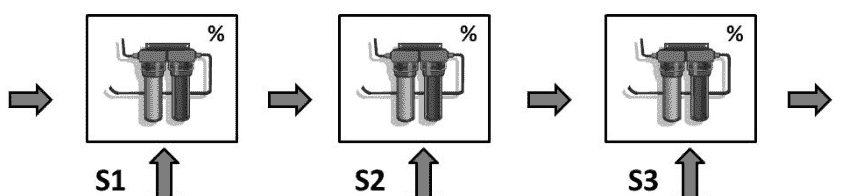

- **架构 (S1)**: 在发现会议、需求架构分析、架构安全分析、威胁建模以及开发滥用案例期间，会识别并移除一定比例的漏洞。
- **设计与开发 (S2)**: 在S1期间创建的一定比例漏洞，会在设计评审和验证期间被识别并移除。
- **设计与开发 (S3)**: 在S2期间创建的一定比例漏洞，会在代码评审、动态分析、静态分析、模糊测试和安全测试期间被识别并移除。

图2.3 SDL阶段S1–S3：缺陷识别和修复过滤过程。

有意义的安全度量使组织能够确定其安全控制的有效性。为了有效衡量组织的安全态势，产品安全必须首先确保已建立适当的框架，以便得出有意义的度量数据。这包括一个适合实体战略和运营要求的产品安全治理模型。此类模型应支持实施实用的产品安全政策和程序，一致部署最佳实践和措施，并要求组织内强有力的高级管理层支持。最佳实践规定了一种模型，在该模型下，安全作为企业问题进行管理——在整个组织中水平、垂直和跨职能地进行。该模型更适合实现对组织产品安全态势的一致监控、测量和报告。

为了有效衡量安全，必须有效地管理安全。随着公司努力保护宝贵的信息资产并证明基于风险的决策的合理性，集中式度量报告机制对于生成有意义的度量以及对软件开发组织内产品安全状态进行持续评估至关重要。

本书没有单独设立关于度量的章节，我们的方法是在所介绍的SDL模型的每个步骤中包含度量。这将最终导致关于在管理整体企业软件安全计划中使用SDL度量的讨论。

## 2.9 将安全开发生命周期映射到软件开发生命周期

无论您使用何种形式的SDL，无论是已存在的、您自己开发的，还是两者的结合，都必须将其映射到当前的SDLC才能有效。图2.4

图2.4 将安全开发生命周期（SDL）映射到软件开发生命周期（SDLC）。

| 典型SDLC阶段 | 概念 | 规划 | 设计与开发 | 就绪 | 发布与上线 | 支持与维护 |
| :--- | :--- | :--- | :--- | :--- | :--- | :--- |
| **阶段 #** | 1 | 2 | 3 | 4 | 5 | PRSA 1-5 |
| **SDL活动** | 安全评估 (A1) | 架构 (A2) | 设计与开发 (A3) | 设计与开发 (A4) | 发布 (A5) | 发布后支持 (PRSA) |
| **最佳实践** | - 软件安全团队早期介入<br>- 软件安全团队主持发现会议<br>- 软件安全团队制定SDL项目计划<br>- 说明将进行的进一步工作<br>- 隐私影响评估 (PIA) 计划启动 | - A2 政策合规性分析<br>- SDL政策评估与范围界定<br>- 威胁建模 / 架构安全分析<br>- 开源选择<br>- 隐私信息收集和分析 | - A3 政策合规性分析<br>- 安全测试计划编写<br>- 静态分析<br>- 威胁模型更新<br>- 设计安全分析与评审<br>- 隐私实施评估 | - A4 政策合规性分析<br>- 安全测试用例执行<br>- 静态分析<br>- 动态分析<br>- 模糊测试<br>- 人工代码评审<br>- 隐私验证和修复 | - A5 政策合规性分析<br>- 最终安全评审<br>- 漏洞扫描<br>- 渗透测试<br>- 开源许可审查<br>- 最终隐私评审 | - 外部漏洞披露响应<br>- 第三方评审<br>- 发布后认证<br>- 针对新产品组合或云部署的内部评审<br>- 针对当前、旧版和并购产品及解决方案的安全架构评审和基于工具的评估 |


是作者们开发并映射到典型SDLC阶段的SDL活动和最佳实践模型。每个SDL活动和最佳实践都基于作者们的真实世界经验和示例，向读者展示安全可以构建到SDLC的每个阶段中——如果你愿意，可以称之为安全与SDLC的映射。如果安全被构建到每个SDLC阶段，那么软件默认安全的可能性就会更高，后续的软件变更也不太可能危及整体安全。这种映射的另一个好处是，你大概率已经与SDL的所有者和利益相关者合作过，这将有助于在SDLC的运营和业务流程中建立认同、效率和可实现的安全，并将包括开发人员、产品和项目经理、业务经理以及高管。

后续章节将详细描述图2.4中展示的SDL的每个阶段。此外，每个阶段在图2.5至2.10中分别进行了细分。

请注意，与您可能之前见过的一些SDL不同，我们在SDL中包含了发布后的支持活动和最佳实践，如图2.10所示。之所以包含这些内容，是因为大多数软件安全团队或其等效团队，尤其是中小型公司的团队，并没有条件拥有一个独立的产品安全事件响应团队（PSIRT）——一个专门用于进行安全并购评估、第三方评审、发布后认证、针对云部署的新产品组合的内部评审，或审查仍在使用或即将重复使用的旧版软件的团队。这需要一些跳出常规思维的方法
- 第三方评审
- 发布后认证
- 针对新产品组合或云部署的内部评审
- 安全架构评审及针对当前、旧版和并购产品与解决方案的基于工具的评估

### PRSA 1-5

### 支持与维护

### 典型SDLC阶段

### 2.10.1 瀑布开发

瀑布开发（参见图2.11）是更传统的软件开发方法的另一种称呼。这种方法通常比本章后面将讨论的敏捷方法风险更高、成本更高、效率更低。瀑布方法使用已知的需求，每个阶段在下一阶段开始前都要签字确认，并且需要大量文档，因为这是整个过程中的主要沟通机制。尽管大多数开发组织正在向敏捷开发方法转变，但当需求完全理解且不复杂时，仍可能使用瀑布方法。由于使用此方法论一旦阶段完成就不打算回头重访，因此必须第一次就做对：通常没有第二次机会。

尽管瀑布开发方法各有不同，但它们往往相似之处在于：从业者试图坚持初始计划，直到周期非常晚期才有可运行的软件，假设自己事先知道一切，通过变更控制委员会尽量减少变更（即，假设变更是不好的且可控），将大部分责任放在项目经理（PM）身上，优化对进度和预算的符合性，通常使用薄弱的控制措施，并且仅在完成时才实现价值。它们受以PM为中心的方法驱动，基于这样的信念：如果遵循计划中的流程，那么一切都会按计划进行。在当今的开发环境中，上述大多数项目被视为瀑布方法论的负面属性，也是行业向敏捷开发方法转变的几个原因之一。瀑布方法可以被视为一种流水线方法，当正确应用于硬件时可能非常出色，但在软件开发方面与敏捷方法相比存在不足。

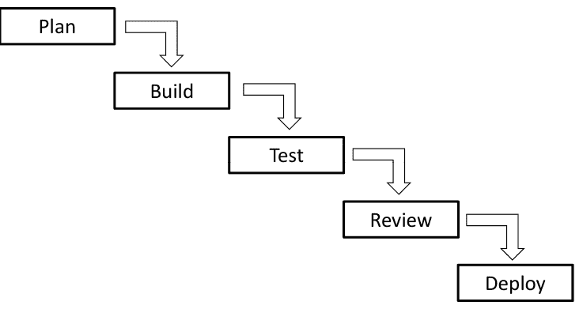

图 2.11 瀑布软件开发方法论。


#### 2.10.1.1 迭代瀑布开发

迭代瀑布开发模型（参见图 2.12）是对标准瀑布模型的改进。与传统瀑布方法相比，这种方法的风险较低，但比敏捷方法风险更大且效率更低。在迭代瀑布方法中，整个项目被划分为各个阶段，每个阶段均采用传统瀑布方法执行。将大型项目划分为较小的可识别阶段，可使每个阶段的工作范围更小，并且在进入下一阶段之前，可以对每个阶段的最终交付物进行审查并在必要时进行改进。因此，总体风险得以降低。尽管迭代方法优于传统瀑布方法，但在当今环境中，您更有可能面临敏捷软件开发方法，而不是标准瀑布或迭代瀑布方法。

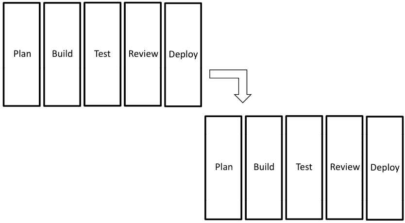

图 2.12 迭代瀑布软件开发方法。

### 2.10.2 敏捷开发

敏捷方法基于迭代和增量开发方法。需求和解决方案通过自组织、跨职能团队之间的协作不断演进，并且每次迭代产生的解决方案在整个过程中都会定期审查和改进。敏捷方法是一种时限迭代方法，有助于快速灵活地应对变化，从而鼓励演进式开发和交付，同时在整个项目生命周期中促进自适应规划、开发、团队合作、协作和过程适应性。任务被分解为需要最少规划的小增量。这些迭代具有称为“时限框”的短时间范围，可持续一到四周。发布产品或新功能可能需要多次迭代。跨职能团队负责每次迭代中的所有软件开发职能，包括规划、需求分析、设计、编码、单元测试和验收测试。敏捷项目通常是跨职能的，自组织团队独立于任何公司层级或团队成员的其他公司角色运作，团队成员自行决定如何满足每次迭代的需求。这使项目能够快速适应变化并最大限度地降低总体风险。目标是在每次迭代结束时提供可用的发布版本，并在每次迭代结束时向利益相关者演示可工作的产品。

#### 2.10.2.1 Scrum

Scrum（参见图 2.13）是一种迭代和增量敏捷软件开发方法，用于管理软件项目以及产品或应用程序开发。Scrum 采用经验方法，承认问题无法被完全理解或定义，而是专注于最大限度地提高团队快速交付和响应新出现需求的能力。这是通过使用同地、自组织团队来实现的，所有学科都可以在其中得到体现。与传统的计划或预测方法相比，这一概念有助于处理因客户在项目开发期间变更需求而产生的变动。Scrum 的基本开发单元称为“冲刺”，冲刺可持续一周到一个月。每个冲刺都有时限，以便产品的已完成部分按时完成。优先级需求列表源自产品待办列表，如果在冲刺期间未完成，则将其排除并返回产品待办列表。团队在每个冲刺完成后演示软件。Scrum 普遍接受的增值属性包括：使用自适应规划；在第一个冲刺期间（通常为两周）及之后频繁地从可工作的软件获取反馈；强调最大化良好变化，例如专注于在整个项目期间最大化学习；将大部分责任放在小型、专注、紧密思考、自适应的团队身上，这些团队自行规划和重新规划自己的工作；具有强大且频繁的控制；优化业务价值、上市时间和质量；以及支持更早实现价值，可能在每个冲刺后实现。

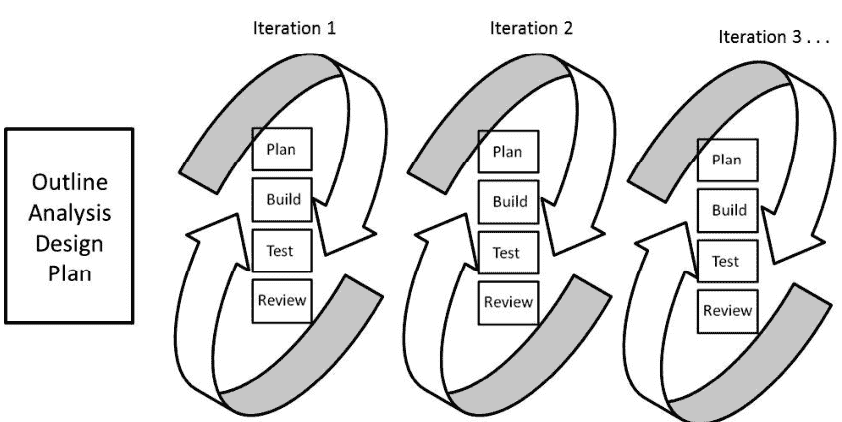

图 2.13 Scrum 软件开发方法。

#### 2.10.2.2 精益开发

根据我们的经验，对于那些最近从瀑布方法转向或正在从瀑布方法转向软件开发的人来说，Scrum 是您最可能遇到的敏捷变体。精益（参见图 2.14）是另一种日益流行的方法，因此值得提及。不幸的是，精益有许多定义，并且是一种在许多方向上不断发展的方法。尽管精益与 Scrum 相似，因为它关注功能而非功能组，但它将这一想法更进一步，即在最简单的形式中，您先选择、规划、开发、测试和部署一个功能，然后再选择、规划、开发、测试和部署下一个功能。目标是将风险进一步隔离到单个功能级别。这种隔离的优势在于，在可能的情况下专注于消除“浪费”，并且除非绝对必要或相关，否则不做任何事情。精益开发可以基于精益制造原则概念总结为七项原则：(1) 消除浪费，(2) 放大学习，(3) 尽可能晚地做出决定，(4) 尽可能快地交付，(5) 授权团队，(6) 内建完整性，(7) 看到整体。精益开发的关键要素之一是提供一种模型，让您即使在开发人员分散在多个地点和承包商时也能看到整体。尽管社区中许多人仍将其视为与敏捷相关，但精益软件开发已发展成为一门相关学科，而非敏捷的特定子集。

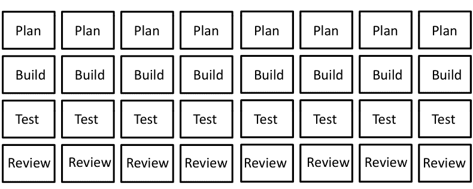

图 2.14 精益软件开发方法。

## 2.11 总结

在本章中，我们描述了 SDL 的重要性和适用性及其与 SDLC 的关系和包含。在整个讨论中，我们强调了用于管理和克服使软件安全所面临挑战的模型、方法、工具、人才和指标。我们的 SDL 过程涵盖了 SDL 每个阶段的一系列以安全为中心的活动和最佳实践。这些活动和最佳实践包括在软件设计期间开发威胁模型；在实施期间使用静态分析代码扫描工具；以及进行代码审查、安全测试和指标。最后，我们讨论了将 SDL 映射到 SDLC 的模型以及我们将在第 9 章中应用 SDL 元素和最佳实践的各种流行软件方法。在下一章中，我们将开始逐步介绍我们的 SDL 模型的每个步骤，并表明 SDL 元素的增量实施将在整体软件安全方法中带来增量改进。

## 章节快速检查

- 1. 构建内置安全范式始于：
- a. 分析阶段
- b. 设计阶段
- c. 规范阶段
- d. 开发阶段

- 2. SDL 的目标是实现以下所有目标，除了：
- a. 减少软件中的安全漏洞数量
- b. 减少软件中安全漏洞的严重性
- c. 消除对软件的威胁
- d. 记录对软件漏洞的完整理解

- 3. 对象仅拥有执行其任务所需的权限和特权而没有额外权限的安全基本方法是对以下内容的描述：
- a. 分层安全
- b. 最小权限
- c. 基于角色的安全
- d. Clark-Wilson 模型

- 4. 以下哪项陈述最能描述 BSIMM？
- a. BSIMM 用于通过在 SDLC 中查找安全最佳实践的证据来衡量软件保证计划的成熟度。
- b. BSIMM 用于通过在 SDLC 中查找安全程序的证据来衡量软件保证计划的成熟度。
- c. BSIMM 用于通过在 SDLC 中查找安全活动的证据来衡量软件保证计划的成熟度。
- d. BSIMM 用于通过在 SDLC 中查找安全需求的证据来衡量软件保证计划的成熟度。


## 练习

- 1. 应使用哪些应用程序属性来确定应用程序应适当关注安全的级别？由于没有两个应用程序是相同的，如何对它们进行优先级排序，以确保稀缺资源不会被浪费？

- 2. 任何处理或处理信用卡数据的组织都必须遵守由代表国际信用卡发行机构（Visa、MasterCard、American Express 等）的支付卡行业（PCI）小组制定的标准。在数据安全标准（DSS）中，第 6 章专门针对处理支付卡数据的应用程序和软件的安全性。这些要求是什么？它们如何影响安全开发生命周期的设计和实现？在遵守 PCI-DSS 时，还符合哪些其他行业安全开发标准？

- 3. 随着自动驾驶汽车取代传统车辆，以及机器学习和人工智能（AI）被用于做出关于我们日常生活的决策，高质量和安全软件的重要性正在不断提高。你可以在网上找到哪些类型的指导，以帮助管理层和开发团队了解这些重要性，并为开发涉及生命和人身安全选择的软件所承担的责任做好准备？

## 参考文献

- 1. 微软公司。(2021)。“关于 Microsoft SDL。”检索自 https://www.microsoft.com/en-us/securityengineering/sdl/about#:~:text=The%20Microsoft%20Security%20Development%20Lifecycle%20%28SDL%29%20was%20an%20the%20software%20development%20process%20at%20Microsoft%20in%202004

- 2. bsimm.com。(2021)。“SSDL 触点。”检索自 https://www.bsimm.com/framework/software-security-development-lifecycle.html

- 3. owasp.org。(2021)。“OWASP 代码审查指南。”检索自 https://owasp.org/www-project-code-review-guide/

- 4. 思科系统公司。(2021)。“思科安全开发生命周期 (CSDL)。”检索自 https://www.cisco.com/c/dam/en_us/about/doing_business/trust-center/docs/cisco-secure-development-lifecycle.pdf

- 5. 微软公司。(2008)。“Microsoft 安全开发生命周期 (SDL) 优化模型。”检索自 https://studylib.net/doc/7039753/introduction-to-the-sdl-optimization-model

- 6. 同上。

- 7. bsimm.com。(2021)。“关于 BSIMM。”检索自 https://www.bsimm.com/about.html

- 8. owasp.org。(2021)。“OWASP SAMM。”检索自 https://owasp.org/www-project-samm/

- 9. bsimm.com。(2021)。“BSIMM 框架。”检索自 https://www.bsimm.com/framework.html

- 10. bsimm.com。(2021)。“BSIMM 12。”检索自 https://www.bsimm.com/download.html

- 11. owasp.org。(2021)。“OWASP SAMM。”检索自 https://owasp.org/www-project-samm/

- 12. ISO。(2013)。“ISO/IEC 27034-1:2011：信息技术—安全技术—应用安全—第 1 部分：概述和概念。”检索自 http://www.iso.org/iso/catalogue_detail.htm?csnumber=44378

- 13. Pickel, J. (2013 年 5 月)。“ISO/IEC 27034—为什么、是什么以及如何。”2013 年微软软件开发会议上的 PowerPoint 演示文稿，于 2013 年 2 月 25 日在旧金山，CA 发表。

- 14. Ashford, W. (2013 年 5 月 13 日)。“微软声明符合 ISO 27034。”ComputerWeekly.com。检索自 http://www.computerweekly.com/news/2240184149/Microsoft-declares-conformance-with-ISO-27034-1

- 15. SAFECode。(2021)。“关于 SAFECode。”检索自 https://safecode.org/about-safecode/

- 16. SAFECode。(2018)。“安全软件开发的基本实践，第 3 版，安全软件开发的基本实践：安全开发生命周期计划的基本要素–2018 年 3 月。”检索自 https://safecode.org/wp-content/uploads/2018/03/SAFECode_Fundamental_Practices_for_Secure_Software_Development_March_2018.pdf

- 17. 软件工程研究所。(2021)。“安全开发研究。”检索自 https://www.sei.cmu.edu/our-work/secure-development/index.cfm

- 18. mitre.org。(2021)。“关于 CWE。”检索自 https://cwe.mitre.org/about/index.html

- 19. 美国国土安全部。(2021)。“软件保障。”检索自 https://www.cisa.gov/uscert/sites/default/files/publications/infosheet_SoftwareAssurance.pdf

- 20. 美国国家标准与技术研究院。(2012)。“SAMATE 简介。”检索自 http://samate.nist.gov/index.php/Introduction_to_SAMATE.html

- 21. 美国国家标准与技术研究院。(2008)。“NIST 特别出版物 800-64，修订版 2：系统开发生命周期中的安全考虑因素，”2008 年 10 月。检索自 http://csrc.nist.gov/publications/nistpubs/800-64-Rev2/SP800-64-Revision2.pdf

- 22. 美国国家标准与技术研究院。(2012)。“国家漏洞数据库，版本 2.2。”检索自 http://nvd.nist.gov

- 23. 美国国家标准与技术研究院。(2021)。“CVSS 版本 2：通用漏洞评分系统计算器。”检索自 http://nvd.nist.gov/cvss.cfm?version=2

- 24. cve.org。(2021)。“常见漏洞与披露 (CVE) 主页。”检索自 https://www.cve.org

- 25. cve.org。(2021)。“常见问题解答 (FAQs)。”检索自 https://www.cve.org/ResourcesSupport/FAQs

- 26. SANS 研究所。(2012)。“有效网络防御的二十项关键安全控制：共识审计准则。”检索自 http://www.sans.org/critical-security-controls

- 27. 米特尔公司。(2012)。“CVE 兼容产品和服务。”检索自 http://cve.mitre.org/compatible/compatible.html

- 28. 米特尔公司。(2012)。“CVE 常见问题解答。”检索自 http://cve.mitre.org/about/faqs.html

- 29. 美国国防部网络安全与信息系统信息分析中心 (CSIAC)。(2012)。“CSIAC 网页。”检索自 https://www.thecsiac.com/group/csiac

- 30. Goertzel, K., 等人。(2008)。“增强开发生命周期以生产安全软件：软件保障参考指南，第 2 版，”2008 年 10 月。检索自 https://www.academia.edu/13883839/Enhancing_the_Development_Life_Cycle_to_Produce_Secure_Software_A_Reference_Guidebook_on_Software_Assurance

- 31. Goertzel, K., 等人。(2008)。“软件安全保障：最新技术报告 (SOAR)，”2008 年 7 月 31 日。检索自 http://iac.dtic.mil/iatac/download/security.pdf

- 32. Cert.org。(2013)。“卡内基梅隆大学 Cert.org 网页。”检索自 http://www.cert.org

- 33. SecurityFocus。(2013)。“Bugtraq 网站。”检索自 http://www.securityfocus.com/archive/1

- 34. SecurityFocus。(2013)。“Security 网站。”检索自 http://www.securityfocus.com

- 35. 美国国家标准与技术研究院。(2013)。“国家漏洞数据库网页。”检索自 http://web.nvd.nist.gov/view/vuln/search

- 36. Denning, P. J. (1976 年 12 月)。“容错操作系统。”ACM 计算机调查，第 8 卷，第 4 期，第 359–389 页。DOI: 10.1145/356678.356680。

- 37. Saltzer, J., 和 Schroeder, M. (1975 年 9 月)。“计算机系统中的信息保护。”IEEE 论文集，第 63 卷，第 9 期，第 1278–1308 页。DOI: 10.1109/PROC.1975.9939。

- 38. 微软公司。(2012)。“特权提升 (EOP) 卡牌游戏。”检索自 http://www.microsoft.com/security/sdl/adopt/eop.aspx

- 39. 微软公司。(2012)。“Microsoft 安全开发生命周期 (SDL)，版本 3.2。”检索自 http://www.microsoft.com/en-us/download/details.aspx?id=24308

- 40. Quotationsbook.com。(2012)。“开尔文勋爵名言。”检索自 http://quotationsbook.com/quote/46180

- 41. Noopur, D. (2013 年 7 月)。“安全软件开发生命周期流程。”检索自 https://www.cisa.gov/uscert/bsi/articles/knowledge/sdlc-process/secure-software-development-life-cycle-processes

- 42. 同上。


# 第 3 章

## 安全评估 (A1)：SDL 活动与最佳实践

## 章节概述

在第 3 章中，我们介绍安全开发生命周期 (SDL) 的第一阶段。该阶段 (A1) 称为安全评估。我们将描述该阶段内的不同活动、其重要性，并引导读者了解该阶段的关键成功因素、交付成果和指标。

## 章节要点

- 探讨构成安全开发生命周期 (SDL) 中安全评估 (阶段 A1) 的实践。
- 记录完成阶段 A1 的关键成功因素。
- 为附录 A 中的案例研究创建阶段 A1 的初始草稿交付成果。
- 为附录 A 中的案例研究制定初始隐私影响评估 (PIA) 计划。

## 3.1 软件安全团队早期介入

安全评估 (A1) 是我们 SDL 的第一阶段（参见图 3.1）。这是项目团队识别产品风险概况和所需 SDL 活动的阶段；在某些 SDL 中，它被称为发现阶段。为安全里程碑和控制制定初始项目大纲，并将其集成到开发项目进度表中，以便在发生变化时进行适当规划。在整个阶段中，应解决四个主要问题，以确定确保软件所需的内容：

典型 SDL 阶段
概念
SDL 活动和最佳实践
安全评估
A1

- 软件安全团队早期介入
- 软件安全团队主持发现会议
- 软件安全团队创建 SDL 项目计划
- (说明将进一步完成的工作)
- 隐私影响评估 (PIA) 计划已启动

图 3.1 安全评估 (A1)：SDL 活动和最佳实践。

1. 软件对满足客户使命的重要性如何？
2. 软件需要哪些安全目标（例如，如第 1 章所述的机密性、完整性和可用性 [CIA]）？
3. 在确定需要保护的内容时，适用哪些法规和政策？
4. 软件将运行的环境中可能存在哪些威胁？

在初始启动会议期间，所有关键利益相关者应讨论、识别并对安全和隐私影响、考虑因素和要求达成共同理解。关键安全里程碑的初始集合，包括指示安全步骤即将到来的时间框架或开发触发点，也在这些讨论中概述，以使开发人员能够将安全要求和相关约束纳入项目规划。这也提醒项目领导，许多正在做出的决策都有安全影响，应在项目继续进行时适当权衡。这些讨论还应包括识别所有安全要求来源，包括相关法律、法规和标准。

隐私在过去常被忽视为 SDL 的一部分，在本阶段也会进行评估。隐私影响评估 (PIA) 流程评估与软件中个人身份可识别信息 (PII) 隐私相关的问题和隐私影响评级，并将在开发过程的这一阶段启动。

软件开发生命周期 (SDLC) 通常有正式的启动会议，软件安全团队的加入至关重要，以确保安全是 SDLC 的关键要素并融入流程中。面对面或实时网络会议将为与会者和利益相关者提供重要机会，以评估理解和意识。尽早将安全团队引入开发流程，是实现风险识别、规划和缓解的最具成本效益的方式。尽早识别和缓解安全漏洞和错误配置，将导致安全控制实施和漏洞缓解的成本降低，提高对强制性安全控制可能导致的工程挑战的认识，并识别共享安全服务以及安全策略和工具的重复使用，以降低开发成本，同时通过经过验证的方法和技术改善安全态势。安全团队的早期介入将使开发人员能够将安全要求和相关约束纳入项目规划。这也提醒项目领导，许多正在做出的决策都有安全影响，应在项目继续进行时适当权衡。通过适当的风险管理规划，早期规划和意识将带来成本和时间节约。安全讨论应作为开发项目的一部分，而非独立于开发项目，以确保项目人员对业务决策及其对整体开发项目的风险影响有充分理解。¹

## 3.2 软件安全主持发现会议

发现会议本质上是 SDL 启动会议，关键 SDLC 利益相关者在流程开始时达成一致，以便安全是内置的，而不是发布后再补上。发现会议中的安全规划应包括整个系统生命周期的准备工作，包括识别关键安全里程碑和交付成果，以及工具和技术。应特别考虑可能需要采购的项目，例如软件安全测试和评估工具，以及如果需要人员增补或客户要求第三方证明，则可能使用第三方软件安全架构师或工程师。还必须考虑其他资源影响，例如主动测试、认证和所需培训。应计划一系列里程碑或安全会议，以讨论系统开发过程中的每个安全考虑因素。发现会议的结果通常表现为为未来活动做出的决策，这些决策随后在 SDL 中由实际的安全或隐私活动跟进。项目进度表应集成安全活动，以确保与进度和资源相关的任何未来决策得到适当规划。所有与会者和利益相关者应带着对软件安全影响、考虑因素和要求的共同理解离开此次会议。

在本阶段中，应解决以下四个问题，以确定正在开发的软件所需的安全控制：

1. 系统对满足组织使命的重要性如何？
2. 软件在机密性、完整性和可用性 (CIA) 方面需要哪些安全目标？
3. 在确定需要保护的内容时，适用哪些法规和政策？
4. 系统将运行的环境中可能存在哪些威胁？

发现会议期间的关键任务包括以下内容：

- 为安全里程碑制定初始项目大纲，该大纲将集成到开发项目进度表中，并允许在发生变化时进行适当规划。
- 识别安全要求的来源，例如相关法律、法规、标准和客户要求。
- 识别所需的认证和/或认可要求以及所需的资源。
- 识别将需要的任何第三方或开源软件。
- 识别将用于正在开发的软件的常见安全控制，包括如果软件将在 SaaS/云环境中使用或作为使用多个软件产品的更大解决方案的一部分时所需的控制。
- 识别任何 API 安全要求。
- 以战术和战略 (业务) 术语识别并定义所需的安全报告指标。
- 制定关键安全里程碑的初始框架，包括指示安全步骤即将到来的时间框架或开发触发点。
- 定义核心软件安全团队、软件安全倡导者、开发人员、隐私团队以及在 SDL/SDLC 过程中支持安全所需的任何其他利益相关者的安全职责。
- 识别并记录将使用的软件安全设计、架构和安全编码实践。
- 识别将使用的安全测试和评估技术。
- 制定预隐私影响评估流程，包括确定信息分类和识别已知的特殊处理要求，以


transmit, store, or create information, such as personally identifiable information, and preliminary identification of any privacy requirements.

- When possible, project artifacts such as meeting minutes, briefings, and role identifications should be standardized and provided to developers for proper level-of-effort planning. This should be an ongoing process throughout the SDL.

## 3.3 软件安全团队制定 SDL 项目计划

这实际上可以被视为初始项目规划，因为正式计划将作为设计阶段的成果最终确定，设计阶段将在下一章中介绍。在此阶段，SDL 项目计划应根据 3.1 发现阶段获得的信息概述安全里程碑，并将其整合到整体 SDLC 计划中，以便在发生变更时进行适当规划。与发现阶段一样，活动更多体现为转化为里程碑的决策，随后将跟进安全活动。此项目计划整合了在发现阶段确定的安全期望的共同理解，反映了安全和隐私活动或决策的初始计划。

## 3.4 隐私影响评估（PIA）计划启动

有许多可用方法可以用于确保隐私保护和管理。然而，过去隐私工具通常以临时方式或零散方式应用，以解决紧迫问题。与安全一样，这些问题通常在发布后才处理。正如对待安全一样，将隐私视为次要考虑或系统设计期间未来探索的问题，无法提供有效的隐私保护水平。仅处理隐私问题的组成部分，而非通过整体设计和实施，会导致进一步的潜在隐私问题。隐私必须是一项基本的设计考量，并整合到 SDLC 的每个阶段。

各级（州级、联邦级和国际级）隐私监管要求日益增多，导致合规要求呈现拼贴状，不合规将面临严重处罚。云计算增加了边界和要求的复杂性。与其用整章篇幅讨论近期和即将出台的隐私要求及其各自的潜在影响，不如讨论充分应对隐私、监管和政策合规方面大多数挑战所需的最佳实践。软件程序设计为与用户计算机集成，因此可能能够访问和存储个人信息。软件开发人员必须遵守与其软件设计所针对的操作系统和平台相关的指南和隐私政策。归根结底，当客户将敏感信息交给您的公司时，每位员工都有义务保护该信息。与安全一样，隐私违规对客户对您的信任有重大影响，进而会影响您公司的声誉以及您开发的软件的潜在收入。

在开始制定 PIA 之前，您需要评估适用于正在开发的软件的监管立法或政策。在某些模型中，这称为数据敏感性评估。由于大多数开发人员没有法律背景，而监管机构通常也没有软件开发背景，因此理解围绕监管合规的问题可能既困难又令人沮丧。开发人员通常很难完全理解立法中描述的语言和要求，也不容易确定明确的软件要求。要成功将法规转化为要求，有必要与公司法律顾问以及可能常驻的外部法律隐私专家接洽。如果您碰巧有首席隐私官（CPO），此人可以是理想的合作伙伴，可为您提供将隐私构建到 SDL 并最终构建到 SDLC 中所需的资源和培训。

Microsoft 的“开发软件产品和服务的隐私指南”以及 NIST 特刊 800-64 修订版 2：“系统开发生命周期中的安全考量”是在 SDL 中制定 PIA 时最流行的参考资料之一：您可以完整使用其中任何一份，也可以将其作为模板来制定自己的 PIA。不幸的是，Microsoft 的“开发软件产品和服务的隐私指南”已不再可用；然而，其内容仍然相关且有价值。您需要从该文档中获取的关键要素已包含在本节的其余部分，并在第 5 章中也有涵盖。无论您使用什么方法，以下内容都应包含在您的 PIA 中：

- **立法摘要：** 从开发人员的角度解释该法案，告诉您了解其对应用程序开发的影响所需了解的内容。
- **必需的流程步骤：** 更深入地解释哪些要求与软件开发人员相关。一般来说，本节描述哪些类型的数据被视为敏感数据以及它们需要如何保护。
- **技术和技巧：** 解释满足立法要求的策略和技术。这些内容分为五个主要类别：机密性、完整性、可用性、审计和日志记录、以及身份验证。
- **其他资源：** 提供可用于收集有关相关立法更多信息的链接。

PIA 流程的主要任务是确定系统中的需求，并对待解决的问题进行初步定义。此阶段创建的 PIA 仅是用于初始系统规格和要求的初步版本，旨在指导开发人员在开发早期阶段评估隐私。为简化起见，我们仅包含了隐私设计原则需求分析和初始 PIA 分析的一部分。从本质上讲，PIA 的这一阶段是针对软件使用的 PII 和个人信息的初步要求进行规划、文档化和评估，并包括或访问以下内容：

- **利益相关方教育。** 所有利益相关方应在安全评估（A1）发现和启动会议上接受隐私设计“四 C”（理解、意识、控制和同意）的教育。架构师和开发人员应询问是否需要收集数据并是否有合法的业务需求，以及客户是否会支持软件收集其 PII 的业务目的。
- **额外的软件交互。** 外部系统流程、与新软件交互的其他系统及其对 PII、个人信息和系统用户的使用。
- **PII 收集。** 收集 PII 的目的和要求。
- **PII 存储保留。** 拟议的个人信息保留期限及保留期限长度的原因。
- **访问。** 确定哪些实体将有权访问 PII 和个人信息，以及软件中职责/任务/角色/数据分离的初步设计。
- **隐私管理工具。** 识别可能需要的隐私管理工具和系统流程，以管理软件及其可能所属解决方案中的个人信息。如果软件将成为 SaaS 或云解决方案的组件，这一点尤为重要。
- **安全防护措施。** 设置将用于保护 PII 和个人信息的安全防护措施的要求。
- **数据完整性。** 确保 PII 和个人信息保持最新且准确。
- **评估安全要求与隐私要求之间是否存在任何冲突。** 如果存在，则需要在开发过程的这一阶段加以解决和处理。此步骤包括对软件所需的隐私和安全保护级别进行分类。
- **应用最小权限原则。** 基本上，这涉及将访问限制在“需知”范围内。用户数据的访问应仅限于有合法业务目的访问数据的人员。此外，非用户（如管理员或数据库管理员）只应获得实现特定业务目的所需的最少用户数据访问权限。这必须包括有权访问数据或数据被转移给的第三方：他们只应获得履行其业务目的所需的特定数据。通常通过合同协议要求第三方遵守数据保护条款，包括保留和销毁要求。
- **网站和 Web 服务。** 所有面向外部的网站必须在每个页面上都有指向隐私声明的链接。这包括收集 PII 的弹出窗口。只要可能，域内所有网站都应使用相同的隐私声明。
- **Cookie 的使用。** PII 和有助于跟踪的标识符可能作为小文件存储在 Cookie 中，这些文件存储在用户的计算机上。它们旨在存储特定于特定客户端和网站的少量数据，并可由 Web 服务器或客户端计算机访问。Cookie 使用的隐私准则适用于本地存储的文本文件，这些文件允许服务器端连接存储和检索信息，包括 HTTP Cookie（例如，Web Cookie）和 Flash Cookie（例如，Flash 共享对象）。如果会话 Cookie 可以满足目的，则不得使用持久 Cookie。持久 Cookie 应在实现业务目的的最短时间范围内过期。存储在持久 Cookie 中的 PII 必须加密。
- **IP 地址。** 客户的 IP 地址始终作为通信协议的一部分随数据在网络传输时发送。截至撰写本文时，关于 IP 地址是否属于 PII 仍有大量争论和讨论。隐私监管机构甚至在讨论这一问题，这是一个警示信号，表明我们可能需要考虑此信息在可预见的未来可能被归类为 PII 的可能性。如果需要匿名性，应避免将 IP 地址与 PII 一起存储，以避免两者之间的关联。如果可能，应从有效载荷中剥离 IP 地址，通过限制数字位数来降低其敏感性。IP 地址也可以在转换为精度较低的位置后丢弃。


- **客户隐私通知。** 收集用户数据并传输的软件必须向客户提供并发出通知。这些也称为披露通知，必须告知用户软件将收集的信息类型以及如何使用。根据软件类型，可能需要退出条款，以允许用户在选择时拒绝提供某些类型的个人信息。所需通知和同意的类型取决于正在收集的用户数据类型及其用途。还必须向客户提供是否共享这些信息的选择。所有通知都必须使用清晰、易读的语言编写。通知有两种类型——突出显示和可发现。“突出显示通知”是旨在吸引客户注意力并邀请客户检查当前隐私设置、了解更多选项并做出选择的通知。“可发现通知”是客户需要自行查找的通知。可以通过在软件产品的帮助菜单中选择隐私声明链接，或在网站上找到并阅读隐私声明来实现。此通知通常包括将存储的数据类型、如何使用、与谁共享、如何保护、可用的用户控件（包括更新过程，如果PII被存储和可重复使用），以及公司的联系信息。如果您正在为另一家公司开发产品或作为原始设备制造商（OEM），客户公司通常有特定的隐私声明，第三方软件开发人员必须包含这些声明。其他公司可能要求为其产品设计的软件包含隐私声明，告知用户其信息不会出售给其他公司或公开显示。软件开发人员必须在隐私政策和通知中告知用户保护用户个人信息的方法。如本书后面所述，这可以通过有效的SSL证书或使用其他安全和加密方法来完成。与其他隐私相关领域一样，法规和其他要求是动态的，您应咨询隐私专家或法律顾问，以获取针对您软件的最新指导。

- **儿童隐私。** 必须注意考虑儿童隐私，因为他们可能缺乏判断力来确定何时披露其PII会使其面临风险。随着社交软件中协作和共享功能的出现，这变得尤为重要。家长控件通常会添加到产品、网站和Web服务中，以帮助保护儿童隐私。必须特别努力，确保父母保留对其子女是否可以披露PII的控制权。针对面向儿童和/或收集客户年龄的网站和Web服务提供者，有许多隐私要求。该领域有许多现有的和即将出台的州、地方和国际要求。如果您有将属于此领域的软件，请务必咨询您的隐私专家和/或公司法律顾问（或等效机构）。

- **第三方。** 在评估隐私要求时，必须考虑两种类型的第三方。一种第三方获授权代表公司行事，并按照公司的隐私惯例使用数据。独立第三方遵循其自身的隐私惯例，并为其自身目的使用客户信息，这需要一份规定数据保护要求的合同。这要求软件提供条款，让客户提供选择加入同意。在将PII共享给独立第三方之前，客户必须提供选择加入同意。如果PII是通过获授权代表公司行事的第三方传输的，则只需要可发现通知。

- **用户控件。** 用户控件使用户能够管理和控制其数据的隐私并更改设置。这些控件应直观且易于查找。数据可能位于计算机、Web服务中或移动设备上。网页用作Web服务的隐私站点。移动设备的隐私控件可以在设备本身上，也可以通过基于计算机的用户界面或链接到设备的网站实现。

- **共享计算机上使用的软件所需的隐私控件。** 在家庭或小型办公室/家庭办公室（SOHO）环境中使用的软件通常由多个用户共享。为这些环境设计且同时收集或存储PII的软件必须提供控制哪些用户可以访问数据的功能。这些控件可能包括严格的计算机/文件/文档访问控制以及文件权限或加密。控件还必须是默认设置，而非选择加入。共享文件夹必须明确标记或突出显示。

- **协作、共享和社交软件隐私功能。** 这是一个充满非常复杂挑战的领域，因为内容可以在社区中共享，在某些情况下，链接的社区成员和共享的朋友或联系人也可以访问。支持此类应用程序的软件应提供控件和通知，以帮助防止无意中将PII共享给非预期受众。

- **安全。** 当然，安全是本书的主题，也是隐私和质量的关键要素。安全要求将取决于收集的用户数据类型以及数据是否将在本地存储、传输和/或远程存储。安全控件和措施的最终目标是保护PII免受丢失、滥用、未经授权的访问、披露、篡改和破坏。控件和措施不仅包括访问控制以及传输和存储中的加密等软件控件，还包括物理安全、灾难恢复和审计。当由于业务需求（例如将PII用作唯一标识符，或用于路由的IP地址或电子邮件地址）而无法实现标准保护时，可能需要补偿控件。

- **隐私影响评级。** 隐私影响评级（P1、P2或P3）是Microsoft SDL中使用的一种做法。它从隐私角度衡量您的软件将处理的数据的敏感性。提前了解部署高隐私风险项目所需的所有步骤，可能有助于您决定成本是否值得所获得的业务价值。隐私影响的一般定义如下：
  - **P1 高隐私风险。** 功能、产品或服务存储或传输PII或错误报告，通过持续传输匿名数据监控用户，更改设置或文件类型关联，或安装软件。
  - **P2 中等隐私风险。** 影响功能、产品或服务隐私的唯一行为是一次性的、由用户发起的匿名数据传输（例如，用户单击链接并访问网站）。
  - **P3 低隐私风险。** 功能、产品或服务中不存在影响隐私的行为。不会传输匿名或个人数据，机器上不存储PII，不会代表用户更改设置，也不会安装软件。

Microsoft开发的风险评估问卷和风险排名系统可以成为评估风险并在SDL中确定修复这些风险工作优先级的绝佳工具。

总之，PIA的目的是提供详细信息，说明在您开发的软件中，隐私信息在何处以及在何种程度上被收集、存储或创建。随着重大决策的发生或拟议的软件用途和范围发生重大变化，应继续审查和更新PIA。

## 3.5 安全评估（A1）关键成功因素和指标

### 3.5.1 关键成功因素

为任何SDL阶段设定成功标准将使其更加有效，并有助于进行事后分析以了解哪些有效、哪些无效。表3.1概述了作者建议的成功标准。但是，每个环境都不同，安全团队最能了解其自身环境中的成功标准。

### 表3.1 关键成功因素

| 关键成功因素 | 描述 |
|---|---|
| 1. 计划的SDL活动的准确性 | 所有SDL活动均已准确识别。 |
| 2. 产品风险概况 | 管理层了解开发产品的真实成本。 |
| 3. 威胁概况的准确性 | 已为产品在其环境中取得成功制定缓解步骤和对策。 |
| 4. 相关法规、认证和合规框架的覆盖范围 | 所有适用的法律和合规方面均已覆盖。 |
| 5. 所需软件安全目标的覆盖范围 | “必须具备”的安全目标已实现。 |

### 成功因素1：计划的SDL活动的准确性

安全评估（A1）阶段是我们SDL的第一阶段，因此主要是探索性的。它为未来的SDL活动定下基调和方向。在此阶段，将确定所需SDL活动的大致轮廓，以及每个SDL活动（代码审查、威胁建模等）应给予的重视程度。尽管以后始终可以对已识别的SDL活动及其重要性进行纠正，但此阶段成功的关键衡量标准是对初始需求和SDL方向进行了多少次修订。虽然在开始时无法衡量，但一旦SDL周期完成，应回到初始规划文档以识别其偏差以及这些差异发生的原因。这应有助于更准确地估计未来的SDL活动。

### 成功因素2：产品风险概况

另一个关键成功因素是产品风险概况。可以根据软件、其对客户的重要性（包括在其环境中的使用）、通过软件处理的数据、相关法规以及目标市场/国家，制定基准产品风险概况。该


profile 应该包括因客户期望和产品使用而产生的风险、法规合规性以及为满足不同市场需求所需的安全变更。这也有助于向管理层阐明实际成本。

### 成功因素 3：威胁概况的准确性

过于频繁的是，软件在没有完全理解其预期用途或将运行环境的情况下进行开发。尽管产品可能是为特定用途设计的，但客户通常会添加增强功能并以未预期的方式使用它们。另一个例子是向公众暴露的 API。在大多数情况下，暴露的 API 数量会随时间增加（通常在软件发布后）。然而，来自暴露 API 的威胁概况并不总是被考虑或正确处理。在其他情况下，软件依赖于在定义产品威胁概况时未被考虑的开源（或闭源）软件。因此，从本阶段中需要记住的关键成功因素之一是威胁概况的准确性。概况应涵盖感知的用例、对客户集成的研究，以及通过依赖其他产品或软件而产生的安全暴露。

### 成功因素 4：相关法规、认证和合规框架的覆盖

本阶段成功的一个关键标准是，是否已识别出产品（或库）的所有关键法规、合规框架和认证。此成功因素取决于对产品目标和客户用途的理解。有人可能认为特定法规不适用，因为其用例不被视为有效。然而，客户对此往往有不同的看法。从某个角度来看，客户用于与其他客户交互的云产品可能不需要遵守 HIPAA。然而，对于客户来说，如果该产品不符合 HIPAA，至少不应导致可能造成不合规的问题，这一点至关重要。

合规框架是另一个需要注意的事项。根据产品的使用方式（内部部署或云端），客户期望不同的组合。如果客户要求 ISO® 27001 认证并在云环境中使用您的产品，他们将期望可证明且可验证的运营和产品安全态势。如果客户使用信用卡为您的服务付费，不仅他们，您的环境也可能受到支付卡行业适用法规的约束。尽管我们在此关注产品安全，但运营安全同样重要。

最后，在涵盖法规、合规框架和认证时，安全和开发团队往往未能仔细审视依赖项。例如，如果产品需要符合联邦信息处理标准（FIPS），使用开源库会如何影响合规性？如果产品需要获得认证 A，依赖软件是否会决定该认证的成败？需要仔细考虑这些问题，以防止未来出现被动应对的局面。

### 成功因素 5：软件所需安全目标的覆盖

最后，应查看在本阶段结束时实现了多少安全目标。如果有些目标未实现，原因是什么？有人可能会列出一长串安全目标，但它们往往与其他产品功能竞争，产品管理可能会否决它们。一个例子可能是日志记录。如果关键安全目标之一是在威胁发生时检测并响应威胁，那么日志记录和实时可见性对于这项工作至关重要。然而，安全记录相关事件的可行性可能与其他产品要求（运营效率、功能）竞争。有人可以坚持通过加密事件并安全地将其传输到中央存储库来安全地记录事件。然而，取决于资源和其他竞争性需求，此类日志记录工作可能无法进入最终列表。

在结束本阶段之前，最好查看是否有任何安全目标未完全实现；如果没有，这些目标是重要的，还是仅仅是“锦上添花”的。这些知识应有助于未来的产品 SDL 周期。拥有太多“锦上添花”的目标可能会削弱安全团队的可信度。

## 3.5.2 交付物

在我们的每个 SDL 阶段中，都会概述该阶段的一组关键交付物。其目的是确保所有必需的活动都有具体的文档化结果。通常，我们只看到由项目管理团队创建和保存的口头或非官方文件。我们认为，应创建正式文档并将其保存在中央存储库中，并配备适当的签署和版本控制。

阶段 A1 的关键交付物列于表 3.2 中，并将在下文讨论。

### 表 3.2 阶段 A1 的交付物

| 交付物 | 目标 |
| :--- | :--- |
| 产品风险概况 | 估算产品的实际成本。 |
| SDL 项目大纲 | 将 SDL 活动映射到开发计划。 |
| 适用法律和法规 | 获得利益相关者对适用法律的正式签署。 |
| 威胁概况 | 指导 SDL 活动以缓解威胁。 |
| 认证要求 | 列出产品和运营认证的要求。 |
| 第三方软件列表 | 识别对第三方软件的依赖。 |
| 指标模板 | 建立定期向高管报告的节奏。 |

- **产品风险概况。** 产品风险概况帮助管理层从不同角度了解产品的实际成本，包括在不同市场销售以及如果是 SaaS/云产品可能产生的责任。
- **SDL 项目大纲（用于安全里程碑和映射到开发计划）。** 本阶段的一个基本成果是 SDL 项目大纲或计划。SDL 计划应包括每个阶段将实现的安全里程碑，并映射到开发计划/进度。应设置报告以跟踪项目进度。
- **适用法律和法规。** 此交付物是对可能适用于产品的法律和法规的全面审查。法律部门应深度参与准备此文档，对于不适用的法律/法规，应清楚阐述我们不适用的原因。
- **威胁概况。** 此交付物阐述了我们对产品运行环境及该环境中潜在威胁的假设。这在后续阶段将有助于聚焦我们的 SDL 活动，确保产品在团队制定的威胁概况下尽可能安全。如果在 SDL 阶段中遗漏了威胁/场景，它还将有助于事后复盘。
- **认证要求。** 此交付物应清楚阐述产品所需的认证（例如 FIPS）及其产生的要求。对于 SaaS/云软件，应识别软件获得各种框架认证所需的运营控制措施。
- **第三方软件列表。** 此列表的目的是识别将与我们的软件一起使用的所有第三方组件，从而将其纳入我们的威胁概况。它还应帮助我们最终确定认证所需的变更/要求列表。
- **指标模板。** 此交付物是我们计划定期向管理层报告的指标模板。

## 3.5.3 指标

在我们提出的 SDL 模型中，我们概述了每个阶段都应衡量的指标。不过，首先，我们想指出在职业生涯中学到的一些经验。

我们应该事先决定衡量什么，并尽可能坚持这些决定。尽管我们理解在过程中可能需要修改指标，但我们应该抵制频繁彻底修订指标的诱惑。指标模板应考虑其受众来制定。然而，随着项目的推进，高管往往倾向于要求略有不同的指标集。我们应该教育并让高管了解选择这些指标的原因及其对 SDL 过程的重要性。通常，这应该能解决对指标的相互冲突的建议。简而言之，为您的受众确定一组合适的指标并坚持使用。从长远来看，指标将指导您的整体进展，因此无论您持续选择哪组指标，都将对您有所帮助。

以下是我们对本阶段指标的建议：

- 软件安全团队介入的时间（以周为单位）
- 参与 SDL 活动的利益相关者百分比
- 映射到开发活动的 SDL 活动百分比
- 实现的安全目标百分比

## 3.6 总结

我们已描述了在 SDLC 过程的最开始阶段处理安全和隐私的重要性及最佳实践。到现在，应该清楚，安全和隐私是构建安全软件开发过程所需质量的基本方面，而定义这两个领域要求的最佳时机是本章描述的初始规划阶段。定义和建立这些要求允许


团队以识别关键里程碑和交付成果，以将安全和隐私集成到软件中，并尽量减少对计划和进度的干扰。识别SDL/SDLC的关键利益相关者和安全角色，评估并规定软件在其计划运行环境中运行所需的最低安全和隐私要求，整体SDL计划，以及商定的安全漏洞识别/修复工作项跟踪系统，是本章所述安全评估（A1）阶段的关键要素。应明确，安全和隐私风险评估都是SDL的强制性组成部分。这些是定义软件功能方面的关键要素，这些方面在开发过程后期将需要更深入的审查。

在本章末尾，我们讨论了关键成功因素及其重要性、本阶段的交付成果，以及应从本阶段收集的指标。

本章讨论的最佳实践将作为我们SDL模型未来阶段的基础和基线。下一阶段，架构（A2），将在第4章中讨论。

## 本章快速检查

- 1. 开发周期早期与利益相关者的发现会议的目的是：
  - a. 发现开发团队有哪些人员
  - b. 发现该计划可用的预算和资源
  - c. 发现如何从一开始就将安全构建到开发过程中
  - d. 发现将用于应用程序开发的平台和语言

- 2. 需要进行隐私影响评估（PIA）以：
  - a. 识别与应用程序所需控制相关的法律和法规
  - b. 识别数据元素及其敏感性，以便正确选择安全控制
  - c. 识别通信和平台控制，以应用于数据的获取、处理和存储
  - d. 以上都不是
  - e. 以上都是

- 3. 在A1阶段开发的威胁概况作为以下哪些后续开发活动的输入？
  - a. 需求收集
  - b. 威胁建模
  - c. 静态分析
  - d. 实施后签署

## 练习

以下练习基于附录A中讨论的案例研究。这些练习旨在让您练习应用步骤并为SDL的A1阶段产生交付成果。

- 1. 记录利益相关者和议程，以便召开初步发现会议，确定重新开发Revvin’ Engines电子商务应用程序和操作平台的计划。
- 2. 将SDL活动映射到必须包含在更换电子商务应用程序和流程的项目计划中的开发活动。
- 3. 确定管辖电子商务系统开发的法规和行业标准。密切关注应用程序的支付方面，并确定必须考虑哪些法规和要求。
- 4. 创建初始威胁概况，考虑困扰电子商务应用程序的事件、威胁行为者、隐私方面和可能的威胁向量。

## 参考文献

- 1. Kissel, R., 等人. (2008). 美国商务部，NIST特刊800-64修订版2：“系统开发生命周期中的安全考虑。” 从 http://csrc.nist.gov/publications/nistpubs/800-64-Rev2/SP800-64-Revision2.pdf 检索
- 2. 微软公司. (2006). “帮助开发者保护客户隐私的新指南。” 从 https://news.microsoft.com/2006/10/19/new-guidelines-to-help-developers-protect-customers-privacy/ 检索
- 3. Kissel, R., 等人. (2008). 美国商务部，NIST特刊800-64修订版2：“系统开发生命周期中的安全考虑。” 从 http://csrc.nist.gov/publications/nistpubs/800-64-Rev2/SP800-64-Revision2.pdf 检索
- 4. Security Innovation, Inc. (2006). “法规合规性揭秘：开发者合规性入门。” 从 http://msdn.microsoft.com/en-us/library/aa480484.aspx 检索
- 5. 微软公司. (2012). “附录C：SDL隐私问卷。” 从 http://msdn.microsoft.com/en-us/library/windows/desktop/cc307393.aspx 检索


泰勒和弗朗西斯

泰勒和弗朗西斯集团

http://taylorandfrancis.com

# 第4章

## 架构（A2）：SDL活动和最佳实践

## 章节概览

在安全开发生命周期（SDL）的第二阶段，安全考虑因素被纳入软件开发生命周期（SDLC），以确保考虑所有威胁、要求以及对功能和集成的潜在限制。

## 本章要点

- 探讨构成安全开发生命周期（SDL）架构（A2阶段）的实践。
- 记录完成A2阶段的关键成功因素。
- 为附录A中的案例研究创建A2阶段的初始草稿交付成果。
- 为附录A中的案例研究准备威胁模型。

图4.1说明了SDL的架构（A2）阶段，为规划未来的SDL活动做准备。在SDL的这一阶段，安全更多地从业务风险的角度来看待，并征求软件安全小组的意见，与SDLC中的关键利益相关者进行讨论。业务需求以机密性、完整性和可用性的安全术语定义，并讨论了创建、传输和个人身份信息（PII）所需的隐私控制。SDL政策以及其他安全或隐私合规要求也在SDL的这一阶段被识别。这确保了安全和隐私讨论是作为SDLC的一部分而非独立于SDLC进行的，从而使项目人员对业务决策及其对整体开发项目的风险影响有清晰的了解。作为业务需求分析的一部分，还会进行与业务需求一致的安全和隐私所需的开发和支持成本分析。

SDL活动和最佳实践

典型SDL阶段

规划

2

- 架构
- A2
- A2政策合规性分析
- SDL政策评估与范围界定
- 威胁建模/架构安全分析
- 开源软件选择
- 隐私信息收集与分析（如需要）

图4.1 架构（A2）：SDL活动和最佳实践。

需求分析。如前所述，通过在SDLC早期正确使用SDL来规划并提高对安全、隐私和风险管理的认识，将带来显著的成本和时间节省。

SDL中最重要、最复杂、最困难的部分始于SDL的这一阶段。如前所述，威胁建模和架构安全分析通常属于高级软件安全架构师的领域，并且比SDL中任何其他任务都需要更多的经验和专业知识。幸运的是，目前有可用的工具正在开发中，可以协助这一阶段，并帮助利用和扩展一套通常在软件安全小组中是有限资源的技能。

在SDL的这一阶段，会识别出关键开发人员可能需要的额外安全培训，以了解其产品当前的威胁和潜在的利用方式，以及针对正在开发的软件和将与之交互的系统的安全设计和编码技术的特定培训。这使开发人员能够更高效地与软件安全架构师和软件安全小组的其他人员合作，创建更安全的设计，并使他们能够在开发过程早期解决关键问题。

## 4.1 A2政策合规性分析

软件安全政策的目的是定义需要保护的内容以及如何保护，包括审查和纳入可能影响开发过程的SDL外部政策。这些可能包括管理组织内任何地方开发或应用的软件或应用程序的政策。在此阶段，会审查任何存在于SDL政策范围之外的政策。企业安全和隐私政策可能会指导设计师和开发人员安全和隐私功能需要是什么以及必须如何实施。其他政策可能包括管理第三方和开源软件的使用，以及组织内外源代码和其他知识产权的保护和控制。假设软件安全小组与集中式信息安全小组是分开的，那么两个小组就与该组织软件开发和发布后安全支持及响应相关的所有政策和指南进行协作非常重要。与公司隐私职能部门协作也很重要，无论它是集中式小组的一部分还是外部法律顾问。

## 4.2 SDL政策评估与范围界定

SDL还为软件开发人员为其组织设定安全标准提供了宝贵的指南，并应提供实施路线图，而不会干扰生产高质量软件应用程序的核心业务。除非开发组织的高级领导和管理团队支持这一模型，否则SDL可能会失败。它必须由一项经过签署、颁布并由软件开发管理团队（理想情况下由首席执行官）支持的政策来驱动。组织应拥有文档化且可重复的SDL政策和指南，以支持SDLC（包括其业务需求），并作为工程和开发文化的补充。


它支持。组织的文化和成熟度在制定 SDL 政策时非常重要，以确保其实施既可行又切实可行。管理风格、人员、流程和技术需求的复杂性，包括产品的整体架构，将有助于确定指南的粒度或关注焦点。外包开发的数量（如果有）也需要作为这一过程的一部分进行评估。内部开发团队需要更详细的程序，而外包职能则需要更多合同对象、服务级别和详细交付成果。使用外包开发资源的漏洞和风险将在本书后面介绍。

## 4.3 威胁建模/架构安全分析

### 4.3.1 威胁建模

如前所述，威胁建模需要一套特殊的技能、经验和思维方式：参与其中的团队成员必须能够像对手一样思考。通常由高级软件安全架构师或经验丰富的软件安全倡导者来负责这一方面。被拉入此过程的开发人员和团队成员不仅需要知道如何开发或构建软件，还需要知道如何在像对手一样思考的同时拆解或分析软件及其架构。

Microsoft® 于 1999 年首次记录了其威胁建模方法论，该方法自那时起已发展成为行业标准。1 当然，这并非 Microsoft 中有人进行威胁建模的第一次，而是该方法论首次被正式化或视为一种抽象工程活动。威胁风险建模过程包含五个步骤，如下所示并在图 4.2 中以图形方式展示。它们如下：

- 1. 识别安全目标。
- 2. 调查应用程序。
- 3. 对其进行分解。
- 4. 识别威胁。
- 5. 识别漏洞。

遵循这五个步骤将帮助您了解需要保护哪些资产、从谁那里保护它们、如何保护它们、实施优先级是什么，以及如果有几个威胁未包含在实施范围内，您将不得不承受什么风险。

威胁建模的重点不应仅仅放在软件产品本身，还应包括业务和用户的上下文。在完成威胁建模、分析和架构安全风险分析后，实施优先级可以局限于软件产品本身。除了在流程早期构建安全所带来的成本节约之外，另一个优势是考虑业务和用户的需求与要求，以便您可以平衡并做出成本效益高且与产品竞争力相关的安全决策，同时促进预期和所需的安全和隐私控制。

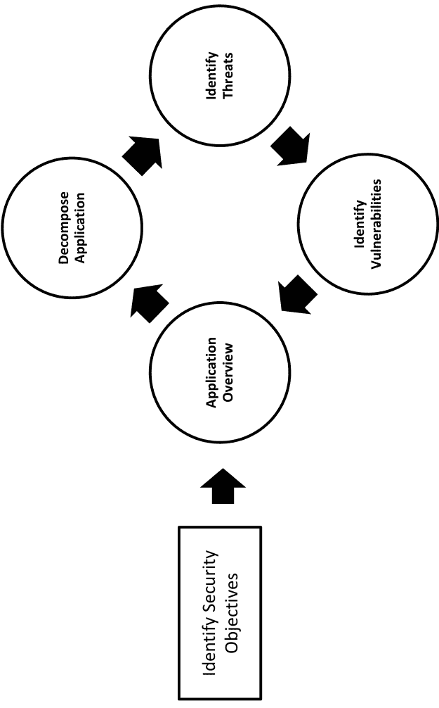

用户上下文不仅影响威胁和漏洞的范围，还可能强烈影响实施优先级。例如，如果您在托管环境中存储客户的信用卡数据，那么来自内部支持人员或员工窃取数据的威胁将比来自未知社区的外部攻击更关键，需要缓解。要从实际威胁建模的角度理解这一点，您应该关注的以用户为中心的视角的一些场景包括：考虑未经授权的软件产品用户是否有任何可能性获得访问权限，同一未经授权的用户是否有任何可能性提升其权限，以及授权或未经授权的用户是否可能访问管理功能或直接访问后端数据库内容并滥用权限。最坏的场景之一是：未经授权的用户可能攻破 Web/前端服务器，并获得服务器上所有可用资源的提升权限；这将提供利用信任关系从访问/事件日志或配置文件中获取关键信息的未经授权访问的能力。在威胁建模过程中，您必须始终像攻击者一样思考，并假设软件产品的所有输入都可能是恶意的，并且所有信任边界都可能在第一级（即软件产品与最终用户之间的第一个交互层）被攻破。²

威胁建模的目标是通过分解软件应用程序并了解其如何与外部实体交互来获得对其的理解。这是通过收集信息并将其记录到明确定义的结构中来实现的，以确保收集正确的信息。从安全角度来看，威胁建模的关键目标是了解成功是什么样子，为了实现这一目标，您需要一套安全成功标准基准。2006 年 MSDN 杂志上发表了一份此类项目的有用列表，现予以复现：

#### 设计原则

- 开放式设计：假设攻击者拥有源代码和规格。
- 安全默认：失败即关闭；无单点故障。
- 最小权限：不超过所需的权限。
- 机制简约：保持简单，愚蠢。
- 权限分离：不要基于单一条件允许操作。
- 全面中介：每次检查一切。
- 最小共同机制：警惕共享资源。
- 心理可接受性：他们会使用它吗？

#### 安全属性

- 机密性：数据仅可供预期访问的人员使用。
- 完整性：数据和系统资源仅由适当人员以适当方式更改。
- 可用性：系统在需要时可用，并且性能可接受。
- 身份验证：建立用户身份（或者您愿意接受匿名用户）。
- 授权：用户被明确允许或拒绝访问资源。
- 不可否认性：用户无法执行操作后又否认执行过。³

威胁建模涉及的关键步骤如下：⁴

- 1. 使用数据流图分解产品架构
- 2. 使用 STRIDE 威胁类别识别数据流图中每个元素适用的威胁。
- 3. 在使用场景的上下文中，将所有威胁与相关漏洞映射（如适用）。
- 4. 对威胁进行排序。为每个威胁和漏洞分配风险等级以了解影响；这将有助于定义修复优先级。使用 DREAD 或其他方法论。
- 5. 为每个已识别的漏洞定义缓解计划/对策。
- 6. 按前面步骤决定的优先级顺序修复业务不可接受的漏洞。

### 4.3.2 数据流图

威胁建模过程的第一步是以图表形式开发威胁流的可视化表示，该图表通常在白板会议期间绘制。为该过程提供结构非常重要。提供结构有助于避免错误。如果没有好的图表，您可能无法建立良好的威胁模型。首先，重要的是要明白，这项练习是关于数据流而不是代码流。这是团队开发人员经常犯的错误，因为他们生活、呼吸和饮食都是代码开发，通常不关注他们正在开发的代码的数据安全。因此，威胁建模过程这一阶段生成的图表被称为数据流图或 DFD，这不足为奇。DFD 的重点在于数据如何通过软件解决方案移动以及数据在移动过程中发生什么，通过提供软件处理数据的可视化表示，让我们更好地了解软件的工作原理及其底层架构。该可视化表示具有层次结构，因此允许您将软件架构分解为子系统，然后是更低级别的子系统。在高层次上，这允许您澄清正在建模的应用程序范围；在较低级别上，它允许您专注于处理特定数据时涉及的特定过程。

在开始开发 DFD 之前，了解您将要使用的元素图像始终是个好主意。DFD 中通常使用的基本元素和符号如图 4.3 所示。您通过将这些元素作为数据流连接起来，并在适当的位置在元素之间应用边界来构建 DFD。

DFD 的第一个示例是用于 Web 应用程序威胁建模的数据流图，如图 4.4 所示。此数据流图表示客户和远程员工从公司网站访问企业营销数据的过程。第一个也是最明显的安全控制区分了公司员工的文件访问与客户的文件访问。员工数据可能包含仅授权给公司员工的公司 IP 信息，并且根据其角色，可能包含仅授权给有“需要知道”的员工的非常敏感的竞争性营销和定价数据。


| 元素类型 | 类型描述 | 元素符号 |
| :--- | :--- | :--- |
| 外部元素 | 一个在您控制之外且位于软件应用程序之外的元素，但可以通过入口点与被建模的软件进行调用或交互。 | [矩形] |
| 进程 | 这表示处理软件内数据的任务。该任务可能会根据数据进行处理或执行任务。 | [圆形] |
| 多个进程 | 这用于表示数据的子进程集合，通常表示将涉及另一个DFD，在这种情况下，其子进程被分解并扩展到其他DFD中。 | [双圆] |
| 数据存储 | 这表示数据存储但不修改的位置。 | [两条平行线] |
| 数据流 | 这表示软件内数据的移动，其移动方向由箭头表示。 | [弯曲箭头] |
| 信任边界 | 当一个组件不信任边界另一侧的组件时，就会出现信任边界。信任边界始终存在于运行在不同特权级别的元素之间。不同特权级别相同的不同组件之间也可能存在信任边界。 | [虚线曲线] |

图 4.4 应用威胁建模的数据流图示例。

磁盘上的网页
企业网站
远程员工
客户
企业营销产品资料数据库
数据库文件
用户/Web服务器边界
用户/Web服务器边界
数据
SQL查询调用

图 4.5 基于云的应用程序数据流图示例。

通过Web、API和应用访问服务
SaaS服务 [云服务]
客户
云运营/SaaS运营
客户数据
客户/服务提供商信任边界
客户/服务提供商信任边界
请求
响应
数据

图4.4中的DFD仅用于说明目的，不代表开发应用程序的最佳方式。更仔细地检查流程图，我们注意到以下几点：

- 员工和客户数据之间没有分段。
- 远程员工在访问站点数据之前似乎没有双因素身份验证（例如，VPN）。
- Web应用程序中应包含的分层结构未完全开发（或至少不属于此DFD的一部分）。这可能会简化图表，但也可能隐藏一些用例和流程。

图4.5中的DFD是提供给客户的SaaS服务示例。与传统Web应用程序不同，此DFD显示了客户如何通过云提供商访问服务的示例。最明显的安全控制是通过云运营保护客户数据。客户可以通过多种方式访问服务——通过API调用、Web应用程序或自定义应用程序开发。

更仔细地检查流程图，我们注意到以下几点：

- 通过API或Web访问应用程序之间没有区别。
- 云运营是更详细云运营架构的高级抽象。
- DFD没有告诉我们不同客户之间的分段信息。
- 它也没有显示数据有多安全——也就是说，数据是否加密，Web服务器是否只与集群中的数据库服务器通信，还是通信是任意对任意？

正确绘制DFD是构建正确威胁模型的关键。花足够的时间在你的DFD上，确保系统的所有部分都已表示。每个元素（进程、数据存储、数据流和交互者）都有一组其易受攻击的威胁，如图4.6所示。此图表连同你的DFD，为你提供了一个调查系统可能如何失败的框架。⁵

| | 数据流 | 数据存储 | 进程 | 外部 |
|---|---|---|---|---|
| 伪造 | | | ✓ | ✓ |
| 篡改 | ✓ | | ✓ | |
| 否认 | | ✓ * | ✓ | ✓ |
| 信息泄露 | ✓ | ✓ | ✓ | |
| 拒绝服务 | ✓ | ✓ | ✓ | |
| 提升特权 | | | ✓ | |

图 4.6 影响元素的威胁。（*对于日志数据存储，存在关于否认问题的担忧，以及针对数据存储删除日志的攻击。应使用一组问题使这些威胁更具体和易于访问，以使此评估更完整。⁶）

DFD过程不仅要求你像攻击者一样思考，还可能要求你像多个攻击者一样思考，特别是如果您的软件产品将在云或SaaS环境中运行。完成DFD后，您应该准确了解软件如何处理数据，包括数据如何移动以及在应用程序及其他可能关联的应用程序中对数据做了什么。DFD的高层级澄清了应用程序的范围，而较低层级澄清了处理特定数据时涉及的进程。

### 4.3.3 架构威胁分析和威胁排序

#### 4.3.3.1 威胁确定

确定威胁的第一步是采用一种方法，以便对威胁进行分类。这使您能够以结构化且可重复的方式系统地识别软件应用程序中的威胁类别集。STRIDE是一种威胁分类方法，几年前由Microsoft推广，将在本章中作为威胁确定工具的示例使用，但这当然不是唯一可使用的方法。缩写STRIDE中的每个字母都有助于分类攻击者目标：

- 伪造
- 篡改
- 否认
- 信息泄露
- 拒绝服务
- 提升特权⁷

STRIDE的第一步是将系统分解为相关组件，然后分析每个组件对威胁的易感性，最后缓解威胁。然后重复该过程，直到您对任何剩余威胁感到满意为止。然后系统被认为是安全的，因为您已将软件应用程序和系统分解为单个组件并缓解了每个组件的威胁。当然，此方法存在缺陷，即软件和系统的单个组件可能是更大系统的一部分，而您的安全性取决于最薄弱的环节。软件产品和系统的单个组件在隔离状态下可能不易受到威胁，但一旦成为更大系统的一部分，它们可能会受到威胁。这对于未设计用于在Internet、云或SaaS环境中使用的软件产品尤其正确。

STRIDE各类别中的一般威胁及其可能影响的安全控制包括以下内容：

- 伪造：旨在非法访问和使用其他用户凭据（如用户名和密码）的威胁行为——*身份验证*
- 篡改：旨在恶意更改/修改持久数据（例如数据库中的持久数据）以及通过开放网络（例如Internet）在两台计算机之间传输的数据的威胁行为——*完整性*
- 否认：旨在执行系统中无法追踪禁止操作的非法操作的威胁行为——*不可否认性*
- 信息泄露：读取未获授权访问的文件或读取传输中数据的威胁行为——机密性
- 拒绝服务：旨在拒绝合法用户访问（例如使Web服务器暂时不可用）的威胁——可用性
- 提升特权：旨在获得对资源的特权访问以获取未授权的信息访问权限或破坏系统的威胁——授权⁸

#### 4.3.3.2 威胁分析

完成DFD后，您应该识别输入验证、身份验证、授权、配置管理以及应用程序最容易受到漏洞影响的其他领域的设计和实施方法，创建所谓的安全配置文件。

在分析软件应用程序设计和实现的每个方面时通常会提出的问题的一个实际示例如下：我们将这些分为输入验证、身份验证、授权、配置管理、敏感数据、会话管理、加密、异常管理、参数操纵以及审计和日志等广泛类别。

### 输入验证

其背后的理由是，所有用户输入都应被视为不可信，并在用于软件之前进行验证。以下是输入验证的相关问题：

- 1. 是否验证了所有输入数据？
- 2. 攻击者是否可以将命令或恶意数据注入应用程序？
- 3. 数据在不同信任边界之间传递时（由接收入口点）是否经过验证？
- 4. 数据库中的数据是否可信？
- 5. 您更倾向于对用户输入使用白名单还是黑名单？

### 身份验证

所有用户（和软件/API）与整体系统的交互都应经过深思熟虑，并通过身份验证进行验证。在验证用户/系统/API/组件是否合法之前，不应提供任何服务和功能。是否可以使用功能涉及授权。身份验证的典型问题如下：

- 1. 凭据在通过网络传输时是否受到保护？
- 2. 是否使用了强帐户策略？
- 3. 是否强制使用强密码？
- 4. 您是否使用证书？是否正在使用通配符证书？
- 5. 用户密码是否使用密码验证器（使用单向哈希）？
- 6. 系统组件如何相互身份验证（例如，服务如何向数据库进行身份验证）？


- 7. 在服务/应用程序启动过程中，系统组件如何相互进行身份验证？
- 8. 是否使用密钥而非密码进行身份验证？

## 授权

很多时候，我们希望限制用户/系统/API/组件访问软件系统中的某些功能。授权使我们能够做到这一点——即，防止某些代理执行某些操作。与授权相关的典型问题如下：

- 1. 应用程序入口点使用了哪些守门人？
- 2. 数据库中如何强制执行授权？
- 3. 是否采用了纵深防御策略？
- 4. 是否仅在凭据成功确认后才允许访问，并且安全失败？

## 配置管理

配置管理使我们能够加固软件、系统、服务和设备并将其锁定，从而降低环境风险。配置管理的组件包括加固标准和指南、审查应用程序对服务的依赖、查看用户和管理员界面、安全变更管理等等。问题大致如下：

- 1. 应用程序支持哪些管理界面？
- 2. 它们如何得到保护？
- 3. 远程管理如何得到保护？
- 4. 使用了哪些配置存储，它们如何得到保护？
- 5. 是否为软件栈（操作系统、数据库、应用程序）制定了加固标准？
- 6. 软件系统是否提供了一种方法来检测已批准的安全配置更改的偏差？
- 7. 所有团队（IT、QA、工程、运维）是否仅为操作系统、数据库、Web和应用程序服务器等不同组件使用已批准（黄金主映像或加固）的软件映像？
- 8. 已批准的映像是否从开发到部署的整个生命周期中都被使用？

## 敏感数据

此方面涉及应用程序和系统所处理的数据类型的意识。在许多情况下，我们发现开发人员和运维团队对其应用程序将处理的数据类型（无论是设计上的还是错误的）缺乏足够的认识或教育，以及保护是否足以保护数据元素。

- 1. 应用程序处理哪些敏感数据？
- 2. 哪些法规/合规要求适用于数据/数据元素？
- 3. 它在网络上和持久存储中如何得到保护？考虑到法律/法规要求，这足够好吗？
- 4. 使用了哪种加密类型，加密密钥如何得到保护？
- 5. 敏感数据元素是否存在于日志、源代码或配置（例如，XML）文件中？

## 会话管理

安全地建立和维护会话的完整性是当今应用程序（特别是Web应用程序）的关键组成部分之一。一旦用户经过身份验证，就会建立一个会话。这可能导致多种场景，其中会话可能被滥用。会话管理专注于防止此类滥用。针对该方面提出的问题通常大致如下：

- 1. 会话Cookie如何生成？
- 2. 它们如何得到保护以防止会话劫持？
- 3. 持久会话状态如何得到保护？
- 4. 会话信息存储在哪里？在服务器端还是客户端？
- 5. 会话状态在跨越网络时如何得到保护？
- 6. 应用程序如何与会话存储进行身份验证？
- 7. 凭据是否通过网络传输，并且是否由应用程序维护？如果是，它们如何得到保护？
- 8. 如何处理用户/组件的多个会话？

## 密码学

每个人都使用密码学。密码学往往为大多数开发人员和用户提供了一种安全感。然而，根据我们的经验，正确使用密码学并不常见。使用密码学来解决错误的问题往往会导致沮丧甚至暴露。在处理密码学时，最好坚持使用经过充分测试、公开可用的算法和库。关于密码学的问题可以包括以下内容：

- 1. 密码学将解决什么问题（机密性、完整性或两者）？
- 2. 使用了哪些算法和密码技术？
- 3. 是否使用了任何专有或内部算法？
- 4. 加密密钥有多长，它们如何得到保护？
- 5. 应用程序是否实现了自己的加密？
- 6. 密钥多久轮换一次？证书是否检查其有效性？证书是否针对吊销列表进行检查？

## 参数操纵

应用程序通常传递参数以与另一端进行通信。参数范围从（不太重要的）迭代器、变量名和值到会话令牌。中间人（MITM）攻击和故意的参数篡改使得我们必须设计一种机制来检测接收到的参数是否确实安全，并可以按设计使用。这里的关键在于接收方——就像输入验证一样，不要盲目信任参数。

- 1. 应用程序是否检测被篡改的参数？
- 2. 应用程序是否仅依赖客户端验证，还是也有服务器端验证？
- 3. 它是否验证表单字段、视图状态、Cookie数据和HTTP标头中的所有参数？
- 4. 参数是否直接用于数据库查询？
- 5. 参数是否直接反射回浏览器？

## 异常管理

优雅地处理错误条件和异常对软件应用程序至关重要。通常，开发人员会错过此类条件或处理不当。不当的错误处理/异常管理的副作用范围从拒绝服务到信息泄露。用于探测此方面的示例问题如下：

- 1. 应用程序如何处理错误条件？
- 2. 是否有默认的异常捕获？
- 3. 是否允许异常传播回客户端？
- 4. 是否使用不包含可利用信息的通用错误消息？
- 5. 异常是否会将任何敏感信息记录到日志中？
- 6. 是否使用编程语言的内置功能来实现此目的，还是开发人员依赖内部模块？

## 审计和日志

审计和日志对于安全、运维、调试、合规和法律原因至关重要。运维和调试通常是审计/日志的驱动因素，尽管安全要求今天被视为不可或缺。以下是可用于了解审计和日志的示例问题：

- 1. 您的应用程序是否在所有服务器的所有层级上审计活动？
- 2. 日志文件如何得到保护？
- 3. 应用程序是否记录任何敏感信息（例如，凭据、数据元素、会话令牌）？
- 4. 日志文件是否安全传输（例如，TCP/TLS）？
- 5. 日志文件的保留期是否明确定义？是否与法规和法律要求保持一致？
- 6. 日志多久轮换一次？
- 7. 是否为某些类型的事件定义了触发级别？

现在您已对威胁有了可视化表示，并已回答了上述问题，下一步是识别可能影响您软件应用程序的威胁。这也是您将软件安全组和开发团队的元素聚集在一起进行白板会议，为威胁建模中识别的漏洞头脑风暴出具有成本效益且切实可行的解决方案的地方。攻击者的目标在STRIDE评估期间与威胁和问题相关联。这是从相对较高的架构和多功能角度完成的，考虑到头脑风暴团队的构成。使用任何可用的分类威胁列表并将其应用于先前识别的任何漏洞也是常见做法。

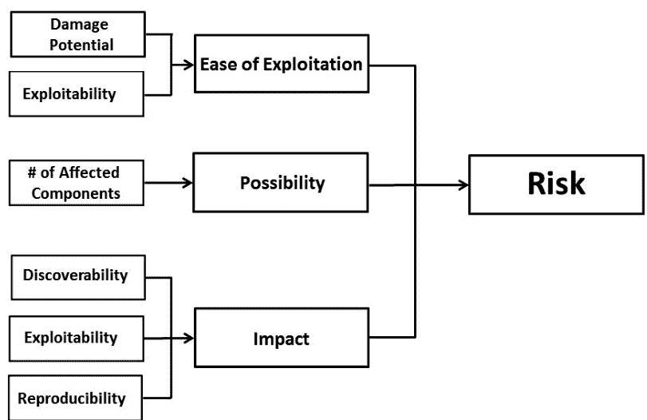

图 4.7 风险评估过程。

使用攻击树和攻击模式是威胁评估的一种传统方法，可以帮助您识别其他潜在威胁。虽然攻击模式代表常见的已知攻击，但将其与攻击树结合使用可以进行更深入的分析，突出显示您在初始分析或通过使用已知威胁的分类列表时可能遗漏的区域。由于攻击树采用层次结构、结构化和流程图样式，它们提供了攻击的绝佳可视化表示，并有助于将精力集中在避免或缓解此类攻击的其他潜在方法上。它们也有助于创建测试计划和评估安全成本。由于攻击模式、攻击者技术和STRIDE的主要关注点是攻击者的目标，将它们与攻击树结合使用有助于为这一过程带来整体方法，尤其是在面对面的头脑风暴会议中使用时。

在您进入威胁建模和架构风险评估过程的下一阶段并开始为风险分配值之前，重要的是要确保您已针对利用的难易程度、可能性和影响解决了风险。图4.7展示了在进入下一步之前您必须拥有的知识的可视化表示。如果您没有解决风险领域所需的信息，则需要回顾整个过程并填补您的知识和理解中的空白。

#### 4.3.3.3 对威胁进行排序

在威胁建模和架构安全分析的最后阶段，威胁从风险角度进行排序。鉴于从经济角度来看可能无法缓解


所有已识别的威胁均按从高到低的风险排序。由于威胁发生的可能性极低，此外，即使漏洞被利用造成的危害也有限，因此某些威胁也可能被忽略。按风险排序的威胁优先级列表将大大有助于确定缓解措施的优先级和重要性。从高层次来看，这些风险通常分为高、中、低三个等级。工业中使用的典型风险概率公式表明，特定漏洞的风险及其后果等于威胁发生的概率乘以损害潜力。即，

# Risk = Probability × Damage Potential

在风险概率计算中，通常采用10级量表，其中数字1表示发生可能性最低的威胁或威胁组成部分，数字10表示发生可能性最高的威胁。同样的1到10排序系统也用于评定损害潜力，其中1表示损害潜力最小，10表示损害潜力最大。

作为所涉机制的示例，一个发生可能性中等、概率风险评分为5、损害潜力高（为10）的威胁，其风险等同于概率风险评分为10、损害风险潜力中等（为5）的威胁。在数学上，

```
If Probability = 5 and Damage Potential = 10, then Risk = 5 × 10 = 50%
If Probability = 10 and Damage Potential = 5, then Risk = 10 × 5 = 50%
```

从该示例可以看出，100可以分为三个数值范围，以表示高、中或低风险等级。显然，您修复漏洞的优先级应从最高优先级的风险开始，这可能意味着需要立即采取缓解措施。随后，您应处理中等风险的漏洞，这应在之后尽快完成，但优先级较低。如前所述，低风险的优先级将取决于与风险相关的工作量、暴露程度以及财务或法律风险。

#### 4.3.3.4 DREAD

在软件开发过程中评估漏洞时，可以使用多种不同的风险模型，但微软使用的DREAD模型是最流行的模型之一。缩写词DREAD代表损害潜力（Damage potential）、可重现性（Reproducibility）、可利用性（Exploitability）、受影响用户（Affected users）和可发现性（Discoverability）。用于为每个要素建立风险等级的问题的答案会产生0到10之间的数字；数字越高，风险越严重。这些数字用作分类方案，用于量化、比较和确定每个评估威胁所呈现的风险量，并以数字形式计算总体风险，以便威胁可以与软件应用程序中发现的任何其他风险进行排名和排序。

如下所示的DREAD算法用于计算风险值，该值是所有五个类别的平均值：

```
Risk_DREAD = (DAMAGE + REPRODUCIBILITY + EXPLOITABILITY + AFFECTED USERS + DISCOVERABILITY)/5
```

以下是通过提问来量化DREAD类别，从而得出给定威胁风险等级的一些示例：11

### 损害潜力

- 如果发生威胁利用，将造成多大损害？
  - 0 = 无
  - 5 = 单个用户数据被泄露或受影响
  - 10 = 完整系统或数据被破坏

### 可重现性

- 重现威胁利用有多容易？
  - 0 = 非常困难或不可能，即使是应用程序的管理员
  - 5 = 需要一两个步骤；可能需要是授权用户
  - 10 = 只需一个网页浏览器，地址栏就足够了，无需身份验证

### 可利用性

- 利用此威胁需要什么？
  - 0 = 高级编程和网络知识，配合自定义或高级攻击工具
  - 5 = 互联网上存在恶意软件，或使用可用攻击工具可以轻松执行利用
  - 10 = 只需一个网页浏览器

### 受影响用户

- 将有多少用户受到影响？
  - 0 = 无
  - 5 = 一些用户，但不是全部
  - 10 = 所有用户

### 可发现性

- 发现此威胁有多容易？
  - 0 = 非常困难或不可能；需要源代码或管理访问权限
  - 5 = 可以通过猜测或监控网络痕迹来发现
  - 9 = 此类故障的详细信息已经在公共领域，可以使用搜索引擎轻松发现
  - 10 = 信息在网页浏览器地址栏或表单中可见

下一步是根据您的答案，将每个DREAD类别的威胁评级分类为低（值=1）、中（值=2）或高（值=3）。以下显示了每个DREAD类别中表示低、中或高风险的答案：12

### 损害潜力

- 低（值 = 1）：泄露无关紧要的信息。
- 中（值 = 2）：泄露敏感信息。
- 高（值 = 3）：攻击者可以破坏安全系统；获得完全信任授权；以管理员身份运行；上传内容。

### 可重现性

- 低（值 = 1）：攻击非常难以重现，即使知道安全漏洞。
- 中（值 = 2）：攻击可以重现，但仅限于特定的时间窗口和竞争情况。
- 高（值 = 3）：攻击可以每次都重现，且不需要时间窗口。

### 可利用性

- 低（值 = 1）：每次利用攻击都需要极其熟练的人员和深入的知识。
- 中（值 = 2）：熟练的程序员可以发起攻击，然后重复步骤。
- 高（值 = 3）：初级程序员可以在短时间内发起攻击。

### 受影响用户

- 低（值 = 1）：用户比例非常小，冷门功能；影响匿名用户。
- 中（值 = 2）：一些用户，非默认配置。
- 高（值 = 3）：所有用户，默认配置，关键客户。

### 可发现性

- 低（值 = 1）：漏洞很冷门，用户不太可能评估出损害潜力。
- 中（值 = 2）：漏洞位于产品很少使用的部分，只有少数用户会遇到。需要一些思考才能看出其恶意用途。
- 高（值 = 3）：已发布的信息解释了攻击。漏洞存在于最常用的功能中，且非常明显。

| DREAD 类别 | 低风险 (1) | 中风险 (2) | 高风险 (3) | 小计风险得分 |
|---|---|---|---|---|
| 损害潜力 (D) | | | | |
| 可重现性 (R) | | | | |
| 可利用性 (E) | | | | |
| 受影响用户 (A) | | | | |
| 可发现性 (D) | | | | 总体风险得分 |
| | | | | |

图 4.8 DREAD威胁评级表。

然后可以将这些数字放入类似于图 4.8 所示的矩阵中。在为给定威胁计算并求和数值后，结果将落在 5 到 15 的范围内。总体评级为 12 到 15 的威胁通常被视为高风险，评级为 8 到 11 的视为中风险，评级为 5 到 7 的视为低风险。

#### 4.3.3.5 Web 应用程序安全框架

Web 应用程序安全框架（也称为应用程序安全框架，ASF）使用类别来组织针对 Web 软件应用程序的常见安全漏洞。如果在审查应用程序设计以创建威胁模型时使用这些类别，您可以系统地揭示特定于您的应用程序架构的威胁和漏洞。共有九个框架类别；该过程中使用的示例问题如下。

### Web 应用程序安全框架类别和评估问题

- **输入和数据验证**
  您如何知道应用程序接收的输入是有效且安全的？输入验证是指您的应用程序在进一步处理之前如何过滤、清理或拒绝输入。考虑通过入口点限制输入，并通过出口点对输出进行编码。您是否信任来自数据库和文件共享等来源的数据？

- **身份验证**
  你是谁？身份验证是一个实体证明另一个实体身份的过程，通常通过凭据（如用户名和密码）来实现。

- **授权**
  你能做什么？授权是您的应用程序为资源和操作提供访问控制的方式。

- **配置管理**
  您的应用程序以什么身份运行？它连接到哪些数据库？如何管理您的应用程序？这些设置如何保护？配置管理是指您的应用程序如何处理这些运营问题。

- **敏感数据**
  您的应用程序如何处理敏感数据？敏感数据是指您的应用程序必须在内存中、通过网络或在持久存储中保护的任何数据的处理方式。

- **会话管理**
  您的应用程序如何处理和保护用户会话？会话是指用户与您的 Web 应用程序之间的一系列相关交互。

- **密码学**
  您如何保密（机密性）？您如何防篡改您的数据或库（完整性）？您如何为必须具有加密强度的随机值提供种子？密码学是指您的应用程序如何强制执行机密性和完整性。


- **异常管理**
当应用程序中的方法调用失败时，您的应用程序会怎么做？您会透露多少信息？您会向最终用户返回友好的错误信息吗？您会将有价值的异常信息传回给调用者吗？您的应用程序能否优雅地失败？

- **审计和日志**
谁在什么时候做了什么？审计和日志是指您的应用程序如何记录与安全相关的事件。

#### 4.3.3.6 通用风险模型

Microsoft 威胁建模流程（如 STRIDE 和 DREAD）可能不适合您的应用程序，您可能希望使用其他威胁风险模型，或为自身使用修改 Microsoft 流程，为自己的组织采用最合适的威胁建模方法。使用高、中、低等定性值也有助于避免排序过于主观，就像 DREAD 中使用的编号系统一样。

这些示例通过为可能性和影响因素分配高、中、低等定性值，有助于计算总体风险值。同样，像 DREAD 模型那样使用定性值而非数值，有助于避免排序过于主观。

更主观模型的一个示例是通用风险模型，它考虑了可能性（例如，攻击的概率）和影响（例如，损害潜力），并以数学方式表示为⁴

Risk = Likelihood × Impact

可能性或概率由利用的难易程度定义，这主要取决于威胁类型和系统特征，以及实现威胁的可能性，这由是否存在适当的对策决定。以下是确定利用难易程度的一组考虑因素：

- 攻击者能否远程利用此漏洞？
- 攻击者是否需要经过身份验证？
- 利用过程能否自动化？

影响主要取决于损害潜力和影响的范围，例如受威胁影响的组件数量。确定损害潜力的示例如下：

- 攻击者能否完全接管并操纵系统？
- 攻击者能否获得系统的管理访问权限？
- 攻击者能否使系统崩溃？
- 攻击者能否访问敏感信息（如密钥、PII）？

确定受威胁影响的组件数量的示例包括：

- 可能受影响的数据源和系统有多少个？
- 威胁代理能进入基础设施多“深”？

#### 4.3.3.7 Trike

STRIDE 和 DREAD 的替代威胁建模方法是 Trike。Trike 是一种统一的概念框架，用于从风险管理角度进行安全审计，通过以可靠、可重复的方式生成威胁模型。¹⁵ Trike 使用的威胁建模框架与 Microsoft 的威胁建模方法类似。然而，Trike 的不同之处在于，它使用基于风险的方法，具有独立的实现、威胁和风险模型，而不是使用 STRIDE/DREAD 聚合威胁模型（攻击、威胁和弱点）。¹⁶

Trike 与其他威胁建模方法的区别在于系统中可能实现的高度自动化、系统的防御视角以及方法中存在的形式化程度。¹⁷ Trike 工具的最新版本可在 SourceForge® 网站 http://sourceforge.net/projects/trike/files/trike 下载。

安全审计团队可以使用它来描述系统从高级架构到低级实现细节的安全特性。Trike 的目标是自动化威胁建模中的重复部分。Trike 根据系统描述自动生成威胁（和一些攻击），但这要求用户向 Trike 描述系统并检查这些威胁和攻击是否适用。¹⁸ Trike 的一个关键要素是与关键利益相关者进行授权、参与和沟通，并完全透明地展示进度和任务状态，以便他们了解风险水平，并在整个软件开发过程中评估风险的可接受性。

#### 4.3.3.8 攻击模拟和威胁分析流程（PASTA）

2011 年，由 Marco Morana 和 Tony Uceda Velez 开发的一种新的应用程序威胁建模方法被提出。PASTA 是一个七步流程，适用于大多数应用程序开发方法论，并且与平台无关。它不仅将业务目标与技术要求相协调，还考虑了合规要求、业务影响分析以及威胁管理、枚举和评分的动态方法。该流程从明确定义业务目标、安全和合规要求以及业务影响分析开始。类似于 Microsoft 流程，应用程序被分解为组件，并使用用例图和 DFD 来说明威胁模型，从而可以进行威胁和漏洞分析。下一步涉及使用威胁树、滥用用例、评分系统和枚举，以便在分析中进一步参考。随后，通过攻击树中的攻击建模和攻击面分析，从攻击者的角度查看威胁模型。在最后一步，可以对风险和业务影响进行定性和定量分析，并确定必要的对策。该流程结合了各种威胁建模方法的优点，攻击树作为一种以攻击者为中心的查看威胁的手段，同时，结合风险和影响分析，有助于创建以资产为中心的缓解策略规划手段。威胁树将威胁映射到现有漏洞，有利于实现易于管理和可扩展的威胁管理。除了技术方面之外，风险和业务影响分析使威胁建模不仅仅是一项软件开发练习，还涉及关键决策者参与漏洞管理流程。与 Trike 不同，该方法的区别在于它侧重于在流程的最后阶段引入风险管理步骤。这确保了它不局限于特定的风险估算公式。¹⁹

七步 PASTA 威胁建模方法如下：20

### 1. 定义目标

- 识别业务目标。
- 识别安全和合规要求。
- 业务影响分析。

### 2. 定义技术范围

- 捕获技术环境的边界。
- 捕获基础设施、应用程序和软件依赖项。

### 3. 应用程序分解

- 识别用例并定义应用程序入口点和信任级别。
- 识别参与者、资产、服务、角色和数据源。
- 数据流图和信任边界。

### 4. 威胁分析

- 概率攻击场景分析。
- 安全事件回归分析。
- 威胁情报关联和分析。

### 5. 漏洞和弱点分析

- 查询现有漏洞报告和问题跟踪。
- 使用威胁树将威胁映射到现有漏洞。
- 使用用例和滥用用例进行设计缺陷分析。
- 评分（CVSS/CWSS）和枚举（CWE™/CVE®）。

### 6. 攻击建模

- 攻击面分析。
- 攻击树开发和攻击库管理。
- 使用攻击树进行攻击到漏洞和利用分析。

### 7. 风险和影响分析

- 对业务影响进行定性和定量分析。
- 对策识别和剩余风险分析。
- 确定风险缓解策略。

有一种名为 ThreatModeler® 的威胁建模工具支持 PASTA 方法论。ThreatModeler 是一种威胁建模产品，将思维导图方法引入威胁建模。它允许公司轻松且毫不费力地将威胁建模计划扩展到数千个应用程序。ThreatModeler 自动生成威胁并将其分类到各种风险类别下。它提供了一个集中式威胁管理平台，组织可以在其中定义与网络、主机、应用程序、移动设备、Web 服务等相关的威胁，并关联技术影响、业务影响和威胁代理等属性，以更好地了解威胁并确定缓解策略的优先级。21,22

尽管其最初关注点是银行恶意软件威胁，但 PASTA 当然适用于所有软件应用程序，并将很好地适应大多数 SDLC。未来几年，看看它在行业中被广泛接受的程度将会很有趣。


#### 4.3.3.9 CVSS

另一种非常流行的风险评估方法，被企业产品安全事件响应团队（PSIRT）和内部软件安全团队广泛用于对外部发现的软件漏洞进行分类，即美国政府的通用漏洞评分系统（CVSS）。国家基础设施咨询委员会（NIAC）委托开发 CVSS 以支持全球漏洞披露框架。CVSS 目前由事件响应和安全团队论坛（FIRST）维护，23 并且是许多公司共同努力的结果，包括 CERT®/CC、Cisco Systems、DHS/MITRE®、eBay®、IBM® Internet Security Systems (ISS®)、Microsoft、Qualys® 和 Symantec®。CVSS 模型旨在为最终用户提供一个代表漏洞严重性和风险的综合评分。它源自度量和公式。度量分为三个不同的类别，可以定量或定性测量。基础度量包含任何给定漏洞固有的特性；这些特性不会随时间或不同环境而改变。时间度量包含漏洞在其生命周期内演变的特性。环境度量包含与特定用户环境中的实现相关的漏洞特性。评分是根据特定公式结合所有度量值的过程，并基于一系列称为基于专家评估的度量的测量，如下所述：24

- 基础评分由供应商或发起者计算，意图是发布，一旦设置后不应更改。基础评分也基于机密性、完整性和可用性计算。这是由时间度量和环境度量修改的基础。基础分对最终评分影响最大，并代表漏洞严重性。
- 时间评分也由供应商和协调者计算以供发布，并修改基础评分。它允许引入缓解因素以降低漏洞评分，并旨在随着漏洞老化在特定间隔重新评估。时间评分代表特定时间点的漏洞紧急程度。
- 环境评分可选由最终用户组织计算，并调整组合的基础-时间评分。这个调整后的组合评分应被视为最终评分，代表特定环境下的某一时刻。用户组织应使用此评分在其自身环境中优先处理响应。

一个有用的工具是通用漏洞评分系统 3.1 版计算器，可在 https://www.first.org/cvss/calculator/3.1 找到。

CVSS 已成为评估计算机系统安全漏洞严重性的行业标准。它建立了一种衡量标准，用于衡量漏洞相对于其他漏洞应引起多少关注，以便可以优先处理缓解工作。截至本书撰写时，CVSS 的当前版本为 3.1 版。

CVSS 通常由内部软件安全组研究人员或其他已通知您软件产品存在漏洞的来源使用。这提供了保持严重性评级标准化、一致和准确的能力。这些评分还用于向客户传达，确认他们购买的产品中存在漏洞、漏洞的严重性以及贵公司正在采取什么措施来缓解该漏洞，包括针对该漏洞的任何补丁发布。同样，安全研究人员可能会使用 CVSS 排名系统向其发现漏洞的软件产品所属公司提供风险评级，以便供应商了解正在披露的漏洞的严重性，以及需要与其产品开发团队核实的详细信息。

应注意的是，CVSS 不是威胁建模方法，也不用于查找或减少攻击面或帮助指定代码中的风险。相反，它是一种风险评分系统，并增加了 STRIDE 和 DREAD 中不存在的复杂性。它用于计算产品发布后识别的风险，以及环境因素。

#### 4.3.3.10 OCTAVE®

操作关键威胁、资产和漏洞评估（OCTAVE）是一种非常复杂的风险方法论方法，起源于卡内基梅隆大学软件工程研究所（SEI），与 SEI 计算机应急响应小组（CERT）合作。OCTAVE 关注组织风险，而非技术风险。它包含一套用于基于风险的信息安全战略评估和规划的工具、技术和方法。OCTAVE 有三种方法：（1）原始 OCTAVE 方法，构成了 OCTAVE 知识体系的基础；（2）OCTAVE-S，适用于较小的组织；（3）OCTAVE-Allegro，一种用于信息安全评估和保证的精简方法。所有方法都有特定的实践、配置文件和工作表目录，用于记录建模结果。OCTAVE 方法建立在 OCTAVE 标准之上——一种用于风险驱动和基于实践的信息安全评估的标准方法。OCTAVE 标准确立了 OCTAVE 方法使用的风险管理的基本原则和属性。25

OCTAVE 是一种有价值的结构化方法，用于记录和衡量整体 IT 安全风险，特别是当它与企业 IT 和业务风险管理相关，以及记录完整系统周围的风险变得必要时。尽管软件安全专业人员可能参与评估的一部分，因为构建软件安全到开发过程中的软件或流程可能在其范围内，但它对于在 SDL 过程中建模、定义和排名特定风险和漏洞并不有价值。与 CVSS 评分一样，OCTAVE 不包括威胁风险建模，主要用于枚举风险。它也比大多数其他风险评估和评分方法论复杂得多，因为它包含 18 卷和许多需要处理的工作表。OCTAVE 的全面版本（与适用于小型组织的 OCTAVE-S 不同）定义“可能性”，假设威胁总是会发生，这不适用于许多大型组织。出于这些原因，它不太可能是一种在整个软件开发生命周期中使用的方法。

#### 4.3.3.11 AS/NZS ISO® 31000:2009

澳大利亚/新西兰标准 AS/NZS 4360 最初于 1999 年发布，2004 年修订，是记录和管理风险的世界上第一个正式标准，至今仍是少数几个用于管理风险的正式标准之一。26 AS/NZS ISO 31000:2009 是一个更新的标准，于 2009 年 11 月 20 日发布，用于管理风险并取代 AS/NZS 4360:2004。27

ISO 31000:2009 提供风险管理的原则和通用指南，可供任何公共、私人或社区企业、协会、团体或个人使用。它不特定于任何行业或部门。它可以贯穿组织的整个生命周期，并应用于广泛的活动，包括策略和决策、运营、流程、职能、项目、产品、服务和资产。它也可以应用于任何类型的风险，无论其性质如何，无论是产生正面还是负面后果。尽管 ISO 31000:2009 提供通用指南，但其目的不是促进组织间风险管理的统一性。风险管理计划和框架的设计与实施需要考虑特定组织的不同需求；其特定目标、背景、结构、运营、流程、职能、项目、产品、服务或资产；以及所采用的特定实践。意图是利用 ISO 31000:2009 协调现有和未来标准中的风险管理流程。它为处理特定风险和/或部门的标准提供一种共同方法，并不取代这些标准。28

ISO 31000:2009 不定义执行结构化威胁风险建模练习或指定软件应用程序安全风险的结构化方法的方法论，并且在评估业务或系统性风险方面效果最好，而不是针对技术风险。与 OCTAVE 一样，这种方法论可能由集中式企业风险管理团队使用。软件安全专业人员可能参与评估的一部分，因为他们的软件或构建软件安全到开发过程中的流程可能在范围内，但这种方法论不太可能在 SDL 中作为主要风险方法论使用，因为它对于在 SDLC 过程中建模、定义和排名特定风险和漏洞并不有价值。

### 4.3.4 Risk Mitigation

在进入风险缓解阶段之前，您需要在威胁建模过程中创建高风险漏洞的主列表，包括 STRIDE 或等效方法。这将为您提供一个优先级列表，以便在执行缓解计划时遵循。

您可以通过四种方式来规划缓解并应对威胁：29

- 重新设计流程以消除威胁。
- 按照一般建议应用标准缓解措施。
- 发明新的缓解策略（风险高且耗时）。
- 接受低风险且修复工作量大的漏洞。

在 STRIDE 或应用程序安全框架（ASF）中没有对策的漏洞威胁将被分类，并针对其所属的每个类别中识别的特定威胁采取对策。

#### STRIDE Threat & Mitigation Techniques List

### 身份冒充

- 适当的身份验证
- 保护机密数据
- 不要存储秘密


## 篡改数据
- 适当的授权
- 哈希
- MAC
- 数字签名
- 防篡改协议

## 否认
- 数字签名
- 时间戳
- 审计跟踪

## 信息泄露
- 授权
- 增强隐私的协议
- 加密
- 保护秘密
- 不要存储秘密

## 拒绝服务
- 适当的身份验证
- 适当的授权
- 过滤
- 限流
- 服务质量

## 权限提升
- 以最小权限运行

#### ASF威胁与对策列表

## 身份验证
- 1. 凭据和身份验证令牌在存储和传输过程中均受加密保护。
- 2. 协议能抵御暴力破解、字典攻击和重放攻击。
- 3. 强制执行强密码策略。
- 4. 使用可信服务器身份验证，而非SQL身份验证。
- 5. 密码使用加盐哈希存储。
- 6. 密码重置不会泄露密码提示和有效用户名。

## 授权
- 1. 使用强大的ACL来强制执行对资源的授权访问。
- 2. 使用基于角色的访问控制来限制对特定操作的访问。
- 3. 系统对用户和服务账户遵循最小权限原则。
- 4. 在表现层、业务层和数据访问层中正确配置了权限分离。

## 配置管理
- 1. 使用最小权限进程和不具备管理功能的服务账户。
- 2. 已启用所有管理活动的审计和日志记录。
- 3. 配置文件和管理员界面的访问权限仅限管理员。

## 存储和传输中的数据保护
- 1. 使用标准加密算法和正确的密钥长度。
- 2. 使用哈希消息认证码（HMACs）来保护数据完整性。
- 3. 秘密（例如，密钥、机密数据）在传输和存储过程中均受加密保护。
- 4. 使用内置安全存储来保护密钥。
- 5. 凭据和敏感数据不会以明文形式通过网络发送。

## 数据验证/参数验证
- 1. 强制执行数据类型、格式、长度和范围检查。
- 2. 客户端发送的所有数据均经过验证。
- 3. 没有安全决策基于可被操纵的参数（例如，URL参数）。
- 4. 使用白名单验证进行输入过滤。
- 5. 使用输出编码。

## 错误处理和异常管理
- 1. 所有异常均以结构化方式处理。
- 2. 发生错误和异常时，权限将恢复到适当级别。
- 3. 错误消息经过清理，以免向攻击者泄露任何敏感信息。

## 用户和会话管理
- 1. Cookie中不以明文形式存储任何敏感信息。
- 2. 身份验证Cookie的内容已加密。
- 3. Cookie已配置为过期。
- 4. 会话能抵御重放攻击。
- 5. 使用安全通信通道来保护身份验证Cookie。
- 6. 执行关键功能时，用户被强制重新进行身份验证。
- 7. 登出时会话过期。

## 审计和日志
- 1. 不会记录敏感信息（例如，密码、PII）。
- 2. 对日志文件强制执行访问控制（例如，ACL）以防止未经授权的访问。
- 3. 对日志文件强制执行完整性控制（例如，签名）以提供不可否认性。
- 4. 日志文件为敏感操作提供审计跟踪并记录关键事件。
- 5. 多服务器上的各层已启用审计和日志记录。

在您通过威胁建模/架构安全分析过程识别出软件威胁及其相关缓解策略并对风险进行排序后，可以为通过该过程识别出的每个威胁识别出缓解威胁概要。以下标准用于对该过程得出的最终列表进行分类：

- **已完全缓解的威胁：** 已采取适当对策且不会暴露漏洞或造成影响的威胁。
- **已部分缓解的威胁：** 由一个或多个对策部分缓解的威胁，代表只能被部分利用并造成有限影响的漏洞。
- **未缓解的威胁：** 没有对策且代表可以被完全利用并造成影响的漏洞的威胁。³²

现在您已将威胁分类为上述三类之一，您需要就将采取什么策略做出选择。您的行动选择可能属于以下五种选项之一：

- 1. 什么都不做：例如，抱有最好的希望。
- 2. 通知风险：例如，向用户群体发出风险警告。
- 3. 缓解风险：例如，通过实施对策。
- 4. 接受风险：例如，在评估利用的影响（业务影响）之后。
- 5. 转移风险：例如，通过合同协议和保险。³³

您决定使用上述哪种策略将取决于多个因素：

- • 威胁利用可能产生的影响
- • 其发生的可能性
- • 转移（即保险费用）或避免（即因重新设计而产生的成本或损失）它的成本³⁴

从这个意义上说，风险是指由于潜在行为者、动机和漏洞的存在而导致的、具有重大概率和业务影响的已识别威胁情况。威胁的风险本身并非问题，而是已识别且按严重程度排序、因威胁结果而产生重大业务后果的风险。威胁的概率被单独考虑，因为它受行为者动机以及影响漏洞的具体因素和外部因素的影响。业务影响也是风险的关键要素，受行为者类型（可能是国家、工业或犯罪行为者）以及漏洞具体情况的影响。这可以如图4.9所示进行可视化。

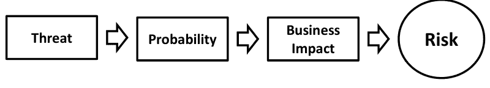

图4.9 风险要素。

在本节中，我们展示了一些可用于评估威胁、排序风险并制定风险缓解计划的选项和标准方法。我们描述的过程在图4.10中进行了可视化。

归根结底，风险评估关乎业务风险，并就软件安全风险、软件交互的系统以及整体业务风险管理策略产生权衡。安全专业人员了解这一点很重要，这就是为什么我们包含了两种流行的整体业务风险评估方法，它们专注于信息安全风险，即OCTAVE和AS/NZS ISO 31000:2009。与软件所处的生态系统一样，用于安全软件开发的风险评估方法也将与整体业务风险管理方法存在交叉点，这些领域需要作为软件风险分析的一部分予以考虑。

最终，这将是一个业务决策。这就是为什么一个决定可能是仅在修复成本低于漏洞被利用可能导致的潜在业务影响时才修复漏洞，或者另一个决定可能是当某些安全控制（例如，机密性、完整性和可用性）的丢失仅导致服务轻微降级而非关键业务功能丢失时接受风险。35

## 4.4 开源选择

近年来，软件行业日益倾向于兼顾开源软件和专有软件的优势，以最低成本提供最高价值。两者的结合被称为“混合源”，正在成为行业的主流做法。随着开源成为软件开发领域越来越重要的一部分，理解和管理软件资产的许可将至关重要，但这超出了我们的讨论范围，将由软件开发团队中的其他人员处理。

关于开源软件是提升软件安全性还是对其有害，一直存在持续的争论，但归根结底，您正在将公司未开发且未进行安全监督的软件导入到您的软件应用程序或解决方案中。这将需要进行广泛的审查，通常称为第三方安全评估，将由您的软件安全架构师、第三方或两者结合进行。尽管依赖工具和对开源开发流程进行粗略审查可能很诱人，但如果没有适当的培训和经验，很容易误解结果，也很难制定可操作的修复策略。这就是为什么高级软件安全架构师或第三方等效人员必须参与此审查过程。他们拥有多年的代码安全审计经验，经常审查和缓解高度复杂和先进的软件安全及架构挑战，知道如何识别


- **威胁建模**
  - 识别安全目标
  - 审查应用程序
  - 分解它
  - 识别威胁
  - 识别漏洞

### 架构威胁分析

### 威胁排序

### 风险分析

### 风险缓解计划

并检查设计中的易受攻击点，并可发现可能导致安全妥协的缺陷。如果没有适当的培训和经验，很容易误解结果，也难以制定任何必要的可操作的补救策略。基本上，对软件产品中使用的任何开源软件或组件的审查，都需要由经验丰富的软件安全架构师进行工具评估和后续威胁建模以及风险评估。

## 4.5 隐私信息收集与分析

在 SDLC 早期考虑系统是否会传输、存储或创建可能被视为隐私信息的信息非常重要。信息的收集、识别以及制定实施适当保障措施和安全控制的计划（包括处理隐私信息事件处理和报告要求的流程），都在此阶段确定。SDL 的这一阶段是隐私影响评估（PIA）信息收集和分析的开始。分析阶段确定如何处理 PII，以确保其符合适用的隐私法律、法规和政策要求，以及在正在开发的软件和整体系统中（或其可能在云或 SaaS 环境中与之接口的系统）以可识别形式收集、维护和传播隐私信息的风险和影响，并且它会检查和评估处理信息的保护措施和替代流程，以减轻潜在的隐私风险。

## 4.6 关键成功因素和指标

### 4.6.1 关键成功因素

我们 SDL 模型中第二阶段的成功取决于 SDLC 在多大程度上识别了功能和集成中的威胁、要求和约束并降低了风险。第二阶段的关键成功因素列于表 4.1 中。

### 表 4.1 关键成功因素

| 关键成功因素 | 描述 |
|---|---|
| 1. 业务需求和风险识别 | 按 CIA 定义的业务需求和风险映射 |
| 2. 有效的威胁建模 | 识别软件的威胁 |
| 3. 有效的架构威胁分析 | 分析针对软件的威胁及威胁发生的概率 |
| 4. 有效的风险缓解策略 | 按业务要求的风险接受、容忍和缓解计划 |
| 5. DFD 的准确性 | 威胁建模期间使用的数据流图 |

### 成功因素 1：业务需求和风险识别

在此阶段，包括软件安全组在内的关键利益相关者帮助制定业务风险和需求。业务需求通过信息安全的 CIA 支柱来定义。成功的 SDL 周期必须尽可能识别和捕获所有需求。

### 成功因素 2：有效的威胁建模

虽然这是一项复杂且具有挑战性的任务，但整个风险缓解计划都依赖于威胁建模。威胁模型中的任何缺陷都会导致安全开发和部署控制无效。

### 成功因素 3：有效的架构威胁分析

架构威胁分析能够识别威胁并按优先级对其进行排序。所有导致风险的威胁向量都必须被识别并排序。

### 成功因素 4：有效的风险缓解策略

威胁建模和分析的一个关键结果是风险接受和缓解计划。必须对业务对风险接受和容忍的意愿进行彻底审查，包括法律和财务部门。

### 成功因素 5：DFD 的准确性

DFD 在威胁建模期间用于识别各种感兴趣的组件/元素。DFD 应尽可能详细。任何假设都应仔细审查。具体来说，信任边界（客户端/服务器、私有/公共基础设施、分层架构）应得到适当记录和审查。

### 4.6.2 交付成果

表 4.2 列出了 SDL 此阶段的交付成果。

### 表 4.2 阶段 A2 的交付成果

| 交付成果 | 目标 |
| :--- | :--- |
| 业务需求 | 软件需求，包括 CIA |
| 威胁建模工件 | 数据流图、元素、威胁列表 |
| 架构威胁分析 | 基于威胁分析的威胁和风险优先级排序 |
| 风险缓解计划 | 缓解、接受或容忍风险的计划 |
| 政策合规性分析 | 对公司政策遵守情况的分析 |

### 业务需求

正式的业务需求是一种工件，列出了映射到信息安全三大支柱（机密性、完整性和可用性）的软件需求和业务风险。

### 威胁建模工件

关键工件包括 DFD、技术威胁建模报告、高层管理人员威胁建模报告、威胁列表以及威胁分析建议。

### 架构威胁分析

SDL 此步骤的关键工件是概述威胁发生风险的工件。此步骤还应要求的另一个工件是威胁排序/优先级。

### 风险缓解计划

风险缓解计划概述了要缓解、接受或容忍的风险（和威胁）。对于每个类别，它还概述了缓解风险的步骤。最后，此报告应在项目实际工作开始前提交给业务方签字确认。

### 政策合规性分析

此工件是一份关于公司内不同安全和非安全政策合规性的报告——例如，软件或其组件如何遵守信息安全政策、数据治理政策、数据保留、加密政策等。

### 4.6.3 指标

应为 SDL 周期的第二阶段收集和记录以下指标：

- 业务威胁、技术威胁（映射到业务威胁）和威胁行为者列表
- 此阶段后未实现的安全目标数量
- 公司政策合规率（现有）
- 软件入口点数量（使用 DFD）
- 接受、缓解和容忍的风险（和威胁）百分比
- 重新定义的初始软件需求百分比
- 产品中计划的软件架构更改数量（主要和次要）
- 基于安全需求所需的软件架构更改数量

## 4.7 总结

我们 SDL 模型中架构（A2）阶段的主要目标是从安全角度识别软件的总体需求和结构。此阶段的关键要素包括威胁建模、从架构角度记录软件攻击面的元素；定义安全架构和设计指南；持续的安全、SDL 和隐私政策及要求合规性审查；以及软件产品安全发布要求。

这些最佳实践导致从安全角度定义软件的总体结构。它们识别了对安全至关重要的组件。它们还识别了适用于软件产品架构的适当安全设计技术，包括最小权限的应用，并最小化软件产品及任何支持基础设施的攻击面。虽然较高层可能依赖较低层的服务，但较低层禁止依赖较高层。虽然安全架构对安全设计提供了总体视角，但架构中各个元素的具体细节将在单独的设计规范中详细说明。

对攻击面各个元素的识别和测量为开发和软件安全团队提供了默认安全的持续指标，并使他们能够检测软件易受攻击的实例。在此阶段，必须审查所有减少攻击面的例外情况，因为目标是为正在开发的软件产品最大限度地提高默认安全性。威胁建模采用分组件的结构化方法，识别软件必须管理的资产以及可以访问这些资产的接口。在威胁建模期间识别的任何资产受到损害的可能性被估计为风险度量。还会识别用于缓解风险的对策或补偿控制。在适当且可行的情况下，应使用能够以机器可读形式捕获威胁模型以供存储和更新的工具。SDL 此阶段还会识别特定的预发布软件安全标准。

在本章末尾，我们讨论了关键成功因素及其重要性、交付成果，以及应从此阶段收集的指标。

## 章节快速检查

- 1. 威胁是使用此助记符描述的过程识别的：
  - a. THREATEXPOSE
  - b. STRIDE
  - c. DREAD
  - d. CAPEC

- 2. 使用哪种技术为每个已识别威胁计算风险，以优先排序调查结果和补救需求？
  - a. RISKCOMPUTE
  - b. DANGER
  - c. DREAD
  - d. THREATORDER

- 3. 以下哪项不是威胁建模中已识别威胁的缓解方法？
  - a. 重新设计以消除漏洞
  - b. 应用标准缓解


- c. 将安全需求更改以消除威胁
- d. 接受漏洞

- 4. 威胁建模期间首选的安全缓解措施是：
  - a. 专门为该威胁创建的自定义控制
  - b. 使用经批准的库进行加密，以防止信息泄露
  - c. 接受漏洞
  - d. 通用的标准企业级安全控制

## 练习

- 1. 对于替换应用程序，您需要从一张图纸开始。如果您已经想好了项目的架构应该是什么样子，可以使用该图表。如果您对系统流程有想法，可以创建一个数据流图，如本章中图 4.4 和 4.5 所示。在图表上标注数据流中数据元素的敏感性、使用网络安全协议（例如 TLS）对这些流的保护，以及存在的数据库安全控制（行级加密等）。此时，您将有基础来进行简单的威胁建模练习：
  - a. 查找应用程序管理的所有资产，并确定使用 STRIDE 的任何威胁类别是否适用。如果适用，请将其记录为可能的威胁。
  - b. 继续此过程，直到您考虑了所有 STRIDE 威胁类别并记录了它们。五到八个已识别的威胁对此步骤来说就足够了。
  - c. 一旦您认为已经识别出拟系统的威胁，就可以使用 DREAD 进入风险评估步骤。
  - d. 估计每个 DREAD 类别的风险排名，将排名相加，然后除以 5。
  - e. 对您识别的每个威胁继续此过程，完成后，您应该有一个需要进一步分析和对策开发以修复设计缺陷或错误的优先威胁列表。

- 2. 一旦完成威胁建模练习活动，请记录您收集的指标，以结束 SDL 的 A2 阶段。

## 参考文献

- 1. Kohnfelder, L., and Garg, P. (1999). “我们产品面临的威胁。” 检索自 https://www.coursehero.com/file/107921084/The-Threats-To-Our-Productsdocx/
- 2. cisodesk.com. (2012). “SiteXposure：威胁建模流程—概述。” 检索自 http://www.cisodesk.com/web-application-security/threat-modeling-overview
- 3. Hernan, S., et al. (2006). “威胁建模：使用 STRIDE 方法发现安全设计缺陷。” 检索自 http://msdn.microsoft.com/en-us/magazine/cc163519.aspx#S3
- 4. cisodesk.com. (2012). “SiteXposure：威胁建模—实践。” 检索自 http://www.cisodesk.com/web-application-security/threat-modeling-in-practice
- 5. Hernan, S., et al. (2006). “威胁建模：使用 STRIDE 方法发现安全设计缺陷。” MSDN 杂志。检索自 http://msdn.microsoft.com/en-us/magazine/cc163519.aspx#S3
- 6. Shostack, A. (2008). “在微软进行威胁建模的经验。” 检索自 http://www.homeport.org/~adam/modsec08/Shostack-ModSec08-Experiences-Threat-Modeling-At-Microsoft.pdf
- 7. microsoft.com (2009). “STRIDE 威胁模型。” 检索自 http://msdn.microsoft.com/en-us/library/ee823878(v=cs.20).aspx
- 8. OWASP. (2012). “应用程序威胁建模。” 检索自 https://www.owasp.org/index.php/Application_Threat_Modeling#Data_Flow_Diagrams
- 9. Meier, J., et al. (2003 年 6 月). “微软公司 MSDN 库文档：改进 Web 应用程序安全：威胁和对策。” 检索自 http://msdn.microsoft.com/en-us/library/ff648644.aspx
- 10. Conklin, C. (2021). “威胁建模流程。” 检索自 https://owasp.org/www-community/Threat_Modeling_Process
- 11. 同上。
- 12. Meier, J., et al. (2003 年 6 月). “微软公司 MSDN 库文档：改进 Web 应用程序安全：威胁和对策。” 检索自 http://msdn.microsoft.com/en-us/library/ff648644.aspx
- 13. Microsoft MSDN. (2012). “速查表：Web 应用程序安全框架—Web 应用程序安全框架类别。” 检索自 http://msdn.microsoft.com/en-us/library/ff649461.aspx
- 14. Conklin, C. (2021). “威胁建模流程。” 检索自 https://owasp.org/www-community/Threat_Modeling_Process
- 15. Saitta, P., Larcom, B., and Eddington, M. (2005). “Trike v.1 方法论文档。” (草稿)。检索自 http://octotrike.org/papers/Trike_v1_Methodology_Document-draft.pdf
- 16. Jagannathan, V. (2021). “威胁建模：以安全为中心进行架构与设计。” 检索自 https://owasp.org/www-pdf-archive/AdvancedThreatModeling.pdf
- 17. Saitta, P., Larcom, B., and Eddington, M. (2005). “Trike v.1 方法论文档。” (草稿)。检索自 http://octotrike.org/papers/Trike_v1_Methodology_Document-draft.pdf
- 18. 美国国土安全部—US CERT. (2009). “安全软件的需求与分析—软件保证口袋指南系列：开发，第 IV 卷，版本 1.0，” 2009 年 10 月 5 日。检索自 https://www.yumpu.com/en/document/view/43001070/requirements-and-analysis-for-secure-software-build-security-in-
- 19. MyAppSecurity. (2012). “威胁建模方法论比较：P.A.S.T.A（攻击模拟与威胁分析流程）。” 检索自 http://www.myappsecurity.com/threat-modeling/comparison-threat-modeling-methodologies
- 20. Morana, M., and UcedaVelez, T. (2011). “基于银行恶意软件攻击的 OWASP 威胁建模演示文稿，” AppSec EU，2011 年 6 月 10 日，爱尔兰都柏林三一学院。检索自 https://www.owasp.org/images/5/5f/Marco_Morana_and_Tony_UV_-_Threat_Modeling_of_Banking_Malware.pdf
- 21. Morana, M. (2011). “编写安全软件博客：基于银行恶意软件攻击的攻击模拟和威胁分析，” 2011 年 6 月 10 日。检索自 http://securesoftware.blogspot.com/2011/06/attack-simulation-and-threat-analysis.html
- 22. threatmodeler.com. (2021). “ThreatModeler。” 检索自 https://threatmodeler.com
- 23. FiRST. (2021). FiRST 主页。检索自 http://www.first.org
- 24. FiRST. (2021). “通用漏洞评分系统 3.1 版：规范文档。” 检索自 https://www.first.org/cvss/specification-document
- 25. Caralli et al. (2007). “引入 OCTAVE Allegro：改进信息安全风险评估流程。” 检索自 https://resources.sei.cmu.edu/library/asset-view.cfm?assetID=8419
- 26. 澳大利亚–新西兰标准委员会。 (2009). “AS/NZS ISO 31000:2009 风险管理—原则与指南。” 检索自 https://www.isa.org.jm/files/files/documents/asnzs_31000_2009.pdf
- 27. 同上。
- 28. ISO. (2012). “ISO 31000:2009—风险管理—原则与指南。” 检索自 http://www.iso.org/iso/catalogue_detail?csnumber=43170
- 29. Cisco desk. (2012). “威胁建模—实践指南。” 检索自 http://www.cisodesk.com/web-application-security/threat-modeling-in-practice
- 30. OWASP. (2012). “应用程序威胁建模：STRIDE 威胁与缓解技术列表。” 检索自 https://www.owasp.org/index.php/Application_Threat_Modeling
- 31. Conklin, C. (2021). “威胁建模流程。” 检索自 https://owasp.org/www-community/Threat_Modeling_Process
- 32. 同上。
- 33. 同上。
- 34. OWASP. (2021). “OWASP 风险评级方法论。” 检索自 https://owasp.org/www-community/OWASP_Risk_Rating_Methodology
- 35. 同上。


## Taylor & Francis

Taylor & Francis Group

http://taylorandfrancis.com

## 第 5 章

## 设计与开发 (A3)：SDL 活动与最佳实践

### 章节概述

本章涵盖设计与开发 (A3) 阶段，此时您的软件最终用户是首要考虑因素。在此期间，您将进行政策合规性分析；创建测试计划文档；在必要时更新威胁模型；进行设计安全分析和审查；并进行隐私实施评估，以便您可以就如何安全地部署软件做出明智的决策，并在开发周期早期建立开发最佳实践以检测和消除安全和隐私问题。

### 章节要点

- 探索构成安全开发生命周期 (SDL) 架构 (阶段 A3) 的实践。
- 记录完成 A3 阶段的关键成功因素。
- 为附录 A 中的案例研究创建 A3 阶段的初始草稿交付物。
- 为附录 A 中的案例研究准备测试计划。

图 5.1 说明了 SDL A3 阶段中发现的步骤和活动。

在 A3 阶段，您将在设计与开发 (A3) 和交付 (A4) 阶段均执行静态分析。我们将在下一章中提供静态分析的详细描述。您将制定计划，说明如何将项目推进到 SDL 过程的其余部分，从实现到验证，再到发布。在设计与开发 (A3) 阶段，您将使用功能和设计规范为该阶段建立最佳实践。


## 典型 SDLC 阶段

设计与开发

3

## SDL 活动与最佳实践

- A3 政策合规性分析
- 安全测试计划编写
- 静态分析
- 威胁模型更新
- 设计安全分析与审查
- 隐私实施评估

设计与开发

图 5.1 设计与开发（A3）：SDL 活动与最佳实践。

### 5.1 A3 政策合规性分析

A3 政策合规性分析是第 4 章中描述的 A2 政策合规性审查的延续。在此阶段，会审查任何存在于 SDL 政策范围之外的政策。这些政策可能包括来自开发组织外部的政策，这些政策在开发软件或应用程序时规定了需要遵循的安全和隐私要求及指南。企业安全和隐私政策可能会指导设计师和开发人员了解安全和隐私功能需要是什么以及必须如何实现。其他政策可能侧重于作为软件产品一部分使用的第三方和开源软件，或侧重于组织内外源代码和其他知识产权的保护与控制。假设软件安全组与集中式信息安全组是分开的，那么这两个组就必须就与该组织软件开发和发布后安全支持及响应相关的所有政策和指南进行协作。同样重要的是，要与贵公司的隐私职能部门协作，无论它是集中式团队还是外部法律顾问。

### 5.2 安全测试计划编写

测试活动验证产品的安全实现，从而降低安全漏洞被发布并被客户和/或恶意用户发现的可能性。从安全角度看，软件保证和能力通过安全测试以及工件、报告和工具的使用来体现。目标不是测试不安全性，而是在向客户提供产品之前验证软件产品的鲁棒性和安全性。这些安全测试方法确实能发现安全漏洞，尤其是在可能未经历过关键安全开发流程变更的产品中。安全测试和评估的结果还可能发现用于保护正在开发的软件的安全控制中的缺陷。需要一份详细的行动计划和里程碑进度表，以记录计划采取的纠正措施，以提高安全控制的有效性，并在软件发布前提供所需的安全性。

与第 4 章讨论的风险分析方法一样，安全测试要有效，需要采用整体方法。安全测试通过设计和代码分析以及软件行为调查，确认软件符合安全要求。换句话说，安全测试是为了证明软件按要求指定的方式运行，并且每个软件要求都必须使用至少一个相关测试用例进行测试。已测试的要求数量与要求总数可以从测试用例追溯到功能要求；然后，已测试要求与要求总数的比率将成为测试要求度量。

安全测试的另一个要素是识别软件弱点，以避免安全违规和不符合安全要求的情况，这些情况可能导致软件失败或不符合任何软件安全要求。如风险分析排名部分所讨论，由于资源限制，安全测试计划工作通常仅关注被认为是关键的软件要求项。主测试计划用于概述整个测试过程，并由针对单个测试阶段和单个模块的详细测试计划补充。

虽然基于传统需求的测试对于软件实现的安全功能的正确性和充分性很重要，但无论进行多少测试，都无法完全证明软件没有漏洞；任何此类测试只能提供验证软件安全性所需内容的小规模视图。即使是最健壮指定的安全要求，也不太可能涵盖软件在现实世界中可能被迫在其下运行的所有可能条件，包括软件在异常和敌对条件下的行为。

一般来说，基于需求的软件安全测试相对于基于风险的测试的不足之处可以总结如下：

- 正在开发的软件面临的威胁性质在变化，可能导致新的攻击方法，无论是发布前还是发布后。
- 您的软件可能会改变其作为 SaaS 或云解决方案功能组件的地位，这会改变攻击面，从而需要新的安全修复或缓解措施。
- 在当今竞争激烈且变化迅速的环境中，需求所基于的设计假设可能在软件准备好进行测试时就已过时。
- 其他因素经常变化，且可能比您的规范跟上的速度更快。
- 如果软件将使用从第三方获取的组件，原始架构可能未考虑到初始实现中未计划的未来版本。
- 原始设计假设可能未考虑到由于设计变更或新的外部攻击者能力或漏洞利用而导致的漏洞易感性，这些可能在开发软件后续版本期间发生。

此列表强调了为什么本节中描述的基于风险的软件安全测试应始终补充传统的基于需求的测试。

如前所述，并且贯穿本书的一个持续主题是，通过“构建安全”在软件生命周期早期发现的问题，比在实现后或更糟的是部署后发现的问题要容易纠正得多，成本也低得多。这就是为什么必须在软件开发生命周期（SDLC）过程中尽早开始采取有纪律的安全审查和测试方法，并持续到发布后，直到软件达到生命周期结束。

软件安全测试的视角是测试人员就是攻击者。测试场景应基于第 4 章中描述的方法和威胁建模所开发的滥用和恶意使用可能性，并应结合已知攻击模式以及寻求使关于软件及其环境的假设失效的异常交互。应推导出全面的测试场景、测试用例和测试预言。请确保先前阶段开发的所有滥用案例都已执行并彻底测试。对每个开发迭代、用例和滥用案例的测试将在 SDL 早期识别重大设计缺陷，并且应在最后阶段之前捕捉多达 95% 的缺陷。1

测试环境应尽可能接近软件将部署的预期执行环境，并且应与开发环境完全分开。它还应提供严格的配置管理控制，以防止测试数据、测试工具和集成测试环境以及测试计划本身和原始及最终测试结果被篡改或损坏。同样重要的是，要确保每个工具集和测试技术都适合正在测试的单个软件漏洞。

对功能和安全性的测试都需要执行代码并验证/确认结果。它也不总是自动化的，因为通常需要经验丰富的软件安全架构师进行人工干预。由于 SaaS 或云环境等软件生态系统的复杂性和交互性，需要此类专家的知识，以便可以测试更广泛的场景。

如前所述，测试计划概述了需要测试功能、保护安全性以及应用程序对特定攻击的反应方式。测试计划是项目管理、开发和安全团队等共同努力的结果，用于指定测试计划的后勤，包括谁将执行测试以及测试何时开始和结束。

无论使用什么策略、框架或标准，以下是可用于实施测试计划的常见步骤：

- **定义测试脚本。** 脚本是非常详细的逻辑指令步骤，告诉人员或工具在测试期间该做什么。功能测试脚本是逐步说明，描述用例将遇到的特定场景或情况以及预期结果。安全测试脚本是专门为测试应用程序安全性而创建的脚本。这些脚本的基础来自设计阶段生成的威胁模型。滥用案例定义需要保护的内容（资产）以及哪些类型的攻击可以访问这些资产。安全测试脚本定义执行这些攻击的行为。

- **定义用户社区。** 定义用户社区有助于测试人员识别可接受的故障和风险水平。

- **识别阻塞点。** 定义必须具备的内容和“如果可用”场景应包含在用例中。如果没有，可能需要重新审视要求，以便记录这些规范。

- **识别内部资源。** 内部资源来自公司的组织，包括开发人员、分析师、软件工具，有时还包括项目经理。

- **识别外部资源。** 外部资源是按临时基础雇佣进入项目、测试应用程序并报告发现的工具或人员。外部资源最适合安全测试，因为他们通常在安全编程技术方面经过高度培训，并且与代码和任何内部政治都相隔甚远。如果需要外部资源，测试计划需要回答以下问题：（1）他们将测试什么？（2）他们将向谁报告？（3）他们将与谁合作？2

评估软件在与人类用户、环境和其他软件等外部实体交互时以及其自身组件相互交互时的安全属性和行为，是安全测试的主要目标。因此，它应验证软件表现出以下属性和行为：


- 其行为可预测且安全。
- 它不暴露任何漏洞或弱点。
- 其错误和异常处理例程使其在面对攻击模式或故意故障时能够保持安全状态。
- 它满足所有指定的和隐含的非功能性安全需求。
- 它不违反任何指定的和隐含的非功能性安全需求。
- 它不违反任何指定的安全约束。
- 尽可能多的其运行时可解释源代码和字节代码已被混淆或模糊处理，以阻止逆向工程。3,4

安全测试计划应包含在整体软件测试计划中，并应定义所有与安全相关的测试活动，包括以下内容：

- 安全测试用例或场景（基于滥用案例）
- 测试数据，包括攻击模式
- 测试神谕（如果要使用的话）
- 测试工具（白盒、黑盒、静态和动态）
- 要执行的分析，以解释、关联和综合来自各种测试和各种工具输出的结果5,6

软件安全测试技术可分为白盒、灰盒或黑盒：

- **白盒。** 从内部视角进行测试，即完全了解软件内部；源代码、架构和设计文档以及配置文件可用于分析。
- **灰盒。** 为设计测试用例而分析源代码，但使用黑盒测试技术；源代码和可执行二进制文件均可用于分析。
- **黑盒。** 从外部视角测试软件，即事先不了解软件；仅可用于分析的二进制可执行文件或中间字节代码。7,8

常用的安全测试技术可按上述方式分类如下：

- **源代码分析（白盒）。** 源代码安全分析器检查源代码，以检测和报告可能导致安全漏洞的软件弱点。与其他类型的静态分析工具相比，源代码安全分析器的主要优势在于源代码可用。源代码包含的信息比必须从字节代码或二进制文件逆向工程的代码更多。因此，更容易发现可能导致安全漏洞的软件弱点。此外，如果源代码以其原始形式可用，则修复发现的任何安全漏洞将更容易。
- **基于属性（白盒）。** 基于属性的测试是由加州大学戴维斯分校开发的一种正式分析技术。基于属性的测试验证软件的实现功能是否满足其规范。它通过检查源代码揭示的与安全相关的属性（例如不安全状态变更的缺失）来实现这一点。然后将代码中的这些与安全相关的属性与软件的规范进行比较，以确定安全假设是否已满足。
- **源代码故障注入（白盒、灰盒）。** 故障注入是一种通过测试所有代码路径（尤其是功能测试期间可能未被执行的错误处理代码路径）来改进代码覆盖率的技术。在故障注入测试中，将错误注入软件中，以模拟通过其环境对软件的非故意攻击以及对环境本身的攻击。在源代码故障注入中，测试人员决定何时触发环境故障。然后，测试人员通过非侵入式地将更改插入程序来“插桩”源代码，这些更改反映了由这些故障导致的更改后的环境数据。然后编译和执行插桩后的源代码，测试人员观察执行软件的状态在执行插桩代码部分时如何变化。这使测试人员能够观察由环境变化导致的软件中的安全和非安全状态变更。测试人员还可以分析软件状态变更是如何由故障通过源代码传播而导致的。这种分析通常称为故障传播分析，涉及源代码故障注入的两种技术：扩展传播分析和接口传播分析。
- **动态代码分析（灰盒）。** 动态代码分析在运行应用程序中检查正在执行的代码，测试人员跟踪源代码中的外部接口到执行代码中的相应交互，以便执行接口中出现的任何漏洞或异常同时在源代码中定位，从而可以修复它们。与静态分析不同，动态分析使测试人员能够以暴露由用户交互以及环境组件的配置或行为变化所引入的漏洞的方式来测试软件。由于软件未完全链接并部署在其实际目标环境中，测试工具基本上模拟这些交互及其相关输入和环境条件。
- **二进制故障注入（灰盒、黑盒）。** 二进制故障注入是一种运行时分析技术，在注入故障时监控正在执行的应用程序。通过监控系统调用跟踪，测试人员可以识别系统调用的名称、每个调用的参数以及调用的返回代码。这使测试人员能够发现被调用软件正在访问的资源的名称和类型、资源的使用方式以及每次访问尝试的成功或失败。在二进制故障分析中，故障被注入到围绕应用程序的环境资源中。
- **模糊测试（黑盒）。** 模糊测试是一种通过向程序提供随机输入（模糊输入）来检测软件故障和安全相关错误的技术。与逐行审查源代码以查找错误的静态分析不同，模糊测试通过生成各种有效和无效输入到程序并监控结果来进行动态分析。在某些情况下，结果可能是程序崩溃。
- **二进制代码分析（黑盒）。** 二进制代码扫描器分析机器代码，以模拟程序行为、控制和数据流、调用树以及外部函数调用的语言中立表示。然后可以由自动化漏洞扫描器遍历此模型，以定位由常见编码错误和简单后门引起的漏洞。源代码发射器可以使用该模型生成程序行为的人类可读源代码表示，从而实现手动代码审查，以发现自动化扫描器无法找到的设计级安全弱点和微妙后门。
- **字节代码分析（黑盒）。** 字节代码扫描器的使用方式与源代码安全分析器类似，但它们在字节代码中检测漏洞。例如，Java® 语言被编译为平台无关的字节代码格式，在运行时环境（Java 虚拟机）中执行。原始 Java 源代码中包含的大部分信息在编译后的字节代码中得以保留，从而使反编译成为可能。当软件的源代码不可用时，可以使用字节代码扫描器——例如，评估第三方软件组件对应用程序安全态势的影响。
- **黑盒调试（黑盒）。** 用于 C 或 ASM 等低级编程语言的调试器是软件工具，使测试人员能够监控程序的执行、启动和停止程序、设置断点以及修改值。当源代码或编译器符号可用时，通常使用调试器来调试应用程序。源代码和编译器符号允许跟踪信息（即内部变量的值）并发现内部程序行为的某些方面。然而，有时只有二进制文件可用，并且该二进制文件是从未设置编译器符号或调试标志的代码编译而来的。这在商业软件、旧版软件以及实施保护措施（例如代码混淆）以防止逆向工程的软件中很常见。在这种情况下，传统调试不可能。应当注意的是，如果调试工作的重点是软件与外部组件的交互，则二进制文件可能就是所需的全部。
- **漏洞扫描（黑盒）。** 操作系统和应用程序级软件的自动化漏洞扫描涉及使用商业或开源扫描工具，这些工具观察正在执行的软件系统中与针对特定已知漏洞的攻击模式相关的行为。与病毒扫描器一样，漏洞扫描器依赖于“签名”存储库，在此情况下表示可识别的漏洞。与自动化代码审查工具类似，尽管许多漏洞扫描器试图提供某种汇总漏洞的机制，但它们仍然无法检测复杂漏洞或仅作为不可预测（组合的）攻击模式的结果而暴露的漏洞。除了基于签名的扫描之外，大多数漏洞扫描器还试图模拟攻击者用来“探测”软件中暴露且可利用漏洞的侦察攻击模式。
- **渗透测试（黑盒）。** 安全测试的一部分，其中评估人员试图绕过系统的安全功能。评估人员可能被假定使用所有系统设计和实现文档，这些文档可以包括系统源代码清单、手册和电路图。评估人员在与普通用户相同的条件下工作。9–12

测试计划组织测试过程，并概述软件系统中哪些组件将被测试以及对每个组件使用什么测试程序。大纲不仅仅是要完成的高级任务列表；它还应包括要测试的工件、要使用的方法论以及测试的一般描述。


它们本身，包括前提条件、设置、执行以及在测试结果中需要查看的内容。前面描述的风险分析通常用于对测试进行优先级排序，因为在时间和预算限制下，通常不可能测试软件的每个组件。安全测试计划是一个持续的过程，测试过程的细节会在有更多信息可用时逐步完善。

开发组织可能会因为发现问题而修改软件，然后将软件发回重新测试。在同一系统的其他组件仍在开发时测试一个组件，通常比在开发完成后再测试更高效。对于较大的项目，测试计划通常被分解为测试周期。根据上面的示例，测试周期可能是因为需要重新测试之前已经测试过的软件而创建；或者测试周期可能是因为开发工作的性质要求在不同时间测试不同模块而创建。

组件间依赖关系，包括SaaS或云环境中可能与正在开发的软件交互的元素或软件组件，必须予以考虑，以便尽量减少重新测试的潜在需求。开发组织通常有非常规范的开发流程，因此安全团队需要从SDLC流程开始就参与进来。安全团队需要尽早指定组件应被测试的顺序，以确保每个模块在可能依赖于它的其他模块被开发和测试之前得到测试。“构建安全”的概念不仅应用于推广安全计划；如果要使SDL取得成功，则必须严格遵守。这意味着安全团队需要被纳入一般测试计划讨论中，以确保安全元素被包含在测试环境和测试数据的验证中，以及测试用例如何定义测试条件。测试条件是将要测试的内容，以查看软件实际将如何响应。测试用例在测试执行过程中创建，包括关于测试前置条件和后置条件、如何设置和终止以及如何评估结果的信息。

自动化将是使流程顺利运行并，最重要的是，可重复的关键，并且应尽可能使用。如前面所述，这并不总是可能的，人为因素将是绝对必要的，特别是高级软件安全架构师的技能。测试计划应尽可能提供指导，让测试人员确切知道在每个测试中要寻找什么以及具体的测试准备是什么。

Cigital的Michael和Radosevich在其2005年题为《基于风险和功能的安全测试》的白皮书中，列出了以下可作为开发自身计划指南的典型安全测试计划要素：

- 目的
- 待测软件概述
  - 软件和组件
  - 测试边界
  - 测试限制
- 风险分析
  - 风险分析概要
- 测试策略
- 假设
- 测试方法
- 不予测试的项目
- 测试需求
  - 功能测试需求
  - 安全测试需求
  - 安装/配置测试需求
  - 压力和负载测试需求
  - 用户文档
  - 人员需求
  - 设施和硬件需求
- 测试环境
- 测试用例规格
  - 唯一测试标识符
  - 需求可追溯性（测试用例验证需求文档中的哪个需求编号）
  - 输入规格
  - 输出规格/预期结果
  - 环境需求
  - 特殊程序要求
  - 测试用例间的依赖关系
- 测试自动化和测试工件
  - 测试工件架构
  - 测试工具
  - 测试工件
- 测试执行
  - 测试入口标准
  - QA验收测试
  - 回归测试
  - 测试程序、特殊要求、程序步骤
  - 测试进度
  - 测试退出标准
- 测试管理计划
- 定义和缩略语

## 5.3 威胁模型更新

在完成第4章描述的威胁建模过程后，了解何时完成该过程非常重要。这将涉及回答以下几个问题，其答案可能取决于相互竞争的业务和安全风险利益，并可能需要一些权衡：

- 1. 是否已考虑所有与正在开发的软件相关的政策、法律或法规，并为每项要求的工作量考虑并获得批准？
- 2. 所有利益相关者是否已审查威胁建模过程所产生的安全评估和识别的风险？了解软件的适当架构师、开发人员、测试人员、项目经理和其他人员应被要求参与威胁模型并对其进行审查。应征求广泛的意见和审查，以确保威胁模型尽可能全面。还应确保所有利益相关者对已识别的威胁和风险达成一致。如果不是这样，实施适当的对策可能会很困难。
- 3. 是否已考虑并获得利益相关者同意，就威胁建模过程及任何由此产生的缓解和测试所需的时间和资源的可用性达成一致？
- 4. 是否已根据利益相关者的共识对威胁和风险进行排序？如果你是该软件的购买者，你会同意这个排序吗？

## 5.4 设计安全分析与审查

在1974年的一篇论文中，弗吉尼亚大学的Saltzer和Schroeder通过关注支持信息保护所需的硬件和软件问题，探讨了计算机系统中存储信息的保护。该论文提出了以下11项安全设计原则：

- 1. **最小权限。** 最小权限原则认为，个人、进程或其他类型的实体应获得完成任务所需的最短时间内的最低权限和资源。这种方法消除了未经授权访问敏感信息的机会。
- 2. **职责分离。** 该原则要求，指定的敏感活动的完成或对敏感对象的访问取决于满足多个条件。职责分离迫使实体之间串通才能破坏系统。
- 3. **纵深防御。** 这是应用多层保护，这样如果前一层被突破，后续层将提供保护。
- 4. **故障安全。** 这意味着如果系统失败，它应失败到系统及其数据的安全性不受损害的状态。在系统恢复不是自动完成的情况下，失败的系统应仅允许系统管理员访问，而不允许用户访问，直到安全控制重新建立。
- 5. **机制简约。** 这促进保护机制的简单和可理解的设计与实现，以便不存在非预期的访问路径，或者可以轻松识别和消除。
- 6. **完全中介。** 这是指计算机系统中的主体对对象的每个访问请求都必须经过有效且有效的授权程序。即使在信息系统正在初始化、正在关闭、正在重新启动或处于维护模式时，这种中介也不得中断或变得可以绕过。完全中介包括：(a) 识别发出访问请求的实体；(b) 验证请求自发起以来未发生更改；(c) 应用适当的授权程序；以及(d) 重新审查同一实体之前授权的请求。
- 7. **开放设计。** 关于保密设计与向广大社区开放审查和评估的设计的优点和安全性强度，一直存在讨论。就大多数目的而言，开放式访问控制系统设计


经过大量专家评估和测试的方法，比未经广泛评估的方法提供了更安全的身份验证方式。

- 8. 最少共用机制。该原则指出，应尽量减少多个用户之间共用的保护机制数量，因为共用访问路径可能成为未经授权的信息交换来源。提供非意图数据传输的共用访问路径称为隐蔽通道。最少共用机制倡导尽可能减少共用安全机制的共享。

- 9. 心理可接受性。这指的是控制和与访问控制机制交互的用户界面的易用性和直观性。用户必须能够理解用户界面，并在无需解读复杂说明的情况下使用它。

- 10. 最弱环节。正如俗话所说，“一条链条的强度取决于其最弱的一环”，信息系统的安全性取决于其最薄弱的组件。识别安全链和防御层中的最弱机制并加以改进非常重要，以便将系统风险降低到可接受的水平。

- 11. 利用现有组件。在许多情况下，信息系统的安全机制未配置正确或未充分发挥其最大能力。审查现有安全机制的状态和设置，并确保其在最佳设计点运行，将大大改善信息系统的安全态势。利用现有组件提高系统安全性的另一种方法是将系统划分为受防护的子单元。然后，如果某个子单元的安全机制被攻破，它不会影响其他子单元，计算资源的损害将被最小化。15,16

设计优秀的软件并不容易，而在其中构建安全性则更加困难。虽然某些软件缺陷从用户角度来看可能无关紧要，但从安全角度来看，它们可能很重要，因为攻击者可能能够通过设置触发缺陷所需的高度特定条件来诱导故障。某些原本随机发生概率较低且被视为无关紧要的事情，如果攻击者能够利用它，可能就变得重要。在 Saltzer 和 Schroeder 设计原则的总结中，这些原则表述清晰，但缺乏安全性的成功标准。幸运的是，我们大致了解安全性是什么样子，并可以通过将长期接受的机密性、完整性和可用性特性纳入设计原则，来避免在此领域出现失败。当然，对安全性有不同的看法——从软件开发人员（可能主要从质量角度考虑安全性）到网络管理员（可能从防火墙、IDS/IPS 系统、事件响应和系统管理角度考虑安全性），甚至是管理人员和学者（可能主要从上述经典设计原则或各种安全模型角度考虑安全性）。所有这些观点在构建安全系统方面都很重要，并且与对软件整体威胁进行建模相关。在设计安全性时，必须始终关注最终目标：你正在开发的软件可能被利用。

详细设计工件用于构建满足用例需求所需的每个软件组件，以便有效地为安全性设计软件。对每个组件中存在的每个功能、属性和服务进行每个软件工件可能漏洞的彻底分析。通过分析每个软件组件的用例以及通过第 4 章中描述的流程识别的滥用用例场景，开发人员将能够从一开始就透明地设计适当的软件对策，以便整个团队能够看到应用程序中如何处理软件安全性。因此，用例概念可以转换为实际的软件需求规范。开发人员在审查正在开发的特定应用程序软件时，还应评估其将支持的关联生态系统中发现的任何漏洞，包括其网络、架构和支持软件。开发安全团队及时了解可能影响特定软件及其关联生态系统的最新漏洞也很重要，无论是发布前还是发布后，以便为以前未知或已发现的新潜在攻击面做好准备，包括内部和外部。在软件设计和开发过程中修复或开发针对已识别风险的对策，比在软件发布后要容易得多且成本更低。尽管代码的安全设计至关重要且极为重要，但错误仍会发生，新的攻击方法将被发现，并且在产品交付后很长一段时间内（很可能直到生命周期结束）都将继续推动研究和评估新的攻击方法和漏洞的需求。当然，这就是为什么通过第 4 章中描述的方法将攻击面最小化，并结合良好的设计原则来最大限度地限制代码中可能遗漏的任何安全缺陷的严重性如此重要的原因。设计作为一个有组织的框架，将是将问题分解为更容易解决的更小部分的策略。威胁建模将是这项工作中成功和进程的关键，因为它通常会识别出可能直到很久以后才被注意到的安全设计问题。接下来将使用数据流图结果，以及攻击头脑风暴和已知检查表审查。应用对你最有效的任何组合方法，进行所有必要的研究，并在设计早期应用它，以最大限度地减少开发过程中后期任何组件失败。

## 5.5 隐私实现评估

作者认为，软件开发中最简洁、清晰且经过实地测试的隐私实现评估流程、程序和指南可从 Microsoft® 获得，并包含在三份主要文档中：

- 1. Microsoft 的“开发软件产品和服务的隐私指南”，版本 3.1；2008 年 9 月¹⁷ 如在第 3 章中所述，此文档不再在线提供，但我们将其相关要素作为隐私讨论的一部分予以包含。
- 2. Microsoft MSDN 的“SDL—流程指南—附录 C：SDL—隐私问卷。”¹⁸
- 3. Microsoft 的“Microsoft SDL 的简化实现。”¹⁹

确定隐私影响评级并估算合规所需工作量的流程和指南，在 Microsoft 的“开发软件产品和服务的隐私指南”，版本 3.1；2008 年 9 月，²⁰ 及其“SDL—流程指南—附录 C：SDL 隐私问卷。”²¹ 中有所描述。评级（P1、P2 或 P3）代表您的软件从隐私角度所呈现的风险程度。您只需根据以下指南完成适用于您评级的步骤：

- • **P1：高隐私风险。** 该功能、产品或服务存储或传输个人身份信息 (PII)，更改设置或文件类型关联，或安装软件。
- • **P2：中等隐私风险。** 影响功能、产品或服务中隐私的唯一行为是一次性的、由用户发起的匿名数据传输（例如，用户单击链接，软件访问某个网站）。
- • **P3：低隐私风险。** 功能、产品或服务中不存在影响隐私的行为。不会传输匿名或个人数据，机器上不存储 PII，不会代表用户更改设置，也不会安装软件。22

这些问题旨在帮助您完成 SDL 的隐私方面，您可以自行完成某些部分，例如初始评估和详细分析。建议您与隐私顾问一起完成其他部分，例如隐私审查。²³

保护客户隐私的最佳方法之一是根本不收集其用户数据。数据收集系统的架构师、开发人员和管理人员应不断提出的问题包括：

- • “我需要收集这些数据吗？”
- • “我有有效的业务目的吗？”
- • “客户会支持我的业务目的吗？”24

开发组织必须牢记，为了让客户能够控制其个人信息，他们需要知道将收集哪些个人信息、与谁共享以及如何使用。此外：

- • 在将任何个人信息从其计算机传输之前，客户必须提供同意；以及
- • 如果客户的个人信息通过 Internet 传输并远程存储，则必须为其提供访问和更新信息的机制。25

作为设计需求活动的一部分，其他隐私操作包括创建隐私设计规范、规范审查以及指定最小密码学设计要求。设计规范应描述将直接暴露给用户的隐私功能，例如要求用户身份验证才能访问特定数据，或在使用高风险隐私功能之前要求用户同意。此外，所有设计规范都应描述如何安全地实现给定功能或函数提供的所有功能。将设计规范与应用程序的功能规范进行验证是良好做法。功能规范应包括 (1) 对功能或函数预期用途的准确完整描述，以及 (2) 以安全方式部署功能或函数的描述。²⁶

有助于保护 PII 数据的安全控制必须考虑数据保护的所有方面，包括但不限于访问控制、传输和存储中的数据加密、物理安全、灾难恢复和审计。在许多情况下，保护关键业务数据（包括机密和专有信息）免受泄露和丢失所必需的相同安全控制，也是将用于保护个人信息的相同控制。


客户和员工的数据，并应在可能时尽量加以利用。只有在识别、理解和分类组织收集、存储或传输的PII数据之后，才能确定这一点，具体依据本节所述指导。

## 5.6 关键成功因素与度量

### 5.6.1 关键成功因素

SDL第三阶段的成功取决于安全测试计划、设计安全分析评审和隐私实施评估。正是在此阶段，构建了涵盖SDL其余流程（从实现到测试）的计划。表5.1列出了第三阶段的关键成功因素。

### 表5.1 关键成功因素

| 关键成功因素 | 描述 |
|---|---|
| 1. 全面的安全测试计划 | 映射SDLC不同阶段所需的安全测试类型 |
| 2. 有效的威胁建模 | 识别针对软件的威胁 |
| 3. 设计安全分析 | 分析各种软件组件面临的威胁 |
| 4. 隐私实施评估 | 基于评估实施隐私相关控制所需的工作量 |
| 5. 政策合规性审查（更新） | 与第3阶段相关的政策合规性更新 |

### 成功因素1：全面的安全测试计划

在此阶段，安全架构师和评估团队定义需要测试的软件各个方面，以及在软件发布前后需要安排和计划的测试类型。安全测试计划应将代码开发阶段与测试类型相映射。例如，每次签入关联的静态分析之后，最终代码提交后必须进行全面的静态分析。一旦软件进入预发布周期，应安排漏洞评估、灰盒测试和二进制测试。本阶段及整个SDL最关键的成功因素之一是，安全测试计划可以在产品部署前消除大多数安全漏洞。

### 成功因素2：有效的威胁建模

如果在此阶段识别出新的威胁或攻击向量，则需要更新威胁模型和工件，以确保风险缓解计划全面。

### 成功因素3：设计安全分析

与安全测试计划的准确性并重，从安全角度进行的软件设计评审可能是SDL前三个阶段中最关键的成功因素。必须尽量减少攻击面并改进设计原则，以降低代码中可能遗漏的任何安全缺陷的严重程度。

### 成功因素4：隐私实施评估

必须尽可能准确地估计遵守公司内外隐私政策和惯例所需的工作量。这将在未来带来显著的成本节约。例如，如果隐私惯例要求全面加密PII数据，那么在设计阶段识别这一需求至关重要。一旦软件进入执行和发布阶段，这通常成本高昂。作者曾看到财富500强企业在服务包发布期间做出此类决策。然而，到那时，要准确修复问题极其困难，成本也非常高昂。另一个例子是网络分段。在云/SaaS环境中，这是一个重要的决策。通常会有多个产品托管在这个共享环境中。如何最好地保护一个产品免受另一个产品的影响，是设计阶段的重要问题。

### 成功因素5：政策合规性审查（更新）

如果现有政策已更新，或识别出其他政策，最好根据新的要求集审查合规性。更新政策的示例可能包括任何剩余的隐私相关政策或面向未来的策略。

### 5.6.2 交付成果

表5.2列出了SDL此阶段的交付成果。

### 表5.2 第A3阶段的交付成果

| 交付成果 | 目标 |
|---|---|
| 更新的威胁建模工件 | 数据流图、元素、威胁列表 |
| 设计安全评审 | 基于安全评估对软件组件设计进行的修改 |
| 安全测试计划 | 缓解、接受或容忍风险的计划 |
| 更新的政策合规性分析 | 对公司政策遵守情况的分析 |
| 隐私实施评估结果 | 隐私评估的建议 |

### 更新的威胁建模工件

更新的数据流图(DFD)、技术威胁建模报告、高层管理人员威胁建模报告、威胁列表，以及基于需要创建的任何新要求/攻击向量输入的威胁分析建议。

### 安全测试计划

这是一份正式的安全测试计划，将SDL流程的不同阶段映射到不同类型的安全测试（静态分析、模糊测试、漏洞评估、二进制测试等）。

### 更新的政策合规性分析

政策合规性分析工件（参见第4章）应根据SDL此阶段可能出现的任何新要求或政策进行更新。

### 隐私实施评估结果

这是实施隐私实施评估建议的路线图。它应基于隐私风险（高、中或低）。

### 5.6.3 度量

由于某些成功因素和交付成果与SDL第2阶段的相似，应收集和记录相同的度量：

- 威胁、概率和严重性
- 符合公司政策的百分比（已更新）
  - 第2阶段与第3阶段的合规百分比对比
- 软件入口点（使用DFD）
- 接受风险与缓解风险的百分比
- 重新定义的初始软件需求百分比
- 软件架构变更百分比
- 没有相应软件安全测试的SDLC阶段百分比
- 与隐私控制相关的实现的软件组件百分比
- 代码行数
- 使用静态分析工具发现的安全缺陷数量
- 使用静态分析工具发现的高风险缺陷数量
- 缺陷密度（每1000行代码的安全问题数）

请注意，如果软件组件中需要实施太多与隐私相关的控制，您可能需要审查组件的设计。

## 5.7 总结

在讨论设计与开发（第A3阶段）时，我们描述了政策合规性分析的重要性；测试计划文档的创建；如有必要，对上一章讨论的威胁建模进行更新；完成设计安全分析和评审；以及隐私实施评估。所有这些中，最佳实践是根据已创建的功能和设计规范制定的，这些规范将在SDL其余流程中使用。在本章末尾，我们讨论了本阶段的关键成功因素、交付成果和度量。

## 章节快速检查

1. 对相似或重复功能使用标准化设计函数被称为：
   a. 心理可接受性
   b. 完全中介
   c. 开放设计
   d. 机制经济性

2. 错误和故障信息的日志记录应设计为保护：
   a. 敏感信息
   b. 通过弹性控制实现可用性
   c. 职责分离
   d. 故障安全设计

3. 设计系统使各方都能轻松理解设计目标并保持简单设计，体现了以下原则：
   a. 单点故障
   b. 最小共用机制
   c. 故障安全
   d. 开放设计

4. 故障安全安全原则与以下内容相关：
   a. 会话管理
   b. 异常管理
   c. 完全中介
   d. 单点故障

## 练习

以下练习基于附录A中讨论的案例研究。这些练习旨在让您练习应用步骤并为SDL第A3阶段生成交付成果。

1. 重新审视您的威胁模型及相关文档，确保其完整、准确，并确保所有法规和行业规定的安全要求均已存在
2. 一旦您更改了系统设计以修复威胁建模期间发现的缺陷，请为应用程序制定全面的测试计划。
3. 准备或更新您的政策合规性审查文档。
4. 进行隐私实施评估，以确保所有隐私相关要求均已存在。

## 参考文献

1. McConnell, S. (1996). Rapid Development. Redmond, WA: Microsoft Press.


- 2. Grembi, J. (2008). 安全软件开发：安全程序员指南. 波士顿，马萨诸塞州：Course Technology.
- 3. Krutz, R., and Fry, A. (2009). CSSLP 预备指南：精通认证安全软件生命周期专业人员. 印第安纳波利斯，印第安纳州：John Wiley & Sons.
- 4. Goertzel, K., et al. (2007). 「信息保障技术分析中心（ITAC）/软件数据与分析中心（DACS）：软件安全保障现状报告（SOAR）。」 从 https://apps.dtic.mil/sti/pdfs/ADA472363.pdf 检索
- 5. Krutz, R., and Fry, A. (2009). CSSLP 预备指南：精通认证安全软件生命周期专业人员. 印第安纳波利斯，印第安纳州：John Wiley & Sons.
- 6. Goertzel, K., et al. (2007). 「信息保障技术分析中心（ITAC）/软件数据与分析中心（DACS）：软件安全保障现状报告（SOAR）。」 从 https://apps.dtic.mil/sti/pdfs/ADA472363.pdf 检索
- 7. Krutz, R., and Fry, A. (2009). CSSLP 预备指南：精通认证安全软件生命周期专业人员. 印第安纳波利斯，印第安纳州：John Wiley & Sons.
- 8. Goertzel, K., et al. (2007). 「信息保障技术分析中心（ITAC）/软件数据与分析中心（DACS）：软件安全保障现状报告（SOAR）。」 从 https://apps.dtic.mil/sti/pdfs/ADA472363.pdf 检索
- 9. Krutz, R., and Fry, A. (2009). CSSLP 预备指南：精通认证安全软件生命周期专业人员. 印第安纳波利斯，印第安纳州：John Wiley & Sons.
- 10. Goertzel, K., et al. (2007). 「信息保障技术分析中心（ITAC）/软件数据与分析中心（DACS）：软件安全保障现状报告（SOAR）。」 从 https://apps.dtic.mil/sti/pdfs/ADA472363.pdf 检索
- 11. Fink, G., and Bishop, M. (1997). 「基于属性的测试：一种面向保障的测试新方法。」 SIGSOFT 软件工程笔记，第 22 卷，第 4 期，第 74–80 页。
- 12. Goertzel, K., et al. (2008). 「增强开发生命周期以生产安全软件。版本 2.0。」 美国国防部软件数据与分析中心，罗马，纽约州。从 https://www.researchgate.net/publication/233575692_Enhancing_the_Development_Life_Cycle_to_Produce_Secure_Software 检索
- 13. Michael, C., and Radosevich, W. (2005). 「基于风险和功能的安全测试。」 Cigital 白皮书，美国国土安全部。从 https://us-cert.cisa.gov/bsi/articles/best-practices/security-testing/risk-based-and-functional-security-testing 检索
- 14. Saltzer, J., and Schroeder, M. (1974). 「计算机系统中的信息保护。」 第四届 ACM 操作系统原理研讨会，1974 年 10 月。
- 15. 同上。
- 16. Grembi, J. (2008). 安全软件开发：安全程序员指南. 波士顿，马萨诸塞州：Course Technology.
- 17. Microsoft Corporation. (2006). 「有助于开发者保护客户隐私的新指南。」 从 https://news.microsoft.com/2006/10/19/new-guidelines-to-help-developers-protect-customers-privacy/ 检索
- 18. Microsoft Corporation. (2012). MSDN，「SDL—流程指南—附录 C：SDL 隐私问卷。」 从 http://msdn.microsoft.com/en-us/library/cc307393.aspx 检索
- 19. Microsoft Corporation. (2011). 「Microsoft SDL 的简化实现。」 从 http://www.microsoft.com/en-us/download/details.aspx?id=12379 检索
- 20. Microsoft Corporation. (2006). 「有助于开发者保护客户隐私的新指南。」 从 https://news.microsoft.com/2006/10/19/new-guidelines-to-help-developers-protect-customers-privacy/ 检索
- 21. Microsoft Corporation. (2012). MSDN，「SDL—流程指南—附录 C：SDL 隐私问卷。」 从 http://msdn.microsoft.com/en-us/library/cc307393.aspx 检索
- 22. Microsoft Corporation. (2011). 「Microsoft SDL 的简化实现。」 从 http://www.microsoft.com/en-us/download/details.aspx?id=12379 检索
- 23. Microsoft Corporation. (2012). MSDN，「SDL—流程指南—附录 C：SDL 隐私问卷。」 从 http://msdn.microsoft.com/en-us/library/cc307393.aspx 检索
- 24. Microsoft Corporation. (2006). 「有助于开发者保护客户隐私的新指南。」 从 https://news.microsoft.com/2006/10/19/new-guidelines-to-help-developers-protect-customers-privacy/ 检索
- 25. 同上。
- 26. Microsoft Corporation. (2011). 「Microsoft SDL 的简化实现。」 从 http://www.microsoft.com/en-us/download/details.aspx?id=12379 检索

## 第 6 章

### 设计与开发（A4）：SDL 活动与最佳实践

### 章节概览

在本章中，我们将描述安全开发生命周期（SDL）设计与开发（A4）阶段的活动。该阶段可以映射到典型软件开发生命周期（SDLC）中的“就绪”阶段。

### 本章要点

- 探索构成安全开发生命周期（SDL）设计与开发（A4 阶段）的实践。
- 记录完成 A4 阶段的关键成功因素。
- 为附录 A 中的案例研究创建 A4 阶段的初始草稿交付成果。
- 为附录 A 中的案例研究准备安全测试报告。

图 6.1 说明了 SDL A4 阶段中的步骤和活动。

在 A4 阶段，我们首先继续进行本阶段的策略合规性分析，然后转而描述安全测试用例执行的要素。在已创建、记录并测试的适当安全测试流程基础上，分析将持续进行，直到识别出必要的调整，以实现所需的安全级别。接着，我们描述使用自动化工具（如静态、动态和模糊测试工具）来高效、有效且低成本地自动化和强制执行安全实践。静态分析在编译前分析源代码，提供一种可扩展的安全代码审查方法，并有助于确保遵循安全编码策略。动态分析监控应用程序行为，并确保软件功能

图 6.1 设计与开发（A4）：SDL 活动与最佳实践。

SDLC 活动与最佳实践

设计与开发

- A4 策略合规性分析
- 安全测试用例执行
- 静态分析
- 动态分析
- 模糊测试
- 人工代码审查
- 隐私验证与修复

4

就绪

典型 SDLC 阶段

按设计运行。模糊测试通过故意向应用程序引入畸形或随机数据来诱导程序故障，可作为发布前乃至整个 SDL 过程中查找潜在安全问题的一种有效且低成本的方法。模糊测试是动态分析的一种专门形式。通过使用这些自动化工具的最新版本，将识别出最新的已知自动化安全分析、漏洞和推荐防护措施。在使用这些多种自动化工具快速分析软件中的缺陷和漏洞后，随后会对代码进行人工审查，验证每个问题，并检查代码，以克服自动化工具和技术的局限性。作为这一过程的一部分，攻击面和威胁模型审查将确保识别并缓解因任何设计或实现变更而产生的任何新攻击向量。最后，我们讨论在 SDL 此阶段进行隐私验证与修复的必要性、价值和流程。

### 6.1 A4 政策合规性分析

这是前一章中描述的 A3 策略合规性审查的延续。如您所见，我们将在不同阶段继续进行策略合规性分析，并反复审查。坚持这一过程至关重要，不要假设之前的迭代已经涵盖了所有内容。您会惊讶于在此步骤的初始阶段/迭代中有多少内容被遗漏。

在此阶段，会审查（或重新审查）SDL 策略范围之外的任何策略。这可能包括来自开发组织外部的策略，这些策略包含在组织内任何位置开发软件或应用程序时应遵循的安全和隐私要求及指南。此外，策略在开发过程中常会更新，并添加新要求。因此，最好获取更新策略列表，并确保已纳入任何额外要求。

企业安全和隐私策略可能会指导设计师和开发人员了解安全和隐私功能应是什么以及必须如何实现。其他策略可能侧重于作为软件产品一部分使用的第三方和开源软件，或组织内外源代码和其他知识产权的保护与控制。假设软件安全小组与集中式信息安全小组分开，那么这两个小组就必须就组织开发和发布后安全支持相关的所有策略和指南进行协作。这有助于信息安全小组不仅针对企业安全策略/实践，还针对软件开发来微调其策略。与贵公司的隐私职能（无论是集中式小组还是外部法律顾问）进行协作也很重要。如果公司确定了潜在的新市场，隐私策略和做法（针对该特定市场）可能会更新。

### 6.2 安全测试用例执行

安全测试是一个耗时的过程，需要适当的准备、一致性以及与所有利益相关者的协调，还需要深入了解您实际正在

测试。它从早期开始，并贯穿整个SDLC过程。安全测试的方法与其他形式的测试不同，其目的是识别软件设计中暴露出来的、由于设计不当或编码问题导致的各种漏洞。本书的前提是在源头保障安全，在这个层面进行测试将防止许多通常只有在软件在网络层暴露时才会被发现的漏洞。安全，尤其是在设计层面，可以帮助我们在潜在安全问题及其影响成为更大系统和网络的一部分（并且修复成本可能极高）之前识别出来。软件安全是一项动态的风险管理练习，因为你需要在潜在保障补救措施的成本与对手的技能和资源之间取得平衡——而且总有专注于破坏和利用你的软件的聪明对手。因此，安全测试本身必须基于利用漏洞来评估事件发生的概率以及每种潜在事件相关的风险。

在典型的SDLC周期中，软件会经过包含单元、性能、系统和回归测试的质量保证（QA）测试。如果软件通过了此QA测试的测试标准，QA团队将给予“通过”标识。基本上，这意味着软件已通过质量测试，可以发布。从作者的观点来看，除非执行了所有安全测试且安全测试验收标准全部满足，否则QA测试不算完成。除非软件已全面测试安全问题，否则它不能成为高质量产品。将安全测试视为附加项是许多公司仍在犯的错误。QA测试完成后，软件会移交给安全团队进行安全测试。我们认为，常规安全测试应是QA周期的一部分。QA团队应将安全测试视同其他任何测试，并应创建测试用例，执行手动和自动化测试，就像对待其他任何测试一样。然而，QA团队通常缺乏执行安全测试用例的技能，这往往意味着QA团队依赖安全团队来执行*所有*测试。这种方法效果不佳，且会占用安全团队的时间，使其不得不执行基本安全测试，而不是研究高级威胁/边缘情况。QA安全测试并非旨在取代安全团队的安全测试。相反，它应被视为使安全团队能够专注于高级测试。以下是QA安全测试应查找的一些问题示例：

- 配置文件中的明文密码/弱密码
- 堆栈上的默认账户（Web服务器、数据库服务器、操作系统）
- 日志文件中的敏感信息
- 输入验证（XSS、SQLi）
- Web应用程序的参数篡改
- 软件团队使用的不安全服务（例如，Telnet）
- 各种服务的安全配置（例如，NFS）

QA团队不仅应关注应用程序，还应关注软件运行所在的堆栈。这意味着从安全角度测试操作系统及相关服务、Web服务器等的各种配置。在QA为产品给予“通过”之前，整个堆栈（应用程序、操作系统、Web服务器、存储）都应已针对基本安全问题进行了测试。

安全测试用例执行从两个主要角度进行：

- 1. 测试安全机制，以确保其功能已正确实现；以及
- 2. 根据威胁建模和其他相关基于风险的分析中识别的攻击者方法，进行理解和模拟相关的安全测试。

通常，会对软件产品及其关联系统执行三类特定的测试类型：

- 1. **基准测试。** 这些测试用于将估计值与实际结果进行比较。
- 2. **计划测试。** 这些测试包括强制性要求，以验证被测软件及其关联系统的安全性，无论是否检测到安全问题或漏洞或是否需要调整，都必须执行。
- 3. **探索性测试。** 探索性测试强调单个测试人员的个人自由和责任，通过将与测试相关的学习、测试设计、测试执行和测试结果解释视为在整个项目期间并行运行的相互支持的活动，不断优化其工作质量。1 测试人员主动控制测试的设计，并在测试过程中执行这些测试，以设计新的、更好的测试。

成功的安全测试执行计划假设：

- 已进行详细的风险分析，以评估软件及其将关联的系统。此过程在第5章中详细介绍。
- 测试资产已作为风险管理计划和安全工程/开发测试策略制定的一部分开发。

成功的安全测试执行包括以下内容：

- 已执行基线和基准测试，以确保在测试周期早期识别出明显的安全问题。
- 自动化测试脚本已验证为正确。
- 调整后已执行重新基准测试。
- 已创建未来测试比较的基础。
- 已分析安全测试用例执行的结果。
  - 已评估测试执行结果。您经验丰富的软件安全架构师在此起关键作用，因为他们运用技能和经验将评估与之前的测试进行比较，发现并分析模式（包括识别明显或潜在的安全问题和/或调整工作的效果），并将其过去的经验应用于评估。由于此评估更多是一门艺术而非科学，软件安全架构师在初步审查和评估后，还应让测试人员和开发人员参与分析，以优化分析结果，从而推动调整工作。
  - 您已确定是否满足安全测试用例执行验收标准。这是将最近一次测试或一组测试的结果与验收标准进行比较的结果。如果所有结果都满足或超过安全测试执行标准，则测试完成；否则，团队应继续评估结果。
- 您已确定安全测试用例执行结果是否具有结论性。如果结果不满足验收标准，则测试可能不具备结论性，因为测试结果不可重复，且您无法确定导致软件中安全问题的原因。如果结果不具备结论性，则需要进行探索性测试。
- 您已确定此时是否需要调整。在此阶段，要么已检测到安全问题，要么需要更多测试来验证对其他验收标准的符合性。要么重新执行上一次测试以查看结果是否可重复，要么进入调整阶段，
- 有些测试未发现安全问题且无需调整，但必须对软件进行测试，因为必须针对特定已知的软件安全问题和漏洞验证软件及其关联系统的安全性。

成功的安全测试用例执行完成标准包括以下内容：

- 已测试软件的特定目标安全要求和目标已满足。
- 当软件安全组或其等效组织无法控制的情况无法解决时，如果负责软件开发的公司利益相关者接受风险，则安全测试可因以下任何一种情况而被视为完成：
- 阻止软件安全组或其等效组织实现其安全测试用例标准的情况超出了该组的控制范围或合同义务。
- 已达到预定的项目结束日期，且负责软件开发的公司利益相关者接受未满足安全标准的风险。在许多情况下，如果承诺在产品的下一次更新和/或补丁版本中修复漏洞，则会接受此情况。
- 软件安全组或其等效组织及所有其他利益相关者同意应用程序表现可接受，即使某些安全要求或目标未实现。与前一种情况类似，除非承诺在产品的下一次更新和/或补丁版本中修复漏洞，否则通常不会接受此情况。

## 6.3 SDLC/SDL流程中的代码审查

代码审查在软件开发期间识别安全漏洞方面尤其有效。一次恰当的代码审查对代码安全性的贡献，几乎胜过任何其他活动。代码审查允许您在代码测试或发布之前发现并修复大量安全问题。分析软件应用程序安全性的四种基本技术是：自动化扫描、手动渗透测试、静态分析和手动代码审查。当然，所有这些方法都有优点、缺点、擅长领域和盲点。总体而言，这四种安全代码审查类型可能是查找和诊断许多安全问题的最快、最准确的方法，同时


被认为比其应有的更不昂贵或更不耗时。如果规划得当并管理正确，代码审查非常具成本效益，尤其是当它们被构建到SDLC作为流程的一部分时，从而避免在开发后期阶段或软件产品发布后处理、定位和修复安全漏洞的昂贵过程。应雇佣经验丰富且有权限、了解代码审查四种基本技术的安全人员，以确保各种技术根据需要混合搭配，为正在开发的软件识别所有潜在和已知的重大安全问题制定最具成本效益且管理良好的计划。流程中的人为因素还将有助于为自动化工具发现的安全漏洞应用上下文。这种整体方法将能够发现问题或潜在问题，证明它们可被利用，并通过检查代码对其进行验证。这种方法的另一个优势是，它有助于开发团队在安全最佳实践方面的经验和教育，这将有助于防止未来的安全问题。该过程可以分解为四个主要步骤，如图6.2所示并在下文描述。

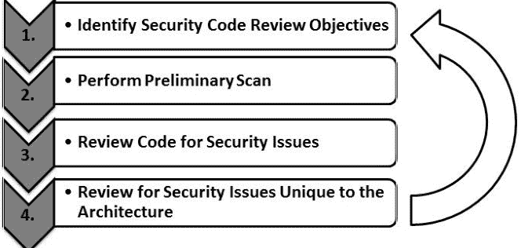

图6.2 四步代码审查周期。

## 1. 识别安全代码审查目标

在此步骤中，为审查制定目标和约束，作为整体计划的基础。与大多数项目一样，如果没有计划基础，项目很可能会失败。当涉及大量代码和/或复杂的SaaS/云应用程序时，情况尤其如此。有针对性的代码审查是有效的代码审查。这就是为什么以特定目标、时间限制和对要发现的问题的了解来审查代码很重要。这将显著提高成功的机会，同时减少审查所需的时间。有了计划，审查人员每次有意义的更改时都可以专注于审查代码，而不是试图一次性找出所有安全问题，或者等到项目结束时一次性审查一切。为了效率，您还应在审查前识别任何已知的既定安全目标，以便您可以根据安全目标区分优先级较高的漏洞类型和可能超出范围的其他类型。

如果安全代码审查在与以前章节中描述的威胁建模等其他安全相关工作的背景下进行规划和执行，则最成功。威胁建模有助于识别关键代码区域，该区域随后成为详细审查的对象，其结果同样可用于验证或质疑威胁模型中指定的安全假设，并帮助了解应用程序的功能、技术设计以及现有的安全威胁和对策。安全代码审查应从审查威胁模型和设计规范开始，然后转到源代码。

代码审查成功的理想活动流程或许最好由MSDN杂志中Chmielewski等人识别的步骤来描述：

- (a) 威胁建模：了解代码和数据流；识别高风险区域和入口点。
- (b) 代码审查：以适当方式记录所有发现，以及流程本身。
- (c) 解决问题：与代码所有者合作应用修复和进一步工作。
- (d) 吸取教训：更新工具、教育开发团队、改进流程并规划未来迭代。²

为了进行有效的安全代码审查，请为以下内容设定目标和约束。

- 时间：设定时间限制。这有助于您避免在单个问题上花费太多时间。进行多次较小的审查比进行一次长时间的审查更有效。
- 问题类型：确定您要查找的问题类型。例如，考虑：
  - 影响机密性、完整性和可用性的一般问题
  - 与应用程序的安全服务质量要求相关的问题
  - 与应用程序的合规性要求相关的问题
  - 与应用程序使用的技术相关的问题
  - 与应用程序暴露的功能相关的问题
  - 在威胁建模期间发现的问题
- 范围外项目：识别您不会查找的内容。解释这些内容为何超出范围。³

## 2. 执行初步扫描

静态分析用于查找一组初始安全问题，并改进您对在更全面地审查代码时最可能发现安全问题的位置的理解，以及发现后续步骤中可能发现更多安全问题的热点。这通常通过自动扫描、手动扫描或两者的组合来完成，具体取决于代码审查计划的审查目标和时间限制。自动扫描的优势在于能够快速在大量应用程序中识别“易得之果”。这些扫描的结果用于创建待审查和调查的潜在安全漏洞和安全机制的优先级列表。

自动扫描可用于补充手动审查，作为额外检查来处理手动操作成本和/或时间禁止性的大量代码，以定位手动审查应关注的区域，并发现手动审查可能遗漏的安全问题。自动扫描工具通常擅长查找由单行代码导致的安全问题，以及查找单个函数中跨越多行代码的安全问题，并且可能发现手动审查会遗漏的问题。虽然自动扫描可以补充手动审查，但不应用于替代手动审查，因为存在上下文问题以及无法查找跨多个函数的安全问题（例如SaaS/云应用程序中发现的问题）。自动化工具的另一个问题是发现的误报和漏报数量，可能需要大量努力将其调整到合理数量。从积极方面来说，这类结果将迫使您更好地了解代码，包括控制和数据流，因为这迫使您审查为什么误报是误报。使用自动化工具的另一个风险是，如果扫描未识别出安全问题，可能会产生软件中没有安全问题的错误安全感。绝不应假设规模庞大且复杂的软件产品没有安全漏洞。应采取所有可能的步骤来限制编码错误的数量并减少其实际影响，但总会有遗漏。自动化安全工具能够识别越来越多的编码错误，但某些漏洞仍会被遗漏，要么未被检测到，要么隐藏在大量误报中。手动源代码分析并非这些工具的替代品，但与它们集成时有助于最大限度地提高漏洞识别率。如本书所述，需要采用包括人为因素在内的整体安全方法，以确保误报确实为误报，并且代码确实没有安全漏洞，尽管自动化工具可能给出了看似健康的诊断报告。同时使用这两种方法使审查人员能够高效且具成本效益地识别更多软件安全漏洞。出于这些原因，自动化审查结合手动审查是最佳方法。

为了捕获较简单的问题，应在手动审查开始前对代码运行可用的安全工具。为了避免发现已知问题，应修复所有先前识别的安全漏洞。然后进行手动扫描，以更好地了解代码并识别模式；扫描结果将识别出值得进一步分析的区域，因为审查人员将在下面的步骤3中分析代码以查找安全问题。然而，这项工作应仅占总代码审查时间的很小一部分，并应专注于回答以下问题：

- **输入数据验证**：应用程序是否具有输入验证架构？验证是在客户端、服务器上还是两者都进行？是否有集中式验证机制，还是验证例程分布在整个代码库中？
- **对用户进行身份验证和授权的代码**：应用程序是否对用户进行身份验证？允许哪些角色，它们如何交互？是否有自定义身份验证或授权代码？
- **错误处理代码**：是否有统一的错误处理架构？应用程序是否捕获和抛出结构化异常？代码中是否有错误处理特别密集或稀疏的区域？
- **复杂代码**：代码中是否有看起来特别复杂的区域？
- **加密**：应用程序是否使用加密？
- **互操作性**：应用程序是否使用互操作性来调用本机代码？⁴


## 3. 审查代码中的安全问题

第 2 步的结果通常用于在步骤 3 中聚焦审查者的分析。

## 4. 审查架构特有的安全问题

这是软件安全架构师或经验丰富的软件安全倡导者发挥作用的地方。在某些情况下，如果您内部没有相关专业知识，可以使用第三方。这使专家能够运用其对业务逻辑、正常用例和滥用用例以及先前经验的知识来识别漏洞，同时降低误报和漏报的可能性。静态分析工具无法发现应用程序缺陷和业务逻辑漏洞，需要人类分析师的上下文和应用程序理解来识别。在整个 SDLC 过程中让经验丰富的安全专业人员参与，将平衡开发人员忽略某些编码错误的倾向，尽管他们编写了特定的代码片段，并且通常最了解这些代码。经验丰富的安全专家还可以帮助理解代码的技术上下文，包括不仅软件产品中使用的特定技术，还包括操作系统和第三方依赖项以及开发中使用的工具。从安全角度来看，这些安全专家可以识别产品与其他系统、应用程序或服务之间的关系。在安全上下文中，他们可以确定产品依赖哪些组件，以及哪些其他软件依赖于该产品，以及如何利用这些关系来确定产品如何影响系统的其余部分以及如何受到其影响。人为错误通常是大多数安全问题的原因；鉴于自动化工具当前的不足，人类也应该是解决方案的一部分。例如，一个微小的编码错误可能导致严重漏洞，最终危及整个系统或网络的安全，或者可能源于开发周期中发生的一系列错误，其中引入了编码错误并在测试阶段未被发现，而可用的防御机制未能阻止成功的攻击。这只是另一个例子，说明为什么人为因素在过程中是必要的——为了能够评估这些类型的情况，而这些情况目前超出了自动化软件安全工具的能力。

## 6.4 安全分析工具

安全代码审查过程的最终目标是提高产品的整体安全性，并提供开发团队可用于进行更改和/或缓解的输出，以实现与 SDLC/SDL 过程开始时概念提交时相比的改进后的软件产品安全性。在本节中，我们讨论了静态分析、动态分析、模糊测试和手动代码审查在此整体过程中的功能和角色。然而，在开始之前，重要的是认识到每种方法都有某些实际优势和局限性。

### 静态代码分析的优势

- 1. 访问软件将要执行的实际指令：
  - 无需猜测或解释行为。
  - 完全访问软件的所有可能行为。
- 2. 可以找到代码中弱点的确切位置。
- 3. 可以由完全理解代码的经过培训的软件保证开发人员进行。
- 4. 允许快速修复周转。
- 5. 如果使用自动化工具，速度相对较快。
- 6. 自动化工具可以扫描整个代码库。
- 7. 自动化工具可以提供缓解建议，减少研究时间。
- 8. 允许在开发生命周期早期发现弱点，降低修复成本。⁵·⁶

### 静态代码分析的局限性

- 1. 需要访问源代码或至少二进制代码，并且通常需要访问足够的软件工件来执行构建。
- 2. 通常需要精通运行软件构建。
- 3. 不会发现与操作部署环境相关的问题。
- 4. 如果手动进行，则耗时。
- 5. 自动化工具不支持所有编程语言。
- 6. 自动化工具会产生误报和漏报。
- 7. 没有足够的受过培训的人员来彻底进行静态代码分析。
- 8. 自动化工具可能会产生一切都在被处理的虚假安全感。
- 9. 自动化工具只能像其用于扫描的规则一样好。
- 10. 不会发现运行时环境中引入的漏洞。⁷·⁸

### 动态代码分析的优势

- 1. 可发现内容的范围有限：
  - 必须对应用程序进行足迹分析以找到测试区域。
  - 这可能导致遗漏区域。
  - 只能测试已发现的内容。
- 2. 无法访问正在执行的实际指令：
  - 工具正在操作应用程序。
  - 对请求和响应进行模式匹配。
- 3. 只需要一个运行中的系统来执行测试。
- 4. 不需要访问源代码或二进制代码。
- 5. 无需了解如何编写软件或执行构建：
  - 工具倾向于更“设置后即可忽略”。
- 6. 测试特定的操作部署：
  - 可以发现静态分析工具会遗漏的基础设施、配置和补丁错误。
- 7. 识别运行时环境中的漏洞。
- 8. 自动化工具提供扫描内容的灵活性。
- 9. 允许在不访问实际代码的情况下分析应用程序。
- 10. 识别可能在静态代码分析中为漏报的漏洞。
- 11. 允许验证静态代码分析结果。
- 12. 可以对任何应用程序进行。9,10

### 动态代码分析的局限性

- 1. 自动化工具可能会产生一切都在被处理的虚假安全感。
- 2. 自动化工具会产生误报和漏报。
- 3. 自动化工具只能像其用于扫描的规则一样好。
- 4. 与静态分析一样，没有足够的受过培训的人员来彻底进行动态代码分析。
- 5. 将漏洞追溯到代码中的确切位置更加困难，修复问题所需时间更长。11,12

如果您无法访问源代码或二进制文件，不是软件开发人员，不了解软件构建，或者正在执行“渗透测试”或其他操作环境测试，您可能会选择使用动态工具；否则，您可能会使用静态分析工具。理想情况下，您应该结合使用两者以获得足够的覆盖率。

### 模糊测试的优势

- 1. 模糊测试的巨大优势在于测试设计极其简单，且不带有对系统行为的先入之见。
- 2. 系统性/随机方法使这种方法能够发现人眼常常会忽略的错误。此外，当被测系统完全封闭（例如，SIP 电话）时，模糊测试是审查其质量的唯一手段之一。
- 3. 使用模糊测试发现的错误通常是严重的、可利用的错误，真实攻击者可以利用这些错误。随着模糊测试变得更加广为人知，这一点变得更加真实，因为攻击者现在也在使用相同的技术和工具来利用已部署的软件。与二进制或源代码审计——甚至模糊测试的近亲故障注入——相比，这是一大优势，后者通常依赖于难以或不可能利用的人工故障条件。

### 模糊测试的局限性

- 1. 模糊测试工具通常倾向于发现简单的错误；此外，模糊测试工具越是协议感知，它发现的奇怪错误就越少。这就是为什么穷举/随机方法仍然流行的原因。
- 2. 另一个问题是，当你进行黑盒测试时，你通常攻击一个封闭系统，这增加了评估发现的漏洞的危险性/影响的难度（没有调试可能性）。
- 3. 使用模糊测试查找程序故障的主要问题是，它通常只发现非常简单的故障。问题本身是指数级的，每个模糊测试工具都会采取捷径，在人类关心的时间范围内找到有趣的内容。原始模糊测试工具可能代码覆盖率较差；例如，如果输入包含校验和，那么


未正确更新以匹配其他随机更改时，仅会验证校验和验证代码。代码覆盖率工具常用于评估模糊测试工具工作得“多好”，但这些只是模糊测试工具质量的参考指南。可以预期每个模糊测试工具会发现不同的错误集。13,14

## 手动源代码审查的优势

- 1. 无需支持技术。
- 2. 可应用于各种情况。
- 3. 灵活。
- 4. 促进团队合作。
- 5. 在SDLC早期。

## 手动源代码审查的局限性

- 1. 可能耗时。
- 2. 支持材料并不总是可用。
- 3. 要有效，需要大量的人工思考和技能。15

## 6.4.1 静态分析

静态程序分析是在不实际执行程序的情况下对计算机软件进行的分析。它主要用于对源代码的某个版本进行分析；也可对目标代码进行分析。相比之下，动态分析是通过实际执行软件程序来进行的。静态分析由自动化软件工具执行，不应与人工分析或软件安全架构评审混淆，后者涉及人工代码审查，包括程序理解和领会。当静态分析工具使用得当时，它们相对于人工静态分析具有明显优势，因为分析可以更频繁地进行，并且所具备的安全知识优于许多软件开发人员。因此，只有在绝对必要时，才需要引入专家级软件安全架构师或工程师。

静态分析（见图6.3）也称为静态应用程序安全测试（SAST）。它在项目的开发或QA阶段识别漏洞。SAST提供代码行级检测，使开发团队能够快速修复漏洞。

使用静态分析工具并为您的环境选择合适的供应商，是成功的另一关键技术因素。任何有益于自动化软件开发过程任何部分的技术都应受到欢迎，但由于在选择工具时未使用合适的人员和/或流程，这种软件在许多组织中已成为“搁置软件”。在此领域，并非所有工具都一样：有些工具对某些语言的支持更好，而另一些工具则具有出色的前端GRC（治理、风险管理和合规）和指标分析功能。在某些情况下，您可能需要使用多达三种不同的工具才能有效。

使用静态分析工具的挑战之一是，在分析与闭源组件或外部系统交互的应用程序时，可能会报告误报，因为没有源代码就无法追踪外部系统中的数据流。

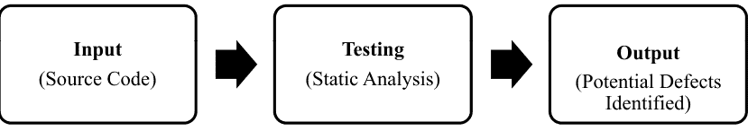

- 可以访问软件将要执行的实际指令。
- 可以提供问题所在代码的确切位置。
- 可以由软件开发人员在签入代码之前执行。

- 识别的缺陷包括XSS、SQL注入、应用程序的特定问题/错误、配置错误和补丁错误。
- 可发现内容的范围有限
- 识别运行环境或运行时中的漏洞。

### 图6.3 静态分析流程图。

并从而确保数据的完整性和安全性。使用静态代码分析工具也可能导致假阴性结果，即存在漏洞但工具未报告。如果在外部组件中发现新漏洞，或者分析工具对运行时环境及其是否配置安全一无所知，就可能发生这种情况。静态代码分析工具通常会产生假阳性结果，即工具报告一个实际上并不存在的可能漏洞。这种情况经常发生，因为工具无法确定数据在从输入到输出流经应用程序时的完整性和安全性。16

Michael Howard在其2006年IEEE®《安全与隐私》杂志中发表的题为“执行安全代码审查的流程”17的文章中，提出了以下启发式方法，以帮助确定代码审查优先级。该启发式方法可用于指导静态、动态、模糊测试和人工代码审查的优先级排序。

- **旧代码：** 旧代码可能比新代码有更多漏洞，因为新代码通常反映了对安全问题更好的理解。所有“旧版”代码都应深入审查。
- **默认运行的代码：** 攻击者通常会针对默认运行的已安装代码。此类代码应比不默认执行的代码更早、更深入地审查。默认运行的代码会增加应用程序的攻击面。
- **在提升上下文中运行的代码：** 在提升的身份下运行的代码（例如*nix中的root）也需要更早、更深入的审查，因为代码身份是攻击面的另一个组成部分。
- **匿名可访问的代码：** 匿名用户可访问的代码应比仅限有效用户和管理员访问的代码进行更深入的审查。
- **监听全球可访问网络接口的代码：** 默认在网络上监听的代码（尤其是互联网等不受控网络）面临重大风险，必须针对安全漏洞进行深入审查。
- **用C/C++/汇编语言编写的代码：** 由于这些语言可以直接访问内存，代码中的缓冲区操作漏洞可能导致缓冲区溢出，而缓冲区溢出通常会导致恶意代码执行。用这些语言编写的代码应针对缓冲区溢出漏洞进行深入分析。
- **有漏洞历史的代码：** 过去曾出现多个安全漏洞的代码应受到怀疑，除非能证明这些漏洞已被有效删除。
- **处理敏感数据的代码：** 应分析处理敏感数据的代码，以确保代码中的弱点不会将此类数据泄露给不可信用户。
- **复杂代码：** 复杂代码的错误概率更高，更难以理解，且更可能存在更多安全漏洞。
- **频繁更改的代码：** 频繁更改的代码通常会引入新错误。并非所有这些错误都是安全漏洞，但与仅不定期更新的稳定代码集相比，不太稳定的代码可能会有更多漏洞。

在Michael Howard 2004年Microsoft®发表的题为“通过最小化向不可信用户暴露的代码来降低安全风险”18的文章中，他还建议了一种概念性的三阶段代码分析流程，以优化静态分析工具的使用：

## 第1阶段：运行所有可用的代码分析工具。

- 应使用多种工具来抵消工具偏差并最大限度地减少假阳性和假阴性。
- 分析人员应关注每个警告或错误。
- 多个工具的警告可能表明代码需要更仔细的审查（例如，人工分析）。应尽早评估代码，最好在每次构建时进行，并在每个里程碑重新评估。

## 第2阶段：查找常见漏洞模式。

- 分析人员应确保代码审查涵盖最常见的漏洞和弱点，例如整数算术问题、缓冲区溢出、SQL注入和跨站点脚本（XSS）。
- 此类常见漏洞和弱点的来源包括由MITRE®公司维护的通用漏洞披露（CVE®）和通用弱点枚举（CWE™）数据库，可通过 https://www.cve.org 和 http://cwe.mitre.org 访问。
- MITRE与SANS研究所合作，还维护了一份“25大最危险编程错误”列表，这些错误可能导致严重漏洞（http://cwe.mitre.org/top25/index.html）。
- 静态代码分析工具和人工技术至少应涵盖“25大”。


## 第 3 阶段：深入分析风险代码。

- 分析人员还应使用手动分析（例如，代码检查）来更彻底地评估基于攻击面或基于先前讨论的启发式方法所识别的任何风险代码。
- 此类代码审查应从每个待审查模块的入口点开始，并应追踪系统中的数据流，评估数据、其使用方式以及安全目标是否可能受到威胁。

以下是可通过静态分析发现的问题示例。注入漏洞位列 OWASP® Top 10 2021 列表榜首。19 当不受信任的数据未经验证直接用于查询或用于构造命令时，就会发生此类漏洞。注入漏洞有不同类型——其中包括 SQL、OS 和 LDAP。如果用户输入被直接用于构建 SQL 查询，则可能发生 SQL 注入攻击。

假设用户想要查看其账户详细信息。应用程序需要其用户 ID 或标识符来从后端数据库查询账户信息。应用程序可以通过 URL 参数传递此信息，示例如下：

```
http://example.com/application/reviewaccount?account_id='1007'
```

在这种情况下，应用程序正在获取用户 account_id '1007'，并将使用此 ID 从数据库中提取信息。假设后端查询如下所示：

```
String insecureQuery = "SELECT * FROM accounts WHERE accountID= '" + request.getParameter("account_id") + " ' ";
```

如果恶意用户将参数值更改为 \ 或 '1'='1，则以下字符串不安全查询将具有以下值：

```
SELECT * FROM accounts WHERE accountID= '' \\ or '1'='1';
```

'1'='1' 始终为真，因此此查询可以返回所有账户的信息。这并非开发者的本意，但通过信任用户输入来创建查询，他或她已允许恶意用户执行任意数据库命令。

针对代码执行的静态分析工具将识别出查询是使用用户输入构建的，并可能导致 SQL 注入攻击。

### 6.4.2 动态分析

动态程序分析是在实时处理器（真实或虚拟）上执行程序时对计算机软件进行的分析。其目标是在程序运行时发现安全错误，而不是反复离线检查代码。通过在程序设计用于的所有场景下对其进行调试，动态分析消除了人为创建可能产生错误的情况的需求。它具有明显的优势，即能够识别可能为假阴性的漏洞，并验证静态代码分析的发现。

输入（运行中的应用程序、基础架构或运营部署 [不需要源代码]）

测试（动态分析）

输出（已识别的潜在缺陷）

- 不一定始终能访问软件将要执行的实际指令。
- 无法提供问题所在代码的准确位置。
- 在运营环境中执行。

- 已识别的缺陷包括缓冲区溢出、SQL 注入、XSS、内存泄漏、弱加密算法等。
- 不会发现运行时环境或运营部署中引入的漏洞。
- 不一定始终能发现身份验证问题、业务逻辑缺陷或加密使用不安全的问题。

图 6.4 动态分析流程图。

动态分析（参见图 6.4）也称为动态应用程序安全测试（DAST）。它可识别生产应用程序中的漏洞。DAST 工具用于快速评估系统的整体安全性，并在 SDL 和 SDLC 中使用。关于使用静态分析工具的相同优势和注意事项也适用于动态分析工具。

以下关于动态分析在整个 SDLC 中如何使用的说明摘自 Peng 和 Wallace (1993) NIST 特别出版物 500-209，“软件错误分析”。20

- 设计阶段常用的动态分析技术包括尺寸和时序分析、原型设计和仿真。尺寸和时序分析对于分析具有响应时间要求以及受限内存和执行空间要求的实时程序很有用。这种分析对于确定硬件和软件分配是否适合设计架构尤其有用；如果在系统测试中才发现性能问题是由基本系统设计引起的，代价将非常高昂。自动化仿真可能适用于较大的设计。原型设计可用于辅助检查总体设计架构或特定功能集。对于大型复杂系统，原型设计可以防止不合适的设计导致昂贵且浪费的实现。21

- 动态分析技术有助于确定代码的功能和计算正确性。每当进行任何重大代码更改时，都会使用回归分析来重新评估需求和设计问题。此分析确保对原始系统要求的认识。尺寸和时序分析在增量代码开发期间执行，分析结果与预测值进行比较。22

- 测试阶段的动态分析涉及不同类型的测试和测试策略。传统上，有四种测试类型：单元测试、集成测试、系统测试和验收测试。单元测试可以是对软件单元、模块或子例程进行的结构测试或功能测试。结构测试检查单元的逻辑，可用于支持测试覆盖率要求——即程序中已执行的部分有多少。功能测试评估软件需求的实现情况。对于功能测试，测试人员通常不需要了解程序的设计信息，因为测试用例基于软件需求。23

- SDLC 最终阶段最常用的动态分析技术是回归分析与测试、仿真以及测试认证。在此阶段对产品进行任何更改时，会执行回归分析以验证影响程序其他区域的基本需求和设计假设未被违反。仿真用于测试操作员程序并隔离安装问题。测试认证（尤其是在关键软件系统中）用于验证所需测试已执行，并且交付的软件产品与经过软件验证和确认的产品相同。24

静态分析通过分析源代码来发现问题。动态分析工具不需要源代码，但仍可识别问题。在讨论静态分析期间，我们回顾了一个 SQL 注入攻击示例。对于该示例，工具将识别出 account_id 作为 URL 参数传递，并将尝试篡改参数值并评估应用程序的响应。

### 6.4.3 模糊测试

模糊测试（参见图 6.5），或称模糊测试，是一种黑盒软件测试技术，可以自动化或半自动化，并向计算机软件程序的输入提供无效、意外或随机数据。换句话说，它通过自动化方式使用畸形/半畸形数据注入来查找实现缺陷或安全缺陷。随后会监控软件程序的输入，以查找崩溃、内置代码断言失败和潜在内存泄漏等异常返回。模糊测试已成为测试软件或计算机系统安全问题的关键要素。模糊测试相对于其他工具具有明显优势，即测试设计极其简单，且不带有对系统行为的先入之见。

模糊测试是软件安全的关键要素，必须嵌入 SDL。此领域有许多供应商可供选择，有些甚至会开发自己的工具。模糊测试既用于安全测试，也用于 QA 测试。模糊测试最近被认可为许多软件开发计划中既是关键要素又是主要缺陷，以至于它现在已成为美国国防部（DoD）信息保障认证和认可流程（DIACAP）的要求。

模糊测试是一种攻击模拟形式，其中通过开放接口向系统馈送意外数据，然后监控系统的行为。如果系统失败，例如崩溃或内置代码断言失败，则存在缺陷


## 输入
(运行中的应用程序、基础设施或运营部署 [无需源代码])

## 测试
(模糊测试)

## 输出
(已识别的潜在缺陷)

- 无法访问软件将要执行的实际指令。
- 无法指出代码中问题的准确位置。
- 通过提供随机和无效的输入来工作，这些输入可能导致应用程序崩溃。

- 已识别的缺陷包括应用程序/系统崩溃、断言失败、内存泄漏、错误处理和无效输入问题。
- 在查找不会导致崩溃的bug方面效用有限。

图 6.5 模糊测试流程图。

软件。虽然模糊测试工具发现的所有问题都是关键且可利用的，但与静态分析工具不同，模糊测试只能发现可通过公开接口访问的bug。模糊测试工具还必须能够与被测软件互操作，以便它们可以访问更深层的协议层，并通过测试多个层来更彻底地测试系统。

静态分析具有全面测试覆盖的优点，是提高整体软件质量水平的好方法，但它不能轻易提供解决复杂问题的测试结果，并且如前所述，它还会产生大量误报，这两者都需要人工进一步分析并消耗宝贵且有限的资源。模糊测试中没有误报，因为每个发现的缺陷都是模拟攻击的结果。

静态分析是在未执行的代码上进行的，并且只能离线执行。相比之下，模糊测试必须针对可执行代码进行，可以针对运行中的软件运行，因此可以发现静态代码中可能不可见的漏洞。模糊测试针对攻击者也会发现的问题，因此是鲁棒性测试的好方法，同时通过仅关注可能易受攻击的最关键接口来简化流程。由于具有测试鲁棒性的能力，模糊测试通常在SDLC验证阶段（即产品发布前）使用。与静态分析和动态分析一样，模糊测试可以从第一个软件组件准备好时开始使用，甚至在发布后也可以使用——而不仅仅是在SDLC过程中的某个时间点。当然，这一属性可以通过在SDLC早期发现和修复漏洞来带来显著的成本节约。

标准模糊测试技术在使用随机变异创建测试用例方面受到限制，这只能发现部分软件漏洞。然而，这种测试仍然有价值，因为这些正是攻击者会发现的相同漏洞。重要的是要记住，攻击者也使用模糊测试工具，如果由发现者或攻击者使用模糊测试工具在你已经发布给客户的产品中发现缺陷，这表明软件安全开发计划薄弱的明显迹象。更复杂的模糊测试技术用于通过使用协议规范来定位最易受漏洞影响的协议区域，并在不影响测试覆盖率的情况下减少所需的测试用例数量，从而改进和优化覆盖率。静态代码分析用于确保遵循安全编码策略，但协议模糊测试工具用于获得攻击者对威胁和风险的视角。

模糊测试的另一个优势是它可以与黑盒、灰盒或白盒测试一起使用，并且不需要源代码访问权限。与本章讨论的动态分析工具一样，这一特性使其成为测试第三方软件或外包开发软件的绝佳工具。然而，模糊测试的一个缺点是它具有侵入性，可能会使系统崩溃，这可能要求初始测试在单独的环境（如测试实验室或虚拟化环境）中进行。

模糊测试主要有两种类型："智能"和"愚蠢"。

- 在"智能"（生成式）模糊测试中，模糊测试器以逻辑方式向程序推送数据，通常是等待响应并可能修改堆栈。这种方法需要对目标有深入了解并使用专用工具，但所需的崩溃分析较少，且与愚蠢模糊测试相比，发现的重复项也较少。25,26
- 在"愚蠢"（变异式）模糊测试中，模糊测试器系统地向程序推送数据，而不等待正确的响应。这种方法与拒绝服务（DoS）攻击密切相关。这种方法不需要了解目标，并使用现有工具。然而，需要更多的崩溃分析，并且与"智能"模糊测试相比，发现的重复项更多。27,28

要执行模糊测试，对于输入到应用程序的每个文件或字段，都遵循以下步骤：

1. 向输入文件的某个部分输入随机数据或空格。
2. 使用该输入文件执行应用程序。
3. 评估结果。什么坏了？什么正常运行？预期会发生什么？
4. 为每个测试用例编号，并将发现报告给项目管理层。29

### 6.4.4 手动代码审查

手动安全代码审查通常通过对软件进行逐行检查来完成，以确定软件产品中的任何安全漏洞。这将包括对多层和多组件企业软件产品的编程源代码进行彻底审查。在使用多种自动化工具（这些工具有助于快速分析缺陷和漏洞）之后，代码会手动审查。每个发现的问题都会得到验证，并对代码进行检查，以克服自动化工具和技术的局限性。可以使用不同的方法来查找编码错误，但即使与复杂的工具相比，手动代码审查在精度和质量方面也已明确证明了其价值。不幸的是，手动代码审查也是执行成本最高的。

从定义上讲，手动代码审查是人工驱动的，尽管其最高附加值在于架构设计审查，但这些软件安全审查采用整体方法，包括人员、政策和流程。假设资源有限，手动代码审查最好仅对应用程序中最关键的组件进行。这些审查还将包括手动审查文档、安全编码策略、安全要求和架构设计。手动审查还具有指导性，即软件安全架构师可以向开发团队的其他人传授测试艺术、如何理解安全流程、政策意识以及设计或实现安全应用程序所需的适当技能。即使是经验丰富且精通安全的开发团队，软件安全架构师也应采用"信任但验证"模式。由于架构师通常与利益相关者和相应的开发团队成员一起分析文档，并采访设计人员或系统所有者以获取他们的意见，因此该流程得到了增强。

应当注意的是，如果遵循良好的软件工程流程，可以缓解代码审查团队正在评估的许多问题。在大多数情况下，静态分析和动态分析或模糊测试比代码审查更能有效地捕获实现缺陷，但如果手动代码审查发现的某些安全漏洞很罕见，那么这是发现它们的唯一方式。一旦通过手动代码审查发现某种安全漏洞，就应将其纳入自动代码审查工具中。如前所述，高效且有效的软件安全需要整体方法，不仅包括手动软件审查，还包括强制性软件安全培训、安全设计审查、威胁建模、模糊测试、静态和动态分析、高风险实践的识别，以及软件生命周期各个阶段（包括服务和支持）的可衡量标准和要求。

手动软件安全审查通常使用以下步骤：

- 用于识别风险并告知开发团队首先以及最仔细地查看哪些代码的威胁模型，也将帮助团队了解与软件功能相关的现有安全威胁。

- 上述各种自动化工具用于评估代码中的语义和语言安全漏洞，并优化对最高风险和最大修复或缓解工作量的搜索。

- 对软件代码进行手动逐行检查，以查找逻辑错误、加密使用不安全、系统配置不安全以及平台特定的其他已知问题。

使用问题驱动方法可以帮助审查活动。标准问题列表可以帮助你关注与软件架构无关的常见安全漏洞。此方法可以与控制流和数据流分析等技术结合使用，以优化追踪代码中最可能揭示安全问题的路径的能力。问题应至少涵盖最常见的编码漏洞。在使用控制流和数据流分析时提出这些问题。请记住，发现某些漏洞可能需要控制流和数据流的上下文知识，而其他漏洞则是上下文无关的，可以使用简单的模式匹配来发现。在对代码进行手动安全审查时，可以结合使用以下一些技术：


- **控制流分析。** 控制流分析是用于逐步检查代码中逻辑条件的机制。过程如下：
  1. 检查函数并确定每个分支条件。这些可能包括循环、switch 语句、“if”语句和“try/catch”块。
  2. 了解每个块将在什么条件下执行。
  3. 移动到下一个函数并重复。

- **数据流分析。** 数据流分析是用于从输入点追踪数据到输出点的机制。因为应用程序中可能存在许多数据流，请使用您的代码审查目标和第 2 步中标记的区域来集中精力工作。过程如下：
  1. 对于每个输入位置，确定您对输入来源的信任程度。存疑时，您不应给予任何信任。
  2. 追踪数据流向每个可能的输出。注意任何数据验证尝试。
  3. 移动到下一个输入并继续。³⁰

执行数据流分析时，审查输入和输出列表，然后将其与需要审查的代码相匹配。您必须特别注意优先处理代码跨越信任边界以及代码更改信任级别的任何区域，就像在威胁建模过程中所做的那样。应提供一组常见的验证例程，您的软件在收到任何不受信任的数据时可以立即调用，这将为您的软件产品提供一个中心验证区域，可在发现新信息时进行更新。在执行数据流分析时，对数据被解析并可能流向多个输出位置的区域给予特别关注，以确保数据被追溯到其来源，并根据最弱环节分配信任。

还应考虑其他问题列表。其中一些根据导致与正在开发的软件产品或解决方案相关的最常见软件漏洞的实现错误，组织成关键区域集，也称为热点。这些问题通常由软件安全架构师开发，并围绕书中前面描述的最近 10 到 20 个 CVE 或 OWASP“Top 10”列表展开。

还应作为手动安全审查过程的一部分，对架构特有的安全问题进行审查。如果软件产品使用自定义安全机制或具有缓解已知安全威胁的功能，此步骤尤其重要。在此步骤中，还会检查代码审查目标列表，以查看是否有任何尚未审查的内容。同样，以下问题驱动的方法列表将很有用，作为最终代码审查步骤，以验证特定于您的软件架构的安全功能和要求是否已满足。

- **您的架构是否包含自定义安全实现？** 自定义安全实现是查找安全问题的绝佳场所，原因如下：
  - 已经认识到存在安全问题，这就是最初编写自定义安全代码的原因。
  - 与产品的其他区域不同，功能问题很可能导致安全漏洞。

- **是否存在已被专门缓解的已知威胁？** 缓解已知威胁的代码需要仔细审查，以查找可能被用来绕过缓解措施的问题。

- 应用程序中是否存在独特角色？使用角色假定存在一些用户的权限低于其他用户。请确保代码中没有可能允许一个角色承担另一个角色权限的问题。³¹

我们想再次强调，不同类型的安全测试之间并非二选一的关系。为了使产品安全，它应该经历所有类型的安全测试——静态分析、动态分析、手动代码审查、渗透测试和模糊测试。通常，由于时间限制或截止日期，在开发周期中会做出权衡，并且在产品匆忙上市时会跳过测试。这可能会节省一些时间，产品可能会提前几周/几个月发布。但是，从投资回报率（ROI）的角度来看，这是一个代价高昂的选择。此外，产品发布后发现的安全问题可能会对客户和公司品牌名称造成重大损害。

## 6.5 关键成功因素

SDL 这一第四阶段的成功取决于对策略合规性、安全测试用例执行、不同类型安全测试的完成以及隐私要求验证的审查。表 6.1 列出了此阶段的关键成功因素。

| 关键成功因素 | 描述 |
|---|---|
| 1. 安全测试用例执行 | 所有相关测试用例的覆盖率 |
| 2. 安全测试 | 完成所有类型的安全测试并修复发现的问题 |
| 3. 隐私验证和修复 | 隐私相关控制的有效性以及修复发现的任何问题 |
| 4. 策略合规性审查 | 与第 4 阶段相关的策略合规性更新 |

### 成功因素 1：安全测试用例执行

有关安全测试执行计划成功标准的详细信息，请参阅第 6.2 节。

### 成功因素 2：安全测试

完成所有类型的安全测试——手动代码审查、静态分析、动态分析、渗透测试和模糊测试——至关重要。每种测试类型中发现的问题都应进行风险评估并确定优先级。任何中等或更高严重程度的安全缺陷应在发布或部署产品之前修复。低严重程度的缺陷不应被忽视，而应尽快列入修复路线图。

### 成功因素 3：隐私验证和修复

隐私问题的验证应是安全测试计划和安全测试的一部分。但是，最好有一个单独的工作流来评估产品中与隐私相关的控制措施的有效性。任何发现的问题都应确定优先级，并在产品发布或部署之前修复。

### 成功因素 4：策略合规性审查（更新）

如果发现任何其他策略，或者自第 3 阶段执行分析以来先前识别的策略已更新，则应审查更新，并相应规划产品的变更。

## 6.6 交付物

表 6.2 列出了 SDL 此阶段的交付物。

### 表 6.2 第 4 阶段的交付物

| 交付物 | 目标 |
|---|---|
| 安全测试执行报告 | 审查针对已识别安全测试用例的进度 |
| 更新的策略合规性分析 | 对公司策略遵守情况的分析 |
| 隐私合规性报告 | 验证隐私评估建议是否已实施 |
| 安全测试报告 | 不同类型安全测试的发现 |
| 修复报告 | 提供产品安全态势的状态 |

### 安全测试执行报告

执行报告应提供已执行安全测试的状态和测试频率。报告还应提供为验证问题修复而执行的重新测试次数的信息。

### 更新的策略合规性分析

策略合规性分析工件（参见第 4 章和第 5 章）应根据 SDL 此阶段可能出现的任何新要求或策略进行更新。

### 隐私合规性报告

隐私合规性报告应提供针对早期阶段提供的隐私要求的进度。任何未完成的要求都应尽快实施。评估法律/法规的任何变化以识别（并列入路线图）任何新要求也是明智之举。

### 安全测试报告

应为每种安全测试类型准备一份发现摘要：手动代码审查、静态分析、动态分析、渗透测试和模糊测试。报告应提供已识别问题的类型和数量，以及可从发现中得出的任何一致主题。例如，假设某个组件中的 XSS 问题远少于


与另一个应用程序相比。这可能是因为前者的开发人员受过更好的培训，或更有效地实现了框架。此类反馈应在下一个发布周期中回传到 SDL 的早期阶段。

### 修复报告

应从本阶段开始准备并定期更新修复报告/仪表板。本报告的目的是在技术层面展示产品的安全态势和风险。

## 6.7 指标

在 SDL 的此阶段应收集以下指标（其中一些可能与我们之前讨论过的指标重叠）。

- 符合公司政策的百分比（已更新）
  - 第 3 阶段与第 4 阶段的合规百分比
- 使用静态分析工具有效测试的代码行数
- 通过静态分析工具发现的安全缺陷数量
- 通过静态分析工具发现的高风险缺陷数量
- 缺陷密度（每 1000 行代码的安全问题数）
- 通过静态分析、动态分析、手动代码审查、渗透测试和模糊测试发现的安全问题的数量和类型
  - 不同类型测试发现的安全问题的重叠部分
  - 不同类型测试发现结果的严重程度比较
  - 将发现结果映射到先前识别的威胁/风险
- 已修复的安全发现数量
  - 发现结果的严重程度
  - 修复发现结果所花费的时间（小时，近似值）
- 未解决发现结果的数量、类型和严重程度
- 符合安全测试计划的百分比
- 执行的安全测试用例数量
  - 安全测试用例执行中发现的结果数量
  - 执行的重新测试数量

## 6.8 总结

在讨论设计与开发（A4）阶段时，我们描述了成功执行测试用例的流程、通过自动化工具和手动审查进行适当代码审查的流程，以及在 SDL 此阶段进行的隐私验证和修复流程。本章中描述的最关键的流程和程序是那些能够有效高效地测试、调整和修复已知漏洞，并确保遵循安全编码策略的流程和程序，这些流程和程序在进入 SDL 的产品发布（A5）阶段之前提供了必要的安全和隐私漏洞防护。

## 章节快速检查

1. 以下哪项不是主要的缓解方法：
   a. 锁定环境
   b. 输入验证
   c. 为旧版代码使用弃用的库
   d. 输出验证

2. 防御性编码的要素包括以下所有内容，除了：
   a. 自定义加密函数以避免算法泄露
   b. 异常处理以避免程序终止
   c. 接口编码工作以避免面向 API 的攻击
   d. 加密敏捷性以使加密函数更强大

3. 静态分析可用于检查：
   a. 批准的函数/库调用、与逻辑相关的规则和语义检查，以及线程性能管理
   b. 语法、批准的函数/库调用和竞态条件
   c. 语法、批准的函数/库调用和内存管理
   d. 语法、批准的函数/库调用，以及与逻辑和调用相关的规则和语义检查

4. 自动化测试相对于手动代码审查具有以下优势，除了：
   a. 检测不安全或弃用的函数调用
   b. 识别混淆的例程
   c. 分析速度
   d. 集成到 IDE

## 练习

以下练习基于附录 A 中讨论的案例研究。这些练习旨在让您练习应用步骤并为 SDL 的 A4 阶段产出交付物。

此时，您已制定了管理计划和路线图，以在 Revvin’ Engines 实施 SDL。拥有一个稳健的系统和流程，能够为反映业务需求以及应用程序的安全性和非功能性需求的基于 API 的微服务系统产生安全的架构和设计，您就可以确信应用程序和基础设施能够抵御敌对的公共互联网。

当您进入开发活动时，您需要制定开发时、单元测试时、集成测试时和预发布测试时的安全计划和路线图，以确保应用程序足够安全，可以发布到生产环境。

1. 重新审视初始测试计划，并包含您认为应用程序测试所需的所有活动——包括手动和基于工具的测试。

2. 设计流程，将测试活动集成到开发管道中，以实现可自动化的测试任务自动化。确保所有测试结果都报告给守门人功能，如果未满足扫描策略，则该功能将使构建失败。

3. 为每个扫描工具或流程建立所需的扫描器策略，以确定触发适当安全事件的通过/失败限制。

4. 确定所有强制性测试流程所需的指标，并确定最合适的报告方法和机制。

## 参考文献

1. Kaner, C. (2008 年 4 月). “探索性测试教程,” 第 36 页. 检索自 http://www.kaner.com/pdfs/QAIEexploring.pdf

2. Chmielewski, M., Clift, N., Fonrobert, S., and Ostwald, T. (2007 年 11 月). “MSDN 杂志：在您的应用程序发布之前查找并修复漏洞.” 检索自 http://msdn.microsoft.com/en-us/magazine/cc163312.aspx

3. Microsoft Corporation. (2012). “操作指南：为托管代码 (.NET Framework 2.0) 执行安全代码审查.” 检索自 http://msdn.microsoft.com/en-us/library/ff649315.aspx

4. 同上。

5. Jackson, W. (2009 年 2 月). GCN—公共部门 IT 的技术、工具和策略：“静态与动态代码分析：优势与劣势.” 检索自 http://gcn.com/Articles/2009/02/09/Static-vs-dynamic-code-analysis.aspx?p=1

6. Cornell, D. (2008 年 1 月). OWASP 圣安东尼奥演示：“测试应用程序安全的静态分析技术.” 检索自 https://1library.net/document/y94orglq-static-analysis-techniques-testing-application-security-antonio-january.html

7. Jackson, W. (2009 年 2 月). GCN—公共部门 IT 的技术、工具和策略：“静态与动态代码分析：优势与劣势.” 检索自 http://gcn.com/Articles/2009/02/09/Static-vs-dynamic-code-analysis.aspx?p=1

8. Cornell, D. (2008 年 1 月). OWASP 圣安东尼奥演示：“测试应用程序安全的静态分析技术.” 检索自 https://1library.net/document/y94orglq-static-analysis-techniques-testing-application-security-antonio-january.html

9. Jackson, W. (2009 年 2 月). GCN—公共部门 IT 的技术、工具和策略：“静态与动态代码分析：优势与劣势.” 检索自 http://gcn.com/Articles/2009/02/09/Static-vs-dynamic-code-analysis.aspx?p=1

10. Cornell, D. (2008 年 1 月). OWASP 圣安东尼奥演示：“测试应用程序安全的静态分析技术.” 检索自 https://1library.net/document/y94orglq-static-analysis-techniques-testing-application-security-antonio-january.html

11. Jackson, W. (2009 年 2 月). GCN—公共部门 IT 的技术、工具和策略：“静态与动态代码分析：优势与劣势.” 检索自 http://gcn.com/Articles/2009/02/09/Static-vs-dynamic-code-analysis.aspx?p=1

12. Cornell, D. (2008 年 1 月). OWASP 圣安东尼奥演示：“测试应用程序安全的静态分析技术.” 检索自 https://1library.net/document/y94orglq-static-analysis-techniques-testing-application-security-antonio-january.html

13. 开放 Web 应用程序安全项目 (OWASP). (2012). “模糊测试.” 检索自 https://www.owasp.org/index.php/Fuzzing

14. R2Launch. (2012). “模糊测试.” 检索自 http://www.r2launch.nl/index.php/software-testing/fuzz

15. 开放 Web 应用程序安全项目 (OWASP). (2012). “测试指南简介.” 检索自 https://www.owasp.org/index.php/Testing_Guide_Introduction#Manual_Inspections_._26_Reviews


16. 开放Web应用安全项目（OWASP）.（2012）.“静态代码分析”．检索自 https://www.owasp.org/index.php/Static_Code_Analysis

17. Howard, M.（2006年7月–8月）.“执行安全代码审查的流程”．IEEE 安全与隐私，第74–79页．

18. Howard, M.（2004年11月）.“通过最小化向不可信用户暴露的代码来缓解安全风险”．检索自 https://docs.microsoft.com/en-us/archive/msdn-magazine/2004/november/security-tips-minimizing-the-code-you-expose-to-untrusted-users

19. OWASP.（2013）.“OWASP 十大”．检索自 https://owasp.org/www-project-top-ten/

20. Peng, W.，和 Wallace, D.（1993年3月）．NIST 特别出版物 500-209，“软件错误分析”．检索自 https://nvlpubs.nist.gov/nistpubs/Legacy/SP/nistspecialpublication500-209.pdf

21. 同上．

22. 同上．

23. 同上．

24. 同上．

25. Royal, M.，和 Pokorny, P.（2012年4月）．Cameron University IT 4444—毕业设计：“实践中的模糊测试”．检索自 https://www.pdffiller.com/12963674-5pdf-Dumb-Fuzzing-in-Practice-1-

26. Manion, A.，和 Orlando, M.（2011年5月）．ICSJWG 演示：“傻瓜模糊测试”．检索自 https://fuzzinginfo.files.wordpress.com/2012/05/ag_16b_icsjwg_spring_2011_conf_manion_orlando.pdf

27. Royal, M.，和 Pokorny, P.（2012年4月）．Cameron University IT 4444—毕业设计：“实践中的模糊测试”．检索自 https://www.pdffiller.com/12963674-5pdf-Dumb-Fuzzing-in-Practice-1-

28. 同上．

29. Grembi, J.（2008）．安全软件开发：安全程序员指南．波士顿，马萨诸塞州：Course Technology．

30. Meier, J.，等人（2005年10月）．微软公司—MSDN 库：“操作指南：对托管代码（.NET Framework 2.0）执行安全代码审查”．检索自 http://msdn.microsoft.com/en-us/library/ff649315.aspx

31. 同上．

## 第7章
交付 (A5)：SDL活动与最佳实践

### 章节概览

既然你已到达软件开发生命周期（SDLC）的最后阶段，就需要确保软件安全，且隐私问题已得到处理，达到软件可发布并准备交付的水平。软件安全和隐私要求应来自初始阶段，并在整个周期中不断完善。本章将带你了解政策合规性审查的最后阶段，随后是最终漏洞扫描、预发布渗透测试、开源许可审查以及最终的安全和隐私审查。

### 本章要点

- 探讨构成安全开发生命周期（SDL）Ship（A5阶段）的实践。
- 记录完成A5阶段的关键成功因素。
- 为附录A中的案例研究创建A5阶段的最终交付成果。
- 整合附录A中案例研究的安全测试报告。

图7.1说明了SDL A5阶段中的步骤和活动。如在SDL阶段（A1）–（A4）中讨论的，SDL政策合规性涵盖所有具有重要安全和隐私风险的项目，并在每个阶段进行分析，以涵盖新的威胁和实践。在最终政策合规性审查中，将审查SDL政策，以确保该政策根据不同的开发标准（如产品类型、代码类型和平台）提供具体要求。

漏洞扫描将查找软件及相关系统中任何剩余的漏洞，并报告潜在风险。此过程通常是自动化的，它将

| 典型的SDLC阶段 | 发布与上线 | 5 | SDLC活动与最佳实践 | 交付 | A5 |
|:---|:---|:---|:---|:---|:---|
| | | | | | - A5政策合规性分析 |
| | | | | | - 最终安全审查 |
| | | | | | - 漏洞扫描 |
| | | | | | - 渗透测试 |
| | | | | | - 开源许可审查 |
| | | | | | - 最终隐私审查 |

图7.1 交付（A5）：SDL活动与最佳实践。

通常由贵组织内部的人员运行。相比之下，渗透测试实际上会利用系统架构中的弱点，并要求在你测试的软件及相关系统范围内具备各种级别的专业知识。测试通常由第三方的资深安全人员或团队执行，以提供独立的观点、高级或专业的外部专业知识，以及“另一双眼睛”。

在对所评估软件进行SDL安全审查的最终阶段，将评估过程中执行的所有安全活动，包括威胁模型、工具输出以及对流程早期定义的要求的符合程度，以确定软件产品是否准备好发布和交付。我们将讨论此过程中可能出现的三种选项。

遵守适用的开源要求至关重要，以避免耗时耗费的诉讼。对于在产品或解决方案中使用开源软件的SDL管理人员来说，需要关注的两个主要领域是许可合规性和安全性。

在软件发布之前，必须满足隐私要求。隐私要求验证通常与最终安全审查同时进行，在许多情况下，现在被视为同一过程的一部分。

### 7.1 A5政策合规性分析

如在SDL阶段（A1）–（A4）中讨论的，SDL政策合规性涵盖所有具有重要安全和隐私风险的项目，并在每个阶段进行分析，以涵盖新的威胁和实践。具体而言，政策中的活动和标准在每个SDL阶段都已更新，并吸收了安全事件根本原因分析的经验教训，适应了不断变化的威胁环境，并促成了工具和技术的改进。在后续阶段，已跟踪SDL政策合规性，并在必要时为高风险项目发布例外。从SDL流程开始，SDL政策就正式定义了哪些项目符合SDL强制要求以及合规性的要求是什么。该政策已成为SDL流程治理的重要组成部分，因为它：

- 标准化属于SDL强制要求和活动的项目类型。
- 定义项目合规性在SDL/SDLC每个阶段必须发生的政策和流程。
- 设置发布前必须满足的质量门禁的要求。

在最终政策合规性分析中，将审查政策，以确保其根据不同的开发标准（如产品类型、代码类型和平台）提供具体要求。

### 7.2 漏洞扫描

尽管人工实际源代码审查无可替代，但自动化工具确实有其优势，可以用来节省时间和资源。它们在流程的这个阶段特别有助于进行回归测试，以双重检查任何可能的漏洞是否无意中被重新引入代码，以及之前识别的所有漏洞是否在整个过程中都已得到缓解。此外，自特定软件产品的SDL开始以来，其他具有类似功能的产品可能已公开披露了漏洞，这些漏洞也可以在最终安全审查期间进行检查。鉴于软件产品通常包含50万行或更多代码，漏洞扫描器可以作为SDL的一种成本效益高且时限的最终检查非常有用。这些扫描器可以进行复杂而全面的数据流分析，以识别在人工手动审查过程中可能遗漏的漏洞点。与使用人工方法相比，这些产品是分析编译代码库中每个可能路径以查找根本原因级漏洞的一种更快速、更高效的方法。它们也是“检查检查者”的好工具，即在整个过程中进行手动审查的软件安全架构师。

漏洞扫描工具会探索应用程序并使用签名数据库来尝试识别弱点。漏洞扫描与渗透测试不同，不应将其归类为渗透测试；然而，两个过程中可能会使用一些相同的工具。漏洞扫描实际上是一种评估，因此，它会查找软件及相关系统中的已知漏洞。它是自动化的，通常可以由技术人员运行，并将报告潜在风险。让你自己的开发人员进行漏洞扫描，不仅有助于他们建立软件安全正常状态的基线，还能帮助他们理解它。相比之下，渗透测试实际上会利用系统架构中的弱点，并要求在你测试的软件及相关系统范围内具备各种级别的专业知识。此类测试通常由资深软件安全专业人员（如软件安全架构师或资深软件安全工程师）执行。

漏洞扫描是软件安全和SDL的必要组成部分。鉴于其自动化特性和易于执行，应在SDL的各个时间点运行它，作为一种成本效益高、高效且侵入性最小的方式，以持续检查你的工作。应持续对结果进行基线化，以识别过程中可能引入新漏洞的代码或架构更改。

尽管必须尽一切努力修复所有发现的漏洞，但在某些情况下，扫描器可能会错误地识别漏洞，或者会做出例外处理。误报是指扫描器将软件识别为存在漏洞，但实际上并不存在的情况。当然，一旦证明这一点，误报就可以被排除。之所以做出例外处理，是因为修复会阻碍软件的最佳性能、限制产品中的关键功能，甚至需要进行完整的架构重新设计。由于存在补偿控制措施，或者可以付出最小努力实施补偿控制措施来降低风险，因此该风险被视为可接受。例外可能是永久性的，也可能附带到期日期。典型的漏洞扫描流程如图7.2所示。

如前本书所述，在此阶段可以根据需要使用静态或动态源代码漏洞扫描器工具。如果软件是Web应用程序，则必须使用专门为Web应用程序漏洞分析设计的工具。如果你使用Web应用程序漏洞扫描器，应避免的一个错误是只扫描OWASP“十大”漏洞，而应扫描所有软件应用程序漏洞。与静态或其他动态漏洞扫描器一样，如果扫描发现关键、高危或严重的应用程序漏洞，则必须在应用程序发布到生产环境或交付之前修复这些漏洞。


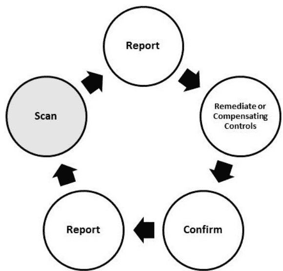

图 7.2 典型漏洞扫描流程。

应在整个技术栈中尽可能多地使用漏洞扫描器。仅靠 Web 应用程序扫描是不够的，因为软件栈（操作系统、Web 服务器、应用程序服务器、数据库服务器）也可能存在需要修复的漏洞。漏洞扫描应包括对整个技术栈（尤其是云环境）的外部扫描、内部扫描和经过身份验证的扫描。外部扫描主要针对探索防火墙外部可发现的安全问题。由于防火墙通常会限制端口，这些扫描有时可能只能提供有限的实用性；然而，它们仍然非常有价值，因为外部扫描的发现通常也对攻击者相当可访问。内部扫描从防火墙内部执行，因此，发现不限于外部所有人都能看到的端口。内部扫描允许我们识别攻击者或恶意内部人员如果进入网络（而不仅仅是被防火墙限制在外部）可以利用的安全问题。经过身份验证的扫描最为全面，因为它们不仅识别外部和内部扫描涵盖的问题，还能识别缺失的补丁并减少误报。然而，经过身份验证的扫描需要软件登录到系统以扫描它，因此也是最具侵入性的。

在流程早期，安全架构应当为软件栈制定配置要求，以加固栈并消除攻击面。配置指南有多种形式，包括将要部署产品的操作系统和其他软件的加固标准。例如，现成的操作系统会有许多不必要的服务和配置，这些会增加栈的攻击面。加固指南在降低默认配置带来的风险方面可以起到关键作用。

除了漏洞扫描之外，还应验证安全配置，以确保栈本身已加固。理想的解决方案是创建栈本身的“加固映像”，并加盖安全批准印章。当产品最终部署到运营环境时，任何与此映像的偏差都应引起警觉。

## 7.3 代码辅助渗透测试

代码辅助渗透测试是对软件系统进行的白盒安全分析，旨在模拟黑客的行为，目的是发现由编码错误、系统配置故障或其他运营部署弱点导致的潜在漏洞。它还用于验证代码实现是否遵循预期设计，验证已实现的安全功能，并发现可利用的漏洞。白盒测试需要了解系统的实现方式，以确保软件产品及其关联系统针对预期和非预期的软件行为（包括恶意攻击和常规软件故障）的稳健性。白盒测试评估人员必须是经验丰富的安全专业人员，他们具备了解什么使软件安全或不安全、如何像攻击者一样思考，以及如何使用不同的测试工具和技术来模拟黑客行为的背景和知识。渗透测试通常与自动化和手动代码审查一起进行，并需要分析软件及其关联系统中的数据流、控制流、信息流、编码实践以及异常和错误处理。

要成功对正在开发的代码及其将交互的系统进行白盒安全测试，必须整体满足三个基本要求，而非相互独立。评估人员/测试人员必须：

- 1. 能够访问并理解和分析可用的设计文档、源代码和其他相关开发工件，并具备关于什么使软件安全的背景和知识
- 2. 能够像攻击者一样思考，并有能力创建利用软件的测试
- 3. 了解并有使用白盒测试可用的不同工具和技术的经验，并能够像对手一样“跳出常规思维”或非传统地思考，因为对手会使用相同的工具和技术。

独立性是渗透测试的关键要素和要求，因此应始终考虑聘请第三方外部安全公司来进行安全审查和/或渗透测试。这既能提供“外部视角”的好处，又能保证独立性，对于所有被视为高业务风险的项目都应是强制性的。外部视角和观点将有助于识别其他流程未能防范的漏洞类型，并让所有人都清楚当前的安全成熟度状态。应允许第三方访问在 SDL 期间创建的威胁模型和架构图，以确定优先级，像黑客一样测试和攻击软件。审查的程度始终取决于可用预算，因为这类公司通常会对其服务收取溢价。渗透测试期间发现的任何安全问题或漏洞都必须在项目获准发布和交付之前得到解决和修复。

- **(1) 评估**
  - 确定渗透测试工作应关注的软件模块。
  - 为外部渗透测试制定并批准预算。
  - 确定潜在供应商所需的技能和标准。

- **(2) 识别**
  - 为渗透测试选择目标。
  - 选择供应商以回应提案请求 (RFP)。

- **(3) 评估与规划**
  - 发布描述将要执行的测试的 RFP。
  - 审查供应商响应，并做出供应商选择。
  - 选择或开发模拟生产运行条件的专用测试环境。

- **(4) 部署**
  - 执行渗透测试。
  - 执行任何推荐的修复措施。

图 7.3 渗透测试的四阶段流程。

为实现渗透测试的最低要求，应遵循图 7.3 所示的四阶段流程。

渗透测试报告是渗透测试的最终交付物。报告正文应重点关注哪些数据被泄露以及如何泄露，并向客户提供实际的攻击和利用方法，以及被利用数据的价值。如果 SDL 和开发团队需要或希望，报告中还可以包含可能的解决方案。已尝试利用的漏洞的详细列表，以及误报或被利用但未导致数据丢失的漏洞，应包含在附录中，而不是报告正文中，以保持报告主要部分的简洁和切中要点。

漏洞扫描通常生成的长长的可能暴露清单应包含在漏洞扫描报告或读出中，而不是最终渗透测试报告的一部分。如前一节所述，每项活动及其结果的目的不同。

最近，安全之所以备受关注，全是因为一些非常知名的公司遭到攻击，一些流行产品因存在安全漏洞而登上新闻。这导致客户（无论是传统软件还是 SaaS/云服务）要求企业展示并证明其所购买产品/服务的安全态势。在发布周期的这个阶段，最好与销售和营销团队一起制定一个与客户讨论安全的框架。该团队应考虑创建一份安全白皮书，可在销售周期中提供给客户（和潜在客户）。他们还应考虑为客户建立白皮书的年度审查周期，以便在发现新问题并希望修复时进行更新。客户通常需要在其自身公司内证明安全性和合规性，因此会联系产品公司，获取您所销售产品或服务的安全态势信息。根据我们的经验，此类请求通常以定期（每季度或每年）请求渗透测试结果或详细安全调查结果报告的形式出现。尤其是在云或 SaaS 环境中，可能不允许客户自行进行渗透测试，或向他们共享每一项安全发现，这可能不可行。然而，使所有客户的修复服务级别协议 (SLA) 保持一致也是不可行的。简而言之，如果您不希望客户设定或干扰您自己的安全优先级，那么建立一个与客户讨论安全的框架就非常重要。

## 7.4 开源许可证审查

虽然开源软件是免费的，并且能提升软件产品开发的创新性、效率和竞争力，但它也必须作为资产进行管理，遵守许可证义务，并且其安全性必须达到内部开发软件标准和要求所规定的水平。这些有时独特且复杂的许可证和业务风险如果管理不当，可能会延迟甚至阻止软件部署或交付。遵守适用的开源要求以避免昂贵且耗时的诉讼至关重要。对于管理使用开源软件作为产品或解决方案一部分的 SDL 的人员来说，需要关注的两个主要领域是许可证合规性和安全性。

- 1. 开源软件许可证合规性。不遵守开源软件许可要求可能导致昂贵且耗时的诉讼、法庭时间、版权侵权、公众媒体曝光、不良宣传，以及对不合规组织声誉和业务关系的负面风险。对开源许可证的管理不当和不合规还可能导致难以或无法提供软件产品支持、当前发布和交付日期延迟，或当前计划交付的订单停止。

- 2. 开源软件安全性。SDL 和开发团队以及其高级赞助人需要了解并理解将用于其自身软件产品的开源软件代码相关的漏洞。与内部开发的软件一样，开源和软件安全社区已知的所有漏洞必须在整个 SDL 过程中被识别、评估和缓解，并应包括与内部开发代码相同的威胁建模、架构安全和隐私审查以及风险评估的严谨性。

为了便于理解，以下列举了未妥善管理开源软件许可证或安全性的后果示例。


- **Diebold** 和 PES。Artifex® Software（开源 Ghostscript® PDF 处理软件背后的公司）对投票机供应商 Diebold 及其子公司 Premier Election Solutions 提起诉讼。Artifex 表示，Diebold 通过将 Ghostscript 集成到商业电子投票机系统中，违反了通用公共许可证（GPL）。Ghostscript 最初开发于 20 世纪 80 年代末，根据 GNU® GPL 免费分发。该许可证允许开发者研究、修改、使用和重新分发软件，但要求衍生作品必须在相同条款下提供。希望在闭源专有软件项目中使用 Ghostscript 的公司可以通过从 Artifex 购买商业许可证来避免版权要求。从 Artifex 购买许可证的商业 Ghostscript 用户中，包括印刷和技术行业的一些大牌，如 HP®、IBM®、Kodak®、Siemens®、SGI® 和 Xerox®。¹

- **Skype**。德国慕尼黑地区法院认定 Skype 违反了 GNU GPL，判其有罪。这一决定自那以后影响了公司处理 GPL 合规性的方式。²

- **Verizon**。两名软件开发者在针对 Verizon Communications 的诉讼中达成和解，他们声称这家电信巨头的宽带服务违反了其产品所依据的广泛使用的开源协议条款。问题的焦点在于，据称一名分包商在 Verizon 的无线路由器中使用了一款名为 BusyBox 的开源程序。作为和解的一部分，Verizon 的分包商 Actiontec Electronics 必须向开发者 Erick Andersen 和 Rob Landley 支付一笔未披露的款项。它还必须任命一名内部官员，以确保其遵守所使用开源软件的许可证。³

- **Google**。Google 和其他公司因使用 Android™ 移动平台而继续受到负面报道，该平台在发布时就存在已知安全漏洞，并且继续成为黑客的主要攻击目标。McAfee® 追踪的移动恶意软件在 2012 年激增，较 2011 年增长了近 700%。近 85% 的此类恶意软件针对运行 Android 的智能手机。巨大增长中的大惊喜并非 Android 正在受到攻击：Google 的智能手机平台长期以来一直是不法分子的关注重点。大惊喜是，Google 尚未以任何显著方式遏制这一趋势。关于 Android 的安全担忧对 Google 来说不应是新闻，Google 应该将安全放在优先事项的首位。⁴

- **Oracle**。安全专家指责 Oracle 未重视其旗舰数据库软件，并低报了一个“根本性”缺陷的严重性。即使 Oracle 在其 2013 年 1 月关键补丁更新中修复了多个产品中的众多缺陷，安全专家仍批评该公司数据库修复数量少，并声称该公司在淡化其旗舰关系型数据库中一个缺陷的严重性。随着 Oracle 扩展其产品组合并增加通过季度 CPU 修补的产品总数，Oracle 的补丁流程似乎出现了“瓶颈”。这是 Oracle 第一次在 CPU 中包含开源 MySQL 数据库，该数据库于 2010 年作为 Sun Microsystems® 收购的一部分被其收购。⁵

- **CNET Download.com**。CNET Download.com 被发现向其分发的数千个软件包中添加了间谍软件、广告软件和其他恶意软件，其中包括其 Nmap 安全扫描器。尽管这明显违反了其自身的反广告软件政策，他们仍然这样做了。（他们确实从页面上删除了反广告软件/间谍软件承诺。）在该做法遭到广泛批评后，Download.com 从 Nmap® 和一些其他软件中删除了其恶意安装程序，但该公司仍广泛使用它，并宣布了扩展计划。出于这些原因，我们建议完全避免使用 CNET Download.com。从官方网站或更具道德的聚合商（如 FileHippo®、NiNite 或 Softpedia®）下载应用程序更安全。⁶

使用手动方法查找、选择、监控和验证开源代码既耗时又低效，并且是对稀缺开发团队资源的不必要消耗。通过 Black Duck Software™（www.blackducksoftware.com）或 Revenir™（http://www.revernera.com）等工具进行自动化，对于有效且高效地将开源软件纳入 SDLC 开发工作以降低开发成本并在整个 SDL 期间管理软件及其安全性至关重要。Black Duck Software 的产品和服务允许组织分析软件源代码和二进制文件的组成，搜索可重用代码，管理开源和第三方代码审批，履行与混合源代码相关的法律义务，并监控相关安全漏洞。⁷⁻⁹ Revenir 通过回答“你的代码里有什么？”这个问题，使组织能够管理多源开发环境日益增长的复杂性。通过对代码库的详细分析，客户可以深入了解其代码库存——这是质量控制、风险缓解和漏洞评估的关键组成部分，其目标是消除与其使用相关的法律和漏洞问题。¹⁰

## 7.5 最终安全审查

在开发中软件的最终安全审查期间，将重新评估已执行的所有安全活动，包括威胁建模、工具输出以及对流程早期定义的需求的符合程度，以确定软件产品是否准备好发布和交付。此过程将产生以下三种结果之一：

- 1. **最终安全审查通过。** 在这种情况下，已识别的所有最终安全审查问题均已纠正，软件已获认证符合所有 SDL 要求，并从安全角度准备好发布。

- 2. **最终安全审查带例外通过。** 在这种情况下，并非所有已识别的问题都已纠正，但针对 SDL 和开发团队无法解决的一个或多个例外，已达成可接受的妥协。作为例外，未解决的问题不会在当前版本中解决，而将在下一个补丁或版本中处理和纠正。

- 3. **最终安全审查未通过，需要升级。** 在这种情况下，SDL 和开发团队无法就特定安全漏洞及其修复达成妥协，因此软件不能获准发布和交付。通常，SDL 流程早期会确定一个业务理由，阻止已识别问题符合 SDL 安全要求。阻止发布的 SDL 要求无法由两个团队解决，必须升级到高层管理人员处做出决定，当然，该决定将考虑如果软件在未满足要求的情况下发布所识别的风险和后果。升级到管理层的报告应由 SDL 和开发团队共同编写的一份综合报告，其中包括安全风险的描述和理由。

必须仔细安排最终安全审查，以最大限度地利用充分分析和修复在最终审查期间可能发现的已知和任何安全问题所需的时间，并为软件产品的发布和交付日期留出充足时间。

最终安全审查流程应包括以下内容：

- **安排。** 必须安排产品安全审查，以便从 SDL 获取完成此步骤所需的所有信息并可用，并留出足够的时间以尽量减少发布日期的任何延迟。在 SDL 流程开始时定义并同意的所有安全审查活动完成之前，不能设定开始日期，包括深入的安全漏洞审查、威胁建模以及适当的静态、动态和模糊测试工具分析。

- **特定最终安全审查任务。**

  - SDL 和开发团队将开会审查，并确保对 SDL 流程期间出现并记录的所有问题都已作出令人满意的答复。

  - 流程早期开发的威胁模型已在最终安全审查开始日期前进行审查和更新，以确保通过该流程识别的所有已知和疑似威胁均已得到缓解。

  - 所有安全漏洞均已根据流程早期确定的发布标准进行审查，并且在整个 SDL 期间至少执行了最低安全标准。对于当前软件产品版本中被拒绝或推迟的任何安全漏洞，也必须进行审查。需要注意的是，如果 SDL 和开发团队不持续根据 SDL 流程中使用的标准评估安全漏洞的严重性，那么大量安全漏洞可能会在最终安全审查期间重新出现或被发现，从而导致不必要且可能显著的资源和时间消耗，进而延迟产品发布。

  - 应在最终安全审查前运行静态、动态和模糊测试工具，以便在做出最终发布决定前充分评估结果。在某些情况下，工具可能会提供不准确或不可接受的结果，在这种情况下，您可能需要重新运行工具或寻找流程中使用的工具的更可接受替代方案。

  - 您必须审查并确保已遵循所有相关的内部安全策略和外部法规要求，并且正在审查的软件符合各自的要求。

  - 如果无法满足特定的 SDL 安全要求且整体安全风险可接受，则必须请求例外，最好在最终安全审查之前很久，并在流程中尽早提出。

最终产品安全审查可以描述为以下概述并在图 7.4 中以图形表示的四步流程。

- 1. **评估资源可用性。** 在此步骤中，将识别进行最终安全审查所需和可用的资源。还将评估在软件发布前强制执行所需质量门的能力。与质量相关的最低可接受安全级别通过质量门建立。


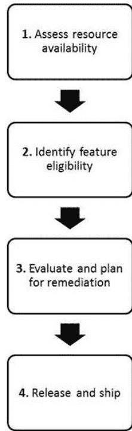

图 7.4 最终安全审查四步流程。

在 SDLC 流程早期设置质量门，使安全风险在 SDL 流程早期就能被理解，有助于确保漏洞能够及早识别和修复，从而避免流程后期出现不必要的工作和延误。SDL 和开发团队必须在最终安全审查中展示对质量门的合规性。如果 SDL 确实将安全构建到了 SDLC 流程中，那么完成最终安全审查所需的时间将很少；否则，将需要更多的时间和资源，这可能会影响按时发布和交付的能力。

- 2. 识别功能资格。在此步骤中，识别出有资格在最终安全审查中进行工作的安全任务。功能资格识别应在 SDL 流程早期完成，以避免最终安全审查中出现未完成的安全工作。还应对 SDL 流程中尚未报告漏洞但具有高分漏洞历史的区域或子团队进行审查，因为这些可能会在最终安全审查期间给团队带来意外任务。

- 3. 评估并规划修复。在此步骤中，通知上一步骤中识别出的任务的相关利益方，并安排最终安全审查的日程。

- 4. **发布和交付。** 在所有 SDL 要求（例如模糊测试、漏洞扫描、安全编码策略审查以及其他当前安全实践，以及对质量门或漏洞的任何例外）都经过正式审查和批准后，产品安全审查即告完成。功能回归测试通常也会在最终安全审查期间进行。回归测试用于发现新的软件漏洞或已发现问题的回归，因此称为回归。这些回归可能是对软件或系统进行更改后，现有功能和非功能区域发生变化的结果。简而言之，回归测试评估软件某一部分的更改是否导致其交互的其他软件或系统部分发生变化。

## 7.6 最终隐私审查

通常，在软件发布前必须满足隐私要求。尽管最终安全审查必须在发布前完成，但如前所述的安全例外凸显出并非所有安全问题都必须在发布前得到满足。隐私要求验证通常与最终安全审查同时进行，在许多情况下，现在被视为同一流程的一部分。这要求解决在完成通用隐私问卷后发生的重大变更，例如收集不同的数据类型、实质性更改通知的语言或同意的样式，或识别出对隐私保护产生负面影响的新软件行为。这包括审查软件，查找在先前隐私审查或作为最终安全审查的一部分中识别出的任何相关变更或未决问题。最终审查的具体隐私要求应包括以下内容：

- 如果项目被确定为 P1 项目，则 SDL 团队和隐私负责人必须审查前一章中提到的 Microsoft® SDL 隐私问卷（附录 C）11 或其等效文档，以确定是否需要隐私披露。如果隐私负责人确定隐私披露被豁免或已覆盖，则无需满足此要求。隐私负责人将对隐私披露声明的发布给予最终批准。

- 如果项目被确定为 P2 项目，则隐私负责人将确定是否正在请求隐私设计审查，提供软件架构设计符合适用于此软件产品的隐私标准的确认，或确定是否需要例外请求。隐私负责人通常会根据需要与 SDL 团队、开发负责人和法律顾问合作，在产品公开发布前完成隐私披露，并确保隐私披露针对以 Web 为中心的产品得到适当发布。

- 如果项目是 P3 项目，则未识别出影响隐私要求合规性的变更，无需额外审查或批准，最终隐私审查已完成。否则，SDL 团队和隐私负责人将提供所需变更列表。

除了应对发布和交付后发现的软件产品安全漏洞所需的职责、流程和程序外，还创建了类似于产品安全事件响应团队（PSIRT）的功能，用于应对发布和交付后发现的隐私问题。该元素将在下一章中与发布后支持活动相关联进行讨论。

## 7.7 关键成功因素

SDL 这一第五阶段的成功取决于对策略合规性的最终审查、全面漏洞扫描和渗透测试，以及最终安全和隐私审查。表 7.1 列出了本阶段的关键成功因素，如下所述。

| 关键成功因素 | 描述 |
| :--- | :--- |
| 1. 策略合规性分析 | 开发过程中安全和合规性要求的最终审查 |
| 2. 漏洞扫描 | 扫描软件堆栈以识别安全问题 |
| 3. 渗透测试 | 利用软件堆栈上的任何/所有安全问题 |
| 4. 开源许可审查 | 对堆栈中使用的开源软件进行最终审查 |
| 5. 最终安全审查 | 对 SDL 周期中识别的所有安全要求进行合规性最终审查 |
| 6. 最终隐私审查 | 对 SDL 周期中识别的所有隐私要求进行合规性最终审查 |
| 7. 客户参与框架 | 定义与客户共享安全相关信息流程的框架 |

### 成功因素 1：策略合规性分析

如果识别出任何新的安全要求（基于威胁或策略更新），则需要在开发流程如此晚期时对其实施可行性进行评估。有些要求可能无法进入产品，而另一些可能足够重要，以至于需要推迟发布日期。

### 成功因素 2：漏洞扫描

漏洞扫描和安全配置验证提供了最后一次机会，以识别和修复整个软件堆栈中的安全问题。漏洞扫描和安全配置验证应包括从不同视角（外部、内部和已验证身份）进行的评估。它还应涵盖堆栈中的所有层，从操作系统到应用程序。

### 成功因素 3：渗透测试

确保渗透测试和漏洞扫描之间没有混淆至关重要。漏洞扫描提供经过验证的安全发现列表。渗透测试更进一步，更多地是对目标环境的攻击模拟。结果通常取决于渗透测试人员的技能、想象力和经验。漏洞扫描为渗透测试提供输入。

### 成功因素 4：开源许可审查

对开源软件进行最终审查以确保满足所有许可要求，对于降低法律责任至关重要。它还能识别需要纳入不同类型安全测试（漏洞扫描和渗透测试）的技术。

### 成功因素 5：最终安全审查

在 SDL 此阶段结束前进行最终安全审查至关重要。如果所有要求都满足，安全团队可以毫无例外地说“Go”。如果安全要求存在例外，则必须详细记录并设定时限。一个例子是“有条件通过”，即未满足的要求不会阻止发布，但将在商定的日期前进行修复。

### 成功因素 6：最终隐私审查

与因素 5 类似，此步骤允许对产品相对于周期开始时制定的隐私要求（此后已更新或细化）进行最终审查。如果有任何未满足的要求，应将其记录为有时限的例外，并要求在特定日期前进行修复。

### 成功因素 7：客户参与框架

如前一章所述，定义一个框架以在销售过程中及之后让客户参与安全相关讨论非常重要。这可以限制客户的临时请求和升级，并让他们相信贵公司对安全问题有所掌控。

## 7.8 交付物

表 7.2 列出了 SDL 此阶段的交付物。

表 7.2 第 5 阶段的交付物

| 交付物 | 目标 |
|---|---|
| 更新的策略合规性分析 | 对公司策略遵循情况的分析 |
| 安全测试报告 | 本阶段 SDL 中不同类型安全测试的发现 |
| 修复报告 | 提供产品安全态势的状态 |
| 开源许可审查报告 | 如果使用开源软件，则审查对许可要求的合规性 |
| 最终安全和隐私审查报告 | 对安全和隐私要求合规性的审查 |
| 客户参与框架 | 在产品生命周期不同阶段吸引客户的详细框架 |


### 更新的策略合规性分析
策略合规性分析工件（参见第 4、5 和 6 章）应根据本阶段 SDL 中可能出现的任何新要求或策略进行更新。

### 安全测试报告
调查结果摘要（在第 6 章中讨论）应更新，以包含本阶段的漏洞扫描（外部、内部和经过身份验证的）以及渗透测试结果。还应准备一份面向客户的报告，以便与企业客户共享。

### 修复报告
除了更新安全测试报告（或调查结果）外，还应更新修复报告，以便更好地了解产品在发布前的安全态势。到目前为止尚未修复（且不打算在发布日期前修复）的任何调查结果都应予以讨论，并列入路线图。

### 开源许可证审查报告
应准备一份软件栈中使用的开源软件的正式审查报告，概述不同的许可证要求（MIT® 许可证、GNU® 通用公共许可证、GNU® 较不通用公共许可证、BSD® 许可证）以及如何满足这些要求。安全和隐私官员应审查该报告并对其签字批准。

### 最终安全和隐私审查报告
在对安全和隐私要求的合规性进行最终审查后，应要求安全和隐私官员进行正式签字批准。

### 客户参与框架
作为本阶段的一部分，应交付一份正式记录的流程，用于与客户共享安全信息。该流程应包括与客户共享的信息类型（及频率）、安全事件发生时的通知、安全调查结果以及修复 SLA。

## 7.9 指标
在 SDL 的本阶段中，应收集以下指标：

- 公司策略合规百分比（已更新）
  - 第 5 阶段与第 4 阶段的合规百分比
- 通过漏洞扫描和渗透测试发现的安全问题的数量、类型和严重性
  - 通过不同类型的测试发现的安全问题的重叠部分
- 不同类型测试的调查结果严重性比较
- 将调查结果映射到先前识别的威胁/风险
- 已修复的安全调查结果数量（已更新）
- 调查结果的严重性
- 修复调查结果所花费的时间（小时，近似值）
- 未解决的调查结果的数量、类型和严重性（已更新）
- 安全和隐私要求的合规百分比

## 7.10 总结
在本章中，我们描述了软件产品完成 SDLC 及相关 SDL 活动和最佳实践后成功发布和交付的要求（参见图 7.5）。既然我们已经完成了 SDL 阶段 A5，并且产品已发布，下一章将描述 SDL 阶段 A6，它将概述我们 SDL 的 SDL 发布后支持活动（PRSA）阶段。软件产品发布和交付后，软件安全、开发和隐私团队必须在企业公共关系、法律和其他团队的支持下，随时准备应对任何可能需要响应的安全漏洞或隐私问题。此外，还必须制定一份详细说明适当流程和程序的响应计划，其中包括为潜在的发布后问题做准备。除了外部漏洞披露响应外，此阶段还应包括针对新产品组合或云部署的内部审查、发布后认证、安全架构审查，以及对当前、旧版和并购产品及解决方案的基于工具的评估，以及客户、监管要求或行业标准可能要求的已发布软件产品的第三方审查。

## 章节快速检查
- 1. 发布后计划应制定一项政策以允许：
  - a. 规则
  - b. 偏差
  - c. 程序
  - d. 实践
- 2. 管理评审建议：
  - a. 最佳实践
  - b. 角色
  - c. 责任
  - d. 纠正或补救措施
- 3. 黑盒测试的目的是确认给定输入：
  - a. 是正确的
  - b. 可以准确处理
  - c. 产生可预测的输出
  - d. 不会导致缺陷

| SDLC 活动和最佳实践 | 代码 | 概念 (1) | 规划 (2) | 设计与开发 (3) | 就绪 (4) | 发布与上市 (5) |
|---|---|---|---|---|---|---|
| 安全评估 | A1 | - 软件安全团队早期介入<br>- 软件安全团队主持发现会议<br>- 软件安全团队创建 SDL 项目计划<br>- (说明将进行的进一步工作) | | | | |
| 架构 | A2 | | - A2 策略合规性分析<br>- SDL 策略评估与范围界定<br>- 威胁建模 / 架构安全分析<br>- 开源选择<br>- (如需要)<br>- 隐私信息收集和分析 | | | |
| 设计与开发 | A3 | | | - A3 策略合规性分析<br>- 安全测试计划编写<br>- 静态分析<br>- 威胁模型更新<br>- 设计安全分析与审查<br>- 隐私实施评估 | | |
| 设计与开发 | A4 | | | | - A4 策略合规性分析<br>- 安全测试用例执行<br>- 静态分析<br>- 动态分析<br>- 模糊测试<br>- 人工代码审查<br>- 隐私验证和修复 | |
| 交付 | A5 | | | | | - A5 策略合规性分析<br>- 漏洞扫描<br>- 渗透测试<br>- 开源许可证审查<br>- 最终安全审查<br>- 最终隐私审查 |

- 4. 配置管理练习：
  - a. 对代码的合理控制
  - b. 对设计的合理控制
  - c. 对变更流程的合理控制
  - d. 强制执行变更流程
- 5. 有权批准变更的管理层级别必须是：
  - a. 尽可能高
  - b. 尽可能简单
  - c. 明确定义
  - d. 已批准

## 练习
以下练习基于附录 A 中讨论的案例研究。这些练习旨在让您练习应用步骤并为 SDL 的第 A5 阶段产生交付成果。

在软件开发生命周期（SDLC）的最后阶段，您需要确保 Revvin’ Engines 团队的软件足够安全，满足法规和行业要求，并将隐私问题解决到软件可接受发布并准备交付的程度。

- 1. 进行最终策略合规性分析，以回答是否满足所有内部应用程序安全要求和所有行业要求的问题。
- 2. 制定最终安全测试计划，包括：
  - a. 针对早期阶段未解决的任何残留漏洞进行静态代码测试。
  - b. 由合格的渗透测试人员或公司进行渗透测试。
  - c. 进行最终开源和第三方库组成审查，以确保应用程序中仅存在所使用库的最新版本。
- 3. 结合合规性审查和测试结果进行最终安全审查，以建立系统发布的参数。
- 4. 进行最终隐私审查，以确保符合所有隐私要求以及所有安全要求。
- 5. 制定安全相关信息沟通计划，供客户服务和应用程序支持团队在客户开始使用系统时运行系统所需。

## 参考文献
- 1. Paul, R. (2008, November 4). “Diebold Faces GPL Infringement Lawsuit over Voting Machines: Artifex Software, the Company Behind Ghostscript, Has Filed a Lawsuit Against. . . ” Arstechnica: Technology Lab/Information Technology. Retrieved from http://arstechnica.com/information-technology/2008/11/diebold-faces-gpl-infringement-lawsuit-over-voting-machines


- 2. Broersma, M. (2007年7月26日). “Skype因GPL违规被判有罪.” IDG新闻服务. 检索自 https://www.itworldcanada.com/article/skype-found-guilty-of-gpl-violations/9161

- 3. McDougall, P. (2008年3月17日). “Verizon和解开源软件诉讼：问题集中于声称一名分包商在Verizon的无线路由器中使用了一款名为BusyBox的开源程序.” 信息周. 检索自 https://www.informationweek.com/software/verizon-settles-open-source-software-lawsuit

- 4. Koetsier, J. (2012年9月4日). “抱歉，谷歌粉丝：随着恶意软件激增700%，Android安全性受损.” VentureBeat. 检索自 http://venturebeat.com/2012/09/04/sorry-google-fanboys-android-security-sucks-hard-as-malware-explodes-by-700/#FkVUAhZtRG8s5jywy.99

- 5. Rashid, F. (2012年1月1日). “Oracle被指淡化数据库缺陷及其严重性.” eWeek. 检索自 https://www.eweek.com/security/oracle-accused-of-downplaying-database-flaws-severity/

- 6. Insecure.org. (2013). “Download.com被发现将恶意软件添加到Nmap及其他软件中.” 检索自 http://insecure.org/news/download-com-fiasco.html

- 7. Schwartz, E. (2007年8月6日). “开源软件全面进入企业：Linux上的主要业务应用将操作系统商品化.” Infoworld. 检索自 http://www.infoworld.com/t/applications/open-source-lands-in-enterprise-both-feet-576

- 8. Worthington, D. (2007年8月6日). “穿越许可复杂性：Black Duck的开源许可解决方案应对GPLv3.” SDTimes. 检索自 http://www.sdtimes.com/link/31007

- 9. Boston Business Journal Staff. (2007年12月17日). “围绕开源的争夺为初创企业开辟利基市场.” 波士顿商业期刊. 检索自 http://www.bizjournals.com/boston/stories/2007/12/17/story13.html?page=all

- 10. Revenera. (2021). Revenera主页. 检索自 https://www.revenera.com

- 11. Microsoft Corporation. (2012). “附录C：SDL隐私问卷.” 检索自 http://msdn.microsoft.com/en-us/library/windows/desktop/cc307393.aspx

## 第8章

### 发布后支持 (PRSA1–5)

### 章节概览

本章中描述的许多功能及其相关活动和最佳实践，由软件安全组以外的团队处理，而该软件安全组将对前几章中描述的SDL活动和最佳实践（A1–A5）拥有主要监督权。在此，我们将它们描述为组织中集中式软件安全组的责任活动。

### 本章要点

- 探讨构成安全开发生命周期（SDL）发布后支持活动（PRSA）的实践。
- 记录实施PRSA交付成果的关键成功因素。
- 使用附录A中的案例研究，为PRSA制定计划和交付成果。

图8.1说明了发布后支持活动（PRSA）和最佳实践。以矩阵式关系组织软件安全组，能够实现SDL的完整实施和运行。作者发现，这是利用现有资源管理这些活动的一种更具成本效益和效率的方式。这正是我们强烈建议核心软件安全组由高级软件安全架构师组成的原因，他们与软件安全倡导者保持硬“虚线”关系，而软件安全倡导者又与软件安全布道师保持同样的关系。集中式软件安全组中的软件安全架构师与每个Tier 1软件产品的产品经理之间也应存在牢固的关系，就像软件安全倡导者一样。同样重要的是，软件安全组及其职能应处于合适的组织中，以便能够取得最大成功。

### 典型SDLC阶段

### 支持与维护

### PRSA 1-5

### SDL活动和最佳实践

- 外部漏洞披露响应
- 第三方评审
- 发布后认证
- 新产品组合或云部署的内部评审
- 对当前、旧版和并购产品及解决方案的安全架构评审和基于工具的评估

### PRSA

### 发布后支持

图8.1 发布后支持（PRSA1–5）：SDL活动和最佳实践。

### 8.1 适量化你的软件安全组

首先，我们将逐一梳理软件安全组的各种关系，以及将一切放在合适视角下的重要性，以便“适量化”构建成功的软件安全计划。这样做意味着拥有

- 合适的组织位置
- 合适的人员
- 合适的流程

### 8.1.1 合适的组织位置

尽管近年来软件安全技术取得了重大进展，但我们认为，人员仍然是成功软件安全计划中最重要的要素，该计划包括活动和最佳实践的实施与管理。为了充分发挥负责软件安全的人员的作用，他们必须属于合适的组织（见图8.2）。曾担任七个首席安全官（CSO）

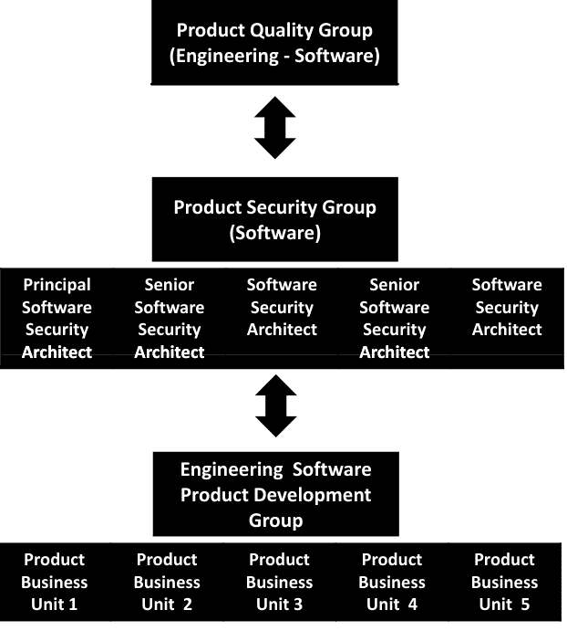

图8.2 合适的组织位置。

和首席信息安全官（CISO）职务，本书合著者James Ransome在其多个职位中都有软件安全向其汇报。基于他自身的经验以及与行业同行的沟通，很明显，软件安全职能理想情况下应隶属于工程（软件开发）职能，特别是隶属于质量职能。普遍共识是，应用安全角色通常向集中式信息安全角色CSO/CISO职位汇报，不应与软件安全职能混淆。通常，IT安全组织中应用安全角色的人员擅长运行工具，但缺乏充分解释结果所需的软件开发背景。为了明确这一点，区分软件安全和应用安全很重要。也许澄清这一区别的最佳方式是引用Gary McGraw的话：

> 软件安全是关于构建安全软件：设计安全软件；确保软件安全；并教育软件开发人员、架构师和用户如何将安全性构建进去。另一方面，应用安全是以事后方式保护软件及其运行系统，仅在开发完成后进行。1

让软件安全专家向工程组织汇报的另一个优势是，由于他们属于同一组织，因而获得授权；直接负责实施SDL政策和程序及相关工具；并理解软件开发、其架构以及修复所需的工作量。此前在本书中，我们描述了软件安全作为质量和组织要素的重要性，同样的关系也应存在于工程组织中。

作者认为，软件安全应是工程/软件开发内部的一个独立团队，并应与中央安全组密切合作；它甚至可以与CSO/CISO保持“虚线”关系。

我们倾向于让软件安全组向软件质量组汇报的几个原因如下：

- 1. 安全漏洞按定义即为质量问题。
- 2. 安全功能是架构功能，与产品管理关系密切。
- 3. 基于上述(1)和(2)，安全既是功能也是质量职能。
- 4. 当质量作为开发过程（工程）的组成部分并包含安全时，效果最佳。

### 8.1.2 合适的人员

在第2章中，我们讨论了使本书中描述的SDL模型取得成功所需的人才。这将包括至少一名首席软件安全架构师、一组高级和普通软件安全架构师，以及理想情况下，组织中每个软件产品安全组配备一名软件安全架构师。这种关系在图8.3中有所体现。这种人才池提供了扩展能力。


- 产品安全组（软件）
- 首席安全软件架构师
- 高级安全软件架构师
- 软件安全架构师
- 软件安全架构师

### 工程软件产品开发组

| 产品业务单元 1 | 产品业务单元 2 | 产品业务单元 3 | 产品业务单元 4 | 产品业务单元 5 |
| :--- | :--- | :--- | :--- | :--- |
| BU 1 产品经理<br>BU 1 软件安全冠军 | BU 2 产品经理<br>BU 2 软件安全冠军 | BU 3 产品经理<br>BU 3 软件安全冠军 | BU 4 产品经理<br>BU 4 软件安全冠军 | BU 5 产品经理<br>BU 5 软件安全冠军 |
| 软件安全冠军 第 1 级<br>产品 #1 | 软件安全冠军 第 1 级<br>产品 #1 | 软件安全冠军 第 1 级<br>产品 #1 | 软件安全冠军 第 1 级<br>产品 #1 | 软件安全冠军 第 1 级<br>产品 #1 |
| 软件安全冠军 第 1 级<br>产品 #2 | 软件安全冠军 第 1 级<br>产品 #2 | 软件安全冠军 第 1 级<br>产品 #2 | 软件安全冠军 第 1 级<br>产品 #2 | 软件安全冠军 第 1 级<br>产品 #2 |
| 软件安全冠军 第 1 级<br>产品 #3 | 软件安全冠军 第 1 级<br>产品 #3 | 软件安全冠军 第 1 级<br>产品 #3 | 软件安全冠军 第 1 级<br>产品 #3 | 软件安全冠军 第 1 级<br>产品 #3 |
| ... | ... | ... | ... | ... |
| ... | ... | ... | ... | ... |
| ... | ... | ... | ... | ... |
| ... | ... | ... | ... | ... |

### 软件安全布道师

图 8.3 合适的人选。

### 典型 SDLC 阶段

### SDL 活动和最佳实践

| SDLC 阶段 | 活动 ID | 类别 | 最佳实践 |
| :--- | :--- | :--- | :--- |
| 概念 (1) | A1 | 安全评估 | - 软件安全团队早期介入<br>- 软件安全团队主持发现会议<br>- 安全团队制定 SDL 项目计划<br>- 说明将要进行的进一步工作<br>- 隐私团队制定隐私影响评估（PIA）计划 |
| 规划 (2) | A2 | 架构 | - A2 政策合规性分析<br>- SDL 政策评估与范围界定<br>- 威胁建模 / 架构安全分析<br>- 开源软件选择<br>- （如需要）隐私信息收集与分析 |
| 设计与开发 (3) | A3 | 设计与开发 | - A3 政策合规性分析<br>- 安全测试计划编制<br>- 静态分析<br>- 威胁模型更新<br>- 设计安全分析与评审<br>- 隐私实施评估 |
| 就绪 (4) | A4 | 设计与开发 | - A4 政策合规性分析<br>- 安全测试用例执行<br>- 静态分析<br>- 动态分析<br>- 模糊测试<br>- 人工代码审查<br>- 隐私验证与修复 |
| 发布与上线 (5) | A5 | 交付 | - A5 政策合规性分析<br>- 漏洞扫描<br>- 渗透测试<br>- 开源许可证审查<br>- 最终安全审查<br>- 最终隐私审查 |

图 8.4 SDL A1-A5 活动和最佳实践。

理想情况下，每个工程软件产品开发组内的每个第 1 级软件产品都应配备一名软件安全冠军（SSC）。人才的另一要素是软件安全布道师（SSE），适用于规模足够大、拥有软件安全冠军（SSC）角色额外候选人的组织，这些候选人可以在有 SSC 职位空缺之前担任 SSE 候选人。SSE 有两个角色——一是接受培训的 SSC，二是作为整体软件产品安全计划的布道师，宣传政策、执行政策并推广整体 SDL 流程。

## 8.1.3 正确的流程

正确的流程包括本书迄今所述并汇总于图 8.4 的核心 SDL 活动和最佳实践。除核心活动和最佳实践外，我们还添加了图 8.1 中突出显示的活动和最佳实践。鉴于持续存在的“以更少资源做更多事”的压力，我们认为大多数组织不会有条件将 PRSAs 1–5 的大部分元素作为独立组织，而需要提供创新方式将其纳入整体软件安全计划，以优化可用资源的利用效率。本章第 8.2–8.6 节将介绍我们在每个适用的组织中使其成功所需的活动和最佳实践的方法。

## 8.2 PRSA1：外部漏洞披露响应

我们发布后方法论的关键要素之一是，典型的产品安全事件响应团队（PSIRT）职能可以在我们为软件安全和隐私提出的精简组织结构中作为共享责任，该结构涵盖对发布后安全漏洞和隐私问题发现的响应。无论您的软件安全计划及其关联的 SDL 有多好，事实是总会有遗漏之处，您需要制定响应计划。最重要的是，如果在发布后的软件产品中发现软件安全漏洞和隐私问题成为常见情况，这清楚地表明，通过类似 SDL 的流程将安全构建到组织的软件开发生命周期（SDLC）中是薄弱或不存在的。这种薄弱可能导致因公开披露的漏洞利用或固有于发布后软件的安全缺陷而产生负面曝光，随后因品牌诋毁、诉讼或违约而失去市场份额，并成为对手进一步利用的主要目标。

基于我们的经验，我们再怎么强调拥有一个单一团队作为所有关于安全漏洞的客户沟通焦点的重要性都不为过。我们常见的情况是，至少有三个不同的团队与客户沟通：客户支持、销售和信息安全团队。PSIRT 可能是某个公司信息安全组织的一部分，也可能不是，尽管这当然是可取的。总之，与客户建立明确定义的沟通链条至关重要，以防止泄露非预期信息，避免恐慌和使整个账户面临风险。

### 8.2.1 发布后 PSIRT 响应

在软件安全方面，PSIRT 负责响应涉及外部发现的发布后软件产品安全漏洞的软件产品安全事件。作为这一角色的一部分，该团队管理对其公司软件产品及其交互系统中公开发现的安全漏洞的调查。外部发现者可能是独立安全研究人员、顾问、行业组织、其他供应商，或者是出于善意甚至可能是恶意的黑客，他们识别出 PSIRT 负责的软件产品中可能存在的安全问题。已识别的问题根据漏洞的潜在严重性进行优先级排序，通常使用本书前面描述的 CVSS 评分系统以及其他环境因素。报告事件的解决可能需要升级 PSIRT 母公司正在积极支持的产品。

在漏洞被识别后不久，并在对漏洞索赔进行调查期间，PSIRT 应与发现者协作，确认漏洞性质，收集所需技术信息，并确定适当的补救措施。

初步调查完成后，结果连同解决和公开披露计划一起交付给发现者。如果事件报告者不同意结论，PSIRT 应尝试解决这些顾虑。

发现者将被要求保持严格保密，直到完整的解决方案可供客户使用，并由 PSIRT 在公司网站上通过适当的协调公开披露（通常称为安全公告（SB））发布。在调查和预报告过程中，PSIRT 与发现者协调沟通，包括事件调查的状态和文档更新。还可能需要从发现者处获取更多信息，以验证索赔和利用漏洞所使用的方法。发现者还将被告知，如果他们在 PSIRT 发布之前披露漏洞，则发现者将不会在公司的公开披露中获得署名，并且该案例将被视为由外部来源公开报告的“零日”无通知发现。在零日发现的情况下，PSIRT 和开发团队将共同努力尽快修复漏洞，依据特定漏洞的通用漏洞评分系统（CVSS）（https://www.first.org/cvss/v3.1/specification-document）评分的严重程度。在零日高分漏洞的情况下，公司的公关团队将与 PSIRT 密切合作，以管理潜在的负面新闻和客户反应。

在调查报告的漏洞期间，PSIRT 在高度保密的基础上协调和管理所有敏感信息。内部分发仅限于那些有合法知情权并能积极协助解决漏洞的个人。

PSIRT 还将与第三方协调中心（例如 CERT® 协调中心（CERT/CC）（https://www.kb.cert.org/vuls/））及其他机构合作，管理针对其负责的软件产品所影响的已报告漏洞的协调行业披露。在某些情况下，多个供应商将受到影响，并将参与与 CERT 等中心的协调响应。如果涉及协调中心，则视情况而定，PSIRT 可能代表发现者联系该中心，或协助他们自行联系。


如果产品中的第三方组件受到影响，这将使修复过程变得复杂，因为PSIRT将依赖第三方进行修复。进一步的复杂之处在于，PSIRT将不得不进行协调，并且在许多情况下，需要直接通知供应商，以确保与第三方协调中心的协调，并且很可能直接与发现者打交道。即使使用了第三方组件，假设是主要软件产品的所有者最终对软件的所有组件负责，无论他们是否拥有这些组件。

如上所述，PSIRT通常使用CVSS来评估漏洞的严重性，这是其评估产品中报告的潜在漏洞并确定哪些漏洞需要进行外部和内部报告的标准流程的一部分。

CVSS模型使用三种不同的度量或评分，包括基础、时间和环境计算，所有三个评分的总和应被视为最终CVSS评分。该评分代表某一特定时刻；它针对特定环境定制，并用于对特定外部发现的漏洞的响应进行优先级排序。此外，大多数PSIRT会考虑修改最终评分，以考虑CVSS评分中未能正确捕获的因素。PSIRT在确定特定漏洞的严重性以及报告需求时，通常使用以下CVSS准则：

- 严重 (C)— CVSS基础评分 9.0–10.0
- 高 (H)— CVSS基础评分 7.0–8.9
- 中 (M)—CVSS基础评分 4.0–6.9
- 低 (L)—CVSS基础评分 0.1–3.9²

如果PSIRT负责的产品中涉及第三方软件组件的安全问题，那么根据情况以及第三方是否有CVSS评分，PSIRT可能会使用组件创建者提供的CVSS评分，和/或调整评分以反映对整体软件产品的影响。

公开披露（包括相关的基础和时间CVSS评分以及CVE® ID³报告）通常在外部发布后发现事件中，当发生以下一种或多种情况时进行：

- 事件响应流程已完成，并确定存在足够的软件补丁或其他修复措施来解决漏洞。可以发布代码修复的公开披露，以解决高严重性漏洞。
- 已观察到可能导致PSIRT公司客户风险增加的漏洞的主动利用，这需要发布安全漏洞公告。公告可能包含也可能不包含一整套补丁或其他修复步骤。在可能的情况下，公开公告中会包含补偿控制措施，以提供临时保护，限制暴露，直到永久修复方案发布。
- 很可能发生影响PSIRT公司产品的漏洞的零日公告或其他公众意识提升的可能性，这可能导致客户风险增加。在这些情况下，PSIRT已与公司的公关团队密切合作，以帮助评估公共指标和警告（例如Twitter动态和博客），表明此次暴露即将发生，并且已提前准备好声明。同样，这种加速的公开漏洞公告不会包含一整套补丁或其他修复步骤，但理想情况下，可以识别出临时补偿控制措施以限制暴露。

典型的逐步PSIRT案例处理流程将包括以下步骤：

1. 收到由个人发现者或组织评估的漏洞通知。
2. 确定负责的软件产品开发团队，以及评估发现者漏洞索赔所需的资源。
3. 如果索赔可信，则进行影响评估并确定修复的时间表。开发修复所需的工作量和优先级与漏洞严重性和风险公开披露的可能性进行权衡。在某些情况下，由于开发团队正在执行其他关键任务，可能需要外部资源。如果索赔不可信，则向发现者请求更多信息，以确保威胁已在测试环境中得到适当重现。如果在确认测试环境后仍不可信，则通知发现者公司的调查结果。如果发现者已公开声称漏洞可信，尽管公司已确定其不可信，那么PSIRT通常会与公司的公关团队合作，发布公司调查结果作为对发现者的反驳。
4. 承诺修复的时间范围、修复已确认漏洞所需的资源以及报告格式（例如，安全公告、知识库文章或其他形式的公开通知）。
5. 在确定补丁或其他修复方法后，通过步骤4中确定的报告格式，在修复可用的日期同时通知所有客户。

## 8.2.1.1 ISO 29147 和 ISO 30111

两个国际标准化组织（ISO*）标准与供应商PSIRT的正常运作相关：

1. ISO/IEC 29147:2018 [ISO/IEC 29147:2018]—信息技术—安全技术—漏洞披露

该标准为供应商提供了关于产品和服务中漏洞披露的要求和建议，适用于选择实施漏洞披露以降低其产品和服务用户风险的供应商。

漏洞披露使用户能够按照ISO/IEC 27002:2013, 12.6.1中规定的技术漏洞管理进行操作。漏洞披露帮助用户保护其系统和数据，优先考虑防御性投资，并更好地评估风险。漏洞披露的目标是降低利用漏洞所关联的风险。当多个供应商受到影响时，协调的漏洞披露尤其重要。该标准提供：

- 关于接收潜在漏洞报告的指南
- 关于披露漏洞修复信息的指南
- 特定于漏洞披露的术语和定义
- 漏洞披露概念概述
- 漏洞披露的技术和政策考虑
- 技术、政策（附录A）和通信（附录B）的示例⁴

2. ISO/IEC 30111:2019 [ISO/IEC 30111:2019]—信息技术—安全技术—漏洞处理流程

该标准提供了关于如何处理和修复产品或服务中报告的潜在漏洞的要求和建议，适用于参与漏洞处理的供应商。ISO/IEC 30111描述了在接收和披露漏洞报告之间发生的其他相关活动。⁵

## 8.2.2 发布后隐私响应

除了可能被发现和披露的发布后安全问题外，还可能发现潜在的隐私问题。根据我们的经验，与隐私相关的问题没有得到与安全漏洞同等的关注，也没有专门成立的团队来处理此类问题。软件开发公司可能设有首席隐私官（CPO）或等效职位，例如常驻的专门法律顾问，但大多数公司没有专职人员，最多可能只有一名隐私支持专家。这需要PSIRT功能与集中式软件安全团队以及公司的隐私功能（无论是内部还是外包）之间建立紧密的协调和工作关系。发布后的隐私响应应构建在PSIRT流程中，就像安全应构建在SDLC中一样。鉴于隐私问题或隐私控制漏洞利用的潜在法律性质，隐私顾问应为响应团队编写基本谈话要点、响应程序和法律升级要求，以便用于响应发布后发现的任何潜在隐私问题。一些基本指南如下：

- 隐私专家应直接参与本书前面描述的P1和P2类别的所有事件。
- 在SDL过程中，应确定适合潜在发布后隐私发现问题的额外开发、质量保证和安全资源，以便参与发布后隐私事件响应。
- 软件开发组织应制定自己的隐私响应计划，或修改Microsoft® SDL隐私升级响应框架（附录K）⁶以供自身使用。这应包括风险评估、详细诊断、短期和长期行动计划以及行动计划的实施。与上述PSIRT响应一样，响应可能包括创建补丁或其他风险修复程序、回复媒体询问以及联系外部发现者。


## 8.2.3 优化发布后的第三方响应

不同团队和利益相关方之间的协作，为发布后响应的成功提供了最佳机会。本书中提出的软件安全倡导者、软件安全布道者，以及与软件开发产品经理和质量团队建立持续的正式软件安全计划关系，以支持和协作与集中式软件安全团队，相比于仅专门处理事后 PSIRT 和隐私支持的团队，提供了几个明显的优势：

- 通过将这些功能嵌入到直接负责修复受发现漏洞或隐私问题影响的产品的工程和开发团队中，直接实现了对 PSIRT 和隐私响应的所有权。
- 对代码、架构以及整体软件产品设计和功能的直接了解，并对修复过程产生直接影响，将带来比对产品缺乏直接了解的外部组织实体更高的效率、控制力和响应能力。基本上，这消除了中间人并简化了流程。
- 该流程通过开发团队的直接参与和所有权，利用资源并在源头直接了解软件产品，为 PSIRT 和隐私响应功能提供了更好的投资回报率 (ROI)。
- 对开发团队和项目经理的直接授权，他们对修复流程更直接的所有权，以及嵌入到工程/软件开发团队中的集中式软件安全小组，为响应提供了单一组织责任。
- 软件安全倡导者和软件安全布道者与软件产品经理和适当的产品开发资源在本地协作，直接推动外部发现者声称的漏洞的评估和修复（如有需要）。
- 以上所有结果都带来了更快的执行和响应时间，最重要的是，有助于加快对负面媒体曝光和客户风险的缓解。我们认为，我们提出的组织架构在提供一种成本效益高、资源占用少且高效的方式来响应此类事件的同时，降低了用于软件本身开发的资源负担，具有优势。

## 8.3 PRSA2：第三方评审

近年来，软件供应商的客户越来越多地要求进行独立审计，以验证他们已购买或正在评估购买的软件应用程序的安全性和质量。近年来，软件漏洞与高调数据泄露的关联越来越紧密，导致更多客户要求提供独立且可见的证明，证明其购买的软件是安全的。当然，这有助于给开发软件的公司施加压力，确保将安全软件开发流程构建到 SDLC 中，以避免在发布后才发现漏洞所带来的高昂成本——这通常是软件安全计划不成熟、无效或不存在的迹象。由于发布后代码中存在大量本应在开发期间发现的安全漏洞和隐私问题，因此对发布后或即将发布的代码进行第三方评估已成为行业惯例，无论生产软件的公司是否以生产安全代码而闻名。在某些情况下，这是潜在或当前客户的要求；在其他情况下，则是由生产代码的公司主动进行。

即使对于拥有出色软件安全计划的公司，软件应用程序也可能因各种原因在长时间内反复符合或不符合政策或法规要求。例如，应用程序新版本中的新功能或用例可能会引入新的漏洞或攻击面，导致应用程序不再符合要求。此外，这些要求可能会随时间而变化。许多公司使用第三方代码评审来帮助识别这些情况，而不是耗费内部团队有限的资源。

第三方测试应包括对整个技术栈的测试，而不仅仅是您的产品。这意味着要执行前几章中概述的测试，以及持续的发布后测试。至少，发布后测试应包括年度渗透测试（应用程序和软件栈）。初始发布后发布的任何新代码都应遵循前几章中概述的 SDL 要求。

最大的挑战是及时且以成本效益的方式完成此工作，同时在过程中保护源代码和其他知识产权。第三方测试的选项包括以下几项。

- 1. 将源代码交给第三方进行检查。对于希望保护软件开发组织最宝贵的知识产权（即其源代码）的人来说，这不是一个真正的选择。
- 2. 合同制人工渗透测试服务，这些服务还可以对每个新版本进行深入的代码和软件架构设计评审。为避免源代码离开开发公司的控制范围，必须要求承包商在受控环境中现场工作，在特殊的保密协议和特定指南下工作。这些通常包括源代码保护政策和知识产权保护指南。这种方法的替代方案是聘请一家仅需要暴露二进制代码的工具的公司。在这种情况下，承包商以应用程序受到攻击的同一级别（即二进制）检查应用程序，并可以确保检测到所有威胁。这种类型的测试可以作为一项服务现场或远程完成。
- 3. 购买、安装并培训开发团队使用本地工具，并作为软件安全组的延伸，充当较低级别的软件安全架构师，以进行软件安全架构评审的“人员方面”工作。然后邀请审计师进入您的组织来记录您的流程。许多成熟的软件安全组织已经这样做了。像本书中描述的那样成熟的软件安全计划将有助于规模化并减少为此工作增加人员的需求。将此构建到您的 SDL/SDLC 流程中，是一种成本效益高、高效且易于管理的方式。
- 4. 要求您的应用程序中的第三方代码供应商也这样做。在当今的软件开发环境中，大多数软件开发组织都使用在其他地方开发的代码，无论是商用现成软件 (COTS) 还是开源软件。与内部开发的软件一样，第三方应根据软件应用程序所有者的要求准备一份证明报告，其中可能包括攻击面评审、加密审查、架构风险分析、技术特定的安全测试、如果源代码不可用则进行二进制分析、如果源代码可用则进行源代码分析，以及除了常规渗透测试流程之外的模糊测试。

## 8.4 PRSA3：发布后认证

软件开发团队在产品发布后可能面临众多以安全为重点的认证，这些认证是作为要求事后添加的，而非在开发过程中，原因各不相同。这些原因可能包括在设计和开发期间未计划的行业或政府领域中使用该软件、软件的新用途，以及产品发布前不存在的新的政府、国家、地区、商业或行业部门或法规要求。产品发布前不存在的发布后认证要求属于可原谅的过失，但错过当前要求且在 SDL 早期未被发现的任何要求则不可原谅。避免不符合正在开发的软件使用所需认证，需要公司内部有专门负责跟踪软件使用认证和其他要求（包括隐私要求）的资源，或者需要专门从事此领域的个人或组织。随着全球此类认证和要求数量迅速增加，这变得尤具挑战性。以下是一份简短的示例列表，列出了由于市场或用例变化，软件产品可能需要遵守的发布后要求的安全或隐私认证或标准：

- 联邦信息安全管理法 (FISMA)^7
- 联邦信息标准 140-2 (FIPS 140-2)——加密模块安全要求^8
- 美国国防部信息保证认证和认可流程 (DIACAP)^9,10
- 1996 年健康保险可携性和责任法案 (HIPAA)（隐私和安全规则）^11
- Safe Harbor（隐私）^12

## 8.5 PRSA4：新产品组合或云部署的内部评审

在我们的职业中，我们继续遇到一种误解，即一旦软件经过了 SDL，就可以随意重用软件代码。这种假设是错误的，因为软件产品发布后发生的任何架构更改都可能在先前安全的代码中引入新的攻击向量。出于此原因，当软件有新用途或一个


architectural change to the code post-release. Any new code must also be vetted through the various types of security testing outlined in earlier chapters.

## 8.6 PRSA5: 安全架构审查与当前、旧版及并购产品和解决方案的基于工具的评估

### 8.6.1 旧版代码

Although they may have once been viewed as an unnecessary cost burden, the best activities and best practices we have outlined in our SDL are a consequence of the discovery that security was not always a key element of the software development process and sometimes led to security vulnerabilities and risk mitigation costs that rivaled the initial cost of the software to be developed. The acceptance of legacy code is based on an assumption of what is expected to happen, in that the software must be proven to be functionally correct and operationally viable. However, when it comes to software security, the unexpected is what typically causes the vulnerabilities. Not only are these security vulnerabilities financially unacceptable, they are also unacceptable from an operational, functional, and overall risk perspective. This is particularly true when the software supports embedded critical systems and applications such as those found in national and regional infrastructures, transportation, defense, medicine, and finance. In these applications, the liabilities, costs, mission, and business impacts associated with unexpected security software and system vulnerabilities are considered unacceptable. Unless the architecture of legacy software is correctly assessed and analyzed from a security perspective, the impact of changes cannot be predicted, nor can changes be applied effectively. This is why the same testing and review rigor that is followed during the SDL must be followed during legacy code reviews: as a means of mitigating the unexpected. If done with the proper process and rigor, this will go far in ensuring secure code implementation that is consistent between legacy and new code.

A legacy software application is one that continues to be used because of the cost of replacing or redesigning it and often despite its poor competitiveness and compatibility with newer equivalents. The most significant issue in this regard is that the organization has likely been depending on this legacy software application for some time, and it predates software development management security activities such as those described in our SDL and the mandates that currently drive these practices. Further, a considerable amount of money and resources may be required to eliminate this security “technical debt.” Technical debt is the difference between what was delivered and what should have been delivered. The importance of working with legacy code and technical debt is critical for most companies that develop software.13

Legacy code with technical debt can also exist because even though the product should have been put in “end-of-life” status, one or more customers do not or cannot upgrade to a newer version of the software, and that customer happens to be a critical customer who considers this product essential to its business. This “critical customer” status often leads to legacy code and products staying in service so that the relationship with the customer(s) still using the product is not jeopardized.

It is not always necessary to pay your technical debt, as it is your financial debt. There may be parts of the code that should be fixed, but the software product still works as advertised; optimizing the code and removing known technical debt may not yield a worthwhile ROI. You may also decide to just take the code out of the program because it no longer serves a purpose. In cases like these, you may never need to pay off that technical debt.

Most important to this discussion is that the technical debt in legacy software may contain security vulnerabilities. Over the course of a project, it is tempting for an organization to become lax regarding software quality and security. Most commonly, this results when teams are expected to complete too much functionality in a given time frame, or quality and security are simply not considered high-priority characteristics for the software.14 In these situations, there may be security vulnerabilities in the legacy code that exist as a result of the technical debt. From a software product security perspective, the key task when looking at legacy code is to balance the ROI of addressing the security technical debt against the risk of leaving it in. Two primary decisions must be considered:

- 1. How much new code presumably scrubbed by the SDL are you writing to replace the existing old code? At what rate will the volume of old code be replaced, and what security risk is there for whatever remains?
- 2. Reviewing old code is a slow and tedious process. Serious ROI decisions must be made. You must reserve resources for this work to reduce the technical security debt for current resources. The level of effort for this work will depend on whether the SDL existed at the time the code was developed. If there was no SDL at the time the legacy code was being developed, the level of effort will be high.

This is the basic process for assessing the security of legacy software applications:

- Assess the business criticality of the application. The software application has likely been successfully relied on for years, and this may be the first time it has been looked at from a security perspective. In fact, it is highly probable that this is the first time it has been examined with this level of scrutiny. If any security vulnerabilities or flaws are discovered, even though there may be only one or two, they will likely require a large-scale effort and significant resources to mitigate. It is important to identify business criticality in order to balance the business risk versus the security risk and ROI in these cases.
- Identify someone who is very familiar with the code. Since the legacy code is “old” code, it most likely has not been updated recently, and there may be few if any people in the organization who understand the software anymore. Further, it may have been developed on top of an old language base and/or poorly documented or commented. If this is the case, then the next step will be to conduct a software security assessment very similar to what is done during the SDL process. If the original developers, documentation, and history exist for the legacy software, and some security was built into the software, then the security assessment process can be shortened to focus just on assessing the gaps in current knowledge.
- Other basic questions should also be asked, such as:
  - Has this application previously been exploited because of a known security vulnerability or flaw?
  - Has it been fixed? If not, what can be done about it now?
  - Have there been any changes in the software architecture, function, or use that may have added new security vulnerabilities or new planes of attack?
- Assess the security of the software using the key software security assessment techniques of the SDL.
- Create a proposal that will tell the business how to remediate the security vulnerabilities or flaws in the software (cost + time) or how quickly they should think about replacing it (cost). If it is determined that the software is to be replaced, there will be risks in the interim, so you need to make sure you know where the security vulnerabilities and flaws are and develop a plan to mitigate and limit any damage that may result from an adversarial attack or exploitation of the software until the legacy code is replaced.
- If the cost of remediation is considered unacceptable by the business and there are no customer, industry, or regulatory requirements that require that security vulnerability or flaws be fixed, then the senior management for the business unit developing the software and possibly the head of the software engineering development organization and legal counsel will be required to sign off on accepting the risk for continued use of the legacy software.

### 8.6.2 Mergers and Acquisitions (M&As)

To be competitive, most companies want to develop new products and access new markets and will seek alternatives, such as a merger and acquisition (M&A), when they cannot do this with their current resources. M&As occur for many reasons but are typically driven by the desire to improve competitiveness, profitability, or other value to the company and its products. In the software world, this is typically a function that you need in your solution set or in the product itself. The talent that may come with acquisition will be a bonus if the primary focus of the M&A is the software of the target company. The activities of an M&A start when the initial discussions for the M&A begin and continue through the due diligence phase and on to the integration of the target company and/or the acquired technology into the parent company. The level of effort and scope of work in the process will depend on the size and complexity of the effort. It should be noted that M&As do not always include all of the resources of the target company. They may include the code for one software product, or multiple technologies or products that are attractive and of value to the acquiring company.

The due-diligence phase of an M&A is critical, and security plays a vital role in helping make it successful. If software is included as part of the M&A, a security architectural review and use of automated tools will be required. This may be done either through the use of the potential acquirer’s software security staff or through a third party, depending on the restrictions that are imposed as part of the assessment and whether source code can be reviewed. Due to the proprietary nature of source code, most target companies will not allow a review of their source code during the M&A assessment process. Thus, an automated tool will be needed that can conduct comprehensive code review via static binary analysis. This is done by scanning compiled or “byte” code at the binary level rather than reviewing source code and typically includes static, dynamic, and manual techniques.

Perhaps the best checklist for conducting a M&A software security assessment can be found in Table 1, “Software Assurance (SwA) Concern Categories,” and Table 2, “Questions for GOTS


（专有软件与开源软件）及定制软件”，载于卡内基梅隆大学“US CERT 软件供应链风险管理与尽职调查、软件保证口袋指南系列：收购与软件，第 1.2 卷，15”，可访问 https://osgug.ucaiug.org/utilisec/Shared%20Documents/Security%20Procurement%20Guidelines%20and%20Language/DHS%20-%20Building%20Security%20In%20-%20Software%20Supply%20Chain%20Risk%20Management%20and%20Due-Diligence.pdf。另一份类似且有用的资源是卡内基梅隆大学软件工程研究所工作论文，“将 SQUARE 方法用于安全需求工程以适应收购”，16，可访问 www.cert.org/.../SQUARE_for_Acquisition_Working_Paper_v2.pdf。SQUARE 代表系统质量需求工程，并在 ISO/IEC 25010:2011（https://www.iso.org/standard/35733.html）中定义。本文特别描述了用于收购（A-SQUARE）的 SQUARE 安全需求工程流程，并针对不同的收购情况进行了调整。

软件安全评估师在进行M&A软件安全审查时应牢记的几个关键事项包括以下内容：

- 1. M&A软件安全审查的目的不是专注于剔除目标软件的元素，而是评估任何已识别安全风险可能导致的业务风险。
- 2. 突出显示任何可能改变交易性质或对集成产生负面影响的事项。
- 3. 查找任何可能成为交易破局点的事项。

## 8.7 关键成功因素

### 外部漏洞披露响应流程

在SDL周期的发布后阶段，制定明确且有文档记录的外部漏洞披露响应流程至关重要。应明确识别利益相关者，并创建责任分配或责任分配矩阵（负责、负责到底、咨询和知情[RACI]矩阵）。最重要的是，只有一个团队应负责与客户接口以讨论漏洞和修复。所有其他团队和利益相关者应与该团队合作，并确保没有其他沟通渠道或任何信息被选择性地泄露给客户。通常情况下，大客户或企业客户会得到优待，并知悉中小企业不知悉的信息。这不是良好的安全做法。漏洞信息应向所有人披露或对所有人保密。选择性披露不是一个好主意，会对客户有所偏袒，并且在某些情况下可能违法，违背公平公正对待所有客户的原则。

### 发布后认证

产品发布（或在云端部署）后所需的相关认证应在SDL周期的早期阶段之一中识别出来。认证要求应已纳入安全和隐私要求中。这将防止在认证合规性审计期间出现任何补救或发现。认证通常需要年度审计或监督审计。安全团队应与安全合规团队合作，确保满足所有相关控制要求。

### 第三方安全审查

正如我们所讨论的，第三方审查对于向最终用户和客户展示“安全”通常至关重要。软件团队应创建首选供应商列表，并对这些供应商的技能以及处理敏感信息的能力进行审查。由于这些供应商将处理敏感安全信息，因此需要注意他们是否使用全盘加密、是否安全通信、是否在测试结束后立即处理任何客户数据，等等。每当需要进行安全测试时，应从这些供应商中选择一个进行测试。应至少每年对整个软件栈和产品组合进行一次安全测试。

### 任何架构变更或代码复用的SDL周期

任何架构或代码变更或代码/组件复用都应触发SDL活动（尽管并非全部都需要，具体取决于变更的重要性）。

### 旧代码、M&A和EOL产品的安全策略与流程

旧代码极大概率永远不会被更新或修改。此外，旧软件栈也永远不会被修补或升级。运行在旧版Apache Web服务器上的软件对其及操作系统有严重依赖，因此在不更改应用程序本身的情况下不会升级。旧代码中发现的任何安全问题都需要很长时间才能修复（如果能修复的话）。处理旧代码的最佳方法是尽快远离它。替代方案包括为管理旧代码中的安全漏洞定义安全流程、密切监控旧代码（至少每年一次），以及隔离运行旧代码的产品，使其对环境构成最小风险。

M&A安全评估策略是发布后阶段的关键成功因素之一。如前所述，您可能无法访问源代码，因此评估策略需要考虑到这一点——也就是说，您可能需要使用二进制文件而不是源代码。最终，M&A安全评估应为所收购软件的整体质量提供输入。如果此评估未经仔细考虑或未正确执行，软件安全组或信息安全组可能需要长期处理后果。收购软件中的弱点可能会削弱环境中其他部署产品的软件态势。

除了针对旧代码和产品以及M&A的策略外，为产品/发布的当前版本定义生命周期终止计划也很重要。生命周期终止路线图可以从这一点开始指导安全策略。

## 8.8 交付物

本阶段的关键交付物列于表8.1中。

### 表8.1 关键交付物

| 交付物 | 描述 |
| :--- | :--- |
| 外部漏洞披露响应流程 | 定义安全漏洞评估和沟通的流程 |
| 发布后认证 | 外部方提供的认证，用于证明产品/服务的安全态势 |
| 第三方安全审查 | 由内部测试团队以外的团体执行的安全评估 |
| 旧代码、M&A和EOL计划的安全策略与流程 | 减轻旧代码和M&A安全风险的策略 |

### 外部漏洞披露响应流程

此交付物应明确识别流程中的利益相关者，并为其在流程中的角色创建RACI。此外，与客户的沟通节奏应正式化并发布，以便公司内的每个人都知晓并在需要时可以启动它。最重要的是，每当安全漏洞来自外部渠道或需要向客户披露时，都应遵循该流程。

### 发布后认证

发布后认证可能包括基于目标市场、法规需求和客户请求的多个交付物或认证。这些因素中的任何一个都可能推动认证策略。如果推动这些认证的因素仍然存在，则应续期认证。

### 第三方安全审查

此交付物由独立第三方的多个安全评估组成。应至少创建两份基于评估的报告：一份用于内部使用，一份用于外部使用。外部报告不应列出安全漏洞的详细信息或暴露关键信息。内部使用的报告应尽可能详细，并提供短期和长期的修复建议。

### 旧代码、M&A和EOL计划的安全策略

此伞下有三种不同的交付物：旧代码和产品的安全策略、M&A的安全策略以及生命周期终止计划。每种都应与相关利益相关者进行审查，并且只有在所有人签字批准后才能在实践中实施。


## 8.9 指标

应在 SDL 此阶段中捕获以下指标：

- 响应外部披露的安全漏洞所需的时间（小时）
- 外部披露流程所需的每月全职员工（FTE）工时
- 产品发布后的安全发现数量（按严重程度排名）
- 每月客户报告的安全问题数量
- 客户报告但在任何 SDL 活动中未被识别的安全问题数量

## 8.10 总结

本章对我们的 SDL 提供了逐步概述，并介绍了我们认为在发布后安全与隐私支持方面独特、实用、及时且具有运营相关性的方法。这种方法不仅将任务和组织职责重新纳入 SDL，还使集中式软件安全团队和工程软件开发团队能够为其直接负责的产品拥有自己的安全流程。最重要的是，我们介绍了为此有效且高效地完成工作所需的组织结构、人员和流程，同时最大限度地提高发布后环境中安全与隐私支持的投资回报率（ROI）。在下一章中，我们将迄今讨论的所有内容与各种软件开发方法相关联，无论是瀑布模型、敏捷开发、混合模式还是介于两者之间的方法。我们已包含可交付成果和指标（第 3 章至第 8 章），组织可以使用这些内容来管理、优化和衡量其软件安全计划的有效性。在第 9 章中，我们将所有内容整合起来，将 SDL 框架的元素作为解决现实问题的方案加以应用。

## 章节快速检查

- 1. 产品部署和发布后保证需要：
  - a. 安全编码
  - b. 面向对象管理
  - c. 问题解决
  - d. 配置管理

- 2. 事件响应流程应当：
  - a. 定期执行和测试。
  - b. 运营复杂
  - c. 战略规划
  - d. 完全受限

- 3. 事件管理团队是：
  - a. 严格的技术操作
  - b. 由最优秀的程序员组成
  - c. 严格由管理人员组成
  - d. 通常是一群代表所有相关学科的多元化人员

- 4. 运营和管理流程被归类为维持，因为：
  - a. 它们位于生命周期的末端。
  - b. 它们是软件使用生命周期期间的主要活动。
  - c. 它们既不是开发也不是采购。
  - d. 它们是严格用于维持保证的控制流程。

## 练习

以下练习基于附录 A 中讨论的案例研究。这些练习旨在让您练习应用步骤并为 SDL 的 PRSA 阶段产生可交付成果。

在您的新 SDL 下完成开发后，是时候回顾一路上所做的一些选择，并对您的新系统和流程持批判性看法了。它是否以正确的方式进行了适当规模的设计？支持流程是否按预期和所需的方式运行？所有支持流程——无论 IT 内部还是外部——是否都已到位并按预期运行？

在 PRSA 阶段，您有机会调整您的团队、期望和结果，同时通过政策变更、运营支持以及与外部方合作进行测试、认证和认可您的应用程序和计划，来加强这些流程。

- 1. 遵循第 8 章的指导，为外部漏洞披露响应流程（例如漏洞赏金计划）准备一份草案声明。

- 2. 考虑来自监管机构的发布后评估和认证需求，例如支付卡行业数据安全标准（PCI-DSS）。

- 3. 制定一项计划，与专业渗透测试公司签约并获取其服务，以获取攻击者视角下的系统视图。

- 4. 制定一份草案策略，以应对来自关联旧系统、并购以及软件生命周期终止规划的安全风险。

- 5. 记录关键绩效指标和关键风险指标，作为系统持续运行和整体 SDL 维持的指标。

## 参考文献

- 1. McGraw, G. (2006). 软件安全：构建内在安全。Addison Wesley/Pearson Education, Boston, 第 20 页。

- 2. first.org. (2021). “通用漏洞评分系统 v3.1：规范文档。” 从 https://www.first.org/cvss/v3.1/specification-document 检索

- 3. cve.org. (2021). “概述——关于 CVE 计划。” 从 https://www.cve.org/About/Overview 检索

- 4. ISO*. (2018). “ISO/IEC 29147:2018 [ISO/IEC 29147:2018]—信息技术—安全技术—漏洞披露。” 从 https://www.iso.org/standard/72311.html 检索

- 5. ISO*. (2019). “ISO/IEC 30111:2019 [ISO/IEC 30111:2019]—信息技术—安全技术—漏洞处理流程。” 从 https://www.iso.org/standard/53231.html 检索

- 6. Microsoft Corporation. (2013). “附录 K：SDL 隐私升级响应框架（示例）。” 从 http://msdn.microsoft.com/en-us/library/desktop/cc307401.aspx 检索

- 7. 美国网络安全和基础设施安全局。 (2021). “联邦信息安全管理法（FISMA）。” 从 https://www.cisa.gov/federal-information-security-management-act 检索

- 8. 美国国家标准与技术研究院。 (2001). “联邦信息处理标准 140-2 (FIPS 140-2)——密码模块安全要求。” 从 http://csrc.nist.gov/publications/fips/fips140-2/fips1402.pdf 检索

- 9. 美国国防部。 (2013). “国防部信息保证认证和认可流程（DIACAP）。” 从 https://www.acqnotes.com/Attachments/DoD%20Information%20Assurance%20Certification%20and%20Accreditation%20Process%20(DIACAP)%20-Brief.pdf 检索

- 10. 美国国防部。 (2003). “国防部指令第 8500.2 号，2003 年 2 月 6 日——信息保证（IA）实施。” 从 https://irp.fas.org/doddir/dod/d8500_2.pdf 检索

- 11. 美国政府出版办公室。 (1996). “1996 年健康保险可携带性和责任法案（HIPAA）”，公法 104-191，第 104 届国会。从 http://www.gpo.gov/fdsys/pkg/PLAW-104publ191/html/PLAW-104publ191.htm 检索

- 12. ftc.gov. (2015). “美国-欧盟及美国-安全港框架。” 从 http://export.gov/safe-harbor 检索

- 13. Mar, K., and James, M. (2010). “CollabNet 白皮书：技术债务与设计死亡。” 从 https://www.scribd.com/document/2680060/Technical-Debt 检索

- 14. 同上。

- 15. 美国政府—美国计算机应急响应小组。 (2009). “软件供应链风险管理与尽职调查，软件保证口袋指南系列：采购与外包，第 II 卷 1.2 版，” 2009 年 6 月 16 日。从 http://osgug.uaiug.org/utilisec/Shared%20Documents/Security%20Procurement%20Guidelines%20and%20Language/DHS%20-%20Building%20Security%20In%20-%20Software%20Supply%20Chain%20Risk%20Management%20and%20Due-Diligence.pdf 检索

- 16. Mead, N. (2010). “卡内基梅隆大学软件工程研究院工作论文：将 SQUARE 方法应用于采购的安全需求工程。” 从 https://resources.sei.cmu.edu/asset_files/WhitePaper/2010_019_001_51613.pdf 检索


Taylor & Francis

Taylor & Francis Group

http://taylorandfrancis.com

## 第 9 章

## 将我们的参考框架适应您的环境

### 章节概述

软件是否安全，取决于对程序如何使用、在什么条件下使用以及在部署环境中必须满足的安全要求的分析。安全开发生命周期（SDL）也必须延伸至产品发布之后。因此，如果支撑软件的假设及其先前隐含的要求在非计划运行环境中不再成立，软件可能不再安全，如果需要进行完全的产品重新设计，SDL 过程可能需要全部或部分重新开始。从这个意义上说，我们已经确立了对准确且有意义的安全要求及其管理指标的需求，以及如何开发它们的示例。还假设在开发过程之前并非所有安全要求都已知，我们已描述了它们的推导、分析和验证过程。

### 章节要点

- 调整您的 SDL，以包含用于维持增长和运营的关键可交付成果、指标和测量工具。
- 考察两种领先的 SDL 成熟度模型——OWASP 的安全保证成熟度模型 (SAMM)™ 和 Synopsys 的构建内在安全成熟度模型 (BSIMM)。
- 应用七步法进行详细威胁建模和设计漏洞修复技术。
- 了解如何将 MITRE ATT&CK® 和 D3FEND® 知识库应用于您的威胁管理实践。
- 确定如何调整您的 SDL 以适应未来的增长、扩张以及随时间建立成熟度等级的路线图。


软件高管、领导和经理必须支持业务相关的 SDL 所要求的强健编码实践和必要的安全增强，以及支持此类工作所需的人员配置、排期、预算和资源分配。我们为这些角色的人员描述了流程、要求和指标管理，以便他们能够准确评估其组织和环境中相关且最适用的 SDL 所需的影响和资源。我们的方法源自现实生活中的实际挑战和经验，我们描述了如何思考问题，以便开发有效的方法并将其作为业务流程来管理。

一种 SDL 并不适用于所有环境。在本书中，我们为您提供了一个瀑布型格式的详细框架，其中包含列表，您可以从中挑选以满足您环境的需求，或用于完整或部分（升级）软件开发需求。本章将首先概述您可能部署 SDL 的四大环境；然后，我们将总结我们的 SDL 参考框架的关键要素，以及您可能围绕其构建 SDL 的顶级成熟度模型，关于将威胁建模实践作为 SDL 一部分来增强的一些最终想法，最后，提供将所有内容整合在一起的指导。

## 9.1 您可能部署 SDL 的四大环境概述

您可以“自行构建”SDL，以将安全性构建到适合您特定需求和环境的流程中，无论是敏捷、DevOps、云、数字企业，还是其中两种或多种的组合。每种环境如下所述。

### 9.1.1 敏捷

敏捷软件开发是指基于迭代开发理念的软件开发生命周期（SDLC）方法论，其中需求和解决方案通过自组织、跨职能团队之间的协作不断演进。敏捷开发旨在使团队能够更快地交付价值，具有更高的质量和可预测性，并更好地响应变化。¹

Scrum 和 Kanban 是敏捷的主导实现，Scrum 是软件开发组织中最常见的一种。存在作为正式、严格、紧密控制流程的 Agile/Scrum，也存在现实世界中实施的 Agile/Scrum。敏捷的实施将从原教旨主义和纯粹主义观点到各种看起来像敏捷流程的元素不等，两者之间各有差异。在您的环境中，它是如何实施的（HOW）不如了解您的特定实施对您的 SDL 意味着什么（WHAT）重要。

### 9.1.2 DevOps

随着 Scrum 在加速软件开发方面成功兴起并证明其可行性，进一步加速软件部署方式（HOW）的变化随之出现，即开发与运维的结合。

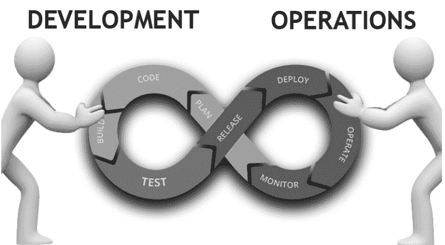

图 9.1 Agile/Scrum 框架（来源：Neon Rain Interactive，根据 CC BY-ND 3.0 NZ 许可）。

现在，开发团队和运维团队作为合作伙伴共同工作，进行持续运营、增强、缺陷清除和资源优化，同时了解其产品在现实世界中的运行方式。

随着 AppSec 专业人员参与持续集成/持续部署（CI/CD）、DevOps 以及数据中心运营新模式的规划，DevOps 开始转变为我们称之为 DevSecOps 的东西。

图 9.1 简单描绘了敏捷和 DevOps 如何协同工作。²

图 9.2 展示了当全面安全控制将 DevOps 转变为 DevSecOps 时，开发团队和运维团队结合的样子。³

### 9.1.3 云

随着组织迁移到云技术的新用途，例如平台即服务（PaaS）、基础设施即服务（IaaS）和容器化，显而易见，直接迁移（lift and shift）策略行不通。相反，这些运营数据中心的新方式要求重新思考应用程序的构建、部署和使用方式。大型单体应用程序开始经历重构过程以拆分应用程序。此活动涉及围绕中心概念或实体隔离功能（服务）——例如，一个微服务可能处理创建客户实体所需的所有功能，另一个微服务可能代表销售实体，还有一个可能代表订单处理，等等。这些微服务使用应用程序编程接口（API）来激活，该接口描述了可用于访问的功能以及涉及的属性。这些 API 最常使用表述性状态转移（REST）架构样式开发。⁴

### DevOps 连续体上的安全实践 -> Dev[Sec]Ops

- 分析 -> 学习
- 缺陷/事件 3 步
- 新的攻击面？
- 计划更新威胁模型

- 为非攻击用途恢复/维护服务

- RASP 自动响应
- 回滚或关闭
- 阻止攻击者
- 关闭服务

- 入侵检测
- 应用攻击检测

- 记录信息以供事件后分析

- 配置验证
- 功能开关 / 流量整形配置
- 密钥管理

- 渗透测试（发现漏洞 -> 测试脚本）
- 合规性验证（PCI 等）
- 模糊测试

- 如果我们做 X 会缓解吗？
- 容量预测
- 学习 -> 更新剧本和培训

- 测试安全功能
- 常见滥用案例

- 中断构建
- 代码分析

- 静态/IAST 分析
- 滥用用例测试
- 代码审查

- 威胁建模 -> 待办事项
- 分析/预测 -> 待办事项
- 设计是否符合策略？

图 9.2 DevSecOps 循环（来源：检索自 https://twitter.com/lmaccherone/status/84334674967097888512。经 L. Maccherone, Jr. 许可使用）。

使用这些微服务进行应用程序开发涉及开发一系列 API 调用过程，这些过程执行有用工作而无需关心这些服务的实现方式，同时允许在不更改接口的情况下进行增强和更改，从而隔离重建每个需要这些服务的应用程序的需求。

传统的 SDL 映射需要进行调整，以便在每天部署数百或数千个变更的环境中构建和部署代码变得可行。这增加了创建准确威胁模型的需求，需要细致了解信任边界（例如，微服务之间）。

应该问一下每个 API 更新是否都需要所有 SDL 活动。对于可行的 SDL 活动，应定义触发器来启动高影响活动（例如，动态安全测试）。

### 9.1.4 数字企业

数字企业利用技术来实现和改进业务活动，以获得竞争优势。这就是为什么许多初创公司相较于既有竞争对手具有优势。它们能够从小规模开始，采用快速、敏捷、创新和颠覆性的敏捷业务实践。较大的制度化公司现在必须迅速数字化其所有运营以进行竞争。这通常涉及快速且剧烈的变化。响应不断变化的市场的能力对其成功至关重要。第 9.1.1 至 9.1.3 节中描述的用于敏捷、DevOps 和云的原则，用于构建和增强数字企业的成功运营。

传统的瀑布式软件开发方法对于数字企业所需的迭代产品发布周期来说不可行或不切实际。敏捷开发流程和 CI/CD 的元素应使用早期用户测试、客户分析和基于用户反馈的优先级排序，从而为增强业务价值链提供更顺畅的路径。通过消除浪费的努力来实现敏捷性，从而加快产品发布生命周期。自动化、编排技术和 API 被用来减少或消除手动安全流程和交互，以缩短开发时间并交付与业务保持一致的新功能、修复和更新。这将缩短发布时间，提高质量水平，并提高团队成员的生产力，同时促进安全性以云环境所需的速度运行。企业环境通常包括员工生产力工具（Slack®、Office 365®、消息传递、电子邮件）以及 CRM 和 HR 等业务系统（例如，Workday®）。与云类似，企业开发需求可能与传统产品有很大不同。技术栈很可能基于 Microsoft®。越来越多的本地业务应用程序正在被软件即服务（SaaS）应用程序所取代。

由于越来越多的公司出于端到端数字化转型（从客户界面到后台流程）而转向公共云服务，随着不断变化和扩大的足迹和攻击面，安全挑战显著增加。像本书中描述的那样将安全性构建到软件开发过程中从未像现在这样重要，并且它是数字企业成功运营的核心。通过 API 集成第三方 SaaS 应用程序会增加攻击面，并且在许多情况下会改变信任边界。这种供应链集成风险在今天被放大；很有可能，应用程序堆栈每天都在变化。SDL 经理应特别关注特定位置的法规和隐私要求。


## 表 9.1 安全开发生命周期（SDL）各阶段的关键成功因素

| 阶段 | 关键成功因素 | 描述 |
| :--- | :--- | :--- |
| 安全评估 (A1)：SDL 活动和最佳实践 | 1. 计划 SDL 活动的准确性 | 已准确识别所有 SDL 活动。 |
| | 2. 产品风险概况 | 管理层了解开发产品的真实成本。 |
| | 3. 威胁概况的准确性 | 已采取缓解措施和对策，以确保产品在其环境中取得成功。 |
| | 4. 相关法规、认证和合规框架的覆盖范围 | 已涵盖所有适用的法律和合规方面。 |
| | 5. 所需软件安全目标的覆盖范围 | 已满足“必须具备”的安全目标。 |
| 架构 (A2)：SDL 活动和最佳实践 | 1. 业务需求和风险的识别 | 按 CIA 定义的业务需求和风险映射。 |
| | 2. 有效的威胁建模 | 识别软件的威胁。 |
| | 3. 有效的架构威胁分析 | 分析针对软件的威胁及其发生概率。 |
| | 4. 有效的风险缓解策略 | 根据业务要求的风险接受、容忍和缓解计划。 |
| | 5. DFD 的准确性 | 威胁建模期间使用的数据流图 (DFD)。 |
| 设计与开发 (A3)：SDL 活动和最佳实践 | 1. 全面的安全测试计划 | 映射软件开发生命周期 (SDLC) 不同阶段所需的安全测试类型。 |
| | 2. 有效的威胁建模 | 识别针对软件的威胁。 |
| | 3. 设计安全分析 | 分析针对各种软件组件的威胁。 |
| | 4. 隐私实施评估 | 基于评估实施隐私相关控制所需的工作量。 |
| | 5. 政策合规性审查（更新） | 与第 3 阶段相关的政策合规性更新。 |
| 设计与开发 (A4)：SDL 活动和最佳实践 | 1. 安全测试用例执行 | 覆盖所有相关测试用例。 |
| | 2. 安全测试 | 完成所有类型的安全测试并修复发现的问题。 |
| | 3. 隐私验证和修复 | 隐私相关控制的有效性以及修复发现的任何问题。 |
| | 4. 政策合规性审查 | 与第 4 阶段相关的政策合规性更新。 |
| 发布 (A5)：SDL 活动和最佳实践 | 1. 政策合规性分析 | 开发过程中的安全和合规性要求最终审查。 |
| | 2. 漏洞扫描 | 扫描软件堆栈以识别安全问题，包括开源和第三方库。 |
| | 3. 渗透测试 | 利用软件堆栈上的任何/所有安全问题。 |
| | 4. 开源许可证审查 | 对堆栈中使用的开源软件进行最终审查。 |
| | 5. 最终安全审查 | 对 SDL 周期中识别的所有安全要求的合规性进行最终审查。 |
| | 6. 最终隐私审查 | 对 SDL 周期中识别的所有隐私要求的合规性进行最终审查。 |
| | 7. 客户参与框架 | 定义与客户共享安全相关信息流程的框架。 |

## 9.2 我们的 SDL 参考框架各阶段的关键成功因素、交付物和指标

在第 3 章至第 7 章中，我们概述了作为 SDL 模型一部分应捕获的关键成功因素、交付物和指标。在第 8 章（SDL 发布后阶段）中，我们概述了关键交付物和指标。关键成功因素、交付物和指标并非一成不变，在将 SDL 映射到您自己的 SDLC 时可能需要进行调整。在表 9.1 中，我们总结了第 3 章至第 8 章中描述的关键成功因素。交付物和指标位于本章末尾，以帮助您调整自己的 SDL。

## 9.3 软件安全成熟度模型与 SDL

在本节中，您将找到对两种度量和指标模型的详细考察，旨在帮助您确定安全开发集成到 SDLC 中的基线成熟度以及进一步提升计划成熟度的路径。

我们将介绍两种领先的软件安全成熟度方法：

- OWASP 的开放软件保障成熟度模型 (OpenSAMM)
- 构建安全性成熟度模型 (BSIMM v11)

### 9.3.1 安全与韧性的成熟度模型

SRI 国际研究所的高级计算机科学家 Jeremy Epstein 曾就软件安全成熟度模型的价值撰文⁵：

> 那么，OpenSAMM 和 BSIMM 等安全成熟度模型如何融入这一图景？
> 两者都很好地对过去几十年来用于投资软件保障的许多“经验法则”进行了编目、更新和组织。通过定义描述我们所使用技术的通用语言，这些模型将使我们能够比较一个组织与另一个组织，并帮助组织了解自己在哪些方面可能比同行更先进或不那么先进……由于这些是流程标准而非技术标准，朝着 BSIMM 或 OpenSAMM 的方向发展将有助于组织进步——而等待尘埃落定只会意味着追赶其他组织需要更长时间……[简] 言之：不要让完美成为美好的敌人。对于软件保障，现在是行动的时候了。

### 9.3.2 软件保障成熟度模型—OpenSAMM

OpenSAMM 是由开放 Web 应用程序安全项目 (OWASP) 开发的一个开放框架，旨在帮助组织制定和实施针对其面临的特定风险量身定制的软件安全策略。OpenSAMM 为安全软件开发和部署提供了一条路线图和一个明确定义的成熟度模型，以及用于自我评估和规划的有用工具。OpenSAMM 是一个 96 页的 PDF 文件，其中详细描述了每个核心活动及相应的安全流程。⁶

OpenSAMM 提供的资源有助于：

- 评估组织现有的软件安全实践。
- 在明确定义的迭代中构建平衡的软件安全计划。
- 向安全保障计划展示具体的改进。
- 定义和衡量组织内的安全相关活动。

SAMM 在定义时充分考虑了灵活性，因此可以被使用任何 SDLC 样式的中小型和大型组织使用。该模型可以应用于整个组织的单一业务线，甚至单个项目。

OpenSAMM 在 Creative Commons 署名-相同方式共享许可下进行了 Beta 发布。原始作品已捐赠给 OWASP，目前作为 OWASP 项目运行。

OpenSAMM 从任何开发软件的组织中都应具备的核心活动开始：

- 治理
- 构建
- 验证
- 部署

在每个核心活动中，都定义了三项安全实践，共 12 项实践，用于确定您计划的整体成熟度。安全实践涵盖与软件安全保障相关的所有领域，每项实践都提供了一个用于改进的“孤岛”。图 9.3 显示了每个核心活动级别的这三项安全实践。

### 9.3.2.1 OpenSAMM 业务职能

下面分别描述了这些业务职能：

- **治理** 围绕组织管理整体软件开发活动相关的流程和活动展开。更具体地说，这包括开发中涉及的跨职能团队面临的问题，以及在组织层面建立的业务流程。
- **构建** 涉及组织在开发项目中定义目标和创建软件相关的流程和活动。一般来说，这包括产品管理、需求收集、高级架构规范、详细设计和实现。
- **验证** 专注于组织在软件开发过程中检查和测试所产生的工件相关的流程和活动。这通常包括测试等质量保证 (QA) 工作，但也可能包括其他审查和评估活动。


### 软件开发

### 治理

- 策略与指标
- 教育与指导
- 政策与合规

### 构建

- 威胁评估
- 安全需求
- 安全架构

### 验证

- 设计评审
- 安全测试
- 代码评审

### 部署

- 环境加固
- 漏洞管理
- 运营启用

### 业务职能

### 安全实践

- **部署** 涉及组织管理已创建软件发布的相关流程和活动。这可能包括将产品交付给最终用户、将产品部署到内部或外部主机，以及软件在运行时环境中的正常运行。

12 个实践领域中各项下的目标定义了每项实践如何随时间改进，并为任何给定领域建立成熟度级别。某项实践的四个 *成熟度级别* 对应如下：

- 0: 实践未实现的隐式起点
- 1: 对实践的初步理解和临时提供
- 2: 提高实践的效率和/或有效性
- 3: 大规模全面掌握实践

## 9.3.2.2 核心实践领域

在本节中，我们将把每个实践领域细分为其中的具体实践。

### 治理核心实践领域

- **策略与指标 (SM)** 涉及软件保证计划的总体战略方向，以及用于收集组织安全态势指标的流程和活动的设置。

- **政策与合规 (PC)** 涉及在整个组织中建立安全与合规控制和审计框架，以提高在构建和运行中的软件的保证程度。

- **教育与指导 (EG)** 涉及通过培训和与个人职能相关的安全主题指导，提高软件开发人员的安全知识。

### 构建核心实践领域

- **威胁评估 (TA)** 涉及准确识别和描述针对组织软件的潜在攻击，以便更好地了解风险并促进风险管理。

- **安全需求 (SR)** 涉及在软件开发过程中推动纳入安全相关需求，以便从一开始就指定正确的功能。

- **安全架构 (SA)** 涉及通过活动加强设计流程，以促进默认安全的设计，并控制软件构建所依赖的技术和框架。

### 验证核心实践领域

- **设计评审 (DR)** 涉及检查设计流程产生的工件，以确保提供足够的安全机制并遵守组织对安全的期望。

- **代码评审 (CR)** 涉及对组织源代码的评估，以帮助发现漏洞和相关缓解活动，并建立安全编码期望的基准。

- **安全测试 (ST)** 涉及在运行时环境中测试组织的软件，以既发现漏洞又建立软件发布的最低标准。

### 部署核心实践领域

- **漏洞管理 (VM)** 涉及建立一致的流程来管理内部和外部漏洞报告，以限制暴露并收集数据以增强安全保证计划。

- **环境加固 (EH)** 涉及为组织软件周围的运行环境实施控制，以加强已部署应用程序的安全态势。

- **运营启用 (OE)** 涉及识别和捕获操作员正确配置、部署和运行组织软件所需的安全相关信息。

## 9.3.2.3 成熟度级别

每个核心实践领域都使用以下结构进一步详细定义了成熟度级别：

- 目标
- 活动
- 结果
- 成功指标
- 成本
- 人员
- 相关级别

### 9.3.2.3.1 目标

_目标_ 是一条概括性陈述，用于描述达到相关级别的保证目标。随着给定实践级别的提高，目标在构建软件开发和部署的保证方面表征了更复杂的目标。

### 9.3.2.3.2 活动

_活动_ 是达到该级别的核心要求。有些旨在在整个组织中执行，有些则对应于单个项目团队的操作。无论哪种情况，活动都捕捉核心安全功能，组织可以自由决定如何履行这些活动。

### 9.3.2.3.3 结果

*结果* 描述了达到给定级别所获得的能力和交付物。在某些情况下，这些内容被具体指定；在其他情况下，则对能力提升做出更定性的陈述。

### 9.3.2.3.4 成功指标

*成功指标* 指定了可用于检查组织是否在给定级别运行的示例测量值。数据收集和管理留给每个组织自行选择，但提供了推荐的数据来源和阈值。

### 9.3.2.3.5 成本

*成本* 是关于组织达到给定级别所产生费用的定性陈述。尽管具体数值因组织而异，但这些旨在提供关于在特定级别运行所涉及的一次性和持续成本的概念。

### 9.3.2.3.6 人员

级别的这些属性指示在给定级别运行所需的人力资源预计持续开销：

- 开发人员——执行软件详细设计和实现的个人
- 架构师——执行高级设计工作和大规模系统工程的个人
- 经理——执行开发人员日常管理的个人
- QA 测试人员——执行软件质量保证测试和预发布验证的个人
- 安全审计人员——拥有与所生产软件相关的技术安全知识的个人
- 业务所有者——就软件及其业务需求进行关键决策的个人
- 支持运营——执行客户支持或直接技术运营支持的个人

### 9.3.2.3.7 相关级别

*相关级别* 是对其他实践中级别的引用，这些级别可能存在一些潜在的重叠，具体取决于组织的结构和构建保证计划的进度。从功能上讲，如果相关级别也是目标或已到位，这些指示活动实施中的协同效应或优化。

### 9.3.2.3.8 保证

由于 12 个实践各自都是一个成熟度领域，连续的目标代表了任何保证计划的“基础模块”。OpenSAMM 旨在通过分阶段改进保证计划来使用，方法如下：

- 选择在保证计划的下一阶段中要改进的安全实践。
- 通过在指定的成功指标下执行相应的活动，实现每个实践中的下一个目标。

## 9.3.2.4 使用 OpenSAMM 评估成熟度级别

每个安全实践还包括一份评估工作表，答案指示该实践的当前成熟度级别。教育与指导 (EG) 活动的示例评估工作表摘录如图 9.4 所示。

基于分配给每个安全实践的分数，组织可以创建一张记分卡来捕获这些值。从功能上讲，记分卡可以是特定时间的 12 个分数的简单集合。但是，选择生成记分卡的时间间隔有助于了解时间范围内保证计划的整体变化。

鼓励在多种情况下使用间隔记分卡：

- 差距分析
  - 捕获详细评估与预期绩效水平之间的分数。
- 展示改进
  - 捕获保证计划构建迭代前后的分数。
- 持续测量
  - 捕获已到位的保证计划在一致时间范围内的分数。

OpenSAMM 的主要用途之一是帮助组织构建软件安全保证计划。该过程简单直接，通常始于评估，以确定组织是否已经在执行某些安全保证活动。

提供了针对常见组织类型的多个路线图模板。因此，许多组织可以选择合适的匹配项，然后根据自身需求定制路线图模板。对于其他类型的组织，可能需要构建自定义路线图。提供了以下类型的路线图模板：

- 独立软件供应商
- 在线服务提供商
- 金融服务组织
- 政府组织

选择这些组织类型是因为：

- 它们代表常见用例。


### 教育与指导

| | 是/否 | EG 1 | EG 2 | EG 3 |
|---|---|---|---|---|
| 大多数开发人员是否接受过高级别安全意识培训？ | | | | |
| 每个项目团队是否可以使用安全开发最佳实践和指南？ | | | | |
| 开发过程中的大多数角色是否获得了针对特定角色的培训和指导？ | | | | |
| 大多数利益相关者是否能够聘请安全教练用于项目？ | | | | |
| 安全相关指南是否在整个组织中集中控制并一致分发？ | | | | |
| 大多数人是否接受测试以确保具备安全开发实践的基础技能集？ | | | | |

- 每个组织在典型的软件诱导风险方面都有所不同。
- 每个组织构建保障计划的最佳方式各不相同。

路线图由若干阶段组成，在每个阶段中，多项实践各提升一个级别。构建路线图需要选择在每个计划阶段中要改进的实践。组织可以自由规划多远的未来，但建议根据业务驱动因素和组织特定信息进行迭代，以确保保障目标与其业务目标和风险承受能力相匹配。

一旦路线图确定，保障计划的构建将变得简单。

- 组织开始改进阶段，并通过执行规定的活动来努力实现所述级别。
- 每个阶段结束时，应根据实际完成的情况调整路线图，然后才能开始下一阶段。

## 9.4 构建安全成熟度模型（BSIMM）

构建安全成熟度模型（BSIMM 7）是对现有软件安全计划的研究。BSIMM 既不是操作指南，也不是一刀切的处方。该项目的主要目标是基于从九个大规模软件开发计划中收集的实际数据构建成熟度模型。Cigital® 和 Fortify® 的代表对九家原始公司（包括 Adobe®、Dell® EMC®、Google®、Microsoft 及另外五家）进行了访谈并收集了数据。利用这些数据并进行面对面的高管访谈后，团队开发了软件安全框架（SSF），为他们在软件开发组织中观察到的 116 项活动创建了类别和三个成熟度级别。BSIMM 在其生命周期中不断更新。现在，在第 11 版中，它包含新增活动，清楚地表明云中的 AppSec 正在成为主流，并表明独立软件供应商、物联网（IoT）公司和云公司中观察到的活动开始趋同，暗示常见的云架构需要类似的软件安全方法。

BSIMM 旨在供任何负责创建和执行软件安全计划（SSI）的人使用。BSIMM 的作者观察到，成功的 SSI 通常由向组织最高层汇报的高级管理人员领导。这些高管领导一个 BSIMM 称为软件安全组（SSG）的内部团队，该团队负责直接执行或促进 BSIMM 中描述的活动。BSIMM 是面向 SSG 及其领导层编写的。

### 9.4.1 BSIMM 组织

该模型分为 12 项实践，隶属于四个类别：

- 治理
- 情报
- 软件安全开发生命周期（SSDL）接触点
- 部署

BSIMM 指出，SSG 应强调安全教育和指导，而非对安全错误进行监管。BSIMM 并非明确面向软件开发人员。相反，它面向那些试图教导软件开发人员如何进行正确软件安全工作的人。

正确使用 BSIMM 可以帮助您确定组织在现实世界软件安全计划中的位置、同行业同行正在做什么，以及可以采取哪些步骤来使您的方法更有效。

成熟度模型很合适，因为改进软件安全几乎总是意味着改变组织的工作方式——这绝非一蹴而就之事。BSIMM 提供了一种评估组织状态、确定变更优先级并展示进展的方法。并非所有组织都需要达到相同的安全目标，但通过应用 BSIMM，所有组织都可以用同一把尺子进行衡量。

### 9.4.2 BSIMM 软件安全框架

BSIMM 软件安全框架（SSF）如图 9.5 所示。

### 9.4.2.1 治理

治理包括帮助组织、管理和衡量软件安全计划的实践。人员发展也是核心治理实践。在治理领域，策略与指标实践涵盖规划、分配角色和职责、确定软件安全目标、制定预算以及识别指标和审查点。合规与策略实践侧重于：

- 识别 PCI-DSS 和 HIPAA 等合规要求的控制措施。
- 制定服务级别协议（SLA）等合同控制措施，以帮助控制商业现成（COTS）软件风险。
- 制定组织软件安全策略并针对该策略进行审计。
- 培训，因为它在软件安全中起着关键作用——软件开发人员和架构师通常初始安全知识非常匮乏。

### 9.4.2.2 情报

情报包括产生用于在整个组织中开展软件安全活动的企业知识集合的实践。集合包括主动安全指导和组织威胁建模。

情报领域旨在创建组织范围的资源。这些资源分为三项实践：

- 攻击模型捕获用于像攻击者一样思考的信息：威胁建模、滥用用例开发与优化、数据分类以及特定于技术的攻击模式。

| 领域 | 描述 |
| :--- | :--- |
| 部署 | 与传统网络安全和软件维护组织对接的实践。软件配置、维护及其他环境问题对软件安全有直接影响。 |
| SSDL 接触点 | 与特定软件开发工件和流程的分析与保障相关的实践。所有软件安全方法论都包含这些实践。 |
| 情报 | 产生用于在整个组织中开展软件安全活动的企业知识集合的实践。集合包括主动安全指导和组织威胁建模。 |
| 治理 | 帮助组织、管理和衡量软件安全计划的实践。人员发展也是核心治理实践。 |

- 安全功能与设计实践负责为主要安全控制（满足下一实践中定义的标准）创建可用的安全模式，为这些控制构建中间件框架，并创建和发布其他主动安全指导。
- 标准与需求实践涉及从组织中获取明确的安全需求（作为验收标准的非功能性需求 [NFR]），确定推荐哪些 COTS 软件，为主要安全控制（如身份验证、输入验证等）构建标准，为正在使用的技术创建安全标准，并成立标准评审委员会。

### 9.4.2.3 SDL 接触点

SDL 接触点包括与特定软件开发工件和流程的分析与保障相关的实践。所有软件安全方法论都包含这些实践。

SDL 接触点领域可能是四个领域中最熟悉的一个。该领域包括集成到 SDLC 中的基本软件安全最佳实践。两项最重要的软件安全实践是架构分析和代码审查。

架构分析包括以简洁图表捕获软件架构、应用风险和威胁列表、采用审查流程（如 STRIDE 或架构风险分析），以及为组织构建评估和修复计划。

代码审查实践包括使用代码审查工具、开发自定义规则、为不同角色（例如开发人员与分析人员）制定工具使用配置文件、手动分析以及跟踪/衡量结果。安全测试实践关注发布前测试，包括将安全集成到标准 QA 流程中。该实践包括在 QA 中使用黑盒安全工具（包括模糊测试）作为冒烟测试、风险驱动的白盒测试、应用攻击模型以及代码覆盖率分析。安全测试关注构建中的漏洞。

### 9.4.3 部署

部署包括与传统网络安全和软件维护组织对接的实践。软件配置、维护及其他环境问题对软件安全有直接影响。

相比之下，在部署领域，渗透测试实践涉及安全专家执行的更标准的外部测试。渗透测试关注最终配置中的漏洞，并为缺陷管理和缓解提供直接输入。软件环境实践涉及操作系统和平台补丁、Web 应用程序防火墙、安装和配置文档、应用程序监控、变更管理，以及最终的代码签名。最后，配置管理和漏洞管理实践关注应用程序补丁和更新、版本控制、缺陷跟踪和修复以及事件处理。


## 9.4.4 BSIMM 的 12 个实践领域

在每个 BSIMM 类别下，都有若干目标及相关活动，用于确定该类别的当前成熟度级别。随着你逐项查看列表，额外活动的证据会推动组织沿着成熟度级别继续前进，因此声称在特定类别中开展所有活动的组织最终会成为最成熟的组织，即达到第 3 级。12 个实践如图 9.6 所示。

## 9.4.5 使用 BSIMM 测量结果

图 9.7 展示了已完成 Synopsys BSIMM 评估的 130 家组织的平均成熟度蜘蛛图。平均成熟度用于比较特定组织的成熟度，以帮助确定差距和改进领域，或在整体行业之间（即医疗保健、保险、金融服务等）进行比较，如图 9.8 的示例所示。

## 9.4.6 BSIMM 社区

参与 BSIMM 的 130 家公司构成了该社区。一个拥有近 600 名成员的私有在线社区平台，为软件安全人员提供了一个论坛，用于与面临相同问题的其他人讨论解决方案、与已解决相关问题的人完善策略、从职业道路上更进一步的人那里寻求导师，并联合起来解决难题。社区成员还可独家获取专题网络研讨会和其他精选内容。BSIMM 社区还举办年度私人会议，各公司的代表在此期间在非正式论坛上聚集，讨论软件安全计划。

## 9.4.7 进行 BSIMM 评估

BSIMM 文档根据 Creative Commons Attribution-Share Alike 3.0 许可证发布，你可以使用该文档自行开展内部评估。如果你希望将贵公司的数据和结果纳入用于更新 BSIMM 的 BSIMM 数据池，则需要与 Synopsys 签订合同，以进行官方评估并提交报告。

为进行正式评估做准备，你需要考虑为访谈吸引哪些应用程序开发团队。BSIMM 评估是通过与组织中参与软件安全计划的主题专家（SME）和知识渊博的人员进行一系列访谈来开展的。你可以将潜在的评估人群切分为任何你喜欢的横截面，但请尽量选择那些代表你推动 AppSec 落地所取得实际成果的团队。换句话说，你需要的是那些参与了你帮助实施的 AppSec 实践，并从中取得积极成果的团队。为了全面了解 SSI 本身，你需要一个良好的横截面，涵盖你的计划所影响的人员以及那些对你的 AppSec 使命和目标有良好理解的人员。

| 阶段 | 实践 |
| :--- | :--- |
| 治理 | 1. 策略与度量 (SM)<br>2. 合规与策略 (CP)<br>3. 培训 (TI) |
| 情报 | 4. 攻击模型 (AM)<br>5. 安全特性与设计 (SFD)<br>6. 标准与需求 (SR) |
| SSDL 接触点 | 7. 架构分析 (AA)<br>8. 代码审查 (CR)<br>9. 安全测试 (ST) |
| 部署 | 10. 渗透测试 (PT)<br>11. 软件环境 (SE)<br>12. 配置管理与漏洞管理 (CMVM) |

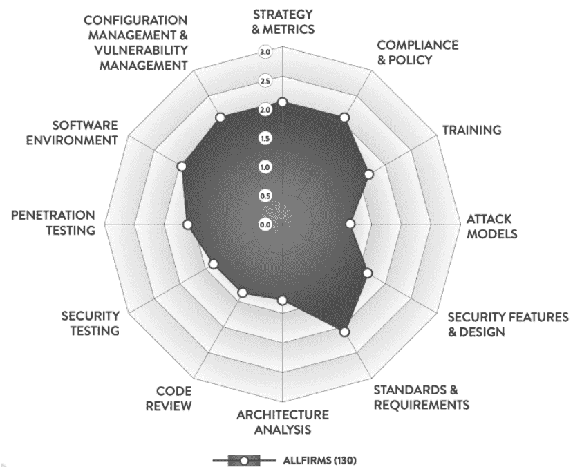

图 9.7 BSIMM V11 中 130 名参与者的全球平均成熟度级别（来源：BSIMM 11，作者 Sammy Migues、John Steven 和 Mike Ware，根据 CC-BY-SA 授权）。

## 9.4.8 小结

你了解了两种开发、收集和评估度量的方法，以帮助确定你安全开发实施工作和计划的整体成熟度级别。尽管这两种模型都应该引导你实现改进和可衡量的流程，但选择使用哪一种必须由你自己组织的结构、内部开发流程以及你自身的良好判断来决定。尽管我们不会推荐其中一种而非另一种，但你应该能够看到它们之间的重叠之处，并使用最适合你目的的那一种。正如我们在本章早些时候提到的，不要让完美成为美好的敌人。对于软件保证，行动的时候就是现在！

## 9.5 作为 SDL 一部分增强威胁建模实践

大家都认识到，在大多数软件开发项目中，时间和预算是固定值，而引入与安全性和弹性需求相关的“额外工作”

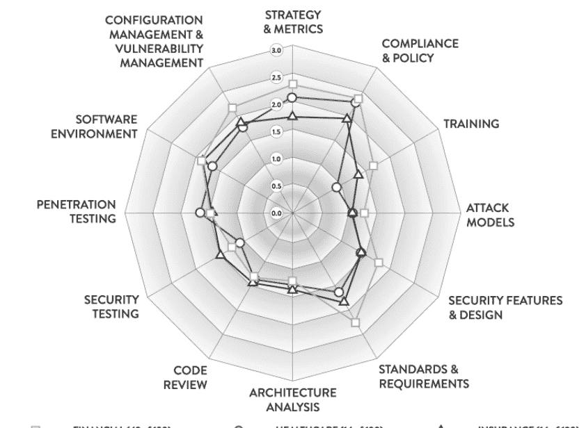

图 9.8 跨金融服务、保险和医疗保健行业的 BSIMM 平均成熟度级别（来源：BSIMM 11，作者 Sammy Migues、John Steven 和 Mike Ware，根据 CC-BY-SA 授权）。

通常不受软件开发团队欢迎。引入安全设计和架构审查的最佳时机是团队进行软件功能设计和架构审查时。

学会从对手的角度看待你的网络，是风险分析和加固过程的重要组成部分。风险分析涉及识别资产及其面临的威胁，而加固则关乎如何保护你的资产。风险分析和加固过程的特点可能从过于严格到非常随意和非正式不等。实际的风险分析和加固介于这两个极端之间。

以下是执行实际风险分析并启动加固计划的配方。它不旨在完美或全面——它旨在实用。

### 9.5.1 实际威胁和应用风险建模

威胁建模包括通过检查软件的功能来确定其攻击面，以识别信任边界、入口点、数据流和出口点。只有当代表整个应用程序架构的设计文档基本最终确定后，威胁模型才有用，这样威胁模型才能基于软件预期的、可能的未来。威胁建模有助于确保设计与安全目标相辅相成、进行权衡和优先级决策，并降低开发和运营期间的安全问题风险。可以通过根据威胁与组织业务目标、合规和监管要求以及安全风险的相关性进行排序，来完成软件的风险评估。一旦理解并确定优先级，这些新发现的威胁就可以进入规划对策和/或更改设计以消除缺陷的阶段。

威胁建模在设计工作期间进行，以便为软件的开发阶段定义必要的安全控制和对策。

SANS 网络防御研究所提供了一份方便的七步配方，用于进行威胁建模和应用风险分析。配方如下：

- 步骤 1：列出你试图保护的内容
- 步骤 2：绘制图表并添加注释
- 步骤 3：列出你的对手及其目标
- 步骤 4：从这些对手那里头脑风暴威胁
- 步骤 5：估计概率和潜在损害（总体风险）
- 步骤 6：头脑风暴对策及其问题
- 步骤 7：计划、测试、试点、监控、故障排除和重复

该网站提供了每个步骤的详细说明，以及可用于数据收集和分析的电子表格模板。

### 9.5.1.1 威胁头脑风暴

配方的第 4 步要求从对手那里头脑风暴威胁。一种更流行的头脑风暴技术由 Microsoft 推广，称为 STRIDE。STRIDE 是一个助记符，代表：

- 欺骗
- 篡改
- 否认
- 信息泄露
- 拒绝服务
- 特权提升

第 4.3.3 节介绍了 STRIDE 每个类别的详细信息。STRIDE 的核心思想是，你可以将所有威胁归类为这六个 STRIDE 类别之一。由于每个类别都有一组特定的潜在缓解措施，一旦你分析了威胁、对其进行分类并确定优先级，你就会知道如何缓解或消除可能导致漏洞利用的缺陷。

STRIDE 过程实际上是一种头脑风暴活动，可以当面进行，也可以通过媒体共享渠道（例如 Zoom®、Microsoft Teams® 等）进行。参与者使用文档


识别架构中的资产、其用途及其相对价值。这些将成为潜在攻击者的目标。接下来，他们识别可能的攻击者以及他们想要从系统中获得什么：

- 你的实际或可能的对手是谁？
- 他们想要实现什么？
- 他们的技能和资源是什么？
- 他们有多决心？
- 为了实现目标，他们愿意冒什么风险或放弃什么？
- 内部人员呢？

在跨项目收集这些信息的同时，你还可以构建一个可重用的攻击配置文件目录，其中包含足够的细节，使任何想要进行威胁建模的人都可以使用。

接下来，想象你就是那些对手之一，并尝试*从他们的视角*看待你的网络。你知道自己想要什么；你会如何通过滥用应用程序来获取它？

就像产品待办列表和用户故事一样，威胁模型是一份活文档——随着设计的变更，你需要回头更新威胁模型，以查看是否出现任何新威胁。

### 9.5.1.2 风险分析与评估

对于配方中的第 5 步，我们转向微软的另一个记忆法，称为 DREAD，如第 4.3.3.4 节所述。它对 5 个类别进行评分，这些评分相加后除以 5，得出 0 到 10 的结果，其中 0 表示几乎没有或没有影响，10 表示火烧眉毛的情况。

其他风险分析考虑因素包括：

- 项目环境中存在的威胁和漏洞，或由与其他系统交互产生的威胁和漏洞。
- 由外部开发团队以源代码或目标代码形式创建的代码。仔细评估来自团队外部的任何代码至关重要，包括购买的库以及可能存在的开源组件和库。如果不这样做，可能会导致团队不知道或得知太晚的安全漏洞。
- 如果项目是现有程序的新版本，威胁模型应包含所有旧版代码。此类代码可能是在对软件安全了解不多时编写的，因此很可能包含漏洞。
- 详细的隐私分析，以记录项目的关键隐私方面。需要考虑的重要问题包括：
  - 收集哪些个人数据？
  - 令人信服的客户价值主张和业务理由是什么？
  - 提供了哪些通知和同意体验？
  - 为应用程序的内部和外部用户提供了哪些控制？
  - 如何防止未经授权访问个人信息？

完成威胁识别和优先级排序步骤后，你应该为下一步准备好以下信息集，下一步包括识别不同的设计选择、应添加的对策以及基于审查的设计改进。完成的威胁模型文档应包括：

- 图表及图表中元素的枚举和描述。
- 威胁和风险分析，因为这是威胁模型的核心。

此外：

- 对于威胁分析中识别的每个已缓解威胁，应包括与缓解计划相关的错误或缺陷编号，以添加到所需工作的待办列表中。
- 还应有一段或两段关于软件组件及其功能的描述。保存问题关键联系人列表也很有用。
- 应确认威胁模型数据和相关文档（功能/设计规范）使用开发团队使用的文档控制系统进行存储。
- 应考虑对威胁模型和引用的缓解措施进行审查和批准，审查人员应至少包括一名开发人员、一名测试人员和一名项目或项目经理。请架构师、开发人员、测试人员、项目经理以及其他了解软件的人员参与威胁模型并对其进行审查。征求广泛的意见和审查，以确保威胁模型尽可能全面。

请记住，只要应用程序继续增加功能、移植到其他操作环境（例如云端）或重写为 Web 服务、API 和微服务以利用现代计算实践，威胁建模就永远不会完成。

### 9.5.2 MITRE ATT&CK®10 和 MITRE D3FEND®11

MITRE ATT&CK 是一个全球可访问的对手战术和技术知识库，基于现实世界观察，由 MITRE 公司开发和发布。ATT&CK 知识库可以为你节省无数小时的研究时间和精力，以便在你自己的 SDL 中进行威胁情报和威胁管理实践。一个配套的 MITRE 项目，MITRE D3FEND，对于保护即使是最受针对性的 IT 基础设施和应用程序也很有用。

ATT&CK 知识库被用作私营部门、政府以及网络安全产品和服务社区中开发特定威胁模型和方法论的基础。ATT&CK 对任何个人或组织免费开放和可用。ATT&CK 的创建源于在 MITRE 的 FMX 研究环境中进行结构化对手模拟演练时，系统地对对手行为进行分类的需求。

第一个 ATT&CK 模型于 2013 年 9 月创建，主要关注 Windows 企业环境。它通过内部研究和开发进一步完善，随后于 2015 年 5 月公开发布，包含 9 种策略下的 96 种技术。从那以后，ATT&CK 基于网络安全社区的贡献经历了巨大的增长。MITRE 已创建了几个基于 ATT&CK 的其他模型，这些模型是基于创建第一个 ATT&CK 时使用的方法论开发的。

该知识库是漏洞管理人员的宝贵资源，提供信息和见解：

- **检测与分析**
  ATT&CK 可以帮助网络防御者开发分析，以检测对手使用的技术。

- **威胁情报**
  ATT&CK 为分析师提供了一种通用语言，用于构建、比较和分析威胁情报。

- **对手模拟与红队演练**
  ATT&CK 提供了一种通用语言和框架，红队可以使用它来模拟特定威胁并规划其操作。

- **评估与工程**
  ATT&CK 可用于评估组织的能力并推动工程决策，例如应实施哪些工具或日志记录。

MITRE D3FEND 知识库是一个框架，提供系统管理员可以应用的防御技术，以应对 ATT&CK 知识库中详细说明的做法。

## 9.6 汇总

网络威胁源于软件缺陷，这些缺陷是网络攻击或利用软件应用程序或系统可以利用的弱点。在本书中，我们介绍了以 SDL 最佳实践形式实施软件安全特定方面的策略，以帮助软件开发组织避免和减少软件缺陷，这是通过在源头提供安全性来实现有效核心软件安全的重要元素。

虽然实现无漏洞产品极其困难，甚至可能不可能，但这应始终是你的目标。通过应用本书中的最佳实践，你开发的软件将尽可能没有安全漏洞。漏洞数量越少，攻击者利用给定应用程序就越困难。

我们绝不是说通过使用软件安全最佳实践就能阻止所有威胁，但最大限度地减少攻击面是我们的最终目标，因为这使我们作为软件安全专业人员的工作更容易，而使对手的工作更加困难。通过实施本书中概述的实践，你将能够缓解来自大多数威胁行为者的威胁。

本节描述了如何通过使用灵活、敏捷且与业务相关的 SDL，将本书中学到的一切应用到现实世界中。


## 9.7 通过设计良好、管理得当且聚焦的 SDL 克服组织和业务挑战

我们已概述了一种组织结构，其中包含与我们的 SDL 模型中识别的任务特定的相关角色和职责，这些任务已由本书作者经过实地测试和优化。此前描述的结构将帮助您有效且高效地创建、交付和管理本书中描述的最佳实践。它还将协助您成功获得对 SDL 模型中 A1–A5 任务的认可并进行管理。作为额外的好处，通过使用建议的组织结构，您将能够交付第 8 章中描述的用于发布后支持（PRSA1–5）的任务，这些任务通常由贵组织以外的其他组织执行。通过使用 SDL 模型各部分中描述的指标，您不仅能够有效地管理和跟踪软件安全计划及 SDL 成功，还能向企业管理层和内部客户提供有关计划当前状态的仪表板。此仪表板还可用于识别差距，在需要时，这些差距可用于证明人员编制、资金和其他资源的合理性。最重要的是，通过将安全内建，您将最大限度地提高避免在软件中事后发现安全漏洞的能力，并在确实发生此类发现时提高成功管理这些发现的能力。

## 9.8 软件安全组织现实与杠杆作用

虽然基于工作量逐步增加的增量式人员招聘计划通常是大多数组织的常态，但增量式增长并非本书所提议模式的正确模式，对于正在经历组织紧缩现实的人来说，这当然也不是现实。无论面临何种风险，以更少做更多都是我们都要面对的现实。为了帮助解决这一难题，我们提出了一种软件安全团队模型，该模型不依赖于持续增长（无论是线性还是其他）。虚拟团队与线性增长相悖，使得人员齐全的集中式软件安全团队能够保持相对稳定。我们认为，在软件工程开发组织中，一个由每个主要软件产品组配备一名资深软件安全架构师，并为该组内每个软件产品配备一名架构师的集中式团队，只要遵循本书中提出的软件安全冠军计划，就足以很好地扩展。此外，通过在开发组织中为每个软件产品的关键软件安全冠军之间共享典型产品安全事件响应团队（PSIRT）的责任，一名 PSIRT 经理应足以胜任，考虑到该任务在整个组织中的共享责任。如前文所述，卓越不在于增加人数，而在于您雇佣的员工质量。这些资深软件安全架构师中的每一位都可以协调和支持每个业务单元和软件产品线中 SDL 的实施，并将：

- 为关联的软件安全冠军提供集中式软件安全团队的流程和治理。
- 在安全架构和审查方面指导软件安全冠军。
- 支持关联业务单元软件安全冠军指导每个软件产品线软件安全冠军。
- 与产品管理协调，以制定早期且及时的安全需求。
- 帮助计算项目安全风险。
- 帮助确保软件安全冠军实施适当且完整的安全测试。
- 确保可用适当的安全测试工具（静态、动态、模糊测试）用于 SDL（视情况而定）。

尽管这些任务很大程度上受益于资深经验和酌情权，但让这些资深技术领导者指导软件安全冠军和软件安全架构师，既是参与者的绝佳成长机会，也是公司和组织的成本节约，这其中存在巨大的机会。通过经验和指导有潜力成长为领导者的人，是我们模型中软件安全冠军的完美候选人。我们是我们所做一切的总和，这些经历不断被修订和铭记。软件安全架构师亦是如此；这是一段旅程，而非某个时间点，需要持续学习、指导以及与有过相关经验的人协作。

在我们的模型中，有多种途径可以实现适当的“覆盖”。与完全集中式功能不同，经过精心处理的虚拟团队可以由一个远小得多的中央团队凝聚和领导。作者们在多个不同的组织中多次成功实践了这一模式，并认为这是一个经过验证的记录，该模型将不断演变，以适应软件安全领域不断变化的现实。集中式软件安全团队的每位成员都必须能够激励、鼓励并领导虚拟团队，使虚拟成员贡献关键主题专家（SME）任务，同时又不会因额外或运营任务而过载。“刚好足够”，这样 PSIRT 功能可以通过真正的 SME 贡献和支持获得巨大收益，同时确保没有一个人承担无法回避的一系列运营活动的全部压力。

由于我们的集中式软件安全团队模型使用了扩展的虚拟团队，因此不需要其他组织中可能存在的大型中央 PSIRT 人员。可以分散管理的任务（如技术调查、发布计划和修复开发）将以分散方式执行。然而，存在一个协调角色，必须足够精通，以在技术上理解各种响应所涉及的影响和风险。同行评审是避免失误的强大工具。此外，工程软件开发组织本身中的中央角色提供了跨团队协调，而这是大多数组织所缺乏的。我们不得不针对以独特和特异方式影响许多软件产品的漏洞分别做出响应。此外，在 PR（有时还包括市场营销）支持与参与响应的技术团队之间提供接口至关重要。您希望对漏洞报告者的响应保持一致，并避免在外部使您的公司和品牌面临风险。

## 9.9 软件安全的未来预测

我们将本节分为两部分。首先是坏消息，即我们看到的可能会在行业中持续存在但应予以改变的事物；其次是我们对软件安全未来所看到的好事——如果可以这么说的话，隧道尽头的光。

### 9.9.1 坏消息

我们先从坏消息开始。大部分情况下，除了威胁建模和架构安全审查（这是一门艺术——而非科学）之外，软件安全并不那么困难，但这是一个行业已经了解多年却几乎未采取任何行动的领域。这在常见漏洞和暴露 (CVE*) 以及 OWASP* 和 CWE™/SANS Top 25 漏洞列表中的主要软件漏洞中表现得很明显，这些列表在过去 10 年里基本保持不变。尽管行业在过去几年中开始在这一领域发挥领导作用，但我们认为软件安全在可预见的未来仍将是一个持续存在的问题，并且需要时间才能最终将行业引导向正确的方向。如本书所述，将安全内建到软件开发过程中，更多的是关于态度转变、管理层接受以及业务/运营流程变革，而非在新的科学或技术学科中开辟新路径。

在生命周期后期修复漏洞的代价非常高。调整和维护当前产品安全工具所需的工作量可能比购买新工具更昂贵。尽管做出这一改变的大部分负担在于供应商，但我们有一些想法可能有助于改变这一范式。我们提出在软件安全领域远离漏洞的范式转变。并非每个漏洞都会被利用，甚至可能无法利用。通常，对普通漏洞扫描器不明显的缓解措施会使即使是普通漏洞对攻击者也没有吸引力。我们并不是建议停止修复代码中的错误。恰恰相反，这从本书内容中应当很明显。尽管如此，交付包含数千个漏洞的报告并未使软件变得安全。然而，作为一个整体，安全行业继续关注漏洞：每一种新型攻击、每一种新变体以及每一种可想象的攻击方法。相反，关注正确的程序行为与开发人员设计和创建代码的方式非常吻合。

正确性是软件开发过程的核心。根据我们的经验，开发人员因正确性而获得回报。而且很明显，漏洞就是错误，简单明了。不幸的是，关注正确性将是软件安全领域的一次根本性变革。当今的工具通常不会报告那个能够应对特定类型攻击多种变体的单一错误。相反，工具过于频繁地将每种变体报告为开发人员需要解决的“漏洞”。这是安全人员看待问题的方式。这是攻击者的视角：哪些攻击方法对这个特定系统有效？这是当今大多数漏洞扫描器所解决的问题（截至本文撰写时）。

然而，编写代码的人只想知道代码错误是什么，错误在代码中的位置，以及必须编程的正确行为是什么。通常，如果工具包含任何编程提示，这些提示往往被掩埋在工具的用户界面中。相反，我们提出工具的使用难度不应超过编译器。结果可以是代码错误列表，关联到代码中的行号，并附带一个代码片段，指出错误所在。当然，这是一种过度简化。某些类型的安全漏洞跨越代码片段，甚至跨越整个系统。尽管如此，重点可以放在代码错误是什么及其解决方案是什么上。逻辑错误可以用设计解决方案来描述：例如正确地随机化会话 ID，或为每个 Web 输入包含不可预测的会话标识符（例如，以防止跨站请求伪造）。在数千万人编写 Web 代码，且其中大量代码包含可利用漏洞的世界中，我们需要一种简化查找实际代码错误的方法。


数以百万计的漏洞数量庞大，并未缩小攻击面。我们建议将这种新方法称为“以开发者为中心的软件安全”，“以开发者为中心”意味着安全人员应了解开发者的关注点和开发者面临的问题。安全行业必须开始解决这些问题，以便将安全放在其应有的位置，与可维护性、算法正确性、计算正确性以及熟练程序员必须面对的所有其他问题并列。

## 9.9.2 好消息

正如本书和前一节中所讨论的，行业知道该做什么，应该做什么，以及如何做，但他们并没有去做。知道该做什么是赢得这场战斗的重要部分。我们相信，源自 ISO 标准（27034、29147 和 30111）的压力，以及商业和政府界对构建于软件开发流程中的软件安全日益提高的认识和监督，最终将使软件安全成为优先事项和业务推动者。其他好消息是，软件安全的工具和培训仍在不断改进。我们还看到越来越多的下一代软件安全架构师指导工作，这将长期有利于我们的行业。最重要的是，基于现实生活经验和成功案例（如本书中描述的案例）的新组织和管理 SDL 模型正在开发中。

## 9.10 全面 SDL 审查

本章前面，我们总结了 SDL 各阶段的关键成功因素（参见表 9.1）。在此，我们包含了应作为特定 SDL 常规工件的交付物和指标。表 9.2 总结了各阶段的交付物，表 9.3 建议了从业者发现有用的一些指标。借助本章中您看到的成熟度度量，您应能进一步定制运行 SDL 及规划其下一阶段演进所需的交付物和指标。

## 9.11 结论

随着我们迅速迈向这个新时代——以前由人类大脑承担的任务如今正被软件驱动的机器所取代——软件安全的重要性不可低估。正是出于这个原因，我们撰写了本书。相比之下，在可预见的未来，人类将继续编写软件程序。这也意味着，新软件将继续构建在遗留代码或在安全受到重视之前、复杂攻击普及之前编写的软件之上。只要人类编写程序，成功软件安全的关键就在于使软件开发流程更高效、更有效。尽管本书的方法包括针对软件安全的人员、流程和技术方法，但作者认为，软件安全中的人员因素仍然是最需要管理的部分。只要软件由人类开发、管理和利用，这一事实将始终成立。本书已概述了

## 表 9.2 安全开发生命周期（SDL）各阶段的交付物

| Phase | Deliverable | Goal |
|---|---|---|
| 安全评估 (A1)：SDL 活动和最佳实践 | 产品风险概况 | 估算产品的实际成本。 |
| | SDL 项目大纲 | 将 SDL 活动映射到开发计划。 |
| | 适用的法律和法规 | 获得利益相关方对适用法律的正式签字确认。 |
| | 威胁概况 | 指导 SDL 活动以缓解威胁。 |
| | 认证要求 | 列出产品和运营认证的要求。 |
| | 第三方软件列表 | 识别对第三方软件的依赖。 |
| | 指标模板 | 建立定期向高管报告的节奏。 |
| | 业务需求 | 软件需求，包括 CIA。 |
| | 威胁建模工件 | 数据流图、元素、威胁列表。 |
| | 架构威胁分析 | 基于威胁分析对威胁和风险进行优先级排序。 |
| | 风险缓解计划 | 缓解、接受或容忍风险的计划。 |
| | 政策合规性分析 | 对公司政策遵守情况的分析。 |
| 设计与开发 (A3)：SDL 活动和最佳实践 | 更新的威胁建模工件 | 数据流图、元素、威胁列表。 |
| | 设计安全审查 | 基于安全评估对软件组件设计的修改。 |
| | 安全测试计划 | 缓解、接受或容忍风险的计划。 |
| | 更新的政策合规性分析 | 对公司政策遵守情况的分析。 |
| | 隐私实施评估结果 | 隐私评估的建议。 |
| 设计与开发 (A4)：SDL 活动和最佳实践 | 安全测试执行报告 | 针对已识别的安全测试用例审查进度。 |
| | 更新的政策合规性分析 | 对公司政策遵守情况的分析。 |
| | 隐私合规性报告 | 验证隐私评估的建议是否已实施。 |
| | 安全测试报告 | 不同类型安全测试的发现。 |
| | 修复报告 | 提供产品安全态势的状态。 |
| 发布 (A5)：SDL 活动和最佳实践 | 更新的政策合规性分析 | 对公司政策遵守情况的分析。 |
| | 安全测试报告 | 本阶段 SDL 中不同类型安全测试的发现。 |
| | 修复报告 | 提供产品安全态势的状态。 |
| | 开源许可审查报告 | 如果使用开源软件，则审查许可要求的合规性。 |
| | 最终安全和隐私审查报告 | 对安全和隐私要求合规性的审查。 |
| | 客户参与框架 | 在产品生命周期不同阶段参与客户的详细框架。 |
| 发布后支持 (PRSA1-5) | 外部漏洞披露响应流程 | 定义安全漏洞评估和沟通的流程。 |
| | 发布后认证 | 外部方的认证，用于证明产品/服务的安全态势。 |
| | 第三方安全审查 | 由内部测试团队以外的小组执行的安全评估。 |
| | 遗留代码、并购和 EOL 计划的安全策略和流程 | 缓解来自遗留代码和并购（M&A）安全风险的策略。 |

## 表 9.3 安全开发生命周期（SDL）各阶段的指标

| Phase | Metric |
| :--- | :--- |
| 安全评估 (A1)：SDL 活动和最佳实践 | 软件安全团队介入的时间（周） |
| | 参与 SDL 活动的利益相关方百分比 |
| | 映射到开发活动的 SDL 活动百分比 |
| | 实现的安全目标百分比 |
| 架构 (A2)：SDL 活动和最佳实践 | 业务威胁、技术威胁（映射到业务威胁）和威胁行为者列表 |
| | 本阶段后未实现的安全目标数量 |
| | 符合公司政策的百分比（现有） |
| | 软件入口点数量（使用数据流图 [DFD]） |
| | 接受、缓解和容忍的风险（及威胁）百分比 |
| | 重新定义的初始软件需求百分比 |
| | 产品中计划的软件架构更改数量（主要和次要） |
| | 基于安全需求所需的软件架构更改数量 |
| 设计与开发 (A3)：SDL 活动和最佳实践 | 威胁、概率和严重性 |
| | 符合公司政策的百分比（更新） |
| | 第 2 阶段与第 3 阶段的合规百分比 |
| | 软件入口点（使用数据流图 [DFD]） |
| | 接受的风险与缓解的风险百分比 |
| | 重新定义的初始软件需求百分比 |
| | 软件架构更改百分比 |
| | 没有相应软件安全测试的软件开发生命周期（SDLC）阶段百分比 |
| | 与隐私控制相关的实现的软件组件百分比 |
| | 代码行数 |
| | 使用静态分析工具发现的安全缺陷数量 |
| | 使用静态分析工具发现的高风险缺陷数量 |
| | 缺陷密度（每 1000 行代码的安全问题数） |


| Design and Development (A4): SDL Activities and Best Practices | Percent compliance with company policies (updated) - Percent of compliance in Phase 3 versus Phase 4 |
| --- | --- |
| | Number of lines of code tested effectively with static analysis tools |
| | Number of security defects found through static analysis tools |
| | Number of high-risk defects found through static analysis tools |
| | Defect density (security issues per 1000 lines of code) |
| | Number and types of security issues found through static analysis, dynamic analysis, manual code review, penetration testing, and fuzzing - Overlap of security issues found through different types of testing - Comparison of severity of findings from different types of testing - Mapping of findings to threats/risks identified earlier |
| | Number of security findings remediated - Severity of findings - Time spent (approximate) in hours to remediate findings |
| | Number, types, and severity of findings outstanding |
| | Percentage compliance with the security test plan |
| | Number of security test cases executed - Number of findings from security test case execution - Percent of retests executed |
| Ship (A5): SDL Activities and Best Practices | Percent compliance with company policies (updated) - Percent of compliance in Phase 5 versus Phase 4 |
| | Number, type, and severity of security issues found through vulnerability scanning and penetration testing - Overlap of security issues found through different types of testing - Comparison of severity of findings from different types of testing - Mapping of findings to threats/risks identified earlier |
| | Number of security findings remediated (updated) - Severity of findings - Time spent (approximate) in hours to remediate findings |
| | Number, types, and severity of findings outstanding (updated) |
| | Percentage compliance with security and privacy requirements |
| Post-Release Support (PRSA1–5) | Time in hours to respond to externally disclosed security vulnerabilities |
| | Monthly FTE (full-time employee) hours required for the external disclosure process |
| | Number of security findings (ranked by severity) after the product has been released |
| | Number of customer-reported security issues per month |
| | Number of customer-reported security issues not identified during any SDL activities |

a step-by-step process for software security that is relevant to today’s technical, operational, business, and development environments. We have focused on what humans can do to control and manage a secure software development process in the form of best practices and metrics. Although security is not a natural component of the way industry has been building software in recent years, the authors believe that security improvements to development processes are possible, practical, and essential. We believe that the software security best practices and model presented in this book will make this clear to all who read the book, including executives, managers, practitioners, and students.

When it comes to cyber security, we believe it is all about the software and whether it is secure or not. You can have the world’s best client, host, and network security, including encrypted transmission and storage of data, but if software application vulnerabilities exist and can be exploited, your defense-in-depth security approach has just become a speed bump to the inevitable. As the old adage goes, you are only as good as your weakest link, and in today’s world, that is still the software; and software permeates everything we do, from defense to medicine, industry, banking, agricultural, transportation, and how we manage and live our lives. This is a very serious and daunting vulnerability. You only have to look at how many years the same software vulnerabilities have remained on the CVE Top 25 or OWASP and SANS Top 25 to realize that organizations are still not taking software security seriously. Even worse, experienced and professional adversaries will target vulnerable software and don’t necessarily need it to be Internet-enabled to be at risk—that just makes the exploitation easier. But software is still the primary target because if you can own the software, you can own the data and the processes that it controls. In today’s world, this can result in life-threatening and serious local, regional, and global consequences. Throughout this book, we have described the SDL best practices and metrics to optimize the development, management, and growth of a secure software development life cycle (SDLC) and program to maximize the mitigation of this type of risk. Managing software security is an area that the authors live in on a daily basis, and this book is based on our real-world experiences. We have worked with Fortune 500 companies and have often seen examples of the breakdown of security development lifecycle (SDL) practices. In this book, we have taken an experience-based approach to applying components of the best available SDL models in dealing with the problems described above in the form of an SDL software security best practices model and framework. Most important, our SDL best practices model has been mapped to the standard model for an SDLC, explaining how you can use this to build and manage a mature SDL program. Although security issues will always exist, the purpose of this book has been to teach you how to maximize an organization’s ability to minimize vulnerabilities in your software products before they are released or deployed, by building security into the development process. We hope you enjoyed reading this book as much as we have writing it, as we are passionate about our efforts to help alleviate the risk of vulnerable software in the world at large and, specifically, in our readers’ organizations.

## References

- 1. Trapani, K. (2018, May 22). What Is AGILE?—What Is SCRUM?—Agile FAQ's. Retrieved from https://www.cprime.com/resources/what-is-agile-what-is-scrum/
- 2. Vashisht, S. (2012, August 3). “Agile vs DevOps: Demystifying DevOps.” Retrieved from http://www.agilebuddha.com/agile/demystifying-devops/
- 3. Maccherone, L. (2017, March 19). “DevSecOps Cycle” [Diagram]. Retrieved from https://twitter.com/lmaccherone/status/843647960797888512
- 4. REST API Tutorial. (2017, June 5). “What Is REST: Learn to Create Timeless RESTful APIs.” Retrieved from https://restfulapi.net/
- 5. Epstein, J. (2009, June 18). “Jeremy Epstein on the Value of a Maturity Model.” Retrieved January 7, 2022, from https://www.opensamm.org/2009/06/jeremy-epstein-on-the-value-of-a-maturity-model/
- 6. OWASP. (2017, April 14). “OWASP SAMM v1.5 Released.” Retrieved January 7, 2022, from https://www.opensamm.org/2017/04/owasp-samm-v1-5-released/
- 7. Migues, S., Steven, J., and Ware, M. (2021, September). “Building Security in Maturity Model.” Retrieved January 13, 2022, from https://www.bsimm.com/
- 8. SANS Institute. (2021, December 8). “Practical Risk Analysis and Threat Modeling Spreadsheet.” Retrieved January 10, 2022, from https://www.sans.org/blog/practical-risk-analysis-and-threat-modeling-spreadsheet/
- 9. “Security/OSSA-Metrics.” (n.d.). Retrieved from https://wiki.openstack.org/wiki/Security/OSSA-Metrics#DREAD
- 10. MITRE Corporation (Ed.). (n.d.). “MITRE ATT&CK.” Retrieved January 6, 2022, from https://attack.mitre.org/
- 11. Ibid.


## Taylor & Francis

Taylor & Francis Group

http://taylorandfrancis.com

## Appendix A

### Case Study for Chapters 3 Through 8 Exercises

The following case study forms the basis for the exercises you'll find in Chapters 3 through 8.

Revvin' Engines Auto Parts is a statewide retail and commercial supplier of auto parts throughout Illinois. They have a robust business from walk-in traffic and from their auto repair shops close to their retail locations. Six months ago, the owners decided it was time to open their catalog of items they sell to customers across the United States.

They hired a local Schaumburg software development company to design an Internet E-commerce site, implement an online shopping cart, and permit credit card payments for online orders. They even slapped together a mobile app for both iOS® and Android® devices.

Once the system was implemented, Revvin' Engines decided it was time to bring in a new staff of development team members to take over the applications for enhancements and maintenance. They hired three local people and two remote employees for the new team:

- 2 C# programmers for .NET Core
- 1 tester
- 1 designer
- 1 lead engineer who handles the architecture and engineering of the application and the corresponding system.

The team is relatively new, comprising people who have not worked together before and who had no direct experience beyond programming courses they completed and some freelance application development.

Future plans for the applications include expansion of capabilities and rewriting the applications as cloud native, composed of a series of microservices and application programming interfaces (APIs) using web services based on representational state transfer (REST).


新网站和移动应用变得非常受欢迎。本地客户赞赏在家或营业地点下单的便利性。此外，Revvin' Engines 经常销售的稀有汽车零件引起了全国关注，新订单开始从美国各地涌入。管理层对该网站感到欣喜，并决定是时候扩展其产品目录和业务营销，触及从未考虑过的地区。

一天早晨，业主和员工来到总部上班，发现语音信箱中有大量语音消息，以及数百封投诉邮件。人们愤怒地发现，就在 Revvin' Engines 网站上购买后，他们的信用卡发卡机构就开始发送警报，称其信用卡在东欧的其他城市、州和国家出现了非惯常消费。

管理层不知所措，最终致电 NoMoreHacks 安全顾问前来对网站和数据库进行取证分析，并分析其保护方式。NoMoreHacks 查看了 Web 日志、服务器日志、应用程序日志和 Windows 事件日志，以了解可能发生的情况。他们在 Web 应用程序中发现了几个严重和高危漏洞，以及 SQL Server 数据库上严重缺乏适当控制。一些严重漏洞包括 SQL 注入，攻击者能够了解数据库及其所有表的结构。他们发现了一系列应用程序动态生成的 SQL 语句，用于定位信用卡详细信息数据库，随后提取所有信用卡数据。由于被盗信用卡数据的保质期很短，攻击者立即开始使用，在卡片被报告为被盗或泄露之前。

对该事件的事后分析促使管理层暂时关闭网站和移动应用程序，同时采取适当措施减轻损失，并重建应用程序以抵御互联网上敌对和恶意的犯罪分子。

这些措施之一是关注 Revvin' Engines 开发或采购软件的方式，您已被邀请前来为其提供咨询，帮助其开发团队建立安全意识，并协助其建立一个文化适切且有效的安全开发生命周期（SDL），以生产管理层信任的、能够抵御互联网上恶意黑客或内部知情人员攻击的安全软件。

## 附录 B

### 各章节快速检查问题答案

附录 B 提供了每章快速检查的问题，正确答案以 **粗体** 显示，以帮助您检查自己的理解。

### 第 1 章

- 1. 软件产品发布后修复安全缺陷的成本可能高达开发期间修复成本的 ____ 倍：
  - a. 50
  - b. **100**
  - c. 500
  - d. 1500

- 2. 有缺陷的软件是：
  - a. 网络安全问题
  - b. 操作系统安全问题
  - c. 用户造成的问题
  - d. **软件开发和工程问题**

- 3. 安全开发生命周期的三个目标是：
  - a. 可靠性、效率和可维护性
  - b. 速度、质量和持续发布
  - c. **机密性、完整性和可用性**
  - d. 可用性、可靠性和可移植性

- 4. 威胁建模和攻击面分析在以下时间进行时最有效：
  - a. 发布后
  - b. **产品构思/产品待办列表开发期间**
  - c. 集成测试阶段期间
  - d. 代码开发/提交之前

### 第 2 章

- 1. 构建安全范式始于：
  - a. 分析阶段
  - b. 设计阶段
  - c. **规格说明阶段**
  - d. 开发阶段

- 2. SDL 的目标是实现以下所有目标，除了：
  - a. 减少软件中的安全漏洞数量
  - b. 降低软件中安全漏洞的严重性
  - c. 消除对软件的威胁
  - d. **记录对软件漏洞的完整理解**

- 3. 对象仅拥有执行其任务所需的权限和特权，而没有额外权限的安全基本方法是对以下内容的描述：
  - a. 分层安全
  - b. **最小权限**
  - c. 基于角色的安全
  - d. Clark-Wilson 模型

- 4. 以下哪项陈述最能描述 BSIMM？
  - a. BSIMM 通过查找 SDLC 中安全最佳实践的证据来衡量软件保证计划的成熟度。
  - b. BSIMM 通过查找 SDLC 中安全程序的证据来衡量软件保证计划的成熟度。
  - c. **BSIMM 通过查找 SDLC 中安全活动的证据来衡量软件保证计划的成熟度。**
  - d. BSIMM 通过查找 SDLC 中安全需求的证据来衡量软件保证计划的成熟度。

### 第 3 章

- 1. 开发生命周期早期与利益相关者的发现会议的目的是：
  - a. 发现开发团队有哪些成员
  - b. 发现该计划可用的预算和资源
  - c. **发现如何从一开始就将安全构建到开发过程中**
  - d. 发现将用于应用程序开发的平台和语言

- 2. 需要进行隐私影响评估（PIA）以：
  - a. 识别与应用程序所需控制相关的法律法规
  - b. 识别数据元素及其敏感性，以便正确选择安全控制
  - c. 识别在数据获取、处理和存储过程中应用的通信和平台控制
  - d. 以上都不是
  - e. **以上都是**

- 3. 阶段 A1 中开发的威胁概况作为以下哪些后续开发活动的输入？
  - a. 需求收集
  - b. **威胁建模**
  - c. 静态分析
  - d. 实施后签字确认

### 第 4 章

- 1. 威胁是使用由以下助记词描述的过程来识别的：
  - a. THREATEXPOSE
  - b. **STRIDE**
  - c. DREAD
  - d. CAPEC

- 2. 使用哪种技术为每个已识别威胁计算风险，以优先处理调查结果和修复需求？
  - a. RISKCOMPUTE
  - b. DANGER
  - c. **DREAD**
  - d. THREATORDER

- 3. 以下哪项不是威胁建模中已识别威胁的缓解方法？
  - a. 重新设计以消除漏洞
  - b. 应用标准缓解措施
  - c. **更改安全需求以消除威胁**
  - d. 接受漏洞

- 4. 威胁建模期间首选的安全缓解措施是：
  - a. 专门为威胁创建的自定义控制
  - b. 来自经批准库的加密，以防止信息泄露
  - c. 接受漏洞
  - d. 通常使用的标准企业级安全控制

### 第 5 章

- 1. 对相似或重复功能使用标准化设计函数被称为：
  - a. 心理可接受性
  - b. 完全中介
  - c. 开放式设计
  - d. 机制简约

- 2. 错误和失败信息的日志记录应设计为保护：
  - a. 敏感信息
  - b. 通过弹性控制实现可用性
  - c. 职责分离
  - d. 故障安全设计

- 3. 设计系统使各方都能轻松理解设计目标并保持简单设计，体现了以下原则：
  - a. 单点故障
  - b. 最小共同机制
  - c. 故障安全
  - d. 开放式设计

- 4. 故障安全安全原则与以下内容相关：
  - a. 会话管理
  - b. 异常管理
  - c. 完全中介
  - d. 单点故障

### 第 6 章

- 1. 以下是主要缓解方法，除了：
  - a. 锁定环境
  - b. 输入验证
  - c. 为旧版代码使用弃用库
  - d. 输出验证


## Chapter 7

- 2. 防御性编码的要素包括以下所有内容，除了：
  - a. 自定义加密函数以避免算法泄露
  - b. 异常处理以避免程序终止
  - c. 接口编码工作以避免面向API的攻击
  - d. 加密敏捷性以使加密函数更强

- 3. 静态分析可用于检查：
  - a. 批准的函数/库调用、检查与逻辑相关的规则和语义，以及线程性能管理
  - b. 语法、批准的函数/库调用和竞态条件
  - c. 语法、批准的函数/库调用和内存管理
  - d. 语法、批准的函数/库调用，以及检查与逻辑和调用相关的规则和语义

- 4. 与手动代码审查相比，自动化测试具有以下优势，除了：
  - a. 检测不安全或已弃用的函数调用
  - b. 识别混淆例程
  - c. 分析速度
  - d. 集成到IDE

## Chapter 7

- 1. 发布后计划应制定政策以允许：
  - a. 规则
  - b. 偏差
  - c. 程序
  - d. 实践

- 2. 管理评审建议：
  - a. 最佳实践
  - b. 角色
  - c. 责任
  - d. 纠正或补救措施

- 3. 黑盒测试的目的是确认给定输入：
  - a. 是正确的
  - b. 可以被准确处理
  - c. 产生可预测的输出
  - d. 不会导致缺陷

- 4. 配置管理练习：
  - a. 对代码的合理控制
  - b. 对设计的合理控制
  - c. 对变更过程的合理控制
  - d. 强制执行变更过程

- 5. 获授权批准变更的管理层级别必须：
  - a. 尽可能高
  - b. 尽可能简单
  - c. 明确定义
  - d. 获批准

## Chapter 8

- 1. 产品部署和发布后保证需要：
  - a. 安全编码
  - b. 面向对象管理
  - c. 问题解决
  - d. 配置管理

- 2. 事件响应过程应：
  - a. 常规执行和测试
  - b. 在操作上复杂
  - c. 在战略上计划
  - d. 完全受限

- 3. 事件管理团队是：
  - a. 严格的技术操作
  - b. 由最佳程序员组成
  - c. 严格由管理人员组成
  - d. 通常是一群代表所有相关学科的多样化人员

- 4. 运营和管理流程被归类为维持阶段，因为：
  - a. 它们位于生命周期末端。
  - b. 它们是软件使用生命周期期间的主要活动。
  - c. 它们既不是开发也不是采购。
  - d. 它们是严格用于维持保证的控制流程。

## Glossary

- **API**: 应用程序编程接口
- **ASF**: 应用程序安全框架
- **BCO**: 基础运营中心
- **BSI**: 构建安全性
- **BSIMM**: 构建安全性成熟度模型
- **CERT®**: 卡内基梅隆大学计算机紧急响应小组
- **CIA**: 机密性、完整性和可用性
- **CI/CD**: 持续集成/持续部署
- **CISO**: 首席信息安全官
- **COPPA**: 1998年美国儿童在线隐私保护法
- **COTS**: 商业现成产品
- **CPO**: 首席隐私官
- **CR**: 代码审查
- **CRM**: 客户关系管理
- **CSDL**: 思科安全开发生命周期
- **CSIAC**: 网络安全与信息系统信息分析中心
- **CSO**: 首席安全官
- **CVE**: MITRE公司通用计算机漏洞和暴露
- **CVSS**: 通用漏洞评分系统
- **CWE**: 通用弱点枚举
- **DAST**: 动态应用程序安全测试
- **DFD**: 数据流图
- **DHS**: 美国国土安全部
- **DIACAP**: 美国国防部(DoD)信息保证认证和认可流程
- **DoD**: 美国国防部
- **DR**: 设计评审
- **DREAD**: 损害潜力、可重现性、可利用性、受影响用户和可发现性

- **EG**: 教育与指导
- **EH**: 环境加固

- **FIPS**: 联邦信息处理标准
- **FIRST**: 事件响应与安全团队论坛
- **FISMA**: 《联邦信息安全管理法》
- **FUD**: 恐惧、不确定性和疑虑

- **GPL**: 通用公共许可证
- **GRC**: 治理、风险管理和合规

- **HIPAA**: 1996年《健康保险可携性和责任法案》
- **HMAC**: 哈希消息认证码
- **HR**: 人力资源

- **IA**: 信息保证
- **IaaS**: 基础设施即服务
- **IAC**: 信息分析中心
- **IATAC**: 信息保证技术分析中心
- **IEC**: 国际电工委员会
- **ISO***: 国际标准化组织

- **M&A**: 合并与收购
- **MSIAC**: 建模与仿真信息分析中心

- **NCSD**: 国家网络安全司
- **NFR**: 非功能性需求
- **NIAC**: 国家基础设施咨询委员会
- **NIST**: 美国国家标准与技术研究院
- **NSA**: 国家安全局
- **NVD**: 美国国家漏洞数据库

- **OCTAVE***: 关键威胁、资产和漏洞的操作评估
- **OE**: 运营使能
- **OEM**: 原始设备制造商
- **OpenSAMM**: OWASP开放软件保证成熟度模型
- **OWASP***: 开放Web应用程序安全项目

- **PaaS**: 平台即服务
- **PASTA**: 攻击模拟和威胁分析流程
- **PC**: 政策与合规
- **PCI-DSS**: 支付卡行业数据安全标准

- **PIA**: 隐私影响评估
- **PII**: 个人身份信息
- **PITAC**: 美国总统信息技术咨询委员会
- **PSIRT**: 产品安全事件响应团队

- **QA**: 质量保证
- **RDT&E**: 国防部研究开发测试与评估
- **REST**: 表述性状态转移
- **ROI**: 投资回报率

- **SA**: 安全架构
- **SaaS**: 软件即服务
- **SAMM™**: OWASP®软件保证成熟度模型
- **SANS**: 系统管理、审计、网络和安全
- **SAST**: 静态应用程序安全测试
- **SB**: 安全公告
- **SCAP**: 安全内容自动化协议
- **SDL**: 安全开发生命周期
- **SDLC**: 软件开发生命周期
- **SEI**: 卡内基梅隆大学软件工程学院
- **SLA**: 服务级别协议
- **SOHO**: 小型办公室/家庭办公室
- **SM**: 战略与度量
- **SME**: 主题专家
- **SR**: 安全需求
- **SSC**: 软件安全倡导者
- **SSE**: 软件安全布道师
- **SSG**: 软件安全小组
- **SSI**: 软件安全计划
- **ST**: 安全测试

- **TA**: 威胁评估
- **TCP/IP**: 传输控制协议/互联网协议
- **TLS**: 传输层安全协议

- **U.S.**: 美国
- **US CERT**: 美国国土安全部美国计算机紧急响应小组(US-CERT)

- **VM**: 漏洞管理
- **XSS**: 跨站脚本


## Taylor & Francis

泰勒和弗朗西斯集团

http://taylorandfrancis.com

## Index

### A

- A2 政策合规性分析，65
- A3 政策合规性分析，105
- A4 政策合规性分析，125
- A5 政策合规性分析，153
- 滥用案例，85, 86, 108, 132
- 访问控制，55, 83, 90, 91, 114, 116
- 认证，24, 50, 140, 184, 192
- 主动测试，50
- 动态代码分析的优势，133
- 模糊测试的优势，134
- 手动源代码审查的优势，135
- 对手，7, 9, 10, 28, 29, 66, 126, 156, 217–221, 230
- 对手模拟和红队演练，221
- 受影响用户，80–82
- 敏捷，2, 4, 35, 39–42, 191, 196, 197, 199, 221
- 敏捷开发，2, 35, 39, 40, 196, 199
- 敏捷软件开发，41, 196
- 算法，6, 77, 80, 91, 148, 225
- 计算机软件分析，24, 25, 135, 138
- 政策合规性分析，103, 119
- 分析结果，140
- Android™, 159
- 年度审计，189
- 年度渗透测试，183
- 匿名性，53
- 匿名可访问代码，136
- 适用法律和法规，58, 226
- 应用程序和软件栈，183
- 应用程序分解，86
- 应用程序对服务的依赖，76
- 应用程序编程接口，197
- 应用程序安全，2, 5, 7, 16, 18, 24, 25, 27, 83, 89, 135, 139, 169, 174, 202
- 应用程序安全框架，83, 89. 另见 Web 应用程序安全框架
- 应用程序服务器，76, 155
- 应用程序漏洞扫描仪，154
- 适当身份验证，89, 90
- 适当授权，90, 113
- 适当技能，143
- 架构师，5, 7, 9, 10, 24, 25, 27–29, 35, 50, 52, 65, 66, 93, 95, 107, 111, 112, 116–118, 127, 132, 135, 143, 144, 154, 171, 174, 183, 207, 211, 220, 222, 223, 225
- 架构变更，97, 154, 184, 185, 189, 228
- 架构设计评审，143, 183
- 架构设计，27, 143, 163, 183
- 架构图，156
- 架构驱动因素，27
- 架构安全分析，65
- 架构安全风险分析，66
- 架构威胁分析，74, 95, 96, 200


## B

- 架构, 17, 27–29, 36, 50, 60, 63, 64, 66, 69, 73, 79, 83, 85, 92, 96–99, 103, 106, 108, 112, 115, 119, 131, 132, 139, 143, 144, 148, 153–155, 174, 182, 184, 185, 187, 200, 203, 205, 213, 217, 219, 222, 226, 228

- 架构安全分析, 28, 29, 66, 79, 92

- ASM, 110

- AS/NZS ISO® 31000:2009, 88, 93

- 评估, 27, 33, 35, 36, 47–52, 55, 56, 60, 65, 73, 78, 79, 83, 87–89, 93–95, 99, 103, 112, 115–120, 146, 154, 158, 160, 164, 167, 180–183, 185–187, 189, 190, 192, 200, 205, 206, 208, 209, 213, 214, 218, 219, 221, 226–228

- 评估与工程, 221

- 评估者, 156, 188

- 评估资源可用性, 161

- 关联系统, 127, 128, 151, 153, 154, 156

- 保证, 2, 9, 10, 17–21, 23, 24, 28, 43, 88, 105, 120, 126, 133, 140, 148, 181, 184, 187, 188, 191, 192, 195, 202, 203, 205–208, 210, 213, 216

- 保证方法, 19

- 攻击者, 5, 10, 30, 68, 74, 75, 78, 79, 81, 84, 85, 91, 106, 110, 114, 127, 132, 134, 136, 141, 142, 155, 156, 192, 211, 219, 221, 224

- 攻击方法论, 106, 115, 224

- 攻击模式, 10, 79, 106, 108, 110, 211

- 攻击仿真, 85, 140, 164

- 攻击面, 2, 9, 10, 12, 85, 86, 88, 97, 98, 106, 115, 118, 125, 136, 138, 155, 184, 199, 217, 221, 225

- 攻击面验证, 2, 9

- 尝试的漏洞利用, 157

- 审计, 52, 55, 78, 84, 85, 91–93, 116, 134, 211

- 审计与日志, 52, 78, 84, 91, 92

- 审计跟踪, 90

- 澳大利亚/新西兰标准 AS/NZS 4360, 88

- 经过身份验证的扫描, 155

- 身份验证, 6, 9, 16, 52, 68, 73–76, 81, 83, 89–91, 114, 116, 131, 213

- 授权, 6, 9, 30, 68, 75, 76, 81, 83, 90, 113, 131

- 自动化审查, 131

- 自动化安全分析, 125

- 自动化仿真, 139

- 自动化测试脚本, 127

- 自动代码审查工具, 143

- 自动化, 21, 85, 111, 112, 148, 160, 199

## B

- 后门, 110

- 不良宣传, 158, 159

- 基础评分, 87

- 基础运营中心, 23

- 基准, 127

- 基准测试, 127

- 二进制代码, 109, 133, 183

- 二进制代码分析, 109

- 二进制故障分析, 109

- 二进制故障注入, 109

- 黑盒, 108–110, 213

- 黑盒调试, 110

- 黑盒测试, 108, 134, 167

- Black Duck Software, 160

- 头脑风暴, 78, 218

- 威胁头脑风暴, 218

- 品牌诽谤, 177

- 违约, 177

- BSD 许可证, 166

- BSIMM 的 12 个实践领域, 214

- 缓冲区操纵漏洞, 137

- 缓冲区溢出, 2, 16, 137

- 缓冲区溢出利用, 16

- 缓冲区溢出漏洞, 137

- 错误, 4, 6, 24, 82, 105, 109, 134, 135, 137, 140, 141, 143, 192, 220, 224

- 错误概率, 137

- Bugtraq®, 22, 23

- Bugtraq® ID, 22

- 构建安全性成熟度模型, 17, 195, 202, 210

- 构建安全性, 5, 10, 19, 20, 174

- 内置安全存储, 91

- 业务影响, 9, 85, 86, 92, 93

- 业务经理, 35

- 业务所有者, 207

- 业务关系, 158

- 业务需求, 27, 63, 95–97, 148, 200, 207, 226

- 字节码分析, 110

- 字节码扫描器, 110

## C

- C/C++, 137

- 调用树, 109

- 能力, 21, 22, 78, 106, 132, 135, 207, 221

- 卡内基梅隆大学计算机紧急响应小组 (CERT®), 23

- 卡内基梅隆大学软件工程研究所 (SEI), 88

- 中央安全组, 174

- 集中式软件安全组, 29, 171, 181, 182, 191, 222, 233

- 中央验证区, 144

- CERT® 网络安全公报, 23

- 软件工程研究所 (SEI) CERT® 分部, 19

- 证书, 54, 75, 77

- 认证, 24, 27, 50, 57–59, 140, 184, 190, 192, 226

- 认证 A, 57

- 认证要求, 27, 58, 59, 184, 226

- 校验和, 134, 135

- 校验和验证代码, 135

- 检查检查者, 154

- 首席信息安全官, 174

- 首席隐私官, 52, 181

- 首席安全官, 173

- 儿童隐私, 54

- Cigital, 111, 210

- Cisco® 安全开发生命周期, 16

- Cisco®, 16, 87

- 闭源组件, 135

- 封闭系统, 134

- 云环境, 4, 27, 50, 57, 107, 111, 155, 199

- CNET Download.com, 159, 160

- 代码分析工具, 10, 136, 137

- 代码更改, 139, 144, 189

- 代码检查, 138

- 代码审查, 16, 17, 24, 43, 56, 110, 123, 128–132, 135–138, 142–148, 156, 183, 185, 187, 206, 213, 229

- 代码类型, 151, 153

- 编码错误, 109, 131, 132, 142, 156, 224

- 编码实践, 27, 28, 50, 156, 196

- 协作, 20, 40, 54, 55, 88, 182, 196, 223

- PII 收集, 53

- 商业现成产品, 184, 211

- 常见编码漏洞, 143

- 计算机漏洞与风险通用列表, 21

- 常见安全控制, 50

- 常见验证例程, 144

- 常见漏洞模式, 137

- 漏洞通用评分系统, 21, 87, 178

- 弱点通用枚举, 20

- 软件隔离, 30

- 编译器, 110, 224

- 完整架构重构, 154

- 完全中介, 113, 120

- 复杂代码, 131, 137

- 合规性, 7, 17, 18, 21, 25, 31, 51, 52, 56, 57, 63, 65, 76, 78, 85, 86, 96–98, 103, 105, 117–120, 123, 125, 128, 130, 135, 145–147, 151, 153, 158, 159, 161–167, 169, 183, 189, 200, 201, 205, 211, 218, 226–229

- 合规性框架, 56, 57, 200

- 合规性要求, 51, 63, 76, 85, 86, 130, 164, 201, 211

- 全面 SDL 审查, 225

- 全面测试场景, 106

- 计算机软件程序, 24, 140

- 进行 BSIMM 评估, 214

- 机密性、完整性和可用性, 2, 5, 8, 12, 49, 50, 63, 87, 93, 97, 114

- 配置, 17, 68, 75–77, 82, 83, 91, 107–109, 112, 126, 133, 143, 155, 156, 164, 169, 191, 213

- 配置文件, 68, 91, 108, 126

- 配置管理, 75, 76, 83, 91, 107, 169, 191, 213

- 同意, 52, 54, 116, 163, 219

- 构建核心实践领域, 205

- 控制流和数据流的上下文知识, 143

- 持续集成/持续部署, 197

- 持续发布后测试, 183

- 合同手动渗透测试服务, 183

- 控制流, 143, 144, 156

- 控制流分析, 144

- Cookie, 53, 77, 91

- 协调公开披露, 178

- 版权侵权, 158

- 核心实践领域, 205, 206

- 核心 SDL 活动和最佳实践, 177

- 极端情况, 126

- 企业法律顾问, 52

- 企业安全, 28, 65, 105, 125

- 正确性, 106, 139, 224, 225

- 解决软件问题的成本, 4

- 昂贵且耗时的诉讼, 153, 158

- 对策, 56, 69, 84–86, 89, 90, 92, 98, 99, 113, 115, 130–200, 218, 220

- CPU, 30, 159

- 崩溃, 24, 84, 140, 142

- 关键组件, 143, 160

- 关键功能, 91, 154

- 关键补丁更新, 159

- 跨站脚本, 16, 137

- 密码学技术, 77

- 密码学, 75, 77, 83, 97, 131, 143, 184

- 客户参与框架, 164–166, 201, 227

- 客户隐私通知, 54

- 客户需求, 50

- 自定义安全实现, 144

- CVE 标识符, 22

- CVSS“基础分数”, 21

- CVSS 模型, 87, 179

- CVSS 分数, 21, 23, 179

- 网络安全, 4, 22, 23, 230

- 网络安全和信息系统信息分析中心, 23

## D

- 损害潜力, 80–82, 84

- 损害潜力、可重现性、可利用性、受影响用户和可发现性, 80

- 被利用的数据, 157

- 数据流, 69, 71–73, 86, 95, 96, 109, 115, 118, 130, 131, 138, 143, 144, 154, 156, 200, 217, 226, 228

- 数据流分析, 143, 144, 154

- 数据流图, 69, 71, 72, 95, 96, 115, 118, 200, 226, 228

- 数据完整性, 91

- 数据丢失, 157

- 数据保护, 53, 54, 91, 116

- 存储和传输中的数据保护, 91

- 数据保留, 97

- 数据存储, 73

- 数据库软件, 159

- 数据验证, 83, 91, 131, 144

- 调试器, 110

- 调试, 25, 78, 110, 134, 138

- 分解它, 66

- 深度代码, 183

- 默认配置, 82, 155

- 缺陷密度, 119, 147, 228, 229

- 缺陷识别与修复, 33

- 缺陷, 4–6, 31–33, 99, 106, 119, 120, 145, 147, 167, 197, 213, 218, 220, 228, 229

- 防御子单元, 114

- 防御, 4, 7, 20, 23, 24, 113, 114, 132, 140, 184, 185, 218, 230

- 防御纵深, 7, 113

- 定义目标, 86

- 定义技术范围, 86

- 定义测试脚本, 107

- 定义用户社区, 107


- 访问权限委派, 30
- 交付成果, 47, 49, 58, 60, 63, 66, 96, 98, 103, 118–120, 123, 146, 148, 151, 165, 169, 171, 190–192, 195, 202, 207, 225, 226
- 安全开发生命周期各阶段的交付成果, 226
- 拒绝服务, 74, 75, 78, 90, 218
- 拒绝服务 (DoS) 攻击, 142
- 国防部研究开发测试与评估, 23
- 测试用例之间的依赖关系, 112
- 部署, 2, 17, 20, 33, 76, 96, 133, 156, 158, 167, 191, 197, 203, 205, 206, 210, 213
- 部署核心实践领域, 206
- 设计工件, 114
- 设计缺陷分析, 86
- 设计级安全弱点, 110
- 设计阶段, 30, 43, 51, 107, 118, 139
- 设计原则, 30, 52, 68, 113–115, 118
- 设计评审, 28, 117, 143, 163, 183, 205
- 设计安全分析与评审, 103, 113, 119
- 详细安全调查结果报告, 158
- 检测与分析, 221
- 开发者, 3–8, 24, 25, 27, 29, 35, 42, 49–52, 54, 65, 66, 69, 76–78, 105, 107, 112, 114–116, 125, 127, 132–135, 138, 147, 159, 163, 174, 186, 207, 211, 213, 220, 224, 225
- 开发最佳实践, 103
- 开发标准, 151, 153
- 开发方法论, 4, 35, 39–42
- 开发触发点, 49, 50
- DevOps, 35, 196, 197, 199
- DevSecOps, 197, 198
- 迪博, 159
- 数字企业, 196, 199
- 数字签名, 9, 90
- 直接内存访问, 137
- 非预期信息披露, 177
- 可发现性, 80–82
- 可发现的通知, 54, 55
- 发现者, 178–182

## E

- 发现, 2, 47, 49–52, 56, 60, 61, 177–179, 181, 182, 185, 206, 222
- 发现会议, 49, 50, 60, 61
- 虚线关系, 171, 174
- DTIC, 23
- 尽职调查阶段, 187
- 调查结果重复, 142
- 动态分析, 6, 24, 25, 108, 109, 123, 125, 132, 135, 138–143, 145–147, 229
- 动态分析流程图, 139
- 动态应用程序安全测试, 25, 139
- 动态代码分析, 109, 133, 134
- 动态测试, 15
- 易利用性, 79, 84
- 机制简约原则, 68, 113, 120
- 教育与指导, 205, 208
- 权限提升, 29, 30, 75, 90, 218
- 嵌入式关键系统和应用程序, 185
- 紧急服务, 4
- 加密, 9, 54, 55, 77, 90, 91, 99, 116, 189
- 加密密钥, 77
- 生命周期结束状态, 185
- 能源, 4
- 策略强制执行, 177
- 工程组织, 18, 174
- 作为 SDL 一部分增强威胁建模实践, 196, 216
- 环境需求, 112
- 环境加固, 206
- 环境评分, 87
- 错误处理, 78, 91, 131, 156
- 错误处理代码, 109, 131
- 升级, 27, 29, 160, 165, 181
- 评估并规划修复, 162
- 布道者, 171, 177, 182
- 推广整体 SDL 流程, 177
- 异常, 24, 75, 78, 84, 91, 98, 120, 131, 140, 148, 153, 154, 156, 160, 161, 163, 165
- 异常和错误处理, 156
- 异常管理, 75, 78, 84, 91, 120
- 异常请求, 163
- 可执行文件, 108, 141
- 可执行代码, 141
- 执行程序, 24, 25, 135, 138
- 执行环境, 106
- 高管, 11, 17, 33, 35, 58, 59, 97, 118, 158, 196, 210, 226, 230
- 漏洞利用, 9, 10, 22, 28, 29, 68, 81, 82, 84, 86, 106, 134, 153–157, 178, 218, 221
- 可利用性, 80–82
- 可利用的漏洞, 134
- 可利用的漏洞, 16, 110, 156, 224
- 利用, 4, 16, 20, 79, 84, 92, 93, 114, 177, 179, 187, 221, 230
- 探索性测试, 127, 128
- 外部发现, 181, 182
- 外部函数调用, 109
- 外部扫描, 155
- 外部系统, 52, 135
- 外部漏洞披露响应流程, 188, 190, 192, 227

## F

- 设施和硬件要求, 112
- 内置代码断言失败, 24, 140
- 故障安全, 68, 113, 120
- 故障安全默认值, 68
- 安全失败, 76
- 假阴性, 25, 132–134, 136–138
- 假阳性, 25, 131–137, 141, 154, 155, 157
- 故障注入测试, 109
- 恐惧、不确定性和怀疑, 31
- 联邦信息处理标准, 57
- 联邦信息安全管理法, 184
- 联邦信息标准 140-2 (FIPS 140-2)—加密模块安全要求, 184
- FileHippo®, 160
- 过滤, 31, 33, 90, 91
- 最终代码评审, 144
- 最终隐私评审, 163–165, 169, 201
- 最终安全和隐私评审报告, 165, 166, 227
- 最终安全评审, 153, 154, 160–165, 169, 201
- 最终安全评审任务, 161
- 最终漏洞扫描, 151
- 财务, 4, 96, 185
- 调查结果, 25, 98, 107, 125, 127, 130–132, 134, 138, 141–143, 146, 147, 155, 158, 164–167, 180, 189, 191, 224, 227, 229
- FIPS 199 系统评级, 21
- 缺陷修复, 31, 32
- Flash Cookie, 53
- 数据流, 135, 144
- 事件响应和安全团队论坛, 87
- 渗透测试四阶段流程, 157
- 四步代码评审周期, 129
- 四步最终安全评审流程, 162
- 完全测试覆盖, 141
- 已完全缓解的威胁, 92
- 功能和设计规格, 103, 119
- 功能测试, 107, 109, 140
- 功能性测试要求, 112
- 软件安全未来预测, 223
- 模糊测试工具, 134, 135, 142
- 模糊测试, 24, 29, 109, 119, 134, 136, 140–142, 145–147, 163, 223, 229
- 模糊测试, 24, 109, 125, 132, 134, 140–143, 161, 184, 213
- 模糊测试流程图, 141
- 治理, 17, 25, 33, 97, 135, 203, 205, 210, 211, 222
- 治理、风险管理和合规, 135
- 政府, 2, 20–22, 87, 184, 208, 220, 225
- 灰盒, 108, 109, 117

## H

- 黑客, 3, 9, 21, 22, 28, 29, 156, 159, 178
- 加固镜像, 156
- 加固, 76, 155, 206, 217
- 加固指南, 155
- 加固标准和指南, 76
- 哈希消息认证码, 91
- 哈希值, 75, 90
- 健康保险可携带性和责任法案, 184
- 启发式, 138
- 高级任务, 110
- 高风险缺陷, 119, 147, 228, 229
- 高风险隐私功能, 116
- 高风险项目, 153
- 高严重性漏洞, 179
- 整体方法, 43, 79, 94, 105, 129, 131, 143
- 安全整体方法, 131
- 迈克尔·霍华德, 136, 137
- HP*, 159
- 人工分析或软件, 24, 135
- 人工分析师, 132
- 人工方法, 154
- 人为因素, 7, 10, 111, 129, 131, 132
- 人为错误, 132
- 人类可读源代码, 110
- 人工静态分析, 24, 135

## I

- 高风险实践识别, 143
- 已知特殊处理要求识别, 50
- 识别外部资源, 107
- 识别功能资格, 162
- 识别内部资源, 107
- 识别安全目标, 66
- 识别阻塞项, 107
- 识别威胁, 66
- 识别漏洞, 23, 25, 66, 132, 138
- 影响评估, 47, 49–51, 60, 95, 180
- 实现, 2, 6, 12, 16, 19, 24, 33, 43, 49, 51, 60, 65, 66, 68, 75, 85, 87, 89, 103, 105, 106, 110, 113, 115, 117–120, 125, 139, 140, 143, 144, 156, 164, 171, 173, 181, 185, 196, 200, 203, 207, 216, 222, 226, 228
- 实现缺陷, 6, 24, 140, 143
- 事件响应流程, 179, 191
- 效率提升, 182
- 增量代码开发, 140
- 独立性, 156
- 独立审计, 182
- 深度安全漏洞评审, 161
- 行业, 3–8, 11, 15, 16, 18, 19, 21, 35, 39, 44, 57, 61, 66, 80, 86, 87, 89, 93, 159, 167, 169, 174, 178, 183, 184, 187, 192, 211, 214, 223–225, 230
- 行业标准, 6, 15, 61, 66, 87, 167
- 信息分析中心, 23
- 信息保障, 2, 23, 24, 140, 184
- 信息保障技术分析中心, 23
- 信息分类, 50
- 信息披露, 74, 75, 90, 99, 218
- 信息流, 156
- 信息安全, 1, 3, 5, 8, 9, 16, 18–22, 29, 65, 88, 93, 96, 97, 105, 125, 174, 177, 184, 189
- 信息安全组, 65, 105, 125, 177, 189
- 基础设施即服务, 197
- 注入漏洞, 138
- 创新, 158
- 输入, 6, 10, 24, 27, 28, 60, 63, 68, 75, 77, 83, 91, 109, 112, 113, 118, 126, 131, 134, 136, 138, 140, 142–144, 148, 167, 189, 213, 220, 224
- 输入和数据验证, 83
- 输入数据验证, 131


## I

- 输入文件, 142
- 输入过滤, 91
- 输入规范, 112
- 输入验证, 75, 77, 83, 126, 131, 148, 213
- 不安全的系统配置, 143
- 不安全的密码学使用, 143
- 安全集成, 7, 17, 213
- 数据的完整性和安全性, 136
- 完整性控制, 91
- 数据的完整性, 53
- 知识产权, 65, 105, 125, 183
- 情报, 44, 86, 210, 211, 220, 221
- 交互者, 73
- 接口传播分析, 109
- 内部评审, 35, 167, 184
- 内部扫描, 155
- 国际电工委员会, 18
- 国际标准化组织, 18, 180
- 因特网, 22, 74, 81, 87, 116, 137, 148, 210
- 调查, 105, 178, 223
- IP 地址, 53, 55
- 知识产权保护指南, 183
- ISO 27001, 57
- ISO 29147, 180
- ISO 30111, 180
- ISO 31000:2009, 88, 89, 93
- ISO/IEC 27034, 18, 19
- ISO/IEC 29147:2018 [ISO/IEC 29147:2018]—信息技术—安全技术—漏洞披露, 180
- ISO/IEC 30111:2019 [ISO/IEC 30111:2019]—信息技术—安全技术—漏洞处理过程, 181
- ISO 标准, 18, 180, 225
- ISO 标准 (27034, 29147, 和 30111), 225
- 问题跟踪, 86
- IT 安全组织, 174
- 迭代瀑布开发模型, 40

## J

- Java, 110

## K

- 看板, 196
- 关键利益相关方, 49, 60, 63, 85, 96
- 关键成功因素, 47, 56, 60, 63, 95, 98, 103, 117, 119, 123, 145, 151, 164, 171, 188, 189, 200, 202, 225
- 交付物和指标的关键成功因素, 47, 119, 202
- 安全开发生命周期各阶段的关键成功因素, 200
- 知识库文章, 180
- 对目标的了解, 142
- 已知攻击模式, 106
- 已知安全威胁, 144
- 已知威胁, 79, 144
- 柯达, 159

## L

- 法律, 6, 30, 49–51, 58, 60, 112, 146, 226
- 诉讼, 159, 177
- 精益开发, 42
- 最小共同机制, 68, 114, 120
- 最小权限, 7, 29, 30, 43, 53, 68, 90, 91, 98, 113
- 最小权限进程, 91
- 遗留代码, 6, 136, 148, 185–187, 189, 190, 219, 225, 227
- 法律升级要求, 181
- 与混合源代码相关的法律义务, 160
- 法律隐私专家, 52
- 工作量规划, 51
- 审查程度, 156, 186
- 成熟度级别, 206
- 利用现有组件, 114
- 库, 57, 86, 99, 148, 169
- 许可证合规与安全, 153, 158
- 动态代码分析的局限性, 134
- 模糊测试的局限性, 134
- 人工源代码审查的局限性, 135
- 静态代码分析的局限性, 133
- 有限资源, 141, 143, 183
- 限制暴露, 179, 180, 206
- 逐行检查, 142, 143
- 第三方软件列表, 58, 59, 226
- 日志文件, 78, 91, 92, 126
- 日志记录, 52, 58, 75, 78, 84, 91, 92, 120, 221
- 逻辑错误, 143, 224
- 开尔文勋爵, 31
- 市场份额损失, 177
- 初级软件安全架构师, 183
- 易实现的目标, 130

## M

- 并购产品和解决方案, 167, 185
- MACs, 90
- 使软件安全, 15, 16, 43
- 恶意代码执行, 137
- 恶意软件, 81, 86, 159
- 管理开源软件许可证或安全, 158
- 人工代码审查, 110, 128, 132, 136, 142, 143, 145–148, 156, 229
- 人工源代码审查, 24, 135
- 手动扫描, 130, 131
- 人工安全代码审查, 142
- 人工源代码分析, 131
- 制造, 2, 42
- 矩阵式, 171
- 最大限度地减少攻击面, 221
- McAfee®, 159
- Gary McGraw, 5, 174
- 可衡量的标准和要求, 143
- 缺陷度量, 31
- 使用 BSIMM 测量结果, 214
- 医学, 185, 230
- 内存, 24, 30, 83, 137, 139, 140, 148
- 指导, 143, 211, 223, 225
- 导师制, 7, 222, 223
- 合并与收购, 187, 227
- 指标分析能力, 135
- 指标, 15, 17, 18, 20, 21, 31, 33, 43, 47, 50, 56, 58–60, 87, 95, 97–99, 117, 119, 147, 149, 166, 191, 192, 195, 196, 202, 205–208, 211, 216, 222, 225, 226, 228, 230
- 安全开发生命周期各阶段的指标, 228
- 指标模板, 58, 59, 226
- Cigital® 的 Michael 和 Radošević, 111
- Microsoft®, 3, 5, 6, 16, 17, 19, 23, 29, 30, 52, 55, 66, 74, 80, 84, 85, 87, 115, 137, 163, 181, 199, 210, 218, 219
- Microsoft® SDL 隐私升级响应框架 (附录 K), 181
- Microsoft® SDL 隐私问卷 (附录 C), 163
- Microsoft® SDL, 6, 30
- 最小密码学设计要求, 116
- 最小资源, 15, 182
- 最小化数据收集和敏感性, 30
- 错误, 21, 69, 76, 115, 126, 144, 154
- 负面媒体曝光和客户风险的缓解, 182
- MIT 许可证, 166
- MITRE ATT&CK®, 195, 220
- MITRE® 公司, 20, 22, 137, 220
- MITRE D3FEND®, 220, 221
- 移动恶意软件, 159
- 建模与仿真信息分析中心, 23
- 模块, 29, 78, 105, 111, 138, 140
- Marco Morana, 85
- 多层和多组件企业软件产品, 142
- MySQL® 数据库, 159

## N

- 国家基础设施咨询委员会, 87
- 国家标准与技术研究院, 20
- 国家安全局, 20
- 国家级, 3
- 漏洞性质, 178
- 知悉权, 52, 53, 69, 116, 178
- 负面风险, 58
- 网络, 2, 4, 5, 11, 16, 21–23, 27, 30, 53, 74–77, 81, 83, 86, 99, 114, 115, 118, 126, 132, 137, 155, 213, 217, 219, 230
- 先前安全代码中的新攻击向量, 184
- 新代码, 136, 183, 185, 186
- 新软件行为, 163
- NiNite, 160
- NIST 软件保证度量和工具评估 (SAMATE) 项目, 20
- Nmap, 159
- 不合规, 51, 57, 105, 158, 184
- 未缓解的威胁, 92
- 无通知发现, 178
- 不可否认性, 68, 74, 91

## O

- 混淆的, 108, 148
- 目标代码, 24, 135
- 现成操作系统, 155
- 旧代码, 136, 186
- 公开设计, 68, 113, 120
- 开放政府指令, 20
- 开放接口, 140, 141
- 开放软件保证成熟度模型, 202
- OpenSAMM 业务功能, 203
- 开源和第三方代码批准, 160
- 开源 Ghostscript PDF 处理软件, 159
- 开源许可证审查, 151, 158, 164–166, 201, 227
- 开源选择, 93
- 开源软件, 50, 65, 93, 95, 105, 125, 153, 158–160, 164–166, 184, 201
- 开源软件许可证, 158
- 开源软件许可证合规, 158
- 开源软件许可要求, 158
- 开源软件安全, 158
- 开放 Web 应用安全项目, 202
- 运营部署, 133, 156
- 运营部署环境, 133
- 运营部署弱点, 156
- 运营启用, 206
- 运营关键威胁、资产和漏洞评估, 88
- 最佳软件性能, 154
- 优化代码并移除已知技术债务, 186
- Oracle, 108, 159
- 原始设备制造商, 54
- 范围外项目, 130
- 输出编码, 91
- 外部法律顾问, 65, 105, 125
- 跃出框架, 181
- 发布后 PSIRT 响应, 178
- 发布后测试, 183
- 发布后第三方响应, 182
- 潜在暴露, 151, 154
- 潜在内存泄漏, 24, 140
- 实用威胁和应用风险建模, 217
- 实践, 2–8, 11, 12, 15–19, 24, 26–28, 30, 31, 33, 35–38, 43, 47, 48, 50, 51, 54, 55, 59, 60, 63, 64, 78, 88, 89, 93, 98, 103, 104, 116, 118–120, 123–125, 129, 143, 148, 151–153, 156, 159, 163, 167–169, 171–173, 176, 177, 180, 185, 188, 190, 192, 195, 196, 199–201, 203, 205–208, 210, 211, 213–216, 220–222, 226–230
- 预测值, 140
- 初步扫描, 130
- Premier Election Solutions, 159
- 隐私影响评估前流程, 50
- 发布前渗透测试, 151
- 报告前流程, 178
- 最小权限原则, 29, 30, 53, 91, 113
- 隐私, 3, 6, 9, 17, 18, 29–31, 47, 49–56, 59–61, 63, 65, 66, 95, 98, 103, 105, 115–120, 125, 136, 145–147, 151, 153, 158, 163–167, 169, 177, 181–184, 189, 191, 199–201, 219, 226–229
- 隐私合规报告, 146, 226, 227
- 隐私控制, 55, 63, 66, 119, 181, 228
- 隐私设计, 30, 52, 116, 163
- 隐私设计原则, 30, 52
- 隐私设计评审, 163
- 隐私设计规范, 116
- 隐私披露声明, 163
- 隐私增强协议, 90
- 隐私专家, 52, 54, 181
- 隐私功能, 55, 65, 105, 116, 125
- 隐私功能, 65, 105, 125, 181
- 隐私影响评估, 47, 49, 51, 60, 95
- 隐私影响评级, 49, 55, 115
- 隐私实施评估, 103, 115, 117–120, 200, 226
- 隐私信息收集与分析, 95
- 隐私信息事件处理和报告要求, 95
- 隐私问题发现, 177


- 发布后发现的隐私问题, 181
- 隐私法律, 30
- 隐私管理工具, 53
- 隐私保护方法论和技术, 30
- 隐私保护最佳实践, 31
- 隐私监管机构, 53
- 隐私监管要求, 51
- 隐私要求, 51, 53, 54, 60, 105, 125, 145, 146, 151, 153, 163–167, 169, 184, 189, 199, 201, 227, 229
- 隐私要求验证, 153, 163
- 隐私响应功能, 182
- 隐私风险, 55, 60, 116, 119
- 隐私标准, 163
- 隐私声明, 53, 54
- 隐私团队, 50, 167
- 隐私验证与修复, 125, 145, 147, 201
- 特权分离, 91
- 概率攻击场景分析, 86
- 程序, 33, 43, 66, 110, 112, 113, 115, 140, 147, 163, 167, 174, 181
- 攻击模拟与威胁分析流程, 85
- 产品经理, 171, 182
- 产品组合, 159, 189
- 产品发布, 3, 129, 141, 161, 189, 199
- 产品风险概况, 47, 56, 58, 200, 226
- 产品安全, 27–29, 31, 33, 35, 57, 87, 98, 132, 161, 163, 164, 174, 177, 178, 186, 222, 224
- 产品安全事件响应团队, 35, 164, 177, 222
- 产品类型, 151, 153
- 程序崩溃, 109
- 计划经理, 35, 113, 220
- 程序员, 20, 82, 191, 225
- 编程错误, 20, 29, 137
- 项目工件, 51
- 项目管理, 58, 107, 142
- 项目经理, 39, 107, 182, 220
- 项目计划, 51, 61
- 显著通知, 54
- 颁布的, 65

- 传播分析, 109
- 专有软件, 93, 159
- 保护身份验证 Cookie, 91
- 保护机密数据, 89
- 保护秘密, 89, 90
- 协议, 18, 21, 53, 90, 99, 141, 142
- 协议层, 141
- 原型设计, 139
- PRSA1, 171, 172, 177, 222, 227, 229
- PRSA2, 182
- PRSA3, 184
- PRSA4, 184
- PRSA5, 185
- 公关团队, 178–180
- PSIRT 事件处理流程, 180
- 心理可接受性, 68, 114, 120
- 公开披露, 178–180
- 公开媒体曝光, 158
- 产品公开发布, 163

## Q

- QA 验收测试, 112
- QA 周期, 126
- QA 团队, 126
- QA 测试人员, 207
- QA 测试, 126, 140
- 质量, 1, 2, 4, 6–9, 11, 16, 24, 28, 31, 42, 55, 59, 65, 90, 114, 126, 127, 134, 135, 141, 142, 153, 160–163, 174, 181, 182, 186, 188, 189, 196, 199, 203, 207, 222
- 质量保证, 9, 24, 28, 126, 181, 203, 207
- 质量职能, 174
- 质量门, 153, 161–163
- 服务质量, 90
- 问题驱动方法, 143, 144

## R

- 随机数据, 24, 125, 140, 142
- 威胁排序, 79, 218
- 对威胁排序, 69
- 达成妥协, 160
- 实时, 25, 58, 138, 139
- 重新验证, 91
- 重新基准测试, 127
- 重新评估需求和设计问题, 139
- 参考框架, 195, 196, 202
- 回归分析, 86, 139, 140
- 安全事件回归分析, 86
- 回归测试, 112, 126, 154, 163
- 法规, 3, 18, 30, 49, 50, 52, 56–58, 60, 61, 112, 146, 169, 200, 226
- 法规要求, 51, 76, 161, 167, 183, 184, 187, 218
- 关系数据库, 159
- 发布, 2, 3, 5, 11, 16, 17, 19, 41, 87, 88, 98, 103, 105, 117, 118, 125, 128, 129, 141, 147, 148, 151, 153, 156, 158, 160–167, 169, 183, 184, 189, 195, 199, 205, 206, 219, 223
- 发布和交付, 158, 161–163, 167
- 补救措施, 167, 178
- 修复, 11, 22, 24, 31, 55, 99, 120, 135, 147, 154, 161, 164, 167, 178, 181, 187, 189, 229
- 修复, 4, 21, 22, 31, 33, 60, 93, 95, 98, 125, 145–147, 154, 158, 160, 162, 165, 166, 179–182, 187, 188, 190, 195, 201, 213, 227
- 修复报告, 146, 147, 165, 166, 227
- 修复步骤, 179, 180
- 远程管理, 76
- 报告的潜在漏洞, 179, 181
- 表述性状态转移, 197
- 可重现性, 80–82
- 否认, 73, 74, 90, 218
- 声誉, 3, 9, 11, 51, 158, 183
- 基于需求的测试, 106
- 需求可追溯性, 112
- 响应程序, 181
- 负责、落实、咨询和告知 [RACI] 矩阵, 188
- 重新测试, 111, 146, 147, 229
- 投资回报率, 145, 182
- 可重用代码, 160
- Revenera™, 160
- 审查代码中的安全问题, 132
- 吊销列表, 77

- 合理调整软件安全团队规模, 173
- 风险分析与评估, 219
- 风险评估, 55, 60, 79, 87, 88, 93–95, 99, 158, 181, 218
- 风险评估方法论, 87, 93
- 风险评估严谨性, 158
- 基于风险的方法, 85
- 基于风险的安全测试, 106
- 源代码离开公司控制的风险, 183
- 风险缓解, 86, 89, 93, 95–97, 117, 160, 185, 200, 226
- 风险缓解计划, 93, 96, 97, 117, 226
- 风险概率, 80
- 风险代码, 138
- 鲁棒性, 105, 141, 156
- 基于角色的访问控制, 90
- 角色识别, 51
- 根本原因分析, 153
- RSA, 3
- 运行时环境, 110, 133, 136, 205, 206
- 最小权限运行, 90

## S

- 安全港, 18, 184
- 销售, 9, 158, 177, 197
- 加盐哈希, 90
- SANS 学院, 20, 22, 137, 218
- SANS 学院网络防御, 218
- SCADA, 21
- 扫描工具, 10, 110, 131, 149, 154
- 计划测试, 127
- 调度, 161, 162, 196
- Scrum, 4, 41, 42, 196, 197
- SDL 最佳实践, 11, 15, 19, 221, 230
- SDLC/SDL 流程, 128, 132
- SDL 模型, 16, 28, 31, 33, 35, 43, 59, 60, 174, 202, 222
- SDL 优化模型, 17
- SDL 策略评估与范围界定, 65
- SDL 项目大纲, 58, 226
- SDL 项目计划, 51
- SDL 安全目标, 2, 8
- SDL 安全需求, 160, 161
- 资深安全专业人员, 132, 156
- 资深软件安全倡导者, 66, 132
- 安全代码, 2, 5–8, 183–185
- 安全编码最佳实践, 7
- 安全编码策略, 123, 142, 143, 147, 163
- 安全编码策略审查, 163
- 安全通信通道, 91
- 代码安全设计, 115
- 安全设计原则, 7
- 产品安全实现, 105
- 安全编程, 107
- 安全软件, 3, 5–8, 10, 15–17, 23, 44, 59, 93, 174, 182, 203, 230
- 安全分析工具, 132
- 安全批准, 156
- 安全架构师, 7, 9, 10, 24, 25, 27–29, 35, 50, 65, 66, 93, 95, 107, 111, 117, 118, 127, 132, 135, 143, 144, 154, 171, 174, 183, 222, 223, 225
- 安全架构评审, 24, 135, 167, 183, 185, 187
- 安全评估, 36, 47, 48, 52, 56, 60, 88, 93, 112, 118, 186, 187, 189, 190, 200, 226–228
- 安全审计师, 207
- 安全边界, 132
- 安全公告, 23, 178, 180
- 安全变更管理, 76
- 安全代码审查目标, 129
- 安全编码实践, 50
- 安全配置, 76, 126, 156, 164
- 安全内容自动化协议, 21
- 安全缺陷, 5, 31, 119, 145, 147, 228, 229
- 安全设计评审, 143
- 安全开发生命周期, 1, 3, 5, 6, 11, 12, 15, 16, 28, 29, 33, 34, 44, 47, 63, 103, 123, 151, 171, 195, 200, 210, 226, 228, 230
- 安全工程师, 154
- 安全功能, 17, 110, 144, 174, 213
- 安全漏洞, 3, 4, 11, 16, 22, 24, 115, 118, 140, 177
- SecurityFocus, 23
- 安全聚焦认证, 184
- 安全功能性, 156

- 安全指南, 16
- 安全知识, 24, 135, 205, 207, 211
- 安全并购评估, 35
- 安全成熟度模型, 17, 202
- 安全机制, 114, 127, 130, 144, 205
- 安全度量, 31, 33
- 安全里程碑, 47, 49–51, 58
- 软件所需的安全目标, 56, 57, 200
- 安全态势, 18, 31, 33, 49, 57, 110, 114, 146, 147, 158, 165, 166, 190, 205, 206, 227
- 安全专业人员, 9, 29, 88, 89, 93, 132, 154, 156, 221
- 安全需求, 7, 11, 27, 43, 49, 50, 55, 78, 97, 99, 105, 106, 108, 120, 128, 143, 160, 161, 164, 165, 169, 184, 188, 195, 201, 205, 213, 222, 228
- 安全职责, 12, 50
- 安全防护措施, 53
- 精通安全的开发团队, 143
- 安全技术, 18, 180, 181
- 安全测试用例, 108, 123, 125–128, 145–147, 201, 226, 227, 229
- 安全测试用例执行, 123, 125–128, 145, 147, 201, 229
- 安全测试用例执行验收标准, 127
- 安全测试, 9, 17, 24, 25, 27, 43, 50, 105–108, 110, 111, 117, 119, 123, 125–128, 135, 139, 145, 146, 151, 165, 166, 169, 184, 185, 189, 199–201, 206, 213, 223, 227, 228
- 安全测试与评估技术, 50
- 安全测试报告, 123, 146, 151, 165, 166, 227
- 安全测试计划编制, 105
- 安全测试需求, 112
- 安全违规与不合规, 105
- 选择性披露, 188
- 语义和语言安全漏洞, 143
- 资深软件安全架构师, 25, 65, 66, 93, 111, 171
- 敏感数据, 30, 75–77, 83, 91, 137


- 敏感信息, 8, 51, 78, 81, 84, 91, 113, 120, 126, 178, 189

- 职责分离, 113, 120

- 特权分离, 68

- 服务级别协议, 158, 211

- 会话 Cookie, 53

- 会话管理, 75, 77, 83, 91, 120

- 漏洞严重性, 179

- 发现严重性, 147, 167, 229

- SGI, 159

- 共享计算机, 55

- 共享文件夹, 55

- 货架软件, 135

- 交付, 4, 153, 156, 160, 205

- 西门子, 159

- 签名, 9, 90, 91, 110, 154

- 显著成本节约, 9, 118, 141

- 模拟攻击, 141

- 模拟, 23, 85, 139, 140, 164

- Skype®, 159

- 小型办公室/家庭办公室, 55

- Softpedia, 160

- 软件架构设计, 163, 183

- 每个新版本的软件架构设计评审, 183

- 软件即服务, 3, 199

- 软件保障, 2, 10, 17, 19–21, 23, 43, 105, 133, 187, 188, 202, 205, 216

- 软件保障论坛, 19, 20

- 软件保障代码卓越论坛 (SAFECode), 19

- 软件开发人员, 5, 7, 24, 51, 52, 54, 65, 114, 134, 135, 159, 174, 211

- 软件开发, 1–8, 10, 11, 15–17, 24, 25, 28–31, 33–35, 39–42, 49, 51, 59, 63, 65, 80, 85, 88, 93, 106, 115, 123, 125, 128, 135, 140, 151, 169, 174, 177, 181–185, 191, 196, 199, 200, 203, 205, 206, 210, 213, 216, 217, 221, 223–225, 228, 230

- 软件开发生命周期, 1, 2, 4–8, 10, 11, 15–17, 31, 33, 34, 63, 88, 106, 123, 151, 169, 177, 196, 200, 228, 230

- 软件开发方法论, 15, 35, 191

- 软件开发组织, 2, 15, 17, 31, 33, 181, 183, 196, 210, 221

- 软件工程流程, 143

- 软件错误, 139

- 软件许可, 158

- 软件产品安全漏洞, 163, 178

- 软件质量级别, 141

- 软件需求规格说明, 115

- 软件风险, 9, 16, 93, 211

- 软件安全, 1–3, 5–12, 15–21, 23–25, 27–29, 31, 33, 35, 43, 47, 49–51, 59, 63, 65, 66, 78, 87–89, 93–96, 98, 105–108, 111, 115, 119, 125–128, 131, 132, 135, 140, 142–144, 151, 154, 158, 167, 171, 173, 174, 177, 178, 181–183, 185–189, 191, 202, 203, 207, 208, 210–214, 219, 221–225, 228, 230

- 软件安全架构师, 7, 9, 10, 24, 25, 27–29, 35, 50, 65, 66, 93, 95, 107, 111, 127, 132, 135, 143, 144, 154, 171, 174, 183, 222, 223, 225

- 软件安全倡导者, 28, 29, 35, 50, 66, 171, 177, 182, 222, 223

- 软件安全工程师, 154

- 软件安全布道师, 171, 177, 182

- 软件安全缺陷, 16

- 软件安全小组, 29, 63, 65, 78, 87, 96, 105, 125, 128, 171, 173, 174, 181–183, 189, 191, 201, 222, 223

- 软件安全计划, 17, 210, 211, 214

- 软件安全成熟度模型, 17, 202

- 软件安全组织现实与杠杆, 222

- 软件安全实践, 6, 27, 203, 213

- 软件安全计划, 1, 2, 15, 25, 31, 33, 173, 177, 183, 191, 203, 222

- 软件安全计划关系, 182

- 软件安全团队, 9, 15, 28, 29, 35, 47, 49–51, 59, 98, 182, 228

- 软件源代码和二进制文件, 160

- 软件单元, 140

- 软件验证与确认, 140

- 软件弱点, 20, 105, 108

- 索尼*, 3

- 源代码, 6, 123, 128–130, 132, 136, 142, 144

- 源代码分析, 131, 184

- 源代码故障注入, 109

- 源代码保护策略, 183

- SOX, 18

- 长期法律顾问, 181

- 特殊保密协议, 183

- 特殊程序要求, 112

- 规格说明, 43, 52, 60, 98, 103, 106–109, 112, 115, 116, 118, 119, 130, 142, 203, 220

- 欺骗, 74, 89, 218

- Sprint, 41, 42

- SQL注入攻击, 138, 140

- 堆栈, 5, 76, 126, 142, 155, 156, 164, 166, 183, 189, 199, 201

- 人员补充, 50

- 利益相关者, 16, 31, 35, 41, 49, 50, 52, 58–61, 63, 85, 96, 112, 113, 125, 128, 143, 162, 182, 188, 190, 226, 228

- 标准, 6, 15–22, 24, 27, 40, 44, 49, 50, 55, 57, 61, 65, 66, 76, 87–89, 91, 93, 98, 99, 107, 141, 143, 153, 155, 158, 161, 163, 167, 179–181, 184, 188, 192, 202, 206, 213, 225, 230

- 静态分析, 6, 24, 25, 43, 60, 103, 108, 109, 117, 119, 123, 128, 130, 132–141, 145–148, 228, 229

- 静态分析流程图, 136

- 静态分析工具, 6, 24, 25, 108, 119, 132–135, 137–139, 141, 147, 228, 229

- 静态应用程序安全测试, 24, 135

- 静态二进制分析, 187

- 静态代码分析, 25, 133, 134, 136–138, 142

- 状态和文档更新, 178

- 策略与度量, 17, 205, 211

- 压力和负载测试要求, 112

- 严格配置管理, 107

- STRIDE, 69, 74, 78, 79, 84, 85, 88, 89, 98, 99, 213, 218

- 强访问控制列表, 90

- 结构测试, 140

- 结构化查询语言 (SQL) 注入, 16

- 同意方式, 163

- 主题专家, 214, 223

- 子例程, 140

- Sun Microsystems®, 159

- 支持, 9, 16, 21, 25, 33, 35, 38, 50, 52, 63, 65, 68, 76, 87, 89, 105, 113, 115, 116, 125, 133, 140, 143, 158, 164, 167, 169, 171, 172, 177, 178, 181, 182, 191, 192, 196, 207, 222, 223, 227, 229

- 监督审计, 189

- Symantec®, 3, 87

- 风险分析概要, 111

- 系统行为, 24, 134, 140

- 系统配置故障, 156

- 系统测试, 139

### T

- 人才, 9, 15, 23, 25, 43, 174, 177, 187

- 人才库, 174

- 篡改, 74, 77, 90, 107, 126, 218

- 数据篡改, 90

- 防篡改协议, 90

- 目标安全需求和目标, 128

- 团队合作, 40, 135

- 技术债务, 185, 186

- 技术人员, 154

- 技术, 1, 2, 7, 15, 16, 18–21, 23, 24, 27, 66, 135, 159, 173, 180, 181, 187, 197, 199, 225

- 时间评分, 87

- 测试方法, 112

- 测试自动化和测试件, 112

- 测试边界, 111

- 测试用例规格说明, 112

- 测试认证, 140

- 测试条件, 111

- 测试入口标准, 112

- 测试环境, 106, 107, 111, 112

- 测试人员, 106, 107, 109–112, 127, 140, 156, 165, 169, 207, 220

- 测试执行, 112, 127, 145, 146, 226, 227

- 测试执行结果, 127

- 测试退出标准, 112

- 测试, 6, 7, 9, 10, 12, 15, 17, 24, 25, 27, 28, 41, 43, 50, 103, 105–113, 117, 119, 120, 123, 125–128, 132, 134, 135, 139–143, 145–149, 151, 153, 154, 156, 157, 161, 163–167, 169, 180, 183–185, 189, 190, 192, 199–201, 203, 206, 207, 213, 223, 227–229

- 测试活动, 105, 108, 148

- 测试和评审严谨性, 185

- 多层测试, 141

- 整个堆栈测试, 183

- 测试局限性, 111

- 测试管理计划, 112

- 测试阶段, 140

- 测试计划, 79, 103, 105, 107, 108, 110, 111, 117–119, 145, 147, 200, 226, 229

- 测试计划文档, 103, 119

- 测试程序, 特殊要求, 程序步骤, 112

- 测试需求, 105, 112

- 测试进度, 112, 119

- 测试策略, 111, 127, 140

- 测试工具, 108, 112, 123

- 测试件, 112

- 测试件架构, 112

- BSIMM社区, 214

- 合适的组织位置, 173

- 合适的人, 25, 135, 173–175

- 合适的流程, 135, 173, 177

- 第三方, 53, 54, 190

- 发布后或即将发布代码的第三方评估, 183

- 第三方证明, 50

- 第三方代码, 160, 183

- 第三方组件, 59, 179

- 第三方协调中心, 178, 179

- 第三方评审, 35, 167, 182, 189

- 已发布软件产品的第三方评审, 167

- 第三方安全评估, 93

- 第三方软件, 50, 54, 58, 59, 110, 142, 179, 226

- 第三方软件安全架构师, 50

- 应用程序中代码的第三方供应商, 183

- 第三方测试, 183

- 威胁分析, 74, 75, 85, 86, 95–97, 118, 200, 220, 226

- 威胁评估, 79, 205

- 威胁确定, 74

- 威胁情报, 86, 220, 221

- 威胁情报关联与分析, 86

- 威胁建模, 1, 2, 6, 7, 9, 10, 12, 28, 29, 56, 60, 65–69, 71, 78, 79, 84–86, 88, 89, 92, 95–99, 106, 112, 113, 115, 117–120, 127, 130, 143, 144, 158, 160, 161, 195, 196, 200, 211, 216–220, 224, 226

- 威胁建模和应用风险分析, 1, 218

- 威胁建模工件, 96, 97, 118, 226

- 威胁模型更新, 112

- 威胁概况, 56–61, 92, 200, 226

- 使用威胁树对现有漏洞进行威胁映射, 86

- 限流, 90

- 第1层软件产品, 171, 177

- 时间框, 40, 41

- 时间约束或截止日期, 145

- 时间戳, 90

- 基于工具的当前评估, 167, 185

- 全中介, 68

- 权衡, 93, 112, 145, 218

- 培训开发团队, 183

- 受过培训的软件保障开发人员, 133

- 培训, 7, 17, 20, 28, 50, 52, 65, 93, 95, 143, 177, 205, 211, 225

- 运输, 4, 185, 230

- 触发级别, 78

- Trike, 85

- 信任边界, 27, 68, 75, 86, 96, 144, 199, 217

- 可信服务器身份验证, 90

- 信任级别, 86, 144

- 可信计算安全开发生命周期 (或 SDL), 16

- 调优, 123, 127, 128

- 典型漏洞扫描过程, 154, 155

### U

- Uceda Velez, Tony, 85

- 未授权访问, 8, 30, 55, 68, 75, 91, 113, 219


- 意外数据, 140

- 非预期软件行为, 156

- 应用程序中的唯一角色, 145

- 唯一测试标识符, 112

- 单元测试, 41, 140, 148

- 加州大学戴维斯分校, 108

- 不必要的服务, 155

- 不可信数据, 138, 144

- 不可信用户, 137

- 更新的策略合规性分析, 118, 119, 146, 165, 166, 226, 227

- 美国计算机应急响应小组 (US-CERT), 22

- 美国国防部, 23, 140, 184

- 美国国防部 (DoD) 信息保障认证和认可流程, 140

- 美国国土安全部, 3, 19, 22

- 用例, 57, 73, 115, 208

- 用户和管理员界面, 76

- 用户和会话管理, 91

- 用户控件, 54, 55

- 用户数据, 53–55, 81, 116

- 用户文档, 112

- 用户界面, 55, 114, 224

- 美国国家漏洞数据库, 22

- 美国总统信息技术咨询委员会, 2

- 虚拟处理器, 25, 138

- 漏洞, 3, 10, 17, 21, 22, 49, 60, 69, 80, 82, 85–89, 92, 93, 98, 99, 106, 109, 110, 117, 119, 126, 128, 130, 132, 134, 136, 137, 143, 144, 147, 151, 153–157, 160, 161, 163–167, 177–182, 186–188, 190, 192, 195, 201, 206, 213, 221, 223, 224, 227, 229, 230

- 漏洞和弱点分析, 86

- 漏洞披露, 87, 167, 177, 180, 181, 188, 190, 192

- 漏洞披露框架, 87

- 漏洞处理流程, 181, 188

- 漏洞管理, 21, 85, 180, 188, 206, 213

- 漏洞报告, 86, 181, 206

- 漏洞扫描, 151, 153–155, 157, 163, 166

## V

- 静态代码分析结果验证, 134

- 差异, 56, 76, 156

- 验证, 103, 107, 113, 140, 141, 153, 163, 203, 205, 207

- 验证核心实践领域, 205

- 验证阶段, 141

- 威瑞森通信 (Verizon Communications), 159

- 虚拟化环境, 142

## W

- 瀑布模型, 4, 35, 39, 40, 42, 191, 199

- 瀑布开发, 39, 40

- 最薄弱环节, 74, 114, 144, 230

- 弱点, 10, 20, 85, 86, 105, 108, 110, 128, 133, 137, 153, 154, 156, 177, 189, 221

- 弱软件安全开发计划, 142

- Web应用程序, 21, 69, 73, 77, 83, 126, 154, 155, 202, 213

- Web应用程序安全框架, 83

- Web服务器, 53, 73, 75, 126, 155, 189

- Web软件应用程序, 83

- 白板会议, 78

- 白盒, 108, 109, 213

- 白名单验证, 91

## X

- 施乐®, 159
