# 网络威胁情报实战：利用网络情报实践收集、处理并分析攻击者的动机、目标与攻击

# 献给

我的妻子 `Arzu`

儿子 `Jemre`

女儿 `Azra`

以及我的父母，`Emire` 和 `Mukim`

&

以及努力学习的网络安全专业人士

# 关于作者

**Erdal Ozkaya 博士**被 `CIO Online` 和 `IDC` 评为 2021 年全球 50 强技术领袖之一，他致力于提高网络安全意识并利用新的创新方法充满热情。他是一位畅销作家、屡获殊荣的作者、演讲者，目前在一家全球网络安全公司担任 `CISO`。

在加入 `Standard Chartered Bank` 之前，他曾担任区域首席信息安全官兼中东、非洲和巴基斯坦地区总经理。在 `Standard Chartered Bank` 之前，他曾在 `Microsoft` 担任信赖安全顾问和网络安全架构师，在那里他完善了将客户业务问题映射到技术解决方案的艺术。他致力于提供准确、易于获取的资源，让个人和组织了解互联网时代的网络安全和隐私问题。

`Ozkaya 博士` 是一位协作型团队负责人，专业知识涵盖端到端 IT 解决方案、管理、通信和创新。他是一位著名的公共演讲者、获奖技术专家、作者，还是 `Microsoft`、`EC Council` 以及其他声誉卓着的专家级供应商的认证（课程和考试）创建者，拥有受赞誉的作品。`Ozkaya 博士`毕业于澳大利亚的 `Charles Sturt University`。

**他近期获得的奖：**

* 年度全球网络安全领袖 (2022)
* `Cisco` 最佳 IT 博客奖获得者 (2022)
* `Global CISO Forum` 年度最佳 `CISO` (2022)
* 银行和金融行业年度 `CISO` (2022)
* `CIO Online` & `IDC` 评选的 50 强技术领袖 (2021)
* `EC Council` 荣誉堂 (2021)
* `Tycoon Success Magazine` 中东最强 `CISO` (2021)
* `Tahawul.com` 安全威胁 (2020)
* `Enterprise IT Magazine` “超级英雄 CISO”
* `GEC Media` 网络大师 (2019)
* `Security Magazine` 荣誉堂

# 关于评审员

**Deepayan Chanda** 是一位资深网络安全专业人士、架构师、安全战略专家和顾问，拥有超过 25 年的领域经验。他目前在 National Australia Bank 工作。此前，曾在 Standard Chartered Bank 工作。他以前曾在 Microsoft 工作过。

*LinkedIn 个人资料：* **Deepayan Chanda**

# 致谢

这是我出现在封面上的第十七本书。与之前的作品一样，本书代表了多年的研究、分析和实战经验。在世界顶级网络安全公司（Comodo Cybersecurity）担任首席信息安全官期间，写书意味着了家庭时间的。如果没有家庭的支持，这本书绝无法完成。正如我之前所有的书一样，我想再次将本书献给我的妻子 `Arzu`、儿子 `Jemre` 和女儿 `Azra`。我的父母没有机会上学或学习读写，但他们总是鼓励我不断努力。

感谢我亲爱的家人、朋友和导师。感谢 `BPB Publishing`，感谢 `Deepayan`，我们在 `Microsoft`、`Standard Chartered` 一起工作过。

此致

**Erdal Ozkaya 博士**

# 前言

本书侧重于网络威胁情报的实战方面，以及加强组织防御可能的网络攻击的安全措施。通过这些章节，我们学习了组织面临的各种威胁概念，以及如何评估这些威胁。我们还学习了一些统计概念，以便在使用收集的潜在威胁数据时，帮助识别威胁并构建更有效的安全策略。本书旨在提供安全方面的深入见解，并强调安全团队在努力保护组织免受持续威胁时至关技能。

通过章节，我们学习了以下概念：

* 学习威胁建模
* 收集对手数据的不同来源
* 如何利用这些数据进行利用和渗透
* 探索常见的安全入侵指标
* 恶意软件、`勒索软件`、`木马`、`SQL 注入`和病毒的分析
* 开发分析能力以更好地理解复杂场景
* 创建入侵指标 (IOC)
* 准备热图和各种可视化报告
* 构建威胁情报模型
* 学习简单的统计技术
* `APT` 和零日威胁的风险以及如何规划

学习威胁建模是本书的第一章，它引入了威胁建模的概念，该概念是书中后续章节中讨论的所有概念的基础。我们将威胁建模定义为一种网络安全防御机制，侧重于了解组织可能面临的所有潜在威胁、可能的攻击者以及攻击者实施攻击的目标，然后开发出有效的应对措施，以帮助防止攻击并确保组织的安全。

我们学习了威胁建模过程中涉及的步骤，首先从列出所有可能被攻击者针对的组织资产、这些资产的安全概况以及连接这些资产的系统应用程序开始，定义并确定潜在威胁的优先级，然后开发一个防御系统，其中记录所有可能的威胁以及针对这些威胁的解决方案。

在本章中，我们还列出并描述了各种威胁建模方法，包括：STRIDE；DREAD；P.A.S.T.A；Trike；VAST；攻击树（Attack Tree）；通用漏洞评分系统 (CVSS)；T-MAP；OCTAVE；定量威胁建模方法；LINDUNN；不受欢迎者（Persona Non-Grata）；HTMM 以及安全卡片。

收集攻击者数据的不同来源有助于我们定义和识别获取攻击数据的各种来源，这些来源能够让我们了解潜在的攻击者、他们的武器库及其目标。这些信息对于开发能够帮助保护组织并提高安全态的威胁建模系统至关重要。

我们在章中处理了各种子主题，帮助我们识别关于攻击者的各种因素，这些因素可以启发我们对各种攻击者的认知。章节中讨论的概念包括：

我们专注于学习攻击者，以及关于攻击者的每一个可以帮助我们构建针对其潜在攻击的有效防御系统的问题。本章的思想是从攻击者的角度观察组织的系统，以帮助识别系统中的潜在漏洞，然后解决这些漏洞。

如何利用这些数据进行攻击和横跳转，专注于如何利用在前章中获取的关于攻击者的数据来构建缓解策略，以有效地将攻击者拒之门。我们了解到，识别攻击者的目标将帮助我们确定组织中哪些资产可能是他们潜在的目标。了解攻击者的限制被确定是一个重要的数据源，因为它将帮助精准定位他们的弱点以及他们在攻击期间能够做的事情。学习攻击者的技术对于识别对付其攻击的最佳方式至关重要。

在本章中，我们还学习了如何制定缓解计划并为识别出的策略分配预算。最后，我们学习了如何通过识别不断变化的威胁格局并采取必要的预防措施，来增强组织的安全态势，并确保防御系统具有适应适应性和灵活性，能够演进以应对新威胁。

探索常见的安全妥陷指标，专注于探索常见的入侵妥陷指标（IOCs），因为它们作为缓解策略起着重要作用。IOC 被定义为帮助识别系统中可疑行为的红旗，这些行为可以帮助检测系统中正在进行的潜在攻击，或为已经受到攻击的系统提供证据。

我们在本章中识别、列出并描述了各种 IOC。这些包括：

通常情况下，部署 IOC 有助于提醒安全团队系统存在潜在的妥陷，然后要求他们采取紧急步骤，调查此类告警的原因，从而阻止可能正在进行的攻击。

探索常见的安全妥陷指标，专注于探索常见的入侵妥陷指标（IOCs），因为它们作为缓解策略起着重要作用。IOC 被定义为帮助识别系统中可疑行为的红旗，这些行为可以帮助检测系统中正在进行的潜在攻击，或为已经受到攻击的系统提供证据。

我们在本章中识别、列出并描述了各种 IOC。这些包括：

通常情况下，部署 IOC 有助于提醒安全团队系统存在潜在的妥陷，然后要求他们采取紧急步骤，调查此类告警的原因，从而阻止可能正在进行的攻击。

我们将恶意软件定义为损害计算机或在计算机上执行恶意活动的代码。因此，恶意软件分析包括分解程序以理解其运行方式以及消除它的手段。我们将病毒定义为一种在受害者不知情的情况下未经授权控制感染计算机系统的恶意程序。在病毒分析期间，我们识别了五种可能的分析方法，这些病毒分析过程也类似于蠕虫分析。我们将 SQL 注入定义为利用支持网站数据库漏洞的黑客技术。

开发分析能力以更好地理解复杂场景，专注于分析能力以及这些能力对于安全专家保护组织免受网络威胁至关重要。通过良好的分析能力，安全团队可以有效分析安全形势、潜在威胁，并确定执行这些功能的正确工具。

本章告知，在存在来自多个来源、需要在安全团队开发有效的缓解策略之前充分理解的信息的情况下，分析能力尤为重要。在这里我们学习了如何识别常见威胁并学习其原理，寻求理解各种威胁目标以及相关的缓解工具和方法。分析能力还包括理解组织的方面，例如可能被针对的组织资产和可能被利用的系统漏洞。拥有这些信息使能够能够分析威胁并开发有效的防御策略。

创建入侵妥陷指标，我们学习创建入侵妥陷指标（IOC）。我们将入侵妥陷指标（IoC）定义为系统中指示系统潜在威胁或需要紧急处理的网络入侵的证据。

本章的目标是为安全团队提供检测系统中可疑活动的各种方式的见解，帮助他们了解系统何时遭受攻击或何时已被妥协，然后采取措施解决问题。

`Building World Class Threat Intelligence` 侧重于威胁情报，并区分了两种威胁情报：坏的和好的。本章将“良好的情报”定义为能够让安全专业人员充分理解组织所面临的威胁、包括过去面临、将面临以及目前正在针对组织的威胁的信息。我们将“坏的情报”定义为良好情报的反面，它包含了对组织无益的数据，以及浪费公司资源的数据，例如误报，误报将浪费调查资源且无法产生任何可操作的结果。在本章中，我们对比并分析了这两种情报。我们还识别了产生良好且具有可操作性的威胁情报的过程。我们还学习了机器学习等高级系统，以及在当前需要投入计算力来分析海量数据的机器学习背景下，它如何帮助增强良好威胁情报的发展。

“准备热图和各种可视化报告”侧重于如何准备热图和其他可视化报告。我们学到，如果没有适当的文档以便从生成的信息中快速地采取行动，威胁建模将是不有效的。我们定义了什么是热图和二维密度图，以及使用热图的最佳实践。我们将热图定义为网络风险数据的图形化表示，使用矩阵并将单个值用颜色表示，并带有各种含义。我们还学到热图对组织是有益的，因为它们让组织在风险评估和随后的风险缓解工作中更加精确。最重要的是，热图有助于增加组织对风险容度的关注以及对风险偏好的确定。我们还将二维密度图定义为一种用于显示两个数值之间关系的可视化工具。

“构建威胁情报模型”侧重于构建威胁情报模型，并强调了网络威胁情报（CTI）的重要性。我们将 CTI 定义为关于威胁的数据，可以帮助组织以更好、更有效的方式处理潜在威胁。构建威胁情报模型的涉及步骤包括：规划；收集；处理；分析和分发。规划是第一步，涉及提出正确的问题，这对于整个循环至关重要，因为它提供了流程的蓝图，并在最后回答是否实现目标时作为参考。收集步骤涉及对所需数据的采集过程，以满足生产周期第一阶段设的要求。数据处理涉及对数据进行排序并将其组织成类别，以便检索和分析。分析涉及对刚刚处理的数据进行理解。分发是最后一步，它确保产品在正确的时间交给正确的人。

“学习简单的统计技术”教授了我们可以在处理收集的海量数据时使用的简单统计技术，使我们能够构建威胁情报模型和有效的安全策略。我们在这里学习的一些简单统计方法包括：

数据准备涉及数据收集、数据归一化和数据聚合等过程。数据分类涉及将数据组织成类别，以便更好地保护数据并使此类数据更容易使用。数据验证涉及在使用数据之前对其进行验证。数据关联是一种允许你研究两个变量之间关系的统计技术。最后，我们学习了数据评分，它涉及将数据模型应用于新数据以实现威胁优先级排序并有助于风险评估。

“灾难规划”是最后一章，我们学习了高级持续性威胁（APT）和零日威胁的风险，以及如何制定有效的计划来缓解这些攻击。我们将高级持续性攻击（APT）威胁者定义为具有高水平知识且拥有大量资源的实体。APT 攻击经过周密计划，旨在渗透特定目标，在某些情况下背后有国家支持。我们识别网络钓鱼是 APT 组渗透系统的主要方法。我们还将零日漏洞定义为软件、固件或硬件中产品供应商和生产者未知的缺陷（s）。在本章中，我们学到零日利用和高级持续性攻击带来的潜在损害对任何公司来说都是难以承受的。因此，安全团队需要提前进行风险分析，对系统进行定期审计，并实施安全程序，以减少这些攻击发生时可能产生不利影响的可能性。

我们在我们丰富的书籍和视频目录中提供了代码包，可以在 [`github.com/bpbpublications`](https://github.com/bpbpublications) 获取。快去看看吧！

# 错误列表

errata@bpbonline.com

BPB Publications 家庭非常感谢您的支持、建议和反馈。

你知道吗，BPB 为出版的每本书都提供 eBook 版本，提供 PDF 和 ePub 格式？你可以在 `www.bpbonline.com` 升级到 eBook 版本，作为纸质书客户，你有权获得 eBook 版本的折扣。请通过邮箱与我们联系：`business@bpbonline.com`(mailto:business@bpbonline.com) 了解更多详情。

在 `www.bpbonline.com`，你还可以阅读免费技术文章合集，订阅系列免费新闻通讯，并接收 BPB 书籍和 eBook 的独家折扣和优惠。

如果您在互联网上发现任何形式的我们作品的非法副本，如果您能为我们提供地址或网站名称，我们将不胜感激。请通过 `business@bpbonline.com`mailto:business@bpbonline.com 联系我们并提供材料链接。

# 如果您感兴趣成为作者

如果您在某个领域拥有专业知识，并且对编写或为书籍投稿感兴趣，请访问 `www.bpbonline.com`。(http://www.bpbonline.com/)。我们已经与成千上万像您一样的开发者和技术专业人士合作过，帮助他们向全球技术社区分享见解。您可以提交通用申请、申请我们正在招募作者的特定热门主题，或提交自己的想法。

# 评论

请留下您的评价。在您阅读并使用此书后，为什么不在您购买它的网站上留留评价呢？潜在的读者可以查看并参考您的中肯意见做出购买决策。我们 BPB 想要了解您对我们产品的看法，我们的作者也可以看到您对他们书的反馈。感谢！

有关 BPB 的更多信息，请访问[`www.bpbonline.com`.](http://www.bpbonline.com/)。

# 第一章

## 威胁分析与建模基础

## 引言

随着我们生活的大部分进入在线，黑客攻击在近期已成为常态。企业和个人都转向在线平台作为社交、工作和参与业务活动的手段，这导致了更多的交易数据以及敏感数据在这些在线平台上交换。企业正在损失并可能继续损失的资金，促使许多专业网络安全专家开发并使用大量的防御措施来保护其业务免受这些黑客的侵害。威胁建模是网络安全专业人员参与防御的手段之一。近期，由于该方法承诺在安全系统方面具有巨大帮助，它在网络安全领域正变得日益深入。

## 结构

本章将涵盖以下主题：

* 定义威胁建模
* 理解威胁建模的过程和步骤
* 描述威胁建模方法

## 目标

本章将通过定义概念并对包含威胁建模的过程进行描述，介绍网络安全概念——威胁建模。

## 定义威胁建模

威胁建模是一种分析系统的方法，旨在确定所有的系统风险和所有攻击背后的目标，然后开发对措施以帮助防止攻击或在攻击发生时减轻影响。企业必须在项目初期进行威胁建模活动，而不是在生产期间才关注威胁建模。然而，威胁建模应该随时进行，而不应仅限于项目的启动阶段。

在项目初期进行威胁建模的优势在于可以尽早确定风险，并更有可能防止安全事件发生。这与在生产阶段确定系统漏洞相反，因为在生产阶段，漏洞可能已经被恶意人员利用，或者正处于利用的过程中。

要进行适当的威胁建模练习，确定这些问题的答案始终很重要：

* **在你的案例中寻求建立什么样的模型？**

  这将通过深入理解业务的数据流流程、系统架构图以及适用于现有系统的各种数据分类来回答。在理解了上述事件后，安全团队可以对他们想要保护的网络建立一个虚拟模型，并根据这个虚拟网络蓝图，他们可以构建威胁模型。

* **可能的陷阱有哪些？**

  此时，安全团队将研究和评估对网络的所有可能威胁。这包括系统中的将组织网络暴露于已识别威胁下的应用程序。

* **该问题的潜在解决方案是什么？**

  这一步紧随对网络可能威胁的识别。安全团队将识别所有可以使用的解决方案。

**在你的案例中寻求建立什么样的模型？**

这将通过深入理解业务的数据流流程、系统架构图以及适用于现有系统的各种数据分类来回答。在理解了上述事件后，安全团队可以对他们想要保护的网络建立一个虚拟模型，并根据这个虚拟网络蓝图，他们可以构建威胁模型。

**可能的陷阱有哪些？**

此时，安全团队将研究和评估对网络的所有可能威胁。这包括系统中的将组织网络暴露于已识别威胁下的应用程序。

**该问题的潜在解决方案是什么？**

这一步紧随对网络可能威胁的识别。安全团队将识别所有可以使用的解决方案。

**它成功了吗？**

这与在生产阶段确定系统漏洞相反，因为在生产阶段，漏洞可能已经被恶意人员利用，或者正处于利用的过程中。

本节定义了什么是威胁建模以及如何运作。在下一节中，我们将理解其过程。

`Threat Modeling`

## 理解威胁建模过程

威胁建模是一个查看所有资产的系统性过程。它始于所有资产的识别，随后是识别威胁。然后安全团队对它们进行优先级排序。文档过程完成了整个流程。威胁建模是一个重要的过程，但许多组织对它们对系统构成的危险仍然无所知。

下面的图说明了威胁建模过程中使用的步骤：

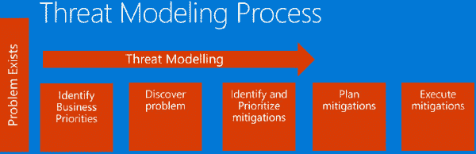

图 1.1: 威胁建模过程

## 为什么我们需要安全建模？

威胁建模活动的重要性怎么强调都不为过。从近期报告显示，网络威胁正在迅速增加。例如，`Security Boulevard Company` 的最新安全研究显示，仅在 2019 年，就有超过 40 亿记录因数据泄露而暴露。此外，报告还提到，通过社交媒体工程攻击，网络犯罪已导致损失超过 32.5 亿美元。


其他报告显示，到 2021 年，公司对网络安全产品和服务的投资将增加到惊人的 1 万亿美元以上。这些报告证明了网络犯罪给公司带来的损害、对投资威胁建模等过程日益增长的需求，以及使用该方法获得的益处。网络犯罪是一种影响所有公司的日益严重的流行病，因此拥有一个健全的威胁建模计划是一个明智解决方案，有助于公司应对这个日益增长的数字问题。下面的图像展示了我们如何设计威胁建模：

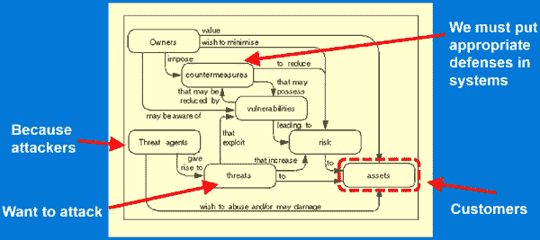

图 1.2: 考虑到攻击者的威胁建模

## 威胁建模方法论

安全专家可以使用多种方法论来进行威胁建模，包括：

*   STRIDE
*   DREAD
*   P.A.S.T.A.
*   Trike
*   VAST
*   攻击树 (Attack Tree)
*   通用漏洞评分系统 (CVSS)
*   T-MAP
*   OCTAVE
*   定量威胁建模方法 (Quantitative Threat Modelling Method)
*   LINDUNN
*   不欢迎的人 (Persona Non-Grata)
*   HTMM
*   安全卡 (Security Cards)

### STRIDE

该方法由微软公司开发。它提供了六类类别（参考 `图 1.3`），可用于识别安全威胁：

* **伪装 (Spoofing):** 伪装成其他用户或其他系统组件的入侵者。
* **篡改 (Tampering):** 检查系统内数据是否存在出于恶意意图的篡改。
* **否认 (Repudiation):** 确定由于缺乏针对他们的证据，入侵者或内部人员能否否认执行过任何恶意活动。
* **信息泄露 (Information Disclosure):** 确定数据暴露给了无权访问和查看此类数据的用户。
* **拒绝服务 (Denial of Service):** 攻击者利用手段耗尽为系统合法用户提供服务所需可用资源。
* **权限提升 (Elevation of Privilege):** 允许攻击者在系统内执行其本不被允许的特权命令。

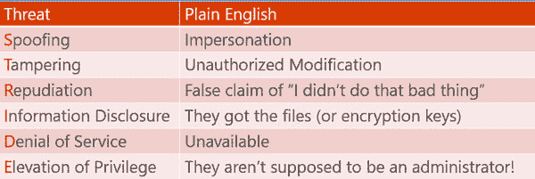

**图 1.3:** STRIDE 方法

该方法发明于 1999 年，微软于 2002 年采用了该技术。目前，该技术被认为是市场上所有可用方案中最成熟的。该技术随着时间不断演变，目前可以使用两种变体使用：基于元素的 STRIDE (STRIDE-per-element) 和基于交互的 STRIDE (STRIDE-per-interaction)。前者是根据系统元素进行评估；后者中，则是基于系统组件之间的交互进行评估。

该方法通过评估系统详细设计来工作。建模通过构建`数据流图` (`DFDs`) 对现有的系统进行建模。通过 `STRIDE`，安全团队可以识别系统实体、系统中的各种事件以及系统的边界。该方法已在网络系统和信息物理系统中得到了成功应用。

下表将向我们展示一些威胁：

| 威胁 | 属性 | 定义 | 示例 |
| --- | --- | --- | --- |
| 伪装 | 身份验证 | 冒充其他事物或某人 | 假装成 CEO、`microsoft.com` 或 `ntdll.dll`。 |
| 篡改 | 完整性 | 修改数据或代码 | 修改磁盘或 DVD 上的 DLL，或在穿越局域网时修改包。 |
| 否认 | 不可否认性 | 声称未执行某项操作 | “我没有发那封邮件”，“我没有修改那个文件”，“亲爱的，我绝对没访问过那个网站！” |
| 信息泄露 | 机密性 | 将信息暴露给无权查看的人 | 允许某人读取 Windows® 源代码；在网站上发布客户列表。 |
| 拒绝服务 | 可用性 | 拒绝或降低对用户的服务 | 使 Windows 或网站崩溃，发送数据包并占用数秒 CPU 时间，或将数据包路由到黑洞。 |
| 权限提升 | 授权 | 在没有适当授权的情况下获得能力 | 允许远程用户运行命令是一个经典示例，但从受限用户变为管理员也是 EoP。 |

**表 1.1:** 理解威胁

注：在本章结束时，我们将在实验室部分进行实操方法学习。

### DREAD

该方法由微软公司开发。微软在 2008 年弃弃了它，但许多其他组织仍在使用。该方法提供了一种通过五个类别对可能影响系统的安全风险进行排名和评估的方法：

* **损害潜力 (Damage potential):** 该类别对系统中每个可利用漏洞的可能损害程度进行排名。
* **可复制性 (Reproducibility):** 该类别对复制系统攻击的难易程度进行排名。
* **可利用性 (Exploitability):** 该类别通过对攻击者发起特定类型攻击所需的各种努力给出数值评分来进行评估和划分。
* **受影响用户 (Affected Users):** 该类别提供了在攻击者成功实施攻击且攻击广泛可用时可能影响的用户数量。
* **可发现性 (Discoverability):** 该类别衡量安全系统发现威胁的难易程度。

### P. A. S. T. A

P. A. S. T. A. 代表`攻击模拟与威胁分析流程` (Process for Attack Simulation and Threat Analysis)。该方法包含 7 个步骤，专注于系统风险。该方法提供了一套威胁识别、威胁枚举以及针对每个识别出的威胁的评分系统。然后，专家会对系统中所有识别出的威胁进行详细分析，开发人员利用这些分析来创建以资产为核心的缓解策略，该策略通过从攻击者的视角分析所有系统应用程序来实现。

该方法的目标是将技术需求与业务目标相结合。它通过让组织中的关键决策者参与，并要求所有部门（如治理、运营、开发和架构）提供安全输入，将威胁建模提升到战略高度。该技术被广泛认为是以风险为中心的，并采用以攻击为中心的方法来产生以资产为中心的结果。

七个 P. A. S. T. A. 步骤如下：

1. **目标定义**: 此步骤包括：识别目标、业务影响分析以及安全和合规性需求识别。
2. **技术范围定义**: 此步骤包括：捕捉技术环境边界以及基础设施、应用和软件依赖关系。
3. **应用分解**: 此步骤包括以下活动：识别用例、定义应用入口点和信任级别、识别参与者、资产、数据源、角色和服务，以及`数据流图` (`DFD`) 以及信任边界的确定。
4. **威胁分析**: 包括威胁情报关联与分析、安全事件回归分析以及概率攻击场景分析。
5. **漏洞与弱点分析**: 此步骤的活动包括：查询现有漏洞报告、问题跟踪、使用威胁树对现有漏洞进行映射、使用用例和滥用例进行设计缺陷分析，以及评分和枚举。
6. **攻击建模**: 此步骤的活动包括攻击面分析、攻击库管理、攻击树开发、攻击到漏洞映射以及利用分析。
7. **风险与影响分析**: 此步骤包括识别风险缓解策略制定、量化业务影响以及应对措施识别和剩余风险分析。

*   **定义系统**：一旦定义了系统，分析师在彻底理解并列举系统后将构建需求模型。分析师必须理解系统所有的预定操作、规则、参与者和资产。在第一步中，会创建一个“参与者-资产-动作”矩阵。该矩阵的列代表资产，行代表参与者。
*   **单元格划分**：矩阵的每个单元格被分为四个部分，代表以下操作：`创建、读取、更新和删除`（`CRUD`）。分析师在单元格中分配这些值之一：不允许的操作、允许的操作以及带有规则的操作。为了确定要使用的规则，每个单元格都附带了一个规则树。
*   **构建数据流图 (DFD)**：在定义需求之后，定义 `DFD` 是接下来的步骤。然后，将矩阵中的每个元素映射到由资产和参与者组成的选定组合上。分析师通过迭代 `DFD` 来确定威胁，这些威胁主要分为两类：拒绝服务和权限提升。发现的每种威胁都成为攻击树上的根节点。
*   **风险评估**：为了评估攻击风险，使用了 `CRUD` 方法以及代表每个操作的五分制标准。系统中的参与者也根据五分制进行评分，以代表他们假设会给系统带来的风险。在评分系统中，较小的数字代表对系统或资产的高风险。此外，对于每个评估的资产，还会从三个维度对参与者进行评估。这三个维度包括始终、有时和从不。

### VAST

这是一个威胁建模方法的缩写，代表视觉化、敏捷和简单的威胁建模技术（Visual, Agile, and Simple Threat modelling technique）。该方法提供了针对不同利益相关者（如开发人员、网络安全人员、应用架构师等）独特需求的可操作输出结果。VAST 技术提供了一种基础设施可视化计划，该计划在应用上是独特的，且不需要专业知识即可使用该技术来增强公司安全。

### 攻击树

攻击树是一种概念化攻击过程的方法。该技术将该过程以具有根节点、叶子节点和子节点的树的形式进行概念化。子节点表示在使直接父节点为真之前必须满足的条件。概念树还使用 `AND` 和 `OR` 操作，负责为安全专家提供替代步骤，以实现实现安全所需的目标。

### 通用漏洞评分系统

缩写为 `CVSS`，这种威胁建模方法为安全专家提供了一种捕获漏洞特征的方法，然后为漏洞分配一个 0-10 之间的值。值 `10` 代表最严重的情况。评分系统随后进一步转化为四种定性表示，即：低、中、高和危。这些表示对于组织优先考虑其安全关注点以及管理其系统和业务运营中特有的各种漏洞非常有帮助。

该技术由`国家标准与技术研究院`（`NIST`）开发，维护责任由`事件响应和安全小组论坛`（`FIRST`）。该方法由三个指标组组成，即时间组、基础组和环境组。

这些组中的每个组由一组指标组成，即：

| 基础组 | 时间组 | 环境组 | 
| :--- | :--- | :--- |
| 攻击向量、攻击复杂度、所需的权限、用户交互 | 漏洞成熟度、修复水平、报告置信度 | 机密性需求、完整性需求、可用性需求 |

**表 1.2:** 指标组

`CVSS` 分数将由上述指标决定。

### T-MAP

该方法通常用于现成系统。它结合了 `UML` 图、访问类、漏洞和受影响值等工具。

### OCTAVE

这是一个威胁方法的缩写，代表操作关键型、资产和漏洞评估（Operationally Critical, Asset, and Vulnerability Evaluation）。该技术在评估过程中是基于风险的。它的重点仅在于组织风险。然而，它没有涉及技术方面。

`OCTAVE` 方法分三个阶段进行：

*   组织评估：包括构建威胁概面。
*   信息评估：包括识别漏洞。
*   影响决策的风险评估：包括策略。

### 定量威胁建模方法

这是一种混合方法，结合了上述三种方法：`CVSS`、`STRIDE` 和攻击树。该方法认识了网络系统产生的相互依赖关系中的复杂性，并解决它们引起的问题。该方法的第一步是为所有 `STRIDE` 类别创建攻击树。树的目标是确定低级组件属性。最后通过计算评分应用 `CVSS` 方法。

### LINDDUN

这是一个威胁方法的缩写，代表关联性、可识别性、不可否认性、可检测性、信息泄露、无意识和不合规。

该技术关注数据问题，通常用于增强数据安全。它由六个步骤组成：

1. 定义数据流图（`DFD`）。
2. 将隐私威胁映射到相应的 `DFD` 元素上。
3. 识别威胁场景。
4. 对威胁进行排序。
5. 制定缓解策略。
6. 选择相应的 `PETS`。

### Persona Non-Grata

**Persona non Grata**（`PnG`）是一种威胁建模技术，主要关注潜在攻击者的动机和技能。该技术将人类用户视为可能滥用系统的原型，并要求安全专家从潜在攻击者的角度来看待系统。该方法在威胁建模的早期阶段有用，因为它有助于从对方的角度可视化潜在威胁。它基于安全专家代入攻击者的角色来理解他们的技能、目标和动机。该方法被认为适合敏捷系统开发流程。

### HTMM

这是一种混合方法，其缩写代表“混合威胁建模方法”（Hybrid Threat Modelling Method）。该方法是最近发明的，开发于 2018 年。它以安全卡、`PnG`活动和“安全质量需求工程方法”（`SQUARE`）的形式了三种技术。

该方法论针对系统的以下特征：

* 无误报
* 无论执行威胁建模的安全分析师是谁，结果均保持一致
* 不遗漏威胁
* 成本效益

该方法包含五个主要步骤：

1. 识别需要威胁建模的系统
2. 根据开发者的建议应用安全卡
3. 移除可能且不太可能的 `PnGs`（确保没有不现实的攻击向量）
4. 使用支持工具总结过程结果
5. 继续进行正式风险评估方法

### 安全卡

该方法尚未被正式认可为一种独立的威胁建模技术。然而，它可以用于识别对系统的异常且复杂的攻击。该方法帮助安全专家针对潜在问题的安全解决方案进行脑风暴。它使用一套卡牌，帮助安全分析师回答关于分析系统安全性的安全问题。这些问题的示例包括：

* 谁可能发起攻击？
* 他们可能针对哪些资产？
* 为什么系统可能被攻击？
* 攻击者如何实施他们的攻击？

该方法使用一套 42 张卡。这些卡片分为四组：人类影响（9 张卡）、攻击者动机（13 张卡）、攻击者方法（9 张卡）和攻击者资源（11 张卡）。

下表说明了各种卡片以及 42 张卡中每张的描述：

| 人类影响 | 攻击者的动机 | 攻击者资源 | 攻击者方法 |
| --- | --- | --- | --- |
| 生物圈、心理健康、财务状况、异常影响、社会福利、关系、个人数据、身体健康 | 访问/便利、好奇心/无聊、保护、宗教、异常动机、世界观、自我推销、金钱、恶意/报复、欲望/执念、外交/战争 | 专业知识、异常资源、未来的世界、工具、不受罚、时间、内部能力、权力和影响力、内部信息、金钱 | 掩护、间接攻击、技术攻击、异常方法、物理攻击、流程、多阶段攻击、胁迫、操纵 |

**表 1.3：** 安全卡

选择何种威胁建模方法取决于多个因素。组织的安全团队将根据现有的专业知识、威胁建模可用时间、涉及的风险及其对业务的影响，以及利益相关者参与过程的意愿来选择要使用的方法。这些因素之外，主要的决定因素是最初进行威胁建模的原因。

在提供的列表中决定使用方法的主要因素是风险、安全和隐私。这三个因素中的每一个都决定了所需的威胁建模类型，并决定了用于处理所涉业务威胁的方法。

威胁建模旨在增强组织的安全状况。妥善使用威胁建模应该产生一个不仅安全而且值得信赖的产品。列出并描述的方法在用途范围和有效性方面有所不同。某些方法可以使用。

下表提供了某些方法及其差异特征的总结：

| 威胁建模 | 特征 |
| --- | --- |
| STRIDE | 成熟；有助于识别相关技术；耗时 |
| PASTA | 有助于识别识别相关技术；鼓励协作；内置功能 |
| LINDDUN | 耗时；有助于识别相关技术；内置功能 |
| CVSS | 自动化组件；不透明；可以显示一致的结果 |
| Attack Trees | 易于使用；需要深入理解系统 |
| Persona non Grata | 有助于识别相关技术；有助于风险管理；仅检测子集 |
| Security Cards | 鼓励协作；会导致误报；针对异常 |
| HTMM | 内置功能；鼓励协作；可以显示一致的结果 |
| Quantitative TMM | 自动化组件；内置功能；可以显示一致的结果 |
| Trike | 有助于识别相关技术；有助于风险管理；文档不足 |
| VAST modelling | 有助于识别相关技术；有助于风险管理；协作；自动化组件；文档少；可扩展 |
| OCTAVE | 有助于识别相关技术；有助于风险管理；可扩展；耗时；文档少 |

**表 1.4：** 某些方法及其差异特征总结

## 结论

在本章中，你介绍了威胁建模这一网络领域的重要课题。威胁建模是评估和识别系统面临的漏洞和潜在威胁，并采取应对措施来解决这些威胁相关风险的过程。我们识别了威胁建模的原因以及避免实际安全事件的重要性。我们还查看了可以用于威胁建模活动的方法。这些方法包括 `STRIDE`、`DREAD`、`P.A.S.T.A`、`Trike`、`VAST`、`Attack Tree`、`Common Vulnerability Scoring System (CVSS)`、`T-MAP`、`OCTAVE`、`Quantitative Threat Modelling Method`、`LINDUNN`、`Persona Non-Grata`、`HTMM` 和 `Security Cards`。

然而，其他方法论要么是其他方法的结合，要么需要其他方法来有效地帮助分析师进行威胁建模。事实证明，通过有效使用威胁建模，组织可以大大提高产品的安全性和信任度，并将黑客拒之于门外。

下一章将介绍威胁建模中的攻击者概念，并重点关注攻击者数据的各种来源。

## 实验 1：威胁建模实操

在本实验中，我们将使用微软提供的免费威胁建模工具。我们将一步步地引导你完成整个过程，让我们开始吧：

1. 如果你还没有该工具，请下载它：

    直接下载链接：`[`aka.ms/threatmodelingtool`](https://aka.ms/threatmodelingtool)`

    要获取有关该工具的更多信息，请访问此链接：

    `https://docs.microsoft.com/en-us/azure/security/develop/threat-modeling-tool`

    下载工具后，进行安装：

    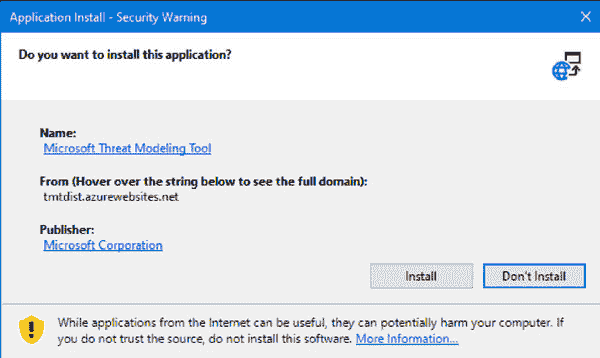

    **图 1.4：** 点击“install”（安装）

    该工具安装需要几分钟时间。安装完成后，同意许可协议并开始你的流程，这包括创建图表、识别威胁、缓解威胁以及验证每项缓解措施。下面的图强调了我们在本实验期间遵循的流程：

    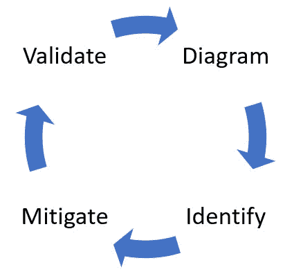

    **图 1.5：** 威胁建模流程

2. 安装好工具后，开始威胁建模过程。启动工具后，你会注意到如下截图所示的几点：

    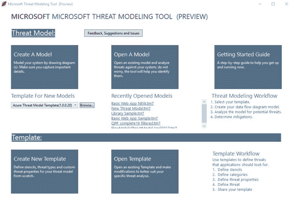

    **图 1.6：** 微软威胁建模工具

    `Create A Model`（创建模型）选项卡将打开一个空白画布供你绘制图表。选择你想要为模型使用的模板并保存你的工作；稍后可以通过 `Open a Model`（打开模型）选项卡打开它。


3. 接下来，你需要构建一个模型。为此，点击`create a new model`（创建新模型）选项卡；它将根据你的选择打开一个模板：

   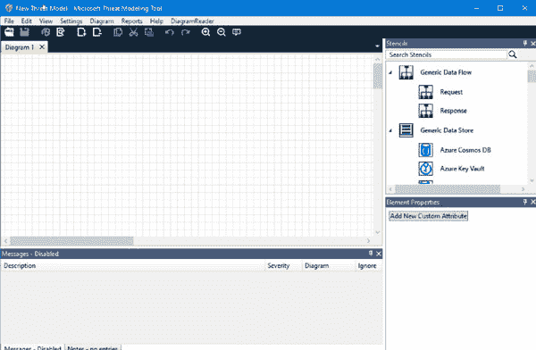

   **图 1.7：** 威胁建模空白模板

4. 在此示例中，我们将创建一个数据流图来表示数据通过过程或系统的流。通过威胁建模的帮助，你可以指定信任边界（由红色虚线表示），以显示不同的受控实体。例如，IT 管理员需要 Active Directory 系统来进行身份验证，因此 Active Directory 在他们的控制范围之外。

   现在，构建你的威胁模型。对于此场景，让我们假设有一个用户向一个带有数据库的 Web 服务器发送命令；这里是一个示例。

   你可以根据下面的截图使用菜单图标：

   

   **图 1.8：** 微软威胁建模工具编辑选项

   要添加模板（Stencils），请使用右侧的菜单。

   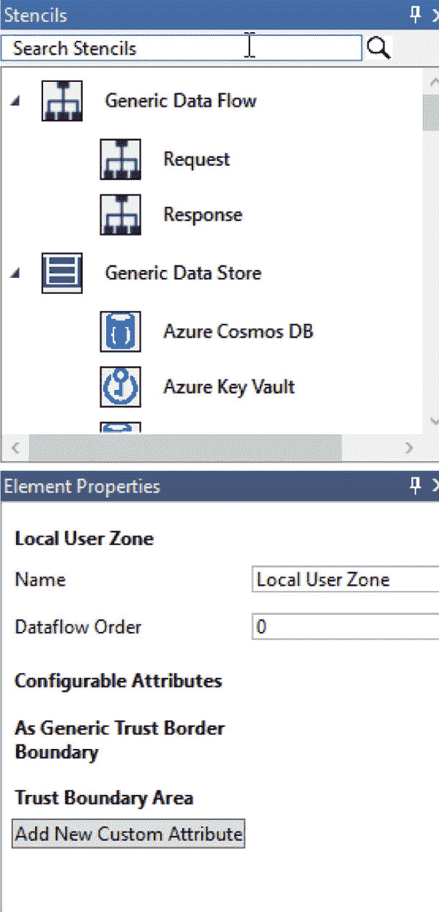

   **图 1.9：** 微软威胁建模工具模板

   现在，绘制我们的模型：

   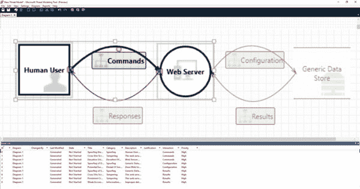

   **图 1.10：** 威胁模型

* 如何确定它是真实进程而非恶意程序？（例如：指向虚假网站的钓鱼链接）

* 该进程是否有防止拒绝服务（DoS）的防护？

  **注意：例如，在 Microsoft Azure 中这些是会自动处理的**

### 进程问题 2

* 谁可以访问或修改二进制文件？

* 谁是宿主机操作系统的管理员？

* 二进制文件是否有数字签名？

* 二进制文件的权限设置是什么？

### 进程以什么身份运行？

* 它的设计是否遵循最小权限原则？还是说被赋予了广泛的域管理员等权限？

* 它是否拥有下游系统的控制权？（例如：可以在其他组件上以系统身份运行代码的管理工具）

* 对于移动设备，应用以什么权限/特权/能力运行？

### 外部实体问题

* 你如何对实体进行身份验证？

* 当实体连接到此进程时，进程如何知道该实体确实是其声称的身份？

**示例：**

* 使用`Kerberos/NTLM`的 Windows 单点登录（常见于内网应用）

* 联邦身份验证（例如`ADFS`）

* 基于`TLS`的表单身份验证

* `TLS`证书认证

* `IP 安全`（`IPSec`）

### 数据流问题

* 这些数据有多重要？

* 未经授权的人读取、修改或删除这些数据会有什么影响？

* 数据在传输过程中是否已加密？

**示例：**

* `TLS`证书认证

* `IP 安全`（`IPSec`）

**提示：关注跨越信任边界的数据流。你可能不需要关心本地文件访问（例如：Web 服务器读取本地网页）。**

### 数据存储问题

* 这些数据有多重要？

  * 如果未经授权的人读取、修改或删除这些数据会有什么影响？

* 谁可以访问或修改二进制文件？

  * 谁是宿主机操作系统的管理员？

  * 谁是数据库/应用程序的管理员？（如果适用）

  * 谁被授予了访问数据库的权限？

* 你是否加密数据？

  * 在容器级别？（文件卷或数据库）

  * 在内容级别？（文件、数据行/表等）

  * 如果是，你是如何管理密钥的？

### 问题总结

## **进程**

* 你如何对进程进行身份验证？

* 是否有`DoS`保护？

* 谁可以访问或修改二进制文件？

* 进程以什么身份运行？

#### 外部实体

* 你如何对实体进行身份验证？

#### 数据流

* 这些数据有多重要？

* 数据在传输过程中是否已加密？

**提示：关注跨越信任边界的数据流**

#### 数据存储

* 这些数据有多重要？

* 谁可以访问或修改二进制文件？

* 你是否加密数据？

## 验证威胁模型

* 验证整个威胁模型

* 图表是否与最终代码/最终设计匹配？

* 是否已列出威胁？

* 至少：针对每个接触信任边界的元素进行`STRIDE`分析

* `Test`/`QA`是否审核过该模型？

* 测试人员的方法是否经常发现威胁模型或细节上的问题？

* 每个威胁是否都得到了缓解？

* 缓解措施实施得正确吗？

## 在最终安全审查之前检查了这些吗？

* 发布将更具可预测性

## 验证威胁和缓解措施的质量

* **威胁：** 它们是否：

  * 描述攻击

  * 描述上下文

  * 描述影响

* 缓解措施

  * 与威胁关联

  * 描述缓解措施

  * 提交 Bug

**注意：模糊测试是一种测试策略，而非缓解措施**

## 验证捕获的信息

* 依赖项

  * 你使用了哪些其他代码？

  * 其他代码中包含哪些安全函数？

  * 你确定吗？

* 假设

  * 你在构建威胁模型时记录的事项

  * “`HTTP`. sys 将保护我们免受 SQL 注入”

  * “`LPC`将保护我们免受恶意消息的影响”

  * `GenRandom`将提供加密级的随机性

请注意，“发明缓解措施并非易事”取决于你试图缓解的威胁，你需要成为该领域的专家。工具无法自动为你提供缓解措施。你需要理解攻击者的视角，学习如何基于你的系统创建威胁模型，并根据你的基础设施理解威胁缓解。

## 进阶阅读

可以使用以下资源获取更多关于本章涵盖主题的知识：

1. 定义威胁建模：

   [`www.simplilearn.com/what-is-threat-modelling-article`](https://www.simplilearn.com/what-is-threat-modelling-article)

2. 威胁建模方法：

   [`insights.sei.cmu.edu/blog/threat-modelling-12-available-methods/`](https://insights.sei.cmu.edu/blog/threat-modelling-12-available-methods/)

3. 理解威胁建模：

   [`www.synopsys.com/glossary/what-is-threat-modelling.html`](https://www.synopsys.com/glossary/what-is-threat-modelling.html)

威胁情报是指经过收集、处理和分析的数据，用于理解威胁行为者的动机、目标和攻击行为。威胁情报用于帮助组织基于数据做出安全决策，并使其网络防御行为从针对威胁行为者的被动响应变为主动防御。

## 定义良好的情报

良好情报的基本定义包括：能够让安全专业人员充分理解组织所面临的威胁的信息，即已经发生过、将要发生以及目前正在针对该组织的威胁。通过这些信息，网络安全专业人员可以准备、预防并识别所有可能针对该组织的网络威胁。

良好的威胁情报有助于组织获取有关潜在威胁的价值信息，并构建防御机制，以缓解可能损害业务功能和声誉的风险。针对性威胁最好通过针对性的防御来妥善处理。良好的网络情报提供了更具主动性的防御能力。

本节定义了什么是良好情报，并提供了识别良好情报的方法。在下一节中，我们将确定为什么收集此类情报很重要。

## 收集良好的情报非常重要

威胁情报涉及使用各种网络安全工具，从各种可靠来源收集有关新兴和现有威胁的原始数据。然后对原始数据进行分析和过滤，产生报告和情报馈送，这些馈送可以被自动化安全控制工具使用。通过良好的情报收集，组织可以实现以下目标：

* 组织可以跟上海量新兴和现有威胁的最新动态，这些威胁包含了面临利用的方法、漏洞和目标。

* 它有助于组织在处理网络安全状况方面变得更加主动，并对未来的威胁及其对组织的潜在影响进行规划。

* 良好的信息有助于让组织的所有领导、利益相关者以及系统的其他用户了解新兴和现有威胁，以及这些威胁对业务可能产生的潜在影响。

总结之，通过了解你的对手，你可以做出更好的决策来保护你的资产。威胁情报不仅仅是一项 IT 安全工具——它的意义远不止此。它有助于做出有关组织防御的决策，帮助经理决定如何投入安全，并帮助首席信息安全官（CISO）向高管层说明情况。你从威胁情报中获得的信息可以用于不同的领域，例如：

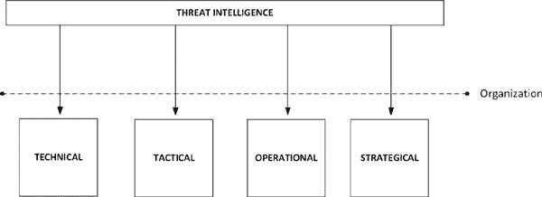

**图 2.1:** 威胁情报的类型

如图所示，组织可以从威胁情报的四种不同方式受益。某些在长期中使用收益更多，例如战略性和战术性的。另一些则更具短期和即时性用途，例如运营性和技术性的。以下是每种类型的示例：

* **技术性**：当你获取有关特定`IoC`（入侵指标）的信息时。这些信息通常会被你的`安全运营中心`（`SOC`）分析师以及`事件响应`（`IR`）团队消费。

* **战术性**：当你能够确定攻击者使用的`战术、技术和程序`（`TTP`）时。同样，这是 SOC 分析师通常消费的关键信息。

* **运营性**：当你能够确定有关特定攻击的细节时，这是蓝队（防御方）需要消费的重要信息。

* **战略性**：当你能够确定有关攻击风险的高级信息时。由于这是更高层次的信息，此类信息通常由高管和经理消费。

我们在本节中已经确定了收集良好情报的重要性。在下一节中，我们将查看可用的威胁情报工具。

## 可用的威胁情报工具

对威胁情报工具的需求一直在增加，特别是威胁格局的扩大和组织面临风险的增加。安全工具供应商也提高了水平，并努力通过开发能够满足数字消费者不断变化的工具来跟上这种需求。然而，可用工具在能力以及有效帮助组织收集其所需情报的潜力方面存在差异。提供所需安全水平的良好情报工具应该能够随时扫描互联网上的各种在线内容，以应对所有潜在威胁。

## 良好情报的受益者

威胁情报旨在让所有人受益。黑客不仅针对组织，他们通常还想要窃取信息，如信用卡信息。因此，威胁情报信息将使组织和与组织交互的用户受益。

为了让威胁情报对所有人有用，将其视为组织中的一个一个组成部分，由于组织内部功能之间的各种交互，它会影响并增强其他功能。将信息视为更广泛的安全范式中的独立功能往往会排除其他可能从访问信息中受益的人。

安全团队将从威胁情报的易访问性中受益最多，这将极大地提高他们处理所收告警的能力。当威胁情报与已使用的安全解决方案集成时，有助于改进识别和过滤流程，帮助在告警出现时进行优先级排序。这同样适用于组织的漏洞管理团队。通过与其他安全解决方案一起读取此类情报信息，他们可以对最重要的漏洞进行优先级排序。

这类威胁情报提供高层信息，影响着组织的安全态势、组织面临的各种威胁以及网络攻击趋势、这些威胁给组织带来的财务影响，以及为应对这种情况而可能采取的任何活动对业务的影响。这种类型的威胁情报由组织的高层执行人员消耗，并有助于管理组织的 IT 功能。`首席信息安全官`（`CISO`）通常处理此类信息。组织的高层管理人员根据涉及的网络风险、未知的未来风险、涉及的威胁者以及所有这些因素对整体业务形象的影响，对来自战略性威胁情报的所有信息进行评估。此类情报为高层管理层提供一份报告，重点关注各种威胁给组织带来的风险，以及每种威胁将如何影响长期业务功能。

战略性情报主要关注组织面临的威胁的长期性质和影响，以及这些信息如何影响组织的关键资产，如组织内的 IT 基础设施、客户、应用程序和员工。管理层需要这些信息来进行调查，并评估其业务决策将从长期来看如何影响组织的安全方面。这些信息还将帮助管理层做出关键决策，例如分配预算来帮助保护 IT 资产和其他业务流程。这些信息的业务影响和高层使用要求仅来自高层信息源，并且需要高度胜任的人员参与信息的提取以及向组织高层进行信息的展示。它直接影响组织的长期生存，因此需要精细的管理。

属于此类威胁情报的信息类型包括：

* 各行业部门的威胁格局

* 各种网络攻击的地缘政治冲突

* 网络活动的财务影响

* 威胁者和新出现的网络攻击趋势

* 关于泄露、恶意软件和数据窃取的统计信息

* 威胁格局变化的信息

* 高层管理人员各种网络安全决策对业务的影响

### `战术威胁情报`

这类威胁情报侧重于保护组织的资产/资源免受可能的攻击。它提供了有关组织攻击者的所有细节，例如他们可能用于实施攻击的技巧、程序和战术。这种级别的情报由组织中的中级经理使用，例如 IT 服务经理、网络运营人员、管理员、架构师和安全运营经理。

这种情报信息为组织提供了有关潜在攻击的信息，例如攻击者的能力、攻击者可以利用的系统漏洞、攻击者的目标，以及攻击者可能如何尝试渗透系统。通过使用这些信息，经理们可以开发各种防御系统和保护措施，通过修补漏洞系统以及更改系统以解决系统中识别出的各种弱点等行动，减轻组织遭受此类网络攻击的影响。

组织可以从多种来源获取战术威胁情报。包括：事件报告、活动报告、恶意软件、人类情报和攻击小组报告。这些情报通过阅读有关网络安全问题的技术/白皮书、与不同组织（特别是同一行业内的组织）交流，或从网络安全第三方专家获取信息来收集。

### `运营威胁情报`

运营威胁情报是针对组织的非常具体的信息。从运营情报中收集的细节通常可以在过去的行动方面直接应用于组织。这些信息旨在揭示各种威胁和攻击的风险，并对方法论提供见解。这种情报在多个方面帮助组织。一种方法是帮助他们理解影响组织的各种潜在威胁、各种威胁者对组织的能力、组织中的脆弱资产，以及潜在攻击者可以用来访问系统的机会。通常，政府机构对这类威胁情报最感兴趣。这些信息还帮助安全团队规划安全倡议和部署各种资产，以应对系统中识别出的各种漏洞。其目标是尽早识别潜在攻击，并采取措施防止攻击，从而减少对目标信息资产的损害。这种类型的威胁情报从社交媒体、聊天室、人类以及可能导致网络攻击的其他现实活动等来源中收集。这些信息通过对人类行为、网络攻击者等进行彻底评估获得。从此类评估收集的信息有助于预测未来的攻击，并主要支持制定有效的应急计划。运营情报通常包含此类细节，如恶意活动、建议的方案以及对新出现攻击趋势的警告。

### `技术威胁情报`

这种威胁情报侧重于提供有关攻击者资源和渗透系统手段的信息。这里提供的细节包括攻击者可能使用的命令通道、工具、控制通道等。与战术或战略情报相比，在这种情况下获得的信息生命周期非常短。它针对特定的`入侵指示`（`IoC`）。这种类型的情报旨在使安全团队能够快速响应威胁。例如，当攻击者使用恶意软件渗透系统时，此例中的恶意软件就是战术威胁情报信息。然而，攻击者意图使用恶意软件渗透系统的特定手段属于技术情报。其他实例还包括此类手段，如特定的 IP 地址和在实施攻击时使用钓鱼邮件头部等技术。

收集此类情报的来源包括外部第三方提供的数据馈送、主动活动以及从其他组织共享的攻击信息。从所有这些来源获得的信息非常有帮助，它们可以帮助安全团队向系统中添加额外的入侵指示（IoCs），以协助识别安全漏洞，并增强组织的安全态势。这些信息还可以帮助组织识别恶意 IP 地址（并将其加入黑名单），或根据地理异常识别攻击者。随后，这些情报会被直接输入安全设备中，以帮助阻止可疑的入站或出站流量。

在本节中，我们了良好的威胁情报，并识别了高层和 IT 安全团队等各种消费者。在下一节中，我们将介绍威胁情报生命周期。

## 威胁情报生命周期

原始数据并非成品，在为组织安全领导者的消费进行准备和分析之前，通常无法使用。因此，威胁情报的生成通过一个周期，将收集的原始数据转换为可改进组织安全态势的有用情报。情报的发展是一个知识过程，涉及新问题的提出和缺口的识别，然后确定新需求，最后通过迭代过程生成有用情报。迭代过程的用处在于，它们能确保随着挑战的识别和每次迭代对前一次的改进，生成的知识随时间推移变得更加精确。

该过程也被称为威胁情报生命周期，是一个包含六部分的过程，涉及以下步骤：

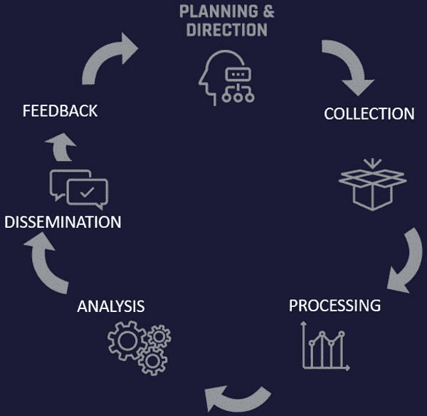

**图 2.2:** 威胁情报生命周期

* 规划与指导

* 收集

* 处理

* 分析

* 传播

* 反馈

## 规划与指导

生产有用情报的第一步是提出正确的问题。提出正确的问题从对问题进行建模开始，以关注单一的问题、事件、事实或活动。你应该避免提出可能产生大量可能答案的开放式问题。问题应该根据组织的目标进行结构化，因为这些问题的答案有助于进一步实现组织的目标。因此，情报目标应该考虑问题答案的截止日期，以及答案对所生成问题的影响。这两个考虑因素的答案有助于确定情报生成目标的优先级。该生命周期此部分的指导因素是确定谁将从该过程中受益并消费最终产品。在大多数情况下，有两种可能：一份给高层管理者的通用报告，他们想了解威胁的总体性质和威胁格局中的新兴趋势；或者一份供技术专家阅读的技术报告，他们正寻找有关新漏洞的信息。这两类将决定情报生成过程的详尽程度、信息量、技术性以及持续时间。

## 收集

在生命周期的第一步中仔细确定生成良好且有效情报的需求后，第二阶段涉及收集满足设定要求的原始数据。建议使用一系列来源，并以此提供满足此第二步的数据需求。内部和外部来源都应该被使用。内部来源将提供网络事件日志等数据，并帮助你获取有关过去事件响应以及公司如何管理那些安全事件的记录。外部来源则。

通常，这一步的预期数据包括恶意 IP 地址、域名、`入侵指示`（`IoCs`）列表和文件哈希。这些组件包括有关客户的漏洞信息、来自粘贴网站的代码、社交媒体新闻等。所有这些信息在收集阶段都是用的。

## 处理

在第二步收集数据后，第三步涉及梳理信息、使用元数据标签组织数据并过滤数据以消除冗余信息、假阳性和假阴性结果。在当今，许多组织每天可以收集数百万条日志事件。不用说，这一步需要使用自动化工具。

如`安全信息和事件管理`（`SIEM`）等自动化工具在这种情况下非常有用。这些工具有助于通过为不同用例设置的相关规则来结构化数据。然而，这些关联规则适用于有限的数据类型，你需要其他关联规则来处理各种数据。SIEM 工具虽好，但并不够有效，特别是在处理来自一系列不同来源的数据时。因此，在从包括内部和外部来源的广泛来源中收集数据时，利用其他强健的解决方案是谨慎的。机器学习和自然语言处理工具可以满足这种强健的需求。它们可以帮助处理和结构化来自各种语言的数百万非结构化数据，然后将数据分类为语言无关的事件，从而允许分析师执行更有效的搜索，而不仅仅依赖简单的规则和关键词。

### 分析

对处理后的数据产生意义是生命周期中的下一个自然步骤。此阶段的目标是从处理后的数据中发现潜在的安全问题，并以符合生命周期规划和指导步骤中所概述的情报要求的格式通知相关团队。


威胁情报信息可以采取多种形式。这些形式取决于信息传递的目标和受众。这里最重要的因素是确保数据以受众能够理解的格式呈现。在这种情况下，最终产品可以是简单的格式，例如表格形式的威胁列表，也可以以面向技术人员的复杂同行评审报告的形式存在。

### 传播

对数据进行分析后，最终产品（威胁情报）将呈现给目标受众。为了使威胁情报具有可操作性和实用，必须在正确的时间向目标受众呈现。

在此阶段，追踪至关重要。追踪能够确保不同生命周期之间的连续性，确保从过去的挑战中汲取的经验被纳入其中，并确保任何教训都不会在两个周期之间丢失。工单系统可用于情报循环与组织内其他安全系统的集成，以确保每当产生情报工单时，都能由组织内协同工作的多个个人正确地提交、编写、审核和执行，这些人员都通力协作以实现一个共同目标——提升组织的安全态势。

### 反馈

周期的最后一步有助于完成生命周期的闭环，并将其与周期的初始规划和方向阶段联系起来。理想情况下，产品应提交给初始请求者进行评审，以评估其问题是否得到了解答。将最终产品与初始步骤连接起来以确认目标已实现，也有助于将生命周期与下一个周期连接，并为下一个周期提供目标和问题信息。它也有助于改进文档并确保流程连续性，这对于最终改进当前流程的学习曲线来说至关重要。

在本节中，我们学习了威胁情报循环，展示了原始数据在成为能够让组织受益的最终情报产品之前经过的重要步骤。在下一节中，我们将介绍机器学习在生成威胁情报中的应用。

## 在生成高质量威胁情报中使用机器学习

在当前海量数据的时代，为了进行更全面的数据处理，机器学习有助于实现流程自动化，并通过结合来自暗网、开源渠道和其他技术来源不同来源的数据点来改进处理，以确保数据处理的真正稳健。

机器学习可以以四种方式用于帮助改进情报生成中涉及的数据处理。这些步骤包括：

*   将数据结构化为各种类别
*   跨语言的文本分析
*   提供风险评分
*   生成预测模型

### 将数据结构化为事件和实体

本体论（ontology）的概念在这里主要用于实现数据分类并改进数据分析。“本体论”一词通常指与拆分事物和对这些事物分组相关的概念。在数据科学中，该术语的用法与之相似，但用于表示根据事物的名称、相互关系以及属性将事物相关的类别。这使得能够容易地将事物分类到层次结构中。例如，巴黎、纽约、洛杉矶和摩纳哥可以被视为不同的实体。然而，它们也具有一个共同属性，即都是城市，因此在数据结构化时可以归类为城市。

在这种情况下，实体用于根据物理特征对事物进行排序。另一方面，事件用于分组和排序非物理的事物。这些事件并非独立语言，而机器学习语言处理消除了语言依赖的挑战。诸如“Brian 访问了法国”和“Brian 去法国旅行了”之类的术语含义相同，且在机器学习环境中被视为同一个事件，显示出高度的语言独立性。因此，机器学习中的本体和事件使得数据结构化过程更加有效，分析师可以对类别进行更强大的搜索，从而能够关注大局，而无需担心数据基础的排序工作。

### 跨语言的文本分析

自然语言处理是机器学习中一种强大的工具，能够解决语言依赖问题。虽然机器学习程序的效果还没有达到理想水平，但它们每天都在进步，并预计会变得更好。随着时间的推移，机器将能够访问更多的数据集，它们的预测预计将变得更加高效和准确。

### 提供风险评分

生成威胁情报的目标是使组织能够应对潜在威胁。机器学习通过为各种实体分配风险评分，实现了对威胁的更好分析，从而使生成情报的组织能够优先处理最大的风险。

机器确定的风险评分取决于两个问题：源于经验的人类规则和源于训练的机器规则。

风险评分系统中的分类器为这些判断提供了判断依据和背景。判断包括诸如“此事件是关键的”之类的陈述，背景将解释为什么该事件是关键的。

### 生成预测模型

机器学习还导致了用于预测未来威胁的模型生成。在许多情况下，由于机器比人类分析师更容易从海量数据中得出结论，它们可以执行更准确的预测。这些汇总并分类的数据集可以被机器轻松访问，而由于计算发展领域的巨大进步，这些机器正变得越来越强大。

错误情报（Bad intelligence）本质上是良好情报的相反面，它包含了对组织无益且浪费公司资源的数据。公司会浪费资源去追逐虚假报警，并开发系统来应对那些不应优先考虑或对组织并非实际威胁的威胁。资源被用于开发这些解决问题的系统，而这些资源本可以用于开发应对实际威胁的系统。因此，错误情报的财务影响是巨大的，而且基于错误情报的决策对未来的影响可能会威胁业务的连续性。错误情报的影响是巨大的，企业需要在情报方面做到正确，以确保资源被正确使用，并确保公司不基于错误信息进行业务运营。

错误情报可能源于多个来源。来源之一包括无能力的威胁安全团队人员。拥有一支没有能力的信息技术团队（包括`首席信息与安全官`（`CISO`））可能会导致产生基于错误指标或不关注明确目标的情报。威胁情报周期强调在规划和指导阶段设定明确目标，以确保最终产出是可操作的产品。明确的目标能引导人们对特定来源和特定解决方案产生明确关注，而不是泛泛而谈。使用过时的工具也会产生错误情报，因为这将导致与当前状况不相关且无法解决新兴威胁的数据。工具需要保持更新，以便在识别和解决方案过程中应对新的及新兴的威胁。在本节中，我们定义了错误情报，并确定了它如何通过浪费资源和导致对潜在威胁的准备不足来影响组织的安全态势。在下一节中，我们将比较良好情报和错误情报，找到两者之间的相似之处。

## 比较良好情报与错误情报

对良好情报和错误情报的比较得出如下因素：

*   它们都需要资源，组织会使用资源来生成情报，无论最终是否使用这些信息。
*   两种类型的情报旨在应对公司面临的威胁。
*   两种类型的情报都需要受众，高层管理层或安全团队。
*   良好情报和错误情报都会导致技术报告，这些报告将由技术 IT 人员处理以应对已识别的威胁。

在本节通过比较良好情报和错误情报找到两者之间的相似之处后，在下一节中我们将尝试确定这两种情报之间的区别。

### 区分良好情报与错误情报

对比良好情报和错误情报得出如下因素：

*   良好情报将帮助团队及时应对威胁，而错误情报无法及时传达给正确的受众。
*   良好情报将使组织的安全态势得到改进，而错误情报将导致安全态势的停滞或状况恶化。
*   良好情报带来了更好的资源管理，而错误情报会导致组织资源的浪费。
*   良好情报将带来一个学习过程，情报周期结束时获得的信息将产生更好的情报，并作为后续情报循环的基础。

在本节中，我们识别了良好情报和错误情报之间的一些区别。在下一节中，我们将识别这两种类型的情报如何影响威胁建模的过程。

### 良好和错误情报塑造威胁建模

良好情报和错误情报对威胁建模过程都有直接影响。虽然良好情报有利于建模过程，但错误情报将导致建模过程失效。目标是获得有能力的人员和资源，使组织能够生成良好情报。通过良好情报，威胁建模过程可以创建一个应急响应计划，用以应对未来的威胁并确保业务的连续性。相反，错误情报将导致生成在面对事件时无法有效的应急响应计划。这将导致公司准备不足，可能在发生安全事件时被摧毁。错误情报还会导致组织的损失，从而影响组织的声誉和品牌形象。

## 威胁情报的重要性

无论规模、业务类型或地理位置如何，每个组织都有某些核心目标，例如增加收入、降低风险、减少支出、增加客户数量和满足员工、符合法规等。然而，信息安全往往被忽视，由于其成本原因，经常不被视为核心目标，结果在安全意识上花费的时间微乎其微。为了对抗这种普遍的观点，在本节中，你将学习网络威胁情报如何对你的组织产生积极影响。威胁情报的主要优势如下：

*   **降低风险**：攻击者不断发现渗透组织的新方法。威胁情报提供了对这些现有和新兴安全危害的可见性，这将减少数据丢失的风险，防止或尽量减少业务运营的中断，并增加合规性。
*   **停止财务损失**：安全泄露可能会以事后修复和恢复过程以及罚款、调查和诉讼的形式给组织带来成本。使用威胁情报工具可以帮助你做出及时、明智的决策，防止系统故障和机密数据被窃。它有助于保护组织的知识产权并维护你的品牌声誉。
*   **提高运营成功率**：威胁情报有助于建立更高效的安全团队。使用自动化威胁共享平台来验证和关联威胁数据，并将数据集成到你的组织中，将加强你的安全态势并降低响应时间（IR time）。此外，它将允许你的运营人员更高效，并为你的业务省钱。
*   **降低成本**：威胁情报有利于任何形式和规模的组织。它有助于处理威胁数据以更好地理解攻击者、响应事件，并主动预测和拦截攻击者可能的下一步。利用外部威胁情报可以降低成本。

下面的图展示了威胁情报的全景：

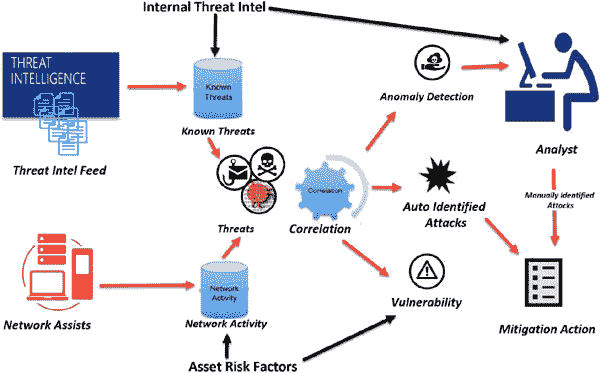

**图 2.3:** 威胁情报示例图

它始于威胁情报，可能来自`Threat Intel Feed`或`Internal Threat Intel`。如之前讨论过的，这些潜在的威胁检测器可以通过特定的 IoCs 或`Known Threats`进行馈送，例如识别特定漏洞的内部评估。这些数据源以及任何可疑的`Network Activity`将与数据库进行对比，并在`Correlation`（关联）阶段汇总资产和风险因素。如果检测到异常，将向分析师发送告警进行人工识别；或者，如果异常可以自动识别，则将将其发送给缓解团队以寻求解决方案。

既然我们已经学习了威胁情报的重要性，学习如何共享情报也同样重要，我们的下一节将涵盖这部分。

## 如何共享威胁情报

网络安全社区中的信息共享对于保障企业安全无疑是一项重要的流程；然而，组织在共享网络威胁信息方面表现并不理想。在任何信息共享过程中，一个基础阶段是对组织内部可能的威胁信息分类基准或来源进行分类。通过创建一个内部威胁信息源列表，组织可以检测到信息缺失，并通过安装额外工具和采用新的威胁共享平台来从外部威胁情报源获取威胁信息，从而解决这些缺失。威胁情报共享可能涉及加入已建立的威胁情报共享社区以满足共享需求，或获取信息共享工具或软件。

第一步将是识别公共、政府和私有的威胁数据源，这些源将提供组织资产的全覆盖。可以通过以下方式实现：

*   识别根据你组织安全监控策略收集和分析的威胁数据
*   定位已收集和存储的威胁数据
*   识别可以帮助你更快响应威胁的威胁数据（基于组织的资产）

正如我们在`Figure 2.3`中所示，从广泛的来源收集数据始终是一项良好的做法——内部包括：来自网络事件日志和过去的事件响应记录；外部包括：来自开放网络、暗网和技术源源。

威胁数据通常被视为 IoCs 列表，例如恶意 IP 地址、域名和文件哈希值（hashes），但它也可以包含漏洞信息，例如客户的个人身份信息（PII）、粘贴网站（paste sites）的原始代码，以及来自新闻来源或社交媒体的文本。

接下来，我们需要确定信息共享规则。以下是一些推荐的威胁情报共享规则：

*   识别并列出可以共享的威胁情报类别
*   定义组织允许共享威胁情报的条件
*   识别威胁情报的接收者
*   定义如果需要共享，如何对信息进行脱敏
*   应用信息处理标记以保护信息

威胁情报共享策略和程序应定期进行评估，在出现以下情况时应进行重新评估：

*   法规/法律要求发生变化
*   组织策略发生更新
*   引入了新源
*   组织的风险承受能力发生变化
*   信息所有权发生变化
*   运行/威胁环境发生变化

接下来，让我们考虑威胁情报共享生命周期。

## 网络威胁情报共享生命周期

网络威胁信息共享专注于六个不同的阶段，构成了所谓的“情报循环”：创建、发布、存储、处理、使用和处置：


**图 2.4:** 网络威胁情报共享生命周期

网络威胁共享周期的步骤定义如下：

*   **创建或收集（Creation or Collection）**：生成或获取网络威胁信息。
*   **发布（Dissemination）**：将威胁数据传递给将使用、处理和分析它的系统。
*   **存储（Storage）**：保存信息，以便使用数据库进行分析处理、告警、取证分析或猎寻工作。
*   **处理（Processing）**：对存储的信息进行聚合、转换、关联和分析，以识别组织或其信息的运行安全性。
*   **使用（Use）**：自动化应用措施来应对已识别的企业威胁，将威胁信息应用于操作中，以检测或最小化其影响。
*   **处置（Disposal）**：实施信息保留政策以确保自动化的有效性。

## 威胁情报的收集、共享和分析

网络安全自动化是当今技术领域的热门话题之一。自动化活动有助于组织关注其他重要事项，许多工具旨在自动化特定流程，例如漏洞管理工具，它们可以自动扫描企业网络上的设备。

自动化还可以帮助减少人为错误：考虑到要管理的海量数据，认为安全团队能够识别所有潜在威胁是不合理的。应用最佳自动化实践可以保护你的组织并通过持续的流程增强安全态势。像`Comodo`、`Splunk`、`QRadar`这样的公司正在协助自动化工作。

## 威胁情报工具

市上有许多开源威胁情报工具可以使用。有些是商业工具（付费），有些是免费的。你可以通过消费 TI 馈送开始获取威胁情报。OPSWAT Metadefender Cloud TI feeds 提供了从免费到付费版本的多种选择，并以四种不同的格式交付：`JSON`、`CSV`、`RSS`和`Bro`。

关于 Metadefender Cloud TI feeds 的更多信息，请访问：[`www.metadefender.com/threat-intelligence-feeds`](https://www.metadefender.com/threat-intelligence-feeds)。

另一个快速验证选项是网站[`fraudguard.io`](https://fraudguard.io)。你可以进行 IP 验证以获取该位置的情报。在以下示例中，使用了 IP `220. 227.71.226` 进行测试（测试结果相对于执行当天，即 `2017/10/27`），结果显示如下字段：

```
{
“isocode”: “IN”,
“country”: “India”, “state”: “Maharashtra”, “city”: “Mumbai”,
“discover_date”: “2017-10-27 09:32:45”, “threat”: “honeypot_tracker”, “risk_level”: “5”
}
```

查询的完整截图所示：

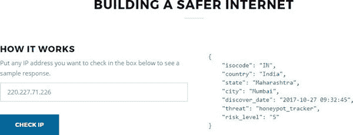

**图 2.5:** 查询的输出

虽然这只是一个简单的示例，但还有更多可用功能，具体取决于你使用的服务级别。它在免费版和付费版之间也有不同。你还可以通过`Critical Stack Intel Feed`（[`intel.criticalstack.com/`](https://intel.criticalstack.com/)）将威胁情报馈集成到你的 Linux 系统，它可以与`The Bro Network Security Monitor`（[`www.bro.org/`](https://www.bro.org/)）集成。Palo Alto Networks 还有一个名为`MineMeld`的免费解决方案（[`live.paloaltonetworks.com/t5/MineMeld/ct-p/MineMeld`](https://live.paloaltonetworks.com/t5/MineMeld/ct-p/MineMeld)），可用于检索威胁情报。

**访问此 GitHub 页面获取免费工具列表，包括免费的威胁情报：**

[`github.com/hslatman/awesome-threat-intelligence`](https://github.com/hslatman/awesome-threat-intelligence)

在事件响应团队不确定特定文件是否具有恶意的情况下，你也可以将其提交到[`malwr.com`](https://malwr.com)进行分析。他们提供了关于`IoC`（入侵指标）和样本的详细信息，可用于检测新威胁。

如你所见，有很多免费资源，但也有一些付费的开源倡议，例如`AlienVault USM Anywhere`（[`www.alienvault.com/products/usm-anywhere`](https://www.alienvault.com/products/usm-anywhere)）。公平地说，这个解决方案不仅仅是一个威胁情报源。它还可以执行漏洞评估、检查网络流量，并寻找已知威胁、策略违规和可疑活动。

在`AlienVault USM Anywhere`的初始配置上，你可以配置威胁情报交换平台（`OTX`）。注意，你需要一个账户以及有效的密钥，如下所示：

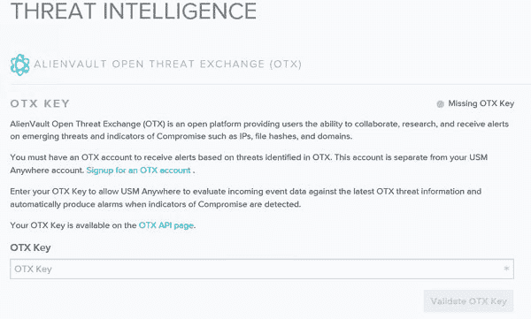

**图 2.6：** AlienVault 提供的威胁情报 OTX

完成配置后，`USM`将持续监控你的环境，当发生某些情况时，它会触发报警。你可以看到报警状态，最重要的是此攻击使用了哪种策略和方法，如下所示：

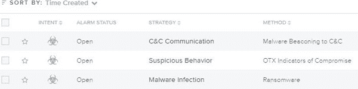

**图 2.7：** USM 创建的报警

你可以深入查看报警并查找有关问题的更多细节；那时你将看到更多关于触发此报警的威胁情报的详情。接下来的图片是此类报警的示例；但出于隐私考虑，IP 地址已被隐藏：

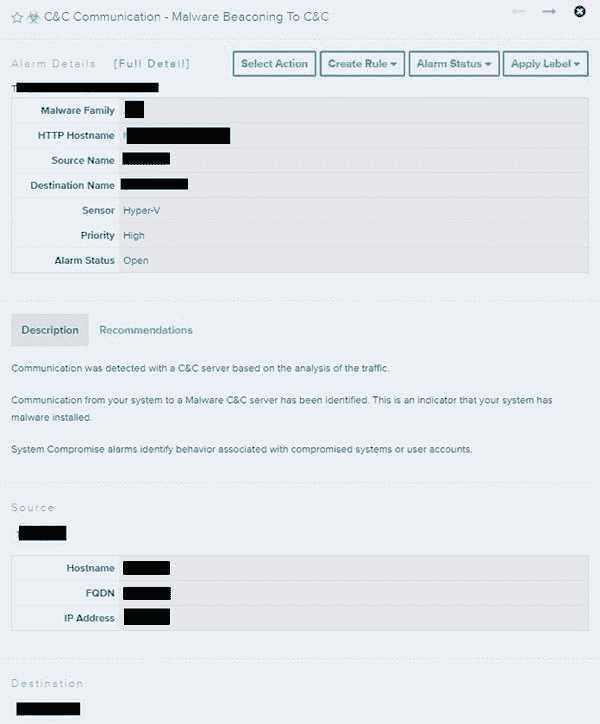

**图 2.8：** 此报警的示例

生成此报警所使用的威胁情报根据供应商而异，但通常会考虑目标网络、流量模式和潜在的入侵迹象。从列表中，你可以获得一些非常重要的信息——攻击源、攻击目标、恶意软件家族和描述，这些为你提供了关于攻击的大量细节。如果你需要将此信息传递给事件响应团队采取行动，还可以点击`Recommendations`（建议）标签查看下一步应该做什么。虽然这是一个通用的建议，但你始终可以使用它来改进自己的响应。

在任何时候，你都可以从[`otx.alienvault.com/pulse`](https://otx.alienvault.com/pulse)访问`OTX Pulse`，在那里你可以获得最新威胁的 TI（威胁情报）信息，如下例所示：

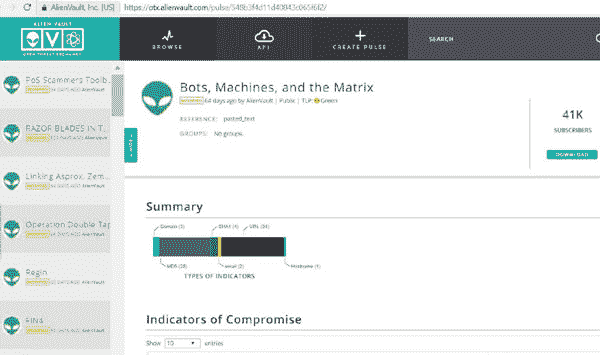

**图 2.9：** 威胁情报


此仪表板提供了大量的威胁情报信息，虽然前面的示例显示了来自`AlienVault`的条目，但社区也有贡献。在写作时，我们正面临`BadRabbit`爆发，我尝试使用此仪表板上的搜索功能查找更多关于`BadRabbit`的信息，这导致了大量的命中结果。

这里是一个有助于增强你防御系统的重要数据示例：

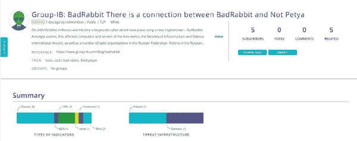

**图 2.10：** 威胁情报报警示例

### 免费威胁情报馈

你还可以利用网络上可用的一些免费威胁情报馈。以下可以作为你威胁信息源的网站示例：

* **勒索软件跟踪器 (Ransomware tracker)**：该网站跟踪并监控与`Ransomware`（勒索软件）相关的域名、IP 地址和 URL 状态。访问网站：

  [`urlhaus.abuse.ch/api/`](https://urlhaus.abuse.ch/api/)

  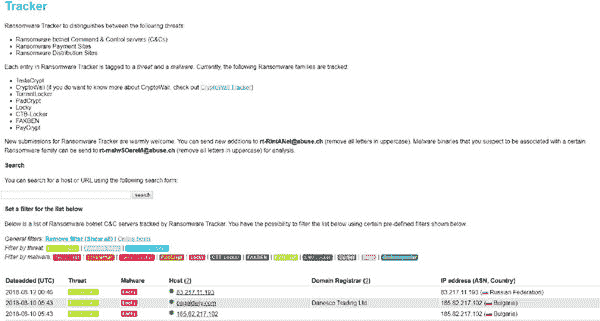

  **图 2.11：** 勒索软件跟踪器

* **自动指标共享 (Automated Indicator Sharing)**：该网站来自`国土安全部`（`DHS`）。该服务允许参与者连接到部门`国家网络安全与通信集成中心`（`NCCIC`）中`DHS`管理的系统，允许网络威胁指标的双向共享。

  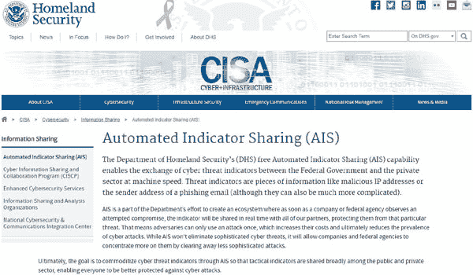

  **图 2.12：** DHS 的 AIS

* **Virus Total**：该网站帮助你分析可疑文件和 URL 以检测恶意软件类型。

  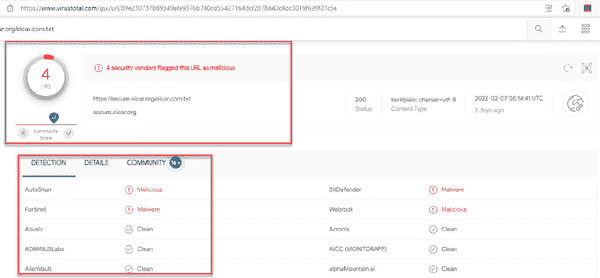

  **图 2.13：** Virus Total 扫描结果

* **Talos Intelligence**：该网站由`Cisco`提供支持，拥有多种查询威胁情报的方法，包括 URL、文件声誉和邮件数据。

  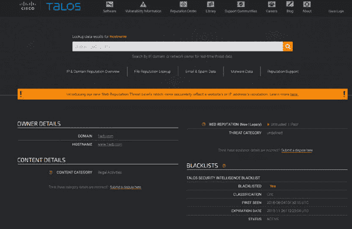

  **图 2.14：** Talos

* **The Harvester**：在 Kali Linux 上可用，该工具从不同的公共来源收集电子邮件、子域名、主机、开放端口和 banner，包括`SHODAN`数据库。

  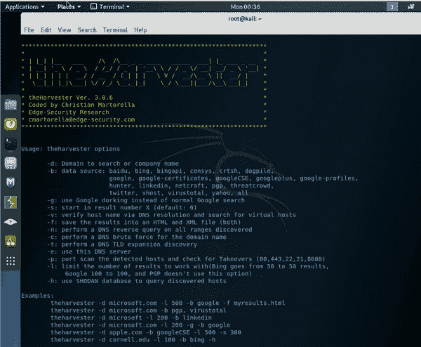

  **图 2.15：** 运行中的 Harvester

### 微软威胁情报

对于使用本地或云微软产品的组织，产品本身包含了威胁情报。这是因为现在许多微软产品和服务利用了共享的威胁情报，并借此提供上下文、相关性和优先级管理以帮助人们采取行动。

微软通过不同渠道消费威胁情报，例如：

* 威胁情报中心，它聚合了来自：
  * 蜜罐、恶意 IP 地址、僵尸网络和恶意软件反馈
  * 第三方来源（威胁情报馈）
  * 基于人类的观察和情报收集
  * 来自服务的消费
  * 微软和第三方生成的情报馈

微软将这些情报的结果整合到其产品中，例如`Microsoft Defender Advanced Threat Protection`、`Azure Security Center`、`Office 35 Threat Intelligence`、`Cloud App Security`、`Azure Sentinel`等。

访问[`aka.ms/MSTI`](https://aka.ms/MSTI)了解更多关于微软如何使用威胁情报来保护、检测和响应威胁的信息。

### Azure Sentinel

2019 年，微软推出了其首个安全信息和事件管理（`SIEM`），名为`Azure Sentinel`。该平台允许你连接`Microsoft Threat Intelligence`并与摄入的数据进行关联。你可以使用`Threat Intelligence Platforms`连接器连接微软威胁情报，如下所示：

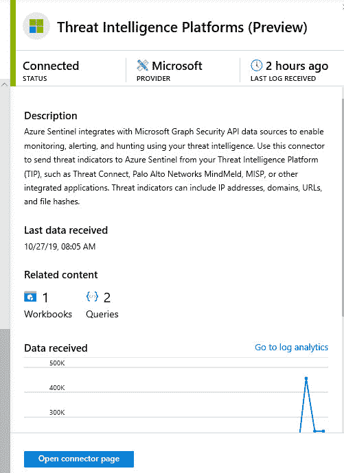

**图 2.16：** 微软威胁情报平台

连接配置完成后，你就可以使用 Kusto 查询语言（`KQL`）查询位于`Log Analytics`工作区中的数据，而且你还可以看到显示已识别威胁的地理位置的地图，如下所示：

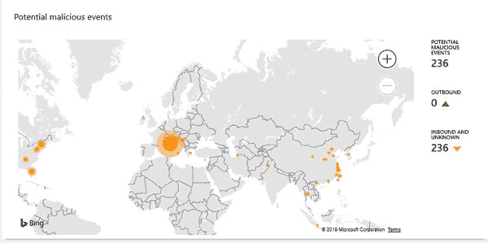

**图 2.17：** 威胁情报恶意事件视图

当你点击这些威胁之一时，将出现 Log Analytics 查询并列出该查询的结果，如下截图所示：

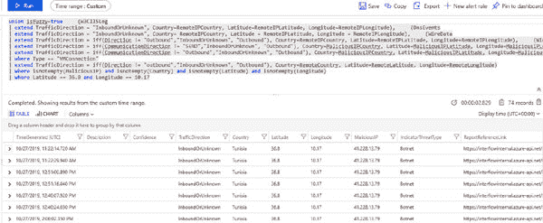

**图 2.18：** Log Analytics 查询结果

你可以展开结果页面底部显示的每个字段，以获取有关该内容的更多信息。

## 利用威胁情报调查可疑活动

此时，毫无疑问，利用威胁情报来帮助你的检测系统已是必不可行的。现在，在响应安全事件时，你如何利用这些信息呢？虽然蓝队（Blue Team）主要负责防御系统，但他们通过提供正确的数据与事件响应团队进行协作，引导他们找到问题的根源。如果我们使用之前 Security Center 的示例，只需将搜索结果交给他们就足够了。但了解被攻破的系统并不是事件响应的唯一目标。

在调查结束时，你必须回答以下问题：

* 哪些系统被攻破了？
* 攻击从哪里开始？
* 使用了哪个用户账户发起的攻击？它是否进行了横向移动？
  * 如果是，参与此移动的系统有哪些？
* 它是否提提升了权限？
  * 如果是，哪一个特权账户被攻破了？
* 它是否尝试与命令与控制中心（C2）通信？
* 如果是，是否成功了？
  * 如果成功，它是否从那里下载了任何内容？
  * 如果成功，它是否向那里发送了任何内容？
* 它是否尝试清除证据？
  * 如果是，是否成功了？

这些是在调查结束时必须回答的关键问题，它们可以帮助你真正结束案件，并确保威胁已完全控制并从环境中移除。

你可以使用 Azure Sentinel 的调查功能来回答大多数此类问题。该功能允许调查人员查看攻击路径、涉及的用户账户、被攻破的系统以及所实施的恶意活动。若要访问 Azure Sentinel 中的调查功能，你应当正在调查某个事件，并从该事件进入调查图（Investigation Graph）。以下是一个可供调查的事件示例，下一步是点击`Investigate`按钮：

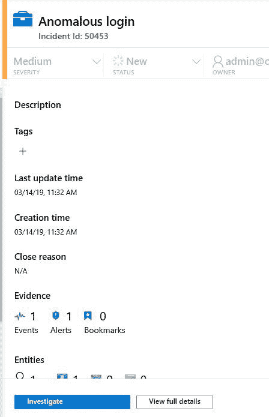

**图 2.19：** 异常登录告警

一旦点击`Investigate`按钮，就会出现如下截图所示的调查图仪表板：

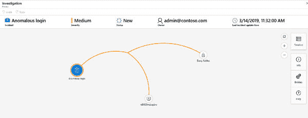

**图 2.20：** 由微软提供的调查图仪表板

调查图谱包含了与此事件相关的所有实体（警报、计算机和用户）。当你第一次打开仪表板时，地图的焦点是安全事件本身；但是，你可以点击任何实体，地图将展开并显示与你选择的对象相关的信息。仪表板的第二部分包含有关所选实体的更多细节，包括：

* 检测时间线
* 被攻破的主机
* 事件的详细描述

在以下示例中，展开了`user`实体，并检索了与其他用户关联的其他警报。结果是地图展开并显示了所有的关联关系。

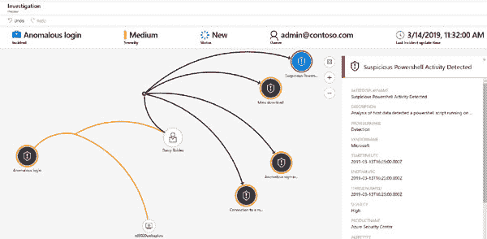

**图 2.21：** Sentinel 用户

你还可以利用网络上可用的一些免费威胁情报馈。在本节中，我们将提供一些可以作为威胁信息源的网站示例。

要获取免费工具列表，你可以访问此 GitHub 仓库：[`github.com/hslatman/awesome-threat-intelligence`](https://github.com/hslatman/awesome-threat-intelligence)

这些威胁情报工具旨在提供以下优势：

* 对 IOC（入侵指示物）和网络威胁格局的可视性
* 帮助识别恶意软件、电子邮件威胁等
* 帮助进行详细调查，精确识别受影响的邮件、用户和机器
* 快速检测、调查、响应和抑制威胁

我们将在接下来的页面中介绍其中一些工具。

## Keepnet 威胁情报共享社区 (TISC)

TISC 是由 Keepnet Labs 创建的网络威胁情报社区，通过利用集体网络知识来扩展威胁情报的范围，降低成本并加速实施，通过自动化遏制威胁。

### 它是如何工作的？

当收件箱检测到可疑邮件时，它会通过电子邮件（钓鱼）报告插件、点对点威胁共享或第三方情报源报告到 Keepnet 的`Incident Response Platform`（`IRP`）。可疑邮件将在`KIRP`内进行分析，如果确认该邮件为威胁，则会在收件箱（该威胁关联的域）启动调查。然后，可疑邮件及其变体将在源头被检测并抑制（根据公司策略采取的行动，例如将可疑内容标记为可疑或将其从收件箱中删除以及其他策略）。此事件响应过程/实验被发布/共享到威胁共享社区。威胁共享社区中的公司将使用这些威胁情报在其公司启动自动或手动的事件调查和响应。

在威胁情报共享中，信息在 Keepnet 用户社区内共享，并启动自动调查以发现其他社区成员是否也受到攻击，从而在他们检测到攻击之前进行自动响应。每个`company/organization/user`都能通过其拥有的不同技术帮助他人检测和阻止威胁。例如，公司可以使用不同的沙箱解决方案来检测和删除威胁。他们可以将自己的实验分享给无法通过自己的解决方案检测威胁的威胁共享社区成员。每个用户都可以通过 TISC 仪表板上的“分享”按钮与所有社区成员或特定组织的威胁共享社区共享事件/威胁，以消除威胁。此外，为用户提供的点对点威胁共享平台有助于建立信任关系并对受信方警报采取行动。这变得特别强大，因为组织可以轻松集成其他检测和威胁情报系统以获得更广泛的覆盖。可以有效利用每个公司对安全技术的投资，同时增加人为传感器网络。然而，组织仍然保留对自己的剧本和业务的控制。TISC 特别适合安全预算有限的小企业。

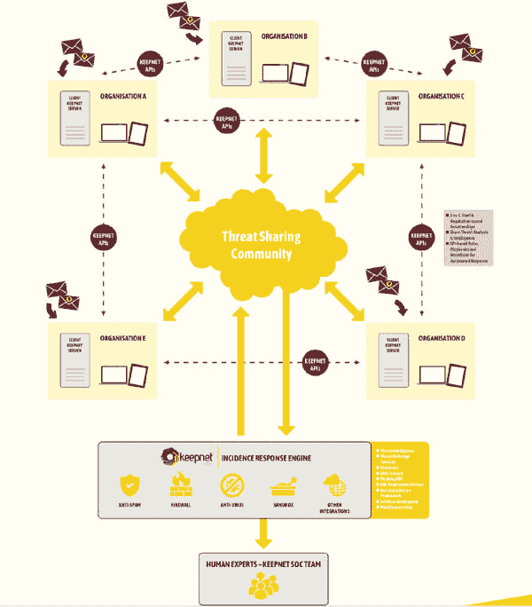

**图 2.26:** TISC 原图

### 详细描述

当满足以下情况时触发事件响应过程：1) 终端用户使用电子邮件钓鱼报告插件向 IRP 报告可疑情况，2) 手动启动`Security Operations Center (SOC)`，或 (3) 出现入侵指示 (IOC)，如`yara`、`snort`、`sha512`、`md5`、`sha1`、`IBM Xforce`、`Phishthank`、`Alienvault OTX`、`Virustotal`。

终端用户通过通用的 Web API，利用本地或云端结构进行双向数据共享。他们通过不同的过滤器共享情报数据，例如发送包含发送者信息、邮件头、正文、所有链接、仅限钓鱼链接、所有文本、关键词、附件或特定附件。

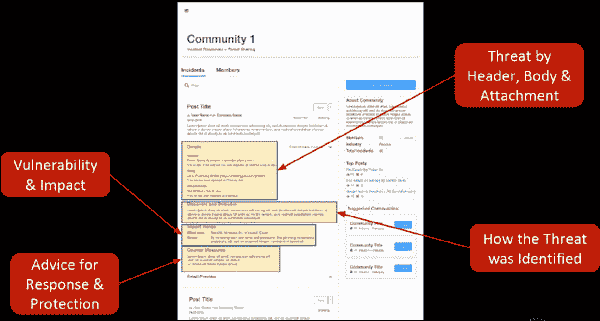

**图 2.31:** 威胁共享

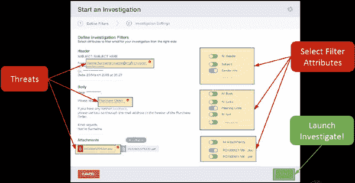

**图 2.32:** 使用情报数据启动调查

威胁 ISC（TISC）具有以下特点：

* 它引入了事件响应功能并将其扩展，以惠及 Keepnet 更广泛的用户社区。
* 它拥有一个中心化且包含百多个集成产品的平台（所有社区成员的共同产品）。
* 它拥有许多丰富的 CIRT 成员（所有社区成员共同组成的 CIRT 团队成员）。
* 通过更新来自不同来源的实时网络情报数据，利用社区的视觉优势。
* 威胁共享社区成员能够利用威胁共享社区上的情报数据启动自动化调查与响应。
* 创建了点对点的高信任社区，节省了金钱和时间；甚至通过共享情报阻止了攻击。
* 帮助社区的所有成员共同工作：一人安全，全员安全。

### TISC 的示例场景

例如，一种针对 A 银行用户的电子邮件攻击通过了 A 银行目前拥的所有安全系统（反垃圾邮件、防病毒软件、防火墙、IDS/IPS、DLP、SIEM、沙箱等），并到达目标用户的收件箱。该邮件的目的是为了取凭据或加载恶意软件。如果用户发现此邮件可疑，并使用钓鱼报告插件向`IRP`报告，`IRP`将作为邮件头、正文和附件对该邮件进行分析。如果是恶意邮件，`IRP`将通过钓鱼报告插件启动事件调查，首先扫描报告邮件用户的收件箱，随后扫描 A 银行所有用户的工作邮箱，以揭示相关的威胁及其变体。然后`IRP`将列出拥有此恶意邮件或其变体的用户，并在收件箱级别处理威胁（直接删除或向用户发送警告消息）。A 银行将此实验与威胁共享社区的其他成员（如金融社区）共享，以便其他银行可以直接使用这一情报并将其转化为行动，例如在威胁邮件到达其网络之前启动自动响应。

此外，威胁共享为用户提供了一个点对点的威胁共享平台，以建立信任关系并对受信信任方的警报采取行动。这变得特别强大，因为组织可以轻松整合其他检测和威胁情报系统，以获得更广泛的覆盖。威胁共享社区的每个成员都有效利用了彼此在安全技术方面的投入，同时增加了人工传感器网络。然而，组织仍然保留对其规则、剧本和业务的控制。威胁共享机制对于安全预算有限的中小型企业（SME）特别有利。

## Go

本章处理了威胁情报问题，并试图进一步探讨什么是良好的情报，以及公司获取良好情报可能带来的积极结果。良好的威胁情报遵循威胁情报周期，其中根据特定目标进行规划和指导，以确保生成的威胁情报对公司有用。在本章中，我们还了解到机器学习也可以用于威胁情报过程，以改进数据处理流程从而节省时间。

## 延伸阅读

以下是可以用于获取知识的资源：

1. 情报类型：`https://info-savvy.com/types-of-intelligence`
2. 关于威胁情报的更多信息：`https://www.recordedfuture.com/threat-intelligence`
3. 威胁生成中的重要问题：`https://www.forcepoint.com/cyber-edu/threat-intelligence`
4. Erdal Ozkaya 博士写的《云时代的事件响应》：`https://www.amazon.com/Erdal-Ozkaya/B0796DKQ4`
5. 开源威胁情报：`https://www.sans.org/summit-archives/file/summit-archive-14937411.pdf`

# 第 3 章：对手数据收集与方法

## 引言

在介绍了威胁建模的网络安全主题并定义了其包含的各种过程后，我们在本章中将确定对手数据的来源。我们将这些这些来源并帮助你理解它们如何影响威胁建模及其结果。

## 结构

本章将通过以下主题讨论对手数据：

* 基于对手的威胁建模
* 了解我们的组织
* 了解我们的对手
* 对手目标
* 对手目标
* 对手限制
* 对手资源
* 对手技术（技术和政治视角）

## 基于对手的威胁建模

本节引入了对抗建模的概念，即威胁建模采取潜在对手的视角。在本章的第一节中，我们将查看基于对手的威胁建模的定义，帮助你详细了解这一概念。

传统的网络安全方法一直依赖于已知的入侵指标（`IOC`）。因此，典型的威胁处理程序会检查系统中的任何异常，并试图解决这些异常。然而，近期攻击者改变了战术，使安全专家检测其活动变得更加困难。他们现在使用复杂的战术、技术和程序（`TTP`）组合。

这种复杂的组合涉及规避恶意软件、使用`living off the land`（离地攻击）技术以及滥用内部权限。因此，基于攻击者的威胁建模技术侧重于攻击者的策略，而不是识别已知的攻破技术并在系统中进行处理。这是一种激进的方法，试图从攻击者的角度审视系统，然后以潜在攻击者的身份识别弱点，最后作为系统安全团队修复这些已识别的弱点。下面解释了攻击者结合使用的三种方法。

### 特权账户滥用

这是现代攻击者用于渗透并在不被发现的情况下执行攻击的最常用手段。使用这种方法的原因是它允许攻击者在系统中伪装，并像普通特权用户一样在系统内操作。它利用了特权用户的账户并对其不当使用。

特权账户的滥用可能是无意的或故意的，故意的由攻击者实施。这种技术的之所以可能，主要是由于访问控制不力，而这通常是因为组织安全团队与 IT 管理团队之间缺乏协调。该方法使攻击者能够访问系统中的机数据数据并往往导致敏感文件丢失和系统停机。这两种影响可能导致重大的业务影响，并有可能完全瘫痪业务。

### “离地攻击”技术

离地攻击技术是一种日益流行的技术，攻击者利用它在不被发现的情况下在系统中操作。通过这种技术，攻击者使用系统中预装的工具来执行攻击。使用已预装的系统工具意味着攻击者在系统中的操作不会被发现，安全团队的工具无法识别系统中的任何异常。从自动化工具的角度来看，这些是在系统内正常工作的工具，使得该方法几乎无法被检测。公司无法检测到是谁在执行攻击。因此，即使在公司确定攻击已经发生后，也无法得知是谁执行了攻击，从而无法对他们采取行动。

### 规避恶意软件

这是第三种派上用场的技术，它让现代攻击者比以前的攻击者成功得多。过去攻击系统最流行的手段是通过使用恶意软件。恶意软件是任何可用于系统以执行未经授权功能的恶意软件。这些软件包括病毒、间谍软件、蠕虫和木马。这些恶意软件被用于在系统内执行许多未经授权的功能，例如监控击键，这可以被用于访问系统中的特权账户。

现代方法现在避免了使用恶意软件，因为它易于识别和检测。防火墙和防病毒程序等工具的改进意味着即使是自动化工具在识别系统恶意程序方面也变得越来越有效，减少了攻击者成功攻击的机会。

现代攻击者结合使用这三种方法，使能够在不被发现的情况下访问系统并在不引起怀疑的情况下在系统中操作。由于自动化工具很难在攻击者使用这些系统时识别他们，基于攻击者的威胁建模成为安全领导者的一项重要工具。

本节详细解释了基于攻击者的威胁建模的概念。它表明现代攻击者已经转向了不可检测的技术，这些技术结合了规避恶意软件、`living off the land`和特权访问滥用等方法。下一节将介绍为什么攻击建模很重要。

## 为什么攻击建模很重要

攻击建模的重要性无论如何强调都不过，特别是在这个攻击者的工具和策略上变得日益复杂的时代。从历史上看，威胁建模是通过对数字环境进行建模、识别系统漏洞并采取必要措施来完成。通过攻击建模，安全团队获得了巨大的优势，因为它使他们能够在所有复杂场景中对攻击者进行建模。

既然你已经理解为什么攻击建模很重要，下一节将列并解释使用攻击建模的优势。

### 攻击建模的优势

使用攻击建模带来了许多优势，包括：


- 许多安全公司现在将攻击建模能力加入其防御系统中，以便他们能够通过识别 TTP（战术、技术和程序）来寻找攻击者。对这些 TTP 的匿名寻找使得分析师能够检测到原本无法检测的策略。
- 更多的攻击模型被添加到公共平台（例如 Awake Corporation 的平台），帮助组织改进对潜在攻击者的防御。
- Awake Corporation 还允许其客户修改公共攻击模型以适应其环境，因为每个客户都在独特的环境中运行并面临独特的挑战。
- 公共攻击模型使能够能够先进系统进行防御，而不需要数据科学和分析专家为了安全目的执行数据分析。

本节解释了攻击建模正在兴起，未来可能会使用。下一节我们将尝试理解攻击建模练习包含的各种过程。

### 攻击建模的过程

要使用攻击建模技术，必须遵循这些基本流程：

1. 识别我们的攻击者；这是最关键的过程，因为如果不识别攻击者是谁，整个建模过程是不可能的。
2. 在知道攻击者是谁后了解攻击者，并确定他们的目标以及对系统的意图。
3. 利用攻击者的视角来构建威胁情报。
4. 根据攻击者的视角设计系统。
5. 以攻击经济学为基础，优先考虑系统中的防御措施。
6. 最后，预测攻击者策略和过程的演变。

该节列出了攻击建模过程中包含的各种过程，以便我们详细了解该概念。下一节将讨论在进行攻击威胁建模之前了解我们组织的必要性。

## 了解我们的组织

在开始任何防御流程之前，彻底了解我们的组织是非常关重要的。在典型的防御策略中，安全团队将通过识别所有组织资产（特别是关键资产）开始防御流程，并对这些资产进行盘点以确定其漏洞。在确定了这些系统面临的漏洞后，下一阶段将制定应对措施，以降低这些关键资产中已知漏洞带来的风险。

遗憾的是，对手对组织的看法与安全分析师并不相同。确定我们的组织为何可能进入对手的攻击列表，以及他们是如何进入这些列表的，至关重要。这需要不同的方法。为了确定组织如何进入对手的名单，一系列问题将帮助安全团队理解系统：

1. 我们的组织属于哪个行业？
2. 我们的组织员工人数和资产规模是多少？
3. 我们的组织属于哪一类：公有还是私有？
4. 我们的组织在哪些或国家运营？
5. 在外部人员看来，我们的组织具有什么价值？

回答所有这些问题有助于安全团队确定并识别对手是谁，以及他们可能针对我们组织中的哪些目标。

### 业务行业

组织运营的行业决定了可能针对它的威胁类型和对手类型。某些行业比其他行业处理更多的敏感信息。例如，银行、保险和医疗部门处理大量的敏感信息，这些信息对于寻求通过攻击获取财务收益的潜在对手来说可能非常有价值。因此，此类组织的首要任务是创建一套系统，确保以最好的方式保护它们存储的数据和处理过程。

### 业务规模

组织的规模是理解一个组织及其可能面临的威胁类型的一个大决定性因素。规模由资产和员工决定。通常，拥有大量员工的公司被认为参与了更多的业务运营，并可能与更多外部人员进行更多互动，这迅速增加了其成为目标的潜力。此外，业务规模意味着它有更多的攻击面，对手会针对这些攻击面来访问系统。业务规模还能让对手了解他们运行的是什么样的系统，以及根据其负担此类系统的财务能力，判断他们可能使用什么种安全系统。

### 公有与私有

企业的分类很大程度上决定了它被对手攻击的概率，也决定了它可能面临的威胁类型。由于受到官僚主义的影响，上市公司通常采用的防御系统水平性较低。上市公司有许多股东，他们对公司以及公司资源的使用有发言权。因此，改进安全系统可能需要的任何巨额资金支出可能需要一段时间才能获得股东批准。然而，对于私有公司，决策涉及的人员较少，决策过程往往更快。但是，上市公司也可能获得更多资源，并可能接入更好的网络安全系统。所有这些因素对于理解组织以及它如何进入对手的攻击列表都至关重要。

### 运营国家

运营国家是决定公司面临的威胁类型以及对手认为公司中什么有价值的主要因素。攻击的原因之一可能是财务或政治的。如果一家企业在不同群体之间存在政治敌对的环境中运营，那么许多数据泄露可能是政治动机的。在这样的环境中，对手可能会针对他们认为是敌人的特定公司，或者如果政府是独裁的，他们可能会针对政府联盟。

### 业务价值

从外部人员的角度来看，业务价值是分析对手及其潜在威胁的重要因素。与价值较低的公司相比，对手会针对价值目标。价值可能来源于企业存储或处理的数据类型，也可以由业务往来的货币价值决定。在上述两种考虑中，价值更高的业务需要更强的防御，因为它很可能被追逐其价值资产的对手所针对。

本节提供了对理解组织流程的见解，这是进行有效的基于对手威胁建模的基本要求，并确定如果不彻底了解我们自己的系统，我们就无法将对手排除。下一节将提供关于理解对手所需的信息。

## 理解我们的对手

基于对手的威胁建模聚焦于对手以及他们对系统的看法。因此，为了使建模技术有效，安全分析师需要彻底了解对手。没有这种理解，分析师就无法针对他们创建有效的系统。理解我们的对手并不是容易的。它类似于头脑风暴会议，你从已知因素开始，向未知点移动。

理解对手的分析过程将从通用分类开始，转向更具体的分类。分类可以从内部分类（如大陆性威胁）开始，移动到特定国家的威胁和分组。该过程的结果是一个关于可能的对手及其特征的档案，这些特征可以用于缩小他们针对我们公司的可能性范围，以及他们可能从此类攻击中获得什么。各种问题被用于对对手进行分类并判断他们针对我们组织的可能性。

这些因素包括以下内容：

- 这些对手的目标
- 这些对手攻击的对象
- 这些对手的限制：技术或财务上的限制
- 这些对手可用的资源
- 这些对手可用的技术

**从对手的角度重新审视你的网络威胁**

### 理解对手的实战方法

以下你可以如何了解更多关于对手信息的示例。

国家级支持的网络间谍 ATP 单元`61398`（也称为`APT1`）是一个老牌但广为人知的对手。他们通过网络钓鱼攻击和水池攻击攻击受害者，并结合社会工程学来说服受害者下载名为`Poison Ivy`的恶意软件。

### 对手手册（Playbook）

在我们继续学习手册之前，让我们快速回顾一下什么是网络安全杀伤链（Kill chain）。

## 理解网络安全杀伤链

网络杀链（Cyber kill chain）是一种组织用于跟踪和防止在不同阶段发生网络入侵的安全模型。杀链在应对勒索软件、黑客攻击以及高级持续性威胁（APTs）方面已取得了不同程度的成功。杀链归于洛克希德·马丁（Lockheed Martin），它源于一种军事模型，该模型通过预测攻击、进行策略性交战和摧毁目标来有效中和目标。本章将讨论网络杀链的各个步骤，并强调了每个步骤中使用的新工具。

以下是`APT 1`的一种入侵杀链。在构建对手者手册（playbooks）时，你不一定需要使用入侵杀链或行动方案矩阵。格式并不重要，数据才重要。你需要拥有关于对手者如何操作的所有技术信息。

网络杀链只是对黑客如何攻击以及网络攻击形态的逐步描述。该模型描述了建议从开始到被利用的各个步骤，如下图所示：


**图 3.1:** 网络杀链

- **侦察（Reconnaissance）**：这是杀链的第一步，旨在从初始阶段缓解攻击。在网络攻击中，黑客会花费时间收集可用于攻击目标的信息。
- **武器化（Weaponization）**：这是构建或使用工具攻击受害者的过程。创建一个受感染的文件并将其发送给受害者将是该链条的一部分。
- **权限提升（Privilege escalation）**：黑客在初始突破中很难直接获得具有管理员权限的计算机或系统。因此，他们必须学习如何使用各种权限提升技术来获取管理员权限。
- **外泄（Exfiltration）**：这是主攻击开始的阶段。一旦攻击到达此阶段，就被认为是成功的。
- **安装（Installation）**：在此阶段，安装的恶意软件为入侵者提供了访问权限。
- **命令与控制（Command and Control）**：在此阶段，攻击者获得了对组织系统和网络的控制。

现在回到对手者手册：

在下面的截图中，你会看到`APT 1`的入侵杀链。请记住，在构建对手者手册时，你不一定需要使用入侵杀链或行动方案矩阵。这不在于格式，而在于数据。

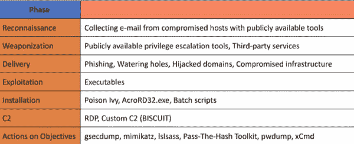

**图 3.2:** APT 1 的入侵杀链

现在，让我们在手册中实施针对上述攻击的防御：

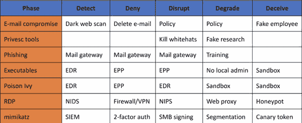

**图 3.3:** 针对上述攻击的防御

其中：

- **EDR**：端点检测与响应

  你可以从此链接下载开源 ED：

  [`www.openedr.com/`](https://www.openedr.com/)

- **EPP**：端点防护平台

  许多供应商提供此类服务，例如 Comodo Cybersecurity、Microsoft 等。
- **NIDS**：网络入侵检测系统
- **NIPS**：网络入侵防御系统

  你可以使用`Comodo Dragon`、`Zscaler Internet access`和`AlienVault OSSIM`。

部署一套对该对手有效的防御措施，但如果没有优先级排序，它们将是无效的。根据组织的情况，你可能会使用：

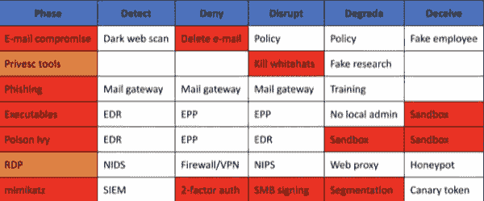

**图 3.4:** 针对上述攻击的防御

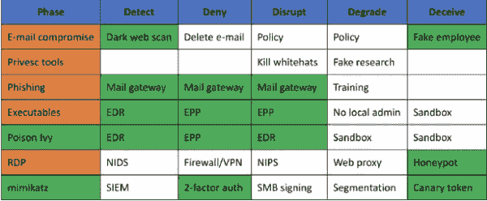

**图 3.5:** 针对上述攻击的防御

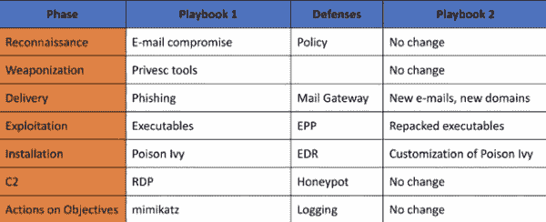

**图 3.6:** 对手者手册


**图 3.7:** 关于威胁的网络建议

### 对手演变

众所周知，网络安全格局正在发生变化。因此，我们必须能够预测未来的攻击。现在，我们将更新目前为止创建的手册，以便能够预测对手将做什么。这有助于确定你的系统中的哪些漏洞可能被专业黑客针对。问自己以下问题：

- 对手是否正在绕过现成产品？
- 对手是否正在改变战术？
- 对手是否对目标有先验知识？

在完成所有步骤后，你应该拥有一组对手以及他们能力和动机的信息，以便保护自己。了解威胁源连同你的弱点将加强你的防御。了解你的技术将赋予你力量。

### 理解对手目标

理解对手的目标是理解你正在对抗什么的方法之一。安全团队在分析公司面临的潜在威胁以及在建模过程中，必须理解对手的目标。对手目标是针对某个系统的原因。

对手可能出于许多原因针对某个系统，他们的目标可能根据目标组织而异。此外，对手的目标可能独立于组织之外，而某些攻击可能是个人的。某些对手可能因为组织所包含的信息而攻击该组织，其攻击背后没有其他原因。某些对手可能针对一个组织，是因为该组织运行一个特定的系统，并想衡量他们破解此类系统的成功率，这对于未来破解类似系统将证明是良好的实践。

如果一家公司向市场推出了一款新系统，该系统旨在解决以前系统中公开已的漏洞，那么它很可能被以攻击为职业的对手所针对。如果一家公司运行的系统在最近过去公开过某些漏洞，那么它很可能因为这些已知漏洞而被针对，直到他们采取措施解决系统中的漏洞。

### 理解这些对手的目标

在有效地将他们挡在之外之前，你需要理解对手的目标。不了解对手可能针对你组织中的什么，意味着你必须以相同的方式保护一切。这对组织来说可能是昂贵的，而且从长远来看并不是可行的商业策略。

了解组织中可能的攻击目标有助于公司优先考虑其安全策略，并关注更脆弱的目标。优先顺序的确定取决于资产对组织的重要性。如果某个资产对业务运营至关重要，那么它更有可能被试图突破系统的攻击者所中。虽然攻击建模被认为不同于依赖于数字系统建模的传统威胁建模系统，但它仍然依赖于传统系统的某些方面才能发挥非常有效的效用。

在传统系统中，该过程始于对所有关键资产进行盘点。这一过程在基于攻击的威胁建模方法中也可能被证明是有用的。

了解组织中每项资产的价值是确定和理解攻击者可能针对组织的目标的另一种方法。组织中的某些资产可能本身没有价值，但它们对攻击者来说可能非常有价值。例如，一个组织可能拥有一份为客户收集的邮件列表以便保持联系并增加客户忠诚度。虽然这项资产并非业务运营的核心或关键，但对于潜在的攻击者来说，它可能很有价值，因为他们可以利用这些系统收集的个人数据。

因此，分析师需要了解公司内部所有的可用资产，以及它们对潜在攻击者可能有多价值。


图 3.8：基于孙子《兵法》

## 理解这些攻击者的局限性

了解攻击者的局限性是理解攻击者的重要过程。攻击者对组织的危险程度取决于其能力所允许的程度。

例如，如果数据泄露需要连接网络，而攻击者因为住在完全不同的地点而无法访问网络，那么他们针对系统的概率就会较小。某些攻击者可能会受到突破给定系统所需的所需的知识的限制。如果一家公司在其系统中运行了某种特定的技术，而该技术仅供市场上少数人使用，那么可以说，该系统不太可能被潜在攻击者针对。攻击者只能在自己的限制范围内工作，并且无法使用他们无法获取的资源或手段。

对某些公司资产的物理限制是一种基础且常见的安全控制，用于防止恶意和未经授权的人员接触系统。这种限制对于许多可能针对该系统的潜在攻击者来说是一种约束。如果系统无法通过网络访问，那么唯一的选择就是通过物理手段。如果潜在黑客的物理访问权限也有限，那么他们极不可能尝试通过这种手段访问系统。

用于确保组织免受内部和外部威胁的安全控制也对潜在攻击者起到了约束作用。因此，对安全控制进行评估并确定这些控制的效率，将清晰地显示它们是否在将攻击者隔绝方面有效。

### 理解这些攻击者可拥有的资源

潜在攻击者仅能够执行他们有资源完成的攻击。如果一次攻击只需要公开的工具即可完成，那么面临此类攻击的概率是巨大的。因此，系统需要具备能够防止此类攻击的控制措施。然而，如果一次攻击的成功需要攻击者投入巨额资本投资，那么此类攻击的可能性就是有限的。

对公司进行仔细分析可以揭示他们是否拥有可能被资源丰富的攻击者所针对的有价值资产。拥有巨大资源能力的攻击者通常会针对有价值资产和值得付出的组织。因此，通过自我评估来确定组织中每项资产对潜在攻击者的价值，将有助于预测此类攻击是否可能发生。

资源的可用性也可能取决于组织所面临的竞争类型。一个高度依赖声誉同时在高度竞争环境中运行的业务环境，可能会受到竞争对手赞助的攻击。如果竞争对手有资源来赞助或雇佣攻击者执行此类攻击以损害业务的声誉，那么组织就需要警惕这种可能性。因此，在考虑资源方面时，需要考虑所有可能的攻击者来源，包括业务竞争。

### 理解这些攻击者可使用的技术

潜在攻击者仅能够执行他们有资源完成的攻击。如果一次攻击只需要公开的工具即可完成，那么面临此类攻击的概率是巨大的。因此，系统需要具备能够防止此类攻击的控制措施。然而，如果一次攻击的成功需要攻击者投入巨额资本投资，那么此类攻击的可能性就是有限的。

对公司进行仔细分析可以揭示他们是否拥有可能被资源丰富的攻击者所针对的有价值资产。拥有巨大资源能力的攻击者通常会针对有价值资产和值得付出的组织。因此，通过自我评估来确定组织中每项资产对潜在攻击者的价值，将有助于预测此类攻击是否可能发生。

资源的可用性也可能取决于组织所面临的竞争类型。一个高度依赖声誉同时在高度竞争环境中运行的业务环境，可能会受到竞争对手赞助的攻击。如果竞争对手有资源来赞助或雇佣攻击者执行此类攻击以损害业务的声誉，那么组织就需要警惕这种可能性。因此，在考虑资源方面时，需要考虑所有可能的攻击者来源，包括业务竞争。

MITRE ATT&CK 在其网站上定义为：“MITRE ATT&CK® 是一个基于真实观测的全球范围内使用的 adversary 战术和技术知识库。ATT&CK 知识库被用作私营部门、政府以及网络安全产品和服务社区开发特定威胁模型和方法论的基础。

通过创建 ATT&CK，MITRE 正在履行其为更安全的世界解决问题的使命——通过汇聚社区力量来开发更有效的网络安全。ATT&CK 是开放的，供任何个人或组织免费使用（[`attack.mitre.org/`](https://attack.mitre.org/)）。”

MITRE ATT&CK 由专家、研究人员和自由贡献者不断更新，并针对安全专业人员（包括威胁猎人、红队人员等）进行了标准化。

由 David Bianco 提出的“痛苦金字塔”（Pyramid of Pain）从攻击者的角度出发，通过金字塔定义了攻击者在被拒绝特定指标时所感受的痛苦等级。

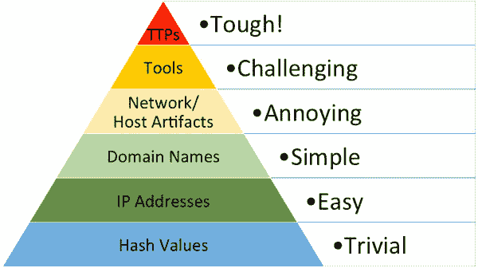

**图 3.9:** David Bianco 提出的 ATT&CK 痛苦金字塔

可见，TTP（战术、技术和过程）是真正的痛点。应对该层级的攻击意味着组织正在遵循攻击者的行为并据此构建策略，而不仅仅是基于他们的工具或攻击来源的一部分。工具固然重要，但它们并非不可替代；相反，直接应对攻击者的 TTP 将使组织采取其能采取的最强硬行动来适应——改变他们所有的行为和战术。

MITRE 提供了三个独立的矩阵：

- **企业 ATT&CK（Enterprise ATT&CK）**是一个针对 Windows、macOS、Linux、云、网络和容器环境操作系统的矩阵。“PRE”（准备）这也是第一阶段的一部分，包含了有关攻击者准备技术的信息。
- **移动 ATT&CK（Mobile ATT&CK）**涵盖了在没有设备访问的情况下访问移动设备（Android 和 iOS 平台）的攻击战术和技术。
- **工控 ATT&CK（ICS ATT&CK）**是一个涵盖攻击者在工业控制系统（ICS）环境中可能采取行动的知识库。

你可以在[`attack.mitre.org/matrices/enterprise/`](https://attack.mitre.org/matrices/enterprise/)了解更多关于矩阵的信息。

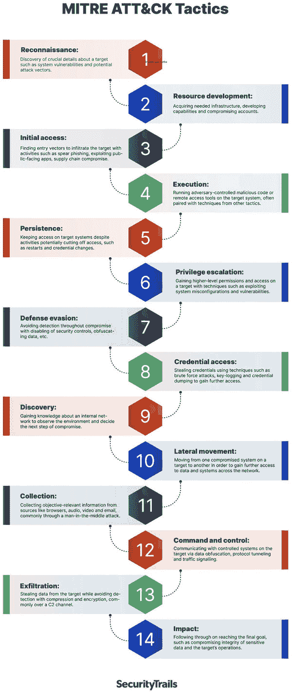

**图 3.10:**（图片来源：Security Trails）

MITRE 框架赋予了攻击者模拟的能力、改进了威胁猎寻、丰富了 SOC 中的网络威胁情报源、为网络安全策略提供了数据驱动的决策，并通常与安全工具集成，如终端检测与响应（EDR）和安全信息和事件管理（SIEM）。

MITRE 识别了 14 种不同的攻击战术：

- **侦察（Reconnaissance）**：这是尝试利用目标的初始阶段，通过获取尽可能多关于目标的信息来实施意 at 利用。该战术使攻击者能够发现有关目标网络的关键详细信息，例如系统漏洞和潜在的攻击向量。


# 资源开发 (Resource development)

包括攻击者为执行其活动建立资源，例如获取所需的设施、开发能力以及攻破账户和基础设施。

# 初始访问 (Initial access)

涉及攻击者用于在网络内获得初始立足点的各种入侵向量。示例包括鱼叉式钓鱼、利用公开应用程序、供应链攻击等。

# 执行 (Execution)

由旨在目标系统上运行攻击者控制的恶意代码或远程访问工具的技术组成。它通常与其他战术的技术配对，以便更大规模上实现目标。

# 持久化 (Persistence)

包括攻击者用于尝试保持对目标访问的技术，尽管存在可能切断其访问的活动（如重启和凭据更改）。

# 权限提升 (Privilege escalation)

权限提升包括攻击者用于在系统或网络上获得更高级权限和访问权限的技术和活动。他们用于实现这一目标的技术包括利用系统误配置错误和漏洞。

# 防御规避 (Defense evasion)

包括攻击者在整个攻破过程中避免被检测而使用的最独特的技术。这包括禁用安全控制措施和混淆数据。

# 凭据访问 (Credential access)

合法的凭据让攻击者能够访问更多系统并更难被检测，因此该目标是使用暴力攻击、键盘记录和凭据转储等技术窃取凭据。

# 发现 (Discovery)

描述了攻击者用于获取内部网络知识的技术，以便观察环境并决定其攻破的下一步。

# 横向移动 (Lateral movement)

涉及从网络上的一个受害系统移动到另一个系统的过程，作为获取网络中尚未到达的更多信息区域的手段。

# 收集 (Collection)

包括攻击者用于收集与实现目标相关的信息和来源的技术。常见的信息源包括浏览器、音频、视频和电子邮件，实现该目标的一种常用技术是中间人攻击。

# 命令与控制 (Command and control)

攻击者尝试与其目标网络上受控的系统通信的阶段。相关技术包括数据混淆、协议隧道和流量信号。

# 外泄 (Exfiltration)

几乎处于循环结束，外泄包括攻击者用于从目标网络窃取数据同时通过压缩和加密避免检测的技术。一种从网络外泄数据的常用技术是通过命令与控制通道传输数据。

# 影响 (Impact)

攻击者用于实现最终目标的技术，例如破坏可用性或损害敏感数据和目标操作的完整性。

以下是网络杀链（Cyber Kill chain，涵盖在*第 1 章，学习威胁建模#c01.xhtml*）与 Mitre Attack 的快速对比：

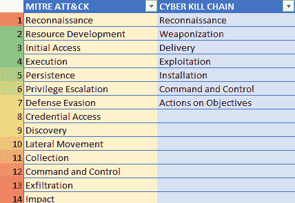

**图 3.11:** 网络杀链与 Mitre Attack 的对比

你可以使用以下 MITRE ATT&CK 网站查看你感兴趣的 ATP 组织战术：

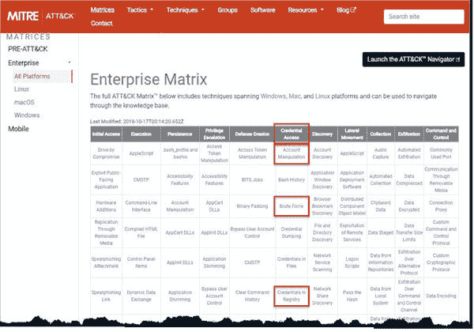

**图 3.12:** ATP 组的战术

使用 ATT&CK 的最佳实践如下：

- 在技术模糊或难以确定时使用战术
- 共享发现的检测和缓解方法
- 共享观察到的攻击者行为战术和技术
- 利用现有工具对 ATT&CK 的集成
- 鼓励供应商和服务提供商在有用处增加对 ATT&CK 的支持
- 恶意软件考古 Windows 日志
- JP-CERT 检测横向移动
- 攻击者使用的 Windows 命令
- 关注检测和缓解的研究

# MITRE ATT&CK 用例 (#toc.xhtml#s78a)

以下是 Mitre 的用例：

- **红队 (Red Teaming)**：由于红队是测试系统安全的实践，利用 MITRE ATT&CK 可以帮助基于真实场景规划、报告和执行红队活动。
- **测试 SOC 成熟度 (Testing SOC Maturity)**：安全运营中心（SOC）团队可以参考已发布的 ATT&CK 策略，以衡量 SOC 在分析、检测和响应入侵方面的有效性。
- **评估防御控制 (Assessing Defensive Controls)**：MITRE ATT&CK 可以帮助工具并监督企业当前防御的缓解措施。
- **网络安全策略**：组织可以使用`ATT&CK`来规划其网络安全策略。`MITRE ATT&CK`可以帮助您的组织构建防御策略。
- **威胁的本质**：`MITRE ATT&CK`可以确定组织所面临的威胁的本质。它也可以作为最新网络安全威胁的参考。

现在，你必须在`MITRE`网站上花费更多时间，因为那里有比这里涵盖的内容多得的内容。

## 结论

总而言之，本章处理了威胁建模中的一个重要方面和方法，即基于攻击者的威胁建模（adversary-based threat modelling）。我们确定这种建模与典型的威胁建模系统不同，因为它试图尝试对攻击者进行建模。它是通过从潜在攻击者的角度评估系统，然后创建一个能够解决从这种系统视角识别出的漏洞的系统来实现的。

本章表明，为了进行有效的基于攻击者的威胁建模，分析师需要对自己的组织和攻击者有深入的了解。了解组织有助于预测潜在攻击者可能针对的资产，并确定他们为什么要针对这些系统。而了解攻击者则需要了解他们的目标、限制、资源、技术知识以及在组织中的潜在目标等情况。

在了解组织和攻击者后，安全团队就可以建立有效的基于攻击者的威胁模型。

下一章将涉及威胁建模的一个重要方面，即利用有关潜在攻击者的所有收集数据，以及组织如何利用收集的数据进行转向（pivot）以改进其安全态势。

## 阅读

可以使用以下资源获取更多关于本章涵盖主题的知识：

1. 攻击者建模解释：[`awakesecurity.com/glossary/adversarial-modeling/`](https://awakesecurity.com/glossary/adversarial-modeling/)
2. 基于攻击者的威胁建模：[`hockeyinjune.medium.com/adversary-based-threat-modeling-6dfd88a684d`](https://hockeyinjune.medium.com/adversary-based-threat-modeling-6dfd88a684d)
3. 理解攻击者模型：[`www.sciencedirect.com/topics/computer-science/adversary-model`](https://www.sciencedirect.com/topics/computer-science/adversary-model)
4. 攻击者模型在增强安全中的作用：[`eprint.iacr.org/2018/1189.pdf`](https://eprint.iacr.org/2018/1189.pdf)
5. 攻击者攻击的威胁：[`www.researchgate.net/figure/Adversarial-Threat-Model\_fig3\_337157899`](https://www.researchgate.net/figure/Adversarial-Threat-Model_fig3_337157899)
6. 威胁情报资源：[`www.erdalozkaya.com/cyber-threat-intelligence-resources/`](https://www.erdalozkaya.com/cyber-threat-intelligence-resources/)
7. MITRE Attack：[`attack.mitre.org/`](https://attack.mitre.org/)
8. Comodo MITRE：[`techtalk.comodo.com/2020/08/27/comodo-mitre-kill-chain/`](https://techtalk.comodo.com/2020/08/27/comodo-mitre-kill-chain/)
9. 网络杀伤链如何配合 MITRE 使用：[`www.erdalozkaya.com/comodo-mitre-kill-chain/`](https://www.erdalozkaya.com/comodo-mitre-kill-chain/)
10. 什么是 MITRE Attack？[`enterprise.comodo.com/blog/what-is-mitre-attck/`](https://enterprise.comodo.com/blog/what-is-mitre-attck/)

# 第 4 章

## 转向与提取攻击者数据

## 引言

攻击者建模在上一章中被定义从攻击者的角度进行的威胁建模。这意味着系统是从一个试图入侵系统的局外人员角度进行审查的，除了关于系统和组织的公开信息外，该人员对系统没有内部知识。在上一章中，我们还识别了五种可以用于实现基于攻击者的威胁建模的攻击者数据来源。这些来源被确定为攻击者目标、目标、资源、技术和限制。一旦我们获得了所有这些被识别因素的数据，就可以使用这些数据对威胁进行建模并开发威胁缓解策略。

在本章中，我们将研究如何利用和基于收集到的攻击者数据进行转向（pivot）。数据源决定了可以对潜在威胁进行何种威胁建模。我们将学习每种攻击者数据源如何影响威胁建模过程。

## 结构

本章的讨论将集中在以下子主题：

- 理解攻击者目标
- 攻击者限制有助于确定能力
- 攻击者技术有助于识别缓解
- 制定缓解计划
- 为事件建立预算
- 采取必要措施避免重大损失

## 目标

本章的目标是帮助你学习各种来源的影响，以及安全领导者如何从中获益。在上一章中，我们介绍了数据重要性，在接下来的章节中，我们将查看各种来源。下一节将重点介绍如何理解攻击者的目标。

### 作为数据来源的攻击者目标

理解攻击者的目标以及他们为什么要针对你的组织是建模的第一步，也是最重要的一步。这涉及到理解攻击者的目标、他们参与恶意活动的原因，以及他们为什么专门针对某个组织。黑客参与黑客活动的原因有很多。已知的原因包括炫耀权、报仇、好奇心、无聊、勒索、敲诈、企业间谍活动、破坏、挑战以及为了利益窃取。黑客可能攻击你组织的一些关键原因如下：


**图 4.1**：攻击者目标

### 破坏服务器

黑客攻击的主要原因之一是破坏服务器。破坏服务器只有一个目的：击垮目标网站并将其关闭一段时间。黑客可以通过分布式拒绝服务（`DDoS`）攻击来实现，这被认为是破坏服务器最流行的方法之一。其逻辑通常不是为了财务利益，而是为了损害网站所有者。因此，这种攻击可能由不满的员工或处于报复任务的前员工发起。攻击也可能由竞争对手发起，他们想要将你挤出市场或破坏你公司的声誉。

`DDoS`攻击是由黑客通过僵尸计算机网络执行的，使其能够控制组织的网络。僵尸计算机网络被程序为使用计算机持续探测客户端网站或网络服务器，并使其过载，最终将其关闭，并拒绝合法用户和计算机访问服务器。

### 为了金钱

金钱是大多数黑客活动最常见的动机。一些内部黑客小组每年从他们的黑客活动中赚数百万美元，他们是网络安全关注增加的主要原因。

在线银行和电子商务是导致黑客这种动机增长的主要原因之一。每天有成千上万个在线网站交换财务信息和其他敏感数据，这为黑客提供了获取此类数据的动力。（请见图 4.2）

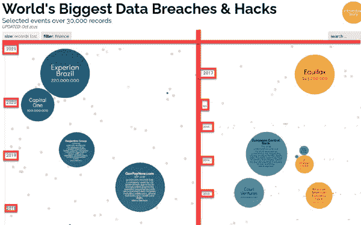

**图 4.2：** 金融行业最大的数据泄露事件

电子商务网站和在线购物的增长刺激了潜在黑客获取资金收益的动机，他们在选择在线目标公司时有许多余地。黑客使用银行木马和其他形式的恶意软件，这些程序被设计用于在网上或当用户尝试使用目标网络时窃取用户数据。

## 扫描漏洞

黑客的主要原因之一是对网络和系统进行扫描，寻找以后可以利用的漏洞。这种技术通常被想要识别组织系统安全弱点的攻击者所采用。这种威胁被用作潜在更大威胁的第一阶段，攻击者将利用此渗透系统，在此之前获得未经授权的访问并实现其他动机。这种技术被认为是大多数其他攻击的门径。

### 执行未经授权的代码

这是黑客获取系统访问的最古老技术之一。其目的是通过执行某些代码来获得用户计算机的控制权。攻击者经常利用社会工程机制让毫无防备的用户安装恶意可执行代码，这些代码在用户计算机上执行后，会从用户手中夺取控制权。这种黑客过程也是第一阶段攻击之一，可能会为攻击者实现更大的动机打开大门。

本节讨论了如何理解攻击者的目标，以及这如何帮助我们识别组织中可能的目标。下一节将讨论如何理解攻击者的限制，旨在展示这些限制如何限制攻击者所能做的事情。

## 理解攻击者的限制

了解攻击者的限制对于有效保护你自己的系统免受潜在攻击至关重要。攻击者一面的限制意味着他们将无法执行某些操作。攻击者面临的挑战可能表现为缺乏技术访问、缺乏工具或缺乏资助其活动的资源。某些黑客技术需要大量的资源、力量以及技能。

事实上，黑客被公认为是技术非常高超的人。因此，他们在技能方面不太可能面临挑战，而可能在访问某些技术方面面临挑战，这些技术使他们能够执行某些攻击。

下面解释了一些黑客限制的例子。

### 财务

财务是黑客面临的最大限制。某些攻击需要使用特殊的工具和资源，这些资源需要大量的投资。这种限制可以帮助安全分析师判断通过此类威胁进行攻击的可能性。攻击者可能需要价格昂贵的专用设备，这会阻碍他们策划此类攻击。此外，如果攻击者能够访问的数据无法通过暗网出售获得巨额资金，这也可能击灭攻击者的意图。

### 技术

技术是帮助保持系统安全免受攻击的关键限制。在许多情况下，黑客缺乏利用系统漏洞的技术诀窍（know-how）。在某些情况下，他们并不完全理解系统，因此将受到对所需知识访问的限制。然而，技术演进迅速，黑客跟上一个被认为是安全的系统并不需要多长时间。这就是为什么安全专家要确保他们的系统持续更新，以确保其运行在最新的技术上，帮助阻挡大多数潜在的攻击者。

### 地理位置

地理位置通常是攻击者攻击网络的主要限制。在许多情况下，从外国服务器访问网络的人会被立即标记。因此，某些攻击者可以在可以攻击的系统和访问的服务器方面受到限制。无论其技能水平如何，某些攻击只能由本地攻击者实施。如果本地攻击者没有利用漏洞的资源或技术，那么该系统就可以被认为是安全的。

大多数系统还会限制或不允许远程访问。系统被设计成不允许远程访问。对于此类系统，攻击者需要登录到相同的网络中。这限制了攻击者访问系统。

### 授权用户

这是攻击者面临的一个显而易见且有效的限制。获取系统访问权限通常是不够的；他们需要系统权限来访问数据或进行任何更改。因此，缺乏用户权限是攻击者攻击系统时的主要限制。

本节讨论了如何理解攻击者的限制，以及这如何帮助我们确定攻击者根据其资源能做什么。下一节将讨论如何理解攻击技术。

## 理解攻击技术

攻击者技术是攻击者用来渗透系统的方法。理解这些技术将有助于安全人员针对这些技术开发特定的缓解措施。这里列出常见的黑客技术。

### 钓鱼

这是最常见的攻击技术。这种方法是一种古老的技术，但在今天仍然有效。通常，这种技术会试图诱骗用户点击给定的链接、安装证明是恶意软件的程序或交出个人信息。这些信息通常经过精心设计，许多用户会掉入陷阱。点击这些链接通常会导致代码执行，帮助恶意攻击者夺取用户计算机的控制权。攻击者经常使用熟悉的名称或网站来诱骗用户点击链接。

### 诱饵攻击

这种方法与钓鱼方法类似，但利用合法系统引导毫无防备的用户访问假网站，在那里数据会被窃取。攻击者利用付费广告网站，在其中合法地放置指向诈骗网站或重定向到假网站的广告。

### 键盘记录器

这种软件下载到用户计算机后，会记录用户的所有击键，并将记录提供给攻击者。键盘记录器广泛用于挖掘用户名、密码、信用卡号等信息。

### 拒绝服务 (DoS)

这是一种常见的黑客方法，通过僵尸计算机发送无用请求使 Web 服务器负载，从而阻止合法用户访问服务器并继续正常操作。

### 点击劫持攻击

这种技术被攻击者用来诱骗用户点击并非他们想要的内容。攻击者可能会在网站上放置按钮，意让用户点击带有点击劫持元素的按钮，从而使攻击者能够获取用户计算机的控制权。

## 伪造无线接入点 (W. A. P)

黑客使用某些软件创建虚假的无线接入点（W. A. P），然后将其连接到用户正在访问访问的合法 W. A. P，并利用该连接窃取用户数据。虚假的 W. A. P 会标记一个“看似真实的名称”，以欺骗用户点击。

### Cookie 窃取

没有 SSL 的网站被用于此类目的，黑客经常从这些网站向用户的电脑发送数据包，从而使他们能够从浏览器中窃取 Cookie。Cookie 包含用户名、密码和用户浏览器历史等信息。

### 病毒和木马

这些是恶意程序，当安装在用户的电脑上时会将用户数据发送给攻击者。它们在安装到一台电脑后，还可以锁定并损坏用户文件，并在网络中传播。用户经常被诱下载病毒，或者病毒以邮件的形式出现。

本节向您展示了如何理解对手技术，以及理解这些技术如何帮助安全团队规划这些可能的攻击。在下一节中，我们将寻求了解制定缓解计划的过程。

## 制定缓解计划

在识别系统漏洞以及利用这些漏洞的方法之后，制定缓解计划是下一个自然步骤。制定缓解计划是必要的，以确保当攻击者最终实施攻击时，他们发现一个准备好处理攻击的系统，并在他们渗透系统的情况下减轻攻击的影响。减轻攻击的影响诸如：在最短时间内让系统重新上线、减少对文件的进一步破坏、停止攻击者进一步复制文件以及将他们登出系统。

这里列出了缓解计划的一些示例：

- 建立事件响应计划和业务连续性计划，以处理发生安全事件期间及事后的业务运营。事件响应计划是一份文档，概述了在发生攻击时应遵循的所有程序。安全团队在识别出系统漏洞和这些漏洞的可能利用方式后，根据可能的攻击向量和如何处理攻击来制定计划。某些选项包括关闭服务器并切换到备备用系统，以将黑客排除在外，同时恢复正常业务运营；这将减少攻击对业务的影响。
- 培训员工以为事件管理工作做准备。在安全事件期间，员工之间对于该做什么和不该做什么很可能会产生困惑。他们的行为可能对业务的连续性方面产生直接影响。例如，攻击者可能针对的是企业的声誉，并暴露该企业是不安全的。在金融领域，这种声誉可能会对业务产生巨大影响。如果没有这些知识，企业中的员工可能会无意中将这些信息泄露给外部，最终可能使信息进入公众领域。然而，如果培训员工在安全事件期间如何处理自己以及他们可以向公众发布哪些信息，这将减少对企业业务的负面影响。


更新组织中的安全倡议（如政策）并加强现有措施，以防它们得到良好执行。在组织中，由于员工之间的熟悉，在尊重安全政策方面，员工可能会出现松懈现象。安保人员在看到熟悉的面孔时，可能忘记检查签到表以确认每个人已签到。这种松懈需要得到解决，以防漏洞评估显示内部人员可能通过这种手段威胁系统。加强现有系统的另一种方法是增加监控摄像头，或增加额外的安全人员来帮助提高组织内部的安全效率。例如，实行较短班次的安全团队将帮助他们在整个班次期间保持敏锐和警觉。安保人员是执行人员访问系统物理限制的重要组成部分，他们确保未经授权的人员进入建筑的某些区域，特别是存放重要且脆弱的信息资产的区域。

在这一节中，我们处理了从各种对手来源收集数据后的缓解规划过程。在下一节中，我们将查看预算流程以及在准备安全事件时影响资源数量的因素。

## 事件响应事件的预算

财务资源在威胁建模和处理基于对手的建模程序过程中起着重要作用。在收集了对手信息并规划了缓解计划后，需要资源来实施所有缓解计划。决定安全团队预算中所需资源数量的因素包括：

*   对手可以访问的资源数量。对手可以直接访问的资源多少，直接影响组织为阻止对手而投入的资源和精力，以及他们可能的威胁对业务的影响。如果你面对的是一个财力雄厚且大量资源的攻击者，他们可能会针对高价值资产，与资源有限的攻击者相比，他们的攻击更有可能产生毁灭性的影响。

*   所需的技术类型。某些缓解计划需要安装新软件、升级现有软件或构建完全全新的系统。在计划阻止对手时，资源的数量还将取决于你引入组织以应对可能威胁所需的各种技术类型。如果一个组织已经运行了市场上的一些最新软件，且当前系统仅需较少升级，那么这种情况所需的资源数量将是有限的，需要的预算较小。

*   你需要为现有员工提供的培训量。在准备事件计划期间，程序的一部分包括开展安全演练，在演练中我们对系统进行真实攻击，并模拟员工从报告攻击到系统重新上线期间应采取的步骤。如果安全演练更加复杂，需要更多的培训课程来理解并让所有员工参与，那么它们将需要更大的预算。如果演练简单且只需要小规模演示，它们将不需要组织过多的资金。然而，其他成本还包括员工在接受培训时损失的业务时间，或者为了让员工在休息日或工作时间之外完成模拟安全演练而需要支付的加班费。

备份系统的需求将决定在规划事件响应时预算的数额。在大多数情况下，企业应对攻击者的最佳方式是拥有攻击者无法访问的备份。因此，如果攻击者进入系统并销毁了系统中的文件，组织可以随时使用备份文件恢复运营。备份系统是昂贵的系统，需要构建与生产环境类似的系统。这些系统已经构建完成，并拥有来自生产环境的备份文件，以便在发生影响生产环境的安全事件时能够准备就绪切换。在充满威胁的现代环境中，为事件响应做好准备并投资高质量的备份是一项基本流程，它将直接影响预算过程。因此，备份过程的成本和质量将直接影响安全团队为事件响应规划需要分配的资源数量。

在查看预算流程之后，我们考虑了影响安全事件规划所需资源数量的各种因素。在下一节中，我们将介绍安全团队可以采取的预防措施，以减少组织对威胁的暴露。

## 采取必要的措施

收集到的攻击者数据使安全分析师和安全团队能够采取必要的措施来应对攻击者的威胁。现代数字格局充斥着威胁，企业必须采取必要的措施来处理可能由攻击者引起的问题以及他们对业务可能产生的影响。缺乏警惕几乎肯定会导致企业陷入困境，甚至可能导致其关闭。研究表明，许多企业在重大安全漏洞后未能幸存，而对于那些幸存的企业，其中许多在接下来的 2 年内就关闭了。这些令人震惊的数据提醒企业必须保持警惕，以确保在面对企业众多安全威胁时能够生存。

组织可以采取的一些预防措施示例如下：

*   预测攻击，特别是在有关你所在行业企业攻击增加的报告之后。如果有报告称竞争对手被黑客入侵，那么黑客尝试攻击你组织的概率也会增加。这是因为同一行业的公司在很多情况下运行在类似的系统上。因此，如果一种攻击方法在竞争对手身上有效，那么它很可能对你的组织也有效。因此，每当有同行业企业遭受攻击的报告时，始终需要加强安全措施并监控你的系统，以确保攻击者也不会渗透你的系统。

*   始终准备多个一个备份。拥有多个备份可以大大减少潜在威胁对企业的影响。近期，研究表明，与主生产环境相比，黑客发现目标备份位置非常容易；因此，他们越来越多将注意力转向备份文件和位置。其原因是，人们意识到组织在保护备份位置和文件方面并不像保护生产环境那样投入，这意味着攻击备份文件比攻击生产环境容易得多。拥有第三个备份有助于消除攻击者同时攻击生产环境和备份位置并完全关闭业务的威胁。

*   始终检查虚假文件和虚假账户，并删除系统中不再需要的账户。组织通常不会（如果删除的话）及时删除前员工的文件或前员工使用的账户。在某些情况下，组织可能会运行一些临时项目，在这些项目中会创建新账户，为用户提供特定的权限以访问其项目所需的数据。当这些项目完成后，许多组织会花时间从系统中删除这些账户。此类账户对组织构成了威胁，攻击者可以在组织不察觉其使用的情况下利用这些账户。因此，请确保从系统中删除所有未使用的账户，以消除它们被滥用的风险。

*   始终对员工进行背景检查，因为他们对组织构成了风险。内部威胁对组织构成了最大的威胁。更糟糕的是，与外部威胁相比，他们更难监控和消除，因为他们对系统拥有合法且授权的访问权限。作为预防措施，组织在雇佣个人之前，应该进行彻底的背景检查和画像分析。

## 结论

在本章中，我们研究了如何利用收集到的攻击者数据并以此为基础来缓解威胁。我们讨论了各种数据来源，并理解了如何利用这些数据。攻击者目标、约束和技术是建模的重要来源。攻击者目标帮助我们识别需要保护的组织资产。攻击者约束使我们能够确定攻击者可以利用的漏洞。攻击者技术信息使我们能够确定他们可能使用的手段。这允许安全团队规划缓解程序并阻止已知的攻击向量。本章还讨论了缓解安全威胁的概念、为安全事件规划预算。最后，本章提供了安全团队可以采取的以减少潜在威胁风险的措施原因和示例。

## 实验 1：用于社会工程的钓鱼邮件

下一个练习从外部开始，换句话说，攻击者来自互联网并获取系统访问权限以执行攻击。其中一种方法是引导用户活动到恶意网站以获取用户的身份。

另一种常用方法是发送钓鱼邮件，在本地计算机上安装恶意软件。由于这是最有效的方法之一，我们将在示例中使用这种方法。为了准备这种特制邮件，我们将使用社会工程工具包（SET），它是包含在 Kali 中的。

在运行 Kali 的 Linux 计算机上，打开“应用程序”菜单，点击“利用工具”并选择“社会工程学工具包”。

在初始屏幕上，你有六个选项可以选择；由于意图是创建一个用于鱼叉钓鱼攻击的特制邮件，请选择第一个选项，你将看到以下屏幕：

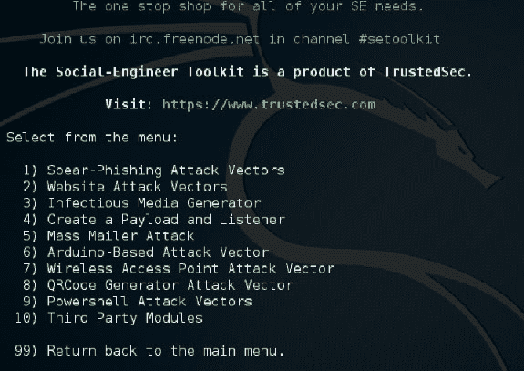

**图 4.3:** Kali 中的 `SET`

在此屏幕上选择第一个选项，它将允许你开始创建一个用于鱼叉钓鱼攻击的特制邮件。

作为渗透测试团队的一员，你可能不想使用第一个选项（群发邮件攻击），因为你已经在侦察过程中通过社交媒体获取了非常具体的目标。

因此，此时正确的选择是第二种（载荷）或第三种（模板）。出于本示例的演示目的，你将使用第二种选项。

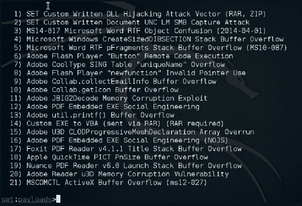

**图 4.4：** 攻击选择

假设在侦察过程中，你注意到你的目标用户经常使用 PDF 文件，这使得他们成为打开带有 PDF 附件邮件的极佳人选。在这种情况下，选择选项 16（`Adobe PDF Embedded EXE Social Engineering`），你将看到以下屏幕：

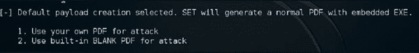

**图 4.5：** PDF 攻击选项

你在这里选择的选项取决于你是否拥有 PDF。如果你作为渗透测试团队的一员已经有一个制作好的 PDF，请选择选项一；但为了本示例的演示，请使用选项二使用内置的空白 PDF 进行此攻击。一旦你选择了此选项，就会出现以下屏幕：

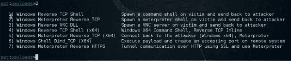

**图 4.6：** 使用内置 PDF 攻击的选项

选择选项二，并按照交互式提示输入用作 `LHOST` 的本地 IP 地址，以及连接回此主机的端口。

现在，选择第二个选项来自定义文件名。在这种情况下，文件名将为 `financialreport.pdf`。一旦你输入新名称，下方将显示可用选项。

由于这是针对特定目标的攻击，且你知道受害者的邮箱地址，请选择第一个选项。

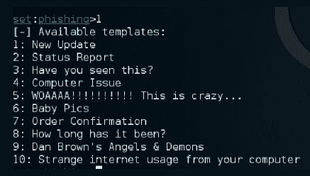

**图 4.7：** 钓鱼模板

在这种情况下，我们将选择状态报告，在选择此选项后，你必须提供目标的邮箱和发件者的邮箱。注意，在此案例中我们使用了第二个选项，即一个 Gmail 账户。

此时，`financialreport.pdf` 文件已保存到本地系统中。查看该文件位置的命令所示：

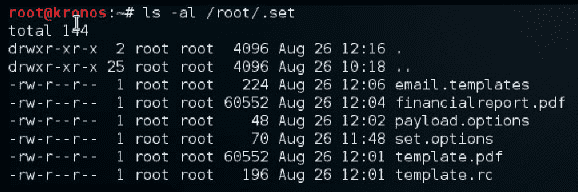

**图 4.8：** 恶意 PDF 已准备就绪

这个 60KB 的 PDF 文件足以让你访问用户的命令行提示符，并从那里使用 `mimikatz` 破解用户的凭据。

如果你想评估此 PDF 的内容，可以使用来自 [`www.malwaretracker.com/pdfsearch.php`](https://www.malwaretracker.com/pdfsearch.php) 的 PDF Examiner。将 PDF 文件上传到该网站，点击 `Submit` 并检查结果。核心报告应该如下：

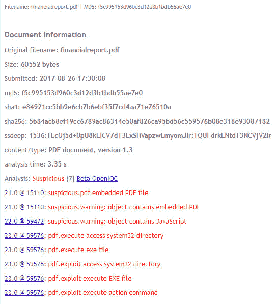

**图 4.9：** 使用 PDF 检查器

注意，这里有一个 exe 文件的执行。如果你点击该行的链接，将看到该可执行文件是 `cmd.exe`，如下：

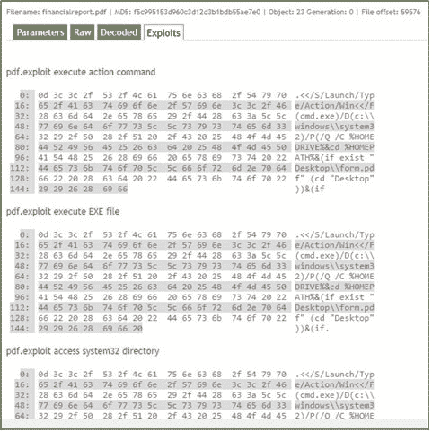

**图 4.10：** 在 PDF 中创建的漏洞利用

PDF 的最后部分是 `cmd.exe`。

数字取证分析是一项全面且耗时的过程。调查人员可能需要花费数百小时对来自单个设备的电子证据，甚至是仅仅一天的捕获的 Internet 流量进行深度检查；然而，在大多数情况下，受限于现实的成本和时间限制，这种做法是不可行的。Cyber Diligence 已根据客户需求执行了详尽的取证调查。根据客户要求，还可以进行额外的取证分析。

作为我们应急响应的一部分，我们对目标笔记本电脑进行了极其详尽的取证分析。除了 `Windows Event Logs`（Windows 事件日志）、`Windows Registry`（Windows 表）内容、文件文件夹创建、应用程序执行证据、关键词搜索等传统分析方法外，调查人员还执行了额外步骤以确定此计算机是否被入侵。

我们将笔记本电脑的取证镜像作为磁盘分区挂载到取证工作站上，并进行了恶意软件扫描，以发现设备上是否存在恶意代码。

恶意软件扫描显示存在两个名为 `drprov.dll` 和 `acpage.dll` 的潜在恶意 DLL 文件。还发现了一个名为 `ieinstal.exe` 的潜在恶意进程；但通过对这些可疑 DLL 和进程的进一步分析，发现它们为误报（false positives）。

为了消除笔记本电脑可能被高度复杂的“零日”类型漏洞感染的可能性——这种漏洞是无法通过传统的分析和扫描方法检测到的——我们克隆了目标笔记本的原始硬盘，然后将取证克隆安装到笔记本电脑中，并在客户提供的登录凭据在沙箱中启动电脑，同时使用内置的网络取证收集器拦截所有网络流量。从 2017 年 7 月 23 日到 2017 年 8 月 23 日，该 HP Elitebook 被“沙箱化”并允许在受控环境中运行。所有入站和出站的 Internet 连接及内容都已被拦截并分析。如果计算机遭受任何允许攻击者访问的入侵，连接尝试将被网络取证设备捕获。对捕获的网络流量进行详细分析显示，存在多次可疑连接和连接尝试，如图 4.19 所示：


**图 4.19：** 连接尝试

通过内存分析工具，从 HP Elitebook 硬盘的 RAM 镜像中提取了 5,681 个 DLL 文件和 95 个可执行文件（exe）。这些文件在云云恶意软件扫描引擎中进行了处理。如预期所示，扫描过程产生的命中结果极少。进一步调查显示它们为误报。分析未发现任何恶意软件。

我们利用 Windows 系统工具来：探索配置为系统启动时自动运行的进程，监控系统中运行的所有进程以检测可疑活动，并监控已建立连接的网络活动。在实时状态分析期间，我们观察到设备尝试与全球的服务器建立大量连接，并识别了尝试建立连接的进程。

执行了额外的取证分析，以识别硬盘上可能存在的恶意文件。此步骤表明存在一个名为 `2b2a83.bat` 的潜在恶意文件。使用反向工程工具和技术对该可疑文件进行了进一步分析，详见下节。

## 恶意软件分析

本节包含了对在感染系统的硬盘和内存（RAM）中发现的恶意文件的分析。

在初始分析期间，我们识别出名为 `无文件恶意软件`（Fileless Malware）的攻击类型，黑客无需安装额外软件即可利用受害者的操作系统反制自身。这种攻击在 2014 年后期随着 `WMIGhost` 和 `Poweliks` 恶意软件家族的出现而流行。由于这些恶意威胁使用非常规的位置来隐藏载荷，很难检测和清除。这是在该案例中恶意软件未被发现一年的主要原因之一。

初步发现（`JDSODM23 / emm string`）让我们认为攻击与名为 `Dark Comet RAT` 的恶意软件有关。然而，在对恶意软件进行深度反向工程后，我们发现恶意二进制文件实际上是 Kovter 恶意软件家族的样本。

Kovter 是一种已经在野外存在了 2 年多的 `无文件木马`（Fileless Trojan）。它最初通过在感染机器上执行点击欺诈而流行，直到观察到样本向受害者 PC 投放比特币矿矿程序和加密锁样本。

### 持久化机制

*   受感染系统有多个 LNK 和 BAT 文件，它们位于 `AppData` 和 `Startup` 文件夹中。这些文件夹被合法软件使用，并且可以使用最低系统权限访问，因为它们不需要管理员权限。大多数现代恶意软件使用这些位置来实现持久化/自动启动，如下所示：

    

    **图 4.20：** 在 Windows 中自动启动恶意软件

*   目标系统存在多个文件的副本，表明系统多次暴露于初始攻击向量。攻击可能源于虚假的软件更新、包含恶意宏的 Word 文档或破解版软件。

*   Kovter 使用随机生成的扩展名（`331aa3f`）作为其持久化机制并将该扩展注册为可执行扩展名，这允许攻击者在关联文件执行时随时获取控制。仅有可执行扩展名不足以自动启动。为了实现这一点，Kovter 在 `C:\Users\A001372\AppData\Local\d0fb90\2b2a83.bat` 创建了一个 BAT 文件，并在 `%USER%\AppData\Roaming\Microsoft\Windows\Start Menu\Programs\Startup` 中投放了一个 LNK 文件。参见图 4.21：

    

    **图 4.21：** BAT 文件

*   检查注册表，我们观察到 `331aa3f` 扩展仅仅是向 `33eb18` 扩展的转发器，无论文件内容都会执行恶意软件。这解释了在随机命名文件中观察到的垃圾数据。参见图 4.22：

    

    **图 4.22：** 注册表

### 恶意软件的执行

每当系统重启时，都会执行以下操作：

1.  操作系统从启动文件夹中执行 LNK 文件。

2.  LNK 文件执行 BAT 文件。

3.  BAT 文件启动具有 `331aa3f` 扩展名的文件。

4.  `331aa3f` 扩展注册表值转发到 `33eb18` 扩展注册表值。

5.  执行 `Shell` | `Open` | `Command`，运行第一个恶意脚本。

这为恶意软件提供了在系统启动时自动运行的机会。

如下图像所示，MSHTA 是一个支持运行 JavaScript 文件的合法 Windows 可执行文件。该功能经常被恶意软件作者利用，并用于运行编码/加密的恶意 JavaScript 文件，作为恶意软件的初始起点。参见图 4.23：


**图 4.23：** MSHTA 是一个支持运行 JavaScript 文件的合法 Windows 可执行文件

在此案例中，`MSHTA` 带有 JavaScript 命令行参数运行，并执行了图 4.24 所示的脚本：


**图 4.24：** 执行脚本

这是一个混淆的 JavaScript 文件，它提供了对 `WScript.Shell` 对象的访问，使得恶意软件作者能够读取任何注册表值。Kovter 使用了多个编码/加密的注册表值，如图 4.25 所示：


**图 4.25：** Kovter 在注册表中的更改

注册表值 `ajel` 和 `zlrx` 是这些值中最重要的。`AJEL` 值是一个混淆的 JavaScript 文件，由 `MSHTA` 读取并作为攻击的第二阶段。该阶段还包含 PowerShell 脚本，并读取 `ZLRX` 注册表值，该值包含攻击的最后阶段，并将此二进制文件注入到合法进程（`regsvr32.exe`）中。这种技术被称为 `Reflective-PE`，并且与恶意软件之前使用的技术一样，非常难以检测和停止。

将恶意二进制文件注入合法进程被称为 `Process Hollowing/RunPE`（进程镂/RunPE），现代反病毒解决方案可以轻易发现它；然而，Kovter 使用了一种更复杂的技术，并且没有 `unmap` `regsvr32.exe` 的主模块——这会导致反病毒解决方案将该进程标记为可疑。相反，它将恶意模块注入地址 `0x2800`，而合法的 `regsvr32.exe` 保留在地址 `0xA5000` 且未被恶意软件作者卸载。参考图 4.26：


**图 4.26：** 进程镂

大多数现代恶意软件会破坏位于 `0x28000` 处的 PE 头部，但在此案例中并非如此。地址 `0x28000` 处的 PE 映像是一个 Delphi 编译的可执行文件（MZ – Pascal）；Delphi 是恶意软件作者之间一种流行的编程语言，因为它具有广泛的支持，且不需要第三方依赖项。见图 4.27：


**图 4.27：** Delphi (MZ – Pascal)

由于可疑字符串以及之前一次使用 `Dark Comet RAT` 的 Kovter 攻击，我们最初认为该样本可能向 `regsvr32.exe` 注入了 `Dark Comet RAT`；然而，进一步的分析将我们引向了正确的方向。见图 4.28：


**图 4.28：** 分析恶意软件

通过从 `0x02DB25F` 处的实际起始点对恶意二进制文件进行反向工程，我们观察到了对 `LoadResource Windows API` 的引用，大量恶意软件使用它在构建完成后并准备好攻击后嵌入配置信息。见图 4.29：


**图 4.29：** 使用 IDA 进行反向工程

从内存中转储恶意二进制文件，我们能够恢复恶意软件的 `resources` 部分，该部分似乎经过了加密。查看图 4.30：


**图 4.30：** 从内存中转储恶意二进制文件

经过进一步检查，我们发现了以下可疑数据：

- 偏移 `0x00`：16 字节密钥
- 偏移 `0x10`：RC4 加密文件见图 4.31


**图 31：** 16 字节密钥

数据外泄分析

- 在识别出设备被破解后，我们对数据外泄进行了取证分析，以确定数据是否被攻击者提取。我们继续监控网络流量，查看是否有尝试移除数据。
- 我们使用多种取证工具对系统活动、用户活动、活动进程相关数据以及网络连接进行了检查，以寻找数据泄露的证据。使用的每个工具都为系统的安全环境提供了独特的见解。
- 我们对数据外泄进行了全面的取证分析，寻找文件上传到云端的形式、检查非工作时间的文件和文件夹访问、检查用于文件归档的软件工具安装、寻找可疑的 HTTP、HTTPS 和 FTP 连接、运行关键词搜索并检查相关性，以及分析 Windows 事件日志以关注关键时间点。

结论

- 进一步检查后，我们发现了以下可疑数据：
- 偏移 `0x00`：16 字节密钥
- 偏移 `0x10`：RC4 加密文件见图 4.31

由于恶意软件在沙盒（安全空间）中运行，我们没有观察到其根据 C&C 服务器运行模块的行为。

总结与发现

- 我们的分析得出结论，设备上确实存在电子证据表明发生了入侵。调查人员通过反向工程和取证分析，发现并识别了 Kovter 家族的恶意代码。
- 对笔记本电脑的详细取证分析以及对受感染设备在沙盒状态下的行为检查，并未发现任何表明数据已从 XYZ 公司泄露的证据。此外，也没有发现表明攻击者从该笔记本电脑向其他电脑发起攻击的证据。

[`thenextweb.com/news/how-to-implement-a-threat-model-to-beef-up-your-organizations-security`](https://thenextweb.com/news/how-to-implement-a-threat-model-to-beef-up-your-organizations-security)

3. 在威胁建模中关注对手：

[`hockeyinjune.medium.com/adversary-based-threat-modeling-6dfd88a684d`](https://hockeyinjune.medium.com/adversary-based-threat-modeling-6dfd88a684d)

4. 威胁识别方法解释：

[`www.upguard.com/blog/what-is-threat-modelling`](https://www.upguard.com/blog/what-is-threat-modelling)

5. 进化的对手思维模式：

[`www.securityroundtable.org/cybersecurity-adversary-mindset/`](https://www.securityroundtable.org/cybersecurity-adversary-mindset/)

6. 世界最大的数据泄露事件：

[`informationisbeautiful.net/visualizations/worlds-biggest-data-breaches-hacks/`](https://informationisbeautiful.net/visualizations/worlds-biggest-data-breaches-hacks/)

# 第 5 章

## 安全妥陷的主要指标

## 引言

在上一章中，我们查看了如何利用对手数据并进行横向移动。在本章中，我们将介绍安全专家在调查各自企业安全泄露时可以常用的常用妥陷指标。“入侵指标”（indicator of compromise，简称 IOC）一词自 2007 年起就开始使用。它由多个美国政府机构和国防承包商提出，他们当时正试图识别持续性威胁（APT）。从那时起，该术语被用于信息安全领域，表明计算机系统已发生安全泄露的数字证据。`IOCs` 是报告可疑活动后取证分析中的重要工具。通过使用 `IOCs`，安全专业人员可以创建更智能的工具来检测并隔离可疑文件、服务或流量，以限制安全泄露造成的损害。此外，专业人员还可以利用 `IOCs` 检测安全泄露并识别恶意软件感染，改进事件响应。因此，`IOCs` 是安全团队用于快速检测可疑活动、紧迫威胁和正在进行的攻击的红旗。

区分入侵指标（indicators of compromise）和攻击指标（indicators of attack）非常重要。攻击指标侧重于对已经发生的妥陷进行取证分析。`IOAs` 帮助回答正在发生什么以及为什么发生。攻击指标旨在识别正在进行的安全泄露。另一方面，入侵指标则协助回答安全泄露事件期间发生了什么。安全专家同时使用 `IOAs` 和 `IOCs` 在可接受的时间范围内发现安全泄露和威胁。

几种常见的 `IOCs` 可用于在系统被攻破后寻找攻击者的足迹并做出相应响应。本节通过真实的攻击案例，研究了常见的 `IOCs`；如果受影响组织的安全团队在攻击期间早早发现这些 `IOCs`，攻击本是可以被识别并预防的。

在本章中，我们将查看各种 `IOCs`，包括诸如对同一文件的大量请求、可疑的注册表更改、系统日志记录文件数据、异常的出站流量、登录红旗、地理异常、HTML 响应大小以及 DDoS 活动的迹象等事件。

## 结构

本章将涵盖以下主题：

*   妥陷指标：
    *   对同一文件的大量请求
    *   系统日志记录文件数据
    *   异常的出站流量
    *   登录红旗
    *   地理异常
    *   特权账户活动异常
    *   数据库读取量增加
    *   HTML 响应大小
    *   DDoS 活动的迹象
    *   DNS 异常
    *   系统中发现的未知应用程序
*   `IOCs` 的挑战
*   实验室 1

## 目标

在本章结束时，你将了解安全专业人员可以使用的常用入侵指标，以便及时检测其系统中的安全泄露或威胁。

## 常见的入侵指标

信息安全专家可以使用许多妥陷指标来检测和响应安全泄露事件：


**图 5.1:** 常见的 IOCs

*   对同一文件的大量请求
*   系统日志记录文件数据
*   异常的出站流量
*   登录红旗
*   地理异常
*   特权账户活动异常
*   数据库读取量增加
*   HTML 响应大小
*   DDoS 活动的迹象
*   系统中发现的未知应用程序
*   异常的 DNS 请求

### 对同一文件的大量请求

对单个文件（例如包含客户数据、员工数据、登录凭据和信用卡详情的文件）的大量请求可能表明攻击正在进行中。这是因为当对手找到他们一直在寻找的有价值文件时，攻击者可能会尝试发起多次攻击，旨在获取该文件并可能将其内容转储到远程位置。对同一文件的多次请求可能表明攻击者正试图使用不同的机制访问该文件。此外，当攻击者发现应用程序（如 Web 应用程序）存在漏洞时，攻击者通常会尝试许多针对并利用该漏洞的攻击字符串。因此，具有大量请求的单一源意味着出了问题。为了最大限度地减少攻击者通过发送大量请求来识别系统漏洞或访问给定文件的威胁，安全专业人员应不断监控任何针对文件或服务的请求数量增加。

目前已报告了许多安全泄露，如果通过持续监控系统是否存在涉及单个文件或服务的可疑活动，本可以被有效预防。一个真实的安全事件案例显示，对同一文件的请求进行持续监控可以防止或限制泄露的影响，这涉及一家名为 Under Amour 的公司。该泄露涉及使用不同的密码破解工具（如 `John the Ripper`）来获取该公司应用程序超过 1.5 亿用户的登录凭据和电子邮件地址。黑客利用了 Under Amour 用于保护某些密码文件的 `SHA-1` 哈希方案的已知漏洞。攻击者可能向密码文件发送了多次请求，以进行侦察活动、访问文件或将文件内容复制到远程位置。监控对密码文件的请求并发出相应的警报，有助于安全人员及时检测并停止攻击。

本节探讨了涉及网络中文件或服务请求激增的 `IOCs` 之一。下一节中将检查第二个 IOC。该 IOC 包括检查系统日志文件数据以识别可能指示妥陷的红旗。

如今大多数计算机系统都包含了日志记录机制，用于记录系统中发生的事件信息。然而，所记录信息的类型和数量取决于系统各种参数的配置情况。例如，微软的 `Windows 10` 操作系统使用 `Windows Event Log Service` 记录事件。`Windows 10` 日志文件包含各种类型的信息，包括生成的系统级例程以及在 `Microsoft Windows 10` 系统上运行的各种应用程序中的事件记录。当计算机系统维护一个安全存储日志文件时，安全专业人员可以在调查期间通过搜索和分析这些各种日志文件，识别安全事件和威胁。日志文件在促进用户之间的问责制方面也起着重要作用。例如，在网络中运行的操作系统、服务和应用程序的审计日志在发生安全泄露事件时可能具有巨大的价值。这些日志可用于识别攻击者的足迹以及执行攻击所使用的工具。此外，其他日志（例如组织内账户被访问的时间、位置以及在该账户内执行的操作）可以指示系统是否被攻破。

## 安全日志文件分析

安全人员还可以检查日志文件是否存在端口与应用程序不匹配的流量。通过非标准端口进行通信可能是系统被入侵的迹象。例如，恶意用户可以利用非标准端口将命令和控制流量伪装成正常的应用程序数据。攻击者随后可以获得系统的控制并执行其他恶意活动，例如访问特权账户并将机密数据传输到远程位置。因此，监控各种应用程序所使用的端口以确保使用标准端口，是安全事件调查期间的一个重要方面，因为它可以揭示系统中的会话劫持和其他恶意活动实例。

此外，显示注册表随时间推移的补丁情况的日志文件是入侵指标（IOC）的重要价值来源。在大多数组织中，系统管理员或信息安全专家会定期或在发现漏洞时执行补丁活动。如果从日志文件中检测到可疑的注册表更改，可能表明系统已被入侵。这是因为许多恶意软件会跨系统启动持续存在，并可能修改注册表以启动进程或存储运行数据。因此，建议始终创建一个干净的基准注册表快照，并监控注册表状态是否有任何可疑变化。

显示具有“超人类”行为的网络流量的系统日志也可能指示系统入侵。这是因为被点击欺诈活动感染的系统会产生大量单个用户无法生成的 Web 流量。因此，检查与正常用户特征不符的 User Agent 字符串有助于识别恶意 Web 流量。许多攻击情况可能导致具有超人类行为的 Web 流量。攻击者可以使用不同的钓鱼技术诱导用户提供机密信息（如登录凭据），这些信息随后可用于实施欺诈。例如，几年前美国司法部报告，来自伊朗的黑客破解了美国 144 多所大学的安全。黑客窃取了大约 31 TB 的数据。考虑到涉及的数据量巨大，此次泄露很可能导致了异常的 Web 流量，这些流量可以被相关大学作为入侵指标。

本节讨论了如何分析系统日志文件以揭示计算机系统的入侵情况。在下一节中，我们将查看另一个涉及异常出站流量的 IOC。

## 异常出站流量

离开网络边界的异常流量模式可能指示数据间谍或其他恶意活动，如来自被攻破系统的命令和控制流量。如今，攻击者经常使用在不同系统上的恶意软件来协调他们的行动。恶意软件被设置为在触发特定触发条件时执行特定操作。在这种情况下，人们可能会遇到异常的出站流量，因为大量数据被复制到了远程位置。例如，通过机器人和僵尸网络，攻击者可以首先通过各种手段感染计算机系统，例如存在于毫无警觉的用户在系统中安装并执行的程序中的蠕虫或特洛木马。恶意软件还可以利用给定系统的漏洞进入系统。在感染系统后，机器人会检查网络连接以及它可以与之通信的服务器或其他节点。随后，机器人可以接收并执行各种可能导致异常出站流量的命令。

导致出站流量大幅增加的机器人良好示例是 `Backdoor.IRC.Aladinz`。该恶意软件通过将自己安装在一个不可见目录中运行，并隐藏在其中，使其难以被检测。然后，该机器人在连接到特定的 `IRC` 通道并通知对手其所在地之前，会采取额外的措施进行伪装。通过与其他工具协作，该机器人可以启动不同类型的攻击，导致出站流量增加。使用 `Backdoor.IRC.Aladinz` 机器人可以启动的一些攻击包括向目标系统泛洪 `UDP` 封包，以及从受害者处收集并发送信息。

根据不同机器人和僵尸网络支持的能力，安全专家还应该寻找错误位置是否存在大量数据包。攻击者使用 `DDoS` 工具的主要目标是获取有价值的数据。因此，经常发现他们在将获取的数据从本地机器传输到远程位置之前，先在本地机器上复制数据。攻击者通常通过将数据隐藏在异常位置（例如回收站的根目录）来掩盖其活动。异常位置出现大块数据可能指示系统已被入侵并应进行调查。

一个真实世界的案例是，增加的出站流量本可以更早检测对系统的攻击，即暴雪娱乐的安全漏洞。攻击者使用了不同的 `DDoS` 攻击工具（包括 `Tribe Flood Network` 僵尸网络）来压垮目标服务器，导致欧洲的服务中断。如果公司安装了适当的系统来监控异常流量模式，这种攻击在初始阶段就可以被发现。应该监控出站流量，并拦截具有 `DDoS` 攻击特征的流量。鉴于此类攻击如果不加遏制可能会造成巨大的财务损失和声誉损害，这一点尤为重要。

大多数密码攻击很可能导致多处登录红旗（red flags），这些标记可能表明系统已被入侵。当攻击者想要获取受害者的密码时，他们可以猜测密码，也可以使用如 `John the Ripper` 这样的密码破解工具来生成常用密码。此外，攻击者可以通过暴力破解进入系统。这些活动会导致多处登录红旗出现。首先，如果攻击者使用暴力破解进入系统，将会出现多次失败的登录尝试，这可能表明系统已被入侵。即使在攻击者成功获取受害者正确密码的情况下，其他登录红旗（例如访问的时间和资源）也可以被用来指示入侵的发生。目前，网络犯罪分子比以前更加聪明，他们可以使用复杂的工具破坏计算机系统、窃取机密信息或获取登录凭据。因此，异常登录是入侵检测的重要指标，安全专家在调查或响应安全泄露事件时应对此予以特别关注。

由于大多数攻击者侧重于利用用户账户访问机密数据，因此应该监控所使用的端点等红旗，并在检测到可疑活动时采取适当措施。例如，像市场部门的人员从财务部门的工作站登录这类事件，应该引起对恶意活动正在发生的疑虑。用户登录系统的时间也可能是入侵的指标。一个很好的例子是工作职能要求仅在周一到周五工作的用户。当此类用户在周六午夜登录系统时，该事件应被视为可疑并进行调查。

其他可能指示入侵的登录红旗包括登录频率。大多数用户通常在早上上班时登录系统，在晚上离开回家时注销。此类行为的突然变化（例如在短时间内频繁登录和注销）应该受到调查，因为这可能表明该用户账户已被入侵，有人正试图通过它执行某些恶意活动。最后，单个用户并发登录多个端点可能表明存在问题。在大多数情况下，用户一次只会登录到一个端点，任何行为的改变都应被视为怀疑，因为有人可能在使用该用户的账户来入侵其他系统。使用用户名和密码组合的用户身份验证仍然是访问控制的常用手段。然而，密码容易受到许多安全风险的影响。因此，建议组织中的安全人员不断监控其组织内部通过不同系统账户执行的活动。

本节讨论了如何使用不同的登录红旗作为入侵指标。下一节将检查如何将各种地理位置异常用作入侵指标。

### 地理异常


计算机系统内部的异常通信源可能表明出了问题。例如，一个在乌克兰等国家没有任何活动的组织，不应预期系统收到来自该地区的登录请求。此类请求是攻击者正试图渗透系统的明确指示。技术的快速变化也增加了计算机系统面临的风险。以前，大多数组织的网络局限于边界，在这种情况下由防火墙表示。然而，如今大多数企业使用暴露给外部使用的应用程序和系统，或利用私有云和公有云基础设施。此类系统支持各种形式的内部资源访问，使企业面临更多安全威胁。为了应对云计算等新技术带来的安全挑战，网络管理员应该监控地理异常，这些异常可能表明有人正试图从远程位置非法访问其系统。因此，登录模式的异常或从可疑位置使用系统资源和服务是宝贵的入侵指标。

本节检查了如何将地理位置异常用作入侵指标。下一节将介绍特权账户活动中的异常如何指示入侵。

## 特权用户账户活动异常

特权账户活动中的异常可能表明系统已被入侵，因为攻击者通常尝试提升他们已破解的用户账户的权限，以便访问更有价值的信息。例如，攻击者可能首先通过网络钓鱼计划获取对系统（如员工的工作站）的访问。然后，攻击者会在员工的工作站上安装恶意软件，并利用它窃取工作登录凭据。攻击者将尝试通过提升员工权限来获得对系统的更多控制权。据报道，许多犯罪分子在提升权限后破解弱密码或默认密码以获得对重要系统的控制。例如，目标公司（Target Corporation）的安全泄露事件是从服务供应商的网络发起的。该安全泄露导致超过 4000 万用户的信用卡和借记卡被盗。经过广泛调查，发现目标公司的系统管理员使用了弱密码或默认密码。这使得攻击者更容易获得公司信息系统的完全控制权。在获得一些重要系统的控制权后，攻击者安装了恶意软件，允许他们从公司的销售点终端中收集信用卡和借记卡数据。

从该零售商的安全泄露事件可以看出，攻击者经常会尝试提升他们已获得控制的用户账户的权限，以便访问更有价值的信息。因此，监控特权账户的可疑活动应该是一个持续的过程。这是因为特权账户可能被用于实施内部攻击，或被获取了控制权的未授权用户使用。安全专家还应该监控登录红旗，例如访问的系统性质、访问类型、访问量以及执行的活动，因为它们可以提供安全泄露的早期警报。

本节检查了特权用户账户活动中的各种异常如何用作入侵指标。下一节将介绍数据库读取量的增加如何指示入侵。

大多数网络犯罪者的目标，特别是在涉及敏感和价值数据时，是获取尽可能多的数据。因此，寻找数据库的额外读取和出站流量大小可以表明存在某些异常。Equifax 的安全泄露事件就是一个很好的例子，数据库读取量的增加本可以用作入侵指示的。Equifax 泄露事件于 2017 年 9 月 7 日报道。在事件中，攻击者利用了该机构正在使用的名为 `Apache Struts` 的 Web 应用程序的已知漏洞。攻击者盗取了超过 1.45 亿用户的`个人身份信息`（`PII`）。此次安全泄露涉及的信息量非常巨大。因此，将信息复制并传输到远程位置的过程导致数据库读取量激增，这可能表明攻击正在进行。

本节探究了如何将数据库读取量的增加作为入侵指示使用。下一节将介绍 HTML 响应大小如何指示入侵。

## HTML 响应大小

HTML 响应大小是调查安全泄露时应考虑的至关重要的入侵指示之一。当攻击者利用 Web 应用程序对数据库进行 SQL 注入以提取数据时，Web 应用程序发出的请求将导致比正常响应大得多的响应。典型的 HTML 响应通常约为 260KB。然而，在 SQL 注入攻击的情况下，响应可能高达 50MB。巨大的响应大小很容易被发现，并应作为系统中 SQL 注入攻击的红色警信号。需要记住，SQL 注入攻击是攻击者用于从数据库中汲取数据的常用方法。攻击类型还可用于修改数据库信息、访问敏感数据或执行为管理员保留的特权任务。该攻击涉及在 Web 应用程序的表单输入框中添加 SQL 代码。添加的代码提供了对数据资源的访问权限。一个通常约为 200KB 的查询可能会导致产生大得多的响应，因为攻击者必须访问数据库中的信息（如信用卡数据或用户凭据），并将整个文件转储到某处。因此，HTML 响应大小是能够指示计算机系统遭受入侵的重要信息。

现实生活中有很多 SQL 注入攻击的案例，可以通过检查受影响系统内的 HTML 响应大小来检测到这些攻击。最著名的之一是 7-Eleven 泄露事件，一个黑客团队利用 SQL 注入渗透了多个企业系统（包括 7-Eleven 零售连锁），成功盗取了超过 1.3 亿张信用卡号。

本节探究了如何将 HTML 响应大小作为入侵指示使用。下一节将介绍 DDoS 活动迹象如何指示入侵。

## DDoS 活动迹象

DDoS 攻击涉及通过不同来源的流量淹没系统使其不可用。它涉及创建由受感染计算机组成的网络，称为 `bots` 和 `botnets`，这些网络用于传播恶意程序，这些程序可能导致系统无法使用或将大量数据复制到远程位置。一旦组织内部的系统被恶意软件感染，就可以在所有者不知情的情况下使用 `botmaster` 进行远程控制。一个具有 DDoS 攻击迹象的真实攻击案例涉及路易斯那州美国联邦方法院。攻击者使用恶意软件泄露机密文件并禁用法院的网站。攻击中使用的恶意软件被称为 `Trickbot` 恶意软件。恶意软件传播网络用于投放勒索软件负载。后者使用了不同的混淆和规避技术来避免检测。该攻击有许多 DDoS 入侵的迹象，本可以更早检测出来。例如，使用适当的工具将揭示法院信息内部存在机器人和僵尸网络。从法院传输到远程位置的大量数据可能会引发对正在发生之事的担忧。

## DNS 异常

计算机网络中的`域名系统`（`DNS`）负责将域名翻译为 IP 地址，以便进行相互通信。`DNS` 存在于大多数网络中，并提供关键服务，一旦受到影响会导致停机。因此，攻击者通常认为 `DNS` 是执行网络侦察、数据间谍活动和控制服务器等恶意活动的吸引途径。网络活动（如 `DNS` 请求激增）表明网络可能遭到入侵。在 `DNS` 服务器被入侵后，攻击者可以通过典型的从目标网络内的计算机对攻击者控制的域名发送定期 `DNS` 查询来滥用与服务器的 `DNS` 通信。被入侵的 `DNS` 将响应编码消息，这些消息可能用于破坏目标网络的安全。因此，应该分析异常的 `DNS` 活动（例如对异常域名的信标检测查询和孤立的 `DNS` 请求），以确定是否存在入侵。

`DNS` 查询激增也可能指示入侵，因为这些查询可用于实施网络足迹攻击。此类攻击涉及使用多个 `DNS` 查询来绘制网络地图。绘制网络地图很重要，因为它允许攻击者理解网络并发现可以被利用的漏洞。诸如大量 `PRT` 查询、针对根域名中不存在的子名的正向 `DNS` 查询等事件。此外，`DNS` 查询激增可能是网络内数据窃取活动的结果。值得注意的是，`DNS` 可以通过 `DNS` 查询和响应隧道其他协议（如 `FTP` 和 `SSH`）来传输数据。因此，`DNS` 查询的增加可能表明攻击者正在对其拥有域名进行多次 `DNS` 查询以窃取数据、执行破坏网络的命令或将恶意软件传输到目标网络。

## 系统中发现的未知应用程序

当用户从网上搜索并下载应用程序时，可能会引入不受的软件。某些应用程序是软件包，这意味着它们与其他程序打包。因此，在下载原始应用程序时，可能会无意中安装其他程序。此外，在系统中发现未知应用程序可以是系统遭受入侵的指示。

根据 NIST，战术（Tactic）是对此类行为的最高级别描述，而技术（Techniques）在战术背景下对行为进行更详细的描述，程序（Procedures）则在技术背景下提供更底层、更详细的描述。换句话说，TTP 描述的是为什么、是什么以及如何。

**为什么（Why）**：定义攻击者为什么要使用特定技术。

**是什么（What）**：定义了每个战术下方列出了哪些技术。

**如何（How）**：定义了攻击者如何入侵受害者。

你可以在此处获取更多关于 TTP 的信息：[`nvlpubs.nist.gov/nistpubs/SpecialPublications/NIST.SP.800-150.pdf`](https://nvlpubs.nist.gov/nistpubs/SpecialPublications/NIST.SP.800-150.pdf)。

## TTP 与 IOC 的区别

不谈细节，让我们解释一下 TTP 和 IOC 之间的区别。

### 通过示例解释 IOC

威胁情报公司发布针对特定威胁组织发勒索软件等攻击的恶意哈希值。

如果我们进一步深入理解勒索软件的行为，寻找共同属性并定义它们的特征，那么这就属于“技术”层面。你可以在我们的*延伸阅读*（Further Reading）部分找到更多关于 TTP 的信息。

下表总结了 IOC 和 TTP 之间的区别：


**图 5.3：** IOC 与 TTP 的对比

## 实验室 1

**Binalyze** 是一家数字取证和事件响应（IR）公司，专注于创建全、稳健、易用且便携的产品。Binalyze 的第一个产品是 `IREC`，它内置了 Windows 二进制文件，支持从 XP 到 Windows 11 的所有 Windows 版本。它是一个单击、易用且免费的产品，这就是为什么我们在这里演示它的用法。

在实验室中，我们将使用一种名为 Binalyze Tactical 的软件。该软件将帮助我们收集取证完的证据，对其进行解析，然后展示那些显而易见的成果。它可以适用于所有基于 Windows 的环境。让我们来看看 Binalyze Tactical 的实际功能，并解释我们为什么应该使用它。

请注意，该产品还有一个免费版本，虽然它有一些限制，但将帮助你毫无问题地完成实验室。该软件名为 `Binalyze Acquire`，你可以通过以下链接下载 Binalyze Acquire：

[`www.binalyze.com/acquire`](https://www.binalyze.com/acquire)

现在，让我们来看看 Binalyze 的实际功能，并解释我们为什么应该使用它。

下载并安装后，你可以使用 GUI 版本启动应用程序，它将通过启动界面欢迎我们：


**图 5.4：** Binalyze Tactical 欢迎界面

IREC 有两个主要的配置方案：

1. **收集证据 (Collect Evidence)**：用于深度取证调查，并根据你的选择收集证据和产物。

2. **内存和页面文件 (RAM and PageFile)**：此部分用于**随机访问内存**（**RAM**）调查，将帮助我们收集存储在内存中的证据。

如果你选择右上角的 `Settings`（设置），可以从设备中选择你想要收集的证据和产物。一旦点击设置，你可以导航到 `Evidence list`（证据列表）部分，如下截图所示：


**图 5.5：** 收集证据的设置

IREC 还带有由 Binalyze Labs 开发的最新 YARA 能力，如下所示：


**图 5.6：** 在设置的 Triage /IOC Scan 下可以选择 Yara 规则

YARA 规则是识别文件、恶意软件和 IOC 的方法，它通过创建寻找某些指示事件或攻击的特征的规则来实现。使用 IREC，你不需要确切知道如何编写规则，因为 IREC 使用了上下文自动补全。

要做到这一点，你需要点击如前面的截图所示的 `Edit Rules`（编辑规则）。你需要向下滚动到想要编辑的规则并开始编写；你会发现 IREC 会帮助你完成规则：


**图 5.7：** YARA 上下文自动补全

如前图所示，IREC 支持使用 Yara 进行文件扫描和内存中扫描。用户还可以根据文件大小和怀疑的事件时间来限制搜索。

让我们解释一下怀疑的事件时间。如果发生了事件，我们会收到来自 SIEM 或 EDR 解决方案的告警，但我们可能不知道端点具体发生了什么。然而，我们知道事件告警产生的时间间隔。如果根据真实的事件时间缩小分析范围，我们就可以更多地关注真实事件。此时，IREC 可以帮助调查人员在给定的时间范围内发现问题并显示结果。

此外，大多数时候，用户或调查人员抱怨他们无法从源中收集自定义证据集。此时，IREC 提供了一个**自定义内容收集器**（Custom Content Collector），如果企业或云环境使用了非通用产品或证据源，它可以帮助调查人员从任何给定路径或通配符路径收集自定义证据。要收集这些自定义证据，你需要进入设置部分中的 `Custom collection`（自定义收集）并点击 `New Profile`（新建配置）。然后，填写 `Description`（描述）和 `Full Path`（完整路径）或 `Pattern`（模式），选择 `Collection Scope`（收集范围），并 `Save`（保存）你的配置：


**图 5.8：** IREC 自定义收集设置

此外，IREC 允许调查人员证明证据的完备性，计算所有收集证据的哈希。因此在调查之后，调查人员可以证明案件。但在许多情况下，哈希计算是不够的，因为攻击者可以很容易操纵哈希。我们需要一个稳健且不可更改的解决方案。

如果我们看通用和全局解决方案，最可靠的解决方案是带时间戳的签名，这将允许事件响应人员根据这些标记看到变化。IREC 使用符合 RFC3161 标准的方法对报告进行时间戳签名。因此，如果需要，可以很容易提交报告提交。设置中的 `General`（通用）部分允许你使用 SHA256 收集证据，如果你尝试收集证据的驱动器已加密（例如使用 Windows BitLocker），它也会通知你：


**图 5.9：** IREC 中的通用设置

一旦我们选择了自定义项，我们最终可以通过点击 `Start`（开始）使用 IREC 收集产物：


**图 5.10：** 使用 IREC 开始收集

根据磁盘大小，证据收集的完成时间可能会不同。完成收集过程后，IREC 将显示报告，该报告既快速又轻量。报告首先显示案件信息，位于多个标签页中：


**图 5.11：** IREC 为每次搜索创建一个案件编号

概述继续显示 `System Info`（系统信息）：


**图 5.12：** 我们收集证据的终端系统信息

IREC 收集的所有证据哈希都已计算，这些哈希显示在随后的 `Hashes` 页面：


**图 5.13：** 我们收集的哈希

如果你编辑了 YARA 规则，你选择的规则将与你在 `Triage/IoC Scan` 部分 `File` 下方编辑的 IREC 规则匹配：


**图 5.14：** 匹配的 YARA 规则

`Processes` 标签下的 `Digital Sign Status`（数字签名状态）列可以帮助我们在证据收集期间发现任何可疑进程：


**图 5.15：** 搜索期间发现的可疑进程

如果调查人员想查看进程的任何详细信息，只需点击 `Process ID` 下字段值旁边的眼睛图标即可。

回到 `Network` 区域的主报告标签页，调查人员可以浏览 `DNS Cache`、`ARP`、`TCP` 和 `UDP` 表，并查看网络适配器、路由和网络共享。在接下来的截图中，我们在端点发现了一个可疑的 DNS 缓存：


**图 5.16：** 端点中的 DNS 缓存项

只需点击，你就可以在 `VirusTotal`（[`https://www.virustotal.com/gui/`](https://www.virustotal.com/gui/)）中检查该条目的详情。

我喜欢的 IREC 自带的另一个其他选项是 `TCP Table` 标签页。在这里，你可以看到端点到互联网的连接，带有 IP 地址和进程名称。如果你点击眼睛图标，它会将你连接到 `Virus Total`，帮助你验证该连接是到了合法网站还是命令控制中心！你还可以看到有多少应用程序正在使用同一个 IP 以及更多信息：


**图 5.17：** TCP 表视图

此外，如果进程具有任何 `TCP` 连接或任何相关信息（如模块），可以在标签详细信息中看到。在 `Network` 标签上，如果你点击 `TCP Table` 然后浏览进程并发现可疑进程，你可以点击它，它将为你提供 `Process Details`。向下滚动可以显示模块详情，在其中你可以选择浏览 `Arguments`、`TCP` 和 `UDP` 表、`Memory` 等详情，甚至可以查看拍摄的任何截图。


**图 5.18：** 模块上的 TCP 标签详情

从主报告界面导航，IREC 还会解析了注册表的 `Autoruns`（启动项），并显示任何自动启动位置：


**图 5.19：** 注册表中的启动项

继续阅读报告，此部分将显示 `Key Path`、`Entry name`、`Command Line`、`Digital Sign Status` 以及更多细节。

在 `Autoruns` 标签下，IREC 还解析了 `Scheduled Tasks`（计划任务），它会调查所有计划任务，你可能会在那里发现一个被计划的 `malicious`（恶意）任务。任何可执行的启动文件夹也可以在 `Startup` 文件夹部分看到，系统中的自动运行服务可以在 `Services` 下查看。

通过 IREC，你还可以查看 `Downloads`（下载）文件夹，可以在那里查看是否下载了任何不需要的内容：


**图 5.20：** 下载文件/执行文件的详细查看

滚动到 IREC 报告的主页还会显示主菜单中加载到系统的驱动程序以及关于它们的信息：


**图 5.21：** 加载到系统的驱动程序

另一个标签显示系统上的 `Installed Applications`（已安装应用程序）：


**图 5.22：** 安装应用程序视图

如果有 WMI 脚本注入系统用于自动启动，它将显示在 `WMI` | `Active Scripts` 下：


**图 5.23：** 调查期间发现的 VM 脚本

Binalyze 还有命令行 Linux 版本。接下来，让我们来看看 Linux 版。

## 使用 CLI 交互 Binalyze

它从以下简单的命令开始：

```bash
wget -O - bit. ly/run-irec | sudo sh
```

之后，IREC 在没有任何依赖的情况下启动。IREC for Linux 适用于几乎所有的 Linux 发行版。它带有精美的 ASCII 艺术欢迎你，并开始从你正在调查的 Linux 系统收集证据。

**注意：在编写本章时，IREC for Linux 处于 BETA 阶段，因此你可能会看到截图的差异。请注意，如果你使用 BETA 版本可能会遇到一些小的 bug。**


**图 5.24：** IREC Linux 版启动

完成证据收集后，它会显示保存的文件夹及其内容：


**图 5.25：** 安装后，它将验证安装已完成

IREC Linux 同样具有与 IREC Windows 类似的报告输出，我们在上一节中见过。

## Binalyze AIR

**自动化事件响应**（`AIR`）是作为云环境或企业级网络中 IREC 代理的管理控制台，它将帮助你进行远程取证 + 分类 + 自动化。

在每个端点逐步执行 IREC 是耗时且低效的。如果所有 IREC 代理都从单个面板管理，对系统管理员来说将更加清晰且简单得多。IREC 代理只是监听器，它们不同于 EDR、XDR 或 DLP 代理。IREC 代理不监控任何内容，因此它们不占用任何系统资源：


**图 5.26：** Binalyze AIR Agent 服务不消耗系统资源

在本节，我们将浏览 Binalyze AIR。AIR 仪表板可以通过 Web 控制台访问，它以如下所示屏幕欢迎我们：


**图 5.27：** AIR 仪表板视图

如果有 WMI 脚本注入系统用于自动启动，它将显示在 `WMI` | `Active Scripts` 下：


**图 5.23：** 调查期间发现的 VM 脚本

## 图 5.36：创建分诊规则

AIR 还支持 `Triggers`（触发器），你可以通过“触发”它们来执行特定的操作。这里有一个示例：如果你调用 AIR 的 REST API，可以请求它从指定的计算机收集证据。这意味着当任何传感器检测到可疑活动时，SIEM 或 EDR 都可以调用 AIR。证据可以在无需用户交互的情况下进行收集（例如在深夜），随后工作人员可以查看计算机中发生了什么，并及时采取行动：


**图 5.37：** AIR 触发（triggers）选项卡

AIREC 支持两种保存结果报告的模式。你可以选择本地计算机来保存证据，如果你有网络共享，也可以通过添加 `Evidence Repository`（证据库）将其保存到网络共享中。执行此操作，你需要在 `Evidence Repositories`（证据库）下选择路径：


**图 5.38：** 在指定位置保存证据

如你现在所知，IREC 能够自动在 AIR 中进行功能报告。我们只需点击任务结果，即可查看之前的 `Schedule Acquisition`（计划采集）任务的结果：


**图 5.39：** 查看任务结果

AIR 还完全支持 `Active Directory`（活动目录）集成，这让你能够从单一位置管理资产。


**图 5.40：** AIR 活动目录集成

在本实验中，你学习了如何通过 IREC 收集证据并分析端点。我们还涵盖了 AIR，它让 IREC 能够从单一位置收集并管理我们所有的端点。

## 实验 2

在本实验中，你将学习如何在 Windows 电脑中找到不需要的应用程序/软件。

如果你对某个软件表示怀疑并认为它不是由你或你的组织安装的，你可以验证该程序是否受信任或为“不受欢迎”。

如果你看到一个认识的程序，可以对其进行验证：

### 1. 任务管理器

我们假设你如何打开任务管理器（`Ctrl + Alt + Delete`），这是 Windows 电脑上内置的一个免费工具。

找到你不确定安全性的应用程序名称。


**图 5.41：** 打开任务管理器

右键点击该应用程序，然后进入 `Properties`（属性）。


**图 5.42：** 打开属性窗口

你可以在 `General`（常规）选项卡下查看详细信息；查看是否有由供应商签名的有效证书。在我们的案例中，程序具有三个数字证书：一个来自 Lenovo，两个来自 Microsoft。


**图 5.43：** 属性窗口

### 2. Sysinternals 的 Process Explorer (Microsoft)

Sysinternals 是每个安全专业人员电脑上都需要的最优秀工具集之一。

Sysinternals Suite 是 Sysinternals 工具的包，包括 Process Explorer、Process Monitor、Sysmon、Autoruns、ProcDump 以及所有工具。

Sysinternals 网站由 Mark Russovich 于 1996 年创建，用于托管他的高级系统实用程序和技术信息。无论你是 IT 专业人士还是开发者，都会发现 Sysinternals 工具可以帮助你管理、排错和诊断你的 Windows 系统。

该套件包含 `AccessChk`、`AccessEnum`、`ADExplorer`、`ADInsight`、`ADRestore`、`Autologon`、`BGInfo`、`CacheSet`、`ClockRes`、`Coreinfo`、`CPU Stress`、`DebugView`、`Desktops`、`Diskvhd`、`DiskExt`、`DiskMon`、`EFDump`、`FindLinks`、`Handle`、`Hex`、`Junction`、`ListDLLs`、`LiveKd`、`LoadOrder`、`LogSessions`、`MoveFile`、`NotMyFault`、`NTFSInfo`、`PendMoves`、`PipeList`、`Process Explorer`、`Process Monitor`、`PsExec`、`PsFile`、`PsGetSid`、`PsInfo`、`PsKill`、`PsList`、`PsLoggedOn`、`PsPasswd`、`PsPing`、`PsService`、`PsShutdown`、`PsSuspend`、`RamMap`、`RDCMan`、`RegDelNull`、`Regjump`、`RU`、`SDelete`、`ShareEnum`、`ShellRun`、`Sigcheck`、`Strings`、`Sync`、`Sysmon`、`TCPView`、`Testlimit`、`VMMap`、`VolumeID`、`WhoIs` 和 `ZoomIt`。

你可以下载该工具集并自己探索所有工具，但我们将在实验中使用 `Process Explorer`。

`https://www.microsoft.com/en-au/p/sysinternals-suite/9p7knlwr25?activetab=pivot`


**图 44：** Process Explorer

如你在前面的截图所示，`Process Explorer` 比内置的任务管理器具有多得细节，但让我们继续检查应用程序的属性。从那里，点击 `Verify`（验证），你将在几秒钟看到程序是否通过了验证。


**图 45：** 检查应用程序属性

### 3. Com Client Security

Comodo 向其客户提供高级的端点保护。当未知文件处于隔离状态时，Comodo 的 Valkyrie Verdict 引擎和威胁情报会在云端立即对文件进行分析，而不会中断终端用户。它们会更详细地验证你计算机中安装的每个文件。虽然代理程序在此实验中有更多细节，但我们只查看 `Rating Scan`（评分扫描），以查看是否有文件或文件夹被感染。

你可以在 `https://www.comodo.com/dragon-enterprise/` 获取更多信息。

启动从前面的链接下载的 Comodo Advanced Endpoint Client，通过双击 Comodo 图标打开代理；它将为你打开界面：


**图 46：** 启动 Comodo 高级端点客户端

点击 `Scan`（扫描），然后选择“Quick Rating Scan”（快速评分扫描）；然后启动扫描：


**图 47：** 启动扫描

安全软件将检查所有文件并结果给出评分。扫描完成后，你可以根据恶意（Malicious）、未识别（Unrecognized）、信任（Trusted）、运行自启动（Running Autorun）和不受信任（untrusted）文件对结果进行排序。


**图 48：** 扫描结果

根据演示，Comodo AEP 发现了四个未识别的文件。如果这些文件是你熟悉的，你可以“信任”（trust）该文件：


**图 49：** Comodo AEP

如果你不确定该文件，可以点击它并查看更多细节：


**图 50：** 检查更多详细信息

## 总结

入侵指标（Indicators of compromise，简称 IOC）是表征系统存在潜在安全漏洞的取证产物。这些指标用于监控信息技术基础设施中的可疑活动，以便安全团队及时检测并响应网络攻击。本节检查了各种形式的 IOC，包括对同一文件的大量请求、系统日志文件数据、异常出流量、登录标记、地理异常、特权账户活动异常、数据库读取量增加、HTML 响应大小、DDoS 活动迹以及 DNS 异常。

在下一章中，我们将学习如何区分良好和坏情报。

## 延伸阅读

以下资源可用于获取有关本章涵盖主题的知识：

1. 入侵指标：寻找攻击者突破你的防御时留下的足迹：`https://informationsecurity.report/Resources/Whitepapers/62cd4e7c-8156-47f4-9bc4-79d3b1ffec50_indicators-compromise-forensics-breach-pdf-7-w-1967.PDF`

2. 入侵指标 (IOC)：`https://lifars.com/wp-content/uploads/2017/06/Indicators-of-Compromise-IOC-.pdf`

### 3. 防止泄露的关键入侵指标：

`https://www.isdecisions.com/key-indicators-of-compromise-to-prevent-breach/`

### 4. 前 15 种入侵指标

`https://www.darkreading.com/attacks-breaches/top-15-indicators-of-compromise`

### 5. 攻击指标与入侵指标的区别：

`http://index-of.es/z0ro-Repository-3/Indicators%20Of%20Attack%20Versus%20Indicators%20Of%20Compromise.pdf`

### 6. 威胁资源：

`https://www.erdalozkaya.com/?s=threat+`

## 7. 21 世纪最大的 15 起数据泄露事件：`https://www.csoonline.com/article/2130877/the-biggest-data-breaches-of-the-21st-century.html`

### 8. MITRE TTPs 详解：

`https://enterprise.comodo.com/blog/what-is-mitre-attck/`

### 9. 2021 年前 10 大 TTP

`https://www.picussecurity.com/product/picus-threat-library`

# 第 6 章

## 识别与构建入侵指标

## 引言

威胁建模本质上是处理针对组织的威胁，安全专业人员需要识别系统中的漏洞以及此类系统漏洞给业务带来的潜在威胁。`入侵指标`（`IoC`）是一个术语，指代系统内的某些证据，这些证据表明系统存在潜在威胁或发生了需要紧急处理的网络入侵。这些证据以签名或唯一数据伪迹的形式出现，与潜在威胁具有强相关性。

然而，这要求安全团队在了解所有潜在威胁以及攻击系统的可能手段之前，能够准确识别安全威胁，并积极寻求解决方案来缓解已识别的威胁。`IoC` 表明数据泄露已经发生或正在进行，它要求安全团队采取措施进行进一步调查，以确认这些疑的真实性。组织需要具备相应的能力，以便在系统发生入侵指标时能够识别它们，并拥有备用计划帮助他们实施适当的响应。本章旨在阐明入侵指标的各种形式，以及当你在系统中发现这些指标时，它们意味着什么。

## 结构

本章将涵盖以下子主题：

* 系统日志条目

* 异常出站流量

* 地理异常

* 特权账户活动

* 数据库流量

* HTML 响应

* DDoS

## 目标

本章将讨论入侵指标这一重要主题，并展示几类证据，这些证据可以帮助组织的安全团队识别安全泄露并对该问题展开进一步调查。

## 数据关联

大多数组织已经在使用某种 `SIEM` 解决方案将所有日志集中在一个位置，并且还使用查询语言在整个日志中搜索。对于安全专业人员来说，了解如何浏览不同的事件和伪迹以进行深度调查至关重要。为此，从 `SIEM` 获取的数据对于识别威胁和缩小受影响系统的范围有用，但在某些情况下，这是不够的；你需要找到根源并消除威胁。因此，每当你执行数据分析时，考虑这些拼图是如何协同工作的是非常重要的。

下面的图显示了使用这种数据关联方法审查日志的示例：


另一个重要文件是 Windows 存储用户模式转储储（crash dump）文件的地方即 `C:\Users\<username>\Local\CrashDumps`。


* **Linux 日志**：有许多日志可以用来查找安全相关信息。其中主要的之一是 `auth.log`，位于 `/var/log` 下。

这是该日志的示例：

```
Nov 5 11:17:01 kronos CRON[3359]: pam_unix(cron:session): session opened for user root by (uid=0)
Nov 5 11:17:01 kronos CRON[3359]: pam_unix(cron:session): session closed for user root
Nov 5 11:18:55 kronos gdm-password]: pam_unix(gdm-password:auth): conversation failed
Nov 5 11:18:55 kronos gdm-password]: pam_unix(gdm-password:auth): could not identify password for [root]
Nov 5 11:19:03 kronos gdm-password]: gkr-pam: unlocked login keyring
Nov 5 11:39:01 kronos CRON[3449]: pam_unix(cron:session): session opened for user root by (uid=0)
Nov 5 11:39:01 kronos CRON[3449]: pam_unix(cron:session): session closed for user root
Nov 5 11:39:44 kronos gdm-password]: pam_unix(gdm-password:auth): conversation failed
Nov 5 11:39:44 kronos gdm-password]: pam_unix(gdm-password:auth): could not identify password for [root]
Nov 5 11:39:55 kronos gdm-password]: gkr-pam: unlocked login keyring
Nov 5 11:44:32 kronos sudo: root : TTY=pts/0 ; PWD=/root ; USER=root ; COMMAND=/usr/bin/apt-get install smbfs
Nov 5 11:44:32 kronos sudo: pam_unix(sudo:session): session opened for user root by root(uid=0)
```


## 3. macOS 日志

与 Linux 类似，macOS 也有许多位置存储日志。你可以使用`Console`应用程序定位日志。


## 4. 防火墙日志

防火墙日志格式因供应商而异；然而，无论什么平台，都会包含一些核心字段。在审查防火墙日志时，你必须重点关注回答以下问题：

- 谁发起了通信（源 IP）？
- 通信的目的地在哪里（目的 IP）？
- 是什么类型的应用程序尝试访问目的地（传输协议和端口）？
- 防火墙是允许还是拒绝了连接？

## 5. Web 服务器日志

使用了多种类型的 Web 服务器，但无论你使用哪种 Web 服务器，都要密切关注与 SQL 数据库交互的 Web 应用日志。

Microsoft Web 服务器日志位于`\WINDOWS\system32\LogFiles\W3SVC1`。

在 Apache 中，默认位置如下：

`/var/log/apache/access.log`

## 6. 亚马逊云服务（AWS）日志

为了对 AWS 进行审计，你需要安装 AWS Cloud Trail；一旦安装，你就可以按照以下方式查看日志：


**图 6.5：** AWS 日志

## 7. Microsoft Azure 活动日志

Microsoft Azure 也有平台日志功能，它让你能够可视化 Azure 中发生的订阅级事件。这些事件涵盖了广泛的数据，从`Azure Resource Manager`（`ARM`）运行数据到服务健康（Service Health）事件的更新。


**图 6.6：** Microsoft Azure 日志

## 创建系统日志记录文件数据

系统日志文件对于识别任何破坏活动至关重要。在这种情况下，威胁猎寻团队（即组织中负责信息安全的团队）将试图寻找作为系统入侵指标（IoC）的数字足迹。在大多数情况下，网络犯罪分子会在系统中留下他们的活动痕迹。系统日志文件将包含此类数字证据。创建系统日志文件的目的是记录系统中的任何活动。这些日志文件记录了所有合法和非法的活动。安全团队只需要查看这些日志文件，就可以确定网络犯罪分子在系统中执行了何种活动。

在大多数情况下，安全团队在数据泄露后不会查看系统日志文件。对于本章，安全团队将使用系统日志文件来确定渗透系统的可能威胁。因此，团队将扫描系统日志文件，以确定任何不符合正常用户行为的可能恶意活动。

安全团队需要使用先进的技术工具扫描系统的所有系统日志文件，以识别任何可疑活动。使用人工智能和机器学习等技术对于有效检测系统中的异常行为至关重要。通过这些自动化工具，可以识别系统日志文件中的差异，这些差异证明了系统存在异常行为，而这些行为应该接受调查。

在本节中，我们查看了系统日志文件以及它们在帮助安全团队识别系统中的潜在破坏活动方面的重要性。在下一节中，我们将查看异常的出站流量。

## 创建异常出站流量

流量是识别系统中可疑行为的最常见手段。对系统的持续监控允许安全团队识别正常行为的任何变化。特别是出站流量，是入侵的一个良好指标。在许多情况下，网络犯罪分子会针对某个系统从组织中窃取数据。数据必须从服务器复制并发送给网络犯罪分子。在此类活动期间，预计出站流量不会遵循正常水平，而是显示出峰值，证明流量和数据外出的增加。因此，在对系统进行例行监控期间，当发现系统数据外流时，应立即进行调查并采取缓解措施。其原因是，出站流量通常指示正在进行的恶意活动。与可能显示过去活动的系统日志文件（这对于阻止正在进行的入侵可能无益）不同，出站流量指标潜在地帮助安全团队识别异常的出站流量。

### 监控出站流量的重要性

每种网络安全策略必须具备检测入侵指标的能力。在这种情况下，组织应该具备检测流量任何变化的能力，特别是出站流量。应实施的工具和措施应该是准确且快速的，以确保尽可能快地识别出指标。检测入侵得越早，入侵对业务的负面影响就越小。

此外，组织可以从反复出现的入侵指标中获益，因为这些指标提供了对攻击者方法的见解，这可以为安全团队提供将其纳入其安全策略的方法建议，从而为未来的攻击做好更好的准备，或完全防止它们。

以下截图显示了`Comodo Live Threat Map`，具有入站或出站流量及威胁的全局视图：


**图 6.7：** Comodo 恶意流量视图

在本节中，我们查看了出站流量，并确定增加但未解释的出站流量是系统被入侵的常见指标。在下一节中，我们将查看登录红旗。

### 创建登录红旗

登录告警是指示入侵和试图渗透系统的入侵者的最基本但最有效的手段。攻击者访问系统的方法之一是暴力破解，他们尝试通过试错和猜测加密密钥来访问系统。此类攻击可能使用自动化工具不断尝试破解密码代码。这是一种流行的攻击系统的方式，并可能适用于未使用复杂密码系统的系统。最近，此类攻击的成功迫使系统开发人员开发出要求用户结合整数和符号等组合值、使用大写字母等的系统。所有这些要求使得暴力破解变得几乎不可能，因为由于可能的组合巨大，他们必须猜测无数次密码。因此，登录红旗将作为指示入侵的有效工具。登录尝试和登录请求的工作方式类似。

系统应该能够记录访问它的尝试次数。例如，系统允许五次登录失败。当用户五次未输入正确密码时，账户可能会锁定一段时间，或者一直锁定到请求管理员为用户解锁为止。这些策略有助于系统免受恶意登录尝试，并帮助安全团队防止攻击者接触系统。反之，攻击者将需要不断投资更复杂、更强大的工具，以帮助他们暴力破解进入系统。除非系统中的资产价值极高，否则这种要求将阻止大多数攻击者。

在本节中，我们讨论了登录红旗问题以及它们如何帮助警示安全团队可能的攻击。在下一节中，我们将查看以地理异常为形式存在的另一种入侵指标。

地理异常是安全团队在威胁狩猎过程中使用的另一种常见手段。通过地理异常，系统可以针对来自被视为国外的地区的可疑行为。例如，如果一家业务位于美国，且其大部分流量来自美国用户，那么来自国外的流量突然激增就应该引起调查，特别是在没有合理解释的情况下。合理的解释可能包括：对此前未作为目标的其他地区投放了产品营销，导致世界其他地区对公司产品产生了新的关注兴趣。另一种合理解释可能是公司在世界其他地区开设了分支机构，使得该地区的人对公司产品产生了兴趣。

在监控地理异常等问题时，安全专业人员应特别警惕诸如流往已知为黑客和其他恶意攻击者避风港的地区的流量激增问题。东欧地区以黑客法律松散而闻名，许多在线黑客团体源于这些地区。每当安全团队注意到可疑活动时，应立即启动调查，以找出此类流量变化或激增的原因。在许多情况下，采取立即行动就足以阻止正在进行的攻击并保护业务免受可能进一步的损害。

应该监控的因素包括：

- **访问模式**：如果用户尝试从不熟悉的位置登录，这是一个巨大的危险信号，安全团队应紧迫处理。正常用户行为被认为是来自特定地区的流量。业务运营的任何变化都应该反映在流量的变化上。因此，安全团队应该充分了解业务运营的任何变化，包括营销活动和针对新市场的开发。
- **来自遥远地区的登录尝试**：来自同一国家或州内地区的流量变化可以被视为正常。然而，当业务网络开始经历多次来自遥远位置的登录尝试时，这就是令人担忧的原因，也是可能被入侵的良好迹象。
- **登录尝试的频率**：如果从遥远地区仅进行一次登录尝试，对组织的安全态势可能没有意义。但如果此类登录尝试的频率很高，那就是明确的被入侵迹象。因此，应该立即进行调查，并采取可能的保护措施。
- **多个 IP 地址的使用**：如果记录到在尝试访问网络期间使用了多个 IP 地址，这是一个令人担忧的原因，而且通常表明攻击者正试图获取公司网络。在这种情况下，最可能的原因是恶意人员已获得用户的网络凭据，并试图访问组织的系统。

### 处理地理异常

安全团队有几种方法可以处理识别出的任何地理异常。这些包括：

- 将违规的 IP 地址添加到组织的黑名单中。将所有违规的 IP 地址添加到黑名单可以确保违规者不会在其他时间使用该 IP 地址尝试登录。这还将有助于识别具有违规 IP 地址的地区，并可能将其锁定在组织网络之外。
- 对于严重攻击，公司可以通过`null route IP route`命令将违规的 IP 地址发送到黑洞。

这两种方法是帮助保护系统的解决方案。尽管它们本身可能无法 100% 有效，但它们至少能够显示出被入侵的迹象，这随后会导致立即的调查和缓解措施。立即行动处理这些攻击将防止组织系统和数据环境遭受进一步损害，这可能会危及组织的恢复和生存机会。

### 威胁狩猎地理异常

使用 IP 查找工具是狩猎地理异常的最佳方法。IP 查找工具是一种有效的工具，可以帮助你获取尝试访问公司网络的 IP 地址的信息。该工具非常有效，可以为你提供有关尝试访问网络的 IP 地址的街道地址在内的详细信息。市场上既有付费工具也有免费工具。付费工具可以提供更详细的信息，包括 IP 地址的街道地址。网上有许多免费工具。尽管它们可能没有付费工具那么详细，但它们至少可以为你提供 IP 地址所属的国家，在许多情况下，这足以识别地理异常了。


**图 6.8：** Valkry Verdict 的详细恶意软件视图

在本节中，我们讨论了地理异常问题以及它们如何作为被入侵的迹象，特别是当你注意到来自外国的流量时。在下一节中，我们将处理特权用户账户滥用的问题。

# 特权用户账户活动中的异常

特权用户账户是在网络中权限较高的账户，由组织中的经理和其他关键官员（如系统管理员）操作。此类特权账户被入侵是整个网络受到攻击的重要指标，应该立即进行调查并采取行动。入侵迹象（如特权用户账户滥用）背后的想法是，它使安全专业人员能够追踪系统的威胁，阻止威胁变成组织的问题，并在攻击者对系统造成重大损害之前阻止他们的路径。特权账户中的异常将帮助安全专业人员研究威胁并分析威胁行为，例如攻击者可能用于尝试渗透系统的模式和技术。入侵迹象（如特权用户账户被入侵）还通过提供可操作的威胁情报来帮助更大的网络安全社区，帮助组织创建更好的事件响应计划以缓解攻击并保护其系统免受攻击。

### 入侵迹象

这里列出有助于预判特权账户被入侵的一些迹象：

- 用户行为发生了与正常用户行为异常的变化。
- 在正常用户无法使用账户的时间段访问特权账户，例如在假期、非工作日和晚上访问账户。
- 用户访问的系统类型发生了变化。如果用户通常访问某些对其工作至关重要的系统，突然开始访问与其工作操作无关的不同系统，那么就符合可疑行为的标准，应该立即进行调查。
- 访问的数据量是特权账户受损的最大的指示器之一。例如，如果特权账户正在从数据系统中复制大量数据，则必须立即对数据访问进行调查，以确认授权的人员确实是进行数据传输的人。仅仅确认授权人员是访问海量数据的人可能不足以停止调查，还应该确定该个人访问这些海量数据的原因。如果对如此大量的数据传输没有合理的解释，那么安全团队应该在得到合理解释之前停止传输。
- 所访问的信息类型是另一个迹象。如果特权账户正在访问敏感数据，则需要确定此类访问的原因。例如，安全团队负责人没有合理的理由访问组织内部的财务记录。如果检测到此类异常，应立即进行调查，以阻止数据可能被滥用并挫败任何对系统的攻击。
- 涉及大量和敏感数据的操纵是可能的恶意活动迹象，值得立即进行调查。
- 在非工作时间（例如夜间或计划工作时间之外）访问关键文件。
- 登录失败操作是可能被攻破的迹象。
- 将文件写入/拷贝到外部设备，特别是当拷贝的数据是来自公司服务器的敏感数据时。此类行为应立即进行调查。

# 当发生此类异常时该做什么

每当怀疑系统中存在涉及特权账户的异常时，可以采取以下操作来帮助保护系统：

- 查看系统日志文件以帮助识别目标机器上可能的攻击者痕迹。对于运行`Windows OS`的计算机，系统日志文件可以在`Event Viewer`中找到。在`Event Viewer`中，你需要查看系统、安全和管理事件。在`Event Viewer`应用程序中查看这三个部分，将向你显示特权账户所做的任何更改。
- 威胁猎既需要创意也需要想象力。执行威胁猎任务的用户需要像攻击者一样思考，并对系统保持开放的态度。攻击者可能针对系统内的任何内容，并可以在系统内执行任何可能的坏事。因此，保持开放的态度有助于脑暴可能在系统上执行的各种问题并对其进行调查。一旦你进入`Event Viewer`应用并访问了目标嫌疑日志文件，就可以采取这些行动。
- 威胁猎过程中需要关注的关键问题是检查与正常用户策略不同步的密码，例如正常的 90 天密码更改周期。如果某个用户在上次更改密码后 90 天未到就更改了密码，则应调查该用户账户是否存在任何其他可疑活动。
- 威胁猎也可以在计算机的活动目录（Active Directory）部分进行。活动目录通常是管理员创建、删除、管理和操纵用户账户（包括组账户）的地方。具有特权权限的用户拥有管理员权限，允许他们操纵活动目录。因此，查看活动目录可以使安全人员识别对用户账户所做的任何更改。它应该显示对用户账户所做的任何更改，启用活动目录审计功能是允许安全团队有效分析活动目录中任何更改的好方法。

在这一节中，我们提供了关于系统中涉及特权用户账户异常的见解，并了解了攻击者通常如何针对这些账户，以获得访问系统敏感信息并进行更改的权限。在下一节中，我们将处理数据库读取量增加的情况。

# 数据库读取量增加

每当攻击者攻击系统时，其主要目的是获取存储在系统中的敏感信息。这些信息大部分存储在数据库中。因此，数据库读取量是帮助信息安全专业人员执行威胁猎任务的重要细节。数据库读取量的激增是组织网络被攻破的明显迹象。当攻击者访问他们正在寻找的包含敏感信息的数据库时，下一个自然步骤就是开始从数据库中提取数据。因此，读取量将显示出突然巨大的峰值，这将是有人访问数据库记录（如信用卡信息）的指示。因此，应该处理数据库读取量的任何峰值。

## 针对数据库读取量增加的威胁猎

在对数据库读取量的变化进行威胁猎时，所需的策略可能会根据具体的攻击情况而变化。没有执行数据库读取量增加威胁猎的最佳方法。

这里列出了可以使用的一些可能的战术：

- 在搜索增长/增加时，第一个猎寻点是数据库本身。数据库审计将帮助你实现这一点，因此任何数据库都应该启用审计功能，以帮助审计数据库并识别数据库中可能的恶意活动。
- 在启用了审计功能后，数据库中进行的任何更改或操作都会留下审计痕迹，这些痕迹可以用来识别用户在数据库中的行为模式。可以获取的审计痕迹信息包括谁访问了数据库、他们在数据库中访问了什么，以及他们在数据库中执行了哪些更改。此外，这些在数据库中操作的时间会被记录，并可以从留下的审计痕迹中获取。例如，当一个人向数据库中添加文件、删除数据库中的文件或读取数据库中的文件时，他们的操作将被记录。
- 因此，审计痕迹功能是一个有效的工具，它不仅提供了受损指示，还将有助于随后的调查，以确定罪犯或阻止未来的入侵尝试。这些信息还可以帮助安全团队开发和改进组织内的安全倡议，并为未来的安全事件做好更好的准备。

在这一节中，你学习了数据库量增加，这是攻击者从服务器访问敏感信息的迹象。下一节将处理 HTML 响应大小，这是另一个受损指示。

HTML 大小是安全人员在执行威胁狩猎任务时的一种重要失陷指标。根据`McAfee Labs`的一份报告，44% 的威胁狩猎者在安全调查中使用 HTML 响应大小作为首选的失陷指标（IoC）。该报告得出，HTML 大小似乎是一个有效的工具，可以帮助识别系统中任何可能的受损情况。这种流行的原因是`SQL injections`是攻击者用于从受损系统提取数据的常用方法。攻击者会利用 Web 应用程序结合`SQL injection`攻击方法来提取数据，并向数据库发送产生不同大小 HTML 响应的请求。这些响应大小的变化是一种异常，预示着可能发生了入侵。例如，如果每当查询数据库时正常响应大小为 200KB-400KB，那么超过 1MB 的 HTML 响应大小就应该警报安全系统存在恶意活动。自动化系统应该能够发现这些 HTML 响应大小的峰值，并且当峰值显示出指示恶意行为的巨大响应大小时，应触发警报。进一步的调查应该揭示此类变化的原因。

### SQL 注入

`SQL injection`是攻击者常用于从其渗透的系统中窃取数据的方法。`SQL injection`攻击涉及一个过程，攻击者在 Web 应用程序的输入表单上添加`SQL code`，从而获得访问系统资源（尤其是数据资源）的权限。`SQL injections`在形式和结构上很简单，但在利用和利用 Web 应用程序漏洞方面非常有效。设计良好的 Web 应用程序不应该存在可供攻击者注入`SQL codes`的可利用漏洞。尽管这是一个众所周知的事实，但遗憾的是，许多 Web 应用程序包含这些缺陷，攻击者可以利用`SQL injections`轻松利用它们。因此，根据其在系统内能够实现的能力，`SQL injections`属于严重的攻击形式。

### Web 服务器日志

在怀疑攻击者在系统中使用`SQL injection`执行攻击后，Web 服务器日志是确认怀疑并采取行动的最佳去处。服务器上的任何活动都应该记录在 Web 服务器日志中。这些日志以原始形式保存数据，作为一名威胁狩猎者，你应该关注以下内容：

- 首先，对比可疑安全事件期间 Web 应用程序的 HTML 响应大小与正常操作期间的响应大小，以确定差异。如果 HTML 响应大小存在巨大差异，且在可疑期间显示出明显更大的尺寸，则意味着攻击者正在积极寻找漏洞，并读取从 Web 应用程序获取的响应，以确定 Web 应用程序正在返回的内容。攻击者通常会寻找一个可以放置`SQL code`的表单。如果你识别出攻击者使用此类输入框，那么这种怀疑就是对潜在攻击的合规关注。
- Web 服务器日志中的`500 internal server errors`以及`501 header value errors`是潜在失陷的迹象。此类错误意味着攻击者正试图获取更大的 HTML 响应，通过 Web 应用程序确定系统中的漏洞，然后对其进行利用。

然而，使用 Web 服务器日志也有缺点。存储在这些日志中的数据是原始形式的，可以被访问这些服务器的人轻易操纵。这意味着想要隐藏踪迹的攻击者可以修改日志来隐藏他们的行为。

### 日志分析/SIEM


`SIEM` 是 `Security Information and Event Management`（安全信息和事件管理）的缩写。它们与日志分析工具一起是能够收集数据的有效软件。`SolarWinds Log & Event Manager` 是这些网络工具的最佳示例之一。该工具专门设计用于帮助狩猎源自 HTML 响应大小的威胁。每当工具识别出响应大小的峰值时，会将流量标记为可疑。

## DDoS 活动

`Distributed Denial of Service` (`DDoS`) 攻击是攻击者试图使资源或网络对合法用户不可。在大多数情况下，`DDoS attack` 被用作烟雾弹，以隐藏可能危险得攻击。`DDoS attacks` 的运行方式是通过向目标市场发送过量的资源请求从而淹没合法请求，或者通过禁用通信服务。最终目标是永久或临时使机器失效。`DDoS attacks` 是常见的攻击形式之一，一半的报告组织都报告过此类攻击。在这些受影响的组织中，42% 的组织还报告遭受过多次 `DoS attacks`。

## DDoS 活动迹象

组织网络中 `DDoS activity` 的常见迹象列如下：

- 网站不可用
- 网络性能缓慢
- 防火墙故障
- 文件服务器等后台系统在没有解释的情况下满负荷运行

## 做法

每当怀疑发生 `DDoS attack` 时，你应该顺着失陷指标的线索找到日志，并调查高级别的攻击。

# 威胁狩猎 DDoS 攻击

安全专业人员的 `DDOS threat hunting` 是一项程序性工作，需要追踪攻击者的踪迹。在 `DDoS attacks` 威胁狩猎中证明有用的操作如下：

- 在没有计划服务器更新或重启的情况下服务器崩溃是 `DDoS attack` 的迹象；因此需要采取紧急行动。
- 服务器服务变得太慢也预示着 `DDoS attacks`。使用 `cmd` 可以显示连接到网络 IP 地址的端口数。单个连接意味着没有 `DDoS activity`。然而，一个 IP 地址连接到多个端口是 `DDoS attack` 的迹象。

# 实验室：数据收集

在本节中，你将学习如何从各种资源收集数据。

## 易失性数据收集

易失数据存储在临时存储中，一旦计算机关闭，数据就会丢失。因此，安全团队会希望收集这些数据，因为它们可以帮助他们发现攻击期间加载到 RAM 中的恶意进程。以下是应急响应期间需要收集的重要易失数据。

- **日期和时间**：计算机的时钟可能会出现偏差，但拥有准确的攻击时间线至关重要。
- **网络接口**：了解计算机上网络接口的状态至关重要。了解任何 `NIC` 是否处于混杂模式是有用的。
- **网络连接**：了解受感染计算机所建立的网络连接的完整信息至关重要。这些信息可以包括以下内容：
  - 开放端口
  - 使用开放端口的程序
  - 登录计算机的用户
  - RAM 上运行的进程
  - 正在运行的服务
  - 已挂载的驱动器
  - 处理器的计划任务
  - 驱动程序信息
  - 剪贴板存储的内容

### 在 Windows 上收集数据

在 Windows 上，可以使用命令提示符通过 `NETSTAT` 命令收集网络信息。在此之前，记录日期和时间非常重要。可以使用 CMD 上的 `date/t` 和 `time/t` 命令来实现。要使用的 `NETSTAT` 命令如下：

- `NETSTAT –a`：显示所有连接和监听端口。
- `NETSTAT –b`：此命令将列出与创建连接或监听端口相关的执行文件。
- `NETSTAT –e`：显示以太网连接统计数据。
- `NETSTAT –f`：显示远程地址的完全限定域名 (`FQDN`)。
- `NETSTAT –n`：以数字形式显示 IP 地址和端口号。
- `NETSTAT –o`：显示与连接相关的进程 ID。
- `NETSTAT –p proto`：显示连接并指定使用的协议；例如 TCP 和 UDP。
- `NETSTAT –q`：显示连接、监听端口和非监听端口。
- `NETSTAT –r`：显示路由表。
- `NETSTAT -s`：显示每个协议的网络连接统计数据。
- `NETSTAT –t`：输出连接卸载状态。

## 收集 RAM 转储

在 Windows 操作系统上可以直接创建内存转储。需要进入`高级系统设置`。这可以通过`控制面板`\`系统和安全`\`系统`访问。点击`高级系统设置`将打开`系统属性`窗口上的`高级`选项卡。可以点击“启动和恢复”下的`设置`按钮，这将打开另一个可用于创建内存转储的窗口。在“写入调试信息”下会有几个选项；必须选择`完全内存转储`。Windows 将显示转储文件的路径。转储文件将包含 RAM 的所有内容，包括进程和加载的驱动程序。

下面的截图汇总了收集内存转储的所有步骤。这样做，在系统设置中点击`高级系统设置`，然后浏览到`高级`选项卡，勾选`启动和恢复`部分，点击“设置”，然后选择收集内存转储。

![images/Figure-6.9]

## RAM 中的易失数据

有时，你可能没有任何安全工具来验证你的 PC 是否被感染。你知道你可以使用 Microsoft 命令行或 PowerShell 等内部工具来查看你的 PC 是否存在问题吗？

本实验室将引导你完成一些在需要时可以帮助你的步骤。

在本实验中使用你最喜欢的命令行工具。我将同时使用它们，以避免实验步骤的重复。因此，你将看到一些来自 CMD 的截图，另一些来自 PowerShell 的截图。

## 收集磁盘数据

收集了易失数据后，下一步应该是从硬盘中收集数据。

- `netstat –a`：显示所有连接
- `netstat –at`：显示活动的 TCP 连接
- `netstat –au`：显示活动的 UDP 连接
- `netstat –l`：显示监听端口
- `netstat –lt`：显示监听 TCP
- `netstat –lu`：显示监听 UDP
- `netstat –lx`：显示监听 Unix
- `netstat –s`：显示 TCP 统计数据
- `netstat –su`：显示 UDP 统计数据
- `netstat –tp`：显示 TCP 连接
- `netstat –r`：显示路由表
- `netstat –i`：显示接口统计数据
- `netstat –c`：显示连接统计数据

### 在 Linux 上收集内存

在 Linux 上，需要使用外部工具。以下是取证中常用的一些磁盘镜像工具：

- Belkaso Acquisition Tool own
- Clonezilla

## 在 Mac OS 上收集内存

在 Mac OS 上，一个流行的内存转储工具是 `OSX`。必须下载并安装该软件。

```
sudo insmod lime
```

## 2. 学习工作站或服务器中的统计信息

例如设备上当前运行了多少活动会话？是否存在权限或密码违规情况？你的设备访问了多少文件？

`Net statistics workstation`

你应该得到一个与截图类似的结果：


**图 6.12:** 运行 NetStat 命令

`Net statistics server`

你应该得到如下截图所示的结果：


**图 6.13:** 通过 cmd 查看 Netstat

## 3. 使用 `net session` 命令查看你的工作站或设备上是否存在活动会话


**图 6.14:** Net session 将显示你 PC 上的会话

## 4. 熟练掌握 netstat 命令

帮助显示入站和出站网络连接、路由表以及网络统计。

`Netstat –a`: 显示所有活动连接和监听端口。

它看起来应该像下面的截图：


**图 6.15:** netstat -a 命令输出

`Netstat –b`: 显示参与创建每个连接或监听端口的可执行程序名称。它看起来应该像下面的截图：


**图 6.16:** netstat -b 命令输出

`netstat –e`: 显示以太网统计信息，例如发送和接收的字节和数据包数。此参数可以与 `–s` 结合。它看起来应该像下面的截图：


**图 6.17:** netstat -es 命令输出

`Netstat –f`: 显示远程地址的全限定域名 `<FQDN>`。它看起来应该像下面的截图：


**图 6.18:** netstat -f 命令输出

`netstat –n`: 显示活动 TCP 连接，但地址和端口号以数字形式表示，不会尝试确定名称。它看起来应该像下面的截图：


**图 6.19:** netstat -n 命令输出

`netstat –o`: 显示活动 TCP 连接并包括每个连接的 `process ID` (`PID`)。你可以根据 Windows 任务管理器中“进程”选项卡上的 `PID` 找到应用程序。此参数可以与 `-a`、`-n` 和 `–p` 结合。它看起来应该像下面的截图：


**图 6.20:** netstat -o 命令输出

`netstat –ano`: 它看起来像下面的截图：


**图 6.21:** netstat -ano 命令输出

`Net stat –ano 5`: 数字 5 将每隔 5 秒刷新一次命令；如果你将其改为 8，则每隔 8 秒刷新一次。它看起来应该像下面的截图：


**图 6.22:** netstat -ano 命令输出

如果你看到有一个异常端口正在被使用，这将为你更多证据，表明你的电脑上正在运行某些异常程序。要关注该端口，可以使用此命令：

`Netstat -na | findstr 4444`

4444 是你想关注的端口号：


**图 6.23:** netstat -na 命令输出

让我们去 Google 运行一个简单的搜索：

`site:symantec. com tcp port 4444`


**图 6.24:** 使用 Google 验证恶意软件类型

成功了，这台电脑极可能感染了 W32.Blaster. C. 蠕虫。

现在，由于你的设备感染了恶意软件，最好查看一下 `attacker` 是否为你的电脑创建了 root 权限访问。

## 5. 你可以使用以下命令检查电脑中是否存在任何未知用户配置文件

`Net user`


**图 6.25:** net user 命令输出

如果你不确定某个用户，可以在你怀疑疑的账户上使用 `net user`。在这种情况下，我将使用此命令检查 Erdal 是否是一个有效用户：

`Net user Erdal`


**图 6.26:** net user "erdal" 命令输出

命令将列出你查询的用户的一些详细信息。如果你想进一步了解该用户是否属于本地管理员组，可以使用此命令：

## 6. `Net localgroup administrators`


**图 6.27:** net localgroup 命令输出

在涵盖了上述内容后，让我们回到 Windows 服务。如果你想知道电脑上运行了哪些进程，可以使用此命令：

### 7. `Tasklist`


**图 6.28:** Tasklist 将显示你 PC 上的进程

`Tasklist /svc`

它显示了所有服务。这为研究系统是否感染了恶意软件提供了更多信息。


**图 6.29:** Tasklist /svc 命令输出

正如前面讨论过的，WMIC 可以帮助你以非常详细的视图查看运行的进程，使用以下命令：

## 8. `wmic process list full`


**图 6.30:** wmic 命令输出

它将运行多个命令，例如：

```
CommandLine="C:\Program Files (x86)\Common Files\TechSmith Shared\Uploader\UploaderService. exe" /service
```

```
CommandLine=C:\Windows\System32\RuntimeBroker. exe -Embedding
```

```
CommandLine=C:\WINDOWS\System32\svchost. exe -k LocalSystemNetworkricted -p WdiSystem
```

```
CommandLine="C:\Program Files (x86)\Google\Application\chrome. exe" --
```

```
CommandLine=C:\WINDOWS\system32\wbem\wmiprvse. exe
```

## 关键服务

本节将深入探讨如何防御 Windows，学习启动和关键服务。

### 启动项

在 Appleget 上，启动项在启动时执行。它们通常包含有关 acOS 如何使用执行顺序的信息。然而，苹果已经弃用了这些功能，因此在较新版本的 macOS 中，存储启动项的文件夹并不一定存在。但是已经观察到黑客仍然可以利用这种过时的功能。

可以在 macOS 的启动项目录中创建需要的文件。该目录是 `/library/startupitems`，且通常不受写保护。这些项可能包括恶意软件或非法软件。启动期间，操作系统将读取启动项文件夹并运行列出的启动项。这些项将以 root 权限运行，为黑客提供不受过滤的系统访问。


**图 6.31:** Sysinternals Autoruns 可以帮助你识别启动恶意软件

### 启动 101

你们都知道恶意软件是什么、它能做什么以及威胁攻击者是如何使用它的。如何识别你的 PC 上运行的哪些服务是坏的，哪些不是？识别 Windows PC 上运行的 `evil` 进程或服务并不容易。本节将介绍一些必须掌握的服务，帮助你更容易地识别恶意服务和进程。

以下是 Process explorer 的截图，加载了其提取的 Windows 10 PC 的服务。


**图 6.32:** 通过 Process Hacker 查看进程视图

在之前的截图中，你会看到进程名称太多，以至于无法判断哪些是恶意的，哪些是 Windows 的组成部分。

如如下所示，首先选择你想要查看的进程，然后对其点击右键并进入“属性”。从那里，你可以浏览更详细的细节。让我们深入研究其中的一些细节。


**图 6.33**：服务的深度解析

让我们复习一下操作系统运行的基础知识：

- 一个应用程序由一个或多个进程组成。
- 进程是一个正在执行的程序。在进程中，可以运行一个或多个线程，它们具有虚拟地址空间、执行代码、指向系统对象的打开句柄、设置的大小等。
- 线程是操作系统分配处理器时间的基本单位。
- 一个应用程序软件的设计目的是为了执行一组协调的功能、任务或活动，以发挥设计软件的最大效益。

接下来的插图展示了关键 Windows 进程之间的关系：


**图 6.34**：关键 Windows 进程

现在，让我们查看核心 Windows 服务的细节，理解这些可以帮助你识别哪些不属于 Windows。

### System

**Description**：System 进程负责大多数内核模式线程；在进程下方运行模块将主要是 `.sys` 文件（驱动程序），但也包括 DLL 以及内核可执行文件。

**Image file name**：`SystemRoot:\Windows\system32\ntoskrnl.exe`

**Image Path**：由于它是可执行映像，此项不适用

**Parent Process**：无

**Number of instances**：1

**User Account**：本地系统 (Local System)

### smss.exe

**Description**：`smss.exe` 是**会话管理器**（Session Manager）进程，负责创建新会话。第一个实例将创建随后的每个子会话。子实例通过为会话 0 创建 `csrss.exe` 或 `winlogon.exe`，以及为会话 1 或更高创建 `winlogon.exe` 来初始化会话。

**Image file name**：`SystemRoot:\Windows\system32\smss.exe`

**Image Path**：`SystemRoot:\Windows\system32\smss.exe`

**Parent Process**：System

**Number of instances**：每个会话 1 个主实例和 1 个子实例

**User Account**：本地系统 (Local System)

### csrss.exe


**Description**：`csrss.exe` 是 Windows 的**客户端/服务器运行时**（Client/Server Run-Time）子系统。它负责进程和线程的管理、导入提供 Windows API 的 DLL，以及在 Windows 关机期间关闭 GUI。如果使用了**远程桌面**（**RD**）或**快速用户切换**（**FUS**），则 `csrss.exe` 将为这些实例每一个创建一个新会话。会话 0 用于服务，会话 1 用于本地控制台会话。

**Image file name**：`SystemRoot:\Windows\system32\csrss.exe`

**Parent Process**：`smss.exe`

**Number of instances**：2 +（取决于 RD 或 FUS）

**User Account**：本地系统（Local System）

## wininit.exe

**Description**：在 Windows 10 中，`wininit.exe` 的主要目标是启动 `Services.exe`、`lsass.exe` 和 `wininit.exe`。

# 1102: 审计日志已清除

当攻击者渗透到你的环境时，他们可能想要清除证据，而清理事件日志就是一种迹象。请务必检查谁清理了日志，以及此操作是有意图且经过授权的，还是无意中或未知的（由于账户被攻破）。

# 4624: 账户已成功登录

只记录失败登录是非常常见的，但在许多情况下，知道谁成功登录了对于理解谁执行了什么操作至关重要。请确保你在本地机器以及域控制器上都分析了此事件。

# 4625: 账户登录失败

多次尝试访问账户可能是暴力破解账户攻击的征象。通过检查此日志，可以为你提供一些相关线索。

# 4657: 注册表值被修改

并非所有人应该有权更改注册表项，即使你拥有高权限来执行此操作，这仍然是一个需要进一步调查的操作，以理解此更改的真实性。

# 4663: 尝试访问对象

虽然此事件可能会产生很多误报，但根据需要进行收集并查看它仍然具有意义。换句话说，如果你有其他证据指向对文件系统的未经授权访问，你可以使用此日志来深入查看是谁执行了此更改。

# 4688: 已创建新进程

当 Petya 勒索软件爆发时，入侵检测指示物之一是 `cmd.exe /c schtasks /RU "SYSTEM" /Create /SC once /TN "" /TR "C:\Windows\system32\shutdown.exe /r /f" /ST<time>`。当 `cmd.exe` 命令被执行时，系统会创建一个新进程，并且也会创建一个事件 `4688`。在调查与安全相关的问题时，获取此事件的详情至关重要。

# 4700: 计划任务已启用

多年来，攻击者一直利用计划任务来执行操作。同样的例子（Petya），事件 `4700` 可以为你提供有关计划任务的更多细节。

# 4702: 计划任务已更新

如果你看到一个通常不执行此类操作的用户产生了 `4700`，并且持续看到 `4702` 来更新此任务，你应该进一步调查。请记住，这可能是误报，但这完全取决于是谁做了此更改以及该用户执行此类操作的画像。

# 4719: 系统审核策略已更改

与此列表中的第一个事件一样，在某些情况下，已经攻破管理级账户的攻击者可能需要更改系统策略以继续他们的渗透和横向移动。请务必检查此事件，并跟进所做更改的真实性。

# 4720: 已创建用户账户

在组织中，只有特定的用户应该拥有创建账户的权限。如果你看到一个普通用户创建账户，很有可能是他们的凭据被攻破了，攻击者已经提升了权限以执行此操作。

# 4722: 用户账户已启用

作为攻击活动的一部分，攻击者可能需要启用一个之前被禁用的账户。如果你看到此事件，请务必检查此操作的合法性。

# 4724: 尝试重置账户密码

系统渗透期间另一个常见操作是横向移动。如果你发现此事件，请务必检查此操作的合法性。

# 4727: 创建了启用了安全的全局组

再次，只有特定的用户应该拥有创建启用安全组的权限。如果你看到一个普通用户创建一个新组，很有可能是他们的凭据被攻破了，攻击者已经提升了权限以执行此操作。如果你发现此事件，请务必检查此操作的合法性。

# 4732: 成员添加到启用了安全的本地组

提升权限有许多方法，有时一种捷径是让自己成为高权限组的成员。攻击者可能使用这种技术来获取对资源的特权访问权限。如果你发现此事件，请务必检查此操作的合法性。

# 4739: 域策略已更改

在许多情况下，攻击者任务的主要目标是获取域控制，而此事件可以揭示这一点。如果未经授权的用户正在更改域策略，意味着受损程度已到达了域层级结构。如果你发现此事件，请务必检查此操作的合法性。

# 4740: 用户账户被锁定

当执行多次登录尝试时，会达到账户锁定阈值并导致账户被锁定。这可能是一个合法的登录尝试，也可能是暴力攻击的迹象。在检查此事件时，请务必考虑这些因素。

# 4825: 用户被拒绝访问远程桌面

默认情况下，只有属于“远程桌面用户”组或“管理员”组的用户才被允许连接。这是一个非常重要的事件，特别是当你有向互联网开放 RDP 端口的计算机时（例如位于云端的虚拟机）。这可能是合法的，但也可能指示了通过 RDP 连接访问计算机的未经授权的尝试。

# 4946: Windows 防火墙列表已更改

当机器被攻破并在系统中投递了恶意软件时，通常该恶意软件在执行时会尝试建立与命令与控制服务器的连接。攻击攻击会尝试更改 Windows 防火墙列表以允许这种通信的发生。

## 4. 调查特权用户账户中的异常：[`resources.infosecinstitute.com/topic/threat-hunting-for-anomalies-in-privileged-account-activity/`](https://resources.infosecinstitute.com/topic/threat-hunting-for-anomalies-in-privileged-account-activity/)

## 5. 入侵指标：[`www.sumologic.com/glossary/indicators-of-compromise/`](https://www.sumologic.com/glossary/indicators-of-compromise/)

## 6. 识别入侵指标：[`www.crowdstrike.com/cybersecurity-101/indicators-of-compromise/`](https://www.crowdstrike.com/cybersecurity-101/indicators-of-compromise/)

## 7. Yuri Diogenez 和 Erdal Ozkaya 博士的《网络安全攻击与防御策略》第 3 版：[`www.erdalozkaya.com/category/about-erdal-ozkaya/my-books/`](https://www.erdalozkaya.com/category/about-erdal-ozkaya/my-books/)

# 第 7 章

## 深入开展威胁评估

## 引言

信息系统在当前的业务环境中已变得至关重要。个人和企业都依赖信息系统来增强其业务流程并确保运营的成本效益。信息系统在我们生活的各个方面也起着关键作用，包括政治、社交、娱乐、医疗甚至教育。然而，由于网络攻击案例的增加，信息系统的价值持续受到负面影响。一些已报告的网络攻击已导致受影响组织遭受巨大的财务损失和声誉损害。因此，企业和个人保护其计算机系统免受`malware`等安全威胁的影响至关重要。值得注意的是，近年来网络攻击案例显著增加。

网络攻击针对个人和组织，旨在提取有价值信息或使计算机系统无法使用。大多数已报告的网络攻击利用恶意软件（`malware`）来感染目标机器。因此，理解恶意软件分析对于检测、调查和防御各种形式的网络攻击至关重要。

本章讨论了各种恶意软件分析技术，包括病毒、勒索软件、木马、SQL 注入和蠕虫的分析。

## 结构

本章将涵盖以下恶意软件分析技术：

*   恶意软件分析
*   勒索软件分析
*   木马分析
*   SQL 注入分析
*   蠕虫分析

## 目标

读完本章后，读者将了解调查人员可以用于进行恶意软件分析、勒索软件分析、木马分析、SQL 注入分析和蠕虫分析的各种技术和工具。

`malware`是一段旨在损害计算机系统或在计算机上执行恶意活动的代码。`malware`可以执行的某些恶意活动包括窃取敏感信息、使系统无法使用、减慢系统速度、监控受影响的系统。因此，理解恶意软件分析对于检测、调查和防御各种形式的网络攻击至关重要。

`malware`是一段旨在损害计算机系统或在计算机上执行恶意活动的代码。`malware`可以执行的恶意活动包括窃取敏感信息、使系统无法使用、减慢系统速度、监控受影响的系统。因此，理解恶意软件分析对于检测、调查和防御各种形式的网络攻击至关重要。

`malware`是一段旨在损害计算机系统或在计算机上执行恶意活动的代码。`malware`可以执行的恶意活动包括窃取敏感信息、使系统无法使用、减慢系统速度、监控受影响的系统。因此，理解恶意软件分析对于检测、调查和防御各种形式的网络攻击至关重要。

`malware`是一段旨在损害计算机系统或在计算机上执行恶意活动的代码。`malware`可以执行的恶意活动包括窃取敏感信息、使系统无法使用、减慢系统速度、监控受影响的系统。因此，理解恶意软件分析对于检测、调查和防御各种形式的网络攻击至关重要。

`malware`是一段旨在损害计算机系统或在计算机上执行恶意活动的代码。`malware`可以执行的恶意活动包括窃取敏感信息、使系统无法使用、减慢系统速度、监控受影响的系统。因此，理解恶意软件分析对于检测、调查和防御各种形式的网络攻击至关重要。

`malware`是一段旨在损害计算机系统或在计算机上执行恶意活动的代码。`malware`可以执行的恶意活动包括窃取敏感信息、使系统无法使用、减慢系统速度、监控受影响的系统。因此，理解恶意软件分析对于检测、调查和防御各种形式的网络攻击至关重要。

`malware`是一段旨在损害计算机系统或在计算机上执行恶意活动的代码。`malware`可以执行的恶意活动包括窃取敏感信息、使系统无法使用、减慢系统速度、监控受影响的系统。因此，理解恶意软件分析对于检测、调查和防御各种形式的网络攻击至关重要。

`malware`是一段旨在损害计算机系统或在计算机上执行恶意活动的代码。`malware`可以执行的恶意活动包括窃取敏感信息、使系统无法使用、减慢系统速度、监控受影响的系统。因此，理解恶意软件分析对于检测、调查和防御各种形式的网络攻击至关重要。

`malware`是一段旨在损害计算机系统或在计算机上执行恶意活动的代码。`malware`可以执行的恶意活动包括窃取敏感信息、使系统无法使用、减慢系统速度、监控受影响的系统。因此，理解恶意软件分析对于检测、调查和防御各种形式的网络攻击至关重要。

`malware`是一段旨在损害计算机系统或在计算机上执行恶意活动的代码。`malware`可以执行的恶意活动包括窃取敏感信息、使系统无法使用、减慢系统速度、监控受影响的系统。因此，理解恶意软件分析对于检测、调查和防御各种形式的网络攻击至关重要。

`malware`是一段旨在损害计算机系统或在计算机上执行恶意活动的代码。`malware`可以执行的恶意活动包括窃取敏感信息、使系统无法使用、减慢系统速度、监控受影响的系统。因此，理解恶意软件分析对于检测、调查和防御各种形式的网络攻击至关重要。

`malware`是一段旨在损害计算机系统或在计算机上执行恶意活动的代码。`malware`可以执行的恶意活动包括窃取敏感信息、使系统无法使用、减慢系统速度、监控受影响的系统。因此，理解恶意软件分析对于检测、调查和防御各种形式的网络攻击至关重要。

`malware`是一段旨在损害计算机系统或在计算机上执行恶意活动的代码。`malware`可以执行的恶意活动包括窃取敏感信息、使系统无法使用、减慢系统速度、监控受影响的系统。因此，理解恶意软件分析对于检测、调查和防御各种形式的网络攻击至关重要。

`malware`是一段旨在损害计算机系统或在计算机上执行恶意活动的代码。`malware`可以执行的恶意活动包括窃取敏感信息、使系统无法使用、减慢系统速度、监控受影响的系统。因此，理解恶意软件分析对于检测、调查和防御各种形式的网络攻击至关重要。

...（内容省略）...对于信息安全专家来说，了解各种恶意软件很重要，因为它们的运行方式不同，运行模式影响了如何对特定的恶意软件进行分析。

## 执行恶意软件分析的原因

有不同的恶意软件分析类型，包括静态分析、动态分析、混合分析、代码分析和内存分析。无论选择哪种恶意软件分析，注意其背后的动机都是重要的。恶意软件分析是为了从恶意样本中提取信息，以便有效响应恶意事件。

信息安全专家进行恶意软件分析的原因有很多：

*   首先，恶意软件分析用于确定恶意应用程序的性质和目的。信息安全专业人员通常进行恶意软件分析以理解恶意软件的性质和目的。例如，可以进行恶意软件分析来确定恶意软件是用于窃取信息，还是垃圾邮件、键盘记录器或根程序。关于恶意软件性质和目的的信息对于决定如何从计算机系统中清除或消除恶意软件至关重要。

*   其次，恶意软件分析有助于理解信息系统是如何被破坏的，以及安全漏洞对系统性能的影响。了解系统是如何被破坏的重要，因为它有助于解决恶意代码所利用的已知漏洞。这非常有价值，因为它可以防止未来发生类似的攻击并确保计算机系统得到适当加固。

*   第三，恶意软件分析有助于识别与特定恶意软件相关的指标或特征。这些指标对于使用监控工具检测类似的感染非常有用。例如，如果在恶意软件分析期间发现恶意软件与某个域名通信，可以使用该域名创建特征并监控网络流量，以识别受害者网络中所有与可疑域名通信的机器。

*   第四，恶意软件分析被用于基于主机的指标，例如文件名和注册表项。这些指标之所以重要，是因为它们可以用于基于主机的监控来确定相似的感染。例如，如果在分析恶意软件后发现该恶意软件通过创建注册表项来运行，那么就可以将创建的注册表项作为指标并创建签名。此外，人们可以扫描自己的计算机系统以识别具有相同项的主机。

*   最后，恶意软件分析被用于确定攻击者的意图和动机。在制定响应策略时，理解攻击者的动机是必要的。例如，如果在分析恶意软件后，发现它正在窃取银行详情，那么就可以推断出攻击者的动机是获取利益。受害者随后可以在进行网上银行业务时决定使用如虚拟专用网络等安全工具。

本节概述了进行恶意软件分析的各种原因。下一节将讨论不同类型的恶意软件分析。

# 恶意软件分析类型

静态分析涉及在不运行文件或查看文件指令的情况下检查二进制文件或可执行文件。静态分析的目标是确认文件是否具有恶意。静态分析还用于提供恶意应用程序的功能信息。恶意软件分析技术有时用于收集可用于开发恶意软件签名的信息。尽管静态分析快速、直接、易于执行，并允许提取与可疑二进制文件或可执行文件相关的元数据，但该分析方法对复杂的恶意软件很大程度上无效，因为它容易漏掉重要的行为。尽管有此缺点，静态分析通常用于通过分析其代码或结构来验证可执行文件。它可能提供有趣的信息，可用于确定后续分析的关注重点。

静态分析涉及通过逆向工程工具和技术将恶意软件分离成单独组件。逆向工程工具和技术可以揭示可疑应用程序的代码和算法。可以使用许多不同的工具来执行静态分析。某些工具包括程序分析器、程序反汇编器或调试器。

静态分析主要有两种类型，包括基于签名的静态检测和基于启发式的检测：

*   **基于签名的检测**：也称为机器匹配，涉及在恶意软件代码中识别给定签名。值得注意的是，签名可以唯一标识某个特定的应用程序。因此，基于签名的静态分析涉及搜索与恶意软件相关的特定指标。

*   **启发式恶意软件分析**：启发式恶意软件分析是一种主动方法，涉及在可疑应用程序代码中搜索特定命令。启发式恶意软件分析有四个子类，包括基于文件的、基于权重的、基于规则的和通用分析：

    *   在基于文件的分析中，对文件进行广泛分析以确定其是否包含会损害计算机系统的文件。经过广泛分析后，文件可以被归类为恶意软件或非恶意软件。

    *   基于权重的分析涉及根据文件携带的危险性对其进行加权。如果文件的权重值超过预设值，则该文件将被视为恶意程序。

    *   基于规则的文件分析：这涉及提取定义可疑应用程序的规则，然后将提取的规则与之前检测到的与恶意软件相关的规则进行匹配。

    *   通用签名分析关注检测恶意软件变体。在这种情况下，变体意味着属于同一家族的两个或多个恶意软件。

使用静态恶意软件分析的主要优势是检查恶意应用程序，使得过程既快速又安全。可以使用静态分析来检测恶意软件，而不必担心它对计算设备产生负面影响。这是因为分析不需要运行恶意软件。此外，如果编写了恶意软件的新变体，那么收集的关于特定家族恶意软件的信息可以用于未来的信息安全工作。然而，静态恶意软件分析具有局限性，因为它无法检测未知的恶意软件。此外，要妥善使用静态分析调查恶意软件，要求人们对汇编语言和操作系统有深入了解。

## 静态分析工具

有多种工具可以执行静态分析。某些工具包括 `BinText`、`IDA Pro`、`ProcDump` 和 `OllyDbg`。`BinText` 从可执行文件中提取字符串并显示用于判断给定文件是否为恶意软件的注册表项。`BinText` 工具还可以显示存储在应用程序中的互联网聊天（`IRC`）和简单邮件传输协议（`SMTP`）命令。显示 `IRC` 和 `SMTP` 命令的能力对于理解与应用程序相关的命令类型有用。`IDA Pro` 是一种静态恶意软件分析工具，能够将可执行文件反汇编为汇编指令。然后可以检查汇编指令是否存在与恶意软件相关的可疑命令。`ProcDump` 也是一种静态恶意软件分析工具，用于从内存中转储源代码。转储源代码后，可以调查可疑命令。最后，可以使用 `OllyDbg` 工具执行静态恶意软件分析。`OllyDbg` 是一个用于附加进程和在应用程序中设置断点的调试器程序。


动态分析也称为行为分析，涉及在虚拟机或沙箱等隔离环境中执行可疑二进制文件，同时监控其行为。动态恶意软件分析易于执行，并为恶意软件执行时的活动提供宝贵的见解。该分析技术提供了有关恶意软件的有用信息，尽管它不会揭示应用程序的功能。

动态分析可以通过监控恶意软件进行的函数调用或跟踪应用程序执行期间的信息流来进行。此外，动态分析涉及检查函数参数并跟踪恶意软件运行时发布的指令。与无法检测未知恶意软件的静态分析不同，动态分析可以检测新的或未知的恶意软件。这是可能的，因为分析技术可以分析恶意软件的行为。动态恶意软件分析的局限性在于它耗时，并且对于检测根据某些触发条件改变行为的恶意软件无效。

有许多执行动态分析的工具和程序。某些工具和程序包括 `Process Explorer`、`FileMon`、`TCTView`、`RegShot` 和 `File Explorer`：

- `File Explorer` 工具用于执行与恶意软件分析相关的活动，包括根据属性查看和过滤进程。该工具还支持打开可执行文件以便检查。`File Explorer` 还带有一个文件编辑器，可用于执行管理任务，如运行脚本以及编辑文件。
- `Process Explorer` 是一种恶意软件分析实用工具，用于管理各种恶意软件分析操作，例如监控可疑应用程序的行为。`Process Explorer` 还支持许多实用的操作，如根据属性查看和过滤进程。此外，该工具可用于打开和查看可执行文件，并执行各种管理任务，如运行脚本和编辑文件。
- `FileMon` 是一种动态恶意软件分析工具，可用于监控和显示各种文件操作。该工具也可用于探索可执行文件的功能以及其他应用程序如何使用特定文件。`FileMon` 还可以用于跟踪应用程序执行期间发生的问题。此外，该工具带有时间戳功能，可揭示重要信息，例如文件何时被打开、读取、写入或删除。
- `RegMon` 是一种用于监控计算机注册表的动态恶意软件分析工具。该工具能够显示可以访问注册表的应用程序，以及这些程序在访问注册表期间读取或写入的数据。这类信息在进行恶意软件分析时非常重要，因为它可以揭示各种应用程序在注册表中的行为。`RegMon` 还能揭示应用程序的特征。这些揭示的应用程序特征可用于判断该程序是否为恶意软件。
- `RegShot` 是一种用于提供计算机注册表快照的动态恶意软件分析工具。提供的注册表快照可以与之前的版本进行比较，以揭示对应用程序产生的系统更改。`RegMon` 还用于判断计算机系统是否引入了外部应用程序及其对性能的影响。
- 最后，`TCPView` 工具用于显示打开的 TCP 和 UDP 连接。该工具还可以用于显示使用打开端口的进程。

## 混合恶意软件分析

混合恶意软件分析技术结合了静态分析和动态分析的特点，以增强恶意软件分析的有效性。例如，混合恶意软件分析可以搜索恶意软件的特征和行为。

代码分析侧重于分析应用程序的代码以理解其内部机制。代码分析可以揭示通过静态或动态分析无法捕捉的其他信息。代码分析分为两种，包括静态代码分析和动态代码分析。静态代码分析涉及汇编可疑二进制文件并检查代码以理解程序的行为。

### 动态代码分析

另一方面，动态代码分析关注的是在受控环境中对可疑二进制文件进行调试，以便理解文件的功能。有效的代码分析需要对编程和操作系统概念有深入理解。

本节讨论的最后一种恶意软件分析类型是内存分析。内存分析也称为内存取证，涉及分析计算机的主内存以寻找取证产物。尽管内存分析通常是一种取证技术，但将其整合到恶意软件分析操作中有助于理解恶意软件的行为。该技术在确定恶意软件的隐性和规避能力方面特别有用。

本节介绍了恶意软件分析的主要类型。下一节将讨论蠕虫和病毒分析。

### 蠕虫/病毒分析

病毒是一种恶意程序，通过在受害者不知的情况下未经授权控制受感染的计算机系统来运行。病毒通过附加到程序来运行，随后在从一台机器传播到另一台机器的过程中自我复制。

区分病毒和蠕虫非常重要。病毒需要用户干预才能执行和传播，而蠕虫可以在没有用户干预的情况下传播。病毒影响计算设备的方式有很多，但两种主要影响包括性能下降和拒绝服务。可以使用之前介绍的五种恶意软件分析技术之一对病毒进行分析。

### 病毒的静态分析

静态分析涉及在不执行文件的情况下分析可疑病毒文件。静态病毒分析是初始分析，涉及从可疑二进制文件中提取有用信息。提取出的信息用于对如何分类可疑文件以及后续分析的关注重点做出明智决策。

执行静态病毒分析的第一步是确定文件类型。确定可疑可执行文件的文件类型有助于识别病毒的目标操作系统。

例如，如果初始分析显示文件类型为 Portable Executable（便携可执行文件），那么该可疑可执行文件的目标是 Windows 操作系统。需要指出，不应仅依赖扩展名来判断特定文件是否为病毒。这是因为攻击者通常会使用各种技巧，通过修改文件扩展名或更改外观来隐藏文件。因此，建议使用文件签名而非扩展名来确定文件类型。

在这种情况下，文件签名是写入文件头部的唯一字节序列。不同的文件具有不同的签名，可用于识别文件类型。例如，Windows 可执行文件在文件的前两个字节中具有文件签名 `MZ` 或十六进制字符 `4D 5A`。

可以手动识别或使用各种静态恶意软件分析工具识别文件类型。手动识别涉及通过在十六进制编辑器中打开文件来确定文件类型。十六进制编辑器允许人们检查文件的每个字节。编辑器还支持许多帮助检查人员分析文件的功能。

检查人员还可以使用如 `CFF Explorer` 等文件识别工具来确定文件类型。`CFF Explorer` 不仅限于确定文件类型。该工具还用于检查文件的内部结构、修改字段以及从文件中提取资源。

确定文件类型后，静态病毒分析的下一步是提取病毒的指纹。该过程涉及根据可疑二进制文件的内容生成加密哈希值。可以使用加密哈希算法（如 `MD5`、`SHA1` 或 `SHA256`）来完成这一过程。

加密哈希值用于根据内容识别病毒，而不是根据文件名。文件哈希值还被用于与其他安全研究人员共享的指标。

最后，通过搜索各种杀毒扫描工具的数据库，可以使用文件哈希来确定样本是否曾被检测到。使用多种杀毒软件扫描可疑应用程序也可以完成静态恶意软件分析。建议使用多个杀毒器进行扫描，因为这有助于确定可疑文件或备注是否存在恶意代码签名。

这非常重要，因为给定文件的签名名称可以提供关于该文件及其能力的额外信息。例如，可以使用 VirusTotal 对怀疑的病毒进行静态分析。VirusTotal 是一个在线工具，允许用户上传文件并使用各种杀毒扫描器进行扫描。扫描结果会通过浏览器实时显示。

该在线工具还允许使用哈希值、URL、域名或 IP 地址搜索其数据库。此外，该工具还带有一个图表功能，可用于可视化可疑文件与其关联指标（如 IP 地址）之间的关系。

本节讨论了蠕虫的分析技术和工具。下一节将讨论勒索软件分析。

### 勒索软件分析

上一节讨论了用于分析怀疑病毒文件的各种静态恶意软件分析技术。在本节中，我们将查看用于分析勒索软件的技术和工具。

勒索软件是一种劫持计算机系统或文件并索取赎金的恶意软件。该恶意软件通过将用户锁定在计算机之外或加密文件使其无法访问，直到用户支付要求的勒索金来运行。

勒索软件可以使用静态或动态分析进行分析。勒索软件的静态分析涉及在不执行文件的情况下研究恶意文件。例如，使用相关工具，可以通过提取字符串对勒索软件进行静态分析。

字符串是附在文件内的 ASCII 和 Unicode 可打印字符序列。通过字符串提取，可以获得有关应用程序功能以及与可疑勒索软件程序相关指标的线索。值得注意的是，从应用程序中提取的字符串可能包含有用的信息，包括对文件名、URL、域名、IP 地址、攻击命令和注册表项的引用。

这些信息可用于判断软件是否为勒索软件。字符串通常不会提供关于文件目的和能力的清晰图景。然而，字符串可以提供勒索软件能够做什么的提示。

检查人员可以使用字符串提取工具和命令从可疑的二进制文件中提取字符串。在 Windows 操作系统上可以使用的工具之一是 `pesudio`。字符串提取工具对于执行初始恶意软件评估非常有用。该工具也是从可执行文件中检索各种有用信息的理想选择。

勒索软件的动态分析涉及通过在隔离环境中执行样本并监控恶意软件的活动来分析样本。动态分析还包括检查勒索软件如何交互并影响计算机系统。

动态分析需要一个安全的实验室环境，因为它涉及执行恶意软件标本。可以使用虚拟机执行恶意软件样本，并监控其活动、交互以及对计算机系统的影响。目前有许多用于对勒索软件进行动态分析的工具。

例如，可以使用 `Process Hacker` 监控系统资源。`Process Hacker` 也是非常有用的工具，可用于检查计算设备上运行的各种进程。此外，该工具还可以用于检查进程属性、探索服务、调查网络连接和检查磁盘活动。

在虚拟机中执行勒索软件后，可以使用 `Process Hacker` 识别新创建的恶意软件进程，识别其进程名称、ID、属性和特征。

检查人员还可以使用名为 `Process Monitor` 的动态分析工具来监控实时事件。`Process Monitor` 显示进程与文件系统和注册表的交互。尽管 `Process Monitor` 提供了用于识别和分类勒索软件的重要功能，但它的局限性在于可能会产生大量噪音信息，且在某些情况下需要手动努力来过滤噪音。

为了增强 `Process Monitor` 的有效性，可以使用 Python 脚本 `Noriben`。`Noriben` 可以与 `Process Monitor` 协作，收集、分析并报告运行时指标。使用 `Noriben` 的优势在于它带有预定义的过滤器，有助于减少噪音。

本节详细讨论了勒索软件分析，并描述了用于分析的工具。在下一节中，我们将查看木马的分析。

### 木马分析

木马是一种恶意软件，它伪装成普通程序以欺骗用户在其计算机系统中安装它。安装后，恶意软件可以执行各种恶意操作，如窃取敏感信息、监视用户和监控摄像头。

木马是一种常见的恶意软件类型，无法自行复制，但需要某种形式的用户交互来执行。典型的木马不会在系统中复制或传播。

相反，木马主要设计用于建立后门，以便未经授权地访问感染的系统。例如，木马恶意软件会打开端口并在受害者机器和攻击者计算机之间建立远程控制。木马还可以被配置执行其他恶意活动，如击键记录或将受感染的计算机作为攻击其他系统的启动点。

木马软件可以使用静态或动态分析进行分析。例如，可以使用静态分析来确定文件类型。使用十六进制编辑器，检查人员可以通过在编辑器中打开文件手动判断文件类型。还有其他文件识别工具，如 `CFF Explorer`，可用于确定文件类型。

确定文件类型后，检查人员可以通过对木马恶意软件进行指纹识别来进行静态分析。指纹识别关注为恶意软件生成加密哈希值。

本节讨论了木马分析技术和工具。下一节将详细查看 SQL 注入分析。

SQL 注入（SQL injection）是一种利用支持网站的数据库漏洞的黑客技术。攻击者向目标网站的 Web 表单插入 SQL 代码，以欺骗数据库提供机密信息。

可以使用静态和动态恶意软件分析技术进行 SQL 注入分析。在静态分析方法中，诸如 `CFF Explorer` 等分析工具可以确定有关恶意软件的重要信息，例如文件类型和加密哈希值。

此外，可以使用 `strings` 工具显示与恶意软件相关的命令以及对注册表项的引用。这些是取证人员用于识别 SQL 注入攻击的重要信息。字符串提取工具也可用于进行静态分析，通过揭示有关恶意软件的其他重要信息（包括对文件名、URL、域名和 IP 地址的引用）来识别 SQL 注入攻击。

IP 地址的引用对于识别 SQL 注入攻击至关重要，因为它可以揭示存放被窃取信息的可疑 IP 地址。

可以使用 `Wireshark` 等多种工具进行动态恶意软件分析以检测 SQL 注入攻击。值得注意的是，SQL 注入攻击旨在窃取大量信息。在大多数情况下，通过检查 HTML 响应的大小可以识别攻击。

针对数据库的 SQL 注入攻击会导致 HTML 响应比正常响应大得多。典型的 HTML 响应大小通常约为 260KB。然而，当数据库遭受用户 SQL 注入攻击时，响应大小可能会增加到 50MB 以上。

调查人员可以使用 `Wireshark` 在 SQL 注入攻击期间捕获并分析网络流量。捕获的网络流量可以显示有关恶意软件活动的重要信息，例如 HTML 响应的大小和恶意软件使用的通信通道。

本节介绍了 SQL 注入分析。下一节将提供本章的总结。

## 结论

本章讨论了多种类型的恶意软件分析，包括静态分析和动态分析。静态分析是恶意软件分析的第一步，在不运行文件的情况下从执行文件中提取有用信息。该分析有助于比较和分类恶意软件样本。

本章还介绍了用于完成静态恶意软件分析的各种工具和技术。此外，本章关注了确定恶意软件行为的动态恶意软件分析。下一章将探讨用于复杂所需的分析技能。

# 实验 1：使用 TTP 和 IOC 分析威胁源者

在本节中，我们将学习威胁源者使用的网络攻击战术。我们将利用`第 4 章，探索常见的安全破坏指标`以及本章中学到的知识。

出于实验目的，我们将使用由美国网络司令司令部（`USCYBERCOM`）发布的警报，关于一个名为`MuddyWater（也称为 TEMP.Zagros 和 Mercury）`的威胁源者。

该组织是国家支持的网络间谍机构的关键组成部分，曾在 2019 年至 2020 年后期投入大量精力侵入中东、欧洲和北美的政府、电信、石油、国防和金融部门。在他们的攻击中，他们使用了 `PowGoop DLL Loader` 和 `Mori Backdoor`。

## 什么是 PowGoop DLL？

`PowGoop` 下载器有两个组件：一个 `DLL 加载器`（负责解密并运行组成 `PowGoop 下载器` 的 PowerShell 代码）以及一个基于 PowerShell 的组件。

现在我们将分析 `Powgood DDL loader` 的攻击链，并查看所使用的 TTPs。该分析由 `Picus Labs` 的 `Dr Suleyman Ozarslan` 完成。

## PowGoop DLL 加载器的攻击链

在本节中，我们将学习 MuddyWater 网络间谍小组如何使用 `PowGoop DLLS` 和 `Mori Backdoor` 进入其受害者的网络。

1. 合法的 `GoogleUpdate.exe` 加载合法的 `goopdate86.dll` 二进制文件到内存。
2. `goopdate86.dll` 使用 DLL 侧加载技术将恶意的 `goopdate.dll`（PowGoop 的第一个加载器）加载到内存。MuddyWater 还使用 `libpcre2-8-0.dll` 和 `vcruntime140.dll` 作为此第一个加载器的名称。
3. 加载的 `goopdate.dll` 使用 `DllRegisterServer` 参数执行 `rundll32.exe`。
4. 执行恶意的 `goopdate.dll` 导出的 `DllRegisterServer`，它将第二个加载器 `goopdate.dat` 加载到内存。`goopdate.dat` 是一个混淆的 PowerShell 脚本。
5. `goopdate.dll` 解密并执行 `goopdate.dat`。然后，`goopdate.dat` 解混淆并运行 `config.txt`，实际上是另一个混淆的 PowerShell 脚本。
6. 编码的 `config.txt` PowerShell 脚本随后使用修改的 Base64 编码机制建立与 PowGoop 命令与控制（`C2`）服务器的连接。作为下载器工作，等待额外的负载。通常 C2 服务器的 IP 地址硬编码在 `config.txt` 中。通过利用 Google Update 服务，`goopdate.dll` 隐藏了与 C2 服务器的通信。

## MuddyWater APT 组在新攻击活动中使用 TTPs

MuddyWater 黑客小组在其新的攻击活动中使用以下战术、技术和程序（`TTPs`）：

### 战术：执行

MITRE ATT&CK T1059.001 命令和脚本解释器：PowerShell

MuddyWater APT 组使用 PowerShell 连接其 `C2 服务器`。

### 战术：防御回避

MITRE ATT&CK T1027 混淆的文件或信息

MuddyWater 利用混淆的 PowerShell 脚本回避防御。

### 战术：伪装

MITRE ATT&CK T1036 伪装

间谍小组使用的 PowGoop DLL 加载器伪装成合法的 `goopdate86.dll` 文件。

MITRE ATT&CK T574.002 劫持执行流：DLL 侧加载

MuddyWater 威胁组利用侧加载欺骗合法程序（`GoogleUpdate.exe` 和 `goopdate86.dll`）运行其恶意负载（`goopdate.dll`）。

### 战术：命令与控制

MITRE ATT&CK T1132 数据编码：非标准编码

MuddyWater 威胁组的 PowGoop 恶意软件使用修改的 Base64 编码与 C2 服务器通信。

MITRE ATT&CK T1572 协议隧道

MuddyWater 威胁攻击者利用 `Mori Backdoor` 通过 DNS 隧道与其 C2 基础设施通信。

## Picus 威胁库中的 MuddyWater APT 组攻击

Picus 威胁库包含 MuddyWater 威胁组的 71 个威胁，包括以下恶意软件：

- `Covicli` 后门
- `Delphstats` 后门
- `Empire` 渗透框架
- `Koadic` RAT（远程访问木马）
- `LaZagne` 凭据提取工具
- `Mimikatz` 凭据提取工具
- `PassDump` 信息窃取工具
- `POWERSTATS`（PowerMud）后门
- `PowGoop` 加载器
- `Sharpstats` 后门
- `SSF.MX` 后门

## 实验 2

### 基础恶意软件分析

如果你有任何怀疑可能包含恶意软件的文件，你的第一步始终应该是进行在线恶意软件扫描，方法如下：

**PS：** 你可以通过下方链接从 EICAR 网站下载示例无害恶意软件：

[`www.eicar.org/?page_id=3950`](https://www.eicar.org/?page_id=3950)

请注意，良好的杀毒扫描程序会识别压缩包内的“病毒”或阻止任何此类文件。在此次练习中，你可能需要禁用杀毒软件 15 分钟：

1. 启动网络浏览器，输入并访问 `www.virustotal.com`。


图 7.1：启动网络浏览器

2. 进入网站后，点击“`choose file`（选择文件）”。

3. 选择文件位置并上传文件，一旦完成，VirusTotal 就会扫描该文件并给出结果，如下截图所示：


图 7.2：扫描获得的结果

4. 你还可以通过 `details tab`（详情选项卡）查看文件的细节。


图 7.3：详情选项卡

5. 请检查 `relations, behavior`（关系、行为）选项卡，以进一步了解你要求 VirusTotal 扫描的文件信息。

6. 你可以使用像 Bin text 这样的工具帮助你使用 Bintext 执行字符串搜索。你可以通过下方链接下载 BinText。

[`www.aldeid.com/wiki/BinText`](https://www.aldeid.com/wiki/BinText)

安装该工具后，启动它。主窗口出现后，点击 `Browse`（浏览）将文件导入工具以开始扫描。请勾选 `advanced view`（高级视图）选框以查看扫描的更多细节。


图 7.4：主窗口

现在使用你从 EICAR 下载的示例文件之一，或者你想提取文件关键信息的另一个文件：


图 7.5：选择示例文件

根据之前的截图：

* **A**: ANSI 字符串
* **U**: Unicode 字符串
* **R**: 资源字符串
* **File Pos**: 是文件中位于文本的十六进制（HEX）位置
* **Mem Pos**: 在这里你可以找到运行时在内存中引用文本的 GEX 地址
* **ID**: 十进制字符串资源 ID
* **0**: 这些是资源字符串

你可以在我们上面分享的工具网站中学习更多信息。

7. 如果你想识别打包和混淆方法，可以使用名为 `PEiD` 的工具。下载该工具：

[`www.softpedia.com/get/Programming/Packers-Crypters-Protectors/PEiD-updated.shtml`](https://www.softpedia.com/get/Programming/Packers-Crypters-Protectors/PEiD-updated.shtml)

PEiD 是一个直观的应用程序，用于检测 PE 可执行文件中的加壳器、加密器和编译器。


图 7.6：PEiD 工具

8. 你可以使用名为 `IDA Pro` 的工具进行恶意软件反汇编，这是用于反汇编恶意软件和创建恶意软件地图的最佳工具之一。可以通过厂商网站了解更多关于 `IDA Pro` 工具并下载：`https://hex-rays.com/IDA-pro/`。请注意，使用此工具不是本次实验的一部分，但对恶意软件分析中非常有用。


图 7.7：IDA Pro

## 延伸阅读

以下是用于获取有关本章节更多知识的资源：

1. 恶意软件检测的静态、动态和混合分析对比。`https://www.researchgate.net/publication/288905288_A_comparison_of_static_dynamic_and_hybrid_analysis_for_malware`
2. 基础恶意软件分析方法：计算机欺诈与安全：`https://www.researchgate.net/publication/33383413_A_basic_malware_analysis_method`
3. 恶意软件分析系统化方法 (SAMA)：`https://www.mdpi.com/2076-3417/10/4/1360/htm`
4. 现代时代的动态恶意软件分析——ACM Computing Surveys 述：`https://dl.acm.org/doi/10.1145/3329786`
5. 如何击高级恶意软件：`https://www.elsevier.com/books/how-to-defeat-advanced-malware/dalziel/978-0-12-802731-8`
6. Picus 实验室：`https://www.picussecurity.com/resource/blog/ttp-used-by-muddywater-apt-attacks`
7. Valkyrie 实时恶意软件检测图：`https://threatmap.valkyrie.com/`

# 第 8 章：制作热力图、信息图和仪表板

## 引言

如果没有对相关过程（如威胁调查、威胁分析以及这些威胁对公司的影响）进行良好的记录，缓解措施将是有效的。公司面临的安全威胁风险是一个高层管理人员感兴趣的重要方面，因为它直接影响到公司的长期运营。热力图和其他可视化工具用于记录风险分析过程并影响业务。它们使企业能够可视化的表示风险，让管理者能够推断出公司面临的所有威胁组件。它还帮助管理者通过优先考虑可能对业务影响最大的风险来制定策略。

在这种情况下，对业务的影响可以通过直接的财务影响来衡量，例如利润的减少或偏离战略计划，这些影响可能没有短期或清晰的业务后果。因此，这些可视化工具和报告的主要目标是使企业能够对业务面临的潜在风险进行更有效的风险评估，并帮助这些企业就如何处理风险做出正确决策。在这种情况下，处理风险是指分配用于解决风险的预算以及缓解风险所需的其他资源，以便企业能够对已识别的安全威胁做好准备。

## 结构

本章将涵盖以下子主题：

* 理解热力图
* 2D 密度图
* 何时使用热力图
* 使用热力图的实践建议
* 常见的热力图选项
* 可视化工具

## 目标

学习本章后，你将对热力图和其他数据可视化工具以及威胁建模过程报告方面产生见解。你还将了解如何使用这些工具来辅助和增强安全策略及威胁缓解工作。

# 理解热力图

风险热图是一种利用矩阵对网络风险数据进行图形化表示的方法，其中单个值用颜色表示并带有不同的含义。热图的目标是以简洁、易于理解且具有视觉吸引力的格式呈现网络风险评估结果。与其他数据可视化工具相比，热图因其在数据可视化方面的优越性日益成为网络安全分析师的首选，因为它们是针对特定数据定制的，更易理解，并且能够将海量数据置于语境中。此外，作为一种数据工具，它们是直观且自解释的，这使得它们在分析过程中成为一种极佳的工具，并适用于技术团队以及对风险评估报告同样感兴趣的非技术高层管理人员使用。

在本节中，我们定义了什么是风险图，并提供了详细信息以理解风险图所包含的所有内容。在下一节中，我们将了解使用热图的最佳方法。

# 使用热图的最佳方法

你可以利用热图来获益的一些最佳方法包括：

- 风险是由于破解可能性而导致安全漏洞的潜在影响。在这种情况下，可以使用风险热图在横轴和纵轴上同时描述网络安全事件发生的可能性以及该事件对业务的影响。在这样的热图中，可以使用不同的颜色来显示不同的风险水平，绿色表示低风险，而红色显示事件的高风险和高影响。在这种情况下，黄色可以表示中等风险和/或影响。

- 热图可以作为比较工具，显示不同业务领域之间发生破解的可能性。这将帮助企业确定优先考虑哪些业务领域，以及如何制定适用于各种业务领域的网络安全策略，或者制定一个考虑了不同业务领域之间破解可能性差异的单一整体安全策略。

- 热图可以帮助将组织的信息技术资产清单分类，例如此类清单的类型，以及它们各自的风险。

在本节中，我们学习了利用热图来改善组织网络安全状况的最佳方法。在下一节中，我们将学习如何计算网络安全风险。

# 计算网络安全风险

热图在企业现在计算网络风险以及评估其信息系统漏洞的方法演变过程中至关重要。传统上，除了简单的业务影响模型外，风险还使用`通用漏洞评分系统`（`CVSS`）来衡量。通过`CVSS` 系统，信息系统漏洞根据其严重程度进行表征，然后赋予以数值（如 0-10），其中 0 表示危险性最低的漏洞，而 10 则表示脆弱性最高的系统。

`CVSS` 系统已被信息安全专家用于漏洞管理计划，以帮助他们确定风险优先级并为已识别的漏洞寻找补救措施。使用这些传统方法有很大的缺陷，它们是根据严重性来优先考虑风险，而不是根据发生的可能性对业务造成的风险。因此，企业可能会优先考虑一个变成现实的可能性很小的风险，而忽视了严重程度较低但发生概率高多的风险。这些传统系统往往会导致徒劳无功。

通过热图映射法，风险的计算也发生了演变，它包含了一种涵盖五个风险因素的新技术。这些因素包括威胁级别、业务关键性、漏洞严重性、风险暴露程度，以及作为补偿措施所实施的任何控制措施对风险的抵消影响。在计算风险时考虑这些因素，有助于更好地安排工作优先级，从而在开发安全工作时更高效地利用时间和资源。

本节为我们提供了关于风险计算的见解。下一节将帮助我们识别出开发有效的风险热图时所需的关键因素。

# 开发风险热图的关键因素

你需要开发一种有效的热图以充分发挥该工具的作用。在开发热图时需要考虑的一些元素列如下：

- 数据来自哪里，这些数据的准确性如何？
- 你在整合潜在风险事件时，将如何定义你将使用的术语？
- 组织可以接受的风险水平是什么？
- 哪些信息系统是你想要包含在内内的？
- 基于你的运营指标的可接受范围是多少？
- 哪些影响水平和风险类别对你的组织是（无论是财务还是声誉方面）

本节识别了开发热图所需的关键因素。在下一节中，我们将学习风险热图的各种益处。

### 热图的益处

热图为组织提供了多种益处。一些益处列如下：

- 它们为风险评估及后续风险缓解工作提供了更高的精度。
- 它们有助于组织的风险管理流程以及这些流程的治理。
- 它们为跨部门风险管理行动提供了更好的整合。
- 它们有助于增加组织对风险承受能力偏好的关注。
- 它们有助于为组织的风险状况提供视觉化、全局化且更大的视角，从而根据其提供的信息做出决策。

本节提供了关于风险热图各种益处的见解。在下一节中，我们将学习如何构建风险热图。

# 构建风险热图

风险图的构建取决于多个因素。首先，构建过程始于准确且完整的信息。使用这些信息可以确保热图具有见地且全面的。

下一步是衡量攻击面。随着全球组织攻击面的不断扩大，你需要准确衡量攻击面。这一过程将涉及获取所有 IT 资产的完整可见性，还将涉及对这些资产进行 200 多种可能的攻击向量的监控。

第三步是通过观察推导出风险见解。这种风险见解过程将考虑影响风险过程的所有因素，例如缓解措施、影响弹性、业务关键性、修复时间以及关于威胁的更多信息。

风险热图几年来一直是网络安全行业的标配工具。风险热图通常有两种常见类型：3x3 风险热图和 5x5 风险热图。它们都在一个轴上代表风险发生的概率，在另一个轴上代表程度/影响。这些图表中通常使用的颜色从红色到绿色不等。它们以风险矩阵的形式呈现网络安全风险。颜色的目的是为了让人们一眼看出哪些风险比其他风险更紧迫或更严重。与矩阵中浅色的方格相比，颜色较深的方格表示着更紧迫、更严重的风险。

如果开发得当，风险热图可以成为组织风险管理计划中非常有效的工具。要实现这一目标，风险热图的构建过程需要建立在客观性和量化分析的基础上。这里列出了构建更智能风险热图可以遵循的某些步骤。

### 标准风险分析模型

这是开发更智能风险热图的第一步。首先，它要求组织识别其在风险评估计划中的不足。在这些评估期间，常见问题包括缺乏深思熟虑、一致且结构化的风险评估过程方法，这通常会导致生成无法辩护且不准确的数据结果。

为了解决风险数据生成中的这种反复出现的问题，需要使用风险管理中经过行业验证的模型，即`信息风险因子分析` (`Factor Analysis of Information Risk`, `FAIR`）。`FAIR` 是全球认可并推荐用于网络和技术风险量化过程的标准。使用该模型的优势在于它可以将风险分解为核心组成部分。这种分解有助于增加分析过程的一致性，有助于培养批判性思维，并辅助沟通。

### 翻译为风险场景

此过程的下一步是使用 `FAIR` 方案将热图识别出的风险/事件翻译为实际的风险/损失事件。风险注册表或风险热图中经常记录的许多项目并非损失事件。它们被归类为风险图谱的其他组件会更合适。这里可以使用的常用翻译包括：将内部威胁归类为威胁主体；将云分类为资产；将应用程序漏洞归类为控制缺陷。

此处采用的方法旨在确保组织的关注点被有效地翻译为风险场景或损失事件，以纳入风险矩阵中。例如，如果一个组织有某些担忧（例如对云存储的安全性担忧），那么从简单的热图表述“云”的风险场景翻译，可以翻译为类似于“攻击者可能导致存储在云中的客户数据泄露”。这种翻译更易于理解，并且可以通过将频率和影响相结合来轻松使用。在对此类翻译关联相应的数值后，就可以对风险进行量化分析。

### 风险分析过程

这是制作更智能风险热图的第三步。在翻译过程之后，我们进入风险分析阶段。风险分析过程通过 `RiskLens` 平台实施，该平台专门设计用于实现 `FAIR`。该风险分析过程通过以下步骤完成：范围确定、数据收集和精炼。

* **范围确定 (Scoping)**：通过范围确定，获取之前阶段的翻译语句，并寻求完全理解，这包括理解问题，例如涉及的资产、不同的场景、这些风险的影响以及每个情况下的损失事件。
* **数据收集 (Data gathering)**：在此阶段，你参与数据收集工作并输入分析模型。这些数据的来源是组织的专家或网络安全行业数据。在此时，你可以利用 `RiskLens` 平台的数据助手和损失表。
* **精炼/运行 (Refine/Run)**：将数据收集到平台后，下一步是点击平台应用程序上的运行按钮，并批判性地审查结果。批判性审查是为了确保结果反映了所分析的问题，并使用了在此过程中收集的所有相关信息。


**图 8.1**：示例风险矩阵

## 使用热图进行量化风险报告

这是热图开发的最后一步。报告是风险分析过程中的关键阶段。然而，在这个阶段，通过热图展示量化数据范围是可行的。平台实现了自动化流程，例如在热图中的数据范围展示。

在传统的过程中，不同人员或小组在查看热图时进行比较是不清晰的。通过上述概述和解释的步骤，现在可以进行比较。生成热图的过程也是易于理解且可以重复的。`RiskLens` 平台在网络安全中非常有用，因为它使报告变得可靠、简单且快速。

我们学习了充分利用风险热图的各种方法。在下一节中，我们将介绍使用热图的优势。

主要的局限性源于一种误解和错误认知，认为热力图并不是科学方法论。在科学中，方法论被用于证明给定的问题并帮助决策。公认的方法论使用顺序包括于：

1. 界定需要解决方案的决策问题。
2. 收集获取解决方案所需的数据。
3. 分析收集的数据，以便对不同的可能解决方案进行比较。
4. 以最具信息量的方式将结果呈现给决策者。

这四个步骤是每种方法论使用的基础。

在向决策者展示数据的阶段，信息的呈现和显示取决于观众，以及根据这些信息需要做出的决策。在大多数情况下，数据需要以各种形式呈现，以便决策者能够获得数据的最完整图视图。此阶段使用的某些选项包括直方图、彩色地图、饼图、趋势图和频率分布图等工具。

热力图的持续使用和日益普及导致了方法论使用中那种被广泛接受并证实的顺序发生了反转。在使用热力图时，使用的顺序如下：

1. 选择热力图作为呈现模式。
2. 定义在风险评分时使用的系统。
3. 收集每个已识别风险的影响分类和可能性。

显然，热力图的使用似乎是从显示阶段开始，并违背被广泛证实和建立的科学方法论回溯的。

你已经学习了将风险热力图作为数据可视化工具的各种局限性。在下一节中，你将学习另一种称为 2D 密度图的数据可视化工具。

## 2D 密度图

2D 密度图被用作数据可视化工具，显示两个数值之间的关系。在威胁分析和数据呈现中，它可以用于显示各种风险与这些风险的可能性之间的关系。与热力图工具类似，2D 密度也可以是一个有效的工具。然而，在将其绘制在图中之前，需要为各种风险和可能性分配数值。

一个变量在 X 轴上，另一个在 Y 轴上。表示方法与散点图类似。在图上完成第一轮数值绘制后，下一步是观察图中特定区域数值的数量。图中统计的观测值数量随后被用于确定颜色渐变的颜色表示。

2D 密度图有几种类型：

* 散点图 (Scatterplot)
* 六角箱图 (Hexbin)
* 2D 直方图 (2D Histogram)
* 计算高斯核密度估计 (Calculate Gaussian KDE)
* 带阴色的 2D 密度图 (2D Density with shading)
* 等高线 (Contour)

本节提供了有关风险热力图的替代数据可视化工具—— 2D 密度图的相关信息。在下一节中，我们将确定组织可以使用热力图的时期。

## 何时使用热力图

如所示，热力图是风险评估过程中数据呈现阶段必不可少的工具。以下是组织从使用热力图中获得最佳优势的时刻：

* 组织需要对其所面临的所有风险及其优先顺序进行快速可视化。风险图有助于提供关于公司风险状况的易于理解的图像，并帮助加速风险缓解程序。
* 组织需要做出战略决策。由于风险是业务流程的相关特征，企业在做出长期决策之前需要了解影响其运营的所有风险。在这一点上，热力图至关重要。
* 组织需要向股东和其他非技术利益相关者展示风险评估信息。热力图易于理解和准备，使其成为在向非技术观众展示信息时的理想数据可视化工具。
* 组织由于预算需求需要对其面临的风险进行优先级排序，并使其能够准备有效的风险缓解工作。企业在准备缓解计划之前需要对风险进行优先级排序。这使得公司能够充分利用可用资源，并确保免受最可能发生且影响最大的风险的侵害。
* 组织需要风险摘要，作为监控风险并决定组织风险偏好的手段。所有组织都必须决定他们认为具有重大性的风险水平，以及他们愿意承担的风险。对于组织来说，消除所有风险是不可能的，特别是考虑到网络安全风险不断演变的变性。

在本节中，我们识别了业务过程中的多个点，组织可以使用风险热力图来从数据可视化工具中受益。在下一节中，我们将确定风险热力图设计和使用中的各种最佳实践。

## 使用热力图的最佳实践

在使用热力图时，有几种实践可以让人充分利用它。这些包括：


### `添加零`（Adding a Zero）

使用热力图通常是为了显示固有风险和剩余风险估计。固有风险代表如果组织不采取任何措施来解决或缓解已识别的风险，风险估值可能的情况。另一方面，剩余风险是指组织在实施了应对已识别风险的缓解措施和机制后剩余的。绘制和包含剩余风险及固有风险背后的想法是强调控制和缓解的重要性。

某些风险缓解策略（如风险规避和风险转移）具有将风险可能性降低为零的能力。因此，在热力图中添加零是一个有益的理念。对零的包含通常表示为`Nil`（无）类别。

### `不要在评分系统中中使用数学`（Do not use math in the scoring system）

在热力图设计中使用数学可能会对用户产生适得其反。在热力图的设计中，挑战之一是找到一种一致的方法来选择每个网格中使用的颜色。处理此任务最流行的方法通常是对风险的各种类别进行编号，然后组合各种数字来确定每个网格的值。例如，使用`5x5`得到`25`。然而，在这种情况下，使用数学可能会产生误导。在热力图矩阵的示例中，一个可能性极低（通常标记为`1`）的风险结合以高影响（`5`），将得到`5`分。这种风险发生一次可能比高可能性（标记为`5`）的发生但影响很小的风险更严重。因此，在这种情况下表示中使用数学可能会误导，且不建议这样做。

### `热力图无法描述现实世界的风险`（Heat maps cannot describe real-world risks）

虽然热力图经常因其准备和使用的简单而被选中，但它们也有其局限性，特别是在它们能够描述的风险类型方面。有时在确定风险以及为风险分配数值，然后确定呈现风险的网格时，会变得模糊。

在本节中，我们为组织中的安全风险分析师识别了热力图设计和使用的各种最佳实践，以便他们能够充分从该工具中受益。在下一节中，我们将识别常见的热力图类型和选项。

### 常见的热力图选项

热力图为数据可视化提供了极佳的选择。然而，“热力图”是一个通用术语，可以指代多种数据可视化工具，例如：

- 悬停图（Hover maps）
- 点击图（Click maps）
- 注意力图（Attention maps）
- 滚动图（Scroll maps）

## 悬停图

这种类型的热力图通常被网站用于确定网站的哪些区域用户最感兴趣。通过悬停图，网站所有者可以确定用户如何使用网站，然后利用这些信息确定网站的哪些区域对用户最有吸引力，并推断这些区域为什么可能最感兴趣。这种热力图通过确定潜在恶意人员在使用网站应用程序时最感兴趣的应用区域，可以帮助威胁识别过程。


**图 8.2：** 显示“热点”的悬停图

## 点击图

点击图的工作原理与悬停图类似，但它们是基于点击数据的聚合而工作的。这类点击图也使用颜色来表示不同的值。蓝色代表点击次数较少，红色代表中等水平的点击，白色和黄色区域则代表高频点击。它们也擅长识别用户最感兴趣的应用程序或网站区域。在审计威胁时，它可以帮助确定位组织中他们可能感兴趣的资产。


**图 8.3：** 显示实时网络攻击的点击图

## 注意力图

注意力图与其他地图类似，倾向于向你展示用户查看最频繁的网站区域，并提供有关垂直和水平滚动的信息。通过此类信息，执行威胁识别的安全团队可以利用这些信息识别恶意人员检查过的网站区域，并了解他们可能对组织中的哪些内容感兴趣。


**图 8.4：** 网站注意力图示例

## 滚动图

这些滚动图显示了网站用户向页面下方滚动了多深。除了有助于设计页面和帮助组织确定用户感兴趣的内容外，它们还能帮助安全团队识别恶意人员可能检查过的资产，从而帮助他们有效地对威胁进行画像。

在本节中，我们识别了各种类型的热力图选项，并分析了不同选项之间的区别。在下一节中，我们将列出并描述市场上常见的数据可视化工具。


**图 8.5：** 显示网站热区域的滚动图

## 可视化工具

除了热力图和 2D 密度图外，市场上还有几种其他用于展示风险评估数据的数据可视化工具。市面上最常用的数据可视化工具如下：

1. Tableau
2. Zoho Analytics
3. Sisense
4. Qlik Sense
5. Maltego

### Tableau

这是一种数据可视化工具，可供统计学家、数据分析师和科学家用于对分析数据进行可视化，并获得清晰的结论。

你可以通过下方链接获取免费试用：

[`www.tableau.com/pricing/teams-orgs`](https://www.tableau.com/pricing/teams-orgs)


**图 8.6：** 显示事件和问题概述的 Tableau 执行仪表板

### Zoho Analytics

这是一款数据分析和商业智能软件，可以帮助你在几分钟内创建精美的数据可视化效果。该软件具有从不同源获取数据并将其合并的能力，使你能够创建多维可视化图。

你可以通过以下链接注册：

[`www.zoho.com/analytics/`](https://www.zoho.com/analytics/)


**图 8.7：** Zoho Analytics 仪表板

### Sisense

该基于数据可视化和商业智能的系统包含各种工具，帮助数据分析师简化复杂数据，并获取有关组织内部以及外部（如网络攻击者）的必要见解。

你可以通过以下链接获取免费试用：

[`www.sisense.com/get/free-trial/`](https://www.sisense.com/get/free-trial/)


**图 8.8：** Sisense 仪表板

### Qlik Sense

这是一个数据可视化平台，通过提供可以部署在云端或本地的数据分析引擎，帮助公司成为数据驱动型企业。它具有可扩展性，使他们能够利用数据优势。

你可以通过以下链接获取试用：

[`www.qlik.com/us/trial/qlik-sense-business`](https://www.qlik.com/us/trial/qlik-sense-business)


**图 8.9：** Qlik Sense 界面

### Maltego

Maltego 是一种全面的图形链接分析工具，提供实时数据挖掘和信息收集，并在基于图中展示这些信息，从而识别模式和连接。

你可以在这里下载社区版：

[`www.maltego.com/`](https://www.maltego.com/)


**图 8.10：** 运行中的 Maltego

# 使用热力图的提示

在本章中，你已经学习了如何准备热力图和其他可视化工具。在本章的最后一部分，我们将介绍如何根据最佳实践来利用这些地图。

# 风险影响热力图

`风险 = 影响 × 概率`

这种风险地图根据攻击发生的概率和影响的乘积来计算风险。如下所示，横轴显示网络攻击发生的概率，纵轴显示业务影响。


**图 8.11：** 风险矩阵——每种颜色的含义

这些颜色代表风险区域：绿色框表示没有风险或风险较低，不需要采取行动；红色框表示需要立即采取行动；黄色需要关注但不紧急的项目；橙色表示需要关注的项目。单个风险项目根据业务影响和概率绘制在地图上。

## 比较概率

此类图表通常用于多种风险组、资产类型、地点、业务部门等。


**图 8.12：** 攻击概率矩阵

## 按类型映射资产清单

此类地图用于按类型映射 IT 清单以及与其类别相关的风险。


**图 8.13：** 基于清单的资产映射

# 风险热力图的考虑因素

以下是一些帮助你开发有效的网络安全风险热力图的重要要素：

- 组织的风险承受能力如何？
- 数据的准确性如何？来源何处？
- 关键性能和运营指标的可接受偏差范围是多少？
- 你将如何定义并将潜在的风险事件整合到热力图中？
- 你想要映射的最关键的系统和信息资产是什么？
- 哪些类别和程度的影响力会被认为是实质性的（例如：金钱、品牌声誉、其他）？

网络安全热图涉及对人员、技术、策略和程序进行全面评估。让我们来看一些细节：

## 人员

由于人类是安全链中最薄弱的环节，因此以下点非常重要：

- 根据技能量身定制网络安全意识计划
- 定期进行“模拟社会工程攻击”
- 根据最新的威胁创建基于真实世界场景的策略

## 技术

这将确保你正按照供应商描述的方式使用你的技术。为了做到这一点，你需要确保：

- 所有网络设备（包括移动设备）都已纳入范围，以确保漏洞已知
- 访问控制权限已正确分配；已实施多因素身份验证（MFA）和密码策略
- 持续评估和/或审计的所有结果报告简洁且具有操作性

## 政策和程序

检查你的政策和程序以确保：

- 它们按照要求在所有部门中记录在案（基于`ISO 27001`等标准），以保持业务所有区域的安全。
- 它们是全面的，并涵盖了可能出现的每一个问题或风险。

## 结论

在本章中，我们讨论了风险热图和其他可视化工具。热图是安全分析师在风险通信中使用的重要风险管理数据可视化工具。它们易于准备和理解，并帮助组织确定公司面临的各种风险的优先级。通常，它们使用不同的颜色，如绿色、黄色和红色，绿色表示风险最低，黄色表示风险风险，红色表示紧急且影响最大的风险。

除了使用热图带来的明显优势外，它们也有局限性，例如可能会鼓励安全团队使用估计值从而降低报告的准确性。然而，当设计和使用有效时，它们可以成为组织安全分析团队有效的风险管理工具。

对于高层管理人员，他们从风险热图中受益，因为他们可以在各种投资和其他业务决策中利用这些信息。它还能让企业识别并确定各自的风险承受能力，并针对已识别的风险制定缓解措施。它有助于企业在不同部门和部门之间更好地整合风险管理工作。

总之，安全热图帮助你回答以下方面的问题：

- 哪些信息和系统对于保持组织安全是必要的？
- 关键信息和/或数据位于何处，谁有权访问这些信息和/或数据？
- 与第三方供应商持有和/或访问信息相关的风险有哪些？
- 数字资产受到损害会产生哪些影响和/或后果？
- 可以使用哪些额外的措施或策略来降低你的风险敞口？
- 你在战略性信息技术规划过程中是否考虑过网络风险？
- 你是否已建立机制来定期审查和评估你的网络风险状况？
- 你是否在所有部门实施了适当的网络安全意识培训计划？
- 你是否已作为风险管理策略的一部分实施了任何类型的网络保险？

在下一章中，我们将查看威胁情报模型的构建。在这一章中，我们将讨论构建模型的各个阶段，从规划、数据收集、处理、分析到信息分发给相关人员。

# 实验 1：使用 Excel 创建热图

生成热图有很多种有效的方法。在实验中，我们将使用`Excel`（或`Google Sheets`）来创建一个。你可以根据每个单元格的值手动为单元格着来创建热图，也可以智能地输入公式/函数来为你完成所有繁重的工作。让我们从一个示例开始：这里有一个我们将用于创建地图的恶意软件统计样本。

| 国家 | 报告的恶意软件案例 | 垃圾邮件案例 | 感染率 |
| --- | ---: | ---: | ---: |
| 美国 | 39664 | 30985 | 32 |
| 印度 | 32380 | 20850 | 30 |
| 中国 | 31476 | 24562 | 28 |
| 巴西 | 28320 | 11736 | 27 |
| 菲律宾 | 25453 | 11349 | 26 |
| 加拿大 | 24364 | 11010 | 25 |
| 荷兰 | 23153 | 10130 | 54 |
| 德国 | 22450 | 9569 | 23 |
| 澳大利亚 | 12458 | 9500 | 20 |

1. 现在，复制上面的样本数据并粘贴到`Excel`中：

   `images/Figure-14.jpg`

2. 使用条件格式自动安排颜色：在`Excel`中，转到“主页”，点击“条件格式”，并选择“色阶”。色阶提供了许多供你选择的选项以突出显示数据。

   `images/Figure-15.jpg`

   在我们案例中，我们使用了第一个选项，高值单元格显示为绿色，低值单元格显示为红色。如果你使用的是`Google Sheets`，你将在菜单栏的“格式”选项下找到“条件格式”。你可以根据需要自定义色阶：

   `images/Figure-16.jpg`

3. 现在，选择色阶，热图就可以运行了：

   `images/Figure-17.jpg`

## 实验 2：使用 Shodan 在 Maltego 中创建热图

正如我们之前简要介绍的那样，`Maltego`可以作为一个极好的工具来可视化数据集，并用你通过该工具收集的开源数据对其进行富化（enrichment）。如果你没有`Maltego`账户，请通过以下链接下载工具，安装软件并按照提到的步骤操作。如果你已经有了账户，请随时使用你自己的账户。

`https://www.maltego.com/downloads/`

`images/Figure-18.jpg`

1. 工具启动后，按照屏幕上的指令点击“在此处注册”来注册产品。

   `images/Figure-19.jpg`

2. 点击剩余屏幕上的`next`直到工具准备就绪。

3. 在`Transformation Hub`（转换中心）下，向下滚动找到`Shodan`。

   `images/Figure-20.jpg`

4. 一旦找到`Shodan`，点击它并选择`Install`。

   `images/Figure-21.jpg`

5. 如果它要求输入 API Key，输入`changeplease`，它将安装转换。

   `images/Figure-22.jpg`

6. 现在，在`Maltego`应用中，点击`+`号并选择`New`。

   `images/Figure-23.jpg`

7. 滚动`Entity Palette`（实体调板）找到`IPv4 Address`，然后将其拖到空白图表的左侧。

   `images/Figure-24.jpg`

   你可以将 IP 地址更改为你喜欢的任何内容，例如你需要监控的组织。为了实验目的，我们将使用示例 IP 地址。

8. 要更改 IP 地址，只需双击指定的默认 IP 并将其更改为你的组织。

9. 现在，对 IP 地址的资产发起查询；只需在资产上点击右键即可。

如下所示所示，点击`Shodan`旁边的双箭头图标：

点击`run all`。


**图 8.25：** 运行 Shodan

这将查询 Shodan 数据库并找到有关此 IP 的所有公开信息。请记住，截图内容与你的数据可能有所不同。


**图 8.26：** 输出

请记住，为了获得适当的结果，需要扫描该 IP 地址，并且可能需要提供 API 才能继续操作。

一旦查询完成，它将根据给定的 IP 地址映射任何内容。


**图 8.27：** 查询结果

你可以点击地图探索更多细节。


**图 8.28：** 查询的地图视图

Maltego 不仅仅是映射。花些时间学习这个很棒的工具。你随时可以通过以下链接学习更多并获取支持：[`docs.maltego.com/support/home`](https://docs.maltego.com/support/home)

## 延伸阅读

1. 理解风险热力图：[`www.balbix.com/insights/cyber-risk-heat-map/`](https://www.balbix.com/insights/cyber-risk-heat-map/)
2. 开发更智能风险热力图的步骤：[`www.risklens.com/resource-center/blog/4-steps-to-a-smarter-risk-heat-map`](https://www.risklens.com/resource-center/blog/4-steps-to-a-smarter-risk-heat-map)
3. 使用风险热力图的优缺点：[`https://www.linkedin.com/pulse/moving-new-kind-risk-heat-map-david-vose`](https://www.linkedin.com/pulse/moving-new-kind-risk-heat-map-david-vose)
4. 理解 2D 密度图：[`www.r-graph-gallery.com/2d-density-chart.html`](https://www.r-graph-gallery.com/2d-density-chart.html)
5. 关于热力图的信息：[`cxl.com/blog/heat-maps/`](https://cxl.com/blog/heat-maps/)
6. 常见的数据可视化工具：[`www.geeksforgeeks.org/10-best-data-visualization-tools-in-2020/`](https://www.geeksforgeeks.org/10-best-data-visualization-tools-in-2020/)

# 第 9 章：构建可靠稳健的威胁情报系统

## 引言


网络威胁情报（Cyber Threat Intelligence）已从仅仅一个术语演变为全球许多组织正在使用的实际计划。由于所有组织都面临此类攻击的风险，组织制定针对网络攻击的计划已成为不可趋势。随着攻击数量和潜在威胁的增加，组织需要采取主动措施来充分保护自己。许多潜在威胁意味着组织不能仅仅针对所有已的攻击方法制定计划和措施。组织需要根据其所面临威胁的可靠信息来制定计划，以确定组织的实际需求。`网络威胁情报`（`CTI`）是关于威胁的数据，可以帮助组织以更好、更有效的方式应对潜在威胁。`CTI` 是针对业务运营进行组织并结合上下文背景的，这意味着它适用于其所开发的特定业务。它是基于证据的数据，可以为企业提供各种优势，例如避免浪费资源去对抗组织可能永远不会面临的威胁，而忽视了定会影响组织的实际威胁。通过 `CTI`，组织可以了解有关其潜在攻击者及其可能使用的方法的所有信息。装备了这些信息后，组织就可以采取必要措施开发出能够将攻击者隔之门外的防御系统。本章将涉及涵盖构建威胁情报模型的各种过程。

## 结构

本章将涵盖以下子主题：

* 规划与指导
* 收集
* 处理
* 分析
* 分发


**图 9.1：** 开发威胁情报模型涉及的步骤和过程

## 目标

本章旨在对开发威胁情报模型涉及的各种步骤和过程提供见解，并说明为什么它们对于开发有效的网络安全系统之所以重要。

## 规划与指导

这是生产可操作且有效的威胁情报循环的第一步。一切始于提出正确的问题。提出正确的问题对于该循环至关重要，因为它提供了该流程的蓝图，并在最后回答是否实现目标时作为参考。

有几种方法可以确定你提出的问题是否是正确的问题，以及是否会产出可操作的威胁情报。确定你是否在问正确问题的最佳方法是确保问题具有以下特征：

* 问题的焦点：问题需要集中在单一问题上，以提供明确的意并消除歧义。所关注的单一问题是一个事件、一个事实或活动。
* 避免宽泛的问题：问题应该针对特定的问题。
* 问题应该是闭合的：建议避免开放式问题。这类问题将导致收集无关数据，对解决潜在问题没有帮助，而这些问题需要更多资源来筛选。

## 情报目标的优先级排序

情报目标的优先级排序是情报生产阶段的另一个关键因素。情报目标的优先级应该与组织的远目标和价值观密切相关并一致。这确保了安全团队和管理层拥有相同的目标并朝着共同的目标努力。此外，组织的安全部门需要管理层的支持以获得实施网络安全计划所需的资金资源。安全团队还需要了解组织的财务能力和状况，并制定符合组织财务能力的计划。

## 信息的接收者

所寻求的情报产生的决策可能影响是该过程中的重要考虑因素。如果可能的决策将导致业务运营和计划的重大变化，那么确保规划周全且无缺是明智的。然而，如果产生决策的影响微乎其微或可能影响忽略的部分，那么在这种情况下，所需的关注和规划可能不会那么深思或彻底。

时间敏感性在规划过程中也起着主要作用。时间敏感的决策意味着安全团队没有大量时间参与规划和指导过程。这意味着规划过程可能需要更多的人力资源来更快完成规划，或者由于时间限制，规划过程将不充分。因此，规划和指导过程将取决于可用时间和产生决策的时间敏感性。

### 最终信息的接收者

情报信息的消费者在情报生产的规划和方向阶段起着巨大的作用。你需要了解谁将消费由该过程产生的信息，这将会成为整个过程的指导因素。在这种情况下，有两种可能影响规划的场景。消费者可能是技术团队，也可能是非技术团队。技术团队是指安全团队，他们正在寻找关于系统可能存在的漏洞利用的快速报告。根据所提供的技术信息，他们随后可以对如何解决已发现的安全问题做出决策。投入这种最终结果的规划将更加周密，且针对手头的问题更具针对性。另一方面，最终产物的用户可能是非技术团队，例如组织中的高层管理人员。在这种情况下，他们可能在寻找对问题的通俗理解，并对组织可能面临的广泛安全趋势进行概览。在这种情况下，规划可能没有那么周密或详尽，获取所需的信息可能不需要深层次的技术知识。

我们已经查看了威胁情报开发的第一阶段，即规划和方向阶段，该阶段涉及确定将指导威胁情报生产过程的目标和其他因素。在接下来的章节中，我们将查看情报生产循环的第二个步骤：数据收集。

## 收集

情报生产的第二个阶段是数据收集阶段，它涉及收集所需数据的过程，以满足生产循环第一阶段设定的要求。数据来源对于满足既定要求至关重要。你可以从内部来源或外部来源获取所需数据。内部和外部来源都可以提供了解威胁所需的关键信息。内部来源可以提供网络事件日志等信息。这些信息在审计可能被入侵的系统时特别有用。

下面的图展示了威胁情报如何付实施：


**图 9.2：** 内部数据对比 外部数据

### 内部数据源

在系统面临安全事件或怀疑被入侵后，内部系统是用于学习过程的最佳数据来源。内部网络日志将提供关于网络攻击者在系统内活动的数据。它可以揭示他们访问的资产以及在系统内执行的操作。通过这类信息，可以了解攻击者的动机以及系统内可能已损坏的资产。


**图 9.3：** 威胁图示例

内部数据源还可以揭示有关过去事件响应的信息。通常，每个安全事件都应该妥善记录，作为安全团队和组织的学习经验。文档使团队能够在事件发生后评估他们的行动，以确定这些行动是否有效，或者是否需要针对未来的事件进行改进。此外，它使组织能够根据预先的事件响应计划来衡量其事件响应性能。事件响应规划是一个周密的框架，已成为每个组织在为未来网络安全事件做准备时的必要手段。有了事件响应计划，组织可以进行演练，以便在面临网络攻击时做好准备，并提供一份分步执行的计划，说明如何处理组织的各个方面并最终让业务恢复上线。内部来源必须跟踪所有这些计划以及对这些计划的评估。这些评估帮助组织和安全团队从过去的事件中学习并改进他们的计划。由于攻击者总是在寻找新的攻击向量，且威胁格局不断演变，安全团队从过去的错误中学习并改进当前系统以保持其更新是明智之举。

### 外部数据源

正如内部来源是重要的数据源一样，外部数据源在数据收集阶段也有用。在某些情况下，外部来源可能更有效，特别是在准备组织尚未面临的攻击时。一些外部数据源包括开放网、暗网和其他技术源。

### 开放网源

开放网源是任何接入互联网的人都可以使用的在线数据源。简单来说，它们是肉眼可见的在线数据源。这些数据可以通过任何免费浏览器和搜索引擎（如 `Google` 和 `Yahoo`）访问。这种来源对于研究有关网络威胁和攻击小组的发布报告等技术信息有用。开放源是一个重要的数据源，因为可以容易获取大量可靠的信息。你也可以从开放源获取政治信息和有关政治动机攻击小组的威胁趋势信息。

### 暗网源

暗网源是互联网中对 `Google` 和 `Yahoo` 等主流搜索引擎隐藏的部分。它是深网的一部分，是恐怖主义和非法操作的重要通道。这种数据源需要使用 `TOR` 等特殊浏览器访问，由一个隐藏的互联网网站组成。它被希望保持信息隐私和匿名性的网站使用。虽然暗网可以用于合法和非法活动，但它主要用于网络恐怖主义和犯罪活动。从这一数据源，可以获取有关可能针对你组织的攻击和攻击小组的信息。此外，还可以获取可能用于渗透你组织的潜在攻击方法的技术信息。

在本节中，我们查看了数据收集阶段及其在威胁情报开发中的重要性，并确定其是由演练第一阶段设定的目标和需求指导的。在下一节中，我们将介绍数据处理阶段。

## 处理

处理收集的数据是生产威胁情报的第三步。数据处理涉及对数据进行排序，并将数据组织成类别以便于检索和分析。数据组织是通过使用依赖于共享数据特征的元数据标签完成的。数据组织之后，将进行过滤以消除数据中的任何冗余信息、阴性结果和任何假阳性。

### 数据处理自动化

在现在，进行手动数据处理几乎是不可能的。这需要许多人工作数千小时才能处理有限的数据。数据收集已经有了巨大改进，即使是小小型组织现在每天也可以收集数百万条日志事件以及数千个入侵指标（`IoCs`）。如果将此类数据留给人工手动筛选，将无法完成整个过程，也无法提供及时的报告来帮助组织。如果不对数据进行及时处理，以便处理结果能够帮助决策，那么这种处理对组织来说将毫无用处。只有当处理结果足够快，以便组织能够对潜在攻击采取及时干预时，数据处理才有意义。所有这些挑战都支持了对自动化的需求，以处理这些巨大的数据集。

### SIEMS

`SIEM` 是 `Security Information and Events Management`（安全信息和事件管理）的缩写。这是一个帮助组织执行实时数据处理自动化的工具。它对网络硬件提供或应用程序生成的数据进行实时分析。它为组织提供下一代检测、分析和响应。`SIEM` 是两个服务的结合：`Security Information Management`（`SIM`）和 `Security Event Management`（`SEM`）。`SIEM` 软件工具使用一组预定义的规则来确定系统中可能的威胁。它不断将所有可用信息与预设规则和分析引擎进行匹配。匹配在循环的第一阶段完成。匹配后，工具会对这些事件进行索引，以便进行秒级搜索，旨在利用全球范围内的信息检测任何潜在的高级威胁。该工具在许多方面对安全团队非常有用。首先，它为他们提供了其原本无法访问的 IT 环境洞察。其次，它为安全团队提供了 IT 环境内所有活动的记录。第三，它为安全团队提供了实时数据分析、数据聚合、事件关联、日志管理和报告能力，使他们能够实时识别威胁并做出明智且及时的干预，以阻止可能进行的攻击。

### SIEM 优势

组织在许多方面从 `SIEM` 中受益。其中一些优点解释如下：

* `日志管理`：这是一个复杂的 `SIEM` 过程，涉及三个主要领域：一；数据聚合，涉及从各种应用程序和数据库收集大量数据并将其在一个在一个位置；数据归一化，允许所有异构数据进行比较、关联和分析；数据分析，涉及从数据中判断是否存在数据泄露、攻击攻击、漏洞或威胁的迹象。
* `合规与报告`：通过 `SIEM` 工具，安全团队获得了一个合规工具，可以帮助他们报告事件并对特权账户进行监控。
* `威胁检测`：使用 `User and Behavior Analytics`（`UEBA`，用户和行为分析），该工具可以分析用户行为和活动。`UEBA` 提供的能力帮助团队检测云资源、电子邮件、应用程序和终端中的威胁。

    

    **图 9.4：** SIEM 的简单说明

* `物联网`：`SIEM` 在实施 `IoT` 安全方面非常有用。`IoT` 设备市场蓬勃发展，设备已集成到人类生活的大多数领域。组织需要保护它们从 `IoT` 获取的数据，因为它们与其他技术资产一样脆弱。通过 `SIEM`，可以使用与 `IoT` 的 `API` 和外部仓库来保护这些设备的数据。

### 机器学习与 NLP

机器学习和 `Natural Language processors`（`NLPs`，自然语言处理器）是解决非结构化数据处理需求的方案。使用 `SIEM` 等工具很容易对结构化数据进行排序和组织。然而，自动化非结构化数据的排序和组织几乎是不可能的。但是，通过机器学习、人工智能和自然语言处理器，现在可以实现非结构化数据的自动化数据处理。这些工具结合起来学习不同语言的文本，以理解处理过程中遇到的所有数据的含义。通过这些解决方案，不同语言的数据使用独立于语言的本体论进行分类。这使得数据分析师能够参与数据处理，执行不依赖于预设关键词且直观的强大数据搜索和查询。

    

    **图 9.5：** 机器学习是关键

分析步骤的目标是从经过处理的数据中搜索可以识别的安全问题，然后以正确的方式和正确的格式/格式将此分析的结果通知并报告给相关人员。如果结果的格式符合在规划和指导阶段确定的要求，则认为分析过程是成功的。在规划阶段，我们提到过流程的规划和指导最终取决于诸如流程末端情报信息的消费者等因素。我们还提到，如果信息是面向高管理层的，那么规划将不会那么详尽或审慎，并将呈现概括性趋势。对于技术受众，情况则相反。因此，在分析之后，分析步骤的结果将与情报生产流程第一部分设定的情报需求进行对比。如果对比显示已满足情报需求，则该分析被认为是成功的。

### 通知相关人员

在此阶段通知相关接收者标志着流程的结束。如所述，通知必须以符合受众的格式进行。高管理层大部分由非技术人员组成，不需要技术术语。他们需要通用的报告，用于做出战略性以及重要的长期决策，例如投资和资源分配。因此，他们需要一份精简版的分析报告，该报告不需要解释已识别威胁的方法论，而是这些威胁对业务的潜在影响。对于安全团队来说，白皮书/技术报告就是分析过程的结果。通过白皮书，信息旨在为团队提供处理当前和未来组织威胁所需的信息。这些信息将使他们能够制定对抗威胁策略，并相应向高管理层提供建议。

### 分析结果的时间敏感性

分析过程报告具有绝对重要性。然而，它必须准时交付给正确的人才能对组织产生影响；如果信息延迟到达正确人员手中，这种延迟可能对组织产生巨大后果。例如，一份正在进行的泄露报告需要及时送达安全团队，以阻止攻击并停止对公司数据资源的进一步损害和破解。此外，在为组织制定策略和政策时，安全信息必须考虑到组织面临的所有潜在威胁。政策需要由高管理层讨论，特别是当这些政策对工作环境的影响到至于会阻碍员工的工作功能或使其变得不必要的困难的程度时。因此，任何报告都需要及时提交，以对决策过程产生积极影响。例如，如果计划建议为网络安全流程提供额外资金，信息需要传达到高管理层，以便在业务运营的预算会议期间进行考虑。否则，它将干扰预算和其他业务运营，使业务管理变得困难。

### 分析报告的收益

组织将从分析报告中获得巨大的利益。一些益处包括：

* 分析后的报告使企业能够根据事实做出明智的业务决策。任何根据经过研究的数据做出决策的企业注定成功。
* 它帮助企业避免资源浪费。这是分析报告的主要益处之一。没有经过分析的信息，组织只能根据预测和其他行业信息来保护自己。这将导致公司投入开发在此时可能不需要（或永远不需要）的防御系统。
* 这些报告帮助企业优先处理影响业务的正确威胁和漏洞。对威胁进行优先级排序有助于资源分配以及提高安全态势，特别是针对最可能发生的威胁。
* 从原始数据的残骸中为受众提供有意义的信息。从数百万条日志事件数据和数千个妥陷指标中，如果不进行分析，是不可能理解所有这些原始数据的。分析报告确保为组织提供能够理解并利用的有意义数据，以改进业务的各个方面，并最终保护其资产免受潜在攻击的影响。
* 它们帮助安全团队学习并记录学习过程。为了让安全团队改进组织的安全方面，他们需要从所有安全事件中学习。否则，他们将继续成为类似攻击的受害者。分析报告不仅在当时为决策提供帮助，还作为安全团队在未来查看过去的事件报告时学习的文档。

在本节中，我们学习了情报循环中重要的分析过程以及如何理解数据并通知相关人员。在下一节也是最后一个章节中，我们将查看分发阶段。

## 分发

这是情报生产流程的最后一步。在经历了所有步骤直到分析步骤后，情报现在准备好分发。然而，这里的关键问题是确保产品在正确的时间交付给正确的人。

### 正确的人

在此背景下，正确的人是指信息的消费者。这些消费者是在规划和指导阶段确定的。消费者是公司的高管理层（需要战略和决策功能的信息）或安全部门（需要安全实施的信息）。

### 正确的时间

情报信息对任何组织都至关重要。通过这些信息，组织可以对其业务的各个方面做出明智决策。然而，决策有一个有效性时间线。例如，阻止攻击所需的信息如果在攻击发生后才到达正确人员手中，它将是没用的。当正确的人及时获得信息并制定阻止攻击的计划，从而从某方面或另一方面受益时，信息才是有用的。如果信息能够使组织改善安全状况并挡攻击者于之外，或增加攻击者渗透其系统的难度，那么这些信息被认为对组织是有用的。

情报信息的跟踪对于充分利用情报生产过程的效益至关重要。跟踪的目标是确保组织保持不同情报周期的连续性，并从中每个周期中不断学习。在业务存在的不同阶段，会有多个情报周期。跟踪所有这些周期并确保周期之间的连续性，可以确保一个情报周期受到前几个周期的启发，并将一个周期中学习到的经验应用于后续周期。通过这种连续性，后续周期将变得更加顺畅，不再重复之前周期中遇到的问题。在这种情况下，建议使用工单系统（`ticketing`）来帮助跟踪组织所有的情报周期。工单流程是与组织内其他安全系统集成的自动化系统，确保只要有情报请求，无论请求的来源和执行请求的人是谁，都能在情报周期内被记录、审核并完成。这些系统的集成有助于优化业务流程和情报生命周期，还能更快速地审核和完成情报请求，因为它们可以由组织内的不同人员同时处理，且审核结果对所有连接和集成的设备和系统可见。

### 提供更新

随着新数据的出现，情报报告中的信息需要定期更新。在分发阶段，你需要决定多久为情报信息的消费者提供一次信息更新。在当今时代，威胁格局变化非常快，因此更新也需要更具规律性。

### 分发媒介

在此阶段做出的另一个重要决策是你向消费者提供情报信息的媒介。媒介可以是书面文档、录制的视频、音频磁带等形式。选择需要与情报生产实践的要求一致。高层管理可能喜欢某些媒体，如视频录像，但技术团队将从印刷媒体中受益更多，因为其中包含技术术语，可能还有图表。

### 跟进

在分发过程成功在正确的时间传递给正确的人之后，你需要进行跟进，以防信息消费者对报告中的数据有疑问。在大多数情况下，人们会对报告中的信息产生疑问。对于可能对公司面临的威胁没有任何技术知识的高层管理人员来说尤其如此。对于这类消费者，在他们收到报告并阅读或观看后，制定一个跟进计划是重要的。

## 反馈过程

反馈过程是情报周期的最后一个阶段，在许多情况下与初始的规划和方向阶段非常相似。提出情报请求的人需要查看最终报告并进行审核，以确定产品是否符合预期并解决了已识别的问题。如果产品部分回答了问题，那么下一个周期将根据未得到满意解决的部分进行启发。该生命周期的反馈对于塑造下一个周期情报生产的目标和需求至关重要。

### 如何衡量威胁情报？

正如你目前所学到的，威胁情报可能很难衡量，只要你对从中获得什么以及交付形式有清晰的定义。

有一种名为 `CART` 的方法可以遵循。`CART` 代表“完整（Complete）、准确（Accurate）、相关（Relevant）和及时（Timely）”。


**图 9.6：** CART 方法

虽然快速接收威胁情报很重要，但对接收到的内容和方式进行优先级排序实际上更关键。快速接收到的不信息并不如相关信息有用。如果信息完整且准确但并不相关，它可能对态势感知有用，但缺乏重要性。


除非你正在积极处理紧迫的事件，否则“及时性”不应优先于“完整、准确和相关”的信息。即使你正处于活跃事件中，正如所讨论的，错误的其他三个元素将导致巨大的麻烦。

遵循 CART 方法将使你具备衡量威胁情报的卓越能力。

## 威胁情报如何帮助你改进？

正如你目前所学到的，只要你对需要什么以及交付形式有清晰的定义，威胁情报可能很难衡量。

一旦你建立了衡量威胁情报所需的内容，情报源的优先级将帮助你的组织降低风险。威胁情报在可以帮助你减少滞留时间时是最好的。正如你之前学到的，攻击者可以在网络中未被检测到停留数日，拥有情报应该帮助将他们赶出你的网络。

## 实验室 1：威胁情报的关键考量

此实验室被设计为一项顶层练习。我们将回顾在本章初提到的情报生命周期五个阶段的关键考量。该回顾基于以下需要回答的问题：在这个示例中，我们假设组织发生了凭据泄露。从高优先级管理团队到低优先级，识别泄露的凭据。

### 第一阶段：规划和方向的关键考量

通常，高级管理团队（如首席信息安全官 CISO）可以指导规划和方向以建立威胁情报计划。在此阶段创建`优先级情报需求 (PIR)`，并力求具体。

- 威胁情报如何提高你团队的工作效率？
- 哪些资产、流程和人员面临风险？
- 哪些其他系统和应用程序可以受益？

在这里，你需要根据泄露发生的情况计划如何重置密码，例如，重置必须在攻击者使用密码之前完成。

### 第二阶段：收集和处理的关键考量

情报收集根据数据量和类型确定你的源范围，涵盖广泛的威胁类型，如钓鱼、受损凭据、网络日志、`常见漏洞漏洞 (CVE)`、泄露的恶意软件变体以及攻击者产生的更多恶意活动。

由于密码已经泄露，你需要根据常见来源（如端点、第三方、暗网等）识别攻击者是如何获得凭据的。

- 你目前的内部和外部盲点在哪里？
- 你可以采用哪些技术和自动化收集技术？
- 你渗透网络犯罪论坛和暗网封闭源的能力如何？

### 第三阶段：分析的关键考量

此阶段主要是人工的，使用人工智能和机器学习并将该过程自动化可以帮助你节省时间。这里的问题与第一阶段相同。

- 哪些资产、流程和人员面临风险？
- 威胁情报如何提高我团队的工作效率？
- 哪些其他系统和应用程序可以受益？

使用手动和自动化方法各有其优缺点：

假设你有一种自动化算法，可以在论坛上发现你组织泄露的电子邮件和密码。AI 可以对事件进行分类，并以机器可读的格式提取相关信息（例如邮箱/用户名和密码）。然后，可以自动执行响应措施，例如强制重置被识别用户的密码。

当你将这些措施与我们的预期目标进行评估时，显而易见，对于凭据泄露场景，我们应该采用自动化方法。

### 第 4 阶段：生产

在此阶段，识别最有价值的信息并根据前一阶段完成的数据和分析推导出逻辑结论至关重要。

- 分析最重要的发现是什么？展示这些发现的最佳方式是什么？
- 分析的可靠性、相关性和准确性的置信度如何？
- 针对最终分析，是否有清晰且具体的建议或后续步骤？

### 第 5 阶段：传播的关键考虑因素

接收到完成的情报后，利益相关者将评估结果、做出关键决策并提供反馈以不断完善情报运营。

- 哪些利益相关者能从完成的威胁情报报告中受益？
- 展示情报的最佳方式是什么？交付频率是多少？
- 最终，这些完成的情报价值几何？其可操作性如何？它能否让你的组织做出明智的安全决策？
- 最后，你未来如何进行改进——无论是从完成的情报，还是从改进组织的情报周期方面？

对于泄露的凭据，使用无需人工干预的自动密码重置将节省修复时间。我们希望在威胁者使用密码之前强制重置密码。速度是关键，而自动化可以非常快地这一点。因此，你的威胁情报计划将是有效的：该解决方案从我们在本次练习中映射的源获取情报，自动根据提取的信息生成警报，然后识别你的优先情报需求（PIR）并定义预期目标非常重要。通过遵循这五个步骤，你可以建立一个有效的威胁情报计划。

## 实验室 2：构建自己的威胁情报

另一个桌面演练，在这种场景下，我们将查看从电子邮件保护服务/网关接收的威胁情报数据。

要构建有效的情报，你需要研究技术是如何阻止垃圾邮件的，并尝试突出：

- 谁的目标最多？目标是拥有系统权限的技术学院人员，还是拥有敏感数据的高层人员？
- 检查他们是如何被攻击的？
- 攻击者想要什么？
- 他们被攻击的频率和什么时候？
- 将你接收的情报与行业进行比较，这可以帮助你识别你作为一个组织是否成为了目标！
- 根据你分析的数据，你是否可以对威胁者的活动进行概描述/跟踪？

深入研究钓鱼细节和恶意软件样本可以帮助你获得进一步的洞察和数据来保护你的组织：

- 你调查的恶意软件是通用的，还是专门针对你的组织定制的？
- 将恶意软件数据与之前的几个月/几年进行比较，然后将数据与行业进行比较，以发现你的位置。
- 查看`战术、技术和程序` (`TTPs`)。
- 是否存在任何`IOCs`？

## 结论

本章处理了构建情报模型涉及的过程。在规划和指导阶段，你确定目标和消费情报的受众。在第三阶段，处理阶段包括对收集的数据进行排序和组织，同时过滤掉无关的冗余数据。分析阶段是你赋予处理后的数据意义的地方。本章的第五阶段也是最后一个阶段是传播阶段，将经过分析且有意义的信息在正确的时间发送给正确的人。在下一章中，我们将讨论统计技术的主题。

在威胁情报中，如果没有统计，你将错过减少误报的机会，这最终会消耗掉本可以用于其他地方的资源。此外，统计能够帮助你提高针对威胁情报结果而开发的安全措施的有效性。统计将帮助你理解过去，以便你对哪些措施对威胁有效及其效能水平有清晰的洞察。

威胁情报本质上是关于公司可能面临的威胁或已用于攻击组织的威胁的证据数据。它是一个不确定性领域，需要通过统计来引入一些确定性的因素。通过统计能力，你可以客观且对比地量化并评估与威胁情报相关的不同不确定性。

威胁情报通常会产生部分信息，这通常需要来自外部数据源的其他信息来验证。通过统计方法，你可以验证并拒绝根据生成的威胁情报所做的某些假设。本章将提供有关各种统计方法的信息，用于将统计学知识应用于威胁情报数据。

## 结构

本章将涵盖以下子主题：

- 数据准备
- 数据分类
- 数据验证
- 数据关联
- 数据评分


**图 10.1：** 本章流程

## 目标

本章的首要目标是提供对威胁情报数据分析中使用的各种统计方法的见解，使你能够量化并客观地比较数据，并使威胁情报更加有效。

# 数据准备

在统计分析中，数据准备是非常本质的。它涉及数据收集、数据归一化和数据聚合等过程。良好的数据准备对威胁情报数据的分析至关重要。它允许高效分析，减少不准确性，限制数据在处理过程中可能发生的错误，并显著提高处理期间对数据的访问能力。随着近期新工具的出现，进行数据清洗和校验变得更加容易。数据准备涵盖了在进入数据处理和分析阶段之前在原始数据上完成的所有过程。在此阶段可以完成的一些基本功能包括数据重格式化、对数据进行某些修正，甚至组合不同的数据集以丰富数据。

对于任何业务用户和数据专业人员来说，数据准备都是一个漫长的过程。然而，它是一个前提条件，帮助将可用的威胁情报数据置于文中，从而转化为洞察，帮助消除因数据质量差导致的偏差。在此阶段可以完成的某些程序示例包括丰富源数据、移除源数据中的离群值以及标准化数据格式。标准化非常重要，因为它能够对各种数据集进行比较和数据聚合。

## 数据准备的好处

虽然许多数据科学家声称数据准备是数据处理过程中最糟糕的部分，但数据的准确性以及基于准确数据做决策的重要性取决于你是否使用了清洁的数据。从数据准备中获得的益处如下：

- **快速修复错误**：数据准备允许你在处理数据之前捕获错误。当数据仍处于源时，这是可能的。一旦数据被移动到不同的位置，理解数据并移除错误将变得更加困难甚至不可能。
- **产生高质量的威胁情报数据**：导致数据清洗和重格式化的数据准备过程确保了在数据处理过程中只使用高质量数据。
- **做出更好的网络安全决策**：清洁数据（数据准备的产品）产生了可以快速处理和分析的数据，从而导致更快速、高效的决策，并对组织的短期和长期生存产生巨大利益。

这些是从数据准备中获得的通用益处。然而，在近期，越来越多的企业将数据处理迁移到云端，以获得云存储提供的许多优势。以下是数据迁移到云端后数据准备获得的的一些额外益处：

- **卓越的扩展能力**：在云环境中，扩展能力随着数据处理的需求而增长。因此，随着业务的增长和数据准备需求的增长，云功能能够对这些能力进行更好的扩展，企业不需要担心业务的增长和扩张可能性（这最终需要更多存储容量）。
- **加速数据使用和数据协作**：在云基础设施中，数据准备功能始终开启。组织不需要进行任何技术安装即可完成数据准备。消除这一功能限制让技术团队能够轻松协作，从而获得更快的结果。
- **面向未来**：凭借云存储能力，基础设施具有影响数据准备过程的自动升级。借此，一旦升级可用并发布，组织就能在新功能和问题修复中受益。这种对自动和即时升级的访问允许公司在不增加成本或推迟流程的情况下，通过保持在创新曲线之上获益。
- **更好、更简单的数据准备**：这是通过云基础设施中的功能实现的，这些功能使其界面更加直观和简单，使得整个数据处理过程变得更加简单高效。

## 数据准备的步骤

准备数据时遵循的步骤可能因行业和组织而异，也可能取决于特定事件的独特需求。然而，无论组织需求如何，数据准备框架保持不变。这里涉及的步骤列如下：

- **收集数据**：这是数据准备工作的第一步：寻找正确的数据。可以从现有的数据目录获取正确的数据，或在需要时添加。
- **发现和评估数据**：这是准备工作的第二步，涉及在有时被称为“数据发现”的过程中理解所收集的数据。你将确定并决定在数据在特定语文中变得有用之前需要对其进行哪些处理。
- **数据清洗和验证**：这是数据准备工作中最耗时的部分。然而，它是最重要的部分。它允许你移除任何错误数据并填充任何可能的数据空白。这里的一些功能包括填充缺失值、掩盖隐私/敏感条目、使数据符合给定标准以及移除任何数据离群值。清洗后，必须在称为数据验证的过程中对目前为止的数据进行错误测试。在许多情况下，你会在此时发现系统中的错误并进行修正，然后继续。
- **数据转换与富化**：这涉及更新数据的格式和值条目，以获得定义良好的结果。这使得目标受众更容易理解数据。数据富化是指将数据与其他相关信息添加并连接的过程，这使得数据能够为您提供更深入、更优质的洞察。
- **存储数据**：在准备数据之后，此步骤涉及将数据导入第三方应用程序中，以继续进行数据处理的下一个阶段。

## 自服务数据准备工具

虽然数据准备是数据处理周期中的关键步骤，但组织通常需要投入大量的资源才能从中获得充分益处。大多数数据科学家和分析师报告说，他们花费了超过 75%的时间在在为分析准备数据上。对于没有数据分析师或数据科学家团队的组织来说，数据准备的要求可能会让他们应应于不堪。这种挑战导致了对自服务数据准备工具的需求，帮助组织避免需要大型专门从事数据分析工作的技术专家团队。诸如`Talend`数据准备软件之类的工具就是此类情况下可以提供的自服务工具。其他工具包括云原生平台，这些平台具有先进的机器学习能力，通过简化使用这些工具的组织流程来增强数据准备过程。这些工具为组织提供了巨大的优势，因为组织可以专注于数据分析，而不是数据准备，因为后者对组织没有直接利益且需要专门团队来完成。此外，这些工具允许专业程度较低或非技术的人力资源处理数据准备工作。这使得组织内部实现团队协作，而不是由 IT 部门运行整个程序。

以下是投资自服务数据准备工具时需要关注的某些功能，可以帮助您获得最大的利益：

- 工具应具备清洗和富化功能。
- 工具应具备可共享的数据集和数据准备方案。
- 工具应具备数据导出和文档化功能。
- 工具应具备数据导出功能，例如`Tableau`等分析工具。
- 工具应具备数据发现、分析、数据可视化和智能建议功能。
- 工具应具备版本控制和标准化功能。
- 工具应提供数据源支持以确保数据未来。

## 数据准备的未来

虽然数据准备是数据处理周期中的一个关键步骤，但组织通常需要投入大量的资源才能从中获得充分益处。直到最近，数据准备阶段主要集中在数据上。现在，它已演变为解决各种用例的工具。

## 数据准备的最佳实践与原则

为了确保数据准备到位，应遵循以下最佳实践和原则：

1. 彻底理解数据的分类者以及他们将如何使用数据。
2. 彻底理解数据的需求：你需要了解数据来自哪里以及如何生成。
3. 始终确保原始数据的分类。在出现数据处理问题时，你需要对数据进行分类。
4. 确保数据治理是可执行的。这受到合规性、安全等数据需求的影响。
5. 始终确保对数据的转换是可重复的且确定的。这意味着对于相同的输入，将得到相同的结果。
6. 确保数据流水具有前瞻性（版本控制）。
7. 确保离线分析与在线系统之间有足够的隔离，以便数据迁移步骤不会影响业务流程。
8. 始终监控数据流水，以确保数据的一致性。
9. 确保在数据准备早期就应用数据治理。此外，确保在此过程中保持主动。

你学习了数据准备的内容。

在本节中，你学习了处理的第一步，即数据准备。我们确定，如果没有数据准备，数据的分析可能无法进行或变得困难。在下一节中，你将学习数据分类。

# 数据分类

数据分类是将数据组织到类别中的过程，以便更好地保护它并便于使用。数据分类旨在使数据更容易检索和定位，而无需再次对数据进行查询。这一步骤的核心是使用元数据属性对数据进行跟踪和标记。在执行此操作时，它还包括发现和删除重复数据。正确理解这一过程对于做出最佳数据决策至关重要。

## 数据分类类型

分类过程通常涉及使用各种标签根据数据类型、访问权限、内容和数据完整性来定义信息。可以根据数据的机密性应用各种安全措施。

数据分类的三种主要方式如下：

- **基于上下文的数据分类**：利用关键点指示信息的敏感级别、创建者、位置以及生成信息的应用程序。
- **用户定义的数据分类**：这种分类具有主观性，依赖于用户对每个记录的数据进行手动选择，取决于用户的判断以及他们正确恰当标记数据的能力。
- **基于内容的分类**：这种分类取决于文档或文件的内容。

没有一种适用于所有组织的特定数据分类格式。数据分类过程是一个高度主观的过程，取决于业务流程和组织所处理的数据类型。例如，一个组织可以将数据分为三类：公共数据、私有数据和受限数据。根据这种分类，公共数据将向所有用户开放，且几乎不需要安全防护；而受限数据则需要最高形式的安全保护。个人和财务信息将属于`restricted-data`类别，并需要更高的安全性。

分类过程也可以分为几个级别。例如，许多组织采取三级分类法，这种框架通常为进一步构建额外的分类奠定基础。在组织执行分类后，需要进行后续流程，以确保每项已分类的数据都获得其分类级别所需的安全保护措施，以保持其所属的分类状态。在这种情况下，使用的一些后续行动包括将数据移动到安全位置、加密数据以及在某些情况下删除数据。

## 数据分类过程

数据分类过程可能非常繁琐，并且可能变得复杂。该过程的自动化通常是减轻手动分类数据以及需要大量人员处理大型数据集负担的理想方案。然而，即使有了这种自动化选项，任何组织在某些操作之前，也必须预见到整个分类过程并确保其成功，这是至关重要的。这些流程包括：

- 确定将用于对所涉数据进行分类的所有类别。
- 确保根据分类过程的结果实施适当的关联安全措施。
- 确保通过明确界定所有员工的职责，来维护所需的数据分类协议。

这个三步走的流程将为组织提供一个在任何数据分类程序期间都可以使用的数据分类框架。对于每个确定的类别，组织需要包含额外信息，例如每种分类的安全考量、适用于每个类别的数据类型，以及您在整个分类过程中使用的规则。这些规则应指导数据的存储、检索和传输以及其他过程的执行。

## 合规性要求

数据分类也受到法律和法规的影响。在某些情况下，法律强制要求组织实施某些数据分类。一个很好的例子是《通用数据保护条例》（`GDPR`），它要求所有处理欧盟公民数据的组织都必须遵守某些数据规则。这些法规要求组织必须了解数据包含的内容以及这些数据存储在何处。此外，`GDPR`还规定了组织为了保护其处理和存储的数据必须具备的安全级别。

这些是不同司法管辖区的各种法规和法律可能要求的基本规定。然而，在某些情况下，法规要求更高的安全措施，并限制组织可以处理的数据类型。例如，`GDPR`不允许组织处理与宗教信仰、民族、种族和哲学信仰等问题相关的数据。因此，当组织创建分类框架时，应当参考此类法规以确保其成功。

## 数据分类的步骤

不同的组织在启动自己的任务时可能会选择不同的分类程序。然而，如果您对从何处开始没有具体想法，可以使用以下步骤：

- 了解数据的来源以及约束您的组织的相关法规。
- 创建一个将指导分类的策略。
- 一旦确定了数据来源并准备好了策略，即可开始分类过程。

## 五个数据分类步骤

以下是您可以遵循的成功数据分类练习的五个步骤：

1. **风险评估**：在开始之前，确保你清楚理解影响数据的所有隐私和保密要求。
2. **策略制定**：确保你有一份易于使用的分类策略。
3. **数据分类**：了解影响你将要处理的数据类型。
4. **数据位置发现**：对数据存储的位置进行识别和分类。
5. **安全措施与维护**：确保你应用了安全措施，并在需要时确保对其进行更新。

## 数据分类策略

数据分类策略的主要问题是确定负责数据分类过程的人。此人可以是以下任何人员：领域专家、信息创建者或负责信息正确性的人员。

数据分类策略是您的组织在进行所有与数据相关的分类时遵循的标准。它规定了组织在过程中需要遵循的所有指南以及如何执行。数据分类策略中应包含的其他特定细节还包括此类信息，如后续数据分类之间的时间间隔、如何分类数据、要分类的数据类型、执行数据分类的应用程序等。数据分类策略是通用信息安全策略的子集，因此应该与其保持一致。信息安全策略是定义保护数据手段文档。与之一致的分类将遵循相同的原则和规则。

在考虑数据分类策略时，你需要问自己以下问题：

- 谁负责所涉数据的正确性和准确性？
- 谁创建并拥有所涉信息？
- 所涉信息是否受任何合规性和法规的限制，不遵守这些法规的后果是什么？
- 组织的哪个部门拥有最多的信息，能够提供有关此特定数据的背景和内容？
- 这些数据存储在组织的何处？

在这一节中，我们讨论了数据分类的问题以及为什么数据组织对组织至关重要。你学到了，如果没有数据分类，数据比较是不可能的，而且未来的数据处理将变得异常困难。在下一节中，我们将学习数据的验证。


数据验证阶段是数据分析师的一项重要任务，无论其是否参与了数据的收集、分析，或向组织的利益相关者展示数据。从本质上说，如果数据从流程开始就是错误的，那么你在末尾获得的结果也将是不准确的。在使用数据之前，对其进行验证和核实至关重要。在很多情况下，数据分析师会跳过数据验证阶段，因为这通常被认为是一个浪费时间的阶段，而你可能并没有那么多的时间。然而，它能帮助你从数据处理中获得尽可能优的结果。不过，最近随着新的发展，数据验证阶段可以完成得快得多。一些数据集成平台通过自动化数据合并和验证过程来实现两者的结合。这种集成确保了验证阶段不再被视为一个额外的独立阶段，而是被视为其他过程的一部分，数据在经历其他过程的同时会被验证。

# 验证的原因

有许多原因需要你对正在处理的数据进行验证，包括以下几：

- 验证过程对于确保所有数据细节的准确性和清晰是必要的，这对于减轻数据处理过程中可能任何缺陷至关重要。如果不对数据进行验证，组织将面临基于不完善且可能无法很好代表实际情况的数据做出决策的风险。

- 在验证过程中，除了验证数据值和输入，还会对数据模型本身进行核实。模型的验证确保了模型的结构不会导致无法与其他应用程序兼容的数据输出。让数据输出被许多应用程序和软件可以使用以最大化其效用是重要的。

- 验证还处理了由于数据结构和数据内容冲突可能产生的问题。它确保了数据文件的结构和内容对你可用数据所能的操作都发挥作用。因此，确保数据的完整性可以为你从数据中得出的结论提供更多合法性。

# 数据验证的类型

确保数据验证有两种主要方法：

1. 确保用于一致性的验证规则
2. 格式标准

# 一致性验证规则

用于验证数据的基本规则是那些确保数据完整性的规则。此类类别中的一些数据验证实践已应用于许多应用程序中，例如检查密码最小长度、检查密码使用的字符、拼写检查等。

组织通常会有适用于其存储和处理的数据类型的独特规则。一个拥有数据标准的组织可以确保数据工作更加高效。

# 格式标准

对数据格式的验证与验证数据值具有同样重要。这种验证确保了你正在使用正确的格式，该格式不仅与当前应用程序兼容，而且可以在其他应用程序和软件之间迁移。

在数据验证期间，理解决定数据存储方式的标准以及正在存储的数据结构至关重要。如果不能理解并使用适用于所有处理类数据的特定数据模型，将导致数据与应用程序以及其他数据集冲突，从而使比较工作无法进行。

在本节中，我们处理了数据验证的问题。你学到了数据验证对于确保数据的正确性至关重要，而反过来，又确保了数据分析阶段结束时所做决策的正确。在下一节中，我们将学习数据相关性。

# 数据相关性

数据相关性是一种统计技术，允许你研究变量之间的关系。例如，这两个变量可以是恶意软件和攻击者。当两组数据被确定为强相关时，它们被认为具有高相关性（高相关）。当两个值都向相同方向增加时，被认为正相关。然而，如果两个值向相反的方向增加，则被认为负相关。在统计学中，相关性可以用实际值表示；例如，`1` 表示完全相关，`0` 表示不相关，而 `-1` 表示完全负相关。

统计学中的相关性可以用实际值表示；例如，`1` 表示完全相关，`0` 表示不相关，而 `-1` 表示完全负相关。

威胁情报中的相关性有助于确定信息碎片之间的联系。条件概率在这种情况下是一种非常有用的方法，它有助于更好地理解数据并从中获得可操作的见解。通过条件概率，你同时观察两个变量。例如，当你使用条件概率来确定恶意攻击成功的概率时。

利用数据相关性，安全团队可以计算某些威胁的条件概率。这些信息可以被安全团队用于对威胁进行排序，并选择哪些需要优先分配资源，哪些不需要。因此，数据相关性有助于识别风险，对威胁风险管理具有巨大收益。

在本节中，你学习了数据相关性以及它如何帮助安全分析确定威胁与攻击者以及业务之间的联系。在下一节中，我们将介绍数据评分的过程及其对组织安全态势的重要性。

# 数据评分

数据评分是将数据模型应用于新数据的过程。在威胁情报的情况下，评分是一种根据可能性和影响对已知威胁赋值的手段。在长期使用时，评分变得更加至关重要。在此期间，随着有关威胁及其他相关信息的可用性，情况会变得更加清晰。诸如攻击者的位置和动机、组织的所属行业以及不同行业面临的威胁等其他相关信息是在收集这些情报期间确定的。长期收集的统计数据将有助于评分系统的评估和验证。评分系统的示例包含 1-10 分的评分范围。在这个数据范围内，`1` 分表示概率最低且影响最小的威胁，而 `10` 分则表示高概率和高影响的威胁。对于组织来说，这种评分系统可以帮助他们对已识别和已威胁进行优先级排序。

作为一个组织，评分系统也有助于为您的组织设定风险偏好（risk appetite）。消除组织所面临的所有潜在风险是不可能的。然而，创建能够处理安全事件发生之前的场景的系统是可能的。因此，可以采取缓解措施，在安全事件成功发生后确保组织的安全。评分系统有助于设定业务愿意运营的风险水平。任何使组织面临的风险水平高于既定风险偏好水平的业务活动都将被避免。未来的任何投资和计划也会考虑这种风险偏好。组织的财务能力是决定其所临风险水平的重要因素。资源越多，公司越能投入更多资源来保护业务；资源越少，只能使用最少的资源来保护业务，因此需要保持较低的偏好。无论情况，数据评分在这一风险偏好决策以及影响组织的风险治理决策中起着不可或缺的作用。

数据评分有助于数据预测。通过有效的评分系统，组织能够根据当前和过去的可用统计数据做出预测。在这个过程中，数据评分将从构建数据模型开始，该模型也可以应用于新的数据集以预测新数据集的结果。在模型构建阶段，你使用一个已知结果或接近已知结果的数据集。模型的第二阶段包括将构建的数据模型应用于新的数据集，以帮助预测未知结果的新数据集的结果。

## 总结

本章提供了数据分析的一些基本统计方法的见解，这些方法在威胁数据分析阶段可能是至关重要的。我们有多种数据处理技术，包括数据准备、分类、验证、关联和评分。你学习了数据准备包括收集数据、归一化和聚合数据。在这个阶段，你可以在进入分析和处理阶段之前减少数据中存在的不准确性，这有助于增加最终准确决策的概率。

数据分类阶段涉及将数据组织成不同的类别，以便在处理过程中进行比较和检索。数据验证涉及对正在使用的数据进行清洗，以确保其完整性，并确保你使用的是对整个过程有用的高质量数据。数据关联是研究两个变量（例如威胁和对手）之间的关系。最后，本章提供了数据评分过程的见解，该过程允许对威胁进行评分，以确定风险的优先级以及组织处理这些风险的顺序。

在下一章中，我们将讨论统计技术主题，届我们将学习简单的统计技术。

# 实验室 1：开源威胁情报

在实验室中，我们将使用 MISP（开源威胁情报与共享平台）软件，该软件促进您的信任成员社区内交换和共享威胁情报、关于目标恶意软件和攻击的入侵指标（`IoCs`）、财务欺诈或任何情报。

MISP 共享是一种包含技术和非技术信息的分布式模型，这些可以在封闭、半私有或开放的社区内共享。交换此类信息应该能够更快地检测到目标攻击并提高检测率，同时减少误报的数量。

你可以下载虚拟机形式的 MISP，或将其安装在你的 Linux 发行版系统上。使用此链接下载 MISP 并获取有关它的更多信息：

[`www.misp-project.org/download/#virtual-images-for-testing`](https://www.misp-project.org/download/#virtual-images-for-testing)

在实验室中，我们将使用 Ubuntu 桌面，以下步骤基于 Ubuntu（[`ubuntu.com/`](https://ubuntu.com/））。如果你没有 Ubuntu 系统，可以从 Ubuntu 网站免费下载，或使用 MISP 网站提供的上述虚拟机之一。

让我们从以下步骤开始：

1. 要在 Ubuntu 中安装 MISP，打开你的终端（Terminal）并从系统更新开始：

   ```
   sudo apt-get update -y && sudo apt-get upgrade -y
   ```

   

   **图 10.2：** 更新 Ubuntu

2. 如果你的 Ubuntu 系统中还没有 MySQL 客户端，请使用以下命令安装它：

   ```
   sudo apt-get install mysql-client -y
   ```

3. 最后，我们准备好安装 MISP 了；使用以下命令：

   ```bash
   curl https://raw.githubusercontent.com/MISP/2.4/INSTALL.sh
   ```

4. 现在，我们需要更改 `misp_install.sh` 的权限使其可执行。执行此操作，请运行：

   ```bash
   chmod +x misp_install.sh
   ```

5. 在安装过程中，系统会提示你创建 MISP 用户，你只需按“y”确认是。运行脚本：

   ```bash
   ./misp_install.sh
   ```

6. 在这一步中，我们将配置防火墙允许端口 80 和 443：

   ```bash
   sudo ufw allow 80/tcp
   ```

   ```bash
   sudo ufw allow 443/tcp
   ```

7. 我们完成了！我们可以通过网络浏览器访问 MISP；MISP 将通过环回 IP 访问：

   `https://127.0.0.1/users/login`

   你的浏览器可能会收到连接不安全的警告；忽略此消息并接受风险。

8. 最后，你准备好使用 MISP 了。访问系统的默认用户名和密码如下：

   用户名：`admin@admin.test`

   密码：`admin`

9. 一旦登录 MISP，平台将强制你更改默认密码。

10. 如果你忘记了密码，可以通过 Ubuntu 终端进行重置。运行以下命令，并将 `www-data` 替换为你运行的 Web 服务器用户：

    ```bash
    sudo -u www-data /var/www/MISP/app/Console/cake Password admin@admin.test Password1234
    ```

11. 按照以下步骤在 MISP 中创建组织：

    选择 `Administration` > `Add Organizations`：

    

然后，在组织标识符中输入`< organization name >`，选择 `Generate UUID`，然后点击底部的 `submit` 按钮。


**图 10.16:** 提交更改

12. 你可以随时通过进入 `Administration` 下的 `List Organizations` 标签页查看组织列表并进行更改。


**图 10.17:** 使用 List Organizations 标签页进行更改

13. 一旦你创建了组织，就可以通过进入 `Administration` 标签页下的 `Add User` 部分为组织内的用户分配用户角色：


**图 10.18:** 分配用户角色

为演示创建用户。

14. 接下来，我们需要为刚刚创建的组织创建一个 API 用户。为此，进入 `Administration` 标签页 > `Add User`，然后填满电子邮件和组织名称的空白，并为用户分配角色，最后点击页面底部的 `submit`。


**图 10.19:** 添加用户角色

15. 现在，我们将启用威胁情报馈。要做到这一点，你至少需要一个超级用户账户；在我们的情况下，它是创建的默认账户。

要列出可选馈标签页，点击管理页面上的 `Sync Action` 标签页。点击 `Sync Actions` 标签页后，找到 `Feeds` 并点击。


**图 10.20:** Sync Action 标签页

16. 一旦进入 `Feeds` 标签页，你就能看到可用的馈，例如 CIRCL OSNIT；点击编辑图标。


**图 10.21:** 编辑馈

17. 一旦打开 `Edit Feed` 标签页，勾选 `Enables, Lookup Visible and Caching Enabled` 选框并提交你的请求。


**图 10.22:** 编辑馈

18. 现在，你可以根据图 10.23 中的按钮获取并存储所有馈数据。


**图 10.23:** 获取并存储所有馈

19. 在这一步中，我们将设置并安装 iPython + PyMISP。

PyMISP 是一个通过其 REST API 访问 MISP 平台的 Python 。PyMISP 允许你获取事件、添加或更新事件/属性、添加或更新样本，或搜索属性。PyMISP API 用于在 MISP 中存储损害指示 (IOC) 并从 MISP 查询 IOC。

打开终端并开始 Ipython 设置。

```bash
pip3 install ipython
```

Ipython 是 Python 的替代解释器；它是一个用于在 Python 中计算的交互式 shell。


**图 10.24:** 安装 iPython

20. 一旦安装了 Python，我们就可以进行 PyMISP 的安装。

```bash
pip3 install -U pymisp
```


**图 10.25:** 安装 PyMISP

21. 现在我们的 MISP 已经运行，我们可以开始创建事件。

练习的这一步骤将利用你在本章中学习的技能。在涉及威胁情报时，存储日期非常重要，不仅对于关联事件的短期实现，而且对于长期分析。本实验的这部分将教你如何存储和更新数据。

要在 MISP 中添加事件，点击 `Event Actions` 并选择 `Add Events`。


**图 10.26:** 添加事件

22. 作为一个示例，让我们将以下事件添加到 MISP。你需要输入日期、分发、威胁级别、分析和事件描述。分发设置定义了你是想与连接的服务器共享此事件还是仅与本地实例共享。现在，填写示例数据并提交。

- **Date**: 将自动选择当前日期——你可以对其编辑。
- **Description**: 将事件描述提供给可见的用户。

在实验室的下一步中，我们将使用 `IOC Parser` 向 `MISP` 导入数据；你可以在 GitHub 上获取更多关于该工具的信息：

[`github.com/armbues/ioc_parser`](https://github.com/armbues/ioc_parser)

要在你的 Ubuntu Desktop 上安装 `IOC Parser`，请打开终端并输入此命令：

```bash
pip install ioc_parser
```


**图 10.38:** 安装 IOC Parser

`IOC Parser` 在从 PDF 文件以易于阅读的格式返回有用 IOC 信息方面非常出色。获取包含 IOC 的有用开源文档，请访问以下 GitHub 存储库：

ATP Notes：**https://github. com /kbandla/APTnotes**

`IOC Parser` 的默认输出看起来如下：

```
. /ioc-parser. py pdfs/Regin_Hopscotch_Legspin. pdf
pdfs/Regin_Hopscotch_Legspin. pdf 1 MD5 6c34031d7a5fc2b091b623981a8ae61c
pdfs/Regin_Hopscotch_Legspin. pdf 1 MD5 42eaf2ab25c9ead201f25ecbdc96fb60
pdfs/Regin_Hopscotch_Legspin. pdf 2 Filename dllhost. exe
```

## 实验 2

# 使用 Security Graph & Logic Apps 将 MISP IOC 导入 Microsoft Azure Sentinel

这是一个针对 Microsoft Azure 客户的可选实验，并具有以下前提条件：你需要使用以下链接来设置正确的配置：

## 从 MISP 导入 IOC 的前提条件

访问 `Azure Logic Apps`（创建对资源组的贡献者访问）

`Microsoft Security Graph Permissions`（**https://docs.microsoft.com/en-us/azure/architecture/example-scenario/data/sentinel-threat-intelligence**）。

## 自动化密钥的访问

在 `Azure Sentinel` 中连接威胁情报平台连接器。

提示：你可以使用 30 天免费版 Azure 来完成本实验中的步骤：**https://azure.microsoft.com/en-au/free/**

1. 让我们在 `Microsoft Azure` 中创建逻辑应用；为此，请登录你的 `Azure Portal`。

2. 在 `Azure Portal` 中创建一个新的 `Logic` App。

   

   **图 10.39:** 在 Microsoft Azure 中创建新的 Logic App

3. 在此逻辑应用中，我们将 `TOR` 节点导入到 `MISP` 接收到的 `Treat Intel` 中，并将 `MISP` 网络 IOC 导入 `Azure Sentinel`。


- 创建一个资源组（Resource Group），并将其命名为 `MispToSentinel`。
- 将 Logic App 命名为 `PostTORNodes`。
- 选择你的区域，完成后点击 `Review + Create`（查看并创建）。


**图 10.40:** 创建 LogicApp

现在，检查数据。


**图 10.41:** 检查输入

4. 点击 `create`（创建），Azure 将完成部署。在此阶段，不要点击 `Go To Resource`（转到资源），因为你需要为你的应用设置日志分析。为此，只需点击 `log analytics`（日志分析）。

   

   **图 10.42:** 你的部署已完成，但点击 log analytics

5. 在 `Logic Apps Designer` 菜单中，点击 `Blank Logic App`（空白逻辑应用）以便创建应用。

   

   **图 10.43:** 空白 Logic App

6. 在打开的空白逻辑应用中，向下滚动或搜索 `HTTP` 并选择 `HTTP trigger`（HTTP 触发器）。

   

   **图 10.44:** HTTP Trigger

7. 在 `HTTP Trigger` 中，选择以下值：

   - `Method = Post`
   - `URI = 你的 MISP URL 和查询路径 (attributes/reset)`
   - `Headers`（头部）：对于 post 方法，`Content-Type` 应该是 `application/json`
   - `Body`（正文）：

     ```json
     {
       "category": "Network activity",
       "org": 1,
       "returnFormat": "json",
       "timestamp": "1d",
       "type": "ip-dst"
     }
     ```

   在这里，我们使用 `JSON` 定义了过滤器，以便识别使用 `RESTAPI` 查询的属性类型。现在，在 `How Often do you want to check for the items?`（你想多久检查一次项目？）下选择 `1 Day`；这将以 JSON 格式显示过去“1”天内从 `MISP` 接收的所有 `TOR` 节点的 IP 地址全网络指标。

   - **Authentication**（身份验证）：使用 `MISP` 中自动化选项创建的密钥选择 `RAW`。
   - **Schedule**（计划）：此 `HTTP trigger` 将每 24 小时自动执行一次。

   

   **图 10.45:** 自定义触发器

8. 现在，点击 `Add New Parameter`（添加新参数）并从菜单中选择 `Authentication`。

   

   **图 10.46:** 为你的 HTTP Trigger 添加身份验证

   请记住，这里还显示了一些身份验证方法：

   

   **图 10.47:** 身份验证方法

   我们将选择 `Raw` 身份验证；不要忘记从 `MISP` 的自动化选项中复制密钥。

   

   **图 10.48:** 添加身份验证

   一旦你添加了身份验证选项，点击下一步，这将为你提供完成操作的选项：

   

   **图 10.49:** 操作选项

9. 在练习的此部分中，我们将设置 `Logic App` 来收集将通过 Security graph 导入 `Azure Sentinel` 的属性。

   首先，我们需要为 `HTTP Body` 初始化一个变量，并将上一步中从 `HTTP trigger` 接收的正文作为 `JSON` 对象。为此，选择 `Variables`（变量）然后选择 `Initialize variable`（初始化变量）。

   

   **图 10.50:** 添加所需的变量

   现在将变量命名为 `http_body`，并选择类型为 `object`。

   

   **图 10.51:** 选择类型

   选择值为 `Body`；为此，你可以向下滚动。

   

   **图 10.52:** 初始化变量

10. 作为下一步，在 `Logic App` 中选择 `Compose the response` 表达式 `variables('Body')`。

    

    **图 10.53:** 在响应中输入变量

11. 解析来自 `Compose Response Action` 的 `JSON` 输出：

    ```json
    "first_seen": {"type": ["string", "null"] }
    ```

    

    **图 10.54:** 解析 JSON 输出

12. 在此步骤中，我们将组合一个包含 `Security Graph API` 所需属性的 `JSON` 文件以导入指标。为此，我们需要创建一个 `compose` 操作，此步骤将创建一个 `For Each` 循环。

    

    **图 10.55:** 组合动态内容

    输入属性名称并如下如下添加动态内容：

    ```json
    {
      "category": "@{items('For_Each_Attribute')['category']}",
      "externalid": "@{items('For_Each_Attribute')['event_id']}",
      "info": "@{items('For_Each_Attribute')?['Event']?['info']}",
      "networkIP": "@{items('For_Each_Attribute')['value']}",
      "type": "@{items('For_Each_Attribute')['type']}"
    }
    ```

    一旦完成添加值，`compose` 属性应该如下：

    

    **图 10.56:** For Each Attribute 输入

13. `MISP` 可以以 `IPv4` 和 `IPv6` 格式共享网络 IP IOC，这些格式也被 `Microsoft Sentinel` 支持。为了以正确的格式导入这两种类型的地址，你需要创建一个 `logic app condition`。

    请记住，`IPv4` 地址始终包含一个 `.` 点，而 `IPv6` 地址包含 `:` 冒号。

    点击 `Add an action`（添加操作），搜索 `control` 并选择 `condition`（条件）。在选择值框中，添加函数表达式。从下拉菜单中选择 `contains`，并在下一个框中输入冒号 `:`。

    在此步骤中，我们将为每个语句配置 `True` 或 `False` 操作。`True` 将导入 `IPv6` 地址，而 `False` 将将 `IPv4` 网络 IP IOC 导入 `Azure Sentinel`。为此，输入以下值：

    **方法**: `Post`

    **URI**: `https://graph.microsoft.com/beta/security/tiIndicators`

    **头部**: `content-type = application/json`

    **正文**:

    ```json
    {
      "action": "alert",
      "activityGroupNames": [],
      "confidence": 0,
      "description": "misp - outputs('Compose_IOCs')['info'], (Logic Apps Function Expression)",
      "expirationDateTime": "addDays(utcNow(),7), (Logic Apps Function Expression to add 7 days for expiration default = 30 days)",
      "externalId": "outputs('Compose_IOCs')['externalid'], (Logic Apps Function Expression)",
      "killChain": [],
      "malwareFamilyNames": [],
      "networkIPv6": "outputs('Compose_IOCs')['networkIP'], (Logic Apps Function Expression)",
      "severity": 0,
      "tags": [],
      "targetProduct": "Azure Sentinel",
      "threatType": "WatchList",
      "tlpLevel": "white"
    }
    ```

    **认证类型**: Active Directory OAuth；这些值是在之前的应用注册期间创建的。你还需要 Azure 特定的详情，例如 `Tenant ID`、`Client ID`、`Credential Type Secret`。

    **受众**: `https://graph.microsoft.com`

    在逻辑 app 中输入详情后，保存触发器。你的 Logic app 应该如截图所示：

    

    **图 10.59:** 创建语句

16. 现在可以通过点击 `Run trigger` 在逻辑 app 中运行触发器了。

    

    **图 10.60:** 运行触发器

一旦触发器成功运行，你就能在 Azure Sentinel 中运行 MISP 网络 IOC 查询。若要在 Azure Sentinel 中摄入 URL、文件哈希值和域名 IOC，你可以使用以下方法，并对 MISP 和 Microsoft Security graph 的 Post 请求进行一些修改。


**图 10.61:** 查看结果

## 延伸阅读

以下资源可用于获取更多关于本章涵盖主题的知识：

1. 数据准备过程：[`searchbusinessanalytics.techtarget.com/definition/data-preparation`](https://searchbusinessanalytics.techtarget.com/definition/data-preparation)
2. 数据准备的关键步骤：[`www.actian.com/company/blog/the-six-steps-essential-for-data-preparation-and-analysis/`](https://www.actian.com/company/blog/the-six-steps-essential-for-data-preparation-and-analysis/)
3. 数据分类流程：[`blog.netwrix.com/2020/09/02/data-classification/`](https://blog.netwrix.com/2020/09/02/data-classification/)
4. 数据分类要点：[`www.varonis.com/blog/data-classification/`](https://www.varonis.com/blog/data-classification/)
5. 学习数据验证：[`www.alooma.com/blog/what-is-data-validation`](https://www.alooma.com/blog/what-is-data-validation)
6. 数据中的相关性：[`www.displayr.com/what-is-correlation/`](https://www.displayr.com/what-is-correlation/)
7. 数据评分与预测模型：[`www.ibm.com/docs/en/spss-statistics/SaaS?topic=system-scoring-data-predictive-models`](https://www.ibm.com/docs/en/spss-statistics/SaaS?topic=system-scoring-data-predictive-models)

# 第 11 章：为复杂威胁开发分析能力

## 引言

分析能力是安全专家为了有效执行其安全计划而具备的最重要技能之一。分析有助于澄清当前的问题，可以帮助识别潜在的错误，还能帮助识别系统中的漏洞以及攻击向量可能执行的潜在方式。对于安全团队来说，拥有工具和知识以便在开发解决已识别问题的解决方案之前有效分析当前局面是至关重要的。在复杂场景下，当有多个信息源和数据需要在开发缓解措施之前被充分理解时，分析能力尤为重要。

在本章中，我们将介绍你可以使用的方法来开发自己的分析能力，以便你作为安全专家在处理潜在威胁（特别是复杂的威胁场景）时做好更好的准备。

## 章节结构

本章将涵盖以下部分：

- 识别常见威胁并学习其工作原理
- 识别威胁目标
- 识别威胁缓解方法和工具
- 研究新威胁和不断变化的格局
- 理解可能被目标的组织和资产
- 理解对手攻击向量

## 目标

读完本章后，读者能够识别常见威胁并学习其工作原理，开发针对威胁的缓解措施，并提高分析能力以成为网络威胁分析师/安全专业人员。

## 理解分析能力

分析能力是帮助识别和解决问题的软技能。这些技能使人能够对主题进行观察和解释。应该努力具备的分析能力包括批判性思维、数据分析、研究和沟通。值得注意的是，分析能力在所有行业都有很大需求，因为它有助于调查问题。此外，这些技能有助于决策。分析思维的主要步骤包括识别主题或问题、通过测试和观察收集信息、开发解决方案或对主题的深入理解、根据所学测试解决方案或新想法，以及进行后期分析。分析思维的核心要素之一是快速识别因果关系。寻找因果关系涉及理解解决过程中可能发生的情况。

应该努力开发分析能力，因为这些技能允许人们找到常见问题并做出明智决策。当前的业务环境以不断变化和竞争激烈为特征。因此，理解环境中的问题并分析可行的解决方案是每位专业人员都应该发展的技能，以改进工作并实现公司目标。使用分析能力还可以让你成为一个可靠且务实的思考者，因为这将基于有意义的数据做出决策。

我们在本章引言部分介绍了分析能力的概念，并解释了为什么要努力开发这些技能。在下一节中，我们通过查看识别常见威胁并学习其工作原理来提高分析能力。

## 识别常见威胁并学习其工作原理

计算机系统面临许多影响其运行的威胁。组织面临的常见威胁包括僵尸网络、病毒、蠕虫、钓鱼攻击、分布式拒绝服务（DDoS）攻击、勒索软件、利用包、高级持久性威胁（APT）攻击、静默下载攻击和恶意广告。僵尸网络是连接到网络的设备（如个人计算机、智能手机和物联网（IoT））的集合，这些设备被感染并受远程控制。

在大多数情况下，僵尸网络恶意软件被用于搜索互联网上存在漏洞的设备。大多数僵尸网络开发者的主要目标是尽可能感染多的连接设备。在感染尽可能多的连接设备后，僵尸网络恶意软件会利用被感染设备的计算能力和资源，在受害者不知情的情况下自动执行任务，如窃取机密信息、发送垃圾邮件、参与点击欺诈活动以及生成恶意流量。僵尸网络通常会隐藏其活动，使其难以被检测和消除。

## 更新软件

组织可以通过监控其网络性能和活动来降低僵尸网络攻击的风险。任何异常的网络行为都应该进行调查，并采取恰当的纠正措施以减轻攻击影响。此外，应该努力确保运行在网络设备（如工作站）上的操作系统和其他应用程序得到定期更新。

更新软件非常重要，因为更新通常包含对已识别漏洞的修复。因此，安全专家应确保保持所有软件处于最新状态。他们还应该定期安装必要的安全补丁。此外，企业应该向员工进行安全威胁教育，使他们不要参与导致组织暴露于僵尸网络攻击的活动。

例如，可以教育员工需要避免打开来自未知来源的邮件或点击其中的链接。最后，组织可以通过部署防火墙和防病毒软件等防僵尸工具来保护自己不受僵尸网络恶意软件的影响。

## 内部威胁

组织也面临内部威胁。内部威胁发生在获得授权访问系统的员工或外部承包商由于故意或无意地滥用其访问权限，对公司的关键信息系统产生负面影响。例如，粗心的员工可能未能遵守组织的安全策略，从而导致内部威胁。某些使公司面临内部威胁的行为包括未能定期更改密码、无意中将客户数据通过电子邮件发送给外部以及点击钓鱼链接。


**图 11.1:** 内部威胁

第三方供应商也可能是内部威胁的来源。随着云计算的日益普及，情况尤为如此。为了提高效率和成本效益，大多数组织正向第三方外包计算服务和资源，而这些可能会引入可被攻击者利用的漏洞。


某些内部人员为了方便或不加考虑地尝试提高生产力而刻意绕过安全措施。恶意内部人员故意规避网络安全协议以删除数据、窃取数据以供以后出售或利用、破坏运营或以其他方式损害业务。

# 缓解内部威胁

可以通过实施内部威胁，将员工的访问权限限制在执行其工作功能所需的资源上。限制员工访问将减少与内部人员相关的风险。组织还应该培训其员工和承包商以提高他们的安全意识。

此外，应为承包商和临时员工发放在特定日期过期的账户，例如合同结束的日期。此外，组织可以实施双因子身份验证。这将确保用户在获得关键信息系统的权限之前，必须提供第二件身份信息（如生物识别）。

最后，通过安装员工监控软件可以缓解内部攻击的威胁。该软件通过识别粗心、不满或有恶意的内部人员，可以在很大程度上减少数据泄露和知识产权被盗的风险。

# 恶意软件

恶意软件也是信息系统的常见威胁。恶意软件是旨在破坏或损坏信息系统，或帮助其创建者获取未经授权访问恶意应用程序。

病毒是一种通过将自身复制到另一个程序、系统或宿主文件来复制的恶意程序。病毒在被用户激活之前将保持休眠状态。

蠕虫是一种自我复制的程序，不需要复制到宿主程序也不需要人类交互即可传播。蠕虫的主要功能是感染计算机系统并在系统中保持活跃，直到被消除。

组织可以通过在设备上安装防病毒软件并确保软件定期更新来降低蠕虫和病毒的风险。还建议培训用户，使他们不要参与高风险活动，如下载附件或点击来自未知来源邮件中的链接。还应建议用户避免从不可信的网站下载免费软件。恶意软件有不同的类型：

- 木马（Trojan Horse）是在“友好”操作表象下执行恶意操作的恶意软件，例如从互联网下载所需的电影。木马与病毒的不同之处在于木马将自身绑定到非可执行文件，如图像文件和音频文件。

- 勒索软件使用用户的密钥加密计算机本身或计算机中的数据，并要求受害者向犯罪分子支付赎金（费用）以取回欺骗密钥，以便他们访问其计算机/数据。

- 后门是任何允许其创建者（可能是黑客，在某些情况下是政府以及好奇的合作伙伴）在未经许可或不知情的情况下远程访问您的设备的方法。

根基工具（Rootkit）修改操作系统作为后门。大多数根基工具利用软件漏洞修改系统文件。

键盘记录器（Keylogger）记录用户在计算机上输入的所有内容以获取敏感信息（如密码），并将其发送到键盘记录程序的源。

使用高级端点保护程序，防病毒软件可以帮助您检测大多数恶意软件类型，如下截图所示（图 11.2）：


**图 11.2：** 防病毒软件检测并隔离的恶意软件

# 旁路下载攻击

旁路下载攻击也是组织面临常见威胁。此类攻击涉及在用户未经许可或不知情的情况下从网站下载恶意代码。此类攻击不需要用户点击任何内容来激活下载。相反，只需通过浏览网站即可下载并安装恶意代码。旁路下载攻击通常用于向计算机系统注入银行木马、窃取机密信息或引入漏洞，如`图 11.3`所示：


**图 11.3：** 旁路下载示意图

通过定期更新和修补系统到最新版本的软件可以防止旁路下载攻击。还应警告用户不要访问不安全的网站，这些网站可能被用来传播恶意代码。最后，组织应该安装不断扫描网站恶意代码的安全软件。

# 钓鱼攻击

网络钓鱼攻击也是组织常见的威胁。此类攻击通常利用社会工程学欺骗用户违反正常的安全措施，或泄露机密，例如信用卡信息、登录凭据和安全号码。网络钓鱼攻击通常涉及欺骗用户采取建议的操作，例如点击电子邮件中的链接，这些链接将他们引导至欺诈网站，从而索要个人信息或在他们的设备上安装恶意软件。用户还可能被欺骗在设备上安装恶意软件。安装的恶意软件通常旨在收集敏感信息、向用户的联系人发送电子邮件，或为计算机系统提供远程访问，如`图 11.4`所示：


**图 11.4：** 网络钓鱼攻击说明

通过培训用户避免下载附件或点击来自未知发送者电子邮件中的链接，可以防止网络钓鱼攻击。此外，应该禁止用户从不可信的网站下载免费软件。组织还应该安装并更新防病毒软件，以降低网络钓鱼攻击的风险。

# 分布式拒绝服务（DDoS）攻击

此外，组织还面临`分布式拒绝服务`（`DDoS`）攻击。DDoS 攻击利用多个受感染的计算机（机器人）来攻击目标，如服务器、网站或网络资源，如`图 11.5`所示：


**图 11.5：** 机器人如何执行 DDoS 攻击

大多数 DDoS 攻击旨在通过泛洪连接请求、使用畸形数据包降低计算机系统速度、导致计算机系统崩溃或关闭，使目标计算机完全无法运行。

通过实施监控网络的技术并在检测到异常活动时发布相关警报，可以防止 DDoS 攻击。此外，确保防火墙定期更新并打补丁也很重要。

本节讨论的最后威胁是勒索软件。勒索软件攻击涉及通过加密锁定受害者的计算机或文件。在受害者向攻击者支付赎金之前，其机器或数据处于锁定状态。

勒索软件通常通过恶意邮件附件、受感染的软件、被入侵的网站或受感染的存储设备传播。通过定期备份数据可以降低勒索软件攻击的风险。此外，确保计算机上运行的软件定期更新并打补丁也很重要。

此外，组织应该使用更新的防火墙来阻止访问可能引入恶意软件的授权站点。最后，组织应该通过将网络划分为不同的区域（每个区域需要不同的凭据），来限制网络犯罪可以访问的数据。

本节识别了计算机系统面临的常见威胁。我们还讨论了这些识别出的威胁是如何运作以及如何影响各种计算机系统的。下一节将介绍各种威胁目标。

# 识别威胁目标

网络犯罪分子受许多因素驱动，包括金钱收益、获取机密信息、身份欺诈以及获取行业机密。犯罪分子还受到道德反对和政治原因的动机。金是许多类型攻击（如勒索软件、网络钓鱼和数据窃取）的动机之一。例如，勒索软件攻击涉及锁定受害者的计算机或数据，直到支付赎金。网络犯罪分子还可以通过从受害者的银行账户中提取资金或通过在地下市场出售机密数据来获利。

网络犯罪分子还受到竞争的驱动。鉴于当前环境下的剧烈竞争，对手可以雇佣黑客干扰竞争对手的系统。此外，黑客受到政治原因的驱动，网络犯罪越来越多地被用作实现政治目的工具。受政治驱动的网络犯罪分子可能包括极端和激进组织，他们利用互联网传播宣传、攻击热门网站或攻击网络。

网络犯罪分子还受到窃取身份的需求驱动。在获取信息后，他们利用这些信息在冒充受害者的同时进行财务交易。网络跟踪者也在增加。攻击者的动机是恐吓受害者或获取个人信息。网络跟踪攻击通常通过 Facebook 等社交媒体网站和跟踪受害者活动的恶意软件进行。网络跟踪者还受到获取用于贿赂或诽谤信息的驱动。

最后，网络犯罪分子受到恐吓受害者的需求的驱动。网络恐怖主义是一种完善的网络攻击，攻击者试图以此窃取数据或破坏组织系统。

本节识别了威胁目标。通过本节，你了解了网络犯罪分子受不同目标的驱动，包括获取价值信息、政治原因、恐吓受害者以及窃取用户身份。下一节将讨论各种威胁缓解方法和工具。

# 识别威胁缓解方法和工具

威胁缓解意味着使用安全策略和过程来尽可能减少网络攻击的整体风险或影响。威胁缓解通常分为三个要素：预防、检测和修复。

网络犯罪分子在技能和使用的工具方面变得越来越复杂。因此，组织部署能够使其领先网络犯罪分子的安全缓解策略至关重要。

# 主动安全风险缓解

大多数组织采用的缓解网络威胁的方法之一是主动安全风险缓解。组织还可以通过建立网络安全治理和风险管理计划来降低网络攻击风险。风险管理和网络安全计划有助于建立组织对信息系统、人员、资产和数据网络安全风险的理解，从而进行适当的管理。此外，这些计划允许组织开发并实施适当的保护措施，以确保关键服务的交付。计划还允许组织开发并实施用于识别网络安全事件发生的情况、针对检测到的网络安全事件采取行动的适当活动、维护韧性计划以及恢复因网络安全事件受损的任何能力或服务的适当活动。

通过定期进行风险评估来识别漏洞，可以缓解网络安全威胁。网络安全风险评估有助于发现公司安全控制中的潜在差距。在网络攻击者利用这些漏洞之前，可以对已识别出的安全漏洞进行处理。风险评估还可以为组织需要保护的重要资产以及当前实施的安全控制措施提供见解。此外，评估还可以帮助组织的安全团队识别攻击者可以利用的漏洞区域，并帮助他们优先考虑采取的步骤，以缓解与已识别漏洞相关的风险。

## 零信任方法

建立网络访问控制也是缓解网络安全威胁的重要措施之一。在评估关键信息系统资产并识别高优先级问题区域后，组织安全团队应建立网络访问控制，以帮助缓解内部威胁的风险。企业日益转向如零信任等信息安全解决方案。这些解决方案根据需要评估信任和用户访问权限。因此，用户根据每个用户特定的工作职能获得权利和权限。零信任方法有助于降低与员工疏忽或缺乏网络安全最佳实践意识相关的威胁的概率和影响。

## 防火墙和防病毒软件安装

另一种重要的网络安全风险缓解策略涉及安装如防火墙和防病毒软件等安全解决方案。技术防御为信息系统提供了额外的屏障。`firewalls` 在外部世界与组织内部网络之间起到缓冲区作用。部署`firewall`使组织对进出流量具有更强的控制力。另一方面，`Antivirus software` 通过搜索计算设备或网络来识别可能影响系统的恶意程序来运行。组织还可以通过创建`patch management schedule`来缓解安全威胁。大多数软件开发者都会不断发布`patches`，用于修复已识别的安全漏洞。需要指出的是，目前的网络攻击者对发布的`patches`以及`patches`意图解决的安全漏洞了如指掌。因此，攻击分子可以在`patch`发布后立即确定如何利用它。所以，企业应该意识到典型的`patch release schedule`，并创建一个有效的`patch management schedule`，这可以帮助公司领先于网络攻击者一步。

## 监控网络流量

持续监控`network traffic`也是一种重要的网络威胁缓解策略。缓解安全风险和领先于网络攻击者的最有效策略之一是持续监控`network traffic`和公司的网络安全态势。主动的网络安全方法允许安全团队能够及时识别并消除威胁。因此，企业应努力投资支持`real-time threat detection`和网络安全风险缓解的安全解决方案。安全解决方案还应允许组织安全团队在任何时候获取公司整个信息技术生态系统的全面视图。结果，安全团队将能够更主动地识别新威胁，并确定修复的最优路径。

## 应急响应计划

组织还可以通过建立`incident response plan`来缓解网络攻击的风险。该计划应确保组织中的每个人在发生安全漏洞时都了解自己的角色。此外，计划应明确识别其在响应安全漏洞事件时将使用的资源。`incident response plan`是缓解组织网络风险的重要组成部分，因为它允许企业保持主动准备状态，并快速、高效地响应安全事件。最后，组织可以通过建立针对`malware attacks`的防御措施来缓解网络攻击的威胁。在当前连接设备数量庞大的环境中，`malware attacks`的威胁很高。

本节识别了常见的威胁缓解方法和工具。从本章中，你学到了组织应该采取主动的网络安全缓解策略，以及时、高效地应对威胁。拥有清晰的威胁响应计划并部署有效的终端安全解决方案也是重要的。下一节将讨论新威胁和不断变化的威胁格局。

## 研究威胁格局

涉及网络犯罪的监管环境正在不断演变。各国政府日益颁布法律法规，旨在保护企业免受网络攻击的侵害。此外，各国政府正协作努力共同打击网络攻击。消费者也对自己的隐私更加关注。备受关注的安全漏洞事件导致了巨大的损失。大多数攻击已在媒体上被广泛报道，提高了消费者对隐私保护的意识。

## 物联网（IoT）

移动设备和`Internet of Things`的日益使用提供了更好的连接性，这增加了网络攻击的风险。随着万物互联，攻击变得越来越频繁和激烈。尽管个人网络为网络攻击带来了巨大风险，但`Internet of Things`（`IoT`）系统的日益使用使得设备暴露在以前罕见的网络攻击之中。此外，当前业务环境中无人机使用的增加导致了隐私担忧。值得注意的是，无人机可以破坏隐私并被用武器。无人机构成了多层威胁。例如，由于可以使用市售无人机突破物理围栏障碍，隐私水平可能会大幅降低。此外，无人机可用于监视他人，损害他们的隐私。

组织应对新兴网络威胁的优先级也在发生变化。社交媒体和无线网络等技术已纳入威胁模型中很长时间。然而，随着越来越多的人接受社交媒体和无线技术，与这些技术相关的风险水平在近期上升。之前的移动网络拓扑提供的硬件较少，难以监控网络流量。然而`5G`的去中心化特性使得在指数级增长的设备上实施监控和安全解决方案具有挑战性。

## 云安全

云安全已成为一个主要的关注点。由于其成本效益，组织和个人越来越多地使用云计算解决方案。然而，在使用解决方案时，由于服务提供商缺乏透明度和问责制等问题，安全性成为一个主要担忧。在当前的计算环境中，确保远程办公也是一个主要的关注点。雇主越来越多地允许员工在家工作，但确保远程办公安全仍处于进行中。大多数组织仍然依赖于以密码为中心的身份验证方法，这种方法很容易被破解。此外，网络犯罪业务模型通过引入受政府资助的经验丰富且技术熟练的攻击者变得更加复杂。

本节提供了对新威胁研究和不断变化的威胁格局的见解，以强调安全专家需要保持知识更新，而不会被不断演变的网络犯罪分子抛下。在下一节中，我们将尝试理解可能被攻击者针对的组织资产。

# 理解可能被攻击的各种组织和资产

任何使用`internet`等信息系统的个人或公司都可能是网络犯罪者的目标。因此，理解`网络安全策略`以及泄露如何影响组织是非常重要的。网络犯罪分子经常攻击的一些组织包括金融机构、在线零售商和政治组织。

金融机构成为网络犯罪者的目标是为了暴露个人信息，如`社会安全号码`，或获得对金融服务（如`信用卡`）的欺诈性访问。老黑客可以发现许多漏洞，并利用这些漏洞获得对客户个人配置的未经授权访问。例如，`钓鱼诈骗`引导消费者在虚假的登录页面上共享个人登录信息。

在某些情况下，攻击者只需使用丢失或被盗的手机即可访问原本安全的账户。

在线零售商通常是黑客的目标，因为它们通常存储了大量的信用卡号。攻击者将主要获取客户卡的访问权限，在线购商品并在达到信用额度后放弃信用卡。对于遭受巨大财务损失的客户来说，这种攻击可能是毁灭性的。政治组织也是网络犯罪者的热门目标。并不是所有的黑客都在寻求金钱收益。在某些情况下，黑客攻击政治组织是为了披露机密信息或阻止公众访问网站以抗议或实施变革。

# 可能的组织资产目标

黑客经常攻击的组织资产包括`网络`、`工作站`、`服务器`、`数据库`和`网站`。大多数组织部署了网络来支持其业务流程并促进信息共享。然而，网络是网络犯罪分子经常攻击的资产，用于收集昂贵信息或通过`拒绝服务攻击`使网络无法使用。`工作站`、`服务器`和`数据库`通常因为它们持有有价值的信息而成为目标。诸如`SQL 注入`之类的攻击可被用于窃取大量信息，攻击者随后可以在黑市出售这些信息。

本节查看了可能被网络犯罪分子针对的组织资产。本节涵盖了数据库、网络、服务器和工作站等资产。下一节将检查犯罪分子可以利用以获得信息系统未经授权访问的攻击者攻击向量和漏洞。

# 理解攻击者攻击向量和各种漏洞

`攻击向量`是攻击者用于突破信息系统的方法或战术。攻击者正是通过攻击向量来利用系统漏洞。值得注意的是，攻击向量包含了人类因素，例如`弱密码`。

`泄露的凭据`是一种常见的攻击向量。`username`（用户名）和`password`（密码）仍然是最访问凭据类型。`泄露的凭据`是指用户凭据暴露给未经授权用户的情况。

这种暴露通常发生在毫无防备的用户落入`钓鱼尝试`并在虚假网站上输入登录凭据时。被盗或暴露的泄露凭据可以赋予入侵者访问信息系统的内部权限。尽管企业内部的监控和分析可以识别可疑活动，但这些凭据实际上绕过了边界安全并增加了检测的复杂性。泄露凭据带来的风险随其提供的访问权限级别而异。

`特权访问凭据`提供对设备和系统的管理权限，通常比消费者凭据对企业构成更高的风险。`服务器`、`网络设备`和`安全工具`通常具有允许设备间通信的密码。在攻击者手中，这些凭据可以在企业内部进行纵向和水平移动，提供几乎不受限制的访问。

# 恶意内部

另一个常见的攻击向量是`恶意内部`。恶意内部是指暴露组织信息或利用公司漏洞的员工。在大多数情况下，恶意内部是拥有敏感数据的不满员工。他们可以通过特权滥用和恶意造成巨大损害。`缺失或不良加密`也是一种常见的威胁向量。

`数据加密`将数据转换为只有拥有密钥或密码的用户才能阅读的形式。数据加密的目的是保护存储或在互联网上传输的数据。必须对数据应用`强加密`以免受安全威胁的影响。

最后，`配置错误系统`是一种常见的攻击向量。`配置错误`是指系统配置存在错误。例如，启用了设置页面或用户使用了默认用户名和密码，这会导致安全漏洞。攻击者可以使用配置错误的系统来确定隐藏的缺陷或获取用于未经授权访问计算机系统的额外信息。

## 结论

本章探讨了用于更好地理解复杂场景的发展技能的方法。本章涵盖的一些领域包括识别常见威胁并学习其工作原理、识别威胁目标、识别缓解方法和工具、研究新威胁和变化的威胁格局、理解可能被攻击的各种组织及其资产，以及理解攻击向量和各种漏洞。

所有这些章节都强调了安全专家为了开发评估系统环境和威胁所需的重要分析技能需要充分理解的部分和概念。有了这些理解，安全团队可以制定有效的安全倡措，从而有效防止攻击者并提高组织的安全态势。

下一章将介绍入侵指标的各个方面。

# 实验 1：使用互联网寻找漏洞

在本次练习中，我们将使用`Shodan`通过互联网寻找漏洞；您可以通过`https://www.shodan.io/`访问`Shodan`。

Shodan 的工作原理是向互联网上的每一个`internet protocol`（`IP`）地址请求连接，并对从这些连接请求中获取的信息进行索引。此外，它还会全天候爬取网络上的设备。一旦 IP 地址处于`live`状态，Shodan 就会通过开放端口的 banner 请求连接。（正如你所知道的，有 65,535 个端口，特定的设备/应用程序/服务正在使用某些默认端口。）

banner 可以提供有关设备名称、IP 地址、端口、存储在其中的信息甚至位置的信息。

让我们在 Shodan 上进行搜索，操作如下：

1. 在浏览器中打开 Shodan 网站：

   **[`www.shodan.io/`](https://www.shodan.io/)**

2. 直接搜索你想要获取`more info about`的设备，例如输入`Cisco`，然后点击`search icon`。


**图 11.6：** 在 Shodan 上搜索 Cisco 设备

3. 如如下截图所示，你将获得大量信息：


**图 11.7：** Shodan 查询返回的发现

4. 让我们的搜索更具体一些。这次，让我们搜索纽约的 Cisco 设备。如如下截图所示，只需输入 `Cisco New York`：


**图 11.8：** 在纽约（美国）寻找 Cisco 设备

正如你可能注意到的，你可以从 Shodan 上获取关于任何东西的价值信息，从婴儿监视器到 CCTV，甚至到核电站。

让我们更进一步，尝试查找有关某些特定漏洞的信息。在练习的这部分，我们将使用 `MongoDB`，这是一个开源 NoSQL 数据库管理程序。你可以根据意愿使用任何其他程序/工具。

现在回到 Shodan 网站输入 `Mongo`。和第一步一样，你会注意到 `MongoDB` 正在全球范围内使用。


**图 11.9：** 寻找在线数据库

Shodan 发现了 1545 个 `Mango` 实例，主要分布在美国和中国。端口号 `27017` 是此为止是最常见的端口，不幸的是，人们甚至没有更改默认端口。

5. 现在，让我们寻找 `MongoDB` 的特定版本；在这个例子中，我们将搜索 `Mongo` 3.4 版本。


**图 11.10：** 寻找特定的软件版本

漂亮！我们得到了 5 个结果。

6. 如果你点击结果中的任何一个，你将获得更多信息，例如云提供商、使用的技术、开放端口等，如下：


**图 11.11：** 在线信息

花时间浏览结果，可能会发现等待暴力破解攻击的登录页面：


**图 11.12：** 在线寻找登录页面

在编写本章节时还出现了以下结果。为了保护隐私，某些信息被模糊了，但请仔细观察是否有可疑之处。


**图 11.13：** 你甚至可以找到被破解的数据库

正确！该实例 `MongoDB` 被破解了 (`DB_H4CKD`)。如果你想知道以及并查看更多漏洞，只需访问 [`www.cvedetails.com/`](https://www.cvedetails.com/) 并输入 `Mongo 3.4` 来查找可能的漏洞。


**图 11.14：** 寻找 CVE 详情

发现/报告了许多常见漏洞与披露 (`CVEs`)。让我们来看其中一个示例：


**图 11.15：** 寻找正确的 CVE

截图显示“*skyring-setup 命令为 mongodb skyring 数据库创建随机密码，但它以明文写入 `/etc/skyring/skyring.conf` 文件，该文件由 root 所有但本地用户读取。任何运行 skyring 服务的本地用户都能获取明文密码*。”

虽然 `MongoDB` 提供了一个开源联网数据库，但如果你浏览过 CVE 详情网站，你可能注意到旧版本并不强制任何身份验证。一个拥有 2100 万下载量的数据库为黑客在线搜索 mongo 数据库并攻击旧版本提供了极大机会。据我们所知，根据 Comodo 威胁报告，黑客已从 820,000 个账户中盗取了 200 万记录。

你也可以在线获取 `exploit sample`。要这样做，你只需要访问 [`www.cvedetails.com/`](https://www.cvedetails.com/) 并输入 `Mongo 3.4` 来查找可能的漏洞。


**图 11.16：** 使用漏洞示例

如前面的截图所示，你可以 `download`（风险自担）。

强烈推荐 Shodan，它在用法方面提供了许多功能，我们在书中无法涵盖。此外，不要忘记这只是一个示例。

## 实验 2

除了 Shodan，你还可以使用 Google Hacking 来查找信息。在社会工程攻击中，使用 Google 有多种方法。

在社会工程攻击中，使用 Google 有多种方法。为了理解 Google 的完整功能，最好了解实现这些功能的高级运算符。

- `Site`：这是一个用于将结果缩小到特定网站的特殊运算符。当人们想将搜索结果限制在域名内时，这特别有用。考虑以下搜索查询：

  `"Dr Erdal Ozkaya site:Facebook.com"`

  

  **图 11.17：** Google hacking

  此查询将要求 Google 提取 `Facebook.com` 上所有 `Dr Erdal Ozkaya` 的结果。Facebook 是一个社交媒体平台；因此，搜索结果将显示一个这样的账户。该运算符可以与其他运算符混合以缩小结果。

- `Link`：这是一个曾用于搜索包含指向其他页面链接的页面运算符。这在识别重定向到特定页面的来源非常有用。然而，由于结果不理想，加上许多人未使用它，Google 决定在 2017 年关闭了它。

- `Numrange`：该运算符正如其名，用于定位特定范围内的数字。使用连字符 (-) 来设置范围。例如，如果我们正在搜索出生 1998 年到 2004 年之间的 Justin Bieber，我们可以搜索 Justin Bieber 1998-2004。

- `Daterange`：这是另一个范围运算符，用于搜索两个特定日期之间的结果。它的工作方式与 `numrange` 运算符一样。

- `+`：它告诉 Google 在搜索结果中包含特定的关键词。例如，如果我们正在寻找关于 John Doe 的信息，但也想知道他的净资产，我们会搜索 `"John Doe" + "net worth"`。

  此输入强制结果包含净资产。

- **作者 (Author)**：此运算符用于搜索由特定作者编写的网页。我们可能正在调查一名记者；因此，我们可能通过他们为不同公司编写的文章来了解他们的兴趣。因此，我们可以使用作者运算符来搜索该记者编写的所有网页。

- `-`：这是一个强制排除运算符，用于从搜索结果中移除特定术语。例如，在搜索磁谱仪时时，当运行 `"magnetic spectrometers"` 搜索时，Google 的结果中充斥着大量的 alpha 磁谱仪。为了消除这一点，我们搜索了 `"magnetic spectrometers" -alpha`。这带来了更好的结果，因为那些烦人的 alpha 磁谱仪结果都被清除了 20。

- `""`：你可能在我们在上面列出的某些示例中见过这些引号。它们非常重要，因为它们将关键词组合成一个短语。当不加引号搜索关键词时，Google 只会获取与任何一个关键词相关的结果。然而，当关键词被括在引号中时，Google 必须搜索包含引号内所有关键词的结果。

- `.`：这被称为单字符通配符。它用于搜索用户不知道某个字符的关键词。例如，我们可能在寻找 Lyn Darwin，但不确定名字是 Lyn、Lyna 还是 Lynn。我们可以向 Google 提供这种查询语句 `Lyn. Darwin`，它将搜索名字 Lyn 结尾的所有可能性。如果我们有多个但确定数量的未确定的单词，我们可以简单地添加此运算符来在搜索时占据它们的占位符。例如，如果我们搜索 `Jus..in`，我们将得到从 `Jusaain` 到 `Juszzin` 的结果。

- `*`：星号符号被用作整个单词的通配符。如果你不确定或不知道目标名称中的某一个，你可以使用星号作为该词的占位符。例如，在搜索 `Tim Tucker Parker` 时，如果我们不确定中间名，只需搜索 `Tim * Parker` 即可。

- `|`：如果你上过编程课，你可能知道这个符号符号。它是表示“或”（OR）的布尔运算符。在 Google 中，它被用于搜索备选方案。例如，我们可能在搜索 MasterCard，但可能不确定它是写成 Master Card 还是直接写成 MasterCard。因此，我们只需搜索 `"master card" | MasterCard`。

正如你所看到的，将搜索查询的第一部分包含在引号中是非常重要的，即 `"master card"`。正如我们在引号运算符中看到的，如果不使用它，Google 将搜索包含任一两个关键词的结果。在这种情况下，如果我们省略了引号，它将把 master 和 card 作为两个独立的单词进行搜索，任何包含其中一个词的结果都将被视为有效。

# 破解个人信息

在信息收集中，我们查看了使用 Google 获取个人信息的几种方法。我们甚至提供了一些关于搜索查询如何运作的示例。我们将简要回顾一下，因为在这里提到它是重要的。让我们看看一些可以向 Google 发出的命令，以给我们提供关于目标的个人信息。

`John Doe Intitle:"Resume" "phone" "email *"`

此搜索命令将为我们提供 Doe 的简历、电话和电子邮件的结果。结果将从个人网站、职位列表或保留了这些信息的公司中提取。因此，我们只需向 Google 提供以下命令即可获取整个简历：

`John Doe intitle:"curriculum vitae" filetype:pdf`

在这里，呈现给我们的结果将具有可下载的 PDF 文档，这些文档本质上就是 John Doe 的简历。这种技术可以找到关于目标的大量信息。简历包含了大量信息，可以用于构成成功率高的不同借口（pretexts）。

我们用来收集有关目标信息的另一种技术是从特定域名对目标进行搜索。公司网站是一个很好的起点。由于我们可能没有足够的时间浏览网站的所有页面来寻找关于目标的信息，我们可以直接用 Google 来帮助我们。以下查询可用于在公司网站上查找关于目标的信息：

`John Doe site:corporatedomain.com`

从公司方面，我们可以找到一些有用信息，例如目标参与的项目、职级、部门以及对组织的显著贡献。这些信息可以用于为目标构建完美的借口。

如果我们知道目标的电子邮件，我们可以在另一种技术中使用它，来利用 Google 挖掘更多个人信息。如果我们给 Google 提供目标的电子邮件，我们就可以获得关于目标更相关的结果。假设我们想检查与我们的目标相关的所有结果。如果我们运行普通搜索，可能会有几十或上百个同名的人。然而，如果我们加上目标的电子邮件，我们只将得到关于该目标的结果。这可以通过以下方式实现：

`"John Doe" + johndoe2018@gmail.com`

此搜索查询将只带我们带来关于 John Doe 的结果，且该结果还与电子邮件地址 `johndoe2018@gmail.com` 相关。或者，我们可以使用电子邮件来确认目标是成员的站点。这可以通过以下方式实现：

`Johndoe2018@gmail.com site:stackoverflow.com`

或者此处所示：

`Johndoe2018@gmail.com site:linkedin.com`

# 破解服务器

你可以使用 Google 互联网上的许多服务器。由于现在有多种类型的服务器，让我们看看如何使用 Google 的高级运算符来破解其中的每一种。

## Apache 服务器

要破解 Apache 服务器，你需要向 Google 提供以下搜索查询：

`"Apache/* server at" intitle:index.of`


**图 11.18:** 使用 Google 寻找“索引”

从这些结果可以看出，Google 已经为我们提供了不同网站的 Apache 服务器链接。为了跟进，让我们从第一个链接开始。


**图 11.19**：寻找你想要的内容不会花费你太长时间

## Microsoft 服务器

要黑入 Microsoft 服务器，我们可以使用以下命令获取可以查看的 Microsoft 服务器结果：

`"Microsoft – IIS/* server at" intitle:index.of`

## Oracle 服务器

对于 Oracle 服务器，以下查询将列出被 Google 索引在互联网上的相关服务器：

`"Oracle HTTP Server/* * Server at" intitle:index.of`

## IBM 服务器

如果你仔细搜索，Google 可以给你提供一份已索引的 IBM 服务器列表。你可以在 Google 上输入以下命令：

`"IBM_HTTP_Server /* * Server at" intitle:index.of`

## Netscape 服务器

网上有很多 Netscape 服务器，它们对于我们的黑客方法并非安全。我们可以通过输入以下命令进入被 Google 索引的服务器：

`"Netscape/* Server at" intitle:index.of`

## 红帽（Red Hat）服务器

我们可以通过以下搜索命令访问被 Google 索引的红帽服务器：

`"Red Hat Secure/*" intitle:index.of`

## 系统报告

关于组织服务器的敏感信息的另一个来源可以从服务器生成的系统报告中获得。我们可以使用以下命令获取报告：

`"Generated by phpsystem" –logged users, os`

## 错误消息查询

除了访问服务器之外，我们有时还可以访问包含有用信息的错误报告，例如用户名和密码。为了获取被 Google 索引的多个页面上的错误页面，可以使用以下命令：

`"A syntax error has occurred" filetype:html intext:login`

## 延伸阅读

可以使用以下资源获取更多关于本章涵盖主题的知识：

1. 8 种常见的网络攻击向量及避免方法：[`www.balbix.com/insights/attack-vectors-and-breach-methods/`](https://www.balbix.com/insights/attack-vectors-and-breach-methods/)

2. 分析能力：定义与示例：[`www.indeed.com/career-advice/resumes-cover-letters/analytical-skills`](https://www.indeed.com/career-advice/resumes-cover-letters/analytical-skills)

3. 网络安全风险缓解的 6 种策略：[`securityscorecard.com/blog/6-strategies-for-cybersecurity-risk-mitigation`](https://securityscorecard.com/blog/6-strategies-for-cybersecurity-risk-mitigation)

4. 前 7 大信息安全威胁及缓解方法：[`sectigostore.com/blog/the-top-7-information-security-threats-how-to-mitigate-them`](https://sectigostore.com/blog/the-top-7-information-security-threats-how-to-mitigate-them)

5. Comodo 帮助你的网络中发现隐藏威胁：[`www.comodo.com/hidden-threats/`](https://www.comodo.com/hidden-threats/)

6. Google 黑客攻击：https://www.erdalozkaya.com/?s=Google+hacking

# 第 12 章

# 灾难规划

## 引言

网络安全系统传统上是为被动而构建的。这意味着它们的设计初衷是响应入站攻击。许多广泛使用的安全系统（例如杀病毒软件）是基于特征的，依赖于先先识别的特征来阻止攻击。这种安全系统的问题在于，系统通常对未知攻击仍然保持脆弱。因此，如果攻击者设计了新的攻击系统的方法，那么传统的安全系统在这些攻击面前将无能为力。这要求网络安全系统解决网络安全领域的这一巨大漏洞，要求专家制定其他策略来帮助保护系统免受此类攻击。网络安全系统和工具的供应商通常与网络安全研究人员合作，实现一个共同目标——使世界在面对潜在网络攻击时变得更加安全。在这种情况下，他们达成了一项协议，即研究人员在公开发漏洞之前，会通知供应商任何新发现的可利用漏洞。这种协议使供应商能够在获知这些漏洞后立即开发补丁代码并升级系统，同时他们希望攻击者在他们针对已识别的问题开发补丁之前发现这些漏洞。总而言之，处理以前未知的威胁仍然是组织中安全领导者最困难的任务。在本章中，我们将描述两种此类攻击，被称为`高级持续性威胁`（`APTs`）和零日攻击，以及围绕这些攻击的问题。

## 结构

本章将涵盖以下子主题：

* 定义 APT

* 定义零日威胁

* 零日漏洞定义

* 针对这些威胁的规划和建议

## 目标

本章的目标是提供对零日攻击和 APT 及其相关问题的见解，并为组织中的安全领导者如何应对这些威胁提供建议。

## 定义 APT

随着全球威胁形势的加剧，全球许多公司正在投入更多数字数字安全，以保护其作为网络攻击者潜在目标的资产。根据全球领先的业务物流公司 Gartner 的数据，到 2019 年，全球公司数字安全总预算将超过 1240 亿美元。即使有了如此巨大的投入，企业仍面临日益增加的攻击，为这些公司造成了数十亿美元的损失。这一趋势的原因是攻击者变得更具持续性，这使得他们在第一次攻击失败后仍会继续尝试攻击某公司。


APT 被定义为经过周计划、多阶段且有组织的攻击。这些攻击是高水平的，由大型攻击者小组（称为 APT 组）执行。这些犯罪集团之所以以小组形式工作，是因为实施此类高水平攻击需要资金、工具以及成功完成此类攻击所需的技能。对于具有组织良好的安全系统的大公司来说，任何网络攻击都是耗时的、极其昂贵的，并且需要专业的工具和知识。这些要求正是为什么大型 APT 只有由这些 APT 组执行时才可能的理由。

一旦攻击者进入系统，APT 攻击就很难检测。研究表明，攻击者一旦在目标公司的基础设施中获得立足点，就可以在系统中隐藏且不被察觉数年。例如，在德国，一家名为拜耳（Bayer）的制药公司对其系统进行了网络安全分析，确认了系统中存在持续了一整年的恶意软件活动。最长为人知的案例是由 PT Expert Security Center 报告的，持续了八年。这些记录的时间证实了 APT 攻击可能非常难以检测，这对任何拥有他们感兴趣资产的大型组织都构成了严重威胁。然而，大多数攻击是以利润为驱动的，攻击者寻求在最短的时间内进行攻击。

例如，在最近的时期，Cosmos 银行遭受了一次严重的网络攻击，攻击者在短短三天内就窃取了 1,350 万美元。这种攻击非常常见，特别是当针对银行和其他金融机构时，攻击者希望在被察觉并被锁定在系统之外之前，在尽可能短时间内造成最大的破坏。

在本节中，我们已经定义了 APT（高级持续性威胁）并了解了它们对全球组织安全态势的重要性。它们严密且周密的组织使得它们难以处理和难以停止。在下一节中，我们将辨别 APT 攻击小组使用的各种工具和方法。

## APT 攻击中使用的工具和方法

鱼叉式钓鱼攻击（Spear phishing）是攻击者实施 APT 攻击最常用的模式。选择它是因为其在渗透公司内部网络方面的效率很高。根据研究，90% 的 APT 攻击者都会使用这种方法。在进行鱼叉式钓鱼攻击所需的工具成本上约为 2,000 美元。然而，这些估计成本不包括任何对零日漏洞的利用。

在获取鱼叉式钓鱼技术以渗透系统的第二步之后，使用的工具大多是合法工具，这些工具也被安全团队用于进行渗透测试。这些商业工具的费用在 8,000 美元到 40,000 美元之间。对于银行攻击工具，完成此类工作的工具成本估计在 55,000 美元左右。其他 APT 攻击要贵得多。例如，对于间谍活动攻击，成本可能超过 500,000 美元。显然，这些攻击的成本对资源有限的个人攻击者起到了威慑作用。这些数字基于来自金融、工业和政府等部门的研究。这些数据来自各种报告，源于 PT ESC 公司等来源，该公司积极监控各种 APT 小组及其犯罪网络活动。其他从事 APT 小组及其活动研究和信息的良好信誉的网络安全公司也通过其发布的各种报告帮助提供公开可获得的信息。

在本节中，我们识别了 APT 小组在对目标组织实施周密计划的攻击时使用的工具和方法。在下一节中，我们将介绍关于这些 APT 攻击小组分类的研究。

## 关于 APT 小组和攻击的研究

根据对 APT 小组和 APT 攻击的研究，这些小组可以分为两类。这些分类是基于小组背后的动机。第一类是以财务为动机的 APT 小组，它们通常针对银行和其他金融机构，目标是获取这些机构的资金。第二类是网络间谍小组。这类小组需要更多的计划和资源，通常目标是对目标公司资产清单中的基础设施和价值信息进行长期控制。

与 APT 小组可以根据不同的目标分为两类一样；用于 APT 攻击的工具也是不同的，并且同样可以分为两类。这两个类别包括：攻击者用于访问组织访问的工具，也称为`初始访问工具`；以及攻击者在网络内部用于开发攻击的工具，也称为`攻击开发工具`。

在本节中，我们查看了对 APT 小组的各种研究和调查，并识别了它们如何根据其动机进行分类。在下一节中，我们将重点介绍 APT 小组使用的工具。

### APT 小组使用的工具和方法

在本节中，我们将涵盖攻击者使用的工具和方法。

### 初始访问

初始访问阶段是渗透系统的第一步。此阶段的费用取决于攻击者将使用的手段。系统的保护程度是其中的一个重要因素。对于以财务为动机的攻击者，鱼叉式钓鱼通常是首选的交付方法。钓鱼攻击始于准备包含恶意软件代码的文档。加载器（Loader）是一种帮助将恶意软件投放到系统中的软件。加载器只使用一次。在使用后，它的特征将会在系统的防火墙和防病毒系统中注册。即使加载器经过混淆，在同一系统中再次运行加载器也将永远不起作用。

#### 初始访问工具的成本

初始访问工具的成本（在这种情况下为加载器和恶意软件代码）分别决定。加载器通常是现成的，获取成本较低。另一方面，恶意软件源代码要贵得多。攻击者获取加载器的费用从 25 美元起。恶意软件源代码从 1,500 美元开始。为了攻击者打算攻击的特定系统而在稍后代码中进行的恶意软件修改会增加初始成本。通常，这些访问工具的成本取决于恶意软件代码的能力。如果恶意软件能够在目标系统中停留更长时间，那么代码成本就会更高。

Cobalt 小组是全球最著名的 APT 小组之一。他们以将鱼叉式钓鱼作为首选的初始访问方法而闻名。该小组以不断改进和升级其技术闻名，以利用新漏洞并击败对抗网络攻击的开发工具。已知他们在初始访问工具上投入巨资。例如，2017 年，已知该小组以 10,000 美元获得了一个漏洞构建器（创建携带恶意软件代码文档的工具）。这种巨额投资证明了 APT 小组可以在其工作中投入的资源量。然而，漏洞构建器的成本自那以后暴跌，攻击者现在仅需 400 美元即可获得它们。Silence 小组是另一个著名的 APT 小组，也以使用鱼叉式钓鱼作为其选择的初始访问方法而闻名。这也是一个以财务为动机的小组，已知从暗网购买各种已知漏洞的利用，价格低至 1,600 美元。

## 网络间谍 APT 小组

网络间谍小组是另一类 APT 组织。与以财务为目的的 APT 小组类似，初始访问阶段也大多从使用鱼叉式钓鱼开始。与另一类小组的主要区别在于，网络间谍小组更加精确，并且会进行缓慢且仔细的准备。以财务为目的的小组通常针对整个行业，而没有特定的目标。而这类小组在执行所有准备工作时，心中都有特定的目标。

作为他们工作风格的例子，一个名为`SongXY`的网络间谍小组在进行渗透尝试时，首先发送了一份文档，其中包含一个指向攻击者控制的服务器的图像链接。发送的链接被编码为在文档打开后自动触发。触发后，攻击者能够收集有关服务器的信息，例如服务器配置和正在使用的`Microsoft office`版本。通过这些信息，攻击者将构建一个适用于目标基础设施的利用程序。这种程度的规划和准备证明了大型组织在安全工作中所面临的威胁类型。

网络间谍小组所使用的初始访问工具的成本很难确定。这是因为他们使用的工具不是成品工具，而是为了独特的目的而定制的。因此，只有攻击者和构建这些工具的程序员才知道这些定制工具的成本。然而，可以根据定制此类工具的成本对工具成本进行估算。暗网犯罪分子往往愿意为单个定制工具支付 20,000 美元以上。

## 网络间谍 APT 小组方法

网络间谍 APT 小组从事复杂的流程，这些流程对他们的成功至关重要。他们的一些方法包括：

- **手工准备恶意邮件**：他们手工准备这些邮件，以避免与过去被识别的钓鱼邮件具有相似之处。这使得他们的邮件能够绕过某些旨在自动识别钓鱼邮件的基础安全系统。APT 攻击的第一阶段是在攻击侦察阶段绕过目标组织的防护工具。这些邮件就像仔细观察的眼睛，强调布局和文本的关注，以增加受害者打开邮件附件的概率。
- **黑进目标组织的合作伙伴和承包商**：网络间谍小组付出了巨大努力以确保增加成功率。他们可能采取的方法之一是黑进与目标公司合作的合作伙伴和承包商。此类攻击旨在并在发送恶意邮件时伪装成他们的身份。此类邮件很可能会被目标组织打开。
- **使用水坑攻击**：这种初始访问方法涉及确定组织员工经常访问的网站，特别是出于工作相关的目的。这些网站可能包括其合作伙伴、关联机构或特定行业的门户。攻击者随后黑进这些网站并安装恶意软件。在公司员工随后的访问中，攻击者可以获得公司内部网络的访问。
- 网络间谍小组的独特之处在于，他们不针对零日漏洞。因此，他们会避免使用用于利用新或此前未发现漏洞的昂贵利用程序。相反，他们将致力于构建击败当前受保护系统的工具。他们会构建自己的工具，而不依赖于功能已知且能被大多数组织安装的防护系统识别的成品。此外，他们经常选择对目标组织进行多阶段攻击，期间利用其他关联组织，最终最终进入目标组织。

在这一节中，我们了解了 APT 攻击的第一阶段，即初始访问阶段，它包含了攻击者用于获取目标系统访问权限的流程。在下一节中，我们将介绍第二阶段，攻击开发阶段。

## 攻击开发

初始访问阶段之后，第二阶段是攻击开发阶段，它包含了攻击者渗透并获得组织系统访问后执行的所有流程。

获取基础设施访问后，攻击过程会经历许多步骤。这些步骤包括：在主机上执行代码；收集数据；提升管理员账户权限；移动主机；以及创建命令和控制通道。在进入基础设施后，许多 APT 小组会使用类似的工具对内部网络进行攻击。网络间谍小组和财务为目的的小组在这方面是相似的。这里的倾向是使用公开可用和商业工具。然而，在某些情况下，他们也会使用自开发的软件，并在某些情况下从暗网购买工具。这些工具的开发者意识到这些工具可能被犯罪分子滥用。由于由于，他们在销售产品之前通常会对客户进行严格的审查，以确保产品不会落入攻击者手中。例如，`Cobalt Strike` 的供应商以对其客户进行严格检查而称。由于这些严格检查，黑客经常发现自己需要去暗网寻找破解版。`Metasploit Pro` 软件也在暗网上销售，因为非法、破解或盗版拷贝进入了暗网并最终进入潜在攻击者手中。

## 以财务为目的的 APT 小组

两类 APT 攻击者在渗透系统并成功控制系统后，其攻击方式有所不同。对于以财务为目的的小组，时间压力意味着他们意图快速获取组织拥有的任何资产并离开系统。该小组的第一步是识别感兴趣的主机，即网络中负责对外财务交易的计算机。在银行（他们的通常目标）的情况下，他们会识别负责银行转账的银行工作站。在普通组织中，他们会寻找会计的计算机。

为了进行这种识别，攻击者将利用免费可用工具，如`n-map`或`nbtscan`。对于资金能力更强的攻击者，他们会选择能够保证获得更好结果的商业程序。

攻击者在此阶段面临的第二个挑战是学习该组织的系统。以银行为例，他们需要学习专门软件的运行机制以及如何在系统中进行交易。然而，在许多情况下，攻击者已经熟练地掌握了此类系统。银行的工作站通常以可预测的方式运行，这使得攻击者很容易应对攻击过程的这一阶段。然而，对于非金融机构来说，过程可能会复杂一些。这些组织可能使用一个工作站处理多个客户。在这种情况下，攻击者将使用诸如`Team viewer`的修改版本等工具来查看并对工作站进行截图，以了解系统的运行情况。这些操作必须匿名进行，以防被授权使用该工作站的员工察觉。

### 网络间谍 APT 组

这组攻击者在这一攻击开发阶段获得系统访问权限时也会采取类似的方法。第一步是识别网络中的关键主机。对他们来说，他们对存储和处理价值信息的工作站感兴趣。在这种情况下，有价值的信息可能包括贸易秘密和知识产权信息。这些攻击者还将针对组织内部高管使用的计算机，以及可能允许他们访问行业控制系统网络的服务器，从那里可以获取敏感信息。在攻击者开始从这些系统收集信息之前，他们会花时间仔细研究系统。他们还会研究目标组织的业务流程，以充分理解这些流程，以免在开展活动时引起怀疑。研究表明，在这种情况下，大多数 APT 攻击者使用免费可用且合法的管理工具。在彻底研究系统后的下一步是提升`OS`权限。可以执行此功能的某些利用程序可以在暗网上找到。攻击者经常利用该平台购买这些利用程序，以便他们能够提升`OS`权限，从而在不被察觉的情况下使用系统。在此阶段，已知的漏洞和零日漏洞都会被利用。

在本节中，我们讨论了针对组织的高级持续性威胁的第二个攻击阶段，即攻击开发阶段，并识别了攻击者在获得目标组织系统访问后发起的实际流程。在下一节中，我们将定义零日漏洞。

### 零日漏洞

零日（Zero-day）被定义为软件、固件或硬件中产品厂商和生产商未知的缺陷。该术语可以指弱点本身，也可以指由于利用此类漏洞而导致的攻击。在第二种情况下，如果厂商或负责修复缺陷的人在发现弱点与被通过利用系统中的已知弱点进行攻击之间没有零天的间隔，则可以使用该术语。在发现漏洞后，通常流程需要将信息公开。然而，一旦信息向大众，它就不再被称为零日漏洞，而是`n-day`漏洞，其中字母`N`指从发现漏洞以来的天数。

在通常情况下，当安全专家发现某个软件程序存在潜在漏洞时，该人员会向产品厂商通报该漏洞。这样做是为了让厂商或负责开发修复程序的人能够开发出软件补丁以解决已发现的问题。该过程需要将信息公开。然而，一旦信息向大众，它就不再被称为零日漏洞，而是`n-day`漏洞，其中字母`N`指从发现漏洞以来的天数。

在通常情况下，当安全专家发现某个软件程序存在潜在漏洞时，该人员会向产品厂商通报该漏洞。这样做是为了让厂商或负责开发修复程序的人能够开发出软件补丁以解决已发现的问题。该过程需要将信息公开。然而，一旦信息向大众，它就不再被称为零日漏洞，而是`n-day`漏洞，其中字母`N`指从发现漏洞以来的天数。

在通常情况下，当安全专家发现某个软件程序存在潜在漏洞时，该人员会向产品厂商通报该漏洞。这样做是为了让厂商或负责开发修复程序的人能够开发出软件补丁以解决已发现的问题。该过程需要将信息公开。然而，一旦信息向大众，它就不再被称为零日漏洞，而是`n-day`漏洞，其中字母`N`指从发现漏洞以来的天数。

在通常情况下，当安全专家发现某个软件程序存在潜在漏洞时，该人员会向产品厂商通报该漏洞。这样做是为了让厂商或负责开发修复程序的人能够开发出软件补丁以解决已发现的问题。该过程需要将信息公开。然而，一旦信息向大众，它就不再被称为零日漏洞，而是`n-day`漏洞，其中字母`N`指从发现漏洞以来的天数。

在通常情况下，当安全专家发现某个软件程序存在潜在漏洞时，该人员会向产品厂商通报该漏洞。这样做是为了让厂商或负责开发修复程序的人能够开发出软件补丁以解决已发现的问题。该过程需要将信息公开。然而，一旦信息向大众，它就不再被称为零日漏洞，而是`n-day`漏洞，其中字母`N`指从发现漏洞以来的天数。

在通常情况下，当安全专家发现某个软件程序存在潜在漏洞时，该人员会向产品厂商通报该漏洞。这样做是为了让厂商或负责开发修复程序的人能够开发出软件补丁以解决已发现的问题。该过程需要将信息公开。然而，一旦信息向大众，它就不再被称为零日漏洞，而是`n-day`漏洞，其中字母`N`指从发现漏洞以来的天数。

在通常情况下，当安全专家发现某个软件程序存在潜在漏洞时，该人员会向产品厂商通报该漏洞。这样做是为了让厂商或负责开发修复程序的人能够开发出软件补丁以解决已发现的问题。该过程需要将信息公开。然而，一旦信息向大众，它就不再被称为零日漏洞，而是`n-day`漏洞，其中字母`N`指从发现漏洞以来的天数。

在通常情况下，当安全专家发现某个软件程序存在潜在漏洞时，该人员会向产品厂商通报该漏洞。这样做是为了让厂商或负责开发修复程序的人能够开发出软件补丁以解决已发现的问题。该过程需要将信息公开。然而，一旦信息向大众，它就不再被称为零日漏洞，而是`n-day`漏洞，其中字母`N`指从发现漏洞以来的天数。

在通常情况下，当安全专家发现某个软件程序存在潜在漏洞时，该人员会向产品厂商通报该漏洞。这样做是为了让厂商或负责开发修复程序的人能够开发出软件补丁以解决已发现的问题。该过程需要将信息公开。然而，一旦信息向大众，它就不再被称为零日漏洞，而是`n-day`漏洞，其中字母`N`指从发现漏洞以来的天数。

在通常情况下，当安全专家发现某个软件程序存在潜在漏洞时，该人员会向产品厂商通报该漏洞。这样做是为了让厂商或负责开发修复程序的人能够开发出软件补丁以解决已发现的问题。该过程需要将信息公开。然而，一旦信息向大众，它就不再被称为零日漏洞，而是`n-day`漏洞，其中字母`N`指从发现漏洞以来的天数。

在通常情况下，当安全专家发现某个软件程序存在潜在漏洞时，该人员会向产品厂商通报该漏洞。这样做是为了让厂商或负责开发修复程序的人能够开发出软件补丁以解决已发现的问题。该过程需要将信息公开。然而，一旦信息向大众，它就不再被称为零日漏洞，而是`n-day`漏洞，其中字母`N`指从发现漏洞以来的天数。

在通常情况下，当安全专家发现某个软件程序存在潜在漏洞时，该人员会向产品厂商通报该漏洞。这样做是为了让厂商或负责开发修复程序的人能够开发出软件补丁以解决已发现的问题。该过程需要将信息公开。然而，一旦信息向大众，它就不再被称为零日漏洞，而是`n-day`漏洞，其中字母`N`指从发现漏洞以来的天数。

在通常情况下，当安全专家发现某个软件程序存在潜在漏洞时，该人员会向产品厂商通报该漏洞。这样做是为了让厂商或负责开发修复程序的人能够开发出软件补丁以解决已发现的问题。该过程需要将信息公开。然而，一旦信息向大众，它就不再被称为零日漏洞，而是`n-day`漏洞，其中字母`N`指从发现漏洞以来的天数。

在通常情况下，当安全专家发现某个软件程序存在潜在漏洞时，该人员会向产品厂商通报该漏洞。这样做是为了让厂商或负责开发修复程序的人能够开发出软件补丁以解决已发现的问题。该过程需要将信息公开。然而，一旦信息向大众，它就不再被称为零日漏洞，而是`n-day`漏洞，其中字母`N`指从发现漏洞以来的天数。

在通常情况下，当安全专家发现某个软件程序存在潜在漏洞时，该人员会向产品厂商通报该漏洞。这样做是为了让厂商或负责开发修复程序的人能够开发出软件补丁以解决已发现的问题。该过程需要将信息公开。然而，一旦信息向大众，它就不再被称为零日漏洞，而是`n-day`漏洞，其中字母`N`指从发现漏洞以来的天数。

在通常情况下，当安全专家发现某个软件程序存在潜在漏洞时，该人员会向产品厂商通报该漏洞。这样做是为了让厂商或负责开发修复程序的人能够开发出软件补丁以解决已发现的问题。该过程需要将信息公开。然而，一旦信息向大众，它就不再被称为零日漏洞，而是`n-day`漏洞，其中字母`N`指从发现漏洞以来的天数。

在通常情况下，当安全专家发现某个软件程序存在潜在漏洞时，该人员会向产品厂商通报该漏洞。这样做是为了让厂商或负责开发修复程序的人能够开发出软件补丁以解决已发现的问题。该过程需要将信息公开。然而，一旦信息向大众，它就不再被称为零日漏洞，而是`n-day`漏洞，其中字母`N`指从发现漏洞以来的天数。

在通常情况下，当安全专家发现某个软件程序存在潜在漏洞时，该人员会向产品厂商通报该漏洞。这样做是为了让厂商或负责开发修复程序的人能够开发出软件补丁以解决已发现的问题。该过程需要将信息公开。然而，一旦信息向大众，它就不再被称为零日漏洞，而是`n-day`漏洞，其中字母`N`指从发现漏洞以来的天数。


在通常情况下，当安全专家发现某个软件程序存在潜在漏洞时，该人员会向产品厂商通报该漏洞。这样做是为了让厂商或负责开发修复程序的人能够开发出软件补丁以解决已发现的问题。该过程需要将信息公开。然而，一旦信息向大众，它就不再被称为零日漏洞，而是 `n-day` 漏洞，其中字母 `N` 指从发现漏洞以来的天数。

在通常情况下，当安全专家发现某个软件程序存在潜在漏洞时，该人员会向产品厂商通报该漏洞。这样做是为了让厂商或负责开发修复程序的人能够开发出软件补丁以解决已发现的问题。该过程需要将信息公开。然而，一旦信息向大众，它就不再被称为零日漏洞，而是 `n-day` 漏洞，其中字母 `N` 指从发现漏洞以来的天数。

在通常情况下，当安全专家发现某个软件程序存在潜在漏洞时，该人员会向产品厂商通报该漏洞。这样做是为了让厂商或负责开发修复程序的人能够开发出软件补丁以解决已发现的问题。该过程需要将信息公开。然而，一旦信息向大众，它就不再被称为零日漏洞，而是 `n-day` 漏洞，其中字母 `N` 指从发现漏洞以来的天数。

在通常情况下，当安全专家发现某个软件程序存在潜在漏洞时，该人员会向产品厂商通报该漏洞。这样做是为了让厂商或负责开发修复程序的人能够开发出软件补丁以解决已发现的问题。该过程需要将信息公开。然而，一旦信息向大众，它就不再被称为零日漏洞，而是 `n-day` 漏洞，其中字母 `N` 指从发现漏洞以来的天数。

在通常情况下，当安全专家发现某个软件程序存在潜在漏洞时，该人员会向产品厂商通报该漏洞。这样做是为了让厂商或负责开发修复程序的人能够开发出软件补丁以解决已发现的问题。该过程需要将信息公开。然而，一旦信息向大众，它就不再被称为零日漏洞，而是 `n-day` 漏洞，其中字母 `N` 指从发现漏洞以来的天数。

在通常情况下，当安全专家发现某个软件程序存在潜在漏洞时，该人员会向产品厂商通报该漏洞。这样做是为了让厂商或负责开发修复程序的人能够开发出软件补丁以解决已发现的问题。该过程需要将信息公开。然而，一旦信息向大众，它就不再被称为零日漏洞，而是 `n-day` 漏洞，其中字母 `N` 指从发现漏洞以来的天数。

在通常情况下，当安全专家发现某个软件程序存在潜在漏洞时，该人员会向产品厂商通报该漏洞。

*   **进行风险分析以帮助识别风险和漏洞**：定期对系统进行风险评估和分析将有助于识别系统中的漏洞并采取措施解决问题。这项活动可确保公司能够在攻击者之前增加识别漏洞的概率，并建立处理薄弱环节的流程，从而增加未来在攻击中生存的概率。

*   **定期审查审计和系统日志文件**：组织需要通过开展计划审计来定期审查其日志文件，无论是否怀疑存在违规行为。这些定期审计将增加组织识别系统中可疑文件或活动的概率，并在这些活动预示着攻击正在进行时采取缓解措施。对系统文件的审查有助于检测系统中的 APT（高级持续性威胁）活动，由于 APT 攻击速度缓慢且需要较长时间才能完成，组织可以帮助防止损害的发生。

*   **实施安全程序以识别和响应安全事件**：组织需要建立一套程序，指导组织如何响应网络安全事件。在这种情况下，`事件响应计划`（`IRP`）非常有用。`IRP` 确保组织在安全事件发生时做好处理准备。它将概述安全事件发生后的所有活动以及负责这些活动的人员。组织需要进行安全演练，以确保所有员工都了解自己在安全事件期间的职责，并提高员工的安全意识。

*   **建立并定期测试应急计划**：应急计划包括数据备份、系统备份、云备份和灾难恢复计划等。应急计划旨在确保组织每当面临安全事件时都能阻止因攻击者的实际行动或在收到有关安全事件信息后的舆论压力而可能造成的进一步损害。谨慎管理安全事件可以确保组织的生存，而疏忽/不当的管理甚至会导致业务运营的关闭。这些应急计划以及确保备份计划运行并准备好在安全事件发生时接管，还确保了在发生事件时，公司的离线时间将缩短，从而对业务运营的影响微乎其微，并使公司损失降最低。

# 案例研究

这不再是你是否会被黑的问题，而是何时会被黑的问题。作为一名 CISO（首席安全官）、CIO（首席信息官）、安全经理或仅仅是一个威胁猎人，你可能会在半夜接到一个带来噩耗的电话。这无疑是任何信息安全人员都不希望接到的电话！但正如你所知，这种情况经常发生。

在本节中，我们将涵盖一些网络攻击案例研究，这将帮助你从过去的攻击中学习，并希望从中获得教训，以保护你所负责的环境。

# 案例研究：Kaseya 攻击

世界见证了一场大规模网络攻击。2021 年 7 月 2 日，IT 系统管理软件公司 Kaseya 公布了一起影响其其本地化部署的 Kaseya `虚拟系统管理员`（`VSA`）软件的安全事件。结果是导致高达 1500 家公司被巨额索金要求勒索。

攻击者利用 Kaseya `VSA` Web 接口中的身份验证绕过漏洞获取身份验证会话，上传勒索软件负载，并利用 Kaseya `VSA` 的 SQL 注入漏洞通过 Kaseya 代理执行命令。

如果受害者能够实施两个简单的安全控制，他们就能检测到这些攻击。他们需要的只是：遏制（Containment）和隔离（Isolation）。

遏制限制了高风险应用程序对其托管的其他终端可以执行的操作。换句话说，如果这 15000 个受害者实施了遏制控制，被劫持的 Kaseya `VSA` 将无法执行其代码，攻击可以被实时拦截。

隔离限制了终端的其他部分对同一主机上的应用程序或对象可以执行的操作或从其获取的内容。如果受害者拥有隔离控制，它可以阻止恶意代码与其他应用程序的交叉。

我们将在章节末的手动实验室中提供关于遏制和隔离的小型实验室。

# 案例研究：Dakota Access 管道

`Dakota Access 管道`（`DAPL`）是 2016 年建设的一条全长 1172 英里、横跨三个州的管道。美国原住民部落因担心 `DAPL` 会破坏神圣土地和饮用水而对其进行抗议。抗议开始后不久，黑客活动组织“匿名者”（Anonymous）以 `OpNoDAPL` 的名义公开宣布支持。在建设期间，匿名者针对参与 Dakota Access 管道的组织发起了多次`拒绝服务`攻击（`DOS`）攻击。匿名者泄露了负责这些攻击的员工的个人信息，并威胁如果不辞职，攻击将继续。


**图 12.1：** 来自 Twitter 的截图

DDoS 攻击可以通过黑洞路由（将流量路由/过滤到 Cloud Flare、Akamai 等第三方）、实施 `IDS`/`IPS`、实施 `Web 应用防火墙`（`WAF`）、网络过滤、对所有机器（特别是外部服务器和直接服务）进行加固实践来缓解。

# 案例研究：拿马文件

2015 年，一家名为 Mossack Fonseca 的离岸律师泄露了其 1150 万份文件（2.6 TB）。这些文件包含了后来被称为“拿马文件”的 214,488 个离岸实体的机密财务信息。泄露的文件识别出了几位国家领导人、政治家和行业领袖，其中包括指向`弗拉基米尔·普京`的线索。

虽然关于导致数据泄露的网络攻击是如何发生的验证信息不多，但各种安全研究人员已对该操作进行了分析。


**图 12.2：拿马泄露**

根据 WikiLeaks 发布显示的 Mossack Fonseca 客户通信邮件，他们确认“遗憾的是，我们的电子邮件服务器遭了未经授权的入侵。”考虑到数据泄露的规模，据信攻击是直接针对电子邮件服务器发生的。`Mossack Fonseca` 被黑客入侵是因为在其用于支付的一个子域名上运行了 SQL 注入攻击。

保持 Microsoft Exchange 服务器更新并在并对其进行加固至关重要。除了这些基础缓解措施，如：禁用开放中继、启用杀病毒软件和其他防护功能、应用最小权限原则、重置访问、优先处理告警，这些只是微软建议客户实施的一些提示。

针对 SQL 注入，使用受限权限的数据库用户、扫描代码漏洞、使用`对象关系映射`（`ORM`）、在存储过程中过程中使用参数化查询、实施零信任架构，这些仅仅是一些重要的缓解措施。请查看“进一步阅读”部分提供的 URL 以详细阅读这些缓解措施。

# 案例研究：Ababil 行动

2012 年，伊斯兰组织 `Izz ad-Din` `al-Qassam` 网络战士（哈马斯组织的军事分支）对一系列美国金融机构发了攻击。2012 年 9 月 18 日，该威胁者小组确认了此次网络攻击，并由于美国政府与以色列的关系为其攻击提供了合理解释。他们还声称，这是对美国牧师 `Terry Jones` 发布的《穆斯林的清白》视频的回应。作为 DDOS 攻击的一部分，他们的目标涵盖了纽约证券交易所以及摩根大通等银行。


**图 12.3:** DDoS 攻击的内部剖析

# 案例研究：Carbanak APT 攻击

Carbanak 是一次被认为是在 2014 年由威胁者小组 `Cobalt Strike Group` (`CSG`) 执行的 APT 攻击。在此行动中，该威胁者小组给受害者造成的总财务损失超过 10 亿美元。


**图 12.4:** Carbanak 详情

针对`钓鱼邮件`的最佳缓解措施无疑是定制化的网络安全意识培训和定期的钓鱼模拟。教导同事不要打开可疑邮件并向安全团队报告是关重要的。同样，保持您的系统更新、实施端点检测（End Point Detections）仅是最重要的缓解技术之一。欲更多信息请查阅`延伸阅读`章节。

# 案例研究：乌克兰 – 国家级攻击

截至 2022 年 3 月，乌克兰和俄罗斯处于战争状态。在俄罗斯派遣军队进入乌克兰之前，该国就已经遭受了多次不同的网络攻击。整个国家都受到了这些攻击的影响。

这并不是乌克兰遭受的唯一攻击。2014 年，乌克兰的电力供应、超市收银机以及当局和银行曾被迫离线。2017 年，`NotPetya` 在 1 小时内让 60,000 台计算机下线。虽然俄罗斯否认责任，但有一点是无法否认的：网络安全的重要性（即风险管理、事件响应，或者我们称网络安全为保护关键系统和敏感信息的实践）——对于个人、组织乃至政府来说都是至关重要的。


**图 12.5:** 网络攻击与乌克兰

## 总结

本章旨在强调以高级持续攻击（APT）和零日漏洞形式存在的两种安全威胁。高级安全攻击是经过精心设计的攻击，需要巨大的资源，可能需要多年时间来策划和执行，通常涉及窃取价值信息，如知识产权和商业秘密。另一方面，零日漏洞是指攻击者利用系统先先未知的漏洞的威胁，由于其未知性，大多数组织将因为未准备好应对此类攻击而遭受损失。APT 通常由称为 APT 小组的大型团体执行，可能对合作伙伴和承包商进行黑客攻击，以获取目标组织系统的访问权限和控制权。其他 APT 攻击由利益驱动的小组执行，他们会在最短时间内进行攻击，并主要针对金融机构。APT 通常使用鱼叉式钓鱼攻击，这涉及到将带有恶意代码和加载程序的文档作为附件发送给毫无防备的人员，在打开这些附件时，恶意代码会被下载到系统中以协助渗透工作。虽然这两种形式的攻击非常危险且相当难以管理，但建立能够早期检测的安全程序将极大地有助于处理这些威胁。


**图 12.5:** 网络攻击与乌克兰

## 实验室

未知威胁是安全最大的敌人。每个病毒的生命都始于一个未知应用程序。允许未知应用程序对您的网络进行无限制访问，类似于让一个完全陌生进入你的家中。

如果你的默认设置允许未知文件运行，最终会有一个文件损坏系统。这就是为什么传统防护失效的原因。它无法违背概率法则。百分比最终会追上你。如果你使用系统足够长，恶意软件就会感染你的系统。这是一个简单的事实。

Comodo 使用`默认拒绝 (Default Deny)`。此类未知文件被拒绝访问您的系统和文件。恶意的未知文件永远无法伤害你。


**图 12.6:** Comodo 

带有自动沙箱的默认拒绝机制是为了保护用户和组织的端点，防止它们被攻破。

在实验室中，我们将使用 Comodo AEP 及其隔离技术（Containment technology）：

你可以在他们的网站注册免费试用：

**[`platform.comodo.com/signup/?track=14351&af=14351`](https://platform.comodo.com/signup/?track=14351&af=14351)**

注册后：

1. 点击 登录 (Sign In)。

   

   **图 12.7:** 登录 Dragon Platform

2. 现在我们将安装桌面代理，操作如下：点击`注册新设备 (ENROLL NEW DEVICE)`。

   

   **图 12.8:** 注册新设备

3. 从设备列表页面遵循`注册向导 (Enrollment Wizard)`，你可以在该设备或其他设备上安装代理。

   

   **图 12.9:** 注册设备

4. 注册向导的第二步将询问你的操作系统详情，并向你提供选项包含反病毒数据库和其他细节，如`强制重启 (forcing reboot)`。

   

   **图 12.10:** 注册与保护

5. 检查你的配置，如果一切无正常，点击`下一步 (Next)`。

   

   **图 12.11:** 检查你的配置

6. 向导将为你下载用于安装的 exe 文件。请注意，你也可以进行静默安装，但这不在实验室的范围之内。

   

   **图 12.12:** 下载代理

7. 一旦下载完成，继续安装 Comodo 代理。可以随时扫描你的 PC：

   

   **图 12.13:** Comodo 已准备好保护

8. 如果你点击`设置 (SETTINGS)`，你可以根据需要修改配置。为了实验室的目的，我们不需要修改任何内容。

   

   **图 12.14:** Comodo 配置

9. 在此示例中，我创建了三个文件，并将它们命名为 CD Bad（意为坏文件）、CD- Good（好文件）以及 CD-Unknown（状态未知）。

   

   **图 12.15:** 三个示例文件

你可以从以下截图查看文件的详情：

   

   **图 12.16:** PowerShell 中的文件视图

你真的不需要这三个文件，可以直接使用 Eicar 示例病毒，但我的意图不是展示 Comodo 的反病毒代理有多好，而是展示`隔离`技术有多重要。

要创建这些文件，复制下面的代码并将其保存到记事本文件中，保存为 `CD- BAD.exe`。请注意，这些文件是用 Visual Studio 创建的，可以随意任何其他编译器或 IDE 对其进行编译，如果你这样做，可能需要更改 `#include` 行。

```
// 如何使用该文件。
// =====================
// 在编译文件之前，如下方源代码所示，
// 设置编辑的日期和时间。
// 这将创建一个具有唯一 SHA1 哈希值的可执行文件。
// 生成的可执行文件将一直运行，直到它获得干净的 Valkyrie 评分
// 或本地管理员手动将可执行文件的管理员评分设置为“信任”、“恶意”或“未知”。
```


```cpp
//
// Created by: Dr Erdal Ozkaya
// Comodo Demo
// Comodo Australia
//
// Note：此文件使用 Visual Studio Code 开发。如果你使用不同的
// 编译器或 IDE，你可能需要更改 #include 行。
//
// #include<stdio.h>
#include <cstdio>
int main() {
    char str[100];
    printf("\n\n\n\n");
    printf("      *     *  *******  *         *         *******       *         *  *****  ******   *        ******    \n");
    printf("      *     *  *         *         *         *       *         *  *    *      *      *         * \n");
    printf("      *     *  *         *         *         *       *         *  *    *      *      *         * \n");
    printf("  *******  *****     *         *         *       *         *  *    *      *         * \n");
    printf("      *     *  *         *         *         *       *         *  *    *      *      *         * \n");
    printf("      *     *  *         *         *       *         *  *    *      ** \n");
    printf("      *     *  *******  *******  *******      *    *  *******  ******  \n");
    printf("\n");
    printf("      *******      *         *       *         *  ******  ******  \n");
    printf("          *         *  *    *      *       *         *  *  *      * \n");
    printf("          *         *  *  *      *       *      *         *         *  *  *      * \n");
    printf("          *******  ***********    *****n

            ("****************  *    *      *  \n");
    printf("          *         *  *    *       *       ***    *      *         *  *    *      *  \n");
    printf("      *******  *  *  *  *       *       *  *  *      *      *    *      *  *  \n");
    printf("          *         *  *    *       *       *  *  *      *      *  *      *  * \n");
```

## 操作步骤

10. 请再次重复上述步骤（步骤 9），但这次将其保存为 `CD-Good.exe`，然后是 `CD-Bad.exe`。

1. 现在去禁用反病毒软件（AV）、防火墙和 HIPS。但保持“自动隔离”（Auto Containment）开启，以查看它在没有其他层保护的情况下如何保护你。你应该会看到 AV 和 FW 图标将变为灰色。

2. 现在演示已准备就绪：让我们从 `C-Bad.exe` 文件开始，双击它。

3. 可执行文件将虚拟虚拟运行，直到它获得清洁的 Valkrie 评分，或者本地管理员将该可执行文件设置为“信任”、“恶意”或“未知”。

14. 现在你可以从 Dragon 平台查看这 3 个文件已被记录。要查看文件，点击 `SECURITY SYSTEMS`，然后点击 `Containment`。

15. 由于这 3 个文件不是恶意的，它们不会被发送给人工分析师。作为管理员，你可以对这些文件进行评分，如需操作，点击 `Change Rating`。

16. 现在你可以将文件评分更改为信任、恶意或未知，并在必要时将其发送给 Valkrie（Comodo 的威胁猎分析师）。

17. 如果该文件是真实的恶意软件，你可以看到细节，如 `Device List`（设备列表）、`DEVICE OWNER`（设备所有者）、进程 ID 以及更多细节。

18. 以下是示例报告：

19. 示例人工分析报告如下：

20. 请不要忘记重新启用我们在步骤 11 中禁用的 AV 和 FW，以保持你的全方位保护。Comodo AEP 具有许多我们在本实验室未涵盖的功能，你可以在他们的网站上了解更多信息。

## 延伸阅读

以下是用于获取本章节更多知识的资源：

1. 定义威胁和漏洞：[`www.kennasecurity.com/blog/risk-vs-threat-vs-vulnerability/`](https://www.kennasecurity.com/blog/risk-vs-threat-vs-vulnerability/)

2. 零日漏洞定义：[`searchsecurity.techtarget.com/definition/zero-day-vulnerability`](https://searchsecurity.techtarget.com/definition/zero-day-vulnerability)

3. Comodo 隔离技术：[`containment.comodo.com/`](https://containment.comodo.com/)

4. 应急响应规划：[`searchsecurity.techtarget.com/tip/Simplify-incident-response-for-zero-day-vulnerability-protection-and-beyond`](https://searchsecurity.techtarget.com/tip/Simplify-incident-response-for-zero-day-vulnerability-protection-and-beyond)

5. 零日漏洞与 APT：[`www.healthcarecompliancepros.com/blog/ocr-warns-of-advanced-persistent-threats-and-zero-day-vulnerabilities`](https://www.healthcarecompliancepros.com/blog/ocr-warns-of-advanced-persistent-threats-and-zero-day-vulnerabilities)

6. SQL 注入缓解：[`www.helpnetsecurity.com/2021/09/08/preventing-sql-injection/`](https://www.helpnetsecurity.com/2021/09/08/preventing-sql-injection/)

# 攻击者

- 攻击者 85, 86
- 动手实践方法 86
- 攻击者攻击向量 370, 371
- 基于攻击者的威胁建模 80
- 规避恶意软件 81
- 离地攻击 (Living off the land) 81
- 特权账户滥用 80, 81
- 攻击者限制 106
- 授权用户 107
- 财务 107
- 地理位置 107
- 技术 107

# 攻击者目标与战术

- 作为数据源的攻击者目标 104
- 为了获取利益 105, 106
- 服务器，破坏 105
- 执行未经授权的代码 106
- 漏洞，扫描 106

# 攻击者手册与演变

- 攻击者手册 86
- 攻击者演变 90
- 攻击者目标 91
- 限制 92, 93
- 网络安全杀伤链 86 -89
- 资源 93
- 目标 91, 92
- 技术 94

# 攻击者技术

- 攻击者技术 108
- 诱骗与攻击 108
- 点击劫持攻击 (Click Jacking) 108
- Cookie 窃取 109
- 拒绝服务 (DoS) 108
- 伪造无线接入点 (W. A. P) 109
- 键盘记录器 108
- 钓鱼 108
- 特木马 109
- 病毒 109

# 分析技能与报告

- AlienVault USM 54
- 分析技能 357
- 分析，威胁产生 295
- 分析报告 296, 297
- 目标 295, 296
- 相关消费者的通知 296
- 分析结果的时间敏感性 296
- 分析能力 358
- 异常 193
- 管理 194, 195
- 入侵迹象 193, 194

# APT 组织与攻击

- Apache 服务器 385
- APT 攻击规划 398, 399
- 使用工具与方法 391, 392
- APT 组织研究 392
- 攻击树 10
- 关注地图 264

# 自动化响应

- 自动事件响应 (AIR) 163
- 自动指标共享 58
- Azure 管理器 (ARM) 187
- Azure Sentinel 60 -62

# 行为分析

- 恶意威胁情报 46, 47
- 行为分析 234
- 交互 149, 150
- 使用 `CLI` 162, 163
- 使用 150 -161
- 获取 150
- 自动事件响应 (AIR) 163
- 浏览 164 -171
- 战术 150
- 网络安全监控 53

# 案例研究

- 案例研究 399
- APT 攻击 404
- 数据流水线 400, 401
- Kaseya 攻击 400
- 行动 403
- 纸张 401, 402
- 乌克兰 国家攻击 404

# 安全运营

- 首席信息安全官 (CISO) 37, 47, 301
- 关注地图 263, 264
- 云安全 369
- Cobalt Strike 组 (CSG) 404
- 威胁情报收集，产生 288, 289
- 暗网源 291
- 外部数据源 291
- 内部数据源 289, 290
- 开源 Web 源 291
- 技术来源 291, 292

# 入侵指标

- 常见入侵指标 (IoC) 139
- 特权账户活动中的异常 144, 145
- DDoS 活动 146
- DNS 异常 147
- 地理位置异常 144
- HTML 响应 145, 146
- 数据库容量增加 145, 146
- 单一文件大量请求 139, 140
- 登录红旗警告 143, 144
- 系统日志记录数据 140, 141
- 未知应用程序 147
- 异常出站流量 142
- 常见威胁 359
- 分布式拒绝服务 (DDoS) 364, 365
- 驱动攻击 162, 163
- 内部威胁 150, 151
- 恶意软件 150
- 钓鱼 363
- 更新 359

# 漏洞与评分

- 常见漏洞 (CVE) 301
- 漏洞评分系统 (CVSS) 10, 11

# Comodo 工具

- Comodo 安全 375
- Comodo 遏制 406 -417
- Comodo 威胁研究 65
- 应用白名单 66
- 动态分析 67
- 专家人工分析 67
- 文件查找服务 (FLS) 66
- 机器学习 (AI) 驱动平台 66
- 信誉分析 67
- 静态分析 67
- Valkyrie 猎手 66
- 关联阶段 50
- 创建、读取、更新和删除 (CRUD) 周期 9
- 关键栈情报馈 53
- 网络犯罪分子 365
- 网络间谍 APT 组织 393 -396
- 方法 394, 395

# 数据分类概述

## 基于上下文的数据分类

- 基于上下文的数据分类 314
- 五个步骤 316
- 策略 316, 317
- 过程 314, 315
- 步骤 315
- 类型 313
- 用户定义的数据分类 314

## 数据采集

- 数据采集 199
- 硬盘数据，收集 203
- 恶意软件，在无杀毒软件的情况下搜寻 203
- 内存转储，在 Linux 和 macOS 上收集 202
- PowerShell，使用 204 -215
- RAM 内存储，收集 200 -202
- 易失性数据采集 199, 200
- 易失性信息，重点 203, 204

## 数据关联与日志

- 数据关联 182, 319
- AWS 日志 187
- 示例 183
- 防火墙日志 186
- 流程图 183
- Linux 日志 184, 185
- macOS 日志 186
- Microsoft Azure 活动日志 187
- 操作系统日志 184
- Web 服务器日志 186

## 数据外泄与准备

- 数据外泄分析 135, 136
- 数据流图 (DFDs) 6, 8
- 数据准备 309
- 优势 309, 310
- 最佳实践 312, 313
- 未来 312
- 原则 312, 313
- 自服务数据准备 311
- 步骤 310, 311
- 数据评分 319, 320
- 数据验证 317
- 格式标准 318
- 原因 317, 318
- 一致性规则 318
- 类型 318

## DDoS 与威胁

- DDoS 活动 198
- 迹象 198
- 威胁搜寻 DDoS 攻击 199
- 美国国土安全部 (DHS) 58
- 分发、威胁情报生产 297
- 连续性 298
- 反馈过程 299
- 后续跟踪 299
- 媒体 299
- 消费者 298
- 右时间 298
- 更新 298
- 分布式拒绝服务 (DDoS) 105
- DREAD 7
- 受影响的用户 8
- 潜在损害 8
- 可发现性 8
- 可利用性 8
- 动态代码分析 235
- 错误消息 386

## 框架与工具

- 风险因子分析 (FAIR) 256
- File Explorer 工具 234
- FileMon 234
- 金融驱动的 APT 组 396
- 免费威胁情报源自动化指标共享 58
- Azure Sentinel 60 -62
- 利用 69
- Microsoft 威胁情报 60
- 勒索软件跟踪器 57
- Talos 情报 67, 68
- Talos Intelligence 59
- The Harvester 59
- Virtus Total 58

## 法规与合规

- 通用数据保护条例 (GDPR) 315
- 地理异常 190
- 处理 191, 192
- 威胁搜寻地理异常 192

## 良好的威胁情报

- 受益者 36, 37
- 定义 34
- 收集 35, 36
- 生成，使用机器学习 44
- 运营威胁情报 39, 40
- 战略威胁情报 37, 38
- 战术威胁情报 38, 39
- 技术威胁情报 40
- 相比糟糕情报 47, 48
- 使用机器学习生成良好的威胁情报 44
- 数据，结构化为事件和实体 44, 45
- 预测模型，生成 46
- 风险评分，提供 45, 46
- 跨语言文本分析 45

## 治理与响应

- Google Hacking 380 -382
- 治理、风险与合规 (GRC) 258
- 热力图 252
- 优势 258, 259
- 收益 253
- 最佳实践 261, 262
- 常用热力图选项 262
- 使用 Microsoft Excel 创建 274 -277
- 网络安全风险 253, 254
- 局限性 259, 260
- 使用 261
- 地理异常映射类型 272
- 比较风险 271
- 风险影响 270
- 热力图 252
- SQL 注入 196, 197
- Web 服务器 197, 198
- 动态代码分析 235
- 混合威胁模型 13

## 事件响应

- Google 黑客 380
- 事件响应 (IR) 36
- 受影响的用户事件响应 222, 223
- 事件响应 223, 224
- 恶意软件配置 224, 225
- 恶意软件执行 225 -226
- 事件响应平台 (IRP) 226
- 入侵指标 (IoC) 40
- 挑战 148
- 与 TTP 149
- 内部威胁情报 50
- 物联网 (IoT) 294, 359
- 互联网中继聊天 (IRC) 233
- IREC 149
- 收集证据 150
- 内存和页面文件 150

## 社区共享

- Keepnet 威胁共享社区 (TISC) 69
- 收益 75
- 详细说明 71 -74
- 示例场景 75, 76
- 工作 69, 70
- 已知威胁 50

## 特殊协议

- 轻量级目录访问协议 (LDAP) 165
- LINDDUN 12

## 高级分析

- 恶意内部人员 371
- Maltego 269
- 加热，使用 Shodan 创建 278 -284

# URL

- 270

## 恶意软件分析

- 恶意软件分析 230, 231
- 基础恶意软件分析 243 - 248
- 必要性 231, 232
- 勒索软件分析 237, 238


- `SQL` 注入分析 239, 240
- 静态分析 232
- 木马分析 239
- 蠕虫和病毒分析 236

# 方法论，威胁建模

- 攻击树 10
- `CVSS` 10
- 特性 15, 17
- `HTMM` 13
- `LINDDUN` 12
- `OCTAVE` 11
- `P.A.S.T.A` 8
- 不受欢迎欢迎的人 (`PnG`) 12, 13
- 定量威胁建模方法 12
- 可复现性 8
- 安全卡片 13
- `STRIDE` 5, 6, 7
- `T-MAP` 11
- `Trike` 9, 10
- `VAST` 10
- 指标组 11

# Microsoft Excel

- 用于创建热图 274 - 277
- 微软安装包 (`MSI`) 安装程序 164

# Microsoft Server

- 黑客攻击 386
- 微软威胁情报 60

# MineMeld

- 53

# MISP

- 配置 324
- 在 Ubuntu 中安装 322, 323
- 使用 321 - 340
- `IOC` 摄入 Azure 自动化访问 341 - 356
- 前提条件 341
- 安全图谱与逻辑应用的使用 340
- 享 321
- 缓解计划 109, 110
- 应急响应事件，预算 111, 112
- 设置 109

# MITRE ATT&CK

- 攻击战术 97, 98
- 最佳实践 99
- 企业 `ATT&CK` 95
- 动手操作方法 94, 95
- `ICS ATT&CK` 96
- 矩阵 96
- 移动 `ATT&CK` 96
- 用例 100
- 金钱收益 105
- `MuddyWater` 组织的 `TTPs` 241, 242

# N

- 国家网络安全通信中心 (`NCCIC`) 58
- 国家标准与技术研究院 (`NIST`) 10
- 自然语言处理 45
- 自然语言处理器 (`NLPs`) 294

# Netscape

- 黑客攻击 386
- 网络活动 50
- 关于新威胁的研究 368

# O

- `OCTAVE` 11
- 信息基础设施评估 11
- 组织评估 11
- 开源威胁情报 321
- 运营情报 39, 40

# Oracle

- 黑客攻击 386
- 组织目标 369, 370

# 组织

- 业务行业 84
- 业务规模 84
- 业务价值 85
- 国家运营 85
- 确定对手列表 83, 84
- 公共与私有 84, 85
- `OTX Pulse` 56

# P

- `Palo Alto Networks` 53
- `P.A.S.T.A` 8
- 风险与影响分析 9
- 威胁分析 9
- 漏洞与弱点分析 9
- 应用解构 8
- 攻击建模 9
- 目标定义 8
- 技术范围定义 8

# 个人信息

- 黑客攻击 383, 384
- 个人身份识别信息 (`PII`) 145
- 不受欢迎欢迎的人 (`PnG`) 12, 13

# 钓鱼邮件

- 分析 118, 122
- 针对社交工程的发送 114 - 118
- 规划与方向，终端信息消费者 288
- 影响与时间敏感性 287, 288
- 情报目标，优先级排序 287
- `Goop DLL` 241
- 攻击链 241
- 预防措施 112, 113
- 采取 112
- 优先级情报 (`PIR`) 301
- 进程管理器 234
- 处理，威胁产生 292
- 数据处理 292
- 机器学习 294
- 自然语言处理器 (`NLPs`) 294, 295
- `SIEMS` 292 - 295

# Q

- `Qlik Sense` 269
- 定量威胁 12

# R

- 随机访问内存 (`RAM`) 15
- 勒索软件分析 237, 238
- 威胁跟踪 57

# Red Hat

- 黑客攻击 386
- 威胁 235
- 拍摄 235
- 风险分析 257
- 数据收集 257
- 完善 257
- 范围 257
- 风险热图 252
- 特性 254, 255
- 构建 255
- 考虑 272, 273
- 关键因素 254
- 风险报告 258
- 风险分析 257
- 更加智能的风险模型 255, 256
- 翻译，风险场景 256

# S

- 滚动图 265, 266

# 安全卡片

- 示例 13 - 15
- 安全事件管理 (`SEM`) 293
- 安全信息事件管理 (`SIEM`) 43
- 优势 293, 294
- 安全信息管理 (`SIM`) 292
- 安全运营中心 (`SOC`) 36, 71
- 安全质量需求工程方法 (`SQUARE`) 13

# 自服务数据准备工具

- 特性 311, 312

# 这里的

- 黑客攻击 384

# Shodan

- `URL` 372

# 简单邮件传输协议 (`SMTP`)

- 233

### Sisense

- 268

# 社会工程工具包 (`SET`)

- 114

# 静态分析工具

- 233, 234

# 战略性威胁情报

- 37, 38

# STRIDE

- 5
- 拒绝服务 6
- 权限提升 6
- 信息泄露 6
- 实践 25 -32
- 否认性 6
- 安全威胁 6, 7
- 欺骗 6
- 篡改 6

# Sysinternals

- 173
- 系统日志记录文件数据
- 创建 188
- 系统报告

# 黑客攻击

- 386

# T

# Tableau

- 267
- 战术威胁情报 38, 39
- 战术、技术和程序 (`TTP`) 36, 148
- 相比, `IOC` 149
- `Talos` 情报 67, 68
- `URL` 68
- `Talos Intelligence` 59
- `TCPView` 235
- 技术性威胁情报 40
- `The Harvester` 59

# 威胁主体

- 使用 `TTP` 和 `IOC` 进行分析 240

# 威胁情报

- 构建 303, 304
- 威胁情报馈 50
- 威胁情报 33, 34
- 糟糕情报 46, 47
- 益处 48, 49
- 用于改进安全 300
- 良好的情报，定义 34
- 用于可疑调查 62 -65
- 衡量 299, 300
- 样本 49, 50
- 共享 50, 51
- 意义 48
- 工具 36
- 威胁情报周期 40, 41
- 分析 43
- 收集 42
- 方向 42
- 散发 43, 44
- 反馈 44
- 关键考虑 301 -303
- 规划 42
- 处理 42, 43
- 威胁情报生产 295
- 收集 288
- 方向 287
- 分发 297
- 规划 287
- 处理 292
- 威胁情报工具 52 -56

# 威胁格局

- 变化 368

# 威胁缓解

- 防火墙和反病毒安装 367
- 应急响应规划 368
- 方法 366
- 网络流量监控 367
- 主动网络安全缓解 366
- 工具 366
- 零信任方法 367

# 威胁建模

- 考虑 2, 3
- 定义 2
- 方法论 5
- 实践 18 -24
- 过程 3
- 安全 4, 5

# 威胁目标

- 识别 365, 366

# 威胁格局

- 云安全 369
- 物联网 (`IoT`) 368, 369
- `T-MAP` 11
- `Trike` 9
- 风险评估 10
- `DFD`，定义 9, 10
- 单元划分 9
- 系统，定义 9
- 木马病毒 239
- 木马分析 239

# U

- 未知威胁 406

## 异常出站流量

- 特权账户活动中的异常创建 193
- 创建 188
- 数据库读取量增加 195
- `DDoS` 活动 198
- 地理异常创建 190, 191
- `HTML` 响应大小 196
- 登录红旗创建 189, 190
- 监控 193

# 不需要的应用程序

- 查找 171 -178

# 用户实体行为 (`UEBA`)

- 293

# V

- `Valkyrie` 判决 66
- `VAST` 10
- 虚拟系统管理员 (`VSA`) 400

# VirusTotal

- `URL` 158
- 可视化工具 266
- `Maltego` 269, 270
- `Qlik Sense` 269
- `Sisense` 268
- `Tableau` 267
- `Zoho Analytics` 267, 268
- 漏洞 371
- 通过互联网查找 372 -380

# W

- Web 应用防火墙 (`WAF`) 401
- Windows 关键服务 215
- 关键事件 223 -226
- Windows 关键进程 218-223
- 启动 101 216 -218
- 启动项 216
- 蠕虫与病毒分析 236
- 静态分析 236, 237

# Z

- 零日威胁
- 定义 398
- 零日漏洞 397
- `Zoho Analytics` 267
