# PyTorch 深度学习实用指南：计算机视觉、自然语言处理、音频及语言翻译的 PyTorch 实现


# Dedicated to

My beloved parents, family, mentors, and colleagues who have supported and inspired me throughout my journey in technology and innovation

# About the Author

Deepak Gowda is a distinguished engineering leader and hands-on technology geek with over 20 years of experience, including a decade focused on artificial intelligence (AI) and machine learning (ML).

He has a remarkable track record of driving transformation, having worked with global conglomerates such as Bosch, Sony, Intel, Cisco, Verizon, and Dell across various sectors, including supply chain, data center infrastructure, data storage, and cybersecurity.

Known for his practical, hands-on approach, he has a remarkable track record of driving innovation and transformation, with over 30 granted patents in these fields.

His expertise includes optimizing GPU workloads on ultra-large compute clusters to enable high-performance solutions.

Additionally, as an aviation enthusiast, he holds an FAA private pilot license, reflecting his relentless curiosity, technical enthusiasm, passion for exploration, and lifelong learning.

# About the Reviewer

Prashanth Josyula is a passionate trailblazer in technology, deeply immersed in technical literature and driven by an unwavering commitment to programming excellence. His career is fueled by a relentless curiosity for innovation and a dedication to crafting sophisticated, cutting-edge solutions that push the boundaries of what is possible.

Currently serving as a Principal Member of Technical Staff (PMTS) at Salesforce AI Cloud, Prashanth brings over 16 years of profound industry expertise to transform ideas into impactful realities. Since beginning his career in 2008, he has navigated diverse technological landscapes, consistently building on a foundation of continuous learning, experimentation, and leadership.

As a seasoned polyglot programmer, Prashanth has mastered a wide array of languages, including Java, Python, Scala, Kotlin, JavaScript, TypeScript, Shell Scripting, and SQL. His expertise extends beyond programming languages to include a vast ecosystem of open-source solutions and a deep understanding of evolving technologies. This versatility enables him to architect resilient systems, design intuitive interfaces, and extract actionable insights from massive datasets seamlessly.

In Java/JavaEE and Spring, Prashanth has engineered scalable, robust backend systems, while his proficiency in UI technologies such as Ext JS, JQuery, Dojo, Angular, and React has allowed him to create visually appealing, user-friendly interfaces. His experience with Big Data tools like Hadoop, Spark, Hive, Oozie, and Pig has helped uncover patterns and transform raw data into strategic insights. Additionally, his expertise in microservices and infrastructure tools, including Kubernetes, Helm, Terraform, and Spinnaker, has honed his engineering skills and contributed to significant open-source advancements.

Currently, Prashanth’s focus is on AI and ML, where he explores the frontiers of intelligent systems with the goal of redefining possibilities. With each challenge, he sees an opportunity for groundbreaking discovery, driving his journey of constant evolution and impactful innovation.

# Acknowledgement

I extend my heartfelt gratitude to everyone who has contributed to my journey toward writing this book. My deepest appreciation goes to my family, whose unwavering support and encouragement have been instrumental in shaping my career.

I am immensely grateful to the organizations I have been a part of where I have had the privilege of working on groundbreaking projects in artificial intelligence (AI), machine learning (ML), data storage, and cybersecurity. The insights gained from these experiences have significantly contributed to the content of this book.

Special thanks to my colleagues and mentors who have shared their wisdom, providing me with the technical and strategic perspectives necessary to explore complex challenges in deep learning, data engineering, and high-performance computing.

Lastly, I sincerely appreciate my publisher's editorial and production team, whose patience and expertise have been invaluable in bringing this book to life.

# Preface

The ever-evolving landscape of AI and ML has redefined how industries function, from healthcare and finance to cybersecurity and autonomous systems. This book is designed to serve as a comprehensive guide to understanding and implementing deep learning models, data analytics, and high-performance computing solutions.

This book aims to provide a hands-on, practical approach to AI and ML. It highlights the importance of optimizing GPU workloads, leveraging scalable compute clusters, and utilizing advanced architectures for real-world applications. Through various chapters, we will explore key concepts such as PyTorch setup, deep learning fundamentals, object detection, generative adversarial networks, text-to-speech synthesis, and natural language processing.

This book is structured to allow both beginners and experienced professionals to gain insights into AI and ML with a focus on practical implementation. Whether you are an AI researcher, a software engineer, or a technology enthusiast, I hope this book equips you with the knowledge and skills needed to drive innovation in the field of AI.


# 代码包和彩色图片

请按照链接下载本书的代码包和彩色图片：

[`rebrand.ly/8b4032`](https://rebrand.ly/8b4032)

本书的代码包也托管在 GitHub 上，网址为 [`github.com/bpbpublications/Practical-Deep-Learning-with-PyTorch`](https://github.com/bpbpublications/Practical-Deep-Learning-with-PyTorch)。

如果代码有更新，将在现有的 GitHub 仓库中更新。

我们丰富的图书和视频目录中的代码包可在 [`github.com/bpbpublications`](https://github.com/bpbpublications) 上找到。请查看！

# 勘误

我们对 BPB Publications 的工作深感自豪，并遵循最佳实践以确保内容的准确性，为订阅者提供引人入胜的阅读体验。我们的读者是我们的镜子，我们利用他们的反馈来反思和改进在出版过程中可能发生的人为错误（如果有）。为了保持质量并帮助我们联系到可能因任何不可预见的错误而遇到困难的读者，请写信至：

errata@bpbonline.com

BPB Publications 的全体成员非常感谢您的支持、建议和反馈。

您知道 BPB 提供每本出版书籍的电子书版本，提供 PDF 和 ePub 文件吗？您可以在 [www.bpbonline.com](https://www.bpbonline.com) 升级到电子书版本，作为印刷书籍客户，您有权享受电子书副本的折扣。如需了解更多详情，请联系：

business@bpbonline.com

在 [www.bpbonline.com](https://www.bpbonline.com)，您还可以阅读一系列免费技术文章，订阅一系列免费通讯，并获得 BPB 图书和电子书的独家折扣和优惠。

# 盗版

如果您在互联网上发现我们作品的任何非法副本，我们将不胜感激，如果您能提供位置地址或网站名称。请通过 business@bpbonline.com 联系我们，并附上材料链接。

# 如果您有兴趣成为作者

如果您在某个主题上有专业知识，并有兴趣撰写或参与编写书籍，请访问 [www.bpbonline.com](https://www.bpbonline.com)。我们已与成千上万像您一样的开发人员和技术专业人士合作，帮助他们将见解分享给全球技术社区。您可以提交一般申请，申请我们正在招募作者的特定热门主题，或提交您自己的想法。

# 评论

请留下评论。读完并使用本书后，为什么不在您购买的网站上留下评论呢？这样潜在读者就可以看到并使用您的公正意见来做出购买决定。我们 BPB 可以了解您对我们产品的看法，我们的作者可以看到他们书籍上的反馈。谢谢！

如需了解有关 BPB 的更多信息，请访问 [www.bpbonline.com](https://www.bpbonline.com)。

# 加入本书的 Discord 空间


加入本书的 Discord 工作区，获取最新动态、优惠信息、全球科技动态、新书发布以及与作者的交流会议：

[`https://discord.bpbonline.com`](https://discord.bpbonline.com)


# 第 1 章

## 深度学习入门

### 简介

深度学习是机器学习（ML）的一个子集，其灵感来源于人脑的结构和功能。深度学习算法可以通过分层方法学习复杂的数据表示。这使它们能够识别模式，并对图像、语音、文本及其他数据类型进行分类和识别。它使用具有多个层的人工神经网络（ANN）来从数据中学习和提取特征。

### 结构

本章涵盖以下主题：

• 早期深度学习的可行性

• 深度学习的兴起

• 深度学习革命

• 高速互联网是深度学习的燃料

• 深度学习的优势

• 深度学习的组成部分

• 深度学习的机制

• 深度学习中的激活函数

• 深度学习模型优化

• 深度学习的实际应用

• 深度学习硬件

• 深度学习数据集

• 深度学习算法

• 不适合深度学习的场景

• 深度学习的缺点

# 目标

在本章中，目标是探索深度学习的历史挑战及其随后的兴起，理解其核心优势，并考察其基本组成部分。我们将深入探讨深度学习过程的复杂性，从问题定义到部署，并调查其在各个领域的实际应用。此外，本章旨在突出推动该领域发展的数据集、算法和硬件方面的关键进展。最后，我们将讨论潜在的缺点和不适用的应用，为全面理解深度学习对技术和行业的变革性影响奠定基础。

### 早期深度学习的可行性

早期深度学习不受欢迎的原因如下：

• 计算能力不足：过去，计算机没有足够的计算能力来训练具有多层的深度神经网络。

• 数据不足：深度学习算法需要大量标记数据来有效训练其模型。过去，数据集通常较小，使得训练深度学习模型变得具有挑战性。

• 对深度学习算法和研究的理解不足：深度学习的概念自 20 世纪 80 年代就已存在，但直到 2010 年代初该领域才引起广泛关注。研究人员在开发高效训练深度神经网络的算法方面取得了突破，并证明了其在各种应用中的有效性。

• 实际应用不足：过去，深度学习的实际应用较少，更简单的 ML 算法足以应对大多数任务。然而，随着大数据、智能手机和其他以数据为中心的应用的发展，对深度学习的需求有所增加。

### 深度学习的兴起

深度学习现在流行的原因有几点：

1. 云计算的诞生和计算硬件的弹性：如今，得益于云计算技术的进步，世界上几乎任何地方的任何人都可以轻松访问具有不同计算能力的高度复杂的硬件。云计算使计算、存储和网络的使用变得人人可负担，而这些资源此前仅限于大型企业。

2. 企业业务流程的数字化和设备的激增：大型企业利用复杂的软件将业务从手动模式转变为数字模式。这导致企业数据显著增长。2000 年之前，大多数人主要使用个人计算机。后来，由于智能手机的迅速普及，数据创建呈指数级增长。这导致数据量、速度和种类的大幅增长。传统软件/应用程序已无法扩展以处理这些数据。大量数据和各种数据（图像、声音、文本、日志等）的可用性需要复杂的算法和应用程序。

3. 4G 和高速互联网网络的扩展以及实际应用的激增：全球蜂窝 4G 和高速互联网网络的大规模扩展使许多此前未连接到数据网络的设备能够流式传输数据。这导致了超过一百万亿个物联网（IoT）设备。

随着具有高计算能力的强大硬件和大型数据集的可用性，深度学习变得更加普及，其受欢迎程度迅速增长。因此，深度学习现在被广泛使用。

### 深度学习革命

深度学习在过去几十年中通过里程碑和突破不断发展。以下是深度学习历史上的几个关键发展：

• 人工神经网络的发展：人工神经网络的概念最初是在 20 世纪 50 年代提出的。但是，直到 20 世纪 80 年代之后，才在开发高效训练人工神经网络的算法方面取得重大进展。

• 反向传播算法：1986 年，反向传播算法被设计和构思，用于高效训练具有多层的深度神经网络。

• 卷积神经网络（CNN）：20 世纪 90 年代，CNN 被开发出来，用于高效且准确地识别图像中的物体。

• 受限玻尔兹曼机（RBM）：2006 年，RBM 被引入，使深度神经网络能够使用无监督学习在没有明确标签的情况下学习数据表示。

• 深度置信网络（DBN）：2006 年，DBN 被引入。结合 RBM，这种监督学习在图像和语音识别等各种任务中取得了最先进的结果。

• 深度学习突破：2010 年代初，深度学习在性能方面取得了突破，这得益于大型数据集、强大 GPU 和改进算法的可用性。这导致语音识别、自然语言处理（NLP）和计算机视觉等各种应用取得了显著改进。

• 架构的进步：2010 年之后，开发了各种架构来提高深度学习的性能，包括循环神经网络（RNN）、变换器（Transformers）和生成对抗网络（GAN）。

总体而言，深度学习的发展是由硬件、软件和算法的进步、大型数据集的可用性以及互联网的增长所驱动的。

### 高速互联网是深度学习的燃料

高速互联网可以通过多种方式扩展深度学习：

• 更快的数据传输：高速互联网网络提供更快的数据传输速率，使更大量的数据能够快速传输。这对于依赖大量数据进行训练的深度学习尤其重要。

• 更低的延迟：高速互联网网络比上一代网络提供更低的延迟，减少了数据传输和响应之间的延迟。这对于自动驾驶等实时应用非常重要，因为快速的响应时间至关重要。

• 边缘计算：高速互联网网络使边缘计算成为可能，即在数据源附近处理数据，而不是将其发送到集中式云服务器。这减少了深度学习应用的延迟和带宽需求，使其更加高效。

• 改进的连接性：高速互联网网络提供更好的连接性，这对于部署产生大量数据的物联网设备至关重要。这有助于提高深度学习应用的准确性和效率。


• 增强可扩展性：高速互联网网络可以支持更多连接设备，这有助于扩展深度学习应用。这对于智慧城市等应用尤其重要，因为许多设备必须连接并进行管理。

总体而言，高速互联网网络可以通过实现更快、更高效的数据传输、降低延迟、实现边缘计算、改善连接性以及提高可扩展性来扩展深度学习的能力。

## 深度学习的优势

近年来，深度学习因其能够在大型数据集中学习复杂模式，从而在图像识别、NLP、语音识别和自动驾驶等各种任务中实现更好的性能而广受欢迎。深度学习的一些优势包括以下几点：

• 特征学习：深度学习算法可以自动学习数据集的相关特征，消除了手动特征提取的需求。

• 可扩展性：深度学习模型可以处理大量数据，使其适合大数据应用。

• 适应性：深度学习模型可以适应新数据和新情况，使其适用于各种应用。

• 准确性：深度学习模型在各种任务中取得了最先进的结果，例如图像识别、NLP 和语音识别，通常超越人类水平的性能。

• 自动化：深度学习模型可以自动化许多任务，减少人工干预的需求，从而提高效率和生产力。

由于这些优势，深度学习已成为解决各个领域（如医疗保健、金融和机器人技术）中复杂问题的热门方法。

## 深度学习的组件

以下是深度学习的主要组件：

• 神经网络：神经网络由组织成层的连接神经元组成。每个神经元接收一个或多个输入，对这些输入应用一组权重和偏差，并将结果传递给激活函数以产生输出。神经网络可以有多个层，并可以学习数据中的复杂模式。

• 训练数据：深度学习模型需要大量标记的训练数据来进行学习。训练数据用于调整神经网络的权重和偏差，以便对新的、未见的数据进行准确预测。

• 损失函数：损失函数衡量神经网络在训练数据上的表现。它将网络的预测输出与真实输出进行比较，并计算一个表示错误或损失的数值。训练网络的目标是通过调整网络的权重和偏差来最小化损失函数。

• 优化器：优化器是一种算法，用于在训练期间调整神经网络的权重和偏差，以最小化损失函数。流行的优化器包括随机梯度下降（SGD）、Adam 和自适应梯度（AdaGrad）。

• 验证数据：除了训练数据外，单独的一组验证数据用于监控网络在训练期间的性能，并用于选择最佳模型。验证数据不用于调整网络的权重和偏差，而是用于评估网络对新的、未见的数据的泛化程度。

• 测试数据：网络训练完成后，单独的一组测试数据用于评估其在新的、未见的数据上的性能。测试数据不用于训练或验证，而是用于衡量网络在现实世界中的表现。

下图提供可视化：

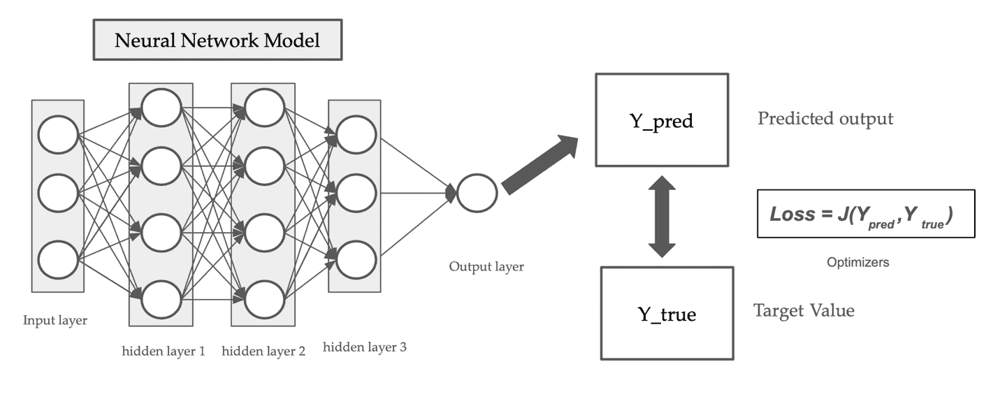

总体而言，深度学习是一种从复杂数据中学习的强大方法，已成功应用于包括图像识别、NLP 和语音识别在内的广泛任务。然而，它需要大量标记的训练数据，并且训练和部署可能计算成本高昂。

## 深度学习的机制

深度学习通过训练具有多个层的人工神经网络（ANN）来学习数据的隐藏表示，用于进行预测或分类。以下是深度学习中涉及的一般步骤：

深度学习是机器学习（ML）的一个子集，已彻底改变了计算机视觉、NLP 和预测分析等领域。这种变革性技术模拟了人脑处理数据和创建决策模式的工作方式。在这里，我们讨论深度学习过程的复杂性，详细介绍其基础步骤。

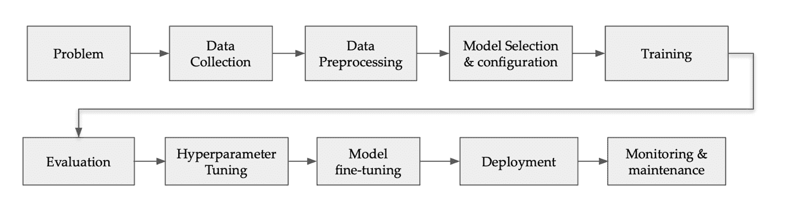

1. 问题定义：旅程始于对手头问题的清晰阐述。此阶段涉及理解任务，无论是识别图像中的对象、翻译语言还是预测未来趋势。明确的问题陈述指导数据、模型架构和评估指标的选择，为项目设定明确方向。

2. 数据收集：数据是深度学习的生命线。收集阶段涉及收集一个大型且多样的数据集，以准确代表问题空间。该数据集应涵盖模型预期处理的各种输入，确保其学习任务的全面表示。收集数据的质量、多样性和相关性显著影响模型学习和泛化的能力。

3. 数据预处理：原始数据通常包含噪声、无关信息和不一致之处，这些都可能阻碍学习。预处理将原始数据转换为适合训练的干净、标准化格式。此步骤可以包括归一化（缩放输入值）、处理缺失值、对分类数据进行编码以及扩充数据集以增加其多样性和大小。对于图像任务，预处理可能涉及调整图像大小、调整亮度或裁剪以聚焦于相关区域。

4. 模型选择：选择合适的模型架构至关重要。选择取决于问题的性质：CNN 在图像相关任务中表现出色，RNN 适用于时间序列或文本等序列数据，而 Transformer 在语言理解方面取得了显著成功。模型架构定义了将从数据中学习的层和连接的蓝图。

5. 模型配置：选择架构后，需要用特定参数对其进行配置。这包括定义层的数量和类型、引入非线性的激活函数以及权重的初始化。此外，损失函数（量化模型预测与实际数据之间差异）和优化算法（更新模型权重）的选择是影响学习效率和结果的关键配置。

6. 训练：训练是模型从数据中学习的核心阶段。使用训练集，模型迭代进行预测，将其与实际结果进行比较，并调整其权重以最小化损失函数。这种前向传播（进行预测）、计算损失和反向传播（更新权重）的过程持续多个时代，直到模型充分学习数据模式。

7. 评估：评估模型的性能对于了解其有效性至关重要。使用代表现实世界数据的测试集，根据任务性质，使用准确率、精确率、召回率和 F1 分数等指标将模型的预测与真实值进行比较。此评估有助于识别过拟合，即模型在训练数据上表现良好但在未见数据上表现不佳，表明它没有学习到可泛化的模式。


8. 超参数调优：超参数，例如学习率、批量大小和训练轮数，在模型训练和性能中起着重要作用。调优这些参数涉及尝试不同的值，以找到产生最佳性能的组合。网格搜索、随机搜索或贝叶斯优化等更高级的方法等技术可以自动化此搜索，尽管这可能计算量密集。

9. 模型微调：微调涉及进行最终调整以提高模型性能。迁移学习等技术，即在大型数据集上预训练的模型被调整以适应特定任务，可以显著提升性能，尤其是在数据稀缺时。此步骤还可能涉及额外的训练轮次或调整模型组件，以更好地捕捉任务的细微差别。

10. 部署：训练良好的模型需要部署到生产环境中，以开始提供价值。部署通常还包括模型量化，将权重和激活值从 float32 缩放到 int8。这涉及将模型集成到现有系统或应用程序中，使其能够接收新输入并提供预测或洞察。部署还需要考虑可扩展性、延迟和可靠性，以确保模型在现实条件下表现良好。

11. 监控与维护：部署后，持续监控对于确保模型随时间保持有效性至关重要。现实世界的数据可能会发生变化，导致一种称为模型漂移的现象，即模型性能下降。针对新数据进行定期评估、更新数据集和重新训练模型是保持其相关性和准确性的必要步骤。

总之，深度学习过程是从定义问题到部署稳健模型的精细旅程。从数据收集和预处理到训练、评估和微调的每个步骤，都对塑造模型学习和做出准确预测的能力至关重要，通过严格遵循这些步骤并持续监控和更新模型。

### Neuron basics

神经元是神经网络的基本构建块。它接收一个或多个输入，使用一组权重和偏差对其进行处理，并产生一个输出。

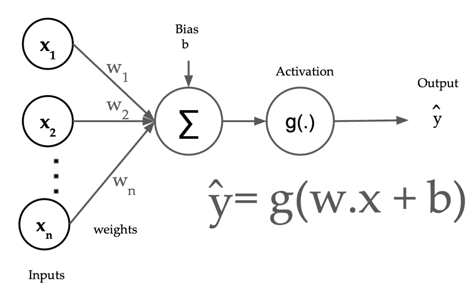

以下是关于神经元工作原理的更详细说明：

• 输入：神经元接收一个或多个输入，这些输入可能是原始数据或网络中其他神经元的输出。

• 权重：每个输入都被分配一个权重，决定其对神经元输出的影响。权重在训练期间学习，并进行调整以优化网络的性能。

• 偏差：除了输入和权重之外，神经元还有一个偏差项，这是一个添加到输入加权和中的常数值。偏差允许神经元将其激活函数向左或向右移动，这有助于建模复杂数据。

• 激活函数：一旦输入、权重和偏差被组合，神经元就会对结果应用激活函数。激活函数决定神经元是否会根据其接收到的输入而触发。

• 输出：神经元输出是激活函数的结果。此输出可以作为输入传递给网络中的其他神经元，也可以作为网络的最终输出。

在训练过程中，神经元的权重和偏差会被调整以优化网络的性能。这通常使用诸如 `SGD` 之类的优化算法来完成，该算法迭代更新权重和偏差，以最小化预测输出与真实输出之间的差异。

神经元使用的激活函数是其行为的关键组成部分。常见的激活函数包括 Sigmoid、双曲正切 (`tanh`) 和修正线性单元 (`ReLU`) 函数。激活函数的选择可以显著影响网络的性能，不同的函数可能更适合不同的数据类型。

神经元是强大且灵活的构建块，使神经网络能够学习复杂数据中的模式和关系。神经元可以组合形成多层神经网络。通过调整神经元的权重和偏差，神经网络可以适应各种任务和数据类型。请参阅以下图表：

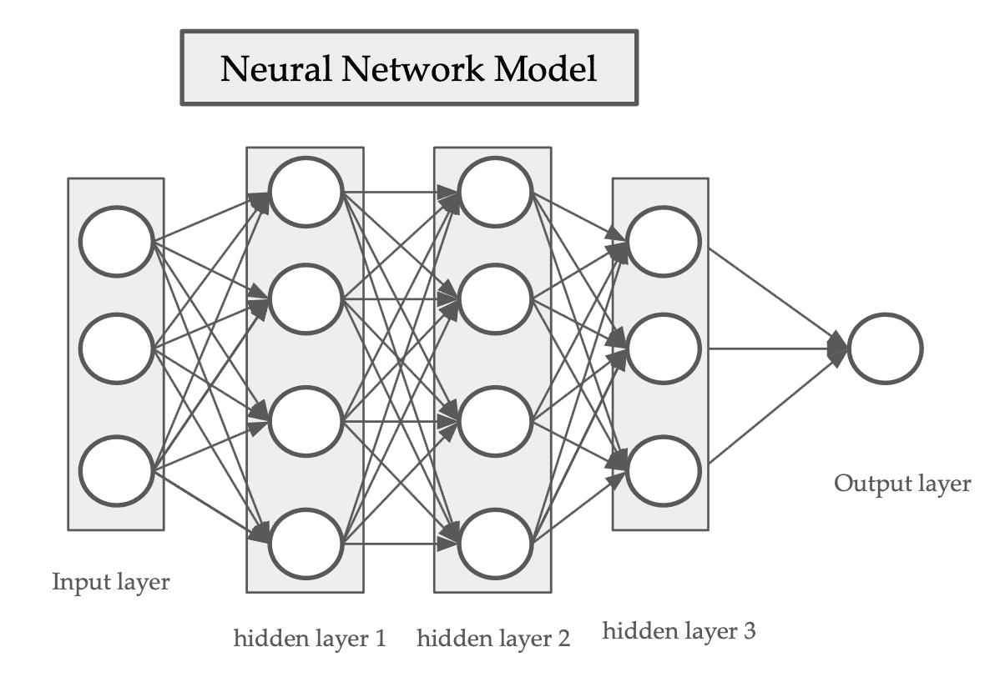

## Activation functions in deep learning

激活函数是深度学习模型的基本组成部分。它们应用于神经元的输出，以根据接收到的输入确定神经元是否应该触发。

以下是深度学习中使用的一些标准激活函数：

• Sigmoid：Sigmoid 函数是神经网络早期使用的一种流行激活函数。它接收一个输入并将其压缩到 0 到 1 之间的值，可以解释为概率。但是，Sigmoid 函数可能会遭受梯度消失问题，这会减慢或阻止深层网络的训练。

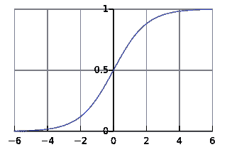

• tanh：tanh 函数与 Sigmoid 函数类似，但将输入映射到 -1 到 1 之间的范围。与 Sigmoid 函数一样，tanh 也可能会遭受梯度消失问题。

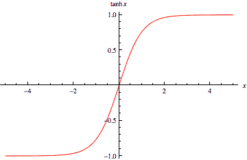

• ReLU：ReLU 函数是深度学习中一种流行的激活函数。它接收一个输入并返回输入值或 0，取较大者。ReLU 函数计算效率高，可以加速深层网络的训练。但是，ReLU 函数也可能会遭受 ReLU 失活问题，即对于某些输入值梯度变为零，阻止神经元学习。

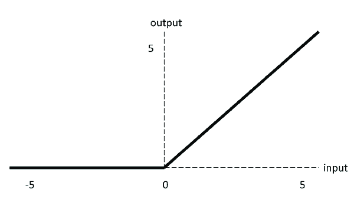

• Leaky ReLU：Leaky ReLU 函数是 ReLU 函数的修改版本，用于解决 ReLU 失活问题。它为负输入值引入一个轻微斜坡，允许神经元在梯度为零时继续学习。

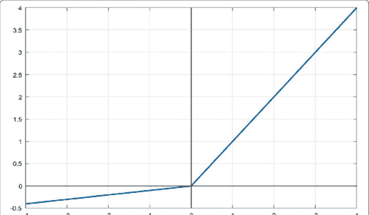

• Softmax：Softmax 函数通常用于神经网络的输出层，用于多类分类问题。它接收一个输入并将其压缩为可能类别上的概率分布。

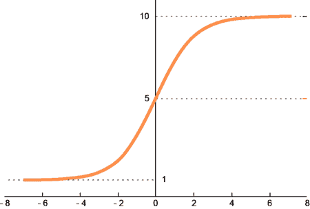

为深度学习模型选择合适的激活函数是一项重要任务，因为它可以显著影响模型的性能。选择可能取决于数据类型、当前任务和模型架构。

## Deep learning model optimization

优化深度学习模型是一个多方面的过程，涉及对模型架构、数据和训练过程的仔细考虑。以下是优化的全面方法：

• 数据质量和增强：高质量的数据是训练有效深度学习模型的基础。确保数据干净、标记良好，并且能代表要解决的问题。数据增强可以通过变换人为扩展数据集，增加多样性并减少过拟合。

• 模型架构：为任务选择合适的架构——用于图像相关任务的 CNN，用于序列数据的 RNN 等。将模型简化为达到所需性能所需的最小复杂度，以提高训练速度并减少过拟合。

• 正则化技术：应用 L1 和 L2 正则化等正则化方法来惩罚大权重，并使用 Dropout 防止神经元协同适应。这些技术鼓励更简单的模型，这些模型能更好地泛化到新数据。

• 批量归一化：引入批量归一化，为每个小批量标准化层的输入。这可以稳定学习过程，并大幅减少训练深层网络所需的训练轮数。


## 深度学习优化技巧

• Learning rate and optimizers: 优化学习率，因为它决定了算法在优化过程中采取的步长。使用自适应学习率优化器，如 Adam、RMSprop 或 AdaGrad，它们可以帮助比传统 SGD 更快地收敛。

• Gradient clipping: 实施梯度裁剪，以通过在反向传播期间将梯度限制在定义范围内来防止梯度爆炸问题。

• Weight initialization: 根据激活函数使用 Xavier/Glorot 或 He 初始化等策略正确初始化权重，以防止训练早期出现梯度消失或爆炸。

• Hyperparameter tuning: 使用网格搜索、随机搜索或贝叶斯优化进行超参数调优，以找到模型的最佳设置。

• Early stopping: 监控验证集上的性能，当性能恶化或不再改善时停止训练，这表明模型已开始过拟合。

• Transfer learning: 当数据有限时，考虑使用迁移学习，即在类似任务上预训练的模型在特定数据集上进行微调。这可以带来显著的性能提升并减少训练时间。

• Ensemble methods: 结合多个模型的预测。集成方法通常比任何单一模型表现更好，因为它们可以平均误差并减少方差。

• Evaluation metrics: 为特定问题使用正确的评估指标，例如分类任务的准确率、精确率、召回率、F1 分数，或回归任务的均方误差。

通过仔细调整这些因素，你可以微调深度学习模型以提高其性能，加快训练速度，并实现对新的、未见数据的更好泛化。

## Practical applications of deep learning

深度学习可用于各种任务，包括：

• Computer vision: 深度学习可用于目标检测、图像分割和面部识别。

• NLP: 深度学习可用于语言翻译、情感分析、语音识别和文本生成等任务。

• Recommender systems: 深度学习可用于构建推荐系统以推荐产品、服务等。

• Anomaly detection: 深度学习可以检测金融交易、信用卡使用或保险索赔中的异常和欺诈。

• Autonomous driving: 深度学习可用于构建自动驾驶系统。

• Robotics: 深度学习可用于构建在工业环境中执行抓取、操作和导航等任务的机器人。

• Healthcare: 深度学习可以分析医学图像、诊断疾病并预测患者预后。

下图展示了深度学习的一些应用：

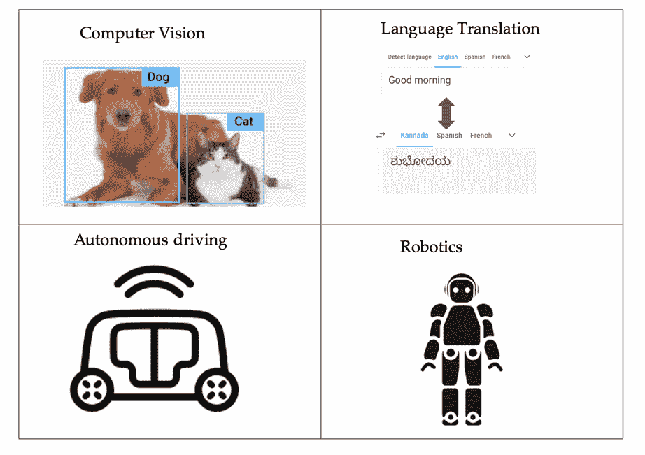

这些只是深度学习可以实现的一些示例。深度学习应用多种多样，并随着该领域的发展不断扩展。

## Hardware for deep learning

深度学习的硬件演进对其成功至关重要，因为深度学习模型计算密集，需要高性能和分布式计算系统。一些关键里程碑如下：

• CPUs: CPU 是用于深度学习的第一种硬件。最初用于训练小型神经网络，无法用于训练更大的模型。

• Graphics processing units (GPUs): GPU 比 CPU 更适合深度学习。它们于 2007 年首次用于深度学习应用，并因其能够并行处理大量数据而迅速获得流行。

• Tensor Processing Units (TPUs): 它们由 Google 于 2015 年开发，用于加速深度学习应用。它们专门为矩阵运算设计，而矩阵运算对深度学习计算至关重要。

• Field programmable gate arrays (FPGAs): 它们自 2010 年代初以来一直用于深度学习。它们是可编程集成电路，可针对特定深度学习应用进行定制，使其成为灵活且高效的解决方案。

• Application-specific integrated circuits (ASICs): 它们已为深度学习开发，以提供更高效和专业化的硬件。ASIC 针对特定深度学习应用（如图像识别或语音处理）设计，并针对性能和功耗进行了优化。

• Quantum computing: 量子计算有潜力通过利用量子算法同时处理大量数据来显著加速深度学习应用。然而，用于深度学习的量子计算仍处于早期发展阶段。

## Datasets for deep learning

深度学习数据集的演进对该领域的成功至关重要，因为深度学习模型需要大量标记数据进行训练。以下是深度学习数据集演进的一些关键里程碑：

• MNIST: MNIST 数据集是深度学习中最著名的数据集之一。它包含 60,000 个手写数字图像用于训练和 10,000 个图像用于测试，并已用于对各种深度学习算法进行基准测试。

• ImageNet: ImageNet 数据集于 2009 年推出，包含超过 1400 万个标记图像，涵盖超过 20,000 个类别。它已用于各种竞赛和基准测试，并帮助推动了计算机视觉的发展。

• Common Objects in Context (COCO): COCO 数据集于 2014 年推出，是一个用于目标检测、分割和标注的大规模数据集。它包含超过 33 万个图像，其中超过 250 万个目标实例跨 80 个类别进行了标记。

• OpenAI generative pre-trained transformer (GPT): OpenAI GPT 数据集于 2018 年推出，包含来自互联网的超过 40GB 的文本数据。它已用于训练生成连贯、上下文感知文本的语言模型。

• Bidirectional Encoder Representations from Transformers (BERT): BERT 数据集于 2018 年推出，是一个用于 NLP 任务（如问答和情感分析）的大规模数据集。它已用于训练语言模型以理解句子中单词的上下文和含义。

• TIMIT: TIMIT 数据集于 1986 年推出，是一个著名的语音识别数据集。它包含来自美国英语八个主要方言的 630 名演讲者的录音。

总体而言，深度学习数据集的演进对该领域的成功至关重要，使得更准确、更高效的模型得以开发。随着深度学习模型变得更加复杂并需要更多训练数据以实现更高准确性，向更大、更多样化的数据集发展的趋势将继续。此外，迁移学习和数据增强技术的发展使得更小的数据集成为可能，从而更容易在各种应用中训练深度学习模型。

## Algorithms for deep learning

深度学习算法是基于 ANNs 的 ML 算法子集。以下是一些最常用的深度学习算法：

• CNNs: CNNs 主要用于图像识别和分类任务。它们旨在识别图像模式，并可用于目标识别、人脸检测和图像分割等任务。

• RNNs: RNNs 用于涉及序列数据的任务，如语音识别、语言翻译和情感分析。它们旨在处理具有时间成分的数据，如语音或文本。

• Long-short term memory (LSTM): LSTM 是一种旨在处理长期依赖关系的 RNN。它们通常用于 NLP 任务，可用于生成文本或预测句子中的下一个词。


• `GANs`: `GANs` 用于涉及生成式建模的任务，例如图像和视频合成。它们由两个神经网络组成：生成器和判别器，两者协同工作以生成与训练数据相似的新数据。

• `Autoencoders`: `Autoencoders` 用于数据压缩、图像去噪和异常检测任务。它们旨在学习输入数据的压缩表示，该表示可用于重建原始数据。

• `DBNs`: `DBNs` 是一种用于无监督学习任务（如特征学习和数据聚类）的神经网络。它们由多层神经元组成，可以学习从输入数据中提取复杂特征。

• `Transformer networks`: 这利用自注意力机制高效处理序列数据，实现并行处理。它们彻底改变了 `NLP`，推动了翻译、文本生成甚至视觉等任务，显著提高了模型的准确性和可扩展性。

总的来说，深度学习算法的选择取决于具体任务和所使用的数据类型。不同的算法有不同的优缺点，选择合适的算法对于构建有效的深度学习系统非常重要。

## 不适合深度学习的场景

虽然深度学习是一种强大且多功能的技术，但在某些领域，它可能不是最佳方法，或者可能不适用。以下是一些示例：

• `Small data sets`: 深度学习需要大量数据才能有效，在只有少量数据可用的任务中可能表现不佳。少样本学习等深度学习方法可能克服这一挑战。

• `Highly structured data`: 深度学习最适合于数据具有某种潜在结构或可学习模式的任务。在数据高度结构化的任务中（例如数据库管理或数据清洗），它可能表现不佳。

• `Real-time processing`: 深度学习算法可能计算密集，可能不适合需要实时处理或低延迟响应时间的应用。

• `Domain-specific knowledge`: 当解决问题需要领域特定知识时，深度学习算法可能不实用。例如，深度学习算法可能无法在没有医学专家输入的情况下诊断特定的医疗状况。

总的来说，在为给定问题选择方法时，必须仔细考虑深度学习的优势和局限性。虽然它是一种强大的工具，但并非总是每种情况下的最佳选择。

## 深度学习的缺点

虽然深度学习在广泛的应用中取得了成功，但也存在一些显著的失败和局限性。以下是一些示例：

• `Data bias`: 深度学习模型可能容易受到训练数据中偏见的影响，导致有偏见或不公平的预测。这在各种应用中都有观察到，包括面部识别系统。模型在特定人群（尤其是肤色较深的人群）中的表现较差。

• `Generalization issues`: 深度学习模型有时可能难以推广到新的和未见过的数据，尤其是当训练数据不能代表目标人群或数据分布随时间变化时。

• `Explainability and interpretability`: 深度学习模型可能难以解释和说明，这在透明度和可解释性至关重要时可能会带来问题。这可能导致在特定领域（例如医疗保健和金融）部署这些模型时面临挑战。

• `Adversarial attacks`: 深度学习模型可能容易受到对抗性攻击，即对输入数据进行微小更改可能导致模型做出错误预测。这已在各种应用中得到证明，包括图像识别和自动驾驶汽车。

• `Resource requirements`: 深度学习模型可能需要大量计算资源，包括大量内存和处理能力。这使得它们难以部署在资源受限的设备或实时应用中。

在开发和部署模型时，必须仔细考虑深度学习的潜在局限性和失败。可能需要引入额外的技术，例如可解释性方法和偏差缓解策略，以应对这些挑战并确保模型公平、可靠且值得信赖。

## 结论

深度学习的演进在人工智能（`AI`）领域是一段非凡的旅程。在过去几十年中，深度学习已从一个小众领域发展成为主流技术，为我们今天使用的许多 AI 应用提供动力。深度学习的快速演进是由硬件、算法和数据可用性的进步所推动的。

在深度学习的早期，研究人员难以训练具有多层的深度神经网络。然而，反向传播算法的开发和 `CNNs` 等突破为更复杂的深度学习架构的发展铺平了道路。

大型数据集的可用性和云计算的兴起进一步推动了深度学习的增长。强大的 `GPUs` 和专用硬件（例如 `Google TPUs`）的开发，使得训练更大、更复杂的模型成为可能。

今天，深度学习广泛应用于许多领域，从计算机视觉和 `NLP` 到医疗保健和金融。研究人员继续推动深度学习的边界，探索新的架构、算法和应用。

总之，深度学习的演进是一段非凡的旅程，它改变了 AI 领域。这项技术自诞生以来已经走得很远，并且在未来几年中有望继续为许多领域做出重大贡献。

在下一章中，我们将讨论如何设置 `PyTorch` 以使用深度学习进行训练。

# 要点

• 深度学习是机器学习的一个分支，它将数据中的高级模型建模为复杂的多层网络。

• 它从人脑中汲取灵感，利用称为 `ANNs` 的结构。

• 深度学习的初始挑战包括计算限制、数据稀缺以及对高效算法的有限理解。

• 其兴起得益于计算能力和数据可用性的进步。

• 深度学习在特征学习、可扩展性、适应性和实现高精度方面表现出色，在特定任务中通常能超越人类水平的性能。

• 神经网络、训练数据、损失函数、优化器、验证数据和测试数据是深度学习框架的基础。

• 深度学习过程包括问题定义、数据收集和预处理、模型选择和配置、训练、评估和微调。

• 深度学习已成功应用于计算机视觉、`NLP`、自动驾驶等多个领域。

• 里程碑包括创建 `ImageNet` 等关键数据集、`CNNs` 和 `RNNs` 等网络架构的进步，以及能够支持密集计算的硬件的出现。

• 尽管强大，深度学习仍面临数据偏差、泛化性、可解释性以及易受对抗性攻击等问题。

• 有效的模型优化涉及数据增强、仔细选择架构和激活函数、正则化技术以及超参数调整。该领域正在不断发展，持续的研究旨在解决当前的局限性并探索新的应用和方法。

**加入我们书籍的 Discord 空间**


加入本书的 Discord 工作区，获取最新动态、优惠信息、全球技术动态、新书发布以及与作者的交流会议：

`[`discord.bpbonline.com`](https://discord.bpbonline.com)`


# 第 2 章

## 设置并运行 PyTorch

### 简介

在本章中，我们将踏上一段全面的旅程，探索 PyTorch 的核心组件。PyTorch 是一款领先的深度学习库，因其灵活性、易用性和动态计算图而广受欢迎。我们的探索将从设置开发环境中的 PyTorch 这一基础步骤开始，确保你拥有开始构建复杂深度学习模型所需的正确工具。

你将了解 PyTorch 的安装过程。本节将提供一个逐步指南，介绍如何在各种操作系统上设置 PyTorch，包括必要的故障排除技巧，以确保安装过程顺利。无论你使用的是 Windows、macOS 还是 Linux，你都将掌握在机器上运行 PyTorch 所需的知识。

张量是 PyTorch 的核心，也是任何深度学习模型的基石。本部分将深入探讨张量的细节、其与 NumPy 数组的异同，以及它们在表示数据和 PyTorch 中计算图方面的关键作用。你将学习如何操作张量，以执行构建神经网络所必需的各种数学运算。

数据是任何机器学习（ML）模型的生命线。在本节中，我们将探讨 PyTorch 如何通过其全面的 API 处理数据集。你将学习如何使用数据加载器和数据集高效地管理和预处理大型数据集，从而实现数据的无缝集成和操作，用于训练你的模型。这项知识对于确保你的模型获得组织良好且高效批处理的数据至关重要。

数据很少以干净、可直接用于模型的格式出现。Transforms 部分将教你如何使用 PyTorch 强大的转换实用程序来预处理和增强数据，使其适合神经网络训练。从归一化到调整大小和翻转图像，你将掌握为最佳模型性能准备数据的技巧。

在打好基础之后，我们将重点转向在 PyTorch 中构建深度学习模型。本部分将指导你使用 PyTorch 的模块化方法，逐层构建模型。你将获得定制神经网络架构的实践经验，以适应你的特定问题领域。

PyTorch 最引人注目的功能之一是其自动微分引擎 autograd。本节将揭示自动微分的概念，并说明 PyTorch 如何简化梯度的计算，梯度在训练期间更新模型参数至关重要。理解 autograd 对于任何希望掌握训练深度学习模型内部工作原理的人来说都至关重要。

模型训练的核心在于优化循环，学习的奇迹就发生在这里。本章的这一部分将引导你完成前向传播、损失计算、反向传播和参数更新的迭代过程。你将学习如何使用 PyTorch 的优化器来最小化损失并随时间提高模型的准确性。

最后，模型的优劣取决于其在现实问题中的适用性。本章的最后一部分将介绍在 PyTorch 中保存和加载训练好的模型的关键步骤，使你能够保存模型的状态以供将来使用或部署。你还将学习如何使用训练好的模型进行预测，使你的深度学习项目取得成果。

在本章结束时，你将对 PyTorch 的核心功能有扎实的理解，并能够应对各种深度学习挑战。让我们一起踏上这段激动人心的旅程，在你的深度学习事业中释放 PyTorch 的全部潜力。

### 结构

本章包含以下主题：

• PyTorch 安装和设置

• 初始化张量

• 连接张量

• 数据集和数据加载

• Transforms

• 构建神经网络模型

• 自动微分

• 优化模型参数

• 保存和加载模型

# 目标

本章关于 PyTorch 安装和设置的目标旨在使读者全面了解并掌握使用 PyTorch（一个领先的深度学习框架）的实用技能。本章旨在：介绍 PyTorch，指导安装，理解张量，数据处理，构建神经网络，训练和评估模型，保存和加载模型。

通过实现这些目标，本章旨在赋予读者使用 PyTorch 开发和部署尖端 ML 模型所需的理论基础和实用技能。

### PyTorch 安装和设置

在 Linux 系统上安装 PyTorch 是一个简单的过程。安装步骤可能会因你使用 CPU 还是图形处理单元（GPU）进行计算而略有不同。以下是在 Linux 上安装 PyTorch 的一般步骤：

1. 检查 Python 安装：确保系统上已安装 Python。PyTorch 需要 Python，建议使用 Python 3.6 或更高版本。你可以在终端中运行以下命令来检查 Python 版本：

`Python3 –version`

如果未安装 Python，可以使用发行版的包管理器安装它，例如 Ubuntu/Debian 使用 apt，Fedora 使用 yum。

2. 安装 pip（如有必要）：pip 是 Python 包安装程序。如果尚未安装，可以运行以下命令进行安装：

`sudo apt install python3-pip` # 对于 Debian/Ubuntu

`# 或`

`sudo yum install python3-pip` # 对于 Fedora

3. 选择安装偏好：决定你是仅使用 CPU 支持还是使用 GPU 支持来使用 PyTorch。对于 GPU 支持，请确保已安装必要的 NVIDIA 驱动程序、CUDA Toolkit 和 cuDNN。CUDA 版本将影响你可以安装的 PyTorch 版本。

4. 获取 PyTorch 安装命令：访问 PyTorch 官方网站（`https://pytorch.org/get-started/locally/`）以获取适合你设置的适当安装命令。该网站根据以下内容提供命令：

• 操作系统（选择 Linux）

• 包管理器（pip 或 conda）

• Python 版本

• 是否需要 CUDA 支持（选择与 GPU 驱动程序兼容的 CUDA 版本，或仅限 CPU 则选择无）

对于使用 pip 的典型仅限 CPU 安装，命令可能如下所示：

`pip3 install torch torchvision torchaudio`

对于启用 GPU 的安装，假设你已安装兼容的 CUDA 版本，命令可能如下所示：

`pip3 install torch torchvision torchaudio -f https://download.pytorch.org/whl/cu113/torch_stable.html`

将 cu113 替换为与你的 CUDA 安装匹配的正确 CUDA 版本标记。

5. 验证安装：安装后，在 Python 解释器中运行以下命令，验证 PyTorch 是否已正确安装：

```
import torch

print(torch.__version__)

print(torch.cuda.is_available())
```

这将显示已安装的 PyTorch 版本，如果 PyTorch 正确识别你的 CUDA 设置，`torch.cuda.is_available()` 将返回 True，表示已启用 GPU 支持。

张量是一种在物理学、数学和计算机科学中使用的数学对象，特别是在 ML 和深度学习的背景下。让我们先了解数学对象。数学对象可以是一个变量，它可以有一个值并用于公式中。


## Tensor 数学对象与操作

Some examples of mathematical objects include points, lines, polygons, cylinders, and cones. These can be defined using a formula.

Now that we have understood the mathematical objects, let us dive deep into tensors. A tensor is a multi-dimensional array or data structure that can store and represent data in a structured way. Tensors are a generalization of scalars (0-dimensional), vectors (1-dimensional), and matrices (2-dimensional) to higher dimensions.

Some key characteristics and properties of tensors are as follows:

• Dimensionality: Tensors can have arbitrary dimensions. The number of dimensions in a tensor is also known as its rank or order. For example:

○ A scalar is a 0-dimensional tensor.

○ A vector is a 1-dimensional tensor.

○ A matrix is a 2-dimensional tensor.

A higher-dimensional tensor can have three or more dimensions. The diagram below shows the types of arrays and shape to illustrate the tensor:

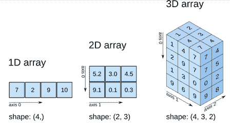

• Shape: The shape of a tensor describes the size of each dimension. For example, a 2x3 matrix has a (2, 3) shape, indicating two rows and three columns. In ML frameworks, you often encounter tensors with shapes like (batch\_size and num\_features) for input data.

• Data type: Tensors can store data of different types, such as integers, floating-point numbers, or even more complex data types. The data type determines the precision and range of values the tensor represents.

• Operations: Tensors support all mathematical operations, such as addition, multiplication, and elementwise. In deep learning, these operations are used for forward and backward passes during neural network training.

• Memory layout: Tensors are stored in memory in a contiguous block, and the layout of elements is determined by the tensor's shape and the memory layout conventions of the framework being used.

• GPU acceleration: Many deep learning frameworks, including PyTorch and TensorFlow, provide GPU support for tensor operations, allowing for faster numerical computations by leveraging the parallel processing capabilities of modern GPUs.

In deep learning, data is often represented as tensors and neural network models are composed of layers that take tensors as input and produce tensors as output. Tensors store input data, model parameters (weights and biases), intermediate activations, and gradients during training.

Understanding tensors and their manipulation is fundamental to working with ML and deep learning frameworks, as most operations in these frameworks involve the manipulation of tensors to perform computations, update model parameters, and make predictions.

Tensors are like NumPy’s `ndarrays`, except that tensors can run on GPUs or other hardware accelerators. Tensors and NumPy arrays often share the same underlying memory, eliminating the need to copy data.

We will import `numpy` as `np` as below:

```python
import torch

import numpy as np
```

## Initializing a tensor

Tensors can be initialized in various ways. Look at the following examples:

• Directly from data: Tensors can be created directly from data. The data type is automatically inferred, as follows:

```python
data = [[1, 2],[3, 4]]

x_data = torch.tensor(data)
```

• From a NumPy array: Tensors can be created from NumPy arrays, as follows:

```python
np_array = np.array(data)

x_np = torch.from_numpy(np_array)
```

### Attributes of a tensor

Tensor attributes describe their shape, data type, and the device on which they are stored.

Input:

```python
tensor = torch.rand(3,4)

print(f"Shape of tensor: {tensor.shape}")

print(f"Datatype of tensor: {tensor.dtype}")

print(f"Device tensor is stored on: {tensor.device}")
```

Output:

```
Shape of tensor: torch.Size([3, 4])

Datatype of tensor: torch.float32

Device tensor is stored on:
```

### Operations on tensors

Over 100 tensor operations, including arithmetic, linear algebra, matrix manipulation (transposing, indexing, slicing), sampling, and more, can be executed.

These operations can be run on the GPU (at typically higher speeds than on a CPU). If you are using Colab, allocate a GPU by going to Runtime | Change runtime type | GPU.

By default, tensors are created on the CPU by default. We need to explicitly move them to the GPU using the `.to` method (after checking for GPU availability). Remember that copying large tensors across devices can be expensive in terms of time and memory!

The following code snippet is a conditional operation that moves a tensor to the GPU to leverage faster computing capabilities, but only if a GPU with CUDA support is available on the system. This is a common practice in deep learning workflows to enhance performance during model training and inference:

```python
# We move our tensor to the GPU if available

if torch.cuda.is_available():

tensor = tensor.to("cuda")
```

The following code snippet is an example of creating, accessing, modifying, and displaying parts of tensors in PyTorch, showcasing fundamental operations that are commonly used in tensor manipulation for deep learning tasks.

### Standard NumPy-like indexing and slicing

The output shows a 4x4 tensor filled with 1s. PyTorch tensors are similar to NumPy arrays and are used to store data for computation.

```python
tensor = torch.ones(4, 4)

print(f"First row: {tensor[0]}")

print(f"First column: {tensor[:, 0]}")

print(f"Last column: {tensor[..., -1]}")

tensor[:,1] = 0

print(tensor)
```

This tensor serves as the starting point for the operations that follow.

Output:

```
First row: tensor([1., 1., 1., 1.])

First column: tensor([1., 1., 1., 1.])

Last column: tensor([1., 1., 1., 1.])

tensor([[1., 0., 1., 1.],

[1., 0., 1., 1.],

[1., 0., 1., 1.],

[1., 0., 1., 1.]])
```

## Joining tensor

You can use `torch.cat` to concatenate a sequence of tensors along a given dimension. `torch.stack` is another tensor joining operator subtly different from `torch.cat`.

Tensor joining operations, like `torch.cat` and `torch.stack`, merge tensors along a specified axis. `torch.cat` concatenates tensors without adding a new dimension, while `torch.stack` combines tensors into a new dimension, increasing the tensor's rank.

```python
print("original tensor shape:" , tensor.shape)

t1 = torch.cat([tensor, tensor, tensor], dim=1)

print("joined tensor shape:" , t1.shape)

print("joined tensor:",t1)
```

Output:

```
original tensor shape: torch.Size([4, 4])

joined tensor shape: torch.Size([4, 12])

joined tensor: tensor([[1., 0., 1., 1., 1., 0., 1., 1., 1., 0., 1., 1.],

[1., 0., 1., 1., 1., 0., 1., 1., 1., 0., 1., 1.],

[1., 0., 1., 1., 1., 0., 1., 1., 1., 0., 1., 1.],

[1., 0., 1., 1., 1., 0., 1., 1., 1., 0., 1., 1.]])
```

### Arithmetic operations

In PyTorch, arithmetic operations on tensors include adding, subtracting, multiplying, and dividing. These can be performed element-wise between tensors or between tensors and scalars, automatically applying the operation to each element, making it easy to perform mathematical computations on multi-dimensional data.

The following lines of code show different matrix multiplications:

```python
# This computes the matrix multiplication between two tensors. y1, y2, y3 will have the same value

# `tensor.T` returns the transpose of a tensor

y1 = tensor @ tensor.T

y2 = tensor.matmul(tensor.T)

y3 = torch.rand_like(y1)

torch.matmul(tensor, tensor.T, out=y3)

torch.allclose(y1,y2) and torch.allclose(y2,y3) and torch.allclose(y1,y3)
```

Input:

```
True
```

```python
# This computes the element-wise product. z1, z2, z3 will have the same value

z1 = tensor * tensor

z2 = tensor.mul(tensor)

z3 = torch.rand_like(tensor)

torch.mul(tensor, tensor, out=z3)
```

Output:

```
tensor([[1., 0., 1., 1.],

[1., 0., 1., 1.],

[1., 0., 1., 1.],

[1., 0., 1., 1.]])
```

### Single-element tensors


如果你有一个单元素张量，例如，通过将张量的所有值聚合为一个值，你可以使用 `item()` 将其转换为 Python 数值：

```
agg = tensor.sum()

agg_item = agg.item()

print(agg_item, type(agg_item))
```

输出：

```
12.0 <class 'float'>
```

# 原地操作

将结果存储在操作数中的操作称为原地操作。它们由 `_` 后缀表示。例如：`x.copy_(y)`、`x.t_()` 会更改 `x`。

以下代码行首先显示张量的内容，然后将张量中每个元素增加 5 并显示更新后的张量：

```
print(f"{tensor} \n")

tensor.add_(5)

print(tensor)
```

输出：

```
tensor([[1., 0., 1., 1.],
[1., 0., 1., 1.],
[1., 0., 1., 1.],
[1., 0., 1., 1.]])

tensor([[6., 5., 6., 6.],
[6., 5., 6., 6.],
[6., 5., 6., 6.],
[6., 5., 6., 6.]])
```

### 与 NumPy 桥接

PyTorch 允许其张量与 NumPy 数组之间无缝转换，使数据操作和科学计算的互操作性无需昂贵的数据复制。

CPU 上的张量和 NumPy 数组可以共享其底层内存位置；更改其中一个会更改另一个。

### 张量转 NumPy 数组

将 PyTorch 张量转换为 NumPy 数组可以让你从 PyTorch 的数据结构切换到 NumPy 的数据结构，从而更容易使用广泛的科学计算工具。

以下代码行首先创建张量，显示其内容，然后将其转换为 NumPy 并显示 NumPy 数组。

```
t = torch.ones(5)

print(f"t: {t}")

n = t.numpy()

print(f"n: {n}")
```

输出：

```
t: tensor([1., 1., 1., 1., 1.])

n: [1. 1. 1. 1. 1.]
```

张量的变化会反映在 NumPy 数组中，如下面的代码所示：

```
t.add_(1)

print(f"t: {t}")

print(f"n: {n}")
```

输出：

```
t: tensor([2., 2., 2., 2., 2.])

n: [2. 2. 2. 2. 2.]
```

### NumPy 数组转张量

将 NumPy 数组转换为 PyTorch 张量会更改其格式，以便将其与 PyTorch 的深度学习工具和操作集成到神经网络工作流中。

以下代码行首先创建 NumPy 数组，然后将其转换为张量并显示 NumPy 数组和张量。

```
n = np.ones(5)

t = torch.from_numpy(n)
```

NumPy 数组的变化会反映在张量中。

```
np.add(n, 1, out=n)

print(f"t: {t}")

print(f"n: {n}")
```

输出：

```
t: tensor([2., 2., 2., 2., 2.], dtype=torch.float64)

n: [2. 2. 2. 2. 2.]
```

## 数据集和数据加载

PyTorch 提供多个预加载的数据集，并实现特定于特定数据的函数。这些数据集可用于原型设计和基准测试 ML 模型。

它提供不同类型的数据集，如下所示：

• 图像数据集：

○ 图像分类数据集

○ 图像分割数据集

○ 光流数据集

○ 立体匹配

○ 图像对

○ 图像字幕

○ 视频分类

○ 视频预测

• 文本数据集：

○ 文本分类

○ 语言建模

○ 机器翻译

○ 序列标注

○ 问答

○ 无监督学习

• 音频数据集：

○ 语音识别

○ 声音分类

# 加载数据集

在 PyTorch 中，加载数据集是指以结构化方式设置数据，使其准备好用于训练或测试 ML 模型。此过程始于确定数据所在的位置，可能是计算机上的文件或远程数据库。然后将数据组织到 `Dataset` 对象中，这是 PyTorch 的一种构造，用于标准化数据的格式化和访问方式。最后，通常会使用 `DataLoader`，它接收 `Dataset` 并便于以可管理的块或批次迭代数据。这对于高效训练至关重要，因为它允许在不使系统内存不堪重负的情况下进行无缝的数据操作和迭代。

以下是如何从 `torchvision` 加载 FashionMNIST 数据集的示例。FashionMNIST 是 Zalando 的商品图片数据集，包含 60,000 个训练示例和 10,000 个测试示例。

```
import torch

from torch.utils.data import Dataset

from torchvision import datasets

from torchvision.transforms import ToTensor

import matplotlib.pyplot as plt

training_data = datasets.FashionMNIST(

root="data",

train=True,

download=True,

transform=ToTensor()

)

test_data = datasets.FashionMNIST(

root="data",

train=False,

download=True,

transform=ToTensor()

)
```

此代码片段用于加载 FashionMNIST 数据集，该数据集是一组与时尚相关的图片，用于图像识别任务中 ML 模型的训练和测试：

• `from torchvision import datasets`：从 `torchvision` 导入 `datasets` 模块，该包提供用于在 PyTorch 中处理图像数据的实用程序。

• `from torchvision.transforms import ToTensor`：导入 `ToTensor` 转换，它将图像转换为 PyTorch 张量，即 PyTorch 中用于计算的核心数据结构。

• `import matplotlib.pyplot as plt`：导入 `matplotlib.pyplot` 模块，这是 Python 中的绘图库，通常用于可视化数据（包括图像）。

• `training_data` 赋值创建一个用于训练模型的 FashionMNIST 数据集实例。它指定：

○ `root="data"`：存储或获取数据集的本地目录。

○ `train=True`：指示此数据集将用于训练模型。

○ `download=True`：如果指定目录中不存在数据集，则将从互联网下载。

• `transform=ToTensor()`：对数据集中的每个图像应用 `ToTensor` 转换，将它们从 PIL 图像或 NumPy 数组转换为 PyTorch 张量。

• 同样，`test_data` 赋值创建一个用于测试目的的 FashionMNIST 数据集实例。主要区别在于 `train=False` 指定此数据集用于测试，而非训练。

### 迭代和可视化数据集

在 PyTorch 中，迭代和可视化数据集涉及逐个遍历数据集中的项目并显示这些项目（通常是图像），以便你查看它们的外观。此过程有助于更好地了解数据，并确保在开始训练模型之前数据格式正确。

我们可以像列表一样手动索引数据集：`training_data[index]`。我们使用 `matplotlib.pyplot` 可视化训练数据中的一些样本。

请参阅以下代码：

```
labels_map = {

0: "T-Shirt",

1: "Trouser",

2: "Pullover",

3: "Dress",

4: "Coat",

5: "Sandal",

6: "Shirt",

7: "Sneaker",

8: "Bag",

9: "Ankle Boot",

}

figure = plt.figure(figsize=(8, 8))

cols, rows = 3, 3

for i in range(1, cols * rows + 1):

sample_idx = torch.randint(len(training_data), size=(1,)).item()

img, label = training_data[sample_idx]

figure.add_subplot(rows, cols, i)

plt.title(labels_map[label])

plt.axis("off")

plt.imshow(img.squeeze(), cmap="gray")

plt.show()
```

显示 FashionMNIST 中图像的输出：

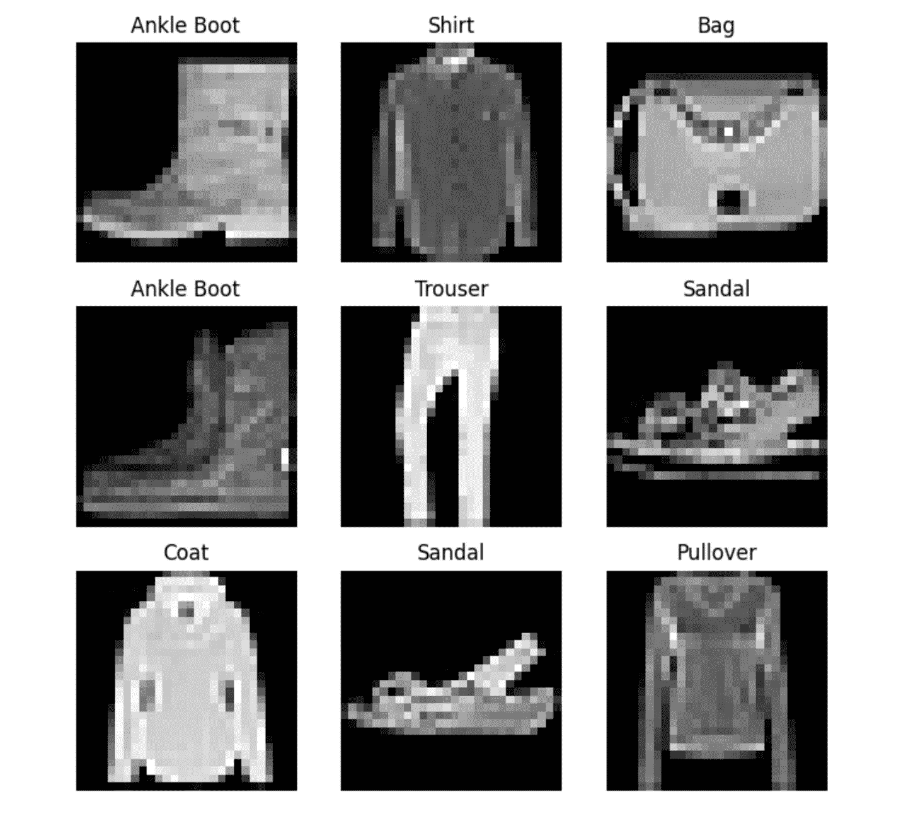

## 转换

几乎所有现实世界的数据集在训练 ML 算法之前都需要进行数据转换。PyTorch 函数 `transforms` 可用于操作数据并使其适合训练。

所有 TorchVision 数据集都有两个参数 `-transform` 用于修改特征，`target_transform` 用于修改标签。`torchvision.transforms` 模块提供了几种开箱即用的常用转换。

FashionMNIST 的特征为 PIL 图像格式，标签为整数。对于训练，我们需要将特征转换为归一化张量，将标签转换为 one-hot 编码张量。要进行这些转换，我们使用 `ToTensor` 和 `Lambda`。

请参阅以下代码：

```
import torch

from torchvision import datasets

from torchvision.transforms import ToTensor, Lambda

ds = datasets.FashionMNIST(

root="data",

train=True,

download=True,

transform=ToTensor(),
```


## 构建神经网络模型

`torch.nn` 命名空间提供了构建神经网络所需的所有构建块。PyTorch 中的每个模块都继承自 `nn.Module`。神经网络是一个由其他模块（层）组成的模块。这种嵌套结构使得构建和管理复杂架构变得容易。

在以下部分中，我们将构建一个神经网络来对 FashionMNIST 数据集中的图像进行分类。

请参阅以下代码：

```python
import os

import torch

from torch import nn

from torch.utils.data import DataLoader

from torchvision import datasets, transforms
```

### 获取训练设备

如果可用，我们希望在 GPU 或 MPS 等硬件加速器上训练模型。让我们检查 `torch.cuda` 或 `torch.backends.mps` 是否可用；否则，我们使用 CPU。

```python
device = (
    "cuda"
    if torch.cuda.is_available()
    else "mps"
    if torch.backends.mps.is_available()
    else "cpu"
)

print(f"Using {device} device")
```

这段代码片段是关于根据系统的硬件可用性设置 PyTorch 操作的计算设备。它使用条件表达式来选择设备。

设备可以是 GPU（使用 CUDA 或 MPS）或 CPU：

• 如果 CUDA 可用，`device` 设置为 `cuda`。

• 如果 CUDA 不可用，它会检查 MPS 可用性。Metal Performance Shaders (MPS) 是 Apple 框架，用于在 Mac 设备上使用 GPU 加速。如果 MPS 可用，设备设置为 `mps`。

• 如果 CUDA 和 MPS 都不可用，它默认通过将 `device` 设置为 `cpu` 来使用 CPU 进行计算。

总之，此代码按以下优先级自动为 PyTorch 选择最佳可用计算设备：CUDA GPU、MPS GPU，然后是 CPU，并打印出所选设备。

### 定义类

我们通过继承 `nn.Module` 来定义神经网络，并在 `__init__` 中初始化神经网络层。每个 `nn.Module` 子类都在 `forward` 方法中实现对输入数据的操作。

请参阅以下代码：

```python
class NeuralNetwork(nn.Module):

    def __init__(self):

        super().__init__()

        self.flatten = nn.Flatten()

        self.linear_relu_stack = nn.Sequential(

            nn.Linear(28*28, 512),

            nn.ReLU(),

            nn.Linear(512, 512),

            nn.ReLU(),

            nn.Linear(512, 10),

        )

    def forward(self, x):

        x = self.flatten(x)

        logits = self.linear_relu_stack(x)

        return logits
```

我们创建 `NeuralNetwork` 的实例，并将其移动到设备，并打印其结构，如下所示：

```python
model = NeuralNetwork().to(device)

print(model)
```

输出：

```
NeuralNetwork(
  (flatten): Flatten(start_dim=1, end_dim=-1)
  (linear_relu_stack): Sequential(
    (0): Linear(in_features=784, out_features=512, bias=True)
    (1): ReLU()
    (2): Linear(in_features=512, out_features=512, bias=True)
    (3): ReLU()
    (4): Linear(in_features=512, out_features=10, bias=True)
  )
)
```

要使用模型，我们将输入数据传递给它。这将执行 `model.forward`，以及一些后台操作。不要直接调用 `model.forward()`！

在输入上调用模型会返回一个 2 维张量，其中 `dim=0` 对应每个类的 10 个原始预测值，`dim=1` 对应每个输出的单独值。我们通过将它们传递给 `nn.Softmax` 模块的实例来获取预测概率。

```python
X = torch.rand(1, 28, 28, device=device)

logits = model(X)

pred_probab = nn.Softmax(dim=1)(logits)

y_pred = pred_probab.argmax(1)

print(f"Predicted class: {y_pred}")
```

输出：

```
Predicted class: tensor([4], device='mps:0')
```

上面的代码片段演示了如何在 PyTorch 中使用训练好的模型进行预测，使用随机生成的输入张量：

• `X = torch.rand(1, 28, 28, device=device)`：这创建了一个形状为 `(1, 28, 28)` 的随机张量 `X`，表示一个 28x28 像素的图像。形状中的 `1` 表示批次中只有一张图像。此张量被放置在先前选择的设备上（可能是 CPU、CUDA GPU 或 MPS GPU）。

• `logits = model(X)`：随机图像张量 `X` 被传递给名为 `model` 的预训练模型。模型处理输入并输出 logits，即模型正在预测的每个类的原始、未归一化分数。

• `pred_probab = nn.Softmax(dim=1)(logits)`：logits 被传递给 Softmax 函数以将其转换为概率。Softmax 函数沿 `dim=1` 应用，将每个类的 logits 转换为 0 到 1 之间且总和为 1 的值，表示模型对每个类的置信度。

• `y_pred = pred_probab.argmax(1)`：这通过获取 `pred_probab` 张量沿维度 1 的最大值索引来找到概率最高的类。此索引表示模型对输入图像的预测类。

• `print(f"Predicted class: {y_pred}")`：最后，打印出预测类索引，指示模型认为随机输入最可能属于哪个类。

这段代码是使用单个随机生成的输入图像从 PyTorch 模型生成预测的基本示例。

# 模型层

让我们分解 FashionMNIST 模型中的层。为了说明这一点，我们将取一个包含 3 张 28x28 图像的小批量样本，并查看它们在通过网络时会发生什么。请参阅以下代码：

```python
input_image = torch.rand(3,28,28)

print(input_image.size())
```

### nn.Flatten

我们初始化 `nn.Flatten` 层，将每个 2 维 28x28 图像转换为 784 个像素值的连续数组（小批量维度（在 `dim=0` 处）保持不变）。

请参阅以下代码：

```python
flatten = nn.Flatten()

flat_image = flatten(input_image)

print(flat_image.size())
```

### nn.Linear

线性层是一个模块，它使用存储的权重和偏差对输入应用线性变换，如以下代码所示：

```python
layer1 = nn.Linear(in_features=28*28, out_features=20)

hidden1 = layer1(flat_image)

print(hidden1.size())
```

### nn.ReLU

非线性激活在模型的输入和输出之间创建复杂的映射。它们在线性变换之后应用，以引入非线性，帮助神经网络学习各种现象。

在此模型中，我们在线性层之间使用 `nn.ReLU`，但还有其他激活函数可以为您的模型引入非线性。

请参阅以下代码：

```python
print(f"Before ReLU: {hidden1}\n\n")

hidden1 = nn.ReLU()(hidden1)

print(f"After ReLU: {hidden1}")
```

### nn.Sequential

`nn.Sequential` 是模块的有序容器。数据按定义的相同顺序通过所有模块。您可以使用顺序容器快速构建网络，如 `seq_modules`，如下所示：

```python
seq_modules = nn.Sequential(

    flatten,

    layer1,

    nn.ReLU(),

    nn.Linear(20, 10)

)

input_image = torch.rand(3,28,28)

logits = seq_modules(input_image)
```

### nn.Softmax

神经网络的最后一个线性层返回 logits——`[-infty, infty]` 中的原始值——这些值被传递给 `nn.Softmax` 模块。logits 被缩放为 `[0, 1]` 中的值，表示模型对每个类的预测概率。`dim` 参数指示值必须总和为 1 的维度。

请参阅以下代码：

```python
softmax = nn.Softmax(dim=1)

pred_probab = softmax(logits)
```

# 模型参数

神经网络内部的许多层都是参数化的，即具有在训练期间优化的相关权重和偏差。继承 `nn.Module` 会自动跟踪模型对象内部定义的所有字段，并使所有参数可通过模型的 `parameters()` 或 `named_parameters()` 方法访问。


在这个示例中，我们遍历每个参数，并打印其大小和值的预览。请参考以下代码：

```
print(f"Model structure: {model}\n\n")

for name, param in model.named_parameters():
    print(f"Layer: {name} | Size: {param.size()} | Values : {param[:2]} \n")
```

## 自动微分

作为训练神经网络的一部分，参数（模型权重）会根据给定参数的损失函数梯度进行调整，直到损失最小化。最常用的算法是反向传播。

PyTorch 中的自动微分是一项基本功能，允许你计算张量相对于某个标量值的梯度。

要计算这些梯度，PyTorch 内置了一个名为 `torch.autograd` 的微分引擎。它支持对任何计算图自动计算梯度。

以下是 PyTorch 中演示自动微分的简单示例：

```
import torch

# Create a tensor with requires_grad=True to indicate that we want to compute gradients for it.
x = torch.tensor([2.0], requires_grad=True)

# Perform some operations on the tensor
y = x ** 2 + 3 * x + 1

# Compute the gradient of y with respect to x
y.backward()

# The gradient of y with respect to x is stored in x.grad
print(x.grad) # Should print tensor([7.])
```

在这个示例中，我们创建了一个 `requires_grad=True` 的张量 `x`，这告诉 PyTorch 跟踪对 `x` 的操作。然后，我们执行一些操作来计算 `y`，最后，对 `y` 调用 `backward()` 来计算 `y` 相对于 `x` 的梯度。

结果 `x.grad` 将包含 `y` 相对于 `x` 的梯度，即 7。这意味着，如果你执行梯度下降来最小化 `y`，你将通过减去七倍的学习率来更新 `x` 的值。

自动微分在深度学习中至关重要，因为它允许你高效地计算复杂模型的梯度，并执行基于梯度的优化来训练神经网络。

## 优化模型参数

训练模型是一个迭代过程；在每次迭代中，模型对输出做出猜测，计算其猜测中的误差（损失），并收集误差相对于其参数的导数（如我们在上一节中所见），并使用梯度下降优化这些参数。

首先，让我们定义模型，以便你可以优化模型参数。

• 定义你的模型：首先，你必须定义你的神经网络模型。这包括定义模型的架构、指定层以及初始化模型的参数。

以下代码行设置了一个基本的两层神经网络，层之间有一个 ReLU 激活函数，准备好根据指定的 `input_size`、`hidden_size` 和 `output_size` 在数据上进行回归或分类等任务的训练。

```
import torch

import torch.nn as nn

class MyModel(nn.Module):

    def __init__(self):

        super(MyModel, self).__init__()

        self.fc1 = nn.Linear(in_features=input_size, out_features=hidden_size)

        self.relu = nn.ReLU()

        self.fc2 = nn.Linear(in_features=hidden_size, out_features=output_size)

    def forward(self, x):

        x = self.fc1(x)

        x = self.relu(x)

        x = self.fc2(x)

        return x

model = MyModel()
```

• 定义损失函数：选择一个适当的损失函数，用于衡量模型预测与真实值之间的误差。请参考以下代码：

```
criterion = nn.CrossEntropyLoss()
```

• 选择优化算法：从 PyTorch 的 `torch.optim` 模块中选择一个优化算法。常见的选择包括 `SGD`、`Adam`、`RMSprop` 等。使用 `model.parameters` 和 `learning_rate` 配置优化器，如下所示：

```
optimizer = torch.optim.SGD(model.parameters(), lr=learning_rate)
```

• 训练循环：多次遍历你的数据集（epochs），并在每次迭代中执行以下步骤：

○ 前向传递：将一批数据传递给模型以计算预测。

○ 计算损失：使用损失函数计算预测与真实标签之间的损失。

○ 反向传递：使用 `backward()` 方法计算损失相对于模型参数的梯度。

○ 更新参数：使用优化器根据计算出的梯度更新模型的参数，如下所示：

```
for epoch in range(num_epochs):

    for inputs, labels in dataloader:

        optimizer.zero_grad() # Clear gradients from the previous iteration

        outputs = model(inputs)

        loss = criterion(outputs, labels)

        loss.backward() # Compute gradients

        optimizer.step()
```

在 PyTorch 中使用 `nn.CrossEntropyLoss` 时，它期望输入是原始 logits 而不是概率。这是因为 `nn.CrossEntropyLoss` 在内部对原始 logits 应用 Softmax 函数，然后计算负对数似然损失。

• 验证和测试：训练后，在验证集和测试集上评估你的模型以评估其性能。这对于衡量模型对未见数据的泛化能力非常重要。在验证和测试期间，你应该显式地对原始 logits 应用 Softmax 函数将其转换为概率。这是因为，在训练期间，`nn.CrossEntropyLoss` 函数隐式地处理 Softmax，但对于评估目的（例如，验证和测试），你通常需要将模型的输出解释为每个类别的概率。

• 保存和加载模型：你可以使用 `torch.save()` 将训练好的模型参数保存到磁盘，并在需要时使用 `torch.load()` 加载它们，如下所示：

```
torch.save(model.state_dict(), 'model.pth')

model.load_state_dict(torch.load('model.pth'))
```

• 微调：如果需要，你可以通过用较小学习率或不同的数据子集重复训练过程来微调你的模型。

• 正则化和超参数调优：尝试正则化技术（例如，dropout、权重衰减）和超参数调优（例如，学习率、批量大小）以提高模型性能。

## 保存和加载模型

在本节中，我们将了解如何通过保存、加载和运行模型预测来持久化模型状态。

以下是导入 `torch` 和 `models` 的代码片段：

```
import torch

import torchvision.models as models
```

### 保存和加载模型权重

PyTorch 模型将学习到的参数存储在名为 `state_dict` 的内部状态字典中。这些可以通过 `torch.save` 方法持久化，如下所示：

```
model = models.vgg16(weights='IMAGENET1K_V1')

torch.save(model.state_dict(), 'model_weights.pth')
```

要加载模型权重，你需要先创建相同模型的实例，然后使用 `load_state_dict()` 方法加载参数。

请参考以下代码：

```
model = models.vgg16() # we do not specify `weights`, i.e. create untrained model

model.load_state_dict(torch.load('model_weights.pth'))

model.eval()
```

### 保存和加载带有形状的模型

加载模型权重时，我们需要先实例化模型类，因为类定义了网络的结构。我们可能希望将该类的结构与模型一起保存，在这种情况下，我们可以将 `model`（而不是 `model.state_dict()`）传递给保存函数：

```
torch.save(model, ‘model.pth’)
```

然后我们可以这样加载模型：

```
model = torch.load('model.pth')
```

## 结论

在本章结束时，我们已经了解了 PyTorch 的核心方面，从安装开始，深入探讨了其在机器学习和深度学习应用中的多功能能力。通过浏览张量操作的复杂性，理解数据集和数据加载器的关键作用，以及掌握构建和训练神经网络模型的技巧，你已经为深度学习项目奠定了坚实的基础。


这次探索让你熟悉了基本概念，并为你提供了操作数据、构建模型以及利用自动微分能力所需的实用技能。通过优化模型参数以及保存和加载模型的细节，你将掌握一套全面的工具包，以应对现实世界的问题。

在继续前进时，请让所讨论的原则和实践作为更复杂应用的基石。PyTorch 的动态特性鼓励实验和创新，邀请你探索神经网络架构及其应用的广阔可能性。

请记住，机器学习领域不断发展，持续学习至关重要。继续实验，保持好奇心，并利用充满活力的 PyTorch 社区和资源来进一步提升你的知识和技能。

在下一章中，我们将通过多目标检测用例来更多地了解分类。

**加入我们书籍的 Discord 空间**

加入本书的 Discord 工作区，获取最新动态、优惠、全球技术动态、新版本以及与作者的会议：

**[`discord.bpbonline.com`](https://discord.bpbonline.com)**


# 第 3 章

# 多目标检测

### 简介

本章将向用户介绍如何处理图像数据、分割图像、转换图像，并构建深度学习模型以在图像数据集中检测多个对象。得益于深度学习，计算机视觉发生了巨大变化，尤其是在图像中识别对象方面。在不同的对象识别方法中，一种称为基于分类的多目标检测的方法非常出色，它不仅能判断图片中有什么，还能准确指出对象的位置。在本章中，我们将讨论这种方法。

它使用卷积神经网络（CNN）同时完成两项工作：判断对象是什么以及对象在图像中的位置。通过训练这些网络来识别不同类型的对象并推测它们的位置，我们获得了一种在图片中查找物体的强大方法。PyTorch 是一个很好的工具，因为它易于使用且具有许多有用的功能。

### 结构

在本章中，我们将学习以下主题：

• 问题陈述

• 算法选择

• 解决方案架构

• 深入了解 YOLO

• 数据加载与处理

• 仅下载少数类别的数据集

• 数据预处理

• 模型训练

• 模型测试与评估

# 目标

在本章中，我们将讨论基于分类的多目标检测的基础知识。我们首先将了解目标检测的详细信息、图像分类与目标检测的区别以及目标检测的用例。然后，我们将了解用于目标检测的算法、流行数据集以及模型训练和评估的解决方案架构。

我们还将提供一些使用 PyTorch 构建和训练这些模型的技巧。到本章结束时，你将了解如何在图像中查找多个对象，并准备好将这些知识应用到你的项目中。

让我们先了解计算机视觉。计算机视觉专注于使计算机能够从图像和视频中提取有意义的信息以解释视觉数据。它涉及开发算法和机器学习（ML）模型，以复制人类视觉能力来处理、分析并对视觉数据做出决策。

### 问题陈述

给定一张包含多个感兴趣对象的图像，任务是开发一个能够准确检测并定位图像中这些对象的深度学习模型。这包括识别图像中存在的对象类型，并精确勾勒它们的边界框以指示位置。挑战在于处理现实世界图像中常见的各种对象类别、不同大小、遮挡和杂乱背景。目标是制定一种强大且高效的多目标检测解决方案，可应用于自动驾驶、监控、医学影像等多个领域。

# 目标检测

目标检测是一项计算机视觉任务，用于识别和定位图像或视频中的感兴趣对象。目标是识别视觉数据中存在哪些对象，并提供它们在图像中的位置信息。目标检测是计算机视觉中的一个基本问题，具有众多现实世界的应用。

下图展示了一条繁忙的城市街道，上面有行人、车辆、交通灯和标志：

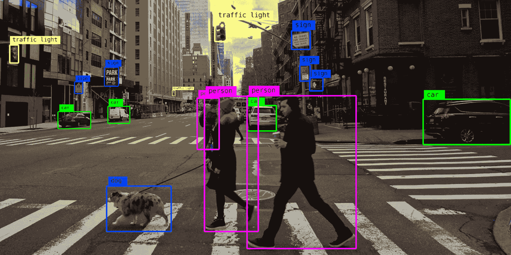

当我们谈论计算机如何理解图片时，它们使用不同的部分来理解所看到的内容。想象一台计算机正在查看一张城市街道的照片。以下是它所做的简单分解：

• 街道场景：背景通常描绘一条街道或道路，代表对象被检测的上下文。

• 边界框：边界框绘制在场景中的各个对象周围。每个框都是矩形的，包含一个感兴趣的对象。目标检测算法确定边界框的大小和位置。

• 对象：边界框内的对象可以包括汽车、行人、狗、路牌、交通灯以及街道场景中的其他元素。

• 标签：为了进一步说明概念，通常会在边界框附近或内部添加标签以指示每个对象，例如汽车、人或狗。

图像分类是教会计算机识别和分类不同类型图像的过程。例如，假设我们想根据图像对不同类型的花进行分类。我们收集雏菊、蒲公英、玫瑰、向日葵和郁金香的照片。然后，我们训练一个 ML 模型来识别花卉模式。当我们给它一张新的花卉图像时，它会预测花卉类型（例如，玫瑰或郁金香）。这项技术在医学影像、自动驾驶汽车和质量控制等领域具有实际应用。

目标检测使计算机能够识别并定位图像或视频帧中的各种对象。例如，假设我们想对图像中包含的不同类型的花进行分类。我们收集包含雏菊、蒲公英、玫瑰、向日葵和郁金香的照片。然后，我们训练一个 ML 模型来识别花卉模式。当我们给它一张新图像时，它会预测所有花卉类型（例如，玫瑰和郁金香）。

#### 图像分类与目标检测

让我们了解图像分类与目标检测之间的关键区别。下图展示了一只坐着看书的泰迪熊。

图像分类会将图像分类为泰迪熊，而目标检测会将图像分类为包含泰迪熊和书的列表：

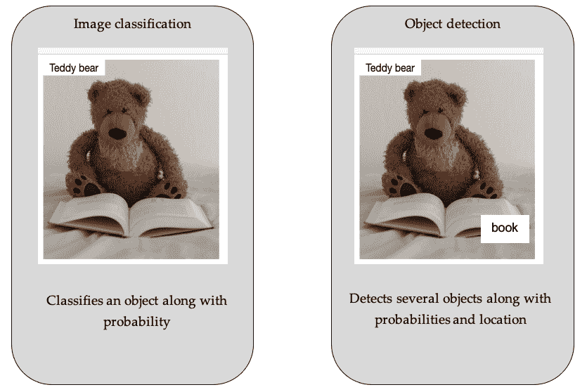

以下是目标检测的关键术语：

• 边界框：绘制在对象周围的矩形区域，用于指定对象的位置。

• 类别标签：对象所属的类别或类。

• 对象定位：确定准确包围对象的边界框坐标的过程。

• 锚框：目标检测模型中用于预测对象位置的各种大小和宽高比的预定义边界框。

• 非极大值抑制（NMS）：一种后处理技术，当多个框重叠时，只保留置信度分数最高的框，从而移除冗余边界框。

• 交并比（IoU）：一种衡量两个边界框之间重叠程度的指标。它用于评估边界框预测的准确性。


• `Feature pyramid network (FPN)`: 一种增强多尺度对象特征表示的网络架构，有助于检测不同尺寸的对象。

• `Region proposal network (RPN)`: `Faster region-based convolutional neural networks (R-CNN)` 架构的一部分，`RPN` 为图像中潜在的对象位置生成候选框。

以下是对象检测的用例和应用：

• `Autonomous driving`: 对象检测对自动驾驶车辆识别和定位道路上的其他车辆、行人、交通标志、交通灯、车道和障碍物至关重要。

• `Surveillance and security`: 对象检测广泛用于实时检测入侵者等。

• `Medical imaging`: 对象检测有助于在 X 光、MRI 和 CT 扫描中定位和识别异常及肿瘤。

• `Document analysis`: 对象检测有助于定位和分类文档中的元素，如标题、段落、表格和图形。

• `Face detection and recognition`: 对象检测用于访问控制和安全等应用中的人脸检测和识别。

• `Quality control in manufacturing`: 对象检测可应用于检测装配线产品中的缺陷以确保质量。

• `Entertainment and gaming`: 对象检测用于视频游戏中的玩家追踪和手势识别。

• `Augmented reality (AR) and virtual reality (VR)`: AR 和 VR 应用程序使用对象检测来追踪和与现实世界及虚拟对象进行交互。

• `Robotics`: 对象检测帮助机器人在工业环境中导航和操作对象，使其在制造、物流和医疗保健领域非常有用。

## Algorithms used for object detection

近年来，对象检测在各种算法和架构的开发方面取得了显著进展，以增强对象检测问题。以下是对象检测中使用的一些最流行的算法和模型：

• `Faster R-CNN`: `Faster R-CNN` 是一种广泛使用的对象检测框架，它将 `RPN` 与 `CNN` 结合用于对象分类。它引入了锚框的概念，以实现更精确的边界框预测。

• `You Only Look Once (YOLO)`: `YOLO` 以其速度和实时对象检测能力而闻名。它将图像划分为网格，并为每个网格单元分配边界框和类别预测，使其更快，但对小对象可能不够准确。

• `Single Shot MultiBox Detector (SSD)`: `SSD` 旨在通过在网络内的不同尺度预测多个边界框和类别概率来实现实时对象检测。它在速度和准确性之间取得了良好的平衡。

• `RetinaNet`: `RetinaNet` 通过引入焦点损失来解决对象检测中数据不平衡的问题，焦点损失专注于难以分类和误分类的样本。它将 `FPN` 与分类和回归子网络相结合。

• `Mask R-CNN`: `Faster R-CNN` 的扩展，`Mask R-CNN` 增加了一个分支，用于预测每个对象的像素级分割掩码，此外还有边界框和类别标签。它被广泛使用，例如，分割。

• `EfficientDet`: `EfficientDet` 以其效率和高性能而闻名，通过优化架构和缩放模型来实现。它引入了复合缩放，以平衡模型深度、宽度和分辨率。

• `Region-based fully convolutional network (R-FCN)`: `R-FCN` 引入了位置敏感评分图，以提高对象定位的准确性。它结合了 `RPN` 和全卷积网络 (`FCN`) 的优点。

• `YOLOv4`, `YOLOv5`, `YOLOv6`, `YOLOv7`: `YOLO` 算法是一种最先进的实时对象检测系统，它一次性查看图像，通过边界框和标签快速且准确地识别和分类各种对象。直到 `YOLOv5`，它将图像划分为网格系统，每个网格单元预测一定数量的边界框，包括其置信度分数和类别概率，使算法能够同时在图像中定位和检测多个对象。

• `Data-efficient Transformer (DETR)`: `DETR` 用变换器替代 `CNNs` 来实现端到端对象检测。它展示了变换器在视觉任务中的潜力。

• `CornerNet` 和 `CenterNet`: `CornerNet` 是一种在图像中查找对象的不同方法。与常规方法不同，它查找对象的角——左上角和右下角相遇的地方。它使用热图来标记这些角作为图像上的热点，从而更容易说明对象的位置。`CenterNet` 简化了在图像中查找对象的过程。它查找对象的中心点，并从那里计算其大小和位置。这种方法不使用绘制对象周围边框的常见步骤，使过程不那么复杂。

• `High-resolution network (HRNet)`: `HRNet` 是一种处理图像的方法，它在整个过程中保持细节清晰锐利。与将图像缩小然后再试图使其详细不同，`HRNet` 保持高分辨率，确保即使是最微小的细节也能被准确捕捉。

`HRNet` 通过保持多个高到低分辨率路径并不断在它们之间交换信息来工作。这意味着它可以同时识别大局和细节，这对于在图像中发现特定事物（如面部特征或单个手指）非常有用。

• `Lidar-based object detection`: 对于自动驾驶和机器人，激光雷达数据可以使用 `PointPillars`、`PV-RCNN` 或 `PointRCNN` 等算法与图像融合，用于 3D 对象检测。

`Lidar-based object detection` 使用激光束测量距离并创建周围区域的详细 3D 地图。这项技术可以通过激光反射的方式发现周围的物体，帮助其准确了解事物的位置和距离。

这种方法就像给汽车或机器人一副特殊的眼睛，即使在黑暗或恶劣天气中也能看清 3D 图像。激光雷达的性能可能受雨天影响。它通过准确检测和识别周围所有物体，帮助自动驾驶汽车避开障碍物，并帮助机器人安全移动。

## Algorithm selection

算法的选择取决于应用程序的具体要求，包括速度、准确性以及要检测的对象的性质等因素。

选择使用哪种对象检测算法取决于多个因素，包括应用程序的具体要求、可用的计算资源以及速度和准确性之间的权衡。以下是一些指导方针，帮助您决定为对象检测使用哪种算法：

• `Speed vs. accuracy`:

○ 如果您的应用程序需要实时对象检测且速度是首要任务，您可以考虑 `YOLOv10` 等模型。这些模型针对速度进行了优化，可以提供良好的结果。

○ 如果准确性是主要关注点且实时性能不是严格要求，您可以选择较慢但更准确的模型，如 `Dynamic R-CNN`、`Faster R-CNN` 或 `RetinaNet`，或基于变换器的模型。

• `Model efficiency`:

○ 考虑部署可用的计算资源。较小的模型，例如基于 `MobileNet` 的架构，可能更适合处理能力有限的边缘设备。

○ `EfficientDet` 旨在通过缩放模型深度、宽度和分辨率来平衡准确性和效率。

• `Small object detection`:

○ 如果您的任务涉及检测小对象，您可能需要专门设计用于处理此类场景的模型。`EfficientDet` 和 `HRNet` 以其在小对象检测中的有效性而闻名。

○ `HRNet` 专注于在高分辨率图像中检测小对象。

• `Instance segmentation`:


## 对象检测模型选择指南

如果你的任务不仅涉及对象检测，还涉及对象实例的像素级分割，Mask R-CNN、U-net 架构等模型非常适合此目的。

## 实时视频处理

对于实时视频分析或跟踪，请考虑结合对象检测与对象跟踪的模型，例如简单在线实时跟踪（SORT）、公平多对象跟踪（FairMOT）。

## 对数据不平衡的鲁棒性

在数据集高度不平衡的情况下（例如，大量负样本和少量正样本），RetinaNet 等具有焦点损失的模型可能表现更好。

RetinaNet 是一种显著的一阶对象检测模型，利用焦点损失函数在训练期间解决类别不平衡问题。

## 低误报的高精度

如果将误报（即错误的对象检测）降至最低是关键要求，请考虑设计用于减少误报的模型，例如 Cascade R-CNN。

Cascade R-CNN 扩展了流行的两阶段 R-CNN 对象检测框架。它旨在通过有效拒绝接近的误报来获得高质量的检测结果。

## 特定领域要求

某些领域有专门的对象检测模型，旨在满足其特定需求。例如，PointPillars 和 PV-RCNN 用于自动驾驶应用中的 3D 对象检测。

PointPillars 使用垂直柱（pillars），可从点云中高效地进行 3D 对象检测。PV-RCNN 集成了体素 CNN 和基于 PointNet 的集合抽象，仅使用点云即可取得令人印象深刻的结果。

# 实验评估

尝试多个模型并在特定数据集上评估其性能，以确定哪个最适合你的应用程序，这通常是一种良好的做法。

## 模型大小和占用空间

考虑可用存储容量和模型大小限制，尤其是在模型大小是一个问题的边缘计算场景中。

# 迁移学习

迁移学习可以是一种强大的方法。如果你可以在大型数据集上获得预训练模型，则为特定任务对其进行微调可以节省时间并提高性能。

在实践中，没有一劳永逸的答案，对象检测算法的选择取决于独特的特征、约束和性能要求。尝试不同的模型并在特定数据集和用例上评估其性能通常是有益的，以便做出明智的决策。此外，模型集成或结合多个模型可以是实现速度与准确性之间平衡的有效策略。

## 对象检测类型

以下是对象检测类型：

## 两阶段检测器

两阶段检测器首先生成区域建议，然后将这些区域分类为对象类别。与单阶段检测器相比，这些方法通常更准确但速度更慢。

示例：Faster R-CNN 是一种经典的两阶段检测器。它首先使用 RPN 建议潜在的对象位置。然后，在第二阶段中，这些建议的区域由基于 CNN 的检测器进行细化和分类。

优点：由于两步细化过程，准确率高。

缺点：推理速度较慢，使其不太适合实时应用程序。

## 单阶段检测器

单阶段检测器在单次前向传递中直接预测边界框和类别标签，而不需要单独的区域建议步骤。这些模型优先考虑速度，通常用于实时应用程序。

示例：YOLO 和 SSD 都是单阶段检测器。YOLO 将图像分为网格并直接预测边界框和类别概率，而 SSD 在不同比例的多个特征图上执行类似操作。

优点：推理速度快，使其非常适合自动驾驶汽车和视频监控等实时应用程序。

缺点：通常比两阶段检测器的准确率低，尤其是在处理小对象或复杂场景时。

## 基于锚点的检测器

基于锚点的检测器使用预定义的边界框（锚点框）来预测对象位置。这些锚点框放置在图像的各个位置，网络预测相对于这些锚点的偏移量，以微调边界框的位置。

示例：Faster R-CNN 和 SSD 都是基于锚点的检测器。它们使用具有不同长宽比和大小的多个锚点框，网络对这些锚点进行细化以匹配对象的实际边界框。

优点：在检测不同大小和长宽比的对象方面具有灵活性。

缺点：需要更多计算来为大量锚点预测偏移量，增加了复杂性。

## 无锚点检测器

无锚点检测器消除了对预定义锚点框的需求，而是直接预测关键点、对象中心或角点来推断边界框。这使得过程更简单，通常也更高效。

示例：CornerNet 和 CenterNet 是无锚点检测器。在 CornerNet 中，网络预测对象的左上角和右下角，而 CenterNet 预测对象的中心并使用它来推断边界框。

优点：由于没有锚点框，复杂性降低，可能更快且更高效。

缺点：可能在定位精度方面遇到困难，尤其是对于小对象或拥挤的场景。

## 单阶段对象检测神经网络

单阶段对象检测神经网络的基础架构通常包括三个主要组件：

## 骨干网络（特征提取器）

骨干网络负责从输入图像中提取层次化特征。流行的骨干网络包括 ResNet、VGG、MobileNet 或 EfficientNet 等 CNN。这些网络在 ImageNet 等大型数据集上预训练，以学习有用的特征。骨干网络的输出是特征图，它提供不同级别的信息，例如边缘、纹理和对象。

## 颈部网络（FPN 或 SPP）

许多单阶段检测器使用类似 FPN 或空间金字塔池化（SPP）的颈部结构来增强特征图。颈部的目的是捕获多尺度特征，并在各层之间提供从细到粗的信息。它通过结合低级详细特征和高级抽象特征，有效地帮助检测不同大小的对象。

## 检测头（分类和回归层）

检测头是一系列卷积层，用于生成预测，这些预测包括：

- 边界框回归：预测图像中对象周围的边界框坐标。
- 对象分类：对边界框内的对象进行分类。

这些层直接输出对象的类别标签和边界框预测，而不需要额外的区域建议阶段（如两阶段检测器 Faster R-CNN 中那样）。

下图显示了单阶段对象检测神经网络的各个组件：

```
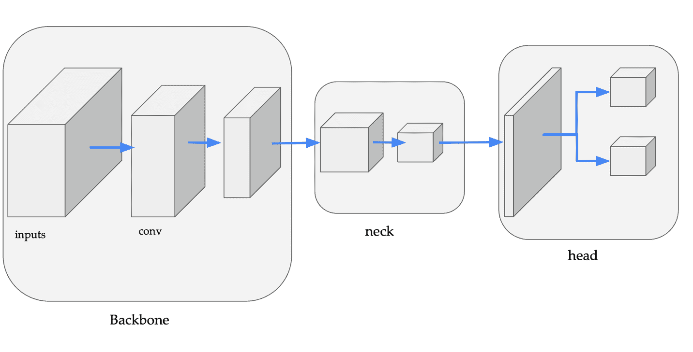
```

## 特征金字塔网络架构

对象检测中的一个关键挑战是在同一图像中检测不同大小的对象。FPN 通过使用具有侧向连接的自上而下架构创建图像的多尺度表示来解决此问题。

在 FPN 中：

- 自下而上路径从卷积神经网络（例如 ResNet）的不同层提取特征图。
- 自上而下路径对这些特征图进行上采样，并将其与早期层的更高分辨率特征图合并。
- 侧向连接细化这些组合特征，以确保模型可以检测不同尺度的对象。


• 使用`FPNs`，像`Faster R-CNN`和`RetinaNet`这样的现代探测器显著提高了检测小目标的能力，否则这些小目标可能会被遗漏。`FPNs`在面部检测或医学影像等任务中尤为重要，因为在这些任务中，小细节至关重要。

## Solution architecture

对象检测管道是一系列旨在检测和定位图像或视频中对象的步骤或过程。以下是典型对象检测管道的概述：

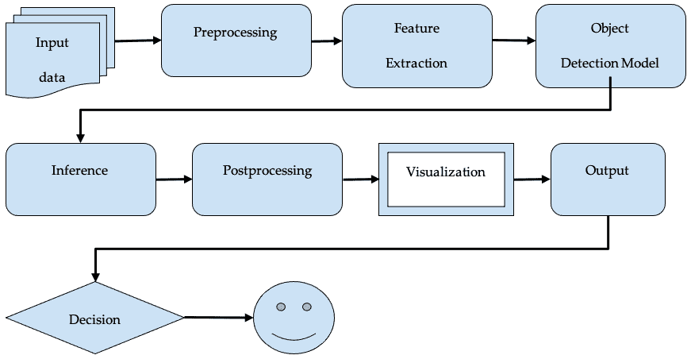

1.`输入数据`：管道从输入数据开始，可以是图像或视频帧。这些数据由摄像头或其他传感器捕获。

2.`预处理`：预处理步骤可能包括对输入数据进行调整大小、归一化和增强，以使其适合对象检测。预处理可以通过减少噪声和标准化输入数据来提高算法性能。

3.`特征提取`：特征提取是从输入数据中选择相关信息的过程。特征可以包括边缘、角点、纹理以及其他有助于将对象与背景区分开的视觉线索。

4.`对象检测模型`：管道的核心是对象检测模型。该模型可以基于传统计算机视觉技术或深度学习。基于深度学习的模型，如`Faster R-CNN`、`YOLO`或`SSD`，因其准确性而广受欢迎。

5.`训练`（可选）：在某些情况下，您可能需要在标记的数据集上训练对象检测模型。训练涉及优化模型参数，以进行准确预测。

6.`推理`：推理是在新的未标记数据上运行训练好的模型的过程。模型生成预测，通常以检测到的对象周围的边界框形式呈现。

7.`后处理`：后处理步骤应用于模型的预测，以细化和解释结果。这可能包括`NMS`以消除重复检测，并基于对象置信度分数进行过滤。

8.`输出`：对象检测管道的最终输出是对象列表及其在图像或视频中的位置。这些信息可用于各种应用，例如跟踪、计数或进一步分析。

9.`可视化`：为了使结果更具可解释性，您可以通过在输入数据上绘制边界框和标签来可视化检测到的对象。

10.`决策或操作`（特定于应用程序）：根据应用程序，管道的输出可能会触发特定的操作或决策。例如，在自动驾驶汽车中，检测到的对象可能会影响驾驶决策。

11.`反馈`（可选）：在某些情况下，反馈可能会发送到系统以提高对象检测准确性。这可以包括使用新数据重新训练模型。

### 多目标检测损失计算

在多目标检测中，损失函数在训练模型方面起着至关重要的作用。对于`YOLO`等模型，损失是使用以下组合计算的：

• `定位损失`：这衡量模型预测边界框位置和大小与真实值相比的准确性。

• `置信度损失`：这会惩罚关于给定网格单元或边界框中是否存在对象的错误预测。它确保模型能正确区分包含对象的区域和空区域。

• `分类损失`：这衡量模型预测检测到的对象的正确类别的效果。

这些损失组件共同确保网络学习定位对象（边界框）并正确分类它们。在训练期间，模型使用`IoU`度量将预测与真实值匹配，该度量充当将边界框分配给真实对象的指导因素。

该损失函数，结合`IoU`和置信度分数，构成了对象检测模型的核心学习机制。

## 深入了解 YOLO

`YOLO`是一种流行的实时对象检测算法，以其速度和效率而闻名。它通过将图像划分为网格并对每个网格单元进行对象预测来工作。

在对象检测的背景下，`YOLO`的类比可以将其想象成一位繁忙餐厅中的才华横溢的厨师，他可以快速扫描一盘装满菜肴的托盘，并仅凭一眼就准确识别每种菜肴的类型。

这个类比的工作原理如下：

1.`繁忙的餐厅`：想象一家繁忙的餐厅，厨房不断有菜肴端出。环境非常忙碌，任务是尽可能快地识别每个盘子里的内容：

• `才华横溢的厨师`（`YOLO`）：`YOLO`体现了才华横溢的厨师。`YOLO`不是仔细逐个检查每个盘子，而是一次性快速扫视整个托盘上的所有菜肴。

• `一眼看遍，多种菜肴`：只需一眼，厨师就能识别托盘上每种菜肴的类型，并在脑海中记录下有哪些菜肴。不需要重新查看单个盘子；一切都在一次扫视中理解完毕。

• `效率和速度`：这种一眼扫视的方法效率极高，速度极快，使厨师能够跟上餐厅的需求。同样，`YOLO`在一次传递中处理整个图像，使其适用于自动驾驶汽车和安防监控等场景中的实时对象检测。

• `准确性和置信度`：正如厨师多年的经验让他们对准确识别菜肴的能力充满信心一样，`YOLO`为其对象检测预测提供置信度分数。这些分数表明`YOLO`对检测到的对象有多确定。

以下是关于`YOLO`工作原理的深入探讨，包括注释、模型架构、预测结构、损失计算和`NMS`。

2.`注释和预测`：在训练期间，注释（真实值）指定图像中对象的边界框坐标和类别标签。`YOLO`将图像划分为`SxS`网格，每个网格单元预测多个边界框及其各自的对象类别概率。这些预测包括：

• 相对于网格单元的`边界框坐标`（`x`、`y`、宽度、高度）。

• `对象性分数`，表示预测框中存在对象的可能性。

• `类别概率`，确定检测到的对象类型。

3.`模型架构`：`YOLO`使用带有`CNN`骨干网络（例如`CSPDarknet53`）的`FCN`进行特征提取。`YOLO`的架构包括锚框，即具有各种大小和宽高比的预定义边界框，帮助模型预测不同形状和大小对象的边界框。模型的预测头输出一个张量，包含每个网格单元的边界框坐标、对象性分数和类别概率。

`YOLO`应用：

• 用于边界框中心（`x`、`y`）和对象性分数的`Sigmoid`激活。

• 用于宽度和高度的`指数运算`，以相对于锚框缩放预测。

4.`将预测与真实值匹配`：预测使用`IoU`与真实值边界框进行比较。`IoU`衡量预测边界框和实际边界框之间的重叠程度。如果`IoU`超过某个阈值，则该预测被视为匹配。`IoU`计算如下：

```
IoU= Area of overlap × Area of union
```

5.`损失函数`：`YOLO`的损失函数由三个组件组成：

• `定位损失`：衡量预测边界框坐标与真实值之间的误差。

• `置信度损失`：惩罚对象性的错误预测（包括假阳性和假阴性）。

• `分类损失`：评估边界框中对象分类的误差。

这些组件共同确保`YOLO`既学习对象定位，也学习分类。


## 6.NMS: 预测后，YOLO 应用 NMS 来移除冗余边界框

预测后，YOLO 应用 NMS 来移除冗余边界框。NMS 保留置信度得分最高的边界框，并抑制与其有显著重叠的其他边界框，重叠程度由 IoU 阈值决定。此过程确保图像中的每个对象都由单个高置信度边界框表示。

## 以下是 YOLO 工作机制的概述

• 网格划分：YOLO 将输入图像划分为网格，通常使用 7x7 或 13x13 网格，具体取决于所使用的 YOLO 版本。每个网格单元代表图像中的一个空间区域，YOLO 对这些单元内的对象进行预测。

• 边界框预测：对于每个网格单元，YOLO 预测围绕对象的边界框。这些边界框由边界框中心的坐标（`x`、`y`）和表示其尺寸的（`width`、`height`）表示。YOLO 还为每个边界框预测一个置信度得分，该得分指示边界框包含对象的可能性。

• 类别预测：YOLO 预测每个边界框中所包含对象的类别概率。这意味着，对于每个网格单元，算法会为不同的类别或对象类别分配概率。

在对所有网格单元进行预测后，YOLO 应用 NMS 来过滤掉冗余或重叠的边界框。当多个边界框重叠时，NMS 仅保留置信度得分最高的边界框。

输出：YOLO 的最终输出由图像中所有检测到的对象的边界框列表、置信度得分和类别标签组成。

# 锚框

YOLO 通过引入锚框的概念来改进对象定位。这些锚框是不同尺寸和长宽比的预定义边界框。现代 YOLO 架构是无锚对象检测器。在训练期间，模型学习调整这些锚框以更好地适应训练数据集中的对象：


多年来，YOLO 经历了多个版本和改进，每个版本都提升了速度和准确性。它已被广泛应用于自动驾驶、监控和机器人等应用中，在这些应用中，实时对象检测至关重要。

## 用于对象检测的数据集

通常用于训练 YOLO 对象检测模型的前三个流行数据集是：

### 常见对象上下文 (COCO)

COCO 数据集是最广泛认可且最全面的对象检测数据集之一。由于其多样性和规模，COCO 被广泛用于对 YOLO 模型进行基准测试和训练。

#### 数据集概述

COCO 包含超过 330,000 张图像，每张图像都仔细标记了 80 个对象类别，并附有 5 个描述性标题。

研究人员和从业者使用 COCO 作为评估最先进的神经网络的基准。

#### 对象检测和分割

COCO 促进了对象检测和分割模型的研究和测试。

该数据集涵盖了多种对象类别，使其适用于各种应用。

#### 标题任务

除了对象边界之外，COCO 丰富的注释还扩展到标题信息，使自然语言理解研究成为可能。

#### 挑战和质量

COCO 图像具有挑战性，通常包含复杂场景中的多个对象。

该数据集强调高质量的视觉数据，确保模型训练的鲁棒性。

下图显示了数据集中的示例图像：


### Pascal 视觉对象类别 (VOC)

Pascal VOC 数据集是另一种广泛使用的数据集，尤其是用于小规模对象检测任务。它包含 20 个对象类别，一直是对象检测算法的标准基准。尽管与 COCO 相比规模较小，但它仍然是研究和基准测试的热门选择。

以下是关键详细信息：

#### 数据集概述

VOC 数据集包括两个主要挑战：VOC2007 和 VOC2012。

它涵盖了 20 个对象类别，从汽车、自行车和动物等常见对象到船只、沙发和餐桌等更具体的对象。

注释包括用于对象检测和分类任务的对象边界框和类别标签，以及用于分割任务的分割掩码。

#### 基准测试和评估

VOC 用作评估计算机视觉模型的基准。

研究人员使用它来比较不同方法并评估模型性能。

平均平均精度（`mAP`）等指标通常用于对象检测和分类比较。

下图显示了数据集中的示例图像：

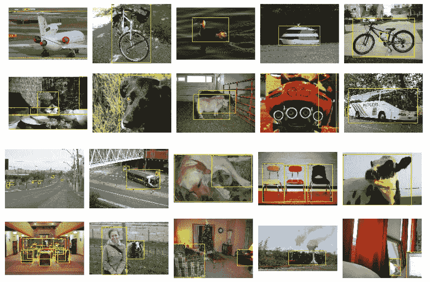

### ImageNet 对象检测挑战

ImageNet 对象检测挑战数据集为 ImageNet 数据集提供对象检测注释，该数据集以其庞大的图像和对象类别集合而闻名。ImageNet 在推动对象检测研究方面发挥了重要作用。

以下是关于 ImageNet 大规模视觉识别挑战（`ILSVRC`）数据集的关键点：

#### 数据集概述

ImageNet 数据集包含惊人的 14,197,122 张带注释的图像，按照 WordNet 层次结构组织。

自 2010 年以来，它一直是 `ILSVRC` 的基础，作为图像分类和对象检测的基准。

#### 对象检测和分类

研究人员使用 `ILSVRC` 来开发和评估用于对象检测和分类任务的模型。

该数据集涵盖了广泛的对象类别，使其成为评估视觉算法的全面资源。

COCO 数据集是一种广泛认可且全面的数据集，用于计算机视觉中的对象检测、分割和标题任务。COCO 以其庞大且多样的图像和注释集合而闻名。以下是 COCO 数据集的概述：

#### 图像集合

COCO 数据集包含在各种环境下拍摄的大量图像。它包括微软从互联网收集的图像，确保了广泛的场景、对象和场景。

#### 对象类别

COCO 涵盖了超过 80 个对象类别，包括人、动物、车辆、家居用品等常见对象。

该数据集的多样性使其适合训练模型来检测各种各样的对象。

#### 注释

COCO 数据集中的每张图像都进行了密集注释，这意味着它包含了图像中存在对象的详细信息。

注释包括关于对象位置、类别以及某些对象类别的分割掩码的信息，使 COCO 既适合对象检测也适合语义分割任务。以下是注释示例：

```json
{
  "annotations": [
    {
      "id": 1,
      "image_id": 10,
      "category_id": 18,
      "bbox": [73.0, 170.0, 129.0, 145.0],
      "area": 18705.0,
      "segmentation": [[85.0, 170.0, 90.0, 200.0, ...]],
      "iscrowd": 0
    }
  ],
  "categories": [
    {
      "id": 18,
      "name": "dog",
      "supercategory": "animal"
    }
  ],
  "images": [
    {
      "id": 10,
      "file_name": "0000000010.jpg",
      "width": 640,
      "height": 480
    }
  ]
}
```

#### 对象实例

COCO 为单个对象实例提供注释，允许在单个图像中识别和区分同一对象类别的多个实例。

#### 图像标题

除了对象注释之外，COCO 数据集还包括图像标题，使其对图像标题和语言生成任务具有价值。

#### 数据集划分

COCO 被分为训练集、验证集和测试集。训练集最大，通常用于训练对象检测模型。

验证集用于模型评估和超参数调整，而测试集通常保留用于基准测试和竞赛。


COCO 数据集广泛应用于研究和实际应用中，作为评估和训练目标检测及图像字幕模型的基准。由于其规模大、多样性强且标注详细，它是开发和测试计算机视觉算法的宝贵资源。研究人员通常利用在 COCO 数据集上预训练的模型来启动自己的项目并获得更好的性能。

构建目标检测系统需要在各个组件之间取得平衡，目标是在实现准确且实时的目标检测的同时，满足应用程序的可扩展性和安全性需求。

将 YOLO 与 COCO 数据集结合使用通常涉及两个主要步骤：在 COCO 数据集上训练 YOLO 模型，然后使用训练好的模型进行目标检测。下面的部分将提供一个使用 Python 和 PyTorch 框架中流行的 YOLOv3 模型的高级代码示例。请注意，您需要安装 PyTorch、torchvision 及其他所需库才能运行此代码。

## 数据加载和处理

您可以使用 Python 和官方 COCO API 下载 COCO 数据集。以下是使用 Python 和 PyTorch 下载 COCO 数据集的逐步指南：

以下代码片段导入所有所需的 Python 库：

```python
import os

from pycocotools.coco import COCO

import requests

import zipfile

data_dir = 'coco_data'

if not os.path.exists(data_dir):

    os.makedirs(data_dir)
```

以下代码定义了 COCO 数据集的 URL：

```python
train_image_url = "http://images.cocodataset.org/zips/train2017.zip"

val_image_url = "http://images.cocodataset.org/zips/val2017.zip"

annotations_url = "http://images.cocodataset.org/annotations/annotations_trainval2017.zip"
```

#以下代码下载训练和验证数据。

```python
for url in [train_image_url, val_image_url, annotations_url]:

    response = requests.get(url, stream=True)

    zip_file_path = os.path.join(data_dir, os.path.basename(url))

    with open(zip_file_path, 'wb') as file:

        for chunk in response.iter_content(chunk_size=128):

            file.write(chunk)

    with zipfile.ZipFile(zip_file_path, 'r') as zip_ref:

        zip_ref.extractall(data_dir)

    os.remove(zip_file_path)
```

\# 初始化用于标注的 COCO API

```python
annotations_dir = os.path.join(data_dir, "annotations")

json_path = os.path.join(annotations_dir, "instances_train2017.json")

coco = COCO(json_path)
```

此脚本下载并提取 COCO 训练和验证图像，以及目标检测任务所需的标注。您可以修改 `data_dir` 变量以指定要存储数据集的目录。

请记住，COCO 数据集相对较大，因此下载和提取可能需要一些时间。

## 仅下载少数类别的数据集

以下是仅下载少数类别数据集的步骤：

• 下载 COCO 标注：您需要 COCO 数据集的标注来筛选特定类别的数据集。您可以按如下方式下载标注：

○ 以下代码片段导入所有所需的 Python 库：

```python
import os

from pycocotools.coco import COCO

import requests

data_dir = 'coco_data'

if not os.path.exists(data_dir):

    os.makedirs(data_dir)

annotations_url = "http://images.cocodataset.org/annotations/annotations_trainval2017.zip"
```

○ 以下代码下载并提取标注：

```python
response = requests.get(annotations_url, stream=True)

zip_file_path = os.path.join(data_dir, os.path.basename(annotations_url))

with open(zip_file_path, 'wb') as file:

    for chunk in response.iter_content(chunk_size=128):

        file.write(chunk)
```

○ 以下代码提取标注文件：

```python
with zipfile.ZipFile(zip_file_path, 'r') as zip_ref:

    zip_ref.extractall(data_dir)
```

○ 以下代码删除下载的 zip 文件：

```python
os.remove(zip_file_path)
```

○ 以下代码初始化用于标注的 COCO API。

```python
annotations_dir = os.path.join(data_dir, "annotations")

json_path = os.path.join(annotations_dir, "instances_train2017.json")

coco = COCO(json_path)
```

○ 以下代码指定要包含的类别名称：

```python
specific_classes = ['cat', 'dog', 'horse']
```

○ 以下代码提取特定类别的类别 ID：

```python
cat_ids = coco.getCatIds(catNms=specific_classes)
```

○ 以下代码获取包含特定类别对象的图像 ID：

```python
img_ids = coco.getImgIds(catIds=cat_ids)
```

○ 以下代码加载筛选数据集的图像和标注：

```python
filtered_images = coco.loadImgs(img_ids)

filtered_annotations = coco.loadAnns(coco.getAnnIds(imgIds=img_ids, catIds=cat_ids))
```

## 数据预处理

在 COCO 数据集上进行训练的数据预处理通常涉及多个步骤，以准备用于目标检测或分割任务的图像和标注。以下是在训练前针对 COCO 数据集的常见数据预处理流程：

• 图像调整大小和归一化：将图像调整为所选目标检测模型期望的一致大小。常见尺寸包括 416x416 或 608x608。您可以使用 OpenCV 或 Pillow 等库来执行此任务。以下代码导入 Python 库并定义调整图像大小并将像素值归一化到 [0,1] 范围的函数：

```python
import cv2

def preprocess_image(image_path, target_size):

    image = cv2.imread(image_path)

    image = cv2.resize(image, target_size)

    image = image / 255.0 

    return image
```

• 边界框归一化：将边界框坐标归一化到相对于图像大小的 [0, 1] 范围。这对于不同分辨率的图像之间保持一致性是必要的。以下代码定义归一化边界框坐标的函数：

```python
def normalize_bbox(bbox, image_width, image_height):

    x, y, width, height = bbox

    x /= image_width

    y /= image_height

    width /= image_width

    height /= image_height

    return [x, y, width, height]
```

• 生成训练数据：对于每张图像，提取边界框标注及其对应的类别标签。此数据通常采用目标检测模型期望的格式。以下代码定义生成训练数据的函数，该函数接受两个参数：

○ `coco`：COCO 数据集对象。

○ `image_id`：正在为其生成训练数据的图像的唯一标识符。

它加载图像及其标注，构建图像路径，将每张图像预处理为调整大小至 416x416 像素，归一化边界框，最后提取每个标注对象的类别标签：

```python
def generate_training_data(coco, image_id):

    image_info = coco.loadImgs(image_id)[0]

    annotations = coco.loadAnns(coco.getAnnIds(imgIds=image_id))

    image_path = os.path.join(image_dir, image_info['file_name'])

    image = preprocess_image(image_path, (416, 416))

    boxes = [normalize_bbox(ann['bbox'], image.shape[1], image.shape[0]) for ann in annotations]

    class_labels = [ann['category_id'] for ann in annotations]

    return image, boxes, class_labels
```

# 模型训练

在 COCO 数据集上进行模型训练通常涉及多个步骤，以加载 COCO 预处理数据集、转换数据集、定义 YOLO 模型、设置训练参数和优化器、迭代训练模型，最后保存模型：

#以下代码导入所需库：

```python
import torch

import torchvision

from torchvision.models.detection import fasterrcnn_resnet50_fpn

from torchvision.transforms import functional as F

from torchvision.datasets import CocoDetection

from torch.utils.data import DataLoader
```

#以下代码定义数据转换

```python
transform = torchvision.transforms.Compose([

    torchvision.transforms.ToTensor(),])
```

#以下代码加载 COCO 数据集（训练集）


`coco_train_dataset = CocoDetection(root="path/to/coco/train2017", annFile="path/to/coco/annotations/instances_train2017.json", transform=transform)`

## 下面的代码创建用于训练的 DataLoader

`train_dataloader = DataLoader(coco_train_dataset, batch_size=2, shuffle=True, num_workers=4)`

## 下面的代码定义 YOLO 模型

`model = fasterrcnn_resnet50_fpn(pretrained=True)`

## 下面的代码设置训练参数和优化器

`params = [p for p in model.parameters() if p.requires_grad]`

`optimizer = torch.optim.SGD(params, lr=0.005, momentum=0.9, weight_decay=0.0005)`

`lr_scheduler = torch.optim.lr_scheduler.StepLR(optimizer, step_size=3, gamma=0.1)`

## 下面的代码训练模型

`model.train()`

```
for epoch in range(10):
    for images, targets in train_dataloader:
        images = list(image for image in images)
        targets = [{k: v for k, v in t.items()} for t in targets]
        loss_dict = model(images, targets)
        losses = sum(loss for loss in loss_dict.values())
        optimizer.zero_grad()
        losses.backward()
        optimizer.step()
        lr_scheduler.step()
```

## 下面的代码保存训练好的模型

`torch.save(model.state_dict(), "yolo_coco_model.pth")`

### 使用训练好的 YOLO 模型进行目标检测

使用训练好的 YOLO 模型进行目标检测涉及多个步骤，例如加载训练好的模型、加载并转换新图像以进行目标检测、预测目标及其边界框、标签和分数：

## 下面的代码导入必要的库

```
from torchvision.models.detection import fasterrcnn_resnet50_fpn
from torchvision.transforms import functional as F
from PIL import Image
```

## 下面的代码加载训练好的 YOLO 模型

```
from yolov5 import YOLOv5  # 你需要安装 YOLOv5 库或使用自定义的 YOLO 实现

## 加载 YOLO 模型（如果使用 Ultralytics 的 YOLOv5）
model = YOLOv5('yolo_coco_model.pth')

## 这将同时加载架构和权重
model.eval()  # 设置为评估模式
```

## 下面的代码加载并转换图像以进行目标检测

`image = Image.open("path/to/test_image.jpg")`

`image = F.to_tensor(image).unsqueeze(0)`

## 下面的代码执行目标检测

```
with torch.no_grad():
    prediction = model(image)
```

## 下面的代码提取预测的边界框、标签和分数

`boxes = prediction[0]['boxes']`

`labels = prediction[0]['labels']`

`scores = prediction[0]['scores']`

## 显示结果（你可以在此处使用任何可视化方法）

```
for box, label, score in zip(boxes, labels, scores):
    print(f"Label: {label}, Score: {score}")
    print(f"Bounding Box: {box}")
```

## 模型测试和评估

IoU 是目标检测中的关键指标之一，用于衡量预测边界框与真实边界框的重叠程度。理解 IoU 至关重要，因为它既用于训练阶段（将边界框分配给真实目标对象），也用于评估阶段（衡量预测的准确性）。

当模型为某个对象预测边界框时，IoU 会比较预测框与实际框的重叠区域与它们并集区域的比例。从数学上讲，IoU 表示为：

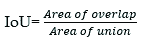

例如，如果 IoU 阈值设置为 0.5，则当预测框与真实框的 IoU 至少为 50% 时，该预测框被视为正确。这与 mAP 直接相关，mAP 使用 IoU 阈值（例如 IoU@0.5、IoU@0.75）来评估模型的性能。

### 非极大值抑制算法

目标检测中的一个挑战是处理同一对象的多个预测。这时 NMS 发挥着关键作用。网络为每个对象生成多个边界框后，其中一些框可能会显著重叠，尽管它们代表同一对象。NMS 确保只保留最佳边界框（即置信度分数最高的框），并抑制其他框。

NMS 的过程包括：

1. 按置信度分数对所有预测边界框进行排序。
2. 移除与更高置信度框重叠度高（使用 IoU 衡量）的框。
3. 对图像中的所有对象重复此过程。

在使用 YOLO 在 COCO 数据集上训练的目标检测模型进行评估时，通常使用以下评估指标：

• mAP：mAP 是目标检测中广泛使用的指标，用于衡量不同对象类别的平均精度。它量化了模型在图像中识别和定位对象的能力。COCO 评估指标使用 0.5、0.55、0.6、0.65、0.7、0.75、0.8、0.85 和 0.9 的 IoU 阈值。

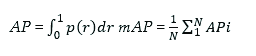

• mAP@IoU0.50：这是使用单个 IoU 阈值 0.50 计算的 mAP。它衡量模型在考虑与真实框 IoU 为 0.50 或更高的检测时的性能。

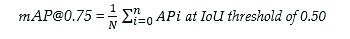

• mAP@IoU0.75：这是使用单个 IoU 阈值 0.75 计算的 mAP。它衡量模型在考虑与真实框具有更高重叠度（IoU ≥ 0.75）的检测时的性能。

在目标检测问题中，当模型做出错误检测时，会发生假阳性。这可能以两种方式发生：模型要么在没有对象的区域检测到对象，要么正确识别了对象的位置但分配了错误的类别标签。这两种情况都会导致假阳性，降低模型的精度。

当模型未能正确检测图像中存在的对象时，会发生假阴性。这可能以两种方式发生：模型要么完全漏掉对象而不预测任何边界框，要么预测的边界框与真实框的重叠不足，低于所需的 IoU 阈值。这两种情况都会导致假阴性，降低模型的召回率。

• 平均召回率：平均召回率衡量不同对象类别的平均召回率。它提供了关于模型在数据集中检测对象能力的见解。


• 精确率-召回率（PR）曲线：PR 曲线可视化不同置信度阈值下精确率和召回率之间的权衡。它有助于理解模型在不同检测置信度水平下的性能。

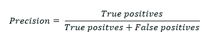

• F1 分数：F1 分数是精确率和召回率的调和平均数。它提供了模型在目标检测中性能的平衡度量。

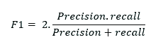

• 假阳性率（FPR）：FPR 衡量假阳性预测与实际负样本的比率，指示模型产生错误检测的倾向。

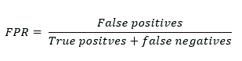

• 漏检率（MR）：MR 衡量漏检与实际正样本的比率，指示模型查找图像中所有对象的能力。

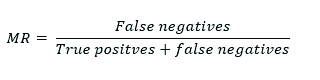

使用 COCO 数据集评估 YOLO 模型的性能通常涉及使用官方 COCO 评估工具。以下是一个如何评估性能的示例：

```
import subprocess

## 下面的代码定义 COCO 评估工具包和 YOLO 模型及配置的路径
coco_eval_dir = '/path/to/coco/PythonAPI'
yolo_model = '/path/to/your/yolo_model.weights'
yolo_config = '/path/to/your/yolo_model.cfg'

## 下面的代码定义验证数据集的 COCO 注释文件
coco_annotation_file = '/path/to/coco/annotations/instances_val2024.json'

## 下面的代码定义执行评估的命令
evaluation_command = [
    'python', os.path.join(coco_eval_dir, 'eval.py'),
    coco_annotation_file,
    '-g', 'yolo', # 使用 YOLO 格式检测结果
    '-i', yolo_model,
    '-o', 'results.json', # 将结果输出到 JSON 文件
    '--img-size', '416', # 指定训练期间使用的图像大小
    '--conf-thres', '0.001', # 设置置信度阈值
    '--iou-thres', '0.5' # 设置 IoU 阈值
]
```


## 以下代码运行评估命令

subprocess.run(`evaluation_command`)

## 以下代码计算并打印使用生成结果的 mAP

`result_file` = 'results.json'

with open(`result_file`, 'r') as `file`:

`lines` = `file.readlines()`

## 以下代码在结果文件中搜索 mAP 行

for `line` in `lines`:

if 'mAP' in `line`:

`mAP_line` = `line`

## 以下代码从行中提取 mAP 值

`mAP_value` = float(`mAP_line.split('=')[-1].strip()`)

print(f'mAP: {`mAP_value`}')

在此代码示例中：

将 `/path/to/coco/PythonAPI`、`/path/to/your/yolo_model.weights`、`/path/to/your/yolo_model.cfg` 和 `/path/to/coco/annotations/instances_val2024.json` 等占位符替换为 COCO 评估工具包、YOLO 模型、YOLO 配置和 COCO 注释的实际路径。

该代码使用子进程运行 COCO 评估工具包，并指定 YOLO 模型、配置和其他评估参数。

运行评估后，它从生成的结果中提取 mAP 值并将其打印。

使用 YOLO 在 COCO 数据集上改进目标检测可能具有挑战性，但也很有成就感。以下是几种增强目标检测模型性能的策略和技术：

• 更大且更多样化的训练数据：考虑添加更多样化和更广泛的训练数据，以提高模型在各种场景和条件下检测对象的能力。您可以收集更多数据，或使用与您的应用程序相关的对象类别的外部数据集。

• 数据增强：在训练数据集上应用数据增强技术，包括随机裁剪、旋转、翻转和颜色调整。数据增强增加了训练示例的多样性，帮助模型更好地泛化。

• 微调：使用迁移学习微调预训练的 YOLO 模型。您可以先从在更大数据集上训练的模型开始，然后在 COCO 数据集上针对特定对象类别对其进行微调。

• 超参数调优：尝试不同的超参数，例如学习率、批量大小、优化器、锚框大小和置信度阈值。超参数调优会对模型性能产生显著影响。

• 更大的模型架构：使用最新的 YOLO 和复杂模型架构，这些架构可能比旧版 YOLO 提供更好的性能。考虑尝试这些架构。

• 集成方法：结合多个 YOLO 模型的预测以提高检测准确性。集成方法可以提供更可靠的结果。

• 后处理技术：实现后处理技术来优化检测结果，例如 NMS，并过滤掉低置信度的预测。

• 分析并解决常见错误：仔细分析模型犯错的类型（例如，假阳性、假阴性），并针对这些特定问题调整训练策略。

• 正则化技术：实现丢弃法或权重衰减等正则化技术，以防止过拟合并提高模型泛化能力。

• 使用自定义锚框：锚框是不同大小和宽高比的预定义边界框，用于检测图像中不同尺度的对象。如果默认锚框大小不适合您的数据集，请考虑根据您的对象类别创建自定义锚框大小。

• 对象跟踪：在视频应用中引入对象跟踪方法，以在帧间保持对象身份。

• 语义/实例分割：考虑将语义分割与目标检测结合使用，以提高对象边界和定位的准确性。

• 类别不平衡处理：根据对象类别在数据集中的普遍性，通过过采样或欠采样来解决类别不平衡问题。

• 自定义损失函数：设计并实现关注与您的应用程序相关的检测准确性特定方面的自定义损失函数。

• 量化和压缩：应用量化和模型压缩技术，在资源受限平台上部署模型，同时保持性能。

请记住，使用 YOLO 在 COCO 数据集上改进目标检测通常是一个迭代过程。尝试不同的方法，跟踪模型的性能，并继续微调，直到达到所需的准确性和精度水平。

## 结论

总而言之，本章深入探讨了基于分类的多目标检测，阐明了这项先进技术在计算机视觉中的复杂性和应用。通过对 CNN 及其在图像中识别和定位对象方面的双重作用的全面探索，您已经了解 PyTorch 为构建和训练目标检测模型提供了一个用户友好且功能强大的框架。从讨论目标检测中的基础概念和挑战，到使用 COCO 数据集详细介绍模型训练、测试和评估的过程，本章对该主题进行了全面的理解。

此外，本章还强调了 YOLO 算法的效率和实时性能，通过一个繁忙餐厅中熟练厨师的生动类比来解释其一次观察、多目标检测的能力。通过 COCO、Pascal VOC 和 ImageNet 数据集的历程，强调了多样且广泛的训练数据在优化和提升模型性能方面的重要性。关于数据加载、处理以及使用 PyTorch 实现 YOLO 模型的实用代码片段和指南，为读者提供了将这些技术应用于自身项目所需的工具和知识。

总而言之，很明显，基于分类的多目标检测之旅不仅扩展了我们对计算机视觉的理解，还突显了在各个领域进行创新应用的潜力。无论是在自动驾驶、监控还是医学影像领域，此处讨论的原理和技术都为深度学习领域的进一步探索和进步奠定了基础。

在下一章中，让我们了解如何使用迁移学习对图像进行标记。

**加入我们书籍的 Discord 空间**

加入书籍的 Discord 工作区，获取最新动态、优惠、全球科技动态、新书发布以及与作者的交流会议：

[`discord.bpbonline.com`](https://discord.bpbonline.com)


# 第 4 章

## 使用迁移学习进行图像标记

### 简介

图像标记是计算机视觉中的一项基本任务，使机器能够识别和分类图像中的对象。传统方法通常需要大型数据集和大量计算资源，使过程耗时且资源密集。然而，迁移学习已成为解决这些挑战的一种强大技术。

迁移学习涉及利用已经从大量数据中学习识别模式的预训练模型。通过针对特定任务对这些模型进行微调，我们可以在较小的数据集和缩短训练时间的情况下实现高精度的图像标记。这种方法不仅加速了开发过程，还使先进的机器学习（ML）技术更加易于使用。

### 结构

在本章中，我们将学习以下主题：

• 迁移学习

• 数据加载和预处理

• 模型训练

• 模型评估和测试

• 针对迁移学习的微调

# 目标


## 本章结束时

本章结束时，读者将了解图像标注和迁移学习的基础知识。探索各种迁移学习方法、应用和优势。并区分不同类型的迁移学习。你还将了解流行算法及其在迁移学习中的应用，理解迁移学习模型的架构，并有效地准备和处理数据集。最后，你将学习如何为图像标注任务训练和评估迁移学习模型。

# 迁移学习

迁移学习是一种机器学习技术，其中在一个任务上训练的模型被应用于另一个不同但相关的任务。它利用在原始任务训练期间获得的知识来提高新任务的学习效果。当新任务的标记数据有限，或者从头开始训练模型计算成本过高时，迁移学习尤其有用。

迁移学习是机器学习和深度学习中的一个基本概念，它提供了一种强大的方法，利用现有模型高效地解决新的相关问题。它在各个领域都有广泛的应用，并不断推动机器学习模型能力的提升。

要理解迁移学习的关键组件，必须区分源任务、目标任务和微调过程：

• 源任务：这是模型训练的原始任务。它提供了一个带有已学习特征和表示的预训练模型。

• 目标任务：这是你希望使用预训练模型的新任务。目标任务可能与源任务相关，但可能具有不同的目标、数据分布或标签。

• 微调：微调是将预训练模型调整以适应目标任务的过程。它通常涉及修改模型的最后几层（输出层），同时保持较低层（特征提取层）固定。

下图展示了迁移学习的工作原理：

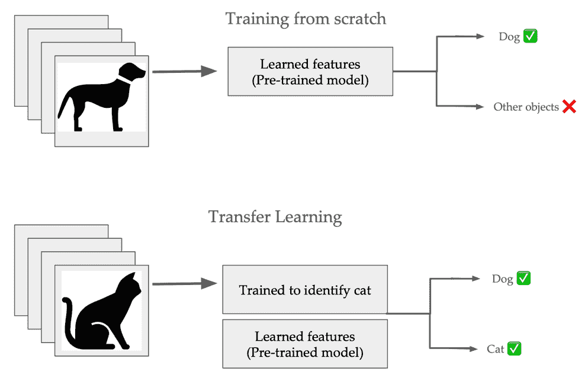

### 迁移学习的工作机制

在本节中，我们将学习迁移学习的工作机制：

1. 利用预训练模型：像残差网络（`ResNet`）这样的模型是在 ImageNet 上训练的，包含超过 1400 万张图像，涵盖 1000 个不同的类别。`ResNet-50` 有 50 层，包含超过 2300 万个参数。这些预训练模型在早期层学习边缘、纹理和物体部件等通用特征，而更深层则捕捉更复杂的模式。通过使用迁移学习，我们可以利用大型多样化数据集学习到的特征，而无需从头开始。

2. 针对特定任务进行微调：在迁移学习中，预训练模型的通用特征可以应用于更具体的任务，例如分类医学图像或动物物种，即使图像的领域不同。与重新训练整个模型相比，你通常只需微调最后几层，使模型适应识别领域特定的模式。

3. 减少数据需求：从头开始训练像 `ResNet` 这样的深度模型需要大型数据集。然而，通过迁移学习，较小的特定任务数据集（例如医学图像或动物数据集）就足够了。预训练模型已经知道如何提取有用特征，我们只需针对我们的用例对其进行微调即可。

使用迁移学习时，有两种主要方法：

• 特征提取：

○ 在这里，预训练模型被用作固定特征提取器。

○ 仅将最后一个全连接层替换为针对特定任务定制的新层（例如，如果分类动物，则将输出层替换为输出动物类别数量的层）。

○ 在这种情况下，早期层保持冻结，意味着它们的权重在训练期间不更新。这大大减少了更新参数的数量，从而加快训练速度，并降低在小数据集上过拟合的风险。

• 微调：

○ 在这种方法中，一些更深层被解冻并在新数据集上重新训练，同时保持早期层冻结。

○ 通常，早期层（捕捉边缘和纹理等低级特征）保持冻结，而更深层被重新训练以适应特定任务的特征。

○ 对于 `ResNet-50`，只有 2300 万个参数的一小部分（例如最后几百万个参数）会被微调，而不是全部。这降低了计算成本和过拟合的风险，尤其是在处理小数据集时。

### 迁移学习的应用

迁移学习在各个领域和领域中具有广泛的应用。它是一种多功能技术，允许将预训练模型调整到新任务和领域。迁移学习的一些典型应用包括：

• 图像分类：迁移学习广泛用于图像分类任务。预训练的卷积神经网络（`CNN`），如视觉几何组（`VGG`）和 `ResNet`，被微调用于特定的图像分类任务。

• 目标检测：迁移学习应用于目标检测任务，其中模型被调整以检测和定位图像或视频帧中的对象。`Faster R-CNN`、`YOLO` 和 `SSD` 等模型使用迁移学习来增强其检测能力。

• 自然语言处理（`NLP`）：在 `NLP` 中，预训练语言模型如 `BERT`、`GPT` 等被微调用于情感分析、命名实体识别、机器翻译和文本摘要等任务。

• 语音识别：迁移学习用于语音识别任务，其中在大量语音数据上训练的模型被调整用于特定的语音识别、转录或语音助手应用。

• 推荐系统：迁移学习通过利用用户行为数据和预训练嵌入式来改进推荐系统，以增强个性化推荐。

• 医学影像：迁移学习有助于分析医学图像，包括 X 光、MRI 和 CT 扫描，用于疾病诊断、肿瘤检测和异常识别等任务。

• 自动驾驶汽车：自动驾驶汽车利用迁移学习来调整预训练模型，用于目标检测、道路分割和其他感知任务，使其更安全、更高效。

• 视频分析：迁移学习增强了视频分析任务，如动作识别、摘要和字幕，使模型能够理解视频内容。

• 异常检测：迁移学习应用于异常检测任务，包括网络安全、制造和金融，以识别异常模式或行为。

• 文本转语音（`TTS`）合成：迁移学习模型从文本输入生成类似人类的语音，提高 `TTS` 合成系统的质量。

• 风格迁移：在计算机图形学中，迁移学习用于风格迁移任务，允许将一幅图像或绘画的艺术风格应用到另一幅图像上。

• 机器人技术：机器人从迁移学习中受益，以获取新技能并适应各种环境，例如导航、物体操作和人机交互。

• 欺诈检测：金融机构使用它进行欺诈检测，通过学习历史数据模式来识别欺诈交易。

• 医疗保健：迁移学习协助医疗保健任务，包括疾病预测、患者风险评估和药物发现，通过从相关医学领域转移知识。

### 迁移学习的优势

迁移学习在机器学习和深度学习领域提供了几个显著的优势：

• 提高学习效率：迁移学习通过用预训练权重初始化模型来加速新任务的训练过程。这节省了时间和计算资源。


# 迁移学习

## 迁移学习的优势

• 改进泛化能力：预训练模型已从海量数据中学习到有用的特征和表示，从而在数据有限的目标任务上提升泛化能力。

• 处理小数据集：在目标任务数据集较小时，迁移学习尤其有价值。它有助于缓解过拟合并提升模型性能。

• 降低数据标注成本：减少对大量标注数据收集的需求具有成本效益。迁移学习允许模型利用公开可用的预训练模型中的知识。

• 适应性：迁移学习可应用于多个领域，包括图像分类、目标检测、情感分析等，因而具有通用性和适应性。

• 性能提升：迁移学习通常能提升目标任务的性能，尤其是当源任务和目标任务相关时。对预训练模型进行微调，相较于从零开始训练，可在任务上带来 5% 到 20% 的准确率提升。

• 最先进的结果：预训练模型通常在其各自领域处于最先进水平。针对特定任务对这些模型进行微调，可产生顶尖结果。

• 类人学习：迁移学习反映了人类学习过程，即将一个情境中获得的知识应用于其他领域的学习。

• 快速原型开发：研究人员和从业者可以通过将预训练模型作为起点，快速为各种任务构建和实验模型。

• 多模态学习：迁移学习可应用于涉及多种数据模态（如图像和文本）的任务，从而实现来自不同来源的信息整合。

• 持续学习：迁移学习促进持续学习，即模型随时间积累来自各种任务的知识，在此基础上提升自身能力。

• 知识共享：迁移学习鼓励共享预训练模型和知识，培育协作和开放的研究社区。

## 迁移学习的类型

迁移学习可根据源任务和目标任务之间的关系、数据可用性以及知识迁移的方式分为多种类型。主要的迁移学习类型包括：

• 归纳式迁移学习：在归纳式迁移学习中，源任务和目标任务不同且无关。从源任务学到的知识被应用于目标任务，通常通过微调预训练模型或使用其特征来实现。

• 传导式迁移学习：传导式迁移学习处理相关但不完全相同的任务。在这种情况下，模型将源任务的知识迁移到目标任务，并进行一定的适应。传导式迁移学习旨在通过利用两者的共同点来提升源任务和目标任务的性能。

• 无监督迁移学习：无监督迁移学习涉及在无监督任务上预训练模型，然后对其进行微调以用于监督目标任务。无监督预训练常用于标注数据稀缺的任务。

• 半监督迁移学习：半监督迁移学习结合了监督和无监督迁移学习的方面。模型在大型数据集（无监督）上预训练，然后使用较少量的标注数据（监督）针对目标任务进行微调。

• 多任务学习（MTL）：MTL 是一种迁移学习形式，其中单个模型被训练以同时执行多个任务。模型共享特征提取层，但为每个任务设有独立的输出层——这种迁移学习类型受益于相关任务的联合学习。

• 一次学习：一次学习是一种迁移学习类型，其中模型被训练以使用极少示例（通常每个类别一或几个示例）来识别或区分类别。一次学习在数据有限的场景中特别有用。

• 零样本学习（ZSL）：ZSL 将一次学习扩展到模型必须识别训练期间未出现的类别的场景。它学习根据相关属性或语义信息来泛化并识别未见类别。

• 域自适应：域自适应是一种迁移学习类型，其中模型从一个域（例如源域）适应到在另一个域（例如目标域）中有效工作。当源域和目标域的数据分布不同时，它常用于解决域偏移问题。

• 少样本学习：少样本学习介于一次学习和传统监督学习之间。模型被训练以使用少量示例识别类别，因此适用于数据有限的任务。

• 元学习：元学习，也称为“学习学习”，涉及训练模型以快速适应新任务。它用于模型需要对各种任务具有高度适应性的场景。

下表提供了每种类型的应用示例：

| 迁移学习类型 | 示例用例 |
| --- | --- |
| 归纳式迁移学习 | 使用预训练的 ResNet 模型（在 ImageNet 上训练）进行医学图像分类，其中源任务是通用物体识别，目标任务是在 X 光片中检测疾病。 |
| 传导式迁移学习 | 将为英语语音识别训练的模型调整为识别西班牙语，利用语言之间的共同特征。 |
| 无监督迁移学习 | 使用在无监督文本数据上预训练的模型来提升情感分析（监督任务）的性能，其中标注数据有限。 |
| 半监督迁移学习 | 在大量未标注的医学图像上预训练模型，然后在较小的标注图像集上对其进行微调以分类疾病。 |
| MTL | 训练模型同时执行目标检测和语义分割（例如，识别并勾勒图像中的物体）。 |
| 一次学习 | 使用每个物种仅一或几张标注图像来识别罕见动物物种。 |
| ZSL | 在电子商务推荐系统中识别模型从未训练过的新对象或概念（例如，一种新型产品）。 |
| 域自适应 | 将在合成图像上训练的模型调整为在机器人应用中在真实世界图像上表现良好。 |
| 少样本学习 | 基于极少量医学扫描示例来分类罕见疾病。 |
| 元学习（学习学习） | 机器人在工厂环境中接触每个任务仅几次演示后，学习执行新的操作。 |

表 4.1：迁移学习算法及其用例

迁移学习类型的选择取决于具体任务、源域和目标域之间的关系、标注数据的可用性以及任务之间所需的适应程度。每种迁移学习类型都解决了机器学习和深度学习应用中的不同挑战和需求。

## 用于迁移学习的算法

多种机器学习算法和技术常用于迁移学习：

• 预训练语言模型：在自然语言处理中，BERT、GPT 和 RoBERTa 等预训练语言模型会针对各种任务进行微调，包括情感分析、文本分类、问答等。

• 残差迁移网络（RTN）：RTN 扩展了 ResNet 的思想，并允许在相关任务之间进行知识迁移。

• 域对抗神经网络（DANN）：DANN 用于域自适应，特别是当源域和目标域具有不同分布时。它采用域分类器来对齐两个域的特征分布。


## 迁移学习算法

• MTL: MTL 涉及训练单个模型以同时执行多个任务。该模型共享特征提取层，并为每个任务设有独立的输出层。

• 渐进式神经网络：渐进式神经网络在微调思想的基础上构建，并涉及逐步训练新任务。模型针对多个任务进行训练，每个任务都会添加新层。

• 基于学习排序的迁移学习（`LTR`）：`LTR` 用于信息检索任务。它专注于对项目相关性进行排序，并将从排序源数据中学到的知识迁移到目标任务。

• 孪生网络：孪生网络用于基于相似度的任务，如人脸识别和图像验证。它们学习测量输入对之间的相似性或不相似性。

• 元学习算法：元学习算法旨在训练能够用最少数据快速适应新任务的模型。模型无关元学习（`MAML`）等方法用于实现快速适应。

• ZSL 和少样本学习：零样本和少样本学习算法将已知类别集的知识迁移到识别新类别或稀有类别，只需极少示例。

迁移学习算法的选择取决于具体问题、可用数据以及源任务和目标任务之间的关系。每种算法都旨在有效处理不同的迁移学习场景和挑战。

选择合适的迁移学习算法或方法涉及考虑与特定问题、数据和可用资源相关的各种因素。以下是一个分步指南，帮助您选择最合适的迁移学习方法：

1. 了解您的问题：首先深入了解目标任务。定义您的问题，包括您拥有的数据类型、问题的复杂性以及期望的结果。

2. 分析数据：检查目标任务数据集的大小和质量。考虑可用标记数据的数量、数据分布和潜在的类别不平衡。

3. 评估域相似性：评估源域和目标域之间的相似性。考虑源任务是否与目标任务相关，以及它们是否共享常见特征。

4. 确定您的资源：考虑您为项目拥有的计算资源、预算和时间限制。某些迁移学习方法可能比其他方法更耗费计算资源。

5. 考虑预训练模型：探索在您的问题领域中可用的预训练模型和数据集。对于计算机视觉和 NLP 等任务，预训练模型通常被用作起点。

6. 选择合适的迁移学习方法：实验、评估、迭代和调优。

a. 实现所选的迁移学习方法并进行实验。使用适当的指标和验证技术评估模型性能。

b. 根据评估结果，迭代并微调模型和方法。根据需要调整超参数、模型架构和数据预处理。

### 迁移学习系统架构

迁移学习的架构可能因具体应用和所选迁移学习技术而异。但是，该过程涉及常见的架构元素和步骤。以下是迁移学习的典型架构：

• 源模型：源模型是在源任务上训练的预训练模型。该模型从源任务中学习了有价值的特征、表示和知识，使其成为迁移学习的起点。

• 特征提取层：源模型的较低层（例如神经网络中的卷积层）通常被称为特征提取层。这些层从源任务数据中捕获通用且可重用的特征。有时，这些层会被冻结，意味着它们在迁移学习过程中不会被更新。

• 任务特定层：在特征提取层之上，有任务特定层。这些层是为目标任务添加或微调的。它们负责将模型适应新任务、进行预测以及捕获任务特定信息。

• 微调（可选）：根据迁移学习方法，可能会对模型进行微调。微调涉及更新任务特定层，使其更适合目标任务。微调的程度可能有所不同，从仅更新最后几层到更新一些或全部层。

• 新任务数据：新任务数据由特定于目标任务的示例组成。这些示例用于训练和评估目标任务的模型。必须为目标任务拥有足够的标记数据，以确保模型性能。

• 训练过程：模型在新任务数据上使用适当的损失函数和优化算法进行训练。在训练期间，模型学习进行预测并调整其参数以最小化目标任务上的损失。

• 评估：训练后，模型在目标任务的单独验证或测试数据集上进行评估。与特定任务相关的评估指标评估模型性能。

• 推理：模型训练和验证后，可以对目标任务的新未见数据进行预测或推理。模型的任务特定层已调整为在该任务上表现良好。

• 模型部署：最终训练好的模型可以部署用于实际应用，例如图像分类、目标检测、文本生成或模型已适应的任何其他特定任务。

迁移学习的架构是灵活的，可以适应不同的场景和任务。根据源任务和目标任务的复杂性，架构可能涉及更多或更少的微调步骤，冻结或更新层的选择可能有所不同。关键是利用从源任务中学到的知识，同时有效地将模型适应新的目标任务。

让我们讨论 ZSL 和少样本学习的架构细节：

• ZSL 架构：

○ 输入层：未见类别的特征。

○ 特征提取层（`Frozen`）：预训练模型层，从输入中提取通用特征。这些层在 ZSL 中通常被冻结，因为模型依赖于在训练已见类别期间从大量数据中学习的通用特征。

○ 语义嵌入层（`Frozen`）：这将特征映射到语义空间，通常使用属性或 GloVe 或 Word2Vec 等词嵌入来表示未见类别。

○ 分类器层（`Unfrozen`）：分类器可以针对 ZSL 任务进行微调。由于没有未见类别的示例，分类器基于语义嵌入和通用特征映射工作。

• 数据流：

○ 输入（例如图像或文本）首先通过特征提取层生成高级特征。这些特征被映射到语义嵌入空间，其中未见类和已见类共享语义关系。最后，数据到达分类器，分类器使用语义表示将输入分类为未见类别之一。

这种架构允许模型仅基于已见类和未见类之间学习的语义关系来分类新类别，而不需要未见类别的直接示例。

下图显示了整体架构：

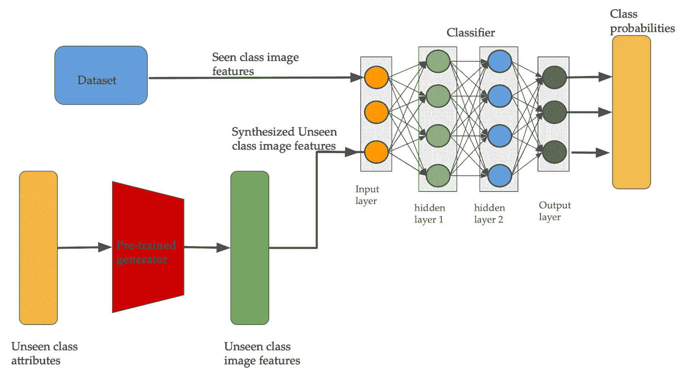

### 迁移学习的热门数据集

以下是一些可以帮助您理解和实践迁移学习的热门数据集：


## 数据集资源

• ImageNet: ImageNet 是最著名的图像分类数据集之一。它包含数千个类别中数百万张带标签的图像。它通常被用作迁移学习中预训练模型的源数据集。

URL: https://image-net.org/download.php

• CIFAR-10 和 CIFAR-100: 它们是流行的图像分类数据集，包含较小规模的图像集（分别为 10 类和 100 类）。这些数据集通常用于微调预训练模型。

URL: https://www.cs.toronto.edu/~kriz/cifar.html

• MNIST: 它是一个手写数字数据集。虽然它不如其他一些数据集具有挑战性，但在图像分类的背景下，它有助于练习迁移学习概念。

URL: http://yann.lecun.com/exdb/mnist/

• IMDB 电影评论: IMDB 数据集包含标记为正面或负面情感的电影评论。它通常用于自然语言处理任务（如情感分析）中的迁移学习。

URL: https://ai.stanford.edu/~amaas/data/sentiment/

• Wikipedia 文本: Wikipedia 提供多种语言的大规模文本语料库。它可以用于 NLP 任务中语言模型的预训练。

URL: https://dumps.wikimedia.org/

• Stanford Dogs and Cats: 该数据集包含狗和猫的图像，用于微调预训练模型以进行二进制图像分类。

URL: http://vision.stanford.edu/aditya86/ImageNetDogs/

URL: https://www.microsoft.com/en-us/download/details.aspx?id=54765

• Oxford Flowers 和 Oxford 102 Birds: 这些数据集分别包含花卉和鸟类的图像。它们用于微调与细粒度图像分类相关的任务中的模型。

URL: http://www.robots.ox.ac.uk/~vgg/data/flowers/

URL: http://www.robots.ox.ac.uk/~vgg/data/flowers/102/

• 医疗数据集: 与医学影像相关的数据集，例如胸部 X 光片、MRI 扫描或病理切片，通常用于医疗应用（如疾病检测和诊断）中的迁移学习。

URL: https://www.kaggle.com/nih-chest-xrays/data

使用这些数据集时，您可以遵循常见的迁移学习工作流程，例如在源任务上预训练模型（使用像 ImageNet 这样的大型数据集），然后针对目标任务（使用较小的、特定于任务的数据集）对其进行微调。这些数据集将帮助您掌握跨不同领域和任务的迁移学习、模型适应和知识转移的基本概念。

## 数据加载和预处理

此代码演示了在 PyTorch 中加载和可视化 CIFAR-10 数据集子集的基本设置。它首先导入必要的库，如 torch、torchvision 和 matplotlib.pyplot。然后，它定义计算设备，如果可用则使用 GPU，否则默认使用 CPU。

`transform` 变量指定数据转换，将图像大小调整为 32x32 像素，将其转换为张量，并对其进行归一化。CIFAR-10 数据集被加载并分为训练集和测试集，其中 `trainset` 和 `testset` 分别代表这两组。

为了加快训练速度，从训练数据中随机选择了 1,000 张图像的子集。为训练和测试创建了 DataLoader，允许高效处理数据批次。

`imshow` 函数可视化未归一化的图像。代码检索一批图像并以网格形式显示它们，从而预览 CIFAR-10 图像。

```
import torch

import torch.nn as nn

import torch.optim as optim

import torchvision

import torchvision.transforms as transforms

import random

import matplotlib.pyplot as plt

import numpy as np

import torch.nn.functional as F # Import functional API for activation functions

## Define the device

device = torch.device("cuda" if torch.cuda.is_available() else "cpu")

## Define data transformations

transform = transforms.Compose([

transforms.Resize((32, 32)),

transforms.ToTensor(),

transforms.Normalize((0.5, 0.5, 0.5), (0.5, 0.5, 0.5))

])

## Load CIFAR-10 dataset

trainset = torchvision.datasets.CIFAR10(root='./data', train=True, download=True, transform=transform)

testset = torchvision.datasets.CIFAR10(root='./data', train=False, download=True, transform=transform)

## Select a small subset of the training data

small_trainset_indices = random.sample(range(len(trainset)), 1000) # Randomly select 1000 samples

small_trainset = torch.utils.data.Subset(trainset, small_trainset_indices)

## Create DataLoader for the small training dataset

trainloader = torch.utils.data.DataLoader(small_trainset, batch_size=64, shuffle=True, num_workers=2)

testloader = torch.utils.data.DataLoader(testset, batch_size=64, shuffle=False, num_workers=2)

## Visualize some images from the training set

def imshow(img):

img = img / 2 + 0.5 # unnormalize

npimg = img.numpy()

plt.imshow(np.transpose(npimg, (1, 2, 0)))

plt.axis('off')

## Get a batch of training images

dataiter = iter(trainloader)

images, labels = next(dataiter)

## Show images

imshow(torchvision.utils.make_grid(images[:8]))

plt.title('Sample Images from CIFAR-10')

plt.show()
```


# 模型训练

以下是使用 CIFAR-10 数据集进行迁移学习的代码示例。我们将使用预训练模型并对其进行微调，以将图像分类为 10 个不同的类别。此示例使用 Python 和 PyTorch 库实现：

以下代码使用 PyTorch 定义、训练和评估一个简单的 CNN。`SimpleCNN` 类由两个卷积层和两个全连接线性层组成。第一个卷积层 `conv1` 接收 RGB 图像的 3 通道输入，并使用 3x3 内核输出 32 个特征图。第二个卷积层 `conv2` 将输出加倍为 64 个特征图。一个最大池化层（`self.pool`）带有 2x2 内核，减少空间维度，随后是 ReLU 激活以增加非线性。

卷积层之后，特征图被展平为 1D 向量，以供全连接层 `fc1` 使用，该层具有 512 个单元。最终层 `fc2` 输出 10 个单元，代表 CIFAR-10 中的 10 个类别。

如果可用，模型将移至 GPU，训练设置包括交叉熵损失函数（`nn.CrossEntropyLoss`）和带动量的 SGD 优化器。在每个 epoch 中，模型遍历数据加载器，执行前向和后向传播以更新权重。每个 epoch 累积损失，训练结束时，将绘制 `num_epochs` 上的损失，以直观地跟踪性能改进，并提供随时间推移的训练进度洞察。

```
## Define a simple CNN model

class SimpleCNN(nn.Module):

def __init__(self):

super(SimpleCNN, self).__init__()

self.conv1 = nn.Conv2d(3, 32, kernel_size=3, padding=1)

self.conv2 = nn.Conv2d(32, 64, kernel_size=3, padding=1)

self.fc1 = nn.Linear(64 * 8 * 8, 512)

self.fc2 = nn.Linear(512, 10)

self.pool = nn.MaxPool2d(2, 2)

def forward(self, x):

x = self.pool(F.relu(self.conv1(x)))

x = self.pool(F.relu(self.conv2(x)))

x = x.view(-1, 64 * 8 * 8)

x = F.relu(self.fc1(x))

x = self.fc2(x)

return x

## Initialize and train the model

model = SimpleCNN().to(device)

criterion = nn.CrossEntropyLoss()

optimizer = optim.SGD(model.parameters(), lr=0.001, momentum=0.9)

## Training loop with loss tracking

num_epochs = 10

train_losses = []

for epoch in range(num_epochs):

running_loss = 0.0

for inputs, labels in trainloader:

inputs, labels = inputs.to(device), labels.to(device)

optimizer.zero_grad()

outputs = model(inputs)

loss = criterion(outputs, labels)

loss.backward()

optimizer.step()

running_loss += loss.item()

epoch_loss = running_loss / len(trainloader)

train_losses.append(epoch_loss)

print(f"Epoch [{epoch + 1}/{num_epochs}], Loss: {epoch_loss:.4f}")

print("Finished Training")

## Plot training loss

plt.plot(train_losses)

plt.title('Training Loss over Epochs')
```


plt.xlabel('Epochs')

plt.ylabel('Loss')

plt.grid()

plt.show()

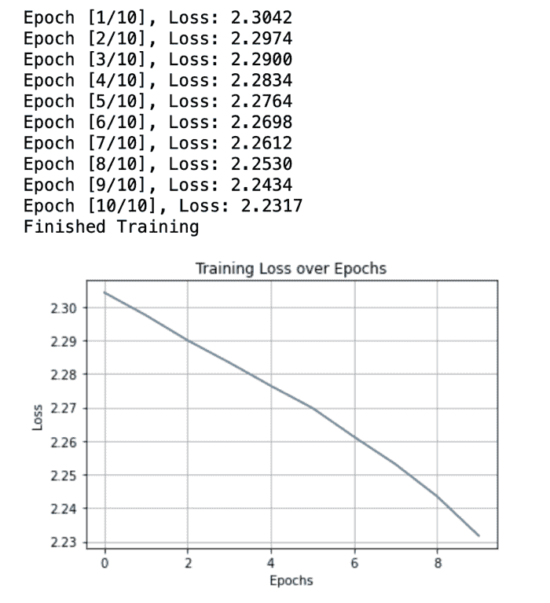

## 模型评估与测试

在评估迁移学习模型时，可以使用一组通常用于二分类或多类分类问题的标准评估指标。

以下是一些需要考虑的关键评估指标：

• 准确率（Accuracy）：准确率衡量被正确分类的样本占总样本的比例。它是一种常用的指标，但对于不平衡数据集可能不是理想的选择。

• 精确率（Precision）：精确率衡量正预测的准确性。它是真正例与真正例和假正例之和的比率。当尽量减少假正例至关重要时，高精确率非常重要。

• 召回率（Recall，灵敏度或真正例率）：召回率衡量模型正确识别正例的能力。它是真正例与真正例和假负例之和的比率。当尽量减少假负例至关重要时，高召回率非常重要。

• F1 分数：F1 分数是精确率和召回率的调和平均数。它提供了模型性能的平衡度量，特别是在类别之间存在不平衡的情况下。

下面的代码评估并可视化训练好的深度学习模型在测试数据集上的性能。

`evaluate_model` 函数评估模型在所有测试图像上的准确率和性能。首先，它将模型设置为评估模式（`model.eval()`），这会停用 Dropout 层并防止梯度计算，从而节省计算资源。对于每一批测试图像，该函数获取模型的预测，并存储预测标签和真实标签。然后，它使用 sklearn 的 `accuracy_score` 计算准确率。详细的 `classification_report` 为每个类别提供精确率、召回率和 F1 分数。此外，混淆矩阵通过 `seaborn.heatmap` 显示，从而深入了解各类别中正确分类和错误分类的样本。

`visualize_predictions` 函数显示测试数据集中一部分图像及其真实标签和预测标签。它获取一批图像，得到模型的预测，并使用 `matplotlib.pyplot` 显示图像。对于每张图像，图表显示真实标签和预测标签，使用户能够直观地看到单个预测和模型的准确率。这段代码对于从定量和定性两方面分析模型性能非常有价值，能够提供关于数据集中分类优势和劣势的反馈。

```
import torch

import torch.nn.functional as F

from sklearn.metrics import accuracy_score, confusion_matrix, classification_report

import seaborn as sns

import matplotlib.pyplot as plt

import numpy as np

## Evaluation function for the test dataset

def evaluate_model(model, testloader):

    model.eval() # Set the model to evaluation mode

    all_preds = []

    all_labels = []

    with torch.no_grad(): # Disable gradient calculation for testing

        for inputs, labels in testloader:

            inputs, labels = inputs.to(device), labels.to(device)

            outputs = model(inputs)

            _, predicted = torch.max(outputs, 1)

            all_preds.extend(predicted.cpu().numpy())

            all_labels.extend(labels.cpu().numpy())

    # Calculate accuracy

    accuracy = accuracy_score(all_labels, all_preds)

    print(f"Test Accuracy: {accuracy:.4f}")

    # Print classification report

    print("Classification Report:")

    print(classification_report(all_labels, all_preds, target_names=testset.classes))

    # Confusion matrix

    conf_matrix = confusion_matrix(all_labels, all_preds)

    plt.figure(figsize=(10, 8))

    sns.heatmap(conf_matrix, annot=True, fmt="d", cmap="Blues", 

      xticklabels=testset.classes, yticklabels=testset.classes)

    plt.title("Confusion Matrix")

    plt.xlabel("Predicted")

    plt.ylabel("True")

    plt.show()

## Visualize some test predictions

def visualize_predictions(model, testloader):

    model.eval()

    dataiter = iter(testloader)

    images, labels = next(dataiter)

    images, labels = images.to(device), labels.to(device)

    with torch.no_grad():

        outputs = model(images)

        _, preds = torch.max(outputs, 1)

    # Display images with predictions

    fig, axes = plt.subplots(2, 4, figsize=(12, 6))

    for i, ax in enumerate(axes.flat):

        img = images[i].cpu().numpy()

        img = img / 2 + 0.5 # Unnormalize

        img = np.transpose(img, (1, 2, 0)) # Convert to H x W x C

        ax.imshow(img)

        ax.set_title(f"True: {testset.classes[labels[i]]}\nPred: 

 {testset.classes[preds[i]]}")

        ax.axis("off")

    plt.show()

## Run the evaluation and visualization functions

evaluate_model(model, testloader)

visualize_predictions(model, testloader)
```

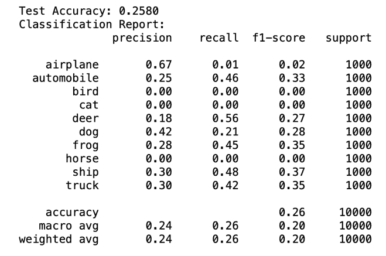

下图显示了使用热图的混淆矩阵：

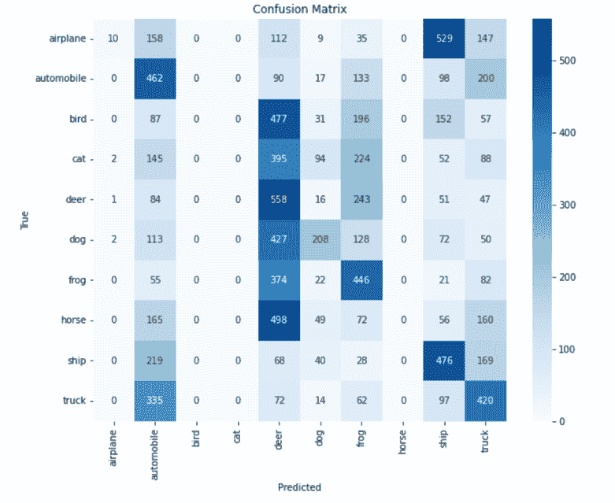

## 迁移学习的微调

使用迁移学习进行微调是一种常见的技术，用于将预训练模型适应新任务或新领域。它涉及获取一个预训练模型，并在你的特定数据集上进一步训练它。以下是使用 PyTorch 对预训练模型进行微调的逐步指南：

1. 选择预训练模型：首先选择适合你任务的预训练模型。PyTorch 通过 `torchvision.models` 模块提供预训练模型，例如 ResNet、VGG 或 Inception。你也可以使用来自外部来源的模型，例如用于 NLP 任务的 Hugging Face Transformers 库。

2. 加载预训练模型：加载预训练模型，如果存在最终分类层，则将其移除。这将允许你用特定于你任务的新输出层替换它。

3. 修改架构：将预训练模型的最终分类层替换为与你的数据集类别数量匹配的新层。此新层将用于微调。

4. 冻结层（可选）：你可以选择冻结预训练模型的一些早期层，尤其是当你拥有小数据集时。冻结层意味着它们的权重在训练期间不会更新，这有助于防止过拟合。

5. 定义自定义损失函数：创建适合你任务的自定义损失函数。例如，你可以对分类任务使用交叉熵损失。

6. 选择优化器：选择 Adam、SGD 或其他优化器。你也可以调整学习率。

7. 数据加载和增强：准备训练数据集，如有需要应用数据增强，并为训练、验证和测试创建 PyTorch DataLoader。

8. 微调循环：实现一个训练循环来微调模型。该循环应包括前向传播和后向传播、梯度更新以及模型评估。

9. 正则化（可选）：你可以包含 Dropout、权重衰减和批量归一化等技术来防止过拟合。

10. 训练模型：在你的数据集上训练模型若干个 Epoch。在训练期间监控损失和评估指标。

11. 评估：训练后，在单独的验证或测试数据集上评估微调后的模型，以评估其性能。

12. 调整超参数：微调通常涉及尝试学习率、批量大小和 `num_epochs` 等超参数。根据需要调整这些参数以优化性能。

在 PyTorch 中微调预训练模型的示例：

```
## Fine-Tuning a Pre-Trained Model with Visualization

import torchvision.models as models

## Load a pre-trained ResNet model

model_ft = models.resnet18(pretrained=True)

## Modify the final layer to match the number of classes in CIFAR-10

num_classes = 10

model_ft.fc = nn.Linear(model_ft.fc.in_features, num_classes)

## Move the model to the device

model_ft = model_ft.to(device)

## Define criterion and optimizer

criterion = nn.CrossEntropyLoss()

optimizer_ft = optim.SGD(model_ft.parameters(), lr=0.001, momentum=0.9)
```


## 带损失跟踪的微调循环

`num_epochs_ft = 5`

`fine_tune_losses = []`

```
for epoch in range(num_epochs_ft):
    running_loss = 0.0

    for inputs, labels in trainloader:
        inputs, labels = inputs.to(device), labels.to(device)

        optimizer_ft.zero_grad()

        outputs = model_ft(inputs)

        loss = criterion(outputs, labels)

        loss.backward()

        optimizer_ft.step()

        running_loss += loss.item()

    epoch_loss = running_loss / len(trainloader)

    fine_tune_losses.append(epoch_loss)

    print(f"Fine-tuning Epoch [{epoch + 1}/{num_epochs_ft}], Loss: {epoch_loss:.4f}")

print("Finished Fine-tuning")
```

## 绘制微调损失

```
plt.plot(fine_tune_losses)

plt.title('Fine-tuning Loss over Epochs')

plt.xlabel('Epochs')

plt.ylabel('Loss')

plt.grid()

plt.show()
```

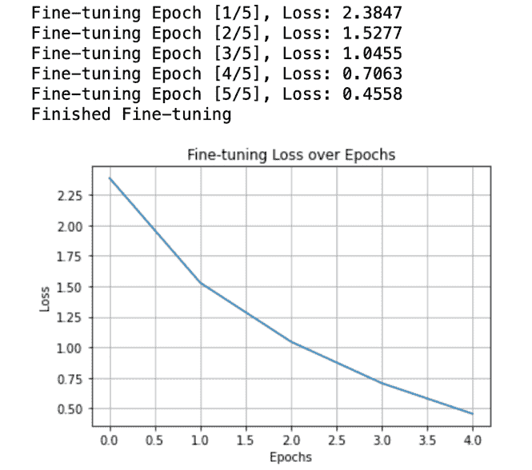

### 迁移学习中的模型推理

在迁移学习中，推理是最终阶段，预训练并微调后的模型在此阶段对新数据进行预测。此过程对于评估模型在先前未见样本上的实际性能至关重要。迁移学习的推理阶段包括加载测试数据集、将模型设置为评估模式（以禁用训练特定的操作，如丢弃）以及运行预测。这些预测允许将模型输出与真实标签进行比较，以确定准确性和有效性。在迁移学习中，模型（例如 ResNet）在大型数据集（例如 ImageNet）上预训练，并在较小的、特定领域的数据集上微调。然后使用微调后的模型进行推理，其预测结果与更简单的基线模型（例如基本 CNN）的预测结果进行比较。通过分析和可视化预测，迁移学习展示了预训练模型在微调后如何实现更准确的结果，尤其是在资源有限、无法在较小数据集上进行大量训练的情况下。

下面的代码执行模型推理并评估两个模型——一个简单的 CNN 和一个微调后的 ResNet。`infer` 函数定义用于对任何给定模型进行推理，从 `data_loader` 加载图像并返回预测标签和真实标签以供评估。在推理模式（`torch.no_grad()`）下，模型在不计算梯度的情况下处理图像，这更快且节省内存。每个模型的预测结果存储在列表（`all_preds` 和 `all_labels`）中。然后，代码对两个模型都运行此推理函数，计算准确率并输出结果。

推理之后，`visualize_predictions` 函数显示每个模型的示例预测。此函数接受图像、真实标签和预测标签，并连同它们的标签一起显示，以帮助直观地评估模型性能。对于每个图像，它并排显示实际类和预测类，从定性角度了解模型的优势和劣势。这种可视化突出了简单 CNN 和微调后的 ResNet 之间性能的差异：

## 两个模型的模型推理

```
def infer(model, data_loader, device):

    model.eval()

    all_preds = []

    all_labels = []

    with torch.no_grad():

        for images, labels in data_loader:

            images = images.to(device)

            labels = labels.to(device)

            outputs = model(images)

            _, predicted = torch.max(outputs, 1)

            all_preds.extend(predicted.cpu().numpy())

            all_labels.extend(labels.cpu().numpy())

    return all_labels, all_preds
```

## 在测试数据集上运行简单 CNN 模型的推理

`true_labels_cnn, predictions_cnn = infer(model, testloader, device)`

## 计算简单 CNN 模型的准确率

`accuracy_cnn = sum(np.array(true_labels_cnn) == np.array(predictions_cnn)) / len(true_labels_cnn)`

`print(f"Accuracy of Simple CNN on the test dataset: {accuracy_cnn * 100:.2f}%")`

## 在测试数据集上运行微调后的 ResNet 模型的推理

`true_labels_resnet, predictions_resnet = infer(model_ft, testloader, device)`

## 计算微调后的 ResNet 模型的准确率

`accuracy_resnet = sum(np.array(true_labels_resnet) == np.array(predictions_resnet)) / len(true_labels_resnet)`

`print(f"Accuracy of Fine-tuned ResNet on the test dataset: {accuracy_resnet * 100:.2f}%")`

## 可视化简单 CNN 的预测

```
def visualize_predictions(images, true_labels, predictions, num_images=8):

    plt.figure(figsize=(5, 5)) # Large figure size for better resolution

    for i in range(num_images):

        img = images[i] / 2 + 0.5 # unnormalize

        img = np.transpose(img.numpy(), (1, 2, 0)) # Change the order for displaying

        plt.subplot(2, 4, i + 1)

        plt.imshow(img)

        plt.title(f'True: {true_labels[i]}\nPred: {predictions[i]}', fontsize=12)

        plt.axis('off')

    plt.tight_layout()

    plt.show()
```

## 获取简单 CNN 的一批测试图像

`test_dataiter = iter(testloader)`

`test_images, _ = next(test_dataiter)`

## 可视化简单 CNN 模型的预测

`print("Predictions from Simple CNN:")`

`visualize_predictions(test_images, true_labels_cnn[:8], predictions_cnn[:8])`

## 获取微调后的 ResNet 的一批测试图像

`test_dataiter_resnet = iter(testloader)`

`test_images_resnet, _ = next(test_dataiter_resnet)`

## 可视化微调后的 ResNet 模型的预测

`print("Predictions from Fine-tuned ResNet:")`

`visualize_predictions(test_images_resnet, true_labels_resnet[:8], predictions_resnet[:8])`

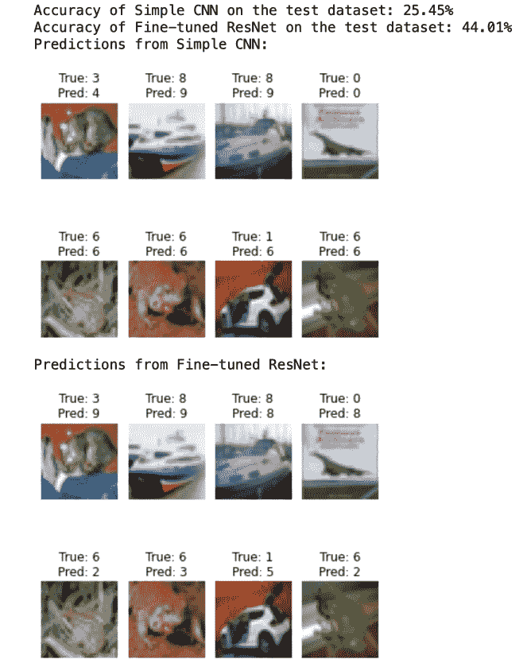

## 结论

在本章中，我们探讨了迁移学习在图像标注方面的威力，特别是其在医学影像任务中的应用。通过利用预训练模型，我们能够显著提升在标注数据有限的情况下进行图像分类任务的性能。数据预处理、模型微调和评估的逐步过程展示了迁移学习如何降低计算需求并提高准确率。总体而言，本章强调了迁移学习在高效地将模型适应到新领域方面所起的关键作用，使其成为现代机器学习中不可或缺的工具。在下一章中，我们将探讨使用生成对抗网络（GAN）进行数据增强。

**加入我们图书的 Discord 空间**

加入图书的 Discord 工作区，获取最新动态、优惠、全球科技动态、新书发布以及与作者的交流活动：

**[`discord.bpbonline.com`](https://discord.bpbonline.com)**


# 第 5 章

## 利用生成对抗网络进行数据增强

## 简介

生成对抗网络（GAN）通过生成逼真的合成数据彻底改变了数据增强。本章探讨了 GAN 的基础知识、其架构和训练过程。我们将深入探讨 GAN 生成数据的实际应用、优势和挑战，包括伦理问题。此外，我们将考察流行的 GAN 变体、性能评估方法，并提供一个实际示例来说明其实现。

## 结构

在本章中，我们将学习以下主题：

• 生成对抗网络

• 生成对抗网络算法

• 深度卷积 GAN

# 目标

在本章结束时，我们将了解 GAN 的基本概念和架构，学习 GAN 训练过程，并探索 GAN 在数据增强中的实际应用。我们还将了解使用 GAN 生成的合成数据的优势，以及相关的挑战和伦理问题，并熟悉流行的 GAN 变体和算法。最后，我们将了解如何评估 GAN 性能，并通过实际示例应用所学知识，增强在各种场景中使用 GAN 进行数据增强的能力。

## 生成对抗网络


## GAN 是一种专为生成数据（尤其是与现实世界数据相似的合成数据）而设计和开发的机器学习（ML）模型。GANs 由 Ian Goodfellow 及其同事于 2014 年提出，此后已成为深度学习和人工智能（AI）领域的热门工具之一。

可以将 GAN 想象成一个由两个人组成的团队：一名赝画师和一名艺术侦探：

• 赝画师（`Generator`）：想象一位擅长创作艺术品的天才艺术家，但他不使用颜料和画布，而是使用一台神奇的绘图机器。这位艺术家从一张空白画布开始，利用神奇的机器创作图片。

• 艺术侦探（`Discriminator`）：现在，有一位检查艺术品的艺术侦探。这位侦探擅长判断一幅画是真是假。他们研究图片，试图发现任何能揭示艺术品是真迹还是由神奇机器创作的赝品的线索。

下图描述了 GAN 的工作机制：

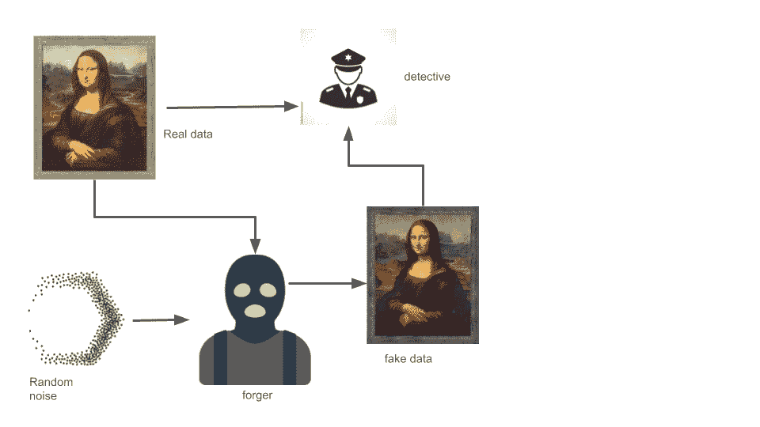

GAN 的工作原理如下：

• 赝画师的目标是创作出如此逼真的图片，以至于艺术侦探无法分辨出它们是由神奇机器创作的。

• 艺术侦探的工作是不断提高识别赝画师作品的能力，即使这些作品看起来非常逼真。

他们不断进行这场博弈，每一轮之后，赝画师都会变得更擅长创作看起来更像真艺术的图片。作为回应，艺术侦探也会磨练自己识别赝品的技能。

随着时间的推移，赝画师变得如此出色，以至于艺术侦探几乎无法分辨哪些画作是真迹，哪些是由神奇机器创作的。结果是，赝画师可以创作出看起来就像由真实艺术家创作的艺术品，尽管它们全都是由机器生成的。

## GAN 可以帮助解决的现实问题

GANs 具有多功能性，可以解决各个领域的现实问题。以下是 GANs 可以帮助解决的一些现实问题示例：

• 图像到图像转换：GANs 可以将图像从一个领域转换到另一个领域，例如将草图转换为彩色图像，或将卫星图像转换为地图。

下图说明了使用 GAN 将第一张照片中的斑马转换成看起来像第二张照片中的马的图像转换：


• 人脸老化和去老化：GANs 可以模拟一个人脸随时间推移可能发生的老化过程，或者让一个人看起来更年轻。

下图演示了使用 GAN 模拟人脸的过程：


• 文本到图像合成：GANs 可以从文本描述生成图像，从而可以根据文本提示创建图像。

下图使用 GAN 将文本转换为图像：

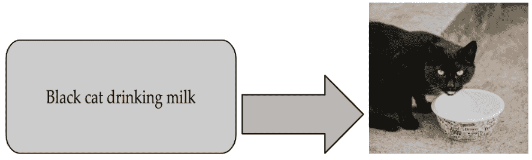

• 视频生成：GANs 可以生成视频序列，包括深度伪造视频，这些视频引发了关于虚假信息和隐私的担忧。

• 数据隐私和匿名化：GANs 可以用于生成合成数据，这些数据在保留真实数据统计特性的同时保护个人隐私。

• 图像合成与增强：

  ○ 艺术创作：GANs 可以生成艺术品、风格迁移和创意设计。

  ○ 照片级渲染：GANs 可以创建高质量、照片级逼真的图像和场景。

  ○ 超分辨率：GANs 可以增强图像的分辨率和质量，使其更加清晰和精确。

  ○ 图像去模糊：GANs 可以去除图像中的模糊，提高其质量。

• 数据增强和合成数据生成：

  ○ 隐私保护的数据共享：GANs 创建在保留统计特性的同时保护隐私的数据，从而实现更安全的共享。

  ○ 图像分类：GANs 可以生成合成图像来增强数据集，提高模型在图像分类等任务上的性能。

  ○ 医学影像：GANs 创建逼真的医学图像，有助于训练用于疾病检测和诊断的模型，尤其是在真实数据稀缺的情况下。

  ○ 欺诈检测：GANs 生成的合成数据可以帮助训练模型检测欺诈活动，通过模拟罕见的欺诈场景。

• 异常检测：

  ○ 欺诈检测：GANs 可以帮助识别金融交易中的欺诈或异常模式。GANs 生成合成交易数据，使模型能够通过比较真实和虚假数据分布来检测欺诈模式。

  ○ 质量控制：GANs 可以检测制造和工业过程中的缺陷或异常。GANs 创建无缺陷样本，通过将真实产品与生成的产品进行比较来帮助检测制造过程中的异常。

• 医学影像：

  ○ MRI 和 CT 图像增强：GANs 可以提高医学图像的质量，以便进行准确的诊断和治疗规划。

  ○ 肿瘤检测：GANs 可以协助识别医学扫描中的肿瘤和异常。

• 3D 对象生成：

  ○ 3D 建模：GANs 可以为计算机图形、游戏和虚拟现实生成对象和场景的 3D 模型。

  ○ 建筑设计：GANs 可以创建建筑设计和布局。

• 语音和音频生成：

  ○ 文本转语音（TTS）：GANs 可以从文本生成听起来自然的人类语音。

  ○ 音乐创作：GANs 可以创作音乐并生成音频效果。

• 药物发现：

  ○ 分子生成：GANs 可以协助生成分子结构并预测潜在的药物候选物，加速药物发现过程。

  ○ 药物属性优化：通过从现有化学数据库中学习，GANs 可以提出对现有分子的修改，以增强其疗效并减少副作用。

  ○ 降低开发成本：GANs 简化了药物发现过程，减少了合成和测试新化合物所需的时间和成本。

• 卫星图像生成：

  ○ 地理空间应用：GANs 可以为地理空间映射和模拟创建合成卫星图像。

  ○ 气候监测：GANs 创建逼真的卫星图像来监测气候变化，帮助分析天气模式和环境变化。

  ○ 城市规划：GANs 协助生成用于城市规划的详细卫星图像，从而实现更好的基础设施建设和资源管理。

• 以人为本的应用：

  ○ 头像创建：GANs 可以为虚拟世界和在线平台生成逼真的头像。

  ○ 聊天机器人和虚拟助手：GANs 可以为聊天机器人和虚拟助手创建类似人类的声音和头像。

• 内容生成：

  ○ 艺术和音乐：GANs 可以创作艺术和音乐，为创意艺术做出贡献。

  ○ 游戏开发：GANs 生成逼真的游戏环境和角色，增强游戏体验。

## 生成对抗网络的架构

GAN 的架构由两个主要组件组成：生成器和判别器。这些组件是神经网络，并通过竞争过程同时进行训练。

让我们更详细地探讨 GAN 的架构：

下图显示了 GAN 架构的各个组件：

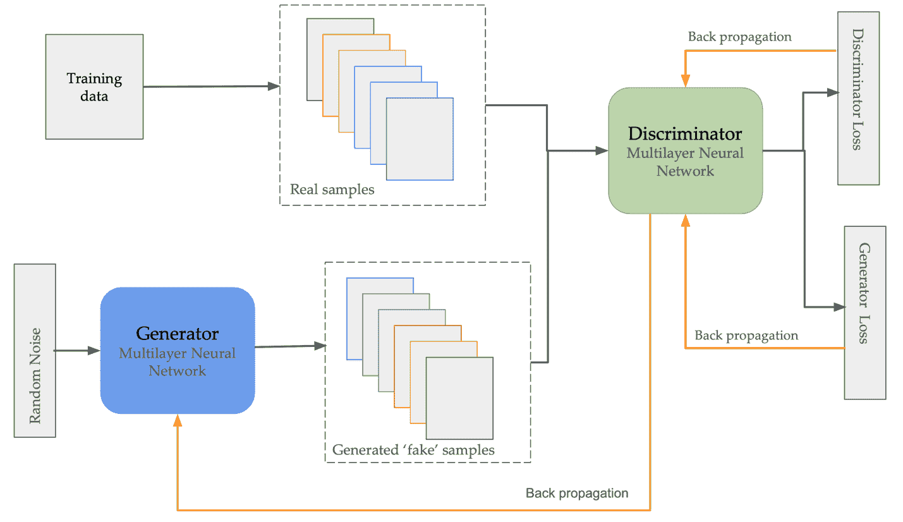

以下是关于该架构工作原理的详细说明：

1. 生成器：

a. 生成器是一个神经网络，它接收通常来自高斯分布或均匀分布的随机噪声，并学习生成与训练集中的真实数据相似的假样本（例如，图像）。

b. 其目标是通过创建与真实样本无法区分的合成假样本来欺骗判别器。

c. 生成器通过生成器损失接收来自判别器的反馈，这有助于它随时间推移提高生成样本的质量。

2. 判别器：

a. 判别器也是一个神经网络，其任务是区分训练数据中的真实样本和由生成器生成的假样本。


b.`It outputs a probability indicating how likely a given sample is real (close to 1) or fake (close to 0).`

c.`The discriminator provides two feedback loops: One for improving its own ability to classify samples discriminator loss and another for improving the generator by indicating how convincing the generated samples are.`

## 3. Training process (Adversarial training):

a.`The training alternates between updating the discriminator and the generator in an adversarial manner:`

i.`Discriminator update: The discriminator is trained to maximize its accuracy in distinguishing between real and fake samples. This means it minimizes the discriminator loss, becoming better at differentiating between real and generated data.`

ii.`Generator update: The generator is trained to minimize the generator loss by creating better, more realistic fake samples that can fool the discriminator. The better the generator gets, the harder it is for the discriminator to make correct classifications.`

Both networks are trained using backpropagation to update their respective weights.

## 4. Loss functions:

a.`The discriminator tries to maximize the probability of correctly classifying both real and fake samples. The loss function typically used for the discriminator is binary cross-entropy (log loss).`

b.`The generator aims to minimize the probability that the discriminator correctly classifies fake samples. This is also often done using a log loss function but from the generator's perspective.`

## 5. Key insights:

a.`Adversarial nature: The term adversarial comes from the fact that the generator and discriminator are competing against each other. The generator is trying to create better fakes, and the discriminator is trying to get better at identifying them.`

b.`Feedback loop: This adversarial process is feedback loop where the generator and discriminator simultaneously improve each other’s performance.`

In summary, GANs rely on this game between the generator (creating fake data) and the discriminator (detecting fake data) to continuously refine both models, ultimately producing highly realistic synthetic data.

The generator and discriminator are not pre-trained but trained simultaneously in a competitive fashion, helping the GAN improve over time.

## Advantages of generating synthetic data using GAN

Generating synthetic data using GANs is beneficial and necessary for several reasons:

• Data scarcity: Obtaining labeled data for training models can be expensive, time-consuming, and sometimes impossible due to privacy or legal constraints. GANs can create synthetic data to augment small datasets.

• Data imbalance: GANs can be used to generate additional data for minority classes in some of the datasets containing rare anomalies.

• Privacy and security: Some datasets contain sensitive or private information, making it challenging or impossible to share. GANs can generate synthetic data that preserves the statistical characteristics of the original data while removing any identifiable information.

• Data augmentation: GAN-generated data can augment the training dataset, providing additional examples with variations to help improve a model's ability to handle different conditions and inputs.

• Reducing bias: GANs can address ethical issues in ML models by creating synthetic data to balance representation across demographic or other sensitive attributes.

• Cost savings: Generating synthetic data is cost-effective compared to data collection and labeling, making it a practical choice.

## Challenges with synthetic data generated using GAN

While GANs offer significant advantages in generating synthetic data, they also present several challenges that need to be addressed. Understanding these challenges is crucial for effectively leveraging GANs in various applications. Below are some key issues associated with synthetic data generated using GANs:

• Regulatory and ethical concerns: Using synthetic data may raise regulatory and ethical concerns, especially in fields like healthcare and finance, where data accuracy is critical.

• Computational intensity: Training GANs can be computationally intensive and time-consuming. It often requires substantial computing resources to generate high-quality synthetic data.

• Quality variability: The quality of synthetic data is affected by GAN's architecture, training data, and hyperparameters. It may not be possible to mimic the diversity of the real-world data.

• Limited understanding: GANs generate data without a deep understanding of the underlying structures, semantics, or causal relationships in the data, which can lead to unrealistic or impractical samples.

• Data leakage: If GANs are trained on sensitive or private data, there is a risk that the generated synthetic data might still contain traces of the original data, potentially violating privacy or confidentiality.

• Bias propagation: If the training data used to train a GAN is biased, the synthetic data can inherit and propagate those biases, leading to unfair or inaccurate model predictions.

## Ethical concerns of generative adversarial networks

GANs have raised several ethical concerns due to their powerful capabilities in generating synthetic data, which can be used for various applications. Some of the ethical concerns associated with GANs include:

• Deepfakes and misinformation: GANs have been used to create highly convincing deepfake videos and images portraying individuals saying or doing things they never did. This has the potential to spread false information and harm the reputations of individuals.

• Privacy violations: GANs can generate synthetic images of individuals, leading to privacy breaches when these images are used without consent, potentially for malicious purposes.

• Fake news and content manipulation: GANs can be employed to manipulate text and images, potentially contributing to creating fake news, misleading content, and disinformation campaigns on social media.

• Identity theft: Synthetic images created by GANs can be used for identity theft or impersonation, making it difficult to distinguish between real and fake identities.

• Intellectual property: GANs can generate art, music, or other creative works. This raises questions about copyright and intellectual property rights.

• Fraud and scams: GANs can create synthetic documents, such as passports, driver's licenses, or bank statements, that may be used for fraud.

## Addressing ethical concerns

To address ethical concerns associated with GANs, there is an increasing focus on responsible AI and the development of guidelines and regulations. Some approaches include:

• Ethical AI guidelines and codes of conduct for researchers and developers.

• Improved detection and verification techniques to identify deepfakes and manipulated content.

• Explicit consent and disclosure requirements for the use of synthetic data.

Individuals, organizations, and policymakers must know these ethical concerns and work collaboratively to establish ethical frameworks and regulations that balance innovation with responsible and ethical use of GANs and synthetic data.

Overcoming the ethical concerns of GANs requires technical, legal, and ethical solutions. Here are some strategies to address and mitigate these concerns:

• Responsible research and development: Researchers and developers should adhere to ethical guidelines and best practices when working with GANs. They should consider the potential consequences of their work and avoid creating synthetic data that has the potential to create harmful or malicious content.

• Transparency and disclosure: Mark or label synthetic content created using GANs to indicate that it is not real. This includes labeling deepfakes and synthetic media to inform viewers that they are looking at generated content.


• 隐私保护：GAN 生成的数据（尤其是个人图像）应受隐私法规约束，未经知情同意不得使用。应采用保护隐私的 GAN 技术来保护合成数据中个人的身份。

• 反欺诈措施：开发并实施反欺诈技术，以检测用于欺诈目的的合成文档或图像。这些措施应用于身份验证流程中。

• 数据偏差与公平性：确保 GAN 的训练数据具有代表性，且不含偏见和歧视。必须解决可能导致歧视性或不公平结果的数据偏差问题。

• 媒体素养：推广媒体素养和批判性思维，帮助个人识别深度伪造和其他合成内容。

• 立法与监管：政府可以制定法律和法规，管辖深度伪造和合成内容的创建与分发，包括对滥用行为的后果。

• 伦理 AI 原则：开发并遵循强调公平性、问责制和透明度的伦理 AI 原则。这些原则可指导 AI 技术（包括 GAN）的负责任开发与使用。

• 强大的验证工具：开发并使用先进的工具和技术来验证内容的真实性，包括深度伪造检测算法。

• 公众意识：提高公众对深度伪造和合成内容的存在及潜在危险的认识。教育人们如何识别被操纵的内容。

• 协作：促进技术公司、政府、研究人员和公民社会之间的协作，以应对 GAN 带来的伦理挑战。

• 监督与审计：为 GAN 应用程序实施监督机制和审计流程，特别是在医疗和金融等敏感领域，以确保负责任和合乎伦理的使用。

以下是解决与 GAN 相关伦理问题的 3 大方法：

1. 伦理 AI 准则和行为准则：

a. 示例：OpenAI 的伦理准则强调负责任地开发 AI 技术，包括 GAN。这些准则确保 AI 研究（尤其是生成模型方面的研究）不会助长有害用途，例如通过深度伪造传播虚假信息。

b. 目的：这些准则旨在通过确保研究人员和开发者考虑其工作的社会影响，来促进伦理 AI 的发展，尤其是在使用能够生成逼真合成内容的 GAN 等技术时。

2. 改进的检测和验证技术：

a. 示例：Microsoft Video Authenticator 旨在检测图像和视频中的深度伪造。该工具分析媒体文件并提供关于其真实性的置信度评分，帮助识别内容是否已被 GAN 操纵。

b. 目的：这解决了对深度伪造日益增长的担忧，深度伪造可用于传播虚假信息和欺诈等恶意目的。此类检测工具对于维护对数字媒体的信任至关重要。

3. 合成数据的明确同意和披露：

a. 示例：正在开发差分隐私等保护隐私的 GAN 技术，以生成可用于研究和商业目的且不违反个人隐私的合成数据。例如，医疗行业在使用合成健康记录进行研究的同时，确保遵守 GDPR 等隐私法规。

b. 目的：这确保合成数据得到负责任的使用，获得个人的适当同意，并符合隐私法律，从而降低个人信息被未经授权或不道德使用的风险。

## 生成对抗网络算法

GAN 自诞生以来不断发展，各种算法改进和架构变体已被开发出来，以提升其性能和稳定性。以下是 GAN 框架内的一些著名算法和变体：

• Vanilla GAN：由 Ian Goodfellow 及其同事提出的原始 GAN 框架，引入了带有生成器和判别器网络的对抗训练过程。

• Deep convolutional GAN (DCGAN)：DCGAN 对生成器和判别器均使用卷积神经网络。它们以训练稳定性和生成高质量图像的有效性而闻名。

• Conditional GAN (cGAN)：在 cGAN 中，生成器和判别器均接受额外的条件输入，从而允许基于特定信息（如类别标签）生成数据。

• Wasserstein GAN (WGAN)：WGAN 将 Wasserstein 距离（或土壤搬运距离）作为损失函数，从而实现更稳定的训练和更好的收敛特性。它们有助于缓解模式崩溃问题。

• Wasserstein GAN with Gradient Penalty (WGAN-GP)：WGAN 的扩展，WGAN-GP 在损失函数中引入梯度惩罚项，以解决权重裁剪问题并进一步提高训练稳定性。

• CycleGAN：CycleGAN 专为图像到图像的翻译任务而设计。它采用两个 GAN 和一个循环一致性损失，以实现未配对图像翻译，例如将照片转换为绘画或反之亦然。

• Progressive GAN (ProGAN)：ProGAN 在训练过程中逐步增长生成图像的分辨率，从较低分辨率开始并逐渐添加更多细节。这种方法可生成高分辨率图像。

• StarGAN：StarGAN 允许单个 GAN 模型通过对不同属性标签进行条件化，来执行多个图像到图像的翻译任务。例如，它可以更改人脸图像的发型、性别或其他属性。

• Style transfer GAN (StyleGAN)：StyleGAN 可对生成图像的风格进行精细控制，包括对姿态、表情和图像质量等特征的控制。

• BigGAN：BigGAN 将 GAN 规模扩大，以生成分辨率为 512x512 或更高的高质量图像。它引入了架构增强功能，以处理增加的复杂性。

• Self-Attention GAN (SAGAN)：SAGAN 将自注意力机制集成到 GAN 架构中，使模型能够捕捉长距离依赖关系并生成更连贯的图像。

• GAN-BERT：它将 GAN 与预训练语言模型（如 BERT）相结合，以生成与上下文相关且连贯的文本。

### GAN 算法的选择

使用哪种 GAN 算法取决于具体场景和应用目标。不同的 GAN 算法已被开发出来，以解决各种挑战并在不同领域优化性能。以下是一些常见场景及其适用的 GAN 算法：

• 图像生成：

○ DCGAN：它们通常用于生成高质量图像，并且训练稳定。它们适用于希望创建逼真图像的场景。

• 条件图像生成：

○ cGAN：它们用于基于某些条件（如类别标签或属性）生成图像的场景，例如图像到图像的翻译和风格迁移。

• 图像到图像翻译：

○ CycleGAN：CycleGAN 专为未配对的图像到图像翻译任务而设计，用于将图像从一个领域转换到另一个领域。它用于将照片转换为绘画或将白天场景更改为夜晚场景等场景。

• 超分辨率：

○ Super-resolution GAN (SRGAN)：它们增强图像的分辨率和质量，使其更清晰、更详细。这在放大低分辨率图像等场景中很常见。

• 身份保留：


# StarGAN

StarGAN 在你想要更改图像的特定属性同时保留主体身份时非常有用。它应用于更改面部属性（例如发型）同时保持人身份完整的场景。

### Text-to-image generation

BigGAN 可用于生成高分辨率的高质量图像，使其适用于基于文本描述需要详细图像生成的场景。

### Face aging and de-aging

Age-cGAN：专用 GAN 变体用于老龄化和去老龄化场景，其中可以操纵人脸的年龄，同时保留其身份。

### Data augmentation

Various GANs：对于数据增强，可以使用各种 GAN，具体取决于数据类型和目标。选择将在 DCGANs、cGANs 和其他变体之间有所不同。

### Medical image generation

Variants of DCGAN or cGANs：在医学成像中，专用 GAN 可以生成合成医学图像，用于疾病检测和诊断等任务。

### Privacy-preserving GANs

Privacy-preserving GAN variants：专用 GAN 变体可以在保护个人隐私的同时生成合成数据，使其适用于敏感数据场景。

### GAN architecture and training steps

训练 GAN 涉及两个神经网络之间独特且具有竞争性的过程：生成器和判别器。训练过程的目标是使生成器能够创建与真实数据无法区分的合成数据。以下是 GAN 训练的逐步解释：

#### Initialization

初始化生成器和判别器的权重和参数。通常使用随机初始化。

#### Data preparation

收集真实数据集。该数据集作为判别器的训练数据。对于图像生成，它可以是真实图像的数据集。另一方面，生成器以随机噪声作为输入开始。

#### Competitive process

训练过程包括在两个主要阶段之间交替进行：生成器阶段和判别器阶段。

#### Generator phase

生成器通过将随机噪声作为输入并将其传递通过其神经网络来生成合成数据。

然后将生成的数据与训练数据集中的真实数据一起呈现给判别器。

#### Discriminator phase

判别器评估传入数据，并试图区分真实数据和生成的数据。

它分配概率以指示数据是真实（接近 1）还是假（接近 0）。

判别器的性能由其分类数据的准确性来衡量。

#### Feedback loop

来自判别器的反馈至关重要。它用于更新生成器和判别器的参数。

如果判别器将生成的数据正确分类为假，生成器会学习调整其参数以使数据更加真实。

如果判别器错误分类了生成的数据，它会收到反馈以提高其区分真实数据和假数据的能力。

#### Loss function

GANs 使用损失函数来衡量生成器和判别器的性能。生成器旨在最小化判别器区分真实数据和假数据的能力。

GANs 中常用的损失函数包括二元交叉熵损失。

#### Training iterations

生成器和判别器之间的竞争过程通过多个训练迭代继续进行。此过程会持续进行，直到满足预定义的停止标准，例如固定的迭代次数或生成数据的质量达到令人满意的水平。

#### Convergence

理想情况下，生成器变得擅长创建与真实数据无法区分的数据。当 GAN 收敛时，这意味着生成的数据质量很高，可以用于各种应用。

#### Evaluation and fine-tuning

GAN 训练后，将评估生成的数据的质量及其对目标任务的适用性。

可能会进行微调或额外训练以实现所需的性能。

在使用 GAN 进行合成数据生成时，确保生成的数据准确捕捉真实数据的统计特性和属性至关重要。合成数据的质量和多样性是影响 GAN 在各种应用中有效性的关键因素。此外，在使用合成数据时，还应考虑伦理问题、数据隐私和法律合规性。

下图描绘了 GAN 架构，展示了使用生成器生成合成数据的过程。生成器创建数据样本，然后由判别器进行评估以区分真实数据和生成的数据。

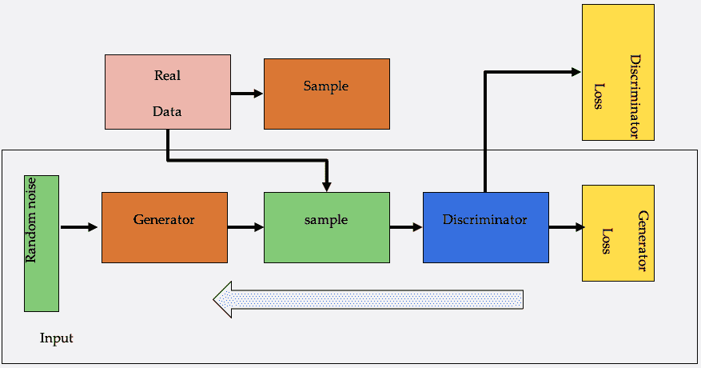

下图描绘了 GAN 架构，展示了使用判别器检查合成数据的过程。该图包括反馈循环，其中判别器的性能会影响生成器的改进。生成器根据判别器反馈改进其输出，以生成越来越逼真的合成数据。

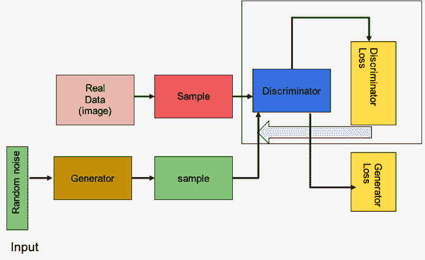

## Deep convolutional GANs

DCGANs 是一种旨在生成高质量图像的 GAN 类型。DCGANs 在生成器和判别器网络中都使用深度卷积神经网络的组合。它们被引入以解决训练用于图像生成的 GAN 时面临的挑战，并已成为生成建模领域的基础架构。以下是 DCGANs 的关键特征和组件：

### Generator network

Convolutional layers：生成器网络使用多个卷积层将随机噪声（输入）转换为高级别特征。这些层逐渐对输入进行上采样以生成图像。

Transpose convolution (`Conv2DTranspose`) layers：转置卷积层用于上采样和增加数据的空间分辨率。它们对输入进行反卷积以创建更高分辨率的特征图。

Batch normalization：批量归一化应用于对每个层的激活进行归一化，这有助于稳定和加速训练。

Activation functions：整流线性单元 (`ReLU`) 或 Leaky `ReLU` 激活函数通常用于生成器的层中。

Output layer：输出层通常使用双曲正切 (`Tanh`) 激活函数，以确保生成的图像在判别器网络中具有像素值。

### Deep convolutional generative adversarial networks

DCGANs 使用标准 GAN 训练过程，涉及生成器和判别器之间的竞争性游戏。生成器旨在生成与真实图像无法区分的图像，而判别器试图区分真实图像和假图像。损失函数通常包括判别器和生成器的二元交叉熵损失。

以下是 DCGANs 的关键特征：

• DCGANs 以其训练稳定性和高质量图像生成而闻名。

• 与早期 GAN 架构相比，它们可以生成更高分辨率的图像。

• DCGANs 不需要全连接层，使其更适合不同尺寸的图像。

• 该架构鼓励学习分层表示，使生成器能够生成更结构化和连贯的图像。

DCGANs 对生成建模产生了重大影响，并推动了 GAN 架构的进一步发展。它们已被用于各种应用，包括图像生成、风格迁移、图像到图像翻译等。

### Popular datasets


## GANs 常见数据集与 DCGAN 实现

GANs 常用于各种应用，包括图像生成、数据增强和风格迁移。以下是三个常用于训练 GANs 的热门数据集：

## CIFAR-10 和 CIFAR-100

CIFAR-10 数据集包含 60,000 张 32x32 彩色图像，分为 10 个不同的类别，每个类别 6,000 张图像。它通常用于图像分类，但也是 GANs 的热门选择。

CIFAR-100 数据集是 CIFAR-10 的扩展，包含 100 个不同的类别，每个类别包含 600 张图像。它为 GAN 训练提供了更多样化的对象集合。

## 美国国家标准与技术研究院数据库（MNIST）

MNIST 数据集是 GANs 和其他 ML 任务的经典选择。它由手写数字（0-9）的 28x28 灰度图像组成。MNIST 规模相对较小，适合快速实验。

# ImageNet

ImageNet 数据集是 GANs 和图像相关任务中最大且最广泛使用的数据集之一。它包含数千个类别中的数百万张图像，提供了庞大且多样的图像集合。由于其规模，使用起来更具挑战性，但适合训练用于各种应用的高级 GANs。

这些数据集涵盖了从 MNIST 中简单的黑白数字到 ImageNet 中高分辨率彩色图像的各种复杂度。数据集的选择取决于您的具体应用以及 GAN 项目所需的复杂度级别。此外，还有 CelebA、LSUN 等其他数据集，也常用于 GAN 训练，具体取决于所涉及的领域和任务。

## 代码示例

创建 DCGAN 以生成训练图像数据是一项复杂任务，通常需要像 PyTorch 这样的深度学习框架。以下是使用 PyTorch 创建 DCGAN 以生成图像数据的高级概述：

下面的代码使用 PyTorch 定义了 DCGAN 的核心组件，用于生成图像。它包括 `Generator` 和 `Discriminator` 模型，两者都构建为 `nn.Module` 的子类。`Generator` 接收潜在向量作为输入，并使用转置卷积、批量归一化和 ReLU 激活将向量上采样为图像，最后应用 `Tanh` 进行像素归一化。`Discriminator` 使用卷积层、Leaky ReLU 激活和批量归一化处理真实或生成的图像，并使用 `Sigmoid` 输出概率，指示图像是真实还是假的。

```python
import torch

import torch.nn as nn

import torch.optim as optim

import torchvision

import torchvision.transforms as transforms

from torchvision.utils import make_grid, save_image

import matplotlib.pyplot as plt

import os

## Generator model for DCGAN

class Generator(nn.Module):

    def __init__(self, latent_dim):

        super(Generator, self).__init__()

        self.model = nn.Sequential(

            nn.ConvTranspose2d(latent_dim, 128, 7, 1, 0, bias=False),

            nn.BatchNorm2d(128),

            nn.ReLU(True),

            nn.ConvTranspose2d(128, 64, 4, 2, 1, bias=False),

            nn.BatchNorm2d(64),

            nn.ReLU(True),

            nn.ConvTranspose2d(64, 1, 4, 2, 1, bias=False),

            nn.Tanh()

        )

    def forward(self, x):

        return self.model(x)

## Discriminator model for DCGAN

class Discriminator(nn.Module):

    def __init__(self):

        super(Discriminator, self).__init__()

        self.model = nn.Sequential(

            nn.Conv2d(1, 64, 4, 2, 1, bias=False),

            nn.LeakyReLU(0.2, inplace=True),

            nn.Conv2d(64, 128, 4, 2, 1, bias=False),

            nn.BatchNorm2d(128),

            nn.LeakyReLU(0.2, inplace=True),

            nn.Conv2d(128, 1, 7, 1, 0, bias=False),

            nn.Sigmoid()

        )

    def forward(self, x):

        return self.model(x).view(-1, 1)
```

下面的代码片段设置了在 MNIST 数据集上训练 GAN 的参数和数据。关键配置包括：

- 训练参数：`latent_dim` 定义生成器随机噪声向量的维度，`batch_size` 指定每个训练批次处理的图像数量，`epochs` 将训练限制在短时间内。
- 数据准备：下载 MNIST 数据集，应用转换将图像转换为张量，并将像素值归一化到 -1 到 1 的范围。然后以批次加载数据集，并随机打乱以保证随机性。

```python
## Training parameters

latent_dim = 64

batch_size = 32

epochs = 3 # Train for a limited number of epochs to keep training short

## Device configuration

device = torch.device("cuda" if torch.cuda.is_available() else "cpu")

## Load MNIST dataset

transform = transforms.Compose([

    transforms.ToTensor(),

    transforms.Normalize([0.5], [0.5])

])

train_dataset = torchvision.datasets.MNIST(root='./data', train=True, transform=transform, download=True)

train_loader = torch.utils.data.DataLoader(train_dataset, batch_size=batch_size, shuffle=True)

## Initialize models and optimizers

generator = Generator(latent_dim).to(device)

discriminator = Discriminator().to(device)

optimizer_G = optim.Adam(generator.parameters(), lr=0.0002, betas=(0.5, 0.999))

optimizer_D = optim.Adam(discriminator.parameters(), lr=0.0002, betas=(0.5, 0.999))

criterion = nn.BCELoss()
```

下面的代码实现了 GAN 训练循环，其中生成器（`G`）和判别器（`D`）被交替训练。对于每个 epoch，加载真实图像并创建标签张量（真实图像为有效，生成图像为假）。生成器从随机噪声生成合成图像以欺骗判别器，其损失（`g_loss`）通过将判别器的预测与有效标签进行比较来计算。然后判别器区分真实图像和假图像，计算真实损失和假损失，合并为 `d_loss`。梯度被反向传播，两个模型的权重被更新。每个 epoch 后，打印 `d_loss` 和 `g_loss` 以跟踪进度。

```python
# Training loop

for epoch in range(epochs):

    for i, (real_imgs, _) in enumerate(train_loader):

        real_imgs = real_imgs.to(device)

        batch_size = real_imgs.size(0)

        # Create labels

        valid = torch.ones(batch_size, 1, device=device)

        fake = torch.zeros(batch_size, 1, device=device)

        # Train Generator

        optimizer_G.zero_grad()

        z = torch.randn(batch_size, latent_dim, 1, 1, device=device)

        generated_imgs = generator(z)

        g_loss = criterion(discriminator(generated_imgs), valid)

        g_loss.backward()

        optimizer_G.step()

        # Train Discriminator

        optimizer_D.zero_grad()

        real_loss = criterion(discriminator(real_imgs), valid)

        fake_loss = criterion(discriminator(generated_imgs.detach()), fake)

        d_loss = (real_loss + fake_loss) / 2

        d_loss.backward()

        optimizer_D.step()

        print(f"Epoch [{epoch+1}/{epochs}] | D Loss: {d_loss.item():.4f} | G Loss: {g_loss.item():.4f}")

print("Training complete!")
```

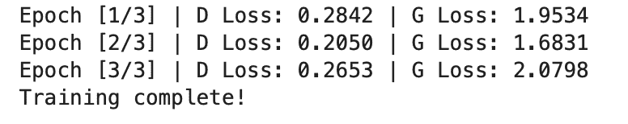

下面的代码使用随机噪声作为生成器模型的输入来生成合成图像。图像保存在 `synthetic_data` 目录中，并以网格格式使用 `save_image` 和 `make_grid` 显示。最后，`matplotlib.pyplot` 在不显示坐标轴的情况下显示图像，以便于可视化。

```python
## Generate synthetic images

os.makedirs("synthetic_data", exist_ok=True)

z = torch.randn(64, latent_dim, 1, 1, device=device)

with torch.no_grad():

    generated_imgs = generator(z).cpu()

## Save and display generated images

save_image(generated_imgs, "synthetic_data/synthetic_images.png", nrow=8, normalize=True)

grid = make_grid(generated_imgs, nrow=8, normalize=True)

plt.figure(figsize=(10, 10))

plt.imshow(grid.permute(1, 2, 0).squeeze(), cmap="gray")

plt.axis('off')

plt.show()
```

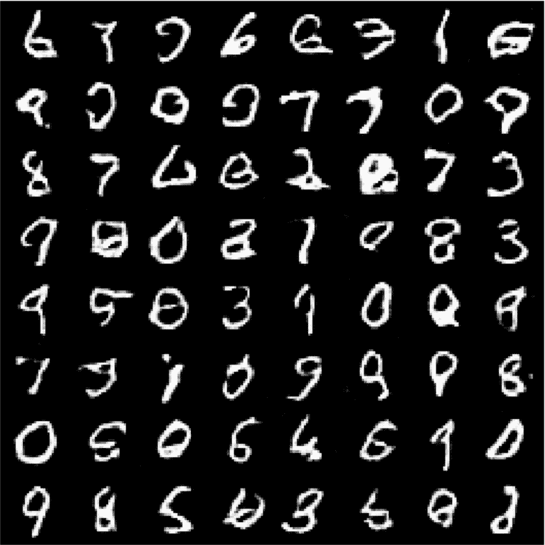

在这段代码中：

- 我们定义了生成器和判别器模型。
- 我们指定了生成器和判别器的损失函数。
- 我们为两个模型创建了优化器。
- 我们加载并预处理了真实训练数据（MNIST 数据集）。

## 评估生成对抗网络


评估 GAN 可能具有挑战性，因为它涉及评估生成样本的质量以及生成器和判别器的性能。以下是几种常用于评估 GAN 的方法：

• 目视检查：评估 GAN 最直观的方法之一是目视检查生成的样本。如果生成的图像看起来真实且与训练数据相似，则表明性能良好。

• Inception Score（IS）：IS 是一种常用的指标，用于衡量生成图像的质量和多样性。它是通过将生成的图像输入预训练的 Inception-v3 模型，然后根据类别概率计算得分来得出的。

• 精确率、召回率和 F1 分数：这些指标通常用于评估生成图像中特定特征的质量，例如用于目标检测、分割或其他任务的精确率、召回率和 F1 分数。

• 分类器性能：训练一个分类器（例如 CNN）来区分真实图像和 GAN 生成的假图像。分类器的准确率可以作为评估指标。训练良好的 GAN 应该使分类器难以区分真实图像和假图像。

• 反馈和质量：这提供定性反馈，可能很有价值，尤其是当 GAN 的目的是为人类消费生成内容时。

• 带基线的样本生成：训练一个基线模型，例如变分自编码器（VAE），并将 GAN 生成的样本质量与基线模型进行比较。

• 特定内容生成：如果您的 GAN 是为特定任务设计的，请评估其在该任务上的性能。例如，如果 GAN 生成面部，您可以通过衡量面部识别准确性来评估生成面部的质量。

• 收敛指标：监控 GAN 在训练过程中的收敛情况，寻找生成器和判别器都能有效学习的迹象。损失曲线和训练稳定性是这方面的指标。

• 异常检测：如果 GAN 用于异常检测，请根据其检测罕见或异常数据点的能力来评估其性能。

## 结论

在本章中，我们探讨了 GAN 在合成数据增强方面的卓越能力。从 GAN 的基础概念和架构入手，我们深入探讨了其实际应用，强调了 GAN 如何解决图像合成、异常检测甚至药物发现等领域的各种挑战。

我们还讨论了 GAN 生成的合成数据的优势，包括解决数据稀缺问题、提升模型性能，以及在真实数据可能有限或不可用时提供解决方案。然而，与这些好处并存的，我们也认识到 GAN 相关的挑战，包括数据质量问题、计算密集型以及因其滥用（特别是在深度伪造和其他欺骗性内容的创建中）而产生的重大伦理问题。

通过实际示例和对流行 GAN 变体及评估方法的讨论，我们为您提供了有效实施 GAN 进行数据增强所需的知识。通过了解 GAN 训练的细微差别以及伦理考量的重要性，您现在能够更好地以既创新又负责任的方式应用这项技术。

在结束本章时，很明显 GAN 为现代数据科学和人工智能提供了一套强大的工具集。它们生成逼真合成数据的能力有可能彻底改变各个行业，前提是它们在使用时承诺遵循伦理实践和持续学习。GAN 的未来光明，随着它们的发展，它们为推动 AI 驱动解决方案所带来的机遇也将随之增加。

在下一章中，我们将探讨 TTS 系统。

加入我们书籍的 Discord 空间

加入书籍的 Discord 工作区，获取最新动态、优惠、全球科技动态、新版本发布以及与作者的互动：

[`discord.bpbonline.com`](https://discord.bpbonline.com)


# 第 6 章 构建文本转语音模型

## 简介

本章介绍如何构建文本转语音（TTS）机器学习（ML）流水线，如何使用预训练的 PyTorch 音频模型，以及如何在训练 ML 模型之前转换音频数据集。TTS 模型彻底改变了机器与人类交互的方式，使书面文本能够无缝转换为自然、类人的语音。TorchAudio 是 PyTorch 深度学习框架的扩展，为开发和微调这些 TTS 模型提供了一个强大的平台。利用 TorchAudio 广泛的工具库，研究人员和开发人员可以构建复杂的 TTS 系统，提供高质量、可理解的语音合成。本章简介概述了使用 TorchAudio 创建 TTS 模型所涉及的关键组件和使用方法，从数据预处理和模型架构到训练技术和实际应用。

## 结构

在本章中，我们将学习以下主题：

• 文本转语音简介

• 文本转语音的发展

• 文本转语音系统的应用

• 算法

• 算法选择

• 伦理问题

• 流行数据集

• 流行的 TTS 深度学习预训练模型

# 目标

本章的目标是介绍使用 TorchAudio 构建 TTS 模型的基础知识，提供对预训练 PyTorch 音频模型的理解，并指导完成转换音频数据集以进行有效模型训练的过程。此外，它还旨在教授开发强大 TTS 系统所必需的架构、数据加载、处理、模型训练和评估技术。

## 文本转语音简介

TTS 是一种将书面文本转换为口语的技术。它也被称为语音合成。TTS 系统接收输入文本并生成相应的音频输出，模拟人类语音。这项技术有多种应用，从面向视障人士的辅助功能到语音助手和自动客服系统。以下是 TTS 的一些关键方面：

• 输入文本：TTS 系统将书面或文本输入作为其主要数据来源。这些文本可以是句子、段落或其他结构化内容。

• 自然语言生成（NLG）：TTS 系统使用 NLG 技术来创建类人的语音。它们需要理解文本的语言和语音属性，以生成听起来自然的语音。

• 语音合成：TTS 系统通常使用预录制的音素、单词和句子数据库，将其组合起来产生口语。或者，一些现代 TTS 系统使用深度学习模型直接生成语音。

• 韵律和语调：TTS 系统会考虑音高、节奏、重音和语调等方面，以确保合成的语音反映文本的情感和上下文细微差别。

• 声音和口音：TTS 系统通常带有多种声音和口音，以供用户选择。这些声音可以是男性、女性、年轻、年长，甚至是名人。

## 文本转语音的发展

TTS 技术的发展多年来取得了显著进步，这得益于计算机科学、语言学和人工智能的发展。以下是 TTS 发展历程中关键里程碑的简要概述：


# TTS 技术发展历程

• Early mechanical and analog devices (18th\-19th century): The earliest attempts at TTS involved mechanical and analog devices that could produce simple speech sounds. Examples include Wolfgang von Kempelen's speaking machine and Charles Wheatstone's sound-reading machine.

• Early digital synthesis (1950s-1960s): The advent of digital computers in the mid-20th century led to the development of early digital speech synthesis methods. One notable system was the IBM 704, which could produce phonemes and simple words.

• Formant synthesis (1960s-1970s): Formant synthesis, which involves modeling the human vocal tract, gained popularity. This method produced intelligible speech but lacked naturalness.

• Concatenative synthesis (1980s): Concatenative TTS systems began to emerge. These systems stored prerecorded segments of speech (phonemes or diphones) and combined them to generate speech. This approach improved the naturalness of synthesized speech.

• Rule-based synthesis (1980s-1990s): Rule-based TTS systems used linguistic and phonetic rules to generate speech. These systems focused on predicting intonation and prosody.

• Hidden Markov models (1990s): Hidden Markov models (HMMs) were used to model speech and prosody, leading to more natural TTS systems. IBM Tangora and DEC DECtalk were early examples.

• Unit selection synthesis (1990s-2000s): Unit selection TTS systems refined concatenative synthesis by selecting the best-matching units from a large database of recorded speech. This approach significantly improved naturalness.

• Statistical parametric synthesis (2000s-Present): Modern TTS systems are often based on statistical parametric synthesis using techniques like HMMs or deep learning models such as deep neural networks (DNNs) and recurrent neural networks (RNNs). Google WaveNet and Tacotron are notable examples.

• Deep learning (2010s-Present): Deep learning, particularly deep neural networks, has revolutionized TTS. Waveform synthesis models like WaveNet and end-to-end TTS models like Tacotron and transformer-based models have enabled highly natural and expressive speech synthesis. These models have contributed to developing realistic voice assistants and other TTS applications.

• Customizable and expressive voices (Present): Modern TTS systems offer a wide range of customizable voices, allowing users to select from various accents, tones, and styles. Expressive TTS is becoming more common, enabling TTS to convey emotion and nuance in speech.

• Real-time and cloud-based TTS (Present): With advancements in hardware and cloud computing, real-time TTS and cloud-based TTS services have become widely available, making integrating TTS into various applications and devices easy.

# TTS 系统架构概述

TTS architecture typically involves multiple components to convert text into spoken language. Here is a high-level overview of the architecture of a typical TTS system:

## 1. Text preprocessing

The process begins with the input text, which undergoes various preprocessing steps, such as tokenization, phonetic conversion (for languages with complex phonetics), and text normalization to handle abbreviations, symbols, and special characters.

Code example:

```python
import re

from unidecode import unidecode

from string import punctuation

# Define text preprocessing function

def preprocess_text(text):

    # Remove punctuation and normalize text

    text = unidecode(text.lower())

    text = re.sub(f"[{punctuation}]", "", text)

    return text

# Example

input_text = "Hello! What's your name?"

clean_text = preprocess_text(input_text)

print("Cleaned Text:", clean_text)

Cleaned Text: hello whats your name
```

## 2. Text analysis

In this phase, the TTS system analyzes the linguistic and prosodic features of the text. It identifies sentence boundaries, punctuation, and grammatical structure.

Code example:

```python
# Example text with sentence boundary analysis

sentences = re.split(r'[.!?]', clean_text)

sentences = [s.strip() for s in sentences if s.strip()]

print("Sentences:", sentences)
```

## 3. Phonemic transcription

The text is converted into a phonemic or phonetic representation. This step maps text to phonemes, which are the smallest units of sound in a language. This mapping helps ensure correct pronunciation.

Code example:

```python
# Symbol-to-ID mapping (simplified)

_symbol_to_id = {s: i for i, s in enumerate("abcdefghijklmnopqrstuvwxyz ", 1)}

# Convert text to sequence of IDs

def text_to_sequence(text):

    sequence = [_symbol_to_id.get(s, 0) for s in text if s in _symbol_to_id]

    return sequence

# Example usage

sequence = text_to_sequence(clean_text)

print("Text to Sequence:", sequence)

Text to Sequence: [8, 5, 12, 12, 15, 27, 23, 8, 1, 20, 19, 27, 25, 15, 21, 18, 27, 14, 1, 13, 5]
```

## 4. Linguistic processing

The system may incorporate linguistic rules and models to determine stress patterns, intonation, and other linguistic features. This step ensures that the synthetic speech sounds natural and coherent. Below are the steps involved.

## 5. Mel-spectrogram generation

Models like Tacotron and Tacotron 2 are commonly used for this step.

Code example:

```python
import torch

device = torch.device("cuda" if torch.cuda.is_available() else "cpu")

tacotron2 = torch.hub.load("nvidia/DeepLearningExamples:torchhub", "nvidia_tacotron2").to(device).eval()

# Function to generate mel spectrogram from text

def generate_mel_spectrogram(text):

    # Convert text to sequence tensor

    sequence = torch.tensor(text_to_sequence(text), dtype=torch.long).unsqueeze(0).to(device)

    input_lengths = torch.tensor([sequence.shape[1]], dtype=torch.long).to(device)

    with torch.no_grad():

        mel_spec, _, _ = tacotron2.infer(sequence, input_lengths)

    return mel_spec

# Generate mel spectrogram

mel_spec = generate_mel_spectrogram(clean_text)

print("Mel Spectrogram Shape:", mel_spec.shape)

Mel Spectrogram Shape: torch.Size([1, 80, 143])
```

## 6. Spectrogram to waveform synthesis

Another component converts the spectrogram into an audio waveform. This component may use generative models like WaveNet or sample-based approaches like the Griffin-Lim algorithm.

Code example:

```python
waveglow = torch.hub.load("nvidia/DeepLearningExamples:torchhub", "nvidia_waveglow").to(device).eval()

waveglow = waveglow.remove_weightnorm(waveglow)

# Convert mel spectrogram to waveform

def mel_to_waveform(mel_spec):

    with torch.no_grad():

        audio = waveglow.infer(mel_spec)

    return audio.cpu().numpy()

# Generate audio from mel spectrogram

audio_waveform = mel_to_waveform(mel_spec)
```

## 7. Voice selection

Many TTS systems offer users a selection of voices with different characteristics (e.g., male, female, accents).

## 8. Postprocessing

The generated audio waveform may go through postprocessing to improve audio quality, reduce noise, and enhance naturalness.

## 9. Integration

The TTS system is integrated into applications or services where synthesized speech is needed, such as voice assistants, navigation systems, e-learning platforms, or customer service applications.

## 10. Real-time and streaming TTS

Some TTS systems are optimized for real-time or streaming applications, enabling instant speech synthesis as text input is received.

## 11. Output

The final output is synthesized speech, which can be played back to the user, saved as an audio file, or used in real-time communication.

```python
import IPython.display as ipd

# Play the audio in a Jupyter notebook

ipd.Audio(audio_waveform, rate=22050) # WaveGlow's sample rate is 22050 Hz
```

The architecture of a TTS system may vary depending on the specific implementation and the choice of technologies. Deep learning models have significantly improved the quality and naturalness of synthesized speech, and they are commonly used in modern TTS systems. The choice of components, models, and languages may differ based on the intended application and target audience.

Here is a simplified code example of TTS using PyTorch:


下面的代码使用 PyTorch 执行 TTS 合成。它首先检查 GPU 可用性，并从 PyTorch Hub 加载 Tacotron 2 和 WaveGlow 模型用于 TTS。Tacotron 2 将文本转换为梅尔频谱图，而 WaveGlow 将频谱图合成为音频波形。`remove_weightnorm` 方法应用于 WaveGlow 以加快推理速度。

创建字符到 ID 的映射，以将文本表示为 ID 序列。`text_to_sequence` 函数清理和标准化输入文本，删除标点符号并将字符映射为 ID。`tts` 函数以文本为输入，将其转换为序列，并使用 Tacotron 2 生成梅尔频谱图。然后 WaveGlow 将此频谱图转换为音频波形，并将其作为 NumPy 数组返回。最后，音频以 22050 Hz 的采样率在笔记本中播放。此代码演示了完整的 TTS 流程：

```python
import re

import torch

import IPython.display as ipd

from unidecode import unidecode

from string import punctuation

# Check for GPU availability
device = torch.device("cuda" if torch.cuda.is_available() else "cpu")

# Load Tacotron 2 and WaveGlow models from PyTorch Hub and set them to evaluation mode
tacotron2 = torch.hub.load("nvidia/DeepLearningExamples:torchhub", "nvidia_tacotron2").to(device).eval()
waveglow = torch.hub.load("nvidia/DeepLearningExamples:torchhub", "nvidia_waveglow").to(device).eval()
waveglow = waveglow.remove_weightnorm(waveglow) # Remove weight normalization for faster inference

# Symbol to ID mapping for Tacotron2 text processing
_symbol_to_id = {s: i for i, s in enumerate("what is your name", 1)}

# Function to clean and convert text to sequence
def text_to_sequence(text):
    text = unidecode(text.lower())
    text = re.sub(f"[{punctuation}]", "", text)
    sequence = [_symbol_to_id.get(s, 0) for s in text if s in _symbol_to_id]
    return torch.tensor(sequence, dtype=torch.long).unsqueeze(0).to(device)

# Define the TTS function
def tts(text):
    # Convert text to sequence and get input length
    sequence = text_to_sequence(text)
    input_lengths = torch.tensor([sequence.shape[1]], dtype=torch.long).to(device)

    # Generate mel spectrogram using Tacotron 2
    with torch.no_grad():
        # Updated line to get the first element of the tuple which is the mel spectrogram.
        mel_spec, _, _ = tacotron2.infer(sequence, input_lengths)

    # Generate audio waveform from mel spectrogram using WaveGlow
    with torch.no_grad():
        audio = waveglow.infer(mel_spec)

    return audio.cpu().numpy()

# Example text
text = "Hello, this is a demonstration of text-to-speech synthesis using Tacotron 2 and WaveGlow."

# Generate audio waveform from text
audio_waveform = tts(text)

# Play audio
ipd.Audio(audio_waveform, rate=22050) # Sample rate for WaveGlow
```

## 文本转语音系统的应用

TTS 技术在各行各业都有多种应用。其将书面文本转换为口语的能力在许多场景中提供了可访问性、便利性和自动化。以下是 TTS 的一些常见应用：

• 可访问性服务：TTS 帮助视障人士访问数字内容，包括网站、书籍和文档。屏幕阅读器使用 TTS 将屏幕上的文本大声读出。

• 语音助手：TTS 技术为 Siri、Google Assistant 和 Amazon Alexa 等语音助手提供动力，允许用户使用语音命令与设备和服务进行交互。

• 导航系统：GPS 和导航系统使用 TTS 提供逐向导航，确保驾驶员在接收指令的同时可以将目光集中在道路上。

• 客户支持和聊天机器人：自动化客户支持系统和聊天机器人使用 TTS 与客户沟通，通过语音回复提供信息和帮助。

TTS 用于电子学习平台，大声朗读教育材料，使内容对学习者更具可访问性。它还帮助有学习障碍的学生。

• 旁白和多媒体内容：TTS 为视频、演示文稿和多媒体内容生成旁白。这可以节省内容制作的时间和资源。

• 公共场所的可访问性：公共交通系统、机场和公共设施使用 TTS 进行公告和标识，以通知视障或听障旅客。

• 语言学习：TTS 应用程序帮助学习者练习发音并提高语言技能，通过提供音频反馈。

• 医疗转录：在医疗保健领域，TTS 技术转录医疗记录和医患互动，减少手动转录的需求并确保准确的医疗记录。

• 法律转录：TTS 在法律行业转录法庭程序、证词和执法访谈，提高效率和准确性。

• 播客和内容创作：播客和内容创作者使用 TTS 生成其音频内容的转录文本，使其可搜索并面向更广泛的受众。

• 封闭字幕和字幕：TTS 对于为视频内容创建封闭字幕和字幕至关重要，使视频对听障人士和非母语者可访问。

• 搜索引擎：搜索引擎使用 TTS 处理语音查询并提供语音搜索结果。

• 市场研究和情感分析：TTS 应用程序分析客户反馈、呼叫中心录音和社交媒体评论，从口语对话中提取洞察和情感。

• 语音消息和通信：TTS 用于语音消息和通信应用程序，允许用户以文本形式发送语音消息。

• 实时语言翻译：TTS 和机器翻译为多语言通信提供实时口译和翻译服务。

# 算法

关于 TTS 的深度学习算法，由于能够生成高质量、听起来自然的语音，多种模型和方法已获得流行。以下是用于 TTS 的一些流行深度学习算法和模型：

• Tacotron：它是一种序列到序列模型，结合了编码器和解码器网络。编码器处理输入文本，而解码器生成梅尔频谱图，代表语音的声学特征。Tacotron 是现代 TTS 的先驱模型之一。

• WaveNet：它是由 DeepMind 开发的深度生成模型，直接生成原始语音波形。它使用自回归架构和深度卷积神经网络来产生高保真语音。WaveNet 在实现极其自然和富有表现力的 TTS 方面发挥了重要作用。

• Tacotron 2：它是 Tacotron 的改进版本。它将 WaveNet 集成作为波形合成组件，使其能够生成具有更好韵律和自然度的高质量语音。

• 基于 Transformer 的 TTS 模型：最初为自然语言处理设计，Transformer 已被改编用于 TTS。像生成式预训练 Transformer 3（`GPT-3`）和文本到文本传输 Transformer（`T5`）这样的模型已针对 TTS 应用进行了微调，允许富有表现力且感知上下文的语音合成。

• FastSpeech：它是一种高效的 TTS 模型，使用非自回归解码，在不牺牲质量的情况下实现更快的语音生成。它可以并行生成梅尔频谱图，使其适合实时应用。

• Parallel WaveGAN：它是一种基于生成对抗网络（`GAN`）的模型，生成高质量波形信号。它以其产生听起来自然的语音的能力而闻名，并已用于 TTS 流程。

• 基于流的模型：`Glow` 和 `FloWaveNet` 已在 TTS 中用于生成高质量语音波形。这些模型使用可逆变换来建模复杂分布。


• `Hierarchical prosody model`: 某些 TTS 系统采用层次化韵律模型，旨在生成具有适当语调和韵律的语音。这些模型提高了合成语音的表现力。

• `Parallel synthesis models`: `FastSpeech` 和 `FastSpeech 2` 强调语音合成中的并行性，从而加快梅尔频谱图和波形信号的生成。

深度学习算法的选择取决于合成语音的期望质量、可用资源和特定应用等因素。`WaveNet` 及其变体以其高质量、自然的语音生成而闻名，而 `FastSpeech` 等并行合成模型则提供速度和效率，使其适合实时应用。基于 Transformer 的模型提供具有上下文感知能力和表现力的语音合成。选择应与项目的目标和约束保持一致：

• `Tacotron 2` 架构概述：`Tacotron 2` 架构是一种专为端到端 TTS 合成设计的神经网络模型。该模型由两个主要组件组成：序列到序列特征预测网络和声码器。

• 文本处理和编码器：该过程从输入文本开始，通过字符嵌入层将其转换为嵌入序列。嵌入通过 3 个卷积层进行局部特征提取，并通过双向 LSTM 来捕获输入文本中的上下文信息。

• 解码器和注意力机制：编码器的输出与位置敏感注意力机制交互，该机制将编码器的文本特征与解码器的输出对齐。这有助于通过跟踪位置信息来保持语音的自然流畅和韵律。解码器由一个 2 卷积层 PreNet 和 2 个 LSTM 层组成，用于处理所关注的特征以生成梅尔频谱图。

• PostNet 和梅尔频谱图：一个 5 卷积层 PostNet 对输出进行细化，添加细节并提高质量。生成的梅尔频谱图是声音的时频表示，然后传递给基于 `WaveNet` 的物流混合（MoL）声码器。

• 波形生成：最后，`WaveNet` MoL 声码器将梅尔频谱图转换为波形样本，产生最终的音频输出。

该架构使 `Tacotron 2` 能够通过高效捕获语音和韵律信息来合成高质量、听起来自然的语音。

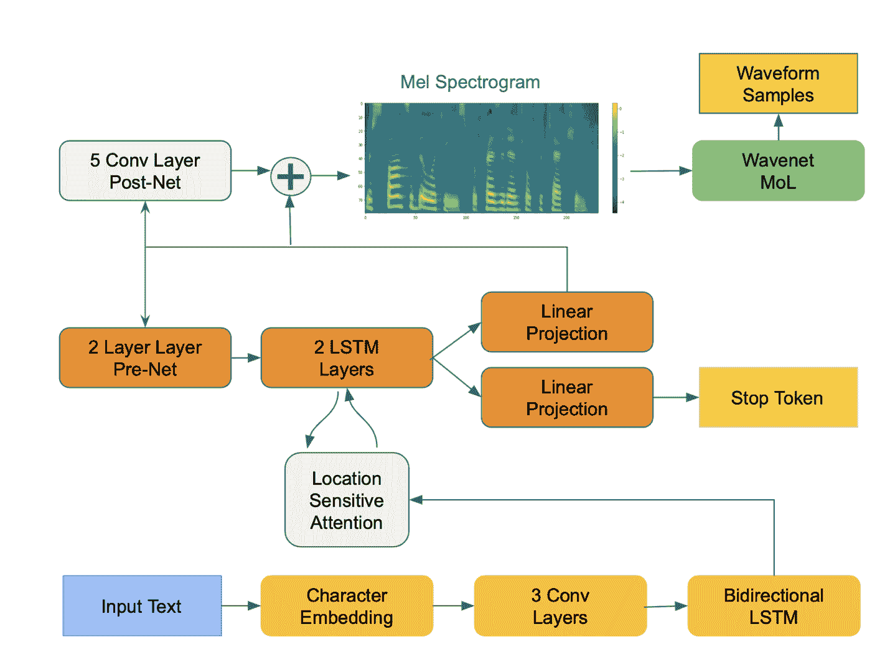

## 算法选择

不同的深度学习 TTS 算法适用于不同的情况，具体取决于期望的语音质量、实时要求和可用资源。以下是常用深度学习 TTS 算法及其常见应用场景的详细说明：

• `WaveNet` 和变体（`Tacotron 2`、`Parallel WaveGAN`）：

场景：当需要最高质量且最自然的语音时，使用 `WaveNet` 及其变体。它们在音频保真度至关重要的应用中表现出色，例如高级语音助手应用、高端有声书和旁白。

van den Oord 等人撰写的原始 WaveNet 论文：https://arxiv.org/abs/1609.03499。

Shen 等人撰写的 Tacotron 2 论文：https://arxiv.org/abs/1712.05884。

Yamamoto 等人撰写的 Parallel WaveGAN 论文：https://arxiv.org/abs/1910.11480。

• 基于 Transformer 的 TTS 模型（`GPT-3`、`T5`）：

场景：基于 Transformer 的 TTS 模型非常适合上下文感知和表现力强的语音合成至关重要的应用。它们擅长生成具有丰富韵律的语音，并可应用于各种场景，包括内容创作、创意写作和对话式 AI。

• `FastSpeech` 和 `FastSpeech 2`：

场景：这些模型针对实时和并行语音合成进行了优化。它们用于速度和效率至关重要的应用，例如语音助手、导航系统以及需要即时语音反馈的情况。

Ren 等人撰写的原始 FastSpeech 论文：https://arxiv.org/abs/1905.09263。

• 层次化韵律模型：

场景：当控制和微调语音韵律很重要时，会使用这些模型，例如在富有表现力的讲故事、配音或传达情感至关重要的应用中。

• 混合模型（组合模型）：

场景：在某些应用中，混合方法会为 TTS 流水线的不同部分组合不同的模型。例如，`Tacotron` 可用于文本到梅尔频谱图生成，而 `WaveNet` 用于波形合成。这种方法在质量和速度之间取得平衡。

• 自定义 TTS 模型：

场景：有特定要求的组织可以开发针对其领域、风格和目标受众进行微调的自定义 TTS 模型。这些自定义模型用于虚拟头像、专用语音助手和特定领域的内容生成应用。

选择与应用程序特定需求相一致的 TTS 算法至关重要。选择可能涉及语音质量、效率、实时能力和可用硬件基础设施之间的权衡。此外，这里提到的算法通常集成到更大的 TTS 流水线中，这些流水线可能包括预处理、语音选择和后处理步骤。最佳 TTS 算法的选择由特定项目或用例的目标和约束决定。

TTS 算法将书面文本转换为口语，具有多种优势，也存在一些局限性。以下是 TTS 算法的优缺点：

以下是优点：

• 可访问性：TTS 使数字内容对视力障碍者或阅读困难者可访问，增强了他们获取信息的能力。

• 多语言支持：TTS 系统可以训练成多种语言，使其对全球受众和语言学习者很有价值。

• 自动化：TTS 自动化了生成音频内容的过程，为有声书制作、旁白和自动客户支持等任务节省了时间和资源。

• 一致性：TTS 提供一致且可预测的发音，减少了口语内容的变异性。

• 定制化：用户可以调整 TTS 系统的音调、音高和速度以适应其偏好，提供量身定制的体验。

• 声音克隆：TTS 系统可以复制特定声音，允许在虚拟助手等应用中实现个性化和品牌一致性。

以下是缺点：

• 人工声音：一些 TTS 系统，尤其是旧系统，可能听起来人工或机械，降低了听觉体验的质量。

• 情感细微差别不足：TTS 可能难以传达情感细微差别和语气，使其不太适合情感丰富或细腻的内容。

• 上下文理解有限：TTS 模型可能并不总是理解文本的上下文，导致误读或误解。

• 资源密集型：训练先进的 TTS 模型需要大量的计算资源和数据，限制了小型组织的可访问性。

• 口音和方言限制：TTS 模型可能难以处理训练数据中未充分代表的口音和方言，可能导致误读。

• 训练数据偏差：训练数据中的偏差可能反映在 TTS 输出中，导致不良的社会、文化或性别偏差。

• 复杂性：实施 TTS 系统可能很复杂，需要自然语言处理和深度学习方面的专业知识。

• 声音所有权：关于声音所有权存在法律和伦理争议，尤其是当 TTS 系统在未经同意的情况下复制特定声音时。

## 伦理问题

与其他 AI 技术一样，深度学习 TTS 技术引发了若干伦理问题和考量。与深度学习 TTS 相关的一些突出伦理问题包括：


• 语音克隆与身份盗窃：TTS 模型可以克隆声音并冒充个人。这引发了关于基于语音的身份盗窃、欺诈和恶意活动的担忧。保护个人免受未经同意的语音克隆是一项重大挑战。

• 错误信息与深度伪造：深度学习 TTS 可助力创建高度逼真的深度伪造音频内容。这项技术可传播错误信息、操纵音频证据或制造虚假背书，可能对个人和机构造成伤害。

• 隐私与同意：未经同意录制和使用他人声音可能侵犯其隐私。以特定人声音生成语音的 TTS 应用应遵循道德准则并获得适当同意。

• 监控中的侵入性使用：TTS 可增强监控技术，包括语音监控。道德关切在于这项技术可能被滥用于在个人不知情或未经同意的情况下进行大规模监控。

• 偏见与歧视：TTS 模型可能继承训练数据中存在的偏见，导致生成歧视性或冒犯性内容。确保 TTS 模型在多样且具有代表性的数据集上训练，可减轻这些偏见。

• 仇恨言论与骚扰：TTS 技术可生成仇恨言论、骚扰或辱骂性内容。平台和用户需保持警惕，防止并举报此类内容。

• 深度伪造与报复性色情：TTS 可与深度伪造技术结合，用于创建露骨或非自愿内容，包括报复性色情。这引发了关于同意和隐私的重大道德和法律关切。

• 开发者的道德责任：使用 TTS 技术的开发者和组织有道德责任确保技术被合乎道德地使用。这包括制定防止滥用的政策并推广负责任的人工智能使用。

• 操纵性广告：TTS 可用于创建欺骗性或操纵性广告内容，导致消费者被欺骗和不道德的营销行为。

• 无障碍与包容性：道德考量还延伸到确保 TTS 技术具有无障碍性和包容性。为残障人士提供语音合成功能对于促进包容性至关重要。

• 真实性与信任：TTS 技术的广泛使用可能削弱人们对音频和语音通信真实性的信任。当个人不再信任电话另一端的声音或音频录音的真实性时，就会产生道德关切。

为解决这些道德关切，开发者、组织、政策制定者和社会必须为负责任地开发和使用深度学习 TTS 技术建立明确的指南、法规和道德框架。此外，教育用户了解 TTS 的潜在风险和漏洞对于促进负责任和合乎道德的使用至关重要。

## 流行数据集

深度学习 TTS 模型通常需要在大型数据集上进行大量训练，以实现高质量语音合成。虽然有一些可用于 TTS 研究的数据集，但其数量不如自然语言处理或计算机视觉任务的数据集多。以下是一些用于深度学习 TTS 的流行数据集：

• LJ Speech 数据集：LJ Speech 数据集是一个广泛使用的 TTS 数据集，包含超过 13,000 小时的英语语音。其文本转录自 LibriVox 项目的 7,097 本有声书。

• Mozilla Common Voice：Mozilla Common Voice 项目收集并提供多样化的多语言录音数据集。它旨在支持各种语言的 TTS 模型研究和开发。

• VCTK Corpus：VCTK Corpus 包含 109 名以英语为母语的说话人的语音数据，具有各种口音。它包括适合 TTS 研究和基准测试的句子和段落录音。

M-AILABS Speech Dataset 是一个多语言 TTS 数据集，包含多种语言的语音数据，包括英语、德语和法语。它是多语言 TTS 研究的宝贵资源。

• CMU Arctic 数据库：CMU Arctic 数据库包括在卡内基梅隆大学录制的语音数据。这些数据库涵盖各种口音，常用于 TTS 研究和开发。

• TTS 预处理数据集：一些研究人员为预处理任务（如文本标准化、文本扩展或韵律预测）创建自定义数据集。这些数据集有助于提高合成语音的自然性。

• 自定义数据集：在许多情况下，组织和研究人员会创建针对其特定应用程序或要求的自定义数据集。这些数据集可以涵盖特定领域的词汇和上下文。

需要注意的是，为某些应用程序创建高质量、特定领域的数据集可能是必要的，尤其是当您需要捕获独特的术语、发音或说话风格时。数据集的选择取决于语言、领域和 TTS 系统的特定用例等因素。此外，一些 TTS 模型，如基于 `GPT-3` 的模型，受益于在广泛的文本数据上训练，包括网络文本、书籍和其他来源，以实现更好的泛化和上下文感知能力。

## 流行的 TTS 深度学习预训练模型

几种用于 TTS 的预训练深度学习模型因其能够生成高质量语音而广受欢迎。这些预训练 TTS 模型通常在广泛的文本数据上进行微调，并可用于各种应用。一些流行的预训练 TTS 模型包括：

• GPT-3：由 OpenAI 开发的 GPT-3 是一种用于 TTS 任务的通用语言模型。它以生成听起来自然的语音而闻名，并常针对特定应用程序进行微调。

• T5：T5 也是由 Google 开发的一种基于 Transformer 的模型，可针对各种 NLP 任务（包括 TTS）进行微调。它已被用于生成连贯且具有上下文感知能力的语音。

• Hugging Face 模型（例如，Hugging Face TTS 模型）：Hugging Face 提供一系列预训练 TTS 模型，这些模型已针对各种语言和应用程序进行微调并可直接使用。`facebook/wav2vec2-base` 和 `tts` 等模型是常见选择。

Zilla 提供预训练 TTS 模型，例如 `tts_models/en/vctk` 和 `tts_models/en/speech`，可生成多种语言的语音。

• Google TTS 模型：Google 开发了多种用于语音合成的 TTS 模型，包括 `google/tacotron2-ljspeech-en` 和 `google/waveglow-ljspeech`。

• OpenAI GPT-2 和 GPT-3 变体：OpenAI 的 GPT-2 和 GPT-3 变体已用于 TTS 任务，这些模型经过微调以生成类似人类的语音。

• 定制 TTS 模型：组织和研究人员通常会开发定制 TTS 模型，这些模型针对特定口音、语言或领域进行微调。这些模型旨在满足独特的要求。

预训练 TTS 模型的选择取决于您的特定应用程序、语言要求以及语音质量与效率之间的平衡。预训练模型通常用作起点，并可针对特定领域的应用程序进一步微调。此外，预训练 TTS 模型的可用性可能会随时间而变化，因此查看模型开发者和 TTS 社区的最新模型和资源是一种良好的做法。

### 选择预训练文本转语音模型

为各种应用程序选择预训练 TTS 模型需要考虑特定要求，包括生成语音的质量、所需的语音特征以及应用程序的需求。以下是帮助您选择合适的预训练 TTS 模型的步骤：


# 定义应用程序要求

确定 TTS 应用程序的具体用例和要求。请考虑自然度、情感、语言支持、声音风格和可扩展性。

# 评估可用模型

研究可用的预训练 TTS 模型和库。常见选项包括 `Tacotron` 和 `WaveNet`，以及 `Microsoft FastSpeech` 和 `Hugging Face Transformers` 等较新的模型。

# 质量和自然度

评估生成语音的质量和自然度。聆听不同模型的音频样本，以确定哪个模型产生的语音最像人声且清晰。

# 声音特征

确定所需的声音特征，包括性别、年龄和口音。某些 TTS 模型提供声音风格自定义，而其他模型则具有固定的声音配置文件。

# 语言支持

检查 TTS 模型是否支持应用程序所需的语言。某些模型支持多种语言，而其他模型则针对特定语言。

# 情感和表现力

评估模型在生成语音中传达情感和表现力的能力。这对于需要传达情感或语气的应用程序非常重要。

# 实时处理与批处理

考虑应用程序是否需要实时 TTS（例如，虚拟助手）或批处理（例如，有声书创建）。

# 可扩展性

确保所选 TTS 模型可以扩展以处理应用程序中的文本输入量。可扩展性对于具有高用户交互的应用程序至关重要。

# 声音自定义

如果需要特定声音，请探索支持声音克隆或适应的模型。某些模型允许微调声音以满足要求。

# 资源要求

考虑运行 TTS 模型所需的计算资源。某些模型可能资源密集，而其他模型则针对效率进行了优化。

# 开源或商业

决定是更喜欢开源 TTS 模型，还是愿意探索提供更好支持和额外功能的商业选项。

# 集成和兼容性

检查所选 TTS 模型是否易于集成到应用程序中，并与开发堆栈和编程语言兼容。

# 社区和支持

寻找拥有活跃社区的模型。它们提供更好的支持、更新以及各种资源和插件。

# 伦理考量

考虑伦理和法律方面，例如模型的使用条款以及确保应用程序中公平无偏见的人工智能的责任。

# 成本

评估 TTS 模型的成本，包括潜在的许可费、云服务费用或硬件成本。

# 原型设计和测试

在决定使用某个 TTS 模型之前，进行原型设计和测试，以确保其满足要求并产生所需的输出。

# 反馈循环

建立反馈循环以进行持续监控和改进，因为 TTS 模型和库在不断发展。

# 流行 TTS 模型比较

下表根据特定标准比较了流行的 TTS 模型。每个标准侧重于 TTS 应用程序需求的不同方面，从而更容易选择与特定要求相匹配的模型。

| 标准 | Tacotron 2 | WaveNet | FastSpeech 2 | Hugging Face Transformers (例如，T5) | Google Cloud TTS |
| --- | --- | --- | --- | --- | --- |
| 自然度和质量 | 高自然度，清晰的语调 | 非常高，极其像人声 | 良好，生成速度快，部分自然度 | 大型模型变体的高质量 | 非常高，商业级 |
| 声音特征 | 固定声音，自定义有限 | 固定声音，非常有表现力 | 通过微调实现中等自定义 | 通过微调选项实现可自定义 | 多种带口音的声音 |
| 语言支持 | 主要是英语 | 英语，部分多语言支持 | 英语和有限语言 | 多语言，取决于模型变体 | 多语言 |
| 情感和表现力 | 表现力有限 | 情感表达非常高 | 中等，不如 WaveNet 富有表现力 | 中等到高（取决于模型） | 高，带有特定声音风格 |
| 实时处理 | 中等延迟 | 高延迟，更适合批处理 | 低延迟，适合实时 | 中等延迟 | 针对实时优化 |
| 可扩展性 | 中等，取决于硬件 | 资源占用高，可扩展性较差 | 高可扩展性 | 高可扩展性 | 云上高度可扩展 |
| 声音自定义 | 仅限于预训练声音 | 有限 | 通过微调实现 | 提供广泛的微调支持 | 部分声音自定义 |
| 资源要求 | 中等，最佳性能需要 GPU | 高，资源密集 | 资源要求较低 | 中等到高，取决于模型 | 由 Google Cloud 管理 |
| 开源或商业 | 开源，可在 PyTorch 中使用 | 开源，也可商业使用 | 开源 | 开源，Hugging Face Hub 模型 | 商业 |
| 集成和兼容性 | PyTorch Hub，与 PyTorch 库兼容 | 与 TensorFlow 集成良好 | 与 PyTorch 兼容 | Python，Hugging Face Transformers 库 | REST API，多平台 SDK |
| 社区和支持 | 大型开源社区 | 深度学习模型的强大社区 | 发展中的社区 | 大型社区 | Google 提供商业支持 |
| 伦理考量 | 一般许可，负责任的人工智能考量 | 通常安全，需要公平使用 | 遵循伦理准则 | 伦理人工智能的活跃研究 | 遵循 Google 伦理政策 |
| 成本 | 免费（开源） | 免费（开源） | 免费（开源） | 免费，带有云选项 | 基于使用量的云定价 |
| 原型设计和测试 | 使用预训练模型轻松原型设计 | 原型设计需要一些设置 | 快速原型设计 | 灵活，适用于各种文本类型 | 使用云工具轻松设置 |
| 反馈和更新 | 开源社区频繁更新 | 由广泛社区支持 | 定期更新和优化 | 随新版本不断发展 | Google 定期更新 |

表 6.1：TTS 算法使用上下文概述

# 使用预训练模型的代码示例

以下是使用预训练模型的代码示例：

在 PyTorch 中使用预训练 TTS 模型涉及加载模型、预处理文本和生成语音。以下是一个简单示例，展示了如何使用预训练 TTS 模型，下面的代码演示了使用 `Hugging Face SpeechT5` 模型和 `HiFi-GAN` 进行 TTS 合成。它首先加载处理器和模型，将文本转换为梅尔频谱图。可选地加载说话人嵌入式以自定义声音，为生成的音频赋予独特的声音特征。梅尔频谱图是一种中间音频表示，由分词后的文本和说话人嵌入式生成。`HiFi-GAN` 声码器随后将频谱图转换为音频波形。最后，以 `16000` Hz 的采样率播放生成的音频，展示了在 Python 环境中高质量、可自定义的 TTS 输出。

首先，确保已安装 `transformers` 库：

## 第 1 部分：导入库并加载 TTS 处理器和模型

```python
from transformers import SpeechT5Processor, SpeechT5ForTextToSpeech

# Load the processor and model
processor = SpeechT5Processor.from_pretrained("microsoft/speecht5_tts")
model = SpeechT5ForTextToSpeech.from_pretrained("microsoft/speecht5_tts")
```

## 第 2 部分：文本处理和分词

```python
# Define the input text and process it
inputs = processor(text="Don't count the days, make the days count.", return_tensors="pt")
```

## 第 3 部分：加载说话人嵌入式（用于声音自定义，可选）

```python
from datasets import load_dataset

# Load speaker embeddings from a preprocessed dataset
embeddings_dataset = load_dataset("Matthijs/cmu-arctic-xvectors", split="validation")
```


import torch

speaker_embeddings = torch.tensor(embeddings_dataset[7306]["xvector"]).unsqueeze(0)

# 第 4 节：从文本和说话人嵌入生成 mel 频谱图

# 从文本和说话人嵌入生成 mel 频谱图

spectrogram = model.generate_speech(inputs["input_ids"], speaker_embeddings)

# 第 5 节：加载 HiFi-GAN 声码器并将频谱图转换为波形：

from transformers import SpeechT5HifiGan

# 加载 HiFi-GAN 声码器以将 mel 频谱图转换为音频

vocoder = SpeechT5HifiGan.from_pretrained("microsoft/speecht5_hifigan")

speech = model.generate_speech(inputs["input_ids"], speaker_embeddings, vocoder=vocoder)

# 第 6 节：播放生成的音频：

from IPython.display import Audio

# 以 16000 Hz 的采样率播放生成的音频

Audio(speech, rate=16000)

从头开始训练完整的 TTS 模型（例如 Tacotron 2），使用 PyTorch 和 torchaudio 是一个复杂的过程。TTS 训练通常需要大量的计算资源和大型数据集（例如 LJ Speech 数据集）才能产生高质量的结果。以下是一个 TTS 模型的简化训练循环示例，其中包括损失函数和其他必要组件。

我们将概述一个基本的 TTS 训练流程，涉及以下内容：

1. 数据集准备：加载数据集并处理文本和音频。
2. 模型定义：一个简化的 TTS 模型。
3. 损失函数：一个频谱损失，以及可选的停止标记损失。
4. 训练循环：用于训练模型的循环。

## 要求

确保您已安装所需的库：

# 第 1 步：数据集准备（以 LJ Speech 为例）：

要加载数据集，我们使用 torchaudio 处理音频文件，并将输入文本准备为音素或字符序列。

import torch

from torch.utils.data import Dataset, DataLoader

import torchaudio

from torchaudio.datasets import LJSPEECH

import torchaudio.transforms as transforms

class TTSDataset(Dataset):

def __init__(self, root, transform=None):

self.dataset = LJSPEECH(root, download=True)

self.transform = transform

def __len__(self):

return len(self.dataset)

def __getitem__(self, idx):

waveform, sample_rate, transcript, *_ = self.dataset[idx]

# 将文本转换为音素或字符序列（基本示例）

text_sequence = torch.tensor([ord(c) for c in transcript.lower() if c.isalnum()], dtype=torch.long)

# 生成 mel 频谱图

mel_spectrogram = transforms.MelSpectrogram()(waveform)

return text_sequence, mel_spectrogram.squeeze(0)

# 加载数据集

dataset = TTSDataset(root="./data")

dataloader = DataLoader(dataset, batch_size=16, shuffle=True, collate_fn=lambda x: x)

# 第 2 步：定义简化的 TTS 模型：

为了演示目的，我们将定义一个基本的编码器-解码器模型，用于从文本输入生成 mel 频谱图。在实际的 TTS 系统中，这会更复杂（例如，带有注意力机制的 Tacotron 2）。

import torch.nn as nn

class SimpleTTSModel(nn.Module):

def __init__(self, vocab_size, embedding_dim=256, hidden_dim=512, mel_bins=80):

super(SimpleTTSModel, self).__init__()

self.embedding = nn.Embedding(vocab_size, embedding_dim)

self.encoder = nn.LSTM(embedding_dim, hidden_dim, batch_first=True)

self.decoder = nn.LSTM(hidden_dim, hidden_dim, batch_first=True)

self.fc = nn.Linear(hidden_dim, mel_bins)

def forward(self, text_sequence):

embedded = self.embedding(text_sequence)

encoder_output, _ = self.encoder(embedded)

decoder_output, _ = self.decoder(encoder_output)

mel_spectrogram = self.fc(decoder_output)

return mel_spectrogram

# 第 3 步：定义损失函数：

该模型使用频谱损失（例如，均方误差）来比较生成的 mel 频谱图和目标 mel 频谱图。可选地，您可以为更复杂的 TTS 系统添加停止标记损失。

import torch.nn.functional as F

def spectrogram_loss(pred, target):

return F.mse_loss(pred, target)

def stop_token_loss(pred_stop, target_stop):

return F.binary_cross_entropy_with_logits(pred_stop, target_stop)

# 第 4 步：训练循环：

现在，我们将设置训练循环，包括优化器和梯度裁剪。

# 模型参数

vocab_size = 128 # 文本序列中使用的 ASCII 字符

model = SimpleTTSModel(vocab_size).to("cuda" if torch.cuda.is_available() else "cpu")

# 优化器

optimizer = torch.optim.Adam(model.parameters(), lr=1e-4)

# 训练循环

epochs = 10

device = torch.device("cuda" if torch.cuda.is_available() else "cpu")

for epoch in range(epochs):

model.train()

total_loss = 0.0

for text_sequence, target_mel in dataloader:

# 移动到设备

text_sequence = text_sequence.to(device)

target_mel = target_mel.to(device)

# 前向传播

predicted_mel = model(text_sequence)

# 计算损失

loss = spectrogram_loss(predicted_mel, target_mel)

# 反向传播和优化

optimizer.zero_grad()

loss.backward()

torch.nn.utils.clip_grad_norm_(model.parameters(), 1.0) # 梯度裁剪

optimizer.step()

total_loss += loss.item()

# 打印本轮的平均损失

avg_loss = total_loss / len(dataloader)

print(f"Epoch [{epoch+1}/{epochs}], Loss: {avg_loss:.4f}")

## 结论

在本章中，我们介绍了使用 TorchAudio 构建 TTS 模型的全面过程，重点介绍了数据预处理、模型训练和评估等关键组件。我们深入探讨了 TTS 系统的架构，强调了 Tacotron 和 WaveNet 等算法在生成自然语音方面的重要性。本章还提供了关于模型开发挑战的实用见解，包括数据对齐、损失函数选择和超参数调整。通过掌握这些技术，您现在已具备创建可应用于各个领域（从无障碍服务到语音助手）的复杂 TTS 模型的能力。这些知识为推进语音合成和深度学习领域提供了关键基础。

在下一章中，我们将探索语音转文本模型。

加入我们书籍的 Discord 空间

加入书籍的 Discord 工作区，获取最新动态、优惠、全球技术动态、新版本以及与作者的会议：

https://discord.bpbonline.com


# 第 7 章

## 使用 TorchAudio 将语音转换为文本

## 简介

在当今的数字时代，将口语转换为书面文本至关重要。自动语音识别（ASR）对于转录采访、协助语音助手以及使内容更具可访问性等任务至关重要。在本章中，我们将探索利用深度学习、音频技术和神经网络将口语转换为书面文本的激动人心的过程。这就像一个神奇的过程，将语音转录为书面文字！我们将深入探讨这项技术的机制、可能面临的挑战及其实际应用。

您将学习如何使用 PyTorch 和 TorchAudio 将语音转换为文本（STT），包括创建频谱图和声音。

## 结构

在本章中，我们将学习以下主题：

• 语音转文本转换简介
• 语音转文本转换的应用
• 文本预处理
• 频谱图生成
• 时域转换和声码器基础
• 带 WaveGlow 的语音转文本流程

# 目标


在本章中，读者将深入掌握 STT 技术，包括其底层原理和实际应用。你将学习如何通过去噪和分词有效预处理文本，为分析做好准备。本章还涵盖了频谱图的创建与解读，作为音频处理中必不可少的中间表示，并介绍了将频谱图转换为自然波形的声码技术。

此外，读者将探索使用 TorchAudio 实现完整 STT 流水线，并通过真实世界数据集进行实验以巩固学习。本章介绍了 Tacotron 2、WaveGlow 和波循环神经网络（WaveRNN）等高级模型，使读者了解最先进的音频合成方法。到本章结束时，他们将了解 STT 技术如何应用于转录、无障碍工具和语音助手开发等实际场景。

## 语音转文本转换简介

STT，也称为 ASR，是一种将口语转录为文本的技术。STT 是一种利用计算语言学将口语转换为文本的软件。它就像一个智能听众，可以将你的口语转录为书面文本。

### 语音转文本的机制

STT 技术背后的机制是物理学、信号处理和机器学习（ML）的迷人融合。它通过一种模仿人类听觉和语言理解的系统化过程，将语音产生的振动转换为数字文本。当你说话时，你的嘴巴会产生与你所说的单词相对应的振动。

将口语转换为文本的过程称为 STT。该过程涉及以下步骤：

1. 当你说话时，你的嘴巴会产生与你所说的单词相对应的振动。

2. STT 软件捕捉这些振动，并使用模数转换器将其转换为数字语言。

3. 转换器仔细测量音频波形，去除不相关的噪声，并将声音分成微小的单元。

4. 这些声音片段随后与音素匹配，音素是区分任何语言中单词的基本声音单位。

5. 复杂的 ML 模型处理这些音素，将其与已知的句子、单词和短语进行比较。

6. 最后，软件生成口语内容的可编辑逐字转录。

### 语音转文本技术的类型

STT 技术有多种形式，每种都针对特定的用例和用户需求量身定制。了解这些类型有助于为不同的应用选择合适的方法，从个性化的口述工具到通用语音识别系统。

以下是 STT 技术的类型：

• 依赖于特定说话人：主要用于口述软件。它依赖于特定说话人的声音。

• 独立于特定说话人：通常用于电话应用程序。它不需要针对特定说话人进行训练。

## 语音转文本的应用

STT 技术具有广泛的应用，可提升各行各业的效率、可访问性和用户体验。从改善客户服务到实现包容性和简化工作流程，其多功能性使其成为现代数字环境中不可或缺的工具，从改善客户服务到实现包容性和简化工作流程。

• 通话分析和客服辅助：

在客户服务和呼叫中心中，STT 技术彻底改变了企业实时分析和响应客户互动的方式：

○ 用例是联络中心和客户服务。

○ 当 STT 实时分析客户通话并提取有价值的洞察时，它就开始工作。它帮助客服了解客户情绪、识别趋势并提高服务质量。客服辅助工具在通话期间提供相关信息，提高生产力。

• 媒体内容搜索和归档：

对于媒体公司和内容创作者，STT 使大量音频和视频档案的高效组织和检索成为可能，将内容转变为可搜索的资产：

○ 用例是媒体公司、广播公司和内容创作者。

○ 当 STT 将音频和视频内容转换为可搜索的档案时，它就开始工作。想象一下使用关键词搜索多年的录音访谈、播客或新闻广播。它节省时间并实现高效的内容检索。

• 转录服务：

STT 简化了法律、医疗和研究等领域的转录工作，在这些领域中，准确且快速的文档记录至关重要：

○ 用例是法律、医疗和研究领域。

○ 当 STT 自动化转录，将口语讲座、访谈或会议转换为准确的书面记录时，它就开始工作。法律专业人士、医生和研究人员受益于更快的文档记录。

• 语音助手和聊天机器人：

基于语音的交互由 STT 提供支持，使虚拟助手和聊天机器人能够无缝处理和响应口语命令：

○ 用例是各行业的虚拟助手。

○ 当 STT 为基于语音的交互提供支持时，它就开始工作。聊天机器人和语音助手（如 Alexa、Google Assistant 或 Siri）理解口语命令，回答问题并执行任务。它们提升了用户体验并简化了流程。

• 无障碍工具：

STT 通过使残障人士能够获取信息来促进包容性，弥合沟通和内容传递中的差距：

○ 用例是面向残障人士的包容性技术。

○ 当 STT 使视障人士、阅读障碍者或行动不便者能够获取内容时，它就开始工作。屏幕阅读器将书面文本转换为口语，使每个人都能获取信息。

• 多语言沟通：

打破语言障碍，STT 支持多种语言，实现更顺畅的全球协作和沟通：

○ 用例是全球企业和语言服务。

○ 当 STT 支持多种语言并打破语言障碍时，它就开始工作。它促进不同语言背景之间的沟通、翻译和协作。

• 自动会议纪要：

在企业环境中，STT 自动化会议纪要的创建，确保讨论和决策的准确记录：

○ 用例是企业会议和项目管理。

○ 当 STT 转录会议讨论并创建准确的会议纪要时，它就开始工作。它确保重要决策、行动事项和讨论被高效记录。

• 语音搜索优化：

电子商务和数字营销通过 STT 优化内容以适应语音搜索，捕捉基于语音的查询日益增长的趋势：

○ 用例是电子商务和数字营销。

○ 当 STT 通过理解口语搜索查询来改进搜索引擎优化（SEO）时，它就开始工作。企业可以优化内容以适应语音搜索，触达使用语音助手进行在线查询的用户。

• 内容创作和博客：

对于作家和营销人员，STT 通过将口语想法转化为结构化文本来加速内容创作，提高生产力和创造力：

○ 用例是作家、博主和内容营销人员。

○ 当 STT 加速内容创作时，它就开始工作。作家可以使用声音口述想法、起草文章或概述博客文章。它提高了生产力和创造力。

• 法律文档和合规：

律师事务所和合规部门依赖 STT 来起草精确的文档、合同和报告，确保准确性和一致性：

○ 用例是律师事务所和合规部门。

○ 当 STT 协助创建法律文档、合同和合规报告时，它就开始工作。它确保法律记录的准确性和一致性。


### 挑战与解决方案

在使用 TorchAudio 转换语音转文本（STT）时面临的挑战与解决方案。虽然通过自动语音识别（ASR）将口语转换为书面文本已取得重大进展，但这一过程并非没有挑战。这些挑战源于语音本身的固有复杂性，包括口音、方言以及嘈杂环境中的语音变化。在本节中，我们将探讨 STT 转换中遇到的一些最常见障碍，并讨论利用 TorchAudio 功能来克服这些障碍的实用解决方案：

1. 语音的变化性：

a. 挑战：语音可能因个人的口音、语速和清晰度而有很大差异。这种变化性可能导致将口语转录为文本时出现不准确，因为 ASR 系统可能无法有效识别和处理多样的语音模式。

b. 解决方案：在训练期间增强模型对多样化数据集的接触，可以显著提高其鲁棒性。实施数据增强等技术，在训练数据中模拟各种语音条件和口音，有助于 ASR 系统更好地适应现实世界中的语音变化。

2. 背景噪声和干扰：

a. 挑战：背景噪声和干扰是主要问题，尤其是在公共或开放环境中。这些声音可能会掩盖语音信号，使 ASR 系统难以准确捕捉和处理口语。

b. 解决方案：利用降噪和语音增强算法可以帮助减轻背景噪声的影响。TorchAudio 提供了允许对音频信号进行预处理以滤除不需要的噪声并增强语音清晰度的工具，从而提高转录准确性。

3. 同音词和语境歧义：

a. 挑战：同音词（发音相同但含义不同的词）和语境歧义在语音识别中构成重大挑战。ASR 系统可能难以在不理解语境的情况下正确解释这些词。

b. 解决方案：将自然语言处理（NLP）技术与 ASR 系统相结合可以增强语境理解。通过使用预测单词序列概率的语言模型，ASR 系统可以根据周围单词提供的语境更好地解决歧义。

4. 实时处理需求：

a. 挑战：实时语音识别需要快速的处理速度，以便在语音输入时几乎同时输出文本。处理延迟或滞后会降低用户体验，尤其是在交互式应用程序中。

b. 解决方案：优化 ASR 模型的计算效率并利用硬件加速（例如 GPU）可以显著减少处理时间。模型量化和剪枝等技术也有助于在不牺牲性能的情况下精简模型，从而实现更快的实时处理。

5. STT 模型训练与适应：

a. 挑战：训练 STT 模型通常需要大量标注数据，收集这些数据可能既昂贵又耗时。此外，这些模型需要持续更新以适应新词汇或语言用法的变化。

b. 解决方案：半监督学习和迁移学习是扩展模型能力而无需大量标注数据集的有效策略。这些方法允许模型从标注和未标注数据的组合中学习，或以最少的额外训练将预训练模型适应新任务。

6. 应用程序中的集成与可扩展性：

a. 挑战：将 STT 功能集成到现有系统中并扩展以处理大量用户是开发人员面临的实际挑战。

b. 解决方案：使用 TorchAudio 开发模块化 ASR 系统，这些系统可以轻松作为组件集成到更大的应用程序中，有助于可扩展性。此外，基于云的解决方案可以提供必要的基础设施，以便随着用户需求的增加扩展 ASR 系统。

# 文本预处理

文本预处理是任何 STT 系统中至关重要的初始阶段。它确保输入文本干净、结构化，并针对进一步处理进行了优化。这一步骤弥合了原始数据与机器可读格式之间的差距，使模型能够高效且准确地运行。通过消除噪声、分段文本和标准化输入，预处理将非结构化数据转换为语音识别算法可以轻松分析的形式。无论是删除无关字符、对单词进行分词，还是将文本编码为数值格式，预处理都为 STT 的无缝转换奠定了基础。

• 讨论管道中的初始步骤，并为转换准备输入文本。

• 解释基于字符的编码及其在表示文本中的作用。

• 提供如何将英文字符和音素编码为符号的示例。

提及预训练 Tacotron 2 模型所需的符号表和索引。

### 为语音转文本转换准备输入文本

为 STT 转换准备输入文本是构建强大且准确的 STT 系统的关键步骤。此过程涉及细化和结构化文本数据，以确保与用于语音识别的机器学习模型兼容。通过解决噪声删除、分词和编码等问题，此阶段将原始文本输入转换为适合计算处理的标准格式。适当的准备不仅增强了系统解释和转换语音为文本的能力，还提高了整体性能和可靠性，使其成为 STT 管道中不可或缺的组成部分。

• 噪声删除：通过删除不必要的元素来清理输入文本，对于确保 STT 系统仅关注有意义的数据至关重要，从而提高准确性和一致性。

○ 目标：删除干扰文本分析的不需要的元素。

○ 原因：将噪声数据输入机器学习模型时，可能会导致结果不一致。

○ 示例如下：

▪ 标点删除：消除不必要的标点符号。

▪ 特殊字符删除：过滤掉不贡献含义的符号。

▪ 数字删除：除非相关（例如追踪编号），否则删除数字。

▪ HTML 格式删除：如果处理网页内容，请删除 HTML 标签。

▪ 特定领域关键词删除：例如，在推文中保留标签，但删除其他特殊字符。

• 分词：将文本分解为更小、可管理的单元（如单词或符号），可以实现高效的分析和处理，并构成进一步计算的基础。

○ 目标：将文本拆分为更小的单元（标记），如单词、数字或符号。

○ 原因：分词允许我们计数和分析单个单元。

○ 示例如下：

▪ 输入：Friends, Romans, Countrymen, lend me your ears.

▪ 输出：Friends, Romans, Countrymen, lend, me, your, ears.

• 统计方法：应用统计技术有助于揭示文本中的模式，例如常用术语或有意义的单词搭配，从而增强系统对语境的理解。

○ 词频：

▪ 识别常用词或表达。

▪ 有助于解决问题并识别成功领域。

• 搭配：识别经常一起出现的单词。例如，keep in touch 或 product launch。

○ 一致性：

▪ 通过分析语境来解码单词歧义。

▪ 了解特定单词在不同情境下的使用方式。

○ 词频-逆文档频率（TF-IDF）：

▪ 平衡词频与文档频率。

▪ 识别文档集合中的重要术语。

• 其他技术：高级预处理方法，包括情感分析、命名实体识别和摘要，可以更深入地了解文本，丰富 STT 模型的输入。


### 基于字符的编码

在数字世界中，计算机使用二进制代码——零和一——来处理信息。但是，如何将包含多种字符的人类语言转换为这种二进制格式呢？这就是基于字符的编码的作用所在。

• 挑战：理解人类语言的复杂性需要一种系统的方法，将多样的字符转换为计算机能够有效处理和操作的格式。

○ 计算机并不天生理解英语、法语或日语等自然语言。

○ 中央处理单元（`CPUs`）基于二进制逻辑运行，使用零和一执行指令。

○ 因此，我们需要一种方式来以计算机可处理的格式表示文本。

• 美国信息交换标准代码（`ASCII`）：`ASCII` 是编码文本的最早解决方案之一，使用数值以标准化格式表示拉丁字符和常见符号。

○ 20 世纪 60 年代引入后，`ASCII` 为每个拉丁字符和一些特殊符号分配了数字。

○ 例如：

▪ `A` 由数字 65 表示。

▪ `B` 由 66 表示，以此类推。

`ASCII` 专注于准确编码拉丁字符和常见符号。以下是 `ASCII` 的工作原理：

• 32 到 127 的代码表示字母和常见符号。

• 例如：

○ 32 表示空格。

○ 40 是左括号（`(`。

○ 70 是字母 `F`。

○ 102 是字母 `f`。

• 小写和大写字母有不同的代码以便区分。

以下是超越 `ASCII`、Unicode 和 UTF-8 的内容：

• `ASCII` 仅限于 128 个字符，不足以支持全球语言。Unicode 通过容纳来自各种文字的字符扩展了这一点。例如，拉丁文、希腊文、西里尔文、中文、阿拉伯文。

• UTF-8 是一种广泛使用的编码，使用可变长度的字节序列来表示 Unicode 字符。

• UTF-8 确保跨语言和文字的兼容性。

以下是表示文本的作用：

• 基于字符的编码将人类可读的字符（字母、数字、符号）映射到其对应的数值。

• 这些数值表示允许计算机处理和操作文本。

• 无论是简单的 hello 还是复杂的文档，基于字符的编码都能确保一致的解释。

### 理解语音符号

语音符号是语音声音的视觉表示，旨在描述单词的发音方式。它们服务于以下基本目的：

• 转写：语音符号允许语言学家、语言学习者和研究人员一致地转写口语。通过使用这些符号，我们可以捕捉发音的细微差别。

• 教学和学习：对于语言学习者，语音符号在书面文本和口语声音之间架起了一座桥梁。它们帮助学习者理解正确的发音。

• 标准化：国际音标（`IPA`）是最广泛使用的语音符号系统。它提供了一种跨语言表示声音的标准化方式。

现在，让我们探讨一些辅音和元音的常见语音符号，并附带示例：

• 辅音：辅音的语音符号捕捉在说话过程中以各种方式限制气流所产生的独特声音。这些符号提供了一种一致的方式来表示和分析口语单词的声音。

○ `/n/`：表示 nice、funny、know 和 sun 等单词中的声音。

○ `/z/`：表示 music、buzz、zero 和 roses 等单词中的声音。

○ `/ŋ/`：表示 anger、sung、ring 和 thanks 等单词中的声音。

• 元音：元音的语音符号说明通过声道不受阻碍的气流形成的声音。它们反映了准确语言表达所必需的发音细微差别。

○ `/ɜː/`：表示 nurse、learn、stir 和 refer 等单词中的声音。

○ `/ɪə/`：表示 near、weary 和 here 等单词中的声音。

○ `/ə/`：表示 about、standard 和 common 等单词中的声音。

| 注意：这些符号提供了一种跨语言表示声音的标准化方式，使语音转写保持一致且有助于理解发音。`IPA` 是语言学家和语言学习者的强大工具。 |

| --- |

#### 编码示例

在本节中，我们将介绍编码示例：

示例 1：CTC 的字符映射：

```
import torch

# Define the character set and the mapping from index to character
char_list = [' ', 'a', 'b', 'c', 'd', 'e', 'f', 'g', 'h', 'i', 'j', 'k', 'l', 'm',
 'n', 'o', 'p', 'q', 'r', 's', 't', 'u', 'v', 'w', 'x', 'y', 'z', '<blank>']

idx2char = {idx: char for idx, char in enumerate(char_list)}
char2idx = {char: idx for idx, char in enumerate(char_list)}

def text_to_int_sequence(text):
    """Converts text to an integer sequence."""
    return [char2idx[char] for char in text]

def int_sequence_to_text(sequence):
    """Converts an integer sequence to text."""
    return ''.join(idx2char[idx] for idx in sequence if idx != char2idx['<blank>'])

# Example usage:
text = "hello"
sequence = text_to_int_sequence(text)
print("Text to sequence:", sequence)
print("Sequence to text:", int_sequence_to_text(sequence))
```

另一个示例：

```
import torch

def tokenize_text(text):
    """ Tokenizes text into a list of words. """
    return text.lower().strip().split()

def build_vocab(texts):
    """ Builds a vocabulary from a list of texts. """
    vocab = {"<pad>": 0, "  ": 1}
    idx = 2
    for text in texts:
        tokens = tokenize_text(text)
        for token in tokens:
            if token not in vocab:
                vocab[token] = idx
                idx += 1
    return vocab

# Example text data
texts = ["Hello world", "How are you doing?", "This is a test text for STT."]

# Build vocabulary
vocab = build_vocab(texts)
print("Vocabulary:", vocab)

def text_to_sequence(text, vocab):
    """ Converts text to a sequence of indices. """
    tokens = tokenize_text(text)
    return [vocab.get(token, vocab["  "]) for token in tokens]

# Convert a sample text to sequence
sample_text = "How are you doing?"
sequence = text_to_sequence(sample_text, vocab)
print("Sequence:", sequence)

def sequence_to_tensor(sequence):
    """ Converts a list of sequences into a tensor, padded to the same length. """
    max_len = max(len(s) for s in sequence)
    padded = [s + [vocab["<pad>"]] * (max_len - len(s)) for s in sequence]
    return torch.tensor(padded)

# Convert sequences to tensor
sequences = [text_to_sequence(text, vocab) for text in texts]
tensor = sequence_to_tensor(sequences)
print("Tensor shape:", tensor.shape)
```

示例 2：为训练准备批量数据：

在设置 STT 系统时，组织数据集以便将音频及其对应的文本分组在一起进行训练非常重要。这需要填充序列以确保它们在批次内都具有相同的长度。

```
def pad_sequence(sequences, batch_first=False, padding_value=0):
    """Pad sequences to the same length with the given padding value."""
    max_size = sequences[0].size()
    trailing_dims = max_size[1:]
    max_len = max([s.size(0) for s in sequences])
    if batch_first:
        out_dims = (len(sequences), max_len) + trailing_dims
    else:
        out_dims = (max_len, len(sequences)) + trailing_dims
    out_tensor = sequences[0].data.new_full(out_dims, padding_value)
    for i, tensor in enumerate(sequences):
        length = tensor.size(0)
        if batch_first:
            out_tensor[i, :length, ...] = tensor
        else:
            out_tensor[:length, i, ...] = tensor
    return out_tensor
```


# 示例：为批次填充文本数据

`batch_texts = ["hello", "data", "world"]`

`batch_encoded = [torch.tensor(text_processor.text_to_int(text)) for text in batch_texts]`

`padded_texts = pad_sequence(batch_encoded, batch_first=True, padding_value=text_processor.char2index['<pad>'])`

`print("Padded Text Batch:", padded_texts)`

# 示例 3：将模型输出解码为文本

STT 模型预测出标记索引序列后，您需要将这些索引转换回人类可读的文本：

```
def sequence_to_text(sequence, vocab):
    """ Converts a sequence of indices back to text. """
    inv_vocab = {v: k for k, v in vocab.items()}
    return ' '.join(inv_vocab[idx] for idx in sequence if idx not in [vocab['<pad>'], vocab['<unk>']])
```

# 将序列解码为文本

`decoded_text = sequence_to_text(sequence, vocab)`

`print("Decoded Text:", decoded_text)`

# 示例 4：使用 CTC 损失进行训练

构建语音识别系统时，音频输入与文本输出之间的对齐关系事先未知，因此 CTC 损失特别有用，因为它会对所有可能的对齐方式求和。

```
import torch.nn as nn
import torch.optim as optim
```

# 用于演示的简单 RNN 模型

```
class SpeechModel(nn.Module):
    def __init__(self, num_classes, hidden_size=128, num_layers=1):
        super(SpeechModel, self).__init__()
        self.rnn = nn.GRU(input_size=40, hidden_size=hidden_size, num_layers=num_layers, batch_first=True)
        self.fc = nn.Linear(hidden_size, num_classes)

    def forward(self, x):
        outputs, _ = self.rnn(x)
        outputs = self.fc(outputs)
        return outputs
```

# 初始化模型、损失函数和优化器

`model = SpeechModel(num_classes=len(char_list))`

`ctc_loss = nn.CTCLoss(blank=char2idx['<blank>'], zero_infinity=True)`

`optimizer = optim.Adam(model.parameters())`

# 用于演示的虚拟数据（随机张量作为输入和目标）

`inputs = torch.rand(10, 100, 40)` # (batch_size, sequence_length, num_features)

`target_lengths = torch.full((10,), 15, dtype=torch.long)`

`input_lengths = torch.full((10,), 100, dtype=torch.long)`

`targets = torch.randint(1, len(char_list), (10, 15), dtype=torch.long)`

# 训练步骤

`optimizer.zero_grad()`

`outputs = model(inputs)` # Shape: (batch_size, sequence_length, num_classes)

`outputs = outputs.permute(1, 0, 2)` # 使输出符合 CTC 损失要求：(sequence_length, batch_size, num_classes)

`loss = ctc_loss(outputs.log_softmax(2), targets, input_lengths, target_lengths)`

`loss.backward()`

`optimizer.step()`

`print("Training loss:", loss.item())`

# 谱图生成

谱图是信号频率随时间变化的频谱的可视化表示。在音频信号的语境下，谱图能提供有价值的洞察，说明不同频率如何对整体声音产生贡献。

其工作原理如下：

• 时间与频率：

○ 谱图有两个关键维度：

▪ 时间：水平轴表示时间。

▪ 频率：垂直轴表示频率。

▪ 谱图中的每个点对应一个特定的时间和频率。

• 颜色或强度：

○ 每个点的强度或颜色表示特定时间点某个特定频率的振幅。

○ 更亮的颜色或更高的强度代表更强的振幅。

• 生成谱图：

要创建谱图，请遵循以下步骤：

1. 将音频信号分成通常重叠的小段。

2. 对每个段应用快速傅里叶变换（FFT）。

3. 结果是每个时间段的一组频率成分（频谱内容）。

4. 将这些频率成分随时间排列，形成谱图。

• 谱图的应用：

○ 语音识别：谱图有助于从语音学上识别口语单词。

○ 动物叫声和鸟鸣分析：生物学家使用谱图研究动物通信。

○ 音乐分析：音乐家和音乐学家分析音乐音符和泛音。

○ 声呐和雷达：谱图有助于探测水下或远处的物体。

• 谱图示例：

在此示例中，垂直轴表示频率递增，水平轴表示时间。亮色区域表示强频率成分。

请记住，谱图是理解声音模式（无论是语音、音乐还是自然环境）的强大工具。它们对于构建准确的 STT 系统至关重要：

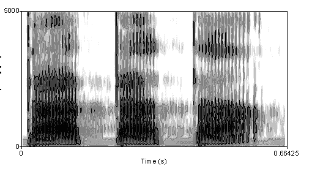

## 从编码文本创建谱图

谱图是理解声音模式、分析语音和识别各种声学特征的强大工具。它们广泛应用于语音识别、音乐分析和科学研究。

• 信号预处理：

○ 从编码后的音频信号开始，通常以数字形式呈现。

○ 确保适当的采样和量化，例如 16 位 PCM 编码。

• 分帧：

○ 将音频信号分成较小的段或帧。

○ 每个帧通常包含几毫秒的音频数据。

○ 通常使用重叠帧来防止突变过渡。

• 窗函数处理：

○ 对每个帧应用窗函数。

○ 窗函数处理可塑造帧内的信号，确保边缘处的平滑过渡。

○ 常见的窗函数包括汉明窗、汉宁窗和布莱克曼窗。

• FFT：

○ 计算每个窗处理帧的 FFT。

○ FFT 将时域信号转换为频域。

○ 每个帧的 FFT 提供该段中存在的频率成分的信息。

• 谱图构建：

○ 随时间排列生成的频率成分（频谱内容）。

○ 将频谱并排堆叠以形成谱图。

○ x 轴对应时间，y 轴表示频率。

○ 颜色或强度表示频谱幅度。

• 可视化：

○ 将谱图显示为图像或热图。

○ 亮色区域表示强频率成分。

Tacotron 2 是一种带有注意力机制的循环序列到序列模型。其主要目的是从输入文本预测梅尔谱图（音频的一种表示）。该模型通过将 WaveNet（一种生成模型）条件化在这些梅尔谱图预测上，学习生成听起来自然的语音。

• Tacotron 2 的组件：

○ 编码器：将输入文本（通常是编码后的字符或音素）转换为固定大小的隐藏特征表示。

○ 注意力机制：将编码器的隐藏特征与梅尔谱图预测对齐。

○ 解码器：从对齐的特征生成梅尔谱图。

• 训练数据：Tacotron 2 在 LJ Speech 数据集上进行训练，该数据集包含一系列英文音频录音。该模型学习将文本映射到相应的梅尔谱图。

• 推理与合成：在推理过程中，Tacotron 2 接收输入文本并生成梅尔谱图。这些梅尔谱图随后可以使用声码器（例如 WaveGlow）转换为实际波形。

• 应用：Tacotron 2 使文本转语音（TTS）合成无需依赖额外的韵律信息。它用于语音助手、有声读物、辅助工具等。

• 语音分析与识别：

○ 谱图直观地表示构成口语单词的不同频率。

○ 通过分析谱图，我们可以识别语音模式、声音过渡以及音高和重音等韵律特征。

○ 语音识别模型通常将谱图作为输入，以同时学习频谱内容和时间模式。

• 说话人验证与识别：

○ 谱图捕捉独特的声学特征，使我们能够根据不同说话人的个体频率模式来区分他们。

○ 说话人验证系统使用谱图来验证说话人的身份。

• 语言和方言分析：


# 谱图揭示语言特定特征

谱图揭示语言特定特征，帮助语言学家了解不同语言和方言如何产生特定声音。

例如，英语和普通话声调之间的光谱差异在各自的谱图中很明显。

# 音乐分析和流派分类

谱图有助于分析音乐音符、泛音和音色，并用于音乐流派分类，以区分爵士乐、摇滚乐和古典音乐等流程。

梅尔频谱图常用于音乐分析。

# 环境声音识别

谱图表示超越语音和音乐的声音，并用于通过分析其光谱内容来检测环境声音，例如警笛、鸟鸣或脚步声。

基于谱图的模型可以对城市环境或自然栖息地中的声音进行分类。

# 声学事件检测

谱图有助于通过分析其谱图来识别音频录音中的特定事件，例如咳嗽声、门关声或汽车发动机声。

事件检测系统使用这些表示来进行准确分类。

总结来说，谱图充当原始音频信号和有意义特征之间的桥梁。它们让我们能够可视化和分析声音模式，使其在各个领域（从语音识别到音乐创作）中都非常宝贵。

# 时域转换和声码器基础

声码器是一种信号处理技术，用于分析和合成语音或音频信号。它们同时在时域和频域工作。在时域中，信号表示为随时间变化的采样序列，而在频域中，信号则使用傅里叶分析以其频率成分表示。

声码器具有多种功能，包括分析（将输入信号（通常是语音）分解为其光谱成分）和合成（使用分析阶段的光谱信息重建新信号）。

相位声码器是一种特定类型的声码器，旨在在分析和合成过程中保留相位信息。它通常用于时域拉伸、音调转换和音频效果。

声码器的应用包括语音编码（用于降低传输或存储的数据速率）、语音合成（用于创建人工声音）和音乐制作（用于添加效果、和声和修改人声）。

在时域转换中，声码器直接对波形采样进行操作，将输入波形转换为不同的输出波形，同时保留基本特征。

声码器的一些示例模型包括 WaveNet（一种用于波形合成的深度生成模型）和 Tacotron 2（它将谱图预测与声码器（例如 WaveNet）相结合，用于高质量的文本转语音（TTS））。

总体而言，声码器是音频处理、语音合成和创意声音设计的重要工具。它们在将谱图转换为实际波形方面起着关键作用，这对于在语音转文本（STT）系统中生成听起来自然的语音非常重要。请记住，声码器是音频处理、语音合成和创意声音设计的重要工具。

让我们讨论将谱图转换为实际波形的最后一步，这对于在语音转文本（STT）系统中生成听起来自然的语音至关重要。

## 将谱图转换为波形

在本节中，我们将讨论如何将谱图转换为波形：

# 背景

谱图提供了音频信号在频域中的可视化表示。

但是，我们需要将这些光谱表示转换回时域，以产生可听的声音。

### 声码器

声码器是执行此转换的专用算法。

它们获取谱图信息并合成相应的波形。

### 波形合成技术

常用的声码器有几种：

#### Griffin-Lim 算法（GLA）

一种迭代相位重建方法。

给定幅度谱图，它估计相位信息。

重建的波形是通过对幅度和估计相位应用反短时傅里叶变换（STFT）得到的。

# WaveNet

一种用于波形合成的深度生成模型。

在原始音频波形上进行训练。

产生高质量、听起来自然的语音。

# WaveGlow

一种基于流的生成模型。

将梅尔谱图（谱图的一种变体）直接转换为波形。

并行性好，适用于实时应用。

#### Tacotron 2 示例

在 Tacotron 2 架构（用于端到端 TTS）中，谱图预测模块生成梅尔谱图。

然后将梅尔谱图传递给声码器（例如 WaveNet 或 WaveGlow）以合成最终波形。

生成的波形对应于输入文本的自然语音。

# 质量和自然度

声码器的选择显著影响合成语音的质量和自然度。

高质量的声码器保留韵律、语调和声音特征等细节。

# 应用

虚拟助手、有声读物和辅助工具的语音合成。

为视频和动画生成逼真的旁白。

为特定应用创建自定义声音。

总结来说，最后一步涉及使用声码器将谱图转换为波形，使我们能够听到转换后的语音。这些声码器弥合了光谱表示和自然音频之间的差距。

## 波循环神经网络

WaveRNN 是一种高效的神经音频合成技术。WaveRNN 是一种专为 TTS 合成设计的单层循环神经网络（RNN）。它可以高效预测 16 位原始音频采样，使其适合实时应用。

# 主要特性

单层 RNN：WaveRNN 使用紧凑的架构，只有一个循环层。尽管简单，但其质量可与最先进的 WaveNet 模型相媲美。

双 Softmax 层：该模型采用双 Softmax 层来生成高质量音频，使 WaveRNN 能够在 GPU 上以四倍于实时的速度生成 24 kHz 16 位音频。

# 权重剪枝

权重剪枝减少了模型参数的数量。稀疏网络（权重数量少）比稠密网络表现更好。稀疏 WaveRNN 可以在移动 CPU 上实时采样高保真音频。

### 子采样

一种新颖的生成方案，将长序列折叠为较短序列的批次，从而允许一次生成多个样本而不牺牲质量。

# 应用

WaveRNN 用于 TTS 系统、语音助手以及任何需要高质量音频合成的应用。

# 实现

您可以探索 WaveRNN PyTorch 实现以了解更多信息并尝试该模型：https://github.com/geneing/WaveRNN-Pytorch。

## Griffin-Lim 算法

以下是 GLA 的目标和背景：

# 目标

GLA 旨在从音频信号的幅度谱图中重建相位信息。

给定幅度谱，GLA 估计缺失的相位信息以合成原始波形。

# 背景

当我们计算音频信号的 STFT 时，我们会得到其幅度和相位分量。

幅度谱图捕获光谱内容，但在 STFT 过程中丢失了相位信息。

# 迭代过程

GLA 使用以下步骤迭代优化相位估计。

随机初始化相位。

使用幅度和估计相位计算反 STFT。

基于新合成的波形更新相位估计。

重复直到收敛。

### 一致性和约束

GLA 通过保持跨箱依赖性来促进谱图的一致性。


○ 它不依赖于关于目标信号的任何先验知识。

○ 该算法旨在恢复与给定幅度一致的复数值频谱图。

• 应用：

○ GLA 因其简单性而被广泛使用。

○ 然而，由于其仅关注一致性，可能涉及许多迭代并导致重建质量较低。

• 用法：

○ GLA 常被用作 `TTS` 系统、音频去噪和音乐合成中的相位重建步骤。

请记住，GLA 在幅度频谱图和完整音频波形之间架起了一座桥梁，使我们能够重建出听起来自然的音频！

# WaveGlow

WaveGlow 是一种用于语音合成的基于流的生成网络。在快速发展的语音合成领域，创新技术不断推动人工语音生成所能实现的边界。该领域的一项突出进展是 WaveGlow，这是由 NVIDIA 开发的一种尖端神经网络架构。本节探讨 WaveGlow、其基础原理、关键特性和实际应用，全面了解其在现代语音合成技术概览中的作用。

WaveGlow 是一种生成语音的革命性方法，它利用神经网络的力量来产生高质量的音频输出。由 NVIDIA 开发，该模型的独特之处在于其使用熔频谱图——一种专门针对语音处理定制的频谱图变体——作为音频合成的基础输入。与传统的自回归模型不同，传统模型按顺序预测音频样本，而 WaveGlow 以并行方式合成语音，大大提高了该过程的效率。通过整合来自 Glow（一种基于流的生成模型）和 WaveNet（一种音频合成的先驱模型）的原理，WaveGlow 成为生成自然流畅语音音频的强大解决方案：

• 关键特性：

○ 基于流的模型：WaveGlow 架构的核心在于其作为基于流的生成网络的基础。该框架允许模型高效地建模音频波形的条件分布，这对于产生连贯且逼真的音频输出至关重要。WaveGlow 的基于流的特性不仅简化了模型的结构，还增强了其从训练数据推广到现实应用的能力。

○ 单网络、单成本函数：WaveGlow 的设计理念强调简单性和效率，在整个训练过程中使用单个网络和单个成本函数。这种精简的方法降低了通常与训练语音合成模型相关的复杂性，并有助于创建更稳定和可预测的学习环境。

○ 快速且高质量：WaveGlow 的实际优势体现在其性能指标中。WaveGlow 在 `PyTorch` 中实现并在 NVIDIA V100 GPU 上测试，可以以令人印象深刻的 1200 kHz 速率生成音频样本。此外，该模型实现的平均意见得分（`MOS`）可与 WaveNet 的最佳实现相媲美，使其在速度和音频质量方面成为顶尖竞争者。

• 应用：WaveGlow 的实用性远不止于基本的 `TTS` 任务。它也是驱动语音助手和各种高质量音频合成至关重要的应用程序的重要组成部分。其生成听起来自然的语音的能力，使其成为开发人员和研究人员创建下一代语音启用技术的宝贵工具。

• 用法：对于有兴趣进一步探索 WaveGlow 的人，NVIDIA 提供了一个官方仓库，其中包含实现细节和音频样本。这个资源是希望将 WaveGlow 集成到其项目中或使用最先进的语音合成模型进行实验研究的从业者的绝佳起点。

让我们使用 WaveGlow 模型和真实数据集，一步步了解完整的 `STT` 流程。我们将涵盖文本预处理、频谱图生成和波形合成。在这个示例中，我们将使用 LJ Speech 数据集，该数据集包含英语语音录音。

## 带 WaveGlow 的语音转文本流程

在语音技术领域，将口语转换为书面文本是一项基本挑战，已通过各种创新解决方案得到解决。利用 WaveGlow 的 `STT` 流程代表了一种复杂的方法，它利用深度学习来提高语音识别的准确性和效率。本节概述了该流程的关键阶段，详细说明了通过文本预处理、频谱图生成和波形合成将原始文本转换为语音的过程。每个步骤对于理解将简单文本输入转换为复杂可听输出的变革过程都至关重要：

1. 文本预处理：在合成任何语音之前，输入文本必须被正确格式化和编码。在 `STT` 流程的这一初始阶段，我们使用文本处理器将输入文本编码为可识别符号列表，例如英文字符和音素。这种编码至关重要，因为它确保文本处于适合后续处理阶段的格式。以下是使用 `PyTorch` 和 `torchaudio` 实现文本预处理的方法：

```
import torch

import torchaudio

# Instantiate the WaveGlow text processor

processor = torchaudio.pipelines.WAVEGLOW.get_text_processor()

# Example input text

text = "Hello world! This is an example for speech-to-text."

# Process the text

processed, lengths = processor(text)

print("Processed text (indices):", processed)

print("Lengths:", lengths)
```

2. 频谱图生成：在文本预处理之后，下一步涉及从编码文本生成熔频谱图。这些熔频谱图代表语音的频谱内容，是准确合成音频的关键组件。使用预训练的 WaveGlow 模型，此阶段将处理后的文本转换为捕捉其声学特性的格式，如下所示：

```
# Instantiate the WaveGlow model

waveglow = torchaudio.models.WaveGlow()

# Example mel spectrogram generation

mel_spectrogram = waveglow.infer(processed)

print("Mel-spectrogram shape:", mel_spectrogram.shape)
```

3. 波形合成（声码器）：`STT` 流程的最后阶段是波形合成，其中熔频谱图被转换为实际音频波形。此过程使用 WaveGlow 声码器执行，它能高效地从熔频谱图产生清晰且听起来自然的语音。合成步骤至关重要，因为它让文本活起来，使我们能够听到预期的语音输出：

```
# Example waveform synthesis

waveform = waveglow.infer(mel_spectrogram)

print("Synthesized waveform shape:", waveform.shape)
```

#### 先决条件

首先，确保您的读者已安装必要的库。他们需要 `PyTorch`、`torchaudio` 和一些其他包。以下是他们可以安装这些库的方法：

```
pip install torch torchaudio librosa
```

示例 1：加载和预处理音频数据：

任何语音识别系统的第一步都是加载和预处理音频数据。以下是如何演示加载音频文件、重采样并将其转换为频谱图（语音模型常用的输入表示）的方法。

```
import torchaudio

from torchaudio.transforms import MelSpectrogram

import librosa

import matplotlib.pyplot as plt

def load_audio(file_path, target_sample_rate=16000):

waveform, sample_rate = torchaudio.load(file_path)

if sample_rate != target_sample_rate:

resampler = torchaudio.transforms.Resample(orig_freq=sample_rate, new_freq=target_sample_rate)

waveform = resampler(waveform)

return waveform, target_sample_rate

def plot_spectrogram(spec, title=None, ylabel='freq_bin', aspect='auto', xmax=None):
```


fig, axs = plt.subplots(1, 1)

axs.set_title(title or 'Spectrogram (db)')

axs.set_ylabel(ylabel)

axs.set_xlabel('frame')

im = axs.imshow(librosa.power_to_db(spec), origin='lower', aspect=aspect)

if xmax:

axs.set_xlim((0, xmax))

fig.colorbar(im, ax=axs)

plt.show()

file_path = 'path_to_audio_file.wav'

waveform, sample_rate = load_audio(file_path)

transform = MelSpectrogram(sample_rate=sample_rate)

mel_spec = transform(waveform)

plot_spectrogram(mel_spec[0])

示例 2：实现一个简单的语音识别模型：

预处理音频后，你可以演示如何使用 PyTorch 构建一个简单的语音识别模型。以下是一个使用卷积神经网络（CNN）的基本模型：

```
import torch

import torch.nn as nn

import torch.nn.functional as F

class SpeechRecognizer(nn.Module):

def __init__(self):

super(SpeechRecognizer, self).__init__()

self.conv1 = nn.Conv2d(1, 32, kernel_size=(3, 3), stride=(2, 2))

self.conv2 = nn.Conv2d(32, 64, kernel_size=(3, 3), stride=(2, 2))

self.fc1 = nn.Linear(64 * 6 * 6, 1000)

self.fc2 = nn.Linear(1000, num_classes) # num_classes is the number of outputs

def forward(self, x):

x = F.relu(self.conv1(x))

x = F.max_pool2d(x, kernel_size=2)

x = F.relu(self.conv2(x))

x = x.view(x.size(0), -1) # Flatten the output

x = F.relu(self.fc1(x))

x = self.fc2(x)

return F.log_softmax(x, dim=1)

# Example usage:

model = SpeechRecognizer()

print(model)
```

示例 3：对音频文件进行推理：

最后，展示如何在音频输入上使用模型进行推理，将 STT 转换为文本。

```
def predict(model, input_tensor):

model.eval()

with torch.no_grad():

predictions = model(input_tensor)

predicted_index = predictions.argmax(1)

return predicted_index

# Assume `input_tensor` is your preprocessed audio tensor ready for model input

input_tensor = mel_spec.unsqueeze(0) # Add batch dimension

predicted_index = predict(model, input_tensor)

print(f"Predicted class index: {predicted_index}")
```

## 结论

在本章中，我们探讨了使用 TorchAudio 将 STT 转换为文本的完整过程，涵盖了文本预处理、频谱图生成以及使用声码器进行波形合成等关键步骤。通过理解和实现这些技术，你可以创建准确且高效的 STT 系统。所提供的实际示例展示了如何利用深度学习模型将口语转换为书面文本。这些基础知识为你提供了开发高级 ASR 应用所需的工具，使语音识别在各个领域都可用，并增强了基于音频内容的可用性。

在下一章中，我们将讨论将深度学习应用于文本和语言任务。

加入我们书籍的 Discord 空间

加入书籍的 Discord 工作区，获取最新动态、优惠、全球科技动态、新版本发布以及与作者的交流会议：

[`discord.bpbonline.com`](https://discord.bpbonline.com)


# 第 8 章 文本分析、分类和语言翻译

# 引言

在我们的数字世界中，将口语转换为书面文本至关重要。想象一下转录访谈、帮助语音助手理解我们，或者让所有人都能访问内容。这些任务都依赖于自动语音识别（ASR）。

在本章中，我们将踏上一段迷人的旅程。我们将使用深度学习、音频技巧和神经网络将口语转换为书面文字。你可以将其视为将语音转化为文本的魔法。我们将探讨其工作原理、面临的挑战以及使用这项技术的实际方法。

从准备文本到创建称为频谱图的特殊图像，再将其转换为声音，我们将揭示使用 PyTorch 和 TorchAudio 进行语音转文本背后的秘密。

## 结构

在本章中，我们将学习以下主题：

• 文本分析和 NLP 简介

• 文本分类

• 文本分类的注意力机制

• 基于 seq2seq 模型的语言翻译

# 目标

本章的目标是介绍文本分析（TA）、分类和语言翻译的关键概念，强调其在各个领域的重要性。本章旨在引导读者了解使用机器学习（ML）和深度学习技术进行文本预处理、特征提取和分类的过程。此外，它还涵盖主题建模、情感分析、注意力机制等高级主题，以及用于语言翻译的序列到序列（seq2seq）模型的实现。提供了实际示例和案例研究，以展示这些技术的实际应用和有效性，使读者具备在不同情境下应用这些技术的知识。

## 文本分析和 NLP 简介

让我们探索 TA 的世界及其在各个领域的重要性。TA 涉及使用 ML 技术从非结构化文本数据中自动提取有意义的信息。

以下是应用：

• 电子邮件和通信：TA 帮助组织筛选成千上万封电子邮件，识别关键词或公司名称等特定细节。

• 客户反馈：通过根据情感和主题对调查回复进行分类，企业可以深入了解客户意见。

• 社交媒体监控：TA 使跟踪品牌提及、情感分析和趋势识别成为可能。

以下是 TA 与文本挖掘的区别：

• TA 关注单个文本，提供定性结果。

• 文本分析揭示大量文本中的模式，生成图表、报告和表格。

• 例如，客户支持经理可能会使用文本分析来可视化单个工单的解决率，同时分析文本内容以了解客户满意度。

以下是 TA 的重要性：

• 可扩展性：TA 工具快速处理大量信息（电子邮件、聊天、社交媒体），为关键任务腾出资源。

• 可操作的洞察：通过自动化 TA，组织获得有价值的洞察，为决策和流程改进提供依据。

### NLP 及其应用简介

自然语言处理（NLP）是一个迷人的领域，位于计算机科学、语言学和 ML 的交叉点。其目标是使计算机能够像我们一样熟练地理解和生成人类语言。让我们了解 NLP 的关键方面：

• 关于 NLP：

○ NLP 专注于使计算机理解和生成自然语言，包括口语和书面形式。

○ 它结合了人工智能（AI）、计算语言学和 ML 的技术。

• NLP 的组成部分：

○ 语音识别：将口语翻译成文本。

○ 自然语言理解：使计算机能够掌握语言的含义。

○ 自然语言生成：使用计算机创建类似人类的语言。

• NLP 中的挑战：

○ 句法和语义分析：NLP 系统必须处理语法和含义的复杂性。

○ 技术：分析、词干提取、文本分割、命名实体识别、关系提取和情感分析。

• NLP 的优势：

○ 增强的数据分析：从大量文本数据中提取洞察。

○ 提高员工生产力：自动化涉及语言的重复性任务。

○ 更高质量的客户体验：改进聊天机器人、虚拟助手和个性化推荐。

○ 在各个领域的应用：客户服务、营销、人力资源、电子商务、金融、保险、教育、医疗保健、制造和网络安全。


## 用于 NLP 的深度学习算法

以下是用于 NLP 的深度学习算法：

- 深度学习模型，例如循环神经网络（`RNNs`）和基于 Transformer 的架构（例如，来自 Transformer 的双向编码器表示（`BERT`），已彻底改变了 NLP。
- 这些模型在机器翻译、情感分析和问答等任务中表现出色。

# 文本预处理

文本预处理是将非结构化文本转换为结构化形式以供分析的过程。它涉及分词、归一化和停用词删除等任务，以提高 NLP 任务的准确性和效率。

以下是文本预处理的一些主要组件：

- 分词：将文本分解为单词或子词单元。
- 使用 `torchtext`：`torchtext` 提供文本处理实用程序，包括分词。

以下代码片段使用 `torchtext` 中的分词器函数。它处理示例文本输入并进行分词：

```
import torchtext

from torchtext.data import get_tokenizer

tokenizer = get_tokenizer("basic_english")

sentence = "You can now install TorchText using pip!"

tokens = tokenizer(sentence)

print(tokens)

# Output: ['you', 'can', 'now', 'install', 'torchtext', 'using', 'pip', '!']
```

基本英语分词器将句子拆分为小写标记，并删除标点符号。

- 使用预训练模型：如果您正在处理更复杂的模型，例如文本到文本迁移 Transformer（`T5`），分词涉及额外步骤。

例如，`T5` 使用 SentencePiece 模型进行文本分词。

以下代码片段使用预训练的 SentencePiece 模型构建文本预处理管道：

```
from torchtext.models import T5Transform

padding_idx = 0

eos_idx = 1

max_seq_len = 512

t5_sp_model_path = "[¹^][1]"

transform = T5Transform(

sp_model_path=t5_sp_model_path,

max_seq_len=max_seq_len,

eos_idx=eos_idx,

padding_idx=padding_idx,

)
```

该管道对文本进行分词，将标记转换为整数 ID，截断序列，并添加序列结束（`EOS`）和填充标记 ID。

#### 停用词删除、词干提取和词形还原

停用词是常见词（例如，`the` 和 `in`），它们对句子的意义贡献很小。停用词删除有助于提高文本处理效率并专注于基本内容。词干提通过去除后缀将单词减少到其根形式（例如，`running` 到 `run`）。它有助于搜索引擎中的信息检索和索引。词形还原将单词转换为其基本或词典形式（例如，`better` 到 `good`）。它保留语义含义，并且比词干提取更准确。

以下代码片段使用自然语言工具包（`NLTK`）库来删除停用词：

- 使用 `NLTK` 进行停用词删除：使用以下代码：

```
import nltk

from nltk.corpus import stopwords

from nltk.tokenize import word_tokenize

nltk.download('stopwords')

nltk.download('punkt')

example_sent = "This is a sample sentence, showing off the stop words filtration."

tokens = word_tokenize(example_sent)

filtered_tokens = [word for word in tokens if word.lower() not in stopwords.words('english')]

print(filtered_tokens)

# Output: ['sample', 'sentence', ',', 'showing', 'stop', 'words', 'filtration', '.']
```

- 使用 `NLTK` 进行词形还原：词形还原将单词减少到其基本或词典形式。

以下代码片段使用 `NLTK` 库，该库提供了一个词形还原器：

```
from nltk.stem import WordNetLemmatizer

lemmatizer = WordNetLemmatizer()

lemmatized_tokens = [lemmatizer.lemmatize(word) for word in filtered_tokens]

print(lemmatized_tokens)

# Output: ['sample', 'sentence', ',', 'showing', 'stop', 'word', 'filtration', '.']
```

- 使用 `NLTK` 进行词干提取：词干提取将单词减少到其根形式。

以下代码片段使用 `NLTK` 库，该库提供了一个词干提取器：

```
from nltk.stem import PorterStemmer

stemmer = PorterStemmer()

stemmed_tokens = [stemmer.stem(word) for word in filtered_tokens]

print(stemmed_tokens)

# Output: ['sampl', 'sentenc', ',', 'show', 'stop', 'word', 'filtrat', '.']
```

#### 处理特殊字符、标点符号和大小写敏感性

特殊字符（例如，`@`、`#`）在文本预处理期间需要被删除。它们可能会干扰分词和模型性能。

标点符号有助于检测句子边界。根据上下文，可以保留或删除标点符号。

大小写敏感性是将文本标准化为小写以保持一致性。它有助于避免重复（例如，`apple` 与 `Apple`）。

让我们来看看代码示例：

- 删除特殊字符和标点符号：以下代码片段使用正则表达式或字符串操作来删除特殊字符和标点符号：

```
import re

def remove_special_chars(text):

return re.sub(r'[^a-zA-Z0-9\s]', '', text)

cleaned_sentence = remove_special_chars(sentence)

print(cleaned_sentence)

# Output: "This is an Example Sentence"
```

- 将文本转换为小写：以下代码片段将输入文本转换为小写，如输出所示：

```
sentence = "This is an Example Sentence."

lowercased_sentence = sentence.lower()

print(lowercased_sentence)

# Output: "this is an example sentence."
```

# 文本分类

文本分类涉及将预定义的标签或类别分配给文本文档。在本章中，我们将使用 PyTorch 探索二进制和多类文本分类：

- 二进制文本分类：二进制文本分类处理只有两个可能类别的问题。示例包括垃圾邮件检测（`spam` vs. `non-spam`）或情感分析（`positive` vs. `negative`）。该方法是构建能够有效区分这两个类别的模型。PyTorch 提供了用于实现逻辑回归和其他算法的强大工具。
- 多类文本分类：多类文本分类将二进制分类扩展到处理两个以上的类别。例如，将新闻文章分类为体育、政治或娱乐等主题。可以使用一对其余或 softmax 激活等技术进行多类分类。

我们将探讨如何调整现有模型以用于此目的。

### 用于文本分类的监督学习算法

可以在 PyTorch 中使用多种算法进行文本分类。以下是可以使用 PyTorch 调整用于文本分类的算法列表：

- 逻辑回归：它是一种常用于文本分类的线性模型。它模拟文档属于特定类别的概率。在 PyTorch 中，我们可以使用单层神经网络实现逻辑回归。
- 支持向量机（`SVM`）：`SVMs` 可以使用适当的核函数（例如，线性和径向基函数）针对文本分类进行定制。它们找到最佳分隔高维空间中文本特征的超平面。PyTorch 库允许我们实现类似 `SVM` 的模型。
- 用于文本分类的神经网络：神经网络为解决文本分类任务提供了多功能的架构范围，每种架构都适合捕捉文本数据的不同方面，以实现有效的学习和预测。
- 模型架构：以下是用于文本分类的一些关键神经网络架构类型：

  - 带有隐藏层的前馈神经网络（`FNNs`）从文本数据中学习复杂的表示。
  - 卷积神经网络（`CNNs`）捕捉文本中的局部模式（例如，n-gram）。
  - `RNNs` 处理顺序数据（例如，句子和文档）。

### 用于文本分类的评估指标

可以使用不同的评估指标进行文本分类。以下是一些重要且流行的评估指标：


# 准确率

准确率衡量被正确分类的文档所占比例。它可能不适用于不平衡数据集。

## 精确率和召回率

精确率和召回率是评估分类模型的关键指标，尤其在需要平衡准确性与完整性的场景中至关重要。

- 精确率（阳性预测值）衡量预测为正样本的文档中相关文档所占的比例。
- 召回率（灵敏度）衡量实际为正样本的文档中相关文档所占的比例。

选择精确率还是召回率取决于应用场景。

# F1 分数

F1 分数将精确率和召回率合并为单一指标，是精确率和召回率的调和平均数。它在处理类别分布偏斜的问题时尤其有用。

## 使用 PyTorch 构建文本分类器

让我们讨论一个使用 PyTorch 和 torchtext 库对文本进行分类的代码示例。

它基于文本检索会议（TREC）数据集，该数据集包含 5,952 个用英文编写的问题，根据其答案分为以下类别：

- HUM: 人类
- DESC: 描述
- ABBR: 缩写
- LOC: 地点
- NUM: 数字
- ENTY: 实体

以下代码片段导入所有必需的库：

```
import torchtext

from torchtext import data, datasets

import random

import torch

import torch.nn as nn

import torch.nn.functional as F

import matplotlib.pyplot as plt

%matplotlib inline
```

# 数据准备

以下代码片段使用 torchtext 库处理文本数据。它加载 TREC 数据集，预处理文本，并显示带有标签的示例：

```
# Get datasets  

text_field = data.Field(lower=True, batch_first=True, tokenize='spacy')  

label_field = data.Field(sequential=False, unk_token = None)  

train, test = datasets.TREC.splits(text_field, label_field)  

print('Train length:',str(len(train)))  

print('Test length:',str(len(test)))

# Show some examples  

for i in range(10):  

random_index = random.randint(0,len(train))  

print(' '.join(train.examples[random_index].text), train.examples[random_index].label)
```

# 构建模型

以下代码片段使用 PyTorch 定义一个用于文本分类的 RNN。它包含一个嵌入层、一个长短期记忆（LSTM）层和一个用于输出的线性层。该模型处理输入标记并生成类别得分：

```
class RNN(nn.Module):  

def __init__(self, num_tokens, embedding_dim, rnn_dim, num_layers, num_classes):  

super(RNN, self).__init__()  

self.embeddings = nn.Embedding(num_tokens, embedding_dim)  

self.rnn = nn.LSTM(input_size = embedding_dim,  

hidden_size = rnn_dim,   

num_layers = num_layers,  

batch_first = True)  

self.linear = nn.Linear(rnn_dim, num_classes)  

def forward(self, x):  

emb = self.embeddings(x)  

rnn_output, rnn_hidden = self.rnn(emb)  

output = self.linear(rnn_output[:,-1,:])  

return output  

n_hidden = 128  

model = RNN(word_count, embedding_dim=128, rnn_dim=128, num_layers=1, num_classes=classes_count)  

model
```

| 注意：分类模型的经典 softmax 层已包含在 `CrossEntropyLoss` 函数中。 |

| --- |

### 目标函数和优化器

让我们分解以下代码片段：

- 损失函数（`nn.CrossEntropyLoss()`）：它计算预测类别概率与实际标签之间的误差。它专为多类分类设计，并结合了 softmax 激活和负对数似然损失。
- 优化器（`torch.optim.Adam()`）：它在训练期间调整模型参数以最小化损失。使用自适应学习率。学习率设置为 0.001。
- 学习率衰减（`ExponentialLR()`）：它在训练期间指数级降低学习率，以帮助收敛到更好的最小值。Gamma 控制衰减率（此处为 0.99）。

```
loss_function = nn.CrossEntropyLoss()  

optimizer = torch.optim.Adam(model.parameters(), lr=0.001)  

lr_decay = torch.optim.lr_scheduler.ExponentialLR(optimizer, gamma=0.99) 

# Scheduled learnint rate, which decays the learning rate exponentially. This could potentially help arrive to a lower minimum.  

# Another option could be:  

#lr_decay = torch.optim.lr_scheduler.ReduceLROnPlateau( optimizer, factor=0.95, patience=10 )
```

### 训练模型并在训练期间进行测试

训练模型并在训练过程中对其进行测试是机器学习中确保模型准确学习并从训练数据中泛化的关键步骤。以下设置概述了如何通常通过迭代批处理来管理此过程：

```
batch_size = 32  

num_epochs = 5  

train_iter = data.BucketIterator(train,   

batch_size=batch_size,   

sort_within_batch=True,   

shuffle = True,   

repeat = False)  

test_iter = data.BucketIterator(test,   

batch_size=30,   

sort_within_batch=True,   

shuffle = True,   

repeat = False)

# Reset variables   

accuracies = []  

losses_train = []  

losses_test = []  

train_accuracy = 0  

step_count = 0  

max_accuracy = 0
```

让我们分解上面的代码片段：

- `batch_size` 确定训练期间一次处理多少个数据样本。
- `num_epochs` 指定整个数据集用于训练的次数。
- `train_iter` 和 `test_iter` 是训练和测试数据的迭代器。它们使用 torchtext 库中的 `BucketIterator`。

以下是关键参数：

- `train`：训练数据集。
- `test`：测试数据集。
- `batch_size`：每个批次中的样本数量。
- `sort_within_batch`：确保批次内的样本长度相似（对 RNN 有用）。
- `shuffle`：每个时代随机打乱数据。

训练循环遍历时代，处理批次，更新模型参数，并定期在测试集上评估性能。

```
# Training loop  

for i in range(num_epochs):  

print('Training epoch ',i)  

train_iter.init_epoch()  

for batch in train_iter:  

x_train = batch.text  

y_train = batch.label  

# Forward pass  

y_model = model(x_train)  

# Loss function  

loss = loss_function(y_model, y_train)  

losses_train.append(float(loss))  

# Backward pass  

model.zero_grad()  

loss.backward()  

# Update parameters  

optimizer.step()  

# Evaluation in test set  

if step_count%50 == 0:  

# Calculate model in test set by pieces  

model.eval() # Set model to eval (if there is dropout, set it to zero)  

y_model_test_list = []  

y_test_list = []  

for test_batch in test_iter:  

y_model_test_list.append(model(test_batch.text))  

y_test_list.append(test_batch.label)  

model.train() # Set model to train (if there is dropout, not be zero )  

test_iter.init_epoch()  

# Calculate accuracy  

accuracy = float( (torch.cat(y_model_test_list).max(dim=1)[1] ==

torch.cat(y_test_list)).float().mean() )  

print('Step: ', step_count, 'Accuracy in test set:', accuracy)  

accuracies.append(accuracy)  

lr_decay.step()  

step_count += 1
```

## 文本分类的注意力机制


# 文本分类中的注意力机制

文本分类中的注意力机制通过关注对决策至关重要的输入文本相关部分，来提升模型性能。该技术为不同的单词或序列分配权重，使模型能够动态地优先处理并聚合最具信息量的特征。通过建模序列中元素之间的关系，注意力有助于克服传统模型（如 RNN）的局限性，这些模型在长距离传递中可能会丢失信息。这使得在情感分析和主题检测等任务中，准确性和可解释性得到提高。注意力机制改变了我们在 NLP 中处理任务（如文本分类）的方式。这些机制使模型能够专注于输入序列的各个部分，这对于理解上下文和提高预测准确性至关重要。

## 注意力的基本概念

神经网络中注意力的基本概念受到人类视觉焦点的启发，注意力机制允许模型动态地集中于输入数据中最相关的部分，而不是均匀地处理整个数据集。这种方法为输入的不同部分分配不同的权重，这些权重表明了它们在任务上下文中的重要性。通过这样做，注意力增强了模型捕捉依赖关系和细微差别的能力，这些依赖关系和细微差别可能在较长的序列或复杂模式中丢失，从而提高了从 NLP 到图像识别等广泛应用中模型的性能和可解释性。

## 注意力工作机制

神经网络中注意力的工作机制是一个复杂的过程，旨在通过关注输入数据中最具信息量的部分来提高模型准确性。以下是其工作原理的详细介绍：

• 上下文向量和注意力权重：分配给每个输入特征的注意力权重基于其与任务的相关性。然后，模型将输入特征的加权和计算为上下文向量。

在情感分析任务中，excellent 或 terrible 等单词可能具有更高的权重，因为它们对文本情感有强烈影响。

• 分数计算：注意力机制中的评分过程是通过使用点积等函数计算分数来完成的。这些分数用于确定应给输入数据每个部分多少关注。计算分数后，使用 softmax 函数将其转换为概率分布。每个分数都持有一个权重，该权重基本上决定了相应单词在最终输出中的重要性。

• 加权和：注意力层输出与计算的注意力分数成比例的输入特征加权和，然后用于分类。

以下是注意力机制的类型：

• 软注意力：软注意力是神经网络架构中一种灵活且广泛使用的机制，允许模型动态地优先处理并关注输入数据的某些部分。以下是其运作方式及常见应用：

  ○ 机制：它通过 softmax 函数为输入数据的每个部分分配一个权重。这些权重决定了每个输入元素的相关性和重要性。

  ○ 应用：软注意力通常用于 LSTM 或门控循环单元（GRU）等模型，以帮助模型关注对分类至关重要的某些单词。

• 硬注意力：硬注意力是一种更具选择性和确定性的方法，用于在神经网络模型中关注输入数据的特定部分。以下是其机制和应用的概述：

  ○ 机制：它通过基于学习概率分布采样子集来关注输入的某些部分。

  ○ 应用：由于其不可微分的特性，这种随机过程在文本分类中不太常见。但是，在可解释性和关注度很重要的场景中，它可能很有效。

• 自注意力（内部注意力）：自注意力，也称为内部注意力，是现代神经网络架构中的一种强大机制，它增强了模型对序列的理解和处理能力。以下是其工作原理及应用：

  ○ 机制：它涉及将输入序列映射为键、查询和值表示。使用自注意力，输入序列中的每个位置都可以直接关注所有位置。

  ○ 应用：这种机制是 transformer 架构的关键部分，该架构广泛用于 BERT 等模型，这些模型在各种 NLP 任务（包括文本分类）中显示出显著改进。

## 通过注意力机制改进文本分类

注意力机制可以通过多种方式改进文本分类：

• 上下文感知：首先，它们使模型能够利用句子中单词的上下文，从而增强其上下文感知能力。与可能将每个单词独立处理的传统模型不同，注意力机制使模型能够更有效地理解句子中单词之间的关系。

• 长文本：其次，注意力机制使模型能够更高效地处理长文本。在较长的文档中，注意力有助于模型识别并关注包含与分类任务相关信号的部分，同时忽略不相关的部分。

• 特征增强：最后，注意力机制可以通过关注文本的关键部分来增强传递给分类器的特征表示。这导致对文本更细致的理解和更好的分类准确性。

## 在神经网络中实现注意力机制

注意力是一种可以集成到神经网络中的技术，以帮助它们学习输入序列的哪些部分最重要。将注意力集成到神经网络中有两种常见方法：使用 RNN 或 transformer 模型。

在基于 RNN 的模型中，注意力权重可以应用于 RNN 的隐藏状态。这使网络能够学习输入序列的哪些部分最重要。

另一方面，transformers 使用自注意力层而不是传统的 RNN。这种架构允许对所有输入标记进行并行处理，从而加快训练时间并提高可扩展性。

在神经网络中实现注意力的示例架构包括几个层。

• 示例架构：

输入文本标记化 | 嵌入层 | 注意力层 | 分类层

首先，输入文本被标记化，然后通过嵌入层。接下来，注意力层计算表示每个标记嵌入重要性的权重。这些加权嵌入随后被聚合以形成用于分类的上下文向量。最后，上下文向量通过分类层。通过在神经网络中实现注意力，我们可以显著提高其性能，尤其是在处理长输入序列时。

• 评估和调优：在评估和调优模型时，可视化注意力图有助于理解模型的决策过程。注意力图显示了哪些单词被认为对每个分类决策最重要。

此外，超参数调优对于优化模型性能至关重要。应调优注意力头数、键/查询/值向量的维度以及注意力类型（软、硬、自）等参数，以确保最佳性能。

注意力机制，特别是通过 transformer 等模型，已成为现代 NLP 系统中的核心技术，在处理复杂的文本分类任务时，以更高的准确性和更好的可解释性提供了显著改进。


# 基于 PyTorch 构建注意力模型

使用 PyTorch 构建用于文本分类任务的注意力模型涉及多个步骤，包括准备数据、创建带有注意力机制的模型架构以及训练模型。以下将提供使用 PyTorch 构建基本注意力模型的分步指南。我们将重点放在 RNN 中实现简单版本的注意力机制：

## 1. 安装必要的库

首先，确保已安装 PyTorch 以及用于处理文本数据的 torchtext：

```
pip install torch torchtext
```

## 2. 准备数据

我们将使用 torchtext 加载和预处理文本数据。在此示例中，让我们考虑使用 torchtext 提供的数据集进行情感分析任务：

```
import torch

from torchtext.datasets import IMDB

from torchtext.data.utils import get_tokenizer

from torchtext.vocab import build_vocab_from_iterator

# Tokenizer
tokenizer = get_tokenizer('basic_english')

# Build vocabulary
def yield_tokens(data_iter):
    for _, text in data_iter:
        yield tokenizer(text)

train_iter = IMDB(split='train')
vocab = build_vocab_from_iterator(yield_tokens(train_iter), specials=["<unk>"])
vocab.set_default_index(vocab["<unk>"]) # default index for OOV words

# Encode text and labels
def text_pipeline(x): return vocab(tokenizer(x))
def label_pipeline(x): return 1 if x == 'pos' else 0

# Load data
from torch.utils.data import DataLoader
from torch.nn.utils.rnn import pad_sequence

def collate_batch(batch):
    label_list, text_list = [], []
    for (_label, _text) in batch:
        label_list.append(label_pipeline(_label))
        processed_text = torch.tensor(text_pipeline(_text), dtype=torch.int64)
        text_list.append(processed_text)
    return torch.tensor(label_list, dtype=torch.int64), pad_sequence(text_list, padding_value=3.0)

train_iter, test_iter = IMDB()
train_dataloader = DataLoader(list(train_iter), batch_size=8, shuffle=True, collate_fn=collate_batch)
```

## 3. 定义带有注意力的模型

我们将创建一个简单的 RNN，后跟一个注意力层：

```
import torch.nn as nn
import torch.nn.functional as F

class AttentionModel(nn.Module):
    def __init__(self, vocab_size, embed_dim, num_hidden, num_output):
        super(AttentionModel, self).__init__()
        self.embedding = nn.Embedding(vocab_size, embed_dim)
        self.rnn = nn.GRU(embed_dim, num_hidden, batch_first=True)
        self.fc = nn.Linear(num_hidden, num_output)
        self.attention_weights = nn.Parameter(torch.rand(num_hidden))

    def attention(self, rnn_output):
        weights = F.softmax(torch.matmul(rnn_output, self.attention_weights), dim=1)
        context_vector = torch.sum(weights * rnn_output, dim=1)
        return context_vector

    def forward(self, text):
        embedded = self.embedding(text)
        rnn_output, _ = self.rnn(embedded)
        context_vector = self.attention(rnn_output)
        output = self.fc(context_vector)
        return output

# Model instantiation
model = AttentionModel(vocab_size=len(vocab), embed_dim=256, num_hidden=128, num_output=1)
```

## 4. 训练模型

定义训练循环并训练模型：

```
from torch.optim import Adam

criterion = nn.BCEWithLogitsLoss()
optimizer = Adam(model.parameters(), lr=0.001)

def train(dataloader):
    model.train()
    total_loss = 0
    for labels, text in dataloader:
        optimizer.zero_grad()
        output = model(text)
        loss = criterion(output.squeeze(1), labels.float())
        loss.backward()
        optimizer.step()
        total_loss += loss.item()
    return total_loss / len(dataloader)

# Train the model
num_epochs = 5
for epoch in range(num_epochs):
    loss = train(train_dataloader)
    print(f'Epoch {epoch + 1}, Loss: {loss}')
```

## 5. 评估模型

准备测试 DataLoader。首先，确保已准备好测试数据集并放置在 DataLoader 中，我们以类似于训练 DataLoader 的方式准备它：

```
test_iter = IMDB(split='test')
test_dataloader = DataLoader(list(test_iter), batch_size=8, shuffle=False, collate_fn=collate_batch)
```

## 6. 定义评估函数

评估函数将遍历测试数据集，计算模型的预测，并将其与实际标签进行比较以计算准确率和平均损失。

`evaluate` 函数将模型设置为评估模式，在不更新模型参数的情况下跨数据集计算总损失和准确率。它处理来自 dataloader 的批次，计算损失，统计正确预测的数量，并返回平均损失和总体准确率。

```
def evaluate(dataloader):
    model.eval() # Set the model to evaluation mode
    total_accuracy = 0
    total_loss = 0
    total = 0
    with torch.no_grad():
        for labels, text in dataloader:
            output = model(text)
            loss = criterion(output.squeeze(1), labels.float())
            total_loss += loss.item()
            # Calculating accuracy
            predictions = torch.round(torch.sigmoid(output.squeeze(1)))
            correct = (predictions == labels).float().sum()
            total_accuracy += correct
            total += labels.size(0)
    avg_loss = total_loss / len(dataloader)
    accuracy = total_accuracy / total
    return avg_loss, accuracy

# Evaluate the model
test_loss, test_accuracy = evaluate(test_dataloader)
print(f'Test Loss: {test_loss:.4f}, Test Accuracy: {test_accuracy:.4f}')
```

# 与非注意力模型的性能比较

比较注意力模型与非注意力模型在文本分类、机器翻译或任何其他 NLP 任务中的性能，是了解引入注意力机制的优点和局限性的关键练习。以下是每种方法的关键差异以及潜在优缺点的概述：

## 性能指标

性能指标在评估和比较不同神经网络架构方面起着至关重要的作用，特别是在处理复杂数据关系的能力方面。以下是注意力模型与非注意力模型的关键指标细分：

- **Accuracy**：注意力模型通常在受益于理解数据中上下文和关系的任务上表现更好。例如，在文本分类中，注意力有助于模型关注相关单词或短语，通常会导致更高的准确率。
- **Complexity and speed**：非注意力模型，例如传统的 RNN（如 LSTM 或 GRU），通常更简单且训练速度更快。但是，它们可能难以处理数据中的长距离依赖。注意力机制（特别是在 Transformer 等模型中）可以更好地处理长序列，但在计算上更为密集，尤其是对于大型数据集。
- **Memory-efficiency**：非注意力模型由于其更简单的架构，可能更节省内存。注意力模型（尤其是那些在长文本上采用自注意力的模型）需要大量内存来进行计算，这可能成为资源受限环境中的瓶颈。

## 用例

在选择神经网络模型时，选择通常取决于特定用例的要求。以下是注意力模型和非注意力模型如何服务于不同应用：

- **Long sequence data**：注意力模型在涉及长序列的任务中表现出色，其中序列各部分的相关性可能有显著差异。例如，在文档分类或机器翻译中，文本的不同部分对整体含义的贡献不同。
- **Real-time applications**：对于流数据处理等实时应用，由于执行时间更快，可能更倾向于使用更简单的非注意力模型。
- **Contextual relevance**：在上下文或特定细节显著影响输出的场景中，注意力模型特别有效。它们可以根据输入部分与当前任务的相关性动态地对其进行加权。


# 示例比较

在各种应用中评估神经网络模型时，比较基于注意力机制的模型与非注意力模型可以揭示性能上的显著差异。以下是一些示例比较：

# 情感分析

在情感分析中，注意力模型可以通过关注 `not good` 或 `extremely satisfying` 等关键短语来优于非注意力模型，这些短语强烈表明情感，而不是在不太相关的内容中被稀释。

## 机器翻译

像变换器（transformers）这样的基于注意力的模型在机器翻译中设定了新标准。它们通过有效管理长句中遥远单词之间的依赖关系，比早期的 seq2seq 模型有了显著改进。

## 语音识别

注意力机制通过关注与口语单词对应的音频信号的特定部分，改进了语音识别系统，其性能优于可能更均匀地处理音频的传统方法。

# 优势总结

在总结不同神经网络模型的优势时，重要的是要考虑注意力模型与非注意力模型的具体优势和权衡：

## 注意力模型

注意力模型增强了对相关数据的关注，提高了可解释性，并通过动态加权输入特征，在复杂且富含上下文的任务中表现出色：

- 更擅长处理复杂依赖关系和长序列。
- 在需要上下文理解的任务中准确率更高。
- 可解释性更好（注意力权重可以显示模型关注的内容）。

## 非注意力模型

非注意力模型均匀处理输入，而不动态关注特定部分，使用更简单、更高效的架构，适合对上下文敏感性要求较低的任务：

- 通常更简单，训练和部署速度更快。
- 更节省内存，适合受限环境。
- 可能更适合实时或低延迟应用程序。

最终，选择注意力模型还是非注意力模型应由应用程序的具体要求驱动，包括性能、计算资源和任务性质等考虑因素。通常需要进行实验和经验测试，以确定特定问题的最佳方法。

# 使用 seq2seq 模型进行语言翻译

以下是在 PyTorch 中实现语言翻译模型：

## 构建 seq2seq 模型

构建带有和不带有注意力机制的基本 seq2seq 模型的分步指南。

## 使用变换器进行翻译

使用 PyTorch 实现变换器模型进行翻译的指南，可能包括使用 BERT 或 GPT-2 等预训练模型进行迁移学习方法。

seq2seq 模型是一种旨在将序列从一个领域转换到另一个领域的深度神经网络架构。它在 NLP 中被广泛使用，特别是用于机器翻译、文本摘要和语音识别等任务。以下是对 seq2seq 模型基本概念和组件的解释：

## 架构概述

seq2seq 模型由两个主要组件组成：编码器和解码器。两个组件通常使用 RNN 实现，尽管也可以使用 LSTM 网络或 GRU 等其他架构来处理长期依赖关系并缓解梯度消失等问题。编码器和解码器如下：

### 编码器

编码器处理输入序列并将信息压缩为上下文向量（有时称为思想向量），这是输入序列的固定大小表示。该向量旨在封装执行手头任务所需的输入序列信息。

### 解码器

解码器获取编码器生成的上下文向量，并从中开始生成输出序列。输出序列可以与输入使用相同的语言（例如，摘要），也可以使用不同的语言（例如，翻译）。

## 编码和解码过程

编码和解码过程是 seq2seq 模型的基础，有助于将输入数据转换为有意义的输出。这个复杂的机制的运作方式如下：

### 输入处理

输入序列一次一个标记地输入到编码器中。在每个步骤中，编码器根据输入标记及其先前状态更新其内部状态。

### 上下文向量

处理完整个输入序列后，编码器的最终状态被用作上下文向量。该向量作为整个输入序列的压缩表示。

### 序列生成

然后，解码器使用这个上下文向量开始生成输出序列。解码器的初始状态通常设置为编码器的上下文向量。解码器一次生成一个标记，并使用其先前状态和最近生成的标记来预测序列中的下一个标记。

# 训练过程

seq2seq 模型通常使用一种称为教师强制（teacher forcing）的方法进行训练。在训练期间，目标序列是已知的（即给定输入的正确输出）。

在每个步骤中，不使用解码器的预测作为输入，而是输入真实的输出标记。这有助于解码器更有效地学习，因为它始终提供正确的上下文。

模型的预测使用损失函数（通常是交叉熵损失）与实际目标序列进行比较，模型被训练以最小化此损失。

## 挑战与增强

seq2seq 模型在处理数据时面临多种挑战，但已开发出各种增强方法来有效解决这些限制：

### 信息瓶颈

由于编码器将整个输入序列压缩为单个上下文向量，因此存在某些信息丢失的风险，尤其是对于非常长的输入序列。这有时被称为信息瓶颈问题。

# 注意力机制

为了解决瓶颈问题，注意力机制通常被纳入 seq2seq 模型中。注意力允许解码器直接回顾输入序列，在解码过程的每个步骤中对序列的不同部分进行不同的加权。这有助于模型在生成输出的每个标记时关注输入的相关部分。

### 双向编码器

对编码器使用双向 RNN 可以通过向前和向后处理输入序列来提高性能，从而为模型提供更丰富的输入表示。

# 应用

seq2seq 模型具有广泛的应用：

- 机器翻译：将文本从一种语言翻译成另一种语言。
- 语音识别：将口语转换为文本。
- 文本摘要：为长文本创建简洁的摘要。
- 聊天机器人：在对话式 AI 系统中生成类似人类的响应。

seq2seq 模型通过为处理各种序列转换任务提供灵活的框架，显著推动了机器学习领域的发展。它的发展以及随后引入注意力机制，为创建更高级的模型（例如变换器）奠定了基础。

# 使用 seq2seq 进行语言翻译

要使用 PyTorch 构建用于语言翻译的 seq2seq 模型，让我们创建一个从英语到法语翻译的简单示例。该模型将由编码器和解码器组成，两者都使用 LSTM 层实现：

## 定义编码器和解码器

以下是使用 PyTorch 的 `nn.Module` 定义编码器和解码器类的 Python 代码：

```python
import torch

import torch.nn as nn

import torch.optim as optim

import random

class Encoder(nn.Module):

def __init__(self, input_dim, emb_dim, hidden_dim, n_layers, dropout):

super().__init__()

self.embedding = nn.Embedding(input_dim, emb_dim)

self.lstm = nn.LSTM(emb_dim, hidden_dim, n_layers, dropout=dropout, batch_first=True)
```


# Seq2Seq 模型实现

## 编码器与解码器

self.dropout = nn.Dropout(dropout)

def forward(self, src):

embedded = self.dropout(self.embedding(src))

outputs, (hidden, cell) = self.lstm(embedded)

return hidden, cell

class Decoder(nn.Module):

def \_\_init\_\_(self, output\_dim, emb\_dim, hidden\_dim, n\_layers, dropout):

super().\_\_init\_\_()

self.output\_dim = output\_dim

self.embedding = nn.Embedding(output\_dim, emb\_dim)

self.lstm = nn.LSTM(emb\_dim, hidden\_dim, n\_layers, dropout=dropout, batch\_first=True)

self.fc\_out = nn.Linear(hidden\_dim, output\_dim)

self.dropout = nn.Dropout(dropout)

def forward(self, input, hidden, cell):

input = input.unsqueeze(1)

embedded = self.dropout(self.embedding(input))

output, (hidden, cell) = self.lstm(embedded, (hidden, cell))

prediction = self.fc\_out(output.squeeze(1))

return prediction, hidden, cell

class Seq2Seq(nn.Module):

def \_\_init\_\_(self, encoder, decoder, device):

super().\_\_init\_\_()

self.encoder = encoder

self.decoder = decoder

self.device = device

def forward(self, src, trg, teacher\_forcing\_ratio=0.5):

batch\_size = trg.shape\[0\]

trg\_len = trg.shape\[1\]

trg\_vocab\_size = self.decoder.output\_dim

outputs = torch.zeros(batch\_size, trg\_len, trg\_vocab\_size).to(self.device)

hidden, cell = self.encoder(src)

input = trg\[:, 0\]

for t in range(1, trg\_len):

 output, hidden, cell = self.decoder(input, hidden, cell)

 outputs\[:, t\] = output

 teacher\_force = random.random() < teacher\_forcing\_ratio

 top1 = output.argmax(1)

 input = trg\[:, t\] if teacher\_force else top1

return outputs

## 示例数据

2. 示例数据：为简单起见，让我们为英语和法语定义一些小型词汇表及其对应的索引。这将作为我们的示例数据集：

\# Vocabulary dictionaries for simplification

eng\_vocab = {'<pad>': 0, 'hello': 1, 'world': 2, 'good': 3, 'morning': 4, '<eos>': 5}

fra\_vocab = {'<pad>': 0, 'bonjour': 1, 'le': 2, 'monde': 3, 'matin': 4, '<eos>': 5}

\# Sample data (indices format)

src\_sentence = torch.tensor(\[\[1, 2, 5\]\], dtype=torch.long) # "hello world <eos>"

trg\_sentence = torch.tensor(\[\[1, 3, 5\]\], dtype=torch.long) # "bonjour monde <eos>"

\# Hyperparameters

input\_dim = len(eng\_vocab)

output\_dim = len(fra\_vocab)

enc\_emb\_dim = dec\_emb\_dim = 256

hidden\_dim = 512

n\_layers = 2

dropout = 0.5

## 模型初始化与运行

3. 初始化并运行模型：现在我们可以创建编码器、解码器和 Seq2Seq 模型实例，并查看模型在示例数据上的表现：

\# Device configuration

device = torch.device('cuda' if torch.cuda.is\_available() else 'cpu')

\# Model instantiation

encoder = Encoder(input\_dim, enc\_emb\_dim, hidden\_dim, n\_layers, dropout)

decoder = Decoder(output\_dim, dec\_emb\_dim, hidden\_dim, n\_layers, dropout)

model = Seq2Seq(encoder, decoder, device).to(device)

\# Dummy example to pass data through the model

src\_sentence = src\_sentence.to(device)

trg\_sentence = trg\_sentence.to(device)

output = model(src\_sentence, trg\_sentence)

print(output.shape)

## Transformer 翻译模型

4. 使用 Transformer 进行翻译：使用 PyTorch 实现翻译 Transformer 模型的指南，可能包括使用 BERT 或 GPT-2 等预训练模型进行迁移学习的方法。

Transformer 是一种神经网络架构，已成为许多最先进的 NLP 任务（包括语言翻译）的基础。Transformer 由 Vaswani 等人在 2017 年的论文《Attention is All You Need》中提出，由于其高效性和高效率，彻底改变了机器理解和处理人类语言的方式。

以下是 Transformer 模型的关键概念：

• Attention 机制：Attention 机制（特别是在 Transformer 模型中使用的机制）通过同时关注数据所有部分之间的关系，彻底改变了序列的处理方式。

○ Self-attention：Transformer 模型的核心创新是 Self-attention 机制。与顺序处理数据的 RNN 和 CNN 不同，Self-attention 同时处理输入序列中的所有 Token。这种并行性使 Transformer 在处理长序列数据时速度显著更快且更具可扩展性。Self-attention 使每个 Token 能够直接与其他每个 Token 交互，在计算自身表示时计算应将多少关注放在输入序列的其他部分上。

○ Scaled dot-product attention：这是 Transformer 中使用的特定 Attention 机制。它基于 Query 与所有 Key 的点积计算 Attention 分数，将每个分数除以 Key 维度的平方根，对值应用 Softmax 函数以获得权重，然后输出值的加权和。

• Multi-head attention：Transformer 不使用单个 Attention 函数处理 Query、Key 和 Value，而是使用多个头并行多次运行 Attention 机制。独立的 Attention 输出随后被拼接并线性转换为预期维度。Multi-head attention 使模型能够同时关注不同位置不同表示子空间中的信息，捕捉语义关系的各个方面。

• Positional encoding：由于 Self-attention 机制本身不考虑 Token 的顺序，因此添加 Positional encoding 以向模型提供关于序列中 Token 相对或绝对位置的信息。这些编码在编码器和解码器堆栈底部添加到输入 Embedding 中。

• Encoder-decoder architecture：Encoder-decoder 架构（尤其是在 Transformer 模型中实现的架构）具有复杂的层级结构，旨在优化输入数据的编码和输出序列的生成：

○ Encoder：每个 Encoder 层包含两个子层。第一个是 Multi-head Self-attention 机制，第二个是简单的、位向的、完全连接的前馈网络。在两个子层周围各采用一个残差连接，随后进行层归一化。

○ Decoder：每个 Decoder 层有三个子层。第一个是 Multi-head Self-attention 机制，第二个是 Multi-head Attention 机制（接收 Encoder 堆栈输出和前一个 Decoder 层的输出，以关注输入序列的适当部分），第三个是位向前馈网络。与 Encoder 类似，这些子层中的每一个周围都有一个残差连接，随后进行层归一化。

• Layer normalization and residual connections：编码器和解码器层中的每个子层都包含一个残差连接，随后进行层归一化。残差连接有助于避免深层网络中的梯度消失问题。

• Application in language translation：在语言翻译任务中，Transformer 相比 RNN 和 CNN 展现出更优的性能，主要归功于其建模复杂依赖关系和有效处理长程上下文的能力。该架构非常适合翻译，因为它可以同时考虑整个输入句子，从而实现更细致的理解和更高的翻译准确性。

以下是 Transformer 的优势：

• Parallelization：与需要顺序处理数据的 RNN 不同，Transformer 同时处理输入序列中的所有 Token，这大大加快了训练速度。

• Long-range dependencies：Transformer 可以学习输入序列中 Token 之间的依赖关系，无论它们之间的距离如何。

• Scalability：由于其并行特性以及在学习长程依赖关系方面的有效性，Transformer 具有高度可扩展性，使其适合涉及非常大数据集的任务。


Transformers 已成为 NLP 中的主导模型，是 BERT、生成式预训练 Transformer（GPT）、T5 等模型的基础，展示了其在翻译之外的多种任务（包括文本生成、摘要和问答）中的多功能性和有效性。

要在 PyTorch 中使用预训练 Transformer 模型进行语言翻译，我们可以利用 `transformers` 库，该库提供了多种预训练模型。在此示例中，让我们使用 Helsinki-NLP 或 `opus-mt-en-fr` 模型，该模型专门用于从英语翻译成法语。

1. 安装所需库：首先，确保已安装 PyTorch 和 `transformers` 库。如果未安装，可以使用以下 pip 进行安装：

```
pip install torch transformers
```

2. 加载预训练模型和分词器：以下是加载模型及其对应分词器的方法：

```
from transformers import MarianMTModel, MarianTokenizer

def load_model_and_tokenizer(model_name):
    tokenizer = MarianTokenizer.from_pretrained(model_name)
    model = MarianMTModel.from_pretrained(model_name)
    return tokenizer, model

model_name = 'Helsinki-NLP/opus-mt-en-fr'
tokenizer, model = load_model_and_tokenizer(model_name)
```

3. 翻译文本：定义一个函数，以英文文本作为输入并返回法语翻译：

```
def translate(text, tokenizer, model):
    # Tokenize the input text and convert to tensor
    input_ids = tokenizer.encode(text, return_tensors="pt")

    # Generate translation using model
    translated = model.generate(input_ids)

    # Decode the output tokens
    translated_text = tokenizer.decode(translated[0], skip_special_tokens=True)
    return translated_text

# Example usage
english_text = "Good morning! How are you?"
french_translation = translate(english_text, tokenizer, model)
print(f"English: {english_text}\nFrench: {french_translation}")
```

4. 代码说明：以下是代码描述：

a. 加载模型和分词器：`load_model_and_tokenizer` 函数根据模型标识符 `model_name` 加载分词器和模型。该标识符指定了模型的架构及其所接受的特定训练。

5. 翻译函数：神经网络中的翻译函数通常遵循结构化过程，将输入文本从一种语言转换为另一种语言，利用 Transformer 等高级模型架构。以下是该函数的逐步分解：

a. 分词：文本首先使用 `tokenizer.encode` 进行分词，将输入文本转换为模型所期望的 token ID 序列。`return_tensors="pt"` 参数确保输出为 PyTorch 张量。

b. 模型预测：`model.generate` 接收分词后的文本并运行模型，以预测翻译文本的输出 token ID。

c. 解码：`tokenizer.decode` 将预测的 token ID 转换回可读文本。`skip_special_tokens=True` 参数会移除训练期间使用但输出中不需要的 token（如 EOS）。

## 结论

在本章中，我们讨论了 TA、分类和语言翻译的复杂过程，强调了它们在各个领域中的关键作用。我们探讨了文本预处理、分词和特征提取等基础技术，这些技术对于将原始文本转换为可供分析的结构化数据至关重要。本章还涵盖了高级 ML 和深度学习模型，包括二分类和多类分类、主题建模、情感分析以及注意力机制的使用。通过实现 seq2seq 模型并利用 Transformer，我们展示了如何有效地实现语言翻译。本章中提供的实际示例和案例研究强调了这些技术的现实适用性。随着你继续探索这些方法，你将能够将 TA 和语言翻译模型应用于解决从 NLP 到多语言沟通等各个领域的复杂问题。

在下一章中，我们将学习如何使用文本数据进行摘要、情感分析和问答。

**加入本书的 Discord 空间**

加入本书的 Discord 工作区，获取最新动态、优惠、全球科技动态、新书发布以及与作者的交流会议：

**[`discord.bpbonline.com`](https://discord.bpbonline.com)**


# 第 9 章

## 文本摘要与情感分析

### 简介

文本摘要、情感分析和问答（QA）是自然语言处理（NLP）的关键技术，能够从海量文本中提取有意义的信息。

文本摘要旨在将冗长的文档浓缩为简洁的摘要，同时保留最重要的信息。它可以通过提取式方法实现，即选取关键句子；也可以通过抽象式方法实现，即生成捕捉文本精髓的新摘要。

情感分析侧重于确定文本的情感基调，识别表达的情感是积极、消极还是中性。该技术广泛应用于社交媒体监控和客户反馈分析等场景，用于衡量公众舆论并改善用户体验。

问答是根据给定的上下文或数据集自动提供准确答案的过程。它涉及理解上下文、理解问题，并检索或生成最相关的答案，通常使用 BERT（基于 Transformer 的双向编码器表示）和 Transformer 等高级模型。

### 结构

本章将涵盖以下内容：

• 文本分析简介

• 文本摘要

• 情感分析

• 问答模型

# 目标

本章结束时，我们将探索高级文本分析技术，包括使用 PyTorch 进行文本摘要、情感分析和问答。本章旨在深入理解提取式和抽象式摘要方法，指导读者使用神经网络构建情感分类器，并演示基于 Transformer 的问答模型实现。此外，本章还将介绍使用 BERT 和 GPT 等预训练语言模型针对特定任务进行微调，并提供实际示例和案例研究来说明这些技术的现实应用。总体目标是使读者掌握在各个领域有效分析和解释文本数据所需的知识和技能。

### 文本分析简介

在当今数据驱动的世界中，理解并从文本数据中提取洞察的能力在各个领域都至关重要。文本分析是理解人类沟通、情感和信息的核心。从社交媒体帖子到科学文章，文本数据无处不在。

本章将探讨 PyTorch（一种多功能的深度学习库）如何使我们能够从文本内容中提取有价值的洞察。文本分析使我们能够从非结构化文本中得出有意义的信息，无论是情感分析、摘要还是问答。

本章将涵盖以下场景，演示如何使用 PyTorch 从文本内容中提取有价值的洞察：

• 情感分析：这是评估和确定各种形式文本（如客户反馈、评论或推文）中表达情感的过程。它涉及使用 NLP 和机器学习（ML）技术来识别文本的情感，无论是积极、消极还是中性。


# 文本摘要

文本摘要是创建冗长文档简要摘要的过程。它有助于将大量信息浓缩为简洁的摘要，使其更易于阅读和理解。

QA 是指从给定上下文或来源中访问和检索相关信息的过程。这可能涉及理解和分析上下文，理解所提出的问题，并在可用信息中找到最合适的答案。

PyTorch 是构建文本分析模型的绝佳选择。研究人员、开发人员和数据科学家可以从 PyTorch 的动态计算图和灵活性中受益，这为深度学习任务提供了强大的工具包。

# 文本摘要

文本摘要是在保留长文本文档的主要思想和关键信息的同时，创建其较短版本的过程。目标是在简洁且连贯的摘要中捕捉原始文本的关键点。

在下一节中，我们将讨论完成此任务的两种主要方法。

# 提取式摘要

以下是提取式摘要的目标：

- 保留信息：在提取式摘要中，保留信息至关重要，其目标是保持原始文本的完整性和相关性。
  - 提取式摘要旨在保留原始文本中最相关的内容。
  - 目标是捕捉主要思想，而不引入新短语。
- 简洁性：简洁性是提取式摘要的关键方面，专注于将文档的精髓浓缩为更紧凑的形式。
  - 提取式摘要通过选择现有句子来浓缩文档。
  - 挑战在于在保持连贯性的同时实现简洁性。

以下是其工作原理的逐步解释：

1. 首先，排名算法根据句子与文档整体含义的相关性，为文本中的每个句子分配分数。
2. 接下来，选择最相关的句子（即分数最高的句子）以包含在摘要中。

以下是提取式摘要的挑战：

- 冗余和重复：在提取式摘要中，解决冗余和重复至关重要，因为该方法倾向于选择相似句子，可能导致重叠并降低摘要的有效性。
  - 提取式方法根据句子的重要性分数选择句子，这通常会导致冗余。相似信息可能出现在多个句子中，导致摘要中出现重复内容。
  - 提取的句子可能会重叠，导致摘要缺乏多样性。
- 连贯性和流畅性：连贯性和流畅性是提取式摘要中至关重要的考虑因素，因为该技术往往难以将语境上不连贯的句子整合成无缝的叙述。
  - 提取的句子并不总是语境上相关的。摘要可能缺乏连贯的流畅性，使其可读性降低。
  - 提取式方法难以保持人工撰写摘要中所具有的词汇和语义流畅性。
- 内容丢失：内容丢失是提取式摘要中的一个重大问题，因为关注高分句子可能导致从最终摘要中遗漏关键信息。
  - 提取式方法优先选择重要性分数高的句子，但可能会遗漏出现在低排名句子中的关键信息。
  - 摘要可能缺乏基本的上下文或背景细节。

### 抽象式摘要

抽象式摘要旨在实现几个关键目标，旨在提高摘要的有效性和自然性。以下是抽象式摘要的目标：

- 类人摘要：类人摘要是抽象式摘要技术的核心目标，这些技术致力于创建不仅浓缩信息，而且保持原始文档自然可读性和精髓的输出。
  - 抽象式方法旨在产生类似于人类撰写的摘要。
  - 目标是在保持可读性的同时捕捉文档的精髓。
- 语境理解：语境理解在抽象式摘要中至关重要，因为它涉及综合和融入更广泛的上下文和背景信息，以产生连贯且有意义的摘要。
  - 抽象式摘要考虑上下文和背景信息。
  - 模型必须理解文本的细微差别，才能创建有意义的摘要。
- 简洁性和创造性：简洁性和创造性定义了抽象式摘要的优势，因为这些方法巧妙地压缩内容并注入新表达，以增强摘要的清晰度和吸引力。
  - 抽象式方法使用更少的词语表达主要思想。
  - 它们有灵活性引入新颖的短语和概念。

以下是简要的逐步指南：

1. 输入文本：从冗长的文档或文章开始。
2. 语义理解：语义理解在文本摘要中至关重要，利用 `RoBERTa` 等高级模型来解释文本含义并建立双向句子表示。
   - 使用高级模型（如 `RoBERTa`）来理解文本的含义。
   - 创建句子的双向表示。
3. 改写：改写是文本摘要中的关键技术，专注于生成新短语，并使用多样化的词汇集创造性地改写主要内容。
   - 生成新短语和句子。
   - 使用不同的词汇集改写主要内容。
4. 摘要创建：
   - 将改写的短语组合成连贯的摘要。
   - 结果是类人、感知上下文的摘要。

总之，抽象式摘要创造性地改写并捕捉关键信息，使其更具可读性和表现力。

以下是抽象式摘要的挑战：

- 流畅性和连贯性：
  - 抽象式方法通过改写和改述原始内容来生成摘要。
  - 确保流畅性、语法正确性和连贯性具有挑战性。
  - 模型必须创建流畅且有意义的句子。
- 新颖性和创造性：
  - 抽象式摘要可以引入输入中不存在的新短语和句子。
  - 挑战在于在忠实于原始含义的同时生成新颖内容。
- 内容准确性：
  - 抽象式模型可能会无意中改变事实或歪曲信息。
  - 在创造性与事实准确性之间取得平衡至关重要。

总之，提取式方法优先考虑内容保留，而抽象式方法侧重于流畅性、创造性和上下文。深度学习的最新进展改进了抽象式摘要，但两种方法都有其利弊。

### 提取式摘要中选择短语的技术

以下是提取式摘要中常用的一些技术，尤其是在使用深度学习方法时：

以下是一些用于对句子打分的流行方法：

- 词频-逆文档频率（`TF-IDF`）：该方法根据句子中单词的频率与其在整个文档中出现频率的比较，为句子分配分数。
- 基于图的方法（例如 `PageRank`）：该方法将句子视为图中的节点，其中边缘表示共现等关系。选择中心性分数较高的句子。
- 神经网络（例如 `LSTM`、`GRU`）：该方法涉及训练神经网络，根据上下文信息预测句子重要性分数。
- 注意力机制：用于 NLP 中为文本的不同元素分配重要性的技术。两种常见的注意力机制类型是自注意力和层次注意力网络：


# 提取式摘要

# 注意力机制

○ 自注意力（Self-attention），用于 BERT 和 Transformer 等模型，根据句子中每个词的重要性为其分配权重。然后可以将这些权重组合起来对整个句子进行评分。

○ 另一方面，层次化注意力网络（Hierarchical attention networks）在词级和句子级都应用注意力机制，以捕捉上下文和重要性。

## 嵌入式

• 嵌入式（Embeddings）：以下是 NLP 中使用的一些常见嵌入式类型：

○ 词嵌入式（Word embeddings，例如 `word2vec`、`GloVe`）：这些将单个词转换为密集向量，这些向量是捕捉词义的数值表示。句子嵌入式可以通过平均或拼接词嵌入式来形成。

○ 句子嵌入式（Sentence embeddings，例如 universal sentence encoder）：预训练模型将整个句子编码为固定长度的向量，这些向量捕捉句子的底层语义。

## 监督学习

• 监督学习（Supervised learning）：监督学习涉及句子分类的两种主要技术：

○ 一种方法是在训练数据集中将句子标记为重要或不重要，然后训练分类器（例如 `SVM` 或 `logistic regression`）来预测句子的重要性。

○ 第二种方法是使用深度学习模型，例如 `CNN` 或循环神经网络（`RNN`），这些模型使用标记数据进行训练以对句子进行评分。

## 基于内容的特征

• 基于内容的特征（Content-based features）：在提取式摘要方面，需要考虑某些基于内容的特征：

○ 位置信息（Positional information）：这些包括句子的位置信息，文档开头或结尾处的句子可能更重要。

○ 句子长度（Length of a sentence）：句子长度也起作用，因为较长的句子可能包含更多信息。

○ 命名实体和关键词（Named entities and keywords）：包含命名实体（例如名称或位置）或相关关键词的句子也很重要。

但是，重要的是要记住，虽然提取式摘要旨在保留原始文本，但它仍可能存在冗余和缺乏连贯性等问题。

| 注意：提取式摘要旨在保留原始措辞，但可能存在冗余和缺乏连贯性的问题。 |

| --- |

## 使用 PyTorch 实现提取式摘要

在本节中，我们将学习如何使用 PyTorch 实现提取式摘要：

• 模型架构：手头的任务涉及向模型提供一对输入，即一个句子和一个文档。然后模型预测一个相关性分数，记为 `y`。为了处理文本输入，我们需要合适的表示。为此，可以从 `transformers` 库中选择任何语言模型。在此特定场景中，我们将使用 `sentence-transformers`，它本质上是一个基于 BERT 的模型，专门针对提取语义上有意义的句子嵌入式进行了微调：

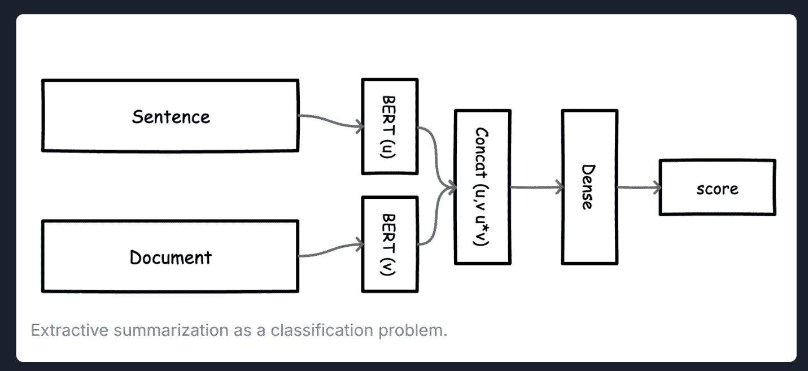

```
from transformers import AutoTokenizer, AutoModel

sentence_model = "sentence-transformers/paraphrase-MiniLM-L3-v2"

tokenizer = AutoTokenizer.from_Pre-trained(sentence_model)

# Derive mean pooling for sentence model

def mean_pooling(model_input, attention_mask_input):

token_embeddings = model_input[0] #First element of model_input contains all token embeddings

input_mask_expanded = attention_mask_input.unsqueeze(-1).expand(token_embeddings.size()).float()

sum_embeddings = torch.sum(token_embeddings * input_mask_expanded, 1)

sum_mask = torch.clamp(input_mask_expanded.sum(1), min=1e-9)

return sum_embeddings / sum_mask

class SentenceBertModelClass(torch.nn.Module):

def __init__(self, model_name="sentence-transformers/paraphrase-MiniLM-L3-v2", in_features=384):

super(SentenceBertModelClass, self).__init__()

self.l1 = AutoModel.from_Pre-trained(model_name)

self.pre_classifier = torch.nn.Linear(in_features*3, 768)

self.dropout = torch.nn.Dropout(0.3)

self.classifier = torch.nn.Linear(768, 1)

self.classifierSigmoid = torch.nn.Sigmoid()

def forward(self, sent_ids_var, doc_ids_var, sent_mask_var, doc_mask):

sent_output = self.l1(input_ids=sent_ids_var, attention_mask_input=sent_mask_var)

sentence_embeddings_var = mean_pooling(sent_output, sent_mask_var)

doc_output = self.l1(input_ids=doc_ids_var, attention_mask_input=doc_mask)

doc_embeddings = mean_pooling(doc_output, doc_mask)

# elementwise product of sentence embs and doc embs

combined_features = sentence_embeddings_var * doc_embeddings

# Concatenate input features and their elementwise product

concat_features = torch.cat((sentence_embeddings_var, doc_embeddings, combined_features), dim=1)

pooler_var = self.pre_classifier(concat_features)

pooler_var = torch.nn.ReLU()(pooler_var)

pooler_var = self.dropout(pooler_var)

output_var = self.classifier(pooler_var)

output_var = self.classifierSigmoid(output_var)

return output_var
```

接下来，我们实例化模型，将其移动到可用的 GPU 上，并指定训练参数（学习率和二元交叉熵损失）。

• 模型训练：

```
from torch import cuda

device = 'cuda' if cuda.is_available() else 'cpu'

model_var = SentenceBertModelClass(model_name=sentence_model)

model_var.to(device)

loss_function = torch.nn.BCELoss()

optimizer = torch.optim.Adam(params = model.parameters(), lr=LEARNING_RATE)
```

接下来，我们指定模型训练循环。对于数据加载器中的每个数据批次，我们首先对输入文本进行分词，获得预测，计算梯度，并更新模型权重。我们还保持每个批次的性能指标运行总和，以便随后进行可视化：

```
def train(epoch):

tr_loss = 0

n_correct = 0

nb_tr_steps = 0

nb_tr_examples = 0

model_var.train()

for _,data in tqdm(enumerate(training_loader, 0)):

sent_ids_var = data['sent_ids'].to(device, dtype = torch.long)

doc_ids_var = data['doc_ids'].to(device, dtype = torch.long)

sent_mask_var = data['sent_mask'].to(device, dtype = torch.long)

doc_mask_var = data['doc_mask'].to(device, dtype = torch.long)

targets = data['targets'].to(device, dtype = torch.float)

outputs_var = model_var(sent_ids_var, doc_ids_var, sent_mask_var,

doc_mask_var)

loss_var = loss_function(outputs_var, targets)

tr_loss += loss_var.item()

n_correct += torch.count_nonzero(targets == (outputs_var > 0.5)).item()

nb_tr_steps += 1

nb_tr_examples+=targets.size(0)

if _%print_n_steps==0:

 loss_step = tr_loss/nb_tr_steps

 accu_step = (n_correct*100)/nb_tr_examples

 print(str(_* train_params["batch_size"]) + "/" +

 str(len(train_df)) + " - Steps. Acc ->", accu_step, "Loss ->",

 loss_step)

 acc_step_holder.append(accu_step), loss_step_holder.append(loss_step)

optimizer.zero_grad()

loss_var.backward()

# # When using GPU

optimizer.step()

print(f'The Total Accuracy for Epoch {epoch}: {(n_correct*100)/nb_tr_examples}')

epoch_loss = tr_loss/nb_tr_steps

epoch_accu = (n_correct*100)/nb_tr_examples

print(f"Training Loss Epoch: {epoch_loss}")

print(f"Training Accuracy Epoch: {epoch_accu}")

return

for epoch in range(EPOCHS):

train(epoch)
```

• 模型评估：要评估模型，我们可以编写一个类似于训练循环的循环，用于获取测试集中每个批次数据的预测，但不更新模型权重：

```
def validate_model(model, testing_loader):

model.eval()

n_correct = 0; n_wrong = 0; total = 0; tr_loss = 0; nb_tr_steps = 0 ; nb_tr_examples = 0

with torch.no_grad():

for _, data in enumerate(testing_loader, 0):

 sent_ids_var = data['sent_ids'].to(device, dtype = torch.long)

 doc_ids_var = data['doc_ids'].to(device, dtype = torch.long)

 sent_mask_var = data['sent_mask'].to(device, dtype = torch.long)

 doc_mask_var = data['doc_mask'].to(device, dtype = torch.long)

 targets = data['targets'].to(device, dtype = torch.float)
```


outputs = model(sent_ids_var, doc_ids_var, sent_mask_var, doc_mask_var)

loss_var = loss_function(outputs, targets)

tr_loss += loss_var.item()

n_correct += torch.count_nonzero(targets == (outputs > 0.5)).item()

nb_tr_steps += 1

nb_tr_examples += targets.size(0)

if %print_n_steps == 0:

loss_step = tr_loss / nb_tr_steps

accu_step = (n_correct * 100) / nb_tr_examples

print(str(_* test_params["batch_size"]) + "/" + str(len(train_df)) + " - Steps. Acc ->", accu_step, "Loss ->", loss_step)

epoch_loss = tr_loss / nb_tr_steps

epoch_accu = (n_correct * 100) / nb_tr_examples

print(f"Validation Loss Epoch: {epoch_loss}")

print(f"Validation Accuracy Epoch: {epoch_accu}")

return epoch_accu

```
outputs = model(sent_ids_var, doc_ids_var, sent_mask_var, doc_mask_var)

loss_var = loss_function(outputs, targets)

tr_loss += loss_var.item()

n_correct += torch.count_nonzero(targets == (outputs > 0.5)).item()

nb_tr_steps += 1

nb_tr_examples += targets.size(0)

if %print_n_steps == 0:

loss_step = tr_loss / nb_tr_steps

accu_step = (n_correct * 100) / nb_tr_examples

print(str(_* test_params["batch_size"]) + "/" + str(len(train_df)) + " - Steps. Acc ->", accu_step, "Loss ->", loss_step)

epoch_loss = tr_loss / nb_tr_steps

epoch_accu = (n_correct * 100) / nb_tr_examples

print(f"Validation Loss Epoch: {epoch_loss}")

print(f"Validation Accuracy Epoch: {epoch_accu}")

return epoch_accu
```

• 模型推理：推理在以下片段的 `summarize` 方法中实现。首先，我们将文档分块（使用 spacy 语言模型将文档拆分为单个句子），为每个句子获取分数预测，按分数和出现顺序排序，然后返回 `top_k` 个句子作为摘要。

```
# create spacy model

nlp = spacy.load('en_core_web_lg')

# tokenize text as required by BERT-based models

def get_tokens(text, tokenizer):

    inputs = tokenizer.batch_encode_plus(

        text,

        add_special_tokens=True,

        max_length=512,

        padding="max_length",

        return_token_type_ids=True,

        truncation=True

    )

    ids = inputs['input_ids']

    mask = inputs['attention_mask_input']

    return ids, mask

# get predictions given some an array of sentences and their corresponding documents

def predict(sents, doc):

    sent_id_var, sent_mask_var = get_tokens(sents, tokenizer)

    sent_id_var, sent_mask_var = torch.tensor(sent_id_var, dtype=torch.long), torch.tensor(sent_mask_var, dtype=torch.long)

    doc_id_var, doc_mask = get_tokens([doc], tokenizer)

    doc_id_var, doc_mask = doc_id_var * len(sents), doc_mask * len(sents)

    doc_id_var, doc_mask = torch.tensor(doc_id_var, dtype=torch.long), torch.tensor(doc_mask, dtype=torch.long)

    preds = model(sent_id_var, doc_id_var, sent_mask_var, doc_mask)

    return preds

def summarize(doc, model, min_sentence_length=14, top_k=4, batch_size=3):

    doc = doc.replace("\\n", "")

    doc_sentences = []

    for sent in nlp(doc).sents:

        if len(sent) > min_sentence_length:

            doc_sentences.append(str(sent))

    doc_id_var, doc_mask = get_tokens([doc], tokenizer)

    doc_id_var, doc_mask = doc_id_var * batch_size, doc_mask * batch_size

    doc_id_var, doc_mask = torch.tensor(doc_id_var, dtype=torch.long), torch.tensor(doc_mask, dtype=torch.long)

    scores_var = []

    # run predictions using some batch size

    for i in tqdm(range(int(len(doc_sentences) / batch_size) + 1)):

        preds_var = predict(doc_sentences[i * batch_size: (i + 1) * batch_size], doc)

        scores_var = scores_var + preds_var.tolist()

    sent_pred_list = [{"sentence": doc_sentences[i], "score": scores_var[i][0], "index": i} for i in range(len(doc_sentences))]

    sorted_sentences = sorted(sent_pred_list, key=lambda k: k['score'], reverse=True)

    sorted_result = sorted_sentences[:top_k]

    sorted_result = sorted(sorted_result, key=lambda k: k['index'])

    summary = [x["sentence"] for x in sorted_result]

    summary = " ".join(summary)

    return summary, scores_var, doc_sentences
```

### 使用 PyTorch 生成简洁的抽象摘要

以下是使用 PyTorch 实现此功能的高级概述：

• 编码器-解码器架构：编码器-解码器架构处理序列，将输入数据转换为解码器用于生成有意义输出的编码表示。

○ 使用基于 Transformer 的编码器将输入文本编码为固定长度的表示。

○ 将此表示馈送到基于 Transformer 的解码器以生成摘要。

○ Transformer 利用自注意力机制，允许并行处理并有效捕获上下文。

• 微调预训练模型：微调预训练模型通过在特定数据集上调整其参数，使其适应特定任务，从而提升性能并增强与特定应用的相关性。

○ 在摘要数据集（例如 CNN 或 Daily Mail）上微调预训练 Transformer 模型（例如 `BERT`、`T5`）。

○ 编码器（预训练的 `BERT`）学习上下文嵌入，而解码器（Transformer）生成摘要。

序列到序列模型旨在将一个序列转换为另一个序列。当输入和输出序列长度不同时，它们特别有用。基本思路是使用两个 RNN：

• 编码器网络：将输入序列浓缩为固定大小的向量（上下文向量）。

• 解码器网络：将上下文向量展开为新序列（输出）。

以下是关键概念：

• 张量：这些是 PyTorch 中的核心数据抽象。张量是具有各种数学和逻辑操作的多维数组。

• Autograd：PyTorch 的自动微分引擎。它跟踪计算历史并为模型学习计算梯度。

• 模型构建基础：它涉及以下步骤。

○ 继承自 `torch.nn.Module`。

○ 定义层和前向函数。

○ 实例化并运行模型。

• 数据加载抽象：使用 `torch.utils.data.Dataset` 和 `torch.utils.data.DataLoader` 将数据组织成批次。

• 模型训练：

○ 定义损失函数和优化器。

○ 遍历数据加载器以更新模型参数。

• 用于推理的部署：

○ 使用 TorchScript 创建可序列化和可优化的模型。

○ 添加文本摘要的代码示例。

# 情感分析

情感分析，也称为意见挖掘，是评估一系列词语所传达的情感基调的过程。它涉及分析大量文本以确定其是否表达了积极、消极或中性情感。公司使用情感分析来监控不同渠道（包括社交媒体、客户反馈表和在线调查）中关于其品牌和产品的讨论。通过了解客户情感，企业可以识别关注领域，消除评论中的偏见，并快速解决可能影响其品牌声誉的任何问题。简而言之，情感分析是从文本数据中提取有价值见解的强大工具，最终改善客户体验。

### 理解情感极性

情感极性是指每段文本中表达的整体情感基调。它帮助我们了解情感是积极、消极还是中性。让我们探讨细节：

• 积极情感：当文本表现出积极情感时，它传达有利的情绪、满意或赞同。示例包括喜悦、钦佩或满足的表达。

• 消极情感：消极情感反映不利的情绪、不满或批评。它包括愤怒、失望或沮丧的表达。

• 中性情感：中性情感表明缺乏强烈的情感偏见。文本保持客观，并不显著倾向于积极或消极。

例如，考虑以下示例：

• 积极：感谢 @ComapnySupport 的 Michelle 等人帮助推进我的未接听电话问题。订单已成功取消，并今天在商场的 Apple 商店订购了自取商品。（标记为积极）

• 消极：亲爱的 @ComapnySupport，你们的服务在达拉斯简直糟糕透顶。跟你们合作十多年了，这是有史以来最低的一次。我说的是完全没有网络。（标记为消极）

• 中性：@ComapnySupport，我已经给你发了私信。（标记为中性）


情感分析能够处理大量数据，自动化洞察，并了解人们在各种渠道中如何看待品牌、产品和服务。

## 情感分析的应用

让我们探索一些实际应用：

• 社交媒体监控：社交媒体平台是关于产品、服务和品牌的坦诚意见的宝贵来源。情感分析是一种技术，可帮助组织快速分析社交媒体帖子、推文和评论中表达的情绪。它可以准确识别讽刺并解释常见的聊天缩写，从而提供公众情绪的全面视图。

• 客户支持工单分析：由于请求数量庞大且主题多样，高效处理客户支持请求可能非常具有挑战性。然而，由自然语言理解（`NLU`）驱动的情感分析可以通过分析客户消息来确定其情绪、语气和紧迫性，从而提供帮助。这可以通过根据情感分析自动处理工单、聊天、电话和电子邮件，使优先处理紧急问题变得更加容易。

• 品牌监控和声誉管理：请记住，在线意见可能对品牌声誉产生重大影响。为了帮助高管掌握这一情况，有可靠的情感分析工具可用于监控其品牌周围的整体情绪。

其中一种工具是客户之声（`VOC`），它使用情感分析从客户反馈、评论和调查中提取洞察。通过这样做，企业可以识别改进领域并提升客户体验。

• 员工之声：情感分析不仅限于客户。它还可以帮助企业分析员工情绪，以衡量工作满意度、识别工作场所问题并提高员工敬业度。

• 产品分析：公司可以通过评估客户对特定产品的情绪来改进其产品。无论是新功能还是现有产品，情感分析都能提供宝贵的反馈。

• 市场研究和竞争分析：了解市场趋势和竞争对手的表现至关重要。情感分析有助于识别新兴趋势并分析市场情绪。

总之，情感分析通过从文本数据中提取有意义的洞察，使企业能够做出明智的决策。无论是监控社交媒体、改善客户支持，还是保护品牌声誉，情感分析在当今数据驱动的环境中仍然是一个可靠的工具。

## 利用预训练语言模型

利用预训练语言模型，例如 `BERT` 或 `GPT`，通过利用已经理解语言细微差别的大型已训练网络来加速 NLP 任务，显著减少开发时间和资源使用，同时提高各种语言应用的准确性。

• 使用预训练模型：使用预训练模型简化了开发，利用广泛的先前训练来提升性能和效率。

○ 从头开始训练深度学习模型需要大量数据和计算资源。

○ 预训练模型，例如 `BERT`、`GPT` 和 `RoBERTa`，已经从大量文本数据中学习了丰富的表示。

○ 对这些预训练模型在特定任务（例如情感分析）上进行微调，使我们能够受益于其知识。

• 使用预训练模型进行情感分析：使用预训练模型进行情感分析可以实现快速部署和高准确性，通过利用在大量数据上训练的模型来有效解释和分类文本中的情感内容。

○ 从 Hugging Face Transformers 等库中获取预训练语言模型（例如 `BERT`）。

○ 在标记的情感分析数据（正面、负面、中性）上对模型进行微调。

○ 微调会调整模型的权重以适应特定任务，同时保留其通用语言理解能力。

• 利用预训练模型的步骤：以下是步骤列表：

1. 加载预训练模型（例如 `BERT`）和分词器。

2. 准备您的标记情感分析数据集。

3. 使用标记数据对模型进行微调。

4. 在验证集上评估模型的性能。

5. 使用微调后的模型对新文本进行情感分析。

• 预训练模型的优势：预训练模型提供显著优势，在计算资源和设置时间极少的情况下，提升众多应用的效率和准确性。

○ 效率：与从头开始训练相比，预训练模型节省时间和资源。

○ 泛化能力：它们捕捉丰富的语言模式和上下文。

○ 迁移学习：微调允许用极少的数据适应特定任务。

总之，利用预训练语言模型简化了情感分析任务，使其即使对于没有丰富机器学习经验的人也易于使用。

## 构建情感分类器

以下是几个步骤的列表：

1. 安装依赖项：首先，确保已安装必要的库。您需要 `transformers`（用于 `BERT`）和 `torch`（用于 `PyTorch`）。使用 pip 安装它们：

```
pip install transformers torch
```

2. 加载预训练 `BERT` 模型：我们将使用预训练 `BERT` 模型进行情感分析。您可以从各种 `BERT` 变体中选择（例如，`BERT-base`、`BERT-large`）。让我们加载一个 `BERT` 模型：

```
from transformers import BertTokenizer, BertForSequenceClassification  

# Load pre-trained BERT model and tokenizer  

model_name = "bert-base-uncased"  

tokenizer = BertTokenizer.from_Pre-trained(model_name)  

model = BertForSequenceClassification.from_Pre-trained(model_name)
```

3. 分词并预测情感：给定输入文本，使用 `BERT` 分词器对其进行分词并预测情感：

```
def predict_sentiment(text):  

inputs = tokenizer(text, return_tensors="pt", padding=True, truncation=True)  

logits = model(**inputs).logits  

predicted_class = logits.argmax().item()  

sentiment = "Positive" if predicted_class == 1 else "Negative"  

return sentiment  

# Example usage  

input_text = "I loved the movie! Great acting and plot."  

sentiment_result = predict_sentiment(input_text)  

print(f"Sentiment: {sentiment_result}")
```

# 问答模型

问答模型是旨在根据给定上下文回答问题的机器学习或深度学习模型。这些模型可以以多种方式运行：

• 提取式问答：是一个过程，其中答案短语直接从给定上下文（例如段落）中提取。模型定位上下文中答案的位置，从而更容易找到相关信息。例如，如果上下文是关于珠穆朗玛峰的，提取式问答模型将识别描述其高度的相关短语。

• 生成式问答：模型能够从头开始生成答案，并以连贯的方式重新表述。它们能够理解上下文以生成其响应。例如，如果给出关于 `BERT` 的上下文，生成式问答模型可能会生成对 `BERT` 架构的解释。

• 多项选择式问答：涉及根据上下文和适当性从选项列表中选择正确答案。例如，如果给出关于著名科学家的上下文，模型将选择发现青霉素的科学家。

`BERT` 的自注意机制捕捉上下文依赖性，使其能够理解语言的结构和语义细微差别。这种注意力机制使 `BERT` 成为问答等 NLP 任务的强大工具。


## Transformers and BERT: Language Models

Transformers and BERT: Language models and transformers are two important concepts in NLP. Language models are designed to learn the probability of sentence occurrence based on training examples. On the other hand, transformers, specifically the transformer architecture, have brought about a revolution in NLP. Transformers use self-attention mechanisms to capture context and dependencies across tokens. This approach has proven to be very effective in various NLP tasks.

BERT is a language model that is pre-trained and extremely powerful. It can learn representations from large amounts of text data, and its architecture enables it to understand context in both directions. BERT is particularly good at a range of NLP tasks, including QA.

## Applying BERT for QA

BERT is a language model trained on a large corpus of text. During pre-training, BERT learns to predict missing words in a sentence, which is called masked language modeling, and understand the context of the text.

After pre-training, BERT can be fine-tuned to specific tasks such as QA. During fine-tuning, BERT is trained on labeled data, such as Stanford Question Answering Dataset (SQuAD) or CoQA, to learn how to locate answer spans within a given context.

### Model training and evaluation

In this section, we will train a BERT-based question and answering model.

It involves the following steps:

• Data preparation: Begin by gathering and organizing your data, focusing on collecting labeled QA pairs from sources like the SQuAD dataset and preparing context-question-answer triplets for training.

• Load pre-trained BERT model: Next, select and load a suitable pre-trained BERT model, such as BERT-base or Bio-BERT, and fine-tune it on your specific QA dataset to tailor its capabilities to your application.

• Inference: For the final step, conduct the inference by tokenizing the input context and question using the BERT tokenizer, then pass this tokenized data through the BERT model to accurately identify and extract the answer span.

• Evaluation: Evaluate the model's performance using metrics like F1 score and exact match.

### Code example of question and answering using BERT

To effectively utilize the BERT model for QA tasks, follow these step-by-step instructions that guide you from setting up the necessary software environment to deploying and optionally fine-tuning the model:

1. Install dependencies: First, make sure you have the necessary libraries installed. You will need `transformers` (for BERT) and `torch` (for PyTorch). Install them using pip:

```
pip install transformers torch
```

2. Load pre-trained BERT model: We will use the pre-trained BERT model for QA. You can choose from various BERT variants (for example, BERT-base, BERT-large). Let us load a BERT model:

```
import torch  

from transformers import BertTokenizer, BertForQuestionAnswering  

# Load pre-trained BERT model and tokenizer  

model_name = "bert-base-uncased"  

tokenizer = BertTokenizer.from_Pre-trained(model_name)  

model = BertForQuestionAnswering.from_Pre-trained(model_name)
```

3. Tokenize and predict answer: Given a context and a question, tokenize them using the BERT tokenizer and predict the answer span:

```
def predict_answer(context, question):  

inputs = tokenizer.encode_plus(question, context, return_tensors="pt", padding=True, truncation=True)  

start_logits, end_logits = model(**inputs).start_logits, model(**inputs).end_logits  

start_idx = start_logits.argmax().item()  

end_idx = end_logits.argmax().item()  

answer_tokens = inputs["input_ids"][0][start_idx : end_idx + 1]  

answer = tokenizer.decode(answer_tokens)  

return answer  

# Example usage  

context = "Mount Everest is the highest peak in the world."  

question = "What is the height of Mount Everest?"  

predicted_answer = predict_answer(context, question)  

print(f"Predicted Answer: {predicted_answer}")
```

4. Fine-tuning (optional): For better performance, fine-tune the BERT model on a QA dataset specific to your task.

### Evaluating a question answering model

Evaluating a QA model effectively is crucial for determining its accuracy, robustness, and usability in real-world applications. The evaluation process helps identify strengths and weaknesses, guiding further improvements. Following is a comprehensive guide on how to evaluate a QA model:

• Define evaluation metrics: Before beginning the evaluation, decide on the metrics that will best reflect the performance of your QA model. Common metrics include:

○ Accuracy: The percentage of questions for which the model provides the correct answer.

○ Precision: The proportion of correct answers out of the answers the model has provided.

○ Recall: The proportion of correct answers retrieved over the total number of relevant answers available.

○ F1 score: The harmonic means of precision and recall, providing a balance between them.

○ Exact match: Measures the percentage of predictions that match any one of the acceptable ground truth answers exactly.

○ Bilingual Evaluation Understudy (BLEU) score: BLEU Originally used for evaluating machine translation, it measures how many words and phrases in the model's answers match the ground truth.

○ ROUGE: Recall-Oriented Understudy for Gisting Evaluation (ROUGE) especially useful for evaluating longer answers or paragraphs, it assesses the overlap of n-grams between the generated text and reference texts.

• Use standard datasets for benchmarking: To reliably assess the performance of your QA model, utilize standard benchmark datasets that are widely recognized in the research community. Examples include:

○ SQuAD: A popular dataset consisting of questions posed by crowd workers on a set of Wikipedia articles, where the answer to every question is a segment of text from the corresponding reading passage.

○ Natural Questions (NQ): A dataset from Google that contains real user questions from Google Search and provides answers in the form of Wikipedia paragraphs.

○ TriviaQA: Contains QA pairs authored by trivia enthusiasts and verified via crowdsource workers.

• Implement automated testing: Automated testing tools can simulate how the QA model performs under various conditions:

○ Unit tests: Test individual components or functions within the QA model to ensure they perform as expected.

○ Integration tests: Check how different components of the model work together.

○ Stress tests: Determine how the model performs under extreme conditions, such as a high volume of questions or questions in rapid succession.

• Human evaluation: In addition to automated metrics, human judgment plays a critical role in evaluating the quality of answers. This can involve:

○ User studies: Have real users interact with the QA model and provide feedback on its answers.

○ Expert reviews: Involve subject matter experts to assess the accuracy and relevance of the model’s answers.

• Performance across different domains: It is important to evaluate how well your QA model performs across different domains or types of data:

○ Cross-domain validation: Test the model on data from different domains than it was trained on to assess its generalization capabilities.

○ Domain-specific tuning: If the model is intended for specific fields like medical or legal questions, ensure it is tuned and tested accordingly.

• Error analysis: Analyze the errors made by the QA model to understand where it fails and why:

○ Misinterpretation: Does the model often misunderstand the question?

○ Inaccurate data retrieval: Does it fail to retrieve the correct data or context from the knowledge base?

○ Incorrect answer logic: Are there flaws in how it processes the retrieved information to formulate an answer?

• Iterative improvement: Use insights gained from the evaluation to continuously refine and improve the model:


○ `Feedback loop`: 将用户反馈纳入训练数据，以解决特定弱点。

○ `Update the model regularly`: 随着新数据的出现或新技术的开发，定期更新模型，以保持或提高其性能。

评估问答模型是一个复杂但必要的过程，以确保其满足在实际应用中部署所需的高标准。通过遵循这些指南，开发者可以提升模型的准确性、适应性和用户满意度。

## 结论

总而言之，本文中关于文本摘要、情感分析和问答的探讨，全面阐述了如何使用 `PyTorch` 有效实现这些先进的自然语言处理技术。关于文本摘要的讨论强调了提取式和抽象式方法之间的差异，强调了在捕捉文本精髓的同时保持连贯性和流畅性的挑战。情感分析被探讨为一种理解情感基调和公众情绪的强大工具，其应用范围从社交媒体监控到客户反馈分析。关于问答的部分展示了 `BERT` 等模型如何微调以准确响应自然语言查询，从而实现与数据的更直观交互。通过整合这些技术，开发者和研究人员可以利用 `PyTorch` 的潜力构建强大的模型，将原始文本转化为有价值的洞察，最终推动更好的决策，并提升各个领域的用户体验。这种技术的综合不仅凸显了 `PyTorch` 的多功能性，还说明了深度学习在推进文本分析能力方面的影响。

在下一章中，我们将学习使用深度学习进行时间序列预测。

**加入我们书籍的 Discord 空间**

加入书籍的 Discord 工作区，获取最新动态、优惠、全球技术动态、新书发布以及与作者的交流：

**[`https://discord.bpbonline.com`](https://discord.bpbonline.com)**


# 第 10 章

**使用深度学习进行时间序列预测**

## 简介

时间序列预测是金融、经济、医疗保健和环境科学等多个领域中的关键任务，在这些领域中，基于过去数据预测未来值的能力可以显著影响决策。传统上，自回归积分滑动平均（`ARIMA`）、指数平滑和移动平均等方法已被用于此目的。然而，这些技术往往难以处理复杂模式、非线性关系以及捕捉数据中长期依赖关系的能力。

近年来，深度学习通过提供能够处理序列数据固有复杂性的高级模型，彻底改变了时间序列预测。深度学习模型，如循环神经网络（`RNNs`）、长短期记忆（`LSTM`）网络和卷积神经网络（`CNNs`），已被证明在捕捉时间依赖性和非线性方面特别有效。例如，`RNNs` 和 `LSTMs` 旨在保留来自前一时间步的信息，使其非常适合过去事件影响未来结果的序列。`CNNs` 虽然传统上用于图像处理，但也可以通过检测随时间变化的模式来适应时间序列预测。

## 结构

在本章中，我们将学习以下主题：

• 时间序列数据简介

• 问题陈述与解决方案架构

• 时间序列组件

• 时间序列的深度学习模型

# 目标

本章的目标是介绍使用深度学习进行时间序列预测的原理和技术，重点在于提高预测准确性和处理复杂的时间模式。本章旨在全面理解关键深度学习模型，如 `RNNs`、`LSTM` 网络和 `CNNs`，以及它们在预测任务中的应用。读者将学习如何使用现实世界的时间序列数据构建、训练和评估这些模型。此外，本章还将探讨每种模型的优势和局限性，为选择最适合特定预测挑战的方法提供实用见解。到本章结束时，读者将具备在各个领域将深度学习应用于时间序列预测的知识和工具。

## 时间序列数据简介

时间序列数据是一种在一系列时间间隔内收集或记录的数据类型。在时间序列数据中，每个数据点都与特定的时间或时间间隔相关联，并且数据通常按时间顺序排列。这种数据格式用于分析和理解变量或一组变量随时间的变化。

时间序列数据的关键特征包括：

• 时间顺序：时间序列数据按时间特定顺序记录，每个数据点都与特定的时间或时间段相关联。这种时间顺序对于理解趋势和模式至关重要。

• 规则或不规则间隔：时间序列数据在数据点之间可以具有规则或不规则的时间间隔。例如，股票价格可能每分钟记录一次，而气候数据可能每天记录一次。

• 时间组件：时间序列数据通常表现出各种时间组件，包括趋势、季节性和噪声。这些组件有助于解释数据随时间的变化。

• 时间依赖行为：时间序列数据通常显示对过去观测值的依赖。特定时间变量的值可能受其先前值的影响。

时间序列数据的常见示例包括：

• 股票价格：跟踪公司股票随时间变化的每日或日内股票价格数据。

• 天气数据：以规则间隔（例如每小时或每天）记录的温度、湿度和降水量测量值。

• 经济指标：GDP、通胀率和失业率等经济指标的时间序列数据。

• 交通数据：一天或一周中不同时间记录的交通流量、拥堵情况和车辆计数数据。

• 传感器读数：以规则间隔获取的传感器（如温度传感器、空气质量传感器或物联网（`IoT`）设备）的测量值。

时间序列分析是数据科学和统计学的一个重要领域，因为它能够对时间依赖现象进行建模、预测和理解。时间序列模型和技术，包括 `ARIMA` 模型、指数平滑以及 `RNNs` 和 `LSTM` 网络等深度学习方法，通常用于基于时间序列数据进行分析和预测。

## 时间序列预测可以解决的问题

时间序列算法和模型用于解决各个领域中的广泛问题。这些算法对于涉及基于随时间收集的数据进行分析和预测的任务特别有用。以下是时间序列算法可以帮助解决的一些常见问题：

• 时间序列预测：预测时间依赖变量（如股票价格、销售额、产品需求和天气状况）的未来值或趋势。

• 异常检测：识别时间序列数据中可能指示异常、错误或意外事件（例如欺诈检测或设备故障）的异常模式或离群值。

• 季节性分析：分析和理解时间序列数据中的季节性模式和周期性行为，这对于零售、农业和旅游等领域非常重要。


# 时间序列分析与预测

## 应用场景

• 需求预测：预测产品或服务的未来需求，这对于库存管理、供应链优化和生产计划至关重要。

• 能源消耗预测：预测能源使用量，例如电力或供暖需求，以实现资源的高效分配和成本节约。

• 金融时间序列分析：分析金融数据，用于风险评估、投资组合优化和算法交易等任务。

• 医疗健康与医疗数据分析：监测和预测患者随时间变化的健康状况，追踪生命体征，并识别疾病爆发。

• 自然灾害预测：预测自然灾害，例如地震、洪水或野火，以减轻其影响并提高公共安全。

• 环境监测：分析环境数据，例如空气质量、温度和水位，以追踪和管理生态变化。

• 供应链管理：根据需求模式优化库存水平、生产计划和运输物流。

• 网络和 IT 系统监控：监控网络性能、服务器负载和网络安全事件，以确保系统的可靠性和安全性。

• 网站流量和用户行为分析：分析网络流量和用户交互，以改进网站性能、内容推荐和用户体验。

• 质量控制与制造：监控制造过程中的产品质量，以识别缺陷并优化生产。

• 社交媒体和情感分析：分析社交媒体数据，以了解公众情绪、趋势以及事件的影响。

• 气候和环境建模：构建模型以了解气候变化、预测天气，并评估各种因素的环境影响。

## 时间序列算法与模型

时间序列算法和模型的复杂程度各不相同，从移动平均等简单方法到使用机器学习（`ML`）和深度学习的高级技术。算法的选择取决于具体问题、数据的性质以及所需的准确性和可解释性水平。

时间序列解决方案有其自身的优点和缺点，这些优缺点可能因具体问题和所采用的方法而异。以下是时间序列解决方案的一些主要优点和缺点的概述：

### 优势

以下是时间序列预测的优点：

• 模式识别：时间序列解决方案对于识别时间相关数据中的模式和趋势非常有效，有助于理解和预测未来行为。

• 预测：它们能够实现准确的预测，这对于各种应用（例如需求预测、股价预测和天气预报）至关重要。

• 数据驱动的决策：时间序列分析为金融、经济、供应链管理和医疗保健等领域的决策提供了数据驱动的洞察。

• 异常检测：时间序列解决方案可以识别数据中的异常和离群值，这对于检测欺诈、网络入侵、设备故障等非常有价值。

• 优化：它们有助于根据历史数据优化流程和资源分配，从而实现成本节约和提高效率。

• 实时监控：时间序列分析可用于对系统、设备和环境条件进行实时监控，以防止问题并确保安全。

• 跨学科应用：时间序列技术广泛应用于各个领域，从金融和医疗保健到交通和能源。

• ML 集成：时间序列数据可以与 ML 和深度学习模型相结合，以提高预测准确性并实现更复杂的分析。

### 劣势

以下是时间序列预测的缺点：

• 数据质量：时间序列解决方案高度依赖数据质量，噪声或不完整的数据可能导致不准确的预测。

• 复杂性：分析和建模时间序列数据可能很复杂，需要统计学和数据科学方面的专业知识。

• 过拟合：处理时间序列数据时，过拟合是一个常见问题，尤其是在使用复杂模型时。必须注意避免这种情况。

• 数据预处理：时间序列数据通常需要进行大量的预处理，例如处理缺失值、离群值和季节性。

• 计算资源：某些时间序列模型，尤其是深度学习模型，可能需要大量的计算资源，这对于资源受限的环境来说可能是一个劣势。

• 模式变化：时间序列数据可能会随时间表现出变化的模式，这使得创建在数据分布发生变化时仍能保持准确的模型变得具有挑战性。

• 模型选择：选择合适的模型和参数可能具有挑战性，因为模型的适用性可能因不同的时间序列数据集而异。

• 预测局限性：在某些情况下，准确预测未来事件是困难的，尤其是对于高度混乱或不可预测的系统。

• 历史偏差：时间序列数据通常带有历史偏差，模型可能无法考虑影响数据的不断变化的条件或新因素。

在处理时间序列数据时，考虑这些优点和缺点并选择适当的技术和模型来解决分析的特定挑战和目标非常重要。

## 时间序列组件

时间序列数据通常表现出几个组件，可以对这些组件进行分解，以更好地理解底层的模式和行为。时间序列数据的主要组件包括：

• 趋势（`T`）：趋势组件表示数据随时间推移的长期运动或系统性增加或减少。趋势可以是上升、下降或平坦。识别和建模趋势对于进行长期预测至关重要。

• 季节性（`S`）：季节性是指在固定间隔或周期中出现的周期性和重复性模式。这些模式通常与日历或季节性因素相关，例如每日、每周、每月或每年的模式。季节性变化可以在各种数据中看到，从零售销售到气候数据。

• 循环（`C`）：循环组件表示与固定日历间隔没有严格关联的长期波动。这些波动更加不规则，可以持续多个周期。与季节性不同，循环没有固定的持续时间，并可能受到经济或商业周期的影响。

• 不规则（`I`）或残差（`R`）：不规则或残差组件，通常表示为 `I` 或 `R`，包括数据中无法归因于其他组件的随机和无法解释的变化。这些通常是不可预测且带有噪声的波动，无法建模为趋势、季节性或循环。

将时间序列数据分解为这些组件，使分析师和数据科学家能够了解数据的底层结构，去除不需要的组件，并更有效地建模数据。各种时间序列模型和技术，例如 Holt-Winters 方法和基于 Loess 的季节性-趋势分解（`STL`），旨在分离这些组件以改进预测和分析。

时间序列数据的分解可以进行可视化和分析，以了解趋势、季节性和其他组件如何对数据的整体行为做出贡献。这种理解对于在广泛的应用（包括金融、经济、医疗保健和环境监测）中进行准确预测和明智决策至关重要。

## 深度学习模型用于时间序列

深度学习算法可以有效地应用于时间序列数据，以建模复杂的时间模式并进行准确预测。以下是一些常用于时间序列数据的深度学习算法：


# 深度学习算法在时间序列中的应用

1. RNNs: `RNNs` 是一类专为序列数据设计的神经网络。它们非常适合时间序列分析，因为可以捕捉不同时间步数据点之间的依赖关系。`LSTM` 和门控循环单元 (`GRU`) 是 `RNNs` 的流行变体，用于解决基本 `RNNs` 的某些局限性。

2. CNNs: `CNNs` 主要用于图像分析，也可以通过将时间序列数据视为一维信号来应用于时间序列数据。这种方法对于捕捉时间序列中的局部模式和特征很有用。

3. Temporal convolutional networks (`TCNs`): `TCNs` 是专为处理序列数据而设计的 `CNNs` 的一种特殊形式。它们能够对时间序列中的长程依赖关系进行建模，并且计算效率高。

4. Transformers: `Transformers` 在自然语言处理 (`NLP`) 任务中取得了成功，也可以调整以用于时间序列数据。这些模型擅长捕捉全局依赖关系，并已被用于各种序列数据应用。

5. GRU-LSTM networks: 这些网络结合了 `LSTM` 和 `GRU` 架构的优势，在建模具有长期依赖关系的序列数据方面提供了更好的性能。

6. WaveNet: `WaveNet` 是一种专为语音合成设计的深度生成模型，但也可以应用于时间序列数据。它使用扩散因果卷积来高效地对序列数据进行建模。

7. Autoencoders: 变分自编码器 (`VAEs`) 和自编码器用于时间序列数据的降维和特征提取。它们可以帮助发现数据的有意义表示。

8. Deep autoregressive (`DeepAR`): `DeepAR` 是一种用于概率时间序列预测的深度学习模型。它结合了 `RNNs` 和自回归组件，以捕捉时间序列数据的确定性和概率性方面。

9. Hybrid models: 混合模型结合不同的深度学习架构以发挥其优势。例如，混合模型可以使用 `RNNs`、`CNNs` 和 `Transformers` 的组合来捕捉时间序列数据中的局部和全局依赖关系。

10. Deep reinforcement learning (`DRL`): `DRL` 技术，如深度 Q 网络 (`DQN`)，可以应用于时间序列数据，用于算法交易等应用，其中模型学习随时间做出序列决策。

# Selecting the algorithm

当为时间序列数据选择深度学习算法时，请考虑数据的性质、季节性或趋势的存在、数据集大小以及您试图解决的具体问题等因素。可能需要进行实验和超参数调整，以确定哪种架构最适合您的特定用例。

为时间序列场景选择深度学习算法取决于数据的具体特征以及您试图解决的问题。以下是基于不同时间序列场景选择深度学习算法的一些指南：

• Short term forecasting: 当您需要对历史上下文有限的时间序列数据进行短期预测时，像 `RNN` 或 `GRU` 这样的简单模型可能就足够了。这些模型可以捕捉短时间窗口内的依赖关系。

• Long term forecasting: 对于捕捉更长程依赖关系至关重要的长期预测，请考虑使用 `LSTM` 网络或 `TCNs`。这些模型非常适合捕捉短期和长期模式。

• High-frequency data: 如果您正在处理高频时间序列数据，例如以分钟间隔记录的股票价格，`LSTM` 或 `GRU` 等模型可能效果很好。`CNNs` 也可以有效地提取局部模式。

• Multivariate time series: 使用多变量时间序列数据时，其中多个变量相互影响，您可能会从使用多变量 `LSTM` 或多变量 `GRU` 等模型中受益，以捕捉变量之间的依赖关系。

• Anomaly detection: 对于时间序列数据中的异常检测，请考虑使用自编码器或 `VAEs` 等变体。自编码器可以学习重建正常模式，从而使异常凸显出来。

• Sequential decision-making: 在需要随时间做出序列决策的场景中，例如用于算法交易的强化学习，可以应用 `DQN` 等 `DRL` 方法。

• Sparse data: 如果您有带有缺失值的稀疏时间序列数据，那么处理缺失数据效果好的模型（例如带有掩码或插值技术的 `LSTM` 网络）是合适的。

• Multimodal data: 对于与其他数据类型（例如文本信息）结合的时间序列数据，`Transformers` 可能很有效。`Transformers` 以其捕捉上下文信息的能力而闻名。

• Seasonal and cyclical data: 在处理表现出强烈季节性和周期性模式的时间序列数据时，`STL` 或混合模型（`RNNs`、`CNNs` 和 `Transformers` 的组合）等模型可能很有效。

• Probabilistic forecasting: 对于需要估计预测区间或分位数的概率时间序列预测，`DeepAR` 等模型旨在捕捉不确定性。

• Transfer learning: 在您有权访问预训练模型或领域特定知识的情况下，您可以将迁移学习与深度学习模型结合使用，以利用现有专业知识并为您的时间序列数据微调模型。

尝试不同的模型、架构和超参数以确定哪种模型最适合您的特定时间序列场景至关重要。此外，在做出选择时，还要考虑数据的可用性、计算资源以及模型复杂性与可解释性之间的权衡。

# 时间序列解决方案架构

时间序列解决方案架构概述了以有组织且有效的方式处理时间序列数据的组件和数据流。以下是典型时间序列解决方案的高级架构和数据流：

## Components of time series solution architecture

• Data sources: 时间序列数据可以来自各种来源，例如传感器、数据库、日志和外部 API。这些来源为分析提供原始数据。

• Data ingestion: 来自不同来源的数据被摄入系统。此步骤包括数据收集、数据提取和数据预处理，以使其适合分析。

• Data storage: 摄入的数据存储在数据存储库或数据库中。时间序列数据库 (`TSDBs`) 或关系数据库通常用于此目的。数据应组织和索引以便高效检索。

• Data preprocessing: 数据预处理涉及清理、过滤和转换数据。此步骤包括处理缺失值、删除异常值以及在必要时重采样。它还包括分解为趋势、季节性和残差组件。

• Feature engineering: 工程师可以从时间序列数据中创建其他功能或属性以提高模型性能。这些功能可能包括滞后值、移动平均值或领域特定指标。

• Model building: 构建 ML 和深度学习模型以分析时间序列数据。根据具体用例，可以使用各种模型，包括 `RNNs`、`LSTMs`、`CNNs` 和 `Transformers`。

• Model training: 模型在历史时间序列数据上进行训练，以学习数据中的模式、关系和依赖性。此步骤可能涉及超参数调整和交叉验证。

• Model evaluation: 使用平均绝对误差 (`MAE`)、平均平方误差 (`MSE`) 等指标对训练好的模型进行评估，以评估其准确性和性能。

• Predictions and forecasting: 模型训练和验证后，用于对未来时间点进行预测和预测。

• Visualization: 结果和预测通常使用仪表板、图表和图形进行可视化，以促进决策并向利益相关者传达洞察。


• 警报和监控：实时或准实时系统可能包含警报机制，以通知用户异常或事件。监控可确保系统的健康和性能。

• 部署：已部署的模型和应用程序可以集成到生产系统或平台中，以自动化预测和决策支持。

此架构为时间序列分析提供了一种结构化的方法，使组织能够提取有价值的洞察、做出明智的决策，并根据历史数据和实时数据优化流程。特定组件和数据流可能会根据用例的复杂性和可用资源而有所不同。

#### 基于深度学习的时间序列预测算法

基于深度学习的时间序列数据算法的流行程度可能会根据特定用例和该领域的趋势而有所不同。然而，截至我上次知识更新（2022 年 1 月），时间序列数据中最流行且使用最广泛的三种深度学习算法是：

• RNN：RNN 是时间序列数据的基本选择，因为它们能够捕捉时间依赖性。`LSTM` 和 `GRU` 等变体很受欢迎，因为它们解决了基本 RNN 的一些局限性，例如梯度消失问题。`LSTM` 和 `GRU` 以其在序列数据中捕捉短期和长期依赖性的能力而闻名。

• CNN：虽然 CNN 通常与图像处理相关联，但它们可以调整为一维时间序列数据。CNN 在捕捉数据中的局部模式和特征方面很有效，使其适用于高频数据以及局部特征重要的任务。

• Transformer：Transformer 最初是为 NLP 任务设计的，但在时间序列分析中越来越受欢迎。它们擅长捕捉序列数据中的全局依赖性。Transformer 可用于单变量和多变量时间序列数据，在处理长程依赖性和复杂关系时特别有效。

算法的选择取决于时间序列数据的特定特征和分析的目标。例如，如果您需要捕捉长程依赖性，Transformer 等模型可能更合适。如果您正在处理高频数据，CNN 或更简单的 RNN 变体（如 `GRU`）可能就足够了。

尝试不同的算法和架构以确定哪一种对您的特定时间序列数据和用例效果最好至关重要。此外，深度学习领域在不断发展，因此及时了解最新的研究和趋势对于做出明智的选择至关重要。

#### 长短期记忆

`LSTM` 是一种 `RNN` 架构，旨在比传统的 `RNN` 更有效地处理和建模序列数据。`LSTM` 网络是深度学习中的一项关键进步，已被广泛应用于各种应用，特别是在 `NLP`、时间序列分析、语音识别等领域。

`LSTM` 网络的关键特性包括：

• 长期依赖性：`LSTM` 旨在捕捉序列数据中的长程依赖性。与传统的 `RNN` 不同，传统的 `RNN` 在处理长序列时可能会遇到梯度消失或梯度爆炸的问题，而 `LSTM` 可以在较长的时间步长内保持内存，使其非常适合时间序列和序列到序列任务。

• 内存单元：`LSTM` 包含内存单元，可以在多个时间步长内存储和检索信息。这些内存单元配备了三个门：输入门、遗忘门和输出门。这些门控制信息流入和流出内存单元，使 `LSTM` 能够决定保留哪些信息以及丢弃哪些信息。

• 学习序列模式：`LSTM` 可以学习识别和记住序列模式，使其在预测时间序列中的未来值、生成文本以及在自然语言理解任务中理解上下文等任务中非常有效。

• 双向 `LSTM`：除了标准的 `LSTM` 之外，双向 `LSTM` 也经常被使用。这些模型以正向和反向两个方向处理输入序列，使它们能够捕捉过去和未来上下文中的依赖性。

`LSTM` 显著提高了 `RNN` 的能力，并已成为深度学习中处理序列数据的基本工具。它们为机器翻译、语音识别、情感分析以及许多其他应用的进步铺平了道路，在这些应用中，理解和建模数据序列至关重要。

这里有一个类比：

• 图书馆内存：`LSTM` 的内存就像一个巨大的图书馆，它记录读者借阅书籍的完整历史。它不仅记住书籍的标题，还记得每本书被借阅和归还的时间。

三种图书管理员门：

○ 输入门：可以将此门视为图书管理员决定将哪些新书添加到图书馆藏书中的能力。图书管理员会仔细挑选看起来重要的书籍。

○ 遗忘门：此门代表图书管理员决定哪些书籍不再相关并需要从藏书中移除的技能。图书管理员不会用不必要的信息使图书馆变得杂乱。

○ 输出门：此门就像图书管理员在读者请求推荐时检索并提供正确书籍的能力。它会选择与读者兴趣最相关的书籍。

• 长期关系：就像我们的图书管理员记住某些书籍和读者之间的长期关系一样，`LSTM` 可以捕捉序列中的长程依赖性，使其在识别随时间展开的模式方面非常出色。

• 双向图书管理员：在某些情况下，我们有两名图书管理员——一名负责图书馆的一端，另一名负责另一端。一名图书管理员从书架的开头开始，另一名从书架的末尾开始。他们共同提供图书馆历史的整体视图，类似于双向 `LSTM`，它以正向和反向两个方向处理数据。

总体而言，`LSTM` 像一位拥有非凡记忆力和决策能力的图书管理员，能够管理和理解数据中的复杂序列和模式，就像图书管理员管理图书馆中书籍和读者的历史一样。

使用 `LSTM` 神经网络对时间序列数据进行异常检测涉及训练一个 `LSTM` 模型来学习时间序列中的模式和规律，然后识别偏离这些学习模式的数据点或序列。以下是使用 `LSTM` 进行异常检测的逐步过程：

1. 数据准备：准备您的时间序列数据，确保其已清洗、预处理并格式正确。

2. 数据集拆分：将数据集拆分为训练集和测试集。训练集用于训练 `LSTM` 模型，而测试集用于评估模型的性能。

3. 模型选择：为您的任务选择合适的 `LSTM` 架构。这可能包括决定层数、单元数和其他超参数。

4. 模型训练：在训练数据上训练 `LSTM` 模型。模型将在此阶段学习数据中存在的时间模式和规律。请确保使用数据点序列作为输入特征。

5. 模型评估：通过进行预测来评估模型在测试数据集上的性能。通常，您将计算预测值的损失或误差指标（例如 `MSE`），并将其与实际值进行比较。

6. 阈值选择：确定异常检测的阈值。此阈值可以根据模型在测试数据上的性能来选择。异常通常定义为预测误差高于某个阈值的数据点。


7. 异常检测：将训练好的 `LSTM` 模型应用于整个时间序列数据，包括训练集和测试集。计算每个数据点的预测误差。

8. 识别异常：将预测误差高于所选阈值的数据点或序列标记为异常。这些是时间序列中显著偏离学习模式的实例。

9. 可视化与报告：在图表或时间序列图上可视化识别出的异常，以突出显示它们在数据中的位置。此外，生成报告或通知以供进一步采取行动。

10. 微调：根据性能和特定领域的考虑，根据需要优化模型和阈值。如有必要，重复该过程。

`LSTM` 基于的异常检测对于捕捉复杂的时间依赖关系和识别时间序列数据中的异常模式非常有效。它在各个领域都有应用，包括网络安全、质量控制、预测性维护和金融欺诈检测。请记住，该方法的成功取决于数据质量、模型架构的选择以及异常阈值的正确选择。

`LSTM` 神经网络相较于传统时间序列算法具有多项优势，使其成为许多时间序列分析任务的强大选择。

以下是 `LSTMs` 的一些主要优势：

• 处理长期依赖关系：`LSTMs` 旨在捕捉时间序列数据中的长程依赖关系。传统算法，如自回归模型或移动平均，可能难以捕捉时间上相距较远的数据点之间的关系。`LSTMs` 擅长建模这些复杂关系。

• 可变序列长度：`LSTMs` 可以处理可变长度的序列，这是时间序列数据中的常见场景。这种灵活性在处理观测值之间时间间隔不固定的数据时尤其重要。

• 非线性：`LSTMs` 将非线性引入建模过程。传统的线性模型可能难以捕捉时间序列数据中常见的复杂模式和非线性关系。

• 特征学习：`LSTMs` 可以自动从原始数据中学习相关特征。这意味着您不需要手动设计特征，这在传统时间序列分析中可能是一个耗时的过程。

• 适应复杂数据：`LSTMs` 适用于广泛的时间序列数据，包括单变量和多变量数据、不规则采样数据以及包含缺失值的数据。它们可以处理不同类型的数据源和格式。

• 序列到序列建模：`LSTMs` 非常适合序列到序列任务，其中输入和输出序列可以具有不同的长度。这种能力在机器翻译和文本生成等应用中至关重要。

• 在高维数据中有效：`LSTMs` 可以处理高维时间序列数据，使其适用于具有多个传感器或输入通道的应用。

• 迁移学习：`LSTMs` 可以从迁移学习中受益。在大型数据集上预训练的 `LSTM` 模型可以针对特定时间序列问题进行微调，节省训练时间并提高性能。

• 可解释性：虽然深度学习模型通常被视为黑盒，但 `LSTMs` 可以进行可视化，以深入了解模型学习了什么，帮助理解其捕获的模式。

• 最先进的性能：`LSTMs` 在各种时间序列分析任务中始终提供了最先进的性能，包括 NLP、语音识别和图像序列分析。

这些优势使 `LSTMs` 成为时间序列分析中的宝贵工具，提供了改进的建模能力、对不同数据类型的适应性以及捕捉复杂时间依赖关系的能力。但是，需要注意的是，传统算法与 `LSTMs` 之间的选择应基于特定问题和数据集特征，以及模型复杂性和训练数据可用性等考虑因素。

```
import torch

import torch.nn as nn

import torch.optim as optim

# Define the LSTM model architecture

class AnomalyDetectionLSTM(nn.Module):

    def __init__(self, input_dim, hidden_dim, num_layers, output_dim):

        super(AnomalyDetectionLSTM, self).__init__()

        self.lstm = nn.LSTM(input_dim, hidden_dim, num_layers, batch_first=True)

        self.fc = nn.Linear(hidden_dim, output_dim)

    def forward(self, x):

        out, _ = self.lstm(x)

        out = self.fc(out[:, -1, :])

        return out

# Define the loss function

criterion = nn.MSELoss()

# Create the LSTM model

input_dim = 1

hidden_dim = 64

num_layers = 2

output_dim = 1

model = AnomalyDetectionLSTM(input_dim, hidden_dim, num_layers, output_dim)

# Define the optimizer

optimizer = optim.Adam(model.parameters(), lr=0.001)

# Training loop (adjust as needed)

for epoch in range(num_epochs):

    optimizer.zero_grad()

    outputs = model(train_input)

    loss = criterion(outputs, train_labels)

    loss.backward()

    optimizer.step()

# Anomaly detection using threshold

threshold = 0.1

test_outputs = model(test_input)

anomalies = (test_labels - test_outputs).abs() > threshold
```

这里是一个使用 `GRU` 进行简单序列预测任务的 PyTorch 代码示例。在此示例中，我们将创建一个基于 `GRU` 的基本模型用于序列预测。您可以将此代码调整为更复杂的时间序列预测任务。

```
import torch

import torch.nn as nn

import torch.optim as optim

import numpy as np

# Generate synthetic data for a sequence prediction task

np.random.seed(0)

data = np.random.randn(100, 1) # 100 data points, 1 feature

# Split the data into sequences of a fixed length (e.g., 10 time steps)

sequence_length = 10

sequences = []

for i in range(len(data) - sequence_length):

    sequences.append(data[i:i+sequence_length])

# Convert data to PyTorch tensors

sequences = torch.Tensor(sequences)

# Define a simple GRU-based model

class GRUModel(nn.Module):

    def __init__(self, input_size, hidden_size, output_size):

        super(GRUModel, self).__init__()

        self.gru = nn.GRU(input_size, hidden_size, batch_first=True)

        self.fc = nn.Linear(hidden_size, output_size)

    def forward(self, x):

        out, _ = self.gru(x)

        out = self.fc(out[:, -1, :])

        return out

# Hyperparameters

input_size = 1

hidden_size = 32

output_size = 1

num_epochs = 100

learning_rate = 0.01

# Create the model, loss function, and optimizer

model = GRUModel(input_size, hidden_size, output_size)

criterion = nn.MSELoss()

optimizer = optim.Adam(model.parameters(), lr=learning_rate)

# Training loop

for epoch in range(num_epochs):

    optimizer.zero_grad()

    outputs = model(sequences)

    loss = criterion(outputs, sequences)

    loss.backward()

    optimizer.step()

    if (epoch + 1) % 10 == 0:

        print(f'Epoch [{epoch + 1}/{num_epochs}], Loss: {loss.item():.4f}')

# Forecasting (predict the next values in the sequence)

test_input = sequences[-sequence_length:].unsqueeze(0) # Use the last part of the sequence for forecasting

forecast = model(test_input)

print(f'Forecasted Value: {forecast.item()}')
```

## 结论

总之，使用深度学习进行时间序列预测相较于传统方法是一项重大进步，它提供了捕捉复杂模式、非线性关系和长期依赖关系的能力，这些以前难以建模。在本章中，我们探讨了各种深度学习架构，例如 `RNNs`、`LSTM` 网络和 `CNNs`，每种架构都为时间序列预测任务带来了独特的优势。


RNNs 和 LSTMs，凭借其固有的记忆和利用前序时间步信息的能力，在处理序列数据方面已被证明特别有效。这些模型能够对预测中至关重要的时间动态进行建模，尤其是在过去事件对未来结果有显著影响的场景中。CNNs 传统上用于图像处理，但也通过捕捉随时间变化的局部模式和趋势，在时间序列预测方面显示出巨大的前景。

本章所呈现的实际示例和案例研究展示了将这些深度学习模型应用于现实世界时间序列预测问题的方法。无论是预测股票价格、预测供应链中的需求，还是预测患者健康趋势，深度学习的使用都为做出更准确、更可靠的预测提供了一套强大的工具。

但是，重要的是要承认，深度学习模型需要仔细调整、足够的数据和计算资源。这些模型的可解释性也可能是一个挑战，因此在必要时，将其与领域知识和传统技术相结合至关重要。

**加入我们书籍的 Discord 空间**

加入本书的 Discord 工作区，获取最新动态、优惠、全球技术动态、新书发布以及与作者的互动会议：

**[`discord.bpbonline.com`](https://discord.bpbonline.com)**


# 索引

## A

抽象摘要 218

抽象摘要，方法

编码器-解码器架构 227

微调/预训练模型 228

抽象摘要，挑战 219

抽象摘要，概念 228

抽象摘要，目标 218

抽象摘要，指南 219

激活函数 10

激活函数，类型

Leaky ReLU 11

ReLU 11

Sigmoid 10

Softmax 12

tanh 11

注意力机制 196

注意力机制，概念 197

注意力机制，功能

上下文向量 197

分数计算 197

加权求和 197

注意力机制，实现 199-202

注意力机制/非注意力机制，差异 203-205

注意力机制，类型

硬注意力 198

自注意力 198

软注意力 197

注意力机制，方式

上下文感知 198

特征增强 198

长文本 198

自动微分 40，41

## B

BERT 233

BERT，步骤

数据准备 233

评估 234

推理 234

加载预训练模型 234

## C

基于字符的编码 165

基于字符的编码，架构 165，166

COCO 数据集 65

COCO 数据集，优化 66，67

COCO 数据集，预防 65，66

COCO 数据集，策略 74，75

COCO 数据集，类型

标注 63

数据集分割 65

图像字幕 64

图像集合 63

对象类别 63

对象实例 64

## D

数据预处理 67

数据预处理，术语

边界框归一化 68

图像大小调整/归一化 67

训练数据 68

数据集演进 15

数据集演进，里程碑

BERT 16

通用对象上下文 (COCO) 16

生成式预训练变换器 (GPT) 16

ImageNet 15

MNIST 15

TIMIT 16

DCGANs，配置 123-126

DCGANs，数据集

CIFAR-10/CIFAR-100 122

ImageNet 123

MNIST 122

DCGANs，特征 122

DCGANs，方法

异常检测 128

分类器性能 128

内容生成 128

收敛指标 128

反馈/质量 128

Inception Score (IS) 128

精确率/召回率 128

样本生成 128

目视检查 127

深度卷积生成对抗网络 (DCGANs) 121

深度学习，优势

准确性 5

适应性 5

自动化 5

特征学习 5

可扩展性 5

深度学习，算法

自编码器 17

CNNs 16

DBNs 17

GANs 16

长短期记忆网络 (LSTM) 16

RNNs 16

Transformer 网络 17

深度学习，应用

异常检测 14

自动驾驶 14

计算机视觉 14

医疗保健 14

NLP 14

推荐系统 14

机器人技术 14

深度学习，方法

领域特定知识 17

高度结构化数据 17

实时处理 17

小数据集 17

深度学习，组件

损失函数 5

神经网络 5

优化器 6

测试数据 6

训练数据 5

验证数据 6

深度学习，历史

人工神经网络发展 3

架构 4

反向传播算法 3

突破 4

卷积神经网络 (CNNs) 3

深度置信网络 (DBNs) 4

受限玻尔兹曼机 (RBMs) 4

深度学习，局限性

对抗攻击 18

数据偏差 18

可解释性/可解释性 18

泛化问题 18

资源需求 18

深度学习，原因

算法/研究 2

计算能力 2

数据缺乏 2

实际应用 2

深度学习，场景 246，247

深度学习，步骤

数据收集 7

数据预处理 7

部署 8


# 评估

# 超参数调优

# 维护/监控

# 模型配置

# 模型微调

# 模型选择

# 问题定义

# 训练

# 深度学习，术语

# 深度学习，方式

# 连接性，改进

# 边缘计算

# 更快的数据传输

# 更低延迟

# 可扩展性，提升

## E

# 提取式摘要

# 提取式摘要，挑战

# 提取式摘要，方法

# 提取式摘要，章节

# 模型架构

# 模型评估

# 模型推理

# 模型训练

## F

# 特征金字塔网络 (FPN)

# 微调

# 微调，预防

# 微调，步骤

## G

# GANs，算法

# BERT

# BigGAN

# 条件

# CycleGAN

# 深度卷积

# 梯度惩罚

# 渐进式

# 自注意力

# StarGAN

# 风格迁移

# 香草

# Wasserstein

# GANs 算法，场景

# 条件图像生成

# 数据增强

# 人脸老化

# 身份保留

# 图像生成

# 图像到图像翻译

# 医学图像生成

# 隐私保护

# 超分辨率

# 文本到图像生成

# GANs，方法

# GANs，挑战

# 偏差传播

# 计算强度

# 数据泄露

# 质量可变性

# 监管/伦理问题

# 语义，生成

# GANs，组件

# 判别器

# 生成器

# 关键洞察

# 损失函数

# 训练过程

# GANs，顾虑

# 深度伪造/错误信息

# 假新闻/内容操纵

# 欺诈/诈骗

# 知识产权

# 隐私侵犯

# 盗窃，身份

# GANs，领域

# GANs，原因

# 偏差，降低

# 成本，节省

# 数据增强

# 数据不平衡

# 数据稀缺

# 隐私/安全

# GANs，步骤

# GANs，策略

# GANs，术语

# 判别器

# 生成器

# GANs，用途

# 生成对抗网络 (GANs)

# GLA，要点

# 应用

# 背景

# 一致性/约束

# 迭代过程

# 目标

# 用法

## H

# 硬件演进

# 硬件演进，里程碑

# 特定应用集成电路 (ASICs)

# CPUs

# 现场可编程门阵列 (FPGAs)

# 图形处理单元 (GPUs)

# 量子计算

# 张量处理单元 (TPUs)

## I

# 图像分类

# IoU

## L

# 长短期记忆网络 (LSTM)

# LSTM，优势

# LSTM，类比

# LSTM，特征

# 长期，依赖

# 记忆单元

# 序列模式，学习

# LSTM，步骤

## M

# 模型评估

# 模型评估，配置

# 模型评估，指标

# 准确率

# F1 分数

# 精确率

# 召回率

# 模型推理

# 模型推理，架构

# 模型优化

# 模型优化，方法

# 批量归一化

# 数据质量/增强

# 早停法

# 集成方法

# 评估指标

# 梯度裁剪

# 超参数，调优

# 模型架构

# 学习率/优化器

# 正则化

# 迁移学习

# 权重，初始化

# 模型参数

# 模型参数，要点

# 微调

# 超参数，调优

# 损失函数

# 网络模型

# 优化算法

# 保存/加载

# 训练循环

# 验证/测试

# 模型训练

# 模型训练，架构

# 多目标检测

# 多目标检测，要点

# 分类损失

# 置信度损失

# 定位损失

## N

# 自然语言处理 (NLP)

# 神经网络

# 神经网络，章节

# 类，定义

# 设备/训练

# 模型层

# 模型参数

# `nn.Flatten`

# `nn.Linear`

# `nn.ReLU`

# `nn.Sequential`

# `nn.Softmax`

# 神经元

# 神经元，过程

# 激活函数

# 偏置

# 输入

# 输出


# 权重

# NLP

# NMS

# 指标

# 流程

# 场景

# 平均召回率

# F1 分数

# 假正率 (FPR)

# 漏检率 (MR)

# 精确率-召回率 (PR)

# 非极大值抑制 (NMS)

# O

# 目标检测

# 算法

# CornerNet

# DETR

# EfficientDet

# Faster R-CNN

# HRNet

# 基于激光雷达

# Mask R-CNN

# RetinaNet

# R-FCN

# 单发多框检测器 (SSD)

# YOLOv4

# 只看一次 (YOLO)

# 应用

# 增强现实 (AR)

# 自动驾驶

# 文档分析

# 娱乐/游戏

# 人脸检测/识别

# 医学影像

# 质量控制

# 机器人技术

# 监控/安防

# 分解

# 边界框

# 标签

# 对象

# 街景

# 组件

# 骨干网络

# 头部

# 颈部

# 对象分类

# 数据集

# COCO 常见对象上下文

# ImageNet

# Pascal VOC

# 指南

# 数据不平衡

# 领域要求

# 实验评估

# 实例分割

# 低假阳性

# 模型效率

# 模型大小/占用空间

# 小目标检测

# 速度/准确率

# 迁移学习

# 视频处理

# 步骤

# 决策

# 深度学习

# 特征提取

# 反馈

# 推理

# 输入数据

# 输出

# 后处理

# 预处理

# 训练

# 可视化

# 术语

# 锚框

# 边界框

# 类别标签

# 特征金字塔网络 (FPN)

# 交并比 (IoU)

# 非极大值抑制 (NMS)

# 对象定位

# 区域建议网络 (RPN)

# 类型

# 基于锚

# 无锚

# 单阶段

# 双阶段

# P

# 音标

# 防止

# 目的

# 标准化

# 教学/学习

# 转写

# 预训练语言模型

# 防止

# PyTorch

# 数据集集成

# 数据集

# 音频

# 图像

# 文本

# 安装步骤

# 防止

# Q

# 问答模型

# 部署

# 评估

# 方式

# 抽取式

# 生成式

# 多项选择

# S

# 情感分析

# 应用

# 步骤

# 类型

# 消极

# 中性

# 积极

# Seq2seq 模型

# 概念

# 应用

# 架构

# 挑战/增强

# 编码/解码

# 训练过程

# 实现

# 谱图

# 配置

# 要点

# 构建

# FFT

# 帧分割

# 信号预处理

# 可视化

# 窗函数

# 部分

# 语音转文本 (STT)

# 架构

# 功能

# 背景噪声/干扰

# 同音词/上下文歧义

# 集成/可扩展性

# 模型适应

# 实时处理

# 语音变异性

# 组件

# 搭配

# 噪声消除

# 统计方法

# 分词

# 确保

# 流程

# 谱图生成

# 文本预处理

# 波形合成

# 步骤

# 类型

# 依赖于说话人

# 独立于说话人

# 工作流

# 辅助工具

# 自动会议

# 通话分析/客服辅助

# 内容创作/博客

# 法律文档

# 媒体内容搜索

# 多语言沟通

# 转写服务

# 语音助手/聊天机器人

# 语音搜索优化

# T

# Tacotron 2

# 预测

# TA

# 重要性


# 可操作的洞察
186

# 可扩展性
186

# TA，场景

# QA
217

# 情感分析
216

# 文本摘要
216

# Tensor
24

# Tensor，属性
26

# Tensor，操作
27

# Tensor，属性

# 数据类型
25

# 维度
25

# GPU 加速
25

# 内存布局
25

# 操作
25

# 形状
25

# Tensor，序列

# 算术运算
28

# Bridge/NumPy
30

# 原地操作
29

# NumPy 数组
30

# 单元素
29

# Tensor，方式
26

# 文本分析 (TA)
186, 216

# 文本分类
191

# 文本分类，算法

# 逻辑回归
191

# 神经网络
191

# SVM
191

# 文本分类，架构
191

# 文本分类，部分

# 构建模型
193

# 数据准备
193

# 目标函数，优化
194

# 训练模型，训练
194, 195

# 文本分类，术语

# 准确率
192

# F1 分数
192

# 精确率/召回率
192

# 文本分类，类型

# 二分类
191

# 多分类
191

# 文本预处理
163, 188

# 文本预处理，组件
188, 189

# 文本摘要
217

# 文本摘要，方法

# 摘要式摘要
218, 219

# 提取式摘要
217

# 文本转语音 (TTS)
132

# 时间序列数据
240

# 时间序列数据，算法
245

# 时间序列数据，特征

# 规则/不规则，间隔
240

# 时间性
240

# 时间顺序
240

# 时间依赖行为
240

# 时间序列数据，组件

# 循环
244

# 不规则
244

# 季节性
244

# 趋势
244

# 时间序列数据，基础
247, 248

# 时间序列数据，术语

# 经济指标
241

# 传感器读数
241

# 股票价格
241

# 交通数据
241

# 天气数据
241

# 时间序列数据，趋势

# CNNs
248

# RNNs
248

# Transformers
248

# 时间序列预测，优势
242, 243

# 时间序列预测，挑战
241, 242

# 时间序列预测，劣势
243, 244

# 迁移学习
78

# 迁移学习，应用
80, 81

# 迁移学习，方法

# 特征提取
79

# 微调
80

# 迁移学习，架构

# 评估
87

# 特征提取
86

# 微调
86

# 推理
87

# 模型部署
87

# 源模型
86

# 任务数据
87

# 任务特定层
86

# 训练过程
87

# 迁移学习，优势
81, 82

# 迁移学习，组件

# 微调
78

# 源任务
78

# 目标任务
78

# 迁移学习，数据集

# 医疗数据集
89

# ImageNet
88

# IMDB
89

# MNIST
89

# 牛津花卉
89

# 斯坦福犬/猫
89

# 维基百科
89

# 迁移学习，机制

# 数据需求，降低
79

# 预训练模型
79

# 特定任务
79

# 迁移学习，步骤
85, 86

# 迁移学习，技术

# 域对抗神经网络 (DANN)
85

# LTR
85

# 元学习
85

# MTL
85

# 预训练语言
84

# 渐进式神经网络
85

# 残差迁移网络 (RTN)
85

# 暹罗网络
85

# ZSL
85

# 迁移学习，类型

# 域自适应
83

# 小样本
83

# 归纳式
82

# 元
83

# 多任务学习 (MTL)
83

# 一样本
83

# 半监督
83

# 演绎式
82

# 无监督
83

# 零样本
83

# Transformers
210

# Transformers，优势

# 长程依赖
212

# 并行化
211

# 可扩展性
212

# Transformers，概念

# 注意力机制
210

# 编码器-解码器
211

# 语言翻译
211

# 层归一化
211

# 多头注意力
211

# 位置编码
211

# Transformers，步骤
212, 213

# TTS，算法

# FastSpeech
140

# 基于流的模型
141

# 分层韵律模型
141

# 并行合成
141

# Parallel WaveGAN
140

# Tacotron
140

# Tacotron 2
140

# 基于 Transformer 的模型
140

# WaveNet
140

# TTS 算法
142

# TTS 算法，分解

# 自定义模型
143

# FastSpeech
143

# GPT-3/T5
142

# 分层韵律模型
143

# 混合模型
143

# Tacotron 2/Parallel WaveGAN
142

# TTS 算法，缺点
144

# TTS 算法，优点
143, 144

# TTS，应用
139, 140

# TTS，方面

# 输入文本
132

# 自然语言生成 (NLG)
132

# 韵律/语调
132

# 声音/口音
132

# 语音合成
132

# TTS，组件

# 集成
136

# 语言处理
135

# Mel-频谱图生成
135


# Output
136

# 音素转录
135

# 后处理
136

# 实时/流式
136

# 文本分析
134

# 文本处理
134

# 声音选择
136

# 波形合成
136

# TTS, 关注点
144, 145

# TTS, 数据集

# CMU Arctic
146

# 自定义
146

# LJ Speech
145

# Mozilla Common Voice
146

# 预处理
146

# VCTK Corpus
146

# TTS, 演进
133, 134

# TTS, 目标
141

# TTS, 模型

# Google
147

# GPT-3
146

# Hugging Face
147

# OpenAI GPT-3/GPT-3
147

# T5
146

# TTS, 防止
150\-153

# TTS, 步骤
147, 148

# V

## 编码器
175

# 配置
176

# W

# WaveGlow
179, 180

# WaveGlow, 要点

# 应用
180

# 主要特性
180

# 用法
180

# 波形循环神经网络 (WaveRNN)
178

# WaveRNN, 要点

# 应用
178

# 实现
178

# 主要特性
178

# 子缩放
178

# 权重剪枝
178

# Y

# YOLO
57

# 配置
58\-60

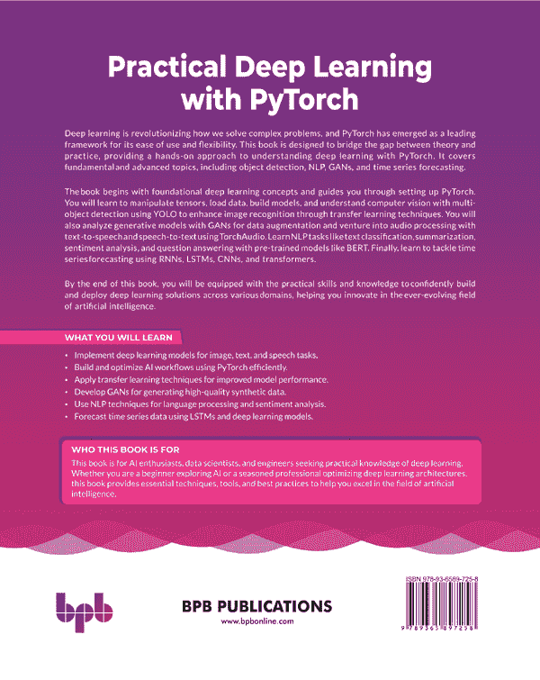

