# 深度学习实用指南

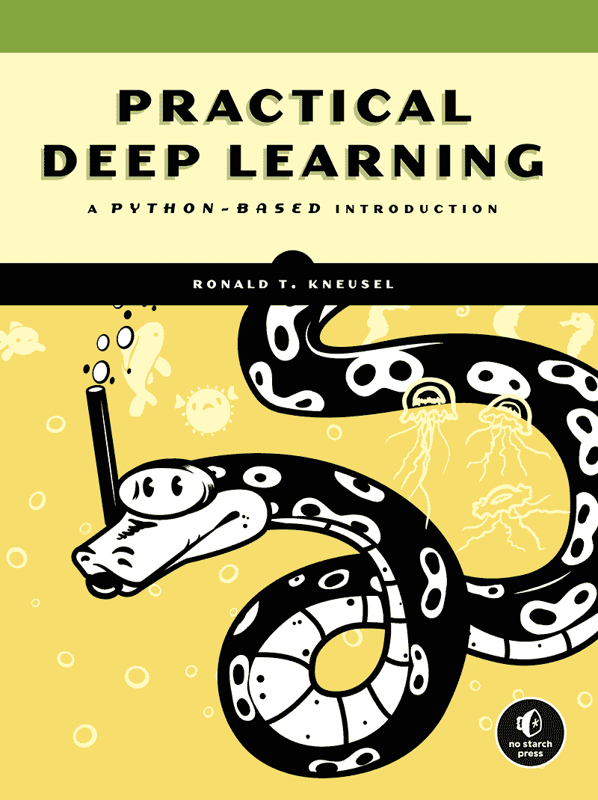


## 关于作者

Ron Kneusel 自 2003 年以来一直在工业界从事机器学习，并于 2016 年在科罗拉多大学博尔德分校获得机器学习博士学位。他目前在 Harris Technologies, Inc. 工作。Ron 还有另外两本书，均由 Springer 出版：《Numbers and Computers》和《Random Numbers and Computers》。

## 关于技术审核员

Paul Nord 在 Valparaiso 大学物理系担任技术专家。他 1991 年毕业于 Valparaiso 大学物理学学位。于 2017 年在 VU 获得分析硕士学位。Paul 参与过许多机器学习项目，包括磁盘协作（Disk Collaboration）、教师学习社区小组以及一个使用 Deep Dream 的外展计划艺术展。

## 目录

- 序言
- 致谢
- 引言
- 索引

## 前言

自现代数字时代开启以来，科学家和工程师从人类大脑中获得灵感，想象简单的类神经元处理器的大规模并行网络如何从经验中学习和适应。随着新数学方法的发展，这一主题引发了数次热潮。1958 年，弗兰克·罗森布特（Frank Rosenblatt）提出了一种名为感知机（`Perceptron`）的学习设备，它具有惊人的特性，可以学习任何可以通过手动编程执行的任务。当马尔文·明斯基（Marvin Minsky）和西尔摩·帕珀特（Seymour Papert）进行仔细分析，证明该设备在原理和实践上都存在编程局限性时，对这种设备的热情消失了。

20 世纪 80 年代后期，认知科学家大卫·鲁梅哈特（David Rumelhart）与杰弗里·辛顿（Geoffrey Hinton）、罗纳德·威廉姆斯（Ronald Williams）提出了一种名为反向传播（`backpropagation`）的学习算法。这引发了对神经网络（`neural networks`）的另一波热潮，该领域演变成了今天所谓的深度学习。

人们可能认为这种先进技术超出了大多数人的理解范围，但其底层原理是非常容易理解且易获取的。《实用深度学习》不仅提供了坚实的概念基础，还提供了读者会欣赏的实践指导，帮助他们设计自己的项目。全本书强调了直觉。

## 致谢

*“我不仅仅存在于我自己，而是存在于所有他人之中。”*

正如大卫·哈特（David Hart）的这段引言所说，我们只有在与所有人的关系中才是我们自己。这在我们生活的每个领域都是如此，甚至是编写书籍。

首先，我想感谢我的家人，感谢他们的耐心和鼓励帮助我完成这个项目。

接下来，我要感谢我的编辑，No Starch 出版非常优秀且易于合作的 Alex Freed 女士，她将大量的粗糙文本变成了一本流畅且连贯的书。保罗·诺（Mr. Paul Nord）先生也是如此，他使我免受愚蠢错误之苦，并确保我声称的内容属实。任何剩余的错误都是由于我没有听取 Paul 的建议。

最后，我想感谢 No Starch 出版的所有优秀员工，感谢他们信任这本书并帮助它成为现实。


当我读高中时，我想写一个井棋程序，让用户和电脑对战。当时我完全不知道真正的计算机科学家是如何处理这类问题的。我当时只有自己的想法，而这些想法就是使用无结构 Applesoft BASIC 支持的粗浅 `if-then` 语句和 `gotos` 语句来实现大量的规则。规则非常多——有好几行代码。

最后，程序运行得还不错，直到我发现了一组我的规则没有涵盖的步法序列，并且每次都能获胜。我确定一定有一种方法通过展示示例而不是硬编码代码和规则来教计算机如何做事情——一种让计算机自己学习的方法。

作为 20 世纪 80 年代后期的一名大学生，我对报名参加一门人工智能课程感到兴奋。这门课程最终回答了我关于如何编写井棋程序的问题，但计算机并没有在学习；它仍然在使用一种聪明的算法。顺便提到，这门课程还告诉我们，虽然预计有一天计算机将击败世界顶级象棋手（这在 1997 年发生了），但计算机不可能在围棋这样的游戏中击败人类顶级高手。2016 年 3 月，AlphaGo 深度学习程序就做到了。

2003 年，在一家科学计算公司担任顾问期间，我被分配到了与大型医疗设备制造商合作的项目。目标是使用 `machine learning` 对冠状动脉血管超声图像进行实时分类：这是人工智能的一个子领域，它通过从数据中学习，开发出并非人类显式编程的模型。这正是我一直在等待的！

我模糊地知道机器学习，并知道存在被称为神经网络的奇奇怪兽，它们可以做一些有趣的事情，但在大多数情况下，机器学习只是一个很小的研究领域，普通的计算机科学人员并不怎么关注。然而，在项目期间，我爱上了这种“训练机器去做某些有用事情，而不需要显式地编写大量代码”的想法。即使在项目结束后，我也继续坚持自学。

2010 年左右，我参与了另一个机器学习项目，时机恰好。人们刚刚开始讨论一种被称为 `deep learning` 的机器学习新方法，它复兴了旧的神经网络。当 2012 年到来时，大门打开了。我很幸运在苏苏堡举行的 ICML 2012 大会上现场见证了 Google 展示其最初的突破性深度学习结果，即识别 YouTube 视频中的猫。房间里挤满了人。毕竟，会议共有多达 800 人参加。

现在是 2020 年，我最近参加的一场机器学习会议有超过 13,000 名参与者。机器学习已经爆发了：它不是一种会消失的热潮。机器学习已经深刻地影响了我们的生活，并将继续影响下去。如果了解关于它的知识，穿透那些往往被过度炒作的演示，达到本质的核心，那就好了——核心本身就足够有趣，不需要任何炒作。这就是这本书存在的意义，帮助你学习机器学习的核心知识。具体而言，我们将关注这种被称为深度学习的方法。

### 这本书是写给谁的？

我写这本书是给那些没有机器学习背景，但充满好奇并愿意尝试新事物的读者。我将数学内容降到了最低。我的目标是帮助你理解核心概念，并建立起以后可以使用的直觉。

同时，我不想写一本只教你 `how` 使用现有工具包，但对事情的 `why` 没有任何实质内容的书。诚然，如果你关心的只是“如何做”，你可以构建出有用的模型。但如果没有“为什么”，你只是在机械模仿，而不是在理解，更不用说最终通过自己的贡献推动该领域的发展了。

至于我的假设，我假设你对计算机编程有一定的了解。机器学习的主流语言是 `Python`，无论你是学生还是职场人士。我假设你熟悉高中数学，但不熟悉微积分。反正微积分会涉及到，但即使你不熟悉，也能理解这些观点。

### 你可以学到什么？

如果你完整地学习这本书，你可以预期学习到：

* 如何构建训练数据集。
* 如何使用两个领先工具包：`scikit-learn` 和 `Keras`。
* 模型训练后如何评估其性能。
* 使用几种经典的机器学习模型，如 `k-Neighbors`、`Random Forests` 和 `Support Vector Machines`。
* 神经网络是如何工作的以及如何训练。
* 使用卷积网络开发模型。
* 如何从给定数据开始。

### 关于这本书

这本书是关于机器学习的。机器学习是关于构建模型，从数据中得出结论。这种结论可能是将对象归入特定类别，或者是一个连续输出，例如房价。这里的关键是模型从示例中学习。

你可以将模型看作一个数学函数，`y = f(x)`，其中 `y` 是输出、类别标签或连续值，而 `x` 是 `features`（特征）。特征是模型可以用来学习生成输出的输入测量信息。例如，`x` 可能代表鱼的长度、宽度重量的向量。我们的目标是找到 `f`，即 `x` 和 `y` 之间的映射，以便我们在未知 `y` 的新 `x`实例上使用它。

学习 `f` 的标准方法是给予模型（或算法）已知数据，让模型学习使 `f` 成为有用映射所需的参数。这就是为什么它被称为“机器学习”：机器正在学习模型的参数。

机器学习有三个主要分支：`supervised learning`、`unsupervised learning` 和 `reinforcement learning`。我们描述的过程属于监督学习。我们通过一组知的 `x` 和 `y` 值来监督模型的训练，这就是 `training set`。我们将这样的数据集称为 `labeled` 数据，因为我们知道每个 `x` 对应的 `y`。无监督学习尝试仅使用 `x` 来学习模型使用的参数。我们在这里不会讨论无监督学习，但如果你以后想自己探索该领域，可以借鉴我们对监督学习的大很多讨论。

强化学习通过训练模型来执行任务，例如下国际象棋或围棋。模型会根据其所在世界的当前状态学习一组可以采取的动作。这是机器学习中的一个重要领域，最近它在以前被认为仅属于人类领域的任务上取得了巨大的成功。遗憾的是，为了让这本书的内容更易于掌握，我们不得不做出一些妥协，因此我们将完全忽略强化学习。

关于术语的一个简要说明。在媒体中，我们在书中讨论的很多内容被称为`人工智能`或`AI`。虽然这种说法并没有错，但它某种程度上具有误导性：机器学习是广义的人工智能领域的一个子领域。你经常听到的另一个术语是`深度学习`。这个术语有点模糊，但就我们的目的，我们将它用来指代带有神经网络的机器学习，特别是具有许多层的神经网络（因此称为`深*学习`）。图 1 展示了这些术语之间的关系。

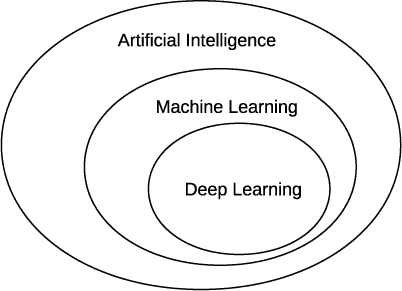

*图 1：人工智能、机器学习与深度学习之间的关系*

当然，在机器学习和深度学习领域，存在着大量的多样性。我们在本书中会遇到许多模型。我们可以将它们排列为所谓的“机器学习树”，如图图 2 所示。

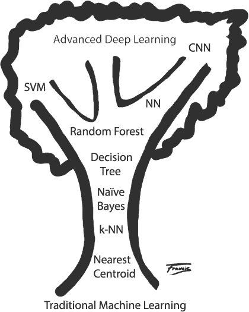

*图 2：机器学习树*

这棵树展示了从根部的传统机器学习到树顶的现代深度学习的增长。请将其看作是后续内容的预览：我们将在书中介绍这些每一个模型。

同样，我们将以每个章节的简要概述作为引言的结束。

**第 1 章：入门** 本章将告诉你如何设置我们假设的工作环境。它还包含了关于向量、矩阵、概率和统计的章节，你可以将它们作为复习或背景知识。

**第 2 章：使用 Python** 本章将带你开启 Python 之旅。

**第 3 章：使用 NumPy** NumPy 是 Python 的扩展。它让 Python 在机器学习中变得有用。如果你不熟悉它，请通读这一章。

**第 4 章：处理数据** 糟糕的数据集会导致糟糕的模型；我们将教你什么是一个良好的数据集。

**第 5 章：构建数据集** 我们将构建整本书使用的数据集。你还将学习如何增强数据集。

**第 6 章：经典机器学习** 为了了解你正在去向哪里，有时知道你从哪里来是有好处。在这里，我们将涵盖一些原始的机器学习模型。

**第 7 章：经典模型的实验** 本章展示了老派机器学习方法的优势和劣势。在整本书中，我们将参考这些结果进行比较。

**第 8 章：神经网络简介** 现代深度学习完全是关于神经网络的；我们在这里介绍它们。

**第 9 章：训练神经网络** 这一章充满挑战性，它为你提供了理解神经网络如何训练的所需的知识。本章中混入了一些基础微积分，但不要恐慌——它们将从高层次进行讨论以给你直觉，而且符号表示并不像初看起来那么可怕。

**第 10 章：神经网络的实验** 在这里我们运行实验来构建模型。

**第 11 章：模型评估** 在这里我们运行实验来构建模型。在整本书中，我们将参考这些结果进行比较。

**第 12 章：神经网络简介** 现代深度学习完全是关于神经网络的；我们在这里介绍它们。

**第 13 章：使用 Keras 的实验** 在这里我们运行实验来构建模型。在整本书中，我们将参考这些结果进行比较。

**第 14 章：使用 CIFAR-10 的实验** 在这里我们运行实验来构建模型。我们将 MNIST 数据集是广泛使用的。

**第 15 章：案例研究：音频分类** 在这里我们运行实验来构建模型。我们将 MNIST 数据集是广泛使用的。

**第 16 章：深入探索** 没有书是完整的。

书中所有的代码按章节组织，可以在这里找到：`https://nostarch.com/practical-learning-python/`。让我们现在看看设置环境。

## 1 入门


本章介绍了我们的操作环境并详细介绍了如何设置它。它还包含了关于我们将遇到的某些数学的介绍。我们将对图形处理器（GPU）的简要说明结束，你可能听过它们对深度学习至关重要。对于我们的目的，并非如此，所以不用担心——这本书不会突然花费你大量的钱。

### 操作环境

在这一部分，我们将详细介绍我们在书中其余部分假设的环境。我们的基础假设是正在使用 64 位的 Linux 系统。具体的发行版并不关键，但为了演示更简单，我们假设我们使用的是 Ubuntu 20.04。鉴于 Ubuntu 发行版的良好支持，我们相信任何新的发行版都是类似的。Python 语言是我们的通用语言，机器学习的共同语言。具体来说，我们将使用 Python 3.8.2；那是 Ubuntu 20.04 使用的版本。

让我们看一眼我们将使用的 Python 工具包的快速概览。

#### NumPy

`NumPy` 是一个为 Python 添加数组处理能力的库。虽然 Python 列表可以像一维数组一样使用，但在实践中它们太慢且缺乏活性。NumPy 库增加了 Python 缺失的数组功能——这些功能对于许多科学应用是必要的。NumPy 是我们使用的其他所有库的基础库。

#### scikit-learn

我们在书中探索的所有传统机器学习模型都在卓越的 scikit-learn 库中，在加载到 Python 时通常被称为 `sklearn`。请注意，我们在写 `scikit-learn` 时不使用大写，这是作者在文档中一致引用它的方式。该库使用 NumPy 数组。它为许多不同的机器学习模型实现了标准化的接口，以及我们甚至没有时间触及的一系列功能。当你越来越熟悉机器学习及其背后的工具时，我强烈建议你查阅官方 sklearn 文档。

#### 使用 TensorFlow 的 Keras

深度学习的学习已经足够困难了，更不用高效且正确地实现它，因此，我们不会尝试从零编写卷积神经网络，而是将使用已经在活跃开发的流行工具包之一。从诞生之初，深度学习社区一直支持开发工具包以使深度网络更易用，并以非常慷慨的许可将这些工具包开源。在写作期间，Python 中有很多流行的工具包我们可以使用。其中许多包括以下几个：

* Keras
* PyTorch
* Caffe
* Caffe2
* Apache MXnet

这些工具包中的一些正在兴起，另一些似乎在衰落。但目前拥有最活跃粉丝的可能是带有 `TensorFlow` 后端的 `Keras`，因此我们在这里使用它。

`Keras` ([https://keras.io/]) 是一个 Python 深度学习工具包，它底层使用 `TensorFlow` 工具包 ([https://www.tensorflow.org/)。`TensorFlow` 是 Google 的开源产品，为许多不同的平台实现了深度神经网络的核心功能。我们选择 `Keras` 不仅因为它很流行且正在活跃开发，还因为它用起来简单。我们的目标是熟悉深度学习，直到能够以最小的编程开销实现并使用模型。

### 安装工具包

我们无法合理地为所有系统和硬件提供安装工具包的详尽指南。相反，我们将为我们要用作参考系统的的特定操作系统提供分步说明。这些步骤以及库的最低版本号应该足够让大多数读者建立一个可以运行的系统。

记住，我们假设是在 Linux 环境中工作，特别是 Ubuntu 20.04。Ubuntu 是一种被广泛使用的 Linux 发行版，运行在几乎任何现代计算机系统上。其他 Linux 发行版也可以，macOS 也可以，但这里的指令是针对 Ubuntu 的。在大多数情况下，机器学习社区已经离开了 Windows 操作系统。尽管如此，也有个人将工具包移植到了 Windows；因此，好奇的读者可能会尝试一下 Windows。

新安装的 Ubuntu 20.04 基础桌面系统免费为我们提供了 Python 3.8.2。要安装其余包，我们需要进入 shell 并按照给定的顺序执行以下步骤：

```
$ sudo apt - get update
$ sudo apt - get install python3 - pip
$ sudo apt - get install build - essential python3 - dev
$ sudo apt - get install python3 - setuptools python3 - numpy
$ sudo apt - get install python3 - scipy libatlas - base - dev
$ sudo apt - get install python3 - matplotlib
$ pip3 install scikit - learn
$ pip3 install tensorflow
$ pip3 install pillow
$ pip3 install h5py
$ pip3 install keras
```

一旦安装完成，我们就安装了以下版本的库和工具包：

* NumPy 1.17.4
* sklearn 0.23.2
* keras 2.4.3
* tensorflow 2.2.0
* pillow 7.0.0
* h5py 2.0.0
* matplotlib 3.1

pillow 库用于图像处理，`h5py` 用于 HDF5 数据，`matplotlib` 用于绘图。`Keras` 使用它处理模型。`HDF5` 是存储数据的通用格式。

### 基础线性代数


以下章节关于线性代数。对于线性代数，我们需要知道什么是`vector`（向量）、什么是`matrix`（矩阵）以及如何相乘它们。

## 向量

`vector`是一个一维数字列表。数学上，它表示为：

```
[1, 2, 3]
```

这是一个行向量。当竖着写时，它是一个列向量：

```
[1]
[2]
[3]
```

在机器学习中，我们经常使用列向量。例如：

```
[x]
[y]
[z]
```

## 矩阵

`matrix`是一个二维数字数组。例如，这是：

```
[[1, 2, 3],
 [4, 5, 6]]
```

它有行和列。

## 向量相乘

两个向量相乘的最简单方法是它们对应的元素相乘。例如：

```
[1, 2, 3] × [4, 5, 6] = [4, 10, 18]
```

这是使用 NumPy 时常用的方法。在数学上相乘向量时，我们需要知道它们是行向量还是列向量。我们将处理两个向量`A = (a, b, c)`和`B = (d, e, f)`，它们假设为列向量。加上上标`T`将列向量转换为行向量。数学上允许的`A`和`B`相乘方式是：

```
A × B^T
```

这被称为外积，结果是一个矩阵。

```
A^T × B
```

这被称为内积或点积，结果是一个单一数字，即标量。当矩阵和向量相乘时，向量通常在矩阵的右侧。结果也是一个向量，其元素个数与矩阵的行数相同。

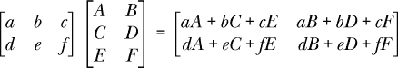

在这里，我们将一个 2 × 3 矩阵乘以一个 3 × 2 矩阵，得到了一个 2 × 2 的答案。

当我们学习卷积神经网络时，将处理具有三维甚至四维的数组。通常情况下，这些被称为`tensors`（张量）。如果我们想象一堆大小相同的矩阵，我们就得到了一个三维张量，我们可以使用第一个索引来引用其中任何一个矩阵，并使用另外两个索引来引用该矩阵中的特定元素。同样，如果我们有一堆三维张量，我们就有一个四维张量，我们可以使用它的第一个索引来引用这三个三维张量中的任何一个。

本节的要点是：向量有一维，矩阵有两个维度，这些对象之间相乘有规则，我们的工具包最终将与四维张量一起。我们将在书中后面遇到这些点时对它们进行回顾。

# 统计学与概率

统计学和概率的主题非常宽泛，通常最好是什么都不说，要么就是写一两本书。因此，我将只提到贯穿书中使用的核心思想，其余部分留给你们根据自己的需要去学习。我假设你们已经通过抛硬币和掷骰子了解了一些概率的基础知识。

## 描述性统计

当我们进行实验时，需要以某种意义的方式报告结果。通常，对于我们来说，我们将结果报告为均值（算术平均值）加上或减去称为`standard error of the mean (SE)`（标准误差）的数量。让我们通过一个例子来定义标准误差。

如果我们有很多测量值`x`，例如花的一部分长度，我们可以通过相加所有值并除以数值个数来计算均值 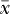。一旦我们得到了均值，就可以通过从均值减去每个值、将结果平方，并将所有这些平方值相加，最后除以所加数值个数减一，来计算各个值围绕均值的平均离散程度。这个数字就是`variance`（方差）。如果我们取这个值的平方根，就得到了`standard deviation`（`σ`），我们将在下面再次看到。通过标准差，我们可以计算标准误差为 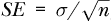，其中`n`是我们计算均值时使用的数值个数。`SE`越小，值围绕均值的聚集得越紧密。我们可以将这个值解释为我们对均值的不确定性。这意味着我们预计实际均值（我们并不知道）位于 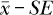 和 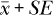 之间。

有时，我们会讨论位数而不是均值。`median`是中间值，即一半样本在它之下，一半样本在它之上。要找到一组数值的中位数，我们首先对数值进行数值排序，然后找到中间值。如果样本数量是奇数，这就是精确的中间值；如果样本数量是偶数，它就是两个中间值的平均值。如果样本在均值周围没有良好的均匀分布，中位数有时比均值更有用。经典的例子是收入。少数极富人会将平均收入推高到没有太大意义的程度。相反，位数——即一半人收入较少而一半人收入更多的值——更具代表性。

在后面的章节中，我们将讨论`descriptive statistics`（描述性统计）。这些是源自数据集的值，可用于理解数据集。我们刚刚提到了其中三个：均值、中位数和标准差。我们将看到如何使用这些值以及它们如何被绘图以帮助我们理解数据集。

## 概率分布

在本书中，我们将讨论被称为`probability distribution`（概率分布）的内容。你可以把它看作某种神谕——某种在被提问时，它会给我们一个数字或一组数字。例如，当我们训练模型时，我们使用测量的数字或数字组；我们可以认为这些数字来自某个概率分布。我们将该分布称为`parent distribution`（父分布）。把它看作生成我们要提供给模型的数据的东西；另一种更具柏拉图式的思考方式是将其看作我们的数据正在近似的理想数据集。

概率分布有许多不同的形式；有些甚至有名字。我们将遇到两种是最常见的两种：均匀分布和正态分布。你已经遇到过均匀分布：它就是我们掷公平骰子时得到的结果。如果骰子有六面，我们知道得到任何值（1 到 6）的概率是相同的。如果我们掷骰子 100 次并统计出现的数字，我们知道每个数字的计数将大致相等，并且从长远来看，我们可以很容易说服自己数字会趋平衡。

`uniform distribution`（均匀分布）是一个等概率向我们给出其任何允许响应的神谕。在数学上，我们将均匀分布写为`U(a,b)`，其中`U`表示均匀，`a`和`b`是它用于限定响应的数值范围。除非我们指定分布仅给出整数，否则任何实数都可以作为响应。在符号表示上，我们写`x ~ U(a,b)`表示`x`是神谕返回的位于范围 (a,b) 内的值。

`normal distribution`（正态分布），也称为`Gaussian`分布，在视觉上是一个钟形曲线——其中一个值是最可能的，然后随着距离该值越远，其他值的概率就会降低。最可能的值是均值 ，而控制概率下降到零（但永远不会到达）的速度的参数是标准差，`σ`。对于我们的目的，如果我们想要一个来自正态分布的样本，我们将写  表示`x`来自具有均值和标准差的分布。

### 统计检验

另一个经常出现的话是`statistical test`（统计检验）的概念，用于判断某个特定假设是否可能成立。通常，它涉及到两组测量值，假设是这两组测量值来自相同的父分布。如果计算出的统计量位于某个范围之外，我们就拒绝该假设，并称这两组测量值*不是*来自相同的分布。

在这里，我们通常使用`t-test`，这是一种假设数据呈正态分布的常用统计检验。由于我们假设数据是正态分布的（这可能也可能不是），t 检验被称为`parametric test`（参数检验）。有时，我们会使用另一种检验，`Mann–Whitney U test`，它类似于 t 检验，可以帮助我们判断样本是否来自相同的分布，但它对样本数据的分布情况不做任何假设。这类检验被称为`nonparametric tests`（非参数检验）。

无论检验是参数的还是，我们最终从检验得到的值被称为`p-value`。它代表了如果样本来自相同分布的假设是真的，我们看到计算出的统计值的概率。如果`p-value`较低，我们就有证据表明该假设不成立。

通常的`p`-值阈值是 0.05，这意味着即使样本来自同一个母体，我们测得该检验统计量值（t 检验或 Mann–Whitney U 检验）的概率也有 1 分 20。然而，近年来人们已经明显看出这个阈值太宽松了。当`p`-值接近 0.05 但未超过它时，我们开始认为某些证据可以反驳该假设。如果`p`-值等于 0.001 甚至更低，那么我们就有强有证据表明样本并非来自同一个母体。在这种情况下，我们称这种差异具有`统计学显著性`。

### 图形处理器

现代深度学习的实现技术之一是强大的`图形处理单元 (GPUs)`的开发。这些是实现在显卡上的辅助计算机。它们最初为视频游戏设计，但`GPUs`的高度并行特性已适应了深度神经网络模型对极端的计算需求。如果没有`GPUs`为即使是基础桌面电脑提供的类超级计算机能力，近年来的许多进展将无法实现。NVIDIA 是为深度学习创建`GPUs`的领导者，通过其`Compute Unified Device Architecture (CUDA)`，NVIDIA 为深度学习的成功奠定了基础。可以说，没有`GPUs`，深度学习将不会发生，或者至少不会被如此广泛地使用。

话虽如此，我们并不期望在书中将处理的模型中出现`GPUs`。我们将使用足够小的数据集和模型，以便我们仅使用`CPU`就能在合理的时间内完成训练。我们已经在安装的包中执行了这一决定，因为我们安装的`TensorFlow`版本是仅限 CPU 的。

如果你确实有一个支持`CUDA`的`GPU`并想将其用于此书的深度学习部分，请尽管去用，但不要认为你必须购买一个才能运行这些示例。如果你正在使用`GPU`，请确保在安装之前提到的包之前已正确安装了`CUDA`，并确保安装了支持 GPU 版本的`TensorFlow`。`sklearn`工具包仅限 CPU。

## 总结

在本章中，我们总结了运行环境。接下，我们描述了贯穿书中将使用的关键 Python 工具包，并在假设使用 Ubuntu 20.04 Linux 发行版的情况下提供了安装这些工具包的详细说明。如前所述，这些工具包在许多其他 Linux 发行版以及 macOS 上运行得同样良好。然后，我们简要回顾了之后将遇到的一些数学知识，并最后解释了为什么我们的模型不需要`GPUs`。

在下一章中，我们将回顾 Python 的基础知识。

# 2 使用 Python


如果你已经熟悉 Python，可以跳过这一章。这个总结是为那些习惯于编程但不熟悉 Python 的人准备的。我们将涵盖足够的语言内容，让你能够阅读和理解书中的代码示例。如果你对计算机编程几乎没有经验或完全没有经验，你应该先读一本更完整的文本，例如 Eric Matthes 编写的《Python 编程入门》第 2 版（No Starch Press, 2019）。

Python 简单来说，是通过缩进分组成块的顺序语句；诸如数字、字符串、元组、列表和字典等的数据结构；包括`if-elif-else`、`for`循环、`while`循环、`with`语句和`try-except`块在控制结构；带有可选嵌套函数的函数；以及大型可以导入的模块库。我们将涵盖这些特性的每一个。

## Python 解释器

在 Linux 系统上，Python 通常以两种方式之一使用。你可以从命令行运行 Python 解释器并交互式地输入命令，或者运行一个 Python 命令脚本。只需在控制台中输入`python3`即可交互式地使用 Python：

```bash
Python 3.6.7 (default, Oct 22 2018) [GCC 8.2.0] on Linux
Type "help", "copyright", "credits" or "license" for more information.
>>>
```

## 语句与空格

在几乎所有其他语言中，语句都按其顺序执行，但在 Python 中使用缩进来标记哪些语句属于某个控制的`if`语句。例如，考虑以下代码：

```python
statement1
statement2
else
statement3
```

在这里，`statement1`将首先执行，然后是`statement2`。

多个语句可以分组为称为块块的单元。像 Pascal 这样的语言使用了笨重的`BEGIN`和`END`关键字。广泛使用的 C 系语言使用大括号`{"`和`"}"`。在 Python 中，我们使用缩进。这使得代码在不同作者之间保持一致，并减少了困惑。当我们使用`if else`语句时，可以很容易看到哪些语句属于条件的哪个：

```python
if condition1:
    statement1
    statement2
else:
    statement3
```

缩进清楚地表明`statement1`和`statement2`在`condition1`（无论是什么）为真时执行。同样，我们看到`statement3`在`condition1`为假时执行。

注意上述`if`示例中的冒号。Python 使用这些来指定代码块。你必须在控制语句之后放置冒号，然后接下来的行应该缩进一级。如果你尝试使用控制结构但不在结构内部提供任何语句，Python 将抛出错误。

例如，`else:`子句在块中至少包含一个语句。如果不需要`else`，就不要包含它。（如果你真的想包含它，使用`pass`关键字来指示 Python 你知道这里需要语句，但你并不想让该条件执行任何操作。）

## 变量和基础数据结构

Python 的原生数据结构简单优雅。在这一部分中，我们将涵盖数字表示、变量、字符串、列表和字典。

### 数字表示

Python 中的数字分为两种：整数或浮点数。`Integers`是像 42 和 66 这样的整数。`Floating-point numbers`是带有小数点的数字，如 3.1415 和 2.718。我们会在书中忽略复数，尽管 Python 支持复数。

如果你不包含小数点，Python 将假设你指的是整数；否则，它将使用浮点数。浮点数也可以使用科学计数法指定，其中`6.022e23`意味着`6.023 × 10²³`。

大多数编程语言只能表示特定范围内的数字，但 Python 对整数没有这种限制，整数可以大到内存所容纳。为了好玩，输入`2**2001`看看会发生什么。计算机存储和操作数字的许多方式非常迷。好奇的人可能想进一步探索。

## 变量

`Variables`为存储数据提供了一个实用的地方。幸运的是，使用 Python 变量非常简单。Python 是`动态类型`的，这意味着我们不需要提前声明变量将存储的数据类型。我们只需要将数据赋值给变量，Python 就会为我们确定类型。

我们甚至可以通过分配新值来更改变量中存储的数据类型，无论其原有类型是什么。例如，这些在 Python 中都是有效的赋值：

```
❶ >>> v = 123
❷ >>> n = 3.141592
❸ >>> v = 6.022e23
```

代码将整数`123`赋值给`v`❶，将浮点值`3.141592`赋值给`n`❷，然后将一个浮点值重新赋值给`v`：`6.022 × 10²³`❸。

Python 变量名大小大小敏感，必须以字母开头，并包含字母、数字和`_`（下划线）字符。许多 Python 程序员遵循 Java 的驼峰命名法（所示），但这并不是强制要求的：

```python
>>> myVariableName=123
```

## 字符串

Python 使用字符串支持文本数据。你用引号标记`strings`的开始和结束，可以使用单引号（'）、双引号（"）或三引号（'''），只要开头和结束使用相同的引号即可。三引号字符串是特殊的：它可以跨越多行文本，你通常会在定义函数后立即使用它来实现一个简单的文档字符串（docstring）。这些都是有效的 Python 字符串：

```python
>>> thing1 = 'how now brown cow?'
>>> thing2 = "I don't think; therefore I am not."
>>> thing3 = """
one
two
three
"""
```

在这里，`thing1`是一个简单字符串；`thing2`也是一个简单字符串，但注意它内部嵌入了一个单引号作为撇号。我们可以这样做是因为我们用双引号开始字符串；如果我们想在字符串内部使用双引号，那么就必须用单引号将其括起来。

最后一个字符串`thing3`跨越了多行。从一行到另一行时输入的换行符也是字符串的一部分，当打印时它们会被显示出来。注意，如果你实际上在 Python 解释器中输入`thing3`的赋值，你会看到解释器插入了省略号（...）。我们在示例中忽略了它们，因为它们会引起混淆，并且并不是字符串的一部分。

## 列表

字符串和数字是`原始数据类型`，这意味着它们不是由分组的数据集合组成的。将它们想象成原子。通过使用元组和列表，可以将它们组合成更复杂的数据结构。`list`是其他数据的有序集合，这些可以是原始数据或任何其他数据集合。例如，列表可以包含列表。

### 基础列表操作

与某些其他数据类型不同，项添加到列表的顺序是重要的。让我们直接看一些列表的示例，然后讨论发生了什么：

```
❶ >>> t = ["Quednoe","Biggles",39]
    >>> t
      ['Quednoe', 'Biggles', 39]
❷ >>> t[0]
      'Quednoe'
  >>> t[1]
      'Biggles'
  >>> t[2]
      39
```

首先，我们定义了一个列表❶。我们使用`[`字符开始列表，输入项，并用`]`字符结束。列表中的项用逗号（`,`）分隔。这个列表有三个项，正如当我们要求 Python 求值表达式`t`（即列表本身）时看到的那。

我们可以通过数字和方括号对列表进行索引，就像处理数组一样。在这里，我们使用括号表示❷请求列表中的第一个项。我们对第二个和第三个执行相同的操作。

我们可以使用`append`方法向列表添加内容：

```python
>>> t.append(3.14)
>>> t
    ['Quednoe', 'Biggles', 39, 3.14]
```

在这里我们看到列表`['Quednoe', 'Biggles', 39, 3.14]`更新了。

让我们看几个例子：

```
❶ >>> t[-1]
❷ >>> t[0:2]
    ['Quednoe', 'Biggles']
❸ >>> t[1] = 'Melvin'
```


### 复制列表

关于列表的最后一点是，当你将其赋值给新变量时，Python 不会复制列表；相反，是将新变量指向列表所在的位置。例如：

```python
>>> a = [0,1,2,3,4]
>>> a
    [0, 1, 2, 3, 4]
>>> b = a
>>> b
    [0, 1, 2, 3, 4]
```

在这里我们定义 `a` 为一个包含五个数字的列表。然后将该列表赋值给新变量 `b`，发现 `b` 确实与 `a` 相同。到目前为止都是。然而，如果我们决定更改 `a` 的某个元素，如下：

```python
>>> a[2] = 3
>>> a
    [0, 1, 3, 3, 4]
>>> b
    [0, 1, 3, 3, 4]
```

我们看到 `a` 按照预期更新了，但令人惊讶的是，`b` 也更新了。这是因为将 `a` 赋值给 `b` 使 `b` 指向了与 `a` 相同的内存区域。它并没有实际复制 `a` 的内容。

如果在赋值 `b` 时复制 `a`，我们需要显式地选择 `a` 的所有元素，如下：

```python
>>> b = a[:]
>>> a
    [0, 1, 3, 3, 4]
>>> b
    [0, 1, 3, 3, 4]
>>> a[2] = 2
>>> a
    [0, 1, 2, 3, 4]
>>> b
    [0, 1, 3, 3, 4]
```

在这里我们定义了一个列表 `a`，然后通过选择 `a` 的所有元素 ❶ 将 `a` 赋值给 `b`。我们看到 `b` 现在看起来和 `a` 一样。接下来，我们更新了 `a` 中的第三项，并发现 `a` 现在如我们预期的那样样，其第三项变成了 2 而不是 3。然而，在这种情况下 `b` 并没有发生变化，因为原始的赋值通过选择 `a` 的所有元素在内存中创建了一个新列表。

Python 不自动复制列表的原因是列表可能很大，因此不必要的复制会浪费大量的内存。完全复制一个由其他嵌套列表组成的的列表可能并非易事。“选择所有内容”的方法 ❶ 仅执行了浅拷贝——嵌套元素仍然是别名关系（引用）。使用 `copy` 模块中的 `deepcopy` 函数可以递归地复制带有嵌套元素的列表的所有级。

Python 还有另一种与列表相似的数据类型称为 `tuple`（元组）。元组用圆括号而不是方括号定义，它们与列表一样，不同在于一旦定义，就无法修改。通常情况下，我们将坚持使用列表，但 NumPy 有时会使用元组（参见第 3 章）。

## 字典

我们将查看最后一个数据类型是 `dictionary`（字典）。字典由一组键（keys）组成，每个键关联一个值（value）。我们使用“{”和“}”字符定义字典。与列表一样，值可以是任何内容，包括另一个字典。键通常是字符串，也可以是数字或其他对象。我们像这样定义字典：

```python
>>> d = {"a":1, "b":2, "c":3}
>>> d.keys()
dict_keys(['a', 'b', 'c'])
```

这个示例展示了如何通过直接列出内容来定义字典。字典的元素以键:值对的形式给出。在这里，键都是字符串，而与每个键关联的值是一个整数。`keys` 方法返回字典中所有的键。

当字典的内容已经已知时，上面的语法非常有用。通常情况下，情况并非如此。大多数时候，是先定义字典，然后逐个添加元素：

```python
>>> d = {}
>>> d["a"] = 1
>>> d["b"] = 2
>>> d["c"] = 3
```

在这里我们定义了一个空字典 `d`，并为一组新键单独赋值。如果键已经存在于字典 `d` 中，则它的值会被更新。

要获取与特定键关联的值，只需用键对字典进行索引即可：

```python
>>> d["b"]
2
```

如果字典中不存在该键，Python 将抛出错误。要测试键是否在字典中，使用 `in`，如下所示：

```python
>>> "c" in d
True
```

在列表和字典之间，你可以方便地存储几乎任何数据。这是 Python 这种语言的优点之一：程序员可以将精力放在完成当前任务上，而不是实现复杂的数据结构。列表和字典使用起来很快，通常就是你需要的一切，除非你正在进行科学编程，在这种情况下，我们在第 3 章中讨论过的有 NumPy。

## 控制结构

Python 实现了几种`控制结构`来允许你改变程序流。我们将查看这些：

- `if-elif-else`
- `for` 循环
- `while` 循环
- `with` 语句
- `try-except` 块

### `if-elif-else`

一个 `if` 语句做出决策。你给它一个必须产生布尔值（True 或 False）的条件。如果条件为真，执行 `if` 语句的第一个块。如果条件为假，则什么都不会发生，代码将跳过 `if` 语句，除非你包含了 `else`，在这种情况下将执行 `else` 的体。你可以使用 `elif` 来检查多个条件，如下所示：

```python
if x > 0:
    print("positive")
elif x == 0:
    print("zero")
else:
    print("negative")
```

### `for` 循环

几乎结构化编程语言都有循环来重复执行代码。Python 的主要构造是 `for` 循环，它遍历可以迭代的对象。这包括字符串、列表或字典。

Python 有两个非常有用的内置函数用于循环。第一个是 `range`，它创建一个产生整数的生成器，除非有指定：

```python
for i in range(6):
    print(i)
0
1
2
3
4
5
```

`range` 函数 ❶ 返回 0 到 5 的数值，而 `for` 语句将这些值逐个赋值给 `i`。

配合 `for` 循环使用的另一个有用函数是 `enumerate`。它返回两个值：第一个是元素的索引，第二个是元素本身。例如：

```python
x = ["how","now","cow"]
for i,v in enumerate(x):
    print(i,v)
0 how
1 now
2 brown
3 cow
```

在第一个遍历列表 `x` 的循环中，我们将 `x` 的每个元素赋值给 `i`。第二个循环使用 `enumerate` 并在每次迭代给出两个值：存储在 `i` 中的当前索引以及存储在 `v` 中的列表 `x` 的当前元素。

对字典使用 `for` 循环会发生什么？让我们看看：

```python
d = {"a":1, "b":2, "c":2.718}
for i in d:
    print(i)
a
b
c
for i in d:
    print(i, d[i])
a 1
b 2
c 2.718
```

在这里我们首先定义了一个具有三个键的字典 `d`。如果我们简单地遍历字典变量，我们将获得键 ❷。然而，如果我们随后使用键来返回关联的值（如第二个循环 ❸），我们将遍历整个字典，每个值仅访问一次。

Python 的一个特别吸引人的特性是我们可以在`列表推导式`中将 `for` 循环与列表结合。列表推导式以领先的方括号 `[` 开始，但不是列出单个元素，列表的体实际上是生成列表的代码。这种简写需要一点时间适应，但一旦你熟悉了它，就会发现它是许多 `for` 循环的高效替代方案。例如：

```python
import random

a = []

for i in range(10000):
    a.append(random.random())
```

```python
>>> b = [random.random() for i in range(10000)]
```

```python
>>> m3 = [i for i in range(10000) if (i % 3) == 0]
```

我们首先导入标准的随机数库，然后向列表 `a` 中填充 10,000 个范围在 `[0,1)` 之间的随机数（意味着包含 0，不包含 1）。接下来，我们也使用列表推导式为 `b` 填充了 10,000 个随机数。注意，这种语法与定义带有值的列表时相同，但在这里列表的主体是一个`returns`（返回）值的内容。在这种情况下，它是对 `random.random()` 的调用以及一个遍历 10,000 个元素的 `for` 循环。

上一个示例创建了一个列表 `m3`，其中包含了所有小于 10,000 的 3 的倍数（包括 0）。`if` 子句是决定特定的 `i` 值是否在列表中的测试条件。百分比运算符是 `modulo`（取模），它给出除法后的余数。在这种情况下，它是在询问 `i` 使用整数除法除以 3 的余数是否为零。如果是，说明没有余数，意味着 `i` 是 3 的倍数（或 0）。

### `while` 循环

许多编程语言都包含了“先测试”和“后测试”的循环。`top-tested loop`（先测试循环）在执行任何循环体之前在开始处测试循环条件，如果测试不为真，则永远不会执行循环体。`bottom-tested loop`（后测试循环）至少执行一次循环体，`then`测试是否应该再次执行循环。`C` 语言中的 `while` 循环是先测试循环，而 `do...while` 循环是后测试循环。Python 只有先测试的 `while` 循环，语法如下：

```python
>>> i = 0

>>> while (i < 4):
    print(i)
    i += 1

0
1
2
3
```

我们必须在开始循环**之前**（before）用循环控制变量（`i`）初始化为 0，以便条件 `i < 4` 初始为真。同样注意，我们在循环体的末尾显式地递增了 `i`。表达式 `i += 1` 是 `i = i + 1` 的简写，它将 `i` 加 1。Python 不支持 C 风格的递增递减，例如 `i ++`。如果你尝试这样做，Python 会友好地通过一个 `SyntaxError`（语法错误）告知你。

`while` 循环只要条件求值为 `True` 就会重复执行。程序员需要在循环体中执行操作，最终使条件变为 `False` 从而结束循环。你也可以手动退出循环，正如你将在下一节中看到的。

### `break` 和 `continue` 语句

`for` 和 `while` 循环与其他两个 Python 语句一起工作：要立即退出循环，使用 `break` 语句；要立即移动到下一次迭代，使用 `continue`。`break` 的一个常见用途是离开无限循环：

```python
>>> i = 0

>>> True:
    print(i)
    i += 1
    if (i == 4):
        break

0
1
2
3
```

这产生了与之前的 `while` 循环示例相同的输出，但在满足终止条件时通过 `break` 显式退出循环；在这里，就是当 `i` 增加到 4 时。在这个玩具级示例中使用 `break` 并没有真正的意义，因为有其他更清晰的方法来实现，但通常循环可能需要一直执行到程序结束，或者发生某些其他罕见情况或错误。例如，命令行解释器将不断检查键盘输入。随着每个字符的进入，它被添加到缓冲区。然而，如果字符是“换行符”，它就会跳出循环并解释缓冲区的内容。

`continue` 语句会迭代循环，而不执行其后的任何循环体语句。例如：

```python
>>> for i in range(4):
    print(i)
    continue
    print("xyzzy")

0
1
2
3
```

在这里，`continue` 的存在确保了第二个 `print` 语句永远不会执行。

### `with` 语句

Python 的 `with` 语句在处理文件时非常有用。例如，以下代码使用 `with` 语句打开磁盘上的文件并将其内容读取到字符串：

```python
>>> with open("sesame") as f:
    s = f.read()

>>> s
'this is a file\n'
```

`with` 语句打开一个名为 `sesame` 的文件并将文件对象赋值给 `f`。我们然后使用 `read` 方法将其赋值给 `s`。

### 使用 `try-except` 处理错误

最后，让我们来看 `try-except` 块。为了捕获错误，我们将语句封装在 `try` 块中。

```python
>>> try:
    x = 1.0/0

Traceback (most recent call last)

  File "<stdin>", line 1, in <module>

ZeroDivisionError: division by zero

except:
    x = 0

>>> x
0
```

### 函数

在 Python 中，使用 `def` 关键字定义函数，后面跟着函数名和函数将接受的参数列表。即使不包含任何参数，也必须包含一对括号。由于 Python 是动态类型的，你列出函数的参数但不提供类型信息。如有需要，你还可以包含默认值。

```python
>>> def product(a,b):
    return a*b

>>> product(4,5)
20
```

接下来，让我们重新定义 `product` 并使用以下代码为第二个参数提供默认值：

```python
>>> def product(a,b=3):
    return a*b

>>> product(4,5)
20

>>> product(3)
9
```

我们在函数的参数列表中提供默认值。如果我们使用两个参数，Python 将像以前一样，在函数内部将第二个参数的值赋值。然而，如果我们不提供第二个参数，Python 将使用给定的默认值 `3`，从而为我们提供一个有意义的返回值 `3 × 3 = 9`。为函数参数提供默认值使其成为关键字参数，并且正如我们在上面看到的，在调用函数时不需要为该参数提供值。这种技术特别有用，我们将在代码示例中经常看到它。

下方的最后一个示例展示了如何定义一个不接受参数的函数：

```python
>>> def pp():
      print("plugh")

>>> pp()
    plugh
```

函数 `pp` 有一个空参数列表。函数体中的唯一语句是打印单词 `plugh`。该函数没有返回值。

Python 允许你嵌套定义函数，使得函数内部可以再定义其他函数。内部函数仅对外部函数可见。通常很少需要这样做，如果你发现自己经常这样做，你可能想要考虑重构为面向对象的设计；但在某些情况下，这样做是有合理的，所以我们在这里提到它。

最后，一个很有用的方法是将默认值设置为 `None`，这允许我们在函数内部通过测试参数是否为 `None` 来检查是否提供了该值。任何持有任何类型数据的变量都可以与 `None` 进行比较。

### 模块

我们通过对模块系统的回顾来结束对 Python 的快速复习。这类似于 C 标准库，它为 Python 提供了一套开箱即用的工具，这些工具都定义为模块。自然地，用户也可以创建自己的模块。因此，一个`module`就是一个可以导入到程序中的函数集合。你也可以从特定模块导入特定的函数到你自己的程序中，而不是导入整个模块，只要你意识到导入的函数可能与另一个命名空间中的函数同名即可。

我们所说的 `namespace`（命名空间）是指一个函数包，就像一个家族，函数是家族中成员的名字。我们的程序知道的所有函数都在我们的 `namespace` 中。如果我们从一个模块导入一个函数，那么该函数现在也在我们的 `namespace` 中。如果我们导入整个模块并通过为模块名添加前缀来引用该函数，我们可以使用该函数，但它不在我们的 `namespace` 中。我们很快就会看到这种区别的重要性。

让我们来看一些使用 Python 库模块的示例：

```python
>>> import time

>>> time.time()
    1524693601.402852
```

我们首先导入了 `time` 模块。这意味着只要我们在函数名前加上 `time.` 前缀，现在就可以访问 `time` 模块中的所有函数。`time` 模块中的 `time` 函数返回自 1970 年 1 月 1 日以来的秒数当前时间。这被称为 `epoch time`（时间戳），对于计时代码执行所需非常有用。因为返回的值只会增加，代码开始和结束时的 epoch time 之差就表示了代码执行持续。

让我们来看另一个示例：

```python
>>> from time import ctime, localtime

>>> ctime()
    'Wed Apr 25 16:00:21 2020'

>>> localtime().tm_year
    2018
```

在这里，我们没有导入整个 `time` 模块，而是仅从中导入了两个函数。这样做将函数放入我们的 `namespace` 中，以便我们可以直接调用它们。`ctime` 函数返回显示当前日期和时间的字符串，而 `localtime` 函数返回按日期和时间部分分解的当前时间段。在这里我们展示了写作时的年份。

我们的最后一个示例告诉我们，为什么直接导入模块而不是从从中导入函数通常是最好的：

```python
>>> def sqrt(x):
      return 4

>>> sqrt(2)
    4

>>> from math import *

>>> sqrt(2)
    4
```


## 总结

在本章中我们回顾了 Python 的基础知识以提供背景。我们还学习了变量和数据结构，最后查看了模块。在下一章中，我们将深入研究 NumPy，看看如何让 Python 变得更加强大。

每当我们想要访问数组的一个元素，例如 `x[3]` 时，我们可以通过在数组基地址上加上 `3(8) = 24` 来快速地计算出内存中的精确位置。这就是数组的索引操作。

多维数组也以连续块的形式存储在内存中，索引操作只是稍微复杂一点。`多维数组`（multi-dimensional array）使用两个或多个数字来索引元素。想象一下一个棋盘：需要两个数字来确定棋子的位置：行和列。因此，棋盘是一个二维数组。如果我们再增加一个维度，将棋盘变成一叠棋盘，我们需要三个数字来确定棋子的位置：行、列和棋盘编号。因此，我们就有了一个三维数组。

在整本书中，我们将使用一维、二维和三维数组。所有这些数组都作为单个 RAM 块存储在内存中。点在于，数组的索引非常快，因此对数组元素的操作可以非常快速地完成。

这与列表形成对比。图 3-2 显示了列表 `B` 在内存中的基本结构。在这种情况下，列表中的元素并不是连续的内存空间，而是分散在 RAM 中，通过指针将一个元素连接到下一个，就像链条一样。链中的每个链接都包含了我们想要存储的数据值以及指向链中下一个链接内存的指针。

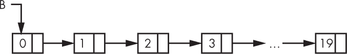

*图 3-2：作为分散在内存中的链节点集合存储的列表*

我们不能仅通过在基内存地址上加上偏移量来索引列表。相反，如果我们想要列表的第四个元素，我们需要从列表的头部开始，使用那里指向下一个元素的链接，然后是下一个、再下一个，直到到达与第四个元素相关的内存，即图 3-2 中的 `3`。这看起来并不糟糕，直到我们想要索引第 1,000,000 个元素时，必须重复这个过程 100 万次，而不是一次性在基地址上加上 800 万。

大多数机器学习都涉及数组。如果数组只有一个维度，我们称其为`向量`（vector）；向量是我们许多模型的输入。如果数组有两个维度，它就是一个`矩阵`（matrix）。矩阵可以被看作棋盘或图像，图像的每个像素都是棋盘上的一个位置。矩阵也可以是我们模型的输入，或者在模型内部使用；例如，神经网络的权重矩阵，或者卷积神经网络的卷积核和滤波器输出都是矩阵。

因此，能够快速操作数组数据至关重要。这正是 `numpy` 库大显身手。它为 Python 添加了缺失的数组数据类型，以便我们快速进行计算。坦率地说，如果没有它，Python 将不适合实现任何最简单的机器学习算法。然而，有了 `NumPy`，Python 立即成为机器学习研究的首选环境。

### 测试数组和列表的速度

让我们来看一个快速示例，看看 `NumPy` 比纯 Python 给了我们多少速度。我们将执行的代码在列表 3-1 中。

```python
import numpy as np
import time
import random

n = 1000000
a = [random.random() for i in range(n)]
b = [random.random() for i in range(n)]

s = time.time()
c = [a[i]*b[i] for i in range(n)]
print("comprehension:", time.time()-s)

s = time.time()
c = []
for i in range(n):
    c.append(a[i]*b[i])
print("for loop:", time.time()-s)

s = time.time()
c = [0]*n
for i in range(n):
    c[i] = a[i]*b[i]
print("existing list:", time.time()-s)

x = np.array(a)
y = np.array(b)
s = time.time()
c = x*y
print("NumPy time", time.time()-s)
```

*列表 3-1：对比 NumPy 与纯 Python。参见 numpy_test.py。*

在列表 3-1 中，我们首先导入了 `numpy` 库 ❶，然后使用列表推导式创建两个随机数列表。这些列表各包含 1,000,000 个元素。我们的目标是尽可能快地逐元素将这两个列表相乘。

我们可以通过记录开始时间为 `s` 并在执行 `print` 时将其减去结束时间来测量程序运行所需的时间。`time` 模块的 `time` 函数返回自原点时间（1970 年 1 月 1 日）以来的秒数，包括小数。在运行完每个操作后，我们都会 `print time.time()-s`。

在第一次尝试将 `a` 和 `b` 相乘时，我们使用了列表推导式 ❷。接下来，我们使用循环 ❸ 从 `a` 和 `b` 中选择每个元素，并将它们的乘积附加到列表 `c` 中。注意，这种方法从一个空列表开始，并将每个新乘积附加其中，因此列表需要增长。

作为第三种方法，我们预先分配列表 `[0]*n`，然后通过循环进行赋值。最后，我们将 `a` 和 `b` 转换为 NumPy 数组，然后直接执行 `x*y`。这就是 NumPy 的强大之处。

接下来我们询问 NumPy 数组三个最常用的属性：`size`、`shape` 和数据类型（`dtype`）。数组 `a` 有四个元素，所以它的 `size` 是 4。数组的 `size` 是它包含的元素数量。数组 `a` 是一个向量，意味着它只有一维的，因此 `shape` 始终以元组的形式返回，其中第一个也是唯一的维度是 4，这意味着在第一个维度上有四个元素。

数据类型在这里是一个新奇点，因为 Python 通常不关心数据类型。但为了内存效率，`numpy` 库必须关注这些类型。当我们使用 `array` 创建一个数组时，我们没有指定数据类型，因此 `NumPy` 默认使用 64 位整数，因为我们提供给 `array` 的列表中的所有值都是整数。如果其中即使有一个浮点数，`NumPy` 将会默认设为 64 位浮点数，这与 `C`、`C++` 和 `Java` 等语言中的 `double` 类型相同。

现在让我们明确指定想要让 `NumPy` 数组包含的数据类型：

```python
>>> b = np.array([1,2,3,4], dtype="uint8")
>>> b.dtype
    dtype('uint8')
>>> c = np.array([1,2,3,4], dtype="float64")
>>> c.dtype
    dtype('float64')
```

这里我们定义了两个数组 `b` 和 `c`。这两个数组都包含列表 `[1,2,3,4]` 中的相同元素。然而，注意 `array` 的 `dtype` 关键字参数。这告诉 `NumPy` 为数组使用什么种数据类型。对于 `b`，我们告诉 `NumPy` 使用无符号 8 位整数（`uint8`）。这是一个字节或单个 ASCII 字符。如果我们询问 `dtype` 属性，我们得到的结果是数组 `b` 确实是无符号 8 位整数数据类型。

数组 `c` 包含与 `b` 相同的元素，但在这里我们告诉 `NumPy` 让数组持有 64 位浮点数。再次，询问数据类型告诉我们数组 `c` 是请求的类型。在使用 `NumPy` 时，我们必须意识到我们的数组将包含的数据类型。

最常用的 `NumPy` 数据类型及其对应的 `C` 类型见于表 3-1。在定义数组时，用带有数据类型名称的字符串指定 `NumPy` 数据类型。接下来我们将看到这些示例。

### 表 3-1: NumPy 数据类型名称、C 等效类型及范围

| NumPy 名称 | 等效 C 类型 | 范围 |
| --- | --- | --- |
| float64 | double | ± [2.225 × 10^(–308), 1.798 × 10³⁰⁸] |
| float32 | float | ± [1.175 × 10^(–38), 3.403 × 10³⁸] |
| int64 | long long | [–2⁶³, 2⁶³–1] |
| uint64 | unsigned long long | [0, 2⁶⁴–1] |
| int32 | long | [–2³¹, 2³¹–1] |
| uint32 | unsigned long | [0, 2³²–1] |
| uint8 | unsigned char | [0, 255 = 2⁸–1] |

到此为止，我们只用 `NumPy` 创建了向量。让我们看看如何创建一个矩阵，即二维数组：

```python
>>> d = np.array([[1,2,3],[4,5,6],[7,8,9]])
>>> d.shape
    (3, 3)
>>> d.size
    9
>>> d
    array([[1, 2, 3],
           [4, 5, 6],
           [7, 8, 9]])
```

我们像以前一样使用 `array` 函数，但传入的不是单个列表，而是列表的列表。所提供的列表的每个元素本身又是一个包含三个元素的列表，并且有三个这样的列表。因此，生成的 `NumPy` 数组将是一个 3×3 矩阵。矩阵的第一行是包含三个元素的第一个列表 `[1,2,3]`，第二行是第二个列表 `[4,5,6]`，第三行是第三个列表 `[7,8,9]`。

如果我们询问 `d` 的 `shape`，我们得到它是 `(3, 3)`。这个元组表示该数组有两个维度，因为元组中有两个元素，且第一个维度的长度为 3（三行），第二个维度的长度也为 3（三列）。询问 `d` 的 `size` 告诉我们有九个元素。`NumPy` 数组的 `size` 等于 `shape` 返回的元组所有值的值的积，在这里是 3 × 3 = 9。

询问数组本身会导致 `NumPy` 打印它。由于数组很小，`NumPy` 以二维矩阵的形式向我们展示了整个数组：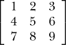

`NumPy` 不限于二维数组。例如，这里有一个三维数组：

```python
>>> d = np.array([[[1,1,1],[2,2,2]],[[3,3,3],[4,4,4]]])
>>> d.shape
    (2, 2, 3)
>>> d
    array([[[1, 1, 1],
            [2, 2, 2]],
           [[3, 3, 3],
            [4, 4, 4]]])
```

我们知道 `d` 是三维的，因为 `shape` 返回一个包含三个元素的元组。我们也知道 `d` 是三维的，因为我们传递给 `array` 的列表包含两个子列表，每个子列表又包含两个含有三个元素的子列表，因此形状为 `(2, 2, 3)`。`NumPy` 在两个 2×2 子数组之间使用空行显示 `d`。我们可以将三维数组理解为两个 2×2 子数组之间有一个空行。

#### 定义带有 0 和 1 的数组

使用 `array` 函数来定义带有 0 和 1 的数组会非常麻烦，如果我们需要一个每个元素都初始化为 0 的数组。幸运的是，我们现在来看看经常使用的内置函数：

```python
>>> x = np.zeros((2,3,4))
>>> x.shape
    (2, 3, 4)
>>> x.dtype
    dtype('float64')
>>> b = np.zeros((10,10),dtype="uint32")
>>> b.shape
    (10, 10)
>>> b.dtype
    dtype('uint32')
```

`zeros` 函数返回所有元素都设置为 0 的新数组。`zeros` 的参数是新数组的形状——在本例中为元组 `(2,3,4)`。该数组可以被视为一组 3×4 的像素。注意使用 `zeros` 创建的数组默认类型是 64 位浮点数（`dtype`）。这意味着数组的每个元素使用 8 字节内存。数组 `b` 有两个维度，10×10 个元素，我们显式声明它是 32 位无符号整数。这意味着每个元素只使用 4 字节。在使用 `NumPy` 时，我们需要意识到数组可能在使用多少内存，以避免使用异常大或大数据类型（如 `float64`）而浪费内存。

第二个内置函数与 `zeros` 类似，但它将每个元素初始化为 1：

```python
>>> y = np.ones((3,3))
>>> y
    array([[1., 1., 1.],
           [1., 1., 1.],
           [1., 1., 1.]])
>>> y = 10*np.ones((3,3))
>>> y
    array([[10., 10., 10.],
           [10., 10., 10.],
           [10., 10., 10.]])
>>> y.dtype
    dtype('float64')
>>> y.astype("uint8")
    array([[10, 10, 10],
           [10, 10, 10],
           [10, 10, 10]], dtype=uint8)
```

就像 `zeros` 一样，`ones` 接受一个指定数组每个维度元素数量的元组，在这里是一个 3×3 矩阵。我们也可以可选地指定 `dtype` 以让数组持有 64 位浮点数以外的类型。

`ones` 的真正用途是创建初始化为任何值的数组。我们通过将 `ones` 数组乘以想要的值来实现这一点，这里是 10。注意 `NumPy` 如何意识到我们正在乘以一个标量值，并自动对数组的每个元素执行该操作——不需要循环。

最后，在 Python 中，列表或字典是通过引用传递的，因此将一个赋值给新变量不会创建副本；它只是创建了一个指向原始内存的别名。这节省了时间和空间，但如果我们不留心，可能会导致意外的后果。`NumPy` 数组也是如此。它们可能非常大，因此在每次传递给函数时都进行复制是没有意义的。如果你想真正创建一个 `NumPy` 数组的新副本，请使用 `copy` 方法或表示数组所有元素的数组切片。与 Python 列表不同，`NumPy` 数组是平坦的：数组特定位置的值不能是另一个数组。

因此，除了第二个语句外，以下语句都会创建数组 `a` 的副本：

```python
>>> a = np.arange(10)
>>> b = a
>>> c = a.copy()
>>> d = a[:]
```

更改 `a` 的元素将改变 `b` 对应的元素，因为 `b` 指向与 `a` 相同的内存，但 `c` 和 `d` 的元素将不受影响。

### 访问数组中的元素

在本节中，我们将介绍访问数组中元素的两种不同方法。

#### 数组索引

如果我们无法引用数组中的元素并在必要时更新它们，那么数组将无大用处。这被称为`数组索引`。理解数组索引对于充分利用 `NumPy` 至关重要。让我们通过示例开始：

```python
>>> b = np.zeros((3,4),dtype='uint8')
>>> b
    array([[0, 0, 0, 0],
           [0, 0, 0, 0],
           [0, 0, 0, 0]], dtype=uint8)
>>> b[0,1] = 1
>>> b[1,0] = 2
>>> b
    array([[0, 1, 0, 0],
           [2, 0, 0, 0],
           [0, 0, 0, 0]], dtype=uint8)
```

我们以索引列表相同的方式索引数组，使用方括号：`[` 开始索引，`]` 结束。方括号之间是一个表达式，它告诉 `NumPy` 要返回或分配数组的哪些元素——这就是`下标`。下标附加在数组名称上以指定数组的一个或多个元素。

在上面的示例中，`b` 是一个三行四列的矩阵，每个元素都初始化为 0。当我们评估 `b` 时，可以看到这一点。

接下来，我们做了一项新操作：设置了一个赋值语句 ❶，该语句的左侧不是单个变量名，而是带有下标的变量名，即文本 `[0,1]`。这个下标告诉 `NumPy`，语句右侧的值（这里只是 `1`）应该放入 `b` 中第 0 行第 1 列的元素中。同样，`NumPy` 应该将 `2` 放入第 1 行第 0 列的元素中。当我们查看 `b` 时，看到 `NumPy` 按照我们的要求执行了操作，第 0 行的第二列现在是 1，第 1 行的第一列现在是 2。

如果我们继续使用之前定义的 `b`，就可以看到如何向 `NumPy` 请求数组中的元素：

```python
>>> b[1,0]
    2
>>> b[1]
    array([2, 0, 0, 0], dtype=uint8)
>>> b[1][0]
    2
```

由于 `b` 是一个矩阵，我们需要下标来选择它的特定元素，一个用于行，另一个用于列。因此，`b[1,0]` 会返回第二行第一列的值。

下一行使用单个下标 `b[1]`，返回整个第二行。这是我们在书中经常看到的。

#### 数组切片

使用单个索引访问数组的单个元素或整个子数组是有用的，但 `NumPy` 要灵活得多。可以通过使用`切片`来指定数组的局部。让我们看看它是如何工作的：

```python
>>> a = np.arange(10)
>>> a
    array([0, 1, 2, 3, 4, 5, 6, 7, 8, 9])
>>> a[1:4]
    array([1, 2, 3])
>>> a[3:7]
    array([3, 4, 5, 6])
```


在这里我们使用`arange`（类似于`range`函数）来设置`a`的数字。切片`a[1:4]`意味着从索引1开始但不包含4。切片`a[3:7]`意味着从索引3开始但不包含7。

语法`a[x:y]`意味着`x`是起始索引，`y`是结束索引。如果省略`x`，默认为0。如果省略`y`，默认为最后一个索引。

`NumPy`允许第三个参数，即步长。如果没有给出，步长为1。

```
>>> a[::2]

    array([0, 2, 4, 6, 8])

>>> a[3:7:2]

    array([3, 5])
```

`a[::2]`示例返回每个第二个元素。`a[3:7:2]`意味着从3开始但不包含7，每隔一个。

自然，数组切片适用于任意维数的`NumPy`数组。让我们来看切片一个二维矩阵：

```
>>> b = np.arange(20).reshape((4,5))

>>> b

    array([[0, 1, 2, 3, 4],

           [5, 6, 7, 8, 9],

           [10, 11, 12, 13, 14],

           [15, 16, 17, 18, 19]])

>>> b[1:3,:]

    array([[5, 6, 7, 8, 9],

           [10, 11, 12, 13, 14]])

>>> b[2:,2:]

    array([[12, 13, 14],

           [17, 18, 19]])
```

我们使用`arange`定义`b`为包含数字`[0,19]`的向量，然后立即使用`reshape`将该向量转换为一个四行五列的矩阵。`reshape`的参数是一个元组，用于指定数组的新形状。数组中的元素数量必须与新形状完全一致。该向量有20个元素，而新形状有`4 × 5 = 20`个元素，因此在这种情况下我们没问题的。

数组切片是按维度应用的，因此第二个示例`b[1:3,:]`要求获取第1行和第2行以及这些行中的所有列。这正是`:`本身的含义——即该轴上的所有元素。

下一个示例要求获取从第2行和第2列开始的所有行和列。这是从全量矩阵`b`的右下角提取的子矩阵。

### 省号（The Ellipsis）

NumPy支持一种有时很有用的切片简写表示法。让我们展示它，然后讨论它的作用。不过，首先，我们需要定义一些数组以便操作：

```
>>> c = np.arange(27).reshape((3,3,3))

>>> c

array([[[0, 1, 2],

        [3, 4, 5],

        [6, 7, 8]],

       [[9, 10, 11],

       [12, 13, 14],

       [15, 16, 17]],

       [[18, 19, 20],

       [21, 22, 23],

       [24, 25, 26]]])

>>> a = np.ones((3,3))

>>> a

array([[1., 1., 1.],

       [1., 1., 1.],

       [1., 1., 1.]] )
```

首先，我们定义`c`为一个每个维度上都有3个元素的三维数组。我们使用了之前用过的`reshape`技巧，并且知道它会有效，因为`3 × 3 × 3 = 27`，且`arange`产生的初始向量中有27个元素。同样，我们可以把`c`看作三个堆叠在一起的`3×3`图像。接下来，我们使用`ones`定义了一个每个值都设置为1的简单`3×3`矩阵。

根据我们为止对数组切片的讨论，我们知道可以使用冒号符号来替换`c`中任何特定“图像”的`3×3`子数组。例如，让我们用`a`替换`c`的第二个“图像”：

```
>>> c[1,:,:] = a

>>> c

array([[[0, 1, 2],

        [3, 4, 5],

        [6, 7, 8]],

       [[1, 1, 1],

        [1, 1, 1],

        [1, 1, 1]],

       [[18, 19, 20],

       [21, 22, 23],

       [24, 25, 26]]])
```

在这里，我们告诉NumPy将第二个子数组（即`3×3`）替换为`a`中的`3×3`数组。它是第二个子数组是因为第一个索引被给出1。当我们打印`c`时，我们看到第二个`3×3`子数组全是1。

现在来看简写表示法。这次，我们想用`a`替换`c`的第一个`3×3`子数组。我们可以通过`c[0:,:]`语法来实现，但我们将使用简写表示法：

```
>>> c[0...] = a

>>> c

array([[[1, 1, 1],

        [1, 1, 1],

        [1, 1, 1]],

       [[1, 1, 1],

        [1, 1, 1],

        [1, 1, 1]],

       [[18, 19, 20],

       [21, 22, 23],

       [24, 25, 26]]])
```

注意，我们没有使用`c[0:,:]`（其中指定了所有剩余的所有索引），而是使用了`c[0...]`，NumPy将其解释为“尽可能多的冒号以覆盖所有剩余维度”。在这个例子中，有两个剩余维度，且`a`是一个二维数组，因此我们是匹配的。省略号（`...`）通常用于机器学习相关的Python代码，这就是我提到它的原因。你可以认为从可读性的角度来看，使用`...`不是一个好主意，因为它要求代码阅读者记住特定数组有多少维度。

### 运算符与广播（Operators and Broadcasting）

NumPy使用所有标准的数学运算符，以及大量用于实现更多操作的方法和函数。NumPy还使用了一种名为广播（broadcasting）的概念来决定如何将运算符应用于数组。让我们来看一些简单的运算符和广播：

```
>>> a = np.arange(5)

>>> a

array([0, 1, 2, 3, 4])

>>> c = np.arange(5)[::-1]

>>> c

array([4, 3, 2, 1, 0])

>>> a*3.14

array([0. , 3.14, 6.28, 9.42, 12.56])

>>> a*a

array([0, 1, 4, 9, 16])

>>> a*c

array([0, 3, 4, 3, 0])

>>> a//(c+1)

array([0, 0, 0, 0, 0])
```

从之前的示例中我们知道`a`是从0到4的向量。由于对数组切片的讨论，我们知道`c`是从4到0的向量。

考虑到这一点，我们看到`a`乘以`3.14`是每个元素乘以`3.14`。NumPy将`3.14`广播到无论`a`是什么形状。对数组执行该操作。表达式`a*a`是将`a`乘以自身。在这种情况下，NumPy看到两个数组的形状相同，因此它对元素进行相乘。`a`乘以`c`同样简单，因为`c`与`a`形状相同。最后一个例子使用了两次广播。首先，它将标量1广播到`c`以为每个元素加1。此操作不会改变`c`的形状，因此通过整数除法（`//`而不是`/`）将`a`除以表达式`(c+1)`是行的，因为形状相同。

让我们来看更多示例。示例的数量没有穷尽，但再一组小例子应该能巩固我们的概念。首先是一个复杂的广播示例：

```
>>> a

array([0, 1, 2, 3, 4])

>>> b=np.arange(25).reshape((5,5))

>>> b

array([[0, 1, 2, 3, 4],

       [5, 6, 7, 8, 9],

       [10, 11, 12, 13, 14],

       [15, 16, 17, 18, 19],

       [20, 21, 22, 23, 24]])

>>> a*b

array([[ 0,  1,  4,  9, 16],

       [ 5,  6, 14, 24, 36],

       [10, 11, 24, 39, 56],

       [15, 16, 34, 54, 76],

       [20, 21, 44, 69, 96]])
```

答案与`dot`的功能有关。它实现的不是元素级乘法，而是线性代数中的乘法。具体来说，由于`dot`的两个参数都是向量，因此它实现的是向量乘以向量，即`点积`（dot product），这也是该NumPy函数命名的由来。向量的点积是将第一个向量的每个元素与第二个向量对应的元素相乘，然后将所有乘积相加。因此，对于`dot(x,x)`，NumPy的计算方式如下：

[0, 1, 2, 3, 4] × [0, 1, 2, 3, 4] = [0, 1, 4, 9, 16]; 0 + 1 + 4 + 9 + 16 = 30

`dot`函数可以用于两个向量、一个向量和一个矩阵或两个矩阵相乘，均遵循线性代数的规则，而这些规则超出了本书详细探讨的范围。尽管如此，`dot`函数对我们至关重要，因为它是NumPy机器学习的核心函数。归结底，大多数现代机器学习都归结为向量和矩阵的数学运算。

让我们来看一个使用`dot`处理两个矩阵的示例：

```python
>>> a = np.arange(9).reshape((3,3))

>>> b = np.arange(9).reshape((3,3))

>>> a

    array([[0, 1, 2],

           [3, 4, 5],

           [6, 7, 8]])

>>> np.dot(a,b)

    array([[ 15,  18,  21],

           [ 42,  54,  66],

           [ 69,  90, 111]])

>>> a*b

    array([[ 0,  1,  4],

           [ 9, 16, 25],

           [36, 49, 64]])
```

在这里，我们定义`a`和`b`为数字0到9的相同3×3矩阵。然后我们使用`dot`处理这两个矩阵。为了比较，我们还展示了这两个矩阵的普通乘法。

两个结果是不相同的。第一个结果使用线性代数规则来乘以两个3×3矩阵，即3×3输出的第一个元素将是`b`的第一列`[0, 3, 6]`与`a`的第一行`[0, 1, 2]`逐元素相乘并将每个乘积求和：`[0, 3, 6] × [0, 1, 2] = [0, 3, 12]; 0 + 3 + 12 = 15`。其他元素通过相似的过程产生。对于简单乘法，3×3输出的第一个元素仅仅是`0 × 0`。

如果`dot`的输入是矩阵，那么`dot`的行为正如我们预期：它是矩阵乘法。只有当一个输入是向量另一个是矩阵时，情况才会变得有点复杂。NumPy对向量是行向量还是列向量并不在意——它会产生正确的结果，尽管结果的形状可能不完全遵循线性代数。我们费力学习了线性代数的示例，是因为当你继续探索机器学习时，你会经常遇到使用`dot`的代码。了解它的功能是好的，但因为它对输入形状具有宽容性，你可能需要在处理代码时留意数组的实际形状以避免出现错误。

### 数组的输入和输出

如果NumPy不提供在磁盘上存储数组和从磁盘读取数组的方法，那么它将很难使用。当然，我们可以使用像`pickle`这样的标准模块，但效率低下且会让软件包之间的交换变得困难。幸运的是，NumPy的创建者非常周全，包含了输入输出函数。在接下来我们将引用几个磁盘文件。第一个是`abc.txt`，内容如下：

```
1 2 3

4 5 6

7 8 9
```

这是一个三行的文件，每行三个数字，用空格分隔。第二个是`abc_tab.txt`，与`abc.txt`相同，但空格被替换成了制表符`\t`。制表符分隔的文件常用于文件中文件中数据。最后一个文件是`abc.csv`，这是一个逗号分隔值（CSV）文件，通常由电子表格程序使用。它与`abc.txt`相同，但空格被替换成了逗号。现在，让我们来看NumPy的基础输入输出。

```python
>>> a = np.loadtxt("abc.txt")

>>> a

    array([[1, 2, 3],

           [4, 5, 6],

           [7, 8, 9]])

>>> a = np.loadtxt("abc_tab.txt")

>>> a

    array([[1, 2, 3],

           [4, 5, 6],

           [7, 8, 9]])

>>> a = np.loadtxt("abc.csv", delimiter=",")

>>> a

    array([[1, 2, 3],

           [4, 5, 6],

           [7, 8, 9]])

>>> np.save("abc.npy", a)

>>> b = np.load("abc.npy")

>>> b

    array([[1, 2, 3],

           [4, 5, 6],

           [7, 8, 9]])

>>> np.savetxt("ABC.txt", b)

>>> np.savetxt("ABC.csv", b, delimiter=",")
```

前三个示例使用了`loadtxt`，它读取文件并生成数组。前两个示例显示了`loadtxt`如何处理用空格和制表符分隔的文件。该函数将文件的行作为矩阵的行，将每行的值作为元素。第三个示例显式说明文件中值之间的分隔符（delimiter）是逗号（`,`）。这就是在NumPy中读取.csv文件的方法。

NumPy使用`save`函数将数组保存到磁盘。该函数将单个数组保存到指定的路径。NumPy使用`.npy`扩展名识别该文件。我们在书中大量使用`.npy`文件。

要从磁盘将数组读入内存，请使用`load`。注意数据被加载了，但你必须将其赋值给一个新的变量名。`.npy`文件并不存储数组的原始名称。

压缩可能是值得的，但它会减慢读写速度。例如，一个包含1000万个元素的64位浮点数组至少需要80,000,000字节的内存。使用`savez`将此类数组写入磁盘会占用80,000,244字节，且仅需几分之一秒的时间。额外的244字节是字典结构的开销。将压缩后的文件写入磁盘需要一到两秒时间，但生成的文件仅为11,960,115字节，要小得多。由于这个示例是使用`arange`创建的，输出数组的每个元素都是唯一的，因此压缩并不是由于存储了一个包含1000万个零的数组的结果。对于好奇的人来说，不压缩地存储1000万个零仍使用80,000,244字节，但压缩后在磁盘上仅使用77,959字节。因此，数组的冗余程度越高，压缩节省的空间就越多。

### 随机数

NumPy对伪随机数生成有广泛支持。我们将草率地简单地称它们为*随机数*，并理解计算机并无法通过任何算法过程产生真正的随机数——如果你对伪随机数生成感兴趣，可以阅读我的书《随机数与计算机》（*Random Numbers and Computers*，Springer 2018）。NumPy随机数库位于`random`之下，可以从许多不同的分布中生成样本，最常见的是均匀分布`[0,1)`。这意味着该范围内的任何（可表示的）浮点数概率都相等。通常，这正是我们想要的。在其他情况下，我们可能想使用类似于经典钟形曲线的正态分布。许多物理过程遵循这种曲线。NumPy也可以生成此类样本。

我们在书中使用的随机数函数有：`random.random`从`[0,1)`生成随机数，`random.normal`生成从钟形曲线抽取的随机数，以及`random.seed`设置生成器的种子，以便我们可以反复生成相同的随机数序列。我们将留给哲学家来决定这样的序列是否仍然配得上*随机*这个标签，或者说，无论种子值如何，它是否曾经真的配得上。

### NumPy与图像

我们将要用到的一些数据集是基于图像的。我们希望在NumPy中处理这些数据集，因此我们需要了解一些如何在Python中处理图像，以及如何将图像输入和输出NumPy数组。幸运的是，这非常直观。除了NumPy之外，我们还需要使用Pillow模块（`PIL`）来读取和写入图像。我们已经安装了Pillow——它随着我们主要工具包的安装一起安装。`sklearn`中也有一些示例图像。

在处理图像时，我们需要从两个世界的角度来考虑。一个是“NumPy”世界，图像已被转换为NumPy数组；另一个是`PIL`世界，它以JPEG和PNG等常见的图形格式读取和写入图像。这种区别并不是非黑即白的——我们也可以在`PIL`中进行图像处理，有时那样更方便；但目前，我们只把`PIL`用作读取和写入图像文件的方法。

图像是数字的二维数组，但如果图像是彩色的，每个像素将有三个甚至四个数字，每个字节值代表图像的红、绿、蓝以及有时是alpha（透明度）通道的强度。我们假设所有图像都是单通道灰度图或三通道RGB。当我们遇到alpha通道时，会将其消除。alpha通道决定了像素的透明度。

首先，让我们看看如何获取`sklearn`提供的示例图像，如何将它们转换为`PIL`图像、存储到磁盘并显示它们：

```python
>>> from PIL import Image

>>> from sklearn.datasets import sample_images

>>> china = sample_images()[0]
```


```python
>>> flower = sample_images()[1]

>>> china.shape, china.dtype

((427, 640, 3), dtype('uint8'))

>>> flower.shape, flower.dtype

((427, 640, 3), dtype('uint8'))

>>> img = Image.fromarray(china)

>>> img = Image.fromarray(flower)

>>> img.show()

...save.

.

>>> img.save("flower.png")

>>>. =..open("png.

")

.

.
```

首先，让我们看看如何获取`sklearn`提供的示例图像，如何将它们转换为`PIL`图像、存储到磁盘并显示它们：

```python
>>> from PIL import Image

>>> from sklearn.datasets import sample_images

>>> china = sample_images()[0]

>>> flower = sample_images()[1]

>>> china.shape, china.dtype

((427, 640, 3), dtype('uint8'))

>>> flower.shape, flower.dtype

((427, 640, 3), dtype('uint8'))

>>> img = Image.fromarray(china)

>>> img = Image.fromarray(flower)

>>> img.show()

....save.

.

>>> img.save("flower.png")

>>>. =..open("png.

")

.

.
```

图像是数字的二维数组，但如果图像是彩色的，每个像素将有三个甚至四个数字，每个字节值代表图像的红、绿、蓝以及有时是 alpha 通道的强度。我们假设所有图像都是单通道灰度图或三通道 RGB。当我们遇到 alpha 通道时，会将其消除。alpha 通道决定了像素的透明度。

首先，让我们看看如何获取`sklearn`提供的示例图像，如何将它们转换为`PIL`图像、存储到磁盘并显示它们：

```python
>>> from PIL import Image

>>> from sklearn.datasets import sample_images

>>> china = sample_images()[0]

>>> flower = sample_images()[1]

>>> china.shape, china.dtype

((427, 640, 3), dtype('uint8'))

>>> flower.shape, flower.dtype

((427, 640, 3), dtype('uint8'))

>>> img = Image.fromarray(china)

>>> img = Image.fromarray(flower)

>>> img.show()
```

压缩可能是值得的，但它会减慢读写速度。例如，一个包含 1000 万个元素的 64 位浮点数组至少需要 80,000,000 字节的内存。使用`savez`将此类数组写入磁盘会占用 80,000,244 字节，且仅需几分之一秒的时间。额外的 244 字节是字典结构的开销。将压缩后的文件写入磁盘需要一到两秒时间，但生成的文件仅为 11,960,115 字节，要小得多。

由于这个示例是使用`arange`创建的，输出数组的每个元素都是唯一的，因此压缩并不是由于存储了一个包含 1000 万个零的数组的结果。对于好奇的人来说，不压缩地存储 1000 万个零仍使用 80,000,244 字节，但压缩后在磁盘上仅使用 77,959 字节。因此，数组的冗余程度越高，压缩节省的空间就越多。

## 随机数

NumPy 对伪随机数生成有广泛支持。我们将草率地简单地称它们为随机数，并理解计算机并无法通过任何算法过程产生真正的随机数——如果你对伪随机数生成感兴趣，可以阅读我的书《随机数与计算机》（*Random Numbers and Computers*，Springer 2018）。

NumPy 随机数库位于`random`之下，可以从许多不同的分布中生成样本，最常见的是均匀分布`[0,1)`。这意味着该范围内的任何（可表示的）浮点数概率都相等。通常，这正是我们想要的。在其他情况下，我们可能想使用类似于经典钟形曲线的正态分布。许多物理过程遵循这种曲线。NumPy 也可以生成此类样本。

我们在书中使用的随机数函数有：`random.random`从`[0,1)`生成随机数，`random.normal`生成从钟形曲线抽取的随机数，以及`random.seed`设置生成器的种子，以便我们可以反复生成相同的随机数序列。我们将留给哲学家来决定这样的序列是否仍然配得上“随机”这个标签，或者说，无论种子值如何，它是否曾经真的配得上。

## NumPy 与图像

我们将要用到的一些数据集是基于图像的。我们希望在 NumPy 中处理这些数据集，因此我们需要了解一些如何在 Python 中处理图像，以及如何将图像输入和输出 NumPy 数组。幸运的是，这非常直观。除了 NumPy 之外，我们还需要使用 Pillow 模块（`PIL`）来读取和写入图像。我们已经安装了 Pillow——它随着我们主要工具包的安装一起安装。`sklearn`中也有一些示例图像。

在处理图像时，我们需要从两个世界的角度来考虑。一个是“NumPy”世界，图像已被转换为 NumPy 数组；另一个是`PIL`世界，它以 JPEG 和 PNG 等常见的图形格式读取和写入图像。这种区别并不是非黑即白的——我们也可以在`PIL`中进行图像处理，有时那样更方便；但目前，我们只把`PIL`用作读取和写入图像文件的方法。

图像是数字的二维数组，但如果图像是彩色的，每个像素将有三个甚至四个数字，每个字节值代表图像的红、绿、蓝以及有时是 alpha（透明度）通道的强度。我们假设所有图像都是单通道灰度图或三通道 RGB。当我们遇到 alpha 通道时，会将其消除。alpha 通道决定了像素的透明度。

首先，让我们看看如何获取`sklearn`提供的示例图像，如何将它们转换为`PIL`图像、存储到磁盘并显示它们：

```python
>>> from PIL import Image

>>> from sklearn.datasets import sample_images

>>> china = sample_images()[0]

>>> flower = sample_images()[1]

>>> china.shape, china.dtype

((427, 640, 3), dtype('uint8'))

>>> flower.shape, flower.dtype

((427, 640, 3), dtype('uint8'))

>>> img = Image.fromarray(china)

>>> img = Image.fromarray(flower)

>>> img.show()
```


（注：由于用户提供的原始文本中代码块存在大量重复和乱码字符，上述翻译已根据代码意图进行了清洗处理。）

在本书中，我们正在探索`classification`（分类）：我们正在构建能够将事物放入离散类别（或`classes`，类）的模型，例如犬的品种、花卉类型、数字等。为了表示类别，我们为训练集中的每个输入分配一个名为`label`（标签）的标识符。标签可以是字符串“Border Collie”（边牧羊犬），或者更好的是像`0`或`1`这样的数字。

模型并不知道它们的输入代表什么。它们不在乎输入是一张边牧羊犬的照片还是谷歌股票的价格。对于模型来说，这一切都是数字。标签也是如此。因为输入的标签对模型来说没有内在含义，所以我们可以按照自己喜欢的方式来表示类别。在实践中，类别标签通常是从`0`开始的整数。因此，如果有 10 个类，类别标签就是`0`、`1`、`2`、……`9`。在第 5 章中，我们将处理一个包含 10 个类的数据集，代表不同现实世界事物的图像。我们将简单地将它们映射为整数，如表 4-1 所示。

**表 4-1：**用整数表示类别：`0`、`1`、`2`、……

| 标签 | 实际类别 |
| --- | --- |
| `0` | 飞机 |
| `1` | 汽车 |
| `2` | 鸟类 |
| `3` | 猫 |
| `4` | 鹿 |
| `5` | 狗 |
| `6` | 青蛙 |
| `7` | 马 |
| `8` | 船只 |
| `9` | 卡车 |

通过这种标记，每一个属于狗的训练输入都被标记为`5`，而每一个属于卡车的输入都被标记为`9`。但我们标记的究竟是什么呢？在下一节中，我们将介绍特征（features）和特征向量（feature vectors），这是机器学习的命脉。

## 特征与特征向量

机器学习模型接受`features`作为输入，对于分类器来说，交付`label`作为输出。那么这些特征是什么呢？它们从哪里来？

对于大多数模型来说，特征是数字。数字代表什么取决于正在处理的任务。如果我们好奇根据物理属性的测量值来识别花卉，那么我们的特征就是这些测量值。如果我们感兴趣使用医学样本中细胞的尺寸来预测肿瘤是否为乳腺癌，那么特征就是这些尺寸。利用现代技术，特征可能是图像的像素（数字）、声音的频率（数字），甚至是红外相机在两周时间内计数到的狐狸数量（数字）。

因此，特征就是我们想要用作输入的任何数字。训练模型的目标是让它学习输入特征与输出标签之间的关系。在训练模型之前，我们假设输入特征与输出标签之间存在某种关系。如果模型未能训练成功，可能是因为没有可供学习的关系。

训练完成后，具有未知类别标签的特征向量被提供给模型，模型根据其在训练期间发现的关系来预测类别标签。如果模型反复做出糟糕的预测，一种可能的原因是所选的特征未能充分捕捉到那种关系。在讨论什么是好特征之前，让我们更仔细地观察特征本身。

### 特征的类型

回顾一下，特征是代表被测量或已知事物的数字，而`feature vectors`（特征向量）是这些数字的集合，用作模型的输入。你可以使用不同类型的数字作为特征，正如你所看到的，它们并不都是等价的。有时在将它们输入模型之前，你可能需要对它们进行处理。

#### 浮点数

在第 5 章中，我们将构建一个历史花卉数据集。该数据集的特征是那些测量值或已知事物的数字，而`feature vectors`是这些数字的集合，用作模型的输入。你可以使用不同类型的数字作为特征，正如你所看到的，它们并不都是等价的。有时在将它们输入模型之前，你可能需要对它们进行处理。

#### 间距值（Interval Values）

在第 5 章中，我们将构建一个历史花卉数据集。该数据集的特征是那些实际测量值，例如花瓣的宽度和高度（单位为厘米）。一个典型的测量值可能是`2.33`厘米。这是一个浮点数——一个带有小数点的数字，或者，如果你记得中学数学课，这是一个实数。大多数模型倾向于处理浮点数，所以你可以直接使用这些值。浮点数意味着整数之间存在无限的值，因此它们之间有平滑的过渡。

#### 序数值（Ordinal Values）

有时值之间的差异并不相同。例如，某些模型包含个人的受教育程度以预测他们是否会违约贷款。如果我们通过计算学年限来编码个人的受教育程度，分配`1`代表“完成中学”，`2`代表“拥有本科学位”，`3`代表“拥有博士或其他专业学位”，我们可能会遇到麻烦；虽然`3 > 2 > 1`是事实，但`3`与`2`之间以及`2`与`1`之间的差异并没有意义。这类特征被称为`序数`（ordinal），因为它们表达了一种顺序，但值之间的差异并不总是相同的。

#### 类别值（Categorical Values）

有时我们使用数字作为代码。例如，我们可能会将性别编码为`0`代表男性，`1`代表女性。在这种情况下，`1`并不被理解为大于`0`或小于`0`，因此这些不是间距值或序数值。相反，这些是`类别`值。它们表达了一个类别，但没有说明类别之间是否存在任何关系。

另一个常见的例子，可能适用于花卉分类，是颜色。我们可能用`0`代表红色，`1`代表绿色，`2`代表蓝色。同样，在这种情况下，`0`、`1`或`2`之间不存在任何关系。

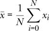

在这里，“性别”特征中的`0`在意义上小于该特征中的`1`，这符合序数值（ordinal value）的定义。我们付出的代价是扩展了特征向量中特征的数量，因为我们需要为每一个可能的类别值准备一个特征。例如，如果有五种颜色，我们需要一个五位元素的向量；如果有五千种，则需要一个五千个元素的向量。

要使用这种方案，类别必须是互斥的，这意味着每行中只有一个`1`。因为每行始终只有一个非零值，这种方法有时被称为`独热编码`（one-hot encoding）。

## 特征选择与维度灾难

本节介绍`特征选择`（feature selection），即选择在特征向量中使用哪些特征的过程，以及为什么你不应该包含不需要的特征。这里有一个很好的经验法则：特征向量应该只包含那些能够捕捉数据某些特征的特征，这些特征能允许模型泛化到新数据。

换句话说，特征应该捕捉有助于模型区分类别的数据特征。这已经无法更显直白了，因为最佳特征集总是特定于数据集的，无法预先知道。但并不意味着我们不能提供可能有帮助的信息，以引导我们为正在处理的任何数据集找到一组有用的特征。

像机器学习中的许多事物一样，特征选择伴随着权衡。我们需要足够的特征来捕捉数据的所有相关部分，以便模型有东西可学；但如果我们有太多的特征，就会陷入`维度灾难`（curse of dimensionality）的陷阱。

为了解释这意味着什么，让我们来看一个例子。假设我们的特征都限制在`[0,1)`范围内。这并不是拼写错误；我们使用的是区间符号，其中方括号`[`表示包含边界值，而圆括号`)`表示排除边界。因此，这里`0`是允许的，但`1`不行。我们还假设特征向量是二维或三维的。这样，我们就可以将每个特征向量绘制为 2D 或 3D 空间中的一个点。最后，我们将通过均匀随机选择二维或三维特征向量来模拟数据集，使得向量的每个元素都在`[0,1)`之中。

我们将样本数量固定为 100。如果我们有两个特征（即二维空间），我们可以将 100 个随机选择的二维向量表示出来，正如图 4-1 顶部所示。现在，如果我们有三个特征（即三维空间），这同样的 100 个特征看起来就像图 4-1 的底部。

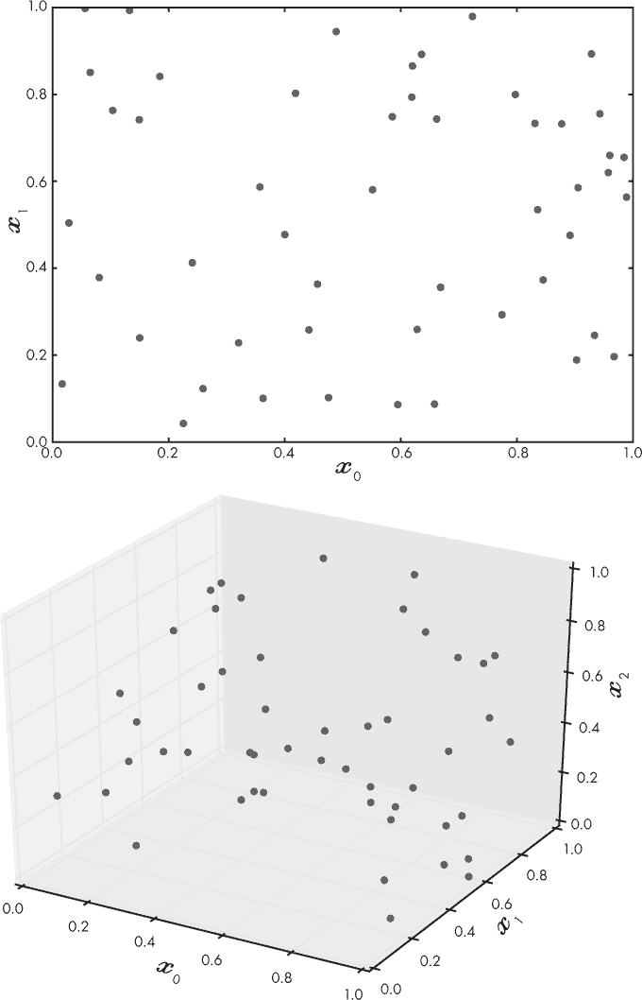

*图 4-1：2D 空间（上）和 3D 空间（下）中的百个随机样本*

由于我们假设特征向量可以来自 2D 或 3D 空间的任何地方，我们希望数据集尽可能采样该空间，以便很好地代表该空间。我们可以通过将每个轴划分为 10 个等份，来衡量这 100 个点填充空间的程度。让我们将这些部分称为`bins`（箱）。在 2D 空间中我们将得到 100 个箱，因为它有两个轴（`10 × 10`），在 3D 空间中将得到 1,000 个，因为它有三个轴（`10 × 10 × 10`）。现在，如果我们计算被至少一个点占据的箱的数量，并除以箱的总数，就会得到被占据箱的比例。

这样做让 2D 空间得到 0.5（最大为 1），3D 空间得到 0.1。这意味着 100 个样本能够采样大约一半的 2D 空间。这还不错！但 3D 空间中的 100 个样本仅采样了大约 5% 的空间。为了让 3D 空间的填充比例达到与 2D 相同的水平，我们需要大约 1,000 个——也就是现有数量的 10 倍。这一通用规则随着维度的增加而适用：4D 特征空间需要大约 10,000 个，而 5D 特征空间将需要大约 100,000,000 个！随着特征数量的增加，我们获得代表性采样所需的训练数据量剧增，大约为`10^d`，其中`d`是维度。这就是`维度灾难`，它几十年来一直是机器学习的噩梦。幸运的是，现代深度学习克服了这一诅咒，但在处理我们在第 6 章中探索的传统模型时，它仍然相关。

例如，你计算机上一个典型的彩色图像可能……（此处原文似乎中断）

对于任何年份`y`，我们都可以得到人口`p`的估计值。1952 年的世界人口是多少？我们的表格中没有 1952 年的实际数据，但使用该模型，我们可以这样估算：

`p = 0.02509(1952) – 46.28 = 2.696 billion`

通过查阅 1952 年的实际世界人口数据，我们知道该数字为 26.37 亿，因此我们对 26.96 亿的估值仅偏差了约 600 万。这个模型看起来非常不错！

在用模型估算 1952 年世界人口时，我们进行了`插值`（interpolation）。我们对已有数据点之间的一个值进行了估算，而模型给了我们一个很好的结果。相反，`外推`（extrapolation）则是超出已知范围进行测量，即在我们数据覆盖范围之外。

让我们用模型来估算 2000 年的世界人口，这在我们用于构建模型的数据结束后的 40 年：

`p = 0.02509(2000) – 46.28 = 3.900 billion`

根据模型，人口应该接近 39 亿，但我们从实际数据中得知，2000 年的世界人口为 60.89 亿。我们的模型偏差了超过 20 亿人。这里发生的情况是，我们将模型应用在了它并不适用的输入上。如果我们留在模型被“训练”所已知的输入范围之内，即 1910 年至 1960 年之间的日期，那么模型的表现就足够好。然而，一旦我们超出了模型的训练范围，它就崩溃了，因为它假设了我们并不具备的知识。

当我们进行插值时，模型看到的示例与它训练期间看到的示例集相似。可能出乎意料的是，它在这些示例上的表现会比我们对其进行外推并要求模型超出其训练范围时要好。

在涉及分类时，拥有全面的数据至关重要。假设我们正在训练一个模型来识别狗品种。在我们的数据集中，我们有数百张黑白相间的边境牧犬照片，如图 4-2 左侧所示。如果我们随后给模型一张新的边境牧犬照片，我们希望能够得到一个正确的标签：“边境牧犬”。这类似于要求模型进行插值：它正在处理它以前见过的东西，因为训练数据中的“边境牧犬”标签包含了许多示例。


*图 4-2：具有经典斑纹的边境牧犬（左）、具有肝色斑纹的边境牧犬（中）、澳洲牧羊犬（右）*

然而，并不是每只边境牧犬都有经典斑纹。有些标记像中间那只牧犬一样。由于我们没有在训练集中包含这样的图像，模型现在必须尝试超出它的训练范围，并为它未曾训练过的类别的实例给出正确标签。它可能会失败，给出一个错误的输出，如“澳洲牧羊”，这是一种与边境牧犬相似的品种。

然而，要记住的关键概念是，当模型为未知输入预测标签时，数据集必须涵盖模型将看到的类别内的完整变异范围。

### 母分布（The Parent Distribution）

数据集必须代表它所建模的类别。这个想法中隐藏着一个假设，即我们的数据有一个`母分布`（parent distribution），这是一个创建我们正在使用的特定数据集的未知生成器。考虑一下哲学中的类比：古希腊哲学家柏拉图使用了“理念”的概念。在他看来，某个地方存在一个理想，而所有存在的椅子都是那个理想或多或少的完美拷贝。这就是我们正在使用的数据集、拷贝与母分布之间的关系。

我们可以将数据集看作是从未知过程的样本，该过程根据母分布产生数据。例如，当你掷骰子时，从长远来看，六个数值出现的概率是相等的。如果你为你多次掷骰子时每个值出现的次数制作条形图，你将得到一条大致水平的线，因为每个值的出现概率相等。当我们测量成年人的身高时，我们会看到不同的分布。身高的分布将呈现出双峰的形式，一个在男性身高附近，另一个在女性身高附近。

母分布是产生这种整体形状的。训练数据、测试数据以及你提供给模型做出决策的数据必须全部来自同一个母分布。这是模型提出的一个基本假设，对我们来说这不应该太令人惊讶。尽管如此，有时很容易混淆，使用来自一个母分布的数据进行训练，同时使用来自另一个分布的数据进行测试或使用模型。如何用一个母分布训练并用另一个分布使用该模型是目前一个非常活跃的研究领域。搜索“领域自适应”（domain adaptation）。

### 先验类别概率（Prior Class Probabilities）

`先验类别概率`（prior class probability）是每个类别在现实中出现的概率。通常情况下，我们希望数据集中的每个类别与先验概率匹配。如果类别 A 出现的概率为 85%，而类别 B 为 15%，那么我们希望类别 A 在数据集中出现的概率为 85%，类别 B 出现的概率为 15%。

然而，存在例外。假设我们想要模型学习的某个类别是稀缺的，每 10000 个输入中才出现一次。让数据集严格遵循先验概率，模型可能看不到足够的示例来学习任何有用的知识。更糟糕的是，如果稀有类别正是我们最感兴趣的类别呢？

例如，假设我们正在建立一个寻找四叶草的机器人。我们假设已经知道输入的内容是草叶，我们只想知道它是三叶还是四叶。我们知道每 5000 片草叶中大约有一片是四叶草。构建一个数据集，每有一片四叶草就有 5000 片三叶草，这看起来是合理的，直到我们意识到一个简单地说所有输入都是三叶草的模型，平均每 5000 次就能对 4999 次！它将是一个极其精确但完全无用的模型，因为它从未找到过我们感兴趣的类别。

如何处理不平衡数据是研究社区仍在积极研究的问题。有些人选择从更平衡的类别比例开始；另一些则使用数据增强（参见第 5 章）来增加少数类别的样本数量。

## 混淆者（Confusers）

我们说过，我们需要在数据集中包含能够反映我们想要学习的类别所有自然变异示例。这确实如此，但有时包含一些与我们的一个或多个类别相似但实际上并非该类别示例的训练样本尤为重要。

考虑两个模型。第一个模型学习狗图像和猫图像之间的区别。第二个模型学习狗图像和非狗图像之间的区别。第一个模型相对简单，输入非狗就是猫，模型使用狗和猫的图像进行训练。然而，第二个模型就困难得多。显然，我们需要狗的图像来进行训练。但“非狗”图像应该是什么呢？考虑到前面的讨论，我们应该开始直觉到，我们需要涵盖模型在野外会看到的图像空间的图像。

我们可以更进一步。如果我们想区分狗和非狗，训练时应该确保在“非狗”类别中包含狼。如果不这样做，模型在遇到狼时可能无法学到足够的区分能力，并返回“狗”的分类。如果我们使用数百张全是企鹅和鹦鹉照片的“非狗”图像来构建数据集，如果模型决定将狼称为狗，我们应该感到惊讶吗？

通常情况下，我们需要确保数据集包含混淆者，或称为`硬负样本`（hard negatives），即与其他类别足够相似以至于被误认为它们，但不属于该类的示例。混淆者让模型有机会学习某类类别更精确的特征。在区分某物与所有其他事物时（例如“狗”与“非狗”），硬负样本特别有用。

## 数据集大小

到目前为止，我们讨论了在数据集中包含什么类型的数据，但我们需要多少数据？“全部”是一个诱人且俏皮的答案。为了让模型尽可能精确，我们应该使用尽可能多的示例。但获取所有数据通常是不可能的。

选择数据集的大小意味着要在准确性与获取数据所需的时间和精力之间进行权衡。获取数据可能昂贵或缓慢，或者正如我们在三叶草示例中看到的，有时数据集中的关键类是稀有且很少遇到的。因为标记数据的获取通常成本高且速度慢，在开始之前，我们应该对需要多少数据心中有数。

遗憾的是，事实是没有任何公式可以回答“多少数据才算足够”这个问题。在达到某一点后，增加数据带来的收益是递减的。从 100 个示例增加到 1000 个示例可能会大幅提高模型的准确率，但从 1000 个增加到 10000 个示例可能只带来微小的准确率提升。增加的准确性需要与额外获取 9000 个训练示例的努力程度和成本相平衡。

另一个需要考虑的因素是模型本身。模型具有容量（capacity），这决定了它们相对于可用训练数据量所能支持的复杂度。模型的容量与其参数数量直接相关。具有更多参数的大模型需要大量的训练数据才能找到合适的参数设置。尽管训练示例多于模型参数通常是一个好主意，但在训练数据少于参数的情况下，深度学习也可以良好运行。例如，如果类别之间非常不同——想象建筑和橙子——而且我们很容易区分它们，模型可能也会很快学会这种区别，因此我们用较少的训练示例就能完成。另一方面，如果我们试图将狼和哈士奇犬区分开，我们可能需要更多的数据。我们将在第 5 章中讨论在没有大量训练数据时该怎么办，但这些技巧都不能作为简单获取更多数据的良好替代方案。

关于需要多少数据的唯一正确答案是“全部”。在问题的限制下（如费用、时间、稀有性等），尽可能获取实际的数据。

## 数据准备

在继续构建实际数据集之前，我们将涵盖你可能在将数据集输入模型之前会遇到的两种情况：如何缩放特征，以及如果特征值缺失该怎么办。

### 特征缩放（Scaling Features）

由一组不同特征构建的特征向量可能有多种范围。一个特征可能取很宽的值范围，例如`-1000`到`1000`，而另一个可能被限制在`0`到`1`范围内。当这种情况发生时，某些模型将无法良好工作，因为一个特征因其范围占据了其他特征。此外，某些模型类型在特征均值接近`0`时最为理想。

这些问题的解决方案是缩放。我们暂时假设特征向量中的每个特征都是连续的。我们将使用一个包含五个特征和 15 个样本的虚拟数据集。这意味着我们的数据集有 15 个样本（特征向量及其标签），每个特征向量有五个元素。我们假设有三个类别。数据集看起来如表 4-4。

**表 4-4：**一个假设的数据集

| 样本 | `x[0]` | `x[1]` | `x[2]` | `x[3]` | `x[4]` | 标签 |
| :--- | :--- | :--- | :--- | :--- | :--- | :--- |
| 0 | 6998 | 0.1361 | 0.3408 | 0.00007350 | 78596048 | 0 |
| 1 | 6580 | 0.4908 | 3.0150 | 0.00004484 | 38462706 | 1 |
| 2 | 7563 | 0.9349 | 4.3465 | 0.00001003 | 6700340 | 2 |
| 3 | 8355 | 0.6529 | 2.1271 | 0.00002966 | 51431 | 0 |
| 4 | 2393 | 0.4605 | 2.7561 | 0.00003395 | 27284 | 0 |
| 5 | 9498 | 0.0244 | 2.7887 | 0.00008880 | 32243 | 2 |
| 6 | 4030 | 0.6467 | 4.8231 | 0.00000403 | 19101 | 2 |
| 7 | 5275 | 0.3560 | 0.0705 | 0.00000899 | 96029 | 0 |
| 8 | 8094 | 0.7979 | 3.9897 | 0.00006691 | 73071 | 1 |
| 9 | 843 | 0.7892 | 0.9804 | 0.00005798 | 10179 | 1 |
| 10 | 1221 | 0.9564 | 2.3944 | 0.00007815 | 14241 | 0 |
| 11 | 5879 | 0.0329 | 2.0085 | 0.00009564 | 34243 | 2 |
| 12 | 923 | 0.4159 | 1.7821 | 0.00002467 | 52404 | 1 |
| 13 | 5882 | 0.0002 | 1.5362 | 0.00005066 | 18728 | 2 |
| 14 | 1796 | 0.7247 | 2.3190 | 0.00001332 | 96703 | 1 |

如果我们有一个模型，那么每一行都将是它自己的输入。编写`x[0]`、`x[1]`、`x[2]`、`x[3]`、`x[4]`来指代这些内容会非常繁琐，因此，当我们引用一个完整的特征向量时，我们将使用大写字母。例如，我们将数据集`X`中的样本 2 称为`X[2]`。为了清晰起见，我们有时还会使用矩阵——数字的二维数组——它们也用大写字母标记。当我们要引用单个特征时，将使用带有下标的小写字母，例如`x[3]`。

让我们来看特征的范围。每个特征的最小值、最大值和范围（最大值与最小值之间的差值）如表 4-5 所示。

**表 4-5：**表 4-4 中特征的最小值、最大值和范围

| 特征 | 最小值 | 最大值 | 范围 |
| :--- | :--- | :--- | :--- |
| `x[0]` | 843.0 | 9498.0 | 8655.0 |
| `x[1]` | 0.0002 | 0.9564 | 0.9562 |
| `x[2]` | 0.0705 | 4.8231 | 4.7526 |
| `x[3]` | 4.03e-06 | 9.564e-05 | 9.161e-05 |
| `x[4]` | 6700340.0 | 96703562.0 | 90003222.0 |

注意计算机计数法如`9.161e-05`。这是计算机表示科学计数法的方式：`9.161 × 10^(–5) = 0.00009161`。同样注意，每个特征覆盖的范围非常不同。由于我们希望缩放特征，使得它们的范围更加相似。只要你以相同的方式缩放所有新输入，在训练模型之前进行缩放是有效的。

### 均值中心化

最简单的缩放形式是`均值中心化`（mean centering）。这很容易做到：从每个特征中只需减去该特征在整个数据集上的均值（平均值）。一组值`x[i]`（其中`i = 0, 1, 2, …`）的均值等于每个值的和除以值的个数：


特征`x[0]`的均值为 5022，因此为了中心化`x[0]`，我们如下替换每个值：

`x[i] ← x[i] – 5022, i = 0, 1, 2, . . .`

在这种情况下，索引`i`跨越样本，而不是特征向量的其他元素。

对所有其他特征的均值重复上述步骤将使整个数据集中心化。结果是，每个特征在数据集上的均值现在为 0，这意味着特征值本身都位于 0 之上或之下。对于深度学习，均值中心化通常通过从每个输入图像中减去均值图像来实现。

### 将标准差变为 1

均值中心化很有帮助，但 0 周围值的分布与减去均值之前保持相同。我们做的只是将数据向下移动到 0。均值周围值的分布程度有一个正式名称：它被称为`标准差`（standard deviation），它的计算方法是数据值与均值之间的平均差值：

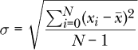

字母`σ`（sigma）是数学中标准差的常用名称。你不需要记忆这个公式。它的存在是为了向我们展示如何计算数据相对于数据均值的离散程度或范围。

均值中心化将变为 0，但不会改变`σ`。有时我们想更进一步，在进行均值中心化的同时改变数据的分布程度，使得范围相同，这意味着每个特征的标准差为 1。幸运的是，这样做非常简单。我们将每个特征值`x`替换为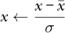，其中和`σ`是每个特征在数据集上的均值和标准差。例如，前面的玩具示例数据集可以存储为二维 NumPy 数组：

```python
```


```python
x = np.array([
    [6998, 0.1361, 0.3408, 0.00007350, 7859048],
    [6580, 0.4908, 3.0150, 0.00004484, 38462706],
    [7563, 0.9349, 4.3465, 0.00001003, 6700340],
    [8355, 0.6529, 2.1271, 0.00002966, 5143039],
    [2393, 0.4605, 2.7561, 0.00003395, 27284192],
    [9498, 0.0244, 2.7887, 0.00008880, 78543394],
    [4030, 0.6467, 4.8231, 0.00000403, 1910143],
    [5275, 0.3560, 0.0705, 0.00000899, 96029352],
    [8094, 0.7979, 3.9897, 0.00006691, 7307156],
    [843, 0.7892, 0.9804, 0.00005798, 1017951],
    [1221, 0.9564, 2.3944, 0.00007815, 14241835],
    [5879, 0.0329, 2.0085, 0.00009564, 34243070],
    [923, 0.4159, 1.7821, 0.00002467, 52404615],
    [5882, 0.0002, 1.5362, 0.00005066, 18728752],
    [1796, 0.7247, 2.3190, 0.00001332, 9670352]
])
```

这样就可以用一行代码处理整个数据集：

```python
x = (x - x.mean(axis=0)) / x.std(axis=0)
```

这种方法被称为*标准化*（standardization）或*归一化*（normalizing），你应该对大多数数据集这样做，特别是当使用第 6 章中讨论的模型时。尽可能标准化你的数据集，使得特征的均值为 0 且标准差为 1。

如果我们对前面的数据集进行标准化，它会是什么样子？每个特征减去该特征的均值并除以标准差，得到一个新的数据集（表 4-6）。在这里，我们将数字简化到了四位小数并删除了标签。

**表 4-6：** 表 4-4 中的标准化数据

| 样本 | `x[0]` | `x[1]` | `x[2]` | `x[3]` | `x[4]` |
| :--- | :--- | :--- | :--- | :--- | :--- |
| 0 | 0.6930 | -1.1259 | -1.5318 | 0.9525 | 1.1824 |
| 1 | 0.5464 | -0.0120 | 0.5051 | -0.0192 | -0.1141 |
| 2 | 0.8912 | 1.3826 | 1.5193 | -1.1996 | -1.1403 |
| 3 | 1.1690 | 0.4970 | -0.1712 | -0.5340 | 0.3047 |
| 4 | -0.9221 | -0.1071 | 0.3079 | -0.3885 | -0.4753 |
| 5 | 1.5699 | -1.4767 | 0.3327 | 1.4714 | 1.1807 |
| 6 | -0.3479 | 0.4775 | 1.8823 | -1.4031 | -0.7396 |
| 7 | 0.0887 | -0.4353 | -1.7377 | -1.2349 | 1.7456 |
| 8 | 1.0775 | 0.9524 | 1.2475 | 0.7291 | -1.1207 |
| 9 | -1.4657 | 0.9250 | -1.0446 | 0.4262 | 1.0279 |
| 10 | -0.3332 | 1.4501 | 0.0323 | 1.1102 | -0.8966 |
| 11 | 0.3005 | -1.4500 | -0.2615 | 1.7015 | -0.2505 |
| 12 | -1.4377 | -0.2472 | -0.4340 | -0.7032 | 0.3362 |
| 13 | 0.3016 | -1.5527 | -0.6213 | 0.1780 | -0.7517 |
| 14 | -1.1315 | 0.7225 | -0.0250 | 1.0881 | 1.7674 |

一种解决方案是用超出特征范围之外的值来填充缺失值，希望模型能学会忽略这些值，或者更多地利用其他特征。事实上，一些更先进的深度学习模型会刻意将某些输入置零，作为一种正则化形式（我们将在后面的章节中看到这意味着什么）。

现在，我们将学习第二种显而易见的解决方案：用特征在整个数据集上的平均值来替换缺失特征。让我们再次看看之前的练习数据集。这一次，我们将有一些缺失数据需要处理（表 4-7）。

**表 4-7：** 带有某些空值的样本数据集（表 4-4）

| 样本 | `x[0]` | `x[1]` | `x[2]` | `x[3]` | `x[4]` | 标签 |
| --- | --- | --- | --- | --- | --- | --- |
| `0` | 6998 | 0.1361 | 0.3408 | 0.00007350 | 78596048 | 0 |
| `1` |  | 0.4908 |  | 0.00004484 | 38462706 | 1 |
| `2` | 7563 | 0.9349 | 4.3465 |  | 6700340 | 2 |
| `3` | 8355 | 0.6529 | 2.1271 | 0.00002966 | 51430391 | 0 |
| `4` | 2393 | 0.4605 | 2.7561 | 0.00003395 | 27284192 | 0 |
| `5` | 9498 |  | 2.7887 | 0.00008880 | 78543394 | 2 |
| `6` | 4030 | 0.6467 | 4.8231 | 0.00000403 |  | 2 |
| `7` | 5275 | 0.3560 | 0.0705 | 0.00000899 | 96029352 | 0 |
| `8` | 8094 | 0.7979 | 3.9897 | 0.00006691 | 7307156 | 1 |
| `9` |  |  | 0.9804 |  | 10179751 | 1 |
| `10` | 1221 | 0.9564 | 2.3944 | 0.00007815 | 1424135 | 0 |
| `11` | 5879 | 0.0329 | 2.0085 | 0.00009564 | 3424307 | 2 |
| `12` | 923 |  |  | 0.00002467 |  | 1 |
| `13` | 5882 | 0.0002 | 1.5362 | 0.00005066 | 1872872 | 2 |
| `14` | 1796 | 0.7247 | 2.3190 | 0.00001332 | 9670352 | 1 |

空白格表示缺失值。忽略缺失值后，每个特征的平均值显示在表 4-8 中。

**表 4-8：** 表 4-7 中特征的平均值

| `x[0]` | `x[1]` | `x[2]` | `x[3]` | `x[4]` |
| --- | --- | --- | --- | --- |
| 5223.6 | 0.5158 | 2.345 | 4.71e-05 | 4295773.0 |

如果我们用平均值替换每个缺失值，将得到一个可以标准化并用于训练模型的数据集。当然，真实数据更好，但平均值是一个很好的起点。

## 训练、验证和测试数据

一种解决方案是用超出特征范围之外的值来填充缺失值，希望模型能学会忽略这些值，或者更多地利用其他特征。事实上，一些更先进的深度学习模型会刻意将某些输入置零，作为一种正则化形式（我们将在后面的章节中看到这意味着什么）。

现在，我们将学习第二种显而易见的解决方案：用特征在整个数据集上的平均值来替换缺失特征。让我们再次看看之前的练习数据集。这一次，我们将有一些缺失数据需要处理（表 4-7）。

空白格表示缺失值。忽略缺失值后，每个特征的平均值显示在表 4-8。

如果我们用平均值替换每个缺失值，我们就能得到一个可以标准化并用于训练模型的数据集。当然，真实数据更好，但平均值是一个很好的起点。

### 子集

为了评估机器学习模型的泛化能力，通常会将数据集分为三个子集：

1. **训练集**：用于训练模型。
2. **验证集**：用于调整超参数和选择模型架构。
3. **测试集**：在模型训练完成后用于评估其性能。

这种划分方法可以防止模型在训练数据上过拟合，但在未见过的数据上表现不佳。

我们讨论了保留——或者至少尽可能接近数据集中不同类别实际先验概率的重要性。如果一个类别在现实世界案例中占 10%，那么理想情况下，它在我们的数据集中也占 10%。

现在，我们需要找到一种方法，在我们构建的训练、验证和测试子集中保留这种类别先验概率。主要有两种方法：按类分层和随机抽样。

## 按类分层（Partitioning by Class）

这种精确的方法适用于数据集较小或某个类别非常稀少的情况，其做法是确定代表每个类别的样本数量，然后在合并之前按类别留出选定百分比的样本。

例如，如果类别 `0` 有 9,000 个样本，类别 `1` 有 1,000 个样本，而我们希望将 90% 的数据放入训练集，每个 5% 分别放入验证集和测试集，那么我们将从类别 `0` 集中随机选择 8,100 个样本，并从类别 `1` 集中随机选择 900 个样本来组成训练集。

同样，我们将从剩余的 900 个未使用的类别 `0` 样本中随机选择 450 个用于验证集，同时从剩余的未使用的类别 `1` 数据中选择 50 个。剩余的类别 `0` 和类别 `1` 样本则成为测试集。

代码列表 4-1 显示了使用原始数据的 90/5/5 分划分构建子集的代码。

```python
import numpy as np
from sklearn.datasets import make_classification

a, b = make_classification(n_samples=10000, weights=(0.9, 0.1))

idx = np.where(b == 0)[0]
x0 = a[idx, :]
y0 = b[idx]

idx = np.where(b == 1)[0]
x1 = a[idx, :]
y1 = b[idx]

idx = np.argsort(np.random.random(y0.shape))
y0 = y0[idx]
x0 = x0[idx]

idx = np.argsort(np.random.random(y1.shape))
y1 = y1[idx]
x1 = x1[idx]

ntrn0 = int(0.9 * x0.shape[0])
ntrn1 = int(0.9 * x1.shape[0])

xtrn = np.zeros((int(ntrn0 + ntrn1), 20))
ytrn = np.zeros(int(ntrn0 + ntrn1))

xtrn[:ntrn0] = x0[:ntrn0]
xtrn[ntrn0:] = x1[:ntrn1]

ytrn[:ntrn0] = y0[:ntrn0]
ytrn[ntrn0:] = y1[:ntrn1]

n0 = int(x0.shape[0] - ntrn0)
n1 = int(x1.shape[0] - ntrn1)

xval = np.zeros((int(n0 / 2 + n1 / 2), 20))
yval = np.zeros(int(n0 / 2 + n1 / 2))

xval[:n0 / 2] = x0[ntrn0:ntrn0 + n0 / 2]
xval[n0 / 2:] = x1[ntrn1:ntrn1 + n1 / 2]

yval[:n0 / 2] = y0[ntrn0:ntrn0 + n0 / 2]
yval[:n0 / 2:] = y1[ntrn1:ntrn1 + n1 / 2]

xtst = np.concatenate((x0[ntrn0 + n0 / 2:], x1[ntrn1 + n1 / 2:]))
ytst = np.concatenate((y0[ntrn0 + n0 / 2:], y1[ntrn1 + n1 / 2:]))
```


```text
代码列表 4-1：训练集、验证集和测试集的精确构建
```

这段代码包含大量的记录工作。首先，我们创建了虚拟数据集 ❶ 并将其分为类别 `0` 和类别 `1`，分别存储在 `x0`、`y0` 和 `x1`、`y1` 中。然后，我们随机化了顺序 ❷。这让我们可以提取前 `n` 个样本用于子集，而无需担心因为数据中的顺序问题而引入偏差。由于 `sklearn` 生成虚拟数据集的方式，这一步并不是必须的，但确保样本顺序的随机性始终是一个好主意。

我们使用了一个在重排样本时非常有用的技巧。因为我们将特征向量存储在一个数组中，将标签存储在另一个数组中，`NumPy` 的 `shuffle` 方法将不起作用。相反，我们生成一个与样本数量长度相同的随机向量，并使用 `argsort` 返回能够使该向量按排序排列的索引。由于向量中的值是随机的，用于排序该向量的索引顺序也是随机的。这些索引随后重新排列样本和标签，使得每个标签仍然与正确的特征向量关联。

接下来，我们提取两个类别中前 90% 的样本，并使用 `xtrn` 中的样本和 `ytrn` 中的标签构建训练子集 ❸。我们对 5% 的验证集 ❹ 以及剩余的 5% 测试集 ❺ 执行了同样的操作。按类分层至少可以说是繁琐的。然而，我们确实知道类别 `0` 和类别 `1` 的比例在每个子集中是相同的。

## 随机抽样（Random Sampling）

我们必须如此精确吗？通常不需要。另一种常见方法是对整个数据集进行随机抽样。这种方法更简单，但在类别不平衡的数据集中，可能会导致子集的类别比例与原始数据集不符。

这些差异会影响模型的学习方式吗？可能不会，但它们可能会让测试结果看起来比实际情况更好，因为大多数模型都难以识别训练集中出现频率最少的类别。虽然存在“病态性划分”的可能性，导致某个特定类别没有任何样本，但在实践中，除非你的伪随机数生成器特别糟糕，否则这种情况并不可能发生。尽管如此，仍值得将这种可能性记在心上。如果你有所担心，请使用代码列表 4-1 中的精确划分方法。事实上，最好的解决方案一如既往，仍然是获取更多数据。

从算法角度来说，生成训练集、验证集和测试集的划分步骤如下：

1. 随机化整个数据集的顺序，使类别均匀混合。
2. 通过将完整数据集的样本数乘以所需的比例，计算训练集（`ntrn`）和验证集（`nval`）的样本数量。剩余样本将进入测试集。
3. 将前 `ntrn` 个样本分配给训练集。
4. 将接下来的 `nval` 个样本分配给验证集。
5. 最后，将剩余样本分配给测试集。

在任何时候，都要确保样本的顺序是真正的随机的，并且在重新排列特征向量时，确保以完全相同的序列重新排列标签。如果做到这一点，这个简单的划分过程将提供一个良好的划分，除非数据集非常小或某些类别非常稀有。

我们忽略了这种方法的一个后果。如果完整数据集本身就很小，对其进行划分将会让训练集变得更小。在第 7 章中，我们将看到一种处理小数据集的强大方法，这种方法在深度学习中被广泛使用。在此之前，让我们来看一种处理小数据集的原则方法，以了解它在新数据上的表现如何。

### `k`-折交叉验证

现代深度学习模型通常需要非常大的数据集，因此你可以像之前描述的那样使用单一的训练/验证/测试划分。然而，传统的机器学习模型（如第 6 章展示了这种划分，假设整个数据集水平铺开。

我们可以通过留出 `x[0]` 作为测试数据，并使用其他组 `x[1]`、`x[2]`、……`x[k–1]` 作为训练数据来训练模型。我们暂时忽略验证数据；在构建完当前的训练数据后，如果需要，我们随时可以留出一部分作为验证数据。将此训练后的模型命名为 `m[0]`。然后你可以从头开始，这次留出 `x[1]` 作为测试数据，并使用所有其他组（包括 `x[0]`）进行训练。我们将得到一个新的训练模型。将其命名为 `m[1]`。根据设计，`m[0]` 和 `m[1]` 是相同类型（`type`）的模型。在这里感兴趣的是使用完整数据集的不同子集训练的同类型模型的多个实例。

对每个组重复此过程，如图 4-4b 所示，我们将得到 `k` 个模型，每个模型使用 `(k – 1)/k` 的数据进行训练，留出 `1/k` 的数据用于测试。`k` 的值取决于数据集。


*图 4-4：`k`-折交叉验证（a、b）*

### 检查你的数据

组装数据然后检查它们是否合理容易的。以下是你可能需要注意的问题：

**标签错误的数据**：假设我们正在构建一个大型数据集——一个拥有数十万样本的数据集。此外，假设我们要构建一个能够区分狗和猫的模型。自然地，我们需要向模型输入许多狗的图像和猫的图像。但如果你只是设置一个脚本来下载图像结果，你还会得到许多既不是狗不是猫的图像。标签不会是完美的。虽然深度学习模型确实对这种标签噪声具有抵抗力，但你应该尽可能避免它。

**缺失或离群值数据**：假设你有一组特征向量，并且你不知道特征缺失的情况有多常见。如果某个特征的很大比例是缺失的，该特征将成为模型的障碍，你应该消除它。或者，如果数据中存在极端离群值，你可能想要删除这些样本，特别是当你进行标准化处理时，离群值会严重影响减去后的特征值。

### 在数据中查找问题

我们如何查找数据中的这些问题呢？嗯，对于特征向量，如果数据集不是太大，我们通常将其加载到电子表格中。或者我们可以编写一个脚本对每个特征进行总结，或者将数据导入统计程序进行检查。通常，在对数值进行统计总结时，我们会查看之前定义的平均值和标准差，以及最大值和最小值。我们还可以查看中位数，即当我们对数值从小到大排序并选取中间的那个时得到的值。（如果数值个数为偶数，我们会取中间两个平均值。）让我们看看之前示例中的一个特征。在数值从小到大排序后，我们可以如下所示总结数据。

| `x[2]` |
| --- |
| 0.0705 |
| --- |
| 0.3408 |
| 0.9804 |
| 1.5362 |
| 1.7821 |
| 2.0085 |
| 2.1271 |
| 2.3190 |
| 2.3944 |
| 2.7561 |
| 2.7887 |
| 3.0150 |
| 3.9897 |
| 4.3465 |
| 4.8231 |
| 平均值（） | = | 2.3519 |
| --- | --- | --- |
| 标准差（`σ`） | = | 1.3128 |
| 标准误（`SE`） | = | 0.3390 |
| 中位数 | = | 2.3190 |
| 最小值 | = | 0.0705 |
| 最大值 | = | 4.8231 |

我们已经探索了平均值、最小值、最大值和标准差的概念。中位数也在那里；我在左侧的特征列表中突出了它。请注意，在排序后，中位数出现在列表的正中间。它通常被称为`第 50 百分位数`，因为高于它和低于它的数据量是相同的。

列表中还列出了一个新值，`标准误`，也称为`均值标准误`。它是标准差除以数据集中数值个数的平方根：

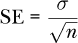

标准误是衡量我们的平均值  与母体分布平均值之间差异的指标。其基本思想是：如果我们有更多的测量值，我们对生成数据的母体分布会有更好的了解，因此测量值的平均值将更接近母体分布的平均值。

同样注意，平均值和中位数相对接近。当然，`相对接近`这个短语没有严格的数学含义，但我们可以将其作为一种特时的指标，表明数据可能服从正态分布，这意味着正如我们之前看到的那样，我们可以合理地用平均值（或中位数）来替换缺失值。

上述数值可以使用 `NumPy` 轻松计算，如代码列表 4-3 所示。

```python
import numpy as np  

f = [0.3408,3.0150,4.3465,2.1271,2.7561,  
      2.7887,4.8231,0.0705,3.9997,0.9804,  
      2.3944,2.0085,2.1271,2.0085,1.7821,  
      1.5362,2.3190]  

f = np.array(f)  

print  

print("mean  = %0.4f" % f.mean())  

print("std    = %0.4f" % f.std())  

print("SE     = %0.4f" % (f.std()/np.sqrt(f.shape[0])))  

print("median= %0.4f" % np.median(f))  

print("min    = %0.4f" % f.min())  

print("max    = %0.4f" % f.max())
```

*代码列表 4-3：计算基础统计数据。参见 `feature_stats.py`。*

在加载 `NumPy` 后，我们手动定义了 `x[2]` 特征（`f`）并将其转换为 `NumPy` 数组 ❶。一旦数据成为 `NumPy` 数组，除了标准误外，计算所需的值都是简单的方法或函数调用。标准误是通过前述公式 ❷ 计算的，`NumPy` 的 `shape` 返回向量中的元素个数。数字虽然很好，但图片通常更好。你可以使用 Python 中的 `box plot` 对数据进行可视化。让我们生成一个来查看数据集的标准化值。我们将讨论图的内容。创建图的代码在代码列表 4-4。

```python
import numpy as np

import matplotlib.pyplot as plt

d = [[0.6930, -1.1259, -1.5318,  0.9525,  1.1824],
      [0.5464, -0.0120,  0.5051, -0.0192, -0.1141],
      [0.8912, 1.3826,  1.5193, -1.1996, -1.1403],
      [1.1690, 0.4970, -0.1712, -0.5340,  0.3047],
      [-0.9221, -0.1071,  0.3079, -0.3885, -0.4753],
      [1.5699, -1.4767,  0.3327,  1.4714,  1.1807],
      [-0.3479, 0.4775,  1.8823, -1.4031, -0.7396],
      [0.0887, -0.4353, -1.7377, -1.2349,  1.7456],
      [1.0775, 0.9524,  1.2475, 0.7291, -1.1207],
      [-1.4657, 0.9250, -1.0446, 0.4262, -1.0279],
      [-1.3332, 1.4501,  0.0323,  1.1102, -0.8966],
      [0.3005, -1.4500, -0.2615,  1.7033, -0.2505],
      [-1.4377, -0.2472, -0.4340, -0.7032,  0.3362],
      [0.3016, -1.5527, -0.6213,  0.1780, -0.7517],
      [-1.1315, 0.7225, -0.0250, -1.0881,  1.7674]]

d = np.array(d)

plt.boxplot(d)

plt.show()
```

*代码列表 4-4：标准化玩具数据集的箱线图。参见 `box_plot.py`。*

数值本身在表 4-6。我们可以将数据存储为二维数组，并使用代码列表 4-4 制作箱线图。我们手动定义数组 ❶ 然后绘制它 ❷。图是交互式的，因此请尝试提供的环境直到你感到熟悉为止。旧式的软磁盘图标会将图保存到你的磁盘。

程序生成的箱线图如图 4-5。

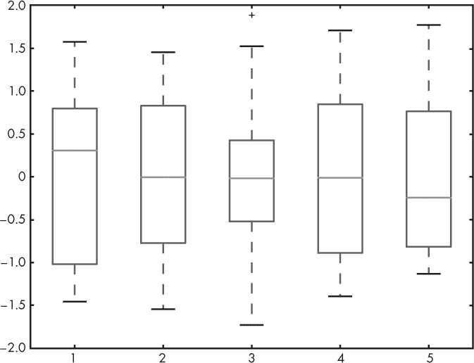

*图 4-5：由代码列表 4-4 产生的箱线图*

我们如何解释箱线图？我将通过检查标准化特征 `x[2]` 的箱体向你展示，见图 4-6。

下箱线 `Q1` 标记了第一分数的结束。这意味着一个特征的 25% 数据值小于此值。中位数 `Q2` 是 50% 标记，因此是第二分数的结束。一半的数据值小于此值。上箱线 `Q3` 是 75% 标记。剩余 25% 数据值大于 `Q3`。

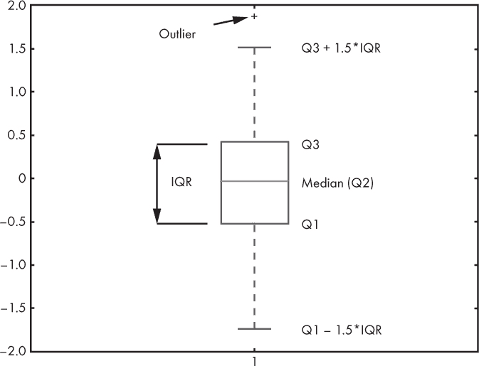

*图 4-6：来自我们数据集的标准化特征 `x2`*

#### 警示故事

所以，尽管可能会重复，但请*观察你的数据*。你处理得越频繁，对它的理解就越深，就能越有效地对输入和输出做出合理的决策，以及*为什么*。

我想起了两个快速的小故事。它们都说明了模型可能会学习到我们没有预期或甚至考虑的内容。

第一个是我在 80 年代作为一名大学生时听到的。在这个故事中，一种早期神经网络被用于检测坦克和非坦克图像。神经网络在测试中似乎运行良好，但在现场使用时，检测率迅速下降。研究人员发现，坦克图像是在阴天拍摄的，而非坦克坦克是在晴天拍摄的。识别系统完全没有学会坦克和非坦克的区别；相反，它学会了阴天和晴天的区别。这个故事的教训是，训练集需要包含模型在野外会遇到的所有情况。

第二个轶闻更为近期。我是在西班牙巴塞罗纳举行的 2016 神经信息处理系统（NIPS）会议上听说的，后来在研究人员的论文中发现它再次出现^(2)。在这个案例中，作者展示了他们让模型解释其决策的技术，他们训练了一个声称能区分哈基犬和狼图像的模型。该模型似乎运行得良好，在演讲期间，作者对由机器学习研究人员组成的观众进行了调查，询问他们认为该模型的可信度。大多数人认为这是一个很好的模型。然后，演讲者利用他们的技术揭示，网络几乎没有学习到哈基犬和狼之间的区别（或者根本没学）。相反，它学习到的是狼的照片背景中有雪，而哈基犬的照片中没有。

思考你的数据，并留心意料之外的后果。模型不是人类。我们会向数据集中带来许多先入为主的概念和无意的偏见。

## 总结

在本章中，我们描述了数据集的组成部分（类别、标签、特征、特征向量），并刻画了良好数据集的特征，强调了确保数据集很好地代表总体分布的重要性。然后，我们描述了基础的数据准备技术，包括如何缩放数据以及处理缺失特征的一种方法。之后，我们学习了如何将完整数据集拆分为训练、验证和测试子集，以及如何应用 `k`-折交叉验证，这对于小数据集特别有用。我们在本章结束处提供了一些技巧，教你如何简单地检查数据以确保其符合逻辑。

在下一章中，我们将把在本章中学到的知识，并将其直接应用于构建我们在书中剩余部分将使用的数据集。

1. 这些是经典机器学习模型的示例。我们将在书的后面学习更多关于它们的知识。

2. Ribeiro, Marco Tulio, Sameer Singh, and Carlos Guestrin. “Why Should I Trust You?: Explaining the Predictions of Any Classifier.” *In Proceedings of the 22nd ACM SIGKDD International Conference on Knowledge Discovery and Data Mining*, pp. 1135–1144. ACM, 2016.

# 5 构建数据集


上一章提供了许多详细建议。现在让我们把这些建议付诸实践，构建我们在书中剩余部分将使用的数据集。其中一些数据集非常适合传统模型，因为它们由特征向量组成。另一些更适合处理多维输入的深度学习模型——特别是图像，或可以可视化为图像的内容。

我们将完成原始数据的获取和数据预处理，使其适合我们的工具。在用这些数据集构建特定模型之前，我们不会进行实际的训练/验证/测试划分。这里值得注意的是，对数据进行预处理以适应模型通常是机器学习任务中最耗力的任务之一。尽管如此，如果不这样做，或者做得不好，你的模型最终可能可能远不如你的预期。

## 鸢尾花

所有机器学习数据集中最经典的莫过于`鸢尾花数据集`，它由 R. A. Fisher 在 1936 年的论文《分类问题中多次测量量的使用》中开发。这是一个小型数据集，包含三个类别，每个类别有 50 个样本。共有四个特征：花萼宽度、花萼长度、花瓣宽度和花瓣长度，单位均为厘米。三个类别为 `I. setosa`、`I. versicolour` 和 `I. virginica`。该数据集已内置于 `sklearn`，但我们将从加州大学爱尔文分校的机器学习库下载它，以练习处理外部来源的数据，并引入一系列适用于许多传统机器学习模型的丰富数据集。主仓库位于 [`archive.ics.uci.edu/ml/index.php`](https://archive.ics.uci.edu/ml/index.php)。

访问 `https://archive.ics.uci.edu/ml/datasets/Breast+Cancer+Wisconsin+(Diagnostic)/` 下载数据集。然后，点击 `Data Folder` 链接并保存 `wdbc.data` 文件。

该数据集包含从乳腺肿块细针穿刺切片提取的细胞测量数据。包含 30 个连续特征和两个类别：恶性（癌症，212 个样本）和良性（无癌症，357 个样本）。这是一个非常流行的数据集，下载量超过 670,000 次。文件的第一行如下：

```text
842302,M,17.99,10.38,122.8,1001,0.1184, ...
```

该行的第一个元素是患者 ID 号，我们不需要担心。第二个元素是标签——`M` 代表恶性，`B` 代表良性。该行的其余数字是与细胞大小相关的 30 个测量值。特征本身具有不同的尺度，因此，除了创建原始数据集外，我们还将创建一个标准化版本。由于这是数据集的全部，且我们必须留出部分数据进行测试，在这种情况下我们不需要记录每个特征的均值和标准差。如果我们能够获得以相同方式生成的更多数据（例如从某个被遗忘的旧文件中），我们需要保留这些值，以便对新输入进行标准化。构建此数据集并生成摘要箱图的脚本位于代码列表 5-2。

```python
import numpy as np  

import matplotlib.pyplot as plt  

❶ with open("wdbc.data") as f:
```


```python
lines = [i[:-1] for i in f.readlines() if i != ""]

n = ["B", "M"]

x = np.array([n.index(i.split(",")[1]) for i in lines], dtype="uint8")

y = np.array([[float(j) for j in i.split(",")[2:]] for i in lines])

i = np.argsort(np.random.random(x.shape[0]))

x = x[i]

y = y[i]

z = (y - y.mean(axis=0)) / y.std(axis=0)

np.save("bc_features.npy", y)

np.save("bc_features_standard.npy", z)

np.save("bc_labels.npy", x)

plt.boxplot(z)

plt.show()
```

*Listing 5-2: 加载原始乳腺癌数据集*

我们做的第一件事是读取原始文本数据 ❶。然后我们提取每个标签并将其映射为良性为 0，恶性为 1。注意这里我们为自然目标情况使用了 1，这样输出概率值的模型就表示了发现癌症的概率 ❷。我们使用嵌套列表推导式提取每个样本的 30 个特征作为浮点数，首先提取特征的文本（`i`），然后将其映射为浮点数（`j`）。这产生了一个嵌套列表，NumPy 方便地将其转换为 569 行 30 列的矩阵。

接下来，我们对数据集进行随机化，并通过减去每个特征的均值并除以其标准差来计算标准化版本。我们将使用这个版本，并在 Figure 5-2 的箱图中对其进行检查 ❸，该图显示了标准化后的所有 30 个特征。

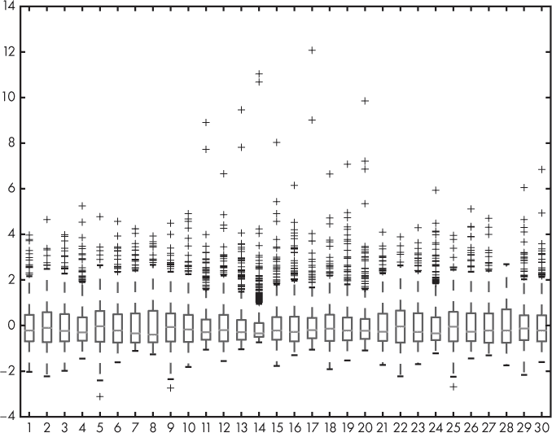

*Figure 5-2: 30 个乳腺癌数据集特征的箱图*

在这种情况下，我们不需要知道特征代表什么。我们将在所选特征足以判断恶性任务的假设下处理该数据集。我们的模型将告诉我们情况是否如此。从我们在 y 轴上箱体的位置可以看到，现在所有特征的尺度都是相同的：它们基本上覆盖了相同的范围。数据的一个特征立即显而易见——即存在许多明显的离群值，正如四分位距所示（参见 Figure 4-6）。这些不一定是坏值，但它们是数据并非正态分布的指示——即每个特征都没有遵循钟曲线型分布。

### MNIST 数字

我们的下一个数据集通常不是由特征向量组成，而是由数千张手写数字的小图像组成。该数据集是现代机器学习的骨干工作，也是深度学习研究人员在测试新想法时首选的数据集之一。它被过度使用了，但这是因为它非常容易理解且易于处理。

该数据集历史悠久，但我们使用的最常见版本被称为 `MNIST dataset`。数据的来源 [`yann.lecun.com/exdb/mnist/`](http://yann.lecun.com/exdb/mnist/) 包含了背景材料。为了节省时间，我们将使用 Keras 下载并格式化数据集。Keras 返回的是 3D 数组。第一维度是图像数量——训练 60,000 张，测试 10,000 张。第二第三维度是像素。像素的大小为 28×28。每个像素都是无符号整数 [0,255]。

因为我们希望处理期望向量的模型，并且我们需要在书的后部分使用该数据集说明某些属性，我们将从这个初始数据创建额外数据集。为了这样做，首先我们将图像展开以形成特征向量，以便使用传统模型。其次，我们将打乱图像的顺序，使得像素不再处于确定性的位置。第三，我们将为这些打乱的图像创建一个展开的特征向量版本以探索神经网络。使用 Listing 5-3 来构建数据集。

```python
import numpy as np

import keras

from keras.datasets import mnist

(xtrn, ytrn), (xtst, ytst) = mnist.load_data()

idx = np.argsort(np.random.random(ytrn.shape[0]))

xtrn = xtrn[idx]

ytrn = ytrn[idx]

idx = np.argsort(np.random.random(ytst.shape[0]))

xtst = xtst[idx]

ytst = ytst[idx]

np.save("mnist_train_images.npy", xtrn)

np.save("mnist_train_labels.npy", ytrn)

xtrnv = xtrn.reshape((60000, 28 * 28))

xtstv = xtst.reshape((10000, 28 * 28))

np.save("mnist_train_vectors.npy", xtrnv)

np.save("mnist_test_vectors.npy", xtstv)

t = np.zeros((60000, 28, 28))

for i in range(60000):
    t[i, :, :] = xtrnv[i, :].reshape((28, 28))

np.save("mnist_train_scrambled_images.npy", t)

t = np.zeros((10000, 28, 28))

for i in range(10000):
    t[i, :, :] = xtstv[i, :].reshape((28, 28))

np.save("mnist_test_scrambled_images.npy", t)
```

接下来，我们将训练和测试图像展平，并将它们转换为包含 `784` 个元素的向量 ❷。展平过程是取第一行像素，紧接着是第二行，依此类推，直到所有行都首尾相接。我们得到 `784` 个元素是因为 `28 × 28 = 784`。

随后，我们对展平后向量中的 `784` 个元素生成一个排列（`idx`）❸。

我们使用这些排列后的向量形成新的、打乱的数字图像，并将它们存储在磁盘上 ❹。打乱的图像是通过撤销展平操作从打乱的向量制成的。在 `NumPy` 中，这只是对向量数组的 `reshape` 方法的调用。请注意，我们始终没有改变过图像的相对顺序，因此只需要为训练标签和测试标签各存储一个文件。

图 5-3 显示了 MNIST 数据集中具有代表性的数字。

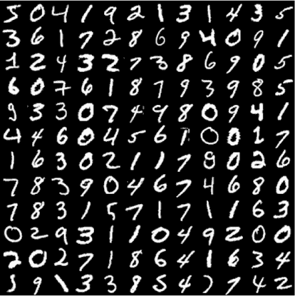

*图 5-3: 代表性 MNIST 数字图像*

我们不需要对图像进行标准化，因为我们知道它们已经处于相同的尺度上（因为它们是像素）。我们有时在使用时对它们进行缩放，但目前可以将其它们作为字节灰度图像留在磁盘上。该数据集是平衡的；表 5-1 显示了训练分布。因此，我们不需要担心数据不平衡的问题。

**表 5-1：** MNIST 训练集的数字频率

| 数字 | 计数 |
| --- | ---: |
| 0 | 5,923 |
| 1 | 6,742 |
| 2 | 5,958 |
| 3 | 6,131 |
| 4 | 5,842 |
| 5 | 5,421 |
| 6 | 5,918 |
| 7 | 6,265 |
| 8 | 5,851 |
| 9 | 5,949 |

### CIFAR-10

`CIFAR-10` 是另一个标准的深度学习数据集，它的规模足够小，我们可以直接使用，而不需要大量的训练时间或 GPU。与 MNIST 一样，我们可以使用 `Keras` 提取数据集，它会在第一次被请求时下载数据集。CIFAR-10 的源页面位于 `https://www.cs.toronto.edu/\%7Ekriz/cifar.html`。

值得浏览该页面以了解更多关于数据集来源的信息。它由来自 10 个类的 60,000 张 `32×32` 像素 RGB 图像组成，每个类有 6,000 个样本。训练集包含 50,000 张图像，测试集包含 10,000 张图像。这 10 个类如表 5-2 所示。

**表 5-2：** CIFAR-10 类别标签和名称

| 标签 | 类别 |
| ---: | --- |
| 0 | airplane |
| 1 | automobile |
| 2 | bird |
| 3 | cat |
| 4 | deer |
| 5 | dog |
| 6 | frog |
| 7 | horse |
| 8 | ship |
| 9 | truck |

图 5-4 逐行显示了每一类的代表性图像集合。让我们提取数据集，将其存储以备用，并创建向量表示，就像我们对 MNIST 所做的那样。


*图 5-4: 代表性 CIFAR-10 图像*

执行所有操作的脚本位于代码 5-4。

```python
import numpy as np

import keras

from keras.datasets import cifar10

(xtrn, ytrn), (xtst, ytst) = cifar10.load_data()

idx = np.argsort(np.random.random(ytrn.shape[0]))

xtrn = xtrn[idx]

ytrn = ytrn[idx]

idx = np.argsort(np.random.random(ytst.shape[0]))

xtst = xtst[idx]

ytst = ytst[idx]

np.save("cifar10_train_images.npy", xtrn)

np.save("cifar10_train_labels.npy", ytrn)

np.save("cifar10_test_images.npy", xtst)

np.save("cifar10_test_labels.npy", ytst)

xtrnv = xtrn.reshape((50000, 32 * 32 * 3))

xtstv = xtst.reshape((10000, 32 * 32 * 3))
```

`xtrnv = xtrn.reshape((50000, 32 * 32 * 3))`  
`xtstv = xtst.reshape((10000, 32 * 32 * 3))`

当我们处理现代深度学习模型（参考第 12 章）时，我们会发现数据增强具有额外的益处。在训练过程中，神经网络会趋向于学习训练数据的特征。如果网络学习关注的特征对于区分类别确实有用，那么一切正常。但正如我们在第 4 章中通过狼和哈基的例子看到的，网络有时会学习到错误的东西，这些东西无法泛化到新的输入——例如，狼类别的图像背景中有雪，而哈基的图像背景没有。

采取步骤避免这种倾向被称为 `regularization`（正则化）。正则化有助于网络学习训练数据中的重要特征，即那些按照我们预期的方式进行泛化的特征。除了获取更多实际数据外，数据增强可能是学习过程中对网络进行正则化最简单的方法。它约束学习过程，使其不再关注训练集中特定样本的特殊特征，而是关注数据更具通用性的特征。至少，这是我们的希望。

数据增强的另一个益处是它降低了训练时过拟合的概率。我们将在第 9 章中详细讨论过拟合，但简单来说，它是模型几乎完美地学习了训练数据，而没有学会泛化到新输入的情况现象。如果模型基本上能够背诵训练数据，那么使用小数据集可能会导致过拟合。数据增强增加了数据集的大小，降低了过拟合的概率，并可能允许使用容量（Capacity）更大的模型。（容量是一个模糊的概念。可以理解为“更大”，即模型可以学习更多训练数据中重要的内容，同时仍能泛化到新数据。）

关于数据增强与数据集的训练/验证/测试划分之间的关系，有一个极其重要的一点需要说明：你 `must`（必须）确保每个增强样本都属于同一个集合。例如，如果我们对样本 `X[12345]` 进行了增强，且该样本被分配到训练集，那么我们必须确保基于 `X[12345]` 的 `all` 增强样本也是训练集的成员。这一点非常重要，以至于重申：`千万不要将基于原始样本的增强样本在训练集、验证集和测试集之间混合。`

如果我们不遵循这条规则，我们对模型质量的认知将毫无根据，或者至少是部分错误的，因为验证集和测试集中将包含本质上也在训练集中的样本，因为它们是基于训练数据的。这个警告似乎没有必要，但实际上很容易犯这种错误，特别是与他人合作或使用某种数据库工作时。

正确的数据增强方法是在完成训练、验证和测试划分 `之后` 进行。然后，对训练数据进行增强，并将所有新样本标记为训练数据。

增强验证集和测试集呢？这样做并不是错的，如果你没有足够的这类数据，这可能是有意义的。我遇到过任何试图严谨研究增强验证和测试数据影响的研究，但从概念上讲，这可能没有坏处，甚至可能有帮助。

### 增强训练数据的方法

为了增强数据集，我们需要从中生成合理的样本，即这些样本可能真的出现在数据集中。对于图像，这非常直观；你通常可以旋转图像，或者对其进行水平或垂直翻转。其他时候，你可以操纵像素本身来改变对比度或改变颜色。有些甚至直接交换整个颜色通道——例如，交换红色通道和蓝色通道。

当然，这些操作必须符合逻辑。细微的旋转可能模拟相机角度的变化，从左到右的翻转可能模拟照镜子的体验。但从上到下的翻转可能没那么真实。诚然，照片中的猴可能会倒挂着，但翻转图片也会把树和地一起翻转。另一方面，你可以在俯视图中进行从上到下的翻转，因为它显示了任何方向的对象。

好了，图像的增强通常很直观，而且容易理解增强是否合理。特征向量的增强则微妙得多。并不总是清楚如何做，或者是否可行。在这种情况下，我们可以做什么呢？

同样，指导原则是增强要合理。如果我们将颜色编码为例如红、绿或蓝的独热向量，并且某个类别的实例可以是红色、绿色或蓝色，那么增强的一种方法是在红、绿、蓝之间切换颜色。如果一个样本可以代表男性或女性，我们也可以更改这些值，以获得相同类别但性别不同的新样本。

然而，这些操作并不寻常。通常，你会尝试增强连续值，创建一个仍然代表原始类别的新特征向量。我们将通过增强鸢尾花数据集来检查这种方法。之后，我们将增强 CIFAR-10 数据集以查看如何处理图像。

### 增强鸢尾花数据集

鸢尾花数据集包含来自三个类别的 150 个样本，每个样本有四个连续特征。我们将使用 `principal component analysis (PCA)` 对其进行增强。这是一项使用了一个多世纪的旧技术。在深度学习出现之前，它在机器学习中常用于应对维度灾难，因为可以减少特征的数量。

假设我们有一个只有特征的数据集——例如，鸢尾花数据集的前两个特征。图 5-5 中的图显示了样本在 2D 空间中的分布。图中通过减去每个特征的平均值将原点移到了 (0,0)。这不会改变数据的方差或分散程度，只改变它的原点。

图 5-5 还显示了两个箭头。这些是数据的主成分。由于数据是 2D 的，我们有两个分量。如果有 100 个特征，我们会有多达 100 个主成分。这就是 `PCA` 的作用：它告诉我们数据方差的方向。

主成分还告诉我们这些方向解释了数据多少方差。在图中，箭头的长度对应于每个分量所解释的总方差的比例。如你所见，最大的分量沿着与点最大分散程度匹配的对角线。传统的机器学习使用 `PCA` 来减少特征数量，同时仍希望代表数据集。这就是 `PCA` 帮助对抗维度灾难的方法：找到主成分，然后丢弃影响较小的部分。然而，对于数据增强，我们想要保留所有的分量。

产生图 5-5 的代码位于列表 5-5。

```python
import numpy as np

import matplotlib.pylab as plt

from sklearn import decomposition

x = np.load("../data/iris/iris_features.npy")[:, :2]

y = np.load("../data/iris/iris_labels.npy")

idx = np.where(y != 0)

x = x[idx]

x[:, 0] -= x[:, 0].mean()

x[:, 1] -= x[:, 1].mean()

pca = decomposition.PCA(n_components=2)

pca.fit(x)
```

```python
v = pca.explained_variance_ratio_

plt.scatter(x[:, 0], x[:, 1], marker="o", color="b")

ax = plt.axes()

x0 = v[0] * pca.components_[0, 0]

y0 = v[0] * pca.components_[0, 1]

ax.arrow(0, 0, x0, y0, head_width=0.05, head_length=0.1, fc="r", ec="r")

x1 = v[1] * pca.components_[1, 0]

y1 = v[1] * pca.components_[1, 1]

ax.arrow(0, 0, x1, y1, head_width=0.05, head_length=0.1, fc="r", ec="r")

plt.xlabel("$x\_0$", fontsize=16)

plt.ylabel("$x\_1$", fontsize=16)

plt.show()
```


*列表 5-5: 鸢花 PCA 图*

之前的代码大部分是为了绘制图表 ❸。除了来自 `sklearn` 的 `decomposition` 模块的新导入外，其他都是标准的。我们加载了之前保存的鸢花数据集，在 `x` 中仅保留前两个特征，在 `y` 中保留标签。然后，我们通过排除类 0 来仅保留类 1 和类 2 的特征。接下来，我们减去每个特征的均值，使数据关于点 `(0,0)` 中心化 ❶。

然后，我们创建了 `PCA` 对象并将鸢花数据拟合到它上 ❷。有两个特征，因此在这种情况下组件的数量也是两个。`PCA` Python 类模仿了 `sklearn` 的标准方法：先定义模型，然后将数据拟合到模型上。一旦完成此操作，我们就将主成分存储在 `pca` 中，并可以通过 `components_` 成员变量访问。我们将 `v` 设置为一个向量，代表每个主成分方向所解释的数据中方差的比例。由于有两个分量，该向量也有两个分量。

组件总是按从大到小的顺序列出的，因此第一个分量是描述大部分方差的方向，第二个分量是次重要的，依此类推。在这种情况下，第一个分量描述了约 84% 的方差，第二个分量描述了剩余的 16%。我们在生成新的增强样本时将使用这种排序。在这里，我们使用该比例来缩放图中显示主成分方向和相对重要性的箭头长度。

图 5-5 对数据增强有什么用？一旦你知道了主成分，你就可以使用 `PCA` 创建派生变量，这意味着你旋转了数据使其与主成分对齐。`PCA` 类的 `transform` 方法通过将输入（在我们的用例中是原始数据）映射到新的表示形式来实现，在该表示形式中，方差与主成分对齐。这种映射是精确的，你可以通过使用 `inverse_transform` 方法对其进行逆变换。

仅仅这样做并不能为我们生成新样本。如果我们取原始数据 `x`，将其转换为新的表示形式，然后对其进行逆变换，我们将回到起点，得到 `x`。但是，如果我们转换了 `x`，然后在调用逆变换之前，修改其中一些主成分，我们就会返回一组新样本，这些样本不是 `x`，但基于 `x` 的。这正是我们数据增强所需要的。接下来，我们将看到修改哪些组件以及如何修改。

组件在 `pca` 中按其重要性排序。我们希望保持最重要的组件原封不动，因为我们希望逆变换产生的数据看起来与原始数据非常相似。我们不希望对事物进行过度转换，否则新样本将不是我们声称它们代表的类别的合理实例。我们将任意设定，我们想要保留累加起来代表数据中约 90% 到 95% 方差的组件。我们不会对这些进行任何修改。剩余的组件将通过添加正态分布噪声来修改。记住，正态分布意味着它遵循钟形曲线，因此在大多数情况下值将接近中间值（我们设置为 0，意味着对组件没有变化），且取较大值的概率越来越小。我们将噪声添加到现有的组件中，并调用逆变换以产生与原始样本非常相似但并不完全相同的新样本。

上一段内容相当密集。代码将使事情变得更容易理解。我们生成增强数据的方法如列表 5-6 所示。

```python
import numpy as np
from sklearn import decomposition

def generateData(pca, x, start):
    original = pca.components_.copy()
    ncomp = pca.components_.shape[0]
    a = pca.transform(x)
    for i in range(start, ncomp):
        pca.components_[i,] += np.random.normal(scale=0.1, size=ncomp)
    b = pca.inverse_transform(a)
    pca.components_ = original
    return b

def main():
    x = np.load("data/iris/iris_features.npy")
    y = np.load("data/iris/iris_labels.npy")
    N = 20
    x_train = x[:N]
    y_train = y[:N]
    x_test = x[N:]
    y_test = y[N:]
    pca = decomposition.PCA(n_components=4)
    # ... (其余代码保持逻辑与原文一致)
```

*列表 5-6：使用 PCA 增强鸢花数据。见 `data_augmentation.py`。*

所有的魔力都在 `generateData` ❶。我们传入了 `PCA` 对象（`pca`）、原始数据（`x`）以及起始主成分索引（`start`）。我们将最后一个参数设置为 2，以保留两个最重要的分量不变。我们保留了实际分量的一个副本，以便在返回之前重置 `pca` 对象。然后，为了方便起见，我们定义了主成分的数量 `ncomp`，并调用正向变换，将原始数据映射到主成分上。

该循环通过添加从均值为 0、标准差为 0.1 的正态分布中抽取的随机值，来更新两个最不重要的分量。为什么要用 `0.1`？没有特殊原因；如果标准差较小，新样本将靠近旧样本；而如果标准差较大，它们将离得更远，并且可能不再代表该类别。接下来，我们使用修改后的主成分调用逆变换，并恢复实际分量。最后，我们返回一组新样本。

让我们看看新的数据集，如图 5-6 所示。大灰点来自我们的原始数据集，较小的黑点是增强后的样本。我们可以显而易见地看到它们都落在现有样本附近，这正是我们在只修改最弱主成分时预期的结果。由于我们将原始数据复制到了增强数据集中，因此每个大点中心都有一个小点。

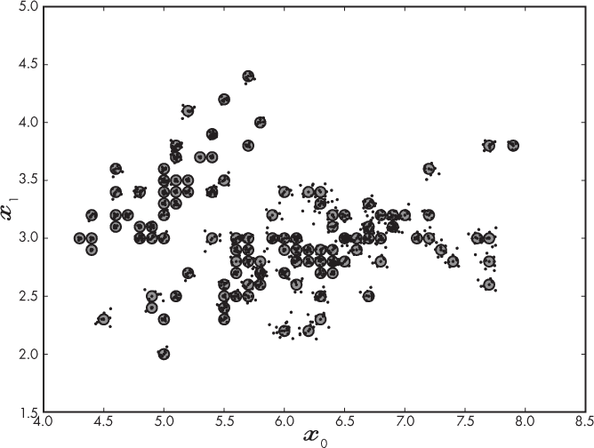

*图 5-6：原始鸢尾花（iris）数据集的前两个特征（大点）和由显示代码列表 5-6 生成的增强特征（小点）*

正如之前提到的，这种方法仅适用于连续特征，您应该小心地只修改最弱的主成分，且幅度要很小。在这里，实验至关重要。作为一个练习，请尝试将相同的技术应用于增强乳腺癌数据集，该数据集也由连续特征组成。

## 增强 CIFAR-10 数据集

增强鸢尾花数据集涉及大量的讨论和一些并不那么直观的数学问题。幸运的是，图像增强通常要简单得多，但在训练现代模型时效果同样。当我们构建卷积神经网络模型（见第 12 章）时，我们将学习如何在训练期间动态进行增强，这是一种非常有用的方法，但目前我们先进行增强，并构建包含现有图像额外版本的新数据集。

图 5-4 显示了 CIFAR-10 数据集中每个类的代表性图像。这些是作为 RGB 数据存储的彩色图像，分为红、绿、蓝通道。它们是从地面拍摄的，因此上下翻转没有意义，但左右翻转是可以的。平移——将图像在 `x` 或 `y` 方向（或两者）上移动——是一种常用技术。小角度旋转是另一种常用技术。

然而，每种方法都引发了一个问题：对于平移或旋转后没有数据的像素，该怎么办？如果我将图像向左移动 3 个像素，我需要在右侧填充三列内容。或者，如果我向右旋转，右上角和左下角会有需要填充的像素。处理这种情况有几种方法。一种是简单地将像素留为黑色（或全为 0 值），让模型学习那里没有有用信息。另一种是用图像的平均值替换像素，这同样没有提供任何信息，我们希望它会被模型忽略。然而，最流行的解决方案是裁剪图像。

图像大小为 32×32 像素。从图像中拉取一个例如 28×28 像素的随机补丁，等同于将图像在随机 `x` 或 `y` 位置上移动多达 4 个像素，而无需担心填充任何内容。如果我们先旋转图像（这需要对像素进行插值），然后裁剪掉边缘区域，那么我们再次将没有需要担心的空像素了。Keras 提供了工具，通过训练期间使用的图像生成器对象来实现这一点。当我们使用 Keras 构建模型时，将利用它，但目前我们将自己完成所有工作，以便理解这个过程。

在这里我们需要提到一点。到目前为止，我们讨论的是为模型构建构建训练集。当我们想要使用模型时，应该怎么做呢？我们是否也给模型提供测试输入的随机裁剪版本？不。相反地，我们给模型提供一个以图像为中心的裁剪。因此，对于 CIFAR-10，我们将取每个 32 ×32 的测试输入，通过删除外层 6 个像素将其裁剪为 28 ×28，然后将其呈现给模型。我们这样做是因为中心裁剪仍然代表真实的测试图像，而不是它的增强版本。

图 5-7 说明了我们所说的旋转、翻转、训练随机裁剪和测试的中心裁剪。在 (a) 中，我们旋转图像并进行中心裁剪。输出图像位于白色方框内。在 (b) 中，我们左右翻转并随机裁剪。在 (c) 中，我们在不翻转的情况下取两次随机裁剪，在 (d) 中，我们为测试进行中心裁剪，没有任何任何旋转或翻转。有些人会增强测试图像，但我们这里不会这样做。

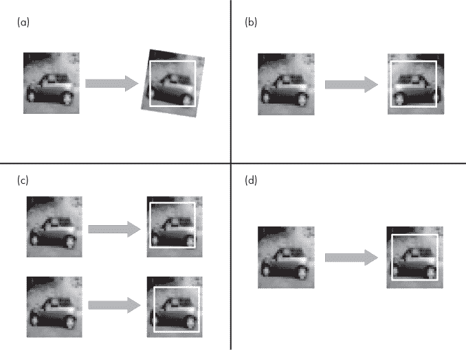

*图 5-7：旋转并中心裁剪 (a)。左右翻转并裁剪 (b)。训练时的随机裁剪 (c)。测试时的中心裁剪 (d)。* 显示代码列表 5-7 显示了如何通过随机裁剪、旋转和翻转来增强 CIFAR-10 数据集。

```python
import numpy as np
from PIL import Image

def augment(im, dim):
    img = Image.fromarray(im)
    if (np.random() < 0.5):
        img = img.transpose(Image.FLIP_RIGHT)
    if (np.random() < 0.3333):
        z = (32-dim)/2
        r = 10*np.random()-5
        img = img.rotate(r, resample=Image.BILINEAR)
        img = img.crop((z,z,32-z,32-z))
    else:
        x = int((32-dim-1)*np.random())
        y = int((32-dim-1)*np.random())
        img = img.crop((x,y,x+dim,y+dim))
    return np.array(img)

def main():
    x = np.load("../data/cifar10/cifar10_train_images.npy")
    y = np.load("../data/cifar10/cifar10_train_labels.npy")
    factor = 10
    dim = 28
    z = (32-dim)/2
    newx = np.zeros((x.shape[0]*factor, dim,dim,3), dtype="uint8")
    newy = np.zeros(y.shape[0]*factor, dtype="uint8")
    k=0
    for i in range(x.shape[0]):
        im = Image.fromarray(x[i,:])
        im = im.crop((z,z,32-z,32-z))
        newx[k,...] = np.array(im)
        newy[k] = y[i]
        k += 1
        for j in range(factor-1):
            newx[k,...] = augment(x[i,:], dim)
            newy[k] = y[i]
            k += 1
    idx = np.argsort(np.random.random(newx.shape[0]))
    newx = newx[idx]
    newy = newy[idx]
    np.save("../data/cifar10/cifar10_train_images.npy", newx)
    np.save("../data/cifar10/cifar10_train_labels.npy", newy)
```

新图像将放入 `newx` 中，其维度如下：`(500,000;28;28;3)`；其中包含 50,000 张训练图像，每张图像为 32×32 像素并有三个颜色通道。我们将增强因子设置为 10。同样，会有 500,000 个标签。计数器 `k` 将对这个新数据集进行索引。对于旧数据集中的每张图像，我们都会创建九个完全不同的版本，并对原始图像进行中心裁剪❶ ❸。

由于数据集包含图像，因此以图像形式处理数据最为简单，所以我们将当前样本转换为实际的 `PIL` 图像，以便于裁剪。这是原始图像的中心裁剪。我们将其存储在新的输出数组中。

这里有两个我们将多次看到的 Python 惯用写法。第一个是将表示图像的 `NumPy` 数组转换为 `PIL` 图像：

```python
im = Image.fromarray(arr)
```

第二个是反过来，将 `PIL` 图像转换为 `NumPy` 数组：

```python
arr = np.array(im)
```


我们必须确保 `NumPy` 数组是有效的图像数据类型，例如无符号字节（`uint8`）。使用 `astype` `NumPy` 数组方法在类型之间进行转换，请记住你对理解该转换的含义承担全部责任。

参考列表 5-7，我们正在创建当前图像的九个版本。对于其中的每一个版本，我们只需复制标签并为输出数组分配一个增强版本。我们很快会描述 `augment` 函数。一旦构建了新数据集，我们将打乱顺序并将增强后的训练数据集写入磁盘 ❸。

然而，我们工作尚未完成。我们创建了一个增强训练集，它将原始的 32 × 32 图像裁剪为 28 × 28。因此，我们至少必须裁剪原始测试集 ❹。如我们之前提到的，我们对测试数据使用中心裁剪且不进行任何增强。因此，我们只需加载测试数据集，定义新的输出测试数据集，并运行循环将 32 × 32 的图像裁剪为 28 × 28。完成后，我们将裁剪后的测试数据写入磁盘。注意，我们没有修改测试集中图像的 `order`；我们只是进行了裁剪，因此不需要为测试标签编写新文件。

`augment` 函数 ❶ 是所有操作的核心。我们立即将输入的 `NumPy` 数组转换为实际的 `PIL` 图像对象。接下来，我们以 50%-50% 的概率决定是否将图像左右翻。注意，我们还没有对图像进行裁剪。

接下来，我们询问是否应该旋转图像。我们以 33% 的概率（1/3 的机会）选择旋转。为什么是 33%？没有特别的原因，但似乎我们可能比旋转更频繁地进行随机裁剪。我们甚至可以将此概率降低到 20%（1/5 的机会）。如果我们进行旋转，我们会选择旋转角度 `[–5,5]`，然后使用双线性插值调用 `rotate` 方法，以使旋转后的图像看起来比直接使用最近邻（`PIL` 的默认值）更好。接下来，我们对旋转后的图像进行中心裁剪。

## 总结

在本章中，我们构建了四个数据集。前两个 `irises` 和 `breast cancer` 用于最近质心（Nearest Centroid）、`k`-最近邻（`k`-Nearest Neighbors）和朴素贝叶算法。最后两个 `MNIST` 和 `CIFAR-10` 用于深度学习。

如果特征选择得当，我们可能期望 `w` 维空间中的点图会将类别聚类在一起，使得所有类别 0 的样本都彼此靠近，所有类别 1 的样本也彼此靠近但与类别 0 区分开，以此类推。如果这是我们的预期，那么我们该如何利用这些知识将一个新的、未知的样本分配给特定的类别呢？当然，这正是分类的目标，但在这种情况下，由于我们假设类别在特征空间中是良好的，我们可以做些什么简单的事？

图 6-1 显示了一个包含四个不同类别的假设 2D 特征空间。在这个示例中，不同的类别被清晰地分开。一个新的未知的特征向量将作为一个点落在这个空间中。目标是给新点分配一个类别标签，方形、星形、圆形或三角形。

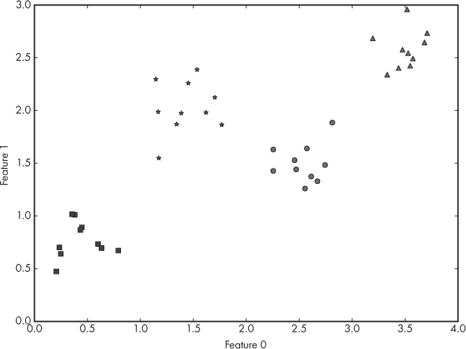

*图 6-1：包含四个不同类别的假设 2D 特征空间*

由于图 6-1 中的点聚类得如此良好，我们可能会认为可以用特征空间中的平均位置来表示每个组。与其使用 10 个方形点，我们不如用一个点来代表这些方形。这似乎是一个完全合理的做法。

事实证明，一组点的平均点有一个名称：`centroid`（质心），中心点。我们知道如何计算一组数字的平均值：将它们相加并除以加的数量。要找到 2D 空间中一组点的质心，我们首先找到所有 x 轴坐标的平均值，然后找到所有 y 轴坐标的平均值。如果有三个维度，我们将对 x、y、z 轴执行此操作。如果我们有 `w` 个维度，我们将对每个维度执行此操作。最后，我们将得到一个可以代表整个组的点。如果我们对这个示例执行此操作，就会得到图 6-2，其中质心显示为较大的标记。

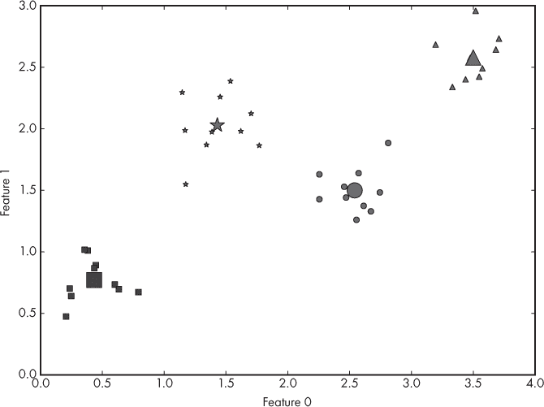

*图 6-2：包含四个不同类别及其质心的假设 2D 特征空间*

质心对我们有什么帮助呢？嗯，如果给我们一个新的、未知的样本，如之前所述，它将是特征空间中的一个点。然后我们可以测量该点与每个质心之间的距离，并分配最近的质心的类别标签。`distance`（距离）的概念有些模糊；定义距离有许多不同的方法。一种明显的方法是在两点之间画一条直线；这种距离被称为 `Euclidean distance`（欧几里得距离），它非常容易计算。如果我们有两个点（`x[0]`，`y[0]`）和（`x[1]`，`y[1]`），那么它们之间的欧几里得距离简单如下：

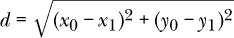

如果我们有三个维度，两点之间的距离变为：

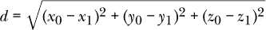

可以推广到 `w` 维的两个点 `x[0]` 和 `x[1]`，如下：

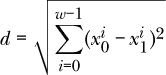

其中 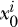 是点 `x[0]` 的第 `i` 个分量。这意味着逐分量地找到两个点之间的差异，将其平方，并将其加上所有其他分量的平方和。然后，取平方根。

图 6-3 显示了特征空间中的一个样本点以及它到质心的距离。最短距离对应圆形，因此我们将新样本分配给该类别。

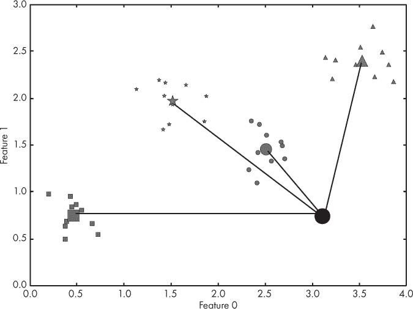

*图 6-3：包含四个不同类别、质心和一个未知样本的假设 2D 特征空间*

我们刚刚实现的过程被称为 `Nearest Centroid`（最近质心）分类。它有时也被称为 `template matching`（模板匹配）。从训练数据学习到的类别质心被用作……

### `k`-最近邻

正如我们之前看到的，质心方法的一个问题是类别可能会被划分。随着类别数量的增加，指定类别所需的质心数量也会增加。

让我们设置 `k = 3`，这是一个典型值。为了为新样本分配标签，我们在特征空间中绘制该样本，然后找到离它最近的三个训练数据点。[图 6-4] 显示了……

与其按类别计算，如果我们直接使用训练数据，并通过找到训练集中最近的成员并使用其标签为新样本选择类别呢？这种类型的分类器被称为 `Nearest Neighbor`（最近邻）分类器。如果我们只看训练集中最近的样本，我们就是在使用一个邻居，因此我们将分类器称为 `1-Nearest Neighbor` 或 `1-NN`。但我们不需要只看最近的点。我们可能查看多个点，然后投票为新样本分配最常见的类别标签。在出现平局的情况下我们可以随机选择一个类别标签。如果我们使用三个最近邻居，我们就有 `3-NN` 分类器，如果我们使用 `k` 个邻居，我们就有 `k-NN` 分类器。

当这种情况发生时，`k-NN` 算法必须做出选择。最简单的方法是随机选择一个类别标签，因为有人可能会认为这三个类别中的任何一个出现的概率都相等。或者，人们可能更强烈地相信未知样本与训练数据之间的距离价值，并选择距离最近的一个。在这种情况下，我们将 `Sample C` 标记为 `star` 类，因为它是距离它最近的训练样本。

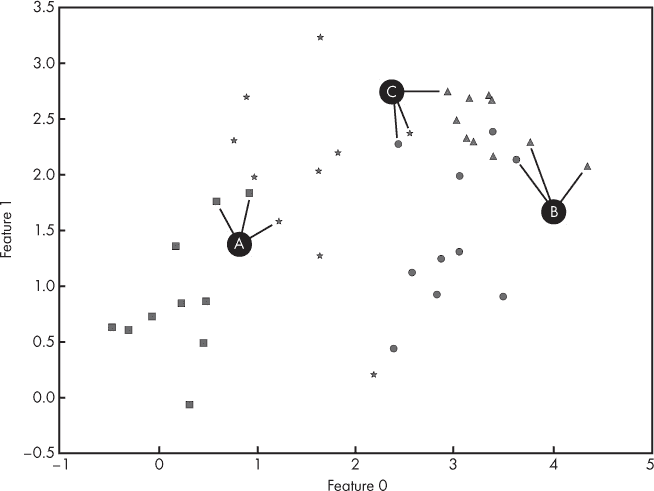

*图 6-4：对于 `k = 3`，将 `k-NN` 应用于三个未知样本 A、B 和 `C`*

`k-NN` 分类器的优点在于，训练数据就是模型——不需要任何训练步骤。当然，训练数据必须随模型一起携带，取决于训练集的大小，为新输入寻找 `k` 个最近邻居在计算上可能是昂贵的。人们几十年来一直在尝试加速邻居搜索或高效地存储训练数据，但到头来，维度灾难依然存在并且是一个问题。

然而，某些 `k-NN` 分类器的表现非常好：如果特征空间的维度很小，`k-NN` 可能具有吸引力。在训练数据的大小之间需要一种平衡，数据越多，性能越好，但搜索邻居也越费力。可能让 `Nearest Centroid`（最近质心）合适的场景也会让 `k-NN` 对某些重叠的类群更具鲁棒性。

#### 朴素贝叶斯（Naïve Bayes）

朴素分类器广泛应用于自然语言处理，实现简单且易于理解，尽管我们必须包含一些数学知识来实现它。然而，对发生过程的描述会让数学符号即使不熟悉也变得易懂。该技术使用了贝叶斯定理（参见 1763 年发表的托马斯·贝叶斯的《关于概率论某一问题的论文》）。该定理联系了概率，其现代公式为：

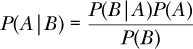

它使用了概率论中的一些数学符号，我们需要描述将如何使用该定理来实现分类器。

表达式 `P(A|B)` 表示在事件 `B` 已经发生的情况下，事件 `A` 发生的概率。在这种背景下，它被称为后验概率。同样，`P(B|A)` 表示在事件 `A` 发生的情况下，事件 `B` 发生的概率。我们称 `P(B|A)` 为给定 `A` 时 `B` 的似然。最后，`P(A)` 和 `P(B)` 分别代表无论事件 `B` 如何，事件 `A` 发生的概率，以及无论 `A` 如何，事件 `B` 发生的概率。我们称 `P(A)` 为 `A` 的先验概率。`P(B)` 是无论 `A` 如何 `B` 发生的概率。

贝叶斯定理告诉我们已经在已知某事已发生（事件 `B`）的情况下，某事（事件 `A`）发生的概率。那么这如何帮助我们分类呢？我们想知道特征向量是否属于给定类别。我们知道特征向量但不知道类别。所以如果我们有一个包含 `m` 个特征向量的数据集，每个特征向量有 `n` 个特征，`x = {x[1], x[2], x[3], …, x[n]}`，那么我们可以将贝叶斯定理中的 `B` 替换为特征向量中的每个特征。我们也可以将 `A` 替换为 `y`，即我们想要分配给新的、未知特征向量 `x` 的类别标签。定理现在看起来是这样的：

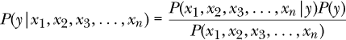

让我们解释一下。贝叶斯定理指出，如果我们知道在 `y` 是类别的情况下 `x` 为我们的特征向量的似然，并且我们知道类别 `y` 出现的频率（这是 `P(y)`，`y` 的先验概率），那么我们就可以计算特征向量 `x` 的类别为 `y` 的概率。如果我们能对所有可能的类别、所有不同的 `y` 值执行此操作，我们可以选择最高概率并将输入特征向量 `x` 标记为属于该类别 `y`。

记得训练数据集是一对 `(x(i), y(i))` 的集合，对应已知特征向量 `x(i)` 和其所属的已知类别 `y(i)`。这里的上标 `i` 用于计数训练数据集中的特征向量和标签对。现在，给定这样一个数据集，我们可以通过制作每个类别标签在训练集中出现频率的直方图来计算 `P(y)`。我们相信训练集忠实地代表了可能特征向量的父分布，这样我们就可以使用训练数据来计算使用贝叶斯定理所需的值。（参见第 4 章 获取确保数据集是良好的技巧。）

一旦我们有了 `P(y)`，我们需要知道似然 `P(x[1], x[2], x[3], …, x[n] | y)`。不幸的是，我们无法直接计算它。但一切并非没有希望：我们将做一个能让我们继续下去的假设。我们假设 `x` 中的每个特征都是统计独立的。这意味着测量某个特定 `x[1]` 的事实与任何其他 `n – 1` 个特征的值完全没有关系。这并不总是成立的，甚至在大多数情况下也不如此，但在实践中，这种假设是足够真实的，让我们能够接受。这就是为什么它被称为朴素贝叶斯，因为假设特征之间是独立的（这并不是绝对真实的，例如在图像时）。如果两个事件是独立的，它们的联合概率（即两者发生的概率）就是它们各自概率的乘积：

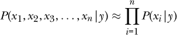

`∏` 符号意味着相乘，就像 `∑` 符号意味着相加一样。等式的右边是在说，如果我们知道某个特征（例如 `x[i]`）的概率，我们可以使用数据集计算 `P(x[i] | y)` 值。

如果我们的数据集由类别值或离散值组成（例如整数），那么类别 1 的 `x[2]` 有以下值：

```text
7, 4, 3, 1, 6, 5, 2, 8, 5, 4, 4, 2, 7, 1, 3, 3, 3, 0, 3, 4, 4, 2, 3, 4, 5, 2, 4, 2, 3, 4, 4, 1, 3, 3, 3, 2, 2, 4, 6, 5, 2, 6, 5, 2, 6, 6, 3, 5, 2, 4, 2, 4, 5, 4, 4, 5, 6, 5, 2, 5, 3, 4, 3, 1, 6, 5, 3, 4, 3, 3, 4, 1, 1, 3, 5, 4, 4, 7, 0, 6, 2, 4, 7, 4, 3, 4, 3, 5, 4, 6, 2
```

那么每个值出现的概率如下：

```text
0: 0.02
1: 0.08
2: 0.15
3: 0.20
4: 0.24
5: 0.16
6: 0.10
7: 0.04
8: 0.01
```

这是通过每个值出现的次数除以 100（数据中的总数）得到的。

这个直方图正是我们需要的 `P(x[2] | y = 1)`，即类别标签为 1 时特征 2 的概率。例如，我们可以预期类别 1 的新特征向量 `x[2] = 4` 的概率大约为 24%，`x[2] = 1` 的概率大约为 8%。

通过为每个特征和每个类别标签构建这样的表格，我们就可以完成针对分类和离散情况的分类器。对于一个新的特征向量，我们使用这些表格来找到每个特征具有该值的概率。我们将这些概率全部相乘，然后乘以该类的先验概率。对数据集中的每个 `m` 类都重复此操作，将给我们一组 `m` 个后验概率。要对新特征向量进行分类，选择这 `m` 个值中最大的一个，并分配相应的类别标签。

如果特征值是连续的，我们如何计算 `P(x[i] | y)` 呢？一种方法是对连续值进行分箱（bin），然后像离散情况一样制作表格。另一种方法是再增加一个假设。我们需要对可以测量的可能 `x[i]` 特征值的分布做出假设。大多数自然现象似乎遵循正态分布。我们在第一章中讨论过正态分布。那么，假设所有特征都遵循正态分布。正态分布由其均值（`μ`，mu）和标准差（`σ`，sigma）定义。均值就是如果我们反复从分布中抽取样本时预期的平均值。标准差是衡量分布宽窄程度的指标——即它围绕均值的离散程度。

从数学上讲，我们要做的是对于特征向量中的每个特征，如下替换每个 `P(x[i] | y)`：

```text
P(x[i] | y) ≈ N(μ[i], σ[i])
```

这里 `N(μ[i], σ[i])` 是表示一个以某些均值（`μ`）为中心并由离散程度（`σ`）定义的正态分布。

我们并不真正知道精确的 `μ` 和 `σ` 值，但可以从训练数据中近似估计它们。例如，假设训练数据包含 25 个样本，其类别标签为 0。此外，假设在这些情况下，特征 3（即 `x[3]`）的数值如下：

```text
0.21457111, 4.3311102, 5.50481251, 0.80293956, 2.5051598,
2.37655204, 2.4296739, 2.84224169, -0.11890662, 3.18819152,
1.6843311, 4.05982237, 4.14488722, 4.29148855, 3.22658406,
6.45507675, 0.40046778, 1.81796124, 0.2732696, 2.91498336,
1.42561983, 2.73483704, 1.68382843, 3.80387653, 1.53431146
```


那么在为类别 0 的特征 3 设置正态分布时，我们将使用 `μ[3] = 2.58` 和 `σ[3] = 1.64`，因为这些值的平均值是 2.58，而标准差（围绕均值的离散程度）是 1.64。

当给分类器一个新的未知样本时，我们将使用以下方程计算在实际类别为类别 0 时，给定 `x[3]` 发生的概率。

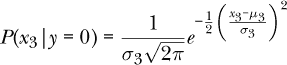

该方程来自均值为 `μ`、标准差为 `σ` 的正态分布定义。它表示在类别为 `y` 的情况下，特定特征值的概率围绕我们从训练数据中测得的均值，按照正态分布分布。这是我们在特征独立性假设的基础上所做的另一个假设。

我们对未知特征向量中的每个特征都使用该方程。然后，我们将得到的概率相乘，并将该值乘以类别 0 发生的先验概率。我们对每个类重复此过程。最后，我们将得到 `m` 个数字，即特征向量属于 `m` 个类中每一类的概率。为了做出最终决定，我们将像之前所做的那样：选择这些概率中最大的一个，并将输入标记为相应的类别。

某些读者可能会抱怨我们忽略了贝叶斯定理的分母。我们这样做是因为它在所有计算中都是一个常数，而且由于我们总是选择最大的后验概率，我们实际上并不在乎是否将每个值除以一个常数。无论如何，我们选择的类别标签将是相同的。

上述描述的过程正是决策树在创建后被使用的方式。对于任何新的特征向量，都会从根节点开始提出一系列问题，并不断遍历树，直到到达叶子节点以决定类别标签。这是一种易于人类理解的分类过程方法，这也是为什么在了解类别分配的“为什么”与类别分配本身同样重要的情况下，决策树是非常实用的。决策树可以解释其自身。

使用决策树非常简单，但树最初是如何创建的呢？与前几节中的简单算法不同，树的构建过程要复杂得多，但又未复杂到我们无法遵循主要步骤，从而对定义树所包含的内容建立直觉的程度。

### 递归原理

然而，在讨论决策树算法之前，我们需要讨论`recursion`（递归）的概念。如果你熟悉计算机科学，你可能已经知道树形数据结构和递归是紧密相连的。如果不熟悉，不要担心；递归是一个直观但强大的概念。递归算法的本质是算法在不同层级上重复自身。当在编程语言中实现为函数时，这通常意味着该函数在一个较规模的问题上调用自己。自然地，如果函数无限地调用自身，就会产生无限循环，因此递归需要一个停止条件——即告诉我们不再需要递归的条件。

让我们从数学角度引入递归的概念。整数`n`的阶乘记作`n!`，定义为：

`n! = n(n – 1)(n – 2)(n – 3) . . . (n – n + 1)`

这意味着将从 1 到 `n` 的所有整数相乘。根据定义，`0! = 1`。因此，5 的阶乘是 120，因为

`5! = 5 × 4 × 3 × 2 × 1 = 120`

如果我们观察 `5!`，会发现它仅仅是 `5 × 4!`，或者通俗地说，`n! = n × (n – 1)!`。现在，让我们利用这个见解写一个 Python 函数来递归计算阶乘。代码非常简单，这也是许多递归函数的特征，如 Listing 6-1 所示。

```python
def fact(n):
    if (n <= 1):
        return 1
    else:
        return n*fact(n-1)
```

*Listing 6-1: 计算阶乘*

该代码直接实现了这一规则：`n`的阶乘是`n`乘以`n – 1`的阶乘。要找到`n`的阶乘，我们首先询问`n`是否为 1。如果是，我们知道阶乘是 1，因此返回 1——这就是我们的停止条件。如果 `n` 不是 1，我们就知道`n`的阶乘仅仅是`n`乘以`n-1`的阶乘，我们通过将 `n-1` 作为参数调用 `fact` 来找到。

### 构建决策树

构建决策树的算法也是递归的。让我们从高层来看一下发生了什么。算法从根节点开始，确定该节点的适当规则，然后在左分支和右分支上调用自己。对左分支的调用将再次开始，就像左分支是根节点一样。这将一直持续，直到满足停止条件。

对于决策树来说，停止条件是叶子节点（我们将讨论决策树如何判断下一步是否创建叶子节点）。一旦创建了叶子节点，递归终止，算法返回该叶子节点的父节点并在右分支上调用自己。算法随后重新开始，就像右分支是根节点一样。一旦两个递归调用都终止，并且节点已经创建，算法就会继续，直到树构建完成。

- 通过*有放回*地选取样本对训练集进行重采样
- 选择随机特征子集

如果我们有一组分类器，每个分类器都在不同的数据上进行训练，或者类型不同（例如 `k`-NN 和朴素贝叶斯），我们可以利用它们的输出对分配给任何特定未知样本的实际类别进行投票。这被称为 `ensemble`（集成），随着分类器数量的增加，收益会递减，但它通常会提高到优于任何单个分类器的性能。我们可以采用类似的思路，想象一个由决策树组成的集成，或 `forest`（森林），但除非我们对训练集进行进一步处理，否则我们拥有的将是一个*完全*相同的树的森林，因为一组特定的训练示例始终会导致完全相同的决策树。创建决策树的算法是确定性的——它总是返回相同的结果。

处理你必须面对的训练集中的特定统计细微差别的一种方法，是从原始训练集中选择一个新的训练集，但允许同一个训练集样本被选择多次。这就是有放回的选择。可以将其想象为从袋子里挑选彩色珠子，但在你选择下一颗珠子之前，将刚刚选中的那颗放回袋中，这样你可能会再次选到它。以这样选择的新数据集被称为 `bootstrap sample`（自助样本）。以这种方式构建新数据集集合被称为 `bagging`（袋装法），而由这些重采样数据集集合构建的模型则构成了随机森林。

如果我们训练多棵树，每棵树都使用有放回的重采样训练集，我们将得到一个树森林，每棵树都与其他略有不同。单是此点结合集成投票就可能改进情况。然而，存在一个问题。如果某些特征具有高度预测性，它们将占据主导地位，生成的树森林之间将非常相似，因此会遭受非常相似的缺点。这就是“Random Forest”（随机森林）中“随机”发挥作用的地方。

不仅仅是 bagging（它改变了每棵树训练集中样本的分布，但没有改变检查的特征集），如果我们还为森林中的每棵树随机选择*特征*本身的子集并基于这些特征进行训练将会怎样？这将打破树之间的相关性，并增加森林的整体健壮性。在实践中，如果每个特征向量有 `n` 个特征，每棵树将随机选择 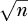 特征来构建树。`sklearn` 也支持随机森林。

## 支持向量机

我们最后一个经典的机器学习模型是那个在 20 世纪 90 年代大部分时间里抑制了神经网络的模型，`Support Vector Machine (SVM)`（支持向量机）。如果说神经网络是一种高度数据驱动的、生成模型的经验性方法，那么 `SVM` 则是一种非常优雅、基于数学基础的方法。我们将从概念层面讨论 `SVM` 的性能，因为涉及的数学超出了我们在这里想要介绍的范围。如果你感兴趣，经典参考文献是 Cortes 和 Vapnik (1995) 写的《Support-Vector Networks》。

我们可以通过对边界（margins）、支持向量（support vectors）、优化和核（kernels）概念的直观理解，来总结支持向量机的作用。让我们逐一查看每个概念。

#### 边界

图 6-8 显示了一个双分类数据集。

在 SVM 的情况下，超平面的方向可以通过一个向量来指定，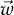。我们还有一个偏移量 `b` 必须找到它。最后，在进行优化之前，我们需要更改类别标签的指定方式。不再使用 0 或 1 作为 `y[i]`（即第 `i` 个训练样本 `x[i]` 的标签），而是将使用 -1 或 +1。这能让我们能够更简单地定义优化问题的条件。

因此，从数学角度来说，我们想要找到  和 `b`，使得在数据集中所有 `y[i]` 标签和 `x[i]` 训练向量满足 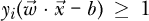 的情况下，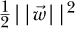 尽可能小。这类优化问题可以通过一种名为 `quadratic programming` 规划的技术轻松解决。（我们在这里忽略了另一个重要的数学步骤：实际求解的优化问题使用了拉格朗日函数来求解对偶形式，但再次，我们将尽量避免让问题变得复杂。）

上述表述适用于数据集（假设只有两个类）可以被超平面分离的情况。这是线性可分的情况。实际上，正如我们现在所理解，并不是每一个数据集都能以这种方式分离。因此，优化问题的完整形式包含一个修正因子 `C`，它会影响找到的边界的大小。该因子出现在 `sklearn` 的 SVM 类中，并且需要指定到某种程度。从实际角度来看，`C` 是 SVM 的一个 `hyperparameter`（超参数），我们需要设置这个值以便 SVM 正常训练。`C` 的正确值取决于问题。通常，模型中任何不是由模型学习、但在使用模型时必须设置的参数（例如 SVM 的 `C` 或 k-NN 的 `k`）都是超参数。

## 核函数

我们还需要引入另一个数学概念，并带有适当的简化性描述。之前的描述针对线性 SVM，并直接使用训练数据（即 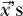）。非线性情况通过通过一个函数将训练数据映射到另一个空间，该函数通常被称为 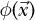，它产生一个新版本的训练数据向量 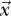。SVM 算法使用内积 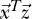，这意味着映射后的版本将使用 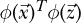。在这种表示法中，向量被视为一列数字，因此转置矩阵 `T` 会产生一个行向量。然后，一个 1 × `n` 行向量和一个 `n` × 1 列向量的标准矩阵乘法将得到一个 1 × 1 的输出，即一个标量。内积通常写为：

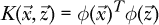

函数 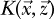 被称为 `kernel`（核）。线性核仅仅是 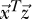，但也其他可能的核。`Gaussian kernel`（高斯核）是一种流行的核，也称为 `radial basis function (RBF)` 核。在实际使用中，该核除了 `C` 之外还引入了一个新参数 `γ`。该参数与高斯核围绕特定训练点的扩散程度有关，值越小，训练样本的影响范围越广。通常，人们会对 `C` 以及（如果使用 RBF 核的话）`γ` 进行网格搜索，以定位性能最好的模型。

总结来说，支持向量机使用通过核函数映射的训练数据来优化超平面的方向和位置，从而在超平面与训练数据的支持向量之间产生最大间隔。用户需要选择核函数以及相关参数（如 `C` 和 `γ`），以便模型能够完美拟合训练数据。

在深度学习出现之前，支持向量机在 20 世纪 90 年代和 21 世纪初统治了机器学习。这是因为它们训练效率高，不需要大量的计算资源就能成功。然而，随着深度学习的到来，SVM 在某种程度上被边缘化了，因为强大的计算机使得神经网络能够以前在有限计算资源下无法完成的任务。尽管如此，SVM 仍然占有一席之地。一种流行的方法是使用在特定数据集上训练的大型神经网络作为另一个数据集的预处理器，然后在神经网络的输出（减去顶层）上训练一个 SVM 进行后续处理。

## 总结

在本章中，我们介绍了六种最常见的经典机器学习模型：最近质心（Nearest Centroid）、`k`-NN、朴素贝叶斯（Näive Bayes）、决策树（Decision Tree）、随机森林（Random Forest）和 SVM。这些模型之所以是经典的，是因为它们已经使用了几十年。如果它们所支持的最优条件存在，它们仍然是相关的。在某些情况下，经典模型仍然是正确的选择。丰富的机器学习从业者将知道何时该回归经典模型。

在下一章中，我们将通过 `sklearn` 使用这些模型中的每一个进行一系列实验，这些实验将建立我们对模型如何工作以及何时使用它们的直觉。

# 7 经典模型的实验


在第 6 章中，我们介绍了几种经典机器学习模型。现在让我们利用在第 5 章中构建的数据集，并结合这些模型使用，看看它们的性能如何。我们将使用 `sklearn` 创建模型，然后通过观察它们在留存集（held-out sets）上的表现来对它们进行比较。这将让我们对如何使用 `sklearn` 有一个很好的概述，并帮助我们建立不同模型之间的直觉。我们将使用三个数据集：鸢尾花（iris）数据集（包括原始版和增强版）；乳腺癌数据集；以及 MNIST 数据集的向量形式。

### 鸢尾花数据集实验

我们将从鸢尾花数据集开始。该数据集具有连续特征——花萼长度、花萼宽度、花瓣长度和花瓣宽度的测量值——以及三个类别——不同的物种。共有 150 个样本，每个类 50 个。在第 5 章中，我们对数据集进行了增强，因此我们实际上有两个版本可以使用：原始的 150 个样本和 120 个增强训练样本。我们将使用 `sklearn` 来实现我们在第 6 章中概述的最近质心、`k`-NN、朴素贝叶斯、决策树、随机森林和 SVM 模型。我们将迅速发现 `sklearn` 工具包的强大和优雅，因为我们的测试代码几乎是完全相同的。唯一改变的是实例化的特定类。

#### 测试经典模型

初始测试的代码位于列表 7-1。

```python
ya_test = np.load("../data/iris/iris_test_labels_augmented.npy")

print("Nearest Centroid:")
run(x_train, y_train, x_test, y_test, NearestCentroid())

print("k-NN classifier (k=3):")
run(x_train, y_train, x_test, y_test,
    KNeighborsClassifier(n_neighbors=3))

print("Naive Bayes classifier (Gaussian):")
run(x_train, y_train, x_test, y_test, GaussianNB())

print("Naive Bayes classifier (Multinomial):")
run(x_train, y_train, x_test, y_test, MultinomialNB())

print("Decision Tree classifier:")
run(x_train, y_train, x_test, y_test, DecisionTreeClassifier())

print("Random Forest classifier (estimators=5):")
run(xa_train, ya_train, xa_test, ya_test,
    RandomForestClassifier(n_estimators=5))

print("SVM (linear, C=1.0):")
run(xa_train, ya_train, xa_test, ya_test, SVC(kernel="linear", C=1.0))

print("SVM (RBF, C=1.0, gamma=0.25):")
run(xa_train, ya_train, xa_test, ya_test,
    SVC(kernel="rbf", C=1.0, gamma=0.25))

print("SVM (RBF, C=1.0, gamma=0.001, augmented)")
run(xa_train, ya_train, xa_test, ya_test,
    SVC(kernel="rbf", C=1.0, gamma=0.001))

print("SVM (RBF, C=1.0, gamma=0.001, original)")
run(x_train, y_train, x_test, y_test,
    SVC(kernel="rbf", C=1.0, gamma=0.001))
```


## 列表 7-1：使用鸢尾花数据集的经典模型

请查看`iris_experiments.py`。

首先，我们导入了必要的类和模块。注意，每个类都代表一种类型的模型（分类器）。对于朴叶贝叶斯分类器，我们使用了两个版本：高斯版本`GaussianNB`（因为特征是连续值），以及用于离散情况的`MultinomialNB`，以此说明选择与我们工作的数据集不匹配的模型产生的影响。

由于`sklearn`的分类器具有统一的接口，我们可以使用同一个函数来训练和测试任何特定的分类器从而简化操作。该函数是`run`❶。我们传入了训练特征（`x_train`）和标签（`y_train`），以及测试特征和标签（`x_test`、`y_test`）。我们还传入了特定的分类器对象（`clf`）。

我们在`run`内部执行的第一件事是通过带有训练数据样本和标签的`fit`方法来训练模型。这是训练步骤。训练完成后，我们可以通过调用`predict`方法并传入留出的测试数据来测试其性能。该方法返回测试数据中每个样本的预测类别标签。

我们从原始的 150 个样本中留出了 30 个，因此`predict`将返回一个包含 30 个类别标签分配的向量，并将其打印出来。接下来，我们打印实际测试标签，以便与预测结果进行直观对比。最后，我们使用`score`方法，利用已测试标签（`y_test`）将分类器应用于测试数据（`x_test`），以计算整体准确率。

准确率以 0 到 1 之间的分数返回。如果每个测试样本都被赋予错误的标签，准确率将为 0。

第一个是线性 SVM，这意味着我们需要一个间隔常数值（`C`）。我们将`C`定义为`1.0`，这是`sklearn`的默认值。这个分类器在测试数据上的表现是完美的，接下来的使用高斯核的分类器也是如此，我们将`γ`也设为`0.25`。

`SVC`类的`gamma`默认值为`auto`，这会将`γ`设置为`1/n`，其中`n`是特征的数量。对于鸢尾花（iris）数据集，`n = 4`，因此`γ = 0.25`。

接下来，我们训练了一个具有非常`γ`的模型。该分类器在测试数据上依然是完美的。最后，我们训练相同类型的 SVM，但没有使用增强后的训练数据，而是使用了原始训练数据❽。这个分类器并不完美：

```text
SVM (RBF, C=1.0, gamma=0.001, original)

predictions: [022202020222222202202202202220]

actual labels: [011202120211112202201101102211]

score = 0.5667
```

事实上，这个结果相当惨不忍睹。它从未预测类别 1，且准确率只有 56.7%。这表明数据增强是有价值的，因为它将一个糟糕的分类器变成了一个良好的分类器——至少，从我们所使用的这个较小的测试集来看，它已经足够好了！

## 实现一个最近质心分类器

如果我们被困在荒岛上且无法使用`sklearn`会该呢？我们还能为鸢尾花数据集快速构建一个适的分类器吗？答案是“肯定的”，如列表 7-2 所示。这段代码为鸢尾花数据集实现了一个快速快捷的最近质心分类器。

```python
import numpy as np

def centroids(x,y):

    c0 = x[np.where(y==0)].mean(axis=0)

    c1 = x[np.where(y==1)].mean(axis=0)

    c2 = x[np.where(y==2)].mean(axis=0)

    return [c0,c1,c2]

def predict(c0,c1,c2,x):

    p = np.zeros(x.shape[0], dtype="uint8")

    for i in range(x.shape[0]):

        d = [((c0-x[i])**2).sum(),

             ((c1-x[i])**2).sum(),

             ((c2-x[i])**2).sum()]

        p[i] = np.argmin(d)

    return p

def main():

    x = np.load("../data/iris/iris_features.npy")

    y = np.load("../data/iris/iris_labels.npy")

    N = 120

    x_train = x[:N]; x_test = x[N:]

    y_train = y[:N]; y_test = y[N:]

    c0, c1, c2 = centroids(x_train, y_train)

    p = predict(c0,c1,c2, x_test)

    nc = len(np.where(p == y_test)[0])

    nw = len(np.where(p != y_test)[0])

    acc = float(nc) / (float(nc)+float(nw))

    print("predicted:", p)

    print("actual   :", y_test)

    print("test accuracy = %0.4f" % acc)
```

列表 7-2：用于鸢尾花数据集的快速快捷的最近质心分类器。参见`iris_centroids.py`。

我们加载鸢尾花数据并将其分为训练集和测试集❸。`centroids`函数返回三个类的质心❶。我们可以通过寻找目标类别每个训练样本的特征均值来轻松计算这些质心。训练这个模型只需要这些。

如果我们将返回的质心与之前的`NearestCentroid`分类器（见`centroids_`变量）相比，得到完全相同的值。使用该分类器非常简单，如`predict`所示❷。

首先，我们定义预测向量，每个测试样本（`x`）对应一个。循环定义了`d`，一个从当前测试样本`x[i]`到三个质心的欧几里得距离向量。`d`中最小距离的索引就是预测的类别（`p[i]`）。

让我们更详细地拆解`d`。我们将`d`设置为包含三个值的列表，即从质心到当前样本的距离`((c0-x[i])**2).sum()`有点密集。

短语`c0-x[i]`返回一个包含四个数字的向量，因为我们有四个特征。这些是类别 0 的质心与测试样本值之间的差异。该值被平方，即对这四个值中的每个都进行平方。这个平方后的向量按元素求和，以返回距离度量。

严格来说，我们还缺少了最后一步。`c0`和`x[i]`之间的实际距离是该值的平方根。由于我们只需要寻找到每个质心的最小距离，因此不需要计算平方根。无论我们是否对所有值取平方根，最小值仍然是最小值。

运行这段代码产生的输出与我们之前看到的最近质心分类器的输出相同，这令人鼓舞。鸢尾花数据集非常简单，所以我们不应该对模型的优异性能感到惊讶，尽管我们看到粗心选择模型类型和超参数会带来麻烦。

现在让我们观察具有更多特征的大型数据集，一个不是作为玩具的数据集。

### 乳腺癌数据集的实验

我们在第 5 章中开发的二分类乳腺癌数据集有 569 个样本，每个样本有 30 个特征，全部是来自组织学切片的测量值。有 212 个恶性病例（类别 1）和 357 个良性病例（类别 0）。

在这个数据集上训练我们的经典模型，看看得到什么样的结果。由于特征是连续的，让我们使用数据集的归一化版本。记得，归一化数据集是指特征向量中每个特征的每个值减去该特征的均值，然后除以标准差：

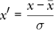

数据集的归一化将所有特征映射到相同的范围内，使得一个特征的值与另一个值相似。这是我们在第 4 章中讨论的典型预处理步骤，有助于许多模型类型。

#### 初始运行

首先，我们将使用单次划分进行快速运行，正如我们在之前的节中所做的。代码在列表 7-3 中，传入模型实例，然后使用测试数据进行评分。

```python
import numpy as np

from sklearn.neighbors import NearestCentroid
from sklearn.neighbors import KNeighborsClassifier
from sklearn.naive_bayes import GaussianNB, MultinomialNB
from sklearn.tree import DecisionTreeClassifier
from sklearn.ensemble import RandomForestClassifier
from sklearn.svm import SVC

def run(x_train, y_train, x_test, y_test, clf):

    clf.fit(x_train, y_train)

    print("  score = %0.4f" % clf.score(x_test, y_test))

print()

def main():

    x = np.load("../data/breast/bc_features_standard.npy")

    y = np.load("../data/breast/bc_labels.npy")

    N = 455

    x_train = x[:N]; x_test = x[N:]

    y_train = y[:N]; y_test = y[N:]

    print("Nearest Centroid:")

    run(x_train, y_train, x_test, y_test, NearestCentroid())

    print("k-NN classifier (k=3):")

    run(x_train, y_train, x_test, y_test, KNeighborsClassifier(n_neighbors=3))

    print("k-NN classifier (k=7):")

    run(x_train, y_train, x_test, y_test, KNeighborsClassifier(n_neighbors=7))

    print("Naive Bayes classifier (Gaussian):")

    run(x_train, y_train, x_test, y_test, GaussianNB())

    print("Decision Tree classifier:")

    run(x_train, y_train, x_test, y_test, DecisionTreeClassifier())

    print("Random Forest classifier (estimators=5):")

    run(x_train, y_train, x_test, y_test, RandomForestClassifier(n_estimators=5))

    print("Random Forest classifier (estimators=50):")

    run(x_train, y_train, x_test, y_test, RandomForestClassifier(n_estimators=50))

    print("SVM (linear, C=1.0):")

    run(x_train, y_train, x_test, y_test, SVC(kernel="linear", C=1.0))

    print("SVM (RBF, C=1.0, gamma=0.03333):")

    run(x_train, y_train, x_test, y_test, SVC(kernel="rbf", C=1.0, gamma=0.03333))
```

# 列表 7-3：使用乳腺癌数据集的初始模型

参见`bc_experiments.py`。

与之前一样，我们加载数据集将其分为训练数据和测试数据。我们保留了 569 个样本中的 455 个用于训练（80%），剩余的 114 个样本作为测试集（74 个良性，40 个恶性）。数据集已经经过随机化，因此我们在这里跳过该步骤。

然后我们训练了九种模型：最近质心（1）、`k`-NN（2）、朴素贝叶斯（1）、决策树（1）、随机森林（2）、线性 SVM（1）以及 RBF SVM（1）。

对于支持向量机，我们使用默认的`C`值，对于`γ`，我们使用`1/30 = 0.033333`，因为我们有 30 个特征。运行这段代码可以得到我们在表 7-1 中的得分。

**表 7-1：**乳腺癌模型得分

| 模型类型 | 得分 |
| --- | --- |
| 最近质心 | 0.9649 |
| 3-NN 分类器 | 0.9912 |
| 7-NN 分类器 | 0.9737 |
| 朴素贝叶斯（高斯） | 0.9825 |
| 决策树 | 0.9474 |
| 随机森林（5） | 0.9298 |
| 随机森林（50） | 0.9737 |
| 线性 SVM（C = 1） | 0.9737 |
| RBF SVM（C = 1，`γ` = 0.03333） | 0.9825 |

注意随机森林分类器括号中的数字是估计数量（森林中树的数量）。

有些点引起了我们的注意。首先，可能令人惊讶的是，简单的最近质心分类器的准确率接近 97%。我们还看到，除了决策树和五棵树的随机森林外，所有其他分类器的表现都比最近质心好。

有些意外的是，朴素贝叶斯分类器的表现非常好，与 RBF SVM 持平。`k = 3`的最近邻分类器表现最好，准确率达到 99%，尽管我们有 30 个特征，这意味着我们的 569 个样本是分散在 30 维空间中的点。

记住，`k`-NN 的弱点是维度灾难：随着特征数量的增加，它需要越来越多的训练样本。所有分类器的结果都很好，这提示我们对于这个数据集来说，恶性和良性之间的分离是明显的。使用这些特征时，两类之间没有多少重叠。

那么，我们处理完这个数据集了吗？并没有！事实上，我们刚刚开始。如果我们第二次运行代码会发生什么？我们会得到相同的得分吗？我们会预期如此吗？第二次运行给了我们表 7-2。

**表 7-2：**乳腺癌得分，第二次运行

| 模型类型 | 得分 |
| --- | --- |
| 最近质心 | 0.9649 |
| 3-NN 分类器 | 0.9912 |
| 7-NN 分类器 | 0.9737 |
| 朴素贝叶斯（高斯） | 0.9825 |
| 决策树 | **0.9386** |
| 随机森林（5） | **0.9474** |
| 随机森林（50） | **0.9649** |
| 线性 SVM（C = 1） | 0.9737 |
| RBF SVM（C = 1，`γ` = 0.03333） | 0.9825 |

我们加亮了发生变化的得分。为什么会发生变化呢？稍微思考一下产生了一个*哈！*的时刻：随机森林顾名其是随机的，所以我们自然预期每次运行的结果会有不同。

那么决策树呢？在`sklearn`中，决策树分类器会随机选择一个特征并找到最佳分割点，因此不同的运行也会导致不同的树。这就是我们在第 6 章中讨论过的树类分类器。其他的都是固定的。

### 随机划分的影响

让我们改变种子看看发生什么。我们将使用`np.random.seed(12345)`来确保随机性可重复，但我们重新排列了数据。

```python
np.random.seed(12345)

idx = np.argsort(y)

x = x[idx]

y = y[idx]
```

然后我们再次划分数据。这得到了我们在表 7-3 中的结果。

**表 7-3：**随机化数据集后的乳腺癌得分

| 模型类型 | 得分 |
| --- | --- |
| 最近质心 | 0.9474 |
| 3-NN 分类器 | 0.9912 |
| 7-NN 分类器 | 0.9912 |
| 朴素贝叶斯（高斯） | 0.9474 |
| 决策树 | 0.9474 |
| 随机森林（5） | 0.9912 |
| 随机森林（50） | 1.0000 |
| 线性 SVM（C = 1） | 0.9649 |
| RBF SVM（C = 1，`γ` = 0.03333） | 0.9737 |

注意这些与我们之前的结果完全不同。`k`-NN 分类器都一样好，SVM 分类器表现更差，而 50 棵树的随机森林在测试集上达到了完美。

然而，在我们将`k`-折交叉验证应用于乳腺癌数据集之前，我们应该注意到一个至关重要的点。我们修改了列表 7-3 中的代码以固定伪随机数种子，这样我们在每次运行代码时都能以完全相同的方式重新排列数据集。然后我们运行了代码并看到了结果。

如果我们重新运行代码，我们将得到`exactly`相同的输出，即使对于基于树的分类器也是如此。这与我们之前看到的不同。树分类器是`stochastic`的——它们每次都会生成唯一的树或森林——因此我们应该预期结果在每次运行之间有所不同。

但现在它们没有变化；我们每次都得到相同的输出。通过显式设置`NumPy`伪随机数种子，我们不仅固定了数据集的顺序，还固定了`sklearn`用于生成树模型时使用的`pseudorandom sequence`顺序。这是因为`sklearn`也在使用`NumPy`伪随机数生成器。

这是一个微妙的影响，但可能会产生严重的后果，在更大的项目中可能很难被发现是一个错误。解决方案是在完成数据集重新排序后，将种子设置为随机值。我们可以在`y = y[idx]`之后添加一行来实现：

```python
np.random.seed()
```


这样伪随机数生成器就会使用系统状态（通常从`/dev/urandom`读取）进行重置。现在当我们再次运行时，我们将像以前一样为树模型获得不同的结果。

## 添加 k-折交叉验证

为了实现`k`-折交叉验证，我们首先需要为`k`取一个值。我们的数据集有 569 个样本。我们希望对其进行划分，使得每折都有相当数量数量，因为我们希望测试集是数据的合理代表。这倾向于让`k`较小。然而，我们也希望平均掉糟糕划分的影响，因此我们可能希望`k`大一些。和生活中的大多数事情一样，必须寻找一种平衡。如果我们设置`k = 5`，每次划分将获得 113 个样本（忽略最后的四个样本，它们不应该产生任何性影响）。这使得每种折的组合都留有 80% 用于训练，20% 用于测试，这是一个合理的做法。因此，我们将使用`k = 5`，但我们会编写代码，以便在需要时更改`k`。

我们已经有一种在训练/测试划分上训练多个模型的方法。我们只需要添加代码来生成每个`k`折中的每一折，然后在它们上训练模型。代码在 Listing 7-4 和 Listing 7-5 中，分别显示了辅助函数和主函数。让我们从 Listing 7-4 开始。

```python
import numpy as np  

from sklearn.neighbors import NearestCentroid  

from sklearn.neighbors import KNeighborsClassifier  

from sklearn.naive_bayes import GaussianNB, MultinomialNB  

from sklearn.tree import DecisionTreeClassifier  

from sklearn.ensemble import RandomForestClassifier  

from sklearn.svm import SVC  

import sys  

def run(x_train, y_train, x_test, y_test, clf):  
    clf.fit(x_train, y_train)  
    return clf.score(x_test, y_test)  

def split(x,y,k,m):  
    ns = int(y.shape[0]/m)  
    s = []  
    for i in range(m):  
        s.append((x[ns*i:ns+ns], y[ns*i:ns+ns]))  
    x_test, y_test = s[k]  
    x_train = []  
    y_train = []  
    for i in range(m):  
        if (i==k):  
            continue  
        else:  
            a,b = s[i]  
            x_train.append(a)  
            y_train.append(b)  
    x_train = np.array(x_train).reshape(((m-1)*ns,30))  
    y_train = np.array(y_train).reshape((m-1)*ns)  
    return x_train, y_train, x_test, y_test  

def pp(z,k,s):  
    m = z.shape[1]  
    print("%-19s: %0.4f +/- %0.4f | " % (s, z[k].mean(), z[k].std()/np.sqrt(m)), end='')  
    for i in range(m):  
        print("%0.4f " % z[k,i], end='')  
    print()
```


### 列表 7-4：使用 `k` 折交叉验证评估乳腺癌数据集——辅助函数

参见 `bc_kfold.py`。

列表 7-4 包含了我们之前使用的所有模块，然后定义了三个函数：`run`、`split` 和 `pp`。

`run` 函数看起来很熟悉。它接受一个训练集、测试集和一个模型实例，训练模型，然后根据测试集对模型进行评分。

`pp` 函数是一个格式化打印函数，用于显示每折的得分以及平均值和标准差。记住，`sklearn` 的得分是模型在测试集上的准确率。完美的结果是 `1.0`，完全失败是罕见的，因为即使随机猜测也会达到某些比例。

列表 7-4 中唯一有趣的函数是 `split`。它的参数是整个数据集 `x`、标签 `y`、当前折数 `k` 和折的总数 `m`。我们将整个数据集划分为 `m` 个集合，并将第 `k` 折作为测试集，这样我们设置了每折的样本数。循环将剩余的 `m-1` 折合并到训练集中。

循环结束后，`x_train` 是一个列表，其中的每个元素都是我们想要用于训练的特征向量。因此，我们首先将该列表转换为 `NumPy` 数组并进行重塑，使得 `x_train` 具有 30 列，其中 `n[s]` 是每折的样本数。这样，`x_train` 就变成了去除测试集后的样本。

列表 7-5 显示了如何使用这些辅助函数。

### 列表 7-5：使用 `k` 折交叉验证评估乳腺癌数据集——主代码

参见 `bc_kfold.py`。

我们在 `main` 中执行的第一项工作是加载完整数据集并随机化排序。折数数量 `m` 从命令行读取，并用于创建输出数组 `z`。该数组存储了我们要训练的 8 个模型中每个模型的每折得分，因此其形状为 8 × `m`。

回想一下，从命令行运行 Python 脚本时，传递在脚本名称后的任何参数在 `sys.argv` 中可用，它是一个字符串列表。这就是为什么将参数传递给 `int`，以将其转换为整数。

接下来，我们遍历 `m` 个折，其中 `k` 是我们将用作测试数据的折数。我们创建划分（`split`），然后使用该划分来训练我们之前训练过的 8 种不同类型的模型。每次调用 `run` 都会训练一个传入类型的模型，并返回运行该模型、将第 `k` 折作为测试数据时所得到的得分。我们将这些结果存储在 `z` 中。

最后，我们使用 `pp` 显示每个模型类型每折的得分，以及所有折的平均得分。

该代码的示例运行（当 `k = 5` 且仅显示跨折平均分时）结果如表 7-4 所示：

| 模型 | 平均得分 |
| --- | --- |
| 最近质类 | 0.9299 ± 0.0107 |
| 3-NN | 0.9663 ± 0.0113 |
| 7-NN | 0.9655 ± 0.0110 |
| 朴素贝叶斯 | 0.9330 ± 0.0095 |
| 决策树 | 0.9257 ± 0.0276 |
| 随机森林（5） | 0.9484 ± 0.0213 |
| 随机森林（50） | 0.9588 ± 0.0135 |
| SVM（线性） | 0.9719 ± 0.0136 |

这里我们展示了每个模型在所有折上的平均性能。理解结果的一种方法是：如果我们使用数据集中的所有数据来训练模型，并用来自相同父分布的新样本对其进行测试，那么我们预期的每个模型类型的性能应该是这种水平。事实上，在实践中，我们正是这样做的，因为我们可以假设创建该模型的初衷是为了将来将其用于某种目的。

再次使用 `k = 5` 运行代码。会出现一组新的输出。这是因为我们在每次运行时都会随机化数据集的顺序（如列表 7-5）。这会产生一组新的划分，并意味着每个模型在每次运行期间都将在完整数据集的不同子集混合上进行训练。因此，我们应该预期不同的结果。

让我们在 `k = 5` 时运行代码 1,000 次。注意，在非常标准的台式电脑上，训练这么多模型大约需要 20 分钟。对于每次运行，我们都会获得五折的平均分。然后我们计算这些平均值的平均值，这被称为*总平均值*（grand mean）。表 7-5 显示了结果。

### 表 7-5：1,000 次五折运行后的总平均值下的乳腺癌得分

| 模型 | 总平均值 ± SE |
| --- | --- |
| 最近质类 | 0.929905 ± 0.000056 |
| 3-NN | 0.966334 ± 0.000113 |
| 7-NN | 0.965496 ± 0.000110 |
| 朴素贝叶斯 | 0.932973 ± 0.000095 |
| 决策树 | 0.925706 ± 0.000276 |
| 随机森林（5） | 0.948378 ± 0.000213 |
| 随机森林（50） | 0.958845 ± 0.000135 |
| SVM（线性） | 0.971871 ± 0.000136 |

我们可以将这些总平均值作为指标，衡量我们预计每个模型面对一组新的未知特征向量时表现如何。均值的标准误（`SE`）很小，说明平均值的已知程度很高，而不是说明在数据集上训练的该类型模型表现一定有多好。我们使用总平均值来帮助对模型进行排序，以便从多个模型中选择一个。

按得分从高到低对模型进行排序，结果如下：

1. SVM（线性）
2. `k`-NN（`k = 3`）
3. `k`-NN（`k = 7`）
4. 随机森林（50）
5. 随机森林（5）
6. 朴素贝叶斯
7. 最近质类
8. 决策树

### 调优随机森林

让我们来看看随机森林（Random Forest）模型。`sklearn.RandomForestClassifier` 类有许多可以调整的超参数。为了避免过度调优，我们只寻求森林中最佳的树的数量。这就是 `n_estimators` 参数。

就像我们在 `k`-NN 中处理 `k` 一样，我们将在一系列森林规模范围内进行搜索，并选择一个在 1,000 次运行（每次运行 5 折交叉验证）中产生最佳总平均分（grand mean score）的结果。

这是一个一维的网格搜索。我们将 `k` 的变化设为 1，但对于森林中树的数量，我们需要覆盖更大的尺度。我们不期望森林中 10 棵树和 11 棵树之间会有显著差异，特别是考虑到即使树的数量固定，每次随机森林训练过程都会产生不同的树集合。我们在上一节中已经看到了几次这种效应。

相反，让我们通过从 `n[t] ∈ {5,20,50,100,200,500,1000,5000}` 中选择来改变树的数量，其中 `n[t]` 是森林中树的数量（估计器数量）。运行此搜索我们得到了表 7-7 中的总平均值。

### 表 7-7：不同随机森林规模和五折验证下的乳腺癌评分总平均值

| `n[t]` | 总平均值 ± SE |
| --- | --- |
| 5 | 0.948327 ± 0.000206 |
| 20 | 0.956808 ± 0.000166 |
| 50 | 0.959048 ± 0.000139 |
| 100 | 0.959740 ± 0.000130 |
| 200 | 0.959913 ± 0.000122 |
| 500 | 0.960049 ± 0.000117 |
| 750 | 0.960147 ± 0.000118 |
| 1000 | 0.960181 ± 0.000116 |

首先注意到差异非常小，尽管如果你运行曼-惠特尼 U 检验（Mann–Whitney U test），你会发现 `n[t] = 5`（最差）和 `n[t] = 1000`（最佳）之间的差异在统计学上是显著的。然而，`n[t] = 200` 和 `n[t] = 1000` 之间的差异并不显著。

在这里我们需要作出判断。设置 `n[t] = 1000` 确实得到了最好的结果，但从应用角度来看，它与 `n[t] = 500` 甚至 `n[t] = 100` 没有区别。由于随机森林的运行时间随树的数量线性缩放，使用 `n[t] = 100` 得到的分类器平均比 `n[t] = 1000` 快 10 倍。因此，根据任务的不同，我们可能会选择 `n[t] = 100`。

### 调优 SVM

让我们关注线性 SVM。对于线性内核，我们将调整 `C`。请注意，`sklearn` 还有其他参数（就像在随机森林中那样），但我们将它们保持为默认值。

我们应该搜索什么范围的 `C`？答案取决于问题，但 `sklearn` 的默认值 `C = 1` 是一个很好的起点。我们将在 1 左右的几个数量级内选择 `C` 值。具体来说，我们将从 `C ∈ {0.001,0.01,0.1,1.0,2.0,10.0,50.0,100.0}` 中选择。对数据集的不同排序运行一千次五折验证，得到了如表 7-8 所示的总平均值。

### 表 7-8：不同 SVM `C` 值下的乳腺癌评分总平均值

| `C` | 总平均值 ± SE |
| --- | --- |
| 0.001 | 0.938500 ± 0.00066 |
| 0.01 | 0.967151 ± 0.00089 |
| 0.1 | 0.975943 ± 0.00101 |
| 1.0 | 0.971890 ± 0.00141 |
| 2.0 | 0.969994 ± 0.00144 |
| 10.0 | 0.966239 ± 0.00154 |
| 50.0 | 0.959637 ± 0.00186 |
| 100.0 | 0.957006 ± 0.00189 |

`C = 0.1` 给出了最佳准确率。虽然在统计上 `C = 0.1` 和 `C = 1` 之间的差异是有意义的，但在实践中差异仅为 0.4%，因此默认值 `C = 1` 是一个合理的选择。

进一步微调 `C` 是可能的，因为我们看到 `C = 0.01` 和 `C = 2` 的准确率相同，而 `C = 0.1` 比两者都高，这意味着在 `[0.01,2.0]` 中的某个 `C` 有最大准确率。

为数据集寻找正确的 `C` 是成功使用线性 SVM 的关键。我们之前的粗略运行执行了一维网格搜索。由于 `C` 是连续的，我们预计准确率关于 `C` 的函数也是平滑的。如果是那样，人们可以使用优化算法代替网格搜索来寻找正确的 `C`。

但在实践中，数据集排序的随机性及其对交叉验证结果的影响可能会让优化算法找到的 `C` 过于针对特定问题。大多数情况下，在较大的尺度上进行网格搜索并进行一次微调就足够了。

结论是：花时间寻找使线性 SVM 有效的 `C` 值。

细心的读者会注意到之前的分析忽略了 RBF 内核 SVM。现在让我们回到它，看看如何对 `C` 和 `γ` 进行简单的二维网格搜索，其中 `γ` 是与 RBF（高斯）内核相关的参数。

`sklearn` 有 `GridSearchCV` 类来执行复杂的网格搜索。我们在这里不使用它，是为了教学并直接展示如何进行简单的网格搜索。对于这种内核，为这两个参数选择良好的值非常重要。

对于搜索，我们将使用线性情况相同的 `C` 值范围。对于 `γ`，我们将使用 2 的幂 `2^(p)` 乘以 `sklearn` 的默认值 `1/30 = 0.0333`，其中 `p ∈ [-4,3]`。

搜索将在移动到下一个 `C` 值之前，针对每个 `γ` 值对数据集进行五折验证，以便将所有的 `(C, γ)` 组合考虑在内。输出产生最大得分（准确率）的组合。代码位于列表 7-6。

### 列表 7-6：RBF 内核 SVM 的二维网格搜索

```python
import numpy as np

from sklearn.svm import SVC


def run(x_train, y_train, x_test, y_test, clf):
    clf.fit(x_train, y_train)
    return clf.score(x_test, y_test)


def split(x, y, k, m):
    ns = int(y.shape[0]) / m

    s = []

    for i in range(m):
        s.append((x[ns * i:ns * i + ns], y[ns * i:ns * i + ns]))

    x_test, y_test = s[k]

    x_train = []
    y_train = []

    for i in range(m):
        if i == k:
            continue

        a, b = s[i]

        x_train.append(a)
        y_train.append(b)

    x_train = np.array(x_train).reshape(((m - 1) * ns, 30))
    y_train = np.array(y_train).reshape((m - 1) * ns)

    return x_train, y_train, x_test, y_test


def main():
    m = 5

    x = np.load("../data/features_standard.npy")
    y = np.load("../data/bc_labels.npy")

    idx = np.argsort(np.random.random(y.shape[0]))

    x = x[idx]
    y = y[idx]

    Cs = np.array([0.01, 0.1, 1.0, 2.0, 10.0, 50.0, 100.0])
    gs = (1.0 / 30) * 2.0 ** np.array([-4, -3, -2, -1, 0, 1, 2, 3])

    zmax = 0.0

    for C in Cs:
        for g in gs:
            z = np.zeros(m)

            for k in range(m):
                x_train, y_train, x_test, y_test = split(x, y, k, m)

                z[k] = run(
                    x_train,
                    y_train,
                    x_test,
                    y_test,
                    SVC(C=C, gamma=g, kernel="rbf"),
                )

            if z.mean() > zmax:
                zmax = z.mean()
                bestC = C
                bestg = g

    print("best C      = %0.5f" % bestC)
    print("      gamma = %0.5f" % bestg)
    print("   accuracy = %0.5f" % zmax)
```


列表 7-6：针对 RBF 内核 SVM 的 `C` 和 `γ` 二维网格搜索。乳腺癌数据集。见`bc_rbf_svm_search.py`。

随后我们定义了特定的 `C` 和 `γ` 值对 ❶ 进行搜索。注意 `gs` 是如何定义的。第一部分是 `1/30`，即特征数量的倒数。这是 `sklearn` 使用的 `γ` 的默认值。然后我们将此因子乘以数组 `(2^(–4),2^(–3),2^(–1),2⁰,2¹,2²,2³)`，得到我们要搜索的最终 `γ` 值。注意，`γ` 值中有一个恰好是 `sklearn` 使用的默认值，因为 `2⁰ = 1`。

双重循环 ❷ 遍历 `C` 和 `γ` 的所有可能组合。对于每一组组合，我们都进行五折交叉，以在 `z` 中获得一组包含五个分数的集合。然后我们询问该集合的平均值是否大于当前的最大值 `z[max]`，如果是，则更新最大值并将 `C` 和 `γ` 值保留为我们当前的最佳值 ❸。当 `C` 和 `γ` 的循环结束时，我们就在 `bestC` 和 `bestg` 中得到了最佳值。

如果我们反复运行这段代码，每次都会得到不同的输出。这是因为我们随机化了整个数据集的顺序，这会改变折中的子集，导致不同折之间的平均分也不同。例如，10 次运行产生了表 7-9 中的输出。

**表 7-9：** 不同 `C` 和 `γ` 值下 RBF SVM 的乳腺癌分类得分（10 次运行平均）

| `C` | `γ` | `accuracy` |
| --- | --- | --- |
| 1 | 0.03333 | 0.97345 |
| 2 | 0.03333 | 0.98053 |
| 10 | 0.00417 | 0.97876 |
| 10 | 0.00417 | 0.97699 |
| 10 | 0.00417 | 0.98053 |
| 10 | 0.01667 | 0.98053 |
| 10 | 0.01667 | 0.97876 |
| 10 | 0.01667 | 0.98053 |
| 1 | 0.03333 | 0.97522 |
| 10 | 0.00417 | 0.97876 |

这些结果暗示 `(C,γ) = (10,0.00417)` 是一个很好的组合。如果我们像之前一样，使用这些值在 1000 次五折交叉中生成一个总平均值，我们得到了 `0.976991` 的总体准确率，即 97.70%，这是我们在乳腺癌组织病学数据集上训练的所有模型类型中最高的总平均准确率。

乳腺癌数据集并不是一个大型数据集。我们能够使用 `k`-折交叉来找到一个与它配合良好的良好模型。现在，让我们从纯向量数据集转向一个基于图像且规模大得数据集——MNIST 数据集。

### 使用 MNIST 数据集的实验

我们在本章中最后一个数据集是 MNIST 手写数字数据集的向量版本（参见第 5 章）。回想，该数据集由 28×28 像素的灰度手写数字 `[0,9]` 组成，每个图像中心有一个数字。到目前为止，它是机器学习中最常用的数据集，特别是在深度学习，我们将在书中剩余部分中使用它。

#### 测试经典模型

MNIST 包含 60,000 张训练图像，在数字之间大致均匀分布，以及 10,000 张测试图像。由于我们有大量的训练数据，至少对于我们这里关心的经典模型来说，我们不会使用 `k`-折交叉，尽管我们完全可以这样做。我们将在训练数据上训练，并在测试数据上测试，并相信它们来自同一个父代分布（事实确实如此）。

由于我们的经典模型期望向量输入，我们将使用在第 5 章中创建的 MNIST 数据集的向量形式。图像被展开，使得向量的前 28 个元素是第 0 行，接下来的 28 个是第 1 行，依此类推，得到一个长度为 28 × 28 = 784 个元素的输入向量。图像以 8 位灰度格式存储，因此数据值从 0 到 255。我们将考虑数据集的三个版本。第一个是原始字节版本。第二个版本是通过除以 256（可能的灰度值数量）将数据缩放到 `[0,1)` 的版本。第三个是归一化版本，对于每个“特征”（实际上是像素），我们减去该特征在整个数据集中的平均值，然后除以标准差。这将让我们探索特征值的范围是否会影响结果（如果有影响的话）。

图 7-1 显示了原始图像示例以及将归一化后的向量还原为图像并缩放到 `[0,255]` 的结果。归一化会影响图像之间的空间关系，但不会破坏图像的数字特征。

Listing 7-7 中的 `run` 函数与之前使用的函数相似，不同之处我们增加了代码来记录训练和测试所需的时间。这些时间会同分数一起报告。我们之所以为 `MNIST` 添加这些代码，是因为与微小的鸢尾花和乳腺癌数据集不同，`MNIST` 拥有更多的训练样本，因此不同模型类型之间的运行差异将开始显现。`train` 函数是新的，但它所做的只是对不同模型类型的 `run` 调用进行了封装。

现在来看下 Listing 7-8，它包含了主函数。

```python
def main():  

    x_train = np.load("mnist_train_vectors.npy").astype("float64")  

    y_train = np.load("mnist_train_labels.npy")  

    x_test = np.load("mnist_test_vectors.npy").astype("float64")  

    y_test = np.load("mnist_test_labels.npy")  

    print("Models trained on raw [0,255] images:")  

    train(x_train, y_train, x_test, y_test)  

    print("Models trained on raw 0,1) images:")  

    train(x_train/256.0, y_train, x_test/256.0, y_test)  

    ❶ m = x_train.mean(axis=0)  

    s = x_train.std(axis=0) + 1e-8  

    x_ntrain = (x_train - m) / s  

    x_ntest = (x_test - m) / s  

    print("Models trained on normalized images:")  

    train(x_ntrain, y_train, x_ntest, y_test)  

    ❷ pca = decomposition.PCA(n_components=15)  

    pca.fit(x_ntrain)  

    x_ptrain = pca.transform(x_ntrain)  

    x_ptest = pca.transform(x_ntest)  

    print("Models trained on first 15 PCA components of normalized images:")  

    train(x_ptrain, y_train, x_ptest, y_test)
```


# Listing 7-8: 使用经典模型训练不同缩放版本的 MNIST 数据集

主函数。见`mnist_experiments.py`。

[Listing 7-8 中的`main`函数加载数据，然后使用原始字节值训练模型。随后，它又使用缩放后的`[0,1)`版本数据和缩放后的测试数据重复训练。这些是我们将使用的数据集的前两个版本。

归一化数据需要了解每个特征的均值和标准差❶。注意，我们在标准差中添加了一个很小的值，以补偿标准差为零的像素。毕竟，我们不能除以零。我们需要对测试数据进行归一化，但应该使用哪些均值和哪些标准差呢？通常，训练数据多于测试数据，因此使用训练数据的均值和标准差是合理的；它们能代表最初生成数据的父分布的真实均值和标准差。然而，有时训练数据和测试数据分布之间存在细微差异，在这种情况下，考虑使用测试集的均值和标准差可能更有意义。在这种情况下，由于`MNIST`训练和测试集是一起创建的，因此没有差异，我们将使用训练值。注意，所有新的、未知的样本也需要使用相同的每个特征均值和标准差。

接下来，我们像在第 5 章中处理鸢尾花数据一样，对数据集应用了`PCA`❷。在这里，我们保留了前 15 个成分。这些成分占数据方差的 33% 以上，并将特征向量从 784 个特征（像素）减少到 15 个特征（主成分）。然后我们使用这些特征训练模型。运行这段代码会产生丰富的输出，我们可以从中学习。让我们先考虑每个模型和数据源的分数。这些可以在表 7-10 中看到；括号中的值是`Random Forest`中树的数量。

## 表 7-10: 不同预处理步骤的 MNIST 分数

| 模型 | 原始 [0,255] | 缩放 [0,1) | 归一化 | PCA |
| :--- | :--- | :--- | :--- | :--- |
| 最近质类 | 0.8203 | 0.8203 | 0.8092 | 0.7523 |
| k-NN (k = 3) | 0.9705 | 0.9705 | 0.9452 | 0.9355 |
| k-NN (k = 7) | 0.9694 | 0.9694 | 0.9433 | 0.9370 |
| 朴素贝叶斯 | 0.5558 | 0.5558 | 0.5239 | 0.7996 |
| 决策树 | 0.8773 | 0.8784 | 0.8787 | 0.8403 |
| 随机森林 (5) | 0.9244 | 0.9244 | 0.9220 | 0.8445 |
| 随机森林 (50) | 0.9660 | 0.9661 | 0.9676 | 0.9215 |
| 随机森林 (500) | 0.9708 | 0.9709 | 0.9725 | 0.9262 |
| 随机森林 (1000) | 0.9715 | 0.9716 | 0.9719 | 0.9264 |
| 线性 SVM (C = 0.01) | 0.8494 | 0.9171 | 0.9158 | 0.8291 |
| 线性 SVM (C = 0.1) | 0.8592 | 0.9181 | 0.9163 | 0.8306 |
| 线性 SVM (C = 1.0) | 0.8639 | 0.9182 | 0.9079 | 0.8322 |
| 线性 SVM (C = 10.0) | 0.8798 | 0.9019 | 0.8787 | 0.7603 |

观察最近质类（Nearest Centroid）的分数。随着从数据集的不同版本向右移动，这些分数是合理的。对于原始数据，10 个类的中心位置导致了一个准确率为 82% 的简单分类器——考虑到随机猜测的准确率接近 10%，这并不差。

然而，归一化不仅仅是将数据除以一个常数。我们在图 7-1 中清楚地看到了这种效果。这种改变至少对于`MNIST`数据集而言，改变了类之间的关系，导致准确率下降到 80.9%。

最后，使用`PCA`将特征从 784 个减少到 15 个产生了严重的负面影响，导致准确率仅为 75.2%。注意“*仅*”这个词。在过去，深度学习出现之前，在一个有 10 个类的问题上，75% 的准确率通常被认为相当不错。当然，它实际上并不好。谁会坐一辆事故率为百分之一的自动驾驶汽车呢？

让我们接下来考虑`k-NN`分类器。我们看到`k = 3`和`k = 7`的性能相似，并且与我们在最近质类分类器看到的趋势相同。考虑到这两种模型类型实际上如此相似，这是意料之中的。然而，两者（质类和`k-NN`）之间的准确率差异是巨大的。97% 的准确率通常被认为是好的。但尽管如此，谁会选择失败率为 3% 的选择性手术呢？

现在回想 PCA 的几何意义。它等同于将特征向量旋转到一组新的坐标上，这些坐标与从数据推导出的最大正交方向对齐。“orthogonal”一词意味着一个方向的任何部分都不会与其他任何方向的任何部分重叠。想象三维图表中的 x、y、z 轴。`x`的任何部分都不沿`y`或`z`轴，以此类推。这就是 PCA 所做的。因此，PCA 让朴素贝叶斯的第一个假设更有可能为真，即新特征之间确实相互独立。再加上关于每个像素值分布的高斯假设，我们就能解释在表 7-10 中看到的现象。

基于树的分类器`Decision Tree`和`Random Forest`在得到 PCA 版本的数据集之前，表现大相径庭。事实上，原始数据和经过 256 缩放的数据之间没有区别。再次，这是意料之中的，因为任何常数缩放只是缩放了树或树体中每个节点的决策阈值。与之前一样，通过 PCA 使用降维向量会导致准确率损失，因为潜在的重要信息被丢弃了。

对于任何数据源，我们看到的得分之间都是合理的。与之前一样，单棵`Decision Tree`表现最差，在简单情况下也是如此，因为它正在通过`Random Forests`与一组树竞争。对于`Random Forests`，我们看到得分随着森林中树数量的增加而提高——这符合预期。然而，这种改进收益递减。从 5 棵树增加到 50 棵有显著提升，但从 500 棵增加到 1000 棵的提升极小。

## 从 SVC 切换到 LinearSVC

在查看 SVM 结果之前，让我们先理解为什么从`SVC`类切换到`LinearSVC`。顾名思义，`LinearSVC`只实现线性内核。`SVC`类更通用，可以实现其他内核，为什么要切换呢？

原因与运行时间有关。在计算机科学中，有特定的复杂度定义，并有一个整个分支专门分析算法以及它们随着输入规模不断扩大时的性能。我们在这里唯一关注的是大 O 表示法。这是一种描述算法运行时间随输入（或输入数量）变大而变化的方法。

例如，经典的冒泡排序算法在处理几十个待排序数字时运行良好。但随着输入变大（待排序的数字更多），运行时间不是线性增长，而是二次方增长，这意味着排序时间`t`与待排序数字数量的`square`正比，即`t ∝ n²`，记作`O(n²)`。因此，冒泡排序是一个`n²`阶算法。通常，我们希望算法比`n²`好，更接近`n`（记作`O(n)`），甚至独立于`n`（记作`O(1)`）。事实证明，训练`SVM`的内核算法比`O(n²)`更糟糕，因此当训练样本数量增加时，运行时间会爆炸式增长。这就是从`SVC`类切换到不使用内核的`LinearSVC`的原因之一。

另一个原因是支持向量机是为二分类设计的——只有两个类。MNIST 数据集有 10 个类，因此必须采取不同的方法。有多种方法。根据 sklearn 文档，`SVC`类使用“一对对一”（one-versus-one）方法，训练成对的分类器，一个类对另一类：类 0 对类 1，类 1 对类 2，类 0 对类 2，以此类推。这意味着对于`m = 10`个类，它最终训练的不是一个而是`m(m – 1)/2`个分类器，即`10(10 – 1)/2 = 45`个独立的分类器。在这种情况下这是不高效的。`LinearSVC`分类器使用“一对多”（one-versus-rest）方法。这意味着它训练一个`SVM`来分类“0”对“1–9”，然后是“1”对“0, 2–9”，以此类推，总共只有 10 个分类器，每个数字一个。

## 缩放与维度

通过 SVM 分类器，我们看到了数据缩放相对于原始字节输入的明显优势。我们还看到最佳的`C`值可能在`C = 0.1`到`C = 1.0`之间。注意，简单的`[0,1)`缩放导致 SVM 模型的效果（对于这个数据集而言！）优于在归一化数据上训练的模型。对于不同的`C`值，这种影响虽小但是一致的。正如我们之前看到的，通过 PCA 将维度从 784 个特征降到仅 15 个特征会导致准确率的大幅损失。在这种情况下 PCA 似乎没有帮助。我们稍后会回到这个问题，看看是否能理解为什么。

## 分析运行时间

现在让我们来看算法的运行时间性能。表 7-11 显示了每个模型类型和数据集版本的训练和测试时间（单位为秒）。

看测试时间。这是每个模型分类测试集中所有 10,000 个数字图像所需的时间。首先让我们注目的是`k-NN`非常慢。当使用完整向量时，分类测试集需要超过 10 分钟！只有当维度降到 15 时，我们才看到合理的`k-NN`运行时间。

## 表 7-11: 各模型的训练和测试时间（秒）

| 模型 | 原始 [255] | 缩放 [0,1) | 归一化 | PCA |
| :--- | :--- | :--- | :--- | :--- |
| 中心点 | 0.23 | 0.24 | 0.24 | 0.03 |
| k-NN (k=3) | 33.24 | 747.34 | 747.22 | 336.68 |
| k-NN (k=7) | 33.45 | 746.00 | 746.65 | 709.62 |
| 朴素贝叶斯 | 0.80 | 0.85 | 0.83 | 0.94 |
| 决策树 | 25.42 | 25.41 | 25.42 | 2.10 |
| 随机森林 (5) | 2.65 | 2.70 | 2.61 | 1.20 |
| 随机森林 (50) | 25.56 | 25.14 | 25.27 | 12.06 |
| 随机森林 (500) | 252.65 | 249.69 | 249.19 | 121.10 |
| 随机森林 (1000) | 507.52 | 499.23 | 499.10 | 242.44 |
| LinearSVC (C=0.01) | 169.45 | 5.93 | 232.93 | 16.91 |
| LinearSVC (C=0.1) | 170.58 | 36.00 | 320.17 | 37.46 |
| LinearSVC (C=1.0) | 170.74 | 96.34 | 488.06 | 66.49 |
| LinearSVC (C=10.0) | 170.46 | 154.34 | 541.69 | 86.87 |

因此，对于每个测试样本，我们需要在训练集中找到`k = 3`或`k = 7`个最近的点。这种操作的朴素方法是计算未知样本与 60,000 个训练样本中的每一个之间的距离，对它们进行排序，查看`k`个最小距离，并通过投票来决定输出类别标签。这是一项巨大的工作量，因为我们有 60,000 个训练样本和 10,000 个测试样本，总共需要 600,000,000 次距离计算。情况并没有那么糟糕，因为`sklearn`会自动选择用于寻找最近邻的算法，而且几十年的研究已经发现了一些“优于暴力破解”的方法。感兴趣的读者可能想要调查`K-D-tree`和`Ball tree`（有时称为`Metric tree`）术语。参见 Kibriya 和 Frank (2007) 的《精确最近邻算法的实证比较》。尽管如此，由于其他模型类型与`k`-NN 之间的运行时间存在巨大差异，有必要记住如果数据集很大，`k`-NN 会有多慢。

测试时间次慢的接下来是随机森林分类器。我们理解为什么拥有 500 棵树的森林运行时间比 50 棵树的森林长 10 倍；我们需要评估的树增加了 10 倍。训练时间也是线性扩展的。通过`PCA`减少特征向量的大小有所改进，但并没有提高 50 倍（784 个特征除以 15 个 PCA 特征 ≈ 50），因此性能差异主要不受特征向量大小的影响。

线性 SVM 在随机森林之后是训练速度次慢的，但它们的执行时间极短。长的训练时间较短的分类（推理）时间是许多模型类型的特征。简单的模型训练快、使用快，例如最近质心或朴素贝叶斯，但通常情况下，“训练慢、使用快”是一个安全的假设。对于神经网络来说尤为如此。

除了朴素贝叶斯分类器外，使用`PCA`损害了模型的性能。让我们做一个实验，看看随着`PCA`分量数量的变化，`PCA`的效果如何。

## 实验 PCA 分量

对于表 7-10 和表 7-11，我们选择了 15 个`PCA`分量，它们代表了数据集中约 33% 的方差。这个值是随机选择的。你可以想象使用其他数量的主成分来训练模型。

让我们检查所使用的`PCA`分量数量对所得模型准确率的影响。我们将分量数量从 10 变动到 780，这基本上是图像中所有的特征。对于每一个分量数量，我们都训练一个朴素贝叶斯分类器、一个拥有 50 棵树的随机森林以及一个`C = 1.0`的线性 SVM。实现此操作的代码在代码列表 7-9 中。

```python
def main():  

    x_train = np.load("../data/mnist/mnist_train_vectors.npy").astype("float64")  

    y_train = np.load("../data/mnist/mnist_train_labels.npy")  

    x_test = np.load("../data/mnist/mnist_test_vectors.npy").astype("float64")  

    y_test = np.load("../data/mnist/mnist_test_labels.npy")  

    m = x_train.mean(axis=0)  

    s = x_train.std(axis=0) + 1e-8  

    x_ntrain = (x_train - m) / s  

    x_ntest = (x_test - m) / s  

    n = 78  

    pcomp = np.linspace(10,780,n, dtype="int16")  

    nb=np.zeros((n,4))  

    rf=np.zeros((n,4))  

    sv=np.zeros((n,4))  

    tv=np.zeros((n,2))  

    for i,p in enumerate(pcomp):  

        ❶ pca = decomposition.PCA(n_components=p)  

        pca.fit(x_ntrain)  

        (\newpage*)  

        xtrain = pca.transform(x_ntrain)  

        xtest = pca.transform(x_ntest)  

        tv[i,:] = [p, pca.explained_variance_ratio_.sum()]  

        ❷ sc,etrn,etst = run(xtrain, y_train, xtest, GaussianNB())  

        nb[i,:] = [p,sc,etrn,etst]  

        sc,etrn,etst = run(xtrain, y_train, xtest, RandomForestClassifier(n_estimators=50))  

        rf[i,:] = [p,sc,etrn,etst]  

        sc,etrn,etst = run(xtrain, y_train, xtest, LinearSVC(C=1.0))  

        sv[i,:] = [p,sc,etrn,etst]  

        np.save("mnist_tv.npy", tv)  

        np.save("mnist_nb.npy", nb)  

        np.save("mnist_rf.npy", rf)  

        np.save("mnist_sv.npy", sv)
```


代码列表 7-9：随着 PCA 分量数量变化的模型准确率。使用`pca.py`。首先，加载 MNIST 数据集。我们将 PCA 分量数量从 10 变动到 780。对于每一个分量数量，我们都训练一个朴素贝叶斯分类器、一个拥有 50 棵树的随机森林以及一个 `C = 1.0` 的线性 SVM。❷ `run` 函数在此返回得分、训练时间和测试时间。这些被捕获并存入相应的数组中。❶ `pca = decomposition.PCA(n_components=p)`。`pca.fit(x_ntrain)`。`xtrain = pca.transform(x_ntrain)`。`xtest = pca.transform(x_ntest)`。`tv[i,:] = [p, pca.explained_variance_ratio_.sum()]`。

表 7-12 追踪了图 7-2 中的图表。有趣的是，直到原始数据集中的几乎所有特征都被使用，`SVM` 都没有达到最大值。此外，`Random Forest` 和 `SVM` 找到的最佳准确率并不像之前未使用 `PCA` 的其他数据集版本那样好。因此，对于这些模型，`PCA` 并不是优势；但对于 `Naïve Bayes` 分类器来说却是。

### 打乱我们的数据集

在离开本节之前，让我们来看另一个实验，我们将在第 9 章和第 12 章再次回到它。在第 5 章中，我们制作了一个 `MNIST` 数据集的版本，打乱了数字图像像素的顺序。这种打乱并不是随机的：每个输入图像中的相同像素移动到输出图像的相同位置，导致图像至少对我们来说看起来不再像原始数字，如图 7-3 所示。这种打乱如何影响我们在本章中使用的模型的准确性呢？

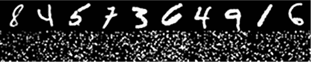

*图 7-3：原始 MNIST 数字（顶部）和相同数字的打乱版本（底部）。*

让我们重复列表 7-8 的实验代码，这次仅运行打乱的 `MNIST` 图像的缩放 `0,1)` 版本。由于原始代码唯一的区别在于源代码以及我们只调用了一次 `run`，我们将不再提供新的列表。

将准确率结果并列就得到了表 7-13。

**表 7-13：未打乱和打乱数字按模型类型划分的 MNIST**

| **模型** | **未打乱 [0,1)** | **打乱 [0,1)** |
| --- | --- | --- |
| 最近质心 (Nearest Centroid) | 0.8203 | 0.8203 |
| `k`-NN (`k` = 3) | 0.9705 | 0.9705 |
| `k`-NN (`k` = 7) | 0.9694 | 0.9694 |
| 朴叶贝斯 (Naïve Bayes) | 0.5558 | 0.5558 |
| 决策树 (Decision Tree) | 0.8784 | 0.8772 |
| 随机森林 (5) | 0.9244 | 0.9214 |
| 随机森林 (50) | 0.9661 | 0.9651 |
| 随机森林 (500) | 0.9709 | 0.9721 |
| 随机森林 (1000) | 0.9716 | 0.9711 |
| 线性 SVM (C = 0.01) | 0.9171 | 0.9171 |
| 线性 SVM (C = 0.1) | 0.9181 | 0.9181 |
| 线性 SVM (C = 1.0) | 0.9182 | 0.9185 |
| 线性 SVM (C = 10.0) | 0.9019 | 0.8885 |

在这里我们看到打乱和未打乱的结果之间几乎没有区别。事实上，对于几个模型来说，结果是完全相同的。对于像 `Random Forests` 这样的随机模型，结果仍然非常相似。这令人惊讶吗？起初可能如此，但如果我们仔细思考一下，就会发现这本不应该是这样的。

### 经典模型总结

以下是模型优缺点的总结。

#### 最近质心 (Nearest Centroid)

该模型是整体的：它们将整个特征向量作为一个单一实体进行操作。虽然我们无法再看到数字了，因为我们的视觉并不是整体工作的，但图像中的*信息*仍然在那里，所以模型对打乱后的数据同样满意。

##### 优点
该模型是整体的：它们将整个特征向量作为一个单一实体进行操作。虽然我们无法再看到数字了，因为我们的视觉并不是整体工作的，但图像中的*信息*仍然在那里，所以模型对打乱后的数据同样满意。

##### 缺点
该模型是整体的：它们将整个特征向量作为一个单一实体进行操作。虽然我们无法再看到数字了，因为我们的视觉并不是整体工作的，但图像中的*信息*仍然在那里，所以模型对打乱后的数据同样满意。

#### 最近质心 (Nearest Centroid)

该模型是整体的：它们将整个特征向量作为一个单一实体进行操作。虽然我们无法再看到数字了，因为我们的视觉并不是整体工作的，但图像中的*信息*仍然在那里，所以模型对打乱后的数据同样满意。

##### 优点
该模型是整体的：它们将整个特征向量作为一个单一实体进行操作。虽然我们无法再看到数字了，因为我们的视觉并不是整体工作的，但图像中的*信息*仍然在那里，所以模型对打乱后的数据同样满意。

##### 缺点
该模型是整体的：它们将整个特征向量作为一个单一实体进行操作。虽然我们无法再看到数字了，因为我们的视觉并不是整体工作的，但图像中的*信息*仍然在那里，所以模型对打乱后的数据同样满意。

#### k-最近邻 (*k*-Nearest Neighbors)

该模型是整体的：它们将整个特征向量作为一个单一实体进行操作。虽然我们无法再看到数字了，因为我们的视觉并不是整体工作的，但图像中的*信息*仍然在那里，所以模型对打乱后的数据同样满意。

##### 优点
该模型是整体的：它们将整个特征向量作为一个单一实体进行操作。虽然我们无法再看到数字了，因为我们的视觉并不是整体工作的，但图像中的*信息*仍然在那里，所以模型对打乱后的数据同样满意。

##### 缺点
该模型是整体的：它们将整个特征向量作为一个单一实体进行操作。虽然我们无法再看到数字了，因为我们的视觉并不是整体工作的，但图像中的*信息*仍然在那里，所以模型对打乱后的数据同样满意。

#### 朴叶贝斯 (Naïve Bayes)

该模型在概念上简单且高效，在核心独立性假设不成立时也出奇地有效。

##### 优点
该模型在概念上简单且高效，在核心独立性假设不成立时也出奇地有效。

##### 缺点
该模型在概念上简单且高效，在核心独立性假设不成立时也出奇地有效。

#### 决策树 (Decision Trees)

该模型非常有用，特别是当需要用人类语言理解为什么选择某个特定类别时。

##### 优点
该模型非常有用，特别是当需要用人类语言理解为什么选择某个特定类别时。

##### 缺点
该模型非常有用，特别是当需要用人类语言理解为什么选择某个特定类别时。

决策树容易出现过拟合——即学习了训练数据中对于总体分布而言并非普遍成立的元素。此外，随着树规模的增大，其可解释性会降低。树的深度需要与作为叶子节点的决策（标签）质量保持平衡。这直接影响到错误率。

## 随机森林

这是决策树的一种更强大的形式，它利用随机性来减少过拟合问题。随机森林是经典模型类型中性能最好的模型之一，适用于广泛的问题领域。

### 优点
与决策树一样，随机森林支持多分类模型和其他非连续特征。它们的训练和推理速度都相当快。随机森林对特征向量中特征的尺度差异具有很强的鲁棒性。通常情况下，随着森林规模的增长，准确率会提高，但收益会递减。

### 缺点
决策树易于解释的性质在随机森林中消失了。虽然森林中的每棵树都可以解释其决策，但整个森林作为一个整体的组合效应很难理解。

森林的推理运行时间随树的数量呈线性增长。然而，这可以通过并行化来缓解，因为森林中的每棵树在进行计算时都不依赖于任何其他树，直到合并所有树的输出以做出整体决策。

作为随机模型，对于同一个数据集，森林的整体性能在不同的训练阶段之间会有差异。通常情况下，这不是一个问题，但可能存在病态森林——如果可能的话，可以训练几次森林以对实际性能有一个直观感受。

## 支持向量机

在神经网络“重生”之前，支持向量机在适用且调优良好的情况下，通常被认为提供了模型性能的巅峰。

### 优点
当调优适当时，SVM 可以表现出卓越的性能。一旦训练完成，推理非常快。

### 缺点
不支持多分类模型。多分类问题的扩展需要训练多个模型，无论使用“一对一”（one-versus-one）还是“一对多”（one-versus-rest）方法。此外，SVM 只接受连续特征且特征缩放至关重要；通常需要归一化或其他尺度来获得良好的性能。

使用非线性核时，大型数据集难以训练，SVM 通常需要对边界和核参数（`C`、`γ`）进行精细调优，尽管这可以通过寻找最佳超参数值的搜索算法部分缓解。

## 何时使用经典模型

经典模型可能是`classic`（经典的），但在适当条件下它们仍然是合适的。在本节中，我们将讨论在何时你应该考虑经典模型而不是更现代的方法。

### 处理小数据集
使用经典模型的最佳理由之一是数据集较小。如果你只有几十或几百个示例，那么经典模型可能是一个很好的选择，而深度学习模型可能没有足够的训练数据来使自己适应问题。当然，也有例外。深度神经网络可以通过迁移学习，有时可以从相对较少的示例中学习。其他方法，如零样本学习（zero-shot learning）或少样本学习（few-shot learning），也允许深度网络从小数据集进行学习。然而，这些技术远超我们书中想要讨论的范围。对于我们来说，经验法则是：当数据集较小时，考虑使用经典模型。

### 应对降低的计算需求
考虑经典模型的另一个原因是计算需求必须保持在最低。深度神经网络对计算资源的需求是出了名的高昂。深度网络中数千万、数百万甚至数十亿的连接都需要大量的计算。在小型手持设备或嵌入式微控制器上实现此类模型是不可行的，或者至少在任何合理的时间范围内无法运行。

在这种情况下，你可能考虑使用一种不需要太多开销的经典模型。像最近质心（Nearest Centroid）或朴素贝叶斯（Naïve Bayes）这样的简单模型就是很好的候选。训练后的决策树和支持向量机也是。根据之前的实验，除非特征空间或训练集较小，否则`k-NN` 可能不是一个好的选择。这引出了我们的下一个经验法则：当必须保持计算量最小时，考虑使用经典模型。

### 具有解释性的模型
某些经典模型可以解释自身，这包括决策树、`k`-NN（通过设计具有具有解释性）、最近质心，甚至是朴素贝叶斯。相比之下，深度神经网络是黑箱——它们无法解释自身——但让深度网络给出某些解释仍然是一个活跃的研究领域。因此，我们可以给出另一个经验法则：当必须知道分类器如何做出决策时，考虑使用经典模型。

### 处理向量输入
我们的最后一个经验法则（当然承认我们还有其他建议）与模型输入的形式有关。现代深度学习系统处理的输入通常不是特征组合成的单个向量，而是多维输入，例如图像，其中“特征”（像素）之间并不不同，而是属于相同类型且高度相关（例如，苹果的红色像素旁边可能也是红色像素）。彩色图像是一个三维实体：有三个颜色通道，分别是红色、蓝色和绿色通道。如果输入来自其他来源（如卫星），每个图像可能有四个到八个更多通道。卷积神经网络专为此类输入设计，并将寻找网络试图学习的类别的空间模式。更多细节请参见第 12。

但如果模型的输入是一个向量，特别是特征之间不相关的向量（这是朴素贝叶斯分类器的核心假设），那么经典模型可能是合适的，因为不需要寻找特征之外的结构，经典模型通过将输入视为单一整体来进行。因此，我们可能会给出规则：当输入是不具有空间结构的特征向量（不同于图像），特别是当特征互不相关时，考虑使用经典模型。

在本章中，我们学习了六种常见的经典机器学习模型：最近质心法（Nearest Centroid）、`k`-最近邻（`k`-Nearest Neighbors）、朴叶贝斯（Naïve Bayes）、决策树、随机森林和支持向量机。我们将这些模型应用于在第 5 章中开发的三个数据集：鸢尾花、乳腺癌和 MNIST 数字。通过对这些数据集的实验结果，我们了解了每种类型模型的优缺点以及不同数据预处理步骤的影响。最后，我们通过讨论经典模型及其适用场景结束了本章内容。

在下一章中，我们将离开经典模型，开始探索神经网络——这是现代深度学习的骨干。

# 8 神经网络简介


神经网络是深度学习的核心。在第 9 章中，我们将深入探讨我们所谓的`传统神经网络`。然而，在此之前，我们将介绍神经网络的解剖结构，并给出一个快速的示例。

具体而言，我们将介绍`全连接前馈神经网络`的组件。从视觉上看，你可以将网络想象为图 8-1 所示。在本章和下一章中，我们将经常引用此图。你的任务（如果你接受的话）是将此图记入脑海，以避免反复翻阅导致书籍磨损。

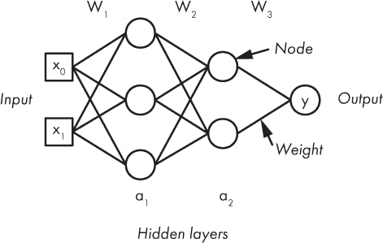

*图 8-1：示例神经网络*

在讨论了神经网络的结构和部分之后，我们将探索训练示例网络来分类鸢尾花。从这个初始实验开始，第 9 章将引导我们学习梯度下降和反向传播算法——这是神经网络（包括高级深度神经网络）的标准训练方法。本章旨在作为一个热身。重头戏即将在第 9 章开始。

## 神经网络的解剖结构

`神经网络`是一个图。在计算机科学中，`图`是一系列`节点`（nodes），通常被画成圆圈，通过`边`（edges，短线段）连接。这种抽象对于表示许多不同类型的关系非常有用：城市之间的道路、社交媒体上的人际关系、互联网结构，或者可以用于近似任何数学函数的系列基本计算单元。

最后一个例子显然是有意为之的。神经网络是通用函数近似器。它们使用图结构来表示一系列计算步骤，将输入特征向量映射到输出值（通常被解释为概率）。神经网络分层构建。从概念上讲，它们从左到右运行，通过沿着边向节点传递值，将输入特征向量映射到输出（值）。注意，神经网络的节点通常被称为`神经元`（neurons）。我们很快就会看到原因。节点根据其输入计算新值，然后将新值传递给下一层节点，依此类推，直到到达输出节点。在图 8-1 中，左侧是一个输入层，右侧是一个隐藏层，再右侧是另一个隐藏层，输出层中有一个节点。

上一节包含了`全连接前馈神经网络`这个短语，但没有进行解释。让我们来拆解它。`全连接`意味着每一层的每个节点的输出都会发送到下一层的每个节点。`前馈`意味着信息从左到右通过网络传递，而不会发送回之前的层；网络结构中没有`反馈`，没有循环。这就剩下了`神经网络`部分。

### 神经元

就个人而言，我对`神经网络`这个短语有一种爱恨交织的情感。短语本身源于在非常粗略的近似中，网络的单元单元类似于大脑中的神经元。考虑图 8-2，我们稍后会进行详细描述。

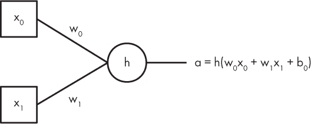

*图 8-2：单个神经网络节点*

回想起我们对网络的视觉总是从左向右移动，我们看到节点（圆圈）接受左侧的输入，并在右侧有一个单一输出。这里有两个输入，但可能是数百个。

许多输入映射到单个输出，呼应了大脑中神经元的工作方式：称为树突（dendrites）的结构接受许多其他神经元的输入，而单个轴（axon）是输出。我喜欢这个类比，因为它提供了一种讨论和思考网络的酷方式。但我讨厌这个类比，因为这些人工神经元在操作上与真实的神经元非常不同，类比很快就会失效。虽然它们与真实的神经元在解剖结构上有相似之处，但它们并非相同，这会导致不熟悉机器学习的人产生困惑，使某些人认为计算机科学家真的在构建人工大脑，或者网络在“思考”。`think`（思考）这个词的含义很难定义，但对我来说，它并不适用于神经网络所做。

回到图 8-2，我们看到左侧有两个正方形、一堆线、一个圆圈、右侧的一条线以及一组带有下标的标签。让我们理清这些。如果我们理解了图 8-2，我们就在理解神经网络的道路上了。稍，我们将看到代码实现，并对它可以如此简单感到惊讶。

就是这样。将一组节点聚集在一起，建立适当的连接，弄清楚如何训练它们来设置权重和偏置，你就拥有了一个实用的神经网络。正如你将在下一章中看到的，训练神经网络并不是易事。但一旦训练完成，它们使用起来非常简单：给它一个特征向量，就能输出分类结果。

顺便提一下，我们一直将这些图称为`神经网络`（neural networks），并并将继续这样做，有时会使用缩写 `NN`。如果你阅读其他书籍或论文，可能会看到它们被称为`人工神经网络 (ANNs)` 甚至是`多层感知器 (MLPs)`，就像 sklearn 中的 `MLPClassifier` 类名。我建议坚持使用 `neural network` 一词，但这仅仅是我的个人观点。

### 激活函数

让我们来谈谈激活函数。节点的激活函数接收一个单一标量输入（即输入值乘以权重之和加上偏置），并对其进行某种处理。特别是，我们需要激活函数是非线性的，这样模型才能学习复杂的函数。在数学上，理解什么是非线性函数最简单的方法是：先定义什么是线性函数，然后说任何非线性的映射都是……非线性的。

一个`线性函数` `g` 的输出与输入成正比，`g(x)` ∝ `x`，其中 `∝` 意味着“成正比”。另一种说法是线性函数的图是一条直线。因此，任何图不是直线的函数都是非线性函数。

例如，函数

```
g(x) = 3x + 2
```

是一个线性函数，因为它的图是直线。像 `g(x) = 1` 这样的常数函数也是线性的。然而，函数

```
g(x) = x² + 2
```


`f(x) = x²`是非线性函数，因为`x`的指数是 2。超越函数也是非线性的。`超越函数`是指像`g(x) = log x`或`g(x) = e^(x)`这样的函数，其中`e = 2.718...`是自然对数的底。正弦、余弦等`三角函数`、它们的反函数以及由正弦余弦构建的正切等函数也是超越函数。这些函数之所以被称为超越函数，是因为你无法通过基础代数运算的有限组合来形成它们。它们是非线性的，因为它们的图不是直线。

神经网络需要非线性激活函数；否则，它只能学习线性映射，而线性映射不足以让网络具有通用的价值。考虑一个只有两个节点的简单网络，每个节点有一个输入。这意味着每个节点有一个权重值和一个偏置值，且第一个节点的输出是第二个节点的输入。如果我们设置`h(x) = 5x – 3`为一个线性函数，那么对于输入`x`，网络计算出的输出`a[1]`为：

```
a[1] = h(w[1]a[0] + b[1])
     = h(w[1]h(w[0]x + b[0]) + b[1])
     = h(w1 + b[1])
```

（注：原文文本在表达式中如`w[1]a[0]`和`5*w = 5`包含重复的数学痕迹，我们已为了提高可读性进行了清理，同时保留了线性映射局限性的逻辑。）

使用线性激活函数的神经网络只会学习线性模型，因为线性函数的复合仍然是线性的。正是线性激活函数的这种局限性导致了 20 世纪 70 年代的第一次神经网络“寒冬”：神经网络的研究实际上被放弃了，因为它们被认为太简单，无法学习复杂的函数。

好了，我们需要非线性激活函数。是哪些呢？有无限种可能。在实践中，传统网络使用`sigmoid`（S 型）或`hyperbolic tangent`（双曲正切）。

首先要的是，这两个函数都具有大致相似的“S”型形状。sigmoid 沿着 x 轴延伸时，从 0 开始，向右移动增加到 1。在 0 处，函数值为 0.5。双曲正切函数也一样，但范围是从 –1 到 +1，并且在`x = 0`时为 0。

最近，sigmoid 和双曲正切已被`修正线性单元`（rectified linear unit，简称`ReLU`）所取代。`ReLU`非常简单，并且对神经网络具有方便的属性。尽管名称中带有`linear`（线性）一词，但`ReLU`是一个非线性函数——它的图不是直线。当我们在第 9 章讨论神经网络的反向传播时，我们将学习为什么会发生这种变化。

`ReLU`被称为`rectified`（修正），是因为它移除了负值并将其替换为 0。事实上，机器学习社区使用了该函数的几个不同版本，但本质上都是将负值替换为常量或其他值。`ReLU`的分段特性使其具有非线性，并因此适合作为神经网络的激活函数。它在计算上也非常简单，比 sigmoid 或双曲正切快得多。这是因为后两个函数使用了`e^(x)`，在计算机术语中，这意味着调用`exp`函数。该函数通常被实现为级数展开项之和，这会被转化为数十浮点运算，而实现`ReLU`仅需一个`if`语句。这种微小的节省在可能包含数千个节点的庞大网络中会积成多。

## 网络架构

我们讨论了节点及其工作原理，并暗示了节点通过连接形成网络。让我们更仔细地观察节点是如何连接的，即网络的`架构`（architecture）。

像我们在本章中处理的标准神经网络是分层构建的。我们不需要这样做，但正如我们将看到的，这为我们带来了计算上的简单性并极大地简化了训练。前馈网络有一个输入层、一个或多个隐藏层和一个输出层。输入层仅仅是特征向量，输出层是预测（概率）。如果网络用于多分类问题，输出层可能有多个节点，每个节点代表模型对每个可能的输入类别的预测。

隐藏层由节点组成，第`i`层节点接收第`i - 1`层节点的输出作为输入，并将它们的输出传递给第`i + 1`层节点的输入。层之间的连接通常是全连接的（fully connected），这意味着第`i - 1`层每个节点的输出都用作第`i`层每个节点的输入，因此称为`全连接`。同样，我们不需要这样做，但它简化了实现。

隐藏层的数量以及每个隐藏层中的节点数定义了网络的架构。已经证明，一个具有足够节点的单隐藏层可以学习任何函数映射。这是一件好事，因为这意味着神经网络适用于机器学习问题，归根结底，模型充当了将输入映射到输出标签和概率的复杂函数映射。然而，像许多理论结果一样，这并不意味着单层网络在所有情况下都是实用的。随着网络中节点（以及层数）数量的增加，需要学习的参数（权重和偏置）数量也随之增加，因此所需的训练数据量也随之增长。这就是“维度灾咒”。

这些问题在 20 世纪 80 年代再次阻碍了神经网络的发展。当时计算机的速度太慢，无法训练大型网络，而且无论如何，通常可用数据太少，不足以训练网络。从业者知道，如果这两种情况发生变化，就有可能训练出远比当时的小网络强大得多的大型网络。幸运的是，世界在 21 世纪初情况发生了变化。

选择合适的神经网络架构对你的模型是否能够学习到任何内容有巨大影响。这就是经验和直觉大显身场的地方。选择正确的架构是使用神经网络的“黑术”。让我们通过提供一些（粗略的）经验法则来尝试提供帮助：

- 如果你的输入具有明确空间关系（例如图像的部分），你可能想使用卷积神经网络（第 12 章）。
- 隐藏层不要超过三层。记住，在理论上，一个足够大的隐藏层就足够了，因此尽可能少使用隐藏层。如果模型通过一个隐藏层就能学习，那么再添加第二层看看是否有所改进。
- 第一个隐藏层中的节点数应与输入向量特征的数量匹配或（理想情况下）超过。
- 除了第一个隐藏层（见上一个规则），每个隐藏层的节点数应与前一层和下一层的节点数相同，或者处于两者之间。如果层`i – 1`有`N`个节点，层`i + 1`有`M`个节点，那么层`i`具有`N ≤ x ≤ M`个节点可能是好的。

第一条规则说明传统的神经网络最适用于输入不具有空间关系的情况——即你拥有一个特征向量，而不是图像。此外，当你的输入维度较小，或者当你没有大量数据（导致难以训练更大的卷积网络）时，你应该尝试使用传统网络。如果你认为自己正处于需要传统神经网络的情况下，请从小规模开始，只要性能有所提高就不断扩大它。

## 输出层

神经网络的最后一层是输出层。如果网络正在对一个连续值进行建模，即回归（`regression`，这是我们在本书中忽略的一个用例），那么输出层就是一个不使用激活函数的节点；它简单地报告图 8-2 中`h`的参数。注意，这等同于说激活函数是恒等函数，`h(x) = x`。

我们的神经网络是用于分类的；我们希望它们输出一个决策值。如果我们有两个标记为`0`和`1`的类别，我们将最终节点的激活函数设置为`sigmoid`（sigmoid 函数）。这将输出一个介于`0`和`1`之间的值，我们可以将其解释为输入属于类别`1`的概率。我们根据输出值做出分类决策：如果激活值小于`0.5`，则认为输入为`0`；否则，标记为`1`。我们将在第 11 章中看到如何通过改变`0.5`阈值来针对任务调整模型的性能。

如果我们有两个以上的类别，我们需要采取不同的方法。输出层不再是单个节点，而是将有`N`个输出节点，每个类别一个，每个节点都使用恒等函数作为`h`。然后，我们对这`N`个输出应用`softmax`操作，并选择输出值最大的输出。让我们来说明`softmax`的含义。假设我们有一个包含四个类别的数据集。它们代表什么并不重要；网络也不知道它们代表什么。类别被标记为`0`、`1`、`2`和`3`。因此，`N = 4`意味着我们的网络将有四个输出节点，每个节点都使用恒等函数作为`h`。这看起来如图 8-5，我们在图中还展示了`softmax`操作和生成的输出向量。

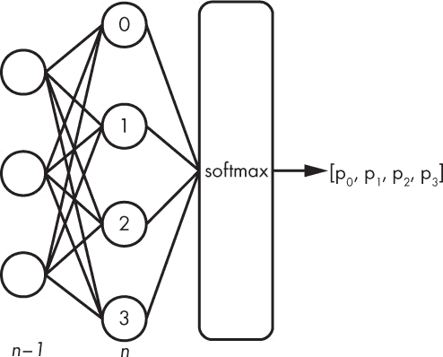
*图 8-5：具有四个类别的神经网络的最后一个隐藏层 n-1 和输出层 (n, 编号)。应用了 softmax 操作，产生了一个包含四个元素的输出向量 [p0, p1, p2, p3]。*

我们选择此输出向量中最大值的索引作为给定输入向量的类别标签。`softmax`操作确保该向量的元素之和为`1`，因此我们再次可以“粗略地”将这些值称为属于四个类别中每个类的概率。这就是为什么我们只取最大值来决定输出标签。

`softmax`操作非常直观：每个输出的概率简单地为


其中`a[i]`是第`i`个输出，分母是所有输出之和。对于示例，`i = 0, 1, 2, 3`：

```
a[0] = 0.2
a[1] = 1.3
a[2] = 0.8
a[3] = 2.1
```

然后我们计算`softmax`：

```
p[0] = e⁰.2 / (e⁰.2 + e¹.3 + e⁰.8 + e².1) = 0.080
p[1] = e¹.3 / (e⁰.2 + e¹.3 + e⁰.8 + e².1) = 0.240
p[2] = e⁰.8 / (e⁰.2 + e¹.3 + e⁰.8 + e².1) = 0.146
p[3] = e².1 / (e⁰.2 + e¹.3 + e⁰.8 + e².1) = 0.534
```

我们选择`p[3]`最大的索引作为类别标签。注意`p[i]`值的和为`1.0`，正如我们预期的那样。

这里应该提到两点。在前面的方程中，我们使用`sigmoid`来计算输出。如果我们把类别数设置为 2 并计算`softmax`，我们将得到两个输出值：一个是`p`，另一个是`1 – p`。这等同于单独使用`sigmoid`，选择输入属于类别 1 的概率。

第二点涉及`softmax`的实现。如果网络输出的`a`值很大，那么`e^a`可能会很大，这是计算机不喜欢喜欢的。至少会丢失精度，或者值可能会溢出导致输出无意义。在数值上，如果我们在计算`softmax`之前从所有`a`值中减去最大的`a`值，我们将对较不容易溢出的较小值取指数运算。

## 表示权重和偏置

在继续示例神经网络之前，让我们回顾权重和偏置，并看看通过矩阵和向量的角度来看待，如何极大地简化神经网络的实现。

考虑从两个元素的输入特征向量到具有三个节点的第一个隐藏层（图 8-1 中的`a`[1]）的映射。我们将两层之间的边（权重）标记为`w`[`ij`]，其中`i` = 0,1 对应输入`x`[0]和`x`[1]，`j` = 0,1,2 对应图中从上到下编号的三个隐藏层节点。此外，我们需要三个图中未显示的偏置值，每个隐藏层节点一个。我们将它们称为`b`[0]、`b`[1]和`b`[2]，同样是从上到下排列。

为了计算三个隐藏层节点的激活函数输出`h`，我们需要找到下等内容：

```
a[0] = h(w[00]*x[0] + w[10]*x[1] + b[0])
a[1] = h(w[01]*x[0] + w[11]*x[1] + b[1])
a[2] = h(w[02]*x[0] + w[12]*x[1] + b[2])
```

但回矩阵乘法和向量相法的原理，我们发现这恰好是


其中 ，且`W`是一个 3 × 2 的权重矩阵。在这种情况下，激活函数`h`接收一个输入值向量并产生一个输出值向量。这简单地将`h`应用于  的每一个元素。例如，将`h`应用于具有三个元素的向量  就是：


将`h`分别应用于  的每个元素。

由于 NumPy Python 模块设计用于数组，而矩阵和向量都是数组，我们得到了一个令人愉快的结论：神经网络的权重和偏置可以存储在 NumPy 数组中，我们只需要简单的矩阵操作（调用`np.dot`）和加法即可处理全连接神经网络。注意，这就是我们想要使用全连接网络的原因：它们的实现非常直观。

为了存储图 8-1 中的网络，我们需要每层之间一个权重矩阵和一个偏置向量，这提供了三个矩阵和三个向量：输入到第一个隐藏层、第一个隐藏层到第二个隐藏层、以及第二个隐藏层到输出，各有一个矩阵和一个向量。权重矩阵的维度分别为 3 × 2、2 × 3 和 1 × 2。偏置向量的长度分别为 3、2 和 1。

## 实现简单的神经网络

在本节中，我们将实现图 8-1 中的示例神经网络，并使用鸢花数据集（iris dataset）中的两个特征对其进行训练。我们将从零实现网络，但使用`sklearn`来训练它。本节的目标是观察实现一个简单的神经网络是多么直观。希望这将消除围绕之前章节讨论中可能存在的迷云。

图 8-1 的网络接受具有两个特征的输入特征向量。它有两个隐藏层，一个有三个节点，另一个有两个节点。它有一个输出。隐藏层节点的激活函数是 sigmoid。

### 构建数据集

在查看神经网络代码之前，让我们先构建将用于训练的数据集，并看看它的样子。我们已经知道鸢花数据集了，但对于这个例子，我们只使用两个类别和仅两个特征。构建训练集和测试数据集的代码在列表 8-1 中。

```
import numpy as np

d = np.load("iris_train_features.npy")
l = np.load("iris_train_labels.npy")

d1 = np.where(l==1)
d2 = np.where(l==2)

a=len(d1)
b=len(d2)

x = np.zeros((a+b,2))
x[:a,] = d1[:,2]
x[a:,:] = d2[:,2]

y = np.array([0]*a+[1]*b)

i = np.argsort(np.random(a+b))
x = x[i]
y = y[i]

np.save("iris2_test.npy", x)
np.save("iris2_test_labels.npy", y)
```

*列表 8-1: 构建简单的示例数据集。参见 nn_iris_dataset.py。*

这段代码是简单的数据清洗。我们从增强数据集开始，加载样本和标签 ❶。我们只需要类别 1 和类别 2，所以我们找到这些样本的索引并将它们提取出来。我们只保留特征 2 和 3，并将放入`x`中 ❷。接下来，我们构建标签（`y`）❸。注意，我们将类别标签重新编码为 0 和 1。最后，我们打乱样本的顺序并将新数据集写入磁盘 ❹。最后，我们重复此过程构建测试样本 ❺。

图 8-6 显示了训练集。由于只有两个特征，我们可以绘制它。


*图 8-6: 双类别、双特征鸢花数据集的训练数据*

我们立即发现这个数据集并不是线性分的。没有一条简单的直线可以将训练集正确划分为组，一组全为类别 0，另一组全为类别 1。这让事情变得有点有趣。

### 实现神经网络

让我们看看如何使用 NumPy 用 Python 实现图 8-1 中的网络。我们将假设它已经训练，意味着我们已经知道了所有的权重和偏置。代码在列表 8-2 中。

```
import numpy as np
import pickle
import sys

def sigmoid(x):
    return 1.0 / (1.0 + np.exp(-x))

def evaluate(x, y, w):
    w12,b1,w23,b2,w34,b3 = w
    nc = nw = 0
    prob = np.zeros(len(y))
    for i in range(len(y)):
        a1 = sigmoid(np.dot(x[i], w12) + b1)
        a2 = sigmoid(np.dot(a1, w23) + b2)
        prob[i] = sigmoid(np.dot(a2, w34) + b3)
        z = 0 if prob[i] < 0.5 else 1
        if (z == y[i]):
            nc += 1
        else:
            nw += 1
    return float(nc) / float(nc + nw), prob

xtest = np.load("iris2_test.npy")
ytest = np.load("iris2_test_labels.npy")
weights = pickle.load(open("iris2_weights.pkl","rb"))

score, prob = evaluate(xtest, ytest, weights)
print()
for i in range(len(prob)):
    print("%3d:  actual: %d  predict: %d  prob: %0.7f" % (i, ytest[i], 0 if (prob[i] < 0.5) else 1, prob[i]))
print("Score = %0.4f" % score)
```


*列表 8-2: 使用训练好的权重和偏置对预留的测试样本进行分类。参见 `nn_iris_evaluate.py`。*

当我们训练这个网络时，我们将权重和偏置以 NumPy 数组列表的形式存储。在 Python 中，将列表存储到磁盘的方法是使用 `pickle` 模块，因此我们使用 `pickle` 从磁盘加载该列表。`weights` 列表包含六个元素，代表定义网络的三个权重矩阵和三个偏置向量。这些是我们的训练根据数据集进行调优的“魔法”数字。最后，我们调用 `evaluate` 让每个测试样本都通过网络。该函数返回每个样本的得分（准确率）和输出概率（`prob`）。代码的其余部分显示了样本编号、实际标签、预测标签以及与类别 1 相关的输出概率。最后，显示得分（准确率）。

网络被实现在 `evaluate` 函数中；让我们来看看它是如何实现的。首先，从提供的权重列表中提取出单独的权重矩阵和偏置向量。这些都是 NumPy 数组：`w12` 是一个 2 × 3 的矩阵，将两个元素的输入映射到具有三个节点的第一个隐藏层；`w23` 是一个 3 × 2 的矩阵，将第一个隐藏层映射到第二个隐藏层；`w34` 是一个 2 × 1 的矩阵，将第二个隐藏层映射到输出。偏置向量为 `b1`（三个元素）、`b2`（两个元素）以及 `b3`（单个元素，即标量）。

注意，权重矩阵的形状与我们之前指示的不相同。它们是转置过的。这是因为我们正在将向量（被视为 1 × 2 矩阵）乘以权重矩阵。由于标量乘法满足交换律（即 `ab = ba`），我们看到为激活函数计算的仍然相同的参数值。

接下来，`evaluate` 将正确数量（`nc`）和错误数量（`nw`）计数器设置为 0。这些用于计算整个测试集的总体得分。同样，我们定义了 `prob`，一个用于存储每个测试样本输出概率值的向量。

循环将整个网络应用于每个测试样本。首先，我们将输入向量映射到第一个隐藏层，并计算 `a[1]`，这是一个包含三个数字的向量，代表三个隐藏层节点的激活值。然后，我们取这些第一个隐藏层的激活值，并计算第二个隐藏层的激活值 `a[2]`。由于第二个隐藏层有两个节点，这是一个二元素向量。接下来，我们计算当前输入向量的输出值，并将其存储在 `prob` 数组中。通过检查网络的输出值是否 `< 0.5` 来分配类别标签 `z`。最后，根据该样本的实际标签（`y[i]`）增加正确（`nc`）或错误（`nw`）计数器的值。当所有样本都通过网络后，总体准确率将以被正确分类的样本数除以样本总数返回。

这些都很好；我们可以实现一个网络并将输入向量通过它，观察它的表现如何。如果网络有第三个隐藏层，我们将在计算最终输出值之前，将第二个隐藏层的输出（`a2`）传递给该层。

### 训练和测试神经网络

列表 8-2 中的代码将训练好的模型应用于测试数据。首先，为了训练该模型，我们将使用 `sklearn`。训练模型的代码位于列表 8-3。

```python
import numpy as np
import pickle
from sklearn.neural_network import MLPClassifier

xtrain = np.load("iris2_train.npy")
ytrain = np.load("iris2_train_labels.npy")
xtest = np.load("iris2_test.npy")
ytest = np.load("iris2_test_labels.npy")

clf = MLPClassifier(
    hidden_layer_sizes=(3,2),
    activation="logistic",
    solver="adam", tol=1e-9,
    max_iter=5000,
    verbose=True)
clf.fit(xtrain, ytrain)

prob = clf.predict_proba(xtest)
score = clf.score(xtest, ytest)

w12 = clf.coefs_[0]
w23 = clf.coefs_[1]
w34 = clf.coefs_[2]
b1 = clf.intercepts_[0]
b2 = clf.intercepts_[1]
b3 = clf.intercepts_[2]

weights = [w12,b1,w23,b2,w34,b3]
pickle.dump(weights, open("iris2_weights.pkl","wb"))

print("Test results:")
print("Overall score: %.7f" % score)
for i in range(len(ytest)):
    p = 0 if (prob[i,1] < 0.5) else 1
    print("%03d: %d, %.7f" % (i, ytest[i], prob[i,1]))
```

使用 `sklearn` 训练鸢花神经网络。参见 `nn_iris_mlpclassifier.py`。首先，我们从磁盘加载训练和测试数据。这些是我们之前创建的文件。然后，我们设置神经网络对象，即 `MLPClassifier` 的实例。网络有两个隐藏层，第一层有三个节点，第二层有两个节点。这与图 8-1 匹配。网络还使用了 `logistic` 层。这是 sigmoid 层的另一个名称。我们像处理其他模型类型一样通过调用 `fit` 来训练模型。由于我们将 `verbose` 设置为 `True`，我们将得到显示每次迭代损失的输出。

这一章可能是书中最具挑战性的一章，至少在概念上是如此。在数学上无疑也是。虽然对于建立直觉和理解至关重要，但有时我们会变得不耐烦，喜欢先上手尝试来测试水浅。得益于现有的库，我们在这里可以做到这一点。如果你想在学习它们如何工作之前先玩玩神经网络，可以先跳转到第 10 章，然后再回来补全理论。但请一定要回来。

我们可以在不理解它们如何工作的情况下，学会使用 `sklearn` 和 `Keras` 这样强大的工具包。然而，这种方法应该让任何人都满意，尽管这种诱惑是真实的。理解这些算法的工作原理非常值得你花时间。

## 高层概述

让我们从将要讨论的概念概述开始本章。阅读它，但如果概念不清晰，也不要担心。相反，试着感受整个过程。

训练神经网络的第一步是为权重（weights）和偏置（biases）选择智能初始值。然后我们使用 `gradient descent`（梯度下降）来修改这些权重和偏置，以减少训练集上的误差。我们将使用损失函数的平均值来衡量误差，它告诉我们网络目前有多错。我们知道网络是对是错的，因为我们有训练集中每个输入样本的预期输出（类别标签）。

`Gradient descent` 是一种需要梯度的算法。目前，请将梯度看作斜度的度量。梯度越大，函数在那个点的斜度就越陡。为了使用 `gradient descent` 寻找损失函数的最小值，我们需要能够找到梯度。为此，我们将使用 `backpropagation`（反向传播）。这是神经网络的基础算法，是让它们能够成功学习的算法。它从网络的输出端开始，反向移动到输入端，为我们提供所需的梯度。在此过程中，它计算出每个权重和偏置的梯度值。

有了梯度值，我们就可以使用 `gradient descent` 算法更新权重和偏置，这样当我们下次将训练样本通过网络时，损失函数的平均值将比之前小。换句话说，我们的网络会错一点。这就是训练的目标，我们希望它能产生一个学习了数据通用特征的网络。

学习数据集的通用特征需要 `regularization`（正则化）。正则化有许多方法，我们将讨论主要的几种。没有 `regularization`，训练过程就有过拟合的风险，我们可能会得到一个无法泛化的网络。但有了 `regularization`，我们可以成功并获得实用的模型。

因此，接下来的章节将介绍 `gradient descent`、`backpropagation`、损失函数、权重初始化，最后是 `regularization`。这些是成功训练神经网络的主要组件。我们不需要理解这些所有详尽的数学细节；相反，我们需要在概念上理解它们，以便我们建立一个关于“训练神经网络意味着什么”的直观方法。有了这种直觉，我们就能有效地利用 `sklearn` 和 `Keras` 为我们提供的用于训练参数。

## 梯度下降

训练神经网络的标准方法是使用 `gradient descent`。

让我们解析一下 `gradient descent` 这个短语。我们已经知道 `descent`（下降）这个词的意思。它的意思是从更高的地方向下走。`gradient`（梯度）呢？简单来说，梯度表示一个事物相对于另一个事物变化速度的快慢程度。度量一个事物随着另一个事物变化而变化的程度是我们都非常熟悉的事情。我们都知道速度，即位置随时间的变化情况。我们甚至用口语表达出来：`miles per hour`（每小时英里）或`kilometers per hour`（每小时公里）。

你可能已经在其他语境下熟悉梯度了。考虑直线方程：

`y = mx + b`

其中 `m` 是斜率，`b` 是 y 轴截距。斜率是直线的 `y` 位置随每次 `x` 位置变化而变化的快慢程度。如果我们知道直线上的两点，`(x[0],y[0])` 和 `(x[1],y[1])`，那么我们就可以计算斜率为：


用语言描述，我们可能会称之为“每个 `x` 对应的 `y`”。它是衡量直线有多陡或平的度量：即它的梯度。在数学中，我们经常讨论变量的变化，其符号表示是在前面加一个 `Δ`（delta）。所以，我们可能会把直线的斜率写为：


以强调这一点：斜率是每次 `x` 变化时 `y` 的变化。对我们来说幸运的是，事实不仅直线在每个点都有斜率，而且大多数函数在每个点都有斜率。然而，除了直线外，这种斜率随点而变化。一张图会有帮助。考虑图 9-1。


*图 9-1：标有几条切线的函数*

图 9-1 中的图是一个多项式。注意图中画的恰好接触函数的线。这些是 `tangent`（切）线。作为线，它们有我们在图中看到的斜率。现在想象将其中一条线移动到函数上，使其持续与函数接触一点；想象线随移动的变化。

事实证明，其随函数的变化本身是一个函数，它被称为 `derivative`（导数）。给定一个函数和一个 `x` 值，导数告诉我们函数在该点 `x` 的斜率。函数具有导数是积分的一个基本见解，对我们至关重要。

导数的概念是基本的，因为对于单变量函数，点 `x` 处的导数就是梯度；它是函数变化的方向。如果我们想找到函数的最小值即产生最小 `y` 的 `x`，我们想要沿着梯度的`相反`方向移动，这将引导我们走向最小值。

导数有许多不同的写法，但反映斜率思想（即 `x` 变化时 `y` 的变化）的形式是


我们在讨论 `backpropagation` 算法时回到这种形式。梯度的部分到此；现在让我们仔细观察下降。

### 寻找最小值

由于我们需要一个误差小的模型，我们需要找到使损失函数值较小的参数集。换句话说，我们需要找到损失函数的 `minimum`。

再次查看图 9-1。最小值在右侧，切线 C 所在的位置。可以看到它是最小值，并注意到那里的梯度为 0。这告诉我们我们处于最小值（或极大值）。如果我们从 B 点开始，我们看到切线的斜率是负的（向右下方）。因此，我们需要向正方向移动到 `x` 值，因为这与梯度的符号相反。这样做将使我们更接近最小值。同样，如果我们从 D 点开始，切线的斜率是正的（向右上方），意味着我们需要向负 `x` 方向移动，再次朝 C 点移动，以接近最小值。

对于仅包含 `x` 的简单函数，例如图 9-1 所示所示，这种方法效果会很好，假设我们从 `B` 或 `D` 这样良好的位置开始。当我们移动到多个维度时，事实证明，只要我们的初始猜测在一个良好的位置，这种方法仍然能够良好运行。

继续通过图 9-1 并假设我们从 `B` 开始，我们看到梯度告诉我们应该向右移动，即向 `C` 移动。但我们如何选择下一个要考虑的 `x` 值，以便我们更贴近 `C` 呢？这就是步长（step size），它告诉我们从一个 `x` 位置跳到下一个 `x` 位置的跨度有多大。步长是一个我们必须选择的参数，在实践中，这个值被称为`学习率`（learning rate），通常是流动的，并且随着我们的移动而变得越来越小，这是基于一个假设：随着我们的移动，我们越来越接近最小值，因此需要越来越小的步长。

这些听起来都很好，甚至很直观，但我们遇到了一个小问题。如果我们不是从 `B` 或 `D` 开始，而是从 `A` 开始呢？`A` 处的梯度引导我们向左移动，而不是向右。在这种情况下，我们简单的算法将会失败——它会将我们向左移动，我们永远无法到达 `C`。图中只显示了一个最小值，在 `C` 处，但我们可以很容易地想象第二个最小值，比如在 `A` 的左侧，它的深度没有 `C` 那么（`y` 值没有 `C` 那么）。如果我们从 `A` 开始，我们将向这个最小值移动，而不是 `C` 处的。我们的算法将陷入一个`局部最小值`（local minimum）。一旦陷入，我们的算法就无法带我们出来，我们也无法找到 `C` 处的全局最小值。我们将看到这对于神经网络来说是一个真正的问题，但对于现代深度网络来说，几乎魔迹地，这并不是一个大问题。

那么，这一切如何帮助我们训练神经网络呢？梯度告诉我们 `x` 的微小变化如何影响 `y`。如果 `x` 是我们网络的参数之一，而 `y` 是损失函数给出的误差，那么梯度告诉我们该参数的变化在多大程度上影响网络的整体误差。一旦我们知道了这一点，我们就可以根据梯度修改参数，并知道这会将我们向最小误差移动。当训练集上的误差达到最小值时，我们就可以说网络已经训练完成。

让我们更多地讨论梯度和参数。到目前为止的所有讨论，基于图 9-1，都是单维的；我们的函数只是 `x` 的函数。我们讨论了改变一个事物（x 轴上的位置）来看如何影响 `y` 位置。在现实中，我们并不是在一个维度上工作。神经网络中的每个权重和偏置都是参数，损失函数的值取决于所有参数。仅仅对于图 8-1 中的简单网络，就有 20 个参数。

#### 更新权重

我们将讨论函数，`η` 是学习率，而 `Δw` 是梯度。

```
w = w - η * Δw
```

### 随机梯度下降

之前的步骤描述了神经网络的梯度下降训练。正如我们预期的那样，在实践中，这种基本思想有很多变体。一种广泛使用且有效的方法被称为`随机梯度下降（SGD）`。`随机`一词指的是一个随机过程。我们将接下来看到为什么在这种情况下 `随机`一词在 `梯度下降` 之前。

#### 批量和小小批量

列表 9-1 的第 2 步说：
1. 选取一些初始值。
2. 将整个训练集通过网络以获得损失的平均值。
3. 使用此损失获取每个参数的梯度。
4. 通过步长乘以梯度更新权重或偏置。
5. 从第 2 步开始重复，直到损失足够。

这就是 `SGD` 发挥作用场的地方。与其在每一轮迭代中都使用所有的训练数据，不如改为选择训练数据的一个小子子集，并利用其计算出的平均损失来更新参数。我们将计算一个“错误”的梯度值，因为我们只使用一小部分样本来估算整个训练集的损失，但这将节省我们大量时间。

让我们通过一个简单的例子来看看这种采样是如何运作的。我们将使用 `NumPy` 定义一个包含 100 个随机字节的向量：

```python
>>> d = np.random.normal(128,20,size=100).astype("uint8")  
>>> d
130, 141, 99, 106, 135, 119, 98, 147, 152, 163, 118, 149, 122,
133, 115, 128, 176, 132, 173, 145, 152, 79, 124, 133, 158, 111,
139, 140, 126, 117, 175, 123, 154, 115, 130, 108, 139, 129, 113,
129, 123, 135, 112, 146, 125, 134, 141, 136, 155, 152, 101, 149,
137, 119, 143, 136, 118, 161, 138, 112, 124, 86, 135, 161, 112,
117, 145, 140, 123, 110, 163, 122, 105, 135, 132, 145, 121, 92,
118, 125, 154, 148, 92, 142, 118, 128, 128, 129, 125, 121, 139,
152, 122, 128, 126, 126, 157, 124, 120, 152
```

这里的字节值围绕 128 的均值呈正态分布。这 100 个值的实际平均值为 130.9。通过每次选择 10 个这些值的子集，我们可以得到对实际平均值的估算：

```python
>>> i = np.argsort(np.random.random(100))  
>>> d[i[:10]].mean()
138.9
```


通过重复选择子集，得到的估计平均值分别为 135.7、131.7、134.2、128.1 等。

这些估计平均值中没有一个是实际平均值，但它们都非常接近它。如果我们可以从完整数据集的随机子集中估算出平均值，那么比此类推，我们应该能够通过完整训练集的一个子集来估算损失函数的梯度。由于样本是随机选择的，产生的梯度值是随机变化的估计值。这就是为什么我们在`梯度下降`（gradient descent）前面加上了`随机`（stochastic）这个词。

由于在每个权重和偏置更新步骤中将整个训练集通过网络被称为`批量训练`（batch training），而通过一个子集通过网络被称为`小批量训练`（minibatch training）。你会经常听到人们使用`小批量`（minibatch）这个术语。小批量是指每个随机梯度下降步骤中使用的训练数据子集。训练通常持续若干个轮次（epochs），其轮次与小批量之间的关系如下：


在实践中，我们并不真的想从完整训练集中随机选择小批量。如果真的这样做，我们就会面临着不使用所有样本的风险：某些样本可能永远不会被选中，而另一些可能被选中过于频繁。通常，我们会随机训练样本的顺序，并在每次需要小批量时按顺序选择固定大小的样本块。当所有可用训练样本都使用后，我们可以打乱整个训练集的顺序并重复该过程。某些深度学习工具包甚至不这样做；它们会循环使用同一组小批量。

### 凸函数与非凸函数

`SGD` 听起来像是对实用主义的妥协。在理论上，我们似乎永远不想使用它，并且可能预感到训练结果会因为此而受到影响。然而，通常情况恰恰相反。在某种意义上，神经网络的梯度下降训练根本不应该起作用，因为我们正将一个用于凸函数的算法应用于一个非凸函数上。图 9-2 展示了凸函数与非凸函数之间的区别。


图 9-2：凸函数与非凸函数

这些效应是由过拟合导致的。随着模型越来越多地学习生成数据集的父级分布，训练误差会不断下降。但最终，它将停止学习关于训练集的通用特征。在这一点上，我们正处于过拟合状态，我们想要停止训练，因为模型不再在学习通用特征，而是在学习我们所使用的特定训练集的细微差别。我们可以在训练过程中通过使用验证集（validation set）来观察这一点。由于我们不使用验证集中的样本来更新网络的权重和偏置，因此它应该能对我们网络的当前状态提供一个公平的测试。当过拟合开始时，验证集上的误差将从一个最小值开始上升。此时我们可以做的就是保留在验证集上产生最小值的权重和偏置，并认为这些代表了最好的模型。

我们不希望使用任何影响过训练的数据来衡量网络的最终效果。我们使用验证集来决定何时停止训练，因此验证集样本样本的特征也影响了最终模型；这意味着我们不能强烈依赖验证集来了解模型在数据数据上的表现。只有留出的测试集（held-out test set）——即在我们宣布训练胜利之前不使用的数据——才能让我们对模型在真实世界数据中的表现有一个大致预期。所以，就像将训练集准确率作为衡量模型好坏的标准是大忌一样，报告验证集准确率也是大忌。

## 更新学习率

在我们根据梯度更改权重和偏置的通用更新方程中，我们引入了一个超参数 `η` (eta)，即学习率或步长。它是一个缩放因子，表示我们应该根据梯度值更新权重或偏置的程度。

我们之前提到过，学习率不需要是固定的，而且在我们需要更小的步长来达到损失函数的实际最小值这一假设下，在训练过程中它可以、甚至应该变得越来越小。我们还没有说明具体应该如何更新学习率。

更新步长的方法不止此一种，但某些方法比其他方法更有帮助。使用 `SGD` 求解器的 `sklearn` 中的 `MLPClassifier` 类有三种选项。第一种是永远改变学习率——只需让 `η` 保持其初始值 `η[0]`。第二种是缩放 `η`，使其随轮次（epochs，小批次 minibatches）减小，公式如下：


其中 `η[0]` 由用户设置，`t` 是迭代（epoch、minibatch），`p` 是 `t` 的指数，也由用户选择。`sklearn` 默认的 `p` 为 0.5——即通过  进行缩放，这似乎是一个合理的默认值。

第三种选项是通过观察损失函数的值来适应学习率。只要损失在减少，就保持学习率不变。当损失在一定数量的小批量后停止减少时，将学习率除以某个值（例如 `sklearn` 的默认值 5）。如果我们永远不改变学习率，而它又太大，我们可能会在最小值附近来移动而永远无法到达它，因为我们一直在不断越过它。因此，在使用 `SGD` 时减小学习率是一个好主意。在书的后面章节，我们将遇到其他自动为我们调整学习率的优化方法。

## 动量（Momentum）

`SGD` 中还有一个我们需要涵盖的问题。正如我们之前看到的，梯度下降和 `SGD` 的权重更新方程都是：

```text
w ← w – ηΔw
```

我们通过学习率 (`η`) 乘以梯度来更新权重，在这里我们将梯度表示为 `Δw`。

一个常用且强大的技巧是引入动量项（`momentum`），它会将上一次 `Δw`（上一个小批次的更新）的部分加回来。动量项防止 `w` 参数响应特定小批量的变化而过快。加入这一项后我们：

```text
w[i+1] ← w[i] – ηΔw[i] + μΔw[i–1]
```

我们添加了下标来表示通过网络的下一次传播 (`i` + 1)、当前传播 (`i`) 和上一次传播 (`i –` 1)。我们需要使用的是上一次传播的 `Δw`。动量 `μ` (mu) 的典型值在 0.9 左右。几乎所有的工具包都以某种形式实现了动量，包括 `sklearn`。

## 反向传播（Backpropagation）

我们一直假设知道每个参数的梯度值。让我们讨论一下反向传播算法是如何提供这些神奇数字的。反向传播算法可能是神经网络历史上最重要的进展，因为它使得具有成百、数千、数百万甚至数十亿个参数的大型网络成为可能。对于我们将在第 12 章中处理的卷积网络尤其如此。

反向传播算法由 Rumelhart、Hinton 和 Williams 在 1986 年的论文《Learning Representations by Back-propagating Errors》中发表。它是对导数链式法则的仔细应用。该算法被称为 `backpropagation`（反向传播），因为它从网络的输出层向输入层反向工作，将误差从损失函数传播到网络的每个参数。通俗地说，该算法被称为 `backprop`。将反向传播引入梯度下降训练算法并使其适用于 `SGD`，我们得到了列表 9-2。

1. 为权重和偏置选择一些初始值。
2. 使用当前权重和偏置运行一个小批量通过网络并计算平均损失。
3. 使用此损失和反向传播获取每个权重和偏置的梯度。
4. 通过步长乘以梯度更新权重或偏置。
5. 重复第 2 步，直到损失足够低。

```text
列表 9-2: 带有反向传播的随机梯度下降
```

列表 9-2 的第 2 步被称为正向传播（forward pass）；第 3 步是反向传播（backward pass）。正向传播也是我们在训练后使用网络的方式。反向传播是计算梯度以便我们在第 4 步中更新参数。

### 反向传播演示

我们将描述两次反向传播。首先，我们将通过一个简单的示例并处理实际导数来进行。其次，我们将使用更抽象的符号来观察反向传播如何在广义上应用于实际神经网络。没有办法回避：这部分涉及导数，但我们已经从对梯度下降的讨论中对它们有了良好的直观理解，因此我们应该可以继续。

假设我们有两个函数 `z = f(y)` 和 `y = g(x)`，意味着 `z = f(g(x))`。我们知道函数 `g` 的导数给出 `dy/dx`，它告诉我们 `y` 如何随 `x` 变化。同样，我们知道函数 `f` 的导数给出 `dz/dy`。如果我们想找到 `dz/dx`（即 `z` 随 `x` 变化）的表达式，我们需要一种方法来连接这些复合函数。这正是导数链式法则给我们的：


这种符号特别好，因为我们可以想象 `dy` “项”就像这些是实际的分数一样被抵消了。

这对我们有什么帮助呢？在神经网络中，一个层的输出是下一层的输入，这是一种复合（composition），因此我们可以直观地看到链式法则可能适用。记住，我们需要的是那些告诉损失函数如何随权重和偏置变化的数值。我们将损失函数称为 `L`，将任何给权重或偏置称为 `w`。我们需要计算所有权重和偏置的 `∂L/∂w`。

你的脑海中应该响起了警报声。上一段引入了新的符号。到目前，我们一直把导数写为 `dy/dx`，但损失相对于权重的导数被写成了 `∂ℒ/∂w`。这个花哨的 `∂` 是什么？

当我们有一个单变量（仅 `x`）的函数时，这一点大约只有一个斜率。但一旦我们拥有一个多个变量的函数，某一点斜率的概念就变得模糊了。在任意一点，都有无数条切于该函数的线。因此，我们需要`偏导数`（partial derivative）的概念，即在所有其他变量被视为固定时，我们所考虑的变量方向上直线的斜率。它告诉我们当我们只改变这一个变量时，输出将如何变化。为了标记我们正在使用偏导数，我们将 `d` 切换为 `∂`，它只是一个手写体的 `d`。

让我们建立一个简单的网络，这样我们就能看到链式法则如何直接导出我们想要的表达式。我们查看图 9-3 中的网络，它包含一个输入层、两个各有一个一个节点的隐藏层和一个输出层。


图 9-3：说明链式法则的简单网络

为了简单起见，我们将忽略任何偏置值。此外，我们将激活函数定义为恒等函数 `h(x) = x`。这种简化消除了激活函数的导数，使得情况更加透明。

对于这个网络，前向传播计算为：

```text
h[1] = w[1]*x

h[2] = w[2]*h[1]

y = w[3]*h[2]
```


它遵循我们之前使用的形式，通过将一个层的输出作为下一层的输入将各项串联在一起。这给了我们输入`x`时网络的输出`y`。如果我们正准备训练网络，我们将有一个训练集，一组数据对`(x[i], ŷ)`，`i = 0, 1, …,`，这些是给定输入下预期输出的示例。请注意，前向传播是从输入`x`移动到输出`y`。接下来我们将看到为什么反向传播是从输出移动到输入。

现在让我们定义损失函数`ℒ`为给定输入`x`下的网络输出`y`与我们应该得到的输出`ŷ`之间的平方误差。在功能上，损失看起来如下。


为了简单起见，我们忽略了损失是训练集或从其抽取的某些小批量（minibatch）平均值的这一。因子并不是严格必要的，但它通常用于让导数看起来好看一点。由于我们的目标是最小化特定权重集的损失，因此始终将损失乘以常因子并不重要——无论其实际数值是多少，最小的损失仍然是最小的损失。

要使用梯度下降，我们需要找到损失随权重变化的变化情况。在这个简单网络中，这意味着我们需要找到三个梯度值，分别对应`w[1]`、`w[2]`和`w[3]`。这就是链式法则发挥用场的地方。我们先写下方程，然后讨论它们：


这些方程的顺序展示了为什么这个算法被称为`反向传播`（backpropagation）。为了得到输出层参数的偏导数，我们只需要输出和损失`y`和`ℒ`。为了得到中间层权重的偏导数，我们需要来自输出层的以下两个偏导数：


最后，为了得到输入层权重的偏导数，我们需要输出层和中间层的偏导数。实际上，我们反向穿过网络，从后层传播值。

对于这些方程中的每一个，如果我们想象“项”像分数一样消掉，那么右侧就与左侧匹配。由于我们选择了一个特别简单的网络形式，我们可以手动计算实际梯度。我们需要从前面方程的右侧获取以下梯度。


`∂ℒ/∂y`来自于我们为损失选择的形式以及微积分中的求导法则。

将这些代回权重梯度的方程中，我们得到


在前向传播之后，我们拥有了这些方程右侧所有数量的数值。因此，我们知道了梯度的数值。更新规则规则则告诉我们按如下方式改变权重。

其中`η`是学习率，定义了步长的有多大。

总结一下，我们需要使用链式法则（反向传播的核心）在训练期间寻找梯度。

#### 反向传播，第 2 版

让我们从回顾损失函数并引入一些符号开始。损失函数是所有参数的函数。例如，图 8-1 中网络的损失可以写为：


注意我们引入了一个新符号：

表示连接第`j`个输入（`i-1`层的输出）与第`i`层第`k`个节点的权重。这里层 0 是输入层本身。指数上的括号是一个标签，即层数；它们不应被解释为实际的指数。因此，

是第一层第三个输出到第二层第一个节点的权重。这是图 9-4 中的权重。记住，我们总是从上到下对节点，从 0 开始。


*图 9-4：8-1 网络中的权重`w^((2))[20]`用粗线标记*

这种符号看起来有点吓人，但它让我们精确地引用网络的任何权重或偏置。我们需要使用反向传播的数字是损失相对于每个权重或偏置的偏导数。因此，我们最终想要找到以其辉煌的数学符号表示的是


这给了我们斜率：即连接第`i`层第`k`个节点与`i-1`层第`j`个输出的权重变化时损失的变化。类似的方程给了我们偏置的偏导数。

我们可以通过只处理层数来简化这种繁琐的符号，理解隐藏在其中的向量（偏置、激活值）或矩阵（权重），因此我们想要找到


它们分别对应连接层`i-1`到`i`的所有权重的矩阵，以及层`i`所有偏置的向量。

我们将通过向量和矩阵来看这些问题，以保持符号的严谨性。让我们从输出层开始，看看这能带来什么。我们知道输出层`L`的激活值通过以下公式得到：

`a^((L)) = h(W^((L))*a^((L–1)) + b^((L)))`

其中`a`是层`L –1`的激活值，`b`是层`L`的偏置向量，`W`是层`L – 1`和`L`之间的权重矩阵。激活函数为`h`。

此外，我们将`h`的参数定义为`z^((L))`

`z^((L)) ≡ W^((L))*a^((L–1)) + b^((L))`

并将`∂L/∂z^((l))`称为*误差*，即从层`l`的输入对损失的贡献。接下来，我们定义


以便我们从现在开始就可以使用`δ`(delta)。

对于输出层，我们可以将`δ`写为


符号`h′(z^((L)))`是另一种表示`h`对`z`的导数在`z^((L))`处取值的方法。`·`代表逐元素相乘。这是 NumPy 在乘以两个相同大小数组时的工作方式，因此如果`C = A ⋅ B`，那么`C[ij] = A[ij]*B[ij]`。技术上，这种乘积被称为*哈达玛积*（Hadamard product），以法国数学家雅克·哈达玛命名。

上述内容意味着，为了使用反向传播，我们需要一个可微的损失函数——一个在每个点都存在导数的损失函数。这并不是很大的负担；我们在下一节中检查的损失函数都符合这一标准。我们还需要一个可微的激活函数，以便我们找到`h(z)`。同样，我们到目前为止考虑的激活函数本质上都是可微的。

**注意** 我说“本质上”是因为 ReLU 的导数在`x = 0`处是未定义的。左导数为 0，而右导数为 1。在实践中，如果 ReLU 导数的参数恰好为 0，实现会选择一个特定的值返回。例如，TensorFlow 简单地判断参数是否小于等于 0，如果是，则返回 0 作为导数；否则，返回 1。这之所以有效，是因为在数值上，计算过程中对浮点值会发生大量的舍入，因此传递给 ReLU 函数导数的数值实际上并不可能真的是等同于 0。

`δ`的方程告诉我们由于特定层输入而产生的误差。接下来我们将看到如何利用它来获取该层中每个权重的误差。

有了`δ^((L))`，我们可以通过以下公式将误差传播到下一层：

`δ^((l)) = ((W^((l+1)))^(Tδ^((l+1)))) · h′(z^((l)))`

其中，对于倒数第二层，`l + 1 = L`。`T`代表矩阵转置。这是一种标准的矩阵操作，涉及跨对角线的反射，使得


然后


我们需要权重矩阵的转置，因为我们的移动方向与正向传播的方向相反。如果层`l`有三个节点，层`l + 1`有两个节点，那么它们之间的权重矩阵`W`是一个 2 × 3 矩阵，因此`Wx`是一个两个元素的向量。在反向传播中，我们从层`l + 1`回到层`l`。

`δ`的方程告诉我们由于特定层输入而产生的误差。接下来我们将看到如何利用它来获取该层中每个权重的误差。

有了`δ^((L))`，我们可以通过以下公式将误差传播到下一层。`δ^((l))`方程用于从网络反向传播每一层。输出层的值由`δ^((L))`决定，这开始了过程。一旦有了每层的误差，就可以找到所需的梯度值。对于偏置，这些值是`δ`对于层


层`l`的第`j`个元素。对于权重，我们需要


将前一层的第`k`个输出连接到当前层`l`的第`j`个误差。

使用网络每一层前面的方程为我们继续应用梯度下降提供了权重和偏置梯度值。正如我希望你从这个密集的章节看到的，我们可以使用误差的方便定义来建立一个迭代过程，将误差从网络输出向传播到输入层，这就是反向传播。

### 损失函数

*损失函数*在训练期间用于衡量网络表现有多差。我们希望这个值越小越好。我们将讨论三种：绝对损失（L1）、均方误差（L2 损失）以及交叉熵。

### 绝对和均方误差损失

让我们从绝对和均方误差函数开始。我们将放在一起讨论是因为它们非常相似。数学上，


其中我们分别标记为`abs`（绝对值）和`MSE`（均方误差）。注意，我们将始终使用`y`表示网络输出（输入正向传播的输出），使用`ŷ`表示已知类别标签。我们应该写成：正如 200 页的反向传播节中提到的，因子对 MSE 损失简化了损失函数的导数，但并没有改变其工作方式。然而，绝对损失和 MSE 是不同的。MSE 对离群值更敏感。这是因为我们正在对差异进行平方，`y = x²`的图像随着`x`（差异）的增大而增长得很快。对于绝对损失，这种影响被降到了最低，因为没有平方；差异仅仅是差异。

### 交叉熵损失

尽管在训练用于分类的神经网络时可以使用绝对损失和 MSE（均方误差）损失函数，但最常用的损失是`交叉熵损失`（与对数损失密切相关）。该损失函数假设输出的输出在多分类情况下是`softmax`（向量），在二分类情况下是`sigmoid`（逻辑回归，标量）。从数学角度上讲，对于多分类情况下的`M`个类别，其公式如下：


交叉熵到底起了什么作用，使其通常成为训练分类神经网络的更好选择？让我们考虑具有`softmax`输出的多分类情况。`softmax`的定义意味着网络的输出可以被看作是输入代表每个可能类别的概率似然估计。如果我们有三个类别，可能会得到一个如下的`softmax`输出：

`y = (0.03, 0.87, 0.10)`

这个输出大致意味着网络认为输入为类别 0 的概率为 3%，为类别 1 的概率为 87%，为类别 2 的概率为 10%。这就是输出向量`y`。我们通过一个向量提供实际标签来计算损失，其中 0 表示“不是此类类别”，1 表示“此类类别”。因此，与导致此`y`的输入相关的`ŷ`向量将是

`ŷ = (0,1,0)`

对应的整体损失值为：

`ℒ[ent] = –(0(log 0.03) + 1(log 0.87) + 0(log 0.10)) = 0.139262`

网络的三个预测可以被整体看作概率分布，就像我们将投掷两个骰子不同结果的似然相加时得到的分布一样。我们还从类别标签获得一个已知的概率分布。对于前面的示例，实际类别是类别 1，因此我们建立了一个概率分布，为类别 0 和 2 分配零概率，并为实际类别 1 分配了 100% 的概率。随着网络的训练，我们期望输出分布会越来越接近`(0,1,0)`，即标签的分布。

最小化交叉熵会驱动网络对我们想要其学习的不同类别的概率分布做出越来越准确的预测。理想情况下，这些输出分布将看起来像训练标签：除实际类别外的所有类别输出均为 0，实际类别的输出为 1。

对于分类任务，我们通常使用交叉熵损失。`sklearn.MLPClassifier`类使用了交叉熵。`Keras`也支持交叉熵损失，但也提供了许多其他损失，包括绝对误差和均方误差。

### 权重初始化

在训练神经网络之前，我们需要初始化权重和偏置。Listing 9-1 中关于梯度下降的第一步提到“为权重和偏置选择一些智能的起始值”。

这里检查的初始化技术都依赖于在某个范围内选择随机数。此外，这些随机数需要在该范围内呈均匀分布或正态分布。`均匀分布`意味着范围内的所有值出现的概率相等。在神经网络的早期，人们通过从`U(0,1)`或`N(0,1)`中选择值来初始化权重和偏置。然而，随着网络变得复杂，这种简单的方法失效了。

研究人员意识到，权重的初始化方式主要取决于三个因素：使用的激活函数、进入层的权重数量（`f[in]`）以及可能流出的权重数量（`f[out]`）。这导致了`Glorot`初始化，有时也被称为`Xavier 初始化`。`sklearn.MLPClassifier`类使用了这种方法。初始化权重的方法是`init_coef`。该方法使用均匀分布并设置范围如下：


其中括号符号表示最小可能值（左）到最大可能值（右）。由于分布是均匀的，该范围内的每个值都有可能被选中。我们还没有指定`A`是什么。根据文献，如果激活函数是`sigmoid`，则建议`A = 2`。否则，推荐`A = 6`。为了增加困惑，像`Caffe`等工具包使用了`Xavier 初始化`的另一种形式，其含义是对正态分布样本乘以一个倍数：


修正线性单元（`ReLU`）的引入导致了进一步的建议。这现在被称为`He 初始化`，它将 Xavier 初始化中的 1 替换为 2：


更多信息请参阅 Kaiming He 等人的《Delving Deep into Rectifiers: Surpassing Human-Level Performance on ImageNet Classification》。

然而，仅仅寻找使训练误差最小化的最佳值集合是不够的。如果我们在分类训练数据时没有出现任何错误，这通常意味着我们过拟合了，并且并没有真正学习到数据的通用特征。这种情况在传统模型（无论是神经网络还是经典模型）中更为常见，而在像第 12 章中的卷积神经网络等深度模型中则较少。

## 理解过拟合

在此之前我们曾多次提到过拟合，但尚未对它到底是什么建立任何良好的直观理解。思考过拟合的一种方法是考虑另一个独立的问题：为点集拟合函数的问题。这被称为`曲线拟合`（curve fitting），其方法之一是通过寻找函数的参数，以最小化点上的某些误差测量值来进行优化。这听起来很熟悉，这正是我们在训练神经网络时所做的事情。

作为曲线拟合的例子，考虑以下点：

| *x* | *y* |
| --- | --- |
| 0.00 | 50.0 |
| 0.61 | –17.8 |
| 1.22 | 74.1 |
| 1.83 | 29.9 |
| 2.44 | 114.8 |
| 3.06 | 55.3 |
| 3.67 | 66.0 |
| 4.28 | 89.1 |
| 4.89 | 128.3 |
| 5.51 | 180.8 |
| 6.12 | 229.7 |
| 6.73 | 229.3 |
| 7.34 | 227.7 |
| 7.95 | 354.9 |
| 8.57 | 477.1 |
| 9.18 | 435.4 |
| 9.79 | 470.1 |

我们想要找到一个函数`y = f(x)`来描述这些点——这个函数可能是测量这些点所依据的母函数，尽管带有噪声。

通常，在进行曲线拟合时，我们已经知道函数的形状；我们要寻找的是参数。但如果我们不知道函数的确切形式，只知道它是某种多项式呢？通常，多项式对于某个最大指数`n`形式如下：

`y = a[0] + a[1]x + a[2]x² + a[3]x³ + … + a[n]x^n`

对数据集拟合多项式的目标是找到参数`a[0]`、`a[1]`、`a[2]`...`a[n]`。实现这种方法通常是最小化`y`（给定`x`位置的给定输出）与`f(x)`（当前参数集下相同`x`处的函数输出）之间的平方差。这听起来非常熟悉，因为我们讨论过使用恰好这种损失函数来训练神经网络。

这与过拟合有什么关系？让我们画出之前的数据集，以及对齐拟合两个不同函数的结果。第一个函数是：

`y = a[0] + a[1]x + a[2]x²`

这是一个二次函数，也就是你在初学代数时可能已经学会讨厌的函数类型。第二个函数是：

`y = a[0] + a[1]x + a[2]x² + a[3]x³ + … + a[14]x¹⁴ + a[15]x¹⁵`

这是一个 15 次多项式。结果所示图 9-5。


*图 9-5：数据集以及与其拟合的两个函数：二次（虚线）和多项式（实线）*

哪个函数的效果更好？二次函数显然更符合趋势图 9-5。

这里的`L2`指的是范或距离的类型。你可能熟悉平面上两点之间距离的公式：`d`² = (`x[2]`–`x[1]`)² + (`y[2]`–`y[1]`)²。这就是`欧几里得距离`，也称为`L2 距离`，因为值经过了平方。这就是为什么正则项被称为`L2`且权重值被平方的原因。我们也可以使用 L1 损失项，即不对权重进行平方，而是使用绝对值。在实践中，L2 正化更为常见，而且至少从经验上看，它对神经网络分类器似乎效果更好。

`λ`(lambda) 乘系数设定了该项的重要性；它越大，对用于训练网络的总损失的主导程度就越高。`λ`的典型值在 0.0005 左右。我们稍后会看到为什么乘系数是`λ/2`而不是`λ`。

### L2 项在做什么？

回想一下，损失是我们在训练过程中想要最小化的目标。新的 L2 项是网络权重的平方求和。如果权重很大，损失就会很大，而这是我们在训练时不希望看到的。较小的权重会让 L2 项变小，因此梯度下降会倾向于较小的权重（无论正负），因为我们对权重值进行了平方处理。如果网络的所有权重都较小，且没有哪个占据主导地位，那么网络将使用所有的权重来表示数据，这在防止过拟合方面是一件好事。

L2 正化也被称为`权重衰减`（weight decay），这是由于 L2 项在反向传播期间的作用。反向传播给了我们损失函数对`w[i]`的偏导。添加 L2 正化意味着总损失的偏导现在加上了 L2 项本身对任何特定权重`w[i]`的偏导。的导数是`λw`；抵消了本应存在的因子 2。此外，由于我们想要的是对特定权重`w[i]`的偏导，L2 项的所有其他部分都变为 0。最终效果是，梯度下降过程中权重`w[i]`的更新变为


其中 `η`（eta）是学习率，我们忽略了任何额外的动量项。`ηλw[i]` 项是新的。它归功于 L2 正则化，我们可以看到随着训练的进行，它正在将权重推向 0，因为 `η` 和 `λ` 都小于 1，所以在每个小批次（minibatch）中，我们都在减少权重的一部分。权重仍然可以增加，但要这样做，原始损失的梯度必须很大。

我们之前提到过，损失函数的形状由我们这些网络开发者决定。正则项并不是我们可以添加到损失函数中的唯一项。就像我们处理 L2 项一样，我们可以创建并添加其他项来改变网络在训练期间的行为，帮助它学习我们希望它学习的内容。这是一个强大的技术，可以用于定制神经网络学习的各个方面。

### Dropout

Dropout 在 2012 年出现时席卷了机器学习社区，参见 Alex Krizhevsky 等人的论文《深度卷积神经网络的 Imagenet 分类》。截至 2020 年秋，这篇论文已被引用了超过 70,000 次，正如一位著名的机器学习研究员当时私下告诉我的：“如果在 20 世纪 80 年代就有 Dropout，现在将是另一个世界。”那么，什么是 Dropout？为什么大家对它如此兴奋呢？

为了回答这个问题，我们需要回顾模型集成（ensembles of models）的概念。我们在第 6 章中讨论过它们。集成是一组模型，它们都略有不同，并且都在相同的数据集或数据集的略微版本上进行训练。想法非常直观：由于训练大多数模型都涉及随机性，训练多个相似模型应该得到一组相互增强的集合——即输出集合的组合可以产生比任何单一模型都更好的结果。集成很有用，我们经常使用它们，但它们在运行时间上是有代价的。如果运行神经网络运行样本需要 `x` 毫秒，而我们有一个由 20 个网络组成的集成，那么我们的评估时间（推理时间）就跳到了 `20*x` 毫秒（不考虑并行执行的可能性）。在某些情况下，这是不可接受的（更不用说 20 个大网络与 1 个网络相比存储和电力需求）。由于模型集成的最终结果是整体性能更好，我们可以说集成也是一种正则化器，因为它体现了“群体智慧”。

`Dropout` 将集成的想法推向了极端，但它只在训练期间这样做，并且没有创建第二个网络，这样到最后我们仍然只有一个模型需要处理。像统计学中的许多好主意一样，这个需要随机性。现在，当我们训练网络时，我们使用当前的权重和偏置进行前向传播。如果在前向传播过程中，我们随机地为网络中的每个节点分配 0 或 1，使得标记为 1 的节点被用于下一层，而标记为 0 的节点被丢弃？我们实际上每次都是通过不同的网络配置在运行训练。例如，参见图 9-6。


*图 9-6：训练期间应用 dropout 时可能使用的网络*

这里我们展示了图 8-1 中的网络，但每个隐藏节点都有一个 0 或 1。这个 0 或 1 决定了是否使用输出。网络中的粗线表示有效的连接。换句话说，粗线显示了实际用于创建反向传播累积输出的网络。如果我们对每个训练样本都这样做，我们可以很容易看到，我们将训练大量的神经网络，每个网络只在单个样本上进行训练。此外，由于权重和偏置在前向传播之间持续，所有网络将共享这些权重，以该过程强化代表数据集本质的良好权重值。正如我们在本章中多次提到的，学习数据的本质是训练的目标；我们希望对从最初生成训练集的相同虚拟父分布产生的新数据进行良好的泛化。Dropout 是严厉的正则化。

我之前说过向节点“随机分配一个 0 或 1”。我们在某层中丢弃节点的概率是我们可以指定的。让我们称其为 `p`。通常，`p = 0.5`，这意味着每个训练样本每层中约 50% 的节点会被丢弃。设置 `p = 0.8` 将丢弃 80% 的节点，而 `p = 0.1` 只会丢弃 10%。有时网络的不同层会使用不同的概率，特别是第一个输入层，它应该使用比隐藏节点更小的概率。如果我们丢弃了太多的输入，我们就会失去试图让网络识别的信号源。应用于输入层的 Dropout 可以被看作数据增强的一种形式。

从概念上来说，dropout 是训练一组共享权重的大型网络。假设我们使用 softmax 输出，这些网络中每一个的输出都可以通过几何平均值与其他结合。两个数字的几何平均值是它们乘积的平方根。`n` 个数字的几何平均值是它们乘积的 `n` 次方根。在 dropout 的情况下，事实证明可以通过使用整个网络，并将所有权重乘以它们被包含的概率来近似。鉴于我们说 `p` 是节点被丢弃的概率，那么权重需要乘以 `1 – p`，因为这是节点不被丢弃的概率。所以，如果我们固定 `p = 0.5` 并将其应用于所有节点，那么最终的网络就是所有权重都除以 2 的网络。

在写本文时，`sklearn` 的 `MLPClassifier` 类不支持 dropout，但 Keras 毫无疑问是支持，因此我们将在第 12 章中再次看到 dropout。

## 总结

由于这是一个重要的章节，让我们更深入地回顾一下我们学到的内容。在本章中，我们描述了如何使用梯度下降和反向传播来训练神经网络。整体步骤序列如下：

1. 选择模型的架构。这意味着层数、每层的大小以及激活函数的类型。
2. 使用经过智能选择的初始值初始化网络的权重和偏置。
3. 将一个小批量（minibatch）训练样本通过网络并计算该小批量的平均损失。我们讨论了常见的损失函数。
4. 使用反向传播，计算每个权重和偏置对该小批量总损失的贡献。
5. 使用梯度下降，根据反向传播发现的贡献更新模型的权重和偏置值。我们讨论了随机梯度下降及其与小批量的关系。
6. 重复从第 3 步，直到处理了所需的迭代次数（epochs）或小批量数量，或者损失下降到某些阈值以下，或者停止变化，或者验证集上的分数达到了最小值。
7. 如果网络学习得不好，则应用正则化并重新训练。我们在本章中查看了 L2 正则化和 dropout。数据增强（即增加训练集的大小或代表性）也可以被视为正则化。

训练神经网络的目标是学习模型参数，使该模型对未见的输入具有良好的泛化能力。这是所有监督学习的目标。对于神经网络，我们知道只要有足够的容量和足够的训练数据，它就能近似任何函数。浅显地说，我们可能认为自己只是在做普通的优化，从重要的意义上说，我们并非如此。训练集上的完美往往不是好事；它通常是过拟合的标志。相反，我们希望模型学习一个能够捕捉训练集本质特征的函数。我们使用测试数据来确信我们学习了一个有用的函数。在下一章中，我们将使用 `sklearn` 通过一系列实验来真实地探索神经网络。关于这些内容，请参阅 Glorot、Xavier 和 Yoshua Bengio 的《Understanding the Difficulty of Training Feedforward Neural Networks》。

## 神经网络的 10 个实验

在第 9 章中，我们讨论了神经网络背后的理论。在本章中，我们将代码取代方程，并运行一系列实验，旨在增加我们对神经网络核心参数的直觉：架构和激活函数、批量大小、基础学习率、L2 正则化、动量、权重初始化、特征排序以及权重和偏置的精度。

为了节省空间并消除重复，我们不会显示每个实验的具体代码。在大多数情况下，代码与上一个示例有细微不同；我们通常只更改我们感兴趣的 `MLPClassifier` 构造函数的特定参数。每个实验的代码都包含在与本书相关的文件集中，我们将列出网络参数和文件名。必要时，我们将提供代码来澄清特定的方法。我们将完整地展示第一个实验的代码。

### 我们的数据集

我们将使用 MNIST 数据集的向量形式进行工作，这是我们在第 5 章中组装的。回想该数据集由 28×28 像素的 8 位灰度手写数字图像组成。在向量形式中，每个 28 × 28 的图像被展开成一个包含 28 × 28 = 784 个元素的向量，所有字节值均为 [0,255]。展开是按行末尾相接排列的。因此，每个样本有 784 个元素和一个关联的标签。训练集有 60,000 个样本，而测试集有 10,000 个。对于我们的实验，我们不会使用训练集中的所有数据。这有助于说明网络参数的影响，并保持我们的训练时间在合理范围内。请参考图 5-3 查看代表性的 MNIST 数字。

### `MLPClassifier` 类

`MLPClassifier` 类遵循与其他 `sklearn` 分类器相同的格式。它包含一个构造函数和预期的方法：`fit` 用于训练，`score` 用于将分类器应用于测试数据，以及 `predict` 用于对未知输入进行预测。我们还将使用 `predict_proba` 返回每个类别的实际预测概率。构造函数有许多选项：

```python
MLPClassifier(hidden_layer_sizes=(100, ), activation='relu', solver='adam', alpha=0.001)
```

这里我们提供了每个参数的默认值。请查看 `scikit-learn.org/` 获取每个参数的完整描述。

```python
MLPClassifier(hidden_layer_sizes=(100, ), activation='relu', solver='adam', alpha=0.0001, batch_size='auto', learning_rate='constant', learning_rate_init=0.001, power_t=0.5, max_iter=200, shuffle=True, random_state=None, tol=1e-4, verbose=False, warm_start=False, momentum=0.9, nesterov_momentum=True, early_stopping=False, validation_fraction=0.1, beta_1=0.9, beta_2=0.999, epsilon=1e-08)
```

下面的实验系列探索了各种 `MLPClassifier` 参数。如所述，我们将展示用于第一个实验的所有代码，并理解只需更改即可执行其他实验。有时，我们会展示少量代码片段以使更改具体。我们将处理的关键参数见表 10-1。

**表 10-1：重要 `MLPClassifier` 构造函数关键字及其默认值**

| 关键字 | 描述 |
| --- | --- |
| `hidden_layer_sizes` | 给出隐藏层大小的组 |
| `activation` | 激活函数类型；例如 ReLU |
| `alpha` | L2 参数——我们称之为 `λ`（lambda） |
| `batch_size` | 小批量大小 |
| `learning_rate_init` | 学习率，`η`（eta） |
| `max_iter` | 训练迭代次数 |
| `warm_start` | 继续训练还是重新开始 |
| `momentum` | 动量 |
| `solver` | 求解算法（`"sgd"`） |
| `nesterov_momentum` | 使用 Nesterov 动量（False） |
| `early_stopping` | 使用早停（False） |
| `learning_rate` | 学习率调度（`"constant"`） |
| `tol` | 如果损失变化 < `tol` 则提前停止（1e-4） |
| `verbose` | 训练时向控制台输出（False） |

### 架构和激活函数

在设计神经网络时，我们会立即面临两个基础问题：采用什么样的架构和什么样的激活函数？这无疑是决定模型成功的最重要因素。让我们探索一下在保持训练数据集不变的情况下，使用不同的架构和激活函数训练模型时会发生什么。

### 代码

正如所言，在第一次实验中，我们将展示完整的代码，从 Listing 10-1 中的辅助函数开始。

```python
import numpy as np

import time

from sklearn.neural_network import MLPClassifier

def run(x_train, y_train, x_test, y_test, clf):
    s = time.time()

    (*pagebreak*)

    clf.fit(x_train, y_train)

    e = time.time()-s

    loss = clf.loss_

    weights = clf.coefs_

    biases = clf.intercepts_

    params = 0

    for w in weights:
        params += w.shape[0]*w.shape[1]

    for b in biases:
        params += b.shape[0]

    return [clf.score(x_test, y_test), loss, params, e]

def nn(layers, act):
    return MLPClassifier(solver="sgd", verbose=False, tol=1e-8,
               nesterov_momentum=False, early_stopping=False,
               learning_rate_init=0.001, momentum=0.9, max_iter=200,
               hidden_layer_sizes=layers, activation=act)
```

*Listing 10-1：用于实验架构和激活函数的辅助函数。参见 `mnist_nn_experiments.py`。*

Listing 10-1 导入了常用的模块，然后定义了两个辅助函数 `run` 和 `nn`。从 `nn` 开始，我们看到它所做的只是使用隐藏层大小和给定的激活函数类型返回一个 `MLPClassifier` 实例。

隐藏层大小以元组的形式给出，其中每个元素是对应层中的节点数。回想起 `sklearn` 仅适用于全连接层，因此我们只需要一个数字来指定大小。用于训练的输入样本决定了输入层的大小。在这里，输入样本是代表数字图像的向量，因此输入层中有 28 × 28 = 784 个节点。

输出层又是怎样的呢？它没有被显式指定，因为取决于训练标签中类别的数量。MNIST 数据集有 10 个类，因此输出层将有 10 个节点。当调用 `predict_proba` 方法获取输出概率时，`sklearn` 会对 10 个输出结果应用 `softmax`。如果模型是二分类的（意味着唯一的类别标签是 0 和 1），那么只有一个输出节点，即逻辑回归（sigmoid），它表示属于类别 1 的概率。

现在让我们看看传递给 `MLPClassifier` 的参数。首先，我们显式地声明我们想要使用 `SGD` 求解器。`solver` 是训练期间修改权重和偏置的方法。所有的求解器都使用反向传播来计算梯度；但我们使用这些梯度的方式各不相同。对于我们来说，普通的 `SGD` 现在已经足够了。

接下来，我们设置了很低的容忍度，以便按照请求的迭代次数（`max_iter`）进行训练。我们还关闭了 `Nesterov` 动量（标准动量的变体）和早期停止（通常很有用，但这里不需要）。

初始学习率设置为默认值 `0.001`，标准动量的值也是 `0.9`。迭代次数被任意设置为 `200`（默认值），但我们将在随后的实验中更多地探讨这一点。请随时保持好奇心，看看更改这些值会对结果产生什么影响。为了保持一致，除非这些是我们想要实验的参数，否则我们将在实验范围内使用这些值作为默认值。

Listing 10-1 中的另一个辅助函数是 `run`。该函数将使用标准的 `sklearn` `fit` 和 `score` 方法训练并测试传递给它的分类器对象。它还执行了一些我们以前没见过的事情。

特别是，在计算了训练所需的时间后，我们从 `MLPClassifier` 对象中提取了最终的训练损失值、网络权重和网络偏置，以便我们可以返回它们。`MLPClassifier` 类最小化对数损失，我们在第 9 章中描述过它。我们将对数损失存储在 `loss_` 成员变量中。这个值的大小以及它的变化为我们提供了网络学习得如何的线索。通常情况下，损失越小，网络越好。随着你对神经网络的越来越深入，你将对什么是“好值”以及训练是否正在学习产生直觉。权重和偏置存储在 `coefs_` 和 `intercepts_` 中。它们分别是矩阵和向量的列表。我们通过累加每个矩阵和向量中的元素数量来计算参数数量。主函数显示在 Listing 10-2 中。

```python
def main():

    x_train = np.load("mnist_train.npy").astype("float64")/256.0

    y_train = np.load("mnist_train.npy")

    x_test = np.load("mnist_test.npy").astype("float64")/256.0

    y_test = np.load("mnist_test.npy")

    N = 1000

    x_train = x_train[:N]

    y_train = y_train[:N]

    x_test = x_test[:N]

    y_test = y_test[:N]

    layers = [(500,), (800,), (1000,), (2000,), (3000,), (1000,500), (3000,1500), (2000,500), (2000,1000,500)]

    for act in ["relu", "logistic"]:

        print("%s:" % act)

        for layer in layers:

            scores = []

            loss = []

            tm = []
```


```python
for i in range(10):
    s, l, params, e = run(
        x_train, y_train, x_test, y_test, nn(layer, act)
    )
    scores.append(s)
    loss.append(l)
    tm.append(e)

scores = np.array(scores)
loss = np.array(loss)
tm = np.array(tm)

n = np.sqrt(s.shape[0])

print(
    "layers: %14s, score= %0.4f +/- %0.4f, params = %6d, "
    "time = %0.2fs"
    % (
        str(layer),
        s.mean(),
        s.std() / n,
        l.mean(),
        l.std() / n,
        params,
        tm.mean(),
    )
)
```

*Listing 10-2: 用于实验架构和激活函数的主函数。参见* `mnist_nn_experiments.py`。

主循环遍历了三种激活函数类型：修正线性单元（ReLU）、逻辑（sigmoid）单元和双曲正正切函数（tanh）。我们将为每种激活函数类型与架构（层数）的组合训练一个模型。此外，由于我们知道神经网络的训练是随机的，我们将为每种组合训练 10 个模型，并报告平均值和均值的标准误差，这样就不会被某个不具代表性的特别差的模型所误导。

**注意**：当你在运行后续实验中的代码时，你可能会收到来自 `sklearn` 的此类警告信息：

```text
ConvergenceWarning: Stochastic Optimizer: Maximum iterations (200) reached
```

这意味着优化尚未收敛。

这些信息是 `sklearn` 在告之你：在 `sklearn` 认为网络已经收敛到一组较好的权重之前，完成的训练迭代次数达到了限制。这些警告是可以安全忽略的，并且可以通过在运行代码时在命令行中添加 `-W ignore` 来完全禁用它们；例如：

```bash
python3 -W ignore mnist_nn_experiments.py
```

## 结果

运行这段代码需要几个小时才能完成，并产生类似下面的输出行：

```text
layers:(3000,1500), score=0.8822+/-0.0007, loss=0.2107+/-0.0006
(params=6871510, time=253.42s)
```

这告诉我们，使用 `ReLU` 激活函数以及具有两个分别为 3,000 和 1,500 个节点的隐藏层的架构，模型的平均得分为 88.2%，平均最终训练损失为 0.21（记住数值越低越好）。它还告诉我们，神经网络总共有近 690 万个参数，平均训练时间略多于四分钟。

表 10-2 汇总了各种网络架构和激活函数类型的得分。

**表 10-2：** MNIST 测试集上随架构和激活函数类型变化的平均得分（均值 ± SE）

| 架构 | ReLU | Tanh | Logistic (sigmoid) |
| --- | --- | --- | --- |
| 1 | 0.2066 ± 0.0046 | 0.2192 ± 0.0047 | 0.1718 ± 0.0118 |
| 500 | 0.8616 ± 0.0014 | 0.8576 ± 0.0011 | 0.6645 ± 0.0029 |
| 800 | 0.8669 ± 0.0014 | 0.8612 ± 0.0011 | 0.6841 ± 0.0030 |
| 1000 | 0.8670 ± 0.001 | 0.8592 ± 0.0014 | 0.6874 ± 0.0028 |
| 2000 | 0.8682 ± 0.0008 | 0.8630 ± 0.0012 | 0.7092 ± 0.0029 |
| 3000 | 0.8691 ± 0.0005 | 0.8652 ± 0.0011 | 0.7088 ± 0.0024 |
| 1000; 500 | 0.8779 ± 0.0011 | 0.8720 ± 0.0011 | 0.1184 ± 0.0033 |
| 3000; 1500 | 0.8822 ± 0.0007 | 0.8758 ± 0.0009 | 0.1221 ± 0.0001 |
| 1000; 500; 250 | 0.8829 ± 0.0011 | 0.8746 ± 0.0012 | 0.1220 ± 0.0000 |
| 2000; 1000; 500 | 0.8850 ± 0.0007 | 0.8771 ± 0.0010 | 0.1220 ± 0.0000 |

在每种情况下，我们展示了 10 个模型在缩减后的测试集上的平均得分（正负均值的标准误差）。此表中包含大量信息，所以让我们仔细观察。

如果我们观察激活类型，会立即发现有些不对劲。logistic 激活函数的结果显示，随着单隐藏层的增加得分有所提高，这是我们意料之中的；但当我们转向多个隐藏层时，网络无法进行训练。我们知道它无法训练是因为它在测试集上的得分非常糟糕。如果你检查输出，会发现损失值（loss）并没有下降。这些信息是 `sklearn` 在告诉你：在 `sklearn` 认为网络已经收敛到一组较好的权重之前，完成的训练迭代次数达到了限制。这些警告是可以安全忽略的，并且可以通过在运行代码时在命令行中添加 `-W ignore` 来完全禁用它们；例如：

```bash
python3 -W ignore mnist_nn_experiments.py
```

让我们来解析图 10-1。首先，注意 x 轴（模型参数的数量）是以百万为单位的。其次，我们可以比较垂直方向的三条线，因为这些模型具有相似的参数数量。图例告诉我们哪条图代表具有有一层、两层或三层隐藏层的模型。观察最左侧的点（代表每种情况下的最小模型），我们发现从单层变为两层会导致模型性能的飞跃。同样，从两层移动到三层会导致另一次较小的提升。这种现象在所有层级从左向右移动时都会重复。我们稍后会讨论单层和双层架构中两个最大模型之间的性能下降问题。保持参数数量不变但增加网络深度（层数）会获得更好的性能。我们在这里可能想说“要深，不要宽”，但在某些情况下这并不起作用。尽管如此，仍然值得记住：更多的层可以有所帮助，而不仅仅是具有更多节点的更宽层。

单层和双层情况下最大模型的性能下降又是是怎么呢？这些是图 10-1 中最右侧的点。回想一下，用于绘图的模型仅使用 1,000 个样本进行训练。对于最大的模型，可能没有足够的数据来充分训练如此宽泛的模型。如果我们增加训练样本的数量（我们可以这样做，因为对于 MNIST 有 60,000 个样本可选），我们可能会看到下降消失。我将把这个问题留给读者练习。

### 批量大小（Batch Size）

现在让我们关注批量大小如何影响训练。记住，这里的 `batch size` 指的是小批（minibatch）大小，它是完整训练集的一个子集，用于在前向传播中计算该小批的平均损失。从该损失中，我们使用反向传播（backprop）来更新权重和偏置。因此，处理单个小批会产生一次梯度下降步骤——即对网络参数的次更新。

我们将对固定大小的 MNIST 子集在设定数量的轮次（epochs）下使用不同的小批大小进行训练，以查看这将如何影响最终测试得分。在此之前，我们需要理解 `sklearn` 在训练神经网络时对轮次和小批使用的流程。

让我们简要查看一下 `sklearn` 中 `MLPClassifier` 类的实际源码，位于 `_fit_stochastic` 方法，路径为 [`github.com/scikit-learn/scikit-learn/blob/7389dba/sklearn/neural_network/multilayer_perceptron.py`](https://github.com/scikit-learn/scikit-learn/blob/7389dba/sklearn/neural_network/multilayer_perceptron.py)。了解该方法是一个内部方法并可能会随版本而改变之后，我们看到如下代码：

```python
for it in range(self.max_iter):

    X, y = shuffle(X, y, random_state=self._random_state)

    accumulated_loss = 0.0

    for batch_slice in gen_batches(n_samples, batch_size):

        activations[0] = X[batch_slice]

        batch_loss, coef_grads, intercept_grads = self._backprop(
            X[batch_slice],
            y[batch_slice],
            activations,
            deltas,
            coef_grads,
            intercept_grads,
        )

        accumulated_loss += batch_loss * (
            batch_slice.stop - batch_slice.start
        )

        grads = coef_grads + intercept_grads
        self._optimizer.update_params(grads)

    .n_iter_ += 1
```

有两个 `for` 循环，第一个循环遍历轮数（`max_iter`），第二个循环遍历训练数据中存在的小批数量。`gen_batches` 函数从训练集中返回小批。实际上，它返回切片索引，`X[batch_slice]` 返回实际的训练样本，但效果是相同的。对 `_backprop` 和 `update_params` 的调用完成了当前小批的梯度下降步骤。

一个 `epoch`（轮次）是对训练集中所有小批的完整遍历。小批本身是训练数据的分组，以便通过循环小批来使用一次训练集中的所有样本。如果训练样本数量不是小批大小的整数倍，最后一个小批将比预预期的小，但从长远来看这不会影响训练。

我们可以像图 10-2 那样通过图形化来观察，其中我们看到一个轮次是如何从训练集的小批构建的。在图 10-2 中，我们看到一个轮次是如何从训练集的小批构建的。

在这里，我们将训练次数（epochs）固定在 100 次，因此通过改变小批量大小（minibatch size），我们改变了梯度步骤的数量：小批量越大，我们执行的梯度步骤就`越少`。由于小批量更大，步骤本身是基于对实际梯度方向更忠实的表示；然而，由于每个训练轮中的小批量数量较少，步数减少了，导致收敛性较差：我们无法达到损失函数的良好最小值。

一个更“公平”的测试可能是观察当我们调整训练次数时会发生什么，使得无论小批量大小如何，所检查的小批量（minibatches）数量都保持不变。实现这一点的方法是注意到，每个训练轮的小批量数量为 `n/m`，其中 `n` 是训练样本数，而 `m` 是小批量数量。如果我们将想要运行的小批量总数称为 `M`，那么为了保持它固定，我们需要将 `epochs` 数设置为：


这样无论 `m` 是多少，我们在训练期间都会执行总共 `M` 次梯度下降步骤。

让我们保持相同的小批量集合，但根据前面的方程更改训练次数。我们需要选择 `M`，即小批量总数（梯度下降步骤）。让我们将其设置为 `M = 8,192`，以便在每种情况下训练次数都是整数。当小批量大小为 2 时，我们使用一个训练轮来获得 8,192 个小批量。而当小批量大小为 16,384 时（`n` 仍为 16,384 个样本），我们获得了 8,192 个训练轮。如果我们这样做，将得到一组完全不同的结果，即图 10-3 中的正方形符号曲线，在其中我们看到平均分几乎是一个常数，代表了训练期间执行的固定梯度下降更新次数。当小批量大小较小时（对应于图 10-3 中接近 0 的点），我们确实看到了性能下降，但在达到特定的小批量大小后，性能趋于平缓，这反映了固定的梯度下降更新次数结合了使用足够大批量对真实梯度的合理估计。

对于基础神经网络的参数集，特别是在固定学习率的情况下，由于 `sklearn` 的设计，固定训练次数会导致性能下降。固定被检查的小批量数量则主要使性能保持恒定。

### 基础学习率

在第 9 章中，我们介绍了训练期间更新神经网络权重的基础的基础方程：

```text
w ← w – ηΔw
```


这里 `η`（eta）是学习率，是根据梯度值 `Δw` 控制步长的参数。在 `sklearn` 中，`η` 是通过 `learning_rate_init` 参数指定的。在训练过程中，学习率通常会逐渐减小，这样当我们越接近训练最小值时，步长就越小（希望如此！）。然而，对于我们这里的实验，我们使用的是恒定的学习率，因此无论我们设置什么值，它都保持不变。

有些读者此时可能会有异议。如果我们比较图 10-4 中圆形图和正方形图的前三个点，会发现它们存在巨大的差距。对于圆圈，性能随着基础学习率的增加而提高。然而，对于正方形，无论基础学习率如何，其性能都保持在高水平且保持不变。对于圆圈，我们始终训练了 50 个 epoch。在相应的基础学习率下，这比正方形图所使用的 epoch 数量多得多。这意味着在圆圈的情况下，当我们接近场地中心后，我们在那里进行了大量的反复徘徊。但对于正方形的情况，我们限制了 epoch 的数量，因此我们在靠近场地中心时停止了行走，从而改进了性能。这意味着我们需要调整 epoch 的数量（即梯度下降的步数）以匹配学习率，以便我们能够快速接近损失函数的最小值，而不会进行大量的反复徘徊，同时又不会速度过快导致步长太大而无法收敛到最小值。

至为止，我们在整个训练过程中一直保持学习率不变。由于篇幅限制，我们无法完全探索在训练过程中改变学习率的影响。尽管如此，我们至少可以利用足球场的思想实验来帮助直观理解为什么在训练过程中改变学习率是有意义的。回想，网络是智能但随机初始化的。这意味着我们随机从场的某处开始。这个任意位置靠近中心（误差表面的最小值）的概率很小，所以我们确实需要应用梯度下降来让我们靠近中心。起初，我们可以迈大步以快速穿过场地。由于我们顺着梯度移动，这引导我们向中心移动。然而，如果我们继续迈大步，就可能会越过中心。在迈了几大步之后，我们可能认为开始迈小步是明智的，因为认为我们现在离到达中心的目标更近了。我们走得越多，步子就越小，以便尽可能接近中心。这就是为什么在训练过程中通常会降低学习率的原因。

### 训练集大小

我们提到过训练集中的样本数量会显著影响性能。让我们使用 MNIST 数据来量化这一断言。在实验中，我们将改变训练集样本的数量，同时调整 epoch 的数量，以便在每种情况下，我们在训练期间都进行（大约）1,000 步梯度下降。该实验的代码位于 `mnist_nn_experiments_samples.py`。在所有情况下，小批量次大小均为 100，网络架构有两个隐藏层，分别拥有 1,000 和 500 个节点。图 10-5 显示了该实验的结果。


*图 10-5：MNIST 测试得分随训练样本数量变化的函数*

图 10-5 特别令人满意，因为它准确展示了我们预期会看到的内容。如果训练数据太少，我们就无法学会良好的泛化，因为我们在使用来自母分布的非常稀疏样本来训练模型。

图 10-5 特别令人满意，因为它准确展示了我们预期会看到的内容。如果训练数据太少，我们就无法学会良好的泛化，因为我们在使用来自母分布的非常稀疏样本来训练模型。（注：此处重复了原文）

我们在图 10-6 中首先观察到，`α` 的任何非零值产生的测试误差都比不使用 L2 正则化要低。我们可以得出结论：L2 正则化是有用的。不同的 `α` 值产生的测试误差大致相同，但较大的值略为有效，并且能更快达到更低的测试误差。例如，比较 `α` = 0.1 和 `α` = 0.4。

注意，较大的 `α` 值似乎噪声更多：与较小的 `α` 值相比，由于误差跳动更剧烈，图表看起来更粗。为了理解这一点，请考虑训练过程中最小化的总损失。当 `α` 很大时，相对于微小批量（minibatch）的误差，我们更加重视 L2 项。这意味着当我们在反向传播期间要求网络调整权重和偏置时，受网络参数大小的影响将大于训练数据本身的影响。因为网络较少关注由于训练数据带来的损失，我们可能会预计每个训练轮（epoch）的测试误差波动更大。

### 动量（Momentum）

动量通过在训练期间加上上一个微小批量中用于更新权重的梯度值的分数来改变权重的更新。该比例被指定为上一个梯度值的乘数，范围为 `[0,1]`。我们在第 9 章中介绍过动量。

让我们看看更改此参数如何影响训练。在这种情况下，实验设置非常简单。它与之前用于 L2 正则化的方法相同，但我们不再是固定动量参数（`μ`）并改变 L2 权重（`α`），而是固定 `α` = 0.0001 并改变 `μ`。所有其他部分保持不变：单轮次训练、网络配置等。请见文件 `mnist_nn_experiments_momentum.py`。

我们将探索这些动量值：

`[0.0, 0.3, 0.5, 0.7, 0.9, 0.99]`

它们的范围从无动量项（`μ` = 0）到大动量项（`μ` = 0.99）。运行实验产生了图 10-7。

在图 10-7 中，我们看到了三个不同的区域。第一个由无动量或较小的动量值（`μ` = 0.3、`μ` = 0.5）表示，显示出最高的测试集误差。第二个显示出中等动量值（`μ` = 0.7、`μ` = 0.9）的改进，包括“标准”（`sklearn` 默认）值 0.9。然而，在这种情况下，大动量将测试集误差从约 7.5% 降低到约 6%。动量是有用的且应该使用，特别是接近 0.9 标准的值。在实践中，人们似乎很少大幅改变动量，但如示例所示，有时会对结果产生巨大影响。


*图 10-7：不同 `μ` 值对应的 MNIST 测试误差随训练轮次的函数图*

注意，我们将训练集严格限制在仅 3,000 个样本（每个数字 300 个），这可能让动量变得重要，因为训练集较小，且不完全符合我们希望模型学习的分布。将训练集大小增加到 30,000 会导致产生一个不同且更典型的图表排序，其中 0.9 的动量是最佳选择。

### 权重初始化（Weight Initialization）

曾经被草率对待的用于网络权重和偏置的初始值集合，现在证明是至关重要的。本节的简单实验清楚地说明了这一点。`sklearn` 工具包通过调用 `MLPClassifier` 类的 `_init_coef` 方法来初始化神经网络的权重和偏置。该方法根据我们在第 9 章中讨论过的 Glorot 算法随机选择权重和偏置。该算法将权重和偏置设置为从范围 `` 范围中均匀采样的值，其中 `in` 是当前初始化层的输入数量，`out` 是输出数量。如果激活函数是 sigmoid，则 `A` = 2；否则，`A` = 6。

如果我们稍微玩一点小技巧，就可以更改 `sklearn` 初始化网络的方式，从而尝试替代的初始化方案。这个技巧使用了 Python 的面向对象编程。如果我们创建一个 `MLPClassifier` 的子类，我们称之为 `Classifier`，就可以用我们自己的方法覆盖 `_init_coef` 方法。Python 还允许我们向类添加新的成员变量，这提供了我们需要的一切。实验的其余部分遵循之前章节的格式。我们将为在完整数据子集上训练的 MNIST 数字绘制每轮测试误差图。模型本身将使用前 6,000 个样本、64 的微小批量大小、0.01 的恒定学习率、0.9 的动量、0.2 的 L2 正则化参数，以及一个具有两个（100 和 50 个节点）隐藏层的架构。该实验的代码见 `mnist_nn_experiments_init.py`。

我们将测试四种新的初始化方案以及标准的 Glorot 方法。这些方案如表 10-5 所示。

**表 10-5：权重初始化**

| 名称 | 公式 | 描述 |
| --- | --- | --- |
| Glorot | `` | `sklearn` 默认 |
| He | `` | He 初始化 |
| Xavier | `` | 替代 Xavier |
| Uniform | `0.01*(U(0,1)` | 经典均匀 |
| Gaussian | `0.005*N(0,1)` | 经典高斯 |

记得 `N(0,1)` 指从均值为 0、标准差为 1 的钟形曲线采样，而 `U(0,1)` 指从 0,1）均匀采样，意味着范围内的所有概率相等。这些新的初始化方法都将偏置设置为 0。然而，`sklearn` 的 Glorot 实现以设置权重的方式设置偏置。

**注意**：如第 9 章所示，`Xavier` 和 `Glorot` 指的是同一个人，Glorot。我们在这里进行区分是因为我们使用的形式在 Caffe 等其他机器学习工具包中被称为这种，且使用的公式与原始论文中的公式不同。

这一切听起来很完美，但在代码中如何实现它呢？首先，我们定义一个新的 Python 类 `Classifier`，它是 `MLPClassifier` 的子类。作为子类，新类立即继承父类（`MLPClassifier`）的所有功能，同时允许我们用自己的实现覆盖父类的任何方法。我们只需要定义具有相同参数和返回值的 `_init_coef` 版本。代码如下：

```python
class Classifier(MLPClassifier):

    def _init_coef(self, fan_in, fan_out):

        if (self.init_scheme == 0):

            return super(Classifier, self)._init_coef(fan_in, fan_out)

        elif (self.init_scheme == 1):

            weights = 0.01*(np.random.random((fan_in, fan_out))-0.5)

            biases = np.zeros(fan_out)

        elif (self.init_scheme == 2):

            weights = 0.005*(np.random.normal(size=(fan_in, fan_out)))

            biases = np.zeros(fan_out)

        elif (self.init_scheme == 3):

            weights = np.random.normal(size=(fan_in, fan_out))*np.sqrt(2.0/fan_in)

            biases = np.zeros(fan_out)

        elif (self.init_scheme == 4):

            weights = np.random.normal(size=(fan_in, fan_out))*np.sqrt(1.0/fan_in)

            biases = np.zeros(fan_out)
```

我们执行的初始化取决于 `init_scheme` 的值。这是一个新的成员变量，我们用它来选择初始化方法（参见表 10-6）。

**表 10-6：初始化方案与 `init_scheme` 值**

| 值 | 初始化方法 |
| --- | --- |
| 0 | `sklearn` 默认 |
| 1 | 经典均匀分布 |
| 2 | 经典小高斯分布 |
| 3 | He 初始化 |
| 4 | 备选 Xavier |

我们在创建 `Classifier` 对象后立即设置该变量。

我们知道，由于网络初始化的方式，多次训练同一个网络会导致性能略有不同。因此，对每种初始化类型训练单个网络可能会对初始化性能表现产生错误判断，因为我们可能会碰上某组糟糕的初始权重和偏置。为了缓解这一点，我们需要训练多个版本的网络并报告平均性能。由于我们想绘制测试误差随训练轮数（epoch）变化的函数图，我们需要跟踪每种初始化方案的每次训练在每个 epoch 下的测试误差。这表明需要一个三维数组：

```python
test_err = np.zeros((trainings, init_types, epochs))
```

我们对每种初始化类型（`init_types`）进行了 `trainings` 次训练，最多持续 `epochs` 代。

在完成这些工作后，实际实验输出的生成和存储就很简单了，尽管速度较慢，需要花费一天的时间来运行：

```python
for i in range(trainings):  

    for k in range(init_types):  

        nn = Classifier(solver="sgd", verbose=False, tol=0,  

            nesterovs_momentum=False, early_stopping=False,  

            learning_rate_init=0.01, momentum=0.9,  

            hidden_layer_sizes=(100,50), activation="relu", alpha=0.2,  

            learning_rate="constant", batch_size=64, max_iter=1)  

        nn.init_scheme = k  

    test_err[i,k,:] = run(x_train, y_train, x_test, y_test, nn, epochs)

np.save("mnist_nn_experiments_init_results.npy", test_err)
```


这里`nn`是要训练的分类器实例，`init_scheme`设置要使用的初始化方案，`run`是我们之前定义的用于增量训练和测试网络的函数。

如果训练次数设置为 10 次，epoch 数设置为 4,000 次，并绘制每个 epoch 的平均测试误差，我们得到图 10-8。


*图 10-8：不同权重初始化方法的 MNIST 测试误差随训练轮数变化的函数图（10 次训练运行的平均值）*

让我们理解一下图中展示了什么。五种初始化方法被标记出来，每种方法指向图中五条曲线之一。这些曲线对我们来说已经熟悉；它们显示了测试集误差随训练轮数变化的函数。在这种情况下，每条曲线绘制的值是相同架构、以相同方法但不同随机值初始化的 10 次训练运行的平均值。

我们立即看到了两组截然不同的结果。顶部是使用小均匀分布或正态分布（高斯分布）值的经典初始化方法的测试误差。底部是目前使用的更具原理性的初始化方法的结果。即使是这个基础实验也很清楚地展示了现代初始化方法的有效性。回想，经典方法是神经网络在几十年前名声不佳的原因之一。网络非常敏感且难以训练，在很大程度上是因为初始化不当。

查看底部的结果集，我们看到对于这个实验，`sklearn`默认初始化（我们称之为`Glorot`）与 He 的初始化方法之间差别不大。这两幅图几乎完全相同。标记为`Xavier`的图最初表现稍差，但在训练结束时与另外两个匹配。`sklearn`正在使用一种良好的初始化策略。

图还向我们展示了其他内容。对于经典初始化方法，我们看到测试集误差趋于平缓并保持基本不变。对于现代初始化方法，我们观察到测试误差随训练轮数略有增加。这对于`Glorot`和`He`方法尤为如此。这种增加是过拟合的典型特征：随着我们不断训练，模型停止学习父分布的通用特征，开始关注训练集的特定特征。我们没有绘制训练集误差，但即使测试集误差开始上升，它也会持续下降。最低的测试误差出现在大约 1,200 个 epoch 处。理想情况下，这就是我们应该停止的地方。

### 为什么测试误差会增加？

这可能的原因是训练集太小，只有 6,000 个样本。这是我们在第 12 章中探索最先进神经网络时使用的规模。然而，如果我们打乱图像的像素，但始终以相同的方式打乱像素，就会破坏空间关系。这种局部关系是我们在观察图像以判断它代表哪个数字时所使用的。我们寻找数字 5 的顶部部分是一个直线段，底部部分向右弯曲，以此此类推。

看图 7-3。图中显示了顶部的 MNIST 数字以及底部打乱后的相同数字样子。在第 7 章中，我们展示了这种打乱不会影响机器学习模型的准确性；模型整体考虑输入，而不是通过局部关系。这对于神经网络也是如此吗？此外，如果是 true，神经网络学习打乱输入的速度是否和学习原始图像一样快？让我们来看看。该实验的代码可以在`mnist_nn_experiments_scrambled.py`中找到，在其中我们仅定义了我们现在预期的神经网络模型。

在图中，我们看到了对之前问题的答案。首先，是的，传统的神经网络确实像经典模型一样整体性地解释其输入向量。其次，是的，网络对打乱数字的学习速度与对未打乱数字一样快。图 10-9 中打乱与未打乱曲线之间的差异在统计学上并不显著。

这些结果表明（传统的）神经网络是整体上“理解”它们的输入，并不寻找局部的空间关系。当我们处理卷积神经网络（第 12 章）时，我们将看到该实验的不同的结果。正是这种空间感知能力的缺失（假设图像作为输入）限制了神经网络很长时间，并导致了具有空间感知能力的卷积神经网络的发展。

## 总结

在本章中，我们通过 MNIST 数据集的实验，探索了第 8 章和第 9 章中开发的概念。通过改变与网络架构和梯度下降过程相关的关键参数，我们增强了对参数如何影响网络整体性能的直觉。空间考虑限制了我们充分探索所有的`MLPClassifier`选项，因此我鼓励你自己进行更多实验。特别是要尝试使用不同的求解器、Nesterov 动量、早停，以及对训练卷积神经网络至关重要的非恒定学习率。

下一章将探索用于评估机器学习模型性能的技术和指标。在跳转到卷积神经网络之前，这段间插将为我们提供工具，以帮助我们理解更高级模型类型的性能。

# 11 评估模型


到为止，我们通过观察模型在留出测试集上的准确率来评估模型。这是很自然且直观的，但正如我们在本章中所将到的，这并不是我们评估模型所能做或应该做的所有工作。

我们将从定义指标和勾勒一些基本假设开始本章。然后，我们将看看为什么需要的不仅仅是准确率。我们将引入混淆矩阵的概念，并花时间讨论从其推导出的指标。从那里，我们将跳转到性能曲线，这是比较不同模型的最佳方式。最后，我们将混淆矩阵的想法扩展到多分类情况。我们不会详尽介绍性能指标，因为这个领域仍在演变中。然而到本章结束时，你将熟悉机器学习领域人员经常使用的那些数字，并对它们的含义有良好的理解。

### 定义与假设

除了准确率，我们还有许多其他指标可以帮助评估模型的性能优坏。这些指标允许我们合理地比较模型。让我们从定义`metric`（指标）这个词开始。对我们来说，指标是一个数字或一组数字，代表关于模型运行良好的某些信息。

指标的值随着模型性能的增加或减少而增加或减少，反之亦然。有时，我们会得稍微随意，将图也称为指标，因为我们使用它们来判断模型的性能。

我们关注的是评估模型。我们将从定义`metric`（指标）这个词开始。对我们来说，指标是一个数字或一组数字，代表关于模型运行良好的某些信息。

指标的值随着模型性能的增加或减少而增加或减少，反之亦然。有时，我们会得稍微随意，将图也称为指标，因为我们使用它们来判断模型的性能。

我们关注的是评估模型。我们将从定义`metric`（指标）这个词开始。对我们来说，指标是一个数字或一组数字，代表关于模型运行良好的某些信息。

指标的值随着模型性能的增加或减少而增加或减少，反之亦然。有时，我们会得稍微随意，将图也称为指标，因为我们使用它们来判断模型的性能。

我们关注的是评估模型。我们将从定义`metric`（指标）这个词开始。对我们来说，指标是一个数字或一组数字，代表关于模型运行良好的某些信息。

指标的值随着模型性能的增加或减少而增加或减少，反之亦然。有时，我们会得稍微随意，将图也称为指标，因为我们使用它们来判断模型的性能。

我们关注的是评估模型。我们将从定义`metric`（指标）这个词开始。对我们来说，指标是一个数字或一组数字，代表关于模型运行良好的某些信息。

指标的值随着模型性能的增加或减少而增加或减少，反之亦然。有时，我们会得稍微随意，将图也称为指标，因为我们使用它们来判断模型的性能。

我们关注的是评估模型。我们将从定义`metric`（指标）这个词开始。对我们来说，指标是一个数字或一组数字，代表关于模型运行良好的某些信息。

指标的值随着模型性能的增加或减少而增加或减少，反之亦然。有时，我们会得稍微随意，将图也称为指标，因为我们使用它们来判断模型的性能。

### 为什么准确率是不够的

到为止，我们通过观察模型在留出测试集上的准确率来评估模型。这是自然且直观的，但正如我们在本章中所将到的，这并不是我们评估模型所能做或应该做的所有工作。

二分类器输出单一决策：`0`或`1`。让我们定义以下内容：

- `N[0]`：测试集中类别 0 的实例数量
- `N[1]`：测试集中类别 1 的实例数量
- `C[0]`：模型找到的类别 0 的实例数量
- `C[1]`：模型找到的类别 1 的实例数量

我们可以轻松地计算每个类的准确率：

```text
ACC[0] = C[0] / N[0]

ACC[1] = C[1] / N[1]
```

最后的表达式只是计算整体准确率的另一种方法，因为是将所有正确分类的数除以接受测试的样本数。

不单纯使用总体准确率（overall accuracy）的另一个微妙原因是：犯错误的代价可能比正确的代价要高得多。这引入了测试集之外的因素：它引入了我们赋予`class 0`和`class 1`的意义。例如，如果我们的模型正在进行乳腺癌检测，使用我们在第 5 章中创建的数据集，当样本实际上并不代表恶性病例时却报告为`class 1`（恶性），可能会导致等待结果的女性产生焦虑。然而，通过进一步检测，她会发现自己并没有患有乳腺癌。但考虑另一种情况：良性结果实际上是恶性的，可能意味着她将无法接受治疗，或者治疗得太晚，这可能是致命的。一个类别相对于另一个类别的相对成本是不相同的，而且从字面上来说可能意味着生死。这种情况也适用于自动驾驶汽车，它可能把在路中间玩的孩子认为是一个空汽乐罐，或者其他许多现实世界中的例子。

由于我们在现实世界中使用模型，因此它们的输出与现实世界相关，有时与输出相关的成本是巨大的。仅使用模型的总体准确率可能会产生误导，因为它没有考虑到错误的代价。

### 2 × 2 混淆矩阵

我们到目前为止处理过的模型最终都为每个输入分配了一个类别标签。例如，一个具有逻辑输出的神经网络被解释为属于`class 1`的概率。使用`0.5`的典型阈值让我们能够分配一个类别标签：如果输出`< 0.5`，则将输入标记为`class 0`；否则，将其标记为`class 1`。对于其他类型的模型，决策规则是不同的（例如`k`-NN 中的投票），但其效果是相同的：我们得到了输入的类别的分配。

如果我们通过模型运行整个测试集并应用决策规则，我们就会得到每个样本的分配类别标签以及真实类别标签。再次，仅考虑二分类分类器的情况，就分配的类别和真实类别而言，每个输入样本有四种可能的结果（参见表 11-1）。

**表 11-1：**二分类分类器的真实类别标签与分配的类别标签之间的可能关系

| 分配的类别 (Assigned class) | 真实类别 (True class) | 情况 (Case) |
| --- | --- | --- |
| 0 | 0 | 真阴性 (TN) |
| 0 | 1 | 假阴性 (FN) |
| 1 | 0 | 假阳性 (FP) |
| 1 | 1 | 真阳性 (TP) |

`Case`标签定义了我们如何讨论这些情况。如果输入的实际类别是`class 0`且模型分配为`class 0`，我们就正确识别了一个负性案例，因此是`真阴性`，或`TN`。如果实际类别是`class 1`且模型分配为`class 1`，我们就正确识别了一个正性案例，因此是`真阳性`，或`TP`。然而，如果实际类别是`class 1`而模型分配为`class 0`，我们有一个被误称为负性案例的正性案例，因此是`假阴性`，或`FN`。最后，如果实际类别是`0`而模型分配为`class 1`，我们有一个被误称为正性案例的负性案例，因此是`假阳性`，或`FP`。

我们可以将测试集中的每个输入放入这些情况中的一种且仅一种中。这样做可以让我们统计每种情况在测试集中出现的次数，并以表格的形式美观地呈现（参见表 11-2）。

**表 11-2：**2 × 2 表中类别标签的定义

| | 实际类别 1 (Actual class 1) | 实际类别 0 (Actual class 0) |
| --- | --- | --- |
| 模型分配类别 1 (Model assigns class 1) | TP | FP |
| 模型分配类别 0 (Model assigns class 0) | FN | TN |

我将情况标签（`TP`、`FP`等）放置在每个情况实际计数将所在的位置。

这个表被称为 2 × 2`混淆矩阵`（`confusion matrix`）或 2 × 2`列表`（`contingency table`）。它是 2 × 2 的因为它有两行两列。它是混淆矩阵是因为它可以让我们一眼看出分类器的性能如何，特别是它在何产生混淆。当分类器将一个类别的实例分配给另一个类别时，它就产生了混淆。在 2 × 2 表中，这种混淆表现为不在主对角线（从左上到右下）上的计数。这些是`FP`和`FN`项。在测试集上表现完美的模型将具有`FP = 0`且`FN = 0`；它在分配类别标签时不会犯任何错误。

在第 7 章中，我们对第 5 章中构建的乳腺癌数据集进行了实验。我们通过查看它们的总体准确率报告了经典模型在该数据集上的性能。这就是`sklearn score`方法返回的内容。现在，让我们看看这些模型从测试集生成的某些 2 × 2 表。

我们要查看的代码在`bc_experiments.py`文件中。这段代码训练了多种经典模型类型。然而，我们不再使用总体准确率，而是引入一个计算 2 × 2 表条目的新函数（参见列表 11-1）：

```python
def tally_predictions(clf, x, y):
    tp = tn = fp = 0

    p = clf.predict(x)

    for i in range(len(y)):
        if p[i] == 0 and y[i] == 0:
            tn += 1
        elif p[i] == 0 and y[i] == 1:
            fn += 1
        elif p[i] == 1 and y[i] == 0:
            fp += 1
        else:
            tp += 1

    return tp, tn, fp, fn
```


*列表 11-1：生成计数*

将`tally_predictions`应用于`bc_experiments.py`的输出可以得到表 11-3。在这里给出了模型类型。

**表 11-3：** 乳腺癌数据集的 2 × 2 表


在表 11-3 中，我们看到了四个对应于相应模型的测试集的 2 × 2 表：最近邻类、3-NN、决策树和线性 SVM。仅从表格来看，我们看到性能最好的模型是 3-NN，因为它只有一个假阳性和零假阴性。这意味着该模型从未将真正的恶性病例误判为良性，只有一次将良性病例误判为恶性。考虑到我们在上一节的讨论，我们看到这是一个令人鼓舞的结果。

现在看最近邻类和决策树的结果。这些模型的总体准确率分别为 94.7% 和 93.9%。仅从准确率来看，我们可能倾向于认为最近邻类模型更好。然而，如果我们看 2 × 2 表，我们看到尽管决策树有更多的假阳性（6 个），但它只有一个假阴性，而最近邻类模型则有两个假阴性。再次，在这种情况下，假阴性意味着漏诊了癌症，可能会导致严重的后果。因此，对于这个数据集，我们希望尽可能减少假阴性，即使这意味着我们不得不忍受假阳性的轻微增加。因此，我们选择决策树而不是最近邻类模型。

查看原始的 2 × 2 表格是有帮助的，但从其推导出的指标更有帮助。在本节中，我们将查看其中几个指标，以看看它们如何帮助我们解释 2 × 2 表格中的信息。不过，在开始之前，我们应该记住，我们将讨论的指标有时会有一些争议。关于何时使用哪些指标最好，目前仍然存在健康的学术争论。我们这里的意图是通过示例来介绍这些指标，并描述它们衡量的内容。作为一名机器学习从业者，你几乎会经常遇到所有这些指标，因此，至少熟悉它们是明智的。

## 从 2 × 2 表格推导指标

第一批指标直接推导自 2 × 2 表格中的值：`TP`、`TN`、`FP`、`FN`。将这些视为基础指标。它们很容易计算也容易理解。回想表 11-2 中 2 × 2 表格的通用形式。我们现在定义另外两个量：


`真阳性率 (TPR)` 是类 1 的实际实例被模型正确识别的概率。`TPR` 经常有其他名称：`敏感性 (sensitivity)`、`召回率 (recall)` 和`命中率 (hit rate)`。你可能会在医学文献中看到 `sensitivity`。

`真阴性率 (TNR)` 是类 0 的实际实例被模型正确识别的概率。`TNR` 也被称为`特异性 (specificity)`，特别是在医学文献中。这两个量作为概率，值在 0 到 1 之间；越高越好。完美的分类器将具有 `TPR = TNR = 1.0`；这发生在它没有犯任何错误时，因此始终 `FP = FN = 0`。

评估模型需要结合理解 `TPR` 和 `TNR`。例如，我们之前提到过，如果类 1 是稀有的且模型总是预测类 0，它将具有高准确率。如果我们在这种情况下观察 `TPR` 和 `TNR`，我们会发现 `TNR` 是 1，因为模型从未将类 0 的实例分配给类 1（`FP = 0`）。然而，由于同样的原因，`TPR` 为 0，所有类 1 的实际实例都将被误识别为假阴性；它们被分配到了类 0。因此，这两个指标结合起来立即表明该模型不是一个好的模型。

假阴性可能致命的乳腺癌病例又是怎样的？我们希望 `TPR` 和 `TNR` 在这种情况下呈现如何？理想情况下，我们希望它们都尽可能高，但如果 `TPR` 非常高而 `TNR` 可能较低，我们可能仍然愿意使用模型。在那种情况下，我们知道真实的乳腺癌出现时，几乎总是会被检测到。为什么？因为假阴性计数 (`FN`) 几乎为 0，所以 `TPR` 的分母约为 `TP`，这意味着 `TPR` 大约为 1.0。相反，如果我们容忍假阳性（被模型误称为恶性的实际负性实例），我们会看到 `TNR` 可能远低于 1.0，因为 `TNR` 的分母包含了 `FP`。

`TPR` 和 `TNR` 告诉我们关于模型捕捉类 1 和类 0 的概率。然而，它们没有告诉我们我们应该对模型的输出投入多少信任。例如，如果模型说“类 1”，我们应该相信它吗？为了做出这种评估，我们需要另外两个直接从 2 × 2 表格推导出的指标：


`正性预测值 (PPV)` 通常被称为`精确率 (precision)`。它是指当模型说该实例是类 1 时，它确实是类 1 的概率。同样，`负性预测值 (NPV)` 是模型在声称一个实例为类 0 时是正确的概率。这两个值也都是 0 到 1 之间的数字，越高越好。

`TPR` 和 `PPV` 之间的唯一区别在于，我们在分母中考虑的是假阴性还是假阳性。通过通过包含假阳性（即模型说说是类 1 但实际上是类 0 的实例），我们得到了模型输出正确的概率。对于总是预测类 0 的模型情况，`PPV` 是未定义的，因为 `TP` 和 `FP` 均为 0。所有的类 1 实例都被推入了 `FN` 计数中，而 `TN` 计数包含了所有的类 0 实例。对于 `TPR` 高但 `TNR` 低的情况，我们有一个非零的 `FP` 计数，导致 `PPV` 下降。让我们举一个例子来看看为什么会这样以及我们可能如何理解它。

假设我们的乳腺癌模型产生了以下 2 × 2 表格（表 11-4）：

**表 11-4:** 乳腺癌数据集的假设 2 × 2 表格

| | 实际 1 | 实际 0 |
| :--- | :--- | :--- |
| 模型分配为 1 | 32 | 13 |
| 模型分配为 0 | 6 | 64 |

在这个示例中，我们目前涵盖的指标有：
`TPR = 0.98`
`TNR = 0.83`
`PPV = 0.70`
`NPV = 0.99`

这意味着真正的恶性病例有 98% 的时间会被模型标记为恶性，但良性病例只有 84% 的时间会被标记为良性。70% 的 `PPV` 意味着当模型说“恶性”时，该病例只有 70% 的概率是恶性的；然而，由于高 `TPR`，我们知道在“恶性”输出中几乎包含了所有的实际癌症病例。注意，这这意味着高 `NPV`，所以当模型说“良性”时，我们有非常有把握认为该实例不是乳腺癌。这使得即使 `PPV` 不到 100%，该模型也是有用的。在临床环境中，当该模型说“恶性”时，它将值得进行进一步的测试，但总的来说，如果它说“良性”，可能不需要进一步测试。当然，这些指标的可接受水平取决于该模型的用例。考虑到漏诊癌症的潜在成本，有些人可能会认为 99.1% 的 `NPV` 太低了。这些想法可能促成了建议的筛查频率。

我们可以从 2 × 2 表格中轻松推导出另外两个基础指标：


这些指标分别告诉我们当实际类别为 0 时样本为假阳性的概率，以及当实际类别为 1 时为假阴性的概率。`FPR` 将在我们之后讨论使用曲线评估模型时出现。注意 `FPR = 1 – TNR`  `FNR = 1 – TPR`。

计算这些基础指标非常简单，特别是当我们使用之前定义的 `tally_predictions` 函数的输出作为输入时（列表 11-2):

```python
def basic_metrics(tally):

    tp, tn, fp, fn, _ = tally

    return {

        "TPR": tp / (tp + fn),

        "TNR": tn / (tn + fp),

        "PPV": tp / (tp + fp),

        "NPV": tn / (tn + fn),

        "FPR": fp / (fp + tn),

        "FNR": fn / (fn + tp)

    }
```

**列表 11-2: 计算基础指标**

我们分解了 `tally_predictions` 返回的列表，忽略准确率，然后构建并返回包含描述的六个基础指标的字典。当然，健壮的代码会检查分母为零的异常情况，但为了保持演示的清晰，我们在这里忽略了这些代码。

## 使用我们的指标解释模型

让我们使用 `tally_predictions` 和 `basic_metrics` 来解释一些模型。我们将处理 MNIST 数据的向量形式，但只保留数字 3 和 5，以便我们有一个二分类器。该代码与我们在第 7 章中使用的 *mnist_experiments.py* 相似。

仅保留数字 3 和 5，我们得到了 11,552 个训练样本（6,131 个 3；5,421 个 5）和 1,902 个测试样本，其中 1,010 个是 3，892 个是 5。代码位于 `mnist_2x2_tables.py`，选定的输出见表 11-5。

**表 11-5：** MNIST 3 vs. 5 模型的部分输出及相应的基础指标

| **模型** || **TP** || **TN** || **FP** || **FN** |
| --- | --- | --- | --- | --- |
| *Nearest Centroid* || 760 || 909 || 101 || 132 |
| --- | --- | --- | --- | --- |
| *3-NN* || 878 || 994 || 16 || 14 |
| *Naïve Bayes* || 612 || 976 || 34 || 280 |
| *RF 500* || 884 || 1,003 || 7 || 8 |
| *LinearSVM* || 853 || 986 || 24 || 39 |
| **模型** || **TPR** || **TNR** || **PPV** || **NPV** || **FPR** || **FNR** |
| --- | --- | --- | --- | --- | --- | --- |
| *Nearest Centroid* || 0.8520 || 0.9000 || 0.8827 || 0.8732 || 0.1000 || 0.1480 |
| --- | --- | --- | --- | --- | --- | --- |
| *3-NN* || 0.9843 || 0.9842 || 0.9821 || 0.9861 || 0.0158 || 0.0157 |
| *Naïve Bayes* || 0.6851 || 0.9663 || 0.9474 || 0.7771 || 0.0337 || 0.3139 |
| *RF 500* || 0.9910 || 0.9931 || 0.9921 || 0.9921 || 0.0069 || 0.0090 |
| *LinearSVM* || 0.9563 || 0.9762 || 0.9726 || 0.9620 || 0.0238 || 0.0437 |

在表 11-5 中，我们在顶部看到原始计数，底部看到定义的指标。数据非常多！让我们分析一下情况。我们将关注表格底部的指标。前两列显示真正性率（敏感性）和真负性率（特异性）。这些值应该结合来看。

如果我们看 *Nearest Centroid* 的结果，可以看到 `TPR = 0.8520` 和 `TNR = 0.9000`。这里类 1 是 5，类 0 是 3。因此，Nearest Centroid 分类器会将 85% 的 5 识别为“5”。同样，它会将 90% 的 3 识别为“3”。不差，但不令人印象。向下看，我们看到两个模型在这些指标上表现非常好：3-NN 和 500 树的随机森林。在这两种情况下，TPR 和 TNR 几乎相同且接近 1.0。这是模型良好的标志。绝对完美意味着 `TPR = TNR = PPV = NPV = 1.0` 且 `FPR = FNR = 0.0`。越完美越好。如果尝试为此分类器选择最好的模型，可能会选择随机森林，因为它在测试集上最接近完美。

让我们简单看看 Naïve Bayes 的结果。TNR（特异性）相当高，约为 97%。然而，TPR（敏感性）为 68.5%，非常糟糕。粗略来说，提供给该模型的三个 5 中只有两个会被正确分类。如果我们检查接下来的两列正向和负向预测值，我们看到 `PPV` 为 94.7%，这意味着当模型认为输入是 5 时，我们有一定把握它是 5。然而，负向预测值并不理想，只有 77.7%。查看表 11-5 的顶部部分可以看到这种情况的情况。FP 计数在 1010 个 3 中仅为 34，但 FN 计数很高：280 个 5 被标记为“3”。这就是该模型 NPV 较低的原因。

这些指标有一个很好的经验法则：性能良好的模型其 TPR、TNR、PPV 和 NPV 都非常接近 1.0，而 FPR 和 FNR 非常接近 0.0。

再次查看表 11-5，特别是随机森林的底部指标。正如它们的名称所示，FPR 和 FNR 值是率。我们可以用它们来估计在使用模型时 FP 和 FN 发生的频率。例如，如果我们向模型提供 `N = 1,000` 个 3（类 0），我们可以使用 FPR 来估计模型会将其中多少个识别为 5（类 1）：

```
estimated number of FP = FPR × N = 0.0069(1000) ≈ 7
```

类似的计算给出了 `N = 1000` 个实际为 5 的实例的 FN 估计值：

```
estimated number of FN = FNR × N = 0.0090(1000) = 9
```

TPR 和 TNR 也是如此，它们的名称中也包含“率”（实际 3 和 5 各 `N = 1000`）。

### 更高级的指标

让我们看看我说的*高级指标*。它们不是直接使用表格条目，而是由我们将要检查的值构建的：informedness、markedness、F1 分数、Cohen's kappa 和马修斯相关系数。

#### Informedness 和 Markedness

*Informedness 和 markedness* 是相辅相成的。它们比其他指标少为人知一些，但希望未来能更广为人知。我之前提到过 TPR（敏感性）和 TNR（特异性）应该结合起来解释。informedness（也称为 Youden 的 `J` 统计量）正是如此：

```
informedness = TPR + TNR - 1
```

informedness 是 `[-1,1]` 之间的一个数字，结合了 TPR 和 TNR。informedness 越高越好。informedness 为 0 意味着随机猜测，而 informedness 为 1 则意味着完美。informedness 小于 0 可能意味着模型比随机猜测还差。informedness 为 -1 意味着所有正例都被识别为负例，反之亦然。在这种情况下，如果我们交换模型分配的标签就能得到相当不错的模型。

markedness 结合正向和负向预测值的方式正如 informedness 结合 TPR 和 TNR：

```
markedness = PPV + NPV - 1
```

我们看到它的范围与 informedness 相同。informedness 说明模型正确标记每个类输入的能力如何。markedness 说明模型在确实声称某个标签（无论是类 0 还是类 1）时的准确性如何。随机猜测会产生 markedness 接近 0，而完美则接近 1。

我喜欢 informedness 和 markedness 分别通过一个单一数字捕捉了模型性能的关键方面。有些人声称这些指标不受特定类别先验概率的影响。这意味着如果类 1 远小于类 0，informedness 和 markedness 不会受到影响。

#### F1 Score

`F1 score` 无论正确否都被广泛使用，我们应该熟悉它。F1 分数将两个基础指标合并为一个。它相对于精确率（PPV）和召回率（TPR）的定义非常直观：

```
F1 = 2 * (precision * recall) / (precision + recall)
```


F1 分数是 `[0,1]` 中的一个数字，越高越好。这个公式是从哪里来的？从这种形式来看并不直观，但 F1 分数是精确率和召回率的调和平均数。调和平均数是倒数的算术平均值的倒数。

`F1` 分数的一个批评点是，它不像信息性量（informedness）那样（通过 `TNR`）考虑了真负性例（true negatives）。如果我们观察 `PPV` 和 `TPR` 的定义，会发现这两个量完全依赖于 `2 × 2` 表中的 `TP`、`FP` 和 `FN` 计数，而不取决于 `TN` 计数。此外，`F1` 分数对精确率（precision）和召回率（recall）赋予了相同的权重。精确率受假阳性（false positives）的影响，而召回率则受假阴性（false negatives）的影响。从之前的乳腺癌模型中，我们看到假阴性的人类成本远高于假阳性。有人认为，在评估模型性能时必须考虑到这一点，而且确实应该这样做。然而，如果假阳性和假阴性的相对成本相同，那么 `F1` 分数将具有更大的意义。

## 科恩系数 (Cohen’s Kappa)

`Cohen’s kappa` 是机器学习中常见的另一种统计量。它试图考虑模型意外将输入分类到正确类的可能性。从数学上讲，该指标定义为：


其中 `p[o]` 是观察到的准确率，`p[e]` 是随机期望的准确率。对于 `2 × 2` 表，这些值定义为：


其中 `N` 是测试集中的样本总数。

`Cohen’s kappa` 通常在 0 和 1 之间。0 表示分配的类别标签与给定的类别标签之间完全不一致。负值表示一致性比随机偶然还要差。接近 1 的值表示强有的一致性。

## 马修斯相关系数 (Matthews Correlation Coefficient)

我们的最后一个指标是 `Matthews correlation coefficient (MCC)`。它是信息性量（informedness）和标记性量（markedness）的几何平均值。从这个意义上说，它和 `F1` 分数一样，是将两个指标结合成一个。

`MCC` 定义为：


在数学上，它等同于信息性和标记性的几何平均值：


`MCC` 受到许多人的青睐是因为它考虑了整个 `2 × 2` 表，包括两个类的频率（类别先验概率）。这是 `F1` 分数没有做到的，因为它忽略了真负性例。

`MCC` 是一个 0 到 1 之间的数字，数值越高越好。如果只考虑用一个值作为评估二分类模型的指标，请选择 `MCC`。注意，`MCC` 的分母中有四个加和。如果其中一个加和为 0，整个分母将结果为 0，这是一个问题，因为我们不能除以 0。幸运的是，在这种情况下，可以将分母替换为 1，给出一个仍有意义的结果。良好的模型 `MCC` 接近 1.0。

## 实现我们的指标

让我们写一个函数，根据给定的 `2 × 2` 表构建这些指标。代码如 Listing 11-3 所示：

```python
from math import sqrt  

def advanced_metrics(tally, m):  

    tp, tn, fp, fn, _ = tally  

    n = tp+tn+fp+fn  

    po = (tp+tn)/n  

    pe = (tp+fn)*(tp+fp)/n**2 + (tn+fp)*(tn+fn)/n**2  

    return {  

        "F1": 2.0*m["PPV"]*m["TPR"] / (m["PPV"] + m["TPR"]),  

        "MCC": (tp*tn - fp*fn) / sqrt((tp+fp)*(tp+fn)*(tn+fp)*(tn+fn)),  

        "kappa": (po - pe) / (1.0 - pe),  

        "informedness": m["TPR"] + m["TNR"] - 1.0,  

        "markedness": m["PPV"] + m["NPV"] - 1.0  

    }
```

*Listing 11-3: 计算高级指标*

为了简单起见，我们没有检查 `MCC` 分母是否为 0。

该代码接收计数和基础指标作为参数，返回一个包含更高级指标的字典。让我们看看 Table 11-5 中的 MNIST 示例在计算高级指标后是什么样的。

```python
new[np.where((old % 2) == 0)] = 0
new[np.where((old % 2) == 1)] = 1
np.save("mnist_train_even_odd_labels.npy", new)

old = np.load("mnist_test_labels.npy")
new = np.zeros(len(old), dtype="uint8")
new[np.where((old % 2) == 0)] = 0
new[np.where((old % 2) == 1)] = 1
np.save("mnist_test_even_odd_labels.npy", new)
```

目录路径指向存储其他 MNIST 数据的相同位置。我们利用了这样一个事实：偶数除以 2 的余数始终是 0 或 1，取决于该数是偶数还是奇数。

我们将测试哪些模型？为了强调模型之间的差异，我们将刻意训练那些我们知道远非理想的模型。特别是，我们将使用以下代码来生成模型并产生概率估计：

```python
import numpy as np
from sklearn.neural_network import MLPClassifier

def run(x_train, y_train, x_test, y_test, clf):
    clf.fit(x_train, y_train)
    return clf.predict_proba(x_test)

def nn(layers):
    return MLPClassifier(solver="sgd", verbose=False, tol=1e-8,
                        nesterov_momentum=False, early_stopping=False, batch_size=64,
                        learning_rate_init=0.001, momentum=0.9, max_iter=200,
                        hidden_layer_sizes=layers, activation="relu")

def main():
    x_train = np.load("mnist_train_vectors.npy").astype("float64")/256.0
    y_train = np.load("mnist_train_even_odd_labels.npy")
    x_test = np.load("mnist_test_vectors.npy").astype("float64")/256.0
    y_test = np.load("mnist_test_even_odd_labels.npy")
    x_train = x_train[:1000]
    y_train = y_train[:1000]
    layers = [(2,), (100,), (100,50), (500,250)]
    mlayers = ["2", "100", "100x50", "500x250"]
    for i,layer in enumerate(layers):
        prob = run(x_train, y_train, x_test, y_test, nn(layer))
        np.save("mnist_even_odd_probs_%s.npy" % mlayers[i], prob)
```

代码可以在`mnist_even_odd.py`文件中找到。`run`和`nn`函数与第 10 章中的版本几乎相同，其中`nn`返回一个配置好的`MLPClassifier`对象，而`run`训练分类器并返回测试集的预测概率。`main`函数加载训练集和测试集，将训练集限制为前 1,000 个样本（约 500 个偶数和 500 个奇数），然后循环遍历隐藏层的大小。前两个是分别具有 2 和 100 个节点的单层网络。后两个是每层具有 100 × 50 和 500 × 250 个节点的双层网络。

## 绘制我们的指标

`clf.predict_proba`的输出是一个矩阵，其行数等于测试样本数（如果是 MNIST 的话就是一万个）。矩阵的列数等于类别数；由于我们处理的是二分类器，因此每个样本有两个列。第一列是样本为偶数（类别 0）的概率，第二列是样本为奇数（类别 1）的概率。例如，表 11-7 显示了其中一个模型的前 10 个输出。

**表 11-7：** 模型输出示例：按类别分配的概率与实际类别标签

| 类别 0 | 类别 1 | 实际标签 |
| :--- | :--- | :--- |
| 0.009678 | 0.990322 | 3 |
| 0.000318 | 0.999682 | 3 |
| 0.001531 | 0.998469 | 7 |
| 0.007464 | 0.992536 | 3 |
| 0.011103 | 0.988897 | 1 |
| 0.186362 | 0.813638 | 7 |
| 0.037229 | 0.962771 | 7 |
| 0.999412 | 0.000588 | 2 |
| 0.883890 | 0.116110 | 6 |
| 0.999981 | 0.000019 | 6 |

第一列是偶数的概率，第二列是奇数的概率。

## 绘制 ROC 曲线

图 11-1 显示了具有 100 个节点单层的 MNIST 奇偶模型的 ROC 曲线。


*图 11-1：标记了关键元素的 ROC 曲线*


代码可以在`mnist_even_odd.py`文件中找到。`run`和`nn`函数与第 10 章中的版本几乎相同，其中`nn`返回一个配置好的`MLPClassifier`对象，而`run`训练分类器并返回测试集的预测概率。`main`函数加载训练集和测试集，将训练集限制为前 1,000 个样本（约 500 个偶数和 500 个奇数），然后循环遍历隐藏层的大小。前两个是分别具有 2 和 100 个节点的单层网络。后两个是每层具有 100 × 50 和 500 × 250 个节点的双层网络。

## 绘制我们的指标

`clf.predict_proba`的输出是一个矩阵，其行数等于测试样本数（如果是 MNIST 的话就是一万个）。矩阵的列数等于类别数；由于我们处理的是二分类器，因此每个样本有两个列。第一列是样本为偶数（类别 0）的概率，第二列是样本为奇数（类别 1）的概率。例如，表 11-7 显示了其中一个模型的前 10 个输出。

**表 11-7：** 模型输出示例：按类别分配的概率与实际类别标签

| 类别 0 | 类别 1 | 实际标签 |
| :--- | :--- | :--- |
| 0.009678 | 0.990322 | 3 |
| 0.000318 | 0.999682 | 3 |
| 0.001531 | 0.998469 | 7 |
| 0.007464 | 0.992536 | 3 |
| 0.011103 | 0.988897 | 1 |
| 0.186362 | 0.813638 | 7 |
| 0.037229 | 0.962771 | 7 |
| 0.999412 | 0.000588 | 2 |
| 0.883890 | 0.116110 | 6 |
| 0.999981 | 0.000019 | 6 |

第一列是偶数的概率，第二列是奇数的概率。

## 绘制 ROC 曲线

图 11-1 显示了具有 100 个节点单层的 MNIST 奇偶模型的 ROC 曲线。


*图 11-1：标记了关键元素的 ROC 曲线*

注意标记的`θ`值。我们可以通过调整`θ`来选择模型的某个性能水平。在这种情况下，`0.5`的典型默认值为我们提供了最佳性能，因为该阈值使返回的`TPR`和`FPR`达到了最佳平衡，即距离图表左上角最近的点。然而，由于某些原因，我们需要使用不同的`θ`值。如果我们将`θ`调小（例如`0.1`），我们就会沿着曲线向右移动。会发生两件事：首先，`TPR`上升到大约`0.99`，这意味着我们正确地将交给模型的约 99% 的真实类别 1 实例归类为类别 1。其次，`FPR`也会增加到大约`0.32`，这意味着我们同时也会把约 32% 的真负例（类别 0）误判为类别 1。如果我们的问题允许我们容忍将某些负例标记为“正例”，并且我们现在这样做相反（即将正例误判为“负例”）的机会微乎其微，那么我们可能会选择将阈值更改为`0.1`。回想之前的乳腺癌例子：我们永远不希望将正例标记为“负例”，所以我们愿意接受更多的假正例，以确保不误标任何实际的正例。

将阈值（`θ`）移动到`0.9`意味着什么？在这种情况下，我们沿着曲线向左移动到了一个假正率非常低的点。如果我们希望以高置信度确定模型说“类别 1”时，它确实是一个类别 1 的实例，我们可能会这样做。这意味着我们需要高正预测值（`PPV`，精确率）。回想`PPV`的定义：


如果`FP`较低，`PPV`就会很高。将`θ`设置为`0.9`会使得任何给定测试集的`FP`保持低水平。对于图 11-1 中的 ROC 曲线，移动到`θ` = `0.9`意味着`FPR`约为`0.02`，`TPR`约为`0.71`，对应的`PPV`约为`0.97`。在`θ` = `0.9`时，当模型输出“类别 1”时，有 97% 的概率是正确的。相比之下，在`θ` = `0.1`时，`PPV`约为 76%。高阈值适用于一种情况：我们感兴趣的是确定定位一个类别 1 的示例，而不在乎可能无法检测到所有的类别 1 实例。

改变阈值`θ`会带我们沿着 ROC 曲线移动。当我们移动时，应该预预期上一节的指标也会随`θ`的变化而变化。图 11-2 展示了`MCC`和`PPV`如何随`θ`变化。


*图 11-2：对于图 11-1 中的 MNIST 奇偶模型，随着决策阈值（θ）的变化，MCC（圆圈）和 PPV（方块）的变化。*

在图中，我们看到随着阈值的升高，`PPV`也会增加。模型在宣布输入为类别 1 成员时变得更有信心。然而，这种趋势被`MCC`的变化所抵消，正如我们之前看到的，`MCC`是衡量模型整体性能的优秀单一指标。在这种情况下，最高的`MCC`出现在`θ` = `0.5`时，`MCC`随阈值的增加或减少而下降。

## 使用 ROC 分析比较模型

ROC 曲线为我们提供了大量的信息。它对于比较模型也很有用，即使这些模型在架构或方法上截然不同。然而，在进行比较时必须小心，以确保生成曲线的测试集在理想情况下是相同或几乎相同的。

让我们使用 ROC 分析来比较之前训练的不同的 MNIST 奇偶数字模型。我们将看看这是否有助于我们从它们之间做出选择。

图 11-3 显示了这些模型的 ROC 曲线，其中包含一个插图，放大了图表的左上角，以便于区分不同的模型。每个隐藏层中的节点数已标出，以识别模型。


*图 11-3：MNIST 奇偶模型的 ROC 曲线。模型隐藏层的大小已标出。*

我们立即看到，一条 ROC 曲线与其他三个显著不同。这是具有两个节点的单隐藏层模型的 ROC 曲线。所有其他 ROC 曲线都在它之上。根据一般规则，如果一条 ROC 曲线完全位于另一个曲线之上，那么生成该曲线的模型就可以被认为是更优的。所有较大的 MNIST 奇偶模型都优于隐藏层中只有两个节点的模型。

其他三个模型彼此非常接近，我们如何选择一个呢？决策并不总是一目易见的。遵循我们关于 ROC 曲线的经验法则，我们应该选择分别具有 500 和 250 个节点的双层模型，因为它的 ROC 曲线位于其他模型之上。然而，根据用途，我们可能会犹豫。这个模型有 500,000 个参数。运行它需要使用所有这些参数。100 × 50 模型包含略多 80,000 个参数。

## 生成 ROC 曲线

我们现在准备好学习如何创建 ROC 曲线了。获取 ROC 曲线和 AUC 的简单方法是使用`sklearn`：

```python
import os
import sys
import numpy as np
import matplotlib.pylab as plt
from sklearn.metrics import roc_auc_score, roc_curve

def main():
    labels = np.load(sys.argv[1])
    probs = np.load(sys.argv[2])
    pname = sys.argv[3]
    auc = roc_auc_score(labels, probs[:,1])
    roc = roc_curve(labels, probs[:,1])
    print("AUC = %0.6f" % auc)
    plt.plot(roc[0], roc[1], color='r')
    plt.plot([0,1],[0,1], color='k', linestyle=':')
```

```python
plt.xlabel("FPR")
plt.ylabel("TPR")
plt.tight_layout(pad=0, w_pad=0, h_pad=0)
plt.savefig(pname, dpi=300)
plt.show()
```

此例程读取一组标签和相关的每类概率，例如上一节代码生成的输出。然后，它调用`sklearn`的函数`roc_auc_score`和`roc_curve`分别返回 AUC 和 ROC 点。随后会绘制 ROC 曲线、将其保存到磁盘并显示出来。

我们不需要将`sklearn`作为一个黑盒使用。我们可以足够快速地生成 ROC 曲线点。我们加载相同的输入、标签和每类概率，但不再调用库函数，而是遍历感兴趣的阈值，并为每个阈值计算`TP`、`TN`、`FP`和`FN`。通过这些值，我们可以直接计算出`FPR`和`TPR`，从而得到我们需要绘制的点集。实现此功能的代码非常直观：

```python
def table(labels, probs, t):
    tp = tn = fp = fn = 0
    for i,l in enumerate(labels):
        c = 1 if (probs[i,1] >= t) else 0
        if (l == 0) and (c == 0):
            tn += 1
        if (l == 0) and (c == 1):
            fp += 1
        if (l == 1) and (c == 0):
            fn += 1
        if (l == 1) and (c == 1):
            tp += 1
    return [tp, tn, fp, fn]

def main():
    labels = np.load(sys.argv[1])
    probs = np.load(sys.argv[2])
    pname = sys.argv[3]
    th = [0.9, 0.8, 0.7, 0.6, 0.5, 0.4, 0.3, 0.2, 0.1]
    roc = []
    for t in th:
        tp, tn, fp, fn = table(labels, probs, t)
        tpr = tp / (tp + fn)
        fpr = fp / (tn + fp)
        roc.append([fpr, tpr])
    roc = np.array(roc)
    xy = np.zeros((roc.shape[0]+2, roc.shape[1]))
    xy[1:-1,:] = roc
    xy[0,:] = [0,0]
    xy[-1,:] = [1,1]
    plt.plot(xy[:,0], xy[:,1], color='r', marker='o')
    plt.plot([0,1],[0,1], color='k', linestyle=':')
    plt.xlabel("FPR")
    plt.ylabel("TPR")
    plt.savefig(pname)
    plt.show()
```

`main`函数加载标签和概率。对`th`的循环应用不同的阈值，通过调用`table`函数将 ROC 点累积在`roc`中，该函数计算了当前阈值的`TP`、`TN`、`FP`和`FN`。

`table`函数遍历所有每类概率，如果类别 1 的概率大于或等于当前阈值值，则分配类别标签为 1。然后将此类别分配与实际类别标签进行比较，并增加相应的计数器。

一旦计算出 ROC 点，就会通过在点列表开头添加点 (0,0) 在列表末尾添加点 (1,1) 来绘制图表。这样做确保了图表覆盖了整个`FPR`值范围。

## 精确率-召回率曲线

在离开本节之前，我们应该提到另一种机器学习中常用的评估曲线：精确率-召回率（PR）曲线。正如名称所示，`PPV`（精确率）和`TPR`（召回率）随阈值的变化而变化，PR 曲线描绘了这种关系。

## 处理多分类

到为止讨论的所有指标都适用于二分类。为了评估这些指标，我们将混淆矩阵扩展到多分类情况。

### 扩展混淆矩阵

混淆矩阵是一个方阵。为了做到这一点，我们让行和列代表不同的类别。

```python
def confusion_matrix(y_test, y_pred, n=10):
    mat = np.zeros((n,n), dtype="int")
    for i,y in enumerate(y_test):
        mat[y, y_pred[i]] += 1
    return mat
```

这里`n`是类别的数量。如果需要，我们可以从提供的标签确定它。

**表 11-8:** 具有 10 个节点的模型混淆矩阵

| 0 | 1 | 2 | 3 | 4 | 5 | 6 | 7 | 8 | 9 |
| :--- | :--- | :--- | :--- | :--- | :--- | :--- | :--- | :--- | :--- |
| **0** | 943 | 0 | 6 | 9 | 0 | 10 | 7 | 1 | 4 |
| **1** | 0 | 1102 | 14 | 5 | 1 | 1 | 3 | 1 | 8 |
| **2** | 16 | 15 | 862 | 36 | 18 | 1 | 17 | 24 | 41 |
| **3** | 3 | 1 | 10 | 937 | 0 | 20 | 3 | 13 | 17 | 6 |
| **4** | 2 | 8 | 4 | 2 | 879 | 0 | 14 | 1 | 6 | 66 |
| **5** | 19 | 3 | 3 | 53 | 13 | 719 | 17 | 3 | 44 | 18 |
| **6** | 14 | 3 | 4 | 2 | 21 | 15 | 894 | 1 | 4 | 0 |
| **7** | 3 | 21 | 32 | 7 | 10 | 1 | 0 | 902 | 1 | 51 |
| **8** | 17 | 14 | 11 | 72 | 11 | 46 | 21 | 9 | 749 | 24 |
| **9** | 10 | 11 | 1 | 13 | 42 | 5 | 2 | 31 | 10 | 884 |

行代表实际测试样本的标签`[0,9]`。列代表模型分配的标签。如果模型是完美的，实际标签和预测标签之间将有一一对应的匹配关系。这就是混淆矩阵的主对角线。因此，一个完美模型的主对角线上会有数值，而所有其他元素都为 0。表 11-8 并不完美，但最大的计数位于主对角线。

查看第 4 行和第 4 列。行和列相交处的值为 879。这意味着有 879 次实际类别为 4，模型正确地将“4”预测为标签。如果我们观察第 4 行，可以看到其他非零的数字。这些数字中的每一个都代表模型将实际的 4 误认为另一个数字的情况。例如，有 66 次将 4 误认为“9”，但只有一次情况将 4 标记为“7”。

第 4 列代表模型将输入称为“4”的情况。正如我们所看到的，它正确了 879 次。然而，模型还意外地将其他数字标记为“4”，例如 21 次将 6 误认为“4”，或者 1 次将 1 误认为“4”。没有将 3 标记为“4”的情况。

混淆矩阵让我们能一眼看出模型在测试集上的表现。我们可以快速判断矩阵是否主要以对角线为主。如果是，说明模型在测试集上表现良好。如果不是，我们需要更仔细地查看哪些类别与其他类别混淆。对矩阵进行简单的调整会有帮助。与其使用原始计数（这我们需要记住测试集中每个类别的示例数量），不如将每行的值除以该行的和。这样做可以将条目从计数转换为分数。然后，我们可以将条目乘以 100 以转换为百分比。这把混淆矩阵转换为我们所谓的准确率矩阵。这种转换非常直接：

```
acc = 100.0*(cmat / cmat.sum(axis=1))
```


这里`cmat`是混淆矩阵。这产生了一个准确率矩阵，表 11-9。

**表 11-9：** 按类别准确率展示的混淆矩阵

|  | **0** | **1** | **2** | **3** | **4** | **5** | **6** | **7** | **8** | **9** |
| --- | --- | --- | --- | --- | --- | --- | --- | --- | --- | --- |
| **0** | **96.2** | 0. | 0.6 | 0.9 | 0. | 1.1 | 0.7 | 0.1 | 0.4 | 0. |
| **1** | 0. | **97.1** | 1.4 | 0.5 | 0.1 | 0.1 | 0.3 | 0.1 | 0.8 | 0. |
| **2** | 1.6 | 1.3 | **83.5** | 3.6 | 1.8 | 0.1 | 1.8 | 2.3 | 4.2 | 0.2 |
| **3** | 0.3 | 0.1 | 1. | **92.8** | 0. | 2.2 | 0.3 | 1.3 | 1.7 | 0.6 |
| **4** | 0.2 | 0.7 | 0.4 | 0.2 | **89.5** | 0. | 1.5 | 0.1 | 0.6 | 6.5 |
| **5** | 1.9 | 0.3 | 0.3 | 5.2 | 1.3 | **80.6** | 1.8 | 0.3 | 4.5 | 1.8 |
| **6** | 1.4 | 0.3 | 0.4 | 0.2 | 2.1 | 1.7 | **93.3** | 0.1 | 0.4 | 0. |
| **7** | 0.3 | 1.9 | 3.1 | 0.7 | 1. | 0.1 | 0. | **87.7** | 0.1 | 5.1 |
| **8** | 1.7 | 1.2 | 1.1 | 7.1 | 1.1 | 5.2 | 2.2 | 0.9 | **76.9** | 2.4 |
| **9** | 1. | 1. | 0.1 | 1.3 | 4.3 | 0.6 | 0.2 | 3. | 1. | **87.6** |

对角线显示了每个类别的准确率。表现最差的类别是 8，准确率为 76.9%，表现最好的类别是 1，准确率为 97.1%。非对角线元素是实际类别被标记为不同类别的百分比。对于类别 0，模型在 1.1% 的时间内称为“5”。该行的百分比之和为 100%（考虑到误差）。为什么类别 8 表现这么差？观察类别 8 行，我们看到模型将 7.1% 的实际 8 实例误认为“3”，将 5.2% 的实例误认为“5”。人类经常混淆 8 和 3 吗？混淆矩阵也可以揭示异常性能。考虑图 11-3，只有两个隐藏节点的 MNIST 模型。它产生的准确率矩阵如表 11-10 所示。列 5 完全为零，意味着模型对任何输入都不会输出“5”。对于输出“8”和“9”也是如此。另一方面，所有列都是填充的。

**表 11-10：** 两个节点模型的准确率矩阵

|  | **0** | **1** | **2** | **3** | **4** | **5** | **6** | **7** | **8** | **9** |
| --- | --- | --- | --- | --- | --- | --- | --- | --- | --- | --- |
| **0** | **51.0** | 1.0 | 10.3 | 0.7 | 1.8 | 0.0 | 34.1 | 0.7 | 0.0 | 0.0 |
| **1** | 0.4 | **88.3** | 0.4 | 1.1 | 0.8 | 0.0 | 9.3 | 1.0 | 0.0 | 0.0 |
| **2** | 8.6 | 2.8 | **75.2** | 6.9 | 1.7 | 0.0 | 1.4 | 3.0 | 0.3 | 0.6 |
| **3** | 0.2 | 1.0 | 4.9 | **79.4** | 0.3 | 0.0 | 0.0 | 13.5 | 0.0 | 0.2 |
| **4** | 28.4 | 31.3 | 7.3 | 2.1 | **9.7** | 0.0 | 0.3 | 13.6 | 1.0 | 0.5 |
| **5** | 11.4 | 42.5 | 2.2 | 4.9 | 4.4 | **0.0** | 0.1 | 16.5 | 0.9 | 0.3 |
| **6** | 35.4 | 1.0 | 5.4 | 0.2 | 1.4 | 0.0 | **55.0** | 0.0 | 0.0 | 0.1 |
| **7** | 0.4 | 5.2 | 2.0 | 66.2 | 0.8 | 0.0 | 0.0 | **25.5** | 0.2 | 0.3 |
| **8** | 10.5 | 41.9 | 2.8 | 8.0 | 4.1 | 0.0 | 0.1 | 22.1 | **1.3** | 0.4 |
| **9** | 4.7 | 9.1 | 5.8 | 26.2 | 5.8 | 0.0 | 0.2 | 41.2 | 2.2 | **3.1** |

#### 计算加权准确率

准确率矩阵的对角线元素告诉我们模型的每类别准确率。我们可以通过对这些值取平均来计算总体准确率。然而，如果一个或多个类别比其他类别流行得多，这可能会产生误导。我们应该使用加权平均值。权重基于每个类别的测试样本总数除以呈现模型的测试样本总数。假设我们有三个类别，它们在测试集中的频率和每类别准确率如表 11-11 所示：

**表 11-11：** 三分类模型的假设每类别准确率

| **类别** | **频率** | **准确率** |
| --- | --- | --- |
| 0 | 4,004 | 88.1 |
| 1 | 6,502 | 76.6 |
| 2 | 8,080 | 65.2 |

在这里我们有`N = 4,004 + 6,502 + 8,080 = 18586`个测试样本。然后，每类别权重如表 11-12 所示。

**表 11-12：** 示例每类别权重

| 类别 | 权重 |
| --- | --- |
| 0 | 4,004 / 18,586 = 0.2154 |
| 1 | 6,502 / 18,586 = 0.3498 |
| 2 | 8,080 / 18,586 = 0.4347 |

平均准确率可以计算为

```
ACC = 0.2154 × 88.1 + 0.3498 × 76.6 + 0.4347 × 65.2 = 74.1
```

从哲学上讲，如果我们知道的话，我们应该将权重替换为每个类的实际先验概率。这些概率是该类别在现实世界出现的真实概率。然而，如果我们假设测试集的构建是相当合理的，那么只使用每类的频率可能就是安全的。我们声称，构建良好的测试集将能够合理地代表真实的先验类别概率。

在代码中，可以从混淆矩阵简洁地计算加权平均准确率：

```python
def weighted_mean_acc(cmat):
  N = cmat.sum()
  C = cmat.sum(axis=1)
  return ((C/N)*(100*np.diag(cmat)/C)).sum()
```


`N` 是测试的样本总数，它等于混淆矩阵所有元素之和，因为测试集中的每个样本都会落在矩阵的某个位置；`C` 是每个类别样本数量的向量，这正是混淆矩阵每行的行和。每类准确率（以百分比表示）的计算方法是：混淆矩阵的对角线元素（`np.diag(cmat)`）除以每个类别在测试集中出现的次数 `C`。最后乘以 100 得到百分比准确率。

如果我们对这些每类数值求和并除以类别数，就会得到（可能误导性的）未加权平均准确率。相反，我们首先乘以 `C/N`（即每个类别占所有测试样本的比例，注意 `C` 是一个向量），然后求和得到加权准确率。这段代码适用于任何尺寸的混淆矩阵。

对于上一节中的 MNIST 模型，我们计算出的加权平均准确率如表 11-13 展示了随着模型尺寸增大，我们之前看到的收益递减现象。100 个节点的单隐藏层模型与具有 100 和 50 个节点的双隐藏层模型几乎相同，且仅比隐藏层为 500 和 250 节点的庞大模型性能差 1%。隐藏层只有 2 个节点的模型性能很差。由于有 10 个类别，随机猜测的准确率倾向于 1/10 = 0.1 = 10%，因此即使是这个将 784 个输入值（28×28 像素）映射到仅两个节点再映射到十个输出节点的奇怪模型，其准确率仍然比随机猜测高四倍。然而，单看这一点是有误导性的，因为我们刚刚在表 11-10 中看到的，该模型的混淆矩阵非常奇怪。我们绝不想使用这个模型。没有比比对混淆矩阵进行仔细考虑更好的了。

### 多分类马修斯相关系数

2 × 2 混淆矩阵导致了许多可能的指标。虽然可以将其中几个指标扩展到多分类情况，但我们在这里只考虑主要的指标：马修斯相关系数（MCC）。对于二分类情况，我们看到 MCC 为：


通过使用混淆矩阵中的项可以将其扩展到多分类情况，如下：


其中：


在这里，`K` 是类别数，`C` 是混淆矩阵。这种表示法源于 sklearn 网站对 MCC 的描述，让我们直观地看到它的实现方式。我们不需要详细遵循这些方程；只需要知道在多分类情况下，MCC 是像二分类情况一样从混淆矩阵构建的。从直觉上看，这是合理的。二分类 MCC 是 [–1,+1] 范围内的一个值。多分类情况根据类别数量改变了下限，但上限保持为 1.0，因此 MCC 越接近 1.0，模型的性能就越好。

正如我们计算加权平均准确率一样，计算 MNIST 模型的 MCC 结果如表 11-14 所示。

**表 11-14：** MNIST 模型的 MCC

| 架构 | MCC |
| --- | --- |
| 2 | 0.3440 |
| 100 | 0.8747 |
| 100 × 50 | 0.8773 |
| 500 × 250 | 0.8849 |

同样，这告诉我们最小的模型性能差，而其他三个模型在性能上都非常相似。然而，对 10,000 个测试样本进行预测的时间差异很大。

## 总结

在本章中，我们学习了为什么准确率不是衡量模型的足够标准。我们学习了二分类器的 2 × 2 混淆矩阵以及该矩阵告诉了我们关于性能。我们从 2 × 2 混淆矩阵中推导出基本指标，并利用这些基本指标推导出更高级的指标。我们讨论了受者工作特征（ROC）曲线的用途，包括它如何说明如何比较模型。最后，我们引入了多分类混淆矩阵，并提供了如何解释它以及如何将某些二分类器指标扩展到多分类情况的示例。

## 12：神经网络简介


在本章中，我们将引入一种处理多维信息的创新且强大的方法。特别是，我们将深入探讨卷积神经网络（CNN）的理论和高层操作，它是深度学习的基石。

我们将首先介绍开发 CNN 的动机。卷积是 CNN 的核心，因此它们将是接下来的重点。我们将详细讨论卷积，特别是 CNN 是如何使用卷积的。然后，我们将介绍一个基础 CNN 并剖析其结构。在本章的剩余部分，我们将使用这个基础 CNN 架构。在剖析 CNN 后，我们将研究卷积层是如何运作的。接着是池化层。我们将看到它们的作用、提供的益处以及付出的代价。为了完成对 CNN 基础组件的讨论，我们将介绍全连接层，在实际上，这些层就与第 8 章中那种传统的全连接前馈神经网络的层一样。

本章中有一个明显缺少的课题：CNN 的训练机制。部分原因是因为由于在引入卷积层后训练变得变得复杂，我们会略过它；但主要因为我们已经在第 9 章中讨论过反向传播，而我们使用相同的算法来训练 CNN。

### 为什么需要卷积神经网络？

CNN 与传统神经网络相比具有几个优势。首先，正如我们将在本章后面看到的，`CNN` 的卷积层所需要的参数远少于全连接神经网络。`CNNs` 需要参数较少，是因为卷积操作是将每一层的参数应用于输入的一个较小子集，而不是像传统神经网络那样一次性应用于整个输入。

其次，`CNNs` 引入了`空间不变性`（spatial invariance）的概念，即无论空间关系出现在输入中的什么位置，都能检测到该空间关系的能力。例如，如果神经网络的输入是一只猫的图像，传统神经网络会将图像视为单个特征向量，这意味着如果猫出现在图像的左上角，网络将学习到猫可以出现在左上角，而不会学习它们也可以出现在右下角（除非训练数据中包含右下角猫的示例）。然而，对于 `CNN` 来说，卷积操作可以检测出现在任何地方的猫。

虽然 `CNNs` 通常用于二维输入，但它们也可以用于一维输入，例如我们目前为止处理过的特征向量。然而，我们处理过的特征向量（如鸢尾花测量数据）并没有像猫图像部分那样反映出任何空间关系。卷积操作在那里没有可以利用的优势。这并不意味着 `CNN` 将无法工作，但意味着它可能不是用于该任务的最佳模型。一如既往，我们需要理解各种模型类型的工作原理，以便为当前任务选择最佳模型。

**注意** 根据你所问的人不同，`CNNs` 要么是 Fukushima 在 1980 年为了实现`神经认知机`（Neocognitron）模型而开发的，要么是 LeCun 等人在 1998 年在其著名的论文《基于梯度的学习应用于文档识别》中提出的（截至本文编写，该论文已被引用超过 21,000 次）。我的观点是两者都应该感谢，尽管 LeCun 使用了`卷积神经网络`或`convnet`（它们现在有时也被称为），而且论文中描述的内容正是我们在书中将使用的。`神经认知机` 反映了 `CNN` 的某些思想，但并不是 `CNNs` 本身。

### 卷积（Convolution）

`卷积`涉及将一个物体在另一个物体上滑动。对于我们来说，这意味着让一个`kernel`（内核，一个较小的二维数组）在输入上滑动，这个输入可能是 `CNN` 的输入图像或低层卷积层的输出。卷积有一个正式的数学定义，但它现在对我们并没有帮助。幸运的是，我们所有的输入都是离散的，这意味着我们可以略显笼统地处理。为了简单起见，我们将只关注二维情况。

#### 使用内核进行扫描（Scanning with the Kernel）

`kernel` 是我们在训练期间要求卷积层学习的内容。它是一组较小的二维数组，我们让这些数组在输入上移动。最终，`kernels` 成为 `CNN` 中卷积层的权重。

卷积的核心操作是取输入的一个小部分（与 `kernel` 大小相同），用 `kernel` 覆盖它，对这组数字执行某些操作以产生单个输出数字，然后在 `kernel` 移动到输入中的新位置后重复该过程。`kernel` 移动的距离被称为`stride`（步长）。通常，`stride` 为 1，意味着 `kernel` 每次滑过输入中的一个元素。

图 12-1 显示了卷积对 MNIST 数字图像部分的影响。


*图 12-1：使用内核对图像进行卷积*

图像部分位于图 12-1 的左侧，你可以看到手写数字 8 的部分。框对应像素强度，但为了演示，我们放大了原始图像，使得每个“像素”框内可以看到许多深浅不一的灰色。卷积实际使用的像素值位于箭头后面。

这里，`kernel` 是：


这是我们在像素上滑动的数字集合。这是一个 3 × 3 的矩阵，因此我们需要覆盖输入图像的 3 × 3 区域。输入图像的第一个 3 × 3 区域是：


卷积在用于神经网络时，有时被视为神奇的，这是一种特殊的操作，让卷积神经网络能够完成那些令人惊叹的事情。这种说法在某种程度上是正确的，但卷积操作绝不是什么新事物。即使我们完全忽略数学，只考虑 2D 图像的离散卷积，我们也能看到图像科学家在卷积应用于机器学习之前的几十年里，就已经在使用卷积进行图像处理了。

卷积操作允许各种形式的图像处理。例如，考虑图 12-2 所示的图像。


*图 12-2：应用于图像的 5 × 5 卷积核*

原始月球图像位于左上角。另外三张图像是月球图像与不同的 5 × 5 卷积核卷积后的输出。从右上顺时针移动，卷积核要么强调边缘、对角线结构（从左上到右下），要么模糊输入图像。这一切都是通过改变卷积核中的值实现的，但卷积操作本身保持不变。

从机器学习的角度来看，卷积方法的力量部分源于参数的节省。如果一个模型可以学习一组卷积核，那么需要学习的数字集合比全连接模型的权重要少得多。这本身就是件好事。卷积可以提取出关于图像的其他信息，例如其缓慢变化的组件（图 12-2 的模糊部分）、其快速变化的组件（图 12-2 的边缘），甚至是沿着特定方向的组件（图 12-2 的对角线），这意味着模型对输入内容是什么有了洞察。而且，由于我们在图像上移动卷积核，我们并不依赖于结构出现在图像的部位。

### 卷积神经网络的构造

医学生通过解剖尸体来学习各个部分以及它们相互的关系。以类似但挑战性较小的方式，我们将从它的基本架构图开始，然后将其拆解，以学习每个组件是什么以及它们的作用。

图 12-3 向我们展示了模型。这是 Keras 工具包用于训练分类数字模型的默认示例。我们将在本章的剩余部分将其作为标准。


*图 12-3：基本神经网络的架构*

我们如何解释这张图？像传统的神经网络一样，CNN 有输入和输出。在这种情况下，输入是左上角的数字。网络然后按照箭头从左向右流动。在第一行的末尾，网络在下一行继续。请注意，为了演示目的，我们将第一行末尾的层复制了并将其放置在下一行的开头。流动继续沿着最后一行进行，同样是从左到右，直到到达输出。这里的输出是一个 softmax 层，用于给出我们每个可能的数字的概率，正如我们在第 10 章中为传统神经网络看到的那样。

### 不同类型的层

每个箭头之间都是网络的一层。我们注意到的第一点是，与传统的神经网络不同，CNN 有许多种层。让我们在这里列一下：

- `Conv`
- `ReLU`
- `Pool`
- `Dropout`
- `Dense`

我们应该注意，我们使用的是 Keras 的层名称。例如，Keras 使用 `Dense` 来表示其他工具包称为全连接或甚至 `InnerProduct` 层。

这些层中的几个我们应该已经熟悉了。我们知道 `ReLU` 层实现了一个整流单元，它接收每个输入并判断它是否大于或小于 0。如果输入小于 0，则输出为 0；否则输出为输入。我们可以用数学方式将其表示为：

`ReLU(x) = max(0, x)`

其中 `max` 函数返回参数中的最大值。

同样，我们在第 9 章中提到过 dropout。`Dropout` 在训练期间随机选择其百分比的输出并将其设置为 0。这提供了一种强大的正则化形式，帮助网络学习输入数据的有意义表示。我们的基础 CNN 中有两个 dropout 层。第一层使用 25% 的概率，意味着在训练期间的任何小批量通过过程中，25% 的输出将被设置为 0。第二个 dropout 层使用 50% 的概率。

`Flatten` 和 `Dense` 层是老朋友了，尽管我们通过另一个名称称呼它们，而且不是作为独立的实体。我们传统的前馈神经网络使用全连接层来处理一维向量。在这里，`Flatten` 和 `Dense` 协同工作实现全连接层。`Flatten` 层接收其输入——通常是一个四维数组（我们稍后会看到原因）并将其转换为向量。它做的类似于我们构建 MNIST 数据集的向量形式时所做的事情，即我们将每行的像素首尾相接，以展开二维图像。`Dense` 层实现传统的神经网络层，其中每个输入值都映射到 `Dense` 层的每个节点上。通常，`Dense` 层的输出被传递给另一个 `Dense` 层或 softmax 层，让网络做出预测。

在内部，CNN 的许多层期望四维数组作为输入并产生四维数组作为输出。第一维度是小批量中的输入数量。因此，如果我们有一个大小为 24 的小批量，那么 4D 数组的第一维度将是 24。

第二和第三维度被称为 `height`（高度）和 `width`（宽度）。如果层的输入是模型的输入（例如图像），那么这些维度确实是图像的高度和宽度。如果输入实际上是其他层的输出（例如，一个尚未描述的卷积层），那么 `height` 和 `width` 指的是对某些输入应用卷积核后的输出。例如，图 12-1 中的输出高度和宽度均为 26。

最后一个维度是通道数，如果输入是图像；如果是卷积或池化层的输出，则是 `feature maps`（特征图）的数量。图像中的通道数仅仅是波的数量，灰度图像有一条波，而彩色图像通常有三个波，分别对应红、绿、蓝。某些彩色图像还有一个用于指定像素透明度的 alpha 通道，但这些在传递到 CNN 之前通常会被丢弃。

图 12-1 中的输出被称为 `feature map`，因为它是对输入进行卷积的响应。正如我们在图 12-2 中看到的，在图像上进行卷积可以提取图像中的特征，因此卷积层所使用的卷积核的输出被称为特征图。

剩下两个层需要研究：`Convolutional`（卷积）和 `Pooling`（池化）。这些层是新的。

在我们基础 CNN 中，卷积作用在二维输入集合上，这里我说的*集合*是指二维数组的堆叠，其中第三个维度是通道或特征图的数量。这意味着与我们在书中看过的其他模型不同，这里的输入真的是完整的图像，而不是从图像创建的向量。然而，从 CNN 的角度来看，卷积并不一定作用于二维输入。存在三维卷积、一维卷积，但与二维卷积相比，它们很少使用。

池化层用于根据某些规则组合输入值来缩小输入的空间维度。最常见的规则是 `max`（最大值），即保留在输入上移动的小块中的最大值，而丢弃其他值。同样，我们将在本章中详细介绍池化层。

现代网络可以使用许多其他类型的层，其中许多类型在 Keras 中已经得到了直接支持，尽管你也可以添加自己的层。这种灵活性是 Keras 往往能够快速支持深度学习新进展的原因之一。与传统的神经网络一样，为了让某层具有可学习的权重，该层在数学意义上必须是可微的，这样链式法则才能继续，并计算偏导数以学习在梯度下降过程中如何调整权重。如果上一句话还不清楚，那么是时候回顾第 9 章中的反向传播章节了。

## 数据在 CNN 中的传递

让我们再次观察图 12-3。这里发生的事情远不仅仅是层的顺序和名称。许多层的底部都有沿此排列的斜体数字。这些数字代表该层输出的维度：高度、宽度和特征图的数量。如果该层只有一个数字，则它输出一个具有该数量元素的向量。

CNN 的输入是一个 28 × 28 × 1 的图像。卷积层的输出是一组特征图。因此，第一层卷积层的输出是 26 × 26 × 32，这意味着有 32 张特征图，每张图都是从单个 28 × 28 × 1 输入图像计算出的 26 × 26 图像。同样，第二层卷积层的输出是 24 × 24 × 64，这是由 26 × 26 × 32 输入得出的 64 张特征图，而该输入本身又是第一层卷积层的输出。

我们看到第一行末尾的池化层获取其 24 × 24 × 64 的输入并将其还原为 12 × 12 × 64。“max”标签告诉我们池化正在做什么；它取输入中的 2 × 2 区域并返回最大值。由于输入是 2 × 2 且它只返回一个值，因此这每个 24 × 24 的输入都被还原为 12 × 12 的输出。此过程应用于每张特征图，因此输出为 12 × 12 × 64。

观察图 12-3 的底部可以看到，`Flatten` 层获取了池化层的 12 × 12 × 64 输出并将其转换为一个包含 9,216 个元素的向量。为什么是 9,216？因为 12 × 12 × 64 = 9,216。接下来，`Dense` 层有 128 个节点，最后，我们的输出 softmax 有 10 个节点，因为有 10 个类，即数字 0 到 9。

在图 12-3 中，`ReLU` 和 `Dropout` 层下方没有数字。这些层不改变其输入的形状。它们只是无论形状如何，简单地对每个元素执行某些操作。

我们基础 CNN 的卷积层还有与其相关的其他数字：“3 × 3”以及“32”或“64”。3 × 3 告诉我们卷积内核的大小，32 或 64 告诉我们特征图的数量。

我们已经提到了池化层的 2 × 2 部分。这代表池化内核的大小，它就像卷积内核一样，在输入上滑动，逐个特征图（或逐个通道）滑动，以减小输入的尺寸。使用 2 × 2 池化内核意味着，通常输出在每个行和列维度上将是输入的一半。

图 12-3 包含了熟悉的部分，但这种呈现方式对我们来说是新的，而且我们还有这些神秘的新型层需要考虑，比如卷积层和池化层，所以我们现在的理解可能有些模糊。这完全没关系。我们有了新的想法，以及关于它们如何连接在一起形成 CNN 的一些视觉指示。目前，这些就是我们需要的。我希望本章的剩余部分将在你回顾这张图及其部分时，带你带来一系列“恍然顿悟”的时刻。当你理解了每一层在做什么时，你将开始理解为什么它们位于处理链中的相应位置，从图像输入到输出 softmax 预测。

## 卷积层

如果我们对卷积的讨论结束于前面的几个节，我们就能理解核心操作，但对于 CNN 中的卷积层具体*如何*工作仍然一无所知。考虑到这一点，让我们看看卷积的概念如何在 CNN 卷积层的输入和输出之间进行泛化。

### 卷积层是如何工作的

卷积层的输入和输出都可以被视为 2D 数组（或矩阵）的堆。卷积层的操作通过一个简单的示例来说得最为清楚，展示如何将输入数组堆映射到输出堆。

在展示示例之前，我们需要引入一些术语。我们之前通过将内核应用于输入来描述卷积操作，我们很快就会看到。卷积决定了宽度和高度，这意味着我们的输入将减少一个边缘。因此，5 × 5 输入卷积 3 × 3 内核将产生 3 × 3 输出。

这解释了维度的变化，但我们如何从两个数组堆变为三个数组的堆呢？将 5 × 2 输入映射到 3 × 3 输出的关键是在训练期间学习的内核集，即过滤器。让我们看看过滤器是如何提供映射的。

假设我们已经知道了过滤器，每个过滤器都是 3 × 2。通常，如果输入堆中有 `M` 个数组，而我们希望输出堆中有 `N` 个数组，且使用的内核为 `K × K`，那么我们需要一个 `N` 个过滤器的集合，每个过滤器都是深度为 `M` 的 `K × K` 内核堆。让我们探讨为什么。

如果我们把堆分开以便清楚地看到每个元素，我们的输入看起来如下：


有两个标记为 0 和 1 的 5 × 5 矩阵。这些值是随机选择的。

为了得到三个数组堆，我们需要一组三个过滤器。每个过滤器的内核堆深度为二，对应输入堆中数组的数量。内核本身是 3 × 3，因此我们有三个 3 × 3 × 2 过滤器，我们将过滤器中的每个内核与相应的输入数组进行卷积。这三个过滤器为：


其中我们加入了 0 和 1 标签以显示哪些内核应用于哪些输入堆数组。我们还有一个偏置向量，正如我们在传统神经网络中所做的那样。这是一个向量，每个内核堆一个值，我们在最后添加它，以帮助将卷积层的输出与数据对齐，正如我们在传统神经网络中所做的那样。偏置为该层增加了一个自由度——另一个可以学习的东西，以帮助该层从数据中学习尽可能多。对于我们的示例，偏置向量为 `b = {1,0,2}`，随机选择。

为了得到输出栈，我们将每个滤波器的每个卷积核与相应的输入数组进行卷积，对结果输出的元素求和，并加上偏置值。对于滤波器 `k[0]`，我们将第一个输入数组与第一个卷积核进行卷积得到：


注意，我们使用 `*` 来表示整个卷积操作，这是相当标准的做法。我们对 `k[0]` 中的第二个卷积核重复此操作，将其应用于输入的第二个数组：


最后，我们将两个卷积输出结果求和，并加上偏置值：


这得到了第一个输出数组，即滤波器 `k[0]` 对输入栈的应用结果。

我们对滤波器 `k[1]` 和 `k[2]` 重复这一过程以得到它们的输出，因此给定输入的最终卷积层输出为：


在这里我们将堆叠的数组并排写，得到了预期的 3 × 3 × 3 输出。

我们的卷积层示例将 5 × 5 × 2 的输入映射到 3 × 3 × 3 的输出。如果我们天真地使用全连接层，我们需要一个拥有 50 × 27 = 1350 个需要学习权重的矩阵。相比之下，卷积层每个滤波器仅使用 3 × 3 × 2 个权重，三个滤波器总共只有 54 个权重（不包括偏置值）。这是一个显著的减少。

### 使用卷积层

上一个示例向我们展示了卷积层是如何工作的。现在让我们来看看它的效果。假设我们已经训练了图 12-3 所示的网络，因此我们已经拥有运行未知图像通过网络时所需的权重和偏置。（你将在“使用 Keras 和 MNIST 进行实验”章节中看到如何训练 CNN。）

图 12-3 中网络的第一层是卷积层，它将一个 28 × 28 × 1 的输入（单通道灰度数字图像）通过一个具有 32 个 3 × 3 卷积核的滤波器映射到 26 × 26 × 32 的输出。因此，我们知道输入图像和输出之间的权重位于一个 3 × 3 × 1 × 32 的数组中：3 × 3 是卷积核大小，1 是输入通道数，32 是滤波器中卷积核的数量。

训练后，滤波器的这 32 个 3 × 3 卷积核到底是什么样子的？我们可以从训练好的模型中提取它们，并将它们打印为一组 32 个 3 × 3 矩阵。这里是前两个：


这很不错，但对于直观理解卷积核的作用并没有特别帮助。

我们还可以通过将矩阵转换为图像来可视化滤波器的卷积核。为了获得图像形式的卷积核，我们注意到所有的卷积核值恰好落在 `[–0.5,+0.5]` 范围内，因此如果我们给每个卷积核值加上 `0.5`，我们就将范围映射到了 `[0,1]`。之后，乘以 `255` 将卷积核值转换为字节值，即灰度图像使用的相同值。此外，现在的 `0` 值变成了 `127`，这是一个中间灰值。

经过此转换，卷积核可以显示为灰度图像，其中负卷积核值更接近黑色，正卷积核值更接近白色。然而，还需要最后一步，因为映射后的卷积核只有 3×3 像素。最后一步是将 3 × 3 的图像放大到 64×64 像素。我们将用两种不同的方式进行放大。第一种使用最近邻采样以块的形式显示卷积核。第二种使用 Lanczos 滤波器，它会平滑图像，使更容易看到卷积核的方向。图 12-4 显示了卷积核图像，上方是块版本，下方是平滑版本。


*图 12-4：第一卷积层学习到的 32 个卷积核（顶部）。平滑版本以更清晰地显示方向（底部）。*

这些图像代表了图 12-3 中模型第一卷积层学习到的 32 个卷积核。图像中的细节足以暗示卷积核正在选择特定方向的结构，就像图 12-2 中产生右下图像的卷积核一样，它强调了对角线结构。

现在让我们关注卷积核的作用。卷积核对 MNIST 图像做了什么？我们可以通过将每个卷积核与样本（这里是一个“3”）进行卷积，并遵循与产生之前卷积核图像相似的过程来运行样本 MNIST 图像。结果是一组 32 个 26 × 26 的图像，我们在显示它们之前再次将其放大到 64 × 64。图 12-5 显示了该结果。


*图 12-5：应用到样本输入的 32 个卷积核*

图 12-4 中显示的卷积核顺序与图 12-5 中的图像匹配。例如，图 12-4 中的右上角的图像显示卷积核在左上亮、右下暗，这意味着它将检测沿从左下到右上对角线方向的结构。将此卷积核应用于样本的输出是图 12-5 中的右上图像。注意，这个例子很容易解释，因为输入是单通道灰度的。这意味着不需要像我们之前看到那样跨通道对卷积核输出进行求和。

通常情况下，CNN 的第一卷积层学习的是选择特定方向、纹理或（如果输入图像是 RGB 则）颜色的卷积核。对于灰度图像，方向是最重要的。CNN 中较高卷积层学习的卷积核也在选择某些东西，但对卷积核在选择什么的解释变得更加抽象且难以理解。

#### 多层卷积层

大多数 CNN 都有多个卷积层。这样做的一个目的是为了随着网络的加深，构建出受输入更大部分影响的特征。这引入了*感受野*（receptive field）和*有效感受野*（effective receptive field）的概念。这两个概念相似且容易混淆。我们可以通过查看图 12-6 来解释这两个概念。


*图 12-6：感受野*

该图显示了两个卷积层的*输出*以及模型的输入。我们只显示了输出的相关部分，使用了 3 × 3 的卷积核。我们还忽略了滤波器的深度，因为感受野（下文定义）在卷积层输出的深度上是相同的。

图 12-6 应该如箭头所示，从右向左读取。这与数据流过网络流的方向相反。在这里，我们正在回溯到较早的层，查看是什么影响了更高层的输出值。正方形表示输出值。最右侧的阴影正方形是 `Conv[2]` 的输出之一。这是我们回溯查看是什么影响了该值的起点。箭头指向 `Conv[1]` 的输出，这些输出影响了 `Conv[2]` 中的阴影值。由于 `Conv[2]` 直接受到 `Conv[1]` 中 3 × 3 阴影输出的影响，因此 `Conv[2]` 中的值具有 3 × 3 的`感受野`。我们这样定义 `感受野`：紧邻前一层直接影响当前层输出的输出集合。

如果我们观察直接影响 `Conv[1]` 中 3 × 3 阴影区域的输入值集合，可以看到一个 5 × 5 的区域。这是符合逻辑的：`Conv[1]` 的每个阴影输出都有一个对应输入中 3 × 3 区域的感受野。感受野之所以 3 × 3，是因为 `Conv[1]` 的卷积核是 3 × 3 的内核。它们重叠，使得阴影的 5 × 5 输入区域是所有阴影 `Conv[1]` 输出的影响来源。

再次观察最右侧的阴影输出值。如果我们追溯到输入的所有可以影响它的值，会发现输入的阴影 5 × 5 区域可以影响它的值。这部分输入区域是 `Conv[2]` 最右侧阴影输出的`有效感受野`。该输出值最终响应于输入图像中最左侧阴影区域中发生的情况。随着 CNN 变得越来越深，随着额外的卷积层的增加，我们可以看到有效感受野如何变化，使得更深层的卷积层所处理的值最终源自于模型输入中越来越大的部分。

### 初始化卷积层

在第 9 章中，我们看到传统神经网络的性能受到用于学习的权重和偏置的随机初始化类型的强烈影响。CNN 也是如此。记住，卷积层的权重是卷积核的值。它们在反向传播过程中被学习，就像传统神经网络的权重一样。在设置网络时，我们需要一种智能的方法来初始化这些值。坦率地说，适用于传统神经网络的最佳初始化方法也直接适用于卷积层。例如，Keras 默认使用 Glorot 初始化，正如我们在第 9 章中看到的，它在其他工具包中有时被称为 Xavier 初始化。

现在我们从卷积层转移到池化层。这些层更简单，但执行着一个重要（尽管有些争议）的功能。

### 池化层

我们最喜欢的图 12-3 显示了前两个卷积层之后的一个池化层。该池化层接收一个 24 × 24 × 64 的输入栈，并产生一个 12 × 12 × 64 的输出栈。池化部分标记为“2 × 2”。这里发生了什么？

关键在于“2 × 2”。这意味着，对于 64 个 24 × 24 的输入中的每一个，我们都在输入上移动一个 2 × 2 的滑动窗口，并执行类似于卷积的操作。图 12-3 中未明确指出的是步长也是 2，这样滑动的 2 × 2 窗口跳跃两个格以避免自身重叠。这通常是这样，但不是必须。由于池化操作是针对栈中的每个输入的，输出的栈大小保持不变。这与卷积层通常的操作相反。

让我们看看应用于栈中单个输入（一个 24 × 24 矩阵）的池化操作。图 12-7 向我们展示了这种情况。


*图 12-7：对 8 × 8 输入应用 2 × 2 最大池化*

前 2 × 2 个值映射到第一个输出值。然后我们移动两格，将下一个 2 × 2 区域映射到输出，依此类推，直到整个输入被映射。在每个 2 × 2 区域上执行的操作取决于 CNN 架构师。最常用的操作是“选择最大值”，即 `max pooling`（最大池化），这就是我们在图 12-7 中所示。这也是图 12-3 中模型正在执行的操作。另一个常见的池化操作是取值的平均值。

我们可以从图 12-7 中看到 8 × 8 输入矩阵映射到 4 × 4 输出矩阵。这解释了为什么图 12-3 中池化层的输出是 12 × 12；每个维度都是输入大小的一半。

池化操作虽然简单，但丢弃了信息。那么为什么要这样做呢？池化的主要动机是减少值的数量。通常，随着深度的增加，设计上的滤波器数量也会增加。我们在图 12-3 的简单网络中看到这一点，第一卷积层有 32 个滤波器，而第二层有 64 个。因此，第二卷积层输出 24 × 24 × 64 = 36,864 个值，但在 2 × 2 池化后只有 12 × 12 × 64 = 9,216 个值可供使用，减少了 75%。需要注意的是，我们在讨论数据通过网络时说的是值的数量，而不是参数的数量。图 12-3 中的第二卷积层有 3 × 3 × 32 × 64 = 18,432 个学习参数（不考虑偏置），而池化层没有学习参数。

输出中值的减少（它是我们输入的表示）加速了计算，并起到了防止过拟合的正则化作用。第 9 章中的正则化技术和原理对于 CNN 同样有效。然而，由于池化丢弃信息并选择代理代表整个区域（卷积层输出），它改变了输入部分之间的空间关系。这种空间关系的丢失对于某些应用可能是关键性的，并促使像 Geoffrey Hinton 等人通过引入其他类型的网络（搜索“胶囊网络”）。

具体来说，Hinton 在回答 Reddit 上一个关于机器学习的最具争议性的问题时，关于池化层是这样说的：

> 卷积神经网络使用的池化操作是一个巨大的错误，它效果如此好的事实是一个灾难。如果池不重叠，池化就会丢失关于位置的宝贵信息。我们需要这些信息来检测物体部分之间的精确关系。

他在回答中进一步阐述，指出允许池化操作重叠可以粗略地保留一些空间关系。一种重叠池化操作可能是使用图 12-7 所示的 2 × 2 窗口，但步长为 1 而不是 2。

撇开这些，池化层是目前实现的 CNN 中不可或缺的一部分，但在模型中添加它们时要小心。现在让我们来看 CNN 的顶层：全连接层。

### 全连接层

在图 12-3 的第二行中，从 `Flatten` 开始的所有层共同组成了模型的全连接层。该图使用了 Keras 术语；许多人将 `Dense` 层称为全连接层，并假设它包含一个 `Flatten` 操作，以及在 softmax 层之前有一个激活函数（`ReLU`）和可选的丢弃。因此，图 12-3 中的模型只有一个全连接层。

我们之前提到过，卷积层和池化层的整体效果是将输入特征（例如图像）的表示转换为更便于模型进行推理的表示。在训练过程中，我们要求网络学习一种不同的（通常是更紧凑的）输入表示，以帮助模型在未见过的输入上表现得更好。对于图 12-3 中的模型，直到并包括池化层的所有层（以及其后用于训练的丢弃层）都是为了学习输入图像的新表示。在这种情况下，全连接层就是模型：它将接收该新表示，并最终基于此进行分类。

全连接层顾如其名，是全连接的。对于图 12-3 中展平后的具有 9,216 个元素的最终池化层（`12 × 12 × 64 = 9,216`）与具有 128 个元素的 `Dense` 层之间的权重，与我们构建传统的神经网络时是一样的。这意味着在训练期间需要学习 `9,216 × 128 = 1,179,648` 个权重以及额外的 `128` 个偏置值。因此，在图 12-3 模型的 `1,199,882` 个参数（权重和偏置）中，98.3% 位于最终池化层与全连接层之间的转换中。这说明了一个重要的点：全连接层在需要学习的参数方面是非常`贵的`，就像传统的神经网络一样。理想情况下，如果特征学习层（卷积层和池化层）工作良好，我们可能认为只需要一或两个全连接层。

除了内存占用外，全连接层还有另一个会影响其效用的缺点。为了了解这个缺点是什么，请考虑以下场景：你希望能够定位灰度图像中的数字。简单起见，假设背景是黑色的。如果你使用在 MNIST 数字上训练的图 12-3 中的模型，你将拥有一个非常擅长识别位于 `28×28` 像素图像中心数字的模型，但如果输入图像很大，而且你不知道数字在图像中的位置，更不用说有多少个数字了呢？情况就会变得有点有趣了。图 12-3 中的模型期望输入图像大小为 `28×28` 像素且仅限于此大小。在第 13 章中，我们将作为一个实验详细研究这个问题，但现在，让我们讨论一下全卷积层，这是解决 CNN 中使用全连接层这一缺点的可能方案。

## 全卷积层

在上一节中，我提到图 12-3 中的模型期望输入图像大小为 `28×28` 像素且仅限于此大小。让我们来看看为什么。

该模型中有许多种层。某些层，如 `ReLU` 和 `dropout` 层，对通过网络的数据维度没有影响。卷积层、池化层和全连接层则不然。让我们逐一查看这些层，看看它们是如何与输入图像的维度的。

卷积层实现卷积操作。根据定义，卷积涉及将固定大小的卷积核移动到某些输入图像上（这里纯从 2D 角度考虑）。该操作中没有任何部分指定输入图像的大小。图 12-3 中第一个卷积层的输出并未限制大小。图 12-3 中的模型期望输入图像大小为 `28×28` 像素且仅限于此大小。在第 13 章中，我们将通过实验详细解决这个问题，但现在，让我们讨论一下全卷积层，这是解决 CNN 中使用全连接层这一缺点的可能方案。

当我们像这样使用卷积层时，在参数数量上并没有保存任何内容。我们可以从图 12-3 中看到这一点。池化层输出的 9,216 个元素乘以全连接层的 128 个节点，意味着全连接层和全卷积层都需要 9,216 × 128 = 1,179,648 个权重以及 128 个偏置项。当转向 `12 × 12 × 128` 卷积层时，我们有 `12 × 12 × 64 × 128 = 1,179,648` 个权重需要学习，与之前相同。然而，现在我们还可以自由地改变输入尺寸，因为 `12 × 12 × 128` 卷积层会自动在任何更大的输入上进行卷积，给出代表网络应用于输入 `28 × 28` 区域的输出，其步长由网络的特定架构决定。

全卷积网络源 Long、Shelhamer 和 Darrell 在 2014 年发表的论文《语义分割的全卷积网络》，截至本文编写时，该论文已被引用超过 19,000 次。*语义分割*一词是指为输入图像的每个像素分配一个类别标签。目前，语义分割的主流架构是 U-Net（参见 Ronneberger、Fischer 和 Brox 2015 年的《U-Net：用于医学图像分割的卷积网络》），它取得了广泛成功，特别是在医学领域。

我们讨论了主要的 CNN 层，即图 12-3 中的层。我们还有很多可以涵盖的层，但它们通常超出了我们在这个水平上想要介绍的内容，例外是批归一化，我们将在第 15 章中对其实验。随着活跃研究项目的开展，新的层类型不断被添加。然而，归根结底的核心包含了我们在本章中讨论过的层。让我们继续看看训练好的 CNN 如何处理未知输入。

### 逐步演进

在之前的章节中，我们讨论了示例 CNN 的架构和层，图 12-3。在本节中，我们将说明网络的运行过程以观察它是如何响应两个新输入的：一个是“4”，另一个是“6”。我们假设网络已完全训练；我们将在第 13 章中进行实际训练。

输入图像逐层通过模型：

```text


`input → conv[0] → conv[1] → pool → dense → softmax`

使用训练好的权重和偏置来计算每一层的输出。我们将这些称为*激活值*（activations）。第一层卷积的输出是 32 张 `26 × 26` 图像的堆叠，即输入图像对 32 个卷积核中每一个的响应。这个堆叠然后传递到第二个卷积层，产生 64 个 `24 × 24` 输出。注意，在两个卷积层之间有一个 `ReLU` 操作，它会裁剪输出，使得任何本应为负的值现在变为 0。这样做在数据流经网络时为数据添加了非线性。如果没有这种非线性，两个卷积层的净效果等同于单个卷积层。通过 `ReLU` 施加的非线性，我们使得两个卷积层能够学习数据的不同特征。

第二个 `ReLU` 操作使得 64 个 `24 × 24` 输出堆叠变为 0 或正数。接下来，`2 × 2` 最大池化操作将 64 个输出减小到 `12 × 12` 大小。之后，一个标准的全连接层从 `12 × 12` 激活值堆叠中的 9,216 个值产生 128 个输出值作为向量。从这里，通过 `softmax` 计算出一组 10 个输出，每个数字对应一个。这些是网络的输出值，代表了网络对为输入图像分配哪个类别标签的置信度。

我们可以通过显示输出图像来说明激活值：第一层卷积层为 `26 × 26`，第二层卷积层为 `24 × 24`，池化层为 `12 × 12`。为了显示全连接层的激活值，我们可以制作一张包含 128 条条形的图像，其中每条条形的强度代表向量值。图 12-8 显示了两个示例数字的激活值。


*图 12-8：每层的模型激活值。输出是反色的：颜色越深表示激活越强。*

注意图像是反色的，因此颜色越深对应于激活值越强。我们没有显示 `softmax` 输出。这些值如下：

|   | 0 | 1 | 2 | 3 | 4 | 5 | 6 | 7 | 8 | 9 |
|---|---|---|---|---|---|---|---|---|---|---|
| 4 | 0.00 | 0.00 | 0.00 | 0.00 | 0.99 | 0.00 | 0.00 | 0.00 | 0.00 | 0.00 |
| 6 | 0.00 | 0.00 | 0.00 | 0.00 | 0.00 | 0.00 | 0.99 | 0.00 | 0.00 | 0.00 |

这表明在两种情况下，模型对应该分配的类别标签都非常有把握，而且事实上是正确的。

回看图 12-8，我们看到第一层卷积的输出只是单个输入图像（灰度）与该层卷积核的响应。这回到了图 12-2，在图中我们看到卷积可以用于突出输入图像的特征。在 `ReLU` 操作之后，第二个卷积层 64 个滤波器的响应（每个都是 32 个卷积核的栈）似乎提取了输入图像的不同部分或笔画。这些可以被认为是构造输入的一组较组件。第二个 `ReLU` 和池化操作保留了第二个卷积层的大部分结构，但将其尺寸减小到原来的分之一。最后，全连接层的输出显示了从输入图像派生的模式，这种新表示我们认为比原始图像输入更容易分类。


*图 12-9：十个 4 和 6 实例的全连接层激活值。输出是反色的：颜色越深表示激活越强。*

在左侧，我们看到了模型的实际输入。右侧是全连接层 128 个输出的表示，即输入 `softmax` 的部分。每个数字都有一个与其对应的特定模式。然而，也存在变体。中间那个“4”的杆非常短，我们看到它在全连接层中的表示与其他所有示例都不同。尽管如此，模型仍然以 0.999936 的确定性成功地将该数字识别为“4”。

图 12-9 提供的证据表明，模型在输入表示方面学会了我们希望它学习的内容。`softmax` 层将 `dense` 层的 128 个元素映射到 10 个输出节点，从这些节点计算出 `softmax` 概率。这在实际上是一个没有隐藏层的简单传统神经网络。这个更简单的模型之所以能够成功地标记图像，是因为输入的新表示在分离类别方面做得好得多，以至于即使是简单的模型也能做出稳健的预测。它之所以能够成功，还因为训练过程同时优化了该模型顶层模型的权重以及生成模型输入的底层权重，因此它们相互强化。有时你会在文献中看到这种方法被称为“端到端”（`end-to-end`）训练。

我们可以通过查看 MNIST 测试数据的 `dense` 层激活值图表，来证明特征分离得更好这一观点。当然，我们无法查看实际图表，因为我不知道如何将 128 维的图表可视化，但一切并非无不可救。机器学习社区创建了一个名为 `t-SNE` 的强大可视化工具，幸运的是，它是 `sklearn` 的一部分。该算法能够智能地将高维空间映射到低维空间（包括 2D）。如果我们运行一千张随机的 MNIST 测试图像通过模型，然后将生成的 128 维 `dense` 层激活值通过 `t-SNE` 处理，我们就可以生成一张 2D 图，其中类别之间的分离反映了 128 维空间中的实际分离情况。图 12-10 就是该操作的结果。


*图 12-10：模型按类别分离测试样本的效果（t-SNE 图）*

在图表中，每个类别都使用不同的绘图符号。如果模型没有正确对样本进行分类，它将显示为一个较大的星号。在这种情况下，只有少数样本被误分类了。按类别类型的分离非常明显；模型学习到了一种表示，使其在大多数情况下都能直观地决定正确的类别标签。我们可以轻松地在 `t-SNE` 图中数出 10 个不同的聚类。

## 总结

在本章中，我们介绍了卷积神经网络的主要组件。这些是现代深度学习的骨干网络，特别是对于视觉任务，因为它们具有从空间关系中学习的能力。我们实现了一个用于分类 MNIST 数字的模型，并详细介绍了新的处理层，包括卷积层和池化层。然后我们了解到，`CNN` 的全连接层是我们在早些章节中学习的传统神经网络的类比。

接下来，我们看到了如何修改全连接层以实现对更大输入的操作。最后，我们查看了样本图像通过网络时生成的激活值，并看到卷积层和池化层如何协同工作以产生输入的新表示，这种表示有助于在特征空间中分离类别，从而实现了高准确率。

在下一章中，我们将继续研究 `CNN`，但不再局限于理论，而是将通过实际示例，来观察网络的各种参数以及训练期间使用的超参数如何影响模型性能。这将帮助我们建立起关于未来如何与 `CNN` 协作的直觉。

# 13 节 使用 `KERAS` 和 MNIST 进行实验


在上一章中，我们涵盖了 `CNN` 的核心组件和功能。在本章中，我们将使用来自第 12 章的测试模型。我们将首先学习如何在 `Keras` 中实现并训练它。之后，我们将进行一组实验，以建立我们对不同架构和学习参数选择如何影响模型的直觉。

从那里开始，我们将超越简单输入图像的分类，并扩展我们的工作。我们将首先学习如何在 `Keras` 中实现并训练它。之后，我们将进行一组实验，以建立我们对不同架构和学习参数选择如何影响模型的直觉。

在加载 MNIST 训练和测试数据后 ❶，会有几行起初看起来有些神秘的代码 ❷。Keras 是一个高级工具包，它可以使用可能不同的底层后端。在我们的情况下，后端是 TensorFlow，我们已经在第 1 章中安装了它。不同的后端对模型输入格式的要求不同。`image_data_format` 函数返回一个字符串，指示底层工具包期望卷积层通道数或过滤器的出现位置。TensorFlow 后端返回 `channels_last`，意味着它期望图像被表示为 H × W × C 的三维数组，其中 H 是图像高度，W 是图像宽度，C 是通道数。对于像 MNIST 这样的灰度图像，通道数为 1。❷ 处的代码对输入图像进行了重新格式化，以匹配 Keras 期望的格式。

下一块代码将字节级像素值转换为 `[0,1]` 范围内的浮点数 ❸。这是对输入数据进行的唯一缩放，这种类型的缩放在处理图像的 `CNN` 中是十分典型的。

最后，使用 `to_categorical` 函数将 `y_test` 中的类别标签映射到独热向量表示 ❹，这是 Keras 期望查看标签的方式。正如我们所看到的，模型有 10 个输出，因此映射结果是一个包含 10 个元素的向量；除了索引与 `y_test` 中标签对应的元素外，每个元素都为 0。该元素被设置为 1。例如，`y_test[333]` 属于第 6 类（数字“6”）。在调用 `to_categorical` 之后，`y_test[333]` 变变为：

```python
array([0.,0.,0.,0.,0.,0.,1.,0.,0.,0.], dtype=float32)
```

其中索引 6 为 1，其余条目均为 0。

### 构建我们的模型

预处理好数据集后，我们就可以构建模型了。列表 13-2 显示的代码构建了我们在图 12-3 中通过图片定义的完全模型。

```python
model = Sequential()

model.add(Conv2D(32, kernel_size=(3, 3),
                 activation='relu',
                 input_shape=input_shape))

model.add(Conv2D(64, (3, 3), activation='relu'))
model.add(MaxPooling2D(pool_size=(2, 2)))
model.add(Dropout(0.25))
model.add(Flatten())
model.add(Dense(128, activation='relu'))
model.add(Dropout(0.5))
model.add(Dense(num_classes, activation='softmax'))

model.compile(loss=keras.losses.categorical_crossentropy,
              optimizer=keras.optimizers.Adadelta(),
              metrics=['accuracy'])

print("Model parameters = %d" % model.count_params())
print(model.summary())
```

*列表 13-2：构建 MNIST 模型*

Keras 将模型定义为 `Sequential` 类的一个实例。模型通过向该实例添加层来构建，因此有了所有对 `add` 方法的调用。`add` 的参数是新层。层从输入侧向输出侧添加，因此我们需要添加的第一层是 2D 卷积层，该层在输入图像上使用 3 × 3 的卷积核。注意，我们没有指定图像数量或小批量大小（minibatch size）；Keras 会在模型组合和训练时为我们处理这些。现在，我们正在定义架构。

`fit` 方法使用提供的训练样本（`x_train`）和相关类别标签的独热向量版本（`y_test`）来训练网络。我们还传入了 epoch 数（epochs）和小型批量大小（minibatch size）。将 `verbose` 设置为 `1` 将产生列表 13-4 所示的输出。最后，我们有验证 `data`。对于这个例子，我们有点粗心，没有使用所有的测试数据，而是留出部分用于最终测试。这确保了留出数据上的结果代表了我们在实际环境中使用模型时可能会遇到的情况。注意 `fit` 方法返回一个 `History` 对象，它的 `history` 属性包含了每个 epoch 的训练和验证损失以及准确率摘要。我们可以使用这些数据来绘图。一旦模型训练完成，我们可以调用 `evaluate` 方法并传入测试数据来获取类似于 `sklearn` 的得分。该方法返回一个包含损失和准确率的列表。我们可以使用 `save` 方法将模型本身写入磁盘。注意文件扩展名为 `.HDF5`。HDF5 是一种广泛用于科学领域的通用格式。在这种情况下，文件包含了模型的所有权重和偏置。运行这段代码将产生列表 13-4 所示的输出：

```text
Using TensorFlow backend.

Model parameters = 1199882

Layer (type)              Output Shape             Param #

==============================================

conv2d_1 (Conv2D)          (None, 26, 32)          320

conv2d_2 (Conv2D)          (None, 24, 64)          18496

max_pooling2d_1 (MaxPooling2D (None, 12, 64))  0

dropout_1 (Dropout)        (None, 12, 64)          0

flatten_1 (Flatten)        (None, 9216)               0

dense_1 (Dense)            (None, 128)              179776

dropout_2 (Dropout)        (None, 128)              0

dense_2 (Dense)            (None, 10)               1290

==============================================

Total params: 1,199,882

Trainable params: 1,199,882

Non-trainable params: 0

Train on 60000 samples, validate on 10000 samples

Epoch 1/12-loss:0.2800 acc:0.9147 val_loss:0.0624 val_acc:0.9794

Epoch 2/12-loss:0.1003 acc:0.9695 val_loss:0.0422 val_acc:0.9854

Epoch 3/12-loss:0.0697 acc:0.9789 val_loss:0.0356 val_acc:0.9880

Epoch 4/12-loss:0.0573 acc:0.9827 val_loss:0.0282 val_acc:0.9910

Epoch 5/12-loss:0.0478 acc:0.9854 val_loss:0.0311 val_acc:0.9901

Epoch 6/12-loss:0.0419 acc:0.9871 val_loss:0.0279 val_acc:0.9908

Epoch 7/12-loss:0.0397 acc:0.9883 val_loss:0.0250 val_acc:0.9914
```


`Epoch 8/12-loss:0.0344 acc:0.9891 val_loss:0.0288 val_acc:0.9910`

`Epoch 9/12-loss:0.0329 acc:0.9895 val_loss:0.0273 val_acc:0.9916`

`Epoch 10/12-loss:0.0305 acc:0.9909 val_loss:0.0296 val_acc:0.9904`

`Epoch 11/12-loss:0.0291 acc:0.9911 val_loss:0.0275 val_acc:0.9920`

`Epoch 12/12-loss:0.0274 acc:0.9916 val_loss:0.0245 val_acc:0.9916`

`Test loss: 0.0245217117968401`

`Test accuracy: 0.9916`

*列表 13-4：MNIST 训练输出*

我们排除了来自底层 TensorFlow 工具包的某些信息和警告消息，并对输出进行了压缩，以便在文中更容易跟随。

在运行开始时，Keras 告诉我们 TensorFlow 是我们的后端。它还向我们展示了训练数据的形状，即熟悉的 60,000 个样本，其形状为 `28x28x1`（因为是灰度图）。我们还有 10,000 个样本用于验证。

### 绘制误差

我们可以使用保存的历史记录来绘制损失或误差（`1 - 准确率`）随训练 epoch 的函数。这些图的形状相似，因此我们只在图 13-1 中显示误差图。

在图 13-2 中，我们看到验证误差很快变得大于训练误差，正如我们预期的那样。此外，我们看到最终的验证误差远大于图 13-1 中的最终验证误差，大约是 10% 对 1%。如果 `dropout` 确实是一个有用的工具，这也是我们预期的，而事实也如此。还要注意，到第 12 个 epoch 时，无论是否存在 `Dropout` 层，训练集的误差都大致相同。

最后，我们在图 13-1 和 13-2 中看到的某些现象归于 `Keras` 报告训练和验证准确率的方式。在每个 epoch 结束时报告的训练准确率（以及损失）是该 epoch 期间的平均值，但当然，这个值随着模型的学习而变化并趋于增加。然而，报告的验证准确率是模型在 epoch 结束时的状态，因此有时训练准确率报告的结果可能低于验证准确率。

现在我们已经学会了如何构建一个简单的 `CNN` 并在数据集上运行它，我们就可以开始实验 `CNNs` 了。当然，我们可以进行的实验是无限数量的——看看 [arxiv.org](http://arxiv.org) 等网站上深度学习新论文出现的速度，或者机器学习会议出席人数的爆炸式增长——因此我们需要将自己限制在一些基础探索中。希望这些能激励你自己进行更多探索。

### 基础实验

我们在移除 `Dropout` 层时已经做了一些实验。我们所有的实验都遵循相同的通用模式：制作一个版本略有不同的模型，对其进行训练，并在测试集上进行评估。我们将尝试三种不同类型的实验。第一类修改模型的架构；移除 `Dropout` 层属于这一类。第二类探索训练集大小、小批量大小（minibatch size）和 epoch 之间的相互作用。最后一种改变训练期间使用的优化器。

在所有三种情况下，为了避免过多的代码列表，我们仅对上一节中代码的变更进行注释，并假设其余代码在实验之间是相同的。我们将对实验进行编号，你可以根据编号匹配结果以找到该实验的实际 Python 源代码。代码可以从本书关联网站获取：[`nostarch.com/practical-deep-learning-python/`](https://nostarch.com/practical-deep-learning-python/)。

在上一节中，我们使用了 60,000 个样本的整个训练集进行训练，并将 10,000 个样本的整个测试集用于验证和最终测试。在这里，我们将限制使用前 1,000 或 1,024 个训练样本作为整个训练集。此外，我们将使用测试集的前 1,000 个样本作为验证集，并将最后的 9,000 个样本留作训练完成后使用的最终测试。我们将报告这 9,000 张在训练期间未见的图像的准确率。结果将包括基准模型的准确率和参数数量以便比较。

请记住，除非另有说明，我们展示的准确率代表每个实验的单次训练。如果你自己运行这些实验可能会得到稍微不同的结果，但这些细微差异不应该超过由于改变模型和/或训练过程带来的更大的准确率差异。

最后，本节中的模型是多类别的，因此我们可以检查混淆矩阵以查看模型是如何犯错误的。然而，对每个实验都这样做将极其乏味。相反，我们将使用总体准确率作为指标，相信在这种情况下它是足够的的衡量标准。

### 架构实验

架构修改意味着移除或添加新层，或者更改层的参数。我们进行了许多架构修改，并将得到的准确率汇总在表 13-1 中。

**表 13-1：** 修改模型架构的结果

| **实验** | **修改** | **测试准确率** | **参数** |
| --- | --- | --- | --- |
| 0 | 基准 | 92.70% | 1,199,882 |
| 1 | 在 Pooling 前添加 `Conv3`，3 × 3 × 64 | 94.30% | 2,076,554 |
| 2 | 重复 `Conv2`、Pooling 层 | 94.11% | 261,962 |
| 3 | `Conv1` 从 3 × 3 × 32 改为 5 × 5 × 32 | 93.56% | 1,011,978 |
| 4 | `Dense` 层扩展到 1,024 个节点 | 92.76% | 9,467,274 |
| 5 | `Conv1`、`Conv2` 过滤器数量减半 | 92.38% | 596,042 |
| 6 | 第二 `Dense` 层带有 128 个节点 | 91.90% | 1,216,394 |
| 7 | `Dense` 层改为 128 个节点 | 91.43% | 314,090 |
| 8 | 移除 `Pooling` 层 | 90.68% | 4,738,826 |
| 9 | `conv` 层后不使用 `ReLU` | 90.48% | 1,199,882 |
| 10 | 移除 `Conv2` | 89.39% | 693,962 |

在表 13-1 中，首先给出基准结果和模型大小，然后按准确率从高到低排列各种实验。让我们查看表格并解释结果。

首先，我们看到在第二个卷积层后添加第三层卷积层（实验 1）提高了模型的性能，但也增加了 876,672 个参数。增加网络深度似乎提高了性能，但是以增加参数数量为代价的。

然而，在实验 2 中通过重复第二个卷积层和池化层增加了网络深度，但由于第二个池化层，总参数数量减少了 937,920。对于几乎相同的性能来说，这是一个巨大的节省。这表明深度是好的，但谨慎地使用池化层来保持参数数量也是如此。对于这个数据集，实验 2 是一个可靠的架构。

接下来，我们看到调整第一卷积层的卷积核大小（实验 3）相对于基准有了改进。第一卷积层的参数更多（832 个对比 320 个），但由于精确卷积时的边缘效应，当我们到达 `Flatten` 层的输出时，现在有 7744 个值，而基准模型为 9216 个。这意味着 `Flatten` 和 `Dense` 层之间的大矩阵参数从 1,179,776 减少到 991,360，结果是模型整体减少了 187,904 个参数。

这是好事：性能更好且学习的参数更少。实验 3 的改变有什么缺点吗？并没有。相反，人们可能会认为调整第一卷积层的卷积核大小使得模型更适用于数字图像的空间信息，从而使得卷积和池化层学习到的新表示在区分类别时好得多。通常来说，第一卷积层（即处理模型输入的层）似乎有一个最佳的卷积核大小。该卷积核大小与输入的空间结构有关。这一通用规则似乎不适用于更高的卷积层，而目前的流行观点是除了第一层外，大多数卷积层都使用 3 × 3 的卷积核。

我们可以把实验 3 和实验 2 结合起来吗？肯定的。我们只需要让实验 2 的第一个卷积层使用 `5 × 5` 卷积核而不是 `3 × 3` 卷积核即可。这样做，我们得到了一个总体准确率为 94.23% 的模型，仅需 188,746 个参数。通过这个微小的改动，我们仅用 9% 的参数就实现了实验 10 的性能。

你可能想尝试简单地增加 `Dense` 层的大小，该层可以看作是使用了下方卷积层和池化层所发现的新特征表示。然而，这样做（实验 4）并没有导致总体准确率的实质性提高，但参数数量却大幅增加。我们知道原因：`Flatten` 层和 `Dense` 层之间的 `9,216 × 128` 权重矩阵现在变成了 `9,216 × 1,024` 矩阵。显然，对于卷积神经网络（CNN），我们希望创建最好的特征表示，以便可以使用更简单的顶层。

### 实验 5

通过实验 5，我们看到可以通过简单地将每个卷积层学习的滤波器数量减半（`Conv1` 从 `32 → 16`，`Conv2` 从 `64 → 32`），使模型显著减小（减少了 603,840 个参数），同时保持相同的总体准确率。再次，只要准确率的微小（在这种情况下可能没有意义）差异是可以接受的，这是一个很好的优化。如果我们再次查看图 12-8，我们可以看到，特别是对于具有 64 个滤波器的第二个卷积层，许多滤波器的响应非常相似。这意味着存在冗余的滤波器，它们并没有为呈现给 `Dense` 层的新特征表示做出太多贡献。尽管学习的滤波器数量减少了一半，但仍有滤波器学习并捕捉输入数据中用于区分类别的重要特征。

### 实验 6 和 7

实验 7 调整了 `Dense` 层的节点，而实验 6 增加了第二个 `Dense` 层。两者都没有提供真正的益处。对于实验 7，由于 `9,216 × 128` 矩阵权重变为 `9,216 × 32` 矩阵，模型参数数量的变化非常显著。然而，32 个节点似乎并不是利用新特征表示的理想数量。实验 6 的第二个 `Dense` 层在增加需要学习的参数方面并不算糟糕，但也没有带给我们太多好处。如果我们使用更大的训练集，可能会获得一些改进，但我们将把这个留给读者作为练习。

### 实验 8

在上一章中，我们读到了关于对池化层的批评。如果我们完全移除池化层（实验 8）会怎样呢？首先，我们看到准确率相对于基准模型有所下降。更糟糕的是，我们看到网络规模急剧增加，从 1,199,882 个参数增加到 4,738,826 个，增加了近四倍。这是由于 `Flatten` 层输出中元素数量的增加，它从 9,216 变为 36,864，导致权重矩阵变为 `36,864 × 128 + 128 = 4,718,720` 个元素。这个例子说明了为什么即使池化层会带来丢失部分相对位置信息的代价，我们仍然在使用它。

### 实验 9

基准模型中的每个卷积层都对其输出使用了 `ReLU`。在实验 9 中，移除这些 `ReLU` 操作导致测试集上的准确率下降了 2%。显然，`ReLU` 在起作用。

### 实验 10

最后，实验 10 完全删除了 `Conv2`。

让我们生成两张图。第一张图将绘制两种情况的最终测试集准确率：无论小批量大小如何，固定次数的梯度下降步数；以及无论小批量大小如何，固定次数的轮数（epochs）。第二张图将向我们展示每种情况下训练模型所需的时间。这些图的代码位于实验 26 至 31（固定次数的梯度下降步数）以及实验 32 至 42（固定次数的轮数）。

测试集准确率随小批量大小变化的函数被给出为图 13-3 中五次运行的平均值，并由误差棒给出平均标准误差。让我们观察无论小批量大小如何、固定次数的梯度下降步数（三角形）。在某些工具包中，这被称为使用固定次数的迭代，其中 `iteration` 指导致梯度下降步的单次更新。


*图 13-3：随小批量大小变化的函数，以及固定梯度下降步数或固定轮数时的 MNIST 测试集准确率*

梯度下降步数固定在 1,024 次。这意味着我们需要根据训练集中包含多少个小批量来改变轮数的数量。对于每次更新使用单个样本的情况（`batch_size=1`），我们在单轮迭代中就获得了所需的 1,024 步，因此我们将轮数设置为 1。对于小批量大小为 2 的情况，我们每轮获得 512 步，因此我们在代码中将轮数设为 2，以获得总共 1,024 步。这种模式持续下去：为了每个小批量大小获得 1,024 次梯度下降步数，我们需要将轮数设置为小批量大小的值。

我们看到，除了最小的小批量大小外，当我们固定梯度下降步数时，我们得到了非常一致的总体准确率。在小批量大小约为 16 之后，情况没有发生太大变化。CNN 的通用规则是使用较小的批量大小。这似乎对于不像 MNIST 那么简单的数据集有助于模型的泛化，而且正如我们很快将看到的，它还显著缩短了训练时间。

图 13-3 的第二条曲线显示了固定轮数时的准确率（圆圈）。如果我们改变小批量大小，但不增加训练轮数以保持梯度下降步数不变，我们将使用更大、更好的梯度估计，但我们采取的步数也会更少。我们看到，这样做会导致准确率的大幅下降。我们不应该感到惊讶。当小批量大小为 1 时，训练 12 轮给了我们一个执行了 `12 × 1,024 = 12,288` 次梯度下降步的模型。诚然，在这种情况下，梯度估计特别别具有噪声性，因为我们只使用了一个训练样本来估计它，但通过大量的步数，我们仍然获得了一个性能良好的模型。当我们达到 1,024 个样本的小批量（即我们训练集的大小）时，我们看到在收工之前只执行了 12 次梯度下降步。难怪结果是如此。

本节在更改模型架构和训练参数相关的微细节方面进行了详尽的阐述。希望这有助于你建立起关于如何配置 `CNN` 以及如何训练它的直觉。在这个领域很难给出通适的规则，但我提供了一些通用的指导。然而，这些规则的例外随处可见，你必须不断尝试、观察结果，并在面对新数据集时进行调整。

现在，让我们从对简单输入进行分类转向解决如何制作一个能够在任意图像中定位目标模型的问题。

## 全卷积网络

我们在第 12 章中引入了全卷积网络。让我们把基础的 MNIST CNN 模型转换为全卷积版本，并看看如何使用它在较大的图像中定位数字。我们的基本方法是像以前一样，使用全连接层训练模型，然后创建一个全卷积版本，并用来自全连接模型的权重来更新它。然后，我们可以将新模型应用于任意大小的输入以定位数字（希望如此）。

### 构建和训练模型

首先，我们在完整的 MNIST 数据集上训练基准模型。我们所做的唯一改变是训练 24 个轮次（epochs），而不是仅仅 12 个。此过程的输出是一个包含训练好的权重和偏置的 HDF5 文件。我们只需要做的就是通过更改全连接层创建全卷积版本，并将旧模型的权重和偏置拷贝到新模型中。这部分代码非常直观，如列表 13-6 所示。

```python
from keras.models import Sequential, load_model
from keras.layers import Dense, Dropout, Flatten
from keras.layers import Conv2D, MaxPooling2D

❶ weights = load_model('mnist_cnn_base_model.h5').get_weights()

model = Sequential()

model.add(Conv2D(32, kernel_size=(3, 3),
                 activation='relu',
                 ❷ input_shape=(None,None,1)))

model.add(Conv2D(64, (3, 3), activation='relu'))
model.add(MaxPooling2D(pool_size=(2, 2)))
model.add(Dropout(0.25))

❸ model.add(Conv2D(128, (12,12), activation='relu'))
model.add(Dropout(0.5))

❹ model.add(Conv2D(10, (1,1), activation='softmax'))

❺ model.layers[0].set_weights([weights[0], weights[1]])
model.layers[1].set_weights([weights[2], weights[3]])
model.layers[4].set_weights([weights[4].reshape(12,12,64,128)], weights[5])
model.layers[6].set_weights([weights[6].reshape(1,1,128,10)], weights[7])

model.save('mnist_cnn_fcn_model.h5')
```

列表 13-6：创建训练好的全连接模型

在导入必要的 Keras 模块后，我们从全连接模型中加载训练好的权重 ❶。然后，我们像构建全连接版本一样构建全卷积版本。然而，这里存在一些关键区别。第一个与输入卷积层 ❷ 有关。在全连接模型中，我们在这里指定了输入大小为 28×28 像素、单通道（灰度）。对于全卷积情况，我们不知道输入的大小，因此在宽度和高度上使用 `None`。我们知道输入将是单通道，所以保持原样。

由于 `Dense` 层是导致我们必须使用固定输入的原因，我们将它们替换为等效的卷积层 ❸。我们将：

```python
model.add(Flatten())
model.add(Dense(128, activation='relu'))
```

替换为：

```python
model.add(Conv2D(128, (12,12), activation='relu'))
```


`(12,12)` 是上方最大池化层的输出尺寸，`128` 是代表之前 `128` 个节点的过滤器数量。再次强调，这里的关键点是，该卷积层的输出是 `1×1×128`，因为用 `12×12` 的卷积核对 `12×12` 的输入进行卷积会产生单个输出值。区别在于，卷积层没有被绑定到任何固定大小，而 `Flatten` 和 `Dense` 的组合是绑定。

最后的 `softmax` 层也需要是全卷积的 ❹。它有十个输出，每个数字一个，激活函数保持不变。然而，卷积核的大小是 `1×1`。该层的输入是 `1×1×128`，因此覆盖它的卷积核大小为 `1×1`。再次，如果我们进行数学计算，会发现 `1×1×128` 的输入到 `1×1×10` 卷积层，与一个 `128` 节点映射到下一层 `10` 个节点的全连接层是匹配的。这里的区别在于，如果输入大于 `1×1`，我们仍然可以对其进行卷积。

现在我们已经构建了模型的全卷积版本，我们需要将权重从训练好的全连接模型拷贝到它上 ❺。我们将训练好的权重加载到 `weights` 中。这是一个包含权重和偏置的 `NumPy` 数组列表，按层划分。

图 13-6](#ch13.xhtml#ch13fig6) 展示了全连接模型（左侧）到全卷积模型（右侧）的映射。框代表层，顶部的数字是输入，底部是输出。对于全卷积模型，输入高度和宽度是任意的，标记为“--”。


图 13-6：从全连接模型（左侧）到全卷积模型（右侧）

剩下的工作就是将新的全卷积模型写入磁盘，然后就可以使用了。让我们来看看。

### 生成图像

为了测试全卷积模型，我们首先需要带有数字的图像。与我们的训练图像（小且只有一个数字）不同，我们需要包含多个数字的较大测试图像。MNIST 数据集由黑色背景上的灰阶组成；因此，我们的测试图像也应该是黑色背景。这将使得测试图像与训练图像来自同一个“领域”，正如我们之前强调的，这一点至关重要。使用 Python 和 MNIST 测试集的数字来制作我们较大的测试图像是非常直观的。代码如列表 13-7 所示。

```python
import os
import sys
import numpy as np
import random
from PIL import Image

os.system("rm -rf images; mkdir images")

if (len(sys.argv) > 1):
    N = int(sys.argv[1])
else:
    N = 10

x_test = np.load("data/mnist/mnist_test_images.npy")

for i in range(N):
    r, c = random.randint(6, 12), random.randint(6, 12)
    g = np.zeros(r * c)

    for j in range(r * c):
        if (random.random() < 0.15):
            g[j] = 1
```

```python
g = g.reshape((r, c))
g[:, 0] = g[0, :] = g[:, -1] = g[-1, :] = 0

img = np.zeros((28 * r, 28 * c), dtype="uint8")

for x in range(r):
    for y in range(c):
        if (g[x, y] == 1):
            n = random.randint(0, x_test.shape[0])
            im = x_test[n]
            img[28 * x:(28 * x + 28), 28 * y:(28 * y + 28)] = im

Image.fromarray(img).save("images/image_%04d.png" % i)
```

*列表 13-7：构建大型 MNIST 测试集图像*

我们正在利用在第 5 章中创建的 MNIST 测试集文件。我们也可以像之前进行基础 CNN 实验那样，快速通过 `Keras` 加载测试图像。代码本身会创建一个输出目录 `images`，并且如果提供了参数，将从命令行获取要构建图像的数量（`N`）。

图像具有随机尺寸 ❶。在这里，`r` 和 `c` 是大图像中以 `28 × 28` MNIST 数字为单位的行和列数。为了决定放置数字的位置以防止重叠，我们创建了一个网格 `g`，在每个可能的数字位置（共 `r*c` 处）中放置一个 `0` 或 `1` ❷。任何网格位置有 15% 的概率包含 `1`。然后，我们将网格重塑为实际的二维数组，并将网格的边界位置设置为 `0`，以确保图像边缘不会出现任何数字。

随后，实际的输出图像定义 ❸ 为行数和列数乘以 `28`（即 MNIST 数字的宽度和高度）。我们遍历每个数字位置（`x` 和 `y`），如果该行和该列的网格值为 `1`，则我们随机选择一个数字并将其复制到输出图像（`img`）中的当前行和列数字位置 ❹。当所有网格位置都检查完毕后，图像将被写入磁盘，以便我们全卷积网络使用。

### 测试模型

让我们来测试这个模型——首先测试单个 MNIST 数字，然后测试随机生成的数字图像。全卷积模型在单个 MNIST 数字上的表现应该和全连接模型一样好。测试这一断言的代码在列表 13-8 中。

```python
import numpy as np
from keras.models import load_model

x_test = np.load("data/mnist/test_images.npy") / 255.0
y_test = np.load("data/mnist_test_labels.npy")

model = load_model("mnist_cnn_fcn_model.h5")

N = y_test.shape[0]
nc = nw = 0.0

for i in range(N):
    p = model.predict(x_test[i][np.newaxis, :, np.newaxis])
    c = np.argmax(p)

    if (c == y_test[i]):
        nc += 1
    else:
        nw += 1

print("Single MNIST digits, n=%d, accuracy = %2f%%" % (N, 100 * nc / N))
```

*列表 13-8：验证全卷积模型在单个数字上是否有效*

我们加载 MNIST 测试图像和标签，以及全卷积模型，然后遍历每张测试图像并要求模型进行预测 ❶。注意，图像是二维的，但我们必须向 `predict` 传递一个 4D 数组，因此使用 `np.newaxis` 来创建缺失的轴。数字的预测结果存储在 `p` 中，以每类概率的向量形式存在。这些概率中最大的标签是由 `c` 分配给输入的标签。如果 `c` 与实际标签匹配，我们就增加正确预测的数量（`nc`）；否则，我们就增加错误预测的数量（`nw`）。一旦处理完所有 10,000 张测试图像，我们就可以输出总准确率，对于我训练的全卷积模型来说，该准确率为 99.25%。

好了，全卷积模型非常准确，但那又怎样？我们将单数字图像作为输入并得到了单个输出值。我们在使用全连接模型之前就具备这种能力了。为了展示全卷积模型的用处，现在我们将大型 MNIST 图像作为输入。在代码中，我们这样做如列表 13-9 所示。

```python
import os
import numpy as np
from keras.models import load_model
from PIL import Image

model = load_model("mnist_cnn_fcn_model.h5")

os.system("rm -rf results; mkdir results")

n = len(os.listdir("images"))

for i in range(n):
    f = "images/image_%04d.png" % i
    im = np.array(Image.open(f)) / 255.0
    p = model.predict(im[np.newaxis, :, np.newaxis])
    np.save("results/results_%04d.npy" % i, p[0, :, :,])
```

*列表 13-9：在大型测试图像上运行全卷积模型*

我们导入必要的模块，然后加载全卷积模型。接着我们创建一个新的输出目录 `results`，并找到大型数字图像的数量（`n`）。接下来，我们遍历每张大型数字图像。

从磁盘加载图像后，小心地将其转换为 NumPy 数组并按 255 比例缩放（因为训练数据也按 255 进行了缩放 ❶），我们进行预测并将模型输出存储在 `p` 中。注意，我们为 `predict` 制作了一个 4D 输入，就像我们处理单个数字时做的一样，但这次 `im` 比 `28 × 28` 大且包含多个数字。因为模型是全卷积的，这不是一个问题；我们不会得到错误。相反，`p` 是一个 4D 数组，其第一个维度为 `1`（输入图像的数量），最后一个维度为 `10`（数字的数量）。`p` 的中间两个维度取决于传递给 `predict` 方法的输入尺寸。由于输入大于 `28 × 28`，这不会产生问题。

```text
array([0.10930195, 0.12363277, 0.131005, 0.10506018, 0.05257199,
       0.07958104, 0.0947836, 0.11399861, 0.08733559, 0.10272926],
      dtype=float32)
```

这告诉我们，根据模型，在该位置出现某个特定数字的概率并不大。我们知道这一点是因为所有输出概率都远低于 `0.5` 的最小截止阈值。`predict` 的输出可以被看作一个概率图，通常称为 `heatmap`（热力图），它提供了该位置存在数字的概率。模型的输出可以被视为 `10` 张热力图，每个数字对应一张。

剩余的图像图 13-7 显示了 10 个数字中每个数字的热力图，同样经过了反转，使得概率越高颜色越深。热力图在 `0.98` 处进行了 own 处理，这意味着任何小于 `0.98` 的概率值都被设置为 `0`。这移除了像我们刚刚看到的那些弱输出。我们只对模型对每个数字的最强响应感兴趣。为了制作热力图，我们将模型输出的大小加倍，并对输出图像位置设置偏移，以考虑到卷积输出的位置。这类似于我们在图 12-1 中看到的现象，即在不使用零填充的情况下，卷积操作返回的输出比输入小。具体来说，生成数字热力图的代码在代码列表 13-10 中。

```python
import os
import sys
import numpy as np
from PIL import Image

threshold = float(sys.argv[1])
iname = sys.argv[2]
rname = sys.argv[3]
outdir = sys.argv[4]

os.system("rm -rf %s; mkdir %s" % (outdir, outdir))

img = Image.open(iname)
c, r = img.size

hmap = np.zeros((r, c, 10))
res = np.load(rname)

x, y, _ = res.shape
xoff = (r - 2 * x) // 2
yoff = (c - 2 * y) // 2

for j in range(10):
    h = np.array(Image.fromarray(res[:, :, j]).resize((2 * y, 2 * x)))
    hmap[xoff:(xoff + x * 2), yoff:(yoff + y * 2), j] = h

np.save("%s/graymaps.npy" % outdir, hmap)

hmap[np.where(hmap < threshold)] = 0.0

for j in range(10):
    img = np.zeros((r, c), dtype="uint8")

    for x in range(r):
        for y in range(c):
            img[x, y] = int(255.0 * hmap[x, y, j])

    img = 255 - img
    Image.fromarray(img).save("%s/graymap_digit_%d.png" % (outdir, j))
```

*代码列表 13-10：构建热力图图像*

在这里我们将输出图像称为 `graymaps`，因为它们是灰度图像，代表模型对输入图像中不同位置的响应。我们首先……（此处由于原文文本存在乱码/重复逻辑错误，已根据提供的英文逻辑进行翻译）

我们看到了巨大的改进，这提供了令人印象深刻的证据证明我们的直觉是正确的：初始模型无法有效处理不完整的数字，但当我们包含不完整的数字并对其进行训练时，生成的响应对于实际数字是非常稳健的，而对于其他数字则表现非常虚弱甚至不存在。我们真的不应该对这些结果感到惊讶。我们的第一个模型并没有代表模型在实际应用中使用时会看到的输入空间。它对不完整的 `MNIST` 数字一无所知。第二个模型是在一个更好地代表可能输入空间的数据集上训练的，因此它的性能要好得多。

这种使用全卷积网络的方法在近年来已经被其他更先进的技术所取代，而我们在书中没有空间或计算能力来研究这些技术。许多在图像中定位对象的模型输出的不是热图，而是覆盖图像的边界框（bounding box）。例如，`YOLO` 模型（[`pjreddie.com/darknet/yolo/`](https://pjreddie.com/darknet/yolo/)）能够对图像进行实时目标检测，它在带有标签的物体周围使用边界框。在第 12 章中，我们提到了语义分割和 `U-Nets`，它们是目前为输入的每个像素分配类别标签的最先进模型。这两种方法都是有用的，在某种意义上它们是我们刚刚在这里演示的全卷积模型方法的扩展。

### 乱序 MNIST 数字

在第 10 章中，我们展示了打乱 `MNIST` 数字的像素顺序（图 7-3），只要像素映射是确定地应用于每张图像，对传统的神经网络来说就没有问题。它仍然能够很好地训练并与未乱序的数字一样有效地分配类别标签。参见图 10-9。

让我们看看这在 `CNNs` 中是否适用。我们在第 5 章中制作了乱序的 `MNIST` 数字数据集。我们在这里只需要用它替换基准 `CNN` 模型中的标准 `MNIST` 数据集，即我们在章节开始时使用的那个模型。如果我们用乱序数据训练这个模型，并重复这样做以获得一些误差棒，我们得到了图 13-9。


*图 13-9：一个在未乱序和乱序 MNIST 数字上训练的模型每个 epoch 的测试误差。六次训练课程的平均值和标准误差（SE）。*

在这里看到，与传统的神经网络不同，`CNN` 确实遇到了一些麻烦：乱序数字的测试误差高于乱序数字。为什么？回想一下，`CNN` 使用卷积并学习有助于创建输入的新表示，这种表示简单的模型（顶层）可以很方便地使用来区分类别。

卷积生成的响应在空间上是依赖的。在乱序数字的情况下，这种空间依赖性大部分被消除了；只有像传统神经网络那样将数字图像作为一个整体考虑，才能做出类别判断。这意味着 `CNN` 的底层几乎没有可以学习的。当然，`CNN` 仍在学习中。

## 总结

在本章中，我们通过使用 `MNIST` 建立了围绕 `CNNs` 的直觉。我们探索了架构变化、小批量大小（minibatch size）和训练轮数（epochs）的影响；我们看到 `CNNs` 在自然图像中有时很薄弱，特别是在背景中。我们学习了如何将模型转换为全连接模型。我们探索了 `CNNs` 对 `MNIST` 数据集的影响，并以某种方式处理了……

## 14 CIFAR-10 实验


在本章中，我们将对 `CIFAR-10` 数据集进行实验。我们将使用第 5 章中使用的模型来处理 `CIFAR-10`。

我们将深入探讨正在处理的数据集的大小。在我们开始`()`之前。

### CIFAR-10 复习

首先，我们将看到两个模型（一个较浅，另一个较深）在 `CIFAR-10` 数据集上的表现。之后，我们将回答关于 `CIFAR-10` 的问题。接下来，我们将通过引入迁移学习和微调来结束本书。

在深入实验之前，让我们熟悉一下正在使用的数据集。`CIFAR-10` 来自加拿大高级研究学院（`CIFAR`）。我们在第 5 章中构建了这个数据集，但推迟到现在使用。`CIFAR-10` 由 `32 × 32` 像素的动物（六类）和车辆（四类）的 RGB 图像组成。查看图 5-4 中的示例图像。训练集有 50,000 张图像，每类 5,000 张，因此它是一个平衡的数据集。测试集由 10,000 张图像组成，每类 1,000 张。`CIFAR-10` 可能是继 `MNIST` 之后第二个广泛使用的标准数据集。还有一个 100 类的版本 `CIFAR-100`，我们在书中不会处理它，但你经常会在文献中看到它。截至目前，在未增强的 `CIFAR-10` 上性能最好的模型在测试集上达到了 1% 的误差（`benchmarks.ai`）。实现此点的模型有 5.57 亿个参数。我们的模型要小得多，测试误差也会大得多。然而，这是一个真实的图像数据集，不像 `MNIST` 那样非常干净且具有均匀的黑色背景。

作为整个章节的参考，这里是 `CIFAR-10` 的类别：

| Label | Class | Label | Class |
| --- | --- | --- | --- |
| 0 | 飞机 | 5 | 狗 |
| 1 | 汽车 | 6 | 青蛙 |
| 2 | 鸟 | 7 | 亚洲 |
| 3 | 猫 | 8 | 船 |
| 4 | 鹿 | 9 | 卡车 |

此外，我们将尝试使用随机梯度下降和 `Adadelta` 作为我们的优化算法。我们将小批量（minibatch）大小固定为 `64`，并训练 `60` 轮（epochs），总共 `46,875` 次梯度下降步。对于 `SGD`，我们将使用 `0.01` 的学习率和 `0.9` 的动量。记住，`Adadelta` 是自适应的，会动态调整学习率。随着训练进行，我们可以降低 `SGD` 的学习率，但 `0.01` 相对较小，而且我们有很多梯度下降步，所以我们将其保持不变。

浅层模型有 `1,626,442` 个参数，而深度模型只有 `1,139,338` 个。深度模型之所以深是因为它的层数更多，但由于每个卷积层都使用精确卷积，每次输出都会减少两个（对于 `3 × 3` 的卷积核）。因此，池化层之后的 `flatten` 层只有 `7,744` 个值，而浅层模型为 `12,544` 个。`flatten` 层与 `128` 个节点的 `dense` 层之间的权重矩阵包含了大部分参数，为 `7,744 × 128 = 991,232`，而浅层模型为 `12,544 × 128 = 1,605,632`。因此，增加深度实际上减少了需要学习的参数数量。这个违反直觉的结果提醒我们，全连接层的开销巨大，这也是创建 CNN 的部分初衷之一。

## 构建模型

你将在 `cifar10_cnn.py`（`Adadelta`）和 `cifar10_cnn_SGD.py`（`SGD`）中找到浅层模型的代码。我们将分段分析代码。浅层模型的起始方式与 `MNIST` 数据集相似，如 Listing 14-1 所示。

```python
import keras

from keras.models import Sequential

from keras.layers import Dense, Dropout, Flatten

from keras.layers import Conv2D, MaxPooling2D

from keras import backend as K

import numpy as np

batch_size = 64

num_classes = 10

epochs = 60

img_rows, img_cols = 32, 32

x_train = np.load("cifar10_train_images.npy")

y_train = np.load("cifar10_train_labels.npy")

x_test = np.load("cifar10_test_images.npy")

y_test = np.load("cifar10_test_labels.npy")

if K.image_data_format() == 'channels_first':

    x_train = x_train.reshape(x_train.shape[0], 3, img_rows, img_cols)

    x_test = x_test.reshape(x_test.shape[0], 3, img_rows, img_cols)

    input_shape = (3, img_rows, img_cols)

else:

    x_train = x_train.reshape(x_train.shape[0], img_rows, img_cols)

    x_test = x_test.reshape(x_test.shape[0], img_rows, img_cols)

    input_shape = (img_rows, img_cols, 3)

x_train = x_train.astype('float32')

x_test = x_test.astype('float32')

x_train /= 255

x_test /= 255

y_train = keras.utils.to_categorical(y_train, num_classes)

y_test = keras.utils.to_categorical(y_test, num_classes)
```

### Listing 14-1：准备 CIFAR-10 数据集

我们导入了必要的模块，并从第 5 章中创建的 NumPy 文件加载 `CIFAR-10` 数据集。注意现在的图像尺寸是 `32 × 32`，而不是 `28 × 28`，且通道数为 `3`（RGB）而不是 `1`（灰度图）。和之前一样，我们通过除以 `255` 来缩放输入，以将图像映射到 `[0,1]`，并使用 `to_categorical` 将标签数字转换为独热编码向量。接下来，我们定义模型架构（Listing 14-2）。

```python
model = Sequential()

model.add(Conv2D(32, kernel_size=(3, 3), activation='relu', input_shape=input_shape))

model.add(Conv2D(64, (3, 3), activation='relu'))

model.add(MaxPooling2D(pool_size=(2, 2)))

model.add(Dropout(0.25))

model.add(Flatten())

model.add(Dense(128, activation='relu'))

model.add(Dropout(0.5))

model.add(Dense(num_classes, activation='softmax'))

model.compile(loss=keras.losses.categorical_crossentropy,

              optimizer=keras.optimizers.Adadelta(),

              metrics=['accuracy'])
```

### Listing 14-2：构建浅层模型

这一步与 `MNIST` 数据集的浅层模型完全相同，参见 Listing 13-1。

```python
model = Sequential()

model.add(Conv2D(32, kernel_size=(3, 3), activation='relu', input_shape=input_shape))

model.add(Conv2D(64, (3, 3), activation='relu'))

model.add(MaxPooling2D(pool_size=(2, 2)))

model.add(Dropout(0.25))

model.add(Flatten())

model.add(Dense(128, activation='relu'))

model.add(Dropout(0.5))

model.add(Dense(num_classes, activation='softmax'))

model.compile(loss=keras.losses.categorical_crossentropy,

              optimizer=keras.optimizers.Adadelta(),

              metrics=['accuracy'])
```

### Listing 14-3：构建深度模型

对于深度模型，我们增加了更多的卷积层，如 Listing 14-3 所示。

```python
model = Sequential()

model.add(Conv2D(32, kernel_size=(3, 3), activation='relu', input_shape=input_shape))

model.add(Conv2D(64, (3, 3), activation='relu'))

model.add(MaxPooling2D(pool_size=(2, 2)))

model.add(Dropout(0.25))

model.add(Flatten())

model.add(Dense(128, activation='relu'))

model.add(Dropout(0.5))

model.add(Dense(num_classes, activation='softmax'))

model.compile(loss=keras.losses.categorical_crossentropy,

              optimizer=keras.optimizers.Adadelta(),

              metrics=['accuracy'])
```

额外的卷积层让模型有机会学习输入数据的更好表示，`CIFAR-10` 的数据比 `MNIST` 图像更复杂。表示可能会更好，因为更深的网络可以学习包含更抽象结构的表示。

代码 Listing 14-2 和 Listing 14-3 使用 `Adadelta` 编译模型。我们也想要使用 `SGD` 的版本。如果我们将 `compile` 方法中的 `Adadelta()` 替换为下面的 `optimizer=keras.optimizers.SGD(lr=0.01, momentum=0.9)`，我们将按照指定的学习率和动量使用 `SGD`。

```python
# （此处为根据上下文省略的实际代码逻辑，不翻译）
```

### 训练

```python
model.fit(x_train, y_train,

          batch_size=batch_size,

          epochs=epochs,

          verbose=1,

          validation_data=(x_test[:1000], y_test[:1000]))
```

### 评估并保存

```python
# （此处为根据上下文省略的实际代码逻辑，不翻译）

model.save("cifar10_model.h5")
```

### Listing 14-4：训练和测试 CIFAR-10 模型

这段代码汇总了模型架构和参数数量，通过调用 `fit` 方法使用前 1000 个测试样本进行训练，然后通过调用 `evaluate` 方法使用剩余 9000 个测试样本对训练后的模型进行评估。我们报告了测试损失和准确率。然后我们将模型保存到磁盘。

表格告诉我们，与 `SGD` 相比，使用 `Adadelta` 为浅层模型和深度模型都提供了更准确的模型。我们还看到，无论使用哪种优化器，深度模型都优于浅层模型。出于这个原因，像 `Adadelta` 和 `Adam`（Keras 中也包含）这样的自适应优化器通常优于传统的 `SGD`。然而，我曾看到说法认为，只要正确设置并随着训练进行逐渐降低学习率，`SGD` 的效果同样好甚至更好。当然，没有任何阻止我们先从自适应优化器开始，然后在经过若干轮（epochs）后切换到 `SGD`。这里的观点是，自适应优化器会“接近”损失函数的最小值，而 `SGD` 则在该点对过程进行微调。

## 分析模型

让我们来看看损失在训练期间是如何变化的。图 14-1 显示了使用 `Adadelta`（上）和 `SGD`（下）时，浅层模型和深度模型每轮的损失。


*图 14-1：使用 `Adadelta`（上）和 `SGD`（下）的浅层和深度模型的训练损失*

从 `Adadelta` 损失图开始，我们看到与 `SGD` 相比，损失并不低。我们看到对于浅层模型，损失每轮都在微增。这是一个违反直觉的结果，似乎矛盾了训练损失应该减少的常识。有报告称另一种自适应优化器 `Adam` 也会出现这种情况，因此这可能是自适应算法的一种副作用。无论如何，如我们在表 14-1 中所示，`Adadelta` 让浅层和深度模型都获得了更高的精度。

在图 14-1 的底部，我们看到与深度模型相比，`SGD` 让浅层模型的损失更小。这通常被解释为潜在过拟合的信号。随着损失趋于 `0`，模型正在学习训练集的细节。根据表 14-1，使用 `SGD` 的浅层模型是性能最差的模型。使用 `SGD` 的深度模型没有产生那么小的损失，至少在前 60 个训练轮中如此。

训练期间的验证集准确率如何？图 14-2 绘制了每轮的误差 `error`。`error` 在视觉上更容易理解；随着精度的增加，它应该趋向于 `0`。同样，`Adadelta` 模型在上方，`SGD` 模型在下方。

正如预期的，无论使用哪种优化器，深度模型在训练期间表现更好，验证集误差更低。请注意，验证集误差并不是最终的留测试集误差，而是训练期间使用的测试集部分（在本例中为前 1,000 个样本）。

图 14-2 底部的 `SGD` 曲线符合我们的直觉：随着模型的训练，它变得更好，从而导致更小的误差。深度模型迅速超过了浅层模型——这又是一个直观的结果。此外，由于随着模型变得越来越好，曲线也变得相对平滑。

图 14-2 上方的 `Adadelta` 误差图则是另一回事。在前几轮后，误差明显下降。然而，之后，验证集误差有些混乱地跳跃，尽管仍然遵循我们的直觉，即深度模型的误差应该比浅层模型小。这种混乱的结果归于 `Adadelta` 算法的自适应本质，它正在动态调整学习率以寻找更好的最小值。从表 14-1 的结果来看，`Adadelta` 确实找到了性能更好的模型。


*图 14-2：使用 `Adadelta`（上）和 `SGD`（下）的浅层和深度模型的验证集误差*

这些实验告诉我们，自适应优化算法和更深的网络（在某种程度上）倾向于性能更好的模型。虽然意识到在该领域提供建议具有固有风险，但似乎安全地说，人们应该从自适应优化开始并使用足够大的模型。要找出到底*足够大*意味着什么，我建议从一个适中的模型开始，在训练后将其加深，看看这是否会改善情况。最终，模型对于训练集来说会太大，因此会出现一个截止点，增加模型的大小不再有帮助。在这种情况下，如果可能，请获取更多的训练数据。

现在让我们转向处理 `CIFAR-10` 的子集。

## 动物还是车辆？

`CIFAR-10` 的十类中有四类是车辆，剩下的六类是动物。让我们建立一个模型来区分两者，并从中学习到些什么。我们已经有了图像；只需要重新对标签，将所有车辆标记为类 `0`，将所有动物标记为类 `1`。这样做非常简单，如代码列表 14-5 所示。

```python
import numpy as np

y_train = np.load("cifar10_train_labels.npy")

y_test = np.load("cifar10_test_labels.npy")

for i in range(len(y_train)):

    if (y_train[i] in [0,1,8,9]):

        y_train[i] = 0

    else:

        y_train[i] = 1

for i in range(len(y_test)):

    if (y_test[i] in [0,1,8,9]):

        y_test[i] = 0

    else:

        y_test[i] = 1

np.save("cifar10_train_animal_vehicle_labels.npy", y_train)

np.save("cifar10_test_animal_vehicle_labels.npy", y_test)
```


### 代码列表 14-5：调整 CIFAR-10 的标签为车辆（0）和动物（1）

我们传入模型、测试样本（`x`）和测试标签（`y`）。与 `sklearn` 版本的 `tally_predictions` 不同，在这里我们首先使用模型预测每个类的概率（`pp`）。这返回一个二维数组，每行对应 `x` 中的一个样本，列则是分配给每个类别的概率。这里有两列，因为只有两个类别：车辆或动物。

在我们统计真阳性（true positives）、真阴性（true negatives）、假阳性（false positives，将车辆分类为动物）和假阴性（false negatives，将动物分类为车辆）之前，我们需要为每个测试样本分配一个类别标签。我们通过逐行遍历预测结果，并询问类别 0 的概率是否大于类别 1 ❶ 来实现。一旦分配了预测类别标签（`p`），我们就可以计算计数并将其连同总分（准确率）一起返回。我们将 `tally_predictions` 返回的列表传递给 `basic_metrics`，然后将这两个函数的输出传递给 `advanced_metrics`，如第 11 章所示。

二分类分类器的完整指标集给出了以下结果：

| 指标 | 结果 |
| :--- | ---: |
| TP | 5,841 |
| FP | 4,80 |
| TN | 3,520 |
| FN | 159 |
| TPR（敏感性、回回率） | 0.9735 |
| TNR（特异性） | 0.8800 |
| PPV（精确率） | 0.9241 |
| NPV | 0.9568 |
| FPR | 0.1200 |
| FNR | 0.0265 |
| F1 | 0.9481 |
| MCC | 0.8671 |
| `κ` | 0.8651 |
| Informedness（信息性） | 0.8535 |
| Markedness（标记性） | 0.8808 |
| Accuracy（准确率） | 0.9361 |

我们看到这是一个性能良好的模型，尽管 88% 的特异性稍偏低。正如第 11 章所论的，马修斯相关系数（MCC）可能是表征二分类分类器的最好的单一数值。在这里，我们的 MCC 为 0.8671（满分 1），表明这是一个很好的模型。

记住，`sensitivity`（敏感性）是模型将动物称为“动物”的概率，而 `specificity`（特异性）是模型将车辆称为“车辆”的概率。`precision`（精确率）是模型在分配“动物”标签时正确的概率，而 `NPV`（负性预测值）是模型在分配“车辆”标签时正确的概率。还要注意，假阳性率（FPR）为 1 – 特异性，而假阴性率（FNR）为 1 – 敏感性。

再多几行代码就可以计算 ROC 曲线及其面积：

```python
from sklearn.metrics import roc_auc_score, roc_curve

def roc_curve_area(model, x, y):
    pp = model.predict(x)

    p = np.zeros(pp.shape[0], dtype="uint8")

    for i in range(pp.shape[0]):
        p[i] = 0 if (pp[i, 0] > pp[i, 1]) else 1

    auc = roc_auc_score(y, p)

    roc = roc_curve(y, pp[:, 1])

    return [auc, roc]
```

同样，我们传入训练过的模型、测试样本（`x`）以及动物或车辆标签（`y`）。我们还像列表 14-6 中那样，将输出概率转换为类别预测。AUC 为 0.9267，而图 14-3 显示了 ROC 曲线（注意坐标轴）。该曲线陡峭并靠近图表的左上角——都是模型良好的迹象。


我们将动物和车辆分组，并让单个模型学习它们之间的差异。显然，某些特征区分了这两类，并且模型已经学会了使用这些特征。然而，与大多数二分类分类器不同，我们拥有测试数据更精细的标签分配。例如，我们知道哪些动物是鸟或蛙。同样，我们知道哪些样本是飞机、船只或卡车。

当模型出错时，错误要么是假阳性（将车辆称为动物），要么是假阴性（将动物称为车辆）。我们将动物设为类别 1，因此假阳性是车辆被称为动物的情况。假阴性的情况则反之。我们可以使用完整的类别标签来告诉我们假阳性中有多少属于车辆类别，也可以对假阴性做同样的操作，告诉我们哪些动物类别被分配到了车辆类。列表 14-7 中的几行代码就给了我们想要的结果。

### 列表 14-7：使用精细标签确定构成假阳性和假阴性的类别

```python
import numpy as np
from keras.models import load_model

x_test = np.load("cifar10_test_images.npy") / 255.0
y_label = np.load("cifar10_test_labels.npy")
y_test = np.load("cifar10_test_animal_labels.npy")
model = load_model("cifar10_cnn_vehicle_model.h5")

pp = model.predict(x_test)

p = np.zeros(pp.shape[0], dtype="uint8")

for i in range(pp.shape[0]):
    p[i] = 0 if (pp[i, 0] > pp[i, 1]) else 1

...
```

```python
# ...

print("vehicles as animals: %s" % np.array2string(a))
print("animals as vehicles: %s" % np.array2string(b))
```

我们将动物和车辆分组，并让单个模型学习它们之间的差异。显然，某些特征区分了这两类，并且模型已经学会了使用这些特征。然而，与大多数二分类分类器不同，我们拥有测试数据更精细的标签分配。例如，我们知道哪些动物是鸟或蛙。同样，我们知道哪些样本是飞机、船只或卡车。当模型出错时，错误要么是假阳性（将车辆称为动物），要么是假阴性（将动物称为车辆）。我们将动物设为类别 1，因此假阳性是车辆被称为动物的情况。假阴性的情况则反之。我们可以使用完整的类别标签来告诉我们假阳性中有多少属于车辆类别，也可以对假阴性做同样的操作，告诉我们哪些动物类别被分配到了车辆类。列表 14-7 中的几行代码就给了我们想要的结果。

`CIFAR-10` 数据集中每个类别有 5,000 个实例，共包含 10 个类别。这意味着我们可以训练 10 个二分类模型，其中目标类别（`class 1`）是 10 个类别之一，而其他类别则是所有剩余类别。这被称为 `one-vs-rest`（孤此彼）方法。要对未知样本进行分类，我们将它输入 10 个分类器中的每一个，并分配返回置信度最高模型的标签。这些数据集都是不平衡的，5,000 个 `class 1` 实例对应 45,000 个 `class 0` 实例，但正如我们将看到的，仍有足够的数据学习类别之间的差异。

我们需要一些代码来训练 10 个“孤此彼”模型。我们将使用之前用过的浅层架构，批量大小（minibatch size）为 128，训练 12 个轮次（epochs）。但在训练之前，我们需要重新分配训练集和测试集的类别标签，使得目标类别的所有实例都为 `1`，其他所有内容均为 `0`。为了构建每类别的标签，我们将使用列表 14-8。

### 列表 14-8：构建每类别的标签

```python
import sys
import numpy as np

class1 = eval("[" + sys.argv[1] + "]")

y_train = np.load("cifar10_train_labels.npy")
y_test = np.load("cifar10_test_labels.npy")

for i in range(len(y_train)):
    if y_train[i] in class1:
        y_train[i] = 1
    else:
        y_train[i] = 0

for i in range(len(y_test)):
    if y_test[i] in class1:
        y_test[i] = 1
    else:
        y_test[i] = 0

np.save(sys.argv[2], y_train)
np.save(sys.argv[3], y_test)
```

此代码利用命令行。要调用它，可以使用如下命令：

```bash
$ python3 make_label_files.py 1 train_1.npy test_1.npy
```

第一个参数是所需的目标类别标签，这里是 `1` 代表汽车，接下来的两个参数是存储训练和测试图像新标签的名称。代码本身会对实际训练和测试标签进行循环，如果标签是目标类别，则对应的输出标签为 `1`；否则为 `0`。

此代码比映射单个类别更具灵活性。通过使用 `eval`，我们可以传入一个用逗号分隔的字符串，包含所有我们想要视为目标类别的 CIFAR-10 标签。例如，若要使用此代码为前一节中的“动物对其他”示例创建标签，我们将第一个参数设为 `2,3,4,5,6,7`。

一旦我们为 10 个类别中的每个类别都生成了新标签，就可以使用它们来训练 10 个模型。我们只需要将 `num_classes` 修改为 `2`，并加载各自重新分配的标签文件作为 `y_train` 和 `y_test`。在文件底部，我们需要修改对 `model.save` 的调用，以同样存储每个类别的模型。

我们假设模型存储在名为 `cifar10_cnn_<X>_model.h5` 的文件中，其中 `<X>` 是数字 0–9，代表 CIFAR-10 的类别标签。我们的多分类模型是在完整 CIFAR-10 数据上训练的浅层架构（`cifar10_cnn_model.h5`）。

训练二分类模型请使用 `train_single_models`。该脚本调用 `cifar10_cnn_arbitrary.py`，使用指定的二分类数据集训练模型。要测试模型，我们需要首先从磁盘加载所有模型以及测试集。然后，我们需要将所有数据通过多分类模型和每个独立模型，并保留预测结果。根据预测，我们可以分配类别标签并构建混淆矩阵，以查看每种方法的效果。

首先，加载测试集和模型：

```python
x_test = np.load("cifar10_test_images.npy") / 255.0
y_test = np.load("cifar10_test_labels.npy")

mm = np.load("cifar10_cnn_model.h5")

m = []
```


`for i in range(10):`

```
    m.append(np.load("cifar10_cnn_%d_model.h5" % i))
```

注意我们对测试集进行了`255`缩放，正如处理训练数据一样。我们将多分类模型保留在`mm`中，并将10个单类模型加载到列表`m`中。接下来，我们将模型应用到每个测试样本：

```python
mp = np.argmax(mm.predict(x_test), axis=1)

p = np.zeros((10,10000), dtype="float32")

for i in range(10):

    p[i,:] = m[i].predict(x_test)

bp = np.argmax(p, axis=0)
```

对10,000个测试样本调用`predict`会为多分类模型返回一个10000×10的矩阵，或为独立模型返回一个10000×2的矩阵。每一行对应一个测试样本，每一列是模型对每个类别的概率输出。对于多分类情况，我们将`mp`设置为列的最大值（`axis=1`），得到一个包含10000值的向量，每个都是预测标签。我们遍历独立模型并调用`predict`，保留类别概率。这些值被放入`p`中。如果我们通过`argmax`和`axis=0`返回行的最大值，将得到每个测试样本概率最高的类别标签。这位于`bp`中。

有了预测结果，我们可以生成混淆矩阵：

```python
cm = np.zeros((10,10), dtype="uint16")

cb = np.zeros((10,10), dtype="uint16")

for i in range(10000):

    cm[y_test[i],mp[i]] += 1

    cb[y_test[i],bp[i]] += 1

np.save("cifar10_multiclass_conf_mat.npy", cm)

np.save("cifar10_binary_conf_mat.npy", cb)
```

行代表真实类别，列代表模型的预测标签。我们还存储了混淆矩阵备后用。可以使用Listing 14-9中的代码显示混淆矩阵：

```python
print("One-vs-rest confusion matrix (rows true, cols predicted):")

print("%s" % np.arraystring(cb/1000.0))

print()

print("Multiclass confusion matrix:")

print("%s" % np.arraystring(cm/1000.0))
```

*Listing 14-9: 显示混淆矩阵。参见`cifar10_one_vs_many.py`*

我们将`cb`和`cm`中的计数除以1000，因为测试集中每个类别代表许多样本。这会将混淆矩阵条目转换为分数，然后乘以100变为百分比。

那么，我们的表现如何？多个“孤此彼”分类器产生的如下：

| **Class** | 0 | 1 | 2 | 3 | 4 | 5 | 6 | 7 | 8 | 9 |
| --- | --- | --- | --- | --- | --- | --- | --- | --- | --- |
| **0** | **75.0** | 2.8 | 3.4 | 2.1 | 1.7 | 0.4 | 2.3 | 0.2 | 4.1 | 8.0 |
| **1** | 0.8 | **84.0** | 0.2 | 0.9 | 0.3 | 0.3 | 1.1 | 0.0 | 2.8 | 1.2 |
| **2** | 6.5 | 1.6 | **54.0** | 6.3 | 9.5 | 5.3 | 9.1 | 2.3 | 0.8 | 4.6 |
| **3** | 1.6 | 3.6 | 3.8 | **52.1** | 7.1 | 12.9 | 10.6 | 2.2 | 0.9 | 5.2 |
| **4** | 1.8 | 0.8 | 3.6 | 6.5 | **67.6** | 2.3 | 8.6 | 5.3 | 1.3 | 2.2 |
| **5** | 1.4 | 1.4 | 3.5 | 16.9 | 4.7 | **61.8** | 4.0 | 2.6 | 0.5 | 3.2 |
| **6** | 0.8 | 0.7 | 1.4 | 3.4 | 2.8 | 1.0 | **86.4** | 0.2 | 0.3 | 3.0 |
| **7** | 1.5 | 1.3 | 1.7 | 4.9 | 5.2 | 5.2 | 1.5 | **71.5** | 0.1 | 7.1 |
| **8** | 5.3 | 4.4 | 0.1 | 1.1 | 0.5 | 0.6 | 1.1 | 0.5 | **79.1** | 7.3 |
| **9** | 1.7 | 4.0 | 0.2 | 0.8 | 0.1 | 0.4 | 0.5 | 0.3 | 0.8 | **91.2** |

而多分类器产生的如下：

| **Class** | 0 | 1 | 2 | 3 | 4 | 5 | 6 | 7 | 8 | 9 |
| --- | --- | --- | --- | --- | --- | --- | --- | --- | --- |
| **0** | **70.2** | 1.6 | 6.0 | 2.6 | 3.3 | 0.5 | 1.8 | 0.9 | 9.8 | 3.3 |
| **1** | 0.7 | **84.2** | 0.7 | 1.0 | 0.4 | 0.2 | 0.8 | 0.1 | 2.4 | 9.5 |
| **2** | 8.1 | 1.5 | **52.4** | 6.3 | 9.5 | 6.0 | 9.2 | 2.5 | 1.0 | 3.5 |
| **3** | 1.2 | 1.1 | 7.2 | **57.7** | 10.2 | 11.5 | 7.3 | 1.7 | 1.2 | 0.9 |
| **4** | 1.9 | 0.2 | 5.2 | 4.6 | **77.4** | 1.6 | 4.8 | 2.7 | 1.5 | 0.1 |
| **5** | 1.0 | 0.2 | 6.4 | 20.7 | 7.7 | **56.8** | 2.7 | 3.5 | 0.8 | 0.2 |
| **6** | 0.3 | 0.1 | 4.5 | 5.2 | 5.7 | 1.5 | **82.4** | 0.0 | 0.0 | 0.3 |
| **7** | 1.4 | 0.2 | 4.0 | 6.3 | 10.1 | 4.1 | 0.9 | **71.7** | 0.1 | 1.2 |
| **8** | 4.7 | 3.0 | 0.8 | 2.0 | 1.3 | 0.6 | 1.0 | 0.6 | **82.6** | 3.4 |
| **9** | 2.4 | 6.1 | 0.7 | 2.6 | 1.2 | 0.7 | 1.2 | 1.6 | 3.2 | **80.3** |

对角线元素是正确的类别分配。理想情况下，矩阵应该只包含对角线元素。所有非对角线元素都是错误，即模型或多个模型选择了错误的标签。由于每个类别在测试集中占比相同，我们可以通过对对角线元素取不加权平均值来计算两个模型的整体准确率。如果我们这样做，将得到如下：

一对多余 (one-vs-rest): 72.3%

多分类 (multiclass): 71.5%

在这种情况下，一对多余分类器略占优势，尽管差异小于1%。当然，为了获得一对多余混淆矩阵，我们需要付出10倍的工作量——使用了十个分类器而不是仅仅一个。多分类模型在类别4（鹿）上的表现比一对多余模型好出约10%，但在类别9（卡车）上的表现则差了约11%。这是每个类别准确率上最显著的两个差异。多分类模型将卡车误认为类别8（船，占比3.2%）和类别1（汽车，占比6.1%）的频率比一对多余模型更高。我们可以看到这为什么会发生这种情况：卡车和汽车都有轮子，而卡车和船（特别是在CIFAR-10的低分辨率下）都呈箱状。

我们针对一对多余模型或多分类模型得出了确定的答案吗？没有，通常情况下我们也无法得出。然而，客观来说，通过使用多个模型我们确实获得了略微性能提升。

### 迁移学习

我们将使用*迁移学习*（transfer learning）一词是指取一个预训练的深度网络，并使用它为另一个机器学习模型生成新特征。我们的迁移学习示例将是一个用于展示该过程的玩具模型，但许多模型是使用由大型数据集预训练网络生成的特征构建的。特别是，许多模型是使用`AlexNet`和各种`ResNet`架构生成的特征构建的，这些架构在ImageNet数据集上进行了预训练。

我们将使用预训练模型将输入图像转换为输出特征向量，然后用这些向量来训练经典的机器学习模型。当使用一个模型将输入转换为另一种特征表示（通常是新的特征向量）时，输出通常被称为*嵌入*（embedding）：我们正在使用预训练网络将想要分类的输入嵌入到另一个空间——我们希望这个空间能让我们构建出一个实用的模型。当我们想要开发的模型训练样本太少，无法独立构建良好的模型时，就可以使用迁移学习。

在使用迁移学习时，知道或相信两个模型都是使用相似的数据训练的会帮助。如果你阅读文献，你会发现对于许多典型的迁移学习示例来说确实如此。输入是某些类别的自然图像，而嵌入模型也是在自然图像上训练的。

```python
np.save("mnist_test_embedded.npy", test)
```

### 列表 14-10：将 MNIST 图像通过预训练的 CIFAR-10 模型

共有60,000张MNIST训练图像。我们以100张为块将每张图像传递给`Keras`模型，这样比逐个处理每图像效率更高；这意味着我们需要处理600组每组100张。对测试图像进行同样的操作，共有10,000张，因此我们处理100组每组100张。我们将输出向量存储在`train`和`test`中。

训练图像和测试图像的处理循环首先创建一个临时数组`t`，用于存放当前的一组100张图像。为了使用`Keras`模型的`predict`方法，我们需要一个四维输入：图像数量、高度、宽度和通道数。我们通过索引`k`复制当前组的100张训练或测试图像到`t`来加载`t`；我们这样做三次，每个通道一次❶。加载`t`后，我们调用模型的`predict`方法。我们丢弃输出，因为我们需要的是`Keras`模型中`Dense`层输出的值。这是浅层架构的第5层❷。`func`的输出是我们在将输入通过网络后得到的`Dense`层的100个输出向量。我们将这些向量分配给`train`中当前的100个图像块，并移动到下一组100张。当我们处理完整个MNIST数据集后，将嵌入向量保存在`NumPy`文件中。然后对测试集重复处理训练集时使用的每个步骤。

此时，我们已经有了嵌入向量，因此自然会问嵌入是否有助于区分类别。我们可以通过按类标签分类的向量绘制t-SNE图来查看这是否真实（图14-4）。


*图 14-4：t-SNE 图，显示了嵌入 MNIST 数字向量按类别的分离情况*

将此图与图12-10进行比较，后者显示了专门在MNIST数字上训练的模型的分情况。该模型显示出清晰、无歧的类别分离，但图14-4要不清晰得多。然而，尽管存在重叠，但类别在图的不同区域仍有聚集，因此我们有理由希望模型能够学习如何使用这些向量对数字进行分类。

让我们使用嵌入向量训练一些模型。为此，我们将回到经典机器学习的世界。我们将使用MNIST数字图像的向量形式，重新训练我们在第7章中训练过的一些模型。

训练和测试模型的代码非常直观。我们将训练一个`Nearest Centroid`（最近质心）、`3-Nearest Neighbor`（三最近邻）、具有50棵树的`Random Forest`（随机森林）以及`C` = 0.1的线性`SVM`（支持向量机），如列表14-11所示。

```python
from sklearn.neighbors import KNeighborsClassifier

from sklearn.ensemble import RandomForestClassifier

from sklearn.neighbors import NearestCentroid

from sklearn.svm import LinearSVC

clf0 = NearestCentroid()

clf0.fit(train, y_train)

nscore = clf0.score(test, y_test)

clf1 = KNeighborsClassifier(n_neighbors=3)

clf1.fit(train, y_train)

kscore = clf1.score(test, y_test)

clf2 = RandomForestClassifier(n_estimators=50)

clf2.fit(train, y_train)

rscore = clf2.score(test, y_test)

clf3 = LinearSVC(C=0.1)

clf3.fit(train, y_train)

sscore = clf3.score(test, y_test)

print("Nearest Centroid: %2f" % nscore)

print("3-NN: %2f" % kscore)

print("Random Forest: %2f" % rscore)

print("SVM: %2f" % sscore)
```

### 列表 14-11：使用嵌入向量训练经典模型

我们加载相关的`sklearn`模块，创建特定的模型实例，并调用`fit`，传入128元素的训练向量和相关的类别标签。`score`方法返回现在模型在测试集上的总体准确率。运行此代码我们得到了得分：

| 模型 | 分数 |
| :--- | :--- |
| Nearest Centroid | 0.6799 |
| 3-Nearest Neighbors | 0.9010 |
| Random Forest (50) | 0.8837 |
| SVM (C=0.1) | 0.8983 |

我们可以将其与表7-10中相同模型的缩放后得分进行比较：

| 模型 | 分数 |
| :--- | :--- |
| Nearest Centroid | 0.8203 |
| 3-Nearest Neighbors | 0.9705 |
| Random Forest (50) | 0.9661 |
| SVM (C=0.1) | 0.9181 |

显然，在这种情况下，我们的嵌入并没有带来原始数据的优势。我们不应该感到惊讶：我们知道我们的数据集是相当区分的，而且图14-4中类别在嵌入空间中的糟糕分离解释了在数字上训练的预训练CIFAR-10模型的糟糕表现。此外，从本质上说，数字是容易区分的。一点代码就给了我们这些模型的混淆矩阵：

```python
def conf_mat(clf, x, y):

    p = clf.predict(x)

    c = np.zeros((10,10))

    for i in range(p.shape[0]):

        c[y[i],p[i]] += 1

    return c

cs = conf_mat(clf, test, y_test)

cs = 100.0*cs / cs.sum(axis=1)[:,None]

np.set_printoptions(suppress=True)

print(np.array(cs, precision=2))
```


这里，`clf` 是模型，`test` 是嵌入测试集。我们返回带有每个行计数的混淆矩阵，因为行代表真实标签，并乘以 100 以得到百分比。我们已经知道为什么 `Nearest Centroid` 的结果如此糟糕。`Random Forest` 和 `SVM` 呢？

| 类别 | 0 | 1 | 2 | 3 | 4 | 5 | 6 | 7 | 8 | 9 |
| :--- | :--- | :--- | :--- | :--- | :--- | :--- | :--- | :--- | :--- | :--- |
| `0` | 96.7 | 0.0 | 0.5 | 0.5 | 0.4 | 0.2 | 0.9 | 0.0 | 0.4 | 0.3 |
| `1` | 0.0 | 98.6 | 0.5 | 0.0 | 0.4 | 0.1 | 0.4 | 0.0 | 0.1 | 0.1 |
| `2` | 1.8 | 0.2 | 87.0 | 2.5 | 1.0 | 1.0 | 1.7 | 0.8 | 4.1 | 0.6 |
| `3` | 1.1 | 0.1 | 2.5 | **80.8** | 0.2 | **6.7** | 0.9 | 1.1 | **6.0** | 1.6 |
| `4` | 0.3 | 0.4 | 1.3 | 0.0 | 88.3 | 0.1 | 1.9 | 1.7 | 0.6 | 5.2 |
| `5` | 0.6 | 0.8 | 0.7 | **9.8** | 1.6 | **78.8** | **1.8** | 1.1 | 1.6 | |
| `6` | 3.0 | 0.4 | 0.6 | 0.0 | 0.7 | 1.0 | 93.5 | 0.2 | 0.4 | 0.0 |
| `7` | 0.2 | 1.0 | 2.9 | 0.1 | 2.7 | 0.4 | 0.0 | 87.7 | 0.7 | 4.4 |
| `8` | 1.4 | 0.1 | 2.7 | 5.0 | 1.5 | 1.6 | 0.6 | 0.8 | 84.0 | 2.0 |
| `9` | 2.2 | 0.2 | 1.3 | 1.6 | 2.9 | 0.6 | 0.3 | 3.4 | 1.5 | 86.2 |

我们突出了性能最低的两个类别 3 和 5，以及它们经常被混淆的两个数字。我们看到模型正在将 3 与 5 和 8 混淆。`SVM` 混淆矩阵显示了相同的效果。如果我们取图 14-4 并仅显示类别 3、5 和 8，就会得到图 14-5。类别之间相当的混合显而易见。


*图 14-5：t-SNE 图，显示类别 3（加号）、类别 5（交叉）和类别 8（右三角形）的分离情况*

本节的目的是通过一个使用我们手头数据集的示例来介绍迁移学习的概念。如你所见，这个实验并没有成功。我们使用的数据集彼此非常不同，因此我们可能预料到结果会如此，但亲身验证一下是有帮助的。在下一节中，我们将看到如何能够比迁移学习更进一步。

## 微调模型（Fine-Tuning a Model）

在上一节中，我们将迁移学习定义为：使用在某一个数据集上训练的模型权重，并结合另一个（希望非常相似）数据集的数据进行训练。我们使用这些权重将输入映射到一个新空间，并在映射后的数据上训练模型。在这一节中，我们将进行类似的操作，但不再保持权重不变，而是在使用新的、较小的数据集继续训练模型时，让权重发生变化。我们将其称为 `fine-tuning`（**微调**）。

在微调中，我们正在训练一个神经网络，但不是将权重初始化为随机值或根据某种智能初始化方案进行选择，而是从在相似但不同的数据集上训练的模型权重开始。当我们没有大量的训练数据，但认为我们的数据源于一个与我们拥有大量数据或已训练模型的分布非常相似的分布时，可能会使用微调。例如，我们可能会获得使用大型数据集训练的大型模型的权重，比如我们之前提到的 ImageNet 数据集。下载这样一个预训练模型非常简单。此外，我们可能有一个小的小类图像数据集，其类别不在 ImageNet 中；例如，斑马鱼、仙鱼和灯�鱼的照片。这些是 ImageNet 中常见的淡水水族鱼。我们可以从在 ImageNet 上预训练的大型模型开始，使用较小的鱼类数据集进行微调。这样，我们就可以利用模型已经很好地适应此类输入这一事实，并希望通过较小的数据获得一个良好的模型。

我们的实验将使用 CIFAR-10。我们的目标是使用本章第一节的深度架构训练一个模型来区分狗和猫的图像。然而，我们的数据集很小；每个类大约有 500 张图像可以处理。我们还有一个更大的数据集，即 CIFAR-10 中的所有车辆。

因此，我们将使用这些数据训练以下模型：

1. 使用小型猫狗数据集的浅层架构。
2. 使用小型猫狗数据集的深度架构。
3. 在车辆数据上预训练并在小型猫狗数据集上微调的深度架构。

对于最后一种情况，我们将使用不同冻结权重的组合训练几个变体。

### 构建我们的数据集

在进行微调之前，我们需要构建数据集。我们将使用未增强的 CIFAR-10 来构建小型猫狗数据集。我们将使用 `augmented`（经过增强的）CIFAR-10 来构建车辆数据集。我们在第 5 章中对 CIFAR-10 进行了增强。

构建小型猫狗数据集非常直观，如列表 14-12 所示。

```python
x_train = np.load("cifar10_train_images.npy")[:,2:30,2:30,:]

y_train = np.load("cifar10_train_labels.npy")

x_test = np.load("cifar10_test_images.npy")[:,2:30,2:30,:]

y_test = np.load("cifar10_test_labels.npy")

xtrn = []; ytrn = []

xtst = []; ytst = []

for i in range(y_train.shape[0]):

    if (y_train[i]==3):

      xtrn.append(x_train[i])

      ytrn.append(0)

    if (y_train[i]==5):

      xtrn.append(x_train[i])

      ytrn.append(1)

for i in range(y_test.shape[0]):

    if (y_test[i]==3):

      xtst.append(x_test[i])

      ytst.append(0)

    if (y_test[i]==5):

      xtst.append(x_test[i])

      ytst.append(1)

np.save("cifar10_train_cat_dog_small_images.npy", np.array(xtrn)[:1000])

np.save("cifar10_train_cat_dog_small_labels.npy", np.array(ytrn)[:1000])

np.save("cifar10_test_cat_dog_small_images.npy", np.array(xtst)[:1000])

np.save("cifar10_test_cat_dog_small_labels.npy", np.array(ytst)[:1000])
```

**列表 14-12：构建小型猫狗数据集**

我们加载完整的 CIFAR-10 数据，进行训练和测试，然后遍历每个样本。如果类别是 3（猫）或 5（狗），我们将图像和标签添加到我们的列表中，并确保对类标签重新编码，使得 0 代表猫，1 代表狗。当所有样本都添加后，我们保留前 1000 个样本。当所有样本都添加后，我们保留前 1000 个样本，这为我们提供了 1000 个训练和测试样本。由于保留了前 1000 个样本，我们得到了训练和测试集的。由于保留了前 1000 个样本，训练集和测试集非常接近。由于构建车辆数据集同样直观，由于我们在第 5 章中对 CIFAR-10 进行了增强。

构建车辆数据集同样直观，如列表 14-13 所示。

```python
x_train = np.load("cifar10_train_images.npy")

y_train = np.load("cifar10_train_labels.npy")

x_test = np.load("cifar10_test_images.npy")

y_test = np.load("cifar10_test_labels.npy")

vehicles = [0,1,8,9]

xv_train = []; xv_test = []

yv_train = []; yv_test = []

for i in range(y_train.shape[0]):

    if (y_train[i] in vehicles):

      xv_train.append(x_train[i])

      yv_train.append(vehicles.index(y_train[i]))

for i in range(y_test.shape[0]):

    if (y_test[i] in vehicles):

      xv_test.append(x_test[i])

      yv_test.append(vehicles.index(y_test[i]))

np.save("cifar10_train_cat_dog_small_images.npy", np.array(xv_train)[:1000])

np.save("cifar10_train_cat_dog_small_labels.npy", np.array(yv_train)[:1000])

np.save("cifar10_test_cat_dog_small_images.npy", np.array(xv_test)[:1000])

np.save("cifar10_test_cat_dog_small_labels.npy", np.array(yv_test)[:1000])
```

**列表 14-13：构建车辆数据集**

这里我们使用增强版本。测试集是使用原始测试集的中心 28×28 像素。此外，当我们遍历训练和测试集寻找属于车辆类别的样本时，我们可以通过请求 `vehicles` 列表中匹配当前样本类别的索引来对类标签进行重新编码，因此对 `vehicles` 使用 `index`。

我们使用 64 的小批量大小（minibatch size）。共有四个类别（飞机、汽车、船、卡车），我们将训练 12 个轮次（epochs）。训练完成后，我们将模型存储在 `cifar10_cnn_vehicles_model.h5` 中，这样就可以使用它的权重和偏置对狗猫模型进行微调。在我们的 CPU 系统上训练该模型需要几个小时。最终测试准确率为 88.2%，因此对于我们的目的来说它的性能足够良好。

### 为微调调整我们的模型

现在，我们需要调整车辆模型以适用于狗猫数据集并进行微调。具体来说，我们需要将期望四个类别的顶层 `softmax` 层替换为一个期望两个类别的层。我们还需要决定在训练期间冻结哪些层的权重，以及更新哪些层的权重。这一步是至关重要的，我们将看到这些选择如何影响微调结果。

在进行微调时，通用的标准做法是冻结低层权重；它们在训练过程中完全不会更新。这里的想法是，如果我们的新数据与预训练步骤使用的数据相似，那么模型的低层已经适应了，我们不应该改变它们。我们只允许高层发生变化，因为这些层需要学习新数据的表示。我们冻结哪些层以及允许哪些层训练，取决于模型的大小和数据本身。这需要通过实验。注意，上一节中的迁移学习可以被视为冻结了所有权重的微调。

注意，如果我们在微调时使用 `SGD`，通常会将学习率缩小一个倍数（例如 10 倍）。原理与冻结低层权重相同：模型已经“接近”了误差函数的预期最小值，因此我们不需要大步长来找到它。我们的实验将使用 `Adadelta`，它会为我们调整学习率步长。

该深度模型有多个卷积层。我们将尝试冻结前两层；这些层是最底层的，并且最可能已经针对了 CIFAR-10 数据集的低层特征（至少对于车辆而言如此）。当然，由于我们的狗猫图像也来自 CIFAR-10，我们知道它们与车辆图像来自同一个父分布或领域。我们还将尝试一种模型，即冻结所有卷积层，仅在训练期间允许全连接层（dense layers）进行调整。这样做让人想起了迁移学习，尽管我们允许全连接层更新其权重。

让我们使用之前训练的车辆模型来创建微调的代码（Listing 14-14）。

```python
import keras

from keras.models import load_model

from keras.layers import Dense

from keras import backend as K

import numpy as np

batch_size = 64

num_classes = 2

epochs = 36

img_rows, img_cols = 28,28

x_train = np.load("cifar10_train_cat_dog_small_images.npy")

y_train = np.load("cifar10_train_cat_dog_small_labels.npy")

x_test = np.load("cifar10_test_cat_dog_small_images.npy")

y_test = np.load("cifar10_test_cat_dog_small_labels.npy")

if K.image_data_format() == 'channels_first':

    x_train = x_train.reshape(x_train.shape[0], 3, img_rows, img_cols)

    x_test = x_test.reshape(x_test.shape[0], 3, img_rows, img_cols)

    input_shape = (3, img_rows, img_cols)

else:

    x_train = x_train.reshape(x_train.shape[0], img_rows, img_cols, 3)

    x_test = x_test.reshape(x_test.shape[0], img_rows, img_cols, 3)

    input_shape = (img_rows, img_cols, 3)

# （此处代码逻辑保持不变，未翻译代码块）
```


在没有经过训练的情况下，初始模型的准确率在 50% 到 51% 之间波动。由于我们刚才提到的初始化方式，每个模型都略有不同。这是一个二分类模型，这意味着在不进行任何训练的情况下，它只是在狗和猫之间进行随机猜测。

在我们训练了所有模型并统计了每个模型的准确率后，我们得到了表 14-2，其中我们以“均值 ± 标准误差”的形式呈现准确率。

**表 14-2：** 浅层、深度和微调后深度模型的狗与猫测试集准确率

| 模型 | 冻结 Conv0 | 冻结 Conv1 | 准确率 (%) |
| --- | --- | --- | --- |
| 浅层 | – | – | 64.375 ± 0.388 |
| 深度 | – | – | 61.142 ± 0.509 |
| 微调 0 | False | False | 62.683 ± 3.689 |
| 微调 1 | True | False | 69.142 ± 0.934 |
| 微调 2 | False | True | 68.842 ± 0.715 |
| 微调 3 | True | True | 70.050 ± 0.297 |
| 冻结所有 | – | – | 57.042 ± 0.518 |

如何看待这些结果？首先，我们看到，使用较小的狗猫数据集从头开始训练深度架构并不有效：准确率仅为 61% 左右。从头开始训练浅层架构更好，准确率在 64% 左右。这些是我们的基准。

对在不同数据上训练的模型进行微调会有帮助吗？从微调结果来看，答案是“肯定的”，但显然，并不是所有的微调选项都同样有效：其中两个结果甚至比最好的从头训练结果差（`Fine-tune 0` 和 `Freeze all`）。因此，我们既不想冻结所有的卷积层，也不希望自由地更新所有层。

这就留下了需要考虑的微调模型 1、2 和 3。`Fine-tune 3` 模型表现最好，尽管这些模型之间的差异在统计学上并不显著。那么，我们就选择冻结前两个卷积层吧。

可能发生了什么，使得这种方法比其他模型更好？通过冻结这些低层，我们固定了它们，防止它们在训练过程中被改变。这些层是在一个更大的车辆数据集上训练的，该数据集包含了平移和旋转等标准增强方法。正如我们在图 12-4 中所示，这些低层学习到的内核是边缘和纹理检测器。它们已经过训练，可以学习 CIFAR-10 图像中存在的各类结构，而且由于我们的狗猫数据集也来自 CIFAR-10，有理由相信相同的内核对于这些图像也是有用的。

然而，当我们冻结深度架构的所有卷积层时，我们看到性能显著下降。这意味着高层卷积层并不适应狗和猫的结构，这再次证明是完全合理的。由于其有效感受野，高层正在学习输入中更大的结构；而这些也是区分狗和猫的较大结构。如果我们无法修改这些层，它们就没有机会针对我们需要学习的关键特征进行调整。

这个微调示例展示了该技术在适用时的威力。然而，像机器学习中的大多数事物一样，目前只有直觉可以解释它为何成功以及何时成功。最近的研究表明，有时，对与目标数据集不接近的数据集上训练的大模型进行微调，其性能可能并不比从头训练好。

## 总结

本章探讨了神经网络应用于 CIFAR-10。我们通过训练两种架构（一个浅层，一个深度）回答了单模型还是多模型更好的问题。随后，我们介绍了两个核心技术：迁移学习和微调，并展示了如何实现它们。

## 15 案例研究：音频分类


让我们把书中学到的东西结合起来。场景是：我们是数据科学家，被要求为音频构建一个分类器。我们使用的数据集被称为`ESC-10`。对于完整描述，请参阅“ESC: Environmental Sound Classification”，Karol J. Pal (2015)。该数据集位于`https://github.com/karoldvl/ESC-50/`。但它需要从更大的`ESC-50`数据集中提取。`ESC-10`子集是可以许可的。

让我们进行一些预处理，从较大的`ESC-50`数据集中提取`ESC-10`的`.wav`文件。从前面的 URL 下载数据集单文件版本并解压。这将创建一个`ESC-50-master`目录。然后，使用列表 15-1 中的代码从其构建`ESC-10`数据集。

```python
import sys
import os
import shutil

classes = {
    "rain": 0,
    "rooster": 1,
    "crying_baby": 2,
    "sea_waves": 3,
    "clock_tick": 4,
    "sneezing": 5,
    "dog": 6,
    "crackling_fire": 7,
    "helicopter": 8,
    "chainsaw": 9,
}

with open("ESC-50-master/meta/esc50.csv") as f:
    lines = [i[:-1] for i in f.readlines()]

lines = lines[1:]

os.system("rm -rf ESC-10")
os.system("mkdir ESC-10")
os.system("mkdir ESC-10/audio")

meta = []

for line in lines:
    t = line.split(",")

    if t[-3] == "True":
        meta.append("ESC-10/audio/%s %d" % (t[0], classes[t[3]]))

        src = "ESC-50-master/audio/" + t[0]
        dst = "ESC-10/audio/" + t[0]

        shutil.copy(src, dst)

with open("ESC-10/filelist.txt", "w") as f:
    for m in meta:
        f.write(m + "\n")
```

**列表 15-1：构建 ESC-10 数据集**

该代码使用 ESC-50 的元数据来识别属于 ESC-10 数据集 10 个类的音频样本，然后将它们复制到`ESC-10/audio`目录。它还将音频文件列表写入`filelist.txt`。运行此代码后，我们将只使用 ESC-10 的文件。

如果一切顺利，我们现在应该拥有 400 个时长为 5 秒的`.wav`文件，来自 10 个类别，每类有 40 个：雨声、公鸡叫、婴儿哭声、海浪、时钟滴答、喷嚏声、狗叫、火柴声、直升机声和电锯声。我们将礼貌地不再询问我们的老板究竟为什么想对这些特定的声音类别进行分类。

### 增强数据集

我们的第一直觉应该是数据集太小了。毕竟，我们每种声音只有 40 个示例，而且我们知道其中一些将需要留作测试，导致每类留给训练的样本甚至更少。

我们可以求助于`k`-折交叉验证，但在这种情况下，我们将选择数据增强。那么，我们如何增强音频数据呢？

回想一下，数据增强的目标是创建可能来自数据集中类的新数据样本。对于图像，我们可以做一些显而易见的改变，如移动、左右翻转等。对于连续向量，我们已经看到过如何使用`PCA`来增强数据（参见第 5 章）。而为了增强音频文件，我们需要思考可以做哪些操作，以产生听起来仍然像原始类别的新文件。脑海中出现了四种想法。

首先，我们可以在时间上移动样本，就像我们可以将图像向左或右移动几个像素一样。其次，我们可以通过向声音本身添加少量随机噪声来模拟嘈杂环境。第三，我们可以改变声音的音调，使其略微升高或降低。意外的是，这被称为`pitch shifting`（音调平移）。最后，我们可以在时间上拉长或压缩声音。这被称为`time shifting`（时间平移）。

做所有这些听起来很复杂，特别是如果我们以前没有处理过音频数据。我应该指出，在实践中，面对不熟悉的数据是非常现实的可能性；我们并不是所有人都能选择要处理的内容。

幸运的是，我们正在使用`Python`进行工作，而且 Python 社区非常庞大且人才横溢。事实证明，向系统中添加一个库就能让我们轻松地进行时间拉伸和音调平移。让我们安装`librosa`库吧。这应该解决我们的问题：

```bash
$ sudo pip3 install librosa
```

安装好必要的库后，我们可以使用列表 15-2 中的代码增强 ESC-10 数据集。

```python
import os
import random
import numpy as np

from scipy.io.wavfile import read, write
import librosa as rosa

N = 8

os.system("rm -rf augmented; mkdir augmented")
os.system("mkdir augmented/train augmented/test")

src_list = [i[:-1] for i in open("ESC-10/filelist.txt")]

z = [[] for i in range(10)]

for s in src_list:
    _, c = s.split()
    z[int(c)].append(s)

train = []
test = []

for i in range(10):
    p = z[i]
    random.shuffle(p)

    test += p[:8]
    train += p[8:]

random.shuffle(train)
random.shuffle(test)

augment_audio(train, "train")
augment_audio(test, "test")
```

**列表 15-2：增强 ESC-10 数据集，部分 1**

此代码加载了必要的模块，包括`librosa`模块（我们将其简称为`rosa`），以及来自`SciPy wavfile`模块的两个函数，这两个函数允许我们将`NumPy`数组读取并写入`.wav`文件。

我们设置了每类保留用于测试的数量（`N=8`），并创建了存放增强文件的输出目录（`augmented`）。然后我们读取用列表 15-1 ❶ 创建的文件列表。接下来，我们创建一个嵌套列表（`z`）来存储与 10 个类别各相关的音频文件名称。

使用每个类的文件列表，我们将其拆分并创建`train`和`test`列表 ❷。注意，我们随机打乱了每个类的文件列表以及最终的训练和测试列表。此代码遵循第 4 章中先分离训练和测试再进行增强的约定。

我们可以通过调用`augment_audio`来增强训练和测试文件。该函数位于列表 15-3 中。

```python
def augment_audio(src_list, typ):
    flist = []

    for i, s in enumerate(src_list):
        f, c = s.split()
        wav = read(f)  # ❶

        base = os.path.abspath("augmented/%s" % typ)
        fname = base + ".wav"

        write(fname, wav[0])  # ❷
        flist.append("%s %s" % (fname, c))

        for j in range(19):
            d = augment(wav)
            fname = base + "%0d.wav" % j

            write(fname, d[0])  # ❸
            flist.append("%s %s" % (fname, c))

    random.shuffle(flist)

    with open("augmented_%s_filelist.txt" % typ, "w") as f:
        for z in flist:
            f.write(z + "\n")
```

**列表 15-3：增强 ESC-10 数据集，部分 2**

该函数遍历`src_list`中的所有文件名，该列表将是训练或测试。正如注释所示，`wav`是一个包含两个元素的列表。第一个是采样率（频率）。

在设置了输出路径后，我们将原始声音样本写入`augmented`目录 ❷。然后我们启动一个循环来生成当前声音的 19 个增强版本。整个增强数据集将扩大 20 倍，总共有 8000 个音频文件，其中 6400 个用于训练，1600 个用于测试。注意，源样本被赋值给`d`。新的声音文件使用 44100 Hz 的采样率写入磁盘，数据类型与源匹配 ❸。

```python
def augment(wav):
    sr = wav[0]
    d = wav[1].astype("float32")

    if random.random() < 0.5:
        s = int(sr / 4.0 * (np.random.random() - 0.5))
        d = np.roll(d, s)

        if s < 0:
            d[s:] = 0
        else:
            d[:s] = 0

    if random.random() < 0.5:
        d += 0.1 * (d.max() - d.min()) * np.random.random(d.shape[0])

    if random.random() < 0.5:
        pf = 20.0 * (np.random.random() - 0.5)
        d = rosa.effects.pitch_shift(d, sr, pf)

    if random.random() < 0.5:
        rate = 1.0 + (np.random.random() - 0.5)
        d = rosa.effects.time_stretch(d, rate)

    return [sr, d]
```

`augment`函数本身显示在列表 15-4 中。

```python
d = rosa.effects.time_stretch(d, rate)

if d.shape[0] > wav[1].shape[0]:
    d = d[:wav[1].shape[0]]
else:
    w = np.zeros(wav[1].shape[0], dtype="float32")
    w[:d.shape[0]] = d
    d = w.copy()

return d
```

**列表 15-4：增强 ESC-10 数据集，第 3 部分**

此函数将样本（`d`）与采样率（`sr`）分离，并确保样本为浮点数。对于 ESC-10，源样本均为`int16`（有符号 16 位整数）。接下来是四个`if`语句。每个语句都会获取一个随机浮点数，如果该浮点数小于 0.5，我们就会执行`if`块体。这意味着我们以 50% 的概率应用每种可能的数据增强。

第一个`if`通过滚动 NumPy 数组（一个向量）在时间上❶ 移动声音样本，移动的样本数为`s`。该值最多为四分之一秒，即`sr/4.0`。注意偏移可以是正的也可以是负的。`sr/4.0`是四分之一秒的样本数。然而，随机浮点数在`[-0.5,+0.5]`范围内，因此最终偏移最多为八分之一秒。如果偏移为负，我们需要在数据的末尾填充零样本；否则，我们在开头填充零样本。

在 ❷ 处，通过直接加上一个最高为音频信号范围十分之一的随机值来添加随机噪声。在播放时，这会产生嘶嘶声，就像你在旧磁带上可能听到的一样。

接下来使用`librosa`移位样本的音调。音调位移以音乐阶程或其分数的形式表示。我们在`[-10,+10]`范围内随机选取一个浮点数（`pf`），并将其与数据（`d`）和采样率（`sr`）一起传递给`librosa.pitch_shift`效果函数 ❸。

最后一种增强使用`librosa`函数拉伸或压缩时间（`time_stretch`）❹。我们使用`[-0.5,+0.5]`范围内的时间（`rate`）进行调整。如果时间被拉伸，我们需要切掉多出的样本以确保样本长度保持不变。如果时间被压缩，我们需要在末尾添加零样本。

最后，我们返回新的增强样本。

运行列表 15-2 中的代码将创建一个新的`augmented`目录，包含子目录`train`和`test`。这些是我们要处理的原始声音文件。我鼓励你听听其中的一些，以理解数据增强做了什么。文件名应该帮助你区分原始文件和增强后的文件。

### 预处理我们的数据

我们准备好开始建模了吗？还没有。我们的经验告诉我们，数据集太小了，并据此进行了增强。然而，我们还没有将原始数据转换为可以传递给模型的内容。

第一个想法是使用原始样本。这些已经是表示音频信号的向量，样本之间的时间间隔由`44100` Hz 的采样率设定。但我们不想按原样使用它们。样本长度均为五秒。在每秒`44100`个样本的情况下，这意味着每个样本都是一个`44100 × 5 = 220500`个样本的向量。这对我们来说太长了。

再仔细思考，我们可能会说服自己，区分哭泣的婴儿和狗叫并不需要这么高的采样率。如果我们不是保留所有样本，而是只保留每 100 个样本呢？此外，我们真的需要五秒的数据吗？如果我们只保留前几秒的数据呢？

让我们保留每个声音文件的前两秒；那是 88200 个样本。让我们只保留每 100 个样本，这样每个声音文件就变成了一个包含 882 个元素的向量。这和 MNIST 数字图像没多少区别，而我们知道自己可以处理这些。

`Listing 15-5`包含了构建我们将用于构建模型的实际版本数据集的代码。

```python
import os
import random
```


```python
import numpy as np

from scipy.io.wavfile import read

sr = 44100  # Hz

N = 2 * sr  # 保留的样本数

w = 100  # 每 100 个

afiles = [i[:-1] for i in open("augmented_train_filelist.txt")]

trn = np.zeros((len(afiles), N // w, 1), dtype="int16")

lbl = np.zeros(len(afiles), dtype="uint8")

for i, t in enumerate(afiles):
    f, c = t.split()

    trn[i, :, 0] = read(f)[1:N:w]

    lbl[i] = int(c)

np.save("esc10_raw_train_audio.npy", trn)

np.save("esc10_raw_train_labels.npy", lbl)

afiles = [i[:-1] for i in open("augmented_test_filelist.txt")]

tst = np.zeros((len(afiles), N // w, 1), dtype="int16")

lbl = np.zeros(len(afiles), dtype="uint8")

for i, t in enumerate(afiles):
    f, c = t.split()

    tst[i, :, 0] = read(f)[1:N:w]

    lbl[i] = int(c)

np.save("esc10_raw_test_audio.npy", tst)

np.save("esc10_raw_test_labels.npy", lbl)
```

*列表 15-5：构建缩版数据集*

在这里，缩放至关重要。考虑图 15-1 的 y 轴范围。它大约从 –4000 到 4000。我们需要对数据进行缩放，使得范围更小，且数值更接近以 0 为中心。回想，对于 `MNIST` 和 `CIFAR-10` 数据集，我们通过除以最大值将其缩放到 `[0,1]`。

音频样本是 16 位有符号整数。这意味着它们可以取的完整值范围涵盖了 `[-32,768,+32,767]`。如果我们将样本转换为浮点，加上 32,768，然后除以 65,536（下限值的两倍）❶，我们就能得到 `0,1)` 范围内的样本，这正是我们想要的。

训练和评估经典模型是直接的，如列表 15-7 所示。

```python
def run(x_train, y_train, x_test, y_test, clf):
    clf.fit(x_train, y_train)

    score = 100.0 * clf.score(x_test, y_test)

    print("score = %0.2f%%" % score)


def train(x_train, y_train, x_test, y_test):
    print("Nearest Centroid           : ", end='')

    run(x_train, y_train, x_test, y_test, NearestCentroid())

    print("k-NN classifier (k=3)      : ", end='')

    run(x_train, y_train, x_test, y_test, KNeighborsClassifier(n_neighbors=3))

    print("k-NN classifier (k=7)      : ", end='')

    run(x_train, y_train, x_test, y_test, KNeighborsClassifier(n_neighbors=7))

    print("Naive Bayes (Gaussian)    : ", end='')

    run(x_train, y_train, x_test, y_test, GaussianNB())

    print("Random Forest (trees= 5) : ", end='')

    run(x_train, y_train, x_test, y_test, RandomForestClassifier(n_estimators=5))

    print("Random Forest (trees= 50) : ", end='')

    run(x_train, y_train, x_test, y_test, RandomForestClassifier(n_estimators=50))

    print("Random Forest (trees=500) : ", end='')

    run(x_train, y_train, x_test, y_test, RandomForestClassifier(n_estimators=500))

    print("Random Forest (trees=1000): ", end='')

    run(x_train, y_train, x_test, y_test, RandomForestClassifier(n_estimators=1000))

    print("LinearSVM (C=0.01)       : ", end='')

    run(x_train, y_train, x_test, y_test, LinearSVC(C=0.01))

    print("LinearSVM (C=0.1)        : ", end='')

    run(x_train, y_train, x_test, y_test, LinearSVC(C=0.1))

    print("LinearSVM (C=1.0)        : ", end='')

    run(x_train, y_train, x_test, y_test, LinearSVC(C=1.0))

    print("LinearSVM (C=10.0)       : ", end='')

    run(x_train, y_train, x_test, y_test, LinearSVC(C=10.0))
```

### 列表 15-7：使用经典模型对音频特征进行分类，部分 2

`train` 函数创建特定的模型实例，然后调用 `run`。我们在第 7 章中见过这段相同的代码。`run` 函数使用 `fit` 来训练模型，并使用 `score` 在测试集上对模型进行评分。目前，我们将仅根据其整体准确率（`score`）来评估模型。运行这段代码会产生如下输出：

- `Nearest Centroid`: 11.9%
- `k-NN classifier (k=3)`: 12.1%
- `k-NN classifier (k=7)`: 10.5%
- `Naive Bayes (Gaussian)`: 28.1%
- `Random Forest (trees=5)`: 22.6%
- `Random Forest (trees=50)`: 30.8%
- `Random Forest (trees=500)`: 32.8%
- `Random Forest (trees=1000)`: 34.4%
- `LinearSVM (C=0.01)`: 16.5%
- `LinearSVM (C=0.1)`: 17.5%
- `LinearSVM (C=1.0)`: 13.4%
- `LinearSVM (C=10.0)`: 10.2%

我们可以很快地发现，经典模型的性能非常糟糕。许多模型本质上是在猜测标签。共有 10 个类，所以随机猜测的准确率应该在 10% 左右。表现最好的经典模型是……（注：此处原文未完整，已按逻辑翻译）。

（注：由于用户提供的文本在结尾处截断，以上翻译基于用户提供的文本内容。）

```python
from keras.layers import Dense, Dropout, Flatten
from keras.layers import Conv1D, MaxPooling1D

import numpy as np

batch_size = 32

num_classes = 10

epochs = 16

nsamp = (882, 1)

x_train = np.load("esc10_raw_train_audio.npy")

y_train = np.load("esc10_raw_train_labels.npy")

x_test = np.load("esc10_raw_test_audio.npy")

y_test = np.load("esc10_raw_test_labels.npy")

x_train = (x_train.astype('float32') + 32768) / 65536

x_test = (x_test.astype('float32') + 32768) / 65536

y_train = keras.utils.to_categorical(y_train, num_classes)

y_test = keras.utils.to_categorical(y_test, num_classes)

model = Sequential()

model.add(Conv1D(32, kernel_size=3, activation='relu', input_shape=nsamp))

model.add(MaxPooling1D(pool_size=3))

model.add(Dropout(0.25))

model.add(Flatten())

model.add(Dense(512, activation='relu'))

model.add(Dropout(0.5))

model.add(Dense(num_classes, activation='softmax'))

model.compile(
    loss=keras.losses.categorical_crossentropy,
    optimizer=keras.optimizers.Adam(),
    metrics=['accuracy']
)

history = model.fit(
    x_train,
    y_train,
    batch_size=batch_size,
    epochs=epochs,
    verbose=1,
    validation_data=(x_test[:160], y_test[:160])
)

score = model.evaluate(x_test[160:], y_test[160:], verbose=0)

print('Test accuracy:', score[1])
```

*列表 15-9：Keras 中的 1D CNN*

该模型像之前一样加载并预处理数据集。这种架构我们称为 `shallow`（浅）架构，包含一个具有 32 个滤波器的卷积层，卷积核大小为 3。我们将像在 MNIST 模型中尝试不同的 2D 卷积核大小一样，改变这个卷积核大小。`Conv1D` 层之后是一个池化大小为 3 的单最大池化层。接下来的是 `Dropout` 和 `Flatten` 层，然后是一个带有 dropout 的具有 512 个节点的单 `Dense` 层。最后由一个 softmax 层完成该架构。

我们将使用 32 的批量大小训练 16 个轮次（epochs）。我们将保留训练历史，以便能够根据轮次来检查损失函数（losses）和验证性能。共有 1,600 个测试样本。我们将使用其中 10% 用于训练验证，其余 90% 用于计算整体准确率。最后，我们将尝试将 `Conv1D` 卷积核大小从 3 变为 33，以找到一个与训练数据配合得良好的尺寸。

让我们定义另外四种架构。我们将它们称为 `medium`（中等）、`deep0`、`deep1` 和 `deep2`。在没有处理此类数据先验经验的情况下，尝试多种架构是合理的。目前，无法预先知道新数据集的最佳架构是什么。我们拥有的只有之前的经验。

列表 15-10 列出了具体的架构，并用注释分隔。

### medium

```python
model = Sequential()

model.add(Conv1D(32, kernel_size=3, activation='relu', input_shape=nsamp))

model.add(Conv1D(64, kernel_size=3, activation='relu'))

model.add(Conv1D(64, kernel_size=3, activation='relu'))

model.add(MaxPooling1D(pool_size=3))

model.add(Dropout(0.25))

model.add(Flatten())

model.add(Dense(512, activation='relu'))

model.add(Dropout(0.5))

model.add(Dense(num_classes, activation='softmax'))
```

### deep0

```python
model = Sequential()

model.add(Conv1D(32, kernel_size=3, activation='relu', input_shape=nsamp))

model.add(Conv1D(64, kernel_size=3, activation='relu'))

model.add(Conv1D(64, kernel_size=3, activation='relu'))

model.add(MaxPooling1D(pool_size=3))

model.add(Dropout(0.25))

model.add(Conv1D(64, kernel_size=3, activation='relu'))

model.add(Conv1D(64, kernel_size=3, activation='relu'))

model.add(MaxPooling1D(pool_size=3))

model.add(Dropout(0.25))

model.add(Flatten())

model.add(Dense(512, activation='relu'))

model.add(Dropout(0.5))

model.add(Dense(num_classes, activation='softmax'))
```

### deep1

```python
model = Sequential()

model.add(Conv1D(32, kernel_size=3, activation='relu', input_shape=nsamp))

model.add(Conv1D(64, kernel_size=3, activation='relu'))

model.add(Conv1D(64, kernel_size=3, activation='relu'))

model.add(MaxPooling1D(pool_size=3))

model.add(Dropout(0.25))

model.add(Conv1D(64, kernel_size=3, activation='relu'))

model.add(Conv1D(64, kernel_size=3, activation='relu'))

model.add(MaxPooling1D(pool_size=3))

model.add(Dropout(0.25))

model.add(Conv1D(64, kernel_size=3, activation='relu'))

model.add(Conv1D(64, kernel_size=3, activation='relu'))

model.add(MaxPooling1D(pool_size=3))

model.add(Dropout(0.25))

model.add(Flatten())

model.add(Dense(512, activation='relu'))

model.add(Dropout(0.5))

model.add(Dense(num_classes, activation='softmax'))
```

### deep2

```python
model = Sequential()

model.add(Conv1D(32, kernel_size=3, activation='relu', input_shape=nsamp))

model.add(Conv1D(64, kernel_size=3, activation='relu'))

model.add(Conv1D(64, kernel_size=3, activation='relu'))

model.add(MaxPooling1D(pool_size=3))

model.add(Dropout(0.25))

model.add(Conv1D(64, kernel_size=3, activation='relu'))

model.add(Conv1D(64, kernel_size=3, activation='relu'))

model.add(MaxPooling1D(pool_size=3))

model.add(Dropout(0.25))

model.add(Conv1D(64, kernel_size=3, activation='relu'))

model.add(Conv1D(64, kernel_size=3, activation='relu'))
```


```python
model.add(MaxPooling1D(pool_size=3))
model.add(Dropout(0.25))
model.add(Flatten())
model.add(Dense(512, activation='relu'))
model.add(Dropout(0.5))
model.add(Dense(num_classes, activation='softmax'))
```

*列表 15-10：不同的 1D CNN 架构*

如果我们训练多个模型并每次改变第一个 `Conv1D` 卷积核大小，结果如表格 [15-1](#ch15.xhtml#ch15tab1）所示。我们加粗了每个架构中表现最好的模型。

表格 15-1：按卷积核大小和架构划分的测试集准确率

| 核大小 | Shallow | Medium | Deep0 | Deep1 | Deep2 |
| :--- | :--- | :--- | :--- | :--- | :--- |
| 3 | **44.51** | 41.39 | **48.75** | **54.03** | 9.93 |
| 5 | 43.47 | 41.74 | 44.72 | 53.96 | 48.47 |
| 7 | 38.47 | 40.97 | 46.18 | 52.64 | 49.31 |
| 9 | 41.46 | **43.06** | 46.88 | 48.96 | 9.72 |
| 11 | 39.65 | 40.21 | 45.21 | 52.99 | 10.07 |
| 13 | 42.71 | 41.67 | 46.53 | 50.56 | **52.57** |
| 15 | 40.00 | 42.78 | 46.53 | 50.14 | 47.08 |
| 33 | 27.57 | 42.22 | 41.39 | 48.75 | 9.86 |

此时，我们应该注意到验证集损失的爆炸式增长。训练损失持续下降，直到大约第 18 个 epoch 之后；随后验证损失开始上升并出现波动。这是一个明显的过拟合示例。这种过拟合的可能原因是我们的训练集规模较小，即使经过了数据增强，也只有 6,400 个样本。验证误差在最初下降后便保持在一定水平或保持不变。结论是，对于这个数据集，使用一维向量，我们无法期望准确率能比约 54% 的整体准确率好多少。

如果我们想改进性能，我们需要对数据集使用更强的表达能力。幸运的是，我们还有另一个预处理的小技巧可以使用。

### 谱图（Spectrograms）

让我们回到增强后的音频文件集。为了构建数据集，我们提取了声音样本，只保留了两秒的内容，并且每 100 个样本取一个。我们能做到的最好效果是准确率略高于 50%。

然而，如果我们处理的是输入音频文件中一小段声音样本（例如 200 毫秒的内容），我们可以使用样本向量来计算 `Fourier transform`（傅里叶变换）。对规律间隔测量的信号进行傅里叶变换可以告诉我们构建该信号的频率。任何信号都可以被看作许多不同正弦波和余弦波的和。如果信号仅由几个波组成，例如从竖笛（ocarina）等乐器发出的声音，那么傅里叶变换在这些频率上基本上会有几个峰值。如果信号是复杂的，如语音或音乐，那么傅里叶变换将具有许多不同的频率，导致许多不同的峰值。

傅里叶变换本身是复值的：每个元素都包含一个实部和一个虚部。你可以将其写为 `a + bi`，其中 `a` 和 `b` 是实数，且 。如果我们使用这些数值的绝对值，将得到一个表示特定频率能量的实数。这被称为信号的 `power spectrum`（功率谱）。简单的音调可能只在几个频率上有能量，而像碟片碰撞或白噪声之类的能量将大致均匀分布在所有频率中。图 15-3 展示了两个功率谱。


*图 15-3：竖笛（上）和碟片（下）的功率谱*

上方是竖笛的谱，下方是碟片的碰撞。正如预期的那样，竖笛在只有几个频率上有能量，而碟片使用了所有的频率。对我们来说，重要的点是，视觉上这些谱彼此不同。（这些谱是用 Audacity 制作的，这是一个优秀的开源音频处理工具。）

我们可以将这些功率谱作为特征向量，但它们只代表极短时间片段的谱。声音样本长达五秒。我们不再直接使用谱，而是将使用 `spectrogram`（谱图）。谱图是由代表单个谱的列组成的图像。这意味着 x 轴表示时间，y 轴表示频率。像素的颜色与该时间在该频率能量成正比。

换句话说，将功率谱垂直排列并使用颜色来表示给定频率的强度，得到的就是谱图。通过这种方法，我们可以将整个声音样本转换为图像。例如，图 15-4 显示了哭泣婴儿的谱图。将其与图 15-1 的特征向量对比。


*图 15-4：哭泣婴儿的谱图*

为了为增强后的音频文件创建谱图，我们需要一个新的工具和一些代码。我们需要的工具叫做 `sox`。它不是一个 Python 库，而是一个命令行工具。如果你使用的是 Ubuntu Linux 发行版，它可能已经安装了。如果没有，你可以安装它：

```bash
sudo apt-get install sox
```

将在 Python 脚本内部调用 `sox` 生成我们需要的谱图。每个声音文件都会变成一张新的谱图。

处理训练图像的源代码位于列表 15-11。

```python
import os
import numpy as np
from PIL import Image

rows = 100
cols = 160

flist = [i[:-1] for i in open("augmented_train_filelist.txt")]
N = len(flist)

img = np.zeros((N, rows, cols, 3), dtype="uint8")
lbl = np.zeros(N, dtype="uint8")
p = []

for i, f in enumerate(flist):
    src, c = f.split()
    os.system("sox %s -n spectrogram" % src)
    im = np.array(Image.open("spectrogram.png").convert("RGB"))
    im = im[42:542, 58:858, :]
    im = Image.fromarray(im).resize((cols, rows))
    img[i, :, :, :] = np.array(im)
    lbl[i] = int(c)
    p.append(os.path.abspath(src))

os.system("rm -rf spectrogram.png")

p = np.array(p)
idx = np.argsort(np.random.random(N))

img = img[idx]
lbl = lbl[idx]
p = p[idx]

np.save("esc10_train_images.npy", img)
np.save("esc10_train_labels.npy", lbl)
np.save("esc10_train_paths.npy", p)
```

*列表 15-11：构建谱图*

从视觉上看，我们通常可以区分这些谱图，这令人鼓舞。有了这些谱图，我们准备好尝试一些 2D CNN，看看它们的表现是否比 1D CNN 更好。

### 分类谱图

为了处理谱图数据集，我们需要 2D CNN。一个可能的起点是通过将 `Conv1D` 更改为 `Conv2D`，将 `MaxPooling1D` 更改为 `MaxPooling2D`，从而将浅层 1D CNN 架构转换为 2D。然而，如果我们这样做，结果生成的模型将拥有 3070 万个参数，这远超我们的工作范围。相反，让我们选择一种参数更少的深层架构，然后探索不同第一卷积层卷积核大小的影响。代码位于代码列表 15-12。

```python
import keras
from keras.models import Sequential
from keras.layers import Dense, Dropout, Flatten
from keras.layers import Conv2D, MaxPooling2D
import numpy as np

batch_size = 16
num_classes = 10
epochs = 16

img_rows, img_cols = 100, 160
input_shape = (img_rows, img_cols, 3)

x_train = np.load("esc10_spect_train_images.npy")
y_train = np.load("esc10_spect_train_labels.npy")
x_test = np.load("esc10_spect_test_images.npy")
y_test = np.load("esc10_spect_test_labels.npy")

x_train = x_train.astype("float32") / 255
x_test = x_test.astype("float32") / 255

y_train = keras.utils.to_categorical(y_train, num_classes)
y_test = keras.utils.to_categorical(y_test, num_classes)

model = Sequential()

model.add(
    Conv2D(
        32,
        kernel_size=(3, 3),
        activation="relu",
        input_shape=input_shape,
    )
)

model.add(Conv2D(64, (3, 3), activation="relu"))
model.add(MaxPooling2D(pool_size=(2, 2)))
model.add(Dropout(0.25))

model.add(Conv2D(64, (3, 3), activation="relu"))
model.add(MaxPooling2D(pool_size=(2, 2)))
model.add(Dropout(0.25))

model.add(Flatten())
model.add(Dense(128, activation="relu"))
model.add(Dropout(0.5))
model.add(Dense(num_classes, activation="softmax"))

model.compile(
    loss=keras.losses.categorical_crossentropy,
    optimizer=keras.optimizers.Adam(),
    metrics=["accuracy"],
)

history = model.fit(
    x_train,
    y_train,
    batch_size=batch_size,
    epochs=epochs,
    verbose=0,
    validation_data=(x_test, y_test),
)

score = model.evaluate(x_test, y_test, verbose=0)
print("Test accuracy:", score[1])

model.save("esc10_cnn_deep_3x3_model.h5")
```

*代码列表 15-12：分类谱图*

在这里，我们使用了大小为 16 的小批量，进行 16 个轮次，并配合 Adam 优化器。模型架构有两个卷积层、一个带有 dropout 的最大池化层、另一个卷积层以及第二个带有 dropout 的最大池化层。在 softmax 输出之前，有一个 128 个节点的单层全连接层。

我们将为第一个卷积层测试两种卷积核大小：3 × 3 和 7 × 7。3 × 3 的配置如代码列表 15-12 所示。将 `(3, 3)` 替换为 `(7, 7)` 即可更改大小。所有初始 1D 卷积运行都只对模型进行单次训练以评估。我们知道，由于随机初始化，即使没有其他任何变化，每次训练得到的结果也会略有不同。对于 2D CNN，让我们对每个模型训练六次，并将总体准确率以均值 ± 均标准误差的形式呈现。仅仅这样做，我们就得到了以下总体准确率：

| 卷积核大小 | 得分 |
| --- | --- |
| 3 × 3 | 78.78 ± 0.60% |
| 7 × 7 | 78.44 ± 0.72% |

这给了我们以下总体准确率：

| 卷积核大小 | 得分 |
| --- | --- |
| 3 × 3 | 78.5 ± 0.5% |
| 7 × 7 | 78.3 ± 0.4% |

这在统计上与之前的结果没有区别。在这种情况下，这些方法既无益也无害。

批归一化是另一种经过充分测试的、被机器学习社区广泛使用的技术。批归一化正如其名：它对网络层的输入进行归一化，减去特征均值并除以特征标准差。层的输出将归一化后的输入乘以常数并加上偏移量。最终效果是通过两个步骤将输入映射到新的输出值：归一化然后应用线性变换。线性变换的参数是在反向传播过程中学习的。在推理时，从数据集中学习的均值和标准差被应用于未知输入。

批归一化一再证明是有效的，特别是在加速训练方面。机器学习研究人员仍在争论它起作用的确切原因。在 Keras 中使用它，你只需要在卷积层和全连接层（以及这些层使用的任何 ReLU 激活函数）之后插入批归一化。批归一化已知与 dropout 效果不佳，因此我们也将移除 `Dropout` 层。模型的相关代码部分如代码列表 15-13 所示。

```python
from keras.layers import BatchNormalization

model = Sequential()

model.add(
    Conv2D(
        32,
        kernel_size=(3, 3),
        activation="relu",
        input_shape=input_shape,
    )
)

model.add(BatchNormalization())
model.add(Conv2D(64, (3, 3), activation="relu"))
```


```python
y_train = keras.utils.to_categorical(y_train, num_classes)

y_test = keras.utils.to_categorical(y_test, num_classes)

model = Sequential()

model.add(Conv2D(32, kernel_size=(3, 3), activation='relu',
                 inputinputshape=inputinputshape))))

model.add(Conv2D(64, (3, 3), activation='relu'))

model.add(MaxPooling2D(pool_size=(2, 2)))

model.add(Dropout(0.25))

model.add(Conv2D(64, (3, 3), activation='relu'))

model.add(MaxPooling2D(pool_size=(2, 2)))

model.add(Dropout(0.25))

model.add(Flatten())

model.add(Dense(128, activation='relu'))

model.add(Dropout(0.5))

model.add(Dense(num_classes, activation='softmax'))

model.compile(loss=keras.losses.categorical_crossentropy,
              optimizer=keras.optimizers.Adam(),
              metrics=['accuracy'])

history = model.fit(x_train, y_train,
                    batch_size=batch_size,
                    epochs=epochs,
                    verbose=0,
                    validation_data=(x_test, y_test))

score = model.evaluate(x_test, y_test, verbose=0)

print('Test accuracy:', score[1])

model.save("esc10_cnn_deep_3x3_model.h5")
```

*代码列表 15-12：分类谱图*

在这里，我们使用了大小为 16 的小批量，进行 16 个轮次，并配合 `Adam` 优化器。模型架构有两个卷积层、一个带有 `dropout` 的最大池化层、另一个卷积层以及第二个带有 `dropout` 的最大池化层。在 `softmax` 输出之前，有一个 128 个节点的单层全连接层。

我们将为第一个卷积层测试两种卷积核大小：3 × 3 和 7 × 7。3 × 3 的配置如代码列表 15-12 所示。将 `(3,3)` 替换为 `(7,7)` 即可更改大小。所有初始 1D 卷积运行都只对模型进行单次训练以评估。我们知道，由于随机初始化，即使没有其他任何变化，每次训练得到的结果也会略有不同。对于 2D CNN，让我们对每个模型训练六次，并将总体准确率以均值 ± 均标准误差的形式呈现。仅仅这样做，我们就得到了以下总体准确率：

| 卷积核大小 | 得分 |
| --- | --- |
| 3 × 3 | 78.78 ± 0.60% |
| 7 × 7 | 78.44 ± 0.72% |

这给了我们以下总体准确率：

| 卷积核大小 | 得分 |
| --- | --- |
| 3 × 3 | 78.5 ± 0.5% |
| 7 × 7 | 78.3 ± 0.4% |

这在统计上与之前的结果没有区别。在这种情况下，这些方法既无益也无害。

批归一化是另一种经过充分测试的、被机器学习社区广泛使用的技术。批归一化正如其名：它对网络层的输入进行归一化，减去特征均值并除以特征标准差。层的输出将归一化后的输入乘以常数并加上偏移量。最终效果是通过两个步骤将输入映射到新的输出值：归一化，然后应用线性变换。线性变换的参数是在反向传播过程中学习的。在推理时，从数据集中学习的均值和标准差被应用于未知输入。

批归一化一再证明是有效的，特别是在加速训练方面。机器学习研究人员仍在争论它起作用的确切原因。在 `Keras` 中使用它，你只需要在卷积层和全连接层（以及这些层使用的任何 `ReLU` 激活函数）之后插入批归一化。批归一化已知与 `dropout` 效果不佳，因此我们也将移除 `Dropout` 层。模型的相关代码部分如代码列表 15-13 所示。

```python
from keras.layers import BatchNormalization

model = Sequential()

model.add(Conv2D(32, kernel_size=(3, 3), activation='relu', input_shape=input_shape))

model.add(BatchNormalization())

model.add(Conv2D(64, (3, 3), activation='relu'))
```


从视觉上看，我们通常可以区分这些谱图，这令人鼓舞。有了这些谱图，我们准备好尝试一些 `2D CNN`，看看它们的表现是否比 `1D CNN` 更好。

### 分类谱图

为了处理谱图数据集，我们需要 `2D CNN`。一个可能的起点是通过将 `Conv1D` 更改为 `Conv2D`，将 `MaxPooling1D` 更改为 `MaxPooling2D`，从而将浅层 `1D CNN` 架构转换为 `2D`。然而，如果我们这样做，结果生成的模型将拥有 3070 万个参数，这远超我们的工作范围。相反，让我们选择一种参数更少的深层架构，然后探索不同第一卷积层卷积核大小的影响。代码位于代码列表 15-12。

```python
import keras

from keras.models import Sequential
from keras.layers import Dense, Dropout, Flatten
from keras.layers import Conv2D, MaxPooling2D
import numpy as np

batch_size = 16
num_classes = 10
epochs = 16

img_rows, img_cols = 100, 160
input_shape = (img_rows, img_cols, 3)

x_train = np.load("esc10_spect_train_images.npy")
y_train = np.load("esc10_spect_train_labels.npy")
x_test = np.load("esc10_spect_test_images.npy")
y_test = np.load("esc10_spect_test_labels.npy")

x_train = x_train.astype("float32") / 255
x_test = x_test.astype("float32") / 255

y_train = keras.utils.to_categorical(y_train, num_classes)
y_test = keras.utils.to_categorical(y_test, num_classes)

model = Sequential()

model.add(
    Conv2D(
        32,
        kernel_size=(3, 3),
        activation="relu",
        input_shape=input_shape,
    )
)
model.add(Conv2D(64, (3, 3), activation="relu"))
model.add(MaxPooling2D(pool_size=(2, 2)))
model.add(Dropout(0.25))

model.add(Conv2D(64, (3, 3), activation="relu"))
model.add(MaxPooling2D(pool_size=(2, 2)))
model.add(Dropout(0.25))

model.add(Flatten())
model.add(Dense(128, activation="relu"))
model.add(Dropout(0.5))
model.add(Dense(num_classes, activation="softmax"))

model.compile(
    loss=keras.losses.categorical_crossentropy,
    optimizer=keras.optimizers.Adam(),
    metrics=["accuracy"],
)

history = model.fit(
    x_train,
    y_train,
    batch_size=batch_size,
    epochs=epochs,
    verbose=0,
    validation_data=(x_test, y_test),
)

score = model.evaluate(x_test, y_test, verbose=0)

print("Test accuracy:", score[1])

model.save("esc10_cnn_deep_3x3_model.h5")
```

*代码列表 15-12：分类谱图*

在这里，我们使用了大小为 16 的小批量，进行 16 个轮次，并配合 Adam 优化器。模型架构有两个卷积层、一个带有 dropout 的最大池化层、另一个卷积层以及第二个带有 dropout 的最大池化层。在 softmax 输出之前，有一个 128 个节点的单层全连接层。

我们将为第一个卷积层测试两种卷积核大小：3 × 3 和 7 × 7。3 × 3 的配置如代码列表 15-12 所示。将 `(3, 3)` 替换为 `(7, 7)` 即可更改大小。所有初始 `1D` 卷积运行都只对模型进行单次训练以评估。我们知道，由于随机初始化，即使没有其他任何变化，每次训练得到的结果也会略有不同。对于 `2D CNN`，让我们对每个模型训练六次，并将总体准确率以均值 ± 均标准误差的形式呈现。仅仅这样做，我们就得到了以下总体准确率：

| 卷积核大小 | 得分 |
| --- | --- |
| 3 × 3 | 78.78 ± 0.60% |
| 7 × 7 | 78.44 ± 0.72% |

这给了我们以下总体准确率：

| 卷积核大小 | 得分 |
| --- | --- |
| 3 × 3 | 78.5 ± 0.5% |
| 7 × 7 | 78.3 ± 0.4% |

这在统计上与之前的结果没有区别。在这种情况下，这些方法既无益也无害。

批归一化是另一种经过充分测试的、被机器学习社区广泛使用的技术。批归一化正如其名：它对网络层的输入进行归一化，减去特征均值并除以特征标准差。层的输出将归一化后的输入乘以常数并加上偏移量。最终效果是通过两个步骤将输入映射到新的输出值：归一化然后应用线性变换。线性变换的参数是在反向传播过程中学习的。在推理时，从数据集中学习的均值和标准差被应用于未知输入。

批归一化一再证明是有效的，特别是在加速训练方面。机器学习研究人员仍在争论它起作用的确切原因。在 Keras 中使用它，你只需要在卷积层和全连接层（以及这些层使用的任何 ReLU 激活函数）之后插入批归一化。批归一化已知与 dropout 效果不佳，因此我们也将移除 Dropout 层。模型的相关代码部分如代码列表 15-13 所示。

```python
from keras.layers import BatchNormalization

model = Sequential()

model.add(
    Conv2D(
        32,
        kernel_size=(3, 3),
        activation="relu",
        input_shape=input_shape,
    )
)

model.add(BatchNormalization())

model.add(Conv2D(64, (3, 3), activation="relu"))
```


从视觉上看，我们通常可以区分这些谱图，这令人鼓舞。有了这些谱图，我们准备好尝试一些 `2D CNN`，看看它们的表现是否比 `1D CNN` 更好。

### 分类谱图

为了处理谱图数据集，我们需要 `2D CNN`。一个可能的起点是通过将 `Conv1D` 更改为 `Conv2D`，将 `MaxPooling1D` 更改为 `MaxPooling2D`，从而将浅层 `1D CNN` 架构转换为 `2D`。然而，如果我们这样做，结果生成的模型将拥有 3070 万个参数，这远超我们的工作范围。相反，让我们选择一种参数更少的深层架构，然后探索不同第一卷积层卷积核大小的影响。代码位于代码列表 15-12。

```python
import keras

from keras.models import Sequential
from keras.layers import Dense, Dropout, Flatten
from keras.layers import Conv2D, MaxPooling2D

import numpy as np

batch_size = 16
num_classes = 10
epochs = 16

img_rows, img_cols = 100, 160
input_shape = (img_rows, img_cols, 3)

x_train = np.load("esc10_spect_train_images.npy")
y_train = np.load("esc10_spect_train_labels.npy")
x_test = np.load("esc10_spect_test_images.npy")
y_test = np.load("esc10_spect_test_labels.npy")

x_train = x_train.astype("float32") / 255
x_test = x_test.astype("float32") / 255

y_train = keras.utils.to_categorical(y_train, num_classes)
y_test = keras.utils.to_categorical(y_test, num_classes)

model = Sequential()

model.add(
    Conv2D(
        32,
        kernel_size=(3, 3),
        activation="relu",
        input_shape=input_shape
    )
)

model.add(Conv2D(64, (3, 3), activation="relu"))
model.add(MaxPooling2D(pool_size=(2, 2)))
model.add(Dropout(0.25))

model.add(Conv2D(64, (3, 3), activation="relu"))
model.add(MaxPooling2D(pool_size=(2, 2)))
model.add(Dropout(0.25))

model.add(Flatten())
model.add(Dense(128, activation="relu"))
model.add(Dropout(0.5))
model.add(Dense(num_classes, activation="softmax"))

model.compile(
    loss=keras.losses.categorical_crossentropy,
    optimizer=keras.optimizers.Adam(),
    metrics=["accuracy"]
)

history = model.fit(
    x_train,
    y_train,
    batch_size=batch_size,
    epochs=epochs,
    verbose=0,
    validation_data=(x_test, y_test)
)

score = model.evaluate(x_test, y_test, verbose=0)

print("Test accuracy:", score[1])

model.save("esc10_cnn_deep_3x3_model.h5")
```

*代码列表 15-12：分类谱图*

在这里，我们使用了大小为 16 的小批量，进行 16 个轮次，并配合 Adam 优化器。模型架构有两个卷积层、一个带有 dropout 的最大池化层、另一个卷积层以及第二个带有 dropout 的最大池化层。在 `softmax` 输出之前，有一个 128 个节点的单层全连接层。

我们将为第一个卷积层测试两种卷积核大小：3 × 3 和 7 × 7。3 × 3 的配置如代码列表 15-12 所示。将 `(3,3)` 替换为 `(7,7)` 即可更改大小。所有初始 `1D` 卷积运行都只对模型进行单次训练以评估。我们知道，由于随机初始化，即使没有其他任何变化，每次训练得到的结果也会略有不同。对于 `2D CNN`，让我们对每个模型训练六次，并将总体准确率以均值 ± 均标准误差的形式呈现。仅仅这样做，我们就得到了以下总体准确率：

| 卷积核大小 | 得分 |
| --- | --- |
| 3 × 3 | 78.78 ± 0.60% |
| 7 × 7 | 78.44 ± 0.72% |

这给了我们以下总体准确率：

| 卷积核大小 | 得分 |
| --- | --- |
| 3 × 3 | 78.5 ± 0.5% |
| 7 × 7 | 78.3 ± 0.4% |

这在统计上与之前的结果没有区别。在这种情况下，这些方法既无益也无害。

批归一化是另一种经过充分测试的、被机器学习社区广泛使用的技术。批归一化正如其名：它对网络层的输入进行归一化，减去特征均值并除以特征标准差。层的输出将归一化后的输入乘以常数并加上偏移量。最终效果是通过两个步骤将输入映射到新的输出值：归一化然后应用线性变换。线性变换的参数是在反向传播过程中学习的。在推理时，从数据集中学习的均值和标准差被应用于未知输入。

批归一化一再证明是有效的，特别是在加速训练方面。机器学习研究人员仍在争论它起作用的确切原因。在 Keras 中使用它，你只需要在卷积层和全连接层（以及这些层使用的任何 `ReLU` 激活函数）之后插入批归一化。批归一化已知与 dropout 效果不佳，因此我们也将移除 `Dropout` 层。模型的相关代码部分如代码列表 15-13 所示。

```python
from keras.layers import BatchNormalization

model = Sequential()

model.add(
    Conv2D(
        32,
        kernel_size=(3, 3),
        activation="relu",
        input_shape=input_shape
    )
)

model.add(BatchNormalization())

model.add(Conv2D(64, (3, 3), activation="relu"))
```


从视觉上看，我们通常可以区分这些谱图，这令人鼓舞。有了这些谱图，我们准备好尝试一些 2D CNN，看看它们的表现是否比 1D CNN 更好。

### 分类谱图

为了处理谱图数据集，我们需要 2D CNN。一个可能的起点是通过将`Conv1D`更改为`Conv2D`，将`MaxPooling1D`更改为`MaxPooling2D`，从而将浅层 1D CNN 架构转换为 2D。然而，如果我们这样做，结果生成的模型将拥有 3070 万个参数，这远超我们的工作范围。相反，让我们选择一种参数更少的深层架构，然后探索不同第一卷积层卷积核大小的影响。代码位于代码列表 15-12。

```python
import keras  

from keras.models import Sequential  

from keras.layers import Dense, Dropout, Flatten  

from keras.layers import Conv2D, MaxPooling2D  

import numpy as np  

batch_size = 16  

num_classes = 10  

epochs = 16  

img_rows, img_cols = 100, 160  

input_shape = (img_rows, img_cols, 3)  

x_train = np.load("esc10_spect_train_images.npy")  

y_train = np.load("esc10_spect_train_labels.npy")  

x_test = np.load("esc10_spect_test_images.npy")  

y_test = np.load("esc10_spect_test_labels.npy")  

x_train = x_train.astype('float32') / 255  

x_test = x_test.astype('float32') / 255  

y_train = keras.utils.to_categorical(y_train, num_classes)  

y_test = keras.utils.to_categorical(y_test, num_classes)  

model = Sequential()  

model.add(Conv2D(32, kernel_size=(3,3), activation='relu',  

              input_shape=input_shape))  

model.add(Conv2D(64, (3, 3), activation='relu'))  

model.add(MaxPooling2D(pool_size=(2, 2)))  

model.add(Dropout(0.25))  

model.add(Conv2D(64, (3, 3), activation='relu'))  

model.add(MaxPooling2D(pool_size=(2, 2)))  

model.add(Dropout(0.25))  

model.add(Flatten())  

model.add(Dense(128, activation='relu'))  

model.add(Dropout(0.5))  

model.add(Dense(num_classes, activation='softmax'))  

model.compile(loss=keras.losses.categorical_crossentropy,  

             optimizer=keras.optimizers.Adam(),  

             metrics=['accuracy'])  

history = model.fit(x_train, y_train,  

         batch_size=batch_size, epochs=epochs,  

         verbose=0, validation_data=(x_test, y_test))  

score = model.evaluate(x_test, y_test, verbose=0)  

print('Test accuracy:', score[1])  

model.save("esc10_cnn_deep_3x3_model.h5")
```

*代码列表 15-12：分类谱图*

在这里，我们使用了大小为 16 的小批量，进行 16 个轮次，并配合 Adam 优化器。模型架构有两个卷积层、一个带有 dropout 的最大池化层、另一个卷积层以及第二个带有 dropout 的最大池化层。在 softmax 输出之前，有一个 128 个节点的单层全连接层。

我们将为第一个卷积层测试两种卷积核大小：3 × 3 和 7 × 7。3 × 3 的配置如代码列表 15-12 所示。将`(3,3)`替换为`(7,7)`即可更改大小。所有初始 1D 卷积运行都只对模型进行单次训练以评估。我们知道，由于随机初始化，即使没有其他任何变化，每次训练得到的结果也会略有不同。对于 2D CNN，让我们对每个模型训练六次，并将总体准确率以均值 ± 均标准误差的形式呈现。仅仅这样做，我们就得到了以下总体准确率：

| **卷积核大小** | **得分** |
| --- | --- |
| 3 × 3 | 78.78 ± 0.60% |
| 7 × 7 | 78.44 ± 0.72% |

这给了我们以下总体准确率：

| **卷积核大小** | **得分** |
| --- | --- |
| 3 × 3 | 78.5 ± 0.5% |
| 7 × 7 | 78.3 ± 0.4% |

这在统计上与之前的结果没有区别。在这种情况下，这些方法既无益也无害。

批归一化是另一种经过充分测试的、被机器学习社区广泛使用的技术。批归一化正如其名：它对网络层的输入进行归一化，减去特征均值并除以特征标准差。层的输出将归一化后的输入乘以常数并加上偏移量。最终效果是通过两个步骤将输入映射到新的输出值：归一化然后应用线性变换。线性变换的参数是在反向传播过程中学习的。在推理时，从数据集中学习的均值和标准差被应用于未知输入。

批归一化一再证明是有效的，特别是在加速训练方面。机器学习研究人员仍在争论它起作用的的确切原因。在 Keras 中使用它，你只需要在卷积层和全连接层（以及这些层使用的任何 ReLU 激活函数）之后插入批归一化。批归一化已知与 dropout 效果不佳，因此我们也将移除 Dropout 层。模型的的相关代码部分如代码列表 15-13 所示。

```python
from keras.layers import BatchNormalization  

model = Sequential()  

model.add(Conv2D(32, kernel_size=(3, 3), activation='relu', input_shape=input_shape))  

model.add(BatchNormalization())  

model.add(Conv2D(64, (3, 3), activation='relu'))
```


### 分类谱图

```python
import keras

from keras.models import Sequential
from keras.layers import Dense, Dropout, Flatten
from keras.layers import Conv2D, MaxPooling2D

import numpy as np

batch_size = 16
num_classes = 10
epochs = 16

img_rows, img_cols = 100, 160
input_shape = (img_rows, img_cols, 3)

x_train = np.load("esc10_spect_train_images.npy")
y_train = np.load("esc10_spect_train_labels.npy")
x_test = np.load("esc10_spect_test_images.npy")
y_test = np.load("esc10_spect_test_labels.npy")

x_train = x_train.astype("float32") / 255
x_test = x_test.astype("float32") / 255

y_train = keras.utils.to_categorical(y_train, num_classes)
y_test = keras.utils.to_categorical(y_test, num_classes)

model = Sequential()

model.add(
    Conv2D(
        32,
        kernel_size=(3, 3),
        activation="relu",
        input_shape=input_shape,
    )
)

model.add(Conv2D(64, (3, 3), activation="relu"))
model.add(MaxPooling2D(pool_size=(2, 2)))
model.add(Dropout(0.25))

model.add(Conv2D(64, (3, 3), activation="relu"))
model.add(MaxPooling2D(pool_size=(2, 2)))
model.add(Dropout(0.25))

model.add(Flatten())
model.add(Dense(128, activation="relu"))
model.add(Dropout(0.5))
model.add(Dense(num_classes, activation="softmax"))

model.compile(
    loss=keras.losses.categorical_crossentropy,
    optimizer=keras.optimizers.Adam(),
    metrics=["accuracy"],
)

history = model.fit(
    x_train,
    y_train,
    batch_size=batch_size,
    epochs=epochs,
    verbose=0,
    validation_data=(x_test, y_test),
)

score = model.evaluate(x_test, y_test, verbose=0)

print("Test accuracy:", score[1])

model.save("esc10_cnn_deep_3x3_model.h5")
```

*代码列表 15-12：分类谱图*

在这里，我们使用了大小为 `16` 的小批量，进行 `16` 个轮次，并配合 Adam 优化器。模型架构有两个卷积层、一个带有 dropout 的最大池化层、另一个卷积层以及第二个带有 dropout 的最大池化层。在 softmax 输出之前，有一个 `128` 个节点的单层全连接层。

我们将为第一个卷积层测试两种卷积核大小：`3 × 3` 和 `7 × 7`。`3 × 3` 的配置如代码列表 15-12 所示。将 `(3, 3)` 替换为 `(7, 7)` 即可更改大小。所有初始 1D 卷积运行都只对模型进行单次训练以评估。我们知道，由于随机初始化，即使没有其他任何变化，每次训练得到的结果也会略有不同。对于 2D CNN，让我们对每个模型训练六次，并将总体准确率以均值 ± 均标准误差的形式呈现。仅仅这样做，我们就得到了以下总体准确率：

| 卷积核大小 | 得分 |
| --- | --- |
| 3 × 3 | 78.78 ± 0.60% |
| 7 × 7 | 78.44 ± 0.72% |

这给了我们以下总体准确率：

| 卷积核大小 | 得分 |
| --- | --- |
| 3 × 3 | 78.5 ± 0.5% |
| 7 × 7 | 78.3 ± 0.4% |

这在统计上与之前的结果没有区别。在这种情况下，这些方法既无益也无害。

批归一化是另一种经过充分测试的、被机器学习社区广泛使用的技术。批归一化正如其名：它对网络层的输入进行归一化，减去特征均值并除以特征标准差。层的输出将归一化后的输入乘以常数并加上偏移量。最终效果是通过两个步骤将输入映射到新的输出值：归一化然后应用线性变换。线性变换的参数是在反向传播过程中学习的。在推理时，从数据集中学习的均值和标准差被应用于未知输入。

批归一化一再证明是有效的，特别是在加速训练方面。机器学习研究人员仍在争论它起作用的确切原因。在 Keras 中使用它，你只需要在卷积层和全连接层（以及这些层使用的任何 ReLU 激活函数）之后插入批归一化。批归一化已知与 dropout 效果不佳，因此我们也将移除 Dropout 层。模型的相关代码部分如代码列表 15-13 所示。

```python
from keras.layers import BatchNormalization

model = Sequential()

model.add(
    Conv2D(
        32,
        kernel_size=(3, 3),
        activation="relu",
        input_shape=input_shape,
    )
)

model.add(BatchNormalization())

model.add(Conv2D(64, (3, 3), activation="relu"))
```


从视觉上看，我们通常可以区分这些谱图，这令人鼓舞。有了这些谱图，我们准备好尝试一些 2D CNN，看看它们的表现是否比 1D CNN 更好。

### 分类谱图

为了处理谱图数据集，我们需要 2D CNN。一个可能的起点是通过将 `Conv1D` 更改为 `Conv2D`，将 `MaxPooling1D` 更改为 `MaxPooling2D`，从而将浅层 1D CNN 架构转换为 2D。然而，如果我们这样做，结果生成的模型将拥有 3070 万个参数，这远超我们的工作范围。相反，让我们选择一种参数更少的深层架构，然后探索不同第一卷积层卷积核大小的影响。代码位于代码列表 15-12。

```python
import keras
from keras.models import Sequential
from keras.layers import Dense, Dropout, Flatten
from keras.layers import Conv2D, MaxPooling2D
import numpy as np

batch_size = 16
num_classes = 10
epochs = 16
img_rows, img_cols = 100, 160
input_shape = (img_rows, img_cols, 3)

x_train = np.load("esc10_spect_train_images.npy")
y_train = np.load("esc10_spect_train_labels.npy")
x_test = np.load("esc10_spect_test_images.npy")
y_test = np.load("esc10_spect_test_labels.npy")

x_train = x_train.astype('float32') / 255
x_test = x_test.astype('float32') / 255

y_train = keras.utils.to_categorical(y_train, num_classes)
y_test = keras.utils.to_categorical(y_test, num_classes)

model = Sequential()
model.add(Conv2D(32, kernel_size=(3, 3), activation='relu', input_shape=input_shape))
model.add(Conv2D(64, (3, 3), activation='relu'))
model.add(MaxPooling2D(pool_size=(2, 2)))
model.add(Dropout(0.25))
model.add(Conv2D(64, (3, 3), activation='relu'))
model.add(MaxPooling2D(pool_size=(2, 2)))
model.add(Dropout(0.25))
model.add(Flatten())
model.add(Dense(128, activation='relu'))
model.add(Dropout(0.5))
model.add(Dense(num_classes, activation='softmax'))

model.compile(loss=keras.losses.categorical_crossentropy,
              optimizer=keras.optimizers.Adam(),
              metrics=['accuracy'])

history = model.fit(x_train, y_train,
                    batch_size=batch_size, epochs=epochs,
                    verbose=0, validation_data=(x_test, y_test))

score = model.evaluate(x_test, y_test, verbose=0)
print('Test accuracy:', score[1])
model.save("esc10_cnn_deep_3x3_model.h5")
```

*代码列表 15-12：分类谱图*

在这里，我们使用了大小为 16 的小批量，进行 16 个轮次，并配合 Adam 优化器。模型架构有两个卷积层、一个带有 dropout 的最大池化层、另一个卷积层以及第二个带有 dropout 的最大池化层。在 softmax 输出之前，有一个 128 个节点的单层全连接层。

我们将为第一个卷积层测试两种卷积核大小：3 × 3 和 7 × 7。3 × 3 的配置如代码列表 15-12 所示。将 `(3,3)` 替换为 `(7,7)` 即可更改大小。所有初始 1D 卷积运行都只对模型进行单次训练以评估。我们知道，由于随机初始化，即使没有其他任何变化，每次训练得到的结果也会略有不同。对于 2D CNN，让我们对每个模型训练六次，并将总体准确率以均值 ± 均标准误差的形式呈现。仅仅这样做，我们就得到了以下总体准确率：

| **卷积核大小** | **得分** |
| --- | --- |
| 3 × 3 | 78.78 ± 0.60% |
| 7 × 7 | 78.44 ± 0.72% |

这给了我们以下总体准确率：

| **卷积核大小** | **得分** |
| --- | --- |
| 3 × 3 | 78.5 ± 0.5% |
| 7 × 7 | 78.3 ± 0.4% |

这在统计上与之前的结果没有区别。在这种情况下，这些方法既无益也无害。

批归一化是另一种经过充分测试的、被机器学习社区广泛使用的技术。批归一化正如其名：它对网络层的输入进行归一化，减去特征均值并除以特征标准差。层的输出将归一化后的输入乘以常数并加上偏移量。最终效果是通过两个步骤将输入映射到新的输出值：归一化然后应用线性变换。线性变换的参数是在反向传播过程中学习的。在推理时，从数据集中学习的均值和标准差被应用于未知输入。

批归一化一再证明是有效的，特别是在加速训练方面。机器学习研究人员仍在争论它起作用的的确切原因。在 Keras 中使用它，你只需要在卷积层和全连接层（以及这些层使用的任何 ReLU 激活函数）之后插入批归一化。批归一化已知与 dropout 效果不佳，因此我们也将移除 Dropout 层。模型的的相关代码部分如代码列表 15-13 所示。

```python
from keras.layers import BatchNormalization

model = Sequential()
model.add(Conv2D(32, kernel_size=(3, 3), activation='relu', input_shape=input_shape))
model.add(BatchNormalization())
model.add(Conv2D(64, (3, 3), activation='relu'))
```


从视觉上看，我们通常可以区分这些谱图，这令人鼓舞。有了这些谱图，我们准备好尝试一些 2D CNN，看看它们的表现是否比 1D CNN 更好。

### 分类谱图

为了处理谱图数据集，我们需要 2D CNN。一个可能的起点是通过将 `Conv1D` 更改为 `Conv2D`，将 `MaxPooling1D` 更改为 `MaxPooling2D`，从而将浅层 1D CNN 架构转换为 2D。然而，如果我们这样做，结果生成的模型将拥有 3070 万个参数，这远超我们的工作范围。相反，让我们选择一种参数更少的深层架构，然后探索不同第一卷积层卷积核大小的影响。代码位于代码列表 15-12。

```python
import keras
from keras.models import Sequential
from keras.layers import Dense, Dropout, Flatten
from keras.layers import Conv2D, MaxPooling2D
import numpy as np

batch_size = 16
num_classes = 10
epochs = 16

img_rows, img_cols = 100, 160
input_shape = (img_rows, img_cols, 3)

x_train = np.load("esc10_spect_train_images.npy")
y_train = np.load("esc10_spect_train_labels.npy")
x_test = np.load("esc10_spect_test_images.npy")
y_test = np.load("esc10_spect_test_labels.npy")

x_train = x_train.astype("float32") / 255
x_test = x_test.astype("float32") / 255

y_train = keras.utils.to_categorical(y_train, num_classes)
y_test = keras.utils.to_categorical(y_test, num_classes)

model = Sequential()

model.add(
    Conv2D(
        32,
        kernel_size=(3, 3),
        activation="relu",
        input_shape=input_shape
    )
)
model.add(Conv2D(64, (3, 3), activation="relu"))
model.add(MaxPooling2D(pool_size=(2, 2)))
model.add(Dropout(0.25))

model.add(Conv2D(64, (3, 3), activation="relu"))
model.add(MaxPooling2D(pool_size=(2, 2)))
model.add(Dropout(0.25))

model.add(Flatten())
model.add(Dense(128, activation="relu"))
model.add(Dropout(0.5))
model.add(Dense(num_classes, activation="softmax"))

model.compile(
    loss=keras.losses.categorical_crossentropy,
    optimizer=keras.optimizers.Adam(),
    metrics=["accuracy"]
)

history = model.fit(
    x_train,
    y_train,
    batch_size=batch_size,
    epochs=epochs,
    verbose=0,
    validation_data=(x_test, y_test)
)

score = model.evaluate(x_test, y_test, verbose=0)
print("Test accuracy:", score[1])

model.save("esc10_cnn_deep_3x3_model.h5")
```

*代码列表 15-12：分类谱图*

在这里，我们使用了大小为 16 的小批量，进行 16 个轮次，并配合 Adam 优化器。模型架构有两个卷积层、一个带有 dropout 的最大池化层、另一个卷积层以及第二个带有 dropout 的最大池化层。在 softmax 输出之前，有一个 128 个节点的单层全连接层。

我们将为第一个卷积层测试两种卷积核大小：3 × 3 和 7 × 7。3 × 3 的配置如代码列表 15-12 所示。将 `(3,3)` 替换为 `(7,7)` 即可更改大小。所有初始 1D 卷积运行都只对模型进行单次训练以评估。我们知道，由于随机初始化，即使没有其他任何变化，每次训练得到的结果也会略有不同。对于 2D CNN，让我们对每个模型训练六次，并将总体准确率以均值 ± 均标准误差的形式呈现。仅仅这样做，我们就得到了以下总体准确率：

| 卷积核大小 | 得分 |
| --- | --- |
| 3 × 3 | 78.78 ± 0.60% |
| 7 × 7 | 78.44 ± 0.72% |

这给了我们以下总体准确率：

| 卷积核大小 | 得分 |
| --- | --- |
| 3 × 3 | 78.5 ± 0.5% |
| 7 × 7 | 78.3 ± 0.4% |

这在统计上与之前的结果没有区别。在这种情况下，这些方法既无益也无害。

批归一化是另一种经过充分测试的、被机器学习社区广泛使用的技术。批归一化正如其名：它对网络层的输入进行归一化，减去特征均值并除以特征标准差。层的输出将归一化后的输入乘以常数并加上偏移量。最终效果是通过两个步骤将输入映射到新的输出值：归一化然后应用线性变换。线性变换的参数是在反向传播过程中学习的。在推理时，从数据集中学习的均值和标准差被应用于未知输入。

批归一化一再证明是有效的，特别是在加速训练方面。机器学习研究人员仍在争论它起作用的确切原因。在 Keras 中使用它，你只需要在卷积层和全连接层（以及这些层使用的任何 ReLU 激活函数）之后插入批归一化。批归一化已知与 dropout 效果不佳，因此我们也将移除 Dropout 层。模型的相关代码部分如代码列表 15-13 所示。

```python
from keras.layers import BatchNormalization

model = Sequential()

model.add(
    Conv2D(
        32,
        kernel_size=(3, 3),
        activation="relu",
        input_shape=input_shape
    )
)

model.add(BatchNormalization())
model.add(Conv2D(64, (3, 3), activation="relu"))
```


批归一化一再证明是有效的，特别是在加速训练方面。机器学习研究人员仍在争论它起作用的的确切原因。在 Keras 中使用它，你只需要在卷积层和全连接层（以及这些层使用的任何 ReLU 激活函数）之后插入批归一化。批归一化已知与 dropout 效果不佳，因此我们也将移除 Dropout 层。模型的相关代码部分如代码列表 15-12 所示。

从视觉上看，我们通常可以区分这些谱图，这令人鼓舞。有了这些谱图，我们准备好尝试一些 2D CNN，看看它们的表现是否比 1D CNN 更好。

## 分类谱图

为了处理谱图数据集，我们需要 2D CNN。一个可能的起点是通过将 `Conv1D` 更改为 `Conv2D`，将 `MaxPooling1D` 更改为 `MaxPooling2D`，从而将浅层 1D CNN 架构转换为 2D。然而，如果我们这样做，结果生成的模型将拥有 3070 万个参数，这远超我们的工作范围。相反，让我们选择一种参数更少的深层架构，然后探索不同第一卷积层卷积核大小的影响。代码位于代码列表 15-12。

```python
import keras  

from keras.models import Sequential  

from keras.layers import Dense, Dropout, Flatten  

from keras.layers import Conv2D, MaxPooling2D  

import numpy as np  

batch_size = 16  

num_classes = 10  

epochs = 16  

img_rows, img_cols = 100, 160  

input_shape = (img_rows, img_cols, 3)  

x_train = np.load("esc10_spect_train_images.npy")  

y_train = np.load("esc10_spect_train_labels.npy")  

x_test = np.load("esc10_spect_test_images.npy")  

y_test = np.load("esc10_spect_test_labels.npy")  

x_train = x_train.astype('float32') / 255  

x_test = x_test.astype('float32') / 255  

y_train = keras.utils.to_categorical(y_train, num_classes)  

y_test = keras.utils.to_categorical(y_test, num_classes)  

model = Sequential()  

model.add(Conv2D(32, kernel_size=(3,3), activation='relu', input_shape=input_shape))  

model.add(Conv2D(64, (3, 3), activation='relu'))  

model.add(MaxPooling2D(pool_size=(2, 2)))  

model.add(Dropout(0.25))  

model.add(Conv2D(64, (3, 3), activation='relu'))  

model.add(MaxPooling2D(pool_size=(2, 2)))  

model.add(Dropout(0.25))  

model.add(Flatten())  

model.add(Dense(128, activation='relu'))  

model.add(Dropout(0.5))  

model.add(Dense(num_classes, activation='softmax'))  

model.compile(loss=keras.losses.categorical_crossentropy, optimizer=keras.optimizers.Adam(), metrics=['accuracy'])  

history = model.fit(x_train, y_train, batch_size=batch_size, epochs=epochs, verbose=0, validation_data=(x_test, y_test))  

score = model.evaluate(x_test, y_test, verbose=0)  

print('Test accuracy:', score[1])  

model.save("esc10_cnn_deep_3x3_model.h5")
```

*代码列表 15-12：分类谱图*

在这里，我们使用了大小为 16 的小批量，进行 16 个轮次，并配合 Adam 优化器。模型架构有两个卷积层、一个带有 dropout 的最大池化层、另一个卷积层以及第二个带有 dropout 的最大池化层。在 softmax 输出之前，有一个 128 个节点的单层全连接层。

我们将为第一个卷积层测试两种卷积核大小：3 × 3 和 7 × 7。3 × 3 的配置如代码列表 15-12 所示。将 `(3,3)` 替换为 `(7,7)` 即可更改大小。所有初始 1D 卷积运行都只对模型进行单次训练以评估。我们知道，由于随机初始化，即使没有其他任何变化，每次训练得到的结果也会略有不同。对于 2D CNN，让我们对每个模型训练六次，并将总体准确率以均值 ± 均标准误差的形式呈现。仅仅这样做，我们就得到了以下总体准确率：

| **卷积核大小** | **得分** |
| --- | --- |
| 3 × 3 | 78.78 ± 0.60% |
| 7 × 7 | 78.44 ± 0.72% |

这给了我们以下总体准确率：

| **卷积核大小** | **得分** |
| --- | --- |
| 3 × 3 | 78.5 ± 0.5% |
| 7 × 7 | 78.3 ± 0.4% |

这在统计上与之前的结果没有区别。在这种情况下，这些方法既无益也无害。

批归一化是另一种经过充分测试的、被机器学习社区广泛使用的技术。批归一化正如其名：它对网络层的输入进行归一化，减去特征均值并除以特征标准差。层的输出将归一化后的输入乘以常数并加上偏移量。最终效果是通过两个步骤将输入映射到新的输出值：归一化然后应用线性变换。线性变换的参数是在反向传播过程中学习的。在推理时，从数据集中学习的均值和标准差被应用于未知输入。

批归一化一再证明是有效的，特别是在加速训练方面。机器学习研究人员仍在争论它起作用的的确切原因。在 Keras 中使用它，你只需要在卷积层和全连接层（以及这些层使用的任何 ReLU 激活函数）之后插入批归一化。批归一化已知与 dropout 效果不佳，因此我们也将移除 Dropout 层。模型的相关代码部分如代码列表 15-12 所示。

```python
model.add(BatchNormalization())
model.add(MaxPooling2D(pool_size=(2, 2)))
model.add(Conv2D(64, (3, 3), activation='relu'))
model.add(BatchNormalization())
model.add(MaxPooling2D(pool_size=(2, 2)))
model.add(Flatten())
model.add(Dense(128, activation='relu'))
model.add(BatchNormalization())
model.add(Dense(num_classes, activation='softmax'))
```

*代码列表 15-13：添加批归一化*

如果我们重复训练过程，对六个模型进行总体准确率的平均和标准误差报告，我们得到：

批归一化 75.56 ± 0.59%

这显著低于不使用批归一化但包含 dropout 的平均准确率。

## 检查混淆矩阵

我们在这一节中已经看到我们的数据集非常棘手。数据增强和 dropout 是有效的，但其他方法如 ReLU 特定的初始化、L2 正则化（权重衰减）甚至批归一化都没有改善我们的结果。这并不意味着这些技术是无效的，只是它们对这个特定的小数据集无效。

让我们快速查看一下使用所选架构的一个模型生成的混淆矩阵。我们之前已经见过如何计算该矩阵；我们在这里展示它以便讨论，并与我们在下一节将制作的混淆矩阵进行比较。表 15-2 显示了矩阵；一如既往，行是真实的类别标签，列是模型分配的标签。

**表 15-2：** 频谱图模型的混淆矩阵

| 类 | 0 | 1 | 2 | 3 | 4 | 5 | 6 | 7 | 8 | 9 |
| --- | --- | --- | --- | --- | --- | --- | --- | --- | --- | --- |
| 0 | 85.6 | 0.0 | 0.0 | 5.6 | 0.0 | 0.0 | 0.0 | 5.0 | 0.6 | 3.1 |
| 1 | 0.0 | 97.5 | 1.2 | 0.0 | 0.6 | 0.6 | 0.0 | 0.0 | 0.0 | 0.0 |
| 2 | 0.0 | 13.8 | 72.5 | 0.6 | 0.6 | 3.8 | 6.2 | 0.0 | 0.6 | 1.9 |
| 3 | 25.0 | 0.0 | 0.0 | 68.1 | 0.0 | 2.5 | 0.6 | 0.0 | 2.5 | 1.2 |
| 4 | 0.6 | 0.0 | 0.0 | 0.0 | 84.4 | 6.2 | 5.0 | 3.8 | 0.0 | 0.0 |
| 5 | 0.0 | 0.0 | 0.6 | 0.0 | 0.0 | 94.4 | 4.4 | 0.6 | 0.0 | 0.0 |
| 6 | 0.0 | 0.0 | 1.2 | 0.0 | 0.0 | 10.6 | 88.1 | 0.0 | 0.0 | 0.0 |
| 7 | 9.4 | 0.0 | 0.6 | 0.0 | 15.6 | 1.9 | 0.0 | 63.8 | 7.5 | 1.2 |
| 8 | 18.1 | 1.9 | 0.0 | 5.6 | 0.0 | 1.2 | 2.5 | 55.6 | 8.1 | 6.9 |
| 9 | 7.5 | 0.0 | 8.1 | 0.6 | 0.0 | 0.6 | 0.0 | 1.9 | 71.2 | 10.0 |

表现最差的三个类是直升机 (8)、火 (7) 和波浪 (3)。波浪和直升机最经常与雨声 (0) 混淆，而火最容易与时钟 (4) 和雨声混淆。表现最好的类是公鸡 (1) 和打喷嚏 (5)。这些结果是合理的。公鸡的鸣叫和人打喷嚏的声音是不同的；没有任何声音听起来像它们。然而，很容易看出波浪和直升机可能与雨声混淆，或者火的噼啪声与时钟声混淆。

这意味着我们被困在 78.8% 的准确率上吗？不，我们有一个技巧可以尝试。我们一直在训练和评估单个模型的性能。没有什么能阻止我们训练多个模型并结合它们的结果。这就是`集成 (ensembling)`。我们在第 6 章中介绍过集成，在讨论 dropout 时的第 9 章中再次提到过。现在，让我们直接使用这个想法看看是否可以改进我们的声音分类器。

## 集成

集成的核心思想是取在相同或极相似的数据集上训练的多个模型的输出，并将它们结合。它体现了“群体智慧”的概念：对于特定类别，一个模型在某些类别或输入类型上可能比其他模型表现更好。现在，让我们直接使用这个想法看看是否可以改进我们的声音分类器。

现在我们已经有了预测结果，让我们用之前提到的三种方法中的第一种来组合它们。为了计算模型预测的平均值，我们首先加载每个模型的预测结果，然后对每个样本取平均并选择最大值，如列表 15-15 所示。

```python
p0 = np.load("prob_run0.npy")
p1 = np.load("prob_run1.npy")
p2 = np.load("prob_run2.npy")
p3 = np.load("prob_run3.npy")
p4 = np.load("prob_run4.npy")
p5 = np.load("prob_run5.npy")
y_test = np.load("esc10_spect_test_labels.npy")
prob = (p0+p1+p2+p3+p4+p5)/6.0
p = np.argmax(prob, axis=1)
```

*列表 15-15：测试集结果的平均化*

生成的百分比混淆矩阵如下：

| 类 | 0 | 1 | 2 | 3 | 4 | 5 | 6 | 7 | 8 | 9 |
| --- | --- | --- | --- | --- | --- | --- | --- | --- | --- | --- |
| 0 | 83.8 | 0.0 | 0.0 | 7.5 | 0.0 | 0.0 | 0.0 | 4.4 | 0.0 | 4.4 |
| 1 | 0.0 | 97.5 | 1.9 | 0.0 | 0.0 | 0.6 | 0.0 | 0.0 | 0.0 | 0.0 |
| 2 | 0.0 | 10.0 | 78.1 | 0.0 | 0.0 | 3.1 | 6.2 | 0.0 | 0.0 | 2.5 |
| 3 | 9.4 | 0.0 | 0.0 | 86.2 | 0.0 | 3.1 | 0.6 | 0.0 | 0.0 | 0.6 |
| 4 | 0.6 | 0.0 | 0.0 | 0.0 | 83.1 | 5.6 | 5.0 | 5.6 | 0.0 | 0.0 |
| 5 | 0.0 | 0.0 | 0.0 | 0.0 | 0.6 | 93.8 | 5.6 | 0.0 | 0.0 | 0.0 |


| 6 | 0.0 | 0.0 | 0.6 | 0.0 | 0.0 | 8.8 | 90.6 | 0.0 | 0.0 | 0.0 |
| 7 | 8.1 | 0.0 | 0.0 | 0.0 | 17.5 | 1.9 | 0.0 | 64.4 | 7.5 | 0.6 |
| 8 | 6.2 | 0.0 | 0.0 | 7.5 | 0.0 | 1.9 | 4.4 | 8.8 | 66.2 | 5.0 |
| 9 | 5.0 | 0.0 | 5.0 | 1.2 | 0.0 | 0.6 | 0.0 | 1.9 | 10.6 | 75.6 |

总体准确率为 82.0%。

这种方法很有帮助：我们的总体准确率从 79% 提高到了 82%。最显著的改进出现在类别 3（波浪）和类别 8（直升机）。

我们的下一种方法如列表 15-16 所示，它保留每个类别六个模型中的最大概率，然后选择最大的来分配类别标签。

```python
p = np.zeros(len(y_test), dtype="uint8")
for i in range(len(y_test)):
    t = np.array([p0[i],p1[i],p2[i],p3[i],p4[i],p5[i]])
    p[i] = np.argmax(t.reshape(60)) % 10
```

*列表 15-16：保留测试集最大值*

这段代码定义了一个向量 `p`，其长度与实际标签向量 `y_test` 相同。然后，对于每个测试样本，我们形成 `t`，它是所有六个模型对每个类别预测的拼接。我们重塑 `t` 使其成为一个包含 60 个元素的一维向量。为什么是 60？我们有 10 个类别预测乘以 6 个模型。该向量的最大值是最大的值，其索引由 `argmax` 返回。我们并不想要这个索引；相反，我们想要它映射到的类别标签。因此，如果我们对这个索引取模 10，我们就会得到正确的类别标签，并将其分配给 `p`。通过 `p` 和 `y_test`，我们可以计算混淆矩阵：

| Class | 0 | 1 | 2 | 3 | 4 | 5 | 6 | 7 | 8 | 9 |
| --- | --- | --- | --- | --- | --- | --- | --- | --- | --- | --- |
| 0 | 82.5 | 0.0 | 0.0 | 9.4 | 0.0 | 0.0 | 4.4 | 0.6 | 3.1 | |
| 1 | 0.0 | 95.0 | 4.4 | 0.0 | 0.0 | 0.0 | 0.6 | 0.0 | 0.0 | |
| 2 | 0.0 | 10.0 | 78.8 | 0.0 | 0.0 | 3.1 | 5.6 | 0.0 | 2.5 | |
| 3 | 5.0 | 0.0 | 0.0 | 90.6 | 0.0 | 2.5 | 0.6 | 0.0 | 0.6 |
| 4 | 1.2 | 0.0 | 0.0 | 0.0 | 81.2 | 6.2 | 5.0 | 6.2 | 0.0 |
| 5 | 0.0 | 0.0 | 0.0 | 0.0 | 0.6 | 93.8 | 5.6 | 0.0 | 0.0 |
| 6 | 0.0 | 0.0 | 0.6 | 0.0 | 0.6 | 8.8 | 90.0 | 0.0 | 0.0 |
| 7 | 8.8 | 0.0 | 0.0 | 0.0 | 16.2 | 2.5 | 0.0 | 65.0 | 6.9 |
| 8 | 8.1 | 0.0 | 0.0 | 6.2 | 0.0 | 1.9 | 4.4 | 9.4 | 63.1 |
| 9 | 3.8 | 0.0 | 4.4 | 3.1 | 0.0 | 0.0 | 0.0 | 1.9 | 10.6 | 76.2 |

这给我们的总体准确率为 81.6%。

投票是结合多个模型输出的典型方法。在这种情况下实现投票，我们将使用列表 15-17。

```python
t = np.zeros((6,len(y_test)), dtype="uint32")
t[0:] = np.argmax(p0, axis=1)
t[1:] = np.argmax(p1, axis=1)
t[2:] = np.argmax(p2, axis=1)
t[3:] = np.argmax(p3, axis=1)
t[4:] = np.argmax(p4, axis=1)
t[5:] = np.argmax(p5, axis=1)
p = np.zeros(len(y_test), dtype="uint8")
for i in range(len(y_test)):
    q = np.bincount(t[:,i])
    p[i] = np.argmax(q)
```

*列表 15-17：投票选择最佳类别标签*

我们首先对六个模型预测应用 `argmax` 以获取关联标签，并将它们存储在组合矩阵 `t` 中。然后我们像之前一样定义 `p` 来持有最终分配的类别标签。我们遍历每个测试样本，使用新的 NumPy 函数 `bincount` 获取每个类别标签在当前测试样本中出现的次数。最大的计数是被选中次数最多的标签，因此我们再次使用 `argmax` 将正确的输出标签分配给 `p`。注意，这段代码能够运行是因为我们的类别标签是是从 0 到 9 的连续整数。这本身就是使用此类简单且有序的类别标签的充分理由。

这是由该投票程序产生的混淆矩阵：

| Class | 0 | 1 | 2 | 3 | 4 | 5 | 6 | 7 | 8 | 9 |
| --- | --- | --- | --- | --- | --- | --- | --- | --- | --- | --- |
| 0 | 82.5 | 0.0 | 0.0 | 9.4 | 0.0 | 0.0 | 4.4 | 0.6 | 3.1 | |
| 1 | 0.0 | 95.0 | 4.4 | 0.0 | 0.0 | 0.0 | 0.6 | 0.0 | 0.0 | |
| 2 | 0.0 | 10.0 | 78.8 | 0.0 | 0.0 | 3.1 | 5.6 | 0.0 | 2.5 | |
| 3 | 5.0 | 0.0 | 0.0 | 90.6 | 0.0 | 2.5 | 0.6 | 0.0 | 0.6 |
| 4 | 1.2 | 0.0 | 0.0 | 0.0 | 81.2 | 6.2 | 5.0 | 6.2 | 0.0 |
| 5 | 0.0 | 0.0 | 0.0 | 0.0 | 0.6 | 93.8 | 5.6 | 0.0 | 0.0 |
| 6 | 0.0 | 0.0 | 0.6 | 0.0 | 0.6 | 8.8 | 90.0 | 0.0 | 0.0 |
| 7 | 8.8 | 0.0 | 0.0 | 0.0 | 16.2 | 2.5 | 0.0 | 65.0 | 6.9 |
| 8 | 8.1 | 0.0 | 0.0 | 6.2 | 0.0 | 1.9 | 4.4 | 9.4 | 63.1 |
| 9 | 3.8 | 0.0 | 4.4 | 3.1 | 0.0 | 0.0 | 0.0 | 1.9 | 10.6 | 76.2 |

## 总结

本章介绍了一个案例研究、一个新数据集以及我们构建有用模型时需要的步骤。我们首先从给定的数据集开始处理，即原始声音样本，并成功地进行了数据增强。我们注意到有了特征向量并尝试了经典模型。随后，我们转向了 1D 卷积神经网络。这些方法都没有特别成功。

在我们用尽了所有的 CNN 训练技巧后，转向了分类器集成。通过这些方法，我们发现使用简单的方法组合基础模型的输出（例如平均化）可以获得适度的改进。

我们可以展示模型的演进过程及其整体准确率，以观察我们的案例研究是如何演变的：

| 模型 | 数据源 | 准确率 |
| :--- | :--- | :--- |
| 高斯朴叶贝斯 | 1D 声音样本 | 28.1% |
| 随机森林 (1,000 树) | 1D 声音样本 | 34.4% |
| 1D CNN | 1D 声音样本 | 54.0% |
| 2D CNN | 谱图 | 78.8% |
| 集成（平均) | 谱图 | 82.0% |

此表展示了现代深度学习的力量，以及将其与经过证明的经典方法（如集成）相结合的效用。

本章结束了我们对机器学习的探索。我们从基础开始，学习数据和数据集。我们转向经典的机器学习模型，然后深入研究传统的神经网络，以便我们为理解现代卷积神经网络奠定坚实的基础。我们详细探讨了 CNN，并以案例研究结束，说明了你可能如何处理新数据集以构建成功模型。在此过程中，我们学习了如何评估模型。我们熟悉了社区所使用的指标，这样我们就能理解人们在论文中讨论和展示的内容。

当然，整本书都只是入门介绍，我们几乎只触及了机器学习这个不断扩张的世界的一角。我们的最后一章将作为一个跳板——一份指南，告诉你在接下来可能想去哪里继续漫游，以扩展你的机器学习知识，超越我们在这里被要求为自己设定的狭窄范围。

# 16 进一步探索


你现在已经拥有了我认为对现代机器学习的良好介绍。我们涵盖了构建数据集、经典模型、模型评估以及深度学习入门，从传统的神经网络到卷积神经网络。这个简短的章节旨在帮助你走得更远。

我们将考虑短期的“下一步是什么”这类事情以及你可能希望探索的长期道路路口。我们还将包含在线资源，你可以在那里找到最新、最棒的内容（始终要意识到网络上的任何东西都是转瞬即逝的）。之后是一份关于你可能想参加的会议的主观列表。我们将以感谢和告别结束本章和本书。

## 进一步探索 CNN

即使在学习了四章之后，我们仍然只触及了卷积神经网络所能做的一角。在某些，我们限制了自己，以便你能掌握基础知识。在某些方面，我们受到限制是因为我们意识地决定不要求使用 GPU。使用 GPU 训练复杂模型通常比使用 CPU 快 20 到 25 倍。如果你的系统中有 GPU（最好是为深度学习应用设计的），可能性将大大增加。

我们开发的模型很小，让人想起 `LeCun` 在 20 世纪 90 年开发的原始 `LeNet` 模型。它们传达了观点，但在很多情况下它们走得不远。现代 CNN 有多种口味，现在这些架构应该出现在你接下来要关注的清单上：

- `ResNet`
- `UNet`
- `VGG`
- `DenseNet`
- `Inception`
- `AlexNet`
- `YOLO`

许多与机器学习相关的令人印象深刻的新闻都涉及强化学习。查看 `keras` 文档以获取更多细节：[`https://keras.io`](https://keras.io)。即使你没有用 GPU 升级系统，也花时间研究一下让它们变得特殊的因素。查看 `keras` 文档以获取更多细节：[`keras.io`](https://keras.io)。

## 强化学习与无监督学习

本书专门讨论监督学习。在机器学习三个三个分支中，监督学习可能是使用最广泛的。回想起马克斯兄弟，监督学习就像格鲁乔（Groucho），每个人都记得的那一个。这并不是对 Harpo 和 Chico 记忆的侮辱，对其他两个分支——强化学习和无监督学习的侮辱。

*强化学习*是以目标为导向的；它鼓励模型学习如何行为和行动以实现奖励最大化。它不像监督学习那样学习如何获取输入并映射到特定的输出类别，而是学习如何在当前情况下采取行动以实现整体目标（例如赢得游戏）。许多与机器学习相关的令人印象深刻的新闻都涉及强化学习。这些包括第一个能够击败顶级人类手的 Atari 2600 游戏系统，以及世界围棋冠军败落于 `AlphaGo`，以及 `AlphaGo Zero` 更令人印象深刻的成就，它从零开始精通围棋，而没有从人类下过的数百万局游戏中学习。任何自动驾驶汽车系统可能极其复杂，但可以确定，强化学习是该系统的关键部分。

*无监督学习*指的是从无标记输入数据中自主学习的系统。历史上，这意味着聚类，例如 `k`-means 等算法，它们接收无标记的特征向量并尝试根据某些相似度量对其进行分组。目前，人们可能会认为无监督学习被认为不重要，因为在监督学习和强化学习方面做了大量工作。这只是一半事实；大量的监督学习尝试使用无标记数据（搜索*领域自适应*）。我们自己的学习中有多少是无监督的？一个放置在外星世界的自主系统，如果它能学习创造者不知道它需要知道的知识，可能会更成功。

## 生成对抗网络

*生成对抗网络 (GANs)* 在 2014 年问世，是深度学习研究员 `Ian Goodfellow` 的结晶。GANs 迅速被誉为 20 年来机器学习领域最重大的进展（Yann LeCun 在 2016 年巴塞罗那 NIPS 会上的演讲）。

最近关于能够生成无限数量照片级人脸模型的模型使用了 `GANs`。创建模拟场景以及将一种风格的图像（例如绘画）转换为另一种风格（如照片）的模型也是如此。`GANs` 将一个生成输出的网络（通常基于其输入的某些随机设置）与一个判别网络结合在一起，判别网络试图学习如何区分真实输入与来自生成部分的输入。这两个网络被一起训练，使得生成网络在欺骗判别网络方面变得越来越好。相比之下，判别网络在学习如何区分方面变得越来越好。结果是生成网络非常擅长输出你希望它输出的内容。

对 `GANs` 进行深入的研究需要一本书，但它们非常值得一看，也值得你花一些时间，至少可以对其中发生的情况建立一种直观的理解。一个很好的起点是特别流行的 GAN 架构 `CycleGAN`，它反过来催生了一小群类似的模型。

## 循环神经网络

本书完全忽略的一个大主题是`循环神经网络 (RNNs)`。这些是具有反馈回路的网络，它们非常适合处理序列数据，例如测量结果的时间序列——想想声音样本或视频帧。最常见的形式是 `LSTM`，即长短期记忆网络。循环网络广泛用于像 Google Translate 这样的神经翻译模型，这些模型使得几十种语言之间进行实时翻译成为可能。

## 在线资源

机器学习的在线资源数不胜数，且每天都在增长。这里是我发现非常有帮助且可能经受住时间考验的几个。不分特定顺序：

**Reddit Machine Learning ([www.reddit.com/r/MachineLearning/](http://www.reddit.com/r/MachineLearning/))** 在这里查看最新论文和研究的实时新闻与讨论。

**Arxiv ([`arxiv.org/`](https://arxiv.org/))** 机器学习的进展太快了，大多数论文无法通过印刷版期刊所需的漫长同行评审过程。相反，几乎无例外地，研究人员和许多会议会将他们所有的论文放在这个预印本服务器上，提供了对机器学习最前沿的免费访问。筛选这些信息可能会令人望而生畏。我个人在手机上使用 `Arxiv` 应用，每周会查阅几次以下类别：计算机视觉与模式识别、人工智能、神经与进化计算以及机器学习。仅在这些类别中，每周出现的论文数量就令人印象深刻，这很好地说明了该领域实际上有多活跃。为了应对海量的论文，深度学习研究者 Andrej Karpathy 在 [`www.arxiv-sanity.com/`](http://www.arxiv-sanity.com/) 创建了非常有用的 `Arxiv Sanity` 网站。

**GitHub ([`github.com/`](https://github.com/))** 这是一个人们可以托管软件项目的地方。直接访问网站并搜索机器学习项目，或使用标准搜索引擎并在搜索中添加关键词 `github`。随着机器学习项目的爆炸式增长，发生了一件好事。绝大多数项目都是免费提供的，甚至可以用于商业用途。这通常包括完整的源代码和数据集。如果你在 `Arxiv` 的论文中读到某些内容，你可能会在 `Github` 上找到它的实现。

**Coursera ([`www.coursera.org/`](https://www.coursera.org/))** Coursera 是顶级在线课程网站，大部分课程都可以免费旁听。还有其他网站，但 Coursera 由吴恩达（Andrew Ng）共同创立，而且他的机器学习课程非常受欢迎。

**YouTube ([`www.youtube.com/`](https://www.youtube.com/))** YouTube 此时已是一股自然力量，但它充满了机器学习视频。请观众留心，但通过一些挖掘和明智的选择，你在这里可以发现很多内容，包括最新最棒技术的演示。搜索由 Geoffrey Hinton 教的“Neural Networks for Machine Learning”。

**Kaggle ([`www.kaggle.com/`](https://www.kaggle.com/))** Kaggle 托管机器学习竞赛，是数据集的良好资源。获胜者详细介绍他们的模型和训练过程，提供了充足的学习这种艺术的机会。

## 会议

学习新语言最好的方法之一是沉浸在说该语言的文化中。机器学习也是如此。沉浸在机器学习文化的方法是参加会议。这可能很昂贵，但许多学校和公司认为这是重要的，所以你可能会获得参加会议的支持。

对机器学习兴趣的爆炸式增长引起了一种新现象，我在其他学术学科中从未见过：会议门票售罄。对于最大的会议确实如此，但可能也会发生在其他会议上。如果你想参加，请注意时机。再次，不分特定顺序，而且错过了很多但规模较小的会议，请考虑以下内容：

**NeurIPS（原 NIPS）** `Neural Information Processing Systems` 的缩写，这可能是最大的机器学习会议。在这一学术会议上，你可以期待看到最新的研究报告。NeurIPS 近几年售票速度很快，在 2018 年不到 12 分钟就售罄了（），现在已切换到抽签系统，所以除非你是某种类型的演讲者，否则无法保证能收到允许注册的金票邮件。它通常在加拿大举行。

**ICML** `International Conference on Machine Learning` 的缩写，这可能是第二大的年度会议。这个学术会议有几个分会和研讨会，通常在欧洲或北美举行。

**ICLR** `International Conference on Learning Representations`（学习表示国际会议）是一个专注于深度学习的学术会议。如果你想看深度学习的技术细节演示，这里是你的去处。

**CVPR** `Computer Vision and Pattern Recognition`（计算机视觉与模式识别）是另一个会议，可能没有 ICLR 那么学术。CVPR 非常受欢迎，且不仅限于机器学习。


**GTC** GPU Technology Conference（GPU 技术大会）由 NVIDIA 赞助，是一个技术会议而非学术会议。NVIDIA 新硬件的年度发布在这里举行，并有大型展会，地点在加利福尼亚州的圣何塞。

## 书

说市上有几本机器学习书籍就像说海里有几条鱼一样。然而，在深度学习方面，有一本书脱颖而出：由 Ian Goodfellow、Yoshua Bengio 和 Aaron Courville 写的`Deep Learning`（MIT Press, 2016）。请访问[`www.deeplearningbook.org/`](http://www.deeplearningbook.org/)。

如果你想认真成为一名机器学习研究者，`Deep Learning`是你应该读的书。即使你没有打算，它也深入且数学严谨地涵盖了关键主题。这本书不是为那些想要更熟练使用某种工具的人准备的，而是为那些想要了解机器学习背后的理论及其数学原理准备的。本质上，这是一本高级本科——如果不是研究生级别的教材，但这不应该让你望而却步。在某个时刻，你会想要看这本书，所以请把它记在心里——或者放在你的书架上。

我们已经读到了这本书的末尾。这里没有怪物，只有我们自己，以及我们通过学习前面的章节所获得的知识和直觉。感谢你的坚持。对我来说，写这本书是一件乐事；我真心希望对你来说，阅读和思考也是一种乐趣。不要停下——带着我们开发的成果付诸实践吧。如果你和我一样，你会在处处看到机器学习的应用。去大展身手并分类吧！

## 索引

### A

- 激活函数, 171–172
- Adadelta, 313, 326, 344, 350
- Adagrad, 313, 326
- Adam, 313, 326
- Apache MXNet, 2
- ROC 曲线下面积 (AUC), 273–274, 354
- 数组处理, 2
- 人工智能 (AI), xxviii
- Arxiv, 414
- Az, 273

### B

- 反向传播, 174, 190, 200, 203
- 袋装法 (bagging), 123
- 批大小 (batch size), 231
- 批量训练, 195
- 贝叶斯 (Thomas Bayes), 114
- Beng 尼奥 (Yoshua Bengio), 416
- 大 O 表示法, 155
- 自举法样本, 123
- 边界框 (bounding box), 340
- 箱线图, 78
- 四分位距 (IQR), 80
- 须线 (whiskers), 80
- 布鲁克斯 (Thomas Brox), 304
- 伯格斯 (Christopher Burges), 126

### C

- Caffe, 2
- Caffe2, 2
- 胶囊层网络, 301
- 卡卡尔平面, 4
- 案例研究, 378
- 经典模型, 385
- 音频特征, 385
- 神经网络, 388
- 谱图, 398
- CNN 批量归一化, 402
- 集成学习 (ensem), 404
- 初始化, 402
- 一维, 389
- 正则化, 402
- 二维, 398
- 投票, 405
- 数据集, 378
- 数据增强, 379
- `PCA`, 97
- 原理, 93
- 数据, 123
- 平衡, 64
- 乳腺癌数据集, 86
- 分类值, 54
- 警示故事, 80
- CIFAR-10 数据集, 90
- 类别, 51
- 用户, 61–62
- 维度灾难, 55
- 离散值, 53
- ESC-10, 378
- 特征选择, 55
- 特征向量, 53
- 浮点数, 53
- 硬负样本, 62
- 区间值, 53
- 鸢尾花数据集, 84
- 标签, 51
- 均值中心化, 64
- 标注错误的数据, 76
- 缺失特征, 67
- MNIST 数据集, 88
- 归一化, 65–66, 135
- 独热编码, 55
- 序数值, 54
- 离群值, 76, 80
- 划分, 69–70, 74
- 按类别划分, 70
- 音高, 379
- 潜在问题, 76
- 预处理, 63, 83
- 随机采样, 72
- 样本, 4
- 缩放, 63–64
- 频谱图, 394–395
- 标准化, 65–66, 135
- 总结, 76
- 测试数据, 68
- 时间偏移, 379
- 训练数据, 68
- 验证数据, 68
- 决策树, 164
- 深度学习, xxviii
- *深度学习书籍* (Goodfellow 等), 416
- 导数, 192
- 局部最小值, 193
- 最小值, 192
- 部分, 201
- 切线, 192
- 描述性统计, 7
- 判别性网络, 413
- 领域适应, 60, 331, 413
- 点积, 5
- Dropout, 217

### E

- 有效感受野, 298–299
- 嵌入, 361
- 集成, 123
- epoch, 195
- 欧几里德距离, 110
- 乳腺癌数据集, 135
- CIFAR-10 模型分析, 348
- 动物或车辆, 352
- 二分类与多分类, 357
- 构建模型, 345
- 微调, 367
- 迁移学习, 361
- 鸢尾花, 129, 182
- 经典模型, 130
- MNIST, 150
- 激活函数, 223
- 激活结果, 227
- 架构, 223
- 架构结果, 227
- 基础学习率, 235
- 批大小, 231
- 经典模型, 150
- 代码, 223
- 初始化, 243
- L2 正则化, 239
- 动量, 242
- 神经网络, 222
- 打乱, 161, 247
- 训练集大小, 238
- MNIST CNN
- 基础实验, 319
- 构建模型, 312
- 数据集, 310
- epochs, 323
- 全卷积, 328
- 小批次, 323
- 优化器, 326
- 打乱, 340
- 训练集大小, 323
- 外推, 58

### F

- F1 分数, 263
- 假负性率 (FNR), 259
- 假正性率 (FPR), 259
- 特征, 52
- 类型, 53
- 特征选择, 55
- 特征向量, 52–53
- 微调, 367
- 示例, 368
- 原理, 371
- Fisher, 304
- Fisher, 84
- 浮点数, 53, 85
- 傅里叶变换, 394
- 功率, 394
- Fisher, 157
- 全连接, 301
- 全卷积层, 302
- 全卷积网络, 328
- 构建训练, 328
- 凸, 196
- 非凸, 196

### G

- 高斯分布, 8
- 生成对抗网络 (GAN), 313
- 生成对抗网络, 413
- 生成性网络, 413
- Gini 指数, 122
- GitHub, 414
- Glorot, Xavier, 244
- Goodfellow, Ian, 413, 416
- GPU, 1
- 梯度, 190
- 斜率, 191
- 梯度下降, 190
- 算法, 194
- 批训练, 195
- epoch, 195
- 一阶, 197
- 学习率, 193, 235
- 局部最小值, 193
- 小批次, 195–196
- 动量, 199, 242
- 随机, 194
- 全局均值, 143
- 图, 170
- 边, 170
- 节点, 170
- 图形处理器 (GPU), 1, 9
- Hinton, Geoffrey E., 200, 301, 415
- 命中率, 257
- 双曲正切, 174
- 超参数, 144
- 优化, 145
- 超平面, 125
- 假设检验, 8

### I

- 图像处理, 287
- 信息率 (informedness), 262
- 内积, 5
- 插值, 58
- 区间值, 53

### J

- 联合概率, 115

### K

- K-D-树, 157
- `k`-折交叉验证, 74, 140
- `k`-均值类, 413
- `k`-最近邻算法 (k-NN), 112–113
- `k`-NN 分类器, 112–113, 139, 145, 154
- Kaggle, 415
- Karpathy, Andrej, 414
- Keras, 2
- 文档, 311, 412
- 内核, 284
- Kibriya, Ashraf M., 157
- Kneusel, Ronald T. *Numbers and Computers*, 14
- Krizhevsky, Alex, 217

### L

- L2 正则化, 216
- 标签, 51
- 学习率, 193–194, 198, 235
- 调度, 198
- LeCun, Yann, 412–413
- 直线
- 截距, 191
- 斜率, 191
- 线性代数, 4
- 矩阵, 5
- 乘法, 6
- 向量相乘, 5
- 标量, 6
- 张量, 6
- 转置, 5
- 向量, 4
- 列, 4
- 内积, 5
- 外积, 5
- 行, 4
- 线性函数, 172
- 线性回归, 58
- Linux, 3
- Ubuntu, 3
- 局部极值, 193
- 长短期记忆 (LSTM), 414
- 损失函数, 190, 192, 208, 313
- 绝对误差, 209
- 交叉熵损失, 210, 313
- 均方误差 (MSE), 209
- LSTM, 414

### M

- Macintosh, 3
- macOS, 3
- 主函数, 99
- 曼-纽尼检验, 8, 147
- 标记性 (markedness), 262
- 矩阵, 5, 31
- 乘法, 6, 181
- 向量相乘, 5
- 转置, 185
- 矩阵乘法, 6
- Mats, Eric, *Python Crash Course*, 11
- 马修斯相关系数 (MCC), 264
- 多分类, 281
- 最大池化, 300
- 均值, 6
- 标准误差, 6
- 中位数, 7
- 指标, 251
- 指标
- 2 × 2 表, 255
- 准确率, 132, 252
- 准确率矩阵, 277
- 高级指标, 262
- ROC 曲线下面积 (AUC), 273
- AUC, 273
- CIFAR-10 示例, 354
- Cohen's kappa, 263
- 混淆矩阵, 254–255
- 多分类, 276
- 列联表, 255
- 派生指标, 257
- F1 分, 263
- 假阴性 (FN), 254–255
- 假阴性率 (FNR), 259
- 假阳性 (FP), 254–255
- 假阳性率 (FPR), 259
- 总均值, 143
- 命中率, 257
- 实现, 264
- 信息率 (informedness), 262
- 模型解释, 260
- 标记性 (markedness), 262
- 马修斯相关系数 (MCC), 264
- 多分类, 281
- 多分类, 276
- 负预测值 (NPV), 258
- 每类, 253
- 正预测值 (PPV), 258
- 精确率, 258
- 精确率-召回率曲线, 275
- 召回率, 257
- ROC 曲线, 266
- 特征, 269
- 生成, 273
- 得分, 132
- 灵敏度, 257
- 特异性, 257
- t 统计, 300, 363
- 真阴性 (TN), 254
- 真阴性率 (TNR), 257
- 真阳性 (TP), 254, 257
- 真阳性率 (TPR), 257
- 加权准确率, 279
- Youden 统计量, 262
- 小批量处理, 195–196
- 小批量训练, 196
- 缺失特征, 67
- 容量, 62
- 经典模型, 108
- 计算需求, 165
- 解释性, 166
- 小数据集, 165
- 总结, 162
- 向量输入, 166
- 何时使用, 165
- 比较, 271
- 决策树, 117–118
- 构建, 121
- 总结, 164
- 集成学习, 123
- 微调, 367
- 生成对抗网络 (GAN), 413
- 吉尼指数, 122
- 超参数, 144
- 优化, 145
- 长短期记忆, 414
- LSTM, 414
- 朴素贝叶, 113
- 高斯, 131
- 多项式, 131
- 总结, 163
- 最近质心, 108, 111
- 总结, 162
- 最近邻, 5, 112
- 优化, 145
- 总结, 163
- 循环神经网络 (RNN), 414
- 支持向量机 (SVM), 124
- 内核, 127
- 边界, 124–125
- 优化, 126, 147
- 总结, 165
- 支持向量, 126
- 模板匹配, 111
- 迁移学习, 361
- 动量, 199, 242
- 多维数组, 30

### N

- 朴素贝叶斯, 115, 155, 163
- 高斯, 144, 155
- 最近质心, 162
- 最近邻, 5, 163
- 负预测值 (NPV), 258
- 神经网络, 171
- 激活函数, 171–172
- 双曲正切, 174
- 恒等, 178
- ReLU, 174
- sigmoid, 174
- 解剖, 170
- 人工神经网络, 172
- 架构, 176
- 反向传播, 190, 200
- 后向传播, 200
- 偏置, 172
- 本质, 172
- 反馈, 171
- 前向传播, 200
- 全连接前馈, 169, 170
- 函数近似, 170
- 隐藏层, 170
- 实现, 182–183
- 多层感知机 (MLP), 172
- 神经元, 170–171
- 输出层, 172, 178
- 正则化, 190, 213, 215
- dropout, 217
- L2, 216
- 权重衰减, 216
- 表示, 180
- 经验规则, 177
- softmax, 178
- 传统, 169
- 训练, 219
- batch, 195
- epoch, 195
- 梯度下降, 190
- 损失函数, 190, 192, 208
- minibatch, 195, 196
- 动量, 199
- 概述, 190
- 随机梯度下降 (SGD), 194
- 停止, 197
- 权重更新, 193
- 权重初始化, 190, 211, 243
- 权重, 172
- 吴恩达 Ng, 414
- 名值, 54
- 非线性函数, 172
- 超越函数, 173
- 三角函数, 173
- 非参数检验, 8
- 正态分布, 7, 8
- 归一化, 65–66, 135

### 数字与计算机, 14

- NumPy, 2
- arange, 39–40
- argsort, 72
- 数组, 33
- 数组索引, 37
- 数组与列表, 30
- astype, 37
- 基础数组, 33
- 广播机制, 42
- 连续内存, 30
- 数组转图像, 104
- 图像转数组, 104
- copy, 37
- 数据类型, 33, 34
- 文档, 29
- dot, 44
- dtype, 33
- 省略号, 41, 42
- 直方图, 356
- 图像, 48
- 通道, 48


索引与内存, 30

输入与输出, 45

加载, 46

`loadtxt`, 46

正态分布数字, 48

`ones`, 36–37

运算符, 42

性能, 31

伪随机种子, 138

`seed`, 48

`random`, 48

原理, 29

`reshape`, 40

`save`, 46

`save`, 46

`save`, 46

`compressed`, 46

`shape`, 35

切片, 39

`short`, 40

下标, 38

均匀分布, 48

`where`, 70

`zeros`, 36

### O

`one-hot` 编码, 55

在线资源, 114

运行环境, 1

序值, 54

外积, 8

离群值, 80

过拟合, 94, 198, 213

### P

`p-value`, 8

父分布, 7, 60, 252

偏导数, 201

Louis Plato, 178

Pillow, 3

PIL, 48

`convert`, 50

`from`, 49

`open`, 49

`save`, 49

`show`, 49

文档, 50

Plato, 7, 60

池化, 299

正预测值 (PPV), 258

功率谱, 394

David Martin Powers, 262

精确率, 258

精确率-召回率, 275

预处理, 83

初级视觉层, 297

主成分分析 (PCA), 95, 153, 158

MNIST, 158

先验类概率, 60, 252

概率, 6

贝叶斯定理, 114

分布, 7

高斯分布, 8

联合概率, 115

似然性, 114

正态分布, 7, 8, 116

## 符号

均匀分布, 8

父分布, 7, 60

后验概率, 114

先验类概率, 60

先验概率, 114

均匀分布, 7

概率分布, 7

概率映射, 336

伪随机序列, 140

# Python

块, 12

底部测试循环, 22

`break`, 22–23

`continue`, 22–23

控制结构, 19

`for`, 20

`if`, 12, 19

`try`, 24

`while`, 22

`with`, 23

数据结构, 13

调试, 24

字典, 13, 18

文档, 27

动态类型, 14

编辑器规范, 13

`enumerate`, 20

本质, 11

`except`, 24

异常, 24

退出, 12

`False`, 16

浮点数, 13

`for` 循环, 20

函数定义, 24

默认值, 25

`if` 语句, 19

缩进, 12

交互式模式, 12

`librosa`, 380

列表推导式, 21

列表操作, 15

列表, 13, 15

拷贝, 16

内存中的列表, 30

模块, 26

`copy`, 17

`deepcopy`, 17

`time`, 26, 32

命名空间, 26

`None`, 16

`pass`, 13

`pickle`, 45, 184

原生数据类型, 15

`range`, 20, 39

语句, 12

字符串, 13, 14

引号, 15

顶部测试循环, 22

`True`, 16

`try`, 24

`tuple`, 17

变量, 13–14

驼峰命名法, 14

命名, 14

`while` 循环, 22

空白, 12

`with` 语句, 23

*Python 入门教程*, 11

PyTorch, 2

# R

Raghu, Maithra, 375

随机森林, 122–123, 164

*随机数与计算机*, 48

召回, 257

受者工作特征 (ROC), 266, 269–275

元素的, 269

感受野, 298

修正的线性单元 (ReLU), 174

循环神经网络 (RNNs), 414

递归, 120

Reddit 机器学习, 414

正则化, 94, 190, 213, 215

`dropout`, 217

`L2`, 216, 239

权重衰减, 216, 239

强化学习, xxviii, 412

AlphaGo, 413

AlphaGo Zero, 413

Atari 2600, 413

`RMSprop`, 313, 326

Ronneberger, Olaf, 304

Rumelhart, David E., 200

# S

样本, 4

标量, 5

scikit-learn, 2

决策树分类器, 130

文档, 2

高斯贝叶斯分类 (GaussianNB), 130

最近邻分类器 (KNeighborsClassifier), 130

`make_classification`, 70

多层感知机分类器 (MLPClassifier), 172, 186, 222

多项贝叶斯 (MultinomialNB), 130

最近质心 (NearestCentroid), 130

随机森林分类器 (RandomForestClassifier), 130

支持向量机 (SVC), 130

SciPy, 380

`wav` 文件, 380

语义分割, 412

敏感性, 257

`sigmoid`, 174

`softmax`, 178

特异性, 257

谱图, 395

标准差, 7–8, 33, 65, 117

标准误差, 6, 32, 77

标准化, 65–66, 135

统计检验, 8

统计学显著, 9

统计学, 6

自助样本, 123

描述性, 6–7

点积, 44

总均值, 143

假设检验, 8

曼-惠特尼 U 检验, 8

均值, 6

标准误差, 6

中位数, 7

非参数检验, 8

`p` 值, 8

参数检验, 8

分位数, 79

标准差, 7, 8, 33, 65, 117

标准误差, 6, 32, 77

统计学独立, 115

统计学显著, 9

`t` 检验, 8

方差, 7

随机梯度下降 (SGD), 194, 224, 313, 326, 344

监督学习, xxviii, 57, 412

支持向量机 (SVM), 165

内核, 127

边界, 122–123, 164

对对一, 156

对一多, 156

优化, 126

支持向量, 126

# T

`t-SNE`, 307

`t` 检验, 8

切线, 192

张量, 6

TensorFlow, 2

文档, 2

测试数据, 68

# toolkit

Apache MXNet, 2

Caffe, 2

Caffe2, 2

HDF5, 3

安装, 3

Keras, 2

NumPy, 2

Pillow, 3

PyTorch, 2

scikit-learn, 2

TensorFlow, 2

版本, 3

训练数据, 68

训练集, xxviii

超越线性函数, 173

迁移学习, 361

`embedding`, 361

三角函数, 173

真负性率 (TNR), 257

真正性率 (TPR), 257

### U

U-Net, 340

Ubuntu, 1

UCI 机器学习库, 84

均匀分布, 7

均匀分布的, 211

无监督学习, xxviii, 412

### V

验证数据, 68

Vapnik, Vladimir, 124

方差, 7

向量, 4, 31

列向量, 4

点积, 5

内积, 5

乘法, 5

外积, 5

行向量, 4

### W

权重衰减, 216

权重初始化, 190, 211, 243

Glorot, 212

He, 212

Xavier, 212

权重更新, 193–194

加权准确率, 279

权重, 172

Williams, Ronald J., 200

Windows, 3

### Y

YOLO, 340

Youden `J` 统计量, 262

YouTube, 415

### Z

零填充, 287

## 版后记

*深度学习实战*一书中使用的字体是 New Baskerville, Futura, The Sans Mono Condensed 和 Dogma。本书使用 LATEX 2[ε] 宏包 nostarch 由 Boris Veytsman 排版（*2008/06/06 v1.3 为 No Starch Press 排版书籍*）。
