# 机器学习的实用线性代数


- 
- 
- 
- 索引 .......................................................................... 55

## 图表列表

- 图 2.1 向量及其组成元素 ............................ 5
- 图 2.2 张量表示 ............................................... 6
- 
- 图 3.1 将列表转换为 NumPy 数组。 .................................. 10
- 图 3.2 将列表转换为二维 NumPy 数组 .................... 11
- 图 3.3 定义填充数组 ............................................. 12
- 图 3.4 NumPy 索引 ....................................................... 13
- 图 3.5 使用 NumPy 进行逐元素求和 .................................. 16
- 图 3.6 NumPy 索引 ....................................................... 17
- 
- 图 4.1 维度匹配 .................................................. 24
- 图 4.2 矩阵与向量乘法。 ....................................... 28
- 
- 图 5.1 向量范数 .......................................................... 35
- 
- 图 6.1 线性相关 ..................................................... 41
- 
- 图 7.1 特征向量 .......................................................... 46

## 第 1 章

### 引言

本章旨在探讨线性代数在机器学习中的重要性，并激励你继续深入学习。

### 1.1. 数学令人痛苦吗？

让我先从一个事实说起：我们大多数人可能不喜欢数学，甚至讨厌它！我们会不惜一切代价去回避它；而当我们感到无法回避时，就像肺部被化学物质灼伤一样痛苦。我说得对吗？无论有意还是无意，我们可能有许多不同的原因：

- 在阅读数学时，总让人觉得必须学习一些新东西，而我们并不知道它们除了帮助我们理解正在读的内容之外，究竟有什么用！
- 为什么我要把大量时间花在无法立刻获益的事情上？如果我可以跳过数学，仍然能把工作做好呢？
- 也许出于从众心理，说“我讨厌数学”看起来很酷。
- 也许你遇到了一位糟糕的老师！我不是说老师在数学水平上有高低之分；我指的是那种总是通过批评你的行为或质疑你的能力来打击你的老师！这种事很常见，对吧？
- 还有任何你想到而我没有列出的原因……

总而言之，这个清单太长了。很多时候，理解问题的根源并不能解决问题。也许与其强迫自己喜欢数学，不如只想想我们的动机！我个人认为，如果我们不得不做某件事，就没有理由去喜欢它。另一方面，这其实是一种技能：做我们讨厌做的事！所以，先暂时忘掉“喜欢数学”这件事，试着激励自己去学我们需要的那部分就足够了！

还有一个问题依然存在：**如果我们想学机器学习，真的需要学数学吗？** 简短的回答是：（1）是的，你需要学习一些数学分支，比如线性代数；（2）你需要按需学习，不必成为专家！

### 1.2. 学习动机

**为什么机器学习需要线性代数？** 线性代数是数学的一个分支，被广泛使用。从根本上说，它研究向量和线性函数，我们用它来理解和运用机器学习。了解线性代数能让你看清算法在核心层面是如何运作的，这有助于你更好地使用某个算法，甚至能够判断某个选择（所用的算法/方法）是否切实可行。例如，K近邻算法被认为是机器学习中最简单的算法之一。即便如此，如果你想知道如何实现它，你仍然无法避免掌握最低限度的线性代数知识。

向量和矩阵无处不在，尤其是在深度学习领域。粗略地说，深度学习在技术上就是使用神经网络和大数据的机器学习。神经网络由矩阵构成，主要在线性代数的法则下运行。因此，良好的线性代数知识对于理解和运用机器学习及深度学习算法与架构似乎是必要的。我们不要忽视一个显而易见的事实：***线性代数是机器学习的必修课。** *

但是等等！这样说就足以彰显线性代数的重要性了吗？当然不够。我想谈一些你确实需要了解线性代数的场景，真的：

- **处理向量：** 你在机器学习中能忽略向量及其相关特性吗？我认为不能。它们无处不在。机器学习的基础就建立在向量和矩阵之上。
- **深入理解算法：** 如果不了解线性代数，你就不可能触及机器学习算法的根本并获得核心理解。你可能会说：“谁在乎核心理解呢？”好吧，你可以忽略它，但如果你的实现不工作了怎么办？如果你想改进某个方法怎么办？如果你想知道得比一般人更多呢？！那么你就非常需要它！
- **你想传授你所知的内容：** 是的，这非常重要。假设你想“做”机器学习，无论这个“做”意味着什么。最终，你会想以某种方式分享你的知识，比如向同事、你的经理、你的学生等等解释。当然，如果你在公司工作，你的经理们不太可能关心“你的算法是如何工作的、里面有什么？！”但是，他们关心结果。假设你想说服他们某件事行不通。那么你就需要详细解释。如果你的经理们既不……


不要在意你的算法为何有效，也无法通过深入线性代数的细节来说服他们，那么**务必果断放弃**，去别处寻找你的锦绣前程吧！

上面那些例子只是用以展示线性代数在机器学习中的重要性的简单示例。想在**一篇**文章中面面俱到地涵盖线性代数中对机器学习而言至关重要的每一个方面，确实很难（若非不可能）。我相信你会的，但还是建议你搜索一下“*线性代数在机器学习中的重要性*”，以探索更多内容！

看起来无法忽视，对吧？一开始，强迫自己深入钻研可能会像酷刑一样难受。但是，如果你勇敢无畏，你将收获令人惊叹的知识，有助于你攀登机器学习的高峰。

### 1.3. 如何使用本书？

本书旨在以实践的方式教你核心概念，重点聚焦于机器学习和深度学习中常用的线性代数主题。为进一步帮助你理解内容，每个概念都配有实用的 Python 代码。不要只是运行代码。请试着更进一步，修改代码并观察你所领悟到的内容，从而理解一切。

## 第 2 章：线性代数基本定义

### 2.1. 引言

在机器学习 [1] 的实践过程中，你会不断听到与线性代数相关的流行术语。向量、矩阵、张量？这些都属于线性代数的基本定义。本章将介绍一些最常用的线性代数定义。

本章旨在达成以下目标：

- 提供我们在处理机器学习时每天都会听到的线性代数基本定义。
- 描述这些基本概念之间的联系。
- 演示常用的数学记号。

如果你已经了解线性代数，或熟悉基本定义，你仍可能会发现本文的某些方面很有用，例如“常用数学记号”的表示方式。

### 2.2. 标量与向量

根据数学定义，标量是“域中的一个元素，通常为实数域，用于定义向量空间。”简单来说，标量就是一个数。我们通常用小写符号表示标量，例如 `a`。

值得对标量与向量做一番比较。你可能很熟悉诸如行驶汽车的速度和行驶方向这样的度量，它们既有大小也有方向。这类元素称为向量，而标量只有大小。我们用粗体符号表示向量，例如 **a**。

下标通常表示向量的元素。例如，向量 **v** 的第二个元素记为 v₂。通常，我们将 k 维向量表示为元素数组：

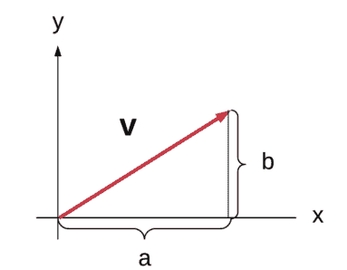

图 2.1. 红色箭头 **v** 是向量，*a* 和 *b* 是标量，分别表示 **v** 在水平和垂直方向上的大小。

**v** = $\begin{bmatrix} v_1 \\ v_2 \\ \dots \\ v_{k-1} \\ v_k \end{bmatrix}$

**记号：** 我们用 **v** ∈ ℝ^k 表示 k 维向量。

### 2.3. 矩阵

在数学中，矩阵是由元素（如数字）按行和列排列而成的矩形数组。通常，矩阵用粗体大写字母表示，如 **M**。下面是一个矩阵示例：

**A** = $\begin{bmatrix} 1 & -1 & 3 \\ 4 & 11 & -0.2 \end{bmatrix}$

我们用下标表示矩阵元素。在矩阵 **M** 中，第 *i* 行、第 *j* 列的元素记为 **M**_{i,j}。因此，对于上面的例子，可以很容易地说出 **M**_{1,2} = −1，**M**_{2,3} = −0.2。另一个重要记号是当我们希望将某一行或某一列作为一个整体引用时，即该行/列中的所有元素。这种情况下，我们在下标中使用“:”符号。例如，假设我们要引用矩阵 **M** 的第 *i* 行的所有元素。我们将该行记为 **M**_{i,:}。对于矩阵 **A**，**A**_{1,:} 如下所示：

**A**_{1,:} = $\begin{bmatrix} 1 & -1 & 3 \end{bmatrix}$

**注意：** 我们通常用一列多行的元素来表示向量。因此，我们可以将大小为 $k$ 的向量称为 $k \times 1$ 矩阵。一般来说，我们可以非正式地说，向量是一种特殊的矩阵，它是 1 维的。

**记号：** 我们用 $\mathbf{M} \in \mathbb{R}^{m\times n}$ 表示矩阵，其中 $m$ 和 $n$ 分别是行数和列数。

### 2.4. 张量

在机器学习中，我们通常用数值表示数据。张量就是用于这种数值表示的。张量只是一个在 N 维空间中容纳数据的容器。一个张量可以容纳并表示多个矩阵。下面是一个示例：

$$\begin{bmatrix}\begin{bmatrix}10 & 3 & 3.1 \\ 6 & 12 & -0.2 \\ 1 & -2 & 7 \\ 4. & 1.1 & 81.1\end{bmatrix} \begin{bmatrix}1.0 & -1 & 3 \\ 4 & 11 & -2 \\ 1.1 & -2 & -2 \\ 4 & 4 & -5\end{bmatrix}\end{bmatrix}$$

你可以将一个简单的 3D 张量视为下图所示的数据立方体：

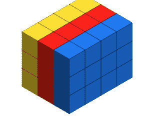

**图 2.2.** 在此张量中，每种颜色代表一个矩阵，这些矩阵的拼接构成了张量。

### 2.5. 总结

本章描述了机器学习中最常用的一些线性代数定义。标量、向量、矩阵和张量是你最常听到的术语。在继续学习线性代数中的其他概念之前，了解它们至关重要。关于本章概念的更多细节，可参阅文献 [2–6]。

## 第 3 章：NumPy 入门

本章专门介绍 NumPy [7]，它是用于线性代数乃至机器学习的最重要的科学计算库之一！由于我们会频繁使用它来解释线性代数概念，因此了解如何使用它非常重要。

### 3.1. 引言

几乎在**任何机器学习 Python 程序代码**中，你都会看到使用了“NumPy”库！为什么？没有线性代数，机器学习便无从谈起，而线性代数又是由向量、矩阵等构成的。**而 NumPy 正是最好的科学计算包之一，尤其适合线性代数。** 这就是对前面“为什么”问题的简短回答！

**你可以花上简单的 30 分钟研究一下**，看看我说得对不对！在网上搜索机器学习项目及其可用源代码，检查其中有多少使用了 Numpy。查看 Python 代码，统计你在代码开头看到 *“import numpy”* 或 *“import numpy as np”* 表达式的次数。去试试看！除非你已深知 Numpy 的重要性，否则这一定会激励你。

本章你将学到以下内容：

- 什么是 Numpy？
- 如何在 Numpy 中定义数组？
- 基本操作有哪些？
- 如何利用 Numpy 进行机器学习？
- 使用 Numpy 时最常用的技巧有哪些？

### 3.2. 数据类型

这里介绍一些你经常遇到的、最重要的 Numpy 数值数据类型。Numpy 支持的数据类型多到令人目不暇接，甚至可能比 Python 本身还要多！

#### 3.2.1 基本数据类型

最基本的数据类型如下：整数（例如：1、2、−10）、浮点数（例如：1.1、3.24、−7.00111）、复数（例如：1 + 2j、2.1 + 3j、−2 + 1.4j）和布尔值（例如：True、False）。你可以使用 NumPy 以多种方式转换 Python 元素，例如将数组类型转换为另一种特定类型。让我们从以下示例开始：

```python
# 导入 NumPy 库
import numpy as np

# 定义一个数字
a = 10
print('转换前的类型：', type(a))

# 使用 NumPy 将类型改为浮点型
b = np.float64(a)
print('转换后的类型：', type(b))

# 使用 NumPy 将类型改为浮点型
c = float(a)
print('转换后的类型：', type(c))
```

```text
Type, before converting:  <class ’int’>
Type, after converting:  <class ’numpy.float64’>
Type, after converting:  <class ’float’>
```

> **问题**
> 
> 使用“np.float64”与 Python 内置函数“float”有什么区别？

#### 3.2.2 类型转换

现在，让我们将一个列表转换为 NumPy 数组。目前，我们只关注数据类型和转换，稍后在本章中你将看到如何详细定义 NumPy 数组。

```python
# 导入 NumPy 库
import numpy as np

# 定义一个 Python 列表
a = [1, 2, 1.3]
print('"a" 的类型：', type(a))

# 将 Python 列表转换为类型为 np.int32（整数（-2147483648 到 2147483647））的 NumPy 数组
```

```
b = np.int32(a)
print('Array "b": ', b)
print('Type array "b": ', type(b))
print('Array "b" data type: ', b.dtype)

# Turn Python list into a NumPy array of type np.float32 (same as Python float)
c = np.float32(a)
print('Array "c": ', c)
print('Type array "c": ', type(c))
print('Array "c" data type: ', c.dtype)
```

```
Type "a": <class 'list'>
Array "b": [1 2 1]
Type array "b": <class 'numpy.ndarray'>
Array "b" data type: int32
Array "c": [1. 2. 1.3]
Type array "c": <class 'numpy.ndarray'>
Array "c" data type: float32
```

我们使用 NumPy 的 .dtype 方法来确定数组内部的数据类型。更改 NumPy 数组类型的推荐方法是使用 .astype() 方法。请看下面的示例：

```
# Import NumPy library
import numpy as np

# Define a Python list
a = [1, 2, 4]
print('Type "a": ', type(a))

# Turn Python list into a NumPy array of type np.int32 (Integer (-2147483648 to 2147483647))
b = np.int32(a)
print('Array "b": ', b)
print('Type array "b": ', type(b))

# Turn Python list into a NumPy array of type np.float32 (same as Python float)
c = b.astype(np.float32)
print('Array "c": ', c)
print('Type array "c": ', type(c))
```

```
Type "a": <class 'list'>
Array "b": [1 2 4]
Type array "b":  <class 'numpy.ndarray'>
Array "c":  [1. 2. 4.]
Type array "c":  <class 'numpy.ndarray'>
```

### 3.3. 定义 NumPy 数组

数组本质上是一个一维或多维的值网格。特别是在 NumPy 数组中，所有值都来自同一类型（整数、浮点数）。我们将如何定义 NumPy 数组？对于 NumPy 数组，我们有以下定义：

- **Rank:** 数组拥有的维度数。
- **Shape:** 一个元组，表示每个维度中的元素数量。Ex: 数组的形状为 (2,4,10) 表示我们有一个三维数组，其在第一、第二和第三维度中分别有 2、4 和 10 个元素。

#### 3.3.1 从列表创建数组

现在让我们开始使用 Python。我们从最常见的方法开始。让我们从列表创建一个 NumPy 数组：

```
# Import NumPy library
import numpy as np

# Define a Python list
mylist = [1, 2, 4, 8]

# Create a NumPy array from the list
numpy_array = np.array(mylist)
print('Array: ', numpy_array)
```

```
Array:  [1 2 4 8]
```

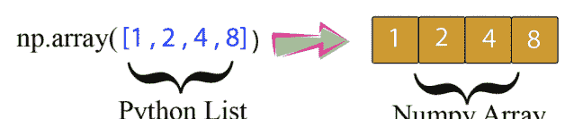

Fig. 3.1. 上面，我们使用 np.array 函数将列表转换为 NumPy 数组

如果我们不定义列表而只是像下面这样输入数字会怎样：

```
# Import NumPy library
import numpy as np

# Naively input the numbers
numpy_array = np.array(1,2,4,8)
print('Array: ', numpy_array)
```

> 运行上面的代码，看看你会得到什么输出。

现在，让我们定义一个二维数组：

```
# Import NumPy library
import numpy as np

# Naively input the numbers
row1 = [2,4,6,8]
row2 = [1,3,5,7]
numpy_array = np.array([row1,row2])
print('Array: ', numpy_array)

# Get the shape
print('Shape: ', numpy_array.shape)
```

```
Array:  [[2 4 6 8]
 [1 3 5 7]]
Shape:  (2, 4)
```

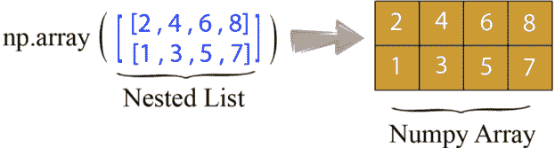

**Fig. 3.2.** 上面，我们将列表转换为二维 NumPy 数组

让我们再次看一下上面的代码。我们定义了一个矩阵。**np.array** 内部的参数是一个列表，其每个元素都是另一个列表（见上图）！内部列表 row1 和 row2 构成了矩阵的行，并且必须具有相同的大小！想想为什么？这是一个简单的示例，展示了如何创建数组。** .shape** 方法用于返回 NumPy 数组的形状。上面的输出显示我们有一个矩阵，有两行四列。

#### 3.3.2 特殊函数

我们可以使用一些特殊的 NumPy 函数创建 NumPy 数组。下面我列出了几个供参考：

```
# Import NumPy library
import numpy as np

### Defining arrays using special functions ###
# Arguments:
# shape: The shape of the numpy array
# dtype: Specifying the data type (not required)

# Defining an all-zero array
zeroArray = np.zeros(shape=(3,5), dtype=np.int16 )
print("zeroArray: ", zeroArray)

# Defining an all-one array
onesArray = np.ones(shape=(3,5), dtype=np.float32 )
print("onesArray: ", onesArray)

# Defining an array filled with one specific element
fullArray = np.full(shape=(3,5), fill_value=4.2, dtype=np.float64 )
print("fullArray: ", fullArray)
```

```
zeroArray: [[0 0 0 0 0]
 [0 0 0 0 0]
 [0 0 0 0 0]]
onesArray: [[1. 1. 1. 1. 1.]
 [1. 1. 1. 1. 1.]
 [1. 1. 1. 1. 1.]]
fullArray: [[4.2 4.2 4.2 4.2 4.2]
 [4.2 4.2 4.2 4.2 4.2]
 [4.2 4.2 4.2 4.2 4.2]]
```

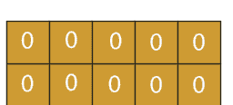

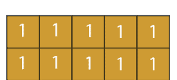

Fig. 3.3. 定义填充有特定元素的数组

最重要的特殊函数之一是 np.arange，它类似于 Python 的 range 内置函数。np.arange 的使用示例如下：

```
# Import NumPy library
import numpy as np

# Define a NumPy array using np.arange
# np.arange defines an interval of numbers
# Arguments:
#   start: Starting of the interval.
#   stop: Ending of the interval.
#   step: Step size.
# NOTE: The interval includes "start" number but does NOT include "stop" number.
arr = np.arange(start=3,stop=10,step=2)
print("Array: ", arr)
```

```
Array: [3 5 7 9]
```

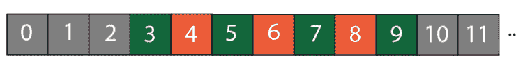

Fig. 3.4. NumPy 索引从 0 开始到无穷大！通过定义 np.arange(start=3,stop=10,step=2)，起始索引为 3。停止索引为 10 但它不包含在范围内。步长为 2 表示每隔一个索引被选中，即我们只选择绿色索引并跳过橙色索引

#### 3.3.3 通用函数

NumPy 为了执行逐元素操作，提供了一些通用函数。看看下面演示的一些通用函数：

```
# Import NumPy library
import numpy as np

v = np.array([1, 3, 5])
w = np.array([2, 4, 6])

# Exponential operation
print('e^v= ', np.exp(v))

# The square root of an array
print('v^{1/2}= ', np.sqrt(v))

# Adding two vectors
print('v+w= ', np.add(v, w))

# Sin and Cos of an array
print('Sin(v)= ', np.sin(v))
print('Cos(v)= ', np.cos(v))
```

运行上面的代码查看结果。

#### 3.3.4 随机数组

有时希望定义一个包含随机数的数组。完成此任务的方法有很多，具体取决于我们想要使用的随机数类型。例如，我们是否想要生成随机整数、浮点数等？看看下面的方法：

```
# Import NumPy library
import numpy as np

### Defining arrays with random elements ###
# Arguments:
#   size: The size of the numpy array

# Defining a random array
randArray = np.random.random(size=(2,3))
print("randArray: ", randArray)

# Defining a random array with integer elements
# high: The highest element that is allowed to be generated is `` high-1``
# low: The lowest integer that is allowed to be generated
randintArray = np.random.randint(low=1, high=5, size=(2,3))
print("randintArray: ", randintArray)
```

```
randArray:  [[0.65055144 0.12510875 0.09906024]
 [0.47333278 0.67082837 0.7673982 ]]
randintArray:  [[4 4 1]
 [1 2 2]]
```

**CAVEAT**

由于我们生成了一个随机向量，如果你使用上面的 Python 代码，你绝对不会得到我上面报告的结果！虽然这是显而易见的，对吧？

### 3.4. 基本算术运算

让我们先通过一些示例介绍基本算术运算：

```
# Import NumPy library
import numpy as np

# Create two arrays
a = np.array([[1,5],[0,8]], dtype=np.float32)
b = np.array([[2,1],[5,2]], dtype=np.float32)
print('a= ', a)
print('b= ', b)

# Elementwise adding
# a + b and np.add(a, b) are the same.
# Check to see if a + b and np.add(a, b) are the same using ``assert ``.
# .all() method check if all elements of a matrix is True.
print('a + b= ', a + b)
assert((a + b == np.add(a, b)).all())

# Elementwise subtraction
print('a - b= ', a - b)
assert((a - b == np.subtract(a, b)).all())

# Elementwise multiplication
print('a * b= ', a * b)
assert((a * b == np.multiply(a, b)).all())

# Elementwise division
print('a / b= ',a / b)
assert((a / b == np.divide(a, b)).all())

# Elementwise square
print('a^2= ', np.square(a))
assert((a ** 2 == np.square(a)).all())
```

```
a= [[1. 5.]
    [0. 8.]]
b= [[2. 1.]
    [5. 2.]]
a + b= [[ 3.   6.]
        [ 5.  10.]]
a - b= [[-1.   4.]
        [-5.   6.]]
a * b= [[ 2.   5.]
        [ 0.  16.]]
a / b= [[0.5 5. ]
```


```
[0.  4. ]
a^2=  [[ 1. 25.]
       [ 0. 64.]]
[1 2 2]]
```

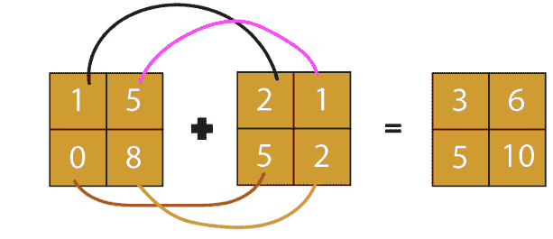

图 3.5 逐元素求和。在逐元素运算中，运算符对矩阵中对应的元素进行操作。

### 3.5. 数组操作

在熟悉了 NumPy 数组之后，现在是时候学习如何操作数组并掌握一些技巧了。

#### 3.5.1 索引

首先，让我们定义并切片一个数组：

```python
# Import NumPy library
import numpy as np

# Create a matrix
A = np.array([[2,1,3,4],[5,2,9,4],[5,2,10,1],[2,2,11,-1]])
print('A=\n', A)

# Extract the first two rows
# Remember 0:2 in indexing means {0,1} and does NOT include 2!
# Using : merely, means ALL!
print('The first two rows= \n', A[0:2,:])

# Extract the first three rows and the last two columns
# -2: means the second to the last to the end!
# 0:3 mean {0,1,2}
print('The first three rows and last two columns= \n', A[0:3,-2:])

# Let’s point to one element
# The second row (index 1) and third column (index 2)
# Remember Python indexing starts from zero!!
print('The second row and third column= \n', A[1,2])
```

```
A=
  [[ 2  1  3  4]
   [ 5  2  9  4]
   [ 5  2 10  1]
   [ 2  2 11 -1]]
The first two rows=
  [[2 1 3 4]
   [5 2 9 4]]
The first three rows and last two columns=
  [[ 3  4]
   [ 9  4]
   [10  1]]
The second row and third column=
  9
```

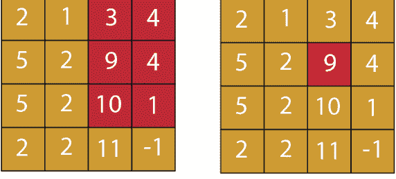

图 3.6 左图：显示 A[0:3,-2:]，即前三行和最后两列。右图：显示 A[1,2]，即位于第二行第三列的唯一一个元素。

让我们回顾上面的代码。在第 11 行，我使用了通过选择索引范围进行切片索引。在第 21 行，我只使用了整数索引。我们可以简单地将两者结合，但输出矩阵的维度可能会有所不同。请看下面的示例：

```python
# Import NumPy library
import numpy as np

# Create a matrix
A = np.array([[2,1,3,4],[5,2,9,4],[5,2,10,1],[2,2,11,-1]])
print('A=\n', A)

# Extract the first row and all columns using two approaches
print('The first row with slice indexing= \n', A[0:1,:]) # Slice indexing
print('The first row with integer indexing= \n', A[0,:])  # Integer indexing
print('The first row shape slice indexing= \n', A[0:1,:].shape) # Slice indexing
print('The first row shape integer indexing= \n', A[0,:].shape)  # Integer indexing
```

```
A=
[[ 2  1  3  4]
 [ 5  2  9  4]
 [ 5  2 10  1]
 [ 2  2 11 -1]]
The first row with slice indexing=
[[2 1 3 4]]
The first row with integer indexing=
[2 1 3 4]
The first row shape slice indexing=
(1, 4)
The first row shape integer indexing=
(4,)
```

如果你查看结果，矩阵的形状会有所不同。基本上，**使用切片索引，我们得到一个二维矩阵**，**而使用整数索引，我们会得到一个一维矩阵**。在处理 NumPy 索引时，请注意这个区别。我们稍后会详细讨论矩阵维数（rank）的概念。

#### 3.5.2 重塑

```python
# Import NumPy library
import numpy as np

# Create a matrix
A = np.array([[2,1,3,4],[5,2,9,4],[5,2,10,1]])
print('A=\n', A)
print('Shape of A=\n', A.shape)

# Reshape A to the new shape of (2,6)
B = A.reshape(2,6)
print("B: \n", B)

# Reshape A to the new shape of (4,-1)
# If we use -1, the remaining dimension will be chosen automatically
C = A.reshape(4,-1)
print("C: \n", C)
# Flatten operation
print("Flatten A: \n", A.ravel())
```

```
A=
  [[ 2  1  3  4]
  [ 5  2  9  4]
  [ 5  2 10  1]]
Shape of A=
(3, 4)
B:
  [[ 2  1  3  4  5  2]
  [ 9  4  5  2 10  1]]
C:
  [[ 2  1  3]
  [ 4  5  2]
  [ 9  4  5]
  [ 2 10  1]]
Flatten A:
[ 2  1  3  4  5  2  9  4  5  2 10  1]
```

那么，重塑操作是如何工作的？上面我们有一个大小为 (3,4) 的矩阵 A，总共有 12（3 × 4）个元素。当我们使用 np.reshape 时，NumPy 的默认顺序是“C 风格”，即对于处理操作，最右侧的索引“变化最快”。让我们用上面的 .ravel() 示例来展平矩阵：第一个元素显然是 A₀,₀，下一个是 A₀,₁。使用 .ravel() 时，处理和创建新数组的过程如下：

[A₀,₀, A₀,₁, A₀,₂, A₀,₃, A₁,₀, …, A₂,₃]

### 3.6. 小结

在本章中，你学习了如何使用 NumPy。你也意识到它对于机器学习目的的重要性。但显然，这个介绍并不能解决你对 NumPy 的所有需求，也并非完美无缺！你总是需要进一步探索。如果你自己动手练习，学习效率会更高。将上述代码作为入门代码，并尝试修改和运行它们。如果你想了解更多关于 NumPy 的内容，请参阅 [8–10]。

## 第 4 章：矩阵运算

本章专门介绍我们如何处理矩阵和向量。关于向量的讨论比较直接，因此本章的大部分内容专门讨论矩阵运算。

### 4.1. 引言

你是否曾好奇为什么需要了解矩阵运算？答案很简单：为了处理矩阵！首先，假设你已经熟悉基本定义（第 2 章）。本章将描述我们在机器学习中需要并经常遇到的最重要的矩阵和向量运算。

### 4.2. 矩阵转置

矩阵转置是一种运算符，它交换矩阵的行索引和列索引。因此，转置矩阵后，我们得到一个新矩阵，记为 A^T。也就是说，A 的第 i 行、第 j 列元素分别是 A^T 的第 j 行、第 i 列元素。假设我们用矩阵 B 表示 A^T，则有：

**B**_{j,i} = **A**_{i,j}

我们可以通过下面的示例进一步说明：

$$\begin{bmatrix}2 & 3 & 1 \\ 3 & -4 & 2.2\end{bmatrix}^T = \begin{bmatrix}2 & 3 \\ 3 & -4 \\ 1 & 2.2\end{bmatrix}$$

使用 Python 计算矩阵转置非常容易。例如，你可以尝试以下代码：

```python
# Use Numpy package
import numpy as np

# Define a 3x2 matrix using np.array
A = np.array([[1, 2.2], [4, 7], [8, -2]])
"""A = [[ 1.   2.2]
      [ 4.   7. ]
      [ 8.  -2. ]]"""

print("A is: {}".format(A))
print("The shape of A is: {}".format(A.shape))

# Use transpose() method
B = A.transpose()
"""B = [[ 1.   4.   8. ]
      [ 2.2  7.  -2. ]]"""

print("B is: {}".format(B))
print("The shape of B is: {}".format(B.shape))
```

```
A is: [[ 1.   2.2]
  [ 4.   7. ]
  [ 8.  -2. ]]
The shape of A is: (3, 2)
B is: [[ 1.   4.   8. ]
  [ 2.2  7.  -2. ]]
The shape of B is: (2, 3)
```

注意：值得指出的是 (A^T)^T = A。

### 4.3. 单位矩阵

单位矩阵记作 I_n，是一个方阵（行数 = 列数 = n），其主对角线上的所有元素为 1，其余元素为 0。例如，我们可以有下面的 4 × 4 单位矩阵：

$$\begin{bmatrix}1 & 0 & 0 & 0 \\ 0 & 1 & 0 & 0 \\ 0 & 0 & 1 & 0 \\ 0 & 0 & 0 & 1\end{bmatrix}$$

你可以使用以下代码创建上述矩阵：

```python
# Use Numpy package
import numpy as np

# Define an Identity matrix
# Ref: https://docs.scipy.org/doc/numpy/reference/generated/numpy.eye.html
A = np.eye(4)
```

### 4.4. 加法运算

只有当两个矩阵具有相同形状时，才能进行矩阵加法。假设 C = A + B。让我们回到 Python，重新定义上面那两个相同的矩阵。然后，我们将它们相加：

```python
# Use Numpy package
import numpy as np

# Define a 3x2 matrix using np.array
A = np.array([[1, 2.2], [4, 7], [8, -2]])

# Use transpose() method
B = A.transpose()

# Create a matrix similar to A in shape but filled with random
#     numbers
# Use *A.shape argument
A_like = np.random.randn(*A.shape)

# Add two matrices of the same shape
M = A + A_like
print("M equals to: ", M)

# Add two matrices with different shape
C = A + B
print("C equals to: ", C)
```

你应该得到以下输出：

```
M equals to:  [[ 2.4212905   2.88158481]
 [ 4.34872344  5.01038501]
 [ 7.58194231 -2.0192284 ]]
--------------------------------------------------------------------------

ValueError                              Traceback (most recent
    call last)
<ipython-input-35-293b043ce9a9> in <module>()
     16
     17 # Add two matrices with different shape
---> 18 C = A + B
     19 print("C equals to: ", C)
```


```
ValueError: operands could not be broadcast together with shapes
(3,2) (2,3)
```

是什么导致了上述错误？

在矩阵加法中，有一些重要的特性你需要了解：

- A + B = B + A
- (A + B) + C = A + (B + C)
- A + 0 = 0 + A
- (A + B)^T = A^T + B^T

你可以通过以下 Python 代码简单验证上述性质：

```python
# Use Numpy package
import numpy as np

# Define random 3x4 matrix using np.array
# Ref: https://docs.scipy.org/doc/numpy-1.15.1/reference/generated/numpy.random.randint.html
A = np.random.randint(10, size=(3, 4))
B = np.random.randint(10, size=(3, 4))
C = np.random.randint(10, size=(3, 4))

# np.all() test whether all array elements are True.
# More info: https://docs.scipy.org/doc/numpy/reference/generated/numpy.all.html
checkProperty = np.all(A + B == B + A)
if checkProperty: print('Property A + B == B + A is confirmed!')

checkProperty = np.all((A + B) + C == A + (B + C))
if checkProperty: print('Property (A + B) + C == A + (B + C) is confirmed!')

checkProperty = np.all(A + 0 == 0 + A)
if checkProperty: print('Property A + 0 == 0 + A is confirmed!')

checkProperty = np.all((A + B).transpose() == A.transpose() + B.transpose())
if checkProperty: print('Property (A + B)^T == A^T + B^T is confirmed!')
```

### 4.5. 标量乘法

如果我们将一个矩阵乘以一个数字（即标量），结果等于将矩阵的每个元素都乘以该特定标量。例如，你可以检查以下计算：

$2*\begin{bmatrix}2 & 3 & 1 \\ 3 & -4 & 2.2\end{bmatrix}=\begin{bmatrix}4 & 6 & 2 \\ 6 & -8 & 4.4\end{bmatrix}$

标量与矩阵乘法的性质如下：

- $(\alpha + \beta)\mathbf{A} = \alpha\mathbf{A} + \beta\mathbf{A}$
- $\alpha(\mathbf{A} + \mathbf{B}) = \alpha\mathbf{A} + \alpha\mathbf{B}$
- $0.\mathbf{A} = 0$
- $1.\mathbf{A} = \mathbf{A}$

### 4.6. 矩阵乘法

假设我们想乘以两个矩阵并将输出计算为 $\mathbf{C}=\mathbf{A}\mathbf{B}$。为此，$\mathbf{A}$ 和 $\mathbf{B}$ 矩阵的维度应匹配。这里，匹配并不意味着相等。匹配意味着 $\mathbf{A}$ 的列数应等于 $\mathbf{B}$ 的行数。例如，假设 $\mathbf{A}$ 的形状为 $m \times q$。那么 $\mathbf{B}$ 的形状必须是 $q \times n$，因此 $q$ 是共享的。这样的乘法结果 $\mathbf{C}$ 的形状等于 $m \times n$。

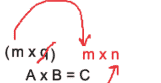

图 4.1. 矩阵乘法中维度匹配的可视化。

查看以下 Python 代码以更好地理解矩阵乘法：

### 4.6. 矩阵乘法

```python
# Use Numpy package
import numpy as np

# Define two 3x4 random matrices using np.array
# Ref: https://docs.scipy.org/doc/numpy-1.15.1/reference/generated/numpy.random.randint.html
A = np.random.randint(10, size=(3, 4))
B = np.random.randint(10, size=(3, 4))

print('Shape A is: {}'.format(A.shape))
print('Shape B is: {}'.format(B.shape))

# Calculate the number of columns in A and number of rows in B
A_num_columns = A.shape[1]
B_num_rows = B.shape[0]

# Check the dimensions
if A_num_columns != B_num_rows: print('dimension mismatch')

# You should get an error as A_num_columns != B_num_rows
C = np.matmul(A , B)
```

> > 你将得到什么输出？上述操作中有些是有效的，有些则不是...

从数学上讲，我们可以按如下方式计算 $C = AB$ 的不同元素：

$$C_{i,j} = \sum_m A_{i,m}B_{m,j} = A_{i,1}B_{1,j} + \ldots + A_{i,q}B_{q,j}$$

下面给出了一个说明性示例：

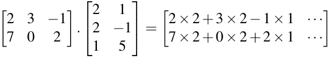

你可以使用以下代码实现上述示例并确认结果：

```python
# Use Numpy package
import numpy as np

# Define two matrices
A = np.array([[2,3,-1],[7,0,2]])
B = np.array([[2,1],[2,-1],[1,5]])

print('Shape A is: {}'.format(A.shape))
print('Shape B is: {}'.format(B.shape))

# Calculate the number of columns in A and number of rows in B
A_num_columns = A.shape[1]
B_num_rows = B.shape[0]

# Check the dimensions
if A_num_columns != B_num_rows: print('dimension mismatch')

# You should get an error as A_num_columns != B_num_rows
C = np.matmul(A , B)
print('C=AB= {}'.format(C))

# Instead of C=AB let's calculate C=BA
C = np.matmul(B , A)
print('C=BA= {}'.format(C))
```

输出将为：

```
Shape A is: (2, 3)
Shape B is: (3, 2)
C=AB= [[ 9 -6]
       [16 17]]
C=BA= [[11  6  0]
       [-3  6 -4]
       [37  3  9]]
```

你可以清楚地检查到 AB ≠ BA。矩阵乘法的性质如下：

- (AB)C = A(BC)
- A(B + C) = AB + AC
- (AB)^T = B^T A^T

你可以使用以下 Python 代码验证上述所有性质：

```python
# Use Numpy package
import numpy as np

# Define three random 3x3 matrix using np.array
# Ref: https://docs.scipy.org/doc/numpy-1.15.1/reference/generated/numpy.random.randint.html
A = np.random.randint(10, size=(3, 3))
B = np.random.randint(10, size=(3, 3))
C = np.random.randint(10, size=(3, 3))

# np.all() test whether all array elements are True.
# More info: https://docs.scipy.org/doc/numpy/reference/generated/numpy.all.html
checkProperty = np.all(np.matmul(A,np.matmul(B,C)) == np.matmul(np.matmul(A,B),C))
if checkProperty: print('Property A(BC) = (AB)C is confirmed!')

checkProperty = np.all(np.matmul(A,B+C) == np.matmul(A,B) + np.matmul(A,C))
if checkProperty: print('Property A(B+C) = AB + AC is confirmed!')

checkProperty = np.all(np.matmul(A,B).transpose() == np.matmul(B.transpose(),A.transpose()))
if checkProperty: print('Property (AB)^T = B^T.A^T is confirmed!')
```

矩阵幂是一个重要问题。假设你看到类似 $A^3$ 的表达式。这 simply 意味着我们将 **A** 矩阵自乘三次。可以表示如下：

$A^3 = A \times A \times A$

**但是**，矩阵**必须是方阵**，例如，其行数和列数**必须**相同。否则，幂运算将无效。实现以下代码看看会发生什么：

```python
# Calculate the matrix power for two square and non-square matrices.

# Use Numpy package
import numpy as np
# A: 3x3 SQUARE matrix using np.array
A = np.random.randint(10, size=(3, 3))
print('A has the shape of: {}'.format(A.shape))

# Calculate A^3
n=3
output = np.linalg.matrix_power(A, n)
print('Output has the shape of: {}'.format(output.shape))

# A: 3x4 NON-SQUARE matrix using np.array
B = np.random.randint(10, size=(3, 4))
print('B has the shape of: {}'.format(B.shape))

# Calculate A^3
n=3
output = np.linalg.matrix_power(B, n)
print('Output has the shape of: {}'.format(output.shape))
```

### 4.7. 矩阵-向量乘法

让我们看看如何定义矩阵和向量并将它们相乘。

```python
# Import Numpy library
import numpy as np
# Create two vectors and two matrices
v = np.array([0,8]).reshape(-1,1)
u = np.array([1,4]).reshape(-1,1)
A = np.array([[2,1],[5,2]])
B = np.array([[2,1],[5,2]])
# Dot product of two vectors with two approaches
print('v.u = ', v.dot(u.transpose()))
print('v.u = ', np.dot(v, u.transpose()))
# Product of a vector with a matrix
print('A.v = ', A.dot(v))
print('A.v = ', np.dot(A, v))
# Matrix product with three approaches
print('A.B = ', A.dot(B))
print('A.B = ', np.dot(A, B))
print('A.B = ', np.matmul(A,B))
```

让我们做一个练习。运行上述代码并回答以下问题：

### 问题

- **v** 和 **u** 的形状和秩是什么？
- 在第 11 行和第 12 行，我们是否必须使用 ".transpose()"？为什么？
- 除了计算 ‘v.u’，你将如何计算 ‘u.v’？
- 看看第 15 行和第 16 行。除了 ‘A.v’，我们能否计算 ‘v.A’？

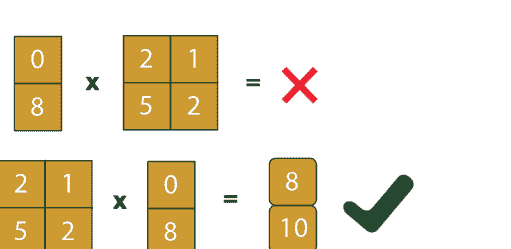

图 4.2. 你可能会在上面看到一些问题的视觉答案！在向量和矩阵相乘时，维度匹配至关重要。


**注意：** 我们通常使用一列多行元素来表示一个向量。从此以后，我们可以将大小为 $k$ 的向量称为 $k \times 1$ 矩阵。一般来说，我们可以非正式地说向量是一种特殊的 1 维矩阵。$(\mathbf{A}^T)^T = \mathbf{A}$。

类似地，要将向量 $\mathbf{v}$ 与矩阵 $\mathbf{M}$ 相乘，维度必须匹配。假设我们的矩阵 $\mathbf{A}$ 的大小为 $m \times n$，我们想计算 $\mathbf{w} = \mathbf{A}\mathbf{v}$。$\mathbf{v}$ 的大小是多少？你能猜到吗？$\mathbf{v}$ 的唯一可接受大小是 $n \times 1$。因此我们有以下运算：

$\begin{bmatrix} w_1 \\ w_2 \\ \vdots \\ w_m \end{bmatrix}^{m \times 1} = \begin{bmatrix} A_{11} & A_{12} & \cdots & A_{1n} \\ A_{21} & A_{22} & \cdots & A_{2n} \\ \vdots & \cdots & \cdots & \vdots \\ A_{m1} & \cdots & \cdots & A_{mn} \end{bmatrix}^{m \times n} \begin{bmatrix} v_1 \\ v_2 \\ \vdots \\ v_n \end{bmatrix}^{n \times 1}$

你可以按如下方式实现一个可工作的示例：

```
# Use Numpy package
import numpy as np
# A: 3x4 matrix using np.array
A = np.random.randint(10, size=(3, 4))

# B: A vector of size 4
v = np.random.randint(10, size=(4,))

print('Shape A is: {}'.format(A.shape))
print('Shape v is: {}'.format(v.shape))

# Calculate the number of columns in A and number of rows in B
A_num_columns = A.shape[1]
v_num_rows = v.shape[0]

# Check the dimensions
if A_num_columns != v_num_rows: print('dimension mismatch')

# You should get an error as A_num_columns != B_num_columns
w = np.matmul(A , v)
print('w=Av=', w)
print('The shape of w is:',w.shape)
```

### 4.8. 矩阵逆

矩阵 $\mathbf{A}$ 的逆存在并表示为 $\mathbf{A}^{-1}$，当同时满足以下两个条件时：

- **A** 是方阵
- 用 **A** 与其逆相乘得到单位矩阵：**A A**⁻¹ = **I**

如果矩阵 **A** 是 **可逆的**，则称为非奇异。否则，它被称为 **不可逆** 或 **奇异**。矩阵奇异的概念是一个相对更高级的概念，将在后续章节中描述。

你可以使用以下代码练习矩阵逆的计算：

```
# Use Numpy package
import numpy as np
# A: 3x3 SQUARE matrix using np.array
A = np.random.randint(10, size=(3, 3))
print('A has the shape of: {}'.format(A.shape))

# Calculate matrix inverse
a_inv = np.linalg.inv(A)
print('The inverse of A is:',a_inv)

# Check to see if multiplication of A and A^{-1} equals to identity matrix I
if np.allclose(np.dot(A, a_inv), np.eye(A.shape[0])): print('A is invertible!')
```

以下性质适用于矩阵求逆运算：

- (**A B**)⁻¹ = **B**⁻¹ **A**⁻¹
- (**A**ᵀ)⁻¹ = (**A**⁻¹)ᵀ
- (**α A**)⁻¹ = (1/α) **A**⁻¹

你可以使用以下 Python 脚本来验证上述性质：

```
# Use Numpy package
import numpy as np
# Define two 3x3 SQUARE matrix using np.array
A = np.random.randint(10, size=(3, 3))
B = np.random.randint(10, size=(3, 3))

# np.round(A,2): rounds the array A to two decimal points
# Check property (AB)^{-1} = B^{-1}.A^{-1}
left_side = np.linalg.inv(np.matmul(A,B))
right_side = np.matmul(np.linalg.inv(B),np.linalg.inv(A))
checkProperty = np.all(np.round(left_side, 2) == np.round(right_side , 2))
if checkProperty: print('Property (AB)^{-1} = B^{-1}.A^{-1} is confirmed!')
```

```
# Check property (A^{T})^{-1} = (A^{-1})^{T}
left_side = np.linalg.inv(np.transpose(A))
right_side = np.transpose(np.linalg.inv(A))
checkProperty = np.all(np.round(left_side, 2) == np.round(right_side, 2))
if checkProperty: print('Property (A^{T})^{-1} = (A^{-1})^{T} is confirmed!')

# np.dot is a very important function.
# Ref: https://docs.scipy.org/doc/numpy/reference/generated/numpy.dot.html
# Check property (alpha.A)^{-1} = (1/alpha)A^{-1}
alpha = float(3) # Any scalar (make sure to define a float)
left_side = np.linalg.inv(np.dot(alpha,A))
right_side = np.dot(1/alpha,np.linalg.inv(A))
checkProperty = np.all(np.round(left_side, 2) == np.round(right_side, 2))
if checkProperty: print('Property (alpha.A)^{-1} = (1/alpha)A^{-1} is confirmed!')
```

### 4.9. 矩阵迹

假设我们有一个方阵。矩阵的迹是一个算子，其为其 **对角元素** 的和，如下所示：

$$Tr(\mathbf{M}) = \sum_k M_{k,k}$$

处理矩阵的迹而不是矩阵本身，对于许多矩阵计算和数学证明来说更容易。

矩阵迹算子具有以下性质：

- $Tr(\mathbf{M}) = Tr(\mathbf{M}^{T})$
- $Tr(\mathbf{AB}) = Tr(\mathbf{BA})$ 如果 **AB** 和 **BA** 都存在且有效。

### 4.10. 矩阵行列式

矩阵 $\mathbf{A} \in \mathbb{R}^{N \times N}$ 的 **行列式** 是我们从矩阵元素计算得到的一个标量值。矩阵 **必须** 是方阵，这样我们才能计算行列式。此外，矩阵必须是 **非奇异** 的！

### 4.11. 特殊矩阵

有一些特殊的矩阵，你可能每天都会听到它们的名字。我想在这里简要描述一下它们。

### 对称矩阵

对称矩阵等于其转置，如下所示：

**M** = **M**^T

一个例子是以下矩阵：

[ 1  -1 ]
[-1  3 ]

### 对角矩阵

对角矩阵仅在其主对角线上具有非零元素。矩阵其他地方的元素均为零。

**M**_{i,j} = 0, i ≠ j

**M**_{i,j} ≠ 0, i = j

我们可以有以下例子：

[ 1  0  0 ]
[ 0  3  0 ]
[ 0  0 -1 ]

> 注意：对角矩阵不一定是方阵。矩阵的主对角线由元素 **M**_{i,j} 构成，其中 i = j。

### 正交矩阵

正交矩阵是一个方阵，具有以下特征：

**M** **M**^T = **M**^T **M** = **I**

请注意，如果我们将 **M** 与 **M**^T 相乘得到单位矩阵，这意味着 **M**^T = **M**^{-1}。

### 4.12. 结论

在本章中，我们解释了机器学习中常用的重要矩阵运算。此外，你还学会了如何在 Python 中对它们进行编码。总之，除了理论解释之外，你还理解了这些运算在 Python 中的实际实现。如果你想更深入地研究矩阵，可以参考 [4–6]。

### 5.2. 向量范数

我们通常对向量使用范数，对矩阵则很少使用。首先，让我们定义向量的范数是什么？范数可以描述如下：

- 一个作用于向量（矩阵）并返回标量元素的函数。
- 范数用 \(\mathcal{L}^q\) 表示，其中 \(q\) 表示范数的阶，且 \(q \ge 1, q \in \mathbb{R}\)。
- 向量（矩阵）的阶始终是非负值。
- 范数的直观意义是衡量一种距离。

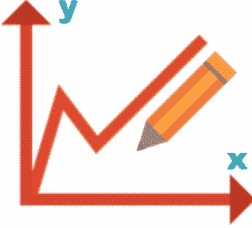

**图 5.1.** 范数通常表示距离或大小度量。

范数在数学上定义如下：

| 向量的 q-范数 |
|---|
| \(\mathcal{L}^q(\mathbf{v}) = \|\mathbf{v}\|_q = \left(\sum_k |v_k|^q\right)^{1/q}\) |

符号 \(|\cdot|\) 是一个运算，其输出其参数的绝对值。例如 \(|-2| = 2\) 且 \(|2| = 2\)。你可以通过以下 Python 代码实现 \(\mathcal{L}^q\)：

```python
# Import Numpy package and the norm function
import numpy as np
from numpy.linalg import norm

# Define a vector
v = np.array([2,3,1,0])

# Take the q-norm which q=2
q = 2
v_norm = norm(v, ord=q)

# Print values
print('The vector: ', v)
print('The vector norm: ', v_norm)
```

向量：[2 3 1 0]
向量范数：3.7416573867739413

#### 5.2.1 范数函数的性质

了解范数的性质至关重要，因为我们在数学计算中可能需要它们，尤其是在数学证明中。范数函数 ℒ(.) 具有以下性质：

- 1. 如果范数为零，则向量也全为零：ℒ(v) = 0 ⇒ v = 0
- 2. ℒ(v + w) ≤ ℒ(v) + ℒ(w)。这称为三角不等式。
- 3. ∀β ∈ ℝ : ℒ(βv) = |β| ℒ(v)

#### 5.2.2 证明性质（高级）

性质 (1) 很容易证明。因为范数将向量元素的绝对值求任意次幂后相加，如果范数为零，唯一可能的答案是所有向量元素都必须为零。

我们可以按如下方式证明性质 (3)：

ℒ^q(βv) = (∑_k |β v_k|^q)^{1/q} = (|β|^q ∑_k |v_k|^q)^{1/q} = |β| (∑_k |v_k|^q)^{1/q} = |β| ℒ^q(v)


我们也可以用数学方式证明性质（2）。但是，让我们用经验性的方式来验证。将我们的实验定义如下：

- 1. 我们随机生成两个向量 **v** 和 **w**
- 2. 我们检查应当成立的该性质。
- 3. 将实验重复 E=100 次。

这并*不是科学证明*。然而，如果 $E = \infty$，那么我们就能说我们证明了它。对吧？让我们用 **Python** 来做这件事：

```
# Import Numpy package and the norm function
import numpy as np
from numpy.linalg import norm

# Repeat experiments
E = 100  # Number of experiments
q = 2    # Order of the norm
for i in range(E):
    # Define two random vector of size (1,5). Obviously v does not equal w!!
    v = np.random.rand(1,5)
    w = np.random.rand(1,5)

    propertyCheck = norm(v+w, ord=q) <= norm(v, ord=q) + norm(w, ord=q)
    if propertyCheck == False:
        print('Property is NOT correct')
```

因此，如果性质（2）对所有实验都成立，我们预期上面的 Python 代码返回**空**。想一想为什么？

### 5.3. 最常用的范数

在上一节中，我描述了范数的一般概念，并用 Python 实现了它。在这里，我想讨论机器学习中最常用的一些范数。

#### 5.3.1 ℒ¹ 范数

从技术上讲，ℒ¹ 范数是对向量各元素取绝对值后的总和。其简单的数学形式如下：

$\|\mathbf{v}\|_1 = \sum_k |v_k|$

在机器学习中，当**向量的稀疏性很重要**时，我们通常使用 $\mathcal{L}^1$ 范数，即当矩阵的非零元素成为关键因素时。**但为什么呢？** $\mathcal{L}^1$ 只是通过累加非零元素来定位它们。

### 5.3.2 $\mathcal{L}^2$ 范数

$\mathcal{L}^2$ 范数也称为欧几里得范数，即一个向量到零点的欧几里得距离。
我们可以简单地按如下方式计算：

$\|\mathbf{v}\|_2 = \sqrt{\sum_k |v_k|^2}$

$\mathcal{L}^2$ 在机器学习中常被使用，因为它是可微的，这对优化至关重要。让我们用 Python 以两种方法计算一个随机向量的 $\mathcal{L}^2$ 范数。两种方法应该得到相同的结果：

```
# Import Numpy package and the norm function
import numpy as np
from numpy.linalg import norm

# Defining a random vector
v = np.random.rand(1,5)

# Calculate L-2 norm
sum_square = 0
for i in range(v.shape[1]):
    # Define two random vector of size (1,5). Obviously v does not
      equal w!!
    sum_square += np.square(v[0,i])
L2_norm_approach_1 = np.sqrt(sum_square)

# Calculate L-2 norm using numpy
L2_norm_approach_2 = norm(v, ord=2)

print('L2_norm: ', L2_norm_approach_1)
print('L2_norm with numpy:', L2_norm_approach_2)
```

你应该得到相同的结果！

## 第 6 章

### 线性无关

本章专门讨论向量线性无关的概念及其与线性方程组解的联系。

### 6.1. 引言

**什么是向量的线性无关？** 举个简单的例子：假设你想求出 **A x = b** 的解。有人可能会说，只需对 **A** 求逆，就能得到答案 **x = A⁻¹ b**。且慢！事情没那么简单吧？如果 **A** 没有逆矩阵，或者不是方阵呢？你就这样放弃了吗？我想不会。

这只是一个例子。在机器学习中，你经常需要**探索向量之间的相关性**，以便更好地分析它们。**例如**，你正在处理一个本质上由向量构成的矩阵。如果你不熟悉**线性无关**这个概念，你还能知道些什么呢？

在本章中，你将学习以下内容：

- 线性无关/线性相关的概念！
- 向量线性相关的示例
- 如何使用 Numpy 在 Python 中实现？
- 矩阵的秩
- 线性方程组的解

### 6.2. 概念

假设我们有集合 {v¹, v², …, vᵖ} ∈ ℝ^q，它由 p 个大小为 q 的列向量组成。如果不存在任何向量，可以将它表示为该集合中其他向量的线性组合，那么我们就称这个集合线性无关。不过，也许定义线性相关更容易一些。

### 线性相关

如果向量 $\mathbf{v}^i$ 可以表示为该集合中其他向量的线性组合，如下所示，那么它就是线性相关的：

$$\mathbf{v}^i = \sum_{j \neq i} \alpha_j \mathbf{v}^j$$

在上述情况下，我们说集合 {$\mathbf{v}^1, \mathbf{v}^2, \dots, \mathbf{v}^p$} 中的向量线性相关！

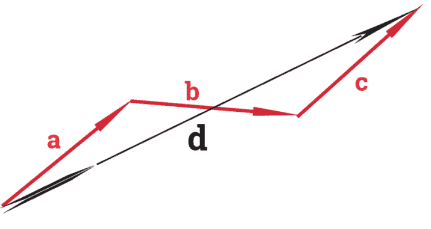

图 6.1. 向量 **d** 是向量 **a**、**b** 和 **c** 的线性组合。实际上，**d** = **a** + **b** + **c**。

### 6.3. 示例

考虑下面三个向量：

$$\mathbf{v} = \begin{bmatrix} 1 \\ -1 \\ 2 \end{bmatrix}, \mathbf{u} = \begin{bmatrix} 0 \\ 3 \\ 1 \end{bmatrix}, \mathbf{w} = \begin{bmatrix} 2 \\ 1 \\ 5 \end{bmatrix}$$

上述集合是线性相关的。为什么？很简单。因为 $\mathbf{w} = 2\mathbf{v} + \mathbf{u}$。我们用 Python 和 Numpy 来验证上述例子：

```
# Import Numpy library
import numpy as np

# Define three column vectors
v = np.array([1, -1, 2]).reshape(-1,1)
u = np.array([0, 3, 1]).reshape(-1,1)
w = np.array([2, 1, 5]).reshape(-1,1)

# Check the linear dependency with writing the equality
print('Does the equality w = 2*v+u holds? Answer:', np.all(w == 2*v+u
))
```

运行上面的代码，看看 Numpy 是否会确认这一点！

### 6.4. 与矩阵秩的关系

至此，我们已经讨论了向量的线性相关。假设我们有矩阵 $\mathbf{M} \in \mathbb{R}^{m\times n}$。该矩阵有 m 行 n 列。我们把重点放在列上。这 n 列构成 n 个向量。第 $j$ 列用 $\mathbf{M}_{:,j}$ 表示。因此，以这些列作为向量，我们得到 n 个向量的集合 {$\mathbf{M}_{:,1}, \mathbf{M}_{:,2}, \ldots, \mathbf{M}_{:,n}$}。在 {$\mathbf{M}_{:,1}, \mathbf{M}_{:,2}, \ldots, \mathbf{M}_{:,n}$} 中，向量线性无关的最大子集的大小，称为矩阵 $\mathbf{M}$ 的**列秩**。再考虑 $\mathbf{M}$ 的行，能够构成线性无关集合的最大行子集的大小，称为矩阵 $\mathbf{M}$ 的**行秩**。

关于矩阵的秩，有以下性质：

- 对于 $\mathbf{M} \in \mathbb{R}^{m\times n}$，$\operatorname{rank}(\mathbf{M}) \leq \min(m,n)$。若 $\operatorname{rank}(\mathbf{M}) = \min(m,n)$，则矩阵 $\mathbf{M}$ 是满秩的。
- 对于 $\mathbf{M} \in \mathbb{R}^{m\times n}$、$\mathbf{N} \in \mathbb{R}^{n\times q}$ 且 $\mathbf{H}=\mathbf{MN} \in \mathbb{R}^{m\times q}$，有 $\operatorname{rank}(\mathbf{H}) \leq \min(\operatorname{rank}(\mathbf{M}),\operatorname{rank}(\mathbf{N}))$。
- 对于 $\mathbf{M} \in \mathbb{R}^{m\times n}$、$\mathbf{N} \in \mathbb{R}^{m\times n}$ 且 $\mathbf{H}=\mathbf{M}+\mathbf{N} \in \mathbb{R}^{m\times n}$，有 $\operatorname{rank}(\mathbf{H}) \leq \operatorname{rank}(\mathbf{M}) + \operatorname{rank}(\mathbf{N})$。

用下面的代码验证上述第一和第二个性质：

```
# Import Numpy library
import numpy as np
from numpy.linalg import matrix_rank

# Define random 3x4 matrix using np.array
# Ref: https://docs.scipy.org/doc/numpy-1.15.1/reference/generated/
#      numpy.random.randint.html
M = np.random.randint(10, size=(3, 4))
N = np.random.randint(10, size=(4, 3))

# np.all() test whether all array elements are True.
# More info: https://docs.scipy.org/doc/numpy/reference/generated/
#      numpy.all.html
checkProperty = np.all(matrix_rank(M) <= min(M.shape[0],M.shape[1]))
if checkProperty: print('Property rank(M) <= min(M.shape[0],M.shape[1]) is confirmed!')

checkProperty = np.all(matrix_rank(np.matmul(M,N)) <= min(
    matrix_rank(M),matrix_rank(N)))
if checkProperty: print('Property rank(MN) <= min(rank(M),rank(N)) is confirmed!')
```

练习

练习：修改上面的代码，验证性质（3）。

### 6.5. 线性方程组

前面我讨论了**线性相关**和**矩阵的秩**。接下来，我想讨论它们在*求解线性方程组中的应用*，这一点非常重要。考虑下面的等式，它构成了一个线性方程组：

$$\mathbf{A}^{m\times n}\mathbf{x}^{n\times 1} = \mathbf{b}^{m\times 1}$$

上面，矩阵 **A** 与向量 **x** 相乘，得到另一个向量 **b**。上述等式创建了一个由 m 个线性方程组成的方程组。例如，写出第 $j$ 个方程：

$$\mathbf{A}_{j,1}\mathbf{x}_1 + \mathbf{A}_{j,2}\mathbf{x}_2 + \dots + \mathbf{A}_{j,n}\mathbf{x}_n = \mathbf{b}_j,\; j \in \{1,2,\dots,m\}$$

所以问题是，方程组 **Ax = b** 存在多少个解。这里的“解”指的是变量 **x** = $[x_1,x_2,\dots,x_n]^T$ 的可能取值。答案只会是以下情况之一：

- 存在**无解**的情况。
- 该方程组有**唯一解**。
- 存在**无穷多**个解。

**注意：** 如你所见，解的数量不可能多于一个但少于无穷多个！

定理

如果 **u** 和 **v** 是方程 **Ax = b** 的两个解，那么它们的如下特定线性组合也是一个解：

$$\mathbf{w} = \beta\mathbf{u} + (1-\beta)\mathbf{v},\forall\beta \in \mathbb{R}$$


**证明：** 查看下面的方程，了解 **w** 如何也是一个解：

$Aw = A\{\beta v + (1-\beta)u\} = \beta Av + Au - \beta Au = \beta b + b - \beta b = b$ ▲

因此，上面的证明表明，如果我们有不止一个解，那么我们可以说解是无穷多的！**以下两个条件**决定了在至少存在一个解的情况下解的个数。请基于迄今为止学到的知识尝试证明它们：

- $A^{m\times n}x^{n\times 1}=b^{m\times 1}$ 当 $m\le n$ 且 $\operatorname{Rank}(A)=m$ 时至少有一个解。
- $A^{m\times n}x^{n\times 1}=b^{m\times 1}$ 当 $m=n$ 且 $\operatorname{Rank}(A)=m$ 时有唯一解。

### 6.6. 结论

本章中，你学习了向量线性无关的概念及其与线性方程组的关系。这个概念至关重要，尤其是在机器学习和优化理论中，我们需要处理各种数学证明来论证方法为何有效！

## 第7章：矩阵分解

本章专门用于解释 **矩阵分解或因子分解** 的概念、其定义和过程。你将学习如何将矩阵分解为其构成元素。

### 7.1. 引言

*分解矩阵的好处*是什么？这意味着什么？当我们 *分解任何事物* 时，我们将其拆分为其构成元素。假设我们要拆解一个 **工具**（一辆汽车或一块手表）！这种操作有助于我们理解核心部件及其功能。此外，它有助于更好地理解该特定工具的工作原理及其特性！*假设该工具是一个我们想要分解的矩阵。* 分解矩阵的方法有很多。然而，可能最常用的就是矩阵特征分解和奇异值分解（SVD）。

### 7.2. 矩阵特征分解

在本节中，我将向你展示特征分解的定义以及理解它所需的后续概念。

#### 7.2.1 特征向量和特征值

在继续之前，我们应该知道特征向量和特征值的定义。特征向量和特征值的定义是相互关联的。

### 定义

假设我们有一个方阵 \(A \in \mathbb{R}^{N\times N}\)。非零向量 \(\mathbf{v} \in \mathbb{R}^{N\times 1}\) 是特征向量，标量 \(\lambda\) 是其对应的特征值，如果我们有：

\[A\mathbf{v}=\lambda\mathbf{v}\]

从上述定义可以清楚地看出，如果 \(\mathbf{v}\) 是特征向量，则任意向量 \(\alpha\mathbf{v}\)，\(\alpha \in \mathbb{R}\) 也是具有相同特征值 \(\lambda\) 的特征向量。因此，如果我们有一个特征向量，那么我们就有无穷多个！

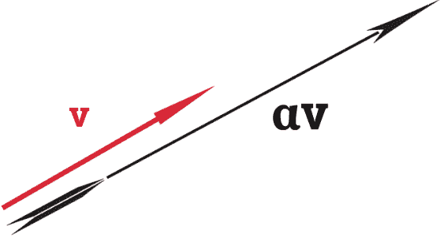

**图 7.1.** 由于 \(\mathbf{v}\) 是特征向量，任意向量 \(\alpha\mathbf{v}\) 也是特征向量

因此，通常只使用具有 **单位范数** 的特征向量。构造一个单位范数的特征向量很简单。假设 \(\mathbf{v}\) 是我们的特征向量。那么，下面的向量也是具有单位范数的特征向量：

\[\mathbf{w}=\alpha\mathbf{v}=\frac{1}{\lVert\mathbf{v}\rVert}\mathbf{v}\]

其中 \(\lVert\mathbf{v}\rVert\) 是向量 \(\mathbf{v}\) 的范数。我们通常考虑欧几里得范数。

#### 7.2.2 过程

在这里，解释了如何将矩阵分解为其构成元素的过程。它被称为 **矩阵特征分解**。

### 矩阵特征分解

假设我们有一个方阵 $A \in \mathbb{R}^{N\times N}$，它有 $N$ 个线性无关的特征向量 $\mathbf{v}^i$，$i \in 1,\ldots,N$。那么，我们可以如下分解矩阵 $A$：

$$A = V\Lambda V^{-1}$$

其中 $V \in \mathbb{R}^{N\times N}$ 是一个方阵，其第 $j$ 列是 $A$ 的特征向量 $\mathbf{v}^j$，而 $\Lambda$ 是对角矩阵，其对角元素是对应的特征值，$\Lambda_{jj} = \lambda_j$。

上面，我们基本上将特征向量 $\mathbf{v}^i$ 串联起来形成 $V$ 矩阵，如下所示：

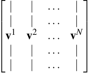

#### 7.2.3 关于矩阵特征分解的讨论

请注意，*我们只能* 如上所述分解 **可对角化矩阵**。但问题是什么是可对角化矩阵？

### 可对角化矩阵

假设我们有一个方阵 $A \in \mathbb{R}^{N\times N}$。如果存在可逆矩阵 $H$ 使得 $HAH^{-1}$ 是对角矩阵，则称其为可对角化或非缺陷的。

让我们对矩阵奇异或非奇异有一个更精确的定义。

### 奇异矩阵

假设我们有一个方阵 $A \in \mathbb{R}^{N\times N}$。当且仅当任一特征值 $(\lambda)$ 为零时，称其为奇异的。

在某些情况下，我们可以使用分解来计算 **矩阵逆**。

### 矩阵逆

假设我们有一个方阵 **A** ∈ ℝ^{N×N}，它可以进行特征分解并且是非奇异的。因此，我们可以如下计算其逆：

**A**^{-1} = **V** Λ^{-1} **V**^{-1}

由于 Λ 是对角矩阵，其逆 Λ^{-1} 也是对角矩阵，我们可以将其计算为：

Λ_{jj}^{-1} = 1 / λ_j

#### 7.2.4 一种特殊矩阵类型及其分解

我们有兴趣研究一种特殊的矩阵：**实对称矩阵**。实对称矩阵基本上是对称矩阵，其中所有元素都属于实数空间 ℝ。

对于 **实对称矩阵** **A** ∈ ℝ^{N×N}，特征值是实数，我们可以选择特征向量使其彼此正交。然后，我们可以如下分解矩阵 **A**：

**A** = **Q** Λ **Q**^{T}

其中 **Q** 是一个正交矩阵，其列是 **A** 的特征向量，而 Λ 是对角矩阵，其对角元素是对应的特征值，Λ_{jj} = λ_j。

#### 7.2.5 有用性质

到目前为止，已经解释了概念以及如何分解矩阵。让我们看看如何利用它。假设 **A** ∈ ℝ^{N×N}：

- 矩阵 **A** 的行列式等于其特征值的乘积。
- 矩阵 **A** 的迹等于其特征值的总和。
- 如果 **A** 的特征值为 λ_i，且 **A** 是非奇异的，则 **A**^{-1} 的特征值就是 1/λ_i。
- **A**^{-1} 的特征向量与 **A** 的特征向量相同。

#### 7.3.4 SVD 的应用

### Moore–Penrose 伪逆

在深入探讨 SVD 如何帮助我们进行伪逆计算之前，让我们先谈谈什么是伪逆？

假设我们有矩阵 **A** ∈ ℂ^{M×N}。那么，我们有 **A** 的伪逆，定义为 **A**⁺ ∈ ℂ^{M×N}，它满足以下所有条件：

- **A A**⁺ **A** = **A**
- **A**⁺ **A A**⁺ = **A**⁺
- (**A A**⁺)* = **A A**⁺
- (**A**⁺ **A**)* = **A**⁺ **A**

我们如何 *计算* **伪逆** *使用 SVD*？如果我们有矩阵 **A** 的 SVD 为 **U**Σ**V**^*，则 **A**⁺ 可以如下计算：

**A**⁺ = **V**Σ⁺**U**^*

其中 Σ⁺ 是 Σ 的伪逆，我们通过将 Σ 中每个非零对角元素 σ 替换为 1/σ 并转置所得矩阵来创建它。

### 矩阵秩的确定

之前讨论了线性相关性和矩阵秩。现在，由于我们有了 SVD，这是一种比特征分解更通用的方法，我们可以得出以下结论。

**矩阵秩：** 假设我们有矩阵 **A** 的 SVD 为 **U**Σ**V**^*。**A** 的秩等于非零奇异值的个数，即 Σ 中非零对角元素的个数。

### 7.4. 结论

本章介绍了矩阵分解（因子分解）概念及其两种最常用的技术。你学习了什么是矩阵分解以及如何进行。你还练习了在 Python 和 NumPy 中实现它。如果你想了解更多关于矩阵分解的信息，可以参考 [11, 12]。


## 参考文献
- [1] Torfi A (2019) 什么是机器学习？导论。可在 [https://www.machinelearningmindset.com/what-is-machine-learning/](https://www.machinelearningmindset.com/what-is-machine-learning/) 获取。
- [2] Schwartz M (1960) *向量分析：应用于几何和物理* (Harper)。
- [3] Borisenko AI, et al. (1968) *向量和张量分析及其应用* (Courier Corporation)。
- [4] Watkins DS (2004) *矩阵计算基础*。第 64 卷 (John Wiley & Sons)。
- [5] Meyer CD (2000) *矩阵分析与应用线性代数*。第 71 卷 (SIAM)。
- [6] Lancaster P, Tismenetsky M (1985) *矩阵理论：及其应用* (Elsevier)。
- [7] Oliphant TE (2006) *NumPy指南*。第 1 卷 (Trelgol Publishing USA)。
- [8] VanderPlas J (2016) *Python数据科学手册：处理数据的必备工具* (O’Reilly Media, Inc.)。
- [9] Nunez-Iglesias J, Van Der Walt S, Dashnow H (2017) *优雅的SciPy：科学Python的艺术* (O’Reilly Media, Inc.)。
- [10] Bressert E (2012) *SciPy和NumPy：开发者概览* (O’Reilly Media, Inc.)。
- [11] Axler SJ (1997) *线性代数应该这样学*。第 2 卷 (Springer)。
- [12] Dym H (2013) *线性代数实战*。第 78 卷 (American Mathematical Soc.)。

## 附录
### 附录 A：符号说明

| 符号 | 含义 |
|---|---|
| $a$ | 一个标量 |
| **v** | 向量 |
| **A** | 矩阵 |
| $\mathbb{A}$ | 一个集合，例如可以是实数集 $\mathbb{R}$ |
| $\{1,\ldots,n\}$ | 从 1 到 **n** 的所有整数的集合 |
| $v_i$ | 向量 **v** 的第 $i$ 个元素 |
| $v_{-i}$ | 向量 **v** 除第 $i$ 个元素外的所有元素 |
| $A_{i,j}$ | 矩阵 **A** 中第 $i$ 行第 $j$ 列的元素 |
| $A^T$ | 矩阵 **A** 的转置 |
| $A^H$ | 矩阵 **A** 的共轭转置 |
| $\lVert v \rVert_p$ | 向量 **v** 的 $\mathcal{L}^p$ 范数 |

### 附录 B：Python 环境
正如你在全书中所见，使用了 Python。Python 是一种编程语言，需要一个环境来运行。与其费劲地通过各种方式设置 Python 环境并安装所需的包，我建议使用 [谷歌 Colab](https://colab.research.google.com)。它为你提供了一个不错的环境，其中已安装了所有必要的包。它还为你提供免费的 GPU 访问！你会发现它极其有价值。换句话说，无价之宝！

## 按字母顺序索引
- 3D 张量, 6
- 算术运算, 15
- 数组, 8
- 布尔, 8
- 内置函数, 12
- 列秩, 42
- 复数, 8
- 数据类型, 8
- 对角元素, 31
- 可对角化矩阵, 47
- 逐元素运算, 13
- 浮点数, 8
- 单位矩阵, 21
- 整数, 8
- k 维向量, 4
- 线性代数, 4
- 线性相关, 40
- 线性方程组, 40
- 线性无关, 40
- 列表, 8
- 机器学习, 4
- 矩阵, 4
- 矩阵逆, 30
- 矩阵范数, 34
- 矩阵运算, 20
- 矩阵秩, 42
- 多维网格, 10
- 非奇异, 30
- NumPy, 7
- 重塑操作, 19
- 行秩, 42
- 标量, 4
- 形状, 10
- 奇异, 30
- 切片索引, 18
- 特殊函数, 12
- 方阵, 27
- 张量, 4
- 迹, 31
- 转置, 20
- 单位范数, 46
- 通用函数, 13
- 向量, 4
- 向量范数, 34
