# R 机器学习实用指南 (2021 更新版)

## 指南

1. [开始阅读](#开始阅读)

R 是一种开源编程语言和免费环境，主要用于统计计算和图形图形。你可以在[官方网站](https://www.r-project.org/)上找到关于 R 的信息。在 Google 等网站上使用关键词 `R` 以及其他特定主题词进行搜索，可以从网站、博客文章、教程、文档等处找到更多信息。

尽管 R 自带了它的环境：命令行界面和图形化界面，但你仍然可以使用流行的 [RStudio](https://www.rstudio.com/)，它提供了额外的图形化功能。

在 R 环境中（R 提示符为 `>`）时，你可以通过调用 `quit()` 函数或其简写 `q()` 退出。当系统询问你是否要保存工作空间时，如果你回复 `y`（是），那么你在当前 R 会话期间产生的所有变量都将保存到名为 `.Rdata` 的文件中，位于当前工作目录下。如果你以后在同一目录下启动 R，这些变量及其名称将被自动加载。

R 中的函数在不同的包（packages）之间共享。最基础的包如 `base`、`utils`、`graphics` 和 `stats` 在启动时会自动导入，它们包含了一些最常用的函数。然而，还有许多实用的函数需要用户下载并导入一些额外的包。这可以通过 RStudio 的图形用户界面轻松完成。例如，为了下载包含有用 SVM 函数的包 `e1071`，你可以点击“Packages（包）” -> “Install Packages（安装包）”并输入所需的包名。从同一个菜单中，你可以导入所需的包。同样的操作也可以通过命令 `install.packages("e1071")` 和 `library("e1071")` 分别来下载和导入包 `e1071`。最后，通过 `library()` 命令可以显示所有已安装的包集合。

若要检查你当前的工作目录，可以输入：

```
getwd()
```

要设置工作目录，可以使用 `setwd` 函数。例如，在 Linux 机器上将工作目录设置为桌面（Desktop）：

```
setwd("~/Desktop")
```

你在 R 提示符处输入的内容是一个表达式，R 会尝试对其进行求值并打印结果。例如，`getwd()` 是一个通过调用不带参数的函数 `getwd()` 来求值的表达式。`42` 也是如此：

```
42
```

```
## [1] 42
```

对于以下也是如此：

```
(100 * 2 - 12 ^ 2) / 7 * 5 + 2
```

```
## [1] 42
```

还有一些预定义的常量，如 `pi` 或 `e`：

```
sin(pi/2)
```

```
## [1] 1
```

要查找特定函数的文档，你可以输入 `?sum` 或 `help(sum)`。要搜索函数，可以使用 `help.search("sin")` 函数来提供帮助。对于某些函数，可以通过输入表达式 `example(plot)` 查看使用示例。注释以 `#` 开头，而给变量赋值时可以使用 `<-` 或 `=`。例如：

```
a <- 42
b <- (42 + a) / 2
print(a)
```

```
## [1] 42
```

```
print(b)
```

```
## [1] 42
```

使用 `ls()` 可以检查当前会话中存在的所有变量。

```
ls()
```

```
## [1] "a" "accuracy" "b" "centers" "clustering" "col" "control" "ctrl" "d"
```

要删除当前会话中的所有变量，可以使用：

```
rm(list=ls())
```

## 1.2 向量 (Vectors)

向量是相似类型的集合。一个向量是某些类型元素的集合。下面显示了关于向量的一些操作。创建一个向量：`a <- c(1, 2, 3, 4, 5)`，另一个向量 `b <- c(10, 20, 30, 40, 50)`。向量 `a` 的索引可以通过 `a[1]` 来访问。向量的元素。

例如 `getwd()` 是一个通过调用不带参数的函数 `getwd()` 来求值的表达式。`42` 也是如此：

```
42
```

```
## [1] 42
```

对于以下也是如此：

```
(100 * 2 - 12 ^ 2) / 7 * 5 + 2
```

```
## [1] 42
```

还有一些预定义的常量，如 `pi` 或 `e`：

```
sin(pi/2)
```

```
## [1] 1
```

要查找特定函数的文档，你可以输入 `?sum` 或 `help(sum)`。要搜索函数，可以使用 `help.search("sin")` 函数来提供帮助。对于某些函数，可以通过输入表达式 `example(plot)` 查看使用示例。注释以 `#` 开头，而给变量赋值时可以使用 `<-` 或 `=`。例如：

```
a <- 42
b <- (42 + a) / 2
print(a)
```

```
## [1] 42
```

```
print(b)
```

```
## [1] 42
```

使用 `ls()` 可以检查当前会话中存在的所有变量。

```
ls()
```

```
## [1] "a" "accuracy" "b" "centers" "clustering" "col" "control" "ctrl" "d"
```

要删除当前会话中的所有变量，可以使用：

```
rm(list=ls())
```

## 1.3 矩阵 (Matrices)

要创建矩阵使用 `matrix()` 函数：

```
matrix(10,3, 2)
```

```
      [,1] [,2]
## [1,]   10   10
## [2,]   10   10
## [3,]   10   10
```

或者

```
matrix(c(1,2,3,4,5,6), 3, 2)
```

```
      [,1] [,2]
## [1,]    1    4
## [2,]    2    5
## [3,]    3    6
```

或者

```
matrix(c(1,2,3), 3, 2)
```

```
      [,1] [,2]
## [1,]    1    1
## [2,]    2    2
## [3,]    3    3
```

但让我们查看我们是如何调用 `matrix` 函数的：

```
args(matrix)
```

```
## function (data, nrow = ncol = max(1),
              byrow = FALSE,
              missing = NA,
              dimnames = character(0))
```

所以行和列的数量应该是 3。

```
matrix(1:9, byrow =TRUE)
```

```
##      [,1] [,2] [,3]
## [1,]  164  184  105
## [2,]  209  235  135
## [3,]  254  286  165
```

```
t(am)
```

```
##      [,1] [,2] [,3]
## [1,]   10   13   16
## [2,]   11   14   17
## [3,]   12   15   18
```

## 1.4 数据框 (Data frames)

与矩阵不同，数据框可以在其列中存储不同类型的值。它们在 R 语言中广泛用于数据分析。通常，行代表观测值（或样本），列代表特征（或属性或变量）。当我们从文件中读取数据时，结果会被读取为数据框。下载 zip 文件 `[r-novice-inflammation.zip](https://github.com/swcarpentry/r-novice-inflammation/blob/main/data/r-novice-inflammation-data.zip)` 并在桌面上解压。使用文本编辑器检查 `inflammation-01.csv` 文件以查看我们将加载的内容。然后读取该文件：

```
data <- read.csv(file = "data/inflammation-01.csv", header = FALSE, stringsAsFactors = TRUE)
```

注意路径中包含 `data/` 的使用，因为我们之前通过 `getwd()` 将工作目录设置为了桌面。

```
dir()
```


`dir` 函数返回文件系统的文件和目录。参数 `header=FALSE` 告诉 `read.csv` 函数没有表头行来为列命名。此外，参数 `stringsAsFactors=TRUE` 允许将包含字符串值的列作为因子（factors）进行处理。

通过 `head(data)`，我可以检查数据是否加载正确。它返回前几行：

```
head(data)
```

```
##   V1 V2 V3 V4 V5 V6 V7 V8 V9 V10 V11 V12 V13 V14 V15 V16 V17 V18 V19 V20
## 1  0  0  1  3  1  2  4  7  8   3   3   3  10   5   7   4   7   7  12  18
## 2  0  1  2  1  2  1  3  2  2   6   10  11   5   9   4   4   7  16   8
## 3  0  0  1  3  1  2  3  2  2  2  6   5   9   7   4   4  15   5  11  10
## 4  0  0  2  1  0  2  4  2  2  6  10   7   9  13   8  8  15  10
## 5  0  0  1  3  1  2  4  7  8   3   3   3  10   5   7   4   7   7  12  18
## 6  0  1  2  1  2  1  3  2  2  6  10  11   5   9   4   4   7  16   8
## 7  0  0  1  3  1  2  3  2  2  6   5   9   7   4   4  15   5  11  10
## 8  0  0  2  1  0  2  4  2  2  6  10   7   9  13   8  8  15  10
## 9  0  0  1  3  1  2  4  7  8   3   3   3  10   5   7   4   7   7  12  18
## 10 0  1  2  1  2  1  3  2  2  6  10  11   5   9   4   4   7  16   8
## 11 0  0  1  3  1  2  3  2  2  6   5   9   7   4   4  15   5  11  10
## 12 0  0  2  1  0  2  4  2  2  6  10   7   9  13   8  8  15  10
## 13 0  0  1  3  1  2  4  7  8   3   3   3  10   5   7   4   7   7  12  18
## 14 0  1  2  1  2  1  3  2  2  6  10  11   5   9   4   4   7  16   8
## 15 0  0  1  3  1  2  3  2  2  6   5   9   7   4   4  15   5  11  10
## 16 0  0  2  1  0  2  4  2  2  6  10   7   9  13   8  8  15  10
## 17 0  0  1  3  1  2  4  7  8   3   3   3  10   5   7   4   7   7  12  18
## 18 0  1  2  1  2  1  3  2  2  6  10  11   5   9   4   4   7  16   8
## 19 0  0  1  3  1  2  3  2  2  6   5   9   7   4   4  15   5  11  10
## 20 0  0  2  1  0  2  4  2  2  6  10   7   9  13   8  8  15  10
```

其他可以使用的函数：

```
# 变量类型
class(data)
```

```
## [1] "data.frame"
```

```
# 维度
dim(data)
```

```
## [1] 60 40
```

这告诉我我有一个包含 60 个观测值和 40 个变量的数据框。

```
# 结构
str(data)
```

```
## 'data.frame': 60 obs. of 40 variables:
  $ V1 : int  0 0 0 0 0 0 0 ...
  $ V2 : int  0 1 1 0 0 1 1 ...
  $ V3 : int  1 2 1 2 1 2 1 ...
  $ V4 : int  3 1 3 0 3 1 3 ...
  $ V5 : int  1 2 3 4 1 2 3 ...
  $ V6 : int  2 1 2 2 2 1 2 ...
  $ V7 : int  4 3 6 2 4 3 6 ...
  $ V8 : int  7 2 2 1 7 2 2 ...
  $ V9 : int  8 2 5 6 8 2 5 ...
  $ V10: int  3 6 9 7 3 6 9 7 ...
  $ V11: int  3 10 5 7 3 10 5 7 ...
  $ V12: int  3 11 7 9 3 11 7 9 ...
  $ V13: int  10 5 4 13 10 5 4 13 ...
  $ V14: int  5 9 5 8 5 9 5 8 ...
  $ V15: int  7 4 4 8 7 4 4 8 ...
  $ V16: int  4 4 15 15 4 4 15 15 ...
  $ V17: int  7 7 5 10 7 7 5 10 ...
  $ V18: int  7 16 11 10 7 16 11 10 ...
  $ V19: int  12 8 9 13 12 8 9 13 ...
  $ V20: int  18 6 10 10 18 6 10 10 ...
  $ V21: int  6 10 11 15 6 10 11 15 ...
  $ V22: int  12 11 14 17 12 11 14 17 ...
  $ V23: int  9 12 9 12 9 12 9 12 ...
  $ V24: int  20 14 15 13 20 14 15 13 ...
  $ V25: int  6 4 4 8 6 4 4 8 ...
  $ V26: int  18 4 4 9 18 4 4 9 ...
  $ V27: int  9 7 5 6 9 7 5 6 ...
  $ V28: int  20 16 11 10 20 16 11 10 ...
  $ V29: int  18 8 9 12 18 8 9 12 ...
  $ V30: int  11 11 7 12 11 11 7 12 ...
```

# 数据框的统计摘要

```
summary(data)
```

```
##       V1             V2              V3              V4             V5       
##  最小值   :0   最小值   :0.00   最小值   :0.000   最小值   :0.00   最小值   :1.000 
##  第一四分位数:0   第一四分位数:0.00   第一四分位数:1.000   第一四分位数:1.00   第一四分位数:1.000 
##  中位数     :0   中位数 :0.00   中位数 :1.000   中位数 :2.00   中位数 :2.000 
##  平均值     :0   平均值   :0.45   平均值   :1.117   平均值   :1.75   平均值   :2.433 
##  第三四分位数:0   第三四分位数:1.00   第三四分位数:2.000   第三四分位数:3.00   第三四分位数:3.000 
##  最大值     :0   最大值   :1.00   最大值   :2.000   最大值   :3.00   最大值   :4.000 
##        V6             V7            V8              V9       
##  最小值   :1.00   最小值   :1.0   最小值   :1.000   最小值   :2.000  
##  第一四分位数:2.00   第一四分位数:2.0   第一四分位数:2.000   第一四分位数:4.000  
##  中位数     :3.00   中位数 :4.0   中位数 :4.000   中位数 :5.000  
##  平均值     :3.15   平均值   :3.8   平均值   :3.883   平均值   :5.233  
##  第三四分位数:4.00   第三四分位数:5.0   第三四分位数:5.250   第三四分位数:7.000  
##  最大值     :5.00   最大值   :6.0   最大值   :7.000   最大值   :8.000  
##       V10             V11             V12             V13       
##  最小值   :2.000   最小值   : 2.00   最小值   : 2.00   最小值   : 3.00  
##  第一四分位数:3.750   第一四分位数: 4.00   第一四分位数:3.75   第一四分位数:5.00  
##  中位数     :6.000   中位数 : 6.00   中位数 : 5.50   中位数 : 9.50  
##  平均值     :5.517   平均值   : 5.95   平均值   : 5.90   平均值   : 8.35  
##  第三四分位数:7.000   第三四分位数:9.00   第三四分位数:8.00   第三四分位数:11.00  
##  最大值     :9.000   最大值   :10.00   最大值   :11.00   最大值   :12.00  
##       V14              V15              V16            V17        
##  最小值   : 3.000   最小值   : 3.000   最小值   : 3.0   最小值   : 4.000  
##  第一四分位数:5.000   第一四分位数:5.000   第一四分位数:6.0   第一四分位数:6.750  
##  中位数     :8.000   中位数 : 8.000   中位数 :10.0   中位数 : 8.500  
##  平均值     :7.733   平均值   : 8.367   平均值   : 9.5   平均值   : 9.583  
##  第三四分位数:10.000   第三四分位数:12.00   第三四分位数:13.0   第三四分位数:13.00  
##  最大值     :13.000   最大值   :14.00   最大值   :15.00   最大值   :16.00  
##       V18             V19             V20             V21       
##  最小值   : 5.00   最小值   : 5.00   最小值   : 5.00   最小值   : 5.00  
##  第一四分位数:7.75   第一四分位数:8.00   第一四分位数:8.75   第一四分位数:9.00  
##  中位数     :11.00   中位数 :11.50   中位数 :13.00   中位数 :14.00  
##  平均值     :10.63   平均值   :11.57   平均值   :12.35   平均值   :13.25  
##  第三四分位数:13.00   第三四分位数:15.00   第三四分位数:16.00   第三四分位数:16.25  
##  最大值     :17.00   最大值   :18.00   最大值   :19.00   最大值   :20.00  
##       V22             V23             V24             V25      
##  最小值   : 4.00   最小值   : 4.00   最小值   : 4.00   最小值   : 4.00  
##  第一四分位数:8.00   第一四分位数:7.75   第一四分位数:6.75   第一四分位数:7.00  
##  中位数     :13.00   中位数 :11.00   中位数 :10.00   中位数 :10.50  
##  平均值     :11.97   平均值   :11.03   平均值   :10.17   平均值   :10.00  
##  第三四分位数:15.25   第三四分位数:15.00   第三四分位数:13.25   第三四分位数:13.00  
##  最大值     :19.00   最大值   :18.00   最大值   :17.00   最大值   :16.00  
##       V26             V27             V28             V29        
##  最小值   : 3.000   最小值   : 3.00   最小值   : 3.00   最小值   : 3.000  
##  第一四分位数:5.75   第一四分位数:7.00   第一四分位数:5.00   第一四分位数:5.00  
```


## 中位数：9.000 | 中位数：10.00 | 中位数：7.00 | 中位数：7.00

## 平均值：8.667 | 平均值：9.15 | 平均值：7.25 | 平均值：7.333

## 第三四分位数：12.00 | 第三四分位数：12.00 | 第三四分位数：9.00 | 第三四分位数：10.00

## 最大值：15.000 | 最大值：14.00 | 最大值：13.00 | 最大值：12.00

## V30 | V31 | V32 | V33

## 最小值：2.000 | 最小值：2.000 | 最小值：2.00 | 最小值：2.00

## 第一四分位数：3.000 | 第一四分位数：4.000 | 第一四分位数：4.00 | 第一四分位数：4.00

## 中位数：6.000 | 中位数：6.00 | 中位数：5.00 | 中位数：5.00

## 平均值：5.583 | 平均值：6.067 | 平均值：5.95 | 平均值：5.117

## 第三四分位数：10.000 | 第三四分位数：8.000 | 第三四分位数：6.00 | 第三四分位数：6.00

## 最大值：11.000 | 最大值：10.00 | 最大值：9.00 | 最大值：8.000

## V34 | V35 | V36 | V37 | V38

## 最小值：1.0 | 最小值：1.0 | 最小值：1.000 | 最小值：1.000 | 最小值：1.0

## 第一四分位数：2.0 | 第一四分位数：2.0 | 第一四分位数：2.000 | 第一四分位数：2.000 | 第一四分位数：2.0

## 中位数：4.0 | 中位数：3.0 | 中位数：4.000 | 中位数：2.000 | 中位数：1.0

## 平均值：3.6 | 平均值：3.3 | 平均值：3.567 | 平均值：2.483 | 平均值：1.5

## 第三四分位数：5.0 | 第三四分位数：5.0 | 第三四分位数：5.000 | 第三四分位数：4.000 | 第三四分位数：3.0

## 最大值：7.0 | 最大值：6.0 | 最大值：5.000 | 最大值：4.000 | 最大值：3.0

## V39 | V40

## 最小值：0.000 | 最小值：0.000

## 第一四分位数：0.000 | 第一四分位数：0.000

## 中位数：1.000 | 中位数：1.000

## 平均值：1.133 | 平均值：0.566

## 第三四分位数：2.000 | 第三四分位数：1.000

## 最大值：2.000 | 最大值：1.000

还有不同的方法可以从数据框（data frame）中选择切片数据：

### 数据中的第一个值

```r
data[1, ]
```

### 数据中的中间值

```r
data[30, 20]
```

### 四行前十列

```r
data[1:4, 1:10]
```

### 不一定从开始

```r
data[5:10, 1:10]
```

一个细节是，最后一次选择返回的是一个向量而不是数据框。这是因为我们只选择了一个列。如果你不希望这种行为，可以这样做：

```r
# 第 5 行的所有列
d1 <- data[5, ]
class(d1)
```

```
[1] "data.frame"
```

```r
# 第 16 列的所有行
d2 <- data[, 16]
class(d2)
```

```
[1] "integer"
```

```r
d3 <- data[, 16, drop=FALSE]
class(d3)
```

```
[1] "data.frame"
```

还可以调用其他函数 `min`、`max`、`mean`、`sd` 和 `median` 来获取感兴趣的统计值：

```r
# 第一行，所有列
patient_1 <- data[1, ]

# 患者 1 的最大炎症值
max(patient_1)
```

```
[1] 18
```

```r
# 患者 2 的最大炎症值
max(data[2, ])
```

```
[1] 18
```

```r
# 第 7 天的最小炎症值
min(data[, 7])
```

```
[1] 1
```

```r
# 第 7 天的平均炎症值
mean(data[, 7])
```

```
[1] 3.8
```

```r
# 第 7 天的中位数炎症值
median(data[, 7])
```

```
[1] 4
```

```r
# 第 7 天炎症的标准差
sd(data[, 7])
```

```
[1] 1.725187
```

为了进行更复杂的计算，例如“所有患者的最大炎症值，或者每天的平均值？”，我们需要按行或按列应用 `max` 或 `mean` 函数。幸运的是，有一个 `apply` 函数，它可以将函数应用于每一个“边际”（margins）上，1 代表行，2 代表列：

```r
args(apply) # args 返回 NULL 是因为它只是打印信息，但每个函数必须返回某些内容！
```

```
## function (X, MARGIN, FUN, ...) 
## NULL
```

```r
max_patient_inflammation <- apply(data, 1, max)
max_patient_inflammation
```

```
## [1] 18 18 19 17 17 18 17 20 17 18 18 18 17 16 17 18 19 19 17 19 19 16 17
## [24] 15 17 17 18 17 20 17 16 19 15 15 19 17 16 17 19 16 18 19 16 19 18 16
## [47] 19 15 16 18 14 20 17 15 17 16 17 19 18 18
```

```r
avg_day_inflammation <- apply(data, 2, mean)
avg_day_inflammation
```

```
##         V1         V2         V3         V4         V5         V6 
##  0.0000000  0.4500000  1.1166667  1.7500000  2.4333333  3.1500000 
##         V7         V8         V9        V10        V11        V12 
##  3.8000000  3.8833333  5.2333333  5.5166667  5.9500000  5.9000000 
##        V13        V14        V15        V16        V17        V18 
##  8.3500000  7.7333333  8.3666667  9.5000000  9.5833333 10.6333333 
##        V19        V20        V21        V22        V23        V24 
## 11.5666667 12.3500000 13.2500000 11.9666667 11.0333333 10.1666667 
##        V25        V26        V27        V28        V29        V30 
## 10.0000000  8.6666667  9.1500000  7.2500000  7.3333333  6.5833333 
##        V31        V32        V33        V34        V35        V36 
##  6.0666667  5.9500000  5.1166667  3.6000000  3.3000000  3.5666667 
##        V37        V38        V39        V40 
##  2.4833333  1.5000000  1.1333333  0.5666667
```

## 现在我们来画一些图

```r
plot(avg_day_inflammation)
```

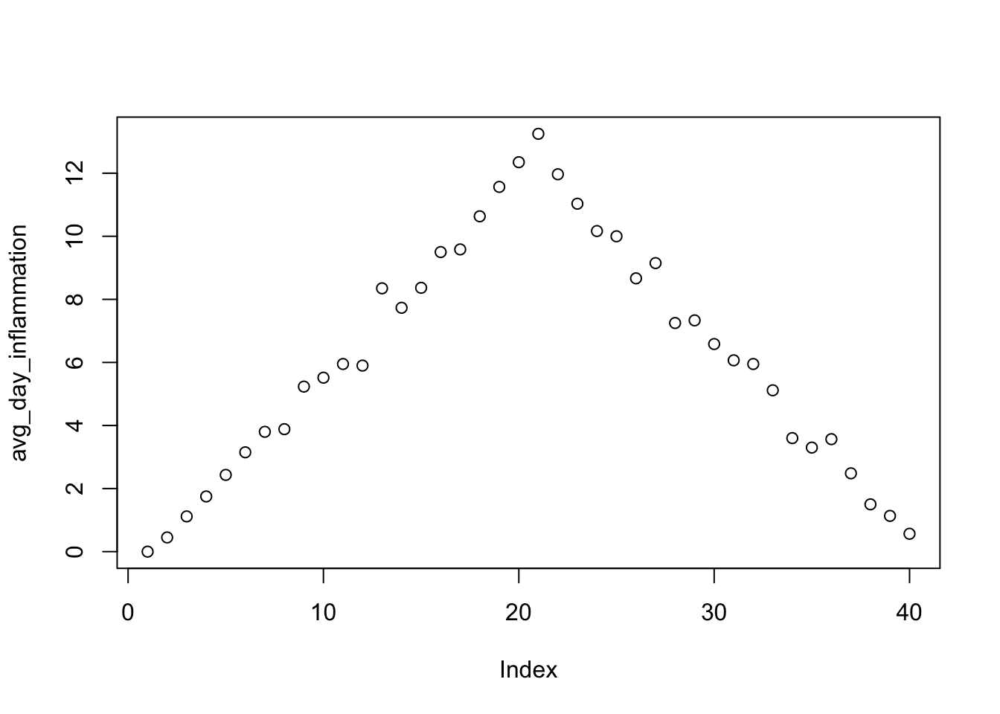

```r
max_day_inflammation <- apply(data, 2, max)
plot(max_day_inflammation)
```

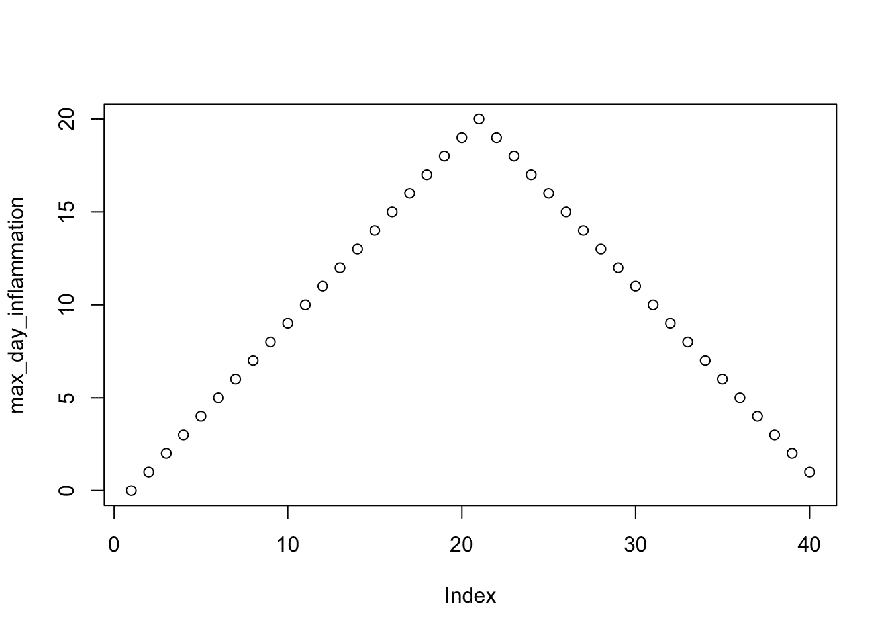

```r
min_day_inflammation <- apply(data, 2, min)
plot(min_day_inflammation)
```

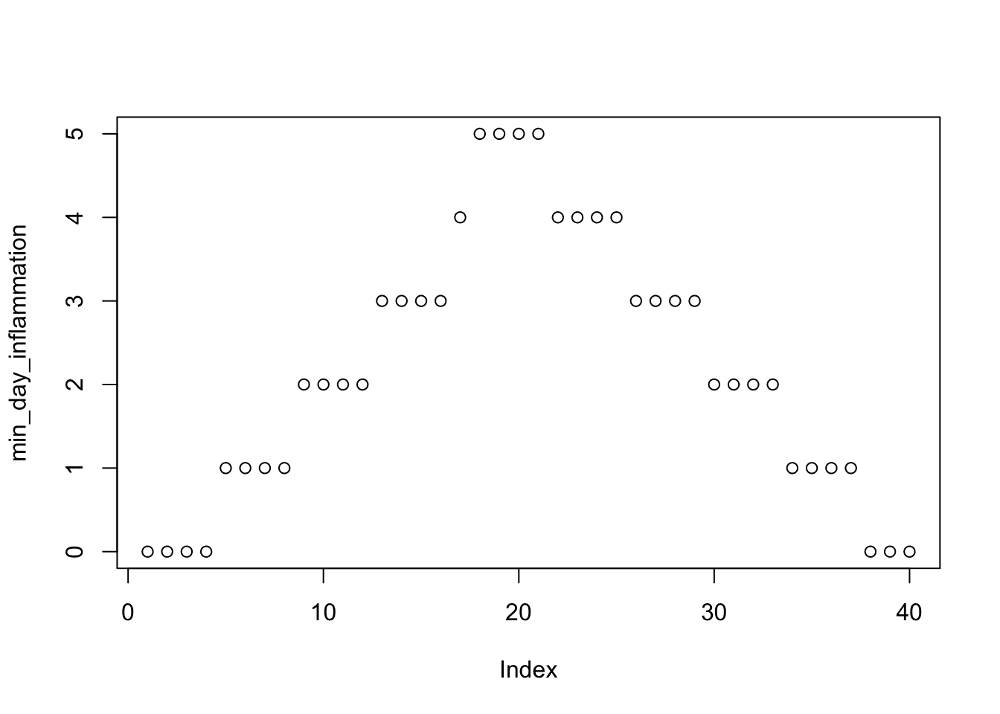

`plot` 是一个带有许多参数的函数，因此你可能需要学习许多示例来实现你想要的操作（更改坐标轴、命名坐标轴、更改绘图点和/或线条、添加标题、添加网格、添加图例、图表颜色、添加箭头和文本等）。

## 1.5 R 脚本

到目前，我们直接在 R 命令行中输入。我们还可以将一系列命令保存到文件中并运行。这样做的方法是创建一个带有 `.R` 扩展的文件，并使用 `source` 函数来运行它。良好的习惯是始终使用 `rm(list())` 清空会话。另一方面，如果它是作为库使用的（例如加载你创建的一些函数），那么可能不应该这样做。你也可以将其他源文件包含在当前文件中以提高可读性，Google 有一些 [Google R 风格指南](https://google.github.io/styleguide/)。

## 1.6 函数

让我们通过创建 `fahr_to_kelvin` 来学习如何创建函数，它可以将温度从华氏度转换为开尔文：

```r
fahr_to_kelvin <- function(temp) {
  kelvin <- ((temp - 32) * 5 / 9) + 273.15
  return(kelvin)
}
```

运行一个函数：

```r
fahr_to_kelvin(32)
```

沸点：

```r
fahr_to_kelvin(212)
```

让我们创建一个将开尔文转换为摄氏度的函数：

```r
fahr_to_celsius <- function(temp) {
  celsius <- (temp - 273.15) * 5 / 9
  return(celsius)
}
```

绝对零：

```r
fahr_to_celsius(0)
```

我们也可以在函数内部使用函数：

```r
fahr_to_result <- function(temp) {
  temp_k <- fahr_to_kelvin(temp)
  result <- fahr_to_celsius(temp_k)
  return(result)
}
```

通过链式调用获取结果：

```r
fahr_to_result(32)
```

## 1.7 for 循环

像所有编程语言都有 `for` 循环来处理循环任务。通用语法是：

```r
for (variable in collection) {
  do things with variable
}
```

一个示例：

```r
sentence <- c("Let", "computer", "work")
print_words <- function(sentence) {
  for (word in sentence) {
    print(word)
  }
}
print_words(sentence)
```

另一个示例：

```r
len <- 0
vowels <- c("a", "e", "i", "o", "u")
for (v in vowels) {
  len <- len + 1
}
```

## 1.8 决策

在你的 R 脚本中做决策，R 提供了标准的 `if-else` 语句：

```r
num <- 37
if (num > 100) {
  print("greater")
} else {
  print("not greater")
}
```

或者创建一个使用条件的函数：

```r
sign <- function(num) {
  if (num > 0) {
    return(1)
  } else if (num == 0) {
    return(0)
  } else {
    return(-1)
  }
}
sign(-3)
```

你可以使用逻辑运算符做决策：

- 等（`==`）
- 大于等于（`>=`）
- 小于等于（`<=`）
- 不等于（`!=`）

我们还可以组合测试。与符号 `&` 表示逻辑“与”；竖线 `|` 表示逻辑“或”。

## 1.9 数据集和统计数据

通过运行 `data()` 函数，我们可以看到 R 安装中的某些数据集。例如检查 `iris` 数据集，可以使用函数：

```r
head(iris)
```

```
##   Sepal.Length    Sepal.Width     Petal.Length    Petal.Width Species
## 1          5.1         3.5          1.4         0.2  setosa
## 2          4.9         3.0          1.4         0.2  setosa
## 3          4.7         3.2          1.3         0.2  setosa
## 4          4.6         3.1          1.5         0.2  setosa
## 5          5.0         3.6          1.4         0.2  setosa
## 6          5.4         3.9          1.7         0.4  setosa
```

查看它的结构：

```r
str(iris)
```

```
## 'data.frame':    150 obs. of  5 variables:
##  $ Sepal.Length: num  5.1 4.9 4.7 4.6 5 5.4 4.6 5 4.4 4.9 ...
##  $ Sepal.Width : num  3.5 3 3.2 3.1 3.6 3.9 3.4 3.4 2.9 3.1 ...
##  $ Petal.Length: num  1.4 1.4 1.3 1.5 1.4 1.7 1.4 1.5 1.4 1.5 ...
##  $ Petal.Width : num  0.2 0.2 0.2 0.2 0.2 0.4 0.3 0.2 0.2 0.1 ...
##  $ Species     : Factor w/ 3 levels "setosa","versicolor","virginica":: 1 1 1 1 1 1 1 1 1 ...
```

对于统计摘要：

```r
summary(iris)
```

```
##   Sepal.Length    Sepal.Width     Petal.Length    Petal.Width  
##  Min.   :4.300   Min.   2.000   Min.   1.000   Min.   0.100  
##  1st Qu.:5.100   1st Qu.:2.800   1st Qu.:1.600   1st Qu.:0.300  
##  Median :5.800   Median :3.000   Median :4.350   Median :1.300  
##  Mean   :5.843   Mean   :3.057   Mean   :3.758   Mean   :1.199  
##  3rd Qu.:6.400   3rd Qu.:3.300   3rd Qu.:5.100   3rd Qu.:1.800  
##  Max.   :7.900   Max.   4.400   Max.   :6.900   Max.   :2.500  
##        Species  
##  setosa    :50  
##  versicolor:50  
##  virginica :50  
```

对于 `Species` 列，可以观察到 `summary` 函数没有像其他变量那样进行标准的统计计算。从 `str` 函数中可以看到 `Species` 列是一个名为因子（factor）的特殊类型，这是 R 用它来声明分类或序数值值。更多内容将在下一节介绍。

我们还可以通过使用 `$` 操作通过名称获取 `Sepal.Length` 的完整属性：

```r
iris$Sepal.Length
```


## 5.1 4.9 4.7 4.6 5.0 5.4 4.6 5.0 4.4 4.9 5.4 4.8 4.8 4.3 5.8 5.7 5.4
## [18] 5.1 5.7 5.1 5.4 5.1 4.6 5.1 4.8 5.0 5.0 5.2 5.2 4.7 4.8 5.4 5.2 5.5
## [35] 4.9 5.0 5.5 4.9 4.4 5.1 5.0 4.5 4.4 5.0 5.1 4.8 5.1 4.6 5.3 5.0 7.0
## [52] 6.4 6.9 5.5 6.5 5.7 6.3 4.9 6.6 5.2 5.0 5.9 6.0 6.1 5.6 6.7 5.6 5.8
## [69] 6.2 5.6 5.9 6.1 6.3 6.1 6.4 6.6 6.8 6.7 6.0 5.7 5.5 5.5 5.8 6.0 5.4
## [86] 6.0 6.7 6.3 5.6 5.5 5.5 6.1 5.8 5.0 5.6 5.7 5.7 6.2 5.1 5.7 6.3 5.8
## [103] 7.1 6.3 6.5 7.6 4.9 7.3 6.7 7.2 6.5 6.4 6.8 5.7 5.8 6.4 6.5 7.7 7.7
## [120] 6.0 6.9 5.6 7.7 6.3 6.7 7.2 6.2 6.1 6.4 7.2 7.4 7.9 6.4 6.3 6.1 7.7
## [137] 6.3 6.4 6.0 6.9 6.7 6.9 5.8 6.8 6.7 6.7 6.3 6.5 6.2 5.9

并运行标准统计：

```r
mean(iris$Sepal.Length)
```

```
## [1] 5.843333
```

```r
median(iris$Sepal.Length)
```

```
## [1] 5.8
```

```r
min(iris$Sepal.Length)
```

```
## [1] 4.3
```

```r
max(iris$Sepal.Length)
```

```
## [1] 7.9
```

```r
sd(iris$Sepal.Length)
```

```
## [1] 0.8280661
```

```r
var(iris$Sepal.Length)
```

```
## [1] 0.685635
```

```r
range(iris$Sepal.Length)
```

```
## [1] 4.3 7.9
```

或者其他函数如：

```r
sort(iris$Sepal.Length)
```

```
## [1] 4.3 4.4 4.4 4.4 4.5 4.6 4.6 4.6 4.7 4.7 4.8 4.8 4.8 4.9 [18] 4.9 4.9 4.9 4.9 5.0 5.0 5.0 5.0 5.0 5.0 5.0 5.1 [35] 5.1 5.1 5.1 5.1 5.1 5.2 5.2 5.2 5.3 5.4 5.4 5.4 5.4 5.4 [52] 5.4 5.5 5.5 5.5 5.5 5.5 5.6 5.6 5.6 5.6 5.7 5.7 [69] 5.7 5.7 5.7 5.7 5.8 5.8 5.8 5.8 5.9 5.9 5.9 6.0 [86] 6.0 6.0 6.0 6.0 6.1 6.1 6.1 6.1 6.2 6.2 6.2 6.3 6.3 [103] 6.3 6.3 6.3 6.3 6.3 6.3 6.3 6.4 [120] 6.3 6.3 6.3 6.3 6.3 6.4 [137] 6.3 6.4 6.0 6.9 6.7 6.9 5.8 6.8 6.7 6.7 6.3 6.5 6.2 5.9
```

## 第 2 章 机器学习简介

### 2.1 定义

**机器学习**（ML）是人工智能（AI）的一个子集，它利用统计技术让计算机在没有显式编程的情况下“学习”。机器学习通常与**数据挖掘**（从大型数据集中发现模式的过程）、**模式识别**、**统计推断**以及机器学习本身相关（目标是提高性能）。

### 2.2 主要任务

机器学习任务通常分为两大类，取决于是否存在“教师”：

- **监督学习**：系统获得示例和期望输出，学习器必须产生一种输入到类别的映射。这通常以监督的方式处理。垃圾邮件过滤是分类的一个例子，输入是消息，类别是“垃圾邮件”和“非垃圾邮件”。
- **回归**：也是一种监督问题，输出是连续而非离散的。
- **无监督学习**：对一组输入进行分组。与分类不同，分组不是预先知道的，这通常是一个无监督任务。**降维**通过将输入映射到低维空间来简化。
- **关联规则学习**（或依赖建模）：搜索输入之间的关系。例如，超市可能会收集购物习惯。通过关联规则学习，超市可以确定哪些产品经常被购买。

### 2.3 机器学习生存指南

现在你面对一个问题，你将用什么方法来处理？

首先，你必须根据你拥有的（或给予的）数据和机器学习算法来理解这个问题。问题是正式定义的还是非正式定义的？还是两者都有？需要哪些假设？如果不使用机器学习如何解决？解决问题的动机是什么？

下一步是准备数据以供你喜欢的机器学习算法使用，因为数据通常不符合你的格式或存在其他问题。你应该考虑：

1. 哪些数据可用
2. 是否存在缺失
3. 哪些数据需要删除（例如，如果我们想预测学生期末的平均 GPA，那么学生 ID 没有任何预测价值）
4. 进行组织、清洗和采样，以及
5. 根据领域知识转换为其他值（例如，图像像素值转换为平均图像强度或对称性）。

最后，重要的是将上述所有步骤都记录在在线或离线笔记本中，以便发布给利益相关者并供未来使用：问题是什么、你得出的解决方案是什么、结果如何、你的方法是否有任何局限性以及最终结论。

总结一下主要步骤为：

1. 问题定义
2. 数据准备
3. 算法应用
4. 算法优化
5. 结果展示

如果有人想要更正式定义的流程来处理数据问题，有 CRISP-DM 和 OSEMN。[CRISP-DM](https://en.wikipedia.org/wiki/Cross-industry_standard_process_for_data_mining)（查看下方的图^(1)）的步骤为：

- **业务理解**：从业务角度理解项目目标和需求，然后将这些知识转换为数据挖掘问题定义，以及旨在实现目标的初步计划。
- **数据理解**：从初始数据收集开始，并进行后续活动以：
  - 熟悉数据，
  - 识别数据质量问题，
  - 发现数据的初步洞察，或
  - 检测有趣的子集以形成隐藏信息的假设。
- **数据准备**：此阶段处理从原始数据构建最终数据集。
- **建模**：应用各种建模技术并将参数校准至最优值。
- **评估**：在最终部署之前对模型进行彻底评估。
- **部署**：部署可以有许多形式，从生成的报告到可重复的数据挖掘过程。当然，我们应该提到，模型的创建通常不是项目的终点。

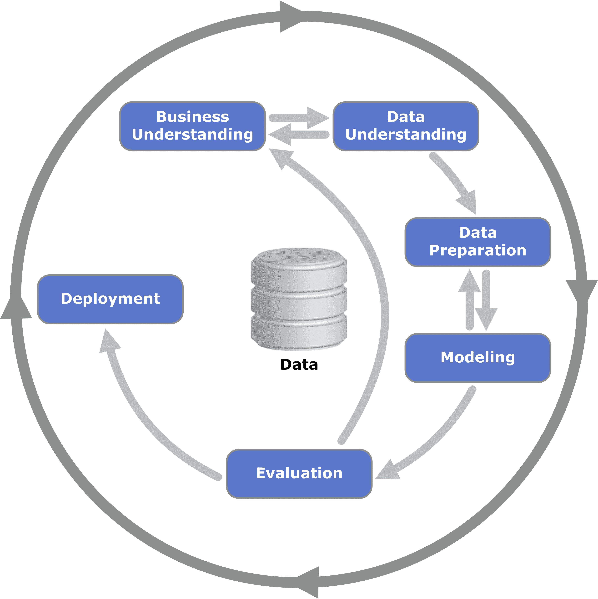

CRISP-DM 图表

[OSEMN](http://www.dataists.com/2010/09/a-taxonomy-of-data-science/)的步骤为：

- 获取 (Obtain)
- 清洗 (Scrub)
- 探索 (Explore)
- 模型 (Models)
- 解释 (Interpret)

# 第二部分 - 分类

## 第三章 - 决策树分类

### 3.1 引言

#### 3.1.1 决策树简介

决策树是一种主要用于分类问题的机器学习算法。它可以应用于分类和连续数据。该算法的核心概念非常简单：根据某些分裂标准对数据进行连续划分。决策树在训练时计算高效，在分类新实例时速度也很快。此外，当规模不是太大时，它们具有很好的解释性，因此经常被用于数据探索。一个常见的陷阱是它们对过拟合敏感，可以通过剪枝或在构建树时添加标准来解决。

#### 3.1.2 R 中的决策树

我们可以使用 `rpart` 库在 R 中构建决策树：

```r
library(rpart)
```

此外，我们将使用 `rpart.plot` 库来绘制生成的树：

```r
library(rpart.plot)
```

构建一个新树需要执行 `rpart` 命令：

```r
model <- rpart(Target ~ ., method = "class", data = ..., minsplit = ..., minbucket = ..., cp = ...)
```

我们可以使用 `plot(model)` 和 `text(model, use.n = TRUE)` 来绘制树，或者使用以下命令：

```r
rpart.plot(model, extra = 104, nn = TRUE)
```

为了检查 `rpart` 的参数，我们可以运行 `rpart`。此外，如果执行 `rpart.control`，我们还可以检查：

- `minsplit`: 节点中进行分裂所需的最小实例数
- `minbucket`: 每个叶子节点允许的最小实例数
- `maxdepth`: 树的最大深度
- `cp`: 控制分裂复杂性的参数，其设置直观（值越大，对树进行剪枝的可能性就越高）

### 3.2 分裂标准与决策树构建

为了计算不同分裂标准的值，我们将使用下表的训练数据作为示例，该表涉及二分类问题。

| Outlook (天气) | Temperature (温度) | Humidity (湿度) | Play (是否玩) |
| :--- | :--- | :--- | :--- |
| Sunny | Hot | High | No |
| Sunny | Hot | Normal | No |
| Overcast | Hot | High | Yes |
| Rainy | Hot | High | Yes |
| Sunny | Mild | High | No |
| Overcast | Mild | Normal | Yes |
| Rainy | Mild | Normal | Yes |
| Sunny | Mild | Normal | No |
| Overcast | Mild | Low | Yes |
| Rainy | Mild | Low | Yes |
| Sunny | Cool | High | No |
| Overcast | Cool | Normal | Yes |
| Rainy | Cool | Normal | Yes |

我们将对上述数据集应用决策树算法。我们将回答以下问题：

a) 如果我们使用 Gini 指数进行分裂，在 Outlook、Temperature 和 Humidity 中，我们应该选择哪一个特征进行第一次分裂？
b) 如果我们使用信息增益（Information gain）进行分裂，在 Outlook、Temperature 和 Humidity 中，我们应该选择哪一个特征进行第一次分裂？
c) 使用 Gini 指数构建完整的决策树，并绘制该树。

#### 3.2.1 数据和库导入

首先，我们读取数据并导入所需的库：

```r
weather = read.csv("weather.txt", stringsAsFactors = TRUE)

library(rpart)

library(rpart.plot)
```

#### 3.2.2 分裂标准

为了查看变量 `Outlook` 的分裂情况，我们执行以下命令：

```r
model = rpart(Play ~ Outlook, method = "class", data = weather, minsplit = 2)
```

如果我们也对 Temperature 和 Humidity 运行此命令，然后使用 `rpart.plot(model, extra = 104, nn = TRUE)` 绘制，将得到以下可视化结果：

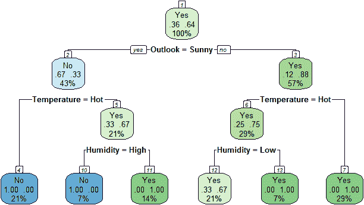

直观地说，我们已经可以理解哪种分裂会被选中，对吗？

##### 3.2.2.1 Gini 指数

我们使用以下公式计算 `Outlook` 的 Gini 指数：

$GINI(Sunny) = 1 - Freq(Play = No|Outlook = Sunny)² - Freq(Play = Yes|Outlook = Sunny)²$

$GINI(Rainy) = 1 - Freq(Play = No|Outlook = Rainy)² - Freq(Play = Yes|Outlook = Rainy)²$

$GINI(Outlook) = Freq(Outlook = Sunny) \cdot GINI(Sunny) + Freq(Outlook = Rainy) \cdot GINI(Rainy)$

计算结果为：

$GINI(Sunny) = 1 - (4/6)² - (2/6)² = 0.444$

$GINI(Rainy) = 1 - (1/8)² - (7/8)² = 0.219$

$GINI(Outlook) = (6/14) \cdot 0.444 + (8/14) \cdot 0.219 = 0.315$

同样，Temperature 和 Humidity 的 GINI 分别 $GINI(Temp) = 0.367$ 和 $GINI(Humidity) = 0.394$。因此，回答问题 (a)，使用 Gini 指数的最优分裂是 Outlook。

我们可以使用 R 来进行这些计算。对于 `Outlook`：

```r
absfreq = table(weather[, c(1, 4)])

freq = prop.table(absfreq, 1)

freqSum = rowSums(prop.table(absfreq))
```

我们计算 Sunny 和 Rainy 的 Gini：

```r
GINI_Sunny = 1 - freq["Sunny", "No"]² - freq["Sunny", "Yes"]²

GINI_Rainy = 1 - freq["Rainy", "No"]² - freq["Rainy", "Yes"]²
```

`Outlook` 的总 Gini 计算为：

```r
GINI_Outlook = freqSum["Sunny"] * GINI_Sunny + freqSum["Rainy"] * GINI_Rainy
```

##### 3.2.2.2 信息增益

我们使用以下公式计算 Outlook 的信息增益：

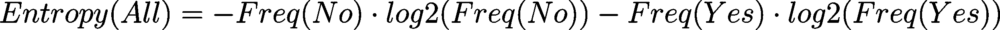

计算结果如下：

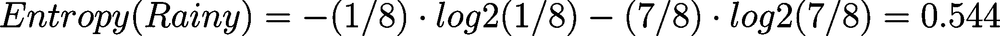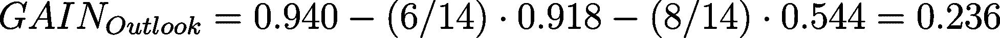

同样，温度和湿度的信息增益分别为 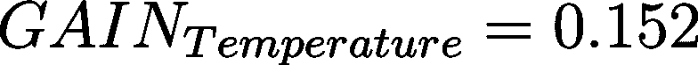和 。因此，回答问题 (b)，使用信息增益的最优首次划分是在“天气 (Outlook)”上。

我们也可以使用 R 进行这些计算。首先，我们计算数据集的总体熵：

```r
freq = prop.table(table(weather[, c(4)]))

Entropy_All = - freq["No"] * log2(freq["No"]) - freq["Yes"] * log2(freq["Yes"])
```

然后，对于天气，我们构建了以下频率数组：

```r
absfreq = table(weather[, c(1, 4)])

freq = prop.table(absfreq, 1)

freqSum = rowSums(prop.table(absfreq))
```

我们计算了晴天和雨天的熵：


`Entropy_Sunny =` 

```
- freq["Sunny", "No"] * log2(freq["Sunny", "No"]) 
- freq["Sunny", "Yes"] * log2(freq["Sunny", "Yes"])
```

`Entropy_Rainy =` 

```
- freq["Rainy", "No"] * log2(freq["Rainy", "No"]) 
- freq["Rainy", "Yes"] * log2(freq["Rainy", "Yes"])
```

天气的总信息增益计算方式为：

```
GAIN_Outlook =
    Entropy_All
    - freqSum["Sunny"] * Entropy_Sunny
    - freqSum["Rainy"] * Entropy_Rainy
```

### 3.2.3 构建决策树

对于 (c)，我们使用 `rpart` 构建决策树：

```
model <- rpart(
    Play ~ Outlook + Humidity, 
    method = "class",
    data = weather,
    minsplit = 1,
    cp = -1)
```

此外，我们可以使用以下命令绘制树：

```
rpart.plot(model, extra = 10, nn = TRUE)
```

树所示：`images/decision_tree.png`

### 3.3 剪枝与评估指标

决策树分类器也可以应用于具有连续变量的数据集，例如 `iris` 数据集。从 `iris` 数据集中，我们只保留前两列并丢弃最后 50 个实例，因此我们现在有一个预测特征和一个目标的二分类问题。我们可以在 R 中进行这些转换：

```
iris2 = iris[, c(1, 2)]
iris2$Species = factor(iris$Species[1:100], levels=levels(iris$Species))
```

之后，我们将数据集分为训练数据和测试数据：

```
trainingdata = iris2[c(1:40, 51:90),]
testdata = iris2[c(41:50),]
```

回答以下问题：

a) 使用训练数据构建决策树（`rpart` 的 `minsplit` 参数设置为 20）。
b) 将模型应用于 `testdata` 并计算精确率 (precision)、召回率 (recall) 和 F 分数 (f-measure)。
c) 构建两个决策树，一个 `minsplit` 等于 10，另一个 `minsplit` 等于 30，将它们应用于 `testdata` 并计算精确率、召回率和 F 分数。
d) 比较三个模型对于 `versicolor` 类的 F 分数。

#### 3.3.1 决策树的训练与测试

我们使用以下命令训练并绘制决策树：

```
model <- rpart(
    Species ~ ., 
    method = "class",
    data = trainingdata,
    minsplit = 20)
rpart.plot(model, extra = 10, nn = TRUE)
```

公式中的 `.` 代表 `trainingdata` 中的所有剩余变量。我们也可以在测试集上执行模型：

```
xtest = testdata[,1:2]
ytest = testdata[,3]
pred = predict(model, xtest, type="class")
```

#### 3.3.2 评估指标

我们可以使用以下命令产生混淆矩阵并计算这些指标：

```
library(MLmetrics)
cm = ConfusionMatrix(pred, ytest)
accuracy = Accuracy(pred, ytest)
precision = Precision(ytest, 'versicolor')
recall = Recall(ytest, 'versicolor')
f1 = F1_Score(ytest, 'versicolor')
data.frame(precision, recall, f1)
```

（或者我们可以计算 `TP`、`FP`、`TN` 和 `FN`，并找到精确率为 `TP/(TP + FP)`，召回率为 `TP/(TP + FN)`）

最后，3 个模型的 F 分数如下表（d）：

| 决策树 | F-Measure |
| --- | --- |
| minsplit = 10 | 0.833 |
| minsplit = 20 | 0.947 |
| minsplit = 30 | 0.857 |

### 3.4 练习题

给定以下数组用于二分类问题的训练数据：

| CustomerID | Sex | CarType | Budget | Insurance |
| --- | --- | --- | --- | --- |
| 1 | M | Family | Low | No |
| 2 | M | Sport | Medium | No |
| 3 | M | Sport | Medium | No |
| 4 | M | Sport | High | No |
| 5 | M | Sport | VeryHigh | No |
| 6 | M | Sport | VeryHigh | No |
| 7 | F | Sport | Low | No |
| 8 | F | Sport | Low | No |
| 9 | F | Sport | Medium | No |
| 10 | F | Sedan | High | No |
| 11 | M | Family | High | No |
| 12 | M | Family | VeryHigh | No |
| 13 | M | Family | Medium | No |
| 14 | M | Sedan | VeryHigh | No |
| 15 | F | Sedan | Low | No |
| 16 | F | Sedan | Low | No |
| 17 | F | Sedan | Medium | No |
| 18 | F | Sedan | Medium | No |
| 19 | F | Sedan | Medium | No |
| 20 | F | Sedan | High | No |

为以下项计算 Gini 指数：

a) 所有实例
b) `CustomerID`
c) `Sex`
d) 使用多路划分的 `CarType`
e) 使用多路划分的 `Budget`

哪一个应该被用于首次划分？提示性问题：解释为什么 `CustomerID` 尽管具有最低的 Gini 指数但不应被作特征使用。

构建模型需要执行 `naiveBayes` 命令：

```
model <- naiveBayes(Target ~ ., data = ..., laplace = ...)
```

其中参数 `laplace` 用于选择拉普拉斯平滑（laplace smoothing）。

在给定一个训练好的模型，我们可以使用以下命令预测新实例的类别：

```
predict(model, trvalue)
```

而如果我们进一步添加参数 `type = "raw"`，我们还将获得后验概率。

### 4.2 朴素贝叶斯模型的构建与分类

我们将使用下表的数据来解决一个二分类问题：

| 天气 (Weather) | 天数 (Day) | 高流量 (HighTraffic) |
| --- | --- | --- |
| Hot | Vacation | No |
| Cold | Work | Yes |
| Normal | Work | No |
| Cold | Weekend | Yes |
| Normal | Weekend | Yes |
| Cold | Work | No |
| Hot | Work | No |
| Hot | Vacation | Yes |

我们将回答以下问题：

a) 使用朴素贝叶斯分类器，对于值为 `(Weather, Day) = (Hot, Vacation)` 的新实例，你会将其归为哪一类？

b) 使用朴素贝叶斯分类器，对于值为 `(Weather, Day) = (Hot, Weekend)` 的新实例，你会将其归为哪一类？

c) 使用拉普拉斯平滑重复问题 (b)。

d) 在 R 中构建完整的模型并重复问题 (a)。

e) 在 R 中使用拉普拉斯平滑构建完整的模型并重复问题 (b)。

#### 4.2.1 数据读取与库（Library）的导入

最初，我们读取数据并导入所需的库：

```
traffic = read.csv("traffic.txt", stringsAsFactors = TRUE)
library(e1071)
```

#### 4.2.2 概率计算

对于问题 (a)，我们使用以下公式计算概率：

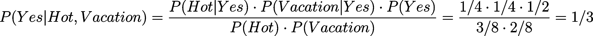

由于 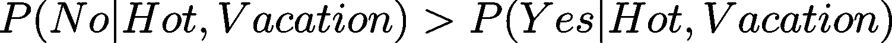，算法将该实例分类为 No。

同样地，对于问题 (b)：

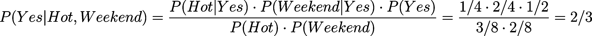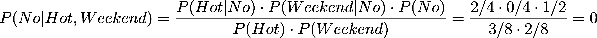

由于 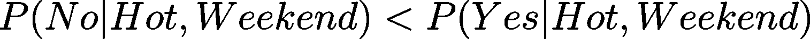，算法将该实例分类为 Yes。

关于问题 (c)，我们将重新计算概率，但添加了 `1` 作为拉普拉斯参数。因此，给定新的概率为 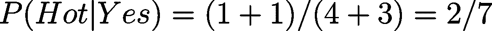，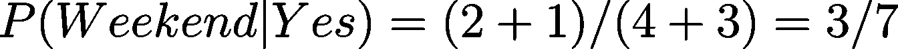, 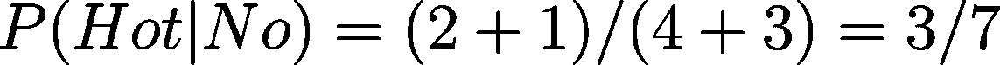, 以及 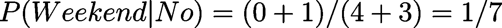，我们计算：

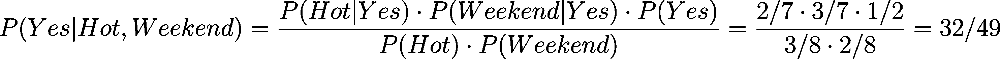

### 5.2 k-最近邻模型的构建与分类

我们将使用下表的数据来解决二分类问题：

| X1 | X2 | Y |
| --- | --- | --- |
| 0.7 | 0.7 | A |
| 0.7 | 0.8 | A |
| 0.6 | 0.6 | A |
| 0.5 | 0.5 | A |
| 0.5 | 0.6 | A |
| 0.5 | 0.7 | A |
| 0.5 | 0.8 | A |
| 0.7 | 0.5 | B |
| 0.8 | 0.7 | B |
| 0.8 | 0.5 | B |
| 0.8 | 0.6 | B |
| 1.0 | 0.3 | B |
| 1.0 | 0.5 | B |
| 1.0 | 0.6 | B |

我们将回答以下问题：

a) 使用不同的颜色/符号为每个类绘制数据图。

b) 使用 `k = 1` 的 kNN，你将把值为 `(X1, X2) = (0.7, 0.4)` 的新实例归为哪一类？

c) 使用 `k = 5` 重复问题 (b)。

d) 使用 `k = 5` 的 kNN，你将把值为 `(X1, X2) = (0.7, 0.6)` 的新实例归为哪一类？

#### 5.2.1 数据与库导入

首先，我们读取数据并导入所需的库：

```
knndata = read.csv("knndata.txt", stringsAsFactors = TRUE)
library(class)
```

#### 5.2.2 算法应用

我们首先对数据集进行划分：

```
X_train = knndata[,c("X1","X2")]
Y_train = knndata$Y
```

对于问题 (a)，我们执行以下命令：

```
plot(X_train, col = Y_train, pch = c("o","+")[Y_train])
```

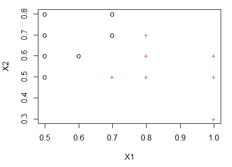

当 `k = 1` 时（问题 (b）），我们必须找到距离 `(0.7, 0.4)` 最近的实例（使用欧式距离），它是 `(0.7, 0.5)`，它属于类 B。因此，我们执行命令：

```
knn(X_train, c(0.7, 0.4), Y_train, k = 1, prob = TRUE)
```

新实例被分类为 B，概率为 1。

当 `k = 5` 时（问题 (c)），我们必须找到距离 `(0.7, 0.4)` 最近的 5 个实例，它们是 `(0.7, 0.5)`、`(0.8, 0.5)`、`(0.6, 0.6)`、`(0.8, 0.6)` 和 `(0.7, 0.7)`，分别属于类 B、B、A、B、A。我们注意到其中 3 个（ 5 个中的 3 个）属于类 B。我们可以执行命令：

```
knn(X_train, c(0.7, 0.4), Y_train, k = 5, prob = TRUE)
```

新实例被分类为 B，概率为 0.6。

对于问题 (d)，我们想要找到距离 `(0.7, 0.6)` 最近的 5 个实例。我们观察到实例 `(0.7, 0.5)`、`(0.6, 0.6)`、`(0.8, 0.6)`、`(0.7, 0.7)`（分别属于类 B、A、B、A）距离 `(0.7, 0.6)` 的距离相同。此外，实例 `(0.8, 0.7)` 和 `(0.8, 0.5)`（属于类 B）距离 `(0.7, 0.6)` 的距离相同（由于 kNN 的 `use.all` 参数为 `TRUE`），算法将使用所有这些实例。我们注意到其中 4 个（ 6 个中的 4 个）属于类 B。我们可以执行命令：

```
knn(X_train, c(0.7, 0.6), Y_train, k = 5, prob = TRUE)
```

新实例被分类为 B，概率为 0.66。

### 5.3 k-最近邻真实实例

在本节中，将在乳腺癌数据集上应用 k-NN。

#### 5.3.1 数据处理

首先，我们将数据集加载为数据框。假设当前工作目录是数据集所在的目录。我们添加 `sep` ，因为默认分隔符是空字符串。此外，从数据可以观察到缺失值用 `?` 表示。查看 `read.table` 函数的文档使用 `read.table`。接下来，我们将数据集划分为训练集和验证集。步骤如下：

```
rm(list=ls())

# 下载数据集
fileURL <- "http://archive.ics.uci.edu/ml/machine-learning/breast-cancer-wisconsin.data"
download.file(fileURL, destfile="breast-cancer.data", method="curl")

# 读取数据
data <- read.table("breast-cancer.data", na.strings = "?", sep=",",AsFactors = TRUE)

# 删除 id 列
data <- data[,-1]

# 为列命名（属性）
```


`names(data) <- c("ClumpThickness","UniformityCellSize","UniformityShape","MarginalAdhesion","EpithelialSize","BareNuclei","Chromatin","NormalNuclei","Mitoses","Class")`

# 将类转为因子

`data$Class <- factor(data$Class, levels=c(2,4), labels=c("benign", "malignant"))`

# 设置种子

`set.seed(123)`

# 划分数据集

`ind <- sample(2, nrow(data), replace=TRUE, prob=c(0.7,0.3))`

`trainData <- data[ind==1,]`

`validationData <- data[ind==2,]`

### 5.3.2 训练与预测

像之前加载 k-NN 算法。

```r
library(class)
```

由于所有属性都在 0 到 10 之间，不需要进行 0 到 1 的标准化，因为没有属性会主导 kNN 的距离计算。kNN 接受不带目标列的训练和测试数据集，放在第 3 个参数。我们将进行一些数据处理以符合 `knn` 函数的喜（查看 `knn` 手册）。此外，由于 kNN 不允许缺失值，让我们移除它们。

```r
trainData <- trainData[complete.cases(trainData)]
validationData <- validationData[complete.cases(validationData)]
trainDataX <- trainData[,-ncol(trainData)]
trainDataY <- trainData$Class
validationDataX <- validationData[,-ncol(validationData)]
validationDataY <- validationData$Class
```

让我们进行预测，因为使用 kNN 不需要训练。训练实例就是模型。

```r
prediction = knn(trainDataX, validationDataX, trainDataY, k = 1)
```

你可以尝试不同的 k 值寻找更好的模型。

### 5.3.3 评估

对验证集进行预测并打印混淆矩阵：

```r
cat("Confusion matrix:\n")
xtab = table(prediction, validationData$Class)
print(xtab)
cat("\nEvaluation:\n")
accuracy = sum(prediction == validationData$Class)/length(validationData$Class)
precision = xtab[1,1]/sum(xtab[,1])
recall = xtab[1,1]/sum(xtab[1,])
f = 2 * (precision * recall) / (precision + recall)
cat(paste("Accuracy:\t", format(accuracy, digits=2), "\n", ""))
cat(paste("Precision:\t", format(precision, digits=2), "\n", ""))
cat(paste("Recall:\t\t", format(recall, digits=2), "\n", ""))
cat(paste("F-measure:\t", format(f, digits=2), "\n", ""))
```

输出结果：

```
## Confusion matrix:
##
## prediction  benign malignant
##   benign        99         4
##   malignant      6        60
##
## Evaluation:
## Accuracy:     0.94
## Precision:    0.94
## Precision:    0.96
## F-measure:    0.95
```

### 5.3.4 交叉验证

为了执行交叉验证，我们将使用 `caret` 包。[这里](https://cran.r-project.org/web/packages/caret/vignettes/caret.pdf)你可以找到 caret 的快速指南。

#### 5.3.4.1 将数据分为两组

`createPartition` 函数对数据进行分层随机划分。与我们之前做的类似（尽管没有分层）。然后我们将使用 `train` 函数构建 kNN 模型。

```r
library(caret)
library(mlbench)
data(Sonar)
set.seed(107)
inTrain <- createDataPartition(y = Sonar$Class, p = .75, list = FALSE)
training <- Sonar[ inTrain,]
testing <- Sonar[-inTrain,]
kNNFit <- train(Class ~ ., 
                data = training,
                method = "knn",
                preProc = c("center", "scale"))
print(kNNFit)
```

```
## k-Nearest Neighbors 
##
## 157 samples
##  60 predictor
##   2 classes: 'M', 'R' 
##
## Pre-processing: centered (60), scaled (60) 
## Resampling: Bootstrapped (25 reps) 
## Summary of sample sizes: 157, 157, 157, 157, 157, 157, ... 
## Resampling results across tuning parameters:
##
##   k  Accuracy   Kappa    
##   5  0.7683412  0.5331399
##   7  0.7559100  0.5053696
##   9  0.7378175  0.4715006
##
## Accuracy was used to select the optimal model using  the largest value.
## The final value used for the model was k = 5.
```

我们也可以针对训练数据集搜索最佳 k 值。

```r
kNNFit1 <- train(Class ~ ., 
                data = training,
                method = "knn",
                tuneLength = 15,
                preProc = c("center", "scale"))
print(kNNFit1)
```

```
## k-最近邻 
## 157 个样本
##  60 个预测变量
##   2 个类别: 'M', 'R' 
## 
## 预处理: 中心化 (60), 标准化 (60) 
## 重采样: Bootstrap (25 次重复) 
## 样本大小摘要: 157, 157, 157, 157, 157, 157, ... 
## 各调优参数的重采样结果:
## 
##   k   Accuracy   Kappa    
##    5  0.7477453  0.4840235
##    7  0.7189901  0.4225515
##    9  0.7211797  0.4275156
##   11  0.7140987  0.4150135
##   13  0.7031182  0.3932055
##   15  0.7034819  0.3945755
##   17  0.6914316  0.3698916
##   19  0.6855830  0.3588189
##   21  0.6847459  0.3619330
##   23  0.6821917  0.3571894
##   25  0.6626137  0.3186673
##   27  0.6551801  0.3042504
##   29  0.6660760  0.3291024
##   31  0.6643681  0.3273283
##   33  0.6697744  0.3389183
## 
## 使用最大准确率（Accuracy）来选择最优模型。
## 模型最终使用的参数值为 k = 5。
```

为了创建一个基于 `k` 的 10 折交叉验证搜索，并重复 3 次，我们需要使用 `trainControl` 函数：

```r
ctrl <- trainControl(method = "repeatedcv", repeats = 3)
kNNFit2 <- train(Class ~ ., 
                data = training,
                method = "knn",
                tuneLength = 15,
                trControl = ctrl,
                preProc = c("center", "scale"))
print(kNNFit2)
plot(kNNFit2)
```

输出结果：

```
## k-最近邻 
## 
## 157 个样本
##  60 个预测变量
##   2 个类别: 'M', 'R' 
## 
## 预处理: 中心化 (60), 标准化 (60) 
## 重采样: 交叉验证 (10 折，重复 3 次) 
## 样本大小摘要: 142, 142, 142, 142, 141, 142, ... 
## 各调优参数的重采样结果:
## 
##   k   Accuracy   Kappa    
##    5  0.7820261  0.5548350
##    7  0.7709314  0.5321546
##    9  0.7605147  0.5111479
##   11  0.7504657  0.4924263
##   13  0.7396324  0.4705332
##   15  0.7247386  0.4401370
##   17  0.7058170  0.4006357
##   19  0.7179330  0.4246010
##   21  0.7055229  0.4003491
##   23  0.6930065  0.3779050
##   25  0.6933742  0.3791319
##   27  0.7052451  0.4028364
##   29  0.7163562  0.4277789
##   31  0.7332108  0.4629731
##   33  0.7176389  0.4335254
## 
## 使用最大准确率（Accuracy）来选择最优模型。
## 模型最终使用的参数值为 k = 5。
```

图表：`images/chapter5----plot.png`

对于预测结果：

```r
knnPredict <- predict(kNNFit2, newdata = testing)
```

混淆矩阵：

```
## Confusion Matrix
           Reference
      Prediction    M  R
         M         25  9
         R          2  15
By accuracy: 0.7843  No
Kappa: 0.5549
Sensitivity: 0.8871
Specificity: 0.6468
F1:          0.7353
P-value: < 0.001
```

更多信息：

```r
ctrl <- trainControl(method = "repeatedcv", repeats = 3, classProbs = TRUE, summary = "classSummary")
kNNFit4 <- train(Class ~ ., 
                data = training,
                method = "knn",
                tuneLength = 15,
                trControl = ctrl,
                preProc = c("center", "scale"))
kNNFit4
```

```
## k-最近邻 
## 
## 157 个样本
##  60 个预测变量
##   2 个类别: 'M', 'R' 
## 
## 预处理: 中心化 (60), 标准化 (60) 
## 重采样: 交叉验证 (10 折，重复 3 次) 
## 样本大小摘要: 142, 142, 142, 142, 141, 142, ... 
## 各调优参数的重采样结果:
## 
##   k   ROC        Sens       Spec
##    5  0.8846768  0.877314  0.698809
##    7  0.8613467  0.789815  0.635119
##    9  0.8642361  0.811854  0.657738
##   11  0.8592634  0.852736  0.625000
##   13  0.8527364  0.838401  0.599404
##   15  0.8384011  0.800925  0.529410
##   17  0.8389550  0.800463  0.560476
##   19  0.8246280  0.808796  0.598809
##   21  0.8219783  0.812500  0.612500
##   23  0.8125951  0.805556  0.612500
##   25  0.8139716  0.789815  0.635119
##   27  0.8118676  0.789352  0.653571
##   29  0.8090112  0.784259  0.657738
##   31  0.8090939  0.795833  0.662500
##   33  0.7983300  0.760648  0.681548
## 
## 使用最大 ROC 曲线下面积来选择最优模型。
## 模型最终使用的参数值为 k = 5。
```

图表：`images/chapter5----plot-2.png`

最后以及在 `caret` 包中使用 bootstrap：

```r
knnFit5 <- train(Class ~ ., 
                data = training,
                 method = "knn",
                 preProcess = c("center", "scale"),
                 tuneLength = 10, 
                 trControl = trainControl(method = "boot"))
knnPredict2 <- predict(knnFit5)
```

拥有模型后，可以使用以下命令对新实例进行分类：

```r
predict(model, test)
```

如果我们还想查看每个类的概率，则必须添加参数 `probability = TRUE`。注意，参数 `probability = TRUE` 必须在训练时（命令 `svm`）和运行期间（命令 `predict`）都进行添加。

### 6.2 支持向量机模型的构建与分类

我们将使用 `alldata.txt` 文件的数据来解决一个二分类问题：

```
          X1                    X2                  y      
    Min.   :-3.25322007   Min.   :-4.664161   Min.   :1.0  
    1st Qu.:-0.70900886   1st Qu.: 0.625361   1st Qu.:1.0  
    Median :-0.01162501   Median : 1.641370   Median :1.5  
    Mean   : 0.03493570   Mean   : 1.939284   Mean   :1.5  
    3rd Qu.: 0.73337179   3rd Qu.: 3.115350   3rd Qu.:2.0  
    Max.   : 3.63957363   Max.   : 9.784076   Max.   :2.0 
```

首先，我们导入数据集并将其分为训练数据和测试数据：

```r
alldata = read.csv("alldata.txt")
trainingdata = alldata[1:600, ]
testdata = alldata[601:800, ]
```


我们将回答以下问题：

a) 使用不同的颜色/符号为每个类绘制训练数据图。

b) 应用 RBF 核且 `gamma` 等于 1 的 SVM，并在问题 (a) 的图中画出超平面。

c) 重复问题 (b)，设置 `gamma` 值分别等于 0.01 和 100。你的观察结果是什么？

使用 `gamma` 值 `gammavalues = c(0.01, 0.1, 1, 10, 100, 1000, 10000, 100000, 1000000)`，我们还将回答以下问题：

d) 计算训练误差和测试误差。

e) 将这两个误差绘制在同一张图中。你的观察结果是什么？

f) 应用 10 折交叉验证来寻找 `gamma` 的最佳值。

## 6.2.1 导入

首先，我们导入所需的库：

```r
library(MLmetrics)
library(e1071)
```

## 6.2.2 算法应用与超平面图

对于问题 (a)，我们执行：

```r
plot(trainingdata[, c(1:2)], col = trainingdata$y, pch = c("o","+")[trainingdata$y])
```

对于问题 (b) 和 (c)，我们首先建立一个网格，并在其上方绘制超平面：

```r
X1 = seq(min(trainingdata[, 1]), max(trainingdata[, 1]), by = 0.1)
X2 = seq(min(trainingdata[, 2]), max(trainingdata[, 2]), by = 0.1)
mygrid = expand.grid(X1, X2)
colnames(mygrid) = colnames(trainingdata)[1:2]
```

对于问题 (b)，我们使用 `gamma = 1` 训练 SVM 并将其应用于网格：

```r
svm_model = svm(y ~ ., kernel="radial", type="C-classification", data = trainingdata, gamma = 1)
pred = predict(svm_model, mygrid)
Y = matrix(pred, length(X1), length(X2))
contour(X1, X2, Y, add = TRUE, levels = 1.5, labels = "gamma = 1", col = "blue")
```

同样，对于问题 (c)，当 `gamma = 0.01` 时：

```r
svm_model = svm(y ~ ., kernel="radial", type="C-classification", data = trainingdata, gamma = 0.01)
pred = predict(svm_model, mygrid)
Y = matrix(pred, length(X1), length(X2))
contour(X1, X2, Y, add = TRUE, levels = 1.5, labels = "gamma = 0.01", col = "red")
```

以及当 `gamma = 100` 时：

```r
svm_model = svm(y ~ ., kernel="radial", type="C-classification", data = trainingdata, gamma = 100)
pred = predict(svm_model, mygrid)
Y = matrix(pred, length(X1), length(X2))
contour(X1, X2, Y, add = TRUE, levels = 1.5, labels = "gamma = 100", col = "green")
```

最后，图示所示：

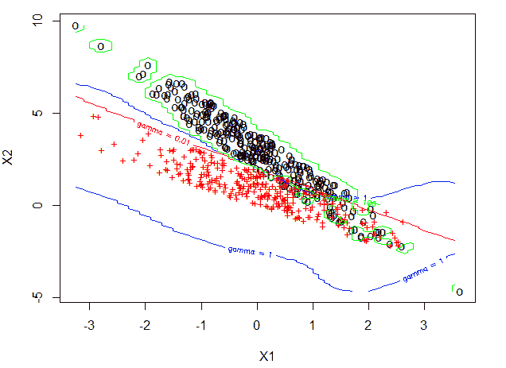

## 6.2.3 训练与测试误差曲线

对于问题 (d)，我们遍历所有的 `gamma` 值并计算训练误差：

```r
training_error = c()
for (gamma in gammavalues) {
  svm_model = svm(y ~ ., kernel="radial", type="C-classification", data = trainingdata, gamma = gamma)
  pred = predict(svm_model, trainingdata[, c(1:2)])
  training_error = c(training_error, 1 - Accuracy(trainingdata$y, pred))
}
```

同样，对于测试误差：

```r
testing_error = c()
for (gamma in gammavalues) {
  svm_model = svm(y ~ ., kernel="radial", type="C-classification", data = trainingdata, gamma = gamma)
  pred = predict(svm_model, testdata[, c(1:2)])
  testing_error = c(testing_error, 1 - Accuracy(testdata$y, pred))
}
```

我们可以使用以下命令在同一张图中绘制这两个误差：

```r
plot(training_error, type = "l", col="blue", ylim = c(0,0.5), xlab = "Gamma", ylab = "Error")
lines(testing_error, col="red")
legend("right", legend = c("Training Error", "Testing Error"), col = c("blue", "red"))
```

输出结果是一个可以在各种分类算法中使用的公式，它表明根据 `CFS` 算法和训练数据集，预测鸢尾花 `Species` 的最佳特征顺序是 `Petal Length` 和 `Petal Width`。

例如在 `Naive Bayes`（朴素贝叶斯）算法中，我们将同时使用包含所有属性的预测 `Species` 的公式，以及从 `CFS` 导出的公式。

```r
library(e1071)
model <- naiveBayes(Species ~ ., data=trainData, laplace = 1)
simpler_model <- naiveBayes(f, data=trainData, laplace = 1)
pred <- predict(model, validationData)
simpler_pred <- predict(simpler_model, validationData)
library(MLmetrics)
train_pred <- predict(model, trainData)
train_simpler_pred <- predict(simpler_model, trainData)
paste("Accuracy in training all attributes", 
      Accuracy(train_pred, trainData$Species), sep=" - ")
```

```r
## [1] "Accuracy in training all attributes - 0.964285714285714"
```

```r
paste("Accuracy in training CFS attributes", 
      Accuracy(train_simpler_pred, trainData$Species), sep=" - ")
```

```r
## [1] "Accuracy in training CFS attributes - 0.955357142857143"
```

```r
paste("Accuracy in validation all attributes", 
      Accuracy(pred, validationData$Species), sep=" - ")
```

```r
## [1] "Accuracy in validation all attributes - 0.947368421052632"
```

```r
paste("Accuracy in validation CFS attributes", 
      Accuracy(simpler_pred, validationData$Species), sep=" - ")
```

```r
## [1] "Accuracy in validation CFS attributes - 0.973684210526316"
```

在使用所有属性时，训练集上的准确率有所提高，但与仅使用 2 个属性的简单模型相比，验证集上的准确率反而下降了。

## 7.2 包装方法 (Wrapper Methods)

### 7.2.1 递归特征消除 (Recurrent Feature Elimination)

作为包装方法的演示，我们将使用 `Recurrent Feature Elimination (RFE)` 方法在 Pima Indians 糖尿病数据集中选择属性。为此，我们将使用 `caret` 库。

首先，像往常一样，我们将数据集划分为训练集和验证集。

```r
# 确保结果的可重复性
set.seed(1234)

# 加载所需的库
library(mlbench)
library(caret)

# 加载数据
data(PimaIndiansDiabetes)
data = PimaIndiansDiabetes

# 划分训练集和验证集
set.seed(1234)
ind <- sample(2, nrow(data), replace=TRUE, prob=c(0.7, 0.3))
trainData <- data[ind==1,]
validationData <- data[ind==2,]
trainData <- trainData[complete.cases(trainData),]
validationData <- validationData[complete.cases(validationData),]
```

接下来，我们将使用 `caret` 包中的 `rfe` 方法，并使用 `rfeControl` 方法进行设置（如果出现缺少包 `klaR` 的错误，请安装库 `klaR:`）。

```r
# 使用随机森林选择函数定义控制
control <- rfeControl(functions=nbFuncs, method="cv", number=10)

# 运行 RFE 算法
results <- rfe(trainData[,1:8], trainData[,9], sizes=c(1:8), rfeControl=control)
```

让我们看看结果。

```r
# 总结结果
print(results)
```

```r
## 递归特征选择
## 外部重采样方法：交叉验证 (10 折) 
## 子集大小的重采样性能：
##  Variables Accuracy  Kappa AccuracySD KappaSD Selected
##          1   0.7453 0.3681    0.04390 0.12449         
##          2   0.7546 0.4182    0.04598 0.12317         
##          3   0.7715 0.4707    0.05759 0.14388        
##          4   0.7584 0.4479    0.04145 0.10478         
##          5   0.7546 0.4457    0.04429 0.10095         
##          6   0.7490 0.4344    0.04393 0.09394         
##          7   0.7509 0.4290    0.04686 0.11122         
##          8   0.7491 0.4201    0.03507 0.07767         
## 
## 前 3 个变量（共 3 个）：
##    glucose, age, mass
```

RFE 从 8 个特征中选择了三个（`glucose`、`age`、`mass`），它们在 10 折交叉验证下提供了最佳准确率。

### 7.2.2 前向搜索 (Forward Search)

标准的包装方法有正向搜索和反向搜索。在本节中，我们应用正向搜索和决策树。

```r
library(FSelector)
library(rpart)

evaluator <- function(subset) {
  #k 折交叉验证
  k <- 5
  splits <- runif(nrow(trainData))
  results = sapply(1:k, function(i) {
    test.idx <- (splits >= (i - 1) / k) & (splits < i / k)
    train.idx <- !test.idx
    test <- trainData[test.idx, , drop=FALSE]
    train <- trainData[train.idx, , drop=FALSE]
    tree <- rpart(as.simple.formula(subset, "Class"), train)
    error.rate = sum(test$Class != predict(tree, test, type="c")) / nrow(test)
    return(1 - error.rate)
  })
  print(subset)
  print(mean(results))
  return(mean(results))
}

subset <- forward.search(names(trainData)[-10], evaluator)
```

```r
## [1] "ClumpThickness" (团厚度)
## [1] 0.8535402
## [1] "UniformityCellSize" (细胞均匀尺寸)
## [1] 0.9169743
## [1] "UniformityCellShape" (细胞均匀形状)
## [1] 0.9046481
## [1] "MarginalAdhesion" (边缘粘性)
## [1] 0.8668483
## [1] "SingleEpithelialCellSize" (单上细胞大小)
## [1] 0.9016864
## [1] "BareNuclei" (裸核)
## [1] 0.9088861
## [1] "BlandChromatin" (染色质平坦)
## [1] 0.9024063
## [1] "NormalNucleoli" (正常核仁)
## [1] 0.8938365
## [1] "Mitoses" (有丝分裂)
## [1] 0.7931983
## [1] "ClumpThickness"     "UniformityCellSize"
## [1] 0.9311372
## [1] "UniformityCellSize"  "UniformityCellShape"
## [1] 0.9338328
## [1] "UniformityCellSize" "MarginalAdhesion"  
## [1] 0.9175577
## [1] "UniformityCellSize"       "SingleEpithelialCellSize"
## [1] 0.9257016
## [1] "UniformityCellSize" "BareNuclei"        
## [1] 0.9479085
## [1] "UniformityCellSize" "BlandChromatin"    
## [1] 0.9393624
## [1] "UniformityCellSize" "NormalNucleoli"    
## [1] 0.9365198
## [1] "UniformityCellSize" "Mitoses"           
## [1] 0.9115353
## [1] "ClumpThickness"     "UniformityCellSize" "BareNuclei"        
## [1] 0.9426851
## [1] "UniformityCellSize"  "UniformityCellShape" "BareNuclei"         
## [1] 0.9445665
## [1] "UniformityCellSize" "MarginalAdhesion"   "BareNuclei"        
## [1] 0.9464024
## [1] "UniformityCellSize"       "SingleEpithelialCellSize" "BareNuclei"        \
## [1] 0.942908
## [1] "UniformityCellSize" "BareNuclei"         "BlandChromatin"    
## [1] 0.9525752
## [1] "UniformityCellSize" "BareNuclei"         "NormalNucleoli"    
```


## [1] 0.944144

## [1] "UniformityCellSize" "BareNuclei"         "Mitoses"           

## [1] 0.9497248

## [1] "ClumpThickness"     "UniformityCellSize" "BareNuclei"         "BlandChromatin"    

## [1] 0.9481402

## [1] "UniformityCellSize"  "UniformityCellShape" "BareNuclei"          "BlandChromatin"     

## [1] 0.9402657

## [1] "UniformityCellSize" "MarginalAdhesion"   "BareNuclei"         "BlandChromatin"    

## [1] 0.943606

## [1] "UniformityCellSize"       "SingleEpithelialCellSize" "BareNuclei"        \ "BlandChromatin"          

## [1] 0.945692

## [1] "UniformityCellSize" "BareNuclei"         "BlandChromatin"     "NormalNucleoli"    

## [1] 0.9424801

## [1] "UniformityCellSize" "BareNuclei"         "BlandChromatin"     "Mitoses"  \

## [1] 0.9456923

通过搜索，我们得到了以下公式，在 9 个变量中保留了 3 个。

```
f <- as.simple.formula(subset, "Class")
print(f)
```

```
## Class ~ UniformityCellSize + BareNuclei + BlandChromatin
## <environment: 0x00000239124ac180>
```

尽管我们使用了决策树进行前向搜索以获得属性子集的公式，但这并没有阻止我们使用另一个分类模型进行训练和预测。例如，正如本章之前的示例所示，我们可以使用朴素贝叶斯算法在准确率指标下，分别在训练集和验证集中对前向选择算法进行评估。

```
library(e1071)
model <- naiveBayes(Class ~ ., data=trainData, laplace = 1)
pred <- predict(model, validationData)
simpler_model <- naiveBayes(f, data=trainData, laplace = 1)
simpler_pred <- predict(simpler_model, validationData)
library(MLmetrics)
train_pred <- predict(model, trainData)
simpler_pred <- predict(simpler_model, trainData)
paste("Accuracy in training", Accuracy(train_pred, trainData), sep=" ")
```

```
## [1] Accuracy in training attributes - 0.95780590712996
```

```
paste("Accuracy in training", Accuracy(simpler_pred, trainData), sep=" ")
```

```
## [1] Accuracy in training attributes - 0.95569602531646
```

```
paste("Accuracy in validation", Accuracy(pred, validationData), sep=" ")
```

```
## [1] Accuracy in validation attributes - 0.97607655023923
```

```
paste("Accuracy in validation", Accuracy(simpler_pred, validationData), sep=" ")
```

```
## [1] Accuracy in validation attributes - 0.95693779043062
```

在乳腺癌数据集，特征选择算法的效果优于使用所有属性。其明显原因是数据集中有的 9 个由专家挑选的属性具有预测能力。因此，移除某些特征可以产生更好的结果。

# 第 8 章 - 降维

### 8.1 主成分分析

#### 8.1.1 “原始”主成分

首先，我们将尝试在不使用库内置函数的情况下执行主成分分析（PCA）。

##### 步骤 1：数据

首先创建一个数据集并将其绘图。

```
d <- c(2.5, 2.4, 0.5, 0.7, 2.2, 2.9, 1.9, 2.2, 3.1, 3.0, 2.3, 2.7, 2, 1.6, 1, 1.1, 1.5, 1.6, 1.1, 0.9)
data <- matrix(d, ncol=2, byrow = T)
plot(data, xlab="x1", ylab="x2")
```


##### 步骤 2：减均值

我们使用 `scale` 函数从每个属性值中减去均值（对数据中心化）。

```
data_norm <- scale(data, scale=F)
plot(data_norm, xlab="x1", ylab="x2")
```


##### 步骤 3：计算协方差矩阵

我们使用 `cov` 函数计算协方差矩阵。

```
S <- cov(data_norm)
print(S)
```

```
##           [,1]      [,2]
## [1,] 0.6165556 0.6154444
## [2,] 0.6154444 0.7165556
```

##### 步骤 4：计算协方差矩阵的特征向量

使用 `svd` 方法（奇异值分解）推导协方差矩阵的特征向量。首先打印分解结果：

```
udv <- svd(S)
print(udv)
```

```
## $d
## [1] 1.2840277 0.0490834
## 
## $u
##            [,1]       [,2]
## [1,] -0.6778734 -0.7351787
## [2,] -0.7351787  0.6778734
## 
## $v
##            [,1]       [,2]
## [1,] -0.6778734 -0.7351787
## [2,] -0.7351787  0.6778734
```

然后我们绘制特征向量：

```
# asp=1 保持宽高比例为 1，以便特征向量
# 正确显示（垂直）
plot(data_norm, asp=1, xlab="x1", ylab="x2")
arrows(0,0,udv$u[1,1],udv$u[2,1], lwd=1)
arrows(0,0,udv$u[1,2],udv$u[2,2], lwd=0.5)
```


##### 步骤 5：选择组件

我们可以使用条状图显示每个组件解释的方差。

```
barplot(udv$d)
print(cumsum(udv$d)/sum(udv$d))
```


我们可以看到，第一个成分占了超过 95% 的方差。

##### 步骤 6：选取第一个组件

我们仅使用第一个主成分（PC）将 2D 数据集转换为 1D 数据集。

```
data_new <- t(udv$u[,1,drop=FALSE]) %*% t(data_norm)
data_new
```

```
##            [,1]    [,2]       [,3]       [,4]      [,5]       [,6]
## [1,] -0.8279702 1.77758 -0.9921975 -0.2742104 -1.675801 -0.912941
##            [,7]     [,8]      [,9]    [,10]
## [1,] 0.09910944 1.144572 0.4380461 1.223821
```

```
plot(data_new,data_new,asp=1,xlab="x1", ylab="x2")
```

#### 8.1.2 使用 R 函数进行 PCA

在本节中，我们将使用可以一步完成 PCA 的 `prcomp` 函数。我们将将其应用于 Iris 数据集，并使用 kNN 算法测试在准确率方面的增益或损失。

```
# 下载文件
data = iris
set.seed(1234)
ind <- sample(2, nrow(data), replace=TRUE, prob=c(0.7, 0.3))
trainData <- data[ind==1,]
validationData <- data[ind==2,]
library(class)
library(stats)
trainData <- trainData[complete.cases(trainData)]
validationData <- validationData[complete.cases(validationData)]
```

```
## 组件的重要性：
##                           PC1    PC2     PC3     PC4
## 标准差             1.7226 0.9313 0.36484 0.17916
## 方差占比           0.7419 0.2168 0.03328 0.00802
## 累计占比           0.7419 0.9587 0.99198 1.00000
```

从摘要中，我们可以观察到使用 2 个 `PCs` 就可以解释超过 95% 的方差。

```r
trainDataY <- trainData$Species
validationDataX <- validationData[,-ncol(trainData)]
# 我们也对验证数据进行转换
logValidationDataX <- log(validationDataX)
validation.pca <- predict(train.pca, newdata=logValidationDataX)
validationDataY <- validationData$Species
# 无 pca 预测
prediction = knn(trainDataX, validationDataX, validationDataY, k = 3)
# 所以我们只使用前 7 个主成分进行预测
prediction_pca = knn(train.pca$x[,1:2], validation.pca[,1:2], trainDataY, k = 3)
cat("Confusion matrix:\n")
```

```r
 ## 混淆矩阵:
```

```r
xtab = table(prediction, validationData$Species)
print(xtab)
```

```r
##             
## 预测   setosa versicolor virginica
##   setosa         10          0         0
##   versicolor      0         12         1
##   virginica       0          0        15
```

```r
cat("\nEvaluation:\n\n")
```

```r
## 
## 评估:
```

```r
accuracy = sum(prediction == validationData$Species)/length(validationData$Species)
cat(paste("Accuracy:\t", format(accuracy, digits=2), "\n",sep=" "))
```

```r
## Accuracy:     0.97
```

```r
cat("Confusion matrix PCA:\n")
```

```r
 ## PCA 混淆矩阵:
```

```r
xtab = table(prediction_pca, validationData$Species)
print(xtab)
```

```r
##               
## 预测 _pca setosa versicolor virginica
##     setosa         10          0         0
##     versicolor      0         10         3
##     virginica       0          2        13
```

```r
cat("\nEvaluation PCA:\n\n")
```

```r
## 
## PCA 评估:
```

```r
accuracy = sum(prediction_pca == validationData$Species)/length(validationData$Species)
cat(paste("Accuracy PCA:\t", format(accuracy, digits=2), "\n",sep=" "))
```

```r
## Accuracy PCA:     0.87
```

尽管验证数据集较小，但可以观察到，通过减少 50% 的预测属性，算法仅多犯了 4 个错误。当然，在现实场景中，对于这样的小的数据集应该使用交叉验证。

### 8.2.3 用于绘图的 PCA

使用 PCA，我们还可以通过仅使用前两个成分，在高维数据上进行二维绘图。

```r
plot(train.pca$x[trainData$Species == 'setosa',1:2], col="blue", ylim = c(-3, 3),
xlim=c(-3,3), asp=1)
points(train.pca$x[trainData$Species == 'versicolor',1:2], pch = 3, col="red")
points(train.pca$x[trainData$Species == 'virginica',1:2], pch = 4, col="green")
```

在轮廓系数的计算中，`data` 代表原始数据。为了绘制轮廓系数和平均轮廓系数，我们可以使用以下命令：

```
# 绘制轮廓
plot(model_silhouette)
# 计算平均轮廓系数
mean(model_silhouette[, 3])
```

另一种可以让我们概览聚类情况并评估其性能的方法是构建热图。首先，我们可以使用以下命令对数据样本进行排序：

```
data_ord = data[order(model$cluster),]
```

然后构建我们的热图：

```
heatmap(as.matrix(dist(data_ord)), Rowv = NA, Colv = NA, 
              col = heat.colors(256), revC = TRUE)
```

下图展示了使用分布在 3 个簇中的数据样本构建的示例热图。热图的颜色代表有序数据样本的距离。红色表示距离较小，黄色表示距离较大。

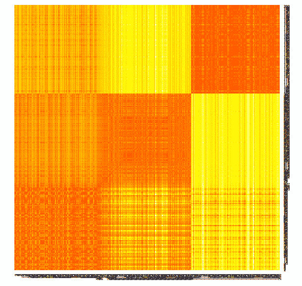

## 9.4 k-Means 聚类概述

下表包含了我们将用于使用 k-Means 算法解决聚类问题的数据集。

| || X || Y |
| --- | --- | --- |
| x1 | 7 | 1 |
| x2 | 3 | 4 |
| x3 | 1 | 5 |
| x4 | 5 | 8 |
| x5 | 1 | 3 |
| x6 | 7 | 8 |
| x7 | 8 | 2 |
| x8 | 5 | 9 |

使用上述数据集，我们将回答以下问题：

(a) 在二维空间中绘制数据。

(b) 应用 k-Means 算法将数据点分配到 3 个簇中。使用数据点 `x1`、`x2` 和 `x3` 作为初始中心来初始化算法。

(c) 计算问题 (b) 中执行的聚类的内聚度（cohesion）和离散度（separation）。

(d) 使用不同的颜色为每个簇中包含的数据点绘制聚类结果，并标记质心。

### 9.4.1 数据构建

首先，我们需要正确地构建包含上述数据集的数据框。为了做到，我们可以使用以下命令：

```
# 构建包含 X 轴数据的向量
X = c(7, 3, 1, 5, 1, 7, 8, 5)
# 构建包含 Y 轴数据的向量
Y = c(1, 4, 5, 8, 3, 8, 2, 9)
# 构建对应行名的数据标签向量
rnames = c("x1", "x2", "x3", "x4", "x5", "x6", "x7", "x8")
# 创建数据框
kdata = data.frame(X, Y, row.names = rnames)
```


一旦创建了数据框，我们可以使用以下命令绘制数据：

```
# 绘制数据
plot(kdata, pch = 15)

# 添加数据标签
text(hdata, labels = row.names(hdata), 
     pos = c(4, 2, 4, 4, 4, 4, 4, 4))
```

我们的数据如图所示：

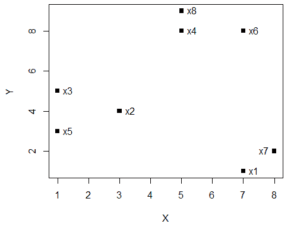

### 9.4.2 使用 k-Means 算法进行聚类

为了回答问题 (b)，我们设置数据点 `x1`、`x2` 和 `x3` 为初始中心并应用 k-Means 算法：

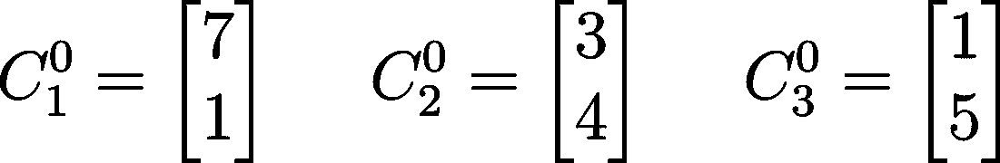

**第一次迭代：**

首先，我们将计算数据集中所有数据点与初始中心之间的距离。这些距离在下面的距离矩阵中：

| |  | 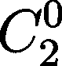 | 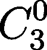 |
| --- | --- | --- | --- |
| x1 | **0.00** | 5.00 | 7.21 |
| x2 | 5.00 | **0.00** | 2.24 |
| x3 | 7.21 | 2.24 | **0.00** |
| x4 | 7.28 | **4.47** | 5.00 |
| x5 | 6.32 | 2.24 | **2.00** |
| x6 | 7.00 | **5.66** | 6.71 |
| x7 | **1.41** | 5.39 | 7.62 |
| x8 | 8.25 | **5.39** | 6.66 |

计算距离后，我们找到每个数据点的最小距离并将其分配到相应的簇。一旦所有数据点都分配完毕，我们就计算新的中心。

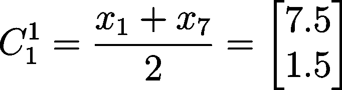

**第二次迭代：**

下表包含了数据点到更新后的中心的距离。

| |  |  |  |
| --- | --- | --- | --- |
| x1 | **0.71** | 6.56 | 6.71 |
| x2 | 5.15 | 3.82 | **2.00** |
| x3 | 7.38 | 4.59 | **1.00** |
| x4 | 6.96 | **0.75** | 5.66 |
| x5 | 6.67 | 5.84 | **1.00** |
| x6 | 6.52 | **2.14** | 7.21 |
| x7 | **0.71** | 6.05 | 7.28 |
| x8 | 7.91 | **1.75** | 6.40 |

新的中心是：


由于中心发生了变化，算法在下一次迭代中继续。

**第三次迭代：**

我们再次计算更新后的距离。

| |  | 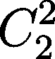 | 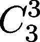 |
| --- | --- | --- | --- |
| x1 | **0.71** | 7.45 | 6.12 |
| x2 | 5.15 | 5.09 | **1.33** |
| x3 | 7.38 | 5.73 | **1.20** |
| x4 | 6.96 | **0.75** | 5.21 |
| x5 | 6.67 | 7.09 | **1.20** |
| x6 | 6.52 | **1.37** | 6.67 |
| x7 | **0.71** | 6.75 | 6.64 |
| x8 | 7.91 | **0.94** | 6.01 |

新的中心是：


我们可以看到，中心没有发生变化，因此算法在第三次迭代后收敛。

我们可以简单地使用 R 中的以下命令执行上述手动过程：

```
# 执行 k-Means 聚类
model = kmeans(kdata, centers = kdata[1:3,])

# 获取最终中心
model$centers

# 获取数据点在簇之间的分布情况
model$cluster
```

### 9.4.3 计算内聚度和离散度

为了回答问题 (c)，我们需要计算上一个小节中执行的聚类的内聚度和离散度。

首先，我们将手动计算这些指标，然后我们将看到如何使用 R 进行计算。在计算过程中，我们将使用上述簇。

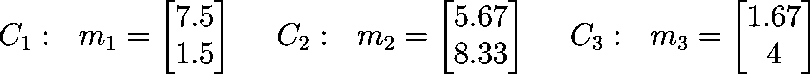

**内聚度计算**

内聚度指标由以下方程给出：

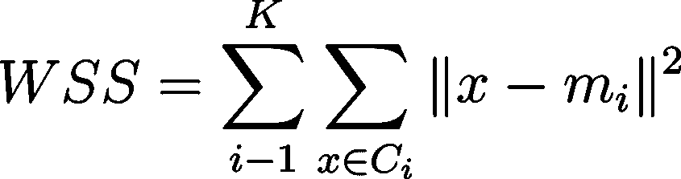

此时，我们将计算每个簇的内聚度：

**第一个簇：**

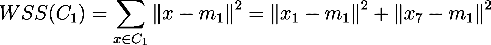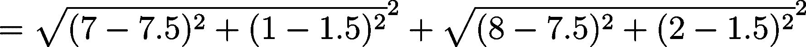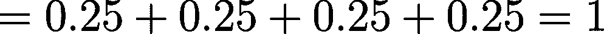

**第二个簇：**

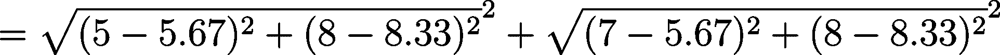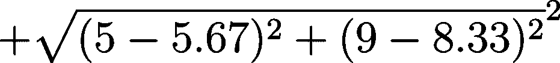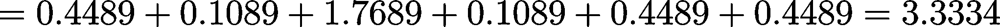

**第三个簇：**

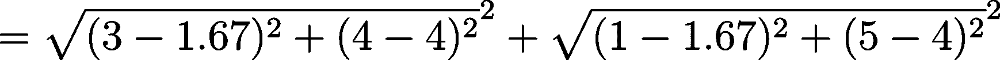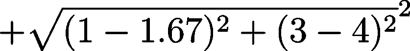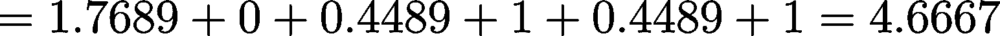

总内聚性通过以下方程给出：

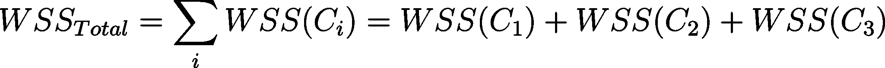

### 离散度

簇间平方和（BSS）指标通过以下方程给出：

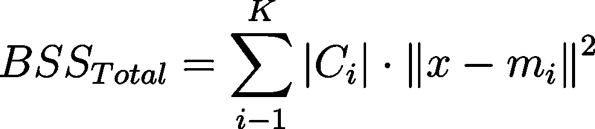

我们的第一步是计算数据集的中心，它由所有点的平均值给出。

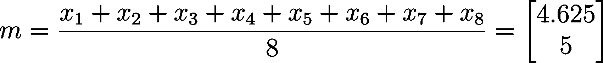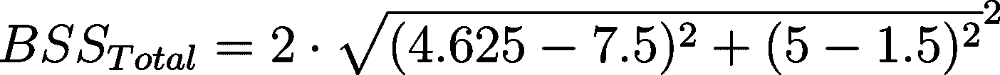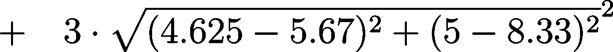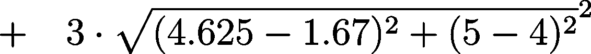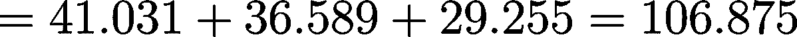

| Conference_1 | 高 | SE |
| --- | --- | --- |
| Conference_2 | 低 | SE |
| Conference_3 | 高 | ML |
| Conference_4 | 低 | DM |
| Conference_5 | 低 | ML |
| Conference_6 | 高 | SE |

上述数据集展示了 6 个不同会议的排名和主题。SE 代表软件工程（Software Engineering），ML 代表机器学习（Machine Learning），DM 代表数据挖掘（Data Mining）。

首先，我们将使用以下命令构建一个包含上述数据集的数据框：

```
# 存储 Rank 数据的向量
Rank = c("High", "Low", "High", "Low", "Low", "High")

# 存储 Topic 数据的向量
Topic = c("SE", "SE", "ML", "DM", "ML", "SE")

# 数据框
conferences = data.frame(Rank, Topic)
```

我们可以使用以下命令应用 k-Medoids 算法：

```
# 导入库
library(cluster)

# 创建 k-Medoids 模型
model = pam(conferences, 3)
```

我们可以使用以下命令显示质类中心（medoids）以及数据实例到聚类的分布：

```
# 获取质类中心
model$medoids

# 获取样本到聚类的分布
model$clustering
```

我们还可以使用以下命令通过名称显示质类中心：

```
conferences[model$id.med,]
```

最后，我们可以使用以下命令绘制数据图：

```
# 获取不同的排名
L1 = levels(conferences$Rank)

# 获取不同的主题
L2 = levels(conferences$Topic)

# 绘制数据
plot(model$data, xaxt = "n", yaxt = "n", pch = 15, col = model$cluster)

# 插入轴标签
axis(1, at = 1:length(L1), labels = L1)
axis(2, at = 1:length(L2), labels = L2)

# 显示质类中心
points(conferences[model$id.med,], col = 1:3, pch = "o", cex = 2)
```

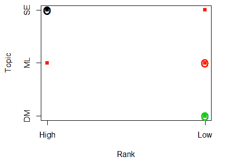

# 第 10 章 - 基于连接性的聚类

基于连接性的聚类（也称为层次聚类）基于一个核心思想，即给定数据集中的每个实例都与所有其他实例相关。上述假设背后的主要思想是，对于“最近”的对象，这种关系的程度比对于较远的对象更强。`nearby` 一词意味着这些算法根据距离将`data instances`（数据实例）连接形成`clusters`（聚类）。一个聚类很大程度上可以通过连接聚类部分所需的最大距离来描述。在不同的距离下，会形成不同的聚类，这可以使用树图（dendrogram）来表示，这解释了“层次聚类”这一常用名称的由来：这些算法并不提供数据集的单一划分，而是提供了一个在特定距离下相互合并的广泛聚类层次结构。

## 10.1 R 中的层次聚类

### 10.1.1 数据构建

为了详细概述如何使用 R 进行层次聚类，让我们考虑以下包含五个二维空间实例的简单数集。

| | X | Y |
| --- | --- | --- |
| x1 | 2 | 0 |
| x2 | 8 | 4 |
| x3 | 0 | 6 |
| x4 | 7 | 2 |
| x5 | 6 | 1 |

首先，我们需要妥妥地构建包含上述数据集的数据框。为了实现这一点，我们可以使用以下命令：

```
# 构建包含 X 轴数据的向量
X = c(2, 8, 0, 7, 6)

# 构建包含 Y 轴数据的向量
Y = c(0, 4, 6, 2, 1)

# 构建包含与行名对应的数据标签的向量
rnames = c("x1", "x2", "x3", "x4", "x5")

# 创建数据框
hdata = data.frame(X, Y, row.names = rnames) 
```

一旦创建了数据框，我们就可以使用以下命令绘制数据：

```
# 绘制数据
plot(hdata, pch = 15)

# 添加数据标签
text(hdata, labels = row.names(hdata), pos = c(4, 2, 4, 4, 4))
```


我们的数据如图所示：

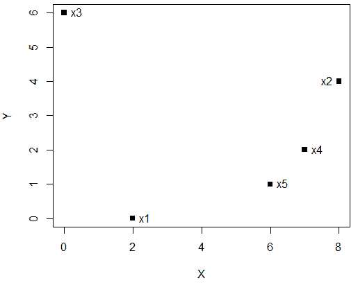

## 10.1.2 使用单连接和完全连接进行层次聚类

在本节中，我们将使用上述数据集，通过单连接（Single Linkage）和完全连接（Complete Linkage）执行层次聚类。

如所述，层次聚类是一个迭代过程，从给定数据集的单个元素开始，以逐步形成聚类。这些聚类通过合并表现出连接元素形成。这种连接是通过距离度量表示的。一种常用的距离度量是欧几里得距离，它由以下公式给出：


首先，我们将通过单连接进行：第一次迭代：下表显示了矩阵。

| | x1 | x2 | x3 | x4 | x5 |
| --- | --- | --- | --- | --- |
| x1 | 0 | 7.21 | 6.32 | 5.39 | 4.12 |
| x2 | 7.21 | 0 | 8.25 | 2.24 | 3.61 |
| x3 | 6.32 | 8.25 | 0 | 8.06 | 7.81 |
| x4 | 5.39 | 2.24 | 8.06 | 0 | 1.41 |
| x5 | 4.12 | 3.61 | 7.81 | 1.41 | 0 |

如表所示，`x4` 和 `x5` 距离最近。作为结果，我们将它们合并形成聚类。第二次迭代：由于我们使用单连接，包含 `x4` 和 `x5` 的聚类与其它点的距离是该点与这两个点之间距离的最小值。下表显示了更新后的矩阵。

| | x1 | x2 | x3 | x4 - x5 |
| --- | --- | --- | --- | --- |
| x1 | 0 | 7.21 | 6.32 | 5.39 |
| x2 | 7.21 | 0 | 8.25 | 3.61 |
| x3 | 6.32 | 8.25 | 0 | 8.06 |
| x4 - x5 | 5.39 | 3.61 | 8.06 | 0 |

第三迭代：再次，我们将 `x2` 与包含 `x4` 和 `x5` 的聚类合并。

| | x1 | x2 - x4 - x5 |
| --- | --- | --- |
| x1 | 0 | 6.32 |
| x2 - x4 - x5 | 6.32 | 0 |

第四次迭代：最后，在第四次迭代中，`x3` 与 `x1 - x2 - x4 - x5` 的聚类合并。

| | x1 - x2 - x4 - x5 |
| --- | --- |
| x1 - x2 - x4 - x5 | 0 |

此时聚类在第四次迭代中完成。单连接完成。

此时，我们将再次通过相同的迭代过程，但针对完全连接的情况。第一次迭代：第一步与单连接的情况相同，我们计算原始数据集的矩阵并连接距离最近的 `x4` 和 `x5` 点。

| | x1 | x2 | x3 | x4 | x5 |
| --- | --- | --- | --- | --- | --- |
| x1 | 0 | 7.21 | 6.32 | 5.39 | 4.12 |
| x2 | 7.21 | 0 | 8.25 | 2.24 | 3.61 |
| x3 | 6.32 | 8.25 | 0 | 8.06 | 7.81 |
| x4 | 5.39 | 2.24 | 8.06 | 0 | 1.41 |
| x5 | 4.12 | 3.61 | 7.81 | 1.41 | 0 |

第二次迭代：与单连接不同，在完全连接中，包含点 `x4` 和 `x5` 的聚类与任何其他点的距离是该点与 `x4` 和 `x5` 点之间距离的最大值。下表显示了更新后的矩阵。

| | x1 | x2 | x3 | x4 - x5 |
| --- | --- | --- | --- | --- |
| x1 | 0 | 7.21 | 6.32 | 5.39 |
| x2 | 7.21 | 0 | 8.25 | 3.61 |
| x3 | 6.32 | 8.25 | 0 | 8.06 |
| x4 - x5 | 5.39 | 3.61 | 8.06 | 0 |

根据更新后的距离，我们将点 `x2` 与聚类 `(x4 - x5)` 链接。到此为止，结果与单链法（single linkage）的情况相同。

### 第 3 次迭代

在下一次迭代中，距离矩阵再次更新，这次我们发现距离最近的点是 `x1` 和 `x3`。结果是它们被链接在一起并形成聚类 `(x1 - x3)`。

| | x1 | x2 - x4 - x5 | x3 |
| --- | --- | --- | --- |
| `x1` | 0 | 7.21 | 6.32 |
| `x2 - x4 - x5` | 7.21 | 0 | 8.25 |
| `x3` | 6.32 | 8.25 | 0 |

### 第 4 次迭代

最后，聚类在第 4 次迭代中完成，聚类 `(x1 - x3)` 和 `(x2 - x4 - x5)` 被链接在一起。

| | x1 - x3 | x2 - x4 - x5 |
| --- | --- | --- |
| `x1 - x2 - x4 - x5` | 0 | 8.25 |
| `x3` | 8.25 | 0 |

#### 10.1.3 使用 R 进行建模

我们可以使用以下 R 命令来计算距离矩阵。

```
d = dist(hdata)
```

请注意，`hdata` 是已经包含包含我们数据集的数据框（见“数据构建”章节）。

我们可以使用 R 命令来执行层次聚类，并绘制相应的树状图以展示所形成的聚类。

```r
# 使用单链法进行聚类
hc_single = hclust(d, method = "single")

# 绘制相应的树状图
plot(hc_single)
```

下图描述了生成的树状图。

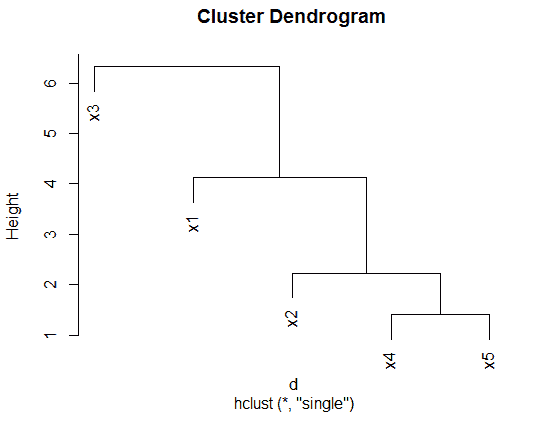

对于完全链法（complete linkage）的情况，可以使用相同的命令。

```r
# 使用完全链法进行聚类
hc_single = hclust(d, method = "complete")

# 绘制相应的树状图
plot(hc_single)
```

下图描述了完全链法情况下生成的树状图。


值得注意的是，树状图的 Y 轴指的是距离度量。

一旦完成层次聚类，我们可以使用以下命令根据我们的偏好将原始数据划分为若干聚类：

```r
# 将数据划分为聚类。k 指聚类的数量
clusters = cutree(hc_single, k = 2) 

#       -------- 或 --------
clusters = cutree(hc_complete, k = 2)
```

为了演示从上述两种方法（单链和完全链）中形成的聚类，我们可以使用以下命令进行绘图：

```r
# 单链法结果
plot(hdata, col = clusters, pch = 15, main = "Single Linkage")
text(hdata, labels = row.names(hdata), pos = c(4, 2, 4, 4))

# 完全链法结果
plot(hdata, col = clusters, pch = 15, main = "Complete Linkage")
text(hdata, labels = row.names(hdata), pos = c(4, 2, 4, 4))
```

下图展示了单链和完全链两种情况下的两个聚类。


## 10.2 层次聚类的应用与评估

为了将层次聚类应用于真实世界的示例，我们将使用数据集 `europe.txt`。

以下表格包含了各国家的统计数据：

| | GDP | Inflation | Unemployment |
| --- | --- | --- | --- |
| Austria | | | |
| Belgium | | | |
| Bulgaria | | | |
| Croatia | | | |
| Czech Republic | | | |
| Denmark | | | |
| Finland | | | |
| France | | | |
| Germany | | | |
| Greece | | | |
| Italy | | | |
| Netherlands | | | |
| Norway | | | |
| Portugal | | | |
| Spain | | | |

最后，为了计算并绘制轮廓系数（问题 (d)），我们可以使用以下命令：

```
# Calculate silhouette
model_silhouette = silhouette(clusters, d)

# Plot silhouette
plot(model_silhouette)
```


# 第 11 章基于密度的聚类

`基于密度的聚类`基于这样一个事实：给定一个训练数据集，类可以定义为密度高于数据集其他部分的区域。稀疏区域内的数据实例（用于分离类）通常被认为是噪声。最著名且广泛使用的基于密度的算法是 `DBSCAN`（基于噪声的密度空间聚类），它由 Martin Ester、Hans-Peter Kriegel、Jorg Sander 和绪晓伟于 1996 年提出。`DBSCAN` 算法的核心思想是：给定某些 n 维空间中的一组点，紧密聚集的点（具有许多邻近点且密度较高的点）被分到类中，而孤立在低密度区域的点则被视为离群值。

## 11.1 R 中的 DBSCAN

为了在 R 中使用 `DBSCAN`，我们需要使用 `cluster` 库，可以通过以下命令导入：

```
library(dbscan)
```

为了使用 `DBSCAN` 执行聚类并获取输入数据集在类中的分布，我们可以使用以下命令：

```
# Perform clustering using DBSCAN
model = dbscan(ddata, eps = 1.0, minPts = 4)

# Get distribution of the input dataset into clusters
clusters = model$cluster
```


`DBSCAN`算法需要设置两个主要参数：

- `epsilon (eps)`，指定两个数据点之间为了被视为同一类的一部分所允许的最大距离。
- `minPoints (minPts)`，指定形成一个类所需的数据点最少数量。

## 11.2 DBSCAN 模型构建

为了尝试使用`DBSCAN`算法构建基于密度的聚类模型，我们将使用下表的数据：

|  | X | Y |
| --- | --- | --- |
| x1 | 2 | 10 |
| x2 | 2 | 5 |
| x3 | 8 | 4 |
| x4 | 5 | 8 |
| x5 | 7 | 5 |
| x6 | 6 | 4 |
| x7 | 1 | 2 |
| x8 | 4 | 9 |

为了使用 R 可视化数据，我们首先需要使用以下命令创建相应的数据框：

```
# 构建包含 X 轴数据的向量
X = c(2, 2, 8, 5, 7, 6, 1, 4)

# 构建包含 Y 轴数据的向量
Y = c(10, 5, 4, 8, 5, 4, 2, 9)

# 构建包含与行名对应数据标签的向量
rnames = c("x1", "x2", "x3", "x4", "x5", "x6", "x7", "x8")

# 创建数据框
ddata = data.frame(X, Y, row.names = rnames)
```

一旦创建了数据框，我们就可以使用以下命令绘制数据：

```
# Plot the data
plot(ddata, pch = 15)

# 添加数据标签
text(ddata, labels = row.names(hdata), 
                pos = c(4, 2, 4, 4, 4, 4, 4, 4))
```

我们的数据如下图所示：


## 11.3 DBSCAN 计算

在本小节中，我们将应用`minPoints = 2`和`epsilon = {2, 3.5}`的`DBSCAN`算法，将给定数据分配到类中。

- `minPoints = 2 and epsilon = 2`

我们首先需要计算给定数据集的距离矩阵，如下表所示：

|  | x1 | x2 | x3 | x4 | x5 | x6 | x7 | x8 |
| --- | --- | --- | --- | --- | --- | --- | --- | --- |
| x1 | 0.00 |  |  |  |  |  |  |  |
| x2 | 5.00 | 0.00 |  |  |  |  |  |  |
| x3 | 8.49 | 6.08 | 0.00 |  |  |  |  |  |
| x4 | 3.61 | 4.24 | 5.00 | 0.00 |  |  |  |  |
| x5 | 7.07 | 5.00 | 7.00 | 0.00 | 0.00 |  |  |  |
| x6 | 7.21 | 4.20 | 7.00 | 0.00 | 0.00 | 0.00 |  |  |
| x7 | 8.00 | 6.00 | 0.00 | 3.00 | 0.00 | 0.00 | 0.00 |  |
| x8 | 8.49 | 5.00 | 6.00 | 5.00 | 5.00 | 5.00 | 0.00 | 0.00 |


如我们所示，k-Means 无法充分将数据划分为不同的簇。这一结果源于 k-Means 依赖于欧式距离，因此无法区分具有复杂结构的簇。

### 11.5.2 优化参数 eps

为了优化`DBSCAN`算法的参数`eps`（问题 (c）），我们将使用`kNN`距离。我们可以使用以下 R 命令来计算每个数据点与其最近 10 个邻居的距离：

```
knndist = kNNdist(mdata, k = 10)
```

然后，在对数据进行升序排序后，绘制相应的图形：

```
# Plot distances
plot(sort(knndist), type = 'l', xlab = "Points sorted by distance",
                              ylab = "10-NN distance")
```


为了优化`eps`，我们遵循手肘线法（elbow method）。从图中可以看出，优化的`eps`值位于 [0.35, 0.45] 区间。

### 11.5.3 使用 DBSCAN 建模

最后，我们可以通过使用`eps = 0.4`和`minPoints = 10`在给定数据集上应用`DBSCAN`来回答问题 (d)。

```
# Construct DBSCAN model
model = dbscan(mdata, eps = 0.4, minPts = 10)

# Plot distances
plot(mdata, col = model$cluster + 1, pch = ifelse(model$cluster, 1, 4))
```

下图描述了聚类结果。如我们所示，`DBSCAN`能够有效地将给定数据集划分为簇。


# 第 12 章 - 基于分布的聚类

### 12.1 理论背景

`基于分布的聚类`与统计学密切相关，它基于这样一个事实：簇可以被定义为最可能属于同一分布的数据实例集合。虽然应用于此类聚类的方法的理论基础非常优秀，但除非在模型复杂度中设置某些限制，否则它们会受到一个名为`过拟合`的关键问题的影响。更复杂的模型通常能够更好地解释数据，这使得选择合适的复杂度水平在本质上变得困难。一种突出且被广泛的方法被称为`高斯混合模型`（`Gaussian Mixture Models`或`GMMs`，使用`期望极大化算法`或`EM`）。

#### 12.1.1 期望极大化算法

在统计学中，`期望-极大化 (EM)`算法是一种迭代方法，用于寻找统计模型中参数（未观测隐性变量时）的极大似然估计或最大后验概率 (MAP) 估计，其中模型依赖于未观测的隐性变量。在实践中，`EM`算法使以下表达式最大化：


`EM`迭代在期望步（`E-step`）和极大步（`M-step`）之间交替：期望步利用当前参数估计创建一个对数似然期望的函数，而极大步则计算在`E-step`中找到的期望对数似然的参数。这些参数估计随后用于确定下一个`E-step`中隐性变量的分布。

`E-step:`


`M-step:`


当对数似然值不再更新或更新小于阈值时，`EM`算法达到收敛。

#### 12.1.2 高斯混合模型 - GMMs

`高斯混合模型`是一种概率模型，假设所有数据点都是由有限数量未知参数的高斯分布生成的。可以将混合模型看作是`k-means`的推广，包含了关于数据的协方差结构以及高斯中心的信息。通常，`k`个正态分布的混合由以下方程给出：

![\\pi_{k}: Mixing \\ Coefficients \\in [0, 1] and \\displaystyle\\sum\_{k = 1}^K\\pi_{k} = 1](images/leanpub_equation_91.png)

`GMMs`使用`EM`作为计算描述数据的分布隐性变量的优化算法。因此，在`GMMs`的情况下，`EM`算法极大化以下量：


### 12.2 使用 EM 构建高斯混合模型

为了使用`GMMs`进行聚类，我们将使用一个包含 1000 个来自不同分布的一维数据实例的数据集。关于这些分布，我们知道它们的标准差为 1。数据的摘要如下表：

|  | D1_X | D2_X |
| --- | --- | --- |
| **Min.** | -1.905 | 3.992 |
| **1st Qu.** | 0.223 | 6.322 |
| **Median** | 0.907 | 6.944 |
| **Mean** | 1.000 | 6.985 |
| **3rd Qu.** | 1.664 | 7.681 |
| **Max.** | 3.659 | 10.810 |

使用上述数据，我们将回答以下问题：

(a) 绘制数据（一维）以及概率密度函数，为每个分布使用不同的颜色。

(b) 计算每个正态分布的均值 (`\\mu_1`, `\\mu_2`)）和隐性变量 (`\\lambda_1`, `\\lambda_2`)）。

(d) 在同一图中绘制给定数据的估计和真实概率密度函数。

#### 12.2.1 数据绘图

为了回答第一个问题，我们首先使用以下命令读取数据：

```
# Read data
gdata = read.csv("gdata.txt")

# Save 1D data in the vector x
x = gdata[, 1]

# Save cluster index in the vector y
y = gdata[, 2]
```

为了绘制数据以及概率密度函数，我们可以使用以下命令：

```
# Plot data
plot(data.frame(x, 0), ylim = c(-0.01, 0.25), col = y, 
                                      xlab = "Data",
                                      ylab = "Density")

# Plot probability density function
lines(density(x), col = y)
```


下图说明了给定数据集以及概率密度函数。来自每个簇的数据用不同的颜色（黑色和红色）表示。


## 12.2.2 正态分布参数的手动计算

在本小节中，我们将使用给定数据集通过 `EM` 算法计算正态分布的参数。首先，我们将为参数选择随机初始值 和 :


### E 步 (期望步)

在这一步中，我们想要计算给定数据点源自某个正态分布的概率。该概率由以下方程给出：


此时，我们将为给定的点  计算上述概率：


给定点源自分布 1 和 2 的概率由以下两个方程给出：


给定上述结果，点  源自分布 1 的概率为 0.182，源自分布 2 的概率为 0.818。一旦为所有 1,000 个数据点计算出上述概率，我们将进入 EM 的极大化步。

### M 步 (极大化步)

在这一步中，我们将计算参数 `mu_1`, `mu_2`(images/leanpub_equation_113.png)，使得概率 `P(D\_1/X\_i, \theta\_1)`, `P(D\_2/X\_i, \theta\_2)`(images/leanpub_equation_114.png) 最大。为了计算参数 `mu_1`, `mu_2`(images/leanpub_equation_115.png)，我们将使用以下方程：


上述方程计算了所有数据点的加权平均值，其中权重实际上是每个数据点源自两个分布之一的概率。

混合系数由以下方程给出：


在计算出参数 `mu_1`, `mu_2`, `lambda_1`, `lambda_2`(images/leanpub_equation_120.png) 的值后，给定数据集的对数似然由以下方程给出:


一旦计算出数据集的对数似然，将其与上一次迭代的值进行比较。如果该值的没有超过给定的阈值（`epsilon`），则算法收敛。否则，我们返回 E 步重新计算参数值并继续执行。

### 使用 R 计算正态分布的参数

使用 R 计算正态分布参数的方法涉及两个主要步骤：初始化和循环直到收敛。

**第 1 步：初始化均值**

```r
# 初始化均值
mu = c(0, 1)

# 初始化混合系数
lambda = c(0.5, 0.5)

# 设置停止准则
epsilon = 1e-8
```

**第 2 步：循环直到收敛**

允许我们计算正态分布参数的 R 方法如下：

```r
repeat {
  # 期望步
  # 找到分布
  T1 <- dnorm(x, mean = mu[1], sd = 1) * lambda[1]
  T2 <- dnorm(x, mean = mu[2], sd = 1) * lambda[2]

  # 极大化步
  # 计算对数似然
  new_likelihood = sum(log(T1 + T2))

  # 打印当前参数和似然
  cat("mu =", mu, " lambda =", lambda, " loglikelihood =", new_likelihood, "\n")

  # 如果似然收敛则停止
  if (new_likelihood - log_likelihood <= epsilon) break

  log_likelihood = new_likelihood
}
```

#### 使用 mixtools 构建 GMM 模型

为了回答 (c)，我们将使用 `mixtools` 库：

```r
library(mixtools)

# 应用 EM 使用初始化
model <- normalEM(x, mu = c(0,1))
```

```r
# 获取分布的均值
model$mu

# 获取混合系数
model$lambda

# 获取最终似然
model$loglik
```

我们可以在同一图中绘制原始密度和估计密度函数：

```r
# 绘制估计密度函数
plot(model, which = 2)

# 绘制原始密度函数
lines(density(x), lty = 2, lwd = 2)
```

(b) 构建一个 GMM 模型以将提供的数据集聚类为 3 个簇。将 `epsilon` 值设置为 0.1。

(c) 展示 EM 算法的收敛情况，并使用估计的概率密度函数绘制数据。

(d) 将每个数据点分配给概率最高的簇，并绘制公式化后的聚类质质心。

(e) 计算并绘制轮廓系数（silhouette coefficient）。

(f) 显示根据上述聚类结果对数据进行排序后的热力图。

### 12.3.1 数据集构建

首先，我们将使用以下命令读取给定的数据集：

```r
# Read data
gsdata = read.csv("gsdata.txt")

# 第三列包含每个数据点的聚类标签
target = gsdata[, 3]

# 前两列包含数据坐标
gsdata = gsdata[, 1:2]
```

我们可以使用以下命令绘制数据：

```r
plot(gsdata, col = target)
```

输出结果如图所示，其中每个簇的数据点用不同的颜色（红色、黑色、绿色）表示：


### 12.3.2 GMM 模型构建

为了构建 GMM 模型，我们将使用以下命令：

```r
# Import library mixtools
library(mixtools)

# Construct model
model = mvnormalmixEM(gsdata, k = 3 , epsilon = 0.1)
```

一旦构建了模型，我们可以使用以下命令演示算法是如何收敛的：

```r
plot(model, which = 1)
```

收敛情况如图所示：


如图所示，值得注意的是 EM 算法收敛得非常快。从第 2 次迭代开始，对数似然值（log-likelihood）几乎几乎保持不变。

最后，我们可以使用以下命令绘制给定的数据集以及每个簇的概率密度函数：

```r
plot(model, which = 2)
```

输出结果如图所示：


通过 `model$posterior` 命令，我们可以看到每个数据点源于三个簇中任一个簇的概率（软分配）。然而，为了回答这个问题，我们使用以下命令进行了“硬分配”（hard-assignments）：

```r
# 将每个点分配给概率最高的簇
clusters = max.col(model$posterior)

# Calculate centers 
centers = matrix(unlist(model$mu), byrow = TRUE, ncol = 2)
```

使用上述硬分配结果，我们可以计算轮廓系数并构建热力图。

### 12.3.3 轮廓计算

为了计算并绘制轮廓图，我们可以使用以下命令：

```r
# Calculate silhouette
model_silhouette = silhouette(clusters, dist(gsdata))

# Plot silhouette
plot(model_silhouette)
```


### 12.3.4 热力图构建

为了构建热力图，我们可以使用以下 R 命令：

```r
# 根据聚类值对数据进行排序
gsdata_ord = gsdata[order(clusters),]

# Construct heatmap
heatmap(as.matrix(gsdata_ord), Rowv = NA, Colv = NA, col = heat.colors(256), rev = TRUE)
```


### 12.4 基于信息标准的 GMM 应用

在本节中，我们将根据信息标准使用 GMM 进行聚类，以选择最优簇数量。沿着这一方向，我们将使用一个包含 300 个数据点的数据集。给定的数据集摘要如下表所示：

| X | |
| --- | --- |
| 最小值 (Min.) | -2.2239 |
| 第一四分位数 (1st Qu.) | 0.6396 |
| 中位数 (Median) | 5.1139 |
| 平均值 (Mean) | 5.0336 |
| 第三四分位数 (3rd Qu.) | 9.1177 |
| 最大值 (Max.) | 12.0908 |

我们将使用给定数据集回答以下问题：

(a) 绘制数据及其概率密度函数

(b) 使用 EM 算法进行聚类，将簇的数量设置为 2, 3, 4 和 5。对于每种情况，绘制概率密度函数并计算信息标准 AIC 和 BIC。

(c) 绘制不同簇数量的 AIC 和 BIC 值，并选择最优簇数量

#### 12.4.1 数据构建

首先，我们将使用以下命令读取给定的数据集：

```r
# Import mixtools library
library(mixtools)

# Read data
icdata = read.csv("icdata.txt")

# 第一列包含每个数据点的值
x = icdata[, 1]

# 第二列包含每个数据点的聚类标签
y = icdata[, 2]
```

之后，我们可以使用以下命令绘制数据集及其概率密度函数：

```r
# Plot data
plot(data.frame(x, y), ylim = c(-0.01, 0.1))

# Plot probability density function
lines(density(x))
```


#### 12.4.2 使用信息标准选择最优簇数量

为了回答问题 (b)，我们需要计算赤池信息准则 (AIC) 和贝叶斯信息准则 (BIC)。对于具有 `t` 个参数、`N` 个样本且对数似值为 `L` 的给定模型，上述标准公式如下：


我们将使用以下代码对 2, 3, 4 和 5 个分布进行聚类：

```r
# Vector for holding AIC values
AIC = c()

# Vector for holding BIC values
BIC = c()

# 设置 2x2 画图布局
par(mfrow = c(2, 2))

# 遍历簇的数量
for (k in 2:5) {
  # 构建模型
  model <- normalmixEM(x, k = k, epsilon = 0.0001)
  
  # 绘制聚类结果
  plot(model, which = 2 , main2 = paste("Density (k = ", k, ")", sep = ""))
  
  # 计算参数
  numparams = length(model$mu) + length(model$stdev) + length(model$lambda)
  
  # 存储 AIC 和 BIC 值
  AIC[k] = 2 * numparams - 2 * model$loglik
  BIC[k] = log(length(x)) * numparams - 2 * model$loglik
}
```

该图展示了聚类结果：


最后，我们可以使用以下命令绘制 AIC 和 BIC 值：

```r
# Plot AIC values
plot(AIC[2:5], type = 'l', xaxt = "n", main = "AIC", ylab = "AIC")
axis(1, at = 1:4, labels = 2:5)

# Plot BIC values
plot(BIC[2:5], type = 'l', xaxt = "n", main = "BIC", ylab = "BIC")
axis(1, at = 1:4, labels = 2:5)
```

AIC 和 BIC 值与簇数量的关系如图所示：


# 第五部分 - 扩展主题

## 第 13 章 关联规则

关联规则提取算法包含在 `arules` 库中。用于执行购物篮分析的超市交易数据可以在 ACM RecSys 的杂货购物数据集页面找到。具体而言，我们将使用比利时的零售市场数据集。

首先，让我们加载数据，读取数据并检查前 10 条数据：

```r
library(arules)
# 以 basket 格式读取数据
trans = read.transactions("retail.dat", format = "basket", sep=" ");
inspect(trans[1:10])
```


## items

```
[1] {0, 1, 10, 11, 12, 13, 14, 15, 16, 17, 18, 19, 2, 20, 21, 22, 23, 24, 25, 26, 27, 28, 29, 3, 4, 5, 6, 7, 8, 9}
[2] {30, 31, 32}
[3] {33, 34, 35}
[4] {36, 37, 38, 39, 40, 41, 42, 43, 44, 45, 46}
[5] {38, 39, 47, 48}
[6] {38, 39, 48, 49, 50, 51, 52, 53, 54, 55, 56, 57, 58}
[7] {32, 41, 59, 60, 61, 62}
[8] {3, 39, 48}
[9] {63, 64, 65, 66, 67, 68}
[10] {32, 69}
```

可以看出每条交易包含一个项目 ID 列表。对于`read.tansactions`函数读取的数据集，`summary`函数将为交易数据提供专门的摘要：

```
summary(trans)
```

```
transactions 以稀疏矩阵格式表示的 itemMatrix，包含
88162 行（元素/项目集/交易）和
16470 列（项目），密度为 0.0006257289 

出现频率最频繁的项目：
39 48 38 32 41 (其他)

项目集/交易长度：
尺寸
1 2 3 4 5 6 7 8 9 10
5067 4086 3285 2620 2316 1994 1643 1215 987 776

支持度：
0.01 0.02 0.03 0.04 0.05 0.06 0.07 0.08 0.09 0.10

置信度：
0.1 0.2 0.3 0.4 0.5 0.6 0.7 0.8 0.9 1.0

提升度：
1 2 3 4 5 6 7 8 9 10

项目集：
1 2 3 4 5 6 7 8 9 10 11 12 13 14 15 16 17 18 19 20 21 22 23 24 25 26 27 28 29 30 31 32 33 34 35 36 37 38 39 40 41 42 43 44 45 46 47 48 49 50 51 52 53 54 55 56 57 58 59 60 61 62 63 64 65 66 67 68 69 70 71 72 73 74 75 76 77 78 79 80 81 82 83 84 85 86 87 88 89 90 91 92 93 94 95 96 97 98 99 100
规则：
101 102 103 104 105 106 107 108 109 110 111 112 113 114 115 116 117 118 119 120 121 122 123 124 125 126 127 128 129 130 131 132 133 134 135 136 137 138 139 140 141 142 143 144 145 146 147 148 149 150 151 152 153 154 155 156 157 158 159 160 161 162 163 164 165 166 167 168 169 170 171 172 173 174 175 176 177 178 179 180 181 182 183 184 185 186 187 188 189 190 191 192 193 194 195 196 197 198 199 200 201 202 203 204 205 206 207 208 209 210 211 212 213 214 215 216 217 218 219 220 221 222 223 224 225 226 227 228 229 230 231 232 233 234 235 236 237 238 239 240 241 242 243 244 245 246 247 248 249 250 251 252 253 254 255 256 257 258 259 260 261 262 263 264 265 266 267 268 269 270 271 272 273 274 275 276 277 278 279 280 281 282 283 284 285 286 287 288 289 290 291 292 293 294 295 296 297 298 299 300 301 302 303 304 305 306 307 308 309 310 311 312 313 314 315 316 317 318 319 320 321 322 323 324 325 326 327 328 329 330 331 332 333 334 335 336 337 338 339 340 341 342 343 344 345 346 347 348 349 350 351 352 353 354 355 356 357 358 359 360 361 362 363 364 365 366 367 368 369 370 371 372 373 374 375 376 377 378 379 380 381 382 383 384 385 386 387 388 389 390 391 392 393 394 395 396 397 398 399 400 401 402 403 404 405 406 407 408 409 410 411 412 413 414 415 416 417 418 419 420 421 422 423 424 425 426 427 428 429 430 431 432 433 434 435 436 437 438 439 440 441 442 443 444 445 446 447 448 449 450 451 452 453 454 455 456 457 458 459 460 461 462 463 464 465 466 467 468 469 470 471 472 473 474 475 476 477 478 479 480 481 482 483 484 485 486 487 488 489 490 491 492 493 494 495 496 497 498 499 500 501 502 503 504 505 506 507 508 509 510 511 512 513 514 515 516 517 518 519 520 521 522 523 524 525 526 527 528 529 530 531 532 533 534 535 536 537 538 539 540 541 542 543 544 545 546 547 548 549 550 551 552 553 554 555 556 557 558 559 560 561 562 563 564 565 566 567 568 569 570 571 572 573 574 575 576 577 578 579 580 581 582 583 584 585 586 587 588 589 590 591 592 593 594 595 596 597 598 599 600 601 602 603 604 605 606 607 608 609 610 611 612 613 614 615 616 617 618 619 620 621 622 623 624 625 626 627 628 629 630 631 632 633 634 635 636 637 638 639 640 641 642 643 644 645 646 647 648 649 650 651 652 653 654 655 656 657 658 659 660 661 662 663 664 665 666 667 668 669 670 671 672 673 674 675 676 677 678 679 680 681 682 683 684 685 686 687 688 689 690 691 692 693 694 695 696 697 698 699 700 701 702 703 704 705 706 707 708 709 710 711 712 713 714 715 716 717 718 719 720 721 722 723 724 725 726 727 728 729 730 731 732 733 734 735 736 737 738 739 740 741 742 743 744 745 746 747 748 749 750 751 752 753 754 755 756 757 758 759 760 761 762 763 764 765 766 767 768 769 770 771 772 773 774 775 776 777 778 779 780 781 782 783 784 785 786 787 788 789 790 791 792 793 794 795 796 797 798 799 800 801 802 803 804 805 806 807 808 809 810 811 812 813 814 815 816 817 818 819 820 821 822 823 824 825 826 827 828 829 830 831 832 833 834 835 836 837 838 839 840 841 842 843 844 845 846 847 848 849 850 851 852 853 854 855 856 857 858 859 860 861 862 863 864 865 866 867 868 869 870 871 872 873 874 875 876 877 878 879 880 881 882 883 884 885 886 887 888 889 890 891 892 893 894 895 896 897 898 899
```

在成功读取交易后，我们继续分析：

```python
rules <- apriori(trans, parameter = list(support = 0.01, confidence = 0.6))
```


以下是关联规则挖掘的结果，展示了不同物品组合之间的关联关系。表格中列出了规则的左侧（LHS）和右侧（RHS）、支持度（Support）、置信度（Confidence）、提升度（Lift）以及计数（Count）。

```
##      左侧            右侧 支持度 置信度 提升 计数
## [1]  {37}        => {38} 0.012   0.974      5.505  1046
## [2]  {286}       => {38} 0.013   0.943      5.333  1116
## [3]  {12925}     => {39} 0.011   0.639      1.112   938
## [4]  {1146}      => {39} 0.011   0.689      1.199   983
## [5]  {79}        => {39} 0.013   0.694      1.208  1111
## [6]  {1327}      => {39} 0.013   0.647      1.126  1156
## [7]  {438}       => {39} 0.014   0.676      1.177  1260
## [8]  {60}        => {39} 0.011   0.660      1.149   983
## [9]  {255}       => {48} 0.012   0.717      1.500  1057
## [10] {255}       => {39} 0.012   0.717      1.248  1057
## [11] {533}       => {39} 0.010   0.620      1.079   922
## [12] {270}       => {39} 0.014   0.689      1.198  1194
## [13] {2238}      => {39} 0.015   0.750      1.306  1287
## [14] {110}       => {38} 0.031   0.975      5.513  2725
## [15] {110}       => {39} 0.020   0.630      1.095  1759
## [16] {147}       => {39} 0.013   0.639      1.112  1137
## [17] {271}       => {39} 0.016   0.685      1.191  1434
## [18] {413}       => {48} 0.013   0.604      1.263  1135
## [19] {413}       => {39} 0.013   0.601      1.046  1130
## [20] {36}        => {38} 0.032   0.950      5.372  2790
## [21] {36}        => {39} 0.023   0.694      1.207  2037
## [22] {475}       => {48} 0.016   0.659      1.379  1428
## [23] {475}       => {39} 0.017   0.692      1.204  1500
## [24] {170}       => {38} 0.034   0.978      5.529  3031
## [25] {170}       => {39} 0.023   0.664      1.156  2059
## [26] {101}       => {39} 0.016   0.626      1.089  1400
## [27] {310}       => {48} 0.019   0.652      1.365  1692
## [28] {310}       => {39} 0.021   0.714      1.242  1852
## [29] {237}       => {39} 0.022   0.636      1.107  1929
## [30] {225}       => {39} 0.027   0.722      1.256  2351
## [31] {89}        => {48} 0.032   0.729      1.526  2798
## [32] {89}        => {39} 0.031   0.716      1.246  2749
## [33] {65}        => {39} 0.032   0.623      1.084  2787
## [34] {38}        => {39} 0.117   0.663      1.154  1035
## [35] {41}        => {48} 0.102   0.603      1.263  9018
## [36] {41}        => {39} 0.129   0.764      1.329  1141
## [37] {48}        => {39} 0.331   0.692      1.203  2914
## [38] {110,48}    => {38} 0.015   0.986      5.575  1361
## [39] {110,38}    => {39} 0.020   0.639      1.111  1740
## [40] {110,39}    => {38} 0.020   0.989      5.592  1740
## [41] {110,48}    => {39} 0.012   0.751      1.307  1037
## [42] {36,48}     => {38} 0.015   0.960      5.429  1360
## [43] {36,38}     => {39} 0.022   0.697      1.213  1945
## [44] {36,39}     => {38} 0.022   0.955      5.398  1945
## [45] {36,48}     => {39} 0.013   0.788      1.371  1116
## [46] {475,48}    => {39} 0.012   0.765      1.330  1092
## [47] {39,475}    => {48} 0.012   0.728      1.523  1092
## [48] {170,48}    => {38} 0.017   0.988      5.584  1538
## [49] {170,38}    => {39} 0.023   0.666      1.159  2019
## [50] {170,39}    => {38} 0.023   0.981      5.543  2019
## [51] {170,48}    => {39} 0.014   0.775      1.348  1206
## [52] {101,48}    => {39} 0.011   0.722      1.255   946
## [53] {101,39}    => {48} 0.011   0.676      1.414   946
## [54] {310,48}    => {39} 0.015   0.796      1.385  1347
## [55] {310,39}    => {48} 0.015   0.727      1.522  1347
## [56] {237,48}    => {39} 0.014   0.740      1.287  1244
## [57] {237,39}    => {48} 0.014   0.645      1.349  1244
## [58] {225,48}    => {39} 0.016   0.806      1.403  1400
## [59] {48,89}     => {39} 0.024   0.759      1.321  2125
## [60] {39,89}     => {48} 0.024   0.773      1.617  2125
## [61] {48,65}     => {39} 0.020   0.711      1.236  1797
## [62] {39,65}     => {48} 0.020   0.711      1.236  1797
## [63] {36,48}     => {38} 0.015   0.960      5.429  1360
## [64] {36,39}     => {38} 0.022   0.697      1.213  1945
## [65] {41,49}     => {39} 0.035   0.978      5.528  3031
## [66] {41,48}     => {39} 0.013   0.604      1.263  1135
## [67] {36,38}     => {39} 0.013   0.601      1.046  1130
## [68] {36,39}     => {38} 0.021   0.714      1.242  1852
## [69] {36,38}     => {39} 0.022   0.697      1.213  1945
## [70] {36,39}     => {38} 0.023   0.981      5.543  2019
## [71] {41,48}     => {39} 0.014   0.775      1.348  1206
## [72] {41,39}     => {38} 0.031   0.975      5.513  2725
## [73] {110,48}    => {39} 0.016   0.806      1.403  1400
## [74] {110,39}    => {38} 0.031   0.975      5.513  2725
## [75] {36,48}     => {39} 0.013   0.788      1.371  1116
## [76] {36,39}     => {38} 0.032   0.950      5.372  2790
## [77] {170,48}    => {39} 0.012   0.728      1.523  1092
## [78] {170,39}    => {38} 0.034   0.978      5.529  3031
## [79] {32,48}     => {39} 0.014   0.775      1.348  1206
## [80] {32,39}     => {38} 0.023   0.981      5.543  2019
```

例如，第一个规则 `{37} => {38}` 表示如果有人购买了代码为 37 的物品，他们可能会购买代码为 38 的物品，支持度为 1.2%，置信度为 97.4%，提升值为 5.5。

有关 `arules` 库的更详细分析，请查看 [Introduction to arules](https://mran.revolutionanalytics.com/web/packages/arules/vignettes/arules.pdf)。

# 第一部分 - 引言

1. 由 Kenneth Jensen 完成 - 基于：`ftp://public.dhe.ibm.com/software/analytics/spss/documentation/modeler/18.0/en/ModelerCRISPDM.pdf`（图 1），CC BY-SA 3.0，https://commons.wikimedia.org/w/index.php?curid=24930610
