# R 机器学习实用指南

# 引言

机器学习正在改变世界。无论规模大小，每一家机构都试图从它们每天存储和处理的海量信息中提取知识。对预测未来的诱人渴望，驱动着从营销到医疗保健等领域业务分析师和数据科学家的工作。我们写这本书的目标是让分析工具对广泛的读者变得易于上手。

R 编程语言是一种专门设计的语言，旨在促进统计分析和机器学习。我们选择它作为本书的语言，不仅是因为它在该领域广受欢迎，还因为其直观的特质，特别是对于那些将其作为第一门编程语言的人来说。

市面上有很多关于机器学习实际应用的书籍，是为商务人士和旁观者设计的。同样，也有许多深层技术性的资源深入探讨了机器学习的数学和计算机科学。在本书中，我们力求连接这两个世界。我们试图为读者提供一个机器学习的直观介绍，并关注机器学习在当今世界中的实际应用。同时，我们并不回避代码。正如我们在本科和研究生课程中所做的那样，我们寻求让每个人都能掌握 R 编程语言。我们希望您在阅读本书时打开旁笔记本电脑，跟随我们的示例并尝试练习题。

祝您在开启机器学习之旅时好运！

## 本书涵盖了什么内容？

本书介绍了如何使用 R 编程语言进行机器学习。

1. **第 1 章：什么是机器学习？** 这一章介绍了机器学习的世界，并描述了机器学习如何从数据中发现知识。在本章中，我们解释了无监督学习、有监督学习和强化学习之间的区别。我们描述了分类问题和回归问题之间的区别，并解释了如何衡量机器学习算法的效率。

2. **第 2 章：R 和 RStudio 简介** 在这一章中，我们介绍了 R 编程语言以及我们在本书其余部分将使用的工具 set。我们从初学者的心态来接触 R，解释了 RStudio 集成开发环境的使用，并引导读者创建和执行他们的第一个 R 脚本。我们还解释了使用包（packages）来分发 R 代码，以及 R 中不同数据类型的使用。

3. **第 3 章：数据管理** 这一章向读者介绍了数据管理概念以及使用 R 收集和管理数据。我们引入了 `tidyverse`，这是一个旨在促进分析过程的 R 包集合，并描述了在 R 中描述和可视化数据的不同方法。我们还涵盖了如何对数据进行清洗、转换和压缩，以便为机器学习做好准备。

4. **第 4 章：线性回归** 在这一章中，我们将通过探索线性回归进入有监督机器学习的世界。我们解释了回归背后的底层统计原理，并演示了如何在 R 中拟合简单和复杂的回归模型。我们还解释了如何评估、解释和应用回归模型的结果。

5. **第 5 章：逻辑回归** 虽然线性回归适用于需要预测数值的问题，但它并不适用于适用于分类预测。在这一章中，我们描述了逻辑回归——一种分类预测技术。我们讨论了广义线性模型的使用，并描述了如何在 R 中构建逻辑回归模型。我们还解释了如何评估、解释和改进逻辑回归模型的结果。

6. **第 6 章：k 最近邻算法** `k`-最近邻技术允许我们根据其他相似数据点的分类来预测某个数据点的分类。在本章中，我们描述了 `k`-NN 过程的工作原理，并演示了如何在 R 中构建 `k`-NN 模型。我们还展示了如何应用该模型对新数据点的分类进行预测。

7. **第 7 章：朴素贝叶斯** 朴素贝叶斯分类方法使用概率表来预测实例属于特定类别的概率。在本章中，我们讨论了联合概率和条件概率的概念，并描述了贝叶斯分类方法的功能机制。我们演示了在 R 中构建朴素贝叶斯分类器，并用它对未见过的数据进行预测。

8. **第 8 章：决策树** 决策树是一种流行的建模技术，因为它们能产生直观的结果。在本章中，我们描述了决策树模型的创建和解释。我们还解释了在 R 中生长树的过程以及使用剪枝来增加该模型的泛化能力。

9. **第 9 章：性能评估** 没有任何建模技术是完美的。每种技术都有其优缺点，并为不同类型的问题带来不同的预测能力。在本章中，我们讨论了评估模型性能的过程。我们引入了重采样技术，并解释了如何使用它们来估计未来的性能。我们还演示了如何在 R 中可视化和评估模型性能。

10. **第 10 章：性能改进** 一旦我们有了评估性能的工具，就可以利用它们来帮助改进性能。在这一章中，我们查看了调优机器学习的技术。我们还演示了如何通过同时利用多个模型的预测能力来增强预测能力。

11. **第 11 章：关联规则发现模式** 关联规则帮助我们发现数据集中存在的模式。在本章中，我们引入了关联规则方法，并演示了如何在 R 中从数据集生成关联规则。我们还解释了评估和量化关联规则强度的方法。

12. **第 12 章：数据分组** 聚类是一种无监督学习技术，根据项目之间的相似性进行分组。在本章中，我们解释了 `k`-means 聚类算法分割数据的方式，并演示了在 R 中使用 `k`-means 聚类。

## 读者支持

为了充分利用本书，我们鼓励您利用配套网站上提供的学生和教师材料。我们也鼓励您就我们如何改进本书提供建设性的反馈。

### 辅助下载文件

### 联系出版商

如果您认为在书中发现了错误，请务必告知我们。在 John Wiley & Sons，我们理解为客户提供准确内容是多么重要，但即使我们付出了最大努力，仍可能出现错误。

如需提交可能的勘误，请发送电子邮件至我们的客户服务团队，邮箱 `wileysupport@wiley.com`，邮件主题为“Possible Book Errata Submission”（可能的书籍错误提交）。

# 第一部分

## 入门

1. 第 1 章：什么是机器学习？

2. 第 2 章：R 语言与 RStudio 简介

3. 第 3 章：数据管理

# 第 1 章：什么是机器学习？

欢迎来到 `machine learning` 的世界！你即将开启一段令人兴奋的冒险，去探索数据科学家如何利用算法，从企业、组织和个人每天产生的海量数据中发现隐藏的知识。

如果你和我们一样，经常会发现自己处于这样的境地：面对如山般的数据，你确定其中包含重要的见解，但却不知道如何从这所谓的“大海捞”中提取出那根“知识之针”。这正是机器学习大显身手的地方。本书致力于为你提供利用机器学习算法力量所需的知识和技能。你将学习适用于机器学习解决方案的各种类型问题，以及应对不同类型问题最合适的机器学习技术分类。

最重要的是，我们将以实用的心态对待这个复杂的技术领域。在书中，我们的目的不是纠结于这些算法复杂的数学细节。相反，我们将重点关注你如何立即让这些算法为你工作服务。我们还将向你介绍 `R` 编程语言，我们认为这种语言特别适合从实战角度来处理机器学习问题。但现在不必担心编程或 `R`。我们将在第 2 章中讨论这些内容。现在，让我们深入其中，更好地理解机器学习是如何工作的。

在本章结束时，你将学习到以下内容：

* 机器学习如何从数据中发现知识
* 无监督学习、监督学习和强化学习技术之间有什么区别
* 分类问题和回归问题之间有什么区别
* 如何衡量机器学习算法的有效性
* 交叉验证如何提高机器学习模型的准确性

## 在数据中发现知识

在机器学习的世界里，我们的目标是利用算法从数据集中发现知识，然后利用这些知识帮助我们对未来做出明智决策。无论我们所处的具体专业领域如何，事实都是如此，因为机器学习的应用涵盖极其广泛。例如，以下是机器学习常见的增加价值的案例：

* 划分客户并确定吸引不同客户群的营销信息
* 发现系统和应用日志中的异常，这些异常可能预示着网络安全事件
* 根据市场和环境状况预测产品销售
* 根据客户过去的活动和相似客户的偏好，推荐他们可能想看的下一部电影
* 根据预测需求提前设定酒店房价格

当然，这些只是几个例子。机器学习可以为几乎任何发现此前未知知识有用的领域带来价值——我们挑战你去思考一个知识无法提供优势的领域！

### 算法简介

在后续对本书的阅读过程中，你会看到我们不断将机器学习技术称为 `algorithms`（算法）。这是计算机科学领域的一个术语，在数据科学领域反复出现，因此理解它非常重要。虽然这个术语听起来技术性很复杂，但算法的概念其实非常直观，我们胆敢猜测，你几乎每天都会使用某种形式的算法。

简单来说，算法就是你在执行某个过程时所遵循的一系列步骤。最常用的是，当我们提到计算机执行计算任务时所遵循的步骤时使用这个术语，但我们可以把每天做的许多事情看作是算法。例如，当我们在大城市的街道上走到十字路口时，我们会遵循一套过马路的算法。图 1.1 展示了该过程运作的一个示例。

当然，在计算机科学领域，我们的算法更加复杂，并通过编写软件来实现，但我们可以以同样的方式来思考它们。算法仅仅是一系列精确的观察、决策和指令，告诉计算机如何执行操作。我们设计机器学习算法是为了发现数据中的知识。随着本书的深入，你将学习许多不同类型的机器学习算法以及它们如何以非常不同的方式来实现这一目标。

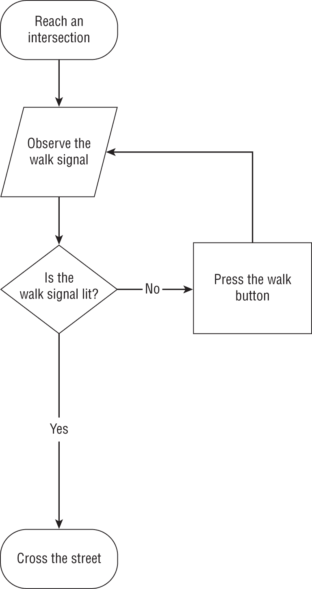

图 1.1 过马路算法

### 人工智能、机器学习与深度学习

我们听到人工智能、机器学习和深度学习这些术语几乎被互换使用，用来描述任何计算机处理数据的技术。现在你正进入数据科学的世界，对这些术语有一个更精确的理解是非常关键的。

* **人工智能 (`AI`)**：包括任何试图让计算机系统模仿人类行为的技术类型。顾如其名，我们正试图让计算机系统人为地表现出智能。现在，当然现代计算机无法达到人类大脑中那种复杂推理的水平，但我们可以尝试模仿人类的一部分行为和判断。

* **机器学习 (`ML`)**：人工智能技术的一个子集，试图将统计学应用于数据问题，通过从示例中泛化来发现新知识。换句话说，机器学习技术是设计用于学习的人工智能技术。

* **深度学习**：机器学习的进一步细分，它使用一组被称为 `神经网络` 的复杂技术以特定方式发现知识。它是机器学习的一个高度专业的子领域，最常用于图像、视频和音频分析。

图 1.2 显示了这些领域之间的关系。在书中，我们关注机器学习技术。具体而言，我们关注不符合深度学习定义的机器学习类别。

## 机器学习技术

我们在书中讨论的机器学习技术分为两大类。监督学习算法根据过去数据的标记示例来学习模式。无监督学习算法则在没有标记数据协助的情况下寻找模式。让我们详细查看这些技术。

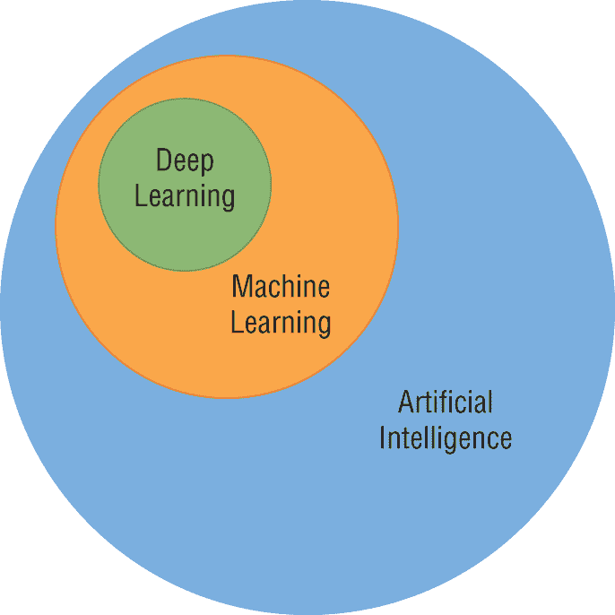

图 1.2 人工智能、机器学习与深度学习的关系

### 监督学习

`Supervised learning` 技巧可能是最常用的机器学习算法一类。这些技术的目的是使用现有的数据集生成一个模型，然后帮助我们对未来的未标记数据进行预测。更正式地说，我们提供一个 `training dataset` 作为输入提供给监督机器学习算法。然后，该算法使用这些训练数据来开发一个 `model` 作为输出，如图 1.3 所示。

你可以将监督机器学习算法产生的模型看作某种水晶球——一旦我们拥有了，就可以用它对我们的数据进行预测。图 1.4 展示了该模型是如何运作的。一旦我们拥有了模型，就可以获取我们遇到的任何新数据元素，并根据模型从训练数据集中获得的知识对该新元素做出预测。

我们之所以使用“监督”（supervised）一词来描述这些技术，是因为我们正在使用训练数据集来监督我们模型的创建。该训练数据集包含了帮助我们完成预测任务的标签（labels）。

让我们通过一个具体的例子来强化这一点。考虑一下在图 1.5 所示的汽车经销商处工作的贷款员。经销商的销售人员与单个客户合作销售汽车。客户通常没有足够的现金来直接购买汽车，因此他们会寻找融资方案。我们的工作是从三个选项中为客户匹配合适的贷款产品：

* **次级贷款（Subprime loans）**：利率最高，提供给可能错过还款截止日期或发生贷款违约的客户。
* **顶级贷款（Top-shelf loans）**：利率最低，提供给不太可能逾期还款且还款概率极高的客户。
* **标准贷款（Standard loans）**：提供给处于这两组中间的客户，利率介于这两个值之间。

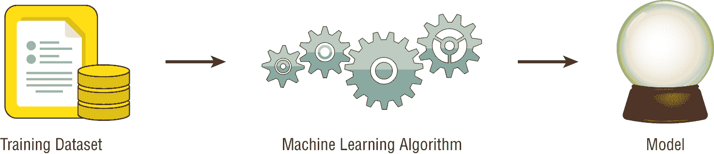

**图 1.3** 通用监督学习模型

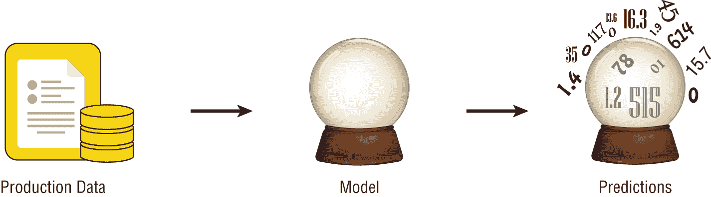

**图 1.4** 使用监督学习模型进行预测

我们从销售人员那里收到贷款申请，必须当场做出决定。如果我们不采取行动，客户可能会离开商店，业务将流向另一家经销商。如果我们为客户提供的贷款比他们通常符合条件的风险更高，我们可能会将业务流失给另一家提供较低利率的经销商。另一方面，如果我们为客户提供的利率低于他们应得的水平，在他们之后发生违约时，我们可能无法从交易中获利。


我们目前的业务模式是审查客户的信用报告，并根据我们在该领域的多年经验对贷款类别做出决定。我们已经“见过了世面”，可以依靠我们的“直觉”来做出这些重要的业务决策。然而，作为初级数据科学家，我们现在意识到，可能有更好的方法使用机器学习来解决这个问题。

我们的汽车经销商可以使用监督机器学习来协助完成这项任务。首先，他们需要一个包含过去客户信息及其贷款还款行为的训练数据集。训练数据集中包含的数据越多越好。如果他们有几年的数据，将有助于开发出高质量的模型。

数据集可能包含关于每个客户的各种信息，例如客户的大致年龄、信用评分、房屋拥有状况和车辆类型。这些数据点中的每一个被称为关于客户的 `feature`（特征），它们将成为算法创建的机器学习模型的输入。数据集还需要包含训练数据集中每个客户的 `labels`（标签）。这些标签是我们想要使用模型进行预测的值。在这种情况下，我们有两个标签：`default`（违约）和 `repaid`（已还清）。我们为训练数据集中的每个客户贴上与其贷款状态相应的适当标签。如果他们全额还清了贷款，就会被赋予“repaid”标签，而未能还清贷款的人则被赋予“default”标签。


**图 1.5** 使用机器学习分类汽车经销商客户

生成数据集中的一小部分出现在图 1.6 中。注意关于该数据集的两点。第一，数据集中的每行都对应一个客户，而这些客户都是已完成贷款期的 `past`（过去）客户。我们知道向这些每个客户发放的贷款的结果，这为我们提供了训练监督学习模型所需的标签。第二，模型包含的每个特征都是贷款员在做出贷款决策时可以获取的特征。这对于创建一个对我们给有问题有效的模型至关重要。如果模型包含一个指定客户在贷款期内是否失业的特征，那可能会为我们提供准确的结果，但贷款员实际上无法 `use`（使用）该模型，因为他们无法在决策时为某个客户确定这一特征。

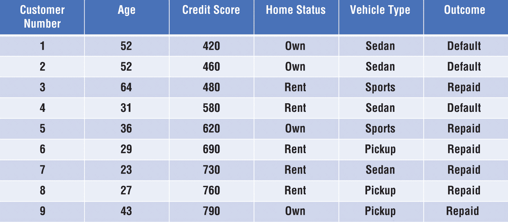

**图 1.6** 过去客户的行为数据集

如果我们使用机器学习算法根据这些数据生成模型，它可能会捕捉到一些肉眼观察就能发现的特征。首先，大多数信用评分低于 600 且在我们处办理过贷款的人都违约了。如果我们仅根据这一特征就做出决定，我们的情况可能会很好。然而，如果我们仔细观察数据，我们可能会意识到通过以下说法可以实现更好的拟合：任何信用评分低于 600 且购买了轿车的人可能会违约。这种知识当由算法生成时，就是机器学习模型！

贷款员随后可以通过简单遵循这些规则来部署该机器学习模型，在每次有人申请贷款时做出预测。如果下一个进门的客户信用分为 780 分并正在购买一辆跑车，如图 1.7 所示，他们应该获得顶级贷款，因为他们极不可能发生违约。如果客户的信用分为 410 分并购买轿车，我们绝对会将他们归入次级贷款。处于这些极端情况之间的客户将适用于标准贷款。

现在，这是一个简化的例子。我们示例中的所有客户都完美地契合我们描述的类别。当然，在现实世界中并不会发生这种情况。我们的机器学习算法将面临不完美的数据，这些组之间没有整齐、清晰的划分。我们将拥有更多观测值的数据集，我们的算法不可避免地会出错。


# 图 1.7 应用机器学习模型

### 无监督学习

`Unsupervised learning` 技术的工作方式完全不同。监督技术在有标记的数据上进行训练，而无监督技术则基于未标记的训练数据集开发模型。这改变了它们能够处理的数据集的性质，以及它们所产生的模型。无监督技术不是提供一种根据历史数据为输入分配标签的方法，而是允许我们发现数据中隐藏的模式。

理解监督算法与无监督算法区别的一种方法是：监督算法帮助我们为新的观测值分配已知标签，而无监督算法则帮助我们发现数据集中观测值的新标签（或分组）。

例如，让我们回到之前的汽车 4S 店，想象我们现在正在处理客户数据集，并想为我们的售后部门制定一项营销活动。我们怀疑数据库中的客户在某些方面是相似的，但这些相似性并不像他们购买的 `cars` 类型那样而易见，我们需要发现这些分组可能是哪些，并利用它们来开发不同的营销信息。

无监督学习算法非常适合这种开放式的发现任务。我们描述的汽车 4S 店问题更通用的称为 `market segmentation`（市场划分）问题，有大量的无监督学习技术旨在帮助这类分析。我们将在第 12 章中讨论组织如何使用无监督 `clustering`（聚类）算法来进行市场划分。

让我们另一个例子。假设我们经营一家杂货店，试图确定产品在货架上的最佳位置。我们知道客户经常进入我们的商店寻找一些日常必需品，如 `milk`、`bread`、`meat` 和 `produce`。我们的目标是设计商店，让冲动购买物品在商店内彼此靠近。如图图 1.8 所示，我们希望将 `cookies` 放在 `milk` 旁边，这样进店买 `milk` 的人就会看到它们，并想：“这些饼干配这杯牛奶太好喝了！”

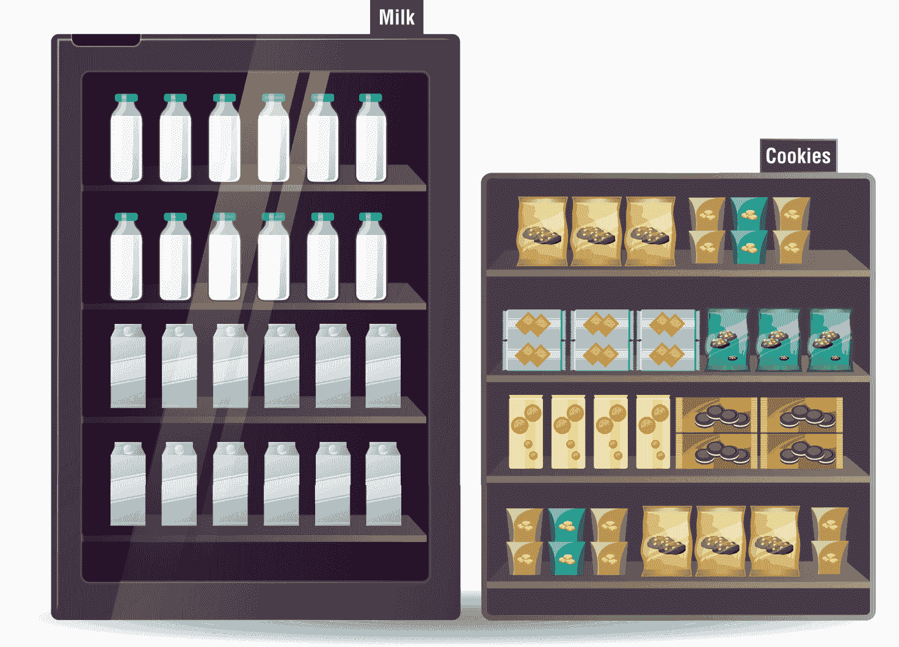

# 图 1.8 根据无监督学习在杂货店中策略性地放置物品

确定客户经常一起购买哪些物品也是机器学习中一个著名的问题，被称为 `market basket`（购物篮分析）问题。我们将在第 11 章中讨论数据科学家如何使用 `association rules`（关联规则）方法来解决购物篮问题。

## 模型选择

在上一节中，我们描述了根据用于训练的数据类型对算法进行分类的方法。使用标记训练集的算法被称为 `supervised algorithms`（监督算法），因为训练受到标签的“监督”；而使用未标记训练集的算法被称为 `unsupervised algorithms`（无监督算法），因为它们可以自由学习发现的任何模式，无需“监督”。将这种分类方案理解为描述机器学习算法*如何*学习。

我们也可以根据算法学习的*内容*对它们进行分类。在书中，我们讨论了我们可以从数据中学到的的三种主要知识。

## 分类

`Classification` 技术使用监督学习来预测 `category`（类别）。这意味着我们模型的输出是一个 `label`，或者更正式地说是一个变量。以下是它们可能取的某些值示例：

- `Educational degree`（学历）：`none`（无）、`bachelor's`（本科）、`master's`（硕士）
- `Citizenship`（国籍）：`United States`（美国）、`Nigeria`（尼日利亚）等
- `Political party`（政党）：`Democrat`（民主党）、`Republican`（共和党）、`Independent`（独立人士）
- `Customer status`（客户状态）：`current`（当前）

例如在本章前面，我们讨论了一个汽车 4S 店需要预测 `repayment` 的问题。这是一个分类示例，因为我们正在尝试为每个客户分配类别。我们在现实世界中遇到各种分类。我们可能会尝试确定哪些优惠最有吸引力。

### 回归

`Regression` 技术使用监督学习来预测连续响应。简单来说，这意味着我们模型的输出是一个数值。不是预测离散集合中的成员身份，而是预测一个值。

例如，财务顾问可能想根据收入筛选潜在客户。如果顾问没有明确的收入数据，他们可能会使用已知收入的数据集来训练回归模型。该模型可能像这样：

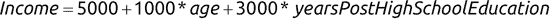

```
<math display="block" overflow="scroll" xmlns="http://www.w3.org/1998/MathML" xmlns:xlink="http://www.w3.org/1999/xlink">
  <mrow>
    <mi>I</mi><mi>n</mi><mi>c</mi><mi>o</mi><mi>m</mi><mi>e</mi><mo>=</mo><mn>5000</mn><mo>+</mo><mn>1000</mn><mo>&x2;</mo><mi>a</mi><mi>g</mi><mi>e</mi><mo>+</mo><mn>3000</mn><mo>&x2;</mo><mi>y</mi><mi>e</mi><mi>a</mi><mi>r</mi><mi>s</mi>
  </mrow>
</math>
```

如果财务顾问遇到新客户，他们可以使用此公式根据年龄和受教育年限预测个人的收入。对于每增长一年，他们预计个人会额外增加 1000 美元的年收入。同样，高中以后每读一年书，收入就会增加 3000 美元。

回归模型非常灵活。我们可以输入任何可能的年龄或收入值，并对该人的收入做出预测。当然，如果我们没有获得良好的训练数据，我们的预测可能不准确。我们可能还会发现变量之间的关系无法通过简单的线性技术解释。例如，收入可能会随着年龄增长而增加，但仅持续到某一点。

### 相似性学习技术

相似学习技术利用机器学习算法来帮助我们识别数据中的共同模式。我们可能并不确切知道自己想要发现什么，因此我们允许算法探索数据集，寻找我们可能尚未预判的相似性。

我们在本章中已经提到了两种相似学习技术。关联规则技术在第 11 章中进行了更充分的讨论，它允许我们解决类似于市场篮子问题的问题——即哪些物品经常被一起购买。聚类技术在第 12 章中进行了更充分的讨论，允许我们根据观测值拥有的相似特征将它们分组成不同的簇。

关联规则和聚类都是相似学习技术无监督使用的示例。也可以以有监督的方式使用相似学习。例如，最近邻算法寻求根据训练数据集中最相似观测值的标签，来为观测值分配标签。我们将在第 6 章中详细讨论这些。

## 模型评估

在开始讨论特定的机器学习算法之前，在脑中先有一个我们将如何评估算法有效性的思路也会很有帮助。我们将在书中其他部分更详细地涵盖这个主题，这里只是为了让你对这个概念有一个初步了解。在我们处理每种机器学习技术时，我们将讨论如何针对数据集评估其性能。我们将在第 9 章中对模型性能评估进行更全面的讨论。

在此之前，重要的要意识到，某些算法在不同问题上的效果会比其他算法更好。数据集的性质和算法的性质将决定适当的技术。

在监督学习领域，我们可以根据算法所犯错误的数量和或幅度来评估其有效性。对于分类问题，我们通常查看算法做出错误分类预测的百分比，或者 `误分类率`。同样，我们可以查看预测正确的预测百分比，这被称为算法的 `准确率`。对于回归问题，我们通常查看算法预测值与实际值之间的差异。

## 分类错误

许多分类问题寻求预测一个二值值，以识别观测值是否属于某类成员。我们将观测值属于该类的情况称为 `正`（positive）案例，将观测值不属于该类的情况称为 `负`（negative）案例。

例如，假设我们正在开发一个模型，用于预测某人是否有乳糖不耐症（导致他们难以消化乳制品）。我们的模型可能包括已知或怀疑会导致乳糖不耐症的人口统计学、遗传和环境因素。模型根据这些属性对个人是否患乳糖不耐症做出预测。预测为乳糖不耐症的个人是预测正，而预测为不患乳糖不耐症（或更简单地说，预测为乳糖耐受）的个人是预测负。这些预测值来自我们的机器学习模型。

然而，还存在现实世界的真相。无论模型预测如何，每一个人要么有乳糖不耐症，要么没有。这些真实世界的数据决定了这个人是真实的正还是真实的负。当观测值的预测值与同一观测值的实际值不同时，就会发生 `错误`。分类问题中可能会发生两种不同的错误。

*   `假阳性错误`（False positive errors）发生在模型将观测值标记为预测正，但实际上它是一个真实的负的情况下。例如，如果模型识别某人可能患乳糖不耐症，而他们实际上是乳糖耐受的，这就是一个假阳性错误。假阳性错误也称为 `第一类错误`（Type I errors）。

*   `假阴性错误`（False negative errors）发生在模型将观测值标记为预测负，但实际上它是一个真实的正的情况下。在我们的乳糖不耐症模型中，如果模型预测某人乳糖耐受，而他们实际上患有乳糖不耐症，这就是一个假阴性错误。假阴性错误也称为 `第二类错误`（Type II errors）。

同样，我们可以根据标签将预测正确的观测值正确标记为 `真正`（true positives）或 `真负`（true negatives）。图 1.9

**图 1.9** 错误类型

当然，假阳性和假阴性错误的绝对数量取决于我们所做的预测数量。我们不是使用这些基于幅度的衡量标准，而是测量这些错误发生的百分比。例如，`假阳性率`（FPR）是被错误识别为正的负实例的百分比。我们可以通过将假阳性的数量（`FP`）除以假阳性数量与真负数量（`TN`）的总和来计算此比率，或者用公式：

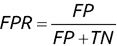
```
<math display="block" overflow="scroll" xmlns="http://www.w3.org/1998/Math/MathML" xmlns:xlink="http://www.w3.org/1999/xlink">
  <mrow>
    <mi>F</mi><mi>P</mi><mi>R</mi><mo>=</mo>
    <mfrac>
      <mrow><mi>F</mi><mi>P</mi></mrow>
      <mrow><mi>F</mi><mi>P</mi><mo>+</mo><mi>T</mi><mi>N</mi></mrow>
    </mfrac>
  </mrow>
</math>
```

同样，我们可以如下 true 计算 `假阴性率`（FNR）：

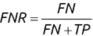
```
<math display="block" overflow="scroll" xmlns="http://www.w3.org/1998/Math/MathML" xmlns:xlink="http://www.w3.org/1999/xlink">
  <mrow>
    <mi>F</mi><mi>N</mi><mi>R</mi><mo>=</mo>
    <mfrac>
      <mrow><mi>F</mi><mi>N</mi></mrow>
      <mrow><mi>F</mi><mi>N</mi><mo>+</mo><mi>T</mi><mi>P</mi></mrow>
    </mfrac>
  </mrow>
</math>
```

关于哪种错误类型比另一种更好或更差，没有明确的规则。这种判断在很大程度上取决于所解决的问题类型。

例如，假设我们正在使用机器学习算法将大量的潜在客户列表分类为会购买我们产品的人（正案例）或不会购买我们产品的人（负案例）。我们只对被算法标记为正的潜在客户发送邮寄。

在假阳性邮寄的情况下，你向一个不购买你产品的客户发送了小册。你损失了打印和邮寄的费用。在假阴性结果的情况下，你没有向一个会响应的客户发送邮寄。你失去了向该客户销售产品的机会。这哪种更糟糕？这取决于邮件的成本、每个客户的潜在利润以及其他因素。

另一方面，考虑使用机器学习模型对患者进行癌症风险筛查，并将结果为正的患者推荐进行进一步的更具侵入性的测试。在假阴性结果的情况下，可能患癌症的患者没有接受额外的筛查，可能导致活动疾病未得到治疗。这显然是一个非常糟糕的结果。

然而，假阳性结果也没有没有处。如果患者被错误标记为可能患癌，他们将承受不必要的昂贵且痛苦的测试，消耗了本可以用于其他患者的资源。在等待新的测试结果时，他们还会受到情感伤害。

机器学习机器学习的评估是一个棘手的命题，它不能脱离问题领域独立存在。数据科学家、领域专家，在某些情况下还包括伦理学家应该共同努力，根据每种错误类型的收益和成本来评估模型。

## 回归错误

我们在回归问题中可能犯的错误与众众不同，因为我们预测的本质不同。当我们为实例分配分类标签时，我们的预测可能是正确的也可能是错误的。当我们将一个良性肿瘤标记为恶性时，这显然是一个错误。然而，在回归问题中，我们预测的是数值。

考虑我们在本章之前讨论的收入预测问题。如果一个人的实际收入为 45,000 美元，而我们的算法预测值恰好是 45,000 美元，这显然是一个正确的预测。如果算法预测收入为 0 美元或 10,000,000 美元，几乎所有人都会认为这些预测在客观上是错误的。但预测为 45,001 美元、45,500 美元、46,000 美元或 50,000 美元的预测呢？这些都是错误的吗？其中一些或全部是否足够接近呢？

我们根据预测中误差的幅度来评估回归算法更具意义。我们通过测量预测值与实际值之间的距离来确定这一点。例如，请考虑图 1.10 所示的数据集。

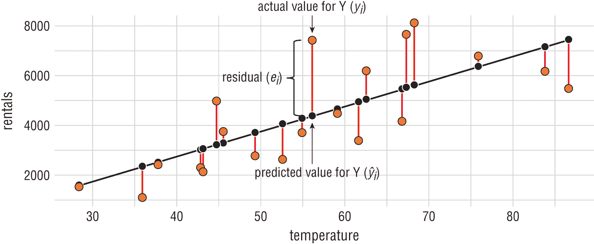

图 1.10 残差误差

在这个数据集中，我们正尝试根据当天的平均温度来预测每天发生的自行车租赁次数。自行车租赁次数显示在 y 轴上，温度显示在 x 轴上。黑线是一条回归线，表示我们预计自行车租赁次数会随着温度的升高而增加。那条黑线就是我们的模型，而黑点是沿着该线在特定温度值下的预测值。

橙色点代表了在自行车租赁公司运营期间收集的真实数据。那是“正确”的数据。预测值与实际值之间的红线是误差的幅度，我们称之为 `residual value`（残差值）。线越长，算法在该数据集上的表现越差。

我们不能简单地将残差相加，因为其中一些负值会抵消正值。相反，我们将每个残差值平方，然后将这些平方后的残差相加，得到一个名为 `residual sum of squares`（残差和）的性能指标。

我们将在第 4 章中重新回顾残差误差以及这个特定的自行车租赁数据集。

## 错误类型

当我们为最简单问题之外的任务构建机器学习模型时，模型将包含某种类型的预测错误。这种错误有三种形式。

* `Bias`（在机器学习领域指偏差）是由于我们选择机器学习模型而产生的错误类型。当我们选择的模型类型无法很好地拟合数据集时，产生的就是偏差。

* `Variance`（方差）是模型对训练集的微小波动过于敏感时产生的错误类型。

* `Irreducible error`（不可约误差或噪声）是无论使用何种模型都无法减少的误差。它是问题本身固有的。

我们有时也需要独立的数据集来辅助模型开发过程。这些数据集被称为 `验证集`（validation datasets），它们用于在迭代过程中帮助开发模型，在每次迭代期间调整模型参数，直到我们找到一种在验证集上表现良好的方法。虽然使用测试集作为验证集可能很有吸引力，但这种方法重新引入了对测试集过拟合的风险，因此我们应该使用第三个数据集来实现此目的。

#### 留出法 (Holdout Method)


# 测试和验证数据集

测试和验证数据集最直接的方法是`留出法`（holdout method）。在这种方法中（如图 1.13 所示），我们将数据集分为训练集和测试集。

还有许多更高级的方法来创建验证集，它们在模型开发的迭代过程中对数据进行重复采样。这些方法被称为`交叉验证`（cross-validation），对于较小的数据特别有用，因为对于较小的数据，我们不希望为了验证目的而预留一部分数据集。

图 1.14 展示了交叉验证的一个示例。在这种方法中，我们仍然留出数据集用于测试，但在模型开发的每次迭代中，我们使用训练数据集的不同部分进行验证。如果这听起来很复杂，不用担心。当我们读到第 9 章时，我们会详细讨论留出法和交叉验证。现在，你只需要对这些技术有一个基本的了解即可。

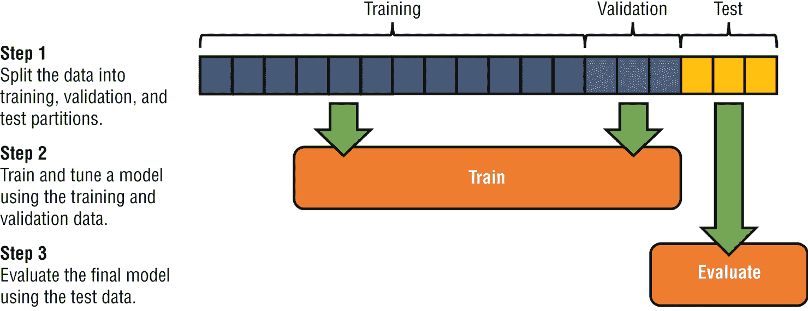

图 13 留出法

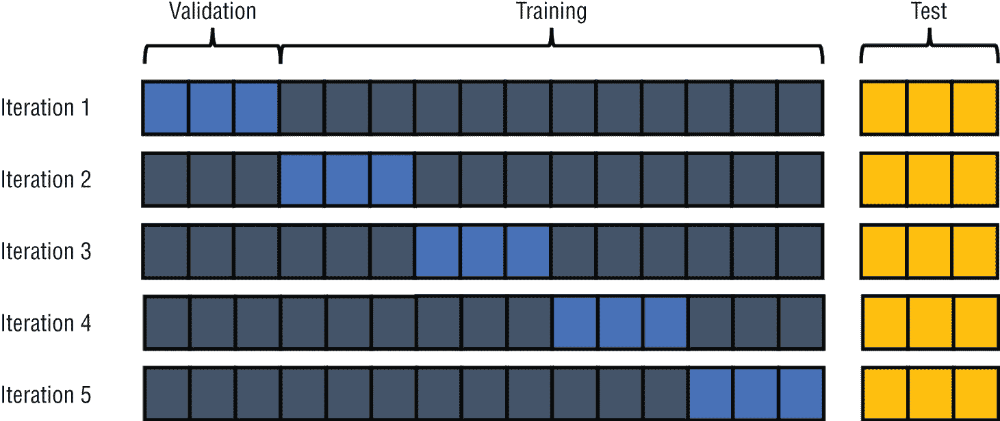

图 14 交叉验证方法

## 练习

1. 考虑以下机器学习问题。每个问题最适合作为分类问题还是回归问题来处理？为你的答案提供理由。

    - 预测商业航行中捕获的鱼的数量
    - 识别新技术的可能采用者
    - 使用天气和人口数据预测自行车租赁率
    - 预测向特定个人发送的最佳营销活动

2. 你开发了一种机器学习算法，根据多项诊断标准评估患者的心脏发作风险（一个正性事件）。你会如何描述以下事件？

    - 你的模型识别出某患者可能发生心脏发作，且该患者确实发生了心脏发作。
    - 你的模型识别出某患者可能发生心脏发作，但该患者没有发生。
    - 你的模型识别出某患者可能发生心脏发作，且该患者没有发生。
    - 你的模型识别出某患者可能发生心脏发作，但该患者确实发生了。

# 第 2 章 R 和 RStudio 简介

机器学习位于统计学和软件开发世界的交叉点。在整书中，我们将重点关注用于挖掘数据中隐藏价值的统计技术。在本章中，我们将为你提供实现这些技术所需的计算机科学工具。在书中，我们选择使用 R 语言来实现。本章将介绍 R 语言的基本概念，你将在书的剩余部分中持续使用这些概念。

在本章结束时，你将学习到以下内容：

- R 编程语言在数据科学和分析领域扮演的角色
- RStudio 集成开发环境 (IDE) 如何辅助 R 代码编码
- 如何在 R 中进行编码
- 如何编写、保存和执行 R
- R 中不同数据类型的用途

## 欢迎 R

R 编程语言诞生于 1992 年，旨在创建一种用于统计应用的特殊语言。在二十多年后，它已演变为全球统计学家、数据科学家和业务分析师最流行的语言之一。R 之所以迅速受欢迎有几个原因。首先，它是作为由社区开发者开发的免费开源语言向所有人提供的，这打破了过去依赖专有软件且许多人负担不起局面。

R 的受欢迎性持续增长，因为它被机器学习的创造者们采用。任何新的机器学习技术都能迅速通过 CRAN（综合 R 网络）提供，这是一个开源的仓库。图 2.1 展示了通过 CRAN 可用的包数量随时间的增长。你可以看到，在过去的十年中增长显著。

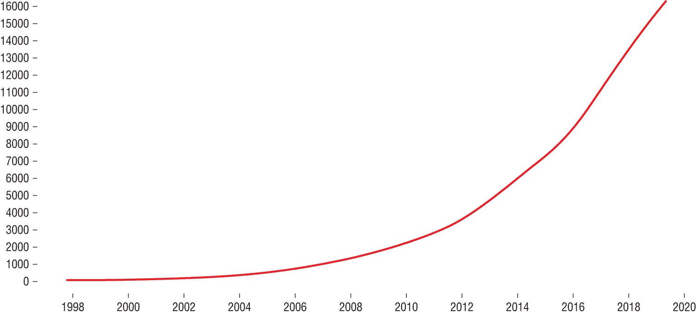

同样重要的是了解 R 是一种`解释型语言`，而不是编译语言。在解释型语言中，你编写的代码存储在一个名为`脚本`的文件中，该脚本直接由处理代码的系统执行。在编译语言中，开发者编写的源代码通过一个称为`编译器`的专用程序转换为机器语言。

R 是解释型语言的事实意味着你可以直接执行 R 命令并看到结果。例如，你可以执行以下简单的命令来将 1 加 1：

```
> 1+1
[1] 2
```

当你这样做时，R 解释器会立即给出结果：2。

## R 和 RStudio 组件

我们的工作环境由两个主要组件组成：R 编程语言和 RStudio 集成开发环境 (IDE)。虽然 R 是开源语言，但 RStudio 是一个旨在让 R 变得易用的商业产品。

### R 语言

开源 R 语言可以从 R 项目网站 `https://www.r-project.org` 免费下载。在本书编写期间，R 的当前版本是 3.6.0，代号为“种树”。R 通常编写为向后兼容，因此如果你使用的是较新版本的 R，在跟随书中代码时不应遇到任何困难。如果你还没有安装 R，现在是在你的计算机上安装最新版本 R 的好时机。只需访问 R 项目主页，点击 CRAN 链接，并选择离你最近的 CRAN 镜像。你将看到一个类似于图 2.2 所示的 CRAN 站点。选择适用于你操作系统的下载链接并在下载完成后运行安装程序。

作为一个集成化开发环境，RStudio 提供了一个设计良好的图形界面，以协助你创建 R 代码。你完全没有理由简单地打开一个文本编辑器，编写 R 脚本，然后直接使用开源的 R 环境执行它。但你也没有理由*应该*这样做！RStudio 让管理代码、监控其进度以及排查 R 脚本中可能出现的问题变得容易得多。

虽然 R 是一个开源项目，但 RStudio IDE 有多个版本。RStudio 有一个免费提供的开源版本，但 RStudio 也提供了商业版产品，这些版本带有增强的支持选项和额外的功能。

对于本书而言，RStudio 的开源版本已经绰绰有余。

## RStudio Desktop

RStudio Desktop 是最常用的 RStudio 版本，特别是对于个人程序员。它是一个你下载并安装在 Windows、Mac 或 Linux 系统上的软件包，它为你提供了一个全面的 R 开发环境。你可以在图 2.3 中看到 RStudio IDE 运行的示例。

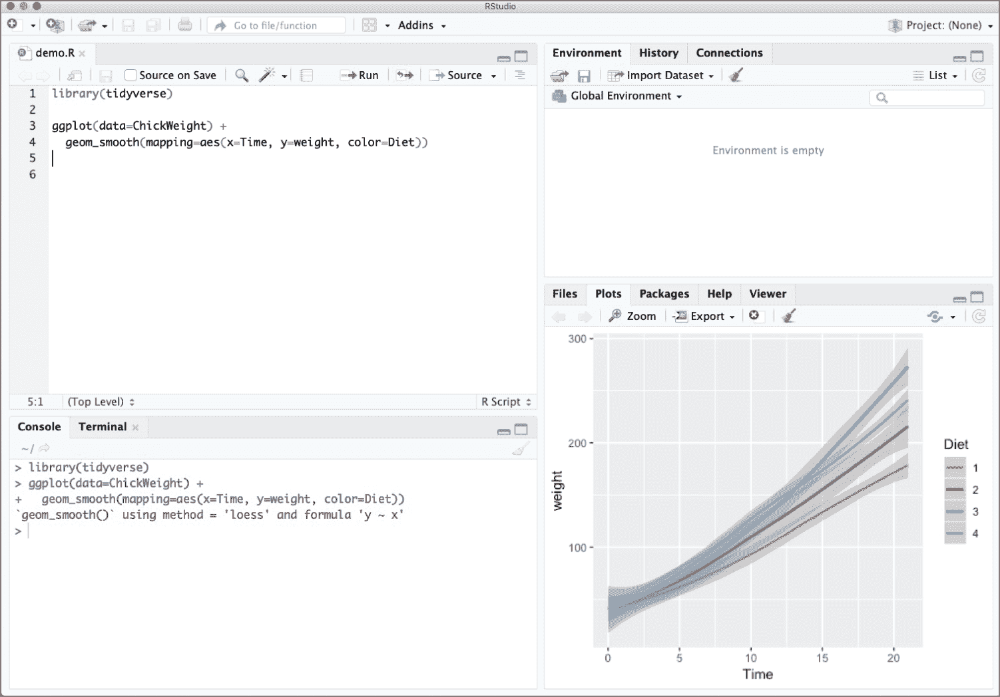

图 2.3 RStudio Desktop 为 Windows、Mac 和 Linux 系统提供了 IDE。

如果你还没有在电脑上安装 RStudio Desktop，现在安装吧。你可以在 `https://www.rstudio.com/products/rstudio/download/#download` 下载最新版本。

## RStudio Server

RStudio 还提供服务器版本的 RStudio IDE。该版本对于协作编写 R 代码并希望维护中心化仓库的团队来说非常理想。当你使用 RStudio 的服务器版本时，可以通过网络浏览器访问 IDE。服务器会向你展示一个看起来与桌面环境相似的窗口化视图。你可以在图 2.4 中看到基于 Web 的 IDE 示例。

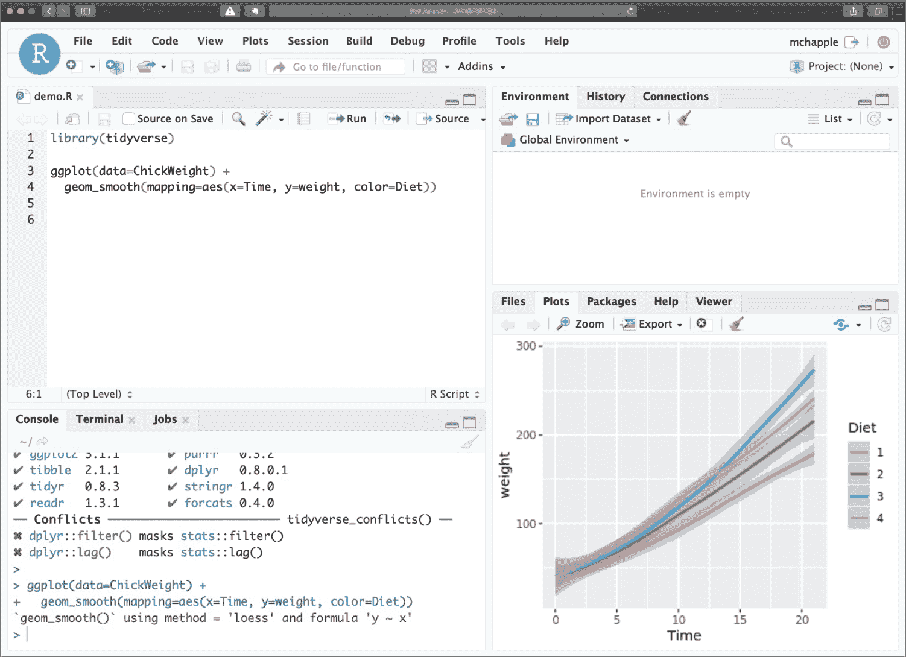

图 2.4 RStudio Server 提供了用于协作的 Web IDE。

使用 RStudio Server 需要构建一个 Linux 服务器（本地或云端），然后在该服务器上安装 RStudio Server 代码。如果你的组织已经在使用 RStudio Server，你可以在跟随本书中的示例时使用它。

## 探索 RStudio 环境

让我们快速浏览一下 RStudio Desktop 环境，并熟悉打开 RStudio 时看到的各种窗口。

### 控制台面板 (Console Pane)

当你第一次打开 RStudio 时，你看不到图 2.3 所示的视图。相反，你会看到一个只有三个窗口的视图，如图 2.5 所示。这是因为你还没有打开或创建 R 脚本。

在此视图中，控制台面板出现在 RStudio 窗口的左侧。一旦有了脚本，它就会出现在左下角，如图 2.6 所示。

控制台窗口允许你与解释器直接交互。你可以在这里输入命令，R 会立即执行它们。例如，图 2.7 显示了控制台面板执行命令。注意用户输入的命令后紧接着是解释器的回答。

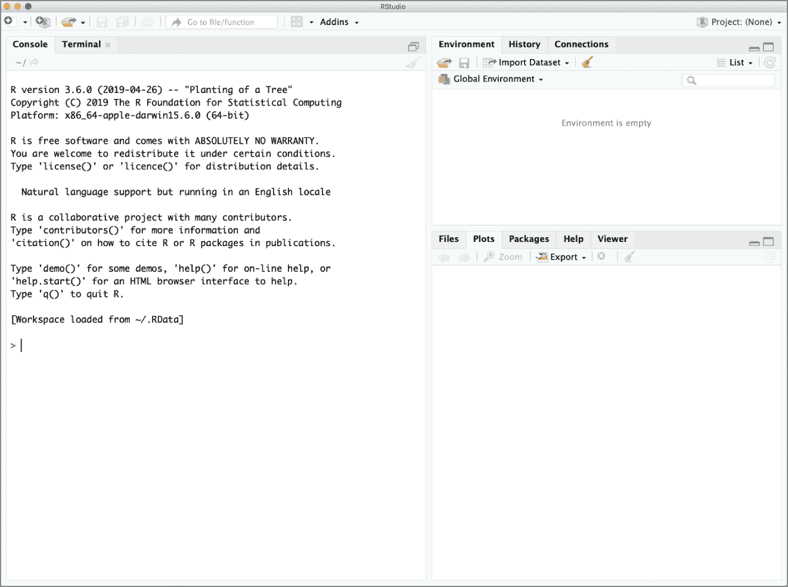

图 2.5 没有脚本的 RStudio Desktop

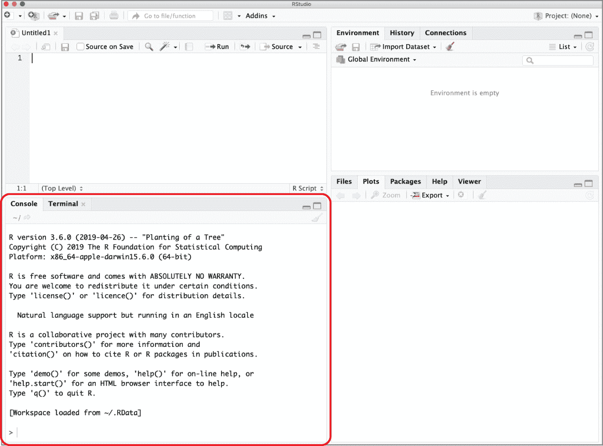

图 2.6 带有控制台面板的 RStudio Desktop

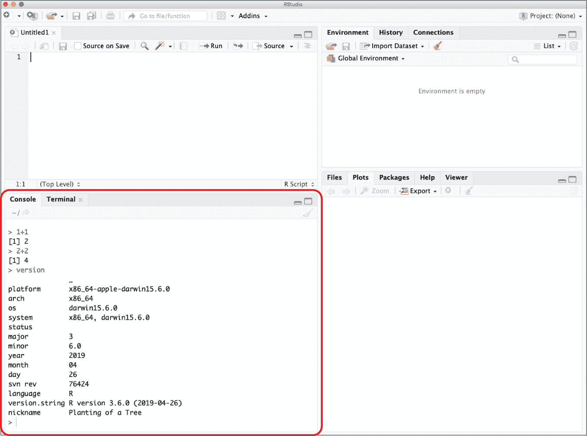

图 2.7 控制台面板执行命令

你还应该观察控制台面板包含一个名为 `Terminal`（终端）的标签。该标签允许你直接打开操作系统的终端会话。这与在 Linux 系统上打开 shell、在 Mac 上打开终端窗口或在 Windows 系统上打开命令提示符相同。这个终端不会直接与你的代码交互，那里仅仅是为了方便。你可以在图 2.8 中看到运行命令的示例。

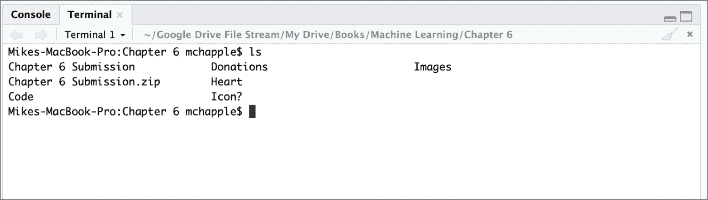

图 2.8 RStudio 中的终端

### 脚本面板 (Script Pane)

脚本面板是发生魔法的地方！你通常不想在控制台中直接执行 R 命令。相反，你会在脚本文件中编写 R 命令，以便以后编辑或重用。R 脚本只是包含 R 命令的文本文件。在 RStudio IDE 中编写 R 脚本时，R 会对代码的不同元素进行着色，以便于阅读。

图 2.9 显示了脚本面板内渲染的 R 脚本示例。这是一个加载样本小鸡体重数据的简单脚本，并创建了图 2.10 所示的图表。

图 2.11 显示了使用简单编辑器打开的脚本文件。注意代码是相同的。区别在于在 RStudio 中打开文件时，你会看到一些着色来帮助解析代码。

你可以通过顶部菜单选择 `File` -> `Open File` 或点击任务栏上的文件图标在 RStudio 中打开现有脚本。你可以通过顶部菜单选择 `File` -> `New File` -> `R Script` 或点击任务栏上带有加号的纸张图标创建一个新脚本。

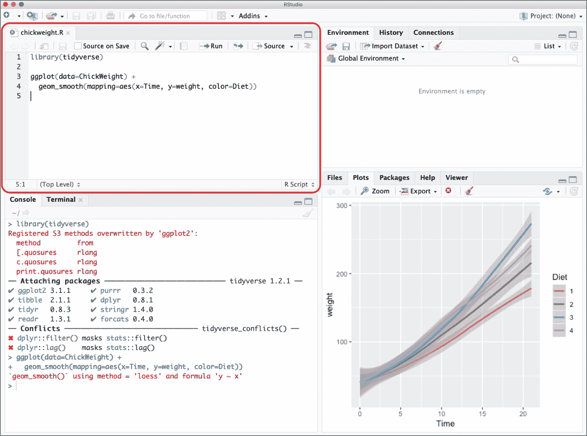

图 2.9 RStudio IDE 内的小鸡体重脚本

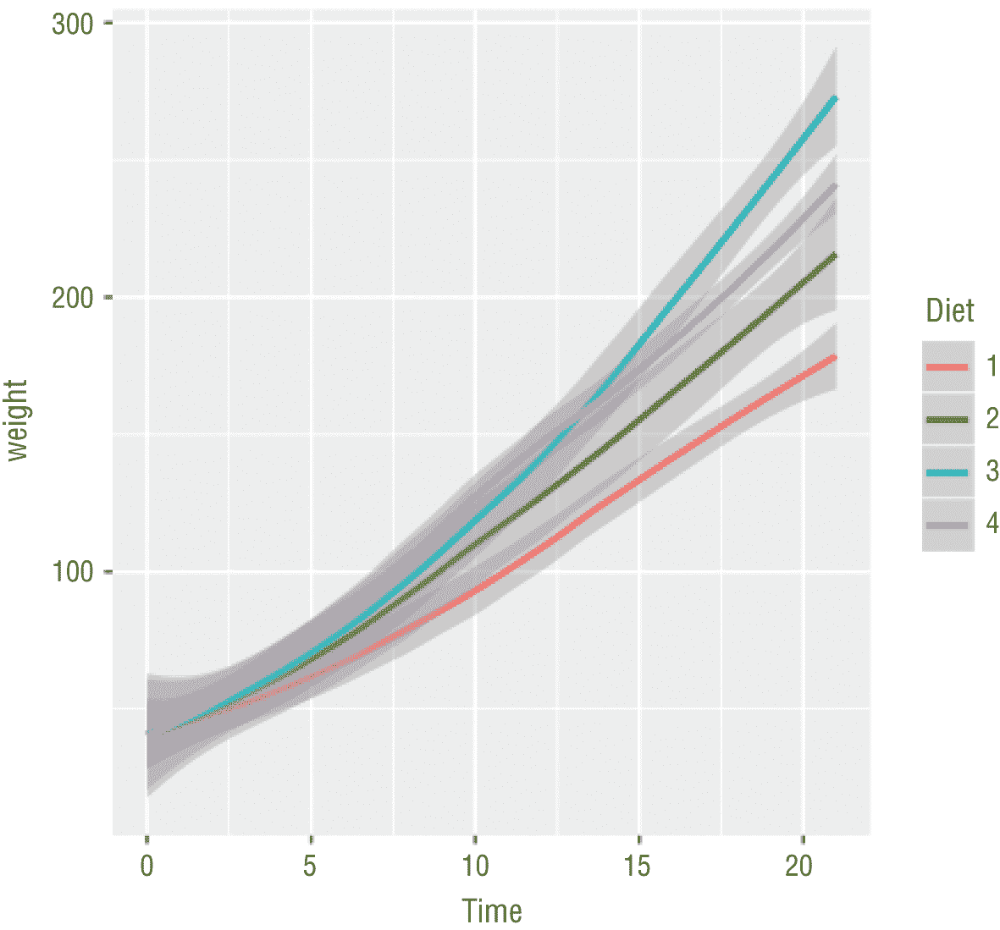

图 2.10 小鸡脚本生成的图表

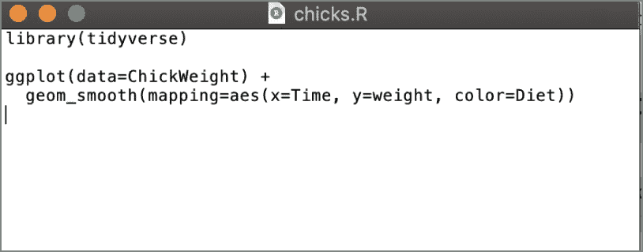

图 2.11 文本编辑器内的小鸡体重脚本

### 环境面板 (Environment Pane)

环境面板允许你查看 R 的当前运行环境。你可以看到当前存储在内存中的变量、数据集和其他对象的值。对 R 运行环境的这种视觉洞察是使用 RStudio IDE 而非标准编辑器创建 R 脚本的最有力理由之一。在开发和排查代码时，轻松查看内存内容是一个非常有用的工具。

图 2.9 中的环境面板是空的，因为在该情况下使用的 R 脚本没有在内存中存储任何数据。相反，它使用了 R 内置的 `ChickWeight` 数据集。

图 2.12 显示了填充了多个变量、向量和一个存储在名为 `tibble` 对象中的完整数据集的 RStudio 环境面板。我们将在第 3 章中更多讨论 tibble。

你还可以使用同一面板中的标签访问另外两个 RStudio 功能。`History` 标签显示当前会话期间执行的 R 命令，如图 2.13 所示。`Connections` 标签用于创建和管理与外部数据源的连接，这种技术超出了本书的范围。

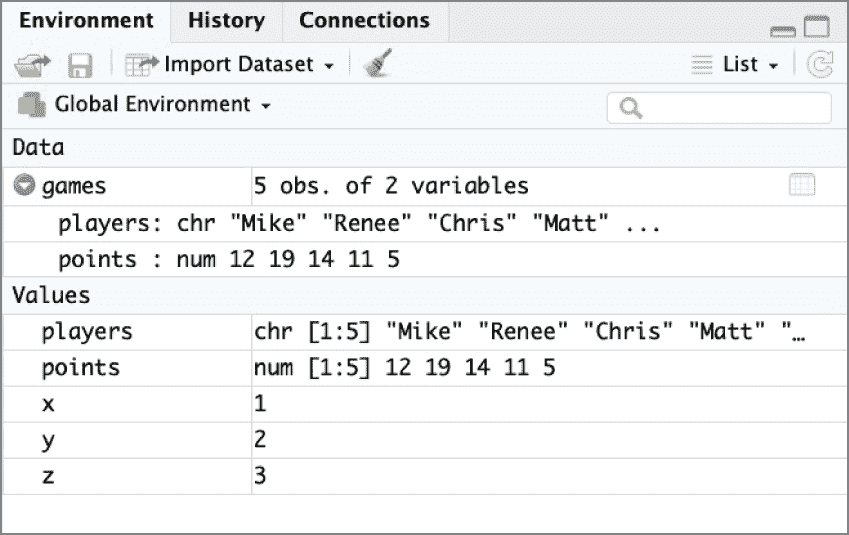

图 2.12 填充了数据的 RStudio 环境面板

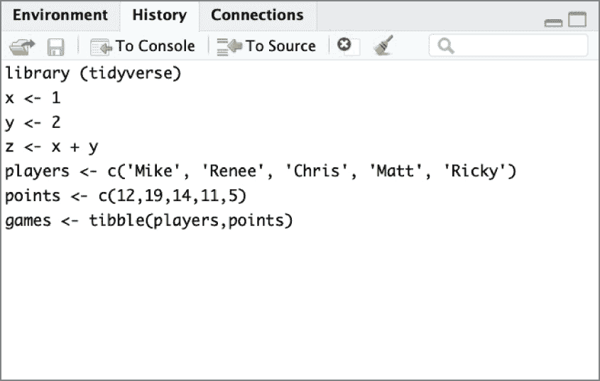

图 2.13 显示之前执行命令的 RStudio 历史面板

### 绘图面板 (Plots Pane)

RStudio 窗口的最后一个面板位于图 2.9 的右下角。该面板默认显示绘图视图，并将包含你在 R 代码中生成的任何图形。在图 2.9 中，该面板包含了在我们示例 R 脚本中创建的、按饮食类型分类的小鸡重量图表。正如你在图 2.5 中所示，当你首次打开 RStudio 且尚未执行任何生成图表的命令时，此面板是空的。

该面板还有其他几个可用的标签。图 2.14 中显示的“文件 (Files)”标签允许你导航到设备上的文件系统，以打开和管理 R 脚本及其他文件。

图 2.15 显示了 RStudio 中的“包 (Packages)”标签，它允许你安装、更新和加载包。许多人倾向于直接在 R 代码中执行这些任务，但这里是验证系统上安装的包及其当前版本号的方便位置。

“帮助 (Help)”标签提供了对 R 文档的便捷访问。你可以通过在帮助标签页内进行搜索，或在控制台中使用 `?` 命令后跟你想查看文档的命令名称来访问它。图 2.16 显示了在控制台中执行 `?install.packages` 命令以查看 `install.packages()` 函数帮助的结果。

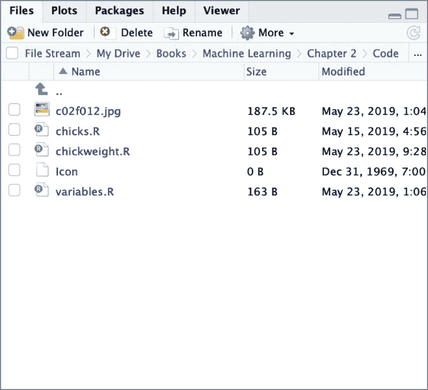

图 2.14 RStudio 中的“文件”标签允许你与设备的本地文件系统交互。

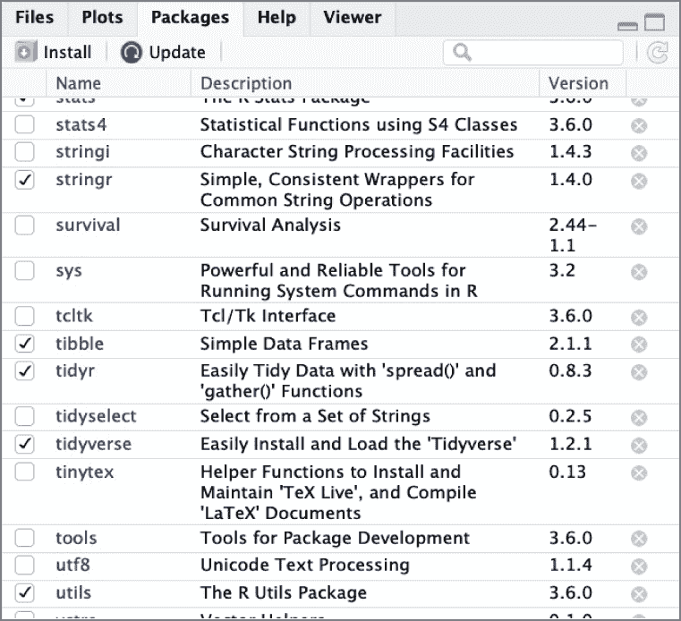

图 2.15 RStudio 中的“包”标签允许你查看和管理系统上安装的包。


图 2.16 RStudio 中的“帮助”标签显示了 `install.packages()` 命令的文档

### R 包 (R Packages)

*包 (Packages)* 是 R 社区的秘密武器。它们是由社区创建并被广泛共享以供公众使用的代码集合。正如你在图 2.1 中所示，近年来公开可用的 R 包数量呈爆炸式增长。这些包涵盖了从极其流行且广泛使用的包（如 `tidyverse`）到为 R 社区特定细分领域服务的高度专业化包。

在本书中，我们将使用各种 R 包来导入和处理数据，以及构建机器学习模型。我们会在这些包出现时向你介绍它们。

#### CRAN 仓库

综合 R 归档网络（Comprehensive R Archive Network，简称 CRAN）是由 R 社区维护并由 R 基金会协调的 R 包官方仓库。CRAN 志愿者管理该仓库以确保所有包都符合某些关键标准，包括每个包都要满足以下条件：

*   对 R 社区做出非凡的贡献
*   由具有权限的个人或组织根据开源许可发布
*   指定个人作为包维护者并提供该人员的联系方式
*   使用高效代码以最大限度地减小文件大小和计算资源占用
*   通过 CRAN 质量控制检查

CRAN 是 RStudio 的默认包仓库，本书中使用的所有包都可以通过 CRAN 获取。

#### 安装包

在 R 脚本中使用包之前，你必须确保该包已安装在你的系统中。安装包会从仓库下载代码，安装代码所需的任何其他包，并执行所有必要的安装步骤。

`install.packages()` 命令是向系统安装 R 包最简单的方法。例如，这是在系统中安装 `RWeka` 包的命令以及相应的输出：

```
> install.packages("RWeka")
 
正在安装依赖包 ‘ekajars’, ‘rJava’
 
 尝试 URL https://cran.rstudio.com/
 
 下载: https://cran.rstudio.com/bin/macosx/contrib/4/RWekajars_3.9.1.tgz - 9.6 MB
 下载: https://cran.rstudio.com/bin/macosx/contrib/4/rJava_1.7.0.tgz - 727 KB
 下载: https://cran.rstudio.com/bin/macosx/contrib/4/RWeka_3.4.0.tgz - 617 KB
 
 ==========================
 包 ‘RWeka’ 现在可用版本 3.4
```

注意，除了安装 `RWeka` 包外，该命令还安装了 `ekajars` 和 `rJava` 包。`RWeka` 包使用了这些包中的函数，从而形成了包与包之间的*依赖*关系。`install.packages()` 命令通过安装所需的包来解决这些依赖。

#### 加载包

每次想要使用包时必须将其加载到 R 会话中。虽然你只需要在系统中安装一次包，但每次使用时都需要加载。安装包使其在系统中可用，而加载包使其可以使用。

你使用 `library()` 命令将包加载到 R 会话中。例如，以下命令加载了我们在书中将使用的 `tidyverse` 包：

```
library(tidyverse)
```

许多编写 R 代码的人交替使用“包 (package)”和“库 (library)”这两个词。它们实际上略有不同。存储在 CRAN 仓库（或其他位置）中的代码束被称为*包 (packages)*。你使用 `install.packages()` 命令将包放入系统，并使用 `library()` 命令将其加载到内存中。Hadley Wickham 是一位著名的 R 开发者，他在 2014 年 12 月的一条推文中很好地总结了这一概念，见图 2.17。

#### 包文档

我们之前已经讨论过使用 `?` 命令访问包内函数的帮助文件。包作者通常还会创建更详细的关于包用方法的说明（包含示例），存储在称为*指南 (vignettes)* 的文件中。你可以使用 `vignette()` 命令访问指南。例如，以下命令可以与 R 的 `dplyr` 包相关的所有指南：


> vignette(package = 'dplyr')
包 ‘dplyr’ 中的指南：

compatibility         dplyr compatibility (source, html)
dplyr                 Introduction to dplyr (source, html)
programming           Programming with dplyr (source, html)
two-table             Two-table verbs (source, html)
window-functions      Window functions (source, html)

图 2.17 Hadley Wickham 关于包和库之间的区别

如果你想查看名为 `programming` 的指南（vignette），可以使用此命令：

```
vignette(package = 'dplyr', topic = 'programming')
```

图 2.18 显示了执行此命令的结果：一份详细的文档，描述了如何使用 `dplyr` 包编写代码。

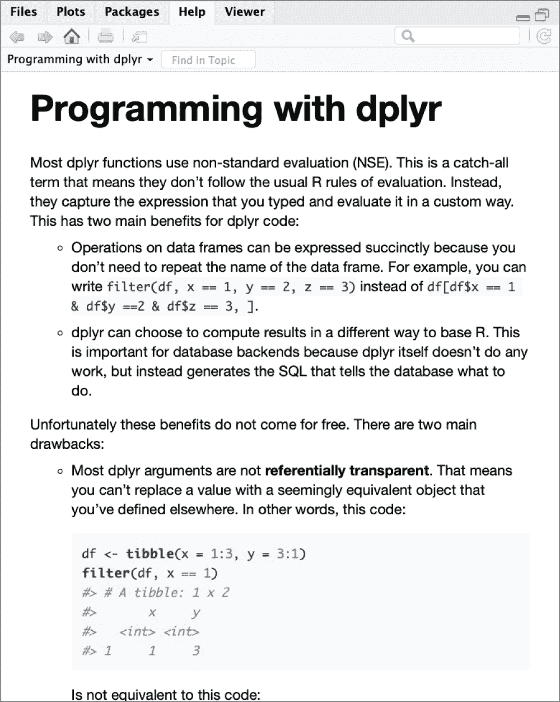

图 2.18 RStudio 显示来自 `dplyr` 包的 `programming` 指南

## 编写和运行 R 脚本

正如我们之前提到的，在 RStudio 中工作最常见的方法是编写包含一系列 R 命令的脚本，你可以保存这些脚本并在以后复用它们。这些 R 脚本仅仅是文本文件，你在 RStudio 的脚本窗格中编写它们，并将其保存到你的系统或云存储位置。图 2.9 显示了一个在 RStudio 中打开的简单脚本。

当你想要执行脚本时，有两个选项：Run（运行）按钮和 Source（源文件）按钮。当你点击 Run 按钮时（如在图 2.19 中所示），RStudio 将执行当前代码段。如果你在脚本中没有高亮任何文本，它将执行光标当前所在的某行。在图 2.19 中，第 6 行不包含代码，因此 Run 按钮将不起任何作用。如果你将光标移动到代码的第一行，点击 Run 按钮将运行第 1 行加载 tidyverse，然后自动跳转到脚本中包含代码的下一行即第 3 行（因为第 2 行是空的）。再次点击 Run 按钮将运行第 3 行和第 4 行的代码，因为它们在 R 中组合成了一个语句。

Run 按钮是在开发和调试阶段在 R 中执行代码的常用方法。它允许你在编写脚本的同时执行它，并监控结果。

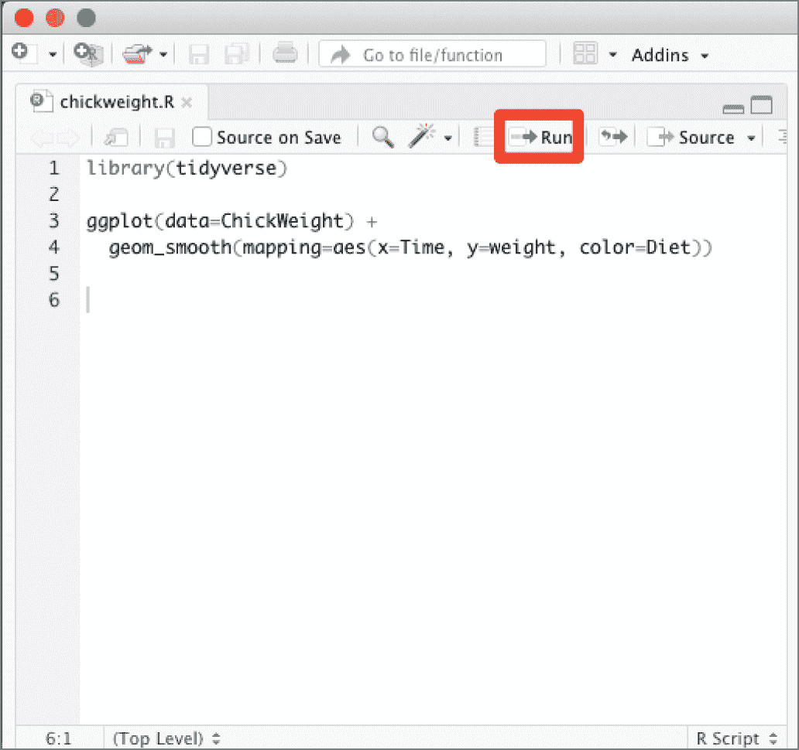

图 2.19 RStudio 中的 Run 按钮运行当前代码段。

Source 按钮（如在图 2.20 中高亮）将保存你对脚本所做的任何更改，然后一次性执行整个文件。这是快速运行整个脚本的有用方法。

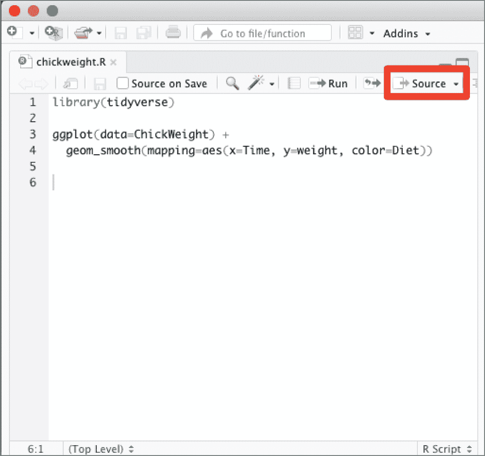

图 2.20 RStudio 中的 Source 按钮运行整个脚本。

## R 中的数据类型

与大多数编程语言一样，你在 R 脚本中创建的所有变量都有关联的数据类型。数据类型定义了 R 存储变量中包含的信息的方式以及可能值的范围。以下是 R 中一些常见的数据类型：

*   `logical`（逻辑型）数据类型是一种简单的二进制变量，可能只有两个值：`TRUE` 或 `FALSE`。它是存储仅取这两个值的数据有效方式。这些数据元素也常称为 `flags`（标记）。例如，我们可能在一个关于学生的数据集中有一个名为 `Married` 的变量，对于已婚人士将其设置为 `TRUE`，对于未婚的人将其设置为 `FALSE`。

*   `numeric`（数值型）数据类型存储小数，而 `integer`（整数）数据类型存储整数。如果你创建一个包含数字的变量而没有指定数据类型，R 将默认将其存储为 `numeric`。然而，R 通常可以根据需要自动在 `numeric` 和 `integer` 数据类型之间转换。

*   `character`（字符型）数据类型用于存储每个最多 65535 个字符的文本字符串。

*   `factor`（因子）数据类型用于存储分类值。因子的每个可能值被称为 `level`（水平）。例如，你可能使用因子来存储个人居住的美国州。50 个州中的每一个都是该因子的一个可能水平。

*   `ordered factor`（有序因子）数据类型是因子数据类型的一种特殊情况，其中水平的顺序具有意义。例如，如果我们有一个包含低（Low）、中（Medium）和高（High）风险评级的因子，那么顺序是有意义的，因为中大于低，且高大于中。有序因子保留了这种重要性。另一方面，美国州的列表不会被存储为有序因子，因为州之间没有逻辑顺序。

### 向量 (Vectors)

`Vectors`（向量）是 R 中将相同数据类型的元素按顺序收集在一起的方式。向量中的每个数据元素被称为该向量的 `component`（组件）。向量是收集相同类型数据元素的方便方式。

我们可以使用 `c()` 函数来创建一个向量。例如，我们可能会创建两个向量，一个包含名字，另一个包含分数：

```
names <- c('Alice', 'Bob', 'Charlie')
scores <- c(85, 92, 98)
```

一旦我们在向量中存储了数据，可以通过方括号跟随向量名来访问单个组件。例如：

```
names[1] "Alice"
names[2] "Bob"
names[3] "Charlie"
```

R 中还有一些函数可以作用于整个向量。例如，你可以使用 `mean()`、`median()`、`min()` 和 `max()` 函数分别找到平均值、中位数、最小值和最大值。同样，`sum()` 函数会相加数值元素。

```
> mean(scores)
[1] 91.66667

> median(scores)
[1] 92

> min(scores)
[1] 85

> max(scores)
[1] 98

> sum(scores)
[1] 275
```

向量的所有组件必须是相同类型。如果你尝试创建一个具有不同类型的向量，R 将强制它们变为相同类型。这种过程被称为 *coercion*（强制转换）。例如，如果我们创建一个包含字符串和数值的混合向量：

```
> mixed <- c('Alice', 85, 'Bob', 92, 'Charlie', 98)
```

该命令似乎成功创建了向量，但当我们检查该向量的内容时：

```
> mixed
 [1] "Alice" "85" "Bob" "92" "Charlie" "98"
```

我们发现 R 将所有元素都转换成了字符串。我们可以将不同类型的向量组合成类似于电子表格的数据结构。在 R 中，此此传统方法是通过 *data frame*（数据框）。例如，我们可以将 `names` 和 `scores` 向量组合成名为 `testResults` 的数据框。

```
> testResults <- data.frame(names, scores)

> testResults
        names scores
1        Alice     85
2          Bob     92
3    Charlie     98
```

在处理数据框时，你可以使用 `$` 运算符访问数据框中存储的向量。例如，如果你想计算平均分数，可以使用以下代码：

```r
> mean(testResults$scores)
[1] 91.66667
```

### 测试数据类型

当我们使用 R 对象时，我们可能想更多地了解它们的数据类型，可以通过直接对对象的类型提问，也可以通过编程方式进行测试。R 语言包含了用于协助这些任务的函数。

`class()` 函数返回对象的数据类型。例如，查看以下示例代码：

```
> x <- TRUE
> y <- 1
> z <- 'Mike'
 
> class(x)
[1] "logical"
 
> class(y)
[1] "numeric"
 
> class(z)
[1] "character"
```

注意在赋值 `x`、`y` 和 `z` 的值时，不需要显式指定类型。当你执行赋值时，R 会解释你提供的参数并对数据类型做出假设。在下一节中，我们将讨论如何使用 `as()` 函数来显式转换类型。

如果你想在 R 中创建一个整数（integer）类型，可以在创建时给数字添加 `L` 后缀。查看以下代码：

```
> yint <- 1L
 
> is.integer(yint)
[1] TRUE
 
> is.numeric(yint)
[1] TRUE
```

在这里我们看到了另一个明显的不一致性。在这种情况下，`is.numeric()` 和 `is.integer()` 函数都返回了 `TRUE`。这是 `is.numeric()` 函数的一个细微差别。它并不是仅在被测试的对象为数值类时才返回 `TRUE`，如果可以将对象中包含的数据转换为数值类，它就会返回 `TRUE`。我们可以通过 `class` 函数验证 `y` 是数值数据类型，而 `yint` 是整数。

```
> class(y)
[1] "numeric"
 
> class(yint)
[1] "integer"
```

或者，我们也可以使用 `as.integer()` 函数将最初创建的数值变量转换为整数值，我们将在下一节介绍。

“is”函数也适用于向量对象，根据向量中包含的对象的数据类型返回值。例如，我们可以测试上一节中创建的 `names` 和 `scores` 向量。

```
> is.character(names)
[1] TRUE
 
> is.numeric(names)
[1] FALSE
 
> is.character(scores)
[1] FALSE
 
> is.numeric(scores)
[1] TRUE
 
> is.integer(scores)
[1] FALSE
```

### 转换数据类型

你可能会遇到需要将数据从一种类型转换为另一种类型。R 提供了“as”函数来执行这些转换。R 中一些常用的“as”函数如下：

- `as.logical()`

- `as.numeric()`

- `as.integer()`

- `as.character()`

- `as.factor()`

这些函数每个都接受一个对象或向量作为参数，并尝试将其从现有的数据类型转换为函数名包含的数据类型。当然，这种转换并不总是可能的。如果你有一个包含值 1.5 的数值数据对象，R 可以轻松地将其转换为字符串“1.5”。然而，没有任何合理的方法可以将字符字符串“apple”转换为整数值。以下是“as”函数工作的示例：

```
> as.numeric("1.5")
[1] 1.5
 
> as.integer("1.5")
[1] 1
 
> as.character(3.14159)
[1] "3.14159"
 
> as.integer("apple")
[1] NA
Warning message:
NAs introduced by coercion
 
> as.logical(1)
[1] TRUE
 
> as.logical(0)
[1] FALSE
 
> as.logical("true")
[1] TRUE
 
> as.logical("apple")
[1] NA
```

这些结果符合逻辑吗？如果你回顾创建这些变量的代码，`x` 是逻辑值 `TRUE`，所以只有 `is.logical()` 函数返回了 `TRUE`，而其他测试函数返回了 `FALSE`。

`y` 变量包含一个整数值，因此 `is.integer()` 函数返回了 `TRUE`，而其他函数返回了 `FALSE`。在这里要注意的是`is.numeric()` 函数也返回了 `FALSE`，考虑到函数的名称这可能违背直觉。当我们使用代码创建 `y` 变量时：

```
> y <- 1
```

R 假设我们想要创建一个数值变量，这是数字的默认类型。如果我们想显式创建一个整数，我们需要在创建时给数字添加 `L` 后缀。

在第 1 章中，我们讨论了机器学习背后的一些基础原理。随后，我们在第 2 章中对 R 编程语言和 RStudio 开发环境分别进行了介绍。在本章中，我们将解释如何使用 R 在建模之前管理我们的数据。机器学习模型的质量取决于用于构建该模型的数据质量。很多情况下，这些数据并不容易获取、格式错误或难以理解。因此，在构建模型之前，花费尽可能的时间来收集所需的数据、探索并理解已有的数据，并对其进行处理以使其适用于所选的机器学习方法，是至关重要的。通常情况下，<math display="inline" overflow="scroll" xmlns="http://www.w3.org/1998/Math/MathML" xmlns:xlink="http://www.w3.org/1999/xlink"><mrow><mn>8</mn><mn>0</mn></mrow></math> 百比的时间花在管理数据上，或者说本应该花在管理数据上。

在本章结束时，你将学习到以下内容：

* 什么是 tidyverse 以及如何使用它在 R 中管理数据

* 如何使用 R 收集数据以及收集数据时需要考虑的关键事项

* 在 R 中描述和可视化数据的不同方法

* 如何清洗、转换和减少数据，以使其对机器学习过程更有用

## THE TIDYVERSE

`tidyverse` 是系列 R 包的集合，旨在通过提供包与包之间交换数据的标准化格式来促进整个分析过程。它包含了设计用于导入、处理、可视化和建模数据的包，这些包包含一系列函数，这些函数可以轻松地在不同的 tidyverse 包之间协同工作。

以下是构成 tidyverse 的主要包：

* `readr` 用于从各种文件格式将数据导入到 R

* `tibble` 用于以标准化格式存储数据

* `dplyr` 用于处理数据

* `ggplot2` 用于数据可视化

* `tidyr` 用于将数据转换为“整洁（tidy）”格式（tidy form）

* `purrr` 用于函数式编程

* `stringr` 用于处理字符串

* `lubridate` 用于处理日期和时间

这些是我们从 tidyverse 中使用的面向开发者的包，但这些包依赖于几十个其他基础包来完成其工作。幸运的是，你可以通过一个命令安装所有的 tidyverse 包：

```R
install.packages("tidyverse")
```

同样，你可以使用此命令加载整个 tidyverse：

```R
library(tidyverse)
```

在本章的剩余部分以及本书的后续内容，我们将使用多个 tidyverse 包和函数。在使用这些工具时，我们将努力对每个函数的作用及其使用方法提供简要说明。请注意，本书的意图并不是作为 R 编程语言或 tidyverse 的教程。相反，目标是使用这些工具来解释和演示机器学习概念。对于对更深入介绍 R 编程语言和 tidyverse 感的读者，我们推荐由 Hadley Wickham 和 Garrett Grolemund 编写的 *R for Data Science* 一书。

## DATA COLLECTION

`数据收集（Data collection）` 是识别和获取机器学习过程所需要数据的过程。收集的数据类型/数量通常取决于机器学习问题和所选的算法。对于监督机器学习问题，收集的数据不仅包含描述每个观测属性或特征的变量，还包含一个作为观测值标签（label）或结果的变量。无监督机器学习问题不需要为输入数据的每个观测值分配标签。相反，学习目标的一个主要部分是识别分组数据的有趣方式，以便为其分配有意义的标签。

### 关键考虑因素

在收集数据时，有几点需要考虑，以确保数据收集过程成功。这包括确保我们捕获了正确的历史数据、数据具有相关性、我们有足够的数据可以使用，以及我们在管理和使用数据时遵循伦理规范。

#### 收集真值数据（Ground Truth Data）

对于监督机器学习问题，我们使用带有结果标签或响应值的历史数据来训练模型。这些标签或响应值的准确性对于方法的成功至关重要。这是因为这些数据是算法用于学习过程的基准。这些数据作为学习模式的真理来源。这就是为什么它通常被称为`真值（ground truth）`。真值可以是基于先前事件的现有标签（例如银行客户是否违约贷款），也可以需要由领域专家分配标签（例如电子邮件是否为垃圾邮件）。无论标签是存在还是需要分配，都应该有一个计划来管理真值并确保它确实是真理来源。

#### 数据相关性（Data Relevance）

作为数据收集过程的一部分，确保收集的数据与学习目标相关是重要的。用于描述观测值的变量在解释该观测值的标签或响应方面应该是相关的。例如，收集银行客户的鞋码数据与他们是否会违约贷款没有相关性。相反，排除有关客户过去贷款的信息将对尝试预测贷款结果的模型有效性产生不利影响。

#### 数据数量（Quantity of Data）

成功训练模型所需的数据量取决于所选机器学习方法的类型。某些类型的算法在少量数据上表现良好，而某些则需要大量数据才能提供有意义的结果。理解每种方法的优缺点可以为我们判断多少数据足够提供指导。除了收集的数据数量，收集数据的变异性也很重要。例如，如果我们打算用于预测贷款结果的预测变量之一是收入，那么收集不同收入水平客户的数据将是有益的。这样做使模型能够更好地判断收入水平对贷款结果的影响。

#### 伦理（Ethics）

在数据收集过程中，需要考虑几个伦理问题。这些问题包括隐私、安全、知情同意和偏见。在获取新数据的过程中，建立流程和缓解措施来解决这些问题是非常重要的。例如，如果训练模型的数据中存在偏见，那么模型将在预测中复制这种偏见。偏见预测可能会导致相当大的危害，特别是在根据机器学习模型对少数代表群体做出不利决策的情况下。偏见数据问题通常源于数据收集过程中的内在偏见，或某些子群体数据的缺失。

### 导入数据（Importing the Data）


`readr` 包可能是你在为机器学习目的编写的任何 R 代码中使用的第一个 tidyverse 包，因为它允许你从标准文件格式将数据导入 R，并将其导入名为 `tibble` 的 tidyverse 友好数据结构（稍后将介绍 tibble）。

### 读取逗号分隔文件

逗号分隔文件是不同环境之间交换数据的最常见方式。这些文件也被称为逗号分隔值（CSV）文件，它们以简单、标准的格式存储数据，可以从几乎任何源导入或导出。

从电子表格或其他数据表创建逗号分隔值文件在概念上是非常直观的。例如，假设我们有如图 3.1 所示的电子表格数据。

将其转换为 CSV 文件仅需将分隔列的行替换为逗号，如图 3.2 所示。在 CSV 格式中，文件中的每一行代表电子表格表中的一行。然而，有时文件可能还会包含一个可选的表头行，其中包含变量名，我们的示例就是这种情况。

我们可以使用 `readr` 包中的 `read_csv()` 函数将 CSV 文件读取到 R 中。该函数允许许多不同的参数，但让我们来看其中几个最重要的参数，显示如下：

*   `file` 是 `read_csv()` 的第一个参数，包含你想要读取的文件名。这可能是 R 当前工作目录下的文件名、存储在磁盘其他位置的文件的完整路径、通过 HTTP 或 HTTPS 协议读取的 URL，或者 FTP 或 FTPS 站点上文件的路径。

*   `col_names` 指定了 R 应该从哪里获取数据集中使用的变量名。`col_names` 的默认值为 `TRUE`，表示 R 应该使用 CSV 文件第一行中出现的值作为变量名。如果将此值设置为 `FALSE`，R 将使用顺序编号的格式 `X1`、`X2`、`X3` 等生成它自己的列名。或者，你也可以提供一个自己的列名字符向量。

    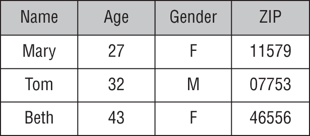

    **图 3.1** 包含表格形式数据的简单电子表格

    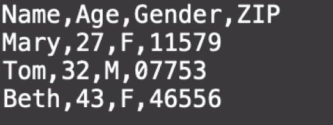

    **图 3.2** 包含与图 3.1 中电子表格相同数据的 CSV 文件

*   `col_types` 指定列的数据类型。如果你不包含此参数，R 将根据文件中的值猜测合适的数据类型。如果你想自己指定列类型，简单的方法是提供一个与数据集中每个列对应的字母字符串，使用以下值：

    *   `l` 代表逻辑型 (logical)
    *   `n` 代表数值 (numeric)
    *   `i` 代表整数 (integers)
    *   `c` 代表字符 (characters)
    *   `f` 代表因子 (factors)
    *   `D` 代表日期 (dates)
    *   `T` 代表日期时间 (datetimes)

*   `skip` 是整数值，表示 `read_csv()` 在尝试读取数据之前应忽略文件顶部指定的行数。

这些只是在从 CSV 文件读取数据时可以指定的许多选项中的一小部分。关于 `read_csv()` 函数的更多信息，请参阅帮助文件。

```
?read_csv
```

让我们来看一个读取 CSV 文件的示例。我们将使用一个存储在 `vehicles.csv` 文件中的数据集，包含车辆燃油效率和排放测试数据，这些数据是在密歇根州安娜堡环保保护局国家车辆和燃料排放实验室收集的。该数据集包含 1984–2018 年型车辆的燃油经济和排放信息。

要读取数据，我们首先需要使用 `library(tidyverse)` 命令加载 tidyverse 包。这允许我们使用 `read_csv()` 函数。我们向函数传递两个参数：第一个是文件名（`file`），第二个是表示列数据类型的字符串（`col_types`）。通过设置 `col_types="nnnfnff"`，我们告诉 `read_csv()` 函数输入的前三列应被视为数值型，第四列为因子型，第五列为数值型，以此类推。

```
library(tidyverse)
vehicles <- read_csv(file="vehicles.csv", col_types="nnnfnff")
```

我们的数据集现在已导入到名为 `vehicles` 的 tibble 中。我们可以使用 `dplyr` 包提供的 `glimpse()` 命令来获取数据的预览。

```
glimpse(vehicles)
```

作为数据探索过程的一部分，我们经常需要以他人能够理解的方式来描述数据。在机器学习中，有几个术语用于描述数据的结构以及数据中数值的性质（参见图 3.5）。

### 实例 (Instance)

`instance`（实例）是一行数据。它是数据集所代表的概念的独立个体示例。它由一组属性或特征（features）描述。一个数据集由多个实例组成。在本文，我们有时会将实例称为 `records`（记录）、`examples`（示例）或 `observations`（观测）。

### 特征 (Feature)

`feature`（特征）是数据列数据。它是实例的属性或特性。每个实例由多个特征组成。在本文，我们有时会将特征称为 `columns`（列）或 `variables`（变量）。特征可以根据其所持的数据类型进行分类。特征可以描述为`离散特征`（discrete feature）或`连续特征`（continuous feature）。

*   `离散特征`是以类别形式测量的属性。离散特征通常只有一组可能的取值。例如衣服尺码（小、中、大）、客户满意度（不满意、比较满意、非常满意）等。

    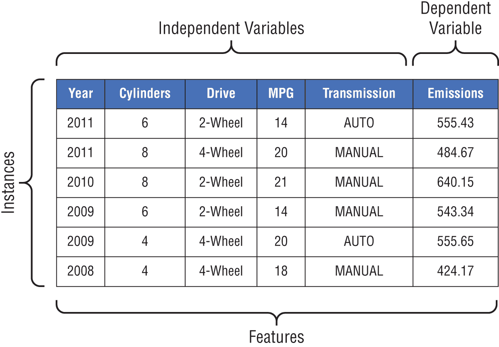

    **图 3.5** 展示实例和特征的示例数据集（自变量和因变量）

*   `连续特征`通常以整数或实数的形式测量的属性。连续特征在上下下限之间有无限多个可能的取值。例如温度、身高、体重、年龄等。

特征还可以根据其功能进行分类。在第 1 章中，我们讨论了在监督学习中，我们使用描述数据的属性（或特征）来预测数据中每个实例的标签（label）。描述数据的特征被称为`自变量`（independent variables），而代表标签的特征被称为`因变量`（dependent variable）。“独立”和“依赖”这两个名称背后的思想源于在监督学习中，因变量的值是根据自变量的值预测的。换句话说，因变量“依赖”于自变量的值。对于分类问题，因变量也被称为 `class`（类别），对于回归问题，它被称为 `response`（响应）。

### 维度 (Dimensionality)

数据集的`dimensionality`（维度）代表数据集中特征的数量。数据集的维度越高，我们关于数据的细节就越多，但计算复杂性和资源消耗也越高。稍后我们将讨论一些减少数据集维度的方法，使其更容易在机器学习中处理。

### 稀疏性与密度 (Sparsity and Density)

数据的`sparsity`（稀疏性）和`density`（密度）描述了数据集中特征存在的程度。例如，如果数据集中 20% 的值缺失或未定义，则该数据集被认为是 20% 稀疏。密度是稀疏性的互补，因此一个 20% 稀疏的数据集也被认为是 80% 密。

### 分辨率 (Resolution)

`resolution`（分辨率）描述数据的粒度或细节详细程度。数据越详细，分辨率越细（或越高），数据越不详细，分辨率越粗（或越低）。例如，个人客户购买记录的销售点零售数据具有高分辨率。另一方面，在州或区域级汇总的销售数据具有低分辨率。适当的分辨通常由业务问题和机器学习任务决定。如果数据分辨率太细，重要的模式可能会被噪声掩盖；但如果分辨率太粗，重要的模式可能会消失。

### 描述性统计 (Descriptive Statistics)

`descriptive statistics`（描述性统计）或`summary statistics`（汇总统计）对于数据探索和理解很有。它们涉及使用统计测量量来描述特征的特性。例如，特征值的`frequency`（频率）告诉我们该值出现的频率，特征的`mode`（众数）告诉我们该特征哪个值出现最多。频率和众数通常用于描述类别数据。对于连续数据，通常使用`mean`（平均值）和`median`（中位数）等测量来描述数据的属性。平均值和中位数都对特征的所谓“典型”值提供了描述。

在 R 中，我们可以使用 `summary()` 函数获取数据集的汇总统计。要获取我们的 `vehicles` 数据集的汇总统计，我们将数据集名称传递给 `summary()` 函数。

```
> summary(vehicles)
 
    citympg        cylinders        displacement 
 Min. : 6.00     Min. : 2.000     Min. :0.600 
 1st Qu.:15.00   1st Qu.: 4.000   1st Qu.:2.200 
 Median :17.00   Median :5.000   Median :3.000 
 Mean :17.53     Mean :5.776     Mean :3.346 
 3rd Qu.:20.00   3rd Qu.:6.000   3rd Qu.:4.500 
 Max. :57.00     Max. :10.000    Max. :8.400 
 NA's :6                          

               drive        highwaympg            make 
 2-Wheel Drive    491   Min. : 9.00   Chevrolet: 3750 
 Rear-Wheel Drive :1319   1st Qu.:20.00   Ford     :3044 
 All-Wheel Drive  8871   Median :23.77   GMC      :2461 
 Front-Wheel Drive:13074   Mean :24.00   Toyota   :1840 
 4-Wheel Drive    1349   3rd Qu.:27.00   BMW      :1774 
                    Max. :61.00   NA's :6 

               model                          class       year 
 F150 Pickup 2WD  :213   Compact Cars           :7918 1985   :1699 
 F150 Pickup 4WD  :192   Pickup                 :5763 1987   :1247 
 Truck 2WD        :187   Midsize Cars           :5226 1986   :1209 
 Jetta            :173   Sport Utility          :5156 2015   :1203 
 Mustang          :172   Subcompact Cars        :4523 2017   :1201 
 Ranger Pickup 2WD:164   Special Purpose Vehicle:2378 2016   :1172 
 (Other)          :35878  (Other)                :6015 (Other):2924 

 transmissiontype transmissionspeeds co2issions 
 Automatic:24910   Min. : 1.000    Min. :29.0 
 Manual :12069     1st Qu.: 4.000    1st Qu.:400.0 
 Median :5.000     Median :467.7    Median :400.0 
 Mean :4.954     Mean :476.6     Mean :340.0 
 3rd Qu.:6.000   3rd Qu.:555.4   3rd Qu.:500.0 
 Max. :10.000    Max. :1269.6 
 NA's :6                          
```

结果显示了描述性统计的两种不同格式：一种用于类别特征的格式，另一种用于连续特征的格式。例如，类别特征（如 `drive` 和 `make`）的汇总统计显示了特征值以及每个值的频率。

`summary()` 函数使用的第二格式适用于连续特征。例如，我们看到对于 `citympg`，摘要显示了平均值、中位数、最小值、最大值以及第一和第三四位数值。从结果中我们可以看到，城市燃油效率最低的车辆仅为 6 英里加仑（最小值），而效率最高的车辆评分则高达 57 英里加仑（最大值）。一辆“典型”车辆的城市燃油效率评分在 17 到 17.5 英里加仑之间（中位数和平均值）。第一和第三四位数的数值让我们了解不同车辆之间城市燃油效率值的差异程度。在第 5 章中，我们将详细介绍其含义。另外请注意，对于 `citympg`、`displacement` 和 `highwaympg` 特征，描述性统计列出了这些特征缺失值（NAs）的数量。我们将在本章节后面的关于数据准备的讨论中介绍如何处理这些缺失值。

在上一个示例中，我们通过将数据集传递给 `summary()` 函数显示了整个数据集的统计摘要。有时，我们只想查看数据中特定特征的统计摘要。实现这一目标的方法之一是使用 `dplyr` 包中的 `select` 命令。记得 `dplyr` 是 tidyverse 中一个用于数据探索和操作的包。它提供了五个主要的命令（也称为动词）。

*   `select` 用于选择列或变量
*   `filter` 用于选择行或观测值
*   `arrange` 用于排序行
*   `mutate` 用于修改变量
*   `summarize` 用于聚合行

使用 `select` 动词，我们可以将 `vehicles` 数据限制为我们感兴趣的特征。假设我们只想查看 `class` 特征。为了做到这一点，我们向 `select` 动词传递两个参数。第一个是输入数据集即 `vehicles`，第二个是我们选择的特征名称或多个名称，即 `class`。

```
> library(tidyverse)
> select(vehicles, class)
 
# A tibble: 36,979 x 1
 class 
 <fct> 
 1 Large Cars
 2 Large Cars
 3 Large Cars
 4 Large Cars
 5 Large Cars
 6 Large Cars
 7 Large Cars
 8 Pickup 
 9 Pickup 
10 Pickup 
# … with 36,969 more rows
```

我们的数据现在被限制为 `class` 特征。注意，我们的输出是一个包含 36,979 行和 1 列的 tibble。这一列就是 `class` 特征。若要在输出中包含 `cylinders` 特征，我们需要将其包含在传递给 `select` 动词的特征名称中。

```
> select(vehicles, class, cylinders)
 
# A tibble: 36,979 x 2
 class       cylinders
 <fct>           <dbl>
 1 Large Cars       6
 2 Large Cars       8
 3 Large Cars       8
 4 Large Cars       6
 5 Large Cars       8
 6 Large Cars       8
 7 Large Cars       8
 8 Pickup           4
 9 Pickup           4
10 Pickup           4
# … with 36,969 more rows
```

我们的输出现在是一个包含两列的 tibble。为了获取这两列的描述性统计，我们将 `select(usedcars, class, cylinders)` 命令作为输入传递给 `summary()` 函数。这样做的作用是将 `select` 命令的输出作为 `summary()` 函数的输入。

```
> summary(select(vehicles, class, cylinders))
 
 class cylinders 
 Compact Cars           :7918  Min.   : 2.000 
 Pickup                 :5763  1st Qu.: 4.000 
 Midsize Cars           :5226  Median : 6.000 
 Sport Utility          :5156  Mean   : 5.776 
 Subcompact Cars        :4523  3rd Qu.: 6.000 
 Special Purpose Vehicle:2378  Max.   :16.000 
 (Other)                :6015
```

我们现在有了这两列：`class` 和 `cylinders` 的描述性统计。早些时候提到，对于分类特征，`summary()` 函数仅显示计数排名前六的特征值。这就是我们在 `class` 特征中看到的现象。为了获取 `class` 特征值的完整列表和计数，我们使用另一个函数——`table()` 函数。与 `summary()` 函数一样，我们也可以将 `select` 命令的输出作为输入传递给 `table()` 函数。


> table(select(vehicles, class))
 
      Large Cars              Pickup Special Purpose Vehicle 
            1880                5763                    2378 
            Vans        Compact Cars            Midsize Cars 
            1891                7918                    5226 
        Subcompact Cars      Two Seaters                 Minivan 
            4523                1858                     386 
   Sport Utility 
            4156

我们现在有了 `class` 和 `cylinders` 两列的描述性统计。之前提到，对于分类特征，`summary()` 函数只显示计数前六的特征值。这是 `class` 特征的情况。为了获得值的完整列表和计数，我们使用不同的函数——`table()` 函数。就像 `summary()` 函数一样，可以将 `select` 命令的输出作为 `table()` 函数的输入。

```
> table(select(vehicles, class))
```

输出告诉我们，数据集中 5% 的车辆被分类为大型轿车（Large Cars），15.58% 的车辆被分类为皮卡（Pickup），依此类推。通过这些比例，我们可以更好地了解 `class` 特征值的分布。

我们目前为止使用的将一个命令或函数的输出作为另一个函数的输入的方法被称为*嵌套*（nesting）。通过这种方法，我们确保将子函数封装在父函数的括号内。在上一个示例中，我们将 `select` 命令嵌套在 `table()` 函数中，然后将其嵌套在 `prop.table()` 函数中。可以想象，如果我们必须执行大量操作，且每个函数都以前一个函数的输出作为输入，我们的代码将很快变得难以阅读。因此，我们有时使用被称为*管道*（pipe）的工具来控制代码的逻辑流。管道写作 `%>%`。它们由 `magrittr` 包提供，该包作为 tidyverse 的一部分加载。例如，列出 `vehicles` 数据集中 `class` 特征的所有值及其比例分布可以写如下：

```
> library(tidyverse)
> vehicles %>%
  select(class) %>%
  table() %>%
  prop.table()
.
      Large Cars Pickup 
             0.05083967        0.15584521 
Special Purpose Vehicle              Vans 
             0.06430677        0.05113713 
           Compact Cars      Midsize Cars 
             0.21412153        0.14132345 
        Subcompact Cars      Two Seaters 
             0.12231266        0.05024473 
                Minivan     Sport Utility 
             0.01043836        0.13943049 
```

管道（Pipes）允许我们将一个表达式的输出传递给另一个表达式的输入。在这个示例中，我们使用管道将 `vehicles` 数据作为输入传递给 `select` 动词。然后，我们使用另一个管道将 `select` 动词的输出作为输入传递给 `table()` 函数。最后，我们将 `table()` 函数的输出传递给 `prop.table()` 函数。管道的强大之处在于，它们允许我们编写简单、可读且高效的代码。在后续的内容，我们将尽可能地使用管道来组织代码示例的逻辑。

我们已经展示了如何使用 `select` 命令来限制或选择我们想要操作的变量。有时，我们不想限制变量，而是想限制正在操作的观测值（observations）或行。这是通过使用 `dplyr` 包中的另一个命令——`filter` 命令来实现的。`filter` 命令允许我们为想要保留的行指定逻辑条件。例如，假设我们只想查看仅限两轮车辆的 `co2 emissions` 描述性统计数据。我们的条件是：若要保留某行，其 `drive` 特性的值必须等于 `2-Wheel Drive`。写法如下：

```
> vehicles %>%
 filter(drive == "2-Wheel Drive") %>%
 select(co2emissions) %>%
 summary()
 co2emissions
 Min.   328.4
1st Qu.:467.7
 Median:555.4
 Mean   564.6
3rd Qu.:683.6
 Max.   987.4
```

现在我们可以将两轮驱动的描述性统计数据与整个数据集的数据进行比较。

### 数据可视化

在上一节中，我们讨论了如何使用数值汇总来描述数据，以便我们更好地理解它。在本节中，我们引入数据可视化作为数据探索的重要部分，因为它提供了一种压缩且易于理解的数据描述方式。很多时候，即使使用了复杂的统计技术，某些模式也只有在通过可视化表示出来时才能被理解。正如俗话所“一画胜千言”，可视化是提问和回答数据问题的绝佳工具。根据问题的类型，有四个关键目标决定了我们使用的可视化类型类型：比较、关系、分布和组成。

#### 比较

比较型可视化用于说明在特定时间点或一段时间内两个或多个项目之间的差异。常用的比较图是箱线图（box plot）。箱线图通常用于比较连续特征的分布与类别特征值之间的关系。它们分别视觉化了五个统计量（最小值、第一分位数、中位数、第三分位数和最大值）。箱线图帮助我们回答的一些问题包括：

* 特征是显著的？
* 子组之间的数据位置是否存在差异？
* 子组之间的数据变异是否存在差异？
* 数据中是否存在离群值（outliers）？

正如之前提到的，tidyverse 为我们提供了一个强大且灵活的数据可视化包，称为 `ggplot2`。`ggplot2` 提供的函数遵循一种被称为“图形语法”（grammar of graphics）的原则。我们不会对该包背后的语法和理论进行详细教程，而是在使用它创建帮助我们理解数据的可视化图形时，解释一些相关概念。对于对 `ggplot2` 和图形语法深度解释感兴趣的读者，请参阅 Hadley Wickham 编写的《ggplot2》和 Leland Wilkinson 编写的《The Grammar of Graphics》。使用 `ggplot2`，我们可以从 `vehicles` 数据集中创建一个箱线图，比较不同类别之间 `CO2 emissions` 的分布。

```
> vehicles %>%
 ggplot() +
 geom_boxplot(mapping = aes(x = class, y = co2emissions), fill = "red") +
 labs(title = "Boxplot of CO2 Emissions by Class", x = "Class", y = "CO2 Emissions")
```

代码执行的第一步是将数据集 `vehicles` 传递给 `ggplot()` 函数。这初始化了绘图过程。将其想象成一个空白画布。接下来的命令仅仅是在画布上添加图层。注意使用 `+` 运算符来添加连续的层。第一层被称为几何对象（geometry），它指定了我们想要创建的可视类型。在这种情况下，我们使用 `geom_boxplot()` 几何对象创建一个箱线图。在几何对象内部，我们使用 `aes()` 函数指定可视化的属性映射（aesthetics）。属性映射指定了大小、颜色、位置以及其他视觉参数。对于属性映射，我们指定了两个点：第一个是元素与数据之间的关系，通过设置 `mapping = aes(x = class, y = co2emissions)` 完成。这表示可视化的 x 轴将是 `class` 特性，y 轴将是 `co2emissions` 特性。我们为属性指定的第二个点是箱子的颜色（`fill = "red"`）。在几何层之后，我们使用 `labs()` 函数为图表标题和轴标签添加图层。结果显示，平均而言，紧凑型汽车、小型轿车和中型汽车的二氧化碳排放最低，而货车、特种用途汽车的最高。

#### 关系

关系型可视化用于说明两个或多个变量之间的相关性。这些变量通常都是连续特征。换句话说，它们展示了一个变量如何响应另一个变量的变化。散点图是最常用的关系可视化之一。散点图帮助我们回答的问题包括：

* 特征是显著的？
* 特征之间是如何相互作用的？
* 数据中是否存在离群值？

`ggplot` 包提供了 `geom_point()` 几何对象来创建散点图。与我们制作箱线图类似，我们将数据传递给 `ggplot()`，设置属性参数，并在图表叠加标题和轴标签。

```
> vehicles %>% 
 ggplot() +  
 geom_point(mapping = aes(x = citympg, y = co2emissions), color = "blue", size = 2) + 
 labs(title = "Scatterplot of CO2 Emissions vs. City Miles per Gallon",  
      x = "City MPG", y = "CO2 Emissions") 

  Warning message: 
 Removed 6 rows containing missing values (geom_point).
```

不要被警告信息所惊。它只是告诉我们 `citympg` 特性存在缺失值，相应的实例已排除在之外。图表结果显示，随着城市油耗里程的增加，`co2 emissions` 之减少。这意味着燃油效率越车辆排放的二氧化碳越少。这同样符合预期。

#### 分布

分布型可视化展示了特征值的统计分布。最常用的分布型可视化之一是直方图（histogram）。通过直方图，你可以展示特定特征数据的离散度和偏态（关于偏态的讨论见第 5 节）。

- 数据是对称的还是偏态的？
- 数据中是否存在离群值？

`ggplot` 包中的 `geom_histogram()` 几何对象允许我们在 R 语言中创建直方图。对于直方图，我们不为 y 轴设置值，因为该图表使用特征值的频率作为 y 值。我们确实为直方图的 x 轴指定了分箱的数量（`bins = 30`）。请参见图 3.8。

```
> vehicles %>% 
 ggplot() + 
 geom_histogram(mapping = aes(x = co2emissions), bins = 30, fill = "yellow", color = "black") + 
 labs(title = "Histogram of CO2 Emissions", x = "CO2 Emissions", y = "Frequency") 
```

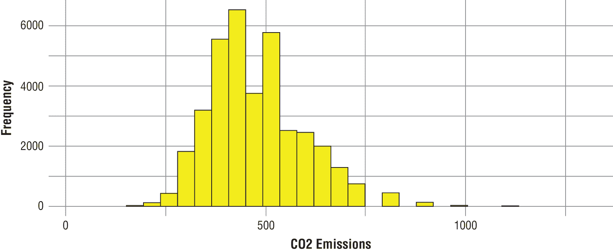

**图 3.8** CO2 排放量直方图

图表显示，大多数 CO[2] 排放值集中在每英里 250 到 750 克之间。它还显示低端和高端确实存在一些离群值。

#### 组成

组成部分的可视化展示了数据的组成成分。堆叠柱形图和饼图是两种常用的组成部分可视化。通过堆叠柱形图，你可以展示总值如何被分为若干部分，或者突出每个部分相对于总值的重要性。堆叠柱形图帮助我们回答的一些问题包括：

- 分布在子组内是如何变化的？
- 组成随时间变化的相对变化如何？
- 子组对总量的贡献了多少？

要使用 `ggplot` 创建堆叠柱形图，我们使用 `geom_bar()` 几何对象。为了说明其工作原理，我们创建了一个显示每年驱动类型组成变化的视化图。我们将 x 轴设置为 `year`，并通过设置 `fill = drive` 来显示驱动类型的组成。与直方图类似，我们不为 y 轴设置值。为了提高可读性，我们使用 `coord_flip()` 命令翻转图表的轴，使年份绘制在 y 轴上，汽车数量绘制在 x 轴上。请参见图 3.9。

```
> vehicles %>% 
 ggplot() + 
 geom_bar(mapping = aes(x =year, fill = drive), color = "black") +  
 labs(title = "Stacked Bar Chart of Drive Type Composition by Year",  
 x = "Model Year", y = "Number of Cars") + 
 coord_flip() 
  
```

结果显示，除了 1997 年外，在 2010 年之前似乎没有测试过四轮驱动车辆。我们还看到两驱车辆仅在 1984 年和 1999 年进行过测试。这两个观察结果似乎指向受影响年份中车辆驱动类型的分类方式可能存在差异。例如，可以想象除了 1997 年以及 2010 年到 2018 年之间，所有的四轮驱动车辆都被分类为全轮驱动车辆。同样的逻辑适用于将两驱车辆分类为后驱驱动或前驱。

## 数据准备

在模型构建过程之前，我们需要确保现有的数据适用于我们打算使用的机器学习方法。这一步被称为*数据准备*。数据准备涉及解决数据质量问题，如缺失数据、噪声数据、离群值数据和类别不平衡。它还涉及减少数据或修改结构。

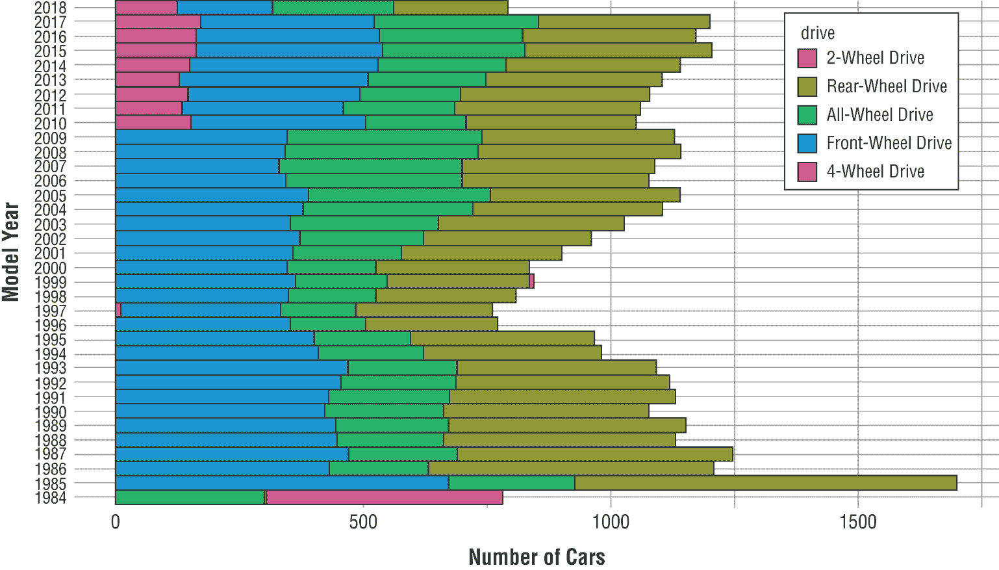

**图 3.9** 按年份划分驱动类型组成的堆叠柱形图

第一类基于匹配的插补方法被称为`hot-deck imputation`（热插补）。在这种方法中，相似的实例与缺失数据的实例属于同一个数据集。例如，考虑我们之前讨论过的学生年龄数据集。假设该数据集还包含每个学生的性别信息。如果我们随后发现数据集中只有两名男学生，其中一个缺失年龄，使用热插补法，我们将使用另一名男学生的观测到的年龄作为该名缺失年龄男学生的年龄的替代。

第二类基于匹配的插补方法被称为`cold-deck imputation`（冷插补）。通过这种方法，我们使用一个单独的数据集来获取替代值。使用说明热插补法的相同例子，通过冷插补法，我们从第二个数据集中识别一个具有非缺失年龄值的相似男学生，并用他们的年龄作为第一个数据缺失年龄的替代。请注意，我们在这里使用的匹配标准（`age`）是相当简单的。良好的基于匹配的方法要求我们在两个实例之间找到多个相似之处以建立匹配。相似性越多越好。

### 基于分布的插补

在`distribution-based imputation`（基于分布的插补）方法中，缺失特征值的替代值是根据该特征观测值的概率分布选择的。这种方法通常用于分类值，其中特征的众数（mode）作为缺失值的替代。请记住，特征的众数是频率最高的值，这意味着它是出现频率最高。

### 预测插补

`Predictive imputation`（预测插补）是使用预测模型（回归或分类）来预测缺失值。在这种方法中，具有缺失值的特征被视为因变量（类别或响应），而其他特征被视为自变量。预测插补涉及大量的开销，因为我们实际上是在实际开始建模过程之前，作为数据准备阶段的一部分训练一个模型来解决缺失值。因此，只有在绝对必要时才使用预测插补。通常情况下，这里讨论的其他插补方法之一证明就足够解决数据集中的缺失值了。

### 均值或中位数插补

对于连续特征，处理缺失值最常用的方法是`mean or median imputation`（均值或中位数插补）方法。顾如名，该方法涉及观测值的均值或中位数作为缺失值的替代。为了说明均值和中位数插补是如何工作的，我们将参考`vehicles`数据集。记得该数据集的描述性统计显示，数据集中的三个特征有缺失值——`citympg`、`displacement`和`highwaympg`。回顾一下，让我们再次查看这些特征的描述性统计。

```
> vehicles %>%
 select(citympg, displacement, highwaympg) %>%
 summary()
 
 citympg          displacement    highwaympg 
 Min.   : 6.00   Min.   :0.600   Min.   : 9.00 
 1st Qu.:15.00   1st Qu.:2.200   1st Qu.:20.00 
 Median :17.00   Median :3.000   Median :24.00 
 Mean   :17.53   Mean   :3.346   Mean   :23.77 
 3rd Qu.:20.00   3rd Qu.:4.300   3rd Qu.:27.00 
 Max.   :57.00   Max.   :8.400   Max.   :61.00 
 NA's   :6       NA's   :9       NA's   :8 
```

结果显示，`citympg`有 6 个缺失值，`displacement`有 9 个缺失值，`highwaympg`有 8 个缺失值。这些特征的中位数和均值差异不大，因此我们可以使用任何一种指标进行插补。为了说明，我们将对`citympg`和`highwaympg`使用中位数插补，对`displacement`使用均值插补。在 R 中，为了使用中位数插补法解决`citympg`特征的缺失值，我们使用`mutate`动词。


```
> vehicles <- vehicles %>%
mutate(citympg = ifelse(is.na(citympg), median(citympg, na.rm = TRUE), citympg)) %>%
 mutate(highwaympg = ifelse(is.na(highwaympg), median(highwaympg, na.rm = TRUE), highwaympg))
```

对于`displacement`，我们使用均值插补而不是中位数插补。为此，只需将`median()`函数替换为`mean()`函数即可。

```R
> vehicles <- vehicles %>%
mutate(displacement = ifelse(is.na(displacement), mean(displacement, na.rm = TRUE), displacement))
```

现在，让我们再次查看描述性统计，确保我们的数据集中不再有缺失值。

```
> vehicles %>%
 select(citympg, displacement, highwaympg) %>%
 summary()
 
 citympg          displacement    highwaympg 
 Min.   : 6.00   Min.   :0.600   Min.   : 9.00 
 1st Qu.:15.00   1st Qu.:2.200   1st Qu.:20.00 
 Median :17.00   Median :3.000   Median :24.00 
 Mean   :17.53   Mean   :3.346   Mean   :23.77 
 3rd Qu.:20.00   3rd Qu.:4.300   3rd Qu.:27.00 
 Max.   :57.00   Max.   :8.400   Max.   :61.00 
```

### Noise

## 噪声

噪声是测量误差中的随机部分。它通常是由用于收集和处理数据的工具引入的。噪声几乎存在于数据中，有时难以消除，因此，健壮的机器学习算法能够处理数据中的某些噪声至关重要。如果噪声对选定的机器学习方法产生问题，那么目标不应该是尝试消除它，而应该关注最小化它的影响。减少数据中噪声的过程被称为`smoothing`（平滑）。平滑有多种方法，包括箱平均平滑、箱边界平滑、聚类平滑和回归平滑。

## 使用箱平均平滑

`Smoothing with bin means`涉及将数据排序并分组指定数量的箱（bins），并将每个箱内的每个值替换为该箱的平均值。箱的数量由用户决定。然而，重要的是，箱的数量越大，噪声的减少就越少；箱的数量越少，噪声的减少越多。为了说明箱平均平滑是如何工作的，让我们考虑一个包含 12 个值的数据集，{4, 8, 9, 15, 21, 21, 24, 25, 26, 28, 29, 34}，这些值已按升序排列。假设我们选择将数据分为三个箱，那么每个箱中的值将是{4, 8, 9, 15}，{21, 21, 24, 25}，以及{26, 28, 29, 34}。箱中值的平均值分别为9、23和29。因此，我们将每个箱中的值替换为平均值，现在我们的数据集有了以下 12 个值：{9, 9, 9, 9, 23, 23, 23, 23, 29, 29, 29, 29}。

## 使用箱边界平滑


## 分箱边界光滑

与分箱均值光滑密切相关的替代方法是**分箱边界光滑**（smoothing with bin boundaries）。在这种方法中，我们不是用每个箱的平均值来替换值，而是根据距离将值替换为分箱边界之一。分箱边界是每个箱中最小和最大的数值。

为了说明其工作原理，让我们考虑一个包含 12 个值的相同数据集，并按升序排列：
`{4, 8, 9, 15, 21, 21, 24, 25, 26, 29, 34}`。

再次使用三个分箱，这些分箱将是：
`{4, 8, 9, 15}`，
`{21, 21, 24, 25}`，
以及
`{26, 28, 29, 34}`。

对于第一个分箱，边界是：`4` 和 `15`。为了平滑该箱中的值，我们需要评估原始集合中的每个值距离分箱边界有多近，并用最近的边界值替换每个值。

*   第一个值是 `4`，它恰好是边界，所以我们保留它为 `4`。
*   下一个值是 8，距离左边界的距离为 `8 - 4 = 4`，距离右边界的距离为 `15 - 8 = 7`。由于 8 更接近左边界，我们将其替换为左边界 `4`。
*   集合中的下一个值是 `9`，距离左边界的距离为 `9 - 4 = 5`，距离右边界的距离为 `15 - 9 = 6`。由于 9 更接近左边界，我们也将其替换为左边界 `4`。
*   集合中的最后一个值是 `15`。这是右边界，所以我们保持原样。

平滑后的分箱值将是 `{4, 4, 4, 15}`。将相同方法应用于另外两个分箱，我们的平滑数据集现在将是：
`{4, 4, 4, 15, 21, 21, 25, 25, 26, 26, 26, 34}`。

## 聚类光滑

另一种光滑方法是使用一种被称为聚类（clustering）的无监督机器学习方法。我们将在第 12 章中更详细地讨论聚类。在**通过聚类光滑**方法中，数据集中的每个实例都被分配到用户定义的任意数量簇之一。然后计算每个簇的平均值，并作为分配到该簇的每个实例的替换值。

例如，在图 3.10 中，我们有 14 个实例（彩色圆圈），具有两个特征（特征 A 和特征 B），被分为三个独立的簇（红色、蓝色和黄色虚线）。每个簇的平均值（或中心）由黑色菱形（`C1`、`C2` 和 `C3`）表示。为了通过聚类对该数据集进行光滑，我们将原始实例的值替换为簇中心的值。

## 回归光滑

**回归平滑** 涉及使用一种监督学习方法——**线性回归**对特征值进行平滑。线性回归将在第 4 章中进行详细讨论。回归平滑的核心思想是使用拟合回归线来代替原始数据。

为了说明其工作原理，让我们考虑一个包含 14 个实例的数据集，它由一个自变量 `x_i` 和一个因变量 `y_i` 组成。每个实例都由坐标 `(x_i, y_i)` 表示（参见图 3.11 中的黄色圈）。为了通过回归平滑数据，我们使用拟合线性回归线（蓝线）上的点来代替原始数据。例如，实例 `(x_1, y_1)` 的值在平滑后变为 `(x_1, y'_1)`。

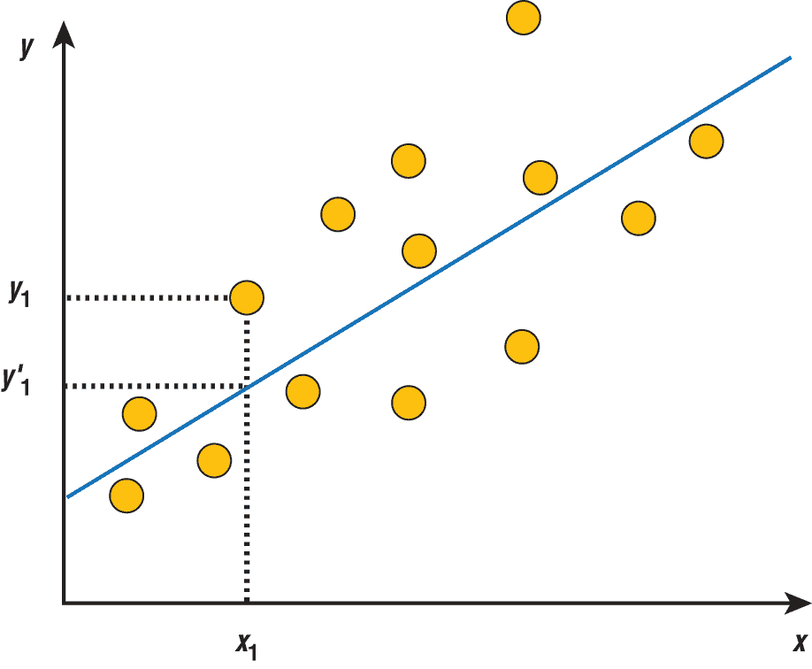

**图 3.11** 在 14 个实例上展示回归平滑方法，由 `(x_i, y_i)` 表示。

## 离群值

离群值是数据集中与其他观测值显著不同的数据点。离群值表现为与大多数其他实例特征不同的实例，或者表现为相对于该特征典型值而言不常的特征值。与噪声不同，离群值有时可能是合法的数据。因此，一旦识别出它们，我们应该花一些时间理解它们为什么存在于我们的数据中，以及它们是否有用。通常，判断一个离群值是否有用取决于学习目标。

在某些情况下，离群值仅仅是坏数据。如果是如此，则应该删除或使用我们之前讨论过的处理缺失数据的插值方法之一来替换离群值。离群值也可能是合法的数据，它们对机器学习过程可能有趣且有用。如果是这样，则应该保留离群值数据。然而，某些机器学习方法（如线性回归，参见第 4 章）对离群值特别敏感。因此，如果我们必须保留离群值数据，那么像决策树（参见第 8 章）这样能够稳健处理离群值的方法可能更合适。在第 4 章和第 5 章中，我们介绍了几种识别和处理离群值的方法。

## 类不平衡

机器学习算法从示例学习。正如我们在第 1 章中所讨论过的，这些示例被称为**训练数据**。对于分类问题，机器学习算法的目标是识别标记训练数据中的模式，帮助它为新的未标记数据正确分配标签（或类别）。算法获得的训练示例越多，它就越有信心。

让我们考虑一个热门问题：欺诈检测。这种类型的问题被称为二分类问题，因为只有两个标签（欺诈或非欺诈）。为了训练模型，我们需要提供之前的交易示例。每个示例都包含描述交易的几个特征，以及它是否欺诈的标签。

对于分类问题，属于每个类别的比例被称为**类别分布**。理想情况下，我们希望训练数据的类别分布是均匀或平衡的，以便算法有机会学习对应每个类的模式。然而，对于某些问题（例如我们的欺诈示例），情况并非如此。大多数交易都不是欺诈的。因此，分布不会平衡。它会偏向非欺诈示例。这被称为**类不平衡**。

许多二分类问题类不平衡不仅常见，而且是预期。这些问题包括垃圾邮件检测、入侵检测、流失预测、贷款违约预测等。对于这些问题，很大一部分观测值属于某一类。示例较多的类被称为**多数类**，而示例较少的类被称为**少数类**。

机器学习中的类不平衡涉及几个问题。其中一个与学习过程的有效性有关。由于类不平衡问题的性质，少数类通常是有感兴趣的类。这是因为少数类通常代表稀有但需要识别的重要事件。然而，由于少数类的示例较少，模型要有效学习与少数类对应的模式并将其与多数类的模式区分开来就更具挑战性。


针对不平衡数据进行学习的第二个问题是，它可能会导致欺骗性的乐观预测准确率。让我们考虑一个问题，99.9%的观测和未来示例都属于多数类。不需要任何机器学习，只需简单地预测所有未来示例都属于多数类，就能获得 99.9%的预测准确率。这被称为`准确率悖论`。在这里，预测准确率仅仅反映了数据集的底层类别分布。

处理机器学习中类不平衡的方法有：

- **收集更多数据：** 为了减少多数类和少数类之间分布的不平衡，我们可以尝试收集更多少数类的示例。
- **更改性能指标：** 由于我们知道在不平衡数据上预测准确率可能会具有误导性，因此在评估针对不平衡数据训练的模型时，我们应该使用其他的性能衡量。通常使用精确率（`precision`）、召回率（`recall`）、kappa 和 ROC 曲线等指标。我们在第 9 章中详细讨论了这些指标。
- **尝试不同的算法：** 某些机器学习算法对类别不平衡特别敏感，而另一些则不然。在训练模型解决类别不平衡问题时，我们应该考虑决策树和随机森林等模型，这些模型可以很好地处理类别分布不均。
- **重采样数据：** 处理类别不平衡的常用方法是通过采样改变训练数据的类别分布。这有两种常用方法：第一是从多数类中选择较少的示例作为训练数据，这被称为`欠采样`（`under-sampling`）。第二种方法是为训练数据创建更多少数类的副本，这被称为`过采样`（`over-sampling`）。创建的副本可以是现有数据的重复，也可以是基于现有少数类示例生成的合成示例。用于生成合成示例的最流行的算法之一被称为合成少数类过采样技术（`SMOTE`）。我们在第 5 章中演示了如何使用`SMOTE`处理类别不平衡。

## 数据转换

作为数据准备过程的一部分，通常需要修改或转换数据的结构或特征，以满足特定机器学习方法，增强我们理解数据的能力，或提高机器学习过程的效率。在本节中，我们将讨论几种帮助我们实现这些目标的方法。

### 归一化

标准化或归一化（`standardization or normalization`）的目标是确保整组数值具有特定的属性。这通常涉及将数据缩放到较小或指定的范围内。归一化的常用方法包括小数缩放、z-score 归一化、最小最大归一化（`min-max normalization`）和对数变换。

### 小数缩放

小数缩放（`decimal scaling`）作为一种归一化方法，涉及移动一组数值的位置，使得最大绝对值小于或等于 1。让我们考虑一个包含五个数值的数据集：`{12000, 24000, 30000, 40000, 98000}`。使用小数缩放对此数据集进行归一化，我们需要将每个原始值 `v` 除以 10 的倍数，使得数据集的最大绝对值小于或等于 1。数学上的表示如下：

**公式 3.1**
```
v' = v / 10^j
```

其中 `j` 是满足条件 `max(|v'|) <= 1` 的最小整数。对于我们的示例数据集，由于最大值是 `98000`，我们设置 `j=5`。因此，为了归一化第一个值，我们计算 `12000 / 10^5`。对于剩余的值使用这种方法，我们的数据集将变为 `{0.12, 0.24, 0.3, 0.4, 0.98}`。

为了在 R 中如何进行小数缩放，我们再次查看该特征的描述性统计：

```
> vehicles %>% select(co2emissions) %>% summary()
 co2emissions
 Min.   29.0
 1st Qu.:400.0
 Median :467.7
 3rd Qu.:555.4
 Max.   1269.6
```

显示最小值为 `29`，而最大值为 `1269.6`。考虑公式 3.1，对于 `j` 是使得 `max(|v'|) <= 1` 的最小整数。也就是说，`4` 是数字 `1269.6` 小数点前的位数。使用 `mutate` 动词，我们根据公式 3.1 为 `co2emissions` 特征创建一个新的归一化版本，名为 `co2emissions_d`。

```
> vehicles %>%
 select(co2emissions) %>%
 mutate(co2emissions_d = co2emissions / (10^4)) %>%
 summary()
 
 co2emissions     co2emissions_d 
 Min.   : 29.0    Min.   :0.00290 
 1st Qu.: 400.0   1st Qu.:0.04000 
 Median : 467.7   Median :0.04677 
 Mean   : 476.6   Mean   :0.04766 
 3rd Qu.: 555.4   3rd Qu.:0.05554 
 Max.   :1269.6   Max.   :0.12696
```

描述性统计提供了 `co2emissions` 特征在通过十位缩放归一化为 `co2emissions_d` 前后的数值统计摘要。

### Z-Score 归一化

我们查看的第二种归一化方法被称为 `z-score` 或 `零均值归一化`。其名称来源于该方法产生的归一化值均值为 0，标准差为 1。给定特征 `F` 的值 `v`，归一化后的特征值 `v'` 计算公式如下：

**公式 3.2**
```
v' = (v - mean(F)) / sd(F)
```

其中 `mean(F)` 和 `sd(F)` 分别是特征 `F` 的均值和标准差。使用十位缩放讨论中的相同示例，我们可以使用 z-score 归一化来转换五值数据集的数值。首先，需要计算这些值的均值和标准差。通过计算器，我们发现这些值分别为 `40800` 和 `33544`。然后，我们可以使用公式 3.2 中的公式来计算归一化值。基于此，为了归一化数据集中的第一个值，我们计算 `(12000 - 40800) / 33544 = -0.859`。对剩余四个值使用相同的方法，我们的归一化数据集现在将变为 `{-0.859, -0.500, -0.322, -0.0241, 1.705}`。

为了说明如何在 R 中实现 z-score 归一化，让我们再次使用 `vehicles` 数据集中的 `co2emissions` 特征。这次我们使用了之前介绍的 `mean()` 函数，以及 `sd()` 函数，后者帮助我们计算特征值的标准差。

```
> vehicles %>%
 select(co2emissions) %>%
 mutate(co2emissions_z = (co2emissions - mean(co2emissions)) / sd(co2emissions)) %>%
 summary()
 
 co2emissions     co2emissions_z 
 Min.   : 29.0    Min.   :-3.79952 
 1st Qu.: 400.0   1st Qu.:-0.6498 
 Median : 467.7   Median :-0.0748 
 Mean   : 476.6   Mean   :0.0000 
 3rd Qu.: 555.4   3rd Qu.:0.6697 
 Max.   :1269.6   Max.   :6.724
```

从描述性统计可以看出，`co2emissions` 特征 `co2emissions_z` 的归一化值范围从 `-3.79952` 到 `6.724`。注意这些值的均值为 0。

### Min-Max 归一化

通过 `min-max 归一化`，我们将原始数据从测量单位转换为由用户指定边界定义的新区间。通常情况下，新值为 0 和 1。在数学上，这种变换表示为：

**公式 3.3**
```
v' = (v - min) / (max - min)
```

其中 `min` 和 `max` 分别是原始数据的最小值和最大值。


其中 $v$ 是特征 $F$ 的原始值，$min_F$ 是特征 $F$ 的极值，$max_F$ 是特征 $F$ 的最大值，$lower$ 是归一化值用户定义的下界，而 $upper$ 是用户定义的上界。应用于我们包含五个值的数据集 $\{12000, 24000, 30000, 40000, 98000\}$，假设我们决定使用 $0$ 和 $1$ 作为转换后值的下界和上界，第一个值将变为 $\frac{12000 - 12000}{98000 - 12000} \times (1 - 0) + 0 = 0$。对于剩余的四个值应用相同的方法，我们的归一化数据集现在将变为：$\{0.000, 0.140, 0.209, 0.326, 1.000\}$。

为了演示如何在 R 中进行极值归一化，让我们再次使用 `vehicles` 数据集的 `co2emissions` 特征。我们使用 $0$ 和 $1$ 作为下界和上界。

```
> vehicles %>%
select(co2emissions) %>%
mutate(co2emissions_n = (co2emissions - min(co2emissions)) / (max(co2emissions) - min(co2emissions))) %>% summary()
```

描述性统计显示极值归一化的 `co2emissions_n` 值落在 0 到 1 之间。

#### 对数变换

目前的方法在数据是对称的情况下通常有效。对于偏态分布和跨越多个级的数据，对数变换通常更合适。在对数变换中，我们将原始数据替换为对数：

`v_log = log(v)`

注意对数变换仅适用于正值。使用的对数可以是自然对数、以 10 为底或以 2 为底。对我们包含五个值的数据集进行对数变换，$\{12000, 24000, 30000, 40000, 98000\}$，我们得到：$\{4.079, 3.380, 4.477, 4.602, 4.991\}$。

#### 离散化

`Discretization`（离散化）涉及将连续特征视为分类特征。这通常是在使用数据集训练模型之前的预处理步骤。这是因为某些算法要求自变量数据是二元的或具有有限数量的离散值。离散化过程可以使用我们之前讨论的分箱方法来实现：使用箱均值平滑和箱边界平滑。例如，我们可以根据这两种方法中任一种选择的分箱数量，有效地减少连续特征的离散值数量。除了分箱，我们还可以通过根据其与参考阈值的比较进行编码，将连续特征离散化为二值。这被称为 `dichotomization`（二分法）。例如，给定值 $\{4, 8, 9, 15, 21, 21, 24, 25, 26, 28, 29, 34\}$，我们可以将所有 $20$ 以下的值编码为 $0$，并将所有 $20$ 以上的值编码为 $1$，得到 $\{0, 0, 0, 0, 1, 1, 1, 1, 1, 1, 1, 1\}$。

### Dummy Coding（虚拟编码）

`Dummy coding`（虚拟编码）涉及使用二分（二进制）数值来表示分类特征。虚拟编码通常用于要求独立特征为数值型的算法（例如回归和 $k$-最近邻），并作为表示缺失数据的方法。为了解释虚拟编码的工作原理，请考虑 `vehicles` 数据集中的 `drive` 特征。假设该特征只有三个值，编码如下：

| Drive | Code |
| --- | --- |
| Front-Wheel Drive | 1 |
| Rear-Wheel Drive | 2 |
| All-Wheel Drive | 3 |

使用编码为 $0$ 或 $1$ 的二分值，我们可以如下表示这些特征值：

| Drive | Front-Wheel Drive | Rear-Wheel Drive | All-Wheel Drive |
| --- | --- | --- | --- |
| Front-Wheel Drive | 1 | 0 | 0 |
| Rear-Wheel Drive | 0 | 1 | 0 |
| All-Wheel Drive | 0 | 0 | 1 |

这种表示数据的方法被称为 `full coding`（全编码），这也是 `one-hot encoding`（独热编码）。注意，对于原始变量 $k$，我们有 $n$ 个变量。

我们可以在 R 语言中使用 `dummies` 包来完成虚拟编码。该包提供了 `dummy.dataframe()` 函数来实现此操作。为了演示如何在 R 中进行虚拟编码，我们再次使用 `vehicles` 数据集并尝试对 `drive` 特征进行编码，以获得与概念示例相似的结果。注意 `drive` 特征目前具有超过三个值。

```
> vehicles %>%
select(drive) %>%
summary()
 
 drive 
 2-Wheel Drive    : 491 
 Rear-Wheel Drive :13194 
 All-Wheel Drive  : 8871 
 Front-Wheel Drive:13074 
 4-Wheel Drive    : 1349
```

为了简化我们的演示，我们将 2 轮驱动车辆重新编码为前轮驱动，并将 4 轮驱动车辆重新编码为全驱。我们没有覆盖原始数据集，而是创建了 `vehicles` 数据集的副本并命名为 `vehicles2`。我们还创建了 `drive` 特征的副本并命名为 `drive2`。`drive2` 的值使用 `dplyr` 包中的 `recode()` 函数从 `drive` 重新编码。


```r
> library(tidyverse)
> vehicles2 <- vehicles %>%
 mutate(drive2 = recode(drive, "2-Wheel Drive" = "Front-Wheel Drive")) %>%
 mutate(drive2 = recode(drive2, "4-Wheel Drive" = "All-Wheel Drive")) %>%
 select(drive, drive2)
```

重复数据集（`vehicles2`）的描述性统计显示，现在 `drive2` 特征只有三个值了。

```
> head(vehicles2)

# A tibble: 6 x 2
  drive            drive2 
  <fct>            <fct> 
1 2-Wheel Drive    Front-Wheel Drive
2 2-Wheel Drive    Front-Wheel Drive
3 2-Wheel Drive    Front-Wheel Drive
4 Rear-Wheel Drive Rear-Wheel Drive 
5 Rear-Wheel Drive Rear-Wheel Drive 
6 Rear-Wheel Drive Rear-Wheel Drive

> summary(vehicles2)

 drive                              drive2 
 2-Wheel Drive    :  491   Front-Wheel Drive:13565 
 Rear-Wheel Drive :13194   Rear-Wheel Drive :13194 
 All-Wheel Drive  : 8871   All-Wheel Drive :10220 
 Front-Wheel Drive:13074 
 4-Wheel Drive    : 1349
```

我们现在准备好对 `drive2` 特征进行哑变量编码（dummy code）。然而，在此之前，我们从 `dummy.data.frame()` 函数提供的文档中学习到，该函数的输入数据集必须是一个数据框。使用 R 基础函数 `data.frame()`，我们将其转换为数据框。

```
vehicles2 <- data.frame(vehicles2)
```

然后，我们使用 `dummy.data.frame()` 函数对 `drive2` 特征进行哑变量编码。我们向函数传递了三个参数。第一个参数（`data`）是输入数据集。第二个参数（`names`）是我们想要进行哑变量编码的特征列名。第三个参数（`sep`）是用于特征名和特征值之间的字符，用来创建一个新的列名。

```
> library(dummies)
> vehicles2 <- dummy.data.frame(data = vehicles2, names = "drive2", sep = "_")
```

数据集的预览显示，`drive2` 特征现在被哑变量编码为三个新特征。

```
> head(vehicles2)

             drive drive2_Front-Wheel Drive drive2_Rear-Wheel Drive drive2_All-Wheel Drive
1    2-Wheel Drive                        1                       0                      0
2    2-Wheel Drive                        1                       0                      0
3    2-Wheel Drive                        1                       0                      0
4 Rear-Wheel Drive                        0                       1                      0
5 Rear-Wheel Drive                        0                       1                      0
6 Rear-Wheel Drive                        0                       1                      0
```

### 数据降维

在模型构建过程之前，我们有时发现数据量太大或太复杂，无法以当前的形式使用。因此，在进行机器学习过程之前，我们有时必须减少观测值的数量、变量的数量或两者兼有。在接下来的章节中，我们将讨论一些最流行的数据降维方法。

#### 采样

给定一个观测数据集，*采样*（sampling）是从数据集中选择行的子集作为整体的代表的过程。在统计学术语中，原始数据集被称为*总体*（population），而选出的子集被称为*样本*（sample）。在监督学习中，采样通常用作生成训练集和测试集的方法。这有两种常用方法，分别是*简单随机采样*（simple random sampling）和*分层随机采样*（stratified random sampling）。

##### 简单随机采样

简单随机采样过程涉及从一个无序集合中随机选择 $n$ 个实例，其中 $N$ 个实例。`n` 是样本量，`N` 是总体大小。简单随机采样有两种方法。第一种假设一旦某个实例被选中，它就不会再被选择。这被称为*不放回采样*（sampling without replacement）。为了说明这种方法的工作原理，考虑一个装有 $100$ 个彩色球的袋，并假设我们要随机选取 $20$ 个球来创建一个样本。为此，我们从袋中抽取 $20$ 次。每次抽取，随机选择一个球，记录其颜色，并将其放入另一个袋中。所有迭代中选取的球的计数代表了样本。在这种方法下，第一次从袋中抽取到某个特定球的概率是 $\frac{1}{100}$。然而，第二次从袋中抽取时，因为放入了之前之前的球，选取某个特定球的概率现在变为 $\frac{1}{99}$。在后续迭代中，选取某个特定球的概率将是 $\frac{1}{98}$、$\frac{1}{97}$，以此类推。选取某个特定球的概率会随着每次后续迭代而增加。

简单随机抽样的第二种方法假设一个实例在采样过程中可以被多次选取。这被称为`有放抽样`（random sampling with replacement）。让我们使用上一个例子中的 100 个 $100$ 彩色球来演示这种方法是如何工作的。和之前一样，我们也从袋子里随机抽取 $20$ 次来创建样本，但有一个明显的不同。这次，我们随机选择一个球，记录球的颜色，然后将选中的球放回袋子里（而不是把它放入第二个袋子）。通过这种方法，因为我们将选中的球放回了原袋，所以跨所有迭代中选取特定球的概率保持不变（$\frac{1}{100}$）。这种采样方法也称为`自助法`（bootstrapping），它是评估模型未来性能的流行方法的基础。我们将在第 9 章中详细讨论这一点。

在 R 中进行简单随机抽样，我们使用 R 的基础函数 `sample()`。假设我们想生成一个位于 $1$ 和 $100$ 之间的 20 个 $20$ 数字样本。为了实现，我们向 `sample()` 函数传递三个参数。第一个参数是待选择的项目数量。我们将其设置为 $100$，即总体量。第二个参数是待选择的项目数量。我们将其设置为 $20$，即样本量。最后一个参数指定采样应该是有放回还是不放回的方式进行。这次我们将参数设置为 `replace = FALSE`，这表示我们打算进行不放回的简单随机抽样。

```
> set.seed(1234)
> sample(100, 20, replace = FALSE)
 
 [1] 28 80 22 9 5 38 16 4 86 90 70 79 78 14 56 62 93 84 21 40
```

注意，我们在调用 `sample()` 函数之前调用了另一个 R 基础函数——`set.seed(1234)`。该函数为 R 中的随机数生成引擎设置随机种子。通过将种子设置为 $1234$，我们保证了无论何时运行随机采样代码，都能获得同一组随机数。种子值（在本例中为 $1234$）是任意的，可以是任何整数。关键在于，当我们使用这个种子时，将生成相同的随机数。在书的其余部分，每当我们运行依赖随机数生成的代码时，都会频繁使用 `set.seed()` 函数。这允许读者复现文中的结果。

现在我们已经理解了如何在 R 中进行不放回的随机抽样，通过将 `sample()` 函数中的 `replace` 参数设置为 `TRUE`，就可以轻松地进行有放回的简单随机抽样。

```
> set.seed(1234)
> sample(100, 20, replace = TRUE)
```

注意这次我们的样本中出现了重复项。例如，我们有三个 $\frac{1}{100}$。正如之前提到的，采样常用于机器学习将数据划分为训练和测试数据集。为了实现这一点，我们首先需要生成一个 $27,734$ 个数字，这些数字代表原始数据的行，我们将其作为训练集。使用 `sample()` 函数，操作如下：

```
> set.seed(1234)
> sample(36979, 27734, replace = FALSE)
```


`sample_set` 对象现在包含了 27,734 个数字，我们可以从 RStudio 的全局环境窗口看到。在这个例子中，我们显式地指定了总体量样本量的值。除了这样做，我们也可以使用 `nrow()` 函数来获取 `vehicles` 数据集的行数，并将其设置为 `sample()` 函数中的总体量。使用同样的方法，样本量将变为指定为 `nrow(vehicles) * 0.75`。

```r
> set.seed(1234)
> sample_set <- sample(nrow(vehicles), nrow(vehicles) * 0.75, replace = FALSE)
```

现在，我们可以选取样本集向量中表示的 `vehicles` 数据集的行作为我们的训练集。这指定为 `vehicles[sample_set, ]`。

```r
> vehicles_train <- vehicles[sample_set, ]
> vehicles_train
 
# A tibble: 27,734 x 12
   citympg cylinders displacement drive highwaympg make model class
     <dbl>   <dbl>   <dbl> <fct> <dbl> <fct> <fct> <fct>
 1      23      4      1.9 Fron...   31 Satu... SW      Comp...
 2      14      8      4.2 All-...   23 Audi    R8      Two ...
 3      15      8      5.3 4-Wh...   22 GMC     Yuko... Spor...
 4      25      4      1.9 Fron...   36 Satu... SC      Subc...
 5      17      6      2.5 Fron...   26 Ford    Cont... Comp...
 6      17      6      3.8 Fron...   27 Chev... Mont... Mids...
 7      20      4      2   Fron...   22 Plym... Colt... Comp...
 8      10      8      5.2 All-...   15 Dodge   W100... Pick...
 9      22      4      1.6 Rear...   26 Suzu... Vita... Spor...
10      17      6      4   Rear...   22 Niss... Fron... Pick...
# ... with 27,724 more rows, and 4 more variables: year <fct>,
# transmissiontype <fct>, transmissionspeeds <dbl>,
# co2emissions <dbl>
```

为了选择 `vehicles` 数据集中未包含在 `sample_set` 向量中的行，我们指定 `vehicles[-sample_set, ]`。这些实例构成了我们的测试集。

```r
> vehicles_test <- vehicles[-sample_set, ]
> vehicles_test
 
# A tibble: 9,245 x 12
   citympg cylinders displacement drive highwaympg make model class
    <dbl>   <dbl>   <dbl> <fct>     <dbl> <fct>  <fct> <fct>
 1     14       8     4.1 Rear...     19 Cadi... Brou... Larg...
 2     18       8     5.7 Rear...     26 Cadi... Brou... Larg...
 3     19       4     2.6 2-Wh...     20 Mits... Truc... Pick...
 4     18       4     2   2-Wh...     20 Mazda   B200... Pick...
 5     23       4     2.2 2-Wh...     24 Isuzu   Pick... Pick...
 6     18       4     2   2-Wh...     24 GMC     S15 ... Pick...
 7     21       4     2   2-Wh...     29 Chev... S10 ... Pick...
 8     19       4     2   2-Wh...     25 Chev... S10 ... Pick...
 9     26       4     2.2 2-Wh...     31 Chev... S10 ... Pick...
10     21       4     2.2 2-Wh...     28 Dodge   Ramp......
# ... with 9,235 more rows, and 4 more variables: year <fct>,
# transmissiontype <fct>, transmissionspeeds <dbl>,
# co2emissions <dbl>
```

现在我们有了两个代表训练集和测试集的对象——一个名为 `vehicles_train` 的 27,734 样本数据集，和一个名为 `vehicles_test` 的 9,245 样本数据集。

### 分层随机采样

分层随机采样是对简单随机采样方法的一种改进，它确保样本内特征值的分布与整体总体中相同特征的分布一致。为了实现这一点，首先将原始数据（总体）中的实例分为名为 `strata`（层）的子组。然后从每个层内进行随机采样。实例在层中的归属关系取决于它与该层内其他实例的共同属性。例如，使用颜色进行划分时，蓝色层内的所有实例的颜色属性均为蓝色。

为了说明分层抽样的工作原理，让我们再次考虑之前关于 100 个弹珠袋子的例子。这次，我们假设 100 个弹珠中有 50 个是蓝色的，30 个是红色的，20 个是黄色的。为了从原始集合根据颜色生成 20 个弹珠的分层样本，我们首先需要根据颜色将弹珠分为三个层，然后从每个层中随机采样。由于 20 是总体的五分之一，我们也需要从每个层中抽取五分之一的弹珠。这意味着对于蓝色层，我们抽取 `1/5 * 50 = 10` 个弹珠；对于红色层，我们抽取 `1/5 * 30 = 6` 个弹珠；对于黄色层，我们抽取 `1/5 * 20 = 4` 个弹珠。这让我们总得到了 20 个弹珠，它们保持了与总体相同的颜色分布。

有多个 R 包提供了分层采样的函数。其中一个就是 `caTools` 包。该包中有一个名为 `sample.split()` 的函数，允许我们从数据集中生成分层样本。为了说明该函数的功能，我们将使用 `drive` 特征从 `vehicles` 数据集中生成分层样本。在开始之前，让我们先查看 `vehicles` 数据集中 `drive` 特征的比例分布。

```r
> vehicles %>%
  select(drive) %>%
  table() %>%
  prop.table()
.
    2-Wheel Drive  Rear-Wheel Drive  All-Wheel Drive 
      0.01327781       0.356797142      0.260162602 
Front-Wheel Drive      4-Wheel Drive 
      0.349593496       0.037940379
```

现在，假设我们打算选择数据的 1% 作为样本。使用简单随机采样方法，`drive` 特征值的比例分布如下：

```r
> set.seed(1234)
> sample_set <- sample(nrow(vehicles), nrow(vehicles) * 0.01, replace = FALSE)
> vehicles_simple <- vehicles[sample_set, ]
> vehicles_simple %>%
   select(drive) %>%
   table() %>%
   prop.table()
.
    2-Wheel Drive  Rear-Wheel Drive  All-Wheel Drive 
      0.008130081       0.344173442      0.260162602 
Front-Wheel Drive      4-Wheel Drive 
      0.349593496       0.037940379
```

请注意，虽然比例分布与原始数据集相似，但它们并非完全相同。例如，原始数据集中两轮驱动汽车的分布为 1.3 百比，而在样本数据集中为 0.8 百比。为了确保样本中 `drive` 值的分布尽可能接近原始数据集，我们需要使用 `drive` 特征对数据集进行分层，并从每个层中进行随机采样。这正是 `caTools` 包中 `sample.split()` 函数大用用场。我们向该函数传递两个参数。第一个参数是我们打算用于分层的特征。在我们的案例中，它就是 `vehicles$drive`。第二个参数指定了应使用原始数据的多少比例创建样本（`SplitRatio`）。由于我们打算使用 1 百比的数据作为样本，因此我们将该值设置为 0.01。

```r
> library(caTools)
> set.seed(1234)
> sample_set <- sample.split(vehicles$drive, SplitRatio = 0.01)
```

与 `sample()` 函数类似，`sample.split()` 函数返回一个样本集向量。然而，这个向量并没有列出要选取的行号。相反，该向量是一个与原始数据大小相同的逻辑向量，被选取的元素（代表实例）被设置为 `TRUE`，未被选取的元素设置为 `FALSE`。因此，我们使用 `subset()` 函数来选择对应于 `TRUE` 的样本行。

```r
> vehicles_stratified <- subset(vehicles, sample_set == TRUE)
```

现在，让我们来看看样本中 `drive` 特征值的比例分布。

```r
> vehicles_stratified %>%
 select(drive) %>%
 table() %>%
 prop.table()
.
    2-Wheel Drive  Rear-Wheel Drive   All-Wheel Drive
       0.1351        0.3576        0.2405
Front-Wheel Drive     4-Wheel 
       0.3505        0.3513
```

我们可以看到，`drive` 特征值的比例分布现在比原始数据集接近得了。这就是分层采样发挥作用的地方。

#### 降维

正如其义所示，降维简单是指在训练之前减少特征（维度）的数量。降维是一个重要的步骤，因为它可以减少时间和存储空间，改进可视化效果，并有助于避免所谓的“维度灾咒”现象。

##### 特征选择

特征选择（或*变量选择*）背后的思想是识别出一组最少的冗余或无关的特征，这些特征可以在不影响性能的情况下被移除。在我们介绍的大多数机器学习方法中，我们

##### 特征提取

特征提取，也被称为*特征投影*，是使用数学函数将高维数据转换为低维数据。与特征选择不同（后者的最终集合是原始集合的子集），特征提取产生的是完全不同的特征。虽然降维是一种有效的方法，但它可能存在缺点——创建的特征并不容易解释。两种最流行的特征提取技术是*主成分分析 (PCA)*和*非负矩阵分解 (NMF)*。对于那些并详细了解这两种方法在本书范围之外的工作原理的读者，我们参考了《统计学习方法》（The Elements of Statistical Learning）。

## 练习题

1. <label>1</label> 对于 `vehicles` 数据集中的手动挡车辆，列出 `drive`、`make`、`model` 和 `class` 变量的描述性统计。

2. <label>2</label> 使用最小最大归一化方法，对 `vehicles` 数据中的 `co2issions` 变量进行归一化，使其处于 1 到 10 之间。显示原始和归一化变量的描述性统计。

3. <label>3</label> 在 `vehicles` 数据集中，对 `co2issions` 变量进行离散化，500 以上为 High，500 以下为 Low。使用离散化变量作为层，生成数据集 2 百比数据的分层样本。显示原始总体和样本中离散化变量值的比例分布。

## 第二部分

回归

1. 第 4 章：线性回归

2. 第 5 章：逻辑回归

# 第 4 章

线性回归

在前面的三章中，我们介绍了机器学习背后的基本思想、我们在书中使用的统计建模工具（R 和 RStudio），以及如何为机器学习过程管理数据。在本章中，我们将介绍书中涵盖的第一种监督学习方法。当我们希望通过生成数值预测来回答问题时，就会使用这种方法，例如：根据广告的类型和金额预测潜在客户产生的收入，根据天气状况预测某天租赁自行车的数量，或者根据其他特征预测特定患者的血压。这种方法被称为*回归*。回归技术是一类机器学习算法，它们通过量化数值值之间关系的大小和强度来预测数值响应。在本章中，我们将引入*线性回归*作为一种监督学习方法，它尝试使用观测数据拟合一个线性预测函数来估计未观测数据。

在本章结束时，你将学习以下内容：

* 简单线性和多元线性回归背后的统计原理

* 如何使用 R 拟合简单线性回归模型

* 如何评估、解释和应用简单线性回归模型的结果

* 如何扩展问题描述以包含多个预测变量，并使用 R 拟合多元线性回归模型

* 如何评估、解释、改进和应用多元线性回归模型的结果

* 简单线性回归和多元线性回归的优缺点

# 自行车租赁与回归

在本章中探索线性回归时，我们将使用一个真实世界的案例来支持我们的学习。我们的数据集来自 Capital Bike Share，这是一个为华盛顿特区地区提供服务的自行车租赁计划。我们将使用的数据集将作为随本书附带的电子资源的一一部分提供给您。（有关访问电子资源的更多信息，请参阅引言。）它包含了 2011 年至 2012 年两年内的每日自行车租赁信息。

想象一下我们被华盛顿特区市长办公室聘请，帮助他们应对日益严严重的交通拥堵问题。该市推出了一项低成本的共享单计划，试图减少道路上的汽车数量。然而，在取得早期成功后，该市开始收到越来越多关于某些日子自行车短缺以及其他日子自行车供应过剩的投诉。为了解决这个问题，该市决定与一家全国性的自行车租赁公司合作，管理市内的自行车供应。作为合作伙伴协议的一部分，该市需要向自行车租赁公司提供全城的每日需求估计。自该计划启动以来，该市收集了每日租赁自行车的数量，以及相应的天气和季节数据。

数据集包含了几个用于我们分析的天气相关变量：

- `temperature` 是以华氏度为单位的每日气温。

- `humidity` 是每日平均湿度，表示为 0.0 到 1.0 之间的小数。

- `windspeed` 是每日平均风速，单位为英里/小时。

- `realfeel` 是根据温度、湿度、云量和其他天气因素得出的测量值，用于描述户外人员感受到的温度。其单位为华氏度。

- `weather` 是一个用于描述天气条件的分类变量，使用以下量表：

    - 1: 晴朗或多云

    - 2: 小雨


- 3: 大雨

除了这些天气信息外，我们还有一些描述每天特征的变量。这些包括：

- `date` 是每个实例中描述的日历日期，包括日、月、年。
- `season` 是记录的日历季节，表示如下：
    - 1: 冬季
    - 2: 春季
    - 3: 夏季
    - 4: 秋季
- `weekday` 是记录的星期几，表示从 0（周日）到 6（周六）的整数。
- `holiday` 是一个二值变量，如果是节假日则为 1，否则为 0。

最后，数据集包含一个名为 `rentals` 的变量，描述了给定日期内发生的自行车租赁交易次数。作为市长的顾问，我们的任务是使用这些观测数据开发一个模型，根据所提供的部分或全部特征，预测全城的每日自行车租赁 `rentals` 需求。这将帮助潜在的合作伙伴预测某天的自行车需求，使他们能够预测收入，并确保街道上有足够的自行车来满足骑者的需求。

根据提供的问题和数据，我们需要回答的一些问题包括：

- 自行车租赁数量与任何其他变量之间是否存在关系？
- 如果存在关系，这种关系有多强？
- 这种关系是线性的吗？
- 如果关系是线性的，我们能很好地量化一个变量对自行车租赁数量的影响？
- 在给定每个相关变量的未来值的情况下，我们能多准确地预测自行车租赁的数量？

在本章结束时，我们将使用线性回归和相关技术回答每一个问题。

## 变量之间的关系

为了开始回答我们在上一节中提出的自行车租赁问题，我们需要理解我们的数据以及每个变量是如何相互相关的。我们陈述的业务问题是能够有效预测给定当天全城的自行车租赁数量。为了做到这一点，我们必须了解什么因素会导致租赁量的增加或减少。因此，我们应该首先评估并量化 `rentals` 与数据集中其他变量之间的关系。

### 相关性

`相关` 是用于描述和量化两个变量之间关系的统计术语。它提供了关系的单一数值，被称为`相关系数`。衡量相关性有多种方法；但对于线性关系，皮尔逊相关系数`是最常用的。在数学上，两个随机变量 `x` 和 `y` 之间的相关系数表示如下：

```
ρ = cov(x, y) / (σ_x * σ_y)
```

其中 `cov(x, y)` 是 `x` 和 `y` 的协方差；`σ_x` 是 `x` 的标准差；`σ_y` 是 `y` 的标准差。在解释两个变量之间的皮尔逊相关系数的强度时，常用的规则是：系数绝对值 0 到 0.3 视为不存在或弱相关，0.3 到 0.5 以上为中等相关，0.5 以上为强相关。取值范围从 -1 到 +1，绝对值越大表示关系越强。负系数意味着两个变量之间存在反向关系。也就是说，当一个变量增加时，另一个变量会减少，反之亦然。相反地，正系数意味着当一个变量增加时，另一个变量也增加。

现在，让我们来看看自行车租赁数据集，看看我们是否可以使用皮尔逊相关系数来量化 `rentals`（租赁量）与其他某些变量之间的关系。图 4.1 显示了 `rentals` 与其他三个变量（`humidity` 湿度、`windspeed` 风速和 `temperature` 温度）对比的散点图。这三张图都显示，每个变量与 `rentals` 之间似乎存在某种关系。我们可以通过观察散点图的形状来发现这些关系。

让我们从 `temperature` 开始。租赁量与温度的关系图表显示了这些变量之间存在很强的关系。从 20 度左右的低温开始，自行车租赁量很低。随着温度升高，租赁量稳步增加，直到我们达到一个点，在过热的日子里租赁量开始下降。或者，用统计学的语言来说，当温度低于 70 度时，`temperature` 与 `rentals` 之间存在强正相关，当温度高于 70 度时，则存在中度负相关。这在直觉上是合理的：70 度的一天听起来是骑行的好天气！

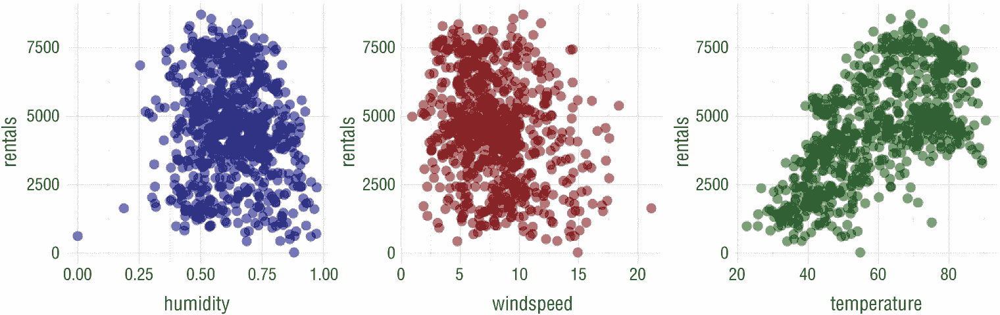

图 4.1 散点图展示了因变量 rentals 与三个自变量中每一个变量（湿度、风速和温度）之间的关系

然而，`humidity` 与 `rentals` 之间以及 `windspeed` 与 `rentals` 之间的关系没有那么强。我们注意到在这两个天气属性的极值情况下存在轻微的负相关。当湿度超过 75% 或风速超过每小时 10 英里时，租赁量开始下降。

视觉检查可以让我们对这些变量之间关系的强度有一个感觉，但它只允许我们用不精确的术语来描述这些关系，例如“轻微负相关”或“强正相关”。视觉检查无法让我们量化这些关系的强度。这就是皮尔逊相关系数可以派上用场。我们将使用 R 来计算它。

首先，我们需要加载数据集。为了本文的讨论，我们将假设数据集存储在当前工作目录中。关于加载数据集选项的更多信息，请参阅介绍部分。以下是加载数据集的代码：

```
> library(tidyverse)
> bikes <- read_csv("bikes.csv")
```

一旦加载了数据集，让我们尝试计算其中一些统计值。首先，我们将使用 R 内置的 `cov()` 函数计算 `humidity` 和 `rentals` 的协方差。

```
> cov(bikes$humidity, bikes$rentals)
 
[1] -27.77323
```

这告诉我们 `humidity` 与 `rentals` 之间的协方差为 -27.77。同样，我们可以使用 R 的 `sd()` 函数计算两个变量的标准差。

```
> sd(bikes$humidity)
 
[1] 0.1424291
 
> sd(bikes$rentals)
 
[1] 1937.211
```

请记住，标准差的单位与原始变量单位相同，因此湿度的标准差为 14.2%，而自行车租赁的标准差为 1937.2 次。

然后我们可以通过将公式 4.1 中的公式写成 R 代码来计算皮尔逊相关系数。

```
> pearson <- cov(bikes$humidity, bikes$rentals) / 
 (sd(bikes$humidity) * sd(bikes$rentals))
 
> pearson
 
[1] -0.1006586 
```

这是执行此计算的方法。R 通过提供 `cor()` 函数直接计算两个随机变量的皮尔逊相关系数，为我们节省了计算协方差和标准差的步骤。

```
> cor(bikes$humidity, bikes$rentals)
```

### 回归

*回归分析*是一类用于建模变量复杂数值关系的统计方法。通常，回归分析涉及三个关键部分：

- 单个数值因变量，代表我们想要预测的值。该变量被称为*因变量* (Y)。
- 一个或多个自变量 (X)，我们认为可以用它们来预测因变量。这些变量被称为*预测变量*。
- *系数* (β)，描述了预测变量与因变量之间的关系。我们在分析时并不知道这些值，并使用回归技术来估计它们。系数构成了回归模型。

这三个部分之间的关系通过一个从自变量空间到因变量空间的函数来表示，形式如下：

(4.2)
```
Y ≈ f(X, β)
```

这可以被理解为响应变量 `Y` 被近似建模为函数 `f`，其中 `f` 是一个估计函数，用于量化观测预测变量 `X` 与一组系数 `β` 之间的相互作用。回归的目标是根据观测到的 `X` 值确定最能估计 `Y` 值的 `β` 值。详见图 4.2。

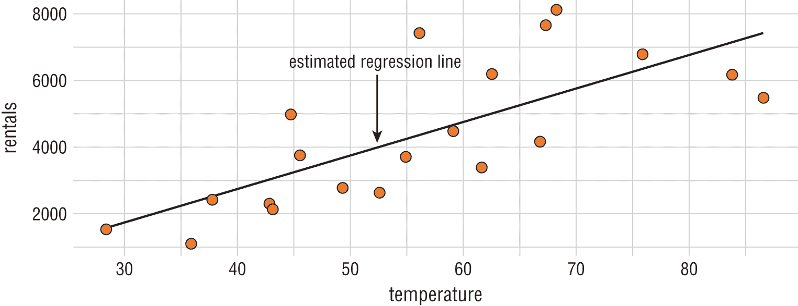

图 4.2 自行车租赁数据样本 (n=20) 的估计回归线和实际值

## 简单线性回归

线性回归是回归的一个子集，它假设预测变量 `X` 与响应变量 `Y` 之间的关系是线性的。当我们只有一个预测变量时，可以使用斜率-截距格式写出回归方程。

(4.3)
```
Y ≈ f(X, β) ≈ β₀ + β₁X
```

在这里，`β₀` 和 `β₁` 都是未知的参数，分别代表截距和斜率。`β₁` 是 `X` 每增加一个单位时 `Y` 的预期增量，而 `β₀` 是 `X = 0` 时 `Y` 的预期值。这种使用单一因变量来预测因变量的方法被称为简单线性回归。

在更具体的情况下，假设对于我们的自行车租赁数据，我们想使用简单线性回归对温度与租赁之间的关系进行建模。我们可以将方程 4.3 重写如下：

(4.4)
```
rentals ≈ f(temperature, β) ≈ β₀ + β₁ × temperature
```

如果我们假设这些变量之间的关系是线性的，那么通过简单线性回归，我们的目标是找到一条最拟合数据的单线，如图 4.3 所示。


如果我们假设这些变量之间的关系是线性的，那么通过简单线性回归，我们的目标是找到一条最拟合数据的单线，如图 4.3 所示。

### (4.5) 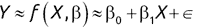

```
<math display="block" overflow="scroll" xmlns="http://www.w3.org/1998/Math/MathML" xmlns:xlink="http://www.w3.org/1999/xlink"><mrow> <mi>Y</mi> <mo>&#8781;</mo> <mi>f</mi> <mrow> <mo>(</mo> <mrow> <mi>X</mi> <mi mathvariant="normal">,</mi> <mspace width="0.25em"/> <mi>&#946;</mi> </mrow> <mo>)</mo> </mrow> <mo>&#8781;</mo> <msub> <mi>&#946;</mi> <mn>0</mn> </msub> <mo>+</mo> <msub> <mi>&#946;</mi> <mn>1</mn> </msub> <mi>X</mi> <mo>+</mo> <mo>&#8712;</mo> <mspace width="thickmathspace"/></mrow> </math>
```

在方程 4.5 中，<math display="inline" overflow="scroll" xmlns="http://www.w3.org/1998/Math/MathML" xmlns:xlink="http://www.w3.org/1999/xlink"><mo>&#8712;</mo></math> 代表我们所有估计误差的总和。最小二乘法（OLS）的目标是找到 <math display="inline" overflow="scroll" xmlns="http://www.w3.org/1998/Math/MathML" xmlns:xlink="http://www.w3.org/1999/xlink"><mrow><msub><mi>&#946;</mi><mn>0</mn></msub></mrow></math> 和 <math display="inline" overflow="scroll" xmlns="http://www.w3.org/1998/Math/MathML" xmlns:xlink="http://www.w3.org/1999/xlink"><mrow><msub><mi>&#946;</mi><mn>1</mn></msub></mrow></math> 的最佳值，以使 <math display="inline" overflow="scroll" xmlns="http://www.w3.org/1998/Math/MathML" xmlns:xlink="http://www.w3.org/1999/xlink"><mo>&#8712;</mo></math> 最小，这也被称为*残差平方和*或*误差平方和*。

用数学术语来说，令我们数据中的观测值数量为 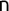<math display="inline" overflow="scroll" xmlns="http://www.w3.org/1998/Math/MathML" xmlns:xlink="http://www.w3.org/1999/xlink"><mi mathvariant="normal">n</mi></math>，直线估计的系数表示为 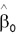<math display="inline" overflow="scroll" xmlns="http://www.w3.org/1998/Math/MathML" xmlns:xlink="http://www.w3.org/1999/xlink"><mrow><msub><mrow><mover><mi>&#946;</mi><mo>&#8743;</mo></mover></mrow><mn>0</mn></msub></mrow></math> 和 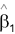<math display="inline" overflow="scroll" xmlns="http://www.w3.org/1998/Math/MathML" xmlns:xlink="http://www.w3.org/1999/xlink"><mrow><msub><mrow><mover><mi>&#946;</mi><mo>&#8743;</mo></mover></mrow><mn>1</mn></msub></mrow></math>，每对 `temperature` 和 `rentals` 的观测值表示为 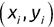<math display="inline" overflow="scroll" xmlns="http://www.w3.org/1998/Math/MathML" xmlns:xlink="http://www.w3.org/1999/xlink"><mrow><mo>(</mo><mrow><msub><mi>x</mi><mi>i</msub><mi mathvariant="normal">,</mi> <mspace width="0.25em"/><msub><mi>y</mi><mi>i</msub></mrow><mo>)</mo></mrow></math>，其中 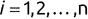<math display="inline" overflow="scroll" xmlns="http://www.w3.org/1998/Math/MathML" xmlns:xlink="http://www.w3.org/1999/xlink"><mrow><mi>i</mi><mo>=</mo><mn>1</mn><mo>,</mn>2</mn><mo>,</mo><mspace width="0.25em"/><mi mathvariant="normal">8230</mi><mspace width="0.25em"/><mi>n</mrow></math>。那么，我们将基于给定值 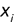<math display="inline" overflow="scroll" xmlns="http://www.w3.org/1998/Math/MathML" xmlns:xlink="http://www.w3.org/1999/xlink"><mrow><msub><mi>x</mi><mi>i</msub></mrow></math> 对 Y 的预测 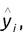<math display="inline" overflow="scroll" xmlns="http://www.w3.org/1998/Math/MathML" xmlns:xlink="http://www.w3.org/1999/xlink"><mrow><msub><mrow><mover><mi>y</mi><mo>&#8743;</mo></mover></mrow><mi>i</msub></mrow></math>视为：

(4.6) 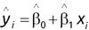

```
<math display="block" overflow="scroll" xmlns="http://www.w3.org/1998/Math/MathML" xmlns:xlink="http://www.w3.org/1999/xlink"><mrow> <msub><mrow><mover><mi>y</mi><mo>&#8743;</mo></mover></mrow><mi>i</msub></mrow> <mo>=</mo> <msub><mrow><mover><mi>&#946;</mi><mo>&#8743;</mo></mover></mrow><mn>0</mn></msub> <mo>+</mo> <msub><mrow><mover><mi>&#946;</mi><mo>&#8743;</mo></mover></mrow><mn>1</mn></msub> <msub><mi>x</mi><mi>i</msub></mrow> </math>
```

在任何给定点，Y 的观测值 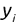<math display="inline" overflow="scroll" xmlns="http://www.w3.org/1998/Math/MathML" xmlns:xlink="http://www.w3.org/1999/xlink"><mrow><msub><mi>y</mi><mi>i</msub></mrow></math> 与 Y 的预测值 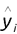<math display="inline" overflow="scroll" xmlns="http://www.w3.org/1998/Math/MathML" xmlns:xlink="http://www.w3.org/1999/xlink"><mrow><msub><mrow><mover><mi>y</mi><mo>&#8743;</mo></mover></mrow><mi>i</msub></mrow></math> 之间的距离（即残差）表示如下：

(4.7) 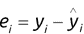

```
<math display="block" overflow="scroll" xmlns="http://www.w3.org/1998/Math/MathML" xmlns:xlink="http://www.w3.org/1999/xlink"><mrow> <msub><mi>e</mi><mi>i</msub> <mo>=</mo> <msub><mi>y</mi><mi>i</msub> <mo>&#8722;</mo> <msub><mrow><mover><mi>y</mi><mo>&#8743;</mo></mover></mrow><mi>i</msub></mrow> </math>
```

残差平方和可以表示如下所示：

(4.8) 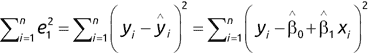


<math display="block" overflow="scroll" xmlns="http://www.w3.org/1998/Math/MathML" xmlns:xlink="http://www.w3.org/1999/xlink"><mrow> <munderover <mstyle vsize="140" displaystyle="true"><mo>&#8721;</mo> </mstyle> <mrow><mi>i</mi><mo>=</mo><mn>1</mn></mrow> <mi>n</mi> </munderover> <mspace width="0.25em"/>< <mspace width="0.25em"/>< <mspace width="0.25em"/>< <mspace width="0.25em"/>< <mspace width="0.25em"/>< <mspace width="0.25em"/>< <msubsup <mi>e</mi> <mn>1</mn> <mn>2</mn> </msubsup> <mo>=</mo> <munderover <mstyle vsize="140" displaystyle="true"><mo>&#8721;</mo> </mstyle> <mrow><mi>i</mi><mo>=</mo><mn>1</mn></mrow> <mi>n</mi> </munderover> <mspace width="0.25em"/>< <mspace width="0.25em"/>< <mspace width="0.25em"/>< <mspace width="0.25em"/>< <mspace width="0.25em"/>< <mspace width="0.25em"/>< <msup <mrow><mrow><mo>(</mo><mrow><msub <mi>y</mi><mi>i</msub> <mo>&#8722;</mo> <msub><mrow><mover><mi>y</mi><mo>&#8743;</mo></mover></mrow><mi>i</msub></mrow> <mo>)</mo> </mrow> </mrow> <mn>2</mn> </msup> </mrow> </math>

通过微积分可以证明，使残差平方和最小化的 $\beta_1$ 值如下：

(4.9) $\frac{\frac{1}{n}\sum_{i=1}^{n} (x_i - \bar{x})(y_i - \bar{y})}{\frac{1}{n}\sum_{i=1}^{n} (x_i - \bar{x})^2}$

其中 $\bar{x}$ 和 $\bar{y}$ 分别代表 $X$ 和 $Y$ 的样本均值。仔细观察可以发现 $\frac{1}{n}\sum_{i=1}^{n} (x_i - \bar{x})(y_i - \bar{y})$ 的分子是 $x$ 和 $y$ 的协方差，分母是 $x$ 的方差。基于此，我们可以将方程重写为：

(4.10) $\frac{Cov(x, y)}{Var(x)}$

既然我们已经得出了 $\beta_1$ 的值，且 $\bar{y} = \beta_0 + \beta_1\bar{x}$，那么 $\beta_0$ 的最优值可以推导出如下：

(4.11) $\beta_0 = \bar{y} - \beta_1\bar{x}$

利用这些公式，我们可以使用 R 语言中的 `cov()`、`var()` 和 `mean()` 函数通过 OLS 方法来推导出 $\beta_0$ 和 $\beta_1$ 的值：

```
> B1 <- cov(bikes$temperature, bikes$rentals) / var(bikes$temperature)
> B1
[1] 78.4959
> B0 <- mean(bikes$rentals) - B1 * mean(bikes$temperature)
> B0
[1] -166.876
```

根据我们的结果，对于给定的 $x_i$（`temperature`），我们对 $y_i$（`rentals`）的预测定义如下：

(4.12) $y_i = -166.9 + 78.5x_i$

换句话说，

(4.13) $rentals = -166.9 + 78.5 \times temperature$

这意味着温度每增加一个单位，该城市的自行车租赁量就会相应增加约 78 辆。

我们还可以将天气预报代入此方程，以预测未来某天的租赁数量。之前，我们通过观察图 4.3 估计 65 度的天气会导致 5200 辆自行车租赁。我们可以使用方程 4.13 生成一个更具体的估值。

(4.14) $rentals = -166.9 + 78.5 \times 65 = 4935.6$

R 语言中的 `lm()` 函数自动化了我们在上一节中学习的最小二乘法（OLS）技术。我们不需要分别推导出 $\hat{\beta}_0$ 和 $\hat{\beta}_1$ 的值，只需通过将数据集传递给 `lm()` 函数并指定预测变量和响应变量，即可构建线性模型。让我们使用与 OLS 方法相同的变量对（`temperature` 温度和 `rentals` 租赁量）来构建一个简单的线性回归模型，将其命名为 `bikes_mod1`。

```
> bikes_mod1 <- lm(data=bikes, rentals~temperature)
```

`lm()` 函数接受两个参数。第一个参数指定我们的数据集（`bikes`）。第二个参数告诉函数，我们打算根据 `temperature`（我们的预测变量）来预测 `rentals`（我们的响应变量）。

### 评估模型

直接输入模型名称 `bikes_mod1` 即可得到关于模型的一些基本信息。

```
> bikes_mod1
 
Call:
lm(formula = rentals ~ temperature, data = bikes)
 
Coefficients:
(Intercept) temperature 
     -166.9        78.5
```

注意，系数的值看起来非常熟悉（参见方程 4.12）。截距系数 (-166.9) 与我们在上一节中计算出的 $\hat{\beta}_0$ 值相同，且温度系数 (78.5) 与 $\hat{\beta}_1$ 也相同。因此，这两种方法得到的估计直线是相同的。为了获取关于模型的更详细信息，我们运行 `summary(bikes_mod1)` 命令。

```
> summary(bikes_mod1)
 
Call:
lm(formula = rentals ~ temperature, data = bikes)
 
Residuals:
    Min       1Q     Median       3Q       Max
-4615.3  -1134.9     -104.4   1044.3    3737.8
 
Coefficients:
               Estimate   Std. Error   t value   Pr(>|t|)
(Intercept)    -166.877      221.816   -0.752     0.452
temperature      78.495        3.607   21.759    <2e-16
---
Signif. codes:  0 '***' 0.001 '**' 0.01 '*' 0.05 '.' 0.1 ' ' 1
Residual standard error: 1509 on 729 degrees of freedom
Multiple R-squared:  0.3937,  Adjusted R-squared:  0.3929
F-statistic: 473.5 on 1 and 729 DF,  p-value: <2e-16
```

输出现在为我们提供了残差的信息、系数的额外细节，以及残差标准误差、R 方、调整后 R 方和 F 统计诊断。这比之前的输出要详细得多。接下来的几节将讨论每个部分的含义。

#### 残差 (Residuals)

残差部分显示了残差的统计摘要（最小值、第一分位数、中位数、第三分位数和最大值）。

```
Residuals:
    Min       1Q     Median       3Q       Max
-4615.3  -1134.9     -104.4   1044.3    3737.8
```

记得残差是观测值减去预测值，即预测误差。模型摘要显示最小残差为 -4615.3，这意味着至少在一个 `temperature` 情况下，我们的模型多预测了 4615 辆 `rentals`。同样，最大残差为 3737.8，意味着至少在一个 `temperature` 情况下，我们的模型少预测了 3737 辆 `rentals`。

我们还可以查看中位数残差以感知典型的模型性能。中位数是数据的中间值。在这种情况下，中位数残差 (-104.4) 意味着至少一半的残差为负。也就是说，在超过 50% 的情况下，预测值大于观测值。

#### 系数 (Coefficients)

模型摘要的系数部分提供了关于预测变量及其系数的重要信息。

```
Coefficients:
               Estimate   Std. Error   t value   Pr(>|t|)
(Intercept)    -166.877      221.816   -0.752     0.452
temperature      78.495        3.607   21.759    <2e-16
---
Signif. codes:  0 '***' 0.001 '**' 0.01 '*' 0.05 '.' 0.1 ' ' 1
```

第一个字段 (`Estimate`) 显示了每个参数的拟合值。这些是我们之前讨论过的系数：$\hat{\beta}_0$ 和 $\hat{\beta}_1$。

第二个字段 (`Std. Error`) 显示了标准误差，它是参数估计的标准差。对于估计而言，标准误差越低，估计就越准确。

最后两个字段 (`t value` 和 `Pr(>|t|)`) 显示了每个参数的 t 检验和单样本 t 检验的 p 值。在不涉及这些值背后的统计原理的情况下，需要注意的是，它们评估了参数是否显著。也就是说，它们估计了预测能力。为了便于解释，输出提供了 0 到 1 之间的显著性水平，编码为 `***`、`**`、`*`、`.` 和 ` `（空单元格）。请注意，这些代码表示的是区间而不是离散的值。每个参数估计都分配了这些代码之一。在我们的输出中，我们看到 `temperature` 特征的显著性代码为 `***`，这意味着它的显著性水平在 0 到 0.001 之间。显著性水平越低，特征的预测能力越强。在实践中，任何显著性水平为 0.05 或低的特征都是统计显著的，并且是良好候选对象。

#### 诊断 (Diagnostics)

`lm()` 模型摘要在末尾也提供了一个诊断值部分。我们可以使用这些诊断值来评估回归模型的整体准确性和实用性。诊断部分包含了关于*残差标准误差 (RSE)*、*多元 R 方*、*调整后 R 方*以及*F 统计量*的信息。

##### 残差标准误差 (Residual Standard Error)

残差标准误差是模型误差的标准差。对于我们的模型，RSE 为：

```
Residual standard error: 1509 on 729 degrees of freedom
```

这是预测响应偏离观测数据的平均量。在我们的输出情况下，RSE 显示实际租赁量与我们的预测平均偏了 1509 辆。RSE 是模型*拟合优度*的衡量标准。因此，1509 的好坏取决于问题的背景。通常情况下，RSE 越小，我们对模型良好拟合数据就越有信心。

自由度值提供了我们模型中可变数据点的数量。在我们的输出中，自由度值为 729。这是通过从数据集的观测数量中减去包括截距在内的模型特征数量计算出的。我们的自行车租赁数据集有 731 个观测值，并基于两个特征：`temperature`（温度）和 y 截距建立了模型。因此，模型中的自由度为 731-2 = 729。

### 多元 R 方和调整 R 方（Multiple and Adjusted R-squared）

R 方统计量提供了相对于剩余标准误差（RSE）的另一种拟合优度衡量方法。与提供以 Y 为单位的拟合优度绝对测量的 RSE 不同，R 方不依赖于 Y 的标度，并以比例的形式存在，其取值范围在 0 到 1 之间。R 方统计量衡量了由回归模型解释的响应变量中变异的比例。R 方越接近 1，说明模型对数据的解释能力越好。以下是我们模型摘要（summary）中的 R 方数据：

```
Multiple R-squared: 0.3937, Adjusted R-squared: 0.3929
```

我们的输出显示了两种 R 方值。多元 R 方值也称为 `coefficient of determination`（决定系数），解释了我们的模型解释因变量值的优劣。从我们的输出中，我们可以说，我们的简单线性回归模型解释了数据大约 39.37% 的变异。

调整 R 方值是对多元 R 方的微小修正，它对具有大量独立变量的模型进行了惩罚。当样本量相对于参数数量较小时，它是一种更保守的解释衡量方法。在比较具有不同预测变量数量的模型的性能时，它非常有用。在这些情况下，我们在评估每个模型解释了多少数据时，我们会使用调整 R 方而不是多元 R 方。

### F 统计量（F-statistic）

F 统计量是对预测变量与响应变量之间是否存在关系的统计检验。F 统计量的值越大，关系越强。以下是我们模型的 F 统计量数据：

```
F-statistic: 473.5 on 1 and 729 DF, p-value: < 2.2e-16
```

在我们的输出中，我们可以说，凭借 473.5 的 F 统计量，我们的预测变量与响应变量之间确实存在强关系。然而，重要的是，F 统计量的值受数据集大小的影响。如果我们有一个大型数据集，接近 1 的 F 统计量可能仍然表示强关系。相反，如果我们的数据集很小，较大的 F 统计量并不总是意味着强关系。

这就是为什么最好的拟合衡量方法来自于分析 F 统计量的 p 值，而不是 F 统计量值本身。p 值考虑了数据集的特征，并告诉我们回归模型中的变量以统计学显著方式拟合数据的概率。该值越接近 0，拟合效果越好。

在我们的示例中，F 统计量的 p 值极小（< 2.2e-16）。正如我们在系数部分提到的，显著性水平小于 0.05 的 p 值通常是可以接受的。因此，我们对自己的 F 统计量值可以很有信心。


## 多元线性回归

在上例中，我们查看了使用单个预测变量（`temperature`）来估计自行车 `rentals`（租赁）的值。这种方法产生了一个不错的回归模型，解释了数据集中约 39% 的变异。然而，正如我们所知，仅根据温度来预测自行车租赁数量有点太简单了。一个有微风的 65 度天与一个有 30 英里/小时阵风的 65 度天是完全不同的！

如果我们想查看数据集中其他变量预测自行车租赁数量的效果有多好呢？一种方法是为每个剩余变量创建单独的模型，以查看它们预测租赁的情况如何。这种方法面临着几个挑战。第一个挑战是，由于我们现在有了多个简单线性回归模型，我们无法根据预测变量值的变化对自行车租赁做出单一预测。第二个挑战是，通过仅基于每个变量创建单独模型，我们忽略了预测变量之间可能存在某些相关性，而这种相关性可能会影响我们的预测。

与其建立多个简单线性回归模型，更好的方法是扩展我们的模型以适应多个预测变量。这种使用多个独立变量来预测因变量的方法被称为 `multiple linear regression`（多元线性回归）。类似于方程 4.5，给定 p 个预测变量，我们可以按照斜率-截距格式将多元线性回归方程表示如下：

(4.15)
```
Y = β₀ + β₁X₁ + β₂X₂ + … + βₚXₚ + ε
```

在这里，`X₁` 是第一个预测变量，而 `Xₚ` 是第 p 个预测变量。`β₁` 是在假设其他预测变量保持不变的情况下，预测变量 `X₁` 每增加一个时 Y 的预期增加，而 `β₀` 是所有预测变量都为零时 Y 的预期值。

### 示例模型 (4.16)

```
rentals = β₀ + β₁ × humidity + β₂ × windspeed + β₃ × temperature + ε
```

### 多元线性回归建模

与简单回归中讨论的 OLS 方法类似，多元线性回归的目标也是估计 `β₀, β₁, β₂, …` 使得残差平方和最小。然而，与只有一个预测变量的简单回归不同，多元线性回归中的系数估计需要使用矩阵代数，这超出了本书的范围。幸运的是，我们不需要完全理解这种方法背后的数学原理。R 中用于开发简单回归的 `lm()` 函数也可以处理开发多元回归所需的数学计算工作。让我们建立一个模型来预测 `rentals`（我们称之为 `bikes_mod2`），基于依赖变量 `humidity`、`windspeed` 和 `temperature`。

```
> library(stats)
> bikes_mod2 <- lm(data=bikes, rentals ~ humidity + windspeed + temperature)
```

语法与我们在简单线性回归中使用的相似。这次，我们使用 `+` 符号向模型中包含了两个额外的预测变量。

### 评估模型

建立模型后，我们可以使用 `summary()` 命令详细评估模型的输出。

```
> summary(bikes_mod2)

Call:
lm(formula = rentals ~ humidity + windspeed + temperature, data = bikes)

Residuals:
    Min      1Q  Median      3Q     Max
-4780.5 -1082.6   -62.2  1056.5  3653.5

Coefficients:
             Estimate Std. Error t value Pr(>|t|)
(Intercept)  2706.002    367.483   7.364 4.86e-13 ***
humidity    -3100.123    383.992  -8.073 2.83e-15 ***
windspeed    -115.463     17.028  -6.781 2.48e-11 ***
temperature    78.316      3.464  22.606  < 2e-16 ***
---
Signif. codes:  0 '***' 0.001 '**' 0.01 '*' 0.05 '.' 0.1 ' ' 1

Residual standard error: 1425 on 727 degrees of freedom
Multiple R-squared:  0.4609,       Adjusted R-squared:  0.4587
F-statistic: 207.2 on 3 and 727 DF,  p-value: < 2.2e-16
```

输出中系数部分每个变量后的三个星号（`***`）告诉我们所有的预测变量都是显著的。这还为我们提供了模型系数的估计值 `β₀` (2706.0)、`β₁` (-3100.1)、`β₂` (-115.5) 以及 `β₃` (78.3)。我们可以将这些值代入公式 16 以得到该数据的模型。

(17)
```
rentals = β₀ + β₁ × humidity + β₂ × windspeed + β₃ × temperature + ε
```

我们的残差标准误差为 1425，低于简单线性回归模型的 1509。这意味着从平均而言，我们的新模型在预测值与实际值之间的偏差程度上表现更好。由于 `bikes_mod2` 使用了三个预测变量，而 `bikes_mod1` 使用的是单个预测变量，因此在比较每个模型解释响应变量变异能力的优劣时，我们使用了调整后 R 平方。我们可以看到，`bikes_mod2` 解释了响应变量 45.87% 的变异，而 `bikes_mod1` 仅解释了 39.39%。`bikes_mod2` 的 F 统计量在统计上是显著的，且值远大于 1。这意味着我们的预测变量与响应变量之间存在强烈的线性关系。

总结来说，模型输出表明，多元线性回归模型 (`bikes_mod2`) 的性能优于简单线性回归模型 (`bikes_mod1`)。然而，除了我们目前为止用于评估模型性能的线性模型输出外，还有一些额外的诊断测试可以使我们评估模型与数据的适用性。接下来我们将查看这些测试。

### 残差诊断

我们查看的第一组诊断测试与线性回归模型的残差有关。正如我们之前讨论的，残差是我们的模型预测值与数据中实际（或观测）值之间的差异。线性回归模型对其残差的特征做出了某些关键假设。如果这些假设中的部分或全部无效，那么模型的准确性就值得怀疑。为了使线性回归模型有效，假设其残差满足：

*   均值为零
*   服从正态分布
*   在自变量的所有值上具有相同的方差（*同方差性*）
*   互不相关

### 残差的零均值

残差的零均值假设意味着残差的均值为零或可以还原为零。测试此点的简单方法是直接使用 `mean()` 函数检查模型残差的平均值。我们可以通过 `bikes_mod2$residuals` 访问模型的残差。该符号表示我们希望访问 `bikes_mod2` 模型的残差。要计算这些残差的平均值，我们执行以下代码：

```
> mean(bikes_mod2$residuals)
[1] -2.92411e-13
```

从输出中我们可以看到，残差的平均值非常接近零，因此我们符合零均值标准。

### 残差的正态性

为了使线性回归模型有效，残差应该服从正态分布。这意味着我们的误差是随机噪声，数据中的所有信号都已被捕获。有几种正式的统计方法可以检验残差的正态性，包括 Kolmogorov-Smirnov、Shapiro-Wilk、Cramer-von Mises 和 Anderson-Darling。然而，对于我们的目的，我们将限制为使用 R 语言 `olsrr` 包中的 `ols_plot_resid_hist()` 函数进行简单的正态性视觉测试。我们使用该函数绘制残差的直方图——结果参见图 4.4(a)。

```
> library(olsrr)
> ols_plot_resid_hist(bikes_mod2)
```


对生成的图表进行视觉检查显示，我们的残差确实服从正态分布。

### 残差的同方差性

为了使线性回归模型有效，残差应该服从正态分布。这意味着我们的误差是随机噪声，且数据中的所有信号都已被捕获。

总结来说，模型输出表明，多元线性回归模型 `bikes_mod2` 的性能优于简单线性回归模型 `bikes_mod1`。然而，除了我们目前为止用于评估模型性能的线性模型输出外，还有一些额外的诊断测试可以使我们评估模型与数据的适用性。接下来我们将查看这些测试。

由于 DW 统计量为 0.404，p 值为 0，有强有力的证据表明我们模型的残差存在正相关。为了纠正这个问题，我们需要确定从数据集中哪些额外的预测变量需要纳入我们的模型中。如果这无法降低残差的自相关性，那么我们还需要考虑对某些预测变量进行转换。我们将在“改进模型”部分中包含更多的预测变量并对其中一些预测变量进行了转换。

### 影响点分析

预测变量的极端值可能会对线性回归模型的准确性及其泛化能力产生问题。如果我们的模型会受到少数观测值变化的严重影响或使其失效，那么这个模型就是相当脆弱的。这类观测值由于对模型具有巨大影响，被称为**影响点**（influential points）。因此，在模型评估过程中，识别出数据中的这些影响点至关重要。

在简单线性回归中，通过简单识别单个预测变量中的离群值就可以很容易发现影响点。然而，在多元线性回归中，可能会出现某个观测值的某个变量值与该变量的其他值相比不被视为离群值，但与所有预测变量相比时却是极端值。当我们处理多个预测变量时，为了量化这些影响点，我们使用名为 `Cook's distance`（Cook 距离）的统计检验。

`Cook's distance` 衡量从模型中移除一个观测值的影响。如果某个观测值的 Cook 距离很大，那么它对估计的回归线就有很大影响，应该考虑进一步的修复。根据经验，一个观测值要被标记为调查，其 Cook 距离 (`D`) 应该大于阈值 `4 / (n - k - 1)`，其中 `n` 是数据集中观测值的数量，而 `k` 是模型中的变量数量。为了根据 Cook 距离识别数据中的影响点，我们将使用 `olsrr` 包中的 `ols_plot_cooksd_chart()` 函数。

```
> library(olsrr)
> ols_plot_cooksd_chart(bikes2)
```

正如我们从图 4.6 的结果所示，根据 0.005 的 Cook 距离，我们的数据集中存在几个影响点。观测值 69 作为一个显著点与其他脱颖而出。通过视觉检查，我们可以识别出大多数离群观测值。然而，如果我们想获得这些离群值的完整列表，可以通过获取图表的 `$outliers` 值来实现。我们使用 `dplyr` 包中的 `arrange()` 函数按 Cook 距离的降序排列列出这些值。


```
> cooks_outliers <- ols_plot_cooksd_chart(bikes2)$outliers
> arrange(cooks_outliers, desc(distance))
         <int>          dbl>
1          69        0.0835
2         239        0.0211
3         204        0.0205
4          50        0.0173
5         203        0.0139
6         668        0.0127
7         205        0.0102
8         210        0.0096
9         554        0.00789
10         212        0.00771
# ... with 15 more rows
```

与我们在图 4.6 中看到的类似，结果显示观测值 69 在数据集中 Cook 距离最高。结果还显示有 24 个观测值超过了 Cook 距离。为了弄清楚情况，让我们看看观测值 69 的值。

```
> cooks_outliers <- ols_plot_cooksd_chart(bikes2)$outliers
> arrange(cooks_outliers, desc(distance))
         <int>          dbl>
1          69        0.0835
2         239        0.0211
3         204        0.0205
4          50        0.0173
5         203        0.0139
6         668        0.0127
7         205        0.0102
8         210        0.0096
9         554        0.00789
10         212        0.00771
# ... with 15 more rows
```


由于 DW 统计量为 0.404，p 值为 0，有强有力证据表明我们模型的残差存在正相关。为了纠正这个问题，我们需要确定从数据集中哪些额外的预测变量需要纳入我们的模型中。如果这无法降低残差的自相关性，那么我们还需要考虑对某些预测变量进行转换。我们将在“改进模型”部分中包含更多的预测变量并对其中一些预测变量进行了转换。

### 影响点分析

预测变量的极端值可能会对线性回归模型的准确性及其泛化能力产生问题。如果我们的模型会受到少数观测值变化的严重影响或使其失效，那么这个模型就是相当脆弱的。这类观测值由于对模型具有巨大影响，被称为影响点。因此，在模型评估过程中，识别出数据中的这些影响点至关重要。

在简单线性回归中，通过简单识别单个预测变量中的离群值就可以很容易发现影响点。然而，在多元线性回归中，可能会出现某个观测值的某个变量值与该变量的其他值相比不被视为离群值，但与所有预测变量相比时却是极端值。当我们处理多个预测变量时，为了量化这些影响点，我们使用名为 `Cook's distance`（Cook 距离）的统计检验。

`Cook's distance` 衡量从模型中移除一个观测值的影响。如果某个观测值的 Cook 距离很大，那么它对估计的回归线就有很大影响，应该考虑进一步的修复。根据经验，一个观测值要被标记为调查，其 Cook 距离 (`D`) 应该大于阈值 <math display="inline" overflow="scroll" xmlns="http://www.w3.org/1998/Math/MathML" xmlns:xlink="http://www.w3.org/1999/xlink"><mrow><mn>4</mn><mo>/</mo><mrow><mo>(</mo><mrow><mi>n</mi><mo>&#8722;</mo><mi>k</mi><mo>&#8722;</mo><mn>1</mn></mrow><mo>)</mo></mrow></mrow></math>, 其中 <math display="inline" overflow="scroll" xmlns="http://www.w3.org/1998/Math/MathML" xmlns:xlink="http://www.w3.org/1999/xlink"><mi>n</mi></math> 是数据集中观测值的数量，而 <math display="inline" overflow="scroll" xmlns="http://www.w3.org/1998/Math/MathML" xmlns:xlink="http://www.w3.org/1999/xlink"><mi>k</mi></math> 是模型中的变量数量。为了根据 Cook 距离识别数据中的影响点，我们将使用 `olsrr` 包中的 `ols_plot_cooksd_chart()` 函数。

```
> library (olsrr)
> ols_plot_cooksd_chart(bikes2)
```

正如我们从图 4.6 的结果所示，根据 0.005 的 Cook 距离，我们的数据集中存在几个影响点。观测值 69 作为一个显著点与其他脱颖而出。通过视觉检查，我们可以识别出大多数离群观测值。然而，如果我们想获得这些离群值的完整列表，可以通过获取图表的 `$outliers` 值来实现。我们使用 `dplyr` 包中的 `arrange()` 函数按 Cook 距离的降序排列出这些值。


```
> cooks_outliers <- ols_plot_cooksd_chart(bikes2)$outliers
> arrange(cooks_outliers, desc(distance))
         <int>          dbl>
1          69        0.0835
2         239        0.0211
3         204        0.0205
4          50        0.0173
5         203        0.0139
6         668        0.0127
7         205        0.0102
8         210        0.0096
9         554        0.00789
10         212        0.00771
# ... with 15 more rows
```

与我们在图 4.6 中看到的类似，结果显示观测值 69 在数据集中 Cook 距离最高。结果还显示有 24 个观测值超过了 Cook 距离。为了弄清楚情况，让我们看看观测值 69 的值...

```
> summary (bikes[,c ("rentals","humidity","windspeed","temperature")])
 
    rentals        humidity        windspeed        temperature
 Min.   :  22   Min.   :0.0000   Min.   : 0.9322   Min.   :22.60
 1st Qu.:3152   1st Qu.:0.5200   1st Qu.: 5.6182   1st Qu.:46.12
 Median :4548   Median :0.6267   Median : 7.5343   Median :59.76
 Mean   :4504   Mean   :0.6279   Mean   : 7.9303   Mean   :59.51
 3rd Qu.:5956   3rd Qu.:0.7302   3rd Qu.: 9.7092   3rd Qu.:73.05
 Max.   :8714   Max.   :0.9725   Max.   :21.1266   Max.   :90.50
```

结果显示，两个数据集中 `humidity`、`windspeed` 和 `temperature` 变量的平均值和中位数均相似。我们可以安全地移除数据中的离群值。在此之前，重要的是，在剔除数据时必须始终格外小心。如果处理得草率，可能会丢失数据中微小但至关重要的模式。就此而言，我们将保持原始数据不变，并创建一个名为 `bikes2` 的新副本，其中不包含离群值。

```
bikes2 <- bikes[-outlier_index,]
```

### 多共线性

`Multicollinearity`（多共线性）是指两个或多个预测变量之间高度相关时的一种现象。例如，考虑根据以下变量预测房价价格的情况：

*   卧室数量
*   年龄
*   楼层数
*   平方面积

在这个例子中，通常卧室数量、楼层数和平方面积将高度相关。随着楼层数的增加，房屋的面积也会随之增加。同样，随着卧室数量和楼层数的增加，面积也会随之增加。

线性回归模型中的多共线性是一个问题，因为它会导致标准误差严重膨胀，并使得很难分离出单个预测变量对响应变量的影响。

有几种方法可以测试共线性，其中一种是使用简单的相关矩阵（参见本章前面的部分“使用 `corrplot` 可视化相关性”）来评估预测变量对之间的相关性程度。然而，这种方法对于检测以下情况没有用：没有单一变量对之间高度相关，但三个或更多变量之间存在高度相关。为了检测此类场景是否存在，我们可以计算每个预测变量的`方差膨胀因子 (VIF)`。变量的 `VIF` 衡量了由于模型中预测变量之间存在相关性导致该变量估计回归系数的方差膨胀程度。预测变量 `k` 的 `VIF` 计算如下：

(4.18

### 改进模型

现在我们更好地理解了各种诊断测试及其如何应用于我们的数据，是时候将它们付诸实践以改进模型了。在此之前，我们需要考虑一些额外事项。

#### 考虑非线性关系

线性回归的基础假设是预测变量与响应变量之间的关系是线性的。然而，情况并非总是如此。例如，观察图 4.7 中的图表，我们看到预测变量之间的关系是非线性的。


为了扩展模型以适应这些非线性关系，我们可以将预测变量的转换版本添加到模型中。这种新模型被称为*多项式回归*。观察彩色拟合线的曲率，它们似乎暗示了二次关系，因此我们将为模型添加预测变量的平方版本。为了做到这一点，我们如下所示创建新变量 `humidity2`、`windspeed2` 和 `temperature2`：

```
> bikes2 <- bikes2 %>%
    mutate (humidity2 = humidity²) %>%
    mutate (windspeed2 = windspeed²) %>%
    mutate (temperature2 = temperature²)
```

```
> bikes_mod3 <-
   lm (data = bikes2,
       rentals ~ humidity + windspeed + temperature + 
         humidity2 + windspeed2 + temperature2)
 
> summary (bikes_mod3)
 
Call:
lm(formula = rentals ~ humidity + windspeed + temperature + humidity2 +
    windspeed2 + temperature2, data = bikes2)
 
Residuals:
     Min       1Q   Median       3Q      Max
-3153.77  -950.91   -97.23  1034.22  3000.12
 
Coefficients:
               Estimate Std. Error t value Pr(>|t|)
(Intercept)  -8335.7021  1128.0572  -7.389 4.22e-13 ***
humidity      6203.5583  2727.8537   2.274 0.023259 *
windspeed     -147.3909    63.5284  -2.320 0.020624 *
temperature    397.0970    25.7213  15.438  < 2e-16 ***
humidity2    -8324.7772  2128.2637  -3.912 0.000101 ***
windspeed2       1.5802     3.5370   0.447 0.655191
temperature2    -2.6839     0.2175 -12.339  < 2e-16 ***
---
Signif. codes:  0 ‘***’ 0.001 ‘**’ 0.01 ‘*’ 0.05 ‘.’ 0.1 ‘ ’ 1
 
Residual standard error: 1213 on 699 degrees of freedom
Multiple R-squared:  0.6022,       Adjusted R-squared:  0.5988
F-statistic: 176.4 on 6 and 699 DF,  p-value: < 2.2e-16
```

观察我们的结果，我们可以发现 `windspeed2` 是显著的，因此让我们将其移除并重新创建模型：


> bikes_mod3 <-
   lm(data = bikes2,
      rentals ~ humidity + windspeed + temperature + 
        humidity2 + temperature2)
 
> summary(bikes_mod3)
 
Call:
lm(formula = rentals ~ humidity + windspeed + temperature + humidity2 +
    temperature2, data = bikes2)
 
Residuals:
    Min      1Q  Median      3Q     Max
-3167.5  -945.0  -106.7  1034.4  2984.6
 
Coefficients:
               Estimate Std. Error t value Pr(>|t|)
(Intercept)  -8441.8304  1102.1300  -7.660 6.22e-14 ***
humidity      6172.7633  2725.4232   2.265 0.023825 *
windspeed     -119.8659    15.4807  -7.743 3.41e-14 ***
temperature    397.6880    25.6726  15.491  < 2e-16 ***
humidity2    -8298.1097  2126.2098  -3.903 0.000104 ***
temperature2    -2.6903     0.2169 -12.402  < 2e-16 ***
---
Signif. codes:  0 ‘***’ 0.001 ‘**’ 0.01 ‘*’ 0.05 ‘.’ 0.1 ‘ ’ 1
 
Residual standard error: 1213 on 700 degrees of freedom
Multiple R-squared:  0.6021,  Adjusted R-squared:  0.5993
F-statistic: 211.8 on 5 and 700 DF,  p-value: < 2.2e-16

我们的结果现在显示，所有的预测变量都是显著的。模型诊断显示它比我们之前的模型（`bikes_mod2`）有所改进。我们的残差标准误从 1425 减少到 1213，调整后的 R 方从 0.4587 增加到 0.5993。

## 考虑分类变量

我们目前为止引入模型的三个预测变量（`humidity`、`windspeed` 和 `temperature`）都属于连续变量。然而，我们确实知道 `bikes` 数据集中还有更多潜在的预测变量可以纳入模型中。早些时候我们决定不使用 `date` 变量以避免过拟合。我们还决定不使用 `realfeel` 变量，因为它与 `temperature` 高度相关。这留给了我们 `season`、`holiday`、`weekday` 和 `weather`。

虽然这四个变量具有数值值，但它们本质上是分类的。让我们使用 `summary()` 函数查看这些变量的值，以及它们每个取值的数值分布。

```
> summary(bikes2[, c("season", "holiday", "weekday", "weather")])
 
season  1:177   0:685   6: 96   2:243
 2:180   1: 21   0:103   1:448
 3:175           1:103   3: 15
 4:174           2:103
                 3:100
                 4:100
                 5:101
```

在实践中，将连续变量和分类变量同时纳入模型是常见的做法。在此之前，让我们将分类变量转换为因子（factors）。

```r
bikes2 <- bikes2 %>%
  mutate(season = factor,
         holiday = factor(
         weekday = factor(
         weather = factor())
```

这段代码只是将 `season`、`holiday`、`weekday` 和 `weather` 的水平转换为因子。

## 包含分类变量

通过仅包含一个分类变量 `season`，我们的模型中现在有了三个额外的系数。请注意：

```r
> bikes_mod4 <-
   lm(data = bikes2,
      rentals ~ humidity + windspeed + temperature + humidity2 +
      temperature2 + season) 

> summary(bikes_mod4)
 
Call:
lm(formula = rentals ~ humidity + windspeed + temperature + humidity2 +
    temperature2 + season, data = bikes2)
 
Residuals:
    Min      1Q  Median      3Q     Max
-3623.7  -960.4  -39.9   987.0  3363.4
 
Coefficients:
               Estimate Std. Error t value Pr(>|t|)
(Intercept)  -6737.0061  1118.5279  -5.982 4.22e-13 ***
humidity      5210.4034  2667.1441   1.954 0.0511 .
windspeed     -103.7059    145.9297  -0.711 0.4779
temperature    331.2778    29.0461  11.405  < 2e-16 ***
humidity2    -7626.8064  2077.8323  -3.671 0.00026 ***
temperature2    -2.1790     0.2503  -8.706  < 2e-16 ***
season2       489.6013   168.9875   2.897 0.00382 **
season3       581.3724   221.2979   2.627 0.00882 **
season4       994.2943   145.9958   6.810 2.1e-11 ***
---
Signif. codes:  0 ‘***’ 0.001 ‘**’ 0.01 ‘*’ 0.05 ‘.’ 0.1 ‘ ’ 1
 
Residual standard error: 1175 on 697 degrees of freedom
Multiple R-squared:  0.6282,  Adjusted R-squared:  0.6240
F-statistic: 147.2 on 8 and 699 DF,  p-value: < 2.2e-16
```

请注意，当我们包含一个分类变量时，`lm()` 会为该变量除第一个水平以外的每个水平创建一个虚拟变量，第一个水平被用作基准。例如，如果数据集中第 $i$ 个观测值的 `season` 变量值为春（Spring），那么该观测值的预测变量 `season2` 的值为 1，而预测变量 `season3` 和 `season4` 的值均为 0。

与连续变量不同（在连续变量中，我们将预测变量的系数解释为预测值变化一个单位时响应变量的变化程度，假设其他预测变量保持不变），我们将分类预测变量的系数解释为每个预测值与基准之间响应变化的平均差异。换句话说，在我们的模型中，`season2` 的系数是夏季与冬季之间租赁数量的平均差异。同样，`season3` 和 `season4` 的系数分别是夏季与冬季、秋季与冬季之间租赁数量的平均差异。

我们的模型输出告诉我们，`season` 变量的这些预测变量都是显著的，且添加它们提高了我们模型的质量。我们看到，与之前的模型相比，残差标准误差下降了。调整后的 R 方告诉我们，我们的新模型现在解释了响应变量 62.4%的变异。这与我们之前的模型相比有了改进。

## 考虑变量之间的交互作用

到目前为止，我们的模型都是基于这样一个假设：响应变量与每个预测变量之间的关系独立于其他预测变量的值。在解释之前模型的结果时，我们将模型系数解释为：在假设其他预测变量保持不变的情况下，特定预测变量变化一个单位导致响应变量值的平均变化。然而，这个假设并不总是有效的。在某些情况下，两个变量对响应产生共同影响。在统计学中，这种现象被称为 `interaction effect`。

在 `bikes2` 数据中，我们可以预期 `windspeed` 和 `weather` 预测变量之间，或者 `weather` 和 `temperature` 预测变量之间存在某种交互作用。可以合理假设，如果整体天气状况恶化且风速增加，它们对自行车租赁数量的影响将比单纯风速增加或单纯天气状况恶化更为显著。R 语言通过了一种使用 `*` 运算符在模型中指定这些交互作用的方法。因此，为了指定 `windspeed` 和 `weather` 预测变量之间的交互作用，我们将使用语法 `windspeed * weather`。让我们考虑到这种交互作用来创建一个新模型。

```
> bikes_mod5 <-
   lm(
     data = bikes2,
     rentals ~ humidity + temperature + humidity2 + 
     temperature2 + season + windspeed * weather
   )
 
> summary(bikes_mod5)
 
Call:
lm(formula = rentals ~ humidity + temperature + humidity2 + temperature2 +
    season + windspeed * weather, data = bikes2)
 
Residuals:
    Min      1Q  Median      3Q     Max
-3620.9  -961.8   -56.5   980.1  3224.9
 
Coefficients:
                                     Estimate Std. Error t value Pr(>|t|)
(Intercept)                        -6465.8882  1146.0328  -5.642 2.45e-08 ***
humidity                            5011.7326  2843.8582   1.762  0.07846 .
temperature                          329.9987    28.9740  11.389  < 2e-16 ***
humidity2                          -7073.1818  2249.3058  -3.145  0.00173 **
temperature2                          -2.1794     0.2494  -8.739  < 2e-16 ***
seasonSpring                         519.6417   169.0658   3.074  0.00220 **
seasonSummer                         635.4740   221.8383   2.865  0.00430 **
seasonFall                          1045.5251   146.1096   7.156  2.12e-12 ***
windspeed                           -151.2331    24.6076  -6.146  1.34e-09 ***
weatherClear                        -566.2684   263.2216  -2.151  0.03180 *
weatherHeavy precipitation         -1842.9293   984.0347  -1.873  0.06151 .
windspeed:weatherClear                83.0116    31.1330   2.666  0.00785 **
windspeed:weatherHeavy precipitation 129.4237    92.7197   1.396  0.16320
---
Signif. codes:  0 ‘***’ 0.001 ‘**’ 0.01 ‘*’ 0.05 ‘.’ 0.1 ‘ ’ 1
 
Residual standard error: 1168 on 693 degrees of freedom
Multiple R-squared:  0.6346,  Adjusted R-squared:  0.6283
F-statistic: 100.3 on 12 and 693 DF,  p-value: < 2.2e-16
```

我们可以从模型输出中看到，与 `bikes_mod4` 相比，我们在残差标准误差和调整 R 方方面都得到了改进。我们也看到交互项的系数以及新引入的变量 `weather` 的系数都是显著的。有趣的是，由于交互系数是正的，而 `windspeed` 和 `weather` 的系数是负的，交互作用对这两个预测变量单独对自行车租赁的影响产生了缓冲作用。

让我们以 `windspeed`、`weatherClear` 和 `weatherHeavy_Precipitation` 之间的交互作用为例。我们的结果显示，当天气晴朗时，风速每增加 10 mph，自行车租赁量将减少 682 辆（`-151.2 + 83.0`）。然而，当天气预报有大雨时，风速每增加 10 mph，自行车租赁量将减少 218 辆。

## 选择重要变量

在改进模型的努力过程中，我们选择了某些预测变量来说明我们想要表达的观点。此时，我们并不知道哪些预测变量子集将提供最好的结果。识别预测变量子集的过程被称为变量选择。

理想情况下，我们的变量选择过程将通过评估所有预测变量组合的模型来选择最佳模型。然而，由于巨大的计算复杂度，这种方法是不可行的。相反，我们需要一种系统的方法来选择变量。到目前，我们决定使用调整 R 方作为我们的标准。但重要的是，我们还可以使用其他标准。我们将在下一章讨论其中一些，并在第九章中进行详细介绍。

在实践中，变量选择有三种常用方法。第一种被称为前向选择。在前向选择中，我们从截距开始，然后根据截距和每个预测变量创建多个简单线性回归模型。然后我们根据特定的性能指标选择模型最好的预测变量。残差和是该方法的一种常用指标。下一步是根据第一步选择的预测变量以及剩余的每个预测变量创建多个双预测变量模型。像之前一样，我们再次选择模型最好的新预测变量。这一过程持续到创建三预测变量模型、四预测变量模型，依此类推，直到耗尽所有预测变量或满足某些预定义的停止条件。需要注意的是，如果数据中的观测值少于预测变量，则后向选择是不可能的。

第二种变量选择方法被称为后向选择。这种方法涉及创建一个包含所有预测变量的模型，然后根据 p 值移除显著性最低的预测变量。随后我们在不包含该被移除预测变量的情况下拟合一个新模型。就像第一次一样，我们继续移除显著性最低的预测变量。我们递归地这样做，直到满足某些预定义的停止条件。

第三种方法是正向选择和反向选择的结合，试图克服前两种方法的局限性。它被称为 `混合选择`（mixed selection）。在这种方法中，我们从正向选择开始，每次添加一个预测变量。然而，与反向选择一样，在过程的每个阶段，我们都会评估每个变量的统计显著性，并移除不符合预定义显著性阈值的变量。我们继续这种正向和反向选择过程，直到耗尽数据中的所有变量，并获得一个仅包含符合显著性阈值的预测变量的模型。

R 语言中的 `olsrr` 包为我们提供了一系列执行正向、反向和混合选择的函数。为了说明混合变量选择过程，我们使用 `ols_step_both_p()` 函数。在演示变量选择之前，让我们为我们的自行车数据创建一些额外的候选预测变量。这些变量派生自 `date` 变量。为了帮助我们，我们引入了 `lubridate` 包，它包含了几个处理日期的函数。我们创建的第一个变量是 `day` 变量，描述自程序开始以来的天数。该变量通过 `date` 变量与 `date` 变量最小值之间的差值计算得出。接下来两个是 `month` 和 `year` 变量。现在我们有了这三个新的派生变量，就不需要 `date` 变量了，因此我们从数据中将其移除。

```
> library(lubridate)
 
> bikes2 <- bikes2 %>%
   mutate(day = as.numeric(date - min(date))) %>%
   mutate(month = as.factor(month(date))) %>%
   mutate(year = as.factor(year(date))) %>%
   select(-date)
```

现在我们有了新的候选预测变量，继续使用 `ols_step_both_p()` 函数。该函数接受四个参数，第一个是包含所有候选预测变量的线性模型（`model`）。我们的候选预测变量包括 `bikes2` 数据中所有的独立变量以及 `windspeed` 和 `weather` 的交互项。函数的第二个参数是进入过程的 p 值阈值（`pent`），第三个是移除的 p 值阈值（`prem`），最后一个是指示打印详细程度的标志（`details`）。对于我们的示例，我们将 `pent`、`prem` 和 `details` 的值分别设置为 `0.2`、`0.01` 和 `FALSE`。


> ols_step_both_p(
   model = lm(
    data = bikes2,
    rentals ~ humidity + weekday + holiday +
      temperature + humidity2 + temperature2 + season +
      windspeed * weather + realfeel + day + month + year
   ),
   pent = 0.2,
   prem = 0.01,
   details = FALSE
 )
```

即使 `details` 参数设置为 `FALSE`，我们的输出仍然相当冗长。因此，我们将注意力集中在输出的几个部分上。我们首先想看的是最终的模型输出。它为我们提供了基于通过混合变量选择过程选出的预测变量创建的线性回归模型的诊断摘要。

```
Final Model Output
------------------
 
                          Model Summary
------------------------------------------------------------------
R                       0.939       RMSE                  671.919
R-Squared               0.882       Coef. Var              14.814
Adj. R-Squared          0.877       MSE                451475.658
Pred R-Squared          0.870       MAE                   491.914
------------------------------------------------------------------
 RMSE: Root Mean Square Error
 MSE: Mean Square Error
 MAE: Mean Absolute Error
```

从结果中我们可以，我们将残差误差降低到了 671.92，并将调整后的 R 平方增加到了 0.877。这意味着我们的模型现在可以解释响应变量 87.7% 的变异性。这与我们之前的模型相比是一个显著的改进。

我们接下来想要看的是“参数估计”（Parameter Estimates）部分，如下所示：

```
                            Parameter Estimates
-------------------------------------------------------------------------------------
           model       Beta  Std.Error Std.Beta   t       Sig        lower      upper
-------------------------------------------------------------------------------------
     (Intercept)    -5783.258  698.492           -8.280   0.000   -7154.733 -4411.784
          month2     -148.493  129.378   -0.021  -1.148   0.251   -402.525    105.538
          month3       97.746  152.663    0.014   0.640   0.522   -202.005    397.497
          month4     -104.921  224.607   -0.015  -0.467   0.641   -545.933    336.090
          month5      343.918  238.563    0.051   1.442   0.150   -124.495    812.331
          month6      304.343  251.821    0.043   1.209   0.227   -190.102    798.789
          month7      232.599  278.814    0.032   0.834   0.404   -314.846    780.044
          month8      249.976  268.742    0.037   0.930   0.353   -277.646    777.646
          month9      546.315  238.624    0.077   2.370   0.353   -27.694

month105466.112222.6222.00070...000000000000000..00
          month11.....
          month1211.11.
          year201211.11.
```

我们最后感兴趣的章节是“逐步选择摘要”（Stepwise Selection Summary），如下所示：

## 逐步选择总结

```
------------------------------------------------------------------------------
Step   Variable   Added/Removed  R-Square R-Square    C(p)       AIC          RMSE
------------------------------------------------------------------------------
   1   realfeel   addition   0.444   0.443   2485.8090   12266.2830  1429.9573
   2      day     addition   0.721   0.720    899.0440   11781.1939  1013.4814
   3  windspeed:
       weather    addition   0.765   0.763    649.8410   11666.5370   932.4671
   4     month    addition   0.820   0.815    337.6480   11501.1578   823.0760
   5    weekday   addition   0.829   0.823    288.0660   11477.0170   805.7925
   6    season    addition   0.850   0.844    168.9290   11390.0745   756.1230
   7    holiday   addition   0.852   0.846    158.5180   11381.8230   751.2058
   8 temperature2 addition   0.854   0.848    149.7690   11374.8218   746.9825
   9 temperature  addition   0.865   0.860     85.7640   11318.8851   717.4822
  10   realfeel    removal   0.865   0.860     83.7720   11316.8924   716.9566
  11    year      addition   0.868   0.862     72.4330   11306.5835   711.2585
  12     day       removal   0.867   0.862     73.6180   11307.5420   712.2245
  13  windspeed   addition   0.867   0.862     75.6180   11307.5420   712.2245
  14   humidity   addition   0.877   0.872     19.1520   11253.1529   684.8471
  15  humidity2   addition   0.882   0.877     -6.1430   11227.2005   671.9194
  16    weather   addition   0.882   0.877     -5.6590   11229.6159   672.1608
  17    weather    removal   0.882   0.877     -6.1430   11227.2005   671.9194
------------------------------------------------------------------------------
```

这一部分展示了选择过程中的每一个步骤。我们看到了所有候选预测变量添加，以及在第 10 步和第 12 步分别删除了 `realfeel` 和 `day`。我们还看到了在每一步中生成的各种性能指标。现在我们有了一个比开始时更让我们感到放心的模型。

## 优点与缺点

现在我们已经见证了简单回归和多元回归的应用，并对一些模型输出和诊断工具有了更好的理解，让我们花点时间讨论一下这些方法的优缺点。

### 优点

- 线性回归方程易于理解，可以应用于任何预测变量集，以最小的计算量生成响应。这也意味着当我们处理处理一个预测变量时，我们可以通过在观测数据的散点图上绘制回归线，轻松地将模型结果可视化。

- 线性回归提供了变量之间关系大小和强度的估计。

- 线性回归模型易于构建和理解，因为其底层原理定义明确且具有广泛的适用性。

### 缺点

- 线性回归对自变量和因变量之间的关系做了一些假设。最显著的假设是这种关系是线性的。然而，对于现实世界的数据，情况并非如此。例如，年龄与收入之间的关系往往随着年龄增长而增加，但在人们退休后会变得平缓甚至下降。

- 如我们在分析中所看到的，离群值对线性回归构成了严重问题。因此，为了对我们的模型更有信心，我们必须识别并处理数据集中的影响点。

- 线性回归模拟的是预测变量与响应之间的数值关系。这隐式地假设变量是连续的。为了处理分类预测变量，模型必须创建虚拟变量（dummy variables）作为分类变量的代理。

- 理解线性回归的模型输出需要一些基础统计学知识。

- 线性回归要求我们在开始建模之前指定模型的形式。例如，在我们之前的讨论中，在创建模型之前，我们必须确定将哪些预测变量纳入模型。我们还需要决定是否在模型中包含多项式或对数变换变量，以及是否考虑交互作用。

## 案例研究：预测血压

现在我们对如何构建、评估和改进线性回归模型有了更好的理解，让我们把之前几节中学到的原理付诸实践。假设你正在为芝加哥的一家社区诊所担任自由职业数据科学顾问。诊所的医疗提供人员担心患者群体中高血压的流行率。如果长时间未受治疗，高血压可能导致心脏发作、中风或肾脏病等严重并发症。为了提高对该问题的认识，诊所希望你开发一个模型，根据患者的匿名健康指标和有限的生活方式信息来预测血压。诊所的目标是使用该模型开发一个交互式的自助患者门户，根据患者的状况提供估计血压。你拥有该诊所在过去 12 个月收集的 1475 名患者的数据。

### 导入数据

我们首先使用 `tidyverse` 包中的 `read_csv()` 函数读取数据。

```
library(tidyverse)
health <- read_csv("health.csv")
```

我们成功导入了 1475 条观测值和 9 个变量。为了快速查看数据，我们使用 `glimpse()` 命令显示变量名称、数据类型和一些示例数据。

```
> glimpse(health)
 
Observations: 1,475
Variables: 9
$ systolic <dbl> 100, 112, 134, 108, 128, 102, 126, 124, 166, 138, 118, 124, 96, 116,…
$ weight   <dbl> 98.6, 96.9, 108.2, 84.8, 97.0, 102.4, 99.4, 53.6, 78.6, 135.5, 72.3,…
$ height   <dbl> 172.0, 186.0, 154.4, 168.9, 175.3, 150.5, 157.8, 162.4, 156.9, 180.2…
$ bmi      <dbl> 33.3, 28.0, 45.4, 29.7, 31.6, 45.2, 39.9, 20.3, 31.9, 41.7, 28.6, 31…
$ waist    <dbl> 120.4, 107.8, 120.3, 109.0, 111.1, 130.7, 113.2, 74.6, 102.8, 138.4,…
$ age      <dbl> 43, 57, 38, 75, 42, 63, 58, 26, 51, 61, 47, 52, 64, 55, 72, 80, 71, …
$ diabetes <dbl> 0, 0, 0, 0, 0, 1, 0, 0, 1, 1, 0, 0, 0, 0, 0, 0, 0, 0, 1, 0, 0, 1, 0,…
$ smoker   <dbl> 1, 0, 1, 0, 1, 0, 0, 1, 0, 0, 0, 1, 0, 0, 0, 1, 0, 0, 0, 1, 1, 0, 0,…
$ fastfood <dbl> 5, 0, 2, 1, 1, 3, 6, 5, 0, 1, 0, 3, 0, 1, 0, 5, 0, 2, 1, 3, 2, 0, 12…
```

正如我们之前讨论过的样，`systolic` 将是响应变量，其他变量将作为我们的预测变量。注意，所有变量都是作为数值型导入的（准确地说是 `dbl`）。然而，我们知道 `diabetes` 和 `smoker` 变量实际上是分类值。因此，我们需要使用 `as.factor()` 函数将这些变量转换为因子型。

```
> health <- health %>%
   mutate(diabetes=as.factor(diabetes)) %>%
   mutate(smoker=as.factor(smoker)) 
```

### 探索数据

现在我们已经有了数据，让我们探索一下数据。我们首先使用 `summary()` 函数获取数据中数值型变量的统计摘要。

```
> summary(health)
 
    systolic         weight           height           bmi            waist
 Min.   : 80.0   Min.  : 29.10   Min.   :141.2   Min.   :13.40   Min.   : 56.2
 1st Qu.:114.0  1st Qu.: 69.15   1st Qu.:163.8   1st Qu.:24.10   1st Qu.: 88.4
 Median :122.0  Median : 81.00   Median :170.3   Median :27.90   Median : 98.9
 Mean   :124.7  Mean   : 83.56   Mean   :170.2   Mean   :28.79   Mean   :100.0
 3rd Qu.:134.0  3rd Qu.: 94.50   3rd Qu.:176.8   3rd Qu.:32.10   3rd Qu.:109.5
 Max.   :224.0  Max.   :203.50   Max.   :200.4   Max.   :62.00   Max.   :176.0
 
      age        diabetes smoker     fastfood
 Min.   :20.00   0:1265   0:770   Min.   : 0.00
 1st Qu.:34.00   1: 210   1:705   1st Qu.: 0.00
 Median :49.00                    Median : 1.00
 Mean   :48.89                    Mean   : 2.14
 3rd Qu.:62.00                    3rd Qu.: 3.00
 Max.   :80.00                    Max.   :22.00
```

观察响应变量 `systolic` 的统计分布，我们看到平均值和位数接近，这表明数据呈正态分布。使用直方图可以获得分布的可视化表示（[图 4.8](https://example.org#c04-fig-0008)）。

```
> health %>% 
   ggplot() + 
      geom_histogram(mapping=aes(x=systolic), fill = "lightblue", color = "black")
```

直方图显示响应变量呈正态分布。现在，让我们使用 `tidyverse` 中的 `gather()` 和 `facet_wrap()` 查看预测变量的统计分布（[图 4.9](https://example.org#c04-fig-0009)）。


```
> health %>%
   select(-systolic) %>%
   gather() %>%
   ggplot() +
      geom_histogram(mapping = aes(value), color = "black") +
      facet_wrap(~key, scales = "free")
```

我们看到 `age` 预测变量呈现近均匀分布。这意味着我们的数据在范围内代表广泛。这是预期的。`fastfood` 变量右偏。大多数患者每周吃快餐少于五次。其余预测变量均为正态分布。从视觉检查来看，数据中没有需要处理的异常值。数据探索的下一步工作是查看连续变量之间的相关性。为此，我们使用 `cor()` 函数。

```
> cor (health[, c("systolic","weight","height","waist","age","fastfood")])
            systolic      weight          height       waist         age      fastfood
systolic  1.0000000  0.1002136  0.0230103  0.0905468  0.401709 -0.0841753
weight    0.1002136  1.0000000  0.4062219  0.8915286 -0.0221721  0.0577025
height    0.0230103  0.4062219  1.0000000  0.6384111  0.1454467 -0.1265692
waist     0.0905468  0.8915286  0.6384111  1.0000000  0.1950879 -0.0216732
age       0.4017091 -0.0221721  0.1454467  0.1950879  1.0000000 -0.3008976
fastfood  -0.0841753  0.0577025 -0.1265692 -0.0216732 -0.3008976  1.0000000
```

观察 `systolic` 列，我们可以看到 `age` 预测变量与收缩压的相关性最强。随其后的是 `waist` 和 `weight`，它们的相关性都较弱。有趣的是，`fastfood` 消耗与收缩压之间存在负相关。这似乎很寻常且反直觉；然而，负相关非常低，因此对我们的模型没有显著影响。

## 拟合简单回归模型

在之前的两个部分中，我们导入并探索了数据。通过探索，我们发现 `age` 预测变量与响应变量的相关性最强。因此，我们将开始使用 `age` 作为预测变量、`systolic` 作为响应变量构建一个简单回归模型。

```
> health_mod1 <- lm (data=health, systolic~age)
 
> summary(health_mod1)
 
Call:
lm(formula = systolic ~ age, data = health)
 
Residuals:
    Min      1Q  Median      3Q     Max
-42.028 -10.109  -1.101   8.223  98.806
 
Coefficients:
             Estimate Std. Error t value Pr(>|t|)
(Intercept) 104.34474    1.28169   81.41   <2e-16 ***
age           0.41698    0.02477   16.84   <2e-16 ***
---
Signif. codes:  0 ‘***’ 0.001 ‘**’ 0.01 ‘*’ 0.05 ‘.’ 0.1 ‘ ’ 1
 
Residual standard error: 16.14 on 1473 degrees of freedom
Multiple R-squared:  0.1614,  Adjusted R-squared:  0.1608
F-statistic: 283.4 on 1 and 1473 DF,  p-value: < 2.2e-16
```

我们的结果显示预测变量是显著的。`age` 的系数告诉我们，年龄每增加 0.4 年，我们预计其收缩压会增加 1 点。这意味着，平均而言，患者年龄越大，血压越高。

```
> health_mod2 <- lm (data=health, systolic~.)
 
> summary(health_mod2)
 
Call:
lm(formula = systolic ~ ., data = health)
 
Residuals:
    Min      1Q  Median      3Q     Max
-41.463 -10.105  -0.765   8.148 100.398
 
Coefficients:
             Estimate Std. Error t value Pr(>|t|)
(Intercept) 163.30026   33.52545   4.871 1.23e-06 ***
weight        0.55135    0.19835   2.780  0.00551 **
height       -0.39201    0.19553  -2.005  0.04516 *
bmi          -1.36839    0.57574  -2.377  0.01759 *
waist        -0.00955    0.08358  -0.114  0.90905
age           0.43345    0.03199  13.549  < 2e-16 ***
diabetes1     2.20636    1.26536   1.744  0.08143 .
smoker1       1.13983    0.90964   1.253  0.21039
fastfood      0.17638    0.15322   1.151  0.24985
---
Signif. codes:  0 ‘***’ 0.001 ‘**’ 0.01 ‘*’ 0.05 ‘.’ 0.1 ‘ ’ 1
 
Residual standard error: 15.99 on 1466 degrees of freedom
Multiple R-squared:  0.1808,       Adjusted R-squared:  0.1763
F-statistic: 40.44 on 8 and 1466 DF,  p-value: < 2.2e-16
```

结果显示，`weight`、`height`、`bmi`、`age` 和 `diabetes` 的系数估计在模型中是显著的。我们的模型诊断还显示残差标准误差略有减少，调整后的 R 平方略有增加，且 F 统计量大于 0。总体而言，该模型比我们之前的模型具有更好的拟合度。现在让我们对新模型运行一些额外的诊断测试。

## 残差的均值

我们运行的第一个测试是残差均值检验。

```
> mean(health_mod2$residuals)
 
[1] -1.121831e-15
```

我们的残差均值非常接近零，因此我们的模型通过了这项测试。

## 残差的正态性

接下来，我们测试残差的正态性（图 4.10）。


**图 4.10** 使用 `ols_plot_resid_hist()` 函数生成的残差直方图

```
> library(olsrr) 
  
> ols_plot_resid_hist (health_mod2) 
```

残差图呈正态分布，略微右偏。它足够接近正态分布以满足我们的测试。

## 异方差性

接下来，我们测试残差中是否存在异方差性（图 4.11）。

```
> ols_plot_resid_fit(health_mod2) 
```


**图 4.11** 使用 `ols_plot_resid_fit()` 函数生成的残差散点图

我们的图显示点围绕原点均匀分布。残差与拟值之间不存在异方差性。

## 残差自相关性

接下来，我们运行残差自相关测试。

```
> library(car)
> durbinTest (health_mod2)
lag Autocorrelation D-W Statistic p-value
   1     -0.0198529      2.038055   0.456
 Alternative hypothesis: rho != 0
```

由于 Durbin-Watson 统计量的 p 值大于 0.05，我们无法拒绝“不存在一阶自相关”的零假设。因此，可以说我们的残差是不相关的。

## 影响点

我们运行的下一个诊断测试是检查数据中的影响点，生成数据集的 Cook 距离图（图 4.12）。

```
> ols_plot_cooksd_chart (health_mod2)
```


**图 4.12** 使用 `ols_plot_cooksd_chart()` 函数生成的数据集 Cook 距离图

我们的图显示数据中存在影响点。观测值 1358 与其他值不同。让我们看看它的观测值：

```
> health[1358,]
# tibble: 1 x 9
  systolic weight   bmi waist  age diabetes smoker fastfood
     <dbl>  <dbl>  <dbl>  <dbl>  <dbl>
```

我们将这些值与整个数据集的变量平均值和中位数进行比较：

```
> summary(health)
    systolic         weight           bmi            waist
 Min.   :80.0   Min.   :29.10   Min.   :141.2   Min.   :13.4
1st Qu.:114.0   1st Qu.:69.15   1st Qu.:163.8   1st Qu.:24.1
 Median :122.0   Median :81.0   Median :170.3   Median :27.9
 Mean   :124.7   Mean   :83.56   Mean   :170.2   Mean   :28.7
3rd Qu.:134.0   3rd Qu.:94.5   3rd Qu.:176.8   3rd Qu.:32.1
 Max.   :224.0   Max.   :203.5   Max.   :200.4   Max.   :62.0
      age        diabetes smoker    fastfood
 Min.   :20.00   0:1265   0:770   Min.    0.0
1st Qu.:34.00   1:210   1:705   1st Qu.: 0.0
 Median :49.00                   Median :1.00
 Mean   :48.89                   Mean   :2.14
3rd Qu.:62.00                   3rd Qu.:3.0
 Max.   :80.00                   Max.   :22.0
```

我们可以看到，观测值 1358 的 `weight`、`bmi`、`age` 和 `fastfood` 值与整个数据集的平均值和中位数显著不同。

让我们也查看其他离群值的统计分布，并将其与没有离群值的数据统计分布进行比较。为此，我们需要所有组成影响点的观测值列表。首先，我们需要获取这些观测值的索引列表。这是通过引用 Cook 距离函数 `outlier` 属性中的 `observation` 列完成的。

```
> outlier_index <- as.numeric (unlist (ols_plot_cooksd_chart(health_mod2)$outliers,"observation"]))
 
> outlier_index
 
 [1]    6    9   31   67   77   86   93  112  122  164  205  299  308  315  316  325
[17]  338  360  370  400  427  432  437  465  486  503  514  560  570  573  576  617
[33]  632  659  667  703  714  752  805  859  867  869  887  900  904  910  977
[49]  1080 1109 1116 1120 1158 1170 1216 1223 1230 1288 1293 1299 1313 1315 1330 1356
[65] 1358
```

列表中有 68 个观测值。现在我们有了离群值索引，使用 `summary()` 命令比较两个数据集。首先，让我们查看只有离群点的摘要：

```
> summary(health[outlier_index,])
 
    systolic         weight           bmi            waist
 Min.   :86.0   Min.   :29.10   Min.   :141.2   Min.   :13.4
1st Qu.:109.0   1st Qu.:69.15   1st Qu.:163.8   1st Qu.:24.1
 Median :122.0   Median :81.0   Median :170.3   Median :27.9
 Mean   :124.7   Mean   :83.56   Mean   :170.2   Mean   :28.7
3rd Qu.:134.0   3rd Qu.:94.5   3rd Qu.:176.8   3rd Qu.:32.1
 Max.   :224.0   Max.   :203.5   Max.   :200.4   Max.   :62.0
      age        diabetes smoker    fastfood
 Min.   :21.00   0:44     0:29   Min.    0.0
1st Qu.:34.00   1:210   1:705   1st Qu.: 0.0
 Median :49.00                   Median :1.00
 Mean   :48.89                   Mean   :2.14
3rd Qu.:62.00                   3rd Qu.:3.0
 Max.   :80.00                   Max.   :22.0
```

接下来，让我们将其与不包含离群值的数据的统计分布进行比较。

```
> summary(health[-outlier_index,])
 
    systolic         weight           height           bmi            waist
 Min.   : 80.0   Min.   : 41.10   Min.   :141.2   Min.   :16.00   Min.   : 65.60
 1st Qu.:114.0   1st Qu.: 69.15   1st Qu.:164.0   1st Qu.:24.10   1st Qu.: 88.15
 Median :122.0   Median : 81.00   Median :170.4   Median :27.80   Median : 98.50
 Mean   :123.5   Mean   : 83.17   Mean   :170.3   Mean   :28.63   Mean   : 99.56
 3rd Qu.:134.0   3rd Qu.: 94.10   3rd Qu.:176.8   3rd Qu.:31.90   3rd Qu.:108.80
 Max.   :182.0   Max.   :180.20   Max.   :200.4   Max.   :59.00   Max.   :176.00
 
      age        diabetes smoker     fastfood
 Min.   :20.00   0:1221   0:741   Min.   : 0.000
 1st Qu.:34.00   1: 186   1:666   1st Qu.: 0.000
 Median :48.00                    Median : 1.000
 Mean   :48.57                    Mean   : 2.103
 3rd Qu.:62.00                    3rd Qu.: 3.000
 Max.   :80.00                    Max.   :22.000
```

我们可以看到每对变量之间的平均值和中位数存在轻微到中等的差异。虽然大多数变量对的最小值和最大值相似，但我们发现 `weight` 变量的最小值和最大值存在显著差异。为了改进模型，我们应该从数据集中移除这些有影响的数据点。然而，为了能够引用原始数据，让我们从原始数据创建一个不包含离群值的新数据集。我们将这个新数据集命名为 `health2`。

```
> health2 <- health[-outlier_index,]
```

我们运行的最后一个诊断测试是多重共线性测试。


> ols_vif_tol (health_mod2)

# A tibble: 8 x 3
  Variables Tolerance   VIF
  <chr>         <dbl> <dbl>
1 weight       0.0104 96.1
2 height       0.0522 19.2
3 bmi          0.0125 80.0
4 waist        0.0952 10.5
5 age          0.588   1.70
6 diabetes      0.887   1.13
7 smoker       0.840   1.19
8 fastfood      0.896   1.12

由于 `weight`、`height`、`bmi` 和 `waist` 的 VIF 超过了 5，显然我们存在问题。为了解决这种多重共线性，我们应该删除一些预测变量。`weight` 的容忍度（tolerance）最低，因此我们选择删除它。

```r
> ols_step_both_p(
   model = lm(
     data = health2,
     systolic ~ weight * diabetes + age * diabetes + age2 * diabetes 
     + lage * diabetes
   ),
   pent = 0.2,
   prem = 0.01,
   details = FALSE
 )
```

# 最终模型输出

```
                              Model Summary
--------------------------------------------------------------------------
R                            0.467         RMSE                    13.551
R-Squared                    0.218         Coef. Var               10.969
Adj. R-Squared               0.216         MSE                    183.636
Pred R-Squared               0.213         MAE                     10.626
--------------------------------------------------------------------------
 RMSE: 均方根误差
 MSE: 均方误差
 MAE: 均绝对误差
 
                                 ANOVA
------------------------------------------------------------------------------
                  Sum of
                 Squares          DF    Mean Square      F          Sig.
------------------------------------------------------------------------------
Regression     71747.979           4        17936.995  97.677    0.0000
Residual      257457.582        1402          183.636
Total         329205.561        1406
------------------------------------------------------------------------------
 
                             Parameter Estimates
------------------------------------------------------------------------------------
 model             Beta     Std. Error   Std. Beta   t      Sig     lower    upper
------------------------------------------------------------------------------------
(Intercept)       142.588    14.796                 9.637   0.000  113.563  171.612
lage              -16.720     5.364     -0.411     -3.117   0.002  -27.243   -6.197
age                 0.750     0.119      0.830      6.295   0.000    0.516    0.983
weight:diabetes0    0.096     0.019      0.209      5.077   0.000    0.059    0.134
weight:diabetes1    0.124     0.020      0.253      6.136   0.000    0.084    0.164
------------------------------------------------------------------------------------
 
                        Stepwise Selection Summary
-------------------------------------------------------------------------------
                       Added/                Adj.
Step     Variable    Removed   R-Square  R-Square    C(p)          AIC     RMSE
-------------------------------------------------------------------------------
   1   diabetes:age2 addition     0.200     0.199  30.1580  11362.6333  13.6970
   2      weight     addition     0.217     0.215   2.3790  11335.0892  13.5588
   3     diabetes    addition     0.217     0.215   3.0660  11335.7725  13.5573
   4       lage      addition     0.217     0.214   5.0560  11337.7626  13.5621
   5     diabetes     removal     0.217     0.214   4.3590  11337.0698  13.5636
   6       age2       addition    0.217     0.214   6.3590  11337.0698  13.5636
   7      weight       removal    0.200     0.198  33.8080  11364.2895  13.7002
   8  weight:diabetes addition    0.217     0.214   33.8080  11364.2895  13.7002
            ::age removal     0.227     0.2244   ..390    1133..062  13.5594
  10      age2       addition    0.217     0.214   3.1590  11335.7622  13.552
----------------------------------------------------------------
```

最终模型输出：`RMSE` 均方根误差，`MSE` 均方误差，`MAE` 均绝对误差。ANOVA 表显示回归、残差和总和平方和、DF、均方、F 值。参数估计包括 `(Intercept)`、`lage`、`age`、`weight:diabetes0` 以及 `weight:diabetes1`。逐步选择摘要显示 `diabetes:age2`、`weight`、`diabetes`、`lage` 和 `age2` 被添加或移除。

## 练习题

1. 你正在处理一个数据集，需要预测电影的成功率。识别五个有变量。描述相关性是强、中等还是弱。

2. 使用 `corrplot` 函数生成一张图，在上方显示显示相关性，下方显示数值。对你的结果进行解释。

3. 你正在处理大学录取数据，根据入学成绩预测学生的未来 GPA。测试采用 0-100 分制，而 GPA 采用 0-4 分制。当你建立模型时，收到了以下结果：

```
Call:
lm(formula = gpa ~ test)
 
Residuals:
    Min      1Q Median     3Q    Max 
-0.3050 -0.1237 0.0525 0.1412 

Coefficients:
                Estimate Std. Error t value Pr(>t|) 
(Intercept) 0.695000   0.531954   1.307 0.2392 
test        0.033000   0.006205   5.318 0.0018 
---
Signif. codes: 0 ‘***’ 0.001 ‘**’ 0.01 ‘*’ 0.05 ‘.’ 0.1 ‘ ’ 1
 
Residual standard error: 0.1962 on 6 degrees of freedom
Multiple R-squared: 0.825, Adjusted R-squared: 0.7958 
F-statistic: 28.29 on 1 and 6 DF, p-value: 0.001798
```

根据该模型，成绩每增加一分对 GPA 的预测有什么影响？如果一个学生得了 82 分，预测的 GPA 是多少？如果另一个学生得了 97 分，预测的 GPA 是多少？

根据调整后的 R 方，该模型的拟合情况如何？

4. 回到自行车租赁数据集，使用 R 创建一个简单的回归模型，根据空气温度预测体感温度（`realfeel`）。解释你的模型并描述其拟合情况。

5. 在建立了第 3 题的回归模型后，回到同一数据集，想知道申请时的年龄是否也是影响 GPA 的因素。你将该元素加入多元回归模型中，并得到了所示结果。

```
Call:
lm(formula = gpa ~ test + age)

Residuals:
       1        2        3        4        5        6        7
-0.16842  0.02851 -0.07939  0.13158  0.07456  0.12807 -0.11798
       8
     0.00307

Coefficients:
             Estimate Std. Error t value Pr(>|t|)
(Intercept) -1.900439   0.984841  -1.930  0.11153
test         0.025702   0.004937   5.206  0.00345 **
age          0.182456   0.064412   2.833  0.03656 *
---
Signif. codes:  0 ‘***’ 0.001 ‘**’ 0.01 ‘*’ 0.05 ‘.’ 0.1 ‘ ’ 1

Residual standard error: 0.1332 on 5 degrees of freedom
Multiple R-squared:  0.9328,       Adjusted R-squared:  0.9059
F-statistic: 34.71 on 2 and 5 DF,  p-value: 0.00117
```

1. 根据这个模型，入学测试分数每增加一项对学生 GPA 的预测会有什么影响？年龄每增加一年又是怎样的？

2. 如果一个学生在入学测试中得了 82 分，申请时 17 岁，你对他们的 GPA 的预测是多少？

3. 如果另一学生在入学测试中得了 97 分，申请时 19 岁，你对他们的 GPA 的预测是多少？

4. 根据调整后的 R 方（adjusted R-squared），该模型拟合数据的程度如何？与练习 3 中的模型相比如何？

6. 回到自行车租赁数据集，将你在练习 4 中的简单回归模型转换为多元回归模型，根据 `temperature`、`windspeed` 和 `humidity` 来预测 `realfeel`。解释你的模型，并描述它与练习 4 中创建的模型相比拟合数据的程度如何。

# 第 5 章

# 逻辑回归

在 第 4 章 中，我们讨论了分析师如何使用线性回归根据数值变量与其或多个独立变量之间的关系来预测其值。线性回归是处理这类情况的有用工具，但它并不适用于所有类型的问题。特别是当我们的问题需要预测分类变量时，线性回归的效果并不理想。例如，我们可能想预测潜在客户是否属于“大额消费者”、“回头客”、“一次性客户”或“非客户”类别。同样，我们可能想预测医学影像中检测出的肿瘤是良性还是恶性。在本章中，我们将探索第一种方法：逻辑回归。线性回归寻求的是预测数值响应，而逻辑回归寻求的是预测分类结果。

在本章结束时，你将学习到：

- 线性回归与逻辑回归的区别
- 逻辑回归背后的基本原理
- 如何构建、解释和评估逻辑回归模型
- 如何处理多于两个输出结果的情况

## 寻找潜在捐赠者

正如你将在本章看到的，我们将使用真实世界的案例。假设我们受某机构委托，确定哪些潜在捐赠者最有可能做出回应。

- `age` 是年龄，单位为年。
- `numberChildren` 是家庭中的儿童数量。
- `incomeRating` 是年收入的相对衡量标准。
- `gender` 是描述捐赠者性别的分类变量，值为：
    - `female`（女性）
    - `male`（男性）
    - `joint`（共同/多人账户）
- `isHomeowner` 是否为房屋主。
- `inHouseDonor` 是布尔值，表示该者是否参与了“内部”募捐计划。
- `plannedGivingDonor` 是布尔值，表示捐赠者是否将其遗产指定给该机构。
- `sweepstakesDonor` 是布尔值，表示捐赠者是否参加过组织的抽奖活动。
- `P3Donor` 是布尔值，表示捐赠者是否参与了“P3”募捐计划。
- `state` 是捐赠者所在的美国州名称。
- `urban` 是...

除了这些人口统计信息外，我们还拥有关于捐赠者过去行为模式的一些变量：

- `totalGivingAmount` 是捐赠者历史以来收到的捐赠总金额。
- `numberGifts` 是捐赠者历史以来收到的捐赠次数。
- `smallestGiftAmount` 是捐赠者曾收过的最小捐赠金额。
- `largestGiftAmount` 是捐赠者曾收过的最大捐赠金额。
- `averageGiftAmount` 是捐赠者收到的平均捐赠金额。
- `yearsSinceFirstDonation` 是捐赠者首次捐赠以来经过年数。
- `monthsSinceLastDonation` 是捐赠者上次捐赠以来经过的月数。

最后，数据集包含一个名为 `respondedMailing` 的变量，指示潜在捐赠者是否对测试邮件做出了捐赠回应。

给定问题和提供的数据，以下是我们需要回答的一些问题：

* 根据已有的信息，我们能多准确地预测潜在捐赠者是否会对我们的活动做出回应？
- 我们如何解释任何特定变量的变化对捐赠者回复或不回复我们邮件的概率的影响？

在本章结束时，我们将使用逻辑回归和相关技术回答这些每一个问题。

## 分类

为了解决我们面临的问题，我们可以尝试使用在第 4 章中使用的相同方法（线性回归）来预测该问题的因变量。然而，我们在第 4 章中处理的问题与这个问题之间存在一个关键区别。我们试图对测试邮件预测的结果是潜在捐赠者会回复或不会回复邮件的指标。我们的因变量 `respondedMailing` 的值只有 `TRUE` 或 `FALSE` 两种。这是一个分类响应。我们在第 4 章中处理的问题响应变量都是连续值。线性回归擅长处理这类问题。


我们可以通过一些方法尝试修改当前的问题，使其更适合线性回归。一种方法是将响应编码为数值变量，例如用 0 代表 `FALSE`，1 代表 `TRUE`。这会将我们的分类响应变量转换为“某种连续”的响应变量。通过这种方法，我们可以将预测值低于 0.5 的解释为 `FALSE`，高于 0.5 的值解释为 `TRUE`。这种方法存在一些致命缺陷。首先，虽然这种方法适用于我们的特定问题，但它不能很好地推广到其他问题，特别是具有两个以上响应值的问题。例如，假设我们试图根据汽车的其他特征来预测车辆应该漆成蓝色、红色还是绿色。我们应该如何给这些颜色分配数值？应该从以下六个选项中选择哪一个？

| 颜色 | 选项 1 | 选项 2 | 选项 3 | 选项 4 | 选项 5 | 选项 6 |
| --- | --- | --- | --- | --- | --- | --- |
| 蓝色 | 0 | 2 | 0 | 1 | 1 | 2 |
| 红色 | 1 | 0 | 2 | 2 | 0 | 1 |
| 绿色 | 2 | 1 | 1 | 0 | 2 | 0 |

这是一个任意的选择，而且，它似乎暗示颜色是有顺序的，对于选项 1，绿色的价值是红色的两倍，且都比蓝色价值。我们也可以选择另一种方案，其中红色可以是 –1，蓝色可以是 0，绿色可以是 1。这种方法也存在自身的一系列问题，包括根据所使用的值来扭曲我们的模型系数。

使用线性回归解决此问题的另一个挑战是，由于使用了拟合的直线，我们的响应值可能会大于或小于 0 和 1 的决策边界。我们该如何解释一个 20 的响应或 –50 的响应？

由于线性回归在推广到这些场景时的局限性，我们更倾向于使用不同类型的方法。我们使用分类而不是回归。分类技术被专门设计用于预测两个或多个值。我们将在书中介绍各种分类技术。我们在本章中介绍的第一种技术扩展了上一章的回归方法，使其很好地适用于分类响应。这种技术被称为 `逻辑回归`。

# 逻辑回归

逻辑回归不像线性回归那样直接对响应变量建模，而是对特定响应值的*概率*建模。将这一想法应用于我们描述的问题，逻辑回归模型不是预测 `respondedMailing` 的值，而是预测 `respondedMailing` 值为 `TRUE` 的概率。使用 `monthsSinceLastDonation` 作为预测变量，模型表示如下：

(5.1)

<math display="block" overflow="scroll" xmlns="http://www.w3.org/1998/Math/MathML" xmlns:xlink="http://www.w3.org/1999/xlink"><mrow> <mi>P</mi> <mi>r</mi> <mrow> <mo>(</mo> <mrow> <mi mathvariant="normal">respondedMailing</mi> <mo>=</mo> <mi>T</mi> <mi>R</mi> <mi>U</mi> <mi>E</mi> <mo>&#124;</mo> <mi mathvariant="normal">monthsSinceLastDonation</mi> </mrow> <mo>)</mo> </mrow> </mrow> </math>

如果我们将方程泛化为 X 和 Y，并假设 `TRUE` 由 1 表示，`FALSE` 由 0 表示，那么我们的模型可以写如下：

(5.2)

<math display="block" overflow="scroll" xmlns="http://www.w3.org/1998/Math/MathML" xmlns:xlink="http://www.w3.org/1999/xlink"><mrow> <mi>Pr</mi> <mrow> <mo>(</mo> <mrow> <mi>Y</mi> <mo>=</mo> <mi>1</mi> <mo>&#124;</mo> <mi>X</mi> </mrow> <mo>)</mo> </mrow> </mrow> </math>

换句话说，这意味着我们正在预测 *Y* 的概率，或者在我们的数据情况下，我们试图预测某人真的概率。由于这是一个概率，我们期望值范围在 0 到 1 之间。例如，如果 5.1 中的模型预测值为 0.8，我们会将其解释为有 80%的概率。在上一章中，我们学习了回归分析涉及三个关键部分：响应、预测变量和系数。我们还学习了这三者之间的关系是使用函数建模的。这意味着如果像使用线性回归那样使用直线函数对响应进行建模，我们的函数定义如下：

(5.3)

<math display="block" overflow="scroll" xmlns="http://www.w3.org/1998/Math/MathML" xmlns:xlink="http://www.w3.org/1999/xlink"><mrow> <mi>P</mi> <mi>r</mi> <mrow> <mo>(</mo> <mrow> <mi>Y</mi> <mo>=</mo> <mn>1</mi> <mo>&#124;</mo> <mi>X</mi> </mrow> <mo>)</mo> </mrow> <mo>=</mo> <msub> <mi>&#946;</mi> <mn>0</mn> </msub> <mo>+</mo> <msub> <mi>&#946;</mi> <mn>1</mn> </msub> <mi>X</mi> <mspace width="thickmathspace"/> </mrow> </math>

基于此方程的拟合直线所示图 5.1(a)。正如我们所看到的，该图说明了我们之前讨论过的这种方法的局限性。

当 `monthsSinceLastDonation` 的值接近 20 时，我们开始看到预测概率出现负值。这些不是合理的值。我们该如何解释某事的发生概率为 –10%？为了克服这一挑战，我们需要为回归线使用非线性函数。其中一种函数就是*逻辑函数*。


**图 5.1** 使用类似于线性回归的直线函数 (a) 和类似于逻辑回归的 sigmoid 函数 (b) 拟合 `respondedMailing` 概率的拟合线

(5.4)

<math display="block" overflow="scroll" xmlns="http://www.w3.org/1998/Math/MathML" xmlns:xlink="http://www.w3.org/1999/xlink"><mrow> <mi>p</mi> <mrow> <mo>(</mo> <mi>X</mi> <mo>)</mo> </mrow> <mo>=</mo> <mi>P</mi> <mi>r</mi> <mrow> <mo>(</mo> <mrow> <mi>Y</mi> <mo>=</mo> <mn>1</mn> <mo>&#124;</mo> <mi>X</mi> </mrow> <mo>)</mo> </mrow> <mo>=</mo> <mfrac> <mrow> <msup> <mi>e</mi> <mrow> <msub> <mi>&#946;</mi> <mn>0</mn> </msub> <mspace width="0.25em"/> <mo>+</mo> <mspace width="0.25em"/> <msub> <mi>&#946;</mi> <mn>1</mn> </msub> <mi>X</mi> </mrow> </msup> </mrow> <mrow> <mn>1</mn> <mspace width="0.25em"/> <mo>+</mo> <mspace width="0.25em"/> <msup> <mi>e</mi> <mrow> <msub> <mi>&#946;</mi> <mn>0</mn> </msub> <mspace width="0.25em"/> <mo>+</mo> <mspace width="0.25em"/> <msub> <mi>&#946;</mi> <mn>1</mn> </msub> <mi>X</mi> </mrow> </msup> </mrow> </mfrac> <mrow></mrow></math>

对于 `X` 的所有可能值，逻辑函数的输出始终在 0 和 1 之间。这在图 5.1(b) 中的曲线中所示。我们看到逻辑函数产生了一个 S 型曲线，它趋于 0 和 1，但永远不会超过这两个值。这种曲线被称为 `sigmoid 曲线`。与基于线性回归函数的直线相比，这种 sigmoid 曲线在捕捉我们数据中的概率范围方面表现好得多。

就像我们在上一章中对线性回归做一样，我们拟合逻辑回归模型的目标是确定出 
<math display="inline" overflow="scroll" xmlns="http://www.w3.org/1998/Math/MathML" xmlns:xlink="http://www.w3.org/1999/xlink"><mrow><msub><mi>&#946;</mi><mn>0</mn></msub></mrow></math> 和 
<math display="inline" overflow="scroll" xmlns="http://www.w3.org/1998/Math/MathML" xmlns:xlink="http://www.w3.org/1999/xlink"><mrow><msub><mi>&#946;</mi><mn>1</mn></msub></mrow></math>，能够最好近似 `X` 和 `Y` 之间关系的值。然而，与使用普通最小二乘法的线性回归不同，逻辑回归使用另一种称为 `极大似然估计` 的方法。极大似然估计 (MLE) 是一种更复杂的统计方法，用于根据数据样本来估计模型参数。该方法的工作原理的细节超出了本文的讨论范围。关于 MLE 的更深入的解释，请参阅 Russel B. Millar 写的《*Maximum Likelihood Estimation and Inference*》书。

我们在本节开始讨论了逻辑回归如何在建模响应方面与线性回归不同。需要注意的是，逻辑回归在解释模型方面也与线性回归不同。在简单线性回归中，
<math display="inline" overflow="scroll" xmlns="http://www.w3.org/1998/Math/MathML" xmlns:xlink="http://www.w3.org/1999/xlink"><mrow><msub><mi>&#946;</mi><mn>1</mn></msub></mrow></math> 是 `X` = 0 时 `Y` 的期望值，而 
<math display="inline" overflow="scroll" xmlns="http://www.w3.org/1998/Math/MathML" xmlns:xlink="http://www.w3.org/1999/xlink"><mrow><msub><mi>&#946;</mi><mn>1</mn></msub><mspace width="0"/></mrow></math> 是 `X` 每增加一个单位时 `Y` 的平均增加量。然而，在逻辑回归中，
<math display="inline" overflow="scroll" xmlns="http://www.w3.org/1998/Math/MathML" xmlns:xlink="http://www.w3.org/1999/xlink"><mrow><msub><mi>&#946;</mi><mn>1</mn></msub></mrow></math> 是由于 
<math display="inline" overflow="scroll" xmlns="http://www.w3.org/1998/Math/MathML" xmlns:xlink="http://www.w3.org/1999/xlink"><mi>X</mi></math> 变化一个单位后，
<math display="inline" overflow="scroll" xmlns="http://www.w3.org/1998/Math/MathML" xmlns:xlink="http://www.w3.org/1999/xlink"><mrow><mi>P</mi><mi>r</mi><mrow><mo>(</mo><mi>Y</mi> <mo>=</mo><mn>1</mn> <mo>&#124;</mo> <mi>X</mi></mo><mo>)</mo></mrow></math> 对数几率（log-odds）的相应变化。这意味着什么？为了理解这一点，让我们先开始讨论什么是优势比（odds ratio）以及对数几率（log-odds）意味着什么。

### 优势比 (Odds Ratio)

一个事件的 `odds` 或 `odds ratio` 是事件发生概率相对于事件不发生概率的比例（概率）。例如，如果一个事件发生的概率是 
<math display="inline" overflow="scroll" xmlns="http://www.w3.org/1998/Math/MathML" xmlns:xlink="http://www.w3.org/1999/xlink"><mi>X</mi></math>，它不发生的概率是 
<math display="inline" overflow="scroll" xmlns="http://www.w3.org/1998/Math/MathML" xmlns:xlink="http://www.w3.org/1999/xlink"><mrow><mn>1</mn><mo>&#8722;</mo><mi>X</mrow></math>；因此，事件发生的优势是 
<math display="inline" overflow="scroll" xmlns="http://www.w3.org/1998/Math/MathML" xmlns:xlink="http://www.w3.org/1999/xlink"><mrow><mfrac><mi>X</mi><mrow><mn>1</mn><mo>&#8722;</mo</mrow></></></math>。优势比常用于赛马、博彩等。在体育运动中，人们经常讨论优势而不是概率。这两个指标有什么区别？假设在 A 队之间的 10 场篮球比赛中，A 队赢了 6 场。我们可以说 A 队赢得下一场比赛的概率是 60%，即 0.6 (6/10)；然而，他们的获胜优势是 0.6/0.4 = 1.5。

将优势的概念应用于我们的逻辑函数 
<math display="inline" overflow="scroll" xmlns="http://www.w3.org/1998/Math/MathML" xmlns:xlink="http://www.w3.org/1999/xlink"><mrow><mi>p</mi><mrow><mo>(</mo><mi>X</mi><mo>)</mo></mrow></math>，则对 
<math display="inline" overflow="scroll" xmlns="http://www.w3.org/1998/Math/MathML" xmlns:xlink="http://www.w3.org/1999/xlink"><mrow><mi>P</mi><mi>r</mi><mrow><mo>(</mo><mrow><mi>Y</mi> <mo>=</mo><mn>1</mn><mspace width="pmatrix"/><mi mathvariant="normal">&#124;</mi><mspace width="pmatrix"/><mi>X</mi></mrow><mo>)</mo></mrow></math> 的优势如下：

(5.5)

<math display="block" overflow="scroll" xmlns="http://www.w3.org/1998/Math/MathML" xmlns:xlink="http://www.w3.org/1999/xlink"><mrow> <mfrac> <mrow> <mi>p</mi> <mrow> <mo>(</mo> <mi>X</mi> <mo>)</mo> </mrow> </mrow> <mrow> <mn>1</mn> <mo>&#8722;</mo> <mi>p</mi> <mrow> <mo>(</mo> <mi>X</mi> <mo>)</mo> </mrow> </mfrac> </mrow> <mspace width="pmatrix"/> </mrow> </math>

根据公式 5.4 中 $p(X)$ 的定义，我们可以将 $1-p(X)$ 定义如下：

(5.6)


```math
\frac{e^{\beta_0 + \beta_1 X}}{1+e^{\beta_0 + \beta_1 X}}=\frac{1}{1+e^{-(\beta_0 + \beta_1 X)}}}
```

将公式 5.4 和 5.6 应用于我们在公式 5.5 中对 $Pr(Y=1|X)$ 比率的定义，我们得到：

(5.7)

```math
\frac{p(X)}{1-p(X)}=e^{\beta_0 + \beta_1 X}
```

基于该方程，我们可以看到 $X$ 每增加一个单位，$p(X)$ 的比率就会发生 $e^{\beta_1}$ 倍的变化。需要注意的是，如果 $\beta_1 < 0$，则 $e^{\beta_1} < 1$。这意味着随着 $X$ 的增加，$p(X)$ 的比率将会减少。相反，如果 $\beta_1 > 1$，则 $e^{\beta_1} > 1$。这意味着随着 $X$ 的增加，$p(X)$ 的比率也会随之增加。通过对公式 5.7 取对数，我们得到了 $p(X)$ 的`对数比率 (log-odds of $p(X))`，它也被称为 `logit`。

(5.8)

```math
\log\left(\frac{p(X)}{1-p(X)}\right)=\beta_0+\beta_1 X
```

正如我们所见，`logit`（或 `logistic unit`）是预测变量的线性组合。回到公式 5.4 中逻辑函数的定义，可以将逻辑函数视为一种将 $p(X)$ 的对数比率转换为概率的数学函数，这给我们我们之前看到的 sigmoid 曲线。这解释了为什么 $X$ 每增加一个单位会导致 $p(X)$ 的对数比率发生 $\beta_1$ 的变化。

现在我们已经对逻辑回归的工作原理有了理论上的认识，现在是时候付诸实践了。逻辑回归根据响应变量的性质有不同的形式。`donors` 数据集的响应变量是二分类的，这意味着它只有两个可能的值。用于对此类数据集建模的逻辑回归类型被称为`二项逻辑回归`（binomial logistic regression）。在本节中，我们将展示如何在 R 中训练二项逻辑回归模型。我们做的第一件事是使用 `tidyverse` 包中的 `read_csv()` 函数导入数据，如下所示：

```
> library(tidyverse)
> donors <- read_csv("donors.csv", col_types = "nnffnnnnnnnnffffffffff")
```

现在我们已经有了数据，让我们花时间探索并准备数据。我们想做的第一件事是使用 `glimpse()` 函数对数据进行概览。

```
> glimpse(donors)
 
Observations: 95,412
Variables: 22
$ age                     <dbl> 60, 46, NA, 70, 78, NA, 38, NA, NA, 65, NA, 75,…
$ numberChildren          <dbl> NA, 1, NA, NA, 1, NA, 1, NA, NA, NA, NA, NA, 2,…
$ incomeRating            <fct> NA, 6, 3, 1, 3, NA, 4, 2, 3, NA, 2, 1, 4, NA, 4…
$ wealthRating            <fct> NA, 9, 1, 4, 2, NA, 6, 9, 2, NA, 0, 5, 2, NA, 6…
$ mailOrderPurchases      <dbl> 0, 16, 2, 2, 60, 0, 0, 1, 0, 0, 0, 3, 16, 0, 17…
$ totalGivingAmount       <dbl> 240, 47, 202, 109, 254, 51, 107, 31, 199, 28, 2…
$ numberGifts             <dbl> 31, 3, 27, 16, 37, 4, 14, 5, 11, 3, 1, 2, 9, 12…
$ smallestGiftAmount      <dbl> 5, 10, 2, 2, 3, 10, 3, 5, 10, 3, 20, 10, 4, 5, …
$ largestGiftAmount       <dbl> 12, 25, 16, 11, 15, 16, 12, 11, 22, 15, 20, 15,…
$ averageGiftAmount       <dbl> 7.741935, 15.666667, 7.481481, 6.812500, 6.8648…
$ yearsSinceFirstDonation <dbl> 8, 3, 7, 10, 11, 3, 10, 3, 9, 3, 1, 1, 8, 5, 4,…
$ monthsSinceLastDonation <dbl> 14, 14, 14, 14, 13, 20, 22, 18, 19, 22, 12, 14,…
$ inHouseDonor            <fct> FALSE, FALSE, FALSE, TRUE,…
$ plannedGivingDonor      <fct> FALSE, FALSE, FALSE, FALSE,…
$ sweepstakesDonor        <fct> FALSE, FALSE, FALSE, FALSE,…
$ P3Donor                 <fct> FALSE, FALSE, FALSE, TRUE,…
$ state                   <fct> IL, CA, NC, FL, IA, TN, IN,…
$ urbanicity              <fct> town, suburb, rural, suburb,…
$ socioEconomicStatus     <fct> average, highest, average,…
$ isHomeowner             <fct> NA, TRUE, NA,…
$ gender                  <fct> female, male, female,…
$ respondedMailing        <fct> FALSE, FALSE, FALSE,,…
```

我们可以看到我们的数据集包含 95,412 个观测值和 22 个变量（特征）。数据中有两种类型的特征：12 个分类的 10 个连续的。让我们按类型查看它们，从分类特征开始。`summary()` 函数是一个很好的开始，它为我们提供了每个特征的统计分布。

```
> donors %>%
 keep(is.factor) %>%
 summary()
  incomeRating    wealthRating   inHouseDonor  plannedGivingDonor 
5:15451      9:7585   FALSE:88709   FALSE:95298 
2:13114      6:6793   TRUE:6703   TRUE:114 
4:12732      7:6198   1:9022       6:5825 
3:8558       5:5280 (Other):15249   (Other):19999 
 NA's:21286   NA's:44732 
 sweepstakesDonor  P3Donor          state        urbanicity 
 FALSE:93795      FALSE:93395   CA:17343   town:19527 
 TRUE :1617      TRUE :2017   FL:8376   suburb:21924 
 TX:7535   rural:19790 
 IL:6420   urban:12166 
 MI:5654   city:19689 
 NC:4160   NA's:  2316 
 (Other):45924 
 socioEconomicStatus isHomeowner     gender      respondedMailing
 average:48638       TRUE:52354   female:51277   FALSE:90569 
 highest:28498       NA's:43058   male:39094   TRUE :4843 
 lowest :15960                    joint :  365 
 NA's:  2316                    NA's:  4676
```

在这里，我们使用了 `tidyverse` 包中的 `keep()` 函数仅选择分类特征（factor 数据类型）。我们的结果显示，许多特征具有大量的缺失数据，由 `NA` 的计数表示。我们需要解决这个问题，因为逻辑回归并不擅长处理缺失值。回想一下第 4 章，我们提到回归用于建模关系的大小和强度。正如所想象的，我们无法对缺失值的大小和强度进行建模。

## 处理缺失数据

在第三章中，我们讨论了缺失值作为一个常见的数据质量问题。在那个章节中，我们还介绍了处理缺失数据的方法，其中一些将在这里使用。让我们从 `incomeRating` 特征开始。我们可以通过使用 R 中的 `table()` 函数创建频率表，然后使用 `prop.table()` 函数将该表转换为比例，从而获得该特征值的数的频率分布。注意，我们必须对 `table()` 函数使用 `exclude=NULL` 参数，将 `NA` 值包含在我们的结果中。

```
> donors %>%
 select(incomeRating) %>%
 table(exclude=NULL) %>%
 prop.table()
 
         6          3          1          4          2          7          5       <NA> 
0.08152014 0.08969522 0.09455834 0.13344233 0.13744602 0.07830252 0.16193980 0.22309563 
```

我们从这些结果中看到，`incomeRating` 缺失率为 22.31%。这是一个数量巨大的观测值。我们不应该仅仅因为“缺失”就从数据集中删除那么多的观测值。因此，让我们分配一个哑值来表示缺失值。这补偿了逻辑回归无法处理 `NA` 值的事实，因此我们用替代值替换它们。在这里我们使用 `UNK` 作为特征值：

```
> donors <- donors %>%
   mutate(incomeRating = as.character(incomeRating)) %>%
   mutate(incomeRating = as.factor(ifelse(is.na(incomeRating), 'UNK', incomeRating)))
 
> donors %>%
 select(incomeRating %>%
 table() %>%
 prop.table()
 
         1          2          3          4          5          6          7        UNK 
0.09455834 0.13744602 0.08969522 0.13344233 0.16193980 0.08152014 0.07830252 0.22309563 
```

这种方法也可以应用于其他具有缺失数据的特征。

```
> donors <- donors %>%
 mutate(wealthRating = as.character(wealthRating)) %>%
 mutate(wealthRating = as.factor(ifelse(is.na(wealthRating), 'UNK', wealthRating))) %>%
 mutate(urbanicity = as.character(urbanicity)) %>%
 mutate(urbanicity = as.factor(ifelse(is.na(urbanicity), 'UNK', urbanicity))) %>%
 mutate(socioEconomicStatus = as.character(socioEconomicStatus)) %>%
 mutate(socioEconomicStatus = as.factor(ifelse(is.na(socioEconomicStatus), 'UNK', socioEconomicStatus))) %>%
 mutate(isHomeowner = as.character(isHomeowner)) %>%
 mutate(isHomeowner = as.factor(ifelse(is.na(isHomeowner), 'UNK', isHomeowner))) %>%
 mutate(gender = as.character(gender)) %>%
 mutate(gender = as.factor(ifelse(is.na(gender), 'UNK', gender)))
 
> donors %>%
 keep(is.factor) %>%
 summary()
 
      incomeRating    wealthRating   inHouseDonor  plannedGivingDonor
 UNK    :21286   UNK    :44732   FALSE:88709   FALSE:95298
 5      :15451   9      : 7585   TRUE : 6703   TRUE :  114
 2      :13114   8      : 6793
 4      :12732   7      : 6198
 1      : 9022   6      : 5825
 3      : 8558   5      : 5280
 (Other):15249   (Other):18999
                                  
 sweepstakesDonor  P3Donor          state        urbanicity
 FALSE:93795      FALSE:93395   CA     :17343   city  :19689
 TRUE : 1617      TRUE : 2017   FL     : 8376   rural :19790
                                TX     : 7535   suburb:21924
                                IL     : 6420   town  :19527
                                MI     : 5654   UNK   : 2316
                                NC     : 4160   urban :12166
                                (Other):45924
        
 socioEconomicStatus isHomeowner     gender      respondedMailing
 average:48638       TRUE:52354   female:51277   FALSE:90569
 highest:28498       UNK :43058   joint :  365   TRUE : 4843
 lowest :15960                    male  :39094
 UNK    : 2316                    UNK   : 4676
```

现在我们已经处理了分类数据的缺失值，让我们来看看连续型特征。就像我们处理分类特征一样，我们首先从查看统计摘要开始。


> donors %>%
 keep(is.numeric) %>%
 summary()

```
      age        numberChildren  mailOrderPurchases totalGivingAmount
 Min.   : 1.00   Min.   :1.00    Min.   :  0.000    Min.   :  13.0
 1st Qu.:48.00   1st Qu.:1.00    1st Qu.:  0.000    1st Qu.:  40.0
 Median :62.00   Median :1.00    Median :  0.000    Median :  78.0
 Mean   :61.61   Mean   :1.53    Mean   :  3.321    Mean   : 104.5
 3rd Qu.:75.00   3rd Qu.:2.00    3rd Qu.:  3.000    3rd Qu.: 131.0
 Max.   :98.00   Max.   :7.00    Max.   :241.000    Max.   :9485.0
 NA's   :23665   NA's   :83026
                               
  numberGifts      smallestGiftAmount largestGiftAmount averageGiftAmount
 Min.   :  1.000   Min.   :   0.000   Min.   :   5      Min.   :   1.286
 1st Qu.:  3.000   1st Qu.:   3.000   1st Qu.:  14      1st Qu.:   8.385
 Median :  7.000   Median :   5.000   Median :  17      Median :  11.636
 Mean   :  9.602   Mean   :   7.934   Mean   :  20      Mean   :  13.348
 3rd Qu.:  13.000   3rd Qu.:  10.000   3rd Qu.:  23      3rd Qu.:  15.478
 Max.   :237.000   Max.   :1000.00   Max.   :5000      Max.   :1000.00
                                           
 yearsFirstDonation monthsDonation
 Min.   :0.000          Min.   :  0.00
 1st Qu.:2.000          1st Qu.:12.00
 Median :5.000          Median :14.00
 Mean   :5.596          Mean   :14.36
 3rd Qu.:9.000          3rd Qu.:17.00
 Max.   :13.000          Max.   :23.00
```

我们看到 `age` 和 `numberChildren` 特征都缺失了大量值。对于 `age`，我们将使用均值插补来处理缺失值。但我们不是简单地使用所有 `age` 值的均值，而是使用根据 `gender` 分组的 `age` 均值。

```
> donors %>%
 group_by(gender) %>%
 mutate(age = ifelse(is.na(age), mean(age, na.rm = TRUE), age)) %>%
 ungroup()
> donors %>%
 select(age) %>%
 summary()

 age
 Min.   :1.00
 1st Qu.:52.00
 Median :61.95
 Mean   :61.67
 3rd Qu.:71.00
 Max.   :98.00
```

第二个带有缺失值的特征是 `numberChildren`。使用与 `age` 相同的均值插补方法是不合适的。首先，按 `gender` 使用均值没有意义；其次，如果我们简单地使用非缺失数据的均值，得到 1.53，这对于该特征来说是不合理的。因此，这次我们将使用位数插补。

```
> donors %>%
 mutate(numberChildren = ifelse(is.na(numberChildren), 
                               median(numberChildren, na.rm = TRUE), 
                               numberChildren))
> donors %>%
 select(numberChildren) %>%
 summary() 
numberChildren
 Min.   :1.000 
 1st Qu.:1.000 
 Median :1.000 
 Mean   :1.069 
 3rd Qu.:1.000 
 Max.   :7.000
```

现在我们已经解决了 `age` 和 `numberChildren` 的缺失问题，让我们来评估其他特征。从统计摘要中看到，`mailOrderPurchases`、`totalGivingAmount`、`numberGifts`、`smallestGiftAmount`、`largestGiftAmount` 和 `averageGiftAmount` 的最大值相对于均值和中位数高得多。这表明数据中存在异常值。

## 处理异常值

图 5.2 直方图显示了我们确定具有异常数据的特征值的分布。每个图都比统计摘要更直观地说明了问题。我们注意到每个图的数据分布都是右偏的，大多数值集中在较低范围。

处理异常数据有几种方法。一种方法是根据数据的统计属性使用简单的规则。该规则的原理是：任何大于或小于四分位距（IQR）1.5 倍的值都被标记为异常值，并应从数据中删除。


图 5.2 Histogram showing the distribution of values for the `mailOrderPurchases`, `totalGivingAmount`, `numberGifts`, `smallestGiftAmount`, `largest Gift`, and `averageGiftAmount` variables

使用这种规则方法，我们首先为 `mailOrderPurchases`、`totalGivingAmount`、`numberGifts`、`smallestGiftAmount`、`largestGiftAmount` 和 `averageGiftAmount` 变量的每个值获取异常截止值（`max1`、`max2`、`max3`、`max4`、`max5` 和 `max6`）。接下来，我们消除任何超过这些变量阈值的值。

```
> donors <- donors %>%
 mutate(max1 = quantile(mailOrderPurchases, .75) + (1.5 * IQR(mailOrderPurchases))) %>%
 mutate(max2 = quantile(totalGivingAmount, .75) + (1.5 * IQR(totalGivingAmount))) %>%
 mutate(max3 = quantile(numberGifts, .75) + (1.5 * IQR(numberGifts))) %>%
 mutate(max4 = quantile(smallestGiftAmount, .75) + (1.5 * IQR(smallestGiftAmount))) %>%
 mutate(max5 = quantile(largestGiftAmount, .75) + (1.5 * IQR(largestGiftAmount))) %>%
 mutate(max6 = quantile(averageGiftAmount, .75) + (1.5 * IQR(averageGiftAmount))) %>%
    filter(mailOrderPurchases <= max1) %>%
    filter(totalGivingAmount <= max2) %>%
    filter(numberGifts <= max3) %>%
    filter(smallestGiftAmount <= max4) %>%
    filter(largestGiftAmount <= max5) %>%
    filter(averageGiftAmount <= max6) %>%
    select(-max1,-max2,-max3,-max4,-max5,-max6)
```

现在我们已经从数据中移除了离群值，让我们来看看汇总统计结果如何。我们应该预料，由于移除了离群值，每个变量的取值范围将比处理之前小得多。

```
> donors %>%
 keep(is.numeric) %>%
 summary()

      age        numberChildren  mailOrderPurchases totalGivingAmount
 Min.   : 1.00   Min.   :1.000   Min.   :0.0000     Min.   : 14.00
 1st Qu.:51.00   1st Qu.:1.000   1st Qu.:0.0000     1st Qu.: 38.00
 Median :61.19   Median :1.000   Median :0.0000     Median : 70.00
 Mean   :60.58   Mean   :1.071   Mean   :0.9502     Mean   : 82.79
 3rd Qu.:69.00   3rd Qu.:1.000   3rd Qu.:1.0000     3rd Qu.:115.00
 Max.   :98.00   Max.   :6.000   Max.   :7.0000     Max.   : 267.00
 
  numberGifts     smallestGiftAmount largestGiftAmount averageGiftAmount
 Min.   : 1.000   Min.   : 0.000     Min.   : 5.00     Min.   : 1.600
 1st Qu.:3.000   1st Qu.: 3.000     1st Qu.:13.00     1st Qu.: 8.231
 Median : 7.000   Median : 5.000     Median :16.00     Median :11.000
 Mean   : 8.463   Mean   : 6.918     Mean   :17.04     Mean   :11.661
 3rd Qu.:12.000   3rd Qu.:10.000     3rd Qu.:20.00     3rd Qu.:15.000
 Max.   :28.000   Max.   :20.000     Max.   :36.00     Max.   :26.111
 
 yearsSinceFirstDonation monthsSinceLastDonation
 Min.   : 0.000          Min.   : 0.00
 1st Qu.:2.000          1st Qu.:12.00
 Median : 5.000          Median :14.00
 Mean   : 5.373          Mean   :14.46
 3rd Qu.:8.000          3rd Qu.:16.00
 Max.   :12.000          Max.   :23.00
```

我们的结果符合预期。例如，我们看到 `mailOrderPurchases` 特征的最小值和最大值已分别从 0 和 241 变为了 0 和 7。这意味着取值范围发生了显著收缩。对比图 5.2 和图 5.3，可以很好地说明移除离群值对我们特征值分布的影响。虽然某些特征仍然存在一些偏态，但我们不再拥有在移除离群值之前所观察到的那种长尾了。

到目前为止，我们已经使用插补法和虚拟变量处理了数据中的缺失值。

现在我们已经理解了 `SMOTE` 的工作原理，并用它来平衡训练数据，让我们来看看新的类别分布：

```
> round(prop.table(table(select(donors, respondedMailing), exclude = NULL)), 4) * 100

FALSE TRUE 
94.98 5.02 
 
> round(prop.table(table(select(donors_train, respondedMailing), exclude = NULL)), 4) * 100

FALSE TRUE 
 50   50 
 
> round(prop.table(table(select(donors_test, respondedMailing), exclude = NULL)), 4) * 100

FALSE TRUE 
94.97 5.03
```

我们可以看到，训练数据现在平衡在 50%，而原始数据和测试数据仍然保持不平衡状态。在构建模型之前，我们最后一步是将类别值从 `FALSE/TRUE` 转换为 `0/1`。这不是必经的步骤，但我们这样做是为了说明演示，并与我们在章节开头分享的示例保持一致。

```
> donors <- donors %>%
 mutate(respondedMailing = as.factor(ifelse(respondedMailing==TRUE, 1, 0)))
> donors_train <- donors_train %>%
 mutate(respondedMailing = as.factor(ifelse(respondedMailing==TRUE, 1, 0)))
> donors_test <- donors_test %>%
 mutate(respondedMailing = as.factor(ifelse(respondedMailing==TRUE, 1, 0)))
```

我们现在准备好构建模型了。

## 训练模型

在 R 中用于构建二项逻辑回归模型的最流行函数之一是 `stats` 包中的 `glm()` 函数。该函数的名称 `glm` 代表广义线性模型（generalized liner model, GLM）。GLM 是一种统计技术，旨在将各种回归技术统一到单一框架中的方法。它通过使用所谓的`转换函数`（或`连接函数`）来表示回归问题中预测变量与响应变量之间的关系。GLM 有三个核心组件：

- 随机部分。这代表响应或描述响应值分布的函数。
- 系统部分。这是预测变量的线性组合 <math display="inline" overflow="scroll" xmlns="http://www.w3.org/1998/Math/MathML" xmlns:xlink="http://www.w3.org/1999/xlink"><mrow><mi>f</mi><mrow><mo>(</mo><mrow><mi>X</mi><mi mathvariant="normal">,</mi><mspace width="0.25em"/><mi>&#946;</mi></mrow><mo>)</mo></mrow></math>.
- 连接函数。它指定了随机部分与系统部分之间的关系。

GLM 中使用的连接函数类型取决于我们处理的数据类型以及预期的回归方法。对于逻辑回归，连接函数是 logit 函数，我们在公式 5.8 中进行了指定。

使用 `glm()` 函数训练二项逻辑回归模型，我们需要向它传递三个主要参数。第一个参数（`data`）是训练数据（`donors_train`）。第二个参数（`family`）是我们想要构建的回归模型类型。我们将其设置为 `binomial`。这告诉 `glm()` 函数我们打算使用 logit 连接函数构建一个二项逻辑回归模型。与其设置 `family = binomial`，我们也可以写成 `family = binomial(link = “logit”)`。传递给函数的最后一个参数是用于预测问题的 `formula`。在这里，我们指定使用哪些特征（预测变量）来预测类别（响应）。对于我们的模型，我们指定该函数应该使用训练集中的所有特征（`.`）来构建一个预测 `respondedMailing` 的模型。

```
> donors_mod1 <- glm(data=donors_train, family=binomial, formula=respondedMailing ~ .)
```

## 评估模型

现在我们已经训练了一个名为 `donors_mod1` 的模型，可以使用 `summary()` 函数获取该模型的详细描述。


```
> summary(donors_mod1)

Call:
glm(formula = respondedMailing ~ ., family = binomial, data = donors_train)

Deviance Residuals:
    Min       1Q   Median       3Q      Max
-2.1854  -1.0440   0.1719   1.0673   2.1874

Coefficients:
                             Estimate Std. Error z value Pr(>|z|)
(Intercept)                -4.415e-01  2.895e-01  -1.525 0.127217
age                        -6.841e-05  1.745e-03  -0.039 0.968734
numberChildren              8.398e-02  6.602e-02   1.272 0.203367
incomeRating2               2.807e-01  9.649e-02   2.910 0.003619 **
incomeRating3               4.691e-02  1.103e-01   0.425 0.670707
incomeRating4              -7.950e-03  1.035e-01  -0.077 0.938790
incomeRating5               4.135e-02  1.008e-01   0.410 0.681625
incomeRating6               5.827e-01  1.119e-01   5.210 1.89e-07 ***
incomeRating7               4.823e-01  1.130e-01   4.266 1.99e-05 ***
incomeRatingUNK             6.594e-01  9.369e-02   7.038 1.95e-12 ***
wealthRating1              -2.423e-02  2.058e-01  -0.118 0.906289
wealthRating2              -1.457e-01  2.000e-01  -0.728 0.466425
wealthRating3              -3.470e-02  1.952e-01  -0.178 0.858911
wealthRating4              -2.960e-01  1.959e-01  -1.511 0.130768
wealthRating5              -1.173e-01  1.930e-01  -0.608 0.543105
wealthRating6               4.109e-01  1.833e-01   2.242 0.024985 *
wealthRating7              -3.035e-01  1.897e-01  -1.600 0.109660
wealthRating8               4.188e-01  1.854e-01   2.259 0.023894 *
wealthRating9              -4.916e-01  1.913e-01  -2.570 0.010174 *
wealthRatingUNK             7.296e-03  1.686e-01   0.043 0.965482
mailOrderPurchases          6.808e-02  1.516e-02   4.489 7.14e-06 ***
totalGivingAmount          -2.463e-03  1.106e-03  -2.226 0.026012 *
numberGifts                 3.731e-02  1.065e-02   3.502 0.000461 ***
smallestGiftAmount          6.562e-02  1.084e-02   6.053 0.42e-0

largestGiftAmount          -5.563e-02  8.441e-03  -6.591 4.37e-11
averageGiftAmount           3.700e-02  1.827e-02   2.025 0.04287 *
yearsSinceDonation         2.370e-02  1.159e-02   2.044 0.04094 *
monthsSinceLastDonation    -3.948e-02  6.625e-03  -5.959 2.54e-09
inHouseDonor                6.275e-03  1.026e-01   0.061 0.9512
plannedGiving               -1.305e-01  3.662e-02  -0.036 0.9715
sweepstakes                 -3.769e-01  1.911e-01  -1.972 0.04857
P3Donor                     2.011e-01  1.614e-01   1.246 0.21275
stateCA                     3.172e-01  1.014e-01   3.129 0.00175
stateNC                     1.388e-00  1.183e-01   1.770 0.3418
stateFL                     6.077e-01  1.081e-01   5.621 1.99e-08
stateAL                     2.251e-01  1.895e-01   2.771 0.00584
stateIN                     -1.462e-01  1.542e-01  -0.948 0.34315
stateLA                     1.587e-00  1.565e-01   10.136 2e-16
stateIA                     -2.341e-02  2.121e-01  -0.110 0.91209
stateTN                     -1.975e-01  1.740e-01  -1.135 0.25604
stateKS                     -4.546e-02  2.211e-01  -0.206 0.83706
stateMN                     -3.296e-02  1.771e-01  -0.186 0.85236
stateUT                     -2.280e-01  3.136e-01  -0.727 0.46725
stateMI                     7.231e-01  1.176e-01   6.150 7.74e-10
stateMO                     -7.663e-02  1.532e-01  -0.500 0.61895
stateTX                     -8.052e-02  1.192e-01  -0.676 0.49921
stateOR                     5.361e-01  1.618e-01   3.314 0.000921
stateWA                     2.610e-01  1.431e-01   1.824 0.06814
stateWI                     1.611e-01  1.546e-01   1.042 0.29748
stateGA                     -3.281e-01  1.599e-01  -2.051 0.04022
stateOK                     -1.796e-01  2.034e-01  -0.883 0.37714
stateSC                     1.558e-01  1.722e-01   0.905 0.36561
stateKY                     4.066e-02  1.860e-01   0.219 0.82698
stateMD                     1.763e-01  1.100e+00   0.160 0.87270
stateSD                     4.611e-01  3.284e-01   1.404 0.16032
stateNV                     3.844e-01  2.175e-01   1.767 0.07721
stateNE                    -9.417e-02  2.755e-01  -0.342 0.73253
stateAZ                     2.300e-01  1.615e-01   1.424 0.15453
stateVA                     1.176e+00  1.241e+00   0.948 0.34318
stateND                    -3.089e-01  3.843e-01  -0.804 0.42153
stateAK                    -1.219e+00  6.517e-01  -1.870 0.06142
stateAR                     -2.679e-02  2.378e-01  -0.113 0.91035
stateNM                     4.694e-01  2.424e-01   1.916 0.05541
stateMT                     5.390e-01  3.088e-01   1.746 0.0804
stateMS                     -1.186e-01  2.340e-01  -0.507 0.61221
stateAP                     1.062e+00  7.362e-01   1.442 0.14917
stateCO                     -3.632e-02  1.735e-01  -0.209 0.83418
stateAA                     1.496e+00  1.254e+00   1.194 0.23256
stateHI                     3.511e-01  3.141e-01   1.118 0.26372
stateME                     -1.272e-01  3.721e-02  -0.034 0.97239
stateWY                     2.598e-01  3.890e-01   0.668 0.50423
stateID                     2.412e-01  3.304e-01   0.730 0.46537
stateOH                     -1.348e-01  2.623e+02  -0.051 0.95902
stateNJ                     -4.414e-01  1.279e+00  -0.345 0.72996
stateMA                     -1.319e-01  3.674e-02  -0.036 0.97136
stateNY                     -1.477e+00  1.077e+00  -1.372 0.17017
statePA                     -1.367e-01  3.454e+02  -0.040 0.96843
stateDC                     -1.383e-01  5.354e+02  -0.026 0.97939
stateAE                     -1.315e-01  5.354e+02  -0.025 0.98041
stateCT                     7.484e-01  1.519e+00   0.493 0.62229
stateDE                     -1.257e-01  3.786e+02  -0.033 0.97351
stateRI                     -1.321e-01  5.354e+02  -0.025 0.98039
stateGU                     7.761e-01  1.257e+00   0.617 0.53698
urbanicityrural            -2.506e-03  6.920e-02  -0.036 0.97114
urbanicitysuburb           -2.326e-02  6.641e-02  -0.350 0.72618
urbanicitytown              1.832e-01  6.665e-02   2.748 0.00598
urbanicityUNK               9.796e-02  3.888e-01   0.252 0.80109
urbanicityurban            -2.497e-01  8.127e-02  -3.072 0.00212
socioEconomicStatushhest   8.669e-02  5.525e-02   1.569 0.11666
socioEconomicStatuslowest  -4.529e-01  6.714e-02  -6.745 1.53e-11
socioEconomicStatusUNK     -2.216e-01  3.887e-01  -0.570 0.56864
isHomeownerUNK             -2.025e-01  5.447e-02  -3.717 0.00020
genderjoint                 3.649e-01  3.258e-01   1.120 0.26268
gendale                     1.505e-01  4.427e-02   3.399 0.00067
genderUNK                  -2.645e-01  1.017e-01  -2.601 0.00930
---
Signif. codes:  0 '***' 0.001 '**' 0.01 '*' 0.05 '.' 0.1 ' ' 1

(Dispersion parameter for binomial family taken to be 1)

    Null deviance: 14623  on 10547  degrees of freedom
Residual deviance: 13112  on 10453  degrees of freedom
AIC: 13302

Number of Fisher Scoring iterations: 12
```

在该输出中，我们首先看到的是**调用**。这是 R 在提醒我们运行了什么模型以及传递了它哪些参数。输出显示的下一个内容是离差残差的分布。对于逻辑回归，这些指标并不重要。如果我们使用 `glm()` 函数进行线性回归，那么我们期望这些残差呈正态分布。我们通过比较 `1Q` 和 `3Q` 绝对值的差异来从离差残差评估这一点。这些数字越接近，残差越符合正态分布。

### 系数

输出的下部分是模型系数。这些与我们在第 4 章中在线性回归中看到的类似。此部分列出了模型中使用的预测变量（包括截距）、每个预测变量的估计系数、标准误差、z 值、p 值以及每个预测变量的显著性。

在线性回归中，我们将模型系数解释为特定预测变量发生单位变化时响应变量值的平均变化。然而，在逻辑回归中，我们将模型系数解释为预测变量发生单位变化时响应变量对数比的变化（参见公式 5.8）。例如，`averageGiftAmount` 系数的值为 0.0369957，意味着 `averageGiftAmount` 每增加一个单位，`respondedMailing` 为 `TRUE` 的对数比就会变化 0.0369957。这种解释可能有些困惑且不自然，因此我们可以通过解释几率的变化而非对数比来采取不同的解释。为了做到这一点，我们需要使用 `exp()` 和 `coef()` 函数对系数进行指数运算。转换 `averageGiftAmount` 变量的系数，我们执行以下操作：

```
> exp(coef(donors_mod1)["averageGiftAmount"])

averageGiftAmount 
         1.037689 
```

现在，我们可以将该系数解释为：假设所有其他预测变量保持不变，`averageGiftAmount` 每增加一个单位，捐赠者响应该活动的几率增加 1.037689 倍。注意，`averageGiftAmount` 的系数是正数。这导致了大于 1 的几率比，代表事件发生几率的增加。然而，如果我们解释如 `monthsSinceLastDonation` 等变量的负系数，会得到以下结果：

```
> exp(coef(donors_mod1)["monthsSinceLastDonation"])

monthsSinceLastDonation 
               0.961289
```


我们可以将此值解释为：假设所有其他预测变量保持不变，捐者距离上次捐赠的时间每增加一个月（`monthsSinceLastDonation`），其响应该活动的几率就会减少到 0.961289 倍。在这里我们看到，负值系数会导致事件发生几率的下降。注意，我们查看的两个示例 `averageGiftAmount` 和 `monthsSinceLastDonation` 都是连续型特征。在解释分类特征的系数时，我们是相对于基准（baseline）进行的。例如，对于 `incomeRating` 变量，我们的模型列出了六个针对 `incomeRating` 级别 2 到 7 的虚拟变量。这意味着 `incomeRating` 级别 1 是该变量的基准（或参考）。为了解释 `incomeRating` 级别 2 的系数（`incomeRating2`），我们使用之前相同的指数过程来获取几率。

```
> exp(coef(donors_mod1)["incomeRating2"])

incomeRating2 
     1.324102
```

这一次，我们将结果解释为：在保持所有其他因素不变的情况下，收入 rating 为 2 的捐者相对于收入 rating 为 1（基准）的捐者，响应该活动的几率增加了（1.324102）。换句话说，收入 rating 为 2 的捐者响应活动的概率高于收入 rating 为 1 的捐者。

## 诊断

模型输出的其他部分包含了关于模型的额外诊断信息。第一部分指出“二项族离散参数取值为 1”。这意味着添加了一个额外的缩放参数来帮助拟合模型。对于解释模型来说这不是重要信息，可以忽略。

## 空模型与残差离差（Null and Residual Deviance）

`null deviance` 指明模型仅使用截距项预测响应变量的效果如何。该数值越小越好。`residual deviance` 量化了模型不仅使用截距项还使用包含的预测变量预测响应变量的效果。空离差与残差离差值之间的差异表示包含预测变量后模型性能提升了多少。空离差与残差离差之间的差异越大，效果越好。

## AIC

AIC 是赤池信息量（Akaike Information Criterion）。它是对模型解释数据变异性能力的量化。在比较两个从相同数据构建的模型时，经常使用 AIC。在比较两个模型时，优先选择 AIC 较低的模型。

最后一项诊断“Fisher 评分迭代次数”（Number of Fisher Scoring iterations）仅指示模型拟合所需的时间。这对解释模型并不重要，大多数情况下可以安全地忽略。

## 预测准确性

到目前为止，我们使用训练数据构建了一个逻辑回归模型。我们评估并解释了模型的输出，包括系数和诊断信息。接下来我们需要做的是评估模型在实际预测样本外观测响应方面的性能。这涉及使用我们的模型预测测试数据（`donors_test`）中的 `respondedMailing`。为此，我们将使用 `stats` 包中的 `predict()` 函数。该函数接受三个参数：第一个参数是我们的模型（`donors_mod1`），第二个参数是测试数据（`donors_test`），第三个参数是所需的预测类型（`type = 'response'`）。

```
> donors_pred1 <- predict(donors_mod1, donors_test, type = 'response')

Error in model.frame.default(Terms, newdata, na.action, xlev = object$levels) : 
factor state has new levels
```

我们得到了错误。不需要报警。错误只是告诉我们测试数据中的某些水平不在训练集中。记得我们使用了随机采样方法创建训练和测试数据集。这种方法正如名称所示是完全随机的，不能保证两个数据集具有相同的特征值。在本示例中，我们的训练集不包含佛蒙特州、西弗吉尼亚州、新罕布什尔州或英尔维群岛，但测试集中包含了这些地区。由于模型无法对包含这些值的记录进行预测。解决此问题的简单方法是从测试数据中删除这些观测值。首先，让我们识别这些观测值：

```
> filter(donors_test, state=="VT" | state=="WV" | state=="NH" | state=="VI")

# A tibble: 7 x 22
    age numberChildren incomeRating wealthRating mailOrder... totalGivingAm...
  <dbl>       <dbl> <fct>     <fct>               <dbl>           <dbl>
1  48             1 4         UNK                     0             193
2  68             1 4         2                       0             73
3  30             1 4         7                       4             43
4  62.0           1 UNK       UNK                     0             35
5  34             1 7         7                       1              15
6  62.0           1 UNK       UNK                     0              22
7  73             1 1         2                       4             105
# ... with 16 more variables: numberGifts <dbl>, smallestGiftAmount <dbl>,
   largestGiftAmount <dbl>, averageGiftAmount <dbl>, yearsSinceFirstDonation <dbl>,
   monthsSinceLastDonation <dbl>, inHouseDonor <fct>, plannedGivingDonor <fct>,
   sweepstakesDonor <fct>, P3Donor <fct>, state <fct>, urbanicity <fct>,
   socioEconomicStatus <fct>, isHomeowner <fct>, gender <fct>, respondedMailing <fct>
```

有七个受影响的记录。考虑到测试集中有 17502 个观测值，这不是一个巨大的数字。让我们删除它们：

```
> donors_test <- donors_test %>%
 filter(state!="VT" & state!="WV" & state!="NH" & state!="VI")
```

现在，我们可以重新进行预测并使用 `head()` 函数查看前六个结果。

```
> donors_pred1 <- predict(donors_mod1, donors_test, type = 'response')
> head(donors_pred1)
 
        1         2         3         4         5         6 
0.3820397 0.2585851 0.4847741 0.6231658 0.4854076 0.5445497
```

结果显示了每个观测值中 `respondedMailing` 等于 1（或 `TRUE`）的概率。在我们的输出中，例如，结果显示数据中的第 1 号捐者有 38.2% 的概率对活动做出响应，而第 4 号捐者有 62.3% 的概率做出响应。

回想一下，当我们首次介绍分类时，曾简要提到过，在预测二元事件（bi-n-ary event）的概率时，我们可以将任何小于 0.5 的响应预测解释为 `FALSE`，将大于或等于 0.5 的响应解释为 `TRUE`。让我们在这里使用这种方法将结果转换为 1 和 0 或 `TRUE` 和 `FALSE`。

```
> donors_pred1 <- ifelse(donors_pred1>= 0.5, 1, 0)
> head(donors_pred1)
 
1 2 3 4 5 6 
0 0 0 1 0 1
```

现在我们可以很容易地将前六个预测解释为 `FALSE`、`FALSE`、`FALSE`、`TRUE`、`FALSE` 和 `TRUE`。为了评估模型的实际性能，让我们模型对 `respondedMailing` 的预测值与测试数据集中的实际值进行比较。为了做到这一点，我们创建一个*混淆矩阵*（confusion matrix），它显示了预测值与实际值之间的交互。使用基础 R `table()` 函数，我们可以创建一个简单的混淆矩阵。传递给它的第一个参数是 `respondedMailing` 的实际值向量。传递的第二个参数是模型对 `respondedMailing` 的预测值向量。

```
> donors_pred1_table <- table(donors_test$respondedMailing, donors_pred1)
> donors_pred1_table
 
   donors_pred1
        0     1
  0 11041  5574
  1   561   319
```

混淆矩阵的每一行代表预测类中的实例，而每一列代表实际类中的实例。例如，第一行告诉我们，模型正确预测了 11,041 个观测值为 0，并错误地预测了 5,574 个观测值为 1。第二行告诉我们，模型错误地预测了 561 个观测值为 0，并正确预测了 319 个观测值为 1。矩阵的对角线单元代表正确的预测；因此，为了根据混淆矩阵获得模型的准确率，我们需要对对角线元素求和，并除以测试数据中的行数。

```
> sum(diag(donors_pred1_table)) / nrow(donors_test)
[1] 0.6493284
```

这告诉我们模型的预测准确率为 64.93%。对于我们的第一次尝试来说，这并不糟糕，但让我们看看是否可以提高模型的准确率。

## 改进模型

在上一节中，我们成功构建了第一个逻辑回归模型。在本节中，我们将查看一些可以用来改进模型性能的步骤。

### 处理多共线性

与线性回归类似，逻辑回归模型中的多共线性也使得分离单个预测变量对响应的影响变得相当困难。为了识别多共线性的存在，我们首先使用相关性图。要创建相关性矩阵，我们使用 `stats` 包中的 `cor()` 函数和 `corrplot` 包中的 `corrplot()` 函数。

```
> library(stats)
> library(corrplot)
> donors %>%
 keep(is.numeric) %>%
 cor() %>%
 corrplot()
```

图 5.4 的结果显示我们有几个特征高度相关。我们在 `totalGivingAmount`、`numberGifts` 和 `yearsSinceDonation` 之间看到高度正相关。我们看到 `averageGiftAmount`、`smallestGiftAmount` 和 `largestGiftAmount` 之间也有高度正相关。我们也看到一些负相关性。在 `numberGifts`、`smallestGiftAmount` 和 `averageGiftAmount` 之间存在负相关。在 `smallestGiftAmount` 和 `yearsSinceDonation` 之间也是如此。在我们决定如何处理这些相关变量之前，让我们获取一些额外数据来支持我们的决策。


**图 5.4** 捐者特征的相关性矩阵

识别数据中多共线性的方法方法是使用方差膨胀因子（VIF）。我们使用 `car` 包中的 `vif()` 函数来完成。

```
> library(car)
> vif(donors_mod1)
```


## R 语言广义线性模型拟合与诊断

### 模型构建

```r
donors_mod2 <- glm(
  data = donors_train,
  family = binomial,
  formula = respondedMailing ~ incomeRating + wealthRating + 
    mailOrderPurchases + numberGifts + yearsSinceFirstDonation + 
    monthsSinceLastDonation + sweepstakesDonor + state + 
    urbanicity + socioEconomicStatus + isHomeowner + gender
)
summary(donors_mod2)
```

### 模型摘要输出

```
Call:
glm(formula = respondedMailing ~ incomeRating + wealthRating + 
    mailOrderPurchases + numberGifts + yearsSinceFirstDonation + 
    monthsSinceLastDonation + sweepstakesDonor + state + urbanicity + 
    socioEconomicStatus + isHomeowner + gender, family = binomial, 
    data = donors_train)

Deviance Residuals:
   Min      1Q  Median      3Q     Max
-2.180  -1.068   0.207   1.109   2.053

Coefficients:
                             Estimate Std. Error z value Pr(>|z|)
(Intercept)                 -0.059651   0.221236  -0.270 0.787449
incomeRating2                0.298602   0.094885   3.147 0.001650 **
incomeRating3                0.057756   0.108374   0.533 0.594081
incomeRating4               -0.001480   0.100721  -0.015 0.988277
incomeRating5                0.028832   0.098178   0.294 0.769013
incomeRating6                0.537860   0.109044   4.933 8.12e-07 ***
incomeRating7                0.539210   0.109293   4.934 8.07e-07 ***
incomeRatingUNK              0.709662   0.091740   7.736 1.03e-14 ***
wealthRating1                0.049826   0.202726   0.246 0.805854
wealthRating2               -0.128221   0.196844  -0.651 0.514798
wealthRating3               -0.010190   0.192452  -0.053 0.957773
wealthRating4               -0.275018   0.193306  -1.423 0.154820
wealthRating5               -0.118734   0.190527  -0.623 0.533160
wealthRating6                0.352507   0.181000   1.948 0.051469 .
wealthRating7               -0.309143   0.187046  -1.653 0.098379 .
wealthRating8                0.517877   0.182666   2.835 0.004581 **
wealthRating9               -0.473027   0.188448  -2.510 0.012069
wealthRatingUNK             -0.025601   0.166307  -0.154 0.87768
mailOrderPurchases           0.048256   0.014914   3.236 0.00123 **
numberGifts                  0.015152   0.005638   2.687 0.00720 **
yearsSinceFirstDonation     -0.039424   0.010625  -3.711 0.00020 ***
monthsSinceLastDonation     -0.032425   0.006104  -5.312 1.08e-07 ***
sweepstakesDonorTRUE        -0.549901   0.186693  -2.945 0.00324
stateCA                      0.237916   0.099592   2.389 0.01689 *
stateNC                      1.404587   0.116532   12.053  < 2e-16
stateFL                      0.586508   0.106300   5.517 3.44e-08
stateAL                      0.423637   0.186483   2.272 0.02310
stateIN                      -0.152629   0.151517  -1.007 0.31371
stateLA                      1.418199   0.154395   9.186  < 2e-16
stateIA                      -0.038710   0.208926  -0.185 0.85309
stateTN                      -0.215528   0.171153  -1.259 0.20793
stateKS                      -0.090561   0.217931  -0.416 0.67779
stateMN                      -0.059304   0.174331  -0.340 0.73809
stateUT                      -0.254867   0.309052  -0.825 0.40957
stateMI                      0.747188   0.114980   6.498 8.12e-11
stateMO                      -0.130955   0.150605  -0.870 0.38458
stateTX                      -0.112965   0.117244  -0.964 0.33523
stateOR                      0.466091   0.159254   2.927 0.003426
stateWA                      0.204953   0.140527   1.458 0.14474
stateWI                      0.127991   0.151889   0.843 0.39941
stateGA                      -0.400950   0.157313  -2.549 0.01082
stateOK                      -0.270733   0.200564  -1.350 0.17706
stateSC                      0.109946   0.169295   0.649 0.51606
stateKY                      0.006423   0.183144   0.035 0.97202
stateMD                      0.248137   1.060386   0.234 0.81498
stateSD                      0.400123   0.325981   1.227 0.21965
stateNV                      0.311780   0.213901   1.458 0.14494
stateNE                      -0.025792   0.271846  -0.095 0.92441
stateAZ                      0.160000   0.158884   0.982 0.32617
stateVA                      1.281786   1.246233   1.029 0.30371
stateND                     -0.267617   0.375967  -0.712 0.47658
stateAK                     -1.246755   0.648235  -1.923 0.05444
stateAR                      -0.067171   0.234433  -0.287 0.77447
stateNM                      0.370957   0.237529   1.562 0.11835
stateMT                      0.520523   0.303868   1.713 0.08671
stateMS                      -0.167163   0.231985  -0.721 0.47118
stateAP                      0.876915   0.727124   1.206 0.22781
stateCO                      -0.069645   0.170698  -0.408 0.68327
stateAA                      1.285336   1.166041   1.102 0.27032
stateHI                      0.265303   0.310405   0.855 0.39271
stateME                      -1.278179   0.378294  -0.034 0.97404
stateWY                      0.214670   0.381670   0.563 0.575
stateID                      0.220460   0.324274   0.680 0.49656
stateOH                      -13.10173   254.98238  -0.051 0.95920
stateNJ                      -0.529009   1.252653  -0.422 0.67798
stateMA                      -12.97993   378.27716  -0.034 0.97267
stateNY                     -1.832435   1.070291  -1.712 0.08680
statePA                      -13.46087   353.45238  -0.038 0.99621
stateDC                      -13.283025   535.41181  -0.025 0.98027
stateAE                      -13.269704   535.41186  -0.025 0.98027
stateCT                      0.714116   1.459579   0.489 0.62466
stateDE                      -12.778529   378.59290  -0.034 0.97307
stateRI                      -13.566019   535.41196  -0.025 0.97976
stateGU                      0.515087   1.239274   0.416 0.67766
urbanicityrural             -0.042477   0.068040  -0.624 0.53249
urbanicitysuburb            -0.032056   0.065154  -0.492 0.62275
urbanicitytown               0.152852   0.065642   2.329 0.019882
urbanicityUNK                0.069086   0.389701   0.177 0.85929
urbanicityurban             -0.254339   0.079876  -3.184 0.001452
socioEconomicStatighest   0.094913   0.054256   1.749 0.080226
socioEconomicStatuslowest   -0.440059   0.066129  -6.655 2.84e-11
socioEconomicStatusUNK      -0.194321   0.389610  -0.499 0.61795
isHomeownerUNK              -0.204959   0.053423  -3.837 0.000125
genderjoint                  0.368017   0.322407   1.141 0.253676
gendermale                   0.141587   0.043520   3.253 0.001140
genderUNK                   -0.259366   0.100190  -2.589 0.009632
---
Signif. codes:  0 ‘***’ 0.001 ‘**’ 0.01 ‘*’ 0.05 ‘.’ 0.1 ‘ ’ 1

(Dispersion parameter for binomial family taken to be 1)

    Null deviance: 14623  on 10547  degrees of freedom
Residual deviance: 13423  on 10462  degrees of freedom
AIC: 13595

Number of Fisher Scoring iterations: 12
```

### 结果分析

结果显示，我们所有的特征要么是显著的，要么至少有一个水平是显著的。例如，我们看到对于 `incomeRating`，水平 2 的虚拟变量 `incomeRating2` 是显著的，而其他不是。基于此，我们在模型中保留了该特征，这意味着保留了所有六虚拟变量。然而，我们确实看到 AIC 值有所增加，从原始模型的 13302 增加到这个模型的 13595。这是可以接受的。从长期来看，删除共线性特征和不显著特征的选择是值得的。我们接下来需要做的是检查特征集中是否不再存在多重共线性。

### 方差膨胀因子 (VIF) 检验

```r
vif(donors_mod2)
```

```
                             GVIF Df GVIF^(1/(2*Df))
incomeRating             2.721121  4        1.074122
wealthRating             2.924728 10        1.055126
mailOrderPurchases       1.513325  1        1.230173
numberGifts              2.722302  1        1.649940
yearsSinceFirstDonation  2.612104  1        1.616200
monthsSinceLastDonation  1.126158  1        1.061206
sweepstakesDonor         1.046125  1        1.022803
state                    1.811086 51        1.005840
urbanicity              12.311840  5        1.285382
socioEconomicStatus     12.559579  3        1.524623
isHomeowner              1.675895  1        1.294563
gender                   1.115104  3        1.018324
```

我们的情况很好。没有任何数值特征的 VIF 超过了 5。有了我们的新模型，是时候对测试数据进行一些预测了。


正如我们之前看到的那样，输出为我们在给定测试数据中每个观测值的预测变量值的情况下，`respondedMailing = 1` 的概率。与我们之前模型的结果相比，我们看到预测概率发生了一些细微变化。捐赠者 1 的响应概率从上一个模型的 38.2% 下降到这个模型的 35.3%。然而，捐赠者 4 的响应概率从上一个模型的 62.3% 增加到这个模型的 66.2%。这些变化对我们数据分类的影响取决于我们为模型选择的截断值。我们将在下一节讨论这一点。

### 选择截断值

在我们之前的尝试中，我们选择使用 0.5 的截断来解释预测概率，其中等于或高于 0.5 的值被解释为 1，低于该阈值的值解释为 0。虽然 0.5 在某些情况下是一个合理的截断，但它并不是所有情况的理想截断值。为了给模型获得理想的截断值，我们将使用 R 中 `InformationValue` 包的 `optimalCutoff()` 函数。我们向函数传递了三个参数。

*   第一个参数是响应实际值向量（`actuals = donors_test$respondedMailing`）。
*   第二个参数是响应的*预测*值向量（`predictedScores = donors_pred2`）。
*   第三个参数指定我们希望最优截断基于最大化 1 和 0 的正确预测观测值比例的值。

```
> library(InformationValue)
> ideal_cutoff <-
 optimalCutoff(
    actuals = donors_test$respondedMailing,
    predictedScores = donors_pred2,
    optimiseFor = "Both")
 
> ideal_cutoff
[1] 0.5462817
```

结果告诉我们，我们不应该使用 0.5 作为截断，而应该使用 0.5462817。使用推荐的截断值，让我们转换预测结果并计算模型的预测准确率。

```
> donors_pred2 <- ifelse(donors_pred2>= ideal_cutoff, 1, 0)
> donors_pred2_table <- table(donors_test$respondedMailing)
> donors_pred2_table <- table(donors_test$respondedMailing, donors_pred2)
> sum(donors_pred2_table)
[1] 0.736839
```

我们模型的预测准确率现在是 73.68%。

### 优点与缺点

逻辑回归是一项广泛使用的技术。在本节中，我们将查看该方法的一些优点和缺点。

这些是一些优点：

*   与线性回归一样，逻辑回归是高效的。
*   逻辑回归易于训练。
*   输入特征不需要缩放。
*   逻辑回归的输出具有易于理解的概率解释。

这些是一些缺点：

*   与线性回归类似，多共线性是一个考虑的问题。
*   逻辑回归模型对异常值敏感。
*   逻辑回归要求我们在开始之前指定模型。
*   逻辑回归无法处理缺失数据。

### 案例研究：收入预测

现在你已经熟悉了回归是如何工作的，让我们来看一个案例研究。假设我们受雇于财务规划公司的营销部门，希望识别收入超过 50,000 美元的潜在客户。我们通常无法获得新客户的收入信息。

为了解决这个问题，提供了 32,560 个潜在客户的数据。以下是变量：

*   `age` 是客户的自述年龄。
*   `workClassification` 是客户工作的雇主类型。包括 `Private`、`Local-gov`、`Federal-gov` 等。
*   `educationLevel` 是潜在客户获得的最高教育程度。值包括 `Bachelors`、`HS-grad`、`Masters` 等。
*   `educationYears` 是客户的受教育年限。
*   `maritalStatus` 是客户婚姻状况的标识。示例包括 `Divorced`、`Separated`、`Never-married` 等。
*   `occupation` 是客户从事的工作类型。示例为 `Adm-clerical`、`Sales`、`Tech-support` 等。
*   `relationship` 是客户与其指定的直系亲属之间的关系。
*   `race` 是客户的自述种族身份。
*   `gender` 是客户的自述性别身份——`Male` 或 `Female`。
*   `workHours` 是客户每周典型的工作小时数。
*   `nativeCountry` 是潜在客户的出生国地。
*   `income` 是我们试图预测的类别，值为 `<=50K` 和 `>50K`。

### 导入数据

我们需要做的第一件事是使用 `tidyverse` 包中的 `read_csv()` 函数导入我们的数据集。

```
> library(tidyverse)
> income <- read_csv("income.csv", col_types = "nffnfffffnff")
> glimpse(income)
 
Observations: 32,560
Variables: 12
$ age                <dbl> 50, 38, 53, 28, 37, 49, 52, 31, 42, 37, 30, 23, 32,...
$ workClassification <fct> Self-emp-not-inc, Private, Private, Private, Privat...
$ educationLevel     <fct> Bachelors, HS-grad, 11th, Bachelors, Masters, 9th, ...
$ educationYears     <dbl> 13, 9, 7, 13, 14, 5, 9, 14, 13, 10, 13, 13, 12, 11,...
$ maritalStatus      <fct> Married-civ-spouse, Divorced, Married-civ-spouse, M...
$ occupation         <fct> Exec-managerial, Handlers-cleaners, Handlers-cleane...
$ relationship       <fct> Husband, Not-in-family, Husband, Wife, Wife, Not-in...
$ race               <fct> White, White, Black, Black, White, Black, White, Wh...
$ gender             <fct> Male, Male, Male, Female, Female, Female, Male, Fem...
$ workHours          <dbl> 13, 40, 40, 40, 40, 16, 45, 50, 40, 80, 40, 30, 50,...
$ nativeCountry      <fct> United-States, United-States, United-States, Cuba, ...
$ income             <fct> <=50K, <=50K, <=50K, <=50K, <=50K, <=50K, >50K, >50...
```

从输出结果可以看出，我们有 12 个特征和 32,560 个实例供处理。因变量（或类别）是 `income` 特征。

### 探索与准备数据

数据导入后，让我们在构建模型之前花些时间进行一些数据探索和准备。在本节的剩余部分中，我们将局限于数据集中的分类特征（因子数据类型）。我们所做的第一件事是获取目标特征的统计摘要。

```
> income %>%
 keep(is.factor) %>%
 summary()
 
        workClassification      educationLevel                maritalStatus
 Private         :22696  HS-grad     :10501   Married-civ-spouse   :14976
 Self-emp-not-inc: 2541  Some-college: 7291   Divorced             : 4443
 Local-gov       : 2093  Bachelors   : 5354   Married-spouse-absent:  418
 ?               : 1836  Masters     : 1723   Never-married        :10682
 State-gov       : 1297  Assoc-voc   : 1382   Separated            : 1025
 Self-emp-inc    : 1116  11th        : 1175   Married-AF-spouse    :   23
 (Other)         :  981  (Other)     : 5134   Widowed              :  993
 
           occupation           relationship                   race
 Prof-specialty :4140   Husband       :13193  White             :27815
 Craft-repair   :4099   Not-in-family : 8304  Black             : 3124
 Exec-managerial:4066   Wife          : 1568  Asian-Pac-Islander: 1039
 Adm-clerical   :3769   Own-child     : 5068  Amer-Indian-Eskimo:  311
 Sales          :3650   Unmarried     : 3446  Other             :  271
 Other-service  :3295   Other-relative:  981
 (Other)        :9541
                             
    gender            nativeCountry     income
 Male  :21789   United-States:29169   <=50K:24719
 Female:10771   Mexico       :  643   >50K : 7841
                ?            :  583
                Philippines  :  198
                Germany      :  137
                Canada       :  121
                (Other)      : 1709
```

输出显示了每个分类特征值的分布。然而，我们只能看到每个特征的前六个值。为了获取值超过六个特征的所有值的分布，我们使用 `table()` 函数。

```
> table(select(income, workClassification))
 
Self-emp-not-inc          Private        State-gov      Federal-gov
            2541            22696             1297              960
       Local-gov                ?     Self-emp-inc      Without-pay
            2093             1836             1116               14
    Never-worked
               7
 
> table(select(income, educationLevel))
 
   Bachelors      HS-grad         11th      Masters          9th Some-college
        5354       10501         1175        1723          514         7291
  Assoc-acdm   Assoc-voc      7th-8th   Doctorate  Prof-school     5th-6th
        1067        1382          646         413          576          333
        10th     1st-4th    Preschool        12th
         933         168           51          433
 
> table(select(income, occupation))
 
  Exec-managerial Handlers-cleaners    Prof-specialty     Other-service
             4066             4099              4140              3295
     Adm-clerical   3769             3650
             1568   Own-child     Unmarried
               5068             3446              981
               (Other)        9541
 
> table(select(income, nativeCountry))
 
           United-States:29169   <=50K:24719
                Mexico       :  643   >50K : 7841
                ?            :  583
                Philippines  :  198
                Germany      :  137
                Canada       :  121
                (Other)      : 1709
```

我们注意到 `workClassification`、`occupation` 和 `nativeCountry` 特征的缺失值是用指示变量 `?` 表示的。让我们将其替换为更直观的内容（UNKUNK）。由于这些特征是因子，我们没有使用 `ifelse()` 函数，而是使用 `recode()` 函数将 `?` 替换为 `UNK`。

```r
> income <- income %>%
 mutate(workClassification = recode(workClassification, "?" = "UNK")) %>%
 mutate(nativeCountry = recode(nativeCountry, "?" = "UNK")) %>%
 mutate(occupation = recode(occupation, "?" = "UNK"))
```

我们接下来的工作也是重新编码我们的类别值。目前，我们的类别值是 `<=50K` 和 `>50K`。让我们转换这些值，使得 0 代表 `<=50K`，1 代表 `>50K`。

```r
> income <- income %>%
 mutate(income = recode(income, "<=50K" = "0")) %>%
 mutate(income = recode(income, ">50K" = "1"))
 
> summary(income[,"income"])
 
 income 
 0:24719 
 1: 7841
```

在缺失值和类别值重新编码后，我们现在可以对数据进行划分了。使用之前采用的方法，我们将数据按 75% 到 25% 的比例进行划分，并创建两个名为 `income_train` 和 `income_test` 的新数据集。

```
> set.seed(1234)
> sample_set <- sample(nrow(income), round(nrow(income)*.75), replace = FALSE)
> income_train <- income[sample_set, ]
> income_test <- income[-sample_set, ]
```

现在我们已经划分了数据，让我们检查三个数据集之间的类别分布，以确保它们是相似的。


> round(prop.table(table(select(income, income), exclude = NULL)), 4) * 100
 
    0     1 
75.92 24.08 
 
> round(prop.table(table(select(income_train, income), exclude = NULL)), 4) * 100
 
    0     1 
75.78 24.22 
 
> round(prop.table(table(select(income_test, income), exclude = NULL)), 4) * 100
 
    0     1 
76.33 23.67

我们的结果显示三个集合之间的类别分布相似。然而，结果也凸显了我们的数据是不平衡的这一事实。正如我们之前讨论的，不平衡的数据会导致模型偏向多数类，因此我们需要平衡训练数据。我们使用 `DMwR` 包中的 `SMOTE()` 函数来完成这一点。

```
> library(DMwR)
> set.seed(1234)
> income_train <- SMOTE(income ~ ., data.frame(income_train), perc.over = 100, perc.under = 200)
 
> round(prop.table(table(select(income_train, income), exclude = NULL)), 4) * 100
 
 0  1 
50 50
```

## 训练模型

有了平衡后的训练数据，我们现在可以构建逻辑回归模型了。我们只使用数据集中的类别特征来构建模型，并称之为 `income_mod1`。

```r
> income_mod1 <- income_train %>%
 keep(is.factor) %>%
 glm(formula = income ~ ., family= binomial)
 
> summary(income_mod1)
 
Call:
glm(formula = income ~ ., family = "binomial", data = .)
 
Deviance Residuals:
    Min       1Q   Median       3Q      Max
-3.6235  -0.6429   0.0135   0.6693   3.1759
 
Coefficients:
                                          Estimate Std. Error z value Pr(>|z|)
(Intercept)                               2.057415   0.079765  25.794  < 2e-16 ***
workClassificationPrivate                -0.380531   0.061600  -6.177 6.52e-10 ***
workClassificationState-gov              -0.501281   0.104409  -4.801 1.58e-06 ***
workClassificationFederal-gov             0.794956   0.103578   7.675 1.65e-14 ***
workClassificationLocal-gov              -0.128445   0.085283  -1.506 0.132040
workClassificationUNK                    -0.751481   0.223633  -3.360 0.000779 ***
workClassificationSelf-emp-inc            0.441674   0.103789   4.255 2.09e-05 ***
workClassificationWithout-pay           -13.744495 268.085626  -0.051 0.959111
workClassificationNever-worked          -11.562916 484.685475  -0.024 0.980967
educationLevelHS-grad                    -1.147699   0.053718 -21.365  < 2e-16 ***
educationLevel11th                       -1.582094   0.124896 -12.667  < 2e-16 ***
educationLevelMasters                     0.453522   0.076560   5.924 3.15e-09 ***
educationLevel9th                        -2.304317   0.214759 -10.730  < 2e-16 ***
educationLevelSome-college               -0.975388   0.056128 -17.378  < 2e-16 ***
educationLevelAssoc-acdm                 -0.453770   0.095770  -4.740 2.13e-06 ***
educationLevelAssoc-acdm                 -0.453770   0.095770  -4.740 2.13e-06 ***
educationLevelAssoc-voc                  -0.747874   0.085236  -8.774  < 2e-16
educationLevel7th-8th                    -2.336997   0.179268 -13.036  < 2e-16 ***
educationLevelDoctorate                   1.180078   0.177914   6.633 2e-11
educationLevelProf-school                 1.431921   0.147249   9.724  < 2e-16 ***
educationLevel5th-6th                    -3.151291   0.319428  -9.865  < 2e-16 ***
educationLevel10th                       -2.153881   0.155469 -13.854  < 2e-16 ***
educationLevel1st-4th                    -3.397059   0.570713  -5.952 2.64e-09
educationLevelPreschool                 -14.827712   165.412839  -0.090 0.928
educationLevel12th                       -1.712003   0.214800  -7.970 1.58e-15
maritalStatusDivorced                    -0.590752   0.066843  -8.838  < 2e-16
maritalStatusMarried-spouse-absent       0.350370   0.147485  2.376 0.0179
maritalStatusNever-married               -1.430695   0.067560  -21.177  < 2e-16
maritalStatusSeparated                   -1.051163   0.120632  -8.714  < 2e-16
maritalStatusMarried-AF-spouse           -0.075376   0.444303  -0.170 0.8652
maritalStatusWidowed                     -0.368553   0.114742  -3.212 0.00138 **
occupation-Handlers                    -1.473390   0.130872  -11.258  < 2e-16 ***
occupation-specialty                 -0.128743   0.063198  -2.037 0.04168
occupation-service                  -1.469594   0.085942  -17.100  < 2e-16 ***
occupation-Adm-clerical               -1.073049   0.073384  -14.622  < 2e-16 ***
occupation-Sales                          -0.552853   0.067618  -8.176 2.93e-16 ***
occupation-repair                   -0.712170   0.066724  -10.673  < 2e-16 ***
occupation-Transport               -0.793742   0.090834  -8.738  < 2e-16 ***
occupation-Farming                -1.862775   0.128855  -14.456  < 2e-16 ***
occupation-Machine-op-inspct              -1.332522   0.094676  -14.075  < 2e-16 ***
occupation-Tech-support                   -0.294672   0.102080  -2.887 0.00389 **
occupation-UNK                           -0.952324   0.221143  -4.306 1.66e-05
occupation-Protective-serv                 0.185790   0.113401   1.638 0.10135
occupation-Armed-Forces                  -15.500801 432.759350  -0.036 0.971427
occupation-Priv-house-serv                -3.546814   1.030645  -3.441 0.000579 ***
relationship-Not-in-family                -0.726953   0.064070  -11.346  < 2e-16 ***
relationship-Wife                          0.837109   0.081847   10.228  < 2e-16 ***
relationship-Own-child                   -0.299872   0.117274  -19.611  < 2e-16 ***
relationship-Unmarried                   -0.503751   0.074711  -6.743 1.55e-11
relationship-Other                       -1.082911   0.138016  -7.846  < 2e-16
race-Black                               0.606281   0.061005   9.938  < 2e-16 ***
race-Asian-Paclander                    1.614144   0.080830   19.975  < 2e-16
race-Indian-Eskimo                    0.461999   0.155727   2.965 0.003029
race-Other                               0.639979   0.185451   3.419 0.00069
Female                             -0.123921   0.047842  -2.590 0.00952 **
native-Cuba                         0.317128   0.310020   1.023 0.30643
nativeCountry-Jamaica                      1.404543   0.297432   4.722 2.33e-06
nativeCountry-India                        1.466653   0.219183   6.691 2.21e-11 ***
nativeCountry-UNK                          0.488870   0.108748   4.495 6.94e-06
nativeCountry-Mexico                      -0.356017   0.200478  -1.776 0.0757
nativeCountry-South                        2.712322   0.224475   12.083  < 2e-16 ***
nativeCountry-Puerto-Rico                 -0.330702   0.362388  -0.913 0.36143
nativeCountry-Honduras                    -0.116442   1.457708  -0.080 0.940
nativeCountry-English                      0.168180   0.314211   0.534 0.592
nativeCountry-Canada                       1.815520   0.224475   8.204  < 2e-16 ***
nativeCountry-Germany                      0.194379   0.255421   0.776 0.382
nativeCountry-Iran                         0.430755   0.345211   1.248 0.214
nativeCountry-Philippines                  1.516576   0.341374  10.504  < 2e-16 ***
nativeCountry-Italy                        1.430752   0.322361   4.437 1.13e-06
nativeCountry-Poland                       -0.011026   0.399951  -0.027 0.978
nativeCountry-Cambodia                     1.185074   0.567790   2.055 0.040
nativeCountry-Thailand                    -0.441674   0.385233  -1.702 0.0887
nativeCountry-Ecuador                      -0.975388   0.056128  -17.38 0.446
nativeCountry-Laos                        -2.336997   0.179268 -13.036  < 2e-16 ***
nativeCountry-Taiwan                      2.712322   0.224475   12.083  < 2e-16 ***
nativeCountry-Haiti                       -0.747874   0.085236  -8.774  < 2e-16 ***
nativeCountry-Dominican-Republic         -3.546814   1.030645  -3.441 0.000579 ***
nativeCountry-El-Salvador                -0.726953   0.064070  -11.346  < 2e-16 ***
nativeCountry-France                       0.837109   0.081847   10.228  < 2e-16 ***
nativeCountry-Portugal                     -0.299872   0.117274  -19.611  < 2e-16 ***
nativeCountry-Ireland                     -0.503751   0.074711  -6.743 1.55e-11
nativeCountry-Hungary                      -1.082911   0.138016  -7.846  < 2e-16
nativeCountry-Holand-Netherlands         -11.297514 882.743391  -0.013 0.9879
```

我们模型的输出显示，我们所使用的所有特征都是显著的，因此目前我们不需要从模型中移除任何特征。

## 评估模型

现在我们已经有了逻辑回归模型，让我们针对测试数据生成预测。


> income_pred1 <- predict(income_mod1, income_test, type = 'response')

> head(income_pred1)

         1          2          3          4          5          6 

0.88669468 0.09432701 0.31597757 0.96025585 0.21628507 0.43047656

正如我们看到的，预测结果提供了测试数据中每个实例 `income=1` 的概率。为了用 0 和 1 来解释结果，我们需要确定一个理想的截断值。

> library(InformationValue)

> ideal_cutoff <-
  optimalCutoff(
    actuals = income_test$income,
    predictedScores = income_pred1,
    optimiseFor = "Both")

> ideal_cutoff

[1] 0.4294492

我们的输出告诉我们，预测的理想截断值为 0.4294492。使用这个截断值，我们对预测结果进行了重新编码。

> income_pred1 <- ifelse(income_pred1 >= ideal_cutoff, 1, 0)

> head(income_pred1)

1 2 3 4 5 6 

1 0 0 1 0 1

现在我们准备评估模型在测试数据上的表现了。为了做到，我们创建一个混淆矩阵，并利用其值推导出模型的预测准确率。

> income_pred1.table <- table(income_test$income, income_pred1)

> sum(diag(income_pred1.table)) / nrow(income_test)

[1] 0.7384521

结果显示我们模型的预测准确率为 73.85%。这是一个相当合理的性能。注意，我们在模型中仅使用了数据中的分类特征。在接下来的练习中，我们将为您提供机会，通过考虑连续特征来改进我们的模型。

## 练习

1. 考虑以下每个问题。这些问题最适合作为回归问题还是分类问题来处理？

    1. 根据人的年龄、孩子数量、邮政编码和收入水平，预测某人最可能访问的连锁餐店。
    2. 根据星期几、室外温度以及餐厅是否在进行促销，预测餐厅在某天可能接待的游客人数。
    3. 根据出生地、现居住地、年龄和性别，预测个人最可能支持的棒球球队。
    4. 根据品牌、型号、年龄、里程读数、状况和颜色，预测二手车的价格。

2. 你正在为一家医疗服务提供机构工作，该机构为患者提供免费的年度健康检查。该提供者希望更好地了解驱动参与筛查计划的因素。你使用逻辑回归开发了一个模型，根据个人的婚姻状况和种族来预测其参与情况。模型结果所示：

```
Call:
glm(formula = participated ~ age + maritalStatus + ethnicity, 
     family = binomial, data = patients_train)

Deviance Residuals:
   Min      1Q  Median      3Q     Max
-1.739  -1.256   1.018   1.027   1.590

Coefficients:
                                                         Estimate Std. Error z value Pr(>|z|)
(Intercept)                                          1.424848   0.567979   2.509   0.0121 *
age                                                  0.000498   0.002121   0.235   0.8144
maritalStatusMarried                                -0.195182   0.159257  -1.226   0.2204
maritalStatusNot Known                              -1.150035   0.175621  -6.548 5.82e-11 ***
maritalStatusSingle                                 -0.770244   0.168187  -4.580 4.66e-06 ***
maritalStatusWidowed                                -0.441739   0.290676  -1.520   0.1286
ethnicityAsian                                      -1.019093   0.543590  -1.875   0.0608 .
ethnicityBlack or African American                  -1.187287   0.544551  -2.180   0.0292 *
ethnicityHispanic                                   -0.984501   0.545999  -1.803   0.0714 .
ethnicityNative Hawaiian or Other Pacific Islander -12.230119 196.968421  -0.062   0.9505
ethnicityTwo or More                                -1.060614   0.561182  -1.890   0.0588 .
ethnicityUnknown                                    -1.217726   0.554415  -2.196   0.0281 *
ethnicityWhite                                      -0.880737   0.536667  -1.641   0.1008
---
Signif. codes:  0 '***' 0.001 '**' 0.01 '*' 0.05 '.' 0.1 ' ' 1

(Dispersion parameter for binomial family taken to 1)
    Null deviance: 8464.2  on 6111  degrees of freedom
    Residual deviance: 5267.5  on 6098  degrees of freedom
    AIC: 5295.5
    Number of Fisher iterations: 10
```

1. 哪个变量的影响最大？
2. 从低到高对 `ethnicity` 的级别进行排序。
3. 参与过筛查的人更有可能参与未来的筛查，还是不太可能，还是无法确定差异？
4. 个人每参与一次过去的筛查，他们参与下次筛查的几率会变化多少倍？

### 3. 哪个模型更拟合数据，练习 2 中的模型还是这个模型？你如何判断？

### 4. 在改进了练习 3 中的模型后，你使用该模型对不在原始训练集中的员工进行预测。你获得了以下 10 结果预测结果：

```
        1         2         3         4         5 
0.1465268 0.9588654 0.9751363 0.4956821 0.8601916 
        6         7         8         9        10 
0.3984430 0.2268064 0.8490515 0.9527210 0.4642998
```

1. 解释这些结果。这十名员工中有多少人可能参与健康评估？
2. 你可以如何改进你的预测结果？

### 5. 扩展收入预测用例中的逻辑回归模型，将连续变量也包含在内。

1. 为这些变量创建并检查相关性图。它们表现出多共线性吗？
2. 检查连续变量的汇总统计数据。你是否观察到任何异常值？如果是，请进行适当处理。
3. 对数据集拟合逻辑回归模型。这次，同时包含连续变量和分类变量。使用与用例相同的训练/测试数据集划分。
4. 检查模型的摘要。连续变量显著吗？该模型与不包含连续变量的模型相比如何？
5. 使用 0.50 的阈值对测试集生成预测，并创建结果的混淆矩阵。将这些结果与本章之前的模型进行比较。

# 第三部分

## 分类

1. 第 6 章：k 近邻算法
2. 第 7 章：朴素贝叶斯
3. 第 8 章：决策树

# 第 6 章

## k 近邻算法

在第 5 章中，我们引入了逻辑回归作为为新数据分配标签或类别（分类）的多种方法之一。在本章中，我们介绍了另一种分类方法，它根据现有相似数据点中最常见的类别，为未标记的数据点分配类别。这种方法被称为 `k-nearest neighbors`（k 近邻）。

最近邻算法是懒惰学习器（`lazy learners`）家族的一部分。这类学习器不建立模型，这意味着它们并没有真正进行任何学习。相反，它们在预测阶段仅引用训练数据以便为未标记的数据分配标签。由于对训练集的高度依赖，懒惰学习器也被称为基于实例的学习器（`instance-based learners`）或死记学习器（`rote learners`）。尽管懒惰学习器（如 `k`-近邻方法）非常简单，但在处理具有大量特征和大量相似类别实例的难以理解的数据时，它们是非常强大的。

在本章结束时，你将学习到以下内容：
* 如何量化数据之间的相似性
* 如何在分类中选择合适的 `k` 值
* `k`-近邻算法是如何工作的
* k-NN 的优点和缺点

### 心脏病检测

在我们章中探索 `k`-近邻算法时，我们将使用一个包含患者是否患有心脏病信息的数据集。该数据集最初由加州大学欧文分校的研究人员收集，并向科学界开放。我们的任务是使用该数据集预测个人是否可能患有心脏病。

数据集包括：
* `age` 是年龄，以岁为单位。
* `sex` 是患者的生物性别。
* `painType` 描述了患者报告的任何胸痛类型。
* `restingBP` 是静息收缩压，单位为毫米汞柱。
* `cholesterol` 是总胆固醇，以毫克/升为单位。
* `highBloodSugar` 是表示空腹血糖大于 120 毫克/分升的逻辑值。
* `restingECG` 是心电图结果的解释。
* `exerciseAngina` 是表示患者是否经历运动性心绞痛的逻辑值。
* `STdepression` 是患者 ST 段的数值评估。
* `STslope` 是描述心电图上 ST 段斜率的分类值。
* `coloredVessels` 是荧光照射时显示颜色的血管数量。
* `defectType` 是描述心脏缺陷的分类值。
* `heartDisease` 是我们试图预测的变量。它是一个逻辑值，如果患者患有心脏病则为 `TRUE`，如果否则为 `FALSE`。

数据集被分为训练集和测试集。根据提供的问题和数据，这些是我们需要回答的一些问题：
* 根据我们可用的预测变量，我们能多准确地预测患者是否患心脏病？
* 什么样的 `k` 值能为我们提供最佳性能？

现在，考虑一个 45 岁、胆固醇水平为 225 的假设新患者。仅根据胆固醇水平和年龄，我们如何判断他们是否患有心脏病呢？使用 `k`-最近邻算法，我们做的第一件事是在数据集中找到与该新患者最相似的 `k` 个患者。这些就是新患者的最近邻居。然后，我们将邻居中最常见的类（类别的标签）分配给该新患者。为了说明这种方法，我们在之前的散点图中添加了一个代表新患者的新数据点。这在图 6.2 中用黑色方框所示。我们还为样本数据集中现有 20 个患者的每个点标注了唯一标识符。


图 6.1 从我们数据集中抽取的 20 名患者的年龄与胆固醇水平散点图。每个点的形状和颜色表示患者是否患有心脏病。


图 6.2 从我们数据集中抽取的 20 名患者以及待分类新患者（黑色正方形）的年龄与胆固醇水平散点图

如果 `k` 设置为 1，我们将找到距离新数据点最近的一个现有点。通过视觉检查，我们可以看到这是第 11 号患者或第 9 号患者。假设是第 9 号患者，该患者没有心脏病。因此，我们将新患者也归类为不患心脏病。然而，如果 `k` 设置为 3，则距离新患者最近的三个邻居是第 9 号、11 号和 5 号患者。由于这三位患者中最常见的类别是心脏病为 `TRUE`，那么我们将新患者也归类为患有心脏病。

### 寻找最近邻

正如我们之前的示例所示，`k` 的值对未标记示例的分类方式有显著影响。我们将在章节稍后的部分讨论选择合适 `k` 值的方法。上一个示例说明的另一点是正确识别新实例最近邻的重要性。在那个例子中，我们是通过视觉检查完成的。但正如你所想象，这并不是一种非常精确的方法。此外，当只考虑两个维度时（如我们在图 6.2 中使用的年龄和胆固醇），在视觉上识别彼此靠近的点非常容易。然而，如果我们决定引入更多维度来表示数据集中的额外特征，视觉方法很快就会遇到一些明显的挑战。为了量化两点之间的距离，`k`-最近邻算法使用适用于两维以上数据的距离函数。这种测量被称为`欧几里得距离`。

欧几里得距离是多维空间中两点坐标之间的直线距离。在数学上，我们定义两点 `p` 和 `q` 之间的欧几里得距离如下：

(6.1)
$$dist(p, q) = \sqrt{(p_1 - q_1)^2 + (p_2 - q_2)^2 + \dots + (p_n - q_n)^2}$$

其中 `n` 代表 `p` 和 `q` 的特征数量，使得 `p1` 和 `q1` 代表 `p` 和 `q` 的第一个特征的值；`p2` 和 `q2` 代表 `p` 和 `q` 的第二个特征的值；而 `pn` 和 `qn` 代表 `p` 和 `q` 的第 n 个特征的值。

假设我们的新患者 `Pw` 年 45 岁，胆固醇水平为 225，而患者 `P1` 年 46 岁，胆固醇水平为 202。若仅用 `age`（年龄）和 `cholesterol`（胆固醇）特征计算新患者与 `P1` 之间的距离，操作如下：

```
dist(Pw, P1) = sqrt((45-46)² + (225-202)²) = 23.02
```


这个示例说明了关于欧式距离的一个重要概念。数值较大或范围较宽的特征会对距离计算产生不成比例的影响。例如，假设我们决定对第 5 章处理过的 `donor` 数据集使用 k-NN 算法。数据集中的两个特征是 `numberChildren`（孩子数量）和 `totalGivingAmount`（总捐赠金额）。捐赠者 A 有四个孩子，之前的总捐赠金额为 $5,000；捐赠者 B 有两个孩子，之前的总捐赠金额为 $6,000。若仅用 `numberChildren` 和 `totalGivingAmount` 计算这两个捐赠者之间的距离，我们将执行：

```
dist(A, B) = sqrt((4-2)² + (5000-6000)²) = 1000.002
```

从结果可以看出，捐赠者 A 和捐赠者 B 之间的距离几乎就是两个捐赠者 `totalGivingAmount` 特征值的差（1000）。`numberChildren` 特征在距离计算的最终结果中几乎没有意义。为了克服这种方法的局限性，在使用 k-NN 算法之前对特征值进行缩放或归一化是常见做法。因此，在这个示例中，如果我们选择使用第 3 章引入的最小归一化（min-max）方法，捐赠者 A 的 `numberChildren` 和 `totalGivingAmount` 的归一化值将分别为 0.500 和 0.526。而捐赠者 B 的 `numberChildren` 和 `totalGivingAmount` 的归一化值将分别为 0.167 和 0.632。使用这些归一化值进行距离计算得到如下：

```
dist(A, B) = sqrt((0.500-0.167)² + (0.526-0.632)²) = 0.349
```

我们的距离不再受到某一个特征相对于另一个特征的不比例影响。事实上，通过极值归一化（min-max normalization），我们看到，无论原始特征值的大小如何，在特定特征的值列表中，两个数据点之间的距离越远，它们对整体距离计算的影响就越大。

现在，让我们回到原始示例。对新患者的特征值应用极值归一化方法，我们得到的 `age` 和 `cholesterol` 值分别为 0.750 和 0.250。对 11 号患者进行同样的操作，我们得到的 `age` 和 `cholesterol` 值分别为 0.818 和 0.206。因此，与其说我们在公式 6.2 中计算的距离，`P_new` 和 `P_11` 之间的距离如下：

(6.5)
```
dist(P_new, P_11) = sqrt((0.750 - 0.818)² + (0.250 - 0.206)²) = 0.081
```

将此方法应用于代表样本中 20 名患者的数据点，我们得到了如下结果，结果显示了每个患者与新患者之间的距离按从小到大排序：

| 患者 | 年龄 | 胆固醇 | 年龄（归一化） | 胆固醇（归一化） | 到 `P_new` 的距离 | `heartDisease` |
| --- | --- | --- | --- | --- | --- | --- |
| 11 | 46 | 202 | 0.818 | 0.206 | 0.081 | `TRUE` |
| 9 | 46 | 243 | 0.818 | 0.306 | 0.088 | `FALSE` |
| 5 | 48 | 193 | 0.909 | 0.184 | 0.172 | `TRUE` |
| 18 | 48 | 256 | 0.909 | 0.337 | 0.182 | `TRUE` |
| 1 | 45 | 297 | 0.773 | 0.437 | 0.188 | `FALSE` |
| 2 | 41 | 172 | 0.591 | 0.133 | 0.197 | `TRUE` |
| 19 | 49 | 212 | 0.955 | 0.231 | 0.205 | `TRUE` |
| 13 | 41 | 289 | 0.591 | 0.417 | 0.231 | `TRUE` |
| 6 | 49 | 271 | 0.955 | 0.374 | 0.239 | `FALSE` |
| 10 | 43 | 315 | 0.682 | 0.481 | 0.240 | `FALSE` |
| 8 | 39 | 220 | 0.500 | 0.250 | 0.250 | `FALSE` |
| 12 | 50 | 264 | 1.000 | 0.357 | 0.272 | `TRUE` |
| 4 | 49 | 142 | 0.955 | 0.061 | 0.279 | `TRUE` |
| 20 | 50 | 288 | 1.000 | 0.415 | 0.300 | `TRUE` |
| 7 | 38 | 292 | 0.455 | 0.425 | 0.343 | `FALSE` |
| 14 | 39 | 321 | 0.500 | 0.495 | 0.350 | `FALSE` |
| 16 | 35 | 264 | 0.318 | 0.357 | 0.445 | `FALSE` |
| 17 | 36 | 340 | 0.364 | 0.541 | 0.484 | `FALSE` |
| 15 | 40 | 466 | 0.545 | 0.847 | 0.631 | `TRUE` |
| 3 | 30 | 237 | 0.091 | 0.291 | 0.660 | `FALSE` |

结果显示，11 号患者与虚拟新患者最近（最近邻），而 3 号患者距离最远。这些结果与我们在图 6.2 中看到的的一致。

## 标记未标记数据

在我们确定了虚拟新患者的最近邻 `P_new`，下一步给新患者分配类别标签。这就是 `k` 出现的地方。正如我们提到的，`k` 代表现有实例的数量。在我们的示例中，如果我们将 `k` 设置为 1，则完全根据 `P_new` 来分配标签，即 11 号患者。因此，标签为 `TRUE`。假设我们决定将 `k` 设置为 3。这意味着我们现在需要考虑三个最近邻。从之前的表中，我们看到三个最近邻是 11、9 和 5 号患者，它们的类别标签分别为 `TRUE`、`FALSE` 和 `TRUE`。多数是 `TRUE`，因此标签是 `TRUE`。

需要注意的是，在处理只有两个类别的数据时，确实存在当 `k` 为偶数时可能出现票数相等的情况。例如，假设对于某个虚拟数据集，我们将 `k` 的值设置为 6，且六个最近邻的类别标签为 `TRUE`、`TRUE`、`FALSE`、`TRUE`、`FALSE` 和 `FALSE`（三个 `TRUE` 票和三个 `FALSE` 票）。在这种情况下，多数票将随机选择。为了减少这种情况发生的概率，实践中通常只对 `k` 值使用奇数。

## 选择合适的 `k`

选择合适的 `k` 值会影响模型对未见数据的泛化能力。`k` 值越高，模型受数据中噪声或离群值的影响越小。然而，较高的 `k` 值也增加了模型可能无法捕捉数据中某些重要模式的概率。图 6.3(a)说明了较大的 `k` 值对决策边界（虚线）的影响。根据决策边界，我们看到线之上的所有数据点都被标记为 `TRUE`，而线之下的点都被标记为 `FALSE`。在极端情况下，将 `k` 的值设置为训练数据中的实例数量，意味着无论最近邻的类别是什么，每个未标记的实例都将被分配多数类的标签。

`k` 的值越小，允许越复杂的决策边界，从而更紧密地拟合数据的模式。然而，这意味着 `k` 的值越小，离群值和噪声数据对模型的影响就越大。这在图 6.3(b)中得到了所示。因此，选择一个 `k` 值至关重要，它应该在识别数据中微小但重要的模式与不过对数据中的噪声过拟合之间取得良好的平衡。

在选择 `k` 的最优值时，需要注意的是，数据越复杂、不规则，适当的 `k` 值就越小。在实践中，有几种选择合适 `k` 值的常用方法。一种方法是将 `k` 的值设置为训练实例数量的平方根。然而，这种方法应该被视为一个起点，而不是选择 `k` 值的经验依据。一种更常见的方法是使用多个 `k` 值评估模型在测试数据上的性能。通过这种方法，选择出性能最好的 `k` 值。目前，我们将性能的定义限制在预测准确率上。在第 9 章中，我们将查看准确率之外的其他性能衡量标准。


**图 6.3** 较大的 `k` 值 (a) 和较小的 `k` 值 (b) 对模型决策边界（虚线）的影响

## k 近邻模型

现在我们已经更好地理解了 `k`-近邻算法的工作原理，是时候将我们的知识付诸实践了。在本节中，我们将使用 `k`-NN 在 R 中解决我们在本章开头介绍的心脏病检测问题。我们做的第一件事是导入并预览我们的数据。

```
> library(tidyverse)
> heart <- read_csv("heart.csv", col_types = "nffnnffnfnffff")
> glimpse(heart)
Observations: 920
Variables: 14
$ age            <dbl> 63, 67, 67, 37, 41, 56, 62, 57, 63, 53, 57, 56, 44, ...
$ sex            <fct> male, male, male, male, female, male, female, female, ma...
$ painType       <fct> Typical Angina, Asymptomatic, Asymptomatic, Non-Anginal ...
$ restingBP      <dbl> 145, 160, 120, 130, 130, 120, 140, 120, 130, 140, 140, 1...
$ cholesterol    <dbl> 233, 286, 229, 250, 204, 236, 268, 354, 254, 203, 192, 2...
$ highBloodSugar <fct> TRUE, FALSE, FALSE, FALSE, FALSE, FALSE, FALSE, FALSE, F...
$ restingECG     <fct> Hypertrophy, Hypertrophy, Hypertrophy, Normal, Hypertrop...
$ restingHR      <dbl> 150, 108, 129, 187, 172, 178, 160, 163, 147, 155, 148, 1...
$ exerciseAngina <fct> FALSE, TRUE, TRUE, FALSE, FALSE, FALSE, FALSE, TRUE, FAL...
$ STdepression   <dbl> 2.3, 1.5, 2.6, 3.5, 1.4, 0.8, 3.6, 0.6, 1.4, 3.1, 0.4, 1...
$ STslope        <fct> Downsloping, Flat, Flat, Downsloping, Upsloping, Upslopi...
$ coloredVessels <dbl> 0, 3, 2, 0, 0, 0, 2, 0, 1, 0, 0, 0, 1, 0, 0, 0, 0, 0, 0,...
$ defectType     <fct> FixedDefect, Normal, ReversibleDefect, Normal, Normal, N...
$ heartDisease   <fct> FALSE, TRUE, TRUE, FALSE, FALSE, FALSE, TRUE, FALSE, TRU...
```

我们数据的预览显示我们有 920 个观测值和 14 个变量。现在我们已经有了数据，让我们花时间进行一些探索性数据分析。正如我们之前做的那样，`summary()` 函数为我们提供了数据统计分布的极佳整体视图，并帮助我们识别离群值、噪声和缺失数据的任何潜在问题。

```
> summary(heart)
      age           Min.   :29.0  Median:   54
sex            <fct> female: 263, male: 657 
painType       <fct> Asymptomatic: 169, Typical Angina: 364, Non-Anginal: 387
restingBP      <dbl> Min.   :100  Median:  130  Mean:   :140
cholesterol    <dbl> Min.   :112  Median:  209  Mean:   :247
highBloodSugar <fct> FALSE: 783, TRUE: 137
restingECG     <fct> Normal: 511, Hypertrophy: 368, Hypertrop: 41
restingHR      <dbl> Min.   :94   Median:  148  Mean:   :153
exerciseAngina <fct> FALSE: 613, TRUE: 307
STdepression   <dbl> Min.   :0.4  Median:   1.5  Mean:   2.4
STslope        <fct> Flat: 513, Downsloping: 208, Upsloping: 199
coloredVessels <dbl> Min.   :0    Median:     1  Mean:   :1.6 
defectType     <fct> Normal: 743, FixedDefect: 145, ReversibleDefect: 32
```


heartDisease <fct> FALSE: 632, TRUE: 288

我们数据的预览显示我们有 920 个观测值和 14 个变量。现在我们已经有了数据，让我们花时间进行一些探索性数据分析。正如我们之前做的那样，`summary()` 函数为我们提供了数据统计分布的极佳整体视图，并帮助我们识别离群值、噪声和缺失数据的任何潜在问题。

*(注：由于提供的原文中 summary 输出不完整且存在截断，译文根据对应逻辑进行了还原并保留了结构)*

```
> summary(heart)

      age             sex                  painType     restingBP

 Min.   :0.0000   male  :201   Typical Angina  : 23   Min.   :0.0000

 1st Qu.:0.3958   female: 98   Asymptomatic    :144   1st Qu.:0.2453

 Median :0.5625                Non-Anginal Pain: 83   Median :0.3396

 Mean   :0.5317                Atypical Angina : 49   Mean   :0.3558

 3rd Qu.:0.6667                                       3rd Qu.:0.4340

 Max.   :1.0000                                       Max.   :1.0000

  cholesterol     highBloodSugar           restingECG    restingHR

 Min.   :0.0000   TRUE : 43      Hypertrophy    :146   Min.   :0.0000

 1st Qu.:0.2392   FALSE:256      Normal         :149   1st Qu.:0.4695

 Median :0.3060                  waveAbnormality:  4   Median :0.6183

 Mean   :0.3163                                        Mean   :0.5979

 3rd Qu.:0.3782                                        3rd Qu.:0.7214

 Max.   :1.0000                                        Max.   :1.0000

 exerciseAngina  STdepression           STslope    coloredVessels

 FALSE:200      Min.   :0.0000   Downsloping: 21   Min.   :0.0000

 TRUE : 99      1st Qu.:0.0000   Flat       :139   1st Qu.:0.0000

                Median :0.1290   Upsloping  :139   Median :0.0000

                Mean   :0.1707                     Mean   :0.2241

                3rd Qu.:0.2581                     3rd Qu.:0.3333

                Max.   :1.0000                     Max.   :1.0000

            defectType  heartDisease

 FixedDefect     : 18   FALSE:160

 Normal          :164   TRUE :139

 ReversibleDefect:117
```

### 处理分类特征

点 A 和点 B 之间的欧几里得距离计算方法是两点坐标差平方和的平方根（请参见 公式 6.1）。应用于 `k`-NN 时，每个点都是我们数据集中的一条记录，而每个坐标都由每个记录的特征表示。

计算两个特征值之间的差异意味着这些特征值是数值型的。那么，我们如何计算分类特征之间的距离呢？一种常见方法是将它们编码为虚拟变量（dummy variables），用一个新的虚拟变量代表原始分类变量的每个唯一值。例如，我们数据集中的 `sex` 变量有两个值：`male`（男性）和 `female`（女性）。为了将此变量表示为虚拟变量，我们将创建两个名为 `sex_male` 和 `sex_female` 的新变量。如果患者是男性，`sex_male` 变量值为 1，如果是女性则值为 0；如果患者是女性，`sex_female` 变量值为 1，如果是男性则值为 0。方便的是，这些新特征的值也与我们归一化后的数值特征处于相同的量范围内（0 和 1）。

我们不需要手动将每个分类变量编码为虚拟变量，R 语言中的 `dummies` 包为我们提供了名为 `dummy.data.frame()` 的函数，允许我们批量进行此操作。但在此之前，我们需要做几件事。首先是将我们的数据集从 tibble 转换为数据框（data frame）。这是一个必要的步骤，因为某些机器学习函数（如 `dummy.data.frame()`）要求传递给它们的数据是数据框。

```
> heart <- data.frame(heart)
```

我们需要做的第二件事是将类别标签从数据的其余部分分离。我们将这个新数据集命名为 `heart_labels`。这很重要，因为我们不想为类别创建虚拟变量。

```
> heart_labels <- heart %>% select(heartDisease)
> heart <- heart %>% select(-heartDisease)
```

在创建虚拟变量之前，让我们先列出原始特征，以便稍后与我们创建的新特征进行对比。

```
> colnames(heart)
 [1] "age"            "sex"            "painType"       "restingBP"
 [5] "cholesterol"    "highBloodSugar" "restingECG"     "restingHR"
 [9] "exerciseAngina" "STdepression"   "STslope"       "coloredVessels"
[13] "defectType"
```

现在我们准备好创建虚拟变量了。为此，我们将我们的数据集 `heart`（不含类别标签）传递给 `dummy.data.frame()`。

```
> library(dummies)
> dummy.data.frame(heart, sep="_")
> colnames(heart)
 [1] "age"            "sex"            "painType"       "restingBP"
 [5] "cholesterol"    "highBloodSugar" "restingECG"     "restingHR"
 [9] "exerciseAngina" "STdepression"   "STslope"       "coloredVessels"
[13] "defectType"
```

### 划分数据

到目前，我们已经处理了原始数据集中的缺失值，对数值特征进行了归一化以防止它们占据主导，并将分类特征编码为虚拟变量。接下来的工作是将数据划分为训练集和测试集。我们的测试数据将作为无标记数据集，而训练数据将作为标记示例。使用 `sample()` 函数，我们将 75% 的数据作为训练示例，25% 的数据作为测试数据。

```
> set.seed(1234)
> sample_index <- sample(nrow(heart), round(nrow(heart)*.75), replace = FALSE)
> heart_train <- heart[sample_index, ]
> heart_test <- heart[-sample_index, ]
```

我们对类别标签执行同样的操作。

```
> heart_train_labels <- as.factor(heart_labels[sample_index, ])
> heart_test_labels <- as.factor(heart_labels[-sample_index, ])
```

注意，对于类别标签，我们使用 `as.factor()` 函数将数据从数据框转换为因子向量。这是下一节中 `knn()` 函数的要求。

### 对无标记数据进行分类

现在我们准备好使用最近邻方法对无标记数据进行标记。为此，我们使用 `class` 包中的 `knn()` 函数。该函数接受四个参数。第一个参数（`train`）是训练数据集，第二个参数（`test`）是测试数据集，第三个参数（`cl`）是训练数据的标签列表，最后一个参数（`k`）是要考虑的邻居数量。我们将 *k* 设置为 15，这大约是 224（数据中训练示例的数量）的平方根。

```
> library(class)
> heart_pred1 <-
 knn(
   train = heart_train,
   test = heart_test,
   cl = heart_train_labels,
   k = 15
 )
```

使用 `head()` 函数，让我们预览一下预测结果。

```
> head(heart_pred1)
[1] FALSE TRUE FALSE FALSE FALSE FALSE
Levels: FALSE TRUE
```

现在我们已经为未标记示例（`heart_test`）分配了标签，让我们看看模型在预测正确标签方面的实际表现如何。为了做到这一点，我们需要将测试数据的预测标签（`heart_pred1`）与测试数据的实际标签（`heart_test_labels`）进行比较。就像我们在上一章中所做，我们使用 `table()` 函数创建一个预测标签与实际标签的混淆矩阵。

```
> heart_pred1_table <- table(heart_test_labels, heart_pred1)
> heart_pred1_table
 heart_pred1
heart_test_labels FALSE TRUE
            FALSE    30    5
            TRUE      9   31
```

我们的预测准确率是 81.33%，如下所示：

```
> sum(diag(heart_pred1_table)) / nrow(heart_test)
[1] 0.8133333
```

考虑到我们仅仅将 `k` 设置为训练示例数量的平方根，这个性能相当不错了。在接下来的章节中，我们将尝试改变 `k` 的值，看看是否可以提高模型的性能。

### 改进模型

这次让我们尝试将 `k` 的值设置为 1，看看这对我们的预测准确率是否有有意义的影响。

```
> heart_pred2 <-
 knn(
   train = heart_train,
   test = heart_test,
   cl = heart_train_labels,
   k = 1
 )
> heart_pred2_table <- table(heart_test_labels, heart_pred2)
> sum(diag(heart_pred2_table)) / nrow(heart_test)
[1] 0.6666667
```

我们的结果显示，将 `k` 设置为 1 对我们的预测准确率产生了负面影响。从之前尝试的 81.33% 降到了这次的 66.67%。所以，让我们尝试相反的方向。这次我们将 `k` 设置为 40。

```
> heart_pred3 <-
 knn(
   train = heart_train,
   test = heart_test,
   cl = heart_train_labels,
   k = 40
 )
> heart_pred3_table <- table(heart_test_labels, heart_pred3)
> sum(diag(heart_pred3_table)) / nrow(heart_test)
[1] 0.76
```

将 `k` 的值设置为 40 提供的预测准确率比 `k` = 1 好。然而，以 76% 的准确率来说，它的表现不如我们原始的方法（`k` = 15）。图 6.4 显示了如果我们运行之前的代码并改变 `k` 从 1 到 40 的值，预测准确率的变化。结果显示，从预测准确率方面来看，`k` 的最佳值是 7。当 `k` = 7 时，我们的预测准确率为 82.7%。


**图 6.4** 模型在 `k`-近邻值于 1 到 40 之间的预测准确率

### 优点与缺点

正如我们目前为止所看到的，`k`-近邻分类方法既简单又有效。在这一节中，我们将讨论它的一些优点和固有的缺点。

以下是一些优点：

*   `k`-近邻分类方法相当易于理解和实现。然而，它非常有效。
*   它对底层数据分布没有任何假设；这使得它能够应用于各种问题。
*   训练阶段非常快。这是因为不需要构建模型，而是在需要时简单使用现有示例进行预测。
*   随着新数据的收集，k-NN 会进行适应。这使其能够应对变化。

以下是一些缺点：

*   `k` 的选择通常是任意的。
*   预测阶段很慢，特别是在处理大型数据集时。
*   k-NN 在不平衡数据上的表现不佳。

### 案例研究：访问数据集

现在，让我们再次查看第 5 章介绍的问题之一：我们的目标是使用回归来确定哪些捐赠者最有可能捐赠。我们从导入数据开始。

```
> library(tidyverse)
> donors <- read_csv("donors.csv")
> glimpse(donors)
# Observations: 95412, Variables: 22
$ age                     double 18 18 18 18 18
$ numberChildren          integer 0 0 0 0 0
$ incomeRating            double 15 15 15 15 15
$ wealthRating            double 26 26 26 26 26
$ mailOrderPurchases      integer 0 0 0 0 0
$ totalGivingAmount       double 0 0 0 0 0
$ numberGifts             integer 1 1 1 1 1
$ smallestGiftAmount      double 0 0 0 0 0
$ largestGiftAmount       double 0 0 0 0 0
$ averageGiftAmount       double 0 0 0 0 0
$ yearsSinceFirstation    double 8 8 8 8 8
$ monthsSinceLastation   double 14 14 14 14 14
$ respondedMailing        fct FALSE FALSE FALSE FALSE
$ inHouseDonor            fct NA NA NA NA
$ plannedGivingDonor      fct FALSE FALSE FALSE FALSE
$ sweepstakesDonor        fct FALSE FALSE FALSE FALSE
$ P3Donor                 fct FALSE FALSE FALSE FALSE
$ state                   fct IL CA NC FL
$ urbanicity              fct town town rural rural
$ socioEconomicStatus     fct average average average average
$ isHomeowner             fct TRUE TRUE TRUE TRUE
$ gender                  fct female female female female
```

### 探索与准备数据

现在我们有了数据，让我们花一点时间进行初步数据分析以更好地了解它。为了简单起见，我们将范围限制在仅使用数据集中的数值特征作为响应变量的预测。

```
> donors <- donors %>%
 select(
    age,
    numberChildren,
    incomeRating,
    wealthRating,
    mailOrderPurchases,
    totalGivingAmount,
    numberGifts,
    smallestGiftAmount,
    largestGiftAmount,
    averageGiftAmount,
    yearsSinceFirstation,
    monthsSinceLastation,
    respondedMailing
 )
```


### 处理缺失数据

我们新数据集的统计摘要显示，我们有一些缺失值（NAs），并且预测变量的尺度差异很大。

```r
> summary(donors)
      age        numberChildren   incomeRating    wealthRating
 Min.   : 1.00   Min.   :1.00    Min.   :1.000   Min.   :0.00
 1st Qu.:48.00   1st Qu.:1.00    1st Qu.:2.000   1st Qu.:3.00
 Median :62.00   Median :1.00    Median :4.000   Median :6.00
 Mean   :61.61   Mean   :1.53    Mean   :3.886   Mean   :5.35
 3rd Qu.:75.00   3rd Qu.:2.00    3rd Qu.:5.000   3rd Qu.:8.00
 Max.   :98.00   Max.   :7.00    Max.   :7.000   Max.   :9.00
 NA's   :23665   NA's   :83026   NA's   :21286   NA's   :44732
 mailOrderPurchases totalGivingAmount  numberGifts      smallestGiftAmount
 Min.   :  0.000    Min.   :  13.0    Min.   :  1.000   Min.   :   0.000
 1st Qu.:  0.000    1st Qu.:  40.0    1st Qu.:  3.000   1st Qu.:   3.000
 Median :  0.000    Median :  78.0    Median :  7.000   Median :   5.000
 Mean   :  3.321    Mean   : 104.5    Mean   :  9.602   Mean   :   7.934
 3rd Qu.:  3.000    3rd Qu.: 131.0    3rd Qu.: 13.000   3rd Qu.:  10.000
 Max.   :241.000    Max.   :9485.0    Max.   :237.000   Max.   :1000.000
 largestGiftAmount averageGiftAmount  yearsSinceFirstDonation
 Min.   :   5      Min.   :   1.286   Min.   : 0.000
 1st Qu.:  14      1st Qu.:   8.385   1st Qu.: 2.000
 Median :  17      Median :  11.636   Median : 5.000
 Mean   :  20      Mean   : 13.348   Mean   : 5.596
 3rd Qu.:  23      3rd Qu.:  15.478   3rd Qu.: 9.000
 Max.   :5000      Max.   :1000.000   Max.   :13.000
 monthsSinceLastDonation respondedMailing
 Min.   : 0.00           FALSE:90569
 1st Qu.:12.00           TRUE : 4843
 Median :14.00
 Mean   :14.36
 3rd Qu.:17.00
 Max.   :23.00
```

让我们先处理缺失值，然后就可以对特征值进行归一化。`age` 特征有 23,665 个实例存在缺失值。为了解决这些问题，我们使用了均值插补。

```r
> donors <- donors %>%
  mutate(age = ifelse(is.na(age), mean(age, na.rm = TRUE), age))

> summary(select(donors, age))
 age
 Min.   : 1.00
 1st Qu.:52.00
 Median :61.61
 Mean   :61.61
 3rd Qu.:71.00
 Max.   :98.00
```

`numberChildren` 特征有 83,026 个缺失值。为了解决这些问题，我们使用了中位数插补。

```r
> donors <- donors %>%
  mutate(numberChildren = ifelse(is.na(numberChildren),
                                 median(numberChildren, na.rm = TRUE), numberChildren))

> summary(select(donors, numberChildren))
numberChildren
 Min.   : 1.000
 1st Qu.:1.000
 Median :1.000
 Mean   :1.069
 3rd Qu.:1.000
 Max.   :7.000
```

对于 `incomeRating` 和 `wealthRating` 的缺失值，我们将这些实例从数据集中剔除。正如我们在第 5 章中提到的，`wealthRating` 的范围在 1 到 9 之间。然而，我们的统计摘要显示，存在一些 `wealthRating` 为 0 的实例。我们需要同样排除这些实例。

```r
> donors <- donors %>%
  filter(!is.na(incomeRating) & !is.na(wealthRating) & wealthRating > 0)

> summary(select(donors, incomeRating, wealthRating))
 incomeRating      wealthRating
 Min.   :1.000    Min.   :1.000
 1st Qu.:2.000    1st Qu.:4.000
 Median :4.000    Median :6.000
 Mean   :3.979    Mean   :5.613
 3rd Qu.:5.000    3rd Qu.:8.000
 Max.   :7.000    Max.   :9.000
```

### 数据归一化

我们已经处理了缺失数据。接下来要做的是归一化数据。和之前一样，我们将使用极差值法（min-max）。首先创建一个名为 `normalize` 的函数。

```r
> normalize <- function(x) {
    return((x - min(x)) / (max(x) - min(x)))
}
```

我们将每个特征传递给该函数，将其标准化为 0 到 1 之间。

```r
> donors <- donors %>%
  mutate(age = normalize(age)) %>%
  mutate(numberChildren = normalize(numberChildren)) %>%
  mutate(incomeRating = normalize(incomeRating)) %>%
  mutate(wealthRating = normalize(wealthRating)) %>%
  mutate(mailOrderPurchases = normalize(mailOrderPurchases)) %>%
  mutate(totalGivingAmount = normalize(totalGivingAmount)) %>%
  mutate(numberGifts = normalize(numberGifts)) %>%
  mutate(smallestGiftAmount = normalize(smallestGiftAmount)) %>%
  mutate(largestGiftAmount = normalize(largestGiftAmount)) %>%
  mutate(averageGiftAmount = normalize(averageGiftAmount)) %>%
  mutate(yearsSinceFirstDonation = normalize(yearsSinceFirstDonation)) %>%
  mutate(monthsSinceLastDonation = normalize(monthsSinceLastDonation))

> summary(donors)
      age         numberChildren     incomeRating     wealthRating
 Min.   :0.0000   Min.   :0.0000   Min.   :0.0000   Min.   :0.0000
 1st Qu.:0.5155   1st Qu.:0.0000   1st Qu.:0.1667   1st Qu.:0.3750
 Median :0.6249   Median :0.0000   Median :0.5000   Median :0.6250
 Mean   :0.6308   Mean   :0.0148   Mean   :0.4965   Mean   :0.5766
 3rd Qu.:0.7526   3rd Qu.:0.0000   3rd Qu.:0.6667   3rd Qu.:0.8750
 Max.   :1.0000   Max.   :1.0000   Max.   :1.0000   Max.   :1.0000
 mailOrderPurchases totalGivingAmount   numberGifts      smallestGiftAmount
 Min.   :0.000000   Min.   :0.000000   Min.   :0.000000   Min.   :0.000000
 1st Qu.:0.004149   1st Qu.:0.004945   1st Qu.:0.012710   1st Qu.:0.006000
 Median :0.012448   Median :0.011834   Median :0.029660   Median :0.010000
 Mean   :0.025986   Mean   :0.016236   Mean   :0.037150   Mean   :0.015380
 3rd Qu.:0.033195   3rd Qu.:0.021018   3rd Qu.:0.055080   3rd Qu.:0.020000
 Max.   :1.000000   Max.   :1.000000   Max.   :1.000000   Max.   :1.000000
 largestGiftAmount  averageGiftAmount yearsSinceFirstDonation
 Min.   :0.000000   Min.   :0.000000   Min.   :0.000000
 1st Qu.:0.009045   1st Qu.:0.014050   1st Qu.:0.181800
 Median :0.012060   Median :0.020340   Median :0.545500
 Mean   :0.014689   Mean   :0.023620   Mean   :0.523500
 3rd Qu.:0.017085   3rd Qu.:0.027500   3rd Qu.:0.818200
 Max.   :1.000000   Max.   :1.000000   Max.   :1.000000
```

我们已经处理了缺失值。现在我们可以将数据拆分为训练集和测试集。正如我们之前所做的，我们将按照 75:25 的比例进行拆分。在这样做之前，我们需要将数据转换为数据框。

```r
> donors <- data.frame(donors)
> set.seed(1234)
> sample_index <- sample(nrow(donors), round(nrow(donors)*.75), replace = FALSE)
> donors_train <- donors[sample_index, ]
> donors_test <- donors[-sample_index, ]
```

原始数据集、训练集和测试集的类别分布显示我们存在类别不平衡问题（处理类别不平衡请参阅第 3 章）。

```r
> round(prop.table(table(donors$respondedMailing, exclude = NULL)), 4) * 100
FALSE TRUE
94.83 5.17

> round(prop.table(table(donors_train$respondedMailing, exclude = NULL)), 4) * 100
FALSE TRUE
94.75 5.25

> round(prop.table(table(donors_test$respondedMailing, exclude = NULL)), 4) * 100
FALSE TRUE
95.04 4.96
```

使用 `DMwR` 包中的 `SMOTE()` 函数来平衡训练数据。

```r
> library(DMwR)
> set.seed(1234)
> donors_train <- SMOTE(respondedMailing ~ ., donors_train, perc.over = 100, perc.under = 200)
> round(prop.table(table(donors_train$respondedMailing, exclude = NULL)), 4) * 100
FALSE TRUE
50   50
```

在我们将原始数据集划分为训练集和测试集并对训练数据进行平衡后，现在需要将类别标签分离到单独的数据集中。使用 tidyverse 中的 `pull()` 命令，我们创建了新的向量来存储类别特征 `respondedMailing` 的标签。我们随后使用的 `knn()` 函数要求这些标签为因子（factors），因此我们使用 `as.factor()` 函数将向量值也转换为因子。

```r
> donors_train_labels <- as.factor(pull(donors_train, respondedMailing))
> donors_test_labels <- as.factor(pull(donors_test, respondedMailing))
```

在我们创建了用于存储训练和测试数据类别标签的向量 `donors_train_labels` 和 `donors_test_labels` 后，就可以从训练集和测试数据集中移除类别标签。

```r
> donors_train <- data.frame(select(donors_train, -respondedMailing))
> donors_test <- data.frame(select(donors_test, -respondedMailing))
```

我们现在准备好使用 `k`-NN 根据训练数据为我们未标记的测试示例进行标记了。

### 构建模型

使用 `class` 包中的 `knn()` 函数并将 `k` 设置为 5，我们利用训练数据和相应的类别标签来预测测试数据的标签。

```r
> library(class)
> donors_pred <- knn(
    train = donors_train,
    test = donors_test,
    cl = donors_train_labels,
    k = 5
  )

> head(donors_pred)
[1] TRUE FALSE FALSE TRUE TRUE FALSE
Levels: FALSE TRUE
```

### 评估模型

让我们看看预测结果如何。我们首先查看的是预测值与实际值之间的混淆矩阵。然后我们计算预测准确率。

```r
> donors_pred_table <- table(donors_test_labels, donors_pred)
> donors_pred_table
                  donors_pred
donors_test_labels FALSE TRUE
              FALSE 6132 5337
                 TRUE 278 320

> sum(diag(donors_pred_table)) / nrow(donors_test)
[1] 0.5346814
```


我们的结果显示，使用 `k` = 5 的预测准确率为 53.47%。这仅比抛硬币稍微好一点，所以我们确实还有些工作要做。请记住，在本例中，我们仅使用了数值特征进行预测，因此在接下来的练习中，我们将为读者提供机会，通过考虑分类特征来改进我们的预测。

## 练习

1. 观察下面的图。图中心附近的正方形代表一个新的未标记点。使用 `k`-最近邻算法，在使用以下每个参数时，你会给该点分配哪个类别？

   

   1. `k` = 1
   2. `k` = 3
   3. `k` = 7
   4. `k` = 15

2. 修改用于此的代码以包含分类变量。这对准确率有什么影响？

# 第 7 章：朴素贝叶斯

在第 6 章中，我们介绍了 `k`-最近邻，这是一类根据相似数据分配类别的学习器族。在本章中，我们介绍了一种名为朴素贝叶斯的新方法，它的前提是先验事件可以作为未来事件的良好估计。例如，如果 10 天中下了 4 天雨，我们估计概率为 40%。在本章结束时，你将学到：

* 概率、联合概率和条件概率的基本原理
* 贝叶斯分类的工作原理以及它与传统方法的区别
* 如何在 R 中构建贝叶斯分类器
* 朴素贝叶斯的优缺点

## 分类垃圾邮件

在探索朴素贝叶斯方法时，我们将使用一个包含 1600 多条消息的数据集，标记为“ham”（正常邮件）或“spam”（垃圾邮件）。该数据集来自安然公司，是由联邦监管委员会在调查期间发布的。我们将使用的数据集格式与你之前遇到的其他格式不同。它是一个**稀疏矩阵**。这意味着它是由 0 和 1 组成的矩阵，其中大部分值都是 0。在这种情况下，矩阵中的每行代表一封电子邮件。每列代表一个单词。如果该行对应的电子邮件包含该列对应的单词，则每个字段的值为 1。例如，假设我们有以下电子邮件消息：

* “Hi, Let's get coffee”

以及这条回复发送的独立消息：

* “Great! Coffee sounds great!”

这些消息共同可以用表 7.1 所示的矩阵表示。

表 7.1：两个示例消息的稀疏矩阵

| message_id | coffee | get | great | Hi | lets | sounds |
| --- | --- | --- | --- | --- | --- | --- |
| 1 | 1 | 1 | 0 | 1 | 1 | 0 |
| 2 | 1 | 0 | 1 | 0 | 0 | 1 |

朴素贝叶斯法以 18 世纪的神职人员兼数学家托马斯·贝叶斯命名，他开发了描述事件概率以及如何根据额外信息修正这些概率的数学原理。这些基础数学原理今天被称为 `Bayesian methods`。在机器学习中，一个 `event` 是预期的结果（或类别），例如“真”或“假”、“是”或“否”，以及“垃圾邮件”或“非垃圾邮件”。基于贝叶斯方法的分类器试图通过回答以下问题来预测未标记数据的类别：“根据先验证据，一个新的未标记实例最可能的类别是什么？”它通过以下步骤实现这一点：

1. 找到所有与未标记实例具有相同特征值（或配置）的现有实例
2. 确定这些实例所属的最可能的类别
3. 将识别出的类别标签分配给该未标记实例

这种分类方法使用 `conditional probability` 的概念来确定实例最可能的类别。在详细介绍该过程的工作原理之前，让我们花些时间复习一下朴素贝叶斯分类器的一些基本概念——概率、联合概率和条件概率。

### 概率

一个事件的 `probability` 是指该事件发生的几率。由于大多数事件无法完全确定地预测，因此一个事件发生的机会通常用该事件的概率来描述。例如，当掷出硬币时，有两种可能的结果：正面或反面。其中一个结果（例如正面）的概率，是我们关心的结果数量（正面）除以所有可能结果的总数（正面或反面）。因此，正面的概率为 1/2。其数学符号为 `P(head) = 1/2`。

我们也可以利用事件之前发生的情况来帮助对该事件未来发生几率的理解。在这种情况下，我们将事件的概率描述为该事件*曾经*发生过的次数除以该事件*可能*发生的总次数。一个事件可能发生的次数被称为一次 `trial`。

让我们以天气预报为例，假设我们无法获取多普勒气象雷达数据，但想预测今天下午下阵雨的概率。为了做到这一点，我们可以利用历史事件来指导我们的预测。假设我们可以访问如气压、风速和湿度等数据集。假设该数据集指示了下午是否下了雨。根据这些数据，如果 10 天中有 8 天下了雨，我们可以说降雨的概率是 8/10。在这个例子中，试验次数为 10，我们用来表示降雨的数学符号为 `P(rainfall) = 0.8`。

值得注意的是，试验中互斥结果的概率之和为 1。互斥意味着一个事件不能同时发生又不发生。因此，如果 `P(rainfall)` 的概率是 0.8，那么未降雨的概率将是 `P(norainfall)` = 1 - 0.8 = 0.2。

### 联合概率

通常我们不仅关注单个事件的概率，还关注作为试验一部分发生的多个事件的概率。为了说明这个概念，让我们回到垃圾邮件分类章节开头介绍的情景。这次，假设我们有以下四封邮件：

1. “Hi, Let's get coffee”
2. “Great! Coffee sounds great!”
3. “Free coffee is great!”
4. “Great coffee on Sale!”

如果我们得知前两封邮件是合法邮件，后两封是未请求的商业邮件，那么我们可以使用如下稀疏矩阵来表示这些邮件：

| message_id | coffee | free | get | great | hi | lets | sale | sounds | type |
| --- | --- | --- | --- | --- | --- | --- | --- | --- | --- |
| 1 | 1 | 0 | 1 | 0 | 1 | 1 | 0 | 0 | ham |
| 2 | 1 | 0 | 0 | 1 | 0 | 0 | 0 | 1 | ham |
| 3 | 1 | 1 | 0 | 1 | 0 | 0 | 0 | 0 | spam |
| 4 | 1 | 0 | 0 | 1 | 0 | 0 | 1 | 0 | spam |

在这种场景下，每条邮件消息都是一次试验，而每个单词（包括邮件类型：正常邮件或垃圾邮件）都是一个事件。通过这些信息，我们可以评估多个事件同时发生的概率。这被称为 `joint probability`。例如，假设我们想知道一封既是垃圾邮件又包含 `great` 单词的消息的概率。如果我们假设这两个事件是独立发生的，这意味着其中一个事件的发生不影响另一个事件的发生，那么这两个事件的联合概率 `P(spam, great)` 等于每个孤立事件概率的乘积，即 `P(spam) × P(great)`。

根据我们的稀疏矩阵，我们可以计算 `spam` 的概率 `P(spam)` 以及 `great` 的概率 `P(great)`。`spam` 的概率是标记为 `spam` 的消息数除以消息总数。`P(spam) = 2/4 = 0.5`。`great` 的概率是包含 `great` 单词的消息数除以消息总数。`P(great) = 3/4 = 0.75`。因此，这两个事件的联合概率 `P(spam, great)` 可以被解释为包含 `great` 单词且是 `spam` 的概率。换句话说，在八封消息中，我们预期三封包含 `great`。

### 条件概率

独立性概念在处理不相关的事件时是合理的，例如消息是否为垃圾邮件。对于相关事件，我们不是简单地评估 `spam` 的概率，而是确定给定 B 的 A。这种表示法为 `P(A | B)`，可以使用 `Bayes theorem` 来表示，它描述了相关事件 A 和 B 之间的关系：

```
P(A | B) = P(B | A) * P(A) / P(B)
```


<math display="block" overflow="scroll" xmlns="http://www.w3.org/1998/Math/MathML" xmlns:xlink="http://www.w3.org/1999/xlink">
  <mrow>
    <mi>P</mi>
    <mrow>
      <mo>(</mo>
      <mi>A</mi>
      <mi matem="normal">|</mi>
      <mi>B</mi>
    </mrow>
    <mo>)</mo>
  </mrow>
  <mo>=</mo>
  <mfrac>
    <mrow>
      <mi>P</mi>
      <mrow>
        <mo>(</mo>
        <mi>A</mi>
        <mo>)</mo>
      </mrow>
      <mi>P</mi>
      <mrow>
        <mo>(</mo>
        <mi>B</mi>
        <mi matem="normal">|</mi>
        <mi>A</mi>
      </mrow>
      <mo>)</mo>
    </mrow>
    <mrow>
      <mi>P</mi>
      <mrow>
        <mo>(</mo>
        <mi>B</mi>
        <mo>)</mo>
      </mrow>
    </mrow>
  </mfrac>
</math>


该公式有四个部分。第一部分是给定 B 发生时 A 的条件概率。写法为 `P(A|B)`，被称为 `posterior probability`（后验概率）。在垃圾邮件示例中，这是给定包含 `great` 单词的情况下消息是垃圾邮件的概率。写法为 `P(spam|great)`。

贝叶斯公式的第二部分被称为`先验概率`（prior probability）。它的表示为 `P(A)`，它描述了在我们考虑任何额外信息之前，事件 A 本身的概率。在垃圾邮件示例中，这仅仅是任何之前的消息为垃圾邮件的概率，即 `P(spam)`。这个概率代表了我们在考虑任何额外证据之前，对消息可能是垃圾邮件概率性的先验信念。根据上一节的稀疏矩阵，我们看到在四条消息中，两条被标记为垃圾邮件。因此，`P(spam) = 2/4 = 0.5`。

贝叶斯公式的下一部分代表后验概率的逆。它是给定 A 发生的情况下 B 发生的概率。这被称为`似然`（likelihood），表示为 `P(B|A)`。在我们的垃圾邮件示例中，这是在任何之前的垃圾邮件中出现 `great` 单词的似然。稀疏矩阵显示有两条被标记为垃圾邮件的消息，且它们都包含 `great` 一词。所以，`P(great|spam) = 2/2 = 1`。

贝叶斯公式的第四部分被称为`边际似然`（marginal likelihood）。它代表事件 B 单独的概率，表示为 `P(B)`。在我们的垃圾邮件示例中，这是任何邮件包含 `great` 单词的概率。根据我们的稀疏矩阵，三条消息包含 `great` 单词。因此，`P(great) = 3/4 = 0.75`。

现在我们可以将贝叶斯定理应用于我们的垃圾邮件示例。为了确定邮件在包含 `great` 的情况下是垃圾邮件的概率，我们进行以下操作：

```
P(spam|great) = P(spam) * P(great|spam) / P(great) = 0.5 * 1 / 0.75 = 0.67
```

这意味着在包含 `great` 的情况下，邮件是垃圾邮件的概率为 67%。

## 朴素贝叶斯分类

现在我们对贝叶斯定理有了基本的理解，让我们探索这一思想如何用于分类。之前我们提到，基于贝叶斯方法的分类器通过回答此问题来预测未标记数据的类别：“根据先验证据，最可能的类别是什么？”最可能的类别是其所属概率最高的类别。为了确定这一点，我们需要计算实例属于每个类别的条件概率。假设我们的数据集由 `n` 个预测器组成，标记为 `x1, x2, ..., xn` 以及 `m` 个不同的类别值，表示为 `C1, C2, ..., Cm`；那么使用贝叶斯定理，实例属于类别 `Ck` 的条件概率表示如下：

### 公式 (7.3)

```
P(Ck | x1, x2, ..., xn) = P(Ck) * P(x1, x2, ..., xn | Ck) / P(x1, x2, ..., xn)
```

根据此计算结果，每个实例随后被分配到其所属条件概率最高的类别中。

在上一个例子中，我们只考虑单个单词 `great` 的出现，我们可以很容易地手动计算出 `likelihood`（似然）`P(great|spam)`。当我们开始考虑额外的特征时，此类计算的复杂性会显著增加。在这种情况下，我们需要计算在考虑其他每个特征的条件下，每个特征的概率的乘积。根据条件概率重复运用的链式法则，公式 7.3 中的 `likelihood` 的计算方式如下：

### 公式 (7.4)

```
P(x1, x2, ..., xn | Ck) = P(x1 | x2, x3, ..., xn, Ck) * P(x2 | x3, ..., xn, Ck) * ... * P(xn | Ck)
```

该方程显著简化了我们的计算，并允许分类器在考虑额外特征时更容易进行扩展。将此应用于公式 7.3，朴素贝叶斯分类器计算实例属于类别 `Ck` 的条件概率如下：

### 公式 (7.5)

```
P(x1, x2, ..., xn | Ck) = P(x1 | Ck) * P(x2 | Ck) * P(x3 | Ck) * ... * P(xn | Ck)
```

### 公式 (7.6)

```
P(Ck | x1, x2, ..., xn) = P(Ck) * P(x1 | Ck) * P(x2 | Ck) * ... * P(xn | Ck) / P(x1, x2, ..., xn)
```

让我们通过一个例子来演示。为了帮助说明，我们展示了一个表格，显示了垃圾邮件和正常邮件中包含单词 `coffee`, `free`, 和 `sale` 的数量。

| 类别 | 单词 | 是 | 否 |
| --- | --- | --- | --- |
| 垃圾邮件 | coffee | 10 | 20 |
| 垃圾邮件 | free | 4 | 16 |
| 垃圾邮件 | sale | 10 | 12 |
| 正常邮件 | coffee | 15 | 80 |
| 正常邮件 | free | 2 | 78 |
| 正常邮件 | sale | 25 | 75 |

注意，频率表不是单词出现次数计数，而是出现该单词的邮件计数。因此，如果一个单词在一封邮件中出现多次，它只被计数一次。例如，第一行显示在 20 封垃圾邮件中，`coffee` 至少出现一次，在另外 10 封中没有出现。最后一行显示在 80 封正常邮件中，`sale` 至少出现了 5 次。

现在假设我们收到一封“The Great Sale!”的新邮件。我们如何分类这封邮件？去掉标点和停用词后，我们剩下三个单词：`coffee`, `great`, `sale`。根据频率表并使用朴素贝叶斯方法，我们需要首先计算在包含 `coffee`、`great` 和 `sale` 但不包含 `free` 的情况下，邮件是垃圾邮件的概率（`¬free`）。这表示如下：

### 公式 (7.7)

```
P(spam | coffee, ¬free, great, sale)
```

我们还需要计算在包含 `coffee`、`great` 和 `sale` 但不包含 `free` 的情况下，邮件是正常邮件的概率（`¬free`）。

### 公式 (7.8)

```
P(ham | coffee, ¬free, great, sale) = P(ham) * P(coffee|ham) * P(¬free|ham) * P(great|ham) * P(sale|ham) / P(coffee, ¬free, great, sale)
```

消息为垃圾邮件的条件概率（公式 7.7）应当与消息为非垃圾邮件的条件概率（公式 7.8）进行比较。由于这两个公式的分母相同，我们忽略它们以简化计算，并仅关注分子。在去了分母后，我们现在将这两项计算分别称为垃圾邮件的似然（likelihood）和非垃圾邮件的似然。

特定消息为垃圾邮件的概率是其为垃圾邮件的似然除以其总似然。同样，特定消息为非垃圾邮件的概率是其为非垃圾邮件的似然除以其总似然。根据频率表中的值，我们可以如下计算消息为垃圾邮件的似然：

### 公式 (7.9)

```
(20/100) * (10/20) * (16/20) * (10/20) * (8/20) = 0.016
```

而消息为非垃圾邮件的似然计算如下：

### 公式 (7.10)

```
(80/100) * (15/80) * (78/80) * (25/80) * (5/80) = 0.003
```

因此，我们的消息为垃圾邮件的概率如下：

### 公式 (7.11)

```
0.016 / (0.016 + 0.003) = 0.842
```

我们的消息为非垃圾邮件的概率如下：

### 公式 (7.12)

```
0.003 / (0.016 + 0.003) = 0.158
```

因此，基于现有的标记电子邮件消息并使用朴素贝叶斯分类方法，内容为 `“The Great Coffee Sale!”` 的新消息有 84.2% 的概率是 `垃圾邮件`，有 15.8% 的概率是非垃圾邮件。由于消息为垃圾邮件的概率高于为非垃圾邮件的概率，因此该消息被分类为垃圾邮件。

## 加性平滑

现在，让我们对之前的示例进行细微的调整。假设 `sale` 这个词没有出现在任何 ham（正常邮件）消息中。这意味着我们之前的频率表最后一行将如下：

| 类别 | 单词 | 是 | 否 | 总计 |
| --- | --- | --- | --- | --- |
| ham | Sale | 0 | 80 | 80 |

使用朴素贝叶斯方法，新消息为 spam（垃圾邮件）的概率仍然是 0.016。然而，该消息为 ham 的概率现在如下：

### 公式 (7.13)

```
(80/100) * (15/80) * (78/80) * (25/80) * (0/80) = 0
```

这意味着我们的消息为 ham 的概率现在如下：

### 公式 (7.14)

```
0 / (0.016 + 0) = 0
```

在我们的计算中引入了零频率词后，ham 的概率将始终为零，无论表中任何其他单词的频率如何。这意味着对于任何不包含 `sale` 词的新消息，spam 的概率将始终是 100%。这显然是错误的。

为了解决这个问题，我们采用所谓的`加性平滑`（additive smoothing）或`拉普拉斯平滑`（Laplace smoothing）。该方法涉及在每个单词的概率计算加上一个很小的数字，称为`伪计数`（pseudocount）。这个数字通常设置为 1，通过添加它，我们确保在每个类别中没有任何一个单词的出现概率为零。因此，在给定频率 `N` 的情况下，我们不再计算某个单词 `xi` 的概率如下：

### 公式 (7.15)

```
xi / N
```

而是变为：

### 公式 (7.16)

```
(xi + α) / (N + α * d)
```

其中 `α` 是伪计数，`d` 是数据集中的特征数量。对我们的示例应用加性平滑，`sale` 在 ham 中的概率现在为：

### 公式 (7.17)

```
(0 + 1) / (80 + 4) = 0.012
```

使用这种方法，对于一条内容为 `The Great!` 的新消息，计算 spam 的概率如下：

### 公式 (7.18)

```
(20/100) * (11/24) * (17/24) * (11/24) * (9/24) = 0.0112
```

而 ham 的概率计算方式如下：

### 公式 (7.19)

```
(80/100) * (16/84) * (79/84) * (26/84) * (1/84) = 0.0005
```

因此，我们的消息是垃圾邮件的概率如下：

### 公式 (7.20)

```
0.0112 / (0.0112 + 0.0005) = 0.957
```

我们的消息是正常邮件的概率如下：

### 公式 (7.21)

```
0.0005 / (0.0112 + 0.0005) = 0.043
```

## 朴素贝叶斯

朴素贝叶斯分类是一种基于贝叶斯定理的分类算法。之所以被称为“朴素”，是因为它假设特征之间是相互独立的，虽然在现实世界中这个假设通常是不成立的，但它能极大地简化计算过程。

朴素贝叶斯分类的核心公式是：

```
P(C|X) = P(X|C)P(C) / P(X)
```

其中：
- `P(C|X)` 是在观测特征 `X` 下属于类别 `C` 的概率（后验概率）。
- `P(X|C)` 是在类别 `C` 下出现特征 `X` 的概率（似然概率）。
- `P(C)` 是类别 `C` 的原有概率（先验概率）。
- `P(X)` 是特征 `X` 出现的概率（证据概率）。

在实际应用中，我们通常关注的是哪个类别的 `P(C|X)` 最大，因此 `P(X)` 可以忽略，公式简化为：

```
P(C|X) ∝ P(X|C)P(C)
```

对于文本分类，特征 `X` 通常由一系列单词组成。假设特征 `X = (w1, w2, ..., wn)`，根据独立性假设，公式可以变为：

```
P(C|X) ∝ P(C) * ∏ P(wi|C)
```

为了防止多个概率值相乘导致数值下溢，我们通常会对公式两边取对数：

```
log P(C|X) ∝ log P(C) + ∑ log P(wi|C)
```

下面，我们将使用 R 来实现朴素贝叶斯模型对邮件进行垃圾邮件分类。


# 垃圾邮件与普通邮件高频词对比

## 普通邮件高频词

```
> email %>%
  filter(message_label=='ham') %>%
  gather(word, count, -message_index, -message_label) %>%
  group_by(word) %>%
  summarize(occurrence = sum(count)) %>%
  arrange(desc(occurrence)) %>%
  slice(10)

# tibble: 10 x 2
   word      occurrence
   <chr>          <dbl>
 1 enron            382
 2 pmto             191
 3 time             185
 4 message          169
 5 ect              165
 6 forwarded        162
 7 questions        160
 8 hou              153
 9 amto             147
10 call             145
```

## 垃圾邮件高频词

```
> email %>%
  filter(message_label=='spam') %>%
  gather(word, count, -message_index, -message_label) %>%
  group_by(word) %>%
  summarize(occurrence = sum(count)) %>%
  arrange(desc(occurrence)) %>%
  slice(10)

# tibble: 10 x 2
   word        occurrence
   <chr>            <dbl>
 1 http               233
 2 time               181
 3 email              171
 4 information        148
 5 money              147
 6 company            141
 7 mail               137
 8 www                123
 9 free               121
10 business           120
```

结果显示，两个集合中的高频词非常不同，除了两个列表中都有 `time` 词外。在普通邮件中，`enron` 是频率最高的；而在垃圾邮件中，`http` 是频率最高的。

# 分割数据

我们下一步骤是将数据分为训练集和测试集。我们使用 75:25 的训练与测试比例。然后显示每个数据集的类别分布。

```
> set.seed(1234)
> sample_set <- sample(nrow(email), round(nrow(email)*.75), replace = FALSE)
> email_train <- email[sample_set, ]
> email_test <- email[-sample_set, ]
> round(prop.table(table(select(email, message_label))),2)
  ham spam
0.49 0.51
> round(prop.table(table(select(email_train, message_label))),2)
  ham spam
0.49 0.51
> round(prop.table(table(select(email_test, message_label))),2)
  ham spam
0.49 0.51
```

类别分布显示我们的数据集相当平衡：在整个数据集以及训练集和测试集中，49% 是普通邮件，51% 是垃圾邮件。

# 训练模型

我们现在准备好构建朴素贝叶斯模型了。为了这一点，我们使用 `e1071` 包中的 `naiveBayes()` 函数。该函数接受三个参数。第一个是学习公式，我们指定为：

```
message_label ~ .-message_index
```

这意味着分类器将使用数据集中 `message_index` 之外的所有变量来预测 `message_label`。第二个参数是用于训练模型的数据集，即 `email_train`。最后一个参数是用于平滑的 `laplace` 值。我们将此值设置为 1。

```
> library(e1071)
> email_mod <- naiveBayes(message_label ~ .-message_index, data = email_train, laplace = 1)
```

# 评估模型

现在已经训练了模型，让我们评估它在预测邮件是垃圾邮件还是普通邮件方面的表现如何。为了这一点，我们使用 `stats` 包中的 `predict()` 函数。我们向 `predict()` 函数传递三个参数。第一个参数是我们刚刚训练的模型：`email_mod`。第二个参数是测试数据 `email_test`。最后一个参数是预测类型。我们可以获取预测概率，也可以获取预测标签。为了获取预测概率，我们设置 `type="raw"`。

```
> email_pred <- predict(email_mod, email_test, type = "raw")
> head(email_pred)
      ham spam
[1,] 1.000000e+00 0.000000e+00
[2,] 1.000000e+00 4.26186e-55
[3,] 1.000000e+00 0.000000e+00
[4,] 1.000000e+00 0.000000e+00
[5,] 3.050914e-202 1.000000e+00
[6,] 1.000000e+00 0.000000e+00
```

# 心脏病数据集分析

```
library(tidyverse)
heart <- read_csv("heart.csv", col_types = "nffnnffnfnfnff")
glimpse(heart)
Observations: 920
Variables: 14
$ age            <dbl> 63, 67, 67, 37, 41, 56, 62, 57, 63, 53, 57, 56, 56, 44, ...
$ sex            <fct> male, male, male, male, female, male, female, female, ma...
$ painType       <fct> Typical Angina, Asymptomatic, Asymptomatic, Non-Anginal ...
$ restingBP      <dbl> 145, 160, 120, 130, 130, 120, 140, 120, 130, 140, 140, ...
$ cholesterol    <dbl> 233, 286, 229, 250, 204, 268, 354, 254, 203, 192, ...
$ highBloodSugar <fct> TRUE, FALSE, FALSE, FALSE, FALSE, FALSE, ...
$ restingECG     <fct> Hypertrophy, Hypertrophy, Normal, Hypertrop...
$ restingHR      <dbl> 150, 108, 129, 187, 172, 178, 160, 163, 155, 148, ...
$ exerciseAngina <fct> FALSE, TRUE, FALSE, FALSE, FALSE, TRUE, ...
$ STdepression   <dbl> 2.3, 1.5, 2.6, 3.5, 1.4, 0.8, 3.6, 0.6, 1.4, 3.1, 0.4, ...
$ STslope        <fct> Downsloping, Flat, Downsloping, Upsloping, Upsopi...
$ coloredVessels  <dbl> 0, 3, 0, 0, 0, 2, 0, 1, 0, 0, 1, 0, 0, 0, 0,...
$ defectType     <fct> FixedDefect, Normal, ReversibleDefect, Normal, ...
$ heartDisease   <fct> FALSE, TRUE, TRUE, FALSE, FALSE, TRUE, ...
```

我们的输出显示我们有 920 个实例和 14 个特征。我们正在使用的特征比垃圾邮件过滤示例中的要少得多。

## 探索与准备数据

现在我们已经有了数据，让我们对正在处理的内容有一个宏观的视角。`summary()` 函数始终是获取数据快速摘要的好方法。

```
> summary(heart)
      age            sex                  painType     restingBP
 Min.:28.00   male  :206   Typical Angina  :46   Min.:  0.0
 1st Qu.:47.00   female:714   Asymptomatic:496   1st Qu.:120.0
 Median :54.00                Non-Anginal Pain:204   Median :130.0
 Mean   :53.51                Atypical Angina :174   Mean   :132.1
 3rd Qu.:60.00                                       3rd Qu.:140.0
 Max.   :77.00                                       Max.   :200.0
                                                     NA's   :59
  cholesterol    highBloodSugar           restingECG    restingHR
 Min.:  0.0   TRUE :138      Hypertrophy    :188   Min.: 60.0
 1st Qu.:175.0   FALSE:692      Normal         :551   1st Qu.:120.0
 Median :223.0   NA's : 90      waveAbnormality:179   Median :140.0
 Mean   :199.1                  NA's           :2   Mean   :137.5
 3rd Qu.:268.0                                        3rd Qu.:157.0
 Max.   :603.0                                        Max.   :202.0
 NA's   :30                                           NA's   :55
 exerciseAngina  STdepression            STslope    coloredVessels
 FALSE:528      Min.   :-2.6000   Downsloping: 63   Min.   :0.0000
 TRUE :337      1st Qu.:0.0000   Flat       :345   1st Qu.:0.0000
 NA's : 55      Median :0.5000   Upsloping:203   Median :0.0000
 Mean   :0.8788   NA's       :309   Mean   :0.6764
 3rd Qu.:1.5000                     3rd Qu.:1.0000
 Max.   :6.2000                     Max.   :3.0000
 NA's   :62                          NA's   :611
            defectType  heartDisease
 FixedDefect     :46   FALSE:411
 Normal          :196   TRUE :509
 ReversibleDefect:192
 NA's            :486
```

我们的输出显示数据中有一些缺失值。它显示某些数值特征的范围比其他特征宽。在上一章中，应用 `k`-NN 方法之前，我们需要填充缺失值并对数据进行标准化。朴素贝叶斯方法不需要做这些任何一种。朴素贝叶斯分类器忽略缺失数据，并且不需要将特征值标准化。

我们流程的下一步是划分数据。与第 6 章类似，我们使用 `sample()` 函数将 75% 的数据作为训练集，剩下的 25% 作为测试集。

```
> set.seed(1234)
> sample_set <- sample(nrow(heart), round(nrow(heart)*.75), replace = FALSE)
> heart_train <- heart[sample_set, ]
> heart_test <- heart[-sample_set, ]
> round(prop.table(table(select(heart_train, heartDisease))),2)
 FALSE  TRUE
 0.45  0.55
> round(prop.table(table(select(heart_test, heartDisease))),2)
 FALSE  TRUE
 0.43  0.57
```

输出显示我们的划分（`heart_train` 和 `heart_test`）的类别分布与原始数据集（`heart`）相似，因此我们的数据没有不平衡问题。我们可以继续了。

## 构建模型

与之前类似，我们使用 `e1071` 包中的 `naiveBayes()` 函数来训练模型。

```
> library(e1071)
> heart_mod <- naiveBayes(heartDisease ~ ., data = heart_train, laplace = 1)
```

要查看模型生成的概率，只需调用模型。

```
> heart_mod
Naive Bayes Classifier for Discrete Predictors
Call:
naiveBayes.default(x = X, y = Y, laplace = laplace)
A-priori probabilities:
Y
    FALSE      TRUE
0.452 0.54761
```

模型输出的第一组概率是每个类别的先验概率，它将其称为 A-priori probabilities。注意这与训练数据的类别分布相同。这些概率之后，输出是每个特征的条件概率（为了简洁，我们只显示输出的一个集）。

```
Conditional probabilities:
       age
Y           [,1]     [,2]
  FALSE .28846 .31624
  TRUE .51640 .61843
       sex
Y            male    female
  FALSE .2197452 .7802548
  TRUE .2210526 .778947
       painType
```


## 条件概率表

### Typical Angina Asymptomatic Non-Anginal Pain Atypical Angina

| Y | Typical Angina | Asymptomatic | Non-Anginal Pain | Atypical Angina |
|---|---|---|---|---|
| FALSE | 0.05696203 | 0.26265823 | 0.32594937 | 0.3544038 |
| TRUE | 0.0445026 | 0.76178010 | 0.16230366 | 0.0314361 |

### restingBP

| Y | [,1] | [,2] |
|---|---|---|
| FALSE | 129.0404 | 163.3849 |
| TRUE | 133.0632 | 120.7387 |

这些条件概率的格式取决于特征的数据类型。对于数值特征（如 `age`），输出显示每个类别值（`FALSE`、`TRUE`）特征的平均值（`[,1]`）和标准差（`[,2]`）。然而，对于离散特征（如 `sex`），输出显示每个特征值的每个类别值的条件概率。例如，输出显示 `P(sex=male|FALSE)=0.2197452` 和 `P(sex=female|FALSE)=0.7802548`。

```
heart_pred <- predict(heart_mod, heart_test, type = "class")
heart_pred_table <- table(heart_test$heartDisease, heart_pred)
heart_pred_table
```

```
      heart_pred
       FALSE TRUE
 FALSE 78  21
 TRUE  13 118
```

```
> sum(diag(heart_pred_table)) / nrow(heart_test)
[1] 0.8521739
```


我们的结果显示，模型的预测准确率为 85.2%。这非常不错，并且略优于我们针对相同数据集使用 `k`-NN 分类器时得到的 82.7% 准确率。这似乎表明如果我们只关心预测准确率，对于这个特定问题，朴素贝叶斯分类器是一个稍微好一点的方法。然而，正如我们在第 9 章中看到的，仅凭预测准确率并不能说明问题。

## 练习

练习题 1 和 2 使用以下频率表。该数据收集自一家提供不同等级会员服务的健身房。标准会员允许成员每周参加三节课程。精英会员允许成员每周参加无限次数的课程。单次会员不包含任何课程，但成员可以在支付每节费用后参加课程。

频率表显示了健身房中购买每种会员计划的人数，按年龄（青少年、成年人或老年人）、性别（男性或女性）以及房屋所有权状况进行了划分。

| 等级 | 青少年 | 成年人 | 老年人 | 男性 | 女性 | 房主 | 总计 |
| --- | --- | --- | --- | --- | --- | --- | --- |
| **单次** | 94 | 458 | 280 | 406 | 426 | 422 | 832 |
| **标准** | 112 | 915 | 174 | 581 | 620 | 817 | 1201 |
| **精英** | 20 | 250 | 95 | 60 | 305 | 270 | 365 |
| **总计** | 226 | 1623 | 549 | 1047 | 1351 | 1509 | 2398 |

1. 健身房正在招募一位是女性成年房主的的新会员。
    1. 计算 `Likelihood(Drop-in | Female, Adult, Homeowner)`
    2. 计算 `Likelihood(Standard | Female, Adult, Homeowner)`
    3. 计算 `Likelihood(Elite | Female, Adult, Homeowner)`
    4. 这个人最可能选择哪种会员等级？

2. <label>2</label> 健身房正在招募一位不拥有房屋的男性青少年新会员。
    1. 计算 `Likelihood(Drop-in | Male, Teenager, !Homeowner)`
    2. 计算 `Likelihood(Standard | Female, Adult, !Homeowner)`
    3. 计算 `Likelihood(Elite | Female, Adult, !Homeowner)`
    4. 这个人最可能选择哪种会员等级？

3. <label>3</label> 在第 5 章中，我们使用逻辑回归来预测潜在客户的收入。使用相同的收入数据集，尝试使用朴素贝叶斯方法改进之前模型的预测准确率。就像我们在第 5 章中所做的那样，将数据限制为仅分类特征，不要忘记平衡训练数据。你的预测准确率提高了吗？

# 第 8 章 决策树

在第 7 章中，我们引入了朴素贝叶斯分类器，这是一种利用先验概率概率告知未来事件概率的机器学习方法。在本章，我们介绍了另一种分类器，称为`决策树`。决策树分类器不是使用先验事件的概率来预测未来事件，而是使用逻辑树状结构来表示预测变量与目标结果之间的关系。

决策树基于分治法构建，其中原始数据集被反复分成较小的子集，直到每个子集尽可能同质。我们在章节的开头详细讨论了这种递归划分方法。在章节的后期，我们讨论了削减决策树尺寸的过程，使其更适用于广泛的用例。我们通过在 R 中训练决策树模型来结束本章，讨论了方法的优缺点，并完成了一个用例。

在本章结束时，你将学习以下内容：

* 决策树的基本组件以及如何解释它
* 决策树是如何根据递归划分和纯度过程构建的
* 决策树两种最流行的实现方式以及它们在衡量纯度方面的差异
* 为什么要以及如何对决策树进行剪枝
* 如何在 R 中构建决策树分类器，以及如何使用它预测未见过数据的类别值
* 决策树方法的优缺点

## 预测建筑许可决策

在我们在本章中探索决策树方法时，我们将使用来自加利福尼亚州洛杉矶市建筑安全局（Department of Building and Safety）的数据集。该数据集包含了该部门做出的建筑许可决策信息，包括项目性质的信息以及许可是否通过快速的一天流程获得批准，或者是否被部门工作人员标记为需要大量审查。

当然，承包商希望尽可能让他们的建筑项目通过快速通道。我们的任务是分析数据，以确定许可申请的哪些特定特征使其可能通过快速通道。

我们将使用的数据集作为电子资源的一部分提供。（有关访问电子资源的更多信息请参见引言。）

该数据集包含了分析所需的多种许可数据：

* `status` 是许可申请的当前状态。其值可能是 `Finaled`、`Issued`、`Expired` 等状态代码。
* `permitType` 包含申请的性质。其值可能是 `Electrical`、`Building Alteration/Repair`、`Plumbing` 等。
* `permitsubtype` 是许可影响的建筑类型。其值可能是 `1 or 2 Family Dwelling`、`Commercial`、`Apartment` 等。
* `initiatingOffice` 是发起许可申请的部门所在地。
* `ZIP` 是物业地址的邮编。
* `Valuation` 是税收记录中的物业估值。
* `floorArea` 是物业面积的平方英尺。
* `numberUnits` 是多单元住宅的单元数量。
* `stories` 代表建筑的楼层。
* `contractorState` 是申请许可的承包商所在地（如果适用）。
* `licenseType` 是承包商所持许可证类型的分类字段（如果适用）。
* `zone` 是物业的规划类别。
* `year` 和 `month` 分别是处理许可申请的年份月份。
* `permitCategory` 是我们要预测的变量。它包含值 `Plan Check` 或 `No Plan Check`。

给定问题和提供的数据，这些是我们需要回答的一些问题：

* 哪些变量对于许可申请是通过快速通道还是标记为进一步审查最具预测性？
* 根据我们现有的预测变量，我们能多准确地预测许可证申请是否会被标记为待审核？

在本章结束时，我们将使用线性回归及相关技术回答其中的每一个问题。

## 决策树

决策树使用类似树状的结构来表示预测变量与潜在结果之间的关系。决策树的潜在结果可以是离散的（`分类树`），也可以是连续的（`回归树`）。决策树的结构如图 8.1 所示，类似于倒置的字面树（或倒立的树）。它从一个被称为`根节点`的单一划分开始，然后随着树的分裂和生长，出现逐渐变小的划分。在树分裂的每个点上，都会根据特定预测变量的值对如何进一步划分数据做出决策。这些拆分点被称为`决策节点`，而决策节点的结果被称为`分支`。随着数据的进一步划分，每个决策节点都会产生新的分支，通向额外的决策节点，直到树终止。树的末端或终点节点被称为`叶子节点`。这些节点代表了根据从根节点通过决策节点到叶子节点所做的决策集得出的预测结果。


图 8.1 决策树的结构

图 8.1 显示了一个描述银行客户的决策树，根据其借款金额、收入以及是拥有还是租用房屋的信息，描述他们是否获得了贷款以及是否可能违约。树的逻辑可以很容易地解释为预测未来银行客户是否会对贷款违约或不违约的规则。根据该树，其中一条规则如下：

* 如果 (客户借款金额超过 $40,000) AND (客户拥有房屋) 则 (客户不会违约)

决策树可以轻松转换为简单易于理解的 IF-THEN-ELSE 规则，这使得它们在法律或合规原因导致透明度重要的情况下，或者在决策逻辑需要与非技术利益相关者共享的情况下，成为非常受欢迎的分类方法。

两种最流行的决策树算法实现方式是分类和回归树 (CART)，它由 Breiman 等人 (1984) 引入；以及 C5.0，它是由计算机科学家 J. Ross Quinlan 开发其原始 ID3 决策树的扩展而开发的。这两种实现方式都使用类似的建树方法，被称为递归划分。这种方法不断将数据拆分成越来越小的子集，直到满足某些停止条件。

## 递归划分

递归划分过程从根节点的决策开始。该决策是识别哪种特征对目标结果最具预测性。为了确定这一点，算法会评估数据集中的所有特征，并尝试识别出哪一个特征会导致某种拆分，使得生成的划分包含单个类别的实例。一旦确定了候选特征，就会根据该特征的值对数据进行划分。接下来，新创建的每个划分也将根据该划分内一组实例中对目标结果最具预测性的特征进行拆分。这种划分过程会递归持续下去，直到划分中的几乎所有实例都属于同一类、数据集中的所有特征已耗尽、达到指定的树大小，或者额外的划分不再增加价值为止。

为了帮助说明递归划分过程，假设我们拥有关于一家小银行发放的 30 笔个人贷款的数据。数据集包含了关于借款金额、客户年收入以及客户是否对贷款违约的信息。在数据集表示的 30 名客户中，16 人违约了，14 人没有。利用数据集中这 30 个客户的信息，我们创建了图 8.2 所示的年收入与贷款金额的散点图。我们需要做的是确定两个特征（`年收入`或`贷款金额`）哪一个对目标结果（`违约`或`不违约`）最具预测性。通过视觉观察，我们决定在 $40,000 处进行划分。我们是如何决定的？我们通过考虑贷款金额和年收入的不同值，确定在哪里画一条线，使得划分后的数据点具有同一类（参见图 8.3）。


图 8.2 年收入与贷款金额的散点图（包含违约结果）


图 8.3 决策树（贷款金额少于 $40,000 的划分）

根据我们选择的划分，我们得到了贷款金额少于 $40,000 的 14 名客户以及贷款金额不少于 $40,000 的 16 名客户。在借款少于 $40,000 的客户中，8 人没有违约，6 人违约了。对于借款超过 $40,000 的客户，10 人违约了，6 人没有。


图 8.4 决策树（贷款金额少于 $40,000 的进一步划分）

在借款少于 $40,000 且收入超过 $20,000 的客户中，7 人没有违约，1 人违约了。而在借款少于 $40,000 且收入少于 $20,000 的客户中，4 人违约了，1 人没有。如果我们在此处停止递归划分过程，我们将生成一个如图 8.5 所示的决策树。

正如前面提到的，决策树可以相对容易地转换为指导未来业务决策的规则。根据我们的树（图 8.5），我们通过遵循从根节点到叶子节点的分支得出以下三条规则：

* 如果 (客户借款少于 $40,000) AND (客户收入超过 $20,000) 则 (客户不会违约)。
* 如果 (客户借款少于 $40,000) AND (客户收入少于 $20,000) 则 (客户会违约)。
* 如果 (客户借款超过 $40,000) 则 (客户会违约)。

正如你可能已经注意到的，我们在图 8.5 中的决策树与图 8.1 中的相似。唯一的区别在于，这次我们限制仅使用 `Loan Amount`（贷款金额）和 `Annual Income`（年收入）作为预测变量，而第一棵树还考虑了房屋所有权作为一个预测变量。通过在划分过程中包含房屋所有权，我们可以确保分区中相同类别的数据点占比更高，从而提高树的准确性。然而，这并不总是建议的，因为它可能导致`overfitting`（过拟合）。正如我们在第 1 章中所讨论过的，当模型过拟合时，它泛化到广泛问题的能力就会降低。


**图 8.5** 基于贷款金额和年收入的银行客户决策树。每个决策和叶节点显示违约（红色数字）和未违约（绿色数字）的客户人数。

在我们刚刚过的示例中，我们尝试对数据进行划分，使得每个分区中的数据大部分属于同一类别。我们通过视觉检查手动完成了此。决策树算法在尝试确定最佳划分时也会执行类似的操作。它们使用通常称为`purity`（纯度）或`impurity`（不纯度）的定量衡量标准。在这里，纯度是指分区内数据点属于同一类的程度。所有数据点都属于同一类的分区被认为是纯的，而一半数据点属于一个类别、另一半属于另一个类别的分区被认为是不纯的。通常来说，类别的主导地位越高，分区越纯；单一类别的主导地位越低，分区越不纯。因此，为了找到最佳划分，决策树算法尝试找到新分区内不纯度最少的划分。

决策树算法常用的不纯度定量标准有几种。最常见的两种是`entropy`（熵）和`Gini`（基尼）。正如我们之前提到的，两种最流行的决策树实现是 C5.0 和 CART。这两个算法的区分特征之一是它们使用的不纯度衡量标准。C5.0 算法使用`entropy`作为不纯度衡量标准，而 CART 算法使用`Gini`。在接下来的几节中我们将解释这两个衡量标准背后的原理以及它们如何在递归划分过程中使用。

### Entropy

熵是一个借自信息论的概念，应用于决策树时，它代表分区内部不纯度或随机性水平的定量。分区内的不纯度越高，该分区的熵值越高，反之亦然。在数学上，对于具有类别级别的分区 $D$，$i=1, 2, \dots, n$，熵定义如下：

(8.1) $$Entropy(D) = - \sum_{i=1}^{n} p_i \log_2(p_i)$$

其中，$p_i$ 表示标签为 $i$ 的数据点比例。当分区内的所有点属于同一类时，熵值从 0 到 $\log_2(n)$ 当 $n$ 个类别在分区中均匀分布时（$n$），因此对于有两个结果（`Default` 和 `Not Default`）的银行客户，$n$ 等于 2。这意味着其分区的熵值将从 0 到 $\log_2 2$。

在使用 30 位银行客户的贷款数据演示递归划分过程期间，我们得到了一个 16 位贷款金额超过 40,000 美元的客户分区（参见图 8.4 和 8.5）。在这些客户中，10 位没有违约贷款，6 位违约了。从该分区中数据点的比例来看，我们可以说有 62.5% 的 `Not Default` 和 37.5% 的 `Default`。因此，使用公式 8.1，该分区的熵值如下：

(8.2) $$Entropy(D) = - [ .625 \times \log_2(.625) + .375 \times \log_2(.375) ] = 0.9544$$

正如我们之前提到的，具有两个可能值的划分的最大熵为 1。因此，熵值 $0.9544$ 告诉我们，该划分中的不纯度很高。这表明树可以通过额外的划分从中获益。

### 信息增益

现在，假设我们继续上一个示例中的递归划分过程。我们希望对贷款金额超过 $40,000 的客户数据点进行进一步划分，以最小化熵。为了实现这一点，决策树算法将评估所有特征及其对应值，以确定哪种划分会导致熵的最大程度减少。这种熵的减少被测量为划分前的熵 $D_1$ 与划分后划分组合熵 $D_2$ 之间的差异。这种测量方法被称为 `information gain`（信息增益）。数学上，通过特定特征 $F$ 划分的信息增益计算如下：

(8.3) $$Information Gain(F) = Entropy(D_1) - Entropy(D_2)$$

注意的是，$Entropy(D_2)$ 是划分后所有划分的组合熵。因此，它是通过每个新划分熵的加权和计算的，其中权重 $w_i$ 是基于划分 $P_i$ 中数据点的比例的。$Entropy(D_2)$ 的计算方式如下：

(8.4) $$Entropy(D_2) = \sum w_i Entropy(P_i)$$

考虑到这一点，为了进一步划分数据，假设我们需要考虑两个特征——贷款等级和房屋所有权。与我们之前看到的特征（贷款金额和年收入）不同，这些新特征是离散的。贷款等级有两个可能的值（A 和 B），房屋所有权也有两个可能的值（自有和租赁）。为了划分数据，决策树算法需要评估按贷款等级划分的信息增益，并将其与房屋所有权划分的信息增益进行比较。任何产生最高信息增益（或熵减少）的划分将被选为最佳划分。

图 8.6 显示了我们正在考虑的两种可能的划分选项，以及按类别标签进入每个划分的数据点数量。


$$Entropy(Grade A) = - [ \frac{3}{6} \times \log_2(\frac{3}{6}) + \frac{3}{6} \times \log_2(\frac{3}{6}) ] = 1$$ (8.5)

注意，对于这次划分，每个类别的代表性相等，这意味着熵将达到最大值。在这种情况下，该值为 1。这被解释为该划分处于最大不纯状态。现在，让我们看看右侧的划分（贷款等级 = B）。划分后，该划分在 10 个客户中有 3 个没有违约贷款， 10 个客户中有 7 个违约了。因此，该划分的熵如下：

$$Entropy(Grade B) = - [ \frac{3}{10} \times \log_2(\frac{3}{10}) + \frac{7}{10} \times \log_2(\frac{7}{10}) ] = 0.8813$$ (8.6)

从 `公式 8.4` 中，我们知道划分后的组合熵 $D_2$ 是每个新划分熵的加权和，其中权重 $w_i$ 是原始数据在每个划分中的比例。划分前的 16 个客户中，有 6 个（37.5%）在左划分（贷款等级 = A），而 10 个（62.5%）在右划分（贷款等级 = B）。划分后的组合熵为：

$$Entropy(D_2) = (0.375 \times Entropy(Grade A) + 0.625 \times Entropy(Grade B))$$ (8.7)
$$= (0.375 \times 1 + 0.625 \times 0.8813) = 0.9258$$

现在有了划分前的熵和划分后的组合熵，可以按如下方式计算贷款等级划分的信息增益：

(8.8) $$Information Gain(Loan Grade) = 0.9544 - 0.9258 = 0.0286$$

让我们对基于房屋所有权的划分执行相同的步骤，以获得该划分的信息增益。

$$Entropy(Own) = - [ \frac{6}{8} \times \log_2(\frac{6}{8}) + \frac{2}{8} \times \log_2(\frac{2}{8}) ] = 0.8113$$ (8.9)
$$Entropy(Rent) = - [ \frac{0}{8} \times \log_2(\frac{0}{8}) + \frac{8}{8} \times \log_2(\frac{8}{8}) ] = 0$$ (8.10)
$$Entropy(D_2) = (0.5 \times Entropy(Own) + 0.5 \times Entropy(Rent))$$ (8.11)
$$= (0.5 \times 0.8113 + 0.5 \times 0) = 0.40565$$ (8.12)
$$Information Gain(Home Ownership) = 0.9544 - 0.40565 = 0.54875$$ (8.13)

通过比较基于贷款等级划分和基于房屋所有权划分的信息增益，我们看到基于房屋所有权的划分值更高。因此，我们的决策树算法将选择此划分作为最佳划分。重要的是，在公式 8.10 中，我们计算出划分（房屋所有权 = 租赁）的熵为 0。这是熵的最小值，意味着该划分处于最大纯度状态。如果我们观察图 8.6b，这是合理的，因为该划分中的所有客户都违约了贷款。

### 吉尼纯度

正如我们之前提到的，熵和信息增不是构建决策树的唯一标准。划分内部的纯度程度可以通过称为吉尼纯度（Gini impurity）的指标来量化。吉尼系数衡量了如果根据划分中的标签分布进行随机标记，特定数据点被标记错误的概率。在数学上，对于数据划分 $D$ 具有类别级别 $i=1, 2, \dots, n$，吉尼纯度的计算如下：

(8.10) $$Gini Impurity(D) = 1 - \sum_{i=1}^{n} p_i^2$$

其中 $p_i$ 代表具有类别为 $i$ 数据点的比例。与熵类似，划分内部的随机性或不纯度越高，基尼不纯度值（Gini impurity value）就越高。基尼值的范围从 0（当划分内的所有数据点属于同一类时）到 $\frac{n-1}{n}$ 当划分中所有 $n$ 类在划分中的占比相等）。因此，对于具有两个结果 `Default`（违约）和 `Not Default`（未违约）的银行客户示例，$n$ 等于 2。这意味着其划分的基尼不纯度值范围从 0 到 0.5。在递归划分过程中，基尼不纯度值的变化方式与在决定最佳划分时使用信息增益的方式相同。

### 剪枝 (Pruning)

之前，我们提到过递归划分过程会持续进行，直到遇到停止准则。其中一个信号划分过程停止的准则是划分内的所有实例都属于同一类。另一个是数据集中的所有特征都已耗尽。很多情况下，如果允许树不受限制地生长直到满足其中一个或两个标准，它可能已经过大，并且对训练数据产生了过拟合。为了避免这种情况，通常会在生长过程期间或之后减小决策树的大小，以便其对未见数据具有更好的泛化能力。这一过程被称为 `pruning`（剪枝）。

剪枝可以在递归划分过程中通过设置在每个分裂点需要满足的标准来完成。这些标准的形式可以是指定要考虑的特征最大数量、决策节点的最大数量、每个划分中数据点的最小数量等。这种剪枝方法被称为 `pre-pruning`（预剪枝）。它的吸引力在于防止了不必要的分支和节点的创建，从而节省计算周期。然而，这种方法的主要缺点是，通过提前停止树的生长，可能会漏掉数据中的某些模式。

预剪枝的替代方法是 `post-pruning`（后剪枝）。正如名称所示，这里的想法是允许决策树尽可能地生长，然后再减小其大小。这个过程包括连续地将决策节点指定为叶子节点，或者完全移除它们。在计算时间方面，后剪枝的效率低于预剪枝。然而，它在发现重要模式方面确实具有更有效的显著优势。

我们到目前为止讨论的两种决策树算法（`CART` 和 `C5.0`）在处理剪枝方面略有不同。C5.0 算法在模型构建过程中针对处理剪枝的方式做了一些内部假设。它采用后剪枝的方法，允许树尽可能地生长，直到对训练数据产生过拟合。

另一方面，CART 算法使用一种名为“复杂度参数”（complexity parameter）的指标来指导剪枝过程。复杂度参数可以被视为向决策树添加节点相关的成本。这种成本指标的取值范围从 0 到 $\infty$ 并随着节点的增加而减小。当用于剪枝时，会指定一个复杂度参数阈值。

### 构建分类树模型

现在我们对决策树的概念有了更好的理解，让我们使用 R 语言进行实践。在本节中，我们将使用基于 `CART` 算法的决策树函数来解决章节开头介绍的问题。我们的目标是建立一个模型，根据申请的特征预测许可证申请是否将通过快速审查流程。

我们首先导入并预览数据。

```


> library(tidyverse)

> permits <- read_csv("permits.csv", col_types = "ffffffnnnnfffff")

> glimpse(permits)

Observations: 971,486

Variables: 15

$ status           <fct> Permit Expired, Permit Finaled, Permit Finaled,...

$ permitType       <fct> Plumbing, Plumbing, Plumbing, Plumbing, Electri...

$ permitSubtype    <fct> 1 or 2 Family Dwelling, 1 or 2 Family Dwelling,...

$ permitCategory   <fct> No Plan Check, No Plan Check, No Plan Check, No...

$ initiatingOffice <fct> INTERNET, INTERNET, INTERNET, INTERNET, INTERNE...

$ ZIP              <fct> 90046, 90004, 90021, 90029, 90039, 90039, 91406...

$ valuation        <dbl> NA, NA, NA, NA, NA, NA, NA, NA, NA, NA, NA, NA,...

$ floorArea        <dbl> NA, NA, NA, NA, NA, NA, NA, NA, NA, NA, NA, NA,...

$ numberUnits      <dbl> NA, NA, NA, NA, NA, NA, NA, NA, NA, NA, NA, NA,...

$ stories          <dbl> NA, NA, NA, NA, NA, NA, NA, NA, NA, NA, NA, NA,...

$ contractorState  <fct> CA, CA, CA, CA, CA, CA, CA, CA, CA, CA, CA, CA,...

$ licenseType      <fct> C36, C36, C36, C36, C10, C36, C10, C10, C20, C3...

$ zone             <fct> R1-1, R2-1, M2-2D, R1-1-HPOZ, R1-1, R1-1VL, R1-...

$ year             <fct> 2013, 2013, 2013, 2013, 2013, 2013, 2013, 2013,...

$ month            <fct> 1, 1, 1, 1, 1, 1, 1, 1, 1, 1, 1, 1, 1, 1, 1, 1,...

```

根据 `glimpse()` 命令的输出，我们看到数据集包含 971,486 个实例和 15 个特征。正如我们在章节开头提到的，我们试图预测的变量（即我们的类别）是 `permitCategory`。我们的输出还显示，某些特征存在许多缺失值（标记为 `NA`）。让我们对数据集进行统计摘要，以更好地理解在缺失数据、离群值噪声方面可能存在的问题。为此，我们使用 `summary()` 函数。

```

> summary(permits)

            status                   permitType

 Permit Finaled:644876   Electrical       :274356

 Issued        :196696   Bldg-Alter/Repair:222644

 Plumbing         :185189   HVAC             : 96490

 Permit Expired: 54706   Fire Sprinkler   : 38404

 CofO Issued   : 43917   (Other)          :154363

 Permit Closed : 12832   NA's             :    40

 (Other)       : 18419

 NA's          :    40

                permitSubtype          permitCategory   initiatingOffice

 1 or 2 Family Dwelling:542641   No Plan Check:646957   METRO   :289327

 Commercial            :248659   Plan Check   324489   VAN NUYS:23862

 Apartment             :161264   NA's         :    40   INTERNET:251721

 Onsite                :12536                          WEST LA :76451

 Special Equipment     :5299                          SOUTH LA:37615

 (Other)               :1047                          (Other) :32470

 NA's                  :    40                          NA's    :    40

      ZIP           valuation           floorArea        numberUnits

 90045  : 25362   Min.   :        0   Min.   :-154151   Min.:-147.0

 90049  : 21111   1st Qu.:     2100   1st Qu.:     32   1st Qu.:   0.0

 91331  : 17270   Median :     8000   Median :    500   Median :   0.0

 91367  : 16631   Mean   :   153474   Mean   :   386   Mean   :   1.8

 90026  : 16109   3rd Qu.:    3000   3rd Qu.:    2180   3rd Qu.:   1.0

 (Other):87492   Max.   :52500000   Max.   :1788210   Max.   :910.0

 NA's   :   101   NA's   :602487      NA's    :8698

      stories       contractorState   licenseType          zone

 Min.   :-3.0   CA     :809934   B      :327643   R1-1   19475

 1st Qu.:   0.0   TN     :3670   C10    :175364   R3-1   51635

 Median :   1.0   GA     :366   C36    :125550   RS-1   41478

 Mean   :   1.6   WA     :3597   C20    :73022   R2-1   26992

 3rd Qu.:   2.0   FL     :3236   C16    :37949   RA-1   25430

 Max.   :4654.0   (Other):13663   (Other):98788   (Other):64406

 NA's   :891769   NA's   :133720   NA's   :133170   NA's   :2380

      year            month

 2018   :175912   4      :92875

 2017   :169791   3      :91715

 2016   :156165   8      :84622

 2015   :148824   10     :83117

 2014   :132524   1      :82425

 (Other):188230   (Other):53692

 NA's   :    40   NA's   :    40

```

摘要输出显示，我们的大部分特征都有缺失数据。对于决策树算法来说这不是问题。它们能够很好地处理缺失数据，而不需要我们进行插值。这是因为在递归划分过程中，划分完全基于变量的观测值进行的。如果某个观测值在所考虑的变量上具有缺失值，它会被简单忽略。

我们还从摘要输出中注意到，某些数值特征（如 `valuation` 和 `floorArea`）具有很宽的值范围和可能的离群值数据。在我们涵盖的某些机器学习方法中，这些将是有问题的并且需要修复。决策树的情况并非如此。它们能够稳健地处理离群值和噪声数据。

正如你开始看到的，决策树在数据准备方面对我们的要求很少。然而，我们的汇总统计确实指出了某些特征值上的逻辑不一致之处。例如，我们看到 `floorArea` 的最小值为 –154,151。对于建筑的面积来说，这不是合理的数值。我们在 `valuation`、`numberUnits` 和 `stories` 特征的最小值中也发现了类似的问题。虽然这些不一致之处对于决策树算法不是问题，但如果将该树用于决策，它们将导致不符合逻辑的决策规则。为了解决这些不一致，我们只需通过将这些值设置为 `NA` 将其视为缺失数据。

```

> permits <- permits %>%

mutate(valuation = ifelse(valuation < 1, NA, valuation)) %>%

mutate(floorArea = ifelse(floorArea < 1, NA, floorArea)) %>%

mutate(numberUnits = ifelse(numberUnits < 1, NA, numberUnits)) %>%

```

我们还从从统计输出中注意到 `stories` 特征的最大值存在问题。通过简单的搜索发现洛杉矶最高的建筑只有 73 层。因此，我们通过将大于 73 的值设置为 `NA` 来视为缺失数据。

```

permits <- permits %>%

mutate(stories = ifelse(stories> 73, NA, stories))

> summary(select(permits, valuation, floorArea, numberUnits, stories))

  valuation           floorArea        numberUnits        stories

 Min.   :        1   Min.   :      1   Min.   :1.0    Min.   : 1.0

 1st Qu.:     3000   1st Qu.:    397   1st Qu.:  1.0    1st Qu.: 1.0

 Median :     9801   Median :   1296   Median :  1.0    Median : 2.0

 Mean   :   164723   Mean   :   5105   Mean   :  5.6    Mean   : 1.8

 3rd Qu.:    32700   3rd Qu.:    2853   3rd Qu.:  1.0    3rd Qu.: 2.0

 Max.   :525000000   Max.   :1788210   Max.   :910.0    Max.   : 63.0

 NA's   :627686      NA's   :908545    NA's   :954847   NA's   :914258

```

决策树算法在选择哪些特征对预测结果重要、哪些不方面表现非常好。因此，作为数据准备步骤的特征选择是没必要的。然而，为了简化我们的说明，让我们只使用 `permitType`、`permitSubtype` 和 `initiatingOffice` 特征作为最终结果的预测因子，该结果由 `permitCategory` 特征表示。

## 划分数据

我们流程的下一个阶段是将数据划分为训练集和测试集。使用 `sample()` 函数，我们将原始数据的 80% 划分为训练数据，剩余 20% 分为测试数据。

```

> set.seed(1234)

> sample_set <- sample(nrow(permits), round(nrow(permits)*.80), replace = FALSE)

> permits_train <- permits[sample_set, ]

> permits_test <- permits[-sample_set, ]

> round(prop.table(table(select(permits, permitCategory))),2)

No Plan Check Plan Check 

         0.67       0.33 

> round(prop.table(table(select(permits_train, permitCategory))),2)

No Plan Check Plan Check 

         0.67       0.33 

> round(prop.table(table(select(permits_test, permitCategory))),2)

No Plan Check Plan Check 

         0.67       0.33

```

## 训练模型

我们现在准备好构建模型了。正如我们之前提到的，我们将使用 CART 算法来解决我们的示例问题。CART 算法在 R 中是作为 `rpart` 包的一部分实现的。该包提供了一个同名的函数 `rpart()`，我们用它来训练模型。该函数接受三个主要参数。第一个是预测公式，我们将其指定为 `permitCategory ~ .`，这意味着我们的模型应该使用数据集中所有其他变量作为 `permitCategory` 变量的预测变量。第二个参数是方法，我们指定为 `class`。这意味着我们正在构建一棵分类树。最后一个参数是用于构建模型的训练数据集。

```

> library(rpart)

> permits_mod <-

  rpart(

    permitCategory ~ .,

    method = "class",

    data = permits_train

 )

```

## 评估模型

现在我们已经训练好了决策树模型，让我们将其可视化。为了做到这一点，我们使用了来自同名 `rpart.plot` 包的 `rpart.plot()` 函数。请参图 8.7。

```

> library(rpart.plot) 

> rpart.plot(permits_mod) 

```


**图 8.7** 在 R 中使用 `rpart.plot()` 函数的决策树模型可视化

决策树的结构可以告诉我们许多关于数据的信息。例如，特征在树内部评估的顺序是有重要意义的。我们特定的树从根节点对 `permitType` 的划分开始。这告诉我们，在我们模型使用的特征中，`permitType` 对最终结果的预测性最强。离根节点越远，特征对最终结果的预测性就越低。这意味着在 `permitType` 之后，特征对最终结果的预测性逐渐减弱。

*   决策树是非参数模型。这意味着它们不对数据的形状做任何假设，而是针对现有数据进行建模。结果是，数据的微小变化可能会导致树结构发生巨大变化。
*   如果不进行妥善处理，决策树很容易对训练数据产生过拟合。如果剪枝过程过于激进，也可能导致欠拟合。
*   决策树仅限于轴对齐划分（如图 8.3 所示）。

## 收入预测问题

对于该问题，我们的目标是利用金融服务公司现有客户的信息，开发一个模型来预测客户收入是否达到 50,000 美元或以上。该问题的动机是从我们最近购买的一个潜在客户数据库中识别潜在的高收入客户。在第 5 章中，我们使用逻辑回归来解决这个问题。这一次，我们将使用分类树。

### 导入数据

让我们从导入数据开始。按照惯例，我们将使用 `readr` 包中的 `read_csv()` 函数，该包是 `tidyverse` 包的一部分。

```

> library(tidyverse)

> income <- read_csv("income.csv", col_types = "nffnfffffnff")

> glimpse(income)

Observations: 32,560

Variables: 12

$ age                <dbl> 50, 38, 53, 28, 37, 49, 52, 31, 42, 37, 30, 23, 32,...

$ workClassification <fct> Self-emp-not-inc, Private, Private, Private, Privat...

$ educationLevel     <fct> Bachelors, HS-grad, 11th, Bachelors, Masters, 9th, ...

$ educationYears     <dbl> 13, 9, 7, 13, 14, 5, 9, 14, 13, 10, 13, 13, 12, 11,...


$ maritalStatus      <fct> Married-civ-spouse, Divorced, Married-civ-spouse, M...

$ occupation         <fct> Exec-managerial, Handlers-cleaners, Handlers-cleane...

$ relationship       <fct> Husband, Not-in-family, Husband, Wife, Wife, Not-in...

$ race               <fct> White, White, Black, Black, White, Black, White, Wh...

$ gender             <fct> Male, Male, Male, Female, Female, Female, Male, Fem...

$ workHours          <dbl> 13, 40, 40, 40, 40, 16, 45, 50, 40, 80, 40, 30, 50,...

$ nativeCountry      <fct> United-States, United-States, United-States, Cuba, ...

$ income             <fct> <=50K, <=50K, <=50K, <=50K, <=50K, <=50K, >50K, >50...

```

我们的数据集包含 32,560 名客户。每个客户由 12 个特征描述，其中一个是收入水平（`<=50K` 或 `>50K`）。我们感兴趣的是 `income` 特征。

### 探索与准备数据

为了开始探索和准备数据，我们首先使用 `summary()` 函数获取数据的统计摘要。

```
> summary(income)

      age               workClassification      educationLevel  educationYears

 Min.   17.00   Private         22696    HS-grad:10501   Min.   1.00

 1st Qu.:28.00   Self-emp-not-inc:2541    Some-college:7291   1st Qu.:0.00

 Median :37.00   Local-gov       2093    Bachelors:5354   Median :0.00

 Mean   38.58   ?               1836    Masters:2723   Mean   0.08

 3rd Qu.:48.00   State-gov       1297    Assoc-voc:1382   3rd Qu.:0.00

 Max.   90.00   Self-emp-inc:1116        th:1175   Max.   0.00

                 (Other)         981    (Other)     5134

               maritalStatus             occupation           relationship

 Married-civ-spouse:14976   Prof-specialty :4140   Husband:1319

 Divorced             4443   Craft-repair:4099   Not-in-family:8304

 Married-spouse-absent:4188   Exec-managerial:4066   Wife:1568

 Never-married        10682   Adm-clerical:3769   Own-child:5068

 Separated            1025   Sales:3650   Unmarried:3446

 Married-AF-spouse:23   Other-service:3295   Other-relative:  981

 Widowed              993   (Other)        9541

                 race          gender        workHours       ativeCountry

 White             27815   Male:21789   Min.   1.00   United-States:29169

 Black             3124   Female         10771   1st Qu.:0.00   Mexico:643

 Asian-Pac-Islander:1039                  Median :0.00   ?            583

 Amer-Indian-skimo:311                  Mean   40.44   Philippines  :198

 Other             271                  3rd Qu.:45.00   Germany      :137

                                           Max.   99.00   Canada       :121

                                                           (Other)      :1709

   income

 <=50K:24719

 >50K :7841
```

输出显示我们的某些特征存在缺失数据（用问号 `?` 表示）。在以前的方法中，我们会尝试处理这些值。然而，正如我们之前学到的，决策树不受缺失数据的影响，因此我们可以保持原样。我们也不关注异常值、噪声或归一化。流程中的下一步是将数据分为训练集和测试集。使用 `sample()` 函数，我们的原始数据按 75:25 的比例划分为训练子集和测试子集。

```
> set.seed(1234)

> sample_set <- sample(nrow(income), round(nrow(income)*.75), replace = FALSE)

> income_train <- income[sample_set, ]

> income_test <- income[-sample_set, ]

> round(prop.table(table(select(income, income), exclude = NULL), 4) * 100

<=50K >50K 

75.92 24.08 

> round(prop.table(table(select(income_train, income), exclude = NULL), 4) * 100

<=50K >50K 

75.78 24.22 

> round(prop.table(table(select(income_test, income), exclude = NULL), 4) * 100

<=50K >50K 

76.33 23.67
```

数据分区的类别分布显示我们存在平衡问题。为了解决训练数据中的这个问题，我们使用 `DMwR` 包中的 `SMOTE()` 函数。

```
> library(DMwR)

> set.seed(1234)

> income_train <- SMOTE(income ~ ., data.frame(income_train), perc.over = 100, perc.under = 200

> round(prop.table(table(select(income_train, income), exclude = NULL), 4) * 100

<=50K >50K 

   50   50
```

### 构建模型

我们现在准备好训练决策树模型了。为了这样做，我们再次使用 R 中 `rpart` 包的 `rpart()` 函数。

```
> library(rpart)

> income_mod <-

   rpart(

     income ~ .,

     method = "class",

     data = income_train

   )
```

### 评估模型

`rpart.plot` 包中的 `rpart.plot()` 函数允许我们创建分类树的可视化（参见图 8.8）。

```
> library(rpart.plot) 

> rpart.plot(income_mod) 
```


**图 8.8** 预测客户收入水平的分类树

现在模型已经建立好了，让我们为测试数据中的示例标记标签，并评估模型的表现。为了这一点，我们根据模型创建一组预测结果。将我们的预测结果与测试数据的实际标签进行比较，我们创建一个混淆矩阵，然后利用它来计算模型的预测准确率。

```
> income_pred <- predict(income_mod, income_test, type = "class")

> income_pred_table <- table(income_test$income, income_pred)

> income_pred_table

     income_pred

      <=50K >50K

 <=50K 4732 1481

 >50K   553 1374

> sum(diag(income_pred_table)) / nrow(income_test)

[1] 0.7501229
```

我们模型的预测准确率为 75%。这比我们使用逻辑回归解决相同问题时得到的 73.85% 准确率略好一点。需要注意的是，逻辑回归模型只考虑了分类特征，而我们的分类树模型考虑了数据中的所有特征。

## 练习

1. 使用我们在案例研究中建立的决策树（如图 8.8 所示）来预测以下每个人的收入水平：
    1. 一位 30 岁的结婚女性，受过 16 年教育
    2. 一位 45 岁的离异男性，受过 12 年教育
    3. 一位 40 岁的结婚女性，受过 8 年教育
2. 尝试通过在决策树中加入额外的特征来提高建筑许可模型的准确率。你实现了多少预测准确率的？
3. 本章讨论的 `C5.0` 算法构建决策树的方法有所不同。使用 R 语言中的 `C50` 包，利用本章使用的相同特征为建筑许可数据集构建一个决策树模型。你获得了什么结果？它们与章节中的结果以及练习 2 中的结果有什么不同？

# 第四部分

评估与改进性能

1. 第 9 章：评估性能
2. 第 10 章：改进性能

# 第 9 章

评估性能

在第 4 章到第 8 章中，我们介绍了一些常用的监督机器学习方法。对于每种技术，我们首先解释了其背后的原理，然后说明如何在 R 中使用它们构建模型。对于回归示例，我们使用了几种指标来评估模型与观测数据的拟合程度，这被称为*拟合优度*（goodness-of-fit）。对于分类示例，我们使用了一个简单的指标预测准确率来评估模型的性能。预测准确率很容易计算——你只需要将预测正确的数量除以预测总数即可。然而，它并不总是提供模型估计未来性能的完整视图。

在本章中，我们将讨论预测准确率的某些局限性，并引入其他一些可以提供模型性能额外视角的指标。在此之前，我们将探索划分数据的不同方法，以便从给定的模型或一组模型中获得对未来性能的最佳估计。

在本章结束时，你将学习到以下内容：

*   重采样（resampling）作为估计模型未来性能的不同方法
*   不同重采样技术的优缺点
*   如何使用准确率以外的指标评估模型性能
*   如何可视化模型性能

## 估计未来性能

在模型构建过程中，目标是利用观测数据开发一个模型，最好地估计一组预测变量与相应响应值之间的关系。模型解释 `X` 与 `Y` 之间关系的程度被称为*拟合优度*。为了评估模型与数据的拟合程度，我们量化了构建模型的数据中，模型的预测响应与观测响应之间的差异（参见图 9.1），这被称为*重代误差*（resubstitution error）。

虽然重代误差提供了对模型估计数据集内部预测变量与响应变量之间关系的评估，但它并不能就模型未来面对新数据表现如何提供有用见解。问题在于，我们正在模型已经见过的数据上进行测试。这等于教授给学生展示明天要考试的答案，然后用这次考试来评估他们在课堂上的表现。如果教授想真正评估学生的知识水平，她需要问他们以前没见过的问题。


**图 9.1** 使用所有观测数据的模型构建与评估过程

要在机器学习世界中实现这一点，我们需要针对未参与模型训练的数据来评估我们的模型。因此，我们不再使用整个数据集来训练和评估模型，而是将原始数据划分为部分，以便我们使用一部分（训练数据）来构建模型，并使用另一部分（测试数据）来评估模型面对以前未见数据时的表现如何（参见图 9.2）。这种方法被称为*留出法*（holdout method），也是我们在前几章中使用的方法。

通常，在留出法（holdout method）中，原始数据的四分之一到三分之一被留作测试，而其余部分用于训练模型。然而，取决于可用数据量，这些比例可能会有所变化。在使用留出法时，有两个重要的原则需要记住。第一点是，在创建训练集和测试集时，两个数据集必须是相互独立的，并且它们必须是原始数据（或我们试图解决的问题）的代表性样本。这里的“独立性”意味着，如果一个实例从原始数据集中选为训练数据的一部分，那么它就不能同时被选为测试数据的一部分，反之亦然。第二个原则是，在模型构建的任何时候，都不应该允许模型在测试数据上的性能影响对模型选择，或将其用于优化模型的参数。


**图 9.2** 使用观测数据的子集进行训练和测试的模型构建与评估过程（留出法）

例如，人们可能会尝试使用训练数据构建多个模型，然后选择一个在测试数据上表现最好的模型作为最终模型。虽然这听起来是一个逻辑合理的方法，但问题在于，它无法为我们提供模型对*此前未见过*的数据表现如何的无偏估计。为了避免这一局限性，我们需要一个测试集之外的独立数据集来帮助精炼模型。这个数据集通常被称为*验证数据*（validation data）。验证数据被迭代地用于精炼或选择模型，从而确保测试数据被留出，并仅在最后用于估计最终模型的未来性能。图 9.3 展示了验证数据是如何包含在模型构建和评估过程中的。

在实践中，训练集、验证集和测试集的划分比例通常为 50:25:25，且每个划分部分相互独立。在可用大量数据的情况下，这种方法效果良好。我们使用原始数据的一半（50%）来训练模型。然后使用原始数据的另外 25% 来评估模型的性能。我们使用相同的训练集和验证数据集重复多次训练和验证过程，以基于不同的参数创建多个模型。一旦我们确定了最终模型，就会使用模型尚未见过的剩余 25% 原始数据（测试数据）来估计模型的未来性能。


**图 9.3** 使用训练数据和验证数据优化并选择模型的模型构建与评估过程。测试数据用于估计最终模型的未来性能。

这种方法的问题在于，当我们没有大量数据可以处理时，我们的全部或部分数据划分可能无法充分体现原始数据集的代表性。例如，假设我们的目标是开发一个模型，来预测银行客户是否会发生贷款违约。观测数据的类别分布为 95% 未违约（Not Default）和 5% 违约（Default）。如果数据集足够小，用于生成训练、验证和测试划分的随机采样方法可能导致生成的样本不能均匀地代表原始数据集的类别分布。即使使用了分层采样（stratified sampling）方法，某些划分也可能包含过多或过少的样本。

### 交叉验证（Cross-Validation）

为了缓解留出法的一些问题，通常使用被称为*重复留出*（repeated holdout）或重采样（resampling）的技术。这种技术涉及反复使用不同的样本来训练和验证模型。在结束时，对这些迭代的性能进行平均，以获得模型的整体估计。

#### k 折交叉验证（k-Fold Cross-Validation）

在所有交叉验证的方法中，最常用的是*k 折交叉验证*（k-fold）。在这种方法中，在隔离测试数据后，剩余数据被划分为 $k$ 个大小相等的划分。这些划分被称为“折”（folds）。这些折在 $k$ 次迭代中代表了验证模型的数据。虽然 $k$ 可以设置为任何值，但在实践中，$k$ 通常设置为 5 或 10。为了说明 k 折交叉验证的工作原理，让我们来看一个 $k=5$ 的示例，如图 9.4

```
> library(tidyverse)

> income <- read_csv("income.csv", col_types = "nffnfffffnff")

> glimpse(income)

Observations: 32,560

Variables: 12

$ age                <dbl> 50, 38, 53, 28, 37, 49, 52, 31, 42, 37, 30, 23, 32,...

$ workClassification <fct> Self-emp-not-inc, Private, Private, Private, Privat...

$ educationLevel     <fct> Bachelors, HS-grad, 11th, Bachelors, Masters, 9th, ...

$ educationYears     <dbl> 13, 9, 7, 13, 14, 5, 9, 14, 13, 10, 13, 13, 12, 11,...
```


$ maritalStatus      <fct> Married-civ-spouse, Divorced, Married-civ-spouse, M...

$ occupation         <fct> Exec-managerial, Handlers-cleaners, Handlers-cleane...

$ relationship       <fct> Husband, Not-in-family, Husband, Wife, Wife, Not-in...

$ race               <fct> White, White, Black, Black, White, Black, White, Wh...

$ gender             <fct> Male, Male, Male, Female, Female, Female, Male, Fem...

$ workHours          <dbl> 13, 40, 40, 40, 40, 16, 45, 50, 40, 80, 40, 30, 50,...

$ nativeCountry      <fct> United-States, United-States, United-States, Cuba, ...

$ income             <fct> <=50K, <=50K, <=50K, <=50K, <=50K, <=50K, >50K, >50...

```

现在我们已经有了数据，需要将其划分为训练集和测试集。这与我们之前在章节中所做的相似。这次的不同之处在于，我们将使用来自 `caret` 包的一个新函数 `createDataPartition()`。`caret` 包在本章和下一章中将变得越来越重要。稍后会详细介绍。`createDataPartition()` 函数从原始数据创建分层随机样本，并接受三个主要参数。第一个参数（`y`）指定类别或因变量，第二个参数（`p`）指定分配到训练集的样本比例，第三个参数（`list`）指定返回结果的格式。该参数可以是 TRUE 或 FALSE。如果是 TRUE，函数结果将以列表（单行）的形式返回；如果是 FALSE，结果将以矩阵（多行）的形式返回。注意，我们再次使用了 `set.seed()` 函数，就像我们在之前的章节中所一样。通过设置种子值，我们确保每次运行代码时都能获得相同的数据划分。

```

> library(caret)

> set.seed(1234)

> sample_set <- createDataPartition(y = income$income, p = .75, list = FALSE)

> income_train <- income[sample_set,]

> income_test <- income[-sample_set,]

```

我们知道这个数据集是不平衡的，所以就像我们在第 5 章中所做的那样，我们使用 `DMwR` 包中的 `SMOTE()` 函数来平衡训练数据。

```

> library(DMwR)

> set.seed(1234)

> income_train <-

 SMOTE(income ~ .,

      data.frame(income_train),

      perc.over = 100,

      perc.under = 200)

```

有了平衡后的训练数据，我们现在准备好使用 k 折交叉验证法来训练和验证我们的模型。为此，我们将使用 `caret` 包中的 `train()` 函数。该函数接受若干告知训练过程的参数。前两个参数是训练公式和训练数据。这两个参数与我们之前看到的相似。第三个参数（`metric`）指定了我们想要用于评估模型的性能衡量标准类型。我们将其设置为 `accuracy`（在章节的后后部分中，我们将探索其他性能衡量标准）。下一个参数（`method`）指定了要使用的训练方法或算法。我们将其设置为 `rpart`，这告诉 `train()` 函数我们想要使用 CART 分类树算法（参见第 8 章）。注意，我们也加载了 `rpart` 包。第五个参数（`trControl`）是我们指定要使用的重采样技术的地方。该参数的值根据 `trainControl()` 函数的返回值指定，该函数允许用户控制训练过程的多个组件。在这里我们指定重采样方法为 `cv`，这意味着交叉验证，且迭代次数为 `5`。这实际上告诉训练函数使用五折交叉验证重采样技术来估计性能。

```

> library(rpart)

> set.seed(1234)

> income_mod <- train(

   income ~ .,

   data = income_train,

   metric = "Accuracy",

   method = "rpart",

   trControl = trainControl(method = "cv", number = 5)

 )

```

要查看每次迭代的性能，请参考我们创建的模型 `income_mod` 并对 `Resample` 列进行排序。

```

> income_mod$resample %>% arrange(Resample)

 Accuracy       Kappa Resample

1 0.7963868 0.5927808    Fold1

2 0.7861395 0.5722789    Fold2

3 0.7333192 0.4666383    Fold3

4 0.7309245 0.4618247    Fold4

5 0.7774235 0.554846    Fold5

```

#### 留一交叉验证

另一种常见的交叉验证方法是留一交叉验证（LOOCV）。该方法本质上是将 k 设置为 $n$（样本数量）的 k 折交叉验证。

如图 9.5](#c09.xhtml#R_c09-fig005）所示，在 LOOCV 方法中，第一次迭代将第一个实例留作验证，而其余数据用于训练模型。然后针对留出的单个实例评估模型的性能。此过程重复 $n-1$ 次，直到数据集中的所有实例都被使用一次。在最后迭代之后，我们得到了 $n$ 个性能估计。这些估计的平均值被用作 LOOCV 估计值。

这种方法有几个优点。首先是它确保了每次训练模型时使用尽可能的数据，这有助于模型的准确性。第二个优点是该方法是确定性的。这意味着每次执行该过程时模型的性能都是相同的。与使用随机采样创建折的 k 折交叉验证方法不同，LOOCV 的划分没有随机性。我们在所有可能的观测组合上训练模型。

这种方法也有一些明显的缺点。最明显的是计算成本很高。由于该方法需要训练和验证模型 $n$ 次，对于复杂模型和大数据集，这可能会变得非常昂贵或不可行。LOOCV 的另一个缺点是根据其性质，它保证了验证集不是分层的。通过使用单个实例进行验证，验证集的类别分布无法模拟整个数据集的分布。

要在 R 中实现 LOOCV，我们需要对 k 折交叉验证的操作进行两处微调。我们将 `trainControl()` 函数中的 `method` 设置为 `LOOCV`，并且不指定 `number` 参数。

```

> library(rpart)

> set.seed(1234)

> income_mod <- train(

   income ~ .,

   data = income_train,

   metric = "Accuracy",

   method = "rpart",

   trControl = trainControl(method = "LOOCV")

 )

```

## 随机交叉验证

`随机或蒙特卡洛交叉验证`方法是另一种常见的交叉验证方法。这种方法与 `k`-折交叉验证相似，但有一个显著的区别。在这种方法中，我们不像在 `k`-折交叉验证中那样在过程开始时创建一个固定数量的折（验证集），而构成验证集的随机样本是在每次迭代期间创建的（请参见图 9.6）。

在第一次迭代中，使用不放回抽的随机采样方法来创建验证集。该数据集被留出用于验证，其余数据则用于训练模型。在第二次迭代中，会随机选择一个全新的独立的验证集。由于采样方法具有随机性，很有可能且很可能某些作为新验证集一部分的实例在之前的迭代中也被选为验证集的一部分。因此，该方法的缺点之一是，某些实例可能会被多次用于验证，而某些实例可能永远不会被使用。另一方面，该方法优于 `k`-折交叉验证的要要优势是，训练集和验证集的大小与交叉验证迭代的次数无关。与 `k`-折和留一交叉验证类似，随机交叉验证对模型性能的估计是模型在所有迭代中的平均性能。


`图 9.6` 随机交叉验证方法。训练集和验证集在每次迭代中独立地创建。

与 LOOCV 类似，要在 R 中实现随机交叉验证，我们还需要对 `trainControl()` 函数的参数进行细微调整。在 `caret` 包中，随机交叉验证被称为 `留组法交叉验证`（LGOCV）。因此，这一次我们将 `method` 设置为 `LGOCV`，将留出百分比（`p`）设置为 0.1，并将 `number` 参数设置为 10。这告诉我们的模型随机选择 90% 的示例作为训练数据，并在 10 次不同的迭代中将剩余的 10% 作为验证数据。

```

> library(rpart)

> set.seed(1234)

> income_mod <- train(

   income ~ .,

   data = income_train,

   metric = "Accuracy",

   method = "rpart",

  trControl = trainControl(method = "LGOCV", p = .1, number = 10)

 )

> income_mod$resample %>%

 arrange(Resample)

 Accuracy        Kappa    Resample

1 0.7652811  0.5305621  Resample01

2 0.7821445  0.5642891  Resample02

3 0.7811053  0.5622107  Resample03

4 0.7825224  0.5650449  Resample04

5 0.7597544  0.5195087  Resample05

6 0.7666982  0.5333963  Resample06

7 0.7361833  0.4723666  Resample07

8 0.7780350  0.5560699  Resample08

9 0.7384979  0.4769957  Resample09

10 0.7639112 0.5278224  Resample10

```

## 自助采样

我们引入的第二种重采样技术被称为 `自助采样`（bootstrap sampling）或 `自助法`（bootstrapping）。自助采样的基本思想是使用有放回的随机采样方法从原始数据创建一个创建一个训练数据集（参见第 3 章）。该技术的一个版本被称为 `0.632 自助`，它涉及对包含 `n` 个实例的数据集进行 `n` 次不同的有放回采样，以创建另一个同样包含 `n` 个实例的数据集。这个新数据集用于训练，而原始数据中未被选为训练数据一部分的实例则用于验证。

图 9.7 提供了自助采样技术的示例。从一个包含 10 个实例的原始数据集开始，我们首先必须隔离出测试数据。这由实例 8、9 和 10 表示。现在我们剩下一个包含 7 个实例的数据集（`n=7`）。为了使用自助采样来估计模型的性能，我们对数据进行七次有放回采样。这创建了我们的新集合，它由实例 5、7、4、2、2 和 7 组成。正如预期的那样，我们的训练数据中存在重复。在采样的 7 个实例中，有三个从未被选中（1、3 和 6）。这些实例现在变成了验证数据。

`0.632 自助` 技术在这里对验证数据的估计结果相当悲观，因为通过有放回地创建训练数据，实例被选中的概率在统计学上显示为 63.2%。因此，由于训练数据仅占 63.2%，模型的性能可能劣于在 100% 数据上训练的模型。为了考虑到这一点，`0.632 自助` 结合训练误差（重拟误差）和验证误差计算模型的最终性能。

`图 9.7` 自助采样方法。训练集通过随机采样创建。用于验证。

为了帮助说明这一过程，让我们假设我们使用 `0.632 自助` 技术生成的数据来训练和评估模型。在训练阶段，模型的重拟误差或训练错误率为 5%（这过于乐观了）。然而，当我们对验证集进行模型性能评估时，我们得到了 50% 的误分类率（这过于悲观了）。模型的 `0.632 自助` 错误率将如下进行计算：


因此，模型的预测准确率并非 50 百之，而是估计为 66.56 百之比（<math display="inline" overflow="scroll" xmlns="http://www.w3.org/1998/Math/MathML" xmlns:xlink="http://www.w3.org/1999/xlink"><mrow><mn>1</mn><mo>&#8722;</mo><mn>0.3344</mn></mrow></math>）。与交叉验证重采样技术类似，自助法会对不同的训练集和验证集进行多次重复采样，并对所有迭代的模型性能取平均值，以获得模型性能的整体估计。

在 R 中实现 0.632 自助重采样技术，我们在之前之前章节中处理各种交叉验证方法的基础上构建。这次，我们只需向 `trainControl()` 函数传递 `method = “boot632"` 参数。这次，我们将迭代次数设置为 `3`。

```

> library(rpart)

> set.seed(1234)

> income_mod <- train(

   income ~ .,

   data = income_train,

   metric = "Accuracy",

   method = "rpart",

   trControl = trainControl(method = "boot632", number = 3)

> income_mod$resample %>%

 arrange(Resample)

 Accuracy       Kappa  Resample

1 0.7828512 0.5655476 Resample1

2 0.7367153 0.4720543 Resample2

3 0.7353111 0.4701254 Resample3


与交叉验证相比，自助法作为一种重采样技术具有几个优势。它更快、更简单，通过使用有放回采样生成训练数据，自助法往往是估计小数据集模型性能的更好方法。然而，该方法的缺点是，与随机交叉验证类似，原始数据集中的某些实例可能会被多次用于验证或训练，而某些实例可能永远不会被使用。这意味着模型可能永远无法学习数据中的某些模式，或者无法对其进行评估。

## 超越预测准确率

到目前为止，我们一直使用预测准确率作为模型未来性能的衡量。通过预测准确率，我们只需统计分类器正确预测的数量，并将其除以数据集中的示例总数。例如，在我们第 7 章的垃圾邮件过滤器中，我们需要分类的 420 个示例中，我们正确地预测了 338 个为正常邮件或垃圾邮件。因此，我们模型的预测准确率为 80.5%（`338/420`）。虽然这看起来性能还不错，但仅仅看预测准确率可能会具有误导性。为了理解这一点，我们需要仔细查看该模型的混淆矩阵。在此之前，让我们快速回顾一下混淆（或分类）矩阵。

如图 9.8 所示，二分类混淆矩阵（带有 Yes 和 No 类）由四个单元格组成。真阳性（`TP`）和真阴性（`TN`）单元格分别代表正确预测为 Yes 或 No 的示例数量。假阳性（`FP`）和假阴性（`FN`）单元格分别代表错误预测为 Yes 或 No 的示例数量。如果我们将垃圾邮件的预测视为正预测，将正常邮件的预测视为负预测，那么我们就得到了图 9.9 中的混淆矩阵。


图 9.8 显示实际值与预测值的样本混淆矩阵


图 9.9 垃圾邮件过滤器混淆矩阵

根据混淆矩阵，我们看到数据集中 205 封实际为正常的邮件中，我们的模型正确预测了其中 203 封，但误分类了 2 封为垃圾邮件。这意味着预测正常邮件的预测准确率为 99%。这意味着我们的垃圾邮件过滤器将把每 100 封正常邮件中的 1 封误标记为垃圾邮件。这意味着人们需要定期检查垃圾邮件箱，以确保没有重要内容被误标记为垃圾邮件。虽然这并不理想，但并不是大问题。混淆矩阵还显示，在我们数据集的 215 封垃圾邮件中，我们的过滤器正确标记了其中的 135 封，但误标记了 80 封。这意味着误分类率为 37%。这意味着我们的过滤器会让三分之一的垃圾邮件进入收件箱。不用说，大多数用户对允许这么多垃圾邮件进入过滤器都不会满意。

### Kappa

假设在第 7 章中，我们不是使用贝叶斯算法构建垃圾邮件过滤器，而是简单地使用分层抽样标记垃圾邮件或正常邮件。在这种情况下，类别分布将与数据分布相似。因此，数据越不平衡，分类器通过简单猜测多数类获得高准确率的可能性越大。为了考虑到纯随机预测的可能性，通常使用 **Kappa 系数**（或 **Kappa 统计量**）作为性能指标。

Kappa 可以被认为是对预测准确率的调整。为了做到这一点，我们首先在假设预测是随机的情况下计算预测值与实际值之间的预期或随机一致概率（`p_e`）。然后我们使用该指标来调整模型的预测准确率（`p_a`）。Kappa 的计算公式如下：

**公式 9.3**

```math
\kappa = \frac{p_a - p_e}{1 - p_e}
```

为了说明如何计算 Kappa，让我们参考图 9.9 中的结果。根据混淆矩阵，预测准确率（也称为实际一致性比例）如下：

### 9.4 Kappa 统计量

```math
p_a = \frac{TP + TN}{TP + TN + FP + FN} = \frac{135 + 203}{135 + 203 + 2 + 80} = 0.805
```

在 Kappa 统计背景下，`p_a` 值为 0.805 意味着对于模型而言，预测值与实际值的一致性为 80.5%。注意，这个值与准确率相同。接下来我们需要计算的是期望一致的概率（`p_e`）。这是预测值与期望值匹配的概率。要计算此值，请参考我们在第 7 章中介绍的联合概率原理。

让我们从预测值和实际值均为正常邮件（ham）的联合概率开始。根据图 9.9，预测为正常邮件的概率为 `(203+80)/420 = 0.674`，而消息实际上是正常邮件的概率为 `(203+2)/420 = 0.488`。因此，预测值和实际值均为正常邮件的联合概率为 `0.674 * 0.488 = 0.329`。

现在，对预测值和实际值均为垃圾邮件（spam）的联合概率进行同样的操作。预测为垃圾邮件的概率为 `(2+135)/420 = 0.326`，而实际上是垃圾邮件的概率为 `(80+135)/420 = 0.512`。因此，预测值和实际值均为垃圾邮件的联合概率为 `0.326 * 0.512 = 0.167`。由于正常邮件的预测与实际概率与垃圾邮件的预测与实际概率是互斥的，因此正常邮件或垃圾邮件的随机一致性概率是两者之和。这意味着 `p_e = 0.329 + 0.167 = 0.496`。将 `p_a` 和 `p_e` 的值代入公式 9.3，我们模型的 Kappa 统计量如下：

```math
\kappa = \frac{0.805 - 0.496}{1 - 0.496} = 0.613
```

这意味着模型的预测准确率在仅考虑随机因素调整后为 61.3%。Kappa 值的范围从 0 到 1。高于 0.5 的值表示性能中等到优秀，而低于 0.5 的值表示性能良好到较差。R 语言中有几个包提供了计算 Kappa 的函数。对于我们的目的，我们将坚持使用在本章较早介绍过的 `caret` 包。

```r
load("spam.RData")
```

你会注意到，现在我们的全局环境中有了该示例中的原始数据集（`email`）、训练集（`email_train`）和测试集（`email_test`）。我们还拥有了训练的垃圾邮件过滤器（`email_mod`）以及模型对测试数据的预测结果（`email_pred`）。现在我们有了数据、模型和预测结果，可以创建一个混淆矩阵来评估模型的性能。

到目前为止，我们一直使用 `table()` 函数为我们训练的每个模型创建混淆矩阵。然而，从现在开始，我们将使用 `caret` 包中的 `confusionMatrix()` 函数。与 `table()` 函数类似，`confusionMatrix()` 接受代表预测值和实际值的参数。但是，它还接受一个额外的参数，指定哪一个类别值被视为正类。在这里，我们将 `spam` 指定为模型的正类。

```r
spam_matrix <- confusionMatrix(email_pred, email_test$message_label, positive = "spam")

spam_matrix

Confusion Matrix and Statistics

          Reference

Prediction ham spam

     ham   203  80

     spam    2 135

                Accuracy : 0.8048 

                  95% CI : (0.7636, 0.8416)

     No Information Rate : 0.5119 

 P-Value [Acc > NIR] : < 2.2e-16 

                   Kappa : 0.6127 

  Mcnemar's Test P-Value : < 2.2e-16  

             Sensitivity : 0.6279 

             Specificity : 0.9902 

          Pos Pred Value : 0.9854 

          Neg Pred Value : 0.7173 

              Prevalence : 0.5119 

          Detection Rate : 0.3214 

    Detection Prevalence : 0.3262 

       Balanced Accuracy : 0.8091 

        'Positive' Class : spam
```

输出结果比我们从 `table()` 函数得到的要复杂得多。然而，在顶部我们可以看到混淆矩阵，它与我们之前看到的相似。我们看到了额外的指标，它们为我们提供了模型性能的洞察。0.8048 的准确率与我们手动计算的以及我们在第 7 章中得到的相同。在准确率下方几行，我们看到的 Kappa 值为 0.6127，这与我们在公式 9.5 中得到的相同。

有时，我们只需要单独准确率和 Kappa 值，而不是这里冗长的输出。为了得到这些，我们需要从混淆矩阵的 `overall` 属性中提取这些值。`overall` 属性将模型的准确率和 Kappa 值作为单独列存储在单行表格中。

```r
> spam_accuracy <- as.numeric(spam_matrix$overall["Accuracy"])

> spam_accuracy

[1] 0.8047619

> spam_kappa <- as.numeric(spam_matrix$overall["Kappa"])

> spam_kappa

[1] 0.6127291
```


### 精率与召回率

有时我们不仅想知道模型在正确预测右类别方面表现如何，还想知道模型有多可靠，或者模型预测的相关性如何。为此，我们使用两种不同的标准，称为 `precision`（精率）和 `recall`（召回率）。精率也称为正预测值，是模型做出的正预测中确实为正例的比例。高精率的模型是可信的。对于我们的垃圾邮件过滤器，这意味着它识别为垃圾邮件的消息绝大多数确实是垃圾邮件。精率的计算方法如下：

```
precision = TP / (TP + FP)
```

应用于垃圾邮件过滤器混淆矩阵（见图 9.10），我们模型的精率在下一页的公式中计算。

```
precision = 135 / (135 + 2) = 0.985
```


**图 9.10** (a) 基于 (b) 垃圾邮件过滤器混淆矩阵的模型性能衡量精率

第二个标准 `recall`（召回率）是数据集中被模型正确预测的正例比例。高召回率的模型具有广度。它是一个能够识别数据中大量正例的模型。在我们的垃圾邮件过滤器情况下，这意味着绝大多数垃圾邮件都被正确地识别为垃圾邮件。召回率的计算方法如下：

```
recall = TP / (TP + FN)
```

应用于我们的过滤器（见图 11），模型的召回率如下：

```
recall = 135 / (135 + 80) = 0.628
```


**图 11** (a) 基于 (b) 混淆矩阵的性能衡量召回率

通常是模型精率和召回率之间的权衡。通常，如果一个模型具有高召回率，它的精率就不会高，反之亦然。（之前提到过根据效用评估模型，这意味着取决于目标，模型的可靠性可能比其广度更相关。）

有时，不是二选一，而是将精率和召回率合并为一个单一指标，以便对多个模型进行比较。其中一个指标就是 `F-score`（或 `F-measure`）。`F-score` 是精率和召回率的调和平均数，计算方法如下：

```
F-score = (2 × precision × recall) / (precision + recall)
```

使用来自公式 9.7 和 9.9 的的结果，我们的垃圾邮件过滤器的 `F-score` 为：

```
F-score = (2 × 0.985 × 0.628) / (0.985 + 0.628) = 0.767
```

如果没有正确理解，这个指标可能会很有误导性。通过使用精率和召回率的调和平均数，我们假设精率和召回率对我们的问题同样重要。情况并非总是如此。因此，在根据 `F-score` 比较多个模型时，我们应该考虑额外的模型性能衡量指标。

精确率（`precision`）和召回率（`recall`）都是从正类的角度评估模型性能的。有时，评估模型的性能不仅要看它在单一类别上的表现，还要看它在区分类别方面的表现，这同样重要。例如，在我们垃圾邮件过滤器示例中，一个过于宽松的模型可能很好地识别出大部分或所有的垃圾邮件（高召回率），但在此过程中，它可能会拦截大量的正常邮件（ham messages）。通过评估模型识别正类以及识别负类的能力，我们可以对模型性能获得一个更平衡的视角。`Sensitivity`（灵敏度）和 `specificity`（特异性）是提供我们这些信息的两个性能指标。

### Sensitivity（灵敏度）

模型的灵敏度是被正确识别的实际正例的比例（参见图 9.12）。它也被称为真正率（true positive rate），其公式与召回率相同。应用于我们的垃圾过滤器，高灵敏度模型是指能够很好识别大部分垃圾邮件的模型。灵敏度的计算方式如下：

```
sensitivity = TP / (TP + FN)
```


**图 9.12** (a) 基于 (b) 垃圾过滤器混淆矩阵的模型性能衡量指标灵敏度

使用图 9.12 中的数字，我们对垃圾邮件过滤器的灵敏度计算如下所示：

```
sensitivity = 135 / (135 + 80) = 0.628
```

### Specificity（特异性）

特异性也称为真负率（true negative rate），是被模型正确识别的实际负例的比例（参见图 13）。对于我们的垃圾过滤器，高特异性模型是指能够正确识别大部分正常邮件的模型。特异性的计算方式如下：

```
specificity = TN / (TN + FP)
```


**图 13** (a) 基于 (b) 垃圾过滤器混淆矩阵的模型性能衡量指标特异性

在本节中，我们介绍了 kappa、精确率（`precision`）、召回率（`recall`）、f-score、敏感性（`sensitivity`）和特异性（`specificity`）。这些指标每一个都从不同的维度评估模型的性能。因此，针对特定问题选择哪种性能指标很大程度上取决于用户的需求。有时，正确识别正类至关重要；而另一些时候，负类则更重要。有时，我们更关注确保模型能够正确区分不同类别。最需要注意的一点是，预测准确率并不总是足够的，我们通常必须根据需要考虑其他性能衡量标准。

## 可视化模型性能

为止，我们只是简单地根据模型预测值与评估数据集中观测标签的匹配程度来评估模型性能。这种方法假设底层机器学习算法给出的预测是二元决策。但事实并非完全如此。在分类过程中，算法实际上是在估计单个实例属于某个特定类别的概率。这些概率也被称为 `propensities`（倾向）。实例属于特定类别的倾向与阈值或截断值进行比较，该值由算法或用户设置。如果所讨论类别的概率高于截断值，则将实例分配到该类。对于大多数分类算法，默认的双类截断值为 `0.5`。然而，可以使用大于 `0.5` 或小于 `0.5` 的截断值。正如大家想象的，调整分类器的截断值会影响其真阳性率（敏感性）和真负性率（特异性）。理解分类器的敏感性和特异性如何随截断值的变化而变化，可以帮助我们更好地了解模型性能。

可视化帮助我们描绘出这幅图景。与其仅仅观察单一性能指标，不如探索模型在不同条件下的性能。在下一节中，我们将讨论模型性能最常用的可视化方法之一。

### 接收者工作特征曲线（ROC 曲线）

`receiver operating characteristic (ROC) curve` 通常用于直观表示模型的真阳性率（TPR）和假阳性率（FPR）在所有可能的截断值下的关系。ROC 曲线已经使用了很段时间，它起源于第二次世界大战，当时雷达和无线电操作员使用它们来评估接收机区分真信号和假信号的能力。这与我们今天在机器学习中的用法非常相似。模型的 ROC 曲线（如图图 9.14 中的绿线所示）用于评估模型在评估数据集中正确区分正类和负类的表现。ROC 曲线在 y 轴上显示分类器的真阳性率，在 x 轴上显示假阳性率。注意，假阳性率等于 `1` 减真负性率（或 `1 – specificity`）。

图 9.14 所示的 ROC 曲线为我们提供了分类器在不同截断阈值下的性能洞察。例如，在阈值 (a) 处，我们看到分类器的 TPR 为 60%，而 FPR 为 15%。如果我们将其应用于垃圾邮件过滤器示例，这意味着在这一阈值下，模型能够正确分类 60% 的垃圾邮件（正类），但同时会误判 15% 的正常邮件（负类）。随着我们沿着曲线向上移动到阈值 (b) 和 (c)，我们看到随着分类器正确识别正类的能力提高，其对负类的误判率也随之增加。在阈值 (c) 处，分类器的 TPR 现在达到了 90%，而 FPR 也增加到了 60%。这说明了分类器在正确识别正类（敏感性）的同时正确识别负类（特异性）之间存在固有的权衡。


现在我们有了预测对象，可以从它创建一个 `performance` 对象。`performance` 对象提供了一种在 `ROCR` 包中对预测对象进行各种评估的方法。要创建 ROC 曲线，我们需要的两个评估指标是不同阈值下的真性率（true positive rates）和假性率（false positive rates）。我们通过向 `performance()` 函数传递三个参数来获取这些指标。第一个参数是我们刚刚创建的预测对象。第二个参数（`measure`）设置为 `tpr`，这意味着我们希望在可视化表的 y 轴表示 TPR。第三个参数（`x.measure`）指定 x 轴的指标。我们将其设置为 `fpr`。

```
roc_perf <- performance(roc_pred, measure = "tpr")
```

有了 `performance` 对象，我们可以使用 `plot()` 函数绘制 ROC 曲线。向该函数传递四个参数：第一个是 `performance` 对象。第二个是标题（`main`）。第三个（`col`）和第四个（`lwd`）参数分别指定 ROC 线的颜色和宽度。使用 `abline()` 函数，我们还绘制了一条代表没有预测能力的对角参考线。向该函数传递五个参数，指定截距（`a`）、斜率（`b`）、宽度（`lwd`）、类型（`lty`）以及线的颜色（`col`）。


> ```r
> plot(roc_perf, main = "ROC Curve", col = "green", lwd = 3)
> ```
>
> ```r
> abline(a = 0, b = 1, lwd = 3, lty = 2, col = 1)
> ```

图 9.16 显示了我们在 R 中创建的 ROC 曲线。我们可以看到它倾向于完美分类器。曲线越接近完美分类器，识别正性值的能力越好。

### 曲线下面积

ROC 曲线有时会被汇总为一个数值，即曲线下面积（AUC）。正如其名所示，AUC 是 ROC 曲线下的总面积。AUC 值范围从 0.5（无预测能力的分类器）到 1.0（完美分类器）。分类器的 AUC 可以解释为分类器将随机选择的正样本排在随机选择的负样本之上的概率。

在 R 中，我们也可以使用 `ROCR` 包来计算分类器的 AUC。事实上，我们使用了与绘制 ROC 曲线相同的 `performance()` 函数，但参数略有不同。传递给它的第一个参数像之前一样是预测对象。这次我们将 `measure` 参数设置为 `auc`，并且没有为 `x.measure` 设置值。


图 9.16 使用 R 生成的垃圾邮件示例的 ROC 曲线

> ```r
> auc_perf <- performance(roc_pred, measure = "auc")
> ```

`auc` `performance` 对象在 R 中被称为 S4 对象。这些类型的对象将其属性存储在 slots 中。不能使用用于数据框（`data frames`）等对象的标准 `$` 操作符来访问存储在 slots 中的数据。我们使用 R 的基础函数 `slot()` 配合 `unlist()` 函数，后者将列表简化为值的向量。

> ```r
> spam_auc <- unlist(slot(auc_perf, "y.values"))
> 
> spam_auc
> 
> [1] 0.9800567
> ```

我们垃圾过滤器的 AUC 为 0.98。这表明我们的分类器在区分正类和负类方面做得很好。

需要注意的是，两个不同的分类器可能具有相似的 AUC 值但 ROC 曲线形状不同（如图 9.17

## 练习

1. 你正在使用一个包含 10,000 个观测值的数据集构建机器学习模型。自变量是类别数据和数值数据的混合，而因变量是二元的。如果你使用以下任何验证技术，会发生多少迭代？假设 `k` = 5 且 `number` = 3。
    - 留算法 (Holdout method)
    - `k` 折交叉验证
    - LOOCV
    - LGOCV
    - 自举法 (Bootstrap method)

2. 考虑以下混淆矩阵：
    [混淆矩阵图像]
    计算以下：
    - 预测准确率 (Predictive accuracy)
    - 预期一致概率 (Probability of expected agreement)
    - Kappa
    - 精确率 (Precision)
    - 召回率 (Recall)
    - F 分数 (F-score)
    - 敏感性 (Sensitivity)
    - 特异性 (Specificity)
    - 假性率 (False positive rate)
    - 真性率 (True positive rate)
    - 假负率 (False negative rate)
    - 真负率 (True negative rate)

3. 你最近构建了三个机器学习模型来执行分类任务，发现这些模型具有图 9.18 所示的 ROC 曲线。
    - 哪个模型对你的数据表现最好？
    - 你如何在模型 A 和 C 之间进行选择？

# 参数调优

大多数机器学习技术在学习过程之前都有一个或多个需要设置的参数。这些参数通常被称为 `hyperparameters`（超参数）。我们在之前的章节中遇到过超参数，但当时并没有称它们为超参数。例如，在第 6 章中，当使用 `k`-最近邻算法时，我们必须在模型构建过程之前设置超参数 `k` 的值。在第 8 章中，虽然我们没有显式设置决策树模型的复杂度参数，但 `rpart()` 函数为我们选择了一个值。这个复杂度参数就是一个超参数。每个超参数值的选择对任何特定模型的性能都有显著影响。因此，确定模型超参数的适当值并在构建过程之前设置它们是至关重要的。在机器学习中，为模型识别并设置最优超参数的过程被称为 `parameter tuning`（参数调优）或 `hyperparameter tuning`（超参数调优）。

### 自动参数调优

为模型的超参数设置适当的值可能是一项相当艰巨的任务。一种系统的方法是首先创建一个可能的超参数网格以进行评估，然后在网格内进行搜索，以识别出为特定模型产生最佳性能的超参数组合。搜索过程涉及根据网格中的每个超参数组合构建模型，评估每个模型的性能，并根据选定的评估方法和指标选择具有所需性能的模型。这种迭代搜索过程通常被称为 `grid search`（网格搜索）。我们在图 10.1 中说明了网格搜索过程。


**图 10.1** 网格搜索过程，显示了八个具有不同参数组合的模型，每个模型都使用 `k`-折交叉验证进行评估。选择了具有最佳参数组合的模型（模型 2）。

R 中的 `caret` 包为我们提供了一套强大的工具来执行网格搜索，并作为一个封装器，为 R 中提供的几种机器学习模型和函数提供了统一的接口。该包在 `http://topepo.github.io/caret/index.html` 有一个文档齐全的网站。要使用 `caret` 进行自动参数调优，我们做的第一件事是决定打算使用的机器学习算法。`caret` 包将其称为为 `method`。例如，在第 9 章中，当我们使用 `caret` 训练基于 CART 算法的决策树模型时，我们将 `train()` 函数的 `method` 参数设置为 `rpart`。这告诉 `caret` 使用 `rpart` 包提供的机器学习算法来训练我们的模型。注意，我们必须先加载 `rpart` 包才能使其工作。这是因为 `caret` 包并没有实际训练模型；相反，它在后台调用 `rpart` 包来训练模型。因此，当我们为 `caret` 选择一种方法时，在调用 `caret` 中的 `train()` 函数之前，我们还需要安装并加载实际实现该方法的包。

在我们确定了要使用的机器学习方法（以及底层包）之后，接下来的工作是识别该方法提供的可调参数。这因方法而异。`caret` 支持的可用方法和可调参数的完整列表可以在文档网站上（`http://topepo.github.io/caret/available-models.html`）找到。通过该页面提供的搜索框，我们可以找到任何支持的方法提供的可调参数。图 10.2 显示了 `rpart` 方法的 `caret` 文档。它显示该方法实现了 CART 算法（Model），可用于分类和回归（Type），依赖于 `rpart` 包（Libraries），并提供了一个单一的可调参数 `cp`（Tuning Parameters）。

除了使用 `caret` 文档网站外，如果我们知道方法的名称，就可以确定 R 中特定方法支持的参数。我们通过将方法名称传递给由 `caret` 提供的 `modelLookup()` 函数来实现。正如我们之前提到的，`cp` 是 R 中 `rpart` 包实现的 CART 决策树算法的复杂度参数。因此，为了找到 `rpart` 方法支持哪些参数，我们调用 `modelLookup("rpart")`。

> ```r
> library(caret)
> 
> library(rpart)
> 
> modelLookup("rpart")
> 
>   model parameter                label forReg forClass probModel
> 1 rpart        cp Complexity Parameter   TRUE     TRUE      TRUE
> ```

在我们确定了方法并识别其可调参数后，就可以进行参数调优过程。为了说明如何操作，我们重新回到第 9 章中的收入预测问题。与我们在该章中所做的类似，我们开始导入并划分 75% 的数据作为训练集，剩余的 25% 作为测试集。


**图 10.2** `caret` 包支持 `rpart` 方法的可调参数

> ```r
> library(tidyverse)
> 
> income <- read_csv("income.csv", col_types = "nfffffffnff")
> 
> set.seed(1234)
> 
> sample_set <- createDataPartition(y = income$income, p = .75, list = FALSE)
> 
> income_train <- income[sample_set, ]
> 
> income_test <- income[-sample_set, ]
> ```

从我们之前对收入数据集的探索可以看出它存在类别不平衡问题。因此，在模型构建过程之前，我们使用 `DMwR` 包中的 `SMOTE()` 函数对训练数据集进行平衡。

> ```r
> set.seed(1234)
> 
> library(DMwR)
> 
> income_train <- SMOTE(income ~ .,
>       data.frame(income_train),
>       perc.over = 100,
>       perc.under = 200)
> ```

注意重复使用 `set.seed()` 函数。作为提醒，我们这样做是为了确保代码生成的随机数序列保持不变。这保持了采样过程结果的一致性，以便你能够复现书中的结果。

下一步是使用 `caret` 包提供的 `train()` 函数来构建和调优模型。我们传递给函数的参数指定了训练公式、训练数据、性能评估指标（准确率）、训练算法（`rpart`）、重采样技术（0.632 自助法）以及重采样迭代次数（3）。

> ```r
> set.seed(1234)
> 
> income_mod <- train(
>  income ~ .,
>  data = income_train,
>  metric = "Accuracy",
>  method = "rpart",
>  trControl = trainControl(method = "boot632", number = 3)
> )
> 
> income_mod
> 
> CART 
> 
> 23524 samples
> 
>    11 predictor
> 
>     2 classes: '<50K', '>50K' 
> 
> No pre-processing
> 
> Resampling: Bootstrapped (3 reps) 
> 
> Summary of sample sizes: 23524, 23524, 23524 
> 
> Resampling results across tuning parameters:
> 
>  cp         Accuracy  Kappa 
>  0.02469818 0.7503711 0.50066598
> 
>  0.05347730 0.7109033 0.42185549
> 
>  0.41379017 0.5408935 0.08509881
> 
> Accuracy was used to select the optimal model using the largest value.
> 
> The final value used for the model was cp = 0.02469818.
> ```

模型（`income_mod`）的输出让我们了解了 `train()` 函数执行的操作。第一行显示了所使用的学习算法，在本例中是 CART 决策树算法。接下来的三行描述了用于构建模型的训练数据。训练数据包含 23,524 个示例和 11 个预测变量。类别有两个级别：`<=50K` 和 `>50K`。结果的下一部分显示了过程中使用的预处理和重采样技术。正如我们传递的参数所预期的，生成了三个自助样本，每个样本包含 23,524 个示例。重采样结果之后是一个部分，列出了评估的每个模型的结果。每个模型通过用于构建模型时使用的参数和参数值、模型的准确率以及该模型的 kappa 值来表示。我们看到考虑了三个不同的候选模型，每个模型的 `cp` 值都不同。结果的最后部分告诉我们，在所考虑的三个模型中，`cp` 值为 0.02469818 的模型被选中，因为它具有最高的准确率。

模型训练完成后，我们现在可以评估模型在测试数据上的性能了。要做到这一点，我们将模型和测试数据都传递给 `predict()` 函数，然后使用 `caret` 包中的 `confusionMatrix()` 函数生成性能指标。

> ```r
> income_pred <- predict(income_mod, income_test)
> 
> confusionMatrix(income_pred, income_test$income, positive = "<=50K")
> 
> Confusion Matrix and Statistics
> 
>           Reference
> 
> Prediction <=50K >50K
> 
>      <=50K  5077  880
> 
>      >50K   1102 1080
> 
>                Accuracy        : 0.7565
> 
>                  95% CI        : (0.747, 0.7658)
> 
>     No Information Rate        : 0.7592
> 
>     P-Value [Acc > NIR]        : 0.7206
> 
>                   Kappa        : 0.3588
> 
>  Mcnemar's Test P-Value        : 6.902e-07
> 
>             Sensitivity        : 0.8217
> 
>             Specificity        : 0.5510
> 
>          Pos Pred Value        : 0.8523
> 
>          Neg Pred Value        : 0.4950
> 
>              Prevalence        : 0.7592
> 
>          Detection Rate: 0.6238
> 
>    Detection Prevalence: 0.7319
> 
>       Balanced Accuracy: 0.6863
> 
>        'Positive' Class: <=50K
> ```

从结果可以看出，我们基于参数调优的模型预测准确率为 75.65%。这比我们在不进行超参数调优的情况下使用 `rpart()` 函数实现的 75% 准确率略高一点。我们的 kappa 值 0.3588 告诉我们模型单独得并不理想，还有改进空间。

### 自定义调优

在上一个示例中，我们注意到 `train()` 函数独立选择了超参数值进行调优。我们还了解到默认过程将每个超参数的选择限制为三个。坦率地说，`train()` 函数为用户提供了更细粒的参数控制。例如，我们可以通过设置 `tuneLength` 参数来指示函数每个超参数使用超过三个值。例如，为了将调优过程中评估的 `cp` 值从 3 增加到 20，我们将 `tuneLength` 参数设置为 20。


## 模型训练与参数调优

```r
> set.seed(1234)
> income_mod <- train(
  income ~ .,
  data = income_train,
  metric = "Accuracy",
  method = "rpart",
  trControl = trainControl(method = "boot632", number = 3),
  tuneLength = 20
)

> income_mod

CART 

23524 samples
   11 predictor
    2 classes: '<=50K', '>50K' 

No pre-processing
Resampling: Bootstrapped (3 reps) 
Summary of sample sizes: 23524, 23524, 23524 
Resampling results across tuning parameters:

 cp          Accuracy  Kappa 
 0.001190274 0.8249197 0.6498407
 0.001360313 0.8222101 0.6444134
 0.001530352 0.8212731 0.6425394
 0.001615372 0.8206107 0.6411927
 0.001870430 0.8188800 0.6377503
 0.002040469 0.8182132 0.6364161
 0.002125489 0.8178223 0.6356349
 0.002508077 0.8154395 0.6308335
 0.002805645 0.8116371 0.6232347
 0.002826900 0.8085719 0.6171044
 0.002975684 0.8025796 0.6050747
 0.003060704 0.8002352 0.6003885
 0.004591056 0.7890364 0.5781372
 0.004761095 0.7881606 0.5763857
 0.005356232 0.7866170 0.5733029
 0.005441251 0.7836144 0.5672970
 0.005738820 0.7809698 0.5620122
 0.024698181 0.7503711 0.5006660
 0.053477300 0.7109033 0.4218555
 0.413790172 0.5408935 0.0850988
```

`Accuracy` 用于通过最大值来选择最优模型。用于模型的最终值为 `cp = 0.001190274`。

正如我们所预期的，结果显示创建并评估了 20 个不同的模型。在这些模型中，选中了 `cp` 参数为 `0.001190274` 的模型。

### 参数网格构建示例

为了说明其工作原理，让我们考虑一个名为 `zeta` 的虚拟方法，它有三个可调参数：`alpha`、`beta` 和 `gamma`。根据我们对 `zeta` 的理解以及 `zeta` 的文档，我们知道 `alpha` 可以取 1 到 3 之间的任何整数值，`beta` 为 `TRUE` 或 `FALSE`，而 `gamma` 可以是任意连续值。为了为 `alpha` 和 `beta` 的所有可能值以及 `gamma` 的值 4、4.5 和 5 创建一个参数网格，我们使用了 R 函数 `expand.grid()`。该函数允许我们快速创建参数网格，而无需显式地列出每种参数组合。我们传递给函数的第一个参数是一个值列表 `c(1, 2, 3)`，对应参数 `.alpha`。这代表了 `alpha` 参数的可能值。我们对 `beta` 参数执行相同的操作。对于 `gamma` 参数，我们使用 `seq()` 函数创建一个从 4 到 5、步长为 0.5 的值列表。这个值列表被赋值给名为 `.gamma` 的参数。

```r
> expand.grid(
  .alpha = c(1, 2, 3),
  .beta = c(TRUE, FALSE),
  .gamma = seq(from = 4, to = 5, by = 0.5)
)

   .alpha .beta .gamma
1       1  TRUE    4.0
2       2  TRUE    4.0
3       3  TRUE    4.0
4       1 FALSE    4.0
5       2 FALSE    4.0
6       3 FALSE    4.0
7       1  TRUE    4.5
8       2  TRUE    4.5
9       3  TRUE    4.5
10      1 FALSE    4.5
11      2 FALSE    4.5
12      3 FALSE    4.5
13      1  TRUE    5.0
14      2  TRUE    5.0
15      3  TRUE    5.0
16      1 FALSE    5.0
17      2 FALSE    5.0
18      3 FALSE    5.0
```

结果显示了在调优过程中会考虑的 18 种不同的参数组合。回到使用 `rpart` 方法进行收入预测的示例，假设我们决定评估 0.0001 到 0.002 之间的 20 个复杂度参数值。我们将像在虚拟示例中做的那样，使用 `expand.grid()` 函数为这些 `cp` 值创建一个参数网格。

```r
> expand.grid(.cp = seq(from = 0.0001, to = 0.002, by = 0.0001))

      .cp
1  0.0001
2  0.0002
3  0.0003
4  0.0004
5  0.0005
6  0.0006
7  0.0007
8  0.0008
9  0.0009
10 0.0010
11 0.0011
12 0.0012
13 0.0013
14 0.0014
15 0.0015
16 0.0016
17 0.0017
18 0.0018
19 0.0019
20 0.0020
```

我们为什么选择只查看 0.0001 到 0.002 之间的值？很好。从之前的结果中，我们知道最优 `cp` 值在 0.002 以下的某个地方。因此，我们简单地决定在这个阈值以下尝试 20 个不同的 `cp` 值。我们选择 20 是为了说明目的。要评估的值范围由用户自行决定。有了参数网格后，我们现在可以指示 `train()` 函数只考虑这些参数。为了做到这一点，我们将参数网格传递给 `train()` 函数的 `tuneGrid` 参数。

```r
> set.seed(1234)
> income_mod <- train(
  income ~ .,
  data = income_train,
  metric = "Accuracy",
  method = "rpart",
  trControl = trainControl(method = "boot", number = 3),
  tuneGrid = expand.grid(.cp = seq(from = 0.0001, to = 0.002, by = 0.0001))
)

> income_mod
CART 
23524 samples
   1 predictor
    classes: '<50K', '>50K' 

No pre-processing
Resampling: Bootstrapped (3 reps) 
Summary of sample sizes: 23524, 23524, 23524
Resampling results across tuning: 

 cp       Accuracy    Kappa
 0.0001   0.8458971   0.6918087
 0.0002   0.8474552   0.6949238
 0.0003   0.8452231   0.6904421
 0.0004   0.8427255   0.6854406
 0.0005   0.8403488   0.6806960
 0.0006   0.8373673   0.6747242
 0.0007   0.8355844   0.6711520
 0.0008   0.8347887   0.6695676
 0.0009   0.8326862   0.6653719
 0.0010   0.8280034   0.6610078
 0.0011   0.8267913   0.6535846
 0.0012   0.8244087   0.6488197
 0.0013   0.8233899   0.6467654
 0.0014   0.8217246   0.6434373
 0.0015   0.8215546   0.6430969
 0.0016   0.8209079   0.6417870
 0.0017   0.8199552   0.6398810
 0.0018   0.8191755   0.6383398
 0.0019   0.8188072   0.6376045
 0.0020   0.8185886   0.6371667
```

输出显示模型最终使用的 `cp` 值是 `2e-4`。为了确保我们不是简单地对训练数据过拟合，让我们使用我们的模型来预测测试数据的标签。

```r
> income_pred <- predict(income_mod, income_test)
> confusionMatrix(income_pred, income_test$income, positive = "<50K")

Confusion Matrix and Statistics

     Reference
Prediction <=50K >50K
    <=50K 5188  537
    >50K   991 1423

    Accuracy            : 0.8123 
    95% CI              : (0.8036)
```

## 集成学习核心概念

### 任务如何分配给每位专家

集成模型中每个模型分配多少训练数据的决策，是由一组被称为 `allocation function`（分配函数）的规则决定的。`allocation function` 可以将数据中的所有或某一个子集的示例和/或特征分配给集成中的任何一个特定模型。这意味着每个实例可以分配给一个、多个模型，或者不分配给任何模型。通过改变传递给模型的输入，`allocation function` 可以分配学习任务，并/或引导某些模型专注于数据中的特定模式。

### 如何结合每位专家的结果

通过在学习任务中使用一个多样化的专家团队，预计这些专家有时会对同一个问题提供不同的答案。集成方法使用一组被称为 `combination function`（组合函数）的规则来调和这些差异。在接下来的章节中，我们讨论了集成学习中用到的一些常用 `combination function` 技术。

在本章的剩余部分中，我们将探索集成学习的三种不同方法：bagging、boosting 和 stacking。

## Bagging

最常见的集成学习方法之一被称为 `bagging`，全称为 `bagging`，它是 `bootstrap aggregating`（自助聚合法）的缩写。该名称源于 bagging 集成对 `allocation function` 使用了自助采样方法，该方法用于生成分配给集成中每个模型的数据。Bagging 集成通常由同质学习器组成，这些学习器是独立且并行训练的（如图 10.3 所示）。

Bagging 集成的 `combination function` 有多种实现方式。对于分类问题，有时通过统计每位专家的投票来调和预测差异。集成模型返回获得多数票的类别值。这被称为 `hard voting`（硬投票）。例如，假设对于图 10.3 所示的 bagged 集成，`model 1` 对某个特定实例的预测为“是”。然而，对于同一个实例，`model 2` 和 `model 3` 都预测为“否”。那么，`combination function` 将返回多数票，即该实例为“否”。

有时，Bagging 集成的 `combination function` 不再计算投票，而是查看学习器返回的每个类别值的概率并对这些概率取平均值。集成模型随后返回概率最高的类别值。这被称为 `soft voting`（软投票）。例如，假设对于上述图 10.3 所示的 bagged 集成，`model 1` 返回特定实例标签为“是”的概率为 0.87。对于同一个实例，`model 2` 返回“是”的概率为 0.46，而 `model 3` 返回为 0.48。这三个概率的平均值为 <math display="inline" overflow="scroll" xmlns="http://www.w3.org/1998/Math/MathML" xmlns:xlink="http://www.w3.org/1999/xlink"><mrow><mfrac><mrow>0.87</mrow><mrow>0.46</mrow><mrow>0.48</mrow></mrow>3</mfrac></math>。

结果显示，我们的随机森林集成在投入较少精力的情况下表现相对良好。在不进行参数调优的情况下，我们集成模型的 79.2% 准确率略低于上一个示例中经过调优的决策树实现的 81.23%。此外，0.4932 的 kappa 值与调优决策树的 0.5242 值相比并不远。其他性能指标（敏感性、特异性、精确率和召回率）的结果也说明了类似的结论。

## Boosting（提升法）

我们引入的第二种常用集成方法称为 `boosting`。与 bagging 类似，boosting 集成是基于一组同质基模型构建的。然而，boosting 与 bagging 的区别在于，它不是并行独立地训练基模型，而是按顺序训练 boosting 集成中的基模型。在序列中，每个后续模型都试图通过从其前一个模型的错误中改进前一个模型的性能。这就是为什么它被称为 boosting（提升）。每个后续模型都提升了集成模型的性能。

图 10.4 展示了 boosting 集成技术基本架构的原理。该过程涉及在数据上训练一个初始模型。然后根据模型在训练数据上的表现对其进行评估并分配分数。


然后对训练数据进行重采样，以便对第一个模型预测错误的示例赋予更大的权重。通过这种方式应用权重，被分类错误的示例在新的训练数据中出现频率更高，而分类正确的示例出现频率较低。集成序列中的下一个模型是基于这些新加权的训练数据训练的。随后，与第一个模型一样，对该模型进行评估和评分。然后，根据第二个模型的表现，通过对示例应用新权重并对训练数据进行重采样。这种重采样、训练、评估和评分的过程对序列中的每个模型重复进行，直到所有模型都训练完毕。


图 10.4 boosting 集成具有同质模型的线性序列特征。

为了说明如何在 R 中实现堆叠集成（stacking ensemble），我们使用了 `caretEnsemble` 包，该包允许我们从 `caret` 模型构建自定义集成模型。在此之前，我们需要修改类别层级的标签。`caretEnsemble` 包提供的函数对类值标签的标记方式有特殊要求，对于以数字或特殊字符开头的类值响应不佳。因此，我们将对收入特征的值进行重新编码，使得 `<=50K` 变为 `Below`，而 `>50K` 变为 `Above`。我们通过在 `dplyr` 的 `mutate` 动词中使用 `recode()` 函数来实现。

```R
> library(tidyverse)
> library(DMwR)
> income <- income %>% 
   mutate(income = as.factor(recode(income, "<=50K" = "Below", ">50K" = "Above"))) 
```


**图 10.5** 堆叠集成特征独立训练的异构模型，并元模型作为组合函数。

在重新编码类值后，我们使用 `caret` 中的 `createDataPartition()` 函数重新创建训练集和测试集，同时确保平衡了训练数据。

```R
> library(caret) 
> set.seed(1234)
> sample_set <-
   createDataPartition(y = income$income, p = .75, list = FALSE)
> income_train <- income[sample_set, ]
> income_test <- income[-sample_set, ]
 
> set.seed(1234)
> income_train <-
 SMOTE(income ~ .,
       data.frame(income_train),
       perc.over = 100,
       perc.under = 200)
```

接下来，我们加载 `caretEnsemble` 包，并创建一个名为 `ensembleLearners` 的列表，其中包含我们打算用于构建集成模型的学习器——`rpart`（决策树）、`glm`（逻辑回归）和 `knn`（*k*-最近邻）。注意，我们还加载了这些学习器的依赖包。

```R
> library(caretEnsemble)
> ensembleLearners <- c("rpart","glm","knn")
> library(rpart)
> library(stats)
> library(class)
```

使用 `caretEnsemble` 包中的 `caretList()` 函数，我们基于列表中的每个学习器训练模型。我们通过将学习器列表传递给 `methodList` 参数来实现。对于训练的每个模型，我们重复 5 次 10 折交叉验证采样方法以估计未来性能。我们保存了每个学习器最终调优模型的类别概率和预测，以便进一步评估。这是一个计算密集型过程，需要一段时间才能完成。

```R
> models <- caretList(
 income ~ .,
 data = income_train,
 metric = "Accuracy",
 methodList = ensembleLearners,
 trControl = trainControl(
   method = "repeatedcv",
   number = 10,
   repeats = 5,
   savePredictions = "final",
   classProbs = TRUE
   )
 )
```

基础模型训练完成后，下一步是训练用作组合函数的元模型（meta-model）。在此之前，我们需要首先分析基础模型的结果，查看它们在训练数据上的表现。我们通过使用 `resamples()` 函数收集每个模型的结果，并使用 `summary()` 函数提供结果的汇总统计数据。

```R
> results <- resamples(models)
> summary(results)
 
Call: summary.resamples(object = results)
 
Models: rpart, glm, knn
Number of resamples: 50
 
Accuracy
            Min.  1st Qu.    Median   3rd Qu.      Max.
rpart 0.7151 0.7312 0.7630 0.7755 0.7937
glm   0.7344 0.7514 0.7733 0.7850 0.8099
knn   0.7445 0.7663 0.7801 0.7963 0.8222
               
Kappa
            Min.  1st Qu.    Median   3rd Qu.      Max.
rpart 0.4302 0.4625 0.5084 0.5268 0.5510
glm   0.5214 0.5467 0.5703 0.5875 0.6050
knn   0.5465 0.5718 0.5872 0.5998 0.6168
```

基础模型训练好后，下一步是训练作为组合函数的元模型。在此之前，我们首先需要分析基础模型的结果，看看它们在训练数据上的表现。

1. 研究使用 `caret` 包与其他学习方法相关的可用调优参数。对于以下技术中的每种技术，可以调优哪些参数？

    - `k`-最近邻（使用 `knn` 包）

    - 广义线性模型（使用 `glm` 包）

    - 朴素贝叶斯（使用 `naive_bayes` 包）

    - 随机森林（使用 `rf` 包）

2. 尝试通过一些额外的参数调优来提高收入预测随机森林模型的准确率。你实现了预测准确率方面的多大改进？

3. 现在，尝试使用极端梯度提升（extreme gradient boosting）方法提高收入预测模型的预测准确率。这次，不要显式地设置调优参数，而是让 `caret` 为每个超参数评估两个值，以选择提供最佳预测准确率的组合。你实现了预测准确率方面的多大改进？

# 第五部分

无监督学习

1. 第 11 章：通过关联规则发现模式

2. 第 12 章：通过聚类对数据进行分组

# 第 11 章

通过关联规则发现模式

在第 4 章到第 8 章中，我们介绍了几种监督机器学习方法。通过这些方法，我们使用之前标记过的数据来训练模型，然后用该模型为未标记的数据分配标签。在第 9 章和第 10 章中，我们讨论了用于评估和改进监督学习性能的常用方法。在接下来的两个章节，我们将介绍两种无监督学习技术。无监督学习与监督学习的区别在于，无监督学习中没有预先标记的示例可以学习。在无监督学习中，我们并不是试图进行预测；而是寻找数据中新的、有趣的模式和洞察。

在本章中，我们将介绍书中涵盖两种无监督机器学习技术的第一种——关联规则。关联规则通常用于发现一组交易中存在的模式。这些交易可以是零售点的零售交易，可以是药物试验期间向患者服用某些药物时观察到的症状，或者是不同时间点共同发生的任何物品或事件集合。

在本章结束时，你将学习以下内容：

* 关联规则方法背后的基本思想
* 评估和量化关联规则强度的不同方法
* 如何在 R 中生成和评估关联规则
* 关联规则的优缺点

## 购物篮分析

当客户购买商品和服务时，会产生大量关于这些交易的数据，并通常存储起来以便进一步分析。这些数据提供了关于客户行为的丰富信息，并为能够理解它的业务提供了可操作的洞察。这些数据通常被称为购物篮数据。通过研究这些数据来识别模式并提取有意义的洞察被称为购物篮分析或亲和性分析。需要注意的是，虽然购物篮分析通常用于零售交易的分析，但它适用于任何在不同时间点共同发生的物品或事件集合。

虽然关联规则在描述项目集之间的关系方面很有用，但它们并没有提供有用性的客观衡量。生成的每条规则都必须由用户进行定性有用性评估。在这方面，关联规则可以分为三大大类中的一种。

*   **可操作的（Actionable）：** 这些规则提供了清晰且有用且付诸行动的见解。例如，一条规则显示买面包的客户经常也会买牛油果，这可能为牛油果吐司的食品趋势提供一些有趣的见解。因此，商店可以决定在店内将这两个物品靠得近一些。
*   **平凡的（Trivial）：** 这些规则提供的见解对于熟悉该领域的人来说是众所周知的。例如，一条规则显示买笔的客户通常也会买笔记本，这并没有真正提供有意义的新见解。
*   **不可解释的（Inexplicable）：** 这些规则违背了理性解释，需要更多的研究来理解，并且没有提供明确的行动方案。例如，发现买鞋的客户更有可能买笔，这违背了理性解释并需要更多研究来理解。

判断一条规则是可操作的、平凡的还是不可解释的，完全取决于用户的判断。同一条规则可能被一个用户认为是可操作的，而被另一个用户认为是平凡的。需要注意的是，大多数规则通常是平凡的或不可解释的。识别并采取真正可操作的规则，是为企业创造价值的关键。

### 识别强规则

为了确定哪些关联规则可能是有用的，评估数据集内所有可能的物品组合是关键的。对于一个具有 $p$ 个不同物品的数据集，存在具有前件和后件 $3^p - 2^{p+1} + 1$ 条可能的规则。对于我们的示例数据集（参见图 11.1），我们有六个不同的物品；因此，我们可以创建 $3^6 - 2^7 + 1 = 602$ 条不同的关联规则。评估 602 条不同的规则以识别其中哪些可能是有用的是一项艰辛的工作。与其这样做，另一种方法是只查看符合某些标准的规则。其中一个标准是只查看基于在数据集中经常出现的项目集的规则。这些被称为`频繁项目集`（frequent itemsets）。

#### 支持度（Support）

为了识别数据集中的频繁项目集，我们需要决定特定项目集需要出现多频繁才能被认为是频繁的。项目集的频率使用称为`支持度`（support）或覆盖率（coverage）的指标来衡量。项目集的支持度定义为包含该项目集的事务比例。在我们的示例数据集（参见图 1）中，项目集 `{b, e, r, k}` 在五条事务中出现了三次；因此 `{b, e, r, k}` 的支持度为 $3/5$。同样 `{b, e, r, k}` 的支持度为 $2/5$。通过计算每个项目集的支持度，我们可以设置规则必须满足的最小支持度。注意，在支持度上，我们将项目集和规则视为相同的。`{b, e, r, k} -> {d, i, a, p, e, r}` 和 `{b, e, r, k, d, i, a, p, e, r}` 它们的支持度都是相同的。这是因为它们源自同一个项目集：`{b, e, r, k, m, i, l, k, d, i, a, p, e, r}`。

#### Confidence


除了将关注点限制在频繁项集上外，我们还需要考虑那些能够表明前件（antecedent）和后果（consequent）之间存在强依赖关系的规则。这些被称为强规则。在数据集中识别强规则的一种方法是考虑每条规则的确定程度。这意味着，在前件发生的情况下，后果概率有多大？从另一个角度来看，这就是概率问题——在随机选择的交易包含前件项集的情况下，该交易包含后果项集的条件概率是多少？我们用于量化这一点的指标被称为规则的 `confidence`（置信度）或 `accuracy`（准确率）。置信度定义为包含前件和后果的交易数与仅包含前件的交易数之比。例如，在我们样本数据集中，规则 `{beer, milk} → {diaper} = 2/3 = 0.67` 的置信度是规则 `{beer, milk} → {diaper}` 的支持除以规则 `{beer, milk}`。结果意味着，在所有购买了啤酒和牛奶的交易中，有 67%的交易也包含了尿尿布。

规则的置信度值越高，前件和后果之间的关系就越强。例如，如果规则 `{beer, milk} → {diaper}` 的置信度是 100%，那么我们可以放心地说客户总是购买啤酒、牛奶和尿尿布。注意，与支持不同，尽管项集是相同的，但规则 `{bread} → {eggs} = 1/4 = 0.25` 的置信度并不等于规则 `{eggs} → {bread} = 1/1 = 1`。

> 另一种衡量规则强度的指标是考虑前件和后果共同发生的概率相对于后果单独发生概率的增加或减少。这种指标被称为 `lift`，它定义为包含前件和后果的项集的置信度除以仅包含前件的项集的支持度。高支持度的项可能偶然具有高置信度值。Lift 通过评估项集中项目之间的强度来解释这种偶然发生。应用到我们的数据集中，规则 `{beer, milk} → {diaper} = 0.67/0.80 = 0.84` 的 Lift 是规则 `{beer, milk} → {diaper}` 的置信度除以规则 `{diaper}` 的支持。0.84 的 Lift 值告诉我们，购买啤酒和牛奶的客户购买它们的概率是 0.84 倍。由于这个值小于 1，意味着购买啤酒和牛奶的客户购买尿布的概率较低。如果 Lift 值大于 1，则反之成立。需要注意的是，与支持类似，基于相同项集的规则的 Lift 总是相同的。例如，`{bread} → {eggs} = 0.25/0.20 = 1.25` 的 Lift 与 `{eggs} → {bread} = 1/0.80 = 1.25` 的 Lift 是相同的。

上一节描述的频繁项集过程需要生成所有项集，以评估并确定哪些是频繁的，以及哪些派出的规则是强规则的。这是一个计算开销很大的过程，特别是对于具有许多不同项目的数据集（`p`）。对于一个具有 `p` 不同项目的数据集，存在 `2^p - 1` 种可能的项集。因此，对于我们的样本数据集，存在 `2^6 - 1 = 63` 可能的项集。现在想象一家只销售 50 独特商品的微型杂货店。其市篮数据将包含超过 1 兆亿（15 个零）可能的项集以待评估。为了最小化此过程的计算成本，通常使用一种名为 `apriori algorithm` 的方法来限制生成的项集数量。`apriori algorithm` 由 Rakesh Agrawal 和 Ramakrishnan Srikant 于 1993 年首次引入，名称源于在生成过程中使用了关于频繁项集属性的先验知识。

`apriori algorithm` 基于这样一个原理：项集的支持度永远不会超过其子集的支持度。换句话说，如果一个项集是不频繁的，那么它的超集也是不频繁的。例如，如果项集 `{beer}` 或项集 `{milk}` 是不频繁的，那么项集 `{beer, milk}` 也将是不频繁的。这被称为 `支持度的抗单调性`。

为了帮助说明 `apriori algorithm`，请考虑图 11.3 所示的项集晶格。


**图 11.3** 从项目 A, B, C, D 和 E 派生的所有可能的项集（项集晶格）


该算法从生成仅含一个项目的项集开始。对这些项集中的每一个进行评估，看是否满足用户设置的最小支持阈值。假设项集 `{E}` 被确定为不频繁。根据支持度的抗单调性，如果项集 `{E}` 是不频繁的，那么它所有的超集（红色）也将是不频繁的。因此，`apriori` 算法不会生成那些项集。这就是所谓的先验剪枝——算法预先知道这些项集将不会频繁的，因此不生成它们。

`apriori` 过程的下一步是仅根据上阶段的频繁项集生成包含两个项目的项集。对这些项集进行评估，看它们是否满足支持度阈值。如果我们假设项集 `{A}` 被确定为不频繁的，那么它的超集（白色）也将是不频繁的。最后，根据上阶段的频繁项目生成包含三个项目的项集。在我们的案例中，`{B}` 被确定为不频繁的，因此过程终止。

在这个数据集中，我们并不知道具体涉及哪些物品。物品 30 可能是一个苹果、一辆玩具车或一盒麦片。但对于我们目前正在执行的任务——识别经常被一起购买的物品，这实际上并不重要。

## 生成规则

使用比利时超市的数据，我们将演示如何在 R 语言中根据购物篮数据构建关联规则。我们要做的第一件事是导入数据。为此，我们使用 `arules` 包中的 `read.transactions()` 函数。该函数以稀疏矩阵的形式读取数据集。这意味着这是一个由 `1` 和 `0` 组成的矩阵，其中绝大多数值都是 `0`。在这种情况下，矩阵中的每行代表单次交易，每列代表一个销售的唯一物品。如果该物品作为交易的一部分被购买，则每个单元格的值为 `1`。我们使用稀疏矩阵而不是标准数据框（`data frame`）或 `tibble`，是因为它有助于加速处理并占用较少内存。我们向 `read.transactions()` 函数传递两个参数：第一个参数指定我们要读取的文件名，第二个参数指定数据中字段的分隔符。

```R
> library(arules)
> supermart <- read.transactions("retail.txt", sep = "")
```

现在让我们获取该数据集的一些统计信息。

```R
> summary(supermart)
transactions as sparseMatrix with
88162 rows (itemsets/transactions) and
16470 columns (items) and a density of 0.0006257289

most frequent items:
     39      48      38      32      41
  50675   42135   15596   15167   14945  77005

(itemset/transaction) length:
sizes
   1    2    3    4    5    6    7    8    9   10   11   12   13   14
3016 5516 6919 7210 6814 6163 5143 4660 4086 3751 3285 2866 2620

   Min. 1st Qu.  Median    Mean 3rd Qu.    Max.
   1.00    4.00    8.00   10.31   14.00   76.00

includes extended item information - examples:
  labels
1      0
2      1
3     10
```

注意，`summary()` 函数的输出与我们之前看到的非常不同。这是因为与我们在之前的章节中使用的数据集（它们是数据框或 `tibble`）不同，这个数据集是一个稀疏矩阵。输出为我们提供了关于数据的一些高层级洞察。前几行告诉我们，数据集中有 88,162 笔交易（行）和 16,470 个唯一物品（列）。我们还看到数据集的密度为 0.0006257289。回想一下，第 3 章中我们将数据集的密度描述为数据集中非缺失物品比例。密度是稀疏度（`sparsity`）的倒数，稀疏度代表缺失物品的比例。超市数据集是非常稀疏的。对于购物篮数据来说是预期之中的。大多数交易并不包含商店所销售的大部分物品。

输出的后续行列出了商店中购买频率最高的物品，以及它们出现的交易次数。在这里我们看到物品 39 是最常购买的物品，它在数据集的 88,162 笔交易中有 50,675 次被购买。

输出的后续几行提供了数据交易长度的摘要以及相应长度的交易数量。例如，前几行显示了交易的长度。

```R
> supermart_frequency %>% 
    arrange(desc(Frequency)) %>% 
    slice(1:10) 

# A tibble: 10 x 2
   Items Frequency
   <chr>     <dbl>
 1 39       0.575
 2 48       0.478
 3 38       0.177
 4 32       0.172
 5 41       0.170
 6 65       0.0507
 7 89       0.0435
 8 225      0.0369
 9 170      0.0352
10 237      0.0344
```

从结果中看到，物品 39 和 48 出现在 50% 或以上的交易中。然而，随着列表向下移动，出现频率大幅下降。考虑到我们之前讨论过的支持度反单调性（`anti-monotone principle`），这些结果告诉我们，如果我们想要捕捉包含这些物品的规则，关联规则的支持度阈值需要达到 0.0344 或更低。

有了现在对数据的额外洞见，我们可以继续构建关联规则了。`arules` R 包提供了用于生成关联规则的 `apriori()` 函数。该函数接受几个参数。第一个参数是数据。第二个是参数列表，允许我们为规则指定最小支持度、置信度和规则长度阈值。通常情况下，为关联规则设置适当的阈值需要大量的尝试。如果我们将阈值设置得太高，可能无法获得任何规则；如果我们将阈值设置得太低，可能会被大量的规则数量所淹没，从而无法理解它们。

设置最小支持度阈值时的一种有效方法是决定一个模式需要多频繁出现才对你有用。假设我们只对每天至少出现五次的模式感兴趣。由于我们知道数据是在五个月内收集的，且假设每个月为 30 天，那么一个每天至少出现五次的模式在我们的数据集中至少需要出现在 $5 \times 150$ 次交易中。我们知道数据集中有 88,162 次交易；因此，我们模式的最小支持度需要为 $\frac{5 \times 150}{88162} = 0.0085$。对于置信度阈值，我们先设定：为了让一条规则被包含，前件（`antecedent`）和后件（`consequent`）共同出现的概率至少为 50%。这意味着我们将置信度阈值设置为 0.5。为了排除少于两个物品的规则，我们将最小规则长度设置为 2。确定了这些阈值后，我们现在可以生成规则了。

```R
> supermartrules <- 
   apriori(supermart, 
          parameter = list( 
          support = 0.0085, 
          confidence = 0.5, 
          minlen = 2 
        ))
```

## 评估规则

规则生成后，我们现在可以开始评估它们有多有用。为了获得规则的高级概览，我们将规则集（`supermartrules`）传递给 `summary()` 函数。

```R
> summary(supermartrules) 
set of 145 rules
rule length distribution (lhs + rhs):sizes
2  3  4
76 54 15
   Min.1st Qu.  Median 3rd Qu.  Max.
  2.000   2.000   2.579   3.000   4.000

summary of quality measures:
    support           confidence          lift            count
 Min.:0.0085   Min.:0.5024   Min.:0.9698   Min.:750
1st Qu.:0.01045   1st Qu.:0.6037   1st Qu.:1.1618   1st Qu.:922
 Median:0.01353   Median:0.6724   Median:1.2476   Median :1194
 Mean:0.025466   Mean:0.6976   Mean:1.7245   Mean :2245
3rd Qu.:0.02180   3rd Qu.:0.7610   3rd Qu.:1.3816   3rd Qu.:1929
 Max.:0.030551   Max.:0.9942   Max.:5.6202   Max.:29142
mining info:
      data transactions support confidence
 supermart         88162  0.0085        0.5
```

与我们使用 `summary()` 函数获取购物篮描述性统计的情况类似，这个输出与我们之前看到的任何内容都不同。这是因为我们现在拥有的是规则集，而不是稀疏矩阵、`tibble` 或数据框。输出的前两个部分告诉我们根据阈值生成了 145 条规则。在这些规则中，有 76 条长度为 2，54 条长度为 3，15 条长度为 4。输出的下一个部分提供了这些规则的支持度、置信度和计数汇总。输出的最后一部分列出了生成这些规则时使用的参数。

我们还可以像之前处理购物篮数据那样，使用 `inspect()` 函数查看每一条生成的规则。让我们先查看前 10 条规则。

```R
> inspect(supermartrules[1:10]) 
     lhs       rhs  support     confidence lift     count
[1]  {371}  => {38} 0.0086993 0.980814 5.544429  767
[2]  {37}   => {38} 0.01186452 0.9739292  5.505485  1046
[3]  {286}  => {38} 0.01265811 0.9433643  5.332706  1116
[4]  {286}  => {39} 0.00850706 0.6339814  1.102971  750
[5]  {2958} => {48} 0.008836006 0.8617257  5.575616  794
[6]  {740}  => {39} 0.008609151 0.6426757  1.118097  759
[7]  {78}   => {48} 0.00934630 0.7773585  1.626521  824
[8]  {78}   => {39} 0.008779293 0.7301887  1.270348  774
[9]  {49}   => {48} 0.009561943 0.7526786  1.574882  843
[10] {49}   => {39} 0.008711236 0.6857143  1.192974  768
```

第一条规则告诉我们，购买物品 371 的客户有 98%（置信度）的概率也会购买物品 38。这种模式出现在数据集中 0.86%（支持度和计数）的交易中。该规则还告诉我们，购买物品 371 的客户购买物品 38 的可能性提高了 5.54 倍（提升度）。这是一个非常强的规则。虽然我们不知道物品 371 和 38 具体是什么，但我们知道它们之间存在强关联。

为了帮助我们识别数据集中的其他强规则，根据某些标准对规则进行排序和过滤是有用的。例如，如果我们想根据提升度排序并筛选前 10 条规则，可以使用 `arules` 包提供的 `sort()` 函数。

```R
> supermartrules %>% 
   sort(by = "lift") %>% 
   head(n = 10) %>% 
   inspect() 

     lhs            rhs  support     confidence lift     count
[1]  {110,39,48} => {38} 0.011694381 0.9942141  5.620153 1031
[2]  {170,39,48} => {38} 0.013531907 0.9892206  5.591925 1193
[3]  {110,39}    => {38} 0.019736394 0.9891984  5.513878 1740
[4]  {170,48}    => {38} 0.017445158 0.9877970  5.528821 1538
[5]  {170,41}    => {38} 0.009006148 0.9863354  5.575616 794
[6]  {110,48}    => {38} 0.015437490 0.9862319  5.575030 1361
[7]  {371}       => {38} 0.008699893 0.9808184  5.544429  767
[8]  {170,39}    => {38} 0.022901023 0.9805731  5.543042 2019
[9]  {170}       => {38} 0.034379892 0.9780574  5.528821 3031
[10] {110}       => {38} 0.030909008 0.9753042  5.513258 2725
```

在这个例子中，我们指定 `by = "lift"` 表示我们按照提升度对规则进行排序。注意，我们也可以根据支持度、置信度或计数进行排序。假设我们确定物品 41 是我们感兴趣的物品，并决定查看包含该特定物品的所有规则。为了实现，我们可以使用 `subset()` 函数。

```R
> supermartrules %>% 
   subset(items %in% "41") %>% 
   inspect() 
 
     lhs           rhs  support     confidence lift     count
[1]  {41}       => {48} 0.102288968 0.6034125  1.262562  9018
[2]  {41}       => {39} 0.129466210 0.7637337  1.328708 11414
[3]  {170,41}   => {38} 0.009006148 0.9863354  5.575616   794
[4]  {41,65}    => {39} 0.008983462 0.7959799  1.384809   792
[5]  {38,41}    => {48} 0.026927701 0.6091866  1.274644  2374
[6]  {38,41}    => {39} 0.034606747 0.7829099  1.362070  3051
[7]  {32,41}    => {48} 0.023400104 0.6454944  1.350613  2063
[8]  {32,41}    => {39} 0.026757560 0.7381101  1.284130  2359
[9]  {41,48}    => {39} 0.083550736 0.8168108  1.421049  7366
[10] {39,41}    => {48} 0.083550736 0.6453478  1.350306  7366
[11] {38,41,48} => {39} 0.022583426 0.8386689  1.459077  1991
[12] {38,39,41} => {48} 0.022583426 0.6525729  1.365424  1991
[13] {32,41,48} => {39} 0.018670175 0.7978672  1.388092  1646
[14] {32,39,41} => {48} 0.018670175 0.6977533  1.459958  1646
```


我们也可以结合 `sort()` 和 `subset()` 函数来帮助我们组织想要查看的规则。例如，假设我们想要查看包含项目 41 的提升度（lift）前 10 条规则。

```
> supermartrules %>% 
   subset(items %in% "41") %>% 
   sort(by = "lift") %>% 
   head(n = 10) %>% 
   inspect() 
 
     lhs           rhs  support     confidence lift     count
[1]  {170,41}   => {38} 0.009006148 0.9863354  5.575616  794
[2]  {32,39,41} => {48} 0.018670175 0.6977533  1.459958  1646
[3]  {38,41,48} => {39} 0.022583426 0.8386689  1.459077  1991
[4]  {41,48}    => {39} 0.083550736 0.8168108  1.421049  7366
[5]  {32,41,48} => {39} 0.018670175 0.7978672  1.388092  1646
[6]  {41,65}    => {39} 0.008983462 0.7959799  1.384809  792
[7]  {38,39,41} => {48} 0.022583426 0.6525729  1.365424  1991
[8]  {38,41}    => {39} 0.034606747 0.7829099  1.362070  3051
[9]  {32,41}    => {48} 0.023400104 0.6454944  1.350613  2063
[10] {39,41}    => {48} 0.083550736 0.6453478  1.350306  7366
```

此输出现在为我们提供了更有针对性的规则列表。根据我们对项目的了解，可以判断这些规则是可操作的、琐碎的还是难以解释的。

### 优点与缺点

与其他任何机器学习方法一样，关联规则都有许多优缺点。了解这些优缺点有助于决定何时使用它们，以及它们何时不是最佳方法。

**优点：**

* 在处理大量交易数据时，关联规则非常有用。
* 前件（antecedent）和后件（consequent）之间的 IF-THEN 表示易于理解。
* 关联规则在识别未见的或意外模式方面表现出色。

**缺点：**

* 虽然对于大数据集有效，但在处理小数据集时关联规则并不可靠。
* 很难从生成的大量规则中得出可操作的见解，因为规则仅强调了项目的共同出现，无法推导出因果关系。

## 案例：识别超市模式

对于本章节，我们将使用来自 `arules` 包的 `Groceries` 数据集的购物篮数据。该数据集包含一个月内收集的 9835 次交易。其结构与我们之前介绍的比时超市数据相似，但有关键区别：第一是比利时超市数据使用空格分隔，而本数据集中的项目是用逗号分隔的。第二是数据集中的项目不像比利时超市数据那样经过匿名，这一次我们知道每个项目是什么。我们的目标是生成描述数据内部有趣模式的关联规则。

### 导入数据

让我们从导入数据开始。与之前一样，我们使用 `arules` 包中的 `read.transactions()` 函数。注意，这次根据我们的数据格式，我们将 `sep` 参数设置为 `","`。

```r
> library(arules)
> groceries <- read.transactions("groceries.csv", sep = ",")
```

### 探索和准备数据

导入数据后，我们开始数据探索以更好地理解它。我们做的第一件事是使用 `summary()` 函数获取数据的高层概述。

```r
> summary(groceries) 
 
transactions as itemMatrix in sparse format with 
9835 rows (elements/itemsets/transactions) and 
169 columns (items) and a density of 0.02609146  
 
most frequent items:
      whole milk other vegetables       rolls/buns             soda
            2513             1903             1809             1715
          yogurt          (Other)
            1372            34055
 
element (itemset/transaction) length distribution:
sizes
   1    2    3    4    5    6    7    8    9   10   11   12   13   14   15
2159 1643 1299 1005  855  645  545  438  350  246  182  117   78   77   55
  16   17   18   19   20   21   22   23   24   26   27   28   29   32
  46   29   14   14    9   11    4    6    1    1    3    1
 
   Min. 1st Qu.  Median    Mean 3rd Qu.    Max.
  1.000   2.000   3.000   4.409   6.000  32.000
 
includes extended item information - examples:
            labels
1 abrasive cleaner
2 artif. sweetener
3   baby cosmetics
```

从输出结果中，我们了解到数据中有 9835 次交易和 169 个不同项目。在数据集的交易中，2159 次涉及购买单个项目，而其中一次涉及购买了 32 个不同项目。最常购买的项目是全脂牛奶（whole milk）、其他蔬菜、小面包（rolls/buns）、汽水和酸奶。要获取这些项目频率（或支持度）的细节，我们首先需要使用 `itemFrequency()` 函数获取每个项目的频率，然后将数据转换为 tibble。

```r
> library(tidyverse)
> groceries_frequency <- 
    tibble( 
       Items = names(itemFrequency(groceries)), 
       Frequency = itemFrequency(groceries) 
    )
```

有了这种格式的数据，我们现在可以轻松列出商店里最常购买的 10 物品。

```
> groceries_frequency %>% 
   select(Frequency) %>% 
   summary() 
 
   Frequency  
 Min.   :0.0001017  
 1st Qu.:0.0038637  
 Median :0.0104728  
 Mean   :0.0260915  
 3rd Qu.:0.0310117  
 Max.   :0.2555160
```

### 生成规则

为了生成规则，我们将最小支持度、置信度和规则长度的阈值传递给 `apriori()` 函数。与之前示例中的操作类似，我们将任何每天至少出现五次的模式视为是重要的。考虑到我们的数据集是在 30 天内收集的，这意味着我们的最小支持度阈值将为 `5 * 30 / 9835 = 0.015`。这次，我们将最小置信度阈值保持在 0.25，最小规则长度将保持为 2。

```
> groceryrules <- 
   apriori(groceries, 
           parameter = list( 
           support = 0.015, 
           confidence = 0.25, 
           minlen = 2 
         ))
```

### 评估规则

规则的高级摘要显示，基于我们设置的阈值，我们生成了 78 条关联规则（其中 62 条长度为 2，16 条长度为 3）。

```
> summary(groceryrules) 
 
set of 78 rules 
 
rule length distribution (lhs + rhs):sizes
 2  3
62 16
 
   Min. 1st Qu.  Median    Mean 3rd Qu.    Max.
  2.000   2.000   2.000   2.205   2.000   3.000
 
summary of quality measures:
    support          confidence          lift            count
 Min.   :0.01505   Min.   :0.2537   Min.   :0.9932   Min.   :148.0
 1st Qu.:0.01790   1st Qu.:0.3084   1st Qu.:1.5047   1st Qu.:176.0
 Median :0.02191   Median :0.3546   Median :1.7400   Median :215.5
 Mean   :0.02558   Mean   :0.3608   Mean   :1.7632   Mean   :251.6
 3rd Qu.:0.02888   3rd Qu.:0.4056   3rd Qu.:1.9427   3rd Qu.:284.0
 Max.   :0.07483   Max.   :0.5174   Max.   :3.0404   Max.   :736.0
 
mining info:
      data ntransactions support confidence
 groceries          9835   0.015       0.25
```

规则就绪后，我们可以开始查看数据集中潜在的有趣购买模式。让我们先从置信度最高的前 10 条规则看起。

```
> groceryrules %>% 
   sort(by = "confidence") %>% 
   head(n = 10) %>% 
   inspect() 
 
     lhs                                   rhs                support    confidence lift     count
[1]  {tropical fruit,yogurt}            => {whole milk}       0.01514997 0.5173611  2.024770 149
[2]  {other vegetables,yogurt}          => {whole milk}       0.02226741 0.5128806  2.007235 219
[3]  {butter}                           => {whole milk}       0.02755465 0.4972477  1.946053 271
[4]  {curd}                             => {whole milk}       0.02613116 0.4904580  1.919481 257
[5]  {other vegetables,root vegetables} => {whole milk}       0.02318251 0.4892704  1.914833 228
[6]  {other vegetables,tropical fruit}  => {whole milk}       0.01708185 0.4759207  1.862587 168
[7]  {root vegetables,whole milk}       => {other vegetables} 0.02318251 0.4740125  2.449770 228
[8]  {domestic eggs}                    => {whole milk}       0.02999492 0.4727640  1.850203 295
[9]  {rolls/buns,yogurt}                => {whole milk}       0.01555690 0.4526627  1.771563 153
[10] {whipped/sour cream}               => {whole milk}       0.03221830 0.4496540  1.75974
```

这些规则为我们提供了一些见解。例如，第一条规则告诉我们，购买热带水果和酸奶的人购买牛奶的可能性是两倍。考虑到牛奶和其他蔬菜是最常购买的物品，这是意料之中。为了获得不同的视角，让我们看看提升度最高的前 10 条规则，看看是否有新的见解。

```
> groceryrules %>% 
   sort(by = "lift") %>% 
   head(n = 10) %>% 
   inspect() 
 
     lhs                              rhs                support    confidence lift     count
[1]  {beef}                          => {root vegetables} 0.01738688 0.3313953  3.040367 171
[2]  {other vegetables,whole milk} => {root vegetables}  0.02318251 0.3097826  2.842082 228
[3]  {whole milk,yogurt}           => {tropical fruit}   0.01514997 0.2704174  2.577089 149
[4]  {pip fruit}                   => {tropical fruit}   0.02043721 0.2701613  2.574648 201
[5]  {tropical fruit,whole milk}   => {yogurt}           0.01514997 0.3581731  2.567516 149
[6]  {root vegetables,whole milk}  => {other vegetables}  0.02318251 0.4740125  2.449770 228
[7]  {curd}                          => {yogurt}           0.01728521 0.3244275  2.325615 170
[8]  {root vegetables}             => {other vegetables}  0.04738180 0.4347015  2.246605 466
[9]  {chicken}                     => {other vegetables}  0.01789527 0.4170616  2.155439 176
[10] {other vegetables,whole milk} => {yogurt}           0.02226741 0.2975543  2.132979 219
```

这些规则为我们提供了关于购买模式的额外信息。第一条规则告诉我们，如果客户购买牛肉，购买根蔬菜的可能性会增加三倍。第二条规则显示，同时购买牛奶和其他蔬菜的人购买根蔬菜的可能性很高。考虑到牛奶和其他蔬菜是最常购买的两种物品，我们可以从我们要考虑的规则中排除它们，看看其他项目集是否提供了有趣的规则。


> `groceryrules %>% 
   subset(!items %in% c("whole milk","other vegetables")) %>% 
   sort(by = "lift") %>% 
   inspect()`

```
     lhs                        rhs               support    confidence lift     count
[1]  {beef}                  => {root vegetables} 0.01738688 0.3313953  3.040367 171
[2]  {pip fruit}             => {tropical fruit}  0.02043721 0.2701613  2.574648 201
[3]  {curd}                  => {yogurt}          0.01728521 0.3244275  2.325615 170
[4]  {whipped/sour cream}    => {yogurt}          0.02074225 0.2893617  2.074251 204
[5]  {tropical fruit}        => {yogurt}          0.02928317 0.2790698  1.855105 288
[6]  {citrus fruit}          => {yogurt}          0.02165735 0.2616708  1.875752 213
[7]  {fruit/vegetable juice} => {yogurt}          0.01870869 0.2587904  1.855105 184
[8]  {frankfurter}           => {rolls/buns}      0.01921708 0.3258621  1.771616 189
[9]  {sausage}               => {rolls/buns}      0.03060498 0.3257576  1.771048 301
[10] {bottled water}         => {soda}            0.02897814 0.2621895  1.503577 285
[11] {sausage}               => {soda}            0.02430097 0.2586580  1.483324 239
[12] {fruit/vegetable juice} => {soda}            0.01840366 0.2545710  1.459887 181
```

我们现在有了 12 条按提升度排序的规则。我们已经讨论了第一条。第二条规则看起来相当平庸。购买带籽水果的人也会购买热带水果并不意外，这仅仅说明各种水果经常被购买。剩余规则提供了关于食物搭配的额外见解，支持在商店布局方面的可执行措施，以加强或利用物品之间的强关系。

## 练习

1. 你在一家医院工作，可以访问患者病历。你决定对你可以使用的各种数据集使用关联规则。在这种背景下，你可能会发现哪些符合以下类别的关联规则示例？

    1. 可执行的

    2. 平庸的

    3. 不可解释

## 2. 思考一个你目前工作或过去工作过的机构。如果你从未就业过，请思考一个你熟悉的机构，例如学校或社区团体。关联规则的哪种应用在那个环境中可能会用处？

## 3. 继续探索本章案例研究中介绍的 `Groceries` 数据集。回答以下问题：

1. 购买频率最低的 10 物品是什么？

2. 如果将最小规则长度更改为 3，你会生成多少条规则？如果将其改为 4 呢？

3. 将最小规则长度改回 2，并列出涉及苏打水或发奶油/酸奶油的规则列表。

## 注释

1. Brijs T., Swinnen G., Vanhoof K., and Wets G. (1999), “The Use of Association Rules for Product Assortment Decisions: A Case Study,” in: *Proceedings of the Fifth International Conference on Knowledge Discovery and Data Mining,* San Diego (USA), August 15–18, pp. 254–260. ISBN: 1-58113-143-7.

2. Hahsler M, Hornik K, Reutterer T. “Implications of Probabilistic Data Modeling for Mining Association Rules.” In: Gaul W, Vichi M, Weihs C, ed. *Studies in Classification, Data Analysis, and Knowledge Organization:* from *Data and Information Analysis to Knowledge Engineering*. New York: Springer; 2006:598–605.

# 第 12 章：聚类数据分组

在第 11 章中，我们介绍了关联规则，这是书中介绍的两种无监督机器学习方法中的一种。在那种方法中，目标是开发一套规则来描述事务集中事件或项目之间存在的模式。在本章中，我们将介绍第二种无监督机器学习方法——聚类。聚类的目标是根据某些相似性指标找到分组项目的有趣方法。聚类有很多现实世界的应用。我们经常看到聚类应用于如基于人口统计学或购买行为的客户细分以及异常网络检测等问题。在我们讨论聚类的，我们将介绍聚类背后的基本思想，讨论描述聚类方法的不同方式，探索常用聚类算法 `k-means` 聚类的机制，并如何在 R 中使用 `k-means` 聚类算法对数据进行聚类。

在本章结束时，你将学习：

* 作为无监督机器学习方法的聚类基本思想
* `k`-means 聚类算法的工作原理
* 如何在 R 中使用 `k`-means 算法对数据进行细分
* k-means 聚类的优缺点

## 聚类

作为一种机器学习任务，聚类指的是若干种根据相似性将未标记数据划分为子组的方法。这些子组被称为 `clusters`（簇）。聚类有两个目标。第一个是确保特定簇内的项目尽可能相似。这被称为`高类内相似性`（high intraclass similarity）。聚类的第二个目标是确保一个簇中的项目与其他簇中的项目之间尽可能不同。这被称为`低类间相似性`（low interclass similarity）。两个项目之间的相似程度通常根据距离度量来量化。其中一种距离度量是欧几得距离。正如你所回忆的，我们在第 6 章讨论 `k-最近邻` 方法时首次介绍了欧几得距离。

如前所述，聚类是一种无监督机器学习方法。与使用预先标记的数据来构建模型的监督学习不同，在聚类中，我们尝试通过分组来识别未标记数据中的有趣模式。为了说明聚类是如何运作的，假设我们有 12 个由两个特征（特征 A 和特征 B）描述的项目（见图 12.1a）。如果我们用原始数据表示散点图（见图 12.1b），我们仅通过视觉检查就能开始看到一些模式的出现。通过评估每个项目彼此之间的接近程度，我们能够将它们分成三个不同的簇（见图 12.1c）。


**图 12.1** 显示之前未标记项目的模拟数据集 (a)。相同的项目随后在散点图中表示出来 (b)，并进行了聚类和标记 (c)。

这些簇除了代表相关项目外，没有内在含义。为每个簇分配上下文标签取决于用户。在我们的示例中，我们可以为这三个簇分配 Alpha、Beta 和 Theta 标签。通过这种方式，我们隐式地为每个簇内的每个项目都分配了标签。由于我们能够以这种方式将标签应用于之前未标记的数据，聚类有时也被称为`无监督分类`。我们在这里描述的聚类方法是许多方法之一。有几种方法可以描述不同的聚类方法。接下来我们将讨论其中几种。

聚类可以被描述为层次的或划分的。在层次聚类中，簇嵌套在其他簇之中。这意味着特定簇的边界可能落在另一个簇的边界内，形成父子关系。簇之间的这种嵌套结构创建了一个层次结构，通常以称为 `dendrogram`（聚类树）的形式表示。在划分聚类中，每个簇的边界都是相互独立的。簇之间没有层次关系。图 12.2 插图了层次聚类和划分聚类方法之间的区别。

聚类也可以被描述为重叠的或排斥的。正如名称所示，重叠聚类是指一个簇的边界与其他簇的边界可以重叠。这意味着数据集中的每个项目都可以属于一个或多个簇。这与层次聚类方法不同，因为在层次聚类中，子簇的边界必须位于父簇的边界之内。在我们的示例中（参见图 12.2），我们看到红色簇完全位于蓝色簇内部，而蓝色簇又完全位于黄色簇内部。重叠聚类并不总是如此，如图 12.3 所示。与重叠聚类不同，排斥聚类方法产生的簇使得每个项目只能属于一个簇。每个项目的簇隶属关系是“排斥的”。这两种方法的结果差异在图 12.3 中所示。


**图 12.2** 层次聚类与划分聚类

在重叠方法和排斥方法之间是另一种方法，被称为*模糊或软聚类*（fuzzy or soft clustering）。在软聚类中，项目对特定簇的隶属关系是根据 0 到 1 之间的隶属权重指定的。权重越大，项目属于某个特定簇的可能性越高。如果权重为 0，则该项目绝对不属于该簇；如果权重为 1，则该项目绝对属于该簇。


**图 12.3** 重叠聚类与排斥聚类

聚类可以被描述为完全或部分。在完全聚类中，数据集中的每个项目必须分配到至少一个簇。然而，在部分聚类中情况并非如此。在这种方法中，簇的数量不是预先知的。相反，目标是根据数据集中项目的相似性估计簇的数量和簇边界。结果，与其他项目没有足够相似性的项目（通常是离群值）不会被分配到簇。完全聚类与部分聚类的结果差异在图 12.4 中所示。

## k-means 聚类

正如我们在上一节中讨论的，有几种聚类方法。最常用的方法之一被称为*k-means 聚类*。与上一节描述的聚类技术相比，`k`-means 聚类是一种划分的、排斥且完全的聚类方法。这意味着簇边界是相互独立的；每个项目只能属于一个簇，且每个项目都被分配到一个簇中。在 `k`-means 聚类中，用户决定数据集应该被划分为多少个簇。然后算法尝试根据相似性将数据集中的每个项目分配给 `k` 个簇之一。`k`-means 聚类是一种简单且高效的方法，因为它采用了启发式方法。这意味着它从开始对簇做出决策，然后评估分配的影响，并重复该过程，直到无法进一步改进簇分配为止。


**图 12.4** 完全与部分

为了详细说明 `k`-means 算法如何工作，我们将使用来自图 12.2 的相同数据集。假设我们的预期是项目被分三个三个簇。算法执行的第一步是在特征空间中随机选择一些点，以作为簇的初始中心。由于我们设置了 `k = 3`，因此选择了三个不同的点作为簇中心。这些初始中心在图 12.5a 中用点 `C1`、`C2` 和 `C3` 表示。


在选择初始聚类中心后，每个项目将被分配给距离其最近的中心所代表的簇（如图 12.5 中首次提到的，欧几里得距离是多维空间中两点坐标之间的直线距离。假设在二维空间中有两点 `p` 和 `q`，它们之间的欧几里得距离计算如下：

```
dist(p,q) = sqrt((p1-q1)² + (p2-q2)²)
```

其中 `p1` 和 `q1` 分别代表 `p` 和 `q` 的第一个特征的值，而 `p2` 和 `q2` 代表 `p` 和 `q` 的第二个特征的值。

在将每个项目分配给一个簇后，算法将开始计算每个簇的真实中心。这被称为聚类质心。聚类质心是当前分配给某个簇的项目的平均位置。假设我们有一个由三维空间中的项目 `(x1, y1, z1)`、`(x2, y2, z2)` 和 `(x3, y3, z3)` 组成的簇，其聚类质心的计算方法如下：

```
centroid(x,y,z) = ((x1+x2+x3)/3, (y1+y2+y3)/3, (z1+z2+z3)/3)
```

计算出新的聚类中心后，kmeans 聚类算法会重新将每个项目分配给距离其最近的中心所代表的簇。这将产生某些点从一个簇移动到另一个簇的效果，如图 12.6a 中，我们看到三个聚类中心都发生了偏移，从初始随机选择的中心（灰色菱形）移动到新计算的中心（彩色菱形）。由于这种偏移，我们看到原本属于红色簇的项目之一现在被分配到了蓝色簇（参见图 12.6b）。这是因为该项目现在距离蓝色簇中心 (`C2`) 比距离红色簇中心 (`C1`) 更近。

最终，质心的偏移（参见图 12.8a）将变得无关紧要，并且不会对聚类分配产生任何后续变化。此时，我们认为算法已经实现了*收敛*。在图 12.8a 中，我们看到红色聚类的质心的偏移对聚类分配没有产生影响，因为每个项目已经分配到了与其最近的质心所在的聚类。此时，我们可以停止该过程并报告数据集中每个项目的聚类分配情况（参见图 12.8b）。


**图 12.6** 选择了新的聚类中心（a）；然后将每个项目重新分配到与其最近的质心所在的聚类（b）。


**图 12.7** 在下一次迭代中，再次选择了新的聚类中心（a），并将每个项目重新分配到与其最近的质心所在的聚类（b）。


**图 12.8** 聚类中心的变化（a）没有导致聚类成员身份的变化，因此算法已达到收敛并停止（b）。

## 使用 k-means 聚类对大学进行划分

在本章中，当我们探索 `k`-means 聚类时，我们将使用包含美国大量大学和学院信息的数据集。这些数据来自美国教育部，并已根据我们的目的进行了过滤和修改。它作为随附书籍的电子资源的一部分提供给您。（有关访问电子资源的更多信息，请参见引言部分。）该数据集包含了关于 1,270 所大学和学院的各种信息。

*   `id` 是每个机构的唯一整数标识符。
*   `name` 是机构的名称。
*   `city` 是机构所在城市的名称。
*   `state` 是机构所在州的两个字母的缩写。
*   `region` 是机构所在的美国四个地区之一（东北部、中西部、西部或南部）。
*   `highest_degree` 是该机构提供的最高学位水平（副学士、学士、研究生或无学位）。
*   `control` 是机构治理的性质（公立或私立）。
*   `gender` 是该机构学生的性别（男女混校、男性或女性）。
*   `admission_rate` 是申请并被该机构录取的学生百分比。
*   `sat_avg` 是申请者的平均 SAT 考试分数（分数范围从 400 到 1600）。
*   `undergrads` 是该机构的本科生人数。
*   `tuition` 是该机构收取的每年度学费，单位为美元。
*   `faculty_salary_avg` 是教职员工的平均月薪水，单位为美元。
*   `loan_default_rate` 是后来未能偿还学生贷款的学生百分比。
*   `median_debt` 是毕业学生债务金额的中位数，单位为美元。
*   `lon` 是学校主校区的经度。
*   `lat` 是学校主校区的纬度。

我们使用这个数据集的目标是使用 `k`-means 聚类方法对大学进行划分。为了说明起见，我们将分析限制在马里兰州的大学。然而，这里介绍的概念和方法可以应用于任何其他数据子集。作为章节练习的一部分，我们为读者提供了这样做的机会。

### 创建聚类

为了开始分析，我们首先需要使用 `readr` 包中的 `read_csv()` 函数导入大学和学院数据集（该包包含在 `tidyverse` 包中）。注意，我们使用该函数的 `col_types` 参数来指定目标数据类型。在导入数据后，我们使用 `glimpse()` 函数来预览数据。


```r
library(tidyverse)
college <- read_csv("college.csv", col_types = "ccccffffffffff")
> glimpse(college)
Observations: 1270
Variables: 17
$ id                 <dbl> 10269, 10168, ...
$ name               <chr> "Alaska University", "Marion University", ...
$ city               <chr> "Anchorage", "Montgomery", ...
$ state              <dbl> AK, AL, ...
$ region             <fct> South, South, ...
$ highest_degree     <fct> Graduate, Associate, ...
$ control            <fct> Public, Private, ...
$ gender             <fct> CoEd, CoEd, ...
$ admission_rate     <dbl> 0.4207, 0.6139, ...
$ sat_avg            <dbl> 842, 900, ...
$ undergrads         <dbl> 2751, 4333, ...
$ tuition            <dbl> 19610, 21500, ...
$ faculty_salary_avg <dbl> 5804, 5916, ...
$ loan_default_rate  <dbl> 0.077, 0.136, ...
$ median_debt        <dbl> 23250, 11500, ...
$ lon                <dbl> -149.9002, -87.3191, ...
$ lat                <dbl> 61.2181, 32.6325, ...
```

在导入过程中，由于转换 `loan_default_rate` 的数据类型产生了两个警告。这对我们的分析没有影响，因此我们选择忽略警告并继续。正如之前提到的，我们将分析限制在马里兰州。我们为这些学校创建一个名为 `maryland_college` 的新数据集。

```r
maryland_college <- college %>%
   filter(state == "MD") %>%
   column_to_rownames(var = "name")
```

注意，对于我们的新数据集，我们使用 `tibble` 包（也包含在 `tidyverse` 中）中的 `column_to_rownames()` 函数为每行分配了标签。该函数将 `var` 参数指定的列（`name`）转换为行标签。这有效地将每个学校的名称作为数据集中每个观测行的标签。

我们的下一步是决定使用数据集中的 17 个特征中的哪些来用于划分。类似于我们限制在马里兰州的选择，我们也决定将划分限制在两个特征上：`admission_rate` 和 `sat_avg`。让我们看这两个特征的汇总统计数据：

```r
> maryland_college %>%
   select(admission_rate, sat_avg) %>%
   summary()
```

从结果中我们可以看到两个特征的值范围是不同的。在第 6 章中，我们解释了对于距离度量，值较大或值范围较宽的特征会对计算产生不成比例的影响。因此，我们必须在构建模型之前对数值进行归一化。使用 R 的基础函数 `scale()`，我们创建了一个名为 `maryland_college_scaled` 的新 z-score 标准数据集。

```r
> maryland_college_scaled <- maryland_college %>%
   select(admission_rate, sat_avg) %>%
   scale()
```

新数据集的汇总统计显示了我们打算用于分类的两个特征的归一化值。

```r
> maryland_college_scaled %>%
   summary()
 
 admission_rate        sat_avg
 Min.   :-2.77601   Min.   :-1.2512
 1st Qu.:-0.45725   1st Qu.:-0.9218
 Median : 0.04895   Median :-0.0813
 Mean   : 0.00000   Mean   : 0.0000
 3rd Qu.: 0.46753   3rd Qu.: 0.6485
 Max.   : 1.82387   Max.   : 2.1393
```

我们现在准备好对数据进行聚类了。为了这一点，我们使用 `stats` 包中的 `kmeans()` 函数。`kmeans()` 函数接受几个参数，控制聚类过程。第一个参数是需要聚类的数据。第二个参数（`centers`）是我们想要最终得到的聚类数量。这代表了 $k$ 的值。我们将此值设置为 3。最后一个参数（`nstart`）指定要尝试的初始配置数量。将选择最佳结果的配置。我们将此参数设置为 25。

```r
> library(stats)
> set.seed(1234)
> k_3 <- kmeans(maryland_college_scaled, centers=3, nstart = 25)
```

## 分析聚类

`kmeans()` 函数返回一个具有多个描述所创建聚类的属性的对象。其中一个属性是 `size` 属性。它代表每个聚类中的观测值数量。

```r
> k_3$size
 
[1] 2 9 8
```

输出告诉我们，对于三个聚类，我们分别有 2、9 和 8 个观测值。`kmeans()` 函数返回的另一个属性是 `centers` 属性。如名所示，它代表每个聚类的中心。这些是聚类质心的坐标。

```r
> k_3$centers
 
 admission_rate     sat_avg
1    -1.7425275   1.7871932
2    -0.2001854  -0.8322366
3     0.6608405   0.4894679
```

根据 `kmeans()` 函数的输出，我们还可以可视化我们的聚类。`factoextra` 包为我们提供了名为 `fviz_cluster()` 的有用函数来实现此。我们向此函数传递三个参数。第一个参数（`k_3`）是聚类结果。第二个参数是用于创建聚类的数据（`data`）。第三个参数（`repel = TRUE`）有助于组织可视化中项目标签的布局。

```r
> library(factoextra)
> fviz_cluster(k_3, data = maryland_college_scaled, repel = TRUE)
```

可视化（见图 12.9）显示，聚类 1 中的大学具有高于平均水平的 SAT 分数和低于平均水平的录取率。这些是选拔性极高的学校，且学生群体表现优秀。聚类 2 中大学的平均 SAT 分数低于州平均水平，这些大学的录取率也是如此。聚类 3 中的大学录取率通常高于或高于州平均水平。

我们还可以评估学费、违约率和贷款等属性在不同聚类之间的变化。为了做到这一点，我们首先需要为 `maryland_college` 分配聚类标签。然后我们选择我们想要比较的属性，按聚类分组，并为每个组生成平均值。

```r
> maryland_college %>%
   mutate(cluster = k_3$cluster) %>%
   select(cluster, undergrads, tuition, salary_avg, default_rate, median_debt) %>%
   group_by(cluster) %>%
   summarise_all("mean")
# A tibble: 3 x 6
  cluster undergrads tuition salary_avg default_rate median_debt
    <int>      <dbl>   <dbl>              <dbl>             <dbl>
1       1     16286.  28244.             11258            0.0175      17875
2       2      3407   14219.              7781            0.108      24776
3       3      4711.  27523.              7593            0.045      23926
```

## 选择正确的聚类数量

到为止，我们的聚类分析是基于马里兰州的大学应该属于三个聚类之一 ($k=3$) 的 SAT 分数和录取率。因为聚类是一种无监督学习方法，我们没有之前的标签可以评估我们的工作。因此，三个是否是正确的聚类数量取决于用户的决定。有时，会对预期聚类数量的先验知识提供参考。这可能基于现有的业务需求或限制。有时在缺乏先验知识的情况下，会使用简单的经验法则。其中一种规则是将 $k$ 设置为数据集中观测值数量的平方根。正如大家所想象的，这种经验法则的使用局限于小型数据集。然而，有几种统计方法可以在我们在分割数据集中的项目时，为我们提供“一些指导”。接下来，我们介绍其中三种方法——肘部法、平均轮廓法和间隙统计量。

### 肘部法

`k`-means 聚类的核心思想是确定一个 `k` 的值，然后算法尝试根据相似性将数据集中的每个项目分配到 `k` 个簇中的一个。簇内项目之间的相似（或不相似）程度可以使用一种名为`簇内误差平方和 (WCSS)`的指标来量化。一个聚类的的 WCSS 是该簇内项目与聚类质心之间距离之和。对于 `k=3`，WCSS 的计算方式如下：

```text
12.3 \sum_{i=1}^{n} (distance(P_{1i}, C_1)² + distance(P_{2i}, C_2)² + distance(P_{3i}, C_3)²)
```

其中 `C_1`、`C_2` 和 `C_3` 分别代表簇 1、2、3 的中心；而 `P_{1i}`、`P_{2i}` 和 `P_{3i}` 分别代表簇 1、2、3 中的项目。簇内项目越贴近质心，WCSS 的值就越小。WCSS 越小，簇内项目之间的相似性越高。随着 `k` 值的增加，每个簇内的项目变得越接近，总 WCSS 也变得越小。如果我们计算基于不同 `k` 值创建的聚类的总 WCSS，我们将得到一条具有负斜率的凸性曲线，如图 12.10 所示。


如图 12.10 所示，随着 `k` 的增加，不仅 WCSS 的值会下降，而且 `k` 每增加一个单位，WCSS 的减少量也会减小。在曲线的某处，会出现一个明显的弯曲，这代表了增加 `k` 值不再能显著减少 WCSS 的点。这个点被称为`肘部 (elbow)`，该点处的 `k` 值通常被认为是数据集的合适簇数量。这种利用 WCSS 曲线的肘部来确定正确簇数量的技术被称为`肘部法 (elbow method)`。

我们之前用于可视化聚类的 `factoextra` 包也提供了一个易于使用的函数 `fviz_nbclust()`，用于确定最佳簇数量。该函数接受三个参数：第一个是数据集（`maryland_scaled`），第二个是聚类方法（`kmeans`），最后一个是评估方法（`wss`）。请注意，对于该函数，评估方法 `wss` 代表 WCSS。

```r
> fviz_nbclust(maryland_scaled, kmeans, method = "wss")
```

图 12.11 中的结果（如两个红色圆圈所示）显示，我们的 `k` 有两个可能的取值（4 或 7）。这意味着我们数据的最佳簇数量可以是 4 或 7。然而，在我们决定 `k` 的最终值之前，让我们来看看另外两种确定正确簇数量的额外统计方法，看看它们能告诉我们什么。


### 平均轮廓系数法

我们考虑的下一种统计方法称为 `average silhouette method`（平均轮廓系数法）。轮廓系数衡量了该项目与同一簇内其他项目的匹配程度，以及它与相邻簇中项目的疏离程度。轮廓系数接近 1 意味着该项目属于正确的簇，而轮廓系数接近 –1 则意味着它处于错误的簇中。平均轮廓系数根据不同的 `k` 值计算数据集中所有项目的平均轮廓系数。如果大多数项目具有高值，那么平均值就会很高，此时聚类配置被认为是适当的。然而，如果许多点的轮廓系数较低，那么平均值也会很低，聚类配置就不是最优的。

与手肘法类似，使用平均轮廓系数法，我们将平均轮廓系数对不同的 `k` 值绘制图。对应最高平均轮廓系数的 `k` 值代表最优聚类数量。在 R 中，我们也使用 `fviz_nbclust()` 这种方法。不过，我们没有为方法指定 `wss`，而是指定了 `silhouette`。

```r
> fviz_nbclust(maryland_college_scaled, kmeans, method = "silhouette") 
```

与我们在手肘法中的收获类似，平均轮廓系数法的结果（参见图 12.12）也表明 `k=4` 和 `k=7` 都提供了最优的聚类数量。


### Gap 统计量

我们考虑的第三种统计方法比较了从观测数据生成的簇与随机生成数据集（称为 `reference dataset`）生成的簇之间的差异。对于给定的 `k`，`gap statistic`（隙统计量）是观测数据和参考数据集总 WCSS（簇误差平方和）之差。最优聚类数量由产生最大 gap 统计量的 `k` 值表示。`fviz_nbclust()` 允许我们可视化不同 `k` 值的 gap 统计量。这一次，我们将方法设置为 `gap_stat`。

```r
> fviz_nbclust(maryland_college_scaled, kmeans, method = "gap_stat")
Clustering k = 1,2,..., K.max (=10): .. done
Bootstrapping, b = 1,2,..., B (=100) [one sample]:
.................................. 50
.................................. 100
```

结果（参见图 12.13）表明最优聚类数量应该是 1 或 7。这些是 gap 统计量最大的 `k` 值。基于我们考虑的这三种方法，有两种方法建议最优聚类数量应该是 4 或 7，有一种方法建议最优聚类数量应该是 1 或 7。这意味着选择 4 或 7 作为最终聚类数量是合理的。


需要注意的是，我们在这里引入的统计方法仅为我们提供了 `k` 的建议值。我们可以将这些方法看作一个专家小组，从不同角度观察同一个问题。在选择 `k` 值时，要考虑最重要的因素是最终的簇对你来说是否合理。考虑到我们的数据集中马里兰州（Maryland）只有 19 所大学，设置 `k=7` 意味着每个簇平均只有两或三所大学。这并没有为我们提供足够的空间来比较簇内的大学，因此我们将改用 `k=4`。这为我们在每个簇中（平均）提供了大约四到五所大学。使用这个 `k` 值，我们重新创建并可视化了我们的簇。参见图 12.14。


> k_4 <- kmeans(maryland_college_scaled, centers = 4, nstart = 25) 
> fviz_cluster( 
   k_4, 
   data = maryland_college_scaled, 
   main = "Maryland Colleges Segmented by SAT Scores and Admission Rates", 
   repel = TRUE) 


# 图 12.14 根据平均 SAT 分数的录取率将马里兰州的大学划分为四类的可视化图

## k-Means 聚类的优缺点

与其他机器学习方法类似，`k-means` 聚类方法具有某些优缺点。了解该方法的优缺点对于判断它何时不适用于当前问题很有帮助。

以下是其优点：

*   `k-means` 聚类方法之所以常用于将数据划分为子组，是因为它具有广泛的现实世界应用。
*   该方法也具有灵活性和可塑性，因为用户只需要更改 `k` 的值，即可更改项目所属的子组数量。
*   `k-means` 聚类背后的数学原理（如欧式距离）并不难理解。

以下是其局限性：

*   `k-means` 聚类需要由用户设置 `k` 的值。有时选择正确的聚类数量需要对问题领域的额外知识。
*   因为距离只能在数值之间计算，所以 `k-means` 聚类仅适用于数值型数据。
*   该算法对离群值敏感。
*   `k-means` 算法不擅长对具有复杂几何形状的聚类（非球形聚类）建模。
*   `k-means` 聚类的简单性使得它在处理距离度量之外的项目间复杂关系建模时显得不够理想。
*   使用随机或伪初始质心意味着该方法在某种程度上依赖于运气。

## 案例研究：购物中心客户细分

对于案例研究，我们将使用一个包含 200 名购物客户的模拟数据集。每个客户记录由一个唯一标识符（`CustomerID`）、性别（`Gender`）、年龄（`Age`）、年薪（`Income`）以及根据客户购买习惯和其他因素分配的 1 到 100 分之间的评分（`SpendingScore`）组成。我们的目标是根据 `Income` 和 `SpendingScore` 对客户进行细分。让我们先使用 `tidyverse` 包中的 `read_csv()` 导入数据。

```
library(tidyverse)
mallcustomers <- read_csv("mallcustomers.csv")
glimpse(mallcustomers)
Observations: 200
Variables: 5
$ CustomerID    dbl 1, 2, 3, 4, 5, 6, 7, 8, 9, 10, 11
$ Gender        chr "Male", "Male", "Female"...
$ Age           dbl 19, 21, 20, 23, 31, 32, 35, 64, 30, 67
$ Income        chr "15,000", "15,000", "16,000"...
$ SpendingScore dbl 39, 81, 6, 77, 40, 76, ...
```

### 探索与准备数据

从数据的预览中，我们看到 `Income` 特征被存储为字符串类型。`k-means` 聚类使用欧式距离来评估特征之间的距离。我们只能计算数值之间的距离。因此，我们需要将 `Income` 特征转换为数值。为了这样做，我们首先需要从数据中删除 `,` 和 `USD` 字符串。我们使用 `stringr` 包中的 `str_replace_all()` 函数替换这些字符串。然后使用基础 R 函数 `as.numeric()` 将数据类型从字符串改为数值。

```
library(stringr)
mallcustomers <- mallcustomers %>%
   mutate(Income = str_replace_all(Income," USD")) %>%
   mutate(Income = str_replace_all(Income,",")) %>%
   mutate(Income = as.numeric(Income))
summary(mallcustomers)

   CustomerID        Gender               Income       SpendingScore
 Min.   :1.00   Length:200         Min.   18.00   Min.   15000   Min.   1.00
 1st Qu.:50.75   Class :character   1st Qu.:28.75   1st Qu.:41500   1st Qu.:34.75
 Median :100.50   Mode  :character   Median :36.00   Median :61500   Median :50.00
 Mean   :100.50                      Mean   :38.85   Mean   :60560   Mean   :50.20
 3rd Qu.:150.25                      3rd Qu.:49.00   3rd Qu.:78000   3rd Qu.:73.00
 Max.   :200.00                      Max.   :70.00   Max.   137000   Max.   99.00
```

汇总统计显示 `Income` 和 `SpendingScore` 特征的尺度存在显著差异。因此，我们需要对它们进行归一化。在此之前，我们排除对细分没有用的特征，然后使用 `scale()` 函数通过 z-score 标准化方法对这两个特征进行归一化。

```
> mallcustomers_scaled <- mallcustomers %>%
   select(-CustomerID, -Gender, -Age) %>%
   scale()
> summary(mallcustomers_scaled)


     Income         SpendingScore
 Min.   :-1.73465   Min.   :-1.905240
 1st Qu.:-0.72569   1st Qu.:-0.598292
 Median :0.03579   Median :-0.00774
 Mean   :0.00000   Mean   :0.00000
 3rd Qu.:0.76401   3rd Qu.:0.58216
 Max.   :2.91037   Max.   :1.88975
```

### 对数据进行聚类

有了归一化的特征，我们现在准备好对数据进行聚类。正如我们之前讨论过的，`k-means` 聚类需要用户指定数据应分为多少个聚类（`k`）。确定最优 `k` 值的方法有多种。我们讨论了最常用的三种方法——肘部法、轮廓法和间隙统计量。使用 `fviz_nbclust()`，我们可以根据这三种方法获得推荐的 `k` 值。参见图 12.15。

```
> fviz_nbclust(mallcustomers_scaled, kmeans, method = "wss")  

> fviz_nbclust(mallcustomers_scaled, kmeans, method = "silhouette") 

> fviz_nbclust(mallcustomers_scaled, kmeans, method = "gap_stat") 
```


图 12.15 确定最佳聚类数量的三种统计方法均推荐 `k=6`

结果显示 `k=6` 是数据集的最佳聚类数量。将 `k` 设置为 6，我们创建了最终的聚类集合并可视化结果，以查看每个商场客户属于哪个簇。

```
> set.seed(1234)

> k_clust <- kmeans(mallcustomers_scaled, centers = 6, nstart = 25)

> fviz_cluster(
   k_clust,
   data = mallcustomers_scaled,
   main = "Mall Customers Segmented by Income and Spending Score",
   repel = TRUE)
```

### 评估聚类

我们从聚类可视化图（参见图 12.16）中获得了关于每个簇的收入和支出得分的见解。为了进一步分析，我们检查每个簇的人口统计特征。

```
mallcustomers %>%
   mutate(Male = ifelse(Gender == "Male", 1, 0)) %>%
   mutate(Female = ifelse(Gender == "Female", 1, 0)) %>%
   select(cluster, Male, Female, Age) %>%
   group_by(cluster) %>%
   summarise_all("mean")

# A tibble: 6 x 4
  cluster  Male Female   Age
    <int> <dbl>  <dbl> <dbl>
1       1 0.483  0.517  32.9
2       2 0.4    0.6    32.2
3       3 0.543  0.457  41.1
4       4 0.391  0.609  45.2
5       5 0.407  0.593  42.7
6       6 0.409  0.591  25.3
```


图 12.16 根据支出得分和收入分为六类簇的商场客户

结果显示，除聚类 1 和 3 外，所有簇的性别分布均相似（60% 女性，40% 男性）。在这些簇中，我们看到性别分布略微平衡，聚类 1 显示出偏向女性，而聚类 3 显示出偏向男性。

每个簇的平均年龄也提供了一些额外信息。聚类 3、4 和 5 的客户平均年龄在 41 到 45 岁之间。这些客户在支出上往往更为保守（参见图 12.16）。聚类 1 和 2 的客户平均年龄均为 32 岁。这些是高收入高支出者。聚类 6 的客户平均年龄为 25 岁，往往较年轻。总体而言，人口统计信息似乎表明，年龄较大的客户平均支出往往越少。

## 练习

1. 使用本章的大学数据集进行聚类分析，查看位于印第安纳州的学校平均教职工薪资和年学费率。选择 `k=3` 并生成可视化结果。
2. 使用本章描述的技术，为练习 1 中的聚类问题选择两个 `k` 值，并说明你的理由。
3. 为练习 2 生成的两个 `k` 值生成聚类图。你认为哪一个是最好的？

## 注意

1. 有更多关于 `k-means++` 方法的信息，参见：Arthur, D., Vassiliev, S. *k-means++: The advantages of careful seeding*. Proceedings of the eighteenth ACM symposium on discrete algorithms. 2007:127–35.

# 索引

- 等号
- `*` 星号
- `$` 运算符
- `abline()` 函数
- `accuracy` 准确性
- `association` 关联
- `accuracy` 准确性
- `association` rules 关联规则
- `actual` 实际
- `adaptive` 自适应
- `adjusted` 调整的


- `aes()`函数
- `analysis`分析
- `Agrawal`阿格拉尔
- `AI`人工智能
- `Information Criterion (AIC)`信息准则
- `about`关于
- `supervised`有监督的
- `unsupervised`无监督的
- `allocation`分配
- `analyzing`分析
- `association rules` 关联规则
- `clusters`聚类
- `data`数据
- `decision tree` 决策树
- `model in` 支出模型中的模型
- `models`模型
- `numeric prediction`数值预测
- `Anderson-Darling test`安德森-达林检验
- `antecedent`前件项
- `anti-monotone property of support`支持的负单调性
- `apriori algorithm` 频繁项集算法
- `apriori()`函数
- `A-priori probabilities` 先验概率
- `area under the curve (AUC)` 曲线下面积
- `as.factor()` 函数
- `as.integer()` 函数
- `as.logical()` 函数
- `as.numeric()` 函数

### 关联规则

* 关于
* apriori 算法
* 案例研究
* 发现
* 评估
* 生成
* 识别强规则
* 购物篮分析
* 概述
* 优点与缺点

* 星号 (`***`)
* AUC (曲线下面积)
* 自相关性，残差
* 自动参数调优
* 平均轮廓系数法

### B

* 后向选择法
* Bagging (自助聚合法)
* 数据平衡
* 贝斯定理
* 贝叶斯方法
* 偏差误差
* 分箱边界，使用平滑处理
* 分箱均值，使用平滑处理
* 二分类分类
* 二项逻辑回归
* 提升法 (Boosting)
* 自助聚合法 (Bootstrap aggregating)
* 自助采样
* 自助法 (Bootstrapping)
* 决策树中的分支
* Breusch-Pagan 统计检验
* 构建
    * 关联规则
    * 购物购物模式中的关联规则
    * 分类树模型
    * 聚类
    * 重新审视收入预测案例中的模型
    * 重新审视捐赠者案例中的模型
    * 重新审视心脏检测案例中的模型

### C

* `c()` 函数
* 调用
* Capital Bike 示例
* `car` 包
* `caret` 包
* `caretEnsemble` 包
* `caretList()` 函数
* `caretStack()` 函数
* CART (分类与回归树)
* 案例研究
    * 关联规则
    * 聚类
    * 决策树
    * 识别购物模式
        * 关于
        * 评估关联规则
        * 数据探索
        * 生成关联规则
        * 导入数据
        * 准备数据
    * 收入预测
        * 关于
        * 评估模型
        * 数据探索
        * 导入数据
        * 准备数据
        * 训练模型
    * `k`-最近邻算法
    * 线性回归
    * 逻辑回归
    * 朴贝叶斯 (Naïve Bayes)
    * 预测血压
        * 关于
        * 数据探索
        * 拟合多元线性回归
        * 拟合简单回归模型
        * 导入数据
    * 重新审视捐赠者数据集
        * 关于
        * 构建模型
        * 评估模型
        * 数据探索
        * 导入数据
        * 准备数据
    * 重新审视心脏检测问题
        * 关于
        * 构建模型
        * 评估模型
        * 数据探索
        * 导入数据
        * 准备数据
    * 重新审视预测问题
        * 关于
        * 构建模型
        * 评估模型
        * 数据探索
        * 导入数据
        * 准备数据
    * 购物商场客户细分
        * 关于
        * 聚类数据
        * 评估聚类
        * 数据探索
        * 准备数据
* 类别特征处理
* 类别变量
* 关联规则的类别
* 字符数据类型
* 选择
    * 合适的 `k` 值
    * 截断值
    * 模型
    * 聚类数量
    * 分裂值
    * 变量
* 类别条件独立性
* 类别分布
* `class()` 函数
* 类别不平衡
    * 关于
    * 处理
* `class` 包
* 分类
    * 关于
    * 使用朴贝叶斯分类
    * 分类的问题
    * 用于响应变量
* 无监督
* 分类与回归树 (CART)
* 分类技术
    * 关于
    * 分类错误
* 分类树
* 分类树模型，构建
* 分类
    * 垃圾邮件
    * 未标记数据
* 数据清洗
* 聚类质心
* 聚类
    * 关于
    * 分析聚类
    * 聚类案例研究
    * 选择聚类数量
    * 创建聚类
    * “识别购物购买模式”案例研究中的数据
    * `k`-means
    * 聚类的真实案例
    * 聚类的优缺点
* 聚类算法
    * 关于
    * 通过聚类平滑
* R 语言的别名
* `coef()` 函数
* 系数
* 强制转换
* Cohen's Kappa 系数
* 冷启动插补 (cold-deck imputation)
* 数据收集
* `col_names` 参数
* `col_types` 参数
* 列
    * 关于
    * 类别型
    * 提取
    * 列之间的相互作用
    * 投影
    * 列之间的关系
    * 选择
    * 在监督学习中
* `column_to_rownames()` 函数
* 组合函数
* 逗号分隔文件，读取
* 命令历史
* 逗号分隔值 (CSV) 文件，读取
* 比较可视化
* 编译器
* 向量的组件
* 组合可视化
* 综合 R 存档网络 (CRAN)
* 条件概率
* 关联规则的置信度
* 混淆矩阵
* `confusionMatrix()` 函数
* 后果
* 控制台面板 (RStudio)
* 连续决策树
* 连续特征
* 连续响应
* 控制
    * 类别特征
    * 类别不平衡
    * 缺失数据
    * 缺失值
    * 多重共线性
    * 噪声
    * 异常值
* 收敛性
* 数据类型
* 库克距离
* `coord_flip()` 命令
* `cor()` 函数
* 相关性
    * 关于
    * 差差自相关
    * 使用 `corrplot` 函数可视化
* 相关系数
* `corrplot()` 函数
* `corrplot` 包
* `corrplot.mixed()` 函数
* `cov()` 函数
* 协方差
* 关联规则的覆盖率
* 卡梅尔检验 (Cramer-vinises test)
* CRAN (综合 R 存档网络)
* `createDataPartition()` 函数
* 创建
    * 关联规则
    * “识别购物购买模式”案例研究中的关联规则
    * 分类树模型
    * 聚类
    * “重新审视收入预测”案例研究中的模型
    * “重新审视捐赠数据集”案例研究中的模型
    * “重新审视心脏检测问题”案例研究中的模型
* 交叉验证方法
    * 关于
    * 用于测试和验证的数据集
* CSV
* 维度灾灾
* 自定义参数调优
* 阈值，选择

### D

* 数据
    * 平衡
    * 分类未标记数据
    * 清洗
    * “识别购物购买模式”案例研究中的聚类
    * 描述
    * 在...中发现知识
    * 在“识别购物购买模式”案例研究中的评估
    * 探索
        * 关于
        * 描述数据
        * 在“识别购物购买模式”案例研究中
        * 在“收入预测”案例研究中
        * 在“预测血压”案例研究中
        * 在“重新审视捐赠数据集”案例研究中
        * 在“重新审视心脏检测问题”案例研究中
        * 在“重新审视收入预测问题”案例研究中
        * 在“划分购物中心客户”案例研究中
        * 可视化数据
    * 分组
    * 在“识别购物购买模式”案例研究中的导入
    * 在“收入预测”案例研究中的导入
    * 在预测血压的案例研究中导入
    * 在重新审视捐赠者数据集案例中导入
    * 在重新审视心脏病检测问题案例中导入
    * 在重新审视收入预测问题案例中导入
    * 对未标记数据进行标记
    * 管理
        * 关于
        * 数据收集
        * `tidyverse`
    * 归一化
    * 准备
        * 关于
        * 清洗数据
        * 在识别杂货购买模式案例中
        * 在收入预测案例中
        * 数据压缩
        * 在重新审视捐赠者数据集案例中
        * 在重新审视心脏病检测问题案例中
        * 在重新审视收入预测问题案例中
        * 数据转换
    * 数量
    * 减少
    * 相关性
    * 分分
    * 转换
    * 可视化
* 数据框
* 数据类型
    * 转换
    * `R` 语言
    * 测试
* `data.frame()`
* 数据集，分区
* 十法缩放
* 决策节点
* 决策树森林
* 决策树
    * 关于
    * 构建分类模型
    * 案例研究
    * 选择值
    * 熵
    * 评估模型
    * 基尼纯度
    * 信息增益
    * 概述
    * 剪枝
    * 现实案例
    * 递归划分
    * 回归树
    * 模型的优缺点
* 深度学习，人工智能与机器学习之间的关系
* 分隔符文件读取
* 聚类图
* 数据密度
* 建筑安全部
* 依赖项
* 因属变量
* 描述性统计
* 离差
* 诊断
* 二值化
* 数据维度
* 维度降维
* 发现
    * 关联规则
    * 数据中的知识
* 离散决策树
* 离散特征
* 离散化
* 分布可视化
* 分布
    * 偏态的
    * 对称的
* 基于分布的插值
* `DMwR` 包
* 包文档
* `dplyr` 包
* `dummies` 包
* 哑变量编码
* `dummy.data.frame()`
* `durbinWatsonTest()`


* `E`

* 在 RStudio 中编辑脚本，34

* 肘部法，409–411

* 《统计学习方法》(Hastie)，100

* 恩隆公司，252–253

* 集成方法

    * 关于，354–355

    * 袋法（自助聚合），355–358

    * 提升法，358–361

    * 堆叠法，361–366

    * 熵，285–289

    * 环境，RStudio，29–37

    * 环境面板（RStudio），34–35

    * 等号 (`=`)，78

* 误差

    * 分类技术中的，17–19

    * 回归技术中的，19

    * 类型的，20

* 估计未来性能，308–321

* 依赖，数据收集，56

* 欧几里得距离，228–229, 396, 402

* 评估

    * 关联规则，382–385

    * 识别杂货购买模式案例中的关联规则，389–393

    * 聚类，407

    * 识别杂货购买模式案例中的，418–420

    * 决策树模型，295–298

    * 收入预测案例中的模型，215–216

    * 模型，16–24, 120–123, 125–134, 190–198, 238–239

    * 朴素贝叶斯中的模型，267–269

    * 重新审视捐赠者数据集案例中的模型，248

    * 重新审视心脏病检测问题案例中的模型，273–274

    * 重新审视收入预测问题案例中的模型，302–304

    * 数值预测，338

* 事件，253–254

* 示例，61

* `exp()`，193–194

* `expand.grid()`，350

* 探索

    * 在识别杂货购买模式案例中，387–389

    * 在收入预测案例中，208–212

    * 在预测血压的案例中，149–151

* “重新审心脏检测问题”案例研究中的数据，270–272

* “重新审收入预测问题”案例研究中的数据，300–302

* “重新审购物中心客户细分”案例研究中的数据，415–416

* 梯度提升 (XGBoost)，359

* F

* `facet_wrap()` 函数，150

* `factoextra` 包，410

* 因子（factor）数据类型，44

* `factor()` 函数，47

* 假阴性错误，17–19

* 假阳性错误，17–19

* 假阳性率 (FPR)，18, 333–334

* 特征

    * 关于，61–62

    * 分类，137–139

    * 提取，99–100

    * 之间的交互作用，139–141

    * 投影，99–100

    * 之间的关系，106–115

    * 选择，99, 141–145

    * 在监督学习中，9

* 联邦能源监管委员会，252–253

* `file` 参数，57

* Files 标签页 (RStudio)，36

* `filter()` 函数，68, 234

* 寻找最近邻，228–230

* 拟合

    * 多元线性回归模型，152–161

    * 简单线性回归模型，151–152

* 标志（flags），44

* 折叠，311

* 森林，356

* 正向选择，142

* FPR (假阳性率)，18, 333–334

* 特征值的频率，63

* 频繁项集，373

* F-score/F-measure，328

* F 统计量，123

* 函数

    * `abline()`，336

    * `aes()`，70

    * 分配，354

    * `apriori()`，381, 389

    * `arrange()`，130–131

    * `as.character()`，50–51

    * `as.factor()`，50–51, 148, 237

    * `as.integer()`，50–51

    * `as.logical()`，50–51

    * `as.numeric()`，50–51, 416

    * `c()`，45

    * `caretList()`，363

    * `caretStack()`，365

    * `class()`，47

    * `coef()`，193–194

    * `column_to_rownames()`，405

    * `combination`，354

    * `confusionMatrix()`，347

    * `cor()`，110, 151, 198

    * `corrplot()`，111, 198

    * `corrplot.mixed()`，113

    * `cov()`，118

    * `createDataPartition()`，313, 363

    * `data.frame()`，91

    * `dummy.data.frame()`，90, 92, 236

    * `durbinTest()`，129–130

    * `exp()`，193–194

    * `expand.grid()`，350

    * `facet_wrap()`，150

    * `factor()`，47

    * `filter()`，68, 234

    * `fviz_cluster()`，407

    * `fviz_nbclust()`，410, 411, 412, 417

    * `gather()`，150, 263–264

    * `geom_bar()`，73–74

    * `geom_boxplot()`，70

    * `geom_histogram()`，72–73

    * `geom_point()`，71

    * `glimpse()`，59, 148, 176, 292, 404

    * `glm()`，190, 193

    * `head()`，263, 380

    * `ifelse()`，78

    * `inspect()`，383

    * `is.integer()`，49

    * `is.logical()`，49

    * `is.na()`，51

    * `is.numeric()`，49

    * `itemFrequency()`，379–380, 388

    * `keep()`，150, 178

    * `kmeans()`，406, 407

    * `knn()`，237–238, 247

    * `length()`，48

    * `link`，190

    * `lm()`，119, 122, 125, 139

    * `logistic`，172

    * `max()`，45, 46

    * `mean()`，45, 78, 86, 118, 127

    * `median()`，45, 78

    * `min()`，45

    * `modelLookup()`，344, 356, 359

    * `naiveBayes()`，267, 272

    * `normalize`，245–246

    * `ols_plot_cooksd_chart()`，130

    * `ols_plot_resid_fit()`，128

    * `ols_plot_resid_hist()`，127

    * `ols_step_both_p()`，142–143, 159

    * `ols_vif_tol()`，134

    * `optimalCutoff()`，205

    * `performance()`，336

    * `plot()`，336

    * `posPredValue()`，331

    * `predict()`，267–268, 335, 347

    * `prediction()`，335

    * `prop.table()`，67, 68, 178

    * `read_csv()`，57, 58, 59, 148, 176, 208, 300, 404, 415

    * `read_delim()`，60

    * `read.transactions()`，377

    * `read_tsv()`，60

    * `recode()`，91, 210–211, 362

    * `resamples()`，364

    * `revalue()`，138

    * `rpart()`，295, 302, 342, 348, 350

* `rpart.plot()`，295–298, 302–303

* `sample()`，93–95, 187, 237, 271–272, 294–295

* `sample.split()`，97–98

* `scale()`，87, 406, 416

* `select()`，66–67, 68, 294

* `sensitivity()`，331

* `seq()`，350

* `set.seed()`，94, 313, 345

* `slice()`，264–265, 380

* `SMOTE()`，188–189, 212, 247, 302, 313, 345

* `sort()`，383–384

* `specificity()`，331

* `str_replace:all()`，415–416

* `subset()`，98, 384–385

* `sum()`，45, 46

* `summary()`，63–66, 120, 125, 137, 145, 149, 156, 177, 190–193, 233, 234–235, 270–271, 292–293, 300–301, 364, 378, 382, 387, 388

* `table()`，66–67, 68, 178, 197–198, 209–210, 238, 325

* `tibble()`，380

* `train()`，313–314, 343, 345, 346, 347, 348–349, 351, 353

* `trainControl()`，314, 316, 317, 320, 357

* `transformation`，190

* `unlist()`，337

* `var()`，118

* `vif()`，200

* fuzzy clustering，398

* `fviz_cluster()`，407

* `fviz_nbclust()`，410, 411, 412, 417

* `G`

* gain ratio，289

* gap statistic，412–414

* `gather()`，150, 263–264

* generalized linear model (`GLM`)，190

* generating

    * association rules，377–382

    * association rules in Identifying Grocery Patterns case study，389

    * classification tree models，291–295

    * clusters，404–406

    * model in Revisiting the Income Prediction case study，302

    * models in Revisiting the Donor Dataset case study，248

    * models in Revisiting the Heart Detection case study，272–273

* `geom_bar()`，73–74

* `geom_boxplot()`，70

* `geom_histogram()`，72–73

* `geom_point()`，71

* `ggplot` package，71, 73–74

* `ggplot2` (Wickham)，70

* `ggplot2` package，54, 70

* Gini impurity，290

* `glimpse()`，59, 148, 176, 292, 404

* GLM (generalized linear model)，190

* `glm()`，190, 193

* goodness-of-fit，307, 308

* gradient boosting，359

* grammar of graphics

* grid search，343

* H

    * categorical features，235

    * class imbalance，188–189

    * missing values，75

    * multicollinearity，198–207

    * noise，79

    * outliers，81–82

    * hard voting，355

* Help

* holdout method

* homogeneous ensemble

* I

* importing

    * data，56–60

    * data in Identifying Grocery Patterns case study，387

    * data in Income Prediction case study，208

    * data in Predicting Blood Pressure case study，148

    * data in Revisiting the Donor Dataset case study，241–242

    * data in Revisiting the Heart Detection case study，270

    * data in Revisiting the Income Prediction case study，300

* improving

    * model performance，341–366

    * models，135–145, 198–207, 239–240

* imputation

    * cold-deck，76

    * distribution-based，76

* 热补补法，76

* 基于匹配的，76

* 平均值，77–79

* 中位数，77–79

* 预测性，77

* 随机，76

# 收入预测案例研究

* 关于，207

* 模型评估，215–216

* 数据探索，208–212

* 导入数据，208

* 数据准备，208–212

* 模型训练，212–215

* 自变量，62

* 不可解释的关联规则，372

* 影响点分析，130

* 信息增益，286–289

* `inspect()` 函数，383

* 安装包，38–39

* `install.packages()` 命令，38–39, 40

* 实例，61

* 整数数据类型，44

* 交互作用，140

* 变量间的交互，139–141

# 互联网资源

* R Project，27

* RStudio Desktop，29

* 解释型语言，27

* 四分位距，184

* 内在信息，289

* 不可归归误差，20–22

* `is.integer()` 函数，49

* `is.logical()` 函数，49

* `is.na()` 函数，51

* `is.numeric()` 函数，49

* `itemFrequency()` 函数，379–380, 388

* 项集，371

# J

* 联合概率，255–256

# K

* Kappa 统计量，323–326

* `keep()` 函数，150, 178

* Kendall 级系数距离，403

* `k`-折交叉验证，311–315

* `k`-means 聚类，399–415

* `kmeans()` 函数，406, 407

# `k`-最近邻算法

* 关于，223–224

* 案例研究，241–248

* 为 `k` 选择适当的值，231–232

* 模型评估，238–239

* 寻找最近邻点，228–230

* 改进模型，239–241

* 标记未标记数据，230–231

* 模型，232–238

* 概述，226–249

* 预测数值响应，239

* 真实世界案例，224–226

* 优缺点，241

* `k`-NN。参见最近邻

* `knn()` 函数，237–238, 247, 248

* 在数据中发现知识，5

* Kolmogorov-Smirnov 检验，127

# L

* 标记未标记数据，230–231

* 监督学习中的标签，9

* 懒学习器，223–224

* 叶节点，280

* 组外交叉验证 (LGOCV)，317

* 留一交叉验证 (LOOCV)，315–316

* `length()` 函数，48

* 层级，44

* LGOCV (组外交叉验证)，317

* `library()` 命令，39–40, 58


# 索引

- 关联规则中的提升度，374
- 似然，257, 258
- 似然 P，258

# 线性回归

- 关于，81, 103
- 案例研究，147–161
- 多线性回归，124–147
- 真实世界案例，104–106
- 变量之间的关系，106–115
- 简单线性回归，115–123
- 连接函数，190
- `lm()` 函数，119, 122, 125, 139
- 加载包，39–40
- 贷款，8–9
- 对数变换，88
- 逻辑型数据类型，44
- logistic 函数，172

# 逻辑回归

- 关于，165–166, 170–172
- 二项逻辑回归模型，176–190
- 案例研究，207–216
- 分类，169–170
- 优势几比，172–175
- 过程，170–207
- 真实世界案例，166–169
- 对数几比，174–175
- LOOCV (留一交叉验证)，315–316
- 低类间相似性，396
- `lubridate` 包，54

# M

- 机器学习 (ML)
  - 关于，3–4
  - 深度学习、人工智能与之间的关系，7
  - 技巧，7–14
- 机器学习库，224
- MAE (平均绝对误差)，338
- 大多数类，83

# 管理

- 分类特征，235–237
- 类别不平衡，188–189
- 数据
  - 关于，53–54
  - 数据收集，55–60
  - `tidyverse`，54–55
- 缺失数据，178–182, 188–189
- 缺失值，75
- 多重共线性，198
- `min()` 函数，45
- 最小-最大归一化（Normalization），87–88, 229, 245–246
- 少数类，83
- 分类错误率，16
- 缺失数据/值
  - 关于，51–52
  - 处理，75, 178–182, 234, 243–245
- 混合选择，142
- ML. 参见 机器学习 (ML)
- MLE（极大似然估计），172
- `modelLookup()` 函数，344, 356, 359
- 模型
  - 二项逻辑回归，176–190
  - 在“重新审视捐者数据集”案例研究中构建，248
  - 在“重新审视心脏检测问题”案例研究中构建，272–273
  - 在“重新审视收入预测问题”案例研究中构建，302
  - 决策树，评估，295–298
  - 评估，16–24, 120–123, 125–134, 190–198, 238–239
  - 在收入预测案例研究中的评估，215–216
  - 在朴素贝叶斯中的评估，267–269
  - 在“重新审视捐者数据集”案例研究中的评估，248
  - 在“重新审视心脏检测问题”案例研究中的评估，273–274
  - 在“重新审视收入预测问题”案例研究中的评估，302–304
  - 改进，135–145, 198–207, 239–240
  - `k`-最近邻算法，232–238
  - 多重线性回归，124–145
  - 朴素贝叶斯，263–267
  - 选择，14–16
  - 训练，190, 267, 295
  - 在收入预测案例研究中的训练，212–215
  - 蒙特卡洛交叉验证，316–318
  - 多重共线性
    - 关于，133–134
    - 处理，198–204
  - 多项逻辑回归，206
  - 多重线性回归
    - 关于，124
    - 模型拟合，152–161
    - 模型评估，125–134
    - 用于模型，124–125
    - 模型改进，135–145
    - 优缺点，146–147
  - 多重 R 方，122–123
- N
- 朴素贝叶斯
  - 关于，251–252
  - 加法平滑，261–262
  - 构建模型，272–273
  - 案例研究，269–274
  - 使用分类，257–260
  - 条件概率，256–257
  - 连续特征，262
  - 评估模型，267–269, 273–274
  - 探索数据，270–272
  - 导入数据，270
  - 联合概率，255–256
  - 用于模型，263–267
  - 概览，253–269
  - 准备数据，270–272
  - 概率，254–255
  - 现实示例，252–253
  - `slice()` 命令，265
  - 分类器的优缺点，269
- `naiveBayes()` 函数，267, 272
- 国家健康与营养调查 (ANES)，147
- 神经网络，7
- 非负矩阵分解 (NMF)，99–100
- 噪声处理，79
- 非线性关系，135–137
- 非负矩阵分解 (NMF)，99–100
- 残差的正态性，127–128
- 归一化
  - 数据，84, 234–235, 245–246
  - 最小-最大，87–88
  - 最小-最大-，229
  - 最小-最大，245–246
  - 零均值，86–87
  - z-score，86–87
  - `normalize` 函数，245–246
- 零离度，195
- 数值数据，44
- 数值预测，338
- 预测数值响应，239

# O

- 观测值，61
- 优势比，172–175
- OLS（普通最小二乘法）方法，116–119
- `ols_plot_cooksd_chart()` 函数，130
- `ols_plot_resid_fit()` 函数，128
- `ols_plot_resid_hist()` 函数，127
- `olsrr` 包，127–128, 128–129, 130, 134, 142
- `ols_step_both_p()` 函数，142–143, 159
- `ols_vif_tol()` 函数，134
- One 热编码，89–92
- `optimalCutoff()` 函数，205
- 有序因子数据，44
- 普通最小二乘法 (OLS) 方法，116–119
- 离群值处理，81, 182
- 过拟合，7, 284
- 过采样，84

# P

- 包
  - `arules`，377, 378, 383, 386
  - `car`，129
  - `caret`，313, 324, 331, 343, 345, 347, 356, 359, 362, 363
  - `caretEnsemble`，362, 363, 365
  - `class`，237, 248
  - `corrplot`，198
  - `DMwR`，313, 345
  - 关于，40–41
  - `dplyr`，54, 59, 65, 78, 91, 130–131, 138, 234, 380
  - `dummies`，236
  - `factoextra`，410
  - `olsrr`，127–128, 128–129, 130, 134, 142
  - `purrr`，54
  - R 语言，38–41
  - `randomForest`，356
  - `readr`，54, 56, 57, 59, 60, 300, 404
  - `RMwR`，212
  - `ROCR`，335–336
  - `rpart`，295, 302, 343–344
  - `rpart.plot`，302–303
  - `stats`，184, 190, 198, 267–268, 406
  - `stringr`，54, 415–416
  - `tibble`，54, 380, 405
  - `tidyr`，54, 263
  - `tidyverse`，54–55, 178, 208, 300, 380, 404, 405, 415
  - `xgboost`，360
- Packages 标签页 (RStudio)，36, 37
- 参数调优
  - 关于，342
  - 自动，342
  - 自定义，348
- 分区
  - 数据集，22–24
  - 递归，281–285
- 模式. 参见关联规则
- PCA (主成分分析)，99–100
  - 皮尔逊相关系数，106–111, 403
- 性能 (模型)
  - 关于，307–308
  - 曲线下积 (AUC)，336–339
  - 自动参数调优，342–348
  - 袋法 (bagging)，355–358
  - 提升法 (boosting)，358–361
  - 自举法采样 (bootstrap sampling)，318–321
  - 混淆矩阵，321–322
  - 交叉验证方法，311–317
  - 自定义参数调优，348–353
  - 集成方法，354–366
  - 值预测评估，338
  - 改进，341–366
  - Kappa 统计量，323–326
  - 参数调优，342–353
  - 精率，326–328
  - 现实案例，308–321
  - 回召率，326–328
  - 接收者工作特征 (ROC) 曲线，333–336
  - 敏感性 (sensitivity)，328–332
  - 特异性 (specificity)，328–332
  - 堆叠 (stacking)，361–366
  - 可视化，332–339
- `performance()` 函数，336
- 管道 (pipe)，67–68
- `plot()` 函数，336
- 图表窗格 (RStudio)，36–37
- 多项式回归，135
- 人口，92
- `posPredValue()` 函数，331
- 后验概率，256
- 后期剪枝 (post-pruning)，290–291
- 模型性能中的精率，326–328
- `predict()` 函数，267–268, 335, 347
- 预测值，205
- 血压预测案例研究
  - 关于，147
  - 探索数据，149–151
  - 拟合多元回归回归，152–161
  - 拟合简单回归模型，152–152
  - 导入数据，148
  - 预测数值响应，239
- `prediction()` 函数，335
- 预测准确性，195, 307
- 预测精率，77
- 预测因子，114
- 准备
  - 识别案例数据，387–389, 415
  - 收入案例数据，208
  - 决策案例数据，242
  - 心脏案例数据，270–272
  - 预测案例数据，300
- 主成分分析 (PCA)，99
- 先验概率，256
- 概率
  - 关于，174–175
  - 条件概率，254–255
  - 后验概率，272–273
  - 联合概率，256
  - 边缘概率，332
- `prop.table()` 函数，67, 68, 178
- 剪枝，290–291
- `purrr` 包，54
- 数量，55
- R 科学家，56
- R 语言
  - 关于，25
  - 代码，27
  - 组件，27–28
  - 数据类型，44
  - 包，38
  - R 网站，27
  - R 脚本
  - 运行，41
  - 写入，41
  - 随机组件，190
  - 随机交叉验证，316
  - 随机森林，356
  - 随机插值，76
  - 随机初始化，400
- `randomForest` 包，356
- `read_csv()` 函数，57, 58, 59, 148, 176, 208, 300, 404, 415
- `read_delim()` 函数，60
- 读取
  - 逗号分隔文件，56–59
  - 分隔符文件，60
- `readr` 包，54, 56, 57, 59, 60, 300, 404
- `read.transactions()` 函数，377
- `read_tsv()` 函数，60
- `recode()` 函数，91, 210–211, 362
- 记录，61
- 递归划分，281–285
- 数据约，92–100
- 参考数据集，412
- 回归。另见 线性回归
  - 关于，103
  - 多项逻辑回归，206
  - 多项式，135
  - 通过平滑，81
- 回归分析，114–115
- 回归技术
  - 关于，14, 15
  - 中的误差，19–20
- 回归树，279, 298
- 强化学习，14
- 关系可视化，70–72
- 数据的相关性，55–56
- 重复留出，311
- `resamples()`，364
- 重采样，311
- 残差自相关，129–130
- 残差离差，195
- 残差诊断，127
- 残差标准误差（RSE），122
- 残差平方和，20, 116, 117
- 残差值，20
- 残差
  - 关于，121
  - 同方差性，128–129
  - 正态性，127
  - 均值为零，127
- 数据的分辨率，62
- 资源
  - R 项目，27
  - RStudio 桌面版，29
- 响应变量，114
- 重代误差，308
- `revalue()`，138
- 捐赠者案例研究
  - 关于，241
  - 构建模型，248
  - 评估模型，248
  - 探索数据，242
  - 导入数据，241–242
  - 准备数据，242–247
- 心脏检测案例研究
  - 关于，269–270
  - 构建模型，272–273
  - 评估模型，273–274
  - 探索数据，270–272
  - 导入数据，270
  - 准备数据，270–272
- 收入预测案例研究
  - 关于，299–300
  - 构建模型，302
  - 评估模型，302–304
  - 探索数据，300–302
  - 导入数据，300
  - 准备数据，300–302
- RMSE（均方根误差），239, 338
- `RMwR` 包，212
- ROC（受者工作特征）曲线，333–336
- `ROCR` 包，335–336
- 均方根误差（RMSE），239, 338
- 根节点，279–280
- `rpart()`，295, 302, 342, 348, 350
- `rpart` 包，295, 302, 343
- `rpart.plot()`，295–298, 302–303
- `rpart.plot` 包，302–303
- RSE（残差标准误差），122
- RStudio
  - 关于，25–26, 27
  - 组件，28–37
  - 运行脚本，41–43
  - 编写脚本，41–43
- RStudio 桌面版
  - 关于，28–29
  - 环境，29–37
- RStudio 服务器，29
- 运行按钮，42, 43
- 运行 R 脚本，41–43

# S

- 样本，92
- `sample()`，93–95, 187, 237, 271–272, 294–295
- 样本集向量，94
- `sample.split()`，97
- 采样
  - 关于，92
  - 简单随机，93–95
  - 分层随机，96
- `scale()`，87, 406, 416
- 散点图，70–71
- 脚本窗格（RStudio），33–34
- 脚本
  - 定义，27
  - 在 R 中编辑，34
- 第二与数据挖掘工具，166
- 购物中心案例研究
  - 关于，415


* 聚类数据，417–418
* 评估簇，415–416
* 探索数据，415–416
* 准备数据，416

* `select()`，66, 68, 294
    * 适当值，331
    * 截断，205
    * 模型，14
    * 簇的数量，409
    * 划分值，284
    * 变量，141

* 模型敏感性，328
* `sensitivity()`，331
* `seq()`，350
* `set.seed()`，94, 313, 345
* Shapiro-Wilk 检验，127
* sigmoid 曲线，172
* 相似性学习，14, 16

* 简单线性回归
    * 关于，115–116
    * 拟合模型，151

* 简单随机采样，93–96
* 偏分布，183–184
* `skip` 参数，58
* `slice()`，264–265, 380

* 平滑
    * 相加的，261–262
    * 通过边界，80
    * 通过均值，79–80
    * 通过聚类，80–81
    * 通过回归，81

* SMOTE（少数类过采样技术），84, 188
* `SMOTE()`，188–189, 212, 247, 302, 313, 345

- 稀疏矩阵, 252, 257
- 数据的稀疏性, 62
- 斯皮尔曼相关距离, 403
- 模型性能中的特异性, 328–331
- `specificity()` 函数, 331
- 分割值的选择, 284
- 数据划分, 187, 237, 246–247, 266–267, 294–295
- SQL (结构查询语言), 52
- Srikant, Ramakrishnan, 375
- 堆叠, 361–366
- 标准差, 107
- 标准贷款, 8
- 标准化. 参见 归一化

* 统计
    * 描述性, 63–69
    * 术语, 107–108

- `stats` 包, 184, 190, 198, 267–268, 406
- 分层, 96
- 分层交叉验证, 312
- 分层随机采样, 96–98
- `stringr` 包, 54, 415–416
- `str_replace_all()` 函数, 415–416
- 结构查询语言 (SQL), 52
- 次贷贷款, 8
- `subset()` 函数, 98, 384–385
- `sum()` 函数, 45, 46
- 误差平方和, 117
- `summary()` 函数, 63–66, 120, 125, 137, 145, 149, 156, 177, 190–193, 233, 234–235, 270–271, 292–293, 300–301, 364, 378, 382, 387, 388–389
- 汇总统计. 参见 描述性统计
- 监督算法, 14
- 监督学习
    * 算法, 7, 8–12
    * 技术, 8–12
- 支持度关联规则, 373
- 对称分布, 183–184
- 少数类过采样技术 (SMOTE), 84, 188
- 系统组件, 190

### T

- `table()` 函数, 66–67, 68, 178, 197–198, 209–210, 238, 325
- 测试数据集, 22
- 测试数据类型, 47–50
- `tibble()` 函数, 380
- `tibble` 包, 54, 380, 405
- tibbles, 35, 47, 59, 380
- `tidyr` 包, 54, 263
- `tidyverse` 包, 54–55, 178, 208, 300, 380, 404, 405, 415
- 顶端贷款, 8
- TPR (真阳性率), 333–334
- `train()` 函数, 313–314, 343, 345, 346, 347, 348–349, 351, 353
- `trainControl()` 函数, 314, 316, 317, 320, 357

* 训练
    * 收入研究中的模型, 212–215
    * 模型, 190, 267, 295

- 训练数据, 82
- 变换，对数, 88
- 变换函数, 190
- 数据转换, 84–92
- 审判, 254
- 平凡关联规则, 372
- 真阴性率, 329–330
- 真阳性率 (TPR), 333–334
- 第一类错误, 17–19
- 第二类错误, 17–19

### U

- 下采样, 84
- 加州大学欧文市分校, 24
- `unlist()` 函数, 337
- 无监督算法, 14
- 无监督分类, 397
- 无监督学习
    * 算法, 7, 8–12
    * 技术, 8–12
- 美国疾病预防中心, 147

### V

- 验证数据集, 22
- 验证数据, 310
- 缺失值, 51–52
- `var()` 函数, 118
- 变量选择, 99

* 变量
    * 关于, 61–62
    * 分类的, 137–139
    * 提取, 99–100
    * 交互, 139–140
    * 投影, 99–100
    * 关系, 106–115
    * 选择, 99, 141
    * 在监督学习, 9

- 方差误差, 20–22
- 方差膨胀系数 (VIF), 134, 200
- 向量, 45–47
- 查看器标签页 (RStudio), 36
- VIF (方差膨胀系数), 134, 200
- `vif()` 函数, 200
- `vignette()` 命令, 40–41

* 可视化
    * 使用 `corrplot` 函数可视化相关性, 111–114
    * 数据, 69–74
    * 模型性能, 332–339

### W

- WCSS (类内平方和), 409–410

* 网站
    * R 项目, 27
    * RStudio Desktop, 29

* Wickham, Hadley (作者)
    * ggplot2, 70

* Wilkinson, Leland (作者)
    * 图形语法法, 70

- 类内平方和 (WCSS), 409–410

* Wockham, Hadley (作者)
    * 数据科学 R, 55

- 编写 R 脚本, 41–43

### X

- XGBoost (极端梯度提升), 359
- `xgboost` 包, 360

### Z

- 零均值正则化, 86–87
- 残差零均值, 127
- 0.632 自自助, 318, 320

版权 © 2020 John Wiley & Sons, Inc., 印第安纳州

在加拿大同步出版

ISBN: 978-1-119-59151-1
ISBN: 978-1-119-59153-5 (ebk)
ISBN: 978-1-119-59157-3 (ebk)

本出版物的任何部分均不得以任何形式或通过任何手段（电子、机械、摄影、录制、扫描或其他）复制、存储在检索系统中或传输，除非 1976 年《美国版权法》第 107 条或第 108 条允许，且均须获得出版者的事先书面许可，或通过向版权许可中心支付相应的每份费用获得授权（222 Rosewood Drive, Danvers, MA 01923, (978) 750-8400，传真 (978) 646-8600）。向出版者申请许可应请致：Permissions Department, John Wiley & Sons, Inc., 111 River Street, Hoboken, NJ 07030, (201) 748-6011，传真 (201) 748-6008，或在线访问 `http://www.wiley.com/go/permissions`。

**责任限制/免声明：** 出版者和作者对本书内容的准确性或完整性不作任何陈述或保证，并明确拒绝所有保证，包括但不限于对特定用途的适用性的保证。销售或促销材料不得创建或扩大任何保证。本书包含的建议和策略可能并不适用于这种情况。本书的销售是基于以下理解：即出版者并未提供法律、会计或其他专业服务。如果需要专业帮助，应寻求资深专业人士的服务。出版者和作者均对由此产生的损害不承担责任。书中提到某个机构或网站仅作为引用和/或潜在的进一步信息来源，并不意味着作者或出版者认可该机构或网站可能提供的信息或其可能做出的建议。此外，读者应注意，书中列出的互联网网站在本书编写与阅读期间之间可能已经发生了变化或消失。

有关我们其他产品和服务的通用信息，请联系美国境客户服务部门：(877) 762-2974；美国境外：(317) 572-3993 或传真 (317) 572-4002。

Wiley 以多种印刷和电子格式出版，并提供按需打印。本书标准印刷版中包含的材料可能未包含在电子书或按需打印中。如果本书提到的媒体（如 CD 或 DVD）未包含在你购买的版本中，您可以在 `http://booksupport.wiley.com` 下载这些材料。有关 Wiley 产品的更多信息，请访问 `www.wiley.com`。

**美国国会图书号：** 2020933607

**商标：** Wiley 和 Wiley 标志是 John Wiley & Sons, Inc. 及其/或关联公司在美国和其他国家的商标或注册商标，未经书面许可不得使用。所有其他商标均为其各自所有者的财产。John Wiley & Sons, Inc. 与书中提到的任何产品或供应商均无。

献给我的父母 Grace 和 Friday。没有你们，就没有现在的我。感谢你们一直都在。我想念你们。

爱你的儿子，

Chuka

献给 Ricky。我为你成为现在的样子感到非常自豪。

爱你的，

爸爸

## 关于作者

**Fred Nwanganga** 是圣母大学梅森达商学院（Mendoza College of Business）商业分析助理教学教授，在那里教授数据管理、机器学习和非结构化数据分析研究生及本科课程。他在私营部门和高等教育领域拥有超过 15 年的技术领导经验。Fred 拥有圣母大学的计算机科学与工程 `PhD` 学位。

**Mike Chapple** 是圣母大学梅森达商学院（Mendoza College of Business）信息技术、分析和运营的副教授教学教授。Mike 在公共和私营部门拥有超过 20 年的技术经验。他担任该大学商业分析硕士课程的学术总监，并编写了 25 多本书。Mike 在圣母大学获得计算机科学博士 `PhD` 学位。

## 关于技术编辑

**Everaldo Aguiar** 在圣母大学获得 `PhD` 学位，期间任职于网络科学与应用跨学科中心。他曾是公益数据科学研究员，现于 SAP Concur 担任首席数据科学经理，领导一个数据科学家团队，开发、部署、维护和评估嵌入面向客户产品中的机器学习解决方案。

**Seth Berry** 是圣母大学信息技术、分析和运营系的助理教学教授。他是一个热衷的 `R` 用户（他的年纪大到还记得使用 `Tinn-R` 还是个好主意的时代），并乐于应对任何统计编程任务。他特别对各种形式的文本分析以及人们的在线行为如何预测现实决策感兴趣。

## 致谢

编写一本书需要一支小军队，我们非常感谢在本书中与我们合作的许多人。

首先，我们要感谢我们的家人，在书籍进入印刷期间再次忍受了我们的胡闹。我们还要感谢圣母大学梅森达商学院信息技术、分析和运营系的同事们。书中的许多内容始于走廊里的交流，我们很感激生命中有你们。

Wiley 的策划编辑 Jim Minatel 对本书的启动起了至关重要的作用。Mike 与 Jim 合作多年，非常感谢他一如既的支持。这是 Fred 第一次与 Wiley 合作，这确实是一次非凡且有回报的经历。

我们的代理人、Waterside Productions 的 Carole Jlen 一直是我们宝贵的合作伙伴，帮助我们开发新的机会，包括这一个。

我们的技术编辑 Seth Berry 和 Everaldo Aguiar 在我们编写这本书的过程中提供了极其宝贵的反馈。感谢你们对本工作的有意义贡献。

研究助理 Nicholas Schmit 和 Yun “Jessica” Yan 在文献综述和整理书籍补充材料方面工作非常出色。

我们还要感谢 Wiley 的支持团队，特别是项目编辑 Kezia Endsley 和制作编辑 Vasanth Koilraj。你们是维持项目按时完成的胶水。

——Fred 和 Mike

## Wiley 终端用户许可协议

访问 `www.wiley.com/go/eula` 获取 Wiley 电子书用户许可协议 (EULA)。
