# 机器学习实用指南


这是一本 Leanpub 书籍。Leanpub 通过精益出版（Lean Publishing）流程为作者和出版者。精益出版是指使用轻量级工具和多次迭代发布进行中的电子书，以获取读者反馈，不断调整直到完成理想书籍，并在成功后建立影响力。

# 第一部分 - 引言

# 第 1 章 - R 简介

## 1.1 基础

R 是一种开源编程语言和免费环境，主要用于统计计算和图形。你可以在官方网站¹找到关于 R 的信息。在 Google 等网站上通过关键词 `R` 和其他特定主题进行搜索，可以从网站、博客文章、教程、文档等获取更多信息。

尽管 R 自带环境（命令行界面和图形界面），但你可以使用流行的 `RStudio`²，它提供了额外的图形化功能。

在 R 环境中（R 提示符为 `>`），你可以通过调用 `quit()` 函数或简写 `q()` 来退出。当询问是否要保存工作空间时，如果你回答 `y` 表示是，那么你在当前 R 会话期间所有的变量都将保存到名为 `.Rdata` 的文件中，位于当前工作目录下。如果你以后在同一目录下启动 R，这些变量及其名称将自动加载。

要检查当前工作目录，你可以输入：

```r
getwd()
```

要设置工作目录可以使用 `setwd` 函数。例如，在 Linux 机器上将工作目录设置为桌面（Desktop）：

```r
setwd("~/Desktop")
```

你在 R 提示符处输入的内容是一个表达式，R 会尝试求值该表达式并输出结果。例如 `getwd()` 是一个通过调用不带参数的函数 `getwd()` 求值的表达式。`42` 也是如此。

```
## [1] 42
```

### 控制台输出

书中任何以 `##` 开头的内容都表示读者在控制台输出中应该看到的内容。

同样适用于：

¹https://www.r-project.org/ ²https://www.rstudio.com/

```
(100 * 2 - 12 ^ 2) / 7 * 5 + 2
```

```
## [1] 42
```

还有一些预定义的常量，如 `pi`。

```r
sin(pi/2)
```

```
## [1] 1
```

要查找特定函数的文档，你可以输入 `?sum` 或 `help(sum)`。要搜索函数，可以使用 `help.search("sin")` 函数来提供帮助。对于某些函数，可以通过输入表达式 `example(plot)` 来查看使用示例。注释以 `#` 开头，而给变量赋值可以使用 `<-` 或 `=`。例如：

```r
a <- 42
b <- (42 + a) / 2
print(a)
```

```
## [1] 42
```

```r
print(b)
```

```
## [1] 42
```

使用 `ls()` 可以检查当前 R 会话中存在的所有变量。

```r
ls()
```

```
"a" "accuracy" "b" ## "centers.matrix" "clustering" "col" ## "control" "ctree" "ctrl" ## "d"
```

### ls() 输出

`ls()` 方法的输出将根据会话中的变量与上述不同。

要删除当前会话中的所有变量，可以使用调用 `rm(list=ls())`。

## 1.2 向量

向量是相似类型元素的集合。例如整数。下面展示了 R 中对向量进行的一些操作。

1. 创建向量 a = (10, 5, 3, 100, -2, 5, -50):

```r
a <- c(10, 5, 3, 100, -2, 5, -50)
a
```

```
## [1] 10 5 3 100 -2 5 -50
```

2. 用索引 1, 3, 4 和 5 选择向量 `a` 的元素：

```r
a[c(1,3,4)]
```

等一下，示例文本略有乱码，按照逻辑：

上面的表达式使用 `c()` 函数合并值，并使用生成步长为 1 序列的 `:` 运算符。指定序列的另一种简单方法是使用 `seq(1, 2, 7, 10)`。

```
## [1] 1 2 7 10
```

```r
seq(1:10, by=1)
```

```
## [1] 1 2 3 4 5 6 7 8 9 10
```

```r
seq(6, by=2, length)
```

```
## [1] 3 5
```

输入 `?seq` 了解该函数。

1. 检查变量类型有：

```r
class(a)
```

```
## [1] "numeric"
```

2. 检查 `a` 中哪些元素大于 5：

```r
a > 5
```

```
## [1] FALSE FALSE TRUE TRUE FALSE FALSE FALSE
```

3. 返回 `a` 中值大于 5 的元素索引：

```r
which(a>5)
```

```
## [1] 3 4
```

4. 获取 `a` 中的正数：

```r
a[a>0]
```

```
## [1] 10 5 3 100
```

5. 检查 `a` 的长度：

```r
length(a)
```

```
## [1] 7
```

6. 可以按列（`cbind()`）或按行（`rbind()`）合并向量：

```r
cbind(a, c)
```

```
## [1] 10 1
5 2
3 7
100
-2
-50
```

```r
rbind(a, c)
```

```
## [1] 10 5 3 100 -2 5 -50
1 2 7
```

## 1.3 矩阵

使用 `matrix()` 函数创建矩阵：

```r
matrix(10, 3, 2)
```

```
     [1] [2]
[1,]  1   2
[2,]  3   4
[3,]  5   6
```

第一个参数是数据，然后通过 `nrow` 或 `ncol` 参数声明行数和列数，并通过 `byrow` 参数声明我们是按列填充矩阵（`byrow=FALSE`）还是按行填充（`byrow=TRUE`）。在上面的调用中我们没有使用 `byrow` 参数，因为我们也可以从文档 `?matrix` 中查看。

```r
m = matrix(1:9, byrow=TRUE, nrow=3)
```

这里我们按行填充了一个从 1 到 9 的值的矩阵，行数等于 3。R 非常聪明地判断出列数也应该是 3！

我们得到了一个 3x3 的方阵。我们还可以调用 `cbind` 和 `rbind` 以及像 `rowSums`、`colSums`、`mean` 和用于转置的 `t` 等函数：

```r
m2 <- rbind(m, m)
```

```
     [1] [2] [3]
[1,]  1   2   3
[2,]  4   5   6
[3,]  7   8   9
[4,]  1   2   3
[5,]  4   5   6
[6,]  7   8   9
```

```r
rowSums(m2)
```

```
## [1]  6 15 24  6 15 24
```

```r
colSums(m2)
```

```
## [1] 24 30 36
```

```r
mean(m2)
```

```
## [1] 5
```

对于元素级乘法可以使用 `*` 运算符，而对于矩阵乘法可以使用 `%*%` 运算符。

```r
am <- matrix(10:18, byrow=TRUE, nrow=3)
```

```
     [1] 10 11 12
[2,] 13 14 15
[3,] 16 17 18
```

```r
bm <- matrix(c(3,6,7,10,8,1,2,3,2), byrow=TRUE, nrow=3)
```

```
## [1] [2] [3]
## [1,] 3 6 7
## [2,] 10 8 1
## [3,] 2 3 2
```

```
am bm
## [1] 30 66 84
## [2] 130 112 15
## [3] 32 51 36
```

```
am %* bm
## [1] [2] [3]
## [1] 164 184 105
## [2] 209 235 135
## [3] 254 286 165
```

```
t(am)
## [1] [2] [3]
## [1] 10 13 16
## [2] 11 14 17
## [3] 12 15 18
```

## 1.4 数据框 (Data frames)

与矩阵不同，数据框可以在其列中存储不同类型的值。它们在 R 中被广泛用于数据分析。通常行代表观测值（或样本），而列代表特征（或属性或要素）。当我们从文件中读取时，结果将以数据框的形式读取。下载 zip 文件 `filer-novice-inflammation.zip`³ 并将其解压到桌面。使用文本编辑器检查 `inflammation-01.csv` 文件以查看我们将加载的内容。然后读取该文件：

```r
data <- read.csv(file = "data/inflammation-01.csv", header = FALSE)
```

注意这里使用了包含 `data/` 的路径，因为我们之前通过 `getwd()` 将工作目录设置为了桌面。

```r
dir()
```

http://swcarpentry.github.io/r-novice-inflammation/files/r-novice-inflammation-data.zip

```
## [1] "_site.yml" "ar.html"
## [3] "ar.pdf" "ar.Rmd"
## [5] "breast-cancer-wisconsin.data" "cfs.html"
## [7] "cfs.Rmd"
## [9] "classification.Rmd"
## [11] "clustering.Rmd"
## [13] "data"
## [15] "data-eng.Rmd"
## [17] "dbscan.html"
## [19] "dbscan.Rmd"
## [21] "dt_files"
## [23] "dt.pdf"
## [25] "finder.html"
## [27] "footer.html"
## [29] "head.tex"
## [31] "hierarchical.html"
## [33] "hierarchical.Rmd"
## [35] "index.Rmd"
## [37] "kmeans.pdf"
## [39] "knn.Rmd"
## [41] "nb.pdf"
## [43] "nn.Rmd"
## [45] "outlier.pdf"
## [47] "pca.Rmd"
## [49] "README.md"
## [51] "retail.data.gz"
## [53] "site"
## [55] "uc.Rmd"
"classification.html" "clustering.html" "AME"
"data-eng.html"
"dbscan_files"
"dbscan.pdf"
"docs"
"dt.html"
"dt.Rmd"
"footer.tex"
"hierarchical_files" "hierarchical.pdf" "index.html"
"intro.Rmd"
"kmeans.Rmd"
"ml-tutorials.Rproj"
"nb.Rmd"
"other.Rmd"
"outlier.Rmd"
"r.Rmd"
"sh"
"style.css"
"wrapper.Rmd"
```

`dir()` 返回系统的文件和目录。参数 `header=FALSE` 让 `read.csv` 知道没有表头行来给列命名。通过 `head(data)` 我可以检查数据是否加载正确。它返回前几行：

```
head(data)
V1 V2 V3 V4 V5 V6 V7 V8 V9 V10 V11 V12 V13 V14 V15 V16 V17 V18 V19 V20
1 0 0 0 0 0 0 0 0 0 0 0 0 0 0 0 0 0 0 0
1 0 0 1 3 2 4 7 8 3 3 10 5 7 4 7 7 12
2 0 1 2 2 1 3 2 2 6 10 11 5 9 4 4 7 16 8 6
3 0 1 1 3 3 2 6 5 9 7 4 5 4 15 5 11 9 10
4 0 0 2 0 4 2 2 1 6 7 10 7 9 13 8 8 15 10 10 7
5 0 1 1 3 3 1 5 2 4 7 6 5 10 0 10 0 17
6 0 0 1 2 2 4 2 1 6 4 7 6 6 9 9 15 4 16 18 12
V21 V22 V23 V24 V25 V26 V27 V28 V29 V30 V31 V32 V33 V34 V35 V36 V37 V38
1 6 13 11 11 7 7 4 6 8 8 4 4 5 7 3 4 2 3
2 18 4 12 5 12 7 11 5 11 3 3 5 4 4 5 5 1 1
3 19 14 12 17 7 12 11 7 4 2 10 5 4 2 2 3 2 2
4 17 4 4 7 6 15 6 4 9 11 3 5 6 3 3 4 2 3
5 9 14 9 7 13 9 12 6 7 7 9 6 3 2 4 2
6 12 5 18 9 5 10 3 12 7 8 4 7 3 5 4 4
V39 V40
1 0
2 1
3 2
4 1
```

其他函数可以使用：

变量类型 `class(data)`

```
"data.frame"
```

维度 `dim(data)`

```
60 40
```

告诉我有一个包含 60 个观测值 40 个变量的数据框。

结构 `str(data)`

```
'data.frame': 60 obs. of 40 variables:
$ V1 : int 0 0 0 0 0 0 ...
$ V2 : int 0 0 1 1 1 0 
$ V3 : int 0 0 1 1 0 0 0 0 0 1 1 1 ...
$ V4 : int 0 1 2 3 0 2 ...
$ V5 : int 0 3 2 3 4 3 ...
$ V6 : int 0 2 1 2 2 4 ...
$ V7 : int 0 4 3 6 2 2 ...
$ V8 : int 0 7 2 5 1 2 ...
$ V9 : int 0 8 6 9 6 4 ...
$ V10: int 0 3 10 7 10 7 ...
$ V11: int 0 3 11 4 10 6 ...
$ V12: int 0 10 5 5 7 6 ...
$ V13: int 0 5 9 4 9 6 ...
$ V14: int 0 7 4 5 3 9 ...
$ V15: int 0 4 4 15 8 10 ...
$ V16: int 0 7 4 5 8 9 ...
$ V17: int 0 7 7 11 15 17 ...
$ V18: int 0 12 16 9 15 15 ...
$ V19: int 0 0 8 10 10 18 ...
$ V20: int 0 0 6 10 10 17 ...
$ V21: int 0 1 2 4 5 6 ...
$ V22: int 0 4 4 4 1 0 ...
$ V23: int 0 3 5 1 5 1 ...
$ V24: int 0 3 5 3 2 2 ...
$ V25: int 0 3 4 4 5 3 ...
$ V26: int 0 2 4 3 4 4 ...
$ V27: int 0 4 5 7 7 4 ...
$ V28: int 0 6 5 7 7 5 ...
$ V29: int 0 8 4 9 9 8 ...
$ V30: int 0 3 3 7 6 3 ...
$ V31: int 0 3 3 4 5 5 ...
$ V32: int 0 5 5 5 4 6 ...
$ V33: int 0 5 4 4 3 4 ...
$ V34: int 0 7 4 2 3 2 ...
$ V35: int 0 4 4 5 0 0 ...
$ V36: int 0 7 5 5 0 5 ...
$ V37: int 0 4 3 3 4 4 ...
$ V38: int 0 2 2 2 2 3 ...
$ V39: int 0 3 2 2 0 1 ...
$ V40: int 0 1 1 2 0 1 ...
```

返回变量 `data` 的类和维度，以及变量及其类型和第一个值的列表。

# 数据框的统计摘要 `summary(data)`


## 数据摘要统计

```
V1 V2 V3 V4 V5
Min. :0 Min. :0.00 Min. :0.000 Min. :0.00 Min. :1.000
1st Qu.:0 1st Qu.:0.00 1st Qu.:1.000 1st Qu.:1.00 1st Qu.:1.000
Median :0 Median :0.00 Median :1.000 Median :2.00 Median :2.000
Mean :0 Mean :0.00 Mean :1.000 Mean :2.00 Mean :2.000
3rd Qu.:0 3rd Qu.:1.00 3rd Qu.:2.00 3rdrd.:3.00 3rd Qu.:3.00
Max. :0 Max. :1.00 Max. :2.00 Max. :5.00 Max. :4.00
V6 V7 V8 V9
Min. :1.00 Min. :1.0 Min. :1.00 Min. :2.00
1st Qu.:1.00 1st Qu.:..0 1st Qu.:2.00 1st Qu.:3.00
Median :3.00 :4.00 :5.00
Mean :3.15 Mean :3.80 Mean :3.83
3rd Qu.:4.00 3rd Qu.:5.00 3rd Qu.:6.00 3rd Qu.:7.00
Max. :5.00 Max. :6.00 Max. :008.00
V10 V11 V12 V13
Min. :2.00 Min. :2.00 Min. :2.00 Min. :3.00
1st Qu.:3.75 1st Qu.:4.00 1st Qu.:3.75 1st Qu.:5.00
Median :6.00 Median :6.00 Median :5.50 Median :9.50
Mean :5.517 Mean :5.95 Mean :5.90 Mean :8.35
3rd Qu.:7.00 3rd Qu.:9.00 3rd Qu.:8.00 3rd Qu.:11.00
Max. :9.000 Max. :10.00 Max. :11.00 Max. :12.00
V14 V15 V16 V17
Min. :3.000 Min. :3.000 Min. :3.0 Min. :4.000
1st Qu.:5.000 1st Qu.:5.00 1st Qu.:6.0 1st Qu.:6.75
Median :8.000 Median :8.000 Median :10.0 Median :8.50
Mean :7.733 Mean :8.367 Mean :9.5 Mean :9.583
3rd Qu.:10.000 3rd Qu.:12.000 3rd Qu.:13.0 3rd Qu.:13.00
Max. :13.000 Max. :14.000 Max. :15.0 Max. :16.00
V18 V19 V20 V21
Min. :5.00 Min. :5.00 Min. :5.00 Min. :5.00
1st Qu.:7.75 1st Qu.:8.00 1st Qu.:8.75 1st Qu.:9.00
Median :11.00 Median :11.50 Median :13.00 Median :14.00
Mean :10.63 Mean :11.57 Mean :12.35 Mean :13.25
3rd Qu.:13.00 3rd Qu.:15.00 3rd Qu.:16.00 3rd Qu.:16.25
Max. :17.00 Max. :18.00 Max. :19.00 Max. :20.00
```

### V22 V23 V24 V25

| 统计量 | V22 | V23 | V24 | V25 |
| :--- | :--- | :--- | :--- | :--- |
| 最小值 | 4.00 | 4.00 | 4.00 | 4.00 |
| 第一四分位数 | 8.00 | 7.75 | 6.75 | 7.00 |
| 中位数 | 13.00 | 11.00 | 10.00 | 10.5 |
| 平均值 | 11.97 | 11.03 | 10.17 | 10.0 |
| 第三四分位数 | 15.25 | 15.00 | 13.25 | 13.0 |
| 最大值 | 19.00 | 18.00 | 17.00 | 16.0 |

### V26 V27 V28 V29

| 统计量 | V26 | V27 | V28 | V29 |
| :--- | :--- | :--- | :--- | :--- |
| 最小值 | 3.000 | 3.00 | 3.00 | 3.000 |
| 第一四分位数 | 5.750 | 7.00 | 5.00 | 5.000 |
| 中位数 | 9.000 | 10.00 | 7.00 | 7.000 |
| 平均值 | 8.667 | 9.15 | 7.25 | 7.333 |
| 第三四分位数 | 12.000 | 12.00 | 9.00 | 10.000 |
| 最大值 | 15.000 | 14.00 | 13.00 | 12.000 |

### V30 V31 V32 V33

| 统计量 | V30 | V31 | V32 | V33 |
| :--- | :--- | :--- | :--- | :--- |
| 最小值 | 2.000 | 2.000 | 2.00 | 2.000 |
| 第一四分位数 | 3.000 | 4.000 | 4.00 | 4.000 |
| 中位数 | 7.000 | 6.000 | 6.00 | 5.000 |
| 平均值 | 6.583 | 6.067 | 5.95 | 5.117 |
| 第三四分位数 | 10.000 | 8.000 | 8.00 | 6.000 |
| 最大值 | 11.000 | 10.000 | 9.00 | 8.000 |

### V34 V35 V36 V37 V38

| 统计量 | V34 | V35 | V36 | V37 | V38 |
| :--- | :--- | :--- | :--- | :--- | :--- |
| 最小值 | 1.0 | 1.0 | 1.000 | 1.000 | 0.0 |
| 第一四分位数 | 2.0 | 2.0 | 2.000 | 2.000 | 0.0 |
| 中位数 | 4.0 | 3.0 | 4.000 | 2.000 | 1.0 |
| 平均值 | 3.6 | 3.3 | 3.567 | 2.483 | 1.5 |
| 第三四分位数 | 5.0 | 5.0 | 5.000 | 4.000 | 3.0 |
| 最大值 | 7.0 | 6.0 | 5.000 | 4.000 | 3.0 |

### V39 V40

| 统计量 | V39 | V40 |
| :--- | :--- | :--- |
| 最小值 | 0.000 | 0.0000 |
| 第一四分位数 | 0.000 | 0.0000 |
| 中位数 | 1.000 | 1.0000 |
| 平均值 | 1.133 | 0.5667 |
| 第三四分位数 | 2.000 | 1.0000 |
| 最大值 | 2.000 | 1.0000 |

## 数据框切片选择

还有其他方法可以从数据框中选择切片：

```r
# 数据中的第一个值
data[1, 1]
```
```
## [1] 0
```

```r
# 数据中的中间值
data[30, 20]
```
```
## [1] 16
```

```r
# 前四行和前十列
data[1:4, 1:10]
```
```
## V1 V2 V3 V4 V5 V6 V7 V8 V9 V10
## 1 0 0 1 3 1 2 4 7 8 3
## 2 0 1 2 1 2 1 3 2 2 6
## 3 0 1 1 3 3 2 6 2 5 9
## 4 0 0 2 0 4 2 2 1 6 7
```

不必从开始开始：

```r
data[5:10, 1:10]
```
```
## V1 V2 V3 V4 V5 V6 V7 V8 V9 V10
## 5 0 1 1 3 3 1 5 2 4
## 6 0 0 1 2 2 4 2 1 4
## 7 0 0 2 2 4 2 2 5 5
## 8 0 0 1 2 3 2 5 3
## 9 0 0 0 3 1 5 6 5 5
## 10 0 1 2 1 3 5 3 5 8
```

```r
# 特定的行和列
data[c(3, 8, 37, 56), c(10, 14, 29)]
```
```
## V10 V14 V29
## 3 9 5 4
## 8 3 5 6
## 37 6 9 10
## 56 7 11 9
```

```r
# 第 5 行的所有列
data[5, ]
```
```
## V1 V2 V3 V4 V5 V6 V7 V8 V9 V10 V11 V12 V13 V14 V15 V16 V17 V18 V19 V20
## 5 0 1 1 3 3 1 5 2 4 4 7 6 5 3 10 8 10 6 17
## V21 V22 V23 V24 V25 V26 V27 V28 V29 V30 V31 V32 V33 V34 V35 V36 V37 V38
## 5 9 14 9 7 13 9 12 6 7 7 9 3 2 4 0
```

或者我们可以通过函数链获得此结果：

```r
kelvin_to_celsius(fahr_to_kelvin(32.0))
```
```
## [1] 0
```

## 1.7 for 循环

和所有的编程语言一样，R 也有 `for` 循环来处理重复任务。通常其语法如下：

```r
for (variable in collection) { 
  # 对 variable 进行操作  
}
```

让我们来看一个例子：

```r
best_practice <- c("Let", "the", "computer", "do", "the", "work")

print_words <- function(sentence) { 
  for (word in sentence) {
    print(word)
  }
}  

print_words(best_practice)
```
```
## [1] "Let"
## [1] "the"
## [1] "computer"
## [1] "do"
## [1] "the"
## [1] "work"
```

或者另一个例子：

```r
len <- 0
vowels <- c("a", "e", "i", "o", "u")
for (v in vowels) {
  len <- len + 1 
} 
```

# 元音数量

```r
len
```
```
## [1] 5
```

## 1.8 决策判断 (if & else)

为了在 R 脚本中做出决策，R 为你提供了标准的 `if-else` 条件语句。

```r
num <- 37

if (num > 100) { 
  print("greater")
} else { 
  print("not greater") 
}
```
```
## [1] "not greater"
```

或者让我们创建一个使用条件判断的函数：

```r
sign <- function(num) { 
  if (num > 0) {
    return(1)  
  } else if (num == 0) {  
    return(0)  
  } else {  
    return(-1)  
  }  
}

sign(-3)
```
```
## [1] -1
```

你可以使用逻辑运算符来做出决策：

- 等于 (`==`)
- 大于等于 (`>=`)
- 小于等于 (`<=`)
- 不等于 (`!=`)

我们也可以组合测试。安培符号 `&` 代表逻辑“与”。竖线 `|` 代表逻辑“或”。

## 1.9 数据集与统计

通过运行 `data()` 函数，我们可以看到当前 R 安装中包含的一些数据集。例如，要检查 `iris`（鸢花）数据集，我们可以使用函数：

```r
head(iris)
```
```
## Sepal.Length Sepal.Width Petal.Length Petal.Width Species
## 1 5.1 3.5 1.4 0.2 setosa
## 2 4.9 3.0 1.4 0.2 setosa
## 3 4.7 3.2 1.3 0.2 setosa
## 4 4.6 3.1 1.5 0.2 setosa
## 5 5.0 3.6 1.4 0.2 setosa
## 6 5.4 3.9 1.7 0.4 setosa
```

要查看它的结构：

```r
str(iris)
```
```
## 'data.frame': 150 obs. of 5 variables:
## $ Sepal.Length: num 5.1 4.9 4.7 4.6 5 5.4 4.6 5 4.4 4.9 ...
## $ Sepal.Width : num 3.5 3 3.2 3.1 3.6 3.9 3.4 3.4 2.9 3.1 ...
## $ Petal.Length: num 1.4 1.4 1.3 1.5 1.4 1.7 1.4 1.5 1.4 1.5 ...
## $ Petal.Width : num 0.2 0.2 0.2 0.2 0.2 0.4 0.3 0.2 0.2 0.1 ...
## $ Species : Factor w/ 3 levels "setosa","versicolor",..: 1 1 1 1 1 1 1 1 1 1 ...
```

要进行统计摘要：

```r
summary(iris)
```
```
## Sepal.Length Sepal.Width Petal.Length Petal.Width
## Min. :4.300 Min. :2.000 Min. :1.000 Min. :0.100
## 1st Qu.:5.100 1st Qu.:2.800 1st Qu.:1.600 1st Qu.:0.300
## Median :5.800 Median :3.000 Median :4.350 Median :1.300
## Mean :5.843 Mean :3.057 Mean :3.758 Mean :1.199
## 3rd Qu.:6.400 3rd Qu.:3.300 3rd Qu.:5.100 3rd Qu.:1.800
## Max. :7.900 Max. :4.400 Max. :6.900 Max. :2.500
## Species
## setosa:50
## versicolor:50
## virginica:50
```

对于 `Species` 列，可以观察到 `summary` 函数没有像对其他变量那样计算。从 `str` 可以看到 `Species` 列是一种特殊的类型，R 用它来声明分类。关于它的更多信息见下一节。

我们也可以通过使用 `iris$Sepal.Length` 获得 `Sepal.Length` 的完整属性，并运行标准统计数据：

```r
mean(iris$Sepal.Length) # [1] 5.843333
median(iris$Sepal.Length) # [1] 5.8
min(iris$Sepal.Length) # [1] 4.3
max(iris$Sepal.Length) # [1] 7.9
sd(iris$Sepal.Length) # [1] 0.8280661
var(iris$Sepal.Length) # [1] 0.6856935
range(iris$Sepal.Length) # [1] 4.3 7.9
```

或者其他函数如：

```r
sort(iris$Sepal.Length)
```
```
## [1] 4.3 4.4 4.4 4.4 4.5 4.6 4.6 4.6 4.6 4.7 4.7 4.8 4.8 4.8 4.8 4.8 4.9
## [18] 4.9 4.9 4.9 4.9 4.9 5.0 5.0 5.0 5.0 5.0 5.0 5.0 5.0 5.0 5.0 5.1 5.1
## [35] 5.1 5.1 5.1 5.1 5.1 5.1 5.1 5.2 5.2 5.2 5.2 5.3 5.4 5.4 5.4 5.4
```

## 1.10 因子 (Factors)

`factor()` 命令用于在 R 中创建和修改因子：

```r
sex <- factor(c("male", "female"))
```

R 将把 1 分配给水平 `"female"`，将 2 分配给水平 `"male"`（因为按字母顺序第一个元素是 `"female"`）。你可以通过 `levels()` 检查：

```r
levels(sex)
```
```
## [1] "female" "male"
```

```r
nlevels(sex)
```
```
## [1] 2
```

有时，因子的顺序并不重要，其他时候你可能想指定顺序，因为它是有意义的（例如，“低”、“中”、“高”），或者是特定类型分析的要求。此外，指定水平顺序允许我们比较：

```r
food <- factor(c("low", "high", "medium"))
```
```
## [1] low high medium
## Levels: high low medium
```

```r
levels(food)
```
```
## [1] "high" "low" "medium"
```

```r
min(food)
```
```
## Error in Summary.factor(structure(... : 'min' not meaningful for factors
```


```r
food <- factor(food, levels = c("low", "medium", "high"), ordered=TRUE)
```

```r
levels(food)
```

## [1] "low" "medium" "high"

```r
min(food)
```

## 可以！

## [1] low

## Levels: low < medium < high

## 致谢

本章节的部分内容取自并改编自 Software Carpentry R 课程。你可以查看它们以获得更深入的 R 知识。

## 1.11 挑战

### 航空乘客数据集

使用 R 自带的 `AirPassengers` 数据集，它指的是 1949 年到 1960 年每个月的旅行人数（以千人为单位）。由于该数据集是时间序列类型，你可以通过以下命令将其转换为数据框：

```r
dn = list(paste("Y", as.character(1949:1960), sep = ""), month.abb)
airmat = matrix(AirPassengers, 12, byrow = TRUE, dimnames = dn)
air = as.data.frame(t(airmat))
```

然后尝试回答以下问题：

- 使用帮助功能来尝试学习上面使用的函数。
- 1951 年的平均旅行人数是多少？
- 一月和二月的旅行人数最大值是多少？
- 计算每年的总和并将结果赋值给向量。
- 精美地绘制向量（坐标轴上的名称、图表中的点和线、图表标题、添加网格线）
- 对所有年份的每个月重复最后两项。

提示：要将数据框的一行转换为向量，您可以使用 `unlist`（例如 `unlist(air["Jan",])`）

## 2.1 定义

机器学习（Machine Learning, ML）是计算机科学领域中人工智能（AI）的一个子集，它通常使用统计技术使计算机能够通过数据进行“学习”（即通过数据不断提高其在特定任务上的性能），而无需显式的程序编写。

机器学习通常与以下领域密切相关，甚至可以被用作同义术语：数据挖掘（通过在涉及机器学习、统计学和数据库系统交叉领域的方法，从庞大的数据集中发现模式的过程）、模式识别、统计推断或统计学习。所有这些领域通常采用相同的方法，其名称可能会根据从业人员的专业知识或应用领域而发生变化。

## 2.2 主要类别与任务

主要的机器学习任务通常根据学习系统是否有可用“反馈”或“老师”分为两个大类：

- **监督学习（Supervised Learning）**：系统接收由“老师”提供的示例输入及其期望输出，机器学习算法的目标是创建一个从输入到输出的映射。这种映射可以被看作一个函数，如果给它一个训练样本作为输入，它应该输出期望的值。
- **无监督学习（Unsupervised Learning）**：在无监督学习的情况下，机器学习算法不会被任何期望输出的示例，而是让其自己在输入数据中寻找结构。

主要的机器学习任务以及我们在本教科书中将要研究的任务，是根据系统最终尝试实现的目标而进行划分的：

- **分类（Classification）**：将输入分为两个或多个类别，学习器必须产生一个模型，将未见过的输入分配给这些类别中的某一个或多个（多标签分类）。这通常以监督学习的方式来解决。垃圾邮件过滤是分类的一个例子，其中输入是电子邮件（或其他）消息，类别是“垃圾邮件”和“非垃圾邮件”。
- **回归（Regression）**：也是一个监督问题，但输出是连续的而非离散的。
- **聚类（Clustering）**：将一组输入划分为若干组。与分类不同，这些组是预先未知的，这通常是一项无监督任务。
- **降维（Dimensionality Reduction）**：通过将输入映射到低维空间来简化输入。主题建模（Topic modeling）是一个相关问题，其中给程序一个人类语言文档列表，任务是找出哪些文档涵盖相似的主题。
- **关联规则学习（Association Rules learning，或依赖建模）**：搜索输入之间的关系。例如，超市可能会收集客户购买习惯的数据。使用关联规则学习，超市可以确定哪些产品经常被一起购买，并利用这些信息进行营销目的。这有时被称为购物篮子分析。

## 2.3 机器学习生存指南

现在你面对了一个问题。你将用什么方法来处理它？

首先，你必须理解你尝试用现有的（或提供的）数据和机器学习算法来解决的问题。这个问题是正式定义的吗？还是正式定义的吗？还是两者都是？是否有任何需要做的假设？如果不使用机器学习，可以如何解决它？解决这个问题的动机是什么？

下一步是准备数据以供你喜欢的机器学习算法使用，因为数据通常不符合你所需的格式，或者存在其他问题。应该考虑：1) 有哪些可用数据，2) 是否有缺失值，3) 是否有数据需要删除（例如学生 ID，如果我们想预测学生在学期结束时的平均 GPA，则它没有任何预测价值），4) 进行组织、清洗和采样，以及 5) 进行转换。

此外，我们将使用 `rpart.plot` 库来绘制生成的树：

```r
library(rpart.plot)
```

构建新决策树需要执行 `rpart` 命令：

```r
model <- rpart(Target ~ ., method = "class", data = ..., minsplit = ..., minbucket = ..., cp = ...)
```

我们可以使用 `plot(model)` 和 `text(model, use.n = TRUE)` 来绘制树，或者使用以下命令：

```r
rpart.plot(model, extra = 104, nn = TRUE)
```

为了检查 `rpart` 的参数，我们可以运行 `?rpart`。此外，如果执行 `?rpart.control`，我们也可以检查主要参数：

- `minsplit`：节点进行拆分所需的最少实例数量
- `minbucket`：树的每个叶子节点中允许的最少实例数量
- `maxdepth`：树的最大深度
- `cp`：控制分裂复杂性的参数，其设置非常直观（值越大，对树进行剪枝的概率越高）

## 3.2 分裂标准与决策树构建

为了计算不同分裂标准的数值，我们将使用下表中的训练数据作为示例，该表涉及一个二分类问题。

| Outlook (天气) | Temperature (温度) | Humidity (湿度) | Play (是否玩) |
| :--- | :--- | :--- | :--- |
| Sunny | Hot | High | No |
| Sunny | Hot | Low | No |
| Rainy | Hot | Low | Yes |
| Rainy | Cool | High | Yes |
| Rainy | Cool | Low | Yes |
| Rainy | Hot | Low | No |
| Rainy | Cool | Low | Yes |
| Sunny | Hot | High | No |
| Sunny | Cool | Low | Yes |
| Rainy | Hot | Low | Yes |
| Sunny | Cool | Low | Yes |
| Rainy | Hot | High | Yes |
| Rainy | Cool | Low | Yes |
| Sunny | Cool | High | No |

我们将对上述数据集应用决策树算法。我们将回答以下问题：

a) 如果使用基尼指数（Gini index）进行分裂，应该在哪个特征（天气、温度或湿度之间）上进行第一次分裂？

b) 如果使用信息增益（Information gain）进行分裂，应该在哪个特征（天气、温度或湿度之间）上进行第一次分裂？

c) 使用基尼指数构建完整的决策树。并绘制该树。

### 3.2.1 数据与库导入

最初，我们读取数据并导入所需的库：

```r
weather = read.csv("weather.txt")
library(rpart)
library(rpart.plot)
```

### 3.2.2 分裂标准

为了查看变量 `Outlook`（天气）的分裂，我们执行以下命令：

```r
model <- rpart(Play ~ Outlook, method = "class", data = weather, minsplit = 1)
```

如果我们也对温度和湿度运行此命令，然后使用 `rpart.plot(model, extra = 104, nn = TRUE)` 绘制所有三个，将提供以下可视化结果：

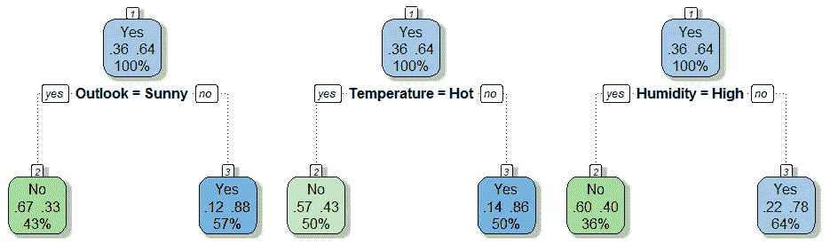

直观上，我们已经可以理解这三个分裂中将选择哪一个，对吧？

#### 3.2.2.1 基尼指数

我们使用以下公式计算 `Outlook` 的基尼指数：

```text
GINI(Sunny) = 1 - Freq(Play = No | Outlook = Sunny)² - Freq(Play = Yes | Outlook = Sunny)²
GINI(Rainy) = 1 - Freq(Play = No | Outlook = Rainy)² - Freq(Play = Yes | Outlook = Rainy)²
GINI[Outlook] = Freq(Outlook = Sunny) * GINI(Sunny) + Freq(Outlook = Rainy) * GINI(Rainy)
```

计算结果为：

```text
GINI(Sunny) = 1 - (4/6)² - (2/6)² = 0.444
GINI(Rainy) = 1 - (1/8)² - (7/8)² = 0.219
GINI[Outlook] = (6/14) * 0.444 + (8/14) * 0.219 = 0.315
```

同样，温度和湿度的基尼指数分别为 `GINI[Temp.] = 0.367` 和 `GINI[Hum.] = 0.394`。因此，回答问题 (a)，使用基尼指数的最佳分裂是在 `Outlook` 上。我们也可以使用 R 进行这些计算。对于 `Outlook`，我们构建以下频率数组：

```r
absfreq = table(weather, c(1, 4))
freq = prop.table(absfreq, 1)
freqSum = rowSums(prop.table(absfreq))
```

我们计算 `Sunny` 和 `Rainy` 的基尼指数：

```r
GINI_Sunny = 1 - (4/6)^2 - (2/6)^2
GINI_Rainy = 1 - (1/8)^2 - (7/8)^2
```

`Outlook` 的总基尼计算公式为：

```r
GINI_Outlook = freqSum["Sunny"] * GINI_Sunny + freqSum["Rainy"] * GINI_Rainy
```

#### 3.2.2.2 信息增益

我们使用以下公式计算 `Outlook` 的信息增益：

```text
Entropy(All) = -Freq(No) * log(No) - Freq(Yes) * log(Yes)
Entropy(Sunny) = -Freq(No | Sunny) * log(No | Sunny) - Freq(Yes | Sunny) * log(Yes | Sunny)
Entropy(Rainy) = -Freq(No | Rainy) * log(No | Rainy) - Freq(Yes | Rainy) * log(Yes | Rainy)
GAIN[Outlook] = Entropy(All) - Freq(Sunny) * Entropy(Sunny) - Freq(Rainy) * Entropy(Rainy)
```

计算结果为：

```text
Entropy(All) = -(5/14) * log(5/14) - (9/14) * log(9/14) = 0.652
Entropy(Sunny) = -(4/6) * log(4/6) - (2/6) * log(2/6) = 0.637
Entropy(Rainy) = -(1/8) * log(1/8) - (7/8) * log(7/8) = 0.377
GAIN[Outlook] = 0.652 - (6/14) * 0.637 - (8/14) * 0.377 = 0.164
```

同样，温度和湿度的信息增益分别为 `GAIN[Temp.] = 0.105` 和 `GAIN[Hum.] = 0.071`。因此，回答问题 (b)，使用信息增益的第一次分裂是在 `Outlook` 上。我们也可以使用 R 进行这些计算。最初，我们计算数据集的总体熵：

```r
freq = prop.table(table(weather[, 4]))
Entropy_All = -freq["No"] * log(freq["No"]) - freq["Yes"] * log(freq["Yes"])
```

然后，对于 `Outlook`，我们构建以下频率数组：

```r
absfreq = table(weather[, c(1, 4)])
freq = prop.table(absfreq, 1)
freqSum = rowSums(prop.table(absfreq))
```

我们计算 `Sunny` 和 `Rainy` 的熵：

```r
Entropy_Sunny = -freq["Sunny", "No"] * log(freq["Sunny", "No"]) - freq["Sunny", "Yes"] * log(freq["Sunny", "Yes"])
Entropy_Rainy = -freq["Rainy", "No"] * log(freq["Rainy", "No"]) - freq["Rainy", "Yes"] * log(freq["Rainy", "Yes"])
```

`Outlook` 的总信息增益计算为：

```r
GAIN_Outlook = Entropy_All - freqSum["Sunny"] * Entropy_Sunny - freqSum["Rainy"] * Entropy_Rainy
```

### 3.2.3 构建决策树

对于问题 (c)，我们使用 `rpart` 构建一个决策树：

```r
model <- rpart(
  Play ~ Outlook + Temperature + Humidity,
  method = "class",
  data = weather,
  minsplit = 1,
  minbucket = 1,
  cp = -1
)
```

此外，我们可以使用以下命令绘制树：

```r
rpart.plot(model, extra = 104, nn = TRUE)
```

树如图所示：

## 3.3 剪枝与评估指标的应用

决策树分类器也可以应用于具有连续预测变量的数据集，例如 `iris`（鸢尾花）数据集。从 `iris` 数据集中，我们将只保留前 2 列并丢弃最后 50 个实例，这样我们现在就有两个预测特征和一个目标类别的二分类问题。我们可以在 R 中如下执行这些转换：

```r
iris2 = iris[, c(1, 2, 5)]
iris2$Species[101:150] = iris2$Species[21:70]
iris2$Species = factor(iris2$Species)
```

之后，我们将数据集分为训练数据和测试数据：

```r
trainingdata = iris2[c(1:40, 51:90, 101:140), ]
testdata = iris2[c(41:50, 91:100, 141:150), ]
```

我们将回答以下问题：

a) 使用训练数据构建决策树（`rpart` 的 `minsplit` 参数设置为 20，这是默认值）。

b) 将模型应用于测试数据，并计算这两个类的精确率、召回率和 F 值。

c) 构建两个决策树，一个 `minsplit` 设置为 10，另一个 `minsplit` 设置为 30，将它们应用于测试数据，并计算这两个类的精确率、召回率和 F 值。

d) 根据给出的 versicolor 类的 F 值比较这三个模型。

### 3.3.1 决策树的训练与测试

我们使用以下命令训练并绘制决策树（问题 (a), (c)）：

```r
model <- rpart(
  Species ~ .,
  method = "class",
  data = trainingdata,
  minsplit = 20
)

rpart.plot(model, extra = 104, nn = TRUE)
```

公式中的 `.` 代表数据框 `trainingdata` 中剩余的所有变量。我们也可以使用命令在测试集上执行我们的模型：

```r
xtest = testdata[, 1:2]
ytest = testdata[, 3]
pred = predict(model, xtest, type = "class")
```

### 3.3.2 评估指标

我们可以通过以下命令生成混淆矩阵并计算指标（问题 (b), (c)）：

```r
library(MLmetrics)

cm = ConfusionMatrix(pred, ytest)
accuracy = Accuracy(pred, ytest)
precision = Precision(ytest, pred, "versicolor")
recall = Recall(ytest, pred, "versicolor")
f1 = F1_Score(ytest, pred, "versicolor")
data.frame(precision, recall, f1)
```

（或者，我们可以计算 TP、FP、TN 和 FN，并通过 `TP / (TP + FP)` 计算精确率，通过 `TP / (TP + FN)` 计算召回率）

最后，三个模型的 F 度量显示在以下数组中（问题 (d)）：

```text
minsplit = 10  0.833
minsplit = 20  0.947
minsplit = 30  0.857
```

## 3.4 练习

你给了一个用于二分类问题的以下数组训练数据。


| CustomerID | Sex | CarType | Budget | Insurance |
| :--- | :--- | :--- | :--- | :--- |
| 1 | M | Family | Low | No |
| 2 | M | Sport | Medium | No |
| 3 | M | Sport | Medium | No |
| 4 | M | Sport | High | No |
| 5 | M | Sport | VeryHigh | No |
| 6 | M | Sport | VeryHigh | No |
| 7 | F | Sport | Low | No |
| 8 | F | Sport | Low | No |
| 9 | F | Sport | Medium | No |
| 10 | F | Sedan | High | No |
| 11 | M | Family | High | Yes | Yes |
| 12 | M | Family | VeryHigh | Yes | Yes |
| 13 | M | Family | Medium | Yes | Yes |
| 14 | M | Sedan | VeryHigh | Yes | Yes |
| 15 | F | Sedan | Low | Yes | Yes |
| 16 | F | Sedan | Low | Yes | Yes |
| 17 | F | Sedan | Medium | Yes | Yes |
| 18 | F | Sedan | Medium | Yes | Yes |
| 19 | F | Sedan | Medium | Yes | Yes |
| 20 | F | Sedan | High | Yes | Yes |

计算以下内容的 Gini 指数：

a) 所有训练实例

b) 特征 `CustomerID`

c) 特征 `Sex`

d) 使用多路划分的特征 `CarType`

e) 使用多路划分的特征 `Budget`

根据 Gini 指数，这些哪一个应该用于第一次划分？提示问题：解释为什么 `CustomerID` 虽然具有最低的 Gini 指数，但不应该被作为划分特征。

# 第 4 章 - 朴素贝叶斯分类

## 4.1 引言

### 4.1.1 朴素贝叶斯简介

朴素贝叶斯是一种基于贝叶斯定理以及数据集特征间相互独立假设的机器学习算法。给定一个具有一组特征 `x[1]`, `x[2], ..., x[n]` 和一个类别特征 `c` 的数据集，贝叶斯定理定义实例 `{x[1], x[2], ..., x[n]}` 属于 `c` 的概率为概率 `P(x[1]|c)`、`P(x[2]|c), ..., P(x[n]|c)` 的组合：

`P(x[1]|c)·P(x[2]|c)· ... ·P(x[n]|c)·P(c)[P(c|x) = P(x1)·P(x2)· ... ·P(xn)]`

其中我们注意到，特征集的概率是由它们的乘积给出的，因为它们的值彼此之间是相互独立的。

### 4.1.2 R 中的朴素贝叶斯

我们可以使用 `e1071` 库在 R 中构建概率朴素贝叶斯模型：

```r
library(e1071)
```

构建模型需要执行 `naiveBayes` 命令：

```r
model <- naiveBayes(Target ~ ., data = ...)
```

参数 `laplace` 用于拉普拉斯平滑。

给定一个训练好的模型，我们可以使用以下命令预测新实例的类别：

```r
predict(model, trvalue)
```

如果我们进一步添加参数 `type="raw"`，我们将获得后验概率。

## 4.2 朴素贝叶斯的构建与分类

我们将使用以下数据用于二分类问题：

| Weather | Day | HighTraffic |
| :--- | :--- | :--- |
| Hot | Vacation | No |
| Cold | Work | Yes |
| Normal | Work | No |
| Cold | Weekend | Yes |
| Hot | Vacation | Yes |

我们将回答以下问题：

a) 使用朴素贝叶斯分类器，将值为 `(Weather, Day) = (Hot, Vacation)` 的实例分类为哪类？

b) 使用朴素贝叶斯分类器，将值为 `(Weather, Day) = (Hot, Weekend)` 的实例分类为哪类？

c) 使用拉普拉斯平滑重复问题 (b)。

d) 在 R 中构建完整模型并重复问题 (a)。

e) 在 R 中使用拉普拉斯平滑构建完整模型并重复问题 (b)。

### 4.2.1 数据与库

最初，我们读取数据导入：

```r
traffic = read.csv("traffic.txt")
library(e1071)
```

### 4.2.2 概率计算

对于问题 (a)，我们使用以下公式计算：

`P(Y|Hot, Vacation) = P(Hot|Y)·P(Vacation|Y) = 1/4·1/2 = 1/8 (3/8)`

`P(No|Hot, Vacation) = P(Hot|No)·P(Vacation|No) = 2/4·1/4 = 2/8 (2/8)`

由于 `P(No|Hot, Vacation) > P(Y|Hot, Vacation)`，算法将实例分类为 No。同样，对于问题 (b)：

`P(Y|Hot, Weekend) = P(Hot|Y)·P(Weekend|Y) = 1/4·1/2 = 1/8 (3/8)`

`P(No|Hot, Weekend) = P(Hot|No)·P(Weekend|No) = 2/4·0/4 = 0/8 (2/8)`

由于 `P(No|Hot, Weekend) < P(Y|Hot, Weekend)`，算法将实例分类为 Yes。关于问题 (c)，我们将重新计算概率，添加 1 作为拉普拉斯参数。因此，新的概率为：

`P(Y|Hot, Vacation) = (1+1)/(4+3) = 2/7`

`P(No|Hot, Vacation) = (2+1)/(4+3) = 3/7`

`P(Y|Hot, Weekend) = (1+1)/(4+3) = 2/7`

`P(No|Hot, Weekend) = (0+1)/(4+3) = 1/7`

等待，让我们重新验证文本中的逻辑：

```
Naive Bayes Classifier for Discrete Predictors Call: naiveBayes.default(x = X, y = Y, laplace = laplace)
A-priori probabilities: Y
No 0.5 Yes 0.5
Conditional probabilities: Weather
Y Cold 0.25 Hot 0.50 No 0.25 Yes 0.50 0.25 0.25
Day
Y Vacation Weekend Work No 0.25 0.00 0.75 Yes 0.25 0.50 0.25
```

### 4.2.3 构建朴素贝叶斯模型

#### 4.2.3.1 构建简单模型

对于问题 (d)，我们构建一个朴素贝叶斯模型：

```r
model <- naiveBayes(HighTraffic ~ ., data = traffic)
print(model)
```

现在我们可以重新计算问题 (a)：

```r
trvalue = data.frame(Weather = factor("Hot", levels = traffic$Weather), Day = factor("Vacation", levels = traffic$Day))
predict(model, trvalue)
predict(model, trvalue, type = "raw")
```

#### 4.2.3.2 使用拉普拉斯平滑构建模型

对于问题 (c)，我们构建带有拉普拉斯平滑的朴素贝叶斯模型：

```r
model <- naiveBayes(HighTraffic ~ ., data = traffic, laplace = 1)
```

现在我们可以重新计算问题 (a)：

```r
trvalue = data.frame(Weather = factor("Hot", levels = traffic$Weather), Day = factor("Weekend", levels = traffic$Day))
predict(model, trvalue)
predict(model, trvalue, type = "raw")
```

## 4.3 朴素贝叶斯的应用与评估

将在数据集 `HouseVotes84` 上应用朴素贝叶斯分类器。最初，我们导入数据集，忽略任何缺失值的实例：

```r
data(HouseVotes84, package = "mlbench")
votes = na.omit(HouseVotes84)
```

此外，我们导入执行和评估模型所需的库：

```r
library(e1071)
library(MLmetrics)
library(ROCR)
```

之后，我们将数据集分为训练数据和测试数据：

```r
trainingdata = votes[1:180,]
testingdata = votes[181:232,]
```

我们将回答以下问题：

a) 使用训练数据构建朴素贝叶斯模型并将其应用于测试数据。

b) 计算测试数据中类别 `democrat` 的精确率、召回率和 F 度量。

c) 为模型构建 ROC 曲线。

### 4.3.1 构建与应用朴素贝叶斯模型

对于问题 (a)，我们训练了一个朴素贝叶斯模型：

```r
model <- naiveBayes(Class ~ ., data = trainingdata)
```

之后，我们可以在测试集上应用该模型：

```r
xtest = testingdata[,-1]
ytest = testingdata[,1]
pred = predict(model, xtest)
predprob = predict(model, xtest, type = "raw")
```

### 4.3.2 指标计算与 ROC 曲线绘制

我们可以通过以下命令查看混淆矩阵并计算有用的指标（问题 (b)）：

```r
ConfusionMatrix(ytest, pred)
Precision(ytest, pred, "democrat") 
Recall(ytest, pred)
```

绘制 ROC 曲线（问题 (c)）最初需要使用以下命令计算 TPR 和 FRP：

```r
pred_obj = prediction(predprob[,1], ytest, label.ordering = c("republican", "democrat"))
ROCcurve <- performance(pred_obj, "tpr", "fpr")
```

如果我们绘制 `ROCcurve` 对象，我们将看到 TPR 和 FRP 以及相应的阈值。最后，我们可以如下所示绘制曲线：

```r
plot(ROCcurve, col = "blue") 
abline(0,1, col = "grey")
```

并使用命令寻找曲线下的面积：`performance(pred_obj, "auc")` 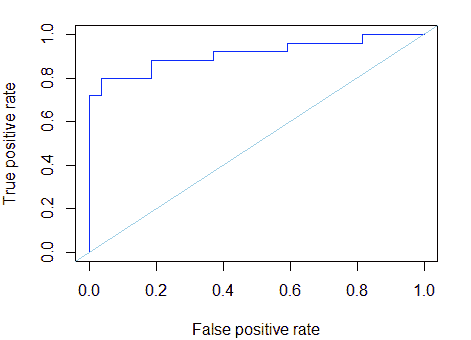

## ROC 曲线

在统计学中，受者工作特征（ROC）或 ROC 曲线是一种图形，用于说明二分类系统的性能随判别阈值变化而变化。该曲线通过绘制在不同阈值设置下的真阳性率（TPR）相对于假阳性率（FPR）来创建。

ROC 曲线展示了以下几点：

* 它显示了敏感性与特异性之间的权衡（敏感性的任何增加都会伴随着特异性的下降）。

* 曲线越接近 ROC 空间的左侧边界然后是顶部边界，分类器就越准确。

* 曲线越接近 ROC 区域的 45 度对角线，测试的准确性越低。

* 切点处切线的斜率给出了该测试值的似然比（LR）。

* 曲线下的面积是文本准确性的衡量标准。这将在下一节中进一步讨论。

准确率通过 ROC 曲线下的面积来衡量。面积为 1 代表完美的测试；面积为 .5 代表无用的测试。分类诊断测试准确性的粗略指南是传统的学术分值制：

* .90-1 = 优秀 (A)

* .80-.90 = 良好 (B)

* .70-.80 = 中等 (C)

* .60-.70 = 差 (D)

* .50-.60 = 不及 (F)

# 第 5 章 - k-近邻分类

## 5.1 引言

### 5.1.1 k-最近邻简介

k-最近邻 (kNN) 是一种机器学习算法，其中对新实例的预测取决于其 k 个最近的实例。因此，新实例的类别是根据其 k 个最近实例的类别通过多数投票决定的。

### 5.1.2 R 语言中的 k-最近邻

我们可以使用 `class` 库在 R 中应用 kNN 模型：

```r
library(class)
```

可以使用 `knn` 命令对新实例进行分类：

```r
knn(X_train, X_test, Y_train, k = 1, prob = TRUE)
```

其中我们必须提供训练数据（`X_train`, `Y_train`）、新实例（`X_test`）以及 `k` 的值。

## 5.2 k-最近邻模型的构建与分类

我们将使用以下数据进行二分类问题：

```r
## 导入数据
knata = read.table
```

### 5.2.1 数据处理

最初，我们读取数据：

```r
knata = read.table("knata")
```

### 5.2.2 算法

最初我们划分数据集：

```r
X_train = knata[,1:2]
Y_train = knata[,3]
```

对于问题 (a)，我们执行命令：

```r
plot(X_train, col = Y_train)
```


当 `k = 1` 时，我们需要找到：

```r
knn(X_train, X_test, Y_train)
```

对于问题 (b)，我们使用：

```r
library(class)
```

当 `k = 5` 时，我们需要找到：

```r
knn(X_train, X_test, Y_train)
```

## 5.3 k-最近邻真实世界示例

在本节中我们将使用乳腺癌数据集 

## 乳腺癌（原始）数据集

在本节中，我们将对 UCI 机器学习库的 `breast-cancer.data` 文件应用 k-NN。

### 5.3.1 数据处理

首先，我们将数据集加载为数据框。假设当前工作目录位于数据集所在的目录。要检查 `read.table` 函数的文档，请使用 `read.table`。此外，从数据集说明可以看出缺失值用 `?` 表示。接下来我们将数据集分为训练集和验证集。加载和划分数据集的步骤如下：

```r
rm(list=ls()) # 下载数据集
fileURL <- "http://archive.ics.uci.edu/ml/machine-learning-databases/breast-cancer-wisconsin/breast-cancer-wisconsin.data"
download.file(fileURL, destfile="breast-cancer-wisconsin.data", method="curl") # 读取数据
data <- read.table("breast-cancer-wisconsin.data", na.strings = "?", sep=",") # 移除 id 列
## 为列命名（属性）
names(data) <- c("ClumpThickness", "UniformityCellSize", "UniformityCellShape", "MarginalAdhesion", "SingleEpithelialCellSize", "BareNuclei", "BlandChromatin", "NormalNucleoli", "Mitoses", "Class") # 将类别转换为因子
data$Class <- factor(data$Class, levels=c(2,4), labels=c("benign", "malignant")) # 设置种子
set.seed(1234) # 划分数据集
ind <- sample(2, nrow(data), replace=TRUE, prob=c(0.7, 0.3))
trainData <- data[ind==1,]
validationData <- data[ind==2,]
```

### 5.3.2 训练与预测

我们像之前一样加载 k-NN 算法。

* http://archive.ics.uci.edu/ml/datasets/Breast+Cancer+Wisconsin+%28Original%29
* http://archive.ics.uci.edu/ml/machine-learning-databases/breast-cancer-wisconsin/breast-cancer-wisconsin.data
* http://archive.ics.uci.edu/ml/index.html

```r
library(class)
```


由于所有属性都在 1 到 10 之间，因此不需要在 0 到 1 之间进行归一化，因为在 `kNN` 的距离计算中没有任何属性会主导其他属性。由于 `kNN` 接受不包含目标列的训练和测试数据集（作为第三个参数），我们将进行一些数据处理，使数据符合 `knn` 函数的格式（可以通过 `?knn` 查看帮助文档）。此外，由于 `kNN` 不允许存在缺失值，让我们把它们也删掉。

```r
trainData <- trainData[complete.cases(trainData),]
validationData <- validationData[complete.cases(validationData),]
trainDataX <- trainData[,-ncol(trainData)]
trainDataY <- trainData$Class
validationDataX <- validationData[,-ncol(trainData)]
validationDataY <- validationData$Class
```

让我们进行预测吧，因为在使用 `kNN` 时不需要训练。训练实例即为模型。

```r
prediction <- knn(trainDataX, validationDataX, trainDataY, k = 1)
```
你可以尝试不同的 `k` 值来寻找更好的模型。

### 5.3.3 评估

对验证集进行预测并打印混淆矩阵：

```r
cat("Confusion matrix:\n")
xtab <- table(prediction, validationData$Class)
print(xtab)
cat("\nEvaluation:\n\n")
accuracy <- sum(prediction == validationData$Class) / length(validationData$Class)
precision <- xtab[1,1] / sum(xtab[,1])
recall <- xtab[1,1] / sum(xtab[1,])
f <- 2 * (precision * recall) / (precision + recall)
cat(paste("Accuracy:\t", format(accuracy, digits=2), "\n", sep=" "))
cat(paste("Precision:\t", format(precision, digits=2), "\n", sep=" "))
cat(paste("Recall:\t\t", format(recall, digits=2), "\n", sep=" "))
cat(paste("F-measure:\t", format(f, digits=2), "\n", sep=" "))
```

输出结果：

```text
Confusion matrix:
prediction benign malignant
benign 99 4
malignant 6 60

Evaluation:
Accuracy: 0.94
Precision: 0.94
Recall: 0.94
F-measure: 0.95
```

### 5.3.4 交叉验证

为了执行交叉验证，我们将使用 `caret` 包。在这里你可以找到一份快速指南。

#### 5.3.4.1 将数据分为两组

`createDataPartition` 函数对数据进行分层划分。这与我们之前的操作类似（但之前没有分层）。我们将使用 `train` 函数来构建 `kNN` 模型。

```r
library(caret)
library(mlbench)
data(Sonar)
inTrain <- createDataPartition(y = Sonar$Class, p = .75, list = FALSE)
training <- Sonar[inTrain,]
testing <- Sonar[-inTrain,]
kNNFit <- train(Class ~ ., data = training, method = "knn", preProc = c("center", "scale"))
print(kNNFit)
```

```text
k-Nearest Neighbors
157 samples
60 predictor
2 classes: 'M', 'R'
Pre-processing: centered (60), scaled (60)
Resampling: Bootstrapped (25 reps)
Summary of sample sizes: 157, 157, 157, 157, 157, ...
Resampling results across tuning parameters:
k Accuracy Kappa
5 0.768342 0.533199
7 0.755910 0.505396
9 0.737817 0.471506
Accuracy was used to select the optimal model using the largest value. The final value used for the model was k = 5.
```

我们也可以根据训练数据集搜索最佳的 `k` 值。

```r
kNNFit1 <- train(Class ~ ., data = training, method = "knn", tuneLength = 15, preProc = c("center", "scale"))
print(kNNFit1)
```

```text
k-Nearest Neighbors
157 samples
60 predictor
2 classes: 'M', 'R'
Pre-processing: centered (60), scaled (60)
Resampling: Bootstrapped (25 reps)
Summary of sample sizes: 157, 157, 157, 157, 157, ...
Resampling results across tuning parameters:
k Accuracy Kappa
5 0.747745 0.484023
7 0.718990 0.422551
9 0.721179 0.427515
11 0.714098 0.415035
13 0.703118 0.393205
15 0.703481 0.394575
17 0.691431 0.369816
19 0.685583 0.358818
21 0.684745 0.361933
23 0.682191 0.357189
25 0.662613 0.318667
27 0.655180 0.304250
29 0.666076 0.329124
31 0.664368 0.327328
33 0.669774 0.338918
Accuracy was used to select the optimal model using the largest value. The final value used for the model was k = 5.
```

要创建一个重复 3 次的 10 折 `k` 交叉验证，需要使用 `trainControl` 函数：

```r
ctrl <- trainControl(method = "repeatedcv", repeats = 3)
kNNFit2 <- train(Class ~ ., data = training, method = "knn", tuneLength = 15, trControl = ctrl, preProc = c("center", "scale"))
print(kNNFit2)
plot(kNNFit2)
```

```text
k-Nearest Neighbors
157 samples
60 predictor
2 classes: 'M', 'R'
Pre-processing: centered (60), scaled (60)
Resampling: Cross-Validated (10 fold, repeated 3 times)
Summary of sample sizes: 142, 142, 142, 142, 141, 142, ...
Resampling results across tuning parameters:
k Accuracy Kappa
5 0.782026 0.554835
7 0.770931 0.532154
9 0.760514 0.511147
11 0.750465 0.492463
13 0.739632 0.470533
15 0.724738 0.440137
17 0.705817 0.400635
19 0.717933 0.424610
21 0.705522 0.400349
23 0.693065 0.377905
25 0.693374 0.379131
27 0.705245 0.402836
29 0.716356 0.427778
31 0.733210 0.462973
33 0.717638 0.433524
Accuracy was used to select the optimal model using the largest value. The final value used for the model was k = 5.
```

对于预测：

```r
knnPredict <- predict(kNNFit2, newdata = testing)
# 获取混淆矩阵以查看准确率和其他参数
confusionMatrix(knnPredict, testing$Class)
```

```text
Confusion Matrix and Statistics
Reference
Prediction    M R
M            25  9
R             2 15

Accuracy: 0.7843
95% CI: (0.6468,0.8871)
No Information Rate: 0.5294
P-Value [Acc > NIR]: 0.0001502
Kappa: 0.56
McNemar's Test P-Value: 0.070404
Sensitivity: 0.9259
Specificity: 0.6250
Pos Pred Value: 0.7353
Neg Pred Value: 0.8824
Prevalence: 0.5294
Detection Rate: 0.4902
Detection Prevalence: 0.6667
Balanced Accuracy: 0.7755
'Positive' Class: M
```

在输出中添加更多信息：

```r
ctrl <- trainControl(method = "repeatedcv", repeats = 3, classProbs = TRUE, summary = twoClassSummary)
kNNFit4 <- train(Class ~ ., data = training, method = "knn", tuneLength = 15, trControl = ctrl, preProc = c("center", "scale"))
kNNFit4
plot(kNNFit4)
```

```text
k-Nearest Neighbors
157 samples
60 predictor
2 classes: 'M', 'R'
Pre-processing: centered (60), scaled (60)
Resampling: Cross-Validated (10 fold, repeated 3 times)
Summary of sample sizes: 142, 142, 142, 142, 141, 142, ...
Resampling results across tuning parameters:
k ROC Sens Spec
5 0.8846768 0.8773148 0.6988095
7 0.8613467 0.8726852 0.6678571
9 0.8642361 0.8601852 0.6500000
11 0.8592634 0.8518519 0.6494048
13 0.8527364 0.8282407 0.6250000
15 0.8384011 0.8009259 0.5994048
17 0.8389550 0.8004630 0.5904762
19 0.8246280 0.8087963 0.5988095
21 0.8219783 0.8125000 0.6125000
23 0.8125951 0.8055556 0.6125000
25 0.8139716 0.7898148 0.6351190
27 0.8118676 0.7893519 0.6535714
29 0.8090112 0.7842593 0.6577381
31 0.8090939 0.7958333 0.6625000
33 0.7983300 0.7606481 0.6815476
```

使用 ROC 通过最大值来选择最优模型。最终用于模型的值为 `k = 5`。

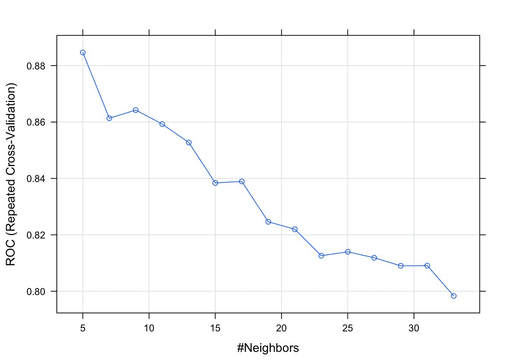

最后是如何使用 `caret` 包中使用自助法（bootstrap）：

```r
knnFit5 <- train(Class ~ .,
  data = training,
  method = "knn",
  preProcess = c("center", "scale"),
  tuneLength = 10,
  trControl = trainControl(method = "boot"))

knnPredict2 <- predict(knnFit5, newdata = testing)
```

# 获取混淆矩阵查看准确率和其他参数值

```r
confusionMatrix(knnPredict2, testing$Class)
```

```text
Confusion Matrix and Statistics
Reference
Prediction    M R
M            25  9
R             2 15

Accuracy: 0.7843
95% CI: (0.6468, 0.8871)
No Information Rate: 0.5294
P-Value [Acc > NIR]: 0.0001502
Kappa: 0.56
McNemar's Test P-Value: 0.0704404
Sensitivity: 0.9259
Specificity: 0.6250
Pos Pred Value: 0.7353
Neg Pred Value: 0.8824
Prevalence: 0.5294
Detection Rate: 0.4902
Detection Prevalence: 0.6667
Balanced Accuracy: 0.7755
'Positive' Class: M
```


## 参考文献

- http://rstudio-pubs-static.s3.amazonaws.com/16444_caf85a306d564eb490ebdbaf0072df2.html¹³
- http://rstudio-pubs-static.s3.amazonaws.com/16444_caf85a306d564eb490ebdbaf0072df2.html

# 第 6 章 - 支持向量机分类

## 6.1 引言

### 6.1.1 支持向量机简介

支持向量机 (`SVM`) 是一种寻找分离数据超平面的算法。该问题可以定义为最大化超平面与数据之间的距离（间隔）：

当 `f(x) = {w·x + b ≥ 1, w·x + b ≤ -1}` 时，`Margin = 2/||w||`。如果数据是不可分的，则可以将它们映射到不同维度的空间中。

### 6.1.2 R 中的支持向量机

我们可以使用 `e1071` 库在 R 中构建支持向量机：

```r
library(e1071)
```

我们可以执行 `svm` 来构建模型：

```r
model <- svm(y ~ ., kernel = "radial")
```

参数 `kernel` 控制使用哪种内核（线性、多项式、径向），同时我们还可以定义更多参数，如 `degree`, `gamma`。通过执行 `svm` 可以查看所有参数。有了模型后，可以使用 `predict` 命令对新实例进行分类：

```r
predict(model, test)
```

如果我们还想查看每个类的概率，则必须添加 `probability = TRUE` 参数。注意，在训练 (`svm`) 和运行 (`predict`) 时都必须添加该参数。

## 6.2 支持向量机的构建与分类

我们将使用 `alldata.txt` 文件的数据进行二分类问题：

| | X1 | X2 | y |
|---|---|---|---|
| 最小值 | 3.253207 | 4.64161 | 1.0 |
| 第一分位数 | 0.7090886 | 0.625361 | 1.0 |
| 中位数 | 0.0116251 | 1.641370 | 1.5 |
| 平均值 | 0.0349357 | 1.939284 | 1.5 |
| 第三分位数 | 0.7337179 | 3.115350 | 2.0 |
| 最大值 | 3.6395763 | 9.784076 | 2.0 |

首先，导入数据集并将其分为训练数据和测试数据：

```r
alldata <- read.csv("alldata.txt")
trainingdata <- alldata[1:600,]
testdata <- alldata[601:800,]
```

我们将回答以下问题：

a) 使用不同的颜色/符号绘制训练数据。


b) 使用 RBF 核且 `gamma` 等于 1 的 SVM，并在图 (a) 上绘制超平面。

c) 对于 `gamma` 值 0.01 和 100 重复问题 (b)。你的观察结果是什么？

使用 gamma 值 `gammavalues = c(0.01, 0.1, 1, 10, 100, 1000, 10000, 100000, 1000000)`，我们将回答：

d) 计算训练误差和测试误差。

e) 在同一张图中绘制这两个误差。你的观察结果是什么？

f) 应用 10 折交叉验证来寻找 `gamma` 的最佳值。

### 6.2.1 库导入

首先，导入所需的库：

```r
library(MLmetrics)
library(e1071)
```

### 6.2.2 算法应用与超平面图

对于问题 (a)，执行：

```r
plot(trainingdata[,1:2], col = trainingdata$y, pch = c("o",""))
```

对于问题 (b), (c)，我们首先建立网格，并在上方绘制超平面：

```r
X1 = seq(min(trainingdata[,1]), max(trainingdata[,1]), by = 0.1)
X2 = seq(min(trainingdata[,2]), max(trainingdata[,2]), by = 0.1)
mygrid = expand.grid(X1, X2)
colnames(mygrid) = colnames(trainingdata)[1:2]
```

对于问题 (b)，我们训练 `gamma = 1` 的 SVM 并将其应用于网格上：

```r
svm_model = svm(y ~ ., kernel="radial", type="C-classification", data = trainingdata, gamma = 1)
pred = predict(svm_model, mygrid)
Y = matrix(pred, length(X1), length(X2))
contour(X1, X2, Y, add = TRUE, levels = 1.5)
```

同样，对于问题 (c)，当 `gamma = 0.01` 时：

```r
svm_model = svm(y ~ ., kernel="radial", type="C-classification", data = trainingdata, gamma = 0.01)
pred = predict(svm_model, mygrid)
Y = matrix(pred, length(X1), length(X2))
contour(X1, X2, Y, add = TRUE, levels = 1.5)
```

当 `gamma = 100` 时：

```r
svm_model = svm(y ~ ., kernel="radial", type="C-classification", data = trainingdata, gamma = 100)
pred = predict(svm_model, mygrid)
Y = matrix(pred, length(X1), length(X2))
contour(X1, X2, Y, add = TRUE, levels = 1.5)
```

最后，如图所示：


### 6.2.3 训练与测试曲线

对于问题 (d)，我们遍历 `gammavalues` 并计算训练误差：

```r
training_error = c()
for (gamma in gammavalues) {
  svm_model = svm(y ~ ., kernel="radial", type="C-classification", data = trainingdata, gamma = gamma)
  pred = predict(svm_model, trainingdata)
  training_error = c(training_error, Accuracy(trainingdata$y, pred))
}
```

同样，对于测试误差：

```r
testing_error = c()
for (gamma in gammavalues) {
  svm_model = svm(y ~ ., kernel="radial", type="C-classification", data = trainingdata, gamma = gamma)
  pred = predict(svm_model, testdata)
  testing_error = c(testing_error, Accuracy(testdata$y, pred))
}
```

我们可以使用以下命令在同一张图中绘制这两个误差：

```r
plot(training_error, type = "l", col="blue", ylim = c(0, 0.5), xlab = "Gamma", ylab = "Error", xtxt = "n")
axis(1, at = 1:length(gammavalues), labels = gammavalues)
lines(testing_error, col="red")
```

# 从 10 个折中选择 9 个用于训练，1 个用于验证

```r
trainingset < trainingdata[unlist(folds[-i]),]
validationset < trainingdata[unlist(folds[i]),]
```

# 训练并应用模型

```r
svm_model = svm(y ~ ., kernel="radial", type="C-classification", data = trainingset, gamma = gamma)
pred = predict(svm_model, validations[, c(1:2)])
```

# 保存预测和测试集

```r
predictions < rbind(predictions, as.data.frame(pred))
testsets < rbind(testsets, as.data.frame(validationset[,3]))
```

# 计算新的准确率并添加到之前的准确率中

```r
accuracies = c(accuracies, Accuracy(predictions, testsets))
```

我们计算每个折的准确率，最后选择准确率最高的 gamma 值：

```r
print(accuracies)
bestgamma = gammavalues[which.max(accuracies)]
```

## 6.3 练习

你得到以下数据，其中 Y 是二分类分类的类别向量。X1 X2 Y

2 2 1

2 -2 1

-2 -2 1

-2 2 1

1 1 2

1 -1 2

-1 -1 2

-1 1 2

你可以使用以下命令在 R 中输入数据：

```r
X1 = c(2, 2, -2, -2, 1, 1, -1, -1)
X2 = c(2, -2, -2, 2, 1, -1, -1, 1)
Y = c(1, 1, 1, 1, 2, 2, 2, 2)
alldata = data.frame(X1, X2, Y)
```

回答以下问题：

a) 使用不同的颜色/符号为每个类别绘制训练数据图。

b) 应用带有 RBF 核的 SVM，并在问题 (a) 的图中画出超平面。

c) 使用你的 jmodel，你会将值为 (4, 5) 的新实例归为哪一类？

# 第三部分 - 数据处理

# 第 7 章 - 特征选择

## 7.1 引言

什么是特征选择？什么是过滤方法？什么是包装方法？

## 7.2 过滤方法

在本节中，我们将使用相关特征选择 (CFS) 方法来选择用于训练和测试机器学习模型的属性。我们将使用 Iris 数据来实现此目的。

```r
data = iris
```

# 划分为训练集和验证集

```r
set.seed(1234)
ind < sample(2, nrow(data), replace=TRUE, prob=c(0.7, 0.3))
trainData < data[ind==1,]
validationData < data[ind==2,]
```

# 只保留没有缺失值的实例。

```r
trainData < trainData[complete.cases(trainData),]
validationData < validationData[complete.cases(validationData),]
```

### 7.2.1 使用 CFS 方法

CFS 方法位于 `FSelector` 包中，要使用它我们需要调用 `cfsmethod`。

```r
library(FSelector)
subset < cfs(Species ~ ., trainData)
f < as.simple.formula(subset, "Species")
print(f)
```

`Species ~ Petal.Length + Petal.Width` `<environment: 0x114e18a70>`

输出是一个可以在各种分类算法中使用的公式，它表示根据 CFS 算法和训练数据集，预测鸢尾花品种（Species）的最佳特征是花瓣长度（Petal Length）和花瓣宽度（Petal Width）。

例如在朴素贝叶算法中，我们将使用包含所有属性的公式以及从 CFS 派生的公式。

```r
library(e1071)
model < naiveBayes(Species ~ ., data=trainData, laplace = 1)
simpler_model < naiveBayes(f, data=trainData, laplace = 1)
pred < predict(model, validationData)
simpler_pred < predict(simpler_model, validationData)
```

```r
library(MLmetrics)
train_pred < predict(model, trainData)
train_simpler_pred < predict(simpler_model, trainData)
paste("Accuracy in training all attributes", Accuracy(train_pred, trainData), sep=" - ")
```

`[1] "Accuracy in training all attributes - 0.964285714285714"`

```r
paste("Accuracy in training CFS attributes", Accuracy(train_simpler_pred, trainData), sep=" - ")
```

`[1] "Accuracy in training CFS attributes - 0.95535714285714"`

```r
paste("Accuracy in validation all attributes", Accuracy(pred, validationData), sep=" - ")
```

`[1] "Accuracy in validation all attributes - 0.94736842105263"`

```r
paste("Accuracy in validation CFS attributes", Accuracy(simpler_pred, validationData), sep=" - ")
```

`[1] "Accuracy in validation CFS attributes - 0.97368421052631"`

使用所有属性时，训练集的准确率增加了，但与仅使用 2 个属性的简单模型相比，验证集的准确率下降了。

## 7.2 包装方法

### 7.2.1 递归特征消除

作为包装方法的演示，我们将使用递归特征消除 (RFE) 方法在 Pima Indians 数据集中选择属性。为此，将使用 `caret` 库。

首先，一常一样，我们将数据集划分为训练集和验证集。

```r
set.seed(1234)
```

# 加载所需的库

```r
library(mlbench)
library(caret)
```

# 加载数据

```r
data(PimaIndians)
data = PimaIndians
```

# 划分为训练集和验证集

```r
set.seed(1234)
ind < sample(2, nrow(data), replace=TRUE, prob=c(0.7, 0.3))
trainData < data[ind==1,]
validationData < data[ind==2,]
```

# 只保留没有缺失值的实例。

```r
trainData < trainData[complete.cases(trainData),]
validationData < validationData[complete.cases(validationData),]
```

接下来我们将使用 `caret` 包中的 `rfe` 函数并对其进行设置。

# 使用 nb 函数定义控制

```r
control <- rfeControl(functions=nb, method="cv", number=10)
```

# 运行 RFE

```r
results <- rfe(trainData[,1:8], trainData$diabetes, ctrl=control)
```

# 总结结果

```r
print(results)
```

`Resampling method: Cross Validation (10 fold)`

`Variables AccuracySD`

`1 0.7453 0.3681`

`2 0.7546 0.4182`

`3 0.7715 0.4707`

`4 0.7584 0.4479`

`5 0.7546 0.4457`

`6 0.7490 0.4344`

`7 0.7509 0.4290`

`8 0.7491 0.4201`

`The top 3 variables (out of 8):`

`glucose, age, mass`

在 8 个变量中，RFE 选出了三个（glucose, age, mass），它们在 10 折交叉验证下提供了最好的准确率。

# 列出选定的特征

```r
predictors(results)
```

`[1] "glucose" "age" "mass"`

# 绘制结果

```r
plot(results, type=c("g", "o"))
```

我们将使用 RFE 输出的 3 个顶层变量进行朴素贝叶算法：

```r
library(e1071)
f < as.formula(paste("diabetes", paste(results$optVariables, collapse=" + "), "~ "))
```

`diabetes ~ glucose + age + mass`

## 外部括号

注意外部括号的使用。我们同时将变量 f 设置为公式并将其打印到控制台。

```r
model < naiveBayes(diabetes ~ ., data=trainData, laplace = 1)
simpler_model < naiveBayes(f, data=trainData, laplace = 1)
pred < predict(model, validationData)
simpler_pred < predict(simpler_model, validationData)
```

```r
library(MLmetrics)
train_pred < predict(model, trainData)
train_simpler_pred < predict(simpler_model, trainData)
paste("Accuracy in training all attributes", Accuracy(train_pred, trainData$diabetes), sep=" - ")
```

`[1] "Accuracy in training all attributes - 0.760299625468165"`

```r
paste("Accuracy in training RFE attributes", Accuracy(train_simpler_pred, trainData$diabetes), sep=" - ")
```

`[1] "Accuracy in training RFE attributes - 0.764044943820225"`

## [1] "验证所有属性精度 - 0.764957264957265"

```r
paste("Accuracy in validation RFE attributes", Accuracy(simpler_pred, validationData$diabetes), sep=" - ")
```

## [1] "验证 RFE 属性精度 - 0.799145299145299"

通过使用包含 8 个属性中 3 个简化公式，我们能够在验证集中获得更好的泛化结果。

### 7.2.2 前向搜索

标准的封装方法（wrapper methods）包括前向搜索和后向搜索。在本节中，我们将在乳腺癌威斯康数据集中使用前向搜索并将决策树作为模型（见第 5 章）。

#### 下载文件


```r
fileURL <- "http://archive.ics.uci.edu/ml/machine-learning-databases/breast-cancer-wisconsin/breast-cancer-wisconsin.data"
download.file(fileURL, destfile="breast-cancer-wisconsin.data", method="curl")
data <- read.table('breast-cancer-wisconsin.data', na.strings = "?", sep=",")
data <- data[,-1]
```

```r
names(data) <- c("ClumpThickness", "UniformityCellSize", "UniformityCellShape", "MarginalAdhesion", "SingleEpithelialCellSize", "BareNuclei", "BlandChromatin", "NormalNucleoli", "Mitoses", "Class")
data$Class <- factor(data$Class, levels=c(2,4), labels=c("benign", "malignant"))
set.seed(1234)
ind <- sample(2, nrow(data), replace=TRUE, prob=c(0.7, 0.3))
trainData <- data[ind==1,]
validationData <- data[ind==2,]
```

#### 移除缺失数据的案例

```r
trainData <- trainData[complete.cases(trainData),]
validationData <- validationData[complete.cases(validationData),]
```

我们将使用 `FSelector` 包中的 `forward.search` 方法以及 `rpart` 包中的 `rpart` 决策树训练方法。`forward.search` 方法需要一个评估函数来评估属性子集。在我们的情况下，`evaluatorfunction` 在训练数据集上执行 5 折交叉验证。

```r
library(FSelector)
library(rpart)
evaluator <- function(subset) {
  # k-fold cross validation
  k <- 5
  splits <- runif(nrow(trainData))
  results = sapply(1:k, function(i) {
    test.idx <- (splits >= (i - 1) / k) & (splits < i / k)
    train.idx <- !test.idx
    test <- trainData[test.idx, , drop=FALSE]
    train <- trainData[train.idx, , drop=FALSE]
    tree <- rpart(as.simple.formula(subset, "Class"), train)
    error.rate = sum(test$Class != predict(tree, test, type="c")) / nrow(test)
    return(1 - error.rate)
  })
  print(subset)
  print(mean(results))
  return(mean(results))
}
subset <- forward.search(names(trainData)[-10], evaluator)
```

## [1] "ClumpThickness"

## [1] 0.8535402

## [1] "UniformityCellSize"

## [1] 0.8982188

## [1] "UniformityCellShape"

## [1] 0.9132406

## [1] "MarginalAdhesion"

## [1] 0.8564007

## [1] "SingleEpithelialCellSize"

## [1] 0.9055005

## [1] "BareNuclei"

## [1] 0.9079083

## [1] "BlandChromatin"

## [1] 0.902708

## [1] "NormalNucleoli"

## [1] 0.895089

## [1] "Mitoses"

## [1] 0.7942549

## [1] "ClumpThickness" "UniformityCellShape"

## [1] 0.9297849

## [1] "UniformityCellSize" "UniformityCellShape"

## [1] 0.9335359

## [1] "UniformityCellShape" "MarginalAdhesion"

## [1] 0.9167509

## [1] "UniformityCellShape" "SingleEpithelialCellSize"

## [1] 0.9404055

## [1] "UniformityCellShape" "BareNuclei"

## [1] 0.9384218

## [1] "UniformityCellShape" "BlandChromatin"

## [1] 0.9283328

## [1] "NormalNucleoli"

## [1] 0.944158

## [1] "Mitoses"

## [1] 0.9162663

## [1] "ClumpThickness" "UniformityCellShape"

## [1] 0.9405466

## [1] "UniformityCellSize" "UniformityCellShape"

## [1] 0.932264

## [1] "UniformityCellShape" "MarginalAdhesion"

## [1] 0.9387149

## [1] "UniformityCellShape" "SingleEpithelialCellSize"

## [1] 0.9314805

## [1] "UniformityCellShape" "BareNuclei"

## [1] 0.947086

## [1] "UniformityCellShape" "BlandChromatin"

## [1] 0.926704

## [1] "Mitoses"

## [1] 0.9401233

## [1] "ClumpThickness" "UniformityCellShape" "BareNuclei"

## [1] 0.9335856

## [1] "UniformityCellSize" "UniformityCellShape" "BareNuclei"

## [1] 0.9498017

## [1] "UniformityCellShape" "MarginalAdhesion" "BareNuclei"

## [1] 0.9418352

## [1] "UniformityCellShape" "BareNuclei"

## [1] 0.9415623

## [1] "UniformityCellShape" "BareNuclei"

## [1] 0.9506024

## [1] "UniformityCellShape" "BareNuclei"

## [1] 0.9382617

## [1] "ClumpThickness" "BlandChromatin"

## [1] 0.9515459

## [1] "UniformityCellSize" "UniformityCellShape" "BareNuclei" "BlandChromatin"

## [1] 0.930654

## [1] "UniformityCellShape" "MarginalAdhesion" "BareNuclei"

## [1] 0.9454745

## [1] "UniformityCellShape" "BareNuclei"

## [1] 0.9385037

## [1] "UniformityCellShape" "BareNuclei" "BlandChromatin" "Mitoses"

## [1] 0.935793

## [1] "ClumpThickness" "BareNuclei"

## [1] 0.9460072

## [1] "ClumpThickness" "BareNuclei"

## [1] 0.9494458

## [1] "ClumpThickness" "SingleEpithelialCellSize" "BareNuclei" "SingleEpithelialCellSize" "NormalNucleoli" "BlandChromatin" "NormalNucleoli" "UniformityCellShape" "BareNuclei" "NormalNucleoli" "SingleEpithelialCellSize" "BlandChromatin" "UniformityCellSize" "UniformityCellShape" "BlandChromatin" "NormalNucleoli" "UniformityCellShape" "MarginalAdhesion" "BlandChromatin" "NormalNucleoli" "UniformityCellShape"

## [5] "BlandChromatin"

## [1] 0.9506376

## [1] "ClumpThickness" "BlandChromatin"

## [1] 0.939423

"NormalNucleoli" "UniformityCellShape" "BareNuclei" "NormalNucleoli" "Mitoses"

搜索完成后，我们得到了以下公式， 9 个变量中保留了 5 个。

```r
f <- as.simple.formula(subset, "Class")
print(f)
```

## Class ~ ClumpThickness + UniformityCellShape + BareNuclei + BlandChromatin + NormalNucleoli

## <environment: 0x132db8c>

我们使用决策树进行前向搜索以获得属性子集的公式，并没有阻止我们使用另一种分类模型进行训练和预测。例如，在本章之前的示例中，我们可以使用朴素贝叶斯算法在准确率指标下评估训练集和验证集的的前向选择算法。

```r
library(e1071)
model <- naiveBayes(Class ~ ., data=trainData, laplace = 1)
simpler_model <- naiveBayes(f, data=trainData, laplace = 1)
pred <- predict(model, validationData)
simpler_pred <- predict(simpler_model, validationData)
library(MLmetrics)
train_pred <- predict(model, trainData)
train_simpler_pred <- predict(simpler_model, trainData)
paste("Accuracy in training all attributes", Accuracy(train_pred, trainData$Class), sep=" - ")
```

## [1] 0.957805907172996

```r
paste("Accuracy in training forward search attributes", Accuracy(train_simpler_pred, trainData$Class), sep=" - ")
```

## [1] 0.953586497890295

```r
paste("Accuracy in validation all attributes", Accuracy(pred, validationData$Class), sep=" - ")
```

## [1] 0.976076555023923

```r
paste("Accuracy in validation forward search attributes", Accuracy(simpler_pred, validationData$Class), sep=" - ")
```

## [1] "验证前向搜索属性准确率 - 0.971291866028708"

在乳腺癌威斯康星数据集中，特征选择算法的表现并没有优于使用所有属性。其明显原因是该数据集中有 9 个属性，这些属性是由领域专家手工挑选的，它们确实具有组合预测能力，无法被其中任何子集超越。因此，在这种情况下，删除特征并不会产生更好的结果。


## 后向搜索

人们也可以通过将 `forward.search` 方法改为 `backward.search` 来执行后向搜索包装选择方法。在后向搜索的情况下，保留了多少属性？

# 第 8 章 - 降维

## 8.1 主成分分析

### 8.1.1 “原始”主成分分析

首先，我们将尝试在不直接使用库中现成的 R 函数的情况下，执行主成分分析 (PCA)。

### 步骤 1：数据

首先，我们将创建一个数据集并对其绘图。

```r
d <- c(2.5, 2.4, 0.5, 0.7, 2.2, 2.9, 1.9, 2.2, 3.1, 3.0, 2.3, 2.7, 2, 1.6, 1, 1.1, 1.5, 1.6, 1.1, 0.9)
data <- matrix(d, ncol=2, byrow = T)
plot(data, xlab="x1", ylab="x2")
```

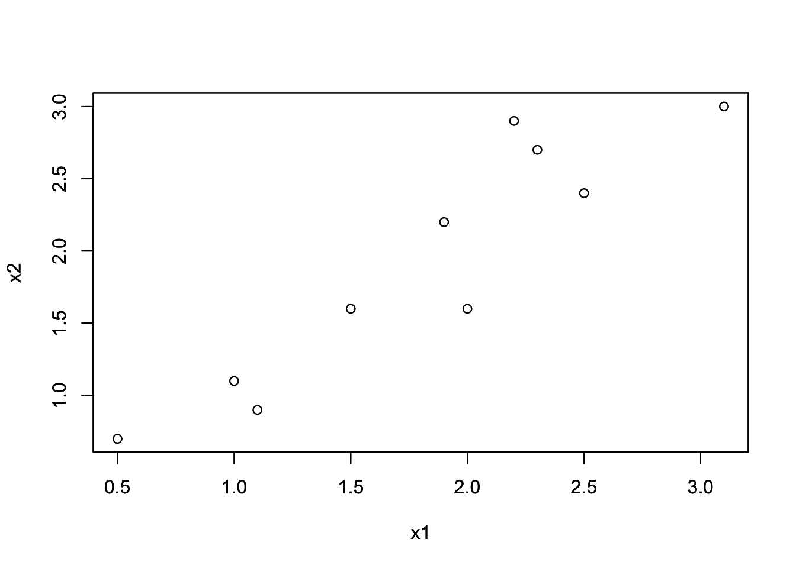

### 步骤 2：减去均值

我们使用 `scale` 函数从每个属性 (x1, x2) 的相应值中减去其均值（数据中心化）。

```r
data_norm <- scale(data, scale=F)
plot(data_norm, xlab="x1", ylab="x2")
```

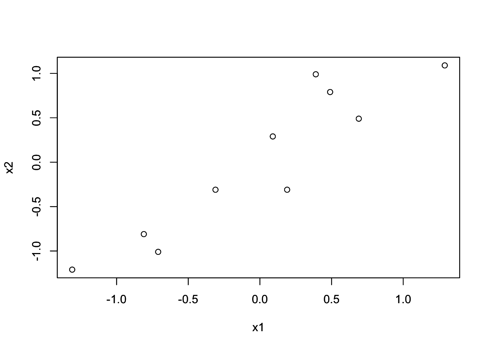

### 步骤 3：计算协方差矩阵

我们使用 `cov` 函数计算协方差矩阵。

```r
S <- cov(data_norm)
print(S)
```

## [1], [2]

## [1,] 0.6165556 0.6154444

## [2,] 0.6154444 0.7165556

### 步骤 4：计算协方差矩阵的特征向量

使用 `svd` 方法（奇异值分解）推导出协方差矩阵的特征向量。首先我们打印分解结果：

```r
udv <- svd(S)
print(udv)
```

## $d

## [1] 1.2840277 0.0490834

## $u

## [1], [2]

## [1,] -0.6778734 -0.7351787

## [2,] -0.7351787 0.6778734

## $v

## [1], [2]

## [1,] -0.6778734 -0.7351787

## [2,] -0.7351787 0.6778734

然后我们绘制特征向量：

```r
# asp=1 保持纵横比为 1，以便特征向量显示得恰当且垂直
plot(data_norm, asp=1, xlab="x1", ylab="x2")
arrows(0,0,udv$u[1,1],udv$u[2,1], lwd=1)
arrows(0,0,udv$u[1,2],udv$u[2,2], lwd=0.5)
```

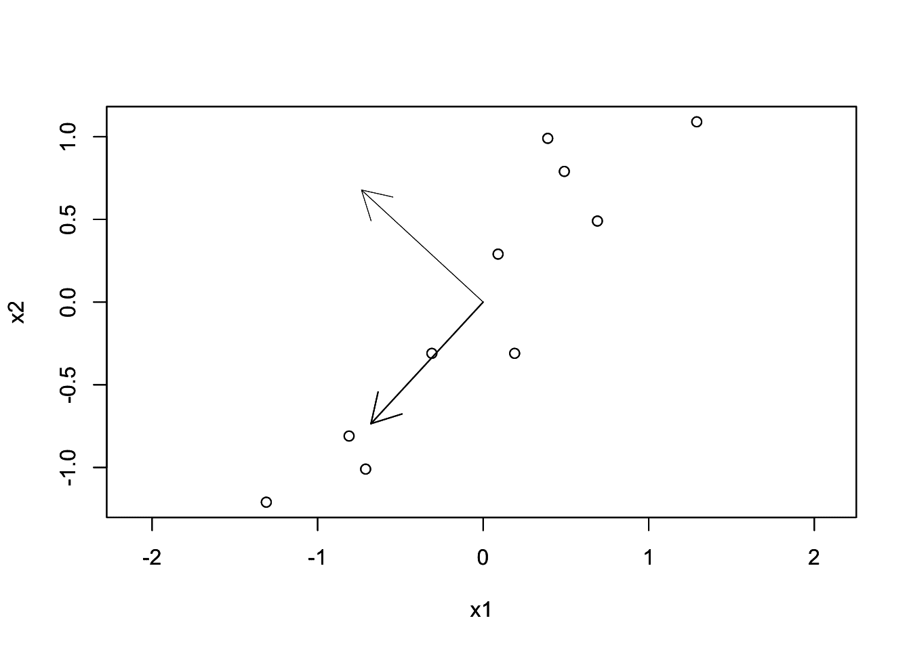

### 步骤 5：选择组件

我们可以使用条形图显示每个组件解释的方差。

```r
barplot(udv$d)
print(cumsum(udv$d)/sum(udv$d))
```

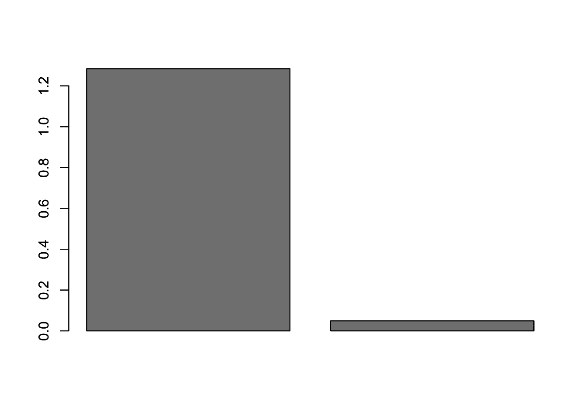

我们可以看到，第一个成分解释了超过 95% 的方差。

### 步骤 6：选取第一个成分

我们仅使用第一个主成分 (PC) 将 2D 数据集转换为 1D 数据集。

```r
data_new <- t(udv$u[,1,drop=FALSE]) %*% t(data_norm)
data_new
```

## [1], [2], [3], [4], [5], [6]

## [1,] -0.8279702 1.77758 -0.9921975 -0.2742104 -1.675801 -0.9129491

## [7], [8], [9], [10]

## [1,] 0.09910944 1.144572 0.4380461 1.223821

```r
plot(data_new, data_new, asp=1, xlab="x1", ylab="x2")
```


# k-Means 算法目的

找到所有样本在聚类中的分布，以最小化每个样本与其所属簇中心之间距离的平方和。该指标对应于类内平方和（Within cluster Sum of Squares）—— `WSS` 或 `SSE`，其公式如下：

$$SSE = \sum_{i=1}^{K} \sum_{x \in C[i]} \|x-m[i]\|^2$$

为了解决上述优化问题，k-Means 算法包含两个不同的步骤：

1. 给定某些中心点，通过将每个样本分配到最近的类来形成聚类。
2. 根据形成的聚类计算新的中心点。

在初始化步骤中，算法随机选择 `K` 个样本作为初始中心，然后使用这些中心将每个样本分配到最近的类中。一旦每个样本都被分配到某个类，每个类的新中心将计算为属于该类的所有样本的平均值。持续此迭代过程，直到连续迭代中聚类不再发生变化。

k-Means 算法最著名且常用的变体是 k-Medoids，它主要用于分类数据，并允许使用各种不同的距离函数。值得注意的是，与 k-Means 不同，k-Medoids 始终使用某个样本作为每个类的质点（medoid）。

## 9.1 - R 中的 k-Means

在 R 中执行 k-Means 聚类，我们可以使用以下命令：

```r
# 执行 k-Means 形成 3 个类
model = kmeans(data, centers = 3)
```

`centers` 参数可以接受初始中心点的数量（即类的数量）或中心点本身作为参数。

我们可以使用以下命令来显示最终质心以及样本在形成的类中的分布：

```r
# 获取质心
model$centers

# 获取样本在类中的分布
model$cluster
```

## 9.2 - R 中的 k-Medoids

在 R 中执行 k-Medoids 聚类，我们需要导入 `cluster` 库：

```r
library(cluster)
```

然后我们可以使用以下命令：

```r
# 执行 k-Medoids 形成 3 个类
model = pam(conferences, 3)
```

我们可以使用以下命令显示最终质点以及样本在形成的类中的分布：

```r
# 获取质心
model$medoids

# 获取样本在类中的分布
model$clustering
```

如果数据集包含分类变量，我们可以使用以下命令通过相应的变量显示质点：

```r
data[model$id.med, ]
```

## 9.3 - R 中的聚类评估

为了在 R 中评估我们的聚类结果，可以使用 `cluster` 库，它允许我们轻松地计算若干评估指标。一旦我们完成了聚类并获得了样本在类中的最终分布，就可以计算一组指标来评估结果。其中一些指标如下：

- 紧密度（或类内平方和）
  $$WSS = \sum_{i=1}^{K} \sum_{x \in C[i]} \|x-m[i]\|^2$$
- 分离度（或类间平方和）
  $$BSS = \sum_{i=1}^{K} |C[i]|\|m-m[i]\|$$
- 轮廓系数
  $$Silhouette (i) = \frac{b(i)-a(i)}{\max\{a(i), b(i)\}}$$
  其中 `a(i)` 是第 i 个样本与同一类内所有其他样本之间的平均距离，`b(i)` 是第 i 个样本到任何其他类中样本的最低平均距离（其中 i 不属于该类）。

我们可以使用以下 R 命令计算上述指标：

```r
# 计算 WSS
cohesion = model$tot.withinss

# 计算 BSS
separation = model$betweenss

# 计算轮廓系数
model_silhouette = silhouette(model$cluster, dist(data))
```

在轮廓系数的计算中，`data` 代表原始数据。为了绘制轮廓系数图并计算平均轮廓系数，我们可以使用以下命令：

```r
# 绘制轮廓图
plot(model_silhouette)

# 计算平均轮廓系数
mean(model_silhouette[, 3])
```

另一种可以为我们提供聚类概述并允许我们评估其性能的方法是构建热图。首先，我们可以使用以下命令对数据样本进行排序：

```r
data_ord = data[order(model$cluster), ]
```

然后构建我们的热图：

```r
heatmap(as.matrix(dist(data_ord)), Rowv = NA, Colv = NA, col = heat.colors(256), revC = TRUE)
```

下图展示了使用分布在 3 个类中的数据样本构建的示例热图。热图的颜色表示排序数据样本的距离。红色表示短距离，黄色表示远距离。

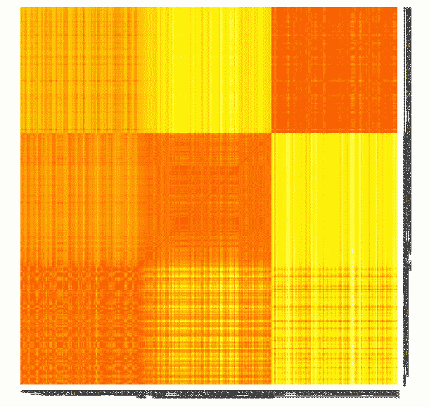

## 9.4 - k-Means 聚类概述

下表包含了我们将用于使用 k-Means 算法解决聚类问题的数据集。

| X | Y |
|---|---|
| x1 | 7 | 1 |
| x2 | 3 | 4 |
| x3 | 1 | 5 |
| x4 | 5 | 8 |
| x5 | 1 | 3 |
| x6 | 7 | 8 |
| x7 | 8 | 2 |
| x8 | 5 | 9 |

使用上述数据集，我们将回答以下问题：

(a) 在二维空间中绘制数据。
(b) 应用 k-Means 算法将数据点分配到 3 个类中。使用数据点 `x1`、`x2` 和 `x3` 作为初始中心初始化算法。
(c) 计算问题 (b) 中执行的聚类的紧密度和分离度。
(d) 使用不同的颜色为包含在每个类的数据点绘制聚类结果，并标记质心。

### 9.4.1 - 数据构建

首先，我们需要妥当地构建包含上述数据集的数据框。为了这样做，我们可以使用以下命令：

```r
# 构建包含 X 轴数据的向量
X = c(7, 3, 1, 5, 1, 7, 8, 5)

# 构建包含 Y 轴数据的向量
Y = c(1, 4, 5, 8, 3, 8, 2, 9)

# 构建包含标签的向量
names = c("x1", "x2", "x3", "x4", "x5", "x6", "x7", "x8")

# 创建数据框
kdata = data.frame(X, Y, rownames = names)
```

创建数据框后，我们可以通过以下方式绘制数据：

```r
# 绘制数据
plot(kdata)

# 添加标签
text(kdata)
```

我们的数据如图所示：

### 9.4.2 - 使用 k-Means 算法聚类

为了回答问题 (b)，我们应用 k-Means 算法，设置数据点 `x1`、`x2` 和 `x3` 为初始中心。

**第一次迭代**：首先，我们将计算集中所有数据点与初始中心之间的距离。这些距离如下矩阵所示：

| | x1 | x2 | x3 |
|---|---|---|---|
| x1 | 0.00 | 5.00 | 7.21 |
| x2 | 5.00 | 0.00 | 2.24 |
| x3 | 7.21 | 2.24 | 0.00 |
| x4 | 7.28 | 4.47 | 5.00 |
| x5 | 6.32 | 2.24 | 0.00 |
| x6 | 7.00 | 5.66 | 6.71 |
| x7 | 1.41 | 5.39 | 7.62 |
| x8 | 8.25 | 5.39 | 6.40 |

计算距离后，我们找到每个数据点的最小距离以便将其分配到相应的类。一旦所有数据点都被分配到一个类，我们就计算新的中心点。新的中心点为：

`c1 = (x1 + x4 + x6 + x7) / 4 = 7.5`  
`c2 = (x2 + x5 + x8) / 3 = 1.67`  
`c3 = (x3 + x5) / 2 = 8.33`

**第二次迭代**：下表包含了数据点到更新后中心的距离。

| | c1 | c2 | c3 |
|---|---|---|---|
| x1 | 0.71 | 6.56 | 6.71 |
| x2 | 5.15 | 3.82 | 2.00 |
| x3 | 7.38 | 4.59 | 1.00 |
| x4 | 6.96 | 0.75 | 5.66 |
| x5 | 6.67 | 5.84 | 1.00 |
| x6 | 6.52 | 2.14 | 7.21 |
| x7 | 0.71 | 6.05 | 7.28 |
| x8 | 7.91 | 1.75 | 6.40 |

由于中心点发生了变化，我们在下一次迭代中继续执行算法。

### 第 3 次迭代

我们再次计算更新后的距离。

| | C¹ | C² | C³ |
|---|---|---|---|
| x1 | 0.71 | 7.45 | 6.12 |
| x2 | 5.15 | 5.09 | 1.33 |
| x3 | 7.38 | 5.73 | 1.20 |
| x4 | 6.96 | 0.75 | 5.21 |
| x5 | 6.67 | 7.09 | 1.20 |
| x6 | 6.52 | 1.37 | 6.67 |
| x7 | 0.71 | 6.75 | 6.64 |
| x8 | 7.91 | 0.94 | 6.01 |

新的中心点为：

$$
C^1 = \frac{x_4 + x_6 + x_8}{3} = 5.67 \\
C^2 = \frac{x_2 + x_3 + x_5}{3} = 1.67 \\
C^3 = \frac{x_1 + x_7}{2} = 8.33
$$

如我们所示，中心点没有发生变化，因此算法在第 3 次迭代后收敛。

我们可以简单地使用 R 通过以下命令执行上述手动步骤：

```r
# 执行 k-Means 聚类
model = kmeans(kdata, centers = kdata[1:3,])

# 获取最终中心点
model$centers

# 获取数据点在聚类中的分布
model$cluster
```

### 9.4.3 - 计算凝聚度与分离度

为了回答问题 (c)，我们必须计算上一个小节中执行的聚类的凝聚度与分离度。

首先，我们将手动计算这些指标，然后查看如何使用 R 来计算它们。在计算过程中，我们将使用上述簇。

$$
C_1: m_1 = [7.5, 1.5] \\
C_2: m_2 = [5.67, 8.33] \\
C_3: m_3 = [4, 4]
$$

#### 凝聚度计算

凝聚度指标由以下方程给出：

$$WSS = \sum_{i=1}^{K} \sum_{x \in C[i]} \|x-m[i]\|^2$$

此时，计算每个簇的凝聚度：

**第 1 个簇**：

$$WSS(C_1) = \sum_{x \in C_1} \|x-m_1\|^2 = \|x_1 - m_1\|^2 + \|x_7 - m_1\|^2$$
$$= (7-7.5)^2 + (1-1.5)^2 + (8-7.5)^2 + (2-1.5)^2 = 0.25 + 0.25 + 0.25 + 0.25 = 1$$

**第 2 个簇**：

$$WSS(C_2) = \sum_{x \in C_2} \|x-m_2\|^2 = \|x_4 - m_2\|^2 + \|x_6 - m_2\|^2 + \|x_8 - m_2\|^2$$
$$= (5-5.67)^2 + (8-8.33)^2 + (7-5.67)^2 + (8-8.33)^2 + (5-5.67)^2 + (9-8.33)^2$$
$$= 0.4489 + 0.1089 + 1.7689 + 0.1089 + 0.4489 + 0.4489 = 3.333$$

**第 3 个簇**：

$$WSS(C_3) = \sum_{x \in C_3} \|x-m_3\|^2 = \|x_2 - m_3\|^2 + \|x_3 - m_3\|^2 + \|x_5 - m_3\|^2$$
$$= (3-4)^2 + (4-4)^2 + (1-4)^2 + (5-4)^2 + (1-4)^2 + (3-4)^2$$
$$= 1 + 0 + 9 + 1 + 9 + 1 = 21$$

总凝聚度由以下方程给出：

$$WSS_{total} = WSS(C_1) + WSS(C_2) + WSS(C_3) = 1 + 3.333 + 21 = 25.333$$

#### 分离度计算

分离度（簇间平方和）指标由以下方程给出：

$$BSS = \sum_{i=1}^{K} |C[i]| \|m - m[i]\|^2$$

所以，我们的步骤是计算数据集的中心点，它是通过所有点的平均值得到的。

$$m = \left( \frac{\sum X}{8}, \frac{\sum Y}{8} \right) = (4.625, 5)$$

$$BSS_{total} = 2\|m - m_1\|^2 + 3\|m - m_2\|^2 + 3\|m - m_3\|^2$$
$$= 2[(4.625-7.5)^2 + (5-1.5)^2] + 3[(4.625-5.67)^2 + (5-8.33)^2] + 3[(4.625-4)^2 + (5-4)^2]$$
$$= 2[8.266 + 12.25] + 3[1.091 + 11.089] + 3[0.391 + 1]$$
$$= 41.032 + 36.54 + 4.173 = 81.745$$

为了应用 k-Medoids 算法，我们将使用下表包含的数据：

| | Conference_1 | Conference_2 | Conference_3 | Conference_4 | Conference_5 | Conference_6 |
| :--- | :--- | :--- | :--- | :--- | :--- | :--- |
| Rank | High | Low | High | Low | Low | High |
| Topic | SE | SE | ML | DM | ML | SE |

上述数据集展示了 6 个不同会议的排名和主题。SE 代表软件工程（Software Engineering），ML 代表机器学习（Machine Learning），DM 代表数据挖掘（Data Mining）。

首先，我们将通过以下代码构建包含上述数据集的数据框：

```r
# 存储 Rank 数据的向量
Rank = c("High", "Low", "High", "Low", "Low", "High")

# 存储 Topic 数据的向量
Topic = c("SE", "SE", "ML", "DM", "ML", "SE")

# 数据框
conferences = data.frame(Rank, Topic)
```

我们可以使用以下命令应用 k-Medoids：

```r
# 导入库
library(cluster)

# 创建 k-Medoids 模型
model = pam(conferences, 3)
```

我们可以使用以下命令显示质心以及数据实例到聚类的分布：

```r
# 获取质心
model$medoids

# 获取样本到聚类的分布
model$clustering
```

我们还可以使用以下命令通过名称显示质心：

```r
conferences[model$id.med, ]
```

最后，我们可以使用以下命令绘制数据图：

```r
# 获取不同的排名
L1 = levels(conferences$Rank)

# 获取不同的主题
L2 = levels(conferences$Topic)

# 绘制数据
plot(model$data, xaxt = "n", yaxt = "n", pch = 15, col = model$cluster)

# 插入坐标轴标签
axis(1, at = 1:length(L1), labels = L1)
axis(2, at = 1:length(L2), labels = L2)

# 显示质心
points(conferences[model$id.med, ], col = 1:3, pch = "o", cex = 2)
```

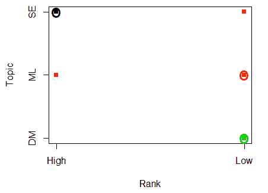

# 第 10 章 - 基于连接的聚类

基于连接的聚类（也称为层次聚类）其核心思想是：给定数据集中的每个实例都与其他任何实例相关。上述假设背后的主要思想是，对于“最近”的对象，这种关系的程度比对于远处的对象更强。“最近”一词意味着这些算法根据距离将数据实例连接起来形成聚类。一个聚类很大程度上可以通过连接该聚类部分所需的最大距离来描述。在不同的距离下会形成不同的聚类，可以使用树图（dendrogram）来表示，这解释了“层次聚类”这一名称的由来：这些算法并不提供数据集的单一划分，而是提供了一个在特定距离下相互合并的广泛聚类层次结构。

## 10.1 - R 中的层次聚类

### 10.1.1 - 数据构建

为了详细概述如何使用维度空间执行层次聚类。

| X | Y |
| :--- | :--- |
| x1 | 2 |
| x2 | 8 |
| x3 | 0 |
| x4 | 7 |
| x5 | 6 |

首先，我们需要妥当构建包含上述数据集的数据框。为了实现这一点，我们可以使用以下命令：

```r
# 构建包含 X 轴数据的向量
X = c(2, 8, 0, 7, 6)

# 构建包含 Y 轴数据的向量
Y = c(0, 4, 6, 2, 1)

# 构建包含对应行名的数据标签向量
rownames = c("x1", "x2", "x3", "x4", "x5")

# 创建数据框
hdata = data.frame(X, Y, rownames = rownames)
```

一旦创建了数据框，我们可以使用以下命令绘制数据：

```r
# 绘制数据
plot(hdata, pch = 15)

# 添加数据标签
text(hdata, labels = rownames, pos = c(4, 2, 4, 4))
```


我们的数据如图所示：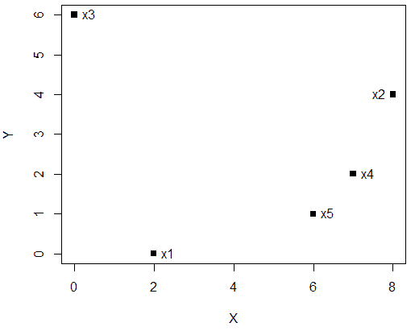

### 10.1.2 使用单链连接和完全连接的层次聚类

在本节中，我们将使用上述数据集通过单链连接和完全链连接执行层次聚类。如前所述，层次聚类是一个迭代过程，从给定数据集的单个元素开始，从而逐步形成聚类。这些聚类通过合并似乎具有强连接的元素来形成。这种连接使用距离度量来表示。非常常见的距离度量是欧几里距离，由方程给出：`\|x[1]-x[2]\|=\sqrt{\sum(x[1]-x[2])²}`

首先，我们将通过单链算法：下表展示了上述数据集的矩阵。

| | x1 | x2 | x3 | x4 | x5 |
| :--- | :--- | :--- | :--- | :--- | :--- |
| x1 | 0 | 7.21 | 6.32 | 5.39 | 4.12 |
| x2 | 7.21 | 0 | 8.25 | 2.24 | 3.61 |
| x3 | 6.32 | 8.25 | 0 | 8.06 | 7.81 |
| x4 | 5.39 | 2.24 | 8.06 | 0 | 1.41 |
| x5 | 4.12 | 3.61 | 7.81 | 1.41 | 0 |

如表所示，点 `x4` 和 `x5` 是距离最小的点。结果，我们将它们连接在一起，从而形成我们的第一个聚类。

**第 2 次迭代：** 由于我们使用单链连接，包含点 `x4` 和 `x5` 的聚类与其他每个点之间的距离是该点与点 `x4` 和 `x5` 之间距离的最小值。下表了更新后的距离矩阵。

| | x1 | x2 | x3 | x4-x5 |
| :--- | :--- | :--- | :--- | :--- |
| x1 | 0 | 7.21 | 6.32 | 4.12 |
| x2 | 7.21 | 0 | 8.25 | 2.24 |
| x3 | 6.32 | 8.25 | 0 | 7.81 |
| x4-x5 | 4.12 | 2.24 | 7.81 | 0 |

再次使用相同的策略，我们将点 `x2` 与聚类 `(x4 - x5)` 连接。

**第 3 次迭代：** 在下一次迭代中，距离矩阵再次更新，点 `x1` 与聚类 `(x2 - x4 - x5)` 连接。

| | x1-x3 | x2-x4-x5 | x3 |
| :--- | :--- | :--- | :--- |
| x1-x3 | 0 | 4.12 | 6.32 |
| x2-x4-x5 | 4.12 | 0 | 7.81 |
| x3 | | | |

**第 4 次迭代：** 最终，我们在第 4 次迭代中完成聚类，点 `x1` 与聚类 `(x2 - x4 - x5)` 连接。

| | x1-x3 | x2-x4-x5 | x3 |
| :--- | :--- | :--- | :--- |
| x1-x3 | 0 | 4.12 | 6.32 |
| x2-x4-x5 | 4.12 | 0 | 7.81 |
| x3 | | | |

我们可以在完全连接法的情况下使用相同的命令。

### 使用完全连接法进行聚类
```r
hc_single = hclust(d, method = "complete")
```

### 绘制相应的聚类图
```r
plot(hc_single)
```

下图展示了完全连接法下生成的聚类图。

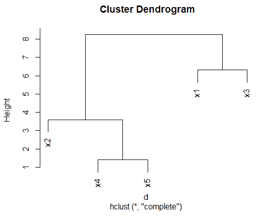

值得注意的是，聚类图的 Y 轴指的是距离度量。一旦执行了层次聚类，我们可以根据偏好使用以下命令将原始数据划分为若干类：

### 将数据划分为类。k 指聚类的数量
```r
clusters = cutree(hc_single, k = 2)
```

### 或者
```r
clusters = cutree(hc_complete, k = 2)
```

为了演示上述两种方法（单连接和完全连接法）所形成的聚类，我们可以使用以下命令进行绘图：

### 单连接结果
```r
plot(hdata, col = clusters, pch = 15, main = "Single Linkage")
text(hdata, labels = row.names(hdata), pos = c(4, 2, 4, 4, 4))
```

### 完全连接结果
```r
plot(hdata, col = clusters, pch = 15, main = "Complete Linkage")
text(hdata, labels = row.names(hdata), pos = c(4, 2, 4, 4, 4))
```

下图展示了单连接和完全连接两种情况下形成的两个聚类。

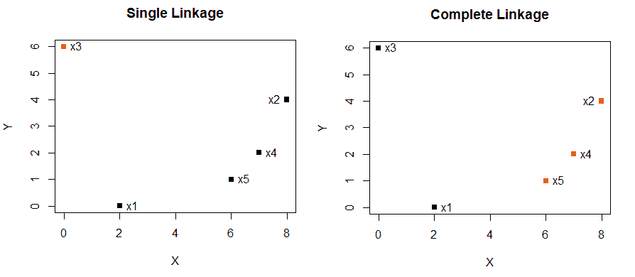

## 10.2 层次聚类的应用与评估

为了将层次聚类应用于真实世界示例，我们将使用 `europe.txt` 数据集。该数据集包含 28 个欧盟国家国内生产总值（GDP）、通胀率和失业率的统计数据。前 6 条记录如下表所示：

| GDP | Inflation | Unemployment |
| :--- | :--- | :--- |
| Austria 41600 | 3.5 | 4.2 |
| Belgium 37800 | 3.5 | 7.2 |
| Bulgaria 13800 | 4.2 | 9.6 |
| Croatia 18000 | 2.3 | 17.7 |
| Czech Republic 27100 | 1.9 | 8.5 |
| Denmark 37000 | 2.8 | 6.1 |
| … | … | … |

我们将使用该数据集来回答以下问题：

(a) 使用完全连接法应用层次聚类并绘制相应的聚类图
(b) 根据轮廓系数（silhouette coefficient）选择合适的聚类数量
(c) 使用给定数据形成 7 个类，并生成展示结果的相应聚类图
(d) 为每个类使用不同的颜色创建数据的 3D 散图
(e) 计算并绘制轮廓系数

### 10.2.1 创建层次聚类模型

首先，为了回答问题 (a)，我们将使用给定数据执行层次聚类。我们的初始步骤包括导入回答上述问题所需的库以及导入给定数据。通过以下命令完成：

```r
# 导入库
library(cluster)

# 从文件读取数据
europe = read.csv("europe.txt")

# 获取距离矩阵
d = dist(scale(europe))

# 执行层次聚类
hc = hclust(d, method = 'complete')

# 绘制聚类图
plot(hc)
```

## 11.2 DBSCAN 模型构建

为了使用 DBSCAN 算法构建基于密度的聚类模型，我们将使用下表的数据：

| X | Y |
|---|---|
| x1 | 2 | 10 |
| x2 | 2 | 5 |
| x3 | 8 | 4 |
| x4 | 5 | 8 |
| x5 | 7 | 5 |
| x6 | 6 | 4 |
| x7 | 1 | 2 |
| x8 | 4 | 9 |

为了使用 R 可视化数据，我们首先需要使用以下命令创建相应的数据框：

```r
# 构建包含 X 轴数据的向量
X = c(2, 2, 8, 5, 7, 6, 1, 4)

# 构建包含 Y 轴数据的向量
Y = c(10, 5, 4, 8, 5, 4, 2, 9)

# 构建包含对应行名的数据标签向量
rnames = c("x1", "x2", "x3", "x4", "x5", "x6", "x7", "x8")

# 创建数据框
ddata = data.frame(X, Y, row.names = rnames)
```

创建好数据框后，我们可以使用以下命令绘制数据：

```r
# 绘制数据
plot(ddata, pch = 15)

# 添加数据标签
text(ddata, labels = row.names(hdata), pos = c(4, 2, 4, 4, 4, 4, 4, 4))
```

我们的数据如图所示：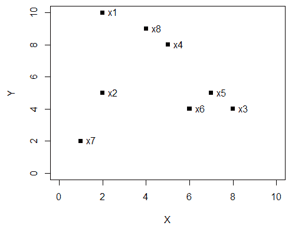

## 11.3 DBSCAN 计算

在本小节中，我们将使用 `minPoints = 2` 和 `epsilon = {2, 3.5}` 应用 DBSCAN 算法，将给定数据划分到不同的聚类中。

### `minPoints = 2` 且 `epsilon = 2`

我们首先需要为给定数据集计算距离矩阵，如下表：

| | x1 | x2 | x3 | x4 | x5 | x6 | x7 | x8 |
|---|---|---|---|---|---|---|---|---|
| x1 | 0.00 | | | | | | | |
| x2 | 5.00 | 0.00 | | | | | | |
| x3 | 8.49 | 6.08 | 0.00 | | | | | |
| x4 | 3.61 | 4.24 | 5.00 | 0.00 | | | | |
| x5 | 7.07 | 5.00 | 1.41 | 3.61 | 0.00 | | | |
| x6 | 7.21 | 4.12 | 2.00 | 4.12 | 1.41 | 0.00 | | |
| x7 | 8.06 | 3.16 | 7.28 | 7.21 | 6.71 | 5.39 | 0.00 | |
| x8 | 2.24 | 4.47 | 6.40 | 1.41 | 5.00 | 5.39 | 7.62 | 0.00 |

考虑到 `minPoints` 值为 2，每个聚类应至少包含两个点。此外，根据 `epsilon` 的值 2，DBSCAN 形成了以下聚类：`C[1] = {x3, x5, x6}` 和 `C[2] = {x4, x8}`。剩余的点被视为噪声。

### `minPoints = 2` 且 `epsilon = 3.5`

| | x1 | x2 | x3 | x4 | x5 | x6 | x7 | x8 |
|---|---|---|---|---|---|---|---|---|
| x1 | 0.00 | | | | | | | |
| x2 | 5.00 | 0.00 | | | | | | |
| x3 | 8.49 | 6.08 | 0.00 | | | | | |
| x4 | 3.61 | 4.24 | 5.00 | 0.00 | | | | |
| x5 | 7.07 | 5.00 | 1.41 | 3.61 | 0.00 | | | |
| x6 | 7.21 | 4.12 | 2.00 | 4.12 | 1.41 | 0.00 | | |
| x7 | 8.06 | 3.16 | 7.28 | 7.21 | 6.71 | 5.39 | 0.00 | |
| x8 | 2.24 | 4.47 | 6.40 | 1.41 | 5.00 | 5.39 | 7.62 | 0.00 |

当 `epsilon = 3.5` 时，DBSCAN 形成了以下聚类：`C[1] = {x3, x5, x6}`、`C[2] = {x4, x8}`、`C[3] = {x1, x7}` 以及 `C[4] = {x2, x5}`。剩余的点被视为噪声。

## 11.4 使用 R 进行 DBSCAN 聚类

为了使用 R 进行 DBSCAN 聚类，我们首先需要使用以下命令绘制数据：

```r
# 绘制数据
plot(ddata, pch = 15)

# 添加标签标签
text(data, labels = row.names(hdata), pos = c(4, 2, 4, 4, 4, 4, 4, 4))
```

创建好数据框后，我们可以使用以下命令绘制数据：

```r
# 绘制数据
plot(ddata, pch = 15)

# 添加数据标签
text(ddata, labels = row.names(hdata), pos = c(4, 2, 4, 4, 4, 4, 4, 4))
```

我们的数据如图所示：

## 11.5 DBSCAN 计算

在本小节中，我们将使用 `minPoints = 2` 和 `epsilon = {2, 3.5}` 应用 DBSCAN 算法，将给定数据划分到不同的聚类中。

### `minPoints = 2` 且 `epsilon = 2`

我们首先需要为给定数据集计算距离矩阵，如下表：

| | x1 | x2 | x3 | x4 | x5 | x6 | x7 | x8 |
|---|---|---|---|---|---|---|---|---|
| x1 | 0.00 | | | | | | | |
| x2 | 5.00 | 0.00 | | | | | | |
| x3 | 8.49 | 6.08 | 0.00 | | | | | |
| x4 | 3.61 | 4.24 | 5.00 | 0.00 | | | | |
| x5 | 7.07 | 5.00 | 1.41 | 3.61 | 0.00 | | | |
| x6 | 7.21 | 4.12 | 2.00 | 4.12 | 1.41 | 0.00 | | |
| x7 | 8.06 | 3.16 | 7.28 | 7.21 | 6.71 | 5.39 | 0.00 | |
| x8 | 2.24 | 4.47 | 6.40 | 1.41 | 5.00 | 5.39 | 7.62 | 0.00 |

考虑到 `minPoints` 值为 2，每个聚类应至少包含两个点。此外，根据 `epsilon` 的值 2，DBSCAN 形成了以下聚类：`C[1] = {x3, x5, x6}` 和 `C[2] = {x4, x8}`。剩余的点被视为噪声。

### `minPoints = 2` 且 `epsilon = 3.5`

| | x1 | x2 | x3 | x4 | x5 | x6 | x7 | x8 |
|---|---|---|---|---|---|---|---|---|
| x1 | 0.00 | | | | | | | |
| x2 | 5.00 | 0.00 | | | | | | |
| x3 | 8.49 | 6.08 | 0.00 | | | | | |
| x4 | 3.61 | 4.24 | 5.00 | 0.00 | | | | |
| x5 | 7.07 | 5.00 | 1.41 | 3.61 | 0.00 | | | |
| x6 | 7.21 | 4.12 | 2.00 | 4.12 | 1.41 | 0.00 | | |
| x7 | 8.06 | 3.16 | 7.28 | 7.21 | 6.71 | 5.39 | 0.00 | |
| x8 | 2.24 | 4.47 | 6.40 | 1.41 | 5.00 | 5.39 | 7.62 | 0.00 |

当 `epsilon = 3.5` 时，DBSCAN 形成了以下聚类：`C[1] = {x3, x5, x6}`、`C[2] = {x4, x8}`、`C[3] = {x1, x7}` 以及 `C[4] = {x2, x5}`。剩余的点被视为噪声。

## 11.4 使用 R 进行 DBSCAN 聚类

为了使用 R 进行 DBSCAN 聚类，我们首先需要使用以下命令创建相应的数据框：

```r
# 构建包含 X 轴数据的向量
X = c(2, 2, 8, 5, 7, 6, 1, 4)
```


# 11.2 - DBSCAN 模型构建

为了使用 DBSCAN 算法构建基于密度的聚类模型，我们将使用下表的数据：

| X | Y |
|---|---|
| x1 | 2 | 10 |
| x2 | 2 | 5 |
| x3 | 8 | 4 |
| x4 | 5 | 8 |
| x5 | 7 | 5 |
| x6 | 6 | 4 |
| x7 | 1 | 2 |
| x8 | 4 | 9 |

为了使用 R 可视化数据，我们首先需要使用以下命令创建相应的数据框：

```r
# 构建包含 X 轴数据的向量
X = c(2, 2, 8, 5, 7, 6, 1, 4)

# 构建包含 Y 轴数据的向量
Y = c(10, 5, 4, 8, 5, 4, 2, 9)

# 构建包含对应行名的数据标签向量
rnames = c("x1", "x2", "x3", "x4", "x5", "x6", "x7", "x8")

# 创建数据框
ddata = data.frame(X, Y, row.names = rnames)
```

创建好数据框后，我们可以使用以下命令绘制数据：

```r
# 绘制数据
plot(ddata, pch = 15)

# 添加数据标签
text(ddata, labels = row.names(ddata), pos = c(4, 2, 4, 4, 4, 4, 4, 4))
```

我们的数据如图所示：

# 11.3 - DBSCAN 计算

在本小节中，我们将使用 `minPoints = 2` 和 `epsilon = {2, 3.5}` 应用 DBSCAN 算法，将给定数据划分到不同的聚类中。

## `minPoints = 2` 且 `epsilon = 2`

我们首先需要为给定数据集计算距离矩阵，如下表：

|   | x1 | x2 | x3 | x4 | x5 | x6 | x7 | x8 |
|---|---|---|---|---|---|---|---|---|
| x1 | 0.00 |   |   |   |   |   |   |   |
| x2 | 5.00 | 0.00 |   |   |   |   |   |   |
| x3 | 8.49 | 6.08 | 0.00 |   |   |   |   |   |
| x4 | 3.61 | 4.24 | 5.00 | 0.00 |   |   |   |   |
| x5 | 7.07 | 5.00 | 1.41 | 3.61 | 0.00 |   |   |   |
| x6 | 7.21 | 4.12 | 2.00 | 4.12 | 1.41 | 0.00 |   |   |
| x7 | 8.06 | 3.16 | 7.28 | 7.21 | 6.71 | 5.39 | 0.00 |   |
| x8 | 2.24 | 4.47 | 6.40 | 1.41 | 5.00 | 5.39 | 7.62 | 0.00 |

考虑到 `minPoints` 值为 2，每个聚类应至少包含两个点。此外，根据 `epsilon` 的值 2，DBSCAN 形成了以下聚类：`C[1] = {x3, x5, x6}` 和 `C[2] = {x4, x8}`。剩余的点被视为噪声。

## `minPoints = 2` 且 `epsilon = 3.5`

|   | x1 | x2 | x3 | x4 | x5 | x6 | x7 | x8 |
|---|---|---|---|---|---|---|---|---|
| x1 | 0.00 |   |   |   |   |   |   |   |
| x2 | 5.00 | 0.00 |   |   |   |   |   |   |
| x3 | 8.49 | 6.08 | 0.00 |   |   |   |   |   |
| x4 | 3.61 | 4.24 | 5.00 | 0.00 |   |   |   |   |
| x5 | 7.07 | 5.00 | 1.41 | 3.61 | 0.00 |   |   |   |
| x6 | 7.21 | 4.12 | 2.00 | 4.12 | 1.41 | 0.00 |   |   |
| x7 | 8.06 | 3.16 | 7.28 | 7.21 | 6.71 | 5.39 | 0.00 |   |
| x8 | 2.24 | 4.47 | 6.40 | 1.41 | 5.00 | 5.39 | 7.62 | 0.00 |

当 `epsilon = 3.5` 时，DBSCAN 形成了以下聚类：`C[1] = {x3, x5, x6}`、`C[2] = {x4, x8}`、`C[3] = {x1, x7}` 以及 `C[4] = {x2, x5}`。剩余的点被视为噪声。

# 11.4 - 使用 R 进行 DBSCAN 聚类

为了使用 R 进行 DBSCAN 聚类，我们首先需要使用以下命令创建相应的数据框：

```r
# 构建包含 X 轴数据的向量
X = c(2, 2, 8, 5, 7, 6, 1, 4)

# 构建包含 Y 轴数据的向量
Y = c(10, 5, 4, 8, 5, 4, 2, 9)

# 构建包含对应行名的数据标签向量
rnames = c("x1", "x2", "x3", "x4", "x5", "x6", "x7", "x8")

# 创建数据框
ddata = data.frame(X, Y, row.names = rnames)
```

创建好数据框后，我们可以使用以下命令绘制数据：

```r
# 绘制数据
plot(ddata, pch = 15)

# 添加数据标签
text(ddata, labels = row.names(ddata), pos = c(4, 2, 4, 4, 4, 4, 4, 4))
```

---

给定 $\theta[old]$：找到 $P (Z/X, \theta[old])$

M 步：

$\theta[new] = \arg\max_{\theta} \sum P (Z/X, \theta[old]) \ln P (X, Z/\theta)$

$Z$

当对数似然值不再更新或更新步长小于给定的阈值时，EM 算法达到收敛。

# 12.1.2 - 高斯混合模型 - GMMs

高斯混合模型是一种概率模型，它假设所有数据点都是由一个有限数量具有未知参数的高斯分布的混合体生成的。人们可以将混合模型看作是对 `k`-means 聚类的推广，它纳入了关于数据协方差结构以及潜在高斯分布中心点的信息。

通常情况下，$K$ 个正态分布的混合由以下方程给出：

$P (x) = \sum_{k=1}^{K} \pi[k] N (x/\mu[k], \Sigma[k])$

其中

$\pi[k]$ : 混合系数 $\in [0, 1]$ 且 $\sum_{k=1}^{K} \pi[k] = 1$

$\mu[k], \Sigma[k]$ : 第 $k$ 个分布的均值和协方差

$N (x/\mu, \Sigma) = \frac{e^{-\frac{1}{2}(x-\mu)^T\Sigma^{-1}(x-\mu)}}{(2\pi)^{n/2}|\Sigma|^{1/2}}$

GMMs 使用 EM 作为优化算法，能够计算描述给定数据的分布的潜变量。因此，在 GMM 的情况下，EM 算法最大化以下量值：

$\ln P (X / \pi, \mu, \Sigma) = \sum_{n=1}^{N} \ln \sum_{k=1}^{K} (\pi[k] N (x[n]/\mu[k], \Sigma[k]))$

其中 $X = \{x[1], x[2], \dots, x[n]\} \rightarrow$ 给定数据集

# 12.2 - 使用 EM 建模高斯混合模型

为了使用 GMMs 进行聚类，我们将使用一个包含 1,000 个 1D 数据实例的数据集，这些实例源自两个不同的分布。关于分布，我们知道它们的标准差为 1。数据的摘要如下所示：

| D1_X | D2_X |
| :--- | :--- |
| Min. | -1.905 | 3.992 |
| 1st Qu. | 0.223 | 6.322 |
| Median | 0.907 | 6.944 |
| Mean | 1.000 | 6.985 |
| 3rd Qu. | 1.664 | 7.681 |
| Max. | 3.659 | 10.810 |

使用上述数据，我们将回答以下问题：

(a) 绘制数据（1 维）以及概率密度函数，并为每个分布使用不同的颜色。

(b) 计算每个正态分布的均值 ($\mu[1], \mu[2]$) 和潜变量 $\lambda[1], \lambda[2]$。

(d) 在同一张图中绘制给定数据的估计概率密度函数和真实概率密度函数。

## 12.2.1 - 数据

为了回答第一个问题，我们首先使用以下命令读取数据：

```r
# 读取数据
gdata = read.csv("gdata.txt")

# 将 1D 数据保存到向量 x
x = gdata[, 1]

# 将聚类索引保存到向量 y
y = gdata[, 2]
```

为了绘制数据以及概率密度，我们可以使用以下命令：

```r
# 绘制数据
plot(data.frame(x), ylim = c(-0.01, 0.25), col = y, xlab = "Data", ylab = "Density")

# 绘制概率密度函数
lines(density(x), col = y)
```

接下来的图展示了带有概率密度函数的给定数据集。来自每个聚类的数据用不同的颜色（黑色和红色）标出。

## 12.2.2 - 手动计算正态分布的参数

在本小节中，我们将使用 EM 算法利用给定数据集计算正态分布的参数。首先，我们将为参数 $\mu$ 和 $\lambda$ 选择初始值：

初始化：$\mu[1] = 0, \mu[2] = 1, \lambda[1] = 0.5, \lambda[2] = 0.5$
$\Theta = \{\theta[1], \theta[2]\} = \{(0, 1, 0.5), (1, 1, 0.5)\}$

E 步：在这一步中，我们想要计算给定数据点源自某个正态分布的概率。该概率由以下方程给出：

$P (D_j/x_i) = \frac{\lambda[j] P (x_i/\theta[j])}{\lambda[1] P (x_i/\theta[1]) + \lambda[2] P (x_i/\theta[2])}$

其中 $j = 1, 2$， $\lambda = \{\lambda[1], \lambda[2]\} = \{0.5, 0.5\}$

## 12.2.3 - 使用 R 计算正态分布的参数

```r
# 初始化
mu = c(0, 1)
lambda = c(0.5, 0.5)

# 设置停止标准
epsilon = 1e-08

# 计算初始对数似然
log_likelihood = sum(log(lambda[1] * dnorm(x, mean = mu[1], sd = 1) + lambda[2] * dnorm(x, mean = mu[2], sd = 1)))

repeat {
  # ------ 期望步 -----
  # 根据 mu, lambda (以及 sigma) 找到分布
  T1 = dnorm(x, mean = mu[1], sd = 1)
  T2 = dnorm(x, mean = mu[2], sd = 1)
  P1 = lambda[1] * T1 / (lambda[1] * T1 + lambda[2] * T2)
  P2 = lambda[2] * T2 / (lambda[1] * T1 + lambda[2] * T2)

  # ------ 最大化步 -----
  # 给定分布找到 mu, lambda (以及 sigma)
  mu[1] = sum(P1 * x) / sum(P1)
  mu[2] = sum(P2 * x) / sum(P2)
  lambda[1] = mean(P1)
  lambda[2] = mean(P2)

  # 计算新的对数似然（待最大化）
  new_log_likelihood = sum(log(lambda[1] * dnorm(x, mean = mu[1], sd = 1) + lambda[2] * dnorm(x, mean = mu[2], sd = 1)))

  # 打印当前参数和对数似然值
  cat("mu =", mu, " lambda =", lambda, " log_likelihood =", new_log_likelihood, "\n")

  # 如果算法收敛则停止
  if (new_log_likelihood - log_likelihood <= epsilon) break
  log_likelihood = new_log_likelihood
}
```

## 12.2.4 - 使用 mixtools 构建 GMMs 模型

为了回答问题 (c)，我们将使用 R 构建一个 GMMs 聚类模型。我们将使用的库是 `mixtools`：

```r
library(mixtools)
```

我们可以使用期望最大化 (EM) 算法，并使用以下命令概述最终计算出的参数：

```r
# 使用上述初始化模型应用 EM 算法
model = normalmixEM(x, mu = c(0,1), sd.constr = c(1,1))

# 获取分布的均值
model$mu

# 获取 lambda 值
model$lambda

# 获取最终对数似然
model$loglik
```

我们可以使用以下命令将原始和估计的概率密度函数（绘制在同一张图中）：

```r
# 绘制估计的概率密度函数
plot(model, which = 2)

# 绘制原始概率密度函数
lines(density(x), lty = 2, lwd = 2)
```

下图展示了概率密度函数。虚线表示实际密度，实线表示估计密度。我们可以看到，估计非常接近实际密度。


# 12.3 - GMMs 应用

在本节中，我们将展示 GMMs 在现实生活示例中的应用。在这种背景下，我们有一个包含 300 个源自不同分布的 2D 数据集。分布的总结如下表：

| | D1_X1 | D1_X2 | D2_X1 | D2_X2 |
| :--- | :--- | :--- | :--- | :--- |
| 最小值 | 3.33 | 5.57 | 17.64 | 5.47 |
| 第一分位数 | 8.29 | 9.01 | 22.43 | 8.56 |
| 中位数 | 10.07 | 10.22 | 24.91 | 10.02 |
| 平均值 | 1.32 | 1.53 | -4.72 | -3.97 |
| 三分位数 | 11.88 | 11.38 | 27.44 | 11.48 |
| 最大值 | 17.32 | 14.80 | 31.27 | 23.47 |

然后，我们将使用给定数据集回答以下问题：

(a) 为每个类使用不同的颜色绘制给定数据集。

(b) 构建 GMMs 模型将提供的数据集聚分为 3 类。设置 epsilon 值为 0.1。

(c) 显示 EM 算法如何收敛并使用估计的概率密度函数绘制数据。

(d) 将每个数据点分配给概率最高的类，并结合质心绘制聚类。

(e) 计算并绘制轮廓系数。

(f) 根据上述聚类结果显示数据的热图。

## 12.3.1 - 数据集构建

首先，我们将使用以下命令读取数据集：

```r
# 读取数据
gsdata = read.csv("gsdata.txt")

# 第三列包含每个数据点的类别标签
target = gsdata[, 3]

# 前两列包含数据坐标
gsdata = gsdata[, 1:2]
```

我们可以使用以下命令绘制数据：

```r
plot(gsdata, col = target)
```

输出结果如下图，其中每个类的数据点用不同的颜色（红、黑、绿）表示：


## 12.3.2 - GMMs 模型构建

为了构建 GMMs 模型，我们将使用以下命令：

```r
# 导入库 mixtools
library(mixtools)

# 构建模型
model = mvnormalmixEM(gsdata, k = 3 , epsilon = 0.1)
```

一旦构建了模型，我们可以以下命令演示算法如何收敛：

```r
plot(model, which = 1)
```

收敛情况所示：


注意：EM 算法收敛非常快。从第 2 次迭代开始，对数似然几乎相同。

最后，我们可以使用以下命令绘制给定数据集以及每个类的概率密度函数：

```r
plot(model, which = 2)
```


使用 `model$posterior` 命令，我们可以看到每个数据点源自三个类之一的概率（软分配）。然而，为了回答这个问题，我们使用以下命令执行了硬分配：

```r
# 将每个点分配给概率最高的类
clusters = max.col(model$posterior)

# 计算中心
centers = matrix(unlist(model$mu), byrow = TRUE, ncol = 2)
```

使用上述硬分配，我们可以计算轮廓系数并构建热图。

### 12.3.3 - 轮廓计算

为了计算和绘制轮廓系数，我们可以使用以下命令：

```r
# 计算轮廓
model_silhouette = silhouette(clusters, dist(gsdata))

# 绘制轮廓
```


### 12.3.4 - 热图构建

为了构建热图，我们可以使用：

```r
# 根据类值对数据进行排序
gsdata_ord = gsdata[order(clusters), ]

# 构建热图
heatmap(as.matrix(gsdata_ord), col = colors(256))
```


## 12.4 - 基于信息准则的 GMMs 应用

在本节中，我们将使用基于信息准则的 300 个数据点的 GMMs。两个分布的总结如下：

| | 值 |
| :--- | :--- |
| 最小值 | -2.239 |
| 第一分位数 | 0.639 |
| 中位数 | 5.07 |
| 平均值 | 5.0336 |
| 三分位数 | 9.1177 |
| 最大值 | 12.0908 |

我们将使用给定数据集回答问题：

(a) 为每个类绘制给定数据集。

(b) 执行聚类并计算 AIC 和 BIC。

(c) 使用估计的概率密度函数绘制数据。

### 12.4.1 - 数据构建

首先，我们将使用以下命令读取数据集：

```r
# 读取数据
icdata = read.csv("icdata.txt")

# 第一列包含数据点的数值
x = icdata[, 1]

# 第二列包含类别的标签
y = icdata[, 2]
```

之后，我们可以结合概率密度函数绘制数据集：

```r
# 绘制数据
plot(data.frame(x, 0), ylim = c(-0.01, 0.1))

# 绘制密度函数
lines(density(x))
```


### 12.4.2 - 用于选择类数的信息准则

为了回答问题 (b)，我们需要计算赤池信息准则 (AIC) 和贝叶斯信息准则 (BIC)。对于具有 `t` 个参数、`N` 个样本且对数似然为 `L` 的给定模型，上述准则公式如下：

`AIC = 2t - 2ln(L)`

`BIC = tln(N) - 2ln(L)`

我们可以使用以下代码对 2、3、4 和 5 个分布进行聚类：

```r
# 存储 AIC 值
AIC = c()

# 存储 BIC 值
BIC = c()

# 设置 2x2 绘图布局
par(mfrow = c(2, 2))

# 遍历类数
for (k in 2:5) {

  # 构建模型
  model = normalmixEM(x, k = k, epsilon = 0.0001)

  # 绘制聚类结果
  plot(model, which = 2 , main2 = paste("Density (k = ", k, ")", sep = ""))

  # 计算参数数量
  numparams = length(model$mu) + length(model$stdev) + length(model$lambda)

  # 存储 AIC 和 BIC 值
  AIC[k] = 2 * numparams - 2 * model$loglik
  BIC[k] = log(length(x)) * numparams - 2 * model$loglik
}
```

下图描述了聚类结果：


最后，我们可以使用以下命令绘制 AIC 和 BIC 值：

```r
# 绘制 AIC 值
plot(AIC[2:5], type = 'l', xaxt = "n", main = "AIC", ylab = "AIC")
axis(1, at = 1:4, labels = 2:5)

# 绘制 BIC 值
plot(BIC[2:5], type = 'l', xaxt = "n", main = "BIC", ylab = "BIC")
axis(1, at = 1:4, labels = 2:5)
```

AIC 和 BIC 值与聚类数量的关系如图所示：

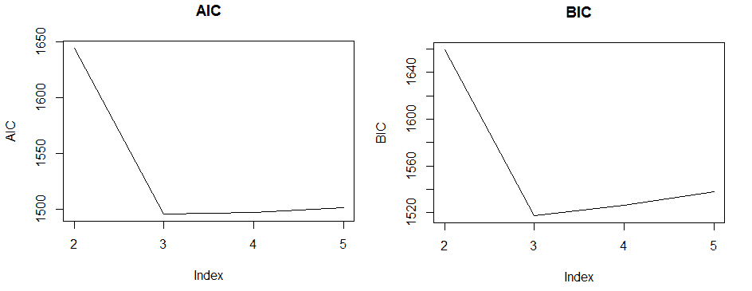

# 第五部分 - 扩展主题

# 第 13 章 - 关联规则

`arules` 包含了关联规则提取算法。用于执行市篮分析的超市交易数据可以在 ACM RecSys 的 Grocery Shopping 数据页面找到。具体来说，我们将使用比利时零售市场数据集。

首先，让我们加载数据，使用 `read.transactions` 函数读取它并检查前 10 条数据：

```r
library(arules)

fileURL <- "http://fimi.ua.ac.be/data/retail.dat.gz"
download.file(fileURL, destfile = "retail.data.gz", method = "curl")

# 以购物篮格式读取数据
trans = read.transactions("retail.data.gz", format = "basket", sep = " ")
inspect(trans[1:10])
```

```
## items
## [1] {0, 1, 10, 11, 12, 13, 14, 15, 16, 17, 18, 19, 2, 20, 21, 22, 23, 24, 25, 26, 27, 28, 29, 3, 4, 5, 6, 7, 8, 9}
## [2] {30, 31, 32}
## [3] {33, 34, 35}
## [4] {36, 37, 38, 39, 40, 41, 42, 43, 44, 45, 46}
## [5] {38, 39, 47, 48}
## [6] {38, 39, 48, 49, 50, 51, 52, 53, 54, 55, 56, 57, 58}
## [7] {32, 41, 59, 60, 61, 62}
## [8] {3, 39, 48}
## [9] {63, 64, 65, 66, 67, 68}
## [10] {32, 69}
```

可以看出每笔交易都包含项目 ID 列表。对于 `read.transactions` 函数读取的数据集，`summary` 函数将为交易数据提供专门的摘要：

```r
summary(trans)
```

```
## 稀疏格式的 itemMatrix 矩阵，包含 88162 行（元素/项集/交易）和 16470 列（项目），密度为 0.0006257289
##
## 最频繁的项目：
## 39 48 38 32 41 (其他)
## 50675 42135 15596 15167 14945 770058
##
## 元素（项集/交易）长度分布：
## sizes
## 1 2 3 4 5 6 7 8 9 10 11 12 13 14 15 3016 5516 6919 7210 6814 6163 5746 5143 4660 4086 3751 3285 2866 2620 2310
## 16 17 18 19 20 21 22 23 24 25 26 27 28 29 30 2115 1874 1645 1469 1290 1205 981 887 819 684 586 582 472 480 355
## 31 32 33 34 35 36 37 38 39 40 41 42 43 44 45 310 303 272 234 194 136 153 123 115 112 76 66 71 60 50 46 47 48 49 50 51 52 53 54 55 56 57 58 59 60
## 44 37 37 33 22 24 21 21 10 11 10 9 11 4 9 61 62 63 64 65 66 67 68 71 73 74 76 7
## 4 5 2 2 5 3 3 1 1 1 1
##    Min. 1st Qu.  Median    Mean 3rd Qu.    Max.
##   1.00   4.00   8.00  10.31  14.00  76.00
##
## 包含扩展信息 - 示例：
## 1
## 2
## 3
```

读取交易后，我们继续分析：`apriori(trans, support = 0.01, confidence = 0.6)`

```
## 参数规范：
##  val originalSupport time minlen 0.6 0.1 none FALSE TRUE 5 0.01 maxlen target
##
## 算法控制：
##  filter tree heapopt load sort 0.1 TRUE TRUE
##
## 绝对最小支持计数：881 次出现 ... 项目(s) 完成 [0.00s]。 交易处理 ... [16470 个项目] 完成 [0.22s]。 正在编码项目 ... [70 个项目]。 正在创建交易 ... [0.06s]。 正在检查子集 1 2 3 完成 [0.1s]。 正在写入 ... [84 条规则] 完成 [0.00s]。 正在创建对象 4 完成 [0.03s]。 生成了 84 条规则。查看 `inspect(rules)`
##
##  lhs      rhs support confidence coverage lift count
## [1]  {37}        => {38} 0.012     0.974      5.505 1046
## [2]  {286}       => {38} 0.013     0.943      5.333 1116
## [3]  {1925}      => {39} 0.011     0.639      1.112  938
## [4]  {1146}      => {39} 0.011     0.689      1.199  983
## [5]  {79}        => {39} 0.013     0.694      1.208 1111
## [6]  {1327}      => {39} 0.013     0.647      1.126 1156
## [7]  {438}       => {39} 0.014     0.676      1.177 1260
## [8]  {60}        => {39} 0.011     0.660      1.149  983
## [9]  {255}       => {48} 0.012     0.717      1.500 1057
## [10] {255}       => {39} 0.012     0.717      1.248 1057
## [11] {533}       => {39} 0.010     0.620      1.079  922
## [12] {270}       => {39} 0.014     0.689      1.198 1194
## [13] {2238}      => {39} 0.015     0.750      1.306 1287
## [14] {110}       => {38} 0.031     0.975      5.513 2725
## [15] {110}       => {39} 0.020     0.630      1.095 1759
## [16] {147}       => {39} 0.013     0.639      1.112 1137
## [17] {271}       => {39} 0.016     0.685      1.191 1434
## [18] {413}       => {48} 0.013     0.604      1.263 1135
## [19] {413}       => {39} 0.013     0.601      1.046 1130
## [20] {36}        => {38} 0.032     0.950      5.372 2790
## [21] {36}        => {39} 0.023     0.694      1.207 2037
## [22] {475}       => {48} 0.016     0.659      1.379 1428
## [23] {475}       => {39} 0.017     0.692      1.204 1500
## [24] {170}       => {38} 0.034     0.978      5.529 3031
## [25] {170}       => {39} 0.023     0.664      1.156 2059
## [26] {101}       => {39} 0.016     0.626      1.089 1400
## [27] {310}       => {48} 0.019     0.652      1.365 1692
## [28] {310}       => {39} 0.021     0.714      1.242 1852
## [29] {237}       => {39} 0.022     0.636      1.107 1929
## [30] {225}       => {39} 0.027     0.722      1.256 2351
## [31] {89}        => {48} 0.032     0.729      1.526 2798
## [32] {89}        => {39} 0.031     0.716      1.246 2749
## [33] {65}        => {39} 0.032     0.623      1.084 2787
## [34] {41}        => {39} 0.102     0.603      1.263 9018
## [35] {41}        => {39} 0.129     0.764      1.329 11414
## [36] {110,48}    => {38} 0.015     0.986      5.575 1361
## [37] {110,38}    => {39} 0.020     0.639      1.111 1740
## [38] {110,39}    => {38} 0.020     0.989      5.592 1740
## [39] {110,48}    => {39} 0.012     0.751      1.307 1037
## [40] {36,48}     => {38} 0.015     0.960      5.429 1360
## [41] {36,38}     => {39} 0.022     0.697      1.213 1945
## [42] {36,39}     => {38} 0.022     0.955      5.398 1945
## [43] {36,48}     => {39} 0.013     0.788      1.371 1116
## [44] {475,48}    => {39} 0.012     0.765      1.330 1092
## [45] {39,475}    => {48} 0.012     0.728      1.523 1092
## [46] {170,48}    => {38} 0.017     0.988      5.584 1538
## [47] {170,38}    => {39} 0.023     0.666      1.159 2019
## [48] {170,39}    => {38} 0.023     0.981      5.543 2019
## [49] {170,48}    => {39} 0.014     0.775      1.348 1206
## [50] {101,48}    => {39} 0.011     0.722      1.255  946
## [51] {101,39}    => {48} 0.011     0.676      1.414  946
## [52] {310,48}    => {39} 0.015     0.796      1.385 1347
## [53] {310,39}    => {48} 0.015     0.727      1.522 1347
## [54] {237,48}    => {39} 0.014     0.740      1.287 1244
## [55] {237,39}    => {48} 0.014     0.645      1.349 1244
## [56] {285,48}    => {39} 0.014     0.726      1.389 1400
## [57] {38,48}     => {39} 0.021     0.714      1.242 1852
## ...
## [74] {110,39,48} => {38} 0.012     0.994      5.620 1031
## [75] {36,38,48}  => {39} 0.012     0.794      1.382 1080
## [76] {36,39,48}  => {38} 0.012     0.968      5.471 1080
## [77] {170,38,48} => {39} 0.014     0.776      1.349 1193
## [78] {170,39,48} => {38} 0.014     0.989      5.592 1193
## [79] {32,38,48}  => {39} 0.014     0.751      1.306 1236
## [80] {32,38,39}  => {48} 0.014     0.672      1.406 1236
## [81] {38,41,48}  => {39} 0.023     0.839      1.459 1991
## [82] {38,39,41}  => {48} 0.023     0.653      1.365 1991
## [83] {32,41,48}  => {39} 0.019     0.798      1.388 1646
## [84] {32,39,41}  => {48} 0.019     0.698      1.460 1646
```

例如，第一条规则 `{37} => {38}` 表示，如果有人购买了代码为 `37` 的物品，他或她可能会购买代码为 `38` 的物品，支持度为 1.2%，置信度为 97.4%，提升度（lift）为 5.5。关于规则库的详细分析，请查看 `Introduction to arules` 教程¹⁴。

¹⁴ `https://mran.revolutionanalytics.com/web/packages/arules/vignettes/arules.pdf`
