# Python 机器学习 实践指南

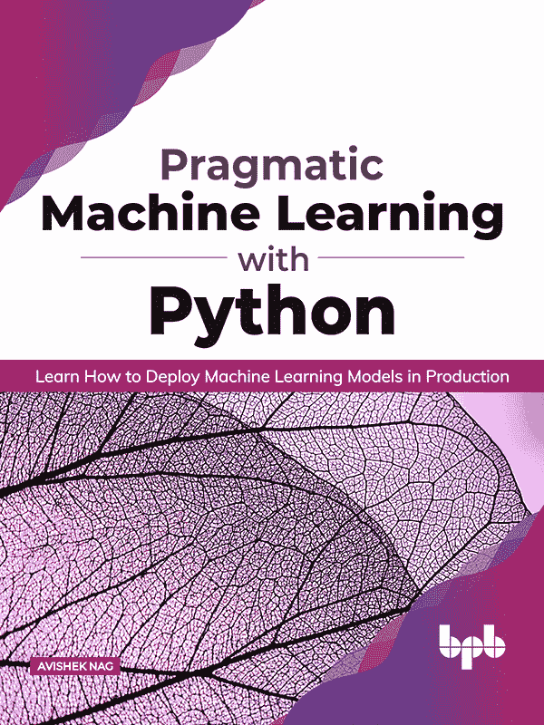

使用 Python


## 由 Avishek Nag


# 致

# 致 Balaram Nag

# 致 我的父亲，他为我的人生奠定了基础。

# 关于作者

Avishek 拥有来自 BITS (Pilani) 的数据分析与机器学习硕士学位，以及来自 West Bengal University of Technology (WBUT) 的计算机科学学士学位。他在 VMware、Cognizant、Cisco、Mobile Iron 等知名公司拥有超过 14 年的工作经验。他最初从 Java 开发人员开始职业生涯，约五年前转向机器学习核心领域。他拥有从概念到生产环境的机器学习系统设计与开发的实践经验，在多个组织中工作。扎实的数学/统计基础和丰富的产品开发经验帮助他迅速在机器学习与数据科学领域崭露头角。他通过本书分享自己的知识与经验，帮助任何软件工程师快速入门此领域。他也撰写博客，博客地址可查看 [`medium.com/@avisheknag17`](https://medium.com/@avisheknag17)

课外，他喜欢阅读书籍。他还对艺术与素描工作有浓厚兴趣。

# 前言

我在行业内已有约 14 年经验，看到的始终是学习与实际应用之间存在巨大的鸿沟。尤其是机器学习等需要扎实数学理论基础的学科，这种鸿沟更为明显。最大的挑战是如何将抽象的数学模型理论转化为生产环境中的实际应用。我阅读了许多著名作者撰写的机器学习书籍，发现每本都各具特色。我想，如果我能结合行业与学术经验在此贡献，就能搭建理论与实践之间的桥梁。这种贡献或许能帮助大量一线从业者。这正是写这本书的动力。全书共分为九章。以下是每章的详细内容：

**Chapter 1** 向读者高层次地介绍机器学习（ML）概念，解释模型的含义及机器学习项目的生命周期，并给出不同机器学习技术的简要高层次概述，这些技术将在后续章节中详细说明。本章还提供了理解 ML 模型所需的数学概念的概览。

**Chapter 2** 讨论分类技术，阐述机器学习流水线的概念，并简要介绍 Python 的 `scikit-learn` 库，它是实现各类机器学习模型的默认选择。本章涵盖 Naïve Bayes、Logistic Regression、Decision Tree 以及集成模型 Random Forest。

**Chapter 3** 专注于回归技术。给出回归问题的正式代数定义，并解释两种主要解决方法：OLS 与梯度下降。还涉及特征选择（前向与后向）、多项式回归形式、正则化（Lasso 与 Ridge）、参数线性模型的特征解释等内容。

**Chapter 4** 介绍非监督学习中的聚类技术。给出对象分组和距离的正式定义，并将其与聚类联系起来。主要讨论两类聚类方法：基于质心的 KMeans 和基于密度的 DBSCAN。此外，还讨论了层次聚类（如聚类聚合）以及一种利用聚类实现独特分类的替代方法。

**Chapter 5** 专注于深度学习。从感知器概念入手，定义其组成部分，随后详细阐述神经网络及其变体，如 CNN、Auto encoders。还讨论了使用神经网络进行标准分类和回归的方法。

**Chapter 6** 介绍另外两类非监督学习技术：降维（主成分分析）以及异常检测。聚类、Auto-Encoder 以及基于 Isolation Tree 的方法均在异常检测章节中讨论。

**Chapter 7** 说明如何处理文本数据以及它与其他数据类型的区别。解释 TF-IDF、Doc2Vec、Word2Vec 等向量空间模型，并说明如何在文本分类和聚类问题中使用这些模型。同时涵盖使用直方图和词云进行文本可视化的技术。

**Chapter 8** 描述将机器学习模型投入生产环境的技术。阐述可能遇到的挑战及相应的解决方案。介绍标准的 PMML 格式，用于以平台无关方式导出机器学习模型，并给出示例。还解释了利用大数据技术对机器学习模型进行水平扩展的架构方法。

**Chapter 9** 包含案例研究以及编写数据科学故事的技术。通过三个不同数据集的模型，以故事的形式呈现，解释事实并进行叙述。

读者在阅读本书时被请安装 Python 3 与 Jupyter Notebook。

我们对 BPB Publications 的工作感到无比自豪，并遵循最佳实践，确保内容的准确性，为订阅者提供沉浸式阅读体验。我们的读者是我们的镜子，我们利用他们的反馈来发现并改进出版过程中可能出现的人为错误。为保持质量并帮助那些因未知错误而遇到困难的读者，请致信我们：

`errata@bpbonline.com`

支持、建议和反馈对 BPB 出版社的家庭非常重要。

它假设特征的概率分布为多项式分布（Multinomial）。当大多数特征为类别型时效果良好。多项式分布通过计数特征值来计算概率，即它是一种离散概率分布，使用 `PMF（概率质量函数）` 而不是 `PDF（概率密度函数）`，与高斯分布不同。多项式分布的 PMF 如下公式所示：

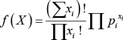

其中，*X* = (*x*[1], *x*[2], …, *x*[n]) 是特征向量，*p*[i] = 事件 *i* 的概率。

现在，你可能会问什么是事件，以及特征向量与它的关系。如果从类别数据的角度思考，事件 *i* 是类别变量的值，而 *p*[i] 是该值在整个数据集中的出现概率。特征向量 *X* 是每个类别值的计数。

在第一个纳伊夫贝叶斯（Naïve Bayes）的例子中，我们使用了虚构的数据集 *weather conditions for Golf*，在那里我们总是通过计数具有特定值的记录来计算类别特征的概率。为了理论理解，这很有效。但在实际场景中，每个类别变量都会通过 `One-Hot-Encoding` 转换，然后在其上应用 `Multinomial Naïve Bayes`。最终，这两种方法都会产生相同的结果。

下面是一个例子。我们计算了后验概率 *P(Outlook = ‘Sunny’ | Play Golf = ‘Yes’)* 为 0.3，针对数据实例 *I* *≠* { Outlook = ‘Sunny’, Humidity = ‘Normal’, Temperature = ‘Mild’, Windy = ‘No’}。我们将通过多项式分布来计算相同的值。通过 `One-Hot-Encoding`，`Outlook` 可以分解为 3 个特征：(`Outlook_Sunny`, `Outlook_Overcast`, `Outlook_Rainy`)。对于数据实例 *I*，分解后的特征向量 *X* 可以写作 *X* = {1, 0, 0}，其中 *x*[1] = 1，*x*[2] = 0，*x*[3] = 0。由于‘Sunny’在 *I* 中只出现一次，所以其计数为 1。因此，概率 *p*[1] = 3/10 = 0.3，*p*[2] = 2/10 = 0.2，*p*[3] = 2/10 = 0.2。于是我们可以写出：

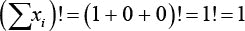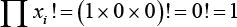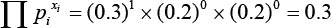

因此，根据多项式分布的 PMF：

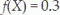

这证明了基于多项式分布的计算的正确性。

`scikit-learn` 提供的 API 与高斯（Gaussian）纳伊夫贝叶斯类似。我们需要使用 `CategoricalVariableEncoder` 进行相同的预处理，并构建如下的 pipeline：

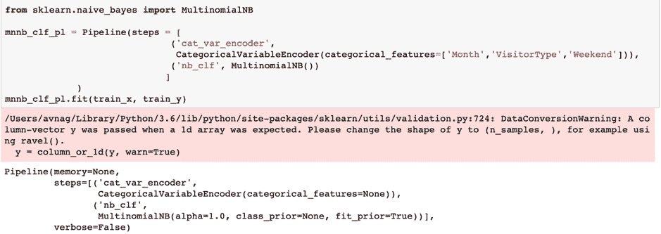

**Figure 2.15:** 多项式纳伊夫贝叶斯（Multinomial Naïve Bayes）pipeline 的代码片段

准确率可以同样计算：

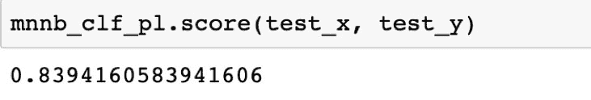

**Figure 2.16:** 多项式纳伊夫贝叶斯（Multinomial Naïve Bayes）准确率的代码片段

它的准确率远高于高斯纳伊夫贝叶斯（83.9%），因此理论再次得到验证：大量分解后的类别特征是使用 `Multinomial Naïve Bayes Classifier` 的良好理由。

## 纳伊夫贝叶斯分类器的优势

*   实现简单，基于简单的概率模型，理论上支持线性和非线性决策边界问题。
*   即使训练数据较少时也能很好地工作。当训练数据不足时，使用纳伊夫贝叶斯技术往往优于其他方法。
*   收敛快，训练过程简单，无需像其他参数模型那样进行严格的参数调优和大量迭代。
*   高度可扩展，因为训练过程非常简单。

## 纳伊夫贝叶斯分类器的缺点

*   严重依赖于特征之间的条件独立性假设。如果条件独立性被打破，它会开始给出更高的概率估计。
*   由于模型非常简单，它无法捕获特征之间的复杂关系，并且在非常高维的数据集上往往精度较低。

纳伊夫贝叶斯是一个非常简单的分类器。由于其简洁性和基于假设的特性，它主要属于参数模型。它在文本分类问题中表现很好（参见 *第 7 章：文本挖掘*）。

## 逻辑回归分类器

我们在上一节讨论了纳伊夫贝叶斯。让我们考虑一种情况：我们的分类问题是二分类（两类），并且有大量连续特征。直接用高斯近似来估计概率对于大量变量来说显然不佳。我们可能需要以不同的方式重塑传统的二分类纳伊夫贝叶斯。

假设我们有两个类 *C*[1] 和 *C*[2]，以及特征集 *X*，后验概率 *P*(*C*[1] | *X*) 可以从贝叶斯定理写为：

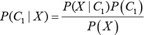

由于只有两个类，*P*(*C*[1]) + *P*(*C*[2]) = 1（概率空间的总和总是 1）。

因此，*P*(*X*) 是类 *C*[1] 和 *C*[2] 的条件概率之和：

*P*(*X*) = *P*(*X* | *C*[1]) *P*(*C*[1]) + *P*(*X* | *C*[2]) *P*(*C*[2])

所以，

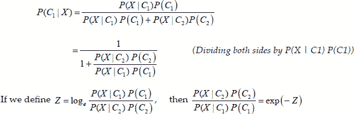

我们可以将后验概率 *P*(*C1* | *X*) 表示为 *Z* 的函数，即 σ(*Z*)：

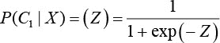

如果我们绘制 *Z* 与 σ(*Z*) 的关系，会得到如下 S 曲线：

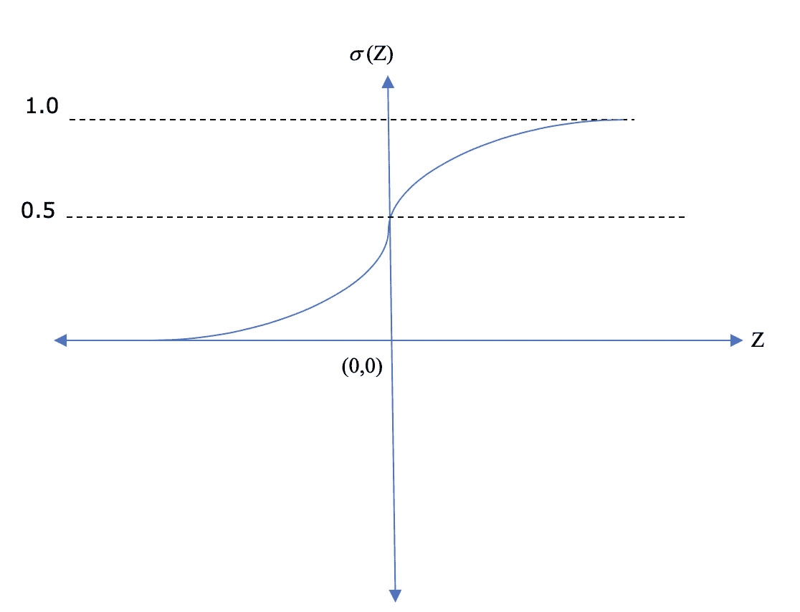

**Figure 2.17:** 逻辑 Sigmoid 函数

由于这是二分类问题：

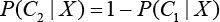

从 *P*(*C1* | *X*) 的表达式可以看出，如果我们能估计 *Z*，就能得到 σ(*Z*)，即 *P*(*C1* | *X*)。虽然 *Z* 本质上是连续变量，这属于回归问题（详情见 *第 3 章：回归*），因此即使是分类问题，也称其为 *logistic regression*，即通过 logistic sigmoid 函数估计用于分类的概率。

*Z* 可以通过对特征 *X* (*x*[1], *x*[2], …, *x*[k]) 的线性组合来估计，表达式可写作线性回归模型：

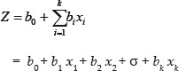

其中 *b*[i] 是每个特征 *x*[i] 对应的回归系数，*b*[0] 称为偏置项（bias term）。

如何解决这类回归问题的详细说明在 *第 3 章：回归* 中给出。在此暂且假设可解。我们假设一个统计形式的模型，并试图将特征拟合进模型，因此逻辑回归被视为一种高度参数化的受监督模型。

- [费曼学习法](https://wiki.example.org/feynmans_learning_method)的灵感源于诺贝尔物理奖获得者 Richard Feynman。

1. 运用费曼技巧，你只需花上 `20 min` 就能深入理解知识点，而且记忆深刻，难以遗忘。

```
if (condVar > someVal) {console.log("xxx")}
```

一条测试数据实例会分别通过每个二元逻辑回归模型进行输入，我们会记录每个模型中转换后的类别标签 1 的后验概率。预测的类别标签将是后验概率最大的那一个。这种最大概率方法与朴素贝叶斯分类器的后验概率估计方法类似。

## Python 实现

`scikit-learn` 的 `LogisticRegression` 类有一个参数 `multi-class`。在前面的示例代码中，它被设置为警告值，因为问题是二元分类。但对于真正的多类问题，需要使用目前讨论的 one-vs-rest 方法，并将 `value` 设置为 `ovr`。`LogisticRegression` API 内部会自行处理分解部分。

## SoftMax 激活函数方法

我们看到两类情况的后验概率表达式：

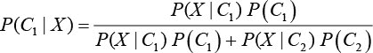

现在，我们可以将上述式子重新写为多类场景的更一般形式，即类别 C[k] 的后验概率表达式：

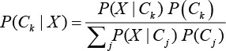

其中，

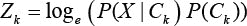

这条后验概率表达式 P(C[k] | X) 称为 **Normalized Exponential**，可以被视为 Logistic Sigmoid 函数的多类版本。它也被称为 **SoftMax 激活函数**。因此，我们可以得到每个类别的后验概率，预测的类别标签即为概率最大的那个类别。它与多类朴素贝叶斯分类器非常类似。

SoftMax 的训练过程可以通过下面的网络结构实现：

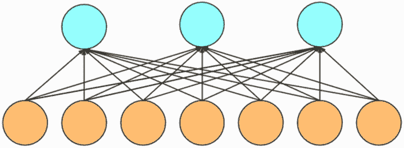

**图 2.23：** SoftMax 函数的网络结构

输出节点和输入节点分别以青色和藏红花色显示。输出节点的数量等于数据集中类别的数量，每个输出节点包含对应类别 k 的 Zk 值。我们需要估计每个输出节点的值。因此，这是一个多输出回归问题，需要为多个目标变量优化相应的系数。可以使用标准的随机梯度下降（Stochastic Gradient Descent）或普通梯度下降算法来求解，将 Z 与数据集特征 X 进行回归。

## Python 实现

与 one-vs-rest 方法类似，SoftMax 方法可以通过在 `LogisticRegression` API 的 `multi-class` 参数中设置 `multinomial` 来选择。

## Logistic Regression Classifier 的优势

* 实现简单，基于基础概率模型，理论上支持线性和非线性决策边界问题（前提是非线性特征被视为线性组合。更多细节请参见 *第 3 章：回归* 中的多项式回归部分）。
* 作为二元分类问题的理想选择，因为默认基模型为二元。
* 当大多数特征为连续值时表现良好。

## Logistic Regression Classifier 的缺点

* 由于其迭代性质，训练时间较长。
* 对于非常非线性的决策边界效果不佳，这些边界甚至无法通过多项式特征处理。
* 当特征不服从正态分布时效果不佳，因为线性回归模型的基本假设是特征服从正态分布。

数据科学家和机器学习专家倾向于在数据集的初步模型中使用 Logistic Regression 与 Naïve Bayes，因为 Logistic Regression 本质上是一种回归方法，可以在其基础上应用所有线性回归相关的微调技术。此外，它还能直观地展示每个特征的重要性及其对类别概率的影响。该方法将在 *第 3 章：回归* 中进一步讨论。

## 决策树分类器

我们都熟悉算法流程图。在每个阶段，它会提出问题，根据 yes、no 或其他答案，执行不同的分支或过程。整个流程图形似乎是一棵树。其 yes 或 no 为基准的决策路径称为分支，处理指令称为节点。最终，流程图在一个终止节点处结束，可能存在多个终止节点。如果我们使用这类树来解决分类问题，则该模型称为 **决策树分类器**。

决策树通过一系列精心设计的关于数据实例特征的问题来构建。每次提问后，根据答案，会继续提问，直到得到该实例的类别标签。那么，要问什么问题呢？这些问题本质上是获取数据集中属性或特征值的问题。根据特征值的不同，下一个问题会针对另一个属性提出。这些问题以层级结构堆叠，形成由节点和边组成的树状结构。

## 决策树的解剖结构

与一般树形数据结构一样，决策树包含节点和边。但这些节点和边在分类问题中的解释非常具体：

* **根节点**：算法的起点。它包含数据集中第一个需要检查的属性或特征。根节点可以有两个或更多的出边，且没有入边。
* **中间节点**：位于根节点和最后一层之间的所有节点。这些节点依次包含需要检查的属性或特征。中间节点恰好有一个入边，且有两个或更多的出边。
* **叶节点**：实际的决策节点。每个叶节点对应一个类别标签。叶节点有两个或更多的入边，且没有出边。

下面通过一个实际例子进一步说明。银行或金融机构在发放贷款前会验证客户的可信度。典型的分类问题包括判断客户是否可能违约。虽然实际中影响决策的因素（特征）很多，但为了简化问题和提高理解，我们仅考虑三个特征：收入范围、家庭规模和所在城市。收入范围和城市是类别变量，而家庭规模是连续变量。

我们假设收入范围的取值为 >=5000、<5000，城市的取值为 A、B、C。目标变量是贷款是否发放，类别标签为 yes 或 no。因此，叶节点应包含 yes 或 no 的值。

理论上可以根据上述信息构建多个决策树，但为了便于说明，我们考虑以下这个样例：

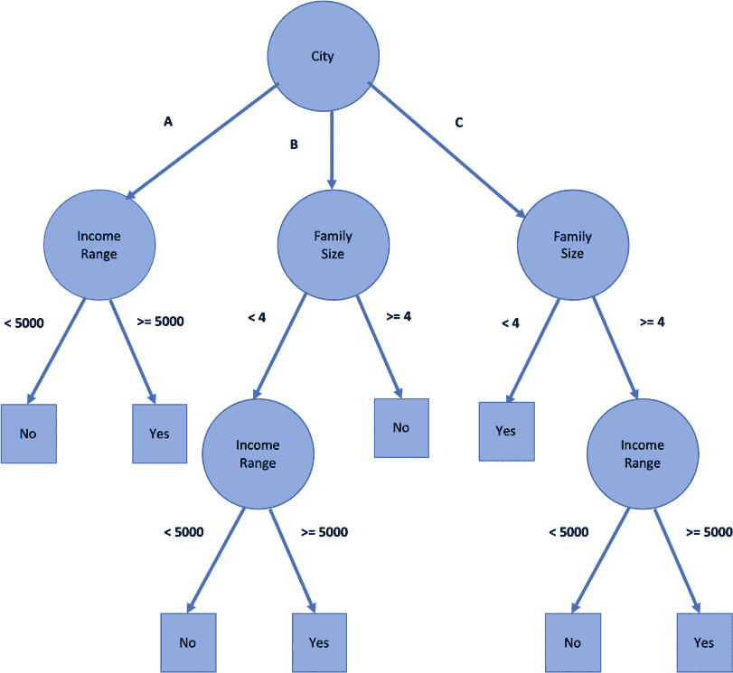

**图 2.24：** 样例决策树模型

从决策树中可以观察到，并非所有属性都需要始终被检查。是否检查某个属性取决于该属性的取值。

`Classifying a test data instance` 是构建树木后的直接过程。我们需要从根节点开始，应用测试条件（即属性值），并沿路径走到任意叶子节点为止。叶子节点显然会给出我们预测的类别标签。我们可能不需要每次都检查所有属性。例如，一个测试数据实例的 `City` 为 `A`，`Income Range` 为 `>=5000` 时，可以直接预测为 `yes`（贷款已获批），此时无需检查 `Family Size`。我们再举一个例子，尝试追踪一个拥有 `City` = ‘B’、`Family Size < 4`、`Income Range >=5000` 的测试实例的预测路径（红色虚线箭头）：

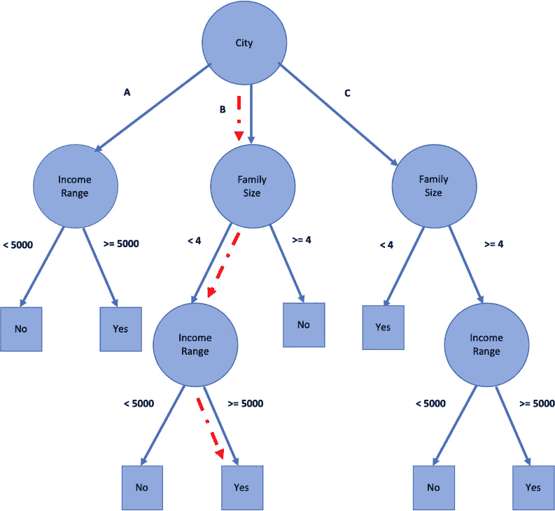

**Figure 2.25:** 样本决策树模型中的一条预测路径

因此，预测标签为 `yes`。在此情况下，需要使用全部三个属性来做出决策。


## Handling continuous and categorical attributes

决策树的每个节点都必须提供一种将属性划分为不同部分的技术，以便可以通过一组分支来表示。每条分支会携带属性的取值。默认情况下，决策树设计用于处理类别属性，但通过转换，它也能够处理连续属性，如下一节所述。

### Categorical attribute

类别属性可以很容易地划分为不同的取值。从类别属性节点发出的分支数量等于该属性的基数（cardinality）。在前面的例子中，变量 `City` 的基数为三，可能的取值有：`A`、`B` 和 `C`。因此，从节点 `City` 会出现三条分支，如下所示：

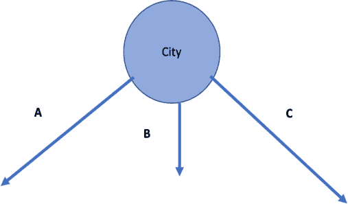

**Figure 2.26:** 决策树中的一个示例节点及其分支

### Continuous attribute

连续属性不能直接划分为不同的分支。必须先将连续属性转换为类别属性（分箱）后，才能进行划分。这种变量转换在前面已经讨论过——见 *Chapter 1: Introduction to Machine Learning and Mathematical Preliminaries*。转换后，我们得到的仍是类别变量，但取值为区间，例如年收入为 `{6000,7000}`，表示收入在 6000 到 7000 之间。我们把每个区间视为属性的一个取值。于是，`{6000, 7000}` 被视为一个值。年收入同样可以出现为 `{10000, 20000}`、`{25000-40000}`、`{70000, 100000}` 等多种取值。于是会出现如下分支：

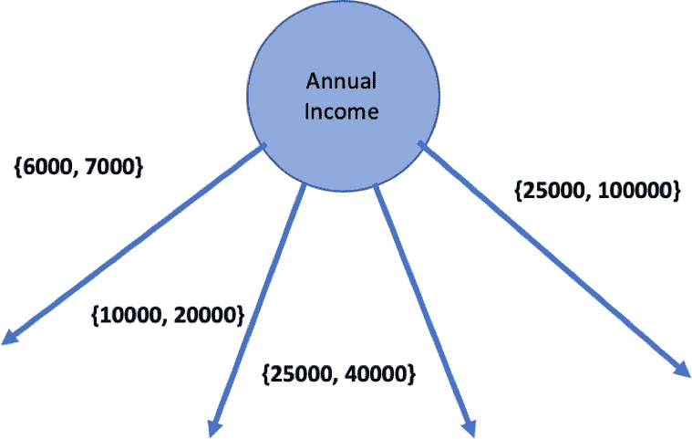

**Figure 2.27:** 决策树中连续特征及其分支的一个节点示例

在我们之前的例子中，`Income Range` 变量只有两个取值：`<5000` 和 `>=5000`，因此只有两条分支。

在类别属性和连续属性中，我们看到变量总是被划分为 *K* 条分支，其中 *K* 为基数。但这并不总是如此。诸如 CART 等特殊决策树算法总是创建二元划分，即通过 2*K* – 1 – 1 的二元划分方式，将 *K* 个取值划分为两个分支。

### Measure and technique of splitting a node

技术上讲，所谓节点划分是对数据集的过滤操作。它类似于执行下面的 SQL 查询：`SELECT * FROM TABLE T1 WHERE T1.ATTRIBUTE1 = VAL1`。划分会将数据集划分为多个子集，以便简化后续计算。在我们的客户贷款审批问题中，我们选择 `City` 作为第一个检查的属性并进行划分。但依据是什么？我们本可以选择 `Annual Income` 或 `Family Size`，但我们没有这样做。决定选择哪个属性在何层级进行划分，是依据数据的类别分布。在典型的二类（二元）问题中，若 *p* 为类 1 的概率，则类 2 的概率为 1 – *p*。此时类别分布或类比例为 *p* : 1 – *p*，也可以写作元组 (`p`, 1 – *p*)。对于多类问题，类别分布则为 (`p`1, `p`2,…, `pk`)。在树的任意节点上，若能统计每个类别的实例数量，就能得到该节点的类别分布。

### Impurity and mathematical measures

我们总是希望创建一个类别分布高度偏斜的节点，即某一类别的实例数量显著多于其他类别。偏斜的类别分布有助于在使用决策树模型时识别未知实例的类别。该过程在树的每个节点上持续进行，最终在叶子节点处形成，每个叶子节点仅包含属于同一类别的实例。不同类别在每个中间节点中混合的现象称为 **Impurity**（杂质）。类别比例或分布越倾斜，杂质越少。例如，节点的类别比例为 (0, 1) 表示该节点没有杂质。我们的目标是尽可能降低杂质。

若 *pi* 表示节点 *t* 中类别 *i* 的概率，则节点 *t* 可计算出三种杂质度量（*k* 为类别基数）：

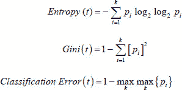

为了简化讨论，我们仅考虑 **Entropy**（熵）作为杂质度量。

选择合适的属性进行节点划分，关键在于衡量划分前后的杂质减少量。该减少量可以表示为父节点杂质与子节点加权平均杂质之间的差值，称为 **Information Gain**（信息增益），数学表达式如下：

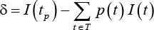

其中，*t*[p] 表示父节点，*t* 表示当前子节点，*T* 表示父节点属性的可能划分总数（即父节点属性的基数），*I*(*t*) 为节点 *t* 的杂质度量，*p*(*t*) 为节点 *t* 所包含记录的概率。决策树构建算法的目标是最大化 δ（Information Gain）。概念上，最大化信息增益意味着一个节点仅包含单一类别的记录，从而帮助构建出负责预测的叶子节点。

### ID3 algorithm of building Decision Tree

ID3 是一种迭代构建决策树的算法。它从完整数据集开始，对每个未使用的属性计算 Information Gain（δ），然后选择 δ 最大的属性，重复上述过程，直至出现 δ = 0、δ 达到预设阈值，或没有更多属性可检查的情况。

具体步骤如下。设 *S* 为所有未使用属性的集合：

1.  计算当前节点 *t* 的熵 *I*(*t*)。
2.  遍历 *S*，对每个属性计算 δ。
3.  选取 δ 最大的属性，并将其从 *S* 中移除。
4.  检查 *S* 是否为空，或 δ 是否为 0 或等于预设阈值。
5.  若满足步骤 4 中的任一条件，则回到步骤 1；否则结束。

我们将通过手动计算 **Weather condition** 数据集（用于高尔夫球游戏的决策）来演示该算法的每一步。下面开始：

1.  以根节点开始，计算整体的熵。目标变量为 **Play Golf**，包含两个类别标签：**Yes** 与 **No**。

-   [费曼学习法](https://wiki.example.org/feynmans_learning_method)的灵感源于诺贝尔物理奖获得者 **Richard Feynman**。
-   运用费曼技巧，你只需花上 `20 min` 就能深入理解知识点，而且记忆深刻，*难以遗忘*。

```
if (condVar > someVal) {console.log("xxx")}
```

-   [决策树非常适合用于数据分布或模式尚未被充分了解的未知领域问题。它也常用于生产环境中需要快速响应或更确切地说是严格 SLA 的实时场景。]

## 类别失衡问题

-   数据集中类别标签的频率分布可能不平衡或不对称。例如，信用卡欺诈检测系统可能只有极少量欺诈交易，而合法交易记录的数量则非常多。因此，这是典型的二分类问题，包含两类标签：**欺诈** 或 **非欺诈**。如果取欺诈与非欺诈的比例，该值会极度偏斜，接近几乎为零。这种现象常常会误导我们认为模型表现完美。信用卡欺诈检测的目标是完美识别欺诈交易。标准分类器即使拥有良好的准确率，也能在大多数情况下正确分类非欺诈交易，但可能无法识别属于少数类的欺诈记录。例如，即使模型的准确率达到 95%，它仍可能未能预测罕见类别，从而导致 *类别失衡问题*。

-   传统的准确率指标（正确分类记录数与总记录数的比值）不适合用于失衡类别数据集，如上文所述。例如，在只有 1% 的信用卡交易为欺诈的数据集中，一个预测所有非欺诈交易的 99% 精度的优秀分类器仍可能未能识别欺诈记录。结果是准确率较高，但欺诈交易仍未被识别，目标未达成。下面我们将讨论如何使用替代指标以及构建适用于失衡数据集的分类器。

## 替代指标

-   传统的简单正确率与总数的比值的准确率把每个类别都视为同等重要。但在某些情况下，类别分布中的某些标签比其他标签更重要。例如，信用卡欺诈检测问题中，**Fraud**（欺诈）类标签的重要性高于 **Non-fraud**（非欺诈），因为系统只关注检测欺诈。在这类失衡数据集中，我们使用 **正类**（positive class）和 **负类**（negative class）来指代重要和不重要的类别。

## 混淆矩阵

-   为了评估一般分类器在失衡类别数据集上的表现，可以构建混淆矩阵。混淆矩阵是实际类别与预测类别的对比矩阵。假设数据集中有两类：**P（正类）** 和 **N（负类）**，则混淆矩阵示例如下：

| | **预测 P(正类)** | **预测 N(负类)** |
|---|---|---|
| **实际 P(正类)** | TP | FN |
| **实际 N(负类)** | FP | TN |

**表 2.2：** 混淆矩阵结构

混淆矩阵常用术语如下：

-   **True Positive (TP)**：实际类别和预测类别均为正的记录数。
-   **False Negative (FN)**：实际类别为正、预测类别为负的记录数。
-   **False Positive (FP)**：实际类别为负、预测类别为正的记录数。
-   **True Negative (TN)**：实际类别和预测类别均为负的记录数。

## 基于比率的指标

-   由上述定义可知，只有 TP 与 TN 是预测正确的记录。这四个数值本质上是计数。准确率通常以比率形式表示，同样，针对失衡类别数据集也有几种比率指标：

-   **True Positive Rate (TPR)**：正确预测的正记录数与总正记录数的比值，公式如下：

    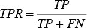

    TPR 也称为召回率（*r*）。

-   **False Positive Rate (FPR)**：错误预测的负记录数与总负记录数的比值，公式如下：

    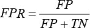

-   **True Negative Rate (TNR)**：正确预测的负记录数与总负记录数的比值，公式如下：

    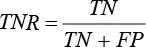

-   **False Negative Rate (FNR)**：错误预测的正记录数与总正记录数的比值，公式如下：

    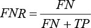

-   **Precision (p)**：实际正确预测的正记录数与预测正记录总数的比值，公式如下：

    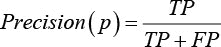

-   从这些比率可以看出，**FPR 越低越好**，这正是分类器好坏的关键指标。例如，在信用卡欺诈检测中，良好分类器应永不把合法交易误判为欺诈，以免对业务造成影响。与此同时，**Recall（即 TPR）越高** 也越符合良好分类器的期望。

-   为了综合考虑精确率（*p*）和召回率（*r*），我们使用它们的调和平均值——**F1 分数**，公式如下：

    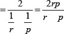

-   一个优秀分类器的 F1 分数始终很高，范围在 0 到 1 之间。我们将把 F1 分数作为标准指标来克服类别失衡问题。

-   scikit-learn 的 `metrics` 模块提供 `f1_score` 函数来计算 F1 分数，参数为实际值和预测值：

    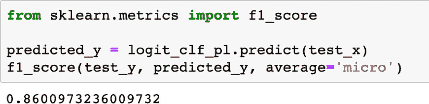

**Figure 2.35:** 代码片段用于计算 F1 分数

## 多类和失衡数据集的准确率指标

-   F1 分数也可用于多类场景。如果多类数据集中某些类别较少，可采用 **宏平均（Macro）** 或 **微平均（Micro）** 两种策略来计算 F1 分数。两者的理论基础相同，都是通过一对多（one-vs-rest）方式分别计算每类的 TPR、FPR 或 F1，再进行汇总：

-   **Macro 平均**：对每个类别分别计算精确率和召回率，然后取这些值的平均，再按常规公式计算 F1。其中 *K* 表示类别总数。

    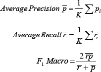

-   **Micro 平均**：对每个类别的真阳性、假阴性和假阳性分别累计，然后计算整体精确率和召回率，最后按常规公式得到 F1。

    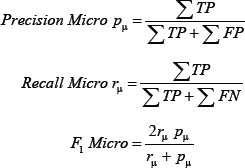

-   Python 函数 `f1_score` 接受 `average` 参数，可设为 `macro` 或 `micro`。

## Receiver Operating Characteristic 曲线 (ROC)

-   ROC 曲线是 TPR 与 FPR 在整个数据集上的绘制图。TPR 与 FPR 分别在 Y 轴和 X 轴上绘制。对于模型，应该只有一组 TPR 与 FPR。那么，如何在两个轴上得到一系列 TPR、FPR 值呢？下面展示两个样本 ROC 曲线用于比较两个模型：

    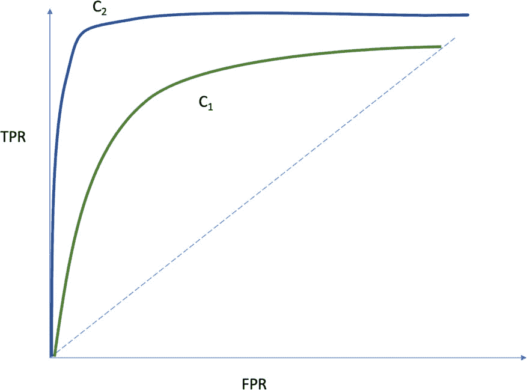

**Figure 2.36:** ROC 结构

-   通常 ROC 曲线呈倒“L”形。图中展示了两个假设模型 *C*1 与 *C*2 的 ROC 曲线。

每个分类器可以输出概率分数或类似欧几里得距离等距离度量的分数。这些分数可以通过在数据集上运行已训练好的分类器来获得预测结果。如果 `T` 是用于判断正负记录的阈值分数（概率或距离），那么我们可以在变化 `T` 的过程中得到一系列的 TPR（True Positive Rate）和 FPR（False Positive Rate）值。随着 `T` 的变化，正负记录的定义也会随之改变，从而产生不同的 TPR 和 FPR 值。这展示了分类器受 `T` 影响的程度，以及它在解决类别失衡问题方面的表现。我们可以通过观察 ROC 曲线来判断分类器的好坏。AUC（Area Under Curve，曲线下面积）越大，分类器被认为越好。这很合理，且可以解释。我们从 TPR 与 FPR 的定义可知，一个好的分类器倾向于具有高 TPR 和低 FPR。从 ROC 曲线可以看出，曲线更倾向于坐标系左上角的区域，意味着 TPR 高、FPR 低，并且覆盖的面积（AUC）更大。因此，AUC 值越高的分类器始终更好。

## Python 实现 ROC 生成

下面我们将看到一个实用函数，用于从样本数据生成 ROC 曲线：

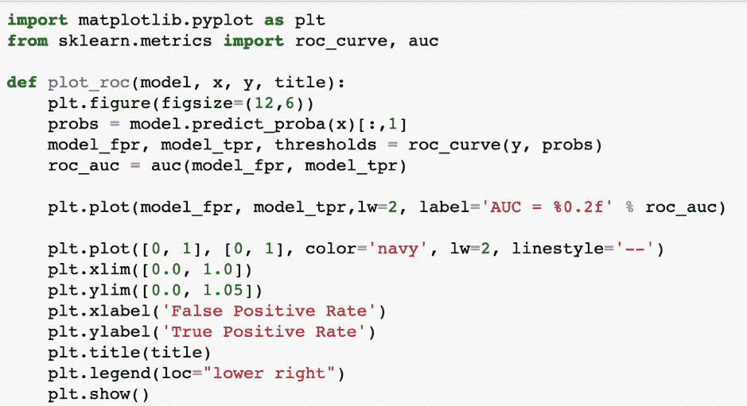

**Figure 2.37:** `plot_roc` 函数的代码片段

该函数使用了以下几个 Python 库函数（如下解释）：

1.  `predict_proba` 函数：模型的返回值，提供生成 ROC 所需的概率分数。
2.  `roc_curve` 函数：根据概率分数、不同阈值计算 FPR 和 TPR，并返回三个元素的元组。
3.  `auc` 函数：根据模型的 TPR 和 FPR 值计算曲线下面积（AUC），以坐标空间总面积（等于 1）的百分比表示。
4.  最后，FPR 和 TPR 值在图中绘制。

函数 `plot_roc` 可以通过传入前面部分构建的逻辑回归模型来调用，例如：

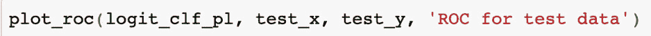

**Figure 2.38:** 使用 `plot_roc` 函数生成 ROC 的代码片段

它将生成如下图：

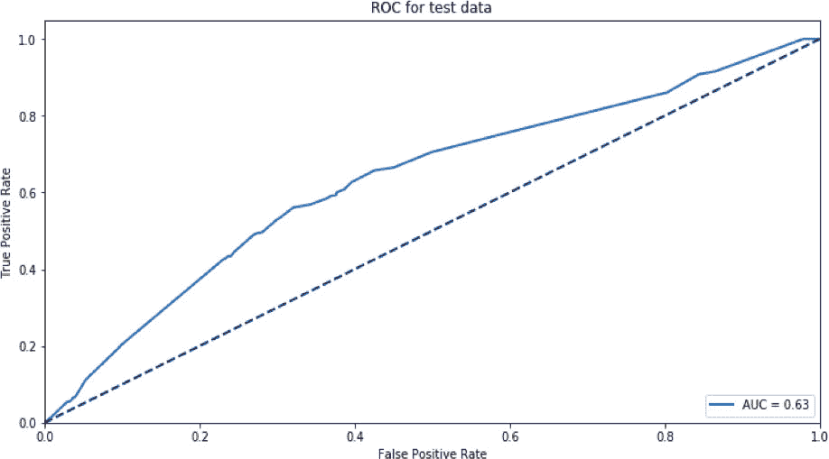

**Figure 2.39:** `plot_roc` 函数生成的 ROC 曲线

因此，AUC 为 0.63，即 63%。

## 缓解类别失衡问题

我们已经了解如何评估存在类别失衡的分类器。但如何减少这个问题呢？评估本身并不能解决失衡问题，它仅表明模型不完美，需要采取行动。我们将讨论两种主要的类别失衡缓解技术。

### 类别权重调整方法

类别权重是外部传入的参数，用于影响分类器目标函数的优化方向。这些权重通常与类别标签的重要性成比例。常用的方法是使用平衡权重。该方法使用类别频率的倒数作为权重；即，如果 `fK` 是类别 `K` 的频率，则对应的权重为 1/`fK`。这确保更频繁或占主导地位的类别获得较小的权重，而稀有类别获得较大的权重。它有助于解决稀有类事件是最终目标的问题。之前提到的信用卡欺诈检测问题即为例子。

类别权重的使用因模型而异。例如，在线性模型如 Logistic Regression 中，类别权重可以与错误函数相乘。这样，如果在训练时错误地识别了稀有类，这种乘法会放大该错误，并引导分类器的优化过程。在决策树中，类别权重可以与不纯度计算函数相乘，从而增强或降低不纯度的影响。

scikit-learn 的分类器在构造函数中接受 `class_weight` 参数。该参数可以是字符串字面量 `balanced`，或一个 Python 字典，如 `{0:2, 1:4}`。这里的 0 和 1 是类别标签，2 和 4 是对应的权重。默认情况下，该参数为 None。

### 基于采样的方法

采样的目的是通过调整类别分布的偏斜度，使少数类事件在数据集中得到更好表现。最常见的两种采样技术是 undersampling（下采样）和 oversampling（上采样）。

下采样技术移除多数类的记录，使类别比例更均衡。当我们拥有大量训练数据时，下采样是一个合适的选择，因为减少部分多数类数据不会损害整体解决方案。

scikit-learn 的 utils 模块提供了一个名为 `resample` 的函数，可以实现下采样。但在此之前，我们需要了解类别频率比例。我们将使用在线购物者意图数据集：

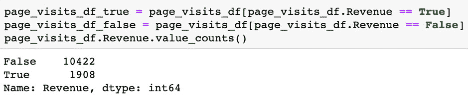

**Figure 2.40:** 在线购物者意图数据集的类别计数代码片段

我们根据目标变量值 `True` 或 `False` 将数据集分为两部分，这显示出明显的失衡现象。现在，通过 `resample`，我们可以将样本大小设置为真实数据的大小并据此进行过滤：

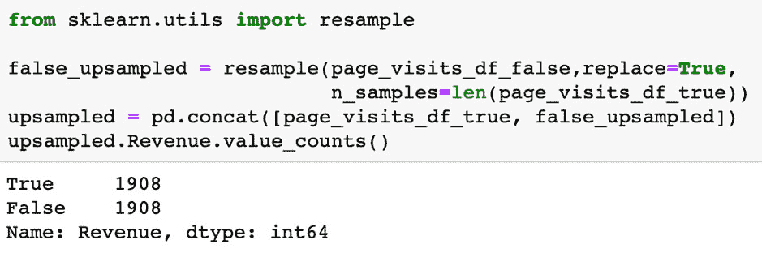

**Figure 2.41:** 下采样方法的代码片段

可以看到，真实和假实的比例现在是 1:1。我们可以使用过滤后的数据集进行训练。上采样技术则通过增加少数类的记录来解决失衡问题。当数据稀缺时，这是一个更好的选择，因为我们无法负担删除多数类数据。

上采样可以通过以下方式实现：

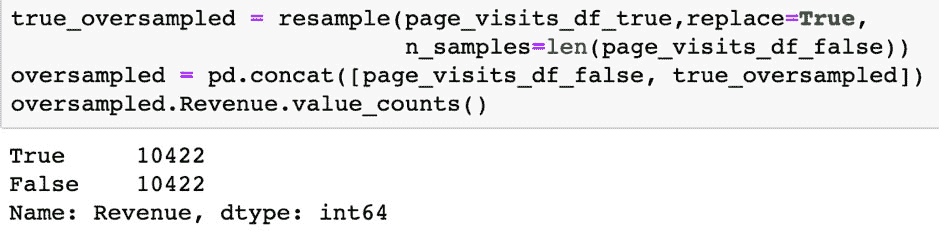

**Figure 2.42:** 上采样方法的代码片段

有时，将下采样和上采样结合成单一策略更为可取。通常，下采样阶段在上采样之后进行，以构建平衡数据集。

## 集成分类模型


我们之前讨论的所有分类技术都使用单一算法来预测未知记录的类别标签。通过使用一组分类器而不是单一分类器，我们可以获得更高的分类准确率。这种技术称为集成分类技术或集成分类模型。集成模型由若干基分类器组成，每个基分类器都单独从训练数据中构建。整体预测过程通过对基分类器的预测进行投票来完成。

数学上，例如，如果 `CE` 是集成模型，`Ci` 是单个基分类器，那么对于记录 `X`，其输出 `CE(X)` 由

`C[E] (X) = MajorityVote {C[1] (X), C[2] (X), …, C[K] (X)}`

多数投票是通过统计整个集合中每个类别标签出现的次数得到的。出现次数最多的类别标签作为最终预测结果返回。

我们将简要讨论一种构建分类器集合的技术。

## Bagging

Bagging，即 Bootstrap Aggregating，是一种集成技术，它反复从整个训练数据集中随机抽取样本，并为每个样本集构建多个分类器。抽样是基于均匀概率分布进行的。例如，如果我们有一个包含 1000 条记录的数据集，Bagging 的工作流程如下：

1. 从数据集中随机抽取十个每个包含 100 条记录的子样本。
2. 为每个子样本训练并构建十个不同的基分类器。
3. 对于新记录，通过取十个基分类器预测结果的众投票来确定其类别标签。

Bagging 通过降低模型中的方差来减少过拟合问题。Bagging 的性能取决于基础分类器的稳定性。子采样过程有助于减少基础分类器中的不稳定性。

## RandomForest 模型

它是一种基于 Bagging 的集成模型，由多个决策树作为基础分类器组成。普通的 Bagging 决策树模型存在的问题是会生成一组相互关联的决策树。它在构建树时会考虑数据集的所有特征。RandomForest 方法则通过采取特殊步骤使基础分类器之间的关联性降低。具体做法是为每个基础模型从数据集中选择一个特征子集。RandomForest 工作流的典型视图如下：

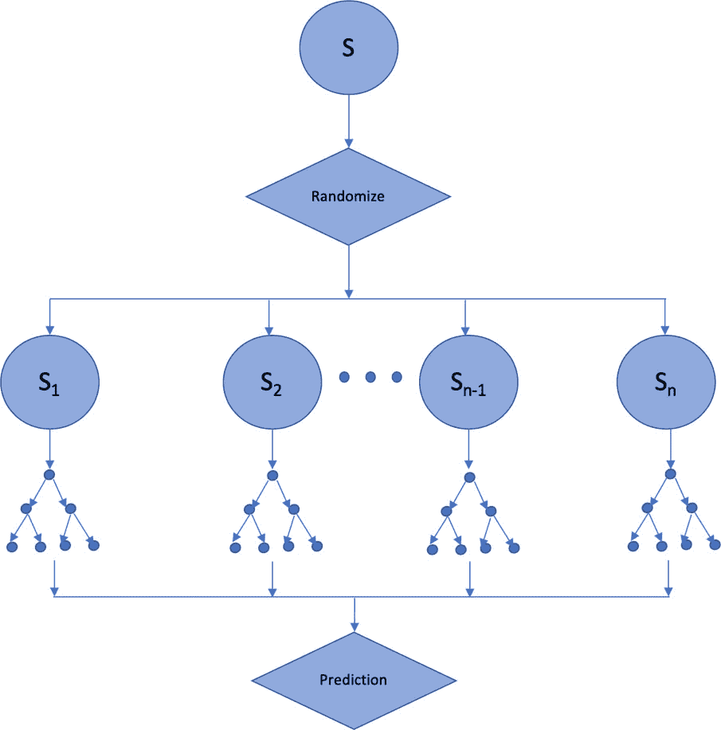

**Figure 2.43:** 典型随机森林模型的工作流程

从 *Figure 2.43* 可以看出，RandomForest 是一种分叉-汇聚技术。分叉发生在使用独立训练数据集构建模型时，汇聚则是指预测过程，它将所有输出结果组合在一张量。

## RandomForest 的 Python 实现

`scikit-learn` 提供了一个内置的 RandomForest 模型，使用方法与其他模型完全相同。与决策树一样，RandomForest 不需要对变量进行缩放。只需进行一热编码（one-hot-encoding）转换作为预处理即可。我们将继续使用相同的数据集，并使用之前创建的 `CategoricalVariableEncoder` 类进行一热编码。

下面展示如何创建并训练管道：

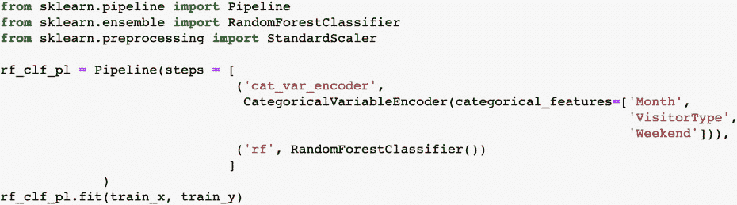

**Figure 2.44:** 带随机森林的管道代码片段

准确率可以通过以下方式计算：

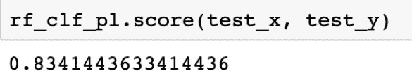

**Figure 2.45:** 准确率计算的代码片段

决策树和 RandomForest 的超参数在概念上非常相似；它们是相同的。但 RandomForest 特别有一个超参数 `n_estimator`（如上代码所示），它决定森林中的基础分类器树的数量，即“超模型”。默认值为 `scikit-learn`（版本 0.21.3）中的 10。

## 多标签分类模型

迄今为止，我们看到的类标签是互斥的。数学上，目标变量 Y 只能从大小为 *K* 的类标签集合 {*C*1, *C*2, …, *CK*} 中取一个类标签。这称为单标签分类，并在前文中详细讨论。但如果 Y 可以从定义的集合中取多于一个类标签呢？数学上是可能的，实际上也是有意义的。考虑电影类型预测问题：一部电影可以同时属于多个（一个或多个）类别。例如，一部电影可能同时拥有动作、喜剧和爱情这三种类型。这属于多标签分类问题。

## 问题形式化

一热编码将离散变量转换为多个连续的二进制变量，生成类似 010..0 的二进制字符串。对于单标签分类，目标变量可以这样转换，只有一位为 1，其余为 0。但多标签问题中，多个位应设为 1，例如 0100110..0。多标签目标变量中 1 的数量 N 满足 1 ≤ N ≤ K，其中 K 为类别总数。二进制字符串的长度也为 K。单标签分类器只能预测 0 或 1 中的一个，传统的单标签分类器无法预测多标签问题中的 N 个 1。

## 问题分解及伞分类方案（Umbrella classification scheme）

在多标签分类中，我们可以将目标变量二进制字符串的每一位视为不同问题的结果。因此，主问题可以分解为一组子分类问题，每个子问题都是二分类任务。以电影类型预测为例，若有 K 种可选类别，则目标变量为长度为 K 的二进制字符串。若类别包括动作、喜剧、恐怖、科幻、爱情等，则有 K 个独立的二分类子问题：

*   1) 电影是否属于动作类？ 0 或 1
*   2) 电影是否属于喜剧类？ 0 或 1
*   …
*   K) 电影是否属于爱情类？ 0 或 1

（0 表示否，1 表示是）

这些 K 个二分类模型可以使用任何标准分类模型（如前文讨论的决策树、逻辑回归、朴素贝叶斯等）或其他集成模型来构建。通常选择一种模型，并为多个子问题构建多个实例。例如，若选择逻辑回归作为模型，则需要构建 K 个逻辑回归模型。

在上述基础分类模型之上，有两种**伞分类方案（Umbrella classification schemes）**可应用：

## 二元相关性方案（Binary relevance scheme）

二元相关性是一种简单的方案，每个模型仅针对单个类别标签进行训练，忽略其他标签。它类似于之前讨论的多类逻辑回归的“一对所有”（one-vs-rest）方法。每个模型的输出为 0 或 1，1 表示该类别标签在数据实例中存在，0 表示不存在。最终，所有模型中标记为 1 的类别标签即为最终预测结果。例如，若预测结果为 11000…0，则表示该电影属于动作类和喜剧类。

## 分类链方案（Classifier chain scheme）

该方案利用前序分类器的输出作为后续分类器的额外特征。这些特征会累加，最后一个分类器在原有特征之外会拥有 K-1 个额外特征。一般而言，第 i 个分类器会有 i-1 个额外特征（1 ≤ i ≤ K）。下图展示了该方案的架构：

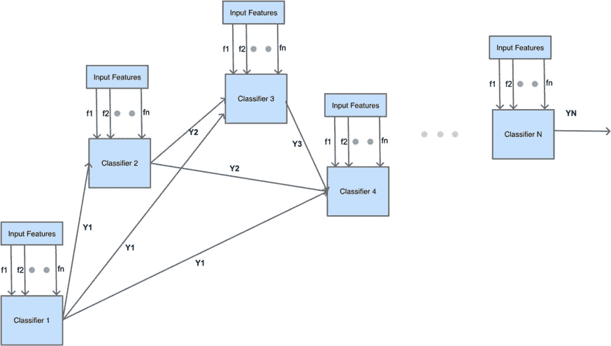

**Figure 2.46:** 分类链方案的架构

上图的结构类似于链表（LinkedList）数据结构。Y[1], Y[2], …, Y[N] 分别代表每个分类器的响应变量。前序分类器的输出被作为下一分类器的额外特征加入，因此第 i 个分类器在构建时会使用完整的特征集 f[1], f[2], …, f[n] 以及 Y[1], Y[2], …, Y[i-1]。

关于分类链的顺序问题，即哪个分类器排第 1、第 2、第 3 等，有以下统计方法：

*   **分类链的集合（The ensemble of Classifier Chains）**：这是基于随机抽样的分类链集合。随机选择不同的链，最后采用多数投票策略进行预测，类似于 RandomForest 模型。
*   **蒙特卡罗分类链（Monte-Carlo Classifier Chains）**：利用蒙特卡罗模拟生成最优的分类器序列。

上述两种方法的详细讨论超出本文范围。

## 标签子集方案（Label powerset scheme）

-   二元相关性（Binary Relevance）和分类链（Classifier Chain）的基本概念相同，都是基于一系列子分类器的输出。但 `Label Powerset` 不将问题分解为子问题。它把数据集中出现的每一个目标变量值的唯一组合视为一个独立的单一类别标签，并在其上构建一个单一分类器。例如，`(1100…0)`、`(010…0)`、`(00…110)` 被视为整体的独立类别标签。在电影类型预测的情境下，`Label Powerset` 会把诸如 (`action`, `comedy`)、(`comedy`, `romance`) 和 (`science-fiction`) 这样的组合视为独立的类别标签，前提是这些组合在数据集中已经出现。该技术不会把数据集中不存在的任意组合视为类别标签。因此，对未知数据实例的预测标签始终是训练数据集中已有的组合。

## 各方案对比

*   `Binary Relevance` 是一种极其简单的方法，适用于所有类别标签相互独立的情况，即一个标签的出现不影响另一个标签的出现。它不考虑标签间的依赖关系，常常无法发现隐藏的关联。
*   `Classifier Chain` 能够处理标签间的依赖关系。它把前一个分类器的输出当作后续分类器的输入特征，从而保留了关系信息。它适合存在父子类标签关系的场景，即子标签只能在父标签出现时才能出现。但该方案的复杂度随类空间（class space）的规模而增长，尤其是类空间很大时，复杂度会显著上升。
*   `Label Powerset` 适用于数据集中出现的唯一标签组合数量相对类别数量较少的情况。与前两种方案不同，这里不需要进行详细的、分解的分析。

## 准确率指标

多标签分类器的性能有多种度量指标。常用的度量是预测正确的记录数与总记录数的比值，这在多标签场景中称为 `子集准确率（subset accuracy）`，但它并不完全可靠。例如，若真实电影类别为 `science-fiction`、`action`、`adventure`，而预测类别为 `action`、`adventure`、`romance`，则无法断定预测完全正确还是完全错误，它既不全对也不全错。因此需要别的指标来捕捉部分正确性。

## Hamming loss 指标

`Hamming loss` 用于衡量多标签分类器预测的部分正确性。它计算二进制位串（即类别标签）在预测过程中的平均损失。具体做法是对每个实例，对原始二进制位串与预测位串执行 XOR 操作，得到该实例的损失，然后取全体实例损失的平均值。其表达式如下：

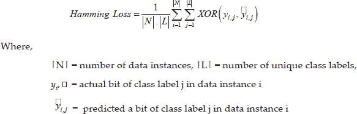

`Hamming loss` 的取值范围是 0 到 1，作为损失度量，值越小表示表现越好。

我们也可以使用 F1 分数来衡量准确率，方法与多类场景相同。应根据类别不平衡情况选择宏观（macro）或微观（micro）策略。对每个独立类别计算 F1 分数，然后再用宏观或微观策略汇总得到最终得分。当存在类别不平衡时，使用 F1 分数通常更合适。

## Python 多标签分类器实现

有一个名为 `scikit-multilearn` 的独立库，提供多标签分类器的模块和函数。完整的使用示例在 *第 9 章：案例研究与叙事（Chapter 9: Case Studies and Storytelling）* 中给出，用于预测电影类型。读者可参考该章节获取完整实现。

## 结论

本章讨论了分类问题的数学表达、不同分类器及其理论基础，以及使用开源数据集和 Python 实现的案例。我们还学习了类别不平衡问题、替代度量指标以及解决机制，以及使用 Python `scikit-learn` 构建管道的方法。这些知识将在后续章节的讨论中派上用场。

下一章我们将探讨当目标变量为连续值时，如何构建机器学习模型。

# CHAPTER 3

## 回归（Regression）

我们在前面讨论了如何从特征集合中预测类别目标变量，即典型的分类问题。现在，如果要对数值 / 连续目标变量进行同样的预测，该如何进行？首先，这称为 *回归问题*。我们以软件行业为例，问题描述是：能否根据软件工程师的工作经验年限、所掌握的技术、变动公司的次数等特征来预测其薪资？这里的薪资是一个连续变量，取值为实数（正数）。因此，需要利用其他特征来估计薪资，这正是回归问题的典型表现。本章将详细探讨该主题。

## 结构

本章将讨论：

*   回归的数学形式：线性 vs. 非线性关系
*   使用 OLS（最小二乘）和梯度下降方法求解线性回归
*   特征选择技术：前向和后向
*   正则化技术：Lasso 和 Ridge
*   基于回归树的方法

## 目标

完成本章后，我们能够：

*   使用适当的特征选择技术构建线性和多项式回归模型。
*   根据不同使用场景判断哪种回归模型更合适。
*   解释每个特征变化对目标变量的重要性和影响。

## 回归问题的数学定义

在导入部分，我们讨论了软件工程师薪资的估计问题。现在尝试用代数方程表示这个问题：

*salary = 1.5* \* *years of exp + 1.7* \* *technology stack + 2* \* *no of companies + 0.4* \* *city*

从我们迄今的机器学习认知来看，`years of Exp`、`technology stack` 等都是自变量，`salary` 是因变量。但这些真实数值——1.5、1.7、2 以及更多——是什么？它们是系数或权重。如何获得这些权重将在后续章节中讨论。从上述方程可以直接得到软件工程师的薪资估计，只要提供自变量的数值即可。

我们可以把上述方程写成更通用的形式，如下图所示：

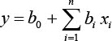

这是典型线性回归的方程。`b[0]` 称为 **截距（intercept）**，`b[1]`、`b[2]` 等为自变量 `x[1]`、`x[2]`、…、`x[n]` 的系数。

## 线性 vs.非线性关系

前面讨论的方程是线性关系。为什么叫线性？我们简化问题，只保留一个因变量 *x*，并把方程写成 *b*[0] = 3、`b`[1] = 10 的形式：

*y* = 3 + 10*x*

可以通过随机生成 *X* 的一些值并计算对应的 *Y* 值来绘制 *Y* 与 *X* 的关系图。下面的 Python 代码片段可以帮助完成此操作。

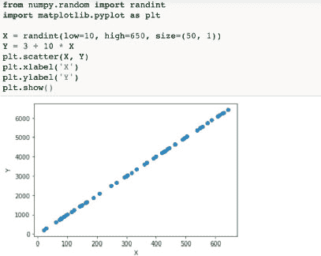

**Figure 3.1:** 一个样本线性关系的示意图

Though we did a scatter plot, but it clearly shows the shape of a straight line. Gradient or Slop of this type of linear relationship is constant. This is for just two variables. But if we consider *n* number of feature variables like *X*, then what will happen? Then this straight line will become a hyperplane in n-dimension.

Now, let's change the equation and consider the following:

*y* = 3 + 10*x*²

And the plot will look like a curve below:

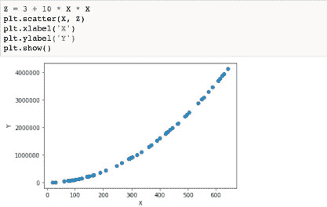

**Figure 3.2:** Plot of a non-linear sample relationship

This curve will become a Sphere and hypersphere for 3-*D* and *n*\-*D* case, respectively. Here gradient is 10*x*, which is a variable itself. So, we can say that the above equation is for a non-linear relationship between *Y* and *X*.

The main difference between linear and non-linear relationship is the gradient (constant vs. variable). And we can say that these relationships are always with respect to other variables and of very relative nature.

## Conversion between linear and non-linear relationships

If we change/transform one variable, then the relationship changes drastically. A nonlinear one becomes linear and vice-versa.

For the previous equation, if we consider *w* as *x*[2] and the equation becomes:

*y* = 3 + 10*w*

Plotting above equation will produce below a line like below:

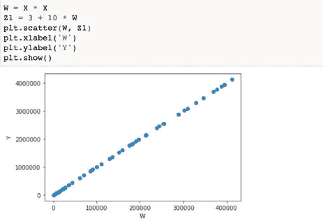

**Figure 3.3:** Plot of a sample transformed non-linear relationship

So, transforming one variable to others can change the nature of the relationships. A non-linear can become linear and vice versa.

## Building a linear regression model

We saw the formal algebraic form of Linear Regression, which is an equation. Now, the question is, how can we build the model and find optimal values of coefficients *b*[0], *b*[1], *b*[2], …., *b*[n]. There are different techniques fordoing it. We will discuss one of them in the next section.


## General approach to solving linear regression

We can think of linear regression as an optimization problem. Our objective is to minimize the errors generated in the prediction. If 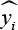 are the predicted value, and `y[i]` is the actual value of the target variable, then objective function, a.k.a. the cost function can be written as:


Error is nothing but an average of the square of differences between predicted and actual values of continuous variable `y`. We can visualize the concept of this error from the estimated regression line and scatter plot for one feature variable and one target variable case. The plot is shown below:


**Figure 3.4:** Scatter plot of sample dataset and the estimated regression line

If we have to find the equation for the regression (be it a line or hyperplane), then error `E` has to be minimized, and optimal values of `b[0]` to `b[n]` have to be determined. From calculus and abstract mathematical point of view, this problem can be solved in numerous ways. We will discuss two of the techniques next.


## Ordinary Least Squares (OLS)

For a one feature variable (`x`) and one target variable (`y`) case, a good estimate of `b` in OLS approach is given by:


For a general `n`-features case, this estimate comes from matrix algebra:


Where, `x^T` = transpose of feature matrix, `x^(-1)` = inverse of matrix `x`.

This estimate minimizes the cost function `E`.

OLS approach is easy to compute and works well for large datasets. It is strongly parametric assumes that errors are fully uncorrelated to features. But this strong assumption does not hold good in many use cases, and that's the weak point of this approach.

The `scikit-learn` provides a class named `LinearRegression` for building the model using the OLS approach.

We will take a sample dataset and build a model. We will be using the Combined Cycle Power Plant Data Set from the UCI Machine Learning repository ([`archive.ics.uci.edu/ml/datasets/Combined%2BCycle%2BPower%2BPlant`](https://archive.ics.uci.edu/ml/datasets/Combined%2BCycle%2BPower%2BPlant)). Let's first read the data and see how it looks like:


**Figure 3.5:** Code snippet to read Power Plant Data and the result

Here the problem is to predict **net hourly electrical energy output (PE)** from other attributes. `PE` is a continuous attribute, so, it is a regression problem.

It is better to scaled-down all features using a `StandardScaler` to give them unit variance and create the pipeline after that. A typical training process is finding out the optimal `b` values using OLS. Calling a `fit` function on the training data does that (splitting data into train and test set is essential before that).


**Figure 3.6:** Code snippet to separate feature and target and splitting of train and test data

Now, we can build the pipeline like below:


**Figure 3.7:** Code snippet to build the pipeline of the linear regression and the model coefficients as output

We got the value of intercept `b[0]` and other `b[i]` values as an array. Finally, the derived regression equation of the model will look like below:

`y = 454.36 - 14.7*x[1] - 3.01*x[2] + 0.38*x[3] - 2.33*x[4]`

Here `x[1]`, `x[2]`, `x[3]` and `x[4]` are transformed (Standard Scaled) AT, V, AP, and RH, respectively.

## Gradient Descent

Mathematically, this can be done by taking partial derivatives with respect to each coefficient `bi` and equating the derivative to zero to solve for `bi`. Series of these derivative equations can be written as:


These derivatives are nothing but Gradients of `E`.

If we replace `E` with actual expression, then the gradients for `b[0]` and `b[1]` would look like below:


Where `N` = total number of data points, `n` = number of feature variables.

We can have similar expressions for other coefficients `b[2]` to `b[n]`. But, numerical and iterative methods are required to implement it practically.

There is a standard algorithm for Gradient Descent for its numerical execution. Steps are given below:

1.  Get the algebraic expression of the partial derivative of the coefficient.
2.  Set some initial value for the coefficient.
3.  Repeat steps 4 to 6 for a number of predefined iterations.
4.  Repeat steps 5 to 6 for each training data instance.
5.  Evaluate the rate of change the coefficient (a.k.a Gradient) by substituting `y` and `x` attribute values coming from training data.
6.  Update coefficient value with a learning rate adjustment.
7.  Repeat from Step 1 to 6 for other coefficients.

Through the above process, Gradient Descent tries to minimize the objective function `E`. It reaches an optimal point where the gradient is zero, and error `E` is minimum. In the process, it keeps on updating coefficient `b`. If we plot `E` vs. `b`, it looks like an inverted parabola like below:


**Figure 3.8:** Plot of Error vs. Coefficient of the Linear Regression

Accuracy wise Gradient Descent technique works pretty well and is better than OLS. But, it has a performance problem with large datasets. Its complexity is O(mn), where m is the number of iterations, and n is dataset size just for one coefficient. Each time it iterates over the entire dataset to reach a locally optimal point (for computation of error `E`), and at last, it spits out the global optimal point.

Probably for this weakness, it is not very preferable to use in the practical use case. The `scikit-learn` also does not provide any implementation for it. But, we will write a class for it for our understanding:


**Figure 3.9:** Code snippet of `GradientDescentLinearRegression` class as Estimator

-   Inside the `_compute_gradients_` function, we can see that gradients are calculated for the intercept and coefficients separately according to the derivative expressions discussed earlier. In each iteration, these computed gradients are multiplied by the learning rate to update the coefficients and intercept. The algorithm has no fixed stopping criterion; its termination depends on how we control it. The `GradientDescentLinearRegression` class achieves this by limiting the number of iterations. We can also control it by setting a threshold on the error computed by the objective function.

1.  Using the Feynman technique, you only need to spend `20 min` to deeply understand the knowledge point, and the memory is profound, *hard to forget*.

```
if (condVar > someVal) {console.log("xxx")}
```

-   We can use a brand new dataset to test the above component. This time, we will use the **Predicting Comprehensive Strength of Concrete** dataset from Kaggle ([`www.kaggle.com/pavanraj159/concrete-compressive-strength-data-set`](https://www.kaggle.com/pavanraj159/concrete-compressive-strength-data-set)). This dataset describes the amount of raw materials used in the concrete production process and the concrete strength. The goal is to predict concrete strength based on the raw materials used. Below is a sample of the dataset:


**Figure 3.16:** Code snippet for reading concrete strength data and results

`csMpacolumn` is our target variable and is continuous.

We can separate features and target variables and generate training and test sets just like before. Below we directly proceed to build the model pipeline using `ForwardSelectionRegression`:


**Figure 3.17:** Code snippet for building pipeline using `ForwardSelectionLinearRegression`

We can get the list of optimal predictors:


**Figure 3.18:** Code snippet for printing the list of optimal predictors

`coarse aggregate` and `fine aggregate` were not selected as predictors because they are not statistically significant.

## Backward selection

It follows a similar principle but in the opposite direction. It starts with all or a pre-determined set of important variables (instead of a single variable) and removes them one by one by checking the change in adjusted `R^2` value. The stopping condition is the same as forward selection.

## Forward or backward: When to use what

Forward selection works better when we lack domain knowledge about the data, i.e., we cannot judge the importance of variables from a domain perspective. However, if the number of variables is not large, forward selection can be time-consuming. Conversely, backward selection is more suitable when we have sufficient domain knowledge to start with a set of known important variables. On average, backward selection is usually more time-saving than forward selection when the number of variables is large.

Although forward and backward selection are theoretically accurate, they are not recommended for large-scale practical datasets due to high time complexity. Theoretically they are correct, but in practice, standard regularization techniques are usually used for variable selection (to be discussed in later chapters).

## Key points to remember in linear regression

Before deciding to use linear regression, the following points need to be remembered to help us build a suitable model:

1.  Residuals (residuals) or errors should not exhibit any pattern. If a pattern is observed, it indicates that the model cannot explain significant variation and the model is not optimized enough.

    Let's plot a scatter plot of residuals for the gradient descent model:

    

    **Figure 3.19:** Code snippet for plotting model residuals

2.  All feature variables should follow a normal distribution and should be standardized.

    Before modeling, it is best to transform the independent variables (see *Chapter 1: Introduction to Machine Learning*). The transformation method is `StandardScaler`, i.e., the transformed variables should follow a normal distribution with mean 0 and variance 1. If some or all independent variables do not follow a normal distribution, this transformation may have no effect and the model will still be erroneous.

    Forcing the use of features that do not follow a normal distribution to build a linear regression model may result in low accuracy.

3.  Linear regression models are suitable for continuous variables, so categorical variables need to be converted to continuous variables through one-hot encoding. Although this step may increase model building time, it is a prerequisite.

4.  Multicollinearity between feature variables should be avoided as much as possible.


# 多共线性

*多共线性* 指的是特征变量之间的相关程度。它会影响模型准确性。我们需要对每个特征变量计算其多共线性程度。实际中通过构建一系列不考虑真实目标变量的线性回归模型来实现：对每个特征设为目标，其余特征作为自变量进行回归，从而判断该特征是否可以由其他特征解释。最终会根据 VIF（Variance Inflation Factor）决定是否剔除变量。一般的经验准则是：

- VIF > 10 表示高多共线性，必须剔除该特征。
- VIF ≤ 5 表示良好，可保留该特征。
- 其余情况需结合领域知识判断。从 VIF 表达式可以看出，特征之间的高 *R*² 会导致高 VIF。

在大规模数据集的实际场景中，构建测试模型并进行 VIF 分析可能耗时较长。此时可以使用 `Principal Components`（见 *Chapter 6: Miscellaneous Unsupervised Learning*）代替 VIF 分析。PCs 将共线特征合并为一个特征，直接使用即可，从而吸收共线性。

线性回归易于理解和调参，数据科学家和机器学习专家常将其作为第一版模型。但如前所述，由于统计假设的限制，它在大多数情况下表现不佳。可以考虑使用多项式回归等更专业的方法（下文将讨论）。

# Polynomial regression

我们已经看到如何构建线性回归模型。非线性方程在前文已讨论，并展示了如何将非线性转换为线性。现在，我们将探讨如何在回归模型中引入非线性。以两个自变量 *x*[1] 与 *x*[2] 的线性回归模型为例，如果我们构造如下新模型：


该模型对 *x*[1] 与 *x*[2] 非线性，在三维空间（*y*、*x*[1]、*x*[2]）中形成一个超球体。我们可以加入任意包含 *x*[1] 与 *x*[2] 的额外项。非线性形式的可能性无限，选择起来非常困难。

为了便于操作，通常只选择 *n* 次多项式项进行非线性参数回归建模。下面给出 *n* 次多项式在 *x*[1] 与 *x*[2] 上的通式：


因此，一个 3 次多项式（对 *x*[1] 与 *x*[2]）的形式如下：


正常的线性回归技术，如 `Gradient Descent`，不能直接在这里应用。我们需要在应用之前对变量进行变换。我们可以进行以下替换，并将三次多项式方程重新写成如下形式：


现在，这是一个包含六个自变量（*x*[1], *x*[2], *w*[1], *w*[2], *w*[3], *w*[4]）的线性回归问题。*w*[1]、*w*[2]、*w*[3]、*w*[4] 被称为虚拟哑变量。我们可以根据多项式的程度，引入任意数量的哑变量。

作为一般规则，*k*(*n* – 1) 个额外的哑变量是生成 *k* 个原始特征变量的 n 次多项式所需的。变量生成后，正常的 `Gradient Descent` 或其他任何线性技术都可以用于训练模型。新变量的梯度会像 ∂, ∂ 这样的进行计算。

我们可以直接使用现有的线性回归 API 来构建这类模型。我们可以编写一个自定义估计器，它会生成这些哑特征，并使用常规线性回归 API 来构建模型。


**图 3.20:** `PolynomialRegression` 作为 `Estimator` 的代码片段

我们将使用来自 Kaggle 的同一“预测混凝土抗压强度”数据集来构建和测试该模型。我们可以编写类似的流水线：


**图 3.21:** 使用 `PolynomialRegression` 的流水线代码片段

我们使用了三次多项式。我们可以从训练多项式模型的系数数组长度来获取使用的特征总数：


**图 3.22:** 打印训练多项式模型系数的代码片段

生成的高阶特征数量为 16，因为原始特征数量为 8（24 – 8 = 16）。这验证了表达式 *k*(– 1)（*k* = 8, *n* = 3）。

现在，我们可以在测试数据集上测试该模型：


**图 3.23:** 测试多项式模型准确性的代码片段

多项式模型在某些典型的非线性使用案例中表现良好。但确定要构建的模型的适当程度是非常困难的。试错过程可以帮助解决这个问题。

# Regularization

在深入讨论 *regularization*（正则化）的细节之前，我们将讨论来自 UCI 的 Auto MPG 预测数据集（[`archive.ics.uci.edu/ml/datasets/Auto+MPG`](https://archive.ics.uci.edu/ml/datasets/Auto+MPG)）。这是一个回归问题，用于预测目标变量 `mpg`（燃油消耗）的值。数据集并未以正确的 CSV 格式提供，而是以空格分隔的文本。它也包含许多缺失值。因此，我们将编写一个小的预处理函数，能够解析文件并为我们准备一个半预处理后的数据集。


**图 24:** 编写代码以准备和格式化 Auto-MPG 数据集的代码片段

我们现在可以看到数据内容如下：


**图 25:** 查看 Auto-MPG 数据集的代码片段

`cylinders`、`model year` 和 `origin` 是类别变量，其余为连续变量（根据 UCI 数据集规格）。我们可以使用同一个 `CategoricalVariableEncoder` 类作为流水线阶段（如*第 2 章：分类*）将这些类别变量转换为连续变量。在 `horsepower` 特征中，有些值缺失。我们在 `prepare_auto_mpg_dataset` 函数中将这些缺失值标记为 `NaN`。但这在进行任何计算时会造成问题。为此，我们需要使用基于均值的插值机制（参阅*第 1 章：机器学习入门*）来填充这些缺失值。我们可以使用 `scikit-learn` 中的 `SimpleImputer` 类，并将其作为流水线的一步加入。

在做任何事情之前，我们需要分离特征和 `target` 变量，并准备训练和测试数据集，如下所示：


**图 26:** 分离特征和目标变量，并将数据集划分为训练集和测试集的代码片段

整个流水线和训练过程将如下所示：


**图 27:** 构建使用 `SimpleImputer` 和其他组件的线性回归模型的流水线代码片段

我们可以在测试数据集上测试模型：


**图 28:** 在测试数据集上测量模型准确性的代码片段

现在，我们在训练数据集本身上进行同样准确性的测试。


**图 29:** 在训练数据集上测量模型准确性的代码片段

训练准确率略高于测试准确率。不过，在我们的情况中，准确率的差异仅为 0.01 或 1%，但在某些情况下，差异可能高达 30-40%，这在很大程度上是显著的。这种差异会导致未知数据的准确率较低，整体解决方案变得不稳定。正如*第 1 章：机器学习入门*中讨论的那样，这是典型的低偏差高方差问题。那么，我们该如何解决这个问题呢？

既然偏差已经很低，我们能否从外部引入强制性的偏差，稍微增加它，从而解决问题？是的，我们可以。有一个数学模型用于此目的。在讨论这个之前，让我们先看看过拟合如何在模型中引入额外的复杂性。为了方便，我们将以一个简单的单特征 *n* 次多项式来观察：


**图 30:** 正常模型与过拟合模型的可视化解释

过拟合的解决方案试图尽可能覆盖所有数据点。现在，如果一个新的未知数据点出现，我们需要预测其 `target` 变量的值，情况可能如下：


**图 31:** 在正常模型和过拟合模型中预测未知数据点的情况

我们可以看到，对于那个蓝色的未知点，过拟合解决方案的预测误差要大得多（误差通过箭头指示的距离体现）。这与前面的例子相似：测试准确率为 1% 小于训练准确率。

我们可以通过在模型的整体目标/误差函数中引入一个额外的偏差项来减少过拟合。这个偏差项将是回归模型系数向量的范数（参阅*第 1 章：机器学习入门*）。数学上，整个目标函数可以写成：


其中 *b*[j] 是回归表达式的系数，第二项称为 *regularization term*（正则化项）。默认情况下，`Gradient Descent` 可能会以这个修改后的误差项开始其过程。由于我们在整体误差中增加了额外的误差，它将减轻找到快速且局部解决方案的影响。这通常被称为 *Lp 正则化*。它有不同的类型，我们将在下文讨论。

## L1 regularization or Lasso

如果我们设置 *p* = 1，那么它就变成了 *L*[1] *regularization 或 Lasso 回归*。误差变为


在这里，λ 是控制正则化项的额外超参数。当 λ = 0 时，效果为零，变成正常的线性/多项式模型。Lasso 会自动将不重要的预测器的系数置零。不重要的预测器会通过这个过程自动消失。

因此，它可以作为一种更有效的替代方案，而不是耗时的 *forward* 或 *backward* 选择，用于变量选择。我们将基于同一 Auto MPG 预测数据集构建一个基于 Lasso 的流水线模型。流水线的其他步骤应与之前相同。`scikit-learn` 提供了名为 `Lasso` 的类来实现这一点。


## L2 正则化或脊回归

如果我们设置 *p* = 2，那么它就变成了 *L*[2] *正则化或脊回归*。错误变为：


脊回归在提高解的整体准确度方面起着重要作用。它能防止系数值过高。但它无法像 Lasso 那样将无关特征置零。`scikit-learn` 提供了一个名为 `Ridge` 的类用于进行脊回归。其余的实现方式与 Lasso 类似，读者可以自行尝试。

# 参数回归模型用于解释事实

参数模型（如线性/多项式回归）擅长解释事实。即使不使用模型进行预测，仅通过观察模型也能说明因变量的变化。让我们分析线性回归的数学表达式：


假设我们将 *x*[1] 的值从 δ[1] 变为 δ[2]，同时保持其他所有变量值不变，那么对应的 *y* 值会如何变化：


将 *y*[1] 减去 *y*[2] 会得到：


可以将上述公式简化并推广为更多变量 xi 的形式：


因此，仅凭对一个特征 x1 的变化，就能估计 y 的变化，而无需知道其他特征的值。

这也取决于系数 bi 的符号，即变化发生的方向。如果系数 *b*[i] 为正，则 *x*[i] 的变化会导致目标变量 *y* 增加 Δ>*b*[i]*x*[i]；否则，会导致 *b*[i]Δ>*x*[i] 的减少。这些事实在处理销售或利润/亏损数据集时非常有用。分析人员仅需观察模型，就能轻松估计因任何特征（或业务术语中的维度）变化而导致销售额呈正向或负向变化。我们将在 *第 9 章：数据科学故事 telling* 中讨论其中一种用例。

变化也受缩放影响。通常，我们使用 `StandardScaler` 将特征转换为均值为 0、方差为 1 的形式。如果 μ[1] 和 σ[1] 分别是原始变量  的均值和标准差，则有：


因此，一般来说，


而 *y* 的变化可以相对于原始变量  来捕捉：


上述公式可在使用 `StandardScaler` 进行模型构建前随时应用。

简言之，构建模型后，通过分析系数即可捕捉这些变化特性，无需对真实数据集进行完整的模型运行，从而节省大量时间。这些变化规律可以作为故事分享，帮助分析人员在做出众多业务决策时提供支持。

# 基于树的回归

在 *第 2 章：分类* 中，我们已经看到决策树和随机森林用于预测类别标签。回归问题也可以使用这种基于树的方法进行模型构建。与基于线性方程的回归不同，树基回归不假设任何统计性质或公式，而是直接拟合数据到模型中。其非参数、基于事实的特点体现在数据中的概率或其他指标上。

在分类问题中，我们使用熵和基尼系数作为不纯度度量，它们基于概率，衡量数据中不同类别标签的混合程度。但回归问题较为特殊，概率的重要性较低，因为我们关注的是实际数值预测而非类别标签。

那么，是否存在一种指标可以衡量连续值的不纯度？答案是肯定的。从统计学角度看，连续数值的不纯度是指这些值与均值的差异程度，即方差。我们可以使用方差或 **MSE（均方误差）** 作为树节点分裂的“不纯度”度量。其数学表达式如下：


其中 *yi* 表示目标变量的实际值， 表示预测值（样本均值）。

MSE 或方差值越高，说明数据不纯度越大。其最小可能值为 0，表示所有值相同，此时不纯度为零。

与分类树一样，我们在每个阶段检查所有特征，选择能带来最大方差缩减（即最小不纯度）的特征进行分裂。在分类问题中，叶节点无不纯度或达到阈值不纯度时得到预测类别；但在回归中，达到零不纯度几乎不可能，因此必须设定阈值。

ID3 算法正是用于训练过程的，它与分类问题中的决策树使用相同的算法。

**ID3 算法中节点分裂的停止标准：**

1. 没有剩余属性可用于节点分裂。
2. 达到“统计系数变异系数”阈值百分比。
3. 节点中仅剩下一个数据样本。

最后，叶节点中所有数据点的平均值成为回归问题的预测值。

下面，我们通过一个包含分类特征变量的数据集示例来展示这一过程。

为了便于演示，我们创建了一个包含 10 条记录的随机数据集，其中有五个分类特征变量（f1, f2, f3, f4, f5）和一个连续目标变量 *y*。该数据集如下图所示：


**图 3.36：** 用于决策树回归器的样本数据读取代码片段

我们的目标是预测 *y*。

为方便后续计算，我们定义了以下统计量：

- Mean(*Y*)：目标变量 *Y* 在树的任意节点的均值
- Var(*Y*)：目标变量 *Y* 在树的任意节点的方差
- SD(*Y*)：目标变量 *Y* 在树的任意节点的标准差
- CV(*Y*)：目标变量 *Y* 的变异系数 = SD(*Y*) × 100 / Mean(*Y*)
- *Var(Y, X)* = ∑[c]∈[X](*c*)*Var*(*c*) = 相对于变量 *X* 的方差。这里 *P*(*c*) 表示属性值 *c* 的概率，*Var(c)* 表示当 *X* = *c* 时 *Y* 的方差。
- *VarReduction(Y, X)* = Var(*Y*) – *Var(Y, X)*
- [我们将使用 `Coefficient of Variance (CV)` 作为不纯度度量，而不是简单的方差，因为它更合适。]
- [与决策树分类器相同的机制同样适用于这里，在较高层面上也适用。我们会逐个选择特征并检查 `VarReduction(Y, X)` 的值。选择 `VarReduction(Y, X)` 最大的特征作为分割属性。如果在任意节点达到特定阈值 `CV` 或没有更多待检查的属性，则过程在此停止。我们以当前数据集的逐步方式来展示这一点。]

1. Mean(`Y`) = 226
   `Var(Y)` = 13471.6

2. 使用属性 `f1` 进行测试：

   

   因此，`Var(Y, X)` = 944.12 + 258.62 = 1202.74
   `VarReduction(Y, X)` = 1371.6 – 1202.74 = 168.86

   同样，对于属性 `f2`，`VarReduction(Y, X)` = - 2802；属性 `f3`，`VarReduction(Y, X)` = - 6214；属性 `f4`，`VarReduction(Y, X)` = - 4703；属性 `f5`，`VarReduction(Y, X)` = - 7365

   属性 `f1` 为我们提供了最高的方差减少量。因此，根节点的分割将基于 `f1`。我们可以如下图看到：

   

   **Figure 3.37:** 从数据集中构建的部分回归树

   根节点有四个分支，分别携带属性 `f1` 的值。第 3 和第 4 分支的 CV 和 SD 为 0，因此过程在此停止，节点 `n3` 和 `n4` 成为叶子节点。但对于第 1 和第 2 分支，需要进一步分割，同样通过递归检查除 `f1` 外的其他属性来完成。当达到某个阈值的 CV（例如 10%，可设置为超参数）时或在该分支上测试完所有属性时，过程停止。达到 0% CV（如节点 `n3` 或 `n4`）的情况较少发生，因此始终设置 CV 的确定阈值作为终止条件更为可取。所有节点最终都会在树的最底层成为叶子节点。例如，如果一个数据点的属性 `f1` 值为 `A3`，则直接到达节点 3，由于它是叶子节点，无法再进行进一步探索，可以得出 `Y` 的预测值为 125（125 是该叶子节点的均值）。


`scikit-learn` 提供了 `DecisionTreeRegressor` 类，与 `DecisionTreeClassifier` 类似。它内部使用相同的 CART 算法（详见 *第 2 章：分类* 章节）。所有分类特征都需要转换为连续特征才能被 `scikit-learn` 处理。管道应包含两个步骤：一热编码和 `DecisionTreeRegressor` 本身：


**Figure 3.38:** 回归树模型管道的代码片段

我们可以使用 `graphviz` API 可视化整棵树：


**Figure 3.39:** 查看回归树模型的代码片段

绘制的树形图如下：


**Figure 4.40:** 训练好的回归树模型的图形

所有叶子节点的 `mse` 均为 0.0，即杂质为零。

我们现在创建一个样本数据实例，并从模型中获取预测的 `y` 值：


**Figure 4.41:** 测试模型未知数据实例的代码片段

我们可以设计一个类似的管道，用于构建 Auto MPG 预测数据集的模型：


**Figure 4.42:** 使用 Auto MPG 数据集构建回归树模型的管道代码片段

我们同样可以生成绘制的树形图，如下所示：


**Figure 4.43:** Auto MPG 数据集训练好的回归树模型的图形

由于特征数量较多，树形图看起来相当庞大。我们可以在测试数据上使用模型获取准确性：


**Figure 4.44:** 在测试数据上测试模型准确性的代码片段

对于基于树的模型，传统的 *R*2 指标可能不那么相关，因为树模型是非参数的。我们也可以在模型准确性上使用标准 MSE 替代 *R*2。

# 比较不同回归技术

线性/非线性参数模型（参考 *第 1 章：机器学习入门*）实现和调试非常直接。但我们需要事先了解模式、数据分布以及变量之间的关系，以便形成一个数学/统计表达式。例如，在线性/多项式回归的情况下，我们假设变量之间存在形式化的代数关系，并通过可用的标准方法求解其参数。如果变量之间确实存在这种关系，这种方法能给出非常好的结果。

在某些情况下，我们事先知道变量的数据分布。例如，银行/金融行业的数据。大多数情况下，银行/金融数据遵循标准统计分布，我们可以假设多种参数模型（线性/非线性），并且这些模型能给出很好的结果。参数回归技术对高值或低值非常敏感。我们必须对所有变量进行适当的缩放和噪声消除，然后再构建模型。

非参数和非线性模型（如回归树）不假设数据的任何正式分布。它们不尝试将数据拟合到任何预定义的代数形式中，而是通过直观的数据分析结合概率、方差或均值等数学指标来构建模型。因此，在数据分布未知的情况下，使用这些技术更为合适。大多数情况下，这些技术优于在未知领域使用参数/基于方程的技术。

# 结论

在本章中，我们讨论了如何使用回归技术预测连续或数值目标变量。我们涵盖了从参数线性模型到非参数决策树等多种回归技术。我们还讨论了防止过拟合的正则化技术（如 Lasso 和 Ridge），以及准确性指标的详细分析。

我们学习了线性和多项式回归的正式代数定义，并实现了几个自定义类，这些类可以作为管道中的 Estimators 使用。变量选择和重要因素分析在描述性机器学习实践中至关重要。我们学习了使用前向选择、后向选择和 Lasso 进行变量选择的技术。最后，我们了解了如何构建非参数回归模型——回归树，并学习了使用标准 Python 库进行回归可视化的技术。

在下一章中，我们将学习一种无监督技术——聚类，在聚类中，不提供像分类问题或回归问题那样的标签（如目标变量）。聚类需要在没有任何先验知识的情况下发现数据中的模式。

- 我们将使用 `Coefficient of Variance (CV)` 作为不纯度度量，而不是简单的方差，因为它更合适。

- 与决策树分类器相同的机制同样适用于这里，在较高层面上也适用。我们会逐个选择特征并检查 `VarReduction(Y, X)` 的值。选择 `VarReduction(Y, X)` 最大的特征作为分割属性。如果在任意节点达到特定阈值 `CV` 或没有更多待检查的属性，则过程在此停止。我们以当前数据集的逐步方式来展示这一点。

1. Mean(`Y`) = 226

   `Var(Y)` = 13471.6

2. 使用属性 `f1` 进行测试：

   

   因此，`Var(Y, X)` = 944.12 + 258.62 = 1202.74

   `VarReduction(Y, X)` = 1371.6 – 1202.74 = 168.86

   同样，对于属性 `f2`，`VarReduction(Y, X)` = - 2802；属性 `f3`，`VarReduction(Y, X)` = - 6214；属性 `f4`，`VarReduction(Y, X)` = - 4703；属性 `f5`，`VarReduction(Y, X)` = - 7365

   属性 `f1` 为我们提供了最高的方差减少量。因此，根节点的分割将基于 `f1`。我们可以如下图看到：

   

   **Figure 3.37:** 从数据集中构建的部分回归树

   根节点有四个分支，分别携带属性 `f1` 的值。第 3 和第 4 分支的 CV 和 SD 为 0，因此过程在此停止，节点 `n3` 和 `n4` 成为叶子节点。但对于第 1 和第 2 分支，需要进一步分割，同样通过递归检查除 `f1` 外的其他属性来完成。当达到某个阈值的 CV（例如 10%，可设置为超参数）时或在该分支上测试完所有属性时，过程停止。达到 0% CV（如节点 `n3` 或 `n4`）的情况较少发生，因此始终设置 CV 的确定阈值作为终止条件更为可取。所有节点最终都会在树的最底层成为叶子节点。例如，如果一个数据点的属性 `f1` 值为 `A3`，则直接到达节点 3，由于它是叶子节点，无法再进行进一步探索，可以得出 `Y` 的预测值为 125（125 是该叶子节点的均值）。

`scikit-learn` 提供了 `DecisionTreeRegressor` 类，与 `DecisionTreeClassifier` 类似。它内部使用相同的 CART 算法（详见 *第 2 章：分类* 章节）。所有分类特征都需要转换为连续特征才能被 `scikit-learn` 处理。管道应包含两个步骤：一热编码和 `DecisionTreeRegressor` 本身：


**Figure 3.38:** 回归树模型管道的代码片段

我们可以使用 `graphviz` API 可视化整棵树：


**Figure 3.39:** 查看回归树模型的代码片段

绘制的树形图如下：


**Figure 4.40:** 训练好的回归树模型的图形

所有叶子节点的 `mse` 均为 0.0，即杂质为零。

我们现在创建一个样本数据实例，并从模型中获取预测的 `y` 值：


**Figure 4.41:** 测试模型未知数据实例的代码片段

我们可以设计一个类似的管道，用于构建 Auto MPG 预测数据集的模型：


**Figure 4.42:** 使用 Auto MPG 数据集构建回归树模型的管道代码片段

我们同样可以生成绘制的树形图，如下所示：


**Figure 4.43:** Auto MPG 数据集训练好的回归树模型的图形

由于特征数量较多，树形图看起来相当庞大。我们可以在测试数据上使用模型获取准确性：


**Figure 4.44:** 在测试数据上测试模型准确性的代码片段

对于基于树的模型，传统的 *R*2 指标可能不那么相关，因为树模型是非参数的。我们也可以在模型准确性上使用标准 MSE 替代 *R*2。

# 比较不同回归技术

线性/非线性参数模型（参考 *第 1 章：机器学习入门*）实现和调试非常直接。但我们需要事先了解模式、数据分布以及变量之间的关系，以便形成一个数学/统计表达式。例如，在线性/多项式回归的情况下，我们假设变量之间存在形式化的代数关系，并通过可用的标准方法求解其参数。如果变量之间确实存在这种关系，这种方法能给出非常好的结果。

在某些情况下，我们事先知道变量的数据分布。例如，银行/金融行业的数据。大多数情况下，银行/金融数据遵循标准统计分布，我们可以假设多种参数模型（线性/非线性），并且这些模型能给出很好的结果。参数回归技术对高值或低值非常敏感。我们必须对所有变量进行适当的缩放和噪声消除，然后再构建模型。

非参数和非线性模型（如回归树）不假设数据的任何正式分布。它们不尝试将数据拟合到任何预定义的代数形式中，而是通过直观的数据分析结合概率、方差或均值等数学指标来构建模型。因此，在数据分布未知的情况下，使用这些技术更为合适。大多数情况下，这些技术优于在未知领域使用参数/基于方程的技术。

# 结论

在本章中，我们讨论了如何使用回归技术预测连续或数值目标变量。我们涵盖了从参数线性模型到非参数决策树等多种回归技术。我们还讨论了防止过拟合的正则化技术（如 Lasso 和 Ridge），以及准确性指标的详细分析。

我们学习了线性和多项式回归的正式代数定义，并实现了几个自定义类，这些类可以作为管道中的 Estimators 使用。变量选择和重要因素分析在描述性机器学习实践中至关重要。我们学习了使用前向选择、后向选择和 Lasso 进行变量选择的技术。最后，我们了解了如何构建非参数回归模型——回归树，并学习了使用标准 Python 库进行回归可视化的技术。

在下一章中，我们将学习一种无监督技术——聚类，在聚类中，不提供像分类问题或回归问题那样的标签（如目标变量）。聚类需要在没有任何先验知识的情况下发现数据中的模式。

# 层次聚类

# 聚类作为分类技术

# 目标

完成本章节后，我们将能够

* 根据使用场景应用特定的聚类技术，并对聚类进行适当的可视化。
* 将聚类作为替代分类技术使用。

# 聚类的正式定义

聚类是创建有意义的记录或对象组的过程，这些记录或对象具有共同特征。这些共同或相似的特征可以通过目视观察或数学公式发现。对数据的任何目视观察来形成聚类，都可以通过底层的数学或统计理论来解释。我们可以从散点图中手动找出数据中的组，并根据图中信息匹配对象。通过机器学习，这种手动过程可以通过聚类分析技术自动化。

# 聚类概念

聚类可以被视为带标签的组或类，与分类中分类对象类似，但以无监督方式实现。创建聚类的过程称为 `clustering`。分类模型是基于已经标记类别的数据集构建的。聚类不需要标记类别。聚类算法可以发现隐藏的类别标签，并将其视为独立的聚类。根据与每个聚类的相似度或匹配分数，将对象或记录分配到相应的聚类中。下面的二维散点图展示了三个不同的聚类：


**Figure 4.1:** 示例聚类

* **分离良好的聚类：** 在这种聚类结构中，每个组的数据点彼此相距较远。可以使用阈值机制指定数据点的亲密程度，这将决定边界线。下面的图是二维空间中良好分离聚类的示例：

  

  **Figure 4.2:** 示例良好分离聚类

* **重叠聚类：** 这种结构可能包含不同聚类之间的共同数据点。理论上，一个数据点在该类型聚类技术中可能属于多个聚类。下面的图是示例：

  

  **Figure 4.3:** 示例重叠聚类

散点图中的红色数据点同时属于两个聚类。

# 相似度度量

大多数聚类算法的一个重要部分是计算数据点之间的距离或相似度。可以将距离或相似度作为度量。概念上，这两者是相反或互为倒数的。数据点是否属于某个聚类，由相似度/距离度量决定。大多数算法通过欧氏距离计算距离，或通过余弦相似度计算相似度（参考 *`第 1 章：机器学习入门`*）。也可以将度量（`1-Cosine Similarity`）或（`1/ Cosine Similarity`）作为 `距离度量`。

# 基于中心的聚类

这是一种聚类方法，其中为每个聚类选择一个代表性数据点。所有其他数据点围绕这些代表性数据点演化。实际上，对于主要包含连续属性的数据集，代表性点就是数学上的质心。从物理概念出发，我们知道质心是物体可以完美平衡的质量中心点。几何上，它是几何图形或物体的所有点的算术平均值。在大多数情况下，质心不具有物理存在；即，它可能不是数据集中任何实际数据点。它可能是概念性的。对于多维图形，需要对每个维度计算质心。在欧几里得空间中，多维数据点的复合质心可以通过：


基于中心的聚类倾向于呈球形。下面的聚类图示例中，质心以红色显示：


**Figure 4.4:** 示例中心聚类

我们可以看到，Centroid3 不是真实数据点，而是概念性的。

# K-means 聚类

`K-means` 是最受欢迎的中心聚类算法。它完全基于前一节所解释的质心概念。其工作原理从假设/初始化 `K` 个中心点或质心开始，其中 `K` 是用户提供的参数。其他数据点随后被分配到最近的质心。分配给一个质心的点的集合构成一个聚类。质心在之后被重新计算，并与之前的值进行比较。如果重新计算的质心足够接近或相同，则过程停止；否则继续。有一些超参数控制算法循环的次数或用于判断质心接近程度的阈值。

## 基本 K-means 算法

1. 从数据集中选择 `K` 个数据点作为初始聚类质心。
2. 计算每个质心到其他数据点的距离。
3. 将数据点分配给距离最小的聚类。
4. 重新计算所有 `K` 个聚类的质心。
5. 重新计算 `K` 个质心并与之前的值进行比较。
6. 如果质心发生变化，则从步骤 2 开始；否则结束。

## 超参数

算法可控制的两个高层次超参数。实际上，很难判断前后质心值是否相同，因为存在浮点运算误差。因此，设置一个 `threshold` 作为超参数，用于设定质心值变化的最小差异。如果当前和之前计算的质心值的绝对差大于该阈值，则算法继续；否则停止。最后迭代计算出的质心即为最终聚类中心。

迭代次数也可以作为超参数来控制循环。在这种情况下，阈值可能被忽略，或者反之亦然。

## Python 实现 K-means 聚类

`scikit-learn` 提供了 KMeans 聚类库。遵循 `scikit-learn` 标准，它遵循相同的 `fit`、`predicts` 和 `transform` 函数签名，KMeans 本身作为 `Estimator` 和 `Transformer`，可以作为 pipeline 的一步加入。

我们将使用 UCI 机器学习库中的 Wholesale Customer 数据集（`https://archive.ics.uci.edu/ml/datasets/Wholesale+customers`）来应用 KMeans 聚类算法。让我们先探索该数据集：


**Figure 4.5:** 显示 Wholesale Customer 数据集的代码片段

该数据集包含不同渠道和区域的产品销售信息。根据 UCI 门户的描述，`Channel` 和 `Region` 是类别变量，其余为连续变量。我们的目标是研究并可视化包含所有特征的销售数据的聚类：

## 预处理

我们需要将类别变量转换为连续，使用 `OneHotEncoder`，并对连续变量应用 `StandardScaler`。我们将使用与之前相同的 `ColumnTransformer`：


**Figure 4.6:** 将类别特征转换为连续的代码片段

我们将使用预处理实例和 `KMeans` 本身作为管道阶段。为了我们的理解，我们可以将集群大小设置为 5（通过 `n_clusters` 参数）：


**Figure 4.7:** KMeans 聚类管道构建代码片段

`fit` 函数计算中心距离并完成算法的实际学习部分：

如前所述，KMeans 算法为每个数据记录分配一个集群成员。`predict` 函数将为我们提供这些细节，以集群索引（0 到 4）的形式：


**Figure 4.8:** 数据集集群索引预测代码片段

`predict` 函数可用于任何未知/新的数据实例以确定其集群成员。一旦给出新的数据点，它会计算所有集群中心的欧几里得距离，并将数据点分配到距离最近的中心所在的集群。

## 聚类作为新特征空间

基于中心的聚类算法如 KMeans 可以用于生成新的特征空间。任何数据集都可以通过应用 KMeans 算法转换为 K 维特征空间。每个转换后的特征是通过计算数据点到 K 个集群中心的距离获得的。

KMeans 的 `transform` 函数可以实现：


**Figure 4.9:** 使用 KMeans 作为新特征空间的代码片段


由于我们将 `n_clusters` 设置为 5，转换后的特征空间将是 5 维的。它可以作为一种高层次的维度减少技术。

## KMeans 中中心初始化的敏感性

KMeans 对中心初始化的敏感性很高。它极大地影响了集群的形成。使用随机初始化策略时，不同的 KMeans 运行可能产生不同的集群设置，准确率也有所差异。因此，与其使用随机分配，不如保持初始中心分配固定并由外部种子设置，这样在需要对数据集进行多次运行时，可以生成一致的集群。

作为替代方案，可以使用 KMeans++ 策略。其工作方式如下：

1. 从数据集中随机选择一个单一的中心 `C`。
2. 计算除中心 `C` 之外的每个点 `x` 到最近中心的距离 `DC(x)`。
3. 以与 `[DC(x)]²` 成正比的加权概率直接选择下一个中心。
4. 若已选中心数小于 K，则回到步骤 2，否则结束。

KMeans++ 尽可能选择分布广泛的中心。它确保捕获数据的更大变异性。默认情况下，scikit-learn 的 KMeans 类使用 KMeans++ 方法初始化中心。

## 可视化聚类

由于我们有 11 个维度（包括转换后的类别变量），很难轻易地在所有维度上一起可视化聚类。下面讨论了两种在 2D 散点图中查看聚类的方法。

*   **使用任意两个变量和集群索引**

    我们可以将聚类与数据集中的任意两个变量进行绘图。虽然聚类计算时考虑了所有变量，但这里我们将尝试使用任意两个变量和相同的计算得到的集群索引来可视化聚类模式。在我们的用例中，我们选择 `Milk` 和 `Grocery` 作为变量进行观察：

    

    **Figure 4.10:** 绘制 KMeans 聚类的代码片段

    可以看到，聚类（尤其是第 3 个聚类）在 `Grocery` 的 0-20000 范围内，`Milk` 的 0-10000 范围内有浓度。这表明在这些范围内 `Milk` 和 `Grocery` 的销售量更大。我们也可以以类似的方式，使用剩余的变量对其他变量组合进行可视化。

*   **使用前两个主成分和集群索引**

    我们可以使用主成分（PCs）生成两个最重要的虚拟维度，并将其用于重新运行 KMeans 算法。这两个 PCs 可以与新生成的集群索引一起在散点图中绘制，以观察形成的聚类。

    我们可以使用之前定义的相同预处理器，并将 PCA 作为另一个步骤：

    

    **Figure 4.11:** 计算数据集前两个主成分的代码片段

    我们在 `pca_vectors` 上应用 KMeans，生成聚类：

    

    **Figure 4.12:** 在 PCA 特征上应用 KMeans 的代码片段

    我们可以像下面这样绘制 `pca_vectors` 与集群索引：

    

    **Figure 4.13:** 绘制 PCA 特征与聚类的代码片段

    正如我们所知，主成分并不指明底层物理属性，可能无法判断哪个属性对它们的贡献显著。从聚类图中，我们可以看到在 PC 2 的（-1.25）到（+1.25）以及 PC 1 的（-2）到 0 的值范围内，数据点高度集中。大多数数据点落在第 1 个聚类中。

从可视化可以看出，聚类可以揭示在第一眼看不出来的隐藏信息。这些信息可以用于研究数据，并种子到其他系统或模型中。这正是聚类的唯一目的。

## 准确性指标

与其他机器学习模型一样，聚类模型也有指标来评估准确性。由于大多数聚类算法处理距离，因此距离计算产生的总错误可以作为衡量聚类质量的指标。这被称为 **SSE（Sum of Squared Errors，平方误差总和）** 的一个聚类。SSE 通过计算每个数据点到其所在集群中心的欧几里得距离，然后将所有距离平方后求和来计算。其表达式如下：


其中，

* `k` = 聚类数量
* `C[i]` = 集群 i 中的数据点集合
* `μ[i]` = 集群 i 的中心

SSE 是一种绝对度量，能够提供聚类质量的高层次估计。但它忽略了中心式聚类的两个非常重要的质量方面，如下所述。

## 聚类的凝聚与分离

凝聚是衡量集群质量的指标，定义了每个集群的紧凑程度。它可以通过计算集群内所有数据点之间的双向距离之和来获得。直观上，集群的凝聚可以表示为：


**Figure 4.14:** 集群的凝聚

凝聚值越低，说明集群越紧凑，每个集群内的误差越少。

分离定义了集群之间的隔离程度。它可以通过计算每个数据点对之间的距离之和来获得。如下所示：


**Figure 4.15:** 集群的分离

分离值越高，说明集群布局越好。

## 轮廓系数

轮廓系数结合了凝聚和分离的概念，可以作为一个统一且独立于距离单位的聚类质量度量。轮廓系数被认为是中心式聚类的标准度量，且与距离单位无关。第 i 个数据点的轮廓系数由以下表达式给出：


其中，

* `a[i]` = 第 i 个数据点与同一集群内其他所有数据点的平均距离。
* `b[i]` = 所有数据点的平均距离中的最小值，即第 i 个数据点与它不属于的所有其他聚类中所有其他数据点的平均距离的最小值。

简言之，我们可以说，`a[i]` 是数据点 i 的簇内距离，`b[i]` 是数据点 i 的簇间距离。

整个聚类配置的轮廓系数（Silhouette Coefficient）是所有数据点系数的平均值，给出公式如下：


其中 `N` 表示数据集的总大小。

轮廓系数的取值范围在 -1 到 +1 之间。较大的值表明簇间距离较大、簇内误差较小，因此整体聚类效果更好。对于某个数据点的负轮廓系数表示它被错误地分配到了一个簇中，而整体负值则表明大多数数据点都被错误分配。

## Python 实现聚类指标

`scikit-learn` 提供了两个函数，分别用于计算整个聚类配置的整体轮廓系数以及每个数据点的个体轮廓系数。输入需要包含特征和预测的簇标签。我们将在前一节中计算得到的 `pca_vectors` 作为特征：


**Figure 4.16:** 计算整个聚类配置轮廓系数的代码片段

因此，整体得分为 0.49，属于中等水平。现在我们可以得到所有数据点的得分数组：


**Figure 4.17:** 计算每个数据点轮廓系数的代码片段

（数组仅显示了部分内容）

## KMeans 的优势

*   使用非常简单，可以应用于各种数据，无需对数据来源有足够的领域知识。
*   即使在高维数据集中，它仍能高效工作，即在特征数量较高的情况下也能表现良好。
*   当聚类呈球形或椭圆形时，它能够很好地检测出聚类。

KMeans 可作为首选的通用聚类算法。数据科学家和机器学习专家常用它来初步了解数据中的模式。

## KMeans 的缺点

*   它高度依赖于初始化步骤的簇初中心。如果初始簇中心选择错误，则可能产生 poor 的聚类结果。
*   KMeans 对数据中的噪声/离群点非常敏感。均值（Mean）统计量对极端值（非常高或非常低）非常敏感，而 KMeans 中的中心点（多维均值）也受此影响。下面的图展示了单个噪声点如何影响 KMeans：

    

    **Figure 4.18:** 噪声点对 KMeans 的影响

    由于单个噪声点的存在，计算得到的中心点离大多数数据点很远。中心点是民主的，代表多数，理想位置应接近大多数点（如图中绿色点所示），但噪声点导致中心点偏移，使得聚类 SSE（平方和）增加，整体聚类效果变差。
*   当数据中固有的聚类形状不是球形时，KMeans 无法产生良好聚类。它会强行给聚类球形结构，这可能破坏聚类效果。
*   它也无法处理聚类密度差异大的情况。

如果有足够的领域知识，使用更具针对性的聚类算法会比 KMeans 更好。

## 在 KMeans 中确定最优 K

在 KMeans 中，K 的值需要从外部输入。那么如何判断最佳的 K 呢？KMeans 算法本身并不提供寻找最优 K 的机制。如果 K 过小，聚类 SSE（平方和）会过高，属于欠拟合；如果 K 过大，会产生许多微小簇，导致过拟合。因此，我们需要确定最优的 K。

## 肘部法（Elbow method）

这是一种通过预定义的 K 值范围找出最优 K 的方法。对于每个 K，重复运行 KMeans 并计算聚类 SSE。K 值越小，SSE 越大；K 值越大，SSE 越小。SSE 随着 K 的变化会有明显变化。最优 K 是 SSE 变化最大的那个点。如果在图中绘制 SSE 与 K 的关系曲线，会呈现类似肘部的形状，肘部点即为最优 K。下图展示了该曲线：


**Figure 4.19:** KMeans 的 SSE 与 K 曲线及肘部点

对于小数据集，目视确认肘部点可能足够，但在生产环境中自动化整个过程需要迭代算法来找到肘部点。一种通用的方法是遍历 K 的范围，计算连续 K 值之间的 SSE 变化。SSE 变化最大的 K 即为最优 K。虽然方法简单，但计算成本和资源消耗较大，因此不太受欢迎。

## XMeans 聚类

由于 SSE 不是衡量聚类质量的良好指标，直接使用肘部法可能得出错误的最优 K。我们需要结合其他统计指标来确定最优点。

**贝叶斯信息准则（Bayesian Information Criterion, BIC）** 可以找出评分最小的模型，从而确定最优 K。XMeans 聚类算法遍历给定的 K 值范围，并通过计算 BIC 得分来返回最优 K。

XMeans 的思想最初发表在 Dan Pelleg 和 Andrew Moore 的论文（[`www.cs.cmu.edu/~dpelleg/download/xmeans.pdf`](https://www.cs.cmu.edu/~dpelleg/download/xmeans.pdf)）中。BIC 通过以下公式计算：


其中 L 是模型的对数似然（log-likelihood），p 是参数的数量，R 是被考虑的数据点总数。

## 对数似然的计算

XMeans 通过最大化后验概率 `P(Mj | D)` 来优化聚类基础，而不使用准确率等指标。假设数据服从高斯分布，根据论文，第 K 个簇的数据方差的最大似然估计（MLE）为：


数据点被分配到簇 i 的概率是选择该簇和该簇下的高斯概率估计的联合事件。对于数据点 `x[i]`，其联合概率表达式为：


其中 `R[i]` 表示簇 i 下的数据点数量，i 属于该簇。

对所有数据点的联合概率是各个概率的乘积，即 ∏`P(x[i])`。最大化这个乘积等价于最大化其对数 ∏`P(x[i])`，即对数似然 `L`（如 BIC 公式中所示）。

经过数学计算，最大化后的估计值为：


其中 `R[n]` 是簇 n 下的数据点数量，`R` 是总数据点数，`K` 是簇的总数，`M` 是簇 n 的参数数量。上述估计值为每个簇计算，然后在整个配置中综合使用。

BIC 表达式中的参数总数 `p` 可以通过 (`M` * `K`) 粗略估计。每个簇的 BIC 得分被计算，然后通过将所有得分相加获得整个簇设置的总体得分。我们将使用这个总体得分作为衡量簇设置的指标，并选择给出最大值的 `K`。

针对变化的 `K` 有两种 BIC 计算技术。第一种方法较简单，从 2 开始到我们想要的最大可能簇数。这个最大可能簇数（max `K`）必须从外部提供。这是一个迭代过程，对于大量数据可能运行缓慢。第二种方法遵循分治法。它从随机选择 `n` 个簇开始，然后在每个子簇上运行局部 `K`‑means。每次，都根据 BIC 得分测试带有子簇和不带子簇的簇设置，并选择更好的设置。这个过程实现起来比较复杂，但总体运行时复杂度低于第一种方法。为了方便起见，我们将只在 Python 中实现第一种方法。

## Python implementation of XMeans

`scikit-learn` does not have library support for XMeans. So, we can write a custom estimator by extending `BaseEstimator of scikit-learn`:


**Figure 4.20:** Partial code snippet of XMeans class as Estimator

Overridden `fit` function of `XMeans` class tries out different `KMeans` with a varying `K` between 2 to `max_k`. BIC score is computed for each KMeans model, and the one that gives minimum score is chosen as final and `optimal K`. We can get this value from the `optimal_k` variable of `XMeans` class. We have also defined two private functions `_compute_bic_score_` and `_compute_log_likelihood_` inside the class `XMeans`. These are used within the `fit` function:


**Figure 4.21:** Partial code snippet of XMeans class as Estimator

`μ` in the expression of MLE  is nothing but the individual cluster centres. The expression ∑ (`x[i]` – `μ`)[2] can be computed by summing up squared Euclidean distances of all data points from their cluster centres.

We will use this XMeans as a pipeline stage and test the `predict` function with the same Wholesale Customer's dataset.


**Figure 4.22:** Code snippet of the pipeline for XMeans cluster

And we can get the optimal K from `XMeans` instance:


**Figure 4.23:** Code snippet to get optimal K of XMeans

So, the optimal number of clusters, in this case, is 5. We can now get the predicted cluster indices:


**Figure 4.24:** Code snippet to get cluster indices of the dataset


`XMeans` 是一种典型的聚类参数模型。它基于一个硬性统计假设：单个聚类的数据服从正态分布。如果现实中该假设不成立，可能会给出不准确的结果。

## 基于密度的聚类

基于密度的方法尝试通过可达性的概念来寻找聚类。与基于中心的算法不同，它没有任何基于均值的质心计算，后者高度依赖于数值而非实际的可达性。接下来我们将讨论一种基于密度的聚类方法。

## DBSCAN 聚类

`DBSCAN` 通过在一定可达范围内寻找一定数量的邻近点，在一个点周围创建聚类。这里的密度定义为一个点的邻域内有多少数据点。在 `DBSCAN` 的术语中，有几种特定类型的点：

*   **核心点**：这些点是整个聚类设置的骨干。聚类将围绕这些点定义。这类似于 `KMeans` 聚类的质心，但在数学上这些点并非其他数据点的平均值。如果一个点周围在定义的半径 `Eps` 内有定义数量 `MinPts` 的点，则该点被声明为核心点。因此，它依赖的是可达性，而不是均值。`MinPts` 和 `Eps` 是 `DBSCAN` 的外部种子参数。`Eps` 是一种距离度量，最常用的是计算欧几里得距离。图示中，核心点如下所示：

    

    **图 4.25：** DBSCAN 的核心点和 Eps

*   **边界点**：位于核心点 `Eps` 距离范围内的数据点被声明为边界点。边界点不能是核心点。下图展示了这一点：

    

    **图 4.26：** DBSCAN 的核心点、边界点和 Eps

*   **噪声点**：既不是核心点也不是边界点的数据点被声明为噪声点。这些是异常值或离群点（请参阅*第 7 章：杂项非监督学习*）。

`DBSCAN` 算法首先将所有点标记为核心点、边界点或噪声点。然后选取每个点并计算其与所有其他点的距离，如果发现某点周围 `Eps` 距离内至少有 `MinPts` 个数据点，则该点被声明为核心点。`Eps` 边界内的所有其他点成为边界点。此过程持续直到覆盖所有点。与 `KMeans` 不同，`DBSCAN` 不需要将聚类数量作为参数。它动态确定聚类。最终聚类的数量等于核心点的数量。

## DBSCAN 聚类的 Python 实现

`scikit-learn` 提供了 `DBSCAN` 库。我们将使用相同的批发客户数据集作为源数据，并进行相同的预处理。


**图 4.27：** DBSCAN 管道的代码片段

我们分别使用 `0.65` 和 `10` 作为 `Eps` 和 `min_samples (MinPts)` 参数的值。`DBSCAN` 类不像 `KMeans` 那样定义 `predict` 方法。相反，它有一个类型为数组的属性 `labels_`，保存所有数据点的预测聚类标签：


**图 4.28：** 获取 DBSCAN 聚类索引的代码片段

聚类标签 `-1` 表示噪声点。我们可以从 `labels_` 数组的长度获取生成的聚类数量：


**图 4.29：** 获取 DBSCAN 聚类数量的代码片段

因此，在这种情况下最优聚类数量为 4。

## 聚类可视化

与 `KMeans` 一样，我们将使用原始变量以及前两个主成分进行聚类绘图。

*   **使用任意两个变量和聚类索引**

    我们将绘制计算出的聚类索引与 `Milk` 和 `Grocery` 的关系：

    

    **图 4.30：** 使用两个主要特征绘制 DBSCAN 聚类的代码片段

    这次我们使用了普通 `pyplot` 库的 `scatter` 函数，而不是 `seaborn` 库的 `scatterplot` 函数。`scatter` 函数为每个绘图聚类分别调用多次，并使用不同的颜色代码。聚类索引为 `-1` 的数据点用红色绘制。如前所述，这些是噪声点。整个图如下所示：

    

    **图 4.31：** 带噪声点的 DBSCAN 聚类图

    我们可以看到，`DBSCAN` 生成的聚类形状比 `KMeans` 更不规则。噪声点被分离出来，且离其他数据点相当远。

*   **使用前两个主成分和聚类索引**

    生成这些主成分的管道可以按与之前相同的方式定义。

    

    **图 4.32：** 使用前两个 PC 进行 DBSCAN 管道的代码片段

    现在，可以在 `pca_vectors` 上应用 `DBSCAN` 以获取聚类标签：

    

    **图 4.33：** 在 PC 向量上运行 DBSCAN 并获取聚类索引的代码片段

我们使用 `Eps` 为 `0.2`，将 `min_samples (MinPts)` 设为 `5`。现在，这些 `cluster_labels` 可以用同样的方式绘图：


**图 4.34：** 基于前两个主成分（PCS）的 DBSCAN 聚类图

*图 4.35* 的代码片段会产生以下图：


**图 4.35：** 使用前两个主成分绘制 DBSCAN 聚类的代码片段

我们可以直观地确认，使用主成分后，聚类看起来结构更清晰，而不是使用原始变量。这也证明了在维度较少时，`DBSCAN` 表现更好。

## DBSCAN 的优势

*   `DBSCAN` 可以发现形状和大小各异的聚类。与 `KMeans` 不同，它不总是尝试形成球形聚类。倾向于形成任意形状聚类的数据集非常适合 `DBSCAN`。例如，在地理位置数据中寻找模式是 `DBSCAN` 的一个很好的使用场景。

*   在有足够领域知识的情况下，`DBSCAN` 表现良好，这有助于确定 `Eps` 和 `MinPts`。

## DBSCAN 的劣势

*   它的运行时间复杂度较高。最坏情况的复杂度是 `O(n²)`，其中 `n` 为数据点的数量。

*   对于极高维数据集表现不佳。我们已经可视化了这一现象。

`DBSCAN` 可以自动检测数据集中的异常点，因此该算法也可用于异常/离群点检测。我们将在*第 6 章：杂项非监督学习*中详细讨论。

## 确定 DBSCAN 的最优参数

对于 `DBSCAN` 的 `Eps` 和 `MinPts` 没有硬性规则。大多数情况下，领域知识帮助找到合适的值。但通过一些启发式方法和可视化解释，可以估计出最优值。

`MinPts` 的值通常仅来自领域知识。一个启发式估计是使用 `log N` 作为 `MinPts` 值，其中 `N` 为数据点的总数。

## 使用 K 距离图确定 Eps

K 距离图展示了数据点到其第 k 个最近邻的距离行为。首先计算特定 `K` 的所有点的距离，然后将这些值按递增顺序排序并绘制成曲线。曲线呈倒“L”形。我们可以将 `k` 设为先前讨论的 `log N`，并分析 k 距离图。最优 `Eps` 值是曲线出现拐角处的距离值。

我们可以编写一个 Python 函数来绘制 `K` 距离图，使用前面讨论的数据集：


**图 4.36：** `plot_k_distance` 函数的代码片段

我们需要先转换所有变量，然后使用最近邻类来查找最近邻。`scikit-learn` 提供 `NearestNeighbors` 类来完成此任务。它接受 `K` 作为参数，其 `neighbors` 函数返回距离和对应的数据点索引。

最后，`plot_k_distance` 函数即可生成图形：


**图 4.37：** 数据集的 k 距离图

我们可以直观确认，尖锐的拐角出现在距离约为 `1.5` 的位置，因此最优 `Eps` 为 `1.5`。该值与所有转换后的变量处于相同的量级。

## 层次聚类

到目前为止讨论的聚类模型为每个数据点分配一个单一聚类。一个聚类不过是一组数据。如果存在子组、子子组……即聚类之间存在父子层级关系，该怎么办？我们可以从数据集中生成这类聚类层级结构的技术。下面将讨论一种通用的方法——**凝聚聚类**。

凝聚聚类从单个点的对开始，逐一合并它们。合并决策依据两个不同聚类中点的 proximity（距离）。一个接一个地合并聚类，形成父聚类。下面展示了一个层次聚类的示例：


**图 4.38：** 示例层次聚类

E 是层次结构中的最高层聚类。A、B、C、D 是其他子聚类。接下来讨论确定不同子聚类之间链接或创建子聚类的几种策略。

*   **Min（或 Single）策略**：定义两个聚类之间的距离为这两个聚类中任意两点的最小距离。算法初始化一个 `M × M` 的点距离矩阵（`M` 为数据集中点的总数），矩阵中每个单元存储两点之间的距离。算法选取矩阵中的最小距离，将对应的两点合并为一个聚类。下一步，计算其他点到该聚类的距离，并基于最小距离在上层形成新聚类。此过程持续，直到所有点被合并。

    现在，我们来看在 2D 特征空间中计算两个聚类之间最小距离的机制。假设有两个聚类 `C1` 和 `C2`：

    ```
    C[1] = {(3,5), (2,8), (6,1)}
    C[2] = {(8,5), (9,2)}
    Min-Distance (C[1], C[2]) = min {distance {(3, 5), (8, 5)}, distance {(3, 5), (9, 2)}, distance {(2,8), (8,5)}, distance {(2,8), (9,2)}, distance {(6,1), (8,5)}, distance {(6,1), (9,2)}}
    = min {5, 6.7, 6.7, 10, 4.47, 3.16}
    = 3.16
    ```

*   **Max（或 Complete）策略**：其机制与 Min 完全相同，唯一区别是计算两个点之间的最大距离，而不是最小距离。

*   **Ward 方法**：定义两个聚类之间的距离为合并后的 SSE（平方和）增加量。它选择合并后 SSE 增加量最小的两个聚类。对于 SSE 计算，遵循与 `KMeans` 相同的原则，如前文所述。

## 层次聚类的 Python 实现

`scikit-learn` 的 `AgglomerativeClustering` 类用于执行层次聚类，并支持前文讨论的不同链接策略。我们在此使用相同的数据集和 `ColumnTransformer` 来构建管道：


**图 4.39：** 层次聚类管道的代码片段

我们使用了 Ward 链接方法。链接策略在 `linkage` 参数中指定，默认情况下 `AgglomerativeClustering` 使用 `ward`。其他可能的参数值为 `complete`、`average` 和 `single`。我们将 `n_clusters` 设为 `five`，表示期望的聚类总数。

现在，我们可以通过 `labels_` 属性获取所有数据点的聚类索引：


## Figure 4.40: 获取层次聚类中所有数据点的聚类索引的代码片段

你可能会问 `n_clusters` 的作用是什么？`AgglomerativeClustering` 会构建一个层次结构，并一直合并聚类，直到剩余聚类数为 `n_clusters`。`n_clusters` 与 `distance_threshold` 是互斥的。如果未指定 `n_clusters`，则只要任意两个聚类之间的距离小于 `distance_threshold`，算法就会继续合并。

## 聚类可视化

我们同样使用前两个主成分进行可视化（与之前的模型相同）：


**Figure 4.41:** 计算数据集前两个主成分的管道代码片段

随后在主成分上应用 `AgglomerativeClustering`：


**Figure 4.42:** 在主成分特征上获取层次聚类的聚类索引的代码片段

`fit_predict` 函数构建聚类模型并返回所有数据点的聚类索引。

Finally, plotting data points and cluster indices using different color labels:


**Figure 4.43:** `Code snippet` to plot `Hierarchical` clusters on `PC` features

The above `cluster` plot does not show the hierarchy. It shows the last remaining and assigned `n_clusters` to each data point.

## Visualization of hierarchical clusters with a dendrogram

A `dendrogram` is an alternative pictorial representation for hierarchical clusters. It has complete or partial rectangular boxes joined one after another in a tree-like hierarchical fashion. Each box connects two points or clusters.

We will use Python library `scipy`'s `linkage` function to generate hierarchical clusters from the same dataset and plot the `dendrogram`. Generally, the `dendrogram` has too many miniature clusters at the bottom. To avoid that and for our convenience, we will show only the last 20 merged clusters:


**Figure 4.44:** `Code snippet` to generate visualize `dendrogram` generated from clusters

Parameters `p` and `truncate_mode` are set values 20 and `lastp`, respectively. The `truncate_mode` function ensures that the hierarchy tree is cut down to some extent for convenience. We have used `ward` method for generating clusters here.

## Clustering to solve a classification problem

Clustering can be used as an alternative technique to solve any classification problem. It may not be a primary model, but definitely can be added as an option in a set of ensembles.

## Computation of class probabilities

As clustering is an unsupervised learning technique, we will not include class labels of a dataset in computation while building the clusters. Apart from the class label feature, all other features will be considered in the distance computation of clustering. Once the clusters are formed, the probabilities of each class would be computed per cluster. The class that has maximum probability would be the representative class of a cluster.

Mathematically, if `M[j]` is number of records that belong to cluster `j` and `m[cj]` is the number of records having class label `c` under cluster `j`, then


Where `K` is the total number of possible clusters in the entire setup, and `C` is the set of all possible class labels in the dataset.

Now, the probability of the representative class label  of the cluster, `j` is given by:


It means the class which has the maximum probability becomes the representative class of a cluster `j`.

The entire training process involves cluster formation and computation of class probabilities like above. At the end of it, each cluster will be mapped with a representative class label. This `cluster-class` mapping, along with the original cluster setup, should be used as a complete model.

## Classification process

We have the cluster setup and the mapped class label per cluster as a model. Classification from here is a two-step process. Firstly, for an unknown data instance, the corresponding cluster index can be found from the cluster setup. Secondly, the representative class for that can be found from the `cluster-class` mapping, which takes cluster index as input. And this one becomes the predicted class label. We can also use the maximum class probability as the match score of the classification.

## Python implementation of the model

We can use either of `KMeans` or `DBSCAN` as our clustering algorithm. For our convenience, we will use previously discussed `XMeans` as it automatically computes the number of possible clusters. We will use the EEG Brainwave dataset from Kaggle ([`www.kaggle.com/birdy654/eeg-brainwave-dataset-feeling-emotions`](https://www.kaggle.com/birdy654/eeg-brainwave-dataset-feeling-emotions)) for this.

This dataset contains brain wave signals values (probably Fourier transformed values) and three class labels – *positive*, *negative*, and neutral tagged with each record. It represents the mental state corresponding to the brainwave signals. Our objective is to build a model that can predict mental state from the signal values. A sample from the dataset is shown below:


**Figure 4.45:** `Code snippet` read & display `EEG Brainwave` dataset

The target variable is the label, and other attributes are brainwave signal values. All these are continuous except for the target variable.

As a first step, we will split the dataset in `X` and `Y` variables where `X` would be featured and `Y` would be the target and then split it into training and testing sections:


**Figure 4.46:** `Code snippet` to split train and test dataset

We will use the same `XMeans` class for clustering and can write a custom `Estimator` which builds the cluster first (all variables are scaled first using a `StandardScaler`), computes class probabilities and creates cluster-class mapping:


**Figure 4.47:** `Code snippet` of `Clustering_Classifier` as `Estimator`

The `_determine_cluster_class_` is a private function that iterates through all the class labels and computes class counts per cluster and corresponding probabilities. But it only returns the class label, which has maximum probability (as per the theory discussed earlier). It could also have returned maximum class probability (`max_probability`) along with class labels, which may be used as a probability match score of the prediction. Inside `fit` function `_determine_cluster_class_` is called iteratively for each cluster to get the representative class, and one global mapping `(cluster_class_label)` is created for all. The predict function just utilizes the cluster setup and the created `cluster_class_label` mapping to get the clustered index and corresponding predicted class labels.

We can use this class to train and build the model:


**Figure 4.48:** `Code snippet` train `Clustering_Classifier`

Internally, we are using the `XMeans` algorithm, so the number of clusters was generated automatically. We can get the number optimal number of K from the API itself:


**Figure 4.49:** `Code snippet` to get optimal K from the internal cluster

So, there is a total of 12 clusters, and each one has one representative class.

## Visualization of clusters and classification accuracy

It is a very high-dimensional dataset, so we will have to use the top two PCs to visualize it in 2-D. First, we will the class distribution plot using the training data:


**Figure 4.50:** `Code snippet` to plot the Class distribution of `EEG Brainwave` dataset using the first 2 PCs

Code snippet of *Figure 4.50* generates the following plot:


**Figure 4.51:** Class distribution plot of `EEG Brainwave` dataset

It is a typical scatter diagram plot for a multi-class classification problem. We used the `scatterplot` function of the `seaborn` library. Parameter hue carries the class label information as an array. `NEGATIVE` is a little dominant class in the distribution. Now, let's see how to do a cluster plot with a representative class for each.

We will define one function which can format the typical numeric cluster labels with added representative class label information:


**Figure 4.52:** `Code snippet` of `format_cluster_labels` function

We will use this `format_cluster_labels` function to do a cluster plot:


**Figure 4.53:** `Code snippet` to plot clusters of `EEG Brainwave` features

And it will produce cluster plot like below:


**Figure 4.54:** Cluster plot of `EEG Brainwave` dataset with class labels

- 聚类标签附加到类标签上。例如，`10-POSITIVE` 表示第 10 个聚类的代表类为 `POSITIVE`。因此，属于第 10 个聚类的任何数据点都应被标记为 `POSITIVE`。如果我们比较 `Figure 4.51` 和 `Figure 4.53`，我们可以看到类分布与每个聚类的代表类的取向之间的相似之处。

- 现在，让我们看看在测试数据集上的分类准确率。


**Figure 4.55:** 计算分类准确率的代码片段

我们获得了几乎 91% 的准确率。

## 需要记住的要点

* 单个类标签可能对应多个聚类。这完全取决于特征之间的关系以及类分布。

* 如果数据集存在类别失衡，可能会得到偏向的结果。这里没有直接处理类别失衡的技术。但为了减轻问题，我们应该始终保持聚类数（`K`）大于数据集中唯一类标签的数量。这样，至少会有一个聚类的代表类为最不占优势的类。这不仅适用于类别失衡的问题，在普通情况中也能确保每个类至少有一个聚类。

* 最好不要将其作为单一的主要模型。最好将其加入一个集合（ensemble），在该集合中需要通过多种方式预测类标签。

* 当传统模型无法理解隐藏的数据模式从而难以推断类标签时，可以使用这种方法。

* 应选择合适的聚类算法以获得更好的结果。

尽管聚类算法的选择取决于数据集，但中心化（center-based）方法在理论上非常适合，因为模型总存在代表类或中心类的概念。

## 结论

在本章中，我们讨论了聚类作为一种无监督学习方法，以及它如何在没有任何目标变量知识的情况下，从数据集中形成组。我们介绍了多种聚类策略，如基于质心的、基于密度的、层次性等，以及对应的算法如 `KMeans`、`DBSCAN` 等。还讨论了确定聚类参数的不同方法。最后，我们讨论了如何利用聚类算法进行分类。

我们了解了每种聚类算法的优缺点以及在不同情境下的适用性。可视化在聚类中起着重要作用，我们学习了使用 `seaborn` 和其他库进行可视化。仅使用高维数据集的主成分进行 `2-D` 可视化即可从高层面展示聚类形成。

在下一章中，我们将讨论一种完全不同的预测机器学习建模方式——深度学习。基于深度学习的技术可以以不同且通用的方式解决传统分类和回归问题。我们将详细讨论这些技术以及不同类型的神经网络。

## 第 5 章

## 深度学习

迄今为止，我们已经介绍了多种受监督和非受监督学习技术及其算法。在受监督学习中，我们学习如何在数据集上进行分类和回归分析。本章将讨论另一种完全不同且通用的受监督解决这些问题的方法——**深度学习**。它是通过 increasingly 有意义的表示层层学习的过程。简而言之，它是一种层级的受监督学习方法。我们将详细探讨这些层的构建块和功能。

## 结构

本章将讨论：

* 深度学习的定义

* 神经网络及其解剖结构

* 不同激活函数及其数学形式

* 神经网络的训练过程

* 如何使用神经网络解决分类和回归问题

* 卷积神经网络（CNN）的详细内容

## 目标

完成本章后，我们将能够：

* 构建神经网络模型以解决分类和回归问题

* 使用神经网络进行图像分析和分类

## 什么是深度学习？

我们从一个非常一般的问题开始：*如何区分一张汽车的照片和一只狗的照片？* 这可能听起来很愚蠢，但人脑在完成这一任务时会经历非常复杂的处理过程。首先，我们会检查两个对象的结构：汽车是一种车辆，狗是一种动物。因此，两者显然存在差异，随后颜色也会成为考虑因素。汽车可以是任何颜色，而狗的体色种类有限。还有许多其他细节。我们的思维能够处理所有这些信息并做出决策。人脑由**神经元**组成，这些神经元能够进行这种细粒度的决策。这些神经元以层级结构组织，信息从一层流向下一层。该层级结构可以非常深。对于所有人来说，它都非常深。使用多少层神经元取决于个人，而这种使用程度决定了该人的智能水平。机器学习领域中能够模拟这种学习过程的分支被称为**深度学习**。这里的“深度”并不意味着对主题有更深入的理解，而是说明其层级结构的深度。

## 为什么需要深度学习？

许多问题无法通过本章前面讨论的传统机器学习技术解决，即使能解决，也可能精度不高。特别是在处理**感知驱动**的学习方式时，传统技术往往表现不佳。感知驱动学习指的是通过观察数据，试图理解其内在意义或进行感知。这类情况常见于图像、视频和音频数据。我们需要一种能够将人类思维映射到数学或计算机科学模型的学习过程。我们可以说深度学习是人脑工作方式的数学/计算机科学版本。

此外，深度学习是一种通用的问题解决方法。无论是分类还是回归技术，我们之前学过的所有方法，都可以通过深度学习模型来解决。它比传统模型更为复杂（我们会详细讨论），有时甚至会让问题变得更复杂。因此，在决定是否使用深度学习之前，需要对数据进行详细分析和理解，以判断是否适合使用深度学习。

## 神经网络

深度学习模型通过**神经网络**实现。它由**神经元**（实际上是 perceptron 类型的神经元）组成。神经元存储一些信息，并且多个神经元相互连接，从而构建出网络。由于该网络是人工生成的，不同于人脑网络，它也被称为**人工神经网络（ANN）**。下面给出一个典型的 ANN 示意图：


**Figure 5.1:** 人工神经网络（ANN）的通用网络架构

每个绿色、藏红花和蓝色节点都是感知。如前所述，可以看到这个人工神经网络（ANN）由多个层组成。我们将在后面讨论这些层的意义。所有感知通过边连接在一起。我们可以说，ANN 是一个连通图。

## 神经网络的解剖

神经网络由以下几个组件组成：`感知层`、`损失函数` 和 `优化器`。我们已经在上图中看到过层的组织方式。我们将详细讨论每个组件。

## 感知单元（Perceptron）

感知单元是一个包含加权特征变量之和以及一个激活函数单元的复合计算单元。加权和被传递到激活函数单元，该单元返回一个单一值。简言之，它捕获特征的信号并将信号转发给下一个可用的感知单元进行进一步处理。下面的图展示了感知单元的内部结构：


**图 5.2：** 感知单元的通用架构

数学上，求和节点的操作可以表示为：


它与线性回归表达式完全类似，如 *第 2 章：分类* 所解释。一个感知单元模拟多元线性回归操作。这里的权重与连接两个感知单元的边相关联，`w[0]` 是感知单元的偏置。计算完成后，`` 的值传递到激活函数节点。

## 激活函数

从本质上讲，神经网络是非线性模型，而激活函数是为模型提供非线性特性的组件。下面列出了各种类型的激活函数。

### Logistic Sigmoid（Logistic Sigmoid）

它将输出压缩在 0 到 1 之间。其数学表达式为：


如果将该函数绘制出来，则呈现如下 S 曲线：


**图 5.3：** 理想 Sigmoid 函数

Sigmoid 在需要预测数据实例属于某一类别的概率时有用（如逻辑回归）。

### Tanh（正切）

它将输出压缩在 -1 到 1 之间。Tanh 的数学表达式为：


它本质上是经过平移的 Sigmoid 函数，形状也像 S 曲线：


**图 5.4：** 理想 Tanh 函数

该函数将负输入映射到强负值，将接近 0 的输入映射到接近 0 的值。这在二分类问题中很有用。

### ReLU（整流线性单元）

它仅将强正值从所有输入中保留出来。其数学表达式为：


它从 (`0`, `0`) 处像一条直线开始：


**图 5.5：** 理想 ReLU 函数

其取值范围为 0 到无穷大。ReLU 是一种强烈正向函数，非常适合用于回归问题中正值的情况，同时也非常适合作为前向神经网络隐藏层的激活函数。我们稍后会看到。

### Linear（线性）

它是一种简单的通过函数。其数学表达式为：

`linear(x) = x`

它像一条经过 (0, 0) 的直线：


**图 5.6：** 理想线性函数

其取值范围为 -∞ 到 +∞。这用于输出可取任意值的正常回归问题。

## 层（Layers）

一个层由一组感知单元（ perceptron）组成。在同一层内，感知单元之间不相互连接，但不同层之间是相连的。如 *图 5.1* 所示。一个层的输出作为下一层感知单元的输入。高层次上，可以将层分为三种类型：

* **输入层（Input layer）：** 这是任何神经网络的第一层，如上图所示。数据集的特征直接输入到这一层。任何神经网络中只能有一个输入层。

* **隐藏层（Hidden layer）：** 这是一个纯计算层。可以有多个隐藏层相连。该层的任务是进行特征工程，生成中间特征，这些特征随后输入到下一个隐藏层或输出层。

* **输出层（Output layer）：** 它生成问题所需的输出。输出会根据问题类型而变化。如果是分类问题，输出层可能生成各类别的概率；如果是回归问题，输出层则输出目标变量的值。

每当输入数据从输入层进入时，它会经过若干隐藏层进行实际计算，最后从输出层输出信号。

## 损失函数（Loss function）

它衡量预测值（来自神经网络输出层的 ``）与真实标签（*y*）之间的不一致性。损失函数的输出是一个非负值，帮助在学习阶段调整模型以使其更加完美。损失函数必须始终可微分，以便能够优化损失以构建完美模型。存在多种损失函数类型，下面讨论两种。

### Mean Squared Error（均方误差，MSE）

它是预测值与实际值之间绝对差的平方的平均值。其数学表达式如下：


MSE 的目标是最小化误差或残差平方和。该损失函数主要用于回归问题。

### Cross-Entropy Loss（交叉熵损失）

当输出层给出分类问题中每个类别的概率时，使用该损失函数。它给出平均熵，即平均负对数概率度量。其数学表达式为：


其中 `p[k]` 是每个类别 `k` 的概率，`C` 是类别的总数。

## 优化器（Optimizer）

`optimizer` 的目标是找出隐藏层权重（`w`）的最优值，如上述方程所示。它通过最小化损失函数的输出来实现这一点。权重值（`w`）在连续且迭代的学习过程中不断变化。我们已经在 *第 2 章：分类* 中讨论了线性回归的学习过程。如果我们把一个单层单感知单元的神经网络视为一个单层单感知单元的神经网络，其学习过程与线性回归非常相似。存在多种优化器类型，下面讨论两种。

### Stochastic Gradient Descent（随机梯度下降，SGD）

通常，基于神经网络的模型使用大量数据进行训练。正如 *第 2 章：分类* 所解释，SGD 不适合大规模数据，因为它收敛需要很长时间和资源。SGD 通过以下数学表达式更新每个权重：


其中，`L` = 损失函数，`w` = 权重，`i` = 迭代次数。

一个大缺点是更新过程非常缓慢，且存在很高的概率收敛到局部最小值，这最终会导致过拟合模型。

### Mini-batch Gradient Descent（小批量梯度下降）

为了克服过拟合问题，而不是在每次迭代中更新权重，我们使用小批量的测试数据集一次处理一批。因此，更新只在遍历每个批次后进行。这在传统的梯度下降和随机梯度下降之间取得了折中。

除了上述优化器，还有像 `Adam`、`AdaGrad` 等更高级的优化器，这些已超出本讨论的范围。

## 构建神经网络模型

前面提到的，基于 `neural networks` 的深度学习方法非常适合感知驱动学习（包括视觉感知、听觉感知等），在此过程中人脑活动起着重要作用。尽管它可以用于处理非常非线性的响应模式，而经典机器学习算法往往无法胜任。

## 神经网络训练过程

神经网络的训练从向第一个输入层注入初始特征开始。隐藏层的所有权重均随机初始化。整个过程可分为两个阶段：前向传播和反向传播。我们将以一个包含 2 层隐藏层、3 个输入特征的小型神经网络为例进行说明。为了便利，我们只考虑网络内部的部分连接。

### 前向传播

下面的示意图展示了前向传播机制：


**Figure 5.7:** 前向传播架构

每条连接边都包含与之相关的权重。例如，`w11` 表示第 1 层隐藏层与 `x1` 关联的权重，`w12` 同理。节点的偏置记作 `w10`、`w20` 等。数据在前向传播时从左向右流动。特征 `x1`、`x2` 等被注入第一层，并在每条边上与对应权重相乘后传递到下一层。由于下一层是隐藏层，所有这些乘积权重与特征的组合以及偏置相加后，再经过激活函数。如所示，`h11` 计算为 `af(w[10] + ∑w[i] * x[i])`，其中 `af` 为激活函数。该 `h11` 成为下一隐藏层的输入，并与权重 `w21` 相乘。`h21` 的计算方式相同。最终输出层的值为 `z[1] = af(w[30] + ∑w[i] * x[i])`。如果隐藏层数超过两层，数值传播同样在层与层之间进行。

### 反向传播

该阶段计算输出层的总误差，并通过合适的 `损失函数` 和 `优化器` 将其反向传播到前面的层。反向传播时，每条边的权重会根据该点计算出的梯度更新，以减小误差的影响。下面的示意图展示了从右向左的数据流动：


**Figure 5.8:** 反向传播架构

首先在最后一层使用相应的损失函数计算误差，随后通过梯度更新权重，如：


（此处 `α` 为学习率。可以通过调参控制训练过程。通过合理的超参数调优，可找到最优的 `α` 值。）

该流程会以相同的方式持续传播到第一层，直至所有权重均被更新。

### 停止条件

前向与反向传播会循环进行，直到满足以下任一条件：达到预设的准确率阈值，或完成预定的迭代次数。我们已知准确率是问题依赖的，定义各不相同。在过程结束时，所有隐藏层的权重都会被正确调整。此时该网络模型即可用于预测或其他用途。

## 将神经网络用于分类和回归问题

如前所述，神经网络可用于构建分类器和回归器。这在类别边界或回归问题非线性且属于感知驱动学习时尤为合适。

### 决定隐藏层数量和神经元数量

我们可以将隐藏层数量和神经元数量设为超参数，并尝试不同的组合。没有硬性规定如何决定这些参数。通常，在特定问题领域，需要在构建多个模型后，根据经验来决定。

### 分类问题

我们将使用 UCI 仓库的 Adult 数据集（**[`archive.ics.uci.edu/ml/datasets/adult`](https://archive.ics.uci.edu/ml/datasets/adult)**）来构建分类器。我们将使用 Python 的 `pandas` 和 `scikit-learn` 库来探索数据并构建模型。

数据集已划分为训练集和测试集。下面先探索训练集，识别目标变量和特征变量：


**Figure 5.9:** 读取 Adult 数据集并查看结果的代码片段

在实际数据集中，列名未正确命名。但 UCI 门户的问题描述部分提到列名包括 `age`、`workclass`、`fnlwgt`、`education` 等。目标变量是第 14 列，即判断个人年收入是否超过 $50K`，取值为 `<=50`K 或 `>50`K`。特征变量为第 0 列到第 13 列。我们可以将这些变量分开用于训练：


**Figure 5.10:** 将数据集划分为训练集和测试集的代码片段

某些特征（如第 1、3、5、6 列等）为 categorical 类型。由于这是分类问题，目标变量第 14 列本身也是 categorical。因此，所有变量都需要转换为数值，因为神经网络只能处理数值输入。我们将使用 `pandas` 的 `get_dummies` 函数进行一热编码，并需传入需要转换的 categorical 列名或索引列表：


**Figure 5.11:** 使用 one-hot-encoder 的代码片段

转换后的特征如下：


**Figure 5.12:** 一热编码后的特征

目标变量的转换结果如下：


**Figure 5.13:** 一热编码后的目标变量

可以看出，原始变量已被分解为独立的变量。

转换后的特征变量尺度差异较大，尤其是一热编码后，神经网络优化会受到显著影响。因此，我们需要使用 `StandardScaler` 将特征统一到相同的尺度：


**Figure 5.14:** 使用 StandardScaler 对特征进行标准化的代码片段

输出变为 `numpy` 数组而非 data frame。

现在可以使用该数据构建神经网络。我们将使用一个简单的 2 层网络。`scikit-learn` 库提供了 `MLPClassifier` 类，可依次指定每层的详细信息和节点数量。

### 决定隐藏层节点数的启发式方法

通常，隐藏层的节点数可设为 `(输入特征数量/2)`。

下面是一热编码后的特征总数：


**Figure 5.15:** 转换后特征的形状

因此，我们可以使用两个 54 节点（108/2）的隐藏层作为分类器，并进行训练：


**Figure 5.16:** 训练神经网络模型的代码片段

`fit` 函数用于训练模型。为避免警告，可设置其他超参数。根据参数说明，默认情况下隐藏层使用 `ReLU` 作为激活函数，`Adam` 为优化器。`MLPClassifier` 也提供了根据需求修改这些参数的选项。

下面查看训练准确率：


**Figure 5.17:** 获取神经网络模型准确率的代码片段

准确率约为 0.92 或 92%。

接下来，我们读取测试数据并进行类似的预处理，如一热编码和标准化，使其准备就绪用于预测：


**Figure 5.18:** 将测试数据使用 one-hot-encoder 进行预处理的代码片段

## 存在一个在 one-hot 编码结果中的挑战，训练和测试数据集之间可能存在差异。正如 `第 2 章：分类` 中解释的那样。

在某个类别变量下，特定类别的某些数据实例可能出现在测试数据集中，而训练数据集中没有。为此，one-hot 编码后的维度在两者之间会不同，任何分类器都会失败。我们可以通过填充零来消除这种差异：


**Figure 5.19:** `重新索引测试数据的代码片段`

现在，我们可以对数据进行同样的 `StandardScaler` 转换，并使用模型进行测试准确率：


**Figure 5.20:** `对测试数据应用 StandardScaler 的代码片段`

测试准确率几乎为 0.8268 或 82.68%。我们可以看到模型的损失曲线：


**Figure 5.21:** `绘制神经网络模型损失曲线的代码片段`

由于这是一个分类问题，此图表为对数损失函数。X 轴包含迭代次数，Y 轴包含损失函数值。我们可以观察到，随着迭代次数的增加，损失在减小，模型收敛到稳定状态。这也是任何基于神经网络的模型的预期行为。

现在，我们可以使用该模型预测一个即将到来的数据实例。我们将使用从测试数据中随机选择的一个实例：


**Figure 5.22:** `使用未知数据测试分类器的代码片段`

因此，预测的收入类别是 `<=50K`，与原始数据相同。

## 回归问题

我们将使用 Kaggle 上的美国人口普查人口数据 (`https://www.kaggle.com/muonneutrino/us-census-demographic-data`) 进行回归问题。我们首先需要探索数据集以了解其内容：


**Figure 5.23:** `读取人口普查数据集并查看结果的代码片段`

我们的目标变量是 `Income`，即 `County` 的平均家庭收入。我们需要从其他特征变量中预测它。它是一个连续变量，因此是回归问题。

首先，我们需要分离特征和 `target` 变量，并截断 `TractId`，因为它是不必要的：


**Figure 5.24:** `分离特征和目标变量的代码片段`

接下来，我们需要对 categorical 变量进行 one-hot 编码，然后对所有变量应用 `StandardScaler`：


**Figure 5.25:** `对特征应用 StandardScaler 的代码片段`

由于我们没有单独的测试数据集，因此需要将现有数据集划分为训练集和测试集：


**Figure 5.26:** `将数据集划分为训练集和测试集的代码片段`

在整个数据集中，有大量条目包含缺失值。这些缺失值在计算时会造成问题，因此我们需要进行数据插补。我们需要在此处应用均值插补策略：


**Figure 5.27:** `基于均值的数据插补代码片段`

因此，特征的总数变为 `2024`：


**Figure 5.28:** `特征形状`

根据启发式规则，我们将保留两个隐藏层，每层大小为 1020（2024/2），并构建我们的神经网络。`scikit-learn` 库有一个名为 `MLPRegressor` 的类，可以使用多层感知器（MLP）解决回归问题：


**Figure 5.29:** `训练神经网络回归模型的代码片段`

我们可以测量训练准确率：


**Figure 5.30:** `计算模型准确率的代码片段`

准确率为 0.95。这是回归问题的 `R2` 分数。我们可以说 95% 的训练数据变异由模型解释。

我们可以看到损失函数图：


**Figure 5.31:** `绘制模型损失曲线的代码片段`

这是一个平方损失图，因为问题是回归问题。X 轴包含迭代次数，Y 轴包含损失函数值。

要获得测试准确率，我们可以对测试数据集进行同样插补，并测量得分：


**Figure 5.32:** `对测试数据进行均值插补的代码片段`

我们可以使用模型预测测试数据中的一个实例的平均家庭收入：


**Figure 5.33:** `在一个测试实例上测试模型的代码片段`

我们可以看到，预测值与实际值非常接近。

对于分类和回归问题，进一步调整总是可以通过合适的超参数集实现。读者可以自行尝试。

## 构建 MLP（多层感知器）模型的惯例

上面讨论的两个模型都是 **Multilayer Perceptron (MLP)** 模型。它是一种特殊的人工神经网络（ANN）。下面讨论了一些构建该模型的指南：

1.  MLP 模型通常用于分类、回归或异常检测问题。选择合适的激活函数对特定问题至关重要，不同层的激活函数可能不同。

    对于二元分类问题，输出层应该使用 `sigmoid` 或 `tanh` 作为激活函数，因为这些函数始终将输出值压缩到 0 到 1 或 -1 到 1 的范围内。对于分类问题，这有助于识别合适的具体类别标签。对于多类问题，我们可以使用线性函数作为激活。

    对于回归问题，输出层应该使用 `ReLU` 作为激活函数，因为回归可以返回任何实数。

2.  通常建议在隐藏层中使用 `ReLU` 作为激活函数，这有助于网络更准确地收敛。

    **消失梯度问题**

    如果感知器的 `loss` 的导数非常小，并且在更新权重时贡献很小。即使调整学习率参数 α 也不大有帮助。如果输入的大变化导致输出的很小变化，则会出现此问题。在反向传播过程中，梯度会指数级下降。当反向传播过程到达初始层时，权重的变化量会非常小。因此，层无法捕获特征与输出变量之间的复杂关系，导致模型精度差和平稳收敛。简言之，`gradients will keep on getting vanished down the layer`。这一现象称为 **消失梯度问题**。

    如果在隐藏层中反复使用 `tanh` 和 `sigmoid` 等激活函数，会导致此问题。这些函数始终将输出压缩在 -1 到 +1 范围内。这是一个很小的范围，输入特征的大变化（例如 20000）可能导致输出值仅微小变化（可能是小数）。隐藏层是神经网络的核心，如果这些层无法正确捕获变化，整个网络将无法成功。

    因此，为了解决这个问题，建议在所有隐藏层中使用 `ReLU` 作为激活函数。它的取值范围与输入成比例，能够完美捕获变化。

3.  通常建议将所有输入特征转换到相同的尺度，并将所有 categorical 变量转换为数值，然后再输入模型进行训练。

我们将在下一节讨论不同类型的神经网络。

## 不同类型的神经网络

到目前为止，我们讨论的所有内容都是关于 `feed-forward neural network` 的，它基于 `perceptron` 和 `forward-backward propagation` 的原理工作，也被称为 `MLP`。还有其他类型的网络，例如 `CNN`、`Auto-Encoder`、`RNN`、`GAN` 等。每种网络都有其特定用途。我们在此仅讨论 `CNN` 和 `Auto-Encoder`。

## Convolutional Neural Network (CNN)

`CNN` 基于数学上的卷积运算，如下文所述。

## Convolution operation

如果 `f` 是一个函数，`g` 是滤波函数，那么数学上卷积运算定义为：

```
f * g = ∑f(a) . g(b) where a + b = c
```

如果我们把 `b` 替换为 `c - a`，则：

```
f * g = ∑f(a) . g(c - a)
```

通常我们说卷积是在点 `c` 处对 `a` 和 `b` 进行评估。我们可以说，这是在给定点 `c` 处将 `f` 由 `g` 投影的结果。

在实际应用中，如果我们将 `f` 和 `g` 都视为张量或二维数组，那么卷积运算就变成了两个数组元素两两相乘后求和。滤波器 `g` 以预设的步长（stride）在 `f` 上移动，两个数组的元素不断相乘并累加。`stride` 参数决定了滤波器 `g` 每次移动时跳过的步数。因此，我们得到一个输出数组，其维度小于 `f`。同时还存在 `padding` 概念：当滤波器在移动（即 `striding`）时，如果在任何位置试图访问输入张量/矩阵的边界外，`padding` 操作会通过添加额外单元格来确保有足够的元素用于计算。与 `stride` 一样，`padding` 的程度也应在应用滤波器前明确说明。

让我们考虑如下 `f` 张量：


**Figure 5.34:** Sample tensor of convolution operation

然后 `g` 如下：


**Figure 5.35:** Sample tensor of convolution operation

`g` 将从 `f` 的左上角开始移动并计算卷积结果，存入输出数组。如下图所示：


**Figure 5.36:** Stepwise Convolution operation on f & g

首先，在 (0, 0) 位置计算第一个卷积输出元素，逻辑如下：


以同样的方式，如果滤波器 `g` 的步长（stride）为 1，那么下一个输出在 (0, 1) 位置生成，逻辑如下：


**Figure 5.37:** Stepwise Convolution operation on f and g

依此类推，操作继续进行，生成完整的输出张量，如上图所示。

卷积运算的实际意义在于它能够从张量中提取重要信息并以更低维度投射。

## Significance of convolution in the neural network model

大多数神经网络模型处理稀疏且高维的数据，数据通过不同层的大量计算。因此，我们常常会丢失一些重要特征，并且很难判断哪些特征重要、哪些不重要。鉴于神经网络的复杂性，应用一些能够自动提取数据关键、有意义特征的技术至关重要，这对识别至关重要。我们可以通过图像识别的例子来说明这一点。假设我们有一组动物图像，需要构建一个模型对这些图像进行分类，那么我们的第一步是什么？我们会先分析每种动物的独特且可辨识的特征。直观上我们可以轻松做到，但如何让机器学习模型理解这些特征呢？例如，马有长尾巴，但没有像大象那样的长鼻。马可以通过这个特征与大象区分开来。颜色也是一个重要因素。诸如此类，存在许多细小且重要的特征。`CNN` 就是解决方案。它能够理解图像区域、颜色方案、物体结构等。除了图像识别，`CNN` 还能轻松处理音频和视频识别问题，同时也能很好地理解文本数据。

## Anatomy of a CNN

与普通神经网络类似，`CNN` 也包含多个层。除了普通层外，它还包含一些特殊层，如下文所述。

## Convolution layer

卷积层包含一个卷积核（filter）。它能从原始特征张量中提取重要特征。卷积核通常呈方形。一个 CNN 可以包含多个卷积核。

## Max/average-pool layer

这是一个二维窗口滤波器，遍历卷积后的输出张量，并在窗口内选择最大值或平均值。它作为一种维度减少技术工作。正如我们之前讨论的，对于图像/音频/视频数据，选择具有重要影响的特征非常关键。Max/average-pool 层通过从卷积张量中选择高影响力的信号生成元素，强化了这一过程。下图展示了 Max-pool 层的说明：


**Figure 5.38:** Sample Max-Pool operation

如图所示，应用大小为 2x2 的 Max-pool 窗口到上述张量，输出结果仅为 7（即四个元素中的最大值），从而将维度从 2x2 降至 1x1。

一个典型的 CNN 架构如下图所示：


**Figure 5.39:** Architecture of a CNN

上述架构包含重复的卷积、ReLU 和最大池化层序列（如图所示）。在最终输出层之前，可能有一个全连接层（fully connected layer），该层是可选的。有时，简单的线性函数层也能工作良好。上述架构是一个通用且开放的 CNN 架构。

在许多情况下，结构可以更简单。例如，在某些情况下，最大池化层是可选的，如果不需要降维。每个卷积层负责从数据集中找出一个独特且特定的特征。提取出的特征数量等于使用的卷积层数量。全连接层负责利用这些卷积特征执行实际任务，如分类、回归等。

## Feature engineering of images using CNN

在任何图像识别问题中，提取正确特征是最大的挑战。图像数据不像我们之前讨论的普通数据集。特征并不明显定义。一张图像包含 M×N 像素，其中 M 是高度（行数），N 是宽度（列数）。图像数据集包含一组图像。

此外，图像可能采用不同的色彩编码方案：RGB（红、绿、蓝）、HSI（色相、饱和度、指数）、LAB（明亮度、a、b）等。我们在此示例中仅使用 RGB。RGB 是加色色模型。红、绿、蓝是该模型的三个基色。其他颜色通过这三种基色的不同幅度混合生成。RGB 是正常图像处理中最广泛使用的模型。其他模型在特定场景下有其专用用途。从一种色彩模型到另一种的转换也可以通过适当的数学计算实现。

## A brief introduction to PyTorch for designing a neural network

PyTorch 是一种基于 Python 的库，用于开发深度学习解决方案。它提供了用于快速有效地设计神经网络的现成 API。它支持大多数神经网络所需的激活函数和优化器。PyTorch 的基本构建块和主要数据结构是 Tensor。Tensor 是一种带有 GPU 支持的 Python `numpy` 数组。我们可以像下面那样创建一个全为 0 的二维 Tensor：


**Figure 5.40:** 使用 PyTorch 创建样本 Tensor 的代码片段

我们可以使用这些 API 创建两个随机 Tensor 并将它们相加：


**Figure 5.41:** 使用 PyTorch 进行两个 Tensor 加法的代码片段

同样，我们可以使用这些 API 创建 *n*‑D Tensor。

要设计神经网络，需要继承预定义的基类 `Module`（位于 PyTorch 的 nn 模块下），并重写两个函数：`__init__` 和 `forward`。`__init__` 函数应包含所有层的定义、参数和超参数。按照 Python 语义，`__init__` 实际上就是默认构造函数。`forward` 函数应声明网络的前向传播流程，即一个层的输出如何作为另一层的输入。PyTorch 中有许多现成的层类。可以将它们依次堆叠，以构建完整的神经网络。例如，`Conv2d`、`Maxpool2d`、`ReLU` 等都是前面讨论过的各种层。`linear` 层用作最终输出层，以获取激活值。对于分类问题，线性层的节点数应与数据集中的类别数相同。线性层可以在此使用。选择不同的层完全取决于问题的性质和复杂度。

下面给出一个使用 PyTorch 设计神经网络模块的示例：


**Figure 5.42:** 使用 PyTorch 设计样本图像分类 CNN 类的代码片段

我们还需要定义该网络的训练方式，以及使用哪种优化器和损失函数：


**Figure 5.43:** 创建优化器和损失函数的代码片段

因此，我们使用 `Adam` 作为优化器，使用 `CrossEntropyLoss` 作为损失函数。

我们将在 *Chapter 9: Case Studies and Storytelling* 中看到完整的图像分类案例，使用 PyTorch 实现。

## CNN using PyTorch

PyTorch 还为计算机视觉和音频处理提供了良好的支持。它将每种数据（无论是图像还是音频）都视为 Tensor，如上文所述。RGB 颜色编码的图像会被分解为三个通道（红、绿、蓝），以计算该图像的卷积张量。卷积操作分别对这三个通道分别应用，然后将所有输出相加，得到一个单一的 Tensor：


**Figure 5.44:** 3‑色通道图像卷积操作的流程

随后，这个单一 Tensor 会在后续层中参与各种计算。

## Input and output channel

输入通道通常为三色编码（红、绿、蓝）。一个卷积滤波器接收形如三通道的输入张量，并产生输出张量，如上图所示。输出通道表示将应用多少这种滤波器到输入张量上。


## 卷积神经网络（CNN）示例

如果我们固定输入通道为 3，输出通道为 `k`（`k` 为数值），并将一张图像送入卷积层，则会得到 `k` 个中间图像。每个中间图像代表原始图像的一个独特特征。下面通过示例说明。

首先，我们使用 Python 的 `PIL` 库读取样张图像并进行相应变换，然后显示：


**Figure 5.45:** 使用 `PIL` 读取并显示数据集图像的代码片段

这是一张 `monarch`（帝王蝶）的图像。接下来，我们使用 PyTorch 的 `Conv2d` 类设计卷积滤波器。我们将 `input_channels` 设为 `three`，`output_channels` 设为 `6`：


**Figure 5.46:** 设计样本卷积滤波器的代码片段

`Conv2d` API 期望输入数据为批量形式，即 4D 张量。为此，我们通过 `sample_image_tensor.unsqueeze_(0)` 在单张量前增加一个维度，模拟一个包含单个记录的批量。`sample_image_tensor` 作为输入传入卷积滤波器，得到输出张量。内部调用 `Conv2d` 类中定义的 `__call__` 方法。该滤波器生成了六个中间图像张量。我们可以看到通道维度从 3 变为 6。

下面展示这些中间图像的结果：


**Figure 5.47:** `show_transformed_image` 和 `display_conv_image` 函数的代码片段，展示卷积后的中间图像

所有中间图像都是深灰色调图像。这一现象可以通过卷积网络的机制解释：三个输入通道相加后，再分别对每个通道应用卷积核。RGB 颜色模型中的像素由红、绿、蓝三个值组成。如果我们对这三个值取平均并赋值给红、绿、蓝通道，则像素变为灰度，整张图像变为灰度（灰度图像中红、绿、蓝三个通道的值相同）。例如，若 RGB 像素值为 (100, 201, 230)，则转换为灰度后为 (177, 177, 177)，因为 (100+201+230)/3 = 177。即使对归一化图像取和（而非平均），结果仍是灰度图像。卷积滤波器在输入通道上执行求和操作，从而将图像转换为灰度，不同的卷积核产生不同的灰度子图。

每个卷积图像都揭示了原始图像的独特特征，例如强调帝王蝶翅膀的纹样或边界线。这些特征可以作为特征输入到分类器或其他神经网络中。

我们将在 *Chapter 9: Case Studies and Storytelling* 的案例研究中看到如何设计完整的 CNN 并使用 PyTorch 进行图像分类。

## Auto-Encoder

Auto-Encoder 是一种特殊的神经网络，属于*非监督学习*类别。它能够在输出层再现数据集的相同特征。我们在不知道输出/目标变量时使用 auto-encoder，以便理解数据。典型的 auto-encoder 包含三个层：编码层、隐藏压缩/编码层、解码层，如下图所示：


**Figure 5.48:** Auto-Encoder 的架构图

Auto-encoders 使用相同的特征变量作为输入和输出。例如，若 `X` 表示数据集的特征集合（`x[1]`, `x[2]`, `x[3]`, … `x[n]`），则在 auto-encoder 中，`X` 既作为输入层的输入，也作为输出层的输出。正如上文所述，网络的目标是通过编码和解码重新生成相同的输入。训练过程会持续进行，直到达到固定的迭代次数或输入与输出之间的相似度达到一定阈值。我们将在 *Chapter 6: Miscelleneous Unsupervised Learning* 中看到 Auto-Encoder 的实际应用。

## 深度学习和神经网络的缺点

- 我们之前讨论了神经网络和深度学习的许多实用用途。但与此同时，也存在一种风险/缺点：`神经网络`结构高度复杂且难以调优。没有明确的规则来决定神经网络的参数/超参数。数据科学家主要依赖启发式方法来处理这一问题。

- 任何基于深度学习的技术都需要大量数据。如果数据收集存在不足，那么选择传统技术而非深度学习始终是更好的选择。

- 由于隐藏层和权重代表数据的虚拟特征集，神经网络在`描述性机器学习`实践中难以使用。模型无法解释特定行为，因此我们应依赖传统技术。同时，很难将深度学习与数据的业务语境关联。深度学习模型对非数据科学背景的业务分析师或目标利益相关者难以解释，它们仅适用于需要完美预测的场景。

- 深度学习技术始终需要高端硬件/基础设施支持。可能无法在没有更大企业级计划的情况下直接开发或部署深度学习模型。

- 始终建议深入分析数据集和需求，再决定是否应用深度学习模型。即使其他更简单的模型能够达到与深度学习模型相差可忽略的准确性，也应优先考虑探索这些更简单的模型。

## 结论

在本章中，我们详细介绍了神经网络的架构和数学细节，深度学习的概念，以及不同组成部分及其解剖结构。我们还学习了如何使用 Python 库开发神经网络，并将其应用于解决传统机器学习中的分类和回归问题。

我们还学习了多种神经网络类型。其中，我们深入研究了`卷积神经网络（CNN）`，并展示了如何将其用于图像分析。

在下一章中，我们将学习一些无监督技术、异常值的定义以及寻找异常值的方法。

## 杂项无监督学习

我们知道无监督学习使用未标记数据，且不依赖目标变量的任何知识。我们在 *第 4 章：聚类* 中看到，它通过未预定义标签对对象进行分组，这是无监督学习的一个例子。但聚类并不是唯一的无监督技术。还有许多其他技术，每种都有不同的目标。本章将进一步探讨这些技术，以解决机器学习中的两个主要问题：*维度降低*和*异常检测*。

## 结构

本章将讨论：

*   维度降低及其重要性的含义
*   `Principal Component Analysis (PCA)`作为主要的维度降低技术及其在分类和回归中的应用
*   异常检测的含义及其重要性
*   使用自动编码器、DBSCAN 聚类和隔离树等无监督异常检测技术

## 目标

完成本章后，我们将能够：

*   将像 PCA 这样的维度降低技术应用于传统的分类和回归方法中
*   根据使用场景选择特定的异常检测技术

## 维度降低

在之前的章节中，我们学习了各种分类、回归、深度学习、聚类等技术，这些技术都处理包含一定数量、各种维度的数据。有时，维度非常大，会对模型的优化和性能带来诸多问题。我们知道，维度即模型的特征。但我们真的需要所有特征来构建模型吗？让我们通过一个例子来寻找答案。

想象一张风景图片，我们可以轻松识别出河流、树木、山丘。当我们近距离观察时，识别过程更为容易。但当我们从较远的距离观察时，仍能辨认出自然中的个体物体。即使从远处观察，也不意味着无法识别具体的河流、山丘或树木。我们可能不需要对河流、山丘或树木的细节进行精确观察，只需整体形状和颜色的概念就足以进行识别。这就是维度降低。我们在 *第 3 章：回归* 中已经通过一个技术性例子了解这一点。我们实现了前向选择算法，选择线性回归模型中合适的特征集，从而减少特征数量。维度降低帮助我们更容易理解数据集，降低噪声，减少算法的计算成本和操作成本，而不会或几乎不会牺牲准确性。

有许多维度降低技术可供选择。但本节我们将只讨论 `Principal Component Analysis (PCA)`。

## Principal Component Analysis (PCA)

它描述了如何以无监督的方式，将特征集的坐标系统转换为新的坐标系统。转换后的特征由数据集本身决定，无需先验知识。新特征包含数据集中最具变异性的部分，以便最大程度地保留信息。这些转换后的特征称为`主要组件（PC）`，即原始特征的转换形式。可能存在多个 PC，它们在向量空间中投影时方向正交（即垂直）。例如，前向选择算法选择一小部分原始物理特征，比如原始特征有 10 个（`f[1]` 到 `f[10]`），前向选择可能选出 4 个（`f[3]`、`f[6]`、`f[9]`、`f[10]`）。这些仍是原始特征。但在 PCA 中，特征发生了转换，无法判断 PC 1 是否对应 `f[1]` 或 `f[2]`。这些是虚拟表示，不在数据集中实际存在。

让我们考虑一个二维数据集的样本散点图：


**Figure 6.1:** `Principal Components Co-ordinate Systems`

PC 产生新的坐标轴。在上述散点图中，数据的最大变异性由`PC 1`和`PC 2`轴捕获。仅有坐标轴并不能直接产生主成分值。这些轴类似于在不同维度中保持数据点值的正常 X 和 Y 轴。我们需要将数据点值实际转换到这些新维度中。如下图所示，数据点在 PC 轴上的投影即为转换后的 PC 值。


**Figure 6.2:** `Projection of a data point on PC co-ordinate system`

为了更好地解释，让我们考虑一对线性关系：


## 计算主成分 (PC) 与协方差和特征向量的方法

我们已经在 *第 1 章：机器学习入门* 中讨论了特征向量和特征值。我们将使用它们来计算主成分。我们知道，主成分的目的是捕获数据中的大部分变异性。这也意味着它应该保留方差并减少维度。多维数据集的方差可以通过协方差矩阵获得。这是一个 N×N 矩阵，其中第 (i, j) 个元素是第 i 个和第 j 个特征之间的协方差。下面是计算主成分的步骤：

1. 将所有变量标准化为均值为 0 且方差为 1。
2. 计算所有可能变量组合之间的协方差矩阵。
3. 计算协方差矩阵的特征向量和特征值。
4. 通过将所有原始变量与特征向量相乘，得到主成分的数值。

从计算得到的特征值中可以看出，每个主成分解释了多少方差。

我们现在将创建一组假特征，并使用 Python 库 `numpy` 计算主成分。首先，我们将创建 1000 条 5 维的样本数据记录，随后使用 PCA 将其降维到 2 维：


**Figure 6.3:** 创建随机数据集的代码片段

接下来，在使用 `StandardScaler`（用于使分布具有均值为 0 且方差为 1）进行变换后，将计算协方差矩阵：


**Figure 6.4:** 计算数据集协方差矩阵的代码片段

特征值和特征向量可以通过 `eig` 函数计算，该函数以协方差矩阵为输入并返回一个元组：


**Figure 6.5:** 计算特征值和特征向量的代码片段

在下一步，将标准化后的特征与特征向量的点积将产生所有可能的主成分。我们只取其中的前 2 个：


**Figure 6.6:** 获取主成分的代码片段

我们需要转置特征向量矩阵以匹配点积所需的维度。经过上述描述的所有步骤，一个五维数据集被转换为二维。

我们现在将讨论使用真实数据集进行 PCA。`scikit-learn` 已经提供了一个名为 PCA 的类，可以在管道中与其他预处理变换器一起添加。在进行 PCA 之前，我们需要像之前的例子一样进行标准化缩放。

我们将使用 UCI 机器学习仓库的 **Wholesale Customer** 数据集（[`archive.ics.uci.edu/ml/datasets/Wholesale+customers`](https://archive.ics.uci.edu/ml/datasets/Wholesale+customers)）来理解 PCA。让我们先探索该数据集：


**Figure 6.7:** 读取 Wholesale Customer 数据集并显示结果的代码片段

该数据集包含不同通路和区域的产品销售信息。根据 UCI 门户的描述，`Channel` 和 `Region` 是类别变量，其余为连续变量。虽然 `Channel` 和 `Region` 的值为整数，但它们是重复的，因此根据理论，我们可以将它们视为类别变量。我们的目标是研究变量之间的关系，并应用 PCA 进行维度降低。

我们可以使用 `pandas` 的 `get_dummies` 函数将类别变量 `Channel` 和 `Region` 进行 One-Hot 编码，得到编码后的数据框：


**Figure 6.8:** 使用 One-Hot-Encoder 变换类别变量的代码片段

接下来，我们可以使用散点图研究 `Detergents_Paper` 与 `Milk` 之间的关系：


**Figure 6.9:** 绘制 `Detergents_Paper` 与 `Milk` 的散点图的代码片段

在 0-5000 单位的 `Detergents_Paper` 和 0-10000 单位的 `Milk` 之间存在高浓度。现在，我们使用管道取前两个主成分来分析这两个变量：


**Figure 6.10:** 设计用于 PCA 的管道代码片段

PCA 类有一个参数 `n_components`，指定需要生成的主成分数量，可以是原始特征数的最大值。由于 PCA 是无监督的，未提及目标变量，它会根据现有数据自行生成组件（如理论所解释）。

主成分是转换后的值，在不同的坐标系中，其范围完全不同。单纯观察它无法理解其意义。

让我们绘制主成分以观察其中的模式：


**Figure 6.11:** 绘制数据集前两个主成分的代码片段

我们可以观察到，它与原始变量的模式是相同的。对于只有两个变量的情况，很容易从图中理解；但在多变量情况下，需要分析它们之间的相关性。

我们可以看到每个主成分解释的方差比例作为数组（数组大小等于主成分的数量）：


**Figure 6.12:** 获取主成分解释方差比例的代码片段

很明显，第一个主成分最为重要，解释了数据中的 83% 方差。

接下来，我们可以编写另一个管道，使用所有特征计算 PCA：


**Figure 6.13:** 使用所有特征计算主成分并绘制解释方差比例的代码片段

需要注意的一个重要事项：我们在 `PCA(0.95)` 构造函数中使用了 `0.95`，而在前面的例子中使用的是 `PCA(n_components)`。两者含义不同：`PCA(0.95)` 表示需要一组主成分，使得总共解释的方差达到 95%。这里并未指定具体需要多少个主成分，而 `PCA(n_components)` 则明确指定了主成分的数量。我们绘制了主成分数量与解释方差比例的关系图，因此 95% 的方差由 7 个主成分解释。解释方差比例随着主成分编号的增加而递减。从图中可以看出，PC 0 解释了约 34% 的方差，PC 1 解释了约 17.5% 的方差，以此类推。

我们还可以观察到方差解释的累计比例：


**Figure 6.14:** 绘制主成分累计解释方差比例的代码片段

累积图显示了主成分数量增加时解释的方差的增加情况。存在一个拐点，即主成分数量增加后，解释方差的增加并不显著。我们可以据此确定最优主成分数量。在上述图中，拐点出现在 PC 3，它几乎解释了约 79%（可能）的方差。因此，这里的最优主成分数量为三。

## PCA and Co-relation coefficient

主成分（PCs）可以降低转换后变量之间的相关性。它有助于优化许多模型。我们可以首先观察所有原始变量对之间的相关系数：


**Figure 6.15:** 绘制原始变量相关矩阵的代码片段

`pandas` 数据框中的 `corr` 函数计算数据框中所有变量组合的相关系数。`cmap` 样式 `coolwarm` 指定，细胞中更偏红的颜色对应相关系数接近 +1，更偏蓝的颜色对应相关系数接近 -1。

我们现在对所有变量进行 PCA 转换，并取前三个主成分：


**Figure 6.16:** 从数据集中计算前 3 个主成分的代码片段

现在，我们可以观察这些主成分之间的相关系数：


**Figure 6.17:** 绘制主成分相关矩阵的代码片段

我们可以看到，主成分之间的相关性几乎为零。这证明了我们之前所说的，主成分之间是相互独立的。

我们还可以计算主成分之间的余弦相似性：


**Figure 18:** 绘制主成分余弦相似性矩阵的代码片段

因此，主成分之间的余弦相似性接近零，即它们是正交的或垂直的（90° 角度，因为 `cos (90°) = 0`）。

## Classification using principal components


如前所述，主成分实际上是替代特征，可以用于任何模型中。我们之前看到如何使用 `Naïve Bayes Classifier`（第 1 章：分类）进行模型构建。我们在该数据集上使用了相同的方法，这次采用 PCA 方法构建模型。我们需要像以往一样分离特征和目标变量，并进行训练和测试数据的划分。我们将跳过这些步骤，直接进入模型管道的构建。这里多出一个步骤，即在 `StandardScaler` 之后进行 PCA。


**Figure 19:** 构建带有 PCA 的分类器管道的代码片段

我们使用了与第 1 章相同的 `CategoricalVariableEncoder` 估计器。由于 PCA 产生所有连续特征，我们使用了 `GaussianNB`。

我们可以测试模型的准确率：


**Figure 20:** 计算基于 PCA 的分类器准确率的代码片段

与不使用 PCA 的 Naïve Bayes 相比，该模型的准确率更高。

Naïve Bayes Classifier 依赖于特征之间的条件独立性。大多数时候，原始特征彼此并不具有条件独立性。找出这类特征对是一个耗时且计算量大的过程。PCA 有时能够通过找出不相关的特征来帮助解决这一问题，这些特征有潜力成为条件独立的。然而，统计上并没有保证不相关的特征总是条件独立的。相关系数仅说明一个特征变化如何影响另一个特征，而条件独立性则关注事件发生对彼此的影响。

我们共有 29 个特征，如下所示：


**Figure 21:** 获取总特征数的代码片段

PCA 将其减少到 11 个特征：


**Figure 22:** 获取总主成分数的代码片段

因此，特征数量出现了显著下降。这将对分类器的性能产生重大影响。

## Regression using principal components

我们可以像分类那样，以相同的方式使用 PCA 进行回归，并构建管道。PCA 可以减少多线性（参见第 3 章：回归）问题，并产生几乎无相关性的特征集。这些特征可以用于构建线性回归、Lasso 或 Ridge 回归的管道。

## Key points to remember about PCA

*   PCA 能大幅降低模型的复杂度和训练时间。主成分可以作为替代特征，用于任何模型中。在需要独立特征集的情况下，它们尤其有用。
*   PCA 无法告诉你底层的物理特征组合。通过图形绘图，我们可以直观地假设其结构，但这也并非绝对可靠。从这个意义上说，它是一个黑盒。
*   PCA 有时会丢失数据的重要特征。因此，始终建议谨慎使用 PCA。由于它是数据的线性投影，对具有非常复杂非线性特征组合的数据集应用 PCA 可能导致大量信息丢失。

PCs 是原始变量的线性投影。建议在构建线性模型时使用它们，而非非线性模型。一旦使用 PCs，数据的非线性特征就会消失，只保留线性部分。在做出最终决定前，最好对数据进行适当的实验。

## Unsupervised outlier detection

异常值（Outlier）或异常是与大多数其他对象不同的数据对象。通常，任何数据集都包含一些具有共同特征的对象。我们之前讨论过机器学习的主要目标是寻找这些特征的共同模式。但很多时候，也存在不遵循这些模式的对象。这些对象可能出现在任何数据集中。我们通常在构建模型时会将它们纳入其中，这会影响准确率。许多系统和业务应用需要尽早检测异常，以避免损失或重大故障。例如，在信用卡交易中，识别欺诈交易至关重要。它能挽救客户从损失大量金钱的困扰。欺诈交易在这里是异常值，与其他正常交易不同。

另一个例子是网络入侵检测。这些入侵是对计算机网络或系统的攻击。这些攻击会导致巨大的安全威胁或系统故障，引发 `DoS`（Denial of Service）。如果我们研究网络日志，可以看到这些攻击具有与正常数据不同的异常网络统计数据，表明它们是异常值。

我们之前讨论的大多数情况并不附带标记的异常值。我们可能没有明确的异常值定义，因此无法训练模型。因此，这属于无监督机器学习理论中的聚类问题。与聚类一样，异常值可以从散点图中发现。我们可以看到一张 2-D 数据集的样本图和异常值：


**Figure 23:** 2-D 数据集的样本异常值

我们可以看到，红色的异常值（data points）距离其他数据点较远。异常值之间也存在显著的距离。

一般来说，异常值的数量相对于正常数据点的数量非常少。如果我们取异常值数量与总数据点数量的比值，那么在大多数情况下它会接近于零。统计上可以说，异常值是罕见事件，罕见事件的概率接近于零或小于某个预定义的阈值。这个阈值是领域特定的，应该由外部提供。

在下一节中，我们将讨论一些非监督技术，用于从数据集中确定潜在的异常值。

## Outlier detection using Auto-Encoder

我们已经在深度学习章节中看到过 Auto-Encoder 的基本架构。它是一种特殊的前向神经网络，输入层和输出层的特征相同。在此之前，我们将讨论问题陈述和数据集。

为此，我们将使用 Kaggle 的信用卡欺诈检测数据集（`www.kaggle.com/mlg-ulb/creditcardfraud`）。我们将先探索数据：


**Figure 6.24:** 读取并显示信用卡欺诈数据集的代码片段

该数据集包含信用卡交易的详细信息。`Amount` 列表示通过卡片消费的金额，`Class` 列表示交易是否为欺诈。`Class` 的值 1 表示欺诈，0 表示非欺诈。`V1` 到 `V28` 是虚拟特征，它们是从交易的原始特征中取出的前 28 个主成分（PCs）。根据 Kaggle 的说明，原始特征未提供，出于安全原因。

现在，你可能会问，既然我们已经有标记为 0 或 1 的记录，表示欺诈或非欺诈，那么为什么还要讨论非监督技术？原因是：在构建模型时，我们永远不会在计算中考虑 `Class` 变量，而是完全采用非监督方式。稍后，我们会用这个 `Class` 来匹配我们方案的准确性。

让我们现在来理解数据集中的异常值概念。首先，我们将把 `target` 变量 `Class` 与其余特征分开。为了方便，我们也不考虑数据集中存在的 `Time` 变量：


**Figure 6.25:** 将数据集分为特征和目标的代码片段

接下来，我们将从整个数据集中计算类别概率：


**Figure 6.26:** 从整个数据集中计算类别概率的代码片段

类别 1 的概率接近于零，因此它是一个非常罕见的事件。根据定义，标记为 1 的记录是异常值。我们需要以非监督方式在不使用 `Class` 变量的情况下找到标记为 1 的记录。

## Architecture of the Auto-Encoder for outlier detection

包括 `Amount` 在内，数据集共有 29 个特征。由于神经网络可以用于监督和非监督学习，我们将使用 Auto-Encoder，它接收 29 个输入特征并输出相同的 29 个特征。其架构如下：


**Figure 6.27:** 信用卡欺诈数据集的 Auto-Encoder 架构

Auto-Encoder 包含 5 层，其中 3 层为隐藏层。层结构为 `29->58->15->58->29`。采用“乘以 2 的幂”或“除以 2 的平方”规则决定每层的节点数（58 = 29 * 2，15 = 58 / 2²）。这是典型 Autoencoder 架构中的常见约定。Layer 1、Layer 2 和 Layer 3 负责编码、压缩和解码。最终输出来自 Layer 5。输出是输入的重构版本。整个网络试图找出数据中的共同隐藏模式，并在最后逆向重构。它类似于多变量回归网络。任何预测机器学习模型在过程中都会产生一定的误差，Auto-Encoder 也不例外。数据中的异常值不遵循大多数数据的共同隐藏模式，因此会产生更大的误差。异常检测的过程就是捕捉这些误差。产生更大误差的数据实例，往往是潜在的异常值。

## Metric to measure outlier factor

我们需要一个指标来衡量最终的重构误差。我们将使用这个指标作为 *Outlier Factor* 来判断数据集中哪些数据点更可能是异常值。

如果 `X[i]` 是包含 `d` 个特征的数据实例，且 `X = (x[1], x[2], …, x[d])`，而 `Z[i]` 是从输出层重构 `X[i]` 的版本，那么数据实例 `X[i]` 的 *outlier factor* 记为 `OF[i]`，给出公式：


它是数据实例在所有特征上产生的平均绝对误差。我们也可以用误差的平方代替绝对值。该指标也需要适当缩放，以便我们能够使用不受数据域和特征影响的指标来比较数据点。

## Training of Auto-Encoder

如前所述，Auto-Encoder 应该使用相同的特征集作为输入和输出进行训练。首先，我们将数据集划分为训练集和测试集：


**Figure 6.28:** 将数据集划分为训练集和测试集的代码片段

接下来，我们将编写一个自定义 `Estimator`，它将作为 Auto-Encoder 发挥作用：


**Figure 6.29:** AutoEncoder 类作为自定义 Estimator 的代码片段

如前所述，Auto-Encoder 是多变量回归网络，我们使用 `MLPRegressor` 作为神经网络类（参考 *第 5 章：深度学习更多详情*）。在 `fit` 函数中，我们使用相同的特征数组 `X` 作为输入和输出训练 `MLPRegressor`。`_compute_outlier_factors_` 函数计算数据集的异常因子并返回数组。我们使用特征之间的绝对差值的平均值作为异常因子。随后，这些因子通过 `MinMaxScaler` 进行缩放，使其值范围在 0 到 10 之间，便于使用。

在实际训练之前，特征需要使用 `StandardScaler` 进行缩放，以减少特征间的差异，因为我们在此使用回归模型。然而，`StandardScaler` 无法减少数据中的异常值的影响。所有这些都可以加入管道中，并在训练数据上进行训练。


**Figure 30:** 设计 AutoEncoder 管道的代码片段

我们可以看到前面讨论的层结构（58, 15, 58）在 `AutoEncoder` 类的构造函数中传递。

我们现在可以获取内部回归过程的 `R2` 指标：


**Figure 31:** 获取回归器 `R2` 指标的代码片段

网络解释了几乎 97% 的方差，这已经很不错了！！但这也取决于数据集中有多少异常值。

我们可以绘制 AutoEncoder 回归器在整个迭代过程中的损失曲线：


**Figure 32:** 绘制 AutoEncoder 回归器损失曲线的代码片段

损失呈现负指数分布形态，这表明良好。接下来，我们将观察异常因子的直方图：


**Figure 33:** 绘制异常因子直方图的代码片段

它会自动对异常因子值进行分箱，并统计每个区间内的数据实例数量（Y 轴是数据实例的数量，X 轴是异常因子值）。我们可以看到，较低的异常因子值对应的实例数量较多，这很正常。这意味着大多数数据实例产生较小的重构误差。

我们从图中目视确认阈值外围因子约为 2.0（也可能是 2.3）。因此，拥有外围因子高于 2.0 的数据点被视为潜在异常值。我们可以将此信息连同训练好的 `MLPRegressor` 和 `MinMaxScaler` 一起保存为训练模型。

目视确认阈值可能并不总是可行，也不推荐，尤其是在生产系统中训练的模型上。我们可能需要检查底层的统计分布，如果分布服从高斯分布，则可以通过 `μ ± nσ` 规则自动得到合适的阈值，而无需手动干预。

我们可以通过将外围因子转换为 `pandas` 数据框并调用 `describe` 函数来获取外围因子的统计特性：


**Figure 6.34:** 获取外围因子统计特性的代码片段

但需要注意，如果外围因子的分布不是高斯分布，则 `μ ± nσ` 可能给出错误结果。为了确认分布，可以进行统计检验。

## Testing the result

我们可以在测试数据上计算外围因子，并将阈值 2.0 应用于此，从而得到潜在异常值的列表。我们将使用训练好的模型进行此操作。


**Figure 6.35:** 在测试数据上应用决策函数的代码片段

由于该过程是无监督的，因此没有生成的 `target` 变量值可以用于比较。但从外围因子值可以创建一个新的标签，并与原始测试数据进行比较。

外围因子值大于 2.0 的数据点被标记为 1（潜在异常），否则标记为 0。因此，我们可以得到一个名为 `predicted_y` 的 0 和 1 数组，其结构与目标变量 `Class` 的测试数据数组 `test_y` 相同。

`AutoEncoder` 类中定义的 `decision_function` 首先预测重构值，然后应用外围因子计算技术得到缩放后的因子值。它使用相同的训练 `MLPRegressor` 和 `MinMaxScaler`。

接下来，我们将看到外围值在二维图中的分布情况。每个图对应于特征集中的一对主成分（principal components）。我们可以编写一个通用函数来实现此可视化：


**Figure 6.36:** `plot_outliers` 函数的代码片段

该函数随后被用于不同的变量索引进行调用：


**Figure 6.37:** 为每对主成分绘制异常值的代码片段

生成的图如下：


**Figure 6.38:** 以每对主成分为横纵轴的异常点（红点）图

红点表示异常值。我们可以观察到这些点大多较为分离。由于只可视化两个变量，会出现一定程度的重叠。如果包含更多变量，则分离效果会更好。

我们可以使用分类准确率指标来比较 `predicted_y` 和 `test_y`：


**Figure 6.39:** 计算外围检测准确率的代码片段

几乎实现了 99% 的准确率。

## Key points to remember about Auto Encoder based outlier detection

1. 得益于深度学习，自编码器（Auto-encoders）在发现大规模高维数据中的复杂隐藏模式方面表现出色，能够很好地捕捉数据中的非线性。
2. 默认情况下，`MLPRegressor` 使用 Adam 优化器，但可以根据具体情况尝试其他优化器。
3. 如果训练数据不足，则不应使用自编码器。
4. 与其他深度学习模型一样，它需要足够的内存和硬件支持，以确保快速且成功的执行。

总体而言，AutoEncoder 方法在计算机视觉或数字信号数据（如声音或视频）问题中表现良好。

## Outlier detection using clustering

我们已经知道，聚类算法可以对未标记的数据点进行分组并识别模式。这是一种无监督技术，可以用于从数据集中找出潜在异常值。我们将讨论几种聚类方法及其在异常检测中的能力。

## Center-based clustering algorithm for outlier detection

中心式聚类算法的轮廓系数（Silhouette coefficient）可以提供潜在异常值的线索。轮廓系数接近零的数据点表明它不应被归入任何聚类，尽管它被强制归入了某个聚类，理想情况下应被排除。可以将所有数据点的绝对轮廓系数按从小到大排序，得到前 `n` 个异常值。

虽然上述方法部分正确，但其基本前提存在问题，例如基于均值的聚类方法（如 KMeans）的形成。轮廓系数方法仅在聚类形成完美时有效，假设质心位置平衡。然而，均值本身对异常值非常敏感，如果数据集中有大量极端值作为异常，计算均值会产生偏差，导致质心严重偏移。这会严重影响聚类形成，质心无法准确反映数据中心。因此，基于轮廓系数的异常检测也会受到影响，实际上可能漏掉真实异常值。尽管可以使用 KMedoids（以统计中位数为质心而非均值）来改进，但它同样并非完全可靠。

综上所述，考虑到上述局限性，建议不使用中心式聚类算法进行异常检测。

## Density-based clustering algorithm for outlier detection

我们在前文已经讨论了 DBSCAN（见 *第 4 章：聚类*），它基于密度或可达性，不使用任何中心趋势度量来计算聚类中心。它最终拒绝噪声数据点，这些点无法被放入任何聚类，因此可以视为异常值。

同样，我们也将使用信用卡欺诈检测数据集。但由于 DBSCAN 计算开销较大，可能需要大量资源和时间才能完成。为便于操作，我们通过重复划分数据集并取最后一份作为训练集和测试集来缩小数据规模：


**Figure 40:** 为便利缩小数据集的代码片段

与 Auto-Encoder 方法相同，我们不会在模型构建过程中使用标记的目标变量 `train_y`。我们将像之前一样，通过 `test_y` 来验证结果。


# 文本挖掘

## DBSCAN 异常检测

我们将使用与之前相同的 `Eps` 和 `MinPts` 参数选择方法，即基于记录数的对数（log of the record size）来确定参数。在此之前，需要先使用 `StandardScaler` 对 `train_x` 进行标准化：


**Figure 41:** 对变量进行标准化的代码片段

我们将使用与前文相同的 `plot_k_distance` 函数：


**Figure 42:** `plot_k_distance` 函数的代码片段

该函数应调用于 `scaled_train_x`：


**Figure 43:** 数据集的 K 距离图

我们可以在 Y 轴值约为 5.0 处观察到一个拐点，它可以作为 `Eps` 使用。此估计仅基于目视确认，实际值可能略有不同。

现在，需要在 `scaled_train_x` 下的数据点上进行聚类。我们将从训练数据中得到一组标记为噪声的点作为异常值。最终目标是构建一个模型，以便从测试数据集中预测异常值。但 DBSCAN 没有直接的方法实现这一点。我们可以设计如下算法：

1.  获取模型中的核心点列表。
2.  对于测试数据点，计算它到所有核心点的距离。
3.  找出步骤 2 中计算出的距离的最小值。
4.  如果最小距离大于 `Eps`，则将测试数据点标记为异常值；否则，标记为非异常值。
5.  进入步骤 2，处理下一个测试数据点。

因此，概念很简单：如果测试数据点到任意核心点的最小距离大于 `Eps`，则该点为异常值。我们可以像以往一样设计一个自定义 `Estimator`。


**Figure 6.44:** `DBSCANOutlierDetector` 的代码片段作为 `Estimator`

`DBSCANOutlierDetector` 重写了 `fit` 函数，使用给定的 `Eps` 和 `MinPts` 运行 DBSCAN 聚类创建过程。`core_pts` 数组存储训练数据中所有核心点的索引。我们在 `predict` 函数中实现了前文讨论的算法，用于预测测试数据。该函数返回一个一维数组，包含 0 或 1，其中 1 表示异常值。

我们应将 `DBSCANOutlierDetector` 添加到管道中。我们本可以直接使用 `scaled_train_x`，但为了让管道可复用于测试数据，我们将使用 `train_x` 并单独添加一个 `StandardScaler` 阶段：


**Figure 6.45:** 设计包含 `DBSCANOutlierDetector` 的管道的代码片段

我们使用从肘点图估算的 5.0 作为 `Eps`，并使用训练记录总数的对数作为 `MinPts` 的启发式估计值。

我们现在可以使用该管道的 `predict` 函数来获取测试数据的异常指示数组：


**Figure 6.46:** 在测试数据上应用训练管道的代码片段

我们将使用 Auto-Encoder 部分中定义的相同函数来可视化异常值：


**Figure 6.47:** 用于可视化相对于每对主成分的异常值的代码片段

下图展示了结果：


**Figure 6.48:** 以红点标记的异常值（相对于每对主成分）绘制图

我们可以看到，这些图表的风格相似。但似乎异常值的分离效果优于 Auto-Encoder 的结果。

### Testing the accuracy

我们可以使用 `test_y` 数据集通过常规分类准确率指标来测试准确性：


**Figure 6.49:** 测试准确性的代码片段

几乎实现了 98% 的准确率。

### Key points to remember about DBSCAN based outlier detection

1.  DBSCAN 可以识别数据中的任意形状，这有助于在决策边界非常复杂时识别异常值。
2.  即使数据量较少，DBSCAN 也能表现良好。
3.  DBSCAN 方法的主要挑战是性能和资源消耗。它是一种贪心算法，运行时间复杂度很高（参见 *第 4 章：聚类*）。此外，在非常高维数据时，它的效果不佳。

基于 DBSCAN 的异常检测技术非常适合用于发现地理位置数据中的异常。在地理位置数据中，经常观察到一些随机模式，而 DBSCAN 可以很好地识别这些模式并将噪声从中剔除。

## Isolation Tree

Isolation Tree 应具有与潜在异常值在二叉搜索树（BST）中的特性相似的属性。但从数据集构建树的方式与 BST 有所不同。算法如下：

如果 *A* 是一个属性集合，其中 *A* = {*A*[1], *A*[2], …, *A*[d]}，且 *X* 是一个数据点，其中 *X* = {*x*[1], *x*[2], …, *x*[d]}，则：

1.  创建一个当前节点，并从集合 *A* 中随机选择一个属性 *A[p]*，选择一个从 *A[p]* 值中随机选取的分割值 *q*。
2.  创建两个分支节点 *T*[l] 和 *T*[r]，使得 *T*[l] 包含满足 *A*[p] < *q* 的值，*T*[r] 包含满足 *A*[p] > *q* 的值。
3.  将 *T*[l] 和 *T*[r] 设为当前节点，并重复步骤 1，前提是满足以下任一条件：
    1.  如果在任何节点中 |*A*| = 1，即没有更多属性可供选择。
    2.  如果节点中的数据点具有相同的值。
    3.  如果达到树的预定义高度。

与传统的 BST 不同，分割值不是已排序数组中最中间的值或当前数组中的元素（通常 BST 通过设置数组的第一个元素作为根节点构建。在前面的例子中，56 是根节点）。我们这样做是为了在树中引入随机性，以增强异常识别过程。树越平衡，异常识别的机会就越少。Isolation Tree 的外部节点是树构建过程结束的节点，它类似于 BST 的叶子节点。在搜索项时，到达外部节点表示搜索失败；否则，表示搜索成功。整个方法是无监督的，因为目标标签从未被考虑，甚至我们都不知道它。

## Isolation Forest

Isolation Forest 是由多个 Isolation Tree 组成的集合，类似于 Random Forest。数据集被分成若干子样本，并为每个子样本构建一个 Isolation Tree。

我们需要为数据点搜索一个异常分数。一个粗略的估计可以是从根到搜索结束对应的节点的路径长度。但这个指标可能随 *n*（总记录数）而线性增长，不稳定。为了获得更稳定的指标，我们需要定义其他指标：

*   *h*(*x*)：数据点 *x* 在 Isolation Tree 中的搜索路径长度。
*   *c*(*n*)：给定 *n* 时，unsuccessful search 数据点 *x* 的平均路径长度。它可以从 BST 理论中得到公式化，如下所示：


其中，

# 第 7 章

## 文本挖掘

迄今为止，我们已经讨论了包含分类和数值数据类型的问题。在现实世界中，文本是另一种广泛存在的数据类型。我们日常生活中常见的文本数据包括电子邮件、简历、餐厅或电影的评论、各种技术教程等，还有许多其他形式。标准的**机器学习（ML）**技术如分类和聚类在文本数据中非常相关。例如，通过阅读电影情节，我们可以判断它是好是坏，或者通过阅读情节将相似的电影分组。文本挖掘是通过分析文本、从中提取有意义的信息来解决这类问题的过程。在本章中，我们将讨论各种文本表示技术和用于解决标准问题的 ML 模型。

## 结构

本章将讨论：

*   文本分析与预处理技术
*   不同的向量空间模型：TF-IDF、Word2Vec、Doc2Vec
*   不同向量空间模型的比较及最佳使用场景
*   标准文本分类和聚类技术
*   使用条形图和词云进行文本可视化

## 目标

完成本章后，我们将能够

*   应用标准文本预处理技术和合适的向量空间模型进行文本分类或聚类。
*   使用不同的文本可视化技术进行更好的表现。

## 分析文本

分类变量最相似的就是文本数据。但我们将分类视为整体，而不考虑其语法含义。在几乎所有 ML 模型中，每个特征都必须转换为某种数字形式。分类数据也通过如 One-Hot-Encoding 等转换被转化为数字。这是 ML 模型的一个特征——它们只能处理数字。因此，在使用文本构建模型时，也必须将其转化为数字。问题是，如何实现？我们将讨论一些用于将文本转换为数字的标准模型。这些被称为**向量空间模型**（关于 *vector space* 的更多细节，请参阅 *第 1 章：分类*）。在应用这些模型之前，需要对文本进行若干预处理步骤。我们将逐一讨论这些步骤。

## 什么是语料库和文档？

语料库（corpus）是特定领域或多个领域的文本集合或数据集。简单来说，我们可以说：语料库的内存版本是一个文本数组。我们在讨论中会频繁使用这个术语。

文本有时也被称为文档。我们将与 *text* 这个词互换使用。

## 文本预处理

我们都知道，文本可能包含动词、形容词、名词、代词、连词和感叹词。这些是 *词性*。除此之外，文本还包含标点符号和其他符号。仔细观察，大部分有意义的信息主要由动词和名词携带。在一个词中，动词和名词主要确立文本的上下文。因此，在将文本输入向量空间模型之前，需要进行一系列预处理步骤。我们也可以称之为 *清洗*。通过清洗，我们的意思是从文本中删除不太相关于 ML 算法的不需要的部分，使其更有意义且更具语境感知性。

If we don't do the `cleaning` then it does not mean that vector space model conversion is not possible, or any machine learning algorithm will not work. Those will work, but the accuracy and relevancy will be very low.

## Steps of cleaning text

It is a typical unwanted parts removal process. It may contain a series of standards steps as given below:

1.  `Conversion to lower case`
2.  `Removal of extra spaces`
3.  `Removal of punctuations`
4.  `Removal of integers and numbers`
5.  `Removal of any unwanted tags like <html>, <p>, <b>` (specially which are all for indentation or formatting purpose)
6.  `Removal of stop words like the, and, too, and more`
7.  `Stemming (conversion to the root form)`

All other steps are self-explanatory except stemming. This is a technique that converts all verbs to its root or basic form from any kind of tense. Let's say if a text contains three words like 'play, 'playing,' played,' then we will convert all three into root-form `play`. It may happen that root form is not present in the text, but for our convenience, we will consider the root form only. In the above example, had there been only two words: 'played' and 'playing,' we would consider only 'play,' which is the root form.

We will see a practical example of the cleaning process by Python code. We will use Python library `gensim` for all these operations:


**Figure 7.1:** The cleaning process

Now, we will see the effect of applying `clean_text` on an example text:


**Figure 7.2:** Example of cleaning

All unwanted characters, spaces, and punctuations are removed. Though the cleaned text looks a little odd, it is essential for the execution of the model. We will see another example:


**Figure 7.3:** Example of cleaning

We can see how stemming is working above. Sometimes correct spelling of the stemmed words gets changed. It depends on the type of stemmer being used. But it does not matter as long as it is holding the context of the text.

## Vector space models of text

Vectors are n-dimensional data type of numbers. A vector space model converts a text into numbers, which are nothing but vectors. By this, texts get converted into real features. These features are then used in any machine learning algorithms instead of the original text. All vector space-related operations are appliedtothe text once it gets converted into a vector. We can measure similarity (refer to *Chapter 1: Classification*), take a norm, do summation, and more. Each of these pulls out meaningful information from the text. There are different types of vector space models available for text. We will discuss these in the next section.

Most of the vector space model needs tokenization of text before proceeding. Tokenization means splitting text by spaces. We will see an example:


**Figure 7.4:** Tokenization of text

So, text got split into an array of tokens, a.k.a. terms. This array is seeded into the vector space models.

## TF-IDF model

**TF-IDF** model stands for **Term Frequency-Inverse Document Frequency**. It is so far the simplest vector space model. There are two concepts as described below:

*   **Term-Frequency (TF):** No of times a term/token appears in a text document of a corpus.
*   **Inverse Document Frequency (IDF):** No text documents in a corpus containing a particular term/token.

Mathematically, IDF is expressed as an inverse function of the no of documents a term appears. TF-IDF is calculated for each term/token of a text document.

The mathematical expression of TF-IDF for a term is given by:


where `TF[(i, j)]` = number of occurrences of term `j` in document `i`.

`N` = total number of documents in a corpus.

`IDF[j]` = number of documents containing term `j`.

`(TF_IDF)[(i, j)]` = `tf-idf` measure of term `j` in document `i`.

So, for a document, `TF`-`IDF` becomes an array of numbers, that is, a vector. It represents the relative position/importance of that document in the entire corpus.

There are other different strategies to compute TF and IDF with different formulae (for example, log-normalization of `TF`).

Here, we will see the computation of `TF`-`IDF` with the formulae mentioned above through an example.

Let's take a sample corpus of three text documents like below:

*   Weather is really good today, isn't it?
*   Yesterday's weather was really bad!!

After cleaning texts, entire `TF`-`IDF` distribution per document looks like the below matrix:

| **Terms****Documents** || **Weather** || **good** || **today** || **isn't** || **yesterday'** || **bad** |
| --- | --- | --- | --- | --- | --- | --- |
| Document 1 || 1 × log(2/2) = 0 || 1 × log(2/1) = 0.3 || 1 × log(2/1) = 0.3 || 1 × log(2/1) = 0.3 || 0 × log(2/1) = 0 || 0 × log(2/1) = 0 |
| Document || 1 ×log(2/2) || 0 ×log(2/1) || 0 ×log(2/1) || 0 ×log(2/1) || 1 ×log(2/1) = || 1 × log(2/1) |
| 2 || \= 0 || \= 0 || \= 0 || \= 0 || 0.3 || \= 0.3 |

**Table 7.1:** Sample TF-IDF distribution

After cleaning, some of the tokens are removed. So, TF-IDF representation of documents can be written as vectors like below:

*   `Weather is really good today, isn't it? = (0, 0.3, 0.3, 0.3, 0, 0)`
*   `Yesterday's weather was really bad!! = (0, 0, 0, 0, 0.3, 0.3)`

Now, these vectors can be used in any ML algorithm instead of the original texts. We can use Python `scikit-learn` library for computing TF-IDF of a corpus. Below code can do that:


**Figure 7.5:** TF-IDF computation

The differences in values are coming due to different strategies/formulas for calculating TF and IDF separately. This TF-IDF vector can also be used to find out the similarity of the texts. We will see it later.

## Word2Vec model

This model works with words rather than complete texts. It is a vectored representation of words present in the corpus. But it helps in vector generation of complete texts. Unlike TF-IDF, Word2Vec tries to find out the contextual meaning of any particular word rather than just telling the raw frequencies. It is a much more complex model than TF-IDF.

There are two variants of this model: Skip-Gram and `CBOW (Continuous Bag of Words)`. Both techniques are dependent on the same common concept of analyzing neighborhood words of a particular word. There is a parameter called `window_size`, which has to be mentioned beforehand. `window_size` is the size of the neighborhood of word, that is, how many words are there within the specified window on both sides of a particular word.

Both of above mentioned two models are made of Neural Networks (please refer *Chapter 5: Deep Learning*) and are of a Multi-Layered perceptron in nature.

## Skip-Gram Word2Vec model

It is a neural network made with three layers. The input layer is a one-hot-encoded word vector, the hidden layer is pass-through layer without any activation function, and the output layer is made of Softmax Probability function and spits out the probability of occurring each neighborhood word. The target word, that is, for which is we are trying to find out word vectors, is set into the input layer and neighborhood words into the output layer.

This network is trained by keeping the input the same with the target word and varying the output with different neighborhood words in a single batch. Training happens for all words in the corpus. In the end, values of hidden layer coefficients are used as word vector representation for each word. Input and output layers are just for the training purpose. Unlike normal neural network, our objective is not to get the values from the output layer, but from the hidden layers which capture the context the word intelligently.

We will see this for the sample text. `The quick brown fox jumped over the lazy dog`.

如果我们清理这段文本，那么内容就会变成一个 `quick brown fox jump lazi dog`。现在对于一个 `window_size` 为两的情况，输入和输出训练数据如下所示：


**Figure 7.6:** Word2Vec window analysis

输入词是我们试图获取词向量的目标词，输出词是上下文词。从训练数据的组合中可以看出，输入词保持固定，而输出上下文词则在变化。

下面的输入输出组合会被输入到神经网络中，如下所示：


**Figure 7.7:** Word2Vec – Skip Gram Model

语料库中的每个词都会单独使用这个神经网络进行训练。整个过程结束后，每个词从隐藏层获得一个向量表示。这正是我们的目标，并且可以将其作为单词在任何机器学习算法中的特征使用。

## CBOW (Continuous Bag of Words) Word2Vec model

CBOW 的神经网络架构与 Skip-Gram 类似，唯一的区别在于：目标词被放在输出层，上下文词被放在输入层，这与 Skip-Gram 的情况正好相反。我们的任务是根据上下文预测目标词。因此，输入输出组合的形式如下：`[(brown, quick), (fox, quick)]`，`[(quick, brown), (fox, brown), (jump, brown)]`，以此类推。输出保持固定，输入则在变化。

对于 Skip-Gram 和 CBOW 两种模型，保持适当的词向量大小很重要。词向量的大小实际上就是上述神经网络中隐藏层的大小。通常，这个大小被设定在 100 到 300 之间。但这也取决于实验，最佳值可以通过合理的超参数调优来找到。

## Comparison of Skip-Gram and CBOW

CBOW 的训练速度比 Skip-Gram 快，但 Skip-Gram 在需要处理稀疏但极具领域特定意义的词时更受青睐，因为这些词的单独出现就携带了大量的上下文信息。

**Python gensim 库中 Word2Vec 的示例**

Python 的 `gensim` 库提供了现成的 Word2Vec API，它使用 CBOW 模型生成词向量。我们将使用一个由三句话组成的小样本语料库进行训练。默认的词向量大小为 100。下面的代码片段展示了如何使用 `gensim` 进行 Word2Vec：


**Figure 7.8:** 训练 Word2Vec 的代码片段

`gensim` 并没有像 `scikit-learn` 那样提供 `fit, transform, predict` 这类组合的函数。上面的 `train` 函数用于构建模型。`min_count` 参数表示低于该阈值的词频将被忽略。对于我们非常小的语料库，最好将其设置为 1。我们可以像下面这样获取任意词的训练向量：


**Figure 7.9:** 获取 Word2Vec 的代码片段

因此，单词 `fox` 被分解成一个长度为 100 的向量。

## Doc2Vec 模型

Doc2Vec 能够为整篇文档或文本（类似 TF-IDF）生成向量，但其方式类似于 Word2Vec，即在上下文中敏感。它基于“段落向量”的概念，这些向量是语料库中全部文本的一热向量。下面介绍三种生成 Doc2Vec 的方法。

## Word2Vec 的平均值

这是目前 Doc2Vec 模型中最简单的一种。如果一个文档包含 k 个词，那么该 Doc2Vec 通过对这 k 个词的 Word2Vec 向量求平均得到。向量长度与 Word2Vec 相同。

## 分布式记忆模型 (PV-DM) 的 Doc2Vec

在该模型中，所有词向量和段落向量被连结在一起，并一起与神经网络的隐藏层进行训练。它类似于 Word2Vec 的 CBOW 模型。输出层再次是从滑动窗口中随机采样的词向量（与 Word2Vec 模型相同）。词向量在训练的不同迭代中共享，而段落向量则在每个文本/段落中不断更新。训练结束后，调优后的段落向量即成为对应文本的文档向量（Doc2Vec）。

下面是整个网络图：


**Figure 7.10:** Doc2Vec – PV DM Model

## 分布式词袋模型 (PV-DBOW) 的 Doc2Vec

该模型类似于 Word2Vec 的 Skip-Gram 模型。它对从段落中随机采样的所有上下文词预测概率。下面给出示意图：


**Figure 7.11:** Doc2Vec – PV DBOW Model

## 不同 Doc2Vec 模型的比较

平均值方式的 Doc2Vec 实现非常简单，常在缺乏专门库支持时使用。但从准确性来看，它不如 PV-DM 或 PV-DBOW 完美。对于文档向量生成，PV-DM 模型更出色；而 PV-DBOW 则内存消耗更低。因此，合理组合使用这两种模型是良好实践。

**Python gensim 库中 Doc2Vec 的示例**

Python 的 `genism` 库提供了直接生成 Doc2Vec 的 API。我们将使用与之前相同的三句文本语料库进行演示。每条文本会用字符串标签 `tag_1` 进行引用。下面的代码片段展示了生成 Doc2Vec 的过程：


**Figure 12:** 生成 Doc2Vec 的代码片段

我们得到了用标签 `tag_1` 标记的句子的文档向量。

## 不同向量空间模型的比较

TF-IDF 是一种简单、易计算的模型，适合小规模文本库。但当词表非常大或文本非常复杂时，它难以扩展，因为每篇文档的不同 token 数会快速增长，导致内存消耗巨大。TF-IDF 的最大缺点是无法捕捉文本的上下文意义：即使不同文本使用不同的词，但整体含义相同，TF-IDF 也无法识别。其依赖原始词频的做法导致了这一问题。不过，在非常具域特定性的文本中（例如根据特定网络设备日志分类错误类别），词的出现本身就蕴含大量意义，TF-IDF 可以很好地建模。

Doc2Vec 与 Word2Vec 模型更为复杂，能够捕捉文本的上下文含义。即使不同文本使用不同的词，但情感或主题相同，这些模型也能比 TF-IDF 表现更好。尤其在长文本场景下，它们能够将文本压缩为固定长度向量，充当自动降维技术。但也有一点限制：文本必须语法和语法正确才能让 Doc2Vec 与 Word2Vec 正常工作，否则模型会失败。以网络设备日志为例，文本往往粗糙、短句为主，强调网络关键词，此时 Doc2Vec 可能表现不佳，而 TF-IDF 等更简单的模型可能更合适。维基百科（Wikipedia）文本是 Doc2Vec 使用的理想示例。

## 文本分类技术

我们已经在 `第 2 章：分类` 中看到标准分类模型。所有这些模型也适用于文本分类。但有些模型在文本分类中比其他分类情况表现更好。基础预处理（如前所述的文本清洗）和标准向量空间模型转换是应用实际分类模型之前的必要步骤。一旦我们完成向量空间模型转换，文本就会变成数字向量。然后这些向量可以作为特征使用。

我们将使用一个样本数据集来观察其工作原理。我们将从 Kaggle（`https://www.kaggle.com/yufengdev/bbc-fulltext-and-category`）获取 `BBC 文本文章` 数据集。在继续之前，我们先读取数据集的前几条记录，看看它的样子：


**Figure 7.13:** BBC 文本文章理解的代码片段

共有五个不同的类别，我们需要将文本分类为这五个类别之一。这是一个典型的多类分类问题。

## 文本可视化技术

在构建任何模型之前，我们将学习一些文本可视化技术。这些技术将帮助我们快速理解文本数据。

首先，我们将清理整个语料库，并将所有文本合并为一个。我们可以编写一个函数来实现这一点：


**Figure 7.14:** 清理并连接整个语料库的函数代码片段

接下来，我们将调用该函数处理文本数据框：


**Figure 7.15:** 调用 `concatenate_all_texts` 函数的代码片段

这个 `all_texts` 变量将帮助我们进行可视化。我们将讨论接下来的两种可视化方法。

## 直方图


# 要绘制直方图，我们需要从语料库中生成词频分布

我们将使用 Python `collections` 库中的 `Counter` 类来实现。由于语料库中有大量词汇，我们将关注前 15 个高频词。`Counter` 类的 `most_common` 函数会返回前几个高频词及其对应的频率，以元组形式返回：


**Figure 7.16:** 生成词频分布的代码片段

从 `Figure 7.16` 的代码片段中可以看出，词汇和对应的频率被添加到数据框中以便更好地访问。

我们将使用 `seaborn` 库来绘制直方图：


**Figure 7.17:** 绘制直方图的代码片段

`seaborn` 的 `barplot` 函数需要 `x` 和 `y` 变量名，这些变量名应与数据框的列名相同。`Figure 7.17` 中的代码片段生成如下条形图：


**Figure 7.18:** 词分布直方图

从 `Figure 7.17` 可以看出，`said`、`year`、`new` 和 `more` 是整个语料库中高频词。我们也可以从语料库中获取低频词。读者可以自己尝试。

## 词云

词云是另一种表示词分布的方式，所有词汇形成一个之字形的云，高频词的字体更大。

有一个专门的库用于绘制词云，名字也叫 `wordcloud`。我们将像下面一样将 `all_texts` 变量作为输入：


**Figure 7.19:** 生成词云的代码片段

`Figure 7.19` 中的代码片段生成如下词云：


**Figure 7.20:** 整个语料库的词云

从 `Figure 7.20` 可以看出，高频词的字体更大。词云比直方图更能快速直观地展示语料库特征，因为直方图不需要精确的频率，但需要突出显示占主导地位的词。词云是更用户友好的选择。

## 文本 Naïve Bayes 分类器

我们现在回到构建 BBC 文本文章分类器的实际工作。

我们需要将整个数据集划分为特征变量和目标变量，并将数据集划分为训练集和测试集：


**Figure 7.21:** 训练测试划分的代码片段

我们将使用 `TF-IDF` 和 `Doc2Vec` 向量空间模型与 Naïve Bayes 分类器。

### TF-IDF 与 Naïve Bayes 分类器

我们可以编写一个自定义转换器来清洗文本，并在此基础上应用 `TF-IDF` 模型。我们将在 `scikit-learn` 库的 `TfidfVectorizer` 类中使用 `transformer` 类：


**Figure 7.22:** `TfIdfTransformer` 类的代码片段

接下来，我们将使用 `Text2TfIdfTransformer` 和 `GaussianNB` 构建管道，因为所有 `TF-IDF` 特征都是连续值：


**Figure 7.23:** 使用 TF-IDF 的 Naïve Bayes 管道代码片段

我们可以得到测试数据的准确率。


**Figure 7.24:** `GaussianNB` 与 TF-IDF 的准确率代码片段

我们得到了几乎 89% 的准确率！

### Doc2Vec 与 Naïve Bayes 分类器

`scikit-learn` 没有提供 `Doc2Vec` API，因此我们将使用之前的 `gensim` 实现，但需要将其封装在自定义转换器中：


**Figure 7.25:** 自定义 `Doc2Vec` 转换器的代码片段

这次我们将 `Doc2Vec` 的向量大小设置为 300 以获得更好的结果。我们可以像下面这样创建一个管道：


**Figure 7.26:** 使用 Doc2Vec 的 Naïve Bayes 管道代码片段

我们可以用测试数据测试训练好的管道：


**Figure 7.27:** 用测试数据测试管道的代码片段

低准确率表明这些文本文档不适合 `Doc2Vec` 模型。可能存在结构化句子会阻碍 `doc2vec` 的创建。

## 测量文本相似度

我们可以使用向量相似度技术测量任意两段文本的相似程度。由于文本已经转换为向量，标准的向量相似度测度（如 `cosine similarity`，参见 `第 1 章：机器学习入门`）将在此应用。我们将从之前讨论的语料库中选取两段样本文本并测量它们的相似度，使用 `scikit-learn` 的 `metrics.pairwise` 库中的 `cosine_similarity` 函数：

第一段样本文本：


**Figure 7.28:** 语料库中的一段样本文本

第二段样本文本：


**Figure 7.29:** 语料库中的另一段样本文本

我们无法直接测量这两段文本的相似度。我们需要先使用任何向量空间模型将它们转换为特征。因此，我们将使用相同的 `Text2TfIdfTransformer` 将整个语料库转换为特征数组：


**Figure 7.30:** 生成整个语料库 TF-IDF 向量的代码片段

接下来是余弦相似度：


**Figure 7.31:** 获取向量余弦相似度的代码片段

这两段文本都属于 `entertainment` 类别，它们的相似度得分为 `0.05`。我们也可以使用 `Doc2Vec` 作为向量空间模型来计算相似度。

如果我们将 `('1 – cosine_similarity')` 作为度量标准，它将给出距离/不相似度度量。我们可以将其用作文本语料库的距离度量。传统的欧几里得距离不适合文本数据，因为它是绝对度量。它依赖于特征的原始差异，而不是特征的方向/取向。这在文本数据的情况下非常重要。欧几里得距离无法处理那些小文本与大文本更相似，而不是与另一个具有几乎相同标记/词分布的大小相似的大文本更相似的情况。

## 文本聚类

我们已经在*第 4 章：聚类*中讨论了聚类技术。我们可以使用这些技术以无监督的方式对文本文档进行分组。这里同样需要转换为向量空间模型作为前提条件。我们将使用之前讨论的文本语料库示例作为我们的数据集。为了使其无监督，我们将忽略数据集中的类标签或 `category` 字段，仅关注 `text` 字段。

`scikit-learn` 的 `KMeans` API 不提供余弦相似度作为距离度量，而余弦相似度适合文本语料库。我们将使用 `nltk` 中的 `KMeansClusterer` 作为替代。它带有余弦相似度选项。但由于它不遵循 `scikit-learn` 的管道 API 结构，我们必须将其封装在自定义转换器中。


**Figure 7.32:** 用于文本 KMeans 聚类的自定义转换器代码片段

此转换器独立于向量空间模型。我们可以向其传递任何类型的文本向量（TF-IDF 或 Doc2Vec）。`KMeansClusterer` API 接受一个 `repeats` 参数。我们将其设置为 3。它使用指定数量的随机尝试来寻找一组常见的均值，作为 KMeans 算法的初始质心。

我们将构建一个管道来对文本向量进行聚类。管道阶段分别为 `Text2TfIdfTransformer` 和 `TextKMeansClusterer`，并将在 `train_x` 上进行训练：


**Figure 7.33:** 文本聚类管道代码片段

我们使用了 5 簇设置，仅为了与类别或类标签的数量保持一致。

我们可以查看文本向量的维度：


**Figure 7.34:** 获取文本向量维度的代码片段

由于维度相当高，我们必须降维以可视化聚类设置。我们将使用文本向量的前 2 个主成分为此目的进行绘图：


**Figure 7.35:** 使用前两个主成分绘制聚类

上述代码片段（*Figure 7.35*）生成以下聚类设置：


**Figure 7.36:** 基于前 2 个主成分的文本聚类设置

我们可以使用实际的类别分布图来验证聚类设置。这里我们必须使用类标签（`train_y`）而不是 `txt_clusterer.clusters_labels_` 变量：


**Figure 7.37:** 使用前 2 个主成分生成类别分布图的代码片段

它生成以下图表：


**Figure 7.38:** 基于前 2 个主成分的类别分布设置

如果我们比较 *Figure 7.36* 和 *Figure 7.38*，则可以看到聚类和类标签的分布几乎相似。在高层面上，每个聚类代表一个类标签。这验证了聚类设置的准确性。

## 结论

在本章中，我们讨论了如何为机器学习处理和建模文本数据，以及如何从非结构化文本中提取有意义的信息。我们讨论了几种向量空间模型及其与分类和聚类等传统机器学习技术的集成。我们讨论了两种文本可视化方法：直方图和词云。我们将在案例研究章节中看到更多示例。

我们学习了在构建任何模型之前如何预处理文本数据。由于向量空间模型的选择非常重要，我们了解了可能影响这一选择的各种因素。我们了解了每种模型的优缺点，并将其应用于传统的文本分类和聚类中。

从*第 1 章*到第 7 章，我们一直在讨论主要使用小数据集构建模型。但一旦数据集变得非常大，可扩展性就会成为一个巨大的挑战，尤其是在生产环境中。在下一章中，我们将讨论这一点，并介绍以平台无关形式导出机器学习模型的标准。

# CHAPTER 8

# Machine Learning Models in Production

到目前为止，我们讨论的都是为研究目的设计**机器学习（ML）**模型。目的是查看模型在提供的数据集上如何工作。但这些模型还不具备生产就绪条件。我们不能将基于概念验证的模型直接投入生产。我们需要在模型周围建立架构，或者在模型之前必须有某种*即服务*层。可扩展性问题也会随之而来。在本章中，我们将讨论使模型具备生产就绪条件的各种选项和行业标准。

## Structure

在本章中，我们将讨论：

*   生产环境中机器学习模型的挑战
*   使用 Flask 保存和加载模型
*   具有 Big Data 和 Spark 的可扩展架构


# Predictive Model Markup Language (PMML)

## Objectives

After finishing this chapter, we will be able to:

*   Understand techniques of building a scalable ML model
*   Expose the ML model as a service using PMML
*   Separate small POC and final production-grade ML model

## Challenges of putting a model into production

There are a few common problems that have to be taken care while shipping a model into production systems:

*   **Exposing model as a service:** It is very difficult for any specific language-based monolithic model to be integrated into a large production system. That's why the SaaS-based approach works out here well. Models should be exposed as a REST endpoint to the outside systems.
*   **Adding scalability support:** Monolithic and language-specific models often fail with a large dataset. Failure may come both at training time as well as testing or actual running time in the production box. So, proper frameworks and technologies should be used to build a model in a scalable way.
*   **Building platform-independent model descriptor:** Models can be developed in a language or platform which may be completely different from the consumer/client platform. So, in that case, a platform-independent view/descriptor is required, which can be exchanged in place of the original native model.
*   **Building overall architecture:** Probably, this is the biggest challenge in the current industry. The architecture will vary depending on the use case.

We will now discuss solutions for each these challenges in a chronological order.

## Exposing model as a service

This technique is analogous to the **Machine Learning as a Service (MLaaS)** concept. In a typical **Machine Learning as a Service (MLaaS)** based system, all models are exposed as REST API endpoints. Models should be trained and saved in file format and can be loaded from there later. One advantage of using this technique is consumer/client doesn't have to create monolithic language/library-specific data structures for interacting with the model. The client can rely easily on HTTP based JSON API structures for data exchange.

We will discuss here a technique of exposing the Python `scikit-learn` based model as Python Flask REST API endpoint.

## Save and load a model

为了使机器学习模型准备就绪，我们需要在训练完成后将其保存到文件系统或数据库中，之后根据需要可以加载它。我们将使用 *第 3 章：回归* 中的混凝土强度数据集构建一个 Ridge 回归模型，并以 `.joblib` 格式保存。


**Figure 8.1:** 示例管道代码片段及保存为 joblib 格式

Python 的 `joblib` 库提供模型持久化的功能。模型可以使用 `dump` 函数保存，使用 `load` 函数（如上文所示）加载。我们将整个管道保存为 `.joblib` 格式的机器学习模型。通过这种方式，我们可以将模型文件移动到任何位置，并按需加载和使用。

因此，我们可以在保存的模型上构建一个 REST API 端点，用于获取预测结果。接下来我们将了解如何开发 REST API。

## Flask 简要介绍

Flask 是一个基于 Python 的库，用于创建用户界面和后端服务。我们将使用 Flask 来创建基于机器学习模型的 REST API。下面是一个简单的 *Hello World* Flask API 的实现示例：


**Figure 8.2:** 示例 Hello World Flask REST API 代码片段

`@app.route` 装饰器下应注明 REST API 的路径。可以有多个类似 `say_hello` 的函数，分别通过不同的路径处理不同的 HTTP 请求。调用 `app.run` 会使程序持续运行并监听指定端口的任何请求，它会像本地服务器一样工作。

我们现在可以调用 API 并获取结果：


## 将模型作为 Flask REST API 暴露

如图所示，模型接受 `DataFrame` 对象作为输入，这是 Python 库 `pandas` 的特定数据结构。但我们绝不能向消费者暴露这种语言特定的数据结构。因此，基于 HTTP 的 REST API 在这方面发挥重要作用。我们应仅使用 XML 或 JSON 这种与语言和操作系统无关的数据交换标准。在基于 Flask 的 REST API 中，我们可以将接收的 XML 或 JSON 转换为 Python 特定的数据结构，如 `pandas` 数据框。通常，对于大型数据框风格的输入，HTTP POST 总是优于 GET。下面我们将开发一个基于 Flask 的 REST API。


**Figure 8.3:** 在混凝土强度回归模型上部署 Flask REST API 的代码片段

我们可以使用包含所有特征值的样本 JSON 作为负载进行测试。我们需要将此内容保存到文件 `sample_test_json_features.json` 中，并作为 `POST` 负载发送。


**Figure 8.4:** 混凝土强度回归模型特征 JSON 结构示例

我们可以使用 `curl` 命令调用 REST API 以获取响应：


**Figure 8.5:** 使用 curl 调用模型 REST API 的命令

我们得到以下输出：


**Figure 8.6:** Figure 8.5 中 curl 命令的输出

在 REST API 中，我们可以看到将 JSON 数据转换为 `pandas` 数据框（使用 `read_json` 函数）以及将 `numpy` 数组转换为 JSON（使用 `jsonify` 函数）的过程，这是将任何模型作为 REST 服务暴露的关键。

## 添加可扩展性支持

大多数为研究目的或验证概念（POC）而开发的机器学习模型不可扩展。*可扩展性* 是系统的软件质量属性，确保能够处理大量数据。正如我们迄今为止的讨论，所有模型都使用 Python 开发，而 Python 并不被视为用于生产环境构建可扩展模型的可扩展语言/平台。即使我们在生产环境使用 Python 库，前提是数据量不大。那么解决方案是什么？我们在 *第 1 章：机器学习入门* 中讨论了数据工程活动。数据工程是实现可扩展性的关键。大数据平台在此发挥重要作用。行业中常用的各种大数据计算框架/平台包括 Apache Spark、Apache Hadoop、Apache Flink 等。

## 可扩展性存储

大规模生产环境系统需要足够且高度可用的数据存储机制。对于机器学习系统，大部分数据通常是高度非结构化的（例如文本、图像）且体积巨大。迄今为止，我们使用 CSV 或平文文件作为数据源。但在实际生产环境中，这些选项不再适用。机器学习系统的数据存储机制应提供高读取吞吐量、高可用性以及大规模数据处理支持。我们之前的问题主要涉及频繁的读取操作，而写入操作较少，且不需要强事务支持。因此，高效的读取性能和内存缓存的数据存储或数据库是理想选择。传统的关系型数据库（如 Oracle、MySQL、PostgreSQL）正好起到相反的作用：它们支持重 Transactions、数据一致性，这导致读取变慢且缓存支持不足。因此，这些 RDBMS 不适合构建机器学习系统。NoSQL 数据库如 MongoDB、Cassandra、Riak 等因其高速读取、缓存支持、非结构化数据存储等优势而闻名，是默认选择。

## 可扩展性计算

分布式计算平台是大规模数据处理的理想选择，同样适用于机器学习系统。模型训练需要高计算速度和内存支持。除了增加硬件资源外，还需要合适的平台来利用这些资源。分布式计算框架如 Hadoop、Spark 或 Flink 是大规模模型开发的极佳选择。这些框架可以通过统一的简化编程接口利用多台机器的内存和处理器。

## Apache Spark-MLlib 和管道

Apache Spark 是一个适合大规模数据处理的分布式计算框架，基于 Hadoop 架构，可同时利用多台物理机器的内存和处理器，通过单一编程接口实现。我们可以根据需要动态添加或移除机器而无需修改代码/架构。 `MLlib` 是 Spark 提供的机器学习库，包含主要机器学习算法的实现，并提供统一的接口。虽然 Spark 内部基于 Scala 开发，但它支持跨语言接口。目前，它在四种编程语言中提供相同的 API 接口：Java、Scala、Python、R。Python 和 R API 分别称为 **PySpark** 和 **SparkR**。

Spark 通常采用主从架构，在生产环境中配置为集群。主节点本身不执行任何任务，仅充当控制器，接收客户端程序的任务请求并转发至从节点进行实际执行。实际任务执行在从节点进行，主节点作为控制器工作。通常，配置高的机器被用作从节点。客户端程序完全 unaware of the slaves，只能看到主节点。它通过不同语言版本的 API 连接到主节点，如下图所示：


**Figure 8.7:** Spark 多语言架构

*   [PySpark] 成为我们基于 Spark-ML 实现的显而易见选择，因为我们使用 Python 为所有模型服务。此实现是典型的数据工程活动，如 *第 1 章：机器学习入门* 所讨论。与其他语言选项相比，PySpark 有主要优势。我们可以在使用 Python 时轻松利用其丰富的实用模块。例如，对于任何 NLP 或文本挖掘相关的模型开发，我们可以使用 Python 的 `Gensim` 库清理文本，然后将符合 Spark-ML 的作业提交到 Spark 集群。

创建管道是任何 ML 系统的重要设计方法。我们已经看到如何在 *第 2 章：分类* 中创建管道。如果不使用管道，我们仍然可以开发模型，但可重用性和可维护性会受到很大影响。正如我们所知道的，这两点是任何系统（无论是基于 ML 还是非基于 ML）的主要软件质量属性。Spark-MLlib 对创建管道阶段有很好的支持，并可在多个位置重用这些阶段。阶段可以在不同管道之间复用。一个 Spark-MLlib 管道作为一个整体工作单元，与前文讨论的 `scikit-learn` 管道非常相似，如 *第 2 章：分类* 所述。管道对于执行机器学习算法所需的预处理工作（如数据清洗、特征变换、标量化等）非常有用。下面的图展示了典型的管道工作流程：


**Figure 8.8:** 典型 Spark-ML 管道的工作流程

我们在客户端系统上开发管道工作流，然后 Spark master 连接，将作业提交到集群。在后台，整个工作流在 slave 节点上执行，结果返回 master。像 **Oozie** 等工作流设计框架允许开发者使用 XML 而非编写大量代码来创建工作流。这些基于 Oozie 的工作流可作为 Spark 作业提交。在极少数特殊情况下，可创建定制的工作流语言，以支持 Spark-MLlib 基于作业的非常域特定的执行需求。

综上所述，要扩展 ML 系统，典型的生命周期阶段如下：

1.  使用 Python 库如 `scikit-learn`、`PyTorch` 等，利用较小的数据集设计模型。
2.  将模型迁移到大数据框架（如 Spark-MLlib）并实现设计阶段决定的算法。
3.  以某种形式导出模型（稍后讨论）。
4.  将其公开为服务。

那么，可能会问：为什么需要阶段 1，为什么不能直接从阶段 2 开始？下面的原因解释了这一点：

*   对于任何 ML 项目，都需要大量的研究活动，包括使用现成库快速开发和测试小模型，以及在 A/B 测试中频繁切换模型。Python 库的丰富性和多样性在此非常有帮助，能节省大量时间和精力。
*   虽然 Spark-MLlib 已支持一系列算法，但其在支持各种高级 ML 算法方面仍有较长的路要走。尽管已有较好的算法集合，但仍有大量工作待完成。因此，如果缺乏库支持，进行随机 A/B 测试可能会很困难。
*   开始使用 Spark 或 Spark-MLlib 需要深入理解大数据概念、基础设施以及分布式计算概念。这可能对来自数学背景的数据科学家构成瓶颈。分布式计算本身概念复杂，而 Spark API 和编程风格也不够直观，不像单体 Python 库那样易用。这会在初始阶段消耗大量时间。

因此，通常建议先使用现成库设计模型，再在明确的时间框架和指导下，使用 Spark-MLlib 实施。也有可能在团队对数据、业务问题以及适合的模型有充分理解后，直接从阶段 2（即直接使用 Spark-MLlib）开始新设计。

## 构建平台无关的模型描述符

我们之前展示了如何使用 `joblib` 库保存模型。但该技术仅限 Python，模型无法在其他平台或语言中使用，且模型文件格式不可读且不具备可读性。我们需要一个冗余且平台无关的标准，以支持模型的平稳开发和部署。这将解决我们在阶段 3 中提到的模型导出问题。

## 预测模型标记语言 (PMML)

PMML 是一种基于 XML 的语言，用于描述机器学习模型。它是国际标准，由 *The Data Mining Group* (dmg.org) 开发，该组织是由 *Center for Computational Science Research, Inc., Illinois*（一家非营利公司）管理的独立联盟。由于它基于 XML，PMML 规范以 XML-schema 形式发布。它包含预定义标签，每个标签携带模型的不同方面，例如特征变量的系数、变量转换和标量化规则、实际算法类型等。

## PMML 文档的元素/标签

以下是 PMML 文档的一些元素/标签：

*   **Header:** 包含模型的基本信息，如名称、描述、模型目的等。
*   **Data dictionary:** 包含所有特征和目标变量的详细信息，包括数据类型、名称和变量类型。
*   **Data transformations:** 包含转换规则和衍生字段信息（例如，在文本向量空间模型中，每个衍生字段会包含 token 名称及其数值）。
*   **Model:** 包含实际 ML 模型的相关信息，如模型名称、类型、算法名称以及模型特定的信息（如回归模型的系数列表、神经网络的层数等）。
*   **Output:** 包含模型输出变量的值，如回归模型的估计值、分类模型的类别概率、聚类模型的亲和度等。

## 从模型生成 PMML 文档

与其通过示例 PMML 文件阅读，我们将从之前讨论的模型中生成一个 PMML 文档，以便理解其结构。

## 所需库的安装

目前，用于生成 PMML 的标准开源库并不容易获得。我们只能依赖自定义实现，如果我们能自己开发，那最好。但在此讨论中，我们将使用 *Villu Ruusmann* 开发的一个优秀开源库（`opensource.io`，GitHub: `https://github.com/vruusmann`，LinkedIn: `https://www.linkedin.com/in/villuruusmann/`）。安装方式如下：


**Figure 8.9:** 用于安装 PMML 库的 pip3 命令

该库用于将基于 `scikit-learn` 的 Python 模型转换为 PMML 文档。


此外，我们还需要同一开源库中的另一个库，用于在客户端系统视角消费 PMML 文档：


**Figure 8.10:** 用于消费 PMML 文档的 JPMML 库的 pip3 命令

## 从 scikit-learn 管道到 PMML 的转换

我们将使用之前的 **Concrete Strength Dataset** 示例，先构建一个 Ridge 回归模型。但为此，我们需要使用 `PMMLPipeline` 类（属于 `sklearn2pmml`），而不是 `scikit-learn` 的 `Pipeline` 类：


**Figure 8.11:** 使用 PMMLPipeline 类包装模型的代码片段

我们可以使用 `sklearn2pmml` 函数将 pipeline 转换为名为 `concrete_strength_model.pmml` 的 PMML 文档。该函数接受 pipeline 对象和文件名作为输入：


**Figure 8.12:** 导出模型到 PMML 文件的代码片段

下面给出代码片段中 *Figure 8.12* 生成的 PMML 文件的部分内容：


**Figure 8.13:** 生成的 PMML 文件 – 第一部分

上述生成的 PMML 文件包含标准化器（Standard Scaler）函数（在 `DerivedField` 标签下）的每个字段的标准差和均值。下面我们可以看到其余内容：


**Figure 8.14:** 生成的 PMML 文件 – 第二部分

文件内容验证了前文讨论的预定义元素的存在。`RegressionTable` 元素包含所有预测器或特征变量的系数。

## 如何使用 PMML 文档

如上文所示，PMML 文档包含消费模型所需的全部信息。我们可以编写一个工具模块来解析它，并为各种机器学习算法实现消费机制。那么，为什么我们还要再次实现机器学习算法，而已经看到许多库呢？

到目前为止，我们在不同章节中学到的内容表明，模型由两部分组成：训练和使用/验证。训练部分本身非常复杂，使用不同的算法分别训练特定模型。但一旦训练完成，我们就拥有了所需的模型参数。随后，我们可以用任何编程语言构建模型的轻量级内存版本并调用它。例如，考虑线性回归模型。使用 *Gradient Descent* 进行训练会得到所有系数和截距值。然后我们可以轻松编写一个函数，将特征变量与系数相乘、加上截距值、求和，并返回总和，即给定输入特征时的估计目标变量值。

同样，我们可以为决策树、神经网络、逻辑回归等其他模型编写工具函数。这些轻量级内存版本的模型被称为 **PMML 客户端**，其概念类似于 SOAP 基于 Web 服务的 Stub。

我们不需要与模型同语言的库和数据结构来从 PMML 文档中调用模型。它是平台无关的。在一个平台（例如 Python）开发的模型可以导出为另一个平台（例如 Java）的格式，并在那里被消费。

## Python 客户端 for PMML 模型

我们已经按照 *Figure 8.10* 中给出的安装要求安装了客户端所需库。

该 Python 库是基于 Java 的包装，因此我们需要使用 Py4j 网关来进行模型评估：


**Figure 8.15:** 使用 JPMML 库在 Python 中的代码片段

可以看到，特征以字典形式传递给评估函数，评估函数再返回一个字典形式的目标变量值。

## Java 客户端 for PMML 模型

虽然在我们的讨论中，所有模型实现均在 Python 中完成，但为了证明 PMML 的平台独立性，我们也将展示 Java 客户端的实现。与 Python 类似，我们需要在 Java 中添加特定的依赖库（在 Java 中这些为 JAR 文件），并在 `pom.xml` 文件中进行配置，该文件属于 `Maven` 项目。


**Figure 8.16:** PMML 库的 Maven 依赖

完成这些依赖添加后，我们可以编写 Java 客户端，解析 PMML 文件并调用评估方法，类似于 Python 客户端：


**Figure 8.17:** 使用 JPMML 库在 Java 中的代码片段

执行 *Figure 8.17* 中的代码片段后，得到如下输出：


**Figure 8.18:** Java 客户端的输出

同样，特征以 `java.util.Map`（类似于 Python 的 `Dictionary`）形式传递给 `evaluate` 方法，输出确认了跨平台的 PMML 模型行为一致。

PMML 文档还可以从 Spark-MLlib 基于的模型生成。上述开源库也支持该功能。

## 构建整体架构

我们了解了如何将模型作为服务暴露、实现可扩展性、以平台无关的方式导出模型。但如何将这些组件组合成完整的解决方案？在实际应用中，通常有两种主要的技术设计方法：批量模式（batch mode）和即时/ ad-hoc 模式（ad-hoc/real-time mode）。我们将分别讨论这两种方式。

## 批量模式下的模型部署

技术上讲，*批量模式* 是一次性或多次处理大量数据，每个批次处理预定义的数据集。对于这种设计，使用大数据技术栈始终是首选。Apache Spark/Flink 能够批量提供从机器学习模型得到的预测或推荐结果，这非常适合需要预先计算模型结果并将其存储以供将来使用的场景。真实案例包括获得每个月的销售预测或每周的销售预测。此类设计通常不提供供用户直接调用的客户端 API。下面的架构图可帮助理解：


**Figure 8.19:** 批量模式下 ML 模型的 Spark 架构

从图中可以看出，客户端 UI/App 既不直接访问数据处理层（pipeline 或 Spark 集群），也不直接访问底层模型。所有模型训练活动都单独运行，预测结果存储在数据库（NoSQL 或 HDFS）中。UI/App 直接从数据存储获取预测。这不适合实时用例，但在如上文所述的 *销售预测* 场景中很有用。

## 即时/ ad-hoc 模式下的模型部署

技术上讲，*ad-hoc* 指的是按需、无状态的操作。与 *batch mode* 不同，在 ad-hoc 模式下，客户端 UI/App 可以直接访问模型。下面的图示说明：


**Figure 8.20:** ad-hoc 模式下 ML 模型的 Spark 架构

在此模式下，预测是按需生成的，而非预先计算。模型可以在 Spark 集群上进行训练，生成的 PMML 文档随后保存回数据存储。Spark 集群的任务仅是训练模型并确定最佳参数/超参数，与 *batch mode* 不同，它不会直接进行预测。相反，有一个专门的 **MLaaS（机器学习即服务，或更准确地说是预测即服务）** 层负责暴露 API，供客户端 UI/App 调用。该层会托管模型的轻量级内存版本，通过解析 PMML 文档（如前所述）在请求时提供预测。

在 *batch* 和 *ad-hoc* 两种模式中，Spark 等大数据层都不应且不能直接与客户端系统发生同步调用。Spark 的实时吞吐量较低，应避免与客户端系统进行直接同步调用。在 *batch* 模式中，我们构建一个预存的预测/推荐数据库，供 UI/App 查阅；在 *ad-hoc* 模式中，PMML 模板直接在实时 manner 中调用模型。

## 结论

在本章中，我们讨论了将机器学习模型部署到生产环境所需的所有数据工程活动。我们讨论了可扩展性技术、将模型作为服务暴露、使用 PMML 作为模型描述符以及构建 ML 系统的架构。我们的机器学习之旅始于 `第 1 章：机器学习入门` 中的数学技术，而本章为其最终形态。

我们了解到在生产环境中部署 ML 模型面临的挑战，以及将模型作为 Flask REST API 暴露、导出为 PMML 文档以及如何被 Python 和 Java 客户端消费的实际示例。最后，我们学习了两种模型部署方式：批处理和即时（ad-hoc）。我们还了解到在即时风格的模型部署中，PMML 可以如何被利用。

在下一章中，我们将运用所有知识解决一些案例研究，并学习如何讲述数据科学中的合适故事。

## 第 9 章

## 案例研究与故事讲述

从 第 1 章 到 第 8 章，我们的学习路径涵盖了各种 **机器学习（ML）** 技术、算法、实际示例，以及背后的数学模型。本章将讨论如何将这些技术的不同组合应用于解决实际问题。解决方案需要向主要从非 ML 背景的利益相关者分享。因此，将 ML 模型以业务友好的方式进行解释和呈现至关重要。一个模型可以从数据中推断出许多隐藏的洞察。本章将讨论如何编写故事，并提供几个实际案例。

## 结构

本章将讨论：

*   数据科学故事写作的技巧与规则
*   常用可视化库及其用法
*   涵盖回归建模、多标签文本分类和基于 CNN 的图像分类的案例研究

## 目标

完成本章后，我们将能够：

*   以业务术语和易于理解的方式从 ML 模型中推断事实
*   为不同模型和场景选择合适的可视化方式

## 什么是数据科学故事讲述？

数据科学是机器学习的上位概念。ML 主要处理任何问题的数学方面。数据科学实践的目标是使用 ML 研究数据并提取与业务领域相关的有意义信息。数据科学故事是对数据事实的叙事化表现，包含数字。故事应以能够轻松被更广泛受众（可能没有 ML 或分析背景）理解的方式讲述。这一实践称为 **数据科学故事讲述**。

数据科学故事通常包含以下部分。

### 机器学习模型

一个数据科学故事可能包含一个或多个机器学习模型。该模型是故事的核心，所有洞察和呈现都受其影响。但有时故事可能不包含模型，此时它就是对已有事实的叙述。

### 可视化

适当的可视化是故事的重要组成部分。没有可视化，故事会变得乏味单调，难以让利益相关者产生兴趣。我们需要记住统计学的法则：*一幅图可以告诉一千句话*。可视化形式多样：图表、图形、表格等，取决于数据以及要解释的业务场景或领域。使用不同颜色也能对目标受众产生显著影响。下表列出了一些常用的可视化技术及其对应的 Python 库：

| **图表类型** | **用途** | **Python 库** | **函数/类** |
| --- | --- | --- | --- |
| **柱状图** | 柱状图或直方图非常适合展示分组数据、分类数据的计数，或对聚集函数在聚类数据上的应用结果。 | `seaborn` | `barplot` |
| **折线图** | 折线图适合绘制 y=mx + c 类型的函数，主要用于绘制回归线或变量之间的关系。 | `seaborn` | `lineplot` |
| **散点图** | 散点图非常适合展示数据聚类。聚类算法的输出可以在此处可视化。 | `seaborn` | `scatterplot` |
| **词云图** | 词云图适合展示文本 token 的分布。高频 token 以更大字体显示，低频 token 以更小字体显示，词云随机排列，形成有意义的可视化。 | `wordcloud` | `wordcloud`（`WordCloud` 实例传递给 `matplotlib` 的 `imshow` 函数） |

**表 9.1**

*表 9.1* 并非是可视化技术的 exhaustive 列表，但肯定是最常用的几种。

### 事实

事实是数据科学故事的目标。事实是带有数字的陈述，利益相关者最感兴趣的内容。为了赋予意义和相关信息，需要将适当的领域和业务语境与事实结合。事实不应包含过多低层技术细节，这些对利益相关者可能不相关。相反，应聚焦于业务友好的表达方式。事实分为两类：*描述性* 和 *预测性*。描述性事实描述现有信息，预测性事实预测未来。在预测性事实中，ML 模型的输出至关重要。

我们将现在讨论三个案例研究，并据此构建数据科学故事。我们将遵循以下几个约定：

*   我们将讨论 ML 模型和代码，但这些内容不应出现在主故事中。为方便整理，我们会将它们集中处理。
*   主数据科学故事将使用 *斜体* 字体书写。其余内容使用普通字体。如果要向更广泛受众展示故事，只需使用斜体部分的语句。
*   我们将使用 `scikit-learn`、`scikit-multilearn`、`PyTorch`、`gensim` 以及部分 `pypi` 库。

## 案例研究 1：基于表格用户组的 Superstore 销售数据，使用多元线性回归分析销售利润

## 数据来源与问题定义

我们将使用 **Superstore Sales Data** 来自 **Tableau 用户组**（[`community.tableau.com/docs/DOC-1236`](https://community.tableau.com/docs/DOC-1236)）。数据以 CSV 格式提供。

目标是构建一个预测利润的模型，并研究除客户信息之外，最重要的衡量指标和维度（即 Profit）受哪些因素影响以及程度如何。

## 数据探索

我们使用 `pandas` 读取数据并显示列：


**图 9.1：** 读取 Superstore 数据集的代码片段及结果

数据集共有 21 个不同的属性（维度和度量）。'Profit' 是目标字段，如上图所示，需要与其他字段进行分析。部分可以被截断的字段包括 `Customer ID`、`Customer Name`、`ProductID`、`Order ID`，因为本分析不考虑客户信息。目标是研究数据，找出影响 *Profit* 的其他维度和度量。对于 `Customer` 数据的分析，可并行进行单独研究。

## 数据过滤

可以按照上述说明截断部分列：


**图 9.2：** 代码片段：对 Superstore 数据集截取少量列的操作及结果

*图 9.2* 显示，像各种 ID、名称等少量列被移除，因为这些在机器学习分析中并不十分相关。

## 数据预处理

`Order Date` 和 `Ship Date` 均为 `mm/dd/yy` 格式，需要分解为三个字段：日期、月份和年份，针对这两个字段分别进行。

我们可以编写一个函数来实现此操作，如下所示：


**图 9.3：** 分解日期函数的代码片段

我们现在可以使用该函数对 `Order_Date` 字段进行分解：


**图 9.4：** 分解“Order Date”字段的代码片段及结果

同样地，我们可以对 `Ship_Date` 字段进行分解：


**图 9.5：** 分解“Ship Date”字段的代码片段及结果

由于大多数特征为类别型，需要通过一热编码（one-hot-encoding）转换为数值型。我们将使用 `pandas` 的默认 `get_dummies` 函数进行转换，并传入可进行转换的特征名称列表。


**图 9.6：** 使用 One-Hot-Encoder 进行转换的代码片段及结果

虽然 `Quantity` 是数值型特征，但我们将其视为类别型，因为数量只在 1 到 14 之间且为整数。

## 建立模型

我们将数据集划分为目标变量和特征变量：


**图 9.7：** 数据集划分为特征和目标的代码片段

我们将使用 Lasso 回归模型。在此过程中，我们将实现两个目标：首先，通过 Lasso 避免过拟合；其次，自动筛选出重要特征，因为 Lasso 会将不重要特征的系数置为 0。从而我们可以得到真正影响 `Profit` 的维度和度量列表。

为使用 Lasso 进行拟合，所有特征首先需要通过 `StandardScaler` 进行标准化。我们将使用 `Pipeline` 来实现：


**图 9.8：** Lasso 模型代码片段

模型解释了约 72% 的变异。这已经是一个相当可观的精度。然而，精度可以通过对 Lasso 的超参数进行调优进一步提升。

我们可以获取所有特征的系数：


**图 9.9：** 获取所有特征系数的代码片段

我们将系数按升序排序。现在我们可以获取最低的十个和最高的十个系数并显示：


**图 10.6：** 获取最高和最低十个系数的代码片段及结果

以及截距项：


**图 11.6：** 获取 Lasso 模型截距的代码片段

从系数和特征名称可以看出，分解（一热编码）后的特征会有各自的系数。例如，`Canon ImageCLASS 2200 Advanced Copier` 和 `Zebra ZM400 Thermal Label Printer` 虽然都属于父特征 `Product Name`，但它们的系数不同。

## 结果分析与维度-度量关系

我们编写了一个实用函数用于显示条形图：


**图 9.12：** 用于生成条形图的 barplot 函数代码片段

使用该函数显示最高和最低系数：


**图 13.6：** 调用 barplot 函数生成条形图的代码片段

生成的图表如下：


**图 14.7：** 系数与特征的条形图

上述图表展示了影响 `Profit` 的前二十个最重要特征。正系数表示该特征有助于提升 `Profit`，负系数则表示有助于降低 `Profit`，系数为零则表示该特征不重要。从上述分析中可以推断出以下几点：

* 更高的 `Sales` 表示更大的 `Profit`。


* 当销售 `Canon ImageCLASS 2200 Advanced Copier` 时，它有助于提升 `Profit`。
* `Quantity` 为 1 和 2 时都有助于提升 `Profit`。
* 更大的 `Discount` 表示更小的 `Profit`。
* 当销售子类别 `Tables` 的产品时，`Profit` 会下降。
* 当销售 `Cubify Cubex 3D Printer Double Head Print` 时，`Profit` 会下降。
* `Sales` 是导致 `Profit` 最大增幅的最重要因素，而销售 `Cisco TelePresence System EX90 Videoconferencing Unit` 则始终导致 `Profit` 最大的减少。

我们现在可以分析主导特征，它们影响 `Profit`。

## 子类别与利润分析

我们可以计算并显示每个 `Sub-Category` 的平均利润：


**图 9.15：** 计算并显示每个子类别平均利润的代码片段

生成的条形图如下：


**图 9.16：** 子类别 vs. 平均利润的条形图

子类别 `Copiers` 的平均 `Profit` 最高，而 `Tables` 则导致最低 `Profit`，或者说是负利润。从系数分析中可以得出以下结论：

* 从子类别 `Binders` 变为子类别 `Tables` 时，`Profit` 会下降 9.16 个单位（15.36 – 26.51 = -9.16）。
* 相反的变化则会使 `Profit` 上升 9.16 个单位。

上述变化假设其他所有特征保持不变；即仅假设子类别发生变化，其余特征保持固定。（实际操作中可能不切实际，但这仍然为分析师提供有价值的洞察）。

## 数量与利润分析

我们可以计算并显示每个数量（因为 `Quantity` 也被视为类别型特征）的平均利润：


**图 9.17：** 计算并显示每个数量的平均利润的代码片段

生成的条形图如下：


**图 9.18：** 数量 vs. 平均利润的条形图

数量 13 的平均利润最高，而数量 1 的平均利润最低。数量未导致任何负利润。从系数分析中可以得出以下结论：

* 从 `Quantity 1` 变为 `Quantity 2` 时，`Profit` 会增加 0.92 个单位（9.76 - 8.84 = 0.92）。
* 从 `Quantity 2` 变为 `Quantity 1` 时，`Profit` 会减少 0.92 个单位（8.84 - 9.76 = -0.92）。

## 邮编与利润分析

数据集中包含大量 `Postal Code`。为便于操作，我们将计算并显示 `Postal Code` 中利润最高和最低的前 15 个和最后 15 个：


**图 9.19：** 计算并显示每个邮编的平均利润的代码片段

生成的条形图如下：


**图 9.20：** 最有利可图的邮编 vs. 平均利润的条形图

接下来我们显示利润最低的邮编：


**图 9.21：** 计算并显示每个邮编的平均利润的代码片段

生成的条形图如下：


**图 9.22：** 利润最低的邮编 vs. 平均利润的条形图

`Postal Code 47905` 正在带来最高平均利润，而 27217 则带来最低平均利润。`Postal Code 48205` 是其他邮政编码中最具主导性的特征，因为它在前 20 个最重要特征列表中排名第一。并且，当在销售产品时，选择 `Postal Code 48205` 而非其他邮政编码会带来最高的正向 `Profit` 变化（+9.83 单位）。

## Sales vs. Profit Analysis

由于 `Sales` 是连续特征，我们将使用聚类算法将其分组到不同的簇中，并计算每个簇下的平均利润。我们可以编写一个工具函数来完成聚类和绘图。我们将使用 `pyclustering` 库的 `xmeans` 聚类 API，该库可在 `pypi` 仓库中找到：


**Figure 9.23:** `plot_continous_measure_profit` 函数的代码片段

上述函数可以从任意连续特征生成簇并绘制条形图：


**Figure 9.24:** 调用 `plot_continous_measure_profit` 来绘制条形图的代码片段

它生成如下图表：


**Figure 9.25:** 销售分组簇 vs. 平均利润的条形图

最高利润来自销售范围 7999 到 22638。`Sales` 始终是正向因素，有助于增加 `Profit`，并且它是最具主导性的特征。根据系数分析，可以得出以下结论：

* `Sales` 的增加会导致 `Profit` 的增加，`Sales` 的减少会导致 `Profit` 的减少。
* `Sales` 每增加 1 单位，`Profit` 会增加 197 单位；`Sales` 每减少 1 单位，`Profit` 会减少 197 单位。假设在变化 `Sales` 时，其他特征值保持不变。

## Discount vs. Profit Analysis

由于 `Discount` 也是连续特征，我们将使用相同的聚类技术来获得每个簇的平均利润：


**Figure 9.26:** 调用 `plot_continous_measure_profit` 来绘制条形图的代码片段

它生成如下图表：


**Figure 9.27:** 折扣分组簇 vs. 平均利润的条形图

当折扣在 0-0.4 之间时，它产生正向 `Profit`；但当折扣在 0.45-0.8 之间时，`Profit` 变为负数或亏损。`Discount` 是决定 `Profit` 的主要因素之一，并且与负系数相关。因此可以得出以下结论：

* `Discount` 的增加会导致 `Profit` 的减少，反之亦然。
* `Discount` 每增加 1 单位，`Profit` 会减少 35 单位（即亏损），每减少 1 单位，`Profit` 会增加 35 单位。假设在变化 `Discount` 时，其他特征保持不变。

## Product Name vs. Profit Analysis

`Product Name` 在数据集中有很多。为了方便，我们将计算并显示给出最高和最低利润的 `Product Name`（前 15 和最后 15）：


**Figure 9.28:** 计算并显示每个产品名称平均利润的代码片段

它生成如下图表：


**Figure 9.29:** 最有利可图的产品名称 vs. 平均利润的条形图

现在我们可以显示利润最低的产品名称：


**Figure 9.30:** 计算并显示每个产品名称平均利润的代码片段

它生成如下图表：


**Figure 9.31:** 利润最少的产品名称 vs. 平均利润的条形图

产品 `Cannon ImageCLASS 2200 Advanced Copier` 带来最高利润，而 `Cubify Cubex 3D Printer Tripple Head Print` 带来最低利润（实际上是亏损，因为利润为负）。根据系数分析，可以得出以下结论：

* `Cisco TelePresence System EX90 Videoconferencing Unit` 在销售时会相对于其他产品导致 `Profit` 减少 87 单位。
* `Cannon ImageCLASS 2200 Advanced Copier` 在销售时会相对于其他产品导致 `Profit` 增加 23 单位。

## Case Study 2: Prediction of Movie Genres with Multilabel Text Classification

## Data Source and Problem Definition

我们将使用 CMU Movie Summary Corpus (**[`www.cs.cmu.edu/~ark/personas/`](http://www.cs.cmu.edu/~ark/personas/)**) 作为数据来源。该数据集包含多个 CSV 文件，包含电影元数据、类别和情节详情。一个电影情节可以附带多个类别。

目标是分析情节摘要并预测电影类别。

## Data Exploration

我们将使用 `pandas` 读取所需的 CSV 文件，进行连接并显示所需数据。显示电影元数据：


**Figure 9.32:** 显示电影元数据和结果的代码片段

显示情节摘要：


**Figure 9.33:** 显示情节摘要和结果的代码片段

连接这两个数据集：


**Figure 9.34:** 连接电影元数据和情节摘要的代码片段及结果

从上述数据可以看出，一个情节可以标记多个类别，因此这是一个 **Multi-Label Text Classification** 问题。

现在，我们将编写一个通用的 `barplot` 函数来显示情节摘要和类别数据。我们将使用 `seaborn.barplot` 实现：


**Figure 9.35:** 通用 `barplot` 函数的代码片段

我们可以使用 `Counter` 来找出电影类别的频率分布：


**Figure 9.36:** 生成最常见类别频率分布的代码片段

我们可以得到唯一类别的总数：


**Figure 9.37:** 获取唯一类别数量的代码片段

因此，共有 363 种不同的类别。对于我们的情况，这将是数据集中唯一类的总数。

我们现在可以使用自定义的 `barplot` 函数来查看语料库中前 50 个最频繁的类别：


**Figure 9.38:** 绘制语料库中前 50 个最频繁类别的代码片段

输出将是一个水平 `barplot`：


**Figure 9.39:** 显示前 50 个唯一类别的条形图

`Drama`、`Comedy` 和 `Romance films` 是数据集中前三个最频繁的类别。

我们也可以找出最少频繁的 50 个类别并绘制条形图：


**Figure 9.40:** 生成最少常见类别频率分布的代码片段

它生成如下图表：


**Figure 9.41:** 显示前 50 个唯一类别的条形图

`C-Movie`、`Linguistics` 和 `Comedy` 是数据集中前三个最少频繁的电影类别。

在进行任何分析之前，我们需要清洗电影情节文本。为了清洗，我们可以编写一个函数：


**Figure 9.42:** `clean_text` 函数的代码片段

我们可以先查看一个电影情节样本，然后应用上述函数进行清洗：


**Figure 9.43:** 应用 `clean_text` 清洗文本的代码片段

我们现在将编写一个自定义的 `WordCloud` 绘图函数：


**Figure 9.44:** `plot_word_cloud` 函数的代码片段

该函数显示词频。我们可以使用该函数对所有电影情节在清洗后进行词云绘制：


**Figure 9.45:** 应用 `plot_word_cloud` 绘制词云的代码片段


**Figure 9.46:** 语料库中所有类别的词云

The tell, kill, father, find, and more, are the most frequent tokens in all movie plots across the dataset.

We can write two functions to get a cleaned `plot` for a specific movie genre type and do a word cloud plot:


**Figure 9.47:** 代码片段用于绘制特定类别的词云图

我们可以使用上述函数对电影类型 `Thriller` 进行词云图绘制。`Thriller` 是根据前面展示的类别图所示最频繁的电影类型之一：


**Figure 9.48:** 代码片段用于绘制特定类别的词云图


**Figure 9.49:** 类别 'Thriller' 的词云图

我们还可以编写一个函数，用于绘制按类别划分的电影情节词汇的柱状图：


**Figure 9.50:** 代码片段用于生成特定类别的电影情节词汇柱状图

它为类别 `Thriller` 的电影生成了以下柱状图：


**Figure 9.51:** 显示类别 `Thriller` 中最频繁词汇的柱状图

`The`、`tell`、`kill`、`leave`、`murder`、`return`，以及更多，是类别 `Thriller` 中情节的最频繁词汇。因此，这些词汇在任何给定情节中出现的存在意味着其属于类别 `Thriller` 的概率很高。

我们可以对较少见的电影类型 `Humour` 进行类似分析。首先，我们将绘制电影情节词汇的词云图。我们将使用相同的 `word_cloud_plot_for_genre` 函数：


**Figure 9.52:** 代码片段用于绘制 `Humour` 类型电影的词云图

它生成了以下图像：


**Figure 9.53:** `Humour` 类型电影情节词汇的词云图

我们还可以绘制柱状图：


**Figure 9.54:** 代码片段用于生成 `Humour` 类型电影情节词汇的柱状图

它生成了以下图像：


**Figure 9.55:** `Humour` 类型电影情节词汇的柱状图

`marti`、`doc`、`biff`，以及更多，是类别 `Humour` 中情节的最频繁词汇。因此，这些词汇在任何给定情节中出现的存在意味着其属于类别 `Humour` 的概率很高。

类似的分析可以对其他电影类型进行，最终会揭示出这些类型情节中常见的许多词汇。

## Building the Model

我们需要将数据集划分为特征变量和目标变量：


**Figure 9.56:** 代码片段用于划分特征变量和响应变量

由于 `Genres` 是一个列表值，且这是一个多标签分类问题，需要将其转换为 0 和 1 的数组。`scikit-learn` 库中的 `MultilabelBinarizer` 可以完成此操作：


**Figure 9.57:** 代码片段用于对 `Genres` 应用多标签二元化

数组中的每一位代表一个类别标签（在我们的情况是 `Genre` 类型），值为 1 表示该类别在数据实例中存在。由于其多标签属性，数组中可能存在多个 1。

我们需要使用适当的向量空间模型将情节文本转换为数值特征。我们将利用数据探索期间的理解，使用 TF-IDF 模型。我们可以通过提供最大特征数量和最大文档频率比例作为超参数来使其动态化。由于 `TF-IDF` 总是倾向于高维度，而在我们的情况，这将是由于大型数据集导致的，因此 `max_features` 将限制它只集中在高频词汇上。

我们可以编写一个通用的 TF-IDF 转换器，它可以被放入管道中：


**Figure 9.58:** 代码片段用于自定义文本到 TF-IDF 转换器

数据集应被划分为训练集和测试集：


**Figure 9.59:** 代码片段用于将数据集划分为训练集和测试集

由于这是一个多标签分类问题，我们将使用 `BinaryRelevance` 策略（参阅 *第 1 章：机器学习入门和数学基础*）进行处理。我们将使用 `scikit-multilearn` 中的 `BinaryRelevance` 类。`BinaryRelevance` 会将问题分解为 363 个不同的二分类问题，每个 `Genre` 类型对应一个。我们将使用 `RandomForest` 作为每个二分类问题的基础二元分类器，并构建包含 TF-IDF 转换后的特征集的管道：


**Figure 9.60:** 代码片段用于构建模型管道


我们使用了 10000 作为 `max_features` 和 0.8 作为 `max_df` 超参数。由于存在类别失衡，我们使用了 `class_weight` 策略为 `balanced`。

我们现在训练模型：


**Figure 61:** 代码片段用于训练模型管道

我们可以忽略 *Figure 9.57* 中的警告。

## Analysis of result and testing the model

我们可以测量 *hamming loss* 和 F1 分数：


**Figure 62:** 代码片段用于计算模型的准确性

Hamming loss 非常好，但 F1 分数显示有点低。可以通过为每个类别标签设置阈值概率来提高 F1 分数。

我们现在使用样本数据测试模型：


**Figure 63:** 代码片段用于显示用于测试的样本电影情节和类别

上述电影情节包含多个 `Genres`。我们将使用训练好的模型对其进行预测：


**Figure 64:** 代码片段用于将模型应用于样本测试数据实例

因此，它成功地预测了类别。

我们现在可以编写一个函数，用于绘制每个二元分类器的 ROC 曲线：


**Figure 65:** 代码片段用于绘制 plot_roc_curve 函数

我们将使用该函数为 `Drama, Comedy,` 和 `Animation` 类别在训练集和测试集上绘制 ROC 曲线：


**Figure 66:** 代码片段用于在测试数据上应用 plot_roc_curve

它生成了以下图像：


**Figure 67:** 测试数据上 3 个类别的 ROC 曲线

我们可以对训练集进行相同的操作：


**Figure 68:** 代码片段用于在训练集上应用 plot_roc_curve

它生成了以下图像：


**Figure 69:** 训练集上 3 个类别的 ROC 曲线

ROC 曲线显示覆盖面积接近 1，这表明分类器性能良好。

## Case study 3: Classification of natural images using CNN and PyTorch

## Data source and problem definition

我们将使用 Kaggle 数据集的自然图像（**[`www.kaggle.com/prasunroy/natural-images`](https://www.kaggle.com/prasunroy/natural-images)**）。该数据集包含 6899 张 8 个不同类别（类）的图像。这些类别分别是飞机、汽车、猫、狗、花朵、水果、摩托车和人。

目标是构建一个分类模型以识别图像。

## Data exploration

数据集应通过可视化进行探索（因为这里的数据是物体图像）以获得直观感受。

我们可以编写一个函数，使用 `PIL` 库显示图像：


**Figure 70:** 代码片段用于显示图像的函数

我们可以使用此函数查看数据集中包含的图像：


**Figure 71:** 代码片段用于使用 show_image 查看图像

需要对图像应用一些变换，以便进行处理。

我们需要对图像应用归一化、裁剪，并将其调整为 64x64 大小。我们还需要对图像和标签数据进行分离：


**Figure 72:** 代码片段用于图像预处理

-   [`DatasetLoader`](https://wiki.example.org/datasetloader)将在应用定义的转换后，将整个数据集分成批次，并为类标签分配唯一的索引。我们可以将这些索引作为输出。

我们可以编写一个函数来显示转换后的图像：


**Figure 9.73:** `show_transformed_image`函数的代码片段

此函数可用于显示批次中所有转换后的图像：


**Figure 9.74:** 在批次上应用`show_transformed_image`函数的代码片段

输出将如下所示：


**Figure 9.75:** 由`show_transformed_image`生成的网格视图中的图像

可以轻易观察到，转换的效果使图像变为正方形（64x64），并且色彩级别发生了变化。色彩级别的变化是由归一化（Normalization）变换的结果。

现在，可以观察到批次张量的维度：


**Figure 9.76:** 查看图像批次维度的代码片段

我们可以从批次中看到一张转换后的图像：


**Figure 9.77:** 查看批次中一张样本图像及其结果的代码片段

由于使用`matplotlib`调整了图片大小，因此图像看起来有点扭曲。

## 应用卷积滤波器的效果

卷积操作可以将图像分解为多个子图像，并揭示机器学习算法处理时至关重要的各种重要特征。

默认情况下，`PIL`库会将图像转换为三通道张量（根据 RGB 色彩模型）。PyTorch 的卷积滤波器库会使用若干固定大小的核（kernel）进行处理，这些核会产生同样数量的子图像作为输出。由于`PyTorch`会将三个输入通道相加为单个通道进行处理，因此卷积后的图像将为灰度类型（详情已在*第 6 章：其他无监督学习*中讨论）。

我们可以编写一个函数来实现卷积并观察其效果：


**Figure 9.78:** `generate_conv`函数的代码片段及其在图像上应用后的结果

可以看到，卷积操作将张量维度从 3x64x64 变为 8x64x64。

我们可以看到卷积后产生的图像：


**Figure 9.79:** `display_conv_image`函数的代码片段

`display_conv_image`函数会产生以下输出：


**Figure 80:** 对图像应用`display_conv_image`后的输出

可以轻易观察到，样本图像已转换为八张灰度图像。每张图像都包含对机器学习模型开发至关重要的重要信息。在构建实际模型时，我们将应用此卷积操作。

## 构建模型

整个数据集应按照 80:20 的比例划分为训练集和测试集：


**Figure 9.81:** 划分数据集为训练集和测试集的代码片段

神经网络层应包含卷积层（Convolution）、ReLU、最大池化（Maxpool），顺序如上。整个堆栈应如下所示：


**Figure 9.82:** CNN 的层架构

**view**层会将**ReLU**的输出扁平化为一维张量，并将其输入**Linear**层。 **Linear**层负责线性特征到输出类别的数学映射，它会为每个类别产生实数值，并且在目标类别索引（我们之前已经看到生成的类索引）的任何位置的最高值。根据问题的复杂性，可以选择卷积层或**ReLU**层的数量。这些可以作为超参数，在这种情况下，上述层的顺序会发生改变。

我们需要继承`torch.nn.Module`并创建我们的自定义网络类（详情在*第 6 章：其他无监督学习*中讨论），该类将反映上述架构中显示的层。


**Figure 9.83:** 自定义 CNN 模型类的代码片段

接下来，我们需要定义优化器和损失函数：


**Figure 9.84:** 创建 CNN、优化器和损失函数实例的代码片段

由于这是一个分类问题，我们使用`CrossEntropyLoss`。

在`PyTorch`中，没有像`scikit-learn`那样现成的训练函数。因此，我们需要编写一个函数来训练模型、计算损失并向前传播：


**Figure 85:** `train_and_build`函数的代码片段，用于训练 CNN 模型

上述函数接受 epoch 数量作为参数。我们将以 200 个 epoch 调用该函数：


**Figure 9.86:** 调用`train_and_build`函数的代码片段

损失函数的值可以绘制图表：


**Figure 9.87:** 绘制 CNN 模型损失曲线的代码片段

我们可以观察到，随着 epoch 数量的增加，损失值在下降。

## 结果分析与模型测试

我们现在将计算模型的准确率。在`PyTorch`中，计算准确率稍显复杂，因此需要将模型设置为评估模式：


**Figure 9.88:** 计算 CNN 模型准确率的代码片段

模型的准确率为 0.89 或 89%，这非常好！

`cnn_model(test_images)`会隐式调用模型的`__call__`函数。该函数的输出是训练后的模型预测结果。然后需要检查预测结果与原始结果的匹配情况，从而得出准确率。

现在，我们可以使用模型测试数据集中的两张输入图像：一个`Motorbike`（类索引 6），一个`Fruit`（类索引 5）：


**Figure 9.89:** 测试 CNN 模型的代码片段，使用样本图像

因此，`Motorbike`被正确预测。在使用模型时，我们需要将其设置为`eval`模式，进行与训练过程相同的必要转换，然后将处理后的图像数据输入模型。如前所述，张量中最大值的索引将是预测的类索引。

同样，我们可以使用模型测试`Fruit`：


**Figure 9.90:** 测试 CNN 模型的代码片段，使用样本图像

因此，每次都能给出正确的预测。

## 结论

在本章中，我们学习了什么是数据科学故事以及如何撰写结构良好的故事。我们了解了不同的可视化技术，并讨论了使用实际数据集进行三种不同的叙事用例。本章还给出了如何保持故事精确的思路，以便触达不同背景的最大受众。
