# 预测心力衰竭：基于侵入性、非侵入性、机器学习和人工智能的方法


## 前言

我们对人体生物学（尤其是与心脏相关的生物学）的认识每天都在增加。这使得医生几乎不可能跟上本领域的最新研究，更不用说所有直接影响其正确治疗患者能力的其他领域了。本书将帮助读者了解心力衰竭的机制和症状，以及诊断心力衰竭的各种方法，包括常规和现代技术。此外，本书详细介绍了预防和治疗心力衰竭的最新研究数据。

本书共 13 章，分别阐述了与心脏相关的不同情况，并对每种情况进行了详细描述。第 1 章讨论了基于侵入性、非侵入性、机器学习和人工智能的心力衰竭预测方法。此外，还讨论了心力衰竭的病因、症状和治疗，以及与心力衰竭相关的研究。第 2 章探讨了预测心脏病的传统方法，以及实施人工智能技术以准确预测心脏病的方法。第 3 章介绍了心血管生物传感器的主要特性，以及其开发和应用中的未解决问题。第 4、5、6 章总结了无线传感器通信与电能传输的难点，并概述了人工智能在心脏病学中的实用性。第 7 章讨论了如何使用数据挖掘分类技术预测心脏病。第 8、9 章讨论了应用机器学习，以及估算心力衰竭严重程度、诊断和预测心力衰竭的先进方法。第 10 章简要讨论了基于材料的人工智能和生物传感器的现状。第 11 章讨论和分析了各种侵入性和非侵入性设备的底层技术及其优势。本章还包含了关于远程监测系统相关风险和问题的讨论。第 12 章介绍了这些心力衰竭预测设备的概述，以及其侵入性和非侵入性替代方案。本章还强调了人工智能在移动监测技术中的潜力，为临床医生提供更好的治疗选择，最终使所有患者群体更容易获得医疗保健。第 13 章评估了可植入和可穿戴设备在心力衰竭检测中的潜在应用，总结了用于改善患者心脏健康的可穿戴设备和机器学习的可用数据，并讨论了可穿戴设备在早期预测心力衰竭方面的未来。


最后，我们深信本书将为现代心脏病学实践提供一份全面而简洁的指南，强调在多种不同情境下的实用临床管理。本书为读者提供了关于心力衰竭所有方面的可靠洞察，包括临床实践指南的基本背景信息、深入的同行评议文章以及对这一快速发展领域的广泛覆盖。本书提供了心力衰竭诊断和治疗所需的最新研究数据。此外，本书是护士、执业护士、医师助理、医学生和全科医生了解床旁心脏病学的绝佳资源。

## 缩写

## 第 1 章

- 3-D: 三维, 10
- BNP: 脑利钠肽, 9
- CAD: 冠状动脉疾病, 2
- CHF: 充血性心力衰竭, 3
- CRP: C反应蛋白, 8
- HF: 心力衰竭, 3
- HRV: 心率变异性, 24
- IoT: 物联网, 11
- LS-SVM: 最小二乘支持向量机, 24
- LV: 左心室, 23
- SVM: 支持向量机, 18

## 第 2 章

- ACS: 急性冠脉综合征, 8
- AI: 人工智能, 18
- BP: 血压, 12
- CAC: 冠状动脉钙化, 21
- CCA: 颈总动脉, 19
- CHF: 充血性心力衰竭, 20
- CNN: 卷积神经网络, 20
- CQ-NSGT: 恒Q非平稳加博变换, 20
- CT: 计算机断层扫描, 19
- CVDs: 心血管疾病, 19
- DNN: 深度神经网络, 20
- DOE: 动力性呼吸困难, 10
- ECG: 心电图, 5
- ELM: 极端学习机, 20
- FCN: 全卷积网络, 20
- GERD: 胃食管反流病, 9
- HDL: 高密度脂蛋白, 12
- ICA: 颈内动脉, 19
- IMT: 内中膜厚度, 19
- LDL: 低密度脂蛋白, 12

## 缩写

- LI: 管腔-内膜, 19
- LII: 管腔-内膜界面, 20
- MA: 中膜-外膜, 19
- MAI: 中膜-外膜界面, 20
- MLP: 多层感知机, 21
- MPI: 心肌灌注成像, 22
- NSR: 窦性正常心律, 20
- PND: 阵发性夜间呼吸困难, 11

## 第 3 章

- BNP: 脑利钠肽, 5
- CRP: C反应蛋白, 3
- CSGMs: 梳状结构金微电极阵列, 28
- cTnI: 心肌钙蛋白I, 5
- CV: 循环伏安法, 28
- CVDs: 心血管疾病, 1
- DPV: 差分脉冲伏安法, 28
- EIS: 电化学阻抗谱, 28
- ELISA: 酶联免疫吸附测定, 29
- ENPs: 酶纳米颗粒, 29
- GDF: 生长分化因子, 7
- GK: 甘油激酶, 29
- GO: 氧化石墨烯, 28
- GPO: 甘油-3-磷酸氧化酶, 29
- HDL: 高密度脂蛋白, 8
- hour-FABP: 心脏脂肪酸结合蛋白, 7
- IL-6: 白介素-6, 7
- LDL: 低密度脂蛋白, 8
- LOD: 检测限, 10
- LSPR: 局域表面等离子体共振, 12
- miRNAs: 微小RNA, 6
- MPO: 髓过氧化物酶, 6
- NPs: 纳米颗粒, 29
- NSE: 神经元特异性烯醇化酶, 6
- PCT: 降钙素原, 5
- PEC: 光电化学, 28
- PG: 铅笔石墨, 29
- QDs: 量子点, 28
- SEM: 扫描电子显微镜, 28
- SERS: 表面增强拉曼散射, 12
- SPEs: 丝网印刷电极, 28
- SPGEs: 丝网印刷金电极, 28
- SPR: 表面等离子体共振, 12
- SPRi: 表面等离子体共振成像, 12
- sST2: 可溶性肿瘤原抑制因子2, 8

- TG: 甘油三酯, 9
- TNF-α: 肿瘤坏死因子-α, 7

## 第 4 章

- AC: 交流电, 9
- BSN: 体感传感器网络, 2
- CE: 对电极, 5
- CMT: 耦合模理论, 12
- EDAS: 欧洲航空航天防务公司, 10
- EM: 电磁干扰, 11
- EMF: 电磁场, 9
- HPF: 高通滤波器, 17
- IoT: 物联网, 2
- LPF: 低通滤波器, 17
- MEMS: 微机电系统, 4
- MPT: 微波功率传输, 8
- RE: 参比电极, 5
- RF: 射频, 3
- SHM: 结构健康监测, 2
- SoC: 片上系统, 5
- VSWR: 电压驻波比, 24
- WBAN: 无线体域网络, 2
- WE: 工作电极, 5

## 第 5 章

- BCG: 球心图, 13
- BLUE: 床旁肺超声, 10
- BNP: B型利钠肽, 14
- C.A.USE: 心脏骤停超声检查, 10
- CHF: 慢性心力衰竭, 2
- DNN: 深度神经网络, 12
- ECG: 心电图, 3
- EVLW: 肺外血管外肺水, 8
- FALLS: 肺超声限制下的液体给药, 10
- GPS: 全球定位系统, 6
- HF: 心力衰竭, 2
- ICD: 植入式转复除颤器, 12
- LuCUS: 肺和心脏超声, 10
- LUS: 肺超声, 8
- LV: 左心室, 7
- MEMS: 微机电系统, 6
- MFCCs: 梅尔频率倒谱系数, 12
- NT-proBNP: N末端前B型利钠肽, 14
- PA: 肺动脉, 7
- PCG: 心音图, 12

- PPG: 光容积脉搏波, 14
- RCTs: 随机对照试验, 15
- ReDS: 远程介电感应技术, 5
- RPM: 远程患者监护, 15
- RV: 右心室, 7
- SCG: 心球图, 12

## 第 6 章

- ACM: 全因死亡率, 8
- AI: 人工智能, 3, 8
- ANN: 人工神经网络, 3, 12
- AUC: 曲线下面积, 9
- CAD: 冠状动脉疾病, 8
- CCTA: 心脏计算机断层血管造影, 8
- CMR: 心脏磁共振, 12
- CNN: 卷积神经网络, 12
- DL: 深度学习, 12
- ECG: 心电图, 9
- FDA: 食品药品监督管理局, 17
- FFR: 分数流量储备, 9
- FRS: 弗雷明翰风险评分, 8
- GAN: 生成对抗网络, 11
- GAN: 生成对抗网络, 3
- HFpEF: 射血分数保留的心力衰竭, 10
- HMM: 隐马尔可夫模型, 15
- LASSO: 最小绝对收缩和选择算子, 3
- LV: 左心室, 9
- LVEF: 左心室射血分数, 12
- MDI: 修订后的杜克指数, 8
- MFR: 心肌血流储备, 9
- ML: 机器学习, 3
- MPI: 心肌灌注成像, 15
- MPS: 心肌灌注扫描, 9
- NER: 命名实体识别, 15
- NLP: 自然语言处理, 15
- POS: 词性, 15
- PSA: 语法分析或句法分析, 15
- RNN: 循环神经网络, 12
- SIS: 病段受累评分, 8
- SSS: 病段狭窄评分, 8
- STE: 斑块跟踪超声心动图, 11
- SVMs: 支持向量机, 8
- TPD: 灌注总缺损, 15
- TTE: 经胸超声心动图, 12

## 第 7 章

- DT: 决策树, 2
- K-NN: K近邻, 5
- LDA: 线性判别分析, 2
- MAFIA: 极大频繁项集算法, 4
- NB: 朴素贝叶斯, 2
- NN: 神经网络, 4
- RF: 随机森林, 2
- SVM: 支持向量机, 2

## 第 8 章

- AUPRC: 精确率-召回率曲线下面积, 10
- AUROC: ROC曲线下面积, 10
- BNP: 脑利钠肽, 4
- CNN: 卷积神经网络, 7
- DAE: 去噪自编码器, 7
- DBNs: 深度信念网络, 7
- DT: 决策树, 7
- ECG: 心电图, 3
- EHR: 电子健康档案, 5
- EMB: 心内膜心肌活检, 7
- ESC: 欧洲心脏病学会, 4
- GBM: 梯度提升模型, 11
- GRU: 门控循环单元, 9
- GWTG-HF: 指南达标-心力衰竭, 11
- HF: 心力衰竭, 2
- KNNs: K最近邻, 7
- LAD: 左心房直径, 10
- LR: 逻辑回归, 11
- LSTM: 长短期记忆网络, 7
- MAGGIC: 慢性荟萃分析全球组, 11
- ML: 机器学习, 2
- ReLU: 修正线性单元, 8
- RETAIN: 逆时间注意力模型, 9
- RF: 随机森林, 8
- RNN: 循环神经网络, 7
- ROI: 感兴趣区域, 8
- RPM: 远程患者监护, 5
- SVM: 支持向量机, 7
- TAN: 树增强朴素贝叶斯, 11


## Chapter 9

- AF Atrial Fibrillation, 9
- AFL Atrial Flutter, 10
- AUC Area Under the ROC Curve, 8
- BN Bayes Network, 31
- CART Classification and Regression Trees, 15
- CFS Correlation-based Feature Selection, 31
- CMR Cardiac Magnetic Resonance, 6
- CNN Convolutional Neural Network, 9
- CTCA Computed Tomography Coronary Angiography, 6
- DL Deep Learning, 8
- DNN Deep Neural Network, 9
- DUNs Deep Unified Networks, 20
- ECG Electrocardiogram, 6
- EF Ejection Fraction, 5
- EFFECT Enhanced Feedback for Effective Cardiac Treatment, 10
- EHR Electronic Health Record, 8
- ELM Extreme Learning Machine, 10
- ESC European Society of Cardiology, 6
- GDS Generalized Discriminant Analysis, 16
- GLM Generalized Linear Model, 23
- HF Heart Failure, 1
- HFmrEF HF with Mid-range or Mildly Reduced EF, 5
- HFpEF Heart Failure with Preserved Ejection Fraction, 5
- HFrEF Heart Failure with Reduced Ejection Fraction, 5
- HRV Heart Rate Variability, 9
- K-NN K-nearest Neighbor, 8
- LGE Late Gadolinium Enhancement, 6
- LMT Logistic Model Trees, 31
- LR Logistic Regression, 8
- LS-SVM Least Square SVM, 9
- LSTM Long Short-term Memory, 9
- MAGGIC Meta-analysis Global Group in Chronic, 24
- ML Machine Learning, 7
- MLP Multilayer Perceptron, 8
- NB Naïve Bayes, 34
- NLP Natural Language Processing, 16
- NN Neural Network, 8
- NRD Nationwide Readmissions Database, 21
- NYHA New York Heart Association, 5
- RBF Radial Basis Function, 18
- RDW Red Blood Cell Distribution Width, 26
- RF Random Forest, 9
- RNN Recurrent Neural Network, 8

## Chapter 10

- ROT Rotation Forest, 16
- RS Rough Set, 8
- RSA Random Search Algorithm, 10
- SAE Sparse Auto-encoder, 9
- SGD Stochastic Gradient Descent, 9
- SVM Support Vector Machines, 8

## Chapter 11

- AI Artificial Intelligence, 1
- BP Blood Pressure, 11
- CAD Coronary Artery Disease, 15
- CT Computed Tomography, 15
- CVDs Cardiovascular Diseases, 1
- DL Deep Learning, 12
- ECG Electrocardiogram, 1
- EIS Electrochemical Impedance Spectroscopy, 4
- IoT The Internet of Things, 11
- MRI Magnetic Resonance Imaging, 2,13
- RI Refractive Index, 6

## Chapter 12

- AI Artificial Intelligence, 3
- ANN Artificial Neural Networks, 4
- AUC Area Under Curve, 6
- CNN Convolutional Neural Network, 4
- CRT Cardiac Resynchronization Therapy, 6
- DL Deep Learning, 3
- DNN Deep Neural Network, 5
- ECG Electrocardiographic, 5
- HF Heart Failure, 1
- k-NN k-Nearest Neighbors, 5
- LVAD Left Ventricular Assist Device, 7
- ML Machine Learning, 3
- PPGs Photoplethysmograms, 8
- RF Random Forest, 4
- RNN Recurrent Neural Network, 5
- RV Right Ventricular, 2
- RVF Right-ventricular Failure, 7
- RVFRS Right Ventricular Failure Risk Score, 7
- SVM Support Vector Machine, 4

## Chapter 13

- ABP Arterial Blood Pressure, 4
- AF Atrial Fibrillation, 11
- CAD Coronary Artery Diseases, 19
- CardioMEMS Cardio-Microelectromechanical system, 3
- CRT Cardiac Resynchronization Therapy, 18
- CRT-D Cardiac Resynchronization Therapy Defibrillator, 4
- CVDs Cardiovascular Diseases, 3
- ECG Electrocardiogram, 2
- FDA Food and Drug Administration, 13
- HF Heart Failure, 1
- HR Heart Rate, 13
- ICDs Implantable Cardioverter-defibrillators, 5
- LAP Left Atrial Pressure, 5
- LVAD Left Ventricular Assist Device, 18
- MI Myocardial Infarction, 14
- NSTEMI Non-ST-elevation Myocardial Infarction, 18
- NYHA New York Heart Association, 10
- OHRM Optical Heart Rate Monitor, 9
- PAP Pulmonary Artery Pressure, 3
- PD Photodiode, 9
- PPG Photoplethysmogram, 4
- RR Respiration Rate, 13
- STEMI ST-elevation Myocardial Infarction, 18
- SVM Support Vector Machine, 18
- VF Ventricular Fibrillation, 11

## Acknowledgment

本出版物分别获得卡塔尔大学内部资助编号 IRCC-2020-013 和苏丹卡布斯大学通过资助编号 CL/SQU-QU/ENG/20/01 的支持。此处取得的发现完全由作者负责。

## 1

基于侵入性、非侵入性、机器学习和人工智能的心力衰竭预测方法

Hidayet Takçi

### 1.1 简介

心脏疾病是世界上最致命的疾病。在归类为心脏疾病的众多疾病中，最突出的是冠状动脉疾病（CAD），它会引发心脏病发作。CAD、高血压和许多其他心脏疾病会导致心力衰竭（HF）。由于 HF 是心脏疾病的后果，HF 的预测与归类为心脏疾病的疾病预测相关。

在本章中，HF 的诊断从侵入性/非侵入性和人工智能/机器学习技术的角度进行讨论。侵入性和非侵入性技术在患者治疗方式上有所不同。侵入性方法通常与对身体的物理干预相关。这种干预包括采集血液进行血液分析以及不强力按压腹部等操作。非侵入性方法包括物理治疗、测量血压和体温。在信息技术在各个领域不断发展的当今世界，医疗领域也分得一杯羹。计算机辅助临床决策支持系统为当今的诊断研究提供了最强有力的支持。计算机辅助诊断最重要的组成部分是人工智能和机器学习系统，它们提供从智能助手应用到成像技术的广泛服务。人工智能和机器学习在心电图、超声心动图以及类似的侵入性和非侵入性技术中发挥着治愈作用。

在本章的第二部分中，将描述 HF 并揭示其病因、症状和治疗方法。第三部分将解释通过侵入性和非侵入性方法进行的诊断。第四部分简要介绍了计算机辅助诊断和决策支持系统。第五部分首先介绍什么是人工智能，然后展示人工智能支持的研究领域和示例。第六部分解释机器学习、学习类型、机器学习算法和基于机器学习的诊断研究。本章的结尾部分总结了研究，并对 HF 的诊断研究发表评论。

### 1.2 心力衰竭

HF 属于一类由若干称为心脏疾病的疾病引起的疾病，如果不加治疗可能会致命。在本部分中，定义了 HF，并对其导致的因素、症状及其治疗进行了考察。

#### 1.2.1 什么是 HF？

HF 有时也称为充血性 HF (CHF)。HF 并非心脏衰竭，而是一种心肌无法泵出足够血液的状况。它是由例如冠状动脉狭窄、心血管疾病和高血压等引起的。

HF 可以在任何年龄发生，但在老年人中更为常见。虽然无法治愈该疾病，但通过正确的干预可以改善其中一些症状。相反，错误的干预会使情况比以前更糟。

HF 最常见的症状包括运动后或休息时呼吸短促、疲劳和乏力、脚踝和腿部肿胀、心跳紊乱、持续咳嗽以及头晕等。症状可迅速发展（急性 HF）或在数周内逐渐发展（慢性 HF）。

通过对 HF 的早期干预，患者有可能活得更久。减轻体重、减轻压力和减少盐摄入量等措施将对患者的生活质量产生积极影响。预防 HF 的一种方法是预防和控制 CAD、高血压、糖尿病和肥胖等状况。

最有益的活动是诊断疾病并根据症状开展研究。因此，如同许多其他疾病一样，早期诊断在 HF 中将产生挽救生命的效果，正确诊断并确定疾病的类型和真实原因也是如此。

#### 1.2.2 HF 的病因

如所述，HF 的病因是 CAD、高血压和其他心脏疾病，它是由这些及类似状况引起的心肌损伤所致。在正常心脏中，氧气被定期输送，但在受损心脏的情况下，不可能输送足够的氧气。虽然 HF 通常发生在心脏左侧，但也可能发生在右侧或双侧。表 1.1 列出了多种 HF 类型及其结果。

HF 的一些突出病因包括：

- **CAD 和心脏病发作**：CAD 是最突出的心脏疾病，也是 HF 最常见的病因。当血管中称为斑块的脂肪沉积导致血液循环不正常时，就会发生该疾病。心脏病发作分为轻度心脏病发作和重度心脏病发作。轻度心脏病发作发生在心肌的一小部分。但是，轻度心脏病发作应被认真对待，因为它可能引发第二次发作。重度心脏病发作影响心肌的大部分。


### 表 1.1 心力衰竭类型及其结果。

| HF 类型 | 结果 |
|---|---|
| 左侧性心力衰竭 | 这会导致液体在肺部积聚，从而引起人呼吸短促。 |
| 右侧性心力衰竭 | 液体在腹部、腿部和脚部积聚，导致腹部和腿部肿胀。 |
| 收缩期心力衰竭 | 当心肌不能像应该那样强力收缩时发生这种情况；结果，血液无法以正常方式泵出。 |
| 舒张期心力衰竭 | 由于心脏无法充分放松，该区域血液充盈不足。 |

心脏的血流完全受阻，或长时间无血液流动。严重的心脏病发作可导致心脏骤停和死亡。

- **高血压（高血压症）**：高血压是导致心脏难以将血液泵送到全身的因素之一。这种负担使心肌的工作量超过正常水平，从而损伤心脏。
- **心脏瓣膜缺陷**：心脏瓣膜的功能是确保血液朝正确方向流动。心脏瓣膜功能失常称为心脏瓣膜功能障碍。心脏瓣膜功能障碍可能由遗传因素、年龄增长和感染引发。瓣膜缺陷会使心脏疲惫，迫使其更加努力地工作，并导致其随时间推移而变弱。
- **心肌损伤（心肌病）**：心肌病可能有多种原因，例如各种疾病、感染、饮酒以及可卡因或化疗药物等药物的毒性作用。有时也可能由遗传因素引起。
- **心肌炎**：这是由病毒引起的，可能导致左侧性心力衰竭。
- **先天性心脏缺陷**：如果心脏及其腔室或瓣膜未正确形成，心脏的健康部分必须更加努力地泵血，这可能导致心力衰竭。
- **心律失常**：异常心律会在心跳过快和心跳过慢时都表现出对心脏有害的输出。快速跳动会使心脏疲惫，而缓慢跳动会导致循环问题。
- **其他疾病**：糖尿病、艾滋病、甲状腺功能亢进及类似疾病也可能导致心力衰竭。

引起心力衰竭的心脏疾病及相关因素可能是遗传的，有时是先天性异常，有时与我们的生活方式有关。超重、久坐不动的生活方式、吸烟和高压工作生活也对心脏有害 [1]。

#### 1.2.3 心力衰竭的症状是什么？

如果出现以下一种或多种症状，可能会面临心力衰竭。例如，如果某人即使从事相同的活动，也比以前更早感到疲劳，这可能是一个症状。不应将此症状与因年龄增长而出现的早期疲劳混淆——55岁的人应根据当前年龄来比较和解释其症状，而不是参照45岁或更年轻时的状况。

心力衰竭的另一个症状是食欲不振，这可能与其他疾病有关。因此，没有任何外部原因导致的食欲不振应当予以评估。与食欲不振相关的另一个症状可能是恶心，也可能对某些食物和特定气味极度敏感。由于心力衰竭，血液在腹部积聚并压迫肠壁和胃。这种压力会导致食欲不振和恶心。

心力衰竭也可能导致呼吸短促，但当然这并非唯一原因；晚期支气管炎和哮喘也可能导致严重的呼吸短促，包括气道和胸部狭窄以及肺部发出喘鸣声。心力衰竭引起的呼吸短促是由于肺水肿。它伴随疲劳和虚弱，由心脏引起的收缩所致；呼吸短促由支气管炎或哮喘引起，同样，也常由超重和肥胖引起。在没有外部原因的情况下出现的呼吸短促应当认真对待。

体重增加和减少对每个人来说都有一定的渐进过程。在正常情况下，这种情况不会突然发生，因此突然的体重增加可能与心力衰竭有关。心力衰竭与体重增加之间的关系与心脏无法正常工作导致某些器官无法履行其职责有关。当通过食物摄入的热量超过身体消耗的热量时，这些多余热量会以脂肪形式储存。体内多余脂肪会导致胰岛素抵抗，而由胰岛素抵抗引起的疾病之一是心力衰竭。多余脂肪的测量借助身体质量指数（BMI）进行。BMI在25–29.9之间被视为超重，BMI超过30被视为肥胖。此外，这些数值会随年龄变化。虽然正常BMI值为20–25，但65岁以上人群的BMI值为24–29。

可能心脏疾病最重要的指标之一是胸痛。有时人们可能会因为该问题的敏感性而惊慌。消化系统的一些问题，例如胃胀，可能导致胸痛和胸部紧绷。然而，最好不要掉以轻心。

咳嗽以及伴随的粉红色或白色痰液也可能是心力衰竭的前兆。显然，心脏疾病并非咳嗽的唯一原因，但它是原因之一。

相互关联的心悸和脉搏不规律也与心力衰竭有关。此外，由于水肿导致的脚踝、腿部和腹部肿胀可能是由右侧心脏问题引起的。观察到一种或多种这些问题也可以被视为症状。

当精神状态低落时，人们常常发现自己处于懒散状态。他们总想睡觉，难以轻松集中注意力完成任何任务。以身体方式表现出来的这种状况有时可能表明心脏问题。

心力衰竭的另外两个问题是夜间尿频和颈部血管凸显。心力衰竭患者仰卧位时，腹部积聚的血液进入循环系统。结果，肾脏检测到多余体液量，从而增加排尿。如果血糖正常但夜间出现尿频，可能怀疑心力衰竭。

当至少出现上述一种症状（通常由患者本人注意到）时，应立即开始控制阶段，并毫不拖延地咨询医生进行诊断。即使去看医生不能解决心力衰竭问题，也会有助于延长生存时间并提高生活质量 [2]。

#### 1.2.4 心力衰竭的治疗

心力衰竭的治疗通常能取得良好效果，目的是降低猝死率并延长生存时间。治疗范围包括支持健康生活、用药治疗、医疗支持和手术干预。

在药物治疗中，患者通常会接受多种药物支持。药物用于增强心肌、降低血压并消除体内积聚的水肿。用于治疗心力衰竭的一些药物还具有抗凝血和降低胆固醇的作用。许多药物对患者来说难以耐受，但使用它们可以产生预期效果。

手术方法和医疗支持设备是治疗中采用的其他方法。手术方法和医疗支持旨在消除心脏中出现的不规则情况。手术方法之一是冠状动脉搭桥手术，另一种是心脏瓣膜置换手术。毫无疑问，心力衰竭治疗中最知名且最受青睐的方法是心脏手术。做出这一决定本身就是一个重要问题。如果心脏已无法履行其职责，且药物或支架远不能解决问题，则应在医生的建议下做出心脏手术决定。

起搏器的使用也可被视为手术方法的范畴。起搏器的功能是支持心脏，通过类似起搏器的方案，了解心脏紊乱的节律，并向心脏施加电击以消除节律紊乱。此外，在胸腔内放置心脏泵以支持衰弱的心脏也是一种治疗方法。手术方法中最有效且最具决定性的解决方案之一是心脏移植。受损的心脏被移除，并移植一颗健康的心脏。

一种降低心脏病发作风险并从而帮助治疗的技术是抗凝血。抗凝血是一种防止血液凝固的已知技术，血液凝固是引起中风、心脏病发作和肾衰竭等重大疾病的严重问题。用于抗凝血的方法包括药片、皮下注射或放置在静脉中的导管。药片是华法林；其他方法使用肝素。

### 1.3 侵入性和非侵入性手术

详细的临床检查和患者病史对于诊断心力衰竭至关重要。在详细检查中，还应检查高血压、高胆固醇和高血糖水平的症状。在心力衰竭诊断中，应考虑患者以前是否患有心力衰竭类别中的某种疾病。体格检查


也是诊断方面的一项有用应用，因为它可以揭示患者体内破坏身体平衡的异常。

有多种基于侵入式、非侵入式、机器学习和人工智能的方法可用于诊断心力衰竭（HF）。侵入式方法大致指可视为皮下干预的研究类型，而非侵入式方法指在体外进行的操作，例如测量血压。

#### 1.3.1 什么是侵入式和非侵入式操作？

侵入式操作（也称为侵入）涉及打开通常闭合的静脉、放置支架、针头操作等。侵入式操作通常通过对身体施加物理效应来进行。例如，引起身体切口的操作（如开腹手术）属于此类。

除了侵入式操作外，还有非侵入式和微创方法。作为医学术语，侵入式操作用于需要外科干预的情况，而非侵入式操作是指不需要外科手术且不需要切割或刺穿身体等任何干预的情况。测量患者的血压和体温只是非侵入式方法的两个例子。

微创操作是指在非常狭窄的区域、非常短的时间内且影响很小地进行的侵入性研究。例如，内镜干预被称为微创方法，而从静脉抽血进行分析属于侵入式操作，从指尖小切口取血则被称为微创操作。

#### 1.3.2 通过侵入式操作进行诊断

目前使用的侵入式操作有很多，包括外科干预。全球每年几乎对数千万名患者进行侵入式操作 [3]。

血液检测是心脏疾病的一种侵入性检测。在血液检测范围内，会检查心肌酶、C反应蛋白（CRP）、纤维蛋白原、同型半胱氨酸、脂蛋白、甘油三酯、脑利钠肽（BNP）和凝血酶水平。血液检测可以确认是否发生心脏病发作，预测损伤程度，发现未来风险，并获取血液凝固的一般信息 [4]。

在血液检测范围内应考虑的检测之一是肌钙蛋白检测，这是一种可以确定健康个体心脏病发作风险的方法。检测的是心肌受损时释放的肌钙蛋白蛋白的量。基于此项测量，可以预测未来几年可能发生心脏病发作的病例。

另一种侵入式技术称为心脏导管检查。使用称为血管造影的特殊X射线对心脏和血管内部进行成像。一根细长的空心导管通过手臂、腹股沟或颈部的血管被导向心脏。通过导管将造影剂注入血管，从而增强X射线的图像质量。该过程平均耗时2–3小时，通过血管造影可以了解引起胸痛的原因——血管造影既可揭示血管阻塞和心脏瓣膜问题，还可以测量心脏内的血压和氧气含量 [4]。

由于血管造影存在一些局限性，智能计算算法等非侵入式方法也经常被使用，有时可以获得更好的结果。

#### 1.3.3 通过非侵入式操作进行诊断

压力检查、叩诊检查、超声检查是非侵入式方法的一些常见示例，心力衰竭中使用了许多非侵入式方法。本节将简要介绍每种方法。

心电图是心力衰竭中的一种非侵入式方法。它通过记录心脏的电活动来监测心律变化，从而根据心律异常判断是否发生心脏病发作。心电图和血液检测是心力衰竭诊断中最常用的方法，心电图的目的是确定心力衰竭的潜在复杂因素 [5]。

有时，心脏活动会被记录一整天，而不仅仅是短时间。这一过程称为动态心电图（Holter监测）。该方法旨在确定心脏在日常活动中的反应以及平均心律。Holter监测不仅能检测心脏异常，还能帮助医生治疗。

胸部X光片也为诊断心脏疾病提供了一种非侵入式方法，通过拍摄心脏、肺部和胸腔的图像。通过放射学成像，可以看出心脏病发作后心脏是否增大或肺部是否有液体积聚。心脏收缩功能和舒张功能障碍可以通过心电图和胸部X光片发现 [6]。

超声心动图已用于多年，用于表征心力衰竭 [7]。它利用高频声波（超声）生成心脏大小、运动和结构的图像。检测打印件提供关于心脏健康的信息，并有助于收集关于心律失常的信息。超声心动图输出已与机器学习算法和深度学习算法一起使用 [8]。

计算机成像（断层扫描）不仅用于检测其他疾病，也用于心力衰竭。它借助计算机系统生成可显示主要血管阻塞的三维（3D）图像。通过计算机断层扫描，可以进行检测，尤其是针对主动脉疾病。

运动负荷试验使用贴在皮肤上的电极和监测仪，记录人在跑步机上行走时的心脏功能。可以检查心脏功能的许多方面，包括心率、呼吸、血压、心电图以及运动时的疲劳程度。这项测试对诊断冠心病（CAD）特别有帮助，也可用于预测心脏病发作风险。它有助于诊断胸痛（心绞痛）等症状的可能原因。

该主题下的最后一项操作称为铊运动负荷试验。铊试验类似于常规运动负荷试验。不同之处在于，当患者处于最大运动水平时，注入患者血液中的放射性铊物质会被特殊伽马射线相机拍摄。这样，可以确定冠状动脉阻塞的程度以及心脏病发作造成的损害程度 [9]。

### 1.4 计算机辅助诊断

由于食品相关问题、久坐的生活方式以及许多类似原因，疾病和患者数量每天都在增加。疾病复杂性、患者数量增加以及世界人口老龄化等因素，推动了健康领域的新探索。疾病已非旧疾，其解决方法亦不能仍用旧方法。卫生保健专业人员和技术工人意识到这一情况，携手合作为医疗保健领域开发了解决方案。在此背景下，在健康领域利用技术进行的研究已有许多 [10]。值得注意的是，利用物联网（IoT）传感器技术，已对人体运动进行监测并检测异常情况 [11]。

关于借助IoT传感器收集的数据，首先想到的解决方案是基于收集数据中异常生成告警，有时还会为患者进行诊断和患者干预 [12]。患者运动或血值中的异常通常与疾病相关。例如，不规则的组织生长与癌症有关，不规则的心跳、心脏疾病和身体平衡问题与神经系统疾病有关。IoT是物理对象彼此通信并与中央系统通信的网络。疾病诊断中IoT设备的使用是通过可穿戴技术或附加组件来实现的，这些组件可以生成关于患者的告警，借助从患者处收集（尤其是心率信息）并传输到中心的系统。这按照一种称为异常检测的方法进行，以生成告警。通过将患者的最后状态与其记录的正常状态进行比较，在出现异常时生成告警。因此，一种与网络中异常检测类似的方法为基于IoT系统的诊断提供了背景。

心力衰竭是一种由多种不同原因引起的复杂疾病。疾病的复杂性使其正确诊断成为医生面临的挑战性问题。此外，心脏疾病，尤其是心脏病发作，经常影响年龄超过65岁且选择在家中而非健康中心生活的人，因此无法始终将患者的病况置于控制之下。由于心脏疾病的增加以及患者无法接受持续控制，应更早地开展在危机发生前检测心脏异常的研究 [13]。早期诊断很重要，因为它影响着对患者的早期干预。

在心力衰竭诊断中，心力衰竭风险主要根据患者的临床病史、当前症状、体检和心电图来估计。如果提到的所有测量均正常，则可能没有风险，否则应进行更详细的分析以进行诊断。进行分析使专家能够识别需要超声心动图的患者 [14]。诊断可以通过临床方法以及基于机器学习算法的决策支持系统来进行。从机器学习角度来看，心力衰竭诊断是一个二进制分类问题，即将样本分配到两个组中的一种的分类类型。对于心力衰竭诊断，将有两个类别：“心力衰竭”和“无心力衰竭”。


得益于机器学习，可以判断受控人是否患有HF。

#### 1.4.1 临床决策支持系统

需要开发一个系统来收集患者数据并基于这些数据进行诊断。这些系统通常被称为决策支持系统。

决策支持系统通过根据中心需求分析从终端单元收集的数据来支持决策并呈现结果。

决策支持系统有时为健康领域开发，有时为其他领域开发。无论哪个领域，决策支持系统的任务都是借助收集的数据和现有规则进行推理。

专门为健康领域开发的决策支持系统通常被称为临床决策支持系统。

临床决策支持系统有时基于健康信息帮助专家诊断疾病并推荐治疗方法。

计算机辅助临床决策的概念多年前就已出现[15]。

临床决策支持系统的工作原理简单如下：获取患者的血液值、酶值等信息，根据医疗机构的知识库对这些信息进行评估，并对患者进行推断。

当推理过程中能够在输入和最终决策之间建立直接关系时，这被称为开箱决策支持系统；当无法在输入和最终决策之间建立正确关系时，称为闭箱决策支持系统[16]。

决策支持系统是一种辅助决策并基于规则集工作的软件。

规则集可以是简单的IF-THEN规则形式，也可以是更复杂的结构。

规则集可以借助专家知识或从数据中学习的模型来创建。

将发生的事件与规则集中的规则进行比较，以确定是哪条规则触发了该情况。

因此，无论哪条规则被情况触发以产生结果，决策支持系统的输出都将保持一致。

决策支持系统是帮助就某一情况做出决策的系统。

决策HF的系统将患者的测量值作为输入，并提供关于HF风险的信息作为输出。

系统的输入有时来自IoT设备的信息，有时是手动输入的数据。

例如，基于心率和血液值，将有可能预测是否会出现HF。

此时，我们遇到了基于机器学习和知识的系统。

在基于机器学习的系统中，数据分类借助用历史数据训练的模型进行。

分类结果可能存在也可能不存在HF风险指示。

### 1.5 基于人工智能方法的诊断

用于诊断HF的技术之一是人工智能和机器学习。

#### 1.5.1 人工智能简介

人工智能是结合软件和硬件研究的一般学科的名称。

它包括设计像人类一样行动、学习和决策的系统。

科学家们自20世纪50年代起就对人工智能充满好奇，且对此日益关注。

随着信息技术的发展，它已成为更重要的学科。

开发表现出类人行为的系统的重点在某些领域已经实现了这一目标。

回顾人工智能的近期历史表明，机器学习算法以及随后的深度学习算法推动了显著发展。

例如，得益于自然语言处理，开发了能够生成和理解语言的系统；借助图像处理技术，开发了接近人类视觉的系统；开发了模仿人类学习、提取信息、建立连接的系统；并进行了揭示异常情况的研究。

人工智能驱动的解决方案脱颖而出的主要原因是它们能够利用信息技术的许多优势。

更便宜的存储单元、处理单元容量的增加以及人工智能算法的进步使该领域日益流行。

更便宜的存储单元及其容量的增加使得能够存储更多患者数据。

处理单元容量和速度的提高使得以前无法实现的数据分析成为可能。

实际上，由于网络技术的发展，远程单元的数据收集和传输可能性已得到增加。

所有发展都有利于人工智能和数据科学，许多工作已在人工智能和数据科学的帮助下得以完成。

这些发展也促进了人工智能编程技能的提升。

借助人工智能，解决许多无法用传统编程技能解决的问题已成为可能，而且虽然复杂的数据关系无法用传统方法解决，但最近数据之间的关系变得容易推断。

人工智能最支持的领域之一是计算机辅助决策，这归功于其各种能力，特别是诊断和预测。

基于人工智能的诊断系统可以被视为一种非侵入性程序的示例，因为在人工智能支持的临床决策支持系统中，不会对身体产生干扰，其中专家系统既基于专家意见，也基于机器学习系统对过去病例示例的建模来做出决策。

这些系统有时单独使用，在某些地方则联合使用。

随着人工智能研究的增加，其子领域也逐渐涌现。

人工智能有许多子领域，每个都有不同的特征。

在这些子领域中，机器学习、深度学习、专家系统和图像处理尤其为计算机辅助决策提供辅助功能。

##### 1.5.1.1 专家系统

专家系统基于用机器模仿人类专业知识[17]。

它们被认为是人工智能最早的成功应用之一。

专家系统常用于决策支持系统开发。

此外，专家系统由两个组件组成：知识库和推理引擎。

##### 1.5.1.2 机器学习

机器学习是人工智能子领域中最突出的领域。

这是一个专注于开发在历史数据帮助下学习的系统的领域。

作为学习的结果，它们可以对新数据进行分类、聚类、建立数据之间的相似性并捕捉其他关系。

尽管监督和无监督学习算法在机器学习算法中通常占据主导地位，但半监督和强化学习方法也受到支持。

机器学习算法的主要目的是辅助决策[18]。

##### 1.5.1.3 深度学习

深度学习是机器学习的一个分支。

它也被公认为机器学习最强大的替代方案。

它可以用更少的数据执行更复杂的操作。

此外，传统机器学习算法中的特征选择是手动执行的，而在深度学习中，此过程是自动的。

深度学习算法的工作原理是大脑的工作原理。

它基于密集的多层神经网络，但受限玻尔兹曼机和概率图模型也与深度学习相关联。

这些是处理大量数据并通过在每一层进一步改进结果来达到最终输出的方法。

从教育类型来看，它可以是监督学习、无监督学习或半监督学习。

其著名算法是卷积神经网络（CNN）和循环神经网络（RNN）。

深度学习模型已在从自然语言处理到图像处理的许多领域中找到应用。

##### 1.5.1.4 图像处理

图像处理是人工智能最重要的应用领域之一。

借助图像处理技术，视觉特征被转换为数值特征，从而以数值方式进行诊断研究。

它指的是基于在图像中查找模式的研究。

特别是借助3D图像处理，可以确定患病区域的边界（图1.1）。

Yang等人[19]开展了从血管造影图像进行冠状动脉3D重建的研究，从而提供了更好诊断冠状动脉疾病（CAD）的可能性。

该研究中采用了光圈相机模型和优化方法。

#### 1.5.2 人工智能支持的HF诊断研究

随着人工智能在健康领域尤其是心脏疾病中的应用，已有可能估计风险、诊断和工作流程，并应用敏感的治疗方法[21]。

得益于人工智能技术，已有可能解释大型数据集，从而获得更精确的诊断。

在人工智能学科范围内，机器学习、图像处理、机器人学乃至


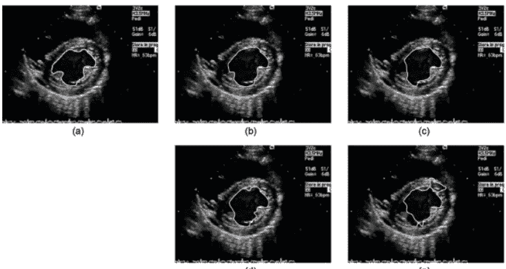

图 1.1 不同心脏视图的边界检测图像，经 Springer Nature 许可 [20]。

自然语言处理和人工智能技术将能够参与心力衰竭（HF）的早期检测和诊断，以及结局预测和预后评估 [22]。

在一项旨在帮助临床医生早期诊断心力衰竭（HF）的拟议研究中，提出了一种基于支持向量机（SVM）的评分模型。根据该模型，样本被分为三组：健康组、易患 HF 组和 HF 组。该模型在分类中的总体准确率为 74.4% [23]。

Guidi 等人 [24] 的一项研究旨在帮助非领域专家在心力衰竭（HF）分析中做出决策。该系统基于三个功能部分：诊断（严重程度评估）、预后和随访。诊断功能中使用了四种人工智能技术：人工神经网络（ANN）、SVM、决策树以及带有遗传算法支持的模糊系统。Elfadil 等人 [25] 的一项研究调查了一种使用谱分析和神经网络识别 HF 患者的新技术。该研究使用了一个数据集，53 个样本中有 17 个为正常样本，其余为患者样本。HF 患者被分为四组，准确率为 83.65%。

Gharehchopogh 等人 [26] 提出了一种决策支持模型，以帮助研究中的医生。该模型基于人工神经网络（ANN），能够以 85% 的准确率检测 HF 的存在或不存在。该研究属于医学数据挖掘的范畴。

Candelieri 等人开发了一种决策树来确定患者稳定情况 [27]（准确率为 88%）。Pecchia 等人使用决策树技术，基于心率变异（HRV）测量值将患者分为三个严重程度组（HF：健康 = 96% 准确率；重度–中度 = 79.3% 准确率）[28]。

### 1.6 机器学习辅助诊断

有创和无创方法提供了丰富的诊断信息。然而，对可用信息的解释只有在医生的帮助下才能进行。心脏病患者数量的增加与患者数据的同步增长，使得评估数据并从中提取信息变得日益困难。心脏病症状与其他疾病症状的交叉也使得疾病诊断成为一个难题。因此，需要借助智能分析工具，利用有创和无创技术获得的数据进行评估，以提高诊断准确率。人工智能和机器学习将协助医生进行智能分析。使用过去患者数据训练的机器学习模型可用于诊断未来病例。随着机器获得诊断能力，有时它们能够比医生更精确、更敏感地进行诊断。支持在专家系统逻辑下工作并结合机器学习模型的决策支持系统，将使它们能够给出更好的结果。

#### 1.6.1 机器学习简介

借助机器学习模型可以进行疾病预测和诊断。疾病诊断应用已得到广泛开发和使用，尤其是在受控机器学习技术方面。这项技术使得能够从历史数据中创建模型，这些模型有时被用于诊断和治疗。开发基于机器学习的系统不仅仅是开发机器学习算法，而是以类似于数据挖掘的方式，从头到尾逐步处理数据。例如，确定解决问题中哪些变量重要、哪些不重要，直接影响解决方案的质量。这一过程称为特征选择，它决定了将在要安装的系统中使用哪些参数。特征选择过程通常通过建立目标数据与预测数据之间的正确关系来实现。

特征选择阶段之后是特征转换。数据转换是一种改善数据质量的方法，最近已发展为特征工程，其中包括为提高预测成功率而进行的特征研究。与特征选择一样，特征工程也会影响结果的成功率。特征选择和特征工程还解决了数据中的高维性问题。数据丢失以及应对丢失的方法也很重要。对抗丢失值的工作有时通过估计丢失值来进行，有时则通过用其他值替换来进行。

在创建机器学习系统时，选择要使用的学习模型也很重要。机器学习包括四种基本学习方法：监督学习、无监督学习、半监督学习和强化学习。强化学习是一种基于代理的学习技术，决策根据奖励机制作出，用于揭示我们此前完全没有相关知识的主题的最可能解决方案。

最突出的技术——监督学习和无监督学习——将在以下段落中解释。

#### 1.6.2 机器学习算法

至今已开发出许多机器学习算法。要理解算法，需要理解监督学习和无监督学习这两种学习方法（见图 1.2）。

监督学习算法常用于机器学习，执行两项基本任务：分类和回归。分类操作的输出是标称值，而回归操作的输出通常是连续值。尽管监督学习算法常用于疾病诊断，但正如我们所看到的，机器学习领域更广泛，包含我们提到的其他方法，这些方法用于监督学习不足的任务。

##### 1.6.2.1 监督学习

监督学习由两个基本步骤组成：使用标记数据创建模型，以及使用未标记数据进行测试，这是监督学习算法类别中的两种突出技术。分类是监督学习算法类别中的两种突出技术之一，是一种目标变量为类别类型的监督学习技术，而回归是另一种突出技术，其目标变量为数值类型。操作基于一种模型进行，其中根据预测变量计算的目标变量进行估计。分类的目的是将首次看到的记录分配到预定义类别之一。类别的识别和建模借助训练数据进行。训练数据与机器学习算法结合形成机器学习模型。机器学习模型还将记录匹配到最适合它们的类别。区分监督学习与无监督学习的最重要特征是监督数据中的标签信息。正是数据中的类别标签提供了控制。尽管两种方法的输出不同，但目标都是根据输入变量估计输出变量的值。

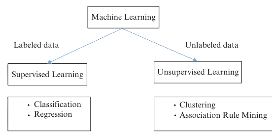

图 1.2 监督和无监督机器学习。

###### 1.6.2.1.1 决策树

与分类任务相关的突出算法之一是决策树。采用树形数据结构呈现的模型直接从数据中学习。通过树归纳过程，训练数据的特征在树上进行处理。我们常用且常见的决策树算法是 C4.5 算法 [29]。由于 C4.5 算法适用于处理数值和类别型输入变量，因此可以用于许多数据集。

###### 1.6.2.1.2 朴素贝叶斯

朴素贝叶斯分类器是一种基于概率的分类器。它是一种算法，试图借助从训练数据中学习的先验概率 P(A | Cj) 来找到测试数据的最终概率 P(Cj | A)。该算法基于贝叶斯定理 [30]。根据贝叶斯定理，事件之间相互关联，概率 P(A | C) 与 P(C | A)、P(A)、P(C) 之间存在关系。因此，在借助贝叶斯计算 P(A | C) 的值时，我们使用公式 P(C | A) = (P(A | C) P(C)) / (P(A))。朴素贝叶斯方法用于解决贝叶斯方法的零概率问题。得益于朴素方法，假设事件之间没有关系，从而缩短了过程。因此，有可能相对容易地消除数据中的稀疏性。

###### 1.6.2.1.3 支持向量机

SVMs 最初由 Vapnik [31] 提出。该技术使用所谓的支持向量来区分属于不同类别的数据点。该方法旨在找到能够最好地区分不同类别（边缘最大化）的超平面。在最简单的形式中，它借助两个方程 wTx + b = +1 和 wTx + b = -1 将两类空间相互区分开来。SVMs 最初是根据线性分类开发的，后来又开发了用于非线性空间的核函数。核函数表达了线性空间和非线性空间之间的变换。有线性、多项式、径向基函数和 sigmoid 等类型。取决于所用数据的性质，核函数之间可能相互优劣。

###### 1.6.2.1.4 K-近邻

k-近邻（k-NN）算法是一种基于距离的分类器，它通过查看数据点的邻居来对类未知的数据对象进行分类。分类决策通过多数表决作出。该算法的两个突出参数是 k（邻居）数量和距离函数。确定邻居数量没有确切的方法，因此理想的 k 值通常在试验后找到。余弦相似度、曼哈顿距离、欧氏距离或切比雪夫距离用作距离函数。k-NN 算法的问题之一是规模


问题。当基于在几何空间操作的方法导致尺度问题时，该问题通过特征工程得到解决。

###### 1.6.2.1.5 神经网络

ANN（人工神经网络）是一种模拟人类学习的机器学习方法。ANN 常用于分类问题，也用于聚类和优化过程。尽管最简单的神经网络模型是感知机，但多层感知机常用于分类问题。深度学习方法在最近许多重要任务中得到应用，其基于 ANN。ANN 的适应性和并行处理能力使其成为许多问题的强大选择。

##### 1.6.2.2 无监督学习

无监督学习处理未标记的数据，其目的是根据数据的特征创建集群。与有监督学习不同，无监督学习使用未标记的数据而非标记数据。数据根据相似性或距离被分组后，在专家的帮助下进行标记。无监督学习中突出的两个应用是聚类和关联规则挖掘。聚类是将数据点分配到称为簇的组中的过程。它有两种类型：划分方法和层次方法。在划分聚类中，一个数据点只能属于一个簇。在层次聚类中，一个点可以层次地位于多个簇中。在关联规则挖掘中，用于基于事件之间关系发现规则的关联规则被用于挖掘属性之间的关系。

###### 1.6.2.2.1 K-Means

K-均值分割聚类算法最早由 MacQueen [32] 于 1967 年开发。该算法的目的是将数据划分为 K 个簇。每个簇以一个称为质心的重心表示。K 值由用户确定。采用迭代方法将数据划分为簇。距离函数用于确定每个数据点将被分配到哪个点。

###### 1.6.2.2.2 Apriori 算法

Apriori 算法是关联规则挖掘中的突出算法。它在事务数据库中查找常见模式并执行规则生成 [33]。借助获得的规则，在一个事件发生后可以预测另一个事件的发生。它是一种经常被首选的算法，尤其是因为它有助于建立事件之间的关系。

### 1.6.3 机器学习支持的心力衰竭研究

机器学习是人工智能最常见的应用，通过不断提高从数据中学习的能力以及对心血管疾病的预测和诊断，揭示数据中的模式 [34]。当将基于机器学习的心力衰竭诊断系统视为输入、处理和输出模块时，各模块可表示如下。输入模块包含决策支持系统将使用的数据，例如体格检查数据、实验室结果、临床数据、心电图监测数据和心电图数据。处理模块是包含机器学习算法的模块，这些算法主要是有监督和无监督学习算法。在诊断心力衰竭时，当前使用的机器学习算法包括最近邻、自组织映射、多层感知机、分类和回归树、随机森林、支持向量机、神经网络、逻辑回归、决策树、聚类以及模糊-遗传和神经-模糊专家系统。在输出模块中，试图确定的信息包括心力衰竭的存在、心力衰竭事件风险、左心室退化评估、对高级治疗的反应以及死亡风险。

在审视关于机器学习方法（表 1.2）的文献时，机器学习方法是诊断心力衰竭的重要选项之一，可以看出 HRV 的使用在许多研究中凸显出来。在其中一个病例研究中，Yang 等人 [35] 使用评分方法诊断心力衰竭。在该研究中，借助两个 SVM 模型，首先检查该人是否患有心力衰竭。如果结果正常，第二个 SVM 模型开始发挥作用，将被检查者分类为健康或易患心力衰竭。得分与 SVM 模型输出相匹配，并根据得分范围得到诊断输出。

Son 等人 [36] 的研究旨在区分充血性心力衰竭和气短问题。该研究最初使用 72 个特征进行；使用粗集和逻辑回归技术来减少变量数量。根据借助粗集选择的特征获得的分类准确率为 97.5%，而根据逻辑回归选择的特征获得的分类准确率测量为 88.7%。

Masetic 等人 [37] 将随机森林算法应用于心电图时间序列以检测充血性心力衰竭。心电图上的特征使用自回归 Burg 方法提取。在该研究中，除了随机森林算法外，还使用了 C4.5、SVM、ANN 和 k-NN 分类器，其中随机森林算法表现最佳。

Wu 等人 [38] 研究了在临床诊断之前检测心力衰竭。使用电子健康记录、健康行为、人口统计数据、临床诊断和临床预防措施等信息来提前检测疾病。SVM、提升方法和逻辑回归用于疾病的早期检测。此外，还观察到了特征选择对成功的贡献。

Aljaaf 等人 [39] 提出了一种开发心力衰竭的多级风险评估。借助 C4.5 分类器，根据五种不同的风险水平（1：无风险；2：低风险；3：中度风险；4：高风险；5：极高风险）进行了估计。该研究使用了克利夫兰心脏病数据集。采用 10 折交叉验证程序来评估 C4.5 分类器。

Zheng 等人 [40] 提出了一种用于诊断心力衰竭的计算机辅助诊断系统。该系统使用最小二乘支持向量机（LS-SVM）。LS-SVM 分类器的效果优于神经网络和隐马尔可夫模型。

Pattekari 等人 [41] 设计了一个基于朴素贝叶斯的智能系统，并为心力衰竭预测开发了一个决策支持系统。通过基于 Web 的应用程序，用户被要求回答预定义的问题，并通过将其答案与数据库进行比较来执行估计过程。

表 1.2 关于心力衰竭中人工智能和机器学习技术的文献摘要。

| 作者 | 方法 | 研究 |
| :--- | :--- | :--- |
| Guidii 等人 [24] | ANN, SVM, 决策树, 模糊遗传算法 | 心力衰竭临床决策支持系统 |
| Elfadil 等人 [25] | 神经网络和谱分析 | 心力衰竭患者分组 |
| Gharehchopoghi 等人 [26] | ANN | 心力衰竭决策支持系统 |
| Candelieri 等人 [27] | 决策树 | 确定患者稳定 |
| Pecchia 等人 [28] | 决策树 | 对患者进行分类 |
| Yang 等人 [35] | SVM 模型 | 心脏病发作预测 |
| Son 等人 [36] | 逻辑回归模型 | 区分充血性心力衰竭和气短问题 |
| Masetic 等人 [37] | 随机森林, C4.5, SVM, ANN, k-NN | 检测充血性心力衰竭 |
| Wu 等人 [38] | SVM, 提升方法, 逻辑回归 | 检测心力衰竭 |
| Aljaaf 等人 [39] | C4.5 | 心力衰竭风险评估 |
| Zheng 等人 [40] | LS-SVM | 心力衰竭诊断 |
| Pattekari 等人 [41] | 朴素贝叶斯 | 心力衰竭预测 |
| Takci [42] | 12 种分类算法 | 心脏病发作检测 |

Takci [42] 介绍了一种心脏病发作诊断框架。在他的研究中，通过 12 种不同的算法和四种不同的特征选择方法寻找最成功的分类器组合，最成功的分类器是使用线性内核的 SVM，最成功的特征选择方法是 ReliefF 算法。所得的分类准确率报告为 84.81%。

非侵入式技术（如心电图）或侵入式技术（如血液检测），这些用于诊断心力衰竭的技术也会测量数值中的不规则性。失衡和异常是通过人工智能技术测量的，例如使用现有诊断技术进行的过程。以前使用的常规诊断技术通过人工智能的支持提高容量来工作。例如，借助人工智能支持的心电图，将有可能提高诊断的准确性。

### 1.7 结论与未来方向

心脏是人类的重要器官。当它不能健康地履行职责时，会影响生活质量，甚至可能导致死亡。心脏无法完全履行其功能（尤其是由于心脏病发作引起）被称为“心力衰竭”。心力衰竭有几种类型和许多原因。高血压、异常心脏瓣膜和心脏肌肉损伤只是这些原因中的一些。


由于心力衰竭（HF）的重要性，其诊断同样至关重要。通过及时诊断，心脏病患者更有可能提高生活质量并延长寿命。侵入性和非侵入性检查经典地用于诊断该疾病。由于疾病病因繁多、患者数量增加以及患者数据不断积累，人工智能和机器学习技术也已被用于探索性目的。专家系统、图像处理、机器学习、深度学习及其他人工智能的重要研究领域，近来已在此领域广泛应用。基于人工智能的方法既能获取此前无法获得的数据，又能对先前获取的数据进行更智能的分析。借助机器学习对经验进行建模，并在诊断新患者时应用模型，这已带来了显著的发展。

人工智能（尤其是机器学习技术）对此领域最有价值的贡献，在于其在临床决策支持系统中的作用。此前基于知识开发的决策支持系统，如今在机器学习的推动下已转向基于数据的工作方式。使用疾病数据和先前给定的类别信息训练的机器学习模型，已能够实现自动诊断。随着机器学习系统达到一定阶段，临床决策支持系统也在深度学习算法的推动下达到了更高水平。日益增加的数据、复杂的算法结构以及此前无法观察到的数据关系，正在推动该领域的发展。

借助面向数据且集成的临床支持系统，整体医学方法将变得可行，心脏疾病与其他疾病乃至行为模式之间的关系也将得以揭示。诊断将变得更快、更准确，这得益于5G带来的更强大数据高速公路、云系统更广泛的数据存储能力、分布式处理架构提供的更多算力，以及深度学习带来的更复杂、更强大的算法。

### 参考文献

- 1 梅奥诊所。心力衰竭。https://www.mayoclinic.org/diseases-conditions/heart-failure/symptoms-causes/syc-20373142，访问日期：2021年5月1日。
- 2 MedicalPark，什么是心力衰竭？症状有哪些？https://www.medicalpark.com.tr/kalp-yetmezligi/hg-2209。访问日期：2021年4月23日。
- 3 Cousins, S., Blencowe, N.S., 和 Blazeby, J.M.（2019）。什么是侵入性操作？一项用于指导研究设计、证据综合和研究追踪的定义。BMJ Open 9（7）：e028576。https://doi.org/10.1136/bmjopen-2018-028576。
- 4 侵入性检查和操作。心脏病发作和中风症状。https://www.heart.org/en/health-topics/heart-attack/diagnosing-a-heart-attack/invasive-tests-and-procedures。访问日期：2020年4月23日。
- 5 Hannun, A.Y., Rajpurkar, P., Haghpanahi, M., 等人（2019）。使用深度神经网络在动态心电图中实现心脏病专家水平的心律失常检测和分类。Nature Medicine 25（1）：65。
- 6 Shamsham, Fadi 医学博士和 Mitchell, Judith 医学博士（2000）。HF诊断要点。AFP期刊。2000年3月1日。https://www.aafp.org/afp/2000/0301/p1319.html。
- 7 Ponikowski, P., Voors, A.A., Anker, S.D., 等人（2016）。急性和慢性心力衰竭的诊断与治疗ESC指南：欧洲心脏病学会（ESC）急性和慢性心力衰竭诊断与治疗工作组。在ESC心力衰竭协会（HFA）的特别贡献下制定。European Journal of Heart Failure 18（8）（2016）：891–975。
- 8 Attia, Z.I., Kapa, S., Lopez-Jimenez, F., 等人（2019）。使用人工智能支持的心电图筛查心脏收缩功能障碍。Nature Medicine 25（1）（2019）：70。
- 9 非侵入性检查和操作。心脏病发作和中风症状。https://www.heart.org/en/health-topics/heart-attack/diagnosing-a-heart-attack/noninvasive-tests-and-procedures。访问日期：2021年5月20日。
- 10 Haider, D., Yang, X., 和 Abbasi, Q.H.（2019）。利用5G C频段技术进行术后跌倒检测以支持eHealth范式。Applied Soft Computing 81：105537。
- 11 Sahoo, S.P. 和 Ari, S.（2019）。关于人体动作识别算法。Expert Systems With Applications 115：524–534。
- 12 Li, C., Hu, X., 和 Zhang, L.（2017）。基于物联网的心脏病监测系统用于普惠医疗服务。Procedia Computer Science 112：2328–2334。（2017）。
- 13 Yahaya, S.W., Lotfi, A., 和 Mahmud, M.A.（2019）。日常生活活动中异常检测的共识新颖性检测集成方法。Applied Soft Computing 83：105613。
- 14 Tripoli, E.E., 等人（2017）。心力衰竭：通过机器学习技术进行诊断、严重程度估计和不良事件预测。Computational and Structural Biotechnology Journal 15：26–47。
- 15 Ledley, R.S. 和 Lusted, L.B.（1959）。医学诊断的推理基础：符号逻辑、概率和价值理论有助于我们理解医生的推理方式。Science 130：9–21。
- 16 Shortliffe, E.H. 和 Sepulveda, M.J.（2018）。人工智能时代的临床决策支持。JAMA 320：2199–2200。
- 17 Jackson, P.（1998）。专家系统导论（第3版）。Addison Wesley。
- 18 IBM Cloud Education。机器学习... https://www.ibm.com/cloud/learn/machine-learning。访问日期：2020年7月15日。
- 19 Yang, J., Wang, Y., Liu, Y., Tang, S., 和 Chen, W.（2009）。从两个未校准的血管造影图像重建冠状动脉3D模型的新方法。IEEE Transactions on Image Processing 18（7）：1563–1572。
- 20 SainiSai, S. K., Dewal, M., 和 Rohit, M.（2011）。一种用于超声心动图图像边界检测的快速区域主动轮廓模型。Journal of Digital Imaging：放射学计算机应用学会官方期刊 25：271–278。doi:10.1007/s10278-011-9408-8。
- 21 Krittanawong, C., Zhang, H., Wang, Z., Aydar, M., 和 Kitai, T.（2017）。精准心血管医学中的人工智能。Journal of the American College of Cardiology 69（2017）：2657–2664。
- 22 Murdoch, T.B. 和 Detsky, A.S.（2013）。大数据在医疗保健中不可避免的应用。Journal of the American Medical Association 309（13）：1351–1352。2013。
- 23 Yang, G., Ren, Y., Pan, Q., 和 Ning, G.（2010）。一种基于支持向量机的HF诊断模型。IEEE生物医学工程与信息学国际会议 第3卷：1105–1108。
- 24 Guidi, G., Iadanza, E., Pettenati, M.C., Milli, M., Pavone, F., 和 Biffi Gentili, G.（2012）。基于人工智能的心力衰竭计算机辅助诊断远程护理系统。载于：慢性病预防和管理解决方案影响分析，7251（M. Donnelly, C. Paggetti, C. Nugent, 和 M. Mokhtari 编），ICOST 2012。计算机科学讲义。柏林，海德尔堡：Springer。https://doi.org/10.1007/978-3-642-30779-9_44。
- 25 Elfadil, N. 和 Ibrahim, I.（2011）。用于识别充血性HF患者的自组织神经网络方法。International Conference on Multimedia Computing and Systems (ICMCS) 1–6。
- 26 Gharehchopogh, F.S., Mohammadi, P., 和 Hakimi, P.（2012）。决策树算法在医疗保健运营数据挖掘中的应用：一项案例研究。International Journal of Computer Applications (IJCA) 52（6）：21–26。2012年8月。
- 27 Candelieri, A. 和 Conforti, D.（2010）。SVM分类的超解框架：用于预测慢性HF患者不稳定性的应用。The Open Medical Informatics Journal 4：136–140。
- 28 Pecchia, L., Melillo, P., 和 Bracale, M.（2011）。基于HRV特征的CART方法数据挖掘HF远程健康监测。IEEE Transactions on Bio-Medical Engineering 58：800–804。
- 29 Quinlan, J.R.（1993）。C4.5：机器学习程序。圣马特奥，CA：Morgan Kaufmann。
- 30 Joyce, J.（2003）。贝叶斯定理。载于：斯坦福哲学百科全书（2019年春季版）（E.N. Zalta 编）。斯坦福大学形而上学研究实验室。2020年1月17日检索。
- 31 Vapnik, V.N.（1995）。统计学习理论的本质。纽约，纽约，美国：Springer-Verlag。
- 32 MacQueen, J.B.（1967）。多变量观测分类和分析的某些方法。载于：第5届伯克利数理统计与概率研讨会论文集，1，281–297。加州大学出版社。
- 33 Agrawal, R. 和 Srikant, R.（1994）。挖掘关联规则的快速算法。载于：第20届超大型数据库国际会议论文集，487–499。圣地亚哥，智利：VLDB。1994年9月。
- 34 Johnson, K.W., Soto, J.T., Glicksberg, B.S., Shameer, K., Miotto, R., Ali, M., Ashley, E., 和 Dudley, T.D.（2018）。心脏病学中的人工智能。Journal of the American College of Cardiology 71：2668–2679。
- 35 Yang, G., Ren, Y., Pan, Q., Ning, G., Gong, S., Cai, G., 等人（2010）。一种基于支持向量机的心力衰竭诊断模型。2010年第3届生物医学工程与信息学国际会议（BMEI）3（2010）：1105–1108。http://dx.doi.org/10.1109/BMEI.16828.2010。
- 36 Son, C.-S., Kim, Y.-N., Kim, H.-S., Park, H.-S., 和 Kim, M.-S.（2012）。使用粗集和决策树方法对充血性HF进行早期诊断的决策模型。Journal of Biomedical Informatics 45（2012）：999–1008。http://dx.doi.org/10.1016/j.jbi.2012.04.013。


- 37 Masetic, Z. and Subasi, A. (2016). 使用随机森林分类器检测充血性心力衰竭。*计算机方法与生物医学方案* 130 (2016): 54–64. https://doi.org/10.1016/j.cmpb.2016.03.020.

- 38 Wu, J., Roy, J., and Stewart, W.F. (2010). 使用 EHR 数据进行预测建模：挑战、策略及机器学习方法的比较。*医疗护理* 48 (2010): S106–113. http://dx.doi.org/10.1097/MLR.0b013e3181d9e917.

- 39 Aljaaf, A.J., Al-Jumeily, D., Hussain, A.J., Dawson, T., Fergus, P., and Al-Jumaily, M. (2015). 使用决策树进行多层风险评估以预测 HF 的可能性。在：第三届电气技术进步国际会议。贝鲁特，黎巴嫩。2015.

- 40 Zheng, Y., Guo, X., Qin, J., and Xiao, S. (2015). 通过分析心脏储备和心音特征进行慢性 HF 的计算机辅助诊断。*计算机方法与生物医学方案* 122 (2015): 372–383. http://dx.doi.org/10.1016/j.cmpb.2015.09.001.

- 41 Pattekari, S.A. and Asma, P. (2012). 使用朴素贝叶斯的心脏病预测系统。*先进计算机与数学科学国际期刊* 3 (3): 290–294.

- 42 Takci, H. (2018). 通过特征选择方法改进心脏病发作预测。*土耳其电气工程与计算机科学期刊* 26: 1–10. https://doi.org/10.3906/elk-1611-235.

## 用于预测心脏病的常规临床方法

Aisha A-Mohammadi, Jayakanth Kunhoth, Al Anood Najeeb, Somaya Al-Maadeed、Kishor Kumar Sadasivuni

### 2.1 引言

心脏是人体最重要的器官，位于胸腔中央、两肺之间，主要负责向心血管系统的血管泵送血液。血液通过动脉网络泵送，将富含氧的血液和其他营养物质输送到身体的不同细胞。两大静脉（上腔静脉和下腔静脉）通过肺动脉将二氧化碳及其他代谢废物输送到肺部进行净化。不健康的生活习惯可能导致高血压和高胆固醇，从而影响心脏的正常功能，进而引发严重的心脏疾病。可能影响心脏健康的不健康生活习惯包括久坐的生活方式、吸烟、超重或肥胖、不良饮食习惯以及过量饮酒。吸烟会加快心率、收缩动脉并导致心律不齐。此外，吸烟还可能导致动脉粥样硬化，即脂肪和胆固醇在动脉中沉积。脂肪和胆固醇的沉积称为斑块。这种斑块会使动脉变窄并阻碍血流。久坐的生活方式和不良饮食习惯可能导致超重或肥胖以及坏胆固醇和甘油三酯水平升高，进而导致高血压以及动脉中斑块的形成。过量饮酒会升高血压并削弱心肌。高血压和心肌无力可能导致中风或心力衰竭。除了不健康的习惯外，先天性疾病也可能影响心脏的正常运作，甚至导致死亡。诸如冠状动脉疾病、心律失常、心绞痛和心肌病等心脏疾病，常常会导致心脏骤停并最终引发死亡。保持均衡饮食、规律用药以及在早期阶段尽早诊断症状，可以大大降低患心脏病的几率。

心脏疾病的常见症状包括胸痛、胸闷、呼吸困难、心悸、晕厥以及晕倒。呼吸困难是指患者出现气短、窒息以及胸闷感的情况；心悸是指心跳不规则且过快的情况，也可能导致气短。经常出现这些症状的个人应尽快联系医生。心脏疾病患者可能出现的其他身体症状包括面部和指甲颜色的意外变化，以及眼球运动异常。此外，冠心病患者在进行重体力劳动或剧烈运动时，会出现称为心绞痛的胸痛。心脏瓣膜病、心肌病和心力衰竭可导致腿部、脚踝或脚部肿胀。在急性病例中，这些病症还可能导致器官肿胀。疲劳也是心脏瓣膜病和心力衰竭患者的常见症状。患有心脏感染的患者会出现高烧和疲劳。尽管这些症状是心脏病的警告信号，但除了心脏病以外的其他轻微健康状况也可能在人体中引起类似症状。因此，临床检查极其必要，以便将心脏疾病与虚惊一场区分开来。谨慎而全面的检查对于分析健康状况、评估症状原因及其强度至关重要。由持证医生或心脏病专家在诊所进行的详细检查可以确定心脏病是否是潜在症状的原因。如果是，他们可以将患者转诊进行进一步的高级检查，以评估个人患心脏病的风险并提供即时药物治疗。

医生或心脏病专家最初会了解患者的家族病史、既往病史和生活方式，同时检查患者正在经历的症状。进一步检查包括观察发绀（通常见于指甲的青紫色变色），并仔细观察面部以查找意外的颜色变化和眼球运动。随后，检查范围扩展至测量血压和进行血液检查，以及心电图、超声心动图、胸部X射线摄影等先进程序。

本章简要介绍了心脏病专家传统上用于检测心脏疾病的各种临床检查方法。它还解释了与心脏疾病相关的各种症状和生理因素及其临床意义。此外，本章还讨论了文献中那些将人工智能和机器学习方法与临床观察到的生理数值相结合，以改善心脏疾病检测的研究。

### 2.2 体格评估

与过去几年一样，专家和医生依赖许多物理技术作为心脏疾病早期诊断的途径。用于诊断心脏疾病的体格评估包括视诊、触诊、听诊、心电图、跑步机试验和心脏生物标志物检查。每种检查类型的选择均基于前一种检查观察到的结果。通常，首先进行视诊技术，并根据其结果，持证医生或心脏病专家进一步进行其他类型的检查。

#### 2.2.1 视诊检查

该技术关注人类患者的外观，考虑皮肤颜色、整体健康状况、面部表情和患者的营养状态。例如，出汗、面色苍白或发绀可能是急性重症患者可能发生心脏病发作的早期迹象。发绀是一种医学状况，表现为嘴唇、耳朵、鼻子、手指甲以及脚趾甲出现青紫色变色。这种状况通常由于低氧血症而被称为“青手或青脚”。低氧血症是指血液中的氧气水平低于正常水平的情况。当各种与心脏相关的病症阻止血液从组织流向心脏及回流时，血液中还原血红蛋白含量过多会导致青紫色。血液中还原血红蛋白含量过多可能由多种与心脏相关的疾病引起，包括心力衰竭、心肌梗死、先天性心脏病、心脏瓣膜病等。此外，颧潮、角膜老年环、黄色瘤和眼球突出是心脏病患者面部的表现。颧潮是一种面部表现，面颊会变成李子红色。颧潮症状与一种称为二尖瓣狭窄的心脏瓣膜病密切相关。二尖瓣狭窄是指在舒张期，二尖瓣面积小于 2 cm²（正常面积约为 5 cm²）的情况。面积减小会导致二氧化碳潴留，并引起面颊中小动脉的血管扩张（血管变宽）。在黄色瘤状况下，眼睛、手掌或肌腱会出现脂质的黄色沉积。过多的黄色沉积是由于血液脂质和脂肪水平过高引起的。肌腱黄色瘤是血液中高水平低密度脂蛋白（LDL）胆固醇以及动脉粥样硬化的迹象。眼球突出是指眼球运动的变化，尤其是眼球突出。在非急性患者中，一个重要的体征是恶病质，因为它是心力衰竭预后的明确迹象 [1]。恶病质是一种消耗性疾病，患者会出现严重的体重减轻和肌肉流失。

#### 2.2.2 触诊检查

触诊检查涉及对患者颈静脉、动脉搏动、心前区搏动等进行脉搏追踪。这包括使用手指或手对患者进行检查。可以通过评估患者颈部的颈内静脉来检测颈静脉。而动脉脉搏检查涉及评估位于手部或腿部的动脉，手部动脉的评估可以通过检查心率快慢来测量。具体做法是将手指放在患者腕部动脉上，比较搏动的时间及其一致性。医生可以用另一只手触诊患者的另一只手腕以确认测量结果。心率通过数桡动脉搏动 30 秒，然后乘以 2 来确定。这种方法可以给出准确的结果，除非心律不齐。

#### 2.2.3 听诊检查

听诊是指通过听诊器仔细聆听心脏声音或杂音。听诊器工具由两部分组成：钟头和膜片。每个部分都有其特定功能：钟头专注于低音调声音，并检测主动脉瓣狭窄或颈动脉血管杂音；膜片专注于高音调声音，可检测瓣膜关闭或收缩期弹音。在听诊检查过程中，


医生让病人采取四种不同的体位（如图 2.1 所示）：仰卧位、直立位、左侧卧位和直立前倾位 [2]。医生应寻找不规则的杂音或心音，并确定其部位、持续时间、强度和音调。这一切都有助于诊断心脏疾病。虽然不规则的杂音或心音并不总与基础心脏疾病相关，但它们在某些情况下可能是心脏疾病的早期预警。

#### 2.2.4 心电图（ECG）

该心电图通过一种称为心电图描记法的方法生成，即在病人的心脏、腿部和手臂上放置若干电极，监测脉搏约 10 分钟。该技术测量每次心跳的电活动，从而生成显示心脏功能的心电图。心电图描记技术生成的心电图是一张描绘心脏电活动电压随时间变化特征的图表。在每个心脏周期中，这些电极会检测到由于心肌去极化和复极化而产生的微小电变化。几种心脏异常，如心律失常（例如心房颤动和心室颤动）、冠状动脉血流不足（例如心肌缺血和心肌梗死）以及电解质紊乱（例如低钾血症和高钾血症）会导致通常心电图模式发生变化。心电图检测的示意图如图 2.2 所示。只有当病人有任何风险因素（如高血压）或身体不适（如心绞痛或心悸，包括心律不齐或心率过快）时，才需要进行心电图检查。有既往心脏病史的病人必须进行心电图检查。此外，有心脏病家族史的健康个体，如果即将开始任何高强度锻炼计划或重体力劳动计划，建议进行心电图检查。

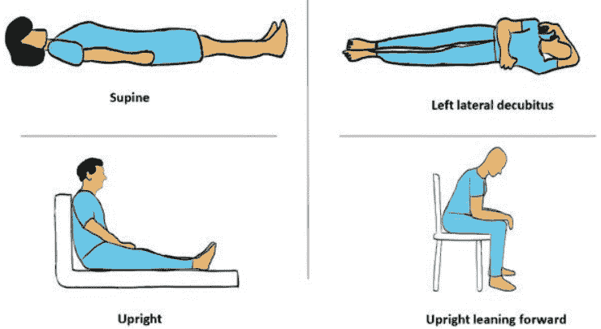

图 2.1 仰卧位、左侧卧位、直立位和直立前倾位。

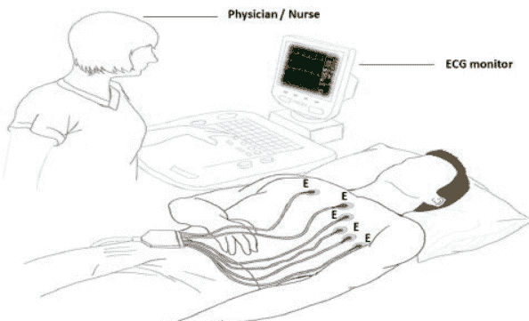

图 2.2 心电图。E 表示用于检测由心肌去极化引起的微小电变化而放置的电极。心电图监视器显示了心脏电活动的电压随时间变化的图表。有医生/护士被指派监督心电图检查。

图 2.3 给出了单个心电图模式的主要波形以及正常心率下心电图信号的正常值。通过与表中显示的间隔进行核对来检测心律失常。

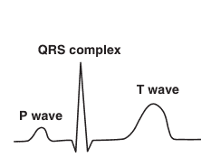

| 振幅 | P 波 | 0.25 毫伏 |
|---|---|---|
| | R 波 | 1.60 毫伏 |
| | Q 波 | R 波的 25% |
| | T 波 | 0.1 至 0.5 毫伏 |
| 持续时间 | P-R 间期 | 120-200 毫秒 |
| | Q-R 间期 | 350-440 毫秒 |
| | P 波间期 | 110 毫秒 |
| | QRS 间期 | 90 毫秒 |

单个心电图信号的主要波形

心电图信号的正常值

图 2.3 单个心电图信号的主要波形及心电图信号的正常值。

#### 2.2.5 跑步机测试

跑步机测试是通过让病人在跑步机上快步行走来进行的，这使他们的心脏快速泵血。跑步机测试旨在评估病人心脏处理工作和运动能力的情况。在测试过程中，会监测病人的心律、呼吸和血压，以检测异常。该测试通常在检测到冠状动脉心脏病的迹象或症状后进行。它可以帮助医生了解心脏疾病的严重程度。一般来说，跑步机测试是安全的，没有任何风险。然而，患有低血压的病人可能会因运动影响而感到头晕或昏厥。

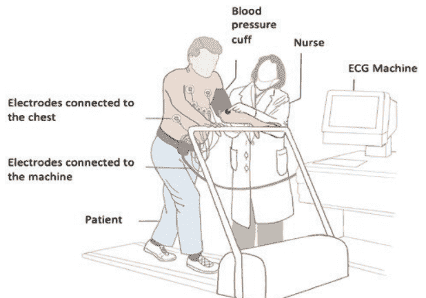

图 2.4 跑步机评估。

图 2.4 显示一名病人在护士监督下在跑步机上跑步；他们的血压正在被监测，心率也通过放置在胸部的心电图电极进行监测。

对于一直经历心绞痛或其他心脏病症状的个体，需要进行跑步机测试。具体来说，对于有心肌缺血、急性胸痛、瓣膜性心脏病等症状的病人，更倾向于进行跑步机测试。此外，对于有心律失常的病人，更倾向于进行跑步机测试以评估心率适应能力。

心率适应能力是指心脏在身体需要或活动增加时提高其心率的能力。该测试的目的是确定在运动或剧烈活动等应激条件下，患者的心脏是否获得足够的氧气以及适当的血流。

目标心率根据公式计算：目标心率 = 0.85 × (220 - 年龄)。如果病人感到胸痛或严重心律失常，则测试结果被视为阳性。此外，还会分析跑步机测试期间记录的心电图以评估病人的状况。如果 ST 段变化大于或等于 1 mm，则测试被视为阳性。此外，T 波变化和 QT 间期延长表明心脏存在异常。这些异常通常在静息心电图中不会发现。

#### 2.2.6 心脏生物标志物检查

心脏生物标志物是心脏出现任何不适或缺陷（如应激或损伤）时释放到血液中的酶。血液中心脏酶的含量可用于检测心脏疾病，尤其是急性冠状动脉综合征（ACS）和心肌缺血。该检查通过采集病人血液样本并进行分析，以测量其血液中心脏生物标志物的水平。它可以检测心脏的低氧摄入状况或损伤。肌红蛋白、肌钙蛋白和肌酸激酶是三种心脏生物标志物或酶。其中，最常用的心脏生物标志物是肌钙蛋白，因为其灵敏度最高 [3]。通常，血液中心脏标志物的含量以纳克/毫升（ng/ml）为单位进行测量。血液中肌钙蛋白的正常范围为 0 至 0.4 ng/ml。高灵敏度肌钙蛋白检测可以检测到非常低水平的肌钙蛋白。在心脏生物标志物检查（高灵敏度肌钙蛋白检测）中，肌钙蛋白的正常范围值为 14 ng/l。高于 14 ng/l 的任何值都被视为异常。

#### 2.2.7 胸部 X 线摄影

尽管临床医生可使用的现代诊断影像技术数量不断增加，胸部 X 线摄影仍然是一种简单、低成本且富有洞察力的检查。X 线片（也称为 X 射线图像）是通过将 X 射线穿过人体并在特殊感光胶片上形成阴影图像来拍摄的内部结构照片。X 线摄影以发明者、德国物理学家威廉·康拉德·伦琴（Wilhelm Conrad Röntgen）于 1895 年发明该技术而命名。胸部 X 线是预测无慢性阻塞性肺疾病患者肺血流动力学事件的可靠方法，并能对肺静脉和动脉压力进行公平估计。不幸的是，患有慢性阻塞性肺疾病的患者的肺血管分布可能会发生显著改变。这使得 X 线摄影评估变得复杂。

### 2.3 临床检查中考虑的生理值和特征

除了分析面部的症状和表现外，医生或心脏病专家还会检查多种生理值和特征，以检测心脏病的存在。本节简要描述了有助于医生或心脏病专家诊断心脏病的生理属性/特征和值。

#### 2.3.1 运动能力

运动能力，也称为心肺耐力，是指一个人在不感到不适的情况下能够承受的体力消耗总量。精确评估运动能力需要病人在足够长的时间内付出最大体力努力，以反映对循环系统的稳定影响。运动能力评估是评估病人状况的关键特征之一。运动能力降低与多种风险相关，包括高血压、心血管疾病、心力衰竭等。许多研究表明，运动能力降低与急性健康状况之间存在相关性 [4]。此外，运动期间心血管系统的反应可以识别心脏病以及死亡率 [5, 6]。


个体的运动能力可以通过面对面访谈，或根据诊所可用的设施采用实验室方法来评估。在与患者的面对面访谈中，心脏科医生会询问患者在各项日常活动（如步行、跑步或运动）中经历过的任何前所未有的事件。另一方面，实验室方法包括多种检测，例如运动负荷试验、心肺运动试验、6分钟步行试验、次最大跑步机试验等。

#### 2.3.2 胸痛或不适

胸痛或不适是成人中最常见的症状之一，其原因可能严重也可能轻微。它由多种原因引起，例如肌肉拉伤、消化性溃疡、胃食管反流病（GERD）、哮喘等。胸部产生的疼痛或不适可能是潜在真实心脏或心血管疾病的重要指征。应尽早进行适当护理和治疗，以确定胸痛的根本原因并防止其恶化。规律运动和健康饮食习惯可大大避免胸痛。

仅根据症状自行诊断胸痛相当困难。然而，疼痛频率及伴随症状在一定程度上有助于揭示可能的病因。由肌肉拉伤、GERD和哮喘等轻微健康问题引起的疼痛可能仅持续几秒钟，并影响胸部特定部位。此外，按摩胸部区域、服药或深呼吸后，疼痛通常会缓解。具体来说，与肌肉拉伤相关的胸痛在按摩后会好转，在剧烈突然吸气时会加重。胃食管反流可引起胸痛，这种疼痛可能在进餐或饮酒后不久出现。持续数分钟以上的突发剧烈疼痛可能是心脏病的指征。

#### 2.3.3 心悸

心悸通常指心律不齐且过快的心跳，可能由多种原因引起。它可能由某些无害状况引起，例如剧烈运动、睡眠不足、压力、焦虑、恐惧等，也可能是与心脏相关的某些疾病（如心律失常）的警示性指征，心律失常涉及心率和收缩模式的变化。它会产生心脏跳动漏掉、停止或多出一次搏动的感觉，使我们更加意识到自己的心跳。对于已被诊断患有心力衰竭或心脏瓣膜缺陷的人，心悸可能成为显著可诊断的特征。

#### 2.3.4 呼吸困难、端坐呼吸和阵发性夜间呼吸困难

呼吸困难是指患者出现气短或有时呼吸困难的状况。呼吸费力、胸闷、心悸和喘息通常是出现呼吸困难的征象。它可能在剧烈运动后或前往高海拔地区时发生。然而，它可能与肺炎、心力衰竭或低血压等严重健康状况直接相关。除非劳力性呼吸困难伴随可被视为在个体耐受范围内的活动，否则属于正常现象。

由于呼吸困难通常以患者报告的主观体验或感觉为特征，因此它与呼吸急促、过度通气和深呼吸（均指呼吸变化）有明显区别。后者情况与患者的主观感觉无关。呼吸急促是指呼吸频率增加，表现为快速浅呼吸或深呼吸，患者常未察觉。过度通气是指由于吸气和呼气不平衡而导致的增加且加快的呼吸。呼气增加会导致血液中二氧化碳水平降低，进而引起头晕、气短等症状。深呼吸也是一种深呼吸状态，但不一定更快。强制性呼吸会导致吸入增加的空气量，呼吸频率甚至可能保持在正常范围内。这表明身体需要更多氧气。这些医学状况并不总是与呼吸困难相关联。

仅在平卧特定姿势下出现的气短感觉称为端坐呼吸。它可能导致胸闷，使呼吸感到不适。然而，当患者直立或坐下时，症状会缓解。尽管如此，它仍可能是心脏或肺部疾病的症状。端坐呼吸伴随心率加快、喘息或恶心，是心力衰竭的指征。与端坐呼吸密切相关的一种状况是阵发性夜间呼吸困难。它是一种气短感觉，导致患者在入睡1或2小时后醒来。与端坐呼吸类似，这种状况通常在恢复直立位置后缓解。

除了上述呼吸困难情况外，还有两种罕见的气短类型：侧卧性呼吸困难和平卧性呼吸困难。侧卧性呼吸困难通常是指在任一侧卧位时出现的呼吸困难或气短。左侧卧位时的气短可归因于慢性心脏疾病。另一方面，右侧卧位时的气短可能是由于肺部疾病或主支气管疾病引起。平卧性呼吸困难是端坐呼吸的逆状况。它是指在直立位置（坐或站）时出现气短，并在平卧时改善。

#### 2.3.5 间歇性跛行

间歇性跛行是指运动期间肌肉血流减少引起的疼痛、痉挛或疲劳感。它影响下肢肌肉群，并根据步行速度和持续时间引起腿部疼痛。这种状况在双脚均匀站立等休息姿势下，几分钟内即可迅速缓解。该状况可发生在身体任何部位，但主要发生在腿部。尽管疼痛不持续且休息后会缓解，但它可能是外周动脉疾病的症状。

#### 2.3.6 记录心脏病病史

在许多心脏病患者（多数为成人）中，心脏病或与心脏相关的不适不会在一天内突然发作。对患者过去经历过的任何胸部不适或心脏病史进行详细研究，可为心脏科医生提供关于潜在疾病的额外信息。病史记录程序会调查患者是否曾患心脏病发作或冠状动脉疾病、过去是否接受过心脏手术、用药史等。心脏科医生还会询问事件发生时间、诊断方式、患者该事件后的生活方式等。此外，病史记录程序还会询问患者童年是否健康、是否非常活跃并参与轻度或剧烈运动等。

#### 2.3.7 家族史

心脏科医生会询问患者的家族史，包括患者家庭中是否有心脏病发作、中风、冠状动脉疾病、急性心脏疾病以及与心脏病相关的早逝病例。记录心脏病家族史的依据在于：如果家族成员曾患有任何心脏或心血管疾病，那么患者更可能患有心脏病。患有心脏病患者的兄弟或姐妹未来患心脏病的可能性高出40%，而早发性心脏病患者的子女患心脏病的风险高出60%-75% [7]。

#### 2.3.8 血压和脉搏

心脏将血液泵入全身所使用的力的大小称为血压；换句话说，就是心脏将血液泵入循环系统时产生的压力。血压使用血压计或血压监测仪以毫米汞柱（mmHg）为单位进行测量。每次血压读数包含两个成分：收缩压和舒张压。心脏在收缩期对动脉壁施加的力称为收缩压。收缩期是指心室收缩的短暂时间，发生在第一心音和第二心音之间。舒张压是心跳之间对动脉壁施加的力。一般来说，120/80 mmHg之间的血压水平被视为正常。血压水平测量在心脏病检查程序中具有重要意义。多项研究发现，高血压水平与中风和心脏病风险之间存在明确关联，与个人年龄无关 [8]。然而，一项对弗雷明汉心脏病研究参与者不同年龄组进行的研究 [9] 观察到，在50岁以下的人群中，舒张压水平是预测心脏病的明确指标。另一方面，对于50岁以上的人群，收缩压水平与脉压水平是预测心脏病的明确指标。

心率，即心脏每分钟跳动的累计次数，称为脉搏。如果一个人处于静息状态，每分钟60-100次被视为正常。如果一个人从事任何高强度的


剧烈活动。如果一个人的静息心率小于 60，则称为心动过缓；如果大于 100/120，则称为心动过速。心动过缓通常与潜在的心脏疾病（如心力衰竭）有关。同样，心动过速可能是心力衰竭或中风的早期症状。

#### 2.3.9 总胆固醇、甘油三酯及相关血脂谱

人体的脂质成分由胆固醇、甘油三酯和高密度脂蛋白（HDLs）组成。人体胆固醇水平升高会增加患心脏病和中风的几率。人体胆固醇水平通过抽取血液样本进行测量。胆固醇水平检查会生成血液中四种脂肪（脂质）的测量值：总胆固醇；HDL 胆固醇；低密度脂蛋白（LDL）胆固醇；以及甘油三酯。血液中的胆固醇总量称为总胆固醇。HDL 胆固醇被称为“好”胆固醇，因为它有助于清除 LDL 胆固醇，使动脉保持通畅，血液自由循环。血液中较高的 HDL 含量会降低心脏病风险 [10]。LDL 胆固醇被称为“坏”胆固醇，因为血液中较高的 LDL 含量会诱发动脉粥样硬化，即脂肪沉积物（斑块）在动脉中堆积。这些斑块可能阻碍血流并导致心脏病发作或中风。因此，较高的 HDL 水平代表较高的心脏病风险 [11]。甘油三酯是一种在体内自然存在的脂肪。超过身体总能量消耗的额外热量会转化为甘油三酯。这些甘油三酯储存在脂肪细胞中，并在身体需要能量进行任何活动时释放到血液中。血液中甘油三酯水平升高的原因有很多，例如肥胖、甲状腺或肝脏疾病以及遗传性疾病。高甘油三酯水平与心脏病风险增加有关 [12]。包含大量黄油、油和过量糖分的不良饮食会导致体内甘油三酯水平升高。大量摄入富含碳水化合物或糖分的食物以及饮用过量酒精会导致人体甘油三酯水平升高。除了饮食之外，导致甘油三酯水平升高的主要原因是久坐不动的生活方式。如果患者甘油三酯水平较高，应避免或限制某些类型的食物：玉米和豌豆等淀粉类蔬菜的摄入量应受到限制，而油浸罐头鱼或牛肉应避免食用。含有高饱和脂肪的烘焙食品也应避免食用，黄油或人造黄油的摄入量应受到限制或用橄榄油代替。应优先选择瘦肉，而不是牛肉或猪肉等高脂肪肉类。此外，所有加工肉类对甘油三酯水平较高的患者都不利，应避免食用。

#### 2.3.10 头颈部血管杂音与血管杂鸣音

血管杂音是指与湍流血流相关的血管声音。这可以通过听诊器听到并检测出来。起源于心脏并传至颈部的这些听诊音被认为是心脏瓣膜杂音。颈动脉杂音是在颈动脉上方听到的声音，可以指示可能导致中风的潜在动脉闭塞性病变。颈动脉杂音在成人中也可能由动脉粥样硬化狭窄引起。颈静脉杂鸣音通常在颈内静脉上方感觉到，是由于重力对血流的影响以及颈椎横突对静脉的部分压迫共同作用的结果。这些声音，尤其是静脉杂鸣音，在儿童中比成人更常见，且非常正常。颅内和眼眶血管杂音，源于颅内或颅外血管湍流引起的振动，较不严重，通常发生在年轻人群中。然而，成人中出现的颅-眼眶血管杂音通常是病理性的，并提示潜在异常，如动静脉瘘、动静脉畸形和颅内血管瘤。此外，眼眶血管杂音偶尔也可能因颈部动脉粥样硬化而发生。

#### 2.3.11 颈静脉压

颈静脉压或颈静脉搏动估计是评估中心静脉压的一种方法。中心静脉压随回流至心脏的血液量变化以及心脏将血液泵回循环系统的能力增强或减弱而改变。颈静脉压评估程序包括让患者半卧位，将患者头部转向左侧（正常颈静脉压从颈部右侧评估），并通过估计颈内静脉顶点与胸骨角之间的距离来测量颈静脉压。升高的颈静脉压与右心功能异常、心力衰竭状况 [13] 和低血压有关。

#### 2.3.12 颈动脉脉搏和心前区搏动

颈动脉脉搏通常是在颈动脉通过颈部附近时感受到的压力信号。这种脉搏表明每次心跳时动脉血压和容积的变化。它表现为平滑的快速上升和逐渐的下降，脉搏峰值处有短暂中断。颈动脉脉搏的异常可以表现为脉搏峰值幅度改变，或上升或下降（或两者）畸形。颈动脉脉搏轮廓的这些变化反映了潜在的心脏异常，如主动脉瓣狭窄。然而，通常只有在检测到异常心脏搏动或杂音后才能确认。

心前区搏动通常起源于心脏或大血管，可见于或可触及于胸前壁。所有心前区搏动（包括心尖搏动、胸骨旁搏动和肺动脉搏动）均被观察，并考虑相关位置、大小和性质（包括持续时间、力度和轮廓）。

#### 2.3.13 心音与杂音

强度（音量）、频率、品质和持续时间不同的离散听觉振动爆发称为心音，正常心跳的声音为第一心音（称为 lub）和第二心音（称为 dub）。第一心音由多个高频成分组成，其中通常只有前两个可以被听到。当二尖瓣和三尖瓣关闭时，这两种通常可听到的声波同时发生。第一心音预示着心室收缩期的开始和机械舒张期的结束。第二心音被描述为由于主动脉瓣和肺动脉瓣立即关闭而产生的离散振动爆发。第二心音由两个组成部分构成——主动脉成分和肺动脉成分——主动脉瓣和肺动脉瓣是第二心音的来源。第二心音在心室收缩结束时产生，它预示着心室舒张期的开始和机械收缩期的结束。

除了正常的第一心音和第二心音外，健康和不健康个体中还会发现不寻常的第三心音和第四心音。第三心音，或室奔律音，是在第一和第二心音之后产生的额外不寻常声音。当大量血液冲击左心室时产生，发生在第二心音后二尖瓣开放，允许被动血液流入左心室时。第四心音，或房奔律音，是一种低频声音，发生在第一心音之前，此时由于心房收缩导致心室在舒张期后期充盈。第四心音源于心室内产生的振动，也被称为心房音，因为其产生需要有效的心房收缩。

通常，心脏病专家使用听诊器通过心脏听诊技术检查心音。心音的异常模式可能表明存在严重的潜在心脏疾病。第一和第二心音很常见，而第三和第四心音在健康个体中不常见。然而，虽然第三心音在 40 岁以下健康个体 [14] 和孕妇 [15] 中可被听到，但在 40 岁以下人群中，它们被认为是异常的，可能是包括心力衰竭在内的心脏疾病的早期迹象。第四心音在健康个体中非常罕见，但在心脏病患者中很常见。

心脏杂音是由于血液湍流在心脏中产生的一种异常声音。这些杂音是由血液通过异常瓣膜或心脏内部腔室异常产生的。在大多数情况下，杂音不严重，不需要快速用药或去医院就诊。然而，在少数情况下，异常杂音是由于先天性心脏瓣膜问题，或由心脏分流或室间隔缺损引起的。

### 2.4 传统临床心脏检查设备的发展

医生和急救医学专家使用多种设备来诊断任何心脏缺陷或疾病的存在。此外，他们每年持续见证这些设备在尺寸、准确性和特异性方面的发展。本节讨论医生和急救医学专家使用的非常常见的设备及其简史。


#### 2.4.1 听诊器

听诊器是医师用于听诊检查的常用设备之一。听诊器最初由法国医生雷内·拉内克于 1816 年发明。原型由一张卷起的纸锥和一个木管组成，目的是听取心脏的声音。1819 年，通过用橡胶管替代木管进行了改进。在随后的岁月里，对设计进行了许多改进，引入了膜片、钟形胸片和双耳版本。1956 年，又实现了若干进一步改进，形成了医生目前使用的听诊器 [16]。橡胶基听诊器的演变如图 2.5 所示。

听诊器的演变不仅局限于设计和外观，还涉及功能、准确性和结果。第一代听诊器只允许医生通过一只耳朵听到心脏的泵血声，而双耳听诊器设计允许用户听到并比较每个钟形胸片的声音。然后出现了具有两侧和一个钟形胸片经典设计的听诊器，这帮助医生将其用于呼吸系统和心血管系统。之后，引入了膜片，有助于区分低音调和高音调声音以进行准确诊断。

几年后，数字听诊器的开发开始。数字听诊器（见图 2.6）能够将声学声音转换为电子信号，这些信号可以传输到计算机进行进一步处理。数字听诊器有三个不同的模块，即数据采集、预处理和信号处理。这些模块的主要好处是提高所采集声音的质量 [17]。其他最近的改进包括嵌入式噪声降低和抵消功能，可提供更好的准确性。

#### 2.4.2 心电图

骨骼肌的电活动最初由意大利医生路易吉·伽伐尼博士注意到，他指出这种活动可以使用电流记录。1842 年，另一位物理学家卡洛·马特乌奇博士发现了青蛙心跳的电活动或
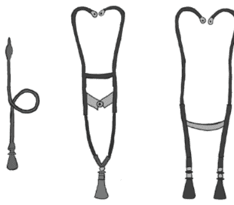
图 2.5 橡胶基听诊器的演变。
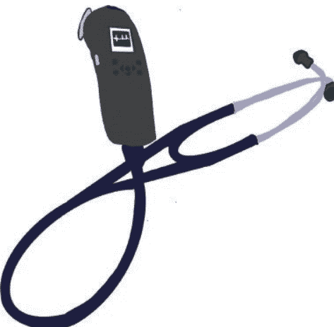
图 2.6 数字听诊器。
反应。几年后，来自伦敦的生理学家奥古斯都·德西雷·沃勒展示了第一个人类心电图，该图使用毛细管电计和放置在胸部和背部的电极。从这个实验中，发展出了许多演示，包括使用改进的毛细管电计的三相心脏电活动，接着是通过在心电图中使用五个测量偏折来改进电计 [18]。

心电图机最初有三个电极形成一个三角形。后来由于产出不佳，移除了两个。该机器包含电解质溶液的圆筒，患者将手臂和一条腿放入这些圆筒中 [18]。检查员继续使用这台机器，直到 1928 年引入一种新设计，其比以前的设计轻得多，并有五个电极。随后进行了由 12 个电极组成的进一步改进，提供了更准确的测量。

今天，心电图系统有更小、更便携的形式，例如智能手表、心电图贴片等，使用户只需将手指放在上面，几秒钟内即可生成心电图结果。

#### 2.4.3 超声心动图（超声设备）

超声心动图设备最初引入于 1950 年，当时两位物理学家开发了第一种 M 型超声心动图，以研究二尖瓣狭窄及其诊断。他们的工作激励了许多心脏病专家，他们进行工作以开发多普勒、二维（2D）、对比和经食管超声心动图。超声心动图受听诊器启发，实际上使用户能够观察
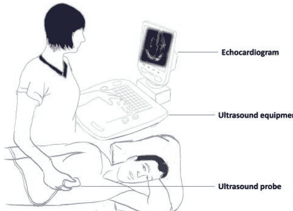
图 2.7 超声心动图方法。患者采取左侧卧位，超声探头产生声波，接收来自人体组织的回声，并将结果发送到超声处理单元/计算机以创建声像图。
人体皮肤下发生的情况 [19]。超声心动图方法的一般设置如图 2.7 所示。

超声心动图是一种心脏超声，可提供运动图像，能够识别心脏的结构和功能。它比心电图更有效、更高效，用于检测心脏疾病。心电图主要提供关于心律的信息，并且涉及一个漫长的过程，相比之下，超声心动图涉及一个可在 5 分钟内完成的快速测试。超声心动图有助于可视化心脏跳动和泵血，并有助于识别心脏疾病。通过测量心率和心律提供心脏功能信息，心电图是检测心脏问题的初步测试；在此处发现的任何异常都需要进一步的诊断测试，如超声心动图。此外，心脏瓣膜的缺陷通常无法被心电图检测出来，而超声心动图是检测瓣膜性心脏病的更首选方法。超声心动图更高效，但比心电图昂贵。

### 2.5 用于辅助临床心脏检查的人工智能

人工智能（AI）是计算机基于之前的学习做出类似人类决策的能力，以解决问题、识别对象或响应语言。目前，AI 广泛应用于各个领域，如商业、农业和医疗。近年来，机器学习和深度学习等各种 AI 方法主要用于医疗领域的应用，例如开发辅助系统 [20] 和各种慢性健康障碍（如癌症 [21] 和冠心病 [22]）的自动疾病诊断系统。

在心脏检查方面，AI 主要集成用于处理从超声心动图、心电图和心脏计算机断层扫描（CT）中获得的生理读数。文献中利用各种图像处理、信号处理和计算机视觉算法，使用这三种程序获得的生理值来预测心脏状况。

#### 2.5.1 超声心动图中的 AI

超声设备在心血管疾病（CVD）早期诊断中起着至关重要的作用。此外，CVD 的一些风险因素可能源于高血压或高胆固醇，而此类疾病的主要原因之一是动脉壁中称为斑块的炎症细胞堆积，这会导致心脏血液供应受限和氧气摄入降低。这种医学状况称为动脉粥样硬化。早期预测 CVD 疾病可能有助于预防动脉粥样硬化的进展以及可能的心力衰竭。在图 2.8 中，显示斑块形成主要发生在颈总动脉和颈内动脉。

识别动脉壁中斑块的方法之一是分析颈动脉，它由一对血管组成，并有几个部分，即颈内部分、颈外部分和颈总部分。斑块发生在颈动脉的内段以及颈总血管中。因此，斑块在这些血管中形成较厚的血管壁，并可测量为内膜-中膜厚度（IMT）。因此，颈动脉 IMT 被用作早期心脏病预测的风险标志。它可以通过
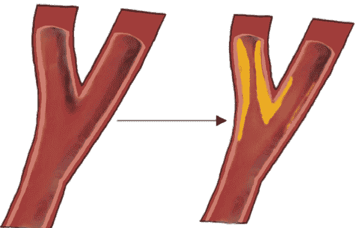
图 2.8 颈总动脉和颈内动脉中的斑块形成。
测量腔-内膜（LI）和中膜-外膜（MA）壁之间的差异来完成 [23]。

最近，许多关于使用机器学习和深度学习技术进行超声图像分割的应用已被实现以检测动脉粥样硬化。Nagaraj [24] 提出的工作使用支持向量机（SVM）训练和分割 IMT，使用 49 张图像的数据集，结果准确率为 93%。其他研究人员（参见 Biswas, Saba, 等人 [25]）开发了一种筛选工具，该工具整合了两阶段 AI 模型用于 IMT 和颈动脉斑块测量，并由卷积神经网络（CNN）和全卷积网络（FCN）组成。该系统经过两个深度学习模型。第一个模型将超声图像中的颈总动脉分为两类：矩形壁和非壁补片。然后，分析感兴趣区域，并将其输入第二阶段，第二阶段识别特征以计算颈动脉 IMT 和斑块总量。

Biswas, Kuppili, 等人 [26] 的工作结合了 CNN 算法和基于机器学习的回归技术进行 IMT 分割。此外，Menchón-Lara 和同事 [27] 实现了一个自动编码器模型来分割 IMT。他们的方法包括感兴趣区域（ROI）预测，然后是在预测的 ROI 中进行 LI 接口（LII）和 MA 接口（MAI）壁预测。作者报告称，他们使用极端学习机与自动编码器来区分 ROI 中包含的块和不在 ROI 中的块。LII 和 MAI 识别是使用像素分类完成的。

#### 2.5.2 心电图中的 AI

心电图在检测心律异常方面影响很大。大多数基于 ECG 的现有机器学习应用程序专注于电信号分类，以发现心脏中的异常活动。随着当今 ECG 在智能手表等小型便携设备上的普及，AI 集成帮助患者监测心率并检测任何可能需要看医生或进行进一步检查的异常。

Li 等人 [28] 的工作应用了多通道、多尺度深度神经网络模型来执行正常和异常信号的 ECG 分类，其方法达到了 96.02% 的准确率。Rajput 等人 [29] 的其他研究工作开发了一种专门用于检测高血压严重程度的自动 ECG 信号检测，高血压是心脏病的高风险因素。他们的方法包括使用双带最优双正交小波库滤波器以及机器学习技术，将小波分类为低风险高血压、高风险高血压和健康。这种方法的平均分类准确率发现为 99.95%，并突出了该系统在诊所部署的能力。

Eltrass 等人 [30] 提出了一种使用深度学习技术进行 ECG 识别和检测充血性心力衰竭（CHF）和心律失常（ARR）的方法。它主要同时使用 CNN 和常数 Q 非平稳加博变换（CQ-NSGT），主要将 1D ECG 信号转换为 2D 时频表示。然后将输出馈送到预训练的 CNN 模型（AlexNet）以提取这些


信号，然后利用这些特征将病例分类为CHF、ARR或正常窦性心律（NSR）来进行诊断。该工作达到98.82%的准确率、98.87%的灵敏度、99.21%的特异度和99.20%的精确度。

在Moridani等人[31]的工作中，作者尝试了多种机器学习算法用于ECG信号分类。他们专注于对初始信号进行预处理技术，然后对心率变异性的线性和非线性特征以及信号的统计特征应用特征提取。随后，他们使用多层感知机（MLP）和SVM，结合所有特征和最优特征，在独立实验中对正常和异常信号进行分类。他们的结果突出了SVM模型的性能，该模型在使用所有特征和最优特征时能够获得最高准确率。对于最优特征，它达到了98.3%的准确率、99.10%的灵敏度和97.5%的特异度。

#### 2.5.3 CT中的AI

CT扫描主要用于详细查看身体的各个部位。在心脏CT扫描的情况下，它可以清晰地显示心脏和血管，帮助专家诊断或检测任何异常。CT扫描可以通过扫描心脏动脉中的任何钙化斑块形成来创建冠状动脉钙化（CAC）评分，从而检测心脏病的早期迹象，该评分已被证明是CVDs的强有力预测因子（图2.9）。

CT扫描捕获的数据生成患者心脏的3D模型。胸部CT图像中的心脏分割有助于将整个胸部CT图像划分为多个解剖学上重要的区域，这些区域专注于心脏的四个腔室。

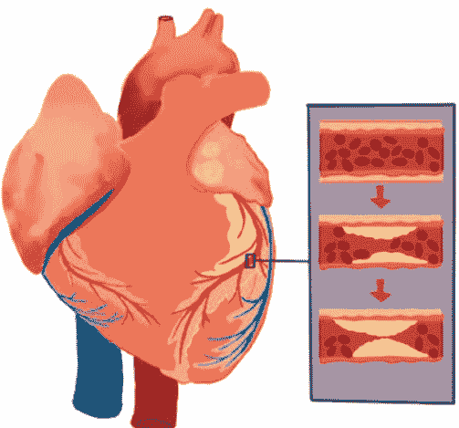

图2.9 心脏动脉中的斑块形成。

手动分割过程正逐渐被计算机辅助技术取代，例如基于图的分割、平均阈值法、模糊聚类方法以及最新的深度学习方法，后者已显示出有希望的结果。深度学习系统可以被训练以识别和量化冠状动脉钙化。这使其成为检测由动脉粥样硬化引起的冠状动脉钙化的有效早期检测设备，因为它在症状出现前就能检测钙化。这构成了未来心脏问题的强有力预测因子。

文献中关于CAC的提出工作之一是开发一种算法，该算法排除CAC评分为负的CT扫描，并在发现阳性评分时对CAC进行分割。分割区域可进一步交由放射科医生进行准确检测。所提方法大大减轻了放射科医生的工作量[32]。所提方法采用了一种集成架构模型，包含两个CNN，一个用于分类，另一个用于分割。该模型能够排除86%的负性病例，分割在内部和外部验证中分别达到了0.63和0.84的Dice系数。

另一研究小组开发了一种用于CAC分类和分割的深度学习模型[33]。该小组专注于胸部CT扫描的钙化量化，并将其与人工评估进行比较。该模型结合了用于图像特征提取的CNN和ResNet架构，以及用于空间坐标特征的FCN。他们的方法在检测钙化存在方面与人工评估显示出高度相关性，结果为91%的灵敏度和92%的特异度。在钙化体积测定方面，AI模型能够与人工测定产生极佳的相关性，且未发现显著差异。该方法被证明是完全自动化的，在优化临床钙化评分的同时缩短了评估时间。

Zhang等人[34]的工作利用深度学习从CT扫描图像中进行钙化量化。他们开发了一个完全自动化的框架来检测CAC，使用3D CT扫描作为模型输入并提取特征以应用分割和钙化。所提方法的获得结果与手工方法相比无显著差异。

Dekker等人[35]在心肌灌注成像（MPI）评估中实施了深度学习技术来计算CAC评分。他们为CAC评分定义了一个阈值，其中低(<400)和高(≥400)。所提方法中使用的深度学习模型在其他方法中已得到验证。该研究工作的结果强调，高CAC评分呈现出更高的累积事件率。他们还证明，他们的方法可以推进风险分层，从而为患者提供定制化治疗。

总之，AI方法在某些应用中表现出更好的自动化和更高的诊断准确率。部分结果甚至可以进一步改进，这可能带来更高的性能。这未来可能有助于减少医生和放射科医生在诊断心脏病方面的工作量。基于AI的方法无法取代ECG、EEG或CT扫描等临床方法；然而，它们可以自动化决策任务。

### 2.6 结论

如今，心脏病非常普遍，是世界死亡率的主要贡献因素之一。及时诊断心脏病可以在很大程度上降低与心脏病风险相关的伤亡和死亡率。今天，由于信号处理、医学成像、传感器等领域的技术进步，诊断心脏病并找出其潜在的具体原因并不困难。未来版本的医疗设备，包括听诊器和心电图机，将利用AI技术在医院和诊所中高效检测心脏异常。然而，传统方法也将与先进方法并用，其中大多数传统方法（包括视诊和触诊）具有成本效益且不需要任何先进设备或传感器。最近推动神经网络听诊器发展的进步将减少医生进行常规听诊检查的工作量。

本章简要讨论了用于心脏病预测的各种传统临床方法，并介绍了医生在诊断心脏病时考虑的几种生理属性。心理属性的临床意义也已讨论，我们还简要介绍了心脏病专家、医生和放射科医生用于心脏检查的设备的历史。本章最后简要讨论了AI如何协助医生和放射科医生进行心血管检查。

### 参考文献

- 1. NCBI Bookshelf. (2004). 心脏病学解释：心血管检查. 美国国家医学图书馆、美国国立卫生研究院提供的服务.
- 2. Malik, M.B. 和 Gopal, S. (2020). 心脏检查. StatPearls.
- 3. Jacob, R. 和 Khan, M. (2018). 心脏生物标志物：是什么及其可能性. 印度女性心血管疾病杂志 WINCARS 03 (04). https://doi.org/10.1055/s-0039-1679104.
- 4. Peterson, P.N., Magid, D.J., Ross, C., Ho, P.M., Rumsfeld, J.S., Lauer, M.S., Lyons, E.E., Smith, S.S., 和 Masoudi, F.A. (2008). 心电图运动试验患者跑步机运动能力与未来心脏事件的关联. 内科学档案 168 (2). https://doi.org/10.1001/archinternmed.2007.68.
- 5. Cole, C.R., Foody, J.A.M., Blackstone, E.H., 和 Lauer, M.S. (2000). 次最大运动试验后的心率恢复作为心血管健康人群死亡率的预测因子. 内科学年鉴 132(7). https://doi.org/10.7326/0003-4819-132-7-200004040-00007.
- 6. Jouven, X., Empana, J.-P., Schwartz, P.J., Desnos, M., Courbon, D., 和 Ducimetière, P. (2005). 运动过程中的心率特征作为猝死的预测因子. 新英格兰医学杂志 352 (19). https://doi.org/10.1056/nejmoa043012.
- 7. Kolber, M.R. 和 Scrimshaw, C. (2014). 心血管疾病家族史. 加拿大家庭医生 60 (11).


- 8 Benjamin, E.J., Blaha, M.J., Chiuve, S.E., Cushman, M., Das, S.R., Deo, R., De Ferranti, S.D., Floyd, J., Fornage, M., Gillespie, C., Isasi, C.R., Jim’nez, M.C., Jordan, L.C., Judd, S.E., Lackland, D., Lichtman, J.H., Lisabeth, L., Liu, S., Longenecker, C.T., and Muntner, P. (2017). 心脏病和中风统计——2017年更新：美国心脏协会报告. 《循环》135 (10). https://doi.org/10.1161/CIR.0000000000000485.

- 9 Franklin, S.S., Larson, M.G., Khan, S.A., Wong, N.D., Leip, E.P., Kannel, W.B., and Levy, D. (2001). 血压与冠心病风险的关系是否随年龄改变？：弗拉明厄心脏研究. 《循环》103 (9). https://doi.org/10.1161/01.CIR.103.9.1245.

- 10 Rader, D.J. and Hovingh, G.K. (2014). 高密度脂蛋白与心血管疾病. 《柳叶刀》384 (9943). https://doi.org/10.1016/S0140-6736(14)61217-4.

- 11 Fernandez, M.L. and Webb, D. (2008). LDL/HDL胆固醇比率作为评估冠心病风险的重要工具. 《美国营养学会杂志》27 (1). https://doi.org/10.1080/07315724.2008.10719668.

- 12 Navar, A.M., Pagidipati, N., Mulder, H., Aberra, T., Philip, S., Granowitz, C., and Peterson, E. (2019). 甘油三酯作为冠心病风险因素：测什么指标，什么截断值？. 《美国心脏病学会杂志》73 (9). https://doi.org/10.1016/s0735-1097(19)32471-4.

- 13 Chua Chiaco, J.M.S., Parikh, N.I., and Fergusson, D.J. (2013). 颈静脉压再探讨. 《克利夫兰诊所医学杂志》80 (10). https://doi.org/10.3949/ccjm.80a.13039.

- 14 Kupari, M., Koskinen, P., Virolainen, J., Hekali, P., and Keto, P. (1994). 36至37岁人群样本中可闻生理性第三心音的流行率及预测因素. 《循环》89 (3). https://doi.org/10.1161/01.CIR.89.3.1189.

- 15 Breuer, H. (1981). 妊娠期心脏听诊（作者翻译）. MMW, 慕尼黑医学周刊 123 (45): 1705–1707.

- 16 Roguin, A. (2006). 勒内·奥菲尔·亚辛特·拉ENN（1781-1826）：听诊器背后的那个人. 《临床医学与研究》4 (3). https://doi.org/10.3121/cmr.4.3.230.

- 17 Swarup, S. and Makaryus, A.N. (2018). 电子听诊器：技术更新. 《医疗器械：证据与研究》11. https://doi.org/10.2147/MDER.S135882.

- 18 AlGhatrif, M. and Lindsay, J. (2012). 简要综述：了解心电图基本原理的历史. 《社区医院内科医学展望》2 (1). https://doi.org/10.3402/jchimp.v2i1.14383.

- 19 Singh, S. and Goyal, A. (2007). 超声心动图的起源：向英格·埃德勒致敬. 《得克萨斯心脏研究所期刊/来自圣路克圣公会医院得克萨斯心脏研究所得克萨斯儿童医院》34 (4).

- 20 Kunhoth, J., Karkar, A., Al-Maadeed, S., and Al-Attiyah, A. (2019). 基于计算机视觉和BLE技术的面向视障人士室内导航系统比较分析. 《国际健康地理学杂志》18 (1). https://doi.org/10.1186/s12942-019-0193-9.

- 21 Al Maadeed, S., Kunhoth, S., Bouridane, A., and Peyret, R. (2017). 用于自动癌症诊断的多光谱成像与机器学习. 2017年第13届国际无线通信与移动计算会议，IWCMC 2017. https://doi.org/10.1109/IWCMC.2017.7986547.

- 22 Masetic, Z. and Subasi, A. (2016). 使用随机森林分类器检测充血性心力衰竭. 《生物医学计算机方法与程序》130. https://doi.org/10.1016/j.cmpb.2016.03.020.

- 23 Molinari, F., Meiburger, K.M., Saba, L., Rajendra Acharya, U., Ledda, M., Nicolaides, A., and Suri, J.S. (2012). 多中心数据集上颈动脉超声自动IMT测量中约束活轮廓与常规活轮廓的对比. 《超声学》52 (7). https://doi.org/10.1016/j.ultras.2012.03.005.

- 24 Nagaraj, Y., Teja, A.H.S., and Narasimhadhan, A.V. (2019). 使用支持向量机对颈动脉超声图像中内中膜复合体进行自动分割. 《阿拉伯科学与工程杂志》44 (4). https://doi.org/10.1007/s13369-018-3549-8.

- 25 Biswas, M., Saba, L., Chakrabartty, S., Khanna, N.N., Song, H., Suri, H.S., Sfikakis, P.P., Mavrogeni, S., Viskovic, K., Laird, J.R., Cuadrado-Godia, E., Nicolaides, A., Sharma, A., Viswanathan, V., Protogerou, A., Kitas, G., Pareek, G., Miner, M., and Suri, J.S. (2020). 用于颈动脉超声中动脉粥样硬化壁厚和斑块负担联合测量的两阶段人工智能模型：心血管/中风风险评估的筛查工具. 《生物医学与医学计算机》123. https://doi.org/10.1016/j.compbiomed.2020.103847.

- 26 Biswas, M., Kuppili, V., Araki, T., Edla, D.R., Godia, E.C., Saba, L., Suri, H.S., Omerzu, T., Laird, J.R., Khanna, N.N., Nicolaides, A., and Suri, J.S. (2018). 准确测量颈动脉内中膜厚度的深度学习策略：日本糖尿病队列超声研究. 《生物医学与医学计算机》98. https://doi.org/10.1016/j.compbiomed.2018.05.014.

- 27 Menchón-Lara, R.M., Sancho-Gómez, J.L., and Bueno-Crespo, A. (2016). 基于颈动脉超声图像深度学习的早期动脉粥样硬化检测. 《应用软计算杂志》49. https://doi.org/10.1016/j.asoc.2016.08.055.

- 28 Li, D., Zhang, J., Zhang, Q., and Wei, X. (2017). 基于一维卷积神经网络的心电图信号分类. 2017年IEEE第19届电子健康网络、应用与服务国际会议，Healthcom 2017，2017年12月. https://doi.org/10.1109/HealthCom.2017.8210784.

- 29 Rajput, J.S., Sharma, M., Tan, R.S., and Acharya, U.R. (2020). 使用最佳双正交小波滤波组自动检测高血压心电图信号严重程度. 《生物医学与医学计算机》123. https://doi.org/10.1016/j.compbiomed.2020.103924.

- 30 Eltrass, A.S., Tayel, M.B., and Ammar, A.I. (2021). 一种基于常Q非平稳加博变换的心电图充血性心力衰竭和心律失常识别新自动CNN深度学习方法. 《生物医学信号处理与控制》65. https://doi.org/10.1016/j.bspc.2020.102326.

- 31 Moridani, M.K., Abdi Zadeh, M., and Shahiaraz Mazraeh, Z. (2019). 一种区分正常和异常心电图信号的高效自动算法. IRBM 40 (6). https://doi.org/10.1016/j.irbm.2019.09.002.

- 32 Van Den Oever, L.B., Cornelissen, L., Vonder, M., Xia, C., Van Bolhuis, J.N., Vliegenthart, R., Veldhuis, R.N.J., De Bock, G.H., Oudkerk, M., and Van Ooijen, P.M.A. (2020). 用于自动排除冠状动脉钙化阴性心脏CT检查的深度学习. 《欧洲放射学杂志》129. https://doi.org/10.1016/j.ejrad.2020.109114.

- 33 Van Assen, M., Martin, S.S., Varga-Szemes, A., Rapaka, S., Cimen, S., Sharma, P., Sahbaee, P., De Cecco, C.N., Vliegenthart, R., Leonard, T.J., Burt, J.R., and Schoepf, U.J. (2021). 使用深度神经网络对胸部CT进行自动冠状动脉钙化评分：与非对比心脏CT直接比较的验证研究. *欧洲放射学杂志* 134. https://doi.org/10.1016/j.ejrad.2020.109428.

- 34 Zhang, N., Yang, G., Zhang, W., Wang, W., Zhou, Z., Zhang, H., Xu, L., and Chen, Y. (2021). 用于非对比心脏门控CT扫描中全面冠状动脉钙化评分分析的完全自动化框架：总体和血管特异性定量. *欧洲放射学杂志* 134. https://doi.org/10.1016/j.ejrad.2020.109420.

- 35 Dekker, M., Waissi, F., Bank, I.E.M., Isgum, I., Scholtenx, A.M., Velthuis, B.K., Pasterkamp, G., De Winter, R.J., Mosterd, A., Timmers, L., and De Kleijn, D.P.V. (2021). 基于深度学习方法对82Rb-PET/CT心肌灌注成像中非心电图门控CT图像所得自动冠状动脉钙化的预后价值. *国际心脏病杂志* 329. https://doi.org/10.1016/j.ijcard.2020.12.079.


## 3 类生物传感器及其在心血管应用中的重要性

S. Irem Kaya, Leyla Karadurmuş, Ahmet Cetinkaya, Goksu Ozcelikay, and Sibel A. Ozkhan

### 3.1 引言

心血管疾病（CVD）是指涵盖心脏或血管疾病并描述任何影响循环系统疾病的总称。CVD 包括心脏病发作、先天性心脏病、风湿性心脏病、高血压、脑血管疾病、外周动脉疾病和心力衰竭。虽然 CVD 有多种原因，但最常见的原因是动脉粥样硬化和/或高血压，它们是全球死亡的主要原因。高血压可能非常危险，因为在大多数情况下，早期阶段没有明显症状会促使患者寻求医疗护理。尽管它是一种过程相当沉默的疾病，但头痛、耳鸣、鼻出血和视力受损等少数症状可能是警告信号 [1]。在过去二十年中，高收入国家的 CVD 死亡率有所下降。然而，低收入和中等收入国家的发病率和死亡率却出现了惊人地快速增长。每年有超过 1700 万人死于 CVD，约占全球所有死亡的 31%。75% 的 CVD 死亡发生在低收入和中等收入国家，并且在男性和女性中几乎均等发生。如果当前情况持续下去，预计到 2030 年，将有约 2360 万人死于 CVD [2–5]。

虽然这些疾病通常发生在老年人中，但一级预防工作应从早期开始，特别是因为动脉粥样硬化可追溯到儿童期。因此，越来越强调通过健康饮食、锻炼和避免吸烟等方式消除危险因素，以预防动脉粥样硬化。CVD 有许多原因，主要原因是烟草使用、体力活动不足、不健康饮食和有害饮酒。许多研究已证明饮食习惯与 CVD 直接相关。膳食中全谷物摄入不足、盐摄入量高、饱和脂肪酸和油炸食品是增加个人 CVD 风险的重要参数。生活方式习惯的改变，例如增加水果和蔬菜消费、采用包括定期食用橄榄油、鱼类、全谷物以及牛奶和乳制品的饮食，并通过每天步行约 40 分钟来支持这一点，以及根据

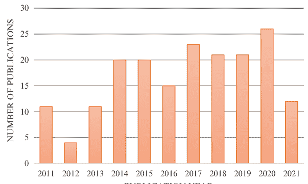
图 3.1 与心血管生物标志物相关的年度出版物数量统计。

年龄和风险状况确定的运动，都能改善个人的生活质量并降低 CVD 风险 [6-9]。CVD 对个人和国家经济造成沉重负担。患有 CVD 或高心血管风险的人需要适当的早期检测和管理 [10, 11]。

对于 CVD 的治疗和早期诊断，对快速、便携、低成本生物传感设计的需求日益增加。生物传感器可以作为耗时且昂贵的实验室分析的替代方案，在 CVD 的早期诊断中发挥重要作用。近年来，许多生物传感器已得到改进，以确定心脏标志物。CVD 中最大的挑战之一是估计个人患 CVD 的风险。研究非常关注寻找可以在血液中检测并预测 CVD 风险的早期诊断生物标志物。其中最著名的生物标志物是 C-反应蛋白（CRP），其次是心脏肌钙蛋白（cTn）I 或 T、白介素-6、白介素 1、肌红蛋白、脂蛋白相关磷脂酶 A2、肿瘤坏死因子-α、髓过氧化物酶和低密度脂蛋白。本章详细介绍了用于检测各种 CVD 标志物的可用生物传感器平台，并列出了关于该主题的出版物，以表格形式呈现 [12-16]。在过去 10 年中，生物传感器占心血管生物标志物检测研究的很大比例，如图 3.1 所示。肌钙蛋白 I 和 CRP 的诊断正在受到关注。值得注意的是，过去 5 年中基于电化学的生物传感器的使用保持稳定。本章将重点介绍用于检测心血管生物标志物的生物传感器的这些最新进展。

### 3.2 心血管研究的特定生物标志物

如今，特定生活方式和饮食习惯等不同原因会导致 CVD 风险因素和发病率增加。此外，年龄和其他疾病等个体风险因素对患者起着至关重要的作用 [17]。

生物标志物是体液中发现的生物材料，用于指示身体的正常或病理过程或反应 [18]。生物标志物是诊断和监测许多疾病的关键工具。CVD 涉及各种急性和慢性疾病。使用生物标志物在短期内对急性病症进行有效、准确和快速的诊断可能挽救生命 [19]。此外，为了评估与 CVD 相关的长期风险（这些风险可能发生在患者生命的后期阶段），生物标志物被广泛用于改善患者的生活质量。基于生物标志物的心血管研究，除了诊断研究外，还包括疾病后的风险和损伤监测，例如中风后的损伤评估、心脏损伤程度以及图 3.2 中的心脏骤停相关脑损伤 [20]。

心血管研究中有多种可用的生物标志物，有些已使用多年，有些是新出现的。在表 3.1 中，对心血管研究中最重要和最特定的生物标志物进行了分类。

可以根据生理过程对生物标志物进行分类。例如，炎症相关生物标志物包括 CRP、sST2、GDF-15、TNF-α 等。LDL 和 MPO 与氧化应激有关 [24]。从另一个角度考虑，脂质基生物标志物（HDL、LDL 等）、CRP 和 cTnI 被广泛认为是传统生物标志物，而 sST2、TNF-α、Gal-3 和 GDF-15 是新出现的生物标志物。Copeptin 是心血管研究中另一个有前景的生物标志物，关于 Copeptin 的正在进行的研究表明，除了众所周知且在临床上已确立的生物标志物（如肌红蛋白和 cTnI）外，它还可用作 MI 的诊断生物标志物 [22, 34]。Copeptin 的稳定性和易于测量被视为替代生物标志物。然而，应监测围手术期 Copeptin 水平的变化，以将其确立为指导性生物标志物 [34, 35]。另一方面，肌红蛋白、H-FABP 和 MPO 是附加生物标志物，在多生物标志物方法中更有价值 [30]。

本质上，理想的心血管生物标志物应具有高度特异性和明确的参考限度，以便为临床评估提供有价值的信息 [24]。

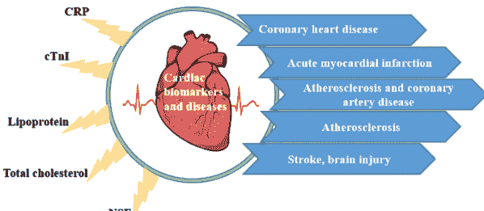
图 3.2 部分心脏生物标志物和疾病的示意图。

### 表 3.1 用于评估 CVD 的特定生物标志物。

| 生物标志物 | 描述 | 相关 CVD | 临床评估 | 参考文献 |
|---|---|---|---|---|
| C-反应蛋白 (CRP) | CRP 是一种肝源性急性期蛋白，与全身炎症相关；用于 CVD 的早期检测 | 冠心病、血栓并发症、动脉粥样硬化和急性冠状动脉综合征 | CRP 升高表明不良心血管事件的风险更高（CRP < 1 mg/L 低风险，1 < CRP < 3 mg/L 中风险，CRP > 3 mg/L 高风险） | [12, 17, 21, 22] |
| 心脏肌钙蛋白 I (cTnI) | cTnI 抑制肌动蛋白-肌球蛋白 ATPase，并由心脏肌细胞坏死释放 | 急性心肌梗死和缺血性卒中 | cTnI 水平升高与急性心肌梗死和缺血性卒中的急性期相关 | [20, 23, 24] |
| 降钙素原 (PCT) | PCT 是一种急性期反应物，也是一种循环神经体液生物标志物 | 急性心力衰竭和急性失代偿性心力衰竭 | PCT 水平升高与心力衰竭的表征和早期诊断相关 | [18, 24, 25] |
| 脑利钠肽 (BNP) | BNP 是一种肽状神经激素，具有血管扩张、舒张和抗增殖作用 | 急性和慢性心力衰竭、室肥大、脑梗死和心源性栓塞性卒中 | BNP 血液水平高于 20 pg/mL 与未来 CVD 的严重风险相关。监测 BNP 水平以评估心脏对治疗的反应 | [26–29] |
| 神经元特异性烯醇化酶 (NSE) | NSE 是一种特异于大脑的糖酵解酶。正常情况下，其水平可忽略不计 | 卒中、心脏骤停后脑损伤 | 评估梗死体积和血脑屏障的完整性 | [20] |
| Copeptin | Copeptin 是一种新兴且新颖的生物标志物，也是精氨酸血管加压素的前体肽 | 心力衰竭和急性冠状动脉综合征 | Copeptin 水平用于排除心肌梗死 (MI) 并评估围手术期心肌损伤风险 | [17, 18, 22, 30] |
| 肌红蛋白 | 肌红蛋白负责结合、运输和储存氧气，是一种非酶性蛋白 | 急性 MI | MI 早期诊断最可靠和高效的生物标志物；MI 期间肌红蛋白水平非常高（高达 900 ng/mL） | [21, 31] |


表 3.1（续）

| 生物标志物 | 描述 | 相关心血管疾病 | 临床评估 | 参考文献 |
|---|---|---|---|---|
| 骨髓过氧化物酶 (MPO) | MPO 是一种参与脂质过氧化和活性氧物质产生的酶 | 动脉粥样硬化、急性冠状动脉综合征和冠状动脉疾病 | MPO 可提供冠状动脉疾病早期诊断，并对动脉粥样硬化组织造成损伤 | [18, 26, 29] |
| 微小 RNA (miRNAs) | 作为非编码 RNA 序列，miRNAs 通过抑制蛋白质翻译参与基因表达调节 | 冠状动脉疾病、急性心肌梗死、心力衰竭和中风 | miRNAs 可从 HDL、凋亡小体、外泌体和微囊泡等蛋白质复合物释放到外周血；循环 miRNAs 血液水平升高与心血管疾病相关 | [26, 31, 32] |
| 生长分化因子 (GDF-15) | GDF-15 分泌出来以抵御氧化应激、细胞缺血和心脏过载等应激因素 | 心房颤动、急性冠状动脉综合征、心力衰竭 | GDF-15 水平升高表明与心血管应激相关的肾损伤 | [17, 18, 22, 29] |
| 半乳糖凝集素-3 (Gal-3) | Gal-3 参与体内的炎症和纤维化过程 | 肥大心脏、心力衰竭和流出道心动过速 | Gal-3 水平较高表明终末期心力衰竭患者的死亡率风险更高 | [17, 24, 30] |
| 心脏脂肪酸结合蛋白 (H-FABP) | H-FABP 是在心肌缺血期间从心肌组织释放的脂肪酸结合蛋白之一 | 动脉粥样硬化、急性冠状动脉综合征和心肌梗死 | H-FABP 是排除心肌梗死概率的重要早期临床生物标志物 | [17, 18, 30] |
| 肿瘤坏死因子-α (TNF-α) | TNF-α 是一种促炎细胞因子，参与细胞中的炎症通路 | 动脉粥样硬化、动脉硬化、血小板激活和血管功能障碍 | TNF-α 用于预测术后并发症 | [17, 22, 26] |
| 白介素-6 (IL-6) | IL-6 属于免疫细胞因子家族，与 CRP 激活和急性期炎症相关 | 动脉粥样血栓形成和肥胖 | IL-6 水平用于评估患者的心血管风险 | [17, 18, 28] |
| 纤维蛋白原 | 纤维蛋白原与凝血、血小板聚集和血浆黏稠度过程相关 | 血栓性疾病和急性冠状动脉综合征 | 纤维蛋白原用于急性冠状动脉综合征的风险评估 | [17, 18] |
| 可溶性抑瘤原性 2 (sST2) | sST2 参与细胞炎症通路，并在心肌细胞或成纤维细胞拉伸后释放 | 急性和慢性心力衰竭 | sST2 临床上用于急性和慢性心力衰竭的风险评估和未来预测 | [18, 22, 29, 30] |
| 总胆固醇 | 总胆固醇是传统的脂质生物标志物之一，被描述为 LDL 和 HDL 的总量 | 动脉粥样硬化 | 心血管风险、死亡率和发病率的评估 | [17, 18, 22] |
| 低密度脂蛋白 (LDL) | LDL 负责体内胆固醇运输 LDL 过氧化导致泡沫细胞形成 | 动脉粥样硬化和冠状动脉疾病 | LDL 水平升高与心血管疾病更高风险相关 | [22, 26, 33] |
| 高密度脂蛋白 (HDL) | HDL 提供对超低密度脂蛋白和乳糜微粒的解离 | 动脉粥样硬化和冠状动脉疾病 | HDL 水平较低与心血管疾病更高风险相关 | [17, 33] |
| 甘油三酯 (TG) | TG 负责将葡萄糖和脂肪组织脂肪从肝脏转运 | 动脉粥样硬化、心肌梗死和冠心病 | 水平升高与心血管疾病更高风险相关 | [17, 18, 33] |
| D-二聚体 | D-二聚体由血栓的纤维蛋白降解形成 | 血栓形成、缺血性心脏病、慢性心力衰竭和急性主动脉夹层 | 水平升高与心血管死亡率相关 | [17, 18, 26] |

### 3.3 心血管生物标志物检测的生物传感器类型

#### 3.3.1 电化学生物传感器

电化学生物传感器的基本原理基于生物识别元素与分析物之间发生电化学氧化还原反应而产生的电信号 [36]。分析物浓度与测得的电化学响应成正比，从而允许定量分析 [37]。三电极电化学电池系统可以使用基于伏安法、电位法、电导法和阻抗法等技术的各种转换器 [38]。

电化学生物传感器是无标记的、价格低廉、易于应用且高度灵敏（具有低检测限 LOD 值），并能提供准确、快速和鲁棒的分析 [39, 40]。它们也易于微型化，并可应用于使用少量样本量同时检测多种分析物的设备 [37, 40]。电化学生物传感器包括以下几种：

- 基于安培法的电化学生物传感器在恒定电位下测量电流变化，是最广泛使用的生物传感器 [36, 38]。它们适合大规模生产，并提供比基于电位法的生物传感器更灵敏的分析 [38]。
- 基于伏安法的电化学生物传感器测量作为施加电位函数的电流变化。它们是高度特异、灵敏的传感器，具有无噪声和可重复的测量 [37, 41]。
- 基于电位法的电化学生物传感器的测量原理基于零电流流动时的电位差 [38]。它们用于测定离子和生物分子 [42]。
- 基于阻抗法的电化学生物传感器关注由蛋白质或抗原与抗体等之间的各种生物分子相互作用产生的电阻和电容变化 [36, 42]。
- 基于电导法的电化学生物传感器关注电导率变化，但不广泛用于酶法分析 [36, 38]。

#### 3.3.2 压电生物传感器

压电性是某些材料在受到机械应力后产生电势、电荷或电场的能力 [38, 43]。晶体和某些陶瓷，如骨、石英、铌酸锂、聚乳酸、氧化锌、氮化铝和磷酸盐以及聚偏二氟乙烯，是最常见的压电材料示例 [41, 43, 44]。在压电生物传感器中，生物识别材料固定在由金电极包覆的石英晶体组成的压电表面上。当由于分析物与生物识别材料之间的相互作用而施加电势时，会发生弹性变形和质量变化，从而产生机械振动效应 [38, 42, 43]。振荡频率与晶体质量相关，分析物吸附导致的质量增加可引起振荡频率的变化 [38]。压电生物传感器的定量测定基于分析物量与振荡频率之间的比率 [44]。

压电生物传感器的优势在于它们提供了简便、快速、无标记和低成本的分析 [41]。然而，关于晶体表面再生、孵化时间和多步固定的问题可能会导致挫折 [41]。压电生物传感器用于测定多种材料，例如药物、农药、核酸、细菌、蛋白质等 [45]。

#### 3.3.3 热式/温度计生物传感器

热式生物传感器并非非常常用的生物传感器。在热式生物传感器中，生物识别元素与分析物之间会发生产生或吸收热量的反应 [42]。热敏电阻用于测量温度变化。它具有高灵敏度，可检测 0.0001 至 0.05 °C 之间的变化 [38]。热式生物传感器能够在无需频繁重新校准的情况下测量低至 10^-5 M 的浓度 [36, 38]。然而，它们对分析物的电化学和光学特性不表现出敏感性 [38]。

#### 3.3.4 光学生物传感器

光学生物传感器是其转换原理基于光学过程的生物传感器。分析物与生物识别元素之间的相互作用通过光学转换器转换为输出信号 [46]。通过测量材料（如偏振、振幅、频率和辐射相位）的光学特性变化，用于定量测定 [47]。由生物元素之间的分子相互作用引起的光学特性变化会影响测得的输出信号。例如，发光生物传感器关注与生物分子相互作用产生的辐射相关的发光变化 [47]。光学生物传感器可以是无标记的或基于荧光的。在基于荧光的生物传感器中，用荧光标签标记生物标志物可提供高度灵敏的分析。另一方面，荧光信号偏差被视为一个问题 [44]。无标记生物传感器能够使用超小样本量进行快速和实时分析 [42, 44]。

光学生物传感器可以采用不同的技术，例如表面等离子体共振 (SPR)、表面等离子体共振成像 (SPRi)、局域表面等离子体共振 (LSPR)、表面增强拉曼散射 (SERS)、激光光散射、反射光谱和化学发光等 [38, 47]。它们各有优缺点。首选哪种取决于分析物及其特性。

不过，SPR 被认为是最有效且最受青睐的技术，它价格低廉且高度选择性，能够检测各种相互作用 [37, 48]。

光学生物传感器相对于其他生物传感器具有显著优势：除了高度选择性外，它们还敏感且具有生物相容性，为体内应用提供了微创方法，并克服了电磁干扰问题 [42]。

#### 3.3.5 可穿戴/可植入式生物传感器

生物传感器技术是持续开发和深入研究的最热门领域之一。除了生物传感器现有的优势外，研究和

旨在改进传统诊断和健康监测方法的研究最近开发出了可穿戴/植入式生物传感器 [49]。可穿戴和植入式传感器都为患者提供无需临床操作的连续和远程监测 [50]。植入式生物传感器植入体内，而可穿戴式生物传感器则佩戴在身体上，例如衣物、隐形眼镜、手表、戒指等 [51]。

在经典生物传感器中，取样后通常需要预处理步骤，还需要将样本靠近设备/传感器。尽管可穿戴/植入式生物传感器采用与经典生物传感器相同的转换器（如光学、电化学和热学），但小型化和可穿戴性是使其与其他生物传感器区分开来的特征。这些新技术生物相较于其他经典生物传感器具有独特优势：实时和连续数据采集、节省金钱和时间、减少一次性医疗材料的浪费，以及更高效、更高质量的测量 [52]。患者和专业人员的医疗需求的增加和变化在开发此类生物传感器方面也起到了重要作用。可穿戴/植入式生物传感器还可与智能手机等设备集成，能够评估其测量的数据，并在危急情况下向紧急服务或患者亲属提供信息（Figure 3.3）[53]。它们在心血管疾病（CVDs）中用于检测心率、心电图和血压 [53]。

然而，潜在的技术问题包括生物相容性、生物污染、小体积样本测量中的误差，以及唾液、泪液和汗液分析的挑战 [49]。由于介质的复杂性，生物体液分析一直具有挑战性。基于血液样本的临床测试可靠但涉及可能对患者造成不适的侵入性策略。唾液、泪液和汗液被研究作为非侵入性或微创诊断生物传感器选项。唾液样本被食物污染、几种代谢物存在浓度相关性问题（尽管它们可以在汗液样本中检测到）等问题表明，可穿戴传感器存在改进需求 [49]。

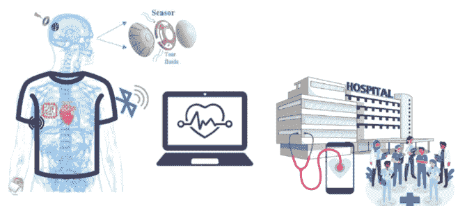

Figure 3.3 可穿戴/植入式生物传感器在医疗保健监测中的应用。

### 3.4 生物传感器在心血管研究中的应用

在过去十年中，各种电化学研究调查了与心血管疾病（CVDs）相关的生物标志物生物检测。其中一些研究考察了生物传感器、纳米材料、分子印迹聚合物和适配体基方法，而其他研究则专注于心脏生物标志物检测方法。回顾最近发表的关于电化学方法不同方面的研究，在应用电化学技术检测心血管生物标志物方面有大量研究。表 3.2 提供了关于心脏生物标志物电化学生物传感及多种电极修饰技术的详细信息。

Chi 等人开发了一种标签自由光电化学（PEC）免疫传感器，使用 CdS:Mn 被敏化石墨烯（G）/Cu2MoS4 复合检测探针来定量 cTnI。该免疫传感器的卓越灵敏度和 G/Cu2MoS4 的优异电化学行为使 cTnI 能够被有效测定。因此，在磷酸盐缓冲条件下，cTnI 的浓度被检测为 0.18 pg mL⁻¹ [60]。Nandini 等人还报道了一种基于含有功能化石墨烯氧化物修饰石墨电极的纳米杂化体的电化学生物传感器，用于胆固醇生物传感。所提议的 Gr/GO-SH/AuNs/CHOx 显示出 0.2 nM 的检测限，线性范围为 0.05 mM 至 11.45 mM。最终，所提议的传感器已被有效应用于真实样本中胆固醇的测定 [93]。在另一项研究中，Tertis 等人提出了一种基于 AuNPs 和 PPy-NPs 的用于人血清中白介素 6 测定的灵敏且选择性的多脉冲安培传感器。白介素 6 的线性浓度范围为 1.0 pg mL⁻¹ 至 15 μg mL⁻¹，在优化条件下（0.1 M Tris–HCl，pH 7.2）检测限（S/N = 3）为 0.33 pg mL⁻¹ [122]。在 Taghdisi 等人提出的电化学适配体传感器中，检测基于使用丝网印刷金电极（SPGEs）的 DApt-CS 共轭物的 Y 形结构。差分脉冲伏安法表明，该适配体传感器能够在 100 pM-40 nM 的线性范围内检测出 27 pM 的肌红蛋白。结果表明，DApt-CS 修饰电极显示出优异的选择性和准确性，在肌红蛋白测定中具有非常高的选择性 [141]。Kongsuphol 等人使用电化学技术对这些梳状结构金微电极阵列（CSGMs）进行了表征。所得生物传感器用于在最佳实验参数下检测 TNF-α。通过循环伏安法（CV）和电化学阻抗谱（EIS）测定 TNF-α，允许 LOD 为 1.0 pg mL⁻¹。最终，该 CSGM/磁珠/抗体传感器可从非稀释血清样本中实现 1 至 1000 pg mL⁻¹ 之间的动态范围 [155]。

Karimi 等人设计了一种生物仿真纳米分子印迹聚合物，用于通过石墨烯丝网印刷电极灵敏检测 cTnT。用于检测目标分子而创建的空穴是通过循环伏安法在石墨烯氧化物（GO）电极上进行导电性苯胺和羧基化苯胺共聚物基质的电聚合而产生的。在苯胺/

| 化合物 | 传感器 | 技术 | 线性范围 | 检测限 | RSD (%) | 缓冲液或介质 | 真实样本 | 参考文献 |
|---|---|---|---|---|---|---|---|---|
| cTnI | N-prGO/COOH/PEG-aptamer/GCE | DPV | 0.001–100 pg L⁻¹ | 0.88 fg L⁻¹ | 4.3 | PBS (0.1 M, pH 7.4) | 人血和血清 | [54] |
| cTnI | BSA/APTES/nZrO₂/ITO | CV | 0.1–100 pg L⁻¹ | 0.1 pg L⁻¹ | 未报告 | PBS (pH 7.0) | - | [55] |
| cTnI | PrGO/GCE | CV-EIS | 0.1–10 pg L⁻¹ | 70 fg L⁻¹ | 未报告 | PBS (0.1 M, pH 7.4) | 人源 cTnI 蛋白 | [56] |
| cTnI | Au/Fc-SiNPs/Aptamer | SWV | 0.024–24 pg L⁻¹ | 24 fg L⁻¹ | 未报告 | PBS (pH 7.4) | 人血清 | [57] |
| cTnI | Au/2-ABA/f-GN | LSV | 0.01–1.0 pg L⁻¹ | 10 fg L⁻¹ | 7.27 | PBS (1.0 M, pH 7.4) | 人血 | [58] |
| cTnI | G-MWCNT/GCE | EIS | 0.001–10 pg L⁻¹ | 0.94 fg L⁻¹ | 9.0 > | PBS-KCl (0.1 M, pH 7.4) | 人血清 | [59] |
| cTnI | ITO/G/Cu₂MoS₄@CdS:Mn | EIS | 0.005–1000 pg L⁻¹ | 0.18 fg L⁻¹ | 1.5–2.0 | PBS | 人血清 | [60] |
| cTnI | CWCWNT-WNFs/GCE | CV | 0.5–100 pg L⁻¹ | 0.04 fg L⁻¹ | 3.54 | PBS (0.01 M, pH 7.4) | 人血清 | [61] |
| cTnI | Fc-COOH-CIL-HCNTs/GCE | DPV | 0.01–600 pg L⁻¹ | 0.006 pg L⁻¹ | 6.0 > | PBS (0.1 M, pH 7.4) | 人血清 | [62] |
| cTnI | Au SPE/Au nanodumbbells/Apt | DPV | 0.05–500 pg L⁻¹ | 8.0 fg L⁻¹ | 12.0 | Tris-HCl (0.02 M, pH 7.4) | 人血 | [63] |
| cTnI | Au disc/Triangular Au disc/Triangular icicle-like Au | DPV | 0.01–5 pg L⁻¹ | 0.9 fg L⁻¹ | 4.4 | Tris-HCl (0.5 M, pH 7.4) | 人血清 | [64] |
| cTnI | Ti disc/AuNPs/Apt | DPV | 1–1100 pM | 0.18 pM | 3.28 | PBS (pH 7.0) | 人血清 | [65] |
| cTnI | DNA 3WJ/MB/Apt | CV | 未报告 | 1.0 pM | 未报告 | HEPES 缓冲液 Tris-HCl (0.04 M, pH 7.4) | 人血清 | [66] |
| cTnI | GCE/N-prGO/Apt | DPV | 0.001–100 pg L⁻¹ | 1.0 fg L⁻¹ | 4.3 | PBS (0.1 M, pH 7.4) | 人血清 | [54] |
| cTnI | Au SPE/rGO/PEI/Apt | DPV | 0.001–10 pg L⁻¹ | 1.0 fg L⁻¹ | 5.9 | PBS (0.1 M) | 人血清 | [67] |
| cTnI | ITO/rGO-WO₃/Ab | DPV | 0.01–250 pg L⁻¹ | 0.01 pg L⁻¹ | 4.36 | PBS (0.05 M, pH 7.4) | 人血清 | [68] |
| cTnI | Au disc/Nafion/DIL-HCNT/Ab | DPV | 0.05–30 pg L⁻¹ | 0.03 pg L⁻¹ | 7.3 | PBS (0.1 M, pH 7.0) | 未报告 | [69] |
| cTnI | PtCoCuPd HBTPs/GCE | DPV | 0.001–100 pg L⁻¹ | 0.2 fg L⁻¹ | 4.7 | PBS (0.1 M, pH 7.4) | 人血清 | [70] |
| cTnI | Au disc/Chitosan-Ni₃V₂O₈/Ab | CV | 0.005–100 pg L⁻¹ | 5.0 fg L⁻¹ | 7.43 | PBS (pH 7.4) | 人血清 | [71] |
| cTnI | MIPs/MWCNTs/GS/GCE | DPV | 0.005–60 ngcm⁻³ | 0.0008 ngcm⁻³ | 4.5 | Tris-HCl (0.02 M, pH 7.5) | 人血清 | [72] |
| cTnI | MIP/BNQDs/GCE | DPV | 0.01–5 pg L⁻¹ | 0.0005 pg L⁻¹ | 0.47 | PBS (0.1 M, pH 7.0) | 血浆样本 | [73] |
| cTnI | Fe₃O₄@UiO-66/Cu@Au 纳米复合材料 | DPV | 0.05–100 pg L⁻¹ | 16.0 fg L⁻¹ | 4.3 | PBS (0.01 M, pH 7.4) | 人血清 | [74] |
| cTnI | Au SPE/DNA NTH/Tro4Apt | DPV | 0.01–100 pg L⁻¹ | 7.5 fg L⁻¹ | 5.3 | Tris-HCl (0.01 M, pH 8.0) | 人血清 | [75] |
| cTnI | GCE/Chitosan/Glutaraldehyde/Ab | ASSWV | 35.0 fg mL⁻¹–350 pg L⁻¹ | 0.011 fg L⁻¹ | 4.9 | ABS (0.1 M, pH 5.4) | 血浆样本 | [76] |
| cTnI | GCE/TiO₂ NP/Ppy/AuNP/Ab | SWV | 0.0005–10 pg L⁻¹ | 0.17 fg L⁻¹ | 2.22 | PBS | 人血清 | [77] |
| cTnI | GCE/AuNPs/Ab | DPV | 0.005–20 pg L⁻¹ | 2.0 fg L⁻¹ | 3.17 | PBS | 人血清 | [78] |
| cTnI | GCE/Au NR@PDA/Ab | DPV | 0.00075–100 pg L⁻¹ | 0.00025 pg L⁻¹ | 5.0 > | PBS (0.1 M, pH 7.0) | 人血清 | [79] |
| cTnI Myo CRP | 微电极/VACNFs | DPV | 未报告 | 0.020 pg L⁻¹ 11 pg L⁻¹ 0.020 pg L⁻¹ | 未报告 | PBS (0.1 M, pH 7.4) | 未报告 | [80] |


### 表 3.2（续）

| 化合物 | 传感器 | 技术 | 线性范围 | 检测限 | RSD (%) | 缓冲液或介质 | 真实样本 | 参考文献 |
|---|---|---|---|---|---|---|---|---|
| cTnI | PDMS-GNP复合膜/碳纤维工作电极 | DPV | 0.01–50 pg L⁻¹ | 未报告 | 6.3–7.8 | ABS (0.1 M, pH 4.5) | 人血清 | [81] |
| CRP | GCE/GONR/Ab | SWV | 0.5–200 pg L⁻¹ | 0.000001 pg L⁻¹ | 4.0–4.4 | PBS | 人血清 | [82] |
| FAbP | Au圆盘/宏孔金纳米结构/适配体 | DPV | 0.00005–50 pg L⁻¹ | 0.00003 pg L⁻¹ | 5.1 | Tris-HCl (0.02 M)-KCl (0.5 M) | 人血清 | [83] |
| cTnT | GCE/Nafion/xGnP/AuNP-Hep/Ab | DPV | 0.05–35 pg L⁻¹ | 0.016 pg L⁻¹ | 6.5 | PBS (0.01 M, pH 7.4) | 人血血浆 | [84] |
| cTnT | N-MIP/RGO-SPE | DPV | 0.02–0.09 pg L⁻¹ | 0.008 pg L⁻¹ | 12.0 | PBS (0.01 M, pH 7.4) | 人血清 | [85] |
| cTnT | 碳SPE/MWCNT/Ab | ch-AMP | 0.02–0.32 ng mL⁻¹ | 0.016 ng mL⁻¹ | 2.5 | ABS (0.1 M, pH 4.8) | 人血清 | [86] |
| Cholesterol | ChOx/NiO/ITO玻璃生物电极<br>ChOx/NiO/ITO / 玻璃生物电极 | CV-EIS | 1.0–12.0 mM<br>0.12–10.23 mM | 0.5 mM<br>0.1 mM | 1.06<br>1.18 | PBS (0.05 M, pH 7.0) | 人血清 | [87] |
| Cholesterol | Au-SPE/Pt/PdA-ChOx | CV | 35.3–500 μM | 10.5 μM | 3.2 | PBS (0.1 M, pH 7.4) | 全血 | [88] |
| Cholesterol | ChOx-CSPPy-g-C3-N4+H+/GCE | AMP | 0.02–5.0 mM | 8.0 μM | ≤ 3.7 | PBS (0.1 M, pH 7.4) | 人血清 | [89] |
| Cholesterol | PTBA/FAD/apo-ChOx/ PGE | AMP | 0.8–4.8 μM | 0.22 μM | ≤ 1.6 | PBS (0.1 M, pH 7.0) | 人尿液 | [90] |
| Cholesterol | PABA/FAD/apo-ChOx/ PGE | | 0.8–5.6 μM | 0.32 μM | | | | |
| Cholesterol | G/Ti(G)-3DNS/CS/ChOx | AMP | 0.05–8.0 mM | 6.0 μM | ≤ 3.4 | PBS (0.1 M, pH 7.0) | 人血清 | [91] |
| Cholesterol | ChE/ChOx HRP-AuNPs/c-MWCNTs | CV | 0.01 mM–5.83 mM | 0.01 mM | 未报告 | PBS (0.01 M, pH 7.2) | 人血清 | [92] |
| Cholesterol | Gr/GO-SH/AuNPs/ChOx | CV-EIS | 0.05–11.45 mM | 0.2 nM | 8.6 | PBS (0.1 M) | 人血清 | [93] |
| Cholesterol | ChOx/AuNPs/IL/HTNs/ITO | CV-EIS | 8.33–417 nM | 6.30 nM | ≤ 3.39 | PBS (0.2 M) | 人血清 | [94] |
| Cholesterol | CPE/SnO2-ChOx/Nafion | CV-EIS | 0.20–4.95 µM | 0.04 µM | 4.4 | PBS (0.05 M, pH 7.4) | 人血清 | [95] |
| Cholesterol | GCE/MWCNT-PANI-Pt纳米颗粒/ChOx | AMP | 0.002–0.5 mM | 8.0 µM | 3.9 | 含0.9% NaCl的PBS | 人血清 | [96] |
| Cholesterol | GCE/G-Chitosan/ChOx | DPV | 0.005–1.0 mM | 0.715 µM | ≤ 3.7 | PBS (0.1 M, pH 7.0) | 人血清 | [97] |
| Cholesterol | SPE/PB/ChOx<br>SPE/ChOx/PTZ | AMP | 0.05–0.30 mM<br>0.015–0.15 mM | 3.7 µM<br>2.3 µM | 5.4 | PBS (0.05 M, pH 6.8)含KCl (0.1 M) | 人血浆 | [98] |
| Cholesterol | GCE/PTH/ChOx/HRP | DPV | 25–125 µM | 6.3 µM | ≤ 1.9 | PBS (0.05 M, pH 7.0) | 人血清 | [99] |
| Cholesterol | GCE/RGO-nPd-Nafion/ChOx-ChEt | AMP | 0.005–0.14 mM | 0.05 µM | ≤ 3.45 | PBS (0.1 M, pH 7.2) | 人血清 | [100] |
| Cholesterol | SPE/PANI-PVP-G/ChOx | AMP | 50 µM–10 mM | 1.0 µM | ≤ 5.0 | PBS (0.05 M, pH 7.0) | 人血清 | [101] |
| Cholesterol | GCE/MWCNTs-GO-Thionine-Au/ChOx | ECL | 0.15–828 µM | 50 nM | ≤ 7.2 | PBS (0.05 M, pH 7.4) | 人血清 | [102] |
| Cholesterol | FC-GO/SPE | AMP | 0.5–46.5 µM | 0.1 µM | 3.0 | PBS (0.1 M, pH 7.2) | 人血清 | [103] |
| Cholesterol | Nafion/ChOx/GNPs-MWCNTs/GCE | CV | 0.01–5.0 mM | 4.3 µM | 4.8 | PBS (0.1 M, pH 7.0) | 人血清 | [104] |
| CRP | PDA-CRP/Cu3(PO4)2纳米球-GCE | SWV | 0.5 fg L⁻¹–1.0 pg L⁻¹ | 0.13 fg L⁻¹ | ≤ 3.2 | 未报告 | 人血清 | [105] |
| CRP | CRP-Zn2+/Ab/AuNPs@Si MSs生物偶联物 | SWV | 0.005–125 pg L⁻¹ | 0.0017 pg L⁻¹ | ≤ 5.23 | Tris-HCl (0.01 M, pH 7.4)含NaCl (100 mM)和CaCl2 (10 mM) | 人血清 | [106] |
| CRP | poly(3-ATP)/anti-CRP/4-AAP/GCE | DPV | 75 pg L⁻¹–150 ng L⁻¹ | 7.24 ng L⁻¹ | 未报告 | PBS (0.1 M, pH 7.4) | 人血清 | [107] |
| CRP | MoS2-PANI-GNPs/GCE | DPV | 0.2–80 pg L⁻¹ | 40 fg L⁻¹ | 4.9 | PBS (pH 7.4) | 人血清 | [108] |
| CRP | anti-CRP antibodies/MPA/RGO-NP/ITO | CV-EIS | 1–1000 pg L⁻¹ | 0.06 pg L⁻¹ 0.08 pg L⁻¹ | < 7.1 | PBS (0.01 M, pH 9.0) | 人血清 | [109] |
| CRP | QDs composition-Bi-citrate/CRP/SPE | SV | 0.2–100 pg L⁻¹ | 0.05 pg L⁻¹ | < 15.3 | PBS (0.02 M, pH 8.6) | 人血清 | [110] |
| CRP | anti-hsCRP-rGO-TEPA-Pb²⁺/GCE | CV | 0.05–100 pg L⁻¹ | 16.7 fg L⁻¹ | < 5.04 | PBS (0.1 M, pH 7.4) | 人血清 | [111] |
| CRP | SW/CNF/Ab | CV-EIS | 420 pM–42 nM | 90 pM | 未报告 | PBS (0.1 M, pH 7.4) | 未报告 | [112] |
| CRP | SPE(Au)/HOOC-Magnetic | AMP | 0.07–1000 pg L⁻¹ | 0.021 pg L⁻¹ | 未报告 | Tris-HCl (0.1 M, pH 7.0) / PBS (0.1 M, pH 7.0) | 人血清 | [113] |
| CRP | Standard polycrystalline GCE/Ab | EIS | 0.5–50 nM | 176 pM | 未报告 | PBS (0.01 M, pH 7.4) | 人血清 | [114] |
| CRP | Glass/Au/ZnO nanotubes/Ab | PT | 10 ng L⁻¹–1.0 mg L⁻¹ | 1.0 ng L⁻¹ | < 5.0 | PBS (0.01 M) | 未报告 | [115] |
| Insulin | Au INCs-Ab_r-ZnSiO4-Pd-Ab2/GCE | SWV ch-AMP | 0.1 fg L⁻¹–50 pg L⁻¹ | 0.25 fg mL⁻¹ 80 fg mL⁻¹ | < 5.0 | PBS | 人血清 | [116] |
| Insulin | SPE/OMC-TPS/Aptamer | DPV | 1.0 fM–10.0 pM | 0.18 fM | 4.9 | PBS (0.1 M, pH 7.4) | 人血清 | [117] |
| Insulin | PGE/Poly-orthophenylene | EIS | 1.0–1000 nM | 0.27 nM | 5.1 | PBS (0.1 M, pH 7.4) | 人血浆和尿液 | [118] |
| Insulin | Au@Pb-δ-CD/Ab2Cr5i NPs/GCE | ECL | 0.1 fg L⁻¹–10 fg L⁻¹ | 0.042 fg L⁻¹ | 2.31 | PBS (0.01 M, pH 7.4) | 未报告 | [119] |
| Insulin | GCE/O-GNS/ AuNPs/Aptamer | DPV | 10 fM–0.5 nM | 6.0 fM | 3.4 | PBS (0.1 M, pH 7.4) | 人血清 | [120] |
| Insulin | MWCNT/Py/PGE | SWV | 未报告 | 15 pM | 未报告 | PBS (pH 7.4) | 人血清 | [121] |
| Interleukins | IL-6/MCHApt/ AuNPs/PpyNPs/SPE | EIS | 1.0 fg L⁻¹–15 ng L⁻¹ | 0.33 ng L⁻¹ | < 4.99 | Tris-HCl (0.1 M, pH 7.2) | 人血清 | [122] |
| Interleukins | poly-HRP/anti-TNF-TNFα-anti-TNF-HOOC-Phe- | AMP | 0.5–100 fg L⁻¹ | 0.38 fg L⁻¹ | 2.7 | PBS (0.1 M, pH 7.4) | 人血清 | [123] |
| Interleukins | HOOC-MBs/IL-8 SPCEs | AMP | 241.3–5000 fg L⁻¹ | 72.4 fg L⁻¹ | ≤ 8.4 | Tris-HCl (0.01 M, pH 8.0)含EDTA (1.0 mM) | 人血清 | [124] |
| Interleukins | Monothiol-alkane-PEG acid SAM/IL-8/GCE | EIS | 900 fg mL⁻¹–900 ng mL⁻¹ | 90 fg mL⁻¹ | 未报告 | PBS (0.1 M, pH 7.4) | 人血清 | [125] |
| Interleukins | HRP-Ab2-AuNP-PDA@CNT/IL-6/ITO | AMP | 1–40 fg L⁻¹ | 0.3 fg L⁻¹ | 7.2 | PBS (0.05 M)含对苯二酚 (1 mM) | 人血清 | [126] |
| Interleukins | BSA/anti-IL-6/ERGO/AuNPs/HCPE | LSV | 0.1–100 fg L⁻¹ | 0.059 fg L⁻¹ | < 6.3 | PBS (0.01 M, pH 7.4) | 人血清 | [127] |
| Interleukins | GO/PANi/CdSe纳米复合材料/GCE | EIS-ECL | 0.0005–10 fg L⁻¹ | 0.17 fg L⁻¹ | 6.3 | PBS (0.1 M, pH 7.4) | 人血清 | [128] |
| Interleukins | CD-R/Streptavidin poly-HRP-Ab/IL-6/GCE | AMP | 10–1300 fg mL⁻¹ | 10 fg mL⁻¹ | < 2.0 | PBS (0.01 M, pH 7.4) | 人血清 | [129] |
| LDL | Ab/NiO/ITO/glass bioelectrode | CV | 0.018–0.5 μM | 0.015 μM | ≤ 2.2 | PBS (0.05 M, pH 7.0) | 人血清 | [87] |
| LDL | P/GO/C纳米复合膜电极 | CV | 10–120 mg dL⁻¹ | 10 mg dL⁻¹ | 未报告 | PBS和ABS | 未报告 | [130] |
| LDL | RGO-NiO NPs/Ab/ITO | CV-EIS | 高达130 mg dL⁻¹ | 5 mg dL⁻¹ | ≤ 5.6 | PBS (0.05 M, pH 7.4) | 人血清 | [131] |
| LDL | BSA-Ab/CdS-NiO/ITO | CV-EIS | 5–120 mg dL⁻¹ | 0.05 mg dL⁻¹ | ≤ 6.0 | PBS (0.05 M, pH 7.4)含NaCl (0.15 M) | 人血清 | [132] |
| LDL | ITO/NiO NPs/Ab BSA-Ab/CNT-NiO/ITO bioelectrode | CV-EIS | 0.018–0.5 μM | 0.015 μM | 1.06 | PBS | 未报告 | [133] |
| LDL | | EIS | 5–120 mg dL⁻¹ | 0.63 mg dL⁻¹ | < 4.3 | PBS (0.05 M, pH 7.4) | 未报告 | [134] |
| LDL | ITO/Chitosan-CNT/Ab | CV-EIS | 高达120 mg dL⁻¹ | 12.5 mg dL⁻¹ | 未报告 | PBS (0.05 M, pH 7.4) | 未报告 | [135] |
| LDL | ITO/NH2-RGO/Ab/BSA<br>RGO/Ru(bpy)3²⁺/SnO2/SPCEs | EIS<br>ECL | 50–1200 mg L⁻¹<br>0.05–25 nM | 0.5 mg L⁻¹<br>12 pM | 4.4<br>≤ 4.1 | PBS (0.05 M, pH 7.4)<br>PBS (pH 7.4) | 未报告<br>人血清 | [136]<br>[137] |
| Myo | ITO/APTES-AuNPs/Ab | CV-EIS | 0.02–1 ng L⁻¹ | 5.5 pg L⁻¹ | 5.1 | PBS (pH 7.4) | 人血清<br>人尿液 | [138] |
| Myo | ITO/AuNPs-APTES/Ab | CV-EIS | 10 pg L⁻¹–1.0 ng L⁻¹ | 2.7 fg L⁻¹ | ≤ 3.6 | PBS | 合成血清样本 | [139] |
| Myo | GCE/TCPP-G/AuNPs/Aptamer | DPV | 20 pM–0.77 µM | 6.7 pM | 1.9 | PBS (0.1 M, pH 7.4) | 人血清 | [140] |
| Myo | Dapt-CS修饰电极/SPE | DPV | 100 pM–40 nM | 27 pM | ≤ 7.4 | PBS (0.01 M, pH 7.4) | 人血清 | [141] |
| Myo | AuNPs@rGO/MbAb/SPE | DPV | 1–1400 pg L⁻¹ | 0.67 pg L⁻¹ | 未报告 | PBS (pH 7.0) | 人血清 | [142] |
| Myo | SPE(MWCNT)/Ab | CV-EIS | 0.1–90 fg L⁻¹ | 0.08 fg L⁻¹ | ≤ 1.5 | PBS (0.05 M, pH 7.4) | 人血清 | [143] |
| Myo | Mb/MBA/Au/APTES/GCE | CV | 0.0001–0.15 g L⁻¹ | 30.9 ng mL⁻¹ | 4.6 | PBS | 肌肉 | [144] |
| Myo | Pt(MPA)/APTES/ITO | EIS | 0.01–1 µg mL⁻¹ | 1.7 ng mL⁻¹ | 未报告 | PBS (pH 7.4) | 未报告 | [145] |
| TNF-alpha | DWCNTs/SPCE | AMP | 1–200 fg L⁻¹ | 0.85 fg L⁻¹ | ≤ 0.7 | PBS | 人血清 | [123] |
| TNF-alpha | ITO/RGO-AuNPs/3-MPA/Ab | EIS | 1–1000 fg L⁻¹ | 0.67 fg L⁻¹ | < 4.8 | PBS (0.01 M, pH 7.4) | 人血清 | [146] |
| TNF-alpha | ITO/Polymer P3/Ab | CV-EIS | 0.01–2 fg L⁻¹ | 3.7 fg mL⁻¹ | 4.03 | PBS (pH 7.0) | 人血清 | [147] |
| TNF-alpha | Fe3O4@AuNP-DNA<br>MGCE | SWV | 10 fg L⁻¹–100 fg L⁻¹ | 10 fg L⁻¹ | < 6.0 | PBS (0.01 M, pH 7.4)<br>含0.25 M NaCl | 人血清 | [148] |
| TNF-alpha | SB-EA-anti-TNF-α<br>DTSP/AuE | DPV | 500 fg L⁻¹–100 pg L⁻¹ | 60 fg L⁻¹ | 未报告 | PBS (0.01 M, pH 7.4) | 人血清 | [149] |
| TNF-alpha | HRP-Ab2/TNF-alpha/Ab1<br>PPC-PBA/ITO | ch-AMP | 0.01–500 pg L⁻¹ | 10 fg L⁻¹ | ≤ 11.7 | PBS (pH 7.4) | 全血 | [150] |


### 表 3.2（续）

| 化合物 | 传感器 | 技术 | 线性范围 | 检测限 | 相对标准偏差 (%) | 缓冲液或培养基 | 真实样品 | 参考文献 |
| :--- | :--- | :--- | :--- | :--- | :--- | :--- | :--- | :--- |
| TN-α | ITO/RGO/AuNPs/Ab Ag@Pt-CNTs/CS/SPE | CV-EIS | 1–1000 fg L⁻¹ | 0.43 fg L⁻¹ | NR | PBS (0.01 M, pH 7.4) | NR | [151] |
| TN-α | CNTs-C60-IL-Ab/SPE | DPV | 6–60 fg L⁻¹ | 1.6 fg L⁻¹ | ≤ 3.4 | PBS (pH 7.4) | 人血清 | [152] |
| TN-α | GCE/AuNP/MWCNT/AuNP/IL-CS-Ab/Ag | DPV | 5–75 fg L⁻¹ | 2.0 fg L⁻¹ | ≤ 3.6 | PBS (pH 7.4) | 人血清 | [153] |
| TN-α | Magnetic beads/Ab/CSGM electrodes | DPV | 6–100 fg L⁻¹ | 2.0 fg L⁻¹ | ≤ 3.7 | PBS (pH 7.4) | 人血清 | [154] |
| TN-α | | EIS | 1–1000 fg L⁻¹ | 1.0 fg L⁻¹ | NR | PBS | 人血清 | [155] |
| TN-α | Ag/mAb/poly(anthranilic acid)/SPE HRP-pAb/Ag/mAb/poly(anthranilic acid)/SPE | EIS | 最高 100 fg L⁻¹ 最高 100 fg L⁻¹ | 5.0 fg L⁻¹ 3.2 fg L⁻¹ | ≤ 4.6 | PBS (0.1 M, pH 7.4) | 人血清 | [156] |
| TN-α | FC-Phe/AuNPs/TNF-α/PS-ALP-Ab/GCE | SWV | 1.0 fg L⁻¹–10 pg L⁻¹ | 0.5 fg L⁻¹ | ≤ 5.4 | PBS (0.1 M) | 人血清 | [157] |
| TG | Lip-GLDH/AgCFNs/ITO Lip-GLDH/CNFs/ITO | CV | 50–400 mg dL⁻¹ 100–400 mg dL⁻¹ | 10.6 mg dL⁻¹ | ≤ 1.67 | PBS (0.05 M, pH 7.0) | NR | [158] |
| TG | PGE/GPONFs/GKNPs/LIPNPs | CV | 0.1 mM–45 mM | 0.1 nM | NR | PBS (0.1 M, pH 7.0) | 人血清 | [159] |
| TG | PDA/AuNPs-enzyme/SCE | CV | 1.0–25 mM | 0.075 mM | ≤ 7.35 | PBS (0.1 M, pH 7.0) | NR | [160] |
| TG | GE/GPONFs/GKNPs/LIPNPs | CV | 1.0–100 mg dL⁻¹ 100–500 mg dL⁻¹ | 1.0 µg mL⁻¹ | NR | PBS (0.1 M, pH 7.0) | 人血清 | [161] |
| TG | ITO/RGO/LIP | CV-EIS | 50–300 mg dL⁻¹ | 25 mg dL⁻¹ | NR | PBS (0.05 M, pH 7.0) | NR | [162] |
| TG | ITO/Chitosan-Nano | CV | 0.25–4 mg mL⁻¹ | 155 µg mL⁻¹ | NR | PBS (0.1 M, pH 7.4) | 人血清 | [163] |
| TG | ITO/RGO-PdNPs/Lip-GLDH | CV-EIS | 25–400 mg dL⁻¹ | 25 mg dL⁻¹ | NR | NR | NR | [164] |
| TG | Lipase-GK-GPO/GMP/GCE | AMP | 12–100 mg dL⁻¹ | 12 mg dL⁻¹ | NR | PBS (0.1 M, pH 7.0) | 人工血清样本 | [165] |
| TG | Glass/ITO/AuNPs@PDA/LIP | CV | 50–300 mg dL⁻¹ | 0.84 mg dL⁻¹ | NR | PBS (0.05 M, pH 7.4) | 人血清 | [166] |

NR: 未报告。Myo: 肌红蛋白。TN-α: 肿瘤坏死因子-α。Mb: 心肌肌红蛋白。TG: 甘油三酯。Ab: 抗体。LDL: 低密度脂蛋白。Apt: 适配体。MIP: 分子印迹聚合物。cTnI: 心肌肌钙蛋白 I。PEG: 聚乙二醇。cTnT: 心肌肌钙蛋白 T。APTES: 3-氨丙基三乙氧基硅烷。nZrO2: 纳米结构氧化锆。CRP: C-反应蛋白。BSA: 牛血清白蛋白。PrGO: 多孔氧化石墨。PCB: 印刷电路板。Fe: 茂铁。2-ABA: 2-氨基苯甲酸胺。SiNPs: 二氧化硅纳米颗粒。G: 石墨烯。MWCNT: 多壁碳纳米管。CdS:Mn: 锰掺杂 CdS。LIG: 激光诱导石墨烯。N-GNRs: N 掺杂石墨烯纳米带。FABP: 心型脂肪酸结合蛋白。Fe-MOFs: Fe 基金属有机框架。Fe-CuOH: 茂铁羧酸。CIL: 羰基端官能团离子液体。WNFs: 须状纳米纤维。PDMS: 聚(二甲基硅氧烷)。CMWCNT: 羧基化多壁碳纳米管。MB: 亚甲蓝。PGE: 铅笔石墨电极。N-prGO: 氮掺杂还原石墨烯氧化物。SPE: 丝网印刷电极。WE: 工作电极。GE: 金电极。ITO: 氧化铟锡。rGO: 还原石墨烯氧化物。WO3: 氧化钨。PEI: 聚乙烯亚胺。xGnP: 剥离石墨纳米片。Hep: 肝素。CuNPs: 铜纳米颗粒。GN: 石墨纳米片。f-Gn: 胺官能团化石墨烯。DIL: 二烯丙醛官能团化离子液体。MWCNT: 多壁碳纳米管。QDs: 量子点。VACNFs: 垂直对齐碳纳米纤维。DPV: 差分脉冲伏安法。CV: 循环伏安法。SWV: 方波伏安法。ch-Amp: 计时电流法。ASSWV: 阳极溶出伏安法。EIS: 电化学阻抗谱。LSV: 线性扫描伏安法。SV: 溶出伏安法。PT: 电位法。ECL: 电化学发光。3WI: 三路连接。HCNT: 螺旋碳纳米管。HRP: 辣根过氧化物酶。ChOx: 胆固醇氧化酶。apo-ChOx: 原胆固醇氧化酶。ChEt: 胆固醇酯酶。HCNTs: 螺旋碳纳米管。GCE: 玻碳电极。PTH: 聚噻吩。Gold NPs: 金纳米颗粒。PDA: 多巴胺。Ppy: 聚吡咯。RGO: 还原石墨烯氧化物。AuNR: 金纳米棒。CNF: 碳纳米纤维。CSPPy: 圆柱形海绵状聚吡咯。PANI: 聚苯胺。PB: 普鲁士蓝。MB: 亚甲蓝。TEPA: 四乙烯五胺。MPA: 3-巯基丙酸。NTH: 纳米四面体。AuNCs: 金二十面体纳米晶。AuNSs: 金纳米球。OMC: 有序介孔碳。TPS: 1,3,6,8-萘四磺酸。Pb-Bi-CDT: Pb(II)-环糊精。CuRu (bpy)3 2+: CuRu (bpy)₃²⁺。ITO: 氧化铟锡。Py: 芘丁酸框架。DWCNTs: 双壁碳纳米管。PS: 聚苯乙烯。TCPP: 间-四(4-羧基苯基)卟啉。PPC: 苯基磷酰胆碱。PBA: 苯基丁酸。ALP: 碱性磷酸酶。CSGM: 梳状金微电极阵列。CNT: 碳纳米管。LIP: 脂肪酶。GLDH: 甘油脱氢酶。N-MIP: 纳米分子印迹聚合物。GK: 甘油激酶。ALP: 碱性磷酸酶。PS: 聚苯乙烯球。C: 壳聚糖。GM: 明胶膜。GO: 石墨烯氧化物。GPO: 甘油-3-磷酸氧化酶。PBS: 磷酸盐缓冲液。ABS: 醋酸盐缓冲液。CBS: 碳酸盐缓冲液。SABS: 醋酸钠缓冲液

羧基化苯胺比例为 1:4。采用循环伏安法 (CV)、差分脉冲伏安法 (DPV) 和扫描电子显微镜 (SEM) 对传感器表面进行了表征。传感器的线性范围在 0.02 至 0.09 ng/mL，检测限为 0.008 ng/mL [85]。

Kokkinos 等人基于铋柠檬酸盐改性石墨丝网印刷电极 (SPEs) 制造了一种新型免疫传感器，利用量子点 (QDs) 标签在人血清中进行 CRP 的伏安法检测。改性 SPE 既用作生物识别元件，也用作 QDs 读取器。靶蛋白的定量通过酸性溶解 PbS QD 并对释放的 Pb(II) 进行阳极溶出伏安法检测来实现。测定是在电解预浓缩步骤中传感器表面形成的铋纳米域上进行的，在此期间，铋柠檬酸盐与 Pb 在免疫传感器表面沉积的同时还原为金属铋。在最佳条件下，结果在 0.2–100 ng mL⁻¹ CRP 范围内呈线性，检测限为 0.05 ng mL⁻¹ CRP [110]。

Narwal 和 Pundir 使用铅笔石墨电极 (PGE) 制备了来自 Candida rugosa 的商业脂肪酶纳米颗粒 (NPs)、来自 Cellulomonas 属的甘油激酶 (GK) 以及来自 Aerococcus viridans 的甘油-3-磷酸氧化酶 (GPO)。通过 SEM、CV 和 EIS 对酶纳米颗粒 (ENPs) 共固定前后 PGE 进行了表征。在最佳条件下，pH 7.0 和 35 °C 时，在 2.5 s 内获得了 0.1–45 mM 范围内的线性关系 [159]。

除此之外，还有荧光法、SPR 和化学发光等其他生物传感器技术用于 CVD 生物标志物的测定。例如，在 CRP 分析中，荧光生物传感器可以提供经济实惠且准确的分析，但其较低的灵敏度是一个缺点 [167]。CRP 是 CVD 中的重要生物标志物，已被广泛研究。在一项研究中，开发了一种基于化学发光的生物传感器用于 CRP 检测，该传感器采用并改进了常规酶联免疫吸附测定 (ELISA) [168]。SPR 生物传感器是流行的光学技术，有关其在 cTnI 和肌红蛋白等心血管生物标志物上的应用细节在文献中有所记载 [169, 170]。

### 3.5 未来展望

需要进一步研究以开发新型生物标志物，并提供多策略以制定更好的早期治疗方案。电化学生物传感器、压电生物传感器、温度生物传感器和光学生物传感器等新型检测生物传感器的应用仍处于发展阶段，并具有快速增长的潜力。将这些发现转化为临床实践对降低 CVD 的发病率至关重要。即时检测设备通过用户友好的诊断和监测套件，为患者和医务人员提供了便捷的应用。未来，用户友好的设备可能会变得普遍。智能手机健康应用程序正在吸引科学家的关注，重点是它们与应用程序和生物传感器系统的集成。可穿戴传感器在未来也将使生活更加便利，因此，得益于 CVD 的早期检测，许多患者的生命将得到挽救。


### 3.6 结论

冠状动脉和外周动脉疾病、先天性心脏病、心力衰竭、高血压和中风导致极高的死亡率。心血管疾病（CVDs）被公认为世界上最常见的疾病。心脏生物标志物的应用是疾病早期诊断、疾病阶段监测、确定治疗方案等方面的最佳工具之一。CVDs的早期生物标志物有可能挽救许多生命，并帮助在临床试验中对抗CVDs。肌钙蛋白I、C反应蛋白和脂蛋白（LDH、HDL）是经过评估的传统生物标志物，且这类生物标志物生物传感器在过去10年中已得到广泛发展。

生物传感器由生物亲和材料和换能器组成。分析物由生物识别元件识别，通过换能器进行分析，然后在信号处理后进行评估。在本章中，心血管生物传感器在五个不同的小标题下进行了评估。电化学生物传感器广泛用于心脏生物标志物的测定。生物传感器的优势与挑战在短期和中期相关医疗保健应用框架内进行了评估。

许多当前的生物标志物在临床上用于末期疾病的检测。对CVDs新潜在生物标志物的发现连同现有标志物，提高了经过充分验证的心脏生物标志物生物传感器的重要性，并促成了基于CVDs研究的新方法。

### 参考文献

- 1 Olin, B.R. and Pharm, D. (2018) 高血压：沉默的杀手：更新的JNC-8指南建议。

- 2 WHO (2017) 心血管疾病：解决方案。https://www.who.int/nmh/publications/fact_sheet_cardiovascular_en.pdf.

- 3 Schettler, G. and Brisse, B. (1980). 心血管疾病。Munchener Medizinische Wochenschrift 122 (Suppl. 1): 6–9.

- 4 Liu, M.B. (2014). 心血管疾病。Chinese Medical Journal 127: 6–7.

- 5 Leonard, E.A. and Marshall, R.J (2018). 女性心血管疾病。Primary Care: Clinics in Office Practice 45: 131–141.

- 6 Boraia, A., Adamuz, C., Alcocer Ayuga, M., Carro, A., Díaz González, L., Heredia, J.R., Madaria, Z., Masiá, M.D., Rossi, M., Sánchez Testal, M., Trias de Bes, J., Azcárate, P., Barriales, R., Benito, B., Calvo-Iglesias, F., Fuertes Moure, Á., de la Guía, F., Martínez, A., Martinez Alday, J., Mofivas, V., Peiró Molina, E., Vera, T.R., de la Rosa, A., Avanzas, P., Congost, G.B., Boraita, A., Bueno, H., Calvo, D., Campuzano, R., Delgado, V., Dos L., Ferreira-González, I., Gómez Doblas, J.J., Pascual Figal, D., Sambola Ayala, A., Viana Tejedor, A., Ferreira, J.L., and Alfonso, F. (2021). 对心血管疾病患者2020年ESC运动心脏病学和运动指南的评论。Rev. Española Cardiol. (English Ed.) 74 (6): 488–493.

- 7 Riccardi, G., Vitale, M., and Vaccaro, O. (2020). 欧洲人是否正在转向更适合降低心血管疾病风险的饮食习惯？Nutrition, Metabolism & Cardiovascular Diseases 30 (11): 1857–1860.

- 8 Zampelas, A. and Magriplis, E. (2020). 饮食模式与心血管疾病风险：证据综述。The Proceedings of the Nutrition Society 79 (1): 68–75.

- 9 Keung, V., Lo, K., Cheung, C., Tam, W., and Lee, A. (2019). 中国澳门学童饮食习惯改变及心血管风险因素流行率。Obesity Research & Clinical Practice 13 (6): 541–547.

- 10 Balakumar, P., Maung-U, K., and Jagadeesh, G. (2016). 心血管疾病和糖尿病的流行病学及预防。Pharmacological Research: The Official Journal of the Italian Pharmacological Society 113: 600–609.

- 11 Reamy, B.V., Williams, P.M., and Kuckel, D.P. (2018). 心血管疾病预防。Primary Care 45 (1): 25–44.

- 12 Qureshi, A., Gurbuz, Y., and Niazi, J.H. (2012). 心脏生物标志物检测的生物传感器：综述。Sensors and Actuators, B Chemicals 171–172: 62–76.

- 13 Yang, Z. and Min Zhou, D. (2006). 心脏标志物及其在急性心肌梗死诊断中的近地点检测。Clinical Biochemistry 39 (8): 771–780.

- 14 Satoh, K. and Shimokawa, H. (2018). 心血管生物标志物研究的最新进展。Arteriosclerosis, Thrombosis, and Vascular Biology 38 (5): e61–e70.

- 15 Gualandro, D.M., Twerenbold, R., Boeddinghaus, J., Nestelberger, T., Puelacher, C., and Müller, C. (2019). 心血管医学中的生物标志物：迈向精准医学。Swiss Medical Weekly 149: w20125.

- 16 Simpson, W.G. (2019). 生物标志物变异性与心血管疾病剩余风险。Current Opinion in Cardiology 34 (4): 413–417.

- 17 Upadhyay, R.K. (2015). 心血管疾病与障碍中的新兴风险生物标志物。Journal of Lipids 2015: 1–50.

- 18 Derosa, G. and Maffioli, P. (2015). 使用与心血管特征相关的生物标志物测试药理特征。载于：Patel V., Preedy V. (编), Biomarkers in Cardiovascular Disease. Dordrecht: Springer, 1–24.

- 19 Savonnet, M., Rolland, T., Cubizolles, M., Roupiot, Y., and Buhot, A. (2020). 心脏生物标志物检测的最新进展：从商业设备到新兴技术。Journal of Pharmaceutical and Biomedical Analysis 194: 113777.

- 20 Dolati, S., Soleymani, J., Kazem Shakouri, S., and Mobed, A. (2020). 中风关键生物标志物检测中纳米材料基生物传感器的趋势。Clinica Chimica Acta 514 (December 2020): 107–121.

- 21 Bakirhan, N.K., Ozelikay, G., and Ozkan, S.A. (2018). 基于电化学生物传感器的心血管疾病标志物敏感检测的最新进展。Journal of Pharmaceutical and Biomedical Analysis 159: 406–424.

- 22 Dhir, S. and Dhir, A. (2020). 非心脏手术的心血管风险评估：我们准备好使用生物标志物了吗？Journal of Cardiothoracic and Vascular Anesthesia 34 (7): 1914–1924.

- 23 Negahdary, M. (2020). 心脏生物标志物和癌症生物标志物纳米结构基电化学生物传感器中的适配体：综述。Biosensors & Bioelectronics 152 (January): 112018.

- 24 Dhingra, R. and Vasan, R.S. (2017). 心血管疾病中的生物标志物：统计评估及关键新型心力衰竭生物标志物专题。Trends in Cardiovascular Medicine 27 (2): 123–133.

- 25 Boonkaew, S., Jang, I., Noviana, E., Siangproh, W., Chailapakul, O., and Henry, C.S. (2021). 用于多重、近地点检测心血管疾病生物标志物的电化学纸基分析设备。Sensors and Actuators, B Chemicals 330 (September 2020): 129336.

- 26 Ghantous, C.M., Kamareddine, L., Farhat, R., Zouein, F.A., Mondello, S., Kobeissy, F., and Zeidan, A. (2020). 心血管生物标志物发现的进展。Biomedicines 8 (12): 1–19.

- 27 Forman, D.E., de Lemos, J.A., Shaw, L.J., Reuben, D.B., Lyubarova, R., Peterson, E.D., Sperius, J.A., Zieman, S., Salive, M.E., and Rich, M.W. (2020). 老年人的心血管生物标志物与影像学：JACC理事会观点。Journal of the American College of Cardiology 76 (13): 1577–1594.

- 28 Wang, T.J. (2011). 循环、遗传和影像生物标志物在心血管风险预测中的作用评估。Circulation 123 (5): 551–565.

- 29 Hoeger, C.W. and Hayek, S.S. (2019). 癌症患者风险分层、监测和管理中心血管生物标志物的作用。Cardiology Clinics 37 (4): 505–523.

- 30 Ouyang, M., Tu, D., Tong, L., Sarwar, M., Bhimaraj, A., Li, C., Coté, G.L., and Di Carlo, D. (2021). 面向近地点监测心血管疾病的血液生物标志物生物传感器技术综述。Biosensors & Bioelectronics 171 (September 2020).

- 31 Negahdary, M. (2020). 心脏生物标志物和癌症生物标志物纳米结构基电化学生物传感器中的适配体：综述。Biosensors & Bioelectronics 152 (November 2019): 112018.

- 32 Di Stefano, V., Zaccagnini, G., Capogrossi, M.C., and Martelli, F. (2011). 外周血中作为心血管疾病生物标志物的微RNA。Vascular Pharmacology 55 (4): 111–118.

- 33 Ekroos, K., Lavrynenko, O., Titz, B., Pater, C., Hoeng, J., and Ivanov, N.V. (2020). 基于脂质的CVD、COPD和衰老生物标志物——转化视角。Progress in Lipid Research 78 (February): 101030.

- 34 Lattuca, B., Sy, V., Nguyen, L.S., Bernard, M., Zeitouni, M., Overtchouk, P., Yan, Y., Hammoudi, N., Ceccaldi, A., Collet, J.P., Kerneis, M., Diallo, A., Montalescot, G., and Silvain, J. (2019). 急性心肌梗死中托去素作为预后生物标志物。International Journal of Cardiology 274: 337–341.

- 35 Holm, J., Szabó, Z., Alehagen, U., Lindahl, T.L., and Cederholm, I. (2018). 心脏手术中托去素释放——一种识别高危患者的新生物标志物？Journal of Cardiothoracic and Vascular Anesthesia 32 (1): 245–250.

- 36 Qazi, S. and Raza, K. (2020). 高效近地点健康管理的智能生物传感器。Elsevier Inc.

- 37 Sohrabi, H., Kholafazad Kordasht, H., Pashazadeh-Panahi, P., Nezhad-Mokhtari, P., Hashemzai, M., Majidi, M.R., Mosafer, J., Oroojalian, F., Mokhtarzadeh, A., and De La Guardia, M. (2020). 作为主要炎症生物标志物的C反应蛋白检测中电化学和光学生物传感器的最新进展。Microchemical Journal 158 (April): 105287.

- 38 Lakshmipriya, T. and Gopinath, S.C.B. (2019). 生物传感器和生物分子简介。Elsevier Inc.


- 39 Malhotra, B.D. and Chaubey, A. (2003). 面向临床诊断行业的生物传感器。传感器与执行器，B: 化学 91 (1–3): 117–127.

- 40 Veloso, A.J., Cheng, X.R., and Kerman, K. (2012). 医疗应用的电化学生物传感器。Elsevier Masson SAS.

- 41 Srivastava, K.R., Awasthi, S., Mishra, P.K., and Srivastava, P.K. (2020). 水源性病原体检测的生物传感器/分子工具。爱思唯尔.

- 42 Malhotra, B.D. and Ali, M.A. (2018). 生物传感器中的纳米材料。生物传感器纳米材料 1–74.

- 43 Tan, S.N., Wang, W., and Ge, L. (2011). 基于溶胶-凝胶衍生材料的生物传感器。综合生物材料 3: 471–489.

- 44 Rebelo, R., Barbosa, A.I., Kundu, S.C., Reis, R.L., and Correlo, V.M. (2020). 癌症诊断的生物检测与感应。收录于：Subhas C. Kundu, Rui L. Reis (编), 材料今日：用于3D肿瘤建模的生物材料。爱思唯尔, 643–660.

- 45 Skládal, P. (2016). 压电生物传感器。分析化学趋势 79: 127–133.

- 46 Lechuga, L.M. (2005). 光学生物传感器。综合分析化学 44: 209–250.

- 47 Kobun, R. (ed.). (2021). 基于纳米技术的食品应用光学生物传感器。高级食品分析工具。爱思唯尔, 147–165.

- 48 Rezabakhsh, A., Rahbarghazi, R., and Fathi, F. (2020). 基于表面等离子体共振的生物传感器用于阿尔茨海默病生物标志物检测：早期和准确诊断的有效步骤。生物传感器与生物电子学 167 (8月): 112511.

- 49 Parlak, O., Curto, V.F., Ojeda, E., Basabe-Desmonts, L., Benito-Lopez, F., and Salleo, A. (2019). 可穿戴生物传感器及样品处理策略。收录于：Parlak O., Salleo A., Turner A. (编), 材料今日：可穿戴生物电子学。爱思唯尔, 65–88.

- 50 Córcoles, E.P. and Boutelle, M.G. (2013). 可植入生物传感器，收录于：临床应用中的生物传感器和侵入式监测。应用科学与技术Springer简报。海德堡：春天出版社, 21–41.

- 51 Reid, R.C. and Mahbub, I. (2020). 可穿戴自供电生物传感器。电化学观点 19: 55–62.

- 52 Zhang, J.X.J. and Hoshino, K. (2014). 可植入传感器。分子传感器和纳米器件。爱思唯尔, 415–465.

- 53 Zhu, X., Liu, W., Shuang, S., Nair, M., and Li, C.Z. (2017). 智能纹身、贴片及其他可穿戴生物传感器。收录于：Narayan R.J. (编), 点位护理(POC)应用医学生物传感器。Woodhead Publishing, 133–150.

- 54 Chekin, F., Vasilescu, A., Jijie, R., Singh, S.K., Kurungot, S., Iancu, M., Badea, G., Boukherroub, R., and Szunerits, S. (2018). 基于氮掺杂多孔还原石墨烯电极对血清和唾液中心肌肌钙蛋白I的敏感电化学检测。传感器与执行器，B: 化学 262: 180–187.

- 55 Kumar, S., Kumar, S., Augustine, S., and Malhotra, B.D. (2017). 基于蛋白质功能化纳米结构氧化锆的心肌肌钙蛋白I电化学免疫传感器。材料研究与技术杂志 32 (15): 2966–2972.

- 56 Kazemi, S.H.K., Ghodsi, E., Abdollahi, S., and Nadri, S. (2016). 多孔氧化石墨烯纳米结构作为无标记电化学生物传感器的优异支架：心肌肌钙蛋白I检测。材料科学与工程C 69: 447–452.

- 57 Jo, H., Gu, H., Jeon, W., Youn, H., Her, J., Kim, S.K., Lee, J., Shin, J.H., and Ban, C. (2015). 用于急性心肌梗死早期诊断的心肌肌钙蛋白I电化学适配体传感器。分析化学 87 (19): 9869–9875.

- 58 Tuteja, S.K., Kukkar, M., Suri, C.R., Paul, A.K., and Deep, A. (2015). 一步原位合成用于心脏标志物cTnI免疫传感的氨基功能化石墨烯。生物传感器与生物电子学 66: 129–135.

- 59 Singal, S., Srivastava, A.K., Dhakate, S., and Biradar, A.M. Rajesh. (2015). 基于电活性石墨烯-多壁碳纳米管杂化体的阻抗法人心肌肌钙蛋白I免疫传感器。RSC进展 5 (92): 74994–75003.

- 60 Chi, H., Han, Q., Chi, T., Xing, B., Ma, N., Wu, D., and Wei, Q. (2019). 用于心肌肌钙蛋白I光电化学免疫分析的锰掺杂CdS敏化石墨烯/Cu2MoS4复合材料。生物传感器与生物电子学 132 (2018年12月): 1–7.

- 61 Rezaei, B., Shoushtari, A.M., Rabiee, M., Uzun, L., Mak, W.C., and Turner, A.P.F. (2018). 一种基于电纺羧基化多壁碳纳米管-晶须纳米纤维的心肌肌钙蛋白I电化学免疫传感器。塔兰塔 182 (2017年10月): 178–186.

- 62 Yan, H., Tang, X., Zhu, X., Zeng, Y., Lu, X., Yin, Z., Lu, Y., Yang, Y., and Li, L. (2018). 基于羧基端官能团离子液体和螺旋碳纳米管复合材料作为平台及铁茂羧酸作为信号标记的高灵敏心肌肌钙蛋白I夹心型电化学免疫传感器。传感器与执行器，B: 化学 277 (7月): 234–240.

- 63 Negahdary, M., Behjati-Ardakani, M., Sattarahmady, N., Yadegari, H., and Heli, H. (2017). 基于金纳米哑铃阵列的人类心肌肌钙蛋白I电化学适配体传感，应用于心肌梗死早期检测。传感器与执行器，B: 化学 252: 62–71.

- 64 Negahdary, M. and Heli, H. (2019). 一种使用三角形冰锥状金纳米结构的电化学肌钙蛋白I肽传感器。生物化学工程杂志 151 (4月): 107326.

- 65 Lopa, N.S., Rahman, M.M., Ahmed, F., Ryu, T., Sutradhar, S.C., Lei, J., Kim, J., Kim, D.H., Lee, Y.H., and Kim, W. (2019). 一种基于金纳米粒改性钛箔的用于心肌肌钙蛋白I检测的简单、低成本、高灵敏无标记适配体传感器。生物传感器与生物电子学 126 (2018年11月): 381–388.

- 66 Lee, T., Lee, Y., Park, S.Y., Hong, K., Kim, Y., Park, C., Chung, Y.H., Lee, M.H., and Min, J. (2019). 基于多功能DNA结构/Au纳米尖峰的微间隙/PCB系统人血清肌钙蛋白I检测电化学生物传感器的制备。胶体与界面B：生物界面 175 (2018年12月): 343–350.

- 67 Grabowsky, I., Sharma, N., Vasilescu, A., Incu, M., Badea, G., Boukherroub, R., Ogale, S., and Szunerits, S. (2018). 基于适配体的心脏生物标志物检测电化学生物传感器。ACS Omega 3 (9): 12010–12018.

- 68 Sandil, D., Srivastava, S., Malhotra, B.D., Sharma, S.C., and Puri, N.K. (2018). 用于心脏生物标志物敏感电化学免疫传感的生物功能化三氧化钨-还原氧化石墨烯纳米复合材料。合金与化合物杂志 763: 102–110.

- 69 Shen, Q., Liu, M., Lü, Y., Zhang, D., Cheng, Z., Liu, Y., Gao, H., and Jin, Z. (2019). 基于功能化离子液体和螺旋碳纳米管的无标记心肌肌钙蛋白I电化学免疫传感器。ACS Omega 4 (7): 11888–11892.

- 70 Chen, Y., Mei, L.P., Feng, J.J., Yuan, P.X., Luo, X., and Wang, A.J. (2019). 一种用于心肌肌钙蛋白I超敏免疫分析的3D超结构PtCoCuPd合金三足架的一锅水相简单合成，具有层级分支。生物传感器与生物电子学 145 (7月): 111638.

- 71 Singh, N., Rai, P., Ali, M.A., Kumar, R., Sharma, A., Malhotra, B.D., and John, R. (2019). 一种基于空心纳米球的心肌肌钙蛋白I生物监测微流控生物传感器。材料化学B杂志 7 (24): 3826–3839.

- 72 Ma, Y., Shen, X.L., Wang, H.S., Tao, J., Huang, J.Z., Zeng, Q., and Wang, L.S. (2017). 用于心肌肌钙蛋白I测定的MIPs-石墨烯纳米片-多壁碳纳米管改性玻璃态碳电极。分析生物化学 520: 9–15.

- 73 Yola, M.L. and Atar, N. (2019). 基于包含分子印迹聚合物的氮化硼量子点的心肌肌钙蛋白I生物传感器的开发。生物传感器与生物电子学 126 (2018年11月): 418–424.

- 74 Sun, D., Luo, Z., Lu, J., Zhang, S., Che, T., Chen, Z., and Zhang, L. (2019). 基于纳米杂化电催化剂标记结合DNA纳米四面体结构的心肌肌钙蛋白I非酶法电化学双适配体生物传感器。生物传感器与生物电子学 134 (3月): 49–56.

- 75 Sun, D., Lin, X., Lu, J., Wei, P., Luo, Z., Lu, X., Chen, Z., and Zhang, L. (2019). 基于杂化纳米酶、天然酶和人造DNA酶共催化的心肌肌钙蛋白I检测DNA纳米四面体辅助电化学适配体传感器。生物传感器与生物电子学 142 (5月): 111578.

- 76 Qin, X., Dong, Y., Wang, M., Zhu, Z., Li, M., Chen, X., Yang, D., and Shao, Y. (2018). 碳点辅助合成金纳米粒子作为标签以催化铜沉积，用于超灵敏电化学蛋白质检测。中国科学：化学 61 (4): 476–482.

- 77 Zhang, T., Ma, N., Ali, A., Wei, Q., Wu, D., and Ren, X. (2018). 利用共价有机框架进行信号放大的心肌肌钙蛋白I超敏电化学检测。生物传感器与生物电子学 119 (7月): 176–181.

- 78 Qian, X., Zhou, X., Ran, X., Ni, H., Li, Z., Lu, Z., Qu, L., Ji, L., Du, G., and Yang, L. (2019). 简单清洁合成用于强健超灵敏心肌肌钙蛋白I检测的二羟基柱[5]芳烃稳定金纳米粒子集成Pd/MnO2纳米复合材料。生物传感器与生物电子学 130 (2018年11月): 214–224.

- 79 Lv, H., Li, Y., Zhang, X., Li, X., Xu, Z., Chen, L., Li, D., and Dong, Y. (2019). 基于噻脒功能化信号放大标签的双模式电化学免疫分析，用于心肌肌钙蛋白I敏感检测。生物传感器与生物电子学 133 (3月): 72–78.

- 80 Gupta, R.K., Pandya, R., Sieffert, T., Meyyappan, M., and Koehne, J.E. (2016). 一种基于碳纳米纤维阵列芯片的心脏生物标志物无标记多重电化学免疫传感器。电分析化学杂志 773: 53–62.

- 81 Zhou, F., Lu, M., Wang, W., Bian, Z.P., Zhang, J.R., and Zhu, J.J. (2010). 一种基于聚(二甲基硅氧烷)-金纳米粒复合微流控芯片的双心脏标志物同时检测电化学免疫传感器：原理证明。临床化学 56 (11): 1701–1707.


- 82 Feng, L.N., Bian, Z.P., Peng, J., Jiang, F., Yang, G.H., Zhu, Y.D., Yang, D., Jiang, L.P., and Zhu, J.J. (2012). 基于金属离子功能化磷酸钛纳米球的超灵敏多析物电化学免疫分析. *分析化学* 84 (18): 7810–7815.

- 83 Negahdary, M., Behjati-Ardakani, M., and Heli, H. (2019). 基于大孔金纳米结构的肌钙蛋白T电化学适配体传感器. *微化学志* 186 (6).

- 84 Zanato, N., Talamini, L., Zapp, E., Brondani, D., and Vieira, I.C. (2017). 基于装饰金纳米颗粒的剥离石墨纳米片的心脏肌钙蛋白T无标签电化学免疫传感器. *电化学分析* 29 (7): 1820–1827.

- 85 Karimi, M., Rabiee, M., Tahriri, M., Salarian, R., and Tayebi, L. (2019). 用于人心脏肌钙蛋白T(cTnT)超灵敏检测的基于石墨烯-生物模拟分子印迹聚苯胺传感器. *合成金属* 256 (7月): 116136.

- 86 Freitas, T.A., Mattos, A.B., Silva, B.V.M., and Dutra, R.F. (2014). 使用因子设计对碳纳米管进行氨基官能化：人心脏肌钙蛋白T免疫传感应用. *生物医学研究国际期刊* 2014.

- 87 Kaur, G., Tomar, M., and Gupta, V. (2017). 用于总胆固醇和低密度脂蛋白检测的纳米结构NiO基无试剂生物传感器. *分析与生物分析化学* 409 (8): 1995–2005.

- 88 Martin, M., Salazar, P., Álvarez, R., Palmero, A., López-Santos, C., González-Mora, J.L., and González-Elipe, A.R. (2017). 通过斜角物理真空沉积制备的聚多巴胺修饰纳米结构铂电极的胆固醇生物传感. *传感器与执行器B：化学* 240: 37–45.

- 89 Shrestha, B.K., Ahmad, R., Shrestha, S., Park, C.H., and Kim, C.S. (2017). 用于胆固醇传感应用的原位合成掺质子化石墨相碳氮化合物的圆柱形多孔聚吡咯. *生物传感器与生物电子学* 94 (3月): 686–693.

- 90 Dervisevic, M., Çevik, E., Şenel, M., Nergiz, C., and Abasiyanik, M.F. (2016). 基于硼酸官能化导电聚合物上重组胆固醇氧化酶的安培法胆固醇生物传感器. *电分析化学杂志* 776: 18–24.

- 91 Komathi, S., Muthuchamy, N., Lee, K.P., and Gopalan, A.I. (2016). 使用二氧化钛纳米桥联的3D石墨烯纳米堆栈制备新型双模式胆固醇生物传感器. *生物传感器与生物电子学* 84: 64–71.

- 92 Lata, K., Dhull, V., and Hooda, V. (2016). 基于ChE/ChO/HRP-AuNPs/c-MWCNTs的银电极制备与优化用于血清中总胆固醇测定. *生物化学研究国际期刊* 2016.

- 93 Nandini, S., Nalini, S., Reddy, M.B.M., Suresh, G.S., Melo, J.S., Niranjana, P., Sanetuntikul, J., and Shannugam, S. (2016). 合成一维金纳米结构及含功能化石墨烯氧化物的纳米杂化体在胆固醇生物传感中的电化学应用. *生物电化学* 110: 79–90.

- 94 Tang, S., Zhao, Q., and Tu, Y. (2016). 基于Au/中空TiO2纳米复合预功能化电极的灵敏电化学发光胆固醇生物传感器. *传感器与执行器B：化学* 237: 416–422.

- 95 Th, G.A., Zeybek, D.K., and Pekyardlmcl, S. (2016). 基于SnO2纳米颗粒和Nafion修饰碳糊电极的安培法胆固醇生物传感器制备. *化学论文* 70 (4): i–xi.

- 96 Xu, Z.H., Cheng, X.D., Tan, J.H., and Gan, X. (2016). 制备多壁碳纳米管–聚苯胺/铂纳米复合薄膜以改进胆固醇安培法生物传感器性能. 生物技术与应用生物化学 63 (6): 757–764.

- 97 Li, Z., Xie, C., Wang, J., Meng, A., and Zhang, F. (2015). 固定于壳聚糖-石墨烯上的胆固醇氧化酶的直接电化学与胆固醇传感. 传感器与执行器B：化学 208: 505–511.

- 98 Sekretaryova, A.N., Beni, V., Eriksson, M., Karyakin, A.A., Turner, A.P.F., and Vagin, M.Y. (2014). 胆固醇自供电生物传感器. 分析化学 86 (19): 9540–9547.

- 99 Rahman, M.M., Li, X.B., Kim, J., Lim, B.O., Ahammad, A.J.S., and Lee, J.J. (2014). 基于固定于导电硫紫罗兰聚合物薄膜上的双酶的胆固醇生物传感器. 传感器与执行器B：化学 202: 536–542.

- 100 Dey, R.S. and Raj, C.R. (2014). 基于原位合成还原石墨烯氧化物和树枝状Pd纳米结构的酶整合胆固醇生物传感支架. 生物传感器与生物电子学 62: 357–364.

- 101 Rueda, N., Rangkupan, R., Rodthongkum, N., and Chailapakul, O. (2014). 使用石墨烯/聚乙烯吡咯烷酮/聚苯胺纳米复合材料的新型纸基胆固醇生物传感器. 生物传感器与生物电子学 52: 13–19.

- 102 Wu, X., Chai, Y., Yuan, R., Zhong, X., and Zhang, J. (2014). 合成多壁碳纳米管-石墨烯氧化物-硫紫罗兰-Au纳米复合物用于胆固醇的电化学发光检测. 电化学通报 129: 441–449.

- 103 Dey, R.S. and Raj, C.R. (2013). 用于开发安培法生物传感平台的氧化还原官能化石墨烯氧化物架构. ACS 应用材料与界面 5 (11): 4791–4798.

- 104 Zhu, L., Xu, L., Tan, L., Tan, H., Yang, S., and Yao, S. (2013). 固定于金纳米颗粒装饰的多壁碳纳米管上的胆固醇氧化酶直接电化学与胆固醇传感. 塔兰塔 106: 192–199.

- 105 Tan, X., Zhang, L., Deng, X., Miao, L., Li, H., and Zheng, G. (2017). 由Cu3(PO4)2纳米球产生的氧化还原活性磷钼酸盐用于增强C反应性蛋白无酶电化学免疫分析. 新化学杂志 41 (20): 11867–11871.

- 106 Wang, J., Guo, J., Zhang, J., Zhang, W., and Zhang, Y. (2017). 使用功能化二氧化硅微球作为免疫探针的C反应性蛋白检测RNA适配体基电化学适配体传感器. 生物传感器与生物电子学 95 (3月): 100–105.

- 107 Lemos, A.J.G., Balvedi, R.P.A., Rodovalho, V.R., Resende, L.O., Castro, A.C.H., Cuadros-Orellana, S., Madurro, J.M., and Brito-Madurro, A.G. (2017). 用于C反应性蛋白临床诊断的组装于聚合物纳米结构上的免疫传感器. 微化学杂志 133: 572–576.

- 108 Zhang, X., Hu, R., Zhang, K., Bai, R., Li, D., and Yang, Y. (2016). 基于电子转移的血清中C反应性蛋白检测超灵敏无标签免疫分析. 分析方法：推进方法与应用 8 (32): 6202–6207.

- 109 Yagati, A.K., Pyun, J.C., Min, J., and Cho, S. (2016). 使用还原石墨烯-纳米颗粒杂化阻抗传感器进行C反应性蛋白的无标签直接检测. 生物电化学 107: 37–44.

- 110 Kokkinos, C., Prodromidis, M., Economou, A., Petrou, P., and Kakabakos, S. (2015). 用于血清中C反应性蛋白超灵敏量子点基电化学分析的一次性集成枸榄酸铋修饰丝网印刷免疫传感器. 分析化学报 886: 29–36.

- 111 Yuan, G., Yu, C., Xia, C., Gao, L., Xu, W., Li, W., and He, J. (2015). 基于可直接吸附金属离子作为标签的还原石墨烯-四茂亚甲基五亚胺的高灵敏度C反应性蛋白和可溶性CD40配体同时电化学多析物免疫分析. 生物传感器与生物电子学 72: 237–246.

- 112 Gupta, R.K., Periyakaruppan, A., Meyyappan, M., and Koehne, J.E. (2014). 使用基于碳纳米纤维的生物传感器进行C反应性蛋白无标签检测. 生物传感器与生物电子学 59: 112–119.

- 113 Esteban-Fernández De Ávila, B., Escarilla-Gómez, V., Campuzano, S., Pedrero, M., Salvador, J.P., Marco, M.P., and Pingarrón, J.M. (2013). 用于血清中人C反应性蛋白定量的超灵敏安培法磁免疫传感器. 传感器与执行器B：化学 188: 212–220.

- 114 Bryan, T., Luo, X., Bueno, P.R., and Davis, J.J. (2013). 用于血液中C反应性蛋白无标签检测的优化电化学生物传感器. 生物传感器与生物电子学 39 (1): 94–98.

- 115 Ibupoto, Z.H., Jamal, N., Khun, K., and Willander, M. (2012). 开发用于C反应性蛋白检测的一次性抗体固定ZnO纳米管基电位传感器. 传感器与执行器B：化学 166–167: 809–814.

- 116 Li, Y., Tian, L., Liu, L., Khan, M.S., Zhao, G., Fan, D., Cao, W., and Wei, Q. (2018). 基于双功能锌硅酸盐微球-钯纳米颗粒的胰岛素检测双响应电化学免疫传感器. 塔兰塔 179 (2017年10月): 420–425.

- 117 Amouzadeh Tabrizi, M., Shamsipur, M., Saber, R., Sarkar, S., and Besharati, M. (2018). 使用掺杂介孔碳和1,3,6,8-吡啶四磺酸的丝网印刷电极进行法摩尔胰岛素测定的电化学适配体分析. 微化学志 185 (1): 6–12.

- 118 Ensafi, A.A., Khoddami, E., and Rezaei, B. (2017). 适配体@Au-邻苯二胺修饰铅笔石墨电极：一种用于胰岛素测定的新型选择性电化学阻抗生物传感器. 胶体与界面B：生物界面 159: 47–53.

- 119 Ma, H., Li, X., Yan, T., Li, Y., Liu, H., Zhang, Y., Wu, D., Du, B., and Wei, Q. (2016). 基于Ru(bpy)32+与掺杂金纳米颗粒的β-环糊精-Pb(II)金属有机框架之间电化学发光共振能量转移的灵敏胰岛素检测. ACS 应用材料与界面 8 (16): 10121–10127.

- 120 Li, T., Liu, Z., Wang, L., and Guo, Y. (2016). 基于金纳米颗粒/橙II官能化石墨烯纳米杂化体的胰岛素无标签电化学适配体传感器. RSC 进展 6 (36): 30732–30738.

- 121 Singh, V. and Krishnan, S. (2015). 组装于碳-茚酮纳米结构上的用于糖尿病临床诊断的伏安法免疫传感器. 分析化学 87 (5): 2648–2654.

- 122 Tertiș, M., Ciuci, B., Suciu, M., Sândulescu, R., and Cristea, C. (2017). 基于金和聚吡咯纳米颗粒的白介素6检测无标签电化学适配体传感器. 电化学通报 258: 1208–1218.


- 123 Sánchez-Tirado, E., Salvo, C., González-Cortés, A., Yáñez-Sedeño, P., Langa, F., and Pingarrón, J.M. (2017). 基于功能化双壁碳纳米管改性双层丝网印刷电极的血清和唾液中白介素-1β和肿瘤坏死因子-α同时测定的电化学免疫传感器. *分析化学进展* 959: 66–73.

- 124 Torrente-Rodríguez, R.M., Campuzano, S., Ruiz-Valdepeñas Montiel, V., Gamella, M., and Pingarrón, J.M. (2016). 用于原始唾液中口腔癌生物标志物白介素（IL）-8 mRNA和IL-8蛋白同时测定的电化学生物亲和平台. *生物传感器与生物电子学* 77: 543–548.

- 125 Sharma, R., Deacon, S.E., Nowak, D., George, S.E., Szymonik, M.P., Tang, A.A.S., Tomlinson, D.C., Davies, A.G., McPherson, M.J., and Wälti, C. (2016). 用于血清中人白介素-8检测的无标记电化学阻抗生物传感器，具有亚pg/ml灵敏度. *生物传感器与生物电子学* 80: 607–613.

- 126 Wang, G., He, X., Chen, L., Zhu, Y., and Zhang, X. (2014). 基于金纳米颗粒-石墨烯-二氧化硅生物界面的超灵敏IL-6电化学免疫传感器. *胶体与界面B：生物界面* 116: 714–719.

- 127 Lou, Y., He, T., Jiang, F., Shi, J.J., and Zhu, J.J. (2014). 基于电加热碳电极和银纳米粒子功能化标记的人白介素-6检测竞争性电化学免疫传感器. *塔兰塔* 122: 135–139.

- 128 Liu, P.Z., Hu, X.W., Mao, C.J., Niu, H.L., Song, J.M., Jin, B.K., and Zhang, S.Y. (2013). 基于氧化石墨烯纳米片/聚苯胺纳米线/CdSe量子点纳米复合物的超灵敏人白介素-6测定电化学发光免疫传感器. *电化学通报* 113: 176–180.

- 129 Tang, C.K., Vaze, A., and Rusling, J.F. (2012). 从金光盘制备用于癌症生物标志物蛋白检测的免疫传感器微阱阵列. 《芯片上的实验室》 12 (2): 281–286.

- 130 Rodriguez-Silva, A.A., Movil-Cabrera, O., Oliveira Dos Anjos, C.T., and Staser, J.A. (2016). 基于超级电容器的低密度脂蛋白检测生物传感器. 《电化学学会杂志》 163 (6): B256–B263.

- 131 Ali, M.A., Singh, C., Mondal, K., Srivastava, S., Sharma, A., and Malhotra, B.D. (2016). 用于亲和生物传感应用的介孔少层石墨烯平台. *ACS 应用材料与界面* 8 (12): 7646–7656.

- 132 Ali, M.A., Srivastava, S., Agrawal, V.V., Willander, M., John, R., and Malhotra, B.D. (2016). 用于脂质检测的基于量子点-氧化镍纳米棒的生物功能化智能平台. *材料化学杂志B* 4 (15): 2706–2714.

- 133 Kaur, G., Tomar, M., and Gupta, V. (2016). 利用NiO薄膜实现用于低密度脂蛋白检测的无标记电化学免疫传感器. *生物传感器与生物电子学* 80: 294–299.

- 134 Ali, M.A., Solanki, P.R., Srivastava, S., Singh, S., Agrawal, V.V., John, R., and Malhotra, B.D. (2015). 基于蛋白质功能化碳纳米管的智能芯片实验室. *ACS 应用材料与界面* 7 (10): 5837–5846.

- 135 Ali, M.A., Singh, N., Srivastava, S., Agrawal, V.V., John, R., Onoda, M., and Malhotra, B.D. (2014). 基于壳聚糖修饰碳纳米管的低密度脂蛋白检测平台. *应用生物化学与生物技术* 174 (3): 926–935.

- 136 Ali, M.A., Kamil Reza, K., Srivastava, S., Agrawal, V.V., John, R., and Malhotra, B.D. (2014). 氨化还原氧化石墨烯界面中脂质-脂质相互作用用于生物传感应用. *兰缪* 30 (14): 4192–4201.

- 137 Pur, M.R.K., Hosseini, M., Faridbod, F., and Ganjali, M.R. (2017). 用于早期检测肌红蛋白（心肌梗死生物标志物）的高灵敏无标记电化学发光适配体传感器. *微化学通报* 184 (9): 3529–3537.

- 138 Ren, X., Zhang, Y., Sun, Y., and Gao, L. (2017). 敏感测定肌红蛋白的电化学阻抗免疫传感器的开发. 《国际电化学科学杂志》 12 (8): 7765–7776.

- 139 Sun, L., Li, W., Wang, M., Ding, W., and Ji, Y. (2017). 肌红蛋白测定电化学阻抗免疫传感器的开发. 《国际电化学科学杂志》 12 (7): 6170–6179.

- 140 Zhang, G., Liu, Z., Wang, L., and Guo, Y. (2016). 基于卟啉功能化石墨烯-金纳米复合物的肌红蛋白特异性识别电化学适配体传感器. 《传感器（瑞士）》 16 (11).

- 141 Taghdisi, S.M., Danesh, N.M., Ramezani, M., Emrani, A.S., and Abnous, K. (2016). 基于双适配体-互补链偶联体Y型结构的超灵敏肌红蛋白检测新型电化学适配体传感器. *生物传感器与生物电子学* 80: 532–537.

- 142 Singh, S., Tuteja, S.K., Sillu, D., Deep, A., and Suri, C.R. (2016). 基于金纳米颗粒-还原氧化石墨烯的心脏生物标志物肌红蛋白电化学免疫传感器. *微化学通报* 183 (5): 1729–1738.

- 143 Khan, R., Pal, M., Kuzikov, A.V., Bulko, T., Suprun, E.V., and Shumyantseva, V.V. (2016). 用于心血管疾病风险生物标志物检测的阻抗谱免疫传感器. 《材料科学与工程C》 68: 52–58.

- 144 Sun, C., Wang, D., Geng, Z., Gao, L., Zhang, M., Bian, H., Liu, F., Zhu, Y., Wu, H., and Xu, W. (2015). 聚吡咯-金纳米复合物的一步绿色合成及其在肌红蛋白适配体传感器中的应用. 《分析方法：推进方法与应用》 7 (12): 5262–5268.

- 145 Mishra, S.K., Srivastava, A.K., and Kumar, D., Rajesh. (2014). 基于生物功能化Pt纳米颗粒的人心肌红蛋白电化学阻抗免疫传感器. *RSC 进展* 4 (41): 21267–21276.

- 146 Yagati, A.K., Lee, M.H., and Min, J. (2018). 人血清中肿瘤坏死因子-α高灵敏定量检测的电化学免疫传感器. *生物电化学* 122: 93–102.

- 147 Aydin, E.B., Aydin, M., and Sezgintürk, M.K. (2017). 基于新型半导体共轭聚合物覆盖的ITO薄膜的人唾液和血清样本中TNFα测定的高灵敏免疫传感器. *生物传感器与生物电子学* 97 (June): 169–176.

- 148 Miao, P., Yang, D., Chen, X., Guo, Z., and Tang, Y. (2017). 基于适配体和负载金纳米颗粒的磁纳米粒子的肿瘤坏死因子-α伏安法测定. *微化学通报* 184 (10): 3901–3907.

- 149 Arya, S.K. and Estrela, P. (2017). 未稀释血清中肿瘤坏死因子-α检测的电化学免疫传感器. 《方法》 116: 125–131.

- 150 Jiang, C., Alam, M.T., Silva, S.M., Taufik, S., Fan, S., and Gooding, J.J. (2016). 允许开发用于全血中肿瘤坏死因子-α检测的电化学免疫传感器的独特传感界面. *ACS 传感器* 1 (12): 1432–1438.

- 151 Yagati, A.K., Lee, G.Y., Ha, S., Chang, K.A., Pyun, J.C., and Cho, S. (2016). 基于还原氧化石墨烯纳米粒子修饰电极阵列的肿瘤坏死因子-α阻抗传感器. 《纳米科学与纳米技术杂志》 16 (11): 11921–11927.

- 152 Mazloum-Ardakani, M. and Hosseinzadeh, L. (2015). 基于支撑在多壁碳纳米管上的Ag@Pt核壳纳米颗粒作为高效电催化剂纳米复合物的肿瘤坏死因子-α高灵敏无标记免疫传感器. *RSC 进展* 5 (87): 70781–70786.

- 153 Mazloum-Ardakani, M., Hosseinzadeh, L., and Khoshroo, A. (2015). 基于富勒烯功能化碳纳米管/离子液体的肿瘤坏死因子-α检测无标记电化学免疫传感器. 《电分析化学杂志》 757: 58–64.

- 154 Mazloum-Ardakani, M., Hosseinzadeh, L., and Khoshroo, A. (2015). 基于功能化MWCNT-金纳米颗粒/离子液体纳米复合物的肿瘤坏死因子-α检测超灵敏电化学免疫传感器. 《电分析》 27 (11): 2518–2526.

- 155 Kongsuphol, P., Ng, H.H., Pursey, J.P., Arya, S.K., Wong, C.C., Stulz, E., and Park, M.K. (2014). 用于未稀释人血清中TNF-α超灵敏检测的基于EIS的生物传感器. *生物传感器与生物电子学* 61: 274–279.

- 156 Mazloum-Ardakani, M., Hosseinzadeh, L., and Taleat, Z. (2014). 使用聚(邻氨基苯甲酸)改性丝网印刷石墨电极进行人血清中肿瘤坏死因子-α的两种电化学免疫测定. *微化学通报* 181 (9–10): 917–924.

- 157 Hou, Y., Li, T., Huang, H., Quan, H., Miao, X., and Yang, M. (2013). 基于铁氧修饰氨基酸制备的水凝胶的肿瘤坏死因子-α检测电化学免疫传感器. 《传感器与执行器B：化学》 182: 605–609.

- 158 Mondal, K., Ali, M.A., Singh, C., Sumana, G., Malhotra, B.D., and Sharma, A. (2017). 用于甘油三酯检测的基于多孔碳和金属/碳导电纳米纤维的高灵敏酶传感器. 《传感器与执行器B：化学》 246: 202–214.

- 159 Narwal, V. and Pundir, C.S. (2017). 基于铅笔石墨电极上脂肪酶、甘油激酶和甘油-3-磷酸氧化酶纳米颗粒共固定的改进安培法甘油三酯生物传感器. 《酶与微生物技术》 100: 11–16.

- 160 Zhu, M., Yang, Z., Cheng, Y., Sun, Y., Xing, J., Wei, J., Sun, J., Liu, H., and Song, X. (2017). 基于聚多巴胺-金纳米复合物的甘油三酯生物传感器开发. 《国际电化学科学杂志》 12 (7): 6863–6873.

- 161 Pundir, C.S. and Aggarwal, V. (2017). 基于脂肪酶、甘油激酶、甘油-3-磷酸氧化酶纳米颗粒的甘油三酯安培法生物纳米传感器. 《分析生物化学》 517: 56–63.

- 162 Bhardwaj, S.K., Yadav, P., Ghosh, S., Basu, T., and Mahapatra, A.K. (2016). 使用电化学沉积还原氧化石墨烯的生物传感测试平台. *ACS 应用材料与界面* 8 (37): 24350–24360.


- 163 Solanki, S., Pandey, C.M., Soni, A., Sumana, G., and Biradar, A.M. (2016). 基于电泳沉积壳聚糖包覆纳米锆石涂覆铟锡氧化物电极的三甘油酯丁酸酯双酶生物传感器的安培法检测. Microchimica Acta 183 (1): 167–176.

- 164 Singh, C., Ali, M.A., and Sumana, G. (2016). 使用小茴香种子进行脂质检测的石墨烯基生物材料绿色合成. ACS Sustainable Chemistry & Engineering 4 (3): 871–880.

- 165 Yücel, A., Özcan, H.M., and Sajiroğlu, A. (2016). 一种用于甘油三酯测定的新型多酶生物传感器. Prep. Biochem. Biotechnol. 46 (1): 78–84.

- 166 Zhang, W., Tang, Y., Liu, J., Ma, Y., Jiang, L., Huang, W., Huo, F.W., and Tian, D. (2014). 基于生物仿多巴胺和金纳米复合物的甘油三酯电化学检测传感器. Journal of Materials Chemistry B 2 (48): 8490–8495.

- 167 Bravin, C. and Amendola, V. (2020). 基于金纳米粒子辅助的协同荧光猝灭均一免疫荧光分析法进行C反应蛋白的广量程检测. Biosensors & Bioelectronics 169 (June): 112591.

- 168 Zheng, L., Li, M., Li, F., and Zhang, M. (2018). 基于生物素-链霉亲和素系统的高灵敏度C反应蛋白检测纸基化学发酶联免疫吸附测定. Analytical Biochemistry 559 (August): 86–90.

- 169 Çimen, D., Bereli, N., Günaydın, S., and Denizli, A. (2020). 使用固定抗心脏肌钠蛋白-I单克隆抗体的光学生物传感器检测心脏肌钠蛋白-I. Talanta 219 (June): 121259.

- 170 Osman, B., Uzun, L., Beşirli, N., and Denizli, A. (2013). 用于肌红蛋白检测的微接触印迹表面等离子体共振传感器. Materials Science and Engineering C 33 (7): 3609–3614.

## 4 植入式传感器无线通信与无线电力传输概述与挑战

Mohamed Zied Chaari 和 Somaya Al-Maadeed

### 4.1 引言

植入式传感器可以测量感兴趣的生理和临床参数，对其进行阐述，并通过互联网将信息传输给医务人员，以实现实时决策，如图 4.1 所示。每个传感器都是一个智能设备，完整的结构健康监测（SHM）系统是物联网（IoT）范式的一种应用 [1–4]。生物信息学数据通过互联网链接发送到云端，从而允许分布式系统和大数据概念对其进行监控和分析。使用物联网模型实现 SHM 系统，使新技术能够促进先进健康监测技术的能力和可靠性。远程跟踪关键健康生物信息学有助于患者居家护理，并减少对老年人医疗保健监督的复杂性 [5, 6]，在 COVID-19 期间尤其实用。如果这种先进技术在此之前已被植入人体，它将有助于我们应对冠状病毒大流行，因为传感器可以测量体温。如果体温超过 39 °C，医生将直接得到通知。随后患者会收到在家待命直到完成冠状病毒检测的指示，从而降低了感染的传播。

用于监测多种生物参数并改进无线方法的新技术植入式生物传感器，推动了全方位以患者为中心的技术取得进展，例如无线体域网络（WBANs）[7] 和用于长期医疗保健的体感网络（BSNs）[8, 9]。BSN 是一种短距离网络，由一组低功率传感器组成，这些传感器可以插入或贴附于人体并在短距离内工作。另一方面，WBAN 为远程健康监测、医疗保健和医学提供了多种令人兴奋的新型基于网络的应用程序，所有这些应用都受益于 WBAN 提供的不受限制的活动自由度。WBAN 的优势在于患者无需长期卧床，现在可以离开医院并远程传输医疗数据。这些网络的基本组件是可植入芯片。该研究利用无线能量传输技术为皮下（侵入式）芯片植入式传感器供电。

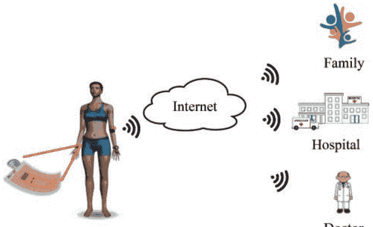

图 4.1 可监测生理和临床参数的植入式传感器。

与安培法传感器相比，生物传感器具有多种优势，包括更高的灵敏度、更优的选择性和更好的稳定性。生物传感器的另一个关键优势是，如果正确使用，它可以提供完美的完整诊断。如果已知生物传感器的电池体积且各种优势完全电解，则相应的通电是数量和浓度的最终度量。供电是阻碍可植入生物电子微器件完成和医疗应用的根本挑战。植入体内的生物传感器瞄准重要区域，以在生物医学中实现关键目标并远程跟踪患者病情。

实现一种在皮下动态复杂区域收集和储存射频能量的新技术对于实施生物医学微芯片是必要的。迄今为止，已经建立了各种无线传输能量的技术，包括超声导波、激光束、电磁感应以及通过射频（RF）传输。在所列替代方案中，通过射频信号进行的无线能量传输是一种高度先进的传输技术。感应充电的应用范围广泛，但线圈（Rx, Tx）之间的窄间隙在医学领域带来了挑战。然而，在医疗保健应用中，它仍然是一个不错的解决方案，因为皮肤深度为 3–5 毫米。这种方法会产生干扰人体生物学参数的热过程。我们无法使用本节前面提到的所有技术来穿透人体皮肤，例如激光可能会灼伤患者的皮肤。在本章中，我们将讨论开发最佳技术的先进技术，以在无需干预的情况下为植入人体的芯片供电。生命体征数据检查正在成为医疗保健技术的重要组成部分。本章首先介绍微芯片插入程序。然后回顾无线电力传输方法，并给出适用的生物医学系统的一些示例。接下来是关于高效无线植入式传感器充电技术的研究讨论，随后是结论。

### 4.2 微芯片插入程序

生物医学芯片的新改进和最新 CMOS 技术促成了用于永久人体健康监测的侵入式生物电子微芯片。植入人体的微芯片使医生能够持续在线调查患者的医疗生命体征数据，从而节省金钱和时间。此外，传感器从常规监督中获得的信息有助于医生和医务人员高效记录患者的病史，以供分析和紧急情况使用。图 4.2 展示了一个带有各种生物传感器的复杂可植入式传感器系统及其进入人体的方法。CMOS 技术提供许多功能，例如小型化外形和可靠的工艺，使其适合于可植入式健康应用。

该平台上的芯片包含许多用于氧气、葡萄糖等的传感器。关于可植入式芯片系统的最新科学研究侧重于小型外形和轻量化特征，以便于实现和出于物理安全考虑 [10, 11]。尽管深 CMOS 工艺大幅改善了整体传感器面积，但电源单元提供了一个强大、全面的系统。

CMOS 技术中超精密计量的路径不仅限于图像传感器、无线系统、微机电系统（MEMS）和射频系统。植入体内的设备要求低能耗和由超精细技术制造的小面积。微芯片传感器技术在生物技术实现中非常实用，其中荧光经常用于标记，特别是用于检测神经活动或细胞。这些特性适用于生物医学应用。因此，CMOS 技术完全适合于生物医学领域的可植入式微芯片及其在各种应用中的使用。日益

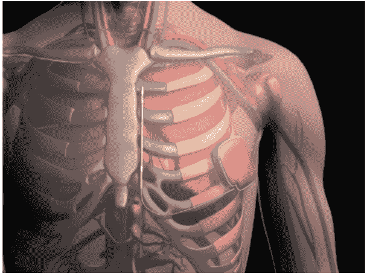

图 4.2 可植入式心脏复律除颤器。


芯片集成密度有助于人类在人体内植入生物传感器，以便在问题发生之前识别人体内的问题。

移除锂电池作为永久供电源可以潜在地减小微芯片尺寸。此外，电源单元（电池）可能导致高泄漏风险，对老年人造成严重健康风险，并需要定期更换。解决这一潜在问题的安全方案涉及开发高效无线充电方法，可随时随地通过环境中WiFi信号、电视台等的射频来充电。

采集电路包括一个或多个多频天线以收集任何射频信号。印刷电路板（PCB）植入体内并连接至生物传感器电池。我们可以通过收集环境中的射频能量来为微芯片电池充电。与电池供电系统不同，无线电池充电最大限度地减少了定期更换电池的需求[12–14]。大量研究将感应耦合[15]作为无线功率充电的潜在方法。非手术能源是最佳且最有效的，同时开发专用技术在充电过程中传输关键信息。标准电位计由三个电极组成：对电极、工作电极和参比电极。参比电极与工作电极之间的电势差催化化学反应性。对电极与提供给处理单元的输出信号相关。植入皮肤下的微系统可以无线将数据传输到人体外的任何设备，例如智能手机、笔记本电脑或可编程逻辑控制器监控控制与数据采集（PLC SCADA）系统，如图4.3所示。外围集成电路（IC）生物传感器或微系统（如电源单元、传感器和微控制单元MCU）集成到系统芯片（SoC）平台上以构建此示意图[16]。

医疗传感器需要遵循某些规则，以确保其在植入个体之前在化学、物理和生物学上都是安全的。所需的监管程度取决于传感器相关的风险程度。可植入生物传感器（如起搏器）比非侵入式传感器需要更严格的规则。因此，在使用健康设备时，了解与特定生物芯片相关的法规并确保传感器合规至关重要。生物电子学微芯片植入技术在图4.4中以示意图形式展示。根据世界卫生组织的规定，每位患者只允许植入一个传感器。医疗专业人员通过简短的门诊手术植入传感器[17]。首先，医疗团队做一个小切口，然后使用专用生物芯片将生物电子传感器植入皮下。随后使用无菌胶带闭合切口[18]。植入体内的芯片不会影响人体器官，因为它不含有任何对人体有害的物质。植入体内的小芯片可以检测血压、血糖水平、心跳和癌症等多种事物，并随后在精确时间中继结果。它可以通过生理参数测量，在人体内部重大问题出现前实现早期检测。

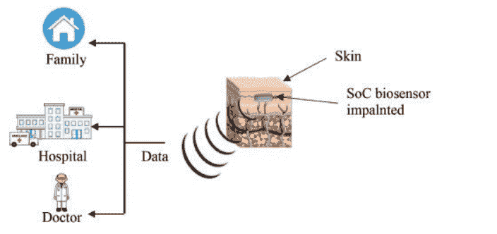

图4.3 皮下可植入生物传感器及关键传输数据。

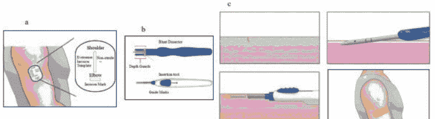

图4.4 生物传感器植入程序。

### 4.3 无线功率传输

无线电力传输技术在不需物理介质的情况下将电力从一个地方传输到另一个地方[19]，因此对于向难以通电的场所和设备（如植入式传感器）传输电力非常有益。在本小节中，我们将介绍用于无线功率传输的当代介质。通常根据所传输物理能量的大小，有四种无线能量传输技术[20, 21]：

- 微波无线功率传输
- 电磁感应能量传输
- 激光无线功率传输
- 超声无线功率传输

#### 4.3.1 无线电力传输的类别

无线电力传输主要有两种技术：感应无线电力传输和辐射无线电力传输，如图4.5所示。

许多能源为传感器供电，包括动态和热能收集器，如压电、射频收集、感应链接和热电换能器。

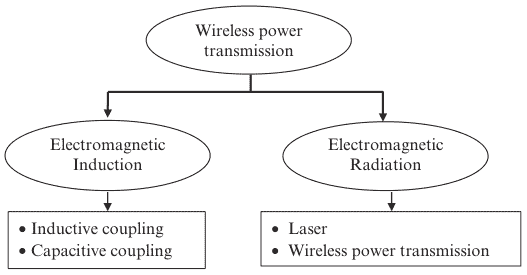

图4.5 不同类型的无线能量传输。

表4.1提供了摘要，显示其尺寸、能量产出和相关产品[22, 23]。

#### 4.3.2 微波无线功率传输

微波功率传输（MPT）是一种用于向难以到达的任何地方（例如皮下微芯片植入体）传输电力的技术。无线能量传输结构由三部分组成：

- 发射器
- 传波区域（空气、皮肤）
- RF/DC电路（整流天线）

图4.6显示了一般无线功率传输系统的结构。

主要要求仍然是高效地将直流（DC）功率转换为微波能量，并以受控、低损耗的方式辐射波。无线功率传输系统需要从RF辐射向目标位置传输足够的功率。

表4.1 不同能源的比较。

| 方法 | 密度 | 优点 | 缺点 |
| :--- | :--- | :--- | :--- |
| 微波无线功率 | 5 W/cm² | 长距离射频功率传输至多个接收器 | 功率较小 |
| 电磁感应 | 7–10 W/cm² | 功率大 | 取决于磁耦合。需要对齐 |
| 激光无线功率 | 2–4 W/cm² | 长距离 | 功率无法传输至多个接收器。环境会降低效率 |
| 超声无线功率 | 1–3 W/cm² | 长距离射频功率传输至多个接收器 | 功率较小。环境会降低效率 |

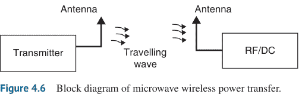

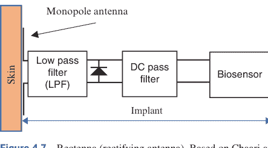

所有天线类型都可用于微波能量传输和通信系统，例如喇叭天线、抛物面反射器、贴片天线、Yagi-Uda天线、相控阵天线、交叉菱形天线等。我们通常选择较大的抛物天线作为MPT技术的固定点，以捕捉和收集最大能量。如表4.1所示，大型抛物天线可捕获的功率仅约为5 W/cm²。因此，我们认为接收天线是整流天线（rectenna）的一部分。接收的RF能量随后转换为直流电，由接收天线捕获，采用整流天线设计[24]转换为直流电，如图4.7所示。

#### 4.3.3 电磁感应能量传输

电磁感应功率传输系统定义了使用交变磁场将感应功率从发射线圈传输到接收线圈的技术[25, 26]。各种产品利用电磁感应能量传输，包括手机、手推车和汽车。感应电力传输方法的概念简单且易于集成。原始设计包括交流电（AC）电源、发射线圈、接收线圈、整流天线和生物传感器。发射线圈和接收线圈之间的关系产生电磁能量。电磁感应无线功率传输的主要优点是低成本高效率。感应关系的概念简单，在小距离下效率极高。该技术的显著缺点是传输的能量量受线圈几何形状限制，且线圈之间的距离不能是几毫米的倍数。Marin教授的方法是开发感应线圈供应商与灯泡之间的近场通信，并利用通过其磁


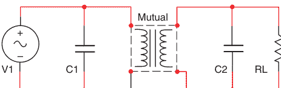

图 4.8 感应互耦。

场以实现中距离能量传输 [27–29]。耦合共振技术可实现普遍稳健的耦合运行模式。

发射线圈（Tx）产生所需的电磁场。感应耦合包含一个由两个线圈组成的松耦合变压器。产生的部分磁通连接到接收线圈（Rx），对应于电磁感应法则。因此，线圈（Rx）中的输出信号与接收线圈中磁通的变化量相关，如图 4.8 所示。

#### 4.3.4 激光无线电力传输

激光是空间能量束传输实验中传输电能的最佳技术。[30, 31] 介绍了现有激光技术的调查。激光能量传输首先通过激光源将直流电转换为光。这些波通过激光光无线传输，然后接收并再次转换为电能，如图 4.9 所示。

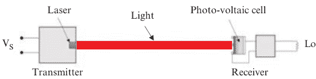

图 4.9 使用激光束的典型无线功率传输示意图。

历史上，该技术的主要缺点是效率低（在 12% 至 20% 之间）以及安全问题。然而，欧洲航空防务与航天公司（EADS）成功使用激光无线电力传输为一台机器人供电。

我们不能将激光能量用作植入式微芯片的无线充电方案，因为激光束可能对患者皮肤构成风险。

#### 4.3.5 超声波无线电力传输

本节讨论了向人体内微型医疗植入物传输无线超声波能量 [32–34]。超声波借助压电换能器产生振动或声波。超声频率高于可听范围，大于 20 kHz [35]，因此，超声波技术提供更好的穿透深度和更短的波长。它还可以通过难以到达的材料传输电磁能，且超声波方法和电磁干扰均不会损害人体组织。超声波设备包括一个外部装置和一个植入皮肤下的片，两侧带有压电换能器并由组织隔开，如图 4.10 所示。该技术依赖于通过组织产生和传播声音。组织中的能量传输需要一个放置在组织表面的外部换能器（发射器（Tx）），并将超声频率与皮肤下的生物传感器芯片（接收器（Rx））直接对抗。电源激活一个将电能转换为超声波的压电换能器。这些超声波将能量通过组织导向体内植入的接收器。换能器的接收器将超声强度转换为电能。低损耗整流器网络整流并滤过输出电压，为生物传感器芯片供电并为电池充电。

传输频率选择不当会不利地影响皮肤衰减以及发射和接收换能器（Tx 和 Rx）的尺寸和瑞利距离。因此，换能器在其谐振频率（$f_r$）下能提供的最大功率取决于换能器的材料和尺寸：

$$f_r = \frac{C}{2d}$$ (4.1)

其中：
C = 声速
d = 换能器厚度。

根据该方程，增加（$f_r$）可最小化换能器体积并提升瑞利范围，代价是增加组织吸收。

在介绍了无线电能分类后，我们将专注于用于给皮下 SoC 植入物充电的感应和射频收集技术。本作品设计并实现了一种利用互感辐射的感应无线充电系统。两个线圈之间的感应链路驱动 SoC，尽管组织厚度为 3-5 毫米（组织宽度）。尽管该技术的空间较短，但可使用高功率 E 类放大器来提升感应距离范围，以增强磁共振。

根据以下方程，超声波无线功率（\(\eta\)）的效率通常取决于换能器损耗、接收换能器使用的能量量、声阻抗匹配、耦合凝胶的效率、整流器损耗造成的损耗以及皮肤吸收：

\(\eta = \left| \frac{P_{out}}{P_{in}} \right|\) (4.2)

提议的电路考虑了上述所有技术参数，为患者体内运行的应用生物传感器提供足够的电力。植入式芯片的真正成功程度取决于它们在不对皮肤产生任何有害影响的情况下安全工作的程度。

### 4.4 无线为植入式传感器供电的高效技术

目前，有许多技术可在植入式生物传感器和外部读取单元之间供电和传输数据。我们将在此介绍和讨论两种解决方案：磁共振耦合和环境射频能量收集，用于任何植入式生物传感器的供电和数据传输。

#### 4.4.1 通过共同感应耦合的感应无线电能传输与数据传输

在这项技术中，感应能量传输依赖于电磁谐振耦合。该技术的规模非常短，不超过几毫米，这对其可行实现构成了重大限制。然而，感应链路结构的分析模型可以通过耦合模式理论（CMT）来发展。我们利用 CMT 方法提出多线圈感应链路，在较大的耦合距离、皮肤吸收损耗和 RF-DC 整流器损耗下显著提高功率传输效率。多线圈感应链路已从电路角度研究过，用于为生物传感器供电。通过共享连接的无线电能和生物医学数据传输的框图如图 4.11 所示。

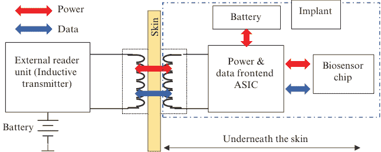

**图 4.11** 带有无线数据和感应无线电源链路的生物传感器植入系统框图。

图 4.11 所示系统包含两部分：外部读取单元（感应发射器）是主部分，生物传感器芯片部分（SoC）是第二部分。感应连接桥接了主部分和生物传感器芯片部分，这对于无线电能传输至关重要。芯片上集成的全桥通过感应耦合为生物传感器提供足够的电能。收集器上采用整流器将感应磁通转换为电能。推荐的通信发送数据在两侧实现，并通过铁氧体耦合电感器与谐振功率槽磁耦合。传输数据有两种处理方法：由电子开关换向控制的发射器和接收器方法。一个信号放大器使用信息源在主部分广播数据。阻抗匹配网络在接收器电路中连接以接收来自发射器电路的数据载波，信息由 MCU 数据采集解调和读取。因此，该设计可以在两种条件下工作：前向数据和后向数据条件，如图 4.12 所示。主电路在转发信息条件下进行上电工作，生物传感器芯片在接收器电路上工作。在后向信息条件下，外部读取单元处于传输数据模式。传感器在发射器电路上工作。

磁谐振链路利用与感应耦合相似的概念，但通过共振以高效率提升磁通传输规模。该技术提供更高的品质因数，且强度损耗与磁通振荡器的能量成正比。品质因数是解释矩形波振荡特征的主要因素，并表征谐振器相对于谐振频率中心的带宽。首先，我们制作两个线圈（Rx，Tx）；对于每个线圈，我们绕制五匝

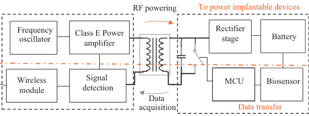

**图 4.12** 感应无线电能和数据传输电路的简单框图。


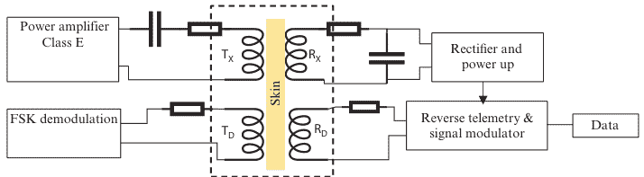
图 4.13 双向数据传输和磁谐振耦合示意图。

直径为 5 mm 的镀锡铜线绕制而成。每个环路均具有内部电感 (L) 和电阻 (R)，两个线圈在相同频率 (50 kHz) 下进行精细调谐。接下来，矩形振荡器信号通过 E 类功率放大器耦合到发射线圈，并以谐振感应方式与生物传感器相连。功率传输线圈 (Tx) 调谐至谐振频率，通过线圈 (Rx) 产生的磁通接收功率。数据线圈 (Td) 调谐至谐振频率，通过发射数据线圈 (Rd) 产生的磁场接收数据，如图 4.13 所示。

本文提出的方法分为两部分：无线供电装置（外部读取单元），如图 4.14 所示，以及植入式微系统（生物传感器）。每一部分都面临各自的挑战。

#### 4.4.2 外部读取单元

外部读取单元由用于为植入式芯片供电的 E 类功率放大器和用于从皮肤下芯片获取数据的高频解调模块组成。

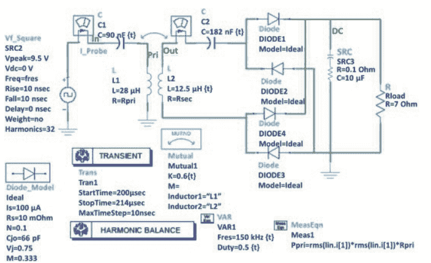
图 4.14 谐振链路简化 ADS 原理图。

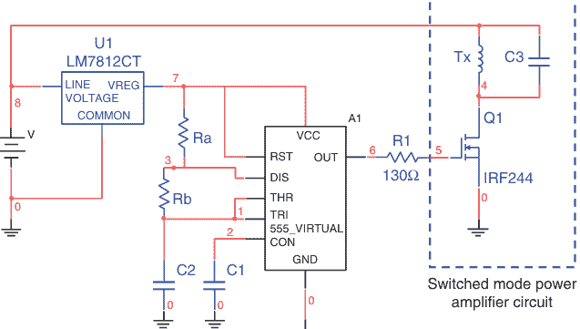
图 4.15 发射部分原理电路。

可采用多种形状构建矩形波振荡器。在本应用中，我们使用 NE555 振荡器 [36, 37]。我们的目标是建立 50 kHz 的频率振荡和 50% 的占空比。由于范围为 3–5 mm，输出信号不足以为生物传感器供电；我们将在振荡器输出端添加一个功率放大级。

要使生物传感器正常工作，需要接收足够的能量。由于线圈损耗、感应阻抗匹配损耗、皮肤吸收损耗和 RF-DC 整流器损耗，从方波振荡器收集的功率不足以无线为生物传感器供电。可采用多种技术来增加传输电量。例如，我们可以使用功率放大器来增强电磁辐射的输出功率。尽管如此，应稳定高功率并防止设备温度超过安全水平。我们使用功率 MOSFET 晶体管驱动发射线圈 (Tx)。功率晶体管由频率约为 50 kHz 的矩形振荡器驱动。

外部读取单元由 12 V 直流电供电，通过开关模式功率放大器（图 4.15）控制源线圈。因此，当输出功率信号增加时，无线电能传输水平也随之增加。为生物传感器运行所需的功率在 2 W 以内。

##### 4.4.2.1 高频解调

当生物传感器芯片传输信息时，信号由接收器 (VR) 接收并由解调电路处理。解调器模块由 RF 包络检测器、低通滤波器 (LPF)、RF 放大器和比较器组成，如图 4.16 所示。数据载波首先进入一级高通滤波器 (HPF) 以去除功率载波，其截止频率为 1.2 MHz，然后进入包络检测器进行数据检测 [38–41]。RC LPF 通常用于减少高频干扰 [42, 43]。接下来，放大器获得参考输入功率。解调模块的最后一个组件是比较器。解码的

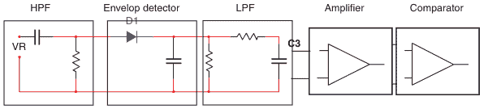
图 4.16 解调模块框图。
信息随参考电压发送到 MCU，与传统串行传输接口匹配。由于采用此调制模块技术，我们最大限度地减少了高频解调过程中的数据传输损失。

#### 4.4.3 微芯片植入体

皮肤下的微芯片植入体由接收电路部分和通过感应链路进行的数据传输组成。

接收电路由两个模块组成：整流电路和通过磁场进行数据传输的电路，但其频率范围大于 RF 供电电路的频率。线圈天线使用 PCB 板上的绕线元件制成。皮肤下的植入式芯片包括连接至桥式整流器和超级电容器的接收线圈，以收集最大电量，如图 4.17 所示。为保持输出信号恒定，使用电压稳压器。

全波整流器是电子电路中的关键部分，用于将感应磁通信号转换为稳定的输出电压，如图 4.18 所示。该过程称为整流。收集的直流电压随 RF 强度电平变化。我们使用两种不同的输入功率进行仿真；第一个 RF 输入为 34 dBm，输出电压为 9.219 V。第二个输入 RF 功率为 45 dBm，输出电压为 20.742 V。这意味着，如果 RF 强度很高，输出会升高。

#### 4.4.4 通过共用感应连接进行数据传输

所提信息传输方法如图 4.19 所示，在两端实现，并通过耦合电感与谐振能量罐磁性耦合。感应功率频率设定为 50 kHz，信息载波频率固定为 1.2 MHz [44, 45]。因此，在此设计中，生物信息载波频率必须至少比能量传输波频率高一个数量级。功率频率在信息

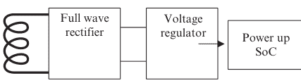
图 4.17 感应无线整流器电路框图。

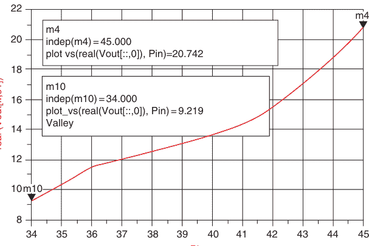
图 4.18 输出电压。
传输上的电压降相对较小，仅在这种情况下，因此数据不会显著降低能量传输效率 [46]。来自传输功率的数据传输噪声降低显著抑制了解调电路设计，并保证无损的生物信息传输。

#### 4.4.5 讨论与结果

电磁辐射技术是一种安全的无线能量传输方法，取决于靠近磁场。然而，来自振荡器的接收功率不足以为植入式 SoC 芯片供电。

通过 5 mm 间隙（皮肤厚度）无线传输的功率取决于 Tx 线圈和 Rx 线圈的效率以及为生物传感器供电所需的对准。然而，还需要更多工作和研究来增加电磁辐射区域，以便皮下植入体可以在外部读取单元的任何位置收集电能。

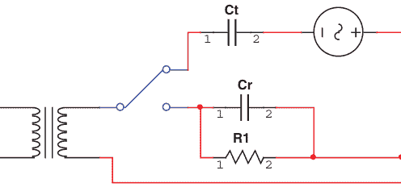
图 4.19 数据传输结构框图。

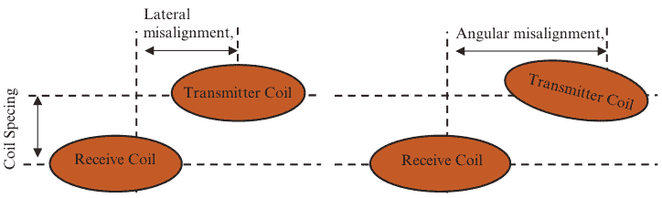
图 4.20 两个具有横向误差和角度误差的线圈之间的感应耦合。

主要目标是展示生物传感器可以在人体外无线充电而不损伤皮肤。此外，该配置旨在测试恒定分离距离下的能量耦合效率（假设人类皮肤厚度约为 3–5 mm）。该技术的效率与两个具有角度误差和横向误差的线圈的耦合有关，如图 4.20 所示。

感应链路的性能取决于三个参数：线圈直径、匝数以及间距和对准。4.1 节中介绍的感应耦合方法既有优点也有缺点。针对这些缺点，高度可行的技术是无线能量传输。另一方面，环境 RF 能量收集可行，可使植入式设备独立于个体轨迹进行供电 [47]，随处可用，且效率高于表 4.1 中引用的所有电源。4.5 节将研究不需要外部供电的环境 RF 能量收集技术，供电能量来自任何 RF 源。

我们已成功研究出同时为植入式传感器供电和通信的方法。

### 4.5 用于侵入式充电的环境 RF 能量收集研究与实现

本节将重点研究 RF 能量污染。我们利用来自商业 RF 广播站（如全球移动通信系统 (GSM)、电视、WiFi 或雷达）的 RF 强度为皮下 SoC 芯片植入体供电。最近，无线电信技术取得了显著进步。因此，城市大气中的电台数量不断增加，例如 GSM 移动基站和 WiFi 接入点。这种 dB/cm² 的密度变化取决于频率尺度和时间，如图 4.21 所示。

在此背景下，RF 能量回收的理念在人体植入微芯片的未来中发挥着至关重要的作用 [48, 49]。许多人可以从许多无线电频率电站（如 WiFi 接入点）获取 RF 能量，以产生电能并通过 RF-DC 芯片有效运行植入式芯片。该子系统由两个部分组成：微波能量收集器和 RF-DC 转换器。RF 能量


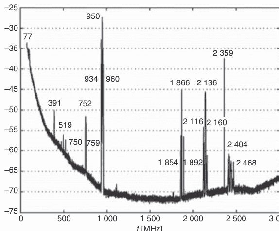

图 4.21 平均环境射频功率。

射频能量收集取决于射频电平强度、贴片天线类型以及 SoC 平台上安装的 RF-DC 电路的效率。收集到的微波能量通常在毫瓦级，这对 WiFi 能量收集技术的普及是一个严重障碍。

射频微波穿透物理皮肤的深度是不同频率的函数，这表明 1 至 4 GHz 的低频微波比 4 GHz 以上的高频辐射具有更好的皮肤穿透性，如图 4.22 所示。在生物样本中，它是频率的函数。根据 Thiele 和 Elsner 的《皮肤生物学中的氧化剂和抗氧化剂》[52, 另见 50, 51, 53, 54]，由于生物样本的高含水量，最常见的微波频率 9 GHz 的穿透深度小于 1 毫米。根据同一研究，WiFi 信号强度可渗透人类皮肤高达 7 毫米。

本研究提出了一种新的解决方案，可不受个人轨迹和位置限制为植入式芯片供电。频率范围为 2.4 GHz 的 WiFi 微波能量具有巨大的穿透患者皮肤并为皮下组织中的植入式芯片供电的能力。我们评估了效率和应用，如图 4.23 所示。

这种供电技术可以成为无线为植入式 SoC 芯片充电的一个非常令人兴奋的解决方案，在其他能源（如激光或风能）不可行的情况下尤为如此。它依赖的直流功率（\(P_{dc}\)）取决于可获取的射频能量（\(P_{RF}\)）以及 RF-DC 电路的效率：

```
\(P_{dc} = \eta_{RF/DC} \cdot P_{RF}\) \quad (4.3)
```

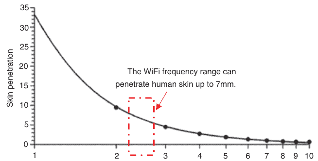

图 4.22 根据频率划分的微波穿透生物皮肤的深度。

效率（$\eta_{RF/DC}$）定义如式 (4.4) 所示，其中（$P_{dc}$）为输出直流功率，（$P_{RF}$）为输入射频功率。电压灵敏度 $\gamma$ 由 (4.4) 给出，其中 Vout 为输出直流电压。

```
\(\gamma = \frac{P_{dc}}{V_{out}}\) (4.4)
```

分形天线阵列的吸引人的结构（如平面形状、坚固性和低成本）在实现皮下 SoC 芯片以回收我们周围主要可获取的微波能量方面具有重要意义。然而，使用分形天线阵列的优势在于它能高效接收 WiFi 频率。因此，我们可以使用此解决方案积累和回收人体周围的大量微波能量。

#### 4.5.1 天线设计与仿真

WiFi 技术包含面向游牧客户的 IEEE 802.16d 标准，使用 2.3–2.4 GHz 频段，以及 IEEE 802.16e。因此，分形

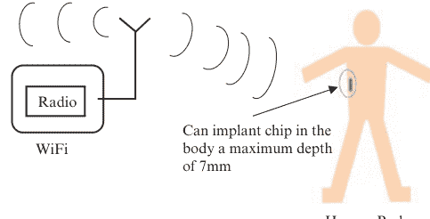

图 4.23 典型的 WiFi 能量收集，用于为植入式芯片供电。

天线阵列在应用中可作为宽带平面贴片天线的替代方案。分形天线的主要优势在于其体积小巧，这对小型和复杂电路至关重要，如图 4.24 所示。此外，这些分形天线还用于多频带和宽带应用，如 GSM、移动通信通用业务 (UMTS)、WiFi 和蓝牙。

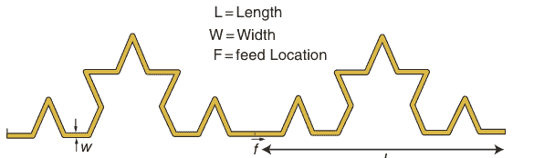

图 4.24 分形天线。

从大气中获取的微波强度主要在毫瓦级，这对 WiFi 能量收集技术的吸引力是一种严重限制。因此，我们创建了一个分形 Koch 天线阵列。分形天线的带宽和增益要求预计将满足多种产品的需求。该区域长 120 毫米，宽 80 毫米。分形 Koch 天线阵列的几何结构如图 4.25 所示。通常，分形贴片天线在 2.3–2.5 GHz 频率范围内需要 100 MHz 的带宽。分形贴片天线使用 MATLAB 天线设计器进行设计和仿真。仿真后，我们可以确定以下参数的值：S 参数、3D 辐射模式、直射度。

S 参数：我们在工作频率 2.45 GHz 时实现了完美的回损，–16.23 dB，如图 4.26 所示。因此，该天线的带宽约为

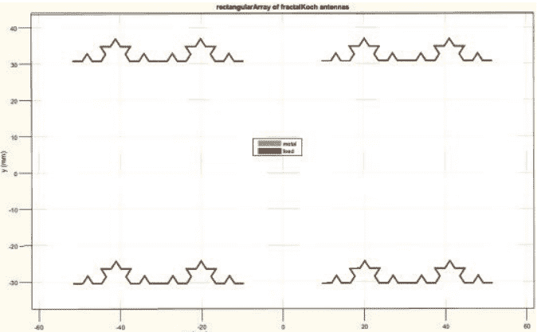

图 4.25 分形 Koch 天线贴片阵列。

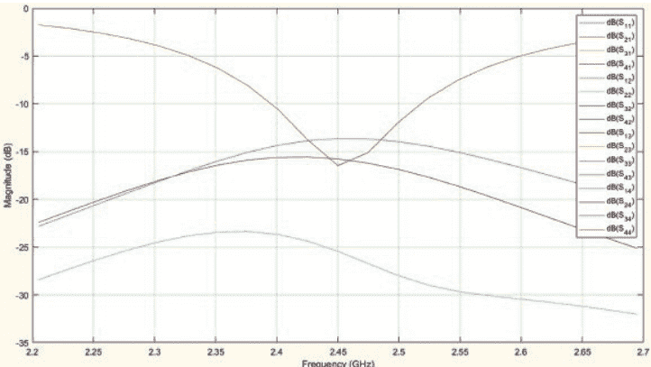

图 4.26 S 参数。

550 MHz (18.26%)，且在 2.45 GHz 时电压驻波比 (VSWR) 在 1.10 以内。

- **3D 辐射模式：** 根据 3D 辐射模式图，我们可以认为分形天线非常定向，并具有约 7.06 dBi 的高效率最大增益，如图 4.27 所示。
- **直射度：** 分形天线阵列在 2.45 GHz 时的直射度增益为 –7.05 dB，如图 4.28 所示。

分形天线的基本特性是其输入阻抗和辐射模式，两者都是频率相关的量。这些量可从阵列阻抗或散射矩阵中针对无损天线获得，从而避免数值积分。

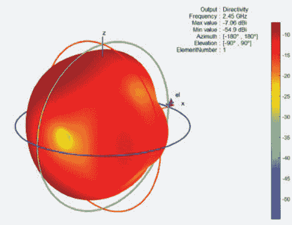

图 4.27 3D 辐射模式图。

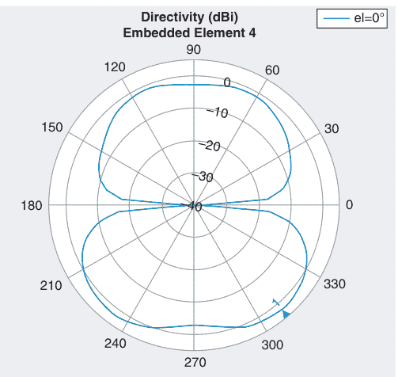

图 4.28 拟议天线的直射度。

仿真达到有源阻抗（R = 48.3 Ω 和 Z = 10 Ω），如图 4.29 所示。

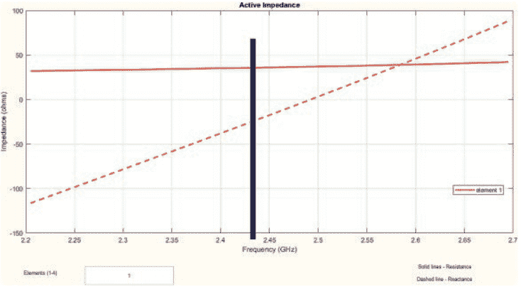

图 4.29 有源阻抗。

皮下天线从任何 WiFi 接入点收集电磁能。此射频输入信号被传输到 RF-DC 电路以转换

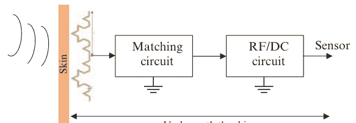

图 4.30 为植入式芯片供电的框图。

电磁能转化为电能，我们可以利用它持续运行植入式芯片，而无需任何医疗干预来充电。整流器是一个通过低通滤波器与偶极子对齐的肖特基二极管，如图 4.30 所示。接收信号随后通过使用 HSMS2822 肖特基二极管的整流电路有效工作。全波桥式整流器的选择与评估将在下一小节 4.5.2 中进行研究。

#### 4.5.2 设计全波桥式整流天线

RF-DC 整流器设计采用全波桥式整流天线。整流器的输入阻抗（Zin = 50 Ω）旨在最大化电力传输并增强来自传感器的反射信号。如小节 4.5.1 所示，分形天线设计在 2.45 GHz 处工作，输出阻抗为 50 Ω [55]。图 4.31 展示了整流器电路的示意图配置。

该电路中使用的启动泵配置是修正的 Dickson 启动泵。该电路已在其他 RF 能量收集项目中广泛使用，并与 Cockcroft–Walton 电压倍增器的形式非常相似。

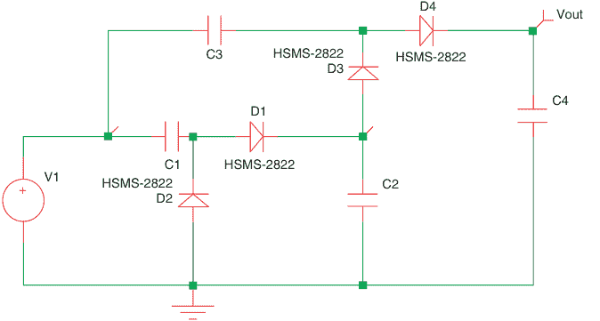

图 4.31 启动泵电路。

采用肖特基二极管的 RF-DC 全波桥式电路仿真结果的输出电压为 (1.979 V)，如图 4.32 所示。

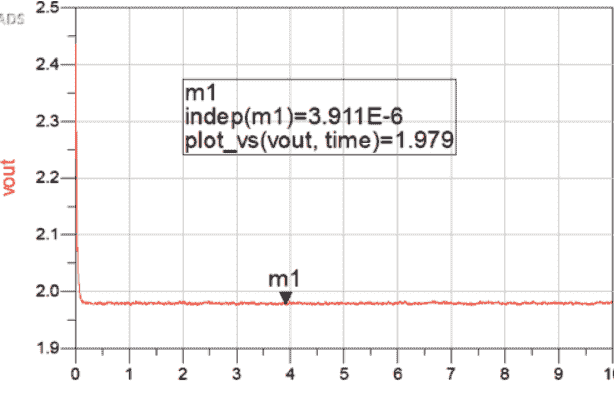

图 4.32 电荷泵级电压。

### 4.6 结论

本文模拟并实验验证了利用射频能量为人体内植入式芯片充电的方法。环境射频能量收集是清洁且可控的，植入式芯片可不受患者移动限制，随时随地运行。相反，感应无线电传输会在植入位置产生热量，干扰人体的生理活动。

在本章中，我们探讨了如何无线为植入式 SoC 芯片充电。我们证明了使用感应通量和射频收集信号来激活人体内任何植入式微芯片的可能性。我们测试了这项研究，并证明 S 波段（WiFi）是为 SoC 芯片充电的合适电源。分形收集天线的反射系数 S11 为 –16.23 dB。因此，该天线的最大增益方向为 –7.06 dBm。我们选择了 HSMS2822 肖特基二极管和经测试批准用于全波桥式整流器拓扑的分形组合天线尺寸。

每个收集电路可提供 1.92 V，该能量足以无线为皮下植入的传感器供电。在本研究中，我们一致认为可以无线优化植入式芯片的配置，并可解锁一种新的解决方案，利用我们生活中的辐射作为能源来激活人体内植入的传感器。这项技术对民用和军事领域的许多应用都至关重要。

未来，我们将研究如何从人体温度、手臂运动、呼吸设备、腿部运动或任何人类


工作或进行任何活动时产生的动作，可转化为能量为植入式芯片充电。

### 参考文献

- 1 RFID, IoT, and AIDC News: Implanted RFID chips in humans being taken to whole new levels. Supply Chain Digest, August 2016.
- 2 Mani, V., Beduk, T., Khushaim, W., Ceylan, A.E., Timur, S., Wolfbeis, O.S., and Salama, K.N. (2021). 针对唾液生物标志物的电化学传感器：一篇综合综述。TrAC 分析化学进展 135: 116164.
- 3 Lamonaca, F., Sciammarella, P.F., Scuro, C., Carni, D., and Olivito, R. (2018). 结构健康监测的物联网。2018 年工业 4.0 和物联网计量学研讨会，95–100.
- 4 Sonmezoglu, S., Fineman, J.R., Maltepe, E. et al. (2021). 使用毫米级超声植入物监测深层组织供氧。《自然·生物技术》39: 855–864.
- 5 Mohamed, M. and Chaudhry, B. (2021) 皮下可植入微芯片健康与安全风险的初步调查，612–618. In: Russo D., Ahram T., Karwowski W., Di Bucchianico G., Tairar R. (eds) Intelligent Human Systems Integration 2021. IHSI 2021. Advances in Intelligent Systems and Computing, vol 1322. Springer, Cham.
- 6 Mohamed, M. (2021) 皮下可植入微芯片使用意图建模，842–847.
- 7 Manickavasagam, B., Balakrishnan, A., and Sudhakara, P. (2019) 无线体域网络 (WBANs) 综述，pp. 645–656. International Conference on Communications and Cyber Physical Engineering 2018. doi: 10.1007/978-981-13-0212-1_66.
- 8 Wali, S. and Al Salam, M. (2020). 无线体域传感器网络综述。International Journal of Engineering and Technology (IJET) 9: 863–870.
- 9 Yilmaz, A. and Ppp, Ppp. (2021) 无线体域传感器网络。https://www.researchgate.net/publication/342339094_Wireless_Body_Sensor_Networks
- 10 Annema, A.-J., Nauta, B., Van Langevelde, R., and Tuinhout, H. (2005). 超深亚微米 CMOS 中的模拟电路。IEEE Journal of Solid-state Circuits 40 (1): 132–143.
- 11 Datta, B. 深亚微米 CMOS 中的片上热感应。Masters thesis, Feb. 2014, University of Massachusetts Amherst, 127.
- 12 Owens, B.B. (ed.) (1986). 植入式生物医学设备用电池。Boston, MA: Springer US.
- 13 Algora, C. and Peña, R. (2009). 利用光为植入式生物医学设备电池充电。Artificial Organs 33 (10): 855–860.
- 14 Staff, E. (2020). 植入式医疗设备锂离子电池寿命评估。Embedded.com.
- 15 感应耦合 - 概述。ScienceDirect Topics。https://www.sciencedirect.com/topics/engineering/inductive-coupling
- 16 片上系统 - 概述。ScienceDirect Topics。https://www.sciencedirect.com/topics/engineering/system-on-chip

- 17 Deiss, D., Szadkowska, A., Gordon, D., Mallipedhi, A., Schütz-Fuhrmann, I., Aguilera, E., Ringsell, C., Block, C., and Irace, C. (2019). 关于常规使用 Eversense（首个长期可植入连续血糖监测系统）的临床实践建议。*Diabetes Technology & Therapeutics* 21.
- 18 Christiansen, M., Klaff, L., Brazg, R., Chang, A., Levy, C., Lam, D., Denham, D., Atiee, G., Bode, B., Walters, S., Kelley, L., and Bailey, T. (2018). 一种新型可植入连续葡萄糖传感器准确性的前瞻性多中心评估：PRECISE II。*Diabetes Technology & Therapeutics* 20.
- 19 Chaari, M.Z. 无线为机器人电池充电系统的设计与生产。US20130147430A1, filed Jun. 13, 2013.
- 20 Chaari, M.Z. (2018). *无线电力传输设备无线电池充电系统的设计与生产*。Scholars Press.
- 21 Chaari, M.Z. and Al-Maadeed, S.A. (2019). 安装在 T 恤上的螺旋天线用于收集射频能量。*2019 年第 1 届电气、控制与仪表工程国际会议 (ICECIE)* 1–6. doi: 10.1109/ICECIE47765.2019.897475.
- 22 Kumari, N. and Rakotondrabe, M. (2020). 基于无铅压电材料的混合热振动能量收集器的开发、展示与测试。*2020 年 IEEE 第 2 届电子、控制、优化与计算机科学国际会议 (ICECOCS)* 1–6. doi: 10.1109/ICECOCS50124.2020.9314542.
- 23 Zhang, Y., Phuong, P.T.T., Roake, E., Khanbareh, E., Wang, Y., Dunn, S., and Bowen, C. (2020). 铁电材料中热电-电化学耦合的热能收集。*Joule* 4 (2): 301–309.
- 24 Chaari, M.Z. and Al-Maadeed, S. (2020). 物联网 (IoT) 的无线电力传输。*IEEE International Conference on Informatics, IoT, and Enabling Technologies (ICIoT)* 549–554. doi: 10.1109/ICIoT48696.2020.9089547.
- 25 Jang, S.G., Kim, J., Lee, J., Kim, J.S., Hwan Kim, D., and Park, S.M. (2020). 基于无线电力传输的可植入神经刺激器。*2020 年 IEEE 无线电力传输会议 (WPTC)* 365–368. doi: 10.1109/WPTC48563.2020.9295553.
- 26 Lee, C.C., Ouyang, H., and Che, G. (2020). 面向电动汽车的新型高能效无线充电系统开发。*IECON 2020 IEEE 工业电子学会第 46 届年会* 3617–3621. doi: 10.1109/IECON43393.2020.9255192.
- 27 Joannopoulos, J.D., Karalis, A., and Soljacic, M. (2020). 无线非辐射能量传输。https://scholar.google.com/citations?view_op=view_citation&hl=en&user=jpqaJIMAAAAJ&cstart=20&pagesize=80&sortby=pubdate&citation_for_view=jpqaJIMAAAAJ:71dY1FijdoC.
- 28 Cheng, C., Li, X., Xu, G., Lu, Y., Low, S.S., Liu, G., Zhu, L., Li, C., and Liu, Q. (2021). 无电池、无线且柔性的电化学贴片，用于通过近场通信进行体内汗液皮质醇原位分析。*Biosensors & Bioelectronics* 172: 112782.
- 29 Olenik, S., Lee, H.S., and Güder, F. (2021). 基于近场通信的无线感知的未来。*Nature Reviews Materials* 6 (4): 286–288.
- 30 Lee, S., Lim, N., Choi, W., Lee, Y., Baek, J., and Park, J. (2020). 激光无线电力传输系统 MPPT 控制电池充电转换器研究。*Electronics* 9 (10): 1745.
- 31 Kim, S.-M. and Park, H. (2020). 使用近红外激光二极管的光无线电力传输优化。*Chinese Optics Letters* 18 (4): 042603.

- 32 Taalla, R.V., Arefin, M.S., Kaynak, A., and Kouzani, A.Z. (2019). 小型化超声无线电力传输至可植入式医疗设备综述。IEEE Access 7: 2092–2106.
- 33 Radice, J.J., Tseng, V.F.-G., Drummond, T., Diamond, D., Schieuer, N., and Bedair, S. (2020). 包含黏弹性和声发射的无线电力传输超声弹性波衰减多物理场建模。Mechanics Research Communications 115: 103600.
- 34 Guida, R., Demiros, E., Dave, N., and Melodia, T. (2020). 水下超声无线电力传输：水下物联网无电池平台。IEEE Transactions on Mobile Computing 1–1. doi: 10.1109/TMC.2020.3029679.
- 35 Kural, A., Pullin, R., Featherston, C., Pagel, C., and Holford, K. (2011). 使用超声导波的无线电力传输。Journal of Physics: Conference Series 305: 012088.
- 36 Besharati, B., Lak, A., Ghaffari, H., Karimi, H., and Fattahzadeh, M. (2021). 基于种子物理特性和电容估计水分含量模型的开发。Sensors and Actuators A: Physical 318: 112513.
- 37 Orovwode, H., Matthew, S., Agbetuyi, A.F., Adoghe, U.A., and Amuta, E. (2021). 三相感应电机带保护系统的启动器开发。Journal of Engineering 2021: 1–8.
- 38 Estes, N. and Chisum, J. (2021). 用于 K 频段包络检测器基带输出的 10MHz-1GHz 减小分流电容混合 LNA。2019 United States National Committee of URSI National Radio Science Meeting (USNC-URSI NRSM) 226–227. doi: 10.23919/USNC-URSINRSM51531.2021.9336482.
- 39 Gazivoda, M., Oletic, D., and Bilas, V. (2020). 音频频率下唤醒传感器接口包络检测器的特征与比较。2020 IEEE International Instrumentation and Measurement Technology Conference (I2MTC) 1–6. doi: 10.1109/I2MTC43012.2020.9128810.
- 40 Delshadoopur, S. and Geng, M. (2020). 带辅助通路的 PLL 基础 FSK 解调器。2020 IEEE 11th Latin American Symposium on Circuits & Systems (LASCAS) 1–4. doi: 10.1109/LASCAS45839.2020.9069002.
- 41 Zahiruddin, S., Srinivasulu, A., and Sarada, M. (2020). 使用二代电流控制传输机的新型 FSK 发生器。Nanoscience & Nanotechnology-Asia 10 (6): 902–908.
- 42 Li, L., Xu, Y., Zhang, Z., Yin, J., Chen, W., and Han, Z. (2019). 无线供电物联网中的基于预测的充电策略和干扰缓解方法。IEEE Journal on Selected Areas in Communications 37 (2): 439–451.
- 43 Mathur, P. and Raman, S. (2020). 电磁干扰 (EMI)：测量与降低技术。Journal of Electromagnetic Materials 49 (5): 2975–2998.
- 44 Patiño, A.G. and Menon, C. (2021). 可穿戴监测设备感应式纺织传感器的设计与验证。Sensors 21 (1): 225.
- 45 Kassanos, P., Rosa, B.G., Keshavarz, M., and Yang, G.-Z. (2021). 可穿戴和可植入设备中的电源与数据通信。In: Wearable Sensors (ed. E. Sazonov), 279–309. Elsevier.
- 46 Wu, J., Zhao, C., Lin, Z., Du, J., Hu, Y., and He, X. (2015). 使用频分复用的共同感应链路无线电力与数据传输。IEEE Transactions on Industrial Electronics 62 (12): 7810–7820.


- 47 Clerckx, B., Zhang, R., Schober, R., Ng, D.W.K., Kim, D.I., and Poor, H.V. (2019). 无线信息与功率传输基础：从RF能量收集器模型到信号与系统设计. IEEE 选定领域通信期刊 37 (1): 4–33.

- 48 Grossi, M. (2021). 无线传感器网络和移动设备的能量收集策略：一项综述. 电子 10 (6): 661.

- 49 Moghaddam, N.A. and Maleki, A. (2019). 基于频谱感应的无线设备充电RF能量收集系统与电路. IntechOpen.

- 50 Cleary, S.F. (1983). 微波辐射对人体的影响. BioScience 33 (4): 269–273.

- 51 Elston, D.M. (2020). 冠状病毒（COVID-19）流行期间医护人员中的职业性皮肤病. 美国皮肤病学会杂志 82 (5): 1085–1086.

- 52 Thiele, J. and Elsner, P. (eds.) (2001). 皮肤生物学中的氧化剂和抗氧化剂. 巴塞尔；纽约：Karger.

- 53 Bajakke, P.A., Malik, V.R., Mugali, P., and Deshpande, A.S. (2021). 工程材料的微波加工. In: 涂层：材料、工艺、表征与优化（K. Kumar, B.S. Babu, 和 J.P. Davim 编）, 31–55. Cham: Springer.

- 54 Amin, B., Shahzad, A., Crocco, L., Wang, M., O'Halloran, M., González-Suárez, A., and Elahi, M.A. (2021). 骨质疏松监测骨骼微波成像的可行性研究. 医学与生物工程与计算 59 (4): 925–936.

- 55 Khan, D., Oh, S.J., Shehzad, K., Basim, M., Verma, D., Pu, Y.G., Lee, M., Hwang, K.C., Yang, Y., and Lee, K. (2020). 用于RF能量收集的宽输入功率范围高效可重构RF-DC变换器. IEEE Access 8: 79310–79318.

## 5 预测心力衰竭的微创和非侵入式传感器技术

概述

侯赛因·埃内斯·萨尔曼，马哈茂德·哈蒂布·A.A.·阿尔-鲁韦迪，哈森·M.·奥凯德，和侯赛因·恰加泰·亚尔钦

### 5.1 引言

心力衰竭（HF）是最常见的临床综合征之一，其特征是心肌无法向循环系统提供足够的血流。HF的症状包括踝部水肿、呼吸困难和疲劳，由颈静脉压力升高、肺部啰音和外周水肿引起 [1–3]。全球HF患者人数估计为2600万 [4]。频繁住院和生活质量差是HF患者的严重风险。据报道，只有约10%的慢性HF患者在诊断后存活10年 [5, 6]。HF是一种慢性进行性疾病，因此HF患者的再入院率和急诊就诊率较高。约25%的HF患者在一个月内再次入院，其中至少一半的再入院是由于HF相关症状引起的 [7]。这些事实表明HF治疗的经济负担和医院工作量很大。

当发生充血（即体液过度积聚）时，HF患者需要住院 [8]。充血主要与体内水钠潴留有关，导致左心室舒张末期压力升高 [9, 10]。充血的症状可列为呼吸困难、啰音和水肿 [11]。治疗充血最常用的方法是静脉注射利尿剂，以尽量减少体内液体积聚 [8]。利尿剂帮助肾脏将更多钠排入尿液，过多的钠会导致更多水分从血液中被带走，从而减少体内液体量。

目前HF诊断的金标准是通过心导管植入压力传感器来测量心腔充盈压力 [12]。然而，心导管的侵入性限制了其在HF患者中的常规使用 [10]。此外，植入式压力传感器的成本超过20,000美元，数百万HF患者无法负担 [7]。这凸显了对一种廉价、非侵入式、易于应用且准确的HF诊断方法的需求。

文献中建议采用替代性非侵入式模式来监测HF患者并诊断需要住院的危急HF阶段。这样，可以通过使用非侵入式和微创传感器远程监测患者来防止不必要的住院 [3]。远程监测的效率仍有争议，但许多研究表明，外部监测的患者再入院率降低，生活质量提高 [3]。为此，采用带有嵌入式非侵入式传感器的外部设备或可穿戴设备。通过从非侵入式传感器获取数据，可以跟踪HF患者的健康状况，并在紧急情况下提供临床治疗，紧急情况通过评估测量数据的异常变化来识别。这种方法也称为家庭监测或远程患者监测 [3]。

在本章中，我们解释了用于HF诊断的非侵入式和微创传感器技术及技术。我们还总结了具有里程碑意义的研究和临床试验，证明了非侵入式监测HF患者的潜力。

### 5.2 方法

识别HF恶化的方法可列为：体重测量、心电图（ECG）、生物阻抗监测、活动追踪、植入式压力传感器、肺超声监测、声音和多普勒传感器测量、心地图、心球图、光电容积描记法以及循环血中利钠肽水平的测量。这些方法将在本章中详细说明。

#### 5.2.1 体重测量

HF恶化状态的特征是循环血量过度减少和体内水分潴留 [3, 13]。根据体内水平衡的变化，紧急情况下会出现体重突然增加。如果体重增加率高于2 kg/48小时，则可评估为即将发生HF失代偿导致的恶化 [3]。

许多远程监测研究将体重测量用作HF患者再入院指标 [14–24]。体重测量可以使用体重秤或鞋集成压力传感器轻松每天进行。然而，鞋中使用的压力传感器在长期监测中可能导致不准确 [25]，因为有几个因素会降低测量精度，例如日常生活中不同的活动水平以及个体特定的姿势和步态障碍。或者，患者可以使用浴室秤作为HF自我管理的一部分，每天进行体重测量 [26, 27]。

#### 5.2.2 心电图（ECG）测量

心电图测量是HF诊断中广泛使用的非侵入式方法 [28, 29]。该方法基于使用放置在胸部皮肤上的电极测量心脏的电活动 [30]。电极识别心跳过程中心肌去极化和复极化产生的电压差 [31]。在12导联心电图测量中，10个电极放置在四肢和胸部。通过利用心脏与电极之间的不同角度来测量心脏的电位。

测量通常记录10秒，以便在整个心脏周期内监测电去极化 [32, 33]。心电图信号的主要组成部分为P波、QRS波群和T波。

几个ECG参数被用于预测HF及其在HF患者中的恶化 [3]。最常用的ECG参数包括：心率变异性降低 [34]、心率增加 [35]、QRS/T角增加 [36]、心房和心室快速心律失常 [37, 38]、心电图左心室质量指数增加 [28, 39]、QT期延长 [40]、QRS波时程增加 [41, 42] 和左心室应变 [20, 43, 44]。降低的心率变异性可通过昼夜间心率的时间差来确定 [34]。心率变异性可以通过检查连续5分钟R-R间隔均值的标准差来确定。如果ECG左心室质量在男性中超过70 ± 9 g/m²，在女性中超过61 ± 8 g/m² [28, 39]，或者校正后的QT时程在男性中超过450 ms，在女性中超过460 ms [40]，则存在HF的潜在风险因素。QRS时程高于100 ms [41, 42, 45]、T波倒置和ST段压低 [20] 也被评估为HF的指征。

#### 5.2.3 生物阻抗监测

生物阻抗分析是评估体成分和体液过载的一种非侵入式方法 [46]。阻抗是定义电流流动阻力的电参数。在生物阻抗监测中，使用高频低幅电流在体内测量生物阻抗 [47]。身体组织和体液具有不同的电阻，从而改变电流的流动行为。在HF失代偿场景中，液体潴留导致肺充血，肺部的体液过载会影响胸部区域的生物阻抗。与胸部组织和空气相比，血液和体液对电流流动的阻力较低。这意味着随着体液含量增加，生物阻抗会降低。因此，生物阻抗与体液量呈负相关 [48–50]。预计健康且相对干燥的肺部比因HF引起肺水肿的肺部具有更高的阻抗 [51]。生物阻抗监测对HF患者很重要，因为胸部阻抗的变化在观察到严重症状和住院之前就开始发生。

传统的非侵入式生物阻抗分析（也称为经胸阻抗心电图）使用放置在皮肤上的四个或六个电极来测量胸部电阻的变化。低幅恒定电流从一个电极发出，由其他电极测量，从而确定通过胸部的电压差和阻抗 [47]。

生物阻抗水平因每位患者而异，这是由于体成分中脂肪和肌肉百分比等个体特征、...的量


体毛和皮肤状况 [10]。因此，为急性心力衰竭状态确定临界阻抗的精确值具有挑战性。因此，对每位患者采用个体化分析，用于追踪生物阻抗水平的相对增加 [10]。通过每隔一小时或每天远程进行生物阻抗测量，临床医生可以追踪阻抗的相对变化，并在胸部阻抗出现突然且急剧下降时采取治疗措施。

作为生物阻抗监测的近期应用，远程介电感应技术（ReDS）利用肺部液体状态和胸部组织介电特性的变化来预测心力衰竭状态 [52–54]。在此应用中，使用一件可穿戴背心，在前侧和后侧放置两个传感器。低功耗电磁信号由已实现的传感器在穿过胸部组织后发射和接收 [55]。无需直接皮肤接触即可进行测量，因此该方法可以在薄衣物上应用。电磁信号主要受路径中胸部组织液体含量的影响 [55]，预测的肺部液体平衡可用于在心力衰竭失代偿时识别充血 [53]。

#### 5.2.4 计步器和活动追踪器

心力衰竭的常见症状之一是运动能力受限，导致人们无法执行日常任务。建议心力衰竭患者进行定期体力活动以改善其功能能力 [56–58]。步行是一种安全高效的体力活动形式，计步器用于计算步数 [56]。通过这种方式，可以使用集成到配饰和衣物中的生物传感产品远程监测患者的活动水平 [3]。

计步器和活动追踪器是便携式电子设备，可使用全球定位系统（GPS）接收器测量患者行进的距离。由于每个人的步长不同，需要进行校准以确定准确的步数。还有一些计步器包含惯性微机电系统（MEMS）传感器，用于利用三个空间维度上的身体加速度来检测步数 [58–60]。使用这些便携式设备，临床医生可以跟踪心力衰竭患者的总体力活动，在体力活动严重减少时，可以将患者召回接受医疗护理。这还有助于心力衰竭患者跟踪自身体征数据，并在面临更严重心力衰竭症状之前采取预防措施。

#### 5.2.5 植入式压力传感器

基于传感器的设备监测概念是改善任何长期心力衰竭疾病管理结果的绝佳前景 [61]。随着心力衰竭患者中心脏可植入传感器的迅速增加，一些心力衰竭监测策略已更广泛地利用此类芯片 [61]。当然，与其他心力衰竭监测标准（例如诊所内监测，患者在实时物理接触中充当传感器）相比，植入式传感器的使用具有多项优势，这些标准主要受多种因素限制，包括主观性、患者能力差异以及在早期心力衰竭诊断过程中对症状的敏感性差 [61]。

此外，植入式传感器具有多项优势，包括实时连续监测、基于主观测量的自主评估，以及能够相对容易地分析特定患者的医疗状态并提供及时档案的能力。

识别恶化心力衰竭的主要方法之一可以是植入式设备，如压力传感器 [62]。值得指出的是，早期发现任何临床状况恶化的迹象有助于快速进行医学预防性干预，以优化和识别心力衰竭状态。因此，不仅医疗专家可以从减少医疗治疗和单调检查中获益，患者也可以从有效监督其心力衰竭状态中获益。事实上，在过去十年中，随着监测心力衰竭价值的日益认可，用于心血管治疗的设备植入量呈指数级增长 [62]。在基于心血管治疗的设备中采用植入式压力传感器，代表了通过实时测量体力活动和心脏节律/事件以及监测不同心脏压力来感知任何健康故障，从而持续关注患者临床心力衰竭状态的非凡前景。

诊断心力衰竭的关键因素是心室充盈压力升高，因此，心力衰竭疾病监测的重点一直在于通过药物和设备治疗实现最低可能的心室充盈压力。因此，通过植入式传感器持续监测心脏压力的机会已被证明是一个有吸引力的机会。早期研究 [63] 确立了基于心脏压力的传感器长期监测的安全性和可行性，并认识到植入式心脏压力传感器测量与心力衰竭发作之间存在杰出的关联。从这个角度看，将压力变换器耦合到起搏器或除颤器的心室导线上，提供了持续心脏压力监测的最简单形式。通过植入式压力传感器，可以远程监督三大类动脉压力以反映患者的心力衰竭状态：（i）右心室（RV）压力，（ii）左心室（LV）压力，以及（iii）肺动脉（PA）压力。

确实，可以使用安装在起搏器导线尖端（位于右心室流出区）的基于压电的芯片来监测患者的右心室压力 [64]。然后，可以通过在峰值时间（相对于时间的压力变化率）取右心室压力值来估计动脉舒张压 [65]。一项关于右心室压力引导治疗组的特定研究 [66] 显示心力衰竭住院率下降，静脉利尿剂需求减少约 20%。对同一组的后续分析显示心力衰竭事件减少约 20%。此外，高右心室压力与室性心动过速失常风险增加相关 [67, 68]。

左心房（LA）压力传感器由放置在室间隔上的传感器导线组成，并连接到线圈天线，用于遥测来自左心房的传感器信号。在一项严重心力衰竭患者试验 [69] 中，使用左心房压力监测导致左心房压力下降，并证明了左心房压力传感器的稳定性、安全性和有效性（潜在肺栓塞风险）。

包括 Abraham 等人 [39] 在内的各项研究已证实，心内压和肺动脉压力的增加出现在心力衰竭失代偿开始之前。一种压力变换器，如 CardioMEMS HF 传感器 [70, 71]，可以布置在肺动脉的任何分支中。此类传感器允许监测肺动脉压力以改善心力衰竭患者的预后。Smeets 等人 [10] 的试验表明，在常规护理之外每日测量肺动脉压力可使心力衰竭相关住院率降低约 40%，并与对照组相比改善了生活质量评分，同时住院时间显著缩短，从近 4 天缩短至 2 天。

CardioMEMS HF 传感器 [39, 72, 73] 是第一个经过临床验证的心力衰竭监测系统，已被证实可显著减少心力衰竭住院人数并改善生活质量 [39]。此外，临床已证实其在平均 1 年内可将住院人数减少约 60% [72]。该几乎无需电池的心力衰竭系统揭示了许多优势，包括无需患者前往诊所或医院即可使用传感器信息，因为系统会定期将测量结果无线传输给相应的护理人员/医生。

总结来说，基于远程无线压力传感器的系统是有价值的设备，可以通过使相应患者保持受控状态、远离医疗健康中心以及维持相对稳定的生活质量，来支持多个心力衰竭诊所 [74]。随着基于心脏压力传感器的监测系统在数据收集方面实现自动化，更智能、更小型的远程护理将成为心力衰竭患者健康评估中必不可少的一部分，尤其是在考虑到 COVID-19 大流行背景下最近对虚拟就诊的重视之后 [74]。

#### 5.2.6 肺超声

肺超声（LUS）是一种准确的无创方法，可用于量化已知或疑似心力衰竭患者的肺血管外水（EVLW）[75]。这是一种安全、高效且可靠的方法 [76]。

肺超声在危重症和心血管医学中的概念或许被视为过去几十年来出现的新想法，但其起源可追溯至更早的时期——1946 年 [77]。由于普遍认为肺部含气量高，不适合作为超声波传播介质，因此长期以来被忽视 [78]。B 线伪影的发现以及利用其存在及总和作为心力衰竭指标，使肺超声在心脏病学中具有重要意义。超声研究包括形成软组织成像的三种基本模式：（i）振幅模式（A 模式），（ii）动态模式（M 模式），（iii）亮度模式（B 模式）[80]。在本节中，我们将讨论仅限于第三种模式。

用于心力衰竭应用的肺超声主要依赖于 B 线伪影检测。多发性和弥漫性 B 线的存在与肺血管外水的存在相关 [81, 82]。在典型的 B 模式下，超声脉冲构建二维图像 [83]。在正常通气的肺部，超声图像会显示 A 线，即由规则间隔的水平线和两个相邻表面之间的混响伪影组成，这两个表面是探头/体表面和肺泡中的胸膜/空气 [84]。包含 A 线伪影的肺部图像通常称为干肺。当间质或肺泡间隙中存在液体时，由于混响现象，B 线开始成形，目前理解这意味着


当超声波被困在具有不同声阻抗的材料之间时，会发生混响伪影 [85]。肺组织密度的增加会导致从占优势的 A 线向弥漫性 B 线的转变，这种现象被称为滑动 [86]。B 线，以前被称为彗尾或肺彗，被定义为从屏幕底部产生并与肺滑动同步移动的离散激光样垂直线 [81, 87]。肺 B 线不仅特异于 HF 症状，还可在许多其他情况下出现，例如肺水肿 [88]、肺炎 [89]、系统性硬化症 [90]、急性肺损伤 [91] 和其他呼吸道疾病 [92]。

影响 LUS 图像中 B 线出现质量和数量的因素有多种，例如患者体位、所用设备、片段长度、探头选择、操作者经验以及区域数量 [93]。检查指定胸部区域的当前设置最少可达两个区域，最多可达 36 个区域。最佳建议是八个区域。

B 线可通过心脏探头、凸阵探头或线阵探头进行可视化 [94]。LUS 中有两种主要扫描方式，但无论哪种方式，探头都必须放置在肋间隙。第一种方法是纵向扫描，第二种是横向（斜向）扫描。在纵向扫描中，肋骨及其阴影是图像的一部分。另一方面，横向方法使操作者能够可视化不受肋骨阴影干扰的更宽范围的胸膜线 [95]。最重要的参考点是带有肺滑动的胸膜线，因为如果不清晰地可视化它，就无法获得任何关于肺通气的信息。患者应采取坐位、半卧位或仰卧位。此外，如果进行连续检查，患者应保持相同体位，因为影像中 B 线的出现很大程度上受患者体位影响 [96, 97]。如果患者呼吸正常，成像片段的最佳长度为 6 秒 [98]。

在 HF 诊断和监测中，B 线应呈弥漫性、双侧性和多发性。弥漫性意味着线条应在两个区域相邻，双侧性意味着它们应在左右半胸可见，多发性意味着它们数量众多 [95]。已开发出许多定量系统来分类和评估 B 线数量，以识别患者在出院期间及之后所处的风险水平。这些方法可分为：
- 计分方法
- 基于计数的方法

计分方法通常依赖于一个肋间隙中 B 线的最小数量，将其标记为阳性区域并累加阳性区域的数量。此外，线条可以逐个计数，或在汇合时计数，或按百分比计数，统称为基于计数的方法 [99]。这些定量系统对于预测恶化 HF 的死亡率和住院率非常重要，许多研究表明它们是 HF 的预后标志物 [100–108]。

用于 HF 诊断和预后监测的 LUS 方案有很多。目前使用最广泛的方案包括：
- 床旁急诊肺超声 (BLUE) [109]
- 肺超声限制液体治疗方案 (FALLS-protocol) [110]
- 心脏骤停超声检查 (C.A.U.S.E.) [84]
- 肺心脏超声 (LuCUS) [111]

LUS 是一种用于 HF 预测和预后监测的强大且灵敏的技术。它易于应用、广泛可用，且学习曲线短 [112]。尽管 LUS 是肺和心脏影像学的强大工具，但存在一些局限性，包括对操作者技能的依赖、硬件的质量和设置 [113]，以及特异性不足，因为 B 线可能存在于许多其他情况中。然而，随着新算法和深度学习方法的融合，LUS 未来有望进一步发展并变得更具特异性 [114]。

#### 5.2.7 声传感器

心脏内外的血流以及负责控制此血流的结构的运动使心脏能够发出声音 [115]。心音有四种类型：
- 成年健康人的主要心音，包括第一心音 (S1) 和第二心音 (S2) [115–118]
- 额外心音，包括第三心音 (S3) 和第四心音 (S4) 的奔马律 [119–123]
- 心脏杂音，见于先天性异常 [124–128]
- 其他异常声音，如附加音、咔嗒声（click）[129, 130]、摩擦音（rubs）[131]、啪音（snaps）[132]、敲击音（knocks）[133] 和拍击音（plops）[134–136]

在 1816 年 Laënnec 发明听诊器之前，除非医生将耳朵贴在患者胸部，否则无法听到心脏声音 [137]。听诊器使诊断时能够听取和解释心脏声音。科学家的贡献以及物理概念和技术补充的引入，使我们能够研发出用于心音分类的声音传感器。

健康成年人的正常心音为 S1 和 S2 [138]。其他声音的存在可能是心血管问题的指示。例如，S3 音的存在可能提示贫血、甲状腺功能亢进、二尖瓣反流、肥厚型心肌病、主动脉和三尖瓣反流以及左心室功能不全等病理问题 [135]。S4 音可由高血压、主动脉狭窄和反流、严重二尖瓣反流、心肌病和缺血性心脏病引起 [139]。区分不同心音的能力在所有执业者中是一致的，尤其是因为某些声音（如对 HF 诊断至关重要的 S3 音）难以区分。因此，转向心脏声音信号的自动分类变得很重要，以通过例如听诊器、电容麦克风或压电声学传感器检测的信号实现更好的诊断 [140–142]。

在过去几十年中，基于心音图和超声心动图，出现了多种用于更好检测心脏声音的传感器。这些传感器专注于改善信号处理和降噪。2004 年，Reed 等人开发了一种基于声波小波分解的原型机和基于神经网络的分类器来模拟心脏声音的产生，该分类器能够检测异常心音，对预测 HF 非常有用 [143]。在另一项工作中，一种胸部佩戴的对心脏呼吸声音具有高灵敏度的加速度计基于不对称间隙悬臂，该悬臂由底层机械层和顶层压电层组成，两者之间由一个间隙分隔，并带有内置放大器以放大电压传感器的输出 [144]。Mubarak 等人发表了以改善心音图 (PCG) 信号质量和去除噪声及损坏信号为中心的工作，这使他们能够基于使用支持向量机的同态滤波准确地识别和定位 S1 和 S2 音 [145]。Gupta 等人使用商用的 Audicor (Inovise Medical, Oregon, USA) 设备，该设备使用 10 秒 PCG 来检测 S3 音。他们使用专有算法，S3 强度按 0–10 量表评级。当 S3 强度大于 5 时，认为存在 S3 音。他们通过将旧传感器替换为新传感器对，能够重复数据 [146]。在他们的工作中，Chen 等人使用深度神经网络 (DNN) 仅基于声学特征来识别 S1 和 S2 音，方法是先将信号转换为梅尔频率倒谱系数 (MFCC) 序列。K-means 算法被应用于将 MFCC 特征聚类为两组，以完善其表示和歧视能力。然后将完善后的特征输入 DNN 分类器以执行 S1 和 S2 识别 [147]。在一项针对可听 S3 的 HF 患者的无创性试点研究中，Siejeko 等人研究了在可植入心脏复律除颤器 (ICD) 脉冲发生器中的加速度计进行心脏声音测量的可行性。他们的研究结果显示，在包括 16 名受试者在内的所有加速度计位置都检测到了 S1、S2 和 S3 振动。然而，S3 不可听，因为当信号带宽增加时，S2 的大部分为次声波（低于 20 Hz）。他们得出结论，在植入部位，无需特殊导线即可使用脉冲发生器内嵌电路来测量心脏声音，包括 S3 振幅和心音时间间隔 [148]。

#### 5.2.8 地心动图

地心动图 (SCG) 是一种无创方法，基于测量胸部对心脏和动脉树中血液运动的反应所产生的振动 [149]。振动测量可以使用放置在胸部（尤其是胸骨中部周围）的基于 MEMS 的三轴加速度计进行 [7, 150]。由于 SCG 测量不受体液干扰，因此无需使用多个传感器。SCG 信号波形由与主动脉瓣开启和关闭状态以及血液从左心室射入主动脉相对应的部分组成。SCG 研究的假设取决于 HF 患者在体育锻炼前后信号的相似性 [7]，因为 HF 患者在运动期间增加心脏性能的储备较少。换句话说，HF 患者的 SCG 信号在运动和休息条件下相似。另一方面，健康个体在运动和休息期间的信号振幅相对有所改变。通过比较休息和运动期间记录的信号，可以无创地预测患者的 HF 严重程度。记录的时域信号将转换为频域以进行详细研究。运动期间，SCG 波中的高频成分在健康个体中比 HF 患者的 SCG 信号更明显 [7]。

#### 5.2.9 球心动图

球心动图 (BCG) 是一种无创技术，用于检查心脏周期中血液射出所引起的运动 [151]。BCG 在位移、速度或加速度方面测量全身的反应


归因于心腔和动脉中血液运动（特别是主动脉）以及心肌运动产生的机械力。

BCG信号可以通过一种改良的体重秤来测定，该秤能够测量足底的响应。由于波在体内传播，ECG和BCG信号峰值之间存在相位差。BCG波中还存在ECG信号中未观察到的次级峰值。在经典BCG中，早期峰值H是由于收缩期心脏收缩引起的，而主要IJK复合波是由于心室射血和主动脉血流引起的[151, 152]。在1955年至1980年间BCG已被广泛研究，但到2010年该方法几乎消失，主要是由于缺乏标准化的测量技术和对信号来源缺乏理解[151]。然而，近年来由于静电敏感传感器和压电薄膜等传感技术的进步，BCG研究再次增加[153–155]。这些传感技术简化了基于体重秤或床/椅子式传感器应用对BCG信号的非侵入式测量，这些应用能够在站立或坐姿下测量BCG信号[156, 157]。BCG信号因个体的心血管健康状况而异[158, 159]。与健康个体静息或运动状态相比，心力衰竭患者的BCG信号峰值振幅显著降低[158]。

#### 5.2.10 光容积描记法

光容积描记图（PPG）是一种用于量化心跳期间血容量变化的光学信号[158]。PPG信号通常使用脉搏血氧仪测量，以监测血氧饱和度[160]。氧合血和未氧合血的光散射不同，可利用这种差异预测含氧量[161]。脉搏血氧仪通常用于手指[161, 162]；一束光发射到手指的一侧，并在另一侧测量收集到的光强度。因此，散射光强度可用于确定体内血氧饱和度水平[163]。由于心力衰竭患者心血管表现不足，基线血氧饱和度会逐渐下降，当基线血氧饱和度低于93%时，可能怀疑心力衰竭恶化[164]。

#### 5.2.11 监测利尿肽水平

B型利尿肽（BNP）和N末端前B型利尿肽（NT-proBNP）是心力衰竭的生物标志物，可用于评估心力衰竭严重程度[165–167]。BNP是一种心脏激素，由心肌细胞（心肌细胞）在壁应力增加时释放[168]。对于BNP水平的测量，可采用微创手指采血自测[3]。

在心力衰竭情况下，室应力增加，导致BNP和NT-proBNP释放水平升高。据报道，心力衰竭诊断的截断水平为BNP 100 pg/mL[168]或NT-proBNP 300 pg/mL[169]。低于这些截断值的利尿肽水平不被视为心力衰竭的指征。有多种因素会影响BNP和NT-proBNP的水平；因此，除了BNP测量外，还应采用其他辅助诊断工具来进行准确的心力衰竭诊断[2]。在急性冠状动脉综合征、肾功能不全、右心室功能障碍、心房颤动和高龄老年患者中，观察到的BNP水平高于预期水平[167]。另一方面，肥胖、急性肺水肿和终末期心肌病会导致低于预期的BNP水平[167]。对于50岁以下的人群，当BNP水平高于400 pg/mL或NT-proBNP高于450 pg/mL时，可考虑心力衰竭的存在。对于50至75岁和75岁以上的群体，这些阈值水平分别变为900 pg/mL和1800 pg/mL[167]。据报道，可使用每日家庭BNP测量来预测即将发生的心力衰竭恶化[170, 171]。McDonald et al.（2018）使用平均滤波器来减少每日BNP测量的变异，并提供对每周变化更好的评估，以预测新出现的心力衰竭[170]。

### 5.3 使用非侵入式传感器进行远程监测的临床试验

本章讨论的非侵入式模态用于心力衰竭患者的远程监测。许多远程监测试验研究了不同人群并采用了不同的监测技术。多位研究者通过合并随机对照试验（RCTs）进行了Meta分析。

Kliersy et al.（2009）使用20项随机对照试验和12项队列研究进行Meta分析，以确定远程患者监测（RPM）对心力衰竭患者预后的影响[172]。这些随机对照试验纳入了6258名患者，随访期为6个月。结果显示，RPM可显著降低死亡人数（相对风险：0.83，95%置信区间：0.73至0.95，p = 0.006）和住院人数（相对风险：0.93，95%置信区间：0.87至0.99，p = 0.030），表明与常规护理相比，RPM具有临床保护作用[172]。Inglis et al.（2010）进行了类似的Meta分析，并报道RPM降低了死亡人数（纳入2710名受试者，相对风险：0.66）、全因住院率（纳入2343名受试者，相对风险：0.91）和心力衰竭相关住院率（纳入1570名受试者，相对风险：0.79）[42]。

Yun et al.（2018）的Meta分析报道，RPM降低了全因死亡率（相对风险：0.81）和心力衰竭相关死亡率（相对风险：0.81），但未报告全因住院率和心力衰竭相关住院率有显著变化[173]。Chaudhry et al.（2010）的研究是一项通过测量体重和收集每日症状信息进行的RPM随机对照临床试验[14]。他们表示，远程监测系统对死亡人数和住院人数没有影响。这种无效性的可能原因可能与仅使用体重作为指标有关。远程监测中最常用的参数是体重，因为其简单性[51]；然而，仅靠体重不足以捕捉即将发生的心力衰竭失代偿的预警信号[19]。仅使用一个远程监测参数的大规模试验倾向于产生中性结果，并显示远程监测的积极作用有限。同样，如果胸部阻抗被用作唯一的远程监测参数，大型试验会导致低灵敏度和特异度[174, 175]。可以得出结论，包含多个监测参数对于提高RPM的有效性至关重要[51]。Pekmezaris et al.（2018）的研究结果支持这一事实，因为除了体重秤外，还利用血压测量和脉搏血氧仪，从而实现了较低的住院率[22]。

在采用多个监测参数的多项试验中，胸部阻抗、心率、心率变异性和体力活动被同步使用[176, 177]。在Anand et al.（2012）的研究中，开发了一种算法来预测即将发生的急性心力衰竭失代偿[178]。总共543名患者使用带有多个传感器的设备进行了为期三个月的监测，该传感器可测量心率、呼吸频率、体阻抗和体力活动。据报道，该算法预测心力衰竭事件的灵敏度为63%，特异度为92%，假阳性率为每患者年0.9次。

在表5.1中，列出了远程患者监测研究，指明了受试者人数和使用的非侵入式传感参数。

### 5.4 讨论

心力衰竭是一种慢性心血管疾病，会导致频繁住院，增加医疗系统的经济负担并对医院工作量产生负面影响。许多再次住院是不必要的，或者可以通过对心力衰竭患者进行远程监测来避免。

心力衰竭失代偿的血流动力学影响在住院前约30天开始[185]。在目前的临床实践中，通过测量心室压力水平应用住院侵入式技术来评估心力衰竭状态。然而，充盈心室压力可通过导管测定，但由于其侵入性，不能频繁应用。准确且低成本的非侵入式模态是识别心力衰竭失代偿的重要要求。心力衰竭失代偿的迹象可表现为非侵入式工具测得的胸腔内阻抗变化，可在住院前15天检测到。系统性地使用非侵入式技术可以实现对患者病情的远程监测。随着传感技术和数据科学的发展，可以设计轻便可穿戴传感器，临床医生可远程监测所采集的测量数据。

远程监测的确切作用和有效性仍不明确[3, 24, 182]。尽管多项RPM研究报道了死亡率和心力衰竭相关住院率的降低，但大规模试验倾向于对死亡率和住院率给出中性结果[19]。未来，有必要阐明远程监测模态对大规模随机对照试验中心力衰竭预测的影响。我们已经发现，仅使用一个监测参数不足以降低住院率和死亡率，建议采用带优化算法的多参数方法，以增加获益并改善患者的生活质量[22]。

体重秤在RPM试验中使用普遍，但体重增加提供的是不准确的估计，因为体重可能因除心力衰竭失代偿之外的许多因素而变化[186]。胸部生物阻抗相对增加可更好地预测心力衰竭相关的充血[3]。ECG是HF远程监测中研究不足的技术之一[182]。正在努力进行动态心电图测量，与


### 表 5.1 使用非侵入式远程测量监测心衰患者的试验汇总

| Author | Number of Patients | Measured Parameters | Results |
| :--- | :--- | :--- | :--- |
| Cleland et al. (2005) [179] | 426 | 体重、心电图信号、血压 | 降低全因死亡率 |
| Klersy et al. (2009) [172] | 8612 | 心电图信号 | 降低全因死亡率和心衰相关住院率 |
| Chaudry et al. (2010) [14] | 1653 | 体重 | 无正面效果 |
| Ferrante et al. (2010) [15] | 1518 | 体重、血压 | 降低全因死亡率和心衰相关住院率 |
| Koehler et al. (2011) [16] | 710 | 体重、心电图信号、血压、脉搏血氧仪 | 无正面效果 |
| Anand et al. (2012) [178] | 543 | 生物阻抗监测 | 使用算法预测心衰失代偿 |
| Angermann et al. (2012) [18] | 1007 | 体重、心电图信号、血压 | 降低死亡率 |
| Lyngå et al. (2012) [180] | 344 | 体重 | 无正面效果 |
| Dovescenscu et al. (2015) [181] | 180 | 生物阻抗监测 | 降低住院率 |
| Kotb et al. (2015) [182] | 193 | 心电图信号 | 降低全因死亡率和心衰相关住院率 |
| Inglis et al. (2015) [20] | 9332 | 体重、心电图信号、血压 | 降低全因死亡率和心衰相关住院率 |
| Ong et al. (2016) [19] | 1437 | 体重、心电图信号、压力信号 | 无正面效果 |
| Lin et al. (2017) [21] | 11,758 | 体重、心电图信号、血压 | 降低全因死亡率和心衰相关住院率 |
| Koehler et al. (2018) [17] | 1571 | 体重、心电图信号、血压、脉搏血氧仪 | 降低全因死亡率和心衰相关住院 |
| Nouryan et al. (2018) [183] | 89 | 体重、血压、脉搏血氧仪 | 降低全因住院率 |
| Ware et al. (2018) [23] | 98 | 体重、血压 | 提高生活质量 |
| Gingeie et al. (2019) [184] | 382 | 心电图信号、脉搏血氧仪 | 无正面效果 |
| Zhu et al. (2020) [24] | 10,981 | 体重、心电图信号、血压、脉搏血氧仪 | 降低全因死亡率和住院率 |

使用智能手机应用程序和微型化设备；另一方面，大规模随机试验对于证明心电图在家庭监测系统中的可靠性是必要的[28, 187–189]。在 Kotb et al. (2015) 的研究中，指出心电图分析在降低全因死亡率和住院率以及改善生活质量方面发挥着重要作用[182]。RPM 试验中包括多个监测参数时，观察到最高的心衰预测性能。通过这些，使用高效算法分析各种传感器测量值，可以更好地识别心衰早期预警[190]。

非侵入式远程监测的另一个方面是心衰患者的依从性，以提高拟议试验的效率。据指出，大多数心衰患者年龄超过 65 岁[191]。拟议的 RPM 系统应便携且易于使用，以提高依从性。Ware et al. (2019) 开展了一项研究，以评估患者对远程监测计划的依从性[192]。据报道，老年患者的患者依从性最高，而年轻患者的参与度随时间下降，表明老年患者更好地适应了远程监测系统[3, 192]。有几种推荐系统可用于提高患者依从性，例如基于马桶座的心血管监测系统和服装集成传感器系统，这些系统不需要患者付出任何努力来培养自我监测的习惯[158, 189]。

非侵入式测量成本低廉且易于应用。因此，这些模式可用于大量患者。除了方法的有效性外，这些测量还鼓励患者改变生活方式并提高对医疗保健的敏感度，从而提高心衰患者的生活质量。非侵入式 RPM 的两个重要问题是：哪类心衰患者应从远程监测中受益，以及应以何种频率进行测量。建议每日进行测量以提高监测系统的效率，因为测量数据的相对变化为即将发生的心衰失代偿提供了重要线索。远程数据分析系统的可行方法是：应鼓励大量心衰严重程度低的患者使用非侵入式测量参与 RPM，而少量严重心衰患者应被引导至侵入式测量技术。

### 5.5 结论

在本章中，我们解释了非侵入式和微创测量技术，并总结了新兴 RPM 系统在预测即将发生的心衰失代偿方面的结果。使用采用非侵入式传感器的远程监测技术有助于降低全因死亡率、心衰相关死亡率和再住院率。随着传感器技术的进步，患者可以在家中使用智能设备和可穿戴设备进行这些测量。获得的数据可以由临床医生远程监测，从而在遇到严重症状之前采取预防措施。这还有助于降低医院的工作量以及医疗系统中心衰治疗的经济负担。大量患者临床试验的积极结果表明非侵入式传感器在诊断心衰方面具有巨大潜力。

### 致谢

本研究由卡塔尔国家研究基金 (QNRF)、国家优先研究计划 (NPRP13S-0108-200024) 和卡塔尔大学国际研究合作共同基金 (IRCC) 计划 (IRCC-2020-002) 资助。Ouakad 博士感谢苏丹卡布斯大学 (SQU) 研究院通过拨款编号 CL/SQU-QU/ENG/20/01 提供的研究资助。

### 参考文献

- 1 Ponikowski, P., Voors, A.A., Anker, S.D., Bueno, H., Cleland, J.G.F., Coats, A.J.S., Falk, V., González-Juanatey, J.R., Harjola, V.P., Jankowska, E.A., et al. (2016). 2016 ESC 指南：急性和慢性心力衰竭的诊断与治疗：欧洲心脏病学会 (ESC) 急性和慢性心力衰竭诊断与治疗工作组，在 ESC 心力衰竭协会 (HFA) 特别贡献下制定。European Heart Journal 37: 2129–2200. doi:10.1093/eurheartj/ehw128.
- 2 Yancy Clyde, W., Jessup, M., Bozkurt, B., Butler, J., Casey Donald, E., Colvin Monica, M., Drazner Mark, H., Filippatos Gerasimos, S., Fonarow Gregg, C., Givertz Michael, M., et al. (2017). 2017 ACC/AHA/HFSA 对 2013 ACCF/AHA 心力衰竭管理指南的焦点更新。美国心脏病学会杂志 70: 776–803. doi:10.1016/j.jacc.2017.04.025.
- 3 Faragli, A., Abawi, D., Quinn, C., Cvetkovic, M., Schlab, T., Tahirovic, E., Düngen, H.D., Pieske, B., Kelle, S., Edelmann, F., et al. (2020). 用于心衰患者远程监测的非侵入式设备的作用。Heart Failure Reviews. doi:10.1007/s10741-020-09963-7.
- 4 Savarese, G. and Lund, L.H. (2017). 心力衰竭的全球公共卫生负担。Cardiac Failure Review (CFR) 3: 7–11. doi:10.15420/cfr.2016:25:2.
- 5 Cowie, M.R., Wood, D.A., Coats, A.J.S., Thompson, S.G., Suresh, V., Poole-Wilson, P.A., and Sutton, G.C. (2000). 新确诊心力衰竭患者的生存情况：一项基于人群的研究。Heart 83: 505. doi:10.1136/heart.83.5.505.
- 6 Mosterd, A., Cost, B., Hoes, A.W., De Bruijne, M.C., Deckers, J.W., Hofman, A., and Grobbee, D.E. (2001). 一般人群中心力衰竭的预后：鹿特丹研究。European Heart Journal 22: 1318–1327. doi:10.1053/euhj.2000.2533.
- 7 Inan Omer, T., Baran Pouyan, M., Javaid Abdul, Q., Dowling, S., Etemadi, M., Dorier, A., Heller, J.A., Bicen, A.O., Roy, S., De Marco, T., et al. (2018). 新型可穿戴心脏图和机器学习算法可以评估心力衰竭患者的临床状态。Circulation. Heart Failure 11: e004313. doi:10.1161/CIRCHEARTFAILURE.117.004313.
- 8 Gheorghiaide, M., Follath, F., Ponikowski, P., Barsuk, J.H., Blair, J.E.A., Cleland, J.G., Dickstein, K., Drazner, M.H., Fonarow, G.C., Jaarsma, T., et al. (2010). 评估和分级急性心力衰竭中的充血：欧洲心脏病学会心力衰竭协会急性心力衰竭委员会的科学声明。欧洲心脏病学会


心脏病学，并获欧洲重症医学学会认可。
《欧洲心力衰竭杂志》12: 423–433. https://doi.org/10.1093/eurjhf/hfq045.

- 9 Adams, K.F., Fonarow, G.C., Emerman, C.L., LeJemtel, T.H., Costanzo, M.R., Abraham,
W.T., Berkowitz, R.L., Galvao, M., and Horton, D.P. (2005). 美国心力衰竭住院患者的特征和结局：来自急性失代偿性心力衰竭国家登记处（ADHERE）首例100,000例的依据、设计和初步观察。美国心脏杂志 149: 209–216. https://doi.org/10.1016/j.ahj.2004.08.005.

- 10 Smeets, C.J.P., Lee, S., Groenendaal, W., Squillace, G., Vranken, J., De Cannière, H., Van
Hoof, C., Grieten, L., Mullens, W., Nijst, P., et al. (2020). 急性失代偿伴血容量超载心力衰竭患者体内引流疗效的住院追踪及可穿戴胸部阻抗传感器的预后价值：前瞻性队列研究。JMIR Cardio 4:e12141.

- 11 Selvaraj, S., Claggett, B., Pozzi, A., McMurray John, J.V., Jhund Pardeep, S., Packer, M.,
Desai Aksay, S., Lewis Eldrin, F., Vaduganathan, M., Lefkowitz Martin, P., et al.
(2019). 当代心力衰竭伴射血分数降低患者体检中淤血的预后意义。Circulation 140:
1369–1379. doi:10.1161/CIRCULATIONAHA.119.039920.

- 12 LeJemtel, T.H. and Alt, E.U. (2006). 血流动力学目标在制定心力衰竭治疗中是否可行？血流动力学目标已过时。Circulation 113: 1027–1032.
讨论 1033.

- 13 Gronda, E., Vanoli, E., Sacchi, S., Grassi, G., Ambrosio, G., and Napoli, C. (2020). 射血
分数降低患者心力衰竭进展的风险：机制与治疗选择。Heart Failure Reviews 25: 295–303. doi:10.1007/
s10741-019-09823-z.

- 14 Chaudhry, S.I., Mattera, J.A., Curtis, J.P., Spertus, J.A., Herrin, J., Lin, Z., Phillips, C.O.,
Hodshon, B.V., Cooper, L.S., and Krumholz, H.M. (2010). 心力衰竭患者的远程监测。新英格兰医学杂志 363: 2301–2309. doi:10.1056/
NEJMoa1010029.

- 15 Ferrante, D., Varini, S., Macchia, A., Soifer, S., Badra, R., Nul, D., Grancelli, H., and
Doval, H. (2010). 慢性心力衰竭电话干预后的长期结果。美国心脏病学会杂志 56 (372–378): doi:10.1016/j.jacc.2010.03.049.

- 16 Koehler, F., Winkler, S., Schieber, M., Sechtem, U., Stangl, K., Böhm, M., Boll, H.,
Baumann, G., Honold, M., Koehler, K., et al. (2011). 远程医疗管理对慢性心力衰竭门诊患者死亡率和住院率的影响。Circulation 123: 1873–1880. doi:10.1161/CIRCULATIONAHA.111.018473.

- 17 Koehler, F., Koehler, K., Deckwart, O., Prescher, S., Wegscheider, K., Winkler, S.,
Vettorazzi, E., Polze, A., Stangl, K., Hartmann, O., et al. (2018). 心力衰竭II期远程医疗干预管理（TIM-HF2）：一项随机对照试验，探讨远程医疗对心力衰竭患者非计划心血管住院和死亡率的影响：研究设计和干预描述。European Journal of Heart Failure 20: 1485–1493. https://doi.org/10.1002/ejhf.1300.

- 18 Angermann Christiane, E., Störk, S., Gelbrich, G., Faller, H., Jahns, R., Frantz, S., Loeffler, M., and Ertl, G. (2012). 标准化协作疾病管理对收缩性心力衰竭患者死亡率和发病率的作用机制及效果。Circulation. Heart Failure 5: 25–35. doi:10.1161/CIRCHEARTFAILURE.111.962969.

- 19 Ong, M.K., Romano, P.S., Edgington, S., Aronow, H.U., Auerbach, A.D., Black, J.T., De Marco, T., Escarce, J.J., Evangelista, L.S., Hanna, B., et al. (2016). 心力衰竭住院患者出院后远程患者监测的有效性：BEAT-HF（转诊后更好有效性—心力衰竭）随机临床试验。JAMA 内科医学 176: 310–318. doi:10.1001/jamainternmed.2015.7712.

- 20 Inglis, S.C., Clark, R.A., Dierckx, R., Prieto-Merino, D., and Cleland, J.G.F. (2015). 心力衰竭患者的结构化电话支持或非侵入性遥测。Cochrane 系统评价数据库。doi:10.1002/14651858.CD007228. pub3.

- 21 Lin, M.-H., Yuan, W.-L., Huang, T.-C., Zhang, H.-F., Mai, J.-T., and Wang, J.-F. (2017). 慢性心力衰竭远程医疗的临床有效性：一项系统评价和荟萃调查。调查医学杂志 65: 899. doi:10.1136/jim-2016-000199.

- 22 Pekmezaris, R., Nouryan, C.N., Schwartz, R., Castillo, S., Makaryus, A.N., Ahern, D., Akerman, M.B., Lesser, M.L., Bauer, L., Murray, L., et al. (2018). 比较医疗服务不足的黑人和西班牙裔心力衰竭患者远程医疗自我管理与标准门诊管理的随机对照试验。远程医疗与电子健康 25: 917–925. doi:10.1089/tmj.2018.0219.

- 23 Ware, P., Ross, H.J., Caffazzo, J.A., Laporte, A., Gordon, K., and Seto, E. (2018). 基于移动电话的远程监测项目实施评估：受实施研究综合框架指导的纵向研究。JMIR mHealth uHealth 6: e10768. doi:10.2196/10768.

- 24 Zhu, Y., Gu, X., and Xu, C. (2020). 成人心力衰竭患者远程医疗系统的有效性：随机对照试验荟萃分析。Heart Failure Reviews 25: 231–243. doi:10.1007/s10741-019-09801-5.

- 25 Elian, A., Sada, N., Elfadel, I., Saeed, M., and Shabra, A. (2016). 心力衰竭患者连续鞋集成体重测量的初步评估。2016年第38届IEEE医学与生物学工程学会年会论文集（EMBC），8月16-20日 4768–4771. doi: 10.1109/EMBC.2016.7591793

- 26 Evangelista, L.S. and Shinnick, M.A. (2008). 我们对依从性和自我护理了解多少？心血管护理杂志 23: 250–257. doi:10.1097/01.JCN.0000317428.98844.4d.

- 27 Sohn, A., Speier, W., Lan, E., Aoki, K., Fonarow, G.C., Ong, M.K., and Arnold, C.W. (2020). 将远程监测纳入心力衰竭患者护理方案：一项试点研究。PLOS ONE 15: e0242210. doi:10.1371/journal.pone.0242210.

- 28 Kennedy, H.L. (2013). 动态心电图监测的演变。心血管疾病进展 56: 127–132. https://doi.org/10.1016/j.pcad.2013.08.005.

- 29 Bhurane, A.A., Sharma, M., San-Tan, R., and Acharya, U.R. (2019). 使用频率定位滤波组高效检测充血性心力衰竭，用于

- 30 Sovilj, S., Magjarević, R., Lovell, N.H., and Dokos, S. (2013). 整个心脏电活动及12导联心电图生成的简化3D模型。医学计算与数学方法 2013: 134208. doi:10.1155/2013/134208.

- 31 Ramsey, M., Barr, R.C., and Spach, M.S. (1977). 完整犬体室极化和去极化时体表测量电位与心外膜电位模拟值的比较。Circulation Research 41: 660–672. doi:10.1161/01.res.41.5.660.

- 32 Gajda, R. (2020). 耐力运动员、教练和医生最期望的功能是心率监测仪上的连续心电图记录吗？Diagnostics (巴塞尔, 瑞士) 10. doi: 10.3390/diagnostics10110867.

- 33 Lim, Y.G., Kim, K.K., and Park, K.S. (2007). 睡眠期间无需直接皮肤接触即可在床上进行心电图记录。IEEE 生物医学工程学报 54: 718–725. doi:10.1109/TBME.2006.889194.

- 34 Potpara, T.S., Polovina, M.M., Licina, M.M., Marinkovic, J.M., and Lip, G.Y.H. (2013). 结构正常心脏患者首次诊断为心房颤动后发生心力衰竭的预测因素及预后意义：贝尔格莱德心房颤动研究。European Journal of Heart Failure 15: 415–424. https://doi.org/10.1093/eurjhf/hft004.

- 35 Lang, N.N., Wong, C.M., Dalzell, J.R., Jansz, S., Leslie, S.J., and Gardner, R.S. (2014). Alere™心检系统的易用性和可重复性：患者和医疗专业人员测量BNP的比较。Biomarkers in Medicine 8: 791–796. doi:10.2217/bmm.14.48.

- 36 Maisel, A.S., Shah, K.S., Barnard, D., Jaski, B., Frivold, G., Marais, J., Aze, M., Miyamoto, M.I., Lombardo, D., Kelsay, D., et al. (2016). 保留射血分数心力衰竭与射血分数减少心力衰竭中B型利钠肽（BNP）和体重变化的差异：HABIT（家庭中BNP心力衰竭评估）试验的次要结果。Journal of Cardiac Failure 22: 283–293. https://doi.org/10.1016/j.cardfail.2015.09.014.

- 37 Rice, M.J. and Coursin, D.B. (2016). 葡萄糖仪：今日有，明日无？Critical Care Medicine 44.

- 38 Schwamm Lee, H., Chumbler, N., Brown, E., Fonarow Gregg, C., Berube, D., Nystrom, K., Suter, R., Zavala, M., Polsky, D., Radhakrishnan, K., et al. (2017). 心血管和中风护理中远程医疗实施建议：美国心脏协会政策声明。Circulation 135: e24–e44. doi:10.1161/CIR.0000000000000475.

- 39 Abraham, W.T., Adamson, P.B., Bourge, R.C., Aaron, M.F., Costanzo, M.R., Stevenson, L.W., Strickland, W., Neelagaru, S., Raval, N., Krueger, S., et al. (2011). 慢性心力衰竭无线肺动脉血流动力学监测：一项随机对照试验。The Lancet 377: 658–666. https://doi.org/10.1016/S0140-6736(11)60101-3.

- 40 Anker, S.D., Koehler, F., and Abraham, W.T. (2011). 心力衰竭患者的远程医疗和远程管理。The Lancet 378: 731–739. https://doi.org/10.1016/S0140-6736(11)61229-4.


41 Dickinson, M.G., Allen, L.A., Albert, N.A., DiSalvo, T., Ewald, G.A., Vest, A.R., Whellan, D.J., Zile, M.R., and Givertz, M.M. (2018). 心力衰竭患者远程监测：来自美国心力衰竭学会科学声明委员会的白皮书. Journal of Cardiac Failure 24: 682–694. https://doi.org/10.1016/j.cardfail.2018.08.011.

42 Inglis, S.C., Clark, R.A., McAlister, F.A., Ball, J., Lewinter, C., Cullington, D., Stewart, S., and Cleland, J.G. (2010). 慢性心力衰竭患者结构化电话支持或远程监测方案. The Cochrane Database of Systematic Reviews. doi:10.1002/14651858.CD007228.pub2.

43 Aronson, D., Mittleman, M.A., and Burger, A.J. (2004). 住院失代偿性充血性心力衰竭患者心周期变异性测量作为死亡率预测因子. The American Journal of Cardiology 93: 59–63. https://doi.org/10.1016/j.amjcard.2003.09.013.

44 Inglis, S.C., Clark, R.A., McAlister, F.A., Stewart, S., and Cleland, J.G.F. (2011). 心力衰竭方案哪些组成部分有效？基于8323名患者结构化电话支持或远程监测作为慢性心力衰竭管理主要组成部分的系统评价和Meta分析：缩写版Cochrane综述. European Journal of Heart Failure 13: 1028–1040. https://doi.org/10.1093/eurjhf/hfr039.

45 Roland, K., Sveinbjornsson, G., Thorolfsdottir, R.B., Davidsson, O.B., Tragante, V., Rajamani, S., Helgadottir, A., Gretarsdottir, S., Van Setten, J., Asselbergs, F.W., et al. (2019). 对心脏电生理和疾病具有重大影响的序列变异. Nature Communications 10: 4803. doi:10.1038/s41467-019-12682-9.

46 Abbas, S.R., Zhu, F., and Levin, N.W. (2015). 生物阻抗可以解决液体过载问题. Journal of Renal Nutrition 25: 234–237. https://doi.org/10.1053/j.jrn.2014.10.014.

47 Folan, L. and Funk, M. (2008). 心力衰竭中胸腔液体含量的测量：阻抗心电图的作用. AACN Advanced Critical Care 19: 47–55. doi:10.4037/15597768-2008-1007.

48 Whellan, D.J., Droogan, C.J., Fitzpatrick, J., Adams, S., McCarey, M.M., Andrel, J., Mather, P., Rubin, S., Bonita, R., and Keith, S. (2012). 急性失代偿性心力衰竭入院期间胸内阻抗测量的变化：来自心力衰竭患者出院诊断数据（3D-HF）试点研究的结果. Journal of Cardiac Failure 18: 107–112. https://doi.org/10.1016/j.cardfail.2011.10.017.

49 Lee, S., Squillace, G., Smeets, C., Vandecasteele, M., Grieten, L., Francisco, R.D., and Hoof, C.V. (2015). 基于可穿戴生物阻抗传感器技术的充血性心力衰竭患者监测. 在2015年第37届IEEE医学与生物学工程学会年会（EMBC）论文集中，8月25–29日：438–441. doi: 10.1109/EMBC.2015.7318393.

50 Cuba-Gyllenstein, I., Gastelurrutia, P., Riistama, J., Aarts, R., Nuñez, J., Lupon, J., and Bayes-Genis, A. (2014). 一种用于追踪急性失代偿性心力衰竭肺充血的新型可穿戴背心. International Journal of Cardiology 177: 199–201. doi:10.1016/j.ijcard.2014.09.041.

51 Ali, O., Hajduczok, A.G., and Boehmer, J.P. (2020). 心力衰竭的远程生理监测. Current Cardiology Reports 22: 68. doi:10.1007/s11886-020-01309-x.

52 Amir, O., Ben-Gal, T., Weinstein, J.M., Schliamser, J., Burkhoff, D., Abbo, A., and Abraham, W.T. (2017). 基于远程介电感应（ReDS）技术引导的治疗以降低心力衰竭再住院率的评价. International Journal of Cardiology 240: 279–284. https://doi.org/10.1016/j.ijcard.2017.02.120.

53 Murphy, N., Shanks, M., and Alderman, P. (2019). 使用门诊技术管理心力衰竭. The Journal for Nurse Practitioners 15: 12–18. https://doi.org/10.1016/j.nurpra.2018.07.004.

54 Chouvarda, I., Philip, N.Y., Natsiavas, P., Kilintzis, V., Sobnath, D., Kayyali, R., Henriques, J., Paiva, R.P., Raptopoulos, A., Chételat, O., et al. (2014). WELCOME——一种用于慢性阻塞性肺病合并症患者的可穿戴传感和智能云计算创新综合护理平台. 在2014年第36届IEEE医学与生物学工程学会年会论文集中，8月26–30日：3180–3183. doi:10.1109/EMBC.2014.6944298.

55 Amir, O., Rappaport, D., Zafrir, B., and Abraham, W.T. (2013). 监测心力衰竭肺充血的新方法：使用远程介电感应技术的初步动物和临床经验. Congestive Heart Failure 19: 149–155. https://doi.org/10.1111/chf.12021.

56 Vetrovsky, T., Siranec, M., Parenica, J., Griva, M., Stastny, J., Precek, J., Pelouch, R., Bunc, V., Linhart, A., and Belohlavek, J. (2017). 基于计步器6个月步行干预对射血分数降低（HFrEF）和保留（HFpEF）的慢性心力衰竭患者功能能力的影响：两项多中心随机对照试验的研究方案. Journal of Translational Medicine 15: 153. doi:10.1186/s12967-017-1257-x.

57 Chang, V.M., Dallas, M.J., Lampley, T.M., and Milner, K.A. (2015). 慢性心力衰退退伍军人使用计步器的影响. The Journal for Nurse Practitioners 11: 819–823. https://doi.org/10.1016/j.nurpra.2015.04.027.

58 Tumkur, K. and Subbiah, S. (2012). 基于计步器中3轴加速度计读数的人体步态建模，用于步数检测和步幅确定. 在2012年第四届计算智能、建模与仿真国际会议论文集中，9月25–27日：199–204. doi:10.1109/CIMSim.2012.65

59 Zhao, N. 基于3轴数字加速度计实现的全功能计步器设计.

60 Sai, R., Bapanapalle, S., Praveen, K., and Sunil, M. (2016). 使用MEMS数字加速度计的健身追踪计步器和卡路里计算器. 2016创新计算技术国际会议（ICICT）1: 1–6.

61 Merchant Faisal, M., Dec, G.W., and Singh Jagmeet, P. (2010). 心力衰竭的可植入传感器. Circulation. Arrhythmia and Electrophysiology 3: 657–667. doi:10.1161/CIRCEP.110.959502.

62 Shasha Liu, P. and Tse, H.-F. (2013). 心力衰竭监测的可植入传感器. Journal of Arrhythmia 29: 314–319. https://doi.org/10.1016/j.joa.2013.06.003.

63 Magalski, A., Adamson, P., Gadler, F., Böhm, M., Steinhaus, D., Reynolds, D., Vlach, K., Linde, C., Cremers, B., Sparks, B., et al. (2002). 使用可植入血流动力学监测仪进行连续门诊右心压力测量：慢性心力衰竭患者多中心12个月随访研究. Journal of Cardiac Failure 8: 63–70. https://doi.org/10.1054/jcaf.2002.32373.

64 Steinhaus David, M., Lemery, R., Bresnahan Dennis, R., Handlin, L., Bennett, T., Moore, A., Cardinal, D., Foley, L., and Levine, R. (1996). 可植入血流动力学监测仪的初步经验. Circulation 93: 745–752. doi:10.1161/01.CIR.93.4.745.

65 Reynolds, D.W., Bartelt, N., Taepe, R., and Bennett, T.D. (1995). 从右心室测量肺动脉舒张压. Journal of the American College of Cardiology 25: 1176–1182. https://doi.org/10.1016/0735-1097(94)00510-W.

66 Bourge Robert, C., Abraham William, T., Adamson Philip, B., Aaron Mark, F., Aranda Juan, M., Magalski, A., Zile Michael, R., Smith Andrew, L., Smart Frank, W., O’Shaughnessy Mark, A., et al. (2008). Advanced心力衰竭患者可植入连续血流动力学监测仪的随机对照试验. Journal of the American College of Cardiology 51: 1073–1079. doi:10.1016/j.jacc.2007.10.061.

67 Reiter Michael, J., Stromberg Kurt, D., Whitman Teresa, A., Adamson Philip, B., Benditt David, G., and Gold Michael, R. (2013). 收缩性心力衰竭患者心内压力对自发性心室心律失常的影响. Circulation. Arrhythmia and Electrophysiology 6: 272–278. doi:10.1161/CIRCEP.113.000223.

68 Adamson, P.B., Gold, M.R., Bennett, T., Bourge, R.C., Stevenson, L.W., Trupp, R., Stromberg, K., Wilkoff, B.L., Costanzo, M.R., Luby, A., et al. (2011). 轻中度心力衰竭患者连续血流动力学监测：利用慢性心力衰竭患者心内压力减少失代偿事件（REDUCEhf）试验结果. Congestive Heart Failure 17: 248–254. https://doi.org/10.1111/j.1751-7133.2011.00247.x.

69 Ritzema, J., Troughton, R., Melton, I., Crozier, I., Krumb, H., Walton, A., Adamson, P., Kar, S., Shah Prediman, K., et al. (2010). Advanced慢性心力衰竭患者左心房压力的医师指导患者自我管理. Circulation 121: 1086–1095. doi:10.1161/CIRCULATIONAHA.108.800490.

70 Shavelle, D. and Jermyn, R. (2016). CardioMEMS心力衰竭传感器：植入医生的操作指南. The Journal of Invasive Cardiology 28: 273–279.

71 Volterrani, M., Spoletini, I., Angermann, C., Rosano, G., and Coats, A.J. (2019). 心力衰竭监测的可植入设备：CardioMEMS™系统. European Heart Journal Supplements 21: M50–M53. doi:10.1093/eurheartj/suz265.

72 Shavelle, D.M., Desai, A.S., Abraham, W.T., Bourge, R.C., Raval, N., Rathman, L.D., Heywood, J.T., Jermyn, R.A., Pelzel, J., Jonsson, O.T., et al. (2020). 门诊心力衰竭肺动脉压力引导治疗期间心力衰竭和全因住院率降低：CardioMEMS上市后研究一年结果. Circulation. Heart Failure 13: e006863. doi:10.1161/circheartfailure.119.006863.

73 Abraham, J., McCann, P.J., Guglin, M.E., Bhimaraj, A., Benjamin, T.-A.S., Robinson, M.R., Jonsson, O.T., Feitell, S.C., Bhatt, K.A., Bennett, M.K., et al. (2020). 管理带有可植入肺动脉血流动力学传感器的心力衰竭患者. Current Cardiovascular Risk Reports 14: 12. doi:10.1007/s12170-020-00646-4.

74 Lander, M.M., Aldweib, N., and Abraham, W.T. (2021). 心力衰竭患者的无线血流动力学监测. Current Heart Failure Reports 18: 12–22. doi:10.1007/s11897-020-00498-4.


- 75 Pellicori, P., Platz, E., Dauw, J., Ter Maaten, J.M., Martens, P., Pivetta, E., Cleland, J.G.F., McMurray, J.J.V., Mullens, W., Solomon, S.D., 等. (2020). 心力衰竭充血的超声成像：超越心脏的检查. 欧洲心力衰竭杂志 n/a. https://doi.org/10.1002/ejhf.2032.

- 76 Mayo, P.H., Beaulieu, Y., Doelken, P., Feller-Kopman, D., Harrod, C., Kaplan, A., Oropello, J., Vieillard-Baron, A., Axler, O., Lichtenstein, D., 等. (2009). 胸科医师学会/法语复苏学会关于危重症超声检查能力的声明. 胸腔 135: 1050–1060. https://doi.org/10.1378/chest.08-2305.

- 77 Denier, A. (1946). 超声：其在诊断中的应用：超声内窥镜与超声内窥镜治疗. 放射学与心电图学杂志 27: 281–283.

- 78 Desai, S.R. and Hansell, D.M. (1997). 成人呼吸窘迫综合征的肺部影像学：当前实践与新见解. 重症医学 23: 7–15. http://dx.doi.org/10.1007/s001340050284.

- 79 Lichtenstein, D., Mézière, G., Biderman, P., Gepner, A., and Barré, O. (1997). 彗尾伪影. 美国呼吸与危重症医学杂志 156: 1640–1646. doi:10.1164/ajrccm.156.5.96-07096.

- 80 Carovac, A., Smajlovic, F., and Junuzovic, D. (2011). 医学中超声的应用. 波斯尼亚和黑塞哥维那医学信息学学会期刊:AIM 19: 168–171. doi:10.5455/aim.2011.19.168-171.

- 81 Dietrich, C.F., Mathis, G., Blaivas, M., Volpicelli, G., Seibel, A., Wastl, D., Atkinson, N.S.S., Cui, X.-W., Fan, M., and Yi, D. (2016). 肺B线伪影及其应用. 胸部疾病杂志 8: 1356–1365. doi:10.21037/jtd.2016.04.55.

- 82 Jambrik, Z., Monti, S., Coppola, V., Agricola, E., Mottola, G., Miniati, M., and Picano, E. (2004). 肺超声彗尾作为肺外水肿非放射学体征的有用性. 美国心脏病学杂志 93: 1265–1270. https://doi.org/10.1016/j.amjcard.2004.02.012.

- 83 Demi, M., Prediletto, R., Soldati, G., and Demi, L. (2020). 从超声肺图像中提供临床信息的物理机制：假设与早期证实. IEEE超声、铁电与频率控制交易汇刊 67: 612–623. doi:10.1109/TUFFC.2019.2949597.

- 84 Francisco Neto, M.J., Rahal Junior, A., Vieira, F.A.C., Silva, P.S.D.D., and Funari, M.B.D.G. (2016). 肺超声的进展. 爱因斯坦(圣保罗) 14: 443–448.

- 85 Bakhru, R.N. and Schweikert, W.D. (2013). 危重症超声：I. 物理、设备与图像质量. 美国胸科医学会年鉴 10: 540–548. doi:10.1513/AnnalsATS.201306-191OT.

- 86 Bouhemad, B., Mojoli, F., Nowobilski, N., Hussain, A., Rouquette, I., Guinot, P.-G., and Mongodi, S. (2020). 结合心脏与肺超声预测老年高危心脏患者断管失败的应用：一项前瞻性研究. 重症医学 46: 475–484. doi:10.1007/s00134-019-05902-9.

- 87 Volpicelli, G., Elbarbary, M., Blaivas, M., Lichtenstein, D.A., Mathis, G., Kirkpatrick, A.W., Melniker, L., Gargani, L., Noble, V.E., Via, G., et al. (2012). 点肺超声的国际循证推荐意见. 重症医学 38: 577–591. doi:10.1007/s00134-012-2513-4.

- 88 Lichtenstein, D. and Mezière, G. (1998). 允许床旁鉴别肺水肿与COPD的肺超声体征：彗尾伪影. 重症医学 24: 1331–1334. doi:10.1007/s001340050771.

- 89 Caiulo, V.A., Gargani, L., Caiulo, S., Fisicaro, A., Moramarco, F., Latini, G., Picano, E., and Mele, G. (2013). 住院儿童社区获得性肺炎的肺超声特征. 儿科肺学 48: 280–287. https://doi.org/10.1002/ppul.22585.

- 90 Gargani, L., Bruni, C., Romei, C., Frumento, P., Moreo, A., Agoston, G., Guiducci, S., Bellando-Randone, S., Lepri, G., Belloli, L., et al. (2020). 系统性硬化症中肺超声B线的预后价值. 胸腔 158: 1515–1525. doi:10.1016/j.chest.2020.03.075.

- 91 Jambrik, Z., Gargani, L., Adamicza, Á., Kaszaki, J., Varga, A., Forster, T., Boros, M., and Picano, E. (2010). B线量化肺水含量：急性肺损伤中肺超声与肺重力法的对比研究. 医学与生物学超声 36: 2004–2010. https://doi.org/10.1016/j.ultrasmedbio.2010.09.003.

- 92 Pierce, C.W. (2020). 阐明肺超声在COVID-19呼吸道疾病中的作用. 加拿大医学协会杂志 192: E436. doi:10.1503/cmaj.75311.

- 93 Saraogi, A. (2015). 肺超声：现状与未来. 印度肺病：印度胸科学会官方期刊 32: 250–257. doi:10.4103/0970-2113.156245.

- 94 Picano, E. and Pellikka, P.A. (2016). 肺外水肿超声：肺充血的新标准. 欧洲心脏杂志 37: 2097–2104. doi:10.1093/eurheartj/ehw164.

- 95 Vannan, M. (2019). 成像衰竭的心脏，心力衰竭诊所专刊，电子书. Elsevier Health Sciences 15.

- 96 Bikdeli, B., Madhavan Mahesh, V., Jimenez, D., Chuich, T., Dreyfus, I., Driggin, E., Nigoghossian Caroline, D., Ageno, W., Madjid, M., Guo, Y., et al. (2020). COVID-19与血栓或血栓栓塞性疾病：对预防、抗凝治疗和随访的意义. 美国心脏病学会杂志 75: 2950–2973. doi:10.1016/j.jacc.2020.04.031.

- 97 Frasure, S.E., Matilsky, D.K., Siadecki, S.D., Platz, E., Saul, T., and Lewiss, R.E. (2015). 体位对急性心力衰竭肺超声结果的影响. 欧洲心脏杂志. 急性心血管护理 4: 326–332. doi:10.1177/2048872614551505.

- 98 Platz, E., Campbell Ross, T., Claggett, B., Lewis Eldrin, F., Groarke John, D., Docherty Kieran, F., Lee Matthew, M.Y., Merz Allison, A., Silverman, M., Swamy, V., et al. (2019). 急性心力衰竭中的肺超声. JACC. 心力衰竭 7: 849–858. doi:10.1016/j.jchf.2019.07.008.

- 99 Platz, E., Lattanzi, A., Agbo, C., Takeuchi, M., Resnic, F.S., Solomon, S.D., and Desai, A.S. (2012). 肺超声在预测肺和心脏压力中的效用. 欧洲心力衰竭杂志 14: 1276–1284. https://doi.org/10.1093/eurjhf/hfs144.

- 100 Coi ro, S., Rossignol, P., Ambrosio, G., Carluccio, E., Alunni, G., Murrone, A., Tritto, I., Zannad, F., and Girerd, N. (2015). 心力衰竭出院时经肺超声成像评估的残余肺充血的预后价值. 欧洲心力衰竭杂志 17: 1172–1181. https://doi.org/10.1002/ejhf.344.

- 101 Gargani, L., Pang, P.S., Frassi, F., Miglioranza, M.H., Dini, F.L., Landi, P., and Picano, E. (2015). 出院前持续性肺充血预测心力衰竭再住院：一项肺超声研究. 心血管超声 13: 40. doi:10.1186/s12947-015-0033-4.

- 102 Bidaud, A., Hubert, A., Charton, M., Paven, E., Leclercq, C., Galli, E., and Donal, E. (2021). 呼吸困难患者中B线的一年预后价值. 欧洲心力衰竭杂志 n/a. https://doi.org/10.1002/ehf2.12739.

- 103 Chouïhed, T., Coi ro, S., Zannad, F., and Girerd, N. (2016). 肺超声：急性心力衰竭护理路径每一步的诊断和预后工具. 美国急诊医学杂志 34: 656–657. doi:10.1016/j.ajem.2015.12.030.

- 104 Russell, F.M., Ehrman, R.R., Ferre, R., Gargani, L., Noble, V., Rupp, J., Collins, S.P., Hunter, B., Lane, K.A., Levy, P., et al. (2019). B线肺超声引导急诊科急性心力衰竭管理(BLUSHED-AHF)前瞻性试验的设计与依据. 心脏与肺 48: 186–192. https://doi.org/10.1016/j.hrtlng.2018.10.027.

- 105 Kobayashi, M., Watanabe, M., Coi ro, S., Bercker, M., Paku, Y., Iwasaki, Y., Chikamori, T., Yamashina, A., Duarte, K., Ferreira, J.P., et al. (2019). 根据X线评分评估加重心力衰竭住院患者残余肺充血的中期预后影响. 国际心脏病学杂志 289: 91–98. https://doi.org/10.1016/j.ijcard.2019.01.091.

- 106 Pivetta, E., Goffi, A., Nazerian, P., Castagno, D., Tozzetti, C., Tizzani, P., Tizzani, M., Porrino, G., Ferreri, E., Busso, V., et al. (2019). 急诊科失代偿性心力衰竭诊断中肺超声与临床评估相结合：一项随机对照试验. 欧洲心力衰竭杂志 21: 754–766. https://doi.org/10.1002/ejhf.1379.

- 107 Platz, E., Merz, A.A., Jhun, P.S., Vazir, A., Campbell, R., and McMurray, J.J. (2017). 急性和慢性心力衰竭中肺充血的动态变化及肺超声的预后价值：系统综述. 欧洲心力衰竭杂志 19: 1154–1163. https://doi.org/10.1002/ejhf.839.

- 108 Cogliati, C., Casazza, G., Ceriani, E., Torzillo, D., Furlotti, S., Bossi, I., Vago, T., Costantino, G., and Montano, N. (2016). 心力衰竭患者的肺超声与短期预后. 国际心脏病学杂志 218: 104–108. https://doi.org/10.1016/j.ijcard.2016.05.010.

- 109 Lichtenstein, D.A. and Mezière, G.A. (2008). 肺超声在急性呼吸衰竭诊断中的相关性*：BLUE方案. 胸腔 134: 117–125. https://doi.org/10.1378/chest.07-2800.

- 110 Lichtenstein, D. (2012). 受肺声像学限制的液体管理：肺超声在急性循环衰竭评估中的地位(FALLS方案). 呼吸医学专家评论 6: 155–162. doi:10.1586/ers.12.13.


- 111 Dehbozorgi, A., Eslami Nejad, S., Mousavi-roknabadi, R.S., Sharifi, M., Tafakori, A., and Jalli, R. (2019). 用于诊断急性呼吸困难患者急性心力衰竭的肺和心脏超声（LuCUS）方案。美国急诊医学杂志 37: 2055–2060. https://doi.org/10.1016/j.ajem.2019.02.040.

- 112 Gargani, L. (2015). 心力衰竭的预后：观察肺部。欧洲心力衰竭杂志 17: 1086–1088. https://doi.org/10.1002/ejhf.423.

- 113 Raheja, R., Brahmavar, M., Joshi, D., and Raman, D. (2019). 危重症环境中肺超声的应用：一篇综述。Cureus 11: e5233–e5233. doi:10.7759/cureus.5233.

- 114 Baloescu, C., Toporek, G., Kim, S., McNamara, K., Liu, R., Shaw, M.M., McNamara, R.L., Raju, B.I., and Moore, C.L. (2020). 基于深度学习算法的肺超声B线自动评估。IEEE超声、铁电与频率控制交易汇刊 67: 2312–2320. doi:10.1109/tuffc.2020.3002249.

- 115 Luisada, A.A. (1964). 听诊区域及两个主要心音。医学时报 92: 8–11.

- 116 Curtiss, E.I., Matthews, R.G., and Shaver, J.A. (1975). 第二心音正常分裂的机制。循环 51: 157–164.

- 117 Counihan, T., Lee Messer, A., Rappaport Maurice, B., and Sprague Howard, B. (1951). 第一心音的初始振动。循环 3: 730–732. doi:10.1161/01.CIR.3.5.730.

- 118 Luisada, A.A., Alimurung, M.M., and Lewis, L. (1951). 第一心音产生机制。美国生理学杂志-经典内容 168: 226–233.

- 119 Tavel, M.E. (1974). 第四心音——过早的挽歌？循环 49: 4–6.

- 120 Reid, K. (1969). 第三心音的起源。英国医学杂志 3: 597.

- 121 Timmis, A.J. (1987). 第三心音。英国医学杂志（临床研究版）294: 326.

- 122 Ewing, G.J. 第三心音分析的新方法。1989.

- 123 Stapleton, J.F. (1985). 第三和第四心音。心脏病学的体征与症状，214–226. 费城, PA: Lippincott.

- 124 Kurfees, J.F. (1994). 心音、心杂音及瓣膜性心脏病。收录于：家庭医学，R.B. Taylor 617–625. Springer.

- 125 Bertrand, C.A., Milne, I.G., and Hornick, R. (1956). 直接心脏记录中心音和心杂音研究。循环 13: 49–57.

- 126 Van Vollenhoven, E., Van Rotterdam, A., Dorenbos, T., and Schlesinger, F.G. (1969). 心杂音频率分析。医学与生物工程 7: 227–232.

- 127 Evans, W. (1947). 心杂音（第一部分）。英国心脏杂志 9: 1.

- 128 Smythe, J.F., Teixeira, O.H.P., Vlad, P., Demers, P.P., and Feldman, W. (1990). 心杂音初步评估：是否需要实验室检查？儿科 86: 497–500.

- 129 Cheitlin, M.D. and Byrd, R.C. (1981). 咔哒-杂音综合征：诊断与治疗中的临床问题。JAMA 245: 1357–1361.

- 130 Gulotta Stephen, J., Gulco, L., Padmanabhan, V., and Miller, S. (1974). 收缩期咔哒音、杂音和二尖瓣脱垂综合征——一种心肌病？循环 49: 717–728. doi:10.1161/01.CIR.49.4.717.

- 131 Langley, P. and Murray, A. (2017). 非分段心音图中的心音分类。*生理测量* 38: 1658–1670. doi:10.1088/1361-6579/aa724c.

- 132 Dwivedi, A.K., Imtiaz, S.A., and Rodriguez-Villegas, E. (2019). 心音自动分析与分类算法——系统综述。*IEEE Access* 7: 8316–8345. doi:10.1109/ACCESS.2018.2889437.

- 133 Lok, C.E., Morgan, C.D., and Ranganathan, N. (1998). 通过心脏听诊检测“奔马音”的准确性及观察者间一致性。*胸腔* 114: 1283–1288. https://doi.org/10.1378/chest.114.5.1283.

- 134 Martinez-Lopez, J.I. (1974). 舒张期心音。*美国心脏病学杂志* 34: 594–601. https://doi.org/10.1016/0002-9149(74)90133-7.

- 135 Sudhakar Reddy, P., Salerni, R., and Shaver, J.A. (1985). 心脏诊断中的正常和异常心音：第二部分。舒张期心音。*心脏病学当前问题* 10: 1–55. https://doi.org/10.1016/0146-2806(85)90027-1.

- 136 Luisada, A.A. and Maccanon, D.M. (1966). 心音的生理学基础。*胸部疾病* 49: 258–266.

- 137 Hanna, I.R. and Silverman, M.E. (2002). 心脏听诊的历史及其部分贡献者。*美国心脏病学杂志* 90: 259–267.

- 138 Craige, E. and Smith, D. 心音。心脏病 - 心血管医学教科书。费城: WB Saunders 1980, 50.

- 139 Johnston, M., Collins, S.P., and Storrow, A.B. (2007). 第三心音用于急性心力衰竭诊断。*当前心力衰竭报告* 4: 164–169. doi:10.1007/s11897-007-0036-z.

- 140 Zhang, G., Liu, M., Guo, N., and Zhang, W. (2016). MEMS压阻式电子心音传感器设计。*传感器* 16. doi: 10.3390/s16111728.

- 141 Allataifeh, A. and Al Ahmad, M. (2020). 多种生命体征的压电式无创同步检测。*科学报告* 10: 416. doi:10.1038/s41598-019-57326-6.

- 142 Goel, M. (2003). 电驻极体传感器、滤波器及MEMS器件：材料研究的新挑战。*当前科学* 85: 443–453.

- 143 Reed, T.R., Reed, N.E., and Fritzson, P. (2004). 用于症状检测和计算机辅助诊断的心音分析。*仿真建模实践与理论* 12: 129–146. https://doi.org/10.1016/j.simpat.2003.11.005.

- 144 Hu, Y. and Xu, Y. (2012). 一种用于连续心肺音监测的超灵敏可穿戴加速度计。*2012年IEEE医学生物学工程学会年会国际会议论文集* 8月28日至9月1日: 694–697. doi:10.1109/EMBC.2012.6346026.

- 145 Mubarak, Q.U.-A., Akram, M.U., Shaukat, A., Hussain, F., Khawaja, S.G., and Butt, W.H. (2018). 基于质量评估和同态滤波的PCG信号分析，用于心音定位与分类。*生物医学中的计算机方法与程序* 164: 143–157. https://doi.org/10.1016/j.cmpb.2018.07.006.

- 146 Gupta, C., Gupta, S., Ayers, C., Thompson, B.S., Mammen, P.P., Markham, D.W., and Drazner, M.H. (2008). 声波心图在检测第三心音中的可重复性。*心力衰竭杂志* 14: S108. doi:10.1016/j.cardfail.2008.06.376.

- 147 Chen, T.E., Yang, S.I., Ho, L.T., Tsai, K.H., Chen, Y.H., Chang, Y.F., Lai, Y.H., Wang, S.S., Tsao, Y., and Wu, C.C. (2017). 基于深度神经网络的S1和S2心音识别。*IEEE生物医学工程交易汇刊* 64: 372–380. doi:10.1109/TBME.2016.2559800.

- 148 Siejko, K.Z., Thakur, P.H., Maile, K., Patangay, A., and Olivari, M.-T. (2013). ICD发生器内加速度计测量心音的可行性。*起搏与临床电生理学* 36: 334–346. https://doi.org/10.1111/pace.12059.

- 149 Lin, W.Y., Chou, W.C., Chang, P.C., Chou, C.C., Wen, M.S., Ho, M.Y., Lee, W.C., Hsieh, M.J., Lin, C.C., Tsai, T.H., et al. (2018). 使用新型心动图谱系统识别心脏周期中特定位置的特征点。*IEEE生物医学与健康信息学杂志* 22: 442–449. doi:10.1109/JBHI.2016.2620496.

- 150 Shafiq, G., Tatinati, S., Ang, W.T., and Veluvolu, K.C. (2016). 心动图中收缩期时间间隔的自动识别。*科学报告* 6: 37524. doi:10.1038/srep37524.

- 151 Giovangrandi, L., Inan, O.T., Wiard, R.M., Etemadi, M., and Kovacs, G.T.A. (2011). 球心图——一种值得重新审视的方法。*2011年IEEE医学生物学工程学会年会国际会议论文集* 8月30日至9月3日: 4279–4282.

- 152 Gubner, R.S., Rodstein, M., and Ungerleider, H.E. (1953). 球心图；对技术、生理学原理及临床价值的评价。*循环* 7: 268–286. doi:10.1161/01.cir.7.2.268.

- 153 Alihanka, J., Vahtoranta, K., and Saariyki, I. (1981). 球心图、心率和呼吸长期监测的新方法。*美国生理学杂志-调节、整合与比较生理学* 240: R384–R392. doi:10.1152/ajpregu.1981.240.5.R384.

- 154 Bruser, C., Stadlthanner, K., Waale, S.D., and Leonhardt, S. (2011). 球心图中自适应逐次心率估计。*IEEE生物医学信息技术交易汇刊* 15: 778–786. doi:10.1109/TITB.2011.2128337.

- 155 Chung, G.S., Lee, J.S., Hwang, S.H., Lim, Y.K., Jeong, D., and Park, K.S. (2010). 仅使用球心图估计清醒状态：睡眠监测的无侵入式方法。2010年IEEE医学生物学工程年会国际会议论文集 8月31日至9月4日: 2459–2462. doi:10.1109/IEMBS.2010.5626544.

- 156 Inan, O.T., Etemadi, M., Wiard, R.M., Kovacs, G.T.A., and Giovangrandi, L. (2009). 使用同步获取的心电图估计球心图信号的新方法。2009年IEEE医学生物学工程学会年会国际会议论文集 9月3-6日: 5334–5347.

- 157 Wiard, R.M., Inan, O.T., Argyres, B., Etemadi, M., Kovacs, G.T.A., and Giovangrandi, L. (2011). 修改后的体重秤测得的球心图中运动伪迹的自动检测。*医学与生物工程及计算* 49: 213–220. doi:10.1007/s11517-010-0722-y.

- 158 Conn, N.J., Schwarz, K.Q., and Borkholder, D.A. (2019). 心力衰竭家庭心血管监测系统：对比研究。*JMIR mHealth和uHealth* 7: e12419. doi:10.2196/12419.


- 159 Inan, O.T., Etemadi, M., Wiard, R.M., Giovangrandi, L. 和 Kovacs, G.T.A. (2009). 家庭监测的稳健球心图采集. 生理测量 30: 169–185. doi:10.1088/0967-3334/30/2/005.

- 160 Elgendi, M. (2012). 指尖光电容积脉搏波信号分析. 当前心脏病学评论 8: 14–25. doi:10.2174/157340312801215782.

- 161 Jubran, A. (1999). 脉搏血氧测定. 危重症医学 3: R11. doi:10.1186/cc341.

- 162 Azmal, G.M., Al-Jumaily, A. 和 Al-Jafreh, M. (2006). 基于光电容积脉搏波信号的血氧饱和度连续测量. 2006年生物医学与制药工程国际会议论文集 12月11–14日: 504–507.

- 163 Sviridova, N. 和 Sakai, K. (2015). 人体光电容积脉搏波：关于混沌特性的新见解. 混沌、孤子与分形 77: 53–63. https://doi.org/10.1016/j.chaos.2015.05.005.

- 164 Masip, J., Guàrdia, M., Páez, J., Betbesé, A., Vecilla, F., Manresa, R. 和 Ruiz, P. (2012). 急性心力衰竭诊断中的脉搏血氧测定. 西班牙心脏病杂志（英文版）65: 879–884. https://doi.org/10.1016/j.rec.2012.02.021.

- 165 Januzzi, J.L., Jr., Sakhuja, R., O’Donoghue, M., Baggish, A.L., Anwaruddin, S., Chae, C.U., Cameron, R., Krauser, D.G., Tung, R., Camargo, C.A., Jr. 等人. (2006). 氨基末端前脑利钠肽检测在急诊室治疗呼吸困难患者中预测1年死亡率的实用性. 内科学档案 166: 315–320. doi:10.1001/archinte.166.3.315.

- 166 Anand Inder, S., Fisher Lloyd, D., Chiang, Y.-T., Latini, R., Masson, S., Maggioni Aldo, P., Glazer Robert, D., Tognoni, G. 和 Cohn Jay, N. (2003). 脑利钠肽和去甲肾上腺素随时间的变化以及缬沙坦心力衰竭试验（Val-HeFT）中的死亡率和发病率. 循环 107: 1278–1283. doi:10.1161/01.CIR.0000054164.99881.00.

- 167 Chow Sheryl, L., Maisel Alan, S., Anand, I., Bozkurt, B., De Boer Rudolf, A., Felker, G.M., Fonarow Gregg, C., Greenberg, B., Januzzi James, L., Kiernan Michael, S. 等人. (2017). 生物标志物在心力衰竭预防、评估和管理中的作用：来自美国心脏协会的科学声明. 循环 135: e1054–e1091. doi:10.1161/CIR.0000000000000490.

- 168 Maisel, A.S., Krishnaswamy, P., Nowak, R.M., McCord, J., Hollander, J.E., Duc, P., Omland, T., Storrow, A.B., Abraham, W.T., Wu, A.H.B. 等人. (2002). 心力衰竭急诊诊断中B型利钠肽的快速测量. 新英格兰医学杂志 347: 161–167. doi:10.1056/NEJMoa020233.

- 169 Januzzi, J.L., Camargo, C.A., Anwaruddin, S., Baggish, A.L., Chen, A.A., Krauser, D.G., Tung, R., Cameron, R., Nagurney, J.T., Chae, C.U. 等人. (2005). N-末端Pro-BNP急诊呼吸困难研究（PRIDE）研究. 美国心脏病杂志 95: 948–954. https://doi.org/10.1016/j.amjcard.2004.12.032.

- 170 McDonald, K., Troughton, R., Dahlström, U., Dargie, H., Krum, H., Van Der Meer, P., McDonagh, T., Atherton, J.J., Kupfer, K., San George, R.C. 等人. (2018). 心力衰竭患者每日居家BNP监测以预测即将发生的临床恶化：HOME HF研究的结果. 欧洲心力衰竭杂志 20: 474–480. https://doi.org/10.1002/ejhf.1053.

- 171 Maisel, A., Barnard, D., Jaski, B., Frivold, G., Marais, J., Azer, M., Miyamoto Michael, I., Lombardo, D., Kelsay, D., Borden, K. 等人. (2013). HABIT试验（居家BNP心力衰竭评估）的主要结果. 美国心脏病学会杂志 61: 1726–1735. doi:10.1016/j.jacc.2013.01.052.

- 172 Klersy, C., De Silvestri, A., Gabutti, G., Regoli, F. 和 Auricchio, A. (2009). 心力衰竭患者远程监测的荟萃分析. 美国心脏病学会杂志 54: 1683–1694. doi:10.1016/j.jacc.2009.08.017.

- 173 Yun, J.E., Park, J.-E., Park, H.-Y., Lee, H.-Y. 和 Park, D.-A. (2018). 远程监测与常规护理治疗心力衰竭的比较效果：系统评价与荟萃分析. 心衰竭杂志 24: 19–28. https://doi.org/10.1016/j.cardfail.2017.09.006.

- 174 Conraads, V.M., Tavazzi, L., Santini, M., Oliva, F., Gerritse, B., Yu, C.-M. 和 Cowie, M.R. (2011). 植入式胸内阻抗监测作为心力衰竭住院预测因素的敏感性和阳性预测值：SENSE-HF试验. 欧洲心脏杂志 32: 2266–2273. doi:10.1093/eurheartj/ehr050.

- 175 Heist, E.K., Herre, J.M., Binkley, P.F., Van Bakel, A.B., Porterfield, J.G., Porterfield, L.M., Qu, F., Turkel, M. 和 Parvi, B.B. (2014). 不同设备基础胸内阻抗矢量用于检测心力衰竭事件的分析（来自胸内阻抗监测早期检测液体研究）. 美国心脏病杂志 114: 1249–1256. https://doi.org/10.1016/j.amjcard.2014.07.048.

- 176 Hindricks, G., Taborsky, M., Glikson, M., Heinrich, U., Schumacher, B., Katz, A., Brachmann, J., Lewalter, T., Goette, A., Block, M. 等人. (2014). 心力衰竭患者植入式多参数远程监测（IN-TIME）：一项随机对照试验. 《柳叶刀》384: 583–590. https://doi.org/10.1016/S0140-6736(14)61176-4.

- 177 Landolina, M., Perego Giovanni, B., Lunati, M., Curnis, A., Guenzati, G., Vicentini, A., Parati, G., Borghi, G., Zanaboni, P., Valsecchi, S. 等人. (2012). 远程监测减少了带有植入式除颤器的心力衰竭患者的医疗资源使用并改善了护理质量. 循环 125: 2985–2992. doi:10.1161/CIRCULATIONAHA.111.088971.

- 178 Anand, I.S., Tang, W.H.W., Greenberg, B.H., Chakravarthy, N., Libbus, I. 和 Katra, R.P. (2012). 多传感器心力衰竭监测算法的设计与性能：来自充血性心力衰竭多传感器监测（MUSIC）研究的结果. 心衰竭杂志 18: 289–295. https://doi.org/10.1016/j.cardfail.2012.01.009.

- 179 Cleland John, G.F., Louis Amala, A., Rigby Alan, S., Janssens, U. 和 Balk Aggie, H.M.M. (2005). 高危再入院和死亡心力衰竭患者的非侵入性居家远程监测. 美国心脏病学会杂志 45 (1654–1664): doi:10.1016/j.jacc.2005.01.050.

- 180 Lyngå, P., Persson, H., Hägg-Martinnell, A., Hägglund, E., Hagerman, I., Langius-Eklöf, A. 和 Rosenqvist, M. (2012). 重度心力衰竭患者体重监测（WISH）：一项随机对照试验. 欧洲心力衰竭杂志 14: 438–444. https://doi.org/10.1093/eurjhf/hfs023.

- 181 Dovancescu, S., Szczynski, J.S., Darling, C.E., Riistama, J., Sert Kuniyoshi, F., Meyer, T., Goldberg, R. 和 McManus, D.D. (2015). 通过门诊环境下胸外生物阻抗测量检测心力衰竭失代偿：SENTINEL-HF研究的依据与设计. JMIR研究方案 4: e121. doi:10.2196/resprot.4899.

- 182 Kotb, A., Cameron, C., Hsieh, S. 和 Wells, G. (2015). 心力衰竭个体不同形式远程医疗的比较效果：系统评价与网状Meta分析. PLOS ONE 10: e0118681. doi:10.1371/journal.pone.0118681.

- 183 Nouryian, C.N., Morahan, S., Pecinka, K., Akerman, M., Lesser, M., Chaikin, D., Castillo, S., Zhang, M. 和 Pekmezaris, R. (2018). 居家护理出院后社区居住心力衰竭患者的居家远程监测. 远程医疗与电子健康 25: 447–454. doi:10.1089/tmj.2018.0099.

- 184 Gingle, A.J., Ramaekers, B., Brunner-La Rocca, H.P., De Weerdt, G., Kragten, J., Van Empel, V., Van Der Weg, K., Vrijhoef, H.J.M., Gorgels, A., Cleuren, G. 等人. (2019). 个性化远程监测对心力衰竭患者功能状态和与健康相关的生活质量的影响. 荷兰心脏杂志 27: 565–574. doi:10.1007/s12471-019-01323-x.

- 185 Emani, S. (2017). 远程监测以减少心力衰竭再入院. 当前心力衰竭报告 14: 40–47. doi:10.1007/s11897-017-0315-2.

- 186 Khalil, S.F., Mohktar, M.S. 和 Ibrahim, F. (2014). 生物阻抗分析在临床状态监测和疾病诊断中的理论与基础. 传感器 14. doi: 10.3390/s140610895.

- 187 Maurizi, N., Faragli, A., Imberti, J., Briante, N., Targetti, M., Baldini, K., Sall, A., Cisse, A., Berzolari, F.G., Borrelli, P. 等人. (2017). 使用新型4导联智能心电图仪（D-Heart®）在低收入环境中进行心血管筛查. 国际心脏病杂志 236: 249–252. doi:10.1016/j.ijcard.2017.02.027.

- 188 Raja, J.M., Elsakr, C., Roman, S., Cave, B., Pour-Ghaz, I., Nanda, A., Maturana, M. 和 Khouzam, R.N. (2019). Apple Watch、可穿戴设备与心律：我们现状如何？ 转化医学年鉴 7: 417-417. doi:10.21037/atm.2019.06.79.

- 189 DeVore, A.D., Wosik, J. 和 Hernandez, A.F. (2019). 心力衰竭患者中可穿戴设备的未来. JACC. 心衰竭 7: 922–932. https://doi.org/10.1016/j.jchf.2019.08.008.

- 190 Cleland, J.G.F. 和 Antony, R. (2011). 走更安全之路很有意义. 欧洲心脏杂志 32: 2225–2227. doi:10.1093/eurheartj/ehr120.

- 191 Inglis, S.C., Conway, A., Cleland, J.G.F. 和 Clark, R.A. (2014). 年龄是否是心力衰竭远程监测成功或失败的因素？老年心力衰竭患者的远程监测与结构化电话支持. 欧洲心血管护理杂志 14: 248–255. doi:10.1177/1474515114530611.

- 192 Ware, P., Dorai, R., Ross, H.J., Caffazzo, J.A., Laporte, A., Boodoo, C. 和 Seto, E. (2019). 患者对基于移动电话的心力衰竭远程监测计划的依从性：一项纵向混合方法研究. JMIR移动健康与泛在健康 7: e13259. doi:10.2196/13259.

- 193 在线可用：https://www.cardiovascular.abbott/us/en/patients/treatments-therapies/pulmonary-artery-pressure-monitoring-for-heart-failure/managing-heart-failure.html (2021年4月15日访问).


## 6 心脏病学中的人工智能技术

概述

Ikram-Ul Haq 和 Bo Xu

### 6.1 引言

人类智能的独特奇迹在于其固有的推理、元推理能力以及无缝综合抽象概念的能力，这与计算机科学的二进制逻辑截然不同。

人工智能（AI）是一个快速发展的交叉学科领域。

它整合了计算机科学、统计学、心理学、神经科学、材料科学、机械工程和计算机硬件设计，以开发旨在模拟人类直觉、决策和对象识别的算法 [1]。

支撑 AI 的概念和方法论已确立多时，但最近支持处理大量数据的技术进步推动了对 AI 的兴趣激增 [2]。

机器学习（ML）是指一组使 AI 成为可能的技术。

AI 在医学中的总体目标有三个：优化患者护理、提高效率和改善临床结局。

更具体地说，在基础科学药物发现、基于基因的治疗、放射学和外科专科等领域，AI 的应用越来越多 [1, 2]。

在心脏病学中，新患者数据的潜在来源不断增加，同时检查和治疗也取得了进展，这使得该领域特别适合从 AI 中受益：对于临床医生，这些益处可能转化为提高诊断、风险评估、预后判断和治疗决策的准确性；对于医疗系统，这些益处可能转化为改进工作流程和技术规程，减少医疗错误和成本；对于患者，这些益处可能转化为促进心血管疾病的最佳预防和治疗。

本章旨在介绍各种 AI 技术及其在心血管医学中的相应应用，介绍构建 AI 算法所涉及的步骤，以及讨论当前的局限性和陷阱。

### 6.2 人工智能技术

#### 6.2.1 人工智能与统计模型

AI 可以理解为统计建模的延伸，其差异更多与各自的目标及其旨在回答的问题有关，而非方法论（图 6.1）。

统计学是数据的数学研究，统计模型使用数据来推断关系并外推值 [1]。

然而，统计模型强调理解数据点之间的关系，而非外推值 [2]。

相比之下，AI 的主要目标是利用现有数据预测未来值，较少强调理解变量之间的关系 [3]。

然而，有些 ML 技术（例如 LASSO（最小绝对收缩和选择算子）回归）是这一规则的例外，它们允许分析数据点之间的关系。

在最表层的层面上，AI 可以分为通用 AI 和应用（或狭义）AI（图 6.2）[4]。

通用 AI 是指算法系统处理、学习和解决此前未见问题的能力；这一目标尚未实现。

应用或狭义 AI 更为常见，是指为特定和专用目的开发的算法过程 [2]。

#### 6.2.2 机器学习

ML 技术在目标、应用和架构方面各不相同（表 6.1）。

输入数据的类型、结构和深度会影响哪种算法最适合回答研究问题。

某些算法（例如监督学习算法）更适合分析结构化数据胜过语言，而其他算法（包括深度学习）更适合具有空间分辨率的图像 [5]。

简而言之，ML 是一个迭代过程，通过从大型数据集中学习来近似输入和输出之间的复杂数学关系，以预测新的、未见数据的值 [6]。

监督学习、无监督学习、半监督学习、强化学习和深度学习等术语描述了 ML 算法从数据中学习的方式。

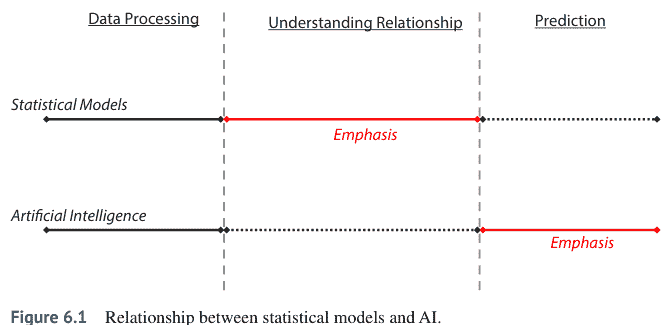

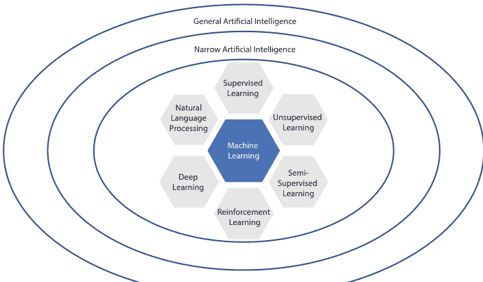

图 6.2 AI 与 ML 技术的关系。

表 6.1 ML 技术。

| 学习类型 | ML 算法 | 结果 |
| :--- | :--- | :--- |
| 监督学习 带有定义输出的标记数据 | 分类 回归 | 类别 连续 |
| 无监督学习 输出未知的无标记数据 | 聚类 降维 | 输入相似性 提取相关特征 |
| | 关联 异常检测 | 共现可能性 异常值 |
| 半监督学习 | 生成式 | 监督和无监督结果的组合 |
| 强化学习 | 基于奖励 | 序贯决策 |

##### 6.2.2.1 监督学习

监督学习是指算法使用标记的训练数据集（称为映射）学习一组输入和输出之间的规则，以便对新输入进行结果预测。

标记的训练数据集通常由预测变量、特征和标记结果组成（表 6.1）。

特征是构成数据的信息片段，特征的质量、准确性和丰富性决定了监督 ML 算法的整体有效性 [7]。

训练监督 ML 算法的目标是优化其泛化能力，使模型定义底层关系，但不过度引入来自策划不当数据集的意外偏差 [1]。

因此，存在方差-偏差权衡，其中方差是指模型对新的、略有不同的数据的表现如何，偏差是指模型对训练数据的拟合程度 [7]。

过拟合是指具有高偏差和低方差的模型：它过度拟合训练数据集，以至于难以适应新的、略有不同的数据。

获取大量可靠标记的数据集通常是创建监督 ML 算法中最困难、最昂贵的方面。

重要的是要监控训练过程，以确保偏差和方差之间的最佳平衡 [7]。

监督模型执行的最常见任务包括分类和回归。

###### 6.2.2.1.1 分类

当 ML 算法的输出为类别变量时使用分类，它涉及将数据点归入一个或多个类别。

线性可分性是该方法的关键概念，指的是使用一条线或一个平面来分离数据（图 6.3）。

将数据分离成类别的线或平面称为决策边界，用于定义类别的选定区域称为决策曲面（图 6.3）。

如果数据点落在决策曲面内，则将其分配给该类别。

支持向量机（SVM）是监督分类 ML 算法中常用的技术，使用超平面来分离数据点。

最优超平面以在不同类别之间创建最大分离的方式来分离类别。

SVM 相对简单，但在分析更复杂的多维数据时用处较小。

相反，核方法通常用于样本无法线性分离的复杂多维数据。

###### 6.2.2.1.2 回归

当监督 ML 模型的输出为连续变量时使用回归；常用的回归技术包括 LASSO、岭回归和弹性网

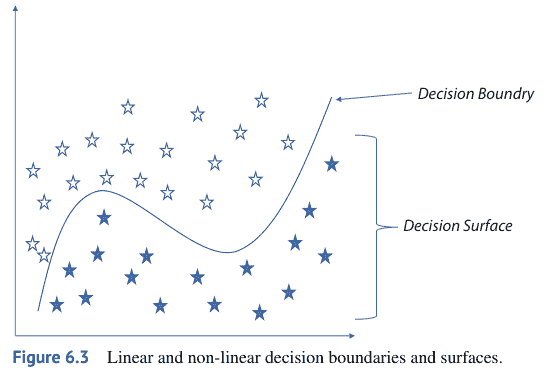

回归。LASSO 回归是一种重要的正则化技术，使用收缩来避免回归模型过拟合 [5, 6]。

收缩是指数据点向均值收缩。

它仍然是包含多个相关因素或具有高度多重共线性的模型的重要回归类型 [7]。

###### 6.2.2.1.3 心脏病学中的监督学习示例

越来越多的研究将监督 ML 算法应用于心脏病学，包括个体化医疗、影像学和疾病预后。

个体化医疗涉及根据个体患者定制检查、治疗和预测，从而最大限度地减少还原论。

还原论是指无论患者的遗传、生活方式、背景和心血管健康决定因素如何，都以相同方式治疗患有相同疾病状态的所有患者 [6]。

精准医学的一个方面涉及创建患者的数字孪生，整合基因组学、可穿戴设备、电子健康记录、影像数据和其他数据点，通过统计和机制建模实时更新的模拟患者模型 [2]。

传统心血管风险模型从样本人群外推风险，不可避免地忽略了微妙的临床混杂因素。

相比之下，AI 算法可以通过包含复杂而微妙的临床因素来个性化风险计算。

一个例子是一项使用监督 ML 算法基于心脏计算机断层血管造影（CCTA）图像预测冠状动脉疾病（CAD）患者 5 年全因死亡率（ACM）的研究 [8]。

该算法的开发包含 25 项临床参数和 44 项 CCTA 参数，研究发现该算法在预测 5 年 ACM 方面优于 Framingham 风险评分（FRS）、段狭窄评分（SSS）、段受累评分（SIS）和修改后的 Duke 指数（MDI）（ML：0.79 vs. FRS：0.61，SSS：0.64，SIS：0.64，DI：0.62；p < 0.001）[8]。

另一个例子是一项结合 CCTA 狭窄和斑块测量来开发监督 ML 算法以预测心肌流量储备（MFR）的研究 [9]。

在该研究中，分析了 51 名接受 CCTA 检查的患者中的 153 条动脉，以构建这种综合风险评分，研究发现该算法在通过 13N-氨 PET 扫描预测 MFR 方面优于定量 CCTA 狭窄（ML AUC = 0.83，CTA 狭窄 = 0.66；p = 0.005）[9]。

一项类似的多中心试验评估了一种基于定量 CCTA 测量构建的提升集成 ML 算法，用于预测病变特异性缺血 [10]。

在该试验中，254 名患者接受了 CCTA 和带有分数流量储备（FFR）测量的侵入性冠状动脉造影，涉及 484 条血管 [10]。

与单项 CCTA 测量（AUC：0.76；p < 0.006）相比，ML 算法具有更优的曲线下面积（AUC）0.84 [10]。

监督 ML 算法也已应用于其他心脏影像学模式。

一项近期研究结合了监督学习和深度学习，利用 53,549 名患者的 91,232 条单导联 ECG 开发了一种 ML 算法，在经认证的心脏病学家共识委员会对独立数据集进行测试时，将单个动态心电图（ECG）监测导联分类为 12 个心律类别，AUC 为 0.97 [11]。

在超声心动图中，已开发监督 ML 算法来识别和分类不同的超声视图，包括一项研究：在对 267 例胸壁超声心动图（TTE）进行监督 ML 算法训练后，成功将 15 个标准视图分类，准确率为 91.7% [12]。

这与经认证的超声心动图医师平均 79.4% 的准确率相比。


将同一组测试图像的子集进行分类（p = 0.03）[12]。分类监督机器学习算法也已在超声心动图中得到研究，用于区分肥厚型心肌病与生理性心肥大，以及缩窄型心肌病与限制型心肌病 [13–15]。在 CCTA 中，监督机器学习算法也已被应用于自动定量冠状动脉钙化 [16]。算法也已被用于通过分析左心室（LV）来识别具有血流动力学显著性冠状动脉疾病（CAD）的患者 [17]。例如，一项研究分析了 166 名接受侵入性 FFR 检查患者的 CCTA 扫描，并使用一系列机器学习算法对 LV 心肌中的缺血改变进行分割、分类和识别 [17]。此后，使用 SVM 分类器根据功能性显著狭窄的存在与否对患者进行分类，与侵入性血流动力学检测相比，AUC 为 0.74 [17]。

监督机器学习算法的另一个应用案例在于疾病预后。例如，算法已成功用于预测哪些冠状动脉疾病（CAD）患者最终会接受早期血运重建 [18]。一项近期研究评估了 713 例心肌灌注扫描（MPS）及相关侵入性血管造影，以将机器学习算法与两名经验丰富的读片者的视觉分析进行比较 [18]。研究发现，该算法在预测早期血运重建和 3 年主要不良心血管事件方面的特异性更优（74.7 ± 4.2%）[18]。

基于回归的监督机器学习的其他示例包括一项近期研究，该研究表明三维（3D）心脏运动可以预测新诊断肺动脉高压患者的生存率 [19]。在这项研究中，256 名新诊断肺动脉高压的患者接受了心脏 MRI、右心导管检查和 6 分钟步行测试 [19]。随后，将监督机器学习算法应用于右心室运动的 3D 模型，与常规影像学、血流动力学、功能和临床指标相比，更好地预测了生存率（AUC = 0.73 vs 0.60；p < 0.001）[19]。该研究发现，右心室解剖上不同但功能上协同的区域中收缩运动受损，提供了关于肺动脉高压严重程度及其死亡率的早期信号 [19]。

##### 6.2.2.2 无监督学习

无监督学习是一种更高级的学习形式，使用未标记数据来发现潜在关系，通常被称为知识发现 [7]。无监督学习在临床实践中大有前景，因为在其中对大型数据集进行编码可能成本高昂且耗时。无监督学习技术的常见示例包括聚类、降维、关联和异常检测 [2]。

聚类涉及将对象分为具有相似特征的组，旨在从较大的数据集中找到子组。最常用的技术包括层次聚类、K-均值聚类、基于噪声的应用密度空间聚类和基于模型的聚类 [7]。无关特征会损害机器学习算法的有效性、效率和实用性，而降维是一种通过识别数据集中最重要的特征来最大限度减少无关特征的技术 [20]。异常检测是一种识别数据集中异常值的技术，帮助无监督机器学习算法移除异常和错误的数据条目 [6]。

###### 6.2.2.2.1 心脏病学中无监督学习的示例

在心脏病学中，将无监督学习应用于大型复杂数据集时，通常会与更高级的技术（如深度学习）相结合。一个示例是一种全面的无监督机器学习算法，它能够通过分析运动超声心动图中左心室长轴心肌速度模式，成功区分射血分数保留的心力衰竭（HFpEF）与健康受试者 [14]。该研究从 156 名患者中构建了一种无监督机器学习算法，使用 22 个描述符和 300 个特征，这些特征收集自组织多普勒衍生的纵向心肌速度迹象，在休息和运动期间收集 [14]。该算法在细节中发现了自然出现的模式和关系，以识别从正常心脏功能到 HFpEF 患者的疾病连续谱 [14]。该谱在年龄、体质量指数、左心室质量指数、左心室充盈压力以及通过 6 分钟步行测试测定的症状负担方面存在差异 [14]。

基于聚类的算法是心脏病学中无监督学习的更常见示例。一个示例是一种用于识别与 HFpEF 心肌基质相关的不同高血压亚组的无监督机器学习算法 [21]。该机器学习算法基于 47 个变量（包括临床特征、心脏结构和功能）将 1273 名患者聚类为两个互斥的表型组 [21]。这些亚组可能代表不同的基因型，可能从针对性治疗中获益以预防 HFpEF 发作 [21]。另一个示例是 2 型糖尿病，其中一种无监督机器学习算法被应用于两个前瞻性队列中 842 名患者的超声心动图，从 12 个超声心动图变量中识别出三组患者 [22]。聚类 1 患者的左心室质量指数最低，左心室射血分数（LVEF）最高，且主要为男性；聚类 2 患者年龄最大，应变和 E/e' 比值最高；聚类 3 患者的左心室质量指数最高，LVEF 最低 [22]。随后进行了一次聚类分析，发现与聚类 1 相比，聚类 2 和 3 与更差的心血管死亡率和住院率相关（HR 2.37）[22]。层次聚类算法也已被研究，用于识别舒张性心力衰竭中的不同聚类。一项研究对 130 名患者进行了聚类分析，并开发了一个左心室舒张功能障碍的机器学习模型，随后在 44 名患者的前瞻性队列中进行了测试 [23]。斑点跟踪超声心动图（STE）用于测量左心房和心室容量、纵向应变及应变率的同步变化 [23]。STE 与常规指标强相关，并将患者聚类为三组，其舒张功能障碍和左心室充盈压力的严重程度各不相同 [23]。另一个示例是一项研究，通过对 866 名患者舒张功能障碍的超声心动图参数进行无监督层次聚类分析，识别出两组不同的患者 [24]。与常规分类相比，聚类算法改善了全因死亡率和心脏死亡率的预测 [24]。同样，其他研究已使用基于聚类的无监督机器学习算法来识别临床、结构和侵入性血流动力学的差异，这些差异已与住院率以及全因和心脏死亡率相关 [3, 25]。

##### 6.2.2.3 半监督学习

半监督学习结合了监督和无监督学习技术。监督学习中更耗时和耗费成本的方面之一是准确标记大型数据集 [25]。半监督学习提供了从较小的手动标记数据集外推和标记大型数据集的能力。这通过手动标记一小部分数据，然后使用无监督学习算法从该数据进行外推来完成。生成对抗网络（GAN）是一种常用的半监督技术，它使用两个神经网络：生成器和判别器 [1, 2, 25]。生成器被训练为输出合成合理的数据点，而判别器是一个典型的卷积神经网络，旨在区分假数据和真实数据 [7]。

###### 6.2.2.3.1 心脏病学中半监督学习的示例

半监督学习是一种更为新颖的技术，需要了解各种学习技术。多项研究已在心脏病学中采用此方法，重点是使用半监督机器学习算法对超声心动图中的腔室尺寸进行定量。一个示例是开发用于从 3D TTE 图像中自动定量左心房（LA）、左心室（LV）容积和 LVEF 的算法 [26, 27]。一项研究将此算法应用于 159 名患者，发现使用半监督算法自动测量的 LVEF 与三名读片者的手动 3D 容积测量（r = 0.87–0.96）以及心脏磁共振（CMR）（r = 0.84–0.95）均有强相关性 [26]。另一个示例是一项研究，该研究包括四个中心 255 名患者的心尖四腔和两腔视图，并应用半监督机器学习算法评估 EF 和左心室纵向应变。完全自动化算法与手动估计进行了比较，研究发现该算法在 98% 的研究中可行，平均分析时间为每名患者 8 秒 [27]。

##### 6.2.2.4 强化学习

强化学习是一种训练算法学习能够获得最大奖励的动作的技术。算法获得输入数据和需要优化的特定结果，通过试错来学习。这种技术在心脏病学中很少使用，但在计算机游戏程序中更为常见；一个著名的示例是 AlphaGo（一种使用强化学习下围棋的计算机程序）[1]。然而，心脏病学中强化学习的一个示例是一项研究，旨在使用此技术从 532 名患者的 1487 个 3D-CT 扫描中检测八个解剖标志，包括骨骼结构、器官和血管分叉 [28]。

#### 6.2.3 深度学习

深度学习是机器学习的另一个子领域，其中人工神经网络（ANN）、循环神经网络（RNN）和卷积神经网络（CNN）是最常用的技术 [25]。与传统机器学习算法相比，深度学习需要极少的数据仲裁或特征工程（图 6.4）。特征工程是构建机器学习模型的关键步骤，包括为问题陈述提取所有所需特征（特征提取）以及选择能够改进机器学习模型的最重要特征（特征选择）。深度学习自动化了特征工程过程并直接对输入数据进行询问。ANN 模仿大脑的神经结构，由互连的感知器组成，具有不同的权重，指示每个连接的强度（图


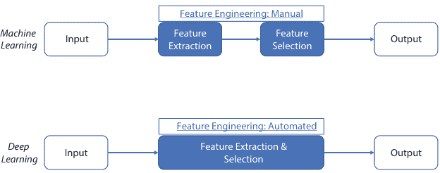

图 6.4 对比机器学习与深度学习。

通过为人工神经网络（ANN）提供大规模训练数据集，对这些权重进行微调，并优化 ANN 以更好地建立输入与输出之间的关系 [7]。ANN 通常由三层组成——输入层、隐藏层和输出层——并以前向方式处理输入，以解决与表格、图像或文本数据相关的问题 [25]。ANN 可以使用多个隐藏层来生成底层数据越来越抽象和非线性的表征 [1]。

当在 ANN 的隐藏层上应用循环约束时，它就变成了循环神经网络（RNN） [7]。RNN 特别适合处理序列数据，例如语音和语言。

卷积神经网络（CNN）是具有可学习权重和偏置的全连接神经网络。它们使用卷积核进行自动特征提取，该过程由一系列逐步提取相关特征的卷积操作组成。CNN 在处理大型复杂数据集（例如影像数据）方面特别有用 [25]。传统机器学习算法难以处理影像数据，因为这类数据维度极高，为每个特征分配单独的权重极其困难。

例如，一个像素大小为 750 × 750 且具有三个通道的图像拥有近 200 万个特征（750 × 750 × 3）。此外，单个像素不包含足够的有用信息，而是需要分析一个像素块 [1]。CNN 中的卷积层试图克服这些困难。每个卷积层使用一组滤波器，构成一个小型权重网格，并执行加权和非线性变换。相同的滤波器应用于整个输入的所有可能位置。这样一来，需要训练的权重数量显著减少 [7]。

##### 6.2.3.1 心脏病学中的深度学习示例

深度学习已被广泛研究并应用于心血管医学的各个方面。一个例子是其在心电图（ECG）中的应用。心电图常用于患者评估，成本相对较低且广泛可用。已开发深度学习算法来检测结构性心脏病、心律失常、表型模式和电解质紊乱 [11, 29–34]。例如，应用于心电图的基于 CNN 的机器学习算法已被验证可用于检测左心室收缩功能障碍 [30, 34]。一项研究使用来自 44,959 名患者的配对 12 导联心电图和超声心动图数据训练了一个 CNN 算法，用于检测左心室功能障碍 [30]。随后，该算法在 52,870 名患者的独立样本上进行了测试，发现其灵敏度、特异度和准确度分别为 93%、86.3% 和 85.7% [30]。另一个例子是一项回顾性研究，该研究使用 CNN 算法检测两家医院中 21,286 名接受 12 导联心电图和超声心动图检查（相隔 4 周）的患者的左心室肥厚 [35]。与超声心动图相比，AI 心电图算法在内部和外部验证队列中的 AUC 分别为 0.880（95% CI：0.877–0.883）和 0.868（95% CI：0.865–0.871）[35]。基于 CNN 的无监督学习机器学习算法已被验证可用于检测和预测心律失常。一项近期研究从 180,922 名患者中开发了一个基于 CNN 的机器学习算法，通过研究这些患者的时序心电图，预测从正常窦性心律发展为心房颤动的概率 [31]。该研究将患者分为训练数据集（126,526 名患者，454,789 个心电图）、内部验证数据集（18,116 名患者，64,340 个心电图）和测试数据集（36,280 名患者，130,802 个心电图）。该算法的 AUC 为 0.87（95% CI：0.86–0.88），灵敏度为 79%，特异度为 79.5% [31, 36]。

CNN 还已被验证可用于从心肌灌注成像（MPI）中检测阻塞性冠状动脉疾病（CAD），并与总灌注缺损（TPD）进行比较。该研究包括在九个中心接受应激 99mTc-sestamibi 或 tetrofosmin MPI 的 1638 名患者，这些患者还在 6 个月内接受了侵袭性冠状动脉造影 [37]。CNN 算法使用原始和定量的极性图谱进行训练，以评估和预测阻塞性 CAD，并采用分层 10 折交叉验证 [37]。CNN 的疾病预测 AUC 高于 TPD（每位患者：0.80 对 0.78；每条血管：0.76 对 0.73；p < 0.01）[37]。此外，使用预训练模型评估新患者所需的时间小于 1 秒，即使在未使用系统训练期间使用的专用显卡的情况下也是如此 [37]

#### 6.2.4 自然语言处理

电子健康记录中的大部分信息是非结构化的自由文本。最近的技术进步使得可以使用一种称为自然语言处理（NLP）的技术提取叙事文本，该技术将非结构化文本转换为结构化形式 [38]。NLP 是一个多步骤过程，第一步也是最重要的一步是词法分析。词法分析可以采用多种技术，包括词性（POS）标注、隐藏马尔可夫模型（HMM）、命名实体识别（NER）和句法分析（PSA）[38]。在词性标注中，每个单词都被标记为具有共同语法属性的相应单词类别。HMM 会记住句子中单词的序列，并将其标记为名词、动词和限定词。在 NER 中，单词按其代表的实体类型进行标记。这些实体可以是人、公司、时间或地点。PSA 分析文本的语法以及单词的排列方式。它使用预定义的语法规则来测试句子字符串是否符合这些规则 [38]。它在心脏病学中的当前应用示例包括从临床记录、放射学报告和病理学报告中提取信息。

### 6.3 构建 AI 算法的步骤

构建具有临床意义且有效的机器学习算法是一个多方面、复杂的过程，需要由具备多样技能和才能的多学科团队参与。值得注意的是，临床医生处于医疗保健交付的最前沿，最了解临床护理中出现的问题。然而，临床医生通常缺乏开发和测试机器学习算法的技术能力，因此需要数据科学家。该过程可以分解为六个步骤（图 6.6）[1]。第一步是确定问题，通常需要临床医生、数据科学家、数据工程师、患者和其他利益相关者的多学科投入 [2]。第二步是收集带有感兴趣特征和标签的适当数据；这通常是最耗时且最昂贵的方面。第三步是通过特征选择和特征工程的组合来准备数据 [4]。该步骤与下一步紧密相关，因为可使用的机器学习算法类型通常由数据的类型、质量和准备情况决定。第五步涉及使用训练数据集开发和构建机器学习算法。最后一步是通过使用独立且分开的数据集进行内部和外部验证来验证机器学习算法 [7]。

### 6.4 局限性、挑战与机遇

认识到与 AI 相关的挑战非常重要，这些挑战大致可分为与现有研究相关的局限性、与 AI 技术固有的局限性以及临床转化中的挑战。

#### 6.4.1 现有研究的局限性

到目前为止，大多数研究采用窄人工智能，并将机器学习算法应用于预定义和预选的变量，在测试队列中进行参数调整以获得良好

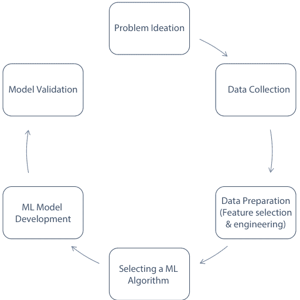

**图 6.6** 构建心脏病学 AI 算法的步骤。

性能。因此，大多数机器学习算法是在回顾性收集和整理的数据上进行研究的。这种方法的主要局限性在于显而易见的风险，即开发出的模型对目标数据过拟合，对先前未见过的外部数据泛化能力较差。还存在固有偏差，这些偏差会无意中引入仅基于回顾性、单中心数据构建和验证的算法中。机器学习算法需要大型数据集，因此会引入微妙的偏差，例如缺乏多样性会导致算法本身偏向于识别对模型开发有贡献的占主导地位的患者类型，从而产生意外的下游后果。另一个相关局限性是在开展 AI 研究时缺乏现有的框架和指南。这种数据集、方法和报告标准化的缺乏导致无法全面评估分析中的方法学偏差，并且往往掩盖偏差。此外，这使得机构间的交叉合作更加困难。

自然而然的下一步是在多中心前瞻性研究设计中，在未参与模型开发的外部数据集上研究这些机器学习算法。这些未来的前瞻性研究将需要评估患者预后和治疗路径。

#### 6.4.2 技术的陷阱

与所有技术一样，AI 仍然易受隐私、安全和数据泄露问题的影响。用于算法开发的患者数据需要保持去标识化并谨慎处理。另一个独特的局限性是许多机器学习算法所面临的黑箱现象。这指的是某些机器学习


诸如深度学习等算法本质上具有不透明性，关于算法如何处理输入数据以生成结果缺乏清晰度。这增加了对机器学习算法方法学有效性进行严格批判的复杂性和难度。没有这种洞察，就越来越难以对算法进行常识性检查，以查看其是否符合现实世界的观察。一个例子是风险预测机器学习算法，了解算法为何将患者分类为高风险至关重要，以便适当地定制干预措施。

#### 6.4.3 临床转化中的挑战

人工智能算法的新颖性以及缺乏前瞻性、多中心随机试验，意味着目前证据仍存在重大缺口。最值得注意的是，机器学习算法的临床转化能力仍相对未知，此类技术在现实世界临床实践中部署的实际困难尚未得到充分研究。重要考虑因素包括成本效益分析、假阳性的风险，以及与当前临床诊疗标准相比人工智能技术的更长期临床结局。目前，根据美国食品药物管理局的规定，诊断软件工具被归类为第2类（中等风险设备）。如果机器学习算法除诊断外还用于指导治疗，则需要进一步的证据和验证，这可能使其能够被归类为第3类医疗器械。

### 6.5 结论

- 临床决策依赖于综合高质量数据来帮助解决患者问题。随着可用患者数据量的增加，未来临床决策很可能会得到人工智能技术的增强。
- 人工智能有可能对这种患者数据的增长进行总结和综合，从而指导个体化治疗。
- 本章详细介绍了可采用的大量机器学习方法。最合适的算法选择将由研究问题和可用数据类型指导。

### 参考文献

- 1 Lopez-Jimenez, F., Attia, Z., Arruda-Olson, A.M., et al. (2020). 心脏病学中的人工智能：现状与未来. *梅奥诊所进展*. Mayo Clinic 95: 1015–1039.
- 2 Corral-Acero, J., Margara, F., Marciniuk, M., et al. (2020). 利用“数字孪生”实现精准心脏病学的愿景. *欧洲心脏杂志* 41: 4556–4564.
- 3 Dey, D., Slomka, P.J., Leeson, P., et al. (2019). 心血管影像中的人工智能：JACC前沿综述. *美国心脏病学院杂志* 73: 1317–1335.
- 4 Johnson, K.W., Torres Soto, J., Glicksberg, B.S., et al. (2018). 心脏病学中的人工智能. 美国心脏病学院杂志 71: 2668–2679.
- 5 Xu, B., Kocyigit, D., Grimm, R., Griffin, B.P., and Cheng, F. (2020). 多模态心血管影像中人工智能的应用：一项前沿综述. 心血管疾病进展 63: 367–376.
- 6 Leopold, J.A. and Loscalzo, J. (2018). 心血管疾病中精准医学的新兴作用. 循环研究 122: 1302–1315.
- 7 Deng, C., Ji, X., Rainey, C., Zhang, J., and Lu, W. (2020). 将机器学习与人类知识相结合. iScience 23: 101656.
- 8 Motwani, M., Dey, D., Berman, D.S., et al. (2017). 机器学习用于预测疑似冠状动脉疾病患者的全因死亡率：一项5年多中心前瞻性登记分析. 欧洲心脏杂志 38: 500–507.
- 9 Dey, D., Diaz Zaudio, M., Schuhbaeck, A., et al. (2015). 冠状动脉计算机血管造影中定量不良斑块特征与13N-氨正电子发射断层显像下游心肌流储备受损之间的关系：一项试点研究. 循环. 心血管成像 8: e003255.
- 10 Dey, D., Gaur, S., Ovrehus, K.A., et al. (2018). 利用机器学习从定量冠状动脉CT血管造影中综合预测病变特异性缺血：一项多中心研究. 欧洲放射学 28: 2655–2664.
- 11 Hannun, A.Y., Rajpurkar, P., Haghpanahi, M., et al. (2019). 使用深度神经网络在动态心电图中实现心脏病学家水平的心律失常检测和分类. 自然医学 25: 65–69.
- 12 Madani, A., Arnaout, R., Mofrad, M., and Arnaout, R. (2018). 使用深度学习进行超声心动图快速准确的视图分类. NPJ数字医学 1.
- 13 Narula, S., Shameer, K., Salem Omar, A.M., Dudley, J.T., and Sengupta, P.P. (2016). 用于自动化2D超声心动图形态和功能评估的机器学习算法. 美国心脏病学院杂志 68: 2287–2295.
- 14 Sanchez-Martinez, S., Duchateau, N., Erdei, T., et al. (2018). 左心室功能的机器学习分析以表征射血分数保留的心力衰竭. 循环. 心血管成像 11: e007138.
- 15 Sengupta, P.P., Huang, Y.M., Bansal, M., et al. (2016). 心脏影像的认知机器学习算法：区分缩窄性心包炎与限制性心肌病的试点研究. 循环. 心血管成像 9.
- 16 Wolterink, J.M., Leiner, T., de Vos, B.D., van Hamersvelt, R.W., Viergever, M.A., and Išgum, I. (2016). 使用配对卷积神经网络在心脏CT血管造影中自动冠状动脉钙化评分. 医学影像分析 34: 123–136.
- 17 Zreik, M., Lessmann, N., van Hamersvelt, R.W., et al. (2018). 冠状动脉CT血管造影中心肌的深度学习分析以识别功能显著冠状动脉狭窄患者. 医学影像分析 44: 72–85.
- 18 Arsanjani, R., Dey, D., Khachatryan, T., et al. (2015). 基于机器学习在大量人群中预测心肌灌注SPECT后的血运重建. 核心脏病学杂志：美国核心脏病学会官方出版物 22: 877–884.
- 19 Dawes, T.J.W., de Marvao, A., Shi, W., et al. (2017). 三维右心室运动的机器学习使肺动脉高压的结局预测成为可能：一项心脏MRI成像研究. 放射学 283: 381–390.
- 20 Leiner, T., Rueckert, D., Suinesiaputra, A., et al. (2019). 心血管磁共振中的机器学习：基本概念与应用. 心血管磁共振杂志 21: 61.
- 21 Katz, D.H., Deo, R.C., Aguilar, F.G., et al. (2017). 用于识别高血压患者中射血分数保留性心力衰竭心肌基质的表型图谱. 心血管转化研究杂志 10: 275–284.
- 22 Erande, L., Audureau, E., Jellis, C.L., et al. (2017). 糖尿病患者超声心动图表型的临床意义. 美国心脏病学院杂志 70: 1704–1716.
- 23 Omar, A.M.S., Narula, S., Abdel Rahman, M.A., et al. (2017). 心力衰竭中的精准表型分型及超声数据模式聚类以评估舒张功能障碍. JACC心血管成像 10: 1291–1303.
- 24 Lancaster, M.C., Salem Omar, A.M., Narula, S., Kulkarni, H., Narula, J., and Sengupta, P.P. (2019). 左心室舒张功能参数的表型聚类：模式及预后意义. JACC心血管成像 12: 1149–1161.
- 25 Kagiyama, N., Shrestha, S., Farjo, P.D., and Sengupta, P.P. (2019). 人工智能：心血管疾病临床研究的实用入门. 美国心脏协会杂志 8: e012788.
- 26 Tsang, W., Salgo, I.S., Medvedofsky, D., et al. (2016). 使用自动化自适应分析算法进行经胸3D超声心动图左心腔定量. JACC心血管成像 9: 769–782.
- 27 Knackstedt, C., Bekkers, S.C., Schimmers, G., et al. (2015). 全自动与标准左心室射血分数和纵向应变追踪的对比：FAST-EFs多中心研究. 美国心脏病学院杂志 66: 1456–1466.
- 28 Ghesu, F.C., Georgescu, B., Zheng, Y., et al. (2019). 用于CT扫描中实时3D标志物检测的多尺度深度强化学习. IEEE模式分析与机器智能汇刊 41: 176–189.
- 29 Attia, Z.I., Friedman, P.A., Noseworthy, P.A., et al. (2019). 使用人工智能从标准12导联心电图中估计年龄和性别. 循环. 心律失常与电生理学 12: e007284.
- 30 Attia, Z.I., Kapa, S., Lopez-Jimenez, F., et al. (2019). 使用人工智能辅助心电图筛查心脏收缩功能障碍. 自然医学 25: 70–74.
- 31 Attia, Z.I., Noseworthy, P.A., Lopez-Jimenez, F., et al. (2019). 用于识别窦性心律期间房颤患者的人工智能辅助心电图算法：结局预测的回顾性分析. 柳叶刀 394: 861–867.
- 32 Strodthoff, N. and Strodthoff, C. (2019). 使用完全卷积神经网络检测和解释心肌梗死. 生理学测量 40: 015001.
- 33 Galloway, C.D., Valys, A.V., Shreibati, J.B., et al. (2019). 开发和验证用于从心电图筛查高钾血症的深度学习模型. JAMA心脏病学 4: 428–436.
- 34 Jentzer, J.C., Kashou, A.H., Attia, Z.I., et al. (2021). 在心脏重症监护室患者中使用人工智能增强心电图识别左心室收缩功能障碍. 国际心脏病学杂志 326: 114–123.


- **35** Kwon, J.M., Jeon, K.H., Kim, H.M., et al. (2020). 基于心电图检测左心室肥厚的人工智能与常规诊断标准性能比较。*Europace：欧洲起搏、心律失常和心脏电生理学：欧洲心脏病学会心脏起搏、心律失常和心脏细胞电生理学工作组杂志* 22: 412–419.
- **36** Kashou, A.H., Rabinstein, A.A., Attia, I.Z., et al. (2020). 复发性隐源性卒中：人工智能启用心电图的潜在作用？*HeartRhythm 病例报告* 6: 202–205.
- **37** Betancur, J., Commandeur, F., Motlagh, M., et al. (2018). 基于快速心肌灌注 SPECT 预测阻塞性疾病的深度学习：一项多中心研究。*JACC. 心血管成像* 11: 1654–1663.
- **38** Koleck, T.A., Dreisbach, C., Bourne, P.E., and Bakken, S. (2019). 电子健康记录自由文本叙述中记录症状的自然语言处理：一项系统综述。*美国医学信息学杂志：JAMIA* 26: 364–379.

## 7 利用数据挖掘分类算法进行心脏疾病早期诊断

Ahmad Musa Altamimi 和 Mohammad Azzeh

### 7.1 引言

医学研究在识别心脏疾病方面得到了广泛关注。心脏疾病诊断基于患者的体征和症状，并受多种因素影响，例如胆固醇水平、血压、肥胖、吸烟习惯及其他因素 [1]。这在低成本下提供优质服务方面带来了挑战。优质服务包括正确诊断患者以获得有效治疗。根据世界心脏联合会和世界卫生组织的数据，心脏疾病位居各种危及生命的疾病之首，每年夺走约 1790 万人的生命 [2]。然而，估计有 90% 的死亡本可通过早期正确诊断和改善习惯来预防 [3]。

在传统的医疗环境中，心脏疾病诊断采用常规方式，即医生回顾症状并安排一些检查，如血液检查、心电图和超声心动图。然而，这种常规方式会导致诊断的不确定性，进而产生复杂的治疗和更高的医疗成本。误诊源于许多医生不遵循评估和管理心力衰竭的已知指南 [4]。因此，不同研究中报告的高不准确率并不令人惊讶 [5]。

治疗成功的核心要素是可靠且精确的诊断。专家系统 [6] 可以用于模拟专家的能力，不仅能回答诸如“患有心脏疾病的患者平均年龄是多少？”或“识别曾接受过心脏疾病治疗且患有其他疾病的患者”等简单问题，还能回答诸如“给定患者记录，预测将被诊断患有心脏疾病的患者概率是多少？”或“找出导致心脏疾病的最显著风险因素”等复杂问题。使用此类系统可以减少医疗检查错误，降低实践差异，并改善诊断结果。

机器学习算法的主要用途是通过检测模式并将数据总结为可理解的格式来发现海量数据。三种主要的数据挖掘技术可以将先前未组织的数据分类到预定义的类别中，或将新数据归类到预先存在的类别中：检查先前分类的数据，学习分类规则，并将这些规则应用到新数据中。同样的过程也用于识别它们之间的关系并开发这些关系的模式。这些模式随后可用作预测未来行为的参考。Abdelrazek 等人 [7] 和 Ranjan 等人 [8] 等调查研究了机器学习算法在预测系统中的影响和潜力。

在本章中，我们专注于用于预测心脏疾病的数据挖掘分类技术。五种分类器（朴素贝叶斯 (NB)、支持向量机 (SVM)、随机森林 (RF)、决策树 (DT) 和线性判别分析 (LDA)）已被用于分析用于诊断心血管疾病的记录医学数据集。本研究中使用的数据集具有 14 个临床属性和不同规模的全尺寸训练集。已使用多种评估指标来比较每个分类器的性能：准确率、灵敏度、曲线下面积 (AUC) 和特异度。为此，已进行了多项实验。结果报告称，SVM 和 NB 的准确率高于 80% 且 AUC 较大，优于其他分类器，提供了更有效、更全面的预测机制。我们相信，这些模型可以与医疗信息系统集成，以协助在早期阶段诊断心脏疾病。

本章其余部分结构如下。第 7.2 节讨论了先前的研究。第 7.3 节介绍了各种分类算法。第 7.4 节讨论了研究方法，结果和讨论在第 7.5 节中给出。最后，第 7.6 节介绍了结论和未来工作。

### 7.2 先前的研究

已为诊断心脏疾病进行了许多数据挖掘调查 [9–11]。在此背景下，研究人员应用了不同的机器学习算法，如关联规则技术、聚类和分类算法，以提取用于以良好准确率预测心脏疾病的显著模式。例如，关联规则挖掘技术已在许多工作中用于在大型患者数据集中查找频繁项目，以诊断心脏疾病的存在。Panda 和 Dash [12] 以及 Ordonez [13] 使用关联规则构建模型，以确定患者属性值之间的关系，从而发现数据集中变量之间有趣的关系。其他人也遵循了同样的原则，对其模型进行了小幅修改。例如，Ahmed 和 Hannan [14] 在大型生成集的情况下优化了关联规则，以节省预测时间并避免不需要的规则，而 Jabbar 等人 [15] 提出了一种基于序列号并一次聚类少量数据的新方法，以产生可扩展且高效的心脏疾病预测。Soni 等人使用关联与分类的综合方法来发现并使用数据库中的规则，以构建高效分类器 [16]。然而，在 Moreno 等人的研究中，尽管关联算法在感兴趣的健康领域预测中得到成功应用，但他们也发现了大量规则（其中一些无关紧要）；此外，关联算法的性能通常较低 [17]。

另一方面，在 Karegowda 等人的研究 [18] 中，聚类被用于将患者数据分为一组有意义的聚类，每个聚类发现数据属性之间的总体分布模式和相关性，从而帮助从业者了解患者数据的自然分组，以正确诊断心脏疾病的存在。然而，聚类处理大型数据集成本非常高，因此最好用作预处理步骤，使其他分类算法能够了解数据分布。话虽如此，聚类技术已被应用于发现心脏病患者的隐藏模式。一些研究已使用 K-means 对与心脏疾病相关的数据进行分组和提取 [19, 20]。最大频繁项集算法 (MAFIA) 也已被应用于发现心脏病发作预测规则 [20]。重要的是提到，文献中许多聚类算法是使用名为 Weka [21] 的工具实现的，这是一套用于数据预处理、分类、聚类和可视化的算法和工具。然而，此类方法的主要缺点是它们不适用于密集数据，难以预测聚类数量，并且在选择不同的初始分区的情况下，会产生不同的最终聚类 [22, 23]。

遗传算法也被 Masilamani 等人 [24] 用于获取用于心脏疾病预测的患者属性值的最优子集。Amin 等人 [25] 还利用遗传算法的全局优化优势，根据高血压、高胆固醇、肥胖等风险因素集合实现了一种用于初始化神经网络权重的混合系统。在另一系统 [26] 中，分层神经-模糊方法在预测心脏疾病方面产生了非常低的错误率。

分类方法已被广泛应用于开发心脏疾病预测模型。SVM、DT、NB 和神经网络 (NN) 等流行分类算法在此背景下已被使用。当这些算法被用于开发预测模型时，Xing 等人 [27] 和 Peter 与 Somasundaram [28] 呈现了混合结果。例如，Xing 等人 [27] 使用了 502 个病例的 SVM、NN 和 DT。他们的实验表明 SVM 是最佳预测模型，其次是 NN。相比之下，其他研究证明 NB 产生的预测比 DT 和 NN 等其他流行算法更准确 [28]。此外，另一项研究报告称，NN 被公认为最佳预测模型，拥有文献中 15 个突出特征作为风险因素 [29]。Chitra 和 Srinivasagam [30] 中的混合智能技术绑定到 NN 以产生预测模型以提高预测准确率。结果表明，混合智能技术在准确率方面提供了改进。

最近，Toughui 等人的研究 [31] 比较了在以下工具中实现的多种机器学习算法：RapidMiner、Orange、MATLAB、Knime、Weka 和 Scikit-Learn。结果表明 MATLAB 是最佳工具。

在回顾了分类相关文献后，我们受到激励，使用分类算法基于临床数据集开发心脏疾病预测模型。我们的工作与上述工作在两个方面有所不同：首先，将五种分类器应用于分析不同规模的医学数据集；其次，已使用 MATLAB 工具进行了广泛分析。模拟实现在计算预测准确率时产生了非常低的错误率。


### 7.3 机器学习算法的选择

医疗保健环境通常包括存储在健康管理系统中关于患者及其治疗的丰富数据。此类数据很有价值，尤其是当我们将现有信息转化为良好实践时。机器学习算法被广泛用于从数据中的隐藏关系和趋势中提取有价值的知识。事实上，机器学习算法已被广泛应用于医疗保健研究的知识发现过程阶段 [32]，这为发现健康数据中的隐藏关系提供了有利方式 [33]。它们已被应用于多样化的医疗保健领域，以改进和加速决策 [32]。分类方法是医疗保健领域中使用最广泛的算法，因为它们通过对患者记录进行分类来帮助预测患者状态，以找到与新患者记录匹配的类别 [3]。分类是一种监督学习技术，要求数据最初被标记 [33]。然后将这些数据输入分类算法进行学习，如图 7.1 所示，以发现输入变量和目标变量之间的关系。在此阶段，分类算法从训练数据中构建分类器。构成训练集的每个观测值称为类标签。当接收到新病例时，构建的分类算法用于将其分类为预定义标签之一，如图 7.2 所示。

| 年龄 | 性别 | Cp | Trestbps | 决策 |
|---|---|---|---|---|
| 58 | 0 | 3 | 120 | E |
| 66 | 0 | 1 | 150 | C |
| 43 | 1 | 4 | 150 | C |
| 40 | 1 | 4 | 110 | N |
| 69 | 0 | 1 | 140 | C |


图 7.1 构建分类器阶段。


| 年龄 | 性别 | Cp | Trestbps | 决策 |
|---|---|---|---|---|
| 58 | 0 | 3 | 120 | E |
| 66 | 0 | 1 | 150 | C |
| 43 | 1 | 4 | 150 | C |
| 40 | 1 | 4 | 110 | N |
| 69 | 0 | 1 | 140 | C |

图 7.2 使用分类器进行预测。

在医疗保健研究中使用：(i) K-最近邻 (k-NN)，(ii) DT，(iii) RF，(iv) NB，和 (v) SVM。我们现在对这些使用的分类算法各进行概述。如前所述，该研究调查了分类算法的稳定性和性能，以利用先前已知的患者数据预测患者状态，使用心脏病相关数据。

#### 7.3.1 决策树

决策树 (DT) 用于分类和回归任务，支持不同类型的输入特征 [34]。构建决策树的原理非常简单。DT 模型使用二元递归分区技术构建，该技术迭代地将数据分组，然后在每个分支上进行划分。最小二乘误差被用作损失函数，以确定拟合过程何时必须终止。本研究使用了一种称为分类和回归树 (CART) 算法的强大 DT 算法。CART 算法包含三个主要阶段：

- 1. 构建一棵在每个分支中包含连贯数据的树。
- 2. 对决策树进行剪枝以减少过拟合。
- 3. 使用平滑技术，防止修剪后的树叶在相邻线性模型之间出现陡峭的不连续性。

#### 7.3.2 朴素贝叶斯

NB 分类器是一种基于贝叶斯定理的概率算法，假设特征独立 [34]。它认为，在给定类变量的情况下，某个类的特定属性是否存在与任何其他属性是否存在无关。这有助于使计算过程非常简便，并且对大型数据具有更好的速度和准确性。它还可以根据输入计算可能的输出，并在运行时添加新的原始数据 [35]。

#### 7.3.3 K-最近邻

K-最近邻 (K-NN) 是一种基于相似性预测的简单分类算法 [36]。它被认为是一种懒惰算法，因为它会花费时间搜索相似案例。该算法的基本思想是在历史数据中找到与新案例相似的一组 K 个案例，最终预测通过多数投票决定。多个参数用于校准 k-NN 算法的准确性，即距离度量、特征重要性和最优 K 值选择。在本章中，我们使用欧几里得距离作为相似度量，因为这是一种常用的度量。除此之外，K 的值是通过试错法选择，直到评估指标得到改善。

#### 7.3.4 随机森林

随机森林 (RF) 是一种基于构建 DT 分类器森林的集成学习算法。森林中的每个 DT 都是从不同的训练数据集构建的。最终预测通常通过投票来衡量。RF 具有多项优势，尤其是计算效率高，且比单个 DT 准确度更高，同时不会显著增加计算成本。它还可以预测多达数千个解释变量 [34]。

#### 7.3.5 支持向量机

支持向量机 (SVM) 的主要思想是构建一个具有最大边界的最优超平面，以有效地分离类别标签。最大化边界并产生超平面与两侧实例之间最大可能距离的方法已被证明可降低预期泛化误差的上界。由于医疗数据通常是非线性的，SVM 使用核函数将数据从低维映射到高维，从而便于构建最优超平面 [37]。

### 7.4 研究方法论

当前研究旨在通过使用数据挖掘分类方法检查患者症状，以改进心脏病诊断。为实现这一目标，开展了文献综述，以回顾与心脏病诊断相关的数据挖掘工作。之后，选择了五个分类器（NB、DT、LDA、RF 和 SVM）来构建各种分类器。每种技术构建分类器的方式不同，确保它们表现不同并产生不同结果，凸显了我们方法的实际可行性。在所有进行的实验中，采用了留一法交叉验证（保留法）模型来评估算法性能，其中原始数据集被划分为不同的训练集和测试集。在每个验证周期中，留出一个观测值，而其余观测值则作为训练集并构建分类器模型。重复此步骤，直到所有观测值都作为测试观测值。因此，计算每次迭代的性能误差，并在验证结束时计算平均性能。

#### 7.4.1 数据集描述

本研究使用了两个数据集。第一个数据集来自克利夫兰诊所基金会 [38]，包含 303 条记录；其中 297 条完整，6 条存在缺失/未知值。第二个数据集是 UCI 机器学习库 [39] 中提供的 Statlog 数据集，包含 270 条完整记录。最初，这两个数据集共享相同的 76 个特征，但经过预处理以生成 14 个属性，旨在减少变量数量。因此，我们对表 7.1 中描述的两个数据集使用了这些特定属性，以便于比较和复制研究。克利夫兰和 Statlog 数据集的数值特征统计特性分别列于表 7.2 和表 7.3 中。

图 7.3 显示了目标变量的条形图，表明“是”和“否”两种标签的记录数量相对接近。这意味着我们不需要使用类别不平衡技术来对数据进行良好分布。克利夫兰数据集中心脏病患者数量略多于正常患者，但 Statlog 数据集中情况则相反。这种多样性使我们能够更好地了解数据集结构及其对分类准确性的影响。

图 7.4 显示了基于目标和性别的记录分布数量。从图中可以清楚地看出，在两个数据集的两个目标标签中，女性数量均少于男性数量。有趣的是，在克利夫兰数据集中，患有心脏病的男性患者数量少于正常患者，但 Statlog 数据集中情况则相反。


### 表 7.1 带有14个属性的心衰数据集。

| 属性 | 描述 |
| :--- | :--- |
| age | 患者年龄（岁） |
| sex | 表示为二进制数。1 = 男性，0 = 女性。 |
| cp | 胸痛类型。取值范围为1到4。{ 1: 典型心绞痛, 2: 非典型心绞痛, 3: 非心绞痛性疼痛, 4: 无症状 }。 |
| trestbps | 入院时静息血压，单位mmHg。 |
| chol | 血清胆固醇，单位mg/dl |
| fbs | 空腹血糖。若大于120 mg/dl，则属性值为1（真），否则为0（假）。{1: 真, 0: 假}。 |
| restecg | 静息心电图结果。该属性可取3个整数值0、1或2。{0: 正常, 1: 有ST-T波异常, 2: 根据Estes标准显示可能或确定的左心室肥厚} |
| thalach | 患者达到的最大心率。 |
| exang | 运动诱发心绞痛。取值可为{0: 否或1: 是}。 |
| oldpeak | 运动相对于休息引起的ST段下降。 |
| slope | 峰值运动斜率测量。取值可为1、2或3。{1: 上斜, 2: 平坦, 3: 下斜}。 |
| ca | 主要血管数量（0-3），经透视染色。属性值可为0到3。 |
| thal | 表示患者的心率。它可以取值3、6或7。{3: 正常, 6: 固定缺损, 7: 可逆缺损}。 |
| num | 包含0到4之间的数值。每个值代表一种心脏病或全部不存在。{0: 直径狭窄<50%。（无心脏病）。1到4：直径狭窄>50%。（存在不同的心脏病）} |

### 表 7.2 Cleveland数据集统计描述。

| | age | trestbps | chol | thalach | oldpeak | ca |
| :--- | :--- | :--- | :--- | :--- | :--- | :--- |
| **均值** | 54.37 | 131.62 | 246.26 | 149.65 | 1.04 | 0.73 |
| **标准差** | 9.08 | 17.54 | 51.83 | 22.91 | 1.16 | 1.02 |
| **最小值** | 29.00 | 94.00 | 126.00 | 71.00 | 0.00 | 0.00 |
| **0.25** | 47.50 | 120.00 | 211.00 | 133.50 | 0.00 | 0.00 |
| **0.50** | 55.00 | 130.00 | 240.00 | 153.00 | 0.80 | 0.00 |
| **0.75** | 61.00 | 140.00 | 274.50 | 166.00 | 1.60 | 1.00 |
| **最大值** | 77.00 | 200.00 | 564.00 | 202.00 | 6.20 | 4.00 |

### 表 7.3 Statlog数据集统计描述。

| | age | trestbps | chol | thalach | oldpeak | ca |
|---|---|---|---|---|---|---|
| 均值 | 54.44 | 131.34 | 249.66 | 149.68 | 1.05 | 0.67 |
| 标准差 | 9.10 | 17.86 | 51.69 | 23.17 | 1.15 | 0.94 |
| 最小值 | 30.00 | 94.00 | 126.00 | 71.00 | 0.00 | 0.00 |
| 0.25 | 48.00 | 120.00 | 213.00 | 133.00 | 0.00 | 0.00 |
| 0.50 | 55.00 | 130.00 | 245.00 | 153.50 | 0.80 | 0.00 |
| 0.75 | 61.00 | 140.00 | 280.00 | 166.00 | 1.60 | 1.00 |
| 最大值 | 77.00 | 200.00 | 564.00 | 202.00 | 6.20 | 3.00 |


图 7.4 目标与性别之间关系的柱状图。

图 7.5 显示了基于目标标签的男性和女性的平均年龄分布。我们可以注意到，在两个数据集的两个目标标签下，男性患者的平均年龄均略小于女性，这意味着男性在一生中比女性更早患心脏病。这一发现也在图 7.6 中得到证实，图 7.6 显示男性的年龄分布在两个数据集中都比女性的年龄分布更正常。大多数女性可能在晚年才出现心脏问题。

图 7.7 展示了基于性别变量分类的心脏病患者和正常患者的静息血压分布。我们可以注意到，两个数据集的分布相对相似。主要观察是，对于男性，心脏病患者和正常患者之间没有显著差异，但对于女性，两个分布之间存在显著差异。


### 图 7.5 目标、性别和年龄之间关系的柱状图。


### 图 7.6 基于性别和目标分类的年龄变量直方图。


### 图 7.7 基于性别和目标分类的静息血压直方图。

#### 7.4.2 数据预处理

数据集经过预处理以处理噪声、不一致性和缺失值。噪声和不一致性经人工纠正。然而，缺失值必须在使用前进行处理，因为它们可能导致分类失败或疾病预测错误[40]。可应用两种常见技术来处理数据集：删除和插补。删除缺失实例是处理缺失值最常用的方法，即移除无法处理的病例。尽管该方法实现简单，但可能会移除有用信息。另一方面，插补方法用于将缺失值替换为估计值。在我们的研究中，采用了第二种方法。具体来说，我们使用k = 5的最近邻算法来插补缺失值，其中一个病例使用大部分完整的五个最近邻病例的值进行插补。

#### 7.4.3 性能度量

五种常用评估度量用于评估预测模型的效率。选用这些评估度量是因为它们广泛用于评估预测模型的效率。第一个度量是召回率（Recall），如公式 7.1 所示，用于衡量二进制分类预测正标签的效果。第二个度量是精确度（Precision），如公式 7.2 所示，用于衡量正预测正确的概率。第三个度量是准确率（Accuracy），如公式 7.3 所示，用于衡量分类性能。第四个度量是特异度（Specificity），如公式 7.4 所示，用于衡量二进制分类测试正确识别负病例的效果。最后一个度量是F度量（F-measure），如公式 7.5 所示，用于衡量正预测正确的概率[32]。

```
Recall = t_p / (t_p + f_n)
(7.1)
```

```
Precision = t_p / (t_p + f_p)
(7.2)
```

```
Accuracy = (t_p + t_n) / (t_p + t_n + f_p + f_n)
(7.3)
```

```
specificity = t_n / (t_n + f_p)
(7.4)
```

```
F - measure = 2 x precision x recall / (precision + recall)
(7.5)
```

- 其中：
  - t_p 为真正例。
  - t_n 为真负例。
  - f_p 为假正例。
  - f_n 为假负例。

### 7.5 结果

在传统医疗系统中，医生依赖患者的体征或症状来诊断心脏病。然而，许多体征和症状具有非特异性，导致不必要的错误并影响所提供健康服务的质量。为克服这一问题，开发了专家系统以模拟具有更高准确性的健康决策制定。这涉及关联患者的各种信息，随后获取特定模式。在这项研究中，我们应用五种分类算法，基于预选属性预测心脏病。

对每个数据集，我们使用10倍交叉验证运行了五种分类算法。所得结果显示于表 7.4 和 7.5。表 7.4 中Cleveland数据集的结果显示，所有模型都能产生良好的预测和良好的性能。我们注意到，除召回率外，所有性能度量都表明NB是Cleveland数据集最具预测性的模型。图 7.8 展示了所有模型在Cleveland数据集上的受试者工作特性（ROC）。很明显，SVM和NB是Cleveland数据集上最优秀的模型。

Statlog数据集所得结果（如表 7.5 所示）与Cleveland数据集的结果相似。准确率、精确度和特异度性能度量表明SVM是最准确的算法，而AUC、召回率和F1度量表明NB是最准确的算法，如表 7.5 所示。本研究应强调的另一个重要问题是分类算法在两个数据集及多个性能度量上的排名稳定性。排名算法稳定性意味着该算法应始终产生准确结果，并在所有数据集和所有评估度量中总体排名靠前。

### 表 7.4 使用Cleveland数据集的性能度量。

| | AUC | 准确率 | 召回率 | 精确度 | F1 | 特异度 |
|---|---|---|---|---|---|---|
| k-NN | 0.61 | 0.61 | 0.66 | 0.64 | 0.65 | 0.56 |
| SVM | 0.90 | 0.82 | 0.86 | 0.82 | 0.84 | 0.77 |
| NB | 0.91 | 0.84 | 0.85 | 0.85 | 0.85 | 0.83 |
| DT | 0.76 | 0.76 | 0.75 | 0.80 | 0.77 | 0.78 |
| RF | 0.88 | 0.82 | 0.85 | 0.82 | 0.84 | 0.78 |

### 表 7.5 使用Statlog数据集的性能度量。

| | AUC | 准确率 | 召回率 | 精确度 | F1 | 特异度 |
|---|---|---|---|---|---|---|
| k-NN | 0.72 | 0.67 | 0.58 | 0.65 | 0.61 | 0.75 |
| SVM | 0.90 | 0.83 | 0.77 | 0.83 | 0.80 | 0.87 |
| NB | 0.91 | 0.83 | 0.81 | 0.82 | 0.81 | 0.85 |
| DT | 0.69 | 0.68 | 0.61 | 0.65 | 0.63 | 0.73 |
| RF | 0.89 | 0.81 | 0.75 | 0.81 | 0.78 | 0.86 |


图 7.8 所有模型在 Cleveland 数据集上的 ROC 曲线。


图 7.9 所有模型在 Statlog 数据集上的 ROC 曲线。

指标。我们的结果表明，NB 在所有评价指标中均排名第一，在 Cleveland 数据集中，SVM 位居第二。同时，SVM 和 NB 在 Statlog 数据集中获得了最佳排名。尽管像 RF 这样的集成学习已被证明能产生优异结果，但在我们的案例中，NB 和 SVM 优于此集成版本。最后，根据上述结果，我们可以得出结论：k-NN 在两个数据集中均获得了最差的结果。

图 7.9 展示了所有模型在 Statlog 数据集上的 ROC 曲线。可以清楚地看出，SVM、NB 和 RF 表现更优，验证了表 7.5 中的发现。DT 和 k-NN 是 Statlog 数据集上的最差模型。

### 7.6 结论与未来工作

在本研究中，研究了不同的机器学习算法以增强心脏疾病的早期检测。具体来说，利用了五个分类器来提高心脏病预测的准确性。此外，使用两个数据集进行了广泛的实验。对于每个数据集，分类器都采用留一法交叉验证进行应用。结果表明，所有分类算法均准确且能产生良好的预测。然而，这证实了 NB 和 SVM 在所有评价指标和两个数据集中均排名第一，其次是 RF 排名第二。这可以引导我们得出关于数据分类中不确定性作用的重要结论。SVM 和 NB 构建输入与输出之间关系的机制完全不同。在未来的工作中，我们将研究特征选择和加权对分类器整体性能的影响。

### 致谢

作者谨向约旦安曼应用科学私立大学致以诚挚谢意，感谢其为本研究论文的出版费用提供了全额资助。

### 参考文献

- 1 Lampignano, L., et al. (2020). 超重或肥胖患者队列中不同人体测量参数与心脏代谢风险因素之间的横断面关系。 *PLoS One* 15 (11) (November): e0241841.
- 2 Gyawali, B., Khanal, P., Mishra, S.R., Van Teijlingen, E., and Wolf Meyrowitsch, D. (2020). 在尼泊尔构建强大的初级卫生保健以应对非传染性疾病日益增长的负担。 *Global Health Action* 13 (1): Dec.
- 3 Ahmad, P., Qamar, S., Qasim, S., and Rizvi, A. (2015). 医疗保健中的数据挖掘技术：综述。
- 4 Salmasl, M.Y., et al. (2020). 急性胸主动脉夹层误诊风险：当前指南综述。 *Heart.*106 (12): 885-889
- 5 Kapłon-Cieślicka, A., et al. (2020). 射血分数保留的住院患者中心力衰竭是否被误诊？来自欧洲心脏病学会—心力衰竭协会EURObservational研究计划心力衰竭长期登记。 *ESC Heart Failure* 7 (5) (Oct): 2098–2112.
- 6 Ali, F., et al. (2020). 基于集成深度学习和特征融合的心脏病预测智能医疗监测系统。 *Information Fusion* 63: 208–222.
- 7 Abdelrazeq, S., El-Henawy, I.M., Ismail, A., Abdelrazeq, S., and El-Henawy, I.M. (2020). 心脏疾病预测中的大数据分析。 Artic. Journal of Theoretical and Applied Information Technology 15 (11).
- 8 Ranjan, R., Yadav, R.K., and Rao, T.S. (2020). 使用数据挖掘技术预测心脏病的比较研究。 International Journal of Research and Analytical Reviews. 7 (1); 168–172.
- 9 Kumar, A., Kumar, P., Srivastava, A., Ambeth Kumar, V.D., Vengatesan, K., and Singhal, A. (2020). 预测糖尿病患者心脏病的数据挖掘技术比较分析。 Communications in Computer and Information Science 1244 (CCIS): 507–518.
- 10 Nalluri, S., Vijaya Saraswathi, R., Ramasubbareddy, S., Govinda, K., and Swetha, E. (2020). 使用数据挖掘技术进行慢性心脏病预测。 Advances in Intelligent Systems and Computing 1079: 903–912.
- 11 Panda, D. and Dash, S.R. (2020). 预测系统：用于有效预测心脏病的分类技术比较。 Smart Innovation, Systems and Technologies 159: 203–213.
- 12 Ordonez, C. (2006). 基于训练和测试方法的心脏病预测关联规则发现。 IEEE Xplore. ieeexplore.ieee.org.
- 13 Jabbar, M.A., Chandra, P., and Deekshatulu, B.L. (2012). 使用关联分类和混合特征子集选择预测心脏病风险评分。 International Conference on Intelligent Systems Design and Applications, ISDA 628–634.
- 14 Ahmed, A. and Hannan, S.A. (2012). 找出心脏病的数据挖掘技术：概述。 (Sem Qualis) International Journal of Innovative Technology and Exploring Engineering (IJITEE) 1 (4): 18–23.
- 15 Jabbar, M., Chandra, P., Dr., and Deekshatulu, B.L. (2011). 基于聚类的关联规则挖掘用于心脏病发作预测。 Journal of Theoretical and Applied Information Technology 32 (2): 196–201.
- 16 Soni, J., Ansari, U., Sharma, D., and Soni, S. (2011). 用于医疗诊断的预测性数据挖掘：心脏病预测概述。 International Journal of Computer Applications 17 (8): 43–48.
- 17 Moreno, M.N., Segera, S., and López, V.F. (2005). 关联规则：问题、解决方案和新应用。 Knowl. Creat. Diffus. Util. 317–323.
- 18 Karegowda, A.G., Jayaram, M.A., and Manjunath, A.S. (2012). 用于糖尿病患者分类的级联 K-means 聚类和 K-最近邻分类器。 International Journal of Engineering and Advanced Technology (IJEAT) 1 (3): 147–151.
- 19 Dbritto, R., Srinivasaraghavan, A., and Joseph, V. (2016). 使用分类方法进行心脏病预测准确性的比较分析。 International Journal of Applied Information Systems 11 (2): 22–25.
- 20 Patil, S.B. and Kumaraswamy, Y.S. (2009). 从心脏病数据仓库中提取重要模式用于心脏病发作预测。 International Journal of Computer Science and Network Security 9 (2): 228–235.
- 21 Weka 3 – 使用Java开源机器学习软件进行数据挖掘。
- 22 Fahad, A., et al. (2014). 大数据聚类算法调查：分类学与实证分析。 IEEE Transactions on Emerging Topics in Computing 2 (3): 267–279.
- 23 Peizhuang, W. (2013). 使用模糊目标函数算法进行模式识别。
- 24 Masilamani, A., Anbarasi, M., and Anupriya, E. (2010). 使用遗传算法进行特征子集选择以增强心脏病预测。
- 25 Amin, S.U., Agarwal, K., and Beg, R. (2013). 基于风险因素的心脏病预测中遗传神经网络数据挖掘。 2013 IEEE Conference on Information and Communication Technologies, ICT 2013 1227–1231.
- 26 Sen, A.K., Patel, S.B., and Shukla, D.P. (2013). 使用神经-模糊综合两级方法预测冠状动脉心脏病的数据挖掘技术。 International Journal of Engineering and Computer Science 2 (9): 1663–1671.
- 27 Xing, Y., Wang, J., Zhao, Z., and Gao, Y. (2007). 结合新的医疗数据进行数据挖掘方法以预测冠状动脉心脏病结果。 2007 International Conference on Convergence Information Technology, ICCIT 2007 868–872.
- 28 Peter, T.J. and Somasundaram, K. (2012). 使用分类数据挖掘技术预测心脏病的实证研究。 IEEE-International Conference on Advances in Engineering, Science and Management, ICAESM-2012 514–518.
- 29 Srinivas, K., Raghavendra Rao, G., and Govardhan, A. (2010). 使用数据挖掘技术分析煤矿地区冠状动脉心脏病并预测心脏病发作。 ICCSE 2010-5th International Conference on Computer Science and Education, Final Program and Book of Abstracts 1344–1349.
- 30 Chitra, R. and Seenivasagam, S. (2013). 使用数据挖掘和混合智能技术的心脏病预测系统综述。 ICTACT Journal on Soft Computing (JISC) 03 (04): 605–609.
- 31 Tougui, I., Jilbab, A., and El Mhamdi, J. (2020). 使用数据挖掘工具和机器学习技术进行心脏病分类。 Health and Technology 10 (5): 1137–1144.
- 32 Gupta, S., Kumar, D., and Sharma, A. (2011). 医疗数据上各种数据挖掘分类技术的性能分析。 International Journal of Computer Science and Information Technology (IJCSIT) 3 (4).
- 33 Han, J., Kamber, M., and Pei, J. (2012). 数据挖掘：概念与技术。
- 34 Li, L., Wu, Y., and Ye, M. (2015). 多分类器的实验比较。 Inform 39 (1): 71–85.
- 35 Nalini Jagtap, N., Shevatekar, P.P., and Mustary, N. 数据挖掘算法中分类技术的比较研究。 International Journal of Modern Trends in Engineering and Research 4 (7): 58–63. 2017.
- 36 Sharma, S., Sharma, V., and Sharma, A. (2016). 用于慢性肾脏病诊断的各种机器学习分类技术的基于性能的评估。 Jun.
- 37 Vaghela, C., Bhatt, N., and Mistry, D. (2015). 临床决策支持系统中各种分类技术的调查。 International Journal of Computer Applications 116 (23): 14–17.
- 38 UCI. (2019). UCI机器学习库：心脏病数据集。 UCI.
- 39 UCI机器学习库。 Statlog (Heart) 数据集。 UCI机器学习库。 https://archive.ics.uci.edu/ml/datasets/statlog+(heart).
- 40 UshaRani, Y. and Sammulal, P. (2016). 高效医疗数据集挖掘中缺失属性值填充的新方法——基于类的聚类方法。 Revista Tecnica de la Facultad de Ingenieria Universidad del Zulia 39 (May): 184–195.


## 机器学习在心力衰竭预测中的应用

Sabri Boughorbel, Yassine Himeur, Huseyin Enes Salman, Faycal Bensaali, Faisal Farooq, and Huseyin Cagatay Yalcin

### 8.1 引言

心力衰竭（HF）是一种慢性疾病，心脏系统无法泵送身体所需的正常血液量，导致器官和组织中的氧气水平降低。它是全球卫生负担，对全球医疗系统构成重大挑战。HF的全球患病率为6434万例，相当于每千人8.52例。这折合为因残疾损失的990万年。就成本而言，HF负担约为3461.7亿美元[1]。在阿拉伯湾地区，HF患病率约占人口的1%–2%[2]，涉及超过400万名患者。受影响的平均人群比发达国家年轻10岁[2, 3]。HF的主要风险因素包括性别、肥胖、高血压、糖尿病、吸烟和既往心脏病。虽然HF患病率随年龄在70岁以上老年人中达到高峰，但最近的一项研究表明，年轻人群中肥胖、高血压、糖尿病和吸烟的HF风险更高。这些结果强调了成年期采取预防措施的重要性[4, 5]。

由于HF具有进行性和慢性特点，HF患者的住院率和急诊就诊率较高。约四分之一的HF患者在一个月内再次入院接受医疗护理，且至少一半的再入院与HF症状相关[6]。高住院率增加了医务人员的工作负担，也推高了医疗支出。HF管理的医疗成本估计约占全部医疗支出的1%–2%[7, 8]。

早期预测HF风险对于采取预防行动和限制HF后果至关重要。开发HF风险因素模型的传统方法通常是使用一般健康数据的逻辑回归模型。当使用大量人群来拟合模型时，这种方法的预测能力有限。由于逻辑回归是线性模型，它无法捕捉复杂且带噪声数据中的非线性关系。机器学习（ML）方法为传统的HF风险评分和预测提供了良好的替代方案。高模型容量允许更好的预测性能，从而缓解逻辑回归模型中观察到的欠拟合问题。几种ML方法融入可解释性元素，以帮助用户了解哪些变量最具预测性。在8.2节中，我们向读者简要介绍ML领域。在接下来的章节中，我们将介绍使用ML进行HF诊断的方法。

### 8.2 医学中ML技术的简要说明

机器学习是负责开发能够基于数据学习和做出决策的方法和工具的领域。它可以被视为计算机科学和统计学等多个领域的交叉点。软件开发近来对该领域的快速进步做出了显著贡献。在ML出现之前，智能程序是基于领域专家推导的规则进行硬编码的。这些专家系统很快变得非常复杂，且无法应对现实世界的应用。ML能自动从数据中推导这些规则。可以在数据中发现隐藏模式，并用于检测疾病、异常及其他事件。在ML中，无需显式编写这些规则，因为ML在模型训练期间固有地捕获它们。

由于医疗保健的数字化，捕获、共享和传递海量数据已成为高优先级。ML通过应对海量数据带来的挑战，发挥着关键作用。研究表明，从不同来源收集和处理各种数据类型，例如电子健康记录数据、原始患者数据、诊断结果、资源/患者配置、医护人员信息，以及与人与人之间互动相关的各种“大数据”（来自移动运营商、交通、航空公司、社交媒体等），可以有效地改善医疗服务[9]。在此背景下，ML帮助医疗保健组织满足不断增长的医疗需求，改善运营并降低成本。同时，ML创新帮助医疗专家（i）有效地预测、检测和治疗疾病，（ii）加快决策过程，同时保证更准确、精确和个性化的护理，（iii）优化稀缺医疗资源的使用和分配[10, 11]。ML技术能够自动完成繁琐且重复的任务，例如语音转文本翻译、结构化临床笔记、在放射学和病理学图像中查找标志物、生成警报和提醒等。最近，聊天机器人已被成功用于发起远程咨询，并应对大流行期间不断增长的医疗需求。ML可以从临床医生那里卸载许多任务，让他们腾出时间来改善患者护理。

构建HF诊断ML模型的第一步是准备训练数据集。我们以使用心电图（ECG）数据进行HF诊断为例。训练数据集是回顾性收集的，且受试者的结局已知。这意味着对于数据集中的每条记录的ECG，已知它是否对应HF患者，还是对应未患HF的受试者。附加到每个ECG样本的信息（HF或无HF）通常称为标签。这种标签可用的场景称为监督学习。当标签不可用时，则处理无监督学习问题。一旦数据被注释并准备就绪，就可以训练ML模型来分类ECG是否对应HF。关于不同类型的ML模型，有大量文献和先前的工作。每个模型都有一组基于训练数据需要估计的参数。一旦训练完成，该模型可以应用于新数据并预测标签（HF事件或非HF事件）。

### 8.3 HF的检测与诊断

HF患者数量不断增加和医疗成本上升表明，早期诊断HF对于高效的治疗规划至关重要。在HF诊断中，除了体格检查和患者病史调查外，还会进行多项临床检查，包括血液检查、胸部X线、超声心动图和心电图[12, 13]。一项研究表明，仅使用心电图训练的深度学习模型在检测HF方面具有高灵敏度和高特异性[14]。通过评估临床检测数据，会采用几种标准，例如Framingham、Boston、欧洲心脏病学会（ESC）和哥德堡标准，来决定HF的存在[15]。根据ESC指南，第一步是检查患者的临床病史、观察到的症状、体力活动和静息心电图[10]。HF症状可以概括为脚踝肿胀、呼吸困难、由于颈静脉压力升高引起的疲劳、肺部啰音和外周水肿[16–18]。如果上述所有检查均正常，则不预期存在HF。如果初始阶段的任何评估异常，则建议测量血浆钠尿肽，在此测量后，临床医生决定是否有必要进一步进行超声心动图检查[14]。B型钠尿肽（BNP）是一种由心室肌在响应血量或压力超负荷时分泌的蛋白质。钠尿肽家族对于血量和血压调节非常重要。血浆中BNP的存在正被用作诊断HF的生物标志物。研究表明，与使用超声心动图相比，使用BNP可以改善HF诊断[19]。HF诊断的一种有效技术是通过心脏导管检查使用可植入压力传感器测量心腔充盈压力[20]，但导管检查的侵入性限制了该方法的常规使用[21]。

### 8.4 HF预测

HF诊断后，病情的严重程度在临床上使用纽约心脏协会（NYHA）或美国心脏病学会/美国心脏协会（ACC/AHA）指南进行预测和分类[22]。这些指南旨在准确预测疾病状态并规划最合适的治疗方法。NYHA指南基本上使用患者的体力活动能力和观察到的症状来分类HF[13]。另一方面，在ACC/AHA指南中，描述了HF阶段的结构变化和症状[19]。换句话说，NYHA指南定义患者的运动能力和症状状态[14]，而ACC/AHA指南关注HF的发展阶段和进展[10]。这两种方法互补，为决定HF的存在和严重程度提供了重要信息。NYHA指南可以


与 ACC/AHA 指南相比，由于评估过程中存在观察者差异，该方法被认为更具主观性 [23]。可以使用 2D 心电图与多普勒血流成像相结合的方式对 HF 严重程度进行客观评估 [17]。

随着传感器技术的进步，在住院和临床检查之前，也有可能远程预测 HF 恶化状态。为此，通过远程患者监测（RPM）系统 [15] 进行无创或微创传感器测量。这些 RPM 方法会远程连续测量 HF 患者的血压 [24]、体重 [25]、身体活动 [19]、生物阻抗 [26–28] 和心室充盈压 [29–31]，并在出现严重症状之前预测即将发生的 HF 去代偿。据报道，RPM 试验已降低了 HF 患者的全因和 HF 相关死亡率 [32, 33]，预防了不必要的 HF 相关住院 [34]，并提高了 HF 患者的生活质量 [35]。

### 8.5 用于 HF 检测和诊断的 ML 技术

近年来，ML 在心血管医学中的重要性日益增加，尤其是在 HF 的检测和诊断方面。这主要是由于不同医疗设备记录了海量数据，例如电子健康记录 (EHRs)、多模态影像和移动健康传感器，这需要强大而智能的算法来提取相关信息、预测 HF，以及检测和分类 HF [36, 37]。根据用于 HF 检测和诊断的 ML 算法的性质，可以识别出四类：

- 1. **监督学习模型**: 使用标注数据集来训练此类模型，其中每个输入数据项都有一个指示 HF 性质的标签。训练 ML 模型后，使用包含标签的测试数据集进行验证。随后，将使用不同的 ML 指标来评估准确率、精确率、召回率、特异度等。分类和回归是显著的监督学习模型 [38]。

- 2. **无监督学习模型**: 用于训练此类模型的数据集不包含标签。其主要作用是通过依赖聚类、一类分类、降维等算法，区分不同的 HF 类型 [39]。

- 3. **半监督学习模型**: 这些模型通过在训练过程中同时使用未标注数据和标注数据，结合了监督学习和无监督学习。具体而言，这通常通过使用少量标注数据配合大量未标注数据来实现 [9]。

- 4. **强化学习模型**: 这些模型的主要优势在于训练不需要标注数据集。此外，结果不直接关联到输入数据，因此这些模型可以从经验中学习。具体而言，这些模型可以通过 (i) 利用与环境的关联来改进其表现，以及 (ii) 通过评估和测试不同前景来找出讨论其故障并获得适当结果的方式，从而检测 HF [39]。

表 8.1 总结了不同的 ML 范式及其如何支持医护人员进行 HF 的识别和治疗。

在此背景下，ML 和大数据分析在现代医学中发挥着至关重要的作用。ML 为医生在使用医疗设备计算和分析大数据时通常遇到的困难提供了高效解决方案 [40]。例如，在心脏病学领域使用 ML 意味着可以有效地进行 HF 的检测、诊断和预测。为此，应仔细遵循以下步骤：

- 1. **数据收集**: 可以收集不同种类的数据以帮助预测 HF。通常将其分为三类：*个人数据*，如性别、年龄、体重、吸烟/不吸烟等；*临床数据*，通过可穿戴设备、成像技术、超声心动图 (ECG) 和 EHRs 获得；以及 *组学数据*，通过分析心脏组织或血液收集，包括基因组学、翻译组学、转录组学、代谢组学、蛋白组学和脂质组学 [41]。

- 2. **数据预处理**: 此步骤很重要，因为它负责清理数据。因此，它会去除噪声，通过删除不完整样本、不相关和冗余特征来过滤数据，并且/或者用邻域的均值或中位数替换不完整数据。此步骤有助于随后简化数据分析过程，并确保数据质量和一致性 [42]。

- 3. **特征提取与选择**: 在大多数分类和回归应用中，这具有重要意义，因为它旨在提取最相关的特征，以实现准确且稳健的 HF 分析。基于基于 ML 的解决方案的目标和所收集的数据，可以在时域、频域、熵域、多模态域等中提取各种数据，以便对应于最重要的 HF 风险因素对特征进行排序 [42]。

- 4. **分类**: 旨在根据所部署的 ML 模型的性质（监督学习、无监督学习、半监督学习或强化学习），将提取的特征分类到不同类别中，从而识别 HF（左心型、右心型、舒张型或收缩型）。传统 ML 模型在过去二十年中已被广泛使用，例如支持向量机 (SVM)、决策树 (DT)、K 近邻 (k-NN)、随机森林 (RF)、朴素贝叶斯和集成分类器。然而，如今，越来越多的关注被用于使用深度学习模型，例如卷积神经网络 (CNNs)、循环神经网络 (RNNs)、去噪自编码器 (DAE)、深度置信网络 (DBNs) 和长短期记忆网络 (LSTM)。此外，深度强化学习最近也开始受到高度关注，用于开发数据驱动的临床决策支持工具 [43]。

### 表 8.1 机器学习范式及其在应对 HF 方面的作用。

| 方法 | 对心力衰竭护理的贡献 |
|---|---|
| 无监督学习 | 患者聚类、分诊及心力衰竭亚型识别 |
| 半监督学习 | 心力衰竭预测，心力衰竭表型分析 |
| 监督学习 | 心力衰竭预测，心力衰竭表型分析 |
| 强化学习 | 治疗规划和新疗法发现 |

上述每个步骤在构建高性能 ML 系统中都至关重要。虽然数据预处理和特征提取可以标准化，构建所需的工作量较少，但数据收集和分类可被视为系统中最关键的组成部分。所收集的数据应在个体间变异性、数据中的噪声以及时间分布偏移方面具有代表性，反映现实场景。基于深度学习的现代分类技术在与大数据集结合时，已显示出优于传统 ML 的优势。基于分类器的深度学习准确率在多种应用（如计算机视觉或自然语言处理）中已达到人类水平。深度学习在计算效率高的同时对复杂数据进行建模的能力，已超越了经典 ML 分类器。
图 8.1 说明了基于 ML 的 HF 检测和诊断系统的总体架构。

### 8.6 使用活检图像进行 HF 诊断

HF 诊断通常依赖于体格检查、实验室检查和病史。然而，在某些患者中，这些诊断方法无法识别 HF 的迹象。作为替代方案，内心肌活检 (EMB) 是识别和分级 HF 的金标准。Nirschl 等人提出了一种自动深度学习模型，用于从苏木精 - 伊红 (H&E) 组织的全切片图像中识别 HF [44]。所引入的神经网络架构是 Janowczyk 和 Madabhushi 工作的改编 [45]。网络由交替的卷积层、批量归一化层和修正线性单元 (ReLU) 激活层组成。该模型拥有超过 13,000 个可调权重，基于来自 94 名 HF 患者和 115 名非 HF 受试者的 209 张全切片图像中 1,144 个感兴趣区域 (ROI) 的数据集进行训练。使用了多种 CNN 架构，例如 AlexNet、GoogLeNet、ResNet50 和 ResNet50。这些模型与使用 WND-CHARM [46] 的传统特征工程方法进行了比较。后者提取 4059 个特征，并基于这些特征训练了一个 RF 分类器。留出测试集由两名专家病理学家盲评并独立评估，以与 ML 模型进行比较。临床医生被给予无限时间来完成任务。两名病理学家之间的 Cohen’s Kappa 评分间评者一致性为 0.40，患者层面的个体准确率为 75%。使用的性能指标包括准确率、灵敏度、特异度、阳性预测值和 AUC (ROC 曲线下面积)。深度学习模型在 AUC 方面的性能为 0.97，而 RF 为 0.95，病理学家为 0.75。CNN 模型显示出 99% 的灵敏度和 94% 的特异度。这些结果在 ROI 层面获得。患者层面的分析也显示了深度学习方法的优势。

### 8.7 从 EHR 数据中识别 HF 病例

使用 EHR 是预测 HF 的一个重要研究方向。大型 EHR 数据集的可用性允许训练准确的深度学习模型以及经典 ML 模型。EHR 中的结构化数据，如疾病国际分类


- **个人信息**
  - 年龄。
  - 性别
  - 吸烟/不吸烟
  - ... 等等。

- **组学数据**
  - 基因组学
  - 转录组学
  - 代谢组学
  - 蛋白质组学
  - 脂质组学
  - ... 等等。

- **临床数据**
  - 可穿戴成像
  - 心电图
  - 电子健康记录
  - ... 等等。

数据收集

数据预处理

特征提取

- 监督学习
- 非监督学习
- 半监督学习
- 强化学习

ML 模型训练

分类

- 心力衰竭预测
- 心力衰竭类型
- 再入院率，死亡风险

图 8.1 基于 ML 模型的 HF 诊断/预测总体架构。

(ICD)、药物、实验室订单等可以表示为随时间变化的类别变量序列，其中每次患者就诊都是该序列的一个元素。因此，EHR 数据表示与自然语言表示之间存在相似性，文本被表示为单词或句子的序列。因此，开发用于语言理解的 ML 模型可以直接应用于 EHR 数据。

在 Rasmy et al. [47] 中，使用大型 EHR 数据集进行 HF 发病风险预测建模。该数据集包括来自约 400 家医院的超过 150,000 名 HF 患者和 1,000,000 多名对照组。患者根据两个标准定义：(i) 在 12 个月内必须至少发生三次与 HF 相关的就诊；(ii) 首次 HF 诊断发生在患者年龄超过 50 岁时。对于每个病例，根据初级保健医院、性别和年龄识别 10 个匹配的对照组。此外，通过确保对照组的首次就诊在匹配病例首次就诊后一年内，并且在匹配病例诊断日期前至少一个月或之后任何时间至少有一次就诊，来匹配对照组和病例数据的时间跨度。每次就诊由与诊断、药物和手术程序数据相关的医疗代码表示。对于诊断和手术程序，使用了 ICD-9 和 ICD-10。对于药物信息，使用了国家药品代码 (NDC)。

一种名为 RETAIN（逆时间注意力模型）的已知深度学习模型以前曾用于 HF 预测 [48]，但所基于的数据集相比 Rasmy et al. [47] 使用的数据集规模相对较小。该模型旨在预测下一次就诊时的 HF 诊断。因此，在每次就诊时，模型会给出患者患有 HF 的概率得分。RETAIN 是建立在嵌入层之上的两分支神经注意力模型。它以患者 EHR 中记录的事件序列作为输入。首先，嵌入层负责降低输入表示的维度，并将多热向量单元转换为实值较小尺寸的向量表示。然后，两个门控循环单元 (GRU) RNN 并行派生。第一个 RNN (RNNα) 负责派生就诊的注意力权重，即长度为就诊次数的向量 α。因此，可以推断哪些就诊对预测 HF 最为重要。第二个 RNN (RNNβ) 用于派生临床代码级注意力。因此，可以了解哪个事件（诊断、药物、手术程序）与 HF 预测最相关。这两个 RNN 可以应用于模型训练期间未见过的新患者。它们提供了模型良好的可解释性属性。

为了将 RETAIN 模型与经典 ML 方法进行比较，采用了在时间维度上使用聚合特征向量的基线逻辑回归模型。每个维度代表主体病史中每个代码事件的计数。在实验分析中评估了 L1 和 L2 正则化项。此外，使用了来自 RETAIN 的嵌入作为输入来训练逻辑回归。从多家医院收集 EHR 用于 Cerner Health Facts 数据库。对于每家医院，队列按 7:1:2 的比例分为训练集、验证集和测试集。使用正则化逻辑回归模型作为基线模型。基线的特征向量是时间维度上聚合数据的代码出现情况。RETAIN 模型达到 82% 的 AUC，而逻辑回归为 79%。通过使用单家医院数据训练 RETAIN 并在其他医院数据上评估模型，评估了模型跨医院的泛化能力。这导致 AUC 下降了 3.6%。深度学习与 EHR 的结合是构建用于 HF 临床决策支持工具的准确预测模型的有前景的未来方向。

### 8.8 预测 HF 的 ML 技术

使用 ML 预测 HF 风险正在成为医疗医生和医师的首要任务之一。具体来说，当 ML 应用于不同类型的医疗记录时，它有助于预测患有 HF 症状的患者的生存率，并检测导致 HF 的主要临床特征。然而，仍需大量工作来提高 HF 预测器的准确性，因为大多数预测器未能达到高性能水平 [49, 50]。除了传统 ML 模型外，深度学习算法正变得非常流行，因为它们在性能方面相比传统模型具有优势，尤其是在使用大量数据进行训练时，且能够超越人类专家的性能。

为了预测 HF 风险，通常使用包含 HF 患者医疗记录的数据集来训练 ML 算法。该过程与图 8.1 中已解释的 HF 诊断和检测过程类似，但关于需要输入 ML 模型的输入数据类型以及需要产生的输出存在一些差异。因此，目标也不同，因为它们更多地侧重于预测 HF 死亡率和严重程度风险、HF 失稳、HF 复发和/或 HF 再入院 [37, 51]。在此背景下，除了 EHR 数据（例如，人口统计学、入院特征、病史、急诊科就诊、用药史和院外医疗服务）外，还可以利用远程监测数据来识别和预测不同的 HF 风险（例如，再入院风险）[52]。此外，通过结合 EHR 数据、远程 HF 数据和可穿戴传感器数据，可以提高预测 HF 风险的准确性，如 Mortazavi et al. [53] 所讨论。

#### 8.8.1 住院死亡率预测

J. Kwon et al. 开发了一个基于超声心动图的 ML 模型，用于预测心脏病患者的住院死亡率 [54]。队列基于多中心回顾性数据集。医院 A 的数据用于训练深度学习模型，而医院 B 的数据用于验证。研究规模为 25,776 名患者，登记了 1026 例住院死亡病例。预测变量从超声心动图初始原始文本报告中提取。首先提取了 11 个连续变量，例如年龄、体重、身高、左室或右室收缩功能障碍 (LVSD/RVSD)、左心房尺寸 (LAD) 等。首先，这些连续变量进行零均值和单位标准差归一化。然后，从报告中解析了 54 个类别变量。这些变量是原始文本中特定关键词出现次数的计数。例如，二尖瓣描述为诸如狭窄 [5 个可能值：无/微/轻度/中度/重度]、钙化 [2 个可能值：Y/N]、假体 [2 个可能值：Y/N] 等关键词收集了 10 个变量。由连续变量和类别变量连接而成的输入特征向量被传递给深度学习模型进行训练。该模型由三个带有批量归一化和丢弃的密集层组成。进行了与逻辑回归和随机森林模型的比较，并在实验分析中对冠心病和 HF 亚组的结果进行了额外验证。测试集包括来自医院 A 的 3840 名患者和来自医院 B 的 1560 名患者。使用的性能指标是 ROC 曲线下面积 (AUROC) 和精确率-召回率曲线下面积 (AUPRC)。基于医院 A 的保留集，深度学习模型 (AUROC: 0.912, AUPRC: 0.143) 在住院死亡率预测中优于 RFs (AUROC: 0.893, AUPRC: 0.134) 和逻辑回归 (AUROC: 0.841, AUPRC: 0.205)。对于医院 B 测试集，深度学习模型 (AUROC: 0.898, AUPRC: 0.280) 在住院死亡率预测中优于 RFs (AUROC: 0.848, AUPRC: 0.186) 和逻辑回归 (AUROC: 0.841, AUPRC: 0.20)。先前的结果基于心脏病队列的一般队列。对于 HF 患者亚组，选定的基线是慢性心力衰竭荟萃分析全球组深度学习模型 (MAGGIC) 和 Get With The Guidelines-Heart Failure (GWTG-HF) 项目 [55, 56]。深度学习模型 (AUROC: 0.913, AUPRC: 0.351) 显著优于 MAGGIC (AUROC: 0.806, AUPRC: 0.154) 和 GWTG-HF (AUROC: 0.783, AUPRC: 0.285)。

#### 8.8.2 30 天 HF 再入院预测

HF 再入院是一项重大的医疗保健问题。患者病情恶化与 30 天再入院相关，并伴随重大成本。早期预测再入院风险有助于减少这一问题。基于此预测模型安排早期随访在防止患者再入院和健康并发症方面可以发挥重要作用。J. Frizzel et al. 为此任务提出了 ML 方法的比较 [57, 58]。比较的模型如下：树增强朴素贝叶斯网络 (TAN)、RF 算法、梯度提升模型 (GBM) 和逻辑回归模型 (LR 和 LASSO)。基线模型是使用 EHR 数据构建的统计模型 (EHR 模型) [59] 和行政索赔模型 (CMS) [60]。队列包括来自 GWTG-HF 数据集的 56,477 名患者。研究人群的总体 30 天再入院率为 21.2%。分析中包含的变量从患者 EHR 中提取，涵盖人口统计学、社会经济地位、病史、HF 特征、实验室结果等。总计，约 250 个变量在分析中用作特征。数据集随机分为训练集 (70%) 和验证集 (30%)。模型性能基于验证集进行评估。C 统计量被用作性能指标，以区分是否再入院。ML 模型和统计模型的性能分别为 TAN(0.62)、LR(0.62)、LASSO(0.62)、RF(0.61)、GBM(0.61)、EHR 模型 (0.59) 和 CMS (0.6)。实验结果表明，在此背景下，ML 模型和统计模型之间没有显著差异。这项研究的一个局限性是仅使用 C 统计量作为性能指标。其他指标可能更好地揭示所研究模型之间的差异。


### 8.9 未来发展方向

心力衰竭是一种影响全球广泛人群的严重心血管疾病。心力衰竭的患病率随年龄增长而升高，75岁以上和85岁以上人群的患病率分别超过8%和10%。心力衰竭管理的成本负担显著较高——估计所有医疗保健支出中约2%用于心力衰竭相关病例。这一高额支出归因于心力衰竭患者因其慢性性质而导致的高患病率和再入院率。预计随着发达国家平均预期寿命的提高，未来心力衰竭患者人数将增加。为应对心力衰竭医疗的高昂成本以及医疗专业人员工作负担的增加，需要先进的模式，特别是用于协助临床医生进行心力衰竭诊断和决策阶段，以及预测所实施治疗结果的能力。早期诊断心力衰竭和预测即将发生的心力衰竭失代偿对于预防高死亡率和再入院率以及提高心力衰竭患者生活质量至关重要。例如，使用可穿戴设备可以在降低成本的同时支持对高危人群的连续远程监测。这也是实施易于扩展到大量易受损人群的早期预测系统的绝佳示例。研究表明，智能手表上的心电图（ECG）可用于以93–95%的准确率识别多种类型的心脏病发作[61]。可穿戴设备是一个重要的未来方向，可利用机器学习和人工智能工具为护理人员提供时间关键的预测。

### 8.10 结论

在现代医学中，海量医疗数据的数量和复杂性在解决复杂临床问题时带来了挑战。正是在这里，人工智能和机器学习应用具有重要优势，可帮助临床医生进行心力衰竭的诊断、治疗决策和结果预测。此类机器学习应用指导临床医生早期诊断心力衰竭并防止病情恶化。机器学习应用有可能降低心力衰竭发病率并挽救生命，因为这些算法能够在临床诊断前数月预测心力衰竭疾病的发作。

机器学习应用涉及医疗数据的分析与分类。数据挖掘技术被应用于对对照组和心力衰竭患者进行分类、区分射血分数降低的心力衰竭亚型，以及预测心力衰竭严重程度。在本研究中，我们回顾了用于心力衰竭诊断和预测以及住院死亡率和30天心力衰竭再入院等结果预测的现有机器学习技术及其优势。机器学习应用的结果表明，这些方法在心力衰竭的诊断和预测方面具有高度潜力。随着非侵入式传感器技术的发展，远程患者监测系统正被引入以持续监测心力衰竭患者，机器学习算法对于在观察到症状之前识别心力衰竭标志物是必要的。所有这些事实都指向心血管医学中人工智能和机器学习临床应用的一场革命，这场革命可能在不久的将来出现。在本章中，我们回顾了以下要点：

- 我们简要解释了医学中的机器学习技术，介绍了机器学习原理和机器学习系统的构建模块。
- 我们讨论了临床医生用于心力衰竭诊断和预测的传统方法。

在讨论了心力衰竭诊断和预测的常见临床实践后，我们同样介绍了机器学习和人工智能可改善心力衰竭诊断和预测的方式：

- 我们讨论了用于心力衰竭检测和诊断的机器学习方法；我们涵盖了在活检图像上训练的机器学习模型，以及如何使用大量电子健康记录训练的模型来识别心力衰竭。
- 我们考虑了用于心力衰竭预测的机器学习和人工智能方法；我们专注于住院死亡率预测的方法，也研究了30天心力衰竭再入院预测模型。

### 致谢

本研究得益于卡塔尔国家研究基金（卡塔尔基金会成员）的国家优先研究计划（NPRP）拨款，编号为 NPRP13S-0108-200024。此处所作声明完全由作者负责。该研究还得到了卡塔尔大学国际研究合作共同基金（IRCC）计划（IRCC-2020-002）的支持。

### 参考文献

- 1 Gouveia, M., Ascenção, R., Fiorentino, F., Costa, J., Caldeira, D., Broeiro-Gonçalves, P., Fonseca, C., and Borges, M. (2019). 葡萄牙目前及未来的心力衰竭负担. ESC Heart Failure 6: 254–261. https://doi.org/10.1002/ehf2.12399.
- 2 Coke, R. (2019). 中东之心. Routledge. doi: 10.4324/9781315828152.
- 3 Elasfar, A.A., Alhabeeb, W., and Elasfar, S. (2020). 中东阿拉伯国家心力衰竭：现状与未来展望. Journal of the Saudi Heart Association (JSHA) 32: 236–241. doi: 10.37616/2212-5043.1040.
- 4 Tromp, J., Paniagua, S.M., Lau, E.S., Allen, N.B., Blaha, M.J., Gansevoort, R.T., Hillege, H.L., Lee, D.E., Levy, D., Ramachandran, V.S., and Van Der Harst, P. (2021). 风险因素与心力衰竭的年龄相关关联：合并人群基础队列研究. The BMJ 372 (3月23日).
- 5 Bragazzi, N.L., Zhong, W., Shu, J., Abu Much, A., Lotan, D., Grupper, A., Younis, A., and Dai, H. (2021). 195个国家和地区从1990年到2017年的心力衰竭负担及其潜在原因. European Journal of Preventive Cardiology. doi: 10.1093/eurjpc/zwaa147.
- 6 Inan Omer, T., Baran Pouyan, M., Javaid Abdul, Q., Dowling, S., Etemadi, M., Dorier, A., Heller, J.A., Bicen, A.O., Roy, S., De Marco, T., et al. (2018). 新型可穿戴心体图和机器学习算法可评估心力衰竭患者的临床状态. Circulation. Heart Failure 11: e004313. doi: 10.1161/CIRCHEARTFAILURE.117.004313.
- 7 Ponikowski, P., Voors, A.A., Anker, S.D., Bueno, H., Cleland, J.G.F., Coats, A.J.S., Falk, V., González-Juanatey, J.R., Harjola, V.-P., Jankowska, E.A., et al. (2016). 2016年ESC急性和慢性心力衰竭诊断与治疗指南：欧洲心脏病学会急性和慢性心力衰竭诊断与治疗工作队制定，并得到ESC心力衰竭协会特别贡献. European Heart Journal 37: 2129–2200. doi: 10.1093/eurheartj/ehw128.
- 8 Farré, N., Vela, E., Cléries, M., Bustins, M., Cainzos-Achirica, M., Enjuanes, C., Moliner, P., Ruiz, S., Verdú-Rotellar, J.M., and Comín-Colet, J. (2016). 慢性心力衰竭患者的医疗资源利用与支出：基于88,195名患者的人群分析. European Journal of Heart Failure 18: 1132–1140. https://doi.org/10.1002/ejhf.549.
- 9 Ray, A. and Chaudhuri, A.K. (2021). 智能医疗疾病诊断与患者管理：创新、改进与技能发展. Machine Learning with Applications 3 (3月15日): 100011.
- 10 Uddin, S., Khan, A., Hossain, M.E., and Moni, M.A. (2019). 疾病预测不同监督机器学习算法的比较. BMC Medical Informatics and Decision Making 19 (1) (12月): 1–6.
- 11 Krittanawong, C., Virk, H.U., Bangalore, S., Wang, Z., Johnson, K.W., Pinotti, R., Zhang, H., Kaplan, S., Narasimhan, B., Kital, T., and Baber, U. (2020). 心血管疾病中的机器学习预测：一项荟萃分析. Scientific Reports 10 (1) (9月29日): 1–1.
- 12 Hunt Sharon, A., Abraham William, T., Chin Marshall, H., Feldman Arthur, M., Francis Gary, S., Ganiat Theodore, G., Jessup, M., Konstam Marvin, A., Mancini Donna, M., Michl, K., et al. (2009). 2009年焦点更新纳入ACC/AHA 2005年成人心力衰竭诊断与管理指南. Journal of the American College of Cardiology 53: e1–e90. doi: 10.1016/j.jacc.2008.11.013.
- 13 Tripoliti, E.E., Papadopoulos, T.G., Karanasiou, G.S., Naka, K.K., and Fotiadis, D.I. (2017). 心力衰竭：通过机器学习技术进行诊断、严重程度评估及不良事件预测. Computational and Structural Biotechnology Journal 15: 26–47. https://doi.org/10.1016/j.csbj.2016.11.001.
- 14 Kim, K. and Kwon, J. (2019). 基于心电图信号的心力衰竭深度学习诊断. The Journal of Heart and Lung Transplantation 38 (4): S375.
- 15 Roger, V.L. (2010). 心力衰竭流行病. International Journal of Environmental Research and Public Health 7. doi: 10.3390/ijerph7041807.
- 16 Ponikowski, P., Voors, A.A., Anker, S.D., Bueno, H., Cleland, J.G.F., Coats, A.J.S., Falk, V., González-Juanatey, J.R., Harjola, V.P., Jankowska, E.A., et al. (2016). 2016年ESC急性和慢性心力衰竭诊断与治疗指南：欧洲心脏病学会急性和慢性心力衰竭诊断与治疗工作队


心脏病学（ESC）在欧洲心脏病学会（ESC）心力衰竭协会（HFA）的特别贡献下制定。欧洲心脏杂志 37: 2129–2200. doi: 10.1093/eurheartj/ehw128.

- **17** Yancy Clyde, W., Jessup, M., Bozkurt, B., Butler, J., Casey Donald, E., Colvin Monica, M., Draizner Mark, H., Filippatos Gerasimos, S., Fonarow Gregg, C., Givertz Michael, M., et al. (2017). 2017 ACC/AHA/HFSA 对 2013 ACCF/AHA 心力衰竭管理指南的聚焦更新。美国心脏病学会杂志 70: 776–803. doi: 10.1016/j.jacc.2017.04.025.

- **18** Faragli, A., Abawl, D., Quinn, C., Cvetkovic, M., Schlabs, T., Tahirovic, E., Düngen, H.D., Pieske, B., Kelle, S., Edelmann, F., et al. (2020). 非侵入式设备在心力衰竭患者远程监测中的作用。心力衰竭评论。doi: 10.1007/s10741-020-09963-7.

- **19** Gackowski, A., Isnard, R., Golmard, J.L., Pousset, F., Carayon, A., Montalescot, G., Hulot, J.S., Thomas, D., Piwowarska, W., and Komajda, M. (2004). 超声心动图与血浆 B 型利尿钠肽在急性心力衰竭治疗反应监测中的比较。欧洲心脏杂志 25 (20) (1): 1788–1796.

- **20** Le Jemtel, T.H. and Alt, E.U. (2006). 血流动力学目标在个体化心力衰竭治疗中是否可行？血流动力学目标已过时。循环 113: 1027–1032. 讨论 1033.

- **21** Smeets, C.J.P., Lee, S., Groenendaal, W., Squillace, G., Vranken, J., De Cannière, H., Van Hoof, C., Grieten, L., Mullens, W., Nijst, P., et al. (2020). 住院期间追踪充血治疗疗效以及可穿戴胸部阻抗传感器在伴有容量过载的急性失代偿性心力衰竭中的预后价值：前瞻性队列研究。JMIR 心脏病学 4: e12141.

- **22** Dickstein, K., Cohen-Solal, A., Filippatos, G., McMurray, J.J., Ponikowski, P., Poole-Wilson, P.A., Strömberg, A., Van Veldhuisen, D.J., Atar, D., Hoes, A.W., et al. (2008). ESC 2008 急性和慢性心力衰竭诊断与治疗指南：欧洲心脏病学会（ESC）2008 急性和慢性心力衰竭诊断与治疗工作组制定，与 ESC 心力衰竭协会（HFA）合作，并获得欧洲重症医学会（ESICM）认可。欧洲心力衰竭杂志 10: 933–989. doi: 10.1016/j.ejheart.2008.08.005.

- **23** Fleeg Jerome, L., Piña Ileana, L., Balady Gary, J., Chaitman Bernard, R., Fletcher, B., Lavie, C., Limacher Marian, C., Stein Richard, A., Williams, M., and Bazzarre, T. (2000). 临床和研究应用中的功能能力评估。循环 102: 1591–1597. doi: 10.1161/01.CIR.102.13.1591.

- **24** Koehler, F., Koehler, K., Deckwart, O., Prescher, S., Wegscheider, K., Winkler, S., Vettorazzi, E., Polze, A., Stangl, K., Hartmann, O., et al. (2018). 心力衰竭的远程医疗介入管理 II（TIM-HF2）：一项随机对照试验，研究远程医疗对心力衰竭患者非计划心血管住院和死亡率的影响：研究设计和干预描述。欧洲心力衰竭杂志 20: 1485–1493. https://doi.org/10.1002/ejhf.1300.

- **25** Inglis, S.C., Clark, R.A., Dierckx, R., Prieto-Merino, D., and Cleland, J.G.F. (2015). 心力衰竭患者的结构化电话支持或非侵入式远程监测。科克伦系统评价数据库。doi: 10.1002/14651858.CD007228.pub3.

- **26** Amir, O., Ben-Gal, T., Weinstein, J.M., Schliamser, J., Burkhon, D., Abbo, A., and Abraham, W.T. (2017). 基于远程介电感应（ReDS）技术的治疗以降低心力衰竭再住院率的评估。国际心脏病学杂志 240: 279–284. https://doi.org/10.1016/j.ijcard.2017.02.120.

- **27** Murphy, N., Shanks, M., and Alderman, P. (2019). 门诊技术在心力衰竭管理中的应用。执业护士杂志 15: 12–18. https://doi.org/10.1016/j.nurpra.2018.07.004.

- **28** Chouvarda, I., Philip, N.Y., Natsiavas, P., Kilintzis, V., Sobnath, D., Kayyali, R., Henriques, J., Paiva, R.P., Raptopoulos, A., Chételat, O., et al. (2014). WELCOME——一种用于慢性阻塞性肺病合并症患者的创新集成护理平台，利用可穿戴传感和智能云计算。2014 年第 36 届 IEEE 医学与生物学工程学会年会国际会议论文集，8 月 26–30 日：3180–3183. doi: 10.1109/EMBC.2014.6944298.

- **29** Abraham, W.T., Adamson, P.B., Bourge, R.C., Aaron, M.F., Costanzo, M.R., Stevenson, L.W., Strickland, W., Neelagaru, S., Raval, N., Krueger, S., et al. (2011). 慢性心力衰竭中无线肺动脉血流动力学监测：一项随机对照试验。《柳叶刀》 377: 658–666. https://doi.org/10.1016/S0140-6736(11)60101-3.

- **30** Shavelle, D.M., Desai, A.S., Abraham, W.T., Bourge, R.C., Raval, N., Rathman, L.D., Heywood, J.T., Jermyn, R.A., Pelzel, J., Jonsson, O.T., et al. (2020). 肺动脉压力引导治疗期间门诊心力衰竭患者心力衰竭和全因住院率降低：CardioMEMS 上市后研究一年结果。循环。心力衰竭 13: e006863. doi: 10.1161/circheartfailure.119.006863.

- **31** Abraham, J., McCann, P.J., Guglin, M.E., Bhimaraj, A., Benjamin, T.-A.S., Robinson, M.R., Jonsson, O.T., Feitell, S.C., Bhatt, K.A., Bennett, M.K., et al. (2020). 植入肺动脉血流动力学传感器的心力衰竭患者管理。当前心血管风险报告 14: 12. doi: 10.1007/s12170-020-00646-4.

- **32** Klersy, C., De Silvestri, A., Gabutti, G., Regoli, F., and Auricchio, A. (2009). 心力衰竭患者远程监测的荟萃分析。美国心脏病学会杂志 54: 1683–1694. doi: 10.1016/j.jacc.2009.08.017.

- **33** Zhu, Y., Gu, X., and Xu, C. (2020). 成人心力衰竭患者远程医疗系统的有效性：随机对照试验荟萃分析。心力衰竭评论 25: 231–243. doi: 10.1007/s10741-019-09801-5.

- **34** Nouryan, C.N., Morahan, S., Pecinka, K., Akerman, M., Lesser, M., Chaikin, D., Castillo, S., Zhang, M., and Pekmezaris, R. (2018). 居家护理出院后社区居住心力衰竭患者的家庭远程监测。远程医疗与电子健康 25: 447–454. doi: 10.1089/tmj.2018.0099.

- **35** Ware, P., Ross, H.J., Cafazzo, J.A., Laporte, A., Gordon, K., and Seto, E. (2018). 基于移动电话的远程监测计划的实施评估：受实施研究综合框架指导的纵向研究。JMIR Mhealth Uhealth 6: e10768. doi: 10.2196/10768.

- **36** Muhammad, Y., Tahir, M., Hayat, M., and Chong, K.T. (2020). 使用智能计算模型进行早期准确的心脏病检测与诊断。科学报告 10 (1) (11 月 12 日): 1–7.

- **37** Tripoliti, E.E., Papadopoulos, T.G., Karanasiou, G.S., Naka, K.K., and Fotiadis, D.I. (2017). 心力衰竭：通过机器学习技术进行诊断、严重程度评估和不良事件预测。计算与结构生物技术杂志 15 (1 月 1 日): 26–47.

- **38** Alonso-Betanzos, A. and Bolón-Canedo, V. (2018). 大数据分析、聚类分析和机器学习方法。心血管功能的性别特异性分析 1065: 607–626.

- **39** Ren, H., Yu, S., Li, X., Qiu, W., Zhong, A., Guo, N., and Li, Q. (2019). 使用深度强化学习对射血分数保留的心力衰竭进行个体化治疗。循环 140 (增刊 1) (11 月 19 日): A15036.

- **40** Hussain, A., Awan, I.A., Aziz, W., Saeed, S., Ali, A., Zeeshan, F., and Kwak, K.S. (2020). 通过提取多模态特征并采用机器学习技术检测充血性心力衰竭。生物医学研究国际杂志 2020: (2 月 18 日).

- **41** Lanzer, J.D., Leuschner, F., Kramann, R., Levinson, R.T., and Saez-Rodriguez, J. (2020). 心力衰竭研究中的大数据方法。当前心力衰竭报告 https://doi.org/10.1007/s11897-020-00469-9.

- **42** Katarya, R. and Meena, S.K. (2021). 心脏病预测的机器学习技术：一项比较研究与分析。健康与技术 11 (1) (1 月): 87–97.

- **43** Olsen, C.R., Mentz, R.J., Anstrom, K.J., Page, D., and Patel, P.A. (2020). 心力衰竭诊断、分类和预测中机器学习的临床应用。美国心脏杂志 229: (7 月 16 日). doi: 10.1016/j.ahj.2020.07.009. PMID: 32905873.

- **44** Nirschl, J.J., Janowczyk, A., Peyster, E.G., Frank, R., Margulies, K.B., Feldman, M.D., and Madabhushi, A. (2018). 一种基于深度学习的分类器利用 H&E 组织全切片图像识别临床心力衰竭患者。PLOS ONE 13: e0192726. doi: 10.1371/journal.pone.0192726.

- **45** Janowczyk, A. and Madabhushi, A. (2016). 数字病理学图像分析中的深度学习：包含精选用例的全面教程。病理学信息学杂志 7: 29. doi: 10.4103/2153-3539.186902.

- **46** Orlov, N., Shamir, L., Macura, T., Johnston, J., Eckley, D.M., and Goldberg, I.G. (2008). WND-CHARM：使用复合图像变换进行多用途图像分类。模式识别快报 29: 1684–1693. https://doi.org/10.1016/j.patrec.2008.04.013.

- **47** Rasmy, L., Wu, Y., Wang, N., Geng, X., Zheng, W.J., Wang, F., Wu, H., Xu, H., and Zhi, D. (2018). 基于大规模异质电子健康记录数据集的心力衰竭发作风险循环神经网络预测模型泛化性研究。生物医学信息学杂志 84: 11–16. https://doi.org/10.1016/j.jbi.2018.06.011


- 48 Choi, E., Bahadori, M.T., Kulas, J.A., Schuetz, A., Stewart, W.F., and Sun, J. (2016). RETAIN: 基于逆时间注意力机制的医疗保健可解释预测模型。arXiv预印本 arXiv:1608.05745.

- 49 Al'Ref, S.J., Anchouche, K., Singh, G., Slomka, P.J., Kolli, K.K., Kumar, A., Pandey, M., Maliakal, G., Van Rosendael, A.R., Beecy, A.N., Berman, D.S., Leipisc, J., Nieman, K., Andreini, D., Pontone, G., Schoepf, U.J., Shaw, L.J., Chang, H.-J., Narula, J., Bax, J.J., Guan, Y., and Min, J.K. (2018). 机器学习在心血管疾病中的临床应用及其与心脏影像的相关性。欧洲心脏杂志 40 (24): 1975–1986.

- 50 Al'Ref, S.J., Singh, G., Van Rosendael, A.R., Kolli, K.K., Ma, X., Maliakal, G., Pandey, M., Lee, B.C., Wang, J., Xu, Z., Zhang, Y., Min, J.K., Wong, S.C., and Minutello, R.M. (2019). 经皮冠状动脉介入治疗后住院死亡率的决定因素：一种机器学习方法。美国心脏协会杂志 8 (5): 011160.

- 51 Guo, A., Pasque, M., Loh, F., Mann, D.L., and Payne, P.R. (2020). 使用机器学习和人工智能模型进行心力衰竭诊断、再入院和死亡率预测。流行病学现状报道（10月31日）：1–8.

- 52 Awan, S.E., Bennamoun, M., Sohel, F., Sanfilippo, F.M., and Dwivedi, G. (2019). 基于机器学习的心力衰竭再入院或死亡预测：选择正确模型和正确指标的意义。ESC心力衰竭 6 (2) (4月): 428–435.

- 53 Mortazavi, B.J., Downing, N.S., Bucholz, E.M., Dharmarajan, K., Manhapra, A., Li, S.X., Negahban, S.N., and Krumholz, H.M. (2016). 心力衰竭再入院机器学习技术分析。循环：心血管质量与结果 9 (6) (11月): 629–640.

- 54 Kwon, J.-M., Kim, K.-H., Jeon, K.-H., and Park, J. (2019). 基于超声心动图预测心脏病患者住院死亡率的深度学习。超声心动图 36: 213–218. https://doi.org/10.1111/echo.14220.

- 55 Wong, C.M., Hawkins, N.M., Petrie, M.C., Jhund, P.S., Gardner, R.S., Ariti, C.A., Poppe, K.K., Earle, N., Whalley, G.A., Squire, I.B., et al. (2014). 年轻患者的心力衰竭：慢性心力衰竭荟萃分析全球组（MAGGIC）。欧洲心脏杂志 35: 2714–2721. doi: 10.1093/eurheartj/ehu216.

- 56 Beterheim Kristin, E., Ju, C., DeVore Adam, D., Hardy, N.C., Fonarow Gregg, C., Yancy Clyde, W., Heidenreich Paul, A., Bhatt Deepak, L., Peterson Eric, D., and Hernandez Adrian, F. (2016). 住院心力衰竭患者30日再入院率的趋势。循环：心力衰竭 9: e002594. doi: 10.1161/CIRCHEARTFAILURE.115.002594.

- 57 Frizzell, J.D., Liang, L., Schulte, P.J., Yancy, C.W., Heidenreich, P.A., Hernandez, A.F., Bhatt, D.L., Fonarow, G.C., and Laskey, W.K. (2017). 住院心力衰竭患者30日全因再入院预测：机器学习与其他统计方法的比较。JAMA心脏病学 2: 204–209. doi: 10.1001/jamacardio.2016.3956.

- 58 Golas, S.B., Shibahara, T., Agboola, S., Otaki, H., Sato, J., Nakae, T., Hisamitsu, T., Kojima, G., Felsted, J., Kakarmath, S., et al. (2018). 预测心力衰竭患者30日再入院风险的机器学习模型：电子病历数据的回顾性分析。BMC医学信息学与决策 18: 44. doi: 10.1186/s12911-018-0620-z.

- 59 Eapen Zubin, J., Liang, L., Fonarow Gregg, C., Heidenreich Paul, A., Curtis Lesley, H., Peterson Eric, D., and Hernandez Adrian, F. (2013). 用于评估老年心力衰竭患者30日再住院和死亡风险的经过验证的可部署电子健康记录预测模型。JACC心力衰竭 1: 245–251.

- 60 Keenan Patricia, S., Normand Sharon-Lise, T., Lin, Z., Drye Elizabeth, E., Bhat Kanchana, R., Ross Joseph, S., Schuurch Jeremiah, D., Stauffer Brett, D., Bernheim Susannah, M., Epstein Andrew, J., et al. (2008). 用于基于心力衰竭患者30日全因再入院率对医院绩效进行画像的适合行政索赔措施。循环：心血管质量与结果 1: 29–37. doi: 10.1161/CIRCOUTCOMES.108.802686.

- 61 Spaccarotella, C.S., Polimeni, A.P., Principe, E.P., Curcio, A.C., Migliarino, S.M., Mongiardo, A.M., De Rosa, S.D., and Indolfi, C. (2020). 智能手表获得的多导心电图用于急性冠脉综合征诊断：SMARTAMI试验。欧洲心脏杂志 41 (Suppl. 2): ehaa946–3441.

## 9 用于预测和管理心力衰竭的机器学习技术

Dafni K. Plati, Evanthia E. Tripoliti, Georgia S. Karanasiou, Aidonis Rammos, Aris Bechlioulis, Chris J. Watson, Ken McDonald, Mark Ledwidge, Yorgos Goletsis, Katerina K. Naka, and Dimitrios I. Fotiadis

### 9.1 HF中机器学习应用的现状

在本章的第一部分，介绍了心力衰竭（HF）的简要定义，以及HF的各种分类、评估和诊断。此外，还展示了机器学习（ML）在HF诊断、严重程度估计以及不良事件（死亡或再住院）预测方面的应用现状的广泛综述。

#### 9.1.1 引言

##### 9.1.1.1 背景

根据美国心脏病学院和美国心脏协会，HF“是由于心室充盈或血液射出的任何结构性或功能性损害而导致的复杂临床综合征”[1]。简单来说，HF是一种慢性临床综合征，其中心脏无法泵出足够的血液以满足身体的全身需求[2]。它通常是因为心脏变得太虚弱或太僵硬。

大多数HF患者由于左心室心肌功能受损而出现症状[2]。HF患者面临各种影响其生活质量的症状：呼吸困难、疲劳、运动不耐受、体液潴留、肺动脉高压或其他心脏疾病，如心律不齐和心脏瓣膜疾病[1]。

尽管HF是影响心脏的多种问题的结果，但主要原因是心肌缺血（冠状动脉血流减少导致氧气供应不足，使心脏无法正常运作[3]）和高血压（血压>160/100 mmHg的患者HF风险加倍[4]）。此外，患者可能有多个导致HF的致病因素。可能导致HF的疾病包括[5, 6]：

- 冠状动脉疾病导致的缺血性心脏病
- 娱乐性物质使用（酒精、麻醉品、类固醇、重金属、药物）和化疗导致的毒性损伤
- 免疫和炎症性疾病
- 浸润性疾病，如淀粉样变性或肉芽肿病
- 代谢原因（甲状腺功能障碍、营养缺乏）
- 遗传异常
- 心律失常
- 瓣膜性和结构性异常
- 高血压 [5]
- 缺乏运动、吸烟和肥胖等生活方式习惯可能会加重现有问题 [6]。

HF是导致住院的最常见原因之一，每年在美国造成超过300亿美元的支出[7]。估计与超过800万成年HF患者相关的总增加46%，可以与全球流行病相比[8]。HF是西方世界65岁及以上患者住院的主要原因，每年在美国导致超过100万次住院[8]。如图9.1所示，HF患病率是一个全球性现象[9, 10]。

HF对患者和医疗保健系统都造成了重大负担，伴随着高昂的住院费用和高死亡率[11, 12]。HF导致的住院占所有住院人数的1%–2%[13]。超过20%的患者在30天内再次入院，高达50%的患者在6个月内再次入院[14]，40%的患者在首次住院后一年内死亡[15]。HF在65岁以上人群中更为常见[16]，一般人群中的HF患病率估计为4.2%[17]。虽然HF被视为老年人疾病，但研究表明，年轻人中的HF发病率正在上升[18, 19]。

因此，降低HF导致的医院再入院率备受关注；实现这一目标的尝试形式多样，从对超出预期再入院率的医院实施处罚[20]到专门的决策模型[21]。


**图 9.1** HF在全球的患病率（数据来自Lund和Savarese [9]以及Groenewengen等人 [10]）。


##### 9.1.1.2 HF 分类

美国心脏病学院/美国心脏协会指南（2013 年）根据左心室射血分数（EF）的测量将 HF 分为两类：射血分数保留的 HF（HFpEF，≥50%）——心脏泵血正常但过于僵硬无法正常充盈，导致心脏腔室充盈受损；以及射血分数降低的 HF（HFrEF，≤40%）——心脏过于虚弱，无法有效将血液泵出左心室 [1, 22]。射血分数反映心脏的泵血功能；它表示每次收缩时从左心室（心脏的主要泵血腔室）泵出的血液量，并以百分比表示。中度或轻度降低射血分数的 HF（HFmrEF）是中间阶段，EF 为 40–49%，通常在 25% 的病例中进展为 HFpEF，或在 33% 的病例中进展为 HFrEF [23]。

HF 严重程度最常见的分类是纽约心脏协会（NYHA）分类。NYHA 分类已广泛使用近一个世纪，并于 1994 年更新 [24]。它是分层 HF 风险的基础工具，也决定患者是否符合临床试验资格，或药物和器械的类型是否合适 [25]。它将 HF 分为图 9.2 所示的类别 [26]。

- Ⅰ 类 – HF 不会限制体力活动。日常活动不会引起疲劳或气短。
- Ⅱ 类 – HF 会引起轻微的体力活动受限，伴有疲劳和气短等症状。NYHA Ⅱ 类患者静息时无症状。
- Ⅲ 类 – HF 会引起明显的体力活动受限。NYHA Ⅲ 类患者静息时无症状，但低于日常活动量的活动即会引起 HF 症状。
- Ⅳ 类 – HF 患者无法在没有 HF 症状的情况下进行任何体力活动，甚至在静息时也会出现症状。

图 9.2 NYHA 分类。依据纽约心脏协会标准委员会 [24]。

根据发病时间，HF 可分为急性或慢性。急性 HF 可定义为“HF 症状和体征的快速出现或变化，需要紧急医疗护理” [5]。此外，急性 HF 是预后不良的一种情况，其特征是高死亡率和再住院率 [27]。那些 HF 病情稳定一段时间且临床状态无变化的患者，通常被认为患有慢性 HF [5]。

##### 9.1.1.3 评估与诊断

由于 HF 发病率增加且诊断所需的财务成本高昂，该疾病的诊断和治疗是极其关键的问题。HF 的诊断可能很困难，尤其是在早期，而且没有单一的 HF 诊断测试。此外，在肥胖患者、老年人以及患有慢性肺疾病的患者中，识别和关联症状与体征可能特别困难，且需要在每次就诊时进行细致评估 [16]。

最初，临床医生通过对患者进行体格检查来评估临床症状和体征。此外，还需申请标准的生化和血液学检查。这些检查包括全血分析、尿常规以及血清电解质（包括钠、钾、钙和镁）、血清尿素氮、血清肌酐、葡萄糖、空腹血脂谱和促甲状腺激素水平的完整代谢谱。此外，还需检查肾功能和肝功能 [28]。除了详细的病史外，心电图（ECG）对于揭示心律失常、传导阻滞或缺血至关重要，而超声心动图也是确认收缩或舒张功能障碍的标准检查 [29]。此外，初步评估可能包括胸部 X 线，当怀疑冠状动脉疾病时，还可包括冠状动脉造影（或计算机断层扫描冠状动脉造影（CTCA））。此外，心脏磁共振（CMR）成像由于其高空间分辨率和晚期钆增强（LGE）的应用，已成为研究 HF 的非常有用的工具 [30, 31]。使用 T1 和 T2 加权黑血算法的静态图像对于组织表征很有价值。通过 CMR，临床医生可了解解剖结构、灌注和心室功能，而 LGE 可根据瘢痕形成模式（如淀粉样变性、肉芽肿、嗜酸性心肌炎等）明确 HF 的确切病因，并提供超越其他生物标志物的重要预后信息 [32, 33]。

序列利钠肽（B 型利钠肽（BNP）或 N 末端前 B 型利钠肽（NT-proBNP））的测量也包含在 HF 特异性实验室检测中（特别是对疑似 HF 患者），以便处理 HF 的管理。根据欧洲心脏病学会（ESC）[5]，收缩性 HF 可通过 BNP 或 NT-proBNP 水平有效排除。随着 BNP 水平升高，特异性增加，HF 的诊断变得更容易 [34]。HF 患者的标准管理涉及每年随访 2–12 次，并建议患者自我监测体重和症状。

### 9.1.2 HF 中的 ML 应用

#### 9.1.2.1 医学中的 ML

医学一直以（大）数据为特征，这些数据适合应用 ML。由于 ML 比传统统计方法更灵活，因此适合临床研究。ML 为医疗专家提供了巨大潜力，可利用众多来源的海量数据，将其整合到单个系统中，进行策划，并提供评估和建议。

ML 模型有可能以多种方式提高医疗效率。预后模型可使医疗专家为患者选择更好的治疗方案。此外，诊断模型可用于筛查、风险分层和推荐适当检查。这将减轻临床医生的负担，节省资源并降低成本。

根据 Obermeyer 和 Emanuel [35]，提高将数据转化为知识的能力将至少影响医学的三个领域：（i）它将显著改善预后，（ii）它将提高诊断准确性，以及（iii）它将减少放射学家和病理学家的大量工作，因为这些临床医生主要专注于分析易于由算法处理的数字化图像。

ML 技术可分为两个子类别：监督学习和无监督学习 [36, 37]。在监督学习中，模型的输入是由实例组成的数据集；每个实例都有已知的结果。数据集可能包含各种特征（离散或连续）。模型的目标是预测某个输出，该输出也可以是离散或连续的。在离散输出的情况下，我们指的是分类问题；而在输出具有连续值（范围）的情况下，我们有回归问题。相比之下，在无监督学习中，没有单一输出可供预测；数据未贴标签。算法尝试在数据中寻找模式。聚类是最常见的应用，使用尝试根据数据可能具有的相似性将数据分组的算法。

HF 早期诊断、预后预测、HF 患者的再入院和死亡率预测，是医学领域中具有离散结果的监督 ML 技术应用所受益的领域。

#### 9.1.2.2 HF 诊断/预测中的 ML 应用

基于 ML 技术的模型在帮助医生进行 HF 诊断方面很有用。已进行了多项研究，以构建基于各种 ML 算法的模型，用于早期诊断和检测 HF（表 9.1）。

2010 年，Yang 等人 [38] 提出了一种基于支持向量机（SVM）的模型，利用 289 例病例早期诊断 HF。样本分为三组：对照组（70 例）、HF 易患组（59 例）和 HF 组（160 例）。该模型在识别 HF 易患组和 HF 组中的受试者时的准确率分别为 87.50% 和 65.85%。2012 年，Son 等人 [39] 在 88 例对照对象和 71 例充血性 HF 受试者上测试了一种将粗糙集（RS）模型与决策树相结合的方法。在他们的研究中，他们使用了没有缺失值且包含人口统计信息和临床实验室发现的特征的数据。实验结果表明，他们的方法准确率为 97.50%，灵敏度 97.20%，特异性 97.70%。2017 年，Choi 等人 [40] 应用深度学习（DL）方法，更具体地说，使用电子健康记录（EHR）数据对 3884 例 HF 受试者和 28903 例对照实施了循环神经网络（RNN）以早期检测 HF。EHR 数据集包括人口统计学、习惯、临床和实验室发现、药物以及国际疾病分类（ICD）-9 代码。他们的模型在 12 个月观察窗口下实现了 77.70% 的 ROC 曲线下面积（AUC），高于正则化逻辑回归（LR）、神经网络（NN）、SVM 和 K 近邻（k-NN）分类器方法。更近期地，2020 年，Le 等人 [41] 实现了多层感知器（MLP）NN，准确率达到 88.00%。他们使用的数据集（299 例）包括人口统计学、实验室发现、生活方式习惯和射血分数。同样在 2020 年，Potter 等人 [42] 应用随机森林（RF）分类器构建了一个基于能量波形心电图预测 B 期 HF 的模型。他们利用 254 例作为训练集（135 例 HF，119 例对照）和 65 例作为测试集（27 例 HF，38 例对照）。他们的模型实现了 AUC 76.00%，灵敏度 93.00%，特异性 61.00%。Pecchia 等人 [43] 开展了一项利用短期心率变异（HRV）指标的研究。他们分析了 83 名患者的 1914.40 小时心电图信号，其中 54 名用作对照，29 名是 NYHA 分类为 Ⅰ、Ⅱ 和 Ⅲ 类的慢性 HF 受试者。他们设计了一个基于分类和回归树（CART）方法的分类器，在识别正常受试者与 NYHA 分类为 Ⅰ、Ⅱ 和 Ⅲ 类的受试者时，准确率为 94.80%，灵敏度 89.70%，特异性 100%。


### 表 9.1 用于 HF 诊断的 ML 最新技术

| Study | Target | Method | Features | Data Set | Evaluation Measures |
|:---|:---|:---|:---|:---|:---|
| Yang 等人 2010 | HF 诊断 健康 vs. 易患 HF vs. HF | SVM | 血液检测，HRV 测量，超声心动图和 ECG 特征，胸部 X 线检测，6 分钟步行距离测试和体格检测。 | 289 名受试者 70 名对照 59 名易患 HF 160 名 HF 患者 | 对照组准确率 78.79% 易患 HF 组准确率 87.50% HF 组准确率 65.85% |
| Pecchia 等人 2011 | HF 诊断 健康 vs. HF | CART 方法 | HRV 措施 | 83 名受试者 29 名慢性 HF 患者 54 名对照 | 准确率 94.80%，灵敏度 89.70% 特异性 100% |
| Son 等人 2012 | HF 诊断 健康 vs. HF | 基于粗糙集模型与决策树的组合 | 人口统计学，临床实验室发现 | 159 名受试者 88 名对照 71 名充血性 HF 患者 | 准确率 97.50% 灵敏度 97.20% 特异性 97.70% |
| Austin 等人 2013 | 健康 vs. HFpEF vs. HFrEF | 随机森林 | 人口统计学，生命体征，症状，实验室结果和病史 | EFFECT 研究数据集 3697 名受试者用于训练 4515 名受试者用于测试 | 69.60% 阳性预测值 |
| Zheng 等人 2015 | 慢性 HF 诊断 健康 vs. 慢性 HF | 最小二乘 SVM 模型 | 心脏储备和心音特征 | 152 名受试者 88 名对照 64 名慢性 HF 患者 | 准确率 95.39% 灵敏度 96.59% 特异性 93.75% |
| Masetic 等人 2016 | HF 诊断 健康 vs. HF | C4.5，k-NN，SVM，人工神经网络，RF | ECG 信号 | 31 名受试者 18 名充血性 HF 患者 13 名对照 | RF 分类器准确率为 100.00% |
| Chen 等人 2017 | HF 诊断 健康 vs. 充血性 HF | 基于稀疏自编码器的深度学习 | HRV 措施 | 116 名受试者 44 名充血性 HF 患者 72 名对照 | 准确率 72.41% 灵敏度 49.09% 特异性 85.62% |
| Choi 等人 2017 | HF 诊断 健康 vs. HF | RNN 模型 | 人口统计学，习惯，临床和实验室值，ICD-9 代码，药物 | 3884 名 HF 患者 28,903 名对照 | RNN 模型 AUC 77.70% |
| Samuel 等人 2017 | HF 诊断 健康 vs. HF | 基于人工神经网络和模糊分析层次过程技术的混合决策支持方法 | 人口统计学，症状，临床和实验室值，ECG 结果 | Cleveland 心脏病数据库 297 名受试者 137 名 HF 患者 160 名对照 | 准确率 91.10% |
| Reddy 等人 2018 | HFpEF 诊断 健康 vs. HFpEF | 逻辑回归 | 人口统计学，药物，超声心动图特征，体检特征 | 414 名受试者 267 名 HFpEF 患者 147 名对照 | AUC 88.60% |
| Mohan 等人 2019 | HF 诊断 健康 vs. HF | 带线性模型的混合随机森林 | 人口统计学，症状，临床和实验室值 | Cleveland 心脏病数据库 297 名受试者 137 名 HF 患者 160 名对照 | 准确率 88.40% 灵敏度 92.80% 特异性 82.60% |
| Ali 等人 2019 | HF 诊断 健康 vs. HF | 堆叠 SVM | 人口统计学，症状，临床和实验室值 | Cleveland 心脏病数据库 297 名受试者 137 名 HF 患者 160 名对照 | 准确率 92.22% 灵敏度 100.00% 特异性 82.92% |
| Javeed 等人 2019 | HF 诊断 健康 vs. HF | 用于特征选择的随机搜索算法和用于 HF 诊断的 RF | 人口统计学，症状，临床和实验室值 | Cleveland 心脏病数据库 297 名受试者 137 名 HF 患者 160 名对照 | 准确率 93.33% 灵敏度 95.12% 特异性 89.79% |
| Kim 等人 2019 | HF 诊断 健康 vs. HF | 基于深度学习的分析 | ECG 特征 | 2209 名慢性 HF 受试者 18,196 名对照 | 特异性 98.00% 阳性预测值 95.00% 的 ROC + 4 到 + 6 |
| Kwon 等人 2019 | HF 诊断 健康 vs. HF | 深度神经网络 | ECG 特征，人口统计学，心率，AF 或 AFL 的存在，QT 间期，和 QRS 持续时间 | 22,765 名受试者 1391 名 HFrEF 患者 21,374 名对照 | AUC 84.30% |
| Wang 等人 2019 | HF 诊断 健康 vs. 充血性 HF | 基于短期 RR 间期的深度学习。结合了 LSTM 网络和卷积网络架构 | 基于 RR 间期的 HRV 措施 | 156 名受试者 44 名充血性 HF 患者 112 名对照 | 准确率 99.22% |
| Acharya 等人 2019 | HF 诊断 健康 vs. HF | 卷积神经网络 | ECG 信号 | 73 名受试者 15 名充血性 HF 患者 58 名对照 | 准确率 98.97% 特异性 99.01% 灵敏度 98.87% |
| Liu 等人 2019 | HFpEF 诊断 健康 vs. HFpEF | 极限学习机 | 心音信号 | 842 名受试者 441 名 HFpEF 患者 401 名对照 | 准确率 96.32% 灵敏度 95.48% 特异性 97.10% |
| Le 等人 2020 | HF 诊断 健康 vs. HF | 多层感知神经网络 | 人口统计学，实验室发现，生活方式习惯，射血分数 | 299 名患者 | 准确率 88.00% |
| Potter 等人 2020 | HF 诊断<br>健康 vs. HF | 随机森林 | 人口统计学，症状，超声心动图特征，体格检查特征，药物 | 训练集<br>254 名受试者<br>135 名 HF 患者<br>测试集<br>65 名受试者<br>27 名 HF 患者 | AUC 76.00%<br>灵敏度 93.00%<br>特异性 61.00% |
| Pires 等人 2020 | HF 诊断 | 神经网络，C4.5，k-NN，SVM，SGD | 心率特征 | 270 名受试者 | 准确率 87.69% |
| Gjoreski 等人 2020 | 慢性 HF 诊断<br>健康 vs. 慢性 HF | 机器学习和端到端深度学习 | 心音特征 | 947 名受试者 | 准确率 92.90%<br>灵敏度 82.30%<br>特异性 96.20% |
| Lal 等人 2020 | HF 诊断<br>健康 vs. HF | SVM，k-NN，决策树，集成分类器 | HRV 措施 | 116 名受试者<br>44 名充血性 HF 患者<br>72 名对照 | SVM 准确率为 93.10% |
| Ning 等人 2020 | HF 诊断<br>健康 vs. HF | 由 CNN 和 RNN 组成的深度学习方法 | ECG 信号 | 15 名慢性 HF 患者<br>18 名对照 | 准确率 99.93%<br>灵敏度 99.85%<br>特异性 100.00% |
| Choi 等人 2020 | 健康 vs. HFrEF vs. HFmrEF vs. HFpEF | 混合方法（专家驱动和机器学习驱动） | 人口统计学，症状，临床病史，体检，ECG 和超声心动图特征，NT-proBNP | 1198 名受试者 | 准确率 98.30% |

此外，许多研究专注于基于心音特征检测 HF。健康的心脏有两种声音：第一心音（S1）和第二心音（S2）。在正常和异常情况下都可以发现额外的心音。第三心音，即舒张早期奔马律（S3），与心室功能障碍或血容量过载相关，第四心音（S4）反映左心室僵硬，两者都与 HF 有关 [44]。

2015 年，Zheng 等人 [45] 提出了一种基于心脏储备和心音特征分析的慢性 HF 预测系统。他们在 88 名对照受试者和 64 名慢性 HF 患者中应用了 LS-SVM（最小二乘 SVM）分类器，所提议系统用于检测慢性 HF 的准确率为 95.39%，灵敏度 96.59%，特异性 93.75%。

2020 年，Gjoreski 等人 [46] 结合经典机器学习和端到端深度学习来检测慢性 HF。经典机器学习从大量特征中学习，而深度学习从信号的时域表示和频谱表示中学习。他们的模型达到准确率 92.90%，灵敏度 82.30%，特异性 96.20%。

大量研究专注于利用 HRV 措施预测 HF。Lal 等人 [47]、Wang 等人 [48] 和 Chen 等人 [49] 利用 HRV 措施预测充血性 HF。Lal 等人在 116 名受试者（44 名充血性 HF 患者和 72 名对照）上实现了准确率为 93.10% 的 SVM 模型，而 Wang 等人在 156 名受试者（44 名充血性 HF 患者和 112 名对照）上应用了长短期记忆（LSTM）网络，达到 99.22% 的准确率。Chen 等人在 116 名受试者（44 名充血性 HF 患者和 72 名对照）上应用了基于稀疏自编码器的深度学习（SAE-based DL）算法，结果显示该模型达到了 72.41% 的准确率。2020 年，Pires 等人 [50] 通过应用神经网络、C4.5 决策树、k-NN、SVM 和随机梯度下降（SGD）分析了 270 名受试者的各种心率特征。最高准确率（87.69%）通过实现带 SGD 的五折交叉验证达到，这与使用 C4.5 和 SVM 实现的二十折交叉验证和十折交叉验证所达到的准确率相同。

此外，其他研究人员专注于分析 ECG 信号。2016 年，Masetic 等人 [51] 实现了 C4.5、k-NN、SVM、人工神经网络和随机森林（RF），对 18 名充血性 HF 患者和 13 名对照的 ECG 信号进行分类。RF 凭借 100.00% 的准确率优于其他方法。2019 年，Acharya 等人 [52] 在 73 名患者（15 名充血性 HF 患者和 58 名对照）的 ECG 信号上实现了卷积神经网络（CNN），准确率为 98.97%，特异性 99.01%，灵敏度 98.87%。同样在 2019 年，Kim 等人 [53] 分析了 2209 名慢性 HFrEF（1006 名受试者）和 HFmrEF（1103 名受试者）及 18,196 名对照的 ECG 特征数据。他们应用了基于深度学习的分析，特异性为 98.00%，阳性预测值 95.00%。同年，Kwon 等人 [54] 开发了一种使用深度神经网络（DNN）的算法。他们在 22,765 名患者（其中 1391 名患有 HFrEF）中分析了 ECG 特征和人口统计学信息（年龄、性别、体重、身高）、心率、心房颤动（AF）或心房扑动（AFL）的存在、QT 间期和 QRS 持续时间。HFrEF 识别的 AUC 为 84.30%。在 2020 年的一项研究中，Ning 等人 [55] 分析了 15 名慢性 HF 患者和 18 名对照的 ECG 信号，应用了由 CNN 和 RNN 组成的深度学习技术，准确率为 99.93%，灵敏度 99.85%，特异性 100.00%。

许多研究在 Cleveland 心脏病数据库上应用了各种机器学习技术，该数据库包含人口统计学特征、症状、临床和实验室值，


和超声心动图结果作为输入特征，来自297名受试者（137名心衰患者和160名对照组）。2017年，Samuel et al. [56] 应用基于人工神经网络和模糊层次分析法（fuzzy AHP）技术的混合决策支持方法来检测心衰的存在，准确率为91.10%。两年后，Mohan et al. [57] 在克利夫兰心脏病数据库上应用了混合随机森林。他们的模型达到了88.40%的准确率，92.80%的灵敏度和82.60%的特异度。此外，2019年，Ali et al. [58] 应用了堆叠SVM，准确率为92.22%，灵敏度100.00%，特异度82.92%，而 Javeed et al. [59] 应用随机搜索算法（RSA）进行特征选择和随机森林进行心衰预测，准确率为93.33%，灵敏度95.12%，特异度89.79%。

此外，许多研究都专注于识别心衰的三种亚型（HFrEF、HFmrEF、HFpEF）。Reddy et al. [60] 和 Liu et al. [61] 构建了诊断工具来检测HFpEF的存在。Reddy et al. [60] 对414名原因不明呼吸困难的患者（267名HFpEF患者和147名对照组）进行了逻辑回归（LR），在独立测试队列中达到AUC 88.60%。肥胖、心房颤动（AF）、年龄、药物和超声心动图特征被保留用于诊断HFpEF患者。Liu et al. [61] 对来自842名受试者（401名健康受试者作为对照组，441名HFpEF患者）的心音信号应用了极端学习机（ELM）。结果显示准确率为96.32%，灵敏度95.48%，特异度97.10%。Choi et al. [62] 开发了一种混合方法（专家驱动和机器学习驱动）将受试者分为四类——HFrEF、HFmrEF、HFpEF和健康受试者——并达到了98.30%的准确率。人口统计学、症状、临床病史、体格检查、心电图和超声心动图特征以及NT-proBNP被用作来自1198名受试者的输入特征。2013年，Austin et al. [63] 专注于根据疾病亚型分类受试者：HFpEF或HFrEF。为了评估他们的模型，他们使用了增强反馈有效心脏治疗（EFFECT）研究数据集。该数据集包括急性心衰受试者，这些受试者可以进一步分类为HFpEF或HFrEF。对于心衰亚型分类，他们选择了34个特征，例如人口统计学、症状、体格检查特征、实验室结果和病史。结果表明，随机森林（RF）分类器可以将病例分类为两种亚型之一，阳性预测值为69.60%。

#### 9.1.2.3 严重程度估计中的机器学习应用

由于心衰是西方社会导致住院的主要原因之一，且其死亡率不断上升，因此能够在心衰早期评估其严重程度变得愈发迫切。心衰在早期可能无症状，通常只能通过呼吸困难或疲劳来表现。多项研究提出了一种估计心衰患者严重程度的模型（表9.2）。2011年，Pecchia et al. [64] 设计了一个平台，以提高家庭监测的有效性和效率，利用机器学习进行患者病情恶化的早期检测。他们的研究提出了一个基于CART方法的远程健康监测平台，用于支持心衰严重程度评估。他们使用的数据集基于29名心衰受试者（12名轻度心衰和17名重度心衰）以及54名作为对照组的受试者的HRV指标和心电图信号。他们的模型达到了79.30%的准确率，82.30%的灵敏度和75.00%的特异度。2012年，Guidi et al. [65] 构建了一个基于人工智能的计算机辅助诊断系统，应用神经网络（NN）、支持向量机（SVM）、决策树和模糊专家系统，其规则是

Table 9.2 State of the art of ML for HF severity estimation.

表9.2 心衰严重程度估计机器学习研究现状。

| Study | Target | Method | Features | Data Set | Evaluation Measures |
| :--- | :--- | :--- | :--- | :--- | :--- |
| Pecchia et al. 2011 | 心衰严重程度评估 健康 vs. 轻度 vs. 重度心衰 | CART | HRV指标和心电图信号 | 29名心衰受试者 12名轻度心衰 17名重度心衰 54名对照组 | 准确率 79.30% 灵敏度 82.30% 特异度 75.00% |
| Guidi et al. 2012 | NYHA分层 轻度 vs. 中度 vs. 重度 | NN, SVM, 决策树, 模糊专家系统 | 病史和仪器数据 | 136名患者 50名轻度心衰 39名中度心衰 47名重度心衰 | NN的准确率为86.10% |
| Melillo et al. 2013 | NYHA分层 轻度 vs. 重度充血性心衰 | CART | HRV指标 | 44名受试者 12名轻度心衰受试者 32名重度心衰受试者 | 准确率 85.40%，灵敏度 93.30% 特异度 63.60% |
| Gladence et al. 2014 | 轻度 vs. 重度充血性心衰 | 贝叶斯信念网络 | HRV指标 | 303名受试者 | 准确率 74.44% 灵敏度 81.40% 特异度 71.70% |
| Shahbazi et al. 2015 | NYHA分层 轻度 vs. 重度充血性心衰 | k-NN | HRV指标 | 44名受试者 12名轻度充血性心衰 32名重度充血性心衰 | 灵敏度 100% 特异度 100% |
| Guidi et al. 2015 | 轻度 vs. 中度 vs. 重度充血性心衰 | RF | 人口统计学, 体格检查特征, BNP, 药物, 合并症, EF, 心电图特征 | 250名受试者 93名轻度心衰 92名中度心衰 65名重度心衰 | 准确率 81.30% |
| Aljaaf et al. 2015 | 患者当前状态分为五个层级。健康 vs. 低 vs. 中度 vs. 高 vs. 极高 | C4.5 | 人口统计学, 胸痛, 实验室结果, 心电图结果, 心绞痛, 体重, 吸烟, 运动 | 来自克利夫兰心脏病数据库的297名患者 | 准确率 86.53% 灵敏度 86.50% 特异度 95.50% |
| Chen et al. 2016 | NYHA分层 健康 vs. 轻度 vs. 中度 vs. 重度 | 基于决策树的SVM | HRV指标 | 116名患者 44名充血性心衰 72名对照组 | 心衰预测准确率 89.83% 总准确率 91.30% |
| Tripoliti et al. 2017 | 将NYHA分类识别为二类、三类和四类分类问题 | RF, 随机树, 逻辑模型树, C4.5, ROT, SVM, 径向基函数网络, 贝叶斯网络, 朴素贝叶斯, 多层感知机, Simple CART. | 102个特征：分组为人口统计学, 过敏, 医疗状况, 药物, 与心衰疾病相关的生物学数据, 临床检查, 依从性 特征选择后的76个特征 | 378名受试者 NYHA I类18名患者, NYHA II类125名患者, NYHA III类173名患者, NYHA IV类62名患者 | 最高检测准确率为97.00%，通过对二类问题应用RF和对称不确定性，对三类问题应用87%的ROT和信息增益，以及对四类问题应用67%的ROT和对称不确定性 |
| Zhang et al. 2017 | 识别NYHA分类 NYHA I vs. II vs. III vs. IV | NLP方法 | 临床笔记 | 来自1370名受试者的6174条临床笔记 | 带有n-gram特征的SVM具有最佳准确率（93.37%） |
| Ma et al. 2018 | I类 vs. II或III类, I类 vs. IV类 II或III类 vs. IV类 | 使用五fold交叉验证的集成树分类器 | EHR数据：人口统计学, 症状, 药物, 诊断, 实验室结果, 心脏生命体征, 血管造影, 影像学和运动试验 | 461名患者 | I类 vs. II或III类的AUC为84.00%，I类 vs. IV类的AUC为89.00% II或III类 vs. IV类的AUC为88.00% |
| Groccia et al. 2018 | 基于主要心血管恶化事件将慢性心衰患者当前状态分为五个层级 | 线性SVM, C4.5, NN, 带有六种时间加权函数的NB | 年龄, NYHA分类, 病因, 心血管病史, 其他疾病, 生命体征, 主要心血管恶化事件 | 50名慢性心衰患者 | 准确率 71.00% AUC 91.00% 灵敏度 71.00% 特异度 100.00% |

由遗传算法生成。他们根据三个等级（轻度 vs. 中度 vs. 重度）衡量心衰严重程度，所有评估均取决于NYHA分类。他们的模型基于136名患者（100名用于训练，36名用于测试）。NN在86.10%的准确率下优于其他分类器。

2013年Melillo et al. [66] 和2015年Shahbazi et al. [67] 都分析了来自两个公开Holter数据库的标准长期HRV指标。他们使用了来自12名患有轻度充血性心衰（NYHA I和II）的患者（命名为低风险）和32名患有重度充血性心衰（NYHA III和IV）的患者（命名为高风险）的数据。Melillo et al. [66] 提出的方法采用CART方法，达到了85.40%的准确率，93.30%的灵敏度和63.60%的特异度，但被Shahbazi et al. [67] 超越，后者达到了100.00%的灵敏度和特异度。Shahbazi et al. 应用广义判别分析（GDS）作为特征提取方法，保留的特征作为输入提供给k-NN分类器。2014年，Gladence et al. [68] 也使用了来自303名受试者的标准长期HRV指标。他们使用的贝叶斯信念网络分类器将低风险患者与高风险患者分开，达到了74.44%的准确率，81.40%的灵敏度和71.70%的特异度。

Guidi et al. [69] 于2015年设计了另一个系统——一个多层监测系统，用于提供心衰严重程度的临床评估，以便将受试者分为三个等级（轻度 vs. 中度 vs. 重度心衰）。他们利用了一个多源数据集。


(人口统计学特征, 体检特征, BNP, 药物, 合并症, EF, 心电图特征) 来自 250 名受试者（93 例轻度 HF，92 例中度 HF，65 例重度 HF）。通过应用 RF 分类器，他们达到 81.30% 的准确率。2015 年，Aljaaf 等人 [70] 将 HF 患者分为五类：无风险、低风险、中风险、高风险和极高风险。他们使用了克利夫兰心脏病数据库（297 名受试者，137 名 HF 患者和 160 名对照组），并实现了 C4.5 分类器，准确率为 86.53%，灵敏度为 86.50%，特异性为 95.50%。2016 年，Chen 等人 [71] 根据 NYHA 分级（健康 vs. 轻度 vs. 中度 vs. 重度）将充血性 HF 患者分为四类，通过分析 HRV 指标并实现基于决策树的 SVM，HF 预测准确率为 89.83%，总准确率为 91.30%。2017 年，Tripoliti 等人 [72] 按照 NYHA 分级评估 HF 的严重程度。他们将此问题作为二类、三类和四类分类问题来处理。他们使用了 378 名受试者（NYHA I 级 18 人，NYHA II 级 125 人，NYHA III 级 173 人，NYHA IV 级 62 名患者）的 102 个特征，这些特征分为人口统计学特征、过敏史、病史、药物、与 HF 疾病相关的生物学数据、临床检查和依从性。最高检测准确率为：通过旋转森林 (ROT) 和对称不确定度解决二类问题达到 97.00%，通过 ROT 和信息增益解决三类问题达到 87.00%，通过 ROT 和对称不确定度解决四类问题达到 67.00%。2017 年，Zhang 等人 [73] 使用 6174 条临床笔记，应用自然语言处理 (NLP) 方法来识别 NYHA 分级，使用 SVM 达到了 93.70% 的准确率。

一年后，Ma 等人 [74] 在其研究中考察了是否可以从 EHR 数据（即人口统计学特征、症状、药物、诊断、实验室发现、心脏生命体征、血管造影、影像学和压力测试）中估计 NYHA 分级，研究对象为 461 名受试者。使用五折交叉验证的集成树分类器能够区分 I 级与 II 或 III 级（AUC 84.00%）、I 级与 IV 级（AUC 89.00%）、以及 II 或 III 级与 IV 级（AUC 88.00%）。

Groccia 等人在 2018 年 [75] 开发了一种模型，用于早期检测慢性 HF 患者中重大心血管事件的恶化。他们使用了 50 名慢性 HF 患者，应用了各种时间加权策略，并分析了其对预测模型性能的影响。最终，测试了六个时间加权函数。原始数据集被分为训练集（70.00%）和测试集（30.00%）。线性 SVM 取得了最佳准确率（71.00%）、AUC（91.00%）、灵敏度（71.00%）和特异性（100.00%）。文献的综述见 Tripoliti 等人 [72]。

#### 9.1.2.4 临床预后中的机器学习应用

预测 HF 患者的住院再入院或死亡率是一个巨大的挑战。因此，已进行了多项研究，以评估 HF 患者在住院再入院和死亡率预测方面的临床预后。准确且早期的预测可以导致患者管理的调整，以降低不良事件的风险。

#### 9.1.2.5 医院再入院预测中的机器学习应用

大量研究集中在预测 HF 患者的医院再入院率（表 9.3）。2013 年，Vedomske 等人 [76] 应用 RF 分类器对

表 9.3 HF 再入院预测中的机器学习最新进展。

| 研究 | 目标 | 方法 | 特征 | 数据集 | 评估指标 |
|---|---|---|---|---|---|
| Vedomske 等人 2013 | 充血性 HF 患者 1 个月再入院率预测 | RF | 行政数据，人口统计学特征 | 6904 次就诊 1441 次再入院 | AUC 83.00% |
| Mortazavi 等人 2016 | HF 患者 1 个月和 6 个月再入院率预测 | RF，boosting，与 SVM 或 LR 层次结合的 RF，以及与传统 LR 对比的泊松回归 | 医疗记录数据，实验室结果，体检信息，生活质量，社会经济和人口统计学数据。 | 1 个月再入院的 1004 名患者 6 个月再入院的 977 名患者 | 对于 1 个月预测，boosting 的灵敏度为 92.00%，特异性为 79.00%。对于 6 个月预测，RF 的灵敏度为 94.00%，特异性为 15.00%。 |
| Leong 等人 2017 | 1 个月 HF 再入院风险分为低风险 (<10%)、中风险 (10%-30%) 和高风险 (>30%) | 双变量分析和 LR | 人口统计学特征，临床信息，NYHA 分级，Framingham 标准，超声心动图和心电图特征，实验室值，心理社会参数，药物 | 来自 1098 名患者的 1475 次再入院 60% 用于训练 40% 用于测试 | AUC 76.00% 灵敏度 78.30% 特异性 60.70% |
| Frizell 等人 2017 | HF 患者 1 个月全因再入院率预测 | 树增强 NB 网络，RF 梯度增强模型，LR | 人口统计学特征，社会经济地位，病史，HF 表征，药物，生命体征，体重，选定的实验室治疗，以及出院干预。 | 56,477 名患者 70.00% 用于训练 30.00% 用于验证 | 验证集的 C 统计量为：实现的模型的 61.80%、60.70%、61.40%、62.40% |
| Jamei 等人 2017 | HF 患者 1 个月全因再入院率预测 | 人工神经网络 | EHR 数据 | 335,815 次医院就诊 32,718 次导致 1 个月再入院的就诊 | 灵敏度 60.00% 精确度 24.00% AUC 78.00% |
| Golas 等人 2018 | HF 患者 1 个月再入院率预测 | DUNs | EHR 数据 | 来自 11510 名患者的 27,334 次入院 6369 次 1 个月再入院用于训练 | 准确率 76.40% AUC 70.50% |
| Liu 等人 2019 | HF 再入院率预测 | CNN | 临床笔记 | 超过 46,000 名患者的 58,000 次住院 | 一般再入院预测的 F1 得分为 75.60% 1 个月再入院预测的 F1 得分为 73.30% |
| Khayyat 等人 2019 | 用于估计和降低充血性 HF 患者再入院概率的 CDSS | 线性判别分析 | EHR 数据 | 822 次再入院 | 63% 的未再入院被正确分类 63% 的再入院被正确分类 |
| Ashfaq 2019 | 充血性 HF 患者 1 个月住院再入院率预测 | LSTM 神经网络 | 人口统计学特征，诊断，操作，实验室发现，体检，药物 | 7500 名受试者 | AUC 77.00% |
| Liu 等人 2020 | 充血性 HF 患者 1 个月住院再入院率预测 | 人工神经网络 | EHR 数据 | 来自 2048 家医院的 303,233 次入院 | AUC 64.00% |
| Kawai 等人 2020 | 1 个月、3 个月和 12 个月 HF 再入院率预测。 | 广义线性模型 (GLM)，增强 GLM，贝叶斯 GLM，采用袋装算法的 Adaboost，朴素贝叶斯，RF 和 SVM。 | EHR 数据 | 7413 名患者 30 天再入院率 19% 和 12 个月再入院率 52%。训练 64% 验证 16% 独立测试集 20% | Adaboost 和 RF 取得了最佳结果 HF 再入院率：1 个月 AUC 61.00% 3 个月 AUC 64.00% 12 个月 AUC 71.00% |

行政数据和人口统计学特征用于预测充血性 HF 患者的 1 个月再入院率。该研究表明，20.90% 的患者在 1 个月内再入院，AUC 为 83.00%。2016 年，Mortazavi 等人 [77] 比较了 RF、boosting、与 SVM 或 LR 层次结合的 RF、泊松回归和传统 LR，用于预测 1 个月和 6 个月的全因再入院以及因 HF 导致的再入院。对于 1 个月的再入院预测，boosting 的灵敏度为 92.00%，特异性为 79.00%。对于 6 个月的再入院预测，RF 的灵敏度为 94.00%，特异性为 15.00%。

2017 年，Frizzell 等人 [78] 和 Jamei 等人 [79] 预测了 HF 患者的 1 个月全因再入院率。Frizzell 等人 [78] 在 56,477 名患者中进行了大规模研究，其中 70.00% 用于训练，30.00% 用于验证。他们在人口统计学特征、社会经济地位、病史、HF 表征、药物、生命体征、选定的实验室治疗和出院干预特征上实现了机器学习算法（树增强 NB 网络、RF、梯度增强模型、LR）。验证集的 C 统计量为：实现的模型的 61.80%、60.70%、61.40%、62.40%。Jamei 等人 [79] 在 335,815 次医院就诊中实现了人工神经网络，其中 32,718 次就诊导致了 1 个月再入院。他们的模型达到 60.00% 的灵敏度、24.00% 的精确度和 78.00% 的 AUC。同年，Leong 等人 [80] 在来自 1098 名独特患者的 1475 次再入院的多源数据集上应用了双变量分析和 LR，其中 60.00% 用于训练，40.00% 用于验证。1 个月再入院风险被分为低、中、高风险，AUC 为 76.00%，灵敏度 78.30%，特异性 60.70%。


2018 年，Golas 等人 [81] 应用了深度统一网络（DUNs），这是一种旨在避免过拟合的深度学习网络结构，基于 EHR 数据预测 HF 患者的 1 个月再入院率，准确率为 76.40%，AUC 为 70.50%。他们的模型在包含 11,510 名患者 27,334 次入院的大型数据集上进行训练。

2019 年，Ashfaq 等人 [82] 在 7500 名充血性 HF 患者上应用了 LSTM 神经网络，预测 1 个月再入院率的 AUC 为 77.00%。该研究针对 EHR 的关键要素，即人口统计学、诊断、操作、实验室检查结果、体检和药物。同年，Liu 等人 [83] 利用深度学习分析临床记录以预测 HF 再入院率。他们的模型基于 CNN，在常规再入院预测中获得了 75.60% 的 F1 分数，在 1 个月再入院预测中获得了 73.30%。Khayyat 等人 [84] 于 2019 年开发了一个临床决策支持系统（CDSS），能够估计并降低充血性 HF 患者再入院的概率。他们以患者的医学共病和社会因素作为输入。他们构建的模型在非再入院中的准确率为 63.00%，在再入院中的准确率为 63.00%。

在一项 2020 年的研究中，Liu 等人 [85] 使用了 2014 年全国再入院数据库（NRD），该数据库包含来自 2048 家医院、近 1500 万次入院的数据。他们的研究队列包括 303,233 次 HF 入院，其中非计划性 1 个月再入院率为 17.70%。他们实现的人工神经网络（NN）AUC 为 64.00%，优于作为基准比较器的分层逻辑回归（LR）。同年，Kawai 等人 [86] 比较了多种机器学习技术，以预测 1 个月至 12 个月不同时间窗口的 HF 再入院率。他们的研究包括 7413 名患者，1 个月再入院率为 19%，12 个月再入院率为 52.00%。对于 1 个月、3 个月和 12 个月预测组，分别使用包含 bagging 算法的 AdaBoost 和随机森林（RF）表现更佳，AUC 分别为 61.00%、64.00% 和 71.00%。

#### 9.1.2.6 死亡率预测中的机器学习应用

其他研究集中于开发模型以预测 HF 患者的死亡率（表 9.4）。2013 年，Pocock 等人 [87] 使用了来自 30 项研究、包含 39,372 名患者的 MAGGIC 国际数据库，为 HFrEF 和 HFpEF 患者创建了一个易于使用的死亡率风险评分。他们应用了带有前向逐步特征选择的泊松回归，得出了 13 个独立特征。所有特征均高度显著（P < 0.002），且大多数极具显著性（P < 0.0001）。

2017 年，Miao 等人 [88] 利用公开的 MIMIC II 临床数据库（包含 8059 名患者和 32 个特征，包括人口统计学、临床变量、实验室检查结果和药物）分析这些特征，为 HF 患者死亡率预测开发了一个风险模型。他们应用了改进的随机生存森林，C 统计量为 0.821。

2019 年，Kwon 等人 [89] 应用了一种基于深度学习的人工智能算法，用于预测急性 HF 患者的死亡率。该模型预测住院死亡率的 AUC 为 88.00%，预测 12 个月死亡率的 AUC 为 78.20%，预测 36 个月死亡率的 AUC 为 81.30%。他们使用 2165 名急性 HF 患者进行训练，4759 名急性 HF 患者进行测试。其数据集包括人口统计特征、药物、实验室结果以及 ECG 和超声心动图结果。

| Study | Target | Method | Features | Data Set | Evaluation Measures |
|---|---|---|---|---|---|
| Pocock et al. 2013 | HFrEF 和 HFpEF 患者的死亡率预测 | 泊松回归模型 | 人口统计学、NYHA 分级、实验室检查结果、药物、体检、生活习惯、共病、EF | 使用来自 30 项研究的大型国际数据库（93372 名患者） | 所有特征均高度显著 P < 0.002，且大多数极具显著性 P < 0.0001 |
| Miao 2017 | HF 患者的死亡率预测 | 改进的随机生存森林 | 人口统计学、临床变量、实验室信息和药物信息 | 包含 8059 名患者的公开 MIMIC II 临床数据库 | C 统计量 0.821 |
| Kwon et al. 2019 | 急性 HF 患者的死亡率预测 | 基于深度学习的人工智能算法 | 人口统计学、药物、实验室结果、ECG 和超声心动图特征、最终诊断 | 2165 名受试者用于训练 4759 名受试者用于测试 | 预测住院死亡率 AUC 88% 预测 12 个月死亡率 AUC 78.2% 预测 36 个月死亡率 AUC 81.3% |
| Wang et al. 2020 | 预测住院死亡率、出院后 30 天和 1 年死亡率 | 基于特征重排的卷积网络 | EHR 数据 | 住院死亡率：10,203 条记录，含 539 条死亡记录 30 天死亡率：6260 条记录，含 652 条死亡记录 1 年死亡率：4353 条记录，含 1182 条死亡记录 | 住院死亡率：敏感性 81.48%，AUC 90.37% 30 天死亡率：敏感性 80.01%，AUC 89.13% 1 年死亡率：敏感性 72.15%，AUC 89.13% |

| Author/Year | Objective | Model | Features | Sample Size | Result |
|---|---|---|---|---|---|
| Yang 2020 | HF 患者全因死亡率预测 | 随机森林 | 人口统计学、ECG 特征、HF 指数、超声心动图特征和先进的实验室生物标志物 | 506 名患者 | AUC 75.00% |
| Adler 2020 | 死亡率风险预测：低 vs 高 | 提升决策树 | 舒张压、肌酐、血尿素氮、血红蛋白、白细胞计数、血小板、白蛋白和红细胞分布宽度 | 5822 名受试者 | AUC 88.00% |
| Jing 2020 | HF 患者 1 年全因死亡率预测 | 非线性 XGBoost | 人口统计学、实验室检查结果、药物、ECG 和超声心动图特征、疫苗接种 | 26,971 名 HF 患者 | AUC 77.00% |

Wang 等人 [90] 提出了一种基于特征重排的深度学习系统，用于预测住院死亡率以及出院后 30 天和 1 年的死亡率。本研究使用的数据集收集自上海一家医院的 EHR 系统。他们使用了 10,203 条记录（含 539 条死亡记录）用于住院死亡率，6260 条记录（含 652 条死亡记录）用于 1 个月死亡率，以及 4353 条记录（含 1182 条死亡记录）用于 1 年死亡率。他们的方法在住院死亡率中获得了 81.48% 的敏感性和 90.37% 的 AUC，在 1 个月死亡率中获得了 80.01% 的敏感性和 89.13% 的 AUC，在 1 年死亡率中获得了 72.15% 的敏感性和 89.13% 的 AUC。Yang 等人 [91] 筛选了 506 名 HF 患者，包含超过 25,000 个特征，包括人口统计信息、心电图测量、HF 指数、超声心动图和先进的实验室生物标志物。RF 模型在预测全因死亡率方面表现更好（AUC：75.00%）。Adler 等人 [92] 通过从 5822 名患者中识别出八种低成本且常见的特征（舒张压、血尿素氮、肌酐、血红蛋白、白细胞计数、血小板、白蛋白和红细胞分布宽度）来区分低死亡风险和高死亡风险。提升决策树达到了 AUC 88.00%。Jing 等人 [93] 对 26,971 名受试者进行了大规模研究，以预测 HF 患者的 1 年全因死亡率。他们收集了 26 个临床变量（人口统计信息、实验室检查结果、药物）、90 个诊断代码、41 个 ECG 特征、44 个超声心动图特征，以及八个基于循证证据的“护理缺口”（例如流感疫苗、血压和心脏再同步治疗）。他们测试了各种机器学习模型，AUC 达到 74.00% 到 77.00%，其中非线性 XGBoost 模型（AUC：77.00%）优于线性逻辑回归（AUC：74.00%）。

#### 9.1.2.7 死亡率或再入院预测中的机器学习应用

此外，大量研究集中于开发用于共同预测不良事件（即 HF 患者的死亡率或再住院）的模型（表 9.5）。

2013 年，Zhang 等人 [94] 使用决策树和 LR 来预测一年内的死亡风险或因 HF 恶化导致的住院。决策树的死亡率预测准确率为 89.20%，LR 为 85.80%；复合结局预测的准确率分别为决策树 79.70% 和 LR 模型 73.80%。他们的数据集来自 TEN-HMS（跨欧洲家庭监护网络）研究，包含 284 名用于训练的患者和 160 名用于验证的患者，输入特征包括人口统计学、体检、实验室检查结果、病史、生活质量和 EuroQoL。NT-proBNP 是对死亡率预测最强的特征。

2017 年，Tripoliti 等人 [95] 提出了一种基于机器学习的方法，通过分析 27 名受试者的呼吸和唾液生物标志物来预测 HF 患者的不良事件（死亡率和复发）。使用 ROT 算法，不良事件预测的准确率达到了 77.00%。

2019 年，Awan 等人 [96] 对住院且年龄超过 65 岁的 HF 患者进行了研究，其中 23.60% 的患者在出院后 1 个月内再入院或死亡。他们开发了一种基于 MLP 的方法来预测 1 个月内的 HF 再入院或死亡，实现了 AUC 62.00%、敏感性 48.00% 和特异性 70.00%。


| 研究 | 目标 | 方法 | 特征 | 数据集 | 评价指标 |
|---|---|---|---|---|---|
| Zhang et al. 2013 | 预测 12 个月内因心力衰竭（HF）恶化导致的死亡、风险或住院 | 决策树，LR | 人口统计学，体格检查，实验室检查结果，病史，生活质量，EuroQoL | TEN-HMS 研究，284 名患者用于训练，160 名患者用于验证 | 使用决策树进行死亡率预测的准确率 89.20%，使用决策树进行不良事件预测的准确率 79.70% |
| Tripoli et al. 2017 | 预测心力衰竭患者的不良事件 | ROT | 呼吸和唾液生物标志物 | 27 名患者 | 准确率、灵敏度和特异度均为 77% |
| Awan et al. 2019 | 预测心力衰竭患者 1 个月再入院或死亡率 | MLP | 人口统计学，入院特征，病史急诊科就诊，药物，院外医疗服务，死亡 | 10,757 名年龄超过 65 岁的心力衰竭患者，23.6% 在出院后 1 个月内再入院或死亡 | AUC 62.00% 灵敏度 48.00% 特异度 70.00% |
| Angraal et al. 2020 | 通过 3 年观察预测 HFpEF 患者的不良事件 | 带变量前向选择的 LR，带 LASSO 正则化用于变量选择的 LR，RF，梯度提升，SVM | 人口统计学，实验室检查结果，ECG 特征，症状和生活质量评分 | 来自 TOPCAT 试验的 1767 名年龄 50 岁或以上的患者 | RF 分类器效果最佳：预测死亡率的 C-statistic 为 0.72，预测住院的 C-statistic 为 0.76 |
| Beezy 2020 | 预测急性或慢性心力衰竭患者 1 个月或 6 个月再入院或全因死亡率 | 极端梯度提升 | 社会经济特征，病史，实验室和放射学检查结果，ECG 和侵入性冠状动脉造影参数 | 3774 名急性或慢性心力衰竭患者。3160 名患者在出院后 1 个月内无计划死亡/再入院。614 名患者在出院后 1 个月内有非计划死亡/再入院。 | AUC 75.60% |
| Yang et al. 2020 | 预测 65 岁以上心力衰竭患者 1 个月和 12 个月的全因再入院或死亡 | 使用 Cox 回归模型识别预测 1 个月和 12 个月再入院或死亡的因素。开发了带自助验证的列线图。RF, LR, SVM, NN | 人口统计学，超声心动图和生化数据，合并症，药物 | 854 名患者。165 名有 1 个月再入院或死亡。212 名有 12 个月再入院或死亡。477 名无事件。 | 1 个月和 12 个月预测模型的 C-index 分别为 77.80% 和 73.80% |
| Zahavi et al. 2020 | 预测 1 个月和 12 个月再入院或死亡率 | EHR 数据 | EHR 数据 | 3838 名患者 | 1 个月再入院：RF AUC；12 个月再入院：RF AUC；1 个月死亡率：RF AUC；12 个月死亡率：RF AUC |

Angraal et al. 在 2020 年 [97] 利用各种分类算法训练模型，用于预测 HFpEF 患者在 3 年随访中的死亡率和心力衰竭住院率。RF 分类器效果最佳，预测死亡率的平均 C-statistic 为 0.72（Brier 分数：0.17），预测心力衰竭住院率为 0.76（Brier 分数：0.19）。他们使用了来自 TOPCAT 试验（Treatment of Preserved Cardiac Function Heart Failure with an Aldosterone Antagonist）的 1767 名患者的数据，更具体地说，他们的数据集包含人口统计学特征、实验室检查结果、心电图数据、症状和生活质量评分。

2020 年，Yang et al. [98] 开发了一种方法，用于预测 65 岁以上心力衰竭患者的全因再入院或死亡率。使用 Cox 回归模型识别 1 个月和 12 个月不良事件的预测特征。开发了带自助验证的列线图。1 个月和 12 个月预测模型的 C-index 分别为 0.778 和 0.738。Zahavi et al. [99] 比较了各种 ML 模型（RF, LR, SVM 和 NN），用于 1 个月和 12 个月的再入院和死亡率预测。他们的模型在心力衰竭住院期间的 3838 名患者上训练，包含从 EHR 收集的 182 个变量。RF 在所有预测的 AUC 方面取得了最佳结果。

Beezy et al. [100] 还分析了 EHR 数据，利用 1 个月或 6 个月的预测窗口预测由心力衰竭引起的非计划不良事件。在总共 3774 名急性或慢性心力衰竭受试者中，他们实现了极端梯度提升，AUC 为 75.60%。

### 9.2 两个突出的应用

在本章的第二部分，我们展示了两项创新研究的结果：第一项用于 HF 诊断，第二项基于 NYHA 分类进行 HF 严重程度估计以及不良事件预测。HF 诊断的结果属于 Kardiatool 项目 [101]，而严重程度估计和不良事件预测的结果属于 Hearten 项目 [102]。

#### 9.2.1 HF 诊断

##### 9.2.1.1 数据集

HF 诊断的数据集包含 467 名受试者（258 名作为对照受试者，180 名患有慢性心力衰竭，29 名患有急性心力衰竭）。HF 诊断分类问题定义为将 258 名对照受试者与 209 名心力衰竭受试者进行分类。

数据由 University College Dublin, National University of Ireland（409 名患者）以及作为 Kardiatool 项目 [101] 一部分的 University Hospital of Ioannina 第 2 心脏病科（58 名患者）提供。

对于每位患者，记录了不同类别的数据。更具体地说，它们被分为以下类别：一般人口统计学信息、心血管疾病个人病史、药物、经典心血管风险因素、实验室检查结果、临床检查、症状、体格检查和超声心动图特征（图 9.3）。

###### 临床检查

左束支阻滞或室内传导延迟。右束支阻滞或室内传导延迟，左室射血分数

###### 症状

呼吸困难，端坐呼吸，阵发性房颤，NYHA 分级

###### 体格检查

体质量指数。心杂音。收缩压，舒张压，心率

###### 超声心动图

E 比值，舒张期室间隔厚度，舒张期后壁厚度 左室质量指数。左心房大小（平均 4ch & 2ch）。早期充盈（E 波）/早期舒张期 mitral annular velocity (E')，左室舒张期内径，减速时间，早期充盈（E 波）/晚期舒张期充盈（A 波）比值，射血分数，Peak E Value MR 级，左室舒张期末径，HFpEF，HFrEF，HFmrEF

###### 一般人口统计学信息

年龄，性别，设备

###### 心血管疾病个人病史

心肌梗死，冠状动脉疾病，心绞痛

###### 药物

醛固酮受体拮抗剂，袢利尿剂，噻嗪类利尿剂，钙通道阻滞剂，他汀类药物，抗血小板治疗，肾素血管紧张素醛固酮系统，β受体阻滞剂，口服抗凝剂，降脂药物，血管紧张素转换酶抑制剂，血管紧张素 II 受体拮抗剂，α受体阻滞剂，地高辛，依普利酮，华法林，Plavix 氯吡格雷，阿司匹林，硝酸盐，糖尿病药物

###### 经典心血管风险因素

高血压，糖尿病

###### 实验室检查结果

NT-proBNP

图 9.3 HF 诊断的数据描述。

##### 9.2.1.2 方法学

所提方法包括三个基本阶段：预处理、特征选择和分类。在预处理阶段，移除了缺失值超过（≥）50% 的特征以及值分布不均衡的离散特征。接下来，对每个特征检测并纠正了异常值和拼写错误。使用基于相关性的特征选择方法来评估特征子集的预测能力及其之间的冗余程度，优先选择与类别高度相关但彼此间相关性低的特征集 [103]。在分类阶段，应用了 C4.5、RF、ROT、NB、k-NN、SVM、逻辑模型树（LMT）和贝叶斯网络（BN）分类器。为了实现类别平衡，对数据集应用了欠采样方法。欠采样方法是处理此问题的常见方法 [104]。它生成一个随机子样本，类别频率之间存在给定的分布。指定了最稀有类和最常见类之间的最大分布。在我们的情况中，遵循了多数类的随机欠采样，使得所有类别都有相同数量的实例。在测试中应用了 10 折交叉验证。

##### 9.2.1.3 结果

移除缺失值超过 ≥ 50% 的特征并删除值分布不均衡的离散特征后，还剩 30 个特征（图 9.4）。我们还从数据集中排除了在所有患者中都有记录的 NYHA 分类，因为那会指示患者的病情。最后，HF 表型分类（HFpEF、HFrEF、HFmrEF）不适合我们的分析，因为模型将用于之前未诊断患者的 HF 诊断。

不平衡类别的 HF 诊断问题结果如表 9.6 所示。

平衡类别的 HF 诊断问题结果如表 9.7 所示。

不平衡类别的 ROT 分类器在无特征选择的情况下效果最佳，准确率为 96.36%，灵敏度 96.50%，特异度 96.20%。

#### 9.2.2 严重程度估计和不良事件预测

##### 9.2.2.1 数据集

对于严重程度估计问题和不良事件预测，数据由三个不同的临床中心回顾性收集：Universita Di Pisa、Servicio Andaluz de Salud，以及作为 HEARTEN 项目 [102] 一部分的 University Hospital of Ioannina 第 2 心脏病科。

记录的数据可分为以下类别：一般信息、病情、药物、临床检查、评分信息、生物学数据、过敏和药物副作用、传感器数据和生物传感器数据。更具体地说，住院期间，每位患者收集了图 9.5 所示的数据。

关于从传感器获取的数据，临床医生必须使用传感器设备监测患者（从入院当天开始），每隔一天 20 分钟，并在出院时进行监测。


临床检查
左束支传导阻滞或室内传导延迟，右束支传导阻滞或室内传导延迟，左室射血分数

症状
呼吸困难，阵发性心房颤动，

体格检查
体质指数，心脏杂音，收缩压，舒张压，心率

超声心动图
E 波比，室间隔末舒张期厚度，后壁末舒张期厚度，左室质量指数，左心房大小（平均 4ch & 2ch），左室舒张期内径，减速时间，射血分数，峰值 E 波

一般人口学信息
年龄，性别，设备

心血管疾病个人病史
冠状动脉疾病

药物
钙通道阻滞剂，他汀类药物，抗血小板治疗，肾素-血管紧张素-醛固酮系统，β受体阻滞剂，口服抗凝剂，降血脂药物，

经典心血管危险因素
高血压

实验室发现
NT-proBNP

图 9.4 心力衰竭诊断特征。

表 9.6 心力衰竭诊断分类结果，不平衡类别。

| 分类器 | 特征选择 | 准确率% | 分类器 | 特征选择 | 准确率% |
|---|---|---|---|---|---|
| BN | 否 | 91.86 | BN | 是 | 94.00 |
| NB | 否 | 92.72 | NB | 是 | 94.65 |
| SVM | 否 | 95.50 | SVM | 是 | 95.07 |
| k-NN | 否 | 88.87 | k-NN | 是 | 93.36 |
| ROT | 否 | 96.36 | ROT | 是 | 95.07 |
| C4.5 | 否 | 91.43 | C4.5 | 是 | 92.51 |
| LMT | 否 | 94.65 | LMT | 是 | 95.50 |
| RF | 否 | 95.29 | RF | 是 | 94.86 |

##### 9.2.2.2 方法论

NYHA 分级检测模型的开发包括三个基本阶段：预处理、特征选择和分类。在预处理阶段，缺失值大于或等于（≥）60.00% 的特征被移除。此外，值分布不平衡的离散特征也被移除。第二步，使用了包裹法和基于相关性的特征选择算法。在分类阶段，应用了 RF、LMT、C4.5、ROT、SVM、径向基函数（RBF）网络、BN、朴素贝叶斯（NB）和简单 CART 分类器。当类别不平衡时，分类器与重采样技术（SMOTE 算法）结合使用。重采样仅在模型训练期间进行，测试期间不进行，以避免分类结果的偏差。

##### 9.2.2.3 心力衰竭严重程度估计结果

预处理步骤后移除的特征在图 9.6 中所示。数据集包含 92 名患者的数据。模型训练用于检测 NYHA II 级、NYHA III 级和 NYHA IV 级，因为项目中仅参与了属于这些类别之一的心力衰竭患者。采用了不同的特征组合，最佳结果在表 9.8 中呈现。

选择了使用最佳特征集并达到 95% 准确率的 RF 分类器。特征选择后保留的特征如图 9.7 所示。

表 9.7 心力衰竭诊断分类结果，平衡类别

| 分类器 | 特征选择 | 准确率% | 分类器 | 特征选择 | 准确率% |
|---|---|---|---|---|---|
| BN | 否 | 92.82 | BN | 是 | 93.78 |
| NB | 否 | 92.34 | NB | 是 | 94.50 |
| SVM | 否 | 94.98 | SVM | 是 | 94.74 |
| k-NN | 否 | 88.52 | k-NN | 是 | 93.30 |
| ROT | 否 | 95.22 | ROT | 是 | 95.22 |
| C4.5 | 否 | 93.78 | C4.5 | 是 | 92.82 |
| LMT | 否 | 95.22 | LMT | 是 | 94.98 |
| RF | 否 | 94.98 | RF | 是 | 94.50 |


图 9.5 心力衰竭严重程度估计和不良事件预测的数据描述。

##### 9.2.2.4 不良事件预测结果

不良事件预测模型使用 82 名患者的数据构建。结果在表 9.9 中呈现。

使用最佳特征集产生最佳结果（就准确率而言）的分类器被选中。根据表 9.9，该分类器是 ROT，准确率为 89.00%。最佳特征集是特征选择步骤后剩余的特征集（图 9.8）。


图 9.6 预处理步骤应用后移除的特征。

**表 9.8 NYHA 分级检测模型结果。**

| | 准确率% | 分类器 |
|---|---|---|
| 仅来自传感器的特征 | 86.00 | RF |
| 仅来自生物标志物的特征 | 75.00 | RF |
| 来自传感器和生物标志物的特征 | 81.00 | RF |
| 不含生物标志物的所有特征 | 89.00 | RF |
| 不含传感器的所有特征 | 91.00 | RF |
| 最佳特征集 | 95.00 | RF |


图 9.7 严重程度估计的最佳特征集。

**表 9.9 不良事件预测模型结果。**

| | 准确率% | 分类器 |
|---|---|---|
| 仅来自传感器的特征 | 78.00 | RBF |
| 仅来自生物标志物的特征 | 81.00 | LMT |
| 来自传感器和生物标志物的特征 | 77.00 | ROT |
| 不含生物标志物的所有特征 | 80.00 | ROT |
| 不含传感器的所有特征 | 83.00 | ROT |
| 最佳特征集 | 89.00 | ROT |


图 9.8 不良事件预测的最佳特征集。

### 9.3 结论

在本章中，在介绍心力衰竭、心力衰竭分类、评估及诊断方法后，我们强调了在医学中使用机器学习技术的重要性和必要性。由于心力衰竭发病率增加以及诊断所需的巨大财务成本，该疾病的诊断和治疗至关重要。

本文展示了机器学习在心力衰竭管理应用中的现状广泛综述，利用了多种特征类型、HRV 测量、心音特征、心电图记录信号和电子病历特征，以及使用克利夫兰心脏病数据库或 EFFECT 研究数据集的研究。

如比较表 9.1 所示，文献中的不同方法提供了基于多种方法检测和诊断心力衰竭、急性心力衰竭或各种类型的心力衰竭（HFpEF、HFmrEF、HFrEF）的方法，准确率范围从 72.41% 到 99.93%。此外，其他研究专注于心力衰竭严重程度估计的机器学习应用。大多数研究根据 NYHA 分类对患者进行分类，准确率范围从 71.00% 到 97.00%。心力衰竭对患者和医疗机构都造成了重大负担，因此已投入大量精力开发方法来预测心力衰竭或急性心力衰竭患者中的不良事件。研究通过预测不同时间段的死亡率或再入院率来解决这个问题。

在本章的最后部分，介绍了两种新的心力衰竭诊断、严重程度估计和不良事件预测（死亡或再住院）方法。这些模型基于机器学习方法，包括数据清洗、特征选择、类别平衡和分类步骤。所解决的所有问题的结果都很高，而研究的创新之处在于利用了多种数据类型，特别是生物标志物和生物传感器数据。由于这些研究基于 Kardiatool 和 Hearten 项目，展示的心力衰竭诊断方法已集成在 Kardiatool 的诊断工具中。此外，心力衰竭严重程度估计和不良事件预测已嵌入 Hearten 知识管理系统，该系统为心力衰竭管理提供决策支持。通过这些工具，医疗专业人员可以获取与患者相关的信息，检测心力衰竭的存在，估计患者病情的严重程度，并预测不良事件的风险；因此他们可以相应地调整患者管理。

### 参考文献

- 1 Yancy, C., et al. (2013). 2013 ACCF/AHA 心力衰竭管理指南：执行摘要。*Circulation* 128 (16): 1810–1852.

- 2 Dassanayaka, S. and Steven, J.P. (2015). 心力衰竭的最新进展。*Circulation Research* 117 (7): 58–63.

- 3 Heusch, G. (2016). 心肌缺血。*Circulation Research* 119 (2): 194–196.

- 4 Ponikowski, P., et al. (2019). 心力衰竭中的心率和血压监测。*European Heart Journal Supplements: Journal of the European Society of Cardiology* 21 (Suppl. M): 13–16.


- 5 Ponikowski, P., 等人. (2016). 2016年 ESC 急性和慢性心力衰竭诊断与治疗指南：欧洲心脏病学会（ESC）急性和慢性心力衰竭诊断与治疗工作队，在 ESC 心力衰竭协会（HFA）特别贡献下制定。《欧洲心脏杂志》37（27）：2129–2200。

- 6 Pazos-López, P., 等人. (2011). 左侧或右侧心力衰竭的病因、后果与治疗。《血管健康与风险管理》7：237–254。

- 7 Reddy, Y.N.V. 和 Borlaug, B.A. (2019). 心力衰竭再入院：不仅仅与药物有关。《梅奥诊所程序》94（10）：1919–1921。

- 8 Mozaffarian, D., 等人. (2015). 心脏病和中风统计——2015年更新。《循环》131（4）：e29–e322。

- 9 Lund, L.H. 和 Savarese, G. (2017). 心力衰竭的全球公共卫生负担。《心力衰竭评论》3（1）：7–11。

- 10 Groenewegen, A., 等人. 心力衰竭流行病学。《欧洲心力衰竭杂志》22（8）：1342–1356。

- 11 Sabate, E. (2003). 长期疗法依从性：行动证据。世界卫生组织。

- 12 Chen, J., 等人. (2013). 1998–2010年 Medicare 受益者急性心肌梗死后心力衰竭住院的全国趋势。《循环》128（24）：2577–2584。

- 13 Alla, F., Zannad, F., 和 Filippatos, G. (2007). 急性心力衰竭综合征流行病学。《心力衰竭评论》12（2）：91–95。

- 14 O'Connor, C.M. (2017). 心力衰竭高再入院率。《JACC：心力衰竭》5（5）：393。

- 15 Liu, L. 和 Eisen, H.J. (2014). 心力衰竭流行病学及问题范围。《心脏病学诊所》32（1）：1–8。

- 16 Franzén, K., Saveman, B., 和 Blomqvist, K. (2006). 65岁及以上慢性心力衰竭患者健康相关生活质量的预测因素。《欧洲心血管护理杂志》6（2）：112–120。

- 17 Van Riet, E.E., 等人. (2016). 心力衰竭流行病学：老年人心力衰竭和室功能障碍随时间的患病率。一项系统评述。《欧洲心力衰竭杂志》18（3）：242–252。

- 18 Christiansen, M.N., 等人. (2017). 1995年至2012年丹麦心力衰竭发病率、死亡率和共病的年龄特异性趋势。《循环》135（13）：1214–1223。

- 19 Barasa, A., 等人. (2014). 年轻成人心力衰竭：瑞典20年住院、病因和病例致死率趋势。《欧洲心脏杂志》35（1）：25–32。

- 20 Wadhwa, R.K., Yeh, R.W., 和 Maddox, K.E.J. (2019). 医院再入院削减计划——是时候重启了。《新英格兰医学杂志》380（24）：2289–2291。

- 21 Banerjee, D., 等人. (2017). 基于信息学的降低心力衰竭全因再入院方法：斯坦福心力衰竭仪表板。《美国医学信息学杂志》24（3）：550–555。

- 22 Singh, A. 和 Mehta, Y. (2018). 射血分数保留的心力衰竭（HFpEF）：对麻醉医师的意义。《麻醉学与临床药理学杂志》34（2）：161–165。

- 23 Simmonds, S., 等人. (2020). HFpEF 与 HFrEF 之间的细胞和分子差异：改进病理理解的进展。《细胞》9（1）：242–264。

- 24 纽约心脏病学会标准委员会. (1994). 《心脏和大血管疾病诊断命名与标准》第9版。波士顿：Little, Brown & Co。

- 25 Caraballo, C., 等人. (2019). 纽约心脏病学会分级的临床意义。《美国心脏协会杂志》8（23）：e014240。

- 26 White, P. 和 Myers, M. (1921). 心脏诊断分类。《JAMA》77：1414–1415。

- 27 Farmakis, D., Papingiotis, G., 和 Parisiss, J. (2017). 急性心力衰竭：流行病学与社会经济负担。《继续心脏病学教育》3（3）：88–92。

- 28 Inamdar, A.A. 和 Inamdar, A.C. (2016). 心力衰竭：诊断、管理与应用。《临床医学杂志》5（7）：62。

- 29 King, M., Kingery, J., 和 Casey, B. (2012). 心力衰竭的诊断与评估。《美国家庭医生》85（12）：1161–1168。

- 30 Salerno, M., 等人. (2017). 心血管磁共振的最新进展。《循环：心血管成像》10（6）：e003951。

- 31 Sado, D.M., 等人. (2011). 心力衰竭中的心磁共振。《心脏病学研究与实践》。https://doi.org/10.4061/2011/739157。

- 32 Habib, G., 等人. (2017). 限制型心肌病的多模态成像：EACVI专家共识文件，与欧洲心脏病学会“心肌和心包疾病工作组”合作，并得到印度超声心动图学会认可。《欧洲心脏杂志－心血管成像》18（10）：1090–1121。

- 33 Pereira, N.L., Grogan, M., 和 Dec, G.W. (2018). 限制性和浸润性心肌病谱：两部分系列的第1部分。《美国心脏病学会杂志》71（10）：1130–1148。

- 34 Madhok, V., 等人. (2008). 初级保健中左心室功能障碍诊断中症状、体征和诊断测试的准确性：一项诊断准确性系统评述。《BMC家庭医学实践》8（9）。

- 35 Obermeyer, Z. 和 Emanuel, E. (2016). 预测未来——大数据、机器学习与临床医学。《新英格兰医学杂志》375（13）：1216–1219。

- 36 Deo, R.C. (2015). 医学中的机器学习。132（20）：1920–1930。

- 37 Sidey-Gibbons, J.A.M. 和 Sidey-Gibbons, C.J. (2019). 医学中的机器学习：实用介绍。《BMC医学研究方法》19（1）：64。

- 38 Yang, G., 等人. (2010). 基于支持向量机的心力衰竭诊断模型。载于：第3届生物医学工程与信息学国际会议，中国烟台：1105–1108。

- 39 Son, C.S., 等人. (2012). 基于粗糙集和决策树方法的充血性心力衰竭早期诊断决策模型。《生物医学信息学杂志》45（5）：999–1008。

- 40. Choi, E., 等人. (2017). 使用循环神经网络模型早期检测心力衰竭发作。《美国医学信息学杂志》24（2）：361–370。

- 41. Le, M.T., 等人. (2020). 使用深度神经网络预测心力衰竭。载于：2020年通信先进技术国际会议（ATC）221–225。

- 42. Potter, E., 等人. (2020). 机器学习应用于能量波形心电图以预测社区中B期心力衰竭。《美国心脏病学会杂志》75（11）：Suppl. 1 1894。

- 43. Pecchia, L., 等人. (2011). 短期心率变异性指标在CHF评估中的鉴别能力。《IEEE生物医学信息技术交易》15（1）：40–46。

- 44. Walker, H.K., Hall, W.D., 和 Hurst, J.W. (1990). 临床方法：病史、体格与实验室检查，第3版。波士顿：Butterworths。

- 45. Zheng, Y., 等人. (2015). 基于心脏储备和心音特征分析的慢性心力衰竭计算机辅助诊断。《生物医学计算机方法与方案》122（3）：372–383。

- 46. Gjoreski, M., 等人. (2020). 基于心音的慢性心力衰竭检测的机器学习和端到端深度学习。《IEEE Access》8：20313–20324。

- 47. Lal, H., 等人. (2020). 通过提取多模态特征并采用机器学习技术检测充血性心力衰竭。《生物医学研究国际杂志》6：1–19。

- 48. Wang, L. 和 Zhou, X. (2019). 基于短期RR间期的LSTM深度网络充血性心力衰竭检测。《传感器》19（7）：1502。

- 49. Chen, W., 等人. (2017). 基于深度学习和RR推断的CHF检测方法。载于：IEEE工程在医学与生物学学会第39届年度国际会议 3369–3372。

- 50. Pires, I.M., 等人. (2020). 用于评估心脏病存在的机器学习。《程序计算机科学》177：432–437。

- 51. Masetic, Z. 和 Subasi, A. (2016). 使用随机森林分类器检测充血性心力衰竭。《生物医学计算机方法与方案》130：54–64。

- 52. Acharya, U.R., 等人. (2019). 使用心电图信号进行充血性心力衰竭自动诊断的深度卷积神经网络。《应用智能》49（1）：16–27。

- 53. Kim, K. 和 Kwon, J. (2019). 基于心电图信号的心力衰竭深度学习诊断。《心脏与肺移植杂志》38（4）：Suppl. S375。

- 54. Kwon, J., 等人. (2019). 基于心电图的心力衰竭识别深度学习算法的开发与验证。《韩国循环杂志》49（7）：629–639。

- 55. Ning, W., 等人. (2020). 基于医疗物联网中混合深度学习算法的充血性心力衰竭自动检测。《IEEE物联网杂志》。

- 56. Samuel, O., 等人. (2017). 基于ANN和Fuzzy_AHP的心力衰竭风险预测综合决策支持系统。《专家系统与应用》68：163–172。


- 57 Mohan, S., Thirumalai, C., and Srivastava, G. (2019). 采用混合机器学习技术的有效心脏病预测. IEEE Access 7: 81542–81554.

- 58 Ali, L., et al. (2019). 基于优化堆叠支持向量机的专家系统，用于有效预测心力衰竭. IEEE Access 7: 54007–54014.

- 59 Javeed, A., et al. (2019). 基于随机搜索算法和优化随机森林模型的智能学习系统，用于改进心脏病检测. IEEE Access 7: 180235–180243.

- 60 Reddy, Y.N.V., et al. (2018). 一种简单的循证方法，用于指导保留射血分数心力衰竭的诊断. 循环 138 (9): 861–870.

- 61 Liu, Y., Guo, X., and Zheng, Y. (2019). 基于心音特征的HFpEF识别ELM分类器自动方法. 医学系统杂志 43 (9): 285.

- 62 Choi, D., et al. (2020). 用于心力衰竭诊断的人工智能. npj 数字医学 3 (54).

- 63 Austin, P.C., et al. (2013). 使用数据挖掘和机器学习文献中的方法进行疾病分类和预测: 考察心力衰竭亚型分类的个案研究. 临床流行病学杂志 66 (4): 398–407.

- 64 Pecchia, L., Melillo, P., and Bracale, M. (2011). 通过CART方法在HRV特征上进行数据挖掘的心力衰竭远程健康监测. IEEE生物医学工程学报 58 (3): 800–804.

- 65 Guidi, G., et al. (2012). 基于人工智能的心力衰竭计算机辅助诊断远程护理系统. In: 慢性病预防和管理解决方案影响分析, Berlin, Heidelberg: Springer.

- 66 Melillo, P., et al. (2013). 基于长期心率变异性的充血性心力衰竭患者风险评估分类树. IEEE生物医学与健康信息学杂志 17 (3): 727–733.

- 67 Shahbazi, F. and Asl, B. (2015). 基于长期心率变异性的充血性心力衰竭风险评估广义判别分析. 生物医学中的计算机方法和程序 122 (2): 191–198.

- 68 Gladhence, L.M., Ravi, T., and Karthi, M. (2014). 一种用于检测充血性心力衰竭的改进方法 - 自动分类器. In: IEEE高级通信、控制和计算技术国际会议, Ramanathapuram.

- 69 Guidi, G., et al. (2015). 用于充血性心力衰竭临床管理的多层监测系统. BMC医学信息学与决策 15 (3): S5.

- 70 Aljaaf, A.J., et al. (2015). 使用决策树的多级风险评估来预测心力衰竭的可能性. In: 第3届电气、电子和计算机工程技术进步国际会议 (TAEECE), Beirut: 101–106.

- 71 Chen, W., et al. (2016). 一种基于动态心率变异性测量的充血性心力衰竭检测和定量的新颖有效方法. PLOS ONE 11 (11).

- 72 Tripoli, E.E., et al. (2017). 心力衰竭: 通过机器学习技术进行诊断、严重程度估计和不良事件预测. 计算与结构生物技术杂志 15: 26–47.

- 73 Zhang, R., et al. (2017). 从临床笔记中提取纽约心脏病协会分类的自动方法. In: IEEE生物信息学与生物医学国际会议 (BIBM), Kansas City, MO, USA: 1296–1299.

- 74 Ma, S., et al. (2018). 从电子健康记录信息中估计心力衰竭患者的纽约心脏病协会分类. In: 2018 IEEE生物信息学与生物医学国际会议 (BIBM) 1504–1507.

- 75 Groccia, M.C., et al. (2018). 慢性心力衰竭患者恶化事件风险评估预测模型. In: 心脏病学计算会议 (CINC), Maastricht, Netherlands: 1–4.

- 76 Vedomske, M.A., Brown, D.E., and Harrison, J.H. (2013). 基于无处不在数据的随机森林用于心力衰竭30天再入院预测. In: 第12届机器学习与应用国际会议, 415–421. Miami, FL.

- 77 Mortazavi, B.J., et al. (2016). 心力衰竭再入院机器学习技术分析. 循环. 心血管质量与结果 9 (6): 629–640.

- 78 Frizzell, J.D., et al. (2017). 住院心力衰竭患者30天全因再入院预测: 机器学习与其他统计方法的比较. JAMA心脏病学 2 (2): 204–209.

- 79 Jamei, M., et al. (2017). 使用人工神经网络预测30天住院再入院的全因风险. PLOS ONE 12 (7): e0181173.

- 80 Leong, K.T., et al. (2017). 多民族东南亚社区中30天心力衰竭再入院的风险分层模型. 美国心脏病学杂志 119 (9): 1428–1432.

- 81 Golas, S.B., et al. (2018). 一种用于预测心力衰竭患者30天再入院风险的机器学习模型: 电子病历数据的回顾性分析. BMC医学信息学与决策 18: 44.

- 82 Ashfaq, A., et al. (2019). 使用深度学习在电子健康记录上进行再入院预测. 生物医学信息学杂志 97: 103256.

- 83 Liu, X., et al. (2019). 使用深度学习从临床笔记中预测心力衰竭再入院. In: IEEE生物信息学与生物医学国际会议 (BIBM), San Diego, CA, USA: 2642–2648.

- 84 Khayyat, A., et al. (2019). 用于估计和降低充血性心力衰竭患者再入院概率的决策支持工具. In: 系统与信息工程设计研讨会 (SIEDS), Charlottesville, VA: 1–6. doi: 10.1109/SIEDS.2019.8735596.

- 85 Liu, W., et al. (2020). 使用带有医疗代码嵌入的人工神经网络预测30天住院再入院. PLOS ONE 15 (4): e0221606.

- 86 Kawai, A., et al. (2020). 基于常规收集的医疗记录数据的因心力衰竭住院患者全因再入院机器学习预测工具. Heart, Lung & Circulation 29: 382.

- 87 Pocock, S.J., et al. (2013). 心力衰竭生存预测: 基于30项研究中39,372名患者的风险评分. 欧洲心脏杂志 34 (19): 1404–1413.

- 88 Miao, F., et al. (2018). 使用改进的随机生存森林对心力衰竭患者住院死亡率进行预测建模. IEEE Access 6: 7244–7253.

- 89 Kwon, J., et al. (2019). 预测急性心力衰竭患者死亡率的人工智能算法. PLOS ONE 14 (7): e0219302.

- 90 Wang, Z., et al. (2020). 基于特征重排的用于预测心力衰竭死亡率的深度学习系统. 生物医学中的计算机方法和程序 191.

- 91 Yang, S. and Hua, W. (2020). 带有生物标志物的机器学习改善了接受心脏再同步治疗的心力衰竭患者长期结局的预测. 美国心脏病学杂志 75 (11): Suppl. 1, 390.

- 92 Adler, E.D., et al. (2020). 使用机器学习改善心力衰竭风险预测. 欧洲心力衰竭杂志 22 (1): 139–147.

- 93 Jing, L., et al. (2020). 心力衰竭人群管理的机器学习方法. JACC. 心力衰竭 8 (7): 578–587.

- 94 Zhang, J., et al. (2013). 使用决策树分析识别因心力衰竭恶化而面临死亡或住院风险的患者: 来自TEN-HMS研究的证据. 国际心脏病学杂志 163 (2): 149–156.

- 95 Tripoliti, E.E., et al. (2017). 利用唾液和呼吸生物标志物信息预测心力衰竭患者事件. In: 2017 IEEE第17届生物信息学与生物工程国际会议 (BIBE). (2017年10月), Herndon, VA, 285–290.

- 96 Awan, S.E., et al. (2019). 基于机器学习的心力衰竭再入院或死亡预测: 选择合适模型和合适指标的意义. ESC 心力衰竭 6: no. 428–435.

- 97 Angraal, S., et al. (2020). 保留射血分数心力衰竭中死亡率和住院率的机器学习预测. JACC. 心力衰竭 8 (1): 12–21.

- 98 Yang, M., et al. (2020). 一种用于预测中国老年心力衰竭患者全因再入院或死亡风险的新型列线图. ESC 心力衰竭 7 (3): 1015–1024.

- 99 Zahavi, G., et al. (2020). 机器学习模型预测心力衰竭中的30天和1年死亡率. 美国心脏病学杂志 75 (11): Suppl. 1, 858–858.

- 100 Beecy, A.N., et al. (2020). 利用电子健康数据和机器学习预测心力衰竭中30天非计划再入院或全因死亡率. 心血管数字健康杂志 1 (2): 71–79.

- 101 Tripoliti, E.E., et al. (2018). KardiaTool: 用于心力衰竭患者非侵入性诊断和疗法监测的集成POC解决方案. In: 2018年IEEE医学与生物学工程学会第40届年会 (EMBC). 3878–3881. doi:10.1109/EMBC.2018.8513298.

- 102 Tripoliti, E.E., et al. (2019). HEARTEN KMS – 针对心力衰竭患者管理的知识管理系统. 生物医学信息学杂志 94: 103203.

- 103 Hall, M. (1998). 基于相关性的机器学习特征选择. New Zealand: University of Waikato.

- 104 Luengo, J., et al. (2011). 针对不平衡数据集解决数据复杂性问题. 应用软计算 15: 1909–1936.


## 10 临床中人工智能在低浓度 CVD 生物标志物早期和准确检测中的应用

Meena Laad, Sajna M.S, Kishor Kumar Sadasivuni, and Sadiya Waseem

### 10.1 引言

心血管疾病（CVDs）是影响心脏和血管的多种疾病的混合体（图 10.1）。主要是，斑块在动脉壁上形成并使动脉变窄，从而引起一种称为动脉粥样硬化的严重状况。这种动脉狭窄阻碍血液流动，使血液自由流动变得困难，导致心脏病发作或中风。CVDs 是全球主要的死亡原因之一，也是可持续人类增长和福祉的主要障碍 [1]。一项研究报告称，大多数 CVDs 的发生发生在高收入的工业化国家 [2]。但在过去几十年中，CVDs 的绝对负担在发展中国家更为明显，并预计在二十一世纪将进一步增长 [2, 3]。为了评估与 CVD 相关的风险因素，一些低收入和中等收入国家已开展了多项健康检查调查 [4]。通过各种资源收集的数据的系统评估可以在很大程度上降低 CVD 死亡率。

### 10.2 使用生物传感器进行 CVD 风险评估和早期检测

传统上，CVD 预防始于识别潜在风险因素。治疗成本和医疗支出在不断上升；因此，迫切需要对无症状 CVD 进行早期检测，随后进行适当治疗 [5]。此外，许多显示低风险水平的个体已显示出 CVD 的早期证据。有必要了解负责 CVD 启动、相关症状以及早期和准确检测的因素，从而降低意外死亡的高风险。CVDs 的早期和快速诊断不仅对于挽救患者生命至关重要，而且对于在成功预后疾病方面节省巨大的住院成本和时间也至关重要。

目前的 CVD 检测方法在很大程度上依赖于进行实验室检测，并且需要几个小时甚至几天才能产生结果。


图 10.1 各种类型的 CVD 及其起源。

根据世界卫生组织的标准，诊断 CVD 的标准是患者应出现特征性症状，如胸部剧烈疼痛、诊断心电图改变以及血液样本中生物标志物水平升高 [6]。

生物传感器被认为是医学诊断中一种非常有效的分析工具，可用于在早期阶段快速检测 CVD 疾病。生物传感器彻底改变了 CVD 的诊断和预后。生物传感设备旨在检测和测量特定的目标分子。生物传感器设计中使用的基本原理是将生物受体材料固定在合适的换能器表面上，该换能器进一步将此生化信号转换为可测量的电子信号，例如光学、压电、电化学、磁或声信号 [7–11]。

有多种 CVD 检测传感器可供选择，它们非常准确，检测速度快，便于携带，且不会对环境造成任何损害。微流体和先进纳米材料领域的最近研究导致开发出更高效的诊断方法，所需分析时间很少。它们将多种临床检测整合到一个紧凑的便携式单元中。纳米技术行业正在快速发展，并基于涉及纳米流体、药物递送、微电子学和分析化学的多学科研究，创造出高效率的工具 [12–16]。

目前的 CVD 诊断技术需要血液检测来评估相关生物标志物水平。生物标志物通过血液、尿液或组织检测等生物样本进行测量。它也可以是从个人血压、心电图等获得的数据记录，并包括超声心动图或 CT 扫描等影像学检查。

不同的影像技术，如心电图、计算机断层扫描（CT）和血管造影，也用于 CVD 检测。这些临床方法提供关于心血管健康的重要信息，但它们耗时较长。它们还需要样品制备，并依赖医生的技能和经验来正确解释结果，从而延误治疗。诊断期间的这段较长时间有时会导致患者病情恶化。

需要传感器平台来实现 CVD 的早期和准确诊断。有各种基于生物传感材料光学和机械特性的传感器平台。基于电化学的检测技术因其高灵敏度、降低成本和更快的检测速度而受到青睐；电化学阻抗谱（EIS）在检测许多用于诊断 CVDs 的临床重要生物标志物的低浓度方面表现出优异的结果。最近，可在血液中识别的生物标志物的应用吸引了该领域许多研究人员的兴趣 [17]。

血管壁将分子释放到血液中，提供关于人体系统中发生的相关病理过程的必要信息。释放分子的浓度提供了关于不同病理过程的潜在信息，并可以作为生物标志物。

理想的心脏生物标志物具有一些特征性特征，例如强临床敏感性，这在标记目标分子方面非常具体。它在血液中迅速释放，从而实现快速诊断，在血液中保持较长时间的高升高水平，并且能够进行定量检测。

需要对广泛的潜在生物标志物进行同时分析，以正确诊断 CVD [18–20]。一项研究报告了一组 177 种血浆标志物用于检测 CVDs [20]。

需要量化生物标志物以快速准确地检测 CVD，并为心脏病患者的护理制定适当的策略。这些生物标志物的快速可靠检测有助于医生区分症状相似的疾病。由于某些重要生物标志物的临床显著感应范围浓度非常低，因此需要高度灵敏的检测方法。

### 10.3 不同类型的心脏生物传感器

有各种类型的生物传感器，如图 10.2 所示。

#### 10.3.1 光学生物传感器

光学生物传感器是非常灵敏且高效的生物传感器。它们通过观察响应生物识别过程的输入光的频率、相位、振幅和极化状态的变化来检测生物标志物。光学生物传感器利用材料特性来检测 CVD，例如比色法、荧光、化学发光、光纤等 [21]。基于 ELISA（酶联免疫吸附测定）的生物标志物利用显色报告基因的光学特性（图 10.3）。这些生物标志物发出的信号呈比色、发色或发光性质。ELISA 已广泛用于心脏标志物检测 [22–25]。研究仍在继续，以进一步微型化传感器平台而不牺牲检测能力。


表面等离子体共振（SPR）是一种有效且广泛使用的光学转换感应技术，用于大多数商业光学生物传感器。这些生物传感器基于表面等离子体的特殊电磁波，并识别金属表面折射率（RI）的变化 [20]。表面等离子体是沿金属界面平行方向传播的表面电磁波。

#### 10.3.2 电化学生物传感器

在电化学生物传感器中，固定的检测探针选择性地结合目标分子。目标分子的检测基于观察局部表面电流或电压的变化。这些生物传感器中使用的电位法（图 10.4）、安培法和阻抗法换能器将重要的化学信息转换为可测量的安培法信号。这些生物传感器成本低且易于制造 [27]。


图 10.4 可穿戴电位离子传感器。

##### 10.3.2.1 纳米材料在电化学生物传感器中的应用

纳米技术为心脏疾病的生物标志物检测展示了新颖且独特的检测平台，应用了不同类型的纳米材料，如纳米颗粒、纳米线、纳米管和纳米复合材料。纳米技术在选择纳米尺寸材料以量化信号方面提供了很大的灵活性，进而测量被分析物的浓度。

一组研究人员利用微米和纳米级聚苯乙烯聚合物结构设计了电化学生物传感器。该研究得出结论，将表面纹理降至纳米尺寸可提高对 C 反应蛋白生物标志物的检测灵敏度 [28]。

#### 10.3.3 磁生物传感器

在生命科学中，磁性颗粒或磁珠已被用于建立生物学分析。生物细胞、病原体、毒素、抗体、蛋白质等可以通过与本质上具有超顺磁性的微珠连接来分类。这些颗粒的尺寸范围从几纳米到微米。磁珠的结构包含封装在陶瓷或塑料球体中的微小磁铁矿微晶。DNA 或抗体等生物物种包被在这些珠子上，可选择性地与目标分析物结合（图 10.2、10.5）[29]。

### 10.4 生物传感器技术在 CVD 检测中的局限性

全球 CVD 患者人数正以惊人的速度增长。如果在 CVD 进展早期进行诊断，就能挽救宝贵生命，因为医生将能够提供适当的治疗，并促进患者更快康复。


图 10.5 基于 DNA 的磁生物传感器。

制造简单高效的 CVD 诊断设备至关重要，这些设备能够在极低体积的生物体液中快速检测多种心脏生物标志物。利用生物标志物进行准确检测具有挑战性，因为大多数心脏生物标志物也标志着常见的炎症。因此，很难区分心血管风险。患者可能患有炎症过程且完全没有 CVD，生物标志物可能会报告假阳性。

因此，迫切需要探索新技术和工具，以实现心血管风险的快速准确检测，帮助医生做出正确的临床决策。识别 CVD 的新型非炎症生物标志物、开发生物识别元件、探索能够直接在生物体液中检测 CVD 的生物传感器，以及开发微型便携式电子换能器，已成为必要。

要实现具有快速、高灵敏度、特异性、低成本和准确生物传感器的 CVD 诊断工具是一项巨大挑战。人工智能（AI）为早期和精准检测 CVD 的新生物传感材料的发现提供了绝佳工具。可以通过多学科方法发现功能更强的新材料，将来自科学、工程、生物医学和设计背景的不同领域的研究人员聚集在一起。这要求在新材料合成方面彻底摆脱传统方法。材料发现涉及多个阶段，如概念设计、合成和表征。整个过程按相同顺序进行。因此，一次只能测试有限数量的材料。AI 对于特定应用的更快、更高效的材料开发具有巨大潜力，但 AI 工具、大型计算数据集和自动化机器人系统尚未广泛用于此目的。

结合 AI 的计算技术可以改变对可用医疗数据中关键信息的理解。这些技术以结构化、优化且有意义的信息形式解释数据，这些信息可随时供医生进行及时准确的诊断。

基于 AI 的快速发展的技术正在非侵入性地揭示导致 CVD 的基本过程。对 CVD 和中风的新见解对于不断增长的患者群体具有重要的治疗意义。数字化医疗数据与信息和电信技术相结合，正在彻底改变复杂心血管异常的诊断和治疗。

在做出临床决策时，医疗从业者需要学习并跟上快速发展的 AI 工具和技术，并将其应用于解释来自不同来源的健康相关数据。心脏护理中的 AI 应用正在打开一系列可能性，以提供新的个性化医疗服务。患者与医疗从业者之间正在建立个性化的新联系，健康数据和远程医疗将医疗保健从被动活动转变为无处不在的活动。医生和科学家正在整合 AI，以实现更快、更准确、更有效的诊断和治疗。

### 10.5 AI 在 CVD 检测中的应用

在心脏病学中，AI 技术正在被用于心脏精准医疗、临床评估、心脏影像分析和自动化机器人系统（图 10.6）。它们在检测 CVD 时能带来更快、更准确的结果，而传统方法以前需要数小时甚至数天才能检测出来。

在改善和优化 CVD 预后方面，AI 技术可以彻底改变当今心脏病学的实践方式。具体来说，影像技术提供了创新工具，以有效解释数据并得出正确的临床评估。

AI 的机器学习（ML）和深度学习（DL）技术不仅帮助医疗从业者做出更快、更准确的临床决策，还通过处理大量复杂的健康数据并揭示关于 CVD 的临床重要信息，显著提升了医学知识。

信息与通信技术（ICT）的应用正在成为创建个性化高效医疗服务的核心。它不仅帮助老年人和慢性心血管疾病患者在家中舒适地获得良好的医疗护理，还显著降低了住院成本并改善了患者的生活质量 [30]。早期和准确的诊断及预后评估对于改善 CVD 预后至关重要。然而，当 AI 用于心血管医学时，重点在于影像。

ML、DL 和认知计算是 AI 技术，可以有效应用于 CVD 的早期准确诊断、CVD 预后预测和 CVD 预后评估。

从电子健康记录和其他资源中生成了大量定量、定性和事务数据集，这些数据集需要 AI 技术进行有效且有意义的解释 [31]。下面描述了心血管医学和数字医疗应用中使用的一些 AI 技术：


图 10.6 AI 在 CVD 治疗中的作用。

#### 10.5.1 远程医疗和移动健康

远程医疗和移动健康（mHealth）正变得越来越流行，并在预防 CVD 和整体升级心脏护理服务方面发挥着重要作用。mHealth 是 eHealth 和 ICT 的组成部分，例如计算机、智能手机、mHealth 应用程序和患者监测服务。AI 对患者远程随访、服药提醒、实时医疗咨询和症状早期预警有益。这些至关重要的生成信息可用于获取医疗保健信息，并促使医疗保健服务整体改善 [32]。mHealth 支持个人在医生监测下保持健康，同时允许他们继续日常活动。从临床医生的角度来看，AI 在收集语音医疗数据和连接电子病历方面可以证明极其有效，从而显著减轻临床医生的工作量 [33]。移动设备在预防 CVD 方面显示出巨大潜力，包括自监测应用程序及其在饮食监测、体力活动、血压（BP）和睡眠监测等活动中的使用。这些应用程序帮助患者保持健康的运动习惯和适当体重，控制血糖和正常的血压及血脂谱 [34–37]。Apple 和 Stanford Medicine 报告的一项研究 [38] 评估了 Apple 心脏研究应用程序（用于分析从 Apple Watch 收集的脉搏速率数据）是否能识别不规则心律。


#### 10.5.2 物联网

物联网（IoT）由嵌入电子元件、软件、传感器和网络连接的实体设备、建筑物、车辆及其他对象组成的网络构成，用于收集和交换数据。IoT 能够极大地改变当今医疗服务的提供方式，并能在缺乏即时医疗援助的偏远地区提供快速医疗服务。在 CVDs（心血管疾病）的情况下，及时的医疗援助对于挽救患者生命至关重要，IoT 可以大有裨益，能够有效地将从患者处接收到的数据发送给远程医生，医生可以访问这些数据并实时监测患者的身体状态。

在心血管医学中，与血压、心电图（ECG）和血氧饱和度（SpO2）相关的收集数据可以帮助医生诊断并开出必要的治疗方案。这将减少医院就诊次数以及住院费用。IoT 技术结合实时分析算法，在向患者发送可能心脏发作的预警方面发挥着重要作用。

可穿戴传感器结合 ML（机器学习）分析可以改善临床结局，并显著减少心力衰竭病例的住院次数 [39–41]。

#### 10.5.3 DL 和 ML

ML（机器学习）为构建由数据驱动的推断模型和预测模型提供了一套新的算法和工具 [34, 42]。图 10.7 展示了 ML 工作流程的概览。


图 10.7 ML 工作流程概览。经 Johnson 等人 [33] 授权转载。Creative Commons CC-BY © 2018。Elsevier 许可。

DL（深度学习）使用神经网络，其特征是自动化算法，能够从收集的数据中提取有意义的模式 [43]。它模仿人脑的复杂性，从具有多层抽象的数据中构建层次化表示 [43, 44]。

医生根据自身的培训、知识、经验和临床结果来诊断疾病。DL 在扩展和改善医生的医学知识与理解方面可能极其有益。ML 模型和 DL 可在广泛的 CVDs 临床实践中提供巨大帮助。超声心动图数据与临床因素结合 AI（人工智能）工具，可以诊断、分类、评估 CVDs 的严重程度并预测不良事件 [45–48]。Ouyang 等人 [49] 成功设计了一种创新的基于视频的 DL 算法：EchoNet-Dynamic。该模型仅凭超声心动图视频即可评估心脏功能，其准确性优于人类专家。

#### 10.5.4 磁共振成像

磁共振成像（MRI）正在成为评估多种心血管病理实体的有力选择。它是非侵入性测量左、右心室容积和射血分数（EF）的非常有效的工具 [50]。

在心脏 MRI 中，心室分割是实现 ML 模型的重要应用（图 10.8）。它不仅能定量测量体积，还能提高临床评估的效率和可重复性 [51–53]。它有助于详细的组织特征描述，这对于诊断和管理 CVD 的治疗至关重要 [54]。它能够精确判定心肌和血管损伤。一项研究使用 DL 算法对右心室腔进行分割 [55]。ML 的另一重要应用体现在亚急性或慢性心肌瘢痕的识别中 [56]。


图 10.8 (a) 用于右心室分割的集成 DL 和可变形模型算法的框图。经 Avendi 等人 [51] 授权转载 © 2017 国际磁共振医学学会，出版商 Wiley 在线图书馆。(b) 用于自动定位的卷积网络框图。经 Avendi 等人 [51] 授权转载 © 2017 国际磁共振医学学会，出版商 Wiley 在线图书馆 License Elsevier。

#### 10.5.5 超声心动图

超声心动图在 CVDs 的诊断和治疗以及心血管功能和结构的正确定量评估中发挥着关键作用。AI 已成功应用于包括左心室 EF、心腔尺寸、心壁厚度等在内的自动测量功能（图 10.9）[57, 58]。

AI 工具，特别是 ML，在临床超声心动图实践中解释图像方面提供了更高准确性的新可能性。ML 模型揭示图像中的不同特征，通过考虑图像中的每个像素及其连接来识别一系列疾病模式 [59]。这些模型解释由多维成像技术（如 3D 超声心动图和斑块跟踪）生成的未使用数据，从而显著缩短分析时间并提高可重复性 [43]。


图 10.9 (a) 自动软件经过训练以识别的不同左心室形状 [58]。(b) 左心 3D 心腔定量的自动化技术。在初始完全自动检测左心室和左心房内膜表面（左侧）后，软件允许用户在需要时手动更正内膜边界（中心），从而得到心腔的最终 3D 模型 [58]。

#### 10.5.6 心脏 CT

CT 是一种非侵入性成像技术，正在越来越多地用于诊断和监测冠状动脉疾病（CAD）。CT 能以高空间分辨率提供冠状动脉的极佳可视化效果 [60–61]。ML 模型正有效地利用图像分析进行快速准确的诊断和心脏风险评估。

### 10.6 结论与未来展望

尽管在诊断和风险评估技术方面取得了重大进展，CVDs 仍然是全球发病率和死亡率的主要原因之一。医疗记录显示，CVDs 从风险因素的进展开始，转变为亚临床动脉粥样硬化的发展，最终以明显的 CVD 结束。生物标志物被用于诊断疾病、识别高危人群，并使医生能够制定有效的 CVD 治疗策略。尽管临床评估结果构成了患者管理的基础，但在时间、准确性、便携性等方面存在自身局限。

随着影响心脏和血管的多种疾病迅速传播，CVDs 病例也在增加，使得诊断和预后都变得非常复杂和具有挑战性。因此，对新生物标志物的需求将持续增长。新生物标志物发现的不断扩展的研究需要系统化的组织，并对数据进行快速准确的解释。

加速新生物标志物的发现需要多学科研究。从传统的材料发现方法彻底转向 AI 赋能的现代方法已成为必然。新生物标志物材料的发现遵循包括概念、合成和表征在内的过程。这些步骤按顺序进行，一次只能测试有限数量的材料。结合 AI 的计算技术改变了对材料特性的理解，并对通过不同材料表征技术生成的数据提供了更好的解释。材料发现的加速使研究人员能够开发用于疾病准确快速检测的新生物标志物。

AI 技术的进步在为 CVDs 的临床应用创建新型建模和预测技术方面开辟了新的领域和工具，并已开始渗透和改革心血管医学。AI 工具可以显著改变当今心脏病学的实践方式。心脏成像、ML 和认知计算可以为开发高效且准确的工具提供机会，用于数据解释和做出正确的临床决策。

迅速涌现的 AI 技术正在非侵入性地揭示 CVDs 背后的基本过程。医疗实践的数字化显著证明是一种有效的诊断工具，可纠正复杂的心脏相关异常。

多模态图像、电子健康记录和 mHealth 设备安全地存储每位患者被低利用的数据。AI 能够改善现状，并从这些海量数据中学习，以创造新的知识和理解，并使医生能够将其应用于特定情况。每次心跳都包含重要信息，而心血管医学是一个在与 AI 结合时可以迈向个性化和精准心脏护理的领域。


AI赋能的生物传感器设计与开发可称为下一代生物传感器，是解决心血管疾病（CVD）检测与治疗当前问题的有前景方案。此外，AI在设计和制造高效可穿戴医疗设备方面也展现出巨大潜力，用于实时监测心率、心律和胸腔液体。尽管目前在临床实践中采用AI仍面临若干挑战，但通过持续努力，AI在未来几年有望为更个性化、更精准的心脏医疗服务带来新维度。医师和临床医生对AI技术的普遍理解，将在心血管疾病诊断与预后方面带来深刻变革。

### 参考文献

- 1 Roth, G.A., Abate, D., Abate, K.H., et al. (2018). 全球、区域和国家按年龄和性别划分的282种死亡原因死亡率，195个国家和地区，1980–2017年：2017年全球疾病负担研究的系统分析. *柳叶刀* 392 (10159): 1736–1788.
- 2 Murray, C.J. and Lopez, A. (1996). 疾病全球负担. Harvard School of Public Health. *哈佛大学出版社* 1: 201–246.
- 3 Yao, C., Wu, Z., and Wu, Y. (1993). 中国心血管疾病流行模式的变化. *世界卫生统计季刊. Rapport Trimestriel De Statistiques-sanitaires-mondiales* 46 (2): 113–118.
- 4 World Bank. (1993). 世界发展报告：投资健康. New York: Oxford University Press.
- 5 Kwan, G.F., Mayosi, B.M., Mocumbi, et al. (2016). 最贫困十亿人的地方性心血管疾病. *循环* 133 (24): 2561–2575.
- 6 Duprez, D. (2006). 心血管疾病早期检测——心脏病学的未来. *EJ ESC Conc. CardiolPract* 4 (19): 1.
- 7 Yusuf, S., Pearson, M., Sterry, H., et al. (1984). 疑似急性心肌梗死患者早期诊断和预后分层中的入院心电图. *欧洲心脏杂志* 5 (9): 690–696.
- 8 Daniels, J.S. and Pourmard, N. (2007). 无标记阻抗生物传感器：机遇与挑战. *电分析：致力于电分析基础与应用的国际期刊* 19 (12): 1239–1257.
- 9 Kwon, Y.C., Kim, M.G., Kim, E.M., et al. (2011). 基于表面等离子体共振的免疫传感器开发用于快速检测心肌钙蛋白I. *生物技术通讯* 33 (5): 921–927.
- 10 Krishnamoorthy, S., Iliadis, A.A., Bei, T., et al. (2008). 一种白介素-6 ZnO/SiO2/Si表面声波生物传感器. *生物传感器与生物电子学* 24 (2): 313–318.
- 11 Lorencova, L., Sadasivuni, K.K., Kasak, P., and Tkac, J. (2020). 基于Ti3C2 MXene的纳米生物传感器用于癌症生物标志物检测. In *新型纳米材料*. IntechOpen.
- 12 Prabakaran, S., Jeyaraj, M., Nagaraj, A., Sadasivuni, K.K., and Rajan, M. (2019). 甲基丙烯酸甲酯–卵白蛋白@氧化石墨烯载药系统用于高抗增殖癌症药物递送. *应用纳米科学* 9 (7): 1487–1500.
- 13 Vinothini, K., Jeyaraj, M., Kumar, S.K., and Rajan, M. (2019). 镧氧化物纳米粒功能化共聚物胶束的双重作用用于延长抗癌药物递送. ChemistrySelect 4 (18): 5206–5213.
- 14 Koppala, S., Swamiappan, S., Gangarajula, Y., Xu, L., Sadasivuni, K.K., Ponnamma, D., and Rajagopalan, V. (2018). 羟基磷灰石中的钙缺乏及其载药应用. Micro & Nano Letters 13 (4): 562–564.
- 15 Praphakar, R.A., Jeyaraj, M., Mehnath, S., Higuchi, A., Ponnamma, D., Sadasivuni, K.K., and Rajan, M. (2018). 一种pH敏感的 Guar gum-grafted-lysine-β-cyclodextrin 载药系统用于5-氟尿嘧啶进入癌细胞的控释. Journal of Materials Chemistry B 6 (10): 1519–1530.
- 16 Monson, C.F., Driscoll, L.N., Bennion, E., et al. (2009). 外力场中的抗原—抗体交换平衡：无试剂生物传感器设计. Analytical Chemistry 81 (17): 7510–7514.
- 17 Altintas, Z., Fakanya, W.M., and Tothill, I.E. (2014). 使用生物传感技术检测心血管疾病. Talanta 128: 177–186.
- 18 Honikel, M.M., Lin, C.E., Probst, D., et al. (2018). 通过近床旁生物传感器促进心血管疾病早期诊断：综述. Critical Reviews in Biomedical Engineering 46 (1).
- 19 McDonnell, B., Heary, S., Leonard, P., et al. (2009). 心脏生物标志物和近床旁检测的论点. Clinical Biochemistry 42 (7–8): 549–561.
- 20 Vasan, R.S. (2006). 心血管疾病生物标志物：分子基础和实际考虑. Circulation 113 (19): 2335–2362.
- 21 Anderson, L. (2005). 基于候选蛋白组学寻找心血管疾病生物标志物. The Journal of Physiology 563 (1): 23–60.
- 22 Fan, X., White, I.M., Shopova, S.I., et al. (2008). 针对无标签靶标的敏感光学生物传感器：综述. Analytica Chimica Acta 620 (1–2): 8–26.
- 23 Leung, W., Chan, C.P., Leung, M., et al. (2005). 新型“数字式”快速检测可同时检测心脏病发作并预测心血管疾病风险. Analytical Letters 38 (3): 423–439.
- 24 Cho, I.H., Paek, E.H., Kim, Y.K., et al. (2009). 基于交叉流色谱的化学发光酶联免疫吸附测定(ELISA)-on-a-chip生物传感器. Analytica Chimica Acta 632 (2): 247–255.
- 25 Darain, F., Yager, P., Gan, K.L., and Tjin, S.C. (2009). 基于荧光的肌红蛋白片上检测. Biosensors and Bioelectronics 24 (6): 1744–1750.
- 26 Park, J.P., Cropek, D.M., and Banta, S. (2010). 使用噬菌体展示鉴定的高亲和力肽用于识别心脏病生物标志物肌钙蛋白I. Biotechnology and Bioengineering 105 (4): 678–686.
- 27 Homola, J. and Piliarik, M. (2006). 表面等离子体共振(SPR)传感器. In: 表面等离子体共振基传感器 Homola, J., 45–67. Berlin, Heidelberg: Springer.
- 28 Tweedie, M., Subramanian, R., Lemoine, P., et al. (2006, August). 用于无标记近床旁免疫分析心脏标志物系统的阻抗传感器制造，带有被动微流体输送. In: 2006 IEEE医学与生物学工程学会国际会议, 4610–4614. IEEE.
- 29 Kundu ru, V., Bothara, M., Grosch, J., et al. (2010). 用于增强蛋白质检测以面向临床诊断的纳米结构表面. Nanomedicine: Nanotechnology, Biology and Medicine 6 (5): 642–650.
- 30 Araki, A., Hideshima, S., Nakagawa, T., et al. (2004). 使用磁性纳米粒子在自组装单层上检测生物素和链霉亲和素之间的生物分子相互作用. Biotechnology and Bioengineering 88 (4): 543–546.
- 31 Romiti, S., Vinciguerra, M., Saade, W., et al. (2020). 人工智能(AI)与心血管疾病：意外的联盟. Cardiology Research and Practice 2020 https://doi.org/10.1155/2020/4972346.
- 32 Murdoch, T.B. and Detsky, A.S. (2013). 大数据在医疗保健中的不可避免应用. Jama 309 (13): 1351–1352.
- 33 World Health Organization. (2017). WHO | 世卫组织电子健康. [2017年4月10日]. 可从：http://www.who.int/ehealth/about/en/ 获取.
- 34 Johnson, K.W., Torres Soto, J., Glicksberg, B.S., et al. (2018). 心脏病学中的人工智能. Journal of the American College of Cardiology 71 (23): 2668–2679.
- 35 Rivera, J., McPherson, A., Hamilton, J., et al. (2016). 用于体重管理的移动应用：范围综述. JMIR mHealth and uHealth 4 (3): e87.
- 36 Neve, M., Morgan, P.J., Jones, P.R., et al. (2010). 基于网络的干预在超重和肥胖成年人减重及维持减重中的有效性：系统综述及荟萃分析. Obesity Reviews 11 (4): 306–321.
- 37 Walsh III, J.A., Topol, E.J., and Steinhubl, S.R. (2014). 用于心脏监测的新型无线设备. Circulation 130 (7): 573–581.
- 38 Azar, K.M., Lesser, L.I., Laing, B.Y., et al. (2013). 用于体重管理的移动应用：基于理论的内容分析. American Journal of Preventive Medicine 45 (5): 583–589.
- 39 Perez, M.V., Mahaffey, K.W., Hedlin, H., et al. (2019). 大规模评估智能手表以识别心房颤动. New England Journal of Medicine 381 (20): 1909–1917.
- 40 Kulkarni, A. and Vijaykumar, S. (2016). 物联网在人工心脏起搏器中的应用及其对安全性的影响. International Journal of Current Trends in Engineering & Research (IJCTER) 2 (5): 604–610.
- 41 Stehlik, J., Schmalfuss, C., Bozkurt, B., et al. (2020). 连续可穿戴监测分析可预测心力衰竭住院：LINK-HF多中心研究. Circulation. Heart Failure 13 (3): e006513.
- 42 Perl, L., Soifer, E., Bartunek, J., et al. (2019). 一种用于心力衰竭患者的新型无线左心房压力监测系统，首次体外和动物经验. Journal of Cardiovascular Translational Research 12 (4): 290–298.
- 43 Al’Aref, S.J., Anchouche, K., Singh, G., and Slomka, P. (2018). 机器学习在心血管疾病中的临床应用及其与心脏成像的相关性. European Heart Journal 40 (24): 10.1093/eurheartj/ehy404.
- 44 Miotto, R., Wang, F., Wang, S., et al. (2018). 医疗保健中的深度学习：综述、机遇与挑战. Briefings in Bioinformatics 19 (6): 1236–1246.
- 45 Al’Aref, S.J., Anchouche, K., Singh, G., et al. (2019). 机器学习在心血管疾病中的临床应用及其与心脏成像的相关性. European Heart Journal 40 (24): 1975–1986.
- 46 Cikes, M., Sanchez-Martinez, S., Claggett, B., et al. (2019). 基于机器学习的心力衰竭表型分组以识别心脏再同步化治疗的反应者. European Journal of Heart Failure 21 (1): 74–85.


47 Lancaster, M.C., Salem Omar, A.M., Narula, S., et al. (2019). 左心室舒张功能参数的表型聚类：模式与预后相关性. JACC. Cardiovascular Imaging 12 (7 Part 1): 1149–1161.

48 Horiuchi, Y., Tanimoto, S., Latif, A.M., et al. (2018). 利用临床变量聚类分析识别急性心力衰竭的新表型. International Journal of Cardiology 262: 57–63.

49 Ouyang, D., He, B., Ghorbani, A., et al. (2020). 基于视频的人工智能用于心脏功能逐搏评估. Nature 580 (7802): 252–256.

50 Demirrikan, A., Eversaars, H., Amier, R.P., et al. (2019). 急性心肌损伤后组织特征化的心血管磁共振技术. European Heart Journal-Cardiovascular Imaging 20 (7): 723–734.

51 Winther, H.B., Hundt, C., Schmidt, B., et al. (2018). v-net：使用多中心心脏MRI数据的双心室质量和功能参数泛化深度学习. JACC. Cardiovascular Imaging 11 (7): 1036–1038.

52 Avendi, M.R., Kheradvar, A., and Jafarkhani, H. (2017). 基于学习方法的心脏MRI右心室自动分割. Magnetic Resonance in Medicine 78 (6): 2439–2448.

53 Tan, L.K., McLaughlin, R.A., Lim, E., et al. (2018). 使用神经网络回归的电影心脏MRI中左心室完全自动分割. Journal of Magnetic Resonance Imaging 48 (1): 140–152.

54 Reinstadler, S.J., Thiele, H., and Eitel, I. (2015). ST段抬高型心肌梗死后心脏磁共振成像的风险分层. Current Opinion in Cardiology 30 (6): 681–689.

55 Avendi, M.R., Kheradvar, A., and Jafarkhani, H. (2017). 基于学习方法的心脏MRI右心室自动分割. Magnetic Resonance in Medicine 78 (6): 2439–2448.

56 Baessler, B., Mannil, M., Oebel, S., et al. (2018). 亚急性和慢性左心室心肌疤痕：非增强电影MR图像纹理分析的准确性. Radiology 286 (1): 103–112.

57 Medvedofsky, D., Mor-Avi, V., Amzulescu, M., et al. (2018). 使用自动化自适应分析算法对左心腔进行三维超声心动图定量：多中心验证研究. European Heart Journal-Cardiovascular Imaging 19 (1): 47–58.

58 Cheema, B., Hsieh, C., Adams, D., et al. (2019). 使用基于深度学习的技术进行超声心动图视图的自动引导和图像捕获. Circulation 140 (Suppl. 1): A15694–A15694.

59 Alsharqi, M., Woodward, J.W., Mumtih, J.A., et al. (2018). 人工智能与超声心动图. Echo Research and Practice 5 (4): R115–R125.

60 Levin, D.C., Parker, L., Halpern, E.J., et al. (2019). 冠状动脉CT血管造影：早期利用趋势的逆转. Journal of the American College of Radiology 16 (2): 147–155.

61 Coenen, A., Kim, Y.H., Kruk, M., et al. (2018). 基于冠状动脉计算机断层血管造影的分数流量储备机器学习方法的诊断准确性：MACHINE联盟的结果. Circulation. Cardiovascular Imaging 11 (6): e007217.

## 11 心力衰竭预测的商业非侵入性和侵入性设备
综述
Jayakanth Kunhoth, Nandhini Subramanian, and Ahmed Bouridane

### 11.1 引言

根据Roth等人[1]提供的统计数据，过去三十年中，心血管病例总数已翻一番，与死亡相关的心血管疾病在全球范围内增加了50%。心力衰竭是一种慢性疾病，心脏无法为身体泵送足够的血液和氧气。美国心脏协会的一份报告显示，五人中就有一人容易患心力衰竭，且这些患者中有50%在经历心力衰竭后最多只能活5年[2]。可能导致心力衰竭的不同风险包括高收缩压（高血压）、高空腹血浆葡萄糖、高低密度脂蛋白胆固醇、高体重指数（BMI）、肾功能受损、环境和家庭空气污染、烟草、饮食风险、低身体活动、久坐行为、酒精、慢性压力、不良童年经历以及过多的体内/腹部脂肪（肥胖）[1, 3]。年龄、种族、家族史/遗传和性别是导致心力衰竭的一些不可改变因素[3]。疲劳、气短、颈静脉压升高、外周水肿等是心力衰竭的常见症状。慢性心力衰竭（CHF）已成为当前医疗保健系统的负担，主要原因是住院人数增加。不仅急性疾病的入院人数本身在增加，还需要频繁门诊就诊来监测患者的状况。此外，在当前的大流行期间，面对面监测和频繁住院访问是不可能的，因为风险很高。频繁测试和分析生理值，以及个人的电子健康记录，有助于评估心力衰竭患者的状况。这些健康记录包括各种读数，如每分钟心跳数、肺部液体水平、血液中的氧气水平、射血分数水平等。

电子健康记录数据采集和管理的当前技术进步，在多种传感器的帮助下，使得能够将实验室检测报告、医学影像数据和个人健康信息记录为电子格式。这些记录的健康数据可以进一步使用数学模型、数据挖掘技术和机器学习方法进行处理，以预测和监测心力衰竭的各种状况和阶段。过去几十年中，已做出许多努力，利用侵入性和非侵入性远程监测技术改善患者服务质量。侵入性设备被植入患者体内。它们从人体收集生理读数，并在有无外部源远程通信的情况下协助患者。另一方面，非侵入性设备包括各种外部附着在个人身体上的可穿戴设备或带子，用于记录重要的生理数据以预测心力衰竭。目前可用于心力衰竭监测的非侵入性方法包括使用心电图监测心跳、使用血压传感器设备每日监测血压（BP）、生物阻抗监测、智能手表、口袋设备和Fitbit等可穿戴设备，以及用于远程监测的移动健康应用程序。侵入性设备有效且精确，但仅可用于有限病例。非侵入性方法不需要植入，使用简便，具有降低的风险、精度[4]以及其他性能指标。与侵入性设备相比，非侵入性设备成本效益高且安全[5]。

在文献中，研究人员提出了若干设备[6–9]，通过测量包括心率、血压、肺动脉压、心电图（ECG）等在内的各种生理信号来监测和预测心力衰竭状况。本章简要回顾了目前商业上可用于监测心力衰竭患者风险和健康状况的侵入性和非侵入性设备。

### 11.2 监测心力衰竭患者的非侵入性设备

传感器技术的最新进展使得高性能、低成本微传感器的开发更加容易。这对辅助心力衰竭患者的各种非侵入性设备或外部设备的发展产生了积极影响。心力衰竭监测的外部设备包括各种可穿戴设备，如活动手环、智能手表、心电图贴片和背心，它们可以估计心率、血压和肺部液体水平，并追踪用户的活动。本节讨论了各种可用于监测和预测心力衰竭患者风险、再入院率和死亡率的外部设备。

#### 11.2.1 心电图描记法

心电图描记法是生成心电图以检测心脏节律问题，并进而早期预测心脏病发作和心力衰竭的过程。James等人[10]进行的研究结果表明，心电图是预测心力衰竭早期阶段的一种简单且有用的检测方法。该研究的发现基于这样一个事实：与非心力衰竭患者不同，心力衰竭患者具有“QRS波群时程显著延长、QT波时程延长、校正QT时程延长以及T波轴更偏右。”此外，文献中广泛使用心电图特征来检测心力衰竭。文献中开发的几种基于人工智能技术的心力衰竭预测系统基于心电图特征[11]。这些系统利用传统机器学习[12]以及深度学习方法[13]，使用患者的心电图特征对各种心力衰竭状况进行自动预测。


一些现有的基于深度学习的系统 [14–18] 在预测射血分数保留的心力衰竭方面已取得可接受的性能。本研究的结果表明，使用心电图检测心力衰竭是有效的。

###### 11.2.2.1.1 基于心电图的监测系统

现有多种外部基于心电图的系统，其中一种为 Holter 监测仪。Holter 监测仪是一种小型可穿戴心电图设备，包含多个电极和数据记录设备。Holter 监测仪的一般示意图见图 11.1。


Holter 监测仪的目的是记录个体在一段时间（24–72 小时）内的心电图。心房颤动 [19] 是一种主要见于心力衰竭患者的心律失常类型。Holter 监测仪的记录使医生或医师能够检测心律失常，从而帮助早期诊断心力衰竭。在某些情况下，诊所进行的静息心电图无法检测出正在经历心脏病早期症状患者的心律异常。在这种情况下，医师或心脏病专家可能会建议使用 Holter 监测仪 24–48 小时。此外，有心脏病病史或已从心脏相关手术中恢复的患者也被建议使用 Holter 监测仪数天。佩戴 Holter 监测仪的风险非常小，唯一可能的风险与电极贴在皮肤上有关，因为贴上的电极常会引起皮肤刺激。然而，Holter 监测仪不防水，建议患者在设备贴在身体上记录生理数值期间不要洗澡或游泳。此外，建议患者远离金属探测器、微波炉或其他可能干扰贴在身体上的电极信号的设备。在将 Holter 监测仪安装在患者身体上后，心脏病专家会给患者一本日记，用于记录其活动和症状。患者必须记录佩戴 Holter 监测仪期间所做的所有活动，并注明具体时间。他们还必须在日记中记录是否经历任何症状，如心悸或漏跳心跳、胸痛、气短等，以及发生时间。一旦监测期结束，心脏病专家将查看设备在监测期间记录的连续心电图，并进行详细分析。在分析过程中，心脏病专家会查阅患者日记，对于每一项记录的活动及症状，借助预载算法的计算机对设备在该特定时间记录的心电图进行检查，以发现心跳中的任何异常。因此，在 Holter 监测中，患者日记中对活动和症状的精确记录至关重要，记录中的任何错误都可能严重影响结果分析流程。Medtronic、GE Healthcare 和 Abbott 是商用 Holter 监测设备的主要生产商，最新设备包括许多功能，例如能够直接与患者蓝牙功能的智能手机或个人计算机通信。

另一种便携式心电图设备是事件监测仪。事件监测仪与负责记录心脏信号的 Holter 监测仪类似。然而，虽然 Holter 监测仪配置为连续记录 24 或 48 小时的心律，但事件监测仪用于在患者激活时记录心跳。市面上的一些事件监测仪在识别出异常心律时可以自动开启心跳记录。事件监测仪有多种类型，其中症状事件监测仪和记忆循环事件监测仪最为常见。症状监测仪在激活后记录心脏的电信号，而记忆循环监测仪记录激活前几分钟的数据。记忆循环监测仪的这一功能为医生分析心脏状况提供了额外信息。移动心脏遥测（MCT）设备与 Holter 监测仪和事件监测仪类似，但配备了更先进的功能，可为患者提供实时帮助。MCT 设备的一般工作流程见图 11.2。


图 11.2 MCT 设备的一般工作流程。

附着在患者身体上的心电贴片或多传感器贴片将记录多个传感器的数据或心电图数据，并通过 Bluetooth 或 WiFi 将其发送到安装了软件应用程序的移动设备。移动设备软件配置为通过互联网将数据传输到监控中心。监控中心将接收数据并进行分析，以确保没有异常事件。如果检测到任何异常事件，监控中心将在合格医生的协助下向患者提供紧急指示。与 Holter 监测仪不同，MCT 设备可以附着在患者身体上，记录长达 30 天的心律。已进行多项研究以证明 MCT 设备相对于事件监测仪和 Holter 监测仪的优势。Tsang 和 Mohan [20] 进行的比较研究表明，与使用事件监测仪和 Holter 监测仪监测的患者相比，使用 MCT 设备监测的患者的心律失常诊断产率显著更高。该研究在为期 5 年期间，对超过 200,000 名患者进行了研究。

MCT 设备和 Holter 监测仪均旨在协助心脏病专家监测心脏病患者。然而，在监测期、记录方式、数据存储、数据分析、设备大小等方面，两者之间存在显著差异。就监测期而言，Holter 监测仪通常配置为监测最多 72 小时的心脏活动，而 MCT 设备则指定为 30 天。Holter 监测仪的监测期存在例外。在少数情况下，Holter 监测仪会被开具为期 7–14 天的处方。与 MCT 设备相比，Holter 监测仪有限的佩戴时间减少了监测设备对患者造成的不便。然而，MCT 设备延长的佩戴时间在某些情况下对无症状患者有益，例如检测可能在 Holter 监测仪佩戴的短时间内不发生的心律失常。通常，Holter 监测以这种方式进行：设备被指定记录特定时期内的心脏活动，并且在监测期结束后分析设备中记录的数据。对于被指定为 7–14 天的 Holter 监测仪，监测期间记录的任何异常都不会在监测期结束且设备返回诊所之前得到处理和分析。另一方面，MCT 设备配置为连续记录心脏活动，并将记录的数据发送到服务器或远程分析中心进行即时分析。MCT 设备的即时记录和监测功能使得在检测到任何异常时能够立即为患者提供帮助。在此背景下，与 Holter 监测仪相比，MCT 设备对有心力衰竭症状病史的患者以及患有急性心力衰竭的患者更有益。

在传统的 Holter 监测仪中，数据使用内部芯片本地存储。由于监测期较短，本地存储对 Holter 监测仪来说已足够。在旧设备中，使用磁带存储记录的数据。最新的部分 Holter 监测仪具有备份并将记录的数据存储到云端的功能。MCT 设备允许本地和云端存储。通常，数据被发送到云端进行即时分析。但是，互联网连接中断等条件会影响云端存储过程。在这种情况下，数据将本地存储，并在互联网连接恢复后传输到云端。此外，


最新设备配备了将数据传输到个人计算机和智能手机的功能。与MCT设备相比，Holter监测仪更为笨重，并且需要更多的导线和导联；最新的MCT设备非常小巧，且没有导线。

许多公司，如ACS Diagnostics、Biotelemetry和Medicomp，正在根据患者的需求生产不同的商用MCT监测系统。此外，最新的系统可以为患者提供实时分析和协助。另外，具有多种功能的多功能MCT系统（如MCT监测、Holter监测、事件监测等）目前已在市场上提供。作为美国领先的MCT开发商，ACS Diagnostics已推出一款名为Core 12的多功能MCT设备。该公司报告称，它是获美国食品药品监督管理局（FDA）批准的首款此类多功能设备。单一设备ACS Core 12可提供静息12导联心电图检查、24小时Holter监测、事件监测和MCT监测。

#### 11.2.2 血压与心力衰竭

高血压是心血管疾病及其相关风险（包括死亡）的主要原因之一。许多以前的研究表明，高血压会加重心力衰竭患者的病情，保持最佳血压值至关重要 [21]。在此背景下，需要对被诊断患有心力衰竭的个体进行每日血压测量。频繁的血压读数并将其报告给医生，有助于降低心力衰竭患者高血压的影响和风险。目前有许多家用和临床用的血压传感设备可供选择。大多数家用血压传感设备体积小、便携且价格实惠。技术知识极少的个人也可以操作这些设备来测量血压。然而，家用血压系统的准确性仍然是一个令人担忧的问题。Ruzicka等人 [22] 进行了一项横断面研究，分析家用血压设备的准确性。该研究结果表明，家用血压监测有助于高血压的早期检测。但是，几种可用设备的读数不准确可能会对高血压管理产生不利影响，并引发与高血压相关的风险。

血压可以通过多种自然方式控制。超重是血压升高的主要原因之一。减轻体重可以降低血压，增加活动量和每日锻炼也可以。增加活动量和每日锻炼会提高心率和呼吸频率，使心脏更强壮，从而减少心脏泵血所需的努力。合理的饮食对降低血压有很大影响。控制钠摄入量可以降低健康个体的血压，而增加钾摄入量可以减轻钠在体内的影响并降低血压。建议高血压患者食用富含钾的食物，如低脂乳制品、鱼类、水果和蔬菜，例如牛油果、橙子、香蕉、番茄、绿叶蔬菜等。吸烟会导致血压突然波动，长期使用烟草产品会损害动脉壁内壁并升高血压。戒烟可以降低血压，同时改善整体健康状况。过度压力控制和每天至少8小时的安稳睡眠也可以在一定程度上降低血压。

#### 11.2.3 体重监测与心力衰竭

体重被认为是预测心力衰竭病情是否恶化的因素之一。这基于这样一个事实：心力衰竭会导致体内液体（水肿）堆积，随后出现体重迅速增加 [23]。由于水肿导致的体重迅速增加可能导致紧急住院，甚至在最糟糕的情况下导致死亡。通常，由于液体潴留和体重迅速增加，建议住院的心力衰竭患者进行利尿剂治疗 [24]。美国心力衰竭学会建议心力衰竭患者每日监测体重，如发现任何异常应向医生报告 [25]。体重测量工具是一种可用于测量体重波动的侵入性设备。先进的体重测量工具配备了创新功能，可帮助收集体重数据，并能够在多个移动设备之间共享数据。

尽管水肿是心力衰竭的症状，但单独监测体重无法帮助管理心力衰竭患者。Zhang等人 [23] 于2009年进行的一项研究考察了单独使用体重监测心力衰竭患者的效果。该研究重点分析体重增加算法在预测病情恶化的心力衰竭患者住院方面的效果。研究中比较了三种算法，其中两种算法非常简单，当一天内的体重增加分别超过1.4公斤或2.2公斤时触发警报。第三种算法分析短期体重增加平均值和长期体重增加平均值以触发警报。研究中参与的168名患者被建议每天测量两次体重：早餐前和晚餐前，排空膀胱后，穿着轻便衣物且不穿鞋。在分析的算法中，第三种算法（基于短期体重和长期体重的平均值）表现出更好的性能。因此，单独的体重对远程监测心力衰竭患者并无裨益。但是，将体重与其他生理读数（如心电图或心率）相结合，可以提高远程监测系统的精度。

身体质量指数（BMI）是心脏病的关键间接指标之一。BMI与血压值密切相关。较高的BMI值已被证明是高血压的独立风险因素，而高血压是心脏病的重要风险因素之一。20岁以上成年人的BMI数值范围及其相关疾病风险的关系如表11.1所示。

表11.1 BMI数值范围及相关健康风险。

| BMI范围 | 类别 | 相关健康风险 |
| :--- | :--- | :--- |
| < 18.5 | 体重过轻 | 骨质疏松、贫血、皮肤和头发问题 |
| 18.5–24.9 | 正常体重 | 心脏病风险低（但如果坏胆固醇水平高且甘油三酯水平高，风险会更高）、糖尿病 |
| 25–29.9 | 超重 | 心脏病、高血压、糖尿病风险高 |
| > 30 | 肥胖 | 心脏病、高血压、糖尿病、肾脏病风险很高 |

从表11.1可以清楚地看出，处于超重和肥胖类别的个体患心脏病的风险很高。然而，即使是正常体重类别的个体，如果胆固醇水平不正常，也有患心脏病的风险。此外，心脏病的风险不仅取决于BMI，还取决于生活方式、吸烟、睡眠时间等其他因素。

#### 11.2.4 生物阻抗监测与心力衰竭

生物阻抗分析是一种领先且经济可行的方法，用于估计身体成分以及健康监测。生物阻抗分析估计总体液，并有助于监测人体内的液体水平。心力衰竭患者可以从生物阻抗分析的应用中受益，该方法基于人体的电气特性。当微弱电流通过人体时，它测量人体对电流信号流动的阻抗程度。体内脂肪对电流具有高电阻，而水的电阻较低。目前有多种类型的生物阻抗分析系统可供选择，包括仅用于估计下半身身体成分的系统（腿对腿生物阻抗分析）、仅用于上半身（手持式生物阻抗分析）以及全身（手对足生物阻抗分析）的系统。手对足生物阻抗分析系统的一般工作流程如图11.3所示。该系统包含多个电极，一些放置在脚下，其余的固定在手上。微弱电流从脚部电极通过腿部传输到腹部区域。此外，手部电极用于通过手臂将微弱电信号从手部发送到腹部和腿部。人体引起的电阻通过评估观察到的电压降来估计。


图11.3 手对足生物阻抗分析系统。


当弱电流通过人体时，观察到的电压降以及频率数值会被内置算法进一步处理，以估算身体成分。

大量研究已证明生物阻抗分析对监测心力衰竭患者的积极作用。最初，生物阻抗分析是通过起搏器和除颤器的导线传输弱电流来侵入式进行的 [26]。然而，如今非侵入式设备被广泛用于生物阻抗分析和心力衰竭监测。全身阻抗以及胸腔阻抗测量在文献中被用于预测心力衰竭患者的风险 [27, 28]。Kataoka [29] 提出了一种新型非侵入式方法，将生物阻抗指数与体重相结合，以管理心力衰竭患者的健康状况。所提方法表明，生物阻抗指数与体重的组合显著提高了检测心力衰竭病情恶化的预测准确性。然而，该方法仅在少数受试者中进行了评估。Gyllensten 等人 [30] 的一项研究比较了基于体重和生物阻抗测量的传统算法，用于早期预测心力衰竭患者的风险。在该研究中，91 名充血性心力衰竭（CHF）患者被要求穿着含有织物电极的胸腔生物阻抗背心，以向人体传输可变频率的电流。除了生物阻抗测量外，体重还在 10 个月期间进行了监测。与体重相比，生物阻抗测量为早期指示心力衰竭患者风险提供了更准确的预测。

在 Anand 等人的 MUSIC 研究 [9] 中，一项非随机研究旨在评估一种多感官设备对监测充血性心力衰竭患者的疗效，该研究利用了身体成分测量以及其他生理值。另一项研究考察了液体积聚背心（胸腔生物阻抗背心）对监测心力衰竭患者的疗效 [31]。该研究的受试者被要求穿戴背心并进行身体成分测量。身体成分测量数据通过智能手机和互联网连接发送到诊所。该研究中 180 名患者的观察结果表明，使用液体积聚背心监测身体成分可以提前预测患者的风险，包括住院风险。

#### 11.2.5 用于心脏监测的智能可穿戴和口袋大小设备

美国 FDA 批准的、配备多种传感器的智能可穿戴设备（包括智能手表、智能手环、嵌入传感器的背心或袜子、心电图贴片等）目前可用于监测心脏状况。当前一代智能手表和智能手环配备了活动识别传感器，以及心率和心律传感器。这些传感器的读数可用于监测和预测心力衰竭患者的风险。三轴加速度计、全球定位系统和气压计被包含在智能手表和手环中，以准确估算个人的体力活动情况。最近的一项研究 [32] 发现，计步器的数据适用于检测心力衰竭病情的风险和严重程度。研究的所有参与者都配备了智能手机和第一代 Apple 智能手表。在一项实验中，参与者佩戴内置于智能手表中的计步器进行了 6 分钟步行测试。该研究表明，6 分钟步行测试的结果足以用于心力衰竭患者的风险评估。包括智能手表在内的智能可穿戴设备利用光容积脉搏波图和心电图技术来估算心率和心跳节律。各项研究 [33, 34] 表明，较高的静息心率和心率变异性是心力衰竭患者的风险因素。在此背景下，智能可穿戴设备的心率变异性测量可用于心力衰竭患者的早期预测。然而，智能可穿戴设备心率估算的准确性会影响预测系统的整体精度。已开展多项研究，以评估智能手表中光容积脉搏波图传感器用于心率估算的准确性。第三代 Apple Watch 和 Fitbit Charge 2 在一项研究 [35] 中显示了可接受的心率估算准确性。

由 Etwiy 等人 [36] 进行的一项对比研究评估了包括 Apple Watch、Garmin Forerunner 等在内的多款智能手表以及一款胸带（Polar H7）的心率估算准确性。所得结果表明，胸带在心率监测方面比智能手表更准确。目前，一项临床试验（NCT04510779）正在评估 Apple Watch 在心力衰竭患者住院期间及出院后测量心率变异性的准确性。通常，Apple Watch 中的电极可用于获取 1 导联心电图。Apple Watch 上可用的心电图功能可以通过将手表放置在身体的不同部位，扩展为获取 3 导联 [37]、6 导联或 12 导联心电图 [38]。Zoll Medical Corporation 开发了 μCor™ 贴片，用于管理心力衰竭和心律失常。该 FDA 批准的贴片配备了射频传感器，以及用于早期检测不良心脏状况的心电图监测器。射频传感器负责监测肺部液体水平，肺部液体水平用于评估心力衰竭失代偿。μCor™ 目前正处于临床试验阶段（NCT03476187），用于预测心力衰竭。图 11.4 显示了用于监测心力衰竭患者的各种智能可穿戴设备的一般组件。

#### 11.2.6 使用多种商业可用非侵入式设备进行心力衰竭远程监测

已开展多项研究，以利用多种非侵入式设备远程监测心力衰竭患者，并考察和分析远程监测的效果。Chaudhary 等人 [39] 开展了一项涉及 1653 名患者的研究，以分析远程监测对心力衰竭患者的影响。在该研究中，826 名患者通过远程监测进行监测，其余患者接受常规护理。该研究利用电话和体重秤来监测患者。患者每天的体重和经历的症状通过电话上的交互式语音应答系统进行记录。所得结果表明，远程监测并未改善预测。此外，使用体重作为心力衰竭状况评估的主要指标时，并未产生有益效果。另一项研究利用血压计、电话和体重秤来监测心力衰竭患者，并观察到


| 符号 | 描述 | 用途 |
| :--- | :--- | :--- |
| * | 加速度计 | 活动识别 |
| (圆形箭头图标) | 陀螺仪 | 活动识别 |
| (气压计图标) | 气压计 | 活动识别 |
| PPG | 光容积脉搏波图 | 心率、心率变异性 |
| ECG | 心电图 | 心电图估算 |
| BPM | 血压监测仪 | 血压估算 |
| BIA | 生物阻抗分析 | 身体成分估算 |
| RF | 射频传感器 | 肺部液体估算 |

图 11.4 用于心力衰竭监测的智能可穿戴设备的一般组件。

一些最近的研究在其研究中使用了包括电话、手机、体重秤、脉搏血氧仪、视频监视器、心电图、血压计等在内的多种设备，用于监测心力衰竭患者。过去 5 年内为进行心力衰竭患者远程监测而开展的研究中所使用的非侵入式设备的简要情况载于表 11.2。

表 11.2 近年来用于监测心力衰竭患者的研究中使用的非侵入式设备。

| 研究 | 患者人数 | ECG | 血压监测仪 | 脉搏血氧仪 | 体重秤 |
| :--- | :--- | :--- | :--- | :--- | :--- |
| Koehler 等人 [40] | 710 | ✓ | ✓ | ✗ | ✓ |
| Galiner 等人 [41] | 937 | ✗ | ✗ | ✗ | ✓ |
| Gingelet 等人 [6] | 382 | ✓ | ✗ | ✓ | ✓ |
| Koehler 等人 [7] | 1571 | ✓ | ✓ | ✓ | ✓ |
| Ware 等人 [42] | 98 | ✗ | ✓ | ✗ | ✓ |
| Pekmezaris 等人 [43] | 89 | ✗ | ✓ | ✓ | ✓ |
| Inglis 等人 [44] | 9332 | ✓ | ✓ | ✗ | ✓ |
| Ong 等人 [45] | 1437 | ✓ | ✓ | ✗ | ✓ |
| Chaudhary 等人 [39] | 1653 | ✗ | ✗ | ✗ | ✓ |
| Ferrante 等人 [8] | 1518 | ✗ | ✓ | ✗ | ✓ |


从表 11.2 可以看出，大量研究利用多种非侵入式设备的生理数据对心力衰竭患者进行远程监测。除 Gingele 等人 [6] 和 Ong 等人 [45] 之外，研究观察到，利用多种设备进行远程监测对改善心力衰竭患者健康产生了积极影响，包括降低再入院率、降低死亡率和改善患者生活方式等。Gingele 等人 [6] 利用心电图（ECG）结合体重秤和血压计记录生理数值，而 Ong 等人 [45] 利用脉搏血氧仪结合心电图。然而，两项研究在监测后均未观察到受试者有任何积极影响。另一方面，Inglis 等人 [44] 的研究使用了与 Ong 等人 [45] 相同的侵入式设备组合来记录生理读数，但 Inglis 等人的研究结果表明，远程监测系统对心力衰竭患者的生活方式产生了积极影响，并降低了住院率。Galiner 等人 [41] 考察了远程监测方法结合治疗性辅导方案对监测心力衰竭患者的有效性。所有受试者均提供了体重秤和一份包含八个与系统相关问题的问卷。体重以及问卷答案被上传到服务器进行自动评估。然而，3 年后观察到，所实施的远程监测方法并未降低住院或死亡率。

#### 11.2.7 移动健康应用在心力衰竭自我护理中的作用

根据福布斯 2017 年提供的统计数据 [46]，市场上存在超过 50,000 款专注于改善个人身心健康的移动健康（mHealth）应用程序。部分可用应用程序是为一般健康开发的，其余则用于特定目的，例如孕产妇保健、儿童保健、慢性病管理等。众多研究分析了 mHealth 应用程序在心力衰竭患者自我护理中的作用 [47–49]。在这些研究中，少数 mHealth 应用程序专注于教育心力衰竭患者。大多数专注于治疗性教育的 mHealth 应用程序依赖短信。向患者发送多条自动消息，教育他们应遵循的饮食、症状，以及如何将这些症状与其他症状相似的疾病区分开来。此外，应用程序提供与心力衰竭症状相关的问卷，患者必须完成。部分应用程序整合了来自家用设备（如体重秤和血压计）的生理数值，为心力衰竭患者提供额外护理。研究的观察结果表明，mHealth 应用程序提高了心力衰竭患者对心力衰竭及其相关问题的认识，并增加了他们在自我护理中的参与度。然而，文献中大多数 mHealth 应用程序仅在少数受试者中进行了试点研究，以分析自我护理的可用性和效果。

市面上有几款可用于心力衰竭自我护理的商业 mHealth 应用程序。其中大部分可在 Google Play Store 和 Apple App Store 等热门应用商店免费获取。Wali 等人 [50] 进行了一次系统的应用程序搜索，以考察各种商业可用的心力衰竭应用程序。他们发现，目前市场上有超过 70 款用于心力衰竭自我护理的应用程序。在这些应用中，只有约 25 款具备足够功能来帮助心力衰竭患者。此外，超过一半的可用应用程序甚至没有基本的体重管理功能，而体重管理功能被认为是评估心力衰竭患者健康状况所必需的基本属性之一。根据该研究，现有的 mHealth 应用程序缺乏以患者为中心的设计，并需要基于用户需求的高级功能来保证应用程序的可用性。在商业可用的应用程序中，少数由科学学会（如美国心脏协会、瑞士心脏病学会、美国心力衰竭学会等）推出，其余则由私营技术公司开发。Wali 等人 [50] 进行的应用程序搜索发现，由美国心力衰竭学会开发的应用程序 Heart Failure Storylines 的功能优于其他商业可用的应用程序。Mortara 等人 [51] 进行的最新商业可用心力衰竭应用程序分析也将 Heart Failure Storylines 应用程序评为适合心力衰竭患者的更好应用程序之一，另一款是由美国心脏协会推出的 HF Path 应用程序。

### 11.3 监测心力衰竭患者的侵入式设备

本节简要讨论了可用的侵入式技术以及商业可用的侵入式设备和传感器。用于远程监测心力衰竭的可用侵入式设备分为右心室（RV）压力监测、肺动脉（PA）压力传感器、左心房（LA）压力传感器和胸内阻抗监测。每个类别下的商业设备及相应的临床试验已详细给出。远程监测侵入式设备的整体工作原理如图 11.5 所示。

患有侵入式压力传感器的患者


**图 11.5** 远程监测侵入式设备的整体工作原理。

例如 CardioMEMS 和 HeartPOD 收集有助于监测心力衰竭的数据。数据通过安全的医疗网络传输到用户界面。医生可以通过用户界面访问患者数据。

各类侵入式设备中考虑的不同压力参数的预期正常范围值列于表 11.3 中。

#### 11.3.1 RV 压力监测

RV 压力传感器用于测量右心室的舒张压和收缩压。在肺瓣开放期间，测量肺动脉（PA）的舒张压，这有助于计算左心室舒张压和肺毛细血管楔压，从而得出心腔充盈压力。在侵入性导管插管术中观察到 RV 压力与 PA 压力之间存在强相关性 [52–54]。心室压力的记录和报告在收缩期结束和舒张期结束时进行。RV 收缩压的正常范围为 25–30 mmHg，RV 期末舒张压为 5–7 mmHg。左心室收缩压通常等于收缩期动脉压，左心室期末舒张压小于 10 mmHg。随着年龄增长，左心室收缩压也会增加 [55]。

以这些发现为基础，明尼苏达州明尼阿波利斯的 Medtronic, Inc. 开发了 Chronicle 可植入血流动力学监测仪（Chronicle IHM）。Chronicle IHM 由两部分组成：一个像起搏器一样放置在胸前区域的设备，以及一个带有压力传感器（类似于经静脉导线）的导线末端，放置在 RV 流出道或室间隔中。该设备不兼容 MRI 扫描、心脏再同步化治疗（CRT）或心房起搏设备，这是使用该设备的一个缺点。

最初对 32 名心力衰竭患者进行了研究，结果显示住院人数下降了 57%。基于这一结果，对来自纽约心脏协会（NYHA）的先进心力衰竭患者进行了一项临床试验——COMPASS-HF（面向具有先进心力衰竭体征和症状患者的 Chronicle 管理方案）——以研究 Chronicle IHM 传感器的有效性 [56]。研究中选定了不同受试者（274 名患者），并分为 Chronicle 组和对照组。试验未显示显著结果变化，结论认为 Chronicle IHM 可能在现有管理常规之外增加价值。

**表 11.3** 不同压力参数的正常范围值。

| 类别 | 参数 | 正常范围 |
|---|---|---|
| RV 压力监测 | 收缩压 (RVSP) | 15–25 mmHg |
| | 舒张压 (RVDP) | 0–8 mmHg |
| PA 压力传感器 | 收缩压 (PASP) | 15–25 mmHg |
| | 舒张压 (PADP) | 8–15 mmHg |
| LA 压力传感器 | 左心房压力 (LAP) | 6–12 mmHg |
| 胸内阻抗监测 | 胸部阻抗 | 200–5000 Ω cm |


#### 11.3.2 PA Pressure Sensors

与右室（RV）压力监测传感器（Chronicle IHM）不同，PA 压力传感器可直接测量肺动脉舒张压。由 Abbott（位于加州圣西尔玛）开发的 CardioMEMS（Cardio-Microelectromechanical）HF 系统是一种安装在肺动脉任何分支中的 PA 压力传感器。该传感器每天测量一次肺动脉舒张压、收缩压和平均压力。收集到的数据随后通过安全网络传输。PA 压力升高是失代偿发作的指征，且会在其他临床症状出现之前发生。该传感器在右心导管检查期间放置于股静脉，并由外部供电。与 Chronicle IHM 不同，CardioMEMS 兼容 MRI 和 CRT，且寿命更长。

CHAMPIONS（CardioMEMS 心脏传感器可监测压力以改善 NYHA III 级心力衰竭患者预后）试验于 2011 年在美国开展，旨在研究 CardioMEMS 传感器 [57, 58]。初始研究纳入了 550 名 NYHA III 级、既往有住院史且接受指南推荐 HF 治疗的患者。研究组分为对照组和治疗组。压力信息仅对治疗组可用，对照组不可用。两项研究——MEMS-HF（CardioMEMS 欧洲心力衰竭监测研究）和美国上市后研究（PAS）——证实 CardioMEMS 降低了住院次数并改善了患者的生活质量。CardioMEMS 是唯一获得 FDA 批准并带有欧洲符合性（CE）标志的用于监测 PA 压力的侵入式传感器。

另一种 PA 压力传感器是由 Endotronix, Inc.（芝加哥）开发的 Cordella 肺动脉压力传感器系统。Cordella 类似于 CardioMEMS，并通过 Cordella HF 系统提供额外优势。除了舒张 PA 压力外，还会记录血压（BP）、血氧饱和度、体重和心率等一些生命体征。研究正在进行中，目前正在开展两项临床研究。第一项是对 15 名 NYHA III 级患者进行的 SIRONA 试验 [59]。该试验未显示任何并发症或系统相关故障。PAP 传感器测得的数值与 90 天试验期结束时的右心导管检查相符。第二项研究是对 60 名 NYHA II 级且心室射血分数受损的患者进行的欧洲 SIRONA II CE 标志试验。PROACTIVE-HF IDE 试验是在美国开展的一项类似试验。Cordella 未获 FDA 批准，不拥有欧洲符合性标志，且不得商业使用。

#### 11.3.3 LA Pressure Sensors

PA 压力在所有心力衰竭病例中可能并不都有用。例如，仅凭 PA 压力知识很难管理晚期 CHF 患者。在这种情况下，LA 压力或肺毛细血管楔压已被证明是有帮助的。Abbott（前身为 St. Jude Medical/Savacor, Inc.，位于伊利诺伊州阿博特公园）开发了 HeartPOD LA 压力传感器。该传感器由带有天线线圈的导线组成，通过股静脉植入左心房。然后通过锁骨下静脉或腋静脉将天线连接到导线。该设备与 CRT 设备兼容，并由专门为此目的改装的手持式计算机外部供电。MRI 兼容性和寿命仍未知。患者咨询模块（PAM）放置于天线上，用于提醒患者测量压力并服药。收集到的数据通过安全网络提供给医师。

一项纳入 8 名患者的小型临床研究得出结论：HeartPOD 使用安全、可靠且实用 [60]。另一项名为“严重心力衰竭患者血流动力学指导下的居家自疗（HOMEOSTASIS）”的试验，对 40 名患者进行了进一步研究，方法是将患者隔离并 3 个月不进行监测 [61]。随后，LAP 数据被用于优化治疗方案。另一项试验，即“优化心力衰竭治疗的左心房压力监测（LAPTOP-HF）试验”，是基于 HOMEOSTASIS 试验的结果开展的。

以色列特拉维夫的 Vectorious Medical Technologies 基于 LAPTOP-HF 试验的结果开发了一种更先进的 LAP 传感器，名为 V-LAP 系统。目前正在进行 V-LAP 左心房监测系统用于慢性收缩性和舒张性充血性心力衰竭患者（VECTOR-HF）试验，以研究 V-LAP 系统。

生物传感器通过产生与被测物的量和浓度成正比的信号来测量化学或生物反应。便携式生物传感器采集血液或血清来分析不同因素，以分析和监测患者护理。使用比色法妊娠测试通过人绒毛膜促性腺激素（hCG）检测妊娠是便携式生物传感器的最佳示例。可穿戴生物传感器可用于检测心率、血压（BP）、呼吸频率、皮肤温度和脑活动。可穿戴生物传感器的准确性和稳定性值得商榷。生物传感器收集的数据的隐私、安全性和存储是另一个需要考虑的因素。与生物传感器相比，压力传感器等侵入式设备具有更好的准确性和更长期的可靠性 [62]。

#### 11.3.4 Intrathoracic Impedance Monitoring

体液过载是心力衰竭患者面临的常见问题，在严重病例中可能导致住院。胸内阻抗监测可与体液过载相关联，并有助于预防住院。胸内阻抗与肺毛细血管楔压和体液平衡成反比。胸内阻抗值降低表明失代偿开始 [63]。

由 Medtronic Inc. 开发的 OptiVol 体液状态监测仪用于监测胸内阻抗。阻抗在 14 个月期间内进行测量，以帮助医师做出明智决策。使用 Consulta™ CRT-P 在胸腔内植入一个连接到 Can 路径的线圈。在测量全天阻抗值后，计算平均阻抗值。从所有可用值中确定一个参考阻抗值。以下临床试验已开展以研究 OptiVol 的实用性：MID-HeFT 试验 [63]、PARTNERS HF [64]、OFISSER [65]、FAST [66] 和 CONNECT [67]。St. Jude Medical (SJM) CorVue™ 充血监测仪是另一种先进的胸内阻抗监测仪。表 11.4 简要介绍了每个类别及其部分特性。

#### 11.3.5 Commercially Available Devices for Heart Failure Treatment

市场上有可帮助降低严重心力衰竭患者风险并减少开胸手术机会的侵入式设备。本节介绍了一些新获 FDA 批准的、可大幅帮助修复心力衰竭的设备。首先是 Abbott 推出并于 2018 年 10 月获 FDA 批准的 LV 辅助设备 HeartMate3。HeartMate3 在多项研究（一项可行性研究和 ELEVATE 研究）中已显示出其有效性。Abbott 的 MitraClip 也可用于晚期心力衰竭和二尖瓣反流。Impulse Dynamics Optimizer Smart 系统用于增强心脏自主跳动的能力。分流器在治疗 CHF 中很常见。目前，FDA 正在考察两种分流器——Corvia 的房间隔分流器（IASD）和 V-Wave 房间隔分流器，临床研究正在进行中。

### 11.4 Discussion

早期检测 CHF 的发病对于减少住院人数至关重要，而住院人数反过来可能成为医疗保健系统的负担。心力衰竭不仅影响医疗保健系统，还影响患者的生活质量。文献中许多研究已证明非侵入式方法监测心力衰竭患者的有效性。其中，使用体重秤测量体重似乎是最便宜的解决方案。然而，仅凭体重测量来检测水钠潴留不足以区分心力衰竭患者的健康状况。与依赖体重测量不同，近期研究已探讨使用生物阻抗传感器测量身体重组成分和检测水钠潴留的可能性。此外，射频传感器也已证明在估算肺部液体水平方面有效。

大多数非侵入式监测设备依赖互联网服务进行数据传输和患者监测。尽管现有设备具备在无网络时本地存储数据并在网络连接恢复后将其传输到远程服务器的功能，但患者处所仍需要稳定的互联网服务才能确保监测系统不间断运行。农村地区缺乏不间断的互联网服务阻碍了这些设备的使用。多项研究将包括血压（BP）、心率变异性、心电图（ECG）等在内的各种生理参数相结合，以远程监测心力衰竭患者，所得结果已显示出监测有效性。目前，智能手表和智能可穿戴设备具有用于测量压力、心率变异性、心电图（ECG）等的传感器。一些研究发现，智能手表中嵌入的传感器具有可接受的准确性。然而，需要更多关于这些嵌入式传感器的研究，以证明其在心力衰竭监测任务中的疗效。


### Table 11.4 用于心力衰竭监测的侵入式设备的类别、设备、公司名称、临床试验及其他特征

| 类别 | 设备 | 公司 | 试验 | 患者数 | 参数 | CRT | MRI |
|---|---|---|---|---|---|---|---|
| 右心室压力监测 | Chronicle IHM | Medtronic | COMPASS-HF | 274 | 收缩期和舒张期右心室压力 | X | X |
| 肺动脉压力传感器 | CardioMEMS | Abbott | CHAMPION | 550 | 舒张期、收缩期和平均肺动脉压力 | ✓ | ✓ |
| 左心房压力传感器 | Cordella | Endotronix | SIRONA | 15 | 带生命体征的肺动脉压力 | ✓ | ✓ |
| | HeartPOD | Abbott | HOMEOSTASIS | 40 | 左心房压力 | ✓ | ✓ |
| | V-LAP | VMT, 以色列 | VECTOR-HF | 45 | | ✓ | ✓ |
| 胸腔阻抗监测 | OptiVol | Medtronic | HeFT, PARTNERS HF, OFFIER, FAST, CONNECT | 进行中 | 胸腔阻抗 | - | - |

使用智能穿戴设备时，另一个严重的问题是数据隐私和监管政策。智能穿戴设备会记录大量数据，包括位置数据以及生理数据。这些记录的数据对商业公司具有价值，可用于分析客户行为以扩大公司的市场。世界各国均有严格规则，以确保商业医疗设备保持公平的数据使用和监管政策。然而，这些规则仅适用于专为医疗检查开发的设备。尽管非侵入式方法可以帮助将心力衰竭患者的整体健康风险降低到可接受的程度，但其效果不如侵入式设备。尽管如此，全球仍有大量患者更倾向于选择非侵入式设备而非侵入式设备，因为前者在经济上可行，且不存在与体内植入相关的安全问题。

除非侵入式设备外，本章还介绍了目前用于监测心力衰竭的商业可用侵入式设备。所讨论的各个类别用于不同的应用，医生必须根据患者的详细情况和病情严重程度来决定植入哪种设备。在确定最适合的设备之前，需考虑三个因素。第一是安全性。Chronicle IHM 的安全性更好，并发症更少。然而，它在减少心力衰竭患者住院人数方面未显示出显著效果。第二个因素是疗效，HeartPOD 在预防住院人数方面疗效更好，但安全性受到影响，因为植入物导致并发症增加。换句话说，安全性和疗效呈反比关系。成本效益是需要考虑的第三个重要因素。所讨论的许多设备并不具备成本效益，其寿命仍在测试中。总体而言，CardioMEMS 已被证明具有更好的安全性和疗效，并且也具备成本效益。必须强调的是，CardioMEMS 是唯一获得 FDA 批准、拥有欧盟符合性（CE）标志并可用于商业用途的设备。

### 11.5 未来展望

本节简要展望了用于心力衰竭监测的非侵入式和侵入式系统，并提出了不断发展的技术如何为心力衰竭监测系统的未来发展做出贡献。

- 目前可用的非侵入式设备，以及配备远程监测功能的侵入式设备，正在在医师或心脏病专家的帮助下为患者提供治疗或建议反馈。它们可以专注于实施基于最新人工智能方法的治疗算法，例如使用深度学习或机器学习预测模型，这些模型使用包含实验室值、肺动脉压力、症状等各种属性的大量数据进行训练。这将有助于开发用于心力衰竭监测的完全自动化系统。

- 本综述讨论了各种配备多种传感器用于记录生理数值的智能手表和智能穿戴设备。在此背景下，开发智能手机应用程序来记录和分析这些传感器的数值，有可能实现对心力衰竭患者的非侵入式监测。

- 本综述讨论了mHealth应用程序在心力衰竭患者自我护理中的作用，并发现mHealth应用程序有潜力向心力衰竭患者普及疾病、症状、预防措施等知识。然而，大多数现有应用程序缺乏以用户为中心的设计。未来，开发者可以专注于开发具有改进的以用户为中心设计的应用程序。此外，他们可以专注于为对智能手机操作了解较少的患者开发应用程序。

- 文献中现有的商业可用设备或拟议设备尚未解决数据传输和存储过程中的患者数据安全问题，以更好地保护患者的最新信息隐私和安全，其中可以采用加密和隐写术等安全技术。

- 未来可以采用侵入式和非侵入式设备的混合方案，以兼顾两者的优势。可以开发一种结合侵入式和非侵入式技术的混合模型。

- 医生与工程师之间需要开展有效、高效且跨学科的协作，以开发安全、可靠且长期的设备，从而有效监测心力衰竭。

### 11.6 结论

心力衰竭由于患者不断入院和再入院，给医院系统带来了经济负担，同时也影响了患者的生活质量。目前，心力衰竭主要是通过出现较晚且不可靠的症状和体征来检测的。非侵入式和侵入式方法可用于早期检测心力衰竭。近年来，心力衰竭监测远程监测技术领域的研究活动数量正在快速增加。非侵入式方法易于使用且安全，但准确性和可靠性有所妥协。侵入式方法准确可靠，但安全性值得怀疑。侵入式方法仅适用于有限数量的病例。本章讨论了用于心力衰竭监测的商业可用侵入式和非侵入式设备。包含了对这些设备优缺点的讨论。最后，添加了未来展望章节，以提及该领域可能的未来方向。

### 参考文献

- 1 Roth, G.A., Mensah, G.A., Johnson, C.O., Addolorato, G., Ammirati, E., Baddour, L.M., Barengo, N.C., Beaton, A.Z., Benjamin, E.J., Benziger, C.P., Bonny, A., Brauer, M., Brodmann, M., Cahill, T.J., Carapetis, J., Catapano, A.L., Chugh, S.S., Cooper, L.T., Coresh, J., and Murray, C.J.L. (2020). 1990–2019年心血管疾病及危险因素全球负担：GBD 2019研究更新。*Journal of the American College of Cardiology* 76 (25). https://doi.org/10.1016/j.jacc.2020.11.010.
- 2 Virani, S.S., Alonso, A., Benjamin, E.J., Bittencourt, M.S., Callaway, C.W., Carson, A.P., Chamberlain, A.M., Chang, A.R., Cheng, S., Delling, F.N., Djousse, L., Elkind, M.S.V., Ferguson, J.F., Fornage, M., Khan, S.S., Kissela, B.M., Knutson, K.L., Kwan, T.W., Lackland, D.T., and Heard, D.G. (2020). 心脏病和中风统计——2020更新：美国心脏协会报告。*Circulation*. https://doi.org/10.1161/CIR.0000000000000757.
- 3 Priorities for Health Promotion and Public Health. (2021). 健康促进和公共卫生优先事项（S. Robinson 编）。Routledge. https://doi.org/10.4324/9780367823689.
- 4 Nguyen, L.S. and Squara, P. (2017). 危重症医学中的心输出量非侵入式监测。*Frontiers in Medicine* 4 (NOV). https://doi.org/10.3389/fmed.2017.00200.
- 5 Veenis, J.F. and Brugts, J.J. (2020). 慢性心力衰竭患者的远程监测：用于优化患者管理的侵入式与非侵入式工具。*Netherlands Heart Journal* 28 (1). https://doi.org/10.1007/s12471-019-01342-8.
- 6 Gingale, A.J., Ramaekers, B., Brunner-La Rocca, H.P., De Weerd, G., Kragten, J., Van Empel, V., Van Der Weg, K., Vrijhoef, H.J.M., Gorgels, A., Cleuren, G., Boyne, J.J.J., and Knackstedt, C. (2019). 定制远程监测对心力衰竭患者功能状态和健康相关生活质量的影响。*Netherlands Heart Journal* 27 (11). https://doi.org/10.1007/s12471-019-01323-x.
- 7 Koehler, F., Koehler, K., Deckwart, O., Prescher, S., Wegscheider, K., Winkler, S., Vettoazzi, E., Polze, A., Stangl, K., Hartmann, O., Marx, A., Neuhaus, P., Scherf, M., Kirwan, B.A., and Anker, S.D. (2018). 心力衰竭的远程医学干预管理 II (TIM-HF2)：一项随机对照试验，调查远程医学对心力衰竭患者非计划心血管住院和死亡率的影响：研究设计和干预措施描述。*European Journal of Heart Failure* 20 (10). https://doi.org/10.1002/ejhf.1300.
- 8 Ferrante, D., Varini, S., MacChia, A., Soifer, S., Badra, R., Nul, D., Grancelli, H., and Doval, H. (2010). 慢性心力衰竭电话干预后的长期结果：DIAL（慢性心力衰竭电话干预随机试验）随访。*Journal of the American College of Cardiology* 56 (5). https://doi.org/10.1016/j.jacc.2010.03.049.
- 9 Anand, I.S., Tang, W.H.W., Greenberg, B.H., Chakravarthy, N., Libbus, I., and Katra, R.P. (2012). 多传感器心力衰竭监测算法的设计与性能：来自多传感器监测充血性心力衰竭（MUSIC）研究的结果。*Journal of Cardiac Failure* 18 (4). https://doi.org/10.1016/j.cardfail.2012.01.009.
- 10 James, S., Murphy, T., Waterhouse, D., Gallagher, J., O'Connell, E., Barton, D., and McDonald, K. (2015). 12导心电图在社区中预测心力衰竭的作用。*Heart* 101 (5). https://doi.org/10.1136/heartjnl-2015-308621.22.
- 11 Lih, O.S., Jahmunah, V., San, T.R., Ciaccio, E.J., Yamakawa, T., Tanabe, M., Kobayashi, M., Faust, O., and Acharya, U.R. (2020). 基于深度学习的全面心电图诊断。*Artificial Intelligence in Medicine* 103. https://doi.org/10.1016/j.artmed.2019.101789.
- 12 Masetic, Z. and Subasi, A. (2016). 使用随机森林分类器进行充血性心力衰竭检测。*Computer Methods and Programs in Biomedicine* 130. https://doi.org/10.1016/j.cmpb.2016.03.020.


- 13 Hannun, A.Y., Rajpurkar, P., Haghpanahi, M., Tison, G.H., Bourn, C., Turakhia, M.P., and Ng, A.Y. (2019). 基于深度神经网络的动态心电图中心律失常的心脏病学家水平检测与分类。自然医学 25 (1). https://doi.org/10.1038/s41591-018-0268-3.

- 14 Chen, W., Liu, G., Su, S., Jiang, Q., and Hung, N. (2017). 基于RR间期深度学习的充血性心力衰竭检测方法。IEEE医学与生物学工程学会年度国际会议论文集，EMBS. https://doi.org/10.1109/EMBC.2017.8037578.

- 15 Chen, W., Zheng, L., Li, K., Wang, Q., Liu, G., and Jiang, Q. (2016). 一种基于动态心率变异测量的充血性心力衰竭检测与定量的新型有效方法。PLoS ONE 11 (11). https://doi.org/10.1371/journal.pone.0165304.

- 16 Acharya, U.R., Fujita, H., Oh, S.L., Hagiwara, Y., Tan, J.H., Adam, M., and Tan, R.S. (2019). 基于心电图信号的自动诊断充血性心力衰竭的深度卷积神经网络。应用智能 49 (1). https://doi.org/10.1007/s10489-018-1179-1.

- 17 Wang, L. and Zhou, X. (2019). 基于短期RR间期的LSTM深度网络充血性心力衰竭检测。传感器（瑞士）19 (7). https://doi.org/10.3390/s19071502.

- 18 Attia, Z.I., Kapa, S., Lopez-Jimenez, F., McKie, P.M., Ladewig, D.J., Satam, G., Pellikka, P.A., Enriquez-Sarano, M., Noseworthy, P.A., Munger, T.M., Asirvatham, S.J., Scott, C.G., Carter, R.E., and Friedman, P.A. (2019). 使用人工智能辅助心电图的心脏收缩功能障碍筛查。自然医学 25 (1). https://doi.org/10.1038/s41591-018-0240-2.

- 19 Lubitz, S.A., Benjamin, E.J., and Ellinor, P.T. (2010). 充血性心力衰竭中的心房颤动。心力衰竭诊所 6 (2). https://doi.org/10.1016/j.hfc.2009.11.001.

- 20 Tsang, J.P. and Mohan, S. (2013). 与事件或Holter监测仪相比，使用移动心脏遥测（MCT）监测患者的益处。医疗器械：证据与研究 7 (1). https://doi.org/10.2147/MDER.S54038.

- 21 Oh, G.C. and Cho, H.-J. (2020). 血压与心力衰竭。临床高血压 26 (1). https://doi.org/10.1186/s40885-019-0132-x.

- 22 Ruzicka, M., Akbari, A., Buketa, E., Kayibannda, J.F., Baril, C., and Hiremath, S. (2016). 在用家用血压设备的准确性如何？一项横断面研究。PLoS ONE 11 (6). https://doi.org/10.1371/journal.pone.0155677.

- 23 Zhang, J., Goode, K.M., Cuddihy, P.E., and Cleland, J.G.F. (2009). 利用每日体重测量预测因心力衰竭恶化导致的住院：跨欧洲居家护理管理系统（TEN-HMS）研究分析。欧洲心力衰竭杂志 11 (4). https://doi.org/10.1093/eurjhf/hfp033.

- 24 Gronda, E., Vanoli, E., Sacchi, S., Grassi, G., Ambrosio, G., and Napoli, C. (2020). 射血分数降低患者心力衰竭进展的风险：机制与治疗选择。心力衰竭评论 25 (2). https://doi.org/10.1007/s10741-019-09823-z.

- 25 Heart Failure Society of America and others. (2006). 自我护理：遵循您的治疗计划并应对您的症状。圣保罗，明尼苏达州，美国：美国心力衰竭学会.

- 26 Wang, L., Lahtinen, S., Lentz, L., Rakow, N., Kaszas, C., Ruetz, L., Stylos, L., and Olson, W.H. (2005). 在门诊慢性心力衰竭犬模型中使用可植入系统测量胸部充血的可行性。起搏与临床电生理学 28 (5). https://doi.org/10.1111/j.1540-8159.2005.40009.x.

- 27 Cotter, G., Moshkovitz, Y., Kaluski, E., Cohen, A.J., Miller, H., Goor, D., and Vered, Z. (2004). 全身电生物阻抗法的准确、无创连续心输出量监测。胸腔 125 (4). https://doi.org/10.1378/chest.125.4.1431.

- 28 Lyons, K.J., Bischof, M.K., Fonarow, G.C., and Horwich, T.B. (2017). 心力衰竭门诊患者临床结局预测中的无创生物电阻抗。心脏病关键路径 16 (1). https://doi.org/10.1097/HPC.0000000000000105.

- 29 Kataoka, H. (2009). 心力衰竭管理的新型监测方法：体重与体脂率生物阻抗指数联合测量。未来心脏病学 5 (6). https://doi.org/10.2217/fca.09.47.

- 30 Gyllensten, I.C., Bonomi, A.G., Goode, K.M., Reiter, H., Habethea, J., Amft, O., and Cleland, J.G.F. (2016). 居家遥测患者失代偿性心力衰竭的早期指示：基于每日体重和无创胸腔生物阻抗的预测算法比较。JMIR医学信息学 4 (1). https://doi.org/10.2196/medinform.4842.

- 31 Dovancescu, S., Szczynski, J.S., Darling, C.E., Riistama, J., Sert Kuniyoshi, F., Meyer, T., Goldberg, R., and McManus, D.D. (2015). 门诊环境中通过测量胸腔生物阻抗检测心力衰竭失代偿：SENTINEL-HF研究的依据与设计。JMIR研究方案 4 (4). https://doi.org/10.2196/resprot.4899.

- 32 Werhahn, S.M., Dathe, H., Rottmann, T., Franke, T., Vahdat, D., Hasenfuß, G., Seidler, T. (2019). 使用移动技术设计有意义的结局参数：一种用于心力衰竭患者遥测的新移动应用。ESC心力衰竭 6 (3). https://doi.org/10.1002/ehf2.12425.

- 33 Fox, K., Ford, I., Steg, P.G., Tendera, M., Robertson, M., and Ferrari, R. (2008). 冠状动脉疾病合并左心室收缩功能障碍患者中心率作为预后风险因素（BEAUTIFUL）：一项随机对照试验的亚组分析。柳叶刀 372 (9641). https://doi.org/10.1016/S0140-6736(08)61171-X.

- 34 Singh, N., Monehetti, K.J., Christe, J.W., Hadley, D., Froelicher, V., and Plews, D. (2018). 心率变异性：mHealth技术时代用于健康与运动训练指导中具有新意义的旧指标。第二部分：预后与训练。心律失常与电生理学评论 7 (4). https://doi.org/10.15420/aer.2018.30.2.

- 35 Nelson, B.W. and Allen, N.B. (2019). 生态有效24小时期间消费级可穿戴心率测量的准确性：个体内验证研究。JMIR mHealth与uHealth 7 (3). https://doi.org/10.2196/10828.

- 36 Etiwy, M., Akhrass, Z., Gillinov, L., Alashi, A., Wang, R., Blackburn, G., Gillinov, S.M., Phelan, D., Marc Gillinov, A., Houghtaling, P.L., Javadikasgari, H., and Desai, M.Y. (2019). 心脏康复中可穿戴心率监测仪的准确性。心血管诊断与治疗 9 (3). https://doi.org/10.21037/cdt.2019.04.08.

- 37 Avila, C.O. (2019). 使用Apple Watch 4获取3导联心电图并检测心脏缺血的新方法。永久期刊 23. https://doi.org/10.7812/TPP/19-025.

- 38 Singhal, A. and Cowie, M.R. (2020). 可穿戴设备在心力衰竭中的作用。当前心力衰竭报告 17（第4期）. https://doi.org/10.1007/s11897-020-00467-x.

- 39 Chaudhry, S.I., Mattera, J.A., Curtis, J.P., Spertus, J.A., Herrin, J., Lin, Z., Phillips, C.O., Hodshon, B.V., Cooper, L.S., and Krumholz, H.M. (2010). 心力衰竭患者的遥测。新英格兰医学杂志 363 (24). https://doi.org/10.1056/nejmoa1010029.

- 40 Koehler, J., Stengel, A., Hofmann, T., Wegscheider, K., Koehler, K., Sehner, S., Rose, M., Deckwart, O., Anker, S.D., Koehler, F., and Laufs, U. (2021). 慢性心力衰竭合并中度抑郁症状患者的遥测：心力衰竭远程医学干预监测（TIM-HF）研究的结果。欧洲心力衰竭杂志 23 (1). https://doi.org/10.1002/ejhf.2025.

- 41 Galinier, M., Roubille, F., Berdague, P., Briere, G., Cantie, P., Dary, P., Ferradou, J.M., Fondard, O., Labarre, J.P., Mansourati, J., Picard, F., Ricci, J.E., Salvat, M., Tartière, L., Ruildavets, J.B., Bongard, V., Delval, C., Lancman, G., Pasche, M., and Pathak, A. (2020). 心力衰竭患者的遥测与常规护理：一项随机多中心试验。欧洲心力衰竭杂志 22 (6). https://doi.org/10.1002/ejhf.1906.

- 42 Ware, P., Ross, H.J., Cafazzo, J.A., Laporte, A., Gordon, K., and Seto, E. (2018). 基于手机的遥测项目实施评估：由实施研究综合框架指导的纵向研究。JMIR mHealth与uHealth 6 (7). https://doi.org/10.2196/10768.

- 43 Pekmezaris, R., Nouriyan, C.N., Schwartz, R., Castillo, S., Makaryus, A.N., Ahren, D., Akerman, M.B., Lesser, M.L., Bauer, L., Murray, L., Pecinka, K., Zeltzer, R., Zhang, M., and Dimarzio, P. (2019). 比较远程医疗自我管理与心力衰竭服务不足的黑人和西班牙裔患者标准门诊管理的随机对照试验。远程医疗与电子健康 25 (10). https://doi.org/10.1089/tmj.2018.0219.

- 44 Inglis, S.C., Clark, R.A., Dierckx, R., Prieto-Merino, D., and Cleland, J.G.F. (2017). 心力衰竭患者的结构化电话支持或无创遥测。心脏 103 (4). https://doi.org/10.1136/heartjnl-2015-309191.

- 45 Ong, M.K., Romano, P.S., Edgington, S., Aronow, H.U., Auerbach, A.D., Black, J.T., De Marco, T., Escarce, J.J., Evangelista, L.S., Hann, A., Ganiats, T.G., Greenberg, B.H., Greenfield, S., Kaplan, S.H., Kimchi, A., Liu, H., Lombardo, D., Mangione, C.M., Sadeghi, B., and Yan, T. (2016). 住院心力衰竭患者出院后远程患者监测的有效性：过渡后更好效果-心力衰竭（BEAT-HF）随机临床试验。JAMA内科医学 176 (3). https://doi.org/10.1001/jamainternmed.2015.7712.

- 46 Bell, L. (2017). 你现在就应该下载的最佳健康与健身应用程序。福布斯.

- 47 Bartlett, Y.K., Haywood, A., Bentley, C.L., Parker, J., Hawley, M.S., Mountain, G.A., and Mawson, S. (2014). 充血性心力衰竭的SMART个性化自我管理系统：现实主义评价结果。BMC医学信息学与决策 14 (1). https://doi.org/10.1186/s12911-014-0109-3.

- 48 Nundy, S., Razi, R.R., Dick, J.J., Smith, B., Mayo, A., O'Connor, A., and Meltzer, D.O. (2013). 改善大多数非裔美国人群体住院后心力衰竭自我管理的短信干预：前后研究。医学互联网研究杂志 15 (3). https://doi.org/10.2196/jmir.2317.


- **49** Portz, J.D., Vehovec, A., Dolansky, M.A., Levin, J.B., Bull, S., and Boxer, R. (2018). 面向老年人心力衰竭症状追踪移动应用的开发与可接受性. Telemedicine and E-Health 24 (2). https://doi.org/10.1089/tmj.2017.0036.

- **50** Wali, S., Demers, C., Shah, H., Wali, H., Lim, D., Naik, N., Ghany, A., Vispute, A., Wali, M., and Keshavjee, K. (2019). 评估用于促进自我护理的心力衰竭应用：系统应用搜索. JMIR MHealth and UHealth 7 (11). https://doi.org/10.2196/13173.

- **51** Mortara, A., Vaira, L., Palmieri, V., Iacoviello, M., Battistoni, I., Iacovoni, A., Macera, F., Pasqualucci, D., Bochicchio, M., and De Maria, R. (2020). 您会为心力衰竭自我护理开具移动健康应用吗？面向心力衰竭患者商业可用移动技术的综合综述. Cardiac Failure Review 6. https://doi.org/10.15420/cfr.2019.11.

- **52** Reynolds, D.W., Bartelt, N., Taepeke, R., and Bennett, T.D. (1995). 从右心室测量肺动脉舒张压. Journal of the American College of Cardiology 25 (5). https://doi.org/10.1016/0735-1097%2894%2900510-W.

- **53** Chuang, P.P., Wilson, R.F., Romans, D.C., Stone, K., Bergman, T., Bennett, T.D., and Kubo, S.H. (1996). 心力衰竭患者通过右心室压力传感器测量肺动脉舒张压. Journal of Cardiac Failure 2 (1). https://doi.org/10.1016/S1071-9164(96)80008-X.

- **54** Ohlsson, Å., Bennett, T., Nordlander, R., Rydén, J., Åström, H., and Rydén, L. (1995). 通过右心室压力传感器监测肺动脉舒张压. Journal of Cardiac Failure 1 (2). https://doi.org/10.1016/1071-9164(95)90018-7.

- **55** Miller-Hance, W.C. and Gertler, R. (2019). 心脏病学要点. In: A Practice of Anesthesia for Infants and Children. https://doi.org/10.1016/B978-0-323-42974-0.00016-1.

- **56** Bourge, R.C., Abraham, W.T., Adamson, P.B., Aaron, M.F., Aranda, J.M., Magalski, A., Zile, M.R., Smith, A.L., Smart, F.W., O'Shaughnessy, M.A., Jessup, M.L., Sparks, B., Naftel, D.L., and Stevenson, L.W. (2008). 晚期心力衰竭患者可植入连续血流动力学监测器的随机对照试验：COMPASS-HF研究. Journal of the American College of Cardiology 51 (11). https://doi.org/10.1016/j.jacc.2007.10.061.

- **57** Abraham, W.T., Adamson, P.B., Bourge, R.C., Aaron, M.F., Costanzo, M.R., Stevenson, L.W., Strickland, W., Neelagaru, S., Raval, N., Krueger, S., Weiner, S., Shavelle, D., Jeffries, B., and Yadav, J.S. (2011). 慢性心力衰竭无线肺动脉血流动力学监测：一项随机对照试验. The Lancet 377 (9766). https://doi.org/10.1016/S0140-6736(11)60101-3.

- **58** Abraham, W.T., Stevenson, L.W., Bourge, R.C., Lindenfeld, J.A., Baum, J.G., and Adamson, P.B. (2016). 利用肺动脉压力指导慢性心力衰竭治疗调整的持续疗效：CHAMPION随机试验的完整随访结果. The Lancet 387 (10017). https://doi.org/10.1016/S0140-6736(15)00723-0.

- **59** Mullens, W., Sharif, F., Dupont, M., Rothman, A.M.K., and Wijns, W. (2020). 基于Cordella心力衰竭系统的主动心力衰竭管理数字医疗解决方案：SIRONA首例人体研究结果. European Journal of Heart Failure 22 (10). https://doi.org/10.1002/ejhf.1870.

- **60** Ritzema, J., Melton, I.C., Richards, A.M., Crozier, I.G., Frampton, C., Doughty, R.N., Whiting, J., Kar, S., Eigler, N., Krum, H., Abraham, W.T., and Troughton, R.W. (2007). 门诊心力衰竭患者直接左心房压力监测：一种新型永久可植入装置的初步经验. Circulation 116 (25). https://doi.org/10.1161/CIRCULATIONAHA.107.702191.

- **61** Ritzema, J., Troughton, R., Melton, I., Crozier, I., Doughty, R., Krum, H., Walton, A., Adamson, P., Kar, S., Shah, P.K., Richards, M., Eigler, N.L., Whiting, J.S., Haas, G.J., Heywood, J.T., Frampton, C.M., and Abraham, W.T. (2010). 晚期慢性心力衰竭患者左心房压力的医师指导的患者自我管理. Circulation 121 (9). https://doi.org/10.1161/CIRCULATIONAHA.108.800490.

- **62** Li, P., Lee, G.H., Kim, S.Y., Kwon, S.Y., Kim, H.R., and Park, S. (2021). 从诊断到治疗：患者友好型生物传感器和可植入装置的最新进展. ACS Nano 15 (2). https://doi.org/10.1021/acsnano.0c06688.

- **63** Yu, C.M., Wang, L., Chau, E., Chan, R.H.W., Kong, S.L., Tang, M.O., Christensen, J., Stadler, R.W., and Lau, C.P. (2005). 心力衰竭患者胸内阻抗监测：与体液状态的相关性及住院前预警的可行性. Circulation 112 (6). https://doi.org/10.1161/CIRCULATIONAHA.104.492207.

- **64** Whellan, D.J., Ousdigian, K.T., Al-Khatib, S.M., Pu, W., Sarkar, S., Porter, C.B., Pavri, B.B., and O’Connor, C.M. (2010). 联合心力衰竭设备诊断识别后续心力衰竭住院高风险患者：PARTNERS HF（心力衰竭患者趋势信息获取与审查及症状相关性评估计划）研究结果. Journal of the American College of Cardiology 55 (17). https://doi.org/10.1016/j.jacc.2009.11.089.

- **65** Small, R.S., Wickemeyer, W., Germany, R., Hoppe, B., Andrull, J., Brady, P.A., Labeau, M., Koehler, J., Sarkar, S., Hettrick, D.A., and Tang, W.H.W. (2009). 胸内阻抗变化与急性失代偿性心力衰竭后续住院风险相关：无患者警报的可植入设备监测的临床实用性. Journal of Cardiac Failure 15 (6). https://doi.org/10.1016/j.cardfail.2009.01.012.

- **66** Abraham, W.T., Compton, S., Haas, G., Foreman, B., Canby, R.C., Fishel, R., Mcrae, S., Toledo, G.B., Sarkar, S., and Hettrick, D.A. (2011). 预测心力衰竭恶化事件：胸内阻抗与每日体重监测的比较：液体积聚状态试验（FAST）结果. Congestive Heart Failure 17 (2). https://doi.org/10.1111/j.1751-7133.2011.00220.x.

- **67** Crossley, G.H., Boyle, A., Vitense, H., Chang, Y., and Mead, R.H. (2011). CONNECT（通过远程通知缩短临床决策时间的临床评估）试验：带自动临床医生警报的无线远程监测的价值. Journal of the American College of Cardiology 57 (10). https://doi.org/10.1016/j.jacc.2010.12.012.

## 12 基于人工智能的商用无创和有创心力衰竭诊断与预测设备

*Kanchan Kulkarni, Eric M. Isselbacher, and Antonis A. Armoundas*

### 12.1 引言

心力衰竭（HF）是一种发病率很高的疾病，全球影响超过2600万人[1, 2]，并约占老年人群所有住院人数的20%[3]。尽管做出了许多努力，美国这种慢性疾病的财务负担仍然居高不下[4]，HF再入院alone就构成了巨大的医疗支出[5]。使用常规指标降低再入院负担的努力在很大程度上效果不佳[6]，主要原因是门诊环境中仍缺乏有效的干预手段。

从临床表现来看，HF 的特征是心输出量减少和心内压力升高，导致肺水肿、外周水肿和颈静脉充盈压增加，并通常伴有呼吸困难和疲劳等症状。然而，患者也可能表现为无症状的结构性或功能性心脏异常，如左心室功能障碍，这些都是急性 HF 或失代偿性 HF 的已知前兆（图 12.1）。如图 12.1 所示，在出现需要住院的失代偿性 HF 症状的临床表现之前，心功能会发生逐渐变化，表现为心内压力、自主神经平衡和胸内阻抗的变化。因此，识别这些与不良预后相关的前兆，在降低无症状心室功能障碍患者的死亡率方面可以发挥关键作用[8]。

已有多项研究探讨了监测右心室、左心房和肺动脉压力的多种有创设备，以此作为降低 HF 再入院率的手段[6, 9–12]。此外，随着远程医疗的最新兴起，虚拟通信在美国各地医疗机构中已司空见惯，为远程监测工具铺平了道路，这些工具可以为无法直接获得住院服务的人群提供医疗保健和临床决策支持。

鉴于 HF 可能由多种不同的基础病理引起，识别这些多样化病理以预测 HF 发病是诊断过程的组成部分。基于人工智能（AI）的方法为易患个体的预测、早期检测和风险评估提供了一种有前景的方法。


图 12.1 充血和心力衰竭进展的病理生理学示意图（经 Adamson 等人 [7] 授权改编）。

心血管疾病 [13]。机器学习（ML）算法可以识别并分类底层数据中的模式，以便对个体的健康状态进行分类或预测。AI 有潜力通过预测心力衰竭等致残性生理状况的发作，来增强当前的临床决策支持系统。

基于 AI 的可穿戴和侵入式设备 [14–17] 开启了医学新纪元，承诺为不断增长的心力衰竭人群提供公平的临床诊断服务。本章概述了用于监测心力衰竭患者心血管状态的基于 AI 的方法。此外，我们还全面回顾了用于心力衰竭预测的各种侵入式和非侵入式模式。

### 12.2 检索策略

未限制语言，人工手动检索了 Google Scholar 数据库中 2017 年至 2021 年这 5 年内发表的文章。文献检索主要聚焦于融入 AI 以用于心力衰竭诊断和预测的侵入式和非侵入式设备（远程监测）。以下关键词被用作检索条件：“(机器学习 OR 深度学习 OR 人工智能 OR 远程监测 OR 侵入式设备 OR 非侵入式设备 OR 商业设备 OR 植入式设备) AND 心力衰竭。”

### 12.3 ML 算法

机器学习被视为 AI 的一个子领域，涉及研究能够从数据中逐步学习并在特定任务上实现所需性能的统计算法。使用 ML 从数据中推导出的规则、发现和知识应当是非平凡的。因此，ML 已被用于需要自动化的任务，尤其是在人类无法手动开发一套如此复杂的指令来自动化所需任务的情况下。深度学习（DL）被视为 ML 的一个子领域，专注于使用由多个处理层组成的算法来学习数据表示。本章中，已采用以下 ML 算法：

- **随机森林 (RF)**：RF 是一种监督学习算法，由使用装袋法（bagging）训练的一组决策树组成，其中，利用学习模型的组合来提高总体结果的准确性。因此，RF 合并了多个决策树，以获得更准确、更稳定的预测 [18]。用于创建 RF 分类器的多个决策树利用单个决策树的类标签属性，以提供更全面的分类 [18–21]。

- **支持向量机 (SVM)**：与 RF 类似，SVM 利用基于逻辑的分类技术，算法从基于训练数据开发的预定义规则集中学习，并遵循逻辑决策方法来对测试数据进行分类 [22–25]。与 RF 相反，SVM 使用线性或非线性分类方法，通过识别将不同类别的数据点分开的最优超平面来基于特征区分数据 [22, 24, 26–28]。

- **人工神经网络 (ANN)**：深度学习是 ML 的一个高级子领域，它采用具有多个抽象层（网络）的人工神经网络，从底层数据分布中提取特征 [24]。ANN 通常使用图形处理单元在大量数据上进行训练，从而在数据分类中表现出高度有效性。神经网络（NN）本质上由多个互连的处理层组成，这些层从样本数据中识别特征，并利用检测算法根据所选最有用、最重要的特征对测试数据进行分类。

- **贝叶斯网络**：这些是图形模型，使用概率处理来表示变量（节点）之间的条件依赖关系。由于贝叶斯网络能够恰当预测事件及其促成因素之间的因果关系，因此它们非常适合基于临床症状对疾病进行分类。贝叶斯网络可能需要大量数据来准确建立完整特征集与预测结果之间的概率关系，因此，已开发出更简单的模型，例如朴素贝叶斯。在此，假设特征之间相互独立，并为每个特征创建一个概率模型；分类通过将每个测试特征分配给概率最高的类别来执行 [29, 30]。

- **卷积神经网络 (CNN)**：前馈神经网络是一种常用方法，其中一层中的每个节点都连接到后续层的所有节点，从而基于前一层的特征信息支持每一层的决策 [31]。CNN 是一种前馈神经网络，其中一层到下一层的节点通过固定权重模式或内核连接，这些内核根据相邻样本之间的相关性来提取特征 [22]。

- **循环神经网络 (RNN)**：RNN 是另一种常见的 DL 架构，其中通过将一个节点的输出连接到前一层一个节点的输入，在网络中创建反馈回路 [22]。RNN 特别适用于序列数据处理，因为它利用反馈回路产生的记忆效应，该效应利用之前输入的存储信息。

### 12.4 用于心力衰竭预测的 ML 和 DL 算法

将机器学习应用于心电图（ECG）信号以对疾病状态进行分类已成为一个广泛的研究领域，旨在根据从健康和疾病状态中获得的先前心电图训练数据知识，高效地识别和诊断心电图测试数据中的变化。已专门针对心力衰竭管理开发了各种机器学习算法 [22, 32–37；表 12.1]。监督机器学习算法包括

表 12.1 2017–2021 年这 5 年内，应用于现有数据库进行心力衰竭分类和预测的机器学习算法的非详尽按时间排序的汇总。

| 作者/研究 | 年份 | 目的 | AI 架构 | 特征 | 预测准确率 |
|:---|:---|:---|:---|:---|:---|
| Shah 等人 [35] | 2015 | 基于表型分析的射血分数保留型心力衰竭新型分类 | 无偏层次聚类分析 | 临床、实验室、心电图和超声心动图表型分析 | 表型分析将患者分为三组，在临床特征、心脏结构/功能、侵入性血流动力学和预后方面存在显著差异 |
| Chen 等人 [128] | 2017 | 对心力衰竭患者与非心力衰竭患者进行分类 | 基于稀疏自编码器的深度学习算法 | 心率变异性 | 准确率：72.41% |
| Mahajan 等人 [129] | 2017 | 对心力衰竭患者与非心力衰竭患者进行分类 | 装袋决策树 | 概率符号模式识别，RR 间期 | 准确率：98.1%，SPE：100%，SENS：94.7% |
| Mdhaffar 等人 [130] | 2017 | 对心力衰竭患者与非心力衰竭患者进行分类 | 用于心力衰竭预测的复杂事件处理 | 心率、心电图、体重和血压 | 精确度：84.75% |
| Sudarshan 等人 [131] | 2017 | 对心力衰竭患者与非心力衰竭患者进行分类 | k-近邻，决策树 | 双树复杂小波变换 | 准确率：99.86%，SENS：99.78%，SPE：99.94% |
| Zhang 等人 [132] | 2017 | 对心力衰竭患者与非心力衰竭患者进行分类 | 支持向量机 | 尿蛋白组 | HR：1.63 (CI, 1.04–2.55; P=0.032)，每增加 1 个标准差；AUC：0.70 (95% CI, 0.56–0.82)；P=0.0047 |
| Nirschl 等人 [51] | 2018 | 对心力衰竭患者与非心力衰竭患者进行分类 | 卷积神经网络 | 组织病理学 | SENS：99%，SPE：94% |
| Rasmy 等人 [50] | 2018 | 对心力衰竭患者与非心力衰竭患者进行分类 | 循环神经网络 | 药物、诊断、手术数据 | AUC：82% |
| Sanchez-Martinez 等人 [43] | 2018 | 对心力衰竭患者与非心力衰竭患者进行分类 | 无监督机器学习 | 左心室长轴心肌速度模式 | 72.6%；95% CI，58.1–87.0 |
| Wang 等人 [52] | 2018 | 对心力衰竭患者与非心力衰竭患者进行分类 | 具有 LSTM 的神经网络 | Holter 监测仪 RR 间期 | 对于片段长度 N=100，准确率：85.13%，SENS：73.58%，SPE：91.78% |
| Bleecker 等人 [66] | 2018 | 心力衰竭住院识别 | 兼具结构化和非结构化数据的机器学习，逻辑回归 | 人口统计学、实验室结果、生命体征、药物 | （开发集）AUC：99%，SENS：98%，PPV：43%，（验证集）AUC：99%，SENS：98%，PPV：34% |
| Acharya, U.R. 等人 [58] | 2019 | 充血性心力衰竭自动诊断 | 11 层深度卷积神经网络 | 心电图 | 准确率：98.97%；SPE：99.01%；SENS：98.87% |
| Tabbasian 等人 [44] | 2018 | 利用机器学习分析左心室变形的时空变异来诊断 HFpEF | 无监督统计方法和监督分类器 | 静止和半坐式自行车运动期间，通过超声心动图心肌速度成像从 18 个左心室段测量的速度、应变和应变率描迹 | 总体准确率：57%；HFpEF 患者的准确率：81%；无症状与有症状分类 – AUC：0.89，准确率：85%，SENS：86%，SPE：82% |


表 12.1（续）

| 作者/研究 | 年份 | 目的 | AI 架构 | 特征 | 预测准确率 |
| :--- | :--- | :--- | :--- | :--- | :--- |
| Awan et al. [67] | 2019 | 预测30天再入院或死亡 | MLP、逻辑回归、RF、LASSO回归 | 人口统计学、入院特征、病史 | 分别为MLP、加权RF、加权决策树、逻辑回归和加权SVM模型的AUC：0.62、0.55、0.53、0.58、0.54 |
| Ali et al. [68] | 2019 | 预测HF | 特征驱动决策支持系统：统计模型、向前最佳优先搜索、高斯朴素贝叶斯分类器 | | 最高准确率：93.33% |
| Ali et al. [69] | 2019 | 预测HF | 堆叠SVM | | 准确率：92.22% |
| Attia et al [133] | 2019 | 识别无症状左心室功能障碍 | 卷积神经网络 | 配对的12导联心电图和超声心动图数据，包括左心室射血分数 | AUC：0.93，SENS：86.3%，SPE：85.7%，准确率：85.7% |
| Segar et al. [134] | 2019 | 预测2型糖尿病高危患者发生HF的风险 | 随机生存森林 | 109个预测变量 | C-index = 0.74 |
| Alotaibi [135] | 2019 | 预测HF | 决策树、逻辑回归、RF、朴素贝叶斯、SVM | 克利夫兰心脏病数据集（多属性，选取14个） | 分别为93.19、87.36、89.14、87.27、92.30%的准确率 |
| Porumb et al. [57] | 2020 | 检测充血性HF | 卷积神经网络 | 一次原始心电图（ECG）心搏 | 准确率：100% |
| Hussain et al. [136] | 2020 | 检测充血性HF | SVM线性核 | 通过提取多模态特征来捕获时频和复杂动态的HRV信号 | TA = 93.1%，AUC = 0.97 |
| Gjoreski et al. [137] | 2020 | 从心音中检测慢性HF | 机器学习和端到端深度学习 | 心音（心音图） | HF检测准确率为92.9%，区分CHF期（失代偿期 vs. 代偿期）的准确率为93.2% |

DL = 深度学习，HF = 心力衰竭，NN = 神经网络，SVM = 支持向量机，LSTM = 长短期记忆网络，MLP = 多层感知机，LV = 左心室，SPE = 特异度，SENS = 灵敏度，ML = 机器学习，AUC = 曲线下面积，HFpEF = 射血分数保留的心力衰竭

线性回归或逻辑回归[38]、决策树[39]、RF[40]、SVM[41]或ANN[42]已被引入用于心电图分类，基于带注释的测试数据集[24]。虽然监督学习技术可以提供高度准确性，但带注释临床数据的可用性有限，使得无监督[43]机器学习算法成为必需，以便通过聚类或主成分分析[22, 24, 44]等表征方法，基于未标记数据进行实时心电图分类。此外，多项研究已提出基于贝叶斯网络的概率模型来分类心电图，其中朴素贝叶斯[45, 46]是最常用的特征评估技术之一[22, 29, 30, 37]。利用非参数分类器比较测试数据和训练数据的监督、基于实例的机器学习算法（例如k-近邻(k-NN)），根据特征空间中k个最接近的训练样本标记测试数据[22, 23, 47-49]，也已被多项研究采用。

基于用于识别特征和执行分类的处理算法，已引入多种深度学习架构来预测主要HF临床结局[22, 42, 50-54；图12.1]。CNN在图像分类[55, 56]中已被证明高度有效，并广泛用于HF检测和诊断[51, 57, 58]。RNN在识别HF患者[50]和预测HF发作[59-61]方面取得了成功。组合此类架构创建多层处理可用于提高性能和预测效能，构建深度神经网络(DNN)[55, 62]，在HF预测[58, 63, 64；图12.1]方面显示出前景。

重要的是，与传统统计方法和常规医师诊断相比，许多机器学习/深度学习算法在识别HF患者方面表现出更优性能。Nirschl等人[51]报告了一种基于CNN的深度学习分类器，使用心内-心肌活检图像检测HF，灵敏度为99%，特异度为94%。该算法准确性很高，且显示出比两名病理学专家高出20%。另一项研究调查了RNN模型预测HF发作和风险的效果，报告曲线下面积(AUC)为82%，而逻辑回归[61]达到79%。此外，该研究还证明了机器学习模型在不同医院数据间的成功可迁移性，AUC保守下降3.6%，突显了机器学习算法适应不同患者人群和医院间数据变异性的能力[61]。Choi等人[65；图12.1]展示了基于AI的临床决策支持系统在诊断HF方面相比HF专家传统诊断方法的实用性。基于AI的系统显示出高准确性，AI系统与HF专家间的一致率为98%。同样，多个其他团队已展示机器学习/深度学习算法优于常规分析方法[66-69]。

### 12.5 用于预测HF的侵入式监测设备

最近的研究表明，除了传统使用的体重或胸内阻抗等指标外，可能还需要其他生理参数来及时检测HF失代偿[70]。事实上，基于肺动脉血流动力学监测[71, 72]的干预措施已显示出再入院率的显著降低。

侵入式动态血流动力学监测仪已显示出作为HF早期预警系统的前景，已调查的多种设备包括右心室(COMPASS-HF [9] 和 REDUCE HF [73])、左心房(HOMEOSTASIS [74] 和 LAPTOP-HF [11, 71])以及肺动脉(CHAMPION [12])压力测量系统[7, 10-12]。更近期的MultiSENSE [75]研究中，一种基于可植入心脏再同步治疗(CRT)除颤器传感器生理数据的算法，在预测HF住院或HF恶化风险方面显示出70%的灵敏度。尽管在此情况下，风险预测算法(HeartLogic [75])是通过结合心音、呼吸、胸部阻抗、心率和活动信息构建的，并未涉及复杂的机器学习/深度学习算法，但该研究突显了利用可植入CRT设备的生理信息来预测即将发生的HF失代偿的潜力。

将机器学习算法应用于从侵入式心血管设备获取的数据以进行HF管理(表12.2)的实用性已由COMPANION [76]试验证明。在这项研究中，一种开发用于预测CRT植入术后12个月全因死亡或HF住院的RF机器学习模型产生了患者四分位数，预测事件概率最高和最低的患者之间生存率相差八倍[76]。此外，该模型在区分全因死亡或HF住院风险方面也优于基于束支阻滞形态和QRS波时程的传统评估方法[76]。尽管常规诊断方法未能显著区分CRT患者的生存结局，但RF机器学习模型成功预测了临床结局。

同样，一项利用树增朴素贝叶斯模型预测左心室辅助装置(LVAD)治疗后右心室功能衰竭(RVF)的研究，显示出高达97%的准确率[77]。应用于接受植入LVAD的机械辅助循环支持机构间登记(INTERMACS)患者数据的RVF贝叶斯预后模型，在预测急性、早期及晚期RVF方面显示出高度准确性，灵敏度约为90%，最高特异度达99%[77]。该贝叶斯模型还显示出优于之前的风险评分，例如右心室功能衰竭风险评分[78](RVFRS)和Drakos [79]（通过多变量逻辑回归分析获得），在应用于INTERMACS登记时(AUC分别为54.7%和49.8%)[77]。同一研究组的另一项研究表明，应用于INTERMACS登记的贝叶斯预后模型也能准确(76–87%)预测死亡率，AUC范围在0.70–0.71之间[80]。此外，他们开发了一种新的贝叶斯模型，用于LVAD植入术后不同时间点(即30天、90天、6个月、1年和2年)的风险分层和死亡率预测[81]。该AI算法在五个时间点分别表现出95、90、90、83和78%的死亡率预测准确率，AUC分别为91、82、82、80和81%，明显优于传统的基于逻辑回归的HeartMate II风险评分[82]（90天和1年时AUC分别为57和60%）[81]。

有许多专注于HF管理的可植入式监测设备，例如CardioMEMs [83, 84]，它们是可植入式阻抗监测器[85]，用于测量液体积聚[86, 87]，以及用于分析CRT设备、LVAD和可植入式心律转复除颤器(ICD)[22, 32, 33, 43, 45, 88]数据的专用机器学习方法。虽然像CardioMEMs这样的设备已显示出降低HF再入院率[12, 72]，但这些设备的主要局限在于它们需要侵入式植入、前期成本高昂，并且需要额外的人员和资源来处理设备植入和数据采集。此外，侵入式监测设备需要专用硬件和数据提取功能，这通常使得它们在对活跃、可行走患者（尤其是居住在医疗资源匮乏地区的患者）进行实时监测和评估时显得笨拙且不切实际。此外，其成本效益仍有争议[89–91]，这突显了需要配备有效AI疾病预测策略的经济实惠的非侵入式HF监测方法。

### 12.6 用于预测HF的非侵入式可穿戴监测设备

可穿戴监测设备[92–96]在心血管保健以及特别是HF管理方面的实用性已得到充分确立[16, 97–99]。可行走非侵入式监测设备能够评估各种生理参数，包括血压[100]、光电容积脉搏波(PPG)[101]、心震图[17]、心电图[95, 102]、基于电磁能的介电特性[103]、血氧饱和度[104]以及液体状态、体重、活动和生物阻抗[105]，这些设备使得能够获取大量患者数据，非常适合应用AI算法并预测HF发作或恶化(表12.2；98, 106–110)。


| 作者/研究 | 年份 | 目的 | AI 架构 | 侵入性或非侵入性 | 预测准确率 |
| --- | --- | --- | --- | --- | --- |
| MUSIC Trial [105] | 2012 | 利用能够间歇传输生理信号的多传感器系统预测急性心力衰竭失代偿 | | 非侵入性 | (开发队列) SENS: 65%, SPE: 90%, 假阳性率: 0.7 次/患者·年 (验证队列) SENS: 63%, SPE: 92%, 假阳性率: 0.9 次/患者·年 |
| Loghmanpour et al. [77] | 2016 | 预测左心室辅助装置治疗后的右心室衰竭 | 树增强朴素贝叶斯模型 | 侵入性 | 准确率: 91%–97%, AUC 0.83–0.90, SENS: 90%, SPE: 98–99% |
| Kanwar et al. [80] | 2018 | 回顾性预测 LVAD 植入后不同时间点（1、3 和 12 个月）的死亡率（INTERMACS 研究） | 树增强朴素贝叶斯模型 | 侵入性 | 准确率: 76–87%, AUC: 0.70–0.71 |
| Inan et al. [17] | 2018 | 利用新型可穿戴心体图和机器学习算法评估心力衰竭患者的临床状态 | 图挖掘（图相似度评分） | 非侵入性 | 图相似度评分指标: 44.4±4.9（失代偿性心力衰竭）vs. 35.2±10.5（代偿性心力衰竭）；6 名失代偿患者的图相似度评分: 44±4.1（入院）vs. 35±3.9（出院） |

### 表 12.2（续）

| 作者/研究 | 年份 | 目的 | AI 架构 | 侵入性或非侵入性 | 预测准确率 |
| --- | --- | --- | --- | --- | --- |
| COMPANION（医疗疗法、起搏和除颤试验比较）[76] | 2018 | 预测 CRT 后 12 个月全因死亡率或心力衰竭住院率 | 随机森林模型 | 侵入性 | 事件发生概率最高和最低人群之间的生存率相差 8 倍（风险比，7.96；P<0.0001）；在识别全因死亡或心力衰竭住院风险方面优于束支阻滞形态和 QRS 波时程。 |
| Al-Makhadmeh et al. [112] | 2019 | 利用基于物联网的可穿戴医疗设备进行心脏病预测 | 高阶玻尔兹曼深度信念神经网络 | 非侵入性 | 准确率: 99.03% |
| Green et al. [101] | 2019 | 利用可穿戴生物传感器（PPG 信号）检测梗阻性肥厚型心肌病 | 多实例机器学习分类器 | 非侵入性 | C 统计量: 0.99（95% 置信区间: 0.99–1.0） |
| LINK HF 多中心研究 [15] | 2020 | 使用多参数贴片传感器检测心力衰竭急性发作住院的前兆 | 基于相似度的机器学习算法建模 | 非侵入性 | SENS: 76–88%, SPE: 85% |
| Shah et al. [113] | 2020 | 利用可穿戴设备检测心力衰竭 | 支持向量机 | 非侵入性 | 最大 AUC: 0.87, SPE: 72%, SENS: 90% |

HF = 心力衰竭, LVAD = 左心室辅助装置, SPE = 特异度, SENS = 灵敏度, ML = 机器学习, AUC = 曲线下面积, IoT = 物联网, PPG = 光电容积描记法, ECG = 心电图

脉搏血氧仪是一种临床标准化方法，用于非侵入性评估脉搏血氧饱和度 SpO2，以评估通常与急性心力衰竭相关的低氧血症的存在。脉搏血氧仪已被证明在诊断急性环境（如心肌梗死）中的心力衰竭方面很有用 [111]。虽然有多种商用可穿戴脉搏血氧仪设备可供选择，例如 Masimo MightySat、VitalPatch、EQ02 + Lifemonitor 和 VinCense WHMS，它们提供用户友好的 SpO2 以及脉搏速率监测，但其中许多缺乏全面的心脏监测来检测异常心律和缺血事件，使其不足以帮助有风险的患者，通过检测不良心肺事件的早期预警信号。另一种便捷的腕带式 SpO2 监测设备是 Spryhealth Loop，它专为老年人设计，可轻松评估 SpO2 水平，以及心率和呼吸。此外，正在研究更新的设备，例如 Everion，它承诺通过监测 22 种生命体征来提供更完整的生理评估。同样，Current Health 设计了一种移动监测设备，用于连续测量 SpO2、体温、心率、呼吸和运动，以检测健康恶化的预警信号。

一项 2019 年的研究对物联网（IoT）可穿戴医疗设备获取的医疗数据应用了深度学习，并成功以 99.03% 的准确率预测了心脏病 [112]。一种高阶玻尔兹曼深度置信神经网络被用于从患者的生理数据中提取特征，这些数据包括心电图、心率、血压、外周脉搏血氧仪（SpO2）水平、血糖水平、血脂水平和脉搏速率，通过可穿戴 IoT 设备获取并存储在云服务器上，仅需 8.5 秒即可通过识别异常心脏模式来预测心脏病 [112]。另一项多中心研究，LINK-HF [15]，评估了使用可穿戴多传感器胸贴片并与智能手机互连以持续将数据上传至云端分析平台的非侵入性远程监测在预测心力衰竭再住院方面的准确性。基于相似度的机器学习模型检测了心力衰竭急性发作，并提供了即将再住院的早期检测，灵敏度范围为 76% 至 88%，特异度为 85% [15]。这满足了可靠预测心力衰竭住院所需的灵敏度和特异度阈值（≥70% 灵敏度和 85% 特异度），其预测能力可与可植入设备（例如 MultiSENSE 研究（70% 灵敏度）[75]）达到的预测能力相媲美。

2020 年，Shah 等人 [113] 的一项试点研究旨在利用可穿戴腕带获取的 PPG 和加速度计数据来预测心力衰竭；通过结合人口学、病史、生命体征和可穿戴设备数据，基于支持向量机的机器学习模型能够以 0.8 的 AUC、72% 的特异度和 90% 的灵敏度对心力衰竭进行分类 [113]。在另一项研究中，Inan 等人 [17] 利用一种新型可穿戴心体图和心电图感应贴片来评估心力衰竭患者的临床状态；使用基于机器学习的图分析技术，他们生成了一个图相似度评分，该评分能够区分失代偿性和代偿性心力衰竭，并追踪失代偿患者从入院到出院的临床进展差异 [17]。同样，Green 等人 [101] 演示了多实例机器学习分类器在检测梗阻性肥厚型心肌病方面的应用，该方法结合了可穿戴生物传感器获取的 PPG 信号和超声心动图，C 统计量为 0.99（95% 置信区间：0.99–1.0）。

这些有前景的早期研究凸显了基于人工智能的技术在利用可穿戴监测技术检测和评估心力衰竭进展方面的实用性。然而，利用新型机器学习/深度学习策略通过非侵入性远程监测设备识别和预测心力衰竭风险仍有巨大的未开发潜力，这有必要进一步开展大规模多中心试验，以评估人工智能赋能可穿戴设备在改善心力衰竭管理方面的临床疗效（图 12.1）。

### 12.7 AI 应用的未来展望

计算技术的进步促成了大量用于临床数据分析的人工智能方法的发展 [114]，以协助心力衰竭的诊断和预测（表 12.1）。已提出了多种分类心力衰竭患者和预测不良事件准确率超过 90% 的机器学习/深度学习策略。然而，将基于人工智能的心力衰竭预测模型与常规诊断方法进行临床疗效比较的研究结果参差不齐。虽然一些较新的预测模型在分类和识别心力衰竭患者方面表现优于常规方法 [22]，但其他研究表明，与传统统计方法相比，使用机器学习预测心力衰竭再入院并无改善 [45, 115]。这种差异是因为人工智能方法的准确性在很大程度上受到大量数据可用性的影响，这些数据能够实现最优特征提取，以高效识别底层数据中的模式。确实，已有研究表明，虽然人工智能算法在基于人口学和病史识别心力衰竭患者方面具有良好的鉴别力，但心力衰竭分类效率可能受到疾病进展状态的微妙差异（例如，射血分数保留、射血分数中等或射血分数降低）以及患者特征差异（例如，年龄、性别）的影响 [22]。然而，尽管正在继续研究新型机器学习/深度学习方法来应对这些挑战，但改进的人工智能策略已显示出在预测心力衰竭结局方面优于常规回归模型的前景，并且在预测急性心力衰竭和射血分数保留型心力衰竭的死亡率方面也表现出更好的准确性 [22, 116, 117]。

与此同时，过去十年远程监测设备有所增加，大量低成本生命体征监测仪可供门诊实时评估患者的生理状态。从智能手表、电子手指环和智能服装到专用的可穿戴心脏和肌肉活动传感器，小型化的医疗级门诊监测设备现已广泛可用，以协助患者护理。然而，融合这两种技术并充分利用人工智能和可穿戴监测仪能力用于心脏病管理（特别是心力衰竭预测）的设备供应仍然有限。

医疗策略中的这一技术差距预计将通过将人工智能算法嵌入可穿戴门诊设备来弥补，这一转变将使心血管疾病进展的分类和预测能力更出色，从而加速所有人群向精准医疗的过渡。人工智能预计将通过使用经济实惠的低成本监测仪为患者提供自我监测机会，从而为精准医疗铺平道路，进而提高整体生活质量，同时减轻心力衰竭管理当前的医疗负担 [13,


[14, 118, 119]。此外，AI 可以考虑个体间差异，并基于多个临床因素的综合考量提供准确的自动诊断，这在人类看来是无法实现的。

尽管基于 AI 的门诊监测框架具有明显优势，但由于缺乏监管框架，以及可靠性、问责性、责任和安全性方面的担忧，新型侵入性和非侵入性健康监测方式的效用一直受到怀疑。认识并解决这些关键问题，对于基于 AI 的门诊健康监测系统的成功实施、过渡和采用至关重要：

- 1. **立法与责任**：实现自动化监测范式的普遍适应性，需要开发者、研究人员、医生和立法者共同参与，以考虑其设计、实施和最终消费者使用中涉及的多个方面。开发和生产过程中的适当质量检查，以及由美国食品药品监督管理局（FDA）批准所确保的彻底评估，将在出现不良结果时降低医生的责任[120]，从而为基于 AI 的医疗系统的实施提供建设性框架。

- 2. **数据安全**：对于门诊监测设备，网络安全是日益令人担忧的问题，因为患者数据记录在云服务器上并在各种数字和物联网平台之间传输。高效的基于 AI 的门诊系统需要包含具有数据安全功能的可靠信号处理算法，以保护患者隐私。类似于任何医疗程序前需要知情同意，在实施 AI 系统之前也需要强制批准，以确保有效的患者参与并考虑数据完整性。

- 3. **可靠性与问责**：为了标准化门诊监测系统的准确性和有效性要求，AI 设备和算法应获得 FDA 批准。此外，随着实时信号处理能力的进步，AI 算法需要不断改进以跟上更新的临床实践。基于 AI 的门诊医疗系统的最终性能取决于多个利益相关方的参与，包括开发者、医生以及负责数据处理的技术人员，以及患者的积极参与。因此，所有利益相关方对 AI 设备的质量和性能负有同等责任。

- 4. **公平性**：近年来，城乡社区之间死亡率的差异一直是日益令人担忧的问题。医疗资源获取不公平、社会经济差异和地理差异是区域医疗效率差异的重要属性[121–127]。基于 AI 的门诊监测系统有潜力为临床医生提供患者定制的方法，以实现更早、更准确的疾病诊断，从而实现精准医疗的获取。ML/DL 算法可以从大量生理观察中识别模式，并通过检测和潜在消除底层数据中的偏差，提供个性化治疗方案，从而实现更公平的医疗范式。

### 12.8 结论

采用 AI 的门诊、非侵入性和侵入性监测设备为心力衰竭的预测和诊断提供了新颖的有前景的方式。ML/DL 策略可以通过为医生提供改进个性化疾病评估的工具，实现准确性更高的实时快速诊断。因此，与传统方法相比，AI 设备有潜力通过实现心血管疾病进展的更优预测和分类，弥补医疗治疗策略中的技术真空。此外，嵌入 AI 的门诊远程监测设备有望通过为患者提供个性化、经济实惠、低成本的监测仪来实现和促进精准医疗，这些设备可以提高整体生活质量。通过实施成功解决可靠性、问责性、责任和数据安全等众多挑战的全面监管框架，可以实现有效的 AI 赋能医疗保健系统。

### 资助支持

该工作得到美国心脏协会（AHA）的资助项目（#15GRNT23070001）、AHA 的精准医学研究所（17UNPG33840017）、RICBAC 基金会，以及 NIH 资助项目 1 R01 HL135335-01、1 R21 HL137870-01、1 R21EB026164-01 和 3R21EB026164-02S1 的支持。

### 参考文献

- 1 Adamson, P.B. (2009). 慢性代偿性和急性失代偿性心力衰竭转变的病理生理学：来自连续监测设备的新见解. Current Heart Failure Reports 6 (4): 287–292.
- 2 Ponikowski, P., Anker, S.D., AlHabib, K.F., Cowie, M.R., Force, T.L., Hu, S., et al. (2014). 心力衰竭：全球预防疾病和死亡. ESC Heart Failure 1 (1): 4–25.
- 3 Savarese, G. and Lund, L.H. (2017). 心力衰竭的全球公共卫生负担. Cardiac Failure Review 3 (1): 7.
- 4 Benjamin, E.J., Blaha, M.J., Chiuve, S.E., Cushman, M., Das, S.R., Deo, R., et al. (2017). 心脏病和中风统计—2017 更新：来自美国心脏协会的报告. Circulation 135 (10): e146–e603.
- 5 Lloyd-Jones, D., Adams, R.J., Brown, T.M., Carnethon, M., Dai, S., De Simone, G., et al. (2009). 心脏病和中风统计–2010 更新：来自美国心脏协会的报告. Circulation 2 月 23 日 121 (7): e46–e215.
- 6 Hunt, S.A., Abraham, W.T., Chin, M.H., Feldman, A.M., Francis, G.S., Ganiatis, T.G., et al. (2009). 2009 年重点更新纳入 ACC/AHA 2005 成人心力衰竭诊断和管理指南。美国心脏病学会基金会/美国心脏协会实践指南工作组报告，与国际心肺移植学会合作制定。Journal of the American College of Cardiology 4 月 14 日 53 (15): e1–e90.
- 7 Adamson, P.B., Magalski, A., Braunschweig, F., Bohm, M., Reynolds, D., Steinhaus, D., et al. (2003). 心力衰竭中右心室血流动力学持续监测：可植入监测系统衍生测量的临床价值。Journal of the American College of Cardiology 2 月 19 日 41 (4): 565–571.
- 8 Wang, T.J., Levy, D., Benjamin, E.J., and Vasan, R.S. (2003). 无症状左心室收缩功能障碍的流行病学：筛查的启示。Annals of Internal Medicine 138 (11): 907–916.
- 9 Bourge, R.C., Abraham, W.T., Adamson, P.B., Aaron, M.F., Aranda, J.M., Jr., Magalski, A., et al. (2008). 晚期心力衰竭患者可植入连续血流动力学监测仪的随机对照试验：COMPASS-HF 研究。Journal of the American College of Cardiology 3 月 18 日 51 (11): 1073–1079.
- 10 Ritzieg, J., Troughton, R., Melton, I., Crozier, I., Doughty, R., Krum, H., et al. (2010). 晚期慢性心力衰竭患者左心房压力的医师指导自我管理。Circulation 3 月 9 日 121 (9): 1086–1095.
- 11 Maurer, M.S., Adamson, P.B., Costanzo, M.R., Eigler, N., Gilbert, J., Gold, M.R., et al. (2015). 左心房压力监测以优化心力衰竭治疗研究（LAPTOP-HF）的理由和设计。Journal of Cardiac Failure 6 月 21 日 (6): 479–488.
- 12 Givertz, M.M., Stevenson, L.W., Costanzo, M.R., Bourge, R.C., Bauman, J.G., Ginn, G., et al. (2017). 肺动脉压力引导射血分数降低的心力衰竭患者管理。Journal of the American College of Cardiology 10 月 10 日 70 (15): 1875–1886.
- 13 Krittanawong, C., Zhang, H., Wang, Z., Aydar, M., and Kitai, T. (2017). 精准心血管医学中的人工智能。Journal of the American College of Cardiology 69 (21): 2657–2664.
- 14 Bachtiger, P., Plymen, C.M., Pabari, P.A., Howard, J.P., Whinnett, Z.I., Opoku, F., et al. (2020). 人工智能、数据传感器与互连：心力衰竭的未来机遇。Cardiac Failure Review 6.
- 15 Stehlik, J., Schmalfuss, C., Bozkurt, B., Nativi-Nicolau, J., Wohlfahrt, P., Wegerich, S., et al. (2020). 连续可穿戴监测分析预测心力衰竭住院：LINK-HF 多中心研究。Circulation. Heart Failure 13 (3): e006513.
- 16 D'Amario, D., Canonico, F., Rodolico, D., Borovac, J.A., Vergallo, R., Montone, R.A., et al. (2020). 心力衰竭管理中的远程医疗、人工智能与临床路径人性化：回归未来与超越。Cardiac Failure Review 6.
- 17 Inan, O.T., Baran Pouyan, M., Javaid, A.Q., Dowling, S., Etemadi, M., Dorier, A., et al. (2018). 新型可穿戴心体图和机器学习算法可评估心力衰竭患者的临床状态。Circulation. Heart Failure 11 (1): e004313.
- 18 Breiman, L. (2001). 随机森林。Machine Learning 45 (1): 5–32.
- 19 Liaw, A. and Wiener, M. (2002). 基于 randomForest 的分类与回归。R News 2 (3): 18–22.
- 20 Guidi, G., Pettenati, M.C., Miniati, R., and Iadanza, E. (ed.) (2013). 远程监测场景中心力衰竭严重程度自动评估的随机森林。In: 2013 年第 35 届 IEEE 工程在医学与生物学学会国际会议 (EMBC), IEEE.


- 21 Masetic, Z. and Subasi, A. (2016). 基于随机森林分类器的充血性心力衰竭检测. *计算机与生物医学方案* 130: 54–64.

- 22 Bazoukis, G., Stavrakis, S., Zhou, J., Bollepalli, S.C., Tse, G., Zhang, Q., et al. (2021). 机器学习与指导心力衰竭患者管理的常规临床方法——一项系统综述. *心力衰竭评论* 26 (1): 23–34.

- 23 Masetic, Z. and Subasi, A. (2016). 基于随机森林分类器的充血性心力衰竭检测. *计算机与生物医学方案* 7月 130: 54–64.

- 24 Sevakula, R.K., Au-Yeung, W.T.M., Singh, J.P., Heist, E.K., Isselbacher, E.M., and Armoundas, A.A. (2020). 旨在改善心血管系统患者结局的最先进机器学习技术. *美国心脏协会杂志* 9 (4): e013924.

- 25 Sahoo, S., Dash, M., Behera, S., and Sabut, S. (2020). 心电图信号中心脏心律失常检测的机器学习方法：一项综述. IRBM.

- 26 Cortes, C. and Vapnik, V. (1995). 支持向量网络. *机器学习* 20 (3): 273–297.

- 27 Burges, C.J. (1998). 模式识别支持向量机教程. *数据挖掘与知识发现* 2 (2): 121–167.

- 28 Narin, A., Isler, Y., and Ozer, M. (2014). 基于向后消除和统计显著性的特征选择方法研究CHF中HRV指标性能改进. *生物学与医学中的计算机* 2月 45: 72–79.

- 29 Rish, I. (主编). (2001). 朴素贝叶斯分类器实证研究. IJCAI 2001 workshop on empirical methods in artificial intelligence.

- 30 Duda, R. and Hart, P. 1973. 模式分类与场景分析. *威利互科学出版物*. Wiley. doi:10.2307/2286028.

- 31 Haykin, S.S. (2009). 神经网络与学习机器. New York: Prentice Hall.

- 32 Alonso-Betanzos, A., Bolon-Canedo, V., Heyndrickx, G.R., and Kerkhof, P.L. (2015). 利用机器学习探讨主要心力衰竭亚型分类指南. *临床医学洞见.心脏病学* 9 (增刊 1): 57–71.

- 33 Austin, P.C., Tu, J.V., Ho, J.E., Levy, D., and Lee, D.S. (2013). 利用数据挖掘和机器学习文献中的方法进行疾病分类和预测：心力衰竭亚型分类案例研究. *临床流行病学杂志* 4月 66 (4): 398–407.

- 34 Isler, Y. (2016). 基于多层感知机的心率变异性分析中收缩性和舒张性功能障碍的鉴别. *生物学与医学中的计算机* 9月 1 (76): 113–119.

- 35 Shah, S.J., Katz, D.H., Selvaraj, S., Burke, M.A., Yancy, C.W., Gheorghiade, M., et al. (2015). 保留射血分数心力衰竭新型分型的表型映射. *循环* 1月 20 131 (3): 269–279.

- 36 Akinyokun, C.O., Obot, O.U., and Uzoaka, F.-M.E. 主编. 医学诊断中神经模糊技术的应用：心力衰竭病例研究 2009. Berlin, Heidelberg: Springer.

- 37 Asyali, M.H. (主编). (2003). 长期心率变异性措施的鉴别能力. *IEEE工程在医学与生物学学会第25届年会国际会议论文集 (IEEE Cat No03CH37439)*. 17–21 9月.

- 38 Phillips, K.T. and Street, W.N. (2005). 利用逻辑回归和知识发现方法预测心力衰竭住院结局. *AMIA年会论文集 AMIA Symposium* 1080.

- 39 Kang, Y., McHugh, M.D., Chittams, J., and Bowles, K.H. (2016). 利用家庭医疗电子健康记录为远程家庭护理心力衰竭患者：基于决策树的再入院关联检测方法. *计算机、信息学与护理：CIN* 4月 34 (4): 175–182.

- 40 Guidi, G., Pollonini, L., Dasco, C.C., and Idanza, E. (2015). 充血性心力衰竭临床管理的多层监测系统. *BMC医学信息学与决策* 15 (增刊 3): S5.

- 41 Ramirez, J., Monasterio, V., Minchole, A., Llamedo, M., Lenis, G., Cygankiewicz, I., et al. (2015). 基于自主神经和复极化心电图标志的猝死和泵衰竭死亡自动SVM分类. *心电图学杂志* 7月–8月 48 (4): 551–557.

- 42 Myers, J., de Souza, C.R., Borghi-Silva, A., Guazzi, M., Chase, P., Bensimhon, D., et al. (2014). 利用心肺运动试验预测心力衰竭结局的神经网络方法. *国际心脏病杂志* 2月 1 171 (2): 265–269.

- 43 Sanchez-Martinez, S., Duchateau, N., Erdei, T., Kunst, G., Aakhus, S., Degiovanni, A., et al. (2018). 利用机器学习分析左心室功能以表征保留射血分数心力衰竭. *循环.心血管成像* 4月 11 (4): e007138.

- 44 Tabassian, M., Sunderji, I., Erdei, T., Sanchez-Martinez, S., Degiovanni, A., Marino, P., et al. (2018). 保留射血分数心力衰竭的诊断：左心室变形时空变异的机器学习. *美国超声心动图学会杂志：美国超声心动图学会官方出版物* 12月 31 (12): 1272–1284 e9.

- 45 Frizzell, J.D., Liang, L., Schulte, P.J., Yancy, C.W., Heidenreich, P.A., Hernandez, A.F., et al. (2017). 心力衰竭住院患者30天全因再入院预测：机器学习与其他统计方法的比较. *JAMA心脏病学* 2月 1 2 (2): 204–209.

- 46 Koulaouzidis, G., Iakovidis, D.K., and Clark, A.L. (2016). 远程监测可预测心力衰竭入院. *国际心脏病杂志* 8月 1 216: 78–84.

- 47 Liu, G., Wang, L., Wang, Q., Zhou, G., Wang, Y., and Jiang, Q. (2014). 基于短期心率变异性措施检测充血性心力衰竭的新方法. *PLoS One* 9 (4): e93399.

- 48 Cover, T.M. and Hart, P. (1967). 最近邻模式分类. *IEEE信息理论论刊* 13 (1): 21–27.

- 49 Keller, J.M., Gray, M.R., and Givens, J.A. (1985). 模糊k近邻算法. *IEEE系统、人与控制论论刊* 4: 580–585.

- 50 Rasmy, L., Wu, Y., Wang, N., Geng, X., Zheng, W.J., Wang, F., et al. (2018). 基于大型异质电子健康记录数据集研究循环神经网络预测模型在心力衰竭发病风险中的泛化性. *生物医学信息学杂志* 8月 84: 11–16.

- 51 Nirschl, J.J., Janowczyk, A., Peyster, E.G., Frank, R., Margulies, K.B., Feldman, M.D., et al. (2018). 基于深度学习的分类器利用H&E组织全片图像识别临床心力衰竭患者. *PLoS One* 13 (4): e0192726.

- 52 Wang, L., Zhou, W., Liu, N., Xing, Y., and Zhou, X. (2018). 基于LSTM神经网络的CHF检测. *IEEE工程在医学与生物学学会会议论文集* 2018年7月 514–517.

- 53 Golas, S.B., Shibahara, T., Agboola, S., Otaki, H., Sato, J., Nakae, T., et al. (2018). 预测心力衰竭患者30天再入院风险的机器学习模型：电子病历数据的回顾性分析. *BMC医学信息学与决策* 6月 22 18 (1): 44.

- 54 Xiao, C., Ma, T., Dieng, A.B., Blei, D.M., and Wang, F. (2018). 通过临床概念深度上下文嵌入进行再入院预测. *PLoS One* 13 (4): e0195024.

- 55 Krizhevsky, A., Sutskever, I., and Hinton, G.E. (主编) (2012). 基于深度卷积神经网络的ImageNet分类. 神经信息处理系统进展.

- 56 LeCun, Y., Bottou, L., Bengio, Y., and Haffner, P. (1998). 文档识别的基于梯度的学习. *IEEE论文集* 86 (11): 2278–2324.

- 57 Porumb, M., Iadanza, E., Massaro, S., and Pecchia, L. (2020). 检测充血性心力衰竭的卷积神经网络方法. *生物医学信号处理与控制* 55: 101597.

- 58 Acharya, U.R., Fujita, H., Oh, S.L., Hagiwara, Y., Tan, J.H., Adam, M., et al. (2019). 使用心电图信号进行充血性心力衰竭自动诊断的深度卷积神经网络. *应用智能* 49 (1): 16–27.

- 59 Chen, R., Stewart, W.F., Sun, J., Ng, K., and Yan, X. (2019). 基于纵向电子健康记录数据的早期心力衰竭检测循环神经网络：关于诊断前时间、数据密度、数据数量和数据类型的时间建模启示. *循环.心血管质量与结局* 12 (10): e005114.

- 60 Choi, E., Schuetz, A., Stewart, W.F., and Sun, J. (2017). 使用循环神经网络模型进行心力衰竭发病早期检测. *美国医学信息学协会杂志* 24 (2): 361–370.

- 61 Rasmy, L., Wu, Y., Wang, N., Geng, X., Zheng, W.J., Wang, F., et al. (2018). 基于大型异质电子健康记录数据集研究循环神经网络预测模型在心力衰竭发病风险中的泛化性. *生物医学信息学杂志* 84: 11–16.

- 62 LeCun, Y., Bengio, Y., and Hinton, G. (2015). 深度学习. *自然* 521 (7553): 436–444.

- 63 Le, M.T., Vo, M.T., Mai, L., and Dao, S.V. (主编) (2020). 使用深度神经网络预测心力衰竭. 在: *2020年通信先进技术国际会议(ATC)*, IEEE.

- 64 Zhang, Y. and Xia, M. (主编) (2020). 使用心电图信号进行充血性心力衰竭检测的深度神经网络应用. *物理学杂志：会议系列*, 第1642卷, 人工智能应用与技术第4届国际会议(AIAAT 2020) 2020年8月7-9日, 中国深圳.


- 65 Choi, D.-J., Park, J.J., Ali, T., and Lee, S. (2020). 心力衰竭诊断的人工智能. NPJ 数字医学 3 (1): 1–6.

- 66 Blecker, S., Songtag, D., Horwitz, L.I., Kuperman, G., Park, H., Reyentovich, A., et al. (2018). 急性失代偿性心力衰竭患者的早期识别. 心脏衰竭杂志 Jun. 24 (6): 357–362.

- 67 Awan, S.E., Bennamoun, M., Sohel, F., Sanfilippo, F.M., and Dwivedi, G. (2019). 基于机器学习的心力衰竭再入院或死亡预测：选择正确模型和正确指标的意义. ESC 心力衰竭 6 (2): 428–435.

- 68 Ali, L., Khan, S.U., Golilarz, N.A., Yakubu, I., Qasim, I., Noor, A., et al. (2019). 基于统计模型和高斯朴素贝叶斯的心力衰竭预测特征驱动决策支持系统. 医学计算与数学方法.

- 69 Ali, L., Niamat, A., Khan, J.A., Golilarz, N.A., Xingzhong, X., Noor, A., et al. (2019). 用于有效预测心力衰竭的基于优化堆叠支持向量机的专家系统. IEEE Access 7: 54007–54014.

- 70 Hawkins, N.M., Virani, S.A., Sperrin, M., Buchan, I.E., McMurray, J.J., and Krah, A.D. (2016). 使用心脏植入式电子设备预测心力衰竭失代偿：实践与挑战综述. 欧洲心力衰竭杂志 18 (8): 977–986.

- 71 Abraham, W.T., Adamson, P.B., Costanzo, M.R., Eigler, N., Gold, M., Klapholz, M., et al. (2016). 晚期心力衰竭的血流动力学监测：LAPTOP-HF 试验结果. 心脏衰竭杂志 22 (11): 940.

- 72 Abraham, W.T., Adamson, P.B., Bourge, R.C., Aaron, M.F., Costanzo, M.R., Stevenson, L.W., et al. (2011). 慢性心力衰竭患者肺动脉无线血流动力学监测：一项随机对照试验. 《柳叶刀》377 (9766): 658–666.

- 73 Adamson, P.B., Gold, M.R., Bennett, T., Bourge, R.C., Stevenson, L.W., Tropp, R., et al. (2011). 轻中度心力衰竭患者的连续血流动力学监测：利用慢性心力衰竭患者体内压力降低失代偿事件（REDUCEhf）试验结果. 充血性心力衰竭 17 (5): 248–254.

- 74 Ritzema, J., Troughton, R., Melton, I., Crozier, I., and Doughty, R. (2010). 重度心力衰竭患者血流动力学指导的家庭自我疗法（HOMEOSTASIS）研究小组。晚期慢性心力衰竭患者左心房压力的医师指导患者自我管理. 循环 121: 1086–1095.

- 75 Boehmer, J.P., Hariharan, R., Devechi, F.G., Smith, A.L., Molon, G., Capucci, A., et al. (2017). 植入式设备患者心力衰竭事件的多传感器算法预测：MultiSENSE 研究结果. JACC. 心力衰竭 5 (3): 216–225.

- 76 Kalscheur, M.M., Kipp, R.T., Tattersall, M.C., Mei, C., Buhr, K.A., DeMets, D.L., et al. (2018). 机器学习算法预测心脏再同步治疗结果：COMPANION 试验的教训. 循环：心律失常与电生理 11 (1): e005499.

- 77 Loghmanpour, N.A., Kormos, R.L., Kanwar, M.K., Teuteberg, J.J., Murali, S., and Antaki, J.F. (2016). 左心室辅助装置治疗后预测右心室衰竭的贝叶斯模型. JACC. 心力衰竭 4 (9): 711–721.

- 78 Matthews, J.C., Koelling, T.M., Pagani, F.D., and Aaronson, K.D. (2008). 右心室衰竭风险评分：评估左心室辅助装置候选者右心室衰竭风险的术前工具. 美国心脏病学会杂志 51 (22): 2163–2172.

- 79 Drakos, S.G., Janicki, L., Horne, B.D., Kfouri, A.G., Reid, B.B., Clayson, S., et al. (2010). 左心室辅助装置植入后预测右心室衰竭的风险因素. 美国心脏病学杂志 105 (7): 1030–1035.

- 80 Kanwar, M.K., Lohmueller, L.C., Kormos, R.L., Teuteberg, J.J., Rogers, J.G., Lindenfeld, J., et al. (2018). 左心室辅助装置植入后预测生存率的贝叶斯模型. JACC. 心力衰竭 6 (9): 771–779.

- 81 Loghmanpour, N.A., Kanwar, M.K., Druzdzel, M.J., Benza, R.L., Murali, S., and Antaki, J.F. (2015). 用于预测短期和长期 LVAD 死亡率的新基于贝叶斯网络的风险分层模型. ASAIO 期刊（人工内脏学会：1992）61 (3): 313.

- 82 Cowger, J., Sundareswaran, K., Rogers, J.G., Park, S.J., Pagani, F.D., Bhat, G., et al. (2013). 接受连续流左心室辅助装置患者的生存率预测：HeartMate II 风险评分. 美国心脏病学会杂志 61 (3): 313–321.

- 83 Olendorf, D.A., Sandhu, A.T., and Pearson, S.D. (2016). 心力衰竭管理中的 CardioMEMS HF——有效性与价值. JAMA 内科医学 176 (10): 1551–1552.

- 84 Volterrani, M., Spoletini, I., Angermann, C., Rosano, G., and Coats, A.J. (2019). 用于心力衰竭监测的植入式设备：CardioMEMS™ 系统. 欧洲心脏病学杂志增刊 21 (Supplement_M): M50–M3.

- 85 Conraads, V.M., Tavazzi, L., Santini, M., Olivia, F., Gerritse, B., Yu, C.-M., et al. (2011). 植入式胸内阻抗监测作为心力衰竭住院预测因素的敏感性和阳性预测值：SENSE-HF 试验. 欧洲心脏病学杂志 32 (18): 2266–2273.

- 86 Abraham, W.T., Compton, S., Haas, G., Foreman, B., Canby, R.C., Fishel, R., et al. (2011). 预测心力衰竭恶化事件：胸内阻抗与每日体重监测对比：液体蓄积状态试验（FAST）结果. 充血性心力衰竭 17 (2): 51–55.

- 87 Brachmann, J., Böhm, M., Rybak, K., Klein, G., Butter, C., Klemm, H., et al. (2011). 使用无线网络进行液体状态监测以减少心力衰竭相关住院和死亡率：optiLink HF 研究（基于 optivol 液体状态监测和 care link 的心力衰竭管理优化）的依据与设计. 欧洲心力衰竭杂志 13 (7): 796–804.

- 88 Tripoliti, E.E., Papadopoulos, T.G., Karanasios, G.S., Naka, K.K., and Fotiadis, D.I. (2017). 心力衰竭：通过机器学习技术进行诊断、严重程度估计和不良事件预测. 计算与结构生物技术杂志 15: 26–47.

- 89 Sandhu, A.T., Goldhaber-Fiebert, J.D., Owens, D.K., Turakhia, M.P., Kaiser, D.W., and Heidenreich, P.A. (2016). 慢性心力衰竭中植入式肺动脉压力监测的成本效益. JACC. 心力衰竭 May 4 (5): 368–375.

- 90 Sandhu, A.T. and Heidenreich, P.A. (2018). 基于门诊肺动脉压力监测的心力衰竭管理. 心血管医学趋势 Apr. 28 (3): 212–219.

- 91 Schmier, J.K., Ong, K.L., and Foranow, G.C. (2017). 使用 CardioMEMS 心力衰竭系统进行远程心脏监测的成本效益. 临床心脏病学 Jul. 40 (7): 430–436.

- 92 Armondas, A.A., Singh, J.P., Heist, E.K., and Isselbacher, E.M. (2021). 心脏和呼吸监测可穿戴与植入式设备的最新进展。收录于：《心脏生物电治疗》，Efimov I.R., Ng F.S., Laughner J.I. 著，353–362 页。Springer 出版社。

- 93 Sana, F., Isselbacher, E.M., Singh, J.P., Heist, E.K., Pathik, B., and Armondas, A.A. (2020). 门诊心脏监测可穿戴设备：JACC 最新进展综述. 美国心脏病学会杂志 Apr. 7 75 (13): 1582–1592.

- 94 Kulkarni, K., Awasthi, N., Roberts, Jr., J.D., and Armondas, A.A. (2021). 基于智能手机的系统（cvPhone）在从心电图信号估计分钟通气量中的实用性. 远程医疗与电子健康. doi:10.1089/tmj.2020.0507

- 95 Sohn, K., Merchant, F.M., Abohashem, S., Kulkarni, K., Singh, J.P., Heist, E.K., et al. (2019). 基于智能手机的系统（cvPhone）用于从心电图信号准确判定呼吸暂停事件的实用性. PLoS One 14 (6): e0217217.

- 96 Sohn, K., Merchant, F.M., Sayadi, O., Puppala, D., Doddamani, R., Sahani, A., et al. (2017). 一种用于监测心脏和呼吸系统的创新点对点智能手机系统. 科学报告（科研支持，美国国立卫生研究院，额外科研支持，非美国政府资助）。Mar. 22 7: 44946.

- 97 Aliverti, A. (2017). 可穿戴技术：在呼吸健康与疾病中的作用. Breathe 13 (2): e27–e36.

- 98 DeVore, A.D., Wosik, J., and Hernandez, A.F. (2019). 心力衰竭患者可穿戴设备的未来. JACC 心力衰竭 7 (11): 922–932.

- 99 Dias, D. (2018). Paulo Silva Cunha J 可穿戴健康设备——生命体征监测、系统与技术. 传感器 18 (8): 2414.

- 100 Radha, M., de Groot, K., Rajani, N., Wong, C.C., Kobold, N., Vos, V., et al. (2018). 使用神经网络对健康自由生活个体进行腕戴式血压追踪. arXiv 预印本 arXiv:180509121.

- 101 Green, E.M., van Mourik, R., Wolfus, C., Heitner, S.B., Dur, O., and Semigran, M.J. (2019). 使用可穿戴生物传感器进行梗阻性肥厚型心肌病的机器学习检测. NPJ 数字医学 2 (1): 1–4.

- 102 Sohn, K.D.S., Merchant, F.M., Kulkarni, K., Sana, F., Abohashem, S., Singh, J.P., Heist, E.K., Owen, C., Isselbacher, E.M., and Armondas, A.A. (2019). 基于智能手机的系统（cvphone）预测短期心律失常易感性的实用性. 科学报告 2019 9: 14497.

- 103 Amir, O., Rappaport, D., Zafrir, B., and Abraham, W.T. (2013). 心力衰竭肺淤血监测的新方法：使用远程介电传感技术的初步动物和临床经验. 充血性心力衰竭 19 (3): 149–155.

- 104 Zhang, Q., Arney, D., Goldman, J.M., Isselbacher, E.M., and Armondas, A.A. (2020). 移动连续血氧饱和度监测系统的设计、实现与评估. 传感器 20 (22): 6581.


- 105 Anand, I.S., Tang, W.W., Greenberg, B.H., Chakravathy, N., Libbus, I., Katra, R.P., 等人. (2012). 多传感器心力衰竭监测算法的设计与性能：来自心力衰竭多传感器监测（MUSIC）研究的结果. *Journal of Cardiac Failure* 18 (4): 289–295.

- 106 Maini, E., Venkateswarlu, B., 和 Gupta, A. (编). (2018). 应用机器学习算法开发通用心血管疾病预测系统. 智能数据通信技术与物联网国际会议. Springer.

- 107 Faragali, A., Abawi, D., Quinn, C., Cvetkovic, M., Schlabs, T., Tahirovic, E., 等人. (2020). 无创设备在心力衰竭患者远程监测中的作用. *Heart Failure Reviews* 26: 1063–1080.

- 108 Dovancescu, S., Szaczynski, J.S., Darling, C.E., Riistama, J., Kuniyoshi, F.S., Meyer, T., 等人. (2015). 通过在门诊环境中测量胸外生物阻抗检测心力衰竭失代偿：SENTINEL-HF 研究的依据与设计. *JMIR Research Protocols* 4 (4): e121.

- 109 Suh, M.-K., Chen, C.-A., Woodbridge, J., Tu, M.K., Kim, J.I., Nahapetian, A., 等人. (2011). 充血性心力衰竭远程患者监测系统. *Journal of Medical Systems* 35 (5): 1165–1179.

- 110 Ahmed, F.Z., Taylor, J.K., Green, C., Moore, L., Goode, A., Black, P., 等人. (2020). Triage-HF Plus：一种基于设备的新型远程监测路径，用于识别恶化的心力衰竭. *ESC Heart Failure* 7 (1): 108–117.

- 111 Masip, J., Gayà, M., Páez, J., Betbésé, A., Vecilla, F., Manresa, R., 等人. (2012). 急性心力衰竭诊断中的脉搏血氧测定法. *Revista Española de Cardiologia (English Edition)* 65 (10): 879–884.

- 112 Al-Makhadmeh, Z. 和 Tolba, A. (2019). 利用高阶玻尔兹曼模型的物联网可穿戴医疗设备进行心脏病预测：一种分类方法. *Measurement* 147: 106815.

- 113 Shah, A.J., Isakadze, N., Levantevych, O., Vest, A., Clifford, G., 和 Nemati, S. (2020). 使用可穿戴设备检测心力衰竭：一项试点研究. *Physiological Measurement* 41 (4): 044001.

- 114 Au-Yeung, W.-T.M., Sevakula, R.K., Singh, J.P., Heist, E.K., Isselbacher, E.M., 和 Armonidas, A.A. (2021). 用于改善心血管和呼吸系统患者预后的人工智能和机器学习技术的最新进展. In: Cardiac Bioelectric Therapy Efimov I.R., Ng F.S., Laughner J.I., 335–352. Springer.

- 115 Desai, R.J., Wang, S.V., Vaduganathan, M., Evers, T., 和 Schneeweiss, S. (2020). 机器学习方法与传统模型在使用行政索赔与电子病历预测心力衰竭结局方面的比较. *JAMA Netw Open* 3 (1): e1918962.

- 116 Angraal, S., Mortazavi, B.J., Gupta, A., Khera, R., Ahmad, T., Desai, N.R., 等人. (2020). 保留射出分数心力衰竭中机器学习预测死亡率和住院率. *JACC. Heart Failure* 8 (1): 12–21.

- 117 Kwon, J.-M., Kim, K.-H., Jeon, K.-H., Lee, S.E., Lee, H.-Y., Cho, H.-J., 等人. (2019). 预测急性心力衰竭患者死亡率的人工智能算法. *PLoS One* 14 (7): e0219302.

- 118 Barrett, M., Boyne, J., Brandts, J., Brunner-La Rocca, H.-P., De Maesschalck, L., De Wit, K., 等人. (2019). 人工智能支持的慢性心力衰竭患者自我护理：从被动到预测、预防和个性化护理的范式转变. Epma Journal 10 (4): 445–464.

- 119 Johnson, K.W., Torres Soto, J., Glicksberg, B.S., Shameer, K., Miotto, R., Ali, M., 等人. (2018). 心脏病学中的人工智能. Journal of the American College of Cardiology 71 (23): 2668–2679.

- 120 Price, W.N., II, Gerke, S., 和 Cohen, I.G. (2019). 医生使用人工智能的潜在责任. JAMA 322 (18): 1765–1766. doi:10.1001/jama.2019.15064

- 121 Cosby, A.G., McDoom-Echebiri, M.M., James, W., Khandekar, H., Brown, W., 和 Hanna, H.L. (2019). 美国基于地点的死亡率的增长与持续性：农村死亡惩罚. American Journal of Public Health 109 (1): 155–162.

- 122 Jones, I., López-Carr, D., 和 Dalal, P. (2011). 应对美国农村健康差距：急救与远程医疗技术的地理学. Networks and Communication Studies 25 (3-4): 273–290.

- 123 Dwyer-Lindgren, L., Bertozzi-Villa, A., Stubbs, R.W., Morozoff, C., Mackenbach, J.P., van Lenthe, F.J., 等人. (2017). 1980 年至 2014 年美国县之间预期寿命的不平等：时间趋势与关键驱动因素. JAMA Internal Medicine 177 (7): 1003–1011.

- 124 Marcin, J.P., Shaikh, U., 和 Steinhorn, R.H. (2016). 使用远程医疗解决农村社区的健康差距. Pediatric Research 79 (1): 169–176.

- 125 Eberhardt, M.S. 和 Pamuk, E.R. (2004). 居住地的重要性：考察农村和非农村地区的健康. American Journal of Public Health 94 (10): 1682–1686.

- 126 Hartley, D. (2004). 农村健康差距、人群健康与农村文化. American Journal of Public Health 94 (10): 1675–1678.

- 127 Merwin, E., Snyder, A., 和 Katz, E. (2006). 获得优质农村医疗保健的差异访问：专业与政策挑战. Family & Community Health 29 (3): 186–194.

- 128 Chen, W., Liu, G., Su, S., Jiang, Q., 和 Nguyen, H. (编). (2017). 基于深度学习和 RR 间期的 CHF 检测方法. 2017 年 IEEE 工程在医学与生物学学会第 39 届年会 (EMBC). 2017 年 7 月 11–15 日.

- 129 Mahajan, R., Viangteeravat, T., 和 Akbilgic, O. (2017). 通过概率符号模式识别和心率变异性指标改善充血性心力衰竭的检测. International Journal of Medical Informatics 108: 55–63.

- 130 Mdhaffar, A., Bouassida Rodriguez, I., Charfi, K., Abid, L., 和 Freisleben, B. (2017). CEP4HFP：用于心力衰竭预测的复杂事件处理. IEEE Transactions on Nanobioscience 16 (8): 708–717.

- 131 Sudarshan, V.K., Acharya, U.R., Oh, S.L., Adam, M., Tan, J.H., Chua, C.K., 等人. (2017). 使用双树复杂小波变换和从 2 秒 ECG 信号中提取的统计特征对充血性心力衰竭进行自动诊断. Computers in Biology and Medicine 83: 48–58.

- 132 Zhang, Z.Y., Ravassa, S., Nkuipou-Kenfack, E., Yang, W.Y., Kerr, S.M., Kock, T., 等人. (2017). 新型尿肽组学分类器可预测新发心力衰竭. Journal of the American Heart Association 6 (8).

- 133 Attia, Z.I., Kapa, S., Lopez-Jimenez, F., McKie, P.M., Ladewig, D.J., Satam, G., 等人. (2019). 使用人工智能支持的心电图筛查心脏收缩功能障碍. Nature Medicine 25 (1): 70–74.

- 134 Segar, M.W., Vaduganathan, M., Patel, K.V., McGuire, D.K., Butler, J., Fonarow, G.C., 等人. (2019). 使用机器学习预测糖尿病患者新发心力衰竭住院风险：WATCH-DM 风险评分. Diabetes Care 42 (12): 2298–2306.

- 135 Alotaibi, F.S. (2019). 实施机器学习模型以预测心力衰竭疾病. International Journal of Advanced Computer Science and Applications 10 (6): 261–268.

- 136 Hussain, L., Awan, I.A., Aziz, W., Saeed, S., Ali, A., Zeeshan, F., 等人. (2020). 通过提取多模式特征并采用机器学习技术检测充血性心力衰竭. BioMed Research International 2020: 4281243. doi:10.1155/2020/4281243.

- 137 Gjoreski, M., Gradišek, A., Budna, B., Gams, M., 和 Poglajen, G. (2020). 从心音中检测慢性心力衰竭的机器学习和端到端深度学习. IEEE Access 8: 20313–20324.

## 13 植入式和可穿戴心力衰竭检测设备的未来技术与展望

Muhammad E. H. Chowdhury, Amith Khandaker, Yazan Qiblawey, Fahmida Haque, Maymouna Ezeddin, Tawsifur Rahman, Nabil Ibtehaz, 和 Khandaker Reajul Islam

### 13.1 引言

心力衰竭（HF）影响着发达国家 1%–2% 的人口，受影响人数与日俱增。[1] 超过 30% 的就诊患者在 12 个月内需要住院治疗。[2] 常见的临床做法是根据单次短暂的临床就诊或多次短暂就诊（通常在数月内重复进行）来对患者做出决策。然而，近年来，可植入式和可穿戴技术以及机器学习领域的进步显著减少了住院人数。此外，与症状较重的患者相比，医生从症状较轻的患者那里获得了更多患者数据，多年来自述患者的数量显著增加。[3] 自述患者数据通常是使用自评工具中的一组问题来完成的，这是一种常用的收集医疗信息的方法，可用于了解患者对自身健康状况的看法。大多数可植入式设备非常昂贵，且只有有限数量获得临床应用批准；另一方面，可穿戴设备的用户数量多年来显著增长，多项大规模患者队列研究的结果表明，可穿戴设备在疾病筛选过程中可以发挥关键作用；这一点在 2019 年冠状病毒病（COVID-19）疫情爆发期间尤为明显。[4–10]

可植入式设备是一种长期以来常用的监测和检测心力衰竭的方法，始于 1960 年首个可植入式起搏器的问世。[11] 自那以来，无数生命得以挽救。首个可植入式起搏器是一种带有心肌导线的电池供电起搏器，在纽约州布法罗的一家医院研发出来。[12] 根据当地新闻，这项工作帮助第一位患者延长了生命 21 年。随着可穿戴传感器的进步和智能手机市场的增长，通过向数十亿人引入个性化医疗保健，医疗体系变革成为可能。此外，这些设备正在变得


越来越精巧和准确，可被视为生物传感器，能够改变医疗保健的多个领域，包括心力衰竭（HF）的管理，其中移动应用程序可以远程监测数十万名患者的体征和症状，并可通知他们更改药物或联系医生。心力衰竭（HF）的管理在医疗情况中是独特的，因为它需要持续管理体重、心率、血压和血容量状态等数据，这些数据可能需要调整每日用药。

可穿戴健康设备已经在市场上提供，尽管其中大多用于健身，但这些设备正在为改善心力衰竭（HF）护理创造独特的机会。随着技术的进步，一些公司已开始在设备中加入生物信号传感器，以测量心率和心电图信息等生物医学信号。多项试验[13–15]使用商业设备，对使用可穿戴设备进行心力衰竭管理进行了研究。这些研究已证实可穿戴设备可用于管理心力衰竭患者。然而，仍存在一些问题，例如如何使用设备、数据传输、数据分析以及将数据与现有记录相关联[14, 15]。机器学习的进步以及电子病历中海量患者信息的可获取性在改进心力衰竭管理工具方面发挥着重要作用。多项研究表明，机器学习可以以合理的准确性预测心力衰竭诊断、分类心力衰竭病例，并在临床诊断很久之前识别心力衰竭[16]。已有研究使用机器学习为心力衰竭创建预测模型[16, 17]。这些模型在不同数据类型上进行训练，例如动态血压和活动水平。这些模型可以识别增加心力衰竭风险的因素（如舒张压），或识别处于风险中的患者，或识别有再入院风险的患者[18, 19]。

本章讨论了用于心力衰竭监测的植入式设备的应用与挑战，以及其前景和局限性，并列出了从可穿戴设备中最近收集的一些数据集。最后，讨论了使用可穿戴设备检测心力衰竭的机器学习应用及其前景。

### 13.2 用于心力衰竭检测的植入式设备应用

植入式设备被广泛用于监测心血管疾病（CVD）患者。CVD导致欧洲45%的死亡，美国每年有720,000人发作心脏病[20, 21]。多项研究证实，高血压与老年人群中CVD风险增加之间存在密切关系。2004年至2014年间，全球人口因高血压导致的死亡人数显著增加（约34%），这归因于日益增长的社会经济压力以及缺乏对预防或监测措施的认知等因素[21]。多种植入式设备正在临床使用或正处于临床试验阶段，用于侵入式监测心力衰竭患者。其中，低动脉压监测仪、胸内阻抗监测仪和肺液监测仪尤为突出。然而，经美国食品药品监督管理局（FDA）批准用于心力衰竭患者的远程监测系统非常有限；Cardio-Microelectromechanical system（CardioMEMS™）[22, 23]就是其中之一。这是一种肺动脉压（PAP）设备，借助植入式传感器直接监测压力，并将数据传递给医疗服务提供者以实现更好的患者管理（图 13.1）。临床试验报告称，CardioMEMS设备的应用降低了住院率[24]。

除心血管信息外，血压还能提供其他情况的信息，例如睡眠呼吸暂停、痴呆以及高血压性多发性硬化并发症[25, 26]。具有无线通信功能的植入式压力传感器可有效用于长期监测。这种PAP监测具有重要的研究意义。据报道，通过监测血压变化，可在几周前检测出心力衰竭[27]。用于实时动脉血压监测的非侵入式方案能显著简化这一过程。最近，一项主要贡献已被报道，即利用光容积脉搏波（PPG）信号非侵入式提取动脉血压[28]。PPG是一种光学获得的容积脉搏波，可用于检测组织微血管床中的血容量变化。它通常通过使用脉搏血氧仪获得，该设备照射皮肤并测量光吸收的变化。作者已利用已有的标注数据集，基于机器学习方法开展了使用PPG信号检测血压的研究[28, 29]。这些研究报道了一种基于深度学习的方法，通过使用PPG信号的非侵入式方法预测连续动脉血压（ABP）波形，该方法适用于可穿戴设备和远程患者监测。


图 13.1 CardioMEMS系统的系统架构[25]。

心脏起搏器产生电脉冲，传递至心房和心室，使其收缩并将血液泵送到全身。相比之下，心脏再同步治疗除颤器（CRT-D）是一种挽救生命的设备，适用于心脏骤停风险较高的心力衰竭患者，因为它不仅像起搏器一样帮助维持正常的心律，还能向两个心室输送微小电脉冲，使其同时收缩（图 13.2）。为监测心力衰竭的进展，可以监测细胞内外离子浓度，而使用CRT-D及此类传感器的临床试验有助于通过确保更好的患者管理来挽救生命。植入式心脏复律除颤器（ICD）向医务人员和患者照护者进行无线通信现已成为现实[30]。

ICD持续监测心脏信号，一旦检测到异常心律，立即采取措施纠正心律。此外，如果发生心脏骤停且心脏停止泵血作用，这些设备通过施加电击来恢复心脏功能，以扭转局面。这些设备已获FDA批准，在危重患者管理方面非常可靠，尽管患者必须保持非常受限的生活方式。

左房压力（LAP）的上升通常是渐进的，并在症状出现之前发生。因此，使用植入式LAP传感设备（如图 13.3所示）准确监测LAP，可能允许更早识别。一项涉及8名心力衰竭患者的小型临床试验，每天使用LAP设备监测两次，结果未出现死亡、未计划的心力衰竭门诊就诊以及心力衰竭住院情况[33]。

市场上有各种心脏植入式设备可供选择。图 13.4 展示了来自不同公司的、外形因子各异的部分植入式设备。


图 13.2 心脏起搏器（左）[31] 和 CRT-D（右）[32]。


图 13.3 左房压力（LAP）传感设备：患者咨询模块（A）、LAP 传感设备（B）、传感器尖端（C）[33]）。经 Springer Nature 授权使用。


图 13.4 植入式心脏设备。

### 13.3 心力衰竭检测应用中的可穿戴设备

消费者健康技术已发展为每年数十亿美元的市场，近20%的美国人目前使用可穿戴设备进行健身追踪应用[34]。可穿戴设备市场正在非常快速地增长，预计到2026年将超过270亿美元[35]。这些可穿戴消费设备越来越复杂、精确，并日益接近医疗级设备。它们将能够对心力衰竭患者进行更个性化、精确的监测，并更频繁、适当地调整治疗和护理。此外，疾病的早期检测和诊断有助于立即干预，挽救大量生命。目前，有心力衰竭病史的患者在诊所或医院内，以及使用植入式心脏设备进行远程监测。现成的商业现货


像血压计、左心室辅助装置（LVADs）和 ICD 这样的设备通常用于 HF 检测、风险评估和患者管理 [36]。另一方面，可穿戴设备可以以类似的方式使用，但覆盖人群范围更广，无论是否有 HF 病史，患者在不同环境下也可从诊所和医院进行远程监测。需要注意的是，随着机器学习技术的进步，可以利用可穿戴设备提供的临床数据来识别风险因素，将患者分类到潜在的高风险群体，并建议他们前往医院接受先进干预，甚至植入式装置放置，以更精确地监测高风险群体患者。作者们开展了类似工作 [37]，其中他们使用不同的特征排序技术对收集到的数据中的特征进行排序，然后使用表现最佳的机器学习分类器开发一种评分技术，用于早期预测患者死亡率；类似工作也可以利用可穿戴设备收集的数据来完成。

### 13.4 将可穿戴技术集成到医疗保健系统中

市面上不同类型的可穿戴设备可监测步数、心率、血氧饱和度、血压和心电图（ECG）信号，这些信号可帮助临床医生进行决策和临床干预。然而，可穿戴设备通常借助临床医生的帮助来预测 HF 或心律失常。能够无需人工干预、可靠地自动检测患者临床异常的设备数量有限。此类设备大多为植入式设备；然而，这些设备非常昂贵，且市面上仅有少数可供购买。因此，像可穿戴设备这样安全、可靠且有效的自动系统，用于跟踪患者的心脏健康状况至关重要。图 13.5 展示了不同外形的各类可穿戴设备。从左到右（第一行 1–5；第二行 6–10）的设备名称和规格如下：

- 1. Scosche Rhythm +: 这是一款光学心率带监测器，因此是举重运动员最佳的心率监测器之一。
- 2. Fitbit Flex 2: 这是游泳者最佳的心率监测器之一，适合使用 Fitbit 应用追踪距离和消耗的卡路里。电池续航充足，该设备可追踪步数、距离、消耗的卡路里和睡眠。
- 3. Wahoo Tickr X 和 Polar H7: 这些是性价比最高的心率监测器，适合那些可能不想在锻炼时使用手机、手表或腕戴设备的人群。它们舒适地围绕胸部佩戴，可在有或无手机的情况下记录锻炼数据。任何人都可以稍后将其同步到应用，以充分发挥该设备的潜力。它可提供约 16 小时的锻炼续航，是市面上最持久的之一。Polar H7 舒适且轻便，不会妨碍锻炼，而且价格相对便宜。


图 13.5 不同外形的各类可穿戴设备 [38]。

- 4. Garmin Forerunner 235: 这是另一款智能心率监测手表，将成为追求高端方案的专业多任务处理者最佳的心率监测器之一。
- 5. TomTom Spark: 对于想要购买一款价格合理且功能丰富的设备的用户，TomTom Spark 是市面上最佳的心率监测器之一。它功能齐全，价格物有所值，包括全天候活动追踪、GPS、目标设定应用、睡眠追踪、卡路里消耗以及多运动模式。
- 6. Jabra Sports Pulse: 一款独特的“心率监测器”，这是耳塞耳机与心率追踪器的组合设备。它是最佳的双功能心率监测器之一，特别适合那些在锻炼时不想佩戴额外设备的人群。
- 7. Polar FT1: 这是当今市场上价格最实惠且预算友好的心率监测器之一。屏幕显示也相当大，锻炼过程中可轻松读取任何人的心率。它附带胸带，以确保设备能够读取心率。
- 8. Fitbit Charge 2: 该设备通过智能手机的 Bluetooth 同步，并通过关联应用记录活动。该应用将追踪步数、运动、卡路里和睡眠模式，甚至内置 GPS 用于映射锻炼路线。它会根据多种健康因素提供个性化的健身计划和改进建议，并指定心肺健康得分。
- 9. Mio Alpha 2: 这是市面上最适合游泳者的最佳心率监测器之一，因为它可承受 30 英尺的水深。除了防水外，Alpha 2 电池续航良好，可使用 20 到 24 小时。
- 10. Oura ring: Oura 戒指是一款隐蔽的手指型健康追踪器，可帮助追踪活动水平、睡眠和整体健康状况。

#### 13.4.1 活动监测器

市面上最流行的活动监测设备形式包括戒指、腕带、腕表、胸带和智能鞋垫或鞋子。这些设备使用三自由度加速度计来识别用户的活动类型。它们适用于活动监测和跌倒检测，但运动类型会显著影响这些设备的准确性，尤其是在低运动量的活动中。虽然可穿戴设备最初是为活动监测而设计，但现在可用于监测多种其他身体参数，且每日监测参数列表都在增加，其准确性和可靠性亦在提升。然而，这些设备目前尚未直接用于 HF 识别。

#### 13.4.2 心率监测器

大多数可穿戴设备采用光学心率监测器，使用 PPG 技术。该技术利用特定波长的光进入皮肤，然后通过捕捉因心脏泵血导致不同血流量而折射的不同光量，来测量真皮层和皮下组织中的血液灌注情况（图 13.6）。它使用发光二极管（LED）照亮毛细血管床，从而由光电二极管监测光吸收的搏动性变化，这类似于脉搏血氧仪 [13]。最近有报告指出，可穿戴 PPG 设备中心率监测器的准确性取决于正在进行的活动类型和用户的心率范围。

使用 PPG 技术获取的信号可用于生成心率、血压、呼吸频率及其他多种可用指标，如图 13.7 所示。


**图 13.6** PPG 概念：PPG 获取传感器中使用发光二极管和光电二极管，以测量心脏泵血导致的血容量变化。


图 13.7 可将不同的信号处理和机器学习技术应用于 PPG 信号，以提取有用指标。

#### 13.4.3 用于 HF 预后应用的可穿戴设备

一项对 50 名 HF 患者的研究表明，两周的步数可显著区分纽约心脏病协会（NYHA）分级 [39]。该队列使用加速度计数据监测 HF 期间的身体活动，作为预后指标。另一项对 189 名自述患 HF 患者的回顾性研究 [40] 表明，身体活动与 HF 相关死亡率有显著关联。该研究同样使用了加速度计数据。一项类似的前瞻性研究针对 170 名日本 HF 患者开展，结果显示通过腕戴设备获取的活动数据与死亡率相关；在两项研究中，随机对照临床试验和使用智能手表进行的身体活动监测均用于流行病学调查（例如提高有氧能力和改善与健康相关的生活质量）[41]。规律的日常身体活动可降低心脏病风险，主要是因为它可以帮助控制体重，并降低患高血压、高胆固醇和 2 型糖尿病等其他对心脏造成负担的疾病的几率 [42, 43]。尽管从这些研究可以总结出，用于 HF 预后应用的可穿戴设备与降低 HF 相关死亡率密切相关，但据我们所知，目前世界上尚无临床 HF 相关服务可常规使用可穿戴设备来评估患者活动。

#### 13.4.4 监测血压

高血压是 HF 的主要原因之一。临床疗法大多基于诊所或临床医生家访时的单次评估提供。总体而言，可穿戴设备在血压测量方面仍缺乏可靠性；然而，Omron™ HeartGuide（图 13.8）已满足美国国家标准学会的血压测量标准，此类可穿戴设备可用于监测潜在 HF 患者以及治疗性治疗对血压的影响。


图 13.8 欧姆龙 HeartGuide [44].

#### 13.4.5 心律失常检测

导致心力衰竭（HF）的几种危及生命的心律失常包括心房颤动（AF 或 AFib）、室性心动过速（VT 或 V-tach）和室颤（VF 或 VFib）。然而，目前用于实时监测和检测 VT 和 VF 的可穿戴解决方案非常少。另一方面，已有不少可用于 AF 检测的可穿戴解决方案。可穿戴式 VT 或 VF 检测的主要挑战在于在腕表和腕带上开发 ECG 系统的复杂性。此外，若不确认 ECG 信号，仅通过分析 PPG 信号也难以轻易检测出不规则脉搏 [46]。ECG 信号的动态监测通常使用 Holter 监测仪进行，但 Cardioskin、Carnation™ 贴片、VivaLNK™ 及类似胸贴正变得流行，因为它们可舒适地用于数天的 ECG 监测，且比 Holter 设备更方便（图 13.9）[47]。

Cardioskin 是一款可穿戴、无线医疗设备，支持获取、记录、存储、传输和显示 15 导联 ECG，以分析潜在的心脏病理异常。康纳动态监测仪（CAM，Carnation Ambulatory Monitor）是一款轻巧、创可贴大小的心脏贴片监测仪，专门用于捕捉形成 P 波的低幅度、低频电信号。这种对 P 波的关注对心脏病专家和心律专家而言是一项重大进步，有助于诊断心律失常。CAM 贴片的设计旨在确保准确性、提高患者依从性、简化临床工作流程，并产生可临床应用的数据。VivaLNK 贴附于皮肤，用于记录 ECG 波形、呼吸频率、心率、RR 间期和患者运动，因此有望帮助检测 AF 等心脏心律失常。它仅重 0.26 盎司（7.5 克），集成了单导联 ECG 的所有电子元件、加速度计、可充电电池和无线连接功能。电极还可织入“智能纺织品”背心，用于长时间多导联 ECG 监测。

因此，通过可穿戴设备进行 ECG 监测对 AF 的诊断很有用。上述三款设备均可连续佩戴数天，比标准 Holter 监测仪更舒适且监测时间更长。Apple Heart Study 采用基于 PPG 的算法识别不规则脉搏，可用于筛查此前无 AF 病史的 AF 患者 [48]。然而，在将这些设备应用于临床之前，这类研究应通过同步的 ECG 记录进行验证。AliveCor（加州山景城）的 KardiaMobile 通常与智能手机配对，用于监测移动设备中的 ECG 信号，并可用于 AF 检测。Philips 推出了一款名为 Philips health watch 的心脏和运动监测模块，可分别以 85% 和 99% 的灵敏度检测心动过缓和心动过速 [49]。Empatica Inc.（马萨诸塞州波士顿）的 E4 腕带配备智能应用，可利用机器学习算法以 0.8 的准确率将 AF 与室上性心动过速和房扑、室性早搏区分开来 [49]。这些设备已获得美国 FDA 批准。

有报道称，在使用植入式传感器和可穿戴 ECG 传感器的患者中，对心脏及冠状病毒疾病（COVID-19）患者进行远程监测及其血流动力学监测的兴趣显著增加，旨在使用成熟方案 HeartLogic™ 和 CardioMEMS 检测 AF [45]。

#### 13.4.6 用于早期检测 HF 失代偿的开发中技术

ZOLL µCor 是一款基于贴片的 ECG 监测仪，采用射频传感器和发射器测量心脏中的肺液含量，并在临床试验中接受评估以预测 HF 失代偿 [1]。多个电极嵌入纺织品中，以使用设备级算法和 HeartLogic 测量心率、心率变异性、呼吸频率和心胸阻抗 [50]。[51] 提出了一款智能袜子，利用加速度计和伸展传感器监测水肿和活动，在测量健康队列的脚踝围和活动方面表现出高准确率。

##### 13.4.6.1 可穿戴设备的实际挑战

市面上有数百种成品智能手表、智能手带、胸带/贴片可用于监测身体活动、睡眠和心率。然而，智能手表和手带的性能并不等同于胸带或贴片。有报道指出，即使在健康受试者身上，不同可穿戴设备测量心率的性能也存在显著差异 [52]，并且虽然在跑步机上有一定一致性，但这些设备在骑行时显示出最大误差 [52]。大多数设备在测量动态心率变化时会失效。因此，这些设备最适合测量静息状态下的心率 [53]。

由于活动、受试者运动以及可穿戴设备（智能手表、智能手带、耳塞、戒指等）形态因子存在广泛的差异，迄今为止从中获取高保真 PPG 信号仍然非常困难，导致心率及其他参数的计算出现错误 [54]。可穿戴技术起源于手表和腕带，如今甚至已发展至戒指形态。Ōura [55] 是一款带有红外 LED、温度传感器、加速度计和陀螺仪的戒指。如本节开头所述，它可以捕捉心率、体温、身体动作和睡眠模式。此外，五项主要挑战会影响光学监测设备的性能：光学噪声、传感器位置、肤色、串扰和低灌注 [56]。处理 PPG 信号的主要技术挑战是噪声，在存在运动伪影时噪声会加剧，从而影响分析，而分析在很大程度上依赖于清洁的 PPG 信号。作者已进行研究，利用信号处理技术和机器学习来减少 PPG 信号中的运动伪影 [57]。仅有 1% 的入射光被光电探测器接收，其中 1% 由与心脏泵送相关的血流变化调制。其余入射光从皮肤和人体材料散射，因此，由于用户的动态活动产生的时间变化运动噪声，使得难以将其与真正的血流相关变化区分开来。耳廓、上臂或下臂以及腕部是常见的可穿戴设备位置。耳垂是其中最佳位置，因为它能提供质量最佳的信号且运动伪影影响最小。然而，腕部应是可穿戴设备的选择，以确保获取更高质量、无运动的信号；相比之下，上臂或前臂可作为获得更高信噪比（SNR）PPG 信号的更好选择，因为靠近皮肤表面的血管密度更高。全球人群中存在多种肤色，根据菲茨帕特里克量表（Fitzpatrick Scale）[58]，可分为六类。肤色变化会改变吸收模式。PPG 传感器取决于佩戴传感器的用户的肤色。较深的肤色会吸收更多绿光，导致难以产生可靠的 PPG 信号及其他指标。这些可穿戴设备的一个主要挑战体现在周期性活动上。此类活动的周期性大多落在心跳范围内。将血液输送至毛细血管床的过程称为灌注，在人群中存在显著差异，尤其是糖尿病、心脏问题、肥胖及其他动脉问题患者。


### 13.5 心脏和可穿戴设备数据集总结

目前有大量公开可用的心电图记录数据集。最近，多个数据集已面向研究发布，PhysioNet 拥有大量心电图数据集。来自 Chapman University 和绍兴市人民医院（浙江大学医学院附属绍兴医院）的团队收集并传播了一个新数据库，其中包含 10,646 名患者的 12 导联心电图，采样率为 500 Hz，涵盖 11 种常见心律和 67 种其他心血管疾病，均由专业专家标注。该数据集由每个受试者的 10 秒、12 维心电图以及心律和其他状况的标签组成 [59]。另一个近期的大型心电图数据集是 PTB-XL ECG 数据集 [60]，包含来自 18,885 名患者的 21,837 例临床 12 导联心电图，时长为 10 秒。原始波形心电图数据由两名心脏病专家标注，他们在每条记录中分配了潜在的多个心电图陈述。

一个心电图图像数据集已发布，用于心血管疾病和 COVID-19 患者，包含 1937 条不同的患者记录 [61]。数据使用来自巴基斯坦不同医疗机构的 EDAN SERIES-3 心电图设备收集。该数据集由专家手动审查，以将其分为五个不同的类别（COVID-19、异常心跳、心肌梗死 (MI)、既往心肌梗死病史和正常人）。心电图数据使用 12 导联心电图设备收集，可用于基于机器学习的模型开发，以检测 COVID 和其他心血管疾病患者中的心血管疾病。

Bogu 等人 [5] 报告了使用可穿戴设备从 106 名个体中收集的心率和步数数据。在 COVID-19 期间（2020 年 2 月至 2020 年 6 月），该数据集报告了 25 例 COVID-19 阳性、11 例伴自报症状的非 COVID-19 疾病以及 70 名无症状或无疾病的健康个体。静息心率通过选择被询问时间点前 12 分钟内步数为零的心率间隔来计算。

同样，Mishra 等人 [10] 使用消费级智能手表数据进行 COVID-19 的症状前检测。利用回顾性智能手表数据，他们表明通过基于相对于个体基线静息心率极端升高的双级警报系统，63% 的 COVID-19 病例本可在症状出现前实时检测出来。该研究对近 5300 名参与者进行；然而，从队列中识别出 32 名感染 COVID-19 的患者，其余属于对照组。

MyHeart Counts 研究 [62] 于 2015 年 3 月 9 日至 2015 年 10 月 28 日期间在 110,056 名用户中使用了一款 iOS 应用程序。这里描述的研究队列由指定广泛共享其数据的研究参与者贡献组成（n = 34,189）。在同意参与者中，4900 人（10.2%）在研究第 7 天结束时完成了 6 分钟步行测试。6 分钟步行测试活动不仅收集行进距离，还收集行走过程中的加速度计数据。此外，MyHeart Counts 用户还可以上传与 HealthKit 兼容的可穿戴设备数据。表 13.1 总结了一些最近的心脏和可穿戴设备数据集。

### 表 13.1 不同可穿戴设备研究心脏病数据集的总结

| 研究 | 设备设计 | 心力衰竭患者人数 | 主要结局 | 主要发现 |
| :--- | :--- | :--- | :--- | :--- |
| Hershman 等人 [62] | MyHeart Counts 研究 | 50,000 | 体力活动、睡眠和心血管健康数据 | 体力活动和体能对长期心血管健康的重要性 |
| Bogu 等人 [5] | Fitbit-One（旧金山，加利福尼亚州） | 106 | 心率和步数 | 在病毒感染期间（症状出现前 7 天和出现后 21 天）92% 的个体出现异常静息心率 |
| Mishra 等人 [10] | Fitbit-One（旧金山，加利福尼亚州）、智能手表、Apple 手表和 Garmin 设备 | 5262 | 疾病日期，以及症状日期、诊断日期、心率和步数 | 来自近 5300 名参与者队列中识别出的 32 名感染 COVID-19 个体的生理和活动数据，发现其中 26 人（81%）的心率、每日步数或睡眠时间出现改变 |
| Wagner 等人 [60] | 12 导联心电图系统 | 18,885 | 四分类心电图数据 | 为研究而发布的数据集 |
| Zheng 等人 [59] | GE MUSE 心电图系统 | 10,646 名患者（包括 5956 名男性和 4690 名女性） | 11 种常见心律和 67 种其他心血管疾病 | 为研究而发布的数据集 |
| Cook 等人 [63] | Fitbit-One（旧金山，加利福尼亚州） | 22 | 每日步数、住院时间、出院去向 | 大手术后无线监测活动能力是可行且实用的 |
| Thorup 等人 [64] | Fitbit-One（旧金山，加利福尼亚州） | 13 | 计步器 | 呼叫中心的心脏远程康复可以使用商业计步器支持步行活动 |
| Redfield 等人 [65] | Kersh 活动监测仪（Richardson，得克萨斯州）Kionix 加速度计（Ithaca，纽约州，ROHM Inc. 日本的子公司） | 110 | 日常活动水平 | 在所有给药方案中，异山梨酯一硝酸酯组的活动量低于安慰剂组 |

### 表 13.1.（续）

| 研究 | 设备设计 | 心力衰竭患者人数 | 主要结局 | 主要发现 |
| :--- | :--- | :--- | :--- | :--- |
| Dontje 等人 [66] | Sense Wear Pro3 臂带（BodyMedia, Inc.，匹兹堡，宾夕法尼亚州） | 68 | 每日步数；代谢当量 | 心力衰竭患者的日常体力活动方差相当大；大约一半的患者久坐不动 |
| Athilingam 等人 [15] | Zephyr BioHarness 和/或 BioPatch（Medtronic，爱尔兰都柏林） | 25 | 使用设备的信心 | 患者报告在使用 HeartMapp（一款用于慢性心力衰竭管理的移动健康应用程序）时具有中度自信 |
| Chan 等人 [67] | AliveCor（旧金山，加利福尼亚州） | 97 | 心房颤动检测 | 基于智能手机的无线单导联心电图进行社区心房颤动筛查是可行的，并识别出相当比例的新诊断心房颤动公民 |
| Amir 等人 [68] | ReDS | 50 | 心力衰竭再入院 | 3 个月内的心力衰竭再入院率降低了 87% |
| Bensimhon 等人 [69] | 心震图 | 110 | 每次心跳伴随的动脉血流 | 出院时穿着背心，发现 32% 的患者有显著残留肺淤血 |
| Ian 等人 [70] | 球心图和心震图设备 | 45 | 6 分钟步行测试 | 可穿戴设备的心震图信号分析可以评估代偿性和失代偿性心力衰竭状态 |
| Elian 等人 [71] | 纺织传感器 | 161 | 体重准确性 | 鞋子集成压力传感器的体重测量不准确 |

### 13.6 用于改善心力衰竭患者心脏健康的机器学习

生物医学应用中机器学习的进步推动了使用可穿戴设备进行持续监测和异常检测 [35]。作者们致力于开发解决方案，利用公共数据库（MIT-BIH ST Change Database）训练的模型和常规机器学习模型（支持向量机算法）来检测驾驶员中的心脏病发作，在检测 ST 段抬高型心肌梗死 (STEMI) 和非 ST 段抬高型心肌梗死 (NSTEMI) 时，准确率分别约为 97.4% 和 96.3% [72]。

作者们还致力于开发另一种解决方案，持续监测心音，并使用 2016 年 PhysioNet Challenge 数据库（包含不同类别的心音）来训练机器学习模型，以检测异常心音，准确率为 97% [73]。已有研究使用机器学习技术利用八个最强的衍生预测因素（年龄、肌酐、血红蛋白、体重、心率、收缩压、平均动脉压和收入）来分类心力衰竭患者，与常规方法相比，在预后和药物反应方面显示出更有希望的心力衰竭患者分类 [74]。未来，拯救生命的心力衰竭患者心室辅助装置 (LVAD) 可借助微型高配置低功耗微控制器（图 13.10），利用机器学习技术进一步改进心力衰竭预测。

机器学习技术甚至可用于心力衰竭患者的管理方面，例如识别可能遵循处方用药或可能需要额外措施以确保治疗依从性的患者。机器学习方法还可用于识别高风险合并症（如抑郁症）的心力衰竭患者，或在远程心力衰竭监测系统中改善心力衰竭临床结局。为了保护可植入设备免受网络安全攻击，已使用了有效的机器学习方法。与传统方法相比，机器学习方法在开发用于心脏再同步化治疗 (CRT) 反应者预测的评分模型方面取得了成功，具有改进的估计指标。

基于心电图的可穿戴设备，例如 Apple Watch（Apple，库比蒂诺，加利福尼亚州）、移动心电图设备和临时贴片，都在帮助推进门诊心律评估（例如 iRhythm Technologies，旧金山，加利福尼亚州的 Zio 贴片）。可穿戴设备只需轻触一次即可生成多导联心电图，使患者在出现任何症状发作时能够自行筛查。如第 13.4.5 节所述，机器学习模型与 AliveCor 的 KardiaMobile 一起使用，该设备将手机结合为移动心电图监视器。在 iTransmit13 和 iREAD14 测试中，这些无线设备使用机器学习模型，对心房颤动的检测灵敏度分别为 100% 和 96.6%，特异度分别为 97% 和 94.1%。Tison 等人在 [76] 中使用 PPG 心率记录训练了深度神经网络，与基于 12 导联心电图的分析相比，在检测心房颤动时表现出 98.0% 的灵敏度和 90.2% 的特异度。灵敏度和特异度


图 13.10 在 LVAD 中使用机器学习算法，在检测到 HF 症状时采取行动。

智能手环的数值分别在 75.4–97.0% 和 94–100% 的范围内，而智能手表的灵敏度为 67.7–100%，特异度为 67.6–98%。

已有研究提出使用自拍照和机器学习模型来检测心脏异常，如冠状动脉疾病（CADs）。

面部外观长期以来被认定为心血管风险的标志，男性型脱发、耳垂皱襞、黄色瘤和皮肤皱褶等特征是最常见的预测因子。

利用所提技术从个人面部照片分析中提取的信息，无疑可以同时惠及个人、主治医师和整个医疗系统。

对 CAD 风险人群的早期检测可以启动生活方式和其他个人缓解方法，指导药物治疗，并为普通人群的诊断检测和筛选算法带来新方法。

尽管存在这些挑战，这种创新且突破常规的诊断方法的全部潜力尚待研究社区探索。

文献 [77] 提出的框架建议使用面部图像和深度学习技术，早期检测有 CAD 风险的患者（图 13.11）。

Lin 等人 [78] 评估了该框架，他们在九个中国中心对接受冠状动脉造影或计算机断层血管造影的患者进行了多中心横断面研究，以训练和验证一种深度卷积神经网络，用于从患者面部照片中检测 CAD（至少一处 > 50% 狭窄）。

性能与放射科医生诊断进行了比较。结果表明，基于面部照片的深度学习算法可以辅助中国人群中的 CAD 检测。

该技术在门诊诊所进行 CAD 前测概率评估或社区 CAD 筛查方面具有前景。

表 13.2 汇总了不同研究的结果。


图 13.11 使用自拍照筛查 CAD 患者的拟议框架。

### 表 13.2 改善 HF 患者心脏健康的研究摘要。

| 研究 | 描述 | 主要发现 |
| :--- | :--- | :--- |
| Chowdhury 等人 [72] | 基于 MIT-BIH ST Change 数据库的机器学习模型检测司机心脏病发作 | ST 抬高和非 ST 抬高心肌梗死的检测准确率分别为 97.4% 和 96.3%。 |
| Chowdhury 等人 [73] | 使用 2016 PhysioNet Challenge 数据库中的心音检测异常心脏状况 | 心脏异常检测准确率为 97% |
| Bazoukis 等人 [74] | 使用八个预测因子（年龄、肌酐、血红蛋白、体重、心率、收缩压、平均动脉压、收入）分类 HF 患者死亡率 | 相比常规方法，在预后和药物反应方面对 HF 患者的分类效果更佳 |
| Eisen [75] | 基于机器学习技术的 HF 患者挽救生命的 LVAD 及 HF 预测 | 在选定患者中，LVAD 可能是心脏移植的替代方案 |
| Ip 等人 [48] | Apple Heart Study 采用基于 PPG 的算法识别不规则脉搏 | 更好地筛查无 AF 既往史的 AF 患者 |
| Dagher 等人 [49] | KardiaMobile (AliveCor) 可用于 AF 检测，而 Philips 健康手表可检测心动过缓和心动过速。 | Philips 健康手表的灵敏度分别为 85% 和 99%。 |
| Dagher 等人 [49] | E4 手环使用机器学习算法将 AF 与房性心动过速和心房扑动以及室性早搏区分开来 | E4 手环的 AUC 为 0.8 |
| Miller 等人 [45] | HeartLogic 和 CardioMEMS 可用于 AF 检测 | 植入式传感器和可穿戴 ECG 传感器用于检测 AF |
| Singhal 等人 [1] | ZOLL μCor ECG 监测仪使用射频传感器和发射器测量心脏肺水含量以评估 HF 失代偿 | 成功用于临床试验 |
| Tison 等人 [76] | 使用 PPG 心率记录训练深度神经网络检测 AF | 显示灵敏度为 98.0%，特异度为 90.2% |
| Kotsanidis 等人 [77] | 使用面部图像和深度学习技术早期检测有 CAD 风险患者的框架 | 显示使用手机面部图像检测 CAD 疾病风险具有潜力 |
| Lin 等人 [78] | 在九个中国中心对接受冠状动脉造影或计算机断层血管造影的患者进行了多中心横断面研究，以训练和验证一种深度卷积神经网络用于 CAD 检测 | 该技术在门诊诊所进行 CAD 前测概率评估或社区 CAD 筛查方面具有前景 |

### 13.7 可穿戴设备在早期预测 HF 中的未来方向

众所周知，健康个体的心电图在基线时可能存在不同患病率的形态变异/异常。

同样，心脏异常后的患者可能会出现持续性异常心电图变化，如果持续监测，可以早期检测到这些变化。

机器学习在此可以发挥非常重要的作用。

机器学习模型可用于早期检测心脏异常，但模型应了解异常的表现形式，并且不同患者的异常可能不同。

作者们正在开展这样的机器学习范式研究，能够早期检测特定患者的心脏异常，并指导患者及其医生和护理人员采取预防措施（图 13.12）。

这样的系统将遵循以下框架：(i) 使用胸带或贴片持续记录患者的心电图信号，(ii) 将使用现有基准数据库开发机器学习模型来分类异常心脏状况，(iii) 现有 HF 患者数据集将始终包含健康和不健康的心电图信号；个人的健康心电图信号将用于生成该患者的不健康信号，并将与现有数据库进行验证，(iv) 实时采集的


图 13.12 机器学习在自动检测心脏衰竭中的概念。

心电图信号将用于持续监测 HF 患者的心脏状况，以立即识别是否存在异常心跳，并且 (v) 异常心律将被记录并通知用户、医生和护理人员，从而显著帮助住院患者管理。

### 致谢

本作品由卡塔尔国家研究基金（卡塔尔基金会成员，多哈，卡塔尔）的 NPRP12S-0227-190164 和 NPRP11S-0108-180228 资助。本文所述观点仅由作者负责。

### 参考文献

- 1 Singhal, A. and Cowie, M.R. (2020). 可穿戴设备在心力衰竭中的作用。Current Heart Failure Reports 17: 125–132.
- 2 Maggioni, A.P., Dahlström, U., Filippatos, G., Chioncel, O., Leiro, M.C., Drozdz, J., 等人 (2013). EURObservational 研究计划：心力衰竭试点调查（ESC-HF Pilot）的地区差异和 1 年随访结果。European Journal of Heart Failure 15 (7): 808–817.
- 3 Ioana Dumitru, M.M.B. (2021). 心力衰竭治疗与管理 [在线]。可从 https://emedicine.medscape.com/article/163062-treatment 获取。[2020 年 2 月 20 日].
- 4 Drew, D.A., Nguyen, L.H., Steves, C.J., Menni, C., Freydin, M., Varsavsky, T., 等人 (2020). 为 COVID-19 实时流行病学快速实施移动技术。Science 368 (6497): 1362–1367.


- 5 Bogu, G.K. 和 Snyder, M.P. (2021). 基于可穿戴设备数据的COVID-19深度学习检测. medRxiv.

- 6 Seshadri, D.R., Davies, E.V., Harlow, E.R., Hsu, J.J., Knighton, S.C., Walker, T.A., 等人. (2020). 用于COVID-19的可穿戴传感器：利用我们的数字基础设施进行远程患者监测和虚拟评估的行动号召. Frontiers in Digital Health 2: 8.

- 7 Khan, H., Kushwah, K., Singh, S., Urkude, H., Maurya, M.R., 和 Sadasivuni, K.K. (2021). 应对COVID-19大流行的智能技术驱动方法：综述. 3 Biotech 11 (2): 1–22.

- 8 Radin, J.M., Wineinger, N.E., Topol, E.J., 和 Steinhubl, S.R. (2020). 利用可穿戴设备数据改善美国州级流感样疾病实时监测：一项基于人群的研究. 《柳叶刀·数字健康》 2 (2): e85–e93.

- 9 Whitelaw, S., Mamas, M.A., Topol, E., 和 Van Spall, H.G. (2020). COVID-19大流行规划和响应中的数字技术应用. 《柳叶刀·数字健康》.

- 10 Mishra, T., Wang, M., Metwally, A.A., Bogu, G.K., Brooks, A.W., Bahmani, A., 等人. (2020). 来自智能手表数据的COVID-19症状前检测. 《自然·生物医学工程》 4 (12): 1208–1220.

- 11 Shah, M., Zimmer, R., Kollefrath, M., 和 Khandwalla, R. (2020). 心力衰竭管理中的数字技术. 《当前心血管风险报告》 14 (8): 9.

- 12 Jeffrey, K. 和 Parsonnet, V. (1998). 心脏起搏. 1960–1985：医学与工业创新的四分之一世纪. 《循环》 97 (19): 1978–1991.

- 13 Thorup, C., Hansen, J., Grønkjær, M., Andreasen, J.J., Nielsen, G., Sørensen, E.E., 等人. (2016). 心脏病患者的步行活动：由心脏远程康复中的步数计测定：随机对照试验干预组数据. 《医学互联网研究杂志》 18 (4): e69–e69.

- 14 DeVore, A.D., Wosik, J., 和 Hernandez, A.F. (2019). 心力衰竭患者中可穿戴设备的未来. 《JACC·心力衰竭》 7 (11): 922–932. 2019/11/01/.

- 15 Athilingam, P., Labrador, M.A., Remo, E.F.J., Mack, L., San Juan, A.B., 和 Elliott, A.F. (2016). 以患者为中心的移动应用程序（HeartMapp）的特性和可用性评估，用于心力衰竭的自我管理. 《应用护理研究》 32: 156–163.

- 16 Wu, J., Roy, J., 和 Stewart, W.F. (2010). 使用EHR数据进行预测建模：挑战、策略和机器学习方法比较. 《医疗护理》 48 (6).

- 17 Awan, S., Sohel, F., Sanfilippo, F., Bennamoun, M., 和 Dwivedi, G. (2017). 心力衰竭中的机器学习：已准备好登台. 《当前心脏病学意见》 33: 1. 11/01/.

- 18 Austin, P.C., Tu, J.V., Ho, J.E., Levy, D., 和 Lee, D.S. (2013). 使用数据挖掘和机器学习文献中的方法进行疾病分类和预测：心力衰竭亚型分类的病例研究. 《临床流行病学杂志》 66 (4): 398–407.

- 19 Kang, Y., McHugh, M.D., Chittams, J., 和 Bowles, K.H. (2016). 利用居家医疗电子健康记录用于心力衰竭远程居家护理患者：检测与再住院关联的决策树方法. 《计算机、信息学与护理：CIN》 34 (4): 175–182.

- 20 Wilkins, E., Wilson, L., Wickramasinghe, K., Bhatnagar, P., Leal, J., Luengo-Fernandez, R., 等人. (2017). 2017年欧洲心血管疾病统计. 布鲁塞尔：欧洲心脏病网络. https://ehheart.org/images/CVD-statistics-report-August-2017.pdf

- 21 Benjamin, E.J., Blaha, M.J., Chiuve, S.E., Cushman, M., Das, S.R., Deo, R., 等人. (2017). 心脏病和中风统计—2017年更新：美国心脏协会报告. 《循环》 135 (10): e146–e603.

- 22 Volterrani, M., Spoletini, I., Angermann, C., Rosano, G., 和 Coats, A.J. (2019). 用于心力衰竭监测的可植入设备：CardioMEMS™系统. 《欧洲心脏病学杂志增刊》 21 (Suppl. M): M50–M53.

- 23 Iellamo, F., Sposato, B., 和 Volterrani, M. (2020). 心力衰竭患者管理中的远程监测. 《心力衰竭评论》 6.

- 24 Shah, M., Zimmer, R., Kollefrath, M., 和 Khandwalla, R. (2020). 心力衰竭管理中的数字技术. 《当前心血管风险报告》 14 (8): 1–8.

- 25 (2021). CardioMEMS植入 [在线]. 可从 https://www.azheartarrhythmia.com/contents/ep-procedures/cardiomems-implantation 获取. [2020年2月15日].

- 26 Nelson, B.D., Karippot, S.S., Wang, Y., 和 Ong, K.G. (2020). 可植入设备的无线技术. 《传感器》 20 (16): 4604.

- 27 Ristow, B., Ali, S., Ren, X., Whooley, M.A., 和 Schiller, N.B. (2007). 多普勒超声心动图显示肺动脉压力升高可预测稳定冠状动脉疾病门诊患者的心力衰竭住院率和死亡率：Heart and Soul研究. 《美国心脏病学杂志》 49 (1): 43–49.

- 28 Ibtehaz, N. 和 Rahman, M.S. (2020). PPG2ABP：使用全卷积神经网络将光电容积脉搏（PPG）信号转换为动脉血压（ABP）波形. arXiv预印本 arXiv:2005.01669.

- 29 Chowdhury, M.H., Shuzan, M.N.I., Chowdhury, M.E., Mahbub, Z.B., Uddin, M.M., Khandakar, A., 等人. (2020). 使用机器学习技术从光电容积脉搏信号和人口统计特征估计血压. 《传感器》 20 (11): 3127.

- 30 Kadish, A. 和 Mehra, M. (2005). 心力衰竭设备：可植入心脏复律除颤器和双心室起搏疗法. 《循环》 111 (24): 3327–3335.

- 31 (2021). 起搏器植入 [在线]. 可从 https://www.spectrumhealthlakeland.org/population-health/health-library/Content/92/P07980 获取. [访问日期：5月5日].

- 32 Lal, D.B. (2016). 起搏器、ICD和CRT植入 [在线]. 可从 https://www.drlalldaga.com/Pacemaker.html 获取. [2020年2月23日].

- 33 Troughton, R.W., Ritzema, J., Eigler, N.L., Melton, I.C., Krum, H., Adamson, P.B., 等人. (2011). 重度心力衰竭患者的直接左心房压力监测：传感器长期性能. 《心血管转化研究杂志》 4 (1): 3–13.

- 34 Mccarthy, J. (2019). 五分之一的美国成年人使用健康应用程序和可穿戴追踪器 [在线]. 可从 https://news.gallup.com/poll/269096/one-five-adults-health-apps-wearable-trackers.aspx 获取. [2020年2月18日]

- 35 Chowdhury, M.E., Khandakar, A., Qiblawey, Y., Reaz, M.B.I., Islam, M.T., 和 Touati, F. (2020). 可穿戴生物医学系统中的机器学习. 收录于：《运动科学与人类健康—不同方法》, IntechOpen图书系列 doi: 10.5772/intechopen.93228.

- 36 DeVore, A.D., Wosik, J., 和 Hernandez, A.F. (2019). 心力衰竭患者中可穿戴设备的未来. 《JACC·心力衰竭》 7 (11): 922–932.

- 37 Chowdhury, M.E., Rahman, T., Khandakar, A., Al-Madeed, S., Zughaier, S.M., Doi, S.A., 等人. (2021). 一种用于机器学习预测COVID-19患者死亡风险的早期预警工具. 《认知计算》 4月1–16日 doi: 10.1007/s12559-020-09812-7.

- 38 Sean. (2018). 市场上最佳心率监测器前十名. The Wire Realm. [在线]. 可从 https://www.wirerealm.com/guides/top-10-best-heart-rate-monitors 获取. [2020年2月20日]

- 39 Baril, J.-F., Bromberg, S., Moayedi, Y., Taati, B., Manlhiot, C., Ross, H.J., 等人. (2019). 自由生活步数监测在心力衰竭功能分类中的应用：验证研究. 《JMIR心脏病学》 3 (1): e12122.

- 40 Loprinzi, P.D. (2016). 自由生活身体活动对充血性心力衰竭后死亡率的影响. 《国际心脏病学杂志》 203: 598–599.

- 41 Izawa, K.P., Watanabe, S., Oka, K., Hiraki, K., Morio, Y., Kasahara, Y., 等人. (2013). 步数在预测日本心力衰竭患者死亡率中的有效性. 《美国心脏病学杂志》 111 (12): 1767–1771.

- 42 Kannel, W., Wilson, P., 和 Blair, S. (1985). 身体活动和体能在心血管疾病发展中的流行病学评估. 《美国心脏病学杂志》 109 (4): 876–885.

- 43 King, A.C., Jeffery, R.W., Fridinger, F., Dusenbury, L., Provence, S., Hedlund, S.A., 等人. (1995). 通过身体活动进行心血管疾病预防的环境与政策方法：问题与机遇. 《健康教育季刊》 22 (4): 499–511.

- 44 (2020). 随时随地测量血压 [在线]. 可从 https://omronhealthcare.com/products/heartguide-wearable-blood-pressure-monitor-bp8000m 获取. [访问日期：2020年5月5日].

- 45 Miller, J.C., Skoll, D., 和 Saxon, L.A. (2021). COVID-19时代心脏设备的家庭监测. 《当前心脏病学报告》 23 (1): 1–9.

- 46 Chan, P.H., Wong, C.K., Poh, Y.C., Pun, L., Leung, W.W.C., Wong, Y.F., 等人. (2016). 基于智能手机的光电容积描记应用程序在初级保健环境中筛选房颤的诊断性能. 《美国心脏病学杂志》 5 (7): e003428.

- 47 Vardas, P., Cowie, M., Dagres, N., Asvestas, D., Tzeis, S., Vardas, E.P., 等人. (2020). 心电图的征途：从Holter单导联记录到由计算机器学习算法支持的多导联可穿戴设备. 《EP Europace》 22 (1): 19–23.

- 48 Ip, J.E. (2019). 用于心律诊断和管理的可穿戴设备. 《JAMA》 321 (4): 337–338.

- 49 Dagher, L., Shi, H., Zhao, Y., 和 Marrouche, N.F. (2020). 心脏病学中的可穿戴设备：长期存在. 《Heart Rhythm：心律学会官方杂志》 17 (5): 889–895.

- 50 Boehmer, J.P., Hariharan, R., Devecchi, F.G., Smith, A.L., Molon, G., Capucci, A., 等人. (2017). 一种多传感器算法可预测植入设备患者的心力衰竭事件：MultiSENSE研究结果. 《JACC·心力衰竭》 5 (3): 216–225.


- 51 Fallahzadeh, R., Pedram, M., and Ghasemzadeh, H. (2016). SmartSock: 用于踝部水肿情境感知评估的可穿戴平台. In: _2016年第38届IEEE医学与生物学工程学会国际年会（EMBC）_. 6302–6306.
- 52 Cadmus-Bertram, L., Gangnon, R., Wirkus, E.J., Thraen-Borowski, K.M., and Gorzelitz-Liebhauser, J. (2017). 某些腕戴式活动追踪器的心率监测准确性. _内科学年鉴_ 167 (8): 607–608.
- 53 Moayedi, Y., Abdulmajeed, R., Posada, J.D., Foroutan, F., Alba, A.C., Cafazzo, J., et al. (2017). 评估心力衰竭患者中腕戴式设备的使用：可行性研究. _JMIR Cardio_ 1 (2): e8.
- 54 Bayoumy, K., Gaber, M., Elshafeey, A., Mhaimeed, O., Dineen, E.H., Marvel, F.A., et al. (2021). 智能可穿戴设备在心血管护理中的应用：我们在哪里以及如何迈进. _自然评论：心脏病学_ 18, 581–599.
- 55 [2021]. _了解你的感受，了知你的感受_ [在线]. 可获取于 https://ouraring.com. [2020年2月20日]
- 56 LeBoeuf, S. (2016). _光学心率监测的五个挑战_. 可获取于: https://www.firceelectronics.com/components/five-challenges-optical-heart-rate-monitoring. [2020年2月18日].
- 57 Shuzan, M.N.I., Chowdhury, M.H., Chowdhury, M.E., Uddin, M.M., Khandakar, A., Mahbub, Z.B., et al. (2021). 基于机器学习模型从光电容积脉搏波信号中新颖的无创呼吸频率估计. _arXiv预印本 arXiv:2102.09483_.
- 58 Makrides, G., Zinsser, B., Phinikarides, A., Schubert, M., and Georgiou, G.E. (2012). 不同光伏技术中温度和热退火的影响. _可再生能源_ 43: 407–417.
- 59 Zheng, J., Zhang J., Danioko, S., Yao, H., Guo, H., and Rakovski, C. (2020). 面向心律失常研究的覆盖超过10,000名患者的12导联心电图数据库. _科学数据_ 7 (1): 1–8.
- 60 Wagner, P., Strodthoff, N., Bousseljot, R.-D., Kreiseler, D., Lunze, F.I., Samek, W., et al. (2020). PTB-XL，一个大型公开可用的心电图数据集. _科学数据_ 7 (1): 1–15.
- 61 Khan, A.H., Hussain, M., and Malik, M.K. (2021). 心脏和COVID-19患者的心电图图像数据集. _数据简报_ 34: 106762.
- 62 Hershman, S.G., Bot, B.M., Scherbinia, A., Doerr, M., Moayedi, Y., Pavlovic, A., et al. (2019). 来自MyHeart counts研究的50,000名个体的身体活动、睡眠和心血管健康数据. _科学数据_ 6 (1): 1–10.
- 63 Cook, D.J., Thompson, J.E., Prinsen, S.K., Dearani, J.A., and Deschamps, C. (2013). 老年人重大手术后的功能恢复：使用无线技术评估活动能力恢复. _胸部外科医学年鉴_ 96 (3): 1057–1061.
- 64 Thorup, C., Hansen, J., Gronkjaer, M., Andreasen, J.J., Nielsen, G., Sorensen, E.E., et al. (2016). 心脏远程康复中心脏病患者的步行活动由计步器确定：来自随机对照试验干预组的数据. _医学互联网研究杂志_ 18 (4): e69.
- 65 Redfield, M.M., Anstrom, K.J., Levine, J.A., Koepp, G.A., Borlaug, B.A., Chen, H.H., et al. (2015). 保留射血分数心力衰竭中的异山梨酯单硝酸酯. 新英格兰医学杂志 373 (24): 2314–2324.
- 66 Dontje, M.L., van der Wal, M.H., Stolk, R.P., Brügemann, J., Jaarsma, T., Tijvliet, P.E., et al. (2014). 稳定性心力衰竭患者的日常身体活动. 心血管护理杂志 29 (3): 218–226.
- 67 Chan, N.-Y. and Choy, C.-C. (2017). 使用智能手机心电图对13,122名香港公民进行心房颤动筛查. 心脏 103 (1): 24–31.
- 68 Amir, O., Ben-Gal, T., Weinstein, J.M., Schlamser, J., Burkhoff, D., Abbo, A., et al. (2017). 基于远程介电感应（ReDS）技术引导的治疗以减少心力衰竭再住院的评估. 国际心脏病学杂志 240: 279–284.
- 69 Bensimhon, D., McLean, D., Chase, P., Wood, D., Garman, V., and Curran, L. (2017). 基于ReDS肺液测量的心力衰竭患者出院准备情况. 心脏衰竭杂志 23 (8): S66.
- 70 Inan, O.T., Baran Pouyan, M., Javaid, A.Q., Dowling, S., Etemadi, M., Dorier, A., et al. (2018). 新型可穿戴心体图和机器学习算法可以评估心力衰竭患者的临床状态. 循环：心力衰竭 11 (1): e004313.
- 71 Elian, A., Sada, N., Elfadel, I., Saeed, M., and Shabra, A. (2016). 心力衰竭患者连续鞋集成体重测量的初步评估. 在：2016年第38届IEEE医学与生物学工程学会国际年会（EMBC）. 4768–4771.
- 72 Chowdhury, M.E., Alzoubi, K., Khandakar, A., Khalilfa, R., Abouhasera, R., Koubaa, S., et al. (2019). 可穿戴实时心脏病发作检测和预警系统以减少道路交通事故. 传感器 19 (12): 2780.
- 73 Chowdhury, M.E., Khandakar, A., Alzoubi, K., Mansoor, S., Tahir, A.M., Reaz, M.B.I., et al. (2019). 用于心脏病监测的实时智能数字听诊器系统. 传感器 19 (12): 2781.
- 74 Bazoukis, G., Stavrakis, S., Zhou, J., Bollepalli, S.C., Tse, G., Zhang, Q., et al. (2021). 机器学习与传统临床方法在指导心力衰竭患者管理中的对比——一项系统综述. 心力衰竭综述 26 (1): 23–34.
- 75 Eisen, H.J. (2019). 左心室辅助装置（LVAD）：历史、临床应用和并发症. 韩国循环杂志 49 (7): 568.
- 76 Tison, G.H., Sanchez, J.M., Ballinger, B., Singh, A., Olgin, J.E., Pletcher, M.J., et al. (2018). 使用商用智能手表被动检测心房颤动. JAMA心脏病学 3 (5): 409–416.
- 77 Kotanidis, C.P. and Antoniades, C. (2020). 心血管医学中的自拍：欢迎来到医学诊断的新时代. 欧洲心脏杂志 41(46): 4412–4414.
- 78 Lin, S., Li, Z., Fu, B., Chen, S., Li, X., Wang, Y., et al. (2020). 基于面部照片使用深度学习检测冠状动脉疾病的可行性. 欧洲心脏杂志 41 (46): 4400–4411.

## Index

### a
- 准确性 275, 281
- 算法 235, 236, 237
- 美国心脏协会 243, 255
- 分析的 228, 235
- 抗体 230
- 心律失常 300, 304, 305
- 动脉 227, 238
- 人工智能 1, 2, 4, 6, 8, 9, 10, 11, 12, 13, 14, 16, t 1.2 (18), 18, 19, 38, 39, 40, 41, 42, 43, 139, 140, f 6.1 (140), f 6.2 (141), 149, f 6.6 (150), 150, 151, 227, 269, 270, 272, 274, 276, 278, 280, 282
- 人工神经网络 146, 147, f 6.5 (148), 271
- 无症状的 227
- 心房压力 298, 299
- 听诊检查 25

### b
- 球心图仪 110, 117, 118
- 贝叶斯网络 271, 275
- 生物阻抗 110, 111, 244, 250, 251, 259
- 生物细胞 231
- 生物标志物 48, 49, f 3.1 (48), f 3.1 (49), 50, 67, 228, 229, 231
- 生物医学的 296, 311
- 生物传感器 47, 53, 56, t 3.2 (57), 66, 67, 228, 229, 231
- 生物遥测 248
- 血流 227
- 血液检测 6, 7, 18
- 血管 227, 238
- 血液 228, 229, 234, 238
- BMI 243, 249, 250
- 身体传感器网络 81

### c
- 毛细血管床 302, 306
- 心脏的 269, 272, 276, 280, 281, 298, 299, 300, 304, 305, 306, 307, 308, 309, 310, 311, 313, 314, 315
- Cardiomem 277
- Cardiomems 297, 305, 313
- 心血管的 23–39, 47, 48, 227, 228, 270, 276, 277, 278, 279, 280, 281, 282, 283, 296, 297, 307, 308, 310
- CART方法 194
- CART 200
- 化疗 189
- 胆固醇 33
- 慢性的 243, 254, 256, 258
- 慢性心力衰竭 256, 257, 260, 261
- 临床评估 233, 234, 238
- 临床的 269, 270, 271, 275, 276, 280, 281, 282
- 认知计算 233, 238

### d
- 复杂指令 271
- 计算进步 281
- 状况 243, 244, 246, 247, 248, 249, 251, 252, 259, 261
- 条件依赖 271
- 卷积神经网络 146, 147, 148, 271
- 冠状动脉 238
- 冠状动脉疾病 1, 2, 7, 8
- COVID 295, 306, 308, 309
- 数据 243, 244, 245, 246, 247, 248, 249, 251, 252, 254, 256, 257, 258, 259, 261, 262
- 数据挖掘 155, 156
- 深度学习 7, 10, 11, 16, 18, 19, 146, f 6.4 (147), 147, 178, 179, 180, 270, 271, 275
- 人口统计学 194
- 期望性能 270
- 期望任务 271
- 诊断 227, 228, 229, 233, 237, 239, 269, 270, 273, 275, 276, 281, 282, 296, 299, 305, 308, 311-328
- DNA 231, 232
- 功能障碍 269

### e
- 早期检测 12, 17, 227
- ECG信号 305, 306, 314, 315
- ECG系统 295, 296, 297, 298, 299, 300, 301, 302, 303, 304, 305, 306, 307, 308, 309, 310, 311, 312, 313, 314, 315
- ECG 272, 275, 280
- 超声心动图 237
- 水肿 269
- eHealth 234
- 射血 281
- 心电图（ECG）26, f 2.2 (27), f 2.3 (27), 36, 37, 109, 110, 111, 122, 172, 173, 174, 175, f 8.1 (177), 181, 228, 230, 231
- 电化学生物传感器 53
- 电磁 230
- ELISA 229, 230
- ELM 196
- 流行病学的 303
- 欧洲符合性标志 257, 261
- 事件监测器 247, 246, 248
- 扩展 247, 252, 261
- 广泛领域 272

### f
- 因素 243, 249, 252, 258, 261
- 因素 227, 236, 238
- 特征 271, 275, 277, 280, 281, 282
- 颤动 304
- 领域 262
- Fitbit Charge 301
- Fitbit Flex 2 300
- Fitbit 244, 252
- 流体 243, 244, 249, 250, 251, 252, 258, 259
- 体液 228, 232

### g
- Garmin Forerunner 301
- GE医疗保健 246
- 图形模型 271

### h
- 医疗保健 269, 277, 281, 282, 283
- 心脏病发作 2, 3, 5, 6, 7, 18, 23, 24, 25, 27, 28, 29, 32, 43
- 美国心力衰竭学会 255
- 心肌 2, 3, 6, 18
- 心率 296, 300, 301, 302, 303, 304, 305, 306, 307, 308, 310, 312, 313
- 心音 34, 35
- Holter动态心电图 245, 247
- 住院 249, 251, 253, 254, 257, 258, 259, 261
- HRV 195
- 高血压 24-51

### i
- 图像处理 10, 11, 18, 19
- 成像 228, 233, 236, 237, 238


- 阻抗 255, 256, 258, 259, 260
- 可植入设备 270, 280, 295, 296, 298, 300, 310
- 植入式压力传感器 110, 112
- 植入式传感器 81, f.4.1 (82), f.4.3 (84), 90
- 院内服务 269
- Intermacs 277
- 干预 300
- 心内的 269
- 胸腔内的 255, 256, 258, 259, 260
- 胸腔内阻抗 296
- 胸腔内阻抗 269
- 有创设备 247, 248, 250
- 有创操作 1, 5, 6, 13, 18, 19
- IoT 235

### J

- Jabra Sports Pulse 301

### L

- 语言限制 270
- 层 271
- 最小二乘法 194
- 逻辑回归 17, 18, 171, 176, 178, 180
- 逻辑回归 276, 275, 277
- 肺超声 110, 114

### M

- 机器学习 1, 2, 4, 6, 7, 8, 9, 10, 11, 12, 13, 14, 16, 18, 19, 140, f.6.2 (141), t.6.1 (141), 141, 142, 143, 144, 145, 146, f.6.4 (147), 149, 150, 151, 171, 172, 174, 175, 176, f.8.1 (177), 178, 179, 181, 182, 269, 270, 275, 279
- 机器学习算法 158
- 磁珠 231
- 磁生物传感器 232
- MATLAB 157
- 最大频繁项集算法 (MAFIA) 157
- 肌红蛋白 50
- MCT 设备 246, 247, 249
- 医疗数据 233, 234

- 医疗诊断 228
- Medicomp 248
- Medtronic 246, 256
- mHealth 234, 238
- Mio Alpha 2 301
- 监测 296, 297, 298, 299, 303, 304, 305, 306, 307, 309, 311
- MRI 236

### N

- 朴素贝叶斯 271, 275, 277
- 纳米材料 228, 231
- 纳米技术 228, 231
- 神经网络 (NN) 157
- 神经网络 271
- NLP 201
- 节点 271
- 无创 269, 270, 272, 274, 276, 277, 278, 279, 280, 281, 282, 283
- 无创设备 270
- 无创设备 244, 245, 247
- 无创方法 1, 5, 7, 10, 13, 18, 19
- 无创传感器 109, 110, 119, 122
- 无创 297

### O

- Omron heartguide 304
- 发病 257, 258, 259
- 光学生物传感器 54
- Ōura ring 301
- 优于 276, 277, 281

### P

- 病理 269
- 病理学 229, 236
- 外周水肿 269
- 光电容积描记法 110, 118
- 医师 245, 258, 261
- 生理参数 276, 277
- 生理的 270, 276, 277, 280, 281
- 压电生物传感器 53, 54
- 容积描记图 297
- Polar FT1 301
- Polar H7 300
- PPG 信号 297, 304, 307
- 前兆 269
- 预定义集 271
- 压力 269, 276, 277, 280
- 处理 271, 275, 282
- 预后的 303, 310, 312
- 肺水肿 269

### R

- 射频 (RF) 82, 84, 85, 87, 90, 93, 94, 96, f.4.21 (97), 97, 102, 103
- 随机森林 271
- 快速检测 228
- 循环神经网络 (RNN) 146, 147
- 循环神经网络 271
- 减少 244, 247, 248, 254, 257, 259, 261
- 监管政策 261
- 再住院 276, 280
- 强化学习 174, 175, t.8.1 (175), f.8.1 (177)
- 强化学习 146
- 风险评估 227, 238
- RNN 模型 276
- 规则 270, 271
- Rvf 277

### S

- 安全性 261, 262
- Scosche Rhythm 300
- 安全性 258, 262
- 心脏地震图 (SCG) 110, 117
- 半监督学习 145, 146
- 灵敏度 229, 231, 232
- 严重程度 251, 261
- 声音传感器 116
- 特定任务 270
- Stanford Medicine 234
- 统计算法 270
- 听诊器 36, f.2.5 (36), f.2.6 (37)
- 皮下 302
- 子领域 270, 271
- 超顺磁 231

- 监督学习 13, 14, 15, 16, 17, 141, f.6.2 (141), t.6.1 (141), 142, 143, 144
- 支持向量机 271
- 表面 230
- SVM 模型 194
- 有症状的 295, 307, 310
- 症状 23, 24, 227, 234
- 合成 238

### T

- 目标心率 28
- 技术 243, 244, 252, 255, 262
- 远程医疗 234
- 远程监测 270
- 远程监测 270
- 测试 228, 232
- 热生物传感器 54
- 胸腔液 239
- 及时检测 276
- 组织 238
- Tomtom Spark 301
- 工具 269, 283
- 毒素 231, 235
- 训练的 271
- 过渡 281, 282
- 跑步机测试 27, f.2.4 (28), 28
- 治疗 227, 229, 231, 233, 234, 235, 236, 237, 238
- 树 271, 275

### U

- 基础的 269, 270, 271, 281, 282
- 基础的 270, 271, 281, 282
- 无监督学习 144, 145
- 激增 269
- 尿 228
- 引导的 270
- 利用的 275, 276, 280

### V

- 心室的 269, 276, 277
- 虚拟的 269
- V-Wave 259

### W

- Wahoo Tickr X 300
- 可穿戴设备 235, 238, 295, 296, 297, 299, 300, 301, 302, 303, 305, 306, 307
- 可穿戴/可植入生物传感器 54, f.3.3 (55)
- 可穿戴 277, 280
- 无线体域网络 (WBAN) 81
- 无线电力传输 85, f.4.5 (86), 86, f.4.6 (87), 88, f.4.9 (88), f.4.10 (89)
- 世界卫生组织 241

### X

- 睑黄瘤 312

