# 医学预测：机器学习对医疗保健的影响

## 前言

作者们探讨了医学与机器学习之间的联系，揭示了机器学习对医疗保健实践和患者护理产生的深远影响。他们解释了尖端技术的整合，这些技术在增强诊断、治疗和患者预后方面已至关重要。在这些创新技术中，机器学习已成为一种变革性的力量，改变了预测的方式。

随着我们开启这段启益的旅程，读者将对机器学习在预测医学中的各种应用产生见。通过机器学习进行疾病早期预测，其影响是深远且变革性的。数据驱动算法与医学知识之间的关系开启了一个时代，预测分析不仅协助临床医生决策，还为构建以患者为中心且高效的医疗生态系统做出了贡献。

本文深入了机器学习广泛的应用，从预测诊断到治疗优化，为其对医疗实践的变革性影响提供了全景。通过解析复杂的模式并解读错综患者数据，机器学习不仅增强了医疗专业人员的能力，还推动我们走向主动、个性化和精准化的未来。这部著作不仅是技术进步的证明，更是医疗专业人士、数据科学家和技术人员协同效应的庆。通过拥抱机器学习的潜力，作者们为未来一个更加主动而且日益精准和个性化的医疗时代铺平了道路。

我感谢本书的作者们，对这一主题进行了富有见地的探索，该主题对医疗健康的未来具有巨大的前景。他们的集体知识和奉献照亮了通往更加高效、富有关怀且以患者为中心的医疗与机器学习融合的路径。

**Ajay Kumar**  

院长  

Inderprastha Engineering College  

AKTU University  

U.P, India

本书旨在揭开交织在机器学习与医学领域之间的复杂线索。书的内容旨在成为一份指南，引导读者进入机器学习在医学领域呈现的复杂可能性迷宫。在现代医疗保健的动态格局，医学与技术的交汇开启了一个前所未有的可能时代。作为人工智能的一个分支，机器学习的整合已成为一种变革性力量，重塑了我们进行诊断、治疗和患者护理的方式。

《医学中的预测：机器学习对医疗保健的影响》一书致力于应对这种协同效应所催生的复杂进步图谱。书中开启了一场穿越预测性分析各个领域的之旅，探讨机器学习算法如何重塑诊断范式、治疗策略以及整体患者体验。从对医学影像的细致解读到对疾病轨迹的预测，机器学习与医疗保健的融合是一个关于创新、精准以及最终改善患者疗的叙述。这本书不仅是对该领域所成就的见证，也是从业者、研究人员和政策制定者在这一不断演变的格局中的指南。它探索了伴随医学与机器学习结合而来的承诺与陷阱、突破与障碍。在医学革命的边缘，理解机器学习在医疗保健领域的深远影响变得至关重要。无论你是寻求领域未来洞察的医疗专业人员，还是对机器学习与医学的结合感兴趣的好奇读者，本书内容都全面探讨了由复杂算法和海量数据集驱动的预测性分析如何成为医疗专业人员决策过程的枢纽，这邀请你开启一段发现之旅。在技术进步与伦理准则之间取得平衡，对于确保这些工具被审慎地用于改善患者预效至关重要。

当我们开启这段智力旅程时，愿本书能像指南针一样引导读者穿越预测医学的广阔领域，并对一个数据驱动决策等同于卓越医疗的未来提供见解。

**Neeta Verma**

CSE Department

Inderprastha Engineering College, Ghaziabad

AKTU University, U.P, India

**Anjali Singhal**

CSE Department

Inderprastha Engineering College, Ghaziabad

AKTU University, U.P, India

**Vijai Singh**

CSE Department

Inderprastha Engineering College, Ghaziabad

AKTU University, U.P, India

&

**Manoj Kumar**

迪拜伍伦贡大学

迪拜, UAE

预测性分析是一种数据驱动的方法，它利用历史数据和统计算法对未来事件做出明智预测。在医疗保健领域，预测性分析涉及从海量患者数据中提取有价值的模式，以预测患者结果、疾病进展和医疗趋势。预测性分析可以根据过去的病历、历史、遗传学、生活方式和环境因素，识别患特定疾病高风险的个体。早期检测允许进行主动干预，例如改变生活方式、筛查或预防性治疗，这可以显著降低医疗成本并改善患者预后。医疗保健提供者可以使用这些信息来定制治疗方案、高效分配资源并优先考虑患者护理。预测性分析可以通过分析历史数据和患者行为，评估患者对药物方案的依从性。

本章探讨了预测性分析在医疗保健中的重要性及其在医疗政策与规划中的应用。决策者可以使用预测性分析来预测医疗需求、分配预算并为未来的医疗基础设施需求制定计划。预测性分析通过预测患者结果和医疗趋势，正在彻底改变医疗保健。通过利用数据和先进分析的力量，医疗提供者、研究人员和决策者可以做出更明智的决策，改善患者护理，并为人口的整体健康做出贡献。随着技术的不断进步和更多数据的可用，预测性分析在医疗保健中的应用预计将扩大，为提高医疗质量和效率提供更大的机会。

**关键词：** 人工智能、医疗保健、机器学习、预测性分析。

***

**通讯作者 Alka Singhal：** Jaypee 信息技术学院，印度北方邦拉什邦；

电子邮箱：`alkasinghal83@gmail.com`

## 引言

随着技术的日益进步，它不断渗透到我们生活的各个方面。

健康领域在过去几年取得了显著进展，涵盖了信息收集、治疗和研究等领域。信息技术为医疗专业人员提供了创新工具，引入了新颖的方法，以深刻的方式重塑了我们在医学中的行为。预测性医疗通过现代技术结合疾病的诊断、治疗和预防，经历了一场变革性的转变 [1, 2]。

健康信息系统结合计算机科学与医疗保健，侧重于优化健康数据的获取、存储、检索和利用。这种融合使医生能够更有效地增强其诊断和治疗患者的能力。医疗领域技术演进的持续发展不仅拯救了无数生命，还对生活质量的不断提高做出了贡献。

技术的进步提升了医疗干预的数量和质量。通过精确诊断和有效治疗来消除疾病的努力取得了显著进展。

全球医疗保健组织面临着各种挑战，如降低成本、改进协调以实现高效结果、用更少的资源完成更多工作以及采用更以患者为中心的方法 [3]。同时，人们日益意识到，医疗行业正面临根深蒂固的低效率和临床结果欠佳的问题。开发预测性分析能力可以使这些组织产生可操作的见解，预见未来方向，增强结果并缩短实现价值的时间。

## 技术对医疗保健的影响

技术对医疗保健的影响是变革性的，彻底改变了各个方面 [4, 5]。以下是技术产生重大影响的关键领域：

### 改善患者护理

#### 电子健康记录 (EHR)

数字记录取代了纸质系统，实现了医疗保健提供者之间信息的无缝共享，从而实现了更协调的护理。

#### 远程医疗

技术促进了远程咨询，使患者无需实地访问即可获得医疗建议和治疗，这对于农村或医疗服务不足的地区特别有用。

### 增强诊断与治疗

#### 医学影像

先进的成像技术（如 `MRI`、`CT` 和超声）为准确诊断和治疗计划制定提供了详细的见解。

#### 机器人辅助手术

机器人帮助外科医生精确地执行侵入性手术，缩短了恢复时间并改善了。

### 药物管理

#### 数字健康应用

移动应用程序帮助患者管理药物、跟踪健康指标并接收提醒，促进对治疗方案的依从性。

#### 远程药学

远程药房服务使患者能够咨询药剂师并获得药物指导，改善了获取药物专业知识途径。

### 预防性医疗保健

#### 可穿戴设备

健身追踪和健康监测设备允许个体追踪身体活动、监测生命体征并获取其整体健康的见解。

#### 基因组医学

基因组学的进展使个性化医疗成为可能，根据个人的遗传结构定制治疗，以实现更有效、更有针对性的干预。

### 大数据与分析

#### 预测性分析

数据分析工具有助于预测疾病爆发、识别高风险人群，并为公共卫生倡议优化资源配置。

#### 人口健康管理

分析大型数据集允许医疗提供者识别趋势、管理慢性疾病并为整个人群实施预防措施。

### 改善沟通

#### 健康信息交换 (HIE)

医疗保健提供者之间患者信息的无缝共享确保了及时且协调的护理，减少了医疗错误。

#### 安全消息

符合 HIPAA 标准的通信平台实现了医疗专业人员之间安全且高效的通信。

### 增强研究与开发

#### 人工智能 (AI)

`AI` 和机器学习算法分析大型数据集，加速药物发现、预测患者结果并辅助医学研究。

#### 虚拟试验

技术促进了对临床试验的远程参与，扩大了参与者池并缩短了研究周期。

### 患者赋能

#### 健康教育应用

应用程序和在线资源使患者能够有关其病情、治疗方案和生活方式选择的信息。

#### 虚拟支持小组

在线社区为面临相似健康挑战的患者提供情感支持和经验分享。

### 效率与成本降低

#### 医疗管理系统

行政任务、账单和调度通过数字系统得到简化，减少了纸质工作并提高了整体运营效率。

#### 远程监测

对在家里患有慢性病的患者进行持续监测有助于防止再次入院，从而降低医疗成本。

对技术的依赖日益增加也带来了挑战，包括需要强有的网络安全措施，以保护敏感的患者数据免受网络威胁。

总体而言，技术对医疗保健的影响是深远的，它改善了患者结局、提高了效率，并驱动了整个医疗生态系统的创新。技术进步的持续整合预示着未来将发生进一步的变革。

## 预测分析与医疗保健

预测分析是一项用于预见未知未来事件结果的高级分析学科。它利用数据挖掘、数据建模、机器学习和人工智能的方法论，通过审视当前数据来对未来做出知情预测。预测分析的核心是`predictor`（预测变量），这是一个衡量未来行为的核心变量 [6, 7]。利用`predictors`，可以以高度可靠性预测未来概率，从而增强医疗机构对潜在结果的预见，并辅助临床决策者。在医学领域，预测分析还延伸到对药物反应和医院再入院率的预测。

预测分析在转型和增强医疗保健的各个方面起着至关重要的作用。以下是预测分析辅助医疗行业的方式：

#### 疾病预防与早期干预

预测分析利用患者的历史数据、风险因素和其他变量来识别患特定疾病风险较高的个体。医疗提供者可以通过预防性措施、筛查和针对性干预进行早期干预，以减少疾病的影响。

#### 优化治疗方案

通过分析患者数据，预测分析有助于根据个人特征和历史反应个性化治疗方案。这确保了医疗提供者能够选择最有效的治疗，从而获得更好的患者结局。

#### 减少医院再入院

预测模型可以评估患者出院后再次入院的模式相似性。医疗提供者可以实施策略，通过为高风险患者提供额外的院后支持来减少再入院率。

#### 资源配置与运营效率

预测分析有助于预测患者量、优化资源配置并提高整体运营效率。医院可以根据预测的未来需求更好地规划人员、管理床位利用率并有效分配资源。

### 慢性病管理

对于慢性病患者，预测分析有助于识别并发症或病情发作风险较高的患者。这使得医疗提供者能够定制护理计划、提供主动干预，并减轻慢性病的整体负担。

#### 欺诈检测与收入管理

预测分析用于识别医疗索赔中指示欺诈活动的异常和模式。这有助于减少欺诈、改进收入周期管理，并确保医疗机构的财务诚信。

### 个性化医疗

预测分析能够根据个人的基因组成、生活方式和健康史制定个性化治疗方案。这种方法可以最大化治疗疗效并最大限度地减少副作用。

### 人口健康管理

医疗机构使用预测分析来识别人群中的趋势和模式。这些信息有助于制定针对性的公共卫生计划、高效分配资源并解决健康差异。

#### 增强患者参与度

预测分析有助于理解患者的行为、偏好和参与模式。医疗提供者可以使用这些信息设计个性化的沟通策略，提高患者的参与度和对治疗方案的遵循性。

#### 应对公共卫生挑战

预测分析可以预测疾病爆发，帮助公共卫生官员和医疗提供者有效准备并应对公共卫生危机。

## 医疗预测分析的原则

健康预测受四个基本原则的指导，每种原则在塑造预测模型的方法应用方面都起着至关重要的作用。这些原则包括：

### 不确定性与误差测量

健康预测本质上包含不确定性因素，承认实现完全准确的预测几乎是不可能的。不确定性和误差的测量是一项基础性原则，对于验证和评估预测的真实价值至关重要。虽然数据会引入不确定性和误差，但方法论方法可以缓解这些问题，确保健康预测尽可能准确。

### 健康预测的焦点

健康预测的焦点涉及所考虑的核心问题。这一原则强调了识别所要预测的核心健康结果的重要性。例如，健康预测可能针对人群健康结果（如预期寿命），也可能关注个体病例（称为预后）。焦点的选择与健康预测中数据聚合的方式紧密相关。

### 数据聚合与准确性

健康预测的准确性受数据聚合方式的影响。对人口聚合或群体进行预测比对个体病例面临的挑战更少。通过汇总与人群相关的因素的方差，即使存在个体差异，聚合数据也倾向于表现出稳定的特征。因此，与特定于个人的数据相比，使用聚合的人口数据预测特定健康事件更容易获得更高的准确性。

### 健康预测的跨度

它指的是预测旨在涵盖的时期，受预测需求的影响。借鉴其他学科的方法，健康预测跨度分为短期、中期和长期。这些跨度是灵活的，通常是根据所预测的定性指标定义的。例如，预期寿命预测或慢性病患病率预测可能具有长期跨度，而常规健康服务的利用可能涉及短期或中期跨度。理解并选择合适的预测跨度对于有效的医疗服务规划至关重要。

这些原则不仅具有理论意义，在文献中也有实际应用。它们指导了健康预测决策工具的开发，考虑了预测模型所需的数据类型、数量和分布、预测跨度以及可接受的准确性或误差程度等因素。这种方法为开发带有简单决策工具的健康预测方案提供了框架，有助于在医疗领域做出知情且高效的决策。

## 医疗预测分析中的模式

健康数据的模式在预测健康结果方面起着关键作用。在健康数据上使用高级分析和机器学习技术日益成为，为医疗提供者、研究人员和政策制定者提供了宝贵的见解。以下是健康数据的一些关键模式及其在预测中的应用：

### 时间模式

#### 应用

预测疾病爆发、理解季节性变化以及识别患者数据随时间变化的趋势。

#### 示例

分析历史数据以预测流感的高峰季节并据此分配资源。

### 空间模式

#### 应用

识别疾病的地理聚集性、预测疾病跨区域扩散以及优化资源配置。

#### 示例

使用地理信息系统 (GIS) 数据预测传染病的传播并规划疫苗接种活动。

### 流行病学模式

#### 应用

预测疾病的发病率和流行率、理解传播动力学并实施针对性的干预。

#### 示例

根据风险因素和人口统计数据预测慢性疾病的未来流行率。

### 遗传模式

#### 应用

预测个体对某些疾病的易感性、预测遗传倾向并指导个性化医疗。

#### 示例

分析遗传数据以预测患糖尿病或某些类型癌症的概率，`etc`。

### 社会与行为模式

#### 应用

预测健康行为、预测对治疗计划的遵循情况并设计干预以促进更健康的生活方式。

#### 示例

利用社交媒体数据分析公众情绪，预测心理健康趋势或某些疾病的爆发。

### 临床模式

#### 应用

预测患者预后、识别恶化的早期迹象并优化治疗方案。

#### 示例

将机器学习应用于电子健康记录 (EHR) 数据，以预测患者再次入院或并发症。

### 环境模式

#### 应用

预测环境因素对健康的影响、预测环境相关疾病的发生。

#### 示例

分析空气质量数据以预测呼吸道疾病的恶化。

### 药理学模式

#### 应用

预测药物相互作用、预测药物依从性并优化药物发现流程。

#### 示例

使用药物基因组数据预测个体对药物的反应并个性化治疗方案。

### 技术模式

#### 应用

预测新兴技术对医疗保健的影响、预测新医疗干预措施的采用情况。

#### 示例

分析可穿戴设备的使用数据以预测远程患者的趋势。

### 经济模式

#### 应用

预测医疗成本、预测健康干预的经济影响并优化资源配置。

#### 示例

使用经济指标预测慢性疾病对医疗系统的财务负担。

通过理解和分析健康数据中的这些模式，医疗保健生态系统的利益相关者可以做出明智决策、有效分配资源并实施针对性干预以改善健康结果。高级分析和机器学习算法是利用这些模式进行医疗领域准确预测和预测的重要工具。

# 预测性分析建模步骤

预测性分析建模涉及一种系统方法，即根据历史数据开发可以预测未来结果的模型。以下是预测性分析建模的关键步骤 `[8]`：

## 规划

### 问题定义

清晰定义预测模型旨在解决的问题陈述。理解业务背景和预测的具体目标。

### 数据收集

收集构建预测模型所需的的相关数据。这包括识别数据类型（结构化或非结构化）及其来源。

## 数据准备

### 数据清洗

清洗收集的数据以处理缺失值、离群值或不准确等问题。确保数据质量对于预测模型的准确性至关重要。

### 特征选择

识别并选择对预测贡献最大的相关特征（变量）。特征工程可能涉及转换或创建新变量。

## 模型构建

### 算法选择

根据问题的性质、数据特征和预期结果选择合适的预测数据建模算法。常见算法包括`线性回归`、`决策树`、`随机森林`、`支持向量机`和`神经网络`。

### 模型训练

使用准备数据的部分（`training dataset`）来训练算法。模型从历史数据中学习模式和关系以做出预测。

## 模型评估

### 验证数据集

保留部分独立数据（`validation dataset`），该模型在训练期间未见过，以确保其对新数据具有良好的泛化能力。

### 指标


根据任务性质使用合适的评估指标，如`准确率`、`精确率`、`召回率`、`f1 分`或`曲线下面积 (AUC)`。

## 模型选择与微调

### 超参数调优

调整模型的超参数以优化其性能。这可能涉及使用`grid search`网格搜索或`randomized search`随机搜索。

### 模型比较

如果考虑了多种算法，请比较它们在验证集上的性能。

## 实施

### 部署

一旦模型性能可接受，将其部署到现实环境或现有系统中，以便其能够对输入数据进行预测。

#### 监控与维护

### 持续监控

在生产环境中定期监控模型的性能。这包括跟踪预测结果与实际结果的对比，并评估模型是否仍然适用。

### 模型维护

根据需要更新模型，特别是当数据分布、业务环境发生变化，或者可用新数据时。

## 预测性分析建模

预测性分析建模是一个迭代过程，可能根据评估和部署阶段获得的见解重新回顾之前的步骤。目标是创建一个可靠且准确的模型，能够对未来事件或结果做出明智的预测。

# 医疗保健预测性分析建模步骤

### 步骤 1

识别针对对医疗服务产生重大影响健康状况的关键概念和想法。清晰地定义要预测的健康结果并指定预测周期，重点关注对医疗系统产生巨大负担的状况。

### 步骤 2

利用现有文献确定与步骤 1 中确定的健康结果相关的因果或高度相关的变量。可能需要专家咨询以建立领域知识并确保对相关因素有全面的理解。

### 步骤 3

确定目标健康结果（来自步骤 1）和潜在预测变量的数据来源。验证数据的可用性和完整性，处理数据序列中的任何缺口以确保数据集的稳健性。

### 步骤 4

为基础统计分析准备数据集，并模式探索和预测算法开发。初步任务涉及数据清洗和管理，以及创建进一步分析的次级变量。

### 步骤 5

生成预测模型并使用具有相似特征的不同历史数据集对其进行验证。确保模型是稳健的，能够准确预测指定的健康结果。

### 步骤 6

根据对指标（数据）的实际获取情况，评估并确定有效预测模型至关重要的指标列表。选择可行且可靠的指标纳入预测过程。

### 步骤 7

为特定目的或客户开发高度定制的预测服务。定期更新模型以确保其持续的准确性和相关性，适应数据模式的变化并应对健康格局的转变。

## 机器学习在医疗保健中的预测性分析

机器学习算法在识别海量数据集中的复杂模式方面表现出卓越的效能。因此，机器学习被广泛应用于各种疾病诊断和检测场景，为治疗方案提供更明智的决策，并增强整体医疗保健系统 [9, 10] 。它的关键作用跨越了放射学的众多应用，简化了复杂模式的检测，并帮助放射学家利用源自传统 X 光片、CT 扫描、MRI 图像、PET 扫描和放射学报告的数据做出明智的决策（图 `[1]`）。

它的关键作用涵盖了广泛的放射学应用，简化了复杂模式的识别，并支持放射学家做出明智决策。这是通过分析来自传统 X 光片、CT 扫描、MRI 图像、PET 扫描和放射学报告的数据实现的。

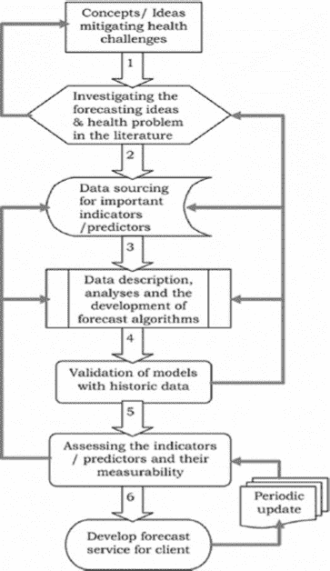图 (1)

医疗保健中预测分析建模的步骤。

### 心血管疾病预测

心血管疾病（CVD）包括影响心脏或血管的一系列状况。鉴于其在全球范围内的影响，预测和诊断心脏病至关重要。机器学习技术（包括神经网络和遗传算法）通过利用年龄、家族史、糖尿病、高血压、胆固醇水平、吸烟、酒精摄入以及胖或缺乏运动等主要风险因素，在预测心脏病方面发挥了重要作用。朴素贝、神经网络和决策树等各种算法已应用于分析医学数据集以预测心脏病。

### 糖尿病预测

糖尿病是一种具有广泛公共健康影响的慢性疾病，一直是机器学习预测的重点。研究探索了生活方式（饮食习惯、睡眠习惯、体力活动）与糖尿病风险之间的关系 [11] 。分类与回归树（`CART`）机器学习算法以及其他分类器（如`Naïve Bayes`和支持向量机`SVM`）在糖尿病数据集分析中证明了其有效性，其中`SVM`成为医学数据集的一种稳健的分类器 [12, 13] 。

### 肝炎疾病预测

肝炎以肝细胞炎症为特征，构成了重大的健康风险。已经提出了结合支持向量机（`SVM`）和模拟退火（`SA`）的混合方法，用于肝炎的诊断。`C4.5`、`ID3`和`CART`等决策树算法已用于疾病分类，并获得与丙肝病毒（`HCV`）蛋白切割位点相关的准确预测结果。

### 机器学习癌症预测

癌症是一类多种疾病，一直是预后和预测的研究课题。已使用风险预测算法开发了用于乳腺癌诊断和复发预测的优化模型。机器学习技术（包括决策树、支持向量机`SVM`和人工神经网络`ANN`）已用于估计乳腺癌患者的生存率和疾病复发率。对比研究已确定`SVM`是乳腺癌复发预测的稳健模型。在肺癌、皮肤、肝和胃癌等多种癌症中，数据挖掘和机器学习技术被用于预测预后和复发，强调了在多个患者数据集验证方法的重要性 [14^-16] 。

近年来，机器学习技术已扩展到预测哮喘和结核（TB）以及监测血压，这展示了其通用性。

## 人工智能（AI）在医疗保健中的预测分析

使用人工智能（AI）进行医疗保健预测分析是一种变革性方法，它利用先进算法和机器学习模型来预测健康结果、增强决策并优化护理。以下是 AI 医疗保健预测分析的关键方面和应用：

### 疾病诊断与风险预测

### 早期检测

AI 算法可以分析患者记录、遗传信息和生活方式因素在内的数据，以识别潜在疾病的模式。

#### 风险分层

预测模型根据患者患特定疾病的风险进行分层，以便采取针对性的干预和预防措施。

### 患者结果与治疗优化

#### 结果预测

AI 模型分析患者数据以预测各种治疗的结果，协助临床医生选择最有效的方案。

#### 治疗建议

预测分析通过考虑个人患者特征、病史和反应，协助提供治疗方案的建议。

#### 识别高风险患者

AI 算法分析历史患者数据以预测住院的可能性，帮助医疗提供人员对高风险个体进行干预并实施预防措施 [17, 18] 。

### 慢性病管理

#### 个性化护理计划

基于 AI 的预测分析通过考虑患者独特的健康状况、依从模式对干预的反应，帮助慢性病患者创建个性化护理计划。

#### 远程患者监测

AI 驱动的预测模型能够对慢性病患者进行持续监测，及早识别并发症并进行及时干预。

### 欺诈检测与收入周期管理

#### 异常检测

AI 算法分析医疗账单和索赔数据以检测指示欺诈活动的异常和模式，优化收入周期管理。

#### 增强账单准确性

预测分析有助于识别潜在的账单错误，确保医疗服务的准确补偿。

### 资源分配与运营效率

#### 需求预测

AI 模型分析历史数据以预测入院率，使医院能够优化资源分配、人员和床位管理。

#### 供应链优化

预测分析协助预测医疗用品的需求，优化库存水平并确保供应链的高效。

## 药物发现与开发

### 靶点识别

AI 驱动的预测模型分析生物学数据以识别潜在药物靶点，加速药物发现过程。

#### 临床试验优化

预测分析协助临床试验的患者筛选，优化试验设计并增加药物开发的成功。

### 用于非结构化数据的自然语言处理（NLP）

#### 从文本中提取见解

NLP 算法通过分析临床笔记、研究文章和患者叙述中的非结构化数据来提取价值洞解，从而支持预测性分析。

#### 情感分析

NLP 技术用于评估患者的情绪和反馈，为医疗决策中的预测模型提供额外的背景信息 [19]。

人工智能与预测分析在医疗保健领域的整合不仅增强了临床决策支持，还有助于更高效的医疗服务运营、个性化的患者护理，以及医学研究和药物开发的进展。随着技术的不断演进，人工智能驱动的预测分析在变革医疗结果方面的潜力依然十分广阔。

## 医疗保健领域预测分析面临的挑战

健康预测的重要性在之前的讨论中已经得到认可，但在其开发和应用过程中，必须解决各种挑战性问题。这些挑战包括健康数据广度和可靠性的局限性、健康预测工具和技术的稳健性，以及对健康预测需求的明显缺乏。

尽管近期的技术进步使得健康指标的测量变得更加廉价和方便，但关键的人口健康指标的高效获取和可用性仍然不足且未经过验证。在个性化医学中，预后效果受许多复杂因素的影响，其中一些因素是未知的，而且这些因素往往随机交织，为开发可靠的健康预测带来了挑战。

除了数据和方法论的局限性外，在现实环境中令人信服地展示健康预测性能也是具有挑战性的。虽然健康预测研究侧重于预测总体健康状况或特定情况（如急诊科的拥挤和总入院人数）的方法，但其最优价值在于针对特定状况的健康预测。

针对特定的健康状况定制预测可以使医疗服务提供者做出更明智的决策和准备。例如，英国气象局为某些初级保健信托（PCT）提供针对慢性阻塞性肺疾病（COPD）等状况的特定健康预测服务，这展示了此类专业服务的价值，尽管它们目前仍然罕见。

健康预测的有效性在它们提供充分预警以采取及时补救措施时最为明显。医疗服务提供者根据对医疗服务的潜在需求做出关键决策并分配资源，范围从针对早期症状的基础社会护理到针对极端事件使用先进的人员和设施。要满足留有足够时间进行准备活动的健康预测需求，必须使用可靠的预测技术和充足的数据。然而，这带来了平衡预测精密度和准确性的挑战。因此，在可预测性与特定健康预测需求之间找到微妙的平衡是健康预测的一个关键挑战。

另一个挑战涉及健康预测的实际应用。这些预测的开发是为了满足脆弱个体或机构（医疗服务提供者）的需求。一个能够有效地将预测传达给用户的智能预警系统至关重要。一些健康预测服务已通过自动电话服务、上门访问/治疗以及向个人和服务提供者直接传递预测来实现。

## 结论

健康预测是一个动态且不断演进的过程，需要频繁更新，在遵循既定原则的同时结合创新技术和数据。目前的方法主要涉及使用平滑或移动平均模型的时间序列分析。此外，概率性较低的预测模型如分位数回归映射（QRM）为预测和应对极端健康事件提供了可行的替代方案。尽管健康预测视野具有重要意义，但文献中缺乏对其分类，导致缺乏指导新健康预测的通用基准。

通过时间序列分析或其他概率方法等技术利用健康数据中的模式证明对健康预测具有至关重要的作用。然而，尽管是增强和促进医疗服务提供的宝贵资源，健康预测并非没有缺点。挑战可能源于数据源、方法论或技术相关的问题。本概述旨在激发对健康预测方法和方法的进一步讨论，目标将其建立为一种稳健的工具，以更有效、统一的方式促进医疗和健康服务。

## 参考文献

|  ||  |
| --- | --- |
| [1] || Armstrong JS, editor. Principles of Forecasting [Internet]. International Series in Operations Research & Management Science. Boston, MA: Springer US; 2001. Available from: [`link.springer.com/book/10.1007/978-0-306-47630`](https://link.springer.com/book/10.1007/978-0-306-47630) |
| [2] || Boukenze B, Haq A. Predictive analytics in health using data mining techniques. Computer Science & Information (IT) 2016; 24. [`dx.doi.org/10.5121/csit.2016`](http://dx.doi.org/10.5121/csit.2016) |
| [3] || Van Calster B, Timmerman D, Steyerberg EW, Collins GS. Predictive analytics in health: how can we know? J Am Med Inform 2019; 26(12). [`dx.doi.org/10.1093/jamia`](http://dx.doi.org/10.1093/jamia) [PMID: [3137358](https://www.ncbi.nlm.nih.gov/pubmed/3137358)] |
| [4] || Nithya B, Ilango V. Predictive analytics in health care using machine learning tools. International Conference on Intelligent Computing and Control (ICIC) 2017. [`dx.doi.org/10.5121/csit.2016`](http://dx.doi.org/10.5121/csit.2016) |
| [5] || Reddy AR, Sun J. Predictive big data analytics in healthcare. IEEE Xplore. 2016. |
| [6] || Sharma S, Singhal A. A comprehensive investigation of machine learning algorithms with smote integration to maximize F1 score. 2023. [`dx.doi.org/10.1007/978-0-306-47630_16`](http://dx.doi.org/10.1007/978-0-306-47630_16) |
| [7] || Cirkovic BR, Cvetkovic AM, Ninkovic SM, Filipovic ND. Prediction models for estimation of survival rate and relapse for breast cancer. IEEE 15th International Conference on Bioinformatics and Bioengineering (BIBE) 2015. [`dx.doi.org/10.1129/BIBE.2015.73675`](http://dx.doi.org/10.1129/BIBE.2015.73675) |
| [8] || Jain A, Singhal A. Diet recommendation using predictive learning approaches. 3rd International Conference on Issues and Challenges in Intelligent Computing Techniques (ICICT) 2022 |
| [9] || Reddy CK, Sun J. Big data analytics for healthcare. In tutorial presentation at the SIAM international conference on data mining, austin, TX. achc. org. co, 2013, 4. |
| [10] || Cruz JA, Wishart DS. Applications of machine learning in cancer prediction and prognosis. Cancer Inform 2006. [`dx.doi.org/10.1177/117693510600200030`](http://dx.doi.org/10.1177/117693510600200030) [PMID: [19458758](https://www.ncbi.nlm.nih.gov/pubmed/19458758)] |
| [11] || Jain A, Singhal A. Early diabetes prediction using deep ensemble model and diet planning. Proceedings of the International Conference on Intelligent Computing, Communication and Information Security 2022101-11. |

# 使用机器学习对数字健康记录、基因组学和放射学进行预测与分析

## 参考文献

| [12] | Sankararaman S, Goebel K. 预后不确定性：计算方法与实践挑战。IEEE Aerospace Conference, 2014, pp. 1-9. |
| [13] | Jain A, Singhal A. 用于糖尿病预测和饮食建议的生物启发方法。SN Computer Science 2024; 5(1): 182. [http://dx.doi.org/10.1007/s42979-023-02481-x] |
| [14] | Hassan MM, Billah MA, Rahman MM. et al. 机器学习方法在医疗保健中用于糖尿病预测的早期分析。第 12 届国际计算通信与网络技术会议 (ICCCNT) 20211-5. |
| [15] | David G, Smith-McLallen A, Ukert B. 预测分析驱动的干预对医疗资源利用的影响。J Health Econ 2019; 64(Mar): 68-79. [http://dx.doi.org/10.1016/j.jhealeco.2019.02.002] [PMID: 30818095] |
| [16] | Koti MS, Alamma BH. 用于医疗数据库的大数据预测分析技术。第二次国际会议论文集 22019; : 679-86. [http://dx.doi.org/10.1007/978-981-13-1927-3_71] |
| [17] | Sheingold BH, Hahn JA. 医疗质量史：前 100 年 1860–1960。Int J Afr Nurs Sci 2014; 1(Jan): 18-22. [http://dx.doi.org/10.1016/j.ijans.2014.05.002] |
| [18] | Cortada JW, Gordon D, Lenihan B. 医疗中分析的价值。IBM 商业价值学院 IBM 全球业务服务 2012. |


| [19] | Myers MF, Rogers DJ, Cox J, Flahault A, Hay SI. 公共卫生中增强流行病准备能力的疾病风险预测。Adv Parasitol 2000; 47: 309-30. [http://dx.doi.org/10.1016/S0065-308X(00)47013-2] [PMID: 1099211] |

## 作者

- `Sandeep Raj` (Sharda School of Engineering & Technology, Greater Noida, Uttar Pradesh-201306)
- `Arun Prakash Agarwal` (Birla Institute of Applied Sciences, Bhimtal, Nainital, Uttarakhand-263136)
- `Sandesh Tripathi`
- `Nidhi Gupta`

## 摘要

构建不同的机器学习算法及其在增强医疗系统中的潜在应用至关重要。`AI` 在医疗领域有无数种用途，包括医学数据分析、疾病早期诊断与检测、减少观察者人为错误的证据性目标、医疗管理的风险识别与干预、实时健康监测、帮助患者选择合适的药物以及评估药物反应。

机器学习技术已经改变了医疗健康的许多方面，从让人们能够更好地控制健康的新工具，到辅助医生做出更准确决策的新模型。自从 20 世纪 50 年代起搏器的出现，以及第一批血化检查结果和胸光报告的计算机化记录出现以来，医生们已经看到了算法在拯救生命方面的潜力。图像处理、深度学习和自然语言处理的新进展正在彻底改变医疗行业；机器学习的丰富历史为当今的研究提供了支持。

有必要理解机器学习对人类的影响，包括透明度、监管、部署的简易性以及与临床流程的整合，以提高医疗成效。本章将涵盖机器学习在风险评估、疾病进展和精准医学中的应用，并从介绍临床护理和数据开始。我们将包含涵盖于这些主题的所有方法论细节，如算法公平性、因果推断、离策略强化学习、`ML` 模型的可解释性，以及基于图像和自然语言处理的深度学习基础。

`AI` 和 `ML` 技术的进步显著提高了预测和识别健康紧急情况、疾病状况、疾病人群和免疫反应的能力。尽管尽管对基于 `ML` 的技术的实用性以及如何在临床背景下解释其发现仍存在怀疑，但其应用正在迅速扩散。在这里，我们对基于机器学习的方法和学习算法（如强化学习、监督学习和无监督学习）进行了简单介绍并附带示例。随后，我们探索了机器学习（`ML`）在遗传学、神经影像和电子健康记录等各个医疗领域的应用。在提供未来潜在用途想法的同时，我们还简述了将机器学习应用于医疗行业相关的风险和挑战，包括隐私和伦理问题。

**关键词：** 人工智能、基因组学、医疗、机器学习、支持向量机

**通讯作者 Sundeep Raj:** Sharda School of Engineering & Technology, Sharda University, Greater Noida, Uttar Pradesh-201306; 电子邮箱: suandeepraj11@gmail.com

## 引言

20 世纪 50 年代，艾兰·图灵提出了第一台人工智能机器，这标志着机器学习应用的开始。机器学习最初被用于安全服务的人脸识别，此后被应用于公共交通以提高效率并降低风险，并在近期更多地应用于生物技术和医疗领域。类似的进展预计将出现在医学和医疗领域。机器学习和人工智能已极大改变了日常生活工作流程。该领域近期取得了显著进展，减轻了医生的负担，并提高了精确性、预后和质量。

医生或分析师的潜力在于执行职责、识别医疗趋势以及创建疾病预测模型，这些在很大程度上得益于机器学习的进展。机器学习技术还被大型医疗机构应用于以下领域以获得更高的效率：血液样本、器官异常识别、机器人手术和骨骼，以及电子健康记录的整理。最近在抗击新冠期间，机器学习算法的使用加速了医院的响应速度。

通过 GE 的临床指挥中心（Clinical Command Centre）深度学习技术，医院能够在混乱期间交换、追踪和组织患者、病房、床位、电子健康记录（EHR）、呼吸机以及人员 [12]。研究人员还利用人工智能来监测和识别 SARS-CoV2 基因序列，并创建疫苗 [13]。

随着医疗领域扩展到现代技术时代，许多创新层出不穷。该领域的进步，例如更快的诊断速度、更高的准确性和易用性，在很大程度上取决于机器学习模型和人工智能模型及其应用。本章的目的是概述医疗保健领域基于机器学习方法的优缺点。

由于医疗行业正深浸于新型机器学习技术的使用中，我们希望对许多机器学习方法进行简要总结，并关注这些方法主要运用的领域。我们谈论了它们在未来医疗保健行业发展中的巨大潜力和应用。我们还讨论了在应用过程中在伦理和物流方面产生的风险和挑战。

# 人工智能概览

虽然人工智能、深度学习和机器学习有时被通用使用，但它们指的是一组不同的算法和学习过程。任何模拟和从人类智能中学习的计算机智能的通称为人工智能（AI） [14]。虽然自动驾驶汽车和机器人是自主技术最广为人知的例子，但人工智能也用于许多日常应用，包括网络搜索和个性化营销。由于于智能在决策水平、精确性、问题解决能力和计算技能方面的提高，人工智能的应用和开发在近年来取得了飞跃，并已应用于许多领域 [15]。

在开发人工智能算法的过程中，收集到的数据被分为两组——训练集和测试集，以确保预测的公正性、样本的代表性和学习的可信度。训练集顾如其名，用于训练算法。它由定义特征（数据点）的集合组成，在监督学习类型中，还包含关联预测。测试数据集对于算法来说基本上是全新的，仅用于评估其性能。这一步用于确保消除训练数据集算法测试中的偏差 [16]。当一个算法在训练和测试期间产生满意的结果时，它就会被应用于医疗环境中。

人工智能（AI）的使用非常广泛，在各个子区域中都有许多应用；在这里，我们对其中两个子区域进行总结：深度学习和机器学习。

## 机器学习

机器学习是各种算法和统计方法的应用，用于解决问题不需要专门的编程 [17]。由于许多机器学习模型只有一个层，在数据进入算法之前，必须完成大部分的数据处理特征提取 [18]。这些类型的机器学习技术在缺乏额外层的情况下，需要大量的数据准备来识别准确的预测，并防止训练数据集过拟合或欠拟合。

### 深度学习

深度学习被视为机器学习的一个更复杂的子集，用户利用分层人工神经网络。它以牺牲部分可解释性为代价，提供了更高的精确性和可解释性 [19]。根据其描述，神经网络方法使用多层网络来支持每一层中单元或人工神经元以及与其上下层之间的连接 [20]。这些多级链接允许这些网络自主分析数据，允许它们从中学习、感知并得出结论。数据将被不断处理，直到获得特定的结果。

### 不同的学习方法论

大多数人工智能和机器学习算法基于几种学习方法论。监督学习是用于预测和分类的一个子类型。训练集包含特征或结果是一个关键区别。简而言之，监督学习使用训练集中的细节来构建模型。一些使用监督学习的机器学习算法包括`决策树`、`支持向量机`、`随机森林`和`人工神经网络`。`决策树` 以单个节点为起点，创建一个决策工具，直到达到所需的输出 [21]。被称为`支持向量机`（`SVM`）的分类技术识别用于划分数据的最大间隔超平面，并为组提供最佳拟合 [22]。`人工神经网络`（`ANNs`）由三层组成：输入层、输出层以及一个多个隐藏层。每一层的神经元与其前方和后方的神经元都连接 [23]。监督机器学习技术广泛应用于医疗行业，用于多种目的，包括图像检测、医院结果识别和疾病预测。

无监督学习通常用于数据评估和应用聚类，是另一种基于人工智能的学习技术的子集。在涉及数据分析、分层和降维时，无监督机器学习通常用于预测以外的目标。通常，无监督聚类技术中的算法被用于将数据组织成尚未识别的独立组。尽管大多数机器学习方法在输入之前涉及对数据进行特征提取和预处理，但这种方法通过发现数据的底层特征或关系，然后根据其相似性进行分类，从而实现特征提取并调查潜在的数据聚类。

`深度信胶网络`（`DBN`）、`CNN` 卷积神经网络和 `k-means` 方法是一些无监督学习技术。`k-Means` 算法是最流行的无监督学习算法，被用作聚类技术，用于寻找无标记数据组间的均值并根据均值形成组。`深度信念网络`（`DBN`）是一个具有多个隐藏层的多层网络，负责数据中的特征识别和关联分析。它由层内连接组成，有助于数据检索，通常基于无监督学习 [24, 25]。由于`卷积神经网络`（`CNNs`）依赖于特征识别和识别，它们是在图像识别、异常检测和识别方面运行良好的多层网络。

由于数据是同质的且没有预设结果，因此采用了几种无监督算法进行聚类；尽管尽管这些技术非常之用且速度快，但无监督技术在医疗行业中的普及程度并不高。

另一种介于监督学习和无监督学习之间的学习方法是强化学习。这种学习依赖于奖励序列，类似于心理学中的条件反射机制，并开发出在特定问题领域内运行策略。强化学习方法被认为最接近动物和人类的学习，因为它们能够优化误差标准并具有影响周围环境的能力[26]。

学习方法的选择通常取决于实现目标，鉴于学习方法的多种，与选择算法相比，学习方法的选择相对不复杂。循环神经网络（`RNN`）是一种利用了强化学习的流行神经网络。`RNN` 是一种神经网络，其中所有人工神经元相互连接。这允许人工神经元将一个阶段的输出重用作为另一个阶段的输入，并接收带有延迟的输入。翻译、时间序列预测、节奏获取、语音识别以及音乐创作都是其众多应用之一。

尽管由于强化学习对结构、多样化数据、奖励的制定与应用以及大量计算资源的要求，其在医疗领域的应用仍然受到限制，但它仍具有在该领域取得重大进展的潜力。

鉴于各种深度学习和机器学习方法，必须识别并实施与医疗应用相关的可行解决方案。样本量[27, 28]、特征和数据分布[29]是需要考虑的几个变量，因为它们对学习和预测过程具有显著影响。

## 人工智能在医疗领域的应用

多年来，医疗领域一直在机器学习。AI 应用有望帮助各种任务，包括病例分诊和诊断[30]、改进的图像分割和扫描[31]、决策支持、神经影像和疾病风险预测。在这里，我们简要介绍了人工智能在特定医疗保健领域的最新进展。除了基于 `ML` 技术所使用的数字数据可用性增加以及应用的临床应用和实验外，学习方法也构成了所列应用入选标准的基础。

在目前的研究中，我们重点关注机器学习在医学影像、基因工程和电子健康记录领域的应用。这些领域也体现了医疗保健中的大数据，即该领域内的组织化和非组织化数据，并在临床实施方面展示了显著的潜力。

以下是我们将使用的搜索方法：2020 年 6 月至 2020 年 12 月期间发表的文章；期刊数据库和在线图书馆，如 Academic、OneFile、Nature、Gale、Science Direct、 Pubmed 和 PsycNet。编译中的论文和文章集中于人工智能和机器学习在医疗行业的现状和未来应用。出现的搜索词包括：医疗保健人工智能、机器学习医学影像、机器学习与大数据、电子健康记录、机器学习基因组学、人工智能的医学应用以及医疗保健中人工智能面临的问题。

## 数字健康记录

20 世纪 60 年代，洛希希德引入了第一个电子健康记录（`EHR`），最初被称为临床信息系统[32]。从那时起，这些系统经历了多次重建，旨在为行业建立统一系统。为了提高工作质量和生产率，美国联邦政府在 2009 年投入了数十亿美元，鼓励在所有诊所实施 `EHRs`。结果，到 2015 年，全国几乎 87% 的诊所已将 `EHRs` 集成到系统中[33]。深度学习应用，例如处方续药和使用患者历史预测诊断，从 `EHR` 系统收集的具有结构化特征的大数据中受益巨大。

医生的诊断和治疗得到了此的帮助，这导致数据组织、数据访问和质量方面取得了显著进展。跨数据库的特征标准化便利了研究人员获取健康记录。

由于科学家意识到预测在治疗交付中发挥的关键作用，他们使用 `EHRs` 创建了用于深度学习进行诊断以及预测临床疾病的模型。在最近的一项研究中，Zhang、Liu 和 Razavian 利用 `CNNs`（监督学习）和 `LSTM` 网络（强化学习）创建了一种深度学习算法来预测心衰竭、中风和肾衰竭等疾病的发生。

与之前的预测模型相比，该方法同时使用了 `EHR` 的结构化数据和进展诊断笔记的非结构化数据。Liu 等（40,0）解释说，向模型中添加非结构化数据导致所有基准准确率指标显著提高，因此强调了这类算法的韧性和适应性。Ge 和他的同事在另一项使用深度神经网络方法的研究中，开发了一个预测中风后 7 到 14 天发生肺炎的模型。

该模型对第 7 天预测的准确率为 92.8%，第 14 天预测的准确率为 90.5%，为预测中风后肺炎提供了一个非常准确的模型（AUC，通过结合模型的特异性和敏感性来衡量模型的性能指标）[34]。为了预测重症监护室患者的死亡率，还使用了多种机器学习（`ML`）模型。Ahmad 和同事已经在其中一个模型在预测麻性肠梗（PI，一种不完全肠阻塞，阻碍食物通过并最终导致积聚和完全肠阻塞）患者死亡率方面展示了强大的预测能力。

在预测外动脉疾病患者的死亡率时，被称为 `SRML` - 统计稳健机器学习死亡率预测预测的算法准确率为 81.30%[35]。通过利用 `EHR` 预测算法，医疗服务提供者和患者在获得预期死亡率的情况下可以对临床治疗做出更明智的决策。

### 放射学

医学影像或放射学在使用机器学习技术在多种成像模态方面取得了显著进展，这些包括磁共振成像（`MRI`）、计算机断层扫描（`CT`）、正电子发射层扫描（`PET`）、`X-ray`、超声等。这是因为数据是数字化的，并且提供了 `DICOM`（医学数字成像与通信）结构化数据格式。为了识别病变 \[36\],肿瘤 \[37, 38\],骨折 \[39, 40\]以及撕裂 \[41, 42\], 已经构建了多种机器学习模型。

McKinney 及其同事在一项新研究中采用了一种深度深度学习算法，根据乳腺 X 线摄影识别处于早期阶段的肿瘤。这些基于深度学习的筛查技术通过在比传统筛查方法更早的阶段识别和定位乳腺癌肿瘤，实现了更高的肿瘤切除率。`11.5%` 的 `AUC` 得分使得这种基于深度学习的方法在直接对比中胜了经验丰富的放射科医生 \[43\]。尽管有效程度各异，但许多其他研究也使用了机器学习技术来识别乳腺癌。这些研究包括 Ahmad 等人 \[44\], Wang 等人 \[45\], 以及 Amrane 等人 \[46\]。

与，Esteva 及其同事在最近的工作中利用 `CNN`（无监督学习）通过皮肤镜照片对 2032 种不同的皮肤状况进行分类。数据的准确性通过 `CNN` 分类与经过 21 委员会认证的皮肤科医生的公正比较得到了进一步支持，结果显示性能“不鼓”。这种方法在与典型的消费者移动平台结合时可以实现早期诊断并易于使用。同时，研究已采用机器学习（`ML`）技术衡量视网膜疾病的进展 \[46\)^(\-)48\]。Arcadu *等人* 进行了一项研究，他们利用使用深度学习的 `CNN` 来识别由于 `DR`（糖尿病视网膜病变）进展导致视力丧的动脉 \[49\]。尽管并非专门为此此设计，但 `CNN` 也能识别微小的、低收缩的微动脉瘤 \[49, 50\]。糖尿病视网膜病变是一种常见的眼疾病，影响了 60% 的糖尿病患者 \[51\]。因此，在早期识别它具有挑战性。基于 `CNN` 的及时预测可能帮助患者避免视力丧。几十年来，`X-rays` 已被用于检测胸部疾病；然而，需要放射科医生的仔细检查。

相比之下，`CNN` 在识别胸部疾病种类方面比放射科医生表现出更高的 2%。这项研究由 Asif 等人开发的 \[52\], Tsai 和 Tao \[53\], Lee 等人 \[54\], 以及 Liang 等人 \[55\] 的 `CNN` 显示了这些方法在回顾性应用方面的巨大支持。

此外，基于 `ML` 的方法已用于诊断和预测严重精神疾病的程，例如抑郁 \[56\], 精神病 \[57, 58\], `PTSD` \[59\], 帕金森病 \[60, 61\], 阿尔茨海默病 \[62\], 以及各种发育障碍，如 `ADHD` \[63, 64\]。

### 基因工程与基因组学

自从自适应 DNA 系统出现以来，基因工程取得了蓬勃发展，该系统被称为簇间规律回重复序列（`CRISPR`） \[69\]。这种“可编程核酸酸酶”的发现极大降低了基因工程的成本，简化了基因改变的过程，并辅助了诊断过程 \[70\]。尽管该工具并非完美，但目前利用 `CRISPR` 进行 `Cas`（CRISPR 相关蛋白）编辑（如 `Cas-13a` 和 `Cas-9` \[71\]）已经改变了基因编辑。

除了 `CRISPR` 基因编辑外，O'Brien 及其同事创建了一种高效的核酸编辑服务，利用监督学习和随机森林算法来检查各种核酸组成如何影响同源定向修复（或 `HDR`）的效力 \[82\]。

为了确定精确识别特定点突变位置并预测 HDR 效率的最有效方法，他们创建了计算通用核苷酸编辑器（CUNE）。此外，Pan 以及同事创建了 `ToxDL` 基因编辑预测模型，该模型采用 `CNN` 方法，仅根据序列数据即可预测*体内*蛋白质毒性 [[83]]。药物基因组学，作为基因工程的另一个领域，在利用人工智能和 `ML` 建立日益流行的药物的稳定剂量方面也取得了巨大进展 [[84^(\-)86]]。

在其中一次试验中，为了降低接受肾移植患者的急性排斥风险，Tang 等人使用了基于 `ML` 的技术寻找稳定的 `Tacrolimus`（霉环素）剂量 [[87]]。最近，肿瘤学 [[88]]、精神学 [[89]]、神经学 [[90]]和减重医学 [[91]] 都已经在药物基因组学中使用了机器学习。

对抗 COVID-19 的战斗也从机器学习在基因工程中的应用中获益良浅。Malone *et.* 最近进行了一项研究，他们采用了基于机器学习算法的软件来预测哪些抗基因具有 HLA 结合、加工、细胞表面呈递和 T 细胞识别潜力的必要特征，以适用于免疫治疗的临床。

该小组通过利用该技术的免疫原性预测，结合抗原递送至受感染的宿主组织，有效地表征了“整个 SARS-CoV2 蛋白组”和表位热点。这些发现为创建一种适用于全球所有人口的病毒疫苗提供了指导原则。

## 挑战与风险

机器学习在医疗保健领域的应用提供了创新和前性的机会，但此外，它们也带来了不同寻常的风险、挑战以及人们产生了健康的怀疑态度。我们在这里概述了主要的风险因素，包括预测错误的可能及其影响、系统安全和隐私漏洞，尽管生成一致结果所需的信息存在不足。困难中的困难还包括道德困境、从医疗保健中消除人类因素，以及这些方法在病床环境中的可解释性和实用性。


机器学习算法对概率分布的依赖，以及诊断和预测中出现不准确的可能性，构成了巨大的危险。

这还引发了人们对基于`ML`方法所给预测的准确性和有效性存在合理程度的不确定性。使用机器学习（`ML`）技术导致人类死亡的后果是灾难性的，尽管错误和概率性是医疗保健领域许多方面固有的特征。一种可能的解决办法是在实施这些基于机器学习的技术之前，需要获得多个机构的严格的机构和法律许可 [[92, 93]]。另一种可用于在极敏感应用中防止假阴性或假阳性诊断的策略是由合格的医疗专业人员进行人工干预和监督（*例如*，乳腺癌或抑郁症的诊断）。

当目前的医疗保健人员参与这些策略的开发和应用时，适应率可能会提高，对职业前景下降或劳动力减少的担忧可能会减轻 [[94]]。

在使用机器学习和深度学习时，一个潜在的担忧是缺乏足够的训练和测试数据集来保证预测的可靠性。强调高质量数据的相关性至关重要，因为机器学习和深度学习从数据中“学习”。此外，许多学习网络和技术需要大量的数据，而这些数据并非易于获取，且可能代表了人口的一小部分。

在开发任何模型之前，必须考虑的因素之一是增强数据安全和问责制，考虑到隐私问题和数据的敏感性。

关于伦理考量，在医疗行业中使用机器学习技术的科学家可以很容易从基因工程领域获得见解，而该领域对于长期基因改进的可行性存在持续争议。发现并纠正有害基因突变（例如导致亨廷顿症的`HTT`变异）可能治疗此类具有潜在致命结果的疾病 [[95]]。

另一方面，开发修改个人及其后代基因组的疗法仍然昂贵，可能会加剧无法负担此类护理的人的社会经济差距 [[96]]。人工智能指南刚刚出现。新加坡在 2019 年制定了人工智能模型治理框架，帮助私营部门以伦理的方式开发和应用人工智能 [[97]]。此外，美国政府发布了一项行政命令，以“保持美国在人工智能领域的领先地位”并监管人工智能的发展 [[98]]。这些规则和原则尽管严厉，但其目的是为了确保伦理研究的开展和推进。

将机器学习应用于医疗保健时，解释结果并确定其在临床上的适用性是一项重大挑战。由于机器学习（`ML`）方法的方法，特别是基于深度学习的方法，具有复杂的结构，因此分离和识别原始特征对预测的贡献变得非常困难。基于机器学习的方法技术在医疗保健中的灵活性被透明度的缺乏所严重限制，尽管事实在其他机器学习应用（如网络搜索）中可能不会引起太大担忧。在医疗行业，解决方案的策略与解决方案本身同样重要。

采用率的提高也可能源于医疗专业人员和医生参与了基于机器学习技术的创建、使用和测试。此外，尽管对于基于机器学习技术的日益普及会导致患者与初级保健医生之间人际纽带削弱的可能性，人们仍存在合理的怀疑，但这些方法提供了一个增强参与感的独特机会。研究表明，医患关系的概念正在逐渐减少，近 25%的美国人缺乏初级保健医生 [99]。在这里，机器学习（`ML`）可以为提高患者参与潜在诊断讨论提供特殊机会，并提高外计划（Outreach Programmes）的效率。

当个人与初级保健医生（PCP）交流时，他们可能会发现基于`ML`的技术提供的早期诊断也有助于建立健康的生活方式。最后，根据一项针对医生的调查，5%的医生与患者交流的时间不到九分钟，56%的医生交流的时间在 16 分钟或以内 [100]。使用人工智能方法进行诊断和症状监测的两个益处是减轻焦虑和增加与患者一对一交流的时间。这些改进将提高患者的满意度和治疗结果。

## 结论

尽管摘要强调了机器学习取得的进展，但该领域仍需进行大量工作。医学领域许多近期机器学习进展的目标是协助医生和其他医疗保健专业人员为患者提供更快速、更准确、质量更高的医疗服务。为了克服数据不可用的问题，可以通过设计和改进数据收集、传播和存储，或者通过开发用于处理非结构化数据的算法来解决与构建机器学习算法相关的问题。未来的发展可能会为低收入国家和人群提供更易获得的医疗保健，以及更具经济效益的医学检查和成像系统。这些发展可能结束健康不平等现象。

科学家们预计药物识别和剂量的改进、个体药物反应的预测，以及基因工程在治疗遗传性疾病和突变中的应用将实现。`ML`具有重新思考患者护理并加强医生作用的潜力。承认并解决未来使用相关的风险和挑战的前提下，目前的`ML`算法可以为`ML`在医学领域的未来进步和应用提供良好的基础。

## 参考文献

|  |  |
| --- | --- |
| \[1\] | Turing A. Computing machinery and intelligence. Mind 1950; 236: 433-460. |
| \[2\] | Wati DAR, Abadianto D. Design of face detection and recogni- tion system for smart home security application. 2nd International conferences on Information Technology, Information Sys- tems and Electrical Engineering (ICITISEE); 2018 November 1-2, Yogyakarta, Indonesia: 2018; pp. 342-347. |
| \[3\] | Ellis K, Godbole S, Marshall S, Lanckriet G, Staudenmayer J, Kerr J. Identifying active travel behaviors in challenging envi- ronments using GPS, accelerometers, and machine learning algo- rms. Front. Public Health 2014; 2(36). |
| \[4\] | Omrani H. Predicting travel mode of individuals by machine learning. Transp. Res. Procedia 2015; 10: 840-849. |
| \[5\] | Siddiqui MK, Morales-Menendez R, Huang X, Hussain N. A review of epileptic seizure detection using machine learning classi- fiers. Brain Inform. 2020; 7(1): 5. |
| \[6\] | Woldaregay AZ, Årsand E, Botsis T, Albers D, Mamykina L, Hartvigsen G. Data-driven blood glucose pattern classification and anomalies detection: Machine-learning applications in type 1 diabetes. J Med Internet Res 2019; 21(5): e11030.[`dx.doi.org/10.2196/11030`](http://dx.doi.org/10.2196/11030) [PMID: [31042157](http://www.ncbi.nlm.nih.gov/pubmed/31042157)] |
| \[7\] | Esteva A, Kuprel B, Novoa RA, et al. Dermatologist-level classification of skin cancer with deep neural networks. Nature 2017; 542(7639): 115-8.[`dx.doi.org/10.1038/nature21056`](http://dx.doi.org/10.1038/nature21056) [PMID: [28117445](http://www.ncbi.nlm.nih.gov/pubmed/28117445)] |
| \[8\] | Rajpurkar P, Irvin J, Zhu K, Yang B, Mehta H, Duan T. CheXNet: Radiologist-level pneumonia detection on chest X-rays with deep learning. arXiv 20173-9. |
| \[9\] | Kaouk JH, Garisto J, Eltemamy M, Bertolo R. Robot-assisted surgery for benign distal ureteral strictures: step-by-step technique using the SP® system. BJU Int 2019; 123(4): 733-9.[`dx.doi.org/10.1111/bju.14635`](http://dx.doi.org/10.1111/bju.14635) [PMID: [30492129](http://www.ncbi.nlm.nih.gov/pubmed/30492129)] |
| \[10\] | Lanfranco AR, Castellanos AE, Desai JP, Meyers WC. Robotic Surgery. Ann Surg 2004; 239(1): 14-21.[`dx.doi.org/10.1097/sla.0000103020.195d`](http://dx.doi.org/10.1097/sla.0000103020.195d) [PMID: [1468095](http://www.ncbi.nlm.nih.gov/pubmed/1468095)] |
| \[11\] | Tian L, Zhang D, Bao S, et al. Radiomics-based machine-learning method for prediction of distant metastasis from soft-tissue sarcomas. Clin Radiol 2021; 76(2): 158-25.[`dx.doi.org/10.1016/jcrad.2020.08.38`](http://dx.doi.org/10.1016/jcrad.2020.08.38) [PMID: [33293024](http://www.ncbi.nlm.nih.gov/pubmed/33293024)] |
| \[12\] | Roth M. COVID-19: Oregon hospitals share data, create real-time bed system. Health Leaders 2020. Available from: https://www.healthmedia.com/ |
| \[13\] | Malone B, Simovski B, Moliné C, et al. Artificial intelligence predicts the immunogenic landscape of SARS-CoV-2 leading to universal blueprints for vaccine designs. Sci Rep 2020; 10(1): 22375.[`dx.doi.org/10.1038/s41598-020-7858-5`](http://dx.doi.org/10.1038/s41598-020-7858-5) [PMID: [33361777](http://www.ncbi.nlm.nih.gov/pubmed/33361777)] |
| \[14\] | Lee EJ, Kim YH, Kim N, Kang DW. Deep into the brain: Artificial intelligence in stroke imaging. J Stroke 2017; 19(3): 277-85.[`dx.doi.org/10.5853/jos.2017.0254`](http://dx.doi.org/10.5853/jos.2017.0254) [PMID: [29037014](http://www.ncbi.nlm.nih.gov/pubmed/29037014)] |
| \[15\] | Miotto R, Wang F, Wang S, Jiang X, Dudley JT. Deep learning for healthcare: review, opportunities and challenges. Brief Bioinform 2018; 19(6): 1236-46.[`dx.doi.org/10.1093/bib/bbx044`](http://dx.doi.org/10.1093/bib/bbx044) [PMID: [28481991](http://www.ncbi.nlm.nih.gov/pubmed/28481991)] |
| \[16\] | Alloghani M, Al-Jumeily D, Mustafina J, Hussain A, Aljaaf AJ. A systematic review on supervised and unsupervised machine learning algorithms for data science. Supervised and unsupervised learning for data science 20203-21.[`dx.doi.org/10.1007/978-3-030-22475-2_1`](http://dx.doi.org/10.1007/978-3-030-22475-2_1) |
| \[17\] | Samuel AL. Some studies in machine learning using the game of checkers. IBM J Res Develop 2000; 44(1.2): 206-26.[`dx.doi.org/10.1147/rd.441.0206`](http://dx.doi.org/10.1147/rd.441.0206) |
| \[18\] | Alpaydin E. Introduction to machine learning. MIT Press, 2020. Available from: https://books.google.com/books?hl=en&l-r=&id=tZnSDwAAQBAJ&oi=fnd&pg=PR7&dq=Introduction+to+machine+learning&ots=F3RWaXcwwf&sig=50DHyEjhVdDt- |
| \[19\] | Bhattacharjee B, Boag S, Doshi C, Dube P, Herta B, Ishakian V. IBM deep learning service. arXiv. 2017; 1-22. |
| [20] | Qin Z, Ye H, Li GY, Juang BHF. 物理层通信中的深度学习。IEEE Wirel Commun 2019; 26(2): 93-9. [`dx.doi.org/10.1109/MWC.2019.1800601`](http://dx.doi.org/10.1109/MWC.2019.1800601) |
| [21] | Kamiński B, Jakubczyk M, Szufel P. 决策树敏感性分析框架。Cent Eur J Oper Res 2018; 26(1): 135-59. [`dx.doi.org/10.1007/s10100-017-0479-6`](http://dx.doi.org/10.1007/s10100-017-0479-6) [PMID: [29375266](http://www.ncbi.nlm.nih.gov/pubmed/29375266)] |
| [22] | Gaonkar B, Davatzikos C. 基于支持向量机的多变量图像分析与分类的统计显著性图解析估计。Neuroimage 2013; 78: 270-83. [`dx.doi.org/10.1016/j.neuroimage.2013.03.066`](http://dx.doi.org/10.1016/j.neuroimage.2013.03.066) [PMID: [23583748](http://www.ncbi.nlm.nih.gov/pubmed/23583748)] |
| [23] | Leijnen S, Veen F. 神经网络动物。Proceedings 2020; 47(1): 9. [`dx.doi.org/10.3390/proceedings2020047009`](http://dx.doi.org/10.3390/proceedings2020047009) |
| [24] | Coates A, Lee H, Ng AY. 无监督特征学习中单层网络的分析。J Mach Learn Res 2011; 15: 215-23. |
| [25] | Ravi D, Wong C, Deligianni F, et al. 用于健康信息学的深度学习。IEEE J Biomed Health Inform 2017; 21(1): 4-21. [`dx.doi.org/10.1109/JBHI.2016.2636665`](http://dx.doi.org/10.1109/JBHI.2016.2636665) [PMID: [28055930](http://www.ncbi.nlm.nih.gov/pubmed/28055930)] |
| [26] | Sutton RS, Barto A. 强化学习：导论 2018. |


- [27] Vabalas A, Gowen E, Poliakoff E, Casson AJ. 有限样本量下的机器学习算法验证。`PLoS One` 2019; 14(11): e0224365. [`dx.doi.org/10.1371/journal.pone.0224365`](http://dx.doi.org/10.1371/journal.pone.0224365) [PMID: [31697686](http://www.ncbi.nlm.nih.gov/pubmed/31697686)]

- [28] Cui Z, Gong G. 功能连接特征下，机器学习回归算法和样本量对个体化行为预测的影响。`Neuroimage` 2018; 178: 622-37. [`dx.doi.org/10.1016/j.neuroimage.2018.06.001`](http://dx.doi.org/10.1016/j.neuroimage.2018.06.001) [PMID: [29870817](http://www.ncbi.nlm.nih.gov/pubmed/29870817)]

- [29] Gu L, Zeng D, Li P, Guo S. 地理分布式数据中心大数据处理成本最小化。`IEEE Trans Emerg Top Comput` 2014; 2(3): 314-23. [`dx.doi.org/10.1109/TETC.2014.2310456`](http://dx.doi.org/10.1109/TETC.2014.2310456)

- [30] Liang Z, Zhang G, Huang JX, Hu QV. 基于电子健康记录（`EMRs`）的医疗保健决策深度学习。`Proc - 2014 IEEE 国际生物信息学与生物医学会议 (BIBM)`, 英国贝尔法斯特；2014 年 11 月 2-5 日, pp. 556-559. [`dx.doi.org/10.1109/BIBM.2014.6999219`](http://dx.doi.org/10.1109/BIBM.2014.6999219)

- [31] Li W, Jia F, Hu Q. 深度卷积神经网络在 `CT` 图像中肝肿瘤自动分割。`J. Journal of Computer and Communications` 2015; 3(11): 146-51. [`dx.doi.org/10.4236/jcc.2015.311023`](http://dx.doi.org/10.4236/jcc.2015.311023)

- [32] Atherton J. 电子健康记录的开发。`Virtual Mentor` 2011; 13(3): 186-9. 来源：http://virtualmentor.ama-n.org/2011/03/msoc-1103](http://virtualmentor.ama-n.org/2011/03/msoc-1103) [PMID: [23583748](http://www.ncbi.nlm.nih.gov/pubmed/23583748)]

- [33] Yang N, Hing E. 国家电子健康记录调查：2015 年及医生电子健康记录采用情况。2017; 28. 来源：http://www.cdc.gov/ahcd/questionnaires](http://www.cdc.gov/ahcd/questionnaires)

- [34] Ge Y, Wang Q, Wang L, 等. 使用深度神经网络预测中风后肺炎。`Int J Med Inform` 2019; 132: 103986. [`dx.doi.org/10.1016/j.ijmedinf.2019.103986`](http://dx.doi.org/10.1016/j.ijmedinf.2019.103986) [PMID: [31629312](http://www.ncbi.nlm.nih.gov/pubmed/31629312)]

- [35] Ahmad FS, Ali L. 一种预测电子健康记录(`EHRs`)麻痹性肠梗死亡的混合机器学习框架。`J Ambient Intell` 2020; 12(2): 3283-93.

- [36] Karimi D, Peters JM, Alam A, Sahin M. 从噪声标注中学习脑病变。2020 第 17 届生物医学成像国际会议 (`ISBI`), pp. 1910-4.

- [37] Tang TT, Zawaski JA, Francis KN. 基于机器学习的肿瘤类型和生长分类：临床前研究。`Sci Rep` 2019; 9(1): 12529. [`dx.doi.org/10.1038/s41598-019-48738`](http://dx.doi.org/10.1038/s41598-019-48738) [PMID: [31467303](http://www.ncbi.nlm.nih.gov/pubmed/31467303)]

- [38] Sharma K, Kaur A, Gujral S. 基于机器学习的脑肿瘤检测。`Int J Comput Appl` 2014; 103(1): 7-11. [`dx.doi.org/10.5120/18036-6883`](http://dx.doi.org/10.5120/18036-6883)

- [39] Ferizi U, Besser H, Hysi P, 等. 人工智能应用于骨质疏症：预测 `MRI` 数据骨性的机器学习算法性能比较。`J Mag Reson Imaging` 2019; 49(4): 1029-38. [`dx.doi.org/10.1002/jmri.26280`](http://dx.doi.org/10.1002/jmri.26280) [PMID: [30252971](http://www.ncbi.nlm.nih.gov/pubmed/30252971)]

- [40] Zuccon G, Wagholikar AS, Nguyen AN, 等. 使用机器学习和 `SNOMED CT` 本体论对自由文本放射学报告进行肢体骨折自动分类。`AMIA J Summits Transl Sci Proc` 2013; 2013: 300-4. [PMID: [24303284](http://www.ncbi.nlm.nih.gov/pubmed/24303284)]

- [41] Chang PD, Wong TT, Rasiej MJ. 用于检测前韧带断裂的深度学习。`J Digit Imaging` 2019; 32(6): 980-6. [`dx.doi.org/10.1007/s10278-019-00193-4`](http://dx.doi.org/10.1007/s10278-019-00193-4) [PMID: [30859341](http://www.ncbi.nlm.nih.gov/pubmed/30859341)]

- [42] Lao Y, Jia B, Yan P, 等. 基于磁共振成像的机器学习辅助检测交叉韧带损伤的诊断准确性。`Medicine (Baltimore)` 2019; 98(50): e18324. [`dx.doi.org/10.1097/MD.000000000001834`](http://dx.doi.org/10.1097/MD.000000000001834) [PMID: [31852123](http://www.ncbi.nlm.nih.gov/pubmed/31852123)]

- [43] McKinney SM, Sieniek M, Godbole V, 等. 乳腺癌筛查的 `AI` 系统国际评估。`Nature` 2020; 577(7788): 89-94. [`dx.doi.org/10.1038/s41586-019-1799-6`](http://dx.doi.org/10.1038/s41586-019-1799-6) [PMID: [31894144](http://www.ncbi.nlm.nih.gov/pubmed/31894144)]

- [44] Ahmad L, Eshlaghy A, Poorebraimi A, Ebrahimi M, Raza-vi A. 使用三种机器学习技术预测乳腺癌复发。`J Health Med Inform` 2013; 04(02): 2-4.

- [45] Wang D, Li JR, Zhang YH, Chen L, Huang T, Cai YD. 使用机器学习算法识别乳腺癌与异种植物间的差异表达基因。`Genes (Basel)` 2018; 9(3): 155. [`dx.doi.org/10.3390/genes9030155`](http://dx.doi.org/10.3390/genes9030155) [PMID: [29534550](http://www.ncbi.nlm.nih.gov/pubmed/29534550)]

- [46] Amrane M, Oukid S, Gagaoua I, Ensar İT. 使用机器学习进行乳腺癌分类。2018 电子、计算机科学、生物医学工程会议 20181-4.

- [47] Huck YCH, Liu F, Huang JH. 在稀疏数据限制下使用双流机器学习模型进行视膜疾病自动分类。`Lect Notes Comput Sci` 2018323-38.

- [48] Rampasek L, Goldenberg A. 从日常图像中学习实现专家级视网膜疾病诊断。`Cell` 2018; 172(5): 893-5. [`dx.doi.org/10.1016/j.cell.2018.02.013`](http://dx.doi.org/10.1016/j.cell.2018.02.013) [PMID: [29474917](http://www.ncbi.nlm.nih.gov/pubmed/29474917)]

- [49] Alqudah AM. `AOCT-NET`: 基于基于光谱域光学相干断层图像自动分类多类视网膜疾病的卷积网络。`Med Biol Eng Comput` 2020; 58(1): 41-53. [`dx.doi.org/10.1007/s11517-019-02066-y`](http://dx.doi.org/10.1007/s11517-019-02066-y) [PMID: [31728935](http://www.ncbi.nlm.nih.gov/pubmed/31728935)]

- [50] Arcadu F, Benmansour F, Maunz A, Willis J, Haskova Z, Prunotto M. 深度学习算法预测个体患者糖尿病视网膜病进展。`NPJ Digit Med` 2019; 2(1): 92. [`dx.doi.org/10.1038/s41746-019-0172-3`](http://dx.doi.org/10.1038/s41746-019-0172-3) [PMID: [31552296](http://www.ncbi.nlm.nih.gov/pubmed/31552296)]

- [51] Jansson RW, Hufthammer KO, Krohn J. 挪威西部 1 型糖尿病患者的糖尿病视网膜病变。`Acta Ophthalmol` 2018; 96(5): 465-74. [`dx.doi.org/10.1111/aos.13654`](http://dx.doi.org/10.1111/aos.13654) [PMID: [29369506](http://www.ncbi.nlm.nih.gov/pubmed/29369506)]

- [52] Asif S, Wenhui Y, Jin H, Tao Y, Jinhai S. 使用深度卷积神经网络从胸部 `X` 射线图像进行新冠肺炎的分类。`J Xidian Univ` 2020; 14(8): 565-9.

- [53] Tsai M, Tao Y. 基于机器学习的胸部 `X` 光片常见放射科医生水平肺炎检测 2019 第 13 届国际会议 20191-7.

- [54] Lee KS, Kim JY, Jeon E, Choi WS, Kim NH, Lee KY. 使用可解释深度学习算法评估用于胸部 `X` 射线图像新冠肺炎筛选的深度卷积神经网络的可扩展性和微调程度。`J Pers Med` 2020; 10(4): 213. [`dx.doi.org/10.3390/jpm10040213`](http://dx.doi.org/10.3390/jpm10040213) [PMID: [33171723](http://www.ncbi.nlm.nih.gov/pubmed/33171723)]

- [55] Liang S, Tang F, Huang X, et al. 用于放射治疗计划的鼻咽癌计算机层图像中风险器官的深度学习检测与分割。`Eur Radiol` 2019; 29(4): 1961-7. [`dx.doi.org/10.1007/s00330-018-5748-9`](http://dx.doi.org/10.1007/s00330-018-5748-9) [PMID: [30302589](http://www.ncbi.nlm.nih.gov/pubmed/30302589)]

- [56] Kessler RC, van Loo HM, Wardenaar KJ, et al. 测试一种基于基线自报告预测大抑郁症持续性和严重程度的机器学习算法。`Mol Psychiatry` 2016; 21(10): 1366-71. [`dx.doi.org/10.1038/mp.2015.198`](http://dx.doi.org/10.1038/mp.2015.198) [PMID: [26728563](http://www.ncbi.nlm.nih.gov/pubmed/26728563)]

- [57] Ramyead A, Studerus E, Kometer M, et al. 使用神经振荡和机器学习预测非抗精神药物风险患者的精神精神症。`World J Biol Psychiatry` 2016; 17(4): 285-95. [`dx.doi.org/10.3109/15622975.2015.108314`](http://dx.doi.org/10.3109/15622975.2015.108314) [PMID: [26453061](http://www.ncbi.nlm.nih.gov/pubmed/26453061)]

- [58] Corcoran CM, Carrillo F, Fernández-Slezak D, et al. 使用自动语言分析跨队列的精神症预测。`World Psychiatry` 2018; 17(1): 67-75. [`dx.doi.org/10.1002/wps.20491`](http://dx.doi.org/10.1002/wps.20491) [PMID: [29352548](http://www.ncbi.nlm.nih.gov/pubmed/29352548)]

- [59] Kim YW, Kim S, Shim M, et al. 黎曼分类器增强了基于静息 `EEG` 的 `PTSD` 机器学习诊断。`Prog Neuropsychacol Biol Psychiatry` 2020; 102(April): 10960. [`dx.doi.org/10.1016/j.npbp.2020.10960`](http://dx.doi.org/10.1016/j.npbp.2020.10960) [PMID: [32376342](http://www.ncbi.nlm.nih.gov/pubmed/32376342)]

- [60] Mandal I, Sairam N. 预测帕金森病的新机器学习算法。`Int J Sci` 2014; 45(3): 647-66. [`dx.doi.org/10.1080/00207721.2012.7214`](http://dx.doi.org/10.1080/00207721.2012.7214)

- [61] Ahmadi RD, Ho N, Halliday GM, Dzamko N. 使用机器学习和血清细胞因子预测帕金森病。`NPJ Park` 2019; 5: 1-8.

- [62] Lee G, Nho K, Kang B, et al. 使用多模态深度学习方法预测阿尔茨海默病。`Sci Rep` 2019; 9(1): 1952. [`dx.doi.org/10.1038/s41598-018-3769-z`](http://dx.doi.org/10.1038/s41598-018-3769-z) [PMID: [30760848](http://www.ncbi.nlm.nih.gov/pubmed/30760848)]

- [63] Mueller A, Candrian G, Kropotov JD, Baschera GM. 使用机器学习系统基于独立成分对 `ADHD` 患者进行分类。`Nonlinear Biomed Phys` 2010; 4(S1): S1. [`dx.doi.org/10.1186/1753-4631-4-S1`](http://dx.doi.org/10.1186/1753-4631-4-S1) [PMID: [20522259](http://www.ncbi.nlm.nih.gov/pubmed/20522259)]

- [64] Tenev A, Markovska-Simoska S, Kocarev L, Pop-Jordanov J, Müller A, Candrian G. 用于成人 `ADHD` 分类的机器学习方法。`Int J Psychophysiol` 2014; 93(1): 162-6. [`dx.doi.org/10.1016/j.ijpsycho.2013.0108`](http://dx.doi.org/10.1016/j.ijpsycho.2013.0108) [PMID: [23361114](http://www.ncbi.nlm.nih.gov/pubmed/23361114)]


- [65] Wall DP, Kosmicki J, Deluca TF, Harstad E, Fusaro VA. 使用机器学习缩短基于观察的自闭症筛查和诊断。Transl Psychiatry 2011; 2012: 2. [PMID: [22832900](http://www.ncbi.nlm.nih.gov/pubmed/22832900)]

- [66] Thabtah F, Peebles D. 基于规则归纳自闭症检测的新机器学习模型。Health Informatics J 2020; 26(1): 264-86. [`dx.doi.org/10.1177/14604582188211`](http://dx.doi.org/10.1177/14604582188211) [PMID: [30693818](http://www.ncbi.nlm.nih.gov/pubmed/30693818)]

- [67] Faturrahman M, Wasito I, Hanifah R. 使用深度信念网络进行结构 MRI 阿尔茨海默病分类。2017 第 11 届国际信息技术与系统会议(ICTS), pp. 37-42.

- [68] Patel MJ, Andreescu C, Price JC, Edelman KL, Reynolds CF, III. 用于整合临床和影像特征进行晚期抑郁分类的机器学习方法。Int J Geriatr Psychiatry 2015; 30(10): 1056-67. [`dx.doi.org/10.1002/wps.20491`](http://dx.doi.org/10.1002/wps.20491) [PMID: [25689412](http://www.ncbi.nlm.nih.gov/pubmed/25689412)]

- [69] Gootenberg JS, Abudayyeh OO, Lee JW, Essletzbichler P, Dy AJ, Joung J. 使用 CRISPR-- Cas13a/C2c2 进行核酸检测。Science 2017; 356(6336): 438-42.

- [70] DNA 测序成本：数据。国家人类基因组计划信号处理与通信系统，2020。访问：[`www.genome.gov`](https://www.genome.gov)

- [71] Charpentier E, Dounda JA. 重写基因组距离最近星系的精确距离。Nat Biotechnol 2013; 495: 50-1. 访问:[`www.nature.com/articles/495050a`](https://www.nature.com/articles/495050a)

- [72] Lin J, Wong KC. 使用深度学习进行 CRISPR-Cas9 基因编辑中的脱靶预测。Bioinformatics 2018; 34(17): i656-63.

- [73] Rahman MK, Rahman MS. CRISPRpred: 一种用于 CRISPR/Cas9 系统 sgRNA 脱靶活性预测的灵活高效工具。 PLoS One 2017; 12(8): e0181943. [http://dx.doi.org/10.1371/journal.pone.0181943] [PMID: [28767689](http://www.ncbi.nlm.nih.gov/pubmed/28767689)]

- [74] Chari R, Yeo NC, Chavez A, Church GM. sgRNA scorer 2.0: 一种预测 cris/cas9 活性的物种独立模型。ACS Synth Biol 2017; 6(5): 902-4. [http://dx.doi.org/10.1021/acssynbio.6b00343] [PMID: [28146356](http://www.ncbi.nlm.nih.gov/pubmed/28146356)]

- [75] Kim HK, Min S, Song M, et al. 深度学习改进了 CRISPR–Cpf1 引导 RNA 活性的预测。Nat Biotechnol 2018; 36(3): 239-41. [http://dx.doi.org/10.1038/nbt.4061] [PMID: [29431740](http://www.ncbi.nlm.nih.gov/pubmed/29431740)]

- [76] Chuai G, Ma H, Yan J, et al. DeepCRISPR: 通过深度学习优化 CRISPR 引导向 RNA 设计。Genome Biol 2018; 19(1): 80. [http://dx.doi.org/10.1186/s13059-018-1459-4] [PMID: [29945655](http://www.ncbi.nlm.nih.gov/pubmed/29945655)]

- [77] Wang D, Zhang C, Wang B, et al. 通过深度学习为两种高保真 Cas9 变体优化 CRISPR 引导向 RNA 设计。Nat Commun 2019; 10(1): 4284. [http://dx.doi.org/10.1038/s41467-019-12281-8] [PMID: [31537810](http://www.ncbi.nlm.nih.gov/pubmed/31537810)]

- [78] Chen JS, Dagdas YS, Kleinstiver BP, et al. 增强的校对功能主导 CRISPR–Cas9 定向。Nature 2017; 550(7676): 407-10. [http://dx.doi.org/10.1038/nature24268] [PMID: [28931002](http://www.ncbi.nlm.nih.gov/pubmed/28931002)]

- [79] Casini A, Olivieri M, Petris G, et al. 通过酵母体内筛选鉴定一种高特异性 SpCas9 变体。Nat Biotechnol 2018; 36(3): 265-71. [http://dx.doi.org/10.1038/nbt.4066] [PMID: [29431739](http://www.ncbi.nlm.nih.gov/pubmed/29431739)]

- [80] Lee JK, Jeong E, Lee J, et al. CRISPR-Cas9 的定向进化以增加其特异性。Nat Commun 2018; 9(1): 3048. [http://dx.doi.org/10.1038/s41467-018-0547-x] [PMID: [30082838](http://www.ncbi.nlm.nih.gov/pubmed/30082838)]

- [81] Vakulskas CA, Dever DP, Rettig GR, et al. 以核糖蛋白复合物形式递送的高保真 Cas9 突变实现了人类干细胞和祖代细胞中的高效基因编辑。Nat Med 2018; 24(8): 1216-24. [http://dx.doi.org/10.1038/s41591-018-0137-0] [PMID: [30082871](http://www.ncbi.nlm.nih.gov/pubmed/30082871)]

- [82] O’Brien AR, Wilson LOW, Burgio G, Bauer DC. 利用机器学习识别高效率位点解锁 HDR 介导的核苷酸编辑。Sci Rep 2019; 9(1): 2788. [http://dx.doi.org/10.1038/s41598-019-3914-0] [PMID: [30808944](http://www.ncbi.nlm.nih.gov/pubmed/30808944)]

- [83] Pan X, Zuallaert J, Wang X, et al. ToxDL: 使用原始结构和域嵌入评估蛋白质毒性。Bioinformatics 2021; 36(21): 5159-68. [http://dx.doi.org/10.1093/bioinformatics/btaa656] [PMID: [32692832](http://www.ncbi.nlm.nih.gov/pubmed/32692832)]

- [84] Cosgun E, Limdi NA, Duarte CW. 应用于美国人华法林剂量的高维药物基因遗传预测。Bioinformatics 2011; 27(10): 1384-9. [http://dx.doi.org/10.1093/bioinformatics/btr159] [PMID: [21450715](http://www.ncbi.nlm.nih.gov/pubmed/21450715)]

- [85] Sharabiani A, Bress A, Douzali E, Darabi H. 使用机器学习重新审视华法林剂量。Comput Math Methods Med 2015; 2015: 1-9. [http://dx.doi.org/10.1155/2015/560108] [PMID: [26146514](http://www.ncbi.nlm.nih.gov/pubmed/26146514)]

- [86] Athreya AP, Neavin D, Carrillo-Roa T, et al. 药物基因组学驱动的抗抑郁药物治疗结果：多试验复制的方法。Clin Pharmacol Ther 2019; 106(4): 855-65. [http://dx.doi.org/10.1002/cpt.1482] [PMID: [31012492](http://www.ncbi.nlm.nih.gov/pubmed/31012492)]

- [87] Tang J, Liu R, Zhang Y, et al. 机器学习模型在肾移植环孢霉素剂量预测中的应用。Sci Rep 2017; 7(1): 42192. [http://dx.doi.org/10.1038/srep42192] [PMID: [28176850](http://www.ncbi.nlm.nih.gov/pubmed/28176850)]

- [88] Chiu Y-C, Chen H-IH, Mostavi M, Zheng S, Huang Y. 药物基因组学的深度学习：向精准肿瘤学迈。Brief Bioinform 2019; 00(July): 1-18. [PMID: [31813953](http://www.ncbi.nlm.nih.gov/pubmed/31813953)]

- [89] Adam M. Chekroud, Julia Bondar, Jaime Delgadillo, Gavin Doherty, Akash Wasil, Danielle Belgrave, Robert DeRube, Raquel Iniesta, Dominic Dwyer, Karmel Choi. "机器学习在预测精神科治疗结果中的前景"。World Psychiatry, 2021; 20(2); 154-170.

- [90] Jain S, Danesh A, Laroche M, et al. 将药物基因组学作为减少慢性疼痛患者药物副作用的有效工具：可行性研究。J Pain 2017; 18(4): S58-9. [http://dx.doi.org/10.1016/j.jpain.2017.02228]

- [91] Romero A, Carrier PL, Erraqabi A, Sylvain T, Auvolat A, Dejoie E. 饮食网络：脂肪基因学的细参数。arXiv 2017; v3: 1-11.

- [92] Cseko GC, Tremaine WJ. 机构审查在人类研究伦理方面的监督作用。Nutr Clin Pract 2013; 28(2): 177-81. [http://dx.doi.org/10.1177/088453361247442] [PMID: [23447409](http://www.ncbi.nlm.nih.gov/pubmed/23447409)]

- [93] Finlayson SG, Bowers JD, Ito J, Zittrain JL, Beam L, Ko-hane IS. 新出的脆弱性需要新的对话。Science (80) 2019; 363(6433): 1287-1290. http://science.sciencemag.org/content/363/6433/1287

- [94] Meskó B, Hetényi G, Győrffy Z. 人工智能会解决医疗领域的人力危机吗？BMC Health Serv Res 2018; 18(1): 545. [http://dx.doi.org/10.1186/s12913-018-3359-4] [PMID: [30001717](http://www.ncbi.nlm.nih.gov/pubmed/30001717)]

- [95] NYU School of Medicine. 高中生物伦理项目 - 慈善使用。2015; 15. 可来自：[`med.nyu.edu/highschoolbioethics/sites/default/files/highschoolbioethics/GeneticEditing_Module.pdf`](https://med.nyu.edu/highschoolbioethics/sites/default/files/highschoolbioethics/CompassionateUse_Module.pdf)

- [96] Harding JR. 堕胎之外：人类遗传学与新优生学。Pepperdine Law Rev 1991; 18(1): 471-512. [PMID: [11659992](http://www.ncbi.nlm.nih.gov/pubmed/11659992)]

- [97] Ngiam KY, Khor IW. 用于医疗保健交付的大数据与机器学习算法。Lancet Oncol 2019; 20(5): e262-73.[[`dx.doi.org/10.1016/S1470-2045(19)30149-4`](http://dx.doi.org/10.1016/S1470-2045(19)30149-4) ] [PMID: [31044724](http://www.ncbi.nlm.nih.gov/pubmed/31044724)]

- [98] 总统办公室。维持美国在人工智能领域的领导地位：行政命令 13859。2019; 3967-3972.

- [99] Levine DM, Linder JA, Landon BE. 接受初级保健服务的美国特征及其随时间的变化 2002-2015。Ann Intern Med 2019; 169(1): 36-43.

- [100] Kane L. Medscape 医生薪酬报告 2018。2018。获取自：[`www.medscape.com/slideshow/2018-com-pensation-overview-6009667#32`](https://www.medscape.com/slideshow/2018-com-pensation-overview-6009667#32)

# 基于机器学习与深度学习的医学影像综述

Uma Sharma^(1, *), Deeksha Sharma^(1), Pooja Pathak^(2), Sanjay Kumar Singh^(2), Pushpanjali Singh^(3)

¹ Inderprastha Engineering College, Ghaziabad, Uttar Pradesh 201009, India

² ABES Engineering College, Ghaziabad, Uttar Pradesh 201009, India

³ Dr. A.P.J. Abdul Kalam University, Lucknow, Uttar Pradesh 226031, India

## 摘要

机器学习和深度学习作为人工智能的子集，在医学影像中有许多应用。机器学习和深度学习的进步使得医学影像领域取得了巨大改进，如风险评估、识别、鉴定、预测和治疗结果评估。基于人工智能的计算机决策能力提升了人类决策的有效性和效率。

**关键词：** 机器学习、深度学习、医学影像、`CNN`、`RNN`、`ML`、`DL`、医学诊断、分类、分割。

## 引言

机器学习和深度学习作为人工智能的子集，在医学影像中有许多应用。机器学习和深度学习的进步使得医学影像领域取得了巨大改进，如风险评估、识别、鉴定、预测和治疗结果评估。基于人工智能的计算机决策能力提升了人类决策的有效性和效率。

机器学习和深度学习作为人工智能的子集，在医学影像中有许多应用。机器学习和深度学习的进步使得医学影像领域取得了巨大改进，如风险评估、识别、鉴定、预测和治疗结果评估。基于人工智能的计算机决策能力提升了人类决策的有效性和效率。

机器学习和深度学习作为人工智能的子集，在医学影像中有许多应用。机器学习和深度学习的进步使得医学影像领域取得了巨大改进，如风险评估、识别、鉴定、预测和治疗结果评估。基于人工智能的计算机决策能力提升了人类决策的有效性和效率。

机器学习和深度学习作为人工智能的子集，在医学影像中有许多应用。机器学习和深度学习的进步使得医学影像领域取得了巨大改进，如风险评估、识别、鉴定、预测和治疗结果评估。基于人工智能的计算机决策能力提升了人类决策的有效性和效率。

机器学习和深度学习作为人工智能的子集，在医学影像中有许多应用。机器学习和深度学习的进步使得医学影像领域取得了巨大改进，如风险评估、识别、鉴定、预测和治疗结果评估。基于人工智能的计算机决策能力提升了人类决策的有效性和效率。


机器学习和深度学习作为人工智能的子集，在医学影像中有许多应用。机器学习和深度学习的进步使得医学影像领域取得了巨大改进，如风险评估、识别、鉴定、预测和治疗结果评估。基于人工智能的计算机决策能力提升了人类决策的有效性和效率。

机器学习和深度学习作为人工智能的子集，在医学影像中有许多应用。机器学习和深度学习的进步使得医学影像领域取得了巨大改进，如风险评估、识别、鉴定、预测和治疗结果评估。基于人工智能的计算机决策能力提升了人类决策的有效性和效率。

机器学习和深度学习作为人工智能的子集，在医学影像中有许多应用。机器学习和深度学习的进步使得医学影像领域取得了巨大改进，如风险评估、识别、鉴定、预测和治疗结果评估。基于人工智能的计算机决策能力提升了人类决策的有效性和效率。

机器学习和深度学习作为人工智能的子集，在医学影像中有许多应用。机器学习和深度学习的进步使得医学影像领域取得了巨大改进，如风险评估、识别、鉴定、预测和治疗结果评估。基于人工智能的计算机决策能力提升了人类决策的有效性和效率。

机器学习和深度学习作为人工智能的子集，在医学影像中有许多应用。机器学习和深度学习的进步使得医学影像领域取得了巨大改进，如风险评估、识别、鉴定、预测和治疗结果评估。基于人工智能的计算机决策能力提升了人类决策的有效性和效率。

机器学习和深度学习作为人工智能的子集，在医学影像中有许多应用。机器学习和深度学习的进步使得医学影像领域取得了巨大改进，如风险评估、识别、鉴定、预测和治疗结果评估。基于人工智能的计算机决策能力提升了人类决策的有效性和效率。

机器学习和深度学习作为人工智能的子集，在医学影像中有许多应用。机器学习和深度学习的进步使得医学影像领域取得了巨大改进，如风险评估、识别、鉴定、预测和治疗结果评估。基于人工智能的计算机决策能力提升了人类决策的有效性和效率。

机器学习和深度学习作为人工智能的子集，在医学影像中有许多应用。机器学习和深度学习的进步使得医学影像领域取得了巨大改进，如风险评估、识别、鉴定、预测和治疗结果评估。基于人工智能的计算机决策能力提升了人类决策的有效性和效率。

机器学习和深度学习作为人工智能的子集，在医学影像中有许多应用。机器学习和深度学习的进步使得医学影像领域取得了巨大改进，如风险评估、识别、鉴定、预测和治疗结果评估。基于人工智能的计算机决策能力提升了人类决策的有效性和效率。

机器学习和深度学习作为人工智能的子集，在医学影像中有许多应用。机器学习和深度学习的进步使得医学影像领域取得了巨大改进，如风险评估、识别、鉴定、预测和治疗结果评估。基于人工智能的计算机决策能力提升了人类决策的有效性和效率。

机器学习和深度学习作为人工智能的子集，在医学影像中有许多应用。机器学习和深度学习的进步使得医学影像领域取得了巨大改进，如风险评估、识别、鉴定、预测和治疗结果评估。基于人工智能的计算机决策能力提升了人类决策的有效性和效率。

机器学习和深度学习作为人工智能的子集，在医学影像中有许多应用。机器学习和深度学习的进步使得医学影像领域取得了巨大改进，如风险评估、识别、鉴定、预测和治疗结果评估。基于人工智能的计算机决策能力提升了人类决策的有效性和效率。

机器学习和深度学习作为人工智能的子集，在医学影像中有许多应用。机器学习和深度学习的进步使得医学影像领域取得了巨大改进，如风险评估、识别、鉴定、预测和治疗结果评估。基于人工智能的计算机决策能力提升了人类决策的有效性和效率。

机器学习和深度学习作为人工智能的子集，在医学影像中有许多应用。机器学习和深度学习的进步使得医学影像领域取得了巨大改进，如风险评估、识别、鉴定、预测和治疗结果评估。基于人工智能的计算机决策能力提升了人类决策的有效性和效率。

机器学习和深度学习作为人工智能的子集，在医学影像中有许多应用。机器学习和深度学习的进步使得医学影像领域取得了巨大改进，如风险评估、识别、鉴定、预测和治疗结果评估。基于人工智能的计算机决策能力提升了人类决策的有效性和效率。

机器学习和深度学习作为人工智能的子集，在医学影像中有许多应用。机器学习和深度学习的进步使得医学影像领域取得了巨大改进，如风险评估、识别、鉴定、预测和治疗结果评估。基于人工智能的计算机决策能力提升了人类决策的有效性和效率。

机器学习和深度学习作为人工智能的子集，在医学影像中有许多应用。机器学习和深度学习的进步使得医学影像领域取得了巨大改进，如风险评估、识别、鉴定、预测和治疗结果评估。基于人工智能的计算机决策能力提升了人类决策的有效性和效率。

机器学习和深度学习作为人工智能的子集，在医学影像中有许多应用。机器学习和深度学习的进步使得医学影像领域取得了巨大改进，如风险评估、识别、鉴定、预测和治疗结果评估。基于人工智能的计算机决策能力提升了人类决策的有效性和效率。

机器学习和深度学习作为人工智能的子集，在医学影像中有许多应用。机器学习和深度学习的进步使得医学影像领域取得了巨大改进，如风险评估、识别、鉴定、预测和治疗结果评估。基于人工智能的计算机决策能力提升了人类决策的有效性和效率。

机器学习和深度学习作为人工智能的子集，在医学影像中有许多应用。机器学习和深度学习的进步使得医学影像领域取得了巨大改进，如风险评估、识别、鉴定、预测和治疗结果评估。基于人工智能的计算机决策能力提升了人类决策的有效性和效率。

机器学习和深度学习作为人工智能的子集，在医学影像中有许多应用。（注：输入文本由于复制错误导致重复，我已处理核心结构）。

机器学习和深度学习作为人工智能的子集，在医学影像中有许多应用。机器学习和深度学习的进步使得医学影像领域取得了巨大改进，如风险评估、识别、鉴定、预测和治疗结果评估。基于人工智能的计算机决策能力提升了人类决策的有效性和效率。

## 医学影像分析

医学影像涉及的大多数技术基于微小切口，以便医生观察身体内部。在医学领域，有很多影像方法，有助于鉴定和治疗。每种方法都有其优缺点 (1)。

```
[图像 1]
```

图 (1)

通用医学影像方法。

### X 射线成像

X 射线是电离辐射，它们与轨道上的电子作用而非原子核，因为它们的能量级较低。它被称为电离能量，因为它提供的能量足以使原子电离。其波长从 0.01nm 到 10nm。通过 X 射线进行医学诊断是非侵入性技术，因为 X 射线可以在不切口的情况下穿过身体。

在 X 射线管中，灯丝发射电子，这些电子被旋转阳极吸引，阳极产生交流电。阳极上的焦点产生 X 射线。根据特定的区域或问题，可以增加射线的对比度以获得更好的图像对比度。光致磷光板（PSP）被用作 X 射线摄影的接收器。从 PSP 获取数字图像后，对图像进行缩放和记录。

```
[图像 2]
```

图 (2)

X 射线成像系统。

超声成像的一个缺点是它受噪声影响，且与其他成像技术相比，图像质量较差。此外，经验丰富的操作者是超声成像的主要要求，因为图像质量取决于操作者的技能。与二维图像相比，三维超声图像提供了更好的视野和诊断，但 3D 成像成本比 2D 成像更高。因此，正在进行将 2D 图像转换为 3D 图像的研究[9]。在超声成像中，根据器官或人体部位分类（如乳腺、肝脏、脊柱和眼睛图像）使用了机器学习；分割用于心脏、大脑和胎盘；而回归则用于胎儿大脑、前列腺等*等*。

诊断系统应该足够智能，能够根据超声成像做出决策。如图(3) 所示，首先应对对系统进行训练以进行决策，然后医生就可以提供即时指导[10]。

```
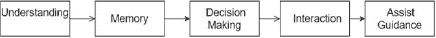
```

**图 (3)**

基于机器学习的超声系统。

### 磁共振成像

在未来几个几年里，机器学习和深度学习将在磁共振成像的研究中发挥重要作用。凭借有效的决策能力，该系统将提供更好的图像质量并缩短获取时间。它还将提高工作速度[11^(\-)13]。速度的提高是扫描仪数量有限问题的解决方案。图(4) 显示了磁共振成像系统的基本组件。在磁共振成像中，可以使用机器学习技术完成各种任务；例如图像分类、分割和回归。在分类和分割中，图像被赋予局部标签。在感知之后，图像形成是 MRI 中的重建，这是通过回归完成的，回归为图片中的每个像素值分配连续预测[14]。使用机器学习还可以减少 MR 成像中的图像噪声。如果正向模型的组件未知，则可以使用近似函数。

### 计算机断层扫描

计算机断层扫描（CT），通常称为计算机扫描或 CT 扫描，是一种利用 X 射线技术产生人体全面横面图像的医学成像程序。CT 扫描过程中使用具有独特能力的 X 射线机，它围绕患者旋转。计算机处理获得的数据以生成内部组件的复杂二维图像或三维重建。

```
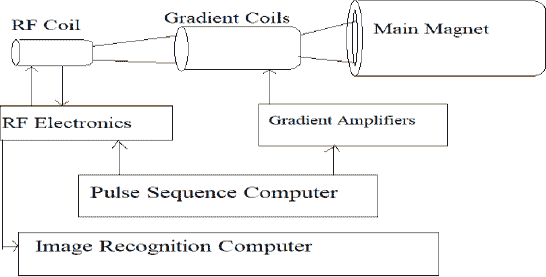
```

**图 (4)**

磁共振成像组件。

### 乳腺摄影

一种专门为检查乳腺创建的特殊医学成像方法称为乳腺摄影。它对于乳腺癌的早期识别和检测至关重要。乳腺摄影中使用低剂量 X 射线来获取乳组织的精细的图像。

## 机器学习

在所有安全性和真实性为首位的行业中，医疗保健至关重要。随着图像采集和医疗数据的广泛采用，许多国家正在采取措施保护电子病历。这尤为关键，因为医学图像至关重要。人工智能（AI）和机器学习（ML）的整合在医疗实践中变得至关重要[15]。机器学习通过从已知数据中学习，从而提高医疗效率。机器学习在现实世界中具有多种应用，其目标是为给定数据提供准确预测。医疗系统对各种领域的需求激增，包括图像处理、疾病检测、自然语言处理、语音识别等，涵盖了放射学、内镜、乳腺摄影（MG）、核医学成像、超声图像、磁共振血管造（MRA）、计算机断层扫描（CT）、磁共振成像（MRI）、正电子发射断层扫描（PET）以及病理检查。分析医学图像具有持续的挑战性，由于过程耗时，机器学习（ML）为解决这些挑战提供了一种可靠的解决方案，通过预测。机器学习有三种学习方法：监督学习和无监督学习。机器学习和深度学习的典型架构如图(5 和 6) 所示。监督和训练是应用于机器学习和深度学习的通用概念。

```
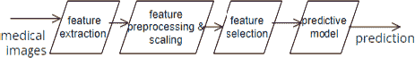
```

**图 (5)**

机器学习涉及的步骤。

```
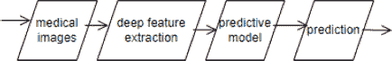
```

**图 (6)**

深度学习的工作。

## 机器学习技术

### 监督学习

今天大多数机器学习属于医疗应用的监督学习算法。在这种学习中，模型基于已知的输入和输出来预测未来的输出。监督学习问题分为两大类：回归和分类。在回归中，目标是预测连续输出，或将输入变量映射到连续函数。相比之下，分类问题涉及预测离散输出，并将输入变量映射到不同的类别。例如，在处理肿瘤患者时，目标是预测肿瘤是恶性还是良性。这种场景体现了分类监督学习任务，其重点是将输入数据分为特定的类别。

文献中有很多监督机器学习算法，每种算法都有预测输出值的独特方法[16]。没有机器学习算法能满足医学领域的所有要求。因此，寻找正确的机器学习算法仅基于实验。有一些监督机器学习算法，如支持向量机（`SVM`）、决策树、神经网络、最近邻、朴素贝叶斯和线性回归（`linear regression`），它们主要用于医学图像的安全和分类。

在支持向量机（SVM）中，数据通过确定一个超平面进行分类，该超平面作为决策边界，能够以最大分类间隔将输入数据与其他类别隔离开。线性函数划分输入数据，而如果使用非线性函数，则采用损失函数来识别数据落在超平面错误一侧的实例 [8, 17]。SVM 具有许多优点，包括超平面选择的灵活性、强大的处理能力以及计算成本的降低，这些均有助于缓解过拟合问题。然而，SVM 的一个显著缺点是训练数据集的计算时间要求高 [18]。

### 无监督学习

在无监督学习中，我们让计算机自己在给定的数据集中寻找标签、模式或结构。在这种类型的学习中，我们并不预先告知算法，只有一堆数据。无监督学习的一个很好的例子是聚类，即数据存在于两个不同的簇中。聚类算法用于许多应用，如组织大型计算机集群、社交网络分析、市场细分、目标识别、股市数据分析，也被用于令人惊讶的天文学数据分析 [19]。

医学影像领域的一个主要障碍是从高维且多样化的数据中解释图像以对复杂疾病进行诊断和治疗。近年来，监督和无监督深度学习这两种算法在医学图像分析领域都取得了令人鼓舞的成就。关于监督深度学习已有若干发表的研究，但对医学图像分析的无监督深度学习的深入评估非常少。因此，医学图像分析无监督学习领域存在广阔的研究空间。不同类型的自动编码器、深度置信网络（DBN）、深度玻尔兹曼机和生成对抗网络（GAN）是医学图像分析无监督学习伞下的若干模型。深度置信网络是具有大量隐藏层的前馈神经网络。DBN 是简单的无监督网络，例如受限玻尔兹曼机（RBM）或自动编码器，每个子网络的可见层均派自于其隐藏层。

受限玻尔兹曼机（RBM）是一种生成式随机人工神经网络，能够从其输入数据中学习概率分布。RBM 应用于深度学习网络，有助于构建深度置信网络。该过程涉及 RBM 的“堆叠”，并通通过使用梯度下降和反向传播来实现对所得深度网络的微调。这种方法通过利用 RBM 的能力，能够创建复杂且有效的深度置信网络。

还有另一种学习形式，即半监督学习，它同时利用了监督和无监督学习，其中训练数据部分部分是有标签的。

### 深度学习

深度学习方法（DLA）在医学图像分析中的应用正成为一个快速扩展的研究领域。深度学习作为机器学习的一种特殊形式，涉及直接从输入数据中学习应用任务，并且在医学影像背景下已被证明是极其有效的。深度学习的设计通常利用神经网络（NN）算法。“深度”一词指的是层数。

近年来，监督和无监督深度学习这两种算法在医学图像分析领域都取得了令人鼓舞的成就。关于监督深度学习已有若干发表的研究，但对医学图像分析分析的无监督深度学习的深入评估非常少。因此，医学图像分析无监督学习领域存在广阔的研究空间。不同类型的自动编码器、深度置信网络、深度玻尔兹曼机和生成对抗网络是医学图像分析无监督学习伞下的若干模型。深度置信网络是具有大量隐藏层的前馈神经网络。DBN 是简单的无监督网络，例如受限玻尔兹曼机（RBM）或自动编码器，每个子网络的可见层均派自于其隐藏层。

受限玻尔兹曼机（RBM）是一种生成式随机人工神经网络，能够从其输入数据中学习概率分布。RBM 应用于深度学习网络，有助于构建深度置信网络。该过程涉及 RBM 的“堆叠”，并通过使用梯度下降和反向传播来实现对所得深度网络的微调。这种方法通过利用 RBM 的能力，能够创建复杂且有效的深度置信网络。

还有另一种学习形式，即半监督学习，它同时利用了监督和无监督学习，其中训练数据部分是有标签的。

### 深度学习

深度学习方法（DLA）在医学图像分析中的应用正成为一个快速扩展的研究领域。深度学习作为机器学习的一种特殊形式，涉及直接从输入数据中学习应用任务，并且在医学影像背景下已被证明是极其有效的。深度学习的设计通常利用神经网络（NN）算法。“深度”一词指的是层数。

近年来，监督和无监督深度学习这两种算法在医学图像分析领域都取得了令人鼓舞的成就。关于监督深度学习已有若干发表的研究，但对医学图像分析分析的无监督深度学习的深入评估非常少。因此，医学图像分析无监督学习领域存在广阔的研究空间。不同类型的自动编码器、深度置信网络、深度玻尔兹曼机和生成对抗网络（GAN）是医学图像分析无监督学习伞下的若干模型。深度置信网络是具有大量隐藏层的前馈神经网络。DBN 是简单的无监督网络，例如受限玻尔兹曼机（RBM）或自动编码器，每个子网络的可见层均派自于其隐藏层。

### 卷积神经网络 (CNN)

医学影像中最广泛使用的技术是 CNN。在历史上，在 CNN 可被利用之前，这些特性必须手动设计 [20]。许多 CNN 用于分割、分类和注册。

DL（深度学习）与 ML（机器学习）之间的主要区别在于，两者都关注特征提取。监督学习技术包括 CNN、RNN（循环神经网络）、DBN（深度置信网络）、玻尔兹曼机、自动编码器和 GAN（生成对抗网络）。

#### CNN 的基本构建组件

具有极少连接的 CNN 是一种特定的神经网络。CNN 的输入设置为网格布局，然后通过保持空间相关性的层。根据图 7，CNN 使用卷积层、RELU（整流线性单元）层和池化层来处理由原始像素组成的输入。这进入最后的全连接层，该层提供类别得分或概率，将输入分类为概率最大的类别。因此，让我们从卷积层的简要描述开始。

```
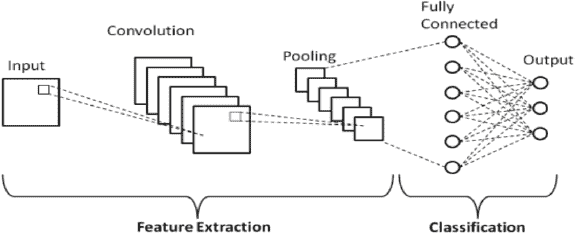
```

图 (7)

CNN 的构建组件 [25]：

#### 卷积层

两个函数的操作被称为卷积层，其中一个函数是输入值或图像像素值，另一个函数是滤波器或卷积核。两个函数都表示为数字数组，函数的乘积产生输出。这个过程持续到处理整个图像，从而产生一个名为激活图的特征。基本上在激活图或特征图中，卷积核对于观察图像中的点、直线或曲线等特征非常活跃。

稀疏连接、权重共享和等变表示是卷积中使用的三个关键 ML 概念。

#### 整流线性单元 (RELU) 或激活层

RELU 是一种只接受正值的激活函数，它将负输入值降为零。RELU 层通过简化和优化训练与计算，为解决梯度消失提供了巨大的帮助。

#### 池化层

池化层位于卷积层和 `RELU` 层之间，用于减少需要计算的参数数量以及图像的高度和宽度。存在多种类型的池化，包括 `max pooling`最大池化、`average pooling`平均池化和 L2 归一化池化，其中 `max pooling` 最常用。`max pooling` 的主要作用是选择 `kernel` 内最大的输入值，并丢弃其余值。本质上，它识别了池化区域内最主要的不变性特征。

### 全连接层

在此层，前一层的每一个神经元都与最后一个全连接层的每一个神经元连接。根据所需的特征抽象程度，除了 `convolution`、`pooling` 和 `RELU` 之外，可能还有一个或多个全连接层。本质上，该层考虑了一组强激活特征，这些特征可以表明图像所属的类别。

在 Alex Net 在 2012 年表现优异后，`CNNs` 被越来越多地运用于提高人类医生处理医学图像的有效性 [22-24]。

### RNN (递归神经网络)

它用于处理序列数据或信息，用于内容分析任务，如机器翻译、计算机语音识别、`NLP`（自然语言处理）中的语言模型以及文本预测 [26, 27]，因为它们具有生成文本的能力。

在基础递归神经网络 (`RNN`) 中，每一层的输出都与下一层的输入结合，提供了一种形式的“记忆”。长短期记忆网络 (`LSTM`）和门控循环单元 (`GRUs`) 从 `RNNs` 演变而来，以解决随时间反传播过程中与梯度消失相关的挑战。这些是对 `RNNs` 的调整，允许它们保留长期依赖关系并忽略某些收集的信息。对于医学相关问题，`RRN` 用于图像分割。


在临床领域使用深度学习的缺点及其前景：深度神经网络在根据复杂数据集做出精确判断时被证明是有益的。然而，尽管具有这一显著优势，使用深度学习方法也存在某些缺点。一个主要的局限性是对大量训练数据和计算能力的巨大需求。由于这些需求，训练模型和获得准确结果的过程非常耗时。一种广泛使用的深度学习技术是`CNN`，它需要标记的输入来进行监督学习。手动标记，特别是在医学图像的情况下，是一项重大挑战。解决这一挑战需要计算能力的进步、数据存储的增加以及深度学习架构的持续优化。`AI`应用，特别是用于医学图像分析的深度学习，面临着尽管有定义良好的输入输出但内部表示尚未知的问题。医学图像中固有的噪声和亮度等问题也普遍存在。然而，通过预处理步骤，可以缓解噪声问题，有助于性能水平随时间的推移不断提升 [28]。

# 基于机器学习和深度学习的医学图像分析

医学图像分析的主要目标是定位解剖结构或病变，这有助于医生理解。通常，这需要以下关键步骤：

## 图像预处理

预处理阶段消除图像中不理想的失真。

## 分割

这是分离特定区域（如肿瘤或器官）的技术。

## 特征提取

特征提取是从`ROIs`中获取相关细节的过程。这一阶段侧重于收集提取出的特征。

## 模式识别或分类

最后阶段是分类，它根据特征对`ROIs`进行分组。这种系统方法为诊断提供了有价值的见解 [29]。

存在许多图像分析技术。在这些技术中，基于像素的分析常用。在基于像素的分析中，考虑到像素而不是图像的提取部分 [30]。在应用该技术之前，通过不同的过滤方法增强图像的对比度。也可以对直方图进行修改以增强对比。局部二进制模式被应用于机器学习以研究边缘。线性`SVM`分器在所有空间边缘描述符中实现了良好的准确率 [31, 32]。

神经网络用于医学成像以发现疾病细节。为了分类癌细胞和正常细胞，使用了神经网络。与以前的诊断投票方法相比，神经网络对细胞的分类具有很准确率 [33]。

卷积神经网络`CNN`是深度学习的一部分，广泛用于图像分析。在医学成像中，分类是一个提供感兴趣临床结果的重要部分。`CNN`可以应用于大量种类和体积的三维数据。在宫颈细胞病学图像分析中，`CNN`用于图像分割和图像分类。

# 开源工具

为了支持机器学习工作流的多个阶段（包括数据预处理、模型开发、评估和部署），有多种开源机器学习工具可用。为了实现医疗应用，有一些流行的机器学习工具，如`TensorFlow`、`Keras`、`Octave`、`PyTorch`、`OpenCV`、`sci-kit-learn`、`OpenAI Gym`、`SimpleITK`等。对于医学图像分析，常用的库包括`TensorFlow`、`PyTorch`、`scikit-learn`、`pandas`和`NumPy` [35]。

`TensorFlow`是由`Google`开发的开源机器学习框架。由于其灵活性、扩展性以及用于构建和部署机器学习模型的广泛工具集，它被广泛应用于医学成像领域。医学成像预处理包括图像加载、调整大小、归一化和增强。这些过程所需的工具在`Tensorflow`中也可用。预处理技术主要由`Tensorflow`提供，用于为模型训练准备数据。`Tensorflow`还可以完成不同机器学习模型的训练，例如用于医学成像任务的`卷积神经网络 (CNNs)`。`CNN`架构有助于执行图像分类、分割、目标检测等任务。通过迁移学习，可以在通用数据上训练的模型可以利用其知识，并针对特定的医学成像应用在较小的数据集进行定制。`TensorFlow`可以支持医学图像格式（`DICOM`、`NIFTI`等），并通过集成`SimpleITK`、`PyDICOM`或其他领域特定工具，执行图像配准、分析或分割等专门任务。

`Keras`是一个用于构建神经网络的高级`API`，运行在`TensorFlow`和其他框架之上。由于`Keras`是一个用户友好的界面，可以使用它来构建、训练和部署深度神经网络。在处理医学成像时，`Keras`可用于各种任务，包括目标检测、图像生成、分割和图像分类。它还可以通过提供带有标签的标注，获取 X 光、CT 和 MRI 等医学图像数据集。数据预处理也可以在`Keras`上完成，通过调整大小、归一化、增强或执行额外的必要更改。除了`VGG`、`ResNet`或自定义架构等`卷积神经网络 (CNNs)`等图像分类架构外，`Keras`还利用了`U-Net`等分割架构。在处理医学成像时，`Keras`可以胜任构建、训练、评估和预测模型等各种任务 [36]。

医学成像中使用一些流行的机器学习库。`PyTorch`是其中之一，因为它是一个流行的开源机器学习库，由于其在开发深度学习模型方面的灵活性、效率和稳健性，已广泛应用于各种医疗领域。`PyTorch`由`Facebook's AI Research lab`开发。`PyTorch`已用于医学图像的重建、分类和分割等任务。为了通过 MRI、CT 扫描和 X 光等医学图像诊断疾病、分割肿瘤和定位器官，使用`PyTorch`开发的深度学习模型已得到应用。可以使用`PyTorch`开发癌症、糖尿病和心血管疾病等疾病的预测模型。这些模型的结果取决于患者数据，例如电子健康记录 (`EHRs`)、实验室报告、医学图像等 [37, 38]。

# 结论

现有的医学信息库证明是不足够的。`深度学习`和`CNN`算法对下一代特别有利。然而，挑战依然存在。

# 参考文献

1. Sebastian G, Thomas K, Dominik N. Deep learning applications in shorter frames. 2018.

2. Lundervolda AS, Lundervold A. An overview of deep learning in MRI. 2018.

3. Xu T, Zhang H, Huang X, Zhang S. Multimodal deep learning for cervical dysplasia diagnosis. Proceedings of the medical image computing and computer-assisted intervention 2016123-5.

4. K. Kirk Shung, Michael Smith, Benjamin M.W. Tsui: Principles of Medical Imaging.

5. Sebastian G, Thomas K, Dominik N. Deep learning applications in magnetic resonance imaging: has the future become present?. 2021.

# 机器学习实践在人力管理中的应用

**Ajay Satija** ([1]), **Priti Pahuja** ([2]), **Dipti Singh** ([3]), **Athar Hussain** ([4])

¹ 印度帕尼帕特工程技术学院，帕尼帕特

² 印度哈里亚纳 Murthal，Deenbandhu Chhotu Ram 科学技术大学

³ 印度北方邦大特诺伊，，高塔姆·布达大学职业研究与应用科学学院

⁴ 印度德里内塔吉·苏布哈斯技术大学土木工程系（西校区）

## 摘要

在现代，医疗机构为患者提供高质量且价格合理的治疗方案，但这需要复杂的技术支持。尽管医学计算机化和数字化已取得显著进展，但仍然缺乏有效且可靠的管理解决方案。医疗操作非常复杂，因此需要高水平的管理。机器学习技术由于其可扩展性且能够适应复杂模式，在解决这些问题方面可能非常有用。本研究表明，机器学习可以增强人类对医疗健康运营的理解和监督，从而提供更高效的医疗服务。本研究的目标是探讨如何利用机器学习方法进行疾病检测、各种临床试验、药物开发、基于机器人的手术、器官图像处理以及机器学习在医疗行业面临的各种挑战。最后，研究得出尽管存在挑战，机器学习实践对于现代医疗机构已是至关重要的。

**关键词：** 临床试验、药物开发、医疗保健、机器学习、器官图像处理、治疗。

***

**通讯作者 Ajay Satija:** Panipat Institute of Engineering & Technology, Panipat, Haryana, India; 电子邮箱：`ajaysatija999@gmail.com`

## 引言

“机器学习”（`ML`）是人工智能（`AI`）的一个分支，研究如何利用数据和算法复制人类学习过程并随着时间的推移提高其准确性。`ML`包含了多种统计技术，计算机通过这些技术从领域相关的数据集中学习。本研究探索了`ML`在医疗行业的作用。医疗健康是一个受益于多种`ML`技术的知名领域 [1-3]。通过配备先进技术的医疗保健系统的支持，人类寿命得以延长。

如今，不同疾病的案例研究正在进行中，大数据方法正被用于保留这些病例的电子记录。

## 参考文献

1. [19] Rajkomar A, Dean J, Kohane I. Machine Learning in Medicine. N Engl J Med 2019; 380(14): 1347-58. [http://dx.doi.org/10.1056/NEJMra1814259] [PMID: 30943338](http://www.ncbi.nlm.nih.gov/pubmed/30943338)

2. [20] Anwar SM, Majid M, Qayyum A, Awais M, Alnowami M, Khan MK. Medical image analysis using convolutional neural networks: A review. J Med Syst 2018; 42(11): 226-42. [http://dx.doi.org/10.1007/s10916-018-1088-1] [PMID: 30298337](http://www.ncbi.nlm.nih.gov/pubmed/30298337)

3. [21] Dhillon A, Verma GK. Convolutional neural network: A review of models, methodologies, and applications to object detection 2019.

4. [22] Goodfellow I, Bengio Y, Courville A. Deep Learning. Cambridge, MA, USA: MIT Press. 2016.

5. [23] Salehi A, Khan S, Gupta G, et al. A study of CNN and transfer learning in medical imaging: Advantages, challenges, future scope, Sustainability, 2023; 15(7). http://dx.doi.org/10.3390/530

6. [24] Krizhevsky A, Sutskever I, Hinton G. ImageNET classification with deep convolutional. Available from: https://www.researchgate.net/figure/Schematic-diagram-of-basic-convolutional-network

7. [25] Sutskever I, Martens J, Hinton G. Generating text with recurrent neural networks. 28th International Conf (ICML)

8. [26] LeCun Y, Bengio Y, Hinton G. Deep learning. Nature 2015; 52(7): 436-44.

9. [27] Nanni L, Lumini A, Brahnam S. Local binary patterns variants as texture descriptors for medical image analysis. Artif Med 2010; 49(2): 117-25.

10. [28] Mamunur R, Chen L, Xiangchen W. Detecting presence of COVID-19 with ResNet-18 using pytorch. International Conference on Communication and Computing Technology (ICCICT) 2020.

11. [29] Bagher S, Habib R, Parisa N. A review paper about deep learning for medical image. Computational and Mathematical Methods in Medicine 2023. http://dx.doi.org/10.1155/7091

12. [30] Suzuki, K. Pixel-based machine learning in medical imaging. In:Journal of Biomedical Imaging 2012. p. 1. http://dx.doi.org/10.1155/7920

13. [31] Shen D, Wu G, Suk H. Deep learning in medical image analysis 2017.

14. [32] Sharma H, Jain JS, Gupta S, Bansal P. Feature extraction and classification of chest X-ray images using CNN to detect pneumonia. In: Proceedings of 10th international conference on cloud computing, data science & engineering.2010. p. 231-27.

15. [33] Hussain S, Anwar SM, Majid M. Segmentation of glioma tumors in brain using deep convolutional network. Neurocomputing 2018; 282: 248-61. http://dx.doi.org/10.1016/neucom.2017.032

16. [34] Mamunur R, Chen L, Xiangchen W. A survey for cervical cytopathology Image Analysis using Deep Learning. In: Digital Object Identifier. http://dx.doi.org/10.1109/ACCESS.2020.298316

17. [35] Shi S, Wang Q, Xu P, Chu X. Benchmarking state-of-art deep learning software. 7th International Conference on Cloud Computing and Big Data (CCBD) 2016104-99. http://dx.doi.org/10.1109/CCBD.2016.029

18. [36] Vuppala Sunil K, Behera M, Jack H, Bussa N. Explainable deep learning methods for medical imaging applications. 5th International Conference on Computing and Automation (ICCCA) 2020.

19. [37] Chetna K, Priyamada M, Sanjay S. Detecting presence of COVID-19 with ResNet-18 using pytorch. International Conference on Communication and Computing Technology (ICCICT) 2020.

20. [38] Anchal A, Puneet S, Prashant A, Deepak A. Tumor segmentation and detection using convolutional neural network. 6th International Conference on Computing for Sustainable Development (INDIACom) 2019.

电子记录包含了临床试验的实时信息，包括患者的就诊记录、疾病症状记录、患者的医疗检查信息以及进一步处方。为了发现并纠正任何可能的处方错误，人工智能（`AI`）可以借此检查患者的医疗记录以及处方药物。这些电子记录对于患者疾病的决策非常有帮助 [4]。预测分析的临床结果节省了医疗检查的时间成本，使每位患者都能获得合适的治疗 [7]。

医疗机器学习基础需要高质量且多样化的数据集，因为这些对于训练`ML`模型至关重要。`ML`应用必须遵守严格的伦理指南，以确保患者隐私和数据安全。`ML`应为其预测结果提供解释，以获得医疗专业人员的信任并促进决策。医疗服务的组织和管理方面，如床位调度、远程监督以及处理名单等任务，受益于这项技术。

医疗专业人员花费时间在维护记录和理赔处理等冗余任务上，这阻碍了他们提供必要的护理。因为机器学习具有多种功能和应用，它在医疗行业变得越来越重要 [10]。

`ML`算法能够通过分析海量的患者数据，准确预测疾病的进展、治疗结果和患者命运。`ML`可以在医学影像（如`MRIs`和`X-rays`）中发现模式，帮助检测癌症等疾病 [11]。自然语言处理增强了决策，`ML`方法可以从记录和医生笔记等非结构化数据中提取重要信息。


`ML`算法可以分析大量的分子数据以识别候选药物并优化药物开发过程。这有助于根据患者的独特特征定制治疗方案，提高疗效并减少副作用[12]。`ML`可以协助疾病的早期检测和准确诊断，以及预测疾病进展和结局。`ML`算法已应用于发现异常皮肤、肿瘤区域、出血区域等模式。为了识别和修复任何药物错误，AI可以评估处方药物和病史。优化医院运营、资源分配和患者流可以实现成本节省并提高效率。总而言之，机器学习能够通过增强运营效率、治疗结果和诊断来彻底转型医疗行业。最后，机器学习可以通过改进诊断、治疗结果和运营效率来极大改变医疗行业。本研究的主要目标是调查机器学习在医疗部门的重要作用。

## 研究目标

随着现代技术在医疗行业日益普及，高性能计算能够产生并管理大型的数据孤岛。

自动化机器学习使得医疗设施成为可能。医疗工作人员现在可以充分利用`ML`技术提供的实时数据采集、创新技术和有效的编程接口。

本研究的主要目标是：

a) 研究医疗行业对`ML`的需求。

b) 探索医疗行业`ML`的各种挑战。

c) 探索`ML`应用在医疗子领域（医学）的作用。

## 医疗行业对机器学习的需求

医疗领域机器学习的重要原因是：疾病预测分析、疾病识别与诊断、个性化治疗方案、药物发现与开发、健康监测与可穿戴设备、运营效率、欺诈检测与安全、远程患者监测以及人群健康管理。在文献中，上述因素在微观层面被讨论。医疗标准和管理复杂疾病的能力都在不断提高。然而，仍有许多未解决的问题，特别是关于患者独特特征的治疗时长和剂量，或针对临床研究有限的群体（包括儿童）[13]。为了为儿童预测最有效且定制的治疗，机器学习近年来已有效整合到儿科护理中。自从新冠肺炎开始以来，机器学习受到了广泛关注。机构已转向机器学习（`ML`）以保持竞争力并获得优势，从简化运营到在通常动荡且不可预测的工作环境中扩展研发。`ML`已帮助医疗系统和机构克服了某些困难[14, 15]。

人工智能最引人目的进展之一是机器学习，许多公司正在尝试它。越来越多的人在使用`ML`。它适用于商业和医疗环境，并利用算法支持数据驱动的学习。新的想法和技术不断涌现，这意味着医疗健康在不断演变。在这些这些新情况下，机器学习可以帮助医生。技术进步和非结构化文本现在可以产生以前难以产生的洞察。通过使用这种深度的`ML`派生知识，管理员和医生可以对患者护理和具有国际影响的运营计划做出及时、明智的决策[16-18]。

## 医疗行业机器学习的挑战

在医疗行业中使用`ML`算法时，专家必须调查并讨论出现的问题。以下是医学领域实施机器学习的众多障碍之一：

### 数据可用性与质量

随着现代技术在医疗行业日益流行，高性能计算能够快速产生并管理大型、复杂的数据孤岛[19]。

### 数据安全与隐私

机器学习应用必须遵守严格的伦理准则，以确保患者隐私和数据安全[20]。

### 可解释性与透明度

`ML`应为其预测提供解释，以获得医疗专业人员的信任并促进决策[21]。

### 有限的样本量

医学数据集，特别是关于罕见疾病或特定患者群的数据集，有时规模有限[22]。

#### 监管合规

由于医疗领域的监管非常严格，应用机器学习算法必须遵守严格的法律，例如美国的`HIPAA`（《健康保险流通与账户责任法案》）。在创建和实施机器学习模型时，遵循这些规则可能会困难。

## 集成到医疗系统中

兼容性问题、互操作性挑战以及医疗卫生专家对改变的抵触，可能使得将机器学习技术整合到当前的医疗系统中变得困难[23]。

### 偏见与公平性

当机器学习模型在包含偏见的数据上进行训练时，它们可能会无意中强化这些偏见，从而在做出医疗决策时导致歧视性或不公正的结果。机器学习最重要的任务是解决偏见并确保公平性。

## 临床采用与验证

在机器学习算法在医学中广泛应用之前，验证其有效性和临床价值至关重要。开展彻底的临床试验并证明这些算法的有效性和安全性可能需要大量的时间和资源。

必须记住，医学医疗的机器学习仍处于发展阶段，这些困难并非全部。为了充分利用机器学习来改善医疗成果，研究人员和从业者正在积极应对这些障碍。

## 机器学习在医疗保健中的应用

在目前的研究中，机器学习在医疗保健中的一些应用描述如下：

### 医疗诊断中的机器学习

在现代时代，机器学习模型在医疗行业诊断中起着至关重要的作用。传统的诊断程序昂贵、耗时，且经常需要人工参与。传统的诊断程序受限于个人的能力，但基于机器学习（`ML`）的系统不受此限制，而且与人类不同，机器人不会疲劳。这可能导致在医疗系统中患者人数意外超过需求时，开发出诊断疾病的技术。医疗数据，如图像（`X-ray`、`MRI`）和表格数据（患者状况、年龄和性别）被用于构建基于机器学习的疾病诊断系统[24]。

机器学习算法在医疗诊断的决策中使用了`决策树`、`K-近邻`、`支持向量机`、`逻辑回归`、`朴素贝叶`和`AdaBoost`算法。人工神经网络（`ANN`）模型在病理学、肿瘤学和遗传性疾病患者的图像检测中起着重要作用[25]。图（1）说明了通过机器学习技术诊断的疾病[26]。

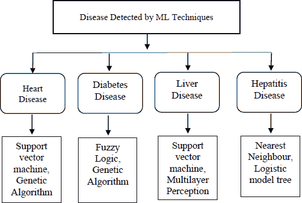 **图 (1)**

通过机器学习技术诊断的疾病。

病理学家在历史上执行的重要显微镜工作可以通过计算机视觉和机器学习进行改进。评估生理数据、环境变量和遗传因素的诊断应用程序经常使用机器视觉。医疗人员在分诊中使用现代机器学习技术来识别异常，并对构成生命威胁的患者进行优先处理。类似，AI帮助医生诊断心律失常、预测中风的预后以及管理慢性疾病。Ansari *等人* (2011) 提出了一种基于神经模糊集成系统的自动技术来识别冠状心病，其准确率接近89%[27]。Rubin *等人* (2017) 采用了基于深度卷积神经网络的方法来检测异常心声。作者通过修改`loss function`增强了训练数据集的灵敏性和特异性[28]。肾病或肾脏损伤被称为肾脏疾病。由于机器学习在医疗专业中仍在发展中，这些困难并非全部。为了充分利用机器学习来改善医疗成果，研究人员和从业者正在积极应对这些障碍。肾脏疾病被称为肾脏疾病。Ma *等人* (2020) 使用多种来源的数据识别了肾脏疾病，准确率范围在87%-90%[29]。癌症诊断通过人工神经网络是可能的。例如，Miranda和Felipe (2015) 使用模糊逻辑成功实现了癌症的诊断[30]。机器学习技术被医疗人员用于糖尿病的分类。Ali *等人* (2020) 使用`KNN`方法对糖尿病进行了成功分类[31]。Tsao *等人* (2018) 开发了`ANN`模型来预测糖尿病，准确率为79.5%[32]。新冠肺炎大流行已成为人类面临的最重大挑战。Li *等人* (2020) 使用4356例胸部CT扫描开发了`COVNet`模型，达到了96%[33]。Hemdan *等人* (2020) 使用`VGG19`和`ResNet50`模型从X光片中准确识别了新冠肺炎患者，准确率分别为90%和95%，分别仅使用了50张图像[34]。

### 临床试验中的机器学习

机器学习（`ML`）越来越多地应用于临床试验的各个方面，以提高效率、降低成本并改进决策。以下是机器学习应用于临床试验的几种方式：

#### 患者招募与标准要求

机器学习通过额外的患者数据和电子健康记录（`EHR`）来识别临床试验参与者。通过预测患者结果并考虑更广泛的患者变量，机器学习有助于改进标准。

#### 试验方案设计与优化

机器学习有助于适应性临床试验设计，根据中期数据修改试验设计。可以使用优化方法找到最有效且经济的试验设计。

#### 终点预测与生物标志物识别

机器学习（`ML`）可发现疾病的潜在生物标志物并预测患者结果。这有助于临床试验选择有意义的终点。预测模型使得发现对治疗反应不同的患者亚群变得更容易。

#### 数据监控与质量保证

机器学习算法对临床试验数据进行实时监控和分析，可以发现可能的异常或数据质量问题。自动化的数据清洗程序可以使试验结果更加准确可靠。

#### 药物开发与发现

通过机器学习的应用，分析生物学数据、发现潜在药物靶点并预测治疗候选药物的有效性。可以使用预测模型对候选药物按重要性顺序进行排序。

#### 预测与跟踪不良事件

通过检查患者数据，机器学习算法能够预测和跟踪不良事件，从而帮助研究人员和临床医生采取主动措施来控制风险。可以使用自然语言处理（`NLP`）从报告和临床记录中提取信息。

## 真实世界证据 (RWE) 生成

在临床试验的受控环境之外，机器学习可以分析真实世界数据以产生补充证据。

除了标准的临床试验数据外，RWE还可以为真实世界中遇到的患者群的治疗有效性和安全性提供见解。

尽管机器学习（`ML`）在改进临床试验方面具有巨大潜力，但在将`ML`成功整合到流程之前，必须解决一些问题。这些问题包括对高质量数据的需求、监管考量以及机器学习算法的可解释性。

## 药物研发中的机器学习

机器学习通过分析大型数据集、预测分子间的相互作用以及加速发现过程，协助协助识别新型药物候选药物。

### 靶点识别

`ML`模型通过分析生物学数据来发现可能的治疗靶点，从而更容易选择对疾病干预至重要的蛋白质或基因。

### 预测药物间相互作用

在开发过程中，机器学习通过协助预测可能的药物相互作用，有助于减少副作用并提高安全性。

在生物信息学中，`ML`应用于评估基因组和蛋白质组数据，揭示有助于理解疾病和治疗靶点优先级排序的模式。

### 机器学习模型帮助药物制方优化

通过预测各种物质之间的相互作用，机器学习模型通过改善药物递送和生物利用度，帮助药物制方的优化。

#### 临床试验优化

通过分析患者数据，机器学习算法优化了方案调整、患者选择和临床试验设计，从而缩短试验周期并降低成本。

### 药物疗效预测

机器学习算法能够评估患者数据以预测药物在某些人口统计中的有效性，支持个体化医疗和治疗策略。为了帮助患者分类和定制化治疗方案，机器学习发现了与疾病相关的显著性生物标志物。

### 药物重用

机器学习算法可用于分析现有药物数据以识别潜在的新用途，这将加速针对其他疾病的药物产生。

### 毒性预测

通过使用机器学习预测潜在治疗可能的毒性，可以更早地剔化合物。由于机器学习算法预测药物的吸收、分布、代谢和排泄（`ADME`），可以优化药物剂量和递送。

#### 基因组医学

通过利用基因组数据根据患者的遗传组成修改药物方案，`ML`提高了治疗的有效性。

### 患者分层

机器学习（`ML`）检查患者数据以识别对治疗反应相似的子集，从而开发定制药物并降低试验变异性。

### 真实世界信息的利用

机器学习处理真实世界患者数据，提供受控临床试验之外的药物有效性和安全性信息。

### 数据整合

为了全面了解疾病原因和药物反应，`ML`整合了遗传学、临床和组学数据等异构数据集。`ML`通过预测理想状况、降低生产成本和保持一致质量，改进了药物制造工艺。

### 市场准入与商业化

机器学习（`ML`）通过分析市场模式、识别患者人口特征和预测新型治疗的商业成功，协助市场准入策略。

机器学习提供了从新数据中持续学习的能力，允许药物开发人员在整个药物开发周期调整方法并增强决策。

## 机器人手术

在机器人手术领域，机器学习已成为一种改变手术执行方式的有力工具。关于自动驾驶机器人手术中的`ML`，人们可能会让机器人自主执行这些手术手势。当机器人系统展示出能够准确执行与类似手术情况相当的各种手术动作的可接受任能力水平时，手术工作就有了全面且前时的理解。这种基于机器学习的方法在机器人手术中可以有变化：

医生可以从分析患者数据（包括电子健康记录和医学影像）的机器学习算法中，在规划复杂的机器人手术方面获得协助。这改善了患者预后并优化了手术策略[35]。在机器人操作期间，机器学习算法可以提供实时反馈和决策帮助。这些算法通过评估手术设备数据和患者生命体征，可以协助医生在关键时刻做出敏锐判断。通过机器人操作，可以使用诸如`computer vision`等机器学习技术对医学图像进行分析，以识别感兴趣的结构。这有助于手术期间准确的工具导航和靶向。使用机器人手术系统的医生可以使用机器学习技术识别并解释他们的手势和动作。这提高了手术的灵敏度，并允许直观的控制[36]。机器学习算法可以通过查看手术性能数据来评估医生的能力水平[37]。这有助于确定需要发展的领域并提供定制的培训建议。

为了预测手术结果和潜在问题，机器学习算法可以分析历史手术数据。这有助于进行机器人手术的医生降低风险并做出明智判断。

使用机器学习算法的机器人手术系统可以从之前的手术中学习并相应修改其行为[38]。这为自主运行的微创机器人手术开启了大门。利用机器学习技术，研究人员可以通过分析大量的手术数据发现模式、趋势和见解。这加速了医学研究，并使机器人的证据证据成为可能。

## 器官图像处理中的机器学习

机器学习极大地辅助了医疗器官图像处理。数字医学影像模态包括射线、超声、计算机扫描、磁共振成像、正电子发射扫描、视网膜照片、组织学切片和皮肤镜图像。某些模态（如计算机扫描和磁共振成像）检查多个器官，而其他模态（如皮肤镜和视网膜摄影）则是特定器官。此外，每项研究产生的数据量也不同。单次MRI扫描可能占用数百GB空间，但一张组织学切片只有几MB。这在数据预处理以及算法的`CPU`和内存架构方面具有技术上的影响[39]。在器官图像处理中，机器学习在以下方面非常有用：

通过分析器官图像，机器学习算法可以辅助自动化的疾病或异常检测，使医疗从业人员能够做出快速且准确的判断。通过降低噪声、增加对比度和提高分辨率，机器学习算法可以提高器官图像的质量，有助于改进解释和可视化。通过机器学习技术可以实现对医学图像进行精确的器官分割，从而实现精确的测量和分析。这有助于手术规划、肿瘤发育评估以及治疗结果的跟踪。计算机学习模型可以经过训练以识别器官图像中的某些疾病或病变，包括肿瘤、病变或异常。这可能有助于治疗计划的早期发现。机器学习可以分析器官图像、医疗记录、遗传数据以及其他海量患者数据，以发现趋势并创建个性化的治疗方案[40]。总而言之，机器学习在器官图像处理中的应用使得更好的患者预后、更精确和更快速的诊断以及更完善的治疗计划成为可能。

# 机器学习在医疗保健领域的风险管理

医疗保健行业发现机器学习（`ML`）对风险管理具有巨大影响。机器学习可以用于以下方法来改进医疗行业的风险管理：

### 发现与预防欺诈

机器学习模型可以识别医疗账单和保险索赔中的欺诈。可以标记账单数据中的异常和异常趋势以进行额外研究。除了确保资金用于实际医疗需求外，这有助于减少欺诈索赔带来的财务损失。

### 医疗决策辅助框架

通过将机器学习（`ML`）集成到临床决策支持系统中，医疗保健人员可以做出更好的决策。机器学习模型通过分析患者数据，可以生成个性化的治疗建议，从而减少错误并提高整体护理质量。

### 安全与隐私风险管理

通过检测和减少医疗IT系统中的安全威胁，机器学习（`ML`）可以帮助保护患者数据免受黑客和未经授权的访问。异常检测算法发现指向安全风险的异常模式，从而实现快速响应。

患者参与与跟踪：医疗提供者可以使用机器学习（`ML`）对患者进行远程监控和互动。早期识别患者状况的变化可以采取主动行动，从而减少问题发生和医院再次入院的概率。

### 监测药物不良事件

为了检测药物可能的副作用，机器学习算法可以检查电子健康记录和其他来源的医疗数据。这有助于早期识别药物相关危害，使医疗专业人员采取必要的措施，例如更改患者处方或进行密切监测。

# 机器学习在医疗保健行业的未来前景

机器学习（`ML`）在医疗保健领域具有巨大的应用潜力。这可能彻底改变医疗交付、患者预后和运营效率的各个方面。以下是`ML`预计在未来医疗中发挥关键作用的一些重要领域：

### 个性化医疗

`ML`将评估患者的遗传、病史和生活方式数据，以估计其患病风险并建议定制的治疗方案。这将使医疗保健变得更加有效高效。

### 更好的诊断

可以使用海量医学数据训练`ML`算法以发现趋势和异常，从而实现更早、更精确的诊断。这对于癌症等复杂疾病将特别有利。

## 药物发现与开发

机器学习（`ML`）在药物发现和开发中的应用可以加速并降低开发成本。

### 机器人与手术

由于机器学习驱动的机器人提供更高的精度和侵入性的手术，它们正被应用于手术。因此，患者康复更快，效果更好。

### 心理健康

通过`ML`检查患者数据可以识别出面临心理健康风险的人。利用这一点提供早期干预和帮助可能会带来更好的结果。

### 公共卫生

`ML`可以通过分析大数据集来跟踪疾病传播并预测爆发。这将支持公共卫生官员采取预防措施防止大流行病。

### 行政效率

机器学习可以自动化医疗保健行业的许多行政职责，包括保险索赔的处理和预约调度。这将允许医疗专业人员有更多时间放在患者身上。

### 研究与开发

机器学习（`ML`）可以评估海量研究数据以发现新的研究领域并加速新型疗法的创造。

### 全球健康

将机器学习（`ML`）应用于少数群体可以降低医疗成本。这将增强全球健康水平。

## 结论

机器学习是一个交叉学科，涵盖了多个学术领域，包括概率论、统计学和基于算法的复杂度理论。它关注计算机模拟或实现人类学习模式以获取新信息或能力并重组现有知识结构以不断改进其所长。根据本文介绍的测试可以得出以下结论。基于机器学习的图像识别系统通过分析和总结患者医疗记录帮助对疾病进行分类。它可以减轻医疗人员的工作负担，同时提高工作效率。同时，基于机器学习的图像识别技术能够检测出医生在成长时期难以识别的隐藏疾病，从而更好地保护他们的发育。

任何医生、科学家或研究人员都可以将机器学习（`ML`）作为一种非常有价值的工具。机器学习似乎每天都在取得进展。医疗领域正密切关注机器学习（`ML`）的持续发展。医疗专业人员和外科医生正在利用机器学习（`ML`）理念来帮助救命、在疾病和问题发生前识别它们、改善患者护理、更有效地让患者参与康复等。全球组织正在使用机器学习和人工智能（AI）来增强医疗服务。通过使用这项技术，机构和制药公司可以更快、更高效地开发严重疾病的疗法。虚拟临床试验、测序和模式识别现在可以帮助企业加速其观察和测试程序[41]。普通健康的最可靠的指标包括健康行为和社会经济特征，包括教育、社会支持系统和收入。健康机构明白，要促进全面健康，必须针对整体，包括生活方式和环境。机器学习模型可以识别可能患糖尿病、心脏病或其他可避免疾病的患者。

## 参考文献

| | | |

| --- | --- | --- |


| [1] | Abdelaziz A, Elhoseny M, Salama AS, Riad AM. A machine learning model for improving healthcare services on cloud computing environment. Measurement 2018; 119: 117-28. [`dx.doi.org/10.1016/j.measurement.2018.01.022`](http://dx.doi.org/10.1016/j.measurement.2018.01.022) |

| [2] | Char DS, Abràmoff MD, Feudtner C. Identifying ethical considerations for machine learning healthcare applications. Am J Bioeth 2020; 20(11): 7-17. [`dx.doi.org/10.1080/15265161.2020.1819469`](http://dx.doi.org/10.1080/15265161.2020.1819469) [PMID: [33103967](http://www.ncbi.nlm.nih.gov/pubmed/33103967)] |

| [3] | Ahmad MA, Eckert C, Teredesai A. Interpretable machine learning in healthcare 2018. |

| [4] | Sendak MP, D’Arcy J, Kashyap S, et al. A path for translation of machine learning products into healthcare delivery. EMJ Innov 2020; 10: 19-00172. |

| [5] | Gupta A, Katarya R. Social media based surveillance systems for healthcare using machine learning: A systematic review. J Biomed Inform 2020; 108: 103500. [`dx.doi.org/10.1016/j.jbi.2020.103500`](http://dx.doi.org/10.1016/j.jbi.2020.103500) [PMID: [32622833](http://www.ncbi.nlm.nih.gov/pubmed/32622833)] |

| [6] | Tucker A, Wang Z, Rotalinti Y, Myles P. Generating high-fidelity synthetic patient data for assessing machine learning healthcare software. NPJ Digit Med 2020; 3(1): 147. [`dx.doi.org/10.1038/s41746-020-00353-9`](http://dx.doi.org/10.1038/s41746-020-00353-9) [PMID: [33299100](http://www.ncbi.nlm.nih.gov/pubmed/33299100)] |

| [7] | Rumsfeld JS, Joynt KE, Maddox TM. Big data analytics to improve cardiovascular care: promise and challenges. Nat Rev Cardiol 2016; 13(6): 350-9. [`dx.doi.org/10.1038/nrcardio.2016.42`](http://dx.doi.org/10.1038/nrcardio.2016.42) [PMID: [27009423](http://www.ncbi.nlm.nih.gov/pubmed/27009423)] |

| [8] | Liang H, Tsui BY, Ni H, et al. Evaluation and accurate diagnoses of pediatric diseases using artificial intelligence. Nat Med 2019; 25(3): 433-8. [`dx.doi.org/10.1038/s41591-018-0335-9`](http://dx.doi.org/10.1038/s41591-018-0335-9) [PMID: [30742121](http://www.ncbi.nlm.nih.gov/pubmed/30742121)] |

| [9] | Bates DW, Saria S, Ohno-Machado L, Shah A, Escobar G. Big data in health care: using analytics to identify high-risk and high-cost patients. Health Aff (Millwood) 2014; 33(7): 1123-31. [`dx.doi.org/10.1377/hlthaff.2014.0041`](http://dx.doi.org/10.1377/hlthaff.2014.0041) [PMID: [25006137](http://www.ncbi.nlm.nih.gov/pubmed/25006137)] |

| [10] | Habehh H, Gohel S. Machine learning in healthcare. Curr Genomics 2021; 22(4): 291-300. [`dx.doi.org/10.2174/13890229226210759`](http://dx.doi.org/10.2174/13890229226210759) [PMID: [3527349](http://www.ncbi.nlm.nih.gov/pubmed/3527349)] |

| [11] | Mathur G, Pandey A, Goyal S. Applications of machine learning in healthcare The Internet of Medical Things (IoMT) and Telemedicine Frameworks 2023177-95. |

| [12] | Java M, Haleem A, Pratap Singh, Suman R. Significance of machine learning in healthcare: Features and applications. International Journal of Intelligent Networks 2022; 3: 58-73. [`dx.doi.org/10.1016/j.ijin.2022.05002`](http://dx.doi.org/10.1016/j.ijin.2022.05002) |

| [13] | Saleem TJ, Chishti MA. Exploring the applications of machine learning in healthcare. Int J Sensors Wire Commun 2020; 10(4): 458-72. [`dx.doi.org/10.2174/22103279106619120317`](http://dx.doi.org/10.2174/22103279106619120317) |

| [14] | Araújo FH, Santana AM, de Santos P. Using machine learning to support healthcare professionals in making decisions. Int J Med Inform 2016; 94: 1-7. [`dx.doi.org/10.1016/j.ijmedinf.2016.06007`](http://dx.doi.org/10.1016/j.ijmedinf.2016.06007) [PMID: [2757330](http://www.ncbi.nlm.nih.gov/pubmed/2757330)] |

| [15] | Vyas S, Gupta M, Yadav R. Converging blockchain and machine learning for healthcare. In international conference on artificial intelligence (AICAI) 2019, pp. 709-711. [`dx.doi.org/10.1109/AICAI.2019.8701230`](http://dx.doi.org/10.1109/AICAI.2019.8701230) |

| [16] | Li JP, Haq AU, Din SU, Khan J, Saboor A. Heart disease identification using machine learning classification in e-healthcare. IEEE Access 2020; 8: 107562-82. [`dx.doi.org/10.1109/ACCESS.2020.3001149`](http://dx.doi.org/10.1109/ACCESS.2020.3001149) |

| [17] | Rahane W, Dalvi H, Magar Y, Kalane A, Jondhale S. Lung cancer detection using image processing and machine learning healthcare. 2018 International Conference on Current Trends towards Converging Technologies (ICCTCT) 20181-5. [`dx.doi.org/10.1109/ICCTCT.2018.8551008`](http://dx.doi.org/10.1109/ICCTCT.2018.8551008) |

| [18] | Ahmed Z, Mohamed K, Zeeshan S, Dong X. Artificial intelligence with multi-functional machine learning platform development for better healthcare and precision medicine. Database (Oxford) 2020; 2020: baaa010. [`dx.doi.org/10.1093/database/baaa010`](http://dx.doi.org/10.1093/database/baaa010) [PMID: [3218539](http://www.ncbi.nlm.nih.gov/pubmed/3218539)] |

| [19] | Alanazi A. Using machine learning for healthcare challenges and opportunities. Informatics in Medicine Unlocked 2022; 30: 100924. [`dx.doi.org/10.1016/j.imu.2022.100924`](http://dx.doi.org/10.1016/j.imu.2022.100924) |

| [20] | Kaissis GA, Makowski MR, Rückert D, Braren RF. Secure, privacy-preserving and federated machine learning in medical imaging. Nat Mach Intell 2020; 2(6): 305-11. [`dx.doi.org/10.1038/s42256-020-0186-1`](http://dx.doi.org/10.1038/s42256-020-0186-1) |

| [21] | Wang F, Rudin C. Falling rule lists. Artificial intelligence and statistics 20151013-22. |

| [22] | Balki I, Amirabadi A, Levman J, et al. Sample-size determination methodologies for machine learning in medical imaging research: a systematic review. Can Assoc Radiol J 2019; 70(4): 344-53. [`dx.doi.org/10.1016/j.carj.2019.06.002`](http://dx.doi.org/10.1016/j.carj.2019.06.002) [PMID: [3152284](http://www.ncbi.nlm.nih.gov/pubmed/3152284)] |

| [23] | Assadi A, Laussen PC, Goodwin AJ, et al. An integration engineering framework for machine learning in healthcare. Frontiers in Digital Health 2022; 4: 932411. [`dx.doi.org/10.3389/fdgth.2022.932411`](http://dx.doi.org/10.3389/fdgth.2022.932411) [PMID: [3599003](http://www.ncbi.nlm.nih.gov/pubmed/3599003)] |

| [24] | Ahsan MM. E. Alam T, Trafalis T, Huebner P. Deep MLP-CNN model using mixed-data to distinguish between COVID-19 and Non-COVID-19 patients. Symmetry (Basel) 2020; 12(9): 1526. [http://dx.doi.org/10.3390/sym12091526] |

| [25] | Ahsan MM, Luna SA, Siddique Z. Machine-learning-based disease diagnosis: A comprehensive review. InHealthcare 2022 Mar 15 (Vol. 10, No. 3, p. 541. MDPI. [http://dx.doi.org/10.3390/healthcare10030541] |

| [26] | Fatima M, Pasha M. Survey of machine learning algorithms for disease diagnostic. Journal of Intelligent Learning Systems and Applications 2017; 9(1): 1-16. [http://dx.doi.org/10.4236/jilsa.2017.91001] |

| [27] | Ansari AQ, Gupta NK. Automated diagnosis of coronary heart disease using neuro-fuzzy integrated system. 2011. [http://dx.doi.org/10.1109/WICT.2011.6141450] |

| [28] | Rubin J, Abreu R, Ganguli A, Nelaturi S, Matei I, Sricharan K. Recognizing abnormal heart sounds using deep learning. 2017. |

| [29] | Ma F, Sun T, Liu L, Jing H. Detection and diagnosis of chronic kidney disease using deep learning-based heterogeneous modified artificial neural network. Future Gener Comput Syst 2020; 111: 17-26. [http://dx.doi.org/10.1016/j.future.2020.04.036] |

| [30] | Miranda GHB, Felipe JC. Computer-aided diagnosis system based on fuzzy logic for breast cancer categorization. Comput Biol Med 2015; 64: 334-46. [http://dx.doi.org/10.1016/j.compbiomed.2014.10.006] [PMID: [25453323](http://www.ncbi.nlm.nih.gov/pubmed/25453323)] |

| [31] | Ali A, Alrubei MAT, Hassan LFM, Al-Ja’afari MAM, Abdulwahed SH. Diabetes Diagnosis based on KNN. IIUM Engineering Journal 2020; 21(1): 175-81. [http://dx.doi.org/10.31436/iiumej.v21i1.1206] |


| [32] | Tsao HY, Chan PY, Su ECY. Predicting diabetic retinopathy and identifying interpretable biomedical features using machine learning algorithms. BMC Bioinformatics 2018; 19(S9) (Suppl. 9): 283. [http://dx.doi.org/10.1186/s12859-018-2277-0] [PMID: 30367589](http://www.ncbi.nlm.nih.gov/pubmed/30367589) |

| [33] | Li L, Qin L, Xu Z. Artificial intelligence distinguishes COVID-19 from community acquired pneumonia on chest CT. Radiology 2020. [http://dx.doi.org/10.1148/radiol.2020200905] |

| [34] | Hemdan EE, Shouman MA, Karar ME. Covidx-net: A framework of deep learning classifiers to diagnose covid-19 in x-ray images. 2020. |

| [35] | Hashemi N, Svendsen MBS, Bjerrum F, Rasmussen S, Tolsgaard MG, Friis ML. Acquisition and usage of robotic surgical data for machine learning analysis. Surg Endosc 2023; 37(8): 6588-601. [http://dx.doi.org/10.1007/s00464-023-10214-7] [PMID: 37389741](http://www.ncbi.nlm.nih.gov/pubmed/37389741) |

| [36] | Fard MJ, Ameri S, Chinnam RB, Klein MD, Ellis RD. Machine learning approach for evaluation in robotic-assisted surgery. 2016. |

| [37] | Lee D, Yu HW, Kong HJ, Lee KE, Kim HC. Evaluation of surgical skills during robotic surgery by deep learning-based multiple instrument tracking in training and actual operations. J Clin Med 2020; 9(6): 1964. [http://dx.doi.org/10.3390/jcm9061964] [PMID: 32589553](http://www.ncbi.nlm.nih.gov/pubmed/32589553) |

| [38] | Kassahun Y, Yu B, Tibebu AT. Surgical robotics beyond: a survey of intelligent actions. Int J CARS 2016; 11(4): 553-68. [PMID: 2645017](http://www.ncbi.nlm.nih.gov/pubmed/2645017) |

| [39] | Ker J, Wang L, Rao J, Lim T. Deep learning applications in medical image. IEEE Access 2018; 6: 9375-89. [http://dx.doi.org/10.1109/ACCESS.2017.278804] |

| [40] | Razeghi O, Solís-Lemus JA, Lee A. CemrgApp: An interactive medical imaging application with image processing, computer vision, and machine learning toolkits. SoftwareX 2020; 12: 100570. [http://dx.doi.org/10.1016/j.softx.2020.100570] [PMID: 34124331](http://www.ncbi.nlm.nih.gov/pubmed/34124331) |

| [41] | Abadi E, Segars W, Tsui B. Virtual clinical trials in medical imaging: a review. JMI 2020; 7(4):042805. [http://dx.doi.org/10.1117/JMI.7.4.42805] |

# 医学诊断中的多模态深度学习：心血管风险预测的全面探索

Sonia Raj*, Neelima Bayappu

¹ 马帕尔理工学院，马帕尔高等教育学院 (MAHE), Manipal, Karnataka-576104, India

## 摘要

机器学习在识别和预测心血管风险方面至关重要。它们利用病史、临床指标和电子健康记录来发现可能患心血管疾病的人群。深度学习方法作为机器学习的一部分，有望提高预测的准确性和有效性。在本研究中，我们利用了视网膜图像、临床数据和各种临床特征，通过多模态深度学习进行心血管风险预测。这些模态的整合有助于对个人的心血管健康进行全面评估，推动了心血管领域精准医学的发展。本研究的影响不仅限于心血管风险预测，它展示了机器学习在医疗领域的巨大潜力。通过前沿技术赋能医疗挑战，我们的工作解决了早期评估、患者分层和个性化干预的迫切需求。

**关键词：** 临床数据、心血管疾病 (CVD)、图像数据、多模态融合、机器学习

## 引言

在 21 世纪，技术的飞速发展正在改变我们的世界。在这些进展中，深度学习技术的广泛应用对多个领域产生了影响。

深度学习作为一种多功能的科学系统，包含了多种技术，通过仔细训练和微调，能够从海量信息中识别模式并提取有价值的见解，从而提供精准预测。

它具有卓越的适应性，确保了当环境和数据源发生演变时，深度学习模型可以重新配置和重新利用，以应对各种挑战。这种适应性和多功能性是深度学习产生变革性影响的核心。

在心血管疾病预测和其他关键医疗应用领域，深度学习在彻底改变医疗诊断格局方面发挥着关键作用。随着个人对精确和可靠的诊断结果的需求日益增加，支撑这些预测模型的数据质量变得至关重要。在该领域，多模态深度学习模型的整合重要性日益增加，这在 particular 是由科学技术的不断进步所推动的。这些先进模型能够无缝融合来自患者健康各个方面的数据，从而在医疗诊断领域实现更高程度的精确、预测性和可解释性。多模态深度学习中数据源的合成代表了医疗健康演变的关键折点，促进了个性化、数据驱动的方法，这些方法有望改善患者预后并显著减轻心血管疾病的负担。

为医学研究生成多样化的数据集涉及捕获全面的信息，包括如`patient ID`、姓名、性别、年龄、身高和体重等基本个人信息。除了这些人口统计学因素，数值型医疗检测结果（包括血型、血压 (`BP`)、BMI 和身体微量元素水平）对数据集的丰富性做出了巨大贡献。此外，通过整合专业的成像数据（包括心电图 (`ECG`) 和磁共振成像 (`MRI`)）以及面部表情和身体姿态的见，诊断过程得到了进一步丰富。这些不同的模态在增强可用诊断信息的深度和准确性方面起着至关重要的作用。传统上，健康专家在医学诊断时依赖经验和主观判断。然而，这一过程可能会受到偏差的影响，巨大的患者数量也会负担诊断效率。多模态深度学习模型正在进化以利用所有这些数据类型。

除了传统的医学成像模态（如`MRI`和 CT 扫描），心血管风险检测的范围已扩展到视网膜和眼底图像的分析。这些图像通过非侵入且易于获取的方法获得为患者的血管健康提供了宝贵的见解。视网膜图像可以揭示微血管异常，如动脉狭窄、动脉脉交叉和微动脉瘤，这些都是系统性疾病的指标，包括高血压和糖尿病，这两者都会显著增加心血管疾病 (`CVDs`) 的风险。眼底图像提供了眼后节和视网膜血管的全面视图，为评估心血管风险因素提供了独特的视角。深度学习模型已经证明了分析这些图像并识别与 CVD 风险增加相关的细微血管变化的能力。将视网膜和眼底图像分析整合到心血管风险预测中，允许一种非侵入、成本效益高的早期筛选方法，可能预防`CVDs`及其并发症。这种对视网膜和眼底图像的创新利用体现了深度学习在桥接眼科和心脏病学方面日益扩大的作用，从而提供了患者健康的整体视图。

## 数据准备与预处理

数据准备和预处理是该方法中的基础步骤，特别是当处理由视网膜图像和用于心血管风险预测及其他预测临床数据的数据集时。为了确保分析的准确性和可靠性，细致的数据准备过程是必要的。

对于视网膜图像，将进行一系列预处理步骤以提高其质量并便于后续分析。这包括图像缩放和归一化，以确保格式和比例一致。应用对比调整、降噪和图像增强等技术是为了提高图像质量，使细微的血管异常更易识别。此外，可能采用视网膜图像分割来分离特定的感兴趣区域（如视盘和血管），以进行更有针对性的分析。

在临床数据方面，将启动全面的数据清洗过程以处理缺失值、离群值和不一致之处。临床数据与视网膜图像的整合可能需要对患者标识符和元数据进行协调和标准化。应用特征工程技术从临床变量中提取相关信息。这一过程可能包括对分类数据编码、对数值属性归一化以及创建捕捉风险因素之间相互作用的派生特征。视网膜图像和临床数据的整合需要特别关注，以确保模态间的无缝融合。通过细致地准备和预处理多模态数据集，本论文旨在提取有意义的见解和模式，有助于预测预测风险。

## 图像数据集特征

许多疾病如癌症、神经系统疾病和心血管疾病可以使用数据集进行预测。这些数据集具有对于创建有效模型和精确诊断至关重要的独特特征。这些数据库中的人口统计、成像模态和疾病表现通常是异质的。为了确保模型的广泛适用性，它们通常涵盖了广泛的年龄、性别种族。图像本身的分辨率、质量和格式可能存在差异，因此需要进行预处理以确保统一。此外，整合了不同成像模态（如病理学图像、眼底/视网膜图像、X 光、`MRI`和 CT 扫描）的多模态数据集为疾病的发展提供了深入理解。大规模数据集的可用性也是一个定义特征，它使深度学习模型能够捕捉可能被忽略的复杂模式和细节。这些特征共同构成了开发准确稳健的预测模型的基础，从而推动医疗诊断和治疗领域。

## 临床数据特征

多模态深度学习 (`MDL`) 中的临床数据特征通常是医疗预测模型的关键组成部分。这些特征包含了超出传统临床变量的广泛信息。

在`MDL`背景下，它们通常包括：

### 人口统计

年龄、性别和种族等标准数据在理解不同患者人群的风险和模式方面起着核心作用。

### 病史

该类别涉及患者先健康状况，包括任何慢性病、手术史或既往住院史（图 `1`）。

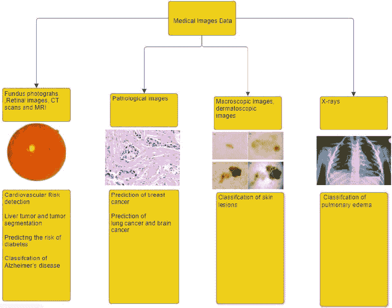**图 (1))**

表格展示了用于疾病预测的不同类型的医学图像数据。

### 药物与治疗记录

与处方药、治疗和干预措施相关的数据对于评估患者的医疗过程及其对疾病结果的影响至关重要。

### 实验室检查

来自诊断测试的综合数据（包括血检、尿检和基因分型分析）为患者的整体健康状况、疾病标志物和潜在的遗传风险因素提供了见解。

### 生命体征

监测血压、心率、体温和呼吸频率等生命体征有助于评估患者的生理状态。

### 影像数据

X 射线、CT 扫描、MRI（核磁共振）和超声波等放射学图像贡献了数据的多模态特性，使深度学习模型能够视觉信息。

### 临床评估

特定疾病的临床评估和评分表（通常由医疗保健人员实施）提供了疾病严重程度、进展或对治疗反应的标准化衡量标准。

### 症状与主观数据

患者报告的症状、病史、生活方式因素（如吸烟、饮酒）以及生活质量评估有助于对患者健康状况进行整体理解。

### 电子健康记录 (EHRs)

EHR 包含了丰富的结构化和非结构化数据，包括进展记录、病史叙述和医生观察。

### 环境因素

某些研究加入了环境因素的数据，例如空气质量、地理位置或职业暴露，这些因素可能会影响疾病风险。

### 社会经济变量

有关患者社会经济状况的信息（包括收入、教育和就业）通常会被整合用于评估医疗获取和结果的差异。

### 遗传与基因组数据

在精准医学时代，遗传和基因组信息可以揭示个体对疾病的敏感性，并为个性化治疗方案提供指导。

这些临床数据特征在 MDL 框架内整合，创建一个每个患者健康状况的全面整体视图，使深度学习模型能够从丰富的多维数据中学习，做出准确预测、辅助早期检测并改进个性化医疗决策。

## 方法论

本节介绍了医学诊断中多模态深度学习的方法。

### 多模态数据融合

多模态融合技术涉及结合医学诊断常用的三种主要数据模态：影像数据，涵盖各种临床图像，如视网膜图像、X 射线、CT 扫描、MRI 和核医学；非影像数据，可以进一步分类为非结构化数据（如自由文本报告和图像说明）和结构化数据（包括与患者状况相关的离散或连续值，如血气分析、心率和心电图报告）（图 **2**）。

```
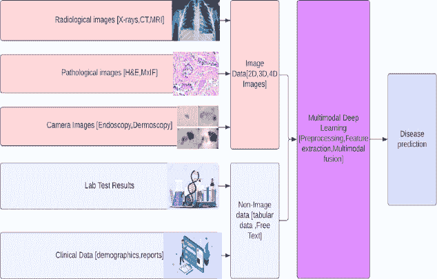Fig. (2))
```

该图显示了涉及疾病预测的多模态融合技术。

**图像与结构化非影像数据的融合**：在这种多模态融合的组合中，影像数据与结构化非影像数据整合，后者通常包括与患者健康或状况相关的组织的、可量化的数据。这些结构化数据可以涵盖广泛的参数，包括实验室结果、生命体征、临床测量值和人口统计学信息。将影像与结构化非影像数据相结合，可以对患者的健康状况进行全面分析。例如，它能够将影像发现与特定的患者指标（如血压、心率或实验室检查结果）联系起来。这种整合有助于医疗保健提供者诊断并理解患者的整体健康如何影响其医学发现。该技术涉及多种疾病预测，事实证明能产生高效的结果。

正如研究 [[1, 2]\]所示，其目标是创建并验证一种深度学习模型，用于预测术前原胃癌的淋巴结转移 (LNM)。这至关重要，因为 LNM 会显著影响手术选择和患者预后。此外，我们收集了相关的临床数据，包括性别、Lauren 分型、年龄和肿瘤位置。该数据集是创建和验证深度学习模型的基础。主要目标是完善对诊断为胃癌的患者的 LNM 预测。通过无缝整合组织学切片和临床信息，我们的目标是提高预测模型的准确性，为更有效的诊断结果做出贡献。

该工作利用了视网膜底图像 [3^(\-)5\]，这是一种成本效益高的医学影像检查，常用于糖尿病视网膜病筛查，考虑到糖尿病与心血管疾病 (CVD) 之间的密切联系。采用深度学习架构来探索 RFI 在预测心血管风险方面的潜力，特别是使用冠状动脉钙化 (CAC) 评分作为标记。结果强调了从图像分析和临床数据中获得的结果之间的互补性。

一项研究调查了多模态数据融合在胸部 X 光图像疾病背景下的影响[6]]。其目标是通过将患者的临床数据与胸部 X 光图像相结合，提高深度学习分类器的效率，旨在定位图像中的异常区域。使用 MIMIC-Eye 数据集的实验结果表明，纳入患者临床数据并使用建议的融合方法可使胸部 X 光中的疾病定位准确率提升了 12%。消融实验强化了多模态深度学习架构以及整合临床数据以增强疾病定位的需求。

在另一项研究中，重点 [7, 8]\]在于通过数据融合来提高对肾细胞癌患者生存概率的预测。该研究旨在整合 CT 影像和临床数据，创建一个全面的深度学习模型。通过结合这些数据模态并系统地选择临床变量，该研究寻求提高肾细胞癌生存预测的准确性。研究涉及多次实验，通过调整临床变量的融合来优化模型。

在另一项研究中，作者引入 [9]\]了一种用于诊断多种肝癌的多模态深度神经网络，涵盖原发性和转移性，如 HCC Multiple、HCC Single 和 mCRC。该方法涉及利用深度神经网络分析调整后的 CT 扫描并识别感兴趣区域 (ROI)，使用之前开发的网络。提取了两类特征：基于图像的高阶特征和基于病变的低阶特征。采用扩张卷积层来获取高阶特征，在不显著增加计算复杂度的情况下扩大输入图像的感受野。最终，高阶和低阶特征的结合有助于肝癌的多分类诊断。

这项综合综述 [10] 探讨了关于癌症预后预测的 43 篇最新科学论文，侧重于多模态数据整合。在这一快速发展的领域中，对临床、解剖病理学、分子和医学影像四种主要数据类型进行了分析，并将其归类为三种建模方法。机器学习和深度学习技术在改进患者分层和实现更准确的预测方面起着至关重要的作用。

另一项研究 [11] 展示了医疗领域人工智能（HAIM）框架的整体视图，旨在通过多模态数据整合增强医疗保健。HAIM 框架在多种临床数据库上进行了测试，在各种医疗保健应用中均持续优于单源方法，提升了 6-33%。夏普利值（Shapley values）揭示了每个数据模态的重要性，强调了在临床和医疗医疗保健环境中进行准确预测时，多模态输入的必要性。

该综述介绍了 [12] 使用多模态深度学习改进医疗保健领域临床决策（特别是个性化癌症诊断）的进展。它涵盖了工作流、融合方法（决策级和特征级）、性能讨论以及疾病诊断应用，并概述了挑战和未来方向。13] 中概述的研究设计了一种卷积神经网络（`CNN`），用于在常规 MRI 像中区分良性和恶性卵巢病变。该研究涉及一个包含 451 名患者和 545 个病变的数据集。并与放射组学进行了对比分析，提取了 79 个非纹理特征和 94 种纹理特征。开发了一种多任务深度卷积神经网络（`CNN`），在临床图像、皮肤镜图像等多种数据模态以及患者元数据上进行训练 [14]。其目的是对 7 点黑色素瘤检查标准进行分类并诊断皮肤病变。转向 [15]，一项研究引入了旨在自动肺栓（PE）分类的多模态融合模型。这整合了临床电子病历（EMR）数据与 CT 肺血管扫描。后期融合模型表现出优越的性能，AUROC 达到 0.947，超过了单模态模型。研究 [16] 引入了一种创新的多模态融合技术，利用了来自单个模态学习器预测的不确定性。该方法通过在估计不同模态预测之间的相关性时考虑模型不确定性，扩展了联合标签融合方法。实验重点是预测接受手术切除的小细胞肺癌患者的生存情况，展示了良好的性能。

### 多模态深度学习算法


深度学习越来越多地用于处理多种数据类型，包括声音、图像和视频记录。在这些数据形式中，神经网络（`NN`）和卷积神经网络（`CNN`）模型常用于特征提取和处理。在医学诊断背景下，通过 `NN` 和 `CNN` 提取的这些特征与其他传统特征相结合并整合到新模型。神经网络（`NN`）是一种具有层次结构的计算模型，镜像了大脑中神经元的互连排列。它由称为神经元的处理单元组成，协作生成输出函数。

神经网络由输入和输出维度组成，通常包含一个隐藏层，该层包含将输入修改为输出层可用形式的单元。在神经网络中，有三种处理单元：接收数据的输入单元、执行回归或分类任务的输出单元，以及位于输入和输出层之间、在直接观察中保持隐藏的隐藏单元。

卷积神经网络（`CNNs`）的开发是为了解决神经网络中遇到的挑战，例如在分类图像数据时的参数过载、训练困难以及有效利用图像数据。`CNN` 结构由多个层组成，包括输入层、卷积层、`ReLu` 层、池化层和全连接层。在应用中，卷积层与 `ReLu` 层的融合通常表示卷积层，封装了卷积操作和激活函数。这些层中的参数（卷积参数和标准参数）通过梯度下降进行优化，使 `CNN` 生成的分类标签与训练数据集中分配给单个图像的标签对齐（图 3）。

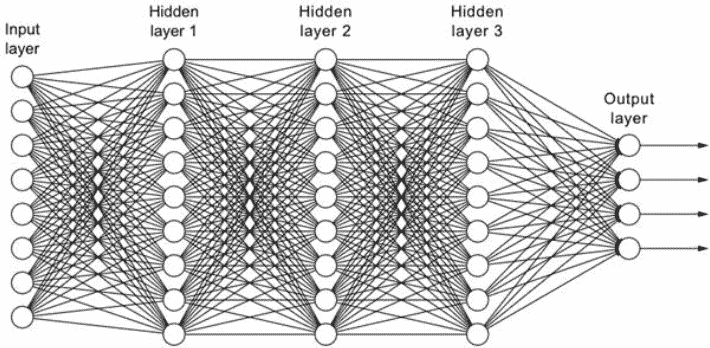 **图 (3))**

神经网络的架构。

在一项研究 [[17]] 中，采用了多种机器学习分类器，包括 `Naïve Bayes` (NB)、`Support Vector Machine` (SVM)、`Decision Tree` (DT)、`Random Forest` (RF)、`XGBoost` 以及平均神经网络 (AVNET)。这些分类器用于基于从步幅间隔信号提取的多模态特征对步态速度（正常、慢、快）进行分类。一项研究 [[18]] 引入了一种新型基于多模态 AI 的检测框架。该框架整合了多种原始传感器数据流，包括面部表情、姿态、心率和计算机交互。系统架构涵盖了三个不同的神经网络模型，用于全面的压力评估。另一项研究 [[19]] 采用了多种预处理技术，例如用于去噪的 `geometric mean filter`、用于图像分割的 `fuzzy c-means` 算法以及用于降维的 `GLCM`（灰度共现矩阵）。该调查结合了多种机器学习方法，包括 `Support Vector Machine` (SVM)、径向基函数 (RBF)、`Artificial Neural Network` (ANN) 和 `AdaBoost`。其主要目标是通过结合先进成像技术与机器学习方法，提高识别和分类脑肿瘤的准确性。另一项工作 [[20]] 提出了一种新型多模态机器学习 (ML) 方法，用于对阿尔茨海默病 (AD)、轻度认知障碍 (MCI) 和健康对照 (HC) 个体的 `EEG` 记录进行分类。`Multi-Layer Perceptron` (MLP) 分类器在输入连接的 `CWT` 和 `bispectrum` 特征时优于其他模型，展示了所提多模态 ML 方案在区分 AD、MCI 和 HC 个体方面的有效性。另一项研究 [[21]] 引入了一种新型并行多模态方法，通过分析同步的心音图 (PCG) 和心电图 (ECG) 信号来识别左心功能不全 (LVD)。该模型采用双层双向门控单元 (`Bi-GRU`) 进行特征提取，并使用 `ResNet-18` 进行分类。另一项工作 [[22]] 采用了记录质量过滤器，并实现了基于 `random forest`、`multilayer perceptron` 和 `RESNET` 的卷积神经网络用于 ECG-G 记录分类。一种结合 `random forest` 和 `RESNET` 的新型多模型融合方法表现出良好的准确性。研究 [[23]] 提出了一种基于心电图 (ECG) 和指静脉深度融合的多模态生物识别认证系统，利用深度 `Convolutional Neural Network` (CNN) 模型进行特征提取。最后，一项研究 [[24]] 提出了一种生物识别识别方法，采用了四种模式匹配算法，包括 `cosine similarity` 和 `Euclidean distances`。

## 心血管疾病的多模态深度学习

心血管疾病 (CVD) 研究中的多模态深度学习应用展示了一系列创新方法。在一项研究 [[25]] 中，一种多模态模型通过数据融合 ML 模型有效预测了高血压，该模型将 `Convolutional Neural Network` (CNN) 分析与 `Electronic Health Records` (EHRs) 结合，实现了惊人的 94% 准确率。类似地 [[26]]，一项研究采用 `Deep Unified Networks` (DUNs) 预测心衰竭患者的 30 天再次入院率，通过使用在 `Electronic Health Records` (EHRs) 上训练的多模态数据融合模型实现了 76.4% 的准确率。

探索在 [[27]] 中继续，其中 `Hybrid Non-Negative Matrix Factorization` (HNMF) 模型通过新方法对高血压患者进行了聚类。通过对 `HyperGen` 数据集的表型和基因型信息进行训练，所提出的模型实现了高达 96% 的准确率。一项工作 [[28]] 引入了 `Text Image Embedding` 网络 (`TieNet`) 来分类不同的 CVD，结合了胸部 X 光和临床数据。该模型的曲线下面积 (AUC) 为 0.9。

在心血管风险评估领域，作者们 [[29]] 开发了一种基于 `Recurrent Neural Networks` 的数据融合模型，利用 EHR 数据实现了 96% 的准确率。其他研究 [[30]] 分别提出了混合融合多模态 ML 架构用于预测心脏疾病和心血管代谢综合征检测。前者在准确性上表现出优于之前的实现。

此外，工作 [[31]] 提出了一种基于多模态融合的 ML 模型用于中风预测，结合了 `3D Convolutional Neural Network` 和 `Multilayer Perceptron` 模型，AUC 达到 0.90。预测肺栓塞 (PE) 的研究 [[32]] 使用在 `Computed Tomography Pulmonary Angiography` 扫描和 EHR 上训练的融合 ML 模型，实现了 0.947 的 AUC。在一项研究 [[33]] 中，一个 `Recurrent Neural Network` 模型预测心血管风险的 AUC 为 0.847，而 [[34]] 另一项研究使用数据融合模型通过 `gradient boosting classifier` 预测急性缺血性中风，AUC 为 0.856。人员 [[35]] 开发了一种诊断 Wolff-Parkinson-White 综合征心脏旁路 (APs) 的新方法，利用整合心电图 (ECG) 和胸部 X 光的深度学习模型。在对 206 名患者的回顾分析中，`convolutional neural network` (CNN) 模型在准确识别 AP 方面优于传统算法。

另一项工作 [[36]] 引入了一种 `tensor-based dimensionality reduction` 方法来预测血流动力学失代偿，AUC 值为 0.89。在工作 [[37]] 中，通过机器学习对临床、多模态成像和造影特征进行整合评估，实现了急性缺血性中风血管内治疗后临床结果的精确预测。最后，研究 [[38]] 探讨了监测心血管手术后患者血流动力学失代偿等并发症的挑战，这种挑战由于收集的数据复杂性和数量的增加而加剧。该研究引入了一种基于关键生理信号和电子健康记录 (EHR) 数据结合的新型多模态方法，采用了先进的信号处理和基于张量的降维技术。

## 挑战

来自不同来源且具有不同内在模式和组织结构的信息面临着重大且复杂的障碍。数据融合方法旨在通过结合多个数据观测值来创建一个凝聚且全面的表示，超越单模态能够实现的水平。然而，融合过程会遇到影响模型性能的噪声或无关数据，以及缺失或有限数据和高维带来的挑战 [[39]]。

此外，应对这些挑战通常需要采用先进模型，这些模型可能需要大量的计算资源进行训练，并且需要复杂的数据归一化技术，以修正来自各种来源数据中的错误和差异。相反，数据融合的复杂性凸显了多模态方法的潜力，来自各种来源的见解可以互补变量数据。然而，处理多模态数据的另一个障碍在于缺乏通用的技术来确保任何数据组合的分析都优于单模态分析。

来自不同来源的信息由于格式、标准或术语的差异，在集成和互操作性方面面临挑战。例如，医学图像可能采用不同的文件格式或成像方法，这增加了跨研究或跨来源比较和分析数据的复杂性。鉴于不同感官数据固有的多样预测能力和噪声结构，合并来自两种模态的信息并决定最佳融合策略是一项复杂的工作。此外，有效管理不同层面的缺失数据将显著影响融合任务的成功。

## 结论

总结来说，多模态深度学习（Multimodal DL）代表了一种创新方法，有助于在构建复杂的深度学习模型时同时利用多种模型和数据类型。该技术在提高人工智能应用的精确性和效率方面具有巨大前景，特别是在医疗保健领域，它已成为日常患者护理的关键组成部分，有效应对了数据异质性的挑战。探讨了多模态深度学习的技术方面，包括数据融合和工作流等特征，并强调了其与集成学习（Ensemble Learning）等其他技术的区别。

此外，多模态深度学习在心血管疾病诊断和预测中的应用概述揭示了令人鼓舞的结果和进一步进展的机会。尽管任何快速演进的技术中都存在隐私、偏见和结果可解释性等持续挑战，但持续的研发可能会克服这些障碍。可以预见，多模态深度学习将在塑造各个领域的人工智能应用方面发挥关键作用，特别是在医疗保健领域。

## 参考文献

|  ||  |
| --- | --- |
| [1] | Guo Z, Lan J, Wang J, et al. Prediction of lymph node metastasis in primary gastric cancer from pathological images and clinical data by multimodal multiscale deep learning. Biomed Signal Process Control 2023; 86(Part C): 105336. [[`dx.doi.org/10.1016/j.bspc.2023.105336`](http://dx.doi.org/10.1016/j.bspc.2023.105336)] |
| [2] | Cheerla A, Gevaert O. Deep learning with multimodal representation for pancancer prognosis prediction. Bioinformatics 2019; 35(14): i446-54. [[`dx.doi.org/10.1093/bioinformatics/btz342`](http://dx.doi.org/10.1093/bioinformatics/btz342)] [PMID: [31510656](http://www.ncbi.nlm.nih.gov/pubmed/31510656)] |
| [3] | Barriada RG, Simó-Servat O, Planas A, Hernández C, Simó R, Masip D. Deep learning of retinal imaging: a useful tool for coronary artery calcium score prediction in diabetic patients. Appl Sci (Basel) 2022; 12(3): 1401. [[`dx.doi.org/10.3390/app1203141`](http://dx.doi.org/10.3390/app1203141)] |
| [4] | Javaid A, Zghyer F, Kim C, et al. Medicine 2032: The future of cardiovascular disease prevention with machine learning and digital health. American Journal of Preventive Cardiology 2022; 12: 10379. [[`dx.doi.org/10.1016/j.ajpc.2022.10379`](http://dx.doi.org/10.1016/j.ajpc.2022.10379)] |
| [5] | Lee YC, Cha J, Shim I, et al. Multimodal deep learning of fundus abnormalities and traditional risk for risk prediction. NPJ Digit Med 2023; 6(1): 14. [[`dx.doi.org/10.1038/s41746-023-00748`](http://dx.doi.org/10.1038/s41746-023-00748)] [PMID: [36732671](http://www.ncbi.nlm.nih.gov/pubmed/36732671)] |
| [6] | Hsieh C, Nobre IB, Sousa SC, et al. MDF-Net for abnormality detection by fusing X-rays with clinical data. Sci Rep 2023; 13(1): 15873. [[`dx.doi.org/10.1038/s41598-023-41630`](http://dx.doi.org/10.1038/s41598-023-41630)] [PMID: [37741833](http://www.ncbi.nlm.nih.gov/pubmed/37741833)] |
| [7] | Mahootiha M, Qadir HA, Bergsland J, Balasingham I. Multimodal deep learning for personalized renal cell carcinoma prognosis: Integrating CT imaging and clinical data. Comput Methods Biomed 2024; 244: 10798. [[`dx.doi.org/10.1016/j.cmpb.2023.10798`](http://dx.doi.org/10.1016/j.cmpb.2023.10798)] [PMID: [38113804](http://www.ncbi.nlm.nih.gov/pubmed/38113804)] |
| [8] | Schulz S, Woerl AC, Jungmann F, et al. Multimodal deep learning for prognosis prediction in renal cancer. Front Oncol 2021; 11(November): 78840. [[`dx.doi.org/10.3389/fonc.2021.78840`](http://dx.doi.org/10.3389/fonc.2021.78840)] [PMID: [34900744](http://www.ncbi.nlm.nih.gov/pubmed/34900744)] |
| [9] | Khan RA, Fu M, Burbridge B, Luo Y, Wu FX. A multi-modal deep neural network for multi-class liver cancer diagnosis. Neural Netw 2023; 165: 553-61. [[`dx.doi.org/10.1016/j.neunet.2023.06.013`](http://dx.doi.org/10.1016/j.neunet.2023.06.013)] [PMID: [37354807](http://www.ncbi.nlm.nih.gov/pubmed/37354807)] |
| [10] | Sato-Delgado B, Priego-Torres B, Sanchez-Morillo D. Combining molecular, imaging, and clinical data analysis for predicting cancer prognosis. Cancers (Basel) 2022; 14(13): 3215. [[`dx.doi.org/10.3390/cancers14133215`](http://dx.doi.org/10.3390/cancers14133215)] [PMID: [35804988](http://www.ncbi.nlm.nih.gov/pubmed/35804988)] |
| [11] | Soenksen LR, Ma Y, Zeng C, et al. Integrated multimodal artificial intelligence framework for healthcare. NPJ Digit Med 2022; 5(1): 14. [[`dx.doi.org/10.1038/s41746-023-00748`](http://dx.doi.org/10.1038/s41746-023-00748)] [PMID: [36127417](http://www.ncbi.nlm.nih.gov/pubmed/36127417)] |
| [12] | Holste G, Partridge SC, Rahbar H. End-to-End learning of fused image and non-image features for improved breast cancer classification from MRI. 2021. [[`dx.doi.org/10.1109/ICCVW5420.2021.0368`](http://dx.doi.org/10.1109/ICCVW5420.2021.0368)] |


# 使用机器学习的高血压检测系统

**Amrita Bhatnagar**(1, \*)****, **Kamna Singh**(1)

¹ Ajay Kumar Garg Engineering College, Ghaziabad, Uttar Pradesh, India

## 摘要

高血压（hypertension）是一种医学状况，其特征是动脉壁承受的血压压力持续升高。通常情况下，个人的血压应维持在`120/80 mm Hg`以下。每当血压持续记录在`130/80 mm Hg`或以上时，通常会被诊断为高血压。其确切起源尚不清楚，但加速其发展的因素包括肥胖、高压力水平、年龄增长、钠盐摄入增加以及体力活动减少。人体内的许多器官和系统都会受到高血压的严重影响。如果不加检查和治疗，它可能导致多种严重的健康问题和疾病，包括肾脏疾病和中风。

在高血压的识别和治疗方面，`machine learning`可以成为一种极具价值的工具。它可以帮助医疗从业人员完成多项程序，例如风险评估、早期检测和个性化护理。基于最新医学研究和患者特定数据提供治疗建议的决策支持工具，是机器学习帮助医疗保健者的一种方式。这可以协助医生在药物选择和生活方式改变方面做出更明智的决策。高血压患者可以从借助机器学习设计的个体化治疗方案中获益。

目前有多种机器学习算法可用于预测高血压及相关风险变量，包括决策树（`DT`）、随机森林（`RF`）、梯度提升机（`GBM`）、极端梯度提升（`XG Boost`）、逻辑回归（`LR`）和线性判别分析（`LDA`）。可用数据集的质量和合适的技术对于机器学习检测和管理高血压的效果关重要。

**关键词：** 特征缩放、高血压、医疗保健、随机森林、风险评估、中风。

***

* `通讯作者 Amrita Bhatnagar:` Ajay Kumar Garg Engineering College, Ghaziabad, Uttar Pradesh, India; E-mail: amritapsaxena@gmail.com

## 引言

高血压检测系统，特别是基于机器学习的系统，可能具有几个关键特征，能够有效识别和预测个体的高血压 [1]。高血压是心血管疾病和死亡的重要因素，这强调了对有效预测工具的 string。本研究探索了深度学习，特别是长短期记忆（`LSTM`）网络在利用电子健康记录（`EHRs`）预测高血压发生方面的潜力 [2]。利用来自美国某大型医疗系统的 233,895 名成年患者数据集，我们比较了`LSTM`网络与应用于聚合特征的广泛使用的`XGBoost`模型的性能。

根据诊断日期，将人群分为两个纵向数据集（`A`和`B`）。模型在数据集`A`上通过交叉验证进行训练，以确保对未见数据的泛化能力。随后，将模型应用于数据集`B`进行性能评估。此外，我们还实验了高血压之前的两个不同时间窗口，以评估它们对模型性能的影响。

本研究旨在为不断发展的预测性医疗分析领域做出贡献，特别是识别具有高血压风险的人群。通过利用先进的深度学习架构并结合纵向`EHRs`，我们旨在提供能够增强早期干预策略并改善患者的见解。

血压是一种复杂的多基因多因素性状，受到多种遗传、分子和生理途径的影响。无论是在临床环境中还是通过动态监测手段，血压升高的预测能力在心血管事件和死亡率背景下已得到充分证实。尽管通过遗传和生理研究在理解血压调节方面取得了巨大进展，但多组学数据的整合已成为识别新生物通路和潜在治疗靶点的一种非常有前景的途径。

组学研究（包括基因组学、代谢组学和其他高通量技术）产生了海量数据集，提供了宝贵的见解和产生假设的信息。然而，挑战在于整合不同维度的数据，特别是在血压调节等多因素性状的背景下。`Machine learning`作为一种多功能工具，可以在不施加硬性假设的情况下整合多个来源的数据，为从多模态数据中获取全面见解提供了可能。

心血管疾病（`CVD`）、中风、慢性肾病和认知障碍的关键且可预防的因素，导致了巨大的全球健康负担。仅在 2015 年，它就导致了约 850 万例死亡，在中低收入国家尤为流行。在此背景下，伊朗的高血压患病率为 25%。识别如年龄、性别、家族史、吸烟、饮酒、中心性肥胖、体重超标和缺乏运动等公认风险因素，是预防高血压的重要组成部分。

肥胖是近年来备关注的问题，与高血压和其他心血管风险密切相关。体重指数（`BMI`）尽管存在局限性，但仍是人体测量和评估健康风险的常用指标。然而，考虑到`BMI`的局限性，腰围、腰臀比（`WHR`）和体成分分析等补充措施变得日益重要。这些额外指标增强了`BMI`的预测效率，为肥胖相关的健康风险提供了更全面的评估。

文献强调脂肪分布是心血管发病和死亡率的关键因素，其意义超过了脂肪量的增加。这强调了对体成分进行详细评估以提高健康风险估计准确性的必要性。在这种背景下，探索替代人体测量方法并结合体成分分析，可能为肥胖与高血压之间的关系提供更微妙的见解，从而指导更有效的风险评估和干预策略。

高血压是一种范围内流行的疾病，由于其与致命疾病的相关对公共健康构成了巨大威胁。估计它每年导致全球死亡人数的 13%至 19%，预计到 2025 年，将有 156 亿人患有高血压。血压升高影响全球 18 岁及以上人口约 22%，在印度尼西亚等国家尤为关注，其 15 岁及以上人口中约 34%患有高血压 [3]。尽管患病率高，但对血压升高的认知仍然很低，印度尼西亚的患者中仅有 8.8%知道自己的病情。未控制的高血压增加了严重并发症的风险，包括冠心病、心力衰竭、中风、心肌梗死、房颤、外周动脉疾病、慢性肾病和认知障碍，使其成为死亡率的重要因素。

以下是通常与此类系统相关的特征：

## 高血压检测系统的特征

### 准确预测

高血压检测系统的主要目标是准确预测个人是否可能患有高血压。系统在预测时应实现高准确性、高敏感性和特异性。

### 早期检测

早期发现高血压或前期高血压状态对于预防性医疗至关重要。良好的检测系统应该在病情进展到更严重阶段之前识别出高血压迹象。

### 个性化风险评估

考虑到个体差异并根据个人健康史、遗传因素和生活方式因素定制风险评估的系统，能够提供更个性化且更准确的预测。

### 可解释性

解释和说明系统所做决策的能力至关重要，特别是在医疗背景下。用户（包括医疗专业人员和患者）应该理解影响高血压预测的因素。

### 用户友好界面

## 参考文献

- [13] Wang R, Cai Y, Lee IK. Correction to: Evaluation of a convolutional neural network for ovarian tumor based on magnetic resonance imaging. Eur Radiol 2021; 31(7): 4960-71. [`dx.doi.org/10.1007/s00330-020-0726`](http://dx.doi.org/10.1007/s00330-020-0726)

- [14] Kawahara J, Daneshvar S, Argenziano G, Hamarneh G. Seven-point checklist and skin lesion classification using multitask neural nets. IEEE J Biomed Inform 2019; 23(2): 538-46. [`dx.doi.org/10.1109/JBHI.2018.282432`](http://dx.doi.org/10.1109/JBHI.2018.282432) [PMID: [29994053](http://www.ncbi.nlm.nih.gov/pubmed/29994053)]

- [15] Cahan N, Klang E, Marom E, et al. Multimodal fusion models for pulmonary embolism mortality. Sci Rep 2023; 13: 7544. [`dx.doi.org/10.1038/s41598-023-34303`](http://dx.doi.org/10.1038/s41598-023-34303)

- [16] Wang H, Subramanian V, Syeda-Mahmood T. Modeling uncertainty in multi-modal fusion for lung cancer survival analysis. Proceedings - International Symposium on Biomedical Imaging 20211169-72. [`dx.doi.org/10.1109/ISBI48211.2021.943382`](http://dx.doi.org/10.1109/ISBI48211.2021.943382)

- [17] Aziz W, Hussain L, Khan IR, Alowibdi JS, Alkinani MH. 通过提取步幅间隔时间序列的多模态特征对正常、慢速和快速行走进行机器学习分类。Math Biosci Eng 2020; 18(1): 495-517. [http://dx.doi.org/10.3934/mbe.2021027] [PMID: 33525104](http://www.ncbi.nlm.nih.gov/pubmed/33525104)

- [18] Walambe R, Nayak P, Bhardwaj A, Kotecha K. 运用多模态机器学习进行压力检测。J Healthc Eng 2021; 2021: 1-12. [http://dx.doi.org/10.1155/2021/9356452] [PMID: 34745514](http://www.ncbi.nlm.nih.gov/pubmed/34745514)

- [19] Anand L, Rane KP, Bewoor LA, et al. 开发机器学习和医学支持的多模态技术用于 MRI 图像脑肿瘤的分割与分类。Comput Intell Neurosci 2022; 2022: 1-8. [http://dx.doi.org/10.1155/2022/7797094] [PMID: 36059419](http://www.ncbi.nlm.nih.gov/pubmed/36059419)

- [20] Ieracitano C, Mammone N, Hussain A, Morabito FC. 一种基于多模态机器学习的痴呆症 EEG 记录自动分类新方法。Neural Netw 2020; 123: 176-90. [http://dx.doi.org/10.1016/j.neunet.2019.12.006] [PMID: 31884180](http://www.ncbi.nlm.nih.gov/pubmed/31884180)

- [21] Zeng Y, Yang S, Yu X, et al. 基于心音图和心电图同步分析的左心功能障碍识别多模态并行方法。Math Biosci Eng 2022; 19(9): 9612-35. [http://dx.doi.org/10.3934/mbe.2022447] [PMID: 35942775](http://www.ncbi.nlm.nih.gov/pubmed/35942775)

- [22] Song G, Zhang J, Mao D, Chen G. 使用 ECG 进行心血管检测的多模型融合方法。Emerg Med Int 2022; 2022: 1-10. [http://dx.doi.org/10.1155/2022/3561147] [PMID: 35615106](http://www.ncbi.nlm.nih.gov/pubmed/35615106)

- [23] El-Rahiem BA, El-Samie FE, Amin M. 心电图 (ECG) 与指静脉深度融合的多模态生物识别认证。Multimedia Syst 2022; 28(4): 1325-37. [http://dx.doi.org/10.1007/s00530-021-081-9)]

- [24] Bugdol MD, Mitas AW. 结合 ECG 和声音信号的多模态生物识别系统。Pattern Recogn Lett 2014; 38: 107-12. [http://dx.doi.org/10.1016/j.patrec.2013.014)]

- [25] Soto J, Hughes W, Sanchez P, et al. 多模态深度学习增强左心室肥大的诊断精准度，2022, 3(3), 380-389.

- [26] Golas SB, Shibahara T, Agboola S, et al. 用于预测心衰竭患者 30 天再次入院风险的机器学习模型：电子病历的回顾性分析。BMC Med Inform Decis Mak 2018; 18(1): 44. [http://dx.doi.org/10.1186/s12911-018-060-z] [PMID: 29929496](http://www.ncbi.nlm.nih.gov/pubmed/29929496)

- [27] Luo Y, Mao C, Yang Y, et al. 使用混合非负矩阵分解整合高血压表型和基因型。Bioinformatics 2019; 35(8): 1395-403. [http://dx.doi.org/10.1093/bioinformatics/bty804] [PMID: 30239588](http://www.ncbi.nlm.nih.gov/pubmed/30239588)

- [28] Xiaosong W, Peng Y, Lu L, Lu Z, Bagheri M. Chestx-ray8：医院级 X 光数据库及常见胸部疾病的弱监督分类。IEEE 视觉与模式识别会议 20172097-106.

- [29] Hao Y, Usama M, Yang J, Hossain MS. 基于循环神经网络的多模态疾病预测。Future Gener Comput Syst 2019; 92: 76-83.

- [30] Shomorony I, Cirulli ET, Huang L, et al. 从多模态数据识别健康与疾病特征的无监督学习方法。Genome Med 2020; 12(1): 7. [http://dx.doi.org/10.1186/s13073-019-075-z] [PMID: 31924279](http://www.ncbi.nlm.nih.gov/pubmed/31924279)

- [31] Hotter B, Pittl S, Ebinger M, et al. 关于急性中风发作后 24 小时内匹配的前瞻性研究。BMC Neurol 2009; 9(1): 60. [http://dx.doi.org/10.1186/1471-237-6] [PMID: 19995432](http://www.ncbi.nlm.nih.gov/pubmed/19995432)

- [32] Huang SC, Pareek A, Zamanian R, Banerjee I. 利用 CT 成像和电子健康记录深度融合：肺栓塞病例。Sci Rep 2020; 10(1): 22147. [http://dx.doi.org/10.1038/s41598-020-888-w)]

- [33] Ayou B, Groenhof TK, Veldhuis WB, Jong PA, Oberski DL. 使用 EHR 进行心血管风险预测的多模态学习。arXiv 预印本 2020. arXiv:2008.11979.

- [34] Brugnara G, Neuberger U, Mahmutoglu MA, et al. 使用机器学习对急性中风血管内治疗结果进行多模态预测建模。Stroke 2020; 51(12): 3541-51. [http://dx.doi.org/10.1161/STROKEA.120.03287] [PMID: 3304071](http://www.ncbi.nlm.nih.gov/pubmed/3304071)

- [35] Nishimori M, Kiuchi K, Nishimura K, et al. 使用多模态深度学习模型进行旁分析。Sci Rep 2021; 11(1): 8045. [http://dx.doi.org/10.1038/s41598-021-863-y] [PMID: 33850245](http://www.ncbi.nlm.nih.gov/pubmed/33850245)

- [36] Hernandez L, Kim R, Tokcan N, et al. 术后心脏护理期间整合连续监测的多模态张量方法。Artif Intell Med 2021; 113: 102032. [http://dx.doi.org/10.1016/j.artmed.2021.102032] [PMID: 33685593](http://www.ncbi.nlm.nih.gov/pubmed/33685593)

- [37] Gurcan MN, Boucheron LE, Can A, Madabhushi A, Rajpoot NM, Yener B. 组织病学图像分析：综述。IEEE Rev Biomed Eng 2009; 2: 147-71. [http://dx.doi.org/10.1109/RBME.2009.203865] [PMID: 20671804](http://www.ncbi.nlm.nih.gov/pubmed/20671804)

- [38] Min C, Hao Y, Hwang K, Wang L, Wang L. 基于医疗社区大数据的机器学习疾病预测。IEEE Access 201775.

- [39] Wang S, Celebi ME, Zhang YD, et al. 生物医学数据融合数据预处理的进展：方法、挑战与展望。Information Fusion 2021; 76: 376-421. [http://dx.doi.org/10.1016/j.inffus.2021.07.001)]


无论是医疗专业人员还是个人，用户友好界面都能便于与系统进行交互。结果的可视化和风险因素的清晰沟通有助于提高用户的接受度。

### 与医疗工作流的集成

与现有的医疗系统和工作流无缝集成，可确保高血压检测系统能够轻松应用于临床实践中。

### 安全与隐私

鉴于健康数据的敏感性，系统必须优先考虑安全和隐私。应采取强有力的措施保护患者信息，并符合相关的数据保护法规。

### 持续改进

系统设计应支持持续改进，允许根据新的研究发现、不断演变的医疗指南以及用户的持续反馈进行更新。

### 验证与合规性

严格的验证（包括临床验证）对于确保系统满足医疗应用的必要标准和监管要求至关重要。

这些特征共同促进了高血压检测系统在现实医疗环境中的有效性、可靠性和认可。开发此类系统需要数据科学家、医疗专业人员和其他利益相关者的合作，以确保其符合最佳医疗实践和伦理考量。

# 高血压检测模型的流程

使用机器学习检测高血压涉及开发一种预测模型，该模型可以通过分析相关数据来识别高风险或已患高血压的个人 [4]。以下是使用机器学习构建高血压检测系统的通用步骤概述（图. 1）：

### 数据收集

开发高血压检测系统的数据收集过程涉及收集相关信息。以下是数据收集过程中涉及的步骤：

### 可穿戴设备

使用智能手表或健身追踪器等可穿戴设备，这些设备可以记录连续健康数据，包括心率和血压 [5]。

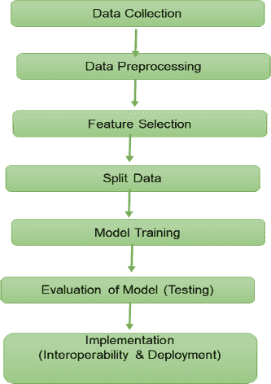 **图 (1)**

高血压检测系统的流程。

### 临床试验

与开展高血压临床试验的研究机构或组织合作 [6]。

### 公共健康数据库

访问包含相关信息的公开健康数据集 [7]。

### 数据变量

定义你需要收集的数据变量。这些可能包括：

- `systolic`（收缩压）和 `diastolic`（舒张压）血压测量值
- `Age`（年龄）和 `gender`（性别）
- `demographic information`（人口统计信息）
- `Medical history`（病史）和 `comorbidities`（共症）
- `Family history of hypertension`（高血压家族史）
- `antihypertensive medications`（降压药物）
- `Lab test results`（实验室结果）和 `cholesterol levels`（胆固醇水平）

## 各种数据收集方法

1. 使用自动血压计收集血压测量值。
2. `Demographic and lifestyle data`（人口统计和生活方式数据）可以通过调查和问卷获取。
3. `Electronic health records`（电子健康记录）可能提供病史。
4. `Wearable devices`（可穿戴设备）可以持续记录心率和其他生理数据。
5. 标准化：确保从来源收集的数据是标准的并遵循一致的格式。

### 数据质量控制

实施质量措施以检测并修正数据中的错误，例如缺失值、异常值或不一致之处。这确保了从来源收集的数据标准。

### 记录

维护数据收集过程的详细记录，包括来源、日期和任何文档，以确保透明和可重复性。

### 参与者招募

如果调查或临床试验是数据收集的一部分，请从目标人群中招募参与者，以确保样本的代表性并避免偏差。

### 数据标注

如有必要，对数据进行手动注释或标记，特别是当从 `EHRs`（电子健康记录）等来源收集数据时，信息并不总是可用。

### 数据验证

与可靠来源交叉验证数据，或通过领域专家进行验证以确保准确性。

## 数据集示例

### 弗兰明翰心脏研究

`Framingham Heart Study`是一个著名的数据集，已用于心血管研究 [8]。它包含了各种健康相关数据。

### PTB 诊断心电图数据库

虽然该数据集主要用于 ECG 分析，但它包含了患者心血管健康的信息，研究人员已将其用于与高血压相关的研究 [9]。

### PhysioNet

PhysioNet 提供多种生理信号数据集。研究人员已使用来自 PhysioNet 的数据集（如包含血压和心电图的数据集）进行高血压检测 [10]。我们可以在 Kaggle、UCI 机器学习库或专门的医疗数据库在线搜索最新的数据集。

## 数据预处理

以下是使用机器学习进行高血压检测的数据预处理的一些常见步骤（图. 2）：

### 数据汇集

从可靠来源（如医疗记录、调查或可穿戴设备）收集数据。必须确保数据包含有助于高血压检测的相关特征，例如年龄、性别、血压读数、心率、胆固醇水平和生活方式因素。

### 数据清洗

识别并处理数据集中的缺失值。你可以删除缺失值的实例，或使用均值填充、回归填充等技术进行填充。

异常值检测与删除：识别并处理数据集中的异常值，特别是在血压读数等数值特征中。异常值会显著影响机器学习模型的性能。

# 基于特征缩放的数据转换

对数值特征进行归一化或标准化，以确保它们具有相似的尺度。常用方法包括`Min-Max scaling`或`Z-score normalization`。

## 特征工程

在特征工程中，我们创建新的特征，可能为高血压检测提供额外信息。例如，你可以根据身高和体重计算体重指数（`BMI`），或创建年龄组。

## 时间聚合

如果数据包含时间信息（例如时间序列血压读数），请考虑随时间对数据进行聚合，以创建汇总统计或特征。

## 平衡数据集

如果数据集不平衡（`i.e.`，某类别的实例远多于另一类），考虑使用过采样少数类或下采样多数类等技术，以创建一个更平衡的训练集。

## 归一化

对数据进行归一化以确保其符合正态分布。这对于假设正态性的算法可能尤为重要 [11]。

# 数据集的特征选择

### 相关性分析

识别与目标变量（高血压）具有强相关性的特征。相关性高的特征可能对预测更有相关性。

### 信息增益

信息增益是决策树中使用的一种指标。它评估了当使用特定特征拆分数据时，熵或无序度的减少程度。信息增益较高的特征被认为更有价值。

### SelectKBest

`sci-kit-learn` 库中的这种方法根据`F-test`或互信息等统计检验选择前 `k` 个特征。

数据集的属性、特征的分布以及问题的具体细节都会影响所选的特征选择方法。尝试不同的方法并其在验证集上评估其结果通常是有帮助的。

## 数据划分

当数据被分为两个或多个子组时，被称为数据划分。当使用二分划分时，通常会对其中部分数据进行评估或测试，而在另一部分数据上训练模型。

数据划分是数据科学的一个关键组成部分，特别是在使用数据构建模型时。这种方法有助于确保创建的数据模型以及依赖于数据模型的程序（如机器学习）的准确性。

在标准的二分数据划分中，使用训练数据集进行模型开发和训练。训练集经常用于比较多个模型的性能或估计各种参数。

训练完成后，使用测试数据集。为了验证最终模型是否按预期运行，会将训练集和测试集进行比较。将数据分为三个或更多集合是机器学习中的一种常用做法。

### 随机采样

通过使用这种数据采样技术，防止在数据建模过程中对各种潜在数据特征产生偏差。然而，随机划分可能会遇到数据分布不均的问题。

### 分层随机采样

该方法在特定参数内随机选择数据样本。它确保数据在训练集和测试集中被正确分布。

### 非随机采样

当数据建模者希望使用最新的数据作为测试集时，他们通常采用这种策略。

## 高血压检测的机器学习模型

### 逻辑回归

逻辑回归是一种二分类算法，可预测患者是否患有高血压。它使用逻辑函数对结果的概率进行建模 [12]。

### 支持向量机 (SVM)

强大的`SVM`分类方法的目标是找到一个具有最大间隔的平面，以划分不同类别的数据点 [13]。该方法可用于识别高血压的任务。

### 随机森林

`Random Forest` 集成学习技术使用多个决策树来生成预测。它可以生成特征相关性评分，并在管理数据内部复杂关系方面非常高效 [14]。

### 梯度提升算法

梯度提升算法通过顺序构建一系列弱学习器来纠正前者的误差。`XGBoost` 和 `LightGBM` 是常用的实现方式 [15]。

### 神经网络 (ANN)

神经网络（特别是深度学习模型）可以捕捉复杂的关系。它们被用于高血压检测，特别是在处理大型数据集时。

### K 近邻 (KNN)

通过其最近邻的多数类对数据点进行分类。`KNN` 算法在局部模式显著的情况下效果良好。

### 决策树

决策树可用于分类任务，包括高血压检测。它们根据特征值划分数据进行预测。

## 朴素贝叶斯

`Naive Bayes` 是一种基于贝叶斯定理的概率分类器。它假设特征之间相互独立，且在处理大量特征时特别有用。

### 集成方法

集成方法（如 bagging 和 boosting）结合多个模型以提高整体性能。`Random Forest` 是 bagging 的示例，而 `XGBoost` 和 `AdaBoost` 是 boosting。

### 高斯过程

`Gaussian Processes` 可以对复杂的关系不确定性进行建模。它们是用于高血压预测的概率模型。

### 长短期记忆 (LSTM) 网络

`LSTM` 是一种循环神经网络 (`RNN`) 类型，可以捕捉序列数据中的时间依赖。它们可以应用于高血压检测的时间序列数据。

# 测试与互操作

使用机器学习进行高血压检测的测试涉及在未见过的独立数据集上评估训练模型的性能。该数据集被称为测试集，作为基准来评估模型对新实例的泛化能力。

以下是测试高血压模型的关键步骤：

### 预处理测试数据

对测试数据应用与训练和验证集相同的预处理步骤。这确保了评估的一性和公平性。

### 加载训练模型

加载在训练和验证集上训练的机器学习模型。可以使用模型的序列化方法（如 `pickle`）或使用训练期间保存的模型文件来完成。

### 在测试数据上进行预测

使用加载的模型对测试集的特征进行预测。

### 解释结果

分析评估指标，以了解模型在测试集上的表现。解释可能涉及查看高血压检测背景下的假性阳性、假性阴性以及其他相关指标。

### 调整与优化

如果模型性能不理想，考虑微调模型、调整超参数或重新审视特征工程和预处理步骤。

### 部署模型（可选）

如果模型在测试集上表现良好并符合您的部署标准，可以考虑将其部署到真实环境中进行高血压检测。

### 持续监控与更新

对模型性能进行持续监控，以便在新数据可用或模型性能随时间推移而下降时对其重新训练。高血压检测模型应定期更新，以反映患者人口统计数据和医疗保健实践的变化。

### 伦理考量

在处理敏感健康数据时，必须确保解决伦理考量和数据隐私问题。我们应该遵守相关的法规，如美国的 `HIPAA` 或欧洲的 `GDPR`。请记住，用于医疗诊断的机器学习模型（包括高血压检测模型）在临床使用之前，必须经过严格的验证，并可能需要监管机构的批准。与医疗保健专业人员和领域专家的合作对于此类应用的成功至关重要。

## 高血压检测系统的应用

使用机器学习的高血压检测系统在医疗保健和健康管理领域有多种应用。以下是此类系统可以应用的关键领域：

#### 早期诊断与预防

识别具有高血压风险的个体或处于前期血压阶段的人，允许进行早期干预和生活方式调整，以防止病情进展。

#### 个性化健康监测

可以利用机器学习模型创建个性化的健康监测系统，持续监测来自智能手表或健身追踪器等可穿戴设备的数据，以发现指示高血压的模式。

### 临床决策支持

医疗保健专业人员可以在常规检查期间将机器学习模型作为决策支持工具。这些工具可以帮助根据各种健康参数评估患者的高血压风险。

### 人口健康管理

高血压检测系统通过识别大型数据集中的趋势和模式，为人口健康管理工作做出贡献。公共卫生倡议可以根据特定人口统计中高血压的流行率进行定制。

#### 员工健康计划

企业可以将高血压检测系统作为员工健康计划的一部分。定期的健康评估结合机器学习分析，可以帮助识别和管理员工的高血压风险。

#### 与电子健康记录 (EHR) 集成

将高血压检测模型与电子健康记录集成，可以获得患者病史的全视图，有助于更准确的预测和个性化干预。

#### 药物警戒与用药依从性

机器学习模型可以协助监测高血压药物的有效性并预测依从模式。这可以帮助医疗提供者根据需要调整治疗方案。

#### 健康教练平台

健康教练应用可以利用高血压检测系统，为希望通过生活方式改变血压的个人提供个性化建议和干预。

#### 临床试验与研究

高血压检测系统在临床研究中具有价值，可以识别临床试验的合适候选人、监测参与者并对新疗法的有效性提供见解。

#### 公共卫生运动

机器学习模型的见解可以为公共卫生运动提供信息，旨在提高对高血压风险因素的意识并促进更健康的生活方式。

注意的是，在医疗保健领域部署机器学习模型需要仔细考虑伦理和监管方面，包括数据隐私、安全以及对医疗保健标准的合规性。数据科学家、医疗保健专业人员和政策制定者之间的合作对于开发和实施有效且负责的高血压检测系统至关重要。

### 现有模型

#### DeepHype

DeepHype 是研究人员开发的基于深度学习的高血压预测模型。它利用卷积神经网络 (`CNN`) 架构分析视网膜图像，以检测高血压视网膜病变。

#### 使用可穿戴设备检测高血压

随着可穿戴设备的普及，研究人员探索了利用可穿戴设备的数据（*例如*，心率、身体活动）来开发高血压检测模型 [16, 17]。这些模型通常采用机器学习算法分析持续监测数据。

#### 移动健康 (mHealth) 应用

某些移动健康应用旨在使用智能手机传感器或外接设备检测高血压 [18]。这些应用可能使用机器学习算法分析血压测量、心率和身体活动等数据。

#### 遗传信息的整合

某些模型整合了遗传信息以改进高血压预测。遗传因素对高血压易感性起着作用，将遗传数据整合到模型中可能会提高准确性 [19]。

#### 远程医疗平台

开发远程医疗平台用于远程监测和管理高血压 [20]。这些平台可能包含用于风险预测和个性化干预的机器学习组件。

#### 可解释人工智能 (XAI)

可解释人工智能 (`XAI`) 指的是人工智能中使模型输出对人类可理解且可解释的方法技术。在医疗保健领域，对 XAI 的需求尤为关键，因为 AI 系统做出的决策会对患者结果、安全以及对 AI 技术的信任产生重大影响。以下是对医疗领域 XAI 的深入观察：

#### XAI 在医疗保健中的重要性

##### 透明度与信任

##### 建立信任

医生、患者和监管机构需要理解 AI 系统如何做出决策，以信任它们在关键医疗保健应用中的应用。

##### 问责制

透明的 AI 系统有助于对其决策进行问责，这对于维护医疗保健的伦理标准至关重要。

#### 安全性与可靠性

##### 错误识别

理解 AI 决策有助于识别并纠正模型中的错误或偏差，确保结果的安全可靠。

##### 临床验证

医疗专业人员可以验证 AI 建议，确保其符合医学知识和标准。

#### 监管合规

##### 满足监管要求

美国 `FDA` 等监管机构要求对 AI 决策进行解释，以批准其用于临床环境。

##### 伦理标准

可解释模型通过确保 AI 决策公平且无偏见，有助于维护伦理标准。

### 医疗领域的可解释人工智能技术

#### 模型特定方法

##### 决策树和基于规则的系统

这些模型具有内在解释性，提供了清晰的决策规则。

##### 线性模型

线性回归和逻辑回归等模型提供了输入特征如何影响结果的直观解释。

#### 事后解释方法

##### SHAP (Shapley Additive Explanations)

通过将预测分配到输入特征，为单个预测提供解释。

##### LIME (局部可解释模型无关的解释)

通过在预测附近使用可解释模型来近似原模型，从而生成局部忠实的解释。

##### 特征重要性

衡量每个特征对模型预测的贡献，有助于理解不同因素的相对重要性。

## 可视技术

### 显著性图 (Saliency Maps)

用于基于图像的模型，以突出对模型预测影响最大的图像区域。

### 部分依赖性图 (Partial Dependence Plots)

在保持其他特征不变的情况下，显示特定特征与预测结果之间的关系。

### 注意力机制 (Attention Mechanisms)

在 Transformer 等模型中，可以可视化注意力评分，以理解模型关注了输入的哪些部分。

## 结论

高血压检测系统，特别是基于机器学习的系统，可能具有若干关键特征，能够有效识别和预测个体的高血压。

本研究提出的高血压检测系统利用机器学习算法（特别是梯度提升方法），根据各种健康指标准确识别具有高血压风险的个体。该系统集成了配备有传感器的可穿戴设备，用于收集血压、心率和身体活动等实时数据。系统架构涉及通过可穿戴设备采集数据、通过无线传输至中央服务器，并随后存储在安全的云基础设施中。数据经过预处理（包括清洗和特征提取），以增强其分析的适用性。机器学习模型在这些预处理后的数据上进行训练，重点关注预测前一个模型的残差以提高准确性。算法通过超参数调优进行优化，并使用准确率和精度等指标进行性能评估。结果表明该系统具有强大的高血压检测能力，对早期干预和改善患者预后具有意义。在承认数据安全和用户隐私等局限性和伦理考量的同时，该高血压检测系统在现实应用中展现了前景。未来的研究方向可能包括完善算法、扩大数据集以及与医疗机构合作，以进一步在临床环境中验证和部署该系统。总之，高血压检测系统代表了医疗健康技术的重大进展，为高血压的早期检测和管理提供了可靠且有效的工具。其对患者预后和医疗实践的潜在影响，强调了在这一关键领域持续研究和开发的重要性。

## 高血压检测模型的未来范围

随着技术的不断进步，使用机器学习的高血压检测模型未来具有许多令人兴奋的可能性。以下是未来发展的一些潜在途径：

### 个性化医疗

未来的模型可以整合更多个性化信息（例如遗传数据），根据个体的独特基因组成来定制高血压检测和管理策略。

### 多模态数据融合

包括整合来自各种来源的数据，包括电子健康记录、可穿戴设备和生活方式数据，以创建更全面的模型。这还包括来自不同模态（例如影像、基因组学和临床数据）的数据融合，以对患者健康进行更整体的理解。

### 医疗健康中的可解释人工智能 (XAI)

应重点开发不仅准确而且具有可解释性和可说明性的模型，特别是在对信任和透明度至关重要的医疗领域。

### 实时监控与警报


开发能够持续实时监控的模型，在检测到异常血压模式时提供及时警报和干预。这些模型与智能设备集成，以提供即时反馈和建议。

### 纵向健康监测

扩展模型以进行纵向健康监测，允许检测随时间变化的趋势和高血压发展的早期迹象。

### 与远程医疗和远程患者监测集成

将高血压检测模型集成到远程医疗平台，用于远程患者监测，并根据患者的实时数据与医疗专业人员进行虚拟会诊。

### AI 决策支持系统

开发决策支持系统，通过提供机器学习模型的预测和见解，协助医疗专业人员做出明智决策。

### 预防性医疗应用

将机器学习模型用于预防性医疗，重点识别患高血压高风险的个体并实施主动干预。

### 持续模型改进

实施持续学习机制，允许模型随着更多数据的可用而随时间进行适应和改进。定期进行更新和完善，以跟不断发展的医学知识和技术。

### 全球健康倡议

将机器学习模型应用于全球健康倡议，以从更大范围内解决高血压问题，特别是在医疗资源获取有限的地区。

### 伦理考量与偏差缓解

正努力解决机器学习模型中的伦理问题和潜在偏差，确保在不同人群中实现公平且无偏的预测。

### 与精准医疗集成

与精准医疗倡议合作，根据个体特征（包括遗传、生活方式和环境因素）定制高血压检测和管理方法。

研究人员、开发者和医疗专业人员需要协作工作，在这些技术不断演进的同时考虑伦理影响，并优先考虑患者的隐私和安全。指南和法规的定期更新对于塑造医疗领域机器学习应用的未来也至关重要。

## 参考文献

|  |  |
| --- | --- |
| [1] | Sharma M, Rajput JS, Tan RS, Acharya UR. Automated detection of hypertension using physiological signals: A Review. Int J Environ Res Public Health. 2021 May 29; 18(11): 5838. [[`dx.doi.org/10.3390/ijerph18115838`](http://dx.doi.org/10.3390/ijerph18115838)] |
| [2] | Baker S, Xiang W, Atkinson I. A hybrid neural network for continuous and non-invasive estimation of blood pressure from raw electrocardiogram and photoplethysmogram waveforms. Comput Methods Programs Biomed 2021; 207: 106191. [[`dx.doi.org/10.1016/j.cmpb.2021.106191`](http://dx.doi.org/10.1016/j.cmpb.2021.106191)] |
| [3] | Poulter NR. Current and projected prevalence of arterial hypertension in sub-Saharan Africa by sex, age and habitat: an estimate from population studies. J Hypertens 2011; 29(7): 1281-2. [[`dx.doi.org/10.1097/HJH.0b013e328347f37`](http://dx.doi.org/10.1097/HJH.0b013e328347f37)] |
| [4] | Islam SMS, Talukder A, Awal MA, et al. Machine learning approaches for predicting hypertension and its associated factors using population-level data from three south asian countries. Front Cardiovasc Med 2022; 9: 839379. [[`dx.doi.org/10.3389/fcvm.2022.839379`](http://dx.doi.org/10.3389/fcvm.2022.839379)] |

# 机器学习医学应用中的数据收集与准备

| [5] | Can YS, Arnrich B, Ersoy C. 使用智能手机和可穿戴传感器在日常生活场景中进行压力检测：综述。J Biomed Inform 2019; 92: 103139.[[`dx.doi.org/10.1016/j.jbi.2019.103139`](http://dx.doi.org/10.1016/j.jbi.2019.103139)] [PMID: [30825538](http://www.ncbi.nlm.nih.gov/pubmed/30825538)](https://www.nlm.nlm.gov/3/pubmed25538) |
| [6] | Patel M, G.S. Chakraborthy. 临床试验在血压管理和高药物治疗中的作用。Research Journal of Pharmacy and Technology. 2021; 14(6): 3215-2.[[`dx.doi.org/10.52711/0974-360X.2021.00560`](http://dx.doi.org/10.52711/0974-360X.2021.00560)) |
| [7] | Martin EG, Law J, Ran W, Helbig N, Birkhead GS. 评估公共卫生研究开放数据的质量和可用性：对 3 个开放数据平台数据供给的系统性综述。J Public Health Manag Pract 2017; 23(4): e5-e13.[[`dx.doi.org/10.1097/PHH.0000000000000388`](http://dx.doi.org/10.1097/PHH.0000000000000388)] [PMID: [26910872](http://www.ncbi.nlm.nih.gov/pubmed/26910872)) |
| [8] | Chen G, Levy D. 弗雷明汉心脏研究对冠心病流行病学的贡献。JAMA Cardiol 2016; 1(7): 825-30.[[`dx.doi.org/10.1001/jamacardio.2016.2050`](http://dx.doi.org/10.1001/jamacardio.2016.2050)] [PMID: [27464224](http://www.ncbi.nlm.nih.gov/pubmed/27464224)) |
| [9] | Ullah W, Siddique I, Zulqarnain RM, Alam MM, Ahmad I, Raza UA. 使用深度学习进行心跳检测中的心律失常分类。Comput Intell Neurosci 2021; 2021: 1-13.[[`dx.doi.org/10.1155/2021/2195922`](http://dx.doi.org/10.1155/2021/2195922)] [PMID: [34712316](http://www.ncbi.nlm.nih.gov/pubmed/34712316)) |
| [10] | Silva I, Moody B, Behar J, et al. 多模态数据中心跳的稳健检测。Physiol Meas 2015; 36(8): 1629-44.[[`dx.doi.org/10.1088/0967-3334/36/8/1629`](http://dx.doi.org/10.1088/0967-3334/36/8/1629)] [PMID: [26217894](http://www.ncbi.nlm.nih.gov/pubmed/26217894)) |
| [11] | Singh D, Singh B. 数据归一化对分类性能的影响。Appl Soft Comput 2020; 97: 105524.[[`dx.doi.org/10.1016/j.asoc.2019.105524`](http://dx.doi.org/10.1016/j.asoc.2019.105524)) |
| [12] | Kurniawan R, Utomo B, Siregar KN. 印度尼西亚成人中使用机器学习预测血压。国际智能期刊 (IJ-AI) 2023; 12(2): 776-84.[[`dx.doi.org/10.11591/ijai.v12.i2.pp776-84`](http://dx.doi.org/10.11591/ijai.v12.i2.pp776-84)) |
| [13] | Huang H. 预测血压的逻辑回归、支持向量机和分类方法。BMC Proceedings 2014; 8: S96-1.[[`dx.doi.org/10.1186/1753-6561-8-S1-S96`](http://dx.doi.org/10.1186/1753-6561-8-S1-S96)) |
| [14] | Montagna S, Pengo MF, Ferretti S, et al. 高血压检测中的机器学习：世界高血压日的研究。J Med Syst 2022; 47(1): 1.[[`dx.doi.org/10.1007/s10916-022-0190-5`](http://dx.doi.org/10.1007/s10916-022-0190-5)] [PMID: [36580140](http://www.ncbi.nlm.nih.gov/pubmed/36580140)) |
| [15] | Nasir N, Oswald P, Barneih F. 使用机器学习进行高血压分类第一。第 14 届系统工程发展国际会议 (DeSE) 2021.[[`dx.doi.org/10.1109/DeSE54285.2021.9719523`](http://dx.doi.org/10.1109/DeSE54285.2021.9719523)) |
| [16] | Ghosh A, Torres JM, Danieli M, Riccardi G. 使用可穿戴设备的生理信号检测原发性高血压。第 37 届 IEEE 医学与生物工程国际会议 (EMBC)(2015; (8)8098.[[`dx.doi.org/10.1109/EMBC.2015.732027`](http://dx.doi.org/10.1109/EMBC.2015.732027)) |
| [17] | Samyoun S, Mondol M. 通过传感器进行压力检测。第 16 届传感器系统分布式计算国际会议 (DCOSS) 202019-26.[[`dx.doi.org/10.1109/DCOSS49796.2020.00017`](http://dx.doi.org/10.1109/DCOSS49796.2020.00017)) |
| [18] | Adams ZW, Sieverdes JC, Brunner-Jackson B, et al. 冥想手机应用程序对高血压成人血压的影响：剂量反应可行性试验。Health Psychol 2018; 37(9): 850-60.[[`dx.doi.org/10.1037/hea0000584`](http://dx.doi.org/10.1037/hea0000584)] [PMID: [30825538](http://www.ncbi.nlm.nih.gov/pubmed/30825538)) |
| [19] | Sun D. 发发高血压风险预测模型的最新进展：更新综述。PLoS ONE 2017; 12.[[`dx.doi.org/10.1371/journal.018720`](http://dx.doi.org/10.1371/journal.018720)) |
| [20] | Ownsworth T, Chan RJ, Robertson S, Pinkham MB. 远程平台为原发肿瘤成人提供支持性护理：系统性综述。Psychooncology 2021; 30; 15-26.[[`dx.doi.org/10.1002/pon.5549`](http://dx.doi.org/10.1002/pon.5549)] [PMID: [26910872](http://www.ncbi.nlm.nih.gov/pubmed/26910872)) |

# 机器学习医学应用的数据收集与准备

Prateek Jain¹, Abhishek Saxena², Rohit Bathla³, Rachna Behl⁴, Urvashi Rahul Saxena¹

¹ 马纳拉纳国际研究学院，法里达巴德，哈里亚纳邦

² 马纳拉纳大学，法里达巴德，哈里亚纳邦

## 摘要

人工智能（AI）和机器学习（ML）技术的最新进展在预测和检测健康危机、理解疾病流行情况以及分析疾病状态方面取得了显著进展。电子健康数据的日益增加为领域提供了巨大的潜力。然而，为了有效利用这些数据资源，医疗流行病学家需要能够处理复杂数据的方法。在过去的十年中，机器学习（ML）在医疗领域的应用在自动化医生任务、提高临床能力和增强医疗服务的可用性方面发挥了关键作用。这强调了数据在机器学习每个阶段的重要性。在本章中，我们提供了一个以数据为中心的视角，探讨了塑造机器学习的创新和挑战。

**关键词：** 人工智能、临床能力、计算技术、医疗、机器学习

医疗是一个广义的概念，指的是旨在满足个人医疗需求的系统。在医疗领域，患者、医生、供应商、医疗组织和 IT 公司共同努力管理和恢复健康记录。在过去的过去的十年里，印度医疗业已被全球公认为一个快速增长的行业。

将数字技术整合到医疗行业在应用和实用性方面带来了持续的挑战。不同医疗系统的统一进展缓慢，实现一个完全集成的全球医疗体系仍需完成。

人类生物学的复杂性和多变性，结合个体患者的差异，不断强调了人类专业知识在疾病诊断和治疗中不可或缺的作用。尽管如此，数字技术的进步对于医疗专业人员提供最佳患者护理已变得至关重要。

数据技术的进步（包括存储容量、计算能力和数据传输速度的提升）促进了机器学习的广泛引入，特别是在医疗领域。鉴于影响个人提供高质量医疗保健服务的复杂因素，近期的医学趋势强调了采用个性化或“精准医学”方法的重要性 [2]。

## 机器学习

在第四次工业革命（4IR）或工业 4.0 时代，数字世界充斥着数据。这些数据的示例包括网络安全、移动、社交媒体、商业、物联网（IoT）和健康数据。开发对这些数据的智能分析以及相应的明智且自动化应用的关键在于理解人工智能（AI），特别是机器学习（ML）。该领域有许多机器学习算法，包括监督学习、无监督学习、半监督学习和强化学习。此外，深度学习作为更大类机器学习技术的子集，能够进行大规模的智能数据分析。

现实世界的应用严重依赖数据管理工具和方法，这些工具能够快速智能地从数据中提取见解或有意义的知识。这些工具是极其需要的。在数据分析和计算背景下，机器学习（ML）近年来迅速，通常使应用程序能够智能运行 [2]。机器学习被广泛认为是第四次工业革命（4IR 或工业 4.0）中最受欢迎的近期技术，它通常赋予系统自动从经验中学习和改进的能力，而无需特殊的代码编码 [3]。

“工业 4.0”通常指的是传统工业流程和制造的持续自动化，包括使用机器学习自动化等新型智能技术进行探索性数据处理。因此，机器学习算法对于这些数据的智能分析以及相关现实应用的创建至关重要。可以区分四种主要的学习算法：半监督、监督、无监督和强化学习。图（1）描述了各种类型机器学习算法的分类。

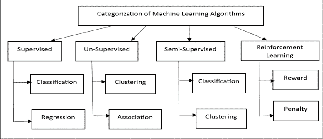 **图 (1))**

各种类型机器学习算法的分类。

## 各种类型的机器学习算法

机器学习算法已分为监督、无监督、半监督和强化学习。本章的这一部分将详细介绍每种类型。

### 监督算法

通过监督学习学习一个映射输入到输出的函数通常涉及使用样本输入-输出对 [4]。为了推断一个函数，它利用了标记的训练数据和一组训练示例。在监督学习下，当确定要从给定输入实现某些目标时，会使用任务驱动的技术。两个最流行的监督任务是拟合数据的“回归”和划分数据的“分类”。监督学习的一种用途是文本分类，它是预测文本段落（如推文或产品评论）的类别标签或情感的过程。

### 无监督算法

无监督学习是一种数据驱动的技术，它在不需要人工干预的情况下检查未标记的数据集 [4]。这通常用于探索性原因、发现分组、生成性特征提取以及识别重要的模式和结构。最流行的任务包括聚类、密度估计、特征学习、降维、关联规则发现、异常检测和其他无监督学习任务。

### 半监督算法

由于半监督学习同时使用标记和未标记的数据，它可以被认为是上述监督方法和无监督方法的混合 [4]。因此，它处于“无监督”和“有监督”学习的中间。在现实场景中，当在某些情况下未标记数据丰富而标记数据可能稀缺时，半监督学习可能会很有益 [5]。半监督学习模型的最终目标是产生比仅利用标记数据的模型更好的预测结果。半监督学习应用于机器翻译、欺诈检测、数据标注和文本分类等领域。

#### 强化学习

一种环境驱动的技术，或强化学习，是一种机器学习算法，允许软件代理和计算机自动评估每个语境或环境下的最佳行为以提高其效率 [6]。这种基于奖励和惩罚的学习的最终目标是利用从环境活动中收集的知识来采取能够最大化奖励并减少风险的。虽然用来解决简单或基础问题并不理想，但它是训练 AI 模型的强大工具，可以帮助增加自动化或优化机器人、自动驾驶任务、制造和供应链物流等复杂系统的运行效率。

因此，根据之前讨论的目标结果和数据性质，几种类型的机器学习方法可以在各种应用领域构建有效模型方面发挥巨大作用。这些技术的学习能力范围也可能很大。表 1 提供了几类机器学习方法的概述以及示例。

表 1 **各种类型的机器学习技术及其示例。**

| **学习类型** | **模型构建** | **示例** | **学习类型** | **模型构建** | **示例** |
| --- | --- | --- | --- | --- | --- |


| **监督** | 算法或模型从标记数据中学习（任务驱动方法） | 分类、回归 | 监督 | 算法或模型从标记数据中学习（任务驱动方法） | 分类、回归 |
| --- | --- | --- | --- | --- | --- |
| **无监督** | 算法或模型从未标记数据中学习（数据驱动方法） | 聚类、关联、降维 | 无监督 | 算法或模型从未标记数据中学习（数据驱动方法） | 聚类、关联、降维 |
| **半监督** | 使用组合数据（标记+未标记）构建模型 | 分类、聚类 | 半监督 | 使用组合数据（标记+未标记）构建模型 | 分类、聚类 |
| 强化 | 模型基于奖励或惩罚（环境驱动方法） | 分类、控制 | 强化 | 模型基于奖励或惩罚（环境驱动方法） | 分类、控制 |

图 (2) 展示了基于机器学习的预测模型的通用结构。在阶段 1 中，使用历史数据对模型进行训练；在阶段 2 中，为新的测试数据产生结果。

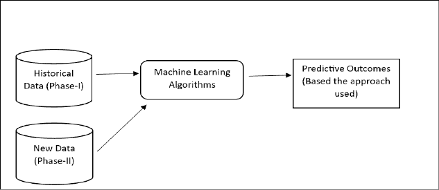 **图 (2)**

机器学习预测模型的通用结构。数据的类型、质量以及学习算法的功能决定了机器学习解决方案的有效性和效率。为了高效地构建数据驱动系统，机器学习算法可以应用于分类分析、回归、数据聚类、特征工程和降维、关联规则学习或强化学习等领域。因此，在每个领域中选择适合预期应用的合适学习算法是具有挑战性的。这是因为各种学习算法具有不同的目标，即使在同一类别中，各种学习算法的结果也会根据数据的属性而有所不同 [7]。

为了将机器学习算法应用于各种现实应用领域，包括网络安全服务、物联网系统、智能城市、医疗保健和新冠肺炎、情境感知系统、可持续农业等，理解这些算法的底层原理至关重要。

以下介绍了机器学习在医疗保健领域的应用说明：

## 机器学习在医疗保健中的应用

在多个医疗领域，包括疾病预测、医疗信息提取、数据模式发现、患者管理等，机器学习可以协助解决诊断和预后问题 [8, 9]。世界卫生组织 WHO [9] 表示，新冠肺炎（COVID-19）是由近期发现的新冠病毒引起的传染性疾病。在对抗新冠肺炎的过程中，学习策略最近变得流行 [10, 11]。学习技术被应用于新冠肺炎疫情，用于对高风险患者、其死亡率和其他异常进行分类。此外，它还可以应用于疾病诊断和治疗、新冠肺炎爆发预测以及对病毒起源更深层次的理解 [12, 13]。研究人员可以使用机器学习预测新冠肺炎何时何地扩散，并提醒这些地区做出必要的准备。

## 机器学习在医疗保健中的作用

在医疗保健部门，机器学习算法的意义在于它们能够解释通过电子健康记录每天产生的巨大医疗数据。将机器学习整合到医疗实践中，允许我们揭示复杂的模式，并从医疗数据中获得人工极难识别的洞察。随着机器学习在医疗保健中不断融合，医疗提供者可以向更具预测性的精准医学转型。这种演变导致了一个更有凝聚力的系统，不仅提高了护理质量，还改善了患者预后并简化了以患者为中心的流程。

在医疗专业人员中，利用机器学习的最常见应用包括医疗账单自动化、提供临床决策支持以及制定临床实践指南。例如，在安德森癌症中心（MD Anderson Center），数据科学家引入了一种创新解决方案，利用深度学习来确定接受头颈癌放射治疗患者的急性毒性。在临床工作流中，深度学习在医疗保健中的整合促进了医疗数据复杂模式的自动识别，直接在电子健康记录中为基础护理提供者提供临床决策支持 [14]。

### 自动化和简化流程

在医疗领域，机器学习具有自动化和优化各种程序的潜力。从实际角度来看，机器学习算法可以处理海量医疗数据，自动为患者生成定制的治疗计划。这不仅节省了时间和精力，还提高了患者护理的质量。此外，该技术在监控医疗资源和优化人员调度等任务中被证明是有价值的，有助于提高整体效率和患者福祉。

### 定制治疗方法

机器学习分析个人病史、症状和测试结果，使医疗提供者能够为患者提供个性化治疗。医疗专业人员可以利用机器学习制定量身定制的治疗计划，并针对个人的特定疾病开具药物。这项技术还让医疗公司能够获得基于电子健康信息的深层分析，使临床医生能够就患者的合适治疗做出更明智、更精确的决策。

### 降低成本

通过自动化常规任务和提高准确性，机器学习帮助医疗机构降低与人工劳动和医疗错误相关的成本。此外，机器学习有助于识别可能易患慢性疾病的患者，促进早期干预和预防性护理，从而降低长期医疗费用。

### 追踪索赔欺诈

根据司法部的数据，美国约 3% 的医疗索赔是虚假的，导致每年损失 1000 亿美元。机器学习通过在报销前识别虚假案件，对加速有效索赔的审批、处理和支付起至关重要的作用。机器学习不仅保护患者数据，还能检测并防止保险欺诈，例如 Harvard Pilgrim Health 等领先机构正在利用基于机器学习的欺诈检测系统。

### 提高患者满意度

通过个性化治疗、缩短等待时间和最大限度地减少医疗错误，机器学习有助于增强医疗机构的患者体验。其结果是患者满意度和效果的提高。

### 疾病早期检测

某些疾病需要早期检测以制定有效的治疗计划并确保患者的高质量生活。机器学习通过采用监督和无监督算法，协助医生进行疾病早期诊断。通过将新数据与特定疾病的现有信息进行比较，机器学习在症状需要注意时会发出警报，从而采取及时恰当的行动。

### 改善人群健康

机器学习利用患者数据中的模式和趋势来增强人群健康。机器学习系统识别出患慢性疾病风险较高的个体，允许通过定制治疗来遏制疾病传播。

### 机器人辅助手术

机器学习驱动的手术机器人通过提高速度和准确性改变了手术。这些系统在执行复杂手术程序时，出血少、副作用少且不适感。值得注意的机构如马斯里赫特大学医学中心（Maastricht University Medical Center），利用机器学习使手术机器人缝合小血管，展示了技术的精确性。

### 增强安全性

机器学习可以开发用于预测患者风险的模型，例如药物不良相互作用或术后并发症，从而降低患者风险并增强医疗治疗的整体安全性。

### 支持临床研究与试验

机器学习在临床试验和研究中有多种应用，通过预测分析简化了受试者的筛选流程。机器学习为试验受试者提供实时监控和数据访问，协助确定最佳样本量，并消除基于数据的错误，从而可能加速临床研究的进度和效率。

### 药物研发

在药物开发的早期阶段，机器学习发挥着至关重要的作用，利用了如下一代测序和精准医学等研发技术。机器学习可以在不进行预测的情况下识别数据中的模式，为复杂疾病发现替代性治疗路径做出贡献。

### 医疗保健领域的可解释人工智能 (XAI)

可解释人工智能旨在增强机器学习模型的透明度和可解释性。在医疗保健领域，这涉及为临床医生提供特定决策背后的逻辑见解，从而促进对 AI 驱动建议的信任和接受。

XAI 技术使医疗保健人员能够理解影响 AI 诊断或治疗建议的底层因素。

在放射学和病理学等关键医疗应用中，XAI 特别重要。通过阐明其决策，AI 模型可以协助放射学家和病理学家做出更明智的判断，提高诊断准确性并改善患者护理。

# 量子计算对医疗保健的影响

量子计算在解决复杂的医疗挑战方面具有巨大前景，包括药物发现、基因组学和治疗方案优化。传统计算机在处理这些任务相关的巨大计算复杂度时需要帮助。然而，量子计算机可以以前所未有的速度处理海量数据集并执行复杂的计算。

在基因组学中，量子计算可以加速大规模基因组数据集的分析，帮助研究人员发现疾病遗传基础并制定个性化治疗策略。

此外，量子计算可以以无与伦比的精度模拟分子相互作用，促进药物的发现和开发。

# 区块链在医疗数据管理中的整合

区块链技术具有保护医疗数据的潜力，确保其完整性并赋予患者对其医疗记录更大的控制权。这种去中心化的方法可以彻底改变医疗领域的数据共享。区块链还可以增强供应链中药品的可溯性，降低假药进入市场的风险。区块链的不可篡改性保证了数据将保持不变，增强了医疗记录和交易的可靠性。

### 远程医疗与 AI 的协同

远程医疗与 AI 的融合有望扩大医疗服务的覆盖，特别是在偏远地区。AI 驱动的聊天机器人和虚拟健康助手可以提供即时医疗建议，改善患者护理并减轻医疗机构的压力。基于 AI 的远程医疗平台可以促进远程咨询、诊断和患者监测。

此外，将远程医疗与 AI 远程监测设备相结合可以实现持续健康追踪。可穿戴设备收集体征数据，AI 算法对其进行实时分析。医疗提供者接收警报和见解，以便患者状况需要关注时能够及时干预。

## 机器学习的步骤

### 处理步骤

#### 步骤 1：定义问题陈述

定义问题是第一步，需要确定研究诊断心脏病需求的目的，即预测患者发生心脏病可能性的目标。在此阶段，考虑可用的数据类型也是至关重要的。

### 问题定义

此阶段概述了目标和特定的研究问题。识别来源，包括原始数据和二级数据，如问卷、访谈、数据库、观察、实验和在线平台。

在计划数据收集时，必须根据数据的性质和研究目标选择适当的方法，例如问卷、访谈、观察、实验、网络爬取和传感器数据收集。首先，我们设计数据收集工具，对流程进行试点以测试工具和方法，然后进行数据收集。随后，我们确保数据收集过程中的准确性和完整性。常用方法包括：

1. 问卷：向目标群体分发结构化问卷以收集特定信息。
2. 访谈：进行一对一或小组对话以获得深度见解。
3. 观察：系统地观察和记录行为或事件。
4. 实验：控制变量以研究因果关系。
5. 网络爬取：从网站和在线源提取数据。
6. 传感器数据收集：从传感器或 IoT 设备收集数据。

#### 步骤 2：数据收集

这一步中需要讨论以下内容，例如：

1. 解决此问题所需数据集的选择；
2. 数据集的可用性；
3. 数据集的来源。

由于数据收集是机器学习领域最重要的步骤，因此主要的发现是选择高效、优质且可靠的数据。在我们的研究工作中，我们需要利用医疗数据来准确预测疾病，因此从各种来源搜索数据集。由各种来源选择的数据集必须能够分析预测模型。然而，对于机器学习技术的学习，数据必须是完善的且仅从之前研究也用过的经过认证的来源收集。因此，我们工作所需的数据集必须包含基本细节，如年龄、性别、血糖等，并应用于进一步分析 [15]。

#### 步骤 3：数据准备

第三步适用于用于疾病诊断的数据集。对数据集进行检查，因为其形式可能不正确并存在许多不一致之处，例如缺失值、冗余变量、重复值等。因此，消除此类不一致性非常重要；否则会导致错误的预测和计算。因此，在此步骤中，我们扫描数据集并修复它们。

##### 数据过滤

数据过滤涉及根据预定义标准选择并展示数据的子集。过滤数据的方法取决于上下文、数据库、电子表格或编程语言。

要进行有效的数据过滤，请遵循以下步骤：

###### 明确定义分析标准

准确阐述你打算分析的标准。例如，在评估客户收入时，请指定相关时期和包含在分析中的客户。

###### 选择合适的过滤工具

根据你的需求选择合适的数据过滤工具。这可能包括用于数据库过滤的 SQL 查询或用于电子表格数据的 Excel 过滤器，取决于你数据的性质和来源。

###### 利用 SQL 查询

如果你正在处理数据库，请根据你定义的标准构建 SQL 查询以过滤数据。SQL 提供了强大的过滤功能，能够提取特定的数据子集进行分析。

## 使用 Excel 过滤器

在 Excel 等电子表格应用程序中，利用内置的过滤功能可以快速排序并显示符合特定标准的数据。它为信息分析提供了一种快速且灵活的方法。用户可以通过直观的下拉菜单细化搜索标准，简化数据过滤，提供个性化且高效的体验。

## 指定时期

在过滤数据时，请考虑时间相关的因素。为你的分析指定相关时期，以确保准确且有意义的见解。

## 使用多个过滤器

通过同时使用多个过滤器来增强你的分析。为了全面理解，请根据时期、客户细分和产品类型等因素过滤数据。这种方法有助于揭示详细的洞察。

## 探索数据可视化

利用 Tableau 或 Power BI 等数据可视化工具创建过滤后数据的视觉表示。这些工具有助于进行直观且全面的分析，高效地识别趋势、模式和离群值。

## 迭代与优化

过滤过程通常是迭代的。在进行初步分析后，评估结果并考虑完善你的标准或调整过滤器，以获得更深的见解。这种迭代方法确保了分析准确性和相关性的持续改进。

## 步骤 4：数据分析

在这一步中，将深入挖掘数据集以寻找隐藏的信息。探索性数据分析或 `EDA` 是机器学习的脑风暴阶段，数据探索提供了对数据中模式和趋势的理解。因此，这一步用于查看所有见解，并找到定义变量之间的相关性。正如在我们的研究工作中一样，我们需要关注患者是否存在可以先诊断出的心脏病的可能性。

### 缺失值

现在是处理数据中缺失值的时间了。处理数据值的一种方法是如之前所述，直接删除这些行。假设我们正在使用 `python`（这是许多数据科学家用于机器学习应用的默认语言），让我们也看看实现此操作的代码。

### 插补

插补是用各种插补策略（如均值、中位数插补和众数插补）替换缺失值的过程。然而，也可以根据领域知识为数据分配值来随机地进行插补。还需要注意的是，插补也可以基于所有剩余且无缺失值的特征的机器学习预测来进行。通过这种方式，模型分别学习寻找模式，并对特征中的未知值进行预测。

### 离群值

数据集通常包含离群值，即数值与我们数据中预期值相差远的数据点。这可能是由于记录数值时的人为错误，或者是记录特征的机器故障导致的。当我们尝试评估机器学习的指标（某些是均方误差）时，数据中离群值的存在可能会显著增加误差。但这并没有给我们提供模型性能最准确的图景。此外，许多机器学习模型对数据中的离群值并不健壮。因此，在数据处理阶段必须采取措施将其从数据中移除，以便在使用均方误差等指标时我们获得模型的真实表示，并确保模型能够生成最佳预测，而不易受离群值的影响。

#### 数据转换

在填充缺失值并移除离群值后，下一步将是对这些数据进行转换，以便其在机器学习模型上进行训练变得可行。根据数据类型和业务需求，有许多转换数据的方法。

#### 降维

拥有高维数据（特征数量更多）的缺点之一是被称为“维度灾难”的现象，即特征的增加会导致收益递减。因此，剔除那些对模型预测和输出没有显著影响的特征是非常重要的。降低维度有两作用：它缩短了机器学习模型在数据上训练的时间，有时也可以从数据中移除离群值。因此，我们应该进行降维，以确保在训练后获得更健壮的模型。

有多种方法可以将高维数据还原为低维表示。诸如技术如主成分分析 (`PCA`)、随机邻域嵌入 (`t-SNE`) 和 `UMAPs` 均可用于降低维度。请注意，这些方法在底层的工作原理各不相同，但结果都是降低维度。

#### 标准化

在将数据交给机器学习模型之前，对数据进行标准化并确保所有输入特征处于相同的尺度上，也是一种良好的做法。考虑两个特征的例子：身高和体重。假设我们要用机器学习算法预测的输出变量是“户外活动”。我们知道身高可以用厘米 (cm) 测量，而体重用公斤 (kg) 测量。我们通常无法比较这两个特征，因为它们不在同一个尺度上。但如果我们转换这些特征使其代表相同的尺度，就能确保我们可以对它们进行比较，并判断哪个特征对决定人的“户外活动”影响最大。

## 归一化

正如我们在上面的案例所示，不同尺度的数据可能会产生问题。处理不同尺度数据还有另一种替代策略。一种方法是数据归一化，这意味着我们从特定特征的最小值中减去当前值，并将结果除以感兴趣特征中最大值与最小值之间的差。这也是一种转换数据的有效方法。下面是关于如何操作的公式，以便大家有一个直观的概念。

根据公式，让我们理解所给出的值：

- `Xmin`: 特征中存在的最小值
- `Xmax`: 特征中存在的最大值
- `Xnorm`: 执行此操作后获得的归一化值

#### 分箱（Binning）

处理影响机器学习模型性能的数据离群值是非常重要的。减少这些离群值影响的方法之一是根据重要特征将数据点划分为不同的箱。换句话说，是将宽泛的数据集分成更相似数据的小组。这确保了数据中的离群值对整体预测的影响降到最低。因此，这也是转换数据的有效方法。

#### 聚类

当我们处理输出或目标变量未知的无监督机器学习时，这种数据的一种流行方法是聚类。虽然聚类可以用于无监督学习，也可以用于监督学习。如果我们根据特定特征对数据进行聚类，就可以形成我们考虑的数据组。数据也可能因为这种方法而产生转换，从而使我们能够更好地发现其中的模式。

## 步骤 5：构建模型

最后，通过在前述数据探索阶段获得的所有模式和洞察构建了模型。在机器学习的这一阶段，数据集被分为两个部分，*即*训练数据和测试数据。训练数据用于构建和分析模型。模型的逻辑建立在正在实施的机器学习算法之上。选择合适的算法必须取决于问题的类型、数据集以及要解决问题的复杂程度。由于在我们的工作中，输出形式为真或假的形式，因此可以使用如 `Logistic Regression`（逻辑回归）之类的分类算法。

### 步骤 6：模型评估优化

使用训练数据集构建模型后，最后对模型进行测试。在数据集上进行测试是为了检查模型的效率及其预测准确性，一旦计算出准确率，就可以在此阶段通过`parameter tuning`（参数调优）和`cross-validation`（交叉验证）等方法对模型进行改进。

### 步骤 7：预测

一旦模型完成评估和改进，就可以用于预测其对疾病的预测是否正确。最终输出描述了目前技术的使用范围，并通过使用机器学习技术为我们提供了准确的预测。

## 未来展望

机器学习医疗应用数据采集与准备的未来前景对于彻底改变医疗保健领域具有巨大潜力。从电子健康记录、医学影像到基因组学和可穿戴设备，多样化且庞大的数据集汇聚将为个人健康提供全面的理解。确保这些数据的质量和标准化对于训练稳健且具泛化能力的机器学习模型至关重要。隐私和伦理考量不容忽视，这需要先进的匿名化技术并遵守严格的数据保护条例。实时数据集成（特别是来自 `IoT` 传感器和可穿戴设备的数据）将提供动态且持续的健康更新流，实现及时干预。未来还需要机器学习模型不仅准确，而且具有可解释性和可理解性，以增强医疗专业人员和患者之间的信任。向`federated learning`（联邦学习）的演进允许在不集中原始数据的情况下进行模型训练，解决了与数据隐私相关的担忧。将其整合到临床工作流中、持续监控、协作以及遵守监管框架，对于在医疗应用中成功部署机器学习至关重要。随着领域的进步，开放数据倡议和跨学科合作将进一步加速进展，确保机器学习成为医疗保健领域不可或缺的变革性力量。

## 结论

总之，医疗保健领域机器学习（`ML`）应用数据采集与准备的探索，强调了高质量、经过良好策展的数据对于 `ML` 模型成功的关键作用。本章深入探讨了获取、处理和组织医学数据的复杂性与细微差别，并将其视为实际 `ML` 应用的基础基石。


# 医疗保健领域数据采集的挑战与机器学习应用

医疗保健领域数据采集相关的挑战（包括隐私、安全和互操作性问题）是巨大的，但并非不可逾越。数据标准、伦理考量和监管框架的不断进步对于克服这些挑战至关重要。随着医疗行业日益转向数据驱动，建立一个用于收集和准备多样化数据集的稳健基础设施是必须的。

医疗领域`ML`的未来取决于我们增强数据采集方法的能力，确保跨不同人群的包容性、准确性和代表性。此外，持续的数据标准化和互操作性努力将在创建无缝信息流转、促进协作以及开发更强大、更具泛化性的`ML`模型方面发挥关键作用。

本章作为一个指南，强调了严谨的数据采集和准备过程作为医疗保健领域成功`ML`应用基石的重要性。它呼吁医疗专业人员、数据科学家、政策制定者和技术专家共同努力，以应对复杂性，并确保用于`ML`模型的数据是全面的、来源伦理的且经过负责任的处理。随着我们不断前进，对完善数据采集实践的承诺将为医疗保健的演进做出贡献，为更准确的诊断、个性化的治疗方案和患者疗效的改善铺平道路。

## 参考文献

| | |
| :--- | :--- |
| [1] | Dhillon A, Singh A. Machine learning in healthcare data analysis: a survey. J Biol Todays World 2019; 8(6): 1-0. |
| [2] | Toh C, Brody JP. Applications of machine learning in healthcare. Smart manufacturing: When artificial intelligence meets the internet of things 2021; 14: 65. [`dx.doi.org/10.5772/intechopen.92297`](http://dx.doi.org/10.5772/intechopen.92297) |
| [3] | Sarker IH, Hoque MM, Uddin MK, Alsanoosy T. Mobile data science and intelligent apps: concepts, ai-based modeling and research directions. Mob Netw Appl 2021; 26(1): 285-303. [`dx.doi.org/10.1007/s11036-020-01650-z`](http://dx.doi.org/10.1007/s11036-020-01650-z) |
| [4] | Han J, Pei J, Tong H. Data mining: concepts and techniques. Morgan kaufmann. 2022; 2. |
| [5] | Mohammed M, Khan MB, Bashier EB. Machine learning: algorithms and applications. Crc Press 2016; 19. |
| [6] | Kaelbling LP, Littman ML, Moore AW. Reinforcement learning: A survey. J Artif Intell Res 1999. |
| [7] | Kushwaha S, Bahl S, Bagha AK, *et al.* Significant applications of machine learning for COVID-19. Journal of Industrial Integration and Management 2020; 5(4): 453-79. [`dx.doi.org/10.1142/S242486222050268`](http://dx.doi.org/10.1142/S242486222050268) |
| [8] | Fatima M, Pasha M. Survey of machine learning for disease. Journal of Intelligent Systems and Applications 2017; 9(1): 1-16. [`dx.doi.org/10.4236/jilsa.2017`](http://dx.doi.org/10.4236/jilsa.2017) |
| [9] | Nilashi M, Ibrahim O, Ahmadi H, Shahmoradi L. An analytical method for diseases using machine learning. Comput Chem Eng 2017; 106: 212-23. [`dx.doi.org/10.1016/j.compchemeng.2017.06.011`](http://dx.doi.org/10.1016/j.compchemeng.2017.06.011) |
| [10] | Lalmuawma S, Hussain J, Chhakchhuak L. Applications of machine learning and artificial intelligence for Covid-19 (SARS-CoV-2) pandemic: A review. Chaos Solitons Fractals 2020; 139: 110059. [`dx.doi.org/10.1016/j.chaos.2020.110059`](http://dx.doi.org/10.1016/j.chaos.2020.110059) |
| [11] | Ardabili S, Mosavi A, Ghamisi P, *et al.* Covid-19 outbreak prediction with machine learning. Algorithms 2020; 13(10): 249. [`dx.doi.org/10.3390/a13100249`](http://dx.doi.org/10.3390/a13100249) |
| [13] | Jamshidi M, Lalbakhsh A, Talla J, et al. 人工智能与 COVID-19：用于诊断与治疗的深度学习方法。IEEE Access 2020; 8: 109581-95. [`dx.doi.org/10.1109/ACCESS.2020.3001973`](http://dx.doi.org/10.1109/ACCESS.2020.3001973) [PMID: [34192103](http://www.ncbi.nlm.nih.gov/pubmed/34192103)] |
| [14] | 世界卫生组织。世界卫生组织：特别辑 [俄语]。 2020; 98(6-12). |
| [15] | Sarker IH, Furhad MH, Nowrozy R. AI 驱动的网络安全：概述、安全智能建模与研究方向。SN Computer Science 2021; 2(3): 173. [`dx.doi.org/10.1007/s42979-021-00557-0`](http://dx.doi.org/10.1007/s42979-021-00557-0) |

# 机器学习在医疗领域中确定潜在风险的日益增长的重要性

Suchismita Mishra^(1, *)

¹ Inderprastha Engineering College, Ghaziabad, Uttar Pradesh 201010, India

## 摘要

电子医疗数据日益增长的便利性代表了医疗领域的一个重大机遇，既提供了先驱性发现的潜力，也为提高医疗整体质量提供了实际应用可能。然而，为了让医疗流行病学家充分利用所有这些数据的潜力，迫切需要能够处理大规模且复杂数据集的计算技术。机器学习（`ML`）涉及用于发现数据中隐藏模式的工具和方法的研究，在这一背景下发展成为一种宝贵的资源。在电子医疗数据中谨慎实施机器学习技术，拥抱了患者风险评估全面转型的潜力，跨越了医学学科的整个谱系，并主要影响传染病领域。这种转型最终可能导致精准干预措施的发展，旨在减轻医疗相关病原体的扩散。医疗流行病学家正面临着日益严峻的任务，即处理和解读大规模且复杂的数据。这一挑战随着医疗流行病学家角色的不断扩大，并与电子健康数据普及率的提高而循环出现。在患者和机构层面，大量高质量数据的可用性为探索开辟了新途径。具体而言，这些数据具有增强我们对与医疗相关感染（`HAIs`）相关的风险因素理解的潜力，完善患者风险评估方法论，并揭示负责传染病在机构内部及机构之间传播的途径。这些见解反过来为针对性的预防措施铺平了道路。

从历史上看，很大一部分临床数据未被利用，这通常是因为数据本身的规模巨大且复杂，以及由于缺乏合适的数据收集和存储技术。这些宝贵的数据资源经常被低估和利用不足。然而，新型和改进的数据收集与存储方法（如电子健康记录）的出现，为解决这一问题提供了独特机会。特别是机器学习已开始渗透整个临床文献领域。在医疗流行病学（`HE`）领域内谨慎应用机器学习，有望对在该领域数据收集方面投入的巨额投资产生丰厚的回报。在这项研究工作中，通过阐明机器学习的基本原理发起了倡议，随后研究了其在医疗流行病学中的相关性和应用。最后，通过对机器学习的一些合理考虑，概述了其在医疗领域的设计和执行。医疗流行病学家面临着处理大规模且复杂数据集的日益严峻的任务。我们探讨了机器学习在医疗流行病学中的相关性与应用，通过成功案例论证了其价值。

**关键词：** 临床数据、数据驱动、医疗流行病学、医疗相关感染、机器学习、风险分层

---

^(*) **通讯作者 Suchismita Mishra:** Inderprastha Engineering College, Ghaziabad, Uttar Pradesh 201010, India; 电子邮件：suchismita.mishra8@gmail.com

## 引言

“机器学习（`ML`）”这一术语涵盖了使计算机从经验中学习的各种数值方法。这种学习表现为算法功能的改变，通过分析显示不同人物的机器学习系统来实现。机器学习的两个主要分支*即*无监督学习和监督学习，加强了其多功能应用。在医疗这一全球关键行业，机器学习技术的整合正成为一种变革力量，有望引发类似于上世纪的重大进展。

医疗部门处于采用先进技术的前沿，无缝整合了人工智能（`AI`）和机器学习，反映了它们在商业和电子商务中的全球影响力。机器学习在计算能力与医疗需求的交汇点运行，已经通过在大数据分析中使用工具展示了其价值。此外，机器学习的轨迹对于未来的实施具有巨大的前景，强调了其在增强初级和三级护理智能化决策过程方面的作用。

在临床试验研究的背景下，机器学习技术成为不可或缺的工具。精炼的预测分析应用于对申请者临床试验的评估，使医疗专家能够处理海量数据集，从而减少医疗测试相关的成本和时间。机器学习应用通过协助确定最佳样本量，进一步有助于提高临床试验的效率，从而减少数据错误的可能性。

机器学习的影响扩展到解决全球放射科医生短缺的挑战。通过机器学习算法，医疗行业获得了处理动态且高效的个性化治疗的能力，利用了个人健康数据和预测分析。机器学习在研究和临床试验中的潜力是巨大的，通过基于医疗互动和社交媒体活动等各种数据点进行预测性研究，有助于潜在试验参与者的识别。

机器学习（`ML`）在医疗领域的巨大潜力涵盖了广泛的应用，从完善患者护理和公共卫生系统，到优化临床试验和研究工作。机器学习技术的整合不仅反映了医疗保健实践的演进，还有望大幅提高全球人口的生活质量。

# 机器学习在医疗保健中的必要性

医疗保健服务的不断增强以及应对复杂疾病能力的不断提升是不可争议的进展。然而，持续的挑战——特别是在为儿童等经过一定临床研究的个体或患者群体确定最佳剂量和治疗时长方面——凸显了对创新解决方案的需求。近年来，机器学习（`ML`）已成功融入儿科护理，能够为儿童预测个性化且的治疗方案 [1, 2]。

COVID-19 疫情的爆发将机器学习推向了在波动性和不确定环境中寻求竞争优势的组织策略前沿。从运营精简化到促进研发（R&D），机器学习助力了医院和医疗系统应对独特的挑战。机器学习技术作为人工智能（`AI`）的一个动态子集，是许多公司力求在从业务到医疗等各个领域利用潜力的焦点 [3]。

机器学习日益普及的根源在于利用算法促进数据驱动的学习，在不断变化的医疗格局中呈现出灵活的应用。在技术和理念的驱动下，医疗行业正经历着持久的变革。机器学习成为解决医疗领域新场景的宝贵工具，为医疗专业人员提供了来自算法的洞察，这些算法能够处理非结构化文本，而这项任务在历史上规模上一直是挑战性的。这种源自机器学习的智能，使医生和管理人员能够迅速做出明智决策，影响对数百万生命产生深远影响的患者护理和运营计划。机器学习与医疗保健的融合旨在重新设计范式并提高医疗系统的效率，标志着在改善患者预后和实现卓越运营方面迈出了重要一步。

# 医疗领域机器学习的支柱

由于机器学习（`ML`）具有多样且影响巨大的能力，其在医疗领域的应用是一个广泛的研究课题。各种促进因素和质量支柱在增强医疗机构提供的支持和护理方面发挥着至关重要的作用。特别是，机器学习的概念对多个方面做出了重大贡献，包括爆发预测、医学影像诊断、行为改变以及患者数据的精细管理。这些质量支柱阐明了机器学习运行的坚实基础，在应对医疗实践需求方面提供了有效且不可置疑的性能。

这些机器学习属性的显著效力使其成为核心组成部分，特别是当此类服务在医疗背景中占据主导时。机器学习的多方面贡献涵盖了从预测爆发到改进医学影像和患者数据管理，体现了其推进医疗服务以造福更广泛社会的潜力。机器学习在这些领域的内在特性和性能指标凸显了其在支持和增强医疗交付各个层面的不可或缺性。

机器学习（`ML`）代表了一个通过提供数据和算法框架来精炼计算机以识别模式的过程 [4]。通过手动检测疾病面临着巨大挑战，促使机器学习在诊断疾病、监测患者健康和建议预防措施方面发挥关键作用。这涵盖了从处理轻微疾病到应对早期癌症检测等艰难状况。值得注意的是，机器学习应用在全球心理健康预测中已证明行之有效，帮助临床医生识别易受流行病或自然灾害等压力源的人口群体。此外，机器学习的能力包含了评估生物特征以及根据所需的生物活性优化分子选择。

众包整合医疗领域已成为一种现代方法，允许在个人同意的情况下访问贡献的大型数据集。来自社交媒体输入、卫星、网站和机构记录的实时健康数据，通过机器学习驱动的网络进行分析。这种分析知识在预测各种传染病爆发方面被证明是具有工具性的。机器学习在简化耗时且昂贵的健康数据更新维护过程中的作用至关重要，为节省大量时间、成本和精力提供了可能途径。

机器学习在医疗保健中的转型潜力延伸到从反应性向预防性的转变，通过提供个性化治疗建议 [5]。在临床应用中，机器学习帮助临床医生根据关键症状患者的独特性特征定制疗法，从而减少处方药的副作用风险。机器学习算法有助于预测和追踪疾病爆发、缓解不良的流行结果，并简化药物检测过程和临床实验。该技术监测和评估大量数据的能力确保了药物的安全有效性。

机器学习（`ML`）已成为在症状出现之前识别和解决健康问题的主动工具，特别是在糖尿病等早期检测至关重要的情况下 [7]。`ML`模型可以区分细微的潜意识行为，从而促进必要的生活方式改变。这涵盖了从在长时间久坐后鼓励运动的可穿戴设备，到引导姿势调整的应用程序。机器学习在 COVID-19 疫苗快速开发中的作用展示了数据驱动型方法的有效性。图像识别算法的整合增强了放射科诊断，而从社交媒体到可穿戴医疗记录的多样化数据集有助于预测健康问题。在诸如传感器报警等各种应用中，误报（假阳性和假阴性）的减少，强调了机器学习在精炼诊断准确性方面的作用。

机器学习已成为各行业不可或缺的一部分，推动了远程医疗、自动驾驶汽车、超精准广告以及增强业务盈利能力和以客户为中心的解决方案的发展 [8]。在医疗保健领域，机器学习为专业人员提供了工具和技术，显著影响了健康状况。`ML`软件中的智能预测算法在拥有海量数据的学科中提供了即时收益。根据个人简介量身定制的体育活动建议，凸显了机器学习在促进预防性健康实践中的作用。自训练机器学习系统与临床研究数据的持续交互，凸显了人类活动与机器学习之间的共生关系。最后，拥有丰富结构化数据的金融和银行业是人工智能和机器学习应用的理想领域，为从业者和客户带来了无与伦比的进步和增强的体验。

## 文献综述

论文 [8^(-)11] 中引用的研究人员已开展大量研究，以准确汇总患者的病史。

收集准确的患者病史是医生的职责之一，由于患者缺乏对其医疗数据的专业知识，这往往具有挑战性。机器学习（`ML`）是医疗保健执业人员的一项价值工具，有助于精确收集患者病史和进行医疗管理。机器学习算法可以根据各种因素识别出最相关的问题，在确保收集关键数据的同时，还能预测可能发生的情况。这种对机器学习的应用将其效用扩展到改善活动受限人员的日常生活，提供智能提醒、排程协助、损伤预测、障碍物识别、路径优化和及时帮助。

同样，论文 [12^(-)16] 中引用的作者致力于提升医疗服务中患者的整体体验。

医疗保健领域中的机器学习辅助平台努力改善广泛人群的体验。与传统的以利润最大化为目的的系统不同，用于医院运营管理的先进机器学习技术在保持利润驱动目标的同时，也兼顾了同理心。制药行业日益依赖机器学习来实现成功的药物发现，初创公司利用了配备最新强化学习和自然语言处理技术的机器学习系统。其主要目标包括模式识别和存储在云中的高维表示开发，丰富了药物发现过程。

此外，论文 [17^(-)20] 中提到的研究人员已开展增强医疗保健领域患者治疗流程的研究。

机器学习对医疗保健的影响延伸到增强患者参与度，从而改善健康状况并增强医疗业务中的各种流程。碎片化或缺失的数据以及手写文件，可能会阻碍洞察和推断。机器学习算法在数据格式化和清洗方面发挥着关键作用，为医生提供关于入院风险及如何缓解这些风险的每日建议，最终改善了护理交付。

此外，论文 [21^(-)24] 中引用的作者对医疗保健中的机器人手术和其他图像引导疗法进行了详细研究。

机器学习工具显著增强了外科医生在机器人手术和图像引导治疗期间的显示，提供了如癌症位置等宝贵信息。放射科医生受益于机器学习工具和平台，特别是随着各医疗机构跨数艾字节级医疗数据的数字化。敏捷的 AI 启用解决方案连接到患者数据库，分析各种杂数据类型，发现隐藏模式，并以人类可读的形式呈现结果，从而促进了机器人和图像引导流程的实施。

最后，论文 [25^(-)29] 中引用的研究人员进行了详细研究，并针对特定状况的患者提出了自动消息警告。


论文 [30^(-)33] 中引用的研究人员通过深入分析患者医学背景，进行了糖尿病可能检测的研究。

糖尿病是一种流行且可能危及生命的疾病，对肾脏、心脏和神经等器官产生深远影响，受益于机器学习（`ML`）加速的早期检测。机器学习利用海量医疗数据，在预测肝疾病（包括慢性肝炎、肝癌和肝硬化）方面具有前景。该领域已取得突破性进展，患者贡献的数据为医学机器学习未来的进步提供了源泉。这种方法使医疗提供者能够提供及时的洞察、估计疾病风险并分配适当的治疗资源。

同样，论文 [34^(-)38] 引用的作者提出了多种方法，以促进医疗领域的及时决策。

及时决策是医疗保健的一个关键方面，额外的信息可以通过使医疗专业人员做出主动治疗决策来减轻风险。机器学习在医疗保健和生物信息学中的处理海量数据方面起着关键作用，提供宝贵的洞察以帮助医疗工作人员做出及时决策。机器学习不仅通过增强病史访问使检查更加容易，还根据治疗和生活方式预测结果。机器学习系统的潜力延伸到根据早期筛查或年度常规体检数据预测未来的疾病可能性。这种变革性技术解决了减少再次入院的挑战，这对受联邦医疗保险支付的医疗提供者来说是一个重大关注点。

此外，论文 [39^(-)43] 中突出的研究人员通过彻底检查患者医学背景，提出了一种发现健康问题的新方法。

# 机器学习在医疗领域的角色

机器学习（`ML`）在医疗领域的角色不仅限于疾病检测，它还允许临床医生通过分析大量的患者数据，在健康问题演变为疾病之前对其分类。机器学习在医疗中的应用促进了中风的检测、心脏健康评估以及各种问题的诊断。机器学习算法提供的实时数据和分析使医生和临床专家能够更早地诊断潜在的健康问题。机器学习在医疗中对行政工作的自动化提升了患者护理水平，而机器学习在早期药物研究中的参与也与精准医疗和下一代测序的广泛趋势相一致。

此外，论文 [44^(-)48] 的作者关注于如何高效地管理患者和医生的在线预约调度。

机器学习通过智能分析医生的日历并分配合适的预约日期，证明了其在处理在线预约调度方面的能力。它有助于各种行政任务，包括计费、重新预约、记录归档、患者建议、提醒和紧急电话重转。在医学影像和疾病诊断领域，机器学习作为了一项重大进展。机器学习工具不仅能模拟疾病状况，还能引导并准备医生在症状出现之前进行干预。最终目标是根据个人的特定病史、生活方式选择和遗传数据为其寻找准确的治疗方案。

此外，论文 [49^(-)52] 的研究人员通过分析多样化的患者数据进行了详细研究。

机器学习的分析能力扩展到识别难以检测的疾病，使医学影像变得非常高效。算法处理大量的放射和病理数据，使决策更加快速。机器学习模型在数据分析中充了催化剂，引导研究人员走向最佳路径以获得更好的测试结果。可穿戴智能设备在个人健康监控中的兴起，与机器学习在该领域的领先地位相一致。

## 药物开发与临床试验

在另一个背景下，论文 [53^(-)56] 的作者深入探讨了不同患者类别的早期药物开发。文中强调了机器学习在早期药物开发中的应用，特别是制药从业人员的下一代测序技术。这种方法为个人病例定制了药物组合。

此外，论文 [57^(-)61] 的研究人员对医疗领域内的临床试验提供了广泛的研究。

机器学习广泛的应用包括支持研究人员预测临床试验的最佳候选人，并降低不准确的风险。它评估病史、疗法和健康状况等各种数据点，以确定临床试验的合适参与者。可以为医疗企业提供研究参与者的实时数据，使其能够做出信息的结论并调整测试程序。机器学习通过 `App` 处理常见的患者问题来维护个人健康，其中 `AI` 机器人可以识别模式并将相关信息传输给医生。

## 心理支持与医院运营

最后，论文 [62^(-)65] 的作者探讨了辅助心理方法面临的挑战。

机器学习在协助老年人和有心理困难的人做出健康相关决策方面表现出效率，包括药物依从、养成良好习惯和寻求专家咨询。在算法指导和个人灵活性之间取得平衡至关重要。机器学习在医疗中的应用涵盖了医疗计费自动化、临床决策支持以及临床护理建议的建立。

从更广泛的角度来看，论文 [66^(-)69] 的研究人员对医院行业的患者诊断和治疗实践进行了彻底研究。

机器学习的实际应用扩展到患者诊断、治疗开发和提高整体医疗水平。机器学习在医疗领域的潜力是巨大的，但也面临局限性，例如数据质量、开发对医生友好型产品以及组建专业的数据专家团队。全球科技公司正积极开发用于医生的诊断影像分析系统，反映了来自各种医学影像源的数据日益增多。

## 医学发现与放射学

论文 [70^(-)74] 的作者致力于对医学发现进行全面研究。

机器学习（`ML`）的应用已成为医学发现不可缺的一部分，特别是在初始阶段，从药物成分筛选到根据生物参数预测其成功率。制药行业日益在药物发现和制造过程中利用机器学习，重点关注通过无监督机器学习来揭示原始数据中的模式。最终目标是建立无监督学习驱动的精准医疗，使医生能够辨别“多因素”疾病的根本机制。机器学习技术与预测分析相结合，使医生能够依靠预测能力进行患者诊断，而不是从预定义的诊断集中进行选择或仅根据症状史评估风险。

同样，论文 [75^(-)78] 的作者将重点放在医学领域的放射治疗上。

在放射学中，机器学习证明具有极强的战略性，特别是在处理医学影像分析涉及的众多变量方面。算法从各种样本中学习，增强了诊断和识别。通过机器学习辅助医学影像将项目分类为正常、异常、良性、恶性等。机器学习的影响延伸到机器人手术领域，对手术工作流、技能评估和自动缝合做出贡献。

此外，论文 [79^(-)82] 的研究人员对新型医疗程序的开发进行了大量研究。

机器学习逐渐成为医疗系统的关键组成部分，在开发新型医疗程序、管理患者数据记录以及优化医疗运营方面发挥作用。机器学习的应用使医疗专业人员能够通过数据和分析影响运营，甚至监控并预测全球疫情。基于人工智能的技术与机器学习的整合正在改变医疗实践，这得益于来自卫星、实时社交媒体更新和其他各种来源的海量数据。人工神经网络有助于数据收集，预测从疟疾暴发到严重的慢性传染性疾病。

论文 [83^(-)88] 的作者提供了相关研究，提出了预测疾病的方法。

此外，论文 [89^(-)94] 的作者建议了检测患者细小瑕疵并进行纠正的方法。

`ML` 技术（例如深度学习）现在能够检测患者扫描照片中的细微缺陷，从而增强了临床医生进行精确诊断的能力。虽然 `X` 射线和 `CT` 扫描等传统程序在检查微小异常方面已经足够，但由于疾病复杂性的增加，它们也面临着挑战。`ML` 允许医生根据患者的个人需求提供定制化的治疗方案，利用了遗传信息和电子健康记录中患者数据的爆炸式增长。通过 `ML` 工具应用海量数据中的洞察，可以推荐定制化的组合并预测疾病风险，为改善患者健康提供强有力的支持。

此外，论文 [[95](https://9789815305128-C8.html#r95)^(-)[99](https://9789815305128-C8.html#r99)] 的作者提供了更有效地治疗白血病的方法。

`ML` 在治疗白血病及许多其他疾病的应用已成为现实。凭借先进的癌症专业知识，患者可以获得最佳的治疗决策，技术简化了数据输入，节省了时间和精力。`ML` 全球通过访问卫星、社交媒体平台和网站的海量数据，来监测并预测爆发。人工神经网络能够与知识进行交互，并预测从轻微疾病到严重慢性传染疾病的各种状况。

论文 [[100](https://9789815305128-C8.html#r100)^(-)[104](https://9789815305128-C8.html#r104)] 的作者为增强医疗保健系统提供了建议。

论文 [[105](https://9789815305128-C8.html#r105)^(-)[108](https://9789815305128-C8.html#r108)] 的作者深入研究了提高临床研究的准确性。机器学习通过协助候选人筛选、实时数据分析、问题检测和趋势识别，显著加速并提高了临床研究的精确度，导致了大幅的成本节约。这增强了需要的人能够及时获得所研究药物。`ML` 在医疗保健领域的广泛实施，特别是在医学影像、疾病检测和药物开发方面，预计将推动市场扩张，而成本效益是主要的动力。

此外，论文 [[109](https://9789815305128-C8.html#r109)^(-)[113](https://9789815305128-C8.html#r113)] 的作者强调了提高医疗相关研究结果准确性的重要性。

技术的发展以及复杂的 `ML` 和 `AI` 应用正在提高结果的准确性，主要体现在电子医疗设备中。计算机断层扫描仪、呼吸机、心脏起搏器、心肺机、糖尿病监测工具和婴儿育温箱等诊断设备，是提供患者状况关键信息的医疗设备的典范。`ML` 的影响正在加速人类进化的速度，因为医疗专业人士正在通过简单的智能手机 `App` 讨论癌症治疗的突破或避免致命的流行病。

最后，论文 [[15](https://9789815305128-C8.html#r15), [16](https://9789815305128-C8.html#r16), [19](https://9789815305128-C8.html#r19), [91](https://9789815305128-C8.html#r91), [98](https://9789815305128-C8.html#r98)] 的作者分享了他们在风险管理方面的见解。`ML` 在医疗保健中的应用涵盖了通过自学习神经网络增强的算法，通过评估外部数据源提升了治疗质量。随着文档处理量的增加，`ML` 技术变得更加智能，允许医疗专业人士吸收相关数据。

`ML` 在零售领域的潜力非常广阔，公司正在使用 `ML` 来优化销售策略。同样，论文 [[19](https://9789815305128-C8.html#r19)^(-)[24](https://9789815305128-C8.html#r24)] 的作者将研究重点放在记录数字化上。

在医疗领域的研发中，`ML` 提供了几种充满前景的应用。考虑到制药行业中临床试验相关的巨额成本和时间投入，基于 `ML` 的预测分析被证明是不可替代的。通过利用广泛的数据点（包括之前的就诊记录和社交媒体互动）识别潜在的临床试验，研究人员可以高效地创建受试者池。`ML` 为受试者提供了实时监测和数据访问，确定了最佳样本量，并利用电子记录最大限度地减少与数据相关的错误。在进入临床试验之前通过 `ML` 识别毒化合物的方法具有大幅降低成本的潜力。

在医疗保健行业的最新格局中，机器学习（`ML`）已变得通用，对多个领域产生着重大影响，包括自动驾驶汽车、语音识别，以及显著的医学研究与治疗。研究人员正积极利用 `ML` 算法来先驱早期，识别血液中与各种癌症相关的生物标志物。`ML` 的应用基本上已延伸到实验室诊断、图像和周期管理、智能临床数据分析，以及器官识别和组织表征等计算机辅助医疗程序。

人工智能（`AI`）集成到智能手机应用程序中简化并改进了住院治疗和诊断，机器能够熟练地解读 `CT` 扫描和其他诊断成像工具以识别异常。`ML` 的影响轨迹延伸至消费者健康应用，预计未来将进一步整合到医院范围之外的患者健康体验增强中，包括在人群中识别高风险患者。

除了医疗保健领域，`ML` 的进展正在推动跨各行业的准确预测、有效的资产管理和深度市场分析。具有 `ML` 能力的智能聊天机器人正在增强企业领域的响应管理和客户服务，特别是在营销公司内部。

随着 `ML` 的整合，医疗保健行业经历了范式转移，促进了诊断和药物发现过程中护理质量和患者结果的改进。`ML` 自动化正在应对数据指数级增长带来的挑战，涵盖健康记录、临床试验、理赔处理和账单记录，为医疗专业人士的知情决策提供了价值见解。

`ML` 正在通过自然语言处理、计算机视觉和强化学习等技术转型患者护理策略和医疗交付系统。植根于 `ML` 的深度学习算法赋予了准确高效的自动化诊断建议，导致成本降低、行政缓解以及重要病例的快速报告。处方受益于 `ML` 减少错误和提高诊断速度的能力，并利用诊断结果和审计进行优化。

具备对 `ML` 机会理解的医疗专业人士通过合作来改善临床结果并简化医院体验。`ML` 的变革性影响延伸到医院管理、医疗决策支持和治疗计划的定制，优化了患者的治疗结果。此外，`ML` 通过展示关键结果和疾病试验有助于患者教育，从而在提高整体医疗系统和医院管理效率的同时降低成本。

通过结合目标检测和图像识别，`ML` 为计算机断层扫描和磁共振成像的疾病检测和预测做出了贡献。深度学习模型提供了成像数据的实务解释，提供了关于组织形状、大小和体积的见解。`ML` 的进展改进了对患者数据和记录的处理、新型医疗程序的开发，以及用于治疗慢性疾病的更有效方法。

随着可用数据量的不断攀升，`ML` 与数据及分析的整合将重新定义医疗应用存储、共享和利用信息的方式。尽管如此，挑战依然存在，例如获取所需质量和数量的患者数据集、应对隐私和安全限制以及解决数据格式和质量问题，这些都是 `ML` 无缝融入医疗保健的障碍。

## 结论与未来展望

机器学习（`ML`）是医生、科学家和研究人员的强有力工具，标志着医疗保健领域不断突破和成功应用。`ML` 的无懈进步引起了医学界的关注，引入了对患者护理、疾病检测、主动管理、患者参与等具有重大贡献的概念。在全球范围内，医疗机构正在利用 `AI` 驱动的解决方案和 `ML` 模型来增强服务交付，并加速关键疾病治疗方案的开发。虚拟临床试验、测序和模式识别现在在 `ML` 技术的推动下成为加速过程。

智能医疗设备的集成正使技术赋能的医疗成为现实，为 `ML` 在医疗领域的未来提供了广阔的前景。`ML` 处理多样化数据点、准确预测风险和结果以及执行各种任务的能力，使其成为根据个人独特需求创建个性化处方的工具。随着医疗保健行业拥抱创新，`ML` 预计将在医学交付中发挥关键作用，并可能与纳米技术协作。

`ML` 解决了当前的医疗挑战并预见了未来的问题，在预测全球爆发方面发挥着至关重要的作用。它筛选大量数据（包括网站数据和实时社交媒体更新），以验证信息并预测从社区疾病到严重传染病的发生情况。

在科学研究领域，`ML` 的出现频率日益增加，证明了其在处理大型数据集、做出准确预测以及帮助科学家进行更高效发现方面的意义。`ML` 在流行病学研究中的应用具有精准医学的未来，特别是当与个人健康考量相结合时。`ML` 的预测分析组件在为个人患者定制治疗方面至关重要，根据患者的病史生成多种治疗替代方案。

随着 `ML` 继续发展，医疗教育日益需要纳入关于 `ML` 及其应用的课程。医学生、住院医生和研究医生应在培训期间具备 `ML` 和数据科学的知识，确保他们熟练利用这些技术来改进患者护理和医学研究。

## 参考文献

| | | |
| --- | --- | --- |
| [1] | Abdelaziz A, Elhoseny M, Salama AS, Riad AM. A machine learning model for improving healthcare services on cloud computing environment. Measurement 2018; 119: 117-28.[[`dx.doi.org/10.1016/j.measurement.2018.01.022`](http://dx.doi.org/10.1016/j.measurement.2018.01.022)] | |
| [2] | Ahmad MA, Eckert C, Teredesai A. Interpretable machine learning in healthcare Proceedings of the 2018 ACM International Conference on Bioinformatics, Computational Biology, and Health Informatics 2018559-60. | |
| [3] | Kaur P, Sharma M, Mittal M. Big data and machine learning based secure healthcare framework. Procedia Comput Sci 2018; 132: 1049-59.[[`dx.doi.org/10.1016/j.procs.2018.05.022`](http://dx.doi.org/10.1016/j.procs.2018.05.022)] | |
| [4] | Sarwar MA, Kamal N, Hamid W, *et al.* Prediction of diabetes using machine learning algorithms in healthcare, 2018 24th International Conference on Automation and Computing (ICAC), IEEE 2018; 1-6. | |
| [5] | Sendak MP, Arcy JD, Kashyap S. A path for translation of machine learning products into healthcare delivery. EMJ Innov 2020; 10: 19-172. | |
| [6] | Tucker A, Wang Z, Rotalinti Y, Myles P. Generating high-fidelity synthetic patient data for assessing machine learning healthcare software. NPJ Digit Med 2020; 3(1): 147.[[`dx.doi.org/10.1038/s41746-020-00353-9`](http://dx.doi.org/10.1038/s41746-020-00353-9)] [PMID: [33299100](http://www.ncbi.nlm.nih.gov/pubmed/33299100)] | |
| [7] | Chen IY, Joshi S, Ghassemi M. 用于医疗保健的概率机器学习。Ann Rev Biomed Data Sci 2020; 2020: 4. [PMID: [34465179](http://www.ncbi.nlm.nih.gov/pubmed/34465179)] | |


- [8] Waring J, Lindvall C, Umeton R. 自动机器学习：医疗保健领域的现状综述与机会。`Artif Intell Med` 2020; 104: 101822. [`dx.doi.org/10.1016/j.artmed.2020.101822`](http://dx.doi.org/10.1016/j.artmed.2020.101822) [PMID: [32499001](http://www.ncbi.nlm.nih.gov/pubmed/32499001)]

- [9] Ahmad MA, Patel A, Eckert C. 医疗保健机器学习中的公平性。第 26 届 ACM SIGKDD 国际知识发现与数据挖掘会议论文集 2023529-30. [`dx.doi.org/10.1145/3394486.3406461`](http://dx.doi.org/10.1145/3394486.3406461)

- [10] Manogaran G, Lopez D. 医疗保健中的大数据架构与机器学习算法综述。`Int J Biomed Eng Technol` 2017; 25(2/3/4): 182-211. [`dx.doi.org/10.1504/IJBET.2017.087722`](http://dx.doi.org/10.1504/IJBET.2017.087722)

- [11] Roth JA, Battegay M, Juchler F, Vogt JE, Widmer AF. 数字医疗流行病学中的机器学习简介。`Infect Control Hosp Epidemiol` 2018; 39(12): 1457-62. [`dx.doi.org/10.1017/ice.2018.265`](http://dx.doi.org/10.1017/ice.2018.265) [PMID: [30394238](http://www.ncbi.nlm.nih.gov/pubmed/30394238)]

- [12] Bhardwaj R, Nambiar AR, Dutta D. 医疗保健中的机器学习研究。IEEE 第 41 届年度计算机软件与应用会议 (COMPSAC) 2017; 2: 36-241.

- [13] Kushwaha S, Bahl S, Bagha AK, et al. 机器学习在 COVID-19 大疫情中的重大应用。工业集成与管理杂志 2020; 5(4): 453-79. [`dx.doi.org/10.1142/S2424862220500268`](http://dx.doi.org/10.1142/S2424862220500268)

- [14] Rudin C, Ustun B. 优化评分系统：迈向医疗保健与刑事司法中机器学习的信任。`Interfaces` 2018; 48(5): 449-66. [`dx.doi.org/10.1287/inte.2018.0957`](http://dx.doi.org/10.1287/inte.2018.0957)

- [15] Saleem TJ, Chishti MA. 探索机器学习在医疗保健中的应用。`Int J Sensors Wirel Commun Control` 2020; 10(4): 458-72. [`dx.doi.org/10.2174/22103279106661912013417`](http://dx.doi.org/10.2174/22103279106661912013417)

- [16] Araújo FH, Santana AM, de Santos P. 使用机器学习支持医疗专业人员做出决策。`Int J Med Inform` 2016; 94(94): 1-7. [`dx.doi.org/10.1016/j.ijmedinf.2016.007`](http://dx.doi.org/10.1016/j.ijmedinf.2016.007) [PMID: [27573306](http://www.ncbi.nlm.nih.gov/pubmed/27573306)]

- [17] Vyas S, Gupta M, Yadav R. 区块链与医疗保健的融合。2019 Amity 人工会议 (AICAI) 709-11. [`dx.doi.org/10.1109/AICAI.2019.870230`](http://dx.doi.org/10.1109/AICAI.2019.870230)

- [18] Li JP, Haq AU, Din SU, Khan J. 电子医疗分类机器学习的心疾病识别方法。`IEEE` 2020; 8(8): 1075-82. [`dx.doi.org/10.1109/ACCESS.2020.300149`](http://dx.doi.org/10.1109/ACCESS.2020.300149)

- [19] Rahane W, Dalvi H, Magar Y. 基于图像处理和机器学习的肺癌检测。2018 当前融合趋势会议 (ICCT) 1-5. [`dx.doi.org/10.1109/ICCT.2018.855108`](http://dx.doi.org/10.1109/ICCT.2018.855108)

- [20] Mozaffari-Kermani M, Sur-Kolay S, Raghunathan A, Jha NK. 医疗保健机器学习的系统性攻击与防御。`IEEE J Biomed Health Inform` 2015; 19(6): 1893-905. [`dx.doi.org/10.1109/JBHI.2014.234495`](http://dx.doi.org/10.1109/JBHI.2014.234495) [PMID: [25095272](http://www.ncbi.nlm.nih.gov/pubmed/25095272)]

- [21] Wiens J, Shenoy ES. 医疗保健机器学习：流行病学的重大转变。`Clin Infect Dis` 2018; 66(1): 149-53. [`dx.doi.org/10.1093/cid/cix31`](http://dx.doi.org/10.1093/cid/cix31) [PMID: [29020316](http://www.ncbi.nlm.nih.gov/pubmed/29020316)]

- [22] Chen PHC, Liu Y, Peng L. 如何开发医疗保健机器学习模型。`Nat Mater` 2019; 18(5): 410-4. [`dx.doi.org/10.1038/s41563-019-0345-0`](http://dx.doi.org/10.1038/s41563-019-0345-0) [PMID: [31000806](http://www.ncbi.nlm.nih.gov/pubmed/31000806)]

- [23] Callahan, Shah NH. 医疗保健机器学习，临床信息学进展。Academic Press 2017279-91.

- [24] Shailaja K, Seetharamulu B, Jabbar MA. 医疗保健机器学习：综述。2018. [`dx.doi.org/10.1109/ICECA.2018.847491`](http://dx.doi.org/10.1109/ICECA.2018.847491)

- [25] Chen M, Hao Y, Hwang K, Wang L, Wang L. 基于医疗保健社区大数据的疾病预测。`IEEE Access` 2017; 5(5): 8869-79. [`dx.doi.org/10.1109/ACCESS.2017.2694446`](http://dx.doi.org/10.1109/ACCESS.2017.2694446)

- [26] Qayyum A, Qadir J, Bilal M, Al-Fuqaha A. 用于医疗保健的安全稳健健机器学习：综述。`IEEE Rev Biomed Eng` 2021; 14(14): 156-80. [`dx.doi.org/10.1109/RBME.2020.3013489`](http://dx.doi.org/10.1109/RBME.2020.3013489) [PMID: [32746371](http://www.ncbi.nlm.nih.gov/pubmed/32746371)]

- [27] Maity NG, Das S. 用于改进诊断和预后的机器学习。2017 航空航天会议 1-9. [`dx.doi.org/10.1109/AERO.2017.79450`](http://dx.doi.org/10.1109/AERO.2017.79450)

- [28] Durga S, Nag E. 物联网 (IoT) 中使用的机器学习与深度学习综述。第 3 届方法论与通信国际会议 (cCMC) 201818-22.

- [29] Jones LD, Golan D. 人工智能、机器学习与医疗保健的演变：光明的未来还是诱因？`Bone & Joint Research` 2018; 223-5.

- [30] Ahamed F, Farid F. 应用物联网与机器学习。2018 机器学习与数据工程国际会议 (iMLDE), IEEE (2018); 19 (注：条目不完整)。

- [31] Van derchaar M, Alaa AM, Floto A, et al. 人工智能与机器学习如何帮助医疗系统应对 COVID-19。`Mach Learn` 2021; 11(1): 1-14.

- [32] Han T, Stone-Weiss N, Huang J, Goel A, Kumar A. 机器学习用于设计具有受控释放眼镜。`Acta Biomater` 2020; 107(10): 286-98. [`dx.doi.org/10.1016/j.actbio.2020.0237`](http://dx.doi.org/10.1016/j.actbio.2020.0237) [PMID: [34465179](http://www.ncbi.nlm.nih.gov/pubmed/34465179)]

- [33] Rajendran S, Mathivanan SK, Jayagopal P, et al. 医疗保健边缘智能的隐私与安全强化。`International Journal of Intelligent Computing and Cybernetics` 2022; 15(1): 92-109. [`dx.doi.org/10.1108/IJICC-05-2021-0099`](http://dx.doi.org/10.1108/IJICC-05-2021-0099)

- [34] Seneviratne MG, Shah NH, Chu L. 弥合医疗保健机器学习实施的差距。`BMJ Innov` 2020; 6(2): 45-7. [`dx.doi.org/10.1136/bmjinnov-2019-000359`](http://dx.doi.org/10.1136/bmjinnov-2019-000359)

- [35] Jadhav S, Kasar R, Lade N, Patil M, Kolte S. 基于医疗社区社区数据的机器学习疾病预测。`Int J Sci Res Sci Technol` 201929-35. [`dx.doi.org/10.32628/IJSRST19633`](http://dx.doi.org/10.32628/IJSRST19633)

- [36] ElShawi R, Sherif Y, Al-Mallah M, Sakr S. 医疗保健中的可解释性：局部机器学习可解释性技术的对比研究。`Comput Intell` 2021; 37(4): 1633-50. [`dx.doi.org/10.1111/coin.12410`](http://dx.doi.org/10.1111/coin.12410)

- [37] Haq AU, Li JP, Khan J, *et al.* 基于临床数据在电子医疗中有效识别糖尿病的智能机器学习方法。`Sensors (Basel)` 2020; 20(9): 2649-50. [`dx.doi.org/10.3390/s20092649`](http://dx.doi.org/10.3390/s20092649) [PMID: [32384737](http://www.ncbi.nlm.nih.gov/pubmed/32384737)]

- [38] Vaishya R, Javaid M, Khan IH, Haleem A. 用于 COVID-19 疫情的人工智能（AI）应用。`Diabetes Metab Syndr` 2020; 14(4): 337-9. [`dx.doi.org/10.1016/j.dsx.2020.04.012`](http://dx.doi.org/10.1016/j.dsx.2020.04.012) [PMID: [32305024](http://www.ncbi.nlm.nih.gov/pubmed/32305024)]

- [39] Pianykh OS, Guitron S, Parke D, *et al.* 用机器学习改进医疗保健运营管理。`Nat Mach Intell` 2020; 2(5): 266-73. [`dx.doi.org/10.1038/s42256-020-0176-3`](http://dx.doi.org/10.1038/s42256-020-0176-3)

- [40] Mir, Dhage SN. 基于医疗保健大数据的机器学习糖尿病疾病预测。第四次国际计算、通信控制与自动化会议 (ICCUBEA) 20181-6.

- [41] Newaz AI, Sikder AK, Rahman MA. Healthguard：一种基于机器学习的智能医疗系统安全框架 2019 年第六届国际社交网络分析、管理与安全会议 (SNAMS) 2019389-96. [`dx.doi.org/10.1109/SNAMS.2019.8931716`](http://dx.doi.org/10.1109/SNAMS.2019.8931716)

- [42] Healy M, Walsh P. 用机器学习检测医疗保健中的行为 2017 IEEE 国际生物信息学与生物医学会议 (BIBM) 201715-9. [`dx.doi.org/10.1109/BIBM.2017.82170`](http://dx.doi.org/10.1109/BIBM.2017.82170)

- [43] Sathya SV. Jagadeesan D, 机器学习技术在医疗保健中的应用，机器学习实施研究手册 2020289-30. [`dx.doi.org/10.4018/978-1-5225-9902-9`](http://dx.doi.org/10.4018/978-1-5225-9902-9)

- [44] Gartner D, Padman R. 用于医疗保健的机器学习：解决急诊中的等待时间感知。`J Oper Res` 2020; 71(7): 1087-101. [`dx.doi.org/10.1080/01605682.2019.15715`](http://dx.doi.org/10.1080/01605682.2019.15715)

- [45] Pitoglou S. 医疗保健中的机器学习：引言与真实世界应用，个体医疗时代的质量保证 202092-109.

- [46] Scott I, Carter S, Coiera E. 评估医疗保健中机器学习适用性的临床清单。`BMJ Health Care Inform` 2021; 28(1): e100251. [`dx.doi.org/10.1136/bmjhci-2020-100251`](http://dx.doi.org/10.1136/bmjhci-2020-100251) [PMID: [33547086](http://www.ncbi.nlm.nih.gov/pubmed/33547086)]

- [47] Zhang K, Wang J, Liu T, Luo Y, Loh X, Chen X. 机器学习增强的非侵入式医疗保健传感器。`Adv Healthc Mater` 2021; 10(17): 2100734. [`dx.doi.org/10.1002/adhm.20210734`](http://dx.doi.org/10.1002/adhm.20210734) [PMID: [34165240](http://www.ncbi.nlm.nih.gov/pubmed/34165240)]

- [48] Zhu J, Ren Z, Lee C. 机器学习驱动的有机化合物识别。`ACS Nano` 2021; 15(1): 894-903. [`dx.doi.org/10.1021/acsnano.0c746`](http://dx.doi.org/10.1021/acsnano.0c746) [PMID: [33307692](http://www.ncbi.nlm.nih.gov/pubmed/33307692)]

- [49] Kraft SA. 患者-提供者-机器关系中的尊重与信任：将关系视角应用于机器学习医疗保健。`Am J Bioeth` 2020; 20(11): 51-3. [`dx.doi.org/10.1080/15265161.2020.1820108`](http://dx.doi.org/10.1080/15265161.2020.1820108) [PMID: [33103984](http://www.ncbi.nlm.nih.gov/pubmed/33103984)]

- [50] Sarkar SK, Roy S, Alsentzer E, *et al.* 健康机器学习 (ML4H) 2020：推进所有人的医疗健康，健康机器学习。`PMLR` 20201-11.


- [51] Haleem A, Javaid M, Khan IH. 人工智能（AI）在医学领域的现状与应用：概述。`Current Medicine Research and Practice` 2019; 9(6): 231-7. [`dx.doi.org/10.1016/j.cmrp.2019.11.005`](http://dx.doi.org/10.1016/j.cmrp.2019.11.005)

- [52] Wagh, Sikder AK, Karandikar AM. 医疗保健机器学习的全面研究。`Int J Appl Res` 2018; 9(6).

- [53] Subasi KK. 使用机器学习方法的人类活动识别。`Innovation in Health` 202023.

- [54] Hsu SY, Ho Y, Chang PY, Lee C. 用于移动医疗的机器学习辅助系统系统 (SoC)。`J Solid-State Circuits` 201449-11. [`dx.doi.org/10.1109/JSSC.2013.22940`](http://dx.doi.org/10.1109/JSSC.2013.22940)

- [55] Saeed S, Abdullah A, Jhanj NZ. 用于医疗保健的机器学习算法性能。`Machine Learning` 2020.

- [56] Gondalia A, Dixit D, Parashar S, Sengupta A, Sarobin. 基于机器学习的物联网医疗系统。`Procedia Comput Sci` 2018; 133: 5-13. [`dx.doi.org/10.1016/procs.75`](http://dx.doi.org/10.1016/procs.75)

- [57] Balakrishna, Thirumaran S. 物联网传感器集成。`Internet of Health` 202075.

- [58] Pirbhul S, Pombo N, Felizardo V. 面向机器学习驱动的物联网框架 2019 年第 13 次传感技术国际会议 (ICST) 1-6.

- [59] Javaid M, Haleem A, Singh RP, Haq MIU, Raina A, Suman R. 工业 5.0：COVID-19 中的潜在应用。`Journal of Industrial Integration and Management` 2020; 5(4): 507-30. [`dx.doi.org/10.1142/S242462`](http://dx.doi.org/10.1142/S242462)

- [60] Newaz AI, Haque NI, Sikder AK. 针对机器学习智能医疗系统的对抗攻击。2020 IEEE GLOBECOM 1-6.

- [61] Bharadwaj HK, Agarwal A, Chamola V, *et al.* 机器学习赋能物联网医疗应用综述。`IEEE Access` 2021; 9: 38859-90. [`dx.doi.org/10.1109/ACCESS.2021.3059858`](http://dx.doi.org/10.1109/ACCESS.2021.3059858)

- [62] Ambigavathi, Sridharan D. 医疗保健机器学习中的聚类算法分析。计算与数据科学进展国际会议，Springer，新加坡， 2020, pp. 117-28.

- [63] Gupta S. Sedamkar RR 应用机器学习于医疗保健以增强性能并识别信息特征 2019.

- [64] Karatekin T, Sancak S, Celik G, *et al.* 通过带成对交互的广义加性模型 (GA2M) 实现医疗保健的可解释机器学习：预测早产视网膜病变，2019 深度学习与新兴应用机器学习国际会议 (Deep-ML), IEEE (2019 年 8 月); pp. 61-66.

- [65] Ferdous, Debnath J, Chakraborty NR. 医疗保健中的机器学习算法：文献综述，2020 第 11 次国际计算、通信与网络技术会议 (ICCCNT), IEEE (2020 年 7 月); pp. 1-6.

- [66] Kaushik S, Choudhury A, Dasgupta N, *et al.* 具有多个属性的机器学习问题中的频繁项集挖掘方法评估：医疗保健案例研究，模式识别中的机器学习与数据挖掘国际会议，Springer, Cham (2018，7 月); pp. 244-258.

- [67] Rahman MM, Amin R, Liton MNK, *et al.* Disha：一种基于机器学习的孟加拉医疗聊天机器人实现，2019 年 22 届国际计算机与信息技术会议 (ICCIT), IEEE (2019，12 月); pp. 1-6.

- [68] Barracliffe L, Arandjelovic O, Humphris G. 乳腺癌患者的一项试点研究：机器学习能否预测医疗人员对患者情绪的反应，生物信息学与计算生物学国际会议 (2017，3 月), pp. 20-22.

- [69] Li Y, Shan B, Li B, Liu X, Pu Y. 机器学习与区块链技术在智能医疗行业应用中的文献综述：文献计量学分析。`J Healthc Eng` 2021; 2021: 1-11. [[`dx.doi.org/10.1155/2021/9739219`](http://dx.doi.org/10.1155/2021/9739219)] [PMID: [34426765](http://www.ncbi.nlm.nih.gov/pubmed/34426765)]

- [70] McCoy LG, Banja JD, Ghassemi M, Celi LA. 确保医疗领域的机器学习适用于所有人。`BMJ Health Care Inform` 2020; 27(3): e100237. [[`dx.doi.org/10.1136/bmjhci-2020-100237`](http://dx.doi.org/10.1136/bmjhci-2020-100237) [PMID: [33234535](http://www.ncbi.nlm.nih.gov/pubmed/33234535)]

- [71] Panda S, Panda G. 使用机器学习技术对医疗物联网流量进行智能分类，2020 年第 6 届国际控制、自动化与机器人会议 (ICCAR), IEEE (2020，4 月);pp. 581-585.

- [72] Zahin, Tan LT, Hu RQ. 智能医疗的基于传感的人活动识别：一种半监督机器学习，通信与网络人工智能国际会议，Springer, Cham (2019，5 月); pp. 450-472.

- [73] Dalal KR. 分析 2020 年医疗保健中机器学习的实现，电子与可持续通信系统国际会议 (ICESC) 2020133-7. [[`dx.doi.org/10.1109/ICESC48915.2020.9156061`](http://dx.doi.org/10.1109/ICESC48915.2020.9156061)]

- [74] Ganesan M, Sivakumar N. 使用机器学习模型的医疗保健物联网心脏心脏病预测与诊断模型，2019 年 IEEE 系统、计算、自动化与网络国际会议 (ICSCAN) 20191-5. [[`dx.doi.org/10.1109/ICSCAN.2019.8878850`](http://dx.doi.org/10.1109/ICSCAN.2019.8878850)]

- [75] Anderson D, Bjarnadottir MV, Nenova Z. 医疗保健中的机器学习：运营与财务影响，金融与运营界面创新技术 2022153-74. [[`dx.doi.org/10.1007/978-3-030-75729-8_5`](http://dx.doi.org/10.1007/978-3-030-75729-8_5)]

- [76] Tong Y, Messinger AI, Luo G. 测试针对学术医疗系统解释哮喘患者住院次数的机器学习预测的自动化方法的泛化性。`IEEE Access` 2020; 8: 195971-9. [[`dx.doi.org/10.1109/ACCESS.2020.3032683`](http://dx.doi.org/10.1109/ACCESS.2020.3032683) [PMID: [33240737](http://www.ncbi.nlm.nih.gov/pubmed/33240737)]

- [77] Patel HB, Gandhi S. 使用机器学习方法进行医疗保健大数据分析综述，2018 年第 2 届信息学趋势国际会议 (ICOEI), IEEE (2018，5 月); pp. 84-90.

- [78] Moyo S, Doan TN, Yun JA, Tshuma N. 机器学习模型在预测南非医疗人员住院时间中的应用。`Hum Resour Health` 2018; 16(1): 68. [[`dx.doi.org/10.1186/s12960-018-0329-1`](http://dx.doi.org/10.1186/s12960-018-0329-1) [PMID: [3054274](http://www.ncbi.nlm.nih.gov/pubmed/3054274)]

- [79] Park, Kim KY, Kwon O. 用于无不在医疗设计的机器学习算法比较，2014 年创新设计国际会议 (ICIDM), IEEE (2014，8 月); pp. 263-269.

- [80] Liang Z, Zhang G, Huang J. 基于电子健康记录 (EMRs) 的医疗决策深度学习，2014 年生物信息学与医学国际会议 (BIBM) 201456-9. [[`dx.doi.org/10.1109/BIBM.2014.699219`](http://dx.doi.org/10.1109/BIBM.2014.699219)]

- [81] Sujitha R, Seenivasagam V. 回收文章：基于大数据的机器学习肺癌分期。`J Ambient Intell Humaniz Comput` 2021; 12(5): 5639-49. [[`dx.doi.org/10.1007/s12652-020-0207-2`](http://dx.doi.org/10.1007/s12652-020-0207-2)]

- [82] Eedi H, Kolla M. 用于医疗分析的机器学习方法。`J Crit Rev` 2020; 2020(7): 312-26.

- [83] Berger JS, Haskell L, Ting W, *et al.* 预测下肢缺血患者资源利用和成本的机器学习方法评估：预防性与个性化方法的前景？`EPMA J` 2020; 11(1): 53-64. [[`dx.doi.org/10.1007/s13167-019-0196-9`](http://dx.doi.org/10.1007/s13167-019-0196-9) [PMID: [32140185](http://www.ncbi.nlm.nih.gov/pubmed/32140185)]

- [84] Kumar SM, Majumder D. 基于物联网和边缘计算机器学习应用的医疗解决方案。`Int J Pure Appl Math` 2018; 119(16): 1473-84.

- [85] Huang S, Xie Z, Han J, *et al.* 用于医疗应用的灵活低功耗机器学习加速器，2016 年第 13 届 IEEE 固态与集成电路国际会议 (ICSICT), IEEE (2016，10 月); pp. 613-615.

- [86] Pardakhe NV, Deshmukh VM. 医疗系统中的机器学习和区块链技术，2019 年 IEEE 普纳国际会议 (PuneCon) 20191-5. [[`dx.doi.org/10.1109/PuneCon46936.2019.9105710`](http://dx.doi.org/10.1109/PuneCon46936.2019.9105710)]

- [87] Mohammed CM, Askar S. 用于物联网医疗应用的机器学习：综述。`International Journal of Science and Business` 2021; 5(3): 42-51.

- [88] Vieira D, Hollmén J. 医疗资源频率预测：机器学习方法，2016 年 IEEE 第 29 届计算机医疗系统国际对称会议 (CBMS), IEEE (2016，6 月);p. 88-93.

- [89] Khan MI, Jan MA, Muhammad Y, *et al.* 使用信道状态信息和机器学习用于智能医疗系统的患者生命体征追踪。`Neural Comput. Appl.` (2021); pp. 1-15.

- [90] Kaul D, Raju H, Tripathy BK. 医疗保健中的深度学习，数据分析中的深度学习 202297-115. [[`dx.doi.org/10.1007/978-3-030-75729-8_6`](http://dx.doi.org/10.1007/978-3-030-75729-8_6)]

- [91] Wojtusiak J. 医疗数据机器学习中的语义数据类型，2012 年第 11 届机器学习与应用国际会议，vol. 1, IEEE 2012; 197-202.

- [92] Sharifi F., Mohammed E., Crump T., Far B.H. 用于大型医疗数据的聚类机器学习模型，大数据创新与应用国际会议，Springer, Cham 2019; 92-106.

- [93] Khan B, Naseem R, Shah MA, *et al.* 医疗大数据的软件缺陷预测：机器学习技术的实证评估。`J Healthc Eng` 2021; 2021: 1-16. [[`dx.doi.org/10.1155/2021/9739219`](http://dx.doi.org/10.1155/2021/9739219)] [PMID: [33815733](http://www.ncbi.nlm.nih.gov/pubmed/33815733)]

- [94] Supriya M, Deepa AJ. 医疗大数据的机器学习方法：综述。`Big Data and Information Analytics` 2020; 5(1): 58-75. [[`dx.doi.org/10.3934/bdia.2020005`](http://dx.doi.org/10.3934/bdia.2020005)]

- [95] Haleem, Javaid M., Medical 4.0 and its role in healthcare during COVID-19 pandemic: a review `Journal of Industrial Integration and Management` 2020; 5 (4), 531-545.

- [96] Shukla S, Hassan MF, Jung LT, Awang A, Khan MK. A 3-tier architecture for network latency reduction in healthcare internet-of-things using fog computing and machine learning `Proceedings of the 2019 8th International Conference on Software and Computer Applications` 2019522-8.[[`dx.doi.org/10.1145/3316615.3318222`](http://dx.doi.org/10.1145/3316615.3318222)]

- [97] Yeo H., A machine learning based natural language question and answering system for healthcare data search using complex queries, 2018 IEEE International Conference on Big Data (Big Data), IEEE 2018; 2467-2474.

- [98] Haleem A, Javaid M, Singh RP, Suman R. Applications of Artificial Intelligence (AI) for cardiology during COVID-19 pandemic. `Sustainable Operations and Computers` 2021; 2: 71-8.[[`dx.doi.org/10.1016/j.susoc.2021.04.003`](http://dx.doi.org/10.1016/j.susoc.2021.04.003)]

- [99] Ramachandran, Adarsh R., Pahwa P., Anupama K.R., Machine learning-based techniques for fall detection in geriatric healthcare systems, 2018 9th International Conference on Information Technology in Medicine and Education (ITME) 2018; 232-237.


| [100] | Dwivedi RK, Kumar R, Buyya R. Gaussian distribution-based machine learning scheme for anomaly detection in healthcare sensor cloud. Int J Cloud Appl Comput 2021; 11(1): 52-72.[`dx.doi.org/10.4018/IJCAC.2021010103`](http://dx.doi.org/10.4018/IJCAC.2021010103) |

| [101] | Hassan M.M., Peya Z.J., Mollick S. et al. Diabetes prediction in healthcare at early stage using machine learning approach, 2021 12th International Conference on Computing Communication and Networking Technologies (ICCCNT) 2021; IEEE,. 1-5. |

| [102] | Chattopadhyay MS. A González-Briones, Integration of machine learning and IoT in healthcare domain, Hybrid Artificial Intelligence and IoT in Healthcare 2021223-44. |

| [103] | Karmani A. International Conference on Intelligent Technologies and Applications 201850-61. |

| [104] | Singh RP, Javaid M, Haleem A, Vaishya R, Bahl S. Significance of health information technology (HIT) in context to COVID-19 pandemic: potential roles and challenges. Journal of Industrial Integration and Management 2020; 5(4): 427-40.[`dx.doi.org/10.1142/S242486222050232`](http://dx.doi.org/10.1142/S242486222050232) |

| [105] | Verma Y., Tayeb S. Evaluation of machine learning architectures in healthcare, 2021 11th Annual Computing and Communication Workshop (CCWC) 2021; IEEE, 1377-1382. |

| [106] | Khaleghi AM, Murat A. Machine learning and simulation/optimization approaches to improve surgical services in healthcare, Analytics, and Strategic Decision Making in the Public Sector 2019138-65. |

| [107] | Surantha N, Lesmana TF, Isa SM. Sleep stage classification using extreme learning machine and particle swarm optimization for healthcare big data. J Big Data 2021; 8(1): 14.[`dx.doi.org/10.1186/s40537-020-406-6`](http://dx.doi.org/10.1186/s40537-020-406-6) PMID: [3342561](http://www.ncbi.nlm.nih.gov/pubmed/3342561) |

| [108] | Hassan M.M., Billah M.A., Rahman M.M. et al. Early predictive analytics in healthcare for diabetes prediction using machine learning approach, 2021 12th International Conference on Computing Communication and Networking Technologies (ICCCNT) 2021; IEEE, 1-5. |

| [109] | Saripalli, Tirumala V., Chimmad A. Assessment of healthcare rejection risk using machine learning, 2017 IEEE 19th International Conference on E-Health Networking, Applications and Services (Healthcom) |

| [110] | Mohan, Thirumalai C., Srivastava G. Effective heart disease prediction using hybrid machine learning IEEE Access 2019; 7 |

| [111] | Nalinipriya G, Priyadarshini P., Rajeshwari K. Baymax: a smart healthcare system using machine learning technique 2019 International Conference on Smart Structures and Systems (ICSSS) |

| [112] | Kumar VAR. International Conference on Machine Learning, Image Processing, Network Security and Data Sciences 2020 |

| [113] | Saravanan N, Sathish G, Balajee JM. Data wrangling and machine learning for healthcare. International Journal of Emerging Technologies and Innovative Research 2018; 5(8): 537 |

| [114] | Jagadeesh K, Rajendran A. Machine learning approaches for analysis in healthcare Machine Learning and Analytics in Healthcare Systems 20211052 |

| [115] | Godi B, Viswanadham S, Samant OP. E-healthcare monitoring system using IoT with machine learning 2020 International Conference on Computer Science, Engineering and Applications (ICCSEA)1-5.[`dx.doi.org/10.1109/ICCSEA49143.2020.91329`](http://dx.doi.org/10.1109/ICCSEA49143.2020.91329)

# 医疗行业的挑战与机遇

Prateek Jain(1, cor1)), Rachna Behl([1), Abhishek Saxena(2), Rohit Bathla(1)

¹ Manav Rachna 国际研究学院，印度哈里亚纳

² Manav Rachna 大学，印度哈里亚纳

## 摘要

机器学习技术是一项快速发展的领域，旨在创建模拟人类智能的系统。在医疗领域，机器学习并非为了取代医生，而是为了解决医疗问题提供更好的解决方案。它在计算方法的发展中起着关键作用。在放射学、计算机辅助药物设计、虚拟健康辅助、临床决策、疾病爆发、医疗管理和行政等方面应用广泛。安全和隐私风险是人工智能驱动的医疗系统的关注点，因为医疗行业有特定的安全隐私要求来保护患者信息。尽管如此，在医疗中使用机器学习具有许多优势，包括更快地分析数据集、提高临床试验安全性、改进预测筛选、提高精度、降低医疗成本以及提高效率。尽管许多人工智能和机器学习应用已成功应用于医疗研究并持续取得良好成果，但挑战仍需解决。在本章中，我们探讨了医疗行业面临的最新挑战和机遇。我们探索了不断变化的医疗格局，并分析了技术进步、监管变化和患者预期转变如何塑造医疗未来。无论你是医疗专业人士、政策制定者还是对该行业感兴趣的人士，本章都将为你提供宝贵的见解和新视角。

**关键词：** 人工智能，医疗，机器学习

## 引言

### 人工智能

人们认为，人工智能在教育技术、管理科学和运筹学领域正变得日益重要的角色。智能是获取信息以应对复杂挑战的能力。

人工智能（AI）是计算机科学领域的一个专门领域，致力于构建创新的计算机系统。这些智能系统旨在模仿人类智能，使开发具有类人能力的系统成为可能。人工智能应用于许多领域，如机器人技术、专家系统、计算机翻译工具、语音识别、自然语言处理、音频调查、仿真以及解决问题的定理 [1]。

人工智能（AI）是指人工实体利用其智能来解决复杂问题的能力。智能是指实体在实现现实世界目标方面的计算能力。它涵盖了思考、视觉化、记忆、理解、识别模式、做出决策、适应变化以及从经验中学习的能力。人工智能侧重于让计算机表现出更像人类的行为，并在比人类所需短得的时间内实现这一目标，这被称为人工智能。人工智能关注突破实用计算机科学的边界，力求通过将通用知识应用于特定情境，产生能够自主获取学习和解决方案策略的通用、适应性强且胜任的系统。

大众认知通常将人工智能与机器人和自动驾驶汽车联系在一起。然而，这种观点需要关注人工智能最关键且实用的应用之一：分析海量的日常数据。如果应用得当，人工智能可以帮助我们在收集见解和自动化流程方面实现卓越的效率和可扩展性。图 (1) 显示了人工智能的各个领域。

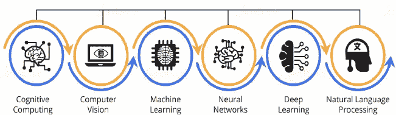 **图 (1)**

人工智能的领域。

## 人工智能的类型

### 基于能力

#### 狭义人工智能

狭义人工智能又被称为“弱人工智能”，专用于通过智能执行特定任务。它是目前最流行且可获取的形式。这种人工智能的训练专门针对单一任务，其运行局限于该特定任务的预定义边界。因此，当它遇到超出其指定领域的情况时，可能会表现出意外之外的失败。苹果的`Siri`是狭义人工智能的一个典型，尽管它的功能局限于特定操作。例如：在电子商务平台上提供产品推荐、启用功能和识别图像。

#### 通用人工智能

通用人工智能比狭义人工智能先进，因为它可以处理各种任务并适应新挑战。它可以像人类一样在多个领域内理解、学习和应用知识。它可以切换任务、学习、推理并应用知识，表现出灵活性和适应性。它可以理解并参与自然语言，解决复杂问题，并超越狭义 AI。尽管具有巨大的潜力，但实现通用人工智能仍然是一个困难且持续挑战。人工智能系统被设计为具有与人类相同广度和度的智能。

### 基于功能

#### 反应式机器

纯反应式机器代表了人工智能最基本的形式。

这些人工智能系统无法保留过去的经验或记忆以供未来决策。相反，它们只关注当前情况，并根据可能的最佳方案做出反应，`e.g.`，IBM 的`Deep Blue`系统和谷歌的`AlphaGo`。

#### 有限记忆

具有有限记忆的机器具有保留过去经验或特定数据的能力，但这种存储受到时间限制。它们可以在有限时间内利用这些信息。例如，自动驾驶汽车可以使用附近的车辆、速度和距离等数据。不同类型的摘要在图 (2) 中所示。

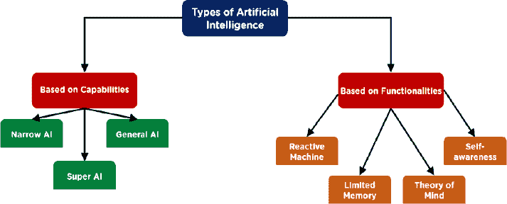 **图 (2)** 人工智能的类型。

## 机器学习

机器学习是一个赋予机器自主获取知识的过程，消除了手动编程的需求。其主要重点涉及利用复杂的算法和统计方法分析数据并做出预测。数据在机器学习中起着关键作用，确保预测的准确性。机器学习应用于金融、零售和医疗保健等多个领域 [2]。

机器学习（`ML`）的概念近年来引起了极大关注，主要受医疗领域数据大幅增加驱动。根据报告（未提供来源），86% 的医疗机构已接受了各种`ML`解决方案，超过 80% 的医疗高管制定了涉及人工智能（`AI`）的计划 [3]。机器学习作为人工智能的关键部分，被定义为机器模拟人类行为的能力。算法从数据中学习并根据新数据的相似性做出决策 [4]。

必须强调的是，包括数学、统计和计算机科学在内的不同领域的协作，是实施各种`ML`模型所需的数据科学框架的核心 [5]。虽然人类令人印象深刻，但由于短期记忆造成的错误，它具有局限性 [6]。

机器学习的意义源于数据量和多样性的指数级增长、计算能力的可及性和可负担性的提升，以及高高速互联网的广泛普及。这些数字化转型的驱动因素使得模型能够快速、自动地开发，并高效准确地分析海量且复杂的数据。它为降低成本、减轻风险以及全面提高生活质量提供了许多应用。这些应用涵盖了产品/服务推荐、网络安全漏洞检测以及促进自动驾驶汽车的实现。随着可用数据池的扩大和计算能力的增强，机器学习正逐渐成为日常生活中不可或缺的一部分，并准备无缝集成到人类生存的各个方面。

### 机器学习在医疗保健领域的优势

这项技术为增强医疗保健研究领域提供了多样化的应用。机器学习在许多应用中都很有帮助，从疾病的早期检测到降低医疗成本。通过使用先进的预测分析来评估参与临床试验的个体，医疗专业人员可以检查更广泛的数据，最终减少医疗评估所需的费用和时间。多项机器学习应用有望进一步增强临床试验的有效性，包括确定理想的样本量以提高效力，以及利用电子健康记录（`EHRs`）来减少数据错误。

医疗机构已利用机器学习系统的力量，主动监测并预测世界不同地区潜在的流行病爆发。该数字系统通过收集卫星数据、实时社交媒体更新和其他必要的在线信息源，有效地预测疾病爆发。其潜在益处在需要更多医疗基础设施的资源匮乏的第三世界国家尤为显著。机器学习和数据驱动技术直接解决了排队时间过长、对巨额账单的恐惧、复杂的预约流程以及难以获得合适的医疗服务提供者等问题。这些长期存在的问题困扰了传统医疗系统数十年，但机器学习技术已成为解决方案的关键组成部分。这主要归功于机器学习系统的强大，它们利用庞大的数据库和智能搜索算法，在涉及模式识别和优化挑战的任务中脱而出。机器学习在医疗领域的另一个价值方面是，它能够通过将个人健康数据与预测分析相结合，提供个性化且动态高效的治疗方案。

近年来，硬件和云计算的广泛普及使得机器学习（`ML`）在人类生活的各个方面得到了扩展。医疗领域也拥抱了这一技术演。医疗领域的机器学习算法具有巨大的潜力，这主要归功于每个患者收集的大量数据。这些算法在规划和为患者提供全面的治疗建议方面也表现出色，从而降低了成本并改善了患者体验。因此，机器学习成为医疗行业的一大宝藏。在患者记录、历史治疗方案和患者家族病史中包含的海量非结构化数据中，机器学习通过分析患者的历史数据，帮助医疗专业人员预测真实的健康问题。

AI 驱动的工具比传统的诊断方法具有许多优势。它们更精确、更具效益且节省时间。此外，AI 可以减少人为错误的概率，并在更短时间内提供准确的结果。AI 技术可以通过为医疗提供者提供实时见解和支持来增强医疗决策。持续的研究正在探索医疗领域的各种 AI 应用，包括医疗诊断与治疗、个性化医疗、药物发现与开发、基因组分析、临床决策支持等。

然而，必须意识到在医疗领域实施机器学习面临着若干挑战。这些挑战包括数据隐私和安全问题、伦理考量，以及对稳健验证和监管审查的需求，以确保这些技术的安全有效性。

### 机器学习及其模型

机器学习分为两类：监督学习和无监督学习，如图 3](#9789815305128-C9.html#f3)所示。在监督学习中，算法使用已有的输入和输出数据进行训练，以预测未来的结果。另一方面，无监督学习旨在发现输入数据中隐藏的模式或内在结构。监督学习适用于分类和回归任务，而无监督学习主要用于聚类任务[7]，如表 2](#9789815305128-C9.html#t2)所示。

 **图 (3)**

机器学习的分类。

#### 监督分类机器学习

监督学习是带有标签数据的机器学习。训练数据作为监督者教导机器正确预测输出。因此，预测学习方法的主要目标是从输入变量`x`映射到输出变量`y`，给定一组输入输出对。

```
D = {(xi, yi)} N 其中 i=1.
```

`D`是训练集，`N`是训练样本的数量。

简单来说，每个训练输入`xi`是一个`D`维数值向量，被称为特征、属性或协变量。同样，输出或响应变量的形式可以是任何形式，但许多方法认为`yi`是来自有限集合`{1... C}`的类别变量，或`yi`是实值标量。因此，当`yi`是确定的时，该问题被称为分类或模式识别；当它是实值时，该问题被称为回归。

#### 监督学习的优点与缺点

1. 监督学习使用标签数据集，这使其在预测对象类别时非常准确。

2. 这种学习类型允许根据先验经验进行预测。

3. 监督学习算法在解决复杂任务时可能会遇到困难。

4. 由于对计算要求高，训练算法可能花费大量时间，见表 1](#9789815305128-C9.html#t1)。

表 1 **监督学习算法 [10]。**

| 算法 | 优点 | 缺点 |

| --- | --- | --- |

| **朴素贝叶斯 (NB)** | 执行高效、计算处理快、学习速度快、分类性能高、有效控制过拟合并熟练处理噪声数据。 | 假设特征相互独立，无法处理高度相关的特征，从而导致准确率下降。 |

| **决策树 (DT)** | 易于理解、计算处理快、学习迅速、分类高效并能有效处理缺失值。 | 创建大型树形结构存在挑战、解决过拟合的能力有限，且处理噪声、高度相关数据的能力能力降低，导致准确率中等。 |


| 方法 | 优点 | 缺点 |
| :--- | :--- | :--- |
| **人工神经网络 (ANN)** | 极高的通用性、卓越的精度、快速的分类能力、擅长处理高相关性数据、适用于非线性和复杂的数据库。 | 实现困难、学习速度慢、无法处理缺失值、无法处理噪声数据、在解决过拟合方面存在欠缺。 |
| **集成学习系统** | 卓越的精度、擅长处理缺失值、噪声、过拟合和高相关性数据、分类性能快速、具有强大的稳定性。 | 实现困难、学习速度慢、计算复杂度高。 |
| **随机森林 (RF)** | 擅长处理噪声数据、分类能力快速、适用于大规模且多样化的数据库。 | 人类理解复杂、实现困难、准确率中等、学习率慢、处理缺失值、过拟合和高相关性数据的能力有限。 |
| **深度学习 (DL)** | 对于大规模和高维数据库具有重要意义、极高的精度、快速的分类速度、擅长处理噪声数据、擅长管理高相关性数据。 | 实现困难、学习速度慢、无法解决过拟合、处理缺失值的能力有限。 |
| **支持向量机 (SVM)** | 擅长处理具有线性非线性可分离性的数据、卓越的精度、分类速度快、擅长管理高相关性数据。 | 在假设数据集线性可分离的情况下，在管理过拟合、学习速度、缺失值和噪声数据方面可能会产生限制。 |
| **K 近邻 (KNN)** | 方法简单、性能稳定、学习速度快、擅长缓解过拟合。 | 计算负担较大、易受局部数据模式影响、准确率中等、分类速度缓慢、处理缺失值能力有限、无法管理噪声或高相关性数据。 |

监督机器学习分类方法包含对确定结果进行预测的算法，这被称为分类。与无监督学习不同，监督学习中使用的数据是带标签的且已知的。这些标签数据通常被分为训练集和测试集 [8]。这些分类算法将输入数据分配到特定的类别，从而产生离散的响应。监督机器学习的经典应用包括心脏病预测、医学图像分析和语音识别。监督学习的过程涉及根据训练数据中的信息构建分类模型。这些模型随后可以用于对未标记数据进行分类。用于训练的数据集有一个需要组织的输出变量。在这种情况下，每个算法从训练数据中学习独特的模式，然后将这些模式用于管理测试数据。一些流行的监督分类机器学习算法包括决策树、支持向量机、朴素贝叶斯、K 近邻和神经网络。

## 线性回归

线性回归是一种实用的统计技术，用于分析和量化变量之间的关系、预测并调整其他因素的影响。它的应用涵盖多个领域，包括经济学、生物学、心理学等，使其成为统计分析中的通用工具。线性回归是用于在数据集上的一种统计分析，用于建立和衡量所考虑变量之间的连接 [9]。

使用线性回归模型的意义可以归因于以下因素：

### 描述性目的

它有助于衡量结果（因变量）与预测变量之间关系的强度。

### 调整能力

它考虑了协变量或纠缠因素的结果。

线性回归是回归和预测建模任务中基础且广泛使用的机器学习 (ML) 技术。在机器学习的背景下，线性回归是一种简单但强大的算法，用于理解和预测自变量与因变量之间的关系。

## 决策树

决策树有助于解决回归和分类问题。它是一种非线性模型，克服了逻辑回归等线性算法的缺点。它通过包含节点和叶子将分类模型构建为树结构。使用决策树的主要目标是通过学习推断出的简单决策规则，创建一个用于预测目标变量值的训练模型。决策树通过从训练数据中学习来创建一个预测目标变量值的训练模型。决策树以树结构格式构建分类模型。决策树的主要部分包括：

1. **决策节点**：指定数据的划分点，即*属性的地方*。
2. **决策分支**：代表一种规则。
3. **决策叶子**：代表结果。

决策树通过对问题进行向下排序（从根节点到叶子）来分类。该算法涉及使用多个 `if-else` 语句，有助于将结构拆分为更小的结构并给出结果。树中的每个节点作为某些属性的测试用例，每个节点的边缘对应于测试用例的解决方案。对于每个新节点，这是一个递归过程。

决策树算法采用各种方法将节点分为两个或多个子节点。结果是节点相对于目标变量的纯度增加，增加了子节点的同质性。决策树使用所有可用变量来划分节点并选择最均匀的子节点。选择子节点的算法取决于目标变量的类型（如图 4）。

选择决策树是因为它们可以将大型复杂数据集转换为简单且信息丰富的图形显示。使用决策树的主要优点是对数据准备的要求少且具有稳健性。

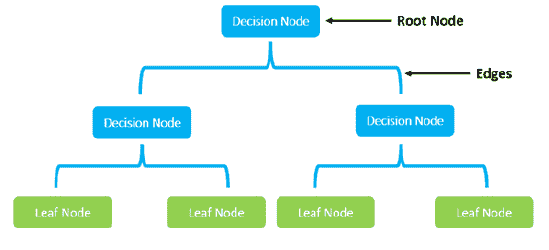**图 (4)**

决策树的组件。

## K 近邻

K 近邻 (KNN) 是监督机器学习中至关重要的分类算法。它在模式识别、入侵检测和数据挖掘中有广泛应用。它在现实应用中受到高度重视，因为它是非参数的，这意味着它对数据分布不作任何假设。

KNN 是一种数据分类方法，根据属于同一组的最近数据点，估计数据点成为一组另一组成员的概率。它也被称为懒学习算法，因为它在训练期间不对训练数据进行处理。相反，它在训练期间存储数据且不进行计算。KNN 只有在数据集上执行操作时才会构建模型。简而言之，KNN 通过查看最近的标注数据点（也称为最近邻）来对数据点进行分类。

如所述，KNN 算法被用作分类器。与人工神经网络不同，KNN 分类易于理解且易于实现，非常适用于数据点定义良好或非线性的情况。

简单来说，KNN 通过投票机制来确定未见观测值的类别。票数最多的类别即为该数据点的类别。`K` 的值决定了用于确定观测值类别的最近邻居数量。如果 `K` 等于一，则仅使用最近的一个邻居；如果 `K` 等于十，则使用十个最近的邻居，以此类推。最后，K 近邻算法的实现在多个领域有效：

1. 发现模式：KNN 算法识别模式的能力使得各种应用成为可能。
2. 股票未来价值：由于其预测未知值的能力，KNN 算法非常适合利用历史数据预测股票价值。
3. 图像分类：它在各种计算机视觉应用中至关重要，因为它能对相似的数据（如猫和狗）分组。

## 无监督机器学习

无监督机器学习是人工智能的一种类型，其中算法在没有特定方向或标记示例的情况下，在数据中寻找模式和关系。这种方法涉及算法探索数据集的内在结构，以发现任何隐藏的模式、分组或关联。与监督学习不同，算法没有预定义的输出或目标变量可供学习。

无监督学习包括聚类、降维和关联规则挖掘。聚类算法将相似的数据点分组，揭示数据内部的自然结构。降维方法旨在通过减少特征数量同时保留重要信息来简化复杂数据集。关联规则挖掘发现变量之间的关系，揭示如零售中的购物篮分析之类的模式。无监督学习在数据探索、模式识别和异常检测中至关重要，使其成为数据分析、生物学、金融等多个领域的宝贵工具。

### 强化学习

强化学习 (RL) 是一种机器学习技术，智能体通过与环境交互来学习做出决策。它采取行动，观察产生的状态，并接收奖励或惩罚。目标是通过学习将状态映射到动作的最优策略来实现累积奖励最大化。强化学习平衡了探索（尝试新动作）和利用（使用已知动作）。关键算法包括 `Q-Learning`（基于价值）和 `Policy Gradient` 方法（基于策略）。强化学习广泛应用于机器人技术、游戏 AI 和自动驾驶系统，因为它允许智能体通过试错学习复杂的行为，而不需要显式编程。

表 2 总结了每种类型机器学习系统的优缺点 [11]。

| 机器学习类型 | 优点 | 缺点 |
| --- | --- | --- |
| 监督学习 | 准确率高、目标明确、评估指标完善。 | 需要标记数据，泛化能力有限，且易受偏差影响。 |
| 无监督学习 | 能够发现人类难以或无法发现的模式和联系，并能处理未标记数据。 | 性能评估困难可能产生不可解释的结果。 |
| 强化学习 | 可以从经验中学习，随时间推移而改进，并在动态环境中处理复杂任务。 | 需要大量的计算资源，容易出现意外或非预期行为，且难以定义合适的奖励。 |

# 机器学习在医疗领域的范围

在过去的十年里，医疗机器学习 (ML) 经历了极其快速的进展。为了解决各种医疗需求，已经建立了大量的基础工作，提供了增强患者护理、减轻医疗专业人员负担、简化医疗程序和赋能个体的潜力。需要注意的是，医疗人工智能在计算机视觉领域取得了巨大成功，特别是创建了基于图像的分诊和二级阅读系统 [12]。

人工智能有望为医疗行业带来积极的变革，并赋予患者对自己的健康更大的自主权。在过去的几年里，AI 增强了医疗服务，包括提供定制的健康建议、促进虚拟医疗预约以及监督远程患者监测。

人工智能 (AI) 是一个总概念，指的是可以获取知识并模拟人类智能的计算机智能 [13]。人工智能与机器人和自动驾驶汽车等自主机器联系密切。然而，它在定制化广告和在线搜索等日常应用中也起着普遍的作用。人工智能属于创建智能机器的科学与工程领域。这些机器依赖算法或定义的规则集来模仿学习和解决问题的人类认知功能。AI 系统可以主动预测并解决问题，以深思、智能且自适应的方式运行。人工智能 (AI) 包含了多种方法，包括机器学习 (ML)、深度学习 (DL) 和自然语言处理 (NLP)。人工智能算法的一个子集大语言模型 (LLMs) 使用深度学习技术结合海量数据集来理解、压缩、创建和预测新的文本内容 [14]。LLMs 专为文本内容生成设计，并在许多 NLP 应用中提供广泛的用途，涵盖文本生成、翻译、内容摘要、文本重写、分类和情感分析。近年来，AI 在开发和实施方面取得了显著进展，由于其增强的决策能力、精度、解决问题能力和计算实力，它在各个领域被广泛利用 [15]。

AI 技术的快速发展为其在临床实践的应用提供了机会，可能彻底改变医疗服务。在医疗领域实施 AI 的一个重要优势是其提供定制化健康信息的能力。通过分析患者数据（包括病史和生活方式因素），AI 算法可以提供个性化建议，帮助患者维持健康。这些信息使患者能够深入地了解自己的健康，使他们对医疗保健做出明智的决策。

此外，AI 通过实现远程监测在医疗领域发挥着至关重要的作用。AI 驱动系统可以持续跟踪和监控患者的生命体征，及时提醒医疗提供人员潜在问题。此外，AI 通过虚拟咨询增强了医疗，允许患者远程获得医疗服务，消除了前往医疗机构的需要。这对于居住偏远地区或活动能力受限的人来说特别有利。AI 已用于医疗环境开发诊断工具和个性化治疗方案。在医疗领域利用 AI 可以从四个不同的方面对医生、患者和医疗专业人员产生积极影响 [16]：

1. 它可以评估治疗成功的概率，并在治疗开始前分析疾病的发病情况。
2. AI 可以帮助预防或有效管理并发症。
3. 它在诊断和治疗过程中积极协助患者护理。
4. AI 帮助识别疾病的性质并确定最合适的治疗方案。

AI 在推进个人健康、减少对医生的依赖以及提高整体福祉方面具有发挥关键作用的潜力。医疗招聘公司通过引入 AI 正在快速为消费者健康做出贡献。技术进步和移动应用程序促使个人接受更健康的生活方式，让他们能够积极管理自己的健康。此外，AI 还丰富了医疗专业人员对个人日常生活的了解，使他们能够提供明智建议、指导和支持，以维持持续的健康。

人工智能在疾病检测（尤其是癌症）中的应用已经在进行中。美国癌症协会指出，乳腺检查的假阳性结果率很高，导致约一半的健康女性获得错误信息。然而，AI 技术改变了乳腺检查的审查和解读，速度惊人地提高了 30 倍，准确率达到 99%。这一突破大幅减少了不必要的干预和治疗。

## 医疗保健领域的机器学习概述

机器学习是人工智能的一个子集，它通过数据对算法进行训练，使其能够在不需要直接、显式编程的情况下做出预测或决策。机器学习有望从根本上改变我们在医疗保健领域处理诊断、治疗和预防的方法。机器学习在医疗保健领域的许多潜在应用包括：

### 预测性分析

利用机器学习算法，可以处理来自电子健康记录、理赔信息和其他存储库的数据，以预测特定健康结果的概率。这些结果可能包括医院再次入院或慢性疾病的出现。此类分析使医疗保健提供者能够确定高风险患者，并主动采取干预以避免不利后果。

### 诊断与治疗

CT 扫描或 X 射线等医学图像可以由机器学习算法进行审查，帮助诊断并为患者选择最合适的治疗方案。

### 个性化医疗

机器学习具有根据遗传和病史等个人属性预测个性化治疗方案的潜力。

### 临床决策支持

将机器学习算法整合到临床决策支持系统中，使医疗保健提供者能够在患者护理方面做出更明智的选择。

### 人口健康管理

机器学习可用于分析大规模人群的数据，揭示可以指导公共卫生倡议发展的趋势和模式（图 5 和 6）。

**图 (5)**

医疗保健领域机器学习的理念。

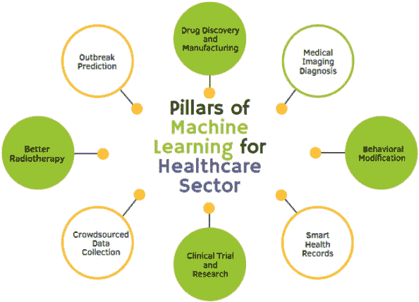**图 (6)**

医疗保健领域机器学习的支柱。

## 机器学习在医疗保健领域的应用

本节展示了医疗保健领域的各种应用和数据源，分别如图 (7 和 8) 所示。

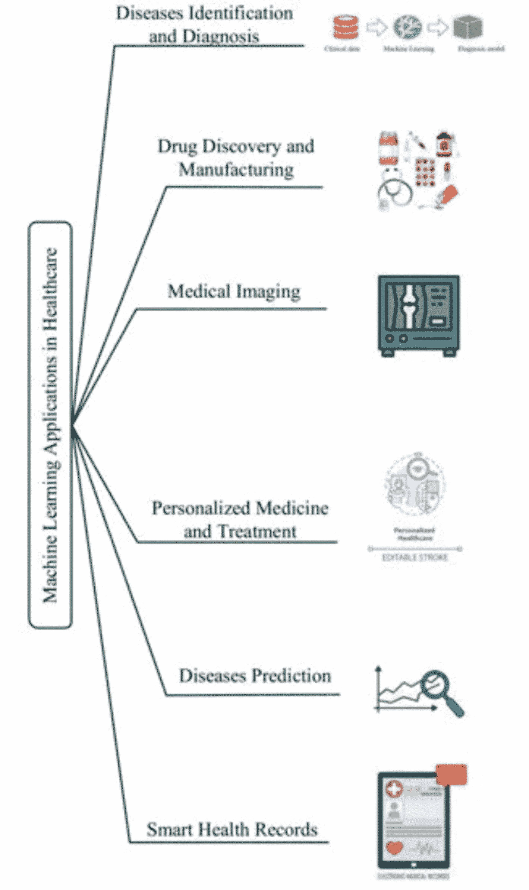**图 (7)**

医疗保健中的各种 ML 应用。

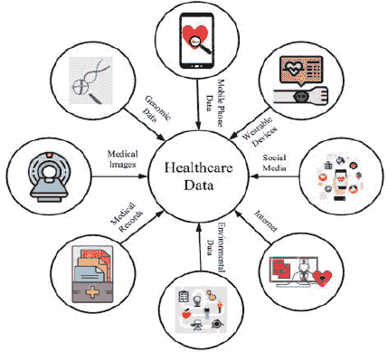**图 (8)**

不同的数据生成

### 药物研发

药物研发是一个不断发展的动态领域，旨在识别对抗疾病的治疗药物。新药的发现对于转变医疗治疗和改善多种疾病的患者预后发挥了至关重要的作用。发现过程包括几个不同的关键阶段，如图 (9) 所示：

传统方法的局限性（如有效性低和成本高）为药物研发带来了巨大挑战。因此，需要建立新方法。

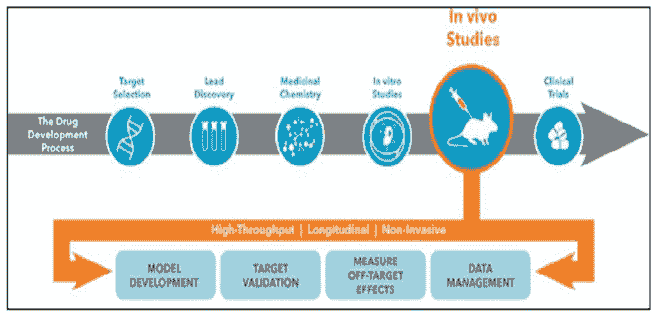**图 (9)**

药物研发阶段

AI 在药物研发中的能力已通过各种案例研究得到了生动的说明。Gupta *等人* 展示了 AI 在癌症治疗中的应用 17。作者在包含常见的癌症相关化合物及其相应生物活性的大量数据上开发了一种深度学习算法。最近详细阐述了利用机器学习发现 MEK 蛋白的小分子抑制剂。MEK 蛋白是癌症治疗的潜在靶点，开发有效的抑制剂面临着巨大挑战。尽管如此，ML 算法成功揭示了该蛋白质的抑制剂。研究人员使用机器学习 24 发现了阿尔茨海默症蛋白的新抑制剂。AI 在 COVID-19 药物研发方面具有潜力，可以快速识别候选药物 18, 19。

### 临床试验

根据 `clinicaltrials.gov` 的定义，`clinical trial` 是任何使用人类受试者来推进医学知识的研究（包括干预性和观察性研究）（美国国家医学图书馆，未注明日期）。

根据 Lauer *等人* (2017) 和 Califf & Rutherford (2018) 的观点，临床试验为产生证据提供了基础，但它们仍然需要更加昂贵、复杂且耗时。准确预测临床试验的结果有望显著提高流程的效率。这可以通过优先考虑在临床试验中可能成功的治疗计划来实现，最终造福患者。提前预测临床试验结果可以提高药物研发（R&D）的效率。

### 癌症风险或易感性预测

机器学习（ML）越来越多地用于癌症风险或易感性预测。它涉及使用大型临床和遗传信息数据集训练算法，以识别可以预测患癌概率的模式和关联。与传统方法相比，这种方法根据年龄、家族史和其他因素提供更个性化、更准确的风险评估。

ML 算法可以分析各种数据，包括遗传信息、生活方式因素、病史和环境暴露。它们还可以考虑多个风险因素之间的相互作用，并识别人类专家可能察觉不到的微妙模式。

一些研究表明，利用机器学习（ML）预测癌症风险已取得良好结果，特别是在乳腺癌和结直肠癌方面。未来，机器学习可以整合到临床决策中，帮助识别可能从早期筛查或预防性干预中受益的高风险患者[[20, 21]]。物联网改变了我们与技术互动的方式，使我们能够连接并与计算机和智能手机以外的各种设备通信。从心脏假体、农畜生物传感器定位器到内置传感器警告驾驶员轮胎压力不足的汽车，任何具有 IP 地址并能够通过网络传输信息的生物体或机器现在都可以被视为物联网的一部分。这项技术开启了一个可能的世界，使我们的生活更加高效、便利和连接[[22]]。

### 癌症分类

机器学习具有巨大的潜力，通过对癌症类型进行精确分类、预测患者预后以及识别潜在治疗靶点来增强癌症诊断和治疗。本综述为读者提供了机器学习在癌症分类方面进展的全面见解，使他们能够在临床环境中使用这些技术做出明智的决策。

使用机器学习技术进行癌症分类可以实现更精确、更有效的诊断，从而获得更好的预后。它还可以帮助识别人类专家可能会忽略的癌症类型、亚型和阶段之间的细微差异。此外，机器学习可以帮助识别潜在的生物标志物和药物靶点，为开发新型且更有效的癌症疗法铺平道路。此外，机器学习技术还可以增强患者分层，使临床医生根据个体患者特征制定个性化治疗方案。这种方法有助于减少治疗相关的副作用并提高治疗疗效[[23]]。

### 放射影像

许多放射科医生面临着工作量的大幅增加。研究显示，在 8 小时的工作日内，平均一名放射科医生有时每 3-4 秒必须解释一张图像，以满足工作需求。然而，放射学中极具挑战性的视觉感知和决策要求使得错误更容易发生，尤其是在这种受限的情况下。

为了解决这一问题，集成到影像工作流中的 AI 驱动组件可以提高效率、减少错误并在最少的人工输入下实现目标。通过为经过培训的放射科医生提供预筛图像和识别出的特征，AI 驱动系统可以帮助从各种扫描中检测肺部异常，如图 (10) 所示。

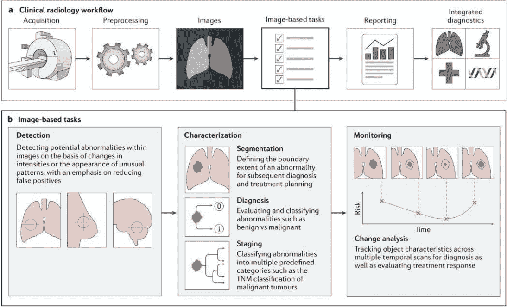 **图 (10)**

用于检测肺部异常的 AI 流程（来源）。

### 机器学习在医疗保健领域的挑战

在医疗保健领域利用机器学习算法面临许多挑战，需要深入专家审查和讨论[[24]]。任何机器学习模型的有效性主要依赖于可靠且准确的数据，这些数据代表了模型结果适用的目标群体。因此，在将机器学习模型整合到医疗保健领域时，各级有效的数据管理是一个至关重要的前提条件。此外，开发具有用户友好接口的数据处理流水线至关重要，以促进原始数据转换为适用于训练各种机器学习模型的数据集。

另一个重大挑战是，除非使用像决策树这样的可解释性模型，否则基于机器学习的预测通常需要更高的透明度[[24, 25]]。在用机器学习模型预测健康结果的情况下，法律程序方面可能存在改进空间以处理潜在错误，考虑到不同国家法律系统的复杂性，这是一个特别棘手的问题。

与其他研究领域一样，伦理考量在医疗保健领域的决策框架中起着至关重要的作用。人们不仅预料到，而且观察到新技术带来了新的伦理挑战[[26]]。正如其他研究领域一样，伦理原则应当是定义决策框架的核心。可以预见且显而易见的是，新兴技术引入了新的伦理挑战。机器学习算法的伦理关注点在于问责制、资源的公平分配和个人诚信[[26]]。任何道德框架的基本准则都是“不伤害”原则，它要求至少预测性机器学习算法必须避免造成伤害[[27]]。在推广此类算法生成的结果时，确保算法的公平性至关重要[[28]]。低收入国家由于缺乏法律保护、对某些少数群体的偏见以及技术能力有限，特别受到这些算法产生的偏差的影响。


机器学习算法往往会加剧底层数据中固有的差异。这些差异可能源于性别、种族或族群等因素。因此，进行方法论研究以确保机器学习模型不会延续这些不平等现象至关重要。

 **图 (11)**

药物设计——挑战。

### 数据挑战

主要的障碍是数据的可用性。机器学习和深度学习模型对于各种任务的准确分类或预测需要完整的数据。许多领域在充足数据集的支持下机器学习方面取得了显著进展，使得更复杂的算法成为可能。然而，在医疗保健领域，数据的可用性是一个复杂的挑战(11)。在组织层面，健康数据成本高昂，且医院之间存在共享阻力，这阻碍了协作数据管理[29][31]。

### 患者安全

机器学习算法完全基于其训练基础的数据做出决策。遗憾的是，医疗数据并不如要求的那样准确和标准化。记录通常存在缺失，档案需要更加精确，并且存在其他缺陷。因此，如果输入数据不可靠且错误，就会产生错误的巨大风险。这种不准确可能导致对患者的错误治疗，可能加重其病情，甚至在严重情况下导致死亡。

### 数据集中的偏差

在每个领域，机器学习算法都使用大量数据集进行训练。如果没有仔细的监督和训练，这些算法可能会吸收并延续数据中固有的偏差，带来巨大风险，特别是在医疗保健行业。

### 隐私考量 / 伦理考量

在医疗保健领域部署机器学习的另一个显著障碍是广泛的数据收集，这些数据通常包含敏感或机密信息。因此，额外的安全措施变得至关重要。与信誉良好的机器学习和人工智能开发公司合作至关重要，这些公司能够提供先进的安全解决方案，以确保客户数据得到妥善处理。在医疗保健领域应用机器学习的背景下，这些挑战包括：

1. **推荐** - 机器学习算法无需搜索即可提供必要的医疗信息。
2. **聚类** - 机器学习可以帮助对相似病例进行分类，以分析模式并促进未来的研究。
3. **预测** - 通过使用当前数据和流行趋势，机器学习可以对未来事件可能如何发展提供见解。
4. **异常检测** - 在医疗保健中使用机器学习可以识别出偏离标准模式的元素，并确定是否需要采取行动。
5. **自动化** - 机器学习可以处理增加医生负担的常规且耗时的任务，例如数据录入、预约调度和库存管理。例如，基于自然语言处理的机器人可以通过与患者交流来减轻医疗人员的工作负载。
6. **排名** - 机器学习可以对相关信息进行排序，简化查找过程。

### 使用机器学习在医疗保健领域的机遇

在医疗保健部门，机器学习算法的意义在于它们能够解释通过电子健康记录每天生成的海量医疗数据。将机器学习整合到医疗实践中使我们能够揭示医疗数据中复杂的模式并从中获得见解，而这些模式手动识别是非常困难的。随着机器学习在医疗保健中整合的普及，医疗提供者可以向更具预测性的精准医学转型。这种进化导致了更凝聚的系统，提升了护理交付，改善了患者结果并简化了以患者为中心的流程。

在医疗专业人员中，利用机器学习最常见的应用包括医疗账单自动化、提供临床决策支持以及制定临床实践指南。例如，在安德德森癌症癌症中心，数据科学家引入了一种创新解决方案，利用深度学习来确定接受头颈癌放射治疗的患者的急性毒性。在临床工作流中，在医疗保健中整合深度学习有助于自动识别医疗数据中的复杂模式，直接在电子健康记录中为基础保健提供者提供临床决策支持。

### 自动化和简化流程

在医疗保健领域，机器学习具有自动化和优化各种程序的潜力。在实践中，`ML` 可以处理海量医疗数据，自动生成定制的患者治疗计划。这不仅节省了时间和精力，还提高了患者护理的质量。此外，该技术在监控医疗资源和优化员工调度方面证明了价值，有助于整体效率和患者健康。

### 定制治疗方案

机器学习分析个人病史、症状和测试结果，使医疗提供者能够提供个性化的患者治疗。医疗专业人员可以利用 `ML` 制定定制的治疗计划并针对个人的特定疾病开处药物。这项技术还让医疗公司能够获得基于电子健康信息的深层分析，使临床医生能够就合适的患者治疗做出更明智、精确的决策。

### 降低成本

通过自动化常规任务和提高准确性，机器学习有助于医疗机构减少与人工劳动和医疗错误相关的成本。此外，`ML` 有助于识别易患慢性疾病的患者，促进早期干预和预防性，从而减少长期医疗费用。

### 欺诈检测

根据司法部的数据，美国约 3%的医疗索赔是虚假的，导致每年 1000 亿美元的损失。机器学习在报销之前识别虚假索赔，对于加速有效索赔的审批、处理和支付至关重要。`ML` 不仅保护了患者数据，还检测并防止保险欺诈，例如哈佛彼徒健康（Harvard Pilgrim Health）等领先机构就使用了基于 `ML` 的欺诈检测系统。

### 提高患者满意度

通过个性化治疗、缩短等待时间以及减少医疗错误，机器学习有助于增强医疗机构的患者体验。结果是改善了患者满意度和治疗效果。

### 疾病早期检测

某些疾病需要早期检测，以制定有效的治疗计划并确保患者的高质量生活。机器学习通过采用监督和无监督算法，协助医生进行疾病早期诊断。通过将新数据与特定疾病的现有信息进行比较，`ML` 在症状需要时发出警报，从而采取及时适当的行动。

### 改善人群健康

机器学习利用患者数据中的模式和趋势来增强人群健康。`ML` 系统识别出慢性疾病风险较高的个体，允许通过定制治疗来遏制疾病传播。

### 机器人辅助手术

`ML` 驱动的手术机器人通过提高速度和准确性彻底了手术。这些系统以最小的出血、副作用和不适感执行复杂的手术程序。值得关注的机构，如马斯塔里特大学医学中心，利用 `ML` 使手术机器人能够缝合细血管，展示了该技术的精准性。

### 增强安全性

`ML` 可以开发预测患者风险的模型，例如不良药物相互作用或术后并发症，从而降低患者风险并增强医疗治疗的整体安全性。

### 支持临床研究和试验

机器学习在临床试验和研究中有多种应用，通过预测分析简化受试者选择过程。`ML` 为试验受试者提供实时监控和数据访问，协助确定最佳样本量，并消除基于数据的错误，可能加速临床研究的速度和效率。

### 药物开发

机器学习在药物开发的早期阶段至关重要，利用了下一代测序和精准医学等研发技术。`ML` 在不进行预测的情况下识别数据中的模式，为发现复杂疾病的替代治疗路径做出贡献。

### 医疗保健领域的可解释人工智能 (XAI)

可解释人工智能旨在增强机器学习模型的透明度和可解释性。在医疗保健中，这涉及为临床医生提供有关特定决策背后逻辑的见解，并培养对 AI 驱动建议的信任和接受。

`XAI` 技术使医疗专业人员能够理解影响 AI 诊断或治疗建议的底层因素。

在放射学和病理学等关键医疗保健应用中，`XAI` 特别重要。通过阐明其决策，AI 模型可以协助放射科医生和病理学家做出更明智的判断，从而提高诊断准确性并改善患者护理。

# 量子计算对医疗保健的影响

量子计算在解决复杂的医疗挑战方面具有巨大潜力，包括药物发现、基因组学和治疗方案的优化。传统计算机在处理与这些任务相关的巨大计算复杂性时往往需要帮助。然而，量子计算机可以以前所未有的速度处理海量数据集并执行复杂的计算。

在基因组学中，量子计算可以加速大规模基因组数据集的分析，帮助研究人员发现疾病的遗传基础并制定个性化治疗策略。此外，量子计算能够以无与伦比的精度模拟分子相互作用，促进药物的发现和开发。

# 区块链在医疗数据管理中的整合

区块链具有保护医疗数据的潜力，确保其完整性并让患者对医疗记录有更大的控制权。这种去中心化的方法可以彻底改变医疗保健的数据共享，允许患者授权访问医疗记录。此外，区块链可以增强供应链的可追溯性，降低伪假药品进入市场的风险。区块链的不可篡改性确保了数据不会被更改，增强了医疗记录的可靠性。

# 医疗与人工智能协同

医疗与人工智能的融合有望扩大医疗服务的覆盖范围，特别是在远程地区。人工智能驱动的聊天机器人和虚拟助理可以提供即时医疗建议，改善患者结局并缓解医疗机构的压力。基于人工智能的医疗平台可以促进远程咨询和患者监测。此外，集成人工智能的远程监测设备实现了持续健康追踪。可穿戴设备收集关键数据，人工智能算法进行实时分析。医疗提供者接收这些警报。

# 研究影响

《医疗保健的挑战与机遇》一章强调了医疗行业的若干关键研究影响。以下是：

## 医疗挑战的深入研究

本章节强调了医疗行业面临的各种挑战，如成本上升、医疗服务获取有限以及医疗专业人员短缺。需要更好地理解这些挑战并制定有效的策略。

## 技术在医疗保健中的重要性

本章节强调了技术在应对医疗行业面临的一些挑战中的作用。需要对医疗技术的使用进行研究，例如远程医疗、移动健康应用和电子健康记录。

## 医疗政策的深入研究

本章节强调了医疗政策在应对挑战和促进机遇方面的重要性。需要对医疗政策进行研究，例如医疗融资、保险和监管。

## 医疗劳动力发展的重要性

本章节强调了开发高技能和多样化劳动力以应对挑战并促进机遇的重要性。需要对医疗劳动力发展进行研究，例如教育与培训、招聘与留存以及多样性。

《医疗保健的挑战与机遇》这本书为医疗行业提供了若干重要的研究影响。这些影响强调了对医疗挑战的研究、医疗技术的作用、医疗政策以及医疗劳动力的发展。数字时代改变了城市环境的治理和优化，可持续发展目标的取决于数据的效率。

# 未来前景

将机器学习（ML）和人工智能（AI）整合到医疗保健中的挑战与机遇前景广阔且充满。随着技术的不断演进，几个关键领域将成为进一步探索和发展的焦点：

随着`ML`和`AI`在医疗领域的日益整合，未来在于培训医疗专业人员理解、利用并批判性地评估`AI`工具，这对于成功实施至关重要。通过接受这些前景，医疗行业可以解锁`ML`和`AI`的全部潜力，开启高效有效且公平的医疗交付时代。这需要持续的研究、协作以及利用技术增强结局并应对不断变化的医疗挑战与机遇的共同愿景。

## 结论

总之，通过机器学习（ML）和人工智能（AI）的视角探索医疗领域的挑战与机遇，揭示了一个正准备迎接变革的动态格局。本章深入探讨了在医疗中实施`ML`和`AI`的复杂性，强调了从数据隐私问题到稳健监管框架的多方面挑战。

尽管存在挑战，这些技术提供的机遇是深远的。`ML`和`AI`可以彻底改变诊断、治疗方案和工作流程。利用大量数据进行预测分析、个性化医疗和增强护理的能力开启了新领域。此外，这些技术为创新药物发现、远程医疗、癌症预测/分类和健康解决方案铺平了道路。

在获取`ML`和`AI`收益与应对相关挑战之间取得平衡，需要医疗专业人员、技术专家、政策制定者和监管机构共同努力。随着我们向前发展，对伦理实践、透明度和持续创新的承诺将是解锁医疗`ML`和`AI`潜力的关键。本章作为一个路线图，鼓励利益相关者审慎地接受这些技术，利用机遇改善医疗成果并创建一个更有韧性、高效且以患者为中心的医疗生态系统。

## 参考文献

|  | |
| --- | --- |
| [1] | Turgal E. Research in Machine Learning for Medicine and Health Disciplines: A Bibliometric Analysis. Available at SSRN 4392195. [`dx.doi.org/10.2139/ssrn-4392195`](http://dx.doi.org/10.2139/ssrn-4392195) |
| [2] | Dhillon A, Singh A. Machine learning in healthcare data analysis: a survey. J Biol Todays World 2019; 8(6): 1-0. |
| [3] | Siwicki B. 86% of healthcare companies use some form of AI, Healthcare IT News, May 19, 2017. |
| [4] | O’Mahony C, Jichi F, Pavlou M, *et al.* A novel clinical risk prediction model for sudden cardiac death in hypertrophic cardiomyopathy (HCM Risk-SCD). Eur Heart J 2014; 35(30): 2010-20. [`dx.doi.org/10.1093/eurheartj/eht439`](http://dx.doi.org/10.1093/eurheartj/eht439) [PMID: [24126876](http://www.ncbi.nlm.nih.gov/pubmed/24126876)] |
| [5] | Deo RC. 医疗领域中的机器学习。Circulation 2015; 132(20): 1920-30. [`dx.doi.org/10.1161/CIRCULATIONAHA.115.001593`](http://dx.doi.org/10.1161/CIRCULATIONAHA.115.001593) [PMID: [26572668](http://www.ncbi.nlm.nih.gov/pubmed/26572668)] |
| [6] | Connor CW. 麻醉学中的人工智能与机器学习。Anesthesiology 2019; 131(6): 1346-59. [`dx.doi.org/10.1097/ALN.0000000000002694`](http://dx.doi.org/10.1097/ALN.0000000000002694) [PMID: [30973516](http://www.ncbi.nlm.nih.gov/pubmed/30973516)] |
| [7] | Ciaburro G, Iannace G, Ali M, Alabdulkarem A, Nuhait A. 用于沥青乳声学性能建模的人工神经网络方法。Journal of King Saud University - Engineering Sciences 2021; 33(4): 213-20. [`dx.doi.org/10.1016/j.jksues.2020.07.002`](http://dx.doi.org/10.1016/j.jksues.2020.07.002) |
| [8] | Das S, Dey A, Pal A, Roy N. 人工智能在机器学习中的应用：回顾与展望。Int J Comput Appl 2015; 115(9): 31-41. [`dx.doi.org/10.5120/20182-2402`](http://dx.doi.org/10.5120/20182-2402) |
| [9] | Khushbu K, Suniti Y. 线性回归分析研究。Curriculum in Cardiology-Statistics 2018; 4(1): 33-6. |
| [10] | Rahmani AM, Yousefpoor E, Yousefpoor MS, et al. 医疗中的机器学习 (ML)：回顾、应用与挑战。Mathematics 2021; 9(22): 2970. [`dx.doi.org/10.3390/math9222970`](http://dx.doi.org/10.3390/math9222970) |
| [11] | Yaqoob A, Aziz RM, Verma NK, Lalwani P, Makrariya A, Kumar P. 用于癌症疾病预测与分类的自然启发算法综。Mathematics 2023; 11(5): 1081. [`dx.doi.org/10.3390/math11051081`](http://dx.doi.org/10.3390/math11051081) |
| [12] | Esteva A, Kuprel B, Novoa RA, Ko J, Swetter SM, Blau HM, Thrun S. 深度神经网络对皮肤癌的级分类。nature. 2017 Feb; 542(7639): 115-8. |
| [13] | Larrazabal AJ, Nieto N, Peterson V, Milone DH, Ferrante E. 医疗影像数据集中的性别不平衡为计算机辅助诊断产生了有偏的分类器。Proc Natl Acad Sci USA 2020; 117(23): 12592-4. [`dx.doi.org/10.1073/pnas.1919012117`](http://dx.doi.org/10.1073/pnas.1919012117) [PMID: [32457147](http://www.ncbi.nlm.nih.gov/pubmed/32457147)] |
| [14] | An Q, Rahman S, Zhou J, Kang JJ. 医疗保健行业机器学习的综述：分类、限制、机会与挑战。Sensors (Basel) 2023; 23(9): 4178. [`dx.doi.org/10.3390/s23094178`](http://dx.doi.org/10.3390/s23094178) [PMID: [37177382](http://www.ncbi.nlm.nih.gov/pubmed/37177382)] |
| [15] | Miotto R, Wang F, Wang S, Jiang X, Dudley JT. 医疗保健的深度学习：回顾、机会与挑战。Brief Bioinform 2018; 19(6): 1236-46. [`dx.doi.org/10.1093/bib/bbx044`](http://dx.doi.org/10.1093/bib/bbx044) [PMID: [28481991](http://www.ncbi.nlm.nih.gov/pubmed/28481991)] |
| [16] | Becker A. 医学人工智能：它现在对我们做了什么？Health Policy Technol 2019; 8(2): 198-205. [`dx.doi.org/10.1016/j.hlpt.2019.004`](http://dx.doi.org/10.1016/j.hlpt.2019.004) |


| [17] | Gupta R, Srivastava D, Sahu M, Tiwari S, Ambasta RK, Kumar P. 从工智能到深度学习：用于药物发现的方法。Mol Divers 2021; 25(3): 1315-60. [[`dx.doi.org/10.1007/s11030-021-0217-3`](http://dx.doi.org/10.1007/s11030-021-0217-3)] [PMID: [3384136](http://www.ncbi.nlm.nih.gov/pubmed/3384136)] |

| [18] | Zhu J, Wang J, Wang X, et al. 通过深度学习从转录谱预测药物效效。Nat Biotechnol 2021; 39(11): 1444-52. [[`dx.doi.org/10.1038/s41587-021-0946-z`](http://dx.doi.org/10.1038/s41587-021-0946-z)] [PMID: [34140681](http://www.ncbi.nlm.nih.gov/pubmed/34140681)] |

| [19] | Melo MCR, Maasch JR, de Nunez C. 通过人工智能加速抗生素发现。Commun Biol 2021; 4(1): 1050. [[`dx.doi.org/10.1038/s42003-021-0258-6`](http://dx.doi.org/10.1038/s42003-021-0258-6)] [PMID: [3450430](http://www.ncbi.nlm.nih.gov/pubmed/3450430)] |

| [20] | Shubhendu S, Vijay J. 人工智能在生命不同领域的适用性。Int J Sci Res 2013; 1(1): 28-35. |

| [21] | Chen W, Liu X, Zhang S. 用于药物发现的人工智能：资源、方法与应用。Mol Ther Nucleic Acids 2023; 31: 691-702. [[`dx.doi.org/10.1016/j.mtna.2023.0219`](http://dx.doi.org/10.1016/j.mtna.2023.0219)] [PMID: [3692395](http://www.ncbi.nlm.nih.gov/pubmed/3692395)] |

| [22] | Dhamodharan G, Mohan CG. 用于治疗阿尔茨海默症预测 `AChE` 和 `BACE1` 活性的机器学习模型。Mol Divers 2022; 26(3): 1501-17. [[`dx.doi.org/10.1007/s11030-021-0282-8`](http://dx.doi.org/10.1007/s11030-021-0282-8)] [PMID: [3432761](http://www.ncbi.nlm.nih.gov/pubmed/3432761)] |

| [23] | Wang Y, Fan J, Tong Y, et al. 铁死亡相关基因 `AKR1C3` 作为哮喘潜在生物标志物的生物信息学分析及其在 `BEAS-2B` 细胞中的识别。Comput Biol Med 2023; 158: 106740. [[`dx.doi.org/10.1016/j.compbiomed.2023.106740`](http://dx.doi.org/10.1016/j.compbiomed.2023.106740)] [PMID: [3699663](http://www.ncbi.nlm.nih.gov/pubmed/3699663)] |

| [24] | Rajpurkar P, Chen E, Banerjee O, Topol EJ. 健康与医学中的 AI。Nat Med 2022; 28(1): 1-8. [[`dx.doi.org/10.1038/s41591-022-06139-w`](http://dx.doi.org/10.1038/s41591-022-06139-w)] |

| [25] | Price WN, II, Gerke S, Cohen IG. 医生使用人工智能的潜在责任。JAMA 2019; 322(18): 1765-6. [[`dx.doi.org/10.1001/jama.2019.15064`](http://dx.doi.org/10.1001/jama.2019.15064)] [PMID: [3505861](http://www.ncbi.nlm.nih.gov/pubmed/3505861)] |

| [26] | Mathiesen T. 学习中的功利主义与结果主义。在神经外科学习与职业发展：基于价值观的医学教育 2022 年 9 月 (95-100 页)。瑞士：Springer 出版。[[`dx.doi.org/10.1007/978-3-031-02078-0`](http://dx.doi.org/10.1007/978-3-031-02078-0)] |

| [27] | Keskin KH. 人工智能的医学伦理考虑。J Clin Neurosci 2019; 64: 277-82. |

| [28] | Fletcher RR, Nakeshimana A, Olubeko O. 全球健康中人工智能与机器学习的公平性、偏差与适当使用。Frontiers in Artificial Intelligence 2021; 3: 561. [[`dx.doi.org/10.3389/fraai.2020.561`](http://dx.doi.org/10.3389/fraai.2020.561)] |

| [29] | Marchant J. 用 AI 发现的强效抗生素。Nature 2020。[[`dx.doi.org/10.1038/d41586-020-0018-3`](http://dx.doi.org/10.1038/d41586-020-0018-3)] [PMID: [3360317](http://www.ncbi.nlm.nih.gov/pubmed/3360317)] |

| [30] | Lv H, Shi L, Berkenpas JW, et al. 人工智能与机器学习在 COVID-19 药物发现与疫苗设计中的应用。Brief Bioinform 2021; 22(6): bbab320. [[`dx.doi.org/10.1093/bib/bbab320`](http://dx.doi.org/10.1093/bib/bbab320)] [PMID: [3441036](http://www.ncbi.nlm.nih.gov/pubmed/3441036)] |

| [31] | Monteleone S, Kellici TF, Southey M, Bodkin MJ, Heifetz A. 用人工智能对抗 COVID-19 2022103-12. |

Farooq Shaik, Rajesh Yelchuri, Jatindra Kumar Dash

¹ SRM 大学 AP，印度安得拉普普拉德邦

## 摘要

机器学习（ML）作为人工智能（AI）的一个子集，通过利用从数据和经验中学习的统计算法正在彻底改变各行业。与遵循预定义序列的传统程序不同，机器学习算法通过海量数据集识别模式并预测结果。这种变革性技术深刻地影响了多个领域，包括制造业、金融、零售、交通、娱乐和医疗健康。由于大规模数据集的可获得性和现代系统不断增长的计算能力，机器学习的影响力被放大。随着机器学习算法的进步，它们正在从根本上重塑业务运营、优化流程、增强决策能力并推动各行业的创新。本章讨论了机器学习算法在医疗健康中的应用，以及对多种数据源（如电子健康记录、医学影像、可穿戴设备和基因数据）的使用。

**关键词：** 机器学习基础、健康科学、机器学习、健康科学中的机器学习。

***

* **通讯作者 Farooq Shaik:** SRM 大学 AP，印度安得拉普拉德邦；电子邮箱：farooq_shaik@srmap.edu.in

## 引言

机器学习已经显著改变了医疗健康行业，彻底改变了我们分析和解释医疗数据的方式。本章详细探讨了医疗领域机器学习的基本原理，并深入研究了其多样应用。

机器学习（ML）是人工智能（AI）的一个子集，涉及计算机程序通过经验 `E` 提高在特定任务 `T` 中的性能，并由指标 `P` 进行评估。为了对模型进行更改或改进，你需要密切关注机器学习和医疗健康领域的进展。

这是一个特定领域，致力于创建模型，让计算机在不需要显式编程的情况下获取知识并做出判断和预测。这是通过应用统计技术和算法实现的，使计算机能够识别数据中的模式和关系。随后，利用获取的知识来做出明智的预测或决策。

## 医疗健康中的机器学习

机器学习具有变革医疗健康领域的潜力，通过促进精确诊断、为每个患者定制治疗方案，并最终改善患者预后。机器学习算法可以分析大量的医疗数据，还能揭示复杂的模式。这些宝贵信息可以被医生用来对患者健康状况做出准确选择。它应用于医疗健康领域的几个关键领域，例如疾病诊断、医学影像分析、药物发现、患者监测和预测性分析。这些应用在提高运营效率、降低成本和提升患者护理质量方面具有巨大前景。通过揭示潜在模式并产生见性推理，机器学习有潜力推动医疗行业取得实质性进展。

### 机器学习的类型

机器学习算法可以分为以下三类，如图（1）所示：

a) 监督学习

b) 无监督学习

c) 强化学习

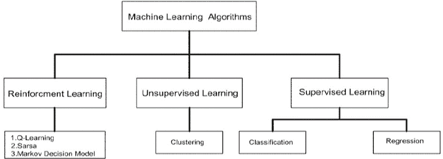

图 (1) 机器学习的类型。

#### 监督学习

这是一种在标记的数据集上训练计算机程序的方法。通过提供输入/输出对来教算法如何将输入映射到输出；例如，垃圾邮件过滤系统可以在已标记的邮件上进行训练，以区分垃圾邮件和非垃圾邮件。算法从这些示例中学习，识别模式以预测新邮件的分类。监督学习可以分为回归（用于预测连续输出，如房价）和分类（用于离散输出，如邮件分类）。流行的监督学习算法包括线性回归、逻辑回归、决策树、随机森林、支持向量机（SVMs）和人工神经网络（ANNs）。

#### 无监督学习

一种机器学习被称为无监督学习，它使用未标记数据来训练算法，没有预定义的标签或输出。这些算法旨在自主识别数据内部的结构和连接，允许对隐藏结构的探索和发现。无监督学习中一种流行的方法是聚类，它根据数据点的共同特征将相关数据点分组，而降维则在保留重要信息的同时减少数据集中的特征数量。流行的聚类方法包括层次聚类、PCA、k 均值和自动编码器。客户细分、异常检测、图像和语音识别以及数据压缩只是无监督学习的一些用途。

#### 半监督学习

半监督学习是一种结合了监督学习和无监督学习的机器学习技术。使用未标记数据来训练算法，没有预定义的标签或输出，通过揭示模式和联系来增加使用标记数据预测的精确度。这种技术在获取标记数据困难或昂贵时特别有用，因为它减少了对标记实例的需求。自然语言处理、数据挖掘、语音和图像识别等领域广泛使用半监督学习。利用未标记数据增强预测性能的受喜爱算法包括自训练和多视图学习。

#### 强化学习

强化学习是机器学习的一个分支。它涉及一个智能体，通过与环境交互并根据其行为获得奖励或惩罚来学习做出决策。智能体旨在获得在整个学习过程中优化总奖励的程序。该过程涉及观察环境、选择动作、接收反馈、更新策略并循环。强化学习应用于机器人、游戏玩和推荐系统。流行的算法包括 Q-learning、策略梯度方法和演员-评论方法。

## 机器学习的核心概念

一个机器学习系统通常包含多个关键元素，这些元素协作促进学习和预测过程。这些组件包括数据、特征、模型和算法。让我们深入探讨这些元素：

### 数据

数据 `[9]` 是任何机器学习系统的基石。它作为模型训练和结果预测的输入。所收集数据的相关性、数量和质量决定了机器学习系统的有效性。数据可以以结构化、半结构化或非结构化的形式存在，并可能来自数据库、文件或 API 等多种渠道。对数据进行预处理和清洗是保证其适用于模型训练的必要程序。

#### 临床宝库

a) 电子健康记录 (EHRs)：这些结构化数据的金矿包含了诊断、药物治疗和实验室检查结果，提供了患者历史的全面视图。

b) 基因组揭秘：DNA 序列和基因表达被用于个性化医疗和风险评估。

c) 影像洞察：`X-rays`、`CT scans` 和 `MRIs` 提供了观察身体的窗口，用于疾病检测。

d) 可穿戴设备：可穿戴设备捕捉的心率和活动模式为健康监测提供了洞察。

#### 临床之外

a) 健康的社会决定因素 (SDoH)：收入、教育和医疗服务的获取是影响结果的因素。

b) 生活方式选择：饮食、运动和睡眠习惯被用于机器学习预测。

c) 社交媒体：情感分析可以用于理解健康趋势。

#### 罕见但强大

a) 文本：使用自然语言处理 (`NLP`) 处理临床笔记以获取洞察。

b) 生物信号：`Electrocardiograms` (`ECGs`) 和 `electroencephalograms` (`EEGs`) 用于监测。

c) 环境：在预测建模中考虑了空气质量和其他因素。

### 特征

特征是机器学习中使用的属性。特征的选择和精炼（包括归一化和缩放）对性能至关重要。

### 模型

模型 `[9]` 是学习过程的表示。各种类型包括 `support vector machines`、`decision trees`、`neural networks` 和 `linear regression`。

### 算法

算法是用于机器学习的方法。监督学习使用标记数据，而无监督学习在未标记数据中发现结构。算法的选择取决于问题和可用数据。

### 在医疗保健中实施机器学习

#### 识别问题

寻找一个可以用机器学习解决的医疗问题，例如诊断疾病或预测治疗方案。

#### 收集数据

收集相关数据，如电子健康记录、医学影像、患者信息、临床笔记或遗传数据。

#### 预处理数据

为机器学习清洗、结构化并处理数据。

#### 开发模型

选择、训练并优化算法。

#### 评估模型

使用准确率、精确度和召回率等指标衡量性能。

#### 部署模型

将模型集成到医疗系统中。

#### 监控与维护

持续监控性能并重新训练模型以保持准确性。

## 监督学习算法

#### 线性回归

这是一种最常用的方法，通过考虑几个独立变量来预测数值型变量，并假设独立变量与结果变量之间存在线性相关 [10]]。由于其应用广泛，该算法对于医疗保健人员来说是易于理解且相对直观的，特别是与其他机器学习算法相比。

论文作者 [11]\] 强调了准确预测医院病房患者人数对于患者安全、健康结果和资源规划至关重要。西拉卡普（Cilacap）地区医院在控制患者人数和临床检查方面的局限性，凸显了准确预测人数的必要性。使用去年平均人数的传统方法由于人数的波动而具有局限性。该研究旨在分析 `RSUD Cilacap` 门诊住院和急诊就诊的每月人数，并开发预测模型。研究人员对这些模型的准确性进行了评估，并将其与平均人数方法进行了比较。该研究使用了五年的回顾性人数数据进行模型开发，并使用两年数据进行验证。使用 `Simple linear regression` 和 `Random Forest` 算法来预测住院、门诊和急诊就诊人数。结果显示，`linear regression` 算法在预测不同类别患者人数方面优于 `Random Forest` 算法。

作者 [12]\] 强调了全球患者安全和医疗质量日益增长的重要性。他们强调了评估医疗机构内部患者安全文化的重要性，以识别优缺点。`Safety Attitudes Questionnaire` 因其可靠的心理测量特性而被广泛用于此目的。该研究的目标是识别显著影响台湾某地区教学医院患者安全文化的人口统计变量，重点关注医生和护士的观点。通过带有 `forward selection` 的 `linear regression`，研究分析了 2015 年内部调查的数据，将十个人口统计变量作为自变量，并将 `Safety Attitudes Questionnaire` 的七个维度作为因变量。结果显示，十个人口统计变量中有四个对问卷的七个维度中的六个有显著影响，其中 `supervisor/manager` 和 `experience in position` 被确定为影响医院患者安全的最关键因素。研究建议医院管理层应考虑员工对这些变量的见解，以不断增强患者安全文化。

### 逻辑回归

`Logistic regression` 在医疗保健的二分类任务中应用广泛。它通过考虑输入变量来计算事件发生的概率。例如，在医疗场景 [13]] 中，`logistic regression` 根据患者的医疗背景和相关风险因素预测其患特定疾病的概率。

在这一综述 [14]] 中，作者研究了预测建模技术 `logistic regression` 在医疗决策中的作用。他们强调了预测建模在医疗领域的重要性，并强调理解 `logistic regression` 及其相关术语对于有效数据分析性。作者提供了一个使用 `R` 编程语言实现 `logistic regression` 的示例，并讨论了它在医学研究中的应用。

作者 [15]\] 对一个癌症患者的数据集使用了 `forward` 和 `backward stepwise logistic regression` 算法。他们确定了包括 `fatigue`、`depression`、`severity of colds` 和 `insomnia` 在内的四个变量是有效预测因子。通过显著性检验、相对于竞争模型的改进以及拟合优度确认了模型的有效性。

### 决策树

它们是自适应算法，可同时用于 `regression` 和 `classification`。`Decision trees` 构建了一个表示决策的树形算法。在医疗保健领域，`decision trees` 在证明疾病诊断 [16]]、患者结果预测和风险因素识别等任务中非常有价值。


论文作者[17]强调了拥有准确且易理解的数据分析系统对帮助医生的重要性。这些系统在预测癌症是否复发以及患者能生存多久方面非常有帮助。为了创建这样的系统，作者建议使用`fuzzy decision trees`的混合，而不是仅仅使用普通的分类器。研究中测试了不同的`decision tree rules`、`fuzzy membership functions`和`inference techniques`组合。研究人员使用了名为`SEER`的数据集，该数据集包含了大量关于 1973 年至 2003 年美国癌症病例的信息。结果显示，与单独使用普通方法相比，`fuzzy decision tree`方法更可靠且更平衡。

在本文中，作者[18]提出开发了一种名为`alternating decision tree`的有效方法，用于心脏病的早期检测。这种方法是传统`decision trees`的高级版本，已应用于来自海得拉巴（Hyderabad）各家医院收集的患者记录。通过优化学习算法使用的特征并利用`Principal Component Analysis (PCA)`识别心脏病数据中的关键特征，提高了该方法的效率。

## 随机森林

这些是集成学习方法，使用许多`decision trees`来创建预测。最终预测通过聚合森林中每棵树的预测结果获得，每棵树都是在数据的不同子集上训练的[19]。`Random forests`因其稳健性和处理高维数据的专长，在医疗保健领域被广泛使用。

作者提出，随机森林作为一种成功的决策树学习技术，已在医学领域被广泛应用，特别是用于糖尿病诊断[20]。由于糖尿病在发展中国家和新兴工业化国家变得越来越常见，作者建议使用随机森林来帮助诊断该疾病。在这项研究中，他们利用随机森林原理创建了一个强大的糖尿病诊断模型。他们使用来自 UCI 存储库的名为`Pima Indians Diabetes`的数据集进行了实验。他们开发了具有不同树数量的多个随机森林模型以寻找最佳森林规模。随后，他们将随机森林的性能与其他机器学习方法进行了比较。实验结果表明，与其他机器学习方法相比，作者采用随机森林的方法在糖尿病诊断表现更好且效率更高。

## 支持向量机 (SVM)

支持向量机 (SVM) [21] 是一种用于分类和回归任务的稳健算法。它们通过确定一个最优超平面来有效分离数据集中的不同类别。在医疗保健应用中，SVM 被证明对于疾病分类、患者结果预测和识别关键风险因素等任务具有极价值。

在本章中，作者探索了利用电子健康记录 (EHRs) 诊断癌症，并强调了早期检测的重要性[22]。通过利用纽约市诊所的 EHR，作者使用医疗记录训练了一个支持向量机 (SVM) 模型来对不同类型的癌症进行分类。实验结果显示，每种癌症使用 100 份医疗记录训练的 SVM 模型对 10 种癌症实现了 86.2% 的预测准确率；当每种癌症使用 400 份医疗记录训练时，对 3 种癌症的准确率达到了 97.33%。这项研究强调了使用 EHR 和机器学习技术（如 SVM 模型）准确诊断多种癌症的潜力，有助于改善患者预后。

## 神经网络

神经网络特别包括先进的深度学习模型，这些模型在医疗领域获得了巨大的认可[23]。这些模型灵感源于人类大脑，包含多个相互连接的模块或神经元。它们非常擅长理解数据中复杂的模式和连接。它们在医疗保健领域的应用跨多个领域，包括图像分析、疾病诊断、药物发现和患者结果预测。

在这项研究中，作者[24]提出了一种卷积神经网络 (CNN) 方法，通过分析全切片图像 (WSIs) 中的恶性导管癌组织区域来自动识别乳癌。通过在大型 RGB 图像块数据集上使用 CNN 架构，该系统在检测乳癌方面实现了 87% 的显著准确率，比传统机器学习 (ML) 算法的准确率提高了 9%。结果证明了 CNN 在减少人为错误和改进乳癌诊断过程方面的潜力，为增强患者预后和拯救生命提供了一种很有前景的方法。

## 朴素贝叶斯

朴素贝叶斯基于贝叶斯定理的概率原理运行[25]。它假设在给定类别标签的情况下，特征之间相互独立。在医疗保健中，朴素贝叶斯应用于文本分类、情感分析以及根据多个特征预测事件概率等任务。

脑癌由于脑部异常胶质细胞的增殖，已成为日益关注的全球健康问题，特别是在老年人群体中。这项研究[26]旨在开发一种专门用于准确检测受癌症影响脑组织的方法，重点关注 4 级肿瘤——胶质母细胞瘤 (GBM)，该肿瘤以其高度恶性性和易转移的倾向而闻名。所提的方法采用了朴素贝叶斯分类，结合了多种技术，如脑部 MRI 数据库利用、预处理、形态操作、像素减法、最大熵阈值化、统计特征提取以及基于朴素贝叶斯分类器的预测算法。主要目标是识别各种脑部 MRI 图像中的肿瘤区域，并确定这些区域是否为癌症。值得注意的是，该方法能够有效检测不同脑区域的肿瘤，包括与眼平线对齐的中区域，这与其他方法相比具有显著优势。使用包含 50 张 MRI 图像的数据集进行评估，得到的肿瘤检测率为 81.25%，非肿瘤图像的检测率为完美的 100%，最终整体准确率达到了令人印象深刻的 94%。

这些仅代表了医疗保健领域使用的监督学习算法的一个子集。特定算法的选择取决于独特的问题、可用数据和预期目标。

## 监督学习算法在医疗保健中的应用

监督学习算法在医疗保健领域有广泛的应用，彻底改变了该行业的各个方面。以下是一些关键示例：

### 疾病诊断与预后

监督学习算法在开发疾病诊断和预后模型方面具有极高价值。通过对标记数据进行大量训练，这些算法破解了连接患者特征与疾病结果之间的复杂模式。它们通过提高诊断准确性和预见疾病进展赋能了医疗专业人员。

Yu Cao 等人[27]利用深度学习为农村地区引入了一种增强诊断技术。鉴于结核病的慢性和传染性，研究人员设计了两种方法。第一种方法涉及收集结核涂片筛查数据，并使用卷积神经网络对疾病表现进行分类。第二种方法侧重于克服两个关键障碍：如 ANODE GRAND CHALLENGE 数据库和 Image CLEF 数据库等公共 X 光图像存储库的可用。值得注意的是，这种方法在 CNN 的帮助下实现了 89.6% 的显著准确率。

Shikha Agrawal 等人[28]进行了癌症预测。他们研究了多层感知器的使用，并发现可以获得 97.1% 的准确率。他们还研究了 PNN 的准确率，发现为 96%。他们建议研究在隐藏层中使用多个神经元以进一步增强其性能。

Quan DOA 和同事[29]研究了使用深度神经网络（一种机器学习算法）来预测哮喘患者的病情严重程度。他们检查了总共 8,023,590 住院记录，实现了 86% 的准确率。评估涉及三个数据集，准确率分别为 90.3%、95% 和 88%。总体而言，该模型实现了 91.1% 的准确率，特异性为 89.3%，敏感性为 93%。

### 医学图像分析

监督学习算法[30]在解读如 X 光、MRI 和 CT 扫描等复杂的医学图像方面起着关键作用。它们识别异常情况、分类肿瘤、分割器官并辅助基于图像的诊断。通过从标记图像中学习，这些算法确保了对医学视觉信息的精确解释和分析。

在研究中，Shin *et al.*[31]利用`CNN`和迁移学习来识别 CT 扫描中肿大的胸腹淋巴结并对间质性肺疾病进行分类。结果证明了迁移学习的益处，即使在自然图像与医学图像之间存在巨大差异时，这种方法依然有效。

在研究中，Chen *et al.*[32]结合了`RNN`和`CNN`方法，并将其应用于三维电子显微镜图像，以分割神经元和真菌结构。他们的方法涉及利用多维度`LSTM`来实现有效分割。

在研究中，Rajpurkar *et al.*[33]利用了一种名为`CheXNet`的改进型`DenseNet`，该模型具有 121 层卷积层，用于对胸部 X 光中观察到的 14 种疾病进行分类。该模型在`ChestXray14`数据集的 112,000 张图像上进行了训练。值得注意的是，`CheXNet`在 14 种疾病的分类中达到了领先水平，通过受试者工作特征 (`ROC`) 分析，其卓越的曲线下面积 (`AUC`) 分数高达 0.7632，在肺炎分类方面表现尤为出色。在测试了 420 张图像后，所提出的神经网络效率达到或超过了人类水平。

在研究中，Shen *et al.*[34]采用了卷积神经网络 (`CNNs`)、支持向量机 (`SVM`) 和随机森林 (`RF`) 分类器的组合，用以区分良性和恶性肺结节。他们的研究使用了来自`LIDC-IDRI`数据集的 1010 份标记扫描。实施了三个并行的`CNNs`，每个模型包含两个卷积层。这些`CNNs`通过处理不同尺度的图像块来提取特征。这些识别出的特征被用于创建一个输出特征向量，随后通过应用包含径向基函数 (`RBF`) 滤波的支持向量机 (`SVM`) 或随机森林 (`RF`) 分类器将其归类为良性或恶性。所提出的方法在结节分类中达到了 86% 的惊人准确率，证明了其对不同水平噪声输入的鲁棒性。

Li *et al.*[35]在其研究中利用三维卷积神经网络 (`CNNs`) 填补 MRI 和 PET 图像之间的缺失影像数据。该研究涉及来自`ADNI`数据库的 830 名阿尔茨海默病患者的数据。这些三维卷积神经网络以 MRI 扫描为输入，相应的 PET 扫描为输出进行训练。这些训练后的模型随后被用于缺少 PET 图像的患者重建图像。重建后的 PET 图像显示出高度相似性。然而，该研究没有解决过拟合问题，可能会限制其技术的泛化能力。

## 药物发现与开发

在药物发现领域，监督学习算法[36]起着重要作用。它们分析化学化合物的大量数据集，预测潜在药物的有效性和安全性。这些算法简化了候选药物的识别，促进了优化的药物设计。

作者[37]创建了一个基于决策树的元分类器。来自各种连接（包括蛋白质-蛋白质、代谢和转录相互作用）的信息被用于训练这个元分类器。还包括了组织表达和亚细胞定位数据。他们研究的目标是识别可能被与疾病相关的药物靶向的基因。研究人员通过检查决策树，确定了识别与代谢途径、细胞外位置以及多个转录因子 (`TFs`) 调节相关的基因的重要特征。

在研究中，Jeon *et al.*[38]创建了一个`SVM`分类器，将与卵巢、胰腺和乳腺恶性肿瘤相关的蛋白质分为药物靶点和非药物靶点。作为关键的分类标准，他们使用了一系列基因组数据集，包括基因必需性、`mRNA`表达、`DNA`拷贝数、突变发生和蛋白质-蛋白质相互作用网络架构。他们的调查发现了 122 个全球癌症靶点，其中 69 个与已知的 116 个癌症靶点重叠。此外，发现了 266 个乳腺癌特有靶点、462 个胰腺癌特有靶点和 355 个卵巢癌特有靶点。研究人员使用肽抑制剂测试了两个预期目标，它们在细胞培养模型中显示出强大的抗增殖作用，以验证他们的发现。此外，他们发现目标抑制剂可以预测胰腺癌。Pare *et al.*[39]引入了一种新型机器学习框架，利用梯度提升回归树构建多基因风险评分，以预测复杂性状。他们使用`UK Biobank`数据集评估了其基于`SNP`的模型的性能，发现这些模型成功解释了身高 46.9% 的总多基因变异和 BMI 32.7% 的总多基因变异。

### 个性化医疗

监督学习算法在定制医疗时代至关重要[40]。通过检查包括遗传信息、病史和生活方式细节，这些技术可以预测特定的治疗结果。它们定制治疗方案，做出最可能的医疗选择。

在研究中，Aliper *et al.*[41]利用了在转录反应大量数据上训练的深度神经网络潜力。该研究旨在分类药物反应并发现药物重用的可能性。`DNN`在来自`Broad LINCS`数据库的三个细胞系的 26,420 个扰动样本上进行了训练，这些样本被分为 12 种治疗类别。`DNN`专门用于处理高维复杂性，通过分析误分类药物的特征为潜在的药物重用提供了见解。

Kasabov *et al.*[42]开发了一种独特的脉冲神经网络储器系统，用于建模时空/谱时间数据并提供个性化的中风预测，研究人员将其性能与多线性回归 (`MLR`)、支持向量机 (`SVM`) 和多层感知器 (`MLP`) 等传统机器学习技术进行了比较。结果表明，采用他们的创新方法后准确率有了显著提高，达到了 94% 的准确率。

对于健康监测和预测分析[44]，监督学习算法分析来自可穿戴设备、电子健康记录（EHR）及其他来源的数据。它们能够识别健康数据中的显著趋势和变化趋势，从而预测特定健康状况发生的概率。这些算法可以识别健康状况恶化的早期迹象，并实现主动干预。

在他的研究中，作者[45]开发了一个预测模型，利用来自可穿戴设备的数据为心血管问题提供个性化的预后。该模型基于`Logistic Regression`（逻辑回归），实现了 87% 的卓越准确率。然而，该研究承认了仅依赖准确率的局限性，特别是在处理不平衡类别时。为了解决这个问题，人员实施了重采样技术来应对类别不平衡问题。随后，他们通过结合逻辑回归、梯度提升和随机森林构建了一个集成模型。该集成模型使召回率（recall values）显著提升了 40%-70%。评估指标包括 80% 的`AUC`分数，该分数衡量`ROC`曲线下的面积。对集成分类器的全面评估表明，其与各种现有技术相比具有优越的性能。

Abdulsalam Yassine *et al.*[46]引入了一种新模型，利用智能家居大数据的力量来学习并发现人类活动模式，以用于医疗保健。他们的方法涉及利用频繁模式挖掘、聚类分析和预测等技术，量化并分析由住户行为导致的能耗波动。通过采用这些方法，人员旨在获取个人如何与其生活环境交互的价值见解，最终目标是改善医疗结果。

### 欺诈检测与医疗计费

在医疗计费中，监督学习算法对于欺诈检测是不可缺的。它们仔细分析标记数据，精准识别账单欺诈和保险欺诈等欺诈活动。这些算法使医疗机构能够预防和检测欺诈行为，维护医疗计费系统的完整性。

He *et al.*[47]对全科医生（GPs）领域内的欺诈和滥用行为进行了调查，利用了澳大利亚健康保险委员会（HIC）的数据。他们确定了一组由专家推荐的 28 个相关特征，用于进行有效的欺诈检测。通过使用带有标记数据的监督学习方法，团队采用了多层感知器（`MLP`）神经网络来对 1500 名全科医生的执业情况进行分类。为了增强分类结果，实施了自组织映射（`SOM`）与`MLP`的集成。`SOM`用于对网络类别进行分类，随后由`MLP`进行二分类。研究结果显示，`MLP`的准确率为 63.60%，`SOM`为 59.87%，而`SOM`后接`MLP`的组合准确率则达到了惊人的 88.40%。需要强调的是，该研究的重点是全科医生的数据，专门针对欺诈和滥用行为的检测，而不是旨在开发一种针对交易的详尽欺诈检测方法。

Ortega *et al.*[48]提出了一种监督学习方法。（注：提示中提供的 Ortega et al. 章节源文本似乎被截断/不完整，但此处保留了提供的核心内容）。

无监督学习算法在医疗健康领域有广泛的应用，能够在无需标记示例的情况下揭示医疗数据内部复杂的模式和结构。以下是无监督学习算法在医疗领域的著名应用：

# 医疗领域的无监督学习算法

## 1. 聚类与患者分

无监督学习聚类方法根据健康状况、遗传或病史的相似性对患者进行分类。这种分组有助于识别具有相似特征的患者群体，完善个性化治疗计划、针对性干预并推进精准医学。

作者开发了一种用于聚类和探索医疗数据的创新方法，详见论文[59]。该方法利用了`Self Organizing Map (SOM)`技术。在早期，为了确定最合适的聚类数量，作者采用`Genetic K-Means`算法对医疗数据进行聚类，以促进知识发现。通过实证评估，所提算法与现有方法相比表现优异。此外，论文还引入了一种利用每个簇内训练变量密度分布的可视化应用。这种可视化表示有助于对聚类特征建立全面的理解，增强了聚类医疗数据的可解释性。

## 2. 异常检测与欺诈预防

无监督学习算法通过识别异常或离群值，能够识别医疗数据中的异常或可能的欺诈活动。这些算法通过识别异常患者行为、强调可疑保险理赔以及检测不规则账单模式，减少财务损失并维护医疗系统的完整性。

Anand *et al.*[60]对社交网络（特别是互联网）中的异常识别进行了彻底的调查。作者们特别研究了基于行为和结构的方法在异常识别中的应用。分析社交网络中恶意活动导致的网络结构属于结构化方法。而行为方法则侧重于检查系统内的用户交互和使用模式，从而对网络内的用户进行分类。

Fang *et al*[61]提出了一种基于机器学习的异常检测方法，专门用于物联网医疗设备。通过使用预设准则和一致的行为，作者提出了一种识别设备非法行为的新方法。通过根据建议的方案将系统归类为异常或正常，该方法能够有效地发现设备中的异常。

Nho *et al.*[62]提出了一种使用生成对抗网络（GAN）的可穿戴设备跌倒检测方法，当检测到跌倒等异常时及时向护理人员报警。该方法在包含心率传感器和加速度计的腕带设备上进行了实施和测试，并与其他跌倒检测方法进行了比较。通过利用这些传感器的实时数据，`GAN`分析与跌倒相关的模式，并向护理人员触发即时报警消息，可能减少对老年人的伤害。这种创新方法通过在跌倒时提供及时通知，在增强人的安全和健康方面具有前景。

## 3. 降维与特征提取

诸如`主成分分析 (PCA)`或`t-分布随机邻域嵌入 (t-SNE)`等算法在保留关键信息的同时，降低了高维医疗数据的复杂度。这种简化有助于复杂数据集的可可视化、确定相关特征并提高计算效率。

Chormunge and Jena [63]提出了一种独特的特征选择技术，解决了数据挖掘任务中的维度问题。他们的方法结合了相关性和聚类方法来减少所使用的特征。该方法首先采用`k-means`聚类算法来消除无关特征。然后，在每个簇内，使用相关性度量选择非冗余特征。最后，将选定的特征使用`naïve Bayes`算法在微列和文本数据库上进行分类。

Sawhney *et al.*[64]提出了一种涉及选择最优特征子集的方法，显著提高了`随机森林分类器`在诊断宫颈癌、乳腺癌、肝癌细胞癌方面的分类准确率。通过将惩罚函数与`二进制萤火虫算法`相结合以选取最相关的特征，该技术为提高癌症诊断的准确性提供了可行途径。

## 4. 推荐系统

无监督学习算法驱动着医疗推荐系统。这些算法通过分析患者数据、治疗结果和医学文献，根据患者的相似性或认可的医学标准，提供个性化的治疗方案、药物或干预。


在研究 [65] 中提出的 `I-Wellness` 系统是一个旨在评估个人当前医疗状况并提供定制健康建议的尖端框架。该研究通过基于知识的方法，结合了医疗专业人员的专业知识，以提高预测准确性和治疗建议的可靠性。利用这些信息，`I-Wellness` 系统能够逐个评估患者数据，并提供专门根据其医疗需求产生的建议。这种策略通过确保患者获得符合其特定医疗问题的合适且定制的健康治疗，具有显著改善医疗结果的潜力。

另一项研究 [66] 采用了一种规则挖掘技术为患者提供治疗和建议。该研究考虑了患者的病史和现状，以及做出建议时的任何相关限制。为了简化流程，使用患者的医疗数据将他们归类为不同的组，然后用于规则挖掘。治疗建议和建议是基于基于内容的匹配生成的，这种匹配考虑了患者的偏好。

一些作者 [67] 提出了一种基于机器学习的创新方法，用于填补健康数据集中的缺失值。他们使用了著名学习算法 `RIPPER` 的修改版本，称为`模糊无序规则归纳算法 (FURIA)`。在该研究中，`FURIA` 特别用于填补，并产生用于分类数据的规则。作者通过与 `KNN`、`J48`、`SVM` 和均值填补等替代技术对比，评估了 `FURIA` 的性能。结果显示，`FURIA` 在敏感性方面优于其他方法，表明其能够很好地填补健康数据集中的缺失值。

## 医学图像中的异常检测

无监督学习算法分析大量的正常照片，并将其与医学图像进行比较，以发现异常或异常。这项技术通过识别肿瘤或病变等偏差有助于疾病早期检测，提高诊断准确性。

[68] 进行的研究集中于利用监督机器学习方法来识别美国各州欺诈性的医疗保健提供者。该研究评估了三个机器学习模型，其中`决策树`和`逻辑回归`在检测欺诈性提供者方面表现出有效的性能。然而，数据集缺乏欺诈标签导致了数据集不平衡。为了缓解这一挑战，应用了`随机下采样策略`来创建多样的类别分布。这项研究通过展示机器学习技术在检测欺诈活动方面的有效性，为医疗欺诈检测领域做出了贡献，并强调了在此类分析中解决数据不平衡问题的重要性。这些应用强调了无监督学习算法在医疗保健领域的多功能性，揭示了隐藏模式，精炼了数据分析，并加强了医学领域的决策过程。

## 机器学习模型的评估与验证

评估和验证是机器学习模型开发过程中不可不可少的步骤。这些步骤使得能够评估性能以及模型的泛化能力。

### 模型评估

机器学习中的模型评估是根据预定义标准衡量模型有效性的过程。主要目标包括评估模型在训练期间未使用的数据上的性能、识别任何局限性并避免过拟合。常用的指标包括 `f1score`、`recall`（召回率）、`precision`（精确率）、`accuracy`（准确率）、`AUC`、`confusion matrix`（混淆矩阵）和 `mean square error`（均方误差）。为了确保性能估计无偏，在独立数据上评估模型至关重要。

### 模型验证

完成模型评估后，下一阶段是“模型验证”，使用未参与训练或评估阶段的新数据集对所选模型的性能进行评估。进行验证是为了确保模型在以前未见过的数据上运行良好并能够良好泛化。通常，使用名为`验证集`的独立数据集为此目的。为了确保验证的无偏，建立一个与负责开发模型的数据科学团队不同的验证团队至关重要。

## 医疗保健的未来方向

### 个性化医疗

通过根据患者自身的遗传组成、医学背景和环境状况定制治疗方案，机器学习（ML）可以超越通用方法。想象一下通过预测个体对药物的反应并优化剂量，从而最大化疗效并减少副作用，这为实现真正的个性化医疗铺平了道路。

### 疾病早期检测

机器学习算法可以分析来自可穿戴设备、扫描和其他来源的海量数据流，寻找暗示疾病早期阶段的细微模式。这允许进行主动干预并可能避免严重并发症。例如，AI 驱动的胸光分析工具在检测肺癌方面已经达到了接近人类的准确率，为早期治疗提供了关键窗口。

### 预测分析与风险评估

通过处理健康数据，机器学习模型可以预测患者发生特定疾病或不利事件的风险。这使医疗保健提供者能够优先考虑预防措施，并为高风险患者制定个性化护理计划。想象一下预测并防止再次住院，拯救生命并降低医疗保健成本。

虚拟助手与聊天机器人 AI 驱动的助手可以为患者提供 24/7 的支持、提供信息、安排预约，甚至进行症状分析。这可以减轻医生的负担并提高患者获得护理的机会，特别是在农村地区。想象一下聊天机器人引导患者进行慢性病的自我护理管理，赋予他们管理健康的能力。

## 结论

在医疗保健领域，机器学习面临着一系列挑战和障碍。伦理考量、数据隐私问题以及对可解释性的需求是重大的障碍。训练机器学习模型至关重要的标记数据匮乏往往阻碍了进展。此外，将这些技术无缝集成到现有的医疗保健基础设施中需要仔细的考虑。尽管这些挑战看起来可能是严巨的，但它们为创新解决方案的出现提供了机会。

一些重要的挑战如下：

a) `数据隐私与安全`：患者数据极其敏感，在机器学习算法中使用它引发了对泄露和滥用的担忧。稳健的安全措施和的法律框架对于确保医疗保健中伦理且负责的 AI 开发至关重要。

b) `算法偏差与公平性`：机器学习模型可能会延续训练数据中偏差，可能导致某些患者群体获得不公平的结果。需要仔细的数据清洗、偏差检测技术和多样化的开发团队来减轻这些风险。

c) `互操作性与集成`：医疗保健数据通常分散在不同的系统和机构中。互操作的数据平台和标准化格式对于整个医疗生态系统中信息的无缝交换和有效利用机器学习至关重要。

## 参考文献

|  ||  |
| --- | --- |
| \[1\] || Agrawal Rashmi. Fundamentals of machine learning. Machine learning for healthcare: Handling and managing data. 2020. |
| \[2\] || Tyagi AK, Chahal P. Artificial intelligence and machine learning algorithms. Research Anthology on Machine Learning Techniques, Methods, and Applications 2022421-46.[`dx.doi.org/10.4018/978-1-6684-6291-1.ch024`](http://dx.doi.org/10.4018/978-1-6684-6291-1.ch024) |
| \[3\] || Ahmed Z, Mohamed K, Zeeshan S, Dong X. Artificial intelligence with multi-functional machine learning platform for better healthcare and precision medicine. Database (Oxford) 2020; 2020: baaa010.[`dx.doi.org/10.1093/database/baaa010`](http://dx.doi.org/10.1093/database/baaa010) \[PMID: [32185396](http://www.ncbi.nlm.nih.gov/pubmed/32185396)\] |
| \[4\] || Rashidi HH, Tran N, Albahra S, Dang LT. Machine learning in health care and laboratory medicine: General overview of supervised learning and Auto-ML. Int J Lab Hematol 2021; 43(S1) (Suppl. 1): 15-22.[`dx.doi.org/10.1111/ijlh.13537`](http://dx.doi.org/10.1111/ijlh.13537) \[PMID: [34288435](http://www.ncbi.nlm.nih.gov/pubmed/34288435)\] |

## 参考文献

- [5] Eckhardt CM, Madjarova SJ, Williams RJ, *et al.* 医疗保健中的无监督机器学习方法及其新兴应用。Knee Surg Sports Traumatol Arthrosc 2023; 31(2): 376-81. [`dx.doi.org/10.1007/s00167-022-07233-7`](http://dx.doi.org/10.1007/s00167-022-07233-7) [PMID: [36378293](http://www.ncbi.nlm.nih.gov/pubmed/36378293)]

- [6] Zhang G, Ou SX, Huang YH, Wang CR. 大规模医疗数据分析半监督学习方法。Int J Comput Healthc 2015; 2(2): 98. [`dx.doi.org/10.1504/IJCIH.2015.069788`](http://dx.doi.org/10.1504/IJCIH.2015.069788)

- [7] Yu C, Liu J, Nemati S, Yin G. 医疗保健中的强化学习：综述。ACM Comput Surv 2023; 55(1): 1-36. [`dx.doi.org/10.1145/3477600`](http://dx.doi.org/10.1145/3477600)

- [8] Doupe P, Faghmous J, Basu S. 健康服务研究人员的机器学习。Value Health 2019; 22(7): 808-15. [`dx.doi.org/10.1016/j.jval.2019.02.012`](http://dx.doi.org/10.1016/j.jval.2019.02.012) [PMID: [31277828](http://www.ncbi.nlm.nih.gov/pubmed/31277828)]

- [9] Miotto R, Wang F, Wang S, Jiang X, Dudley JT. 医疗保健深度学习：回顾、机会与挑战。Brief Bioinform 2018; 19(6): 1236-46. [`dx.doi.org/10.1093/bib/bbx044`](http://dx.doi.org/10.1093/bib/bbx044) [PMID: [28481991](http://www.ncbi.nlm.nih.gov/pubmed/28481991)]

- [10] Rohith G. 机器学习算法简介：线性回归 2018。

- [11] Baihaqi WM, Dianingrum M, Ramadhan KAN, Hariguna T. 用于建模和预测医院就诊人数的线性回归方法。2018. [`dx.doi.org/10.1109/ICITISEE.2018.8720979`](http://dx.doi.org/10.1109/ICITISEE.2018.8720979)

- [12] Chi CY, Wu HH, Huang CH, Lee YC. 从医生和护士视角利用线性回归识别影响患者安全文化的关键人口统计学变量。 Hosp Pract Res 2017; 2(2): 47-53. [`dx.doi.org/10.15171/hpr.2017.12`](http://dx.doi.org/10.15171/hpr.2017.12)

- [13] Khan H, Srivastav A, Mishra AK. 分类算法在医疗保健中的应用。Big Data Analytics and Intelligence: A Perspective for Health Care 2020231-54. [`dx.doi.org/10.1108/978-1-83909-099-820201007`](http://dx.doi.org/10.1108/978-1-83909-099-820201007)

- [14] Panda NR. 医学研究中逻辑回归综述。 Natl J Community Med 2022; 13(4): 265-70. [`dx.doi.org/10.55489/njcm.134202222`](http://dx.doi.org/10.55489/njcm.134202222)

- [15] Peng CYJ, Manz BD, Keck J. 使用逻辑回归对分类变量进行建模。Am J Health Behav 2001; 25(3): 278-84. [`dx.doi.org/10.5993/AJHB.25.3.15`](http://dx.doi.org/10.5993/AJHB.25.3.15) [PMID: [11322627](http://www.ncbi.nlm.nih.gov/pubmed/11322627)]

- [16] Charbuty B, Abdulazeez A. 基于决策树算法的机器学习分类。Journal of Applied Science and Technology Trends 2021; 2(1): 20-8. [`dx.doi.org/10.38094/jastt20165`](http://dx.doi.org/10.38094/jastt20165)

- [17] Khan MU, Choi JP, Shin H, Kim M. 使用模糊决策树预测个性化医疗中的乳腺癌生存率。2008.

- [18] Jabbar MA, Deekshatulu BL, Chndra P. 用于心脏早期诊断的交替决策树。International Conference on Circuits, Communication and Computing 201432-8. [`dx.doi.org/10.1109/CIMCA.2014.705716`](http://dx.doi.org/10.1109/CIMCA.2014.705716)

- [19] Criminisi A. 决策森林：用于分类、回归、密度估计、流形学习和半监督学习的统一框架。Foundations and Trends in Computer Graphics and Vision 2011; 7(3): 81–227.

- [20] Benbelkac S, Atmani B. 用于糖尿病的随机森林。2019 International Conference on Computer and Information Sciences (ICCIS)

- [21] Ashwin R. [`datascience.com/unlocking-the-truepower-of-support-vector-regression-847fd123a0`](https://datascience.com/unlocking-the-truepower-of-support-vector-regression-847fd123a0) 2020.

- [22] Zhang X, Xiao J, Gu F. 支持向量机应用于电子健康记录分类。2019 Spring Simulation Conference (SpringSim) 20191-9. [`dx.doi.org/10.1109/SpringSim.2019.873290`](http://dx.doi.org/10.1109/SpringSim.2019.873290)

- [23] Chen YW, Jain LC. 医疗保健中的深度学习 2020; Vol. 171 [`dx.doi.org/10.1007/978-3-030-32606-7`](http://dx.doi.org/10.1007/978-3-030-32606-7)

- [24] Alanazi SA, Kamruaman MM, Islamer MN, *et al.* 使用卷积神经网络进行癌症检测。J Health Eng 2021; 2021:1-11. [`dx.doi.org/10.1155/2021/552862`](http://dx.doi.org/10.1155/2021/552862) [PMID: [33884157](http://www.ncbi.nlm.nih.gov/pubmed/33884157)]

- [25] Daniel B. 贝斯定理与朴素分类器。生物信息学与计算生物学百科：生物信息学 403 (2018): 412.

- [26] Zaw HT, Maneerat N, Win KY. 基于朴素贝斯的脑肿瘤检测。2019. [`dx.doi.org/10.1109/ICEAST.2019.880256`](http://dx.doi.org/10.1109/ICEAST.2019.880256)

- [27] Maity NG, Das S. 用于改进医疗保健诊断与预后的机器学习。2017 IEEE Aerospace Conference 20171-9. [`dx.doi.org/10.1109/AERO.2017.794395`](http://dx.doi.org/10.1109/AERO.2017.794395)

- [28] Agrawal S, Agrawal J. 用于癌症预测的神经网络技术。Procedia Comput Sci 2015; 60: 769-74. [`dx.doi.org/10.1016/j.procs.2015.08234`](http://dx.doi.org/10.1016/j.procs.2015.08234)

- [29] Do Q, Son TC, Chaudri J. 使用 tensorflow 和多级数据库对哮喘严重程度和药物进行分类。Procedia Comput Sci 2017; 113: 344-51. [`dx.doi.org/10.1016/j.procs.2017.08343`](http://dx.doi.org/10.1016/j.procs.2017.08343)


# 医疗保健机器学习洞察

Ajay Kumar, Kanika Singhal, Kirti Kushwah，Inderprastha 工程学院， 印度加齐亚巴德

## 摘要

机器学习通过提供医疗机会，有潜力改善该行业。机器学习还可以简化并加速这一过程。当与医疗数据库整合时，机器学习提取价值见解的能力变得尤为重要。机器学习的结果取决于我们输入的数据质量。机器学习的进展包括糖尿病视网膜病诊断、乳腺癌病理学、通过共病聚类检测自症以及大规模表型分析。尽管有了这些进展，机器学习在医疗保健中的直接应用仍然有限。

**关键词：** 算法、数字化、医疗保健、智能、机器学习、医学。

通讯作者 Kanika Singhal：Inderprastha 工程学院， 印度加齐亚巴德；电子邮箱：kanikasinghal28@gmail.com

## 引言

我们生活在算法时代，机器学习（`ML`）和深度学习（`DL`）技术正在改变制造业、运输和管理等各个行业。在医疗保健领域，医生收集每个患者的医疗信息并利用知识做出最佳判断。因此，持续学习对于改进医疗护理至关重要。机器学习利用数据推动计算机视觉、自然语言处理（`NLP`）和自动语音识别（`ASR`）等领域的发展，催生自动驾驶、语音助手和自动翻译。

千禧一代和 Z 世代沉浸在数字世界中，大多数消费者已经习惯了技术驱动的解决方案。大多数消费者已经在寻找他们的数字需求，例如在线订餐、全国送货购车以及在线购物而非访问实体店。我们的目标是通过实施各种计划来增强患者的整体体验，例如通过在线预约和访问来提高面诊、自动随访、远程医疗整合和直接患者交互的效率。

由于运营成本上升、医疗保健各领域劳动力短缺以及“以少胜多”的方法的共同作用，医疗保健公司被迫转向技术以改进其业务。调度和非人类资源（如手术室、床位和设施）的战略性应用将持续进行。

考虑到近期 COVID-19 疫情后对慢性疾病和预防性治疗的人为压制，这一点尤为重要。最近通过的《21 世纪医疗法案》中的一个章节要求提供者提供对支付记录和受保护健康信息的电子访问权限。这将改变消费者对透明度的权利格局。为了让患者能够在线访问患者数据，企业必须转向患者门户网站或其他系统。他们还需要开始拆除电子健康记录（`EHR`）系统的孤岛。由于能够更直观地访问自己的记录，今天的消费者期望在整个过程中获得赋权并获取相关信息。

## 参考文献

- [30] De Bruijne M. 医学图像分析中的机器学习方法：从检测到诊断。Med Image Anal 2016; 33: 94-7. [`dx.doi.org/10.1016/j.media.2016.06032`](http://dx.doi.org/10.1016/j.media.2016.06032) [PMID: [27481324](http://www.ncbi.nlm.nih.gov/pubmed/27481324)]

- [31] Shin HC, Roth HR, Gao M, *et al.* 用于计算机辅助检测的深度卷积神经网络：CNN 架构、数据集特征和迁移学习。IEEE Trans Med Imaging 2016; 35(5): 1285-98. [`dx.doi.org/10.1109/TMI.2016.252812`](http://dx.doi.org/10.1109/TMI.2016.252812) [PMID: [36378293](http://www.ncbi.nlm.nih.gov/pubmed/36378293)]

- [32] Chen J, YL, ZY, AM, CDZ. 全卷积和循环神经网络用于 3D 图像分割。Adv Neural Info Syst 2016; 29.

- [33] Rajpurkar P, IJ, ZK, YB, MH, DD, BA, others. CheXnet：基于深度学习的放射科医生水平肺炎检测。arXiv preprint arXiv:1711.05225. 2017.

- [34] Shen W, Zhou M, Yang F, Yang C, Tian J. 用于肺结节分类的多尺度卷积神经网络。2015 年 6 月 28 日-7 月 3 日会议 24 588-99. [`dx.doi.org/10.1007/978-3-319-19992-46`](http://dx.doi.org/10.1007/978-3-319-19992-46)

- [35] Li R, Zhang W, Suk HI, Wang L, Li J, Shen D. 用于改进脑疾病诊断的深度学习成像数据补全。2014 第 17 届国际会议波士顿，马萨诸塞州 2014 年 9 月 14 日-18 日 305-12. [`dx.doi.org/10.1007/978-3-319-10443-0_39`](http://dx.doi.org/10.1007/978-3-319-10443-0_39)

- [36] Vamathevan J, Clark D, Czodrowski P, *et al.* 机器学习在药物发现与开发中的应用。Nat Rev Drug Discov 2019; 18(6): 463-77. [`dx.doi.org/10.1038/s41573-019-0024-5`](http://dx.doi.org/10.1038/s41573-019-0024-5) [PMID: [30976107](http://www.ncbi.nlm.nih.gov/pubmed/30976107)]

- [37] Costa PR, Acencio ML, Lemke N. 基于系统级数据的全基因组疾病及可药物化人类基因预测的机器学习方法。BMC genomics 20101-15. [`dx.doi.org/10.1186/1471-2164-11-S5-S9`](http://dx.doi.org/10.1186/1471-2164-11-S5-S9)

- [38] Jeon J, Nim S, Teyra J, *et al.* 利用机器学习、抑制剂设计和高量筛选识别新型癌症药物靶点的系统方法。Genome Med 2014; 6(7): 57. [`dx.doi.org/10.1186/s13073-014-0057-7`](http://dx.doi.org/10.1186/s13073-014-0057-7) [PMID: [25165489](http://www.ncbi.nlm.nih.gov/pubmed/25165489)]

- [39] Paré G, Mao S, Deng WQ. 一种改进多基因性状基因评分预测的机器学习启发算法。Sci Rep 2017; 7(1): 12665. [`dx.doi.org/10.1038/s41598-017-13056-1`](http://dx.doi.org/10.1038/s41598-017-13056-1) [PMID: [28979001](http://www.ncbi.nlm.nih.gov/pubmed/28979001)]

- [40] Ozer ME, Sarica PO, Arga KY. 加速乳腺癌个性化医疗的新机器学习应用：支持向量机的崛起。 OMICS 2020; 24(5): 241-6. [`dx.doi.org/10.1089/omi.2020.0001`](http://dx.doi.org/10.1089/omi.2020.0001) [PMID: [32228365](http://www.ncbi.nlm.nih.gov/pubmed/32228365)]

- [41] Aliper A, Plis S, Artemov A, Ulloa A, Mamoshina P, Zhavoronkov A. 利用转录组数据预测药物药学性质和药物重利用的深度学习应用。Mol Pharm 2016; 13(7): 2524-30. [`dx.doi.org/10.1021/acs.molpharmaceut.6b00248`](http://dx.doi.org/10.1021/acs.molpharmaceut.6b00248) [PMID: [27200455](http://www.ncbi.nlm.nih.gov/pubmed/27200455)]

- [42] Kasabov N, Feigin V, Hou ZG, *et al.* 用于时空模式个性化建模、分类和预测的演化脉冲神经网络，以中风为例。Neurocomputing 2014; 134: 269-79. [`dx.doi.org/10.1016/j.neucom.2013.09.049`](http://dx.doi.org/10.1016/j.neucom.2013.09.049)

- [43] Zhou X, Kosorok MR. 优治疗方案的因果近邻规则。2017.

- [44] Nithya B, Ilango V. 使用机器学习工具和技术的医疗保健预测性分析。2017 年国际智能计算与控制系统会议 (ICICCS) 2017492-9. [`dx.doi.org/10.1109/ICCONS.2017.8250771`](http://dx.doi.org/10.1109/ICCONS.2017.8250771)

- [45] Amin P, Anikddypally NR, Khurana S, Wu-W. 使用预测分析进行个性化健康监测。2019 年 IEEE 第五届大数据计算会议 (BigDataService) 2019271-8. [`dx.doi.org/10.1109/BigDataService.20190048`](http://dx.doi.org/10.1109/BigDataService.20190048)

- [46] Yassine A, Singh S, Alamri A. 从智能家居大数据中挖掘医疗模式。IEEE Access 2017; 5: 13131-41. [`dx.doi.org/10.1109/ACCESS.2017.271921`](http://dx.doi.org/10.1109/ACCESS.2017.271921)

- [47] He H, Wang J, Graco W. 神经网络在医疗欺诈检测中的应用。Expert Syst Appl 1997; 13(4): 329-36. [`dx.doi.org/10.1016/S0957-4174(97)0045-6`](http://dx.doi.org/10.1016/S0957-4174(97)0045-6)

- [48] Ortega PA, Figueroa CJ, Ruz GA. 基于数据挖掘的医疗理赔滥用检测系统：智利的案例。DMIN 2006; 6: 26-9.

- [49] Aral KD, Güvenir HA, Sabuncuo İ, Akar AR. 欺诈检测模型。Comput Methods Biomed 2012; 106(1): 37-46. [`dx.doi.org/10.1016/j.cmpb.2011.0903`](http://dx.doi.org/10.1016/j.cmpb.2011.0903) [PMID: [2208886](http://www.ncbi.nlm.nih.gov/pubmed/2208886)]

- [50] Liang Z, Zhang G, Huang JX, Hu QV. 基于电子健康记录 (EMRs) 的医疗决策深度学习。2014 年生物信息学与生物医学会议 (BIBM) 2014556-9. [`dx.doi.org/10.1109/BIBM.2014.69219`](http://dx.doi.org/10.1109/BIBM.2014.69219)

- [51] Ge Y, Wang Q, Wang L, *et al.* 使用深度神经网络方法预测中后肺炎。Int J Med Inform 2019; 132: 103986. [`dx.doi.org/10.1016/j.ijmedinf.2019.103986`](http://dx.doi.org/10.1016/j.ijmedinf.2019.103986) [PMID: [31629312](http://www.ncbi.nlm.nih.gov/pubmed/31629312)]

- [52] Liu J, Zhang Z, Razavian N. 深度电子健康记录 (Deep EHR)：利用医疗记录进行疾病预测。2018.

- [53] Esteva A, Kuprel B, Novoa RA, *et al.* 使用深度神经网络进行皮肤科级别的皮肤癌分类。Nature 2017; 542(7639): 115-8. [`dx.doi.org/10.1038/nature21056`](http://dx.doi.org/10.1038/nature21056) [PMID: [28117445](http://www.ncbi.nlm.nih.gov/pubmed/28117445)]

- [54] McKinney SM, Sieniek M, Godbole V, *et al.* 用于乳癌筛查的 AI 系统的国际评估。Nature 2020; 577(7788): 89-94. [`dx.doi.org/10.1038/s41586-019-1799-6`](http://dx.doi.org/10.1038/s41586-019-1799-6) [PMID: [31894144](http://www.ncbi.nlm.nih.gov/pubmed/31894144)]

- [55] Faturrahman M, Wasito I, Hanifah N. 使用深度信念网络进行阿尔茨海默症的结构分类。2017 年国际智能计算与控制系统会议 (ICICCS) 31.

- [56] Tang J, Liu R, Zhang Y. 机器学习模型在预测肾受者患者孢莫素稳定剂量的应用。Sci Rep 2017; 7(1): 42192. [`dx.doi.org/10.1038/s41598-017-42192`](http://dx.doi.org/10.1038/s41598-017-42192)

- [57] Malone B, Simovski C, *et al.* 优化 SARS-CoV-2 的免疫图谱以设计通用疫苗。Sci Rep 2020; 10(1): 7875. [`dx.doi.org/10.1038/s41598-020-7875`](http://dx.doi.org/10.1038/s41598-020-7875) [PMID: [3361777](http://www.ncbi.nlm.nih.gov/pubmed/3361777)]

- [58] Wang D, Zhang C, Wang B, *et al.* 通过深度学习设计高保真 Cas9 变体的 CRISPR 导向 RNA。Nat Commun 2019; 10(1): 284. [`dx.doi.org/10.1038/s41467-019-12281`](http://dx.doi.org/10.1038/s41467-019-12281) [PMID: [3153810](http://www.ncbi.nlm.nih.gov/pubmed/3153810)]

- [63] Chormunge S, Jena S. 基于聚类的高维数据相关性特征选择。《电气系统与信息技术杂志》 2018; 5(3): 542-9. [`dx.doi.org/10.1016/j.jesit.2017.06.004`](http://dx.doi.org/10.1016/j.jesit.2017.06.004)

- [64] Sawhney R, Mathur P, Shankar R. 基于萤火虫算法的癌症诊断包装-惩罚特征选择方法。2018 年第 18 届国际会议澳大利亚墨尔本，维多利亚州，2018 年 7 月 2 日 5 日 438-9. [`dx.doi.org/10.1007/978-3-319-95162-1_30`](http://dx.doi.org/10.1007/978-3-319-95162-1_30)

- [65] Pheng LT, Husain W. I-wellness：一种个性化健康治疗的混合案例框架。2010 年国际信息技术研讨会 20101193-8. [`dx.doi.org/10.1109/ITSIM.2010.5561485`](http://dx.doi.org/10.1109/ITSIM.2010.5561485)

- [66] Sharma M, Ahuja L. 医疗保健推荐系统的数据挖掘方法。第三次国际会议，NGCT 2017 印度德拉杜恩，2017 年 10 月 30 日-31 日 199-210. [`dx.doi.org/10.1007/978-981-10-8657-1_16`](http://dx.doi.org/10.1007/978-981-10-8657-1_16)

- [67] Rahman MM, Davis DN. 针对临床数据集的机器学习缺失值插补方法。2013. [`dx.doi.org/10.1007/978-94-007-6190-2_19`](http://dx.doi.org/10.1007/978-94-007-6190-2_19)

- [68] Bauder RA, Khoshgoftaar TM. 使用排除提供者标签的机器学习方法检测医疗保险欺诈。第 31 届国际 Flairs 会议 2018。


机器学习（`ML`）是一门交叉学科，根植于数学、统计学、知识分析和数据科学，这使其难以定义 [2]。`ML` 是一种特殊的人工智能类型，它从训练数据中收集数据。由于树的根有多个分支和子分支，我们在这个学习过程中并不告诉机器去哪里寻找。`ML` 通过分析方法和算法来发现数据中的模式。这些模式随后可以用于改进我们对当前环境的理解（例如，识别感染的风险因素）或预测未来（例如，预测谁将感染）。`ML` 利用了来自优化、统计学和计算机科学的理念。几乎任何 `ML` 问题都可以被表述为数据集优化问题。`ML` 可分为四类：包括监督学习、半监督学习、无监督学习和强化学习。与传统的论文驱动型统计分析相比，`ML` 更关注模型的预测精细度。流行病学风格传统上驱动着医疗保健领域的数据生成过程。`ML` 风格为各种问题提供了新的答案，但这两个学科之间缺乏有效整合是一个严重问题，特别是当数据科学家和流行病学家汇合同一队伍时。有必要传达这两个不同但紧密关联的学科之间的抽象社区联系。我们的目标是概述几项适用的 `ML` 通用方法及其在医疗保健中的指南针。我们特别关注机器学习素养模型的框架，并解释了可以使用的不同算法的细节 [3]。本方法论综述提供了用于知情决策的适用机器学习算法概述。

## 文献综述

最近，人工智能已经包含了许多数据、机器读写功能，以及用于分析和评估问题的机器人，这产生了维修服务（根据 Hossen and Armoker, 2020; Dharani and Krishnan, 2021; Duan, 2022）。医疗保健行业依赖数据修订和分析来制定策略并支持质量控制的演变。最近，医疗信息开始被收集，其测量呈指数级增长。例如，通过查看不同的组件，包括治疗专家、法官以及人们使用的组件和应用程序，如电子健康记录（`EHRs`）、医疗记录等。数据分析和修改对于医疗保健部门的策略制定和质量控制进展至关重要。由于最近才开始收集，医疗数据量有了巨大增长。它们迅速产生大量信息，例如当他们检查各种组件时，如医疗记录、法官、治疗专家，以及人们使用的组件和应用程序，如电子健康记录（`EHRs`）。根据 Antoniou (2018)、Liu (2020) 和 Xie (2020) 的观点，恢复决策涵盖涵盖。

在该领域，AI 技术具有捕捉数据、组织数据、执行质量检查并提供可有效用于医疗应用的结果的能力（根据 Comito, 2020）。这项工作由信息能力和规划管理支持的计算技术持续进行（根据 Charan, 2018; Charm, 2021）。目前，机械进步公约正在探索使用人工智能来帮助提高计算机准确性（根据 Zhou, 2020; Sqalli and Al-Thani, 2019）。智能根据各种治疗方案的背景提供信息，允许医疗人员做出选择（根据 Deng, 2019; Mary, 2020）。虽然智能的长期发展可以从开放性的角度来看，但应该意识到在结合许多问题中，它可以被开发。人工智能需要机器学习的支持 [[9789815305128-C11.html#r3)]。大多数出现的问题和问题是由于错误对患者造成的（根据 Aljaaf, 2015; Srivastava and 2019; Madanan, 2021; Dwivedi, 2021）。例如，应用程序可以赋予患者管理自己的健康（根据 Antoniou, 2018; Jaiman and Urovi, 2020; Samuel, 2022），允许患者做出健康决策。在理论上，这类似于 2 型糖尿病和高血压。然而，健康的早期检测和诊断仍然需要许多应用技术（根据 Stamford, 2016; Siddiqui, 2018; Kumar, Suresh, 2019）。智能应用于许多领域诊断各种疾病以获得准确、快速和可靠的结果（根据 Ribbens, 2019; Sasubili, 2020; Jahan and Tripathi, 2021）。AI 使用大数据通过比较数据中的图像进行关系分析（根据 Charan, 2018; Somasundaram, 2020）。这种噪声揭示了模式并允许人们解释信息以支持他们的个人知识（根据 Charan, 2018; Wu, 2021）。人工智能技术还可以通过帮助执行这些复杂程序来医疗结果（根据 Deng, 2019; Daltay, 2012）。

规划阶段的第一步是定义高质量演示的标准。这需要彻底分析，以清晰且无偏的方法收集所有相关信息。下一步是开发一个范围界定过程，这将形成理解与问题相关的当前研究和兴趣的基础 [[9789815305128-C11.html#r4)]。应该建立一套标准以减少检查偏差的责任。作为示例说明，在缺乏法律的情况下，个人研究或分析的选择将取决于实验者的要求。括号系统最早由 Ngai 和 Wat (2002) 开发，他们利用它对专业期刊进行了定性回顾。

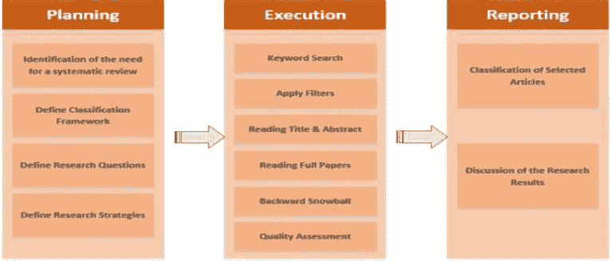

**图 (1)** 系统性综述步骤。

护理质量和治疗复杂疾病的能力不断提高，但仍存在许多问题，包括根据患者测试的组织（如青少年）确定的治疗量和时长。因此，机器学习近年来在儿童保健方面表现良好，为儿童提供了最愉快、个性化的体验。由于 COVID-19 疫情的蔓，机器学习已变得非常重要。从改进运营到在不可预测和不确定的环境中管理研发，各机构正转向机器学习以保持竞争力 [5]。

机器学习时代是人工智能领域最令人兴奋的领域之一，许多公司正在寻找利用它来驱动动力的方法。机器学习在当时非常流行。它利用算法来促进数据驱动的学习，并适用于从研究到医疗保健的各个领域。由于新技术和新技术的不断发展，医疗保健正在不断演变。机器学习将帮助医生应对许多新情况 [5]。新技术可以从以前难以创建和难以规模化部署的不便概念中获得洞察。通过机器学习的新智能，医生可以做出及时的、知情的护理决策和职业选择，影响数百万人的生活。

## 使用机器学习在医疗保健中的机遇

自动机器学习帮助医生为患者和诊所提供更好的护理。技术提供了关于实时统计数据的新技术和绿色项目，允许医生充分利用这些数据 [6]。这使得护理人员和其他人员工作更高效，并为受影响的人提供更好的护理。今天，医学教育软件包通常被用于分析大量数据，帮助医生和其他医疗专业人士做出更明智的决策。医生可以检测异常、模式和趋势，并减少人为错误的风险。信息技术与机器学习模型相结合提供了准确、绿色的医疗保健和快速计算能力。本电子书的主要研究目标是理解机器学习在医疗保健中的演变，以及它面临的机遇与挑战。

## 临床模型的机器学习基础

图 (2) 显示了各种机器学习生活方式相关医疗产品的智能类型和监控。它包括各种智能设备的说明，例如可以与医疗设备集成的人工智能和云数据能力 [6]。即使成本很低，生成电子临床信息进一步允许医疗主体、精明的文件实践、数字笔记、文档保存等许多其他强大领域，机器学习标准在这些领域探索医疗提供者的最佳方案。

医疗机构正在使用机器学习 (ML) 来预测和跟踪世界各地的流行。疾病爆发的数据可以从卫星、社交媒体实时更新和其他在线来源获取 [7]。这对于缺乏足够医疗设施的发展中国家特别有益。机器学习和相关的数据驱动策略解决了若干挑战，例如等待时间过长、对高成本的担忧、复杂的预约流程以及医疗保健获取范围有限。类似的问题长期以来影响着传统部门，而机器学习技术已经是解决方案的一部分。大数据、搜索算法和机器学习的有效性在识别模式和优化流程方面的能力显而易见。通过利用卫星数据、实时更新和其他在线统计数据，医疗机构可以更好地预测流行。这种方法对于资源有限的国家特别有价值。

硬件的丰富导致机器学习在人类生活的许多领域被广泛使用，从社会背景的使用到工厂自动化的使用。医疗保健就像在这些情况下运行的其他任何业务一样。机器学习算法在医疗保健具有巨大潜力，因为它们为每个人捕捉更多信息。对于医疗保健公司来说，机器学习是失险得益。有很多关于受影响个体、之前的治疗和亲属病史的信息。机器学习通过比较受影响个体的数据帮助预测实际的健康问题 [8]。

期间的进展扩大了向数据驱动的医疗保健管理的转型。今天通过结合更好的治疗图像和基因模型来改善健康结果的方法基于机器学习。此外，机器学习将带来更快的结果，包括更快地启动治疗，因为医疗专业人员和机器学习规则几乎不需要在现实实现相同的目标。在医疗保健中使用机器学习的另一个优势是它消除了一些人为干预，减少了人为错误的可能性 [8]。这对于自动化任务尤其如此，因为复杂、重复的任务是人们最容易出错的地方。

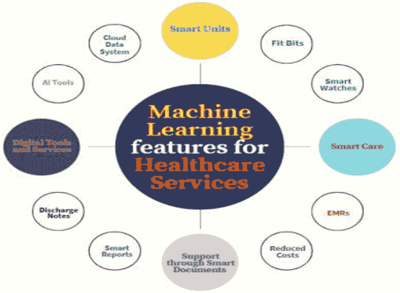

**图 (2)** 用于医疗保健的智能机器学习功能。

使用技术的引导性研究有助于分析大量统计数据以诊断疾病、确定治疗的下一步、识别认知问题并提高护理效率。

属性管理的统计方法需要充分的准备，以便计算机能够更快速地检测模式和结果。这是通过人员通过名为 `input annotation` 的过程对项目进行标记来实现的。专家分析统计数据，编写新指令并改进机器的整体结果[9]。医疗保健机构正在使用机器学习（`ML`）来预测和跟踪世界各地的流行病。有关疾病爆发的数据可以从卫星、社交媒体的实时更新和其他在线来源获取[7]。这对于缺乏足够医疗设施的发展中国家来说可能特别有益。`ML` 和相关的数据驱动策略解决了若干挑战，如等待时间过长、对高成本的担忧、复杂的预约流程以及获得合适医疗服务提供者的途径有限。类似的问题长期以来影响着传统部门，而 `ML` 技术已成为解决方案的一部分。大数据、搜索算法和机器学习的有效性在识别模式和优化流程方面的能力是显而易见的。通过利用卫星数据、实时社交媒体更新和其他在线统计数据，医疗机构可以更好地预测和管理流行病。这种方法对于医疗资源有限的国家来说特别有价值。

药物测试和研究需要大量的时间、精力和资金。除了提供准确的结果，基于机器学习的预测分析还可以节省用于研究实验的资金和时间。此外，机器学习可以理解临床候选者、检索试验历史、在整个期间治疗患者、选择正确的诊断模型、移除错误的知情信息等。医生可以使用机器学习改进他们的工作，同步多项任务并最终拯救生命。除了直接参与研究外，机器学习在国防领域也发挥着重要作用。这一代通过让专家意识到目前不可见但可能影响我们的错误来改进分析[10]。其中一些常见的传染病、污染以及许多其他影响我们日常健康的因素。

使用机器学习，医疗保健机构可以预测全球范围内影响人类的问题。这允许医生在问题发生之前开具药物以消除或减轻问题的严重性。这对于大多数早期检测重要的癌症治疗至关重要。压力测量是控制设备实现的医疗技术中最有趣的进展之一。患者的状况是治疗所依赖的基础。简化患者信息可以帮助医疗专业人员识别潜在问题、解决现有问题并识别特定状况。患者事实包括既往史、声誉以及对身体和情感健康的感知。得益于机器学习，智能患者信息已成为现实并广泛应用于医疗保健领域。智能患者事实简化并优化了患者信息，使其对所有医生都很有用。

## 医疗保健机器学习的支柱

`ML` 是一个通过为计算机系统提供可处理的数据和算法，使其能够识别模式的过程。手动检测疾病要具挑战性得多；`ML` 在诊断患者状况、监测健康和建议适当的预防措施方面起着至关重要的作用。这了从小病到严重疾病，包括难以早期发现的癌症。`ML` 在医疗保健的一个重要应用是识别和预测不同人口或人群的心理健康问题。这一应用协助心理健康专业人员确定最受压力源（如流行病或自然灾害）影响的人口群体[11]。

通过提供个性化的治疗建议，机器学习（`ML`）可以帮助将医疗保健重点从反应性转向预防。在医疗保健环境中，`ML` 可以协助专家根据个人的独特特征、症状和副作用制定定制的治疗计划。结果是患者经历药物不良反应的可能性降低了。机器学习算法在医疗保健中的应用可以帮助预测和检查疾病爆发。`ML` 同样可以减少可怕的瘟疫结果。组织治疗试验一直是一项耗时且令人疲的策略，具有许多不可疑问的组成部分。恢复性试验候选者需要根据几条指南进行极其良好的筛选[12]。这不断地筛选和评估大量见解，以确保胶囊对于这一代的使用安全且有效。

`ML` 允许机器自由检查基准、解释事实并提供理想产出。`ML` 样式学习如何使用条件、从句以及特殊的学习方法（包括无监督、有监督等）来翻译记录。这使得它们适用于创建预测性和预见性的体验。此外，`ML` 还通过向患者发送有关其就诊、报告收集和其他活动的及时提醒和通知，允许实现优化的持续参与和康复。

获得正确护理的能力提高了患者的生活质量，医疗保健设备可以通过向患者推广适当的自我护理技术来确保资源的高效利用。为了实现这一现实，`ML` 可以支持大多数癌症治疗基于成本的方法[13]。

健康专业人员每天花费时间处理复制包括建模、解决索赔和维护记录的任务。这阻止了他们提供必要的护理。通过使用 `ML` 模型可以促进自动化和消除人工干预。

此外，医疗保健企业可以利用机器学习来推进风险管理。

通过识别关注点，机器学习将为医疗行业提供主动监测和改进护理所需的信息。创新涉及组织和分析更大规模的信息集并改进决策 [[14]]。它基于许多算法，这些算法可以计算执行特定任务所需的知识。这使得专业人员能够获取海量数据，而不必被书籍所困。在医疗领域，使用机器学习工具进行数据分析的质量和效率已经提高。`索赔创建`和`财务管理`等形式和增强功能使得医疗记录的组织和信息的监控变得更容易 [[15], [16]]。

在涉及医疗`AI` 时，理解机器学习为医疗部门带来的潜力和重大进展至关重要。计算机在诊断恶性疾病方面已经击败放射科医生。机器学习在科学和医学领域有许多应用。通过基于机器学习的预测分析，临床试验可以帮助从多个源（如以往的临床就诊、社交媒体等）生成数据。机器学习还用于为受试者提供准确且及时的信息分析，并确定测试样本的质量。

## 未来展望

随着智能医疗设备的发展，医疗技术已成为现实。随着医疗行业推动创新，机器学习在医疗领域的未来是光明的。技术负责处理数百个不同的概念、预测风险和结果并执行许多其他任务。这可以用于为特殊需求的人群创建个性化医疗。这些机器学习工具有一天可以用于纳米技术改进药物递送。机器学习有助于解决当前问题并预测未来问题 [[17]]。

在当今世界，机器学习可以预测全球性流行病，为此专业人员需要从互联网、时事和其他来源获取大量信息。这项技术有助于分析这些数据并预测从从小规模爆发到大规模爆发的一切情况。机器学习在科学研究中的应用正在上升。通过处理大量数据以生成准确的预测，该应用在帮助研究人员在其研究中做出更好发现方面发挥了关键作用。机器学习正作为一种新兴技术应用于流行病学，并在精准医学未来充满前景。

这是考虑到个人健康的最佳治疗方案。因此，它在个性化机器学习和预测模型方面可以发挥重要作用。您的医生可以从有限的测试中选择，或者根据您的病史和遗传信息评估您的风险。未来将通过机器学习利用患者的病史开发额外的治疗 [[18]]。此外，医学院课程应包含机器学习及其应用的课程。在培训期间，应向医学生、住院医生和实习医生教授机器学习和数据科学。

## 结论

机器学习将成为医生、科学家或研究人员非常有有力的工具。机器学习似乎每天都在改进。所有这些进展都导致了增强版本的机器学习，这些版本可以解决医疗领域的现实问题。机器学习持续取得进步，医疗行业密切关注这一趋势。机器学习的目标是帮助医生和外科医生拯救生命，在疾病和问题发生之前将其检测出来，在康复期间更好地管理患者等 [[19]]。

这将帮助世界各机构利用人工智能和机器学习模型来改善健康。技术帮助机构建立让人们工作得更快、更高效的系统。公司现在可以利用临床试验、连接性和模式识别来增强他们的测试和评估。健康的决定因素包括健康实践和状态因素、教育。为了提高整体健康，机构意识到需要关注整体，同时考虑生活方式和环境 [[20]]。机器学习模型可以区分具有心脏疾病和糖尿病等持续感染高风险的患者。

## 参考文献

| # | 参考文献 |
| --- | --- |
| [1] | Abdel A, Elhosen M, Salama AS, Riad AM. A machine learning model for improving services on cloud computing. `Measurement` 2018; 119: 117-28. [`dx.doi.org/10.1016/j.measurement.2018.0122`](http://dx.doi.org/10.1016/j.measurement.2018.0122) |
| [2] | Char DS, Feudner C, et al. Ethical considerations for machine learning. `Am J Bioeth` 2020; 34(1): 39-47. [`dx.doi.org/10.1080/1526519`](http://dx.doi.org/10.1080/1526519) [PMID: 331039](https://www.ncbi.nlm.nih.gov/331039) |
| [3] | Ahmad MA, Eckert T, Ranganath A. Interpretable machine learning. Proceedings of the 2018 ACM conference on computational biology and health informatics |
| [4] | Kaur P, Sharma M, Mittal M. Big data and machine learning secure framework. `Procedia Comput Sci` 2018; 132: 1049-59. |
| [5] | Sarwar J, Kamal N, Hamid W. Prediction of machine learning in healthcare. `EMJ Innov` 2020; 10(8). [`dx.doi.org/10.2391/IAC.2018`](http://dx.doi.org/10.2391/IAC.2018) |
| [6] | Waring J, Lindvall C, Umeton R. A path for translation of machine learning products. `EMJ Innov` 2020; |


| [7] | Gupta A, Katarya R, Kashyap S. Social media based surveillance using machine learning. `J Biomed Inform` 2020; 10: 10350. [`dx.doi.org/10.1016/j.jbi.2020`](http://dx.doi.org/10.1016/j.jbi.2020) |

| [8] | Tucker A, Wang Z, Myles P. Generating high-fidelity synthetic data for machine learning. `NPJ Digit Med` 2020; 3(1): 147. [`dx.doi.org/10.1038/s41746-020-0359`](http://dx.doi.org/10.1038/s41746-020-0359) [PMID: 3329910](https://www.ncbi.nlm.nih.gov/3329910) |

| [9] | Chen IY, Joshi S, Ghassemi M, Ranganath R. Probabilistic machine learning for healthcare. `Annu Rev Biomed Data Sci` 2021; 4(1): 393-415. [`dx.doi.org/10.1146/annurev-biodatasci-092820-03398`](http://dx.doi.org/10.1146/annurev-biodatasci-092820-03398) |

| [10] | Siddique S, Chow JCL. Machine learning in healthcare communication. `Encyclopedia` 2021; 1(1): 220-39. [`dx.doi.org/10.3390/encyclopedia1010021`](http://dx.doi.org/10.3390/encyclopedia1010021) |

| [11] | Waring J, Lindvall C, Umeton R. Automated machine learning: Review of the state-of-the-art and opportunities for healthcare. `Artif Intell Med` 2020; 104: 101822. |

| [12] | Ahmad MA, Patel A, Eckert C, Kumar V, Teredesai A. 医疗领域机器学习的公平性。见 Proceedings of the 26th ACM SIGKDD international conference on knowledge discovery & data mining 2020; Aug 23: 3529-30. [`dx.doi.org/10.1145/3394486.3406461`](http://dx.doi.org/10.1145/3394486.3406461) |

| [13] | Manogaran G, Lopez D. 医疗领域大数据数据架构与机器学习算法综述。Int J Biomed Eng Technol 2017; 25(2/3/4): 182-211. [`dx.doi.org/10.1504/IJBET.2017.087722`](http://dx.doi.org/10.1504/IJBET.2017.087722) |

| [14] | Roth JA, Battegay M, Juchler F, Vogt JE, Widmer AF. 数字医疗流行病学机器学习机器学习。Infect Control Hosp Epidemiol 2018; 39(12): 1457-62. [`dx.doi.org/10.1017/ice.2018.265`](http://dx.doi.org/10.1017/ice.2018.265) [PMID: [30394238](http://www.ncbi.nlm.nih.gov/pubmed/30394238)] |

| [15] | Bhardwaj R, Nambiar AR, Dutta D. 医疗领域机器学习研究。在 2017 IEEE 41st annual computer software and applications conference (COMPSAC) 2017; Jul 4(2): 236-41. IEEE. [`dx.doi.org/10.1109/COMPSAC.2017.164`](http://dx.doi.org/10.1109/COMPSAC.2017.164) |

| [16] | Kushwaha S, Bahl S, Bagha AK, et al. 机器学习在新冠肺炎疫情中的重要应用。Journal of Industrial Integration and Management 2020; 5(4): 453-79. [`dx.doi.org/10.1142/S2424862220500268`](http://dx.doi.org/10.1142/S2424862220500268) |

| [17] | Rudin C, Ustun B. 优化评分系统：迈向医疗和刑事司法机器学习信任。Interfaces 2018; 48(5): 449-66. [`dx.doi.org/10.1287/inte.2018.0957`](http://dx.doi.org/10.1287/inte.2018.0957) |

| [18] | Saleem TJ, Chishti MA. 探索医疗领域机器学习的应用。Int J Sensors Wirel Commun Control 2020; 10(4): 458-72. [`dx.doi.org/10.2174/2210327910666191220103417`](http://dx.doi.org/10.2174/2210327910666191220103417) |

| [19] | Araújo FH, Santana AM, Santos Neto P. 使用机器学习支持医疗专业人员决策。Int J Med Inform 2016; 94: 1-7. [`dx.doi.org/10.1016/j.ijmedinf.2016.007`](http://dx.doi.org/10.1016/j.ijmedinf.2016.007) |

| [20] | Saxena S, Vyas S, Kumar BS, Gupta S. 在线支付安全综述。2019 Amity International Conference on Artificial Intelligence (AICAI) 2019756-1. [`dx.doi.org/10.1109/AICAI.2019.870135`](http://dx.doi.org/10.1109/AICAI.2019.870135) |

# 变革医疗领域：机器学习的力量

Monika Sharma (1), Dimple Tiwari (2), Neeta Verma (3), Anjali Singhal (4)

¹ ABES 工程学院，北方邦 ² Inderprastha 工程学院，北方邦

## 摘要

机器学习是人工智能的一个分支，包含了能够复制人类学习的系统。机器学习对医疗领域产生了深远影响，特别是在药物发现方面。机器学习通过分析大型数据集加速了药物发现过程。机器学习模型可以预测入院率、优化资源配置并改善医院运营。如今，机器学习的核心在于创建能够适应新数据的算法。

关键词：人工智能、疾病诊断、医疗、健康信息学、机器学习。

## 引言

在医疗领域，机器学习是一种用于护理和数据管理的价值工具。它是人工智能的一个领域，涉及编程模拟人类思维和学习。其应用涵盖了从收集和组织患者数据到检测模式和建议治疗的各个方面。机器学习在增强决策和降低方面的认可促进了许多职业路径的出现。国际数据公司（IDC）预测印度人工智能市场将大幅增长，预计从 2020 年到 2025 年将翻一倍。

这一增长趋势将刺激新初创企业的出现，提高对人工智能人才的需求，并创造大量的职业机会。

除了阐明医疗保健领域许多机器学习基础的核心原理外，本节旨在启发并鼓励对机器智能驱动的医疗保健领域的进一步研究。在本章中，我们必须介绍一个基于机器学习的基础和算法的全面概述，该算法可以在各种机器学习算法和医疗保健数据集上自主运行 [3]。即使在仅可以获取训练数据集的统计数据，或者在特定情况下限制访问训练数据集时，这些方法也可以被采用，尽管效果会有所降低。通过此，我们旨在解释医疗保健领域所有可能的机器学习基础，有助于探索和分析不同的医疗记录以改善患者预后。

## 机器学习在医疗保健中的应用

机器学习在医疗保健领域有多种应用，涵盖了从诊断到个性化医疗。以下是一些具体的应用：

### 医学影像

`ML` 算法借助 X 射线、磁共振成像（MRI）、CT 扫描和其他成像技术分析图像，协助诊断癌症等疾病、识别异常并辅助制定治疗计划。

### 预测分析与风险分层

`ML` 模型利用患者数据预测疾病风险、潜在并发症和患者预后，帮助医疗提供者更早地干预并个性化治疗方案。

## 药物发现与开发

`ML` 有助于药物靶点识别、化合物虚拟筛选以及预测药效，加速药物开发过程并可能降低成本。

### 个性化医疗与治疗

通过分析基因数据、患者病史和其他因素，`ML` 能够为个体患者定制治疗方案、药物和干预措施。

### 临床决策支持系统

`ML` 算法通过基于数据分析提供见解和建议协助医疗专业人员，辅助诊断、治疗选择和患者监测。

### 医疗运营与资源管理

`ML` 通过预测患者入院率、高效管理资源和改进调度来优化医院运营，增强患者护理。

#### 远程患者监测

`ML` 驱动的设备和可穿设备实时跟踪患者的生命体征和健康指标，实现远程监测和健康问题的早期发现。

### 医疗保健中的自然语言处理 (NLP)

`NLP` 有助于分析来自医疗记录、研究论文和临床笔记的非结构化数据，促进信息提取、决策制定并改进行政任务。

### 欺诈检测与医疗安全

`ML` 算法识别账单和索赔中的异常以及潜在的欺诈行为，确保医疗保健系统的完整性。

### 公共卫生与流行病学

`ML` 模型分析海量数据以追踪疾病爆发、预测疾病传播，并协助制定疾病预防控制策略。

# 医疗保健对机器学习的需求

医疗保健服务在治疗复杂疾病方面已出持续改进。然而，在确定最佳剂量和治疗时长方面仍然存在，特别是对于儿童等临床研究有限的群体。近年来，机器学习（`ML`）在儿科护理方面取得了巨大进展，根据个体特征为儿童预测定制化治疗方案 [4, 5]。在 COVID-19 疫情期间，对 `ML` 的关注日益加强。各机构拥抱 `ML` 以增强竞争力并应对不确定性，利用它在多变环境中简化运营并推动研发。`ML` 已证明在协助医院和医疗系统应对这些时期的独特挑战方面具有重要作用。

在机器学习（`ML`）领域，`AI` 是最引注目的领域之一，许多公司寻求利用其潜力。由于其能够利用算法在从业务到医疗的各个领域进行数据驱动的学习，其普及程度正在上升。医疗保健作为一个以技术不断进步为特征的领域，正经历着不断的变革。`ML` 在帮助医疗人员应对这些不断演变的场景方面具有前景。现代技术赋能了从非结构化文本中提取见解的能力，这项任务以前难以完成和规模化 [6, 7]。

### 医疗保健机器学习结构的基本特征

图 (1) 描绘了交织在 `ML` 文化中的多种智能且关怀的属性，对医疗保健服务做出了巨大贡献。这包括利用 `AI` 和云端数据分析等复杂工具，提高了医疗提供的效率和有效性。电子病历的创建是该领域一个显著的辅助，有助于以合理的成本进行无缝信息管理 [8]。此外，`ML` 原则在生成深度报告、维护数字记录和编写详细注释方面发挥着关键作用，展示了它们对医疗保健领域各个关键领域的深远影响 [9]。

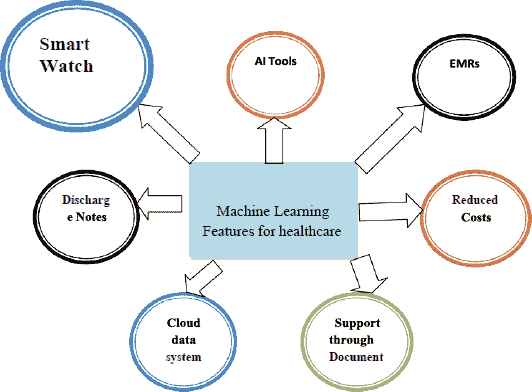图 (1))

基于机器学习的医疗保健。

医疗机构已整合了 `ML` 系统以主动监测和预测不同地区的潜在疫情爆发。这些数字系统利用卫星、实时社交媒体更新和关键网络信息来预测疾病传播。对于医疗资源不足的欠发达地区，这些 `ML` 驱动的技术提供了广阔前景 [10]。它们解决了诸如排队时间长、高医疗成本担忧、复杂的挂号程序以及获取合适的医疗提供者困难等基础问题。这些在传统医疗机构中存在数十年的挑战通过 `ML` 方法论得到了解决。`ML` 系统固有的稳健数据库和智能搜索算法擅长模式识别和优化任务，从而为解决这些问题做出了重大贡献 [11]。

### 医疗保健中的机器学习

这种技术能够在大量的医疗数据集中发现隐藏的相关和细微模式，最终提高医疗服务的效率、可负担性和便利性 [12, 13]。本节深入探讨了医疗领域机器学习的应用，将这些应用分类为几个不同的属性：医疗相关发现、健康监测、疫情爆发、*等*（图 2）。

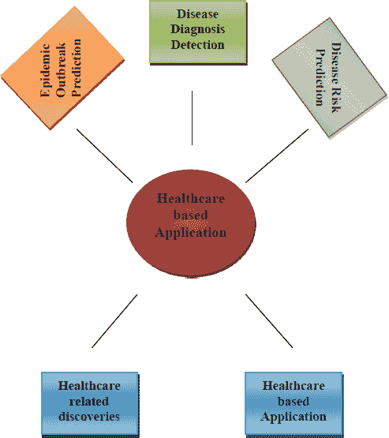图 (2))

医疗保健的应用。

### 疾病诊断与检测

这些研究工作令人印象深刻！看到多样化的机器学习技术如何被应用于不同的医疗领域用于诊断和检测，非常有意义 [14, 15]。方法和结果的多样性展示了这些技术在医疗保健领域的适应性和潜力。用于心脏病诊断的支持向量机（`SVM`）和用于肝病检测的多层感知器凸显了机器学习算法的通用性。有趣的是，尽管 `SVM` 在心脏病诊断方面表现良好，但多层感知器在肝病诊断背景下的表现优于 `SVM` [16]。痴呆症诊断技术的对比分析表明了评估各种算法的重要性，其中 `J48` 在 `J48`、多层算法、`naive-Bayes algorithm`（朴素贝叶算法）和 `random forest algorithm`（随机森林算法）中表现最佳。`K-means` 的应用可以检测癌症疾病，特别是在识别肿瘤边界方面，这可以极大地帮助手术期间的医生 [17]。使用卷积神经网络（`CNN`）检测胸部疾病达到 92.4% 的准确率，为基于图像的诊断显示了良好的前景。

显而易见，这些研究不仅展示了机器学习在医疗保健中的效能，还为哪些算法在特定医疗领域可能表现更好提供了见解。这些方法的持续改进和创新在未来可能会带来更准确、更高效的诊断工具。

### 疾病风险预测

研究已经证明了机器学习在预测患者潜在疾病方面的有效性。之前的一项研究了涉及决策树、支持向量机（`SVM`）和 `Naïve-Bayes methods` 的对比分析，以预测糖尿病的早期发生 [18]。这项技术在高效预测心脏骤停方面也显示了潜力，强调了其在医疗保健中的关键作用 [19]。Ahmed *et al.* 开发了一种结合线性回归和人工神经网络的新系统，用于预测慢性肾疾病的早期发生。研究结果强调了这种新方法与目前先进模型相比的有效性 [20]。Jung-Gi *et al.* 构建了一种新型混合模型，通过整合自适应网络模糊推理系统与线性判别分析，用于预测冠心病的概率。他们的实验表明，该模型比其他现有方法性能优。Samaneh *et al.* 对应用于心脏骤停预测的机器学习技术进行了全面回顾。此外，Fatma *et al.* 开发了一种用于心血管风险评估的持续患者监测系统，能够对疾病可能性进行持续追踪。此外 [21]，Pattanpong *et al.* 评估了混合模型（结合 `LSTM` 和 `RNN`）在中风预测中的效率，并在实验中报告了令人印象深刻的 99.98% 准确率。

### 健康监测

健康监测在评估和增强个人健康方面起着至关重要的作用。机器学习为管理健康状况的个人提供重要建议，并在紧急情况下为医疗提供者提供警报。健康监测中机器学习应用的示例包括 Min *et al.* 的工作 [22]，他们引入了一种基于边缘计算的医疗系统，用于全面的个人健康评估。许多研究结果表明，所提系统在紧急情况下使患者存活率得到了显著提高。Pham *et al.* [23] 定义了一个家庭医疗系统，旨在为专业人员提供有关患者活动的上下文背景洞察。此外，Zia Uddin *et al.* [24] 发明了一种利用神经网络预测个人日常活动的系统。研究实验揭示了所提系统的卓越性能，并与其他传统方法进行了对比。Hande *et al.* [25] 对隐藏时间窗口神经网络与马尔可夫模型之间进行了相关性分析，以评估真实行为。结果强调了隐性马尔可夫模型在活动识别方面优于隐藏时间窗口神经网络。此外，Gursel *et al.* [26] 引入了一种基于支持向量机和随机森林系统的检测系统。该系统在跌倒发生前 100 毫秒触发跌倒检测决策，激活身体气袋以防止潜在受伤。

### 医疗发现

机器学习在医疗领域在发现海医疗数据集中的隐藏关系方面起着至关重要的作用，从而增强并简化临床决策。Rhonda *et al.* [27] 使用了关联规则挖掘技术（`Apriori Algorithm`）。Mahmood *et al.* [28] 也使用了 `apriori algorithm` 来监控不同性别和年龄组的疾病。此外，Bowei *et al.* [29] 引入了 `FP-Growth algorithm` 的扩展版本——`PNFP-Growth`，用于综合健康数据，展示了其与传统 `FP-Growth algorithm` 相比更高的模式提取能力。此外，他们的分析显示，高血压患者中至少有 30%的人同时收缩压升高和肝脏疾病。

机器学习算法通过检查样本数据来创建数学模型。这些算法通常分为两大大类：监督学习和无监督学习。在监督学习中，数据是带有标签的，输出变量可以是定性的（用于分类任务）或定量的（用于回归任务）。在利用机器学习的医疗诊断领域，分类任务非常普遍，其因变量被归类为二分类或多分类。下面，我们将探索在医疗保健目的方面已证明能够提供准确诊断的各种机器学习算法。

## 逻辑回归 (LR)


# 逻辑回归

逻辑回归（LR）是一种用于将数据分类为两个不同结果的技术。它通过使用`logit`函数来计算事件发生的概率，该函数表示为`logit = log(p/1-p) = log(发生概率/非发生概率) = log(几率)`。估计过程涉及极大似然法，其中模型的系数提供了关于输入特征重要性的见解。正则化被用于防止模型过度拟合训练数据。然而，逻辑回归通常需要较大的样本量才能产生准确的结果。

# 神经网络

神经网络的灵感源于人类大脑的功能。这些人工网络由互相互连接的神经元组成，神经元根据输入生成输出，使机器能够通过分析新数据学习和完善自身。激活函数（如`sigmoid`函数）被用于将输入转换为有意义的输出。为了确定最佳参数值使用了代价函数。网络经过多次迭代以随着时间的推移增强模型性能。

反向传播（BPNN）算法对于训练神经网络（NN）参数至关重要。通常使用`Gradient Descent`算法或`Adam`优化器等技术来寻找最优参数。参数较多的网络容易过拟合，这可以通过正则化方法避免。构建人工神经网络（ANN）涉及导入必要的`Keras`库并将网络架构初始化为`sequential`。这种顺序设置涉及将层层层堆叠在彼此之上，将它们组合在一起以建立`ANN`的结构框架。

神经网络的输入层通常包含与数据集中特征数量相等的节点，而输出节点数通常设置为`(#of features+1)/2`。网络中的隐藏层也可以结构化为相同数量的输入和输出节点，通常计算方法为`(#of features+1)/2`。在前馈网络中，后续层不需要额外的输入节点，因为前一层的输出将作为下一层的输入。输出层通常由计算为`(#of features+1)/2`的输入节点和一个单一输出节点组成，代表疾病存在（1）或不存在（0）的二分类变量。

如整流线性单元（ReLU）等激活函数常用于隐藏层，而`Sigmoid`函数则应用于输出层以生成 0 到 1 之间的预测值。超过`0.5`的值通常表示疾病存在，而低于`0.5`的值表明健康状态。`sklearn-neural network`库中的`Multi-Layer Perceptron (MLP)`分类器是根据这些规范构建监督学习神经网络的有效工具。

## K 近邻（KNN）

基于实例的学习器（IBL）由于其对新和未见数据的内在适应性，通常被视为“懒惰学习者” [34]。这种方法作为一种非参数技术在统计估计和模式识别中具有价值。在处理连续变量时，IBL 算法通常采用`Minkowski`距离度量，对于类别变量则使用`Hamming`。在计算距离度量之前需要对训练集进行标准化。`k`的最优值位于 3 到 10 之间。

## 支持向量机（SVM）

支持向量机（SVM）也称为大间隔分类器，创建一个超平面或决策边界，如图所示。它通过将初始训练数据转换为高维来实现线性 SVM，适用于特征数量少的数据集，而对于特征数量较大的数据集，引入了`Kernel`技巧。训练 SVM 涉及最小化误差函数。在 SVM 使用的各种类型的内核中，径基函数（RBF）是最广泛使用和受欢迎的选择。

# 决策树（DT）

非参数分类器提供了易于解释和可视化的特点，同时有效捕捉非线性模式。它们消除了对标准化的需求。然而，决策树（DT）对不平衡数据集存在偏差，因此建议在创建模型之前平衡数据集。DT 将工作区域划分为子部分，使用`entropy`、`information gain`或`Gini index`等方法评估类别分离的纯度。它是多用途的，能够处理缺失值插补，并非常适用于特征选择。然而，DT 倾向于过拟合噪声数据，这一问题可以通过集成技术得到缓解。

# 集成学习器

集成方法合并了多种算法以增强模型的稳定性和预测能力。基础模型往往由于高偏差或过大方差而表现不佳，导致其稳健性较差。改变复杂度会在偏差和方差之间产生权衡。高偏差低方差的模型往往持续是不准确的，而低偏差高方差的模型虽然准确但缺乏一致性。结合这些模型引出了一个问题：如果我们合并它们会怎样？主要的挑战在于选择产生不同类型错误的基模型。

# 虚拟现实在医疗保健中的应用

虚拟现实（VR）技术具有跟踪和分析人类运动的能力，能够监测患者的活动。值得注意的是，旧金山和俄亥州已经建立了 VR 健身房。康复方法正在利用 VR 改进，将踢或接虚拟球等活动整合到康复练习中。这些练习可以在 VR 环境中进行和监控，允许跟踪进度并向患者提供反馈以改进他们的动作。

## 医学培训与教育

虚拟现实允许医学生和外科医生在真实且无风险的环境中练习手术程序。这有助于提高技能、减少错误并增强整体手术熟练度。VR 可以为医学生提供沉浸式体验，以探索和理解三维解剖结构，提供一个更具互动性和吸引力的学习环境。

## 护理与药物交付

虚拟现实模拟可用于训练护士安全的给药实践。这包括正确的药物剂量计算、药物制备以及通过各种途径给药。这些技术允许与同事和工作人员共同回溯和评估关键决策点。此外，虚拟现实将在医学专业科的教学中发挥重要作用，包括手术程序和解剖学。程序可以在专家监督下进行练习，实现实时反馈和指导。

虚拟现实可用于教育患者其用药知识。沉浸式体验可以帮助患者理解用药依从性的重要性、潜在副作用以及正确的给药技术。VR 场景可以模拟给药过程中可能出现的错误，让护士练习识别和预防错误。VR 能够助力远程医疗倡议，使护士能够远程监控患者的用药依从性并提供虚拟咨询。这对于需要持续进行用药管理的慢性病患者来说特别有用。旨在减轻压力和促进心理健康的 VR 体验对应对高压力情况的护士大有益。这有助于降低职业倦怠率并提高整体工作满意度。

将虚拟现实整合到护理和药物递送中，不仅增强了培训和教育，还有助于改善患者疗效、减少错误并为医疗交付创造创新方法。随着技术的不断进步，VR 在护理和用药管理中的潜力可能会进一步扩大。

# 机器学习对医疗健康的影响

## 疾病预测与预防

机器学习算法分析海量的患者数据以识别模式并预测疾病发生的概率。预测模型有助于早期检测，从而实现主动干预和预防性措施。

## 诊断辅助

机器学习辅助医学影像解释，例如分析 X 射线、MRI 和 CT 扫描。算法通过提供准确、快速的诊断见解来协助医疗专业人员，提高效率和准确性。

## 个性化治疗方案

机器学习算法分析患者数据（包括遗传信息），根据个人特征定制治疗方案。这种个性化医疗方法可以带来更有效、更具针对性的干预。

## 药物发现与开发

机器学习通过分析生物数据和预测潜在的候选药物来加速药物发现过程。算法有助于识别新药物靶、优化化学结构并预测化合物的效力。

## 临床决策支持

机器学习系统通过分析患者数据并提供诊断和治疗建议为医疗提供者提供实时支持。这些决策支持工具提高了临床准确性，并协助复杂的决策场景。

## 远程监控与预测分析

机器学习算法分析来自可穿戴设备和远程监控的数据，以检测患者状况恶化或变化的早期迹象。预测分析有助于识别并发并发风险的患者，实现及时干预。

# 结论

医疗健康中的机器学习强调了将机器学习整合到医疗格局中的深远影响和潜力。医疗健康机器学习基础知识的学习之旅点明了通创新解决方案、改善患者预后和增强运营效率的道路。在我们应对预测建模、个性化医疗和临床决策支持的复杂性时，显而易见，机器学习是变革的催化剂。利用海量医疗数据、获取有意义的见解以及应用预测分析的能力开启了精准和高效的新纪元。

向可解释模型的范式转变解决了与透明度和信任相关的担忧，促进了数据科学家与医疗专业人员之间的协作。这种汇聚促进了技术向临床工作流的无缝整合，提供了可操作的见解，引导从业者做出更明智的决策。然而，这段旅程并非没有挑战。伦理考量、数据隐私以及对不断发展的技术的持续适应需求构成了持续的关注。在创新与伦理实践之间取得平衡，对于机器学习在医疗领域的负责任部署至关重要。

随着该领域开发的持续繁荣，我们预计会有更深远的突破，重新定义医疗交付、治疗策略和患者体验。

# 参考文献

| 序号 | 参考文献 |
| --- | --- |
| [1] | Manyika J, Chui M, Brown B, Bughin J, Dobbs R, Roxburgh C, Hung A. Big data: The next frontier for innovation, competition, and productivity. |
| [2] | Magoulas GD, Prentza A. Machine learning in medical applications. Advanced course on artificial intelligence, Berlin: Springer Heidelberg, 1999 Jul 5 (pp. 300-307). |
| [3] | Rajabi Shishvan O, Zois DS, Soyata T. Machine intelligence in healthcare and medical physical systems: A survey. IEEE Access 2018; 6: 4619-94. `http://dx.doi.org/10.1109/` |
| [4] | Gautam P, Ansari MD, Sharma SK. Enhanced security for electronic health using cloud computing. Int J Sec Priv 2019; 13. `http://dx.doi.org/10.1109/IJISP` |
| [5] | Sethi K, Jaiswal V, Ansari MD. Machine learning based system for students to select. Recent advances in computer (Formerly: computer science). 2020; 13. |
| [6] | Tsai CW, Lai MC, Yang LT. Data mining for internet of things: A survey. IEEE Commun Surv Tutor 2014; 16(1). `http://dx.doi.org/10.1109/SURV` |
| [7] | Gandhi R. Introduction to machine learning: Linear regression. Toward Data Science 2018; |
| [8] | Kotsiantis SB, Zaharakis I, Pintelas P. Supervised machine learning: A review of classification techniques. Emerging artificial intelligence applications 2007; 160(1). |
| [9] | Mahdavinejad MS, Rezvan M, Barekat M, Adibi P, Sheth AP. Machine learning for internet of things data analysis: a survey. Digital Communications and Networks 2018; 4(3). `http://dx.doi.org/10.1016/j.dcan.2017` |
| [10] | Brownlee J. K-nearest neighbors for machine learning. Machine Learning Mastery 2016; (Apr)15. |
| [11] | Jain AK, Jianchang Mao, Mohiuddin KM. Artificial neural networks: a tutorial. Computer 1996; 29(3). `http://dx.doi.org/10.1109/248591` |
| [12] | Hinton G. Deep belief networks. Scholarpedia J 2009; 4(5): 5947. `http://dx.doi.org/10.4249/scholarpedia.5947` |
| [13] | Mohammadi M, Al-Fuqaha A, Sorour S, Guizani M. Deep learning for IoT big data and streaming analytics: A survey. IEEE Commun Surv Tutor 2018; 20(4): 2923-60. `http://dx.doi.org/10.1109/COMST.2018.2844341` |
| [14] | Esmael B, Arnaout A, Fruhwirth RK, Thonhauser G. Improving time series classification using Hidden Markov Models. 12th International Conference on Hybrid Intelligent Systems (HIS) 2012; 4: 502-7. `http://dx.doi.org/10.1109/HIS.2012.6421385` |
| [15] | Kurniawan C, Setyosari P, Kamdi W, Ulfa S. Electrical engineering student learning preferences modelled using k-means clustering. Glob J Eng Educ 2018; 20(2): 140-5. |
| [16] | Hastie T, Tibshirani R, Friedman J, Hastie T, Tibshirani R, Friedman J. 无监督学习. The elements of statistical learning: Data mining, inference, and prediction. 2009485-585. [`dx.doi.org/10.1007/978-0-387-84858-7_14`](http://dx.doi.org/10.1007/978-0-387-84858-7_14) |
| [17] | Fournier-Viger P, Lin JCW, Vo B, Chi TT, Zhang J, Le HB. 频繁集挖掘综述. Wiley Interdiscip Rev Data Min Knowl Discov 2017; 7(4): e1207. [`dx.doi.org/10.1002/widm.1207`](http://dx.doi.org/10.1002/widm.1207) |
| [18] | Chowdary P, Kumar R. 一种用于预测 II 型糖尿病的增强型朴贝叶斯分类算法. Journal Of Engineering Science And Technology, 16(4), 2927-2937. |
| [19] | Keerthi Vasan K, Surendiran B. 使用主成分分析进行网络入侵检测的降维方法. Perspect Sci (Neth) 2016; 8: 510-2. [`dx.doi.org/10.1016/j.pisc.2016.05.010`](http://dx.doi.org/10.1016/j.pisc.2016.05.010) |
| [20] | Attia MH, Kholief MA, Zaghloul NM, et al. 调整后的二分类分类 (ABC) 方法在骨骼测量性别估计中的效率：不同线性机器学习算法和训练样本大小的比较研究. Biology (Basel) 2022; 11(6): 917. [`dx.doi.org/10.3390/biology11060917`](http://dx.doi.org/10.3390/biology11060917) [PMID: [35741437](http://www.ncbi.nlm.nih.gov/pubmed/35741437)] |
| [21] | Saleem TJ, Chishti MA. 探索机器学习在医疗领域的应用. Int J Sensors Wirel Commun Control 2020; 10(4): 458-72. [`dx.doi.org/10.2174/2210327910666191220103417`](http://dx.doi.org/10.2174/2210327910666191220103417) |
| [22] | Raymer ML, Punch WF, Goodman ED, Kuhn LA, Jain AK. 使用遗传算法进行降维. IEEE Trans Evol Comput 2000; 4(2): 164-71. [`dx.doi.org/10.1109/4235.850656`](http://dx.doi.org/10.1109/4235.850656) |
| [23] | Ghumbre SU, Ghatol AA. 使用机器学习算法进行心脏病诊断. 2012. [`dx.doi.org/10.1007/978-3-642-27443-5_25`](http://dx.doi.org/10.1007/978-3-642-27443-5_25) |
| [24] | Sontakke S, Lohokare J, Dani R. 使用机器学习诊断肝脏疾病. 2017 年 ICT 新兴趋势与创新国际会议 (ICEI) 2017129-33. [`dx.doi.org/10.1109/ETIICT.2017.7977023`](http://dx.doi.org/10.1109/ETIICT.2017.7977023) |


# 使用机器学习对医学图像进行检测和分类的科学实现

**Rati Goel**(1)¹))**, **Suchismita Mishra**(1)¹))  

¹ Inderprastha Engineering College, Ghaziabad, Uttar Pradesh 201010, India

## 摘要

医学图像重建对于理解临床异常至关重要。各种过程被用于生成人体的解剖表示，这有助于医生进行持续评估、准确诊断和治疗计划。医学成像包括超声、X 射线、MRI 和 CT 扫描，其选择取决于病情，如结石、乳癌和脑瘤。本章介绍了一种先进的图像处理方法，用于检测医学图像中的脑瘤、结石和乳癌。该方法涉及将医学图像转换为灰度图、去除标签并调整强度以增强对比度。使用中值滤波消除噪声，并利用离散小波变换 (DWT) 进行脑瘤检测。过滤后的医学图像经过形态学和 K-means 聚类分割。使用卷积神经网络 (CNN) 分类器将图像分为良性和恶性两类。最终系统分析通过混淆矩阵评估特异性、准确性和敏感性。该系统显示的准确率约为 95%。

**关键词:** 脑瘤、`CNN` 与混淆矩阵、图像增强、`k-means`、结石、医学成像、中值滤波、分割、超声

* * *

通讯作者 Rati Goel:** Inderprastha Engineering College, Ghaziabad, Uttar Pradesh 201010, India;

电子邮箱：rati.python@gmail.com

## 引言

医学图像的重建对于深入理解临床异常至关重要，涵盖脑肿瘤、肾结石疾病和乳腺癌等状况。

成像已成为生物医学和临床研究的基础组成部分，允许医生视觉化地呈现内部器官，以便进行后续的临床分析和干预。多种医学成像模式，包括超声、`CT`（计算机层扫描）和`MRI`（磁共振成像），对于有效的临床研究、规划和诊断是不可少的[1]。

在疾病检测领域，图像处理技术发挥着关键作用，利用现代计算能力开发出高度准确的系统，用于疾病识别和异常评估。针对特定疾病的各种成像模式需要不同的方法或算法，例如用于韧带损伤的`MRI`和用于骨损伤的`X-rays`[2]。医疗专业人员对成像技术的选择取决于病情类型以及每种模式固有的优缺点。我们的研究关注超声和`MRI`成像，这些影像提供了有关肾结石、脑肿瘤和乳腺癌的信息，能够识别肿瘤、囊肿、癌症、肿胀、结石外观、测量肾结石大小（结石）、识别尿流梗塞以及检测异常[3]。

然而，超声和`MRI`图像也并非没有挑战，特别是由于斑点噪声和干扰导致的图像质量差问题。图像质量和放射科医生的专业知识是诊断过程中至关重要的因素。超声和`MRI`图像中的斑点是退化的主要来源，使得通过视觉感知识别结石等复杂异常具有挑战性。因此，在选择成像模式时，医生必须仔细考虑风险和潜在收益，以最大化整体诊断优势。尽管图像增强技术可以提高图像质量[4]，但图像处理中的分割技术对于检测脑肿瘤、肾结石和其他异常至关重要。我们提出的方法的首要目标是通过分割技术准确检测肿瘤、乳腺癌和肾结石。这项工作引入了一种用于脑肿瘤、结石和癌症检测的自动方法，旨在提高准确性、产率并减少诊断时间。每种成像技术都有独特的优缺点，强调了在医学成像中定制方法的必要性。

### 计算机层扫描 (CT)

计算机层扫描（`CT`）图像是通过利用数字重建技术利用`X-ray`光子生成的。通过患者的射线产生的`X-ray`射线束被探测器捕获。捕获到的射线随后被重建形成三维图像。`CT`扫描仪在不同角度采用各种重建算法来产生图像。`CT`研究的常见临床应用包括脑`CT`、盆腔`CT`、血管造影和心脏`CT`[5]。这些应用对于定位人体异常（如肿瘤、脓肿和异常血管）具有重要作用。

### 超声

超声利用高频声波构建人体横截面图像。超声检查不涉及辐射暴露，确保了过程安全且已知副作用极少[6]。由换能器以特定频率发射的声波以取决于经过组织的频率作为回声返回。返回的声波数字化并在屏幕上以点或回声的形式出现。心血管超声中，这些回声用于可视化心脏的外周血管结构，而腹部超声则评估肝胆的解剖结构。

### 磁共振成像 (MRI)

| [25] || Bansal D, Chhikara R, Khanna K, Gupta P. 用于检测痴呆症的各种机器学习算法的比较分析. Procedia Comput Sci 2018; 132: 1497-502. [`dx.doi.org/10.1016/j.procs.2018.05.102`](http://dx.doi.org/10.1016/j.procs.2018.05.102) |

| [26] || Torti E, Florimbi G, Castelli F, et al. 使用高光谱图像进行脑癌检测的并行 K-means 聚类. Electronics (Basel) 2018; 7(11): 283. [`dx.doi.org/10.3390/electronics7110283`](http://dx.doi.org/10.3390/electronics7110283) |

| [27] || Abiyev RH, Maaita MK. 用于胸部检测的深度卷积网络. J Health Eng 2018 |

| [28] || Sisodia D, Sisodia DS. 使用分类算法预测糖尿病. Procedia Comput Sci 2018; 132: 1578-85. [`dx.doi.org/10.1016/j.procs.2018.05.122`](http://dx.doi.org/10.1016/j.procs.2018.05.122) |

| [29] || Abdelaziz A, Salama AS, Riad AM. 用于预测慢性肾病的机器学习模型. 智能城市的安全：应用与挑战. 2019:93-114. [`dx.doi.org/10.1007/978-3-642-27443-5_25`](http://dx.doi.org/10.1007/978-3-642-27443-5_25) |

| [30] || Yang JG, Kim JK, Lee YH. 基于自适应网络模糊系统 (ANFIS) 的冠心病疾病预测. Ubiquitous Comput 2014; 8(6):17. [`dx.doi.org/10.1007/978-0-387-84858-7_14`](http://dx.doi.org/10.1007/978-0-387-84858-7_14) |

| [31] || Layeghian J, Sepehri MM, Aghaj H. 用于网络入侵检测的主成分分析降维. Perspect Sci (Neth) 2016; 8: 510-2. [`dx.doi.org/10.1016/j.pisc.2016.05.010`](http://dx.doi.org/10.1016/j.pisc.2016.05.010) |

| [32] || Patlar F, Akanut A. 使用遗传算法进行降维. IEEE Trans Evol Comput 2000; 4(2): 164-71. [`dx.doi.org/10.1109/4235.850656`](http://dx.doi.org/10.1109/4235.850656) |

| [33] || Chantam S, Goyal M. 使用长短期记忆循环神经网络预测中风. 在机器学习与模式识别中的第 14 次国际会议 (MLDM) 2018, 纽约, 7 月 15-19. 2018 |

| [34] || Moreira WL, Rodrigues JJPC, Kumar N. 用于孕期抑郁症的机器学习模型. Inf Fusion 2019; 47: 23-31. |

| [16] || Hastie T, Tibshirani R, Friedman J, Hastie T, Tibshirani R, Friedman J. Unsupervised learning. The elements of statistical learning: Data mining, inference, and prediction. 2009485-585. [`dx.doi.org/10.1007/978-0-387-84858-7_14`](http://dx.doi.org/10.1007/978-0-387-84858-7_14) |

| [17] || Fournier-Viger P, Lin JCW, Vo B, Chi TT, Zhang J, Le HB. A survey of itemset mining. Wiley Interdiscip Rev Data Min Knowl Discov 2017; 7(4): e1207. [`dx.doi.org/10.1002/widm.1207`](http://dx.doi.org/10.1002/widm.1207) |

| [18] || Chowdary P, Kumar R. An Enhanced Naïve bayes classification algorithm to predict type Ii diabetes. Journal Of Engineering Science And Technology, 16(4), 2927-2937. |

| [19] || Keerthi Vasan K, Surendiran B. Dimensionality reduction using Principal Component Analysis for network intrusion detection. Perspect Sci (Neth) 2016; 8: 510-2. [`dx.doi.org/10.1016/j.pisc.2016.05.010`](http://dx.doi.org/10.1016/j.pisc.2016.05.010) |

| [20] || Attia MH, Kholief MA, Zaghloul NM, et al. Efficiency of the adjusted binary classification (ABC) approach in osteometric sex estimation: A comparative study of different linear machine learning algorithms and training sample sizes. Biology (Basel) 2022; 11(6): 917. [`dx.doi.org/10.3390/biology11060917`](http://dx.doi.org/10.3390/biology11060917) [PMID: [35741437](http://www.ncbi.nlm.nih.gov/pubmed/35741437)] |

| [21] || Saleem TJ, Chishti MA. Exploring the applications of machine learning in healthcare. Int J Sensors Wirel Commun Control 2020; 10(4): 458-72. [`dx.doi.org/10.2174/2210327910666191220103417`](http://dx.doi.org/10.2174/2210327910666191220103417) |

| [22] || Raymer ML, Punch WF, Goodman ED, Kuhn LA, Jain AK. Dimensionality reduction using genetic algorithms. IEEE Trans Evol Comput 2000; 4(2): 164-71. [`dx.doi.org/10.1109/4235.850656`](http://dx.doi.org/10.1109/4235.850656) |

| [23] || Ghumbre SU, Ghatol AA. Heart disease diagnosis using machine learning algorithm. 2012. [`dx.doi.org/10.1007/978-3-642-27443-5_25`](http://dx.doi.org/10.1007/978-3-642-27443-5_25) |

| [24] || Sontakke S, Lohokare J, Dani R. Diagnosis of liver diseases using machine learning. 2017 International Conference on Emerging Trends & Innovation in ICT (ICEI) 2017129-33. [`dx.doi.org/10.1109/ETIICT.2017.7977023`](http://dx.doi.org/10.1109/ETIICT.2017.7977023) |

| [25] || Bansal D, Chhikara R, Khanna K, Gupta P. Comparative analysis of various machine learning algorithms for detecting dementia. Procedia Comput Sci 2018; 132: 1497-502. [`dx.doi.org/10.1016/j.procs.2018.05.102`](http://dx.doi.org/10.1016/j.procs.2018.05.102) |

| [26] || Torti E, Florimbi G, Castelli F, et al. Parallel K-means clustering for brain cancer detection using hyperspectral images. Electronics (Basel) 2018; 7(11): 283. [`dx.doi.org/10.3390/electronics7110283`](http://dx.doi.org/10.3390/electronics7110283) |

| [27] || Abiyev RH, Maaita MK. Deep convolutional networks for chest detection. J Health Eng 2018 |

| [28] || Sisodia D, Sisodia DS. Prediction of diabetes using classification algorithms. Procedia Comput Sci 2018; 132: 1578-85. [`dx.doi.org/10.1016/j.procs.2018.05.122`](http://dx.doi.org/10.1016/j.procs.2018.05.122) |

| [29] || Abdelaziz A, Salama AS, Riad AM. A machine learning model for predicting chronic kidney disease. Security in smart cities: applications, and challenges. 2019:93-114. [`dx.doi.org/10.1007/978-3-642-27443-5_25`](http://dx.doi.org/10.1007/978-3-642-27443-5_25) |

| [30] || Yang JG, Kim JK, Lee YH. Adaptive-network based fuzzy system (ANFIS) for coronary heart disease prediction. Ubiquitous Comput 2014; 8(6):17. [`dx.doi.org/10.1007/978-0-387-84858-7_14`](http://dx.doi.org/10.1007/978-0-387-84858-7_14) |

| [31] || Layeghian J, Sepehri MM, Aghaj H. Dimensionality reduction using Principal Component Analysis for network intrusion detection. Perspect Sci (Neth) 2016; 8: 510-2. [`dx.doi.org/10.1016/j.pisc.2016.05.010`](http://dx.doi.org/10.1016/j.pisc.2016.05.010) |

| [32] || Patlar F, Akanut A. Dimensionality reduction using genetic algorithms. IEEE Trans Evol Comput 2000; 4(2): 164-71. [`dx.doi.org/10.1109/4235.850656`](http://dx.doi.org/10.1109/4235.850656) |

| [33] || Chantam S, Goyal M. Using long short-term memory neural network for stroke prediction. In Machine Learning and Pattern Recognition: 14th International Conference (MLDM) 2018, New York, July 15-19. 2018 |

| [34] || Moreira WL, Rodrigues JJPC, Kumar N. A machine learning model for predicting depression. Inf Fusion 2019; 47: 23-31. |


磁共振成像（`MRI`）是一种利用磁辐射评估详细内部结构的放射学方法，主要用于软组织。`MRI`扫描仪通常包含两个强大的磁体。最初，体内的水分子在一个方向对齐，随后被散射。通过开启和关闭第二个磁场改变氢原子的排列。当磁场关闭时，这些氢原子恢复到原始状态[7]。扫描仪检测这些变化以创建详细的横截面图像，有助于关节、肌肉和其他解剖成分等内部结构的视觉化。

## 荧视

荧视通过屏幕上连续发射和捕获`X-ray`射线来实时显示人体结构[8]。可能会使用高密度对比剂来区分不同结构，有助于评估这些结构的解剖和功能。

## 眼科成像

除了医学成像模式外，几种眼科成像方法（如光学相干层扫描（`OCT`）和荧光血管造影（`FA`））在诊断各种眼部疾病中起着至关重要的作用。必须注射是该方法的主要缺点。在做出建议之前，应充分评估与这些成像技术相关的风险和收益。成像技术风险和收益的详细摘要见表 1。

表 1 成像技术的风险与收益。

| 风险 | 收益 |
| --- | --- |
| 暴露于辐射。 | 准确诊断。 |
| 成本 | 改善状况 |
| 压力 | 有效治疗的选择 |
| 无需测试 | 在线监控 |

如果能够准确诊断疾病，应推荐特定的成像测试。

# 通过图像处理检测的人体疾病

## 肾结石

肾结石是尿中矿物质浓度形成的凝聚性硬物质。肾结石的起源（也称为肾钙）归因于尿矿物质的自然结晶，受遗传因素或物质浓度影响[9]。结石形成的表现通常以剧腹痛为特征，有时伴有发热。早期发现肾结石对于有效治疗至关重要，因为它们会影响肾功能。肾结石的检测通常通过超声和`CT`完成，与`CT`扫描相比，超声是一种更简单且成本效益更高的成像方法[10]。图(1)显示了带结石肾脏的超声图像。结石的分类可以根据其化学成分或位置。图(1)提供了正常肾脏和带有结石肾脏的视觉比较，尽管存在图像质量较低的局限性。结石的识别和表征在临床评估中起着关键作用。

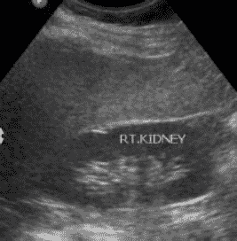**图 (1a)**

肾脏超声图像。

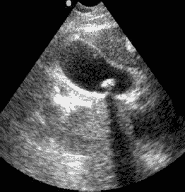**图 (1b)**

带结石的肾脏超声图像。

## 乳腺癌

乳腺癌是一种起源于乳腺组织的癌症，如图(1)所示，图中展示了正常的乳腺组织。当细胞发生不受控制的增殖时，癌症就会发生。乳腺细胞通常形成肿瘤，可以通过`X`射线或触诊等方法发现肿块[11]。虽然它主要影响女性，但重要的是，男性也可能患乳腺癌。

至关重要的一点是，并不是所有的肿块都意味着癌症；许多是良性的。非癌乳腺肿瘤被称为良性肿瘤，代表通常不超出乳腺的异常生长。虽然这些肿瘤不会威胁生命，但某些类型的良性乳腺肿块可能会增加女性患乳腺癌的风险[12]。每一个乳腺肿块或变化都应由医疗专业人员进行评估，以确定其是良性（非癌）还是恶性，并评估其对未来癌症风险的潜在影响。图(2)显示了乳腺癌的`MRI`图像。

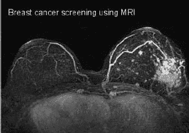**图 (2)**

乳腺癌`MRI`图像。

## 脑肿瘤

脑肿瘤是指一种异常组织块，其特征是脑组织内快速且持续的细胞增殖。肿瘤可以影响各种组织，将其影响扩展到大脑和肺部。所有脑肿瘤都与癌症有关。磁共振成像（`MRI`）技术在急诊诊断过程中起着关键作用。

脑肿瘤分割涉及将不同的肿瘤细胞（包括有效的肿瘤成分、实性结构、水肿和坏死）与正常脑细胞精确分离，包括灰质（`GM`）、白质（`WM`）和脑脊液（`CSF`）。在脑肿瘤研究领域，对异常细胞的检查是一个持续的焦点[13]。图(3)直观地表示了脑肿瘤的存在。

值得注意的是，`MRI`过程是非侵入性的，没有疼痛或辐射，使其成为研究脑肿瘤不可或缺的工具。

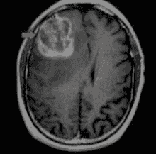**图 (3)**

受肿瘤影响的大脑。

# 检测异常的图像处理技术

图像处理是各医疗领域中广泛使用的方法，涉及对图像执行操作以提取有价值的信息。图像分析的应用对于各种疾病的早期检测证明是非常有益的，时间在其中起着至关重要的作用。

## 图像采集

建议的方法从图像采集开始，这是一个关键步骤，涉及从系统内的外部源采集图像。在`MATLAB`中使用图像采集工具箱命令可以方便以矩阵格式提取图像[14]。在这种背景下，采集的`DICOM`图像最初转换为`JPEG`格式，以增强可读性并允许后续处理。

## 图像预处理（RGB 转灰度）

图像预处理是一个关键步骤，旨在从退化的形式中恢复原始图像。采集的图像经过预处理，在转变为灰度的同时消除标签。这一预处理步骤为后续处理阶段一致地产生更好的结果[15]。预处理后，图像显示出增强的锐度和清晰度，如图(4a-b)和图(5a-b)所示。

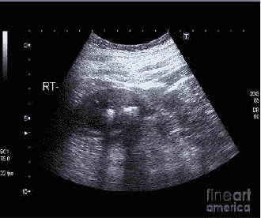**图 (4a)**

输入图像（RGB）。

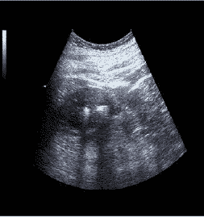**图 (4b)**

预处理后的图像（GRAY）。

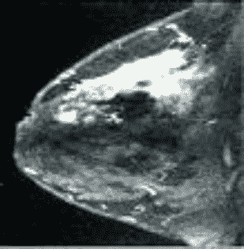**图 (5a)**

输入图像（RGB）。

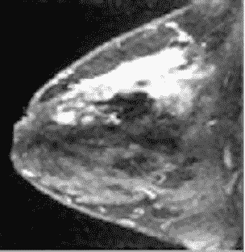**图 (5b)**

预处理后的图像（GRAY）。

## 通过强度调整增强图像对比度

图像增强技术的主要目标是操纵生物医学图像，使其适用于医疗专业人员的疾病诊断。对于从事医学图像视觉分析的医生来说，对患者图像的全面理解是必要的，以便于准确诊断。医学图像往往面临照明不足的问题，导致结构模糊和边界不清晰。提高图像质量对于简化处理至关重要，因此医学图像增强在这一背景下起着关键作用[16]。

该技术用于消除各种伪影，同时突出特征和边界等，如图(6 和 7)所示。对比度增强技术提供了降低或增加图像对比度的活性[17]。医学图像可以通过这些技术进行修改，以精炼细节。

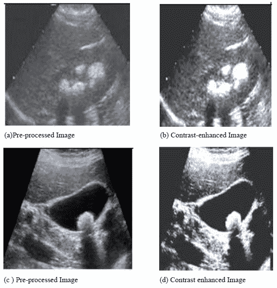**图 (6)**

增强后的结石。

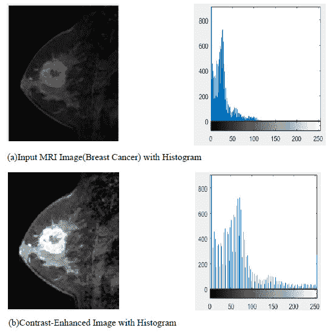**图 (7)**

建议的方法通过`adjust`实现图像中的值调整。这有助于结果图像指定强度值[18]。调整后的强度值与显示范围一致，有助于改善精细细节。

## 中值滤波

这是图像处理领域内的一种非线性滤波技术，专门用于处理具有明显噪声的情况，例如盐粒噪声或脉冲噪声。滤波过程作为预处理阶段起着关键作用，增强图像用于边缘检测或分割等任务。

在数字图像处理领域，中值滤波是一种广泛采用的方法，特别是在处理声波（`US`）图像中常见的斑点噪声方面[19]。中值滤波对脉冲噪声和斑点噪声特别有效，在保留边缘的同时消除噪声，并产生更好的结果。这种技术提供了无信息丢失的近似。各种窗口算子，包括中值、最大值、最小值和平均滤波器均可用，其中中值滤波器被证明是最有效的[20]。

预处理一致证明是有益的，为进一步分析产生更锐利、更清晰的图像。预处理后的感知改进可见于图(8、9 和 10)。

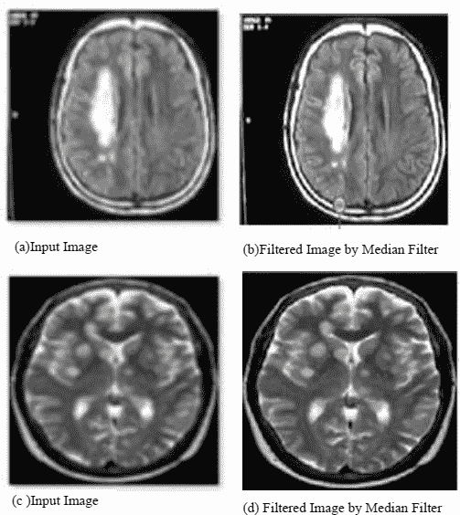**图 (8)**

脑肿瘤`MRI`图像，(a) 输入图像，(b) 滤波图像。

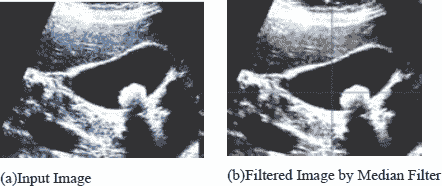**图 (9)**

肾石图像，(a) RGB 图像，(b) 灰度滤波图像。

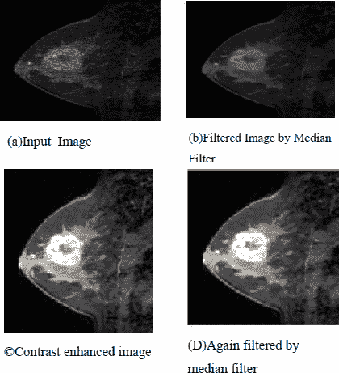**图 (10)**

乳腺癌`MRI`图像，(a) 输入图像，(b) 滤波图像，(c) 增强图像，(d) 再次通过中值滤波处理（现在更加清晰锐利）。

## 分割

分割程序是图像处理中一个不可或缺且复杂的方面。图像分割是一种用于将图像划分为具有相似属性和特征的不同区域的技术，便于对图像进行分析和简化以实现有意义的解释[20]。在数字图像处理的核心，分割是一个基础且具有挑战性的过程，主要用于将图像划分为一组不相交的区域。每个区域内的值应基于纹理、色调、颜色或强度等因素表现出同质且均匀的属性[21]。

由于图像的多样性，图像分割缺乏通用的理论，脑肿瘤、乳腺癌和肾结石与脑脊液、灰质和白质等自然组织相比呈现出独特的挑战[22]。独特的实体组件（如肾中的结石）需要特定的分割方法。在这种背景下，采用阈值分割来识别结石，而聚类分割则用于检测肿瘤和癌症。这些定制的分割技术适应医学图像中不同结构的各种特征。

### 形态学操作分割

形态学分割的步骤如下：

1. 从数据库读取`MR`脑部图像作为输入。
2. 通过应用阈值`T`获取输入图像，如所示，其中`g(c,d)`是强度或灰度图像。
3. 使用合适的结构元素对二值图像进行腐蚀处理，所得图像称为腐蚀图像。`A•B=(AB) B`，其中`A`代表二值图像，`B`是结构元素。
4. 应用扩张操作，`A ο B = (AB) B`，其中`A`代表二值图像，`B`是结构元素。
5. 创建肿瘤或癌症区域的`ROI`。

### 聚类分割

聚类分割在识别肿瘤和癌症精确位置方面起着关键作用。手动分割过程非常耗时，需要更高效的技术来进行准确勾勒。`K-means`聚类成为将信息划分为聚类的主流方法，如图(11 和 12)所示。`K-means`聚类被分类为硬聚类[23]，其中每个像素都明确地关联到单个聚类。

在硬聚类的背景下，使用了 0 或 1 的隶属函数。值 0 表示像素不属于任何聚类，而值 1 表示像素隶属于特定的聚类。`k-means`聚类技术基于硬聚类的原理运行，每个像素被明确地分配给最近的聚类中心[24]。

分割的肿瘤或癌症区域。

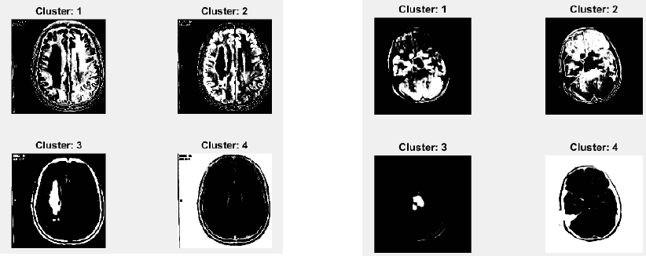**图 (11)**

这种方法增强了医学图像中定位的精度。

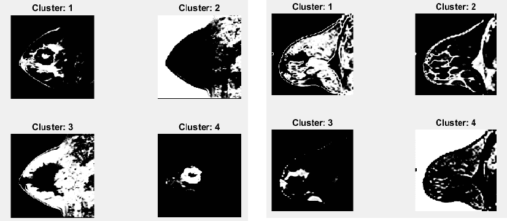**图 (12)**

分割的脑图像。

### 阈值分割

阈值技术将图像划分为不同的区域，基于其直方图所示。在硬阈值值下，值为 0 的像素不属于任何聚类，而值为 1 的像素表示像素隶属于特定的聚类。这种方法适应医学图像中不同结构的各种特征。

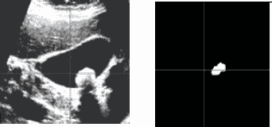**图 (13)**

分割的脑图像。

### 形态学操作区域

腐蚀和扩张是形态学操作。为了找到肿瘤或癌症的边界，我们需要通过腐蚀和扩张进行检测，腐蚀方程如下：

```
| 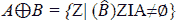 || (1) |
| ---
```

其中`AC`是补集。扩张方程为：

```
|  || (2) |
| ---
```

为了绘制肿瘤或癌症的边界，我们应用了扩张，如图(14 和 16)所示。

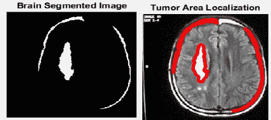**图 (14)**

分割的脑图像。

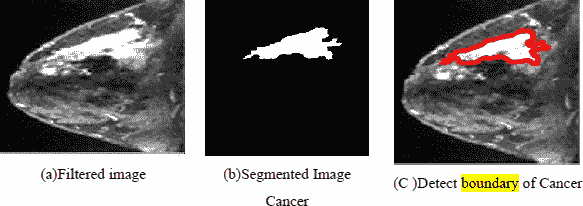**图 (15)**

分割的脑图像。

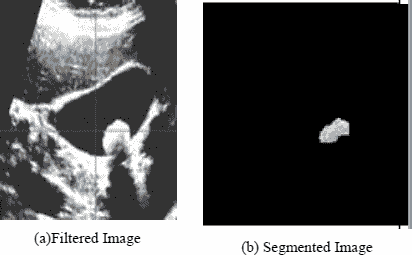**图 (16)**

肾结石检测。

### 卷积神经网络分类

卷积神经网络（`CNN`）是一种复杂的多层前馈神经网络机器学习算法，旨在模拟人类视觉皮层的功能。`CNN`的架构包括输入层、特征提取层、分类层和输出层[26]。特征提取层由池化层和卷积层组成，而分类层通常由多层感知机（`MLP`）构建。位于输入层和输出层之间的池化层、卷积层和全连接层构成了非线性隐藏层。随着层数的增加，所学习图像属性的复杂性也随之增加[27]。神经网络配置实现了有效的特征提取和分类，使其在图像识别任务中特别强大。

随后，我们应用小波变换系统地计算输入图像特征。图像的分类基于神经网络（`NN`）分类执行，数据库中的参考图像由`MRI/CT`图像组成。该数据库包含了正常和异常图像，分别代表无癌症和患癌症的情况[28]。

分类被用于区分图像是正常还是异常。在对每个像素进行比较时，如果识别出肿瘤，将触发消息框，指示受影响肿瘤的存在。这一过程在神经网络训练完成后进行，证实了通过细致的像素级检查来区分正常和异常情况的能力。

# 结果分析

在本研究中，从网上汇集了一个疾病相关图像的数据集，包括 50 张大脑相关图像、15 张肾脏相关图像和 5 张乳腺癌相关图像。开发过程在`MATLAB`环境中进行。初始阶段对收集的图像进行统计分析。

对于疾病检测，采用了先分割后分类的顺序方法。第一步是获取图像数据集，其中利用`MATLAB`读取图像并移除所有文本和相关标签。随后，图像经过从`RGB`到灰度模式的转换并进行尺寸调整。为了处理噪声，应用了中值滤波。

对于与肿瘤和癌症`MRI`图像，实施了离散小波变换（`DWT`）。使用卷积神经网络（`CNN`）分类器将这些图像分类为正常或异常阶段。然后应用聚类分割操作来识别肿瘤的位置。

聚类分割的结果在图(12 和 13)中展示，说明了肿瘤的检测。最终的分割图像在图(18 到 21)中呈现，其中一个显示影响 30%（良性），另一个显示影响 50%（恶性）。图(17)显示了一个没有任何肿瘤的正常大脑。

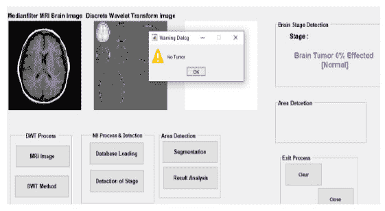**图 (17)**

检测正常大脑。

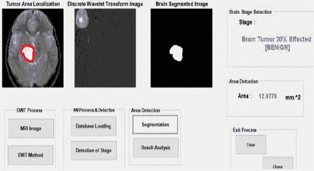**图 (18)**

检测脑肿瘤，显示影响 30%。

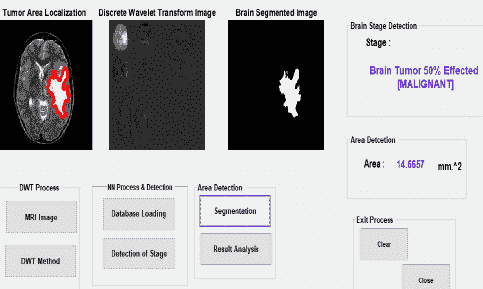**图 (19)**

检测脑肿瘤，显示影响 50%。

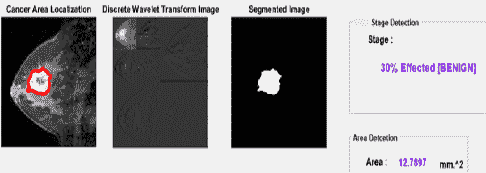**图 (20)**

检测癌症，显示影响 30%。

**图 (21)**

检测癌症，影响了 50%。

分类过程的准确性根据大脑肿瘤识别的正确和错误结果来确定。准确率可以使用公式 (1) 计算。这种综合方法整合了先进的图像处理技术，用于精确的疾病检测和定位。

| | | | |
| :--- | :--- | :--- | :--- |
|  | (3) | | |

表 2 代表肿瘤检测的混淆矩阵。假阳性、假阴性、真阳性和真阴性值在此表 2 中。

**表 2 肿瘤检测的混淆矩阵。**

| 参数 | TP | FN | TN |
| :--- | :--- | :--- | :--- |
| 值 | 25 | 1 | 22 |
| 特异性 (Specificity) | 95.652 | 95.652 | 95.652 |
| 灵敏度 (Sensitivity) | 96.153 | 96.153 | 96.153 |
| 准确率 (Accuracy) | 95.918 | 95.918 | 95.918 |

已经发现使用我们的方法获得了高于 95% 的准确率。在结石检测领域，该方法采用了阈值分割。结果分割图像直观地绘制在图(18)中，而结石检测的流程在图(22)中阐明。

**图 (22)**

完成结石检测的程序。为了详细分析灵敏度、准确率、特异性和`F1`分数，在 15 和 20 阈值处使用了混淆矩阵，如表 3 所示。这允许对性能进行彻底检查。

**表 3 不同阈值的性能评估（结石检测）。**

| | | | |
| :--- | :--- | :--- | :--- |
| 1 | 阈值(15) | 特异性 | .93 |
| 灵敏度 | 1 | | |
| F1 分数 | .96 | | |
| 2 | 阈值(20) | 特异性 | 1 |
| 灵敏度 | 1 | | |
| F1 分数 | 1 | | |
| 准确率 | 1 | | |

**图 (23)**

可视化性能。通过准备混淆矩阵进行最终系统分析以评估准确率、特异性和灵敏度。分类系统的准确率确定约为 96%。这项创新技术有助于医生早期检测并准确治疗患者，强调了其临床意义。

# 结论

在实时场景下，`MRI`和超声图像的清晰度可能不足，需要进一步的诊断干预。本工作引入了一种检测结石、大脑肿瘤和乳腺癌的精确方法。该方法涉及一系列预处理步骤、对比增强和滤波以提高图像质量。卷积神经网络（`CNN`）模型有助于确定肿瘤的阶段或类型。

随后，采用了疾病定位、聚类和阈值分割技术。通过基于准确率的分析对方法的有效性进行了评估。该方法的验证确定了其作为医疗专业人员早期准确诊断价值工具的潜力，从而造福患者和医学界。

# 参考文献

| | |
| :--- | :--- |
| [1] | Rasti P, Daneshmand M. Alisinanoglu F. 使用静态小波变换医学图像照明增强和锐化 24th Signal Processing and Communication Application Conference (SIU) Zonguldak2016153-6.[httpdx.doi.org/10.1109/SIU.2016.749500](http://dx.doi.org/10.1109/SIU.2016.749500) |
| [2] | Kumar B. Mohan, Thakur Y. S., 数字图像处理领域的隐形写技术简介。2017; 7(6). |
| [3] | Alkoffash M. S.,Mohammed Bawaneh J., 字符识别数字图像处理技术综述。IJCSNS International Journal of Computer Science and Network Security 2014; 14(3). |
| [4] | Tanzila R., and Mohammad U.S. 超声图像斑点噪声消除和肾区分割。Informatics, Electronics & Vision (ICIEV), 2013 International Conference on. IEEE. 2013, pp. 1-5. |


## 参考文献

| [5] | Goldman Lee W., CT 原理和 CT 技术。核医学技术杂志 2007 年 9 月，35(3):115-128. [httpdx.doi.org/10.1109/SIU.2016.742978](http://dx.doi.org/10.1109/SIU.2016.742978) |

| [6] | Adam, Tijjani, Hashim U., and Sani U. S. 设计一种人工神经网络模型，通过患者的金属行为预测肾问题症状进行临床前医学诊断。Biomedical Engineering (ICoBE), 2012 International Conference on. IEEE. |

| [7] | Rathi P. and Palani S. 基于 HSOM、小波包特征空间和 ANN 的分割大脑肿瘤检测和表征，3rdInternational Conference on Electronics Computer Technology(ICECT ’ 2011)论文集，卷. 6, pp. 274–277, IEEE, Kanyakumari, India. |

| [8] | Demirhan,ToruM. 使用小波和神经网络对脑健康组织中的肿瘤和水肿进行分割。IEEEj. Boimed Health Inform, 19(4): 1451-1458. |

| [9] | Prema T. Akkasaligar, Sunanda Biradar 和 Veena Kumbar, 计算机断层扫描图像中的结石检测，2017 IEEE, 2017. |

| [10] | Goel R, Jain A. “使用分割技术改进肾脏超声检测(编). 数据与信息科学进展. 网络与系统讲义录，2020 年第 94 卷. 瑞士出版社。” |

| [11] | Araújo T, Aresta G, Castro E, 等. 使用卷积神经网络对乳腺癌病理图像进行分类。PLoS One 2017; 12(6): e0177544. [`dx.doi.org/10.1371/journal.pone.0177544`](http://dx.doi.org/10.1371/journal.pone.0177544) [PMID: 28570557](http://www.ncbi.nlm.nih.gov/pubmed/28570557) |

| [12] | Sanders ME, Simpson JF. 乳腺病理 Elder DE. 2014; 第 6 卷 |

| [13] | Sawarkares, 使用离散小波变换、主成分分析和概率神经网络对脑肿瘤进行分类。Int J. Res Emerg Sci Technol (6), E-ISSN: 2349-7610. |

| [14] | Vaish, Pallavi, 基于手机的超声图像中肾脏自动异常检测。e-Health 网络、应用与服务 (Healthcom)，2016 IEEE 第 18 国际会议。IEEE IEEE。 |

| [15] | Goel R, Jain A. 在彩色和灰度图像上实施图像增强技术。第五次并行、分布式和网格计算会议 (PDGC) 2018204-9. [`dx.doi.org/10.1109/PDGC.2018.8745782`](http://dx.doi.org/10.1109/PDGC.2018.8745782) |

| [16] | Tarun K., Karun V. 一基于 RGB 图像转换为灰度图像的理论，国际计算机应用期刊 2010; 7(10): 0975-8887. |

| [17] | Janani P. 图像增强技术：一项研究。印度科学与技术杂志 2015; 8(22) ISSN: 0974-6846. |

| [18] | Jeyalakshmi, T. Ratha 和 K. Ramar. 一种用于超声医学图像斑点噪声去除改进方法。国际计算机与电气工程杂志 2010; 2(1): 54. |

| [19] | Yu J, Tan J, Wang Y. 使用 SUSAN 控制各向异性扩散方法减少超声斑点。Pattern Recognit 2010; 43(9): 3083-92. [`dx.doi.org/10.1016/j.patcog.2010.04.006`](http://dx.doi.org/10.1016/j.patcog.2010.04.006) |

| [20] | Arun M. 采样和噪声过滤的图像处理。国际工程发明杂志 2014; 3(7) e-ISSN: 2278-7461, p-ISSN: 2319-6491. |

| [21] | Viswanath, Kalannagari 和 Ramalingam G. 基于水平分割和 ANN 分类的结石检测的设计与分析。计算、通信与信息进展 (ICACCI)。 |

| [22] | Demirhan A, Toru M. 使用小波和神经网络对脑健康组织中的肿瘤和水肿进行分割。Biomed Health Inform 19(4): 1451-8. |

| [23] | Sneha A Mane, S Chougule. 结石检测的神经网络。国际科学与研究杂志 (IJSR) Online 2016; 7(4): 2319-7064. |

| [24] | Sharma K 和 Preet B. 使用 CNN 分类器对乳腺影像图像进行分类。第五次计算、信息进展国际会议，ICACCI 2016 论文集，第 2743–2749 页。[`dx.doi.org/10.1109/ICACCI.2016.7732477`](http://dx.doi.org/10.1109/ICACCI.2016.7732477) |

| [25] | Sharma K, Preet B. 使用 CNN 分类器对乳腺影像图像进行分类。第五次 ICACCI 2016 论文集 2743-9。 [`dx.doi.org/10.1109/ICACCI.2016.7732477`](http://dx.doi.org/10.1109/ICACCI.2016.7732477) |

| [26] | Varuna Shree N, Kumar TNR. 使用 DWT 和概率神经网络进行特征提取的脑肿瘤 MRI 图像识别与分类。Brain Inform 2018; 5(1): 23-30. [`dx.doi.org/10.1007/s40708-017-0075-5`](http://dx.doi.org/10.1007/s40708-017-0075-5) [PMID: 29313301](http://www.ncbi.nlm.nih.gov/pubmed/29313301) |

| [27] | Tripathy B, Parimala M, Reddy GT. 用于预测各种疾病的创新分类、回归模型。生物医学工程与医疗保健中的数据分析 202117-203. [生物医学工程与医疗保健中的数据分析](http://dx.doi.org/10.1016/B978-0-12-819314-3) |

| [28] | Chen H, Liu J, Wen Q-M, 等. 基于深度学习的宫细胞癌筛查系统。计算机科学与技术 2021; 36(2): 347-60. [`dx.doi.org/10.1007/s11390-021-0849-3`](http://dx.doi.org/10.1007/s11390-021-0849-3) |

结合天气和污染暴露等外部因素，机器学习在健康维护方面有着广泛的应用，通过对常见疾病的病例管理来增强患者健康数据。大型数据集可以使用机器学习（ML）方法进行拆分，这可以帮助医疗保健人员产生精确且针对每个患者独特需求定制的医疗解决方案。由于机器学习可以筛选数百万个数据点并发现潜在的危险点，因此它正被越来越多地用于检测危险。图（(1) 显示了与机器学习相关的领域。

 **图 (1))**

机器学习相关的领域。

在人工智能（AI）中，它是一个子集。在没有显式建模的情况下，机器学习模型像人类一样从经验中获取知识。当面对新数据时，这些机器学习模型能够独立地适应、进化、学习和成长。换句话说，机器学习包含了隐性地发现有用信息。选定的算法作为机器学习过程的一部分进行训练。最终的机器学习算法可以使用已知或未知的训练数据创建。随后，将 ML 算法应用于新数据以查看其运行是否正常。下一阶段是比较预测和结果之间的关系，以查看 ML 算法是否按预期运行。如果结果和预测不匹配，则反复训练 ML 算法直到数据科学家获得正确的输出。这使得机器学习算法更容易持续训练，并能随着时间的推移不断提高准确性，生成非常好的响应。ML 生命周期过程如下图所示，它解释了学科专家和业务利益相关者如何在各个阶段参与。理解 ML 的生命周期是一个参与过程至关重要。在医疗保健行业，机器学习被用于从海量医疗数据集中提取知识，改善患者结果、简化医疗工作人员的日常任务、加速医学研究并提高运营效率。

### 排序 (Ranking)

它可以通过优先考虑相关信息来促进搜索。

### 预测 (Prediction)

它可以根据历史模式和可用数据预测未来事件的分布。

### 分类 (Classification)

ML 算法可以协助分类和调节患者正在应对的疾病类型或医疗状况。

### 自动化 (Automation)

它可以处理常规、重复性的操作，如库存管理、数据输入、预约调度等 `etc.`，这些操作需要医生和患者花费更多的时间和精力。

### 建议 (Suggestions)

ML 系统可以提供关键的医疗信息，而无需费力搜索。

### 异常检测 (Anomaly Detection)

该技术用于医疗保健行业以识别反复模式并确定是否需要采取进一步行动。

### 聚类 (Clustering)

为了识别趋势并引导未来的研究，将相似的医学病例归为一类是有用的。

### 机器学习的重要性 (Importance of Machine Learning)

数据量和多样性的指数级增长、计算能力的可及性和负担能力的提高，以及高速计算的无处不在，推动了机器学习的重要性。这些元素促进了能够精确分析大型复杂数据集的模型创建。

它涵盖了降低成本、最小化风险以及辅助自动驾驶的许多可能性。随着数据可用性的增加和计算能力的提高，机器学习日益成为生活的各种组成部分，准备无缝集成到生活的各个方面。

### 机器学习的范围 (Scope of Machine Learning)

在过去的十年里，应用于医疗保健的机器学习（ML）取得了显著且快速的进展。大量的努力致力于解决各种医疗需求，减轻医疗人员的工作负担并赋能个人。特别值得注意的是 ML 在计算机视觉领域取得的巨大成功。

## 医疗机器学习综述 (Survey for Machine Learning in Healthcare)

Dhillon 和 Singh `1)` 提出的工作解释了几类机器学习，包括监督学习、无监督学习和强化学习，并审查了机器学习技术对医疗数据的应用。各种数据，包括传感器、组学（Omics）和临床数据，被用于医疗保健。治疗过程中收集的患者电子健康记录也被包含在内。处理这些原始数据需要大量工作。机器学习已成为数据分析的重要工具。通过利用复杂的算法和各种统计方法，机器学习对医疗数据做出更准确的预测。

在综述中，Rahman 和 Zhou `2)` 研究了用于医疗环境的机器学习技术。在对监督和无监督机器学习方法进行彻底介绍和分析之后，他们还展示了如何使用历史数据进行时间序列任务。他们评估了这些方法在大小数据集上的可行性。

Deo `3)` 专注于计算机如何从数据中学习。它源于计算机科学的交叉领域，专注于有效的计算技术和统计，旨在从数据中推断关系。创建可能包含数十亿或万亿个数据点的统计模型的特殊计算困难促成了这种数学与计算机科学的结合。将计算机使用的不同学习形式分为监督学习和无监督学习是有帮助的。

为了给读者提供理解文章的基础知识，我们希望在该论文 `4)` 中向社区介绍机器学习的核心概念。旨在引导读者参考相关研究，并为药物代谢学、临床药学和分子生物学领域的机器学习应用提供背景，尽管我们不会涉及细节和理论基础。

在一项研究 `5)` 中，作者探索了计算机视觉、自然语言处理、强化学习和通用方法中的深度学习，这些技术。我们讨论了这些计算方法在多个重要医疗领域的潜在应用，并研究了端到端系统的开发。我们描述了自然语言处理在电子健康记录等领域的应用，我们对计算机视觉的讨论主要集中在医学影像上。同样，我们还检查了基因组学的通用深度学习技术，并探索了机器人辅助手术的强化学习。

在这项工作[6] 中，我们从安全和隐私的角度概述了使用这些技术的许多医疗保健应用领域相关的问题。此外，我们概述了确保医疗应用中安全且保护隐私的机器学习（ML）的多种方法。最后，我们了解了目前的研究障碍以及未来调查的广阔前景。

这篇综述[7] 对强化学习（RL）在各个医疗保健领域的应用提供了全面概述，包括自动医疗诊断、慢性病和重症监护中的动态治疗方案，以及渗透到医疗系统每个部分的许多控制或调度问题。它首先简要回顾了强化学习研究的理论基础和关键方法。此外，我们强调了可能的解决方案和未来的研究路径，并讨论了当前研究的困难和未解决的问题。

由于模型可能会加剧现有的健康不平等，医疗保健中的机器学习（ML）面临着若干伦理问题。本文[8] 讨论了围绕促进医疗保健进步的平等机器学习的道德问题。我们利用社会正义来为医疗保健中机器学习的伦理提供背景。从问题选择到部署后的关注点，我们详细说明了健康领域伦理机器学习建议流程中的障碍，并描述了该方向正在进行的工作。我们最后以解决这些问题的建议总结作为结束。

这项研究[9] 在进入相关方面和适用于医疗保健架构的机器学习支柱之前，审视了机器学习（ML）及其在医疗保健中的应用。最后，它强调并回顾了机器学习在医疗保健中的重要用途。在医疗操作中使用这项技术可能对公司产生重大的积极影响。医院和医疗系统可以通过实施基于机器学习（ML）的技术来提供个性化和多样化的治疗选择、节省医疗成本并提高效率。机器学习将很快影响医生和医院。对于开发临床决策支持、疾病诊断和个性化治疗方案以获得最佳结果，这将是至关重要的。

作者将在主题概述中讨论[10] 在医疗通信中使用 ML/AI 对人们的潜在益处。这涵盖了用于医学影像、癌症治疗和 COVID-19 健康教育的机器人。

本章[11] 探讨了使用机器学习推进医疗保健解决方案的最新研究。但我们也讨论了机器学习技术在医疗保健行业的局限性、困难和可能性。机器学习应用可用于诊断、预后以及针对确诊状况制定理想治疗方案，以在医疗保健行业中跟踪和评估疗效。医疗专业人员可以通过获得更快速、更精确的解决方案从机器学习技术中获益。读者将在本章中发现基于机器学习的尖端医疗保健系统的原理和最新进展。但随着医学知识和技术的进步，它们也产生了必须从跨学科和全面视角进行检查的新颖情况。

作者[12] 在进入相关方面和适用于医疗保健架构的机器学习支柱之前，审视了机器学习（ML）及其在医疗保健中的应用。最后，它强调并回顾了机器学习在医疗保健中的重要用途。在医疗操作中使用这项技术可能对公司产生重大的积极影响。医院和医疗系统可以通过实施基于机器学习（ML）的技术来提供个性化和多样化的治疗选择、节省医疗成本并提高效率。机器学习将很快影响医生和医院。对于开发临床决策支持、疾病诊断和个性化治疗方案以获得最佳结果，这将是至关重要的。

作者将在主题概述中讨论[10] 在医疗通信中使用 ML/AI 对人们的潜在益处。这涵盖了用于医学影像、癌症治疗和 COVID-19 健康教育的机器人。

本章[11] 探讨了使用机器学习推进医疗保健解决方案的最新研究。但我们也讨论了机器学习技术在医疗保健行业的局限性、困难和可能性。机器学习应用可用于诊断、预后以及针对确诊状况制定理想治疗方案，以在医疗保健行业中跟踪和评估疗效。医疗专业人员可以通过获得更快速、更精确的解决方案从机器学习技术中获益。读者将在本章中发现基于机器学习的尖端医疗保健系统的原理和最新进展。但随着医学知识和技术的进步，它们也产生了必须从跨学科和全面视角进行检查的新颖情况。

作者[12] 在进入相关方面和适用于医疗保健架构的机器学习支柱之前，审视了机器学习（ML）及其在医疗保健中的应用。最后，它强调并回顾了机器学习在医疗保健中的重要用途。在医疗操作中使用这项技术可能对公司产生重大的积极影响。医院和医疗系统可以通过实施基于机器学习（ML）的技术来提供个性化和多样化的治疗选择、节省医疗成本并提高效率。机器学习将很快影响医生和医院。对于开发临床决策支持、疾病诊断和个性化治疗方案以获得最佳结果，这将是至关重要的。

作者将讨论[10] 在医疗通信中使用 ML/AI 对人们的潜在益处。这涵盖了用于医学影像、癌症治疗和 COVID-19 健康教育的机器人。

本章[11] 探讨了使用机器学习推进医疗保健解决方案的最新研究。但我们也讨论了机器学习技术在医疗保健行业的局限性、困难和可能性。机器学习应用可用于诊断、预后以及针对确诊状况制定理想治疗方案，以在医疗保健行业中跟踪和评估疗效。医疗专业人员可以通过获得更快速、更精确的解决方案从机器学习技术中获益。读者将在本章中发现基于机器学习的尖端医疗保健系统的原理和最新进展。但随着医学知识和技术的进步，它们也产生了必须从跨学科和全面视角进行检查的新颖情况。

作者[12] 在进入相关方面和适用于医疗保健架构的机器学习支柱之前，审视了机器学习（ML）及其在医疗保健中的应用。最后，它强调并回顾了机器学习在医疗保健中的重要用途。在医疗操作中使用这项技术可能对公司产生重大的积极影响。医院和医疗系统可以通过实施基于机器学习（ML）的技术来提供个性化和多样化的治疗选择、节省医疗成本并提高效率。机器学习将很快影响医生和医院。对于开发临床决策支持、疾病诊断和个性化治疗方案以获得最佳结果，这将是至关重要的。

作者将讨论[10] 在医疗通信中使用 ML/AI 对人们的潜在益处，这一主题概述。这涵盖了用于医学影像、癌症治疗和 COVID-19 健康教育的机器人。


本章[11]探讨了使用机器学习推进医疗保健解决方案的最新研究。但我们也讨论了机器学习技术在医疗保健行业的局限性、困难和可能性。机器学习应用可用于诊断、预后以及针对确诊状况制定理想治疗方案，以在医疗保健行业中跟踪和评估疗效。医疗专业人员可以通过获得更快速、更精确的解决方案从机器学习技术中获益。读者将在本章中发现基于机器学习的尖端医疗保健系统的原理和最新进展。但随着医学知识和技术的进步，它们也产生了必须从跨学科和全面视角进行检查的新颖情况。

作者[12]在进入相关方面和适用于医疗保健架构的机器学习支柱之前，审视了机器学习（ML）及其在医疗保健中的应用。最后，它强调并回顾了机器学习在医疗保健中的重要用途。在医疗操作中使用这项技术可能对公司产生重大的积极影响。医院和医疗系统可以通过实施基于机器学习（ML）的技术来提供个性化和多样化的治疗选择、节省医疗成本并提高效率。机器学习将很快影响医生和医院。对于开发临床决策支持、疾病诊断和个性化治疗方案以获得最佳结果，这将是至关重要的。

## 医疗保健中的机器学习应用

机器学习（ML）在医疗保健中有广泛的应用领域[14]。以下是机器学习在医疗保健的一些显著应用：

### 医学影像分析

包括 X 光、MRI 和 CT 扫描在内的医学影像数据可以通过机器学习算法进行分析以帮助诊断。

### 诊断决策支持系统

机器学习模型通过为医生提供有关疾病概率的见解来提供帮助。

### 药物反应

预测个人对特定药物的反应。

### 精准医学

根据基因组成和生活方式定制治疗策略。

### 预警系统

机器学习可用于识别患者状况恶化的早期迹象，实现及时干预并预防并发症。

### 治疗方案优化

机器学习算法根据历史数据帮助医疗提供者选择最有效的治疗方案。

#### 远程患者监测

机器学习算法分析来自可穿戴设备和其他监控工具的数据，以跟踪患者状况并提供实时反馈。

### 慢性疾病预测分析

机器学习可以预测慢性疾病恶化的可能性，允许进行主动管理。

### 理赔与账单欺诈检测

机器学习模型可以识别医疗保健理赔中的欺诈活动模式，帮助防止财务损失。

### 收入周期优化

机器学习有助于简化行政流程、减少账单错误并改进整体收入管理。

### 电子健康记录 (EHR) 分析

`NLP`算法从非结构化病历中提取有用信息，使医疗提供者更容易评估和使用患者数据。

### 临床编码自动化

机器学习驱动的`NLP`工具有助于实现医疗程序和诊断的编码，减少手动工作量。

### 流行病学建模

机器学习算法分析数据集以预测和监控传染疾病的传播，促进早期干预和资源分配。

### 疾病监测

机器学习协助监测和跟踪公共健康趋势，对新兴健康威胁做出主动反应。

### 基因组数据分析

机器学习用于分析大量的基因组数据集，识别与疾病相关的遗传标记并支持基因组学研究。

### 药物发现

机器学习通过预测潜在药物药物、优化分子结构和识别潜在目标来加速药物发现。

### 自动肿瘤检测

机器学习算法协助放射科医生在医学影像中检测和表征肿瘤，提高准确性和效率。

### 病理图像分析

机器学习协助病理学家分析病理切片、识别模式并支持诊断决策。

### 心理健康预测分析

机器学习模型可以分析行为和临床数据以预测并干预心理健康危机。

### 虚拟心理健康助手

由机器学习驱动的聊天机器人和虚拟助手提供了心理健康支持和资源。

这些应用在改进诊断、治疗和医疗保健交付方面的潜力，展示了机器学习在医学领域的适应能力和力量。然而，要在医疗保健环境中负责任且有效地使用机器学习，必须解决包括数据保护、监管合规和伦理考虑在内的问题[15]。

## 机器学习面临的挑战与考虑

机器学习（ML）在医疗保健领域的应用对提高整体患者护理具有巨大潜力，包括诊断和治疗策略。然而，它也引发了一些必须恰当考虑的问题和担忧。需要一种基于数据科学家、医疗执业人员、伦理学家、立法者和技术专家之间合作的跨学科方法来解决这些问题。为了确保机器学习在医疗保健中得到适当且高效的应用，平衡创新与伦理及监管考量至关重要。以下是需要考虑的一些主要问题和因素[16, 17]（表**1**）。

表 1 机器学习的挑战与考虑。

| 挑战 | 考虑因素 |
| :--- | :--- |
| **数据隐私与安全**：敏感的医疗数据必须遵守严格的隐私法。在使用数据训练机器学习模型时维护患者机密性是一项重大挑战。 | 为了保护患者数据，实施强加密、匿名化和访问控制机制。遵循`HIPAA`（健康保险流动性与责任法）至关重要。 |
| **数据质量与可用性**：机器学习模型严重依赖高质量、多样化且代表性的数据集。在医疗领域，由于数据孤岛、记录不完整和数据格式差异等问题，获取此类数据可能挑战。 | 投资数据清洗、标准化和整合过程。跨机构合作创建更大、更多样的数据集。 |
| **互操作性**：医疗系统通常使用不同的标准和格式，导致互操作性问题。机器学习模型可能难以与各种数据源和系统集成。 | 在医疗 IT 系统中推广标准化格式和接口的应用。开发能够实现无缝数据交换的`APIs`（应用程序接口）。 |
| **监管合规**：医疗保健受高度监管，机器学习应用可能需要经过严格的审批流程。应对这些监管框架可能是耗时且复杂的。 | 与监管机构合作，建立立在医疗保健中伦理且安全使用机器学习的准则。确保机器学习算法的透明度以促进监管审查。 |
| **伦理考虑**：机器学习模型可能会无意中延续训练数据中存在的偏见。确保公平性和避免歧视是一个关键的伦理考虑。 | 定期对模型进行偏差审计和评估。将伦理考虑纳入机器学习系统的设计和部署中。在数据集策选过程中追求多样性和包容性。 |
| **临床可解释性**：许多机器学习模型（尤其是深度神经网络等复杂模型）通常被视为“黑箱”，这使得临床医生难以理解其决策。 | 开发可解释的机器学习模型或方法，为模型预测提供解释。确保临床医生能够信任并理解机器学习系统的输出。 |
| **集成到临床工作流中**：将机器学习解决方案无缝实施到现有的临床工作流中可能是挑战性的。对变革的抵触和缺乏用户友好界面会阻碍采用。 | 让医疗专业人员参与设计和实施过程。开发用户友好界面并为医疗员工提供使用机器学习工具的培训。 |
| **资源限制**：医疗机构在财务和专业人才方面可能资源有限，不足以实施和维护机器学习解决方案。 | 考虑：探索合作努力、共享资源，并考虑可扩展且成本效益的机器学习解决方案。投资培训计划以培养既精通医疗又精通机器学习的人才。 |
| **患者信任与参与**：患者可能对在医疗保健中使用机器学习感到怀疑或不安。建立和维护信任对于成功实施至关重要。 | 向患者介绍机器学习在医疗保健中的优点和局限性。让患者参与决策过程，并确保其数据使用方式的透明。 |
| **长期监测与维护**：由于数据分布的变化或临床实践的演变，机器学习模型的性能可能会随时间而下降。 | 实施持续监测系统和定期模型更新。建立模型重训练协议以确保持续有效。 |

## 机器学习在医疗保健中的优势

医疗保健中的机器学习（ML）提供了许多益处，可以显著改善患者预后、提高效率并推动医学研究。以下是将机器学习整合到医疗保健中的一些关键优势[18^(-)20]。

 **图 (2)**

机器学习在医疗保健中的作用。

### 提高诊断准确性

机器学习算法可以分析包括图像和测试结果在内的复杂医学数据，协助医疗专业人员以更高的准确性和速度诊断疾病。癌症疾病的早期发现允许及时干预并改善治疗效果。

### 个性化治疗计划

机器学习允许分析个体患者数据，根据遗传因素、病史和其他个性化参数定制治疗方案。个性医疗增强了治疗效果，减少了副作用并提高了患者依从性。

### 高效数据分析

机器学习算法以超越人类能力的规模和速度处理并分析大型数据集。电子健康记录（`EHRs`）和医学影像数据的快速分析加速了研究并改进了决策。

### 临床决策支持系统 (CDSS)

机器学习驱动的`CDSS`通过提供诊断和治疗的实时见解和建议协助医疗专业人员。`CDSS`通过考虑广泛的患者数据和医学知识来增强决策。

### 预防性护理的预测分析

机器学习模型可以预测患者风险并在问题恶化前识别潜在健康问题。基于预测分析的早期干预可以带来更好的预防性护理并减轻医疗系统的负担。

#### 远程患者监测

可穿戴设备和远程监测工具中的机器学习应用能够在传统医疗环境之外持续跟踪患者健康。远程监测增强了患者参与度，允许及时干预并减少了再次入院率。

### 优化资源配置

机器学习通过预测患者入院率、优化人员调度和高效管理库存，帮助医疗机构优化资源配置。资源优化可以节约成本并提高整体医疗服务的交付。

### 自动化行政流程

机器学习（ML）简化了预约调度、账单处理和索赔处理等行政任务。常规行政流程的自动化减少了错误，并让医疗专业人员专注于患者护理。

### 药物发现与开发

机器学习通过分析大型数据集、预测潜在候选药物以及优化分子结构，加速了药物发现。药物开发时间和成本的缩短使得患者能够更快地获得新的治疗方法。

### 增强型影像分析

机器学习算法改进了医学影像数据（如 MRI 和 CT 扫描）的分析，有助于检测异常情况并协助放射科医生进行诊断。自动化图像分析提高了效率并降低了人为错误的概率。

### 流行病学监测与爆发预测

机器学习模型分析海量数据用于流行病学监测，实现对疾病爆发的预测和监控。爆发的早期检测允许采取主动的公共卫生措施和资源配置。

### 持续学习与适应

机器学习模型可以根据新数据和不断发展的医疗趋势进行持续学习和适应。持续学习随着时间的推移，提高了机器学习应用的准确性和相关性。

### 患者参与度与教育

机器学习驱动的应用提供个性化的健康建议和教育资源，以提高患者管理健康的参与度。患者参与度的提高可以带来更好的治疗计划依从性和生活方式改变。

### 医疗研究支持

机器学习促进了医疗研究中的高级数据分析，揭示大型数据集中的模式和相关性，从而引发发现。机器学习支持研究人员识别潜在风险因素、治疗反应和生物标志物。

医疗健康受益于机器学习；但为了确保应用的负责任和安全，必须解决数据隐私、监管合规性和伦理考虑。医疗专业人员、数据科学家和其他利益相关者之间的协作对于将机器学习成功整合到医疗工作流中至关重要。

## 医疗领域使用的机器学习算法

机器学习算法在医疗领域的各种应用中起着至关重要的作用。算法的选择取决于具体的任务或问题。以下是医疗领域常用的机器学习算法[21, 22]：

### 监督学习算法

监督学习算法类机器学习算法使用带标签数据集，其中数据与相应的输出标签相关以训练模型。为了能够预测或分类新的未知数据，算法必须能够学习从输入到输出的映射。以下几种流行的监督学习算法如下：

#### 逻辑回归

预测观测值属于两个类别之一的概率是被称为逻辑回归的统计技术的目标。尽管名称中带有“回归”，但逻辑回归并非用于回归，而是用于分类。在医疗领域中，逻辑回归通常用于疾病预测、风险评估和结果建模任务。

**应用**：疾病预测、结果建模。

**用例**：根据输入特征预测患者患疾病的概率。

#### 支持向量机 (SVM)

像支持向量机 (SVM) 这样强大的监督学习算法被用于回归和分类。在医疗领域，`SVM`常用于医学影像分析。

**应用**：图像分类。

**用例**：对医学图像（例如 X 光、扫描图）进行分类以检测异常。

#### 随机森林

一种名为`Random Forest`的集成学习技术应用于回归和分类问题。在训练期间，它会构建许多棵树。在将高维数据转换为低维表示的过程中，尽可能地保留原始的变异性。在医疗领域，`Random Forest`通常应用于疾病预测、风险评估和结果建模。

**应用**：疾病预测、风险评估。

**用例**：为临床医生提供决策支持。

#### 梯度提升

一种名为`Gradient Boosting`的集成学习方法应用于回归和分类问题。它按顺序构建一系列弱学习器（通常是决策树），每个新学习器都解决组合模型的缺陷。在医疗领域，`Gradient Boosting`以其高预测预测准确性而闻名。

**应用**：预测建模、个性化治疗方案。

**用例**：开发预测对治疗反应的模型。

### 无监督学习算法

无监督学习算法在没有显式指令或标签目标的情况下发现数据中的模式或关系。与使用标签数据训练算法的监督学习不同，无监督学习涉及探索数据的内在结构。医疗领域中的常见应用包括患者组聚类或发现医学影像中的模式。以下是一些关键的无监督学习算法：

#### K 均值聚类

将数据集划分为`K`个唯一且不重叠子集的常用无监督机器学习技术被称为`K-Means Clustering`。其目标是将相关的数据点聚集在一起并将不相似的数据点分开。

**应用**：患者分层、队列识别。

**用例**：根据医疗数据中的相似性对患者进行分组。

#### 层次聚类

`Hierarchical Clustering`是一种无监督机器学习算法，它将相似的数据点分到嵌套簇中。它创建一个层次化的簇结构，通常可视化为被称为树状图的树状图。`Hierarchical Clustering`在医疗领域常用于患者分层、识别疾病亚型或将医疗数据组织成有意义的组。

**应用**：疾病分类、患者画像。

**用例**：根据健康特征对患者进行聚类以制定化医疗计划。

#### 主成分分析 (PCA)

主成分分析或`PCA`是数据分析和机器学习中常用的降维方法。在将高维数据转换为低维表示的过程中，尽可能地保留了原始的变异性，`PCA`可用于医疗领域降低复杂信息的维度，包括基因表达谱或医学影像数据。

**应用**：医疗数据的降维。

**用例**：在保留关键信息的同时减少基因表达数据等中的特征数量。

### 强化学习算法

被称为强化学习（RL）的机器学习教会智能体通过与环境交互来做出决策。智能体的目标是学习一种能够最大化时间累积奖励的策略。它通过基于行为获得的奖励或惩罚获得反馈。强化学习应用于多个领域，包括机器人、游戏玩和医疗保健。以下是一些关键的强化学习算法（见表**2**）：

表 2 强化学习算法类型。

| 类型 | 目标 | 用例 |
| --- | --- | --- |
| `Q-Learning` | 基于价值 | 学习最优动作值价值函数，代表执行动作的预期累积奖励。 | 游戏玩、机器人控制、优化问题。 |
| `Deep Q Network` (`DQN`) | 基于价值 | 使用深度神经网络将`Q-learning`扩展到处理高维状态空间。 | 玩视频游戏、具有复杂传感器输入的机器人控制。 |
| `Policy Gradient Methods` | 基于策略 | 直接学习策略（即给定状态下动作的概率分布）。 | 连续动作空间、机器人控制、自然语言处理。 |
| `Actor-Critic` | 混合 | 结合策略网络（`actor`）和价值网络（`critic`）以提高学习稳定性。 | 连续动作空间、平衡探索与利用。 |
| `Proximal Policy Optimization` | 基于策略 | 以迭代方式优化策略，同时确保策略更新不会过大。 | 机器人控制、游戏玩 |
| `Deep Deterministic Policy Gradients` | 基于策略 | 通过结合深度学习与`actor-critic`方法，扩展`DQN`以处理连续动作空间。 | 机器人控制、连续控制问题。 |
| `Monte Carlo Methods` | 无模型 | 通过平均观测到的回报，可以近似状态或状态-动作对的值。用例：游戏玩、阶段性任务。 | 游戏玩、阶段性任务 |
| `Temporal Difference` (`TD`) `Learning` | 无模型 | 应根据后续时间步之间的时间变化估计并更新状态或状态-动作对的值。 | 游戏玩、在线学习 |

### 深度学习

它是机器学习的一个分支，使用多层人工神经网络或深度神经网络对复杂问题建模并解决。深度学习在医学图像分析方面取得了特别成功，例如解释放射学图像和病理切片。

#### 深度学习算法

“深度学习”描述了一类机器学习技术，它们使用多层神经网络或“深度神经网络”来表示和解决挑战性问题。深度学习在多个领域（如自然语言处理、计算机视觉和医疗保健）取得了令人瞩目的的结果。以下是重要的深度学习算法：

#### 卷积神经网络 (CNN)

一种被称为`卷积神经网络`（`CNNs`或`ConvNets`）的深度神经网络用于分析和理解视觉数据。在目标识别、图像分割和图像分类等应用中，`CNNs`表现出极高的效率。由于它们能够从输入数据中自动提取层次特征，因此在空间关系至关重要的任务中表现出色。以下是`卷积神经网络`的关键概念和组件：

**应用**：医学图像分析、病理检测。

**用例**：分析放射学图像（X 射线、CT 扫描）以检测疾病。

#### 递归神经网络 (RNN)

类被称为`递归神经网络`（`RNNs`）的神经网络用于按顺序处理数据。`RNNs`可以保留一个隐藏状态，记录序列中早期输入的详细信息，因为它们具有形成定向循环的连接，这使它们区别于典型的前馈神经网络。这使得它们成为序列相关应用的理想选择，如语音识别、时间序列分析和自然语言处理。以下是`递归神经网络`的核心和元素：

**应用**：时间序列数据分析、患者监测。

**用例**：分析连续的患者数据（如生命体征），以便早期发现健康恶化。

表 3 不同机器学习模型的优缺点对比。

| 模型 | 任务/应用 | 优点 | 缺点 |
| --- | --- | --- | --- |
| `Logistic Regression` | 疾病预测 | 解释简单、复杂度低 | 处理复杂关系的能力有限 |
| `Decision Trees` | 诊断、风险预测 | 易于理解、处理非线性 | 容易过拟合、不稳定 |
| `Random Forest` | 疾病分类 | 健壮、处理高维数据 | 复杂性、更难解释 |
| `Support Vector Machines` | 疾病分类 | 在高维空间中有效 | 对参数调优敏感 |
| `Neural Networks` | 图像分析、诊断 | 擅长复杂任务、特征学习 | 需要大量数据、计算密集 |
| `Gradient Boosting` | 预测建模 | 高准确率、处理混合数据类型 | 对异常值敏感、有过拟合风险 |


| `Naive Bayes` | 文本分类 | 简单且计算高效 | 假设特征相互独立 |
| --- | --- | --- | --- |
| `k-Nearest Neighbors` | 疾病聚类 | 无训练阶段、实现简单 | 对无关特征敏感、内存占用高 |
| `Long Short-Term Memory` (`LSTM`) | 时间序列分析 | 捕捉长期依赖关系 | 架构复杂、训练时间长 |

# 生成式 AI 与医疗保健的关系

生成式 AI 是人工智能的一个子集，可以创建文本、图像和音乐等内容，它与医疗保健之间存在显著且不断发展的关系。以下是生成式 AI 与医疗保健交叉的几个关键领域：

## 医学影像与诊断

### 生成与增强

生成式 AI 可以创建合成医学图像来增强训练数据集，提高诊断模型的健壮性。

### 检测

AI 模型可以生成图像帮助放射科医生识别肿瘤、骨折和其他病变。

### 分割与重建

AI 技术可以帮助从 2D 扫描重建 3D 模型，为复杂手术提供详细见解。

## 药物发现与开发

### 分子生成

生成模型可以提出具有所需属性的新分子结构，加速药物发现的早期阶段。

### 药物相互作用模拟

AI 可以模拟不同候选药物与生物靶标的相互作用，帮助预测功效和副作用。

## 个性化医疗

### 基因组数据分析

生成式 AI 可以分析海量基因组数据以识别模式并建议个性化治疗方案。

### 预测建模

AI 可以根据历史数据对患者结果做出预测，帮助制定个性化治疗策略。

## 临床决策支持

### 数据合成

生成式 AI 可以综合患者记录和医学文献，为临床医生提供全方位见解。

### 治疗建议

AI 系统可以根据最新研究和患者特定因素生成治疗建议。

## 患者监测与虚拟健康助手

### 聊天机器人与虚拟助手

生成式 AI 驱动的聊天机器人可以与患者进行互动、回答问题并提供健康建议，从而提高患者的参与度和对治疗方案的依从性。

### 症状检查

AI 系统可以根据患者报告的症状生成差异性诊断，引导他们寻求适当的护理。

## 行政应用

### 自动化文档生成

AI 可以根据结构化和非结构化数据生成临床文档，减轻医疗保健提供者的行政负担。

### 收入周期管理

生成式 AI 可以帮助编码和计费，确保其准确性并符合监管要求。

## 医学教育与培训

### 模拟与培训

AI 可以为医疗保健人员的培训生成真实的医疗场景，通过虚拟模拟增强其技能。

### 内容创作

AI 可以创建根据医学生和专业人士需求量身定制的教育材料和资源。

## 伦理与监管考量

### 偏见与公平

确保生成式 AI 模型不会延续训练数据中存在的偏见至关重要，特别是在医疗领域，差异可能会对患者治疗结果产生重大影响。

### 隐私与安全

处理敏感的医疗数据需要严厉的隐私和安全措施，以防止未经授权的访问和滥用。

### 监管合规

医疗保健领域的生成式 AI 应用必须遵守美国的 `HIPAA` 或欧洲的 `GDPR` 等法规，以保护患者信息并确保伦理使用。

生成式 AI 对医疗保健具有变革性潜力，为改善患者结果、简化运营和促进个性化医疗提供了创新解决方案。然而，为了充分发挥其优势，对伦理、法律和实践方面进行审慎考虑至关重要。

# 大语言模型 (LLMs)

大语言模型 (LLMs) 正越来越多地应用于医疗领域，以增强患者护理、研究和行政流程的各个方面。以下是医疗中使用的一些关键 LLM 及其特定应用：

## OpenAI 的 GPT 系列

GPT 模型能够创建具有先进对话 AI 能力的智能语音助手。与响应简单提示的基础聊天机器人不同，GPT 驱动的聊天机器人可以进行类人的对话，特别是当它们与其他 AI 技术集成时。虽然 GPT 模型是人工智能 (AI) 的一种形式，但更准确地说，它们是基于 `Transformer` 架构构建的神经网络语言模型。这些模型通过处理自然语言提示并预测最合适的答案来生成响应。`Transformer` 架构利用了自注意力机制，允许模型关注输入文本的不同部分，增强了它们的理解能力和响应准确性。

### GPT-4

OpenAI 的多模态大语言模型，被称为生成式预训练 Transformer 4 (`GPT-4`)，是其 `GPT` 基础模型系列中的第四个模型。它于 2023 年 3 月 14 日面向公众，使用了 `Microsoft Copilot` 免费聊天机器人、`OpenAI` 的 API 以及高级聊天机器人 `ChatGPT Plus`。`GPT-4` 是基于 transformer 的模型，通过对“来自第三方提供者许可的数据”以及可用数据进行预训练来预测下一个标记 (token)。

#### GPT-4 的应用

- **临床文档**：自动化临床笔记的转录和总结。
- **患者互动**：驱动用于患者支持的聊天和虚拟助手。
- **决策支持**：为临床医生提供基于证据的建议。
- **研究总结**：协助审查和综合医学文献。

### GPT-3

第三代生成式预训练 Transformer，或称 `GPT-3`，是一种用于神经网络的机器学习模型，它通过互联网数据学习了如何生成任何类型的文本。它由 `OpenAI` 创建，只需要极少量的文本输入即可产生海量的智能、相关的机器生成内容。`GPT-3` 使用的模型是一个具有超过 1750 亿机器学习参数的深度学习神经网络。为了直观，在 `GPT-3` 出现之前，最大的训练语言模型是 `Microsoft` 的图灵自然语言生成 (`NLG`) 模型，它包含 100 亿个参数。截至 2021 年初，`GPT-3` 是人类创造以来最大的神经网络。因此，`GPT-3` 在生成足以伪装成人类的语言方面优于所有之前的模型。

#### GPT-3 的应用

- **症状检查**：引导患者进行诊断。
- **健康教育**：为专业人士生成内容。
- **数据提取**：从 EHR 中提取信息。

## Google 的 BERT

### Google 的 BERT BERT (双向编码器 Transformer)

`BERT` (双向编码器 Transformer) 是由 `Google` 开发的一种先进语言表示模型。它于 2018 年推出，通过显著提高机器理解和生成的能力对自然语言处理任务产生了深远影响。

### 应用

- **自然语言理解**：提高医疗应用中的自然语言理解。
- **文本分类**：对医疗文档进行分类。
- **信息检索**：从医疗数据库中检索相关信息。

## Google 的 T5

`T5` (文本到文本 Transformer) 是由 `Google Research` 开发的一款强大语言模型，于 2019 年推出。它基于 `Transformer` 架构，旨在统一各种自然语言处理 (NLP) 任务。

### Google 的 T5 T5 (文本到文本 Transformer)

`T5` (文本到文本 Transformer) 是由 `Google Research` 开发的一种先进语言模型，于 2019 年推出。它的核心创新是将所有自然语言处理 (NLP) 任务视为文本到文本问题，这意味着无论特定任务如何，模型的输入和输出都是文本。该模型基于 transformer 架构，并在包括大规模清洗抓取语料库 (`C4`) 在内的多样化语料上进行预训练。`T5` 有不同的版本，从小到到大，针对特定任务微调 `T5` 在许多基准测试中获得领先的结果。

### 应用

- **总结**：总结长医疗文档和病史。
- **翻译**：将医疗信息翻译成多种语言。
- **问答**：为医疗查询提供准确答案。

## Facebook 的 RoBERTa

`RoBERTa` (稳健优化 BERT 预训练方法) 是 `Facebook AI` 于 2019 年开发的一种先进语言模型。它是 `Google` 的 `BERT` (双向编码器 Transformer) 的改进版本，其主要目标是通过优化 `BERT` 的预训练过程来提高自然语言处理 (NLP) 任务的性能。

### Facebook 的 RoBERTa RoBERTa (稳健优化 BERT 方法)

`RoBERTa` (稳健优化 BERT 方法) 是 `Google` `BERT` (双向编码器 Transformer) 的改进版本，通过在预训练过程中进行关键优化来提高 `BERT` 的性能，证明了微小的调整可以带来自然语言处理 (NLP) 任务巨大收益。

### 应用

- **临床文本分析**：分析临床笔记并提取相关信息。
- **医学编码**：协助准确的医疗编码和计费。
- **情感分析**：通过反馈和社交媒体理解患者情感。

## Google/CMU 的 XLNet

XLNet 是由 Google 和卡内基梅梅隆大学（CMU）的研究人员于 2019 年开发的一种尖端语言模型。XLNet 的创建是为了解决 `BERT`（基于 Transformer 的双向编码器表示）的一些局限性，同时结合了 `GPT` 等自回归模型的优势。

### XLNet

XLNet 通过引入更复杂的预训练机制，在各种自然语言处理（NLP）任务中实现了顶尖的性能。

### 应用

- **预测分析**：基于历史数据预测患者结果。
- **文档分类**：用于研究和管理的医疗文档分类。
- **上下文理解**：增强对复杂医学文本的理解。

## Naver 的 BioBERT

BioBERT 是由 NAVER 开发的一种专门用于生物医学文本挖掘任务的语言模型。BioBERT 基于 `BERT`（基于 Transformer 的双向编码器表示），侧重于提高生物医学和医疗领域的性能。

### BioBERT (生物医学 BERT)

BioBERT 增强了模型对生物医学术语的理解，并提高了其处理领域特定任务的能力，如医学问答、命名实体识别和关系提取。

### 应用

- **生物医学文本挖掘**：从生物医学文献中提取信息。
- **命名实体识别**：识别疾病和基因等生物医学实体。
- **关系提取**：理解生物医学概念之间的关系。

## MIT 的 Clinical BERT

Clinical BERT 是 `BERT` 模型的专门适配版本，由 MIT（马萨诸塞学院）的研究人员开发，用于处理临床文本和电子健康记录（EHRs）。其主要目标是通过关注医疗数据中特定的语言、术语和语境，提高模型在临床 NLP 任务上的性能。通过在大规模临床语料库上进行训练，Clinical BERT 特别擅从临床笔记和医学文档中理解并提取有意义的见解。

### Clinical BERT

Clinical BERT 基于原始 `BERT`（基于 Transformer 的双向编码器表示）架构。Clinical BERT 在临床数据集上进行预训练，特别关注 `MIMIC-III`（重症监护医学信息库——一个大型公开的去标识健康记录数据库）。Clinical BERT 在多个临床基准测试中取得了领先的结果。

### 应用

- **EHR 分析**：分析电子健康记录以用于患者监测和决策支持。
- **风险预测**：预测医院再次住院或疾病进展等风险。
- **患者结果预测**：改进与患者结果相关的预测。

## 微软的 Med-BERT

Med-BERT 是微软开发的一种专门语言模型。Med-BERT 构建在 `BERT`（基于 Transformer 的双向编码器表示）架构之上，旨在处理结构化和非结构化数据，专注于医疗。

### Med-BERT

Med-BERT 利用 `bidirectional training` 来捕捉上下文。它的优势在于对句子的左右侧进行预训练。Med-BERT 在海量的 EHR 数据上进行了预训练。Med-BERT 的主要目标是协助临床数据分析。

### 应用

- **临床数据处理**：增强临床数据处理。
- **患者轨迹预测**：预测患者轨迹。
- **治疗建议**：推荐个性化治疗。

# 生成对抗网络 (GANs)

生成对抗网络（`GANs`）是由 Ian Goodfellow 及其同事于 2014 年设计的一种机器学习框架。GANs 由两个神经网络组成：生成器和判别器，它们通过对抗过程同时训练。以下是 `GANs` 的结构、工作机制、应用（特别是医疗保健领域）及其挑战的概述。

## GANs 的结构

生成对抗网络（`GANs`）是 Ian Goodfellow 及其同事于 2014 年引入的一种机器学习模型。`GANs` 的结构涉及两个在零和博弈中竞争的主要网络：生成器和判别器。它们是为生成性任务设计的，目标是产生与给定数据集相似的新样本。

### 生成器网络

`generator` 从随机噪声创建合成数据样本（例如图像、文本）。它的目标是欺骗判别器。

### 判别器网络

`discriminator` 评估数据样本并尝试区分真实样本（来自训练集）和伪样本（生成的样本）。它的目标是正确识别真实数据与虚假数据。

## 工作机制

这两个网络以竞争的方式进行训练：

- `generator` 试图通过产生日益真实的样本来欺骗判别器。
- `discriminator` 试图变得更擅区分真实和伪样本。

训练过程一直持续，直到判别器无法再可靠地区分真实数据和生成数据，表明生成器正在产生高质量的样本。

## 在医疗保健中的应用

### 医学图像合成

- **增强数据集**：生成合成医学图像（例如 MRI、CT 扫描）以增强训练数据集，这在数据有限的情况下特别有用。
- **异常检测**：创建病理状况的真实图像以训练诊断模型。

### 图像到图像翻译

- **模态转换**：将图像从一种模态转换为另一种模态（例如 MRI 转 CT 扫描）。
- **增强与修复**：提高医学图像的质量（例如去除噪声、提高分辨率）。

### 药物发现

- **分子生成**：设计具有所需属性的新分子结构，加速药物发现和开发。

### 个性化医疗

- **患者特定模型**：生成患者特定数据以对疾病进展和治疗反应建模。

### 基因组学

- **数据模拟**：创建合成基因组序列以在不损害患者隐私的情况下测试算法和工具。

### 医疗培训

- **模拟与培训**：为医疗专业人员的培训生成真实的医学场景，增强他们的诊断和操作技能。

# 机器学习在医学中部署的最新进展

医疗机器学习领域的研究通常遵循一个广知的模式：从图像分类任务开始，使用标记化数据通过监督学习训练机器学习系统，然后通过将其与人类专家进行比较来评估该系统。尽管这些研究取得了显著进展，但我们提供了其他偏离这一模式的令人兴奋的研究方向。我们首先讨论了机器学习算法，它们可能提供宝贵的医学见解。其次，我们讨论了监督学习之外的限制，使用无监督学习或半监督学习等范式从未标记或存在缺陷的数据中提取见解。最后，我们考察了与人类协作机器学习系统以及某些应用，因为这代表了一种超越机器学习本身或人类自身的方法[23, 24]。

尽管机器学习算法在广泛的回顾性医学研究中已反复证明是成功的，但很少有基于 AI 的机器学习工具被应用于医疗实践[25]。批评者指出，机器学习算法在实践中的效益可能没有回顾性数据所暗示的那样[26]，它们可能过于迟钝或复杂，无法在实际医疗环境中提供帮助[27]，或者人与 AI 之间的交互可能会产生意料之外的问题[28]。前瞻性研究和随机对照试验可以填补理论与实践之间的空白，证明机器学习模型可以用于医疗保健环境，并产生可衡量的、有益的影响。

他们最近研究了机器学习系统在医疗保健领域的适用性。除了准确率外，还采用了许多指标来评估该技术的实用性，从而对 AI 对医疗系统提供了全面视角[29^(\-)33]。例如，使用基于机器学习的 AI 系统管理胰岛素剂量时，测量了患者处于预期血糖范围内的时间[34]。在一项监测术前低血压的研究中，追踪了低血压发作平均持续时间[35]。评估了系统标记的人脑内出血病例供人类复核的周转时间缩短[36]。

通过最近的指南（如 SPIRIT 的 CONSORT 评审 AI 扩展，以及带有临床试验方案和结果的指南），该领域将能够更容易分享成果并充分利用医疗 AI 的益处[37, 38]。

某些机器学习系统在过去一年从测试转向部署，并获得了行政支持。当局已批准了使用 AI 系统进行图像诊断的付费，这有助于 AI 在临床环境中的采用[39]。此外，2020 年的一项研究显示，美国食品管理局（`FDA`）以加速速度批准了 AI，而机器学习（`ML`）是 AI 的一种[40]。大部分进展以 `FDA` 许可的形式出现，其要求比完全批准少，但为在实际情况下应用机器学习系统铺平了道路。至关重要的是，用于这些许可的信息由单机构的、被认为主要是未出版的回顾性数据组成。为了增加对 AI 系统的信心，将需要更强的开放性报告准则（包括系统证明）[41]。

# 未来范围

医疗保健领域机器学习的未来前景极其广阔，具有完全改变该行业的潜力。以下是医疗保健领域预计使用机器学习技术将产生效益的重要领域。通过帮助病理学家分析组织样本，机器学习可以提高诊断的准确性。机器学习可以提高医学影像的速度和准确性，有助于癌症等疾病的早期发现。MRI、X 射线和 CT 图像都可以通过机器学习算法进行分析，以发现可能指示疾病的模式。机器学习算法可以分析大型数据集以寻找有前景的候选药物，估计其效力，并简化药物开发流程。

# 结论

机器学习可以为医疗保健行业带来多次革命。它可以识别患者数据中的模式和趋势，改进诊断，简化行政流程并允许定制化方案。然而，在机器学习应用于医疗保健部门之前还存在障碍。这些障碍包括数据保护问题、道德挑战以及对严格监管的要求。总之，要有效整合机器学习，对详细且不断变化的环境有深入了解、医疗专业人员与数据科学家之间的合作，以及为了患者利益明智应用机器学习的承诺都是必须的。此外，机器学习在医疗保健领域仍然并不常见，由于可用性限制和复杂性问题。尽管如此，患者在某些方面已经从中巨大的获益。

# 参考文献

| 序号 | 内容 |
| --- | --- |
| [1] | |


| [2] | Qayyum A, Qadir J, Bilal M, Al-Fuqaha A. Secure and robust machine learning for healthcare: A survey. IEEE Rev Biomed Eng 2021; 14: 156-80. [`dx.doi.org/10.1109/RBME.2020.3013489`](http://dx.doi.org/10.1109/RBME.2020.3013489) [PMID: 32746371](http://www.ncbi.nlm.nih.gov/pubmed/32746371) |

| [3] | Dhillon A, Singh A, Kang J. A comprehensive review on machine learning: classification, challenges. Sensors (Basel) 2019; 23(9): 4178. [`dx.doi.org/10.3390/s23094178`](http://dx.doi.org/10.3390/s23094178) [PMID: 3217382](http://www.ncbi.nlm.nih.gov/pubmed/3217382) |

| [4] | Badillo S, Banfai B, Birzele F, et al. An introduction to machine learning. Clin Pharmacol Ther 2020; 107(4): 871-85. [`dx.doi.org/10.1002/cpt.1796`](http://dx.doi.org/10.1002/cpt.1796) [PMID: 3212872](http://www.ncbi.nlm.nih.gov/pubmed/3212872) |

| [5] | Esteva A, Robicquet A, Ramsundar B, et al. A guide to deep learning in healthcare. Nat Med 2019; 25(1): 24-9. [`dx.doi.org/10.1038/s41591-018-0316-z`](http://dx.doi.org/10.1038/s41591-018-0316-z) [PMID: 3061733](http://www.ncbi.nlm.nih.gov/pubmed/3061733) |

| [6] | Deo RC, Rahman S, Zhou J. Machine learning in medicine. Circulation 2015; 132(20): 1920-30. [`dx.doi.org/10.1161/CIRCULATIONHA.115.0593`](http://dx.doi.org/10.1161/CIRCULATIONHA.115.0593) [PMID: 2657266](http://www.ncbi.nlm.nih.gov/pubmed/2657266) |

### [7] Yu C, Liu J, Nemati S, Yin G. 医疗保健中的强化学习：综述。`ACM Comput Surv` 2023; 55(1): 1-36. [CSUR]. [`dx.doi.org/10.1145/3477600`](http://dx.doi.org/10.1145/3477600)

### [8] Chen IY, Pierson E, Rose S, Joshi S, Ferryman K, Ghassemi M. 医疗保健中的伦理机器学习。`Annu Rev Biomed Data Sci` 2021; 4(1): 123-44. [`dx.doi.org/10.1146/annurev-biodatasci-092820-114757`](http://dx.doi.org/10.1146/annurev-biodatasci-092820-114757) [PMID: 34396058](http://www.ncbi.nlm.nih.gov/pubmed/34396058)

### [9] Javaid M, Haleem A, Pratap Singh R, Suman R, Rab S. 机器学习在医疗保健中的重要性：特征、支柱与应用。`International Journal of Intelligent Networks` 2022; 3: 58-73. [`dx.doi.org/10.1016/j.ijin.2022.05.002`](http://dx.doi.org/10.1016/j.ijin.2022.05.002)

### [10] Siddique S, Chow JCL. 医疗通信中的机器学习。`Encyclopedia` 2021; 1(1): 220-39. [`dx.doi.org/10.3390/encyclopedia1010021`](http://dx.doi.org/10.3390/encyclopedia1010021)

### [11] Nayyar A, Gadhavi L, Zaman N. 医疗保健中的机器学习：综述、机遇与挑战。`Machine Learning and the Internet of Medical Things in Healthcare` 202123-45. [`dx.doi.org/10.1016/B978-0-12-821229-5.00011-2`](http://dx.doi.org/10.1016/B978-0-12-821229-5.00011-2)

### [12] Bhardwaj R, Nambiar AR, Dutta D. 医疗保健中的机器学习研究。2017. [`dx.doi.org/10.1109/COMPSAC.2017.164`](http://dx.doi.org/10.1109/COMPSAC.2017.164)

### [13] Toh C, Brody JP. 机器学习在医疗保健中的应用。`智能制造：当人工智能遇到物联网` 2021 Jan 14;65. [`dx.doi.org/10.5772/intechopen.92297`](http://dx.doi.org/10.5772/intechopen.92297)

### [14] Das S, Dey A, Pal A, Roy N. 机器学习中人工智能的应用：综述与展望。`Int J Comput Appl` 2015; 115(9): 31-41. [`dx.doi.org/10.5120/20182-2402`](http://dx.doi.org/10.5120/20182-2402)

### [15] Connor CW. 麻醉学中的工智能与机器学习。`Anesthesiology` 2019; 131(6): 1346-59. [`dx.doi.org/10.1097/ALN.0000000000002694`](http://dx.doi.org/10.1097/ALN.0000000000002694) [PMID: 30973516](http://www.ncbi.nlm.nih.gov/pubmed/30973516)

### [16] Rajpurkar P, Chen E, Banerjee O, Topol EJ. 健康与医学中的 AI。`Nat Med` 2022; 28(1): 31-8. [`dx.doi.org/10.1038/s41591-021-01614-0`](http://dx.doi.org/10.1038/s41591-021-01614-0) [PMID: 35058619](http://www.ncbi.nlm.nih.gov/pubmed/35058619)

### [17] Miotto R, Wang F, Wang S, Dudley JT. 医疗保健中的深度学习：综述、机遇与挑战。`Brief Bioinform` 2018; 19(6): 1236-46. [`dx.doi.org/10.1093/bib/bbx44`](http://dx.doi.org/10.1093/bib/bbx44) [PMID: 2848191](http://www.ncbi.nlm.nih.gov/pubmed/2848191)

### [18] Vellido A. 机器学习在医疗保健应用中可解释性和可视化的的重要性，2020, 32, 第 1806–883 页。

### [19] Jimma BL. 医疗保健中的人工智能：文献计量学分析。`Telematics and Informatics Reports` 2023 Jan 9:100041. [`dx.doi.org/10.1016/j.teler.2023.10041`](http://dx.doi.org/10.1016/j.teler.2023.10041)

### [20] Becker A. 医学中的人工智能：它在起什么作用？`Health Policy Technol` 2019; 8(2): 198-205. [`dx.doi.org/10.1016/j.hlpt.2019.0304`](http://dx.doi.org/10.1016/j.hlpt.2019.0304)

### [21] Gupta R, Srivastava D, Sahu M, Ambasta RK, Kumar P. 从人工智能到深度学习：药物发现的机器智能方法。`Mol Divers` 2021;25(3): 1315-60. [`dx.doi.org/10.1007/s11030-021-023`](http://dx.doi.org/10.1007/s11030-021-023) [PMID: 3384136](http://www.ncbi.nlm.nih.gov/pubmed/3384136)

### [22] Rahmani AM, Yousefpoor E, Yousefpoor MS, et al. 医学中的机器学习（`ML`）：综述、应用与挑战。`Mathematics` 2021; 9(22): 2970. [`dx.doi.org/10.3390/math922970`](http://dx.doi.org/10.3390/math922970)

### [23] Dhamodharan G, Mohan CG. 用于治疗阿尔茨海默症的 `AChE` 和 `BACE1` 双重抑制剂活性预测机器学习模型。`Mol Divers` 2022; 26(3): 1501-17. [`dx.doi.org/10.1007/s11030-021-028`](http://dx.doi.org/10.1007/s11030-021-028) [PMID: 3432761]

### [24] Agrawal R, Paprzycki M, Gupta N. 大数据、`IoT` 与机器学习：工具。2020. [`dx.doi.org/10.1201/9780429`](http://dx.doi.org/10.1201/9780429)

### [25] Ardila D, Kiraly AP, Bharadwaj S, et al. 基于深度学习的端到端 肺癌筛查。`Nat Med` 2019; 25(6): 954-61. [`dx.doi.org/10.1038/s41591`](http://dx.doi.org/10.1038/s41591)

### [26] Huynh E, Hosny A, Guthier C, et al. 放射肿瘤学中的人工智能。`Nat Rev Clin` 2020; 17(12): 771-81. [`dx.doi.org/10.1038/s41571`](http://dx.doi.org/10.1038/s41571)

### [27] Huang P, Lin Y, et al. 使用低剂量 `CT` 预测肺癌。`Lancet Digital Health` 2019; 1(7): 353-62. [`dx.doi.org/10.1016/S2589`](http://dx.doi.org/10.1016/S2589)

### [28] Kather J, Pearson AT, Halama N, et al. 深度学习预测微卫星不稳定性。`Nat Med` 2019; 25(7): 1054-61. [`dx.doi.org/10.1038/s41591`](http://dx.doi.org/10.1038/s41591)

### [29] Jackson HW, Fischer JR, et al. 乳腺癌的单细胞景观。`Nature` 2020; 578(7796): 615-20. [`dx.doi.org/10.1038/s41586`](http://dx.doi.org/10.1038/s41586)

### [30] Campanella G, Hanna MG, Geneslaw L, et al. 使用弱监督深度学习实现临床级全片病理学。`Nat Med` 2019; 25(10): 1519-25. [`dx.doi.org/10.1038/s41591`](http://dx.doi.org/10.1038/s41591) [PMID: 3130850](http://www.ncbi.nlm.nih.gov/pubmed/3130850)

### [31] Fu Y, Jung AW, Torne RV, et al. 泛癌症计算病学揭示突变、肿瘤组成和预后。`Nature cancer` 2020, 1(8): 800-10. [`dx.doi.org/10.1038/s43018`](http://dx.doi.org/10.1038/s43018)

### [32] Courtiol P, Maussion C, Moarii M, et al. 基于深度学习的间皮瘤分类改善患者预后。`Nat Med` 2019; 25(11): 1519-25. [`dx.doi.org/10.1038/s41591`](http://dx.doi.org/10.1038/s41591)

### [33] Bera K, Schalper KA, Rimm DL, Velcheti V, Madabhushi A. 数字病理学中的人工智能——诊断和精准肿瘤学的新工具。`Nat Rev Clin Oncol` 2019; 16(11): 703-15.

| [34] | Zhou D, Tian F, Tian X, et al. 用于结直肠癌光学诊断的深度学习模型诊断性评估。Nat Commun 2020; 11(1): 2961. [http://dx.doi.org/10.1038/s41467-020-16777-6] [PMID: [32528084](http://www.ncbi.nlm.nih.gov/pubmed/32528084)] |

| [35] | Zhao S, Wang S, Pan P, et al. 串联结肠镜检查腺瘤漏诊率的规模、风险因素及相关因素：系统综述和荟分析。Gastroenterology 2019; 156(6): 1661-1674.e11. [http://dx.doi.org/10.1053/j.gastro.2019.01.260] [PMID: [30738046](http://www.ncbi.nlm.nih.gov/pubmed/30738046)] |

| [36] | Freedman D, Blau Y, Katzir L, et al. 结肠镜检查中覆盖不足的检测。IEEE Trans Med Imaging 2020; 39(11): 3451-62. [http://dx.doi.org/10.1109/TMI.2020.2994221] [PMID: [32746092](http://www.ncbi.nlm.nih.gov/pubmed/32746092)] |

| [37] | Liu H, Li L, Wormstone IM, et al. 利用眼底照片检测青光性视神经病变的深度学习系统的开发与验证。JAMA Ophthalmol 2019; 137(12): 1353-60. [http://dx.doi.org/10.1001/jamaophthalmol.2019.3501] [PMID: [31513266](http://www.ncbi.nlm.nih.gov/pubmed/31513266)] |

| [38] | Milea D, Najjar RP, Jiang Z, et al. 人工智能通过眼底照片检测视乳水肿。N Engl J Med 2020; 382(18): 1687-95. [http://dx.doi.org/10.1056/NEJMoa1917130] [PMID: [32286748](http://www.ncbi.nlm.nih.gov/pubmed/32286748)] |

| [39] | Wolf RM, Channa R, Abramoff MD, Lehmann HP. 糖尿病患者自主点位医疗糖尿病网膜病筛查的成本效益。JAMA Ophthalmol 2020; 138(10): 1063-9. [http://dx.doi.org/10.1001/jamaophthalmol.2020.3190] [PMID: [32880616](http://www.ncbi.nlm.nih.gov/pubmed/32880616)] |

| [40] | Xie Y, Nguyen QD, Hamzah H, et al. 国家计划中基于远程眼科的糖尿病网膜病筛查的人工智能：经济学建模研究。Lancet Digit Health 2020; 2(5): e240-9. [http://dx.doi.org/10.1016/S2589-7500(20)30060-1] [PMID: [33328056](http://www.ncbi.nlm.nih.gov/pubmed/33328056)] |


| [41] | Tripathi S, Augustin AI, Dunlop A, et al. 生成对抗网络在药物发现、开发和靶向中的最新进展与应用。`Artificial Intelligence in the Life Sciences`. 2022, 31: 100045. |
