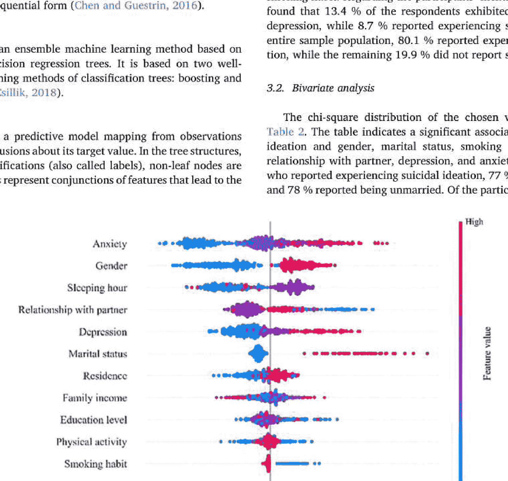

# 孟加拉南部大学大学生自杀意念及相关风险因素预测：机器学习方法


研究论文

# 孟加拉国北部学生自杀念动的相关风险因素预测：机器学习方法

Shiba Shirina Sara*, Asim Kumar Rahman*, Riaz Rahman*, Ashish Talukder**a,b*

* 孟加拉国库尔纳大学科学工程与技术学院统计学系，Khulna 9208 ** 澳大利亚，澳大利亚国立大学流行病学与人口健康中心，堪培拉，ACT, 2609

关键词：
- 自杀念动
- 心理健康状况
- 机器学习 (ML)
- 性别
- 孟加拉国

# 文章信息

# 摘要

背景：自杀念动的流行行率已成为一个紧迫的问题，特别是在青少年中。本研究的主要目的是确定孟加拉国北部地区学生自杀念动的流行率，并使用机器学习 (ML) 模型预防这一现象。方法：采用随机抽样技术，在 2022 年 4 月至 2022 年 6 月期间收集北部地区大学生的信息。收集完成后，确定样本量为 584 人，其中 51.5% 为男性，48.5% 为女性。结果：很大比例的学生经历过自杀念动。参与者中，自由的（77%）和产生念头的（78%）。在机器学习 (ML) 框架内，随机森林 (RF) 和梯度提升 (GB) 算法表现出相当的高准确率，分别为 91.45% 和 90.66%。局限性：无。结论：心理健康从业人员可以使用 KNN 模型结合患者病史来识别可能处于自杀高风险的人群。这种方法有助于医疗专业人员采取适当措施，如咨询、规律睡眠模式以及解决抑郁和焦虑，以预防自杀行为。

# 1. 引言

自杀念动涉及自杀或自残的想法，是识别自杀风险个体的关键工具 (Zisstein 等人，2009)。世界卫生组织 (WHO) 报告，自杀是 15 至 19 岁青少年中的一个重大公共健康问题 (WHO)，通常每 40 天发生一次，每年导致 70 万死亡，其中高达 77% 的事件发生在中低收入国家 (WHO, 2020)。此外，发展中国家约有 17.2% 的个人产生过自杀念动，青少年和女性受影响最为严重 (Li 等人，2018)。Agrawal 和 Talukipalli (2019) 强调，各种心理健康状况，包括双极障碍、抑郁症、症和痴呆症，是自杀行为的潜在原因。过度使用互联网，特别是由 Facebook 和智能手机等平台驱动，也与自杀尝试风险的增加有关 (Johan 和 Hansen, 2021)。特定情况，如 HIV 状态、不利的生活经历、抑郁频率和首次发作精神病发作，与高自杀率有关，比例分别为 16.3%、88.5% 和 40.8%。近期研究报道 (García 等人，2020; Pelliza 等人，2022)，自杀念动在青少年中很常见。

在东南亚，自杀念动的流行率令人担忧，17.7% 的人报告有想法，9% 的学生有计划。在该地区，某些国家的自杀死亡人数最高，发生率达到每 25 天一次自杀的惊人速度 (García 等人，2022)。在东盟 (ASEAN) 国家中，大学生的自杀念动率为 11.7% (Putri 等人，2021)。近期研究表明，印度尼西亚青少年的自杀行为为 8.7% (Marthoeno 和 Yasir Ahmad,2022)，而在库尔纳大学 (Khulna 9208)，该比例为 7.52% (Shan 等人，

* 通讯作者：库尔纳大学科学工程与技术学院统计学系
邮箱地址：achim.talukder@au.edu.bd (A. Talukder)。


S.S. Sera 等人


2022。东南亚女性的自杀念动总体流行率更高，为 17% (Manzour 等人，2022)。COVID-19 疫情加剧了这一问题，在孟加拉国表现为 18.5% 的流行率。根据睡眠基金会的设定，睡眠质量被划分为三类：未婚、已婚和离婚（少于 9 小时、大于 9 小时）。机器学习模型被用于预测孟加拉国学生产生自杀念动的因素包括性别、焦虑、抑郁和孤独 (Rahman 等人，2021)。社会经济状况、教育、婚姻状况关系关系等因素导致了自杀念动。研究报告 (Tahsim 等人，2021)。由于机器学习模型表现优于传统方法，该方法被选择 (Bi 等人，2019)。机器学习技术的利用可以促进


研究中的变量包括：婚姻状况、家庭收入、居住地、身体活动、吸烟习惯、社交质量、伴侣关系和抑郁。身体活动水平的评估采用了全球活动问卷 (GPAQ)，此前研究 (Ranasinghe 等人，2013)。

自杀行为问卷 (SBQ-R) 用于评估参与者的自杀念动。SBQ-R 由四个项目组成，每个项目都有一个独特的维度。自杀念动或尝试的测量是通过参与者报告过去两个月自杀念动的频率来进行的。研究使用评分值 (>7) 来评估自杀念动的存在。Cronbach's alpha 分数为 0.78，被认为是可以接受的。


用于评估参与者广泛性焦虑的筛查工具和量表。该工具由七个项目组成，每个项目的分值从 0“没有”到 3“几乎每天”。GAD-7 得分范围为 0-21。根据 Osman-Samani 等人 (2018)，得分被解释为：轻微焦虑 (0-4)、轻度焦虑 (5-9)、中度焦虑 (10-14) 和严重焦虑 (15-21)。该研究产生了良好的可靠性，Cronbach's alpha 值为 0.851。


患者健康问卷 (PHQ-9) 用于确定参与者的抑郁程度。Cronbach's alpha 分数为 0.82。


数据使用 SPSS (25 版本) 进行处理。进一步的分析使用 R 执行了频率分布表和卡方检验。机器学习算法通过 Python 执行。


CatBoost 基于梯度提升决策树 (GBDT) 和一种名为序贯提升（ordered boosting）的新算法。CatBoost 在贪心 TBS 中添加了先验值。现在，假设给定一个观测数据集 $D=(X,Y), i=1,...,n$，以及一个排列 $\sigma = (\sigma_1,...,\sigma_n)$，其中 $i$ 被替换为：

```
$\sum_{i=1}^{n} [y_{\sigma_i} - f_{\sigma_i}(x_{\sigma_i})]^2 + a\sum_{i=2}^{n} [f_{\sigma_{i-1}}(x_{\sigma_i})]^2$
```


K 最近邻（KNN）也被称为基于距离的机器学习算法，主要用于分类问题。它的目的是定位新点周围的所有邻居，以确定它属于哪一类（Sainn 等人，2013）。


XGBoost 是一种基于决策树的集成机器学习算法。XGBoost 和梯度提升机 (GBMs) 都是集成树方法，XGBoost 通过系统优化和算法增强改进了基础 GBM 框架。在该算法中，树是以顺序格式创建的（Chen 和 Guestrin，2016）。


随机森林是一种基于分类和决策回归树的集成机器学习方法。它基于著名的分类类型集成学习方法：Boosting 和 Bagging（Belgu 和 Callik，2018）。


决策树是一种基于对物品的观测进行预测建模，并得出关于其目标值的结论。在树结构中，叶节点代表分类（也称为叶子），非叶节点是特征，分支代表分类分类的特征的交集。决策过程从树根开始。根据节点边缘的 la检查每个节点的条件，决策过程继续到下一棵树。这种趋势持续到到达叶子节点，最终的决策为：


为了确定纳入机器学习模型的特征，我们使用 XGB SHAP 值评估了它们的影响，并根据 Cramer's V 准则检查了特征相关性。我们观察到了观测到的相关性和对模型输出的高影响，并将将它们全部纳入模型中。我们观察到焦虑对模型输出的影响最大（图 1）。此外，性别、睡眠时间、与伴侣的关系、抑郁和婚姻状况等特征表现出高于其他变量水平。


表 1 显示了选择变量的频率分布。研究发现，51.5% 的参与者识别为男性，48.5% 为女性。大多数参与者（55%）来自农村地区。10.4% 的人表示没有参与体力活动，7.9% 的人报告有吸烟习惯。参与者的心理健康状况，发现 13.4% 的受访者表现出严重抑郁症状，而 87% 的人报告有自杀经历。在整个人群中，80.1% 的人报告有自杀意念，其余 19.9% 未报告此类意念。


所选变量的卡方分布在性别、婚姻状况、与伴侣的关系、抑郁和焦虑方面具有显著性。在报告有自杀意念的参与者中，77% 识别为女性，78% 报告未婚。在受调查的参与者中，37%




| 变量 | 类别 | 频率 | 百比 |
| --- | --- | --- | --- |
| 性别 | 男性 | 301 | 51.5% |
| | 女性 | 284 | 48.5% |
| 教育程度 | 本科（一年级） | 139 | 23.8% |
| | 本科（二至四级） | 392 | 67.1% |
| | 毕业/研究生 | 53 | 9.1% |
| 婚姻状况 | 未婚 | 538 | 92.1% |
| | 已婚 | 40 | 6.8% |
| | 离婚/丧偶 | 6 | 1.0% |
| 家庭收入 | 低于 20,000 | 241 | 41.3% |
| | 20,000-35,000 | 185 | 31.6% |
| | 35,000-50,000 | 62 | 16.8% |
| | 高于 50,000 | 59 | 10.1% |
| 居住地 | 农村 | 321 | 55.0% |
| | 城市 | 263 | 45.0% |
| 体力活动 | 否 | 443 | 75.9% |
| | 是 | 141 | 24.1% |
| 吸烟习惯 | 否 | 529 | 89.6% |
| | 是 | 61 | 10.4% |
| 睡眠时间 | 少于 7 小时 | 274 | 46.9% |
| | 7-9 小时 | 271 | 46.4% |
| | 多于 9 小时 | 26 | 69% |
| 与伴侣的关系 | 好 | 364 | 62.3% |
| | 无 | 145 | 24.8% |
| 抑郁 | 否 | 307 | 5.2% |
| | 是 | 152 | 26.0% |
| 焦虑 | 无轻度 | 758 | 73.4% |
| | 是 | 252 | 43.2% |
| 自杀意念 | 否 | 916 | 96.4% |
| | 是 | 468 | 50.1% |
| | | 116 | 19.9% |

| 变量 | 类别 | 自杀意念 | p 值 |
| --- | --- | --- | --- |
| 性别 | 男性 | 274 | (59) |
| | 女性 | 194 | (81) |
| 教育程度 | 本科（一年级） | 114 | (41) |
| | 本科（二至四级） | 315 | (67) |
| | 毕业/研究生 | 78 | (82) |
| 婚姻状况 | 未婚 | 447 | 0.378 |
| | 已婚 | 190 | (28) |
| | 离婚/丧偶 | 31 | (39) |
| 家庭收入 | 低于 20,000 | 192 | 0.278 |
| | 20,000-35,000 | 150 | |
| | 35,000-50,000 | 62 | |
| | 高于 50,000 | 13 | (20) |
| 居住地 | 农村 | 94 | (14) |
| | 城市 | 204 | (56) |
| 体力活动 | 否 | 141 | 0.369 |
| | 是 | 75 | (78) |
| 吸烟习惯 | 否 | 816 | 0.012 |
| | 是 | 39 | (92) |
| 睡眠时间 | 少于 7 小时 | 298 | 0.021 |
| | 7-9 小时 | 248 | (42) |
| | 多于 9 小时 | 26 | (69) |
| 与伴侣的关系 |  | 32 | 0.723 |
| | 好 | 318 | (440) |
| | 无 | 117 | (25) |
| 抑郁 | 否 | 312 | 0.128 |
| | 是 | 234 | (69) |
| | 中度 | 227 | (23) |
| | 严重 | 46 | (61) |
| 焦虑 | 无轻度 | 818 | 1.379* |
| | 轻度 | 216 | (36) |
| | 中度 | 242 | (54) |
| | 严重 | 12 | (36) |
| | 急性 | 28 | (4) |


表 3 显示了所有算法的性能指标。所有算法都实现了 90% 左右的良好准确率。在性能指标上，观察到 KNN 达到了 91.45% 的最高准确率。此外，RF 和 CatBoost 表现出相当的效率，准确率为 90%。在所有算法中，决策树的准确率较低，为 80.34。在 F1 上，KNN 的得分最高。在性能指标上，观察到 KNN 达到了 91.45% 的最高准确率。此外，值得注意的是 RF 和 CatBoost 表现出相当的效率，准确率为 90%。在所有算法中，决策树的准确率较低，为 80.34。在 F1 上，KNN 的得分最高。在性能指标上，观察到 KNN 达到了 91.45% 的最高准确率。此外，值得注意的是 RF 和 CatBoost 表现出相当的效率，准确率为 90%。在所有算法中，决策树的准确率较低，为 80.34。在 F1 上，KNN 的得分最高。在性能指标上，观察到 KNN 达到了 91.45% 的最高准确率。此外，值得注意的是 RF 和 CatBoost 表现出相当的效率，准确率为 90%。在所有算法中，决策树的准确率较低，为 80.34。在 F1 上，KNN 的得分最高。


| 模型 | 准确率 | F1 分 | 损失 |
| --- | --- | --- | --- |
| KNN | 91.45 | 0.91 | 0.29 |
| RF | 90.60 | 0.90 | 0.35 |
| CatBoost | 90.59 | 0.90 | 0.36 |
| XGBoost | 88.03 | 0.88 | 0.42 |
| DT | 80.34 | 0.81 | 0.63 |


S.S. Sara 等人


自杀念念的流行率。这种现象由于学习（ML）的经历而发生，这会导致自杀念念的发展。

机器学习（ML）在临床环境中的应用具有很大的局限性；机器学习是医疗专业人员有效性和准确性之间的平衡。此外，机器学习算法从多模态数据集中提取特征方面更为有效（Sarker, 2021），它们能够处理复杂的情况，从而衡量症状。在研究中，我们使用逻辑回归模型来评估参与者自杀念念的可能性，使用了来自 PHQ-9 问题的回答（详情请参考补充表 SI）。任何报告过自残念头、死亡或“濒临死亡”愿望的参与者均表现出较高的自杀念念（OR: 6.9; 95% CI: 1-83.71）。

## 贡献作者

Sabina Shirin：概念化、数据策展、方法论；写作-初稿、正式分析、写作-审阅与编辑；Md. Nasir Rahman：数据策展、方法论、写作-初稿、写作-审阅与编辑。Ashish Lakhter：概念化、数据策展、方法论、写作-初稿、正式分析、写作-审阅与编辑。

## 利益冲突

作者声明，本研究是在没有任何可能导致潜在冲突的商业或财务关系的情况下进行的。

致谢

作者感谢本研究参与者的积极帮助。

## 资助

未声明任何资助。

## 符合伦理标准

所有涉及人类受试者的程序均遵循了国家研究委员会的伦理指南、1964年《赫尔辛基宣言》及其任何后续修订或同等标准。研究中的所有个人参与者均已获得知情同意。根据当地和机构规定，作者在本项研究的数据收集期间进行了伦理评估。


在这项研究中，我们使用了来自 PHQ-9 问题的更广泛特征，复杂的模型可以揭示各种症状与其心理健康影响之间的隐藏联系（Graham et al., 2019）。然而，当使用类似的方法时，发现忽略了某些关键数据可能需要更精确的方法和干预。因此，使用先进的机器学习模型有望提供增强的结果，帮助干预并为经验丰富的患者提供更好的医疗服务（Smith, 2021; Bohr and Mahmudzadeh, 2020）。

本研究表明，孟加拉自杀念念（SI）预测模型具有在早期预测学生未来的潜力。此外，该模型使医疗从业人员能够分配更多时间提供多样化的治疗方案（例如识别出的个体），从而以最低成本提高医疗机构和诊所的效率。我们模型的利用对于开发临床支持和个性化治疗策略、优化结果至关重要。


根据本研究结果报告，位于孟加拉南部地区的大学学生中有 19.9% 具有自杀念念。结果显示，学生心理健康问题的时长（特别是抑郁、压力状态）与自杀念念之间存在显著关联。XGBoost 模型显示，抑郁和压力是主要因素，而性别是次要因素。开发和执行活动及咨询倡议旨在改善心理健康并预防自杀念念和行为。为了缓解大学生的自杀危机，所有相关的利益相关者（包括学术界、政府机构和非政府组织）都应该制定并实施有效的策略。该模型可以识别患者的病史，以检测出那些自杀念念风险较高的人。这种方法可以鼓励规律睡眠模式，解决抑郁并避免潜在的自杀尝试。


- Agrawal, R., Maitwaj, P., 2019. 印度部落地区大学学生自杀念念的流行率及因素。
- Ammi, S., 2022. 移民/难民中自杀倾向的流行率：系统评价和元萃分析。
- Arafat, S.M., Bhattacharya, S., Amoon, N., Varma, P., Hu, Y., Islam, M.A.N. A., Khan, H., 2021. 孟加拉大学学生自杀念念的流行率和因素。
- Chen, X., Liu, J., Zhang, Y., Wang, J., 2021. 东亚南地区的自杀行为：系统评价和元萃分析。Res Public Health Int. 2021;18(8):21772. doi: 10.3390/phph18082172
- Belsky, M., Gilga, O., et al., 2018. 使用像素和对象基础的方法创建中心自杀地图：时间加权动态分析。Mental Res Env. 2019;51:1034. doi: 10.1016/j.menres.2018.015
- Gu, B., Kairn, S., Robinson, J., Lewis, J., 2019. 美国青少年自杀念念的心理健康因素是什么？Adolescents Health 2020;58(6):1223-1239.
- Bohr, A., Kamrazadeh, K., 2020. 人工智能在心理健康护理中的作用。Front Psychiatry. 2020;11:5942. doi: 10.3389/fpsyc.2020.5942
- Caben, J., Delgado, R., Delinauro, R., Wang, Y., Choki, P., 2021. 机器学习预测精神结果的前。World Psychiatry 2021;21(3):896-905.
- Chowdhury, A., et al., 2022. 可扩展数据仓库的发展。Proceedings of 22nd ACM International Conference on Data Mining and Discovery.
- Choi, B., 2018. 工人长期自杀念念。Arch. Occup. Environ. 91,865–875.
- Elberaby, S.A., Saad, W., 2020. 自杀行为预防：系统评价和元萃分析。J Adolescence 82,99.
- Garcia-Vera, P., Sanchez, A., Martínez, F., Lima, N., 2022. 墨西哥大学学生的家庭暴力和自杀念念。
- Graham, S., Depp, C., Lee, E., Kim, H., 2019. 针对自然自杀念念的心理健康干预。Psychiatry Res. 31(7):3170–3180.
- Hassan, S., Nasir, S., Thomas, N., 2021. COVID-19 疫情期间南亚自杀念念的流行率。Health Public. 74(8), e819–e826.
- Jahan, L., Islam, M., 2021. 如果你感到孤独，COVID-19 影响了心理健康结果。J Health Inform. 24 (7),1997–2003.
- Li, X., Liu, J., Zheng, C., 2020. 中国青少年自杀攻击及其因素：系统评价。Front. Psychol. 11,5753.
- Liu, R., Wang, Y., Tang, X., Liu, S., 2021. 大学学生自杀念念的流行率、分布和因素：多中心研究。Sci Med Rep. 11 (1),1–8.
- Macalli, M., Macvaro, O., Ortiz, M., Thibeault, R., Case, S., 2017. 社交媒体与自杀念头和行为的关系。J Youth Adolesc. 36,745–756.
- Mohammadi, M., Mohammad, M.H., Hassan, M., Ward, K.D., 2022. 亚洲女性和女孩自杀念念的流行率：系统评价和元萃分析。Psychiatry Res. 39 (6),1008.
- Mendez-Mendizabal, A., Castelli, P., Alayo, L., 2018. 不孕患者的广性焦虑障碍 (GAD-7)：信度研究。Fert Ill. 23 (3),244–249.
- Organization, W., 2021. 2019年自杀趋势：全球健康估计。
- Peffartz, L., Colegiao, C., Quantrone, A., Szali, G., Gheli, P., Lelux, E., et al., 2022. COVID-19 疫情期间首次抑郁发作的自杀思考和信念：队列研究。Lancet Psychiatry. 39 (6),255–266.
- Prajapati, Y., Singh, S., Kumar, A., Dovag, A.V., Gulian, A., 2021. COVID-19 疫情期间网络欺凌的后果：南亚国家大学学生自杀念念的横断面研究 (Asian J. Psychiatry). 62,100513.
- Rahman, Q.Q., Khan, A.H., Al-Zayed, M., Ahmed, M., Hasan, M., Islam, S., et al., 2021. COVID-19 疫情一年后孟加拉大学学生自杀念念的流行率：横断面研究。Health Public. 74(8), e836–e843.
- Riaz, M. K., Zhadry, M., Rahman, M., Khan, M.K., 2021. COVID-19 疫情期间影响自杀念念的因素：在线横断面调查。PLoS Med. 18(9), e10933.
- Ry, S., Lee, H., Lee, E-H., Park, J., 2018. 使用机器学习算法预测大学学生自杀念念。J Med Syst. 123,1–10.
- Sahoo, S., Bonda, A., 2013. 使用自杀念念问卷 (Q-IS) 进行快速筛查及其在青少年中的信度评价。J Pediatr Res. 4(4),331–345.
- Song, S. L., Hong, H. T., Lee, S.Y., Lee, S.H., 2022. COVID-19 疫情期间孟加拉学生自杀念念和自杀尝试：横断面研究。
- Tannin, R., Islam, M.S., Muj, M.S., Sikder, M.T., Maitona, N.K., 2022. COVID-19 疫情期间孟加拉学生的自杀念念：横断面研究。
- Tsai, T.-Y., Padahaluk, S., Hu, X., Wong, Y., Yu, T., Chen, M., Lee, N.-Y., 2022. 台湾学生的自杀念念及因素：系统评价和元萃分析。

