# 预测性分析：面向从业者的数据挖掘、机器学习与数据科学 (Pearson 商业分析系列)


# 关于本电子书

ePUB 是一种开放的行业标准电子书格式。然而，不同阅读设备和应用程序对 ePUB 及其许多功能的支持程度不同。使用您的设备或应用设置根据您的喜好自定义显示。您可以自定义的设置通常包括字体、字体大小、单栏或双栏、横屏或竖屏模式，以及可以点击或触摸放大的图片。有关您的阅读设备或应用设置和功能的更多信息，请访问设备制造商的网站。

许多书籍包含编程代码或配置示例。为了优化这些元素的显示效果，请在单栏横屏模式下查看电子书，并将字体大小调整为最小设置。除了以重流文本格式展示代码和配置外，我们包含了代码的图像，模拟印刷书籍中的显示效果；因此，当重流格式可能会损害代码列表的显示时，您将看到“点击此处查看代码图像”链接。点击该链接查看高保真代码图像。要返回上一个页面，请点击设备或应用上的“返回”按钮。


Dursun Delen


```
`ScoutAutomatedPrintCode`
```


我将这本书献给我的父母 Ayse 和 Suleyman，我的妻子 Handan，我们的儿子 Altug，我们的女儿 Serra，以及那些激励我成为教师的老师们。


## 前言


## 前言
商业分析特别是预测分析的核心在于预测未来并做出更明智、快速业务决策。传统的从错误中学习的观念不再适用；如今的现实更像是“一击淘汰”。要在当前动荡的商业环境中生存，要求管理者在识别问题与机会，以及及时计算并实施最优决策方面具有绝对的精确性。那些使用商业分析的组织不仅能够生存，而且在这种情况下往往蓬勃发展。商业分析曾被视为一种高级/可选的能力，而现在已成为商品——一种组织必备的能力。通过商业分析，企业可以利用数据来了解发生了什么、预测将发生什么，并实施应该发生什么。它是目前业务管理的金标准。

分析（或者更准确地说，数据分析）可以简单定义为在数据中发现有意义的模式——即新奇颖的信息和知识。由于我们生活在大数据时代，分析的定义主要关注数据的价值主张，这些数据是以海量、多样化和高速度产生的。商业分析是分析的一种特殊应用，它利用底层工具、技术和原理来开发日益复杂的业务问题解决方案。企业通常将分析应用于业务数据，以描述、预测和优化其业务机会并实现绩效最大化。商业分析是当今商界最显著的口号。无论你阅读哪本商业期刊或杂志，很可能会看到关于分析以及它如何改变管理决策制定方式的文章。它已成为证据管理（即证据/数据驱动的决策）的新标签。问题是，为什么分析会变得如此流行，为什么是现在？导致这种流行背后的主要原因（或力量）可以分为三类：需求、可用性/负担能力以及文化变革。

商业分析通常以三个水平/阶层为特征，代表该术语的层次结构：描述性、预测性和规范性。组织通常从描述性分析开始，然后进入预测分析，最后达到规范性分析。尽管这三个层级的分析具有层级性（从复杂和精的程度来看），但从低层次到高层次的移动并没有清晰的界限。也就是说，企业可以在处于描述性分析层级的同时，以某种碎片化的方式使用预测甚至规范性分析能力。预测分析是本书的主题，它位于描述性分析之后、规范性分析之前。在描述性分析方面成熟的组织会进入这一关键水平，他们开始看到已发生之外，并试图回答“将发生什么？”的问题。本书深入涵盖了这些分析技术的预测能力。

也许因为分析作为一个流行词的迅速增加，它正被用来取代几个以前流行的术语，如智能、挖掘和发现。例如，`business intelligence`（商业智能）现在是 `business analytics`（商业分析），`customer intelligence`（客户智能）是 `customer analytics`（客户分析），`web mining`（网络挖掘）是 `web analytics`（网络分析），而 `knowledge discovery`（知识发现）是 `data analytics`（数据分析）。即使 `business analytics` 这个名称也受到 `data science`（数据科学）、`machine learning`（机器学习）和 `cognitive computing`（认知计算）等流行词的竞争。但无论使用什么术语，目标始终相同：从大规模且特征丰富的数据创建可操作的洞察。由于现代分析可能需要大量的计算（因为数据产生的规模、多样性和速度——即大数据），用于分析项目的工具、技术和算法利用了在各个领域开发的最新先进方法，包括管理科学、计算机科学、统计学、机器学习、数据科学和数学。

## 致谢
本书是我三十多年分析和数据科学经验的体现，这些经验通过大量的应用项目、咨询项目、学术和专业教学活动、企业和教育指导计划，以及本科、研究生和执行管理的学生指导获得的。在此，我想感谢我的同事、客户和学生，他们对我分析知识库的形成做出的直接和间接贡献，为本书奠定了基础。

我有义务感谢那些在写作过程中为我提供情感心理支持、灵感和鼓励的人。我非常幸运拥有太多符合这些感谢条件的人；因此，我不想在这里列出所有人，而是想提到几个名字：我的老同学 Erhan Sayin、Ahmet Murat Fis 和 Ali Mutlu，以及我亲爱的姐夫 Dincer Hamamci 和 Yilmaz Tomak。

我还要感谢 Pearson 高水平的专业员工，他们为使本书成为现实付出的专业精神和奉献。特别想感谢 Kim Spenceley 女士及其团队提供的持续帮助和对细节的无懈关注。


`Dr. Dursun Delen` 是一位国际知名的业务分析、数据科学和机器学习专家。他经常受邀在国家和国际会议上就数据/文本挖掘、商业智能、决策支持系统、业务分析、数据科学和知识管理等相关主题进行主旨演讲。在 2001 年被任命为俄克荷马州立大学（`Oklahoma State University`）教授之前，Del 博士在行业内工作了 10 多年，为公司开发并提供业务分析解决方案。他最近的工业工作是在德克萨斯州大学加城的一家私有应用研究与咨询公司 `Knowledge Based Systems, Inc. (KBSI)` 担任研究科学家。在`KBSI` 工作的五年里，Delen 博士领导了多个与决策支持系统、企业工程、信息系统开发和高级业务分析相关的项目，这些项目由私营企业和联邦机构资助，包括`国防部`的多个分支、`NASA`、美国国家科学基金会、美国国家标准与技术研究院以及`能源部`。如今，除了学术研究外，Delen 博士还为企业提供专业教育和咨询服务，帮助他们评估其分析、数据科学和信息系统需求，并协助他们开发先进的计算机决策支持系统。

在他目前的学术职位上，Delen 博士担任`William S. Spears 商业管理学特座教授`和`Patterson Family 业务分析特座教授`，并担任健康系统创新中心（`Center for Health Systems Innovation`）的研究主任，以及俄克荷马州立大学 Spears 商学院（`Spears School of Business`）的管理科学与信息系统摄政教授。他发表了 1150 篇发表在主要期刊上的论文，包括`Journal of Business Research`、`Journal of Business Analytics`、`Decision Sciences Journal`、`Decision Support Systems`、`Communications of the ACM`、`Computers & Operations Research`、`Annals of Operations Research`、`Computers in Industry`、`Journal of Production Operations Management`、`Artificial Intelligence in Medicine`、`Journal of the American Medical Informatics Association`、`Expert Systems with Applications`、`Renewable and Sustainable Energy Reviews`以及`Renewable Energy`等。他还在业务分析、数据科学和商业智能等广泛领域编写和合著了 11 本书和教材。

Delen 博士经常在各种业务分析和信息系统会议上担任分会和小型分会主席。目前，他是`Journal of Business Analytics`和`AI in Business`（位于`Frontiers in Artificial Intelligence`中）的主编，`Journal of Decision Support Systems, Decision Sciences`和`Journal of Business Research`的高级编辑，`Decision Analytics`、`International Journal of Information and Knowledge Management`以及`International Journal of RF Technologies`的副编辑，并担任其他几本学术期刊的编辑。他曾多次获得研究和教学奖项，包括声誉卓赫的`Fulbright scholar`（富布学者）、摄政优秀教师与研究员、校长优秀研究员以及大数据导师奖。

## 致谢


# 1 分析导论

*预测性分析*是本书的重点，它是业务分析连续体中至关重要的一部分。预测性分析正如其名称*预测性*所示，其核心目标是预见未来的事件和情况，从而帮助决策者抓住机会。正如我们以后详细讨论的，在业务分析连续图中，预测性分析战略性地位于描述性分析（主要关注发生了什么）和规范性分析（关注应该做决策）之间。预测性分析利用描述性分析生成的信息（即历史快照）来产生可能发生的情况（即预测/预测），并将其输出作为规范性分析的关键赋能因素之一。

与商业智能相比，*业务分析*是一个较新的术语，在商业领域迅速普及。广义而言，*分析*是利用复杂的数学模型以及各种数据和专家知识来发现洞察，并支持准确及时决策的艺术与科学。从某种意义上说，分析关乎决策和问题解决。今天，分析可以简单地定义为“在数据中发现信息/知识/洞察”。在这个某些人称为*数据洪流*的时代，分析倾向于用于筛选大量且多样化的数据。


*   优化营销和广告活动，使公司能够以最低成本通过准确的信息和促销活动触达更多客户
*   通过使用优化和仿真建模，通过优化管理库存并在需要的地方和任何时间分配资源，从而最大限度地降低运营成本
*   为员工在处理客户或客户相关问题时提供其所需的信息和洞察，帮助他们做出更快速、更好的决策

`analytics`（分析学）一词可能因为其作为一个流行语的热度迅速增加，正被取代几个此前流行的术语，例如 `intelligence`（智能）、`mining`（挖掘）和 `discovery`（发现）。例如，`business intelligence`（商业智能）现在已成为 `business analytics`（商业分析）；`customer intelligence`（客户智能）已变为 `customer analytics`（客户分析），`web mining`（网络挖掘）已变为 `web analytics`（网络分析），而 `knowledge discovery`（知识发现）已变为 `data analytics`（数据分析）。虽然 `analytics` 一词正变得越来越流行，但仍出现了一些新的术语——包括 `data science`（数据科学）、`computational intelligence`（计算智能）、`big data analytics`（大数据分析）和 `applied machine learning`（应用机器学习）等——它们挤占并进一步使命名空间变得复杂。正如我在书中描述的那样，名称的快速变化为分析价值主张的快速发展和日益增长的兴趣提供了更多证据。

### 名称有何意义？

流行语的无情创造导致人们难以理解各种术语之间的差异和相似之处。在最容易混淆且在概念化水平最高的术语中，包括商业智能、`business analytics`（商业分析）和 `data science`（数据科学）。除了这些顶级术语外，`big data`（大数据）、`machine learning`（机器学习）、`Internet of Things` (`IoT`，物联网）和 `natural language processing`（自然语言处理）等术语也变得更加常见。为了给这些复杂的术语建立秩序，我们创建了图 1.1 所示的相当简单的恩图。图中顶部显示了最流行术语之间的相互关系。商业智能被描绘为商业分析的一个完全消耗的子组件（即商业分析中的描述性分析阶段），而商业分析被描绘为数据科学的一个部分消耗的子组件。商业分析和数据科学之间存在部分消耗的原因是，商业分析还依赖于不需要数据的解决方案，而是由业务流程和专家知识的表示和消费驱动的。

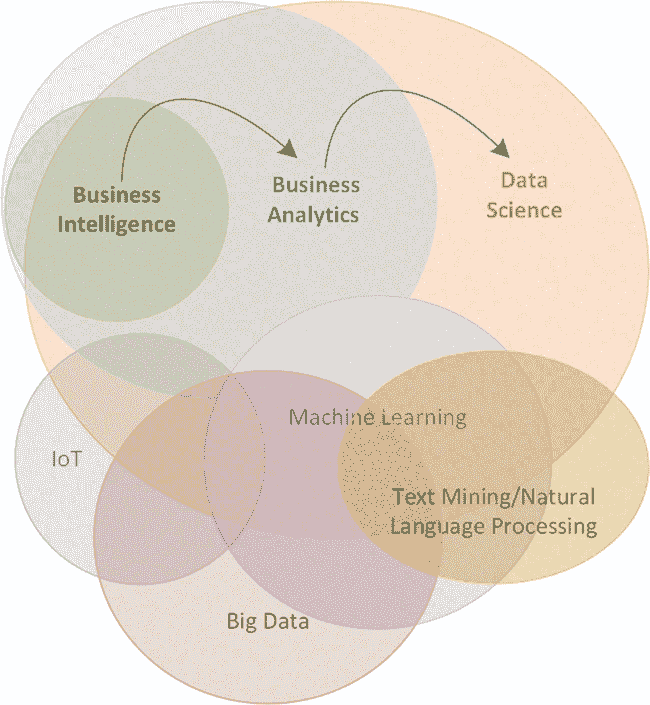

**图 1.1** 分析与数据科学中流行概念和术语之间的交叉

图 1.1 底部显示的术语——`big data`（大数据）、`machine learning`（机器学习）、`natural language processing`（自然语言处理）和 `Internet of Things`（物联网）指的是图中顶部三个关键术语的实现者和/或机制。虽然 `big data` 有时用来指 `big data analytics`（大数据分析），但其真正的特征源于数据的量、多样性和速度，这些因素将商业分析和数据科学的能力提升到了新的准确全面水平。商业智能处理结构化数据（以行和列的形式存储在数据库和 Excel 表格），而商业分析和数据科学则处理结构化和非结构化数据。大数据不仅可以由结构化数据定义，还可以由非结构化数据定义——通常由文本、多媒体和 `IoT` 数据组成——并为分析和数据科学世界带来了价值（以及一些挑战）。

这两个术语经常被同义地交叉使用：`business analytics`（商业分析）和 `data science`（数据科学）。它们是相同的吗？如果是，为什么对同一个概念有两个不同的名称？商业分析和数据科学具有相同的目的：通过基于算法的发现过程将数据转换为可操作的洞察。然而，这两个术语在范围上是不同的。就像从商业智能到商业分析范围扩大一样，从商业分析到数据科学也有范围的增强。商业分析在商业智能的基础上增加了预测和规范性建模，而数据科学在商业分析的基础上增加了大数据支持技术、低级编程（例如 `Python`、`R`、`SQL/NoSQL`、`JavaScript`、`Perl`）和高级机器学习（即 `deep learning` 深度学习及其变体）。这两个术语之间的另一个区别在于应用领域和所使用的工具；商业分析使用工作流类工具和可用算法处理业务问题，而数据科学则使用低级编程、增强型算法和自定义解决方案开发过程处理更广泛的问题。

商业分析和数据科学的另一个区别可以在高等教育中观察到。商学院通常提供商业分析的证书和研究生/本科学位课程，而计算机科学、决策科学和工业工程学院则在数据科学的伞下提供类似的课程。快速查看这些课程可以发现，虽然商业分析课程更侧重于应用、问题解决和高层次方法，但数据科学课程更侧重于编程、算法开发和低级方法。然而，尽管这些观察通常是正确的，但它们并不是普遍适用、标准化或实践的。

现代分析和数据科学项目由于数据的量、多样性和速度以及尽快产生结果的需求，通常需要大量的计算。因此，用于分析和数据科学的工具、技术和算法必须利用先进的前端软件硬件，以及来自管理科学、计算机科学、统计学和数学等领域开发的最新方法。

### Analytics（分析学）与 Analysis（分析）之间有区别吗？

尽管 `analytics` 和 `analysis` 这两个术语经常被交叉使用，但它们并不是相同的。

基本上，`analysis` 指的是将一个完整问题拆分为各个部分的过程，以便在粒度上对这些部分进行批判性检查。当调查整个系统不可行或不实际，且系统需要通过分解为更基本的组件来简化时，通常会使用该词。一旦实现了粒度上的改进并完成了对部分的检查，就可以使用名为 `synthesis`（综合）的过程将整个系统（无论是概念还是物理系统）组合在一起。

另一方面，`analytics` 包含了各种方法、技术和相关工具，用于创建新的知识/洞察以解决复杂问题并更快速地做出决策。本质上，分析是处理复杂情况的多方面、多学科方法。分析利用数据和数学模型来理解我们所居住的复杂世界。尽管分析在发现过程的不同阶段包含分析，但它不仅仅是分析，还包括综合和其他互补的任务和过程。

### 数据挖掘处于什么位置？


`Data mining` 是在大型数据集中以模式和关系的形式发现新知识的过程。分析的目标是将数据/事实转化为可操作的洞察，而数据挖掘是实现这一目标的关键赋能者。数据挖掘的历史比分析要长得多，可以追溯到 20 世纪 80 年代。随着 `analytics` 成为涵盖所有决策支持和问题解决方法及技术的通用术语，数据挖掘发现自己在这一弧线内拥有相当广阔的空间，范围从识别变量之间关系和亲和力的描述性探索（例如购物篮分析），到开发模型来估计感兴趣变量的未来价值。正如我们在本后面将看到的，在分析的分类法中，数据挖掘在每个层面都起着关键作用，从最简单的到最复杂的都有。

## 为什么分析和数据科学突然流行？

分析是当今商业界的一个热词。无论你读的是哪本商业期刊或杂志，你很可能会看到关于分析以及分析如何改变管理决策制定方式的文章。它已成为证据驱动管理（或证据/数据驱动的决策制定）的新标签。但为什么分析会变得如此流行？为什么是现在？这种流行背后的原因（或力量）可以分为三类：需求、可用性与负担能力，以及文化变革。

### 需求

众所周知，如今的商业活动完全不是“如常”。竞争的特征逐渐从地方性的、区域性的变为国家性的，但现在已是全球性的。中小型企业都面临着全球竞争的压力。曾经保护其各自地理位置公司的关税和运输成本障碍已不再像以前那样具有保护性。除了全球竞争之外（可能也是因为全球竞争），客户也变得更加挑剔。他们希望在最短的时间内以最低的价格获得质量最高的产品和或服务。成功或仅仅生存取决于企业是否敏捷，以及经理是否能及时做出可能的决策以响应市场驱动的力量（即迅速识别并解决问题，并抓住机会）。因此，对基于事实的、更好且更快速的决策的需求现在比以往任何时候都更加至关重要。在这些无情的市场条件下，分析有望为经理提供他们做出更好、更快速决策所需的洞察，这有助于提高他们在市场中的竞争态势。当今的分析被广泛认为可以帮助业务经理应对全球业务实践中的复杂性问题。

### 可用性与负担能力

得益于近期的技术进步以及软件硬件的负担能力，组织正在收集海量数据。基于各种射频识别（RFID）和其他传感器的自动化数据收集系统，显著增加了组织数据的数量和质量。结合从社交媒体等互联网技术收集的丰富内容的数据，企业现在倾向于拥有多于其处理能力的数据。正如谚所说，“他们淹没在数据中，却在知识上饥饿。”

随着数据收集技术的发展，数据处理技术也得到了显著提高。今天的机器拥有大量的处理器和非常大的内存容量，它们能够在合理的时间范围内（通常是实时的）处理庞大且复杂的数据。硬件和软件技术的进步也体现在定价上，持续降低了此类系统的拥有成本。除了所有权模型外，我们现在还有软件-即服务（或硬件-即服务）业务模式，这允许企业（特别是财务能力有限的中小型企业）租赁分析能力，并仅为他们所使用的部分付费。

### 文化变革

在组织层面，已经发生了从旧式的直觉驱动型决策转向新时代基于事实/证据驱动型决策的转变。大多数成功的组织已经付出了自觉努力，转向数据/证据驱动的业务实践。由于数据的可用以及支持性 IT 基础设施的存在，这种范式转移发生得比许多人认为的要快。随着新一代精通量化的经理取代婴儿潮一代，这种基于证据的管理范式转变将更加剧烈。

## 分析的应用领域

尽管商业分析浪潮还很新颖，但分析的应用非常多，涵盖了业务实践的几乎每一个方面。例如，在客户关系管理中，大量的成功案例描述了开发的复杂模型，用于识别新客户、寻找交叉销售销售机会以及发现高流失倾向的客户。通过社交媒体分析和情感分析，企业正试图跟上人们对产品/服务和品牌的看法。欺诈检测、风险缓解、产品定价、营销活动优化、财务规划、员工留存、人才招聘和精算估计都是分析的许多业务应用之一。很难找到一个无法应用若干分析方法的业务问题。从业务报表到数据仓库，从数据挖掘到优化分析，这些技术被广泛应用于业务的每一个侧面。

### 分析的主要挑战

尽管分析的优势和原因显而易见，但许多企业仍迟疑于加入分析的行列潮。以下是采用分析的主要障碍：

*   **分析人才**。能够将数据转化为可操作的洞察的数据科学家（量化天才）在市场上非常稀缺；真正优秀的人很难找到。由于分析相对较，分析人才仍在培养中。许多大学已经启动了本科和研究生计划来解决分析人才缺口。随着分析普及度的增加，对那些能够将大数据转化为经理和其他决策者应对现实世界复杂性所需的信息和知识的人才的需求也会增加。
*   **文化**。俗云，“旧习难”。从传统管理风格（通常以直觉为决策依据）转向现代管理风格（基于数据和科学模型进行管理决策以及集体组织知识），对于任何组织来说都不是一个容易履行的过程。人们不喜欢改变。改变意味着失去过去学习或精通的内容，并重新学习如何做现在做的事情。这意味着你多年积累的知识（知识也被描述为权力）将消失或部分丢失。文化转变可能是采用分析作为新管理范式时最困难的部分。


-   **投资回报率。** 采用分析的另一个障碍是难以清晰地证明其投资回报率（ROI）。分析项目是一项复杂且昂贵的事业，其回报并非立而易见；许多高管发现很难在分析上投入资金，尤其是在大规模投入方面。从分析获得的价值会超过投资吗？如果是，那么何时？将分析的价值转化为合理的数字是非常困难的。从分析获得的大部分价值在某种程度上是无形且整体的。如果操作得当，分析可以转型一个组织，将其推向全新的、改进的水平。需要结合有形和无形因素，为投资以及向分析和具备分析能力的管理实践转型提供数值上的合理性。

-   **数据。** 媒体以非常积极的方式谈论大数据，将其描述为改进业务实践的无价资产。这在很大程度上是正确的，特别是对于那些理解并知道如何处理数据的企业而言。对于其他企业来说，大数据是一个巨大的挑战。数据不仅是规模大，它还是非结构化的，而且其到达速度超过了传统收集和处理手段的限制。而且通常是杂乱且脏的。一个组织要在分析上取得成功，需要有一套周全的大数据处理策略，以便将其转化为可操作的洞察。

-   **技术。** 尽管技术是可靠、可用的且在很大程度上是负担得起的，但技术的采用对于传统上技术水平较低的企业来说是另一个挑战。虽然建立分析基础设施是可以负担的，但仍然需要花费巨资。在没有资金手段和/或没有明确投资回报的情况下，某些企业的管理层可能不愿意投资所需的技术。对于某些企业来说，分析即服务的模式（包括软件和实施分析所需的基础设施/硬件）可能成本更低且更容易实施。

-   **安全与隐私。** 对数据和数据分析最常见的批评之一与安全有关。我们经常听到敏感信息数据泄露的新闻，事实上，唯一完全安全的数据基础设施是孤立且与所有网络断开的（这与拥有数据和分析的初衷背道而驰）。数据安全的重要性已使信息保障成为全球信息系统部门最热门的关注领域之一。在利用日益复杂的技巧保护信息基础设施的同时，日益复杂的攻击也变得常见。此外还有对个人隐私的担忧。使用客户（现有或潜在客户）的个人数据，即使在法律范围内，也应该避免或经过仔细审查，以保护组织免受负面宣传和公众抗议。

尽管存在障碍，分析的采用正在增长，对于所有规模和所有行业的企业来说，使用分析是不可避免的。随着业务经营的复杂性增加，企业将努力在混乱的行为中寻找秩序。成功的将是那些充分利用分析能力的企业。

### 分析的纵向视角

虽然关于它的热度是近期，但分析并不新鲜。可以追溯到 20 世纪 40 年代二战战期间的企业分析引用，当时需要更有效的方法在有限资源下实现产出最大化。许多优化和模拟技术在当时被开发。分析技术在业务领域已经使用了很久。一个例子是 19 世纪末由弗雷德里克·温斯洛·泰勒发起的动作与研究。然后，亨利·福特测量了装配线的节奏，这导致了大规模生产计划的产生。分析在 20 世纪 40 年代开始引起更多关注，当时需要更有效的方法在有限资源下实现产出最大化。许多优化和模拟技术在当时被开发。分析技术在业务领域已经使用了很久。一个例子是 19 世纪末由弗雷德里克·温斯洛·泰勒发起的动作与研究。然后，亨利·福特测量了装配线的节奏，这导致了大规模生产计划的产生。

图 1.2 时间线显示了自 20 世纪 70 年代以来使用的术语。在分析的早期，20 世纪 70 年代以前，数据通常通过手动过程（例如访谈和调查）获取以建立数学模型。其理念是在有限资源下做到最好。此类决策支持模型被称为运营研究（`OR`）。复杂到无法优化求解（使用线性或非线性规划技术）的问题通过启发式方法解决。


**图 1.2 分析的纵向视角**

在 20 世纪 70 年代，除了在许多行业使用的成熟 `OR` 模型外，还出现了一种全新的令人兴奋的模型：专家系统（`ESs`）。这些系统承诺以计算机可以处理的格式（通过一组 `if–then rules`）捕捉专家知识，以便能够像使用专家一样进行咨询。`ESs` 允许在需要的地方提供稀缺的专家知识。20 世纪 70 年代，企业也开始创建常规报告，向决策者（管理层）告知过去发生的情况（例如日、周、月）。尽管了解过去的情况是有用的，但管理层需要的不仅于此：他们需要不同粒度的报告，以更好地理解和应对不断变化的需求和挑战。

20 世纪 80 年代：过去的做法是拥有多个孤立的信息系统，用于捕捉不同部门或职能的交易数据（例如会计、营销和销售、财务、制造）。20 世纪 80 年代，这些系统整合为我们现在常用的 `ERP systems`（企业资源计划系统）。旧的顺序且非标准数据表示方案被关系数据库管理（`RDBM`）系统取代。这些系统使得改进数据的捕、存储以及组织数据字段之间的关系成为可能，同时减少信息的重复。`RDBM` 和 `ERP system` 的需求出现在数据完整性和一致性成为问题时，这严重阻碍了业务实践效率。通过 `ERP`，企业每个角落的数据都被收集并整合到一个一致的架构中，使组织的任何部分都能在需要的时间和地点访问“单一真相来源”。


20 世纪 90 年代，对更通用报告的需求导致了执行信息系统的发展（专为执行人员及其决策需求设计和开发的决策支持系统）。这些系统被设计成图形化仪表板和计分卡，以便能够作为视觉吸引力强的显示，专注于决策者需要跟踪的最重要因素：关键性能指标。为了在保持业务信息系统事务完整性的同时，使这种高度通用的报告成为可能，必须创建一个中间数据层——被称为 `data warehouse`（`DW`，数据仓库）——作为专门支持业务报告和决策的存储库。在很短的时间内，大多数中大型企业都采用数据仓库作为其全企业级决策的平台。仪表板和计分卡从数据仓库获取数据，如此，它们并没有阻碍业务交易系统（通常被称为 `ERP` 系统）的效率。

21 世纪 00 年，`DW` 驱动的决策支持系统开始被称为`业务智能系统`。随着 `DW` 中积累的纵向数据量增加，硬件和软件应对决策者快速变化和演进需求的能力也随之增长。由于全球化竞争市场，决策者需要非常易于理解的格式来获取解决业务问题并及时利用市场机会。由于 `DW` 中的数据是定期更新的，它并不能反映最新信息。为了提高这种信息延迟问题，`DW` 供应商开发了一种更频繁地更新数据的系统，这导致了`实时数据仓库`和更现实的`即时数据仓库`等术语的产生，后者与者的区别在于采取了基于数据项所需新鲜度的数据刷新策略（即：并非所有数据项都需要实时刷新）。数据仓库非常大且功能丰富，有必要对“挖掘”企业数据以“发现”新的、实用的知识点，以改进业务流程和实践——因此产生了`数据挖掘`和`文本挖掘`等术语。随着数据量和多样性的增加，对更多存储和更多处理能力的需求应运而生。大型公司有能力解决这个问题，但中小型公司需要财务上更具管理性的业务模型。这种需求导致了面向服务的架构以及软件和基础设施即服务的分析业务模型。因此，较小的公司可以按需获得分析能力，并仅为所使用的部分付费，而不是投资于极其昂贵的硬件软件资源。

21 世纪 10 年代和 20 年代正见证数据获取和使用方式的另一种范式转变。很大程度上是因为互联网的广泛使用，新的数据生成媒介已经出现。在所有新数据源中（例如 `RFID` 标签、数字电表、点击流网络日志、智能家居设备、可穿戴健康监测设备），最有趣且最具挑战性的可能是社交网络/社交媒体。这种非结构化数据包含丰富的信息，但分析此类数据源从软件和硬件角度都对计算系统构成了巨大挑战。最近，`大数据`一词被创造出来以强调这些新数据流为我们带来的挑战。在硬件（例如具有极大计算内存的海量并行处理和高度并行多处理器计算系统）和软件/算法（例如带有 `MapReduce` 和 `NoSQL` 的 `Hadoop`）方面已经取得了许多进展来应对大数据挑战。

很难预测下一个十年将带来什么，以及新的分析相关术语将会是什么。信息系统（特别是分析领域）新旧范式转换之间的时间正在缩短，这种趋势在可预见的未来将持续。尽管分析并不新鲜，但其流行度的爆炸式增长是非常新的。得益于近期大爆炸、收集和存储这些数据的方法以及直观的软件工具，数据和数据驱动的洞察对业务专业人员来说比以往任何时候都更容易获得。因此在全球竞争中，存在巨大的机会通过使用数据和分析做出更好的管理决策，同时通过构建更好的产品、改进客户体验、在欺诈发生前进行拦截以及通过目标定位和定制来提高客户参与度并降低成本——这一切都是通过分析和数据的力量。越来越多的公司现在正为员工提供业务分析知识，以驱动其日常决策过程的有效性和效率。

### 分析的简单分类法

由于与做出更好、更快速决策的需求，以及硬件软件技术的可用性和可负担能力相关的多种因素，分析业务的普及速度比我们近期见过的任何其他趋势都快。这种向上的指数级趋势还会持续吗？许多行业专家认为会，至少在可预见的未来是。行业专家和领先的咨询公司预计，分析在未来几年的增长速度将超过任何其他业务部门；他们还将分析（以及数据科学）列为本世纪十大业务趋势之一。随着对分析的兴趣和采用的快速增长，将分析刻画为简单分类法的需求应运而生。顶级咨询公司（例如 `Accenture`、`Gartner`、`Forrester`、`IDT`）和几所技术导向的学术机构已经开始创建分析简单分类法的任务。这种分类法如果开发得当并被采用，可以为分析创建一个情境描述，从而有助于对分析是什么形成共同理解，包括分析包含什么以及分析相关术语（例如业务智能、预测建模、数据挖掘）之间的相互关系。参与这一挑战的学术机构之一是 `INFORMS`（运筹学与管理科学协会）。


凯捷哲（Capgemini）的研究对分析给出了简洁的定义：“分析通过对数据进行报告以分析趋势，创建预测模型以进行预报，并优化业务流程以提升性能，从而促进业务目标的实现。”正如该定义所示，该研究的关键发现之一是，高管将分析视为使用分析的企业的核心功能。它跨越了组织内的许多部门和职能，在成熟的组织中，它涵盖了整个业务。

该研究确定了分析类别的三个层次分明但有时重叠的分组方法：描述性分析、预测性分析和规范性分析。这三组在组织分析成熟度水平上是分层级的。大多数组织从描述性分析开始，然后转向预测性分析，最后达到规范性分析，这是分析层级中的顶层。尽管这三类分析分类在复杂性和精细程度上是分级的，但从低层次到高层次的移动并不是清晰可分的划分的。也就是说，一个企业可以在处于描述性分析水平的同时，以某种程度上碎片化的方式使用预测性甚至是规范性分析能力。因此，从一个水平移动到下一个水平本质上意味着一个水平的成熟度已经完成，而下一个水平正在被广泛利用。`图 1.3` 提供了 INFORMS 开发并被大多数行业领导者及学术机构广泛采用的简单分类法的图示描述。

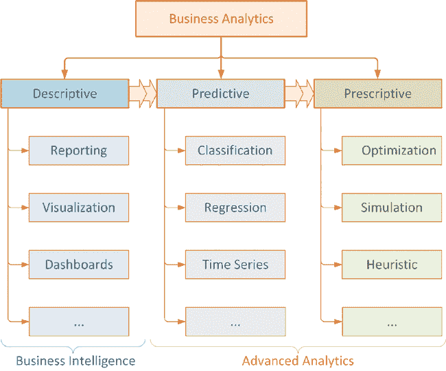

**图 1.3** 分析的简单分类法

### 描述性分析
`描述性分析`是分析分类法中的入门级。它通常被称为`业务报告`，因为该层级的大部分分析活动都涉及创建报告来总结业务活动，以回答如“发生了什么？”和“正在发生什么？”等问题。这些报告的谱系包括：按固定时间（例如每日、每周、季度）交付给知识工作者（即决策者）的业务交易`静态`快照；以易于理解的形式（通常是仪表板类型的图形界面）并以持续的方式交付给经理和高管的业务性能指标`动态`视图；以及即时报告，在这些报告中，决策者被赋予了创建特定报告的能力（使用直观的拖放式图形用户界面），以解决特定或独特的决策情境。

描述性分析也被称为`商业智能`（`BI`），而预测性分析和规范性分析统称为`高级分析`。这里的逻辑是，从描述性分析转向预测性和/或规范性分析是精细程度水平上的重大转变，因此值得赋予`高级`的标签。BI 一直一直是成功的关键之一，而预测性和规范性分析是高级分析的集合。这种逻辑是设计用于支持决策的，自世纪以来，这种技术在某种程度上是科学的，是受欢迎的，并为更复杂的分析铺平了道路。这些分析系统通常在数据仓库上运行，以支持业务决策。

### 预测性分析
`预测性分析`紧随描述性分析之后，处于分析层级中。在描述性分析方面成熟的组织会进入这一层，超越已发生的情况，尝试回答“将会发生什么？”接下来的章节将深入涵盖数据挖掘技术；预测本质上是对未来值进行智能估计的过程，例如客户需求、利率和股市波动。如果被预测的是类别变量，这种预测行为被称为`分类`；否则，被称为`回归`。如果预测变量是随时间变化的，预测过程被称为`时间序列预测`。

### 规范性分析
`规范性分析`是分析层级中的最高水平。它是通过复杂的数学模型，在许多方案中确定最佳方案。因此，在某种意义上，这种类型的分析试图回答“我应该怎么做？”规范性分析使用了优化、仿真和基于启发式的技术。尽管规范性分析处于分析层级的顶端，但其背后的方法并不是新的。构成规范性分析的优化和仿真模型是在二战期间及之后开发的，当时对有限资源有迫切需求。从那时起，一些企业已被将其应用于收益管理、运输建模和调度。分析的新分类法使其再次流行，并适用于各种业务问题和情境。

`图 1.4` 提供了三个层级的表格表示，以及每个层次解决的问题和使用的技术。它展示了数据挖掘是预测性分析的关键。


**图 1.4** 分析的层级及其赋能技术

业务分析正变得流行，因为它承诺为决策者提供成功所需的信息和知识。无论在分析层级的何一位置，业务分析系统的有效性很大程度上取决于数据的质量和数量（容量和丰富程度）、数据系统的准确性、完整性和及时性，以及过程中使用的分析工具和程序的能力和精细程度。理解分析分类有助于组织明智地选择和实施分析能力，以高效导航成熟性曲线。

### 分析的前沿：IBM Watson
IBM Watson 及其后续者 Summit 可能是迄为止的最智能计算机系统。自 20 世纪 40 年代末及随后人工智能出现以来，科学家一直在将这些“智能”机器的性能与人类头脑进行比较。因此，在 20 世纪 90 年代中期，IBM 的研究人员制造了一台智能机器，并使用象棋（通常被认为是人类智者的游戏）来测试其与顶尖棋手的竞技能力。1997 年 5 月 11 日，一台名为 Deep Blue 的 IBM 计算机在六局赛赛中击败了世界象棋冠军：Deep Blue 胜两局，冠军胜一局，三局平局。这场比赛持续了几天，并受到了全球媒体的广泛报道。这是人机对抗的经典情节。


几十年后，IBM 的研究人员提出了另一个可能更具挑战性的想法：一台不仅能玩美国电视问答节目《危险一答》（*Jeopardy!*），还能击败顶中尖之手的机器。《危险一答！》比象棋挑战性得多。象棋的结构良好且规则非常简单，因此非常适合计算机处理，而《危险一答！》既不简单也不结构化。《危险一答！》是一项为人类智力和创造力而设计的游戏，因此，设计用于玩该游戏的计算机需要是一个能够像人类一样工作和思考的认知计算系统。理解人类语言中固有的不精确性是成功的关键。

2010 年，一个 IBM 研究团队开发了 `Watson`，这非非凡的计算机系统——一种先进硬件和软件的新颖结合——旨在回答用自然语言提出的问题。该团队作为 `DeepQA` 项目的一部分构建了 `Watson`，并以 IBM 第一任主席托马斯·J·沃特森命名。构建 `Watson` 的团队一直在寻找一个重大的研究挑战：一个能够与“深蓝号”（`Deep Blue`）的科学和大众关注度相媲，并且与 IBM 的业务利益有明确相关的挑战。其目标是通过探索计算机技术影响科学、商业和整个社会的新方法，推动计算科学的发展。因此，IBM 研究接受了一项构建 `Watson` 的挑战，使其成为一个能够在《危险一答！》中实时与人类冠军水平进行竞争的计算机系统。该团队希望在节目中创建一个实时自动参赛者，能够倾听、理解和回答，而不仅仅是一项实验室练习。

## 在《危险一答！》中与顶高手竞争

2011 年，作为对其能力的测试，`Watson` 在问答节目《危险一答！》中参赛，参加该节目历史上首次的人机对决。在两场比赛的总积分制比赛中（于 2 月 14 日至 16 日期间在三集《危险一答！》中播出），`Watson` 击败了《危险一答》史上奖金最高的布拉德·鲁特（Brad Rutter）和最长连胜纪录（75 天）的保持者肯·詹宁斯（Ken Jennings）。在这些节目中，`Watson` 在游戏信号设备上的表现持续优于人类对手，但在回答某些类别时遇到了困难，特别是那些仅包含几个单词的简短提示的类别。`Watson` 可以访问 2 亿页结构化和非结构化的内容，消耗了 4 TB 的磁盘存储。在比赛期间，`Watson` 未连接互联网。

应对《危险一答！》挑战需要推进并整合各种文本挖掘和自然语言处理技术，包括解析、问题分类、问题分解、自动获取和评估、实体和关系检测、逻辑形式生成以及知识表示和推理。在《危险一答！》中获胜需要准确计算答案的置信度。问题和内容具有模糊性和噪声，而且没有任何单一算法是完美的。因此，每个组件必须对其输出产生一个置信度，并将各个组件的置信度相结合以计算最终答案的整体置信度。最终置信度用于确定计算机系统是否应该冒险选择回答。在《危险一答！》的术语中，这种置信度用于确定计算机是否会对问题进行“抢答”（ring in 或 buzz in）。置信度必须在读题期间并在抢答机会之前计算。这大约在一秒到六秒之间，平均约为三秒。

## Watson 是如何做到的？

`Watson` 背后的系统被称为 `DeepQA`，是一种大规模并行、专注于文本挖掘的、基于概率证据的计算架构。对于《危险一答！》挑战，`Watson` 使用了 100 多种不同的技术来分析自然语言、识别来源、发现和生成假设、发现和评分证据，以及合并和排序假设。比 IBM 团队使用的任何特定技术都重要得多，是他们如何在 `DeepQA` 中结合这些技术，使得重叠的方法能够发挥它们的优势，并对提高准确性、置信度和速度做出贡献。

`DeepQA` 是一种带有相应方法论的架构，它并不特定于《危险一答！》挑战。这些是 `DeepQA` 的核心原则：

*   **大规模并行。** `Watson` 需要在考虑多种解释和假设时利用大规模并行性。
*   **众多专家。** `Watson` 需要能够整合、应用并从上下文评估广泛松散耦合的概率问题和内容分析。
*   **无处不在的置信度估计。** `Watson` 的没有任何组件会承诺答案；所有组件都会产生特征和相关的置信度，对不同的问题和内容解释进行评分。底层的置信度处理机制学习如何堆叠和组合得分。
*   **浅层和深度知识的整合。** `Watson` 需要平衡严格语义和浅层语义的使用，利用许多松散构建的本体论。

图 1.5 在极高层面上展示了 `DeepQA` 架构。关于各种架构组件及其特定角色和能力的更多技术细节，可以在 Ferrucci 等人（2010 年）中找到。

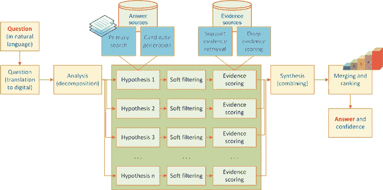

**图 1.5** DeepQA 架构的高层描绘

## Watson 的未来是什么？

《危险一答！》挑战帮助 IBM 解决了导致 `DeepQA` 架构设计和 `Watson` 实现的需求。在由约 20 名研究人员组成的核心团队经过了三年的密集开发，并投入了大量的研发预算后，`Watson` 成功在《危险一答！》问答节目中的精确性、置信度和速度方面达到了人类专家水平。

节目结束后，一个大问题是“现在怎么办？”开发 `Watson` 仅仅是为了电视节目吗？绝对不是！向世界其他展示 `Watson`（及其背后的认知系统）能做到什么，成为了下一代智能信息系统的灵感。对于 IBM 来说，这是尖端分析和计算科学所能实现的一种演示。信息很明确：如果一台智能机器可以在人类最擅长的领域击败顶尖高手，请想想它能为你的组织问题做什么。第一个利用 `Watson` 的行业是医疗保健，随后是安全、金融、零售、教育、公共服务和研究。接下来的章节将要介绍 `Watson` 为这些行业可以做（在许多情况下正在做）的事情。

### 医疗保健

如今医疗保健面临的挑战是巨大且多层。随着美国人口的老龄化（这部分归功于生活条件的改善以及各种技术创新推动的先进医学发现），医疗服务的需求增长快于资源供应。正如我们所知，当供需失衡时，价格会上涨，质量会下降。因此，我们需要像 `Watson` 这样的认知系统来帮助决策者在临床和管理环境中优化资源的使用。


根据医疗专家的说法，医生在诊断和治疗患者时使用的知识，只有 20%是基于证据的。考虑到可用医疗信息每五年就会增加一倍，且其中大部分数据是非结构化的，医生根本没有时间阅读每一本可以帮助他们掌握最新进展的期刊。鉴于日益增长的需求和医疗决策的复杂性，医疗保健提供者如何解决这些问题？答案可能是使用 Watson 或其他类似 Watson 的认知系统，它们能够通过分析大量数据（包括来自电子病历数据库的结构化数据以及来自医生笔记和发表文献的非结构化文本）来帮助医生诊断和治疗患者，从而为更快更好的决策提供依据。首先，医生和患者可以用自然语言向系统描述症状和其他相关因素。然后 Watson 可以识别关键信息并挖掘患者数据，以寻找有关家族史、当前药物和其他既有状况的相关事实。随后，它可以将这些信息与当前的测试结果相结合，然后通过检查各种数据源（治疗指南、电子病历数据、医生和护士笔记，以及同行评审的研究和临床研究）来形成并测试潜在诊断的假设。接下来，Watson 可以提出潜在的诊断和治疗方案，并为每项建议提供置信度评分。

Watson 还具有通过智能合成发表在各种渠道的碎片化研究结果来转型医疗保健的潜力。它可以从根本上改变医学生的学习方式。它可以帮助医疗管理者主动应对即将到来的需求模式、优化资源配置并改进支付处理。领先医疗提供者使用类 Watson 认知系统的早期示例包括 MD 安德森癌症中心、克利夫兰诊所和纪念碑斯洛恩-凯特林癌症中心。

## 安全

随着互联网扩展到我们生活的方方面面——电子商务、电子商务、智能电网、用于远程控制家用设备和电器的智能家居——为了让管理变得更容易，它为心怀不轨的人入侵我们的生活提供了可能。我们需要像 Watson 这样的智能系统，能够不断监控异常行为，并在识别出后防止他人访问我们的生活并伤害我们。这可以在公司甚至国家安全系统层面实现；也可以在个人层面实现。这种智能系统可以学习我们是谁，并成为一个数字守护者，对与我们生活相关的活动进行推断，并在发生异常情况时提醒我们。

## 金融

金融服务行业面临着复杂的挑战。监管措施以及社会和政府对金融机构更具包容性的压力都在增加。该行业服务的客户比以往任何时候都更有能力、更有要求且更专业。由于每天产生如此大量的金融信息，很难正确利用合适的信息来采取行动。也许解决方案是通过更好地理解风险概况和运营环境来创建更智能的客户互动。主要的金融机构已经在与 Watson 合作，将智能注入到它们的业务流程中。Watson 正在应对金融服务部门的数据密集型挑战，包括银行、财务规划和投资。

## 零售

零售业正随着客户需求和欲望的变化而快速变化。在移动设备和社交网络的赋能下，客户能够比以往任何时候都更快地获取更多信息，对产品和服务有很高的期望。虽然零售商正在使用分析来跟上这些期望，但他们面临更大的挑战是如何高效有效地分析日益增长的实时洞察大山，这些洞察可以为他们带来竞争优势。Watson 用于分析海量非结构化数据的认知计算能力可以帮助零售商重塑围绕定价、采购、配送和人员配备的决策过程。由于 Watson 理解和回答自然语言问题的能力，对于基于从社交互动、博客和客户评论获取的数据来分析和响应社交情绪，是一种有效且可扩展的解决方案。

## 教育

随着学生特征的快速变化——越来越倾向于视觉化/刺激、不断连接社交媒体和社交网络、注意力跨度越来越缩短——未来的教育和教室应该是什么样的？下一代教育系统应该根据新一代的需求量身定制，具有定制化的学习计划、个性化的教科书（集成多媒体的音频、视频、动画图表/图表等的数字教材）、动态调整的课程，可能还有智能数字导师和 24/7 个人顾问。Watson 似乎拥有实现这一切的要素。凭借其自然语言处理能力，学生可以像与老师、顾问和朋友一样与它对话。智能助手可以回答学生的问题，满足他们好奇心，并帮助他们跟上教育旅程的努力。

## 政府

对于地方、区域和国家政府来说，大数据的指数级增长呈现了巨大的困境。今天的公民比以往任何时候都更有信息、更有能力，这意味着他们对公共部门为他们提供的价值有高期望。政府机构现在可以收集大量的非结构化、未经证实的数据，这些数据可以为公民提供服务——但前提是这些数据能够被高效地分析。IBM Watson 的认知计算可能帮助理解这些数据洪流，加速政府的决策过程，并帮助公职人员专注于创新和发现。

## 研究

每年有数千亿美元投入研发，其中大部分记录在专利和出版物中，创造了海量的非结构化数据。为了对现有的库库做出贡献，必须筛选这些数据源以寻找特定领域研究的边界。如果使用传统手段进行，这项工作非常困难，甚至是不可能的，但 Watson 可以充当研究助手，帮助收集和综合信息，让人们了解最新的发现和见解。例如，纽约基因组中心正在使用 IBM Watson 认知计算系统分析患有高度侵袭性和恶性脑癌患者的基因组数据，为这种疾病的患者更快速地提供个性化的救生命的治疗（Royyuru, 2014）。

## 总结

几个流行的术语——包括业务分析、数据科学、数据挖掘、商业智能和数据分析——如今在商业界和科学界广泛流传。尽管它们在涵盖范围和应用领域上略有不同，但它们具有相同的目的，即将数据转换为可操作的洞察。它们旨在利用功能丰富的数据来解决看似不可解决的问题。传统统计学与现代机器学习的协同使用，使得这种知识发现过程在许多行业和科学领域成为现实。


业务分析及其衍生术语和概念的日益流行可归功于四个主要因素：需求（在当今竞争激烈的商业世界做出更快、更好的决策）、可用性（数据、功能强大的软件以及日益高效的算法的可用性）、可负担性（通过分析即服务的业务模式和云计算持续降低所有权成本）以及文化变革（侧重于企业范围内基于数据/证据的决策实践）。

本章通过一个简单的三级分类法对业务分析进行了概述，并描述了这三个层级各自以及它们之间的相互关系。本书的其余部分将使用简单、具有激励性、非技术且以示例为中心的解释方法，描述预测分析、数据挖掘、文本挖掘和机器学习的赋能方法和体系。

### 参考文献

Bi, R. (2014). *When Watson Meets Machine Learning*. [www.kdnuggets.com/2014/07/watson-meets-machine-learning.html](http://www.kdnuggets.com/2014/07/watson-meets-machine-learning.html)（访问 2014 年 6 月）。

DeepQA. (2011). *DeepQA Project: FAQ, IBM Corporation*. [www.research.ibm.com/deepqa/faq.shtml](http://www.research.ibm.com/deepqa/faq.shtml)（访问 2020 年 9 月）。

Feldman, S., J. Hanover, C. Burghard, & D. Schubmehl. (2012). *Unlocking the Power of Unstructured Data*. ftp://public.dhe.ibm.com/software/data/sw-library/ecm-programs/IDC_UnlockingThePower.pdf（访问 2020 年 9 月）。

Ferrucci, D., et al. (2010). “Building Watson: An Overview of the DeepQA Project,” *AI Magazine*, 31(3): 59–79.

IBM. (2020). *Build with Watson: The AI for business*. [`www.ibm.com/watson/developer`](https://www.ibm.com/watson/developer)（访问 2020 年 10 月）。

Liberatore, M., & W. Luo. (2011). “INFORMS and the Analytics Movement: The View of the Membership,” *Interfaces*, 41(6): 578–589.

Robinson, A., J. Levis, & G. Bennett. (2010, October). “Informs to Officially Join Analytics Movement,” *OR/MS Today*.

Royyuru, A. (2014). *IBM’s Watson Takes on Brain Cancer: Analyzing Genomes to Accelerate and Help Clinicians Personalize Treatments*. [www.medicaldesignandoutsourcing.com/ibms-watson-takes-on-brain-cancer-2/](http://www.medicaldesignandoutsourcing.com/ibms-watson-takes-on-brain-cancer-2/)（访问 2020 年 9 月）。

# 2 预测分析与数据挖掘简介

数据挖掘是广义数据分析（特别是预测分析）中最重要的赋能因素之一。尽管它的根源可以追溯到 20 世纪 80 年代末和 90 年代初，但最强大的数据挖掘应用自 21 世纪初以来发展出来。许多人认为，近期分析的流行在很大程度上归功于数据挖掘的日益普及，数据挖掘是为管理层级中各级决策者提取并提供急需洞察和知识的过程。`data mining`一词最初被用于描述发现数据中此前未知模式的过程。软件供应商和咨询公司已经扩大了这一定义，使其包含大多数形式的数据分析，以扩大其覆盖范围和能力，从而增加与数据挖掘相关的软件工具和服务的销售。随着`analytics`作为一个涵盖所有数据分析的总体术语出现，数据挖掘被放回了它应的位置——即发现新知识的分析连续体。

在《哈佛商业评论》的一篇文章中，业务分析领域知名且受人尊敬的专家 Thomas Davenport（2006）认为，当今企业的最新战略武器是基于通过数据挖掘发现新知识的分析性决策。他提供了一些公司例子，如[Amazon.com](http://Amazon.com)、Capital One、万豪国际酒店等，这些公司已经使用（并仍在使用）分析来更好地了解客户并优化其扩展供应链，从而在提供最佳客户服务的同时实现投资回报的最大化。这种成功只有在公司追求所有途径（包括在所有三个层级——描述性、预测性和指导性——上进行分析）以深入了解其客户及其需求和渴望，以及供应商、业务流程和扩展供应链时才可能。

数据挖掘是将数据转换为信息，然后转换为知识的过程。在知识管理的背景下，数据挖掘是创建新知识的阶段。知识与数据和信息有很大区别（见图 2.1）。数据是事实、测量和统计数据，而信息是经过组织或处理的数据，具有及时性（即在特定时间范围内从数据中得出推论）和易理解性（即相对于原始数据）。知识是具有背景、相关性和可操作性的信息。例如，一张提供从一个位置到另一个位置详细驾驶路线的地图可以被视为数据。


*   **管理文化的变革。** 数据驱动、基于证据的决策正成为一种常见的做法，显著改变了管理人员的工作方式。
*   **改进的数据捕获和存储技术。** 从各种来源收集并整合数据到标准数据结构中，使企业能够拥有关于客户、供应商和业务交易的优质数据。
*   **数据仓库的出现。** 数据库和其他数据存储库正在以数据仓库的形式整合到一个单一位置，以支持分析和管理决策。
*   **硬件和软件的持续演进。** 计算设备的处理和存储能力正在呈指数级增长。
*   **所有成本。** 虽然能力在不断提升，但用于数据存储和处理的硬件及软件成本正在迅速下降。
*   **数据的可用性。** 生活在互联网时代为精通分析的企业带来了新的机会，使其能够识别并利用非常庞大且信息丰富的数据源（例如社交网络、社交媒体），以获得更好的理解。

数据无处不在。例如，由互联网活动产生的数据正在迅速增长，其数量已经达到了我们不久前甚至还没有专门名称的规模。全球范围内产生并积累大量的基因组数据和相关信息（期刊文章和其他媒体发表的论文和研究结果的形式存在）。天文学和核物理等学科定期产生海量数据。医学和药物研究人员不断生成并存储数据，这些数据可以用于数据挖掘应用，以识别诊断和治疗疾病更好方法，并发现新的改进药物。在商业领域，数据和数据挖掘最常见的用途可能是金融、零售和医疗保健行业。数据挖掘用于检测和减少欺诈活动，特别是在保险理赔和信用卡使用方面；识别客户购买模式；找回高利润客户；从历史数据中识别交易规则；以及通过购物篮分析帮助提高盈利能力。数据挖掘已广泛用于更好地触达客户，随着电子商务的广泛发展，这随着时间的推移只会变得更加迫切。

### 什么是数据挖掘？

在最基础的层，`data mining` 可以定义为从海量数据中发现（即挖掘）知识（即可操作的信息）的过程。当你仔细思考这个问题时，你会发现 `data mining` 这个术并不是对实际发生情况的恰当描述；例如，从岩石和土壤中挖掘黄金被称为 `gold` 采矿，而不是 `rock` 或 `dirt` 采矿。因此，数据挖掘也许应该被命名为 `knowledge mining` 或 `knowledge discovery`。尽管术语与其含义之间存在偏差，但数据挖掘已成为整个社区的首选术语。其他几个名称——包括 `knowledge discovery in databases, information extraction, pattern analysis, information harvesting` 和 `pattern searching` 等——曾被提出来取代数据挖掘，但没有一个获得过显著的关注。

数据挖掘是一个涉及使用统计、数学和人工智能技术及算法，从大型数据集中提取和识别有用信息以及后续知识（或模式）的过程。这些模式可以以业务规则、关联性、相关性、趋势或预测的形式存在。Fayyad 等人（1996）将数据挖掘定义为“在存储在结构化数据库的数据中识别有效、新颖、潜在有用且最终可理解模式的非平凡过程”，其中数据按分类、序数和连续变量以结构化的记录组织。该定义中的关键术语具有以下含义：

*   `Process` 意味着数据挖掘包含许多迭代步骤。
*   `Nontrivial` 意味着涉及某些实验类型的搜索或推理；也就是说，它不像计算预定义的数量那样简单。
*   `Valid` 意味着发现的模式在新的数据上具有足够的确定性且是真实的。
*   `Novel` 意味着这些模式在所分析的系统背景下是用户此前未知的。
*   `Potentially useful` 意味着发现的模式应该给用户或任务带来某些收益。
*   `Ultimately understandable` 意味着模式应该符合业务逻辑，使用户会说“这很有道理。我为什么没想到呢？”——即使不是立即，至少在经过一些处理之后。

数据挖掘不是一门新学科，而是其他几个科学交叉领域的一种新方法。在某种程度上，数据挖掘是一种新哲学，建议使用数据和数学模型来创建/发现新知识。数据挖掘以系统且协同的方式利用其他学科的能力，包括统计学、人工智能、机器学习、管理科学、信息系统和数据库（参见图 2.2）。利用这些科学学科的集体能力，数据挖掘旨在从大型数据存储中提取有用信息和知识方面取得进展。这是一个新兴领域，在短时间内吸引了大量关注，并推动了分析运动的兴起和流行。

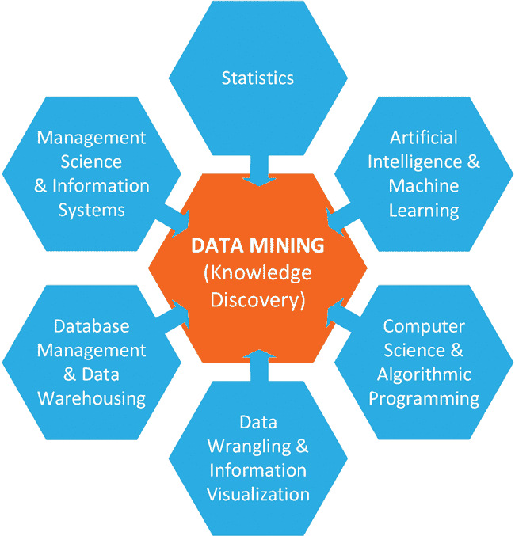

**图 2.2** 数据挖掘：一种知识发现的多学科方法

### 数据挖掘不是什么

因为它的吸引力，许多人使用 `data mining` 一词来指代任何与数据相关的分析。例如，人们可能将随意的网络搜索称为数据挖掘。事实上，互联网搜索是一种从大型多样化数据/信息源中挖掘以寻找（即发现）特定问题/查询证据的方法——正因如此，它看起来像数据挖掘。然而，数据挖掘是通过应用统计和/或机器学习技术来发现复用模式的过程。因此，数据挖掘比简单的查询互联网要严谨科学得多。

另一个与数据挖掘混淆的概念是 `OLAP`（在线分析处理）。作为商业智能运动的核心推动者，`OLAP` 是一组数据库查询方法，通过使用数据立方搜索非常大的数据库（或数据仓库）。`Cubes` 是存储在数据仓库中的数据的多维表示。通过使用立方，`OLAP` 帮助决策者对组织数据进行切片和分析，以回答“发生了什么？”、“在哪里发生的？”以及“是什么时候发生的？”类型的问题。尽管它听起来很复杂——也许从效率的角度来看，它确实很复杂——`OLAP` 并不是数据挖掘。它可能是数据挖掘的先驱。在某种意义上，它们相互互补，因为它们将数据转换为信息和知识，以便做出更好、更快的决策。`OLAP` 是描述性分析的一部分，而数据挖掘是预测性分析不可或缺的一部分。


关于统计学和数据挖掘之间存在许多讨论；有些人认为数据挖掘是统计学的一部分，而另一些人认为统计学是数据挖掘的一部分。还有人认为数据挖掘和统计学是同一件事。尽管我们在这里无法彻底阐明这一讨论，但我们至少可以通过提到几个关键点来提供一些见解。数据挖掘和统计学有许多共同点，它们都在数据中寻找关系。两者的主要区别在于，统计学始于定义良好的命题和假设，而数据挖掘始于一个定义模糊的发现陈述。统计学收集数据样本（即原始数据）来测试假设，而数据挖掘和分析则使用现有数据（即通常是观测性的次级数据）来发现新的模式和关系。另一个区别在于它们所使用的数据规模。数据挖掘寻找尽可能“大”的数据集，而统计学寻找的是大小合适的数据，如果数据超过了统计分析所需或需要的，它会使用数据的样本。统计学和数据挖掘对“大数据”的构成有不同的定义：对于统计学家来说，几百到一千个数据点就足够大了；而对于数据挖掘研究来说，几百万到几十亿个数据点被认为是大数据。

总而言之，数据挖掘并不是简单的互联网搜索或 `OLAP` 的常规应用，它与统计学也不一样。尽管它使用了这些描述性技术的能力，但数据挖掘是分析层次结构中的下一个水平，通过使用数据和模型来发现感兴趣的模式（关系和未来趋势）。

## 最常见的数据挖掘应用

数据挖掘已成为解决许多复杂业务问题和机会流行工具。它在许多领域已被证明是非常成功且有效的，其中一些在接下来的章节中列出并简要讨论。很难找到一个文献中尚未涵盖大量数据挖掘应用的行业或问题领域。许多此类数据挖掘应用的目标是解决复杂问题或探索新兴机会，以创造可持续的竞争优势。

### 营销与客户关系管理

客户关系管理（`CRM`）是传统营销的延伸。`CRM` 的目标是通过深入了解客户的需求和欲望，与客户建立一对一的关系。随着企业通过各种互动（例如产品查询、销售、服务请求、保修电话、产品评论、社交媒体连接）与客户建立关系，他们积累了海量数据。将这些信息丰富的数据与人口统计和社会经济属性相结合，可以用于：识别最可能对新产品和服务的响应者/买家（即客户画像）；理解客户流失的根本原因以提高客户留存率（即流失分析）；发现产品和服务之间随时间变化的关联以最大化销售额和客户价值；以及找到最有利润的客户及其偏好需求，以加强关系并最大化销售额。

### 银行与金融

数据挖掘可以帮助银行和其他金融机构解决各种问题和机会。数据挖掘可用于：通过准确预测和识别最可能的违约者，来简化和自动化贷款申请的处理；检测信用卡和在线银行交易的欺诈；通过销售客户最可能购买的产品和力，寻找最大化客户价值的新方法；以及通过准确预测银行实体（例如 `ATMs`、银行分行）的现金流来优化现金回笼。

### 零售与物流

在零售业，数据挖掘可用于：预测特定零售位置的准确销售量，以确定正确的库存水平；识别不同产品之间的销售关系（通过购物篮分析）以改进商店布局并优化促销活动；根据季节和环境条件预测不同类型产品的消耗水平；优化物流以从而最大化销售额；以及通过分析传感器数据和 `RFID` 数据，发现供应链中产品移动的有趣模式（特别是对于由于易过期、易腐和易污染而保质期有限的产品）。

### 制造业

制造商可以使用数据挖掘通过传感器数据预测机械发生前的故障（实现`基于状况的维护`）；识别生产系统中的异常和共性以优化生产能力；以及发现新模式以识别和改进产品质量。

### 经纪与证券交易

经纪人和交易员使用数据挖掘来预测某些股票和/或债券价格何时以及如何变化；预测市场波动的范围和方向；评估特定发行和事件对整体市场的影响；以及识别并防止证券交易中的欺诈活动。

### 保险

保险业利用数据挖掘技术来：预测财产理赔金额和医疗覆盖成本以进行更好的业务规划；基于对理赔和客户数据的分析确定最佳费率计划；预测哪些客户最可能购买具有特殊功能的新保；以及识别并防止错误的理赔支付和欺诈活动。

### 计算机硬件与软件

数据挖掘可用于在磁盘驱动器故障发生很久之前预测；识别并过滤不需要的网页内容和电子邮件；检测并防止计算机网络安全漏洞；以及识别可能不安全的软件产品。

### 政府与国防

数据挖掘有许多政府和军事应用。它可以用于：预测军事人员和设备移动的成本；预测敌方的行动，从而制定更成功的军事交战策略；预测资源消耗以进行更好的规划和预算；以及从军事行动中识别独特的经验、策略和教训，以便在整个组织内进行更好的知识共享。

### 旅游与住宿

数据挖掘在旅游业中有多种用途。它可以用于预测不同服务的销售情况（例如飞机座位、酒店/度假村的房型、租车公司的车型），以优化服务定价，使收入随时间变化的交易函数实现最大化（通常称为`收益管理`）；预测不同地点的需求以更好地分配有限的组织资源；识别最有利润的客户并提供个性化服务以维持其重复业务；以及通过识别并采取流失根本原因来留住有价值的员工。

### 健康与医疗保健


数据挖掘在医疗保健领域有许多应用。它可以帮助个人和群体追求更健康的生活方式（通过分析从可穿戴健康监测设备收集的数据）；识别没有医疗保险的人群以及导致这一非愿现象的潜在因素；识别不同治疗方案之间新的成本效益关系，以制定更有效的策略；预测不同服务地点的需求水平和时间，以优化组织资源的配置；以及理解客户和员工流失的根本原因。

### 医学

数据挖掘在医学中的应用是传统医学研究极极价值的补充，而传统研究在本质上主要是临床和生物学的。数据挖掘分析可用于识别新模式，以提高癌症患者的生存率；预测器官移植患者的成功率，以制定更好的供体-器官匹配政策；识别人类染色体中不同基因的功能（即`基因组学`）；以及发现症状与疾病之间（以及疾病与成功治疗之间）的关系，以帮助医疗专业人员及时做出明智决策。

### 娱乐业

数据挖掘已成功应用于娱乐业，通过分析观众数据来决定在黄金时段播放哪些节目，并通过了解广告的插入位置来实现收益最大化；在电影制作之前预测其财务成功情况，以做出投资决策并优化回报；预测不同地点和时间的需求，以便更好地安排娱乐活动并优化资源配置；以及制定最佳定价策略以实现收入最大化。

### 国土安全与执法

数据挖掘在国土安全和执法方面有许多应用。数据挖掘通常被用于识别恐怖行为模式；发现犯罪模式（例如地点、时间、犯罪行为和其他相关属性），以帮助及时破案；通过分析特殊用途的传感器数据，预测并消除针对国家关键基础设施的潜在生物和化学攻击；以及识别并停止对关键信息基础设施的恶意攻击（通常被称为`信息战争`）。

### 体育运动

数据挖掘已被用于提高美国国家职业篮球协会（NBA）球队的表现。大联盟棒球（MLB）球队使用预测分析和数据挖掘来优化利用有限资源，以赢得胜的赛季。（事实上，`Moneyball` 是一部关于在棒球中使用分析的流行电影。）如今大多数职业体育领域都聘用数据分析师并使用数据挖掘增加获胜机会。

数据挖掘的应用不仅限于职业体育。例如，Delen 等人（2012）开发了预测 NCAA 碗赛结果的模型，该模型使用了大量关于两个对阵双方之前比赛统计数据的变量。Wright（2012）使用了多种预测因子对 NCAA 男子篮球锦标赛赛程（又称“疯狂三月”）进行检查。简而言之，数据挖掘可用于预测体育赛事的结果，识别增加对阵特定对手获胜概率的方法，并充分利用可用资源（例如财务、管理、竞技资源），使球队能够产生最好的结果。

### 数据挖掘可以发现哪些类型的模式？

通过使用最相关的数据（可能来自组织数据库或可能从外部源获取），数据挖掘建立模型来识别数据集中属性（即变量或特征）之间的模式。模型通常是数学表示形式（简单的线性相关和/或复杂的极非线性关系），用于识别数据集中描述的对象（例如客户）的属性之间的关系。在这些模式中，一些是解释性的（解释属性之间的相互关系和相似性），而另一些是预测性的（投影某些属性的未来值）。通常，数据挖掘寻求识别三大主要类型的模式：

* `Associations`（关联）寻找经常共同出现的物品分组，例如在购物篮中共同购买和观察到的“啤酒和尿布”或“面包和黄油”（即购物篮分析）。另一种关联模式捕捉物品的序列。这些序列关系可以发现随时间排序的事件，例如预测一个已有支票账户的现有银行客户将在一年内开设储蓄账户，随后是投资账户。

* `Predictions`（预测）根据过去发生的情况告诉我们某些事件未来发生的性质，例如预测超级碗的冠军者或预测某日的绝对温度。

* `Clusters`（聚类）根据已知的特征识别物品的自然分组，例如根据人口统计数据和过去的购买行为将客户分配到不同的细分市场。


`Prediction`（预测）通常用于表示对未来的描述。与简单的猜测不同，预测在执行预言任务时考虑了经验、意见和其他相关信息。与预测经常相关的术语是 `forecasting`（预报）。尽管许多人将这两个词同义地使用，但它们之间存在细微的。预测在很大程度上基于经验和意见，而预报则是基于数据和模型的。也就是说，按照可靠性递增的顺序，可以将相关术语列为：猜测、预测和预报。在数据挖掘术语中，`prediction` 和 `forecasting` 是同义词，且 `prediction` 被用作该预测行为的通用表示。根据所预测对象的性质，预测可以更具体地命名为 `classification`（分类，其中预测的对象如明天的预报是一个类别标签，如“下雨”或“晴天”）或 `regression`（回归，其中预测的对象如明天的温度是一个实数，如“65 度”）。

### 分类

分类（或监督归纳）可能是所有数据挖掘任务中最常见的任务。分类的目标是分析存储在数据库中的历史数据，并自动生成可以预测未来行为的模型。这种归纳模型由对训练数据集记录的泛化组成，有助于区分预定义的类别。我们希望该模型随后可以被用于预测其他未分类记录的类别，更重要的是能够准确地预测未来的实际事件。

常见的分类工具包括神经网络和决策树（来自机器学习）、逻辑回归和判别分析（来自传统统计学），以及新兴工具如粗糙集、支持向量机和遗传算法。基于统计的分类技术（例如 `logistic regression`、`discriminant analysis`）被批评为对数据做出了不切实际的假设，例如独立性和正态性，这限制了它们在分类类数据挖掘项目中的应用。

#### 神经网络
神经网络涉及数学结构的发展（某种程度上类似于人类大脑中的生物神经网络），这些结构具有从以结构良好的数据集形式呈现的过去经验中学习的能力。当涉及的变量较多且它们之间的关系复杂且不精确时，神经网络往往更有效。神经网络既有优点也有缺点。例如，通常很难为神经网络做出的预测提供良好的合释。此外，神经网络通常需要大量的训练。遗憾的是，随着数据量的增加，训练所需的时间往往呈指数级增长，通常情况下无法在非常大的数据库上进行训练。这些和其他因素限制了神经网络在数据丰富领域中的应用。（参见第 5 章，“预测性分析算法”，获取更多关于神经网络的详细介绍。）

### 决策树
决策树根据输入变量的值将数据分为有限数量的类别。决策树本质上是 if–then 语句的层次结构，因此速度比神经网络快得多。它们最适用于分类数据和区间数据。因此，将连续变量纳入决策树框架需要离散化——即将连续值的数值变量转换为范围和类别。

#### 规则归纳
另一类相关的分类工具是规则归纳。与决策树不同，在规则归纳中的 if–then 语句直接从训练数据中归纳出来，且它们在本质上不需要是层次化的。其他较新的技术如 `SVM`、`rough sets` 和遗传算法正在逐渐进入分类算法的武器库，并在对数据挖掘算法的讨论中在第 5 章中有更详细的介绍。

### 关联规则

使用 `associations`（在数据挖掘中通常被称为 `association rules` 关联规则）是一种流行且经过研究的技术，用于发现大型数据库中变量之间有趣的关系。得益于自动数据收集技术（如条形码扫描器的使用），利用关联规则发现超市销售点系统记录的大规模交易中产品之间的规律，已成为零售业中常见的知识发现任务。在零售业的背景下，关联规则挖掘通常被称为 `market-basket analysis`（购物篮分析）。

关联规则挖掘的两个常用派生物是链接分析和序列挖掘。通过链接分析，可以自动发现许多感兴趣对象之间的链接，例如网页之间的链接以及学术出版作者组之间的引用关系。通过序列挖掘，根据发生顺序检查关系，以识别随时间变化的关联。关联挖掘使用的算法包括流行的 `Apriori`（识别频繁项集）、`FP-Growth`、`OneR`、`ZeroR` 和 `Eclat` 。第 4 章对 `Apriori` 提供了解释。

## 聚类

`Clustering`（聚类）涉及将一组事物（例如以结构化数据集呈现的对象、事件等）分成若干段（或自然分组），其成员具有相似的特征。与分类不同，在聚类中类别标签是未知的。随着所选算法遍历数据集并根据特征识别事物的共性，建立了簇。因为簇是使用启发式算法确定的，而且不同的算法可能会对同一数据集产生不同的簇集，所以在在使用聚类技术的结果之前，可能需要专家来解释并可能修改建议的簇。在识别出合理的簇后，可以利用它们来分类和解释新数据。

并不意外的是，聚类技术包括优化。聚类的目标是分组，使得每组内部成员具有最大的相似性，而组间成员的相似性最小。最常用的聚类技术包括 `k-means`（来自统计学）和自组织映射（来自机器学习），后者是 Kohonen (1982) 开发的一种独特的神经网络架构。

公司经常有效利用其数据挖掘系统通过聚类分析进行市场细分。聚类分析是一种识别项目类别的方法，使得簇中的项目彼此之间比与其他簇中的项目具有更多共同点。这种分析可以用于客户细分，并在正确的时间、以正确的格式和正确的价格将适当的营销产品面向这些市场。聚类分析还用于识别事件或对象的自然分组，以便识别并描述这些组的共同特征集。


数据挖掘通常与两种技术相关：可视化和时间序列预测。可视化可以与其他数据挖掘技术结合使用，以更清晰地理解底层的关系。随着可视化近年来重要性的不断提高，`visual analytics`（视觉分析）一词应运而生。其核心思想是将分析与可视化整合在单一环境中，以便更轻松、快速地创建知识。视觉分析将在第 4 章中进行详细介绍。在时间序列预测中，数据由在固定间隔内捕获并存储的同一变量的值组成。这些数据随后被用于开发预测模型，以推外该变量的未来值。

## 流行的数据挖掘工具

大量的软件供应商提供了强大的数据挖掘工具。其中一些供应商仅提供数据挖掘和统计分析软件，而另一些则是大型公司，除了提供数据挖掘软件外，还提供各种软硬件以及咨询服务。提供数据挖掘工具的供应商示例包括`IBM`（`IBM SPSS Modeler`，曾名为 `SPSS PASW Modeler` 和 `Clementine`）、`SAS`（`Enterprise Miner`）、`StatSoft`（`Statistica Data Miner`——现为 `TIBCO` 公司）、`KXEN`（`Infinite Insight`——现为 `SAP` 公司）、`Salford`（`CART`、`MARS`、`TreeNet` 和 `RandomForest`）、`Angoss`（`KnowledgeSTUDIO` 和 `KnowledgeSeeker`）以及 `Megaputer`（`PolyAnalyst`）。值得注意但并不令人意外的是，最流行的数据挖掘工具最初是由久誉的统计软件公司（`SPSS`、`SAS` 和 `StatSoft`）开发的。这在很大程度上是因为统计学是数据挖掘的基础，而这些公司有能力以成本效益高将其开发为完整的数据挖掘系统。

大多数商业智能（BI）工具供应商（例如 `IBM Cognos`、`Oracle Hyperion`、`SAP Business Objects`、`Microstrategy`、`Teradata`、`Microsoft`）也在其软件产品中集成了某种程度的数据挖掘能力。这些 BI 工具仍然主要侧重于多维建模和数据可视化意义上的描述性分析，而不被视为数据挖掘工具供应商的直接竞争对手。

除了商业用数据挖掘工具外，互联网上还有几种开源和/或免费的数据挖掘软件工具。从历史上看，最流行的免费（且开源）数据挖掘工具是 `Weka`，它是由新西兰怀卡托大学（University of Waikato）的几位研究人员开发的（可以从 cs.waikato.ac.nz/ml/weka/](http://cs.waikato.ac.nz/ml/weka/) 下载）。`Weka` 许多用于不同数据挖掘任务的算法，并具有直观的用户界面。另一个迅速流行的免费（非商业用途）数据挖掘工具是 `RapidMiner`，它由 [`RapidMiner.com](http://RapidMiner.com) 开发（可以从 [rapidminer.com](http://rapidminer.com) 下载）。其图形增强的用户界面、大量算法的使用以及各种数据可视化功能的整合，使其与其它免费数据挖掘工具区别开来。

另一个具有吸引人的工作流类型图形用户界面的免费开源数据挖掘工具是 `KNIME Analytics Platform`（可以在 [knime.org](http://knime.org) 下载）。关于 `KNIME` 的详细描述可以在附录 A。

商业工具（如 `Enterprise Miner`、`IBM SPSS Modeler` 和 `Statistica`）与免费工具（如 `Weka`、`RapidMiner` 和 `KNIME`）之间的主要区别通常是计算效率。涉及大型数据集的相同数据挖掘任务使用免费软件可能需要更长时间才能完成，对于某些算法，甚至可能无法完成（即可能由于计算机内存使用不当而导致崩溃）。随着云端分析的发展，开源工具的这一缺陷不再像以前那样显著了。例如，可以在 `KNIME Analytics Platform` 中使用小数据样本开发分析模型，然后在云平台上使用完整/大型数据集进行部署和执行。除了软件工具，基于代码的分析工具和高层编程语言（即 `Python`、`R`、`JavaScript`）在分析和数据科学领域也正获得巨大的流行。表 2.1 列出了主要的数据挖掘软件产品及其网站。

### 表 2.1 流行的数据挖掘软件工具

| 产品 | 网站 (URL) |
| --- | --- |
| `KNIME Analytics Platform` | [knime.org](http://knime.org) |
| `SAS Enterprise Miner` | [`www.sas.com/en_us/software/enterprise-miner.html`](https://www.sas.com/en_us/software/enterprise-miner.html) |
| `IBM SPSS Modeler` | [ibm.com/products/spss-modeler](http://ibm.com/products/spss-modeler) |
| `TIBCO Statistica` | [docs.tibco.com/products/tibco-statistica](http://docs.tibco.com/products/tibco-statistica) |
| `RapidMiner` | [rapidminer.com](http://rapidminer.com) |
| `PolyAnalyst` | [megaputer.com/polyanalyst.php](http://megaputer.com/polyanalyst.php) |
| `Salford Predictive Modeler` | [salford-systems.com](http://salford-systems.com) |
| `XLMiner` | [`www.solver.com/xlminer`](https://www.solver.com/xlminer) |
| `DataRobot Enterprise and AI` | [`www.datobot.com/`](https://www.datobot.com/) |
| `Databricks Unified Analytics` | [`databricks.com/`](https://databricks.com/) |
| `Apache Spark` | [`spark.apache.org/`](https://spark.apache.org/) |
| `H2O Analytics` | [`h2oanalytics.com/`](https://h2oanalytics.com/) |
| `Teradata Warehouse` | [`www.teradata.com/`](https://www.teradata.com/) |
| `Oracle Data Mining` | [oracle.com/database/advanced-analytics/odm.html](http://oracle.com/database/advanced-analytics/odm.html) |
| `R for Analytics` | [`www.r-project.org/`](https://www.r-project.org/) |
| `Python for Analytics` | [`www.python.org/`](https://www.python.org/) |
| `Open Source Analytical API for JavaScript` | [`cube.dev/`](https://cube.dev/) |

微软 SQL Server 包含了一套商业智能能力，这套能力在数据挖掘学习中越来越流行。通过 SQL Server，数据和分析模型托管在同一个关系型数据库环境中，大大提高了执行效率，并使模型管理变得更加简单。微软企业联盟（Microsoft Enterprise Consortium）是全球范围内学术用途微软 SQL Server 套件的来源。该联盟的建立目的是让全球大学能够访问企业技术，而无需在校园内维护必要的硬件和软件。联盟提供了广泛的商业智能开发工具（例如数据挖掘、立方构建、业务报告）以及来自 Sam's Club、Dillard's 和 Tyson Foods 等公司的大型真实数据集。微软企业联盟是免费的，仅供学术目的。阿肯色大学 Sam M. Walton 商学院托管该企业系统，并允许联盟成员及其学生通过简单的远程桌面连接访问这些资源。有关加入联盟的详细信息以及易于的教程和示例，请参见 [`walton.uark.edu/enterprise/Microsoft/index.php`](https://walton.uark.edu/enterprise/Microsoft/index.php)。


2019 年 5 月，KDnuggets（一个知名的数据挖掘和分析链接及资源门户网站）针对以下问题进行了其第 20 次年度软件调查：“在过去的三年内（2017–2019 年）中，你为真实项目用过哪些分析、数据科学、机器学习软件/工具？”这项调查引起了分析和数据科学社区的广泛关注，吸引了超过 1,800 名独立投票者。该调查衡量了数据分析/数据科学软件工具的广泛使用程度，以及供应商对其工具的推力强度。以下是该调查得出的的一些有趣发现：

*   许多业务分析和数据科学软件用户使用多个工具来执行数据分析项目。根据调查，2019 年每个人或每个供应商使用的工具平均数量为 6.1 个（2014 年为 3.7 个）。这清楚地表明，大多数数据科学家使用多种工具组合（包括商业软件、免费/开源软件、编程语言，以及作为社区项目的开放访问算法和模型库）。仅使用一种工具或语言似乎不足以应对新一代分析项目的需求。

*   免费和开源软件工具及编程语言的受欢迎程度远超商业工具。在排名前 40 的工具中，超过三分之二是带有图形用户界面的免费/开源软件，或者是用于数据分析的编程语言和模型/算法库。总体而言，最受欢迎的工具是`Python`（占比 65%），这与 2018 年的情况相同。

*   虽然大数据工具（例如`Apache Spark`、`Hadoop`、`Kafka`）和技术的占比有所下降，但深度学习工具、技术和库（例如`TensorFlow`、`Keras`、`PyTorch`）获得了显著人气。

图 2.4 根据独立票数显示了排名前 40 工具的调查结果。该图中的图表显示了这些工具的票数。

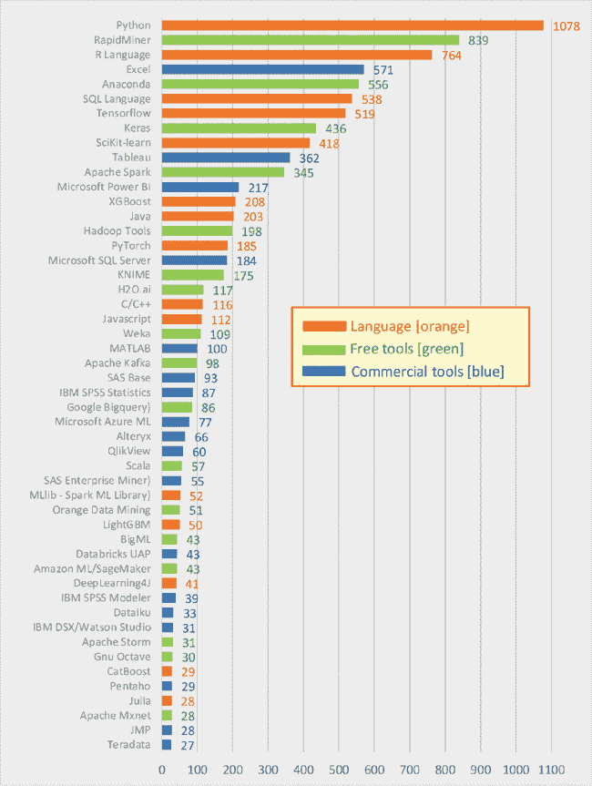

**图 2.4** 最受欢迎的数据挖掘和分析软件工具（用户调查结果） ¶ *来源：*经 [kdnuggets.com](http://kdnuggets.com) 许可使用。

为了减少重复投票带来的偏差，KDnuggets 在调查中使用了电子邮件验证，这可能会减少总票数，但使结果更无偏差且更具代表性。

### 数据挖掘的暗面：隐私担忧

在数据挖掘中收集、存储和分析的数据通常包含有关真实人员的信息。此类信息可能包括识别数据（例如姓名、地址、社会安全号、驾照号、员工编号）、人口统计学数据（例如年龄、性别、种族、婚姻状况、子女数量）、财务数据（例如薪水、家庭总收入、支票或储蓄账户余额、房屋所有、抵押或贷款账户详情、信用卡额额和余额、投资账户详情）、购买历史（即在什么地方购买了什么）。

这里的主要问题是个人隐私。为了维护隐私和保护，数据挖掘专业人员有伦理义务。在最近的许多案例中，公司在未征得同意的情况下与其他共享客户数据。例如，正如你可能记得的，2003 年，`蓝蓝航空（JetBlue Airlines）`向美国政府承包商 `Torch` 提供了超过百万名的乘客记录。`Torch` 随后利用额外信息对乘客数据进行了增强，例如家庭规模和社会安全号——这些信息是从一家名为 `Acxiom` 的经纪处购买的。整合后的个人数据库旨在用于可能的恐怖分子画像。然而，当这些活动的消息传出后，`JetBlue`、`Torch` 和 `Acxiom` 面临数十起隐私诉讼，几位美国参议员要求进行调查。

最近也出了一些类似但并不剧烈的关于热门社交公司的隐私新闻，它们被指控向其他公司出售特定的客户数据。2012 年一个关于数据挖掘和隐私担忧的奇闻登上了头条。在这个案例中，公司甚至没有使用任何隐私和/个人数据。从法律上讲，并没有违反任何法律。关于 `Target` 的故事如下：2012 年初，一个关于 `Target` 使用预测分析做法的臭闻传出。故事关于一个青少年收到了 `Target` 发来的广告传单和优惠券，内容全是一个准妈妈会买的东西。一位愤怒的男子进入明尼波利斯外的一家 `Target` 店，要求见见经理：“我女儿在邮件里收到了这个！”他说，“她还在上高中，你们竟然给她寄婴儿衣服和婴儿床的优惠券？你们是想鼓励她怀孕吗？”


# 引言
事实证明，Target（塔市）在女孩父亲之前发现了一个少女怀孕了！以下是他们做到的。Target 为每位客户分配一个访客 ID 号（与个人的信用卡、姓名或电子邮件地址相关），该 ID 作为一个占位符，用于记录该人员购买过的所有物品。Target 利用其从客户处收集或从其他信息源购买的任何人口统计信息对这些数据进行增强。通过使用这类信息，Target 查看了过去所有注册过 Target 婴儿登记清单的女性的历史购买数据。该公司从各个方向对数据分析了分析，并发现了一些实用的模式。例如，乳液和特殊维生素是购买模式具有有趣特征的产品。许多人都会购买乳液，但 Target 注意到，注册了婴儿登记清单的女性在怀孕二期初期会购买更大数量的无香乳液。另一位分析师注意到，在怀孕的前 20 周内某个时候，孕妇会大量购买钙、镁和锌等补充剂。许多购物者会购买肥皂和棉球，但当某人突然开始购买大量无香肥皂和超大包棉球，此外还有洗手消毒液和洗脸巾时，这信号她可能接近临产日了。Target 能够识别出约 25 种产品，这些产品结合分析，就可以为每位购物者分配一个“怀孕预测”分数。Target 甚至可以将她的预产日估计在一个很小的范围内，因此公司可以根据怀孕的非常具体的阶段发送优惠券。

如果你从法律角度来看这种做法，你会认为 Target 并没有使用任何违反客户隐私权的信息；相反，它使用的是几乎所有其他零售连锁都在收集、存储（并可能正在分析）关于客户的交易数据。在这种情况下，令人不安的可能是“怀孕”这一目标概念。人们倾向于认为，某些事件或概念——例如绝症、离婚和破产——应该是被禁止的或被极其谨慎地对待的。

## 总结
本章致力于定义和描述预测分析及其最常见的推动因素——数据挖掘。正如第 1 章中业务分析简单分类法的插图所示，预测性分析位于描述性分析和规范性分析之间，旨在回答“将会发生什么？”的问题。描述性分析采取回顾视角，而预测性分析采取前瞻性方法来预测未来最可能发生的情况，以便在这些问题发生之前识别并防止它们，并在潜在机会被所有人（尤其是竞争对手）察觉之前识别并利用它们。本章通过几个说明性示例和应用案例展示了这些看似复杂的概念。

### 参考文献
Chapman, P., J. Clinton, R. Kerber, T. Khabaza, et al. (2013). CRISP-DM 1.0. [www.the-modeling-agency.com/crisp-dm.pdf](http://www.the-modeling-agency.com/crisp-dm.pdf) (访问于 2020 年 7 月)。

Davenport, T. H. (2006, January). “Competing on Analytics,” *Harvard Business Review*. [`hbr.org/2006/01/competing-on-analytics`](https://hbr.org/2006/01/competing-on-analytics) (访问于 2020 年 9 月)。

Delen, D. (2019). *Predictive Analytics*.

Davenport, T. H. (2006, January). “Competing on Analytics,” *Harvard Business Review*.

# 3 预测分析的 3 个标准化流程
与其他许多计算范式一样，从大型数据库中提取知识（例如数据挖掘、预测分析、数据科学、业务分析）最初是从试错的实验过程开始的。许多从业者从尝试表征哪些有效、哪些不起行的角度来处理这个问题。在很长一段时间里，数据挖掘（或最近的数据分析和数据科学）项目是作为一种带有艺术性的、临时的实验性工作开展的。然而，为了有系统地进行这些分析，需要开发并遵循一种标准化流程。根据最佳实践，早期，学术界和工业界的数据挖掘人员提出了几种流程——以简单分步方法论形式存在的工作流——以最大限度地提高开展数据分析项目成功的可能性。这些努力导致了几个标准化流程，其中一些在本章中进行了描述。

### 数据库知识发现 (KDD) 过程


最早且可能也是第一个数据挖掘过程被称为`数据库中的知识发现`（`KDD`）方法论，由 Fayyad 等人（1996 年）提出。在 `KDD` 方法论中，数据挖掘被描述为一个单一步骤，即从预处理后的数据中提取模式。Fayyad 等人将 `KDD` 提作为一个全面的端到端过程，它包含了将数据转换为知识的许多步骤。

`Figure 3.1` 提供了 `KDD` 过程的视化表示。在图中，处理步骤显示为带标签的方向箭头，每个步骤的结果以图形图标的形式显示。如`Figure 3.1`所示，`KDD` 过程的输入是来自组织数据库和/或其他数据源集合。这些数据源通常被整合在一个名为`data warehouse`的集中数据仓库中，这使得 `KDD` 过程能够高效地实施，因为`data warehouse`为数据挖掘提供了单一来源。一旦数据在统一的`data warehouse`中合并（无论是否使用`data warehouse`），就会提取出特定问题的数据集并为进一步处理做好准备。由于数据通常处于原始、不完整且脏的状态，因此在建模之前需要进行预处理和清洗过程。一旦数据经过预处理并转换为准备好建模的形式，就会对数据应用各种建模技术，将其转换为模式、相关性和预测模型。发现的模式必须经过验证，然后需要对其进行解释，以便将它们转变为决策者可以的可操作信息（即知识）。该过程的一个重要部分是反馈环路，它允许过程从任何步骤回溯到任何之前的步骤，以便进行重做和调整。

`graphics/03fig01`
图 3.1 数据库中的知识发现 (KDD) 过程

### 跨行业标准数据挖掘过程 (CRISP-DM)

另一种标准的数据挖掘过程——无疑是最受欢迎的一种——被称为跨行业标准数据挖掘过程（`CRISP-DM`），它由一个欧洲公司财团在 20 世纪 90 年代后期提出。它旨在作为数据挖掘项目的非专利标准（Chapman 等人，2013 年）。如今，`CRISP-DM` 过程被用于业务分析和数据科学项目，它有时被称为 `CRISP-BA`（用于业务分析）、`CRISP-DS`（用于数据科学），或直接称为 `CRISP`（通过省略分析相关的规范使其成为一个更通用的术语）。

`Figure 3.2` 说明了这六个步骤的标准 `CRISP-DM` 过程，它从深入理解业务问题和对数据挖掘项目的需求（即应用领域）开始，以满足最初启动数据挖掘项目的业务需求的解决方案部署结束。尽管这些步骤在图形表示中按顺序显示，但通常会有大量的回溯。数据分析/数据科学很大程度上依赖于经验和最佳实践驱动的实验；也就是说，没有一种神奇的方法可以适用于每个项目和每位数据科学家。因此，取决于问题的情况以及分析师的技能、知识和经验，该过程可能是相当迭代的（即它可能需要在各个步骤之间反复移动几次）且耗费时间的。由于每一步都建立在直接前一个步骤的结果的基础上，因此注意前面的步骤非常，以避免从一开始就将整个研究置于错误的路径。

`graphics/03fig02`
图 3.2 用于数据分析/数据科学的 CRISP-DM 标准过程

后续章节详细描述了 `CRISP-DM` 过程的步骤。

#### 步骤 1：业务理解

任何数据挖掘项目成功的关键在于知道研究是为了做什么。这种的确定开始于深入理解管理层对新知识的需求，并对要进行的研究的业务目标进行明确规范。需要具体的目标，例如“我们最近流失给竞争对手的客户具有哪些共同特征？”或“我们客户的典型画像是什么，每位客户为我们提供了多少价值？”然后，制定一个寻找此类知识的项目计划，规定了负责收集数据、分析数据和报告发现结果的人员。在这一早期阶段，还应该建立支持该研究的预算，至少在粗略的水平上并使用大致的数字。例如，对于一个为零售目录业务开发的客户细分模型，识别业务目的意味着识别预计会产生盈利性回报的客户类型。类似的分析对于信用卡分销商也很有用。从业务目的来说，杂货店通常试图识别哪些物品倾向于被一起购买，这样他们就可以在店内进行更好的关联定位，或者更智能地引导促销活动。数据挖掘有许多实用的业务应用，并可以应用于许多业务问题和机会。亲密了解业务目的对于实现成功至关重要。

#### 步骤 2：数据理解

`CRISP-DM` 过程的第二步是在业务问题与用于解决该问题的数据之间建立完美匹配。也就是说，数据挖掘研究针对特定的、定义良好的业务任务，不同的业务任务需要不同的数据集。因此，从许多可用数据源中识别相关数据至关重要。在数据识别和选择过程中，必须考虑几个关键点。首先，分析师在描述数据挖掘任务时应该清晰明了，以便识别出最相关的数据。例如，一个零售数据挖掘项目可能试图根据人口统计学特征、信用卡交易和经济社会属性，识别购买季节性服装的女性购物者的支出行为。此外，分析师应该对数据源有深入的了解——例如，相关数据存储在哪里以及以什么形式存储，数据收集是自动的还是手动的，谁收集数据以及数据更新的频率是多少。分析师还应该通过寻求问题的答案来理解变量，例如“哪些是最相关的变量？”“是否存在同义或/或同音变量？”以及“变量之间是相互独立的吗——也就是说，它们是否作为一个完整的信息源，而没有重叠或冲突的信息？”

为了更好地理解数据，分析师通常会使用各种统计和图形技术，例如每个变量的简单统计描述/总结（例如，对于数值型变量，计算出的测量指标包括平均值、最小值/最大值、中位数标准差，而对于类别变量，计算的是众数频率表）、相关性分析、散点图、直方图和箱线图。仔细识别和选择数据源以及最相关的变量可以使数据挖掘算法更快地发现有用的知识模式。


数据选择的数据源可能多种多样。通常，业务应用程序的数据源包括人口统计学数据（例如：收入、教育程度、家庭数量、年龄）、社会人口学数据（例如：爱好、俱乐部会员、娱乐）以及交易数据（例如：销售记录、信用卡支出、开出的支票）等其他类型。

数据可以分为定量数据和定性数据。定量数据使用数值进行测量。它可以是离散的（例如：整数），也可以是连续的（例如：实数）。定性数据也称为分类数据，包含名义数据和序数数据。名义数据具有有限的无序值。例如，婚姻状况可能有四个值：已婚、单身、寡守和离婚。序数数据具有有限的有序值。例如，客户的信用评级被视为序数数据，因为评级可以是优秀、中等和差。定量数据可以方便地通过某种概率分布来表示。概率分布描述了数据的离散程度和形状。例如，正态分布的数据是对称的，通常被称为钟形曲线。定性数据可以编码为数字，然后通过频率分布进行描述。一旦根据数据挖掘业务目标选择了相关数据，就应该进行数据预处理。（关于数据挖掘中数据的更多细节，请参见第 4 章“预测分析的数据与方法](#ch04.xhtml#ch04)”。）

### 第 3 步：数据准备

数据准备（通常称为数据预处理）的目的是准备上一步识别的数据以便用于数据挖掘方法进行分析。在 CRISP-DM 的步骤中，数据预处理消耗的精力和精力最多——大约占数据挖掘项目总时间的 80%。这一步需要投入巨大的精力，是因为现实世界的数据通常是不完全的（缺少属性值、缺少某些感兴趣的属性或仅包含聚合数据）、噪声的（包含错误或离群值）以及不一致的（代码或名称存在差异）。

由于来自不同的数据源，数据的部分可能具有不同的格式。所选数据可能来自平面文件、语音消息、图像和网页，需要将其转换为一致统一的格式。总来说，数据清洗意味着过滤、聚合和填充缺失值（即插补）。在过滤数据时，分析师会检查所选变量的离群值和冗余。离群值与大多数数据有很大不同，或者明显超出所选数据组的范围。例如，如果数据集中某个客户的年龄是 190 岁，这一定是一个数据输入错误，应该被识别并修复（可能将其从检查客户各个方面的数据挖掘项目中排除，因为年龄被认为是一个关键客户特征）。离群值可能由于许多原因产生，例如人为错误或技术错误，它们也可能由于极端事件自然地出现在数据集中。如果信用卡持有人的年龄被记录为 12 岁，这可能是一个数据输入错误——很可能是人为造成的。然而，实际上可能存在一个具有重要购买习惯的独立富有的青少年。随意删除这个离群值可能会忽略有价值的信息。

数据也可能是冗余的，即以几种不同的方式记录相同的信息。某产品的每日销售额与该产品的季节销售额是冗余的，因为分析师可以从每日数据或季节数据中得出销售额。（注：原文此处存在大量重复句子，已根据要求处理并保留核心含义）。


测试与评估是一个关键且具有挑战性的步骤。在识别并认可从发现的知识模式中获得的业务价值之前，数据挖掘任务并没有产生任何价值。从发现的知识模式中确定业务价值某种程度上类似于玩拼图。提取出的知识模式是拼图的碎片，需要在特定的业务目的背景下将它们组合在一起。这种识别操作的成功取决于数据分析师、业务分析师和决策者（例如业务经理）之间的相互作用。数据分析师可能完全理解数据挖掘目标及其对业务的意义，而业务分析师和决策者可能不具备解释复杂的数学解决方案结果的专业知识；因此，他们之间的互动是必要的。为了正确解释知识模式，通常需要使用各种制表和可视化技术（例如透视表、结果的交叉表、饼图、直方图、箱线图、散点图）。

## 第 6 ：部署

模型的开发和评估并不是数据挖掘项目的结束。即使模型的目的是对数据进行简单的探索，但从此类探索中获得的知识也需要以终端用户能够理解并受益的方式进行组织和呈现。根据需求，部署阶段可以简单到生成一份报告，也可以复杂到在企业范围内实施可重复的数据挖掘流程。在许多情况下，执行部署步骤的是客户而非数据分析师。然而，即使分析师不执行部署工作，让客户提前了解需要采取哪些行动才能实际利用创建的模型也是重要的。

`CRISP-DM` 过程的部署步骤可能包括对已部署模型进行维护活动。由于业务不断变化，反映业务活动的数据也在发生变化。随着时间的推移，基于旧数据构建的模型（以及嵌入其中的模式）可能会变得过时、无关或具有误导性。因此，如果数据挖掘结果要成为日常业务及其环境的一部分，监控和维护模型就非常重要。仔细准备维护策略有助于避免不必要的错误使用数据挖掘结果。为了监控数据挖掘结果的部署，项目需要详细的监控过程计划，这对于复杂的数据挖掘模型来说可能并不易。

`CRISP-DM` 过程是工业界和学术界最完整、最流行的数据挖掘方法实践。从业者并不是直接沿用它，而是加入自己的见解，使其符合自己的实践风格。

## SEMMA

为了成功应用，数据分析项目必须被视为一个多面的过程，而不仅仅是一组工具或技术。项目的成功取决于对软硬技能及方法的逻辑且优化的利用。标准化流程是由个人小组和公司联盟开发并提出的，以实现分析项目的最优执行。除了 `KDD` 和 `CRISP-DM` 之外，还有另一种著名的方法称为 `SEMMA`，它主要由全球最大的分析公司之一的 `SAS Institute` 开发。`SEMMA` 缩写代表采样（Sample）、探索（Explore）、修改（Modify）、建模（Model）、评估（Assess）（`SAS`, 2020）。`SEMMA` 从具有统计代表性的数据样本开始，旨在便于应用探索性统计和可视化技术，选择并转换最重要的预测变量，对变量进行建模以预测结果，并确认模型的准确性。图 3.3 提供了 `SEMMA` 的图示。

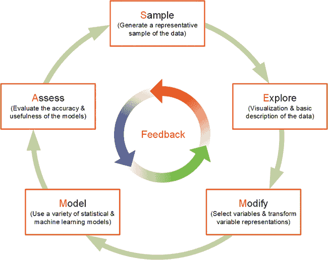

**图 3.3** SEMMA：SAS Institute 的数据分析标准化流程

通过评估 `SEMMA` 过程中每个阶段的结果，分析师可以确定如何对前述结果提出的新问题进行建模，从而返回较早的步骤对数据进行进一步细化。像 `CRISP-DM` 一样，`SEMMA` 由高度迭代的实验周期驱动。后续章节描述了 `SEMMA` 过程的五个步骤。

## 第 1 步：采样

在采样步骤中，从大型数据集（大到包含重要信息，又小到可以快速操作）中提取部分数据。为了获得成本和计算性能，某些（包括 `SAS Institute`）提倡使用采样策略，即对全细节数据应用可靠且具有统计代表性的样本。对于非常大的数据集，挖掘代表性样本而非全量可能会大幅缩短获取关键业务信息所需的时间。如果通用模式出现在整体数据中，它们在代表性样本中是可以追溯的。如果某个小众（稀有模式）极小到样本中没有体现，但又重要到影响大局，则应该使用探索性数据描述方法来发现。创建分区数据集以获得准确性评估也是一个好主意。

`SEMMA` 过程的采样步骤涉及三个子步骤：

*   **训练（Training）。** 用于模型拟合。
*   **验证（Validation）。** 用于评估和防止过拟合。
*   **测试（Test）。** 用于获得对模型泛化能力的诚实评估。

有关数据挖掘模型评估和验证的详细讨论及相关技术，请参见第 4 章。

## 第 2 步：探索

在 `SEMMA` 过程的第二步中，分析师搜索意之外的趋势和异常，以便更好地理解数据集。分析师通过视觉或数值方式探索数据，以寻找内在的趋势或分组。探索有助于完善和重定向发现过程。如果视觉探索没有显示出清晰的趋势，分析师可以使用统计技术探索数据，包括因子分析、对应分析和聚类分析。例如，在直邮营销的数据挖掘中，聚类可能会揭示具有不同订单模式的客户群。将发现过程限制在每一个这些不同的组中，可能会增加探索更丰富模式的可能性，而如果一起处理整个数据集，这些模式可能不会足够强大。

## 第 3 步：修改

在 SEMMAMA 过程的第三步中，分析师创建、选择并转换模型构建过程所关注的变量。根据探索阶段的发现，分析师可能需要处理数据以包含诸如客户分组和重要子群体等信息，或引入新变量。可能还需要寻找离群值并减少变量数量，以将其缩小到最重要的变量上。当被挖掘的数据发生变化时，分析师也可能修改数据。由于数据挖掘是一个动态的迭代过程，当新信息可用时，分析师可以更新数据挖掘方法或模型。

## 第 4 步：建模


在 SEMMA 过程的第四步中，分析师寻找一种能够可靠预测预期结果的变量组合。目标是构建能够解释数据中模式的模型。数据挖掘中的建模技术包括人工神经网络、决策树、粗集分析、支持向量机、逻辑模型以及其他统计模型，如时间序列分析、基于记忆的推理和主成分分析。每种类型的模型都有其特定的优势，适用于特定的数据挖掘场景和不同类型的数据。例如，人工神经网络非常擅长拟合高度复杂的非线性关系，而粗集分析则以在不确定和不精确的问题情况下产生可靠的结果而闻名。

### 第 5 步：评估（Assess）

在 SEMMA 过程的最后一步中，分析师评估数据挖掘过程结果的实用性和可靠性。这基本上是对模型性能表现的估计。评估模型的常用方法是将其应用于在采样阶段被留存且在模型构建期间未使用的部分数据集上。如果模型是有效的，那么它应该适用于该留存样本，也适用于用于构建模型的样本。同样地，也可以针对已知数据对模型进行测试。例如，如果你知道文件中哪些客户具有高留存率，而你的模型可以预测留存率，你就可以检查该模型是否准确地选择了那些客户。此外，模型的实际应用（例如直邮营销活动中的部分邮寄）有助于证明模型的有效性。

### SEMMA 对比 CRISP-DM

SEMMA 方法与 CRISP-DM 方法非常兼容。两者都旨在简化知识发现过程。它们都是作为广泛的框架被创建的，应该根据具体情况进行调整。在这两种方法中，一旦获得并测试了模型，就可以部署它们以在业务或研究应用方面产生价值。尽管它们的目标相同且相似，但 SEMMA 和 CRISP-DM 仍有一些差异，如表 3.1 所示。

**表 3.1** CRISP-DM 与 SEMMA 的比较

| 任务 | CRISP-DM | SEMMA | 注释 |
| --- | --- | --- | --- |
| 项目启动 | 业务理解 | — | 在此阶段，CRISP-DM 包含了项目启动、问题定义和目标设定等活动。SEMMA 没有此阶段的步骤。 |
| 数据访问 | 数据理解 | 采样探索 (SampleExplore) | 在此阶段，CRISP-DM 和 SEMMA 都有访问、采样和探索数据的步骤。 |
| 数据转换 | 数据准备 | 修改 (Modify) | 在此阶段，CRISP-DM 和 SEMMA 都对数据进行处理，使其便于机器处理。 |
| 模型构建 | 模型构建 | 模型 (Model) | 在此阶段，CRISP-DM 和 SEMMA 都构建并测试各种模型。 |
| 项目评估 | 测试与评估 | 评估 (Assess) | 在此阶段，CRISP-DM 和 SEMMA 都根据项目目标对结果进行评估。 |
| 项目结项 | 部署 (Deployment) | — | CRISP-DM 要求部署结果，而 SEMMA 没有明确的此步骤。 |

### 数据挖掘的六西格玛

六西格玛（Six Sigma）是一种流行的业务管理哲学，专注于通过严谨和系统地使用证明的质量控制和业务流程改进原则及技术，减少与完美之间的偏差（即 sigma）。这种极受欢迎的管理哲学最早由摩托马罗拉公司在 20 世纪 80 年代的制造背景下引入。这种非常受欢迎的管理哲学随后被广泛采用，通过使用证明的质量控制和业务流程改进原则及技术，减少与完美之间的偏差。这种非常受欢迎的管理哲学最早由摩托马罗公司在 20 世纪 80 年代的制造背景下引入。这种非常受欢迎的管理哲学随后被广泛采用，通过使用证明的质量控制和业务流程改进原则及技术，减少与完美之间的偏差。这种非常受欢迎的管理哲学最早由摩托马罗公司在 20 世纪 80 年代的制造背景下引入。这种非常受欢迎的管理哲学随后被广泛采用，通过使用证明的质量控制和业务流程改进原则及技术，减少与完美之间的偏差。这种非常受欢迎的管理哲学最早由摩托马罗公司在 20 世纪 80 年代的制造背景下引入。这种非常受欢迎的管理哲学随后被广泛采用，通过使用证明的质量控制和业务流程改进原则及技术，减少与完美之间的偏差。这种非常受欢迎的管理哲学最早由摩托马罗公司在 20 世纪 80 年代的制造背景下引入。这种非常受欢迎的管理哲学随后被广泛采用，通过使用证明的质量控制和业务流程改进原则及技术，减少与完美之间的偏差。

六西格玛 DMAIC 方法（定义、测量、分析、改进、控制）也被应用于数据科学项目。由于其在许多其他业务领域的成功，DMAIC 方法涉及以下五个步骤：定义、测量、分析、改进和控制。图 3.4 显示了简化的流程图。


**图 3.4** 六西格玛 DMAIC 方法

### 第 1 步：定义（Define）

DMAIC 过程的第一步是关于启动项目。它涉及以下步骤：(1) 深入理解业务需求；(2) 识别紧迫的问题；(3) 设定目标；(4) 识别和定义问题所需的数据和其他资源；(5) 制定详细的项目计划。你可能已经注意到，这与 CRISP-DM 的第一步存在显著重叠。

### 第 2 步：测量（Measure）

DMAIC 过程的第二步涉及评估数据库与业务问题之间的映射。由于数据挖掘需要相关、干净且可用的数据，此类资源的识别和创建对于数据挖掘项目的成功至关重要。在此阶段，对识别出的数据源进行整合和转换，使其便于机器处理。

### 第 3 步：分析（Analyze）

DMAIC 过程的第三步是使用一系列数据挖掘技术来开发模型。有很多可能的技术，而且大多数技术都有需要优化的参数。并没有单一的最佳技术，因此分析师需要应用多种技术并进行实验，以识别出最合适的模型。

### 第 4 步：改进（Improve）

DMAIC 过程的第四步是研究改进的可能性。改进可以发生在技术层面，也可以发生在业务问题层面。例如，如果模型结果不理想，可以使用更高级的技术（例如集成系统）来提升性能。此外，如果建模结果没有明确解决业务问题，分析师可以返回之前的步骤，重新检查并改进结构。分析师还可以进一步调查和重新表述业务问题。

### 第 5 步：控制（Control）

DMAIC 过程的最后一步是评估项目结果，如果发现结果满意，则将模型和结果发布给决策者，或集成到现有的业务智能系统中进行自动化处理。


某些数据挖掘过程比其他过程更为复杂，并且没有可靠的方法可以对它们进行比较。它们各有优缺点。有些更侧重于解决问题，而另一些则更侧重于分析驱动。开展数据挖掘的企业会采用这些方法论之一，然后可能会对其进行微调，以适应业务或数据。KDnuggets 是一个知名且备受尊重的数据挖掘门户网站，它进行了一项调查，并询问：“哪一个是最好的？”图 3.5 显示了该调查的民意结果（[KDNuggets.com](http://KDNuggets.com））。

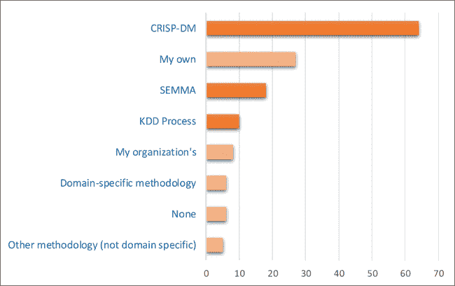

**图 3.5** 关于热门数据挖掘方法的调查 ¶ *来源：*经 [KDnuggets.com](http://KDNuggets.com) 授权使用

正如调查结果所示，`CRISP-DM` 是最受欢迎的数据挖掘过程，占据主导地位。此外，许多归类为“我自己的”的方法也是 `CRISP-DM` 的定制版本。与其他方法相比，`CRISP-DM` 是最完整、最成熟的数据挖掘过程。

## 总结

本章介绍了用于执行预测性分析和数据挖掘项目最常用的过程。标准化流程是使用逻辑、科学和实用的方法，在复杂的实践领域内对最佳实践进行体现和呈现。遵循标准流程有助于数据科学家增加获得准确、一致且有用项目结果的概率。在几个标准流程中，`CRISP` 似乎在工业界和学术界都是最常用的，因此它是本章中解释最详尽的一个。

### 参考文献

Chapman, P., J. Clinton, R. Kerber, T. Khabaza, et al. (2013). `CRISP-DM` 1.0. [www.the-modeling-agency.com/crisp-dm.pdf](http://www.the-modeling-agency.com/crisp-dm.pdf) (于 2020 年 7 月访问)。

Delen, D. (2009). “Analysis of Cancer Data: A Data Mining Approach,” *Expert Systems*, 26(1): 100–112.

Delen, D., & N. Patil. (2006, January). “Knowledge Extraction from Prostate Cancer Data,” *Proceedings of the 39th Annual Hawaii International Conference on Systems Sciences*, 5: 92b.

Delen, D., G. Walker, & A. Kadam. (2005). “Predicting Breast Cancer Survivability: A Comparison of Three Data Mining Methods,” *Artificial Intelligence in Medicine*, 34(2): 113–127.

Fayyad, U., G. Piatetsky-Shapiro, and P. Smyth. (1996). “From Knowledge Discovery in Databases,” *AI Magazine*, 17(3): 37–54.

KDnuggets. (2019). *Python Leads the 11 Top Data Science, Machine Learning Platforms: Trends and Analysis*. [`www.kdnuggets.com/2019/05/python-leads-the-11-top-data-science-machine-learning-platforms-trends-and-analysis`](https://www.kdnuggets.com/2019/05/python-leads-the-11-top-data-science-machine-learning-platforms-trends-and-analysis).

SAS. (2020). *Introduction to Data*. [`www.sas.com/doc/view/sasstat/9.4/doc//index/introduction.html`](https://www.sas.com/doc/view/sasstat/9.4/doc//index/introduction.html).


`Numeric data` 代表特定变量的数值。具有数值型变量的示例包括年龄、子女数量、家庭总收入（美元）、旅行距离（英里）和温度（华氏度）。代表变量的数值值可以是 `integer`（仅取整数）或 `real`（也包含小数）。数值数据也可称为 `continuous data`（连续数据），意味着变量在特定标度上包含连续测量值，该标度允许插入中间值。与代表有限、可计数数据的离散变量不同，连续变量代表可扩展的测量值，且数据可能包含无限数量的小数。

`Interval data` 包括可以在间距标度上测量的变量。间距标度测量的一个常见例子是摄氏度温度。在这个特定标度中，测量单位是标准大气下水熔点温度与沸点温度之差的 `1/100`；也就是说，它没有绝对零值。

`Ratio data` 包含在物理科学和工程中常见的测量变量。质量、长度、时间、平面角、能量和电荷是比例数据的物理量示例。该标度类型的命名源于：测量是连续量量值与同类单位量值之间比例的估计。从通俗地说，比例标度的区别特征是具有一个非任意的零值。例如，开尔文温度标度具有非任意的零点——绝对零，等于 –273.15 摄氏度。这个零点是非任意的，因为在该温度下组成物质的粒子动能为零。

其他数据类型包括文本、多媒体（例如图像、音频、视频）和 `XML/HTML`，在数据挖掘算法处理之前需要转换为某些形式的分类或数值表示。（有关如何从非结构化和半结构化数据中挖掘知识的更多细节，请参见第 7 章）。数据还可以面向地理方向，使得数值和名数据包含位置/地理信息；这通常被称为 `spatial data`（空间数据）。此外，无论结构如何，根据其与时间的关系还可以分类为静态或动态（即时间或时间序列数据）。

某些数据挖掘方法和算法对其能够处理的数据类型非常挑。提供不兼容的数据类型可能会导致错误的模型或（更常见的）停止模型开发过程。例如，某些数据挖掘方法（如神经网络、支持向量机、逻辑回归）需要所有变量（包括输入和输出）都表示为数值型变量。名义或序数变量使用某种 `1-of-N` 伪变量转换为数值表示；例如，具有三个唯一值的分类变量可以转换为三个具有二值值（1 或 0）的伪变量。由于此过程可能会增加变量的数量，对这种表示法的影响保持谨慎态度是非常重要的，特别是对于具有大量唯一值的分类变量。

同样，某些数据挖掘方法，如 `ID3`（一种经典的决策树算法）和粗集（一种较新的规则引导算法），需要所有变量表示为分类型变量。这些方法的早期版本要求用户在算法处理之前，先将数值型变量离散化为分类表示。好消息是，这些方法的大多数实现会自动处理这一点。

### 用于分析的数据预处理

使用数据挖掘创建的模型的质量和用用在很大程度上取决于构建它们所需的数据质量。从这个意义上说，也许 `GIGO` 规则（即垃圾进垃圾出）对于数据挖掘比对任何其他应用都更适用。因此，数据准备（通常称为`数据预处理`）的目的是通过系统地清洗和将数据转换为标准形式，以便对其进行适当分析，从而消除 GIGO 错误的可能。与数据挖掘过程中的其他活动相比，数据预处理需要和消耗的时间最多，通常占项目耗时间的 80% 以上。预处理需要如此巨大的努力，是因为现实世界的数据通常是不完整的（缺少属性值、缺少某些属性或仅包含聚合数据）、脏的/噪声的（包含错误或离群值）以及不一致的（代码中存在差异）。因此，需要努力将数据清洗并转换为可挖掘的形式，同时确保预处理不会偏偏数据；保留数据固有的模式和关系是非常重要的。图 4.2 显示了将原始现实世界数据转换为可挖掘的良好数据集时通常遵循的四步系统过程。

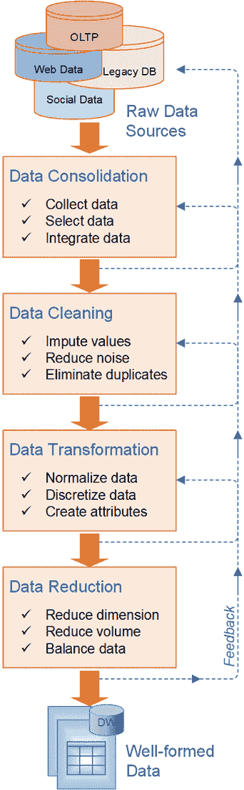

**图 4.2** 数据准备的系统化过程

在数据预处理的第一阶段，从识别出的源收集相关数据，选择必要的记录和变量（过滤掉不必要的数据），并整合来自多个数据源的记录。在此阶段，将对数据的特定领域理解来妥善处理同义词和同音词。

在数据预处理的第二阶段，称为数据清洗（data scrubbing），对数据进行清洗。在这一步中，识别并处理数据集中的值。在某些情况下，缺失值是数据集中的异常，在这种情况下，需要对其进行插值（即填充最可能的值）或忽略；在其他情况下，缺失值是数据集的自然部分（例如，家庭收入字段通常由高收入层的人留空）。在这一步中，分析师还应该识别数据中的噪声值（即离群值）并对其进行平滑。此外，数据中的不一致性（变量内的异常值）应使用领域知识和/或专家意见进行处理。


在数据预处理的第三阶段，会对数据进行转换以便更好地进行处理。例如，在许多情况下，会将所有变量归一化到特定的最小值和最大值之间，以减轻某个变量主导其他值较小变量的潜在偏差；例如，分析师不希望具有巨大数值值的数据（如家庭收入）主导受养人数或工龄年限，而后这些因素可能更为重要。在此阶段发生的另一种变换是离散化和/或聚合。在某些情况下，数值型变量被转换为分类值（例如：低、中、高）；在其他情况下，通过概念层次结构将名变量的唯一值范围缩小到较小的集合（例如，对于显示位置的变量，不再使用具有 50 个不同值的各个州，而是使用若干几个区域来表示），以使数据集更易于计算机处理。另一些情况则可能需要根据现有变量创建新变量，以放大数据集中一组变量的信息。例如，在器官移植数据集中，分析师可能会选择使用单一变量来显示血型匹配（1：匹配，0：不匹配），而不是对供体和受体的血型使用单独的多分类值。这种简化可以在减少数据关系复杂性的同时增加信息含量。

数据预处理的最后阶段是数据归约。数据挖掘者喜欢大型数据集，但数据过量可能会成为问题。从最简单的意义上说，我们可以将数据挖掘项目中常用的数据可视化为一个包含两个维度的平面文件：变量（列数）和案例/记录（行数）。在某些情况下（例如，图像处理、具有复杂微阵列数据的基因组项目），变量的数量可能非常大，分析师必须将其数量减少到可管理的规模。由于变量被视为从不同角度描述现象的维度维度，在数据挖掘中，这一过程通常被称为 `dimensional reduction`（降维）。尽管没有完成此任务的单一最佳方法，但分析师可以利用之前发表的文献中的发现、咨询领域专家、运行适当的统计检验（例如主成分分析、独立成分分析），或者在理想情况下，使用这些技术的组合来成功地将数据维度缩减为更易管理且相关的子集。

除了与多维性相关的复杂性外，现实世界的数据可能还有样本量极大的问题。也就是说，某些数据集可能包含数百万或数十亿 `records`（也称为 `samples` 或 `cases`）。尽管计算能力正在稳步增长，为数据分析提供了更多动力，但处理如此大量的记录可能仍然不可行或不实际；单次分析的完成可能需要长得无法接受的时间。在这种情况下，分析师可能只需要分析数据的子集。抽样的底层假设是数据子集将包含完整数据集的所有相关模式。在同质数据集中，这种假设可能成立，但现实世界的数据几乎不是同质的。分析师在选择数据子集时应格外小心，确保其反映完整数据集的本质，而不是特定于某个子小组或子类别。数据通常根据某些变量进行排序，从数据的顶部或底部截取部分可能会导致索引变量特定值上的偏差数据集；因此，可能需要进行 `sampling`（采样）。


各种数据挖掘方法和算法正被企业和科学机构开发和使用，以阐明一系列复杂问题。这些问题可以映射到几个高层数据挖掘任务。根据需求和问题的性质，数据挖掘任务可以分类为预测（分类或回归）、关联或聚类。这些数据挖掘任务中的每一项都可以使用多种数据挖掘方法和算法。图 4.3 展示了这些数据挖掘任务、方法和算法的图化表示。接下来的章节将描述这些广义的数据挖掘任务类别（即预测、关联和聚类）以及与它们最常用的算法（例如，用于预测的决策树、用于关联的 Apriori 算法、用于聚类的 `k`-means）。第 5 章 “预测性分析算法” 解释了其他几种数据挖掘算法，包括`k`-最近邻、人工神经网络、支持向量机、线性回归、逻辑回归和时间序列预测。大多数数据挖掘软件工具对每项数据挖掘任务/方法都使用使用一种以上的技术（或算法）。

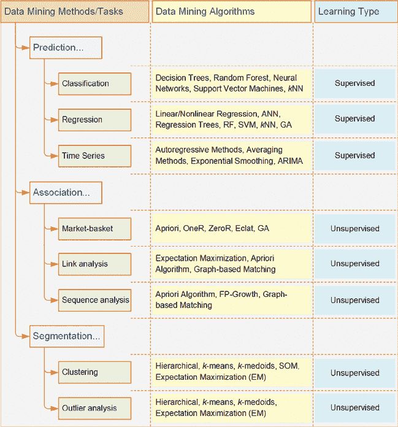

**图 4.3** 数据挖掘任务/方法和代表性算法

## 预测

如第 1 章所示，“分析简介](#ch01.xhtml#ch01)”，预测用于预测未来并回答“将会发生什么？”或更准确地说，“什么最可能发生？”业务规划和问题解决严重依赖对未来事件和发生的估计。预测性分析（以及基础预测建模技术）是这些估计的实现手段。无论使用何种建模技术进行预测建模，其基本假设都是我们对过去已知的（以历史数据形式记录的交易和事件）是我们用于预测未来的主要输入。我们假设过去将以某种方式在未来重复，而且通常确实如此；但如果没有发生，那么就没有办法预测未来。

根据我们正在预测的变量，预测方法可以标记为`classification`（如果我们预测的是离散结果）、`regression`（如果我们预测的是数值）或`time-series forecasting`（如果我们预测的是时间相关性值序列的未来投影）。例如，预测股票在收盘时是上涨还是下跌被视为分类，预测股票在收盘时的价值差异被视为`regression`，而根据最近的收盘价预测明天股票的收盘价则是时间序列预测。尽管它们都在估计我们感兴趣的变量的未来值，但值的类型和变量的性质决定了预测的类型。

分类与回归的区别在于目标变量的性质：分类预测的是标签（离散/名义变量），而回归预测的是数字（连续/数值变量）。输入变量上没有区别；两类预测方法都可以处理名义和数值变量的任何组合（尽管根据特定预测建模技术的需求，需要执行某些数据转换程序以将输入数据从离散转换为数值，或从数值转换为离散）。本章和第 5 章中涵盖的大多数预测建模方法都可以处理分类和回归类型的预测问题。例如，虽然决策树被用于分类，但名为回归树的类似结构可以用于回归问题。同样，虽然多元线性回归可以用于回归，但多元逻辑回归被用于分类类问题。其他流行技术如人工神经网络、支持向量机和`k`-最近邻可以轻松地用于分类和回归类型的预测问题。为了保持预测建模流行方法和算法的介绍简洁简单，在接下来的章节中，我们专注于最常用的预测方法：分类。

### 分类

分类可能是解决现实世界问题最常用的预测性分析和数据挖掘方法。即使在目标变量为连续数值变量的回归类型预测问题中，也会使用离散化来将目标变量转换为二项或多项离散表示，从而将回归问题转换为分类问题。通常，应用这种转换是为了使预测问题更易理解、与领域相关、稳健且用户友好，正如第 3 章结尾提到的，“预测性分析的标准流程](#ch03.xhtml#ch03)”。

作为机器学习技术族中的流行成员，分类从过去数据（已标记项目、对象或事件的信息、变量和特征）中学习模式，以便将新实例（未知标签）放置到相应的组或类中。例如，我们可以使用分类预测某天的天气是“晴天”、“下雨”还是“多云”。流行的分类任务包括贷款审批（即良好或坏信用风险）、商店选址（例如良好/中等/差）、目标营销（例如可能客户/无希望）、欺诈检测（即是/否）以及电信（例如可能/不太可能转向其他手机公司）。如前所述，如果预测的是类标签（例如“晴天”、“下雨”或“多云”），则预测问题被称为`classification`，而如果预测的是数值（例如 68 华氏度温度），则预测问题被称为`regression`。

尽管聚类（另一种流行的数据挖掘方法）也可以用于确定事物的分组（或类成员），但分类和聚类之间存在显著差异。分类通过监督学习过程学习事物特征（即独立变量）与其成员（即输出变量）之间的函数；而在聚类中，对象的成员是通过无监督学习过程学习的，此时仅向输入变量。与分类不同，聚类没有监督（或控制）机制来强制学习过程；相反，聚类算法使用一个或多个启发式（例如多维距离量）来发现对象的自然分组。

分类类型预测最常用的两步方法涉及模型开发/训练/学习以及模型测试/验证。在模型开发阶段，使用包含实际类标签的输入数据集合。模型训练完成后，对留存样本进行测试以进行准确性评估，并最终部署用于实际使用，在那里它预测新数据实例（类标签未知）的类别。


在所有可用模型中识别出最佳预测模型并不是一项容易的任务。虽然预测准确率被认为是最重要的，但根据预测问题的具体细节、决策者的需求/意愿以及应用领域，还需要考虑其他标准。在这个阶段，作为一名数据科学家，你所面对的通常被称为多准则决策情况。分配给每个标准重要性将是客观决定“**整体最佳**”预测模型的依据。在评估预测模型时，可以考虑大量的因素/标准。以下是其中最常用的几个标准：

- 预测准确率。在分类类预测问题的背景下，这是指模型正确预测新数据或之前未见过的数据的类别标签的能力。预测准确率是分类模型最常用的评估因素。下一节将提供对这一评估指标的详细解释。
- 可解释性。`Interpretability` 是模型提供的理解水平和洞察力（例如，模型如何对某些预测得出结论以及/或得出了什么）。
- 速度。`Speed` 指生成（即训练模型）和使用（即测试和/或部署）预测模型涉及的计算成本，越快越好。
- 稳健性。`Robustness` 指模型在面对噪声数据或带有缺失和/或错误值的数据时，做出合理准确预测的能力。
- 可扩展性。`Scalability` 是高效构建预测模型的能力；当训练数据集的大小增加时（无论从行/样本数量还是列/变量数量方面来看），生成预测模型所需的时间呈线性增长。

在这些五个顶级评估指标中，由于今天对预测分析和机器学习的感知的变化，最常考虑的是预测准确率和可解释性。虽然由于最近硬件和软件的进步，其他三个指标正变得越来越不利，但随着这些模型日益成为业务相关决策支持系统中至关重要的部分，预测准确率和可解释性正变得越来越重要。

## 如何估计分类模型的真实准确率

在分类问题中，所有准确率估计指标的主要来源是 `confusion matrix`（混淆矩阵），也称为`classification matrix`或`contingency table`。图 4.4 显示了一个二分类问题的混淆矩阵。从左上角到右角的对角线上记录的实例数量代表正确的预测决策，记录在该对角线之外的实例数量则代表错误（即错误的预测）。

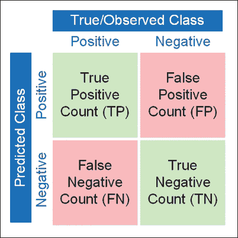

**图 4.4** 二分类的混淆矩阵

当分类问题不是二分类时，混淆矩阵会变得更大：它变成一个`n`乘`n`的方矩阵，其中`n` 是类值的唯一数量。此外，准确率指标被限于每类别的准确率和整体分类器的准确率。表 4.2 列出了分类模型中一些常用的准确率指标。

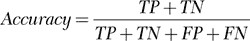

**表 4.2** 分类模型的常用准确率指标

估计由监督学习算法引导分类模型（或分类器）的准确率很重要，原因有两个：首先，估计结果可以用于评估未来的预测准确率，这可能意味着实际预测系统中分类器输出的置信度水平。其次，估计结果可以用于从给定的集合选择分类器（在许多训练模型中识别出“最佳”分类模型）。

接下来的章节描述了用于评估分类类预测模型的一些流行的交叉验证方法。

### 简单划分

简单划分方法（或留出法或测试样本估计）将数据划分为两个相互互斥的子集，称为训练集和测试集（或留出集）。通常将数据的二分之作为训练集，剩下的三分之一作为测试集。当分类器是人工神经网络时，存在例外。在这种情况下，数据被划分为三个互斥的子集：训练集、验证集和测试集。验证集用于模型构建期间（即模型构建者），以防止过拟合。（关于人工神经网络的更多信息，请参阅第 5 章。图 4.5 说明了简单（或单一）划分方法。

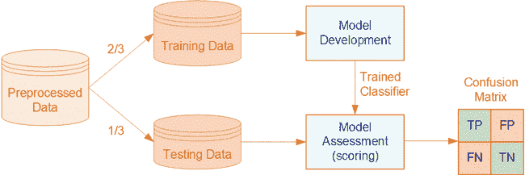

该方法的主要批评点是，它假设了两个子集中的数据是相同类型（即具有完全相同的属性）。由于这是简单的随机划分，在大多数分类变量倾斜的真实数据，这种假设可能并不成立。为了改善这种情况，建议使用分层抽样，其中分层成为输出变量。尽管这比简单划分法有所改进，但它仍然存在与单一划分相关的偏差。

### k 折交叉验证

为了在比较两种或多种方法的预测准确率时减少与训练和留出数据样本随机化相关的偏差，分析师可以使用称为`k`-折交叉验证的方法。在这种方法中，也称为`旋转估计`，整个数据集被随机划分为`k` 个大小相等的互斥子集。分类模型被训练和测试 `k` 次。每次，它在除一个折之外进行训练，然后在剩下的单个折上进行测试。模型整体准确率的交叉验证估计通过简单平均这 `k` 个单独的准确率来计算。这是这种聚合的公式：


图 4.6 提供了`k`折交叉验证的图形说明，其中`k` 被设置为 10（即 10 折交叉验证）。

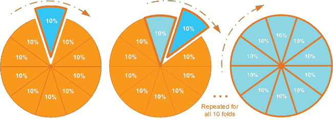

### ROC 曲线下的面积


ROC 曲线（接收者操作特征——一个借自雷达检测的术语）下的面积是二分类问题的一种图形化评估技术，其中真正率（即灵敏度）绘制在 `y` 轴上，假阳性率（1:特异性）绘制在 `x` 轴上。由于 `AUC`（ROC 曲线下的面积）是尺度无关/不变的，因此它可以被用于客观地对多个预测方法进行排序。尽管它是判断每个预测模型性能以及帮助模型类型进行排序的一个非常好的指标，但它没有提供模型预测准确率的绝对值。也就是说，`AUC` 值不与模型的整体预测准确率混淆。（然而，正如你从实验中推断出的那样，`AUC` 值和整体准确率值将高度相关：产生较高 `AUC` 值的模型类型也可能产生更高的整体准确率值。）例如，`AUC` 将是营销活动中一个非常好的指标，因为你可以根据按概率排序的预测结果创建一个向发送营销推广信息的用户有序列表。

使用 `AUC` 的另一个优点是它是对分类阈值不变的；也就是说，无论选择何种分类阈值，它都能衡量模型预测能力的质量。相比之下，`F1` 分或整体准确率都受到阈值值选择的影响。具体而言，`AUC` 决定了分类器的整体无偏预测能力，其中 `AUC` 值 `1` 表示完美分类器，而值 `0.5` 表示没有预测能力（即不于随机概率）；然而在现实中，`AUC` 值处于这两个极端情况 `0.5` 和 `1.0` 之间。例如，在图 4.7 中，ROC 曲线 `A` 具有更好的 `AUC`，因此分类性能优于 `B`（其 `AUC` 用蓝色阴影区域表示），而 `C` 是基准，代表不优于随机概率的 ROC 曲线。虽然在图 4.7 中为了说明目的，这三条线显示得非常平滑，但在实际应用中，ROC 曲线看起来相当崎岖且离散。

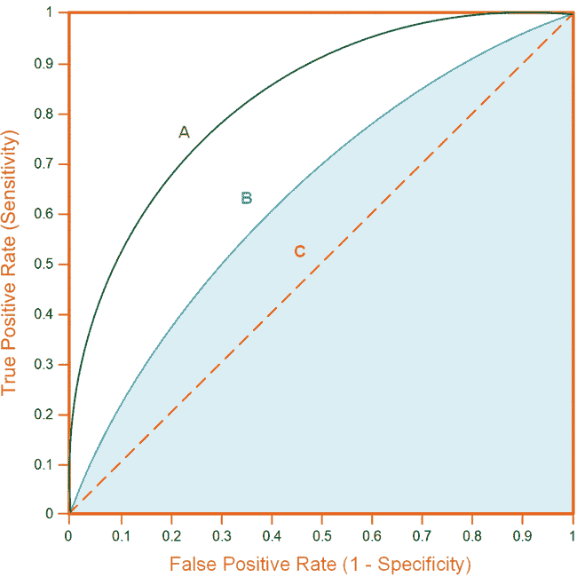

**图 4.7** ROC 曲线下三个区域的插图

### 其他交叉验证方法

虽然它们不像本章目前介绍的技术那样常见，但其他一些评估技术也可用于分类类型的问题。以下是一些性方法：

*   **留一法（Leave-one-out）。** 留一法类似于 `k`-折交叉验证，其中 `k` 取值为 `1`；也就是说，每个数据点都会在与数据点数量相同的模型中被测试一次。这是一种耗费时间的方法，但对于小数据集来说是一个可行的方案。
*   **自助法（Bootstrapping）。** 通过自助法，从原始数据中对固定数量的实例进行有放回的采样用于训练，数据集的其余部分用于测试。此过程根据需要重复多次。
*   **补刀法（Jackknifing）。** 这种方法与留一法相似；你可以通过在估计过程的每次迭代中留掉一个样本来计算准确率。

### 分类方法

许多方法和算法被用于分类建模，包括以下方法：

*   **决策树分析。** 决策树分析（一种机器学习技术）可以说是数据挖掘领域最受欢迎的分类技术。下一节将提供该技术的详细描述。
*   **统计分析。** 多年来——直到机器学习技术的出现——统计技术一直是主要的分类算法。统计分类技术包括 `logistic 回归` 和 `判别分析`，两者都假设输入输出变量之间的关系是线性的，数据呈正态分布且相互独立。这些假设导致了向机器学习的转变。
*   **神经网络。** 使用神经网络是最流行的机器学习技术之一，可用于分类类型的问题。该技术的详细描述见第 5 章。。
*   **支持向量机。** 与神经网络一起，支持向量机正成为日益流行的分类算法。该技术的详细描述见第 5 章。。
*   **集成模型。** 同质或异质的集成模型可用于获得更好的预测能力和稳健性能。见第 5 章。。
*   **k-最近邻算法。** 这种看似简单但极其高效的算法以相似性作为其分类方法的基础。见第 5 章。。
*   **案例推理。** 这种方法在概念上类似于最近邻算法，利用历史案例来识别共同点，以便将新案例分配到最可能的类别。
*   **贝叶斯分类器。** 这种方法利用概率论基于过去发生的情况构建分类模型。
*   **遗传算法。** 遗传算法利用自然演化的类比构建基于搜索的机制对数据样本进行分类。
*   **粗集。** 这种方法考虑类别标签对预定义类别的部分隶关系来构建用于分类问题的模型（规则集合）。

涵盖所有这些分类技术超出了本书的范围，但下一节描述了最流行的一种——决策树，第 5 章涵盖了其他几种著名的。

### 决策树

在描述决策树的细节之前，我们需要讨论一些简单的术语。首先，决策树包含许多可能影响模式分类的输入变量。这些输入变量通常被称为`属性`。例如，如果我们仅根据两个特征——收入和信用评分来建立一个贷款风险分类模型，这两个特征就是属性，产生的输出将是类别标签（例如：低、中、高风险）。其次，树由分支和节点组成。分支代表分类模式的结果（基于测试），使用其中一个属性。树末端的叶节点代表模式的最终类别选择（从根节点到叶节点的路径链，可以表示为复杂的 if 语句）。

决策树的基本思想是递归地划分训练集，直到每次划分完全或主要由同一类的示例组成。树的每个非叶节点包含一个分裂点，即一个或多个属性的测试，决定了如何进一步划分数据。决策树算法通常从训练数据构建初始树，使得每个叶节点都是纯净的，然后修剪树以提高其泛化能力，从而提高测试数据的预测准确率。


在增长阶段，通过递归地划分数据来构建树，直到每次划分都是纯的（即仅包含同一类别的成员）或规模较小。其基本思想是提出答案能提供最多信息的问题，就像“二十个提问”游戏中这样做那样。

用于划分数据的划分方式取决于划分时所使用的属性类型。对于连续属性 `A`，划分形式如下：

`value(A) x` 

其中 `x` 是 `A` 的某个“最优”划分值。例如，基于收入的划分可以是 `Income > 50000`。对于分类属性 `A`，划分形式如下：

`value(A) belongs to x` 

其中 `x` 是 `A` 的一个子集。例如，可以基于教育程度（个人是否拥有大学学位）进行划分。

构建决策树的通用算法如下：

1. 创建一个根节点并将所有训练数据分配给它。
2. 选择最佳划分属性。
3. 为划分的每个值为根节点添加一个分支。根据分支的具体划分情况将数据划分为互斥（即不重叠）的子集。
4. 对每个叶节点重复步骤 2 和 3，直到达到停止标准（例如，节点由单一类别标签主导）。

人们已经提出了许多不同的算法来创建决策树。这些算法的主要区别在于确定划分属性（及其划分值）的方法、属性划分的顺序（对同一属性划分一次还是多次）、每个节点处的划分数量（二叉与三叉）、停止标准以及树的剪枝（预剪枝与后剪枝）。一些最著名的算法包括机器学习中的 `ID3`（后续 `C4.5` 和 `C5` 是 `ID3` 的改进版本）、统计学中的分类回归树 (`CART`) 以及模式识别中的卡方自动相互作用检测器 (`CHAID`)。

在构建决策树时，每个节点的目标是确定该属性及其划分点，以最好地划分训练记录，从而纯化该节点的类别表示。为了评估划分的好坏，人们提出了一些划分索引。其中最常见的是 `Gini index`（基尼指数）和信息增益（information gain）。`Gini index` 用于 `CART` 和 `SPRINT`（可扩展并行决策树归纳法）算法。信息增益的版本用于 `ID3`（及其较新版本 `C4.5` 和 `C5`）。

`Gini index` 已被经济学用于衡量群体的多样性。同样的概念也可以用于确定根据特定属性或变量进行分支决策后产生的特定类别的纯度。最佳划分是能够增加所提划分后结果集合纯度的划分。

信息增益是 `ID3` 中使用的划分机制，它可能是广为人知的决策树算法。它由 Ross Quinlan 于 1986 年开发，从那时以后 Quinlan 将该算法演变为 `C4.5` 和 `C5` 算法。`ID3` 及其变体的基本思想是使用名为 `entropy`（熵）的概念来代替 `Gini index`。熵衡量数据集中不确定或随机性的程度。如果子集中的所有数据都属于同一类别，则熵为零。

### 数据挖掘中的聚类分析

聚类分析是一种探索性数据挖掘工具，用于将案例、事件或概念分类分组。其目标是寻找成员之间的自然相似性以及簇之间的弱关联。该方法通常用于业务、医学、社会网络分析、人类学甚至营销领域。聚类分析的结果可用于以下操作：

* 确定分类方案（例如，客户类型）
* 建议描述总体的统计模型
* 指明将新案例分配到类别的规则
* 为宽泛的概念提供定义、大小和变化的衡量标准
* 寻找典型案例来标记和代表类别
* 减少其他数据挖掘方法的问题空间的大小和复杂度
* 识别特定领域的离群值（例如稀有事件检测）

### 如何确定聚类数量

聚类算法通常需要指定要找到的簇数量。如果根据先验知识不知道该数字，则应该以某种方式选择。遗憾的是，并没有计算该数字份额的最佳方法。因此，人们提出了几种不同的启发式方法。以下是引用最多的：

* 查看方差百分比，它是簇数量的函数；即选择一个簇的数量，使得增加另一个簇不会对数据产生更好的建模。具体来说，在绘制簇解释的方差百分比图时，存在一个边际收益下降的点（在图中表现为角度），这指示了应选择的簇数量。
* 将簇的数量设置为 `(n/2)^(1/2)`，其中 `n` 是数据点的数量。
* 使用赤池信息准则 (`AIC`)，这是一种基于熵概念的拟合优度量，用于确定簇的数量。
* 使用贝叶斯信息准则 (`BIC`)，这是一种基于极大似然估计的模型选择准则，用于确定簇的数量。


聚类分析涉及将一组记录（即样本或对象）进行分组，使得同一组（称为 `cluster`，簇）中的对象相似性大于它们与其他组（或其他簇）中对象的相似性。大多数聚类分析方法都使用距离度量来计算项与项之间的接近程度。常用的距离度量包括欧几里得距离（用尺子可以测量的两点之间的普通距离）和曼顿距离（也称为直角距离或出租车距离，即两点之间的距离）。有许多聚类分析技术，每种技术在识别对象或记录的自然分组方式上略有不同。图 4.8 展示了聚类技术的简单分类法。

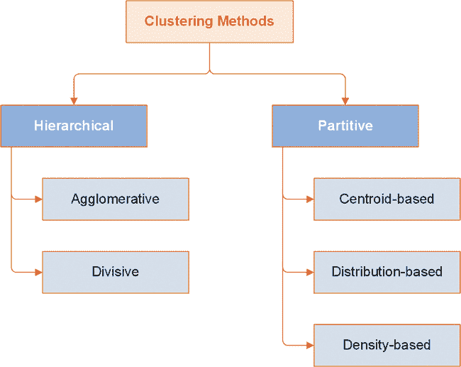

**图 4.8** 聚类方法的简单分类法

如图 4.8 所示，在最高层上，聚类方法可以分为层次聚类和划分聚类。`层次聚类方法`基于一个基本思想：相邻对象之间的关系比远离它们的对象更紧密。因此，一个簇可以通过连接所有相关对象所需的最大距离来定义。在不同的距离下，会形成不同的簇，它们可以使用树图（dendrogram）来表示，这解释了`层次聚类`这一名称的由来。在层次聚类中，簇可以从下而上识别（即凝聚聚类——从底部开始，每个对象最初都是自己的一个簇，然后添加相似对象以创建更通用的簇），也可以从上而下识别（即分裂聚类——从最顶部的簇开始，然后将对象拆分为更具体的簇）。

另一方面，`划分聚类方法`基于这样观点：在多维空间中存在对象的自然分群。这些方法遵循以下流程：从任意数量的簇开始，将对象分配给概率最大的簇，然后更新簇的数量并演化对象到簇的分配，直到达到稳定的簇空间。划分聚类下的特定算法使用不同的方法来识别簇。由于聚类没有单一的最优方法或算法，从事聚类任务的分析师应该尝试几种竞争性算法，评估它们的拟合程度，并识别出最佳的一种。

## 聚类技术的评估

我们如何衡量聚类方法创建的簇的拟合程度？我们如何知道它们是否有效？我们如何知道它们在多大程度上代表了数据的自然分组？我们需要一些衡量标准来比较不同聚类算法在给定数据集上的表现。然后，我们可以选择“最佳”的一种来解决分类类型的数据挖掘问题。评估聚类方法拟合程度的衡量标准通常分为两类：内部评估和外部评估。

### 内部评估

内部评估方法通常为那些产生簇内相似性高且簇间相似性低的簇的类（或算法）分配最高评估分。内部评估衡量标准最适用于某一种算法表现优于另一种算法的情况，但这可能并不意味着一种算法比另一种算法产生了更“有效性”的结果。有效性不同于比较性评估，因为它意味着所识别的簇结构确实存在于数据集中。这种评估方法使用多维特征空间中的某种距离度量来衡量类内和类间的相似性。

在聚类评估中使用内部标准的缺点是，内部指标的高分并不一定能导致有效的信息检索应用。此外，这种评估偏向于使用相同簇模型的算法。例如，`k`-means 聚类自然地优化了对象距离，基于距离的内部标准可能会高估结果的聚类效果。

### 外部评估

内部评估是根据相似性衡量来评估聚类结果，而在外部评估中，聚类结果是根据未用于聚类的数据（带有已知类别标签的数据）进行衡量的。这种评估包含一组预先分类的记录，这些记录由领域专家创建了已知的类别或类别标签。因此，比较集可以被视为评估的金标准。这些类型的评估方法衡量聚类结果与预定义的标记类别之间的接近程度。尽管这听起来很有逻辑，但这种方法的广泛实用性仍存疑。为真实世界数据集寻找预标记类别是困难的，甚至可能是不可能的。此外，由于真实类别包含某种自然结构，提供给聚类算法的属性/变量可能不够完整，无法分离真实的簇。

## k-Means 聚类算法

`k`-means` 算法（其中 `k` 是预定的簇数量）被认为是引用次数最多的聚类算法。它的根源于传统的统计分析。作为基于质心的划分聚类方法家族的一员，`k`-means` 算法正如其名所示，将每个数据点（例如客户、事件、对象）分配给中心点（也称为 `centroid`）最近的簇。中心被计算为簇中所有点的平均值；也就是说，它的坐标是簇中所有点在每个维度上单独的算术平均值。算法步骤列在此处并在图 4.9 中以图形形式显示：

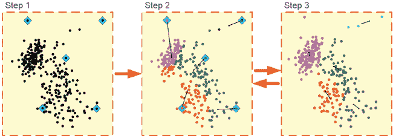

**图 4.9** k-Means 聚类的步骤

*   **初始化步骤**。选择簇的数量（即 `k` 的值）。
    1. 随机生成 `k` 个点作为初始中心。
    2. 将每个点分配给最近的簇中心。
    3. 重新计算簇中心。
*   **重复步骤**。重复步骤 2 和 3，直到满足某些收敛标准（例如点到簇的分配变得稳定）。

### 关联

关联——也称为关联规则挖掘、亲性分析或购物篮分析——是一种流行的数据挖掘方法，通常用作解释什么是数据挖掘以及它能做什么的示例。你可能听过关于商店中啤酒和尿布销售之间发现的著名（或臭名昭著，取决于你怎么看）的关系。据传，一家大型超市连锁（可能是沃尔玛，也可能不是；目前没有共识）对客户的购买习惯进行了分析，发现购买啤酒和尿布之间存在统计学上的显著相关性。理论上认为，其原因是父亲（假设是年轻男性）去超市买婴儿尿布（特别是在周四），由于他们不能再经常去运动酒吧了，他们也会买点啤酒。由于这一发现，该超市连锁据称将尿布放在啤酒旁边，从而导致两者的销售额增长。


从本质上说，关联规则挖掘旨在寻找大型数据库中变量（项目）之间有趣味的关联（关联性）。由于其在零售业务问题上的成功应用，它通常被称为**购物篮分析**。购物篮分析的核心思想是识别不同产品（或服务）之间通常被一起购买的强相关关系（即出现在同一个篮子中，无论是杂货店的实体篮子，还是电子商务网站的虚拟篮子）。例如，65% 购买综合汽车险的人也会购买健康险；80% 在线购买书籍的人也会在线购买音乐；60% 有高血压且超重的人有高胆固醇；70% 购买笔记本电脑和病毒防护软件的客户还会购买扩展服务计划。

购物篮分析的输入是简单的销售点交易数据，其中将一起购买的若干产品和/或服务（就像购物收据的内容一样）列在单个交易实例下。分析的结果是极具价值的信息，可用于更好地理解客户的购买行为，从而实现交易利润的最大化。企业可以通过以下方式利用这些知识：(1) 将物品放置在一起，方便客户同时挑选，避免在购买其中一件物品时忘记购买另一件（增加销售量）；(2) 将物品作为组合进行促销（例如，如果其中一件打折，则另一件不打折）；以及(3) 将物品分开放置，让客户必须走过过道去寻找，并在此过程中看到并购买其他物品。

购物篮分析的应用包括交叉营销、交叉销售、店铺设计、目录设计、电子商务网站设计、在线广告优化、产品定价以及销售/促销配置。从本质上说，购物篮分析帮助企业从购买模式中推断客户的需求和偏好。在业务领域之外，关联规则可用于发现症状与疾病之间的关系、诊断与患者特征及治疗之间的关系（可用于医疗决策支持系统 [DSSs]）、基因与其功能之间的关系（可用于基因组项目）等。以下是关联规则挖掘的几个常见领域和用途：

*   **销售交易。** 了解一起购买的零售产品组合可以用于改进销售场所的产品陈列（例如，将配套的产品放在相邻位置）和产品的促销定价（例如，对经常一起购买的两种产品不进行促销）。
*   **信用卡交易。** 了解使用信用卡购买的物品可以洞察客户可能购买的其他产品，或信用卡号的欺诈使用。
*   **银行服务。** 客户使用的服务顺序模式（例如，查询账户后是储蓄账户）可用于识别他们可能感兴趣的其他服务（例如投资账户）。
*   **保险服务产品。** 客户购买的保险产品组合（例如，车险后是房屋主险）可用于建议额外的保险产品（例如人寿险）；另一方面，保险理赔的异常组合可能示着欺诈。
*   **电信服务。** 通常一起购买的选项组（例如互联网、电视和电话）有助于更好地构建产品包和相关的促销优惠，以实现收入最大化。
*   **医疗记录。** 某些状况组合可能指示风险。

关联规则挖掘中的一个常见问题是“规则是否有趣？”。为了回答这个问题，关联规则挖掘使用了三个指标：支持度（support）、置信度（confidence）和提升度（lift）。在定义这些术语之前，让我们先看看规则的样式：

`X => Y`

其中 `X` 是左侧（前件），`Y` 是右侧（后）。

*   **支持度 (S):** 产品和/或物品集合的支持度是衡量它们在数据中出现频率的指标。在这个示例中，30% 的所有交易包含 `笔记本电脑、杀病毒软件和扩展服务计划`。
*   **置信度 (C):** 规则的置信度是衡量右侧（后件）与左侧（前件）一起出现的频率。换句话说，它是前件存在的情况下发现后件存在的条件概率。
*   **提升度:** 关联规则的提升度是规则置信度与其期望置信度的比值。规则的期望置信度定义为前件和后件的支持度乘积除以前件的支持度。

多种算法可以发现关联规则。一些著名的算法包括 Apriori、Eclat 和 FP-Growth。这些算法只完成一半工作：识别频繁项集。一旦确定了频繁项集，就需要将其转换为规则。从频繁项集确定规则是一个直接的匹配过程，但在大型交易数据库中，该过程可能非常耗时。

### **Apriori 算法**

Apriori 算法是最常发现关联规则的算法。给定一组项集（例如零售交易集，每个集合列出购买的物品），该算法尝试找到至少出现在最小数量项集中的子集（即符合最小支持度）。Apriori 算法采用自底向上的方法，每次扩展一个项目的频繁子集（这种方法被称为候选集生成），并在每一层对候选集组通过数据进行最小支持度测试。算法在无法找到进一步成功的扩展时终止。


作为一个说明性示例，请考虑以下内容。一家杂货店通过 SKU（库存单位）跟踪销售交易，从而知道哪些物品通常会被一起购买。图 4.10 显示了交易数据库，以及识别频繁项集的后续步骤。交易数据库中的每个 SKU 对应一种产品，例如“1 = 黄油”、“2 = 面包”、“3 = 水”等以此此类推。`Apriori` 算法的第一步是统计每个项目（单项项目集）的频率（即 `supports`，支持度）。对于这个过于简化的例子，我们将最小支持度设定为 3（或 50%，这意味着如果一个项集在数据库的 6 次交易中至少出现 3 次，则认为它是一个频繁项集）。由于所有单项项目集在支持度列中的值至少为 3，因此它们都被视为频繁项集。然而，如果任何一个单项项目集不是频繁的，它们将不会被包含在可能的二项对候选成员中。通过这种方式，`Apriori` 剪枝了所有可能的项集树。如图 4.10 所示，使用单项项目集生成所有可能的二项项目集，并利用交易数据库计算它们的支持值。因为二项项目集 {1, 3} 的支持值小于 3，它不应该包含在用于生成下一级项集（三项项目集）的频繁项集中。该算法看起来简单得有些性——但仅适用于小数据集。在规模得得的数据集中，尤其是那些存在大量低频物品和少量高频物品的数据集中，搜索和计算将变得计算密集型任务。

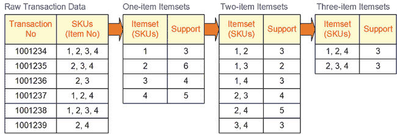

**图 4.10** 使用 Apriori 算法识别频繁项集的流程

### 数据挖掘与预测分析的误解与事实

数据挖掘是一种强大的分析工具，使业务高管能够从描述过去的本质转向预测未来。它帮助营销人员发现能够用以解开客户行为之秘的模式。数据挖掘的结果可以增加收入、减少支出、识别欺诈并寻找业务机会，提供全新的竞争优势领域。作为一个不断发展和成熟的领域，数据挖掘通常与许多误解相关，包括表 4.3 中列出的那些。

**表 4.3** 关于数据挖掘的一些误解与事实

| 误解 | 事实 |
| --- | --- |
| 数据挖掘提供即时的、像水晶球般的预测。 | 数据挖掘是一个需要深思、主动设计和使用的步骤过程。 |
| 数据挖掘对于业务应用尚不可行。 | 目前的先进技术已准备好适用于任何业务。 |
| 数据挖掘需要一个独立的专用数据库。 | 由于数据库技术的进步，不需要专门的数据库，尽管它可能是理想的。 |
| 只有拥有高级学位的人才能做数据挖掘。 | 基于 Web 的工具让所有教育程度的经理都能进行数据挖掘。 |
| 数据挖掘仅适用于拥有大量客户的大型公司。 | 只要数据准确反映了业务或客户，公司就可以使用数据挖掘。 |

数据挖掘的远见者通过理解这些误解实际上是误解，已经获得了巨大的竞争优势。

以下是实践中经常犯的 10 个数据挖掘错误，你应该尝试避免它们：

1. 为数据挖掘选择了错误的问题。
2. 忽略你的赞助者认为数据挖掘是什么，以及它真正能做和不能做什么。
3. 为数据准备留出的时间不足。数据准备阶段所需的精力比通常理解的要多。
4. 只看聚合结果而不看单个记录。`IBM’s DB2 IMS` 可以突出感兴趣的单个记录。
5. 在跟踪数据挖掘过程和结果时很粗心。
6. 忽略可疑的发现并快速通过。
7. 重复且盲目地运行挖掘算法。深入思考数据分析的下一个阶段非常重要。数据挖掘是一项非常注重实践的活动。
8. 相信所有关于数据提供的信息。
9. 相信所有关于你自己的数据挖掘分析的信息。
10. 你衡量结果的方式与你的赞助者衡量的方式不同。

## 总结

泛而言，分析，特别是预测分析，依赖于数据。数据是通过数据挖掘过程发现的知识点和可操作洞察的原材料。本章从对数据的彻底描述开始，介绍了不同数据类型的分类法和相关定义，并解释了涉及数据预处理的典型步骤。预处理步骤的输出是准备好分析的数据集。

除了数据本身及其准备过程之外，本章还提供了数据挖掘所用方法的全面视图。通过采用分类方法，本章解释了数据挖掘中发现的三类主要模式：预测、关联和聚类。本章还涵盖了用于分类类型预测模型的最常用的评估方法和交叉验证方法。

### 参考文献

Bhandari, I., E. Colet, J. Parker, Z. Pines, et al. (1997). “Advanced Scout: [此处由于原文存在大量重复词汇已省略]” 


Wright, C. (2012). *Statistical Predictors of March Madness: An Examination of the NCAA Men’s Basketball Championship*. [`economics-files.pomona.edu/GarySmith/Econ190/Wright`](http://economics-files.pomona.edu/GarySmith/Econ190/Wright) March Madness Final Paper.pdf (accessed July 2020).

Zaima, A. (2003). “The Five Myths of Data Mining,” *What Works: Best Practices in Business Intelligence and Data Warehousing*, 15: 42–43.

# 用于预测分析的 5 种算法

预测分析算法大多源于传统的统计方法或现代的机器学习技术。根据文献中发表的大对比研究，虽然统计方法已经非常完善且理论上是合理的，但机器学习技术更准确、包含的信息更多，且更具操作性/实用性。在预测分析和数据挖掘演变过程中影响最大的统计方法包括判别分析、线性回归和逻辑回归。在许多成功的预测分析项目中，最常用的机器学习技术包括决策树、`k`-最近邻、人工神经网络和支持向量机。所有这些机器学习技术都可以处理分类和回归类型的预测问题。通常情况下，它们被应用于复杂的预测问题，而其他更传统的技术无法产生满意的结果。

由于机器学习技术在预测分析文献中的普及，在本章中，我们将详细解释一些最常见的算法，但不会涉及过多的技术或算法细节。我们还简要解释了其他提到的统计技术——线性回归、逻辑回归和序列分析——以对预测分析的算法范围提供平衡的。

## 朴素贝叶斯 (Naive Bayes)

朴素贝叶斯是一种基于著名的贝叶斯定理的简单概率分类方法。该方法要求输出变量具有名义/分类值。虽然输入变量可以是数值和名义类型的混合，但数值型输出变量在使用朴素贝叶斯分类器之前，需要通过某种类型的分箱方法进行离散化。朴素贝叶斯名称中的“朴素（Naive）”源于对输入变量之间存在且有些不现实的独立性假设。简单来说，朴素贝叶斯分类器假设输入变量互不依赖，且预测变量组合中特定变量的出现（或不存在）与任何其他变量的出现或不存在无关。

在监督机器学习环境中，可以非常高效地（即以很小的计算开销非常快速地）且有效地（即相当准确地）开发朴素贝叶斯分类模型。也就是说，使用一组训练数据（可能不很大），可以使用极大似然法获得朴素贝叶斯分类模型的参数。换句话之，由于独立性假设的存在，我们可以在不严格遵守贝叶斯定理所有规则和要求的情况下开发朴素贝叶斯模型。首先，让我们回顾一下贝叶斯定理。

### 贝叶斯定理

为了理解朴素贝叶斯分类方法，理解贝叶斯定理的基本思想和精确的贝叶斯分类器（没有强朴素独立假设的那个）是重要的。贝叶斯定理（也称为贝叶斯法则）以英国数学家托马斯·贝叶斯（1701–1761）的名字命名，是一种用于确定条件概率的数学公式。在稍后显示的公式中，`Y` 表示假设，`X` 表示数据/证据。这一广为定理提供了一种通过额外证据来修正和改进预测概率的方法。

以下公式展示了两个事件 `Y` 和 `X` 的概率之间的关系。`P(Y)` 是 `Y` 的先验概率。它之所以被称为“先验”，是因为它没有考虑关于 `X` 的任何信息。`P(Y|X)` 是在 `X` 的条件下 `Y` 的条件概率。它也被称为后验概率，因为它源自（或依赖于）`X` 的特定值。`P(X|Y)` 是在 `Y` 的条件下 `X` 的条件概率。它也被称为似然。`P(X)` 是 `X` 的先验概率，也称为证据，起到归一化常数的作用。

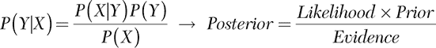

`P( Y|X)`: *给定 X 时 Y 的后验概率*

`P(X|Y)`: *给定 Y 时 X 的条件概率* (*似然*)

`P(Y)`: *Y 的先验概率*

`P(X)`: *X 的先验概率* (*证据或无条件概率*)

为了从数值上阐明这些概念，让我们来看一个简单的例子。假设我们要计算在“周日下雨”的条件下，“周六是否下雨”的概率，我们将使用贝叶斯定理。根据数据：

`P(Y)`: *周六下雨的概率* = 0.40
`P(X|Y)`: *如果周六下雨，周日下雨的概率* = 0.10
`P(X)`: *周一下雨的概率* = `0.40 * 0.10 + 0.60 * 0.80` = 0.52

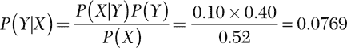

因此，在这个例子中，如果周日下雨，那么周六下雨的概率为 7.69%。

### 朴素贝叶斯分类器

贝叶斯分类器在不使用简化独立假设的情况下使用贝叶斯定理。在分类类型预测问题中，贝叶斯分类器的工作原理如下：给定一个分类样本，寻找所有相同的其他样本（即所有预测变量的值与分类样本相同），确定它们所属的所有类别标签，并将新样本分类到最具代表性的类别。如果没有样本与新样本值完全匹配，则分类器将无法将新样本分配到类别中（因为它找不到任何强有力的证据）。

### 开发朴素贝叶斯分类器的过程

与其他机器学习方法类似，朴素贝叶斯采用了两个阶段的模型开发和评分/部署过程。第一阶段是训练，在此估计模型/参数；第二阶段是测试，在新案例上执行分类/预测。该过程将在后续章节中描述。

#### 训练阶段

训练阶段涉及以下步骤：

**步骤 1.** 获取数据、清洗数据并将其组织成扁化文件格式（即列为变量，行代表案例）。

**步骤 2.** 确保所有变量都是名义变量。如果任何变量是数值型/连续型，则数值型变量需要经过数据转换；也就是说，你需要通过离散化（如分箱）将数值型变量转换为名义变量。


### 步骤 3. 计算因变量所有类别标签的先验概率。

### 步骤 4. 计算所有预测变量及其对应可能值的似然概率。在混合变量类型（分类和连续）的情况下，每个变量的似然概率（条件概率）是使用针对特定变量类型的适当方法估计的。名类和数值预测变量的似然概率计算如下：

* 对于分类变量，似然概率（即条件概率）是通过训练样本中该变量值相对于因变量的简单比例来估计的。
* 对于数值变量，似然概率通过以下步骤计算：1) 计算每个因变量值（即类别）每个预测变量的均值和方差，然后 (2) 使用以下公式计算似然概率：

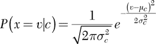

通常连续/数值独立/输入变量会被离散化（使用适当的分箱方法），然后使用分类变量估计方法来计算条件概率（似然参数）。如果执行得当，这种方法往往能产生预测更好的朴素贝叶斯模型。

### 测试阶段

使用训练阶段第 3 和第 4 步产生的两组参数，可以使用以下公式将任何新样本分类到一个类别标签：


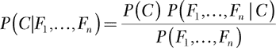

因为分母是常数（即所有类别标签都相同），我们可以将其从公式中移除，从而得到以下更简单的公式，它本质上是联合概率：

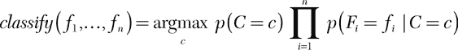

由于在广泛的应用领域中预测性能相对较差，朴素贝叶斯在如今的预测分析项目中并不常用。然而，它的扩展方法之一——贝叶斯网络，在分析领域的数据科学家中正以惊人的速度普及。

### 最近邻算法

预测分析算法往往具有高度的数学性且是计算密集型的。两种流行的算法——人工神经网络和支持向量机——涉及极度耗时且计算密集的迭代数学推导。相比之下，`k`-最近邻（`k`-NN）算法对于一种竞争性预测方法似乎过于简单。很容易理解（并向他人解释）它的功能和实现原理。`k`-NN 是一种用于分类以及回归类型预测问题的预测方法。`k`-NN 是一种基于实例的学习（或懒学习）类型，函数仅在局部进行近似，所有计算都推迟到实际预测。

`k`-NN 算法是所有机器学习算法中最简单的之一。例如，在分类类型预测中，案例通过其邻居的多数投票进行分类，将对象分配给其 `k` 个最近邻居中最常见的类别（其中 `k` 是正整数）。如果 `k = 1`，则案例简单地分配给其最近邻居的类别。为了用示例说明这一概念，图 5.1 显示了一个简单的二维空间，代表两个变量 `x` 和 `y` 的值；星号代表一个新案例（或对象），圆圈和正方形代表已知案例（或示例）。任务是根据新案例与其中一者的接近程度（相似性），将新案例分配给圆圈或正方形。如果你将 `k` 的值设置为 1（`k = 1`），应该分配给正方形，因为距离星号最近的示例是正方形。如果你将 `k` 的值设置为 3（`k = 3`），则应该分配给圆形，因为有两个圆形和一个正方形，因此根据简单的多数投票规则，圆形获得了新案例的分配。同样，如果你将 `k` 的值设置为 5（`k = 5`），则分配应分配到正方形类。这个过于简化的示例旨在说明分配给 `k` 值的重要性。

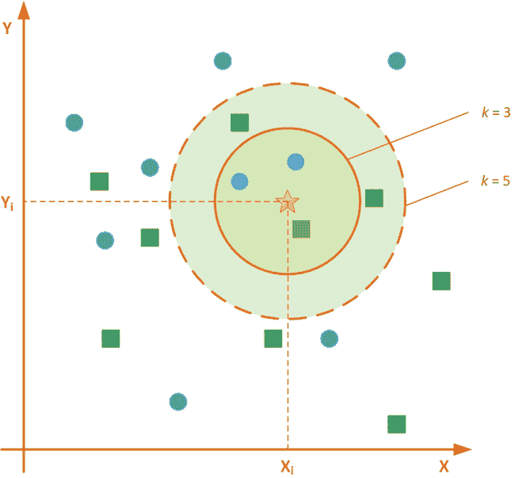

**图 5.1** `k`-NN 算法中 `k` 值的重要性

要将相同的方法用于回归类型预测任务，只需对 `k` 个最近邻居的值取平均值并将结果分配给该案例即可。对邻居的贡献进行加权是有用的，使得较近的邻居贡献比远处的邻居更多。

### 相似性量：距离度量

分析师在使用 `k`-NN 时必须做出的两个关键决策之一是确定相似性量；另一个是确定 `k` 的值。给定一个新案例，`k`-NN 根据距离该点最近的 `k` 个邻居的结果进行预测。因此，要使用 `k`-NN 进行预测，分析师需要定义一个距离度量。衡量这种距离最流行的选择之一是欧几里得距离（公式 5.3），它仅仅是两点之间的线性距离；另一种流行的是直轴距离（又称街区距离或曼哈顿距离）（公式 5.2）。这两个距离度量都是闵可夫斯距离的特例。

这里是寻找闵可夫斯距离的公式：

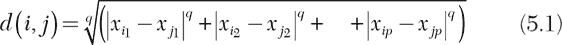

其中 `i = (x[i1], x[i2], \dots, x[ip])` 和 `j = (x[j1], x[j2], \dots, x[jp])` 是两个 `p`-维数据对象（例如数据集中的一个新案例和一个示例），而 `q` 是正整数。

如果 `q = 1`，则 `d` 被称为`曼哈顿距离`，并使用此公式找到：

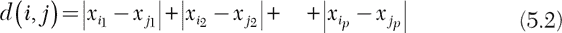

如果 `q = 2`，则 `d` 被称为`欧几里得距离`，并使用此公式找到：

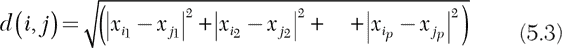

显然，这些度量仅适用于数值表示的数据。非数值数据该怎么办？也有方法可以衡量非数值数据的距离。在最简单的情况下，对于一个多值分类变量，如果该变量在新案例和示例案例中的值相同，则距离为零；否则为一。在文本分类等情况下，存在更复杂的度量，例如重叠指标（或汉明距离）。如果通过实验设计来确定距离度量（其中通过尝试和测试不同的指标以确定最适用于给定问题的指标），那么 `k`-NN 的分类准确率通常可以显著提高。


`k` 的最佳选择取决于数据；通常，较大的 `k` 值会减少噪声对分类（或回归）的影响，但也会使得类别之间的边界变得不明显。可以通过某些启发式技术（如交叉验证）找到“最优”的 `k` 值。当预测类别为距离最近的训练样本的类别时（即 `k = 1`），这种特殊情况被称为`最近邻算法`。

## 交叉验证

交叉验证是一种成熟的实验技术，可用于确定一组未知模型参数的最优值。它适用于大多数（如果不是所有的话）机器学习技术，因为在这些技术中，有许多待确定的模型参数。这种实验方法的通用思想是将数据样本划分为若干个随机抽取且互不相叠的子样本（即 `v` 个折）。对于 `k` 的每一个潜在值，使用 `k`-NN 模型对第 `v` 个折进行预测，同时使用其他 `v – 1` 个折作为示例，并评估误差。对于这种误差的常用选择是：回归类型预测的均方根误差 (RMSE)，以及分类类型预测的正确分类实例的百分比（即命中率）。这种将每个折与剩余示例进行测试的过程会重复 `v` 次。在 `v` 次循环结束后，将计算出的误差累加，以得到模型的优度度量（即模型使用当前 `k` 值预测的效果有多好）。最后，选择产生最小总误差的 `k` 值作为该问题的最优值。图 5.2 展示了一个简单的过程，其中训练数据用于确定 `k` 和距离度量的最优值，然后用这些值来预测新进入的案例。

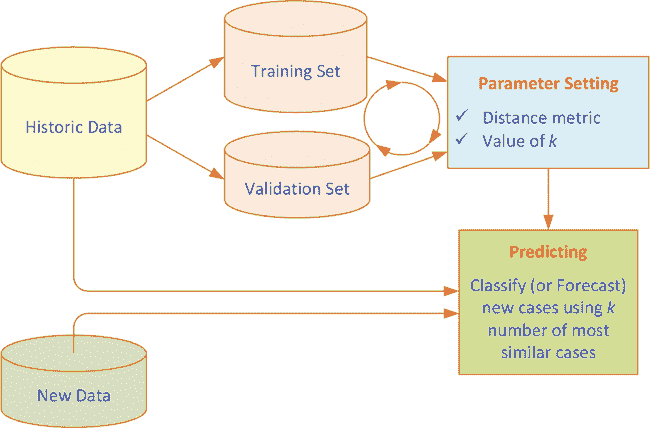

**图 5.2** 确定距离度量和 `k`最优值的过程

正如刚才提供的简单示例所示，`k`-NN 算法的准确性随 `k` 值的不同差异。此外，在存在噪声、不准确或无关特征的情况下，`k`-NN 算法的预测能力会下降。许多研究工作致力于特征选择和归一化/缩放，以确保预测结果的可靠。一种特别流行的方法是使用进化算法（例如遗传算法）来优化包含在 `k`-NN 预测系统中的特征集。在二分类（两类）问题中，选择奇数作为 `k` 有助于避免票数相等。

`k`-NN 中基本多数投票分类的缺点是，具有频繁示例的类别倾向于主导新向量的预测，因为由于数量多，它们在计算邻居时往往出现在 `k` 个最近邻中。克服这个问题的方法之一是对分类进行加权，考虑到测试点到每个 `k` 个最近邻的距离。克服这一缺点的另一种方法是在数据表示中使用层次抽象。

`k`-NN 算法的朴素版本通过计算测试样本到所有存储向量的距离来实现，但其计算量非常大，特别是当训练集增大时。多年年来，人们提出了许多最近邻搜索算法；它们通常寻求减少实际执行的距离评估次数。使用适当的最近邻搜索算法使得即使对于大型数据集，`k`-NN 在计算上也是可行的行的。

## 人工神经网络

神经网络代表了信息处理的大脑比喻。这些模型灵感源于生物学，而非大脑实际运行方式的精确复制。由于能够从数据中“学习”、具有非参数性质（即缺乏僵化的假设），神经网络在许多预测和业务分类应用中被证明是非常有前景的系统。神经网络计算是指用于机器学习的模式识别方法。从神经网络计算产生模型通常称为`人工神经网络` (`ANN`) 或 `神经网络`。神经网络已应用于业务领域的模式识别、预测和分类。

在本节中，我们对各种神经网络模型、方法和应用进行简要介绍。我们将在 6 章高级建模中详细讨论神经网络——特别是前馈多层架构——作为理解深度学习和深度神经网络的基础。

人类大脑在信息处理和问题解决方面拥有惊人的能力，现代计算机在许多方面无法与之竞争。假设一种受脑研究结果支持且结构类似于神经网络的模型或系统可以出类似的智能功能。基于这种自底而上的方法，ANN（也称为连接主义模型、并行处理模型、神经形态系统或简单的神经网络）已被开发为各种任务的生物启发和可行模型。

生物神经网络由大量相互连接的神经元组成。每个神经元拥有轴突和树突，这些指状突起通过传输和接收电信号和化学信号与相邻神经元进行通信。人工神经网络在结构上或或类似于生物对应物，由被称为人工神经元的相互连接的处理元件组成。在处理信息时，ANN 中的处理元件并行共同工作，类似于生物神经元。ANN 具有某些类似于生物神经网络的理想特性，如学习、自组织和容错能力。

半多年来，研究人员一直在考察 ANN 的复杂历程。ANN 的正式研究始于 McCulloch 和 Pitts 在 1943 年的开创性。受生物实验和观察结果的启发，McCulloch 和 Pitts (1943) 引入了一种简单的人工神经元模型，捕捉了生物神经元的一些功能。利用信息处理机器模拟大脑，McCulloch 和 Pitts 使用大量相互连接的人工二神经元构建了他们的神经网络模型。从这里开始，神经网络研究在 20 世纪 50 年代末 60 年代非常流行。在 Minsky 和 Papert 于 1969 年对早期神经网络模型（一种没有隐藏层的`感知器`）进行彻底分析并对其研究潜力给出悲观评价后，人们对神经网络的兴趣下降了。


在过去的二十十年里，由于新的网络拓扑结构、激活函数和学习算法的引入，以及神经科学和认知科学的进步，人工神经网络（ANN）研究经历了令人兴奋的复兴。理论和方法论的进步解决了几十年前阻碍神经网络研究的许多障碍。得益于大量研究取得引目的结果，神经网络正获得认可和普及。此外，神经信息处理的理想特性使得神经网络在解决复杂问题方面极具吸引。ANN 已应用于各种应用场景中的众多复杂问题。神经网络应用的成功也激发了工业界和商业界的新轮兴趣。随着深度神经网络（作为近期深度学习现象的一部分）的出现，神经网络（具有更深层次的架构表示和极大增强的分析能力）人气达到了前所未有的高度，人们对这一新代神经网络寄予厚望。深度神经网络将在 6 章中，两类分别用圆形和正方形表示。然而，只有一个超平面实现了类之间的最大分离；在图 5.5b 中，该超平面和两个最大间隔超平面正在分离这两个类。

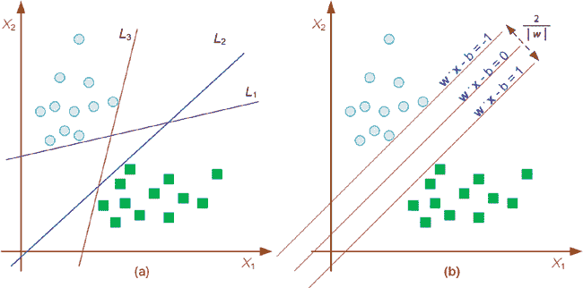

**图 5.5** 使用支持向量机分离两个类


SVM 中使用的数据可能超过两个维度（即两个不同的类别）。在这种情况下，我们感兴趣的是使用 `n` – `1` 维超平面来分离数据，其中 `n` 是维数（即类别标签）。这可以被视为一种典型的线性分类器形式，我们的目标是寻找 `n` – `1` 个超平面，使得超平面到最近数据点的距离最大化。假设是，这些平行超平面之间的间隔（或距离）越大，分类器的泛化能力（即 SVM 模型的预测能力）越好。如果存在这样的超平面，可以使用二次优化建模对其进行数学表示。这些超平面被称为最大间隔超平面，而线性分类器被称为最大间隔分类器。

除了在统计学习理论方面具有坚实的数学基础外，SVM 在许多现实预测问题中也展现了极具竞争力的性能，例如医疗诊断、生物信息学、人脸/语音识别、需求预测、图像处理和文本挖掘，这使得 SVM 成为知识发现和数据挖掘最流行的分析工具之一。与人工神经网络类似，SVM 可用于以任何所需的精确度近似任何多变量函数。因此，它们在建模高度非线性、复杂的问题、系统和过程方面具有特别的价值。

## 构建 SVM 模型的过程

最近，由于其预测的准确性和自扩展性，支持向量机经常被用于分类类问题。尽管人们认为它们比人工神经网络更容易使用，但不熟悉 SVM 细节的用户往往会得到不满意的结果。在本节中，我们提供了一种基于过程的简单 SVM 模型构建方法，这种方法极有可能产生意想不到的良好结果。三个步骤过程的图示表示见图 5.6。

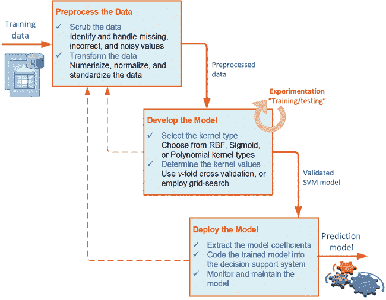

**图 5.6** 开发和使用 SVM 模型的简单流程

接下来的章节将对该过程中的步骤进行简要描述。

### 步骤 1：预处理数据

由于现实世界的数据并不完美，数据挖掘分析师需要尽职调查，对 SVM 数据进行清洗和转换。与任何其他数据挖掘方法和算法一样，这一步可能是处理 SVM 时最耗时且最不尽意——却至关重要的部分。这一步中的某些任务包括处理缺失值、不完整值和噪声值，以及对数据进行数值化、归一化和标准化：

*   **数据数值化。** 对于 SVM 而言，每个数据实例都需要表示为实数向量。因此，如果有类别属性，分析师必须首先将它们转换为数值数据。一个常见的建议是使用 `m` 个伪二进制变量来表示 `m` 类属性（其中 `m` ≥ 3）。在实践中，根据案例的实际类别，`m` 个变量中只有一个变量假设值为 1，其他变量假设值为 0；这也被称为 1-of-`m` 表示。例如，一个三类属性（如 {红， 绿， 蓝}）可以表示为 `[0,0,1]`。

### 步骤 2：开发模型

数据处理完成后，便开始构建模型。与其他步骤相比，这是最有趣的部分。因为 SVM 有许多参数选项，分析师必须决定使用哪一个。通常来说，RBF 是一个合理的首选。此外，线性核只是它的一个特殊特例。RBF 有两个参数需要选择：`C` 和 `γ`。预先并不知道对于特定问题哪些 `C` 和 `γ` 是最好的；因此，需要使用某种搜索方法。搜索的目标是确定 `C` 和 `γ` 的最优值，以便分类器能够准确预测数据。两种常用的搜索方法是交叉验证和网格搜索。

### 步骤 3：部署模型

一旦开发了 SVM 预测模型，下一步将其集成到决策系统中。为此，有两种方案：(1) 将模型转换为计算对象（例如 Web 服务、JavaBean 对象或 COM 对象），它可以接收输入参数值并提供输出预测；(2) 提取模型系数并将其集成到决策系统中。只有当底层行为保持不变时，SVM 模型才是有效的（即准确且可操作的）。如果行为发生变化，模型的准确性也会发生变化。因此，持续评估模型性能并判断它们何时不再准确并因此需要重新训练是非常重要的。

## 支持向量机与人工神经网络

尽管有些人将 SVM 视为人工神经网络的一个特殊特例，但大多数人将它们视为两种具有不同特性的竞争机器学习技术。让我们来看一些有助于 SVM 脱颖而出的观点。从历史角度看，神经网络的发展遵循了启发式路径，应用和大量的实验先于理论。相比之下，SVM 的开发首先涉及健全的统计学习理论，然后是实现和实验。SVM 的一个显著优势是，人工神经网络可能会陷入多个局部最优，而 SVM 的解是全局且唯一的。SVM 的另外两个优势是它们具有简单的几何解释并能提供稀疏解。


除了上述 SVM（支持向量机）的优点（从实际角度来看），它们也存在一些局限性。一个尚未完全解决的重要问题是核类型和核函数参数的选择。SVM 的其他可能更重要的局限性是关于训练和测试周期的速度和规模问题。使用 SVM 构建模型涉及复杂且耗时的计算。从实际角度来看，SVM 最严重的问题可能是在大规模任务中，所需的二次规划具有很高的算法复杂性和大量的内存需求。尽管存在这些局限性，但由于 SVM 基于稳健的理论基础，且它们产生的解决方案在本质上是全局且唯一的（而不像局部最小值那样陷入次优备选方案），如今的 SVM 在数据挖掘领域的预测建模中非常受欢迎。随着流行的商用数据挖掘工具开始将它们纳入建模武器库，它们的使用率和普及程度将继续增加。

## 线性回归

回归，尤其是线性回归，可能是统计学中应用最广泛的分析技术。从历史角度看，回归的根源可以追溯到 20 世纪 20 年代和 30 年代，弗朗西斯·加尔顿爵（Sir Francis Galton）以及随后的卡尔·皮尔逊（Karl Pearson）对甜豌遗传特性的早期工作。从那时起，回归已成为表征解释变量（输入变量）与响应变量（输出变量）之间关系的统计技术。

尽管回归非常流行，但它本质上是一种相对简单的统计技术，用于建模变量（响应或输出变量）对一个或多个解释变量（输入变量）的依赖关系。一旦确定，变量之间的关系就可以正式地表示为线性/加法函数或方程。与许多其他建模技术一样，回归旨在捕捉现实世界特征及其之间的函数关系，并用数学模型描述这种关系，然后该模型可以被用于发现和理解现实的复杂性——即探索和解释关系或预测未来发生事件。

回归可以用于两个不同的目的：假设检验——研究不同变量之间的潜在关系；以及预测/预报——基于一个或多个解释变量估算响应变量的值。这两种用途并不是互斥的。回归的解释力也是其预测能力的基础。在假设检验（理论构建）中，回归分析可以揭示多个解释变量（通常表示为 `x`[`i`]）与响应变量（通常表示为 `y`）之间关系的存在、强度和方向。在预测中，回归使用方程来识别一个或多个解释变量与响应变量之间的加法数学关系。一旦确定，该方程就可以用于为给定的解释变量值预测响应变量的值。

### 相关性与回归

由于回归分析源于相关性研究，而且由于两种方法都试图描述两个（或多个）变量之间的关联，`reversion`（回归）和 `correlation`（相关性）这两个术语经常被科学家混淆。相关性对于一个变量是否依赖于其他变量不做先验假设，也不关心变量之间的关系；相反提供了变量之间关联程度的估计。另一方面，回归试图描述响应变量对一个或多个解释变量的依赖性，它隐含地假设解释变量到响应变量存在单向因果影响，无论这种影响路径是直接还是间接的。此外，相关性关注两个变量之间的低级关系，而回归关注所有解释变量与响应变量之间的关系。

### 简单回归与多元回归

如果在一个响应变量和一个解释变量之间建立了回归方程，则它被称为`simple regression`。例如，为了预测或解释人的身高（解释变量）与体重（响应变量）之间的关系而建立的回归方程就是简单回归的良好示例。多元回归是简单回归的扩展，其中包含多个解释变量。例如，在之前的示例中，如果我们不仅包括人的身高，还包括其他个人特征（例如 BMI、性别、种族）来预测人的体重，那么我们就是在进行多元回归。在两种情况下，响应变量与解释变量之间的关系都是线性和加性的。如果关系不是线性的，我们可能需要使用其他非回归方法来更好地捕捉关系。

### 如何建立线性回归模型

为了理解变量之间的关系，最简单的方法是绘制散点图，其中 `y` 轴表示响应变量的值，`x` 轴表示解释变量的值（参见图 5.7）。这样的散点图将显示响应变量的变化随解释变量的变化。在图 5.7 所示的示例中，两个之间似乎存在正相关关系：随着解释变量值的增加，响应变量也随之增加。

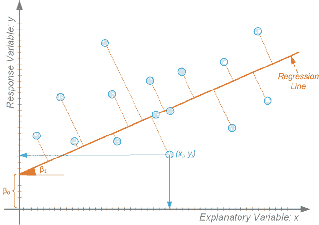

**图 5.7** 具有线性回归线的散点图

简单回归分析旨在寻找这种关系的数学表示。在现实中，它试图找到一条穿过这些点（代表观测值/历史数据）的直线，使得点与线（理论回归线的预测值）之间的距离最小。已经提出了几种方法/算法来识别回归线，最常用的方法被称为普通最小二法（OLS）。OLS 方法旨在最小化残差平方和（即观测值与回归点之间垂直距离的平方），并得出回归线估计值的数学表达式（称为 `β` 参数）。对于简单线性回归，上述响应变量（`y`）与解释变量（`x`）之间的关系可以显示为简单方程：

```
y = β[0] + β[1]x
```

方程中，`β[0]` 称为截距，`β[1]` 称为斜率。一旦 OLS 确定了这两个系数的值，就可以使用该简单方程为给定的 `x` 值预测 `y` 的值。`β[1]` 的符号和数值也揭示了两个变量之间关系的方向和强度。

如果模型是多元线性回归，则需要确定更多的系数——每个额外的解释变量对应一个。如下公式所示，额外的解释变量将与新的 `β[`i`]` 系数相乘并相加，从而建立响应变量的线性加法表示：

```
y = β[0] + β[1]x[1] + β[2]x[2] + ... + β[n]x[n]
```


# 如何判断模型是否足够良好

由于多种原因，模型有时在表示现实情况方面表现不佳。无论包含多少解释变量，始终存在无法获得良好模型的可能性，因此需要对线性回归模型进行拟合度评估（即模型对响应变量的表示程度）。从最简单的意义上说，一个拟合良好的回归模型会产生接近观测数据值的的预测值。在数值评估方面，通常在评估回归模型的拟合度时会使用三种统计学指标：`R²`（`R-squared`）、整体 `F-test` 以及均方根误差（RMSE）。由于这三个指标都基于误差平方和（即数据与均值的距离，以及数据与模型预测值之间的距离）。这两个值的不同组合提供了关于回归模型与均值模型之间比较结果的差异化信息。

在这三个指标中，`R²` 由于其直观的尺度具有最有用且易于理解的意义。`R²` 的值范围在 0 到 1 之间（对应于百分比形式的变异量），0 表示所提模型的关系和预测能力不佳，1 表示所提模型是产生精确预测的完美拟合（这几乎从未发生）。良好的 `R²` 值通常接近 1，而这种接近程度取决于所建模的现象；例如，虽然社会科学中线性回归模型的 `R²` 值为 0.3 可能被认为足够良好，但在工程领域，0.7 的 `R²` 值可能不被认为拟合良好。可以通过添加更多解释变量、从模型中移除某些变量或使用不同的数据转换技术来改进回归模型，这将导致 `R²` 值的相对增加。

图 5.8 显示了开发回归模型涉及的流程。如图，模型开发任务之后是模型评估。模型评估涉及评估模型的拟合情况，并且由于线性模型必须遵守的限制性假设，它还涉及检查模型的有效性。

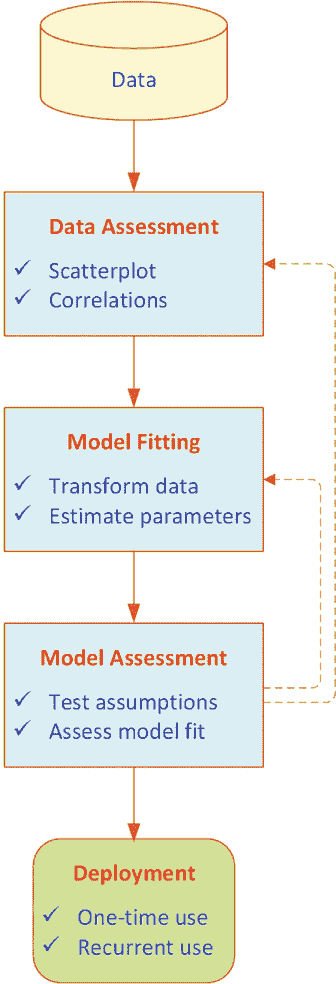

**图 5.8** 开发回归模型的流程图

# 线性回归中最重要的假设

尽管线性回归模型仍然许多数据分析师的首选（无论是用于解释性建模还是预测性建模），但它们受到几个高度限制性假设的制。线性模型的有效性取决于其遵循这些假设的能力。这些是最常见的假设：

*   **线性性。** 该假设认为响应变量与解释变量之间的关系是线性的。也就是说，在保持其他解释变量不变的情况下，响应变量的期望值是每个解释变量的直线函数。此外，直线斜率不依赖于其他变量的值。这意味着不同解释变量对响应变量期望值的影响在本质上是加性的。
*   **独立性（误差）。** 该假设认为响应变量的误差之间不相关。这种误差的独立性比实际的统计独立性要弱，后者是一个更强的条件，线性回归分析通常不需要它。
*   **正态性（误差）。** 该假设认为响应变量的误差呈正态分布。也就是说，它们应该是完全随机的，不应代表任何非随机模式。
*   **方差齐性（误差）。** 该假设也称为 `homoscedasticity`（同方差性），规定无论解释变量的值如何，响应变量的误差必须具有相同的方差。在实践中，如果响应变量在足够大的范围或尺度上变化，则该假设是无效的。
*   **多重共线性。** 该假设认为解释变量之间是不相关的（即它们没有重复相同的内容，而是为模型提供了所需的不同的视角）。多重共线性可能由于模型中存在两个或多个完全相关的解释变量而触发（例如，如果错误地在模型中包含了两次同一个解释变量，其中一个是另一个变量的轻微转换）。基于相关性的数据评估通常可以发现这种错误。

已经开发了许多统计技术来识别对这些假设的违反，并创建了若干技术来缓解这些问题。数据建模人员需要意识到这些假设的存在，并建立一套评估模型的方法，以确保它们符合其构建基础的假设。

# 逻辑回归

逻辑回归是一种非常流行的、统计学上合理的且基于概率的分类算法，它采用了监督学习。它开发于 20 世纪 40 代，作为线性回归和线性判别分析方法的补充。它被广泛应用于许多学科，包括医学和社会科学领域。逻辑回归与线性回归的相似之处在于，它们都旨在通过过去观测值的样本（训练数据）回归到一个解释响应变量与解释变量之间关系的数学函数。它与线性回归的一个主要区别点在于：它的输出（响应变量）是一个类别，而不是数值变量。


逻辑函数（在图 5.9 中表示为 `f(y)`）是逻辑回归的核心，其取值范围在 0 和 1 之间。以下方程是该函数的简单数学表达式：

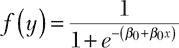

逻辑回归系数（即 `βs`）通常使用极大似然估计法进行估计。与残差服从正态分布的线性回归不同，无法找到使似然函数最大化的系数值的闭式表达式，而必须使用迭代过程。该过程从一个假设的起始解开始，然后微调参数以查看解决方案是否可以改进；重复这种迭代修订，直到无法进一步改进或改进微乎其微，此时该过程被认为已完成或已收敛。

## 时间序列预测

有时，感兴趣的变量（即响应变量）可能没有明显标识的解释变量，或者在高度复杂的关系中解释变量过多。在这种情况下，如果数据以所需的格式存在，就可以开发一种名为`时间序列预测`的预测模型。时间序列是有感兴趣变量的数据点序列，这些数据点在连续的时间点上测量并表示，且时间间隔均匀。时间序列的示例包括地理地区的每月雨量、股票指数的每日收盘价以及杂货店的每日销售总额。时间序列通常使用折线图进行可视化。图 5.10 展示了 2015 年至 2019 年按季度销售量的时间序列示例。

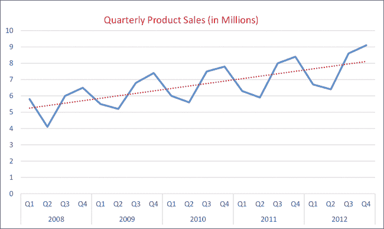

**图 5.10** 季度销售量时间序列数据

时间序列预测涉及使用数学模型根据之前观察到的值预测感兴趣变量的未来值。时间序列图与简单的线性回归散点图非常相似，因为它们有两个变量：响应变量和时间变量。除了这种相似性，两者之间几乎没有其他共同点。回归分析通常用于测试理论，查看一个或多个解释变量的当前值是否解释（从而预测）响应变量，而时间序列模型侧重于外推随时间的变化来估计未来值。

时间序列预测假设所有的解释变量都聚合并在响应变量随时间变化的行为中。因此，捕捉随时间变化的行为是预测响应变量未来值的一种方法。为了实现这一点，对模式进行分析并分解为其主要组成部分：随机波动、时间趋势和季节性周期。图 5.10 所示的时间序列示例说明了所有这些不同的模式。

开发时间序列预测的技术从非常简单（例如朴素预测，它建议今天的预测值与昨天的实际值相同）到非常复杂（例如 `ARIMA`，它结合了数据中的自回归和移动平均模式）。最流行的技术也许是平均法，包括简单平均、移动平均、加权移动平均和指数平滑。这些许多技术还有高级版本，在这些版本中还可以考虑季节性和趋势，以获得更好、更准确的预测。方法的准确性通常通过计算其误差（即过去观测值的实际值与预测值之间的计算偏差）来评估，平均绝对误差（`MAE`）、均方误差（`MSE`）或平均绝对百分比误差（`MAPE`）。尽管它们都使用相同的核心误差标准，但这三种评估方法强调了误差的不同方面，某些方法对较大错误的惩罚比其他方法更多。

## 总结

预测分析采用了几种算法，有些似乎太简单，另一些则复杂；某些算法源于传统统计学，另一些则源于人工智能和机器学习的新兴趋势。本章涵盖的算法包括朴素贝叶斯、`k-nearest neighbor`、人工神经网络(`ANNs`)、支持向量机 (`SVMs`)、线性回归、逻辑回归时间序列预测。

本章的目标是提供关于这些算法的信息（而不深入探讨理论和数学复杂性），让你能够理解并欣赏这些算法的真实原理——即它们是如何实现的。了解这些算法的内部机制（至少在概念层），有助于分析专业人士和数据科学家在数据预处理、问题建模和解决方案方法创建方面做出明智、更聪明的决策。一个类比是赛车手：理解引擎如何工作可以成为一名更好的驾驶员。虽然不要求赛车手制造或修理引擎，但对引擎内部机制的理解有助于驾驶员通过最大化动力和效率来优化其性能。

### 参考文献

Aizerman, M., E. Braverman, & L. Rozonoer. (1964). “Theoretical Foundations of the Potential Function Method in Pattern Recognition Learning,” *Automation and Remote Control*, 25: 821–837.

Collins, E., S. Ghosh, & C. L. Scofield. (1988). “An Application of a Multiple Neural Network Learning System to Emulation of Mortgage Underwriting Judgments,” *IEEE International Conference on Neural Networks*, 2: 459–466.

Das, R., I. Turkoglu, & A. Sengur. (2009). “Effective Diagnosis of Heart Disease,” *Decision Support Systems*, 38(1).

Delen, D., R. Sharda, & M. Bessonov. (2006). “Identifying Significant Predictors of Injury in Traffic Accidents Using a Series of Artificial Networks,” *Accident Analysis and Prevention*, 38(3): 434–444.

Delen, D., & E. Siraya. (2006). “Determining the Efficacy of Data-Mining Methods in Predicting Gaming Ballot,” *Journal of Hospitality & Tourism Research*, 30(3): 313–332.

Haykin, S. S. (2009). *Neural Networks and Learning Machines*, 3rd ed. Prentice Hall.

Piatesky-Shapiro, G. (2013). *ISR: Microsoft Success Using Neural Network for Direct Marketing*. [`kdnuggets.com/news/94/n9.txt`](http://kdnuggets.com/news/94/n9.txt) (accessed May 2020).


Priniple, J. C., N. R. Euliano, & W. C. Lefebvre. (2000). *Neural and Adaptive Systems: Fundamentals Through Simulations*. Wiley.

Sirakaya, E., D. Delen, & H.-S. Choi. (2005). “博彩投票结果预测,”*Annals of Tourism Research*, 32(1): 127–149.

Tang, Z., C. de Almeida, & P. Fishwick. (1991). “神经网络与 Box-Jenkins 方法时间序列预测对比,”*Simulation*, 57(5): 303–310.

Walczak, S., W. E. Pofahi, & R. J. Scorpio. (2002). “用于分配病床资源和确定所需护理程度的决策支持工具,”*Decision Support Systems*, 34(4): 445–456.

Wallace, M. P. (2008, July). “神经网络及其在金融领域的应用,”*Business Intelligence Journal*, pp. 67–76.

Wen, U.-P., K.-M. Lan, & H.-S. Shih. (2009). “霍夫曼德神经网络求解数学规划问题的述,”*European Journal of Operational Research*, 198: 675–687.

Wilson, C. I., & L. Threapleton. (2003, May 17–22). “利用人工智能通过化学分析预测啤酒口味,”*Proceedings of the 2th European Brewery Congress*, Dublin. [`neurosolutions.com/resources/apps/beer.html`](http://neurosolutions.com/resources/apps/beer.html) (访问于 2020 年 5 月)。

Wilson, R., & R. Sharda. (1994). “使用神经网络预测破产,”*Decision Support Systems*, 11(5): 545–557.

Zahedi, F. (1993). *Intelligent Systems for Business: Expert Systems with Neural Networks*. Wadsworth.

# 预测建模中的 6 个高级话题

预测分析仍然既是一门艺术，也是一门科学。对于给定的业务问题和一组真实世界数据，开发出既能产生高度准确且无偏的预测，又能被人类理解和解释，同时在计算上高效且易于部署的预测分析和机器学习模型，对任何数据科学家来说都是一项具有挑战性的任务。尽管近年来我们已经看到方法论在标准化和自动化方面取得了显著进展（例如第 3 章中描述的“预测分析的标准流程”中的 `CRISP` 方法），并且在模型构建方面创建了最佳/优质实践，但整个数据科学/业务分析流程的真正优化仍然像是一个乌托邦。包括本书作者在内的许多认为，最理想的情况下，我们也只实现了这一目标的一半。在本章中，我们将涵盖一些为通往这一乌托邦铺道路的相对新颖的概念和方法。具体而言，本章涵盖了集成建模、偏差-方差权衡、如何处理不平衡数据问题以及机器学习模型的人类解释性。

## 模型集成

集成（更准确的说法是集成建模）是数据科学中相对较新的工具。通过集成建模，将两个或多个模型的结果组合成一个复合输出。集成主要用于预测，即将两个或多个模型的分数结合。

预测可以是 `classification-type`（预测类别标签）或 `regression-type`（估算数值输出）。尽管集成的使用一直以预测为主，但它也可以用于其他分析任务，例如聚类和关联规则挖掘。传统上，机器学习程序侧重于监督和无监督任务。

### 动机：为什么我们需要集成？

通常，研究人员和从业者构建集成有两个主要原因：更高的准确率和更稳定/一致的结果。过去二十年中的许多研究和出版物表明，集成几乎总能提高预测准确性（Abbott, 2014）。

集成从 20 世纪 90 年开始出现在数据挖掘/分析文献中，其动力是早期组合预测工作取得的成功有限。到 20 00 年初中期，集成变得流行，并成为赢得数据挖掘和预测建模竞赛的必不可少的因素。集成赢得竞赛最流行的例子之一可能是著名的 Netflix 公开赛，该比赛邀请研究人员和从业者根据历史评分预测用户评分。Netflix 为能够将现有 Netflix 内部预测算法的 `RMSE` 降低最多且至少达到 10 个百分点的团队提供了 100 万美元奖金。冠军、亚军以及排行榜顶部的几乎所有团队在提交的作品中都使用了集成。获胜的作品是一个包含数百个模型的集成结果。

谈到使用集集的理由时，Vorhies (2016) 说得最好：如果你想赢得预测分析竞赛，或至少在排行榜上获得体面的排名，你就必须拥抱并智能地使用集成。Kaggle 已成为数据科学家展示才华的首选平台。根据 Vorhies 的说法，Kaggle 竞赛就像数据科学的 F1 比赛。获胜者在小数点第四位上领先竞争对手，他们的解决方案与竞争对手解决方案的区别，就像 F1 赛车与我们大多数人驾驶的汽车的区别一样。投入的时间和使用的极端技术并不适用于普通的数据科学生产项目，但就像拨片换和异形悬挂一样，这些改进和高级功能中的会进入分析专业人士的日常生活和实践中。

除了 Kaggle 竞赛外，声誉良好的协会如美国计算协会（ACM）知识发现与数据挖掘特别小组（SIGKDD）和亚太知识发现与数据挖掘会议（PAKDD）定期为数据科学家社区组织竞赛（通常称为“杯标赛”），让他们展示自己的能力——有时是为了金钱奖励，但大多数时候仅仅是为了炫耀。一些受欢迎的分析公司，如 SAS Institute 和 Teradata Corporation，也会为全球大学的研究生和本科生组织类似的竞赛（并向他们提供各种数额较薄的奖金），这通常与他们定期的分析会议相结合举行。


不仅仅是准确性使得模型集成变得流行且不可或缺。是的，事实一次次地证明了集成可以提高模型的准确性，但它们还能提高模型的稳健性、稳定性和可靠性。在可靠预测至关重要的情况下，模型集成这些优势可能比准确性更为重要。模型集成将多个模型结合（使用某种形式的平均）成单个预测结果，使得没有任何单个模型会主导最终预测值；这降低了产生严重偏差预测的概率。图 6.1 形象地展示了用于分类类型预测问题的模型集成。尽管存在某些变，但大多数集成建模方法都遵循这一通用流程。从左到右，图 6.1 展示了数据获取和数据准备的通用任务，随后是交叉验证、模型构建与测试，最后是组合单个模型的结果并评估生成的预测。

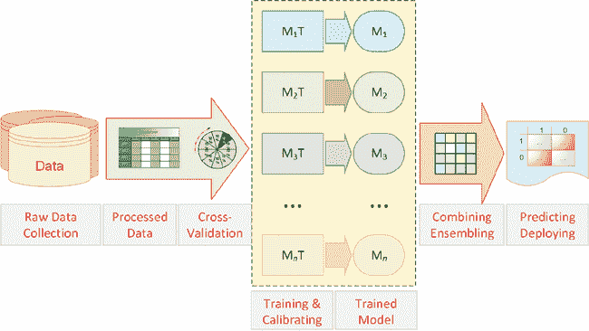

**图 6.1** 预测建模模型集成图示

另一种看待集成的方法是从集体智慧或众包的角度。在流行书籍《群体智慧*（Surowiecki, 2005）中，作者提出通过众包可以做出更好的决策，即将许多（即使是不知情的）意见聚合成一个优于最优秀专家意见的决策。在书中，Surowiecki 描述了使群体意见良好运作且不退化为有时基于“群体狂热”做出的错误决策的反面效果的四个必要特征：意见的多样性、独立性、去中心化和聚合。这前三个特征与个体决策的制定有关：群体成员必须拥有与组内其他成员不同的信息，且不能受组内其他成员的影响。最后一个特征仅说明决策必须结合。这四个原则/特征也为构建更好的模型集成奠定了基础。每个预测模型在最终决策中都有一席之地。意见的多样性可以通过预测值本身的相关性来衡量；如果所有预测值彼此高度相关——也就是说，如果模型几乎完全一致——那么将它们结合就没有可预见的优势。去中心化特征可以通过重采样数据或通过案例权重来实现，其中每个模型使用来自公共数据集的不同记录，或至少使用权重与其他模型不同的记录（Abbott, 2014）。

统计学和预测建模中与模型集成高度相关的流行概念之一是偏差-方差权衡（bias–variance trade-off）。在深入不同类型的模型集成之前，必须回顾并理解偏差-方差权衡原理（适用于统计学或机器学习领域）。在预测分析中，`bias` 指误差，`variance` 指模型应用于其他数据集时预测准确性的一致性（更准确地说，是不一致性）。最好的模型预计将具有低偏差（即低误差或高准确率）和低方差（即从数据集到数据集准确性的一致性）。遗憾的是，在构建预测模型时，这两个指标之间始终存在权衡，因此改进其中一个会导致另一个变差。你可以在训练数据上实现低偏差，但模型在留出/验证数据上可能会遭受高方差，因为模型可能已经过度训练/过拟合。例如，`k` = 1 的 `k`-NN 算法是低偏差模型的示例，它对于训练数据集非常完美，但在测试/验证数据集上容易产生高方差。使用交叉验证配合适当的模型集成似乎是处理预测建模中偏差与方差权衡的当前最佳实践。

## 模型集成类型

使用集成（或协同工作的预测模型团队）一直是开发准确且稳健的分析模型的基础策略。尽管集成已经存在了很长时间，但它们的流行和有效性直到过去十年内才显著显现，因为它们随着不断改进的软件硬件能力的并行提升而不断改进。*模型集成*让许多人想到决策树集成，如随机森林和提升树。然而，总的来说，模型集成可以在两个维度上分为四类，如图 6.2

**图 6.2** 模型集成简单分类法

正如其名称所示，*同质*集成结合两个或多个相同类型模型（例如决策树）的结果。事实上，大多数同质集成都是使用决策树结构的组合开发的。使用决策树的两种常见的同质集成类是装袋法（bagging）和提升法（boosting）（在本章后部分详细描述）。正如你猜的那样，*异质*集成结合两个或多个不同类型模型的结果，例如决策树、人工神经网络、逻辑回归和支持向量机。集成建模的关键成功因素之一是使用从根本上不同的模型，它们从不同的角度观察数据；这类似于众包的思想。由于它们结合模型类型结果的方式，异质集成也被称为信息融合模型（Delen & Sharda, 2010）或堆叠模型（stacking models，均在本章后讨论）。

## 装袋法 (Bagging)

装袋法是最简单且常用的集成方法。Leo Breiman 是统计和分析领域一位备受尊敬的学者，他在 1996 年于伯克利首次发表了装袋（bootstrap aggregating 的缩写为 bagging）算法的描述（Breiman, 1996）。装袋背后的思想非常简单却强大：从重采样数据中构建多个决策树，并通过平均或投票结合预测值。Breiman 使用的重采样方法是自助采样（即有放抽样），这会在训练数据中创建某些记录的副本。通过这种选择方法，平均约 37%的记录完全不包含在训练集中（Abbott, 2014）。

尽管装袋法最初是为决策树开发的，但该思想可以适用于任何产生足够预测值波动的预测建模算法。虽然在实践中很少见，但作为装袋类型模型集成潜在候选的其他预测建模算法还包括神经网络、朴素贝叶斯、`k`-最近邻（针对低 `k` 值）以及程度较低的逻辑回归。如果 `k` 值已经很大，则 `k`-最近邻就不是装袋法的良好候选；该算法通过投票或平均进行预测，而随着 `k` 增大，预测已经非常稳定且方差较低。


Bagging 可用于分类和回归/估计预测问题。在分类类预测问题中，所有参与模型的结果（类别分配）都通过简单或复杂的/加权多数投票机制进行组合。得票最多/最高的类别标签成为该样本/记录的聚合/集成预测结果。在输出/目标变量为数字的回归/估计类预测问题中，所有参与模型的结果（数值估计）都通过简单或复杂的/加权平均机制进行组合。图 6.3 提供了决策树 Bagging 算法的图化描述。

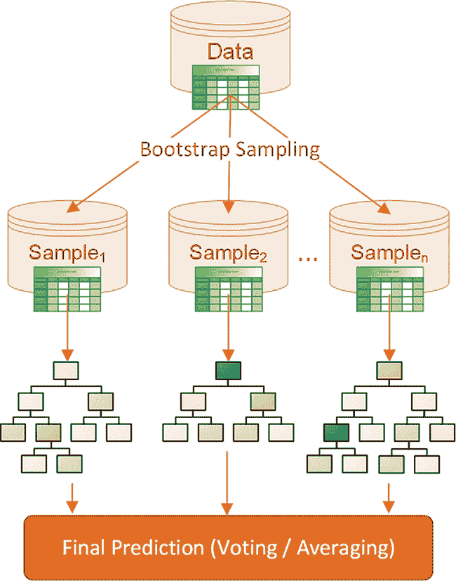

**图 6.3** Bagging 决策树集成

Bagging 的关键问题之一是“应该创建多少个自助样本（也称为重复样本）？”根据 Breiman 的说法，“我的感觉是，当 `y` [因变量] 是数值型时，需要的样本较少，而当类别数量增加时[对于分类类预测问题]，所需的样本更多。”Breiman 通常使用 10 到 25 个自助重复样本，并发现仅需 10 个重复样本就能获得显著改进。过拟模型是构建良好的 Bagged 集集的重要要求。对每个模型进行过拟会导致低偏差，但决策树在留出数据上的准确率通常会变。然而，Bagging 是一种方差消除技术；预测的平均化会平滑预测，使其在数据数据上的表现更稳定（即变异更小）。

如前所述，模型预测的多样性是创建有效集集的关键因素。衡量预测多样性的一种方法是检查预测值的相关性。如果模型预测之间的相关性总是非常高（即大于 0.95），则每个模型为集成带来的额外预测信息就很少，因此准确率的提升也有限。通常情况下，相关性最好保持在 0.9 以下。相关性应该基于模型的倾向性或预测概率来计算，而不是基于 `{0,1}` 分类值。Bagging 中的自助采样是引入模型异异性的关键。你可以将自助采样方法看作是每条记录创建案例权重；某些记录在训练数据中被多次包含（即它们的权重为 1、2、3 或更多），而另一些则完全没有被包含（即它们的权重等于 0）（Abbott, 2014）。

### Boosting

Boosting 是另一种集成方法，它可能是继 Bagging 之后最常用的方法。Yoav Freund 和 Robert E. Schapire 在 20 世纪 90 年代初分别引入了 Boosting 算法，随后在 1996 年的联合出版（Yoav & Schapire, 1996）中，他们介绍了著名的 Boosting 算法 AdaBoost。Boosting 背后的思想非常简单。首先，你构建一个相当简单的分类模型；该模型只需要比随机概率好一点，因此对于二分类问题，它只需要比 50% 的正确分类率好一点。在第一轮中，算法使用的记录具有相同的案例权重，就像通常在预测模型中执行的那样。每个案例预测值的误差会被记录下来。分类正确的的记录/案例/样本的案例权重保持不变，或者可能减少，而分类错误的记录的案例权重会增加。然后，在这些加权案例（即经过转换/加权的训练数据集）上构建第二个简单的模型。换句话说，对于第二个模型，分类错误的记录通过案例权重被“增强（boosted）”，以便在构建新的预测模型时被更强烈或更认真地考虑。在每次迭代中，预测错误的记录（即那些难以分类的记录）其案例权重会增加，以便算法更加关注这些记录，直到它们最终被正确分类（希望）。

这种 Boosting 过程通常会重复几十甚至上百次。在几十或上百次迭代之后，根据所有模型预测的加权平均值得出最终预测。图 6.4 描述了构建决策树类型模型集成时简单的 Boosting 过程。如图所示，每棵树都使用最新的数据集（即具有最近增强的案例权重的数据集）来构建另一棵树。预测错误案例的反馈被用作指标，用于确定对哪些训练样本/案例进行增强，以及在何种程度上（按方向和大小）。

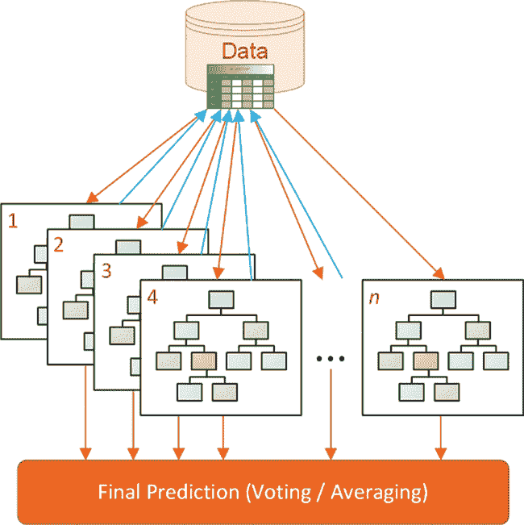

**图 6.4** 决策树的 Boosting 类型集成

尽管 Bagging 和 Boosting 在结构和目的上非常相似，但它们采用略不同的策略来利用训练数据集并实现构建最佳预测集成的目标。Bagging 和 Boosting 之间有两个关键区别。第一，Bagging 使用案例的自助样本来构建决策树，而 Boosting 使用完整的训练数据集。第二，Bagging 为集成创建独立的、简单的树，而 Boosting 创建依赖的树（每棵树都从前一棵树中“学习”，以更加关注预测错误的案例），共同构成最终集成。

Boosting 方法设计用于处理弱学习器（即简单模型）；Boosting 集成中的组件模型是高偏差、低方差的简单模型。与 Bagging 一，当使用不稳定的预测算法时，Boosting 的改进更好。决策树最常用于 Boosting 模型。朴素贝叶斯也用于 Boosting，但与单一模型相比改进非常微小。从经验来说，Boosting 通常产生比单一决策树和 Bagging 类型集成更好的模型准确率。

### Bagging 和 Boosting 的变体

Bagging 和 Boosting 是出现在预测分析软件中的第一个集成方法（主要用于决策树算法）。自引入以来，已经开发并提供了许多构建集集的方法，特别是在开源软件中（既作为 KNIME 和 Orange 等开放分析平台的一部分，作为 R 和 Python 中的类库）。最流行且成功的（高级）Bagging 和 Boosting 变体分别是随机森林和随机梯度提升。

#### 随机森林

Breiman (2000) 首次引入随机森林 (RF) 作为对简单 Bagging 算法的改进。与 Bagging 类似，RF 算法从自助采样数据开始，从每个自助样本构建一棵决策树。然而，与简单 Bagging 相比，随机森林算法有一个重要的转折：在树的每次分裂处（从第一次分裂开始），而不是考虑所有输入变量作为候选，而是只考虑变量的随机子集。因此，在随机森林中，自助采样技术适用于案例的随机选择和特征的随机选择（即输入变量）。


考虑的案例数量、变量数量，以及构建多少棵树，都是构建随机森林模型时需要考虑的参数。通常，在每个分裂点考虑的候选变量的默认数量是候选输入总数量的平方根。例如，如果模型有 100 个候选输入，则每次分裂将随机选择 10 个输入作为候选。。这意味着在给定的树中，父节点和子节点在进行分裂时使用相同输入是不太可能的，因此树将迫自己寻找其他方法来最大化后续分裂的准确性。因此，树的构建过程中刻意创建了一个双重多样性机制：案例和变量的随机选择。随机森林模型的预测结果通常比简单的袋装（bagging）准确，而且通常比简单的提升（即 `AdaBoost`）更准确。

### ***随机梯度提升***

`AdaBoost` 仅是目前文献记载的许多提升算法中的一种。在商业软件中，`AdaBoost` 仍然是最常用的提升技术，但在开源软件软件包中可以找到几十种提升变体。最近因其卓越性能而广受关注的一种有趣提升算法是由来自斯坦福大学的 Jerry Friedman 创建的随机梯度提升（`SGB`）算法。Friedman (2001) 还开发了 `AdaBoost` 算法的高级版本，称为多加性回归树（`MART`），后来被 Salford Systems 在其软件工具中标记为 `TreeNet`。与其他提升算法一样，`MART` 算法构建连续的简单树并以加法方式组合它们。通常，这些简单树比决策桩（stumps）复杂；每棵树通常包含最多六个终端节点。构建第一棵树后，计算误差（也称为 `residuals`）。第二棵树及所有后续树都使用 `residuals` 作为目标变量。后续树识别与输入与大小误差相关的模式。对误差的预测不良会导致下一棵树中需要预测较大的误差，而对误差的良好预测会导致下一棵树中只需预测较小的误差。通常会构建数百棵树，最终预测是预测结果的加组合，有趣的是，这是一个分段常数模型，因为每棵树本身就是一个分段常数模型。然而，集成模型中通常包含数百棵树（Abbott, 2014）。`TreeNet` 算法自引入以来已赢得多次数据建模竞赛，并证明是一个准确的预测器；此外，在建模之前对树仅需少量的数据清洗。

### ***堆叠***

Stacking（又称为堆叠泛化或超级学习者）是一种异构集成方法。一些分析专业人士认为它是最好的集成技术，但它也是最难理解的（且最难解释的）。由于其两步模型训练程序，堆叠看起来似乎是一种过于复杂的集成建模形式。基本上，堆叠从一组多样化的强学习器创建一个集成模型。在此过程中，它插入了一个被称为“超级学习者”或“元学习者”的元数据步骤。中间元分类器预测主分类器的准确性，并被作为调整和修正的基础（Vorhies, 2016）。堆叠的过程在图 6.5 中形象性地所示。

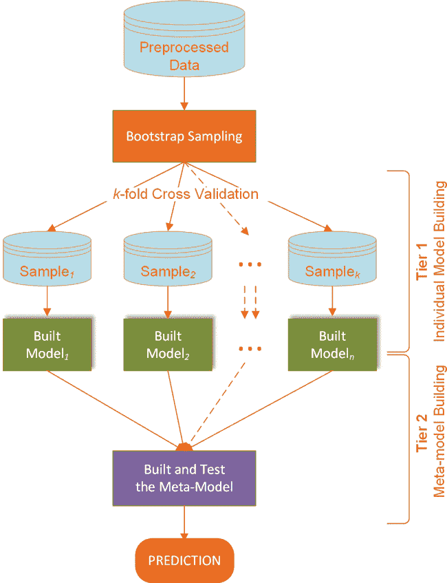

**图 6.5** 堆叠型模型集成

如图 6.5 所示，在构建堆叠型集成时，首先使用训练数据的自助（bootstrapped）样本训练多个强分类器。然后，在训练期间未过的 `k` 子集上对每个分类器进行评估。这些分类器在伪训练块上的输出，结合这些块的实际标签，组成了第 2 个分类器的训练数据集。

### ***信息融合***

作为异构模型集成的一部分，信息融合结合（融合）不同类型模型的输出（即预测结果），例如决策树、人工神经网络、逻辑回归、支持向量机、朴素贝叶斯、`k`-最近邻及其变体等。堆叠和信息融合之间的区别在于，信息融合没有“元建模”或“超级学习者”。它仅使用简单或加权投票（用于分类）或简单或加权平均（用于回归）组合异构分类器的结果。因此，它比堆叠简单且计算需求更低。在组合多个模型结果的过程中，可以使用简单投票（每个模型贡献一票）或加权投票组合（每个模型根据其预测准确性贡献，因此更准确的模型具有更高的权重）。无论使用何种组合方法，异构集成已被证明是数据挖掘和预测建模项目中无价之的补充。图 6.6 形象地说明了构建信息融合模型集成的过程。

#### ***集成并非完美！***

当你被要求构建一个预测模型（或任何其他分析模型）时，你被期望在使用标准单个模型之外开发一些流行的模型集成。集成模型通常比单个模型更准确，而且几乎总是更稳健、更可靠。尽管它们看起来像灵丹妙药，但模型集成并非没有缺点。它们最常见且重要的缺点是复杂性和缺乏透明度。

### ***复杂性***


模型集成比单个模型更复杂。数据科学的核心原理`奥姆剃刀`（Occam’s razor）指出，简单的模型往往具有更好的泛化能力，因此最好减少/正则化复杂度，换句话说，就是简化模型，使得模型中每个项、系数或划分的引入都能通过其减少误差的能力得到合理证明。量化准确性与复杂度之间关系的一种方法源于信息论，表现为信息理论准则，例如赤池信息准则(`AIC`）、贝叶斯信息准则(`BIC`)和最小描述长度(`MDL`）。数据科学家从统计学家那里借用了这些准则，并将它们用于预测建模中的变量选择。信息理论准则要求降低模型误差以证明额外模型复杂性的合理性。模型集成违反`奥姆剃刀`吗？毕竟集成比单模型复杂得多。根据 Abbott (2014) 的观点，如果集成在留出数据上的准确性优于单个模型，那么答案是否定的——只要我们考虑模型复杂度时，不仅考虑计算复杂度，还考虑行为复杂度。因此，我们不应该担心增加计算复杂度（更多的项、划分或权重）会必然增加模型的复杂度，因为有时集成会显著降低行为复杂度。

## 透明度

集集的解释可能变得非常困难。如果你构建了一个包含 200 棵树的随机森林集成，你如何描述为什么某个预测具有特定值？你可以单独检查每棵树，尽管这样做显然是不切实际的。由于这个原因，集成通常被视为黑箱模型，这意味着它们的做法对建模者或领域专家来说是不透明的。然而，你可以查看划分统计数据（在这 200 棵树中哪些变量更经常被用于早期划分）来人工判断每个变量对训练好的模型集成所贡献的程度（伪变量的重要性）。与单个决策树相比，这仍然很困难，而且并不是一种解释模型性能的非常直观的方法。确定模型哪些输入最重要的另一种方法是进行敏感性分析。

除了复杂性和透明度问题外，模型集集的构建和部署也可能困难且计算成本昂。表 6.1 显示了模型集成与单个模型相比的优缺点。

**表 6.1** 模型集成的优点与缺点

| **优点** | **描述** |
| --- | --- |
| 准确性 | 模型集成提供的准确性通常比单个模型更高。 |
| 健壮性 | 与单个模型相比，模型集成对数据中的离群值和噪声往往更健壮。 |
| 可靠性（稳定） | 由于方差的减少，模型集成产生的结果比单个模型更稳定、可靠且可信。 |
| 覆盖率 | 与单个模型相比，模型集成对数据集中隐藏复杂模式的覆盖率往往更好。 |
| **缺点** | **描述** |
| 复杂度 | 模型集成比单个模型复杂得多。 |
| 计算昂贵 | 与构建单个模型相比，构建集成需要更多的时间和计算能力。 |
| 缺乏透明度（可解释性） | 由于其复杂性，理解模型集成的内部结构（它们是如何运作的）比理解单个模型的结构更困难。 |
| 部署更困难 | 在基于分析的管理决策系统中，模型集成的部署比单个模型困难得多。 |

总而言之，模型集成是关注准确性的预测建模者关注的新前沿，因为它们要么减少了模型的误差，要么降低了模型行为异常的风险。这一点从集成在预测分析和数据挖掘竞赛中的主导地位可以清楚看出：集成总是获胜的。对于预测建模者的好消息是，许多构建集成的技术已经内置在软件中。最流行的集成算法（即集成 bagging、提升 boosting 和叠加 stacking 及其变体）在几乎每个商业和开源软件工具中可用。许多软件产品也支持构建自定义集成，无论是基于单一算法还是异构集成。

集成并不适用于所有的解决方案；集集的适用性取决于业务理解和问题定义期间定义的建模目标。然而，集成应该是每个预测建模者和数据科学家建模工具箱的一部分。

## 预测分析中的偏差-方差权衡

在开发用于预测分析的机器学习时，在简单/简洁与复杂度、泛化能力（即对信号的捕捉）与过拟合（包括噪声）、预测准确性与可解释性、过度训练/曲线拟合与训练不足、训练误差与验证误差之间始终存在权衡。偏差-方差是统计学和机器学习中一个相当常见的概念，通常用于评估训练模型的有用性。它是预测建模、数据挖掘和监督学习中的一个关键问题。尽管在偏差和方差都最小化时可以获得最佳模型，但正如名称中的`trade-off`（权衡）一词所意味着的，这是一种平衡。偏差和方差的概念是相互对的；它们不在同一个方向，改进其中一个会损害另一个。要为特定问题找到偏差和方差的最佳组合以获得最佳预测模型绝非易事过程；它通常需要考虑最佳（或更好）的实践，以及大量的实验和比较分析；即使如此，得到的模型也无法被确认为全局“最优”。

### 什么是偏差和方差？

偏差是模型对给定预测问题上的预测输出与真值（即真实/实际值）之间的差异。它是训练误差。高偏差模型几乎捕捉不到训练数据中所需的信号（即模式和关系），因此产生一个过度简化的/欠拟合的模型。结果，这种模型在训练数据和测试数据上都会导致高的误差值。

另一方面，方差是测试误差。它是模型对给定数据集预测结果的可变性，刻画了预测模型的健壮性。高方差模型不仅捕捉了数据中的信号（即泛化的模式和关系），还捕捉了噪声，因此产生一个过度复杂/过拟合的模型。结果，这种模型在训练数据上表现良好，但在测试数据上的表现非常差。

为了图形化和直观地说明偏差和方差之间的权衡，我们经常使用像图 6.7 所示的靶心图。偏差值绘制在`y`轴上，方差值绘制在`x`轴上。为了简单起见，图 6.7 在二维笛卡尔坐标系中根据`x`轴和`y`轴的二分值被划分为四个象限（Q1 到 Q4），以显示低和高。这些象限的简单解释如下：


*   **Q1: 高偏差，低方差。** 预测结果一致但偏离目标/不准确（代表一个持续不佳的预测模型）。
*   **Q2: 高偏差，高方差。** 预测结果既一致也不准确（代表一个表现不佳且不一致的预测模型）。
*   **Q3: 低偏差，低方差。** 预测结果既一致又准确（代表理想的预测模型）。
*   **Q4: 低偏差，高方差。** 预测结果不一致但基本准确（代表一个性能良好但不一致的预测模型）。

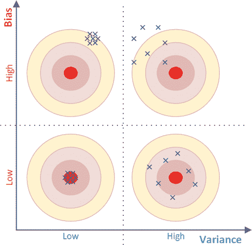
**图 6.7** 偏差-方差权衡的靶心图说明

过拟合与欠拟合

训练预测模型的过程通常被描述为“拟合”（例如，为给定的数据集拟合模型）。图 6.8 展示了在二维特征空间中的三个拟合水平（也称为训练或学习）——过拟合、欠拟合和平衡拟合。过拟合（也称为过度训练）是指模型过于特定于训练数据，从而不仅捕获了数据中的信号，还捕获了噪声。结果，过度训练的模型（特别是对于高度参数化的模型类型，如神经网络）在训练数据上的表现异常出色（达到了“好得不可真实”的程度），而在测试数据上的表现非常糟糕。这种现象在偏差-方差权衡连续体上也被常见描述为低偏差/高方差的结果。

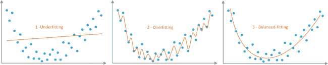
**图 6.8** 在训练数据上拟合模型的三个水平

另一方面，欠拟合（也称为训练不足）是指由于没有完成从训练数据的训练（即未完成学习过程）而导致模型过于泛化（即没有捕捉到训练数据中固有的信号），因此在训练数据（或测试数据）上的表现不如预期。（尽管训练不足的模型可能因为在训练数据上的表现很差而在测试数据上的表现也同样糟糕，但这种性能对于任何实际目的可能都远远不够。）欠拟合在偏差-方差权衡连续体上通常被描述为高偏差/低方差的结果。

预测模型期望的是避免过度训练和训练不足，并通这种方式在可用训练数据上拟合模型达到最佳平衡。

### 如何确定最佳训练水平

大多数机器学习工具的设计都是为了以迭代的方式从数据中学习。在每次迭代中，机器学习工具都会尝试整合更多从数据中推导出/推出的细节，以最小化误差。由于预测模型是监督学习的核心——机器学习方法族中的一部分——在训练/学习期间，它们的目标是最小化模型输出与实际输出之间的误差（或增量）。每次迭代都专注于通过调整模型参数来减少这种误差。例如，在人工神经网络中，学习过程旨在最小化模型输出（输出层的值）与数据实际输出之间的差异。同样，在决策树归归中，学习过程通过增加新分支不断生长树，以纯化叶节点的输出（实现完美的准确率或匹配）。

图 6.9 以图形形式说明了随着模型复杂度（以及训练/学习过程）的逐渐变化/演变，`y` 轴上预测误差的变化（及其在偏差和方差曲线/值上的反映）。如图所示，在 `x` 轴的左端，最简单、复杂度最低的模型——训练不足、学习不足、欠拟合的模型——具有较大的误差值（即训练预测准确率低）、高水平偏差和低水平方差。在 `x` 轴的右端，最复杂的模型——过度训练、过度学习、过拟合的模型具有非常低的误差值（即训练数据上的预测准确率低）、低水平偏差和高水平方差。

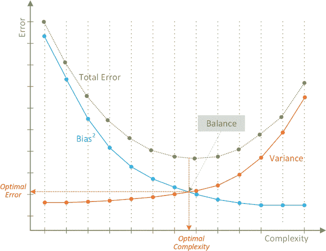
**图 6.9** 误差/复杂度与偏差/方差之间的非线性关系

构建良好的预测模型需要在与偏差和方差相关的误差之间找到平衡。偏差与方差之间的最佳平衡可以通过代表两条曲线的误差值相加形成总误差曲线（呈凹形），然后识别/计算曲线中的最低点。这个最低点可以用于找到复杂度方面的相应“最佳”值以及相应的可实现的最佳误差值。图 6.9 中每条曲线的单个误差和总误差可以用数学公式表示如下：

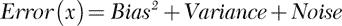
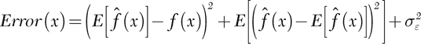

`Error`(`x`) 是三个误差项之和：偏差²、方差和噪声（即不可约误差）。正如其名称所示，不可约误差无法通过更多的训练和在模型中使用更复杂的构架来进一步减少。它被认为是模型中你必须接受的噪声，通常是由于变量空间中缺失（未表示）的信息造成的。在现实世界的问题中，由于问题是复杂的且需要通过模型假设进行简化，总是存在程度的缺失信息（输入变量），因此模型永远无法完美或完全地产生零噪声。

### 预测分析中的不平衡数据问题

使用不平衡数据集开发预测模型是数据挖掘和决策分析领域面临的最挑战之一。当目标变量中不同类别的分布显著不同时，数据集就是不平衡的。例如，在医学测试的二分类问题案例中，数据中属于某一类（例如负性样本）的示例远多于另一类（例如正性样本）。通常，我们把样本较少的类称为少数类，把样本较多的类称为多数类。尽管关于不平衡数据问题的讨论集中在二分类问题上，但这种现象也适用于多分类问题以及处理数值目标变量的问题（即回归或估计类预测问题）。基于不平衡数据集的决策建模在现实问题中非常常见，包括医学诊断、欺诈检测、客户流失分析、垃圾邮件识别、异常值检测、破产预测和网络入侵检测。


数据不平衡问题的影响在临床决策支持系统的开发中尤为明显，因为罕见病病例通常只占总人口的极小比例。例如，`Piri` 等人（2017）的一项研究涉及开发一种临床决策支持系统，仅利用小部分糖尿病测试结果和患者人口统计信息（包含在`EHR`数据库中）来诊断糖尿病视网膜病变患者。在这个数据集——一个包含数十万糖尿病患者的群体中——只有约 5%的患者患有糖尿病视网膜病变，剩下的 95%没有该病。

在为教育机构开发的决策支持系统中出现了一个不那么严重的数据不平衡问题（`Thammasiri` 等人，2014）。该教育决策支持系统的主要目标是识别、解释并缓解高等教育机构大一学生的流失。这种学生流失预测问题涉及的数据集中，负样本（未退学的大一学生）的数量是正样本（退学的大一学生）的四倍左右。图 6.10 形象地说明了开发该系统时面临的数据不平衡状况。如图右侧（“模型评估”面板）所示，不平衡数据在多数类上产生了极高的预测准确率，但在少数类上的表现非常糟糕；而平衡的数据对少数类和多数类都产生了显著更优的预测准确率。尽管使用不平衡数据集实现的总体准确率在科学上似乎更高，但这是一种极具欺骗性的感知，在数据挖掘文献中通常被称为“愚者金”。请记住，平衡的数据集允许机器学习技术对两类数据都产生相当高的预测准确率。

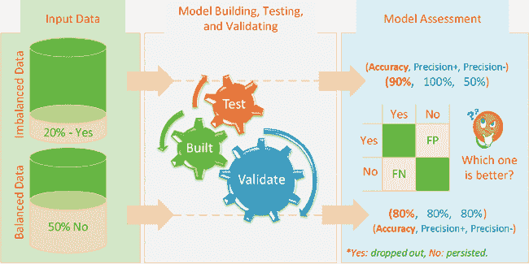

**图 6.10** 数据不平衡问题的图示说明

但为什么不平衡的数据集会导致糟糕的预测结果呢？机器学习方法从训练数据中学习的方式与人类从经验中学习的方式相似。也就是说，在人类（可能也包括大多数动物）身上，记忆和回忆在很大程度上取决于反复发生的事件和经历。经常观察到的经历会导致更持久、更生动的记忆，并更容易、更准确的回忆和识别。相比之下，观察频率较低的经历会被忽视或简单地忽略，因此在需要时往往无法准确回想起。在机器学习中，也会发生类似的学习过程，该方法产生偏偏的预测模型，这些模型关注多数类的模式，而顺便忽略了少数类的特定特征。

## 如何解决数据不平衡问题

有多种方法可以缓解数据不平衡问题，从而提高给定预测模型的性能。图 6.11 显示了处理数据不平衡问题方法的简单分类法。尽管这些方法在算法复杂性上可能有所不同，但所有方法的目标都是确保预测方法（或底层算法）对所有类别（多数类、少数类以及两者之间的任何类别）呈现的模式给予几乎相等/公平的关注。某些方法试图通过简单操训练数据类别分布来解决数据不平衡问题，而另一些方法则尝试通过调整底层算法或调整性能成本以有利于对少数类的准确预测来操纵学习过程。

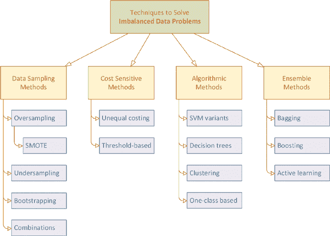

**图 6.11** 处理数据不平衡问题的方法的分类法

数据采样方法——由于其易于理解、公式化和实现，是数据科学和机器学习应用最广泛的一类方法——要么通过生成额外的示例来增加少数类示例（统称为过采样方法），要么通过删除某些示例来减少多数类示例的数量（通常称为欠采样方法）。

过采样方法通过两种方式之一增加少数类示例的数量：(1) 重复少数类的示例，直到其数量与多数类的示例相等（通过简单的复制粘贴或自助型随机采样）；或 (2) 合成创建与少数类样本不同但非常相似的新新示例。一种名为`SMOTE`（合成少数类过采样技术）的流行技术通过使用`k`-最近邻算法合成创建类似的少数类示例，以增加少数类示例的数量。`SMOTE`对于由真实数值输入变量主导的数据集效果很好；另一方面，它对于由分类/命名变量主导的数据集效果非常差。已有许多尝试创建 `SMOTE` 算法的变体以解决原始公式的缺点。

相反，欠采样保持少数类示例不变，并从多数类中随机抽取等数量的示例。也就是说，某些多数类示例被排除在训练数据集之外。随机选择可以是有回的（即自助法），也可以是不有回的。

另一类处理数据不平衡问题的方法被称为成本敏感方法，它关注分类错误成本。数据采样方法关注在学习/训练过程之前平衡数据，而成本敏感方法关注在模型构建（即训练）过程中对分类性能成本的调整。具体而言，该类方法根据数据不平衡的严重程度为不同类别分配不同的分类错误成本。在实践中，这些方法旨在通过调整分类阈值或为类别分配不比例的成本，以增强对少数类的关注。

另一种类型处理数据不平衡问题的方法侧重于对各种分类算法进行公式调整。尽管这些调整后的分类算法都有相同的目标（即减轻数据不平衡的影响），但算法用于实现这一目标的具体方法存在差异。支持向量机及其变体从这种缓解方法中受益最多。例如，在最近的一项研究项目中，`Piri` 等人（2018）开发了一种新型的合成信息少数过采样（SIMO）算法，该算法利用支持向量机通过在支持向量附近（即多维特征空间中难以分类的区域）创建少数类的合成示例来增强对不平衡数据集的学习。


单类方法也被机器学习社区用于解决数据不平衡问题。单类方法背后的通用思想是一次只关注一个类别标签。也就是说，训练数据样本均来自某一个类（例如，所有正样本或所有负样本），以便仅学习该类别的特定特征。由于该方法专注于识别和预测某一个类，因此通常被称为基于识别的方法；相比之下，基于判别的方法通常用于普通分类，在普通分类中，模型被用于区分两个或多个类别。由于单类方法的核心思想是使底层模型特定于某一类的特征，并将其他一切识别为不属于该类，因此它使用了三种统一/同质化方法：(1) 基于密度的表征，(2) 边界确定，以及(3) 基于重构/演化的规范。这些方法借鉴了聚类算法的概念和相关功能，因此可以被视为 `k-means`、`k-medoids`、`k-centers` 和自组织映射等算法的扩展。

处理数据不平衡问题的某些最新方法出现于方法集成领域。与使用单一预测模型不同，这类模型使用许多相同类型的方法（同质集成）或不同的预测方法（异质集成）来减轻数据不平衡带来的负面影响。bagging boosting 集成方法的变体已被提出作为数据不平衡问题的解决方案。在 bagging 情况下，随机采样被调整为倾向于少数类；在 boosting 情况下，少数类样本的权重被不成比例地调整。主动学习——一种涉及以分段方式进行迭代学习的方法——也被探索作为处理数据不平衡问题的一种途径。

尽管机器学习社区在解决数据不平衡问题方面付出了许多努力，但目前的先进水平仍局限于启发式解决方案和特设方法论。仍然缺乏普遍接受的理论、方法论和最佳实践。尽管大多数研究声称已开发了提高少数类预测准确率的数据平衡方法，但也有大量研究得出结论认为，这些方法恶化了多数类的预测准确率和整体分类准确率。正在的研究仍在试图回答诸如“是否存在一种能够产生更好预测结果的单一通用方法论？”或“是否存在一种方法，可以为给定的机器学习方法和手头数据的具体情况指定最佳的数据平衡算法？”

## 预测性分析机器学习模型的解释性

在预测性分析（以及机器学习）中，模型复杂度与模型性能之间存在权衡。尽管机器学习社区在解决数据不平衡问题方面付出了许多努力，但目前的先进水平仍局限于启发式解决方案和特设方法论。仍然缺乏普遍接受的理论、方法论和最佳实践。尽管大多数研究声称已开发了提高少数类预测准确率的数据平衡方法，但也有大量研究得出结论认为，这些方法恶化了多数类的预测准确率和整体分类准确率。研究仍在试图回答诸如“是否存在一种能够产生更好预测结果的单一通用方法论？”或“是否存在一种方法，可以为给定的机器学习方法和手头数据的具体情况指定最佳的数据平衡算法？”

（注：原文后续存在大量重复段落，根据指令已去除重复内容，仅保留核心内容翻译。）


基于留一法（leave-one-out methodology）的敏感性分析依赖于一种实验过程：从输入变量集中系统地一次移除一个输入变量，开发并测试模型，然后观察该变量的缺失对机器学习模型预测性能的影响。具体而言，首先使用所有输入变量对模型进行训练和测试（通常使用 `k`-fold 交叉验证），并将最佳预测准确率记录为基准。然后，使用完全相同的设置，使用除一个输入变量以外的所有变量对模型进行训练和测试，并记录最佳预测准确率。此过程对每个变量重复一次，每次排除一个不同的输入变量。随后，测量每个变量缺失导致的相对于基准的退化，并利用这些指标来创建变量重要性的表格和图表插图，如图 6.12

**图 6.12** 敏感性分析过程的图形描述

这种敏感性分析方法适用于任何预测分析和机器学习方法。在历史上，它经常被用于支持向量机、决策树、逻辑回归和人工神经网络。Saltelli (2002) 使用以下方程形式化了这一测量过程的代数表示：

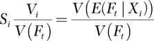

在该方程中，分母 `V(F[t])` 指输出变量的方差。在分子 `V(E(F[t]|X[i]))` 中，`E` 是期望算子，对参数 `X[i]` 进行积分；即包含除 `X[i]` 以外的所有变量；`V` 即方差算子对 `X[i]` 进行再次积分。第 `i` 个变量的贡献（即重要性）表示为 `S[i]`，计算为归一化的敏感性指标。在后续的一项研究中，Saltelli 等人 (2004) 证明该方程是模型敏感性最可能的衡量方法，能够根据任何交互组合对输入变量（即预测变量）按重要性进行排序，包括输入变量之间的非正交关系。

使用这种敏感性分析方法可能会为同一数据集的不同模型类型产生略有不同的重要性衡量。可以选择并使用预测能力最好的模型类型测量的变量重要性，而忽略其他模型类型生成的重要性；也可以使用所有模型类型产生的所有重要性衡量的某种组合（即集成）。正确组合所有预测模型类型敏感性分析结果的一种方法是使用基于信息融合的方法——加权平均法，其中权重根据单个模型类型的预测能力确定。特别是，可以修改前面的方程，使得根据来自 `m` 种预测模型类型的组合信息（即融合信息）获得输入变量 `n` 的敏感性衡量值。以下方程表示了这种加权求和函数：

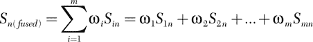

在该方程中，`ω[i]` 代表每个预测模型的归一化贡献/权重，其中模型的贡献/权重水平被计算为其相对预测能力的函数。预测能力（即准确率）越大，`ω` 的值越大。

### 使用 LIME 和 SHAP 进行局部解释性

在线性回归模型中，`beta` 系数解释了所有数据点的预测；也就是说，如果一个变量值增加一个单位，每个数据点的预测值都会增加 `beta`。这通常被称为*全局解释性*，在因果建模中，它被称为*平均因果分析*（Nayak, 2019）。然而，全局解释性并没有专门解释个体差异；例如，拒绝某位申请人贷款申请的变量值影响可能与其他人不同。*局部解释性*为单个数据点或独立变量联合分布的局部子部分提供了解释。LIME 和 SHAP 是两种近期流行的方法，旨在通过为黑箱模型构建代理模型来提供局部解释性。它们略微调整输入（正如敏感性分析中所做的那样），并通过代理模型表示来测试预测的变化（见图 6.13）。由于这些代理模型仍然将机器学习模型视为黑箱，这些方法被认为是模型无关的（model agnostic）。

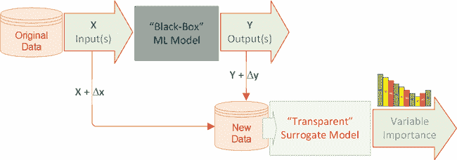

**图 6.13** 从全局黑箱模型到用于变量重要性的局部代理模型

局部可解释的无无关解释（LIME）是一种较新的变量评估方法，通过根据预测的细节（即被预测的案例/样本）在局部开发/学习代理模型，以人类可理解的方式解释任何预测模型（即分类器）的预测。LIME 背后的核心思想是通过开发代理模型（与之相似但简单得多且具有解释性）来模拟复杂机器学习模型的输入和输出之间的关系，从而解释单个记录（即特定客户）的预测结果。为此，代理模型利用了与实际预测记录相似的合成记录样本。LIME 是一项流行的技术，因为它是模型无关的（即适用于任何类型的预测模型），它可以生成人类可理解的结果，在局部（单条记录）层面提供解释，它是可加的（即数据点所有变量的重要性值之和等于最终预测值），并且是一种计算效率非常高的算法。更多关于 LIME 及其算法细节，请参见 Ribeiro 等人 (2016)。

Shapley 加性解释（SHAP）是另一种近期提出的模型解释技术。它被广泛认为是最好的局部模型解释技术，在多个方面均优于 LIME。尽管 SHAP 采用了与 LIME 类似的概念，但它基于博弈论中的 Shapley 值提供了理论保证；它能够捕捉并表示局部范围内超越线性关系的复杂关系，并产生更准确、稳健和可靠的解释结果。SHAP 也可以有效地用于变量选择：如果你想减少变量数量，可以选择重要性较高的变量子集并丢弃其他变量。由于其一致性，变量重要性的顺序不会改变，因此不重要的变量可以被忽略。更多关于 SHAP 的信息，请参见 Lundberg 和 Lee (2017)。

### 哪种技术是最好的？


几乎在所有情况下都是，这个问题并没有一个适用于所有问题和数据集的魔术答案或解决方案。如果你对模型无关的（model-agnostic）全局解释性感兴趣，或许可以使用“留一”敏感性分析（leave-one-out sensitivity analysis）。如果需要针对特定模型的解释，则可以使用适用于特定模型类型的适当敏感性分析。如果你追求的是局部解释（local interpretation），则可以使用 `LIME` 或 `SHAP`；在这两者中，`SHAP` 被认为是一种更好的方法，但它的计算成本比 `LIME` 更高。如果针对大型复杂问题需要单条记录层面的快速解释，或许 `LIME` 可能是首选方法。

## 总结

预测分析是一个不断发展的领域，涉及新的方法和方法论。这些发展背后的思想是解决现有技术的局限性，以创建更准确、更具解释的模型。本章涵盖了预测分析的几项最新进展：模型集成、偏差-方差权衡、不平衡数据问题以及可解释人工智能/机器学习。虽然这前三项进展侧重于构建更准确、无偏的预测模型，但可解释人工智能/机器学习侧重于提高黑箱模型的透明度，以便它们可以使用那些解释性是预测模型必要特征之一的领域。

### 参考文献

Abbott, D. (2014). *Applied Predictive Analytics: Principles and Techniques for the Professional Data Analyst.* John Wiley & Sons.

Breiman, L. (1996). “Bagging Predictors,” *Machine Learning*, 24(2): 123–140.

Delen, D., & Sharda, R. (2010). “Predicting the Financial Success of Hollywood Movies Using an Information Fusion Approach.” *Industrial Engineering Journal*, 21(1), 30-37.

Freund, Y., & Schapire, R. E. (1996). “Experiments with a New Boosting Algorithm,” *Machine Learning: Proceedings of the Thirteenth International Conference*, pp. 148–156.

Friedman, J. H. (2001). “Greedy Function Approximation: A Gradient Boosting Machine,” *Annals of Statistics*, pp. 1189–1232.

He, H., & Ma, Y. (Eds.). (2013). *Imbalanced Learning: Foundations, Algorithms, and Applications*. John Wiley & Sons.

Lundberg, S. M., & Lee, S. I. (2017). “A Unified Approach to Interpreting Model Predictions,” *Advances in Neural Information Processing Systems,* pp. 4765–4774.

Nayak, A. (2019). *Idea Behind LIME and SHAP.* [`towardsdatascience.com/idea-behind-lime-and-shap-b603d35d34eb`](https://towardsdatascience.com/idea-behind-lime-and-shap-b603d35d34eb) (accessed July 2020).

Piri, S., Delen, D., & Liu, T. (2018). “A Synthetic Informative Minority Over-Sampling (SIMO) Algorithm Leveraging Support Vector Machine to Enhance Learning from Imbalanced Datasets,” *Decision Support Systems*, 106: 15–29.

Piri, S., Delen, D., Liu, T., & Zolbanin, H. M. (2017). “A Data Analytics Approach to Building a Clinical Decision Support System for Diabetic Retinopathy: Developing and Deploying a Model Ensemble,” *Decision Support Systems*, 101: 12–27.

Ribeiro, M. T., Singh, S., & Guestrin, C. (2016, August). “Why Should I Trust You? Explaining the Predictions of Any Classifier,” *Proceedings of the 22nd ACM SIGKDD International Conference on Knowledge Discovery and Data Mining,* 1135–1144.

Saltelli, A. (2002). “Sensitivity Analysis for Importance Assessment.” *Risk analysis*, 22(3), 579-590.

Saltelli, A., Tarantola, S., Campolongo, F., & Ratto, M. (2004). *Sensitivity Analysis in practice: A Guide to Assessing Scientific Models* (Vol. 1). New York: Wiley.

Sarkar, D. (2018). *The Importance of Human Interpretable Machine Learning*. [`towardsdatascience.com/human-interpretable-machine-learning-part-1-the-need-and-importance-of-model-interpretation-2ed758f5f476`](https://towardsdatascience.com/human-interpretable-machine-learning-part-1-the-need-and-importance-of-model-interpretation-2ed758f5f476) (accessed July 2020).

Seni, G., & Elder, J. F. (2010). “Ensemble Methods in Data Mining: Improving Accuracy Through Combining Predictions,” *Synthesis Lectures on Data Mining and Knowledge Discovery*, 2(1): 1–126.

Surowiecki, J. (2006). *The Wisdom of Crowds.* Penguin Random House Publishing.

Thammasiri, D., Delen, D., Meesad, P., & Kasap, N. (2014). “A Critical Assessment of Imbalanced Class Distribution Problem: The Case of Predicting Freshmen Student Attrition,” *Expert Systems with Applications,* 41(2): 321.

Vorhies, W. (2016). *Want to Win Competitions? Pay Attention to Ensembles.* Data Science Web. [www.datascience.com/profiles/want-to-win-competitions-pay-attention-to-ensembles](https://www.datascience.com/profiles/want-to-win-competitions-pay-attention-to-ensembles)

Wait-Wolpert, D. (1992). “Stacked Generalization,” *Neural Networks,* 5(2): 241–260.

Zolbanin, H. M., Delen, D., Crosby, D., & Wright, D. (2020). “A Predictive Analytics-Based Decision Support System for Drug Courts.” *Information Systems Frontiers*, 1–20.

## 7 文本分析、主题建模与情感分析

我们所处的时代其特征是收集、存储和可用数据量的快速增长。绝大多数企业数据是以非结构化的形式存储的。根据 Merrill Lynch 和 Gartner 的一项研究，85% 的企业数据是非结构化的（McKnight, 2005）。该研究还指出，这些非结构化数据每 18 个月就会翻一倍。因为知识在当今是力量，而知识源于数据和信息，所以能够有效高效利用其文本数据的企业将拥有做出决策所需的知识，从而比比落后的企业获得竞争优势。

尽管文本分析和文本挖掘的总体目标都是通过自然语言处理 (`NLP`) 和分析，将非结构化的文本数据转化为可操作的信息，但对这些术语的定义有所不同。许多人认为，文本分析是一个更广泛的概念，包含了信息检索（例如根据一组关键词搜索相关文档）以及信息提取、数据挖掘和网络挖掘；而文本挖掘主要侧重于从文本数据源中发现新的实用的知识。

图 7.1 展示了文本分析、文本挖掘与其他相关应用领域之间的关系。底部列出了在这些日益流行的应用领域中起关键作用的主要学科。

图 7.1 文本挖掘与赋能学科

`文本分析`是一个比 `文本挖掘` 更新的术语。随着近期对分析的重视，许多相关的技术应用领域（如消费者分析、竞争分析、可视化分析、社交分析）都加入了“分析的浪潮。


文本挖掘（也称为文本数据挖掘或文本数据库中的知识发现）是从海量非结构化数据中提取模式（即有用信息和知识）的半自动化过程。请记住，数据挖掘是在存储在结构化数据库中的数据中识别有效的、新颖的、潜在且最终可理解的模式的过程，在这些数据库中，数据按类别、定序或连续变量的结构化记录组织。文本挖掘与数据挖掘的相同之处在于它们具有相同的目的并使用相同的流程，但文本挖掘的流程输入是一组非结构化（或结构化程度较低）的数据文件，例如 Word 文档、PDF 文件、文本摘录、XML 文件、推文、博客文章、客户评论等。从本质上说，文本挖掘可以被看是一个：首先对基于文本的数据源进行结构化处理，然后利用数据挖掘技术和工具从这些结构化的文本类数据中提取相关信息和知识。

## 文本挖掘的优势

文本挖掘的优势在产生海量文本数据的领域是显而易见的，例如社交媒体（如推文、博客、留言板帖子）、法律（如法院指令）、学术研究（如研究论文）、营销（如在线评论）、金融（如季度报告和讨论板）、医学（如出院摘要）、生物学（如分子相互作用）、技术（如专利文件）以及营销（如客户评论）。例如，以投诉（或赞扬）和保修索赔形式与客户进行的自由格式文本交互可以客观地识别被认为不完美的产品和服务特征，并可作为改进产品开发和服务资源分配的输入。信息可以类似地用于产生大量数据的市场推广计划和焦点小组。通过不将产品或服务的反馈限制在编码形式上，客户可以用自己的话来表达他们对公司产品和服务的看法。

另一个非结构化文本的自动化处理产生巨大影响的领域是电子邮件和其他电子通信。文本挖掘可用于分类和过滤垃圾邮件，还可以根据重要性水平自动对邮件进行优先级排序，并生成自动回复（Weng & Liu, 2004）。

# 文本挖掘的应用领域

- **信息提取。** 文本挖掘可以通过模式匹配在文本中寻找预定义的对象和序列，从而识别文本中的关键短语和关系。也许最常用的信息提取形式是实体提取。命名实体提取包括命名实体识别（即利用现有的领域知识识别已知实体名称——包括人、组织、地名、时间表达式和某些类型的数字表达式）、共指消解（即检测文本实体之间的共指和指代链接）以及关系提取（即识别实体之间的关系）。
- **主题检测。** 文本挖掘可以使用某些概率机器学习算法，从大量的文本文档集中识别隐藏的/潜在的主题。
- **主题跟踪。** 基于用户画像和用户查看的文档，文本挖掘可以预测用户可能感兴趣的其他文档。
- **摘要生成。** 文本挖掘可以对文档进行摘要以为读者节省时间。
- **分类。** 文本挖掘可以识别文档的主体主题，然后根据这些主题将文档放入一组预定义的类别中。
- **情感分析。** 自动识别人类在互联网上创建的文本内容（如产品评论、博客文章、社交媒体互动）中隐藏的观点和情感（即负面、正面或中性）。
- **聚类。** 文本挖掘可以用于在没有预定义类别集合的情况下，将相似的文档进行分组。
- **概念链接。** 文本挖掘可以通过识别识别共享概念来连接相关文档，从而帮助用户发现他们可能通过传统搜索方法无法发现的信息。
- **问答系统。** 文本挖掘可以用于为问题寻找最佳答案。

## 术语与概念

文本挖掘有自己的语言，包含许多术语和缩写。以下是文本挖掘中常用的术语和概念：

- **非结构化数据（对比结构化数据）。** 结构化数据具有预定义的格式，通常以类别、定序和连续变量的形式存储在数据库中。相比之下，非结构化数据没有预定义的格式，以文本文档的形式存在。从本质上说，结构化数据供计算机处理，而非结构化数据供人类理解。
- **语料库。** 在语言学中，语料库（复数形式为 `corpora`）是经过电子化的大型文本集合，用于知识发现。
- **术语。** 术语是通过自然语言处理（NLP）直接从语料库中提取的单词或单词短语。
- **概念。** 概念是通过手动、统计、规则或混合方法生成的特征。概念的抽象程度高于术语。
- **词干提取。** 词干提取是将词形变化还原为词干（或词根）的过程。例如，`stemmer`、`stemming` 和 `stemmed` 都基于词干 `stem`。
- **形态还原。** 与词干提取类似，词形还原也用于将词形变化的词转换为词根。词干提取是从语法角度进行的，而词形还原是利用术语字典从语义角度进行的。
- **停用词。** 停用词是在处理语言数据（即文本）之前或之后过滤掉词。尽管没有通用的停用词列表，但大多数自然语言处理工具使用的列表包含冠词（如 a, an, the）、助动词（如 is, are, was, were）以及被认为没有区分价值的上下文词。
- **同义词与多义词。** 同义词是语法上不同的单词（即拼写不同），具有相同或至少相似的含义（例如 movie、film 和 motion picture）。相反，多义词（也称为同形异义词）是语法相同的单词（即拼写相同），但含义不同（例如，bow 可以指“弯曲”、“船头”、“射箭武器”或“一种结的丝带”）。
- **分词。** 分词是句子中分类的文本块。对应于标记的文本块根据其执行的功能进行分类。这种对文本块分配意义的过程被称为分词。标记可以是任何形式，只要它是结构化文本的有用部分即可。
- **术语字典。** 术语字典是针对特定领域的术语集合，用于限制语料库中提取的术语。
- **词频。** 一个单词在特定文档中出现的次数即为词频。


- **词性标注。** 这是根据每个词的定义及其所处的上下文，将文本中的单词标记为特定词性（例如名词、动词、形容词、副词）的过程。
- **形态学。** 形态学是语言学的一个分支，也是自然语言处理的一部分，它研究词汇的内部结构（语言内部或跨语言的词汇形成模式）。
- **词-文档矩阵（出现矩阵）。** 这种矩阵是术语与文档之间基于频率关系的常用表示方案，采用表格形式，术语按行出，文档按列出，术语与文档之间的频率以整数值列在单元格中。
- **奇异值分解（隐含语义索引）。** 这种降维方法用于通过使用类似于主成分分析的矩阵操作方法生成频率的中间表示，从而将词-文档矩阵转换为易于管理的尺寸。

## 自然语言处理

早期的文本挖掘应用在为基于文本的文档集引入结构时，使用了一种被称为 `bag-of-words`（词袋）的简化表示方法，以便将其分类为两个或多个预定义的类别，或将其聚类为自然分组。在 `bag-of-words` 模型中，文本（如句子、段落或完整文档）被表示为单词的集合，忽略了语法或单词出现的顺序。`bag-of-words` 模型仍被用于一些简单的文档分类工具。例如，在垃圾邮件过滤中，邮件可以被建模为一个无序的单词集合（词袋），并与两个不同的预定义词袋进行比较。其中一个词袋充满了垃圾信息中常见的单词，另一个词袋充满了合法邮件中常见的单词。尽管某些单词可能出现在两个词袋中，但“垃圾”袋中包含 `stock market`（股市）、`Viagra`（万艾可）和 `buy`（购买）等垃圾相关单词的频率远高于合法词袋，而后者将包含更多与用户朋友或工作场所相关的单词。特定邮件的词袋与包含描述符的两个词袋之间的匹配程度决定了该邮件被表征为垃圾邮件还是合法邮件。

自然地，我们人类并不使用没有顺序或结构的单词。我们在句子中使用单词，句子既有语义结构也有句法结构。因此，自动化的技术（例如文本挖掘）需要寻找超越 `bag-of-words` 解释的方法，并在操作中加入越来越多的语义结构。文本挖掘的当前趋势是包含许多可以通过自然语言处理获取的先进特征。

事实证明，`bag-of-words` 方法可能无法为文本挖掘任务（如分类、聚类、关联）产生足够的信息内容。循证医学中可以找到这一现象的一个很好的范例。循证医学的关键组成部分是将现有最优质的研究结果整合到临床决策过程中，这涉及对从印刷媒体中收集到的信息进行有效性和相关性评估。马里兰大学的几位研究人员使用 `bag-of-words` 方法开发了证据评估模型（Lin & Demner-Fushman, 2005）。他们采用了流行的机器学习方法，并使用了从 `MEDLINE`（医学文献分析与检索系统）中收集的五十万多研究论文。在他们的模型中，每个摘要都被表示为一个词袋，其中每个词干词（stemmed term）代表一个特征。尽管使用了具有证明的实验设计方法的流行分类方法，但他们的预测结果并不比简单的猜想好多少，这可能表明 `bag-of-words` 方法未能在该领域的研究文章生成足够的表示；因此，需要如自然语言处理等更先进的技术。

自然语言处理（`NLP`）是文本挖掘的重要组成部分，也是人工智能和计算语言学的一个领域。它研究理解人类自然语言的问题，并将人类语言的描述（例如文本文档）转换为更正式的表示（数字和符号数据形式），以便计算机程序更容易处理。`NLP` 的目标是超越语法驱动的文本处理（通常被称为“数词”），转变为对自然语言的真正理解和处理，这种处理考虑了语法、语义约束以及上下文。

“理解”一词的定义和范围是 NLP 中的主要讨论话题之一。考虑到人类自然语言是模糊的，而且对意义的真正理解需要对主题有广泛知识（超出单词、句子和段落本身的内容），计算机能以人类相同的方式和准确性理解自然语言吗？可能不能！`NLP` 从简单的数词时代已经走了很远，但要真正理解人类自然语言，还有很很长的路要走。以下是与 `NLP` 实现相关的常见挑战：

- **词性标注。** 将文本中的术语标记为相应的特定词性（例如名词、动词、形容词、副词）是困难的，因为词性不仅取决于术语的定义，还取决于术语所处的上下文。
- **文本分段。** 某些语言（如汉语、日语和泰语）没有单一的单词边界。在这种情况下，文本解析任务需要识别单词边界，这通常是困难的。在分析口语语言时，会出现类似的语音分段挑战，因为代表连续字母和单词的音会混合在一起。
- **词义消歧。** 许多单词有多个含义。只有通过考虑单词所处的上下文，才能选出最有意义的含义。
- **句法歧义。** 自然语言的语法具有歧义性；也就是说，通常需要考虑多种可能的句子结构。选择最合适的结构通常需要语义和上下文信息的融合。
- **不完美或不规则的输入。** 口语中的外国或地区口音、语音障碍以及文本中的拼写或语法错误，使得语言处理成为了一项困难的任务。
- **言语行为。** 句子通常可以认为是对动作的请求。句子结构本身可能不包含定义动作的信息。例如，“Can you pass the class?”（你能通过课程吗？）请求的是一个简单的是否回答，而“Can you pass the salt?”（你能把盐递给我吗？）是对执行物理动作的请求。


人工智能社区一直以来的梦想是开发出能够自动阅读文本并从中获取知识的算法。通过对解析后的文本应用学习算法，斯坦福大学 NLP 实验室的研究人员已经开发出能够自动识别文本中概念以及这些概念之间关系的方法。通过对大量文本应用独特的程序，他们的算法可以自动获取数十万项世界知识，并利用这些知识生成显著增强的 `WordNet` 数据库。`WordNet` 是一个通过人工手工编码的英语单词数据库，包含了单词的定义、同义词集以及同义词词集之间的各种语义关系。它是 NLP 应用的一大资源，但事实证明手动构建和维护它的成本非常昂贵。通过自动向 `WordNet` 引入知识，有望以极低的成本让 `WordNet` 成为一个更强大、更全面的 NLP 资源。

NLP 和 `WordNet` 的优势已在一个突出领域得到收获，即是客户关系管理（CRM）。广义上，`CRM` 的目标是通过更好地理解和有效响应客户实际及感知的客户需求，来实现客户价值最大化。`CRM` 的一个 NLP 产生重大影响的重要领域是情感分析。情感分析是一种用于检测对特定产品和服务服务的正面或负面意见的技术，它利用大量的文本数据源，例如来自网络帖的客户反馈。（情感分析将在本章稍后部分进行详细介绍。）

`NLP` 已经通过计算机程序成功应用于各种领域，执行各种任务，自动处理以前只能由人类完成的自然人类语言。以下是这些任务中最受欢迎的任务之一：

*   **问答。** `NLP` 可用于自动回答以自然语言提出的问题——即对自然语言问题产生类语言回答。为了找到问题的答案，计算机程序可以使用预先结构化的数据库或自然语言文档集（例如如世界维网之类的文本语料库）。
*   **自动摘要。** 计算机程序可用于创建文本文档的短版本，其中包含原始文档中最重要的要点。
*   **自然语言生成。** 系统可以将计算机数据库中的信息转换为可读的人类语言。
*   **自然语言理解。** 系统可以将人类语言样本转换为更正式的表示，以便计算机程序进行处理。
*   **机器翻译。** 系统可以自动将一种人类语言翻译成另一种语言。
*   **外语阅读。** 计算机程序可以帮助非母语者以正确的发音和单词不同部分的重音阅读外语。
*   **外语写作。** 计算机程序可以帮助非母语用户用外语写作。
*   **语音识别。** 系统可以将口语词转换为机器可读的输入。给定某人说话的音频片段，该系统会生成文本听写稿。
*   **文本转语音。** 计算机程序可以自动将自然语言文本转换为人类语音。这也被称为语音合成。
*   **文本校对。** 计算机程序可以阅读文本的校样，以检测并纠正任何错误。
*   **光学字符识别。** 系统可以自动将手写、打字或打印文本的图像（通常由扫描仪捕）转换为机器可编辑的文本文档。

文本挖掘的成功和流行在很大程度上取决于 `NLP` 在人类语言生成和理解方面的进展。`NLP` 能够从非结构化文本中提取特征，以便可以使用数据挖掘技术提取知识。从这个意义上说，来说，文本挖掘是 `NLP` 和数据挖掘的结合。

### 文本挖掘应用

随着机构收集的非结构化数据数量的增加，文本挖掘工具的价值主张和流行程度也随之增加。许多机构现在意识到通过文本挖掘从其基于文档的存储中提取知识的重要性。接下来的章节描述了示例应用类别的一个小子集。

#### 营销应用

文本挖掘可以通过分析呼叫中心生成的非结构化数据来增加交叉销售和向上销售。文本挖掘算法可分析呼叫中心记录生成的文本以及对话转录，以提取关于客户产品的新颖、具可操作的信息。此外，博客、独立网站上的产品用户评论以及讨论板帖子是客户情感的黄金矿。这些丰富的信息集合在经过适当分析后，可用于提高客户的满意度和整体生命周期价值。

文本挖掘对于客户关系管理来说已变得无价之。公司可以使用文本挖掘分析丰富的非结构化数据集，结合从组织数据库中提取的相关的结构化数据，来预测客户的感知和随后的购买行为。例如，文本挖掘可以有意义地提高数学模型预测客户流失（即客户流失）的能力，以便准确识别出最可能离开公司的客户并采取留存策略。

将产品视为属性-值对的集合而不是原子实体，可以潜在地提高许多业务应用的有效性，包括需求预测、品种优化、产品推荐、零售商和制造商之间的品种比较以及产品供应商选择。`Ghani et. al()` 使用文本挖掘开发了一个能够推断产品隐式和显式属性的系统，以增强零售商分析产品数据库的能力。所提的系统允许企业根据属性和属性值表示其产品，而无需大量的人工努力。

#### 安全应用

安全领域最大且最突出的文本挖掘应用之一是高度机密的 `ECHELON` 监控系统。据传，`ECHELON` 能够识别电话通话、传真、电子邮件和其他类型数据的内容，拦截通过卫星、公共电话交换机网络和微波链路发送的信息。

2007 年，`EUROPOL` 开发了一个集成系统，能够访问、存储和分析大量的结构化和非结构化数据源，以跟踪跨国组织犯罪。该系统被称为“情报支持总体分析系统”（`OASIS`），旨在整合当今市场上最先进的数据和文本挖掘技术。该系统使 `EUROPOL` 在支持其国际层面执法执法目标方面取得了重大进展。


美国联邦调查局（FBI）和中央情报局（CIA）在国土安全部的指导下，正在联合开发一种超级计算机数据和文本挖掘系统。该系统预计将创建一个巨大的数据仓库，并辅以各种数据和文本挖掘模块，以满足联邦、州和地方执法机构的知识发现需求。在这一项目启动之前，FBI 和 CIA 各自拥有独立的数据库，之间几乎或完全没有互连。

文本挖掘的另一个安全相关应用是欺骗检测领域。通过对大量真实的犯罪（利益相关人员）陈述应用文本挖掘，`Fuller et al. (2008)` 开发了预测模型，以区分欺骗性陈述和真实陈述。利用从文本陈述中提取的丰富线索，该模型对留样本的预测准确率达到了 70%，考虑到线索仅是从文本陈述中提取的（没有语言或视觉线索），这被认为是一项成功。此外，与测谎仪等其他欺骗检测技术相比，这种方法是非侵入性的，不仅适用于文本数据，还（可能）适用于语音录音的转录。本章末尾提供了关于基于文本的欺骗检测的更详细描述。

### 生物医学应用

文本挖掘对整个医学领域特别是生物医学领域具有巨大的潜力，原因如下：首先，该领域发表的文献和出版物（尤其是随着开源期刊的出现）正在呈指数级增长。其次，与其他大多数领域相比，医学文献更加标准化和更有秩序，使其成为更具“可挖掘性”的信息源。最后，文献中使用的术语相对固定，具有相当标准的本体论。一些示例性研究已成功地利用文本挖掘技术从生物医学文献中提取新颖模式。

实验技术如 DNA 微阵列分析、基因表达测序分析（SAGE）和质谱蛋白质组学等正在产生大量与基因和蛋白质相关的数据。与任何其他实验方法一样，有必要根据所研究生物实体的已知信息来分析这些海量数据。文献是实验验证和解释的一个非常有价值的信息来源。因此，开发自动化文本挖掘工具以协助此类解释，是当前生物信息学研究的主要挑战之一。

了解蛋白质在细胞内的位置有助于阐明其在生物过程中的作用，并确定其作为药物靶点的潜力。文献中描述了许多位置预测系统；有些关注特定物种，而另一些则尝试分析广泛的物种。`Shatkay et al. (2007)` 提出了一个综合系统，使用多种类型的序列和基于文本的特征来预测蛋白质的位置。他们的系统主要新颖之处在于选择文本来源和特征的方式，以及将其与基于序列的特征相结合。`Shatkay et al. (2007)` 在之前的数据集和专门为测试系统预测能力设计的新数据集上测试了该系统。结果显示他们的系统始终优于此前报道的结果。

`Chun et al. (2006)` 描述了一个从 `MEDLINE` 访问的文献中提取疾病-基因关系的系统。他们从六个公共数据库构建了疾病和基因名称字典，并使用字典匹配提取关系候选者。由于字典匹配会产生大量的假阳性，`Chun et al.` 开发了一种基于机器学习的命名实体识别（NER）方法。

对于拥有大型信息且需要更好检索的出版社来说，文本挖掘问题非常重要。这在科学学科中尤为如此，因为高度特定的信息通常包含在书书中。目前已启动了一些倡议，例如《自然》杂志提出的开放文本挖掘接口（OTMI）和美国国家健康协会的期刊出版文档定义（DTD），这些将为机器提供语义线索，以在文本中回答特定查询，同时不移除出版社对公共访问的障碍。

学术机构也启动了文本挖掘倡议。例如，英国曼彻斯特大学和利物浦大学合作的国家文本挖掘中心，为学术界提供定制化的工具、研究设施和文本挖掘建议。研究最初关注生物和生物医学科学的文本挖掘，此后已扩展到社会科学。在美国，加州大学伯克利分校信息学院正在开发一项名为 `BioText` 的计划，以协助生物科学研究人员进行文本挖掘和分析。

### 文本挖掘过程

为了成功，文本挖掘研究应该遵循基于最佳实践的合理方法论。回想第三章“预测分析的标准流程”，`CRISP-DM` 是数据挖掘项目的行业标准；同样，文本挖掘也需要一个标准的流程模型。尽管 `CRISP-DM` 的大部分部分也适用于文本挖掘项目，但专门的文本挖掘流程模型将包含更详尽的数据处理活动。图 7.3 提供了典型文本挖掘过程的高级上下文图（`Delen & Crossland, 2008`）。该上下文图展示了流程的范围，强调了其与大环境的接口。本质上，它为特定流程划定了边界，明确了哪些内容包含在（以及不包含在）文本挖掘过程中。


如上下文图所示，基于文本的知识发现过程的输入（指向框左边缘的向内连接）是已收集、存储并供该过程使用的非结构化和结构化数据。该过程的输出（从框右边缘向向外延伸）是可用于决策的特定背景知识。该过程的控制因素（也称为约束，指向框顶边缘的向内连接）包括软件和硬件限制、隐私问题以及与处理以自然语言形式呈现的文本相关的困难性。该过程的机制（指向框底边缘的向内连接）包括适当的技术、软件工具和领域专业知识。文本挖掘（在知识发现的背景下）的主要目的是通过处理非结构化（文本）数据（以及与要解决的问题相关且可用的结构化数据），来提取有意义的且可操作的模式，以实现更佳的决策。

在非常高的层级上，文本挖掘过程可以分为三个连续的任务，每个任务都有特定的输入以生成特定的输出（请参见图 7.4）。如果由于某种原因，任务的输出不符合预期，则需要回溯到上一个任务的执行。

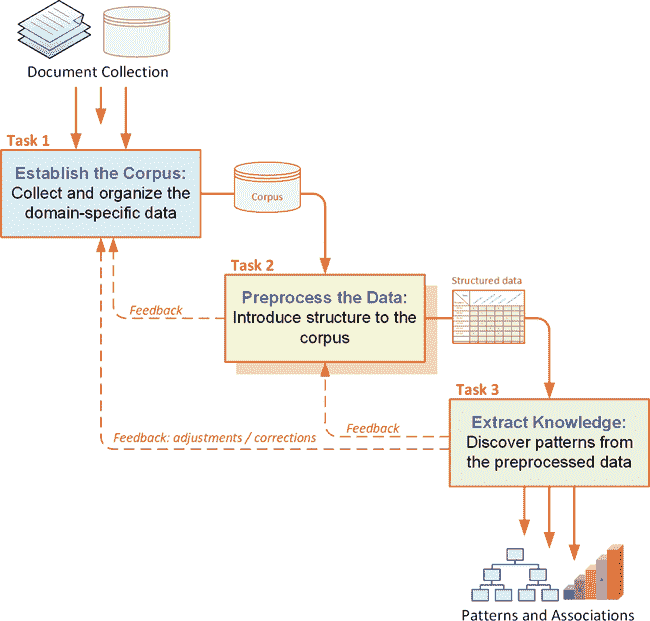

**图 7.4** 三个任务的文本挖掘过程

## 任务 1：建立语料库

文本挖掘过程中第一个任务的主要目的是收集与所研究的背景（即感兴趣领域）相关的所有文档。这些集合可能包括文本文档、`XML`文件、电子邮件、网页和短笔记。除了现成的文本数据外，可能还包括语音录音（除了易于获取的文本数据外，语音录音也可以通过语音识别技术进行转录）。

一旦收集完成，将对文本文档进行转换和组织，使其具有相同的格式（例如，`ASCII`）。文档的组织可以是简单的数字化的文件，也可以是网页集合，这取决于所研究的领域的特定性。许多商用文本挖掘工具可以接受这些输入并将其转换为平直文件。

## 任务 2：数据预处理：构建词-文档矩阵

在文本挖掘的任务 2 中，对处理后的文档（语料库）以构建词-文档矩阵。图 7.5 显示了一个典型的 `TDM` 示例。在 `TDM` 中，行代表文档，列代表词。词与文档之间的关系通过索引来表征（例如，词在文档中的出现次数）。

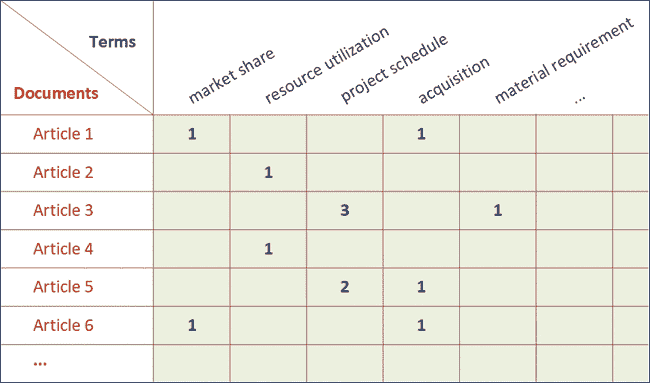

**图 7.5** 词-文档矩阵示例

构建 `TDM` 的目标是将组织后的文档（语料库）转换为矩阵，其中单元格填充的是词的出现频率。然而，并非所有出现在文档中的词都是重要的。某些出现在几乎所有文档中的词（如冠词、介用词、助动词等）没有区分度，因此应被排除在外。这些词通常被称为停用词（`stop terms` 或 `dictionary`）。此外，同义词也可以被处理为相同的词。

另一个为了准确创建索引而采取的过滤步骤是词干提取（stemming），它是将词的不同形式还原为词根，例如将 `modeling` 和 `modeled` 识别为同一个词 `model`。

`TDM` 的第一代生成包含了所有唯一的词（作为列）、所有文档（作为行）以及每个词在每个文档中的出现次数（作为单元格值）。通常情况下，语料库包含了大量的文档，那么 `TDM` 可能会包含大量的词。处理这样一个巨大的矩阵可能会耗费时间，更重要的是，可能会导致提取的模式不准确。此时需要决定以下问题：

- 表示索引的最佳方式是什么？
- 如何降低矩阵的维度？

### 表示索引的最佳方式是什么？

一旦对文档进行了索引并计算了初始词频（按文档计算），就可以进行若干额外的转换以总结和聚合提取的信息。原始词频通常反映了某个词在每个文档中的显著性或重要性。具体来说，在文档中出现频率较高的词是对该文档内容的更好的描述。然而，假设词频本身与其作为文档描述的重要性成正比是并不合理的。例如，如果一个词在文档 A 中出现一次，在文档 B 中出现三次，那么得出该词作为文档 B 描述的重要性是文档 A 的三倍的结论并不一定合理。


- **逆文档频率。** 在考虑后续分析中使用的索引时，另一个需要考虑的问题是不同词的相对文档频率（`df`）。例如，像 `guess` 这样的词可能在所有文档中频繁出现，而另一个词如 `software` 则可能只出现几次。这是因为无论特定主题如何，人们可能在各种语境下做出 `guesses`，而 `software` 是一个语义上更集中的词，只可能出现在处理计算机软件的文档中。一种常用且非常有用的、既能反映词汇的特殊性（即文档频率）又能反映其出现总频率（即词频）的转换方法就是逆文档频率（Manning et al., 2008）。

## 我们如何降低 TDM 矩阵的维度？

由于 TDM 通常非常大且相当稀疏（大多数单元格填充为零），因此找到一种将此矩阵的维度降低到可管理的大小至关重要。管理矩阵大小有几种选择：

*   让领域专家检查术语列表，并消除那些对研究背景没有太大意义的术语。这是一个手动的、耗费力的过程。
*   消除在极少数文档中出现次数极少的术语。
*   通过使用奇异值分解来转换矩阵。

*奇异值分解*（`SVD`）与主成分分析密切相关，它将输入矩阵的整体维度（即输入文档的数量乘以提取的术语的数量）降低到低维空间，在该空间中，每个连续的维度代表了可能的（词与文档之间）最大的变异程度（Manning et al., 2008）。理想情况下，分析师可能会识别出解释词汇和文档之间大多数变异（即差异）的两个三个最显著维度，从而识别出组织分析中词汇和文档的潜在语义空间。一旦确定了这些维度，文档中所包含（讨论或描述）的底层含义就被提取出来了。

## 任务 3：提取知识

使用结构良好的 TDM，并结合其他结构化数据元素进行增强，可以在所解决特定问题的语文中提取出新颖模式。知识提取方法的主要类别是分类、聚类、关联和趋势分析。以下是这些方法的简要描述。

### 分类

在分析复杂数据源时，最常见的知识发现主题无疑是某些对象的分类（或归类）。该任务是将给定的数据实例归类为预定义的类别（或类）。在应用于文本挖掘领域时，该任务被称为 `text categorization`，即对于给定的类别（主题、话题或概念）和一组文本文档，目标是使用使用包含文档和实际文档类别的训练数据集开发的模型，为每篇文档找到正确的主题（主题或概念）。今天，自动文本分类已应用于各种语境，包括文本的自动或半自动（交互式）索引、垃圾邮件过滤、分级目录下的网页分类、元数据的自动生成以及体裁检测。

## 聚类

聚类是一个无监督过程，将对象分为称为 `clusters`（簇）的“自然”组。在归类中，使用一组预先分类的训练示例，根据类的描述性特征来开发模型，以便对新示例进行分类。

### 关联

文本挖掘中趋势分析的最新方法基于这样观点：各种类型的概念分布是文档集合的函数；也就是说，不同的集合会导致不同的概念分布。因此，可以比较两个来自不同子集但其他完全相同的分布。这类分析的一个显著方向是比较来自同一源（例如，来自同一组学术期刊）但处于不同时间的两个集合。Delen 和 Crossland (2008) 将趋势分析应用于在三份顶级学术期刊上发表的大学术文章，以识别信息系统领域关键概念的演变。

### 趋势分析

随着越来越多的组织意识到文本挖掘的价值，软件公司和非营利机构提供的软件工具数量也在增加。接下来的章节描述了一些流行的文本挖掘工具，我们将其分类为商业软件工具和免费（和/开源）软件工具。

#### 商业软件工具

以下是一些用于文本挖掘的最流行的软件工具。请注意，其中许多公司在其网站上提供了其产品的演示版本：

*   NVivo 为定性的、基于文本的数据驱动研究提供文本分析和可视化工具。
*   IBM 提供了 SPSS Modeler 和 Data and Text Analytics Toolkit。
*   Megaputer Text Analyst 提供自由格式文本的语义分析、摘要、聚类、导航以及带有搜索动态重聚焦功能的自然语言检索。


* SAS Text Miner 提供了一套丰富的文本处理和分析工具。
* JMP 作为 SAS 的软件产品，提供了一套易于使用的文本处理功能。
* RapidMiner 具有视觉吸引力的用户界面，是数据挖掘和文本挖掘领域流行的软件工具之一。
* KXEN（现为 SAP 的一部分）Text Coder 是一种文本分析解决方案，能够自动将非结构化文本属性转换为结构化表示，以用于 KXEN 分析框架。
* Statistica Text Mining（现为 TIBCO 的一部分）提供了一套直观的文本挖掘功能，并具有卓越的可视化能力。
* VantagePoint 提供了多种交互式图形视图和分析工具，能够从从文本数据库中发现知识。
* Provalis Research 的 WordStat 分析模块可以分析文本信息，例如对开放式问题的回答和访谈。
* Clarabridge 文本挖掘软件提供了一种端到端的解决方案，使客户体验专业人士将客户反馈转化为营销、服务和产品改进。

### 免费软件工具

许多非营利组织都提供免费软件工具，其中一些是开源的：
* KINIME 是最流行的免费开源分析工具之一，提供了一个功能强大且相当全面的文本处理扩展。
* Open Calais 是一个开源工具包，可在博客、内容管理系统、网站或应用程序中包含语义功能。
* GATE 是领先的文本挖掘开源工具包。它拥有免费的开源框架和图形化开发环境。
* LingPipe 是一组用于人类语言语言分析的 Java 库。
* S-EM (Spy-EM) 是一种从正样本和未标记示例中学习的文本分类系统。
* Vivisimo/Clusty 是一种网络搜索和文本聚类引擎。

通常，可以协同使用多种软件工具，将文本挖掘更好地应用于复杂的问题和数据集。

### 主题建模

主题建模（Topic Modeling），也称为主题检测（Topic Detection），是指使用一系列概率机器学习算法对大型文档库进行主题信息的发现和标注。主题建模算法是统计方法，通过分析原始文本的词汇来发现贯穿其中的主题、这些主题如何相互连接，以及它们如何随时间变化。所有主题建模方法都有两个共同假设：每篇文档由多个主题混合组成，每个主题由一组词汇/术语组成，而主题是文档和词汇之间“隐藏”或“潜在”的构造。主题建模的目标是发现塑造文档集中意义/语义的潜在变量（即主题）。

人们已经在准确识别文档集中固有主题方面做过许多次尝试。也许最早且最原始的主题检测尝试是使用聚类方法，根据文档中的词频（以词-文档矩阵的形式）使用传统的聚类技术（如层次聚类或 `k-means` 聚类算法）对文档进行分组。这种方法提供了一种数学手段，根据某些词汇/术语在文档中出现的频率对文档进行分组（即将其放入预定义数量的类中），然后根据最频繁使用的术语为类标记任意的主题名称。

下一种流行的主题建模方法被称为潜在语义分析 (`LSA`）或潜在语义索引 (`LSI`）。LSA 和 LSI 通常互用；虽然机器学习/文本挖掘社区倾向于使用 LSA 一词，但信息检索社区更喜欢 LSI。LSA 的核心思想是将给定语料库的数值化表示（即词-文档矩阵）分解/因子化为它的分量矩阵。具体来说，在执行 LSA 的过程中，第一步是生成词-文档矩阵。给定词汇表中有 `m` 篇文档和 `n` 个词，我们构建一个 `m × n` 的矩阵 `A`，其中每行代表文档，每列代表一个词。在 LSA 的简单版本中，每个条目仅仅可以是第 `j` 个词在第 `i` 篇文档中出现的原始计数。实践中，原始计数的效果并不理想，因为它们放大了计数的重要性，并且没有考虑文档中唯一词汇的显著性。相反，如今的通用做法是使用词频-逆文档频率 (tf-idf) 来更好地表示索引。tf-idf 的简单公式如下：

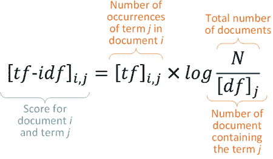

一旦我们得到了包含使用 `tf-idf` 生成索引的词-文档矩阵 `A`，就可以开始识别潜在主题。词-文档矩阵 `A` 在其维度上通常是非常稀疏、多噪声且冗余的矩阵。因此，为了找到捕捉词和文档之间关系的潜在主题，我们需要对 `A` 进行某种降维。在 LSA 中，这种降维是通过使用奇异值分解 (SVD) 完成的。SVD 是一种线性代数技术，用于将矩阵 (`A`) 分解为三个单独矩阵的积：词-概念矩阵 (`U`)、奇异值矩阵 (`S`) 和概念-文档矩阵 (`V`)，形式为 `A = U × S × V`，其中 `S` 是 `A` 的奇异值的对角矩阵。然后，最后一步是通过取两个向量之间夹角的余弦将文档分组为潜在主题，结果值接近 1 表示文档非常相似，而接近 0 的值表示文档非常不同。

早期主题建模方法的缺点之一是它们假设主题和文档之间存在显式关系。例如，它们假设一个文档只属于一个主题，但实际上，文档可以以不同程度属于多个主题，且每个词/术语也可以以不同程度属于每个主题。这一缺点在接下来讨论的潜在狄利克雷分配中得到了解决。

### 潜在狄利克雷分配

潜在狄利克雷分配 (LDA) 是今年最流行且可能最有效的主题检测技术。尽管已经出现了更现代的尝试来更好地检测/识别文本数据中的潜在主题——一些利用了深度学习（例如 RNN/LSTM 类型神经网络架构，这些在第 6 章，“预测建模中的高级主题](#ch06.xhtml#ch06)”中有所介绍），另一些使用词嵌入/Word2Vec 类型的方法——但 LDA 仍然是最常用的方法。LDA 使用狄利克雷先验/分布用于文档-主题和主题-词汇的关联/分配。狄利克雷分布是 LDA 的核心函数，是一类连续多元概率分布，由一个正实数向量参数化。事实上，它是 beta 分布的多元泛化，因此也称为多元 beta 分布。

LDA 是一种生成式概率模型，它使用无监督学习过程：给定一组训练数据，它的目标是通过从相同分布中生成样本来识别底层分布。在最高层次，LDA 描述了一个三层层次化的概率分配模型，其中每篇文档被建模为潜在主题集合的加权混合，而每个主题反过来又建模为潜在词汇集合的加权混合。图 7.9 展示了 LDA 的层次结构。


**图 7.9** LDA 组件的图形化描述：文档、单词和潜在主题

LDA 的算法细节可以在 Blei 等人（2003）的作品中找到，被认为是 LDA 算法的开基性工作。为了进一步解释 LDA 的内部结构和卓越的适用性，该开基性工作的第一作者、加州大学伯克利分校教授 David M. Blei 在其 *Communications of the ACM* 综述文章（Blei, 2012）中介绍了几个说明性示例。在其中一个示例中，他对《科学》杂志的 17,000 篇文章拟了一个包含 100 个主题的 LDA 模型。图 7.10 显示了这项研究的结果，左侧给出了示例推出的主题比例，右侧提供了四个最常见潜在主题的前 15 个高频（即加权）单词。


**图 7.10** 大规模科学文献的 LDA 输出示例

### 情感分析

我们人类是社会性动物。我们擅长利用各种手段来交换思想。在做出投资决定之前，我们经常会咨询财务论坛；我们会向朋友询问对新开餐厅和新上映电影的意见；在购买房屋、汽车或家电器等大件物品之前，我们会进行网络搜索并阅读消费者评论和专家报告。我们依靠他人的意见来做出更好的决策，特别是在我们没有太多知识或经验的领域。得益于富含信息的网络资源（如社交媒体平台如 Twitter、Facebook、在线评论网站和个人博客）日益增长可用性和普及，现在比以往任何时候都更容易找到他人对从最新电子产品到政治和公众人物等事物的成千上万种意见。尽管并不是每个人都在互联网上表达意见，但由于社交传播渠道数量和能力的快速增长，这一数字正呈指数级增加。

`Sentiment`（情感）是一个很难准确定义的词。它通常与其他术语相关或与之混淆，如 `belief`（信念）、`view`（观点）、`opinion`（意见）和 `conviction`（坚信）。`Sentiment` 暗示反映个人感受的细微观点（Mejova, 2009）。情感具有一些独特的属性，使其与我们可能在文本中识别的其他概念区分开来。通常我们想按主题对文本进行分类，这可能涉及处理整个主题分类体系。另一方面，情感分类通常处理两个类别（正面对 负面）、一个极性范围（例如电影的星级评分），甚至是一个意见强度的范围（Pang & Lee, 2008）。这些类别跨越了许多主题、用户和文档。虽然处理少数类别似乎比标准的文本分析是一个更容易的任务，但现实情况并非如此。

作为一个研究领域，情感分析与计算语言学、自然语言处理和文本挖掘紧密相关。情感分析也经常被称为 `opinion mining`（意见挖掘）、`subjectivity analysis`（主观性分析）和 `appraisal extraction`（评价提取），它与 `affective computing`（情感计算，即计算机对情绪的识别和表达）具有某些联系。情感分析处理自动提取文本中的意见、感受和主观性，该领域的兴趣和活动突然激增，为企业和个人创造了机遇和威胁。那些拥抱并利用它的人将从中极大受益。个人或公司发布在互联网上的每种意见（无论好坏）都将追溯回源者，并被他人（通常由计算机程序自动）检索和挖掘以用于各种目的。

情感分析试图通过各种自动化工具挖掘许多人的意见来回答“人们对某个主题有什么感觉？”的问题。情感分析将商业、计算机科学、计算语言学、数据挖掘、文本挖掘、心理学甚至社会学的研究人员和从业者汇聚，旨在将传统的基于基于文本分析扩展到新领域，以实现以意见为向的信息系统。在商业环境中，特别是营销和客户关系管理中，情感分析寻求通过大量的文本数据源（例如以网络帖子、推文、博客形式存在的客户反馈）检测对特定产品和/服务的有利和不利意见。

文本中出现的情感有两种类型：显性情感，即文本直接表达意见（“今天天气真好”），和隐性情感，即文本暗示意见（“手柄太容易断了”）。早期情感分析的大部分工作集中在第一种情感上，因为它更容易分析。目前的趋势是实施分析方法来同时考虑隐性和显性情感。情感极性是情感分析主要关注的文本特定特征。它通常被划分为两个领域——正面和负面——但极性也可以被看作一个范围。包含多个意见陈述的文档整体上将具有混合极性，这与完全没有极性（即客观性）是不同的（Mejova, 2009）。

### 情感分析应用

传统的的情感分析方法基于调查或以焦点小组为中心；它们成本高且耗费时间，因此由小样本参与者驱动。相比之下，基于文本分析的情感分析新面貌是一个突破者。目前的解决方案通过自然语言处理和数据挖掘技术，实现了极大规模的数据收集、过滤、分类和聚类，能够同时处理事实和主观信息。情感分析可能是文本分析最流行的应用，它利用了推文、Facebook 帖子、在线社区、讨论板、博客、产品评论、叫中心日志和录音、产品评分网站、聊天室、价格比较门户、搜索引擎日志和新闻组等数据源。接下来的章节讨论情感分析的应用，以说明这种技术的强大和广泛的覆盖。

#### 客户声音 (VOC)

客户声音是分析型 CRM 和客户体验管理系统中不可或缺的一部分。作为 VOC 的推动者，情感分析可以访问公司的产品和服务评论（持续或定期），以便更好地理解和管理客户的投诉和赞誉。例如，电影广告/营销公司可能会检测到对即将在院上映电影的负面情绪（基于预告片），并迅速更改预告片的组成和广告策略（在所有媒体渠道）以减轻负面影响。同样，软件公司可能会及早检测到对其新发布产品 Bug 的负面言论，从而发布补丁和快速修复以缓解局面。


通常，客户声音（VOC）的重点是个体客户及其与服务和支持相关的需求、愿和问题。VOC 从全客户触点中获取数据，包括电子邮件、调查、呼叫中心备注/录音以及社交媒体帖子，并将客户之声与企业运营系统中所捕获的交易（如查询、购买、退货）以及个人客户概况进行匹配。VOC 主要由情感分析驱动，是客户体验管理计划中的关键要素，其目标是与客户建立亲密的关系。

## 市场声音 (VOM)

VOM 关乎理解汇总意见和趋势。它旨在了解利益相关者（客户、潜在客户、影响者及其他人）对你以及你的竞争对手的产品和服务的看法。良好的 VOM 分析有助于公司进行竞争情报、产品开发和定位。

## 员工之声 (VOE)

传统上，VOE 局限于员工满意度调查。广义的文本分析，特别是情感分析，是评估 VOE 的巨大推动力。使用丰富的、带有观点的文本数据是倾听员工意见的一种有效且高效的方法。正如我们所知，快乐的员工能为客户体验工作赋能并提高客户满意度。

## 品牌管理

品牌管理侧重于倾听社交媒体，任何人（例如过去/当前/潜在客户、行业专家、其他权威）都可以发布可能损害或提升声誉的观点。许多较新成立的初创公司提供分析驱动的品牌管理服务。品牌管理侧重于产品和公司，而非侧重于客户。它试图利用情感分析技术来塑造感知而非管理体验。

## 金融市场

预测单个（或一组）股票的未来价值是一个有趣且似乎不可解决的问题。导致股票（或一组股票）上涨或下跌的因素绝非精确科学。许多人认为股市很大程度上由情绪驱动，使其变得极不理性（特别是短期股市波动）。因此，情感分析在金融市场中使用已变得非常流行。利用社交媒体、新闻、博客和讨论组对市场情绪进行自动分析，似乎是计算市场波动的一种恰方法。如果操作得当，情感分析可以根据市场热度识别短期股票波动，并可能影响流动性和交易。

## 政治

正如我们所知，观点在政治中至关重要。由于政治讨论被引用、讽刺以及对人物、组织和思想的复杂引用所主导，政治是情感分析中最困难且潜在成效最高的领域之一。通过分析选举论坛上的情绪，可能预测谁更有可能获胜或失败。情感分析可以帮助理解选民的想法，并澄清候选人在问题上的立场。情感分析可以帮助政治组织、竞选和新闻分析师更好地了解哪些问题和立场对选民最重要。自 2008 年美国总统选举以来，双方都成功将该技术应用于每次竞选。

## 政府情报

政府情报是情感分析的另一个应用。例如，有人建议监控来源是否存在敌对或负面信息的增加。情感分析允许对人们提交的关于待政策或政府监管提案的意见进行自动分析。此外，监控通信中的负面情绪峰可能对国土安全部等机构有用。

## 其他有趣领域

客户的情绪可用于更好地设计电子商务网站（例如产品建议、向上销售/交叉销售广告）、更好地投放广告（例如考虑页面情绪的动态广告），以及挖掘观点导向的搜索引擎（即观点聚合网站，作为 Epinions 等网站的替代方案）。情感分析可以通过对收到的邮件进行分类和优先级排序来帮助邮件过滤；例如，它可以检测出强烈负面或攻击性的邮件并将其转发到适当的文件夹。它还可以通过确定作者引用某项工作是作为支持证据还是作为其所否定的研究成果，来帮助引用分析。

### 情感分析流程

由于情感分析问题的复杂性（例如底层概念、文本中的表达方式、文本表达的语境），目前还没有现成的标准化流程来进行情感分析。然而，根据到目前为止情感分析领域已发表的作品（涵盖研究方法和应用范围），一个多步骤、简单且逻辑清晰的过程似乎是合适的。这些逻辑步骤是迭代的——也就是说，反馈、修正和迭代都是发现过程的一部分——并且具有实验性质，一旦完成并结合，它们能够产生关于文本集合中意见的预期见解。


**图 7.11** 情感分析的多步骤流程

#### 第 1 ：情感检测

在检索和准备文本文档之后，情感分析的第一个主要任务是检测客观性。这里的目标是区分事实和意见，这可以被视为将文本分类为客观或主观。这也可以被描述为计算客观-主观（`O-S`）极性，其值可以用 0 到 1 之间的数值表示。如果客观性值接近 1，则没有可以挖掘的意见（即它是一个事实），因此流程返回并获取下一条文本数据进行分析。通常，意见检测基于对文本中形容词的检查。例如，通过查看形容词，可以很容易地确定 `what a wonderful work` 的极性。

#### 第 2 ：N-P 极性分类


第二个主要任务是极性分类。给定一段带有观点的文本，其目标是将观点归类为两种对立的情感极性之一，或者确定其在两种极性之间连续体上的位置（Pang & Lee, 2008）。当被视为一个二分类特征时，极性分类是将带有观点的文档标记为表达整体正面观点或整体负面观点的二分类任务（例如：点赞/踩）。除了识别 N-P（负-正）极性外，还应该关注情感的强度；它不仅仅是积极，还可能被表达为轻微积极、中度积极、强烈积极或非常积极。针对产品或电影评论已经有了大量研究，在这些领域中，“正面”和“负面”的定义非常明确。其他任务（如将新闻分类为“好”或“坏”）则存在一些困难。例如，文章可能包含负面新闻，但并没有显式地使用任何主观词汇或术语。此外，当一个文档同时表达正面和负面情感时，这些类别通常会交织在一起。此时，任务可以是识别文档的主体（或主导）情感。尽管如此，对于长文本，分类任务可能需要在多个层级进行：术语级、短语级、句子级以及文档级。在这种情况下，通常会将一层的输出作为下一高层的输入。

## 第 3 步：目标识别

此步的目标是准确识别所表达情感的情对象（例如：人、产品、事件）。该任务的难度在很大程度上取决于分析的领域。尽管对于产品或电影评论准确识别目标通常很容易（因为评论与目标直接相关），但在其他领域可能非常有挑战性。例如，网页、新闻文章和博客等长篇通用性文本并不总是具有预定义的主题，它们经常提到许多对象，其中任何一个对象都可以推断为目标。有时一个情感句子中包含多个目标，比较性文本就是如此。主观比较句子根据偏好对对象进行排序，例如“这台笔记本电脑比我的桌面电脑好”。这类句子可以使用比较形容词和副词（例如 `more`、`less`、`better`、`longer`）、最高级形容词（例如 `most`、`least`、`best`）以及其他词汇（如 `same`、`differ`、`win` 和 `prefer`）来识别。一旦检索到句子，就可以按照最能代表其优点的顺序排列对象。

## 第 4 步：收集与聚合

一旦文档中所有文本数据点的情感被识别并计算，在这一步中，它们将被聚合并转换为整个文档的单一情感度量。这种聚合可能简单到累加所有文本的极性和强度，也复杂到使用自然语言处理中的语义聚合技术来得出最终情感。

## 极性识别方法

如前节所述，极性识别可以在单词、术语、句子或文档级进行。极性识别最细粒度的层次是单词级。在完成单词级极性识别后，可以将其聚合到下一个更高级，以此类推……直到达到情感分析所需的聚合层级。在单词/术语级进行极性识别似乎有两种主流技术，每种技术都有其优缺点：

*   使用词汇表作为参考库——可以是个人针对特定任务手动或或自动开发的，也可以由机构为通用目的开发。
*   使用训练文档集作为特定领域术语极性的知识来源（即从带有观点的文本文档中导出预测模型）。

## 总结

本章致力于文本分析。得益于通过 Web 2.0 和 3.0 以及社交媒体产生的海量文本内容，文本分析在商业分析和数据科学中变得越来越流行。文本分析有许多不同的名称，包括文本挖掘、文本处理和文本数据中的知识发现等。无论使用的具体名称为何，文本分析过程都涉及通过自然语言处理（NLP）和预测性分析，将非结构化的文本数据转换为可操作的信息。

本章在解释文本分析的特定术语、文本分析过程以及商业中各种文本分析应用之外，还涵盖了文本挖掘中两个极其受欢迎的实践领域：主题建模和情感分析。主题建模试图识别大量文本文档中的潜在主题，而情感分析则试图自动识别用户生成的文本内容中包含的情感和观点。

### 参考文献

Blei, D. M. (2012). “Probabilistic Topic Models,” *Communications of the ACM, 55(4): 77–84.*

Blei, D. M., Ng, A. Y., & Jordan, M. I. (2003). “Latent Dirichlet Allocation,” *Journal of Machine Learning Research*, 3: 993–1022.

Bond C. F., & B. M. DePaulo. (2006). “Accuracy of Deception Judgments,” *Personality and Social Psychology Reports*, 10(3): 214–234.

Chun, H. W., Y. Tsuruoka, J. D. Kim, R. Shiba, N. Nagata, T. Hishiki, & T. Tsujii. (2006, January). “Extraction of Gene-Disease Relations from Medline Using Domain Dictionaries and Machine Learning,” *Pacific Symposium on Biocomputing*.


- Masand, B. M., M. Spiliopoulou, J. Srivastava, & O. R. Zaïane. (2002). “用于模式和画像的 Web 挖掘，”*SIGKDD Explorations*, 4(2): 125–132.

- McKight, W. (2005, 1 月 1). “商业智能中的文本数据挖掘，”*Information Management Magazine*.

- Mejova, Y. (2009). *情感分析：概述*，[`www.academia.edu/291678/Sentiment_Analysis_An_Overview`](https://www.academia.edu/291678/Sentiment_Analysis_An_Overview) (访问于 2020 年 9 月)。

- Miller, T. W. (2005). *数据文本挖掘：业务应用方法*. Prentice Hall 出版社。

- Nakov, P., A. Schwartz, B. Wolf, & M. A. Hearst. (2005). “支持自然语言处理的标注层，”*Proceedings of the ACL*, 第 65–68 页。

- Pang, B., & L. Lee. (2008). *意见挖掘与情感分析*，[`www.cs.cornell.edu/home/llee/omsa/omsa.pdf`](http://www.cs.cornell.edu/home/llee/omsa/omsa.pdf) (访问于 2020 年 9 月)。

- Peterson, E. T. (2008). *客户之声：作为网站优化关键输入的定性数据*，[`foreseeresults.com/Form_Epeterson_WebAnalytics.html`](http://foreseeresults.com/Form_Epeterson_WebAnalytics.html) (访问于 2009 年 5 月)。

- Shatkay, H., A. Hoglund, S. Brady, T. Blum, 等。(2007). “SherLoc：整合文本和蛋白质序列数据高精度预测蛋白质亚细胞定位，”*Bioinformatics*, 23(11): 1410–1417。

- StatSoft. (2014). *Statistica 数据和文本挖掘用户手册*. StatSoft 公司。

- Weng, S. S., & C. K. Liu. (2004) “使用文本分类和多概念回答邮件，”*Expert Systems with Applications*, 26(4): 529–543。

- Zhou, Y., E. Reid, J. Qin, H. Chen, & G. Lai. (2005). “网络上的美国极端主义组织：链接与内容分析，”*IEEE Intelligent Systems*, 20(5): 44–51。

# 8. 用于预测分析的大数据

使用数据来理解客户或用户，并利用业务运营来维持（并促进）增长和盈利能力，对于当今的企业来说是一项日益具有挑战性的任务。随着越来越多的各种形式和方式的数据变得可用，用传统手段对数据进行及时处理已变得不现实。这种现象被称为`big data`（大数据），它正受到大量的媒体报道，并引起业务用户和 IT 专业人士日益增长的兴趣——事实上，`big data`这一术语正变成一个被过度炒作和过度使用的营销术语。

对于不同背景和兴趣的人来说，大数据意味着不同的含义。最初，`big data`这一术语用于描述由 Google 等巨型组织或 NASA 的研究科学项目分析的海量数据。但对于大多数企业来说，它是一个相对术语：`Big`取决于组织的大小。重点更多在于传统数据源内部和外部寻找新价值。推向数据分析的边界可以发现新的见解和机会，而`big`取决于你从哪里开始以及如何进行。考虑一下这个对大数据的流行描述：大数据超出了常用硬件环境范围和/或软件工具的能力范围，使其无法在其用户群体可接受的时间跨度内进行捕获、管理和处理。大数据已成为描述结构化和非结构化信息指数级增长、可用性和使用的流行术语。关于大数据趋势以及大数据如何作为创新、差异化和增长的基础已有许多著作。

## 大数据从何处来？

一个简单的答案是“无处不在”。曾经由于技术局限而被忽略的数据源现在被视为金矿。数据可能来自许多来源，包括博客、RFID 标签、GPS、传感器网络、社交网络、基于互联网的文本文档、互联网的搜索索引、详细的通话记录、天文学、大气科学、生物学、基因组学、核物理学、生化实验、医疗记录、科学研究、军事监控、摄影档案、视频存档以及大规模电子商务实践。

图 8.1 通过三级图说明了大数据的来源。传统数据源——主要是业务交易——被描述为第一层，其数据量、多样性和速度中等到低水平。下一层是由互联网和社交媒体产生的数据。这些由人类产生的数据对于理解人们的集体思想和感知可能是最复杂且可能最有价值的。这一层的数据量、多样性和速度中等到高水平。最顶层是机器产生的数据。由于许多领域数据采集系统的自动化以及物联网（将万物与万物连接起来），组织现在能够以几年前无法想象的规模和丰富度收集数据。这三层数据源都创造了丰富的信息，可以显著改进一个组织。

```
图 8.1 大数据的来源
```

**图 8.1** 大数据的广泛来源

大数据并不新奇。新奇的是大数据的定义和结构在不断变化。自 20 世纪 90 年代数据仓库出现以来，公司一直在存储和分析大量数据。虽然太字节（terabytes）曾是大数据的同义词，但现在我们说的是拍字节（petabytes），而且数据增长率持续升级。许多学者和行业分析师认为“大数据”是一个误名。也就是说，大数据不仅仅是“大”。纯粹的数据量仅仅是众多因素之一。

定义 定义大数据的三个 V

大数据通常由三个 V 来定义：量（volume）、多样性（variety）和速度（velocity）。除了这三者之外，我们看到一些领先的大数据解决方案供应商增加了其他 V，例如真实性（veracity，IBM）、可变性（variability，SAS）和价值主张（实际上所有人）。

### 量

量显然是大数据最常见的特征。许多因素导致了数据量的指数级增长，例如多年存储的基于交易的数据、从社交媒体不断流入的文本数据、日益增加的传感器数据、自动生成的 RFID 和 GPS 数据等。在过去，过量的数据造成了技术和财务上的存储问题。但随着今天先进技术结合存储成本的下降，这些问题不再显著；相反，出现了其他其他问题，包括如何在海量数据中确定相关性，以及如何从被认为相关的数据创造价值。

正如前面提到的，`big` 是一个相对术语。它随时间变化，并被不同组织以不同的方式感知。随着数据量的惊人增长，甚至下一层大数据的命名都具有挑战性。最高的数据单位曾是拍字节（PB），但现在我们谈论的是泽字节（ZB），它是一万亿吉字节（GB）或十亿太字节（TB）。随着数据量的增加，我们很难跟上对下一层公认的命名。[表 8.1](#ch08.xhtml#ch08tab01）提供了现代数据量大小和命名的概述（Sharda 等人，2014）。


# 表 8.1 针对增长数据量的命名

| 单位名称 | 符号 | 数值（字节） |
| --- | --- | --- |
| 千字节 (Kilobyte) | kB | 10³ |
| 兆字节 (Megabyte) | MB | 10⁶ |
| 吉字节 (Gigabyte) | GB | 10⁹ |
| 太字节 (Terabyte) | TB | 10¹² |
| 拍字节 (Petabyte) | PB | 10¹⁵ |
| 艾字节 (Exabyte) | EB | 10¹⁸ |
| 泽字节 (Zettabyte) | ZB | 10²¹ |
| 尤字节 (Yottabyte) | YB | 10²⁴ |
| 鸿字节 (Brontobyte) | BB | 10²⁷ |
| 垓字节 (Gegobyte) | GeB | 10³⁰ |

想象一下，每天每天产生 1 艾字节的数据，这相当于 2.5 亿张 DVD 的信息量。考虑到每年在网络上传输的信息量，更大规模的数据——即 1 泽字节——的想法也并不遥远。事实上，学术界和行业专家估计，到 2025 年，我们每年的互联网数据流量将超过 2 泽字节——而且很快，我们可能开始讨论更大规模的数据了。一些大数据科学家声称，美国国家安全局（NSA）和联邦调查局（FBI）拥有 1 尤字节的人类数据。为了直观理解这个衡量，1 尤字节相当于 250 万亿张 DVD 的存储容量。鸿字节（Brontobyte）虽然不是的 SI 单位，但显然被测量领域的一些人士所认可，它是 1 后面跟着 27 个 0。这种数量级可以用来描述我们未来十年（或更早）从物联网中获取的传感器数据类型。垓字节（Gegobyte）是 10³⁰。关于大数据的来源，请考虑以下内容（Higginbotham, 2012）：

*   欧洲核子中心的大强子对撞机每秒产生 1 拍字节的数据。
*   波音喷气飞机发动机的传感器每小时产生 20 太字节的数据。
*   Facebook 数据库每天吸收 500 太字节的新数据。
*   在 YouTube 上，每分钟上传 72 小时的视频，相当于每四分钟产生 1 太字节的数据。
*   拟议的平方公里阵列望远镜（拟议中世界最大的望远镜）每天产生 1 艾字节的数据。

这里是一些近期的历史视角：2009 年，全球拥有约 0.8 ZB 的数据；2010 年，超过了 1 ZB 的关口；2011 年底，数字为 1.8 ZB。IBM 估计，从现在起六到七年后，我们将拥有超过 100 ZB 的数据。这个数字令人惊叹，随之而来的挑战和机遇也是如此。

## 多样性 (Variety)

今天的数据以多种格式出现——从传统数据库到终端用户和 OLAP 系统创建的层级数据存储；到文本文档、电子邮件和 XML；到来自表收集、传感器捕获的数据；到视频、音频和股票报价数据。据某些估计，所有组织数据的 80% 到 85% 处于某种非结构化或半结构化格式（即不适合传统数据库模式的格式）。但其价值不容否疑，因此必须包含在分析中以支持决策。

## 速度 (Velocity)

根据知名且备受推崇的技术咨询公司 Gartner 的说法，`velocity`（速度）既指数据的产生速度，也指满足需求或要求必须处理数据（即捕获、存储和分析）的速度。RFID 标签、自动传感器、GPS 设备和智能表表推动着对近实时处理海量数据日益增长的需求。速度可能是大数据最被忽视的特征之一。


*   你希望将新的/当代数据源（例如社交媒体、RFID、传感器、网络、GPS、文本数据）引入你的分析平台，但你无法做到这一点，因为这些数据不符合数据存储模式定义的行和列，且你又不想牺牲新数据的保真度或丰富性。
*   你需要（或希望）尽快集成数据，以保持分析的实时性和时效性。
*   你希望使用“按需模式”（schema-on-demand，模式（与 RDBMS 中使用的预定义模式相反）的数据存储范式，因为新数据的性质可能尚不明确，或者没有足够的时间来确定并为其开发模式。
*   数据到达你机构门口的速度之快，以至于你传统的分析平台无法处理它们。

与任何其他大型 IT 投资一样，大数据分析的成功取决于许多因素。图 8.2 阐了最关键的成功因素（Watson, 2012）。


**图 8.2** 大数据分析的关键成功因素

以下是大数据分析最关键的成功因素：

*   **明确的业务需求（与愿景和战略保持一致）。** 业务投资应该为了业务的利益，而不是仅仅为了技术上的进步。因此，大数据分析的主要驱动力应该是业务需求，无论是在哪个层级：战略、战术或运营层面。
*   **强有力且投入的赞助（即执行层支持者）。** 众周知的事实是，如果没有强大且投入的执行层赞助，成功是很困难（甚至是不可能的）。如果范围是单个或少数分析应用，赞助可以处于部门级。然而，如果目标是企业级的组织转型（这通常是大数据倡议的情况），赞助需要达到最高水平，并且需要全公司范围。
*   **业务战略与 IT 战略的结合。** 确保分析工作始终支持业务战略——而不是反过来——至关重要。分析在执行业务战略时应该发挥赋能作用。
*   **基于事实的决策文化。** 在基于事实的决策文化中，驱动决策的是数据——而不是直觉、直感觉或假设。还有一种实验文化，以观察哪些是有效的，哪些是无效的。要建立基于事实的决策文化，高级管理层需要：
    *   承认有些人不能或不愿调整
    *   做一个发声的支持者
    *   强调必须停止过时的方法
    *   要求查看决策投入了哪些分析
    *   将激励和薪酬与期望的行为挂钩
*   **强大的数据基础设施。** 数据仓库已经为分析提供了数据基础设施。在大数据时代，这种基础设施正在随着新技术发生变化和增强。成功需要将旧的与新的相结合，以形成一个协同工作的整体基础设施。

随着数据规模和复杂性的增加，对更高效分析系统的需求也在增加。为了跟上大数据的计算需求，正在开发许多新的创新的计算技术和平台。这些技术统称为 `high-performance computing`（高性能计算），包括以下内容：

*   `In-memory analytics`（内存分析）通过允许在内存中处理分析计算和大数据，并将其分布在一组专用节点上，以高度准确的洞察近实时地解决复杂问题。
*   `In-database analytics`（数据库分析）通过在数据库内部执行数据集成和分析函数来加速洞察生成并实现更好的数据治理，这样你就无需反复移动或转换数据。
*   `Grid computing`（网格计算）通过在共享的集中管理的 IT 资源池中处理作业来提高效率、降低成本并提升性能。
*   `Appliances`（专用设备）将硬件和软件整合到一个物理单元中，该单元不仅速度快，还可以根据需要进行扩展。

计算需求只是大数据给当今企业带来的挑战列表中的一小部分。以下是业务高管发现对大数据分析成功实施具有重大影响的挑战列表。在考虑大数据项目和架构时，留意这些挑战将使通往分析能力的旅程少那么压力：

*   **数据量。** 能够以可接受的速度捕捉、存储和处理海量数据至关重要，这样决策者在需要时就能获得最新信息。
*   **数据集成。** 能够结合结构或来源不相似的数据，并以快速且合理的成本这样做，至关重要。
*   **处理能力。** 能够在捕获数据时快速处理数据至关重要。传统的收集后处理数据的方法可能不再适用。在许多情况下，数据需要在捕获后立即进行分析，以发挥最大的价值。（这一过程被称为 `stream analytics`（流分析），在本章后面将介绍。）
*   **数据治理。** 能够跟上大数据的安全、隐私、所有权和质量问题至关重要。随着数据量、多样性（格式和来源）和速度的变化，治理实践的能力也应该发生变化。
*   **技能可用性。** 大数据正在被新工具利用，并以不同的方式被审视。具备胜任工作的人（通常称为数据科学家，在本章稍后讨论）非常短缺。
*   **解决方案成本。** 由于大数据开启了一个可能改进的世界，因此有大量的实验和发现，以确定重要的模式和能转化为价值的洞察。因此，为了确保大数据项目的积极投资回报率，降低发现这些价值的解决方案成本至关重要。

挑战是现实，大数据的价值主张也是如此。业务分析领导者为帮助业务证明新数据价值所做的任何努力，将使组织从尝试大数据转向适应并将其作为差异化优势。探索本身没有问题，但大数据的价值最终来自于将洞察诸诸。

### 大数据分析解决的业务问题

大数据总体解决的主要业务问题是流程效率、成本降低和增强用户体验。然而，不同的行业会有不同的优先事项。流程效率和成本降低是可以通过分析大数据解决的常见业务问题，这些也是制造业、政府、能源和公用事业、电信和媒体、交通以及医疗保健部门利用大数据分析解决的问题领先。增强用户体验可能是保险公司和零售商解决的问题列表的首位。风险管理通常是银行和教育行业公司列表的首位。

以下是使用大数据分析可以解决的一些顶级问题：

*   流程效率和成本降低
*   品牌管理
*   收入最大化、交叉销售和向上销售
*   增强用户体验
*   流失识别和客户招募
*   改进客户服务
*   识别新产品和市场机会
*   风险管理


-   合规性
-   增强的安全能力

## 大数据技术

处理和分析大数据涉及许多项技术，其中大多数技术具有一些共同特征。主要是，它们利用廉价硬件来实现扩展性（scale-out）和并行处理技术；利用非关系数据存储能力来处理非结构化和半结构化数据；并将高级分析和数据可视化技术应用于大数据，以便向最终用户传递洞察结果。

接下来的章节将探讨三种极可能改变业务分析和数据管理市场的大数据技术：`MapReduce`、`Hadoop` 和 `NoSQL`。

### MapReduce

`MapReduce` 是一种由 Google 普及的技术，它将非常大的多结构数据文件的处理任务分布在大型机器集群上。通过将处理过程分成较小的工作单元，这些单元可以在集群中的数百个（甚至数千个）节点上并行运行，从而实现了高性能。在关于 `MapReduce` 的开创性论文中，Dean 和 Ghemawat (2004) 表示：

> MapReduce 是一种用于处理和生成大型数据集的编程模型以及相关的实现。以这种函数式编写的程序会在大型廉价机器集群上自动并行化并执行。这使得没有任何并行和分布式系统经验的程序员也能轻松地利用大型分布式系统的资源。

从这段话中需要注意的关键点是，`MapReduce` 是一种编程模型，而不是一种编程语言。也就是说，它是为程序员设计的，而不是为业务用户设计的。

为了了解 `MapReduce` 如何工作，让我们来看一个示例。图 8.3 显示了一个示例，其中 `MapReduce` 的输入是一组彩色正方形。目标是统计每种颜色正方形的数量。在这个示例中，程序员负责编写 `map` 和 `reduce` 程序；其余的处理则由实现 `MapReduce` 编程模型的软件系统处理。


**图 8.3** MapReduce 过程的图形描述

`MapReduce` 系统首先读取输入文件并将其分成多个部分。在这个示例中，有两个分片，但在实际场景中，分片的数量通常会高得多。这些分片随后由在集群节点上并行运行的多个 `map` 程序进行处理。在这种情况下，每个 `map` 程序的作用是根据颜色对分片中的数据进行分组。`MapReduce` 系统获取每个 `map` 程序的输出，并合并（即洗牌和排序）结果，以输入到 `reduce` 程序，该程序计算每种颜色正方形数量的总和。在这个示例中，只使用了一个 `reduce` 程序副本，但在实践中可能会更多。为了优化性能，程序员可以提供自己的洗牌和排序程序，还可以部署一个 `combin` 来合并本地 map 输出文件，以减少洗牌和排序步骤需要跨集群远程访问的输出文件数量。

#### 为什么要使用 MapReduce？

`MapReduce` 帮助组织处理和分析海量的多结构数据。应用示例包括索引和搜索、图分析、文本分析、机器学习和数据转换。这些类型的应用通常使用关系型 DBMS 采用的标准 `SQL` 实现。

`MapReduce` 的过程化特性使得熟练的程序员很容易理解。它还具有不需要开发人员担心实现并行计算的优势；系统会透明地处理这一点。

尽管 `MapReduce` 是为程序员设计的，但非程序员也可以利用预构建的 `MapReduce` 应用和函数库的价值。市上有商业和开源的 `MapReduce` 库，提供了广泛的分析能力。例如，`Apache Mahout` 是一个开源机器学习库，包含了聚类、分类和基于批的协同过滤算法，这些算法是用 `MapReduce` 实现的。

### Hadoop


`Hadoop` 是一个用于处理、存储和分析大规模分布式非结构化数据的开源框架。`Hadoop` 最初由 Doug Cutting 在 Yahoo! 创建，其灵感源于 `MapReduce`——这是 Google 在 21 世纪初开发的用于索引 Web 的自定义函数。`Hadoop` 设计用于处理分布在多个节点上的 PB 级和 EB 级数据。

`Hadoop` 集群运行在廉价的商品硬件上，因此项目可以进行扩展而无视预算。`Hadoop` 现在 Apache 软件基金的一个项目，数百名贡献者不断改进其核心技术。

#### Hadoop 如何工作

从根本上说，`Hadoop` 并不是用一台机器死磕巨大的数据块，而是将大数据分成多个部分，以便所有部分可以同时被处理和分析。客户端从包括日志文件、社交媒体馈送和内部数据存储在内的源访问非结构化和半结构化数据。它将数据分成部分，然后加载到由运行在商品硬件上的多个节点组成的文件系统中。`Hadoop` 的默认文件存储是 `Hadoop 分布式文件系统` (`HDFS`)）。`HDFS` 等文件系统擅长存储大量的非结构化和半结构化数据，因为它们不需要将数据组织成关系的行列。每个部分都会复制多次并加载到文件系统中，这样如果某个节点失败，另一个节点拥有故障节点上数据的副本。`name node`充充协调者，向客户端通信信息，例如哪些节点可用、某些数据位于集群的何处以及哪些节点已失败。

数据加载到集群中后，就可以通过 `MapReduce` 框架进行分析。客户端将一个 `map job`（通常是用 `Java` 编写的查询）提交给集群中的一个节点，该节点被称为 `job tracker`。`job tracker` 引用 `name node` 以确定完成作业需要访问哪些数据以及这些数据位于集群的何处。一旦确定，`job tracker` 将将查询提交给相关节点。处理并不是将所有数据带回中央位置进行，而是在每个节点上同时或并行发生的。这是 `Hadoop` 的一个基本特性。

当每个节点完成其给定的作业时，它会存储结果。客户端通过 `job tracker` 启动 `reduce job`，存储在单个节点上的本地 `map phase` 结果被聚合，以确定原始查询的“答案”，然后加载到集群中的另一个节点上。客户端访问这些结果，这些结果可以被加载到多个分析环境之一进行分析。此时，`MapReduce phase` 就完成了。

在 `MapReduce phase` 之后，处理后的数据已准备好供具有高级数据分析技能的数据科学家和其他人员进行进一步分析。数据科学家可以使用多种工具出于多种用途操作并分析数据，包括搜索隐藏的洞察和模式，或将其作为构建面向用户的分析应用程序的基础。数据还可以从 `Hadoop 集群` 建模并传输到现有的关系数据库、数据仓库和其他传统的 IT 系统，以进行进一步分析和或支持事务处理。

##### Hadoop 技术组件

`Hadoop` “栈”由多个组件组成，包括以下内容：


- **Hadoop 分布式文件系统 (HDFS)。** 这是任何 Hadoop 集类的默认存储层。
- **Name node（主节点）。** 这是 Hadoop 集群中的节点，负责向客户端提供特定数据存储在集群中的位置信息，以及是否有节点发生故障。
- **Secondary node（备节点）。** 它是 name node 的备份，备节点定期复制并存储来自 name node 的数据，以防其发生故障。
- **Job tracker（作业跟踪器）。** 这是 Hadoop 集群中负责启动和协调 MapReduce 作业或数据处理的节点。
- **Slave nodes（从节点）。** 作为任何 Hadoop 集群的执行者，从节点存储数据并接收来自 job tracker 的指令进行处理。

此外，Hadoop 生态系统由许多互补的子项目组成。如 `Cassandra` 和 `HBase` 等 NoSQL 数据存储用于存储 Hadoop 中 MapReduce 任务的结果。除了 `Java` 之外，某些 MapReduce 任务和其他 Hadoop 功能还使用 `Pig` 编写，这是一种专门为 Hadoop 设计的开源语言。`Hive` 是最初由 Facebook 开发的开源数据仓库，允许在 Hadoop 中进行分析建模。在 Sharda et al. (2014) 中可以找到丰富的 Hadoop 相关项目及支持工具/平台。

### Hadoop 的优缺点

Hadoop 的主要优势是它允许企业以成本和时间高效的方式处理和分析大量的（此前无法访问的）非结构化和半结构化数据。由于 Hadoop 集群可以扩展到 petabytes（拍字节）甚至 exabytes（艾字节）的数据，企业不再需要依赖样本数据集，而是可以处理并分析*所有*相关数据。科学家可以使用迭代方法进行分析，不断完善和测试查询，以发现以前未知的见解。此外，上手 Hadoop 并不并不。开发者可以免费下载 Apache Hadoop 发行版，并在不到一天的时间内开始实验使用 Hadoop。

Hadoop 及其众多组件的缺点是它们尚不成熟且仍在开发中。与任何其他新兴、原始的技术一样，实施和管理 Hadoop 集群以及对大量非结构化数据进行高级分析需要大量的专业知识、技能和培训。遗憾的是，目前 Hadoop 开发者和数据科学家仍然非常匮乏，这意味着对于许多企业来说，维护和利用复杂的 Hadoop 集群是不切行的。此外，随着社区对 Hadoop 众多组件的改进以及新组件的创建，存在分叉的风险（正如任何不成熟的开源技术/方法一样）。最后，Hadoop 是一个面向批处理的框架，这意味着它不支持实时数据处理和分析。

好消息是，IT 领域一些最顶尖的人正在为 Apache Hadoop 项目做出贡献，新一代 Hadoop 开发者和数据科学家正在崛起。因此，这项技术正在快速发展，变得更加强大，且更容易实施和管理。一个供应商生态系统——既有像 `Cloudera` 这样专注于 Hadoop 的初创公司，也有像 `IBM` 和 `Microsoft` 这样的老 IT 巨头——正致力于提供商业、企业级的 Hadoop 发行版、工具和服务，使部署和管理该技术成为传统企业的现实。其他处于前端的初创公司正致力于完善 NoSQL（全称为 Not Only SQL，将在本文稍后讨论）数据存储，这些存储系统能够结合 Hadoop 提供近实时的见解。

### 关于 Hadoop 的几个消除迷信的事实

尽管 Hadoop 和 MapReduce、`Hive` 等相关技术已经存在了多年，但许多人对它们仍存在一些误解。以下列 10 个事实旨在澄清 Hadoop 相对于商业智能（BI）是什么以及能做什么，以及在哪些业务和技术情况下基于 Hadoop 的 BI、数据仓库和分析是有用的（Russom, 2013）：

- **事实 1：Hadoop 不是一个单一产品。** 刚接触大数据的人通常认为 Hadoop 是让数据科学新时代发生变革的关键产品。实际上，Hadoop 不是一个单一产品；它是一个生态系统。它由多个开源产品（在 `Apache Hadoop Foundation` 伞下开发）组成，像幕后引擎一样工作，将大数据转换为做出更明智更快速决策所需的无价知识。`Apache Hadoop Foundation` 提供的产品库包括 `MapReduce`、`Hadoop 分布式文件系统 (HDFS)`、`Hive`、`HBase`、`Pig`、`Sqoop`、`Oozie`、`Hue`、`Zookeeper` 和 `Flume` 等。这些产品可以根据特定的业务分析问题和相关数据源进行配置。

- **事实 2：Hadoop 不仅来自 Apache；它是一个基于社区的生态系统。** Hadoop 解决方案库包含了多个来自 `Apache Foundation` 的产品，还包含了许多在大数据领域运行的供应商的产品。随着 Hadoop 流行度的演变，越来越多的社区和供应商加入这一运动，以使其变得尽可能全面和多功能。

- **事实 3：Hadoop 是一个开源社区项目。** Hadoop 作为开源软件库供任何人免费使用。它可以从 Apache 网站 `www.apache.org` 获取。几家初创公司为基于 Hadoop 库构建业务的公司提供软件包解决方案，并扩展其功能以满足客户的特定需求和要求。

- **事实 4：Hadoop 和 MapReduce 是两个互补的产品。** Google 在 Hadoop 分布式文件系统发明之前开发了 `MapReduce`。因此，早期版本的 `MapReduce` 并不依赖 `HDFS`，而是与其他的非 `HDFS` 数据存储技术工作（并且仍然可以工作），包括一些最常见的 DBMS。

- **事实 5：Hadoop HDFS 是一个文件管理系统，而不是关系型数据库管理系统。** Hadoop 主要在分布式环境中处理文件（而不是表和记录）。因此，它的数据粒度处于文件层级，因此它不具备与 DBMS 关联的一些常见功能，包括 SQL 查询、关系数据表、为了快速检索而设计的索引、对索引数据的快速访问等。作为回报，`HDFS` 能够在文件层级执行 DBMS 无法做的事情。

- **事实 6：Hive 看起来像 SQL 但不是标准 SQL。** `Hive` 是标准 SQL 的变体，用于操纵 DBMS 中的数据。对于熟悉 SQL 的数据分析师来说，学习编写 `Hive` 代码是一个相对快速且直接的过程。大数据领域的许多人相信并希望，随着每次迭代，`Hive` 将越来越接近 SQL 的语法，并在不久的将来某个时间点，标准 SQL 将被很方便地用于处理 Hadoop 产品族中的数据。

- **事实 7：Hadoop 不是数据仓库的替代品。** 在历史上，数据仓库的设计初衷是处理企业结构化的（通常是关系型的）数据。伴随着大数据的出现，数据仓库被批评为无法处理非结构化数据。Hadoop 产品族旨在通过处理数据仓库无法处理的非结构化数据类型来补充（至少目前不是替代）数据仓库。


## Hadoop 事实

- **事实 8：Hadoop 赋予分析能力。** 尽管 Hadoop 已被互联网公司广泛使用并关注，但它能够实现任何类型的分析，而不仅仅是网络分析（例如，分析网络日志和其他互联网数据）。例如，Hadoop 发挥其强大优势的一个领域是 IoT 数据的分析，这些数据主要由交通、能源、零售、制造（例如预测性维护）、电信和网络安全等行业的机器和传感器产生。

- **事实 9：MapReduce 不仅仅用于分析。** 尽管 MapReduce 与分析之间存在紧密的关系，但这种关系并非排他的。虽然 MapReduce 是一个通用的执行引擎（能够处理涉及并行编程、网络通信和容错的各种复杂任务），它并非专门用于分析应用程序；相反，它可以用于任何类型的计算任务。

- **事实 10：Hadoop 不仅关乎数量，还关乎数据的多样性。** HDFS 的设计不仅是为了处理非常大的分布式文件，还可以处理不同类型的文件。该过程非常简单；可以使用 Hadoop HDFS 构建的相当简单且直接的过程，存储并管理任何类型和大小的数据（集中式或分布式）。

## NoSQL

一种名为 `NoSQL`（代表 Not Only SQL）的相关新型数据库类型已经出现，它像 Hadoop 一样用于处理海量的多结构数据。然而，Hadoop 擅长支持大规模的批处理式历史分析，而 `NoSQL` 数据库的主要目标（尽管有一些重要的例外）是向终端用户和自动化大数据应用提供存储在大量多结构数据中的离散数据。这种能力是关系型数据库技术极极缺乏的，因为它根本无法在大数据规模下维持所需的应用性能水平。

在某些情况下，`NoSQL` 和 Hadoop 协同工作。例如，`HBase` 是一种模仿 `Google BigTable` 的流行 `NoSQL` 数据库，通常部署在 `HDFS` 之上，为 Hadoop 提供低延迟的快速查询。如今大多数 `NoSQL` 数据库的缺点是它们为了性能和扩展性而牺牲了 `ACID`（原子性、一致性、隔离性和持久性）一致性。许多数据库还缺乏成熟的管理和监控工具。这两个缺点正在被开源 `NoSQL` 社区和少数试图将各种 `NoSQL` 数据库商业化的供应商所克服。目前可用的 `NoSQL` 数据库包括 `HBase`、`Cassandra`、`MongoDB`、`Accumulo`、`Riak`、`CouchDB` 和 `DynamoDB` 等。

## 数据科学家

`data scientist` 是经常与大数据或数据科学相关的角色或工作。在很短时间内，它已成为市场上最受青的角色之一。在 2012 年一期《哈佛商业评论》发表的一篇文章，Thomas H. Davenport 和 D. J. Patil 将数据科学家称为“21 世纪最迷人的工作”。在文章中，他们指定数据科学家最基础、通用的技能是编写代码（使用最新的大数据语言和平台）。尽管这在不久的未来可能不再完全如此（因为那时会有更多人的名片上拥有“数据科学家”的衔），但在目前，这似乎是数据科学家所需的基本技能。一种更持久的技能是数据科学家需要用所有利益相关者都能理解的语言进行交流——并展示在数据故事讲述方面的特殊技能，无论是通过口头、视觉还是——理想情况下——两者结合（Davenport & Patil, 2012）。

数据科学家结合业务和技术技能来 `investigate` 大数据，寻找改进当前业务分析实践（从描述性到预测性和指导性分析）的方法，从而为新的业务机会改进决策。数据科学家与 BI 用户（如业务分析师）之间最大的区别之一是，数据科学家负责调查并寻找新的可能性，而 BI 用户则分析现有的业务状况和运营。

数据科学家被预期的一种主导特质是强烈的好奇心——渴望深入问题表面，找到其核心问题，并将其提炼为一组非常清晰的可以测试的假设。这通常涉及任何领域中最具创造力的科学家所具有的联想思维。例如，一位研究欺诈问题的数据科学家意识到这类似于一种类型的 DNA 测序问题（Davenport & Patil, 2012）。通过将这些不同的世界结合起来，他和团队能够制定出一种大幅减少欺诈损失的解决方案。

### 数据科学家来自哪里？

尽管对于在名称中使用 `science` 一词仍存在争议，但数据科学正成为一个争议较少的问题。传统上，科学家使用其他科学家制造的工具，如果没有，就自己制造，以此作为扩展知识的手段。这也是数据科学家所做的。例如，实验物理学家必须设计设备、收集数据、进行实验并交流结果。尽管他们可能不穿白大褂，也可能不在无菌实验室环境中，但数据科学家与实验物理学家具有相似的角色，即他们使用创造性的工具和技术将数据转化为可操作的信息。

关于数据科学家必须具备什么样的教育背景并没有共识。常见的候选人，如计算机科学、MIS、工业工程或最近的分析学的硕士或博士学位可能是必要的，但其中任何一个都不足以称某人为数据科学家。从这个意义上说，它有点类似于注册工程师 (`PE`) 或项目管理专业人员 (`PMP`) 角色，在这些角色中，经验与技术技能和教育背景一样重要（甚至更重要）。在未来几年内，看到专门为数据科学家设计的广泛认证计划将不为奇。

数据科学领域仍在定义中，其许多实践仍然处于实验阶段，且远未标准化。因此，公司对数据科学家的经验维度非常敏感。随着职业的成熟和实践的标准化，经验在定义数据科学家时将不再是一个问题。如今，公司正在寻找在处理复杂数据方面具有丰富经验的人，并且在招聘具有物理科学或社会科学教育和工作背景的人方面运气不错。一些最优秀、最才明的数据科学家拥有生态学和系统生物学等冷门领域的博士学位（Davenport & Patil, 2012）。尽管对于数据科学家来自哪里没有共识，但对于他们预期具备的技能和品质有一个共同的理解。`Figure 8.4` 显示了数据科学家所需技能的高层图示说明。

**图 8.4** 数据科学家需要的技能

数据科学家需要具备软技能，如创造力、好奇心、沟通/人际关系、领域专家、问题定义和管理技能（显示在 `Figure 8.4` 的左侧）。他们还需要良好的技术技能，如数据操纵、编程/黑客/脚本编写以及互联网和社交媒体/网络技术（显示在图右侧）。


# 大数据与流分析

正如本章早期讨论的，除了数量和多样性外，定义大数据的关键特征之一是速度（velocity），它指的是数据创建并流入分析环境的速度。组织正在寻找新方法在流式数据进入时就对其进行处理，以便对问题和机会做出快速准确的反应，从而满足客户并获得竞争优势。在数据流快速且持续汇入的情况下，处理之前累积的数据（即“静态数据”）的传统分析方法往往因为使用了过多脱离上下文的数据而得出错误决策，或者得出了正确决策但由于时间太晚，导致这些决策对组织已经没有用处。因此，对于许多业务场景而言，在数据创建后或流入分析系统后立即对其进行分析至关重要。

当大多数现代业务遵循的一个假设是，记录每一条数据都是重要的，因为数据可能包含现在或将来某个时刻价值的信息。然而，随着数据源的增加，“全量存储”的方法变得越来越难以实现，在某些情况下甚至是不可行的。事实上，尽管取得了进步，目前的存储容量仍落后于世界上生成的数字信息。此外，在不断变化的业务环境中，在给定的短窗口内对数据中有意义的变化以及复杂模式进行实时检测，对于产生更符合新环境的行动至关重要。这些事实引发了一种被称为`流分析`的范式。这种范式是为了应对无法永久存储以供随后分析的无限数据流挑战，以便及时高效地进行处理。

`流分析`（stream analytics，也称为`运动数据分析`和`实时数据分析`）通常指的是从持续流式数据中提取可操作信息的分析过程。`流`（stream）可以定义为数据元素的连续序列（Zikopoulos 等，2013）。流中的数据元素通常被称为 `tuples`（元组）。在关系型数据库中，`tuple` 类似于数据行（即一条记录、一个对象或一个实例）。但在半结构化或非结构化数据的范围内，`tuple` 是代表数据包的抽象，可以表述为给定对象的属性集。如果 `tuple` 本身的信息不足以进行分析，则需要 `tuples` 之间的关联或集体关系，并使用一组包含 `tuples` 的数据 `window`（窗口）。随着新数据的可用，`window` 会持续更新。`window` 的大小取决于正在分析的系统。流分析变得越来越流行，原因有两点：第一，从数据到行动的时间价值正在降低；其次，我们拥有技术手段在数据创建时对其进行采集和处理。

流分析最重要的应用之一已经在能源行业开发，特别是针对智能电网（电力供应链）系统。新的智能电网能够实时创建和处理多个数据流以满足真实的客户需求；它们还可以生成准确的预测，以应对意外的需求和再生能源高峰。

图 8.5 展示了能源行业流分析的一个通用用例（典型的智能电网应用）。目标是通过使用来自智能电表、生产系统传感器和气象模型的流式数据准确预测电力需求和产量。预测未来的趋势和实时检测异常的能力可优化供应决策（例如生产多少、使用什么来源、如何优化调整产能），以及调整智能电表以调节消费和优惠定价。


**图 8.5** 能源行业流分析用例

# 数据流挖掘

`数据流挖掘`（data stream mining）作为流分析的一项可用技术，是从连续、快速的数据记录中提取新模式和知识结构的过程。正如我们在书中看到的，传统的数据挖掘方法要求数据以适当的文件格式收集并组织，然后以递归方式处理以学习底层模式。相比之下，数据流是有序实例的连续流，在许多数据流挖掘应用中，由于计算和存储能力的限制，只能读取或处理少量。数据流示例包括传感器数据、计算机网络流量、通话、ATM 交易、网页搜索和金融数据。数据流挖掘可以被视为数据挖掘、机器学习和知识发现的子领域。

在许多数据流挖掘应用中，目标是在已知数据流中之前实例的类别或值的情况下，预测数据流中新实例的类别或值。特殊的机器学习技术（主要是传统机器学习技术的派生）可以用自动方式从标记示例中学习此预测任务。Delen 等（2005）开发了此类预测方法的示例，他们通过一次使用数据的子集逐渐构建并完善了决策树模型。

## 总结

我们生活在大数据世界中。有人说数据是新的石油。数据的价值——尤其是大数据——是不言而喻的。正如本章解释的，大数据在数量上是巨大的，而且数据类型非常丰富（包括文本、图像、视频、音频和机器生成的 IoT 数据），并在创建和提供方式上具有高速度。本章讨论了这些大数据特征以及它们为数据科学家带来的机会和挑战。本章还描述了大数据可用技术，包括 `Hadoop`、`MapReduce` 和 `NoSQL`，并解释了共同定义数据科学家角色的技术和非技术特征。

### 参考文献

Davenport, T. H., & D. J. Patil. (2012, October). “Data Scientist,” *Harvard Business Review*, pp. 70–76.

Dean, J., & S. Ghemawat. (2004). *MapReduce: Simplified Data Processing on Large Clusters*. [`research.google.com/archive/mapreduce.html`](http://research.google.com/archive/mapreduce.html) (accessed September 2020).

Delen, D., M. Kletke, & J. Kim. (2005). “A Scalable Classification Algorithm for Very Large Datasets,” *Journal of Information and Knowledge Management*, 4(2): 83–94.

Higginbotham, S. (2012). *As Data Gets Bigger, What Comes After a Yottabyte?* [`gigaom.com/2012/10/30/as-data-gets-bigger-what-comes-after-a-yottabyte`](http://gigaom.com/2012/10/30/as-data-gets-bigger-what-comes-after-a-yottabyte) (accessed September 2020).


Issenberg, S. (2012, October 29). “奥巴马做得更好，”*Slate*。[`slate.com/news-and-politics/2012/10/obamas-secret-weapon-democrats-have-a-massive-advantage-in-targeting-and-persuading-voters.html`](https://slate.com/news-and-politics/2012/10/obamas-secret-weapon-democrats-have-a-massive-advantage-in-targeting-and-persuading-voters.html) (访问于 2020 年 9 月)。

Kelly, L. (2012). *大数据：Hadoop、业务分析及以上*。[wikibon.org/wiki/v/Big\_Data:\_Hadoop,\_Business\_Analytics\_and\_Beyond](http://wikibon.org/wiki/v/Big_Data:_Hadoop,__Business_Analytics_and_Beyond) (访问于 2020 年 9 月)。

Romano, L. (2012, June 9). “奥巴马的数据优势，”*Politico*。[`www.politico.com/story/2012/06/obamas-data-advantage-077213`](https://www.politico.com/story/2012/06/obamas-data-advantage-077213) (访问于 2020 年 9 月)。

Russom, P. (2013). “破除关于 Hadoop 的 10 个神话，”*Best of Business Intelligence》，10: 45–46。

Samuelson, D. A. (2013, 2 月). “分析：奥巴马胜利的关键，”*OR/MS Today*，第 20–24 页。

Scherer, M. (2012, 11 月 7 日). “帮助奥巴马获胜的数据处理者的秘密世界，”*Time*。

Sharda, R., D. Delen, & E. Turban. (2014). *商业智能与分析：决策支持系统*。Prentice Hall 出。

Shen, G. (2013, 1 月–2 月). “大数据、分析与选举，”*INFORMS Analytics Magazine*。

Watson, H. (2012). “基于分析的组织的需求，”*Business Intelligence Journal*，17(2): 42–44。

Watson, H., R. Sharda, & D. Schrader. (2012). “大数据以及如何教学，”AMCIS 2012 研讨会，西雅图。

Zikopoulos, P., D. deRoos, K. Parasuraman, T. Deutsch, J. Giles, & D. Corrigan. (2013). *大数据的力量*。McGraw-Hill 出。

# 9 深度学习与认知计算

正如你将在本章看到的，广义的人工智能（AI）特别是机器学习方法正在快速发展和进步。来自组织内外部的大型数字化数据源（包括结构化和非结构化数据），结合先进的计算系统（软件和硬件组合），为开发解决几年前认为无法解决的复杂问题的智能解决方案铺平了道路。

深度学习和认知计算——处于人工智能系统的尖端——正在帮助企业通过利用快速增长的大数据资源来做出准确且及时的决策。正如学术界和工业界所证明的那样，新一代人工智能系统能够以显著不同的方式解决问题，产生远优于旧版本的结果。例如，在欺诈检测领域，传统方法一直只有微小的作用，其假误报率高于预期，并导致不必要的调查，从而引发了客户的不满。随着欺诈检测等老而棘手的问题重新出现并被重新构想和设计，深度学习等的人工智能技术正使这些问题以高准确性和适用性变得可以解决。

## 深度学习简介

大约年前，与电子设备对话（使用人类语言、智能地对话）在科幻电影之外是不可想象的。然而，得益于人工智能方法和技术的进步，几乎每个人都经历过这种不可思议的现象。你可能在某个时刻开车时，要求 `Siri` 或 `Google Assistant` 从你的手机通讯录中拨打号码，或寻找地址并提供特定的路线。你也可能要求过虚拟助手在 `Google Home` 或 `Alexa` 上播放音乐。你可能还发现 `Facebook` 在你上传的照片中对你的朋友给出了极其准确的标签建议。也许你最近没有尝试翻译外语手稿，但如果你尝试一下，你会发现它像使用 `Google Translate` 手机应用拍照一样简单。这些只是不断增加的深度学习应用中的冰一角，这些应用承诺让人们的生活变得更加轻松。

深度学习作为人工智能和机器学习家族中最新、可能也是目前最受欢迎的成员，其目标与之前的机器学习方法相似：使用数学算法从数据学习来模仿人类的思维过程。那么，深度学习真正的不同之处（以及先进之处）在哪里？正如其名称所示，决策树`decision trees`、支持向量机`support vector machines`、逻辑回归`logistic regression`和神经网络等机器学习算法的性能很大程度上依赖于数据的表示。也就是说，只有当我们（分析专业人员或数据科学家）以适当格式为这些机器学习算法提供相关且充分的信息（即特征）时，它们才能“学习”模式，并以可接受的准确水平执行预测（分类或估计）、聚类或关联任务。换句话说，这些算法需要人类手动识别并推导出与当前问题目标在理论和/或逻辑相关的特征，并将这些特征输入算法。例如，为了使用决策树预测给定客户是否会回归（或流失），营销经理需要向算法提供客户的社会经济特征信息——如收入、职业和受教育水平（以及与公司的人口统计和历史互动/交易信息）。但算法本身无法定义此类社会经济特征并提取此类特征，例如从客户填写的调查表或从社交媒体获取的信息中提取。

虽然这种结构化的、人工干预的机器学习方法对于相当抽象和正式的任务效果良好，但要让它适用于某些非正式但看似简单（对人类而言）的任务（如人脸识别或语音识别）是极具挑战性的，因为这类任务需要大量的世界知识（Goodfellow et al., 2016）。例如，仅通过手动提供许多语法或语义特征，来训练机器学习算法准确识别人们所说这句话的真实含义是不直接的。完成此类任务需要深度的世界知识，这些知识很难形式化和显式呈现。深度学习为经典机器学习方法增加的实际上是自动获取完成此类非正式任务所需的知识，并因此提取出有助于提升系统性能的高级特征的能力。


为了对深度学习有深入的理解，了解它在 AI 方法的宏观家族中所处的位置至关重要。一个简单的层级关系图，或者类似于分类法的表示方法，可能会提供这种整体理解。在尝试创建这种分类法时，Goodfellow 及其同事（2016）将深度学习归类为**表示学习**方法族的一部分。表示学习技术属于机器学习的一种类型（这也是 AI 的一部分），其重点在于系统不仅要学习和发现特征，还要发现从这些特征到输出/目标的映射关系。图 9.1 使用维恩图来说明了深度学习在广泛的基于 AI 的学习方法家族中的位置。


图 9.1 显示深度学习在基于 AI 的学习方法中的位置维恩图

图 9.2 突出了构建典型的深度学习模型时需要执行的步骤/任务，与使用经典机器学习算法构建模型时所执行的步骤/任务之间的差异。在图中，阴影框表示能够直接从数据中学习的组件。如顶部两个工作流所示，基于知识的系统和经典机器学习方法需要数据科学家手动创建特征（即表示）以获得所需的输出。图中底部的工作流显示，深度学习允许计算机从简单概念中导出一些复杂的特征，而这些特征让类手动发现需要耗费大量精力（或者在某些问题情况下是不可能的）；然后该图将这些高级特征映射到所需的输出。


图 9.2 经典机器学习方法与表示学习/深度学习之间的关键差异

从方法的角度来看，尽管深度学习通常被认为是机器学习的一个新领域，但它的最初思想可以追溯到 20 世纪 80 年代末，人工神经网络出现几年后，LeCun 等人（1989）发表了一篇关于应用反传播网络识别手写邮政编码的文章。事实上，从今天的实践来看，深度学习似乎只是神经网络的延伸，其想法是深度学习能够通过采用许多层连接的神经元以及大量的数据集来自动表征变量并解决问题，从而以更高的水平处理更复杂的任务——但这是以巨大的计算量为代价的。这种极高的计算需求和对大型数据集的需求是最初的想法必须等待二十多年的两个主要原因，直到某些先进的计算和技术基础设施出现，深度学习才得以实现。尽管由于相关技术的进步，神经网络的规模在过去十年中大大增加，但据估计，要拥有与人类大脑具有相当神经元数量和复杂程度的人工深度神经网络，还需要几十年的时间。

除了前面提到的计算机基础设施外，大型且特征丰富的数字化数据集的可用性是近年来深度学习应用取得成功的另一个关键因素。让深度学习算法获得良好的性能曾是一项非常困难的任务，需要丰富的技能、经验和对设计特定任务网络的深入理解，因此没有多少人能够为了实际和/或研究目的而开发深度学习。然而，大型训练数据集极大地弥补了对深入知识的匮乏，并降低了实现深度神经网络所需的技能水平。尽管如此，尽管可用数据集的大小在近年来呈指数级增长，但现在的一大巨大挑战（特别是对于深度网络的监督学习）是对这些庞大数据集中的案例进行标记。因此，大量的研究正在进行，重点关注我们如何利用海量未标记数据进行半监督学习或无监督学习，或者我们如何开发在合理的时间内批量标记示例的方法。

下一节将对神经网络进行通用介绍，神经网络是深度学习起源的“浅层”智能。接下来，本章介绍了不同类型的深度学习架构及其工作原理、这些深度学习架构的一些常见应用，以及在实践中实现深度学习的一些常用计算机框架。正如所提到的，由于深度学习的基础与人工神经网络的基础相同，因此在接下来的节中，我们将简要介绍神经网络架构——多层感知器（MLP）类型的神经网络——并重点关注数学原理，然后查看各种类型的深度学习架构/方法是如何从这些基础上推导出来的。

### “浅层”神经网络的基础

人工神经网络本质上是人类大脑及其复杂的生物神经元网络的简化抽象。人类大脑拥有数十亿个互连的神经元，它们促进了我们的思考、学习和对周围世界的理解。从理论上说，学习无非建立和适应新的或现有神经元间的连接。然而，在人工神经网络中，神经元是处理单元（也称为处理元件 [PEs]），它们对来自输入变量或其他神经元输出的数值执行预定义的数学操作，以创建并推出它们自己的输出。图 9.3 显示了单输入单输出神经元的示意图——或更准确地说，人工神经网络中的 PE。


图 9.3 通用单输入神经元表示图

在此图中，`p` 代表数值输入。每个输入进入具有可调整权重 `w` 和偏置项 `b` 的神经元。乘`权重函数`将权重应用于输入，`净输入函数` `Σ` 将偏置项加到加权输入 `z` 上。净输入函数的输出（`n`，被称为`净输入`）然后通过另一个称为`传输`（又名激活）函数（由 `f` 显示）进行转换并产生实际输出 `a`。换句话说：

```
a = f (wp + b)
```

作为一个数值示例，如果 `w` = 2，`p` = 3，且 `b` = −1，那么

```
a = f(2 × 3 − 1) = f(5)
```

在神经网络的设计中，常用各种类型的传输函数。表 9.1 显示了一些最常见的传输函数及其对应的操作。注意，在实践中，为网络选择合适的传输函数需要对神经网络有广泛的了解——数据的特征以及创建该网络的特定目的。


表 9.1 神经网络中常见的传输（激活）函数


例如，如果在上一个例子中我们使用硬限传输函数，那么实际输出 `a` 将是 `a = hardlim(5) = 1`。为网络中的每组神经元选择合适的传输函数有一些指南。这些指南对于位于网络输出层的神经元特别适用。例如，如果模型的输出性质是二元的，我们建议在输出层使用 `sigmoid` 传输函数来产生 0 到 1 之间的输出，这代表在给定 `x` 的情况下 `y = 1` 的条件概率，即 `P(y = 1 | x)`。许多神经网络教科书中神经网络的不同层中提供并详述了这些指南，既具有一致性，也存在许多分歧，这表明最佳实践应该（通常也是）来自经验。

通常，一个神经元有多个输入。在多个输入的情况下，每个单独输入 `p[i]` 都可以视为输入向量 `p` 的一个元素。每个单独输入值都有其对应权重向量 `W` 中的可调权重 `w[i]`。图 9.4 显示了一个具有 `R` 个单独输入的多输入神经元。


**图 9.4** 具有 R 个单独输入的典型多输入神经元

对于该神经元，净输入 `n` 可以表示为：

`n = w[1,1]p[1] + w[1,2]p[2] + w[1,3]p[3] + … + w[1,R]p[R] + b`

将输入向量 `p` 视为 `R` × 1 向量，将权重向量 `W` 视为 1 × `R` 向量，`n` 可以写成矩阵形式：

`n = Wp + b`

其中 `Wp` 是一个标量（即 1 × 1 向量）。

此外，每个神经网络通常由多个相互连接的神经元组成，并结构成连续的`layers`，使得某一层的输出可以作为下一层的输入。图 9.5 显示了一个典型的神经网络，其输入层（即第一层）有三个神经元，隐藏层（即中间层）有四个神经元，输出层（即最后一层）有一个单个神经元。每个神经元都有自己的权重、加权函数、偏置和传输函数，并如所述处理着其自身的输入。


**图 9.5** 具有三层八个神经元的典型神经网络

虽然给定网络中的输入、加权函数和传输函数是固定的，但权重和偏置的值是可以调整的。神经网络中调整权重和偏置的过程通常被称为`training`。事实上，在实践中，除非通过足够数量已知`actual outputs`（也称为`targets`）的示例进行良好训练，否则神经网络无法有效用于预测问题。训练过程的目标是调整网络权重和偏置，使得网络对每组输入（即每个样本）的输出都与其对应的目标值足够接近。

### 人工神经网络的元素

神经网络由处理元素组成，这些元素以不同的方式组织以形成网络结构。神经网络的基本处理单元是神经元，通过组织多个神经元来建立神经元网络。神经元可以用多种不同的方式组织；这些不同的网络模式被称为`topologies`或`network architectures`。最流行的方法之一被称为`feedforward-multi-layered perceptron`，它允许所有神经元将一层的输出连接到下一层的输入，但它不允许任何反馈连接（Haykin, 2009）。

#### 处理元素 (PEs)

ANN 的`PE` 是人工神经元。每个神经元接收输入、处理这些输入并交付单个输出，如图 9.5 所示。输入可以是原始输入数据，也可以其他处理元素的输出。输出可以是最终结果（例如，1 表示是，0 表示否），也可以输入到其他神经元。

#### 网络结构

每个 ANN 由神经元集合组成，这些神经元被分成层。典型结构如图图 9.6 所示，其中缩写含义如下：

| PE | 处理元素（生物神经元的人工表示） |
| --- | --- |
| `X[i]` | `PE` 的输入 |
| `Y` | `PE` 生成的输出 |
| `∑` | 求和函数 |
| `f` | 激活/传输函数 |


**图 9.6** 具有隐藏层的神经网络

注意图中的三层：输入、中间（称为`hidden layer`）和输出。隐藏层是接收前层输入并将其转换为输出的神经元层。可以在输入和输出层之间放置多个隐藏层，在这种情况下，隐藏层将输入转换为线性组合并传递到输出层。在人工神经网络中，当处理信息时，许多处理元素同时进行计算。这种并行处理类似于人类大脑的工作方式，与传统的串行计算不同。

##### 输入

每个输入对应一个属性。例如，如果问题是决定是否批准贷款，属性可能包括申请人的收入水平、年龄和房屋所有权状况。属性的数值或非数值属性的数值表示是网络的输入。多种类型的数据（如文本、图片和语音）都可以作为输入。可能需要预处理将符号/非数值数据转换为数值数据。

##### 输出

网络的输出包含问题的解决方案。例如，在贷款申请的情况下，输出可以是“是”或“否”。ANN 为输出分配数值，然后可能需要使用阈值将其转换为分类输出，以便“是”的结果为 1，“否”的结果为 0。

##### 连接权重

连接权重是 ANN 的关键元素。它们表示输入数据的相对强度（或数学值）以及层与层之间传输数据的许多连接。换之，权重表示每个输入对处理元素以及最终对输出的重要性。权重的重要性在于它们存储了学习模式。网络通过反复调整权重来学习。

##### 求和函数

求和函数计算进入处理元素的所有元素的加权和。求和函数将每个输入值乘以其权重并汇总这些值以加权和。单个处理元素中 `n` 个输入（用 `X` 表示）的公式如图 9.7a 所示，对于多个处理元素，求和函数公式如图 9.7b 所示。


**图 9.7** 求和函数：(a) 单个神经元/PE 和 (b) 多个神经元/PE

##### 传输函数


求和函数计算神经元的内部刺激或激活水平。根据该水平，神经元可能会产生输出，也可能不产生。内部激活水平与输出之间的关系可以是线性的，也可以是非线性的。这种关系通过几种类型的转换（传输）函数之一来表示。（常用激活函数列表请参阅表 9.1）。特定激活函数的选择会影响网络的运行。图 9.8 展示了一个简单的型 `sigmoid` 类型激活函数的示例计算过程。


**图 9.8** ANN 传输函数示例

转换修改输出水平，使其适应于合理的数值范围（通常在 0 到 1 之间）。这种转换在输出到达下一层之前进行。如果没有这种转换，输出值将变得非常大，特别是当存在多层神经元时。有时使用阈值代替转换函数。阈值是神经元输出以触发下一层神经元的门槛值。如果输出值小于阈值，则不会传递给下一层神经元。例如，任何 0.5 或以下的值都变为 0，任何大于 0.5 的值变为 1。转换发生在每个处理元素的输出处，也可以仅在最终输出节点处执行。

## ANN 中的学习过程

在*监督学习*中，学习过程是归纳性的；也就是说，连接权重是从现有案例得出的。通常的学习过程涉及三项任务（参阅图 9.9）：

1. 计算临时输出。
2. 将输出与期望目标进行比较。
3. 调整权重并重复该过程。


**图 9.9** ANN 中的监督学习过程

与任何其他监督机器学习技术一样，神经网络的训练通常通过定义一个性能函数 `F`（又称为*代价函数*或*损失函数*）并通过改变模型参数来优化（最小化）该函数来完成。通常，性能函数只是网络所有输入端误差（即实际输入与目标之间的差异）的度量。有几种类型的误差度量（例如，平方和误差、均方误差、交叉熵，甚至是自定义度量），它们都旨在捕捉网络输出与实际输出之间的差异。

训练过程从使用某些随机权重和偏置为给定输入集计算输出开始。一旦获得了网络输出，就可以计算性能函数。对于给定的输入集，实际输出 `Y` 或 `Y[T]` 与期望输出 `Z` 之间的差异称为误差 `delta`。（在微积分中，希腊字母 delta，`Δ`，表示“差异”。）

目标是最小化 `delta`（即如果可能，将其减为 0），这通过调整网络权重来实现。关键是在正确的方向上改变权重，做出能够减少 `delta`（即误差）的变化。不同的 ANN 以不同的方式计算 `delta`，取决于所使用的学习算法。对于各种情况和 ANN 配置，有数百种学习算法可用。

### 用于 ANN 训练的反向传播

神经网络性能的优化（即误差或 `delta` 的最小化）通常通过一种称为随机梯度下降 (`SGD`）的算法完成，这是一种基于梯度的迭代优化器，用于寻找性能函数中的最小值（即最低点），如神经网络所示。`SGD` 算法后的的思想是，性能函数对于每个当前权重或偏置的导数指示了该权重或偏置元素每变化一个单位时误差的变化量。这些导数被称为*网络梯度*。在神经网络中计算网络梯度需要应用一种称为*反向传播*的算法，这是最流行的神经网络学习算法，它应用*微积分的链式法则*来计算由已知导数的函数复合而成的函数的导数。（有关该算法的数学细节的更多信息，请参阅 Rumelhart 等人，1986 年。）

反向传播（*back-error propagation* 的缩写）是最常用的监督学习算法（Principe 等人，2000 年）。通过使用前述的 `SGD` 算法，反向传播的实现相对简单。带有反向传播的神经网络包含一个或多个隐藏层。这种网络被认为是前馈的，因为处理元素的输出与同一层中结的输入之间没有相互连接。在（监督）训练期间，外部提供的正确模式与神经网络的输出进行比较。（误差容限是预先设置的。）

从输出层开始，网络生成的实际输出与期望输出之间的误差被用于纠正/调整同层之间或前层连接的权重。使用 sigmoid 函数 `f = [1 + exp(-x)]^-1`（其中 `x` 与加权输入和成正比）是实践中计算神经元输出的有效方法。使用这种函数，sigmoid 函数的导数 `df/dx = f (1 - f)` 以及误差是期望和实际输出的简单函数。因子 `f (1 - f)` 是逻辑函数，用于保持误差修正在良好范围内。然后对 `j` 个神经元的每个输入的权重根据计算出的误差进行更改。可以推导出更复杂的表达式，从输出神经元通过隐藏层以类似的方式反向工作，以计算关联权重的修正。


**图 9.10** 单神经元的误差反传播

在反向传播中，学习算法遵循以下步骤：

1. 使用随机值初始化权重并设置其他参数。
2. 读取输入向量和期望输出。
3. 通过计算层层向前计算实际输出。
4. 计算误差。
5. 通过从输出层通过隐藏层反向工作改变权重。


该过程对整个输入向量集重复进行，直到期望输出与实际输出在预先定义的容差范围内一致。考虑到单次迭代的计算需求，训练大型网络可能花费很长时间；因此，在一种变体内，会对一组情况进行正向运行，并将聚合后的误差反向传播以加速学习。有时，取决于初始随机权重和网络参数，网络无法收敛到满意的性能水平。在这种情况下，必须生成新的随机权重，并在进行下一次尝试之前，可能需要修改网络参数，甚至是网络结构。目前的研究目标是开发算法并利用并行计算机来改进这一过程。例如，遗传算法可以指导网络参数的选择，以使期望输出的性能最大化。事实上，大多数人工神经网络（ANN）软件工具现在都使用遗传算法来帮助用户以半自动的方式优化网络参数。

任何类型的机器学习模型训练的核心关注问题是过拟合。当训练后的模型与训练数据集高度拟合，但在外部数据集上的表现很差时，就会发生过拟合。过拟合会导致模型泛化能力出现严重问题。被称为`regularization`策略的一组策略旨在通过对模型参数或性能函数进行更改或定义约束来防止模型过拟合。

在经典的小型 ANN 模型中，避免过拟合的一种常用正则策略是在每次迭代后对单独的验证数据集和训练数据集评估性能函数。每当验证数据的性能停止改进时，训练过程停止。图 9.11 显示了误差随训练迭代次数变化的典型图表。所示，在开始，随着迭代次数的增加，训练数据和验证数据的误差都会减少；但从某个特定点（由虚线所示），误差在验证集上开始增加，而在训练集中仍在减少。这意味着在超过该迭代次数后，模型对用于训练的数据集产生了过拟合，当输入某些外部数据时，它并不一定能良好运行。该点实际上代表了给定神经网络训练的推荐迭代次数。


**图 9.11** ANN 过拟合的说明——随着迭代次数增加，训练数据和验证数据中的误差率逐渐变化

## 深度神经网络

直到最近——也就是说，直到深度学习的出现——大多数神经网络应用都涉及仅包含少数隐藏层且每层神经元数量有限的网络架构。即使在神经网络相对复杂的业务应用中，网络中的神经元数量也几乎没有超过几千个。事实上，当时计算机的处理能力是一个巨大的限制性因素，中央处理器（CPU）几乎无法在合理的时间内运行超过几层的网络。近年来，图形处理器（GPU）的发展以及相关的编程语言（例如 NVIDIA 的 `CUDA`）使得人们能够将它们用于数据分析，这导致了神经网络更进阶的应用。GPU 技术使我们能够成功运行拥有超过 100 万个神经元的神经网络。这些更大的网络能够更深入地挖掘数据特征，并提取出其他无法检测到的复杂模式。

虽然深度网络可以处理多得多的输入变量，但它们还需要较大的数据集才能获得满意的训练；使用小型数据集训练深度网络通常会导致模型对训练数据产生过拟合，并在应用于外部数据时产生糟糕且不可靠的结果。得益于基于互联网和物联网（IoT）的数据采集工具和技术，现在许多应用领域都有了更大的数据集用于更深层次的神经网络训练。

常规 ANN 输入通常是一个大小为 `R` × 1 的数组，其中 `R` 是输入变量的数量。但在深度网络中，我们可以使用 `tensors`（即 `n`-维数组）作为输入。例如，在图像识别网络中，每个输入（即图像）可以用一个表示图像像素所用颜色代码的矩阵来表示；或者用于视频处理，每个视频可以表示为几个矩阵（即 3D 张量），每个矩阵代表视频涉及的一帧图像。换句话说，张量为我们提供了在分析数据集时包含额外维度（例如时间、位置）的能力。

除了这些通用区别外，不同类型的深度网络涉及对标准神经网络架构的各种修改，使其具备针对高级目的处理特定类型数据的独特能力。在接下来的章节中，我们将讨论这些特殊网络类型及其特征。

### 前馈多层感知器 (MLP) 深度网络

MLP 深度网络也称为 `deep feedforward networks`，是最通用的深度网络类型。这些网络仅仅是大规模的神经网络，可以包含许多层神经元并处理张量作为输入。网络元素（即权重函数、传递函数）的类型和特征与标准 ANN 模型非常相似。这些模型被称为 `feedforward`（前馈），是因为通过它们的信息流始终是正向的，且不允许反馈连接（即模型输出回传到模型的连接）。允许反馈连接的神经网络被称为 `recurrent neural networks`（`RNNs`）。（通用 RNN 架构以及一种名为 `long short-term memory networks` 长短期记忆网络的特定 RNN 变体将在本章后面讨论。）

通常，在 MLP 类型的网络架构中，输入层和输出层之间必须保持顺序顺序。这意味着输入向量必须顺序通过所有层，而不能跳过任何一层；此外，它不能直接连接到第一层以外的任何层；每一层的输出都是下一层的输入。图 9.12 提供了典型 MLP 网络前三层的向量表示。所示，进入每层只有一个向量，该向量要么是原始输入向量（第一层为 `p`），要么是网络架构中前一个隐藏层的输出向量（第 `i` 层为 `a^(i-1)`）。然而，为了某些特殊目的而设计的 MLP 网络架构的特殊变体在这些情况下违反这些原则。


**图 9.12** 典型 MLP 网络前三层的向量表示


在许多深度 MLP 的实际应用中，性能（损失）函数的优化是一项具有挑战性的任务。问题在于，对于权重和偏置进行随机初始化并应用常用的基于梯度的训练算法，这在浅层神经网络中寻找最优参数集通常非常有效，但在大多数情况下可能会导致陷入局部最优解，而不是捕捉到参数的全局最优值。随着网络深度的增加，使用随机初始化结合梯度的算法达到全局最优的概率会降低。在这种情况下，使用某些`unsupervised`（无监督）深度学习方法（如深度置信网络 DBN）预训练网络参数通常是有帮助的（Hinton et al., 2006）。DBN 是一类被称为`generative models`（生成模型）的大型深度神经网络。2006 年 DBN 的引入被认为是当前深度学习复兴的开始（Goodfellow et al., 2016），因为在此之前，深度模型被认为太难优化了。事实上，如今 DBN 的主要应用是通过预训练其参数来改进分类模型。

使用这些无监督学习方法，我们可以从第一层开始，逐层训练 MLP 层；我们可以将每一层的输出作为下一层的输入，并使用无监督学习算法初始化该层。最后，我们将获得整个网络参数的一组初始化值。这些预训练的参数可以用于 MLP 监督学习的初始值，而不是随机初始化的参数。这种预训练程序显著提升了深度分类应用的性能。图 9.13 展示了使用（蓝色圆圈）和不使用（黑色三角形）参数预训练训练深度 MLP 网络时产生的分类错误（Bengio, 2009）。在该示例中，蓝线代表使用纯监督方法（在 1000 万个示例上训练）的分类模型（在 1,000 个留出示例上测试）的观测错误率；黑线表示在相同的测试数据集集上，当最初使用 250 万个示例进行网络参数的无监督训练（使用 DBN），然后使用其他 750 万个示例以及初始化参数来训练监督分类模型时的错误率。图表清楚地显示，由深度置信网络预训练的模型在分类错误率有了显著提高。


**图 9.13** 预训练网络参数对提高分类类型深度神经网络结果的影响

### 更多隐藏层优于更多神经元？

关于深度 MLP 模型的一个重要问题是：“将只有少数层但每层包含许多神经元的网络进行这种重构是否有意义（并能产生更好的结果）？”换句话说，既然我们可以在少数层中包含相同数量的神经元（即宽网络而非深层网络），为什么我们还需要许多层的深度 MLP 网络呢？根据通用近似定理（Cybenko, 1989; Hornik, 1991），一个足够大的单层 MLP 网络可以近似任何函数。虽然在理论上是成立的，但这种具有许多神经元的层可能巨大到无法接受，因此可能无法正确学习底层的模式。更深的网络可以减少每层所需的神经元数量，从而减少泛化误差。虽然这在理论上仍然是一个开放性问题，但在实践中，在网络中使用更多层似乎比在少数几层中使用许多神经元更有效，且计算效率更高。

与典型的人工神经网络一样，多层感知器网络也可以用于各种预测、分类和聚类目的。特别是当涉及大量输入变量或输入性质必须是 `n` 维数组时，则需要采用深度多层网络设计。

### 卷积神经网络

卷积神经网络（CNNs）是最受欢迎的深度学习方法之一（LeCun et al., 1989）。CNN 本质上是深度 MLP 架构的变体，最初为计算机视觉应用（例如图像处理、视频处理、文本识别），但也适用于非图像数据集。

卷积网络的主要特征是至少有一层涉及`convolution weight function`（卷积权重函数），而不是通用的矩阵乘法。图 9.14

**图 9.14** 典型的卷积网络单元

卷积通常由 符号表示，是一种线性操作，其本质目的是从复杂的数据模式中提取简单的模式。例如，在处理一张包含多个物体和颜色的图像时，卷积函数可以提取简单的模式，如图片不同部分存在的水平或垂直线或边缘。（我们将在下一节中详细详细讨论卷积函数。）

CNN 中包含卷积函数的层称为`convolution layer`（卷积层）。该层后面通常是`pooling`（池化，也称为 `subsampling`，下采样）层。池化层负责将大张量合并为较小的张量；它们在保留重要模型特征的同时减少模型参数的数量。接下来的章节还将讨论不同类型的池化层。

### 卷积函数

在本章较早之前，当我们描述 MLP 网络时，我们说权重函数通常是一个矩阵操作函数，它将权重向量乘以输入向量以产生每层的输出向量。由于具有巨大的输入向量/张量（这是大多数深度学习应用中的情况），我们需要大量的权重参数，以便为每个神经元的每个输入分配单个权重参数。例如，在处理大小为 150×150 像素图像的图像处理任务中，每个输入矩阵包含 22,500（即 150 乘以 150）整数，每个整数在进入网络中的每个神经元时都应该分配自己的权重参数。因此，即使只有一层，也需要定义和训练成千上万个权重参数。正如你可能猜到的，这一事实将大大增加训练网络所需的时间和处理能力，因为在每次训练迭代中，所有这些权重参数都要通过 SGD 算法进行更新。解决问题的办法是卷积函数。

卷积函数可以被认为是解决上所述问题的一种技巧。这种技巧被称为参数共享，它提供了计算效率以及其他好处。具体来说，在卷积层中，不是为每个输入设置一个权重，而是有一组权重，称为`convolution kernel`（卷积核）或 `filter`（滤波器），这些权重在输入之间共享并在输入矩阵周围移动以产生输出。

### 池化


大多数情况下，卷积层后面会跟着另一个被称为 `pooling`（池化，也称为 `subsampling` 下采样）的层。池化的目的是整合输入矩阵中的元素，以产生较小的输出矩阵，同时保留重要的特征。通常，池化函数涉及一个 `r` × `c`（即行 × 列）的整合窗口（类似于卷积函数中的内核），该窗口在输入矩阵上移动，并在每次移动中计算整合窗口内涉及元素的某些统计摘要，以便将其置于输出图像中。例如，一种名为 `average pooling`（平均池化）的特定池化函数会取整合窗口内输入矩阵元素的平均值，并将该平均值作为输出矩阵中对应位置的元素。同样，`max pooling`（最大池化）函数（Zhou 等人，1988）取窗口内值的最大值作为输出元素。与卷积不同，对于池化函数，在给定整合窗口大小（即 `r` 和 `c`）的情况下，应该仔细选择步长，以确保整合之间没有重叠。使用 `r` × `c` 整合窗口的池化操作会将输入矩阵的行数减少 `r` 倍，列数减少 `c` 倍。例如，使用 3 × 3 整合窗口，一个 15 × 15 的矩阵被整合为 5 × 5 的矩阵。

除了减少参数数量外，池化在深度学习图像处理应用中特别有用，这些应用中的关键任务是判断图像中是否存在某个特征（例如特定的动物），但该特征在图片中的精确空间位置并不重要。然而，如果特征的位置在特定语境下很重要，应用池化函数可能会产生误导。

有多种类型的池化操作，例如 `max pooling`、`average pooling`、矩形邻域的 `L`² 范以及加权平均池化。选择适当的池化操作以及在网络中包含池化层的决定，很大程度上取决于网络所解决的问题的背景和属性。

## 使用卷积网络进行图像处理

深度学习通用特别是 CNN 的实际应用依赖于大型标注数据集的可用性。从理论上讲，CNN 可以应用于许多实际问题，今天已有许多此类应用的大型且特征丰富的数据库。然而，最大的挑战在于，在监督学习应用中，你需要在一个已经标注（即已标记）的数据集来训练模型，然后才能将其用于对其他未知情况的预测/识别。使用 CNN 层提取数据集特征是一项无监督任务，但如果没有标记的案例来以监督学习的方式开发分类网络，提取出的特征将无多用处。这就是为什么图像分类网络传统上包含两个流水：视觉特征提取和图像分类。

ImageNet ([`www.image-net.org`](http://www.image-net.org)) 是一个持续的研究项目，为研究人员提供了一个大型图像数据库，每张图片都与 WordNet（一个词汇层次数据库）中的一组同义词（称为 `synset`）相链接。每个 `synset` 代表 WordNet 中的一个特定概念。

目前，WordNet 包含超过 100,000 `synsets`，每个都应该是……（注：原文存在大量重复，此处已整合核心信息）。

谷歌最近发布了一项新服务 Google Lens，它利用深度学习人工神经网络算法（结合其他 AI 技术）用户从附近物体捕捉的图像提供信息。


**图 9.17** 使用 Google Lens 的两个示例，一种基于卷积深度神经网络的图像识别服务

尽管在效率和处理需求方面开发出了更准确的网络（例如 He 等人，2015，即层数和参数数量更少），但 GoogLeNet 仍被认为是目前最好的架构之一。除了 AlexNet 和 GoogLeNet 之外，其他几种卷积网络架构包括残差网络 (ResNet)、VGGNet 和 Xception 也被开发并对图像处理领域做出了贡献；它们都依赖于 ImageNet 数据库。

2018 年 5 月，为了解决大规模图像标注的劳动密集型任务，Facebook 发布了一个*弱监督训练*图像识别深度学习项目（Mahajan 等人，2018）。该项目根据用户在 Instagram 上发布的图片上添加的标签（hashtags）来训练一个深度学习图像识别模型。该模型使用 336 个并行运行的 GPU，对 35 亿张带有约 17,000 个标签的 Instagram 图片进行了训练；训练过程耗时几周。该模型的初步版本（仅使用 10 亿张图片和 1,500 个标签训练）在 ImageNet 基准数据集上进行了测试，据报道，其准确性超过了先进模型 2% 以上。Facebook 的这一巨大成就无疑为使用深度学习进行图像处理的新世界开启了大门，因为它可以大幅增加用于训练目的的标记图像数据集规模。

## 使用卷积网络进行文本处理

图像处理是开发卷积网络的主要原因，但这些网络也被证明在某些大规模文本挖掘任务中同样有用。特别是自 2013 年 Google 发布其 word2vec 项目（Mikolov 等人，2013a, 2013b）以来，深度学习在文本挖掘中的应用显著增加。

Word2vec 是两层神经网络，接收大型文本语料库作为输入，并将语料中的每个词转换为任何给定大小的数值向量（通常在 100 到 1,000 之间），并具有非常有趣的特征。尽管 word2vec 本身不是深度学习算法，但它的输出（词向量，也称为词嵌入）已经广泛用于许多深度学习研究和商业项目中的输入。

word2vec 算法创建的词向量最有趣的属性之一是保持词之间的相对关联。例如，向量操作

```
vector (‘‘King’) − vector (‘‘Man’) + vector (‘‘Woman’)
```

和

```
vector (‘‘London’) − vector (‘‘England’) + vector (‘‘France’)
```

将分别产生非常接近 `vector (‘‘Queen’)` 和 `vector (‘‘Paris’)` 的向量。图 9.18 显示了在二维向量空间中第一个示例的简单向量表示。


**图 9.18** 二维空间中词嵌入的典型向量表示

此外，向量的指定方式使得上下文相似的向量在 `n` 维向量空间中靠得非常近。例如，在 Google 使用包含约 1000 亿个词的语料库（来自 Google 新闻）预训练的 word2vec 模型中，根据余弦距离与 `vector (‘‘Sweden’)` 最接近的向量（如表 9.2 − vector (‘‘animal’) ~ vector (‘‘ethics’)`）或地缘政治关联（例如 `vector (‘‘Iraq’) − vector (‘‘violence’) ~ vector (‘‘Jordan’)`）。

## 循环网络与长期记忆网络

人类的思维和理解在很大程度上依赖*上下文*。例如，对我们来说，知道特定的演讲者使用了非常讽刺的语言（基于他之前的演讲）对于完全理解他所说的笑话至关重要。或者要理解句子“It is not a nice fall”中单词 *fall* 的含义（即：*秋天*或*倒塌*），我们需要知道周围句子中的其他单词，否则我们只能推测其含义。上下文知识通常是基于对过去发生事件的观察形成的。事实上，人类的思想是持续的，我们在分析事件的过程中会使用之前获取的关于该事件的每一个信息；我们不会在每次面对类似事件或情况时丢弃过去的知识并从零开始思考。因此，人类处理信息似乎存在一种递归性。


虽然深层 MLP 和卷积网络专门用于处理如图像或词嵌入矩阵之类的 `static`（静态）值网格，但有时输入值的 `sequence`（序列）对于网络完成给定任务的操作也同样重要，因此应该被考虑在内。另一种流行的神经网络类型是循环神经网络 (RNN)（Rumelhart 等，1986），它专为为处理序列输入而设计的。RNN 基本上建模了一个 `dynamic`（动态）系统，其中（至少在其的一个隐藏神经元中）系统在每个时间点 `t` 的状态（即隐藏神经元的输出）不仅取决于该时间点的系统输入，还取决于其在上一个时间点 `t − 1` 的状态。换句话说，RNN 是具有具有记忆能力的神经网络，并应用这种记忆来确定其未来的输出。例如，在设计一个用于下棋的神经网络时，在训练网络时考虑之前的几步是非常重要的，因为玩家的错误一步可能导致在随后的 10 到 15 步中最终输掉。此外，为了理解文章中某句子的真实含义，有时我们需要依赖前几个句子或段落的信息。在这种情况下，为了获得真正的理解，我们需要随着时间的推移顺序地且集体地构建上下文。因此，为神经网络考虑一个记忆元素至关重要，该元素需要考虑先步法（象棋示例）以及之前的句子和段落（文章示例）的影响，以确定最佳输出。这种记忆描绘并创建了学习和理解所需的上下文。

在 MLP 类型的 CNN 等静态网络中，我们试图寻找某些函数（即网络权重、偏置），将输入映射到尽可能接近实际标的输出。相反，在如 RNN 等动态网络中，输入和输出都是序列（模式）。因此，动态网络是一个动态系统而不是函数，因为它的输出不仅取决于输入，还取决于之前的输出。

从图上看，网络中的循环单元可以用像图 9.19 所示所示的电路图表示。在图中，`D` 代表 `tap delay lines`（抽头延迟线），或者简单说是网络的 `delay`（延迟）元件，它在每个时间点 `t` 包含 `a^((t))`，即单元的上一个输出值。有时我们不只存储一个值，而是在 `D` 中存储多个之前的输出值，以考虑到它们所有的影响。此外，`iw` 和 `lw` 分别代表应用于输入和延迟的权重向量。


**图 9.19** 典型的循环神经网络单元

从技术上来说，任何带有反馈的网络实际上都可以被称为 `deep network`（深度网络），因为即使只有一层，反馈创建的环也可以被认为是具有许多层的静态 MLP 类型网络。（该结构的图形插图请参见图 9.20）。然而，在实践中，每个循环神经网络都会涉及数十层，每层都有对自身的反馈，甚至对之前层的反馈，这使得循环神经网络变得更深、更复杂。


**图 9.20** 典型的循环神经网络的展开视图

由于反馈的存在，循环神经网络中的梯度计算与用于静态 MLP 网络的通用反向传播算法略有不同。在 RNN 中计算梯度有两种替代方法：实时循环学习 (RTRL) 和随时间反向传播 (BTT)（其解释超出本章范围）。尽管如此，通用目标保持不变：一旦计算出梯度，就会应用相同的程序来优化网络参数的学习。

### 长短期记忆网络

`Long short-term memory`（`LSTM`）网络（Hochreiter & Schmidhuber, 1997）是循环神经网络的变体，它们如今是序列建模最有效的网络，并且是许多实际应用的基础。在动态网络中，权重被称为 `long-term memory`（长期记忆），而反馈是 `short-term memory`（短期记忆）。

本质上，只有短期记忆（即反馈或之前的事件）为网络提供上下文。在典型的 RNN 中，随着新信息随时间推移回网络，短期记忆的信息会被不断替换。这就是为什么当相关信息与需要的地方之间间隔很小时，RNN 表现良好。例如，为了预测句子“The referee blew his whistle（裁判吹了他的哨子）”中的最后一个单词，我们只需要知道句子较早的一个单词（即 `referee`）就能正确预测最后一个词。在这种情况下，相关信息（即 `referee`）与需要它的地方（即预测 `whistle`）之间的间隔很小，RNN 可以轻松执行此学习和预测任务。

然而，有时执行任务所需的相关信息与其需要的地方相较远（即间隔很大）。在这种情况下，等到需要创建适当上下文时，该信息很可能已经被短期记忆中的其他信息替换了。例如，为了预测“I went to a car wash yesterday. It cost $5 to wash my `car`（我昨天去洗了车。洗我的**车**花了 5 美元）”中的最后一个单词，相关信息（即 `car wash`）与需要它的地方（即预测 `car`）之间存在相对较大的间隔。有时我们甚至需要参考之前的段落来获取预测单词真实含义的相关信息。在这种情况下，RNN 的表现通常不好，因为它们无法在短期记忆中保留足够的信息。幸运的是，LSTM 网络没有这种缺陷`long short-term memory network` 术语指的是一种能够记住过去发生的事情（即反馈或之前以前的输出）足够长时间的网络，以便在需要时被用于完成任务。

从架构角度来看，LSTM 通过在典型的循环网络架构中引入四个额外的层，将记忆概念（即记住“过去发生的事情”）整合到网络中：三个门层——`input gate`、`forget gate`（又名 `feedback gate`）以及 `output gate`，以及一个称为 `Constant Error Carousel`（`CEC`）的额外层，也称为 `state unit`，它整合了这些门并允许它们与其他层交互。每个门都是一个具有两个输入的层：一个来自网络输入，另一个来自整个网络的最终输出反馈。门涉及对数 sigmoid 传递函数。因此，它们的输出将在 0 到 1 之间，并描述了有多少组件（无论是输入、反馈还是输出）应该通过网络。此外，CEC 是循环网络架构中输入层和输出层之间的层，并应用门输出使短期记忆变为长期。


拥有长短期记忆意味着我们希望让之前输出的影响持续更长的时间。然而，我们通常并不希望不加区别地记住过去发生的一切切。因此，门控机制（gating）为我们提供了选择性记忆之前输出的能力。输入门允许对 `CEC` 进行选择性输入；遗忘门清除 `CEC` 中不需要的先前反馈；而输出门则允许从 `CEC` 中选择性输出。图 9.21 展示了典型 LSTM 架构的简单描绘。


**图 9.21** 典型的 LSTM 网络架构

总结来说，LSTM 网络中的门控制着信息在网络中的流向，并根据输入序列动态改变积分的时间尺度。因此，与普通的 RNN 相比，LSTM 网络更容易学习序列之间的长期依赖关系。

## LSTM 网络应用

自 20 世纪 90 年代后期出现以来（Hochreiter & Schmidhuber, 1997），LSTM 网络已广泛应用于许多序列建模任务中，包括图像字幕（即自动描述图像内容）（Vinyals et al., 2015, 2017）、手写识别与生成（Graves, 2013; Keysers et al., 2017）、解析（Liang et al., 2016）、语音识别（Graves & Jaitly, 2014）以及机器翻译（Bahdanau et al., 2014; Sutskever et al., 2014）。

目前，我们被许多基于语音识别的多种深度学习解决方案所包围，例如 Apple 的 Siri、Google 的 Now、微软的 Cortana 和亚马逊的 Alexa，其中许多是人们每天都会处理来查询天气、进行网络搜索、拨打朋友电话或询问路线。记笔记不再是一项困难且令人沮丧的任务，因为我们可以轻松地记录演讲或课程，将数字录音上传到几个云端语音转文本服务商之一的平台，并在几秒钟下载转录文本。例如，Google 云端语音转文本服务支持 120 种语言及其变体，并具有实时或使用录制音频将语音转换为文本的能力。Google 服务会自动处理音频中的噪声；用逗号、问号和句号准确地对转录文本进行标点；并可以通过获取一组极可能在演讲中使用的术语和短语并对其进行识别，由用户自定义到特定的上下文。

2014 年，微软推出了其 Skype Translator 服务，这是一种涉及语音识别和机器翻译的免费语音翻译服务；它具有翻译 10 种语言实时对话的能力。使用这项服务，说不同语言的人可以通过 Skype 语音或视频通话用自己的语言进行交流，系统会识别他们的声音，并使用翻译机器人近实时为对方翻译所说的每句话。为了提供更准确的翻译，该系统后端使用的深度网络是使用对话语言（即使用如翻译后的网页、电影字幕和从社交网络网站人们对话中截取的非正式短语等材料）进行训练的，而不是文档中常用的正式语言。系统语音识别模块的输出随后通过 `TrueText`，这是微软的一项文本归一化技术，能够识别错误和不流畅之处（例如说话期间的停顿、某些部分的重复，或说话时如“嗯”和“啊”之类的填充词）并对其进行处理，以获得更好的翻译。图 9.22 显示了微软 Skype Translator 涉及的四个步骤的过程，每个步骤都是：


**图 9.22** 使用深度网络翻译语音的四个步骤

## 用于深度学习的计算机框架

在很大程度上，深度学习的近期流行归功于软件和硬件的进步。在过去的几十年里，GPU 已经革命性地支持高分辨率视频和虚拟现实。然而，直到几年前，GPU 的巨大潜力尚未被有效用于图形处理以外的目的。诸如 Theano (Bergstra et al., 2010)、Torch (Collobert et al., 2011)、Caffe (Jia et al., 2014)、PyTorch (Goodfellow et al., 2013)、TensorFlow (Abadi et al., 2016) 和 MXNet (Chen et al., 2015) 等软件库被开发用于使用 GPU 进行通用处理和深度学习。这些库的操作主要依赖于 NVIDIA 开发的并行计算平台和应用程序接口（API），即 `统一设备架构` (`CUDA`)。事实上，每个深度学习框架都由一种高级脚本语言（例如 `Python`、`R`、`Lua`）和一个用 `C`（使用 CPU）或 `CUDA`（使用 GPU）编写的深度学习库组成。以下章节介绍一些最流行的软件库，包括 Torch、Caffe、TensorFlow、Theano 和 Keras，并讨论它们的特定属性。

### Torch

Torch (Collobert et al., 2011) 是一种使用 GPU 实现机器学习算法的开源科学计算框架（可用 [www.torch.ch](http://www.torch.ch)）。Torch 框架基于 `LuaJIT`，它是流行的 `Lua` 语言的编译版本（[www.lua.org](http://www.lua.org)）。Torch 为 Lua 增加了许多深度深度学习的功能；Lua 通常使用表（即二维数组）进行数据结构化，而 Torch 支持 `n` 维数组。此外，Torch 还包含了处理张量（即索引、切片、转置）、线性代数、神经网络函数和优化库。更重要的是，Lua 默认使用 CPU 运行程序，而 Torch 允许使用 GPU 运行用 `Lua` 语言编写的程序。

`LuaJIT` 简单且极快速的脚本属性及其灵活性使得 Torch 成为一个非常流行的框架，如今其最新版本 `Torch7` 被深度学习领域的许多大公司广泛使用，包括 Facebook、Google 和 IBM。

### Caffe

Caffe 是另一个开源深度学习框架（可用 [`caffe.berkeleyvision.org`](http://caffe.berkeleyvision.org)）。它由加州大学伯克利分校的博士生杨庆（2013）创建，随后由伯克利人工智能研究院（BAIR）对其进行了进一步开发。Caffe 提供了多种作为高级脚本语言的选择，包括命令行、`Python` 和 `MATLAB` 接口。Caffe 的深度学习库是用 `C++` 编程语言编写的。


在 Caffe 中，所有操作都是通过文本文件而非代码完成的。例如，为了实现网络，通常你需要准备两个具有 `.prototxt` 扩展名的文本文件，Caffe 引擎通过 JavaScript 对象表示 (JSON) 格式对这两个文件进行通信。第一个文本文件被称为 `architecture` 文件，它逐层定义了网络架构，每一层都由名称、类型（例如：data、convolution、output）、架构中前一个层（bottom）和后一个层（top）的名称，以及一些必要参数（例如卷积层的卷积核大小和步长）。第二个文本文件被称为 `solver` 文件，它指定了训练算法的属性，包括学习率、最大迭代次数以及用于训练网络的处理单元（CPU 或 GPU）。

虽然 Caffe 支持多种类型的深度网络架构（如 CNN 和 LSTM 网络），但由于其在处理图像文件时惊人的速度，它作为一种高效的图像处理框架而闻名。根据开发者的说法，使用单个 NVIDIA K40 GPU 每天可以处理超过 6000 万张图像（即每张图像 1 毫秒）。2017 年，Facebook 发布了 Caffe 的改进版本称为 Caffe2（[www.caffe2.ai](http://www.caffe2.ai)），随后合手创建了一个名为 PyTorch 的研究与生产平台，旨在改进原始框架以便有效用于深度学习架构，特别强调在保持扩展性和性能的同时，用于云计算和移动计算的可移植性。

### TensorFlow

另一个流行的开源深度学习框架是 TensorFlow。它最初由 Google Brain Group 在 2011 年用 Python 和 C++ 开发编写，名为 DistBelief，并在 2015 年进一步开发为 TensorFlow。此时，TensorFlow 是唯一除了支持 CPU 和 GPU 之外还支持张量处理单元 (TPU) 的深度学习框架。Google 在 2016 年创建了 TPUs，专门用于神经网络机器学习（特别是 TensorFlow 框架）。

尽管 Google 尚未将 TPUs 推向市场，但据报道，它已在多个商业服务中使用了它们，例如 Google 搜索、街景、Google 相册和 Google 翻译，并报告了显著的改进。Google 的一项详细研究显示，TPU 每瓦特性能比同时代的 CPU 和 GPU 高 30 到 80 倍（Sato et al., 2017）。例如，Ung (2016) 报告说，在 Google 相册中，单个 TPU 每天可以处理超过 1 亿张图像（即每张图像 0.86 毫秒）。一旦 Google 将 TPUs 商业化，这一独特特性可能会让 TensorFlow 遥领先其他替代框架。

TensorFlow 的另一个有趣特性是它的可视化模块 TensorBoard。实现深度神经网络是一项复杂且混乱的任务。TensorBoard 是一个 Web 应用程序，包含了一些用于可视化网络图和绘制定量网络指标的工具。它可以帮助用户更好地理解训练过程中发生了什么，并调试可能的问题。

## Theano

2007 年，蒙特利尔大学深度学习小组开发了 Theano Python 库的版本（[`deeplearning.net/software/theano`](http://deeplearning.net/software/theano)）。Theano 用于在 CPU 或 GPU 上定义、优化和评估涉及多维数组（张量）的数学表达式。在 Theano 和 TensorFlow 中，典型的网络实现涉及两个部分：在第一部分，通过定义变量和操作构建计算图；在第二部分，Theano 将图编译为 `function`，而 TensorFlow 则创建一个 `session`。没有编程知识的用户也可以实现深度学习网络。Theano 还包含了一些用于可视化计算图的内置函数，尽管它的可视化功能无法与 TensorBoard 相比。

## Keras：一种编程接口

对于所有之前提到的深度学习框架，用户必须熟悉框架的特定语法才能成功训练网络。Keras（[`keras.io/`](https://keras.io/))）更加简单且用户友好。Keras 是一个用 Python 编写的开源神经网络库，作为一个高级应用程序接口 (API)，可以运行在各种深度学习框架（包括 Theano 和 TensorFlow）之上。本质上，通过 Keras，你通过极其简单的语法提供网络构建块的关键属性（即：层类型、传递函数和优化器）。然后 Keras 会自动在其中一个深度学习框架中生成语法并在后台运行该框架。虽然 Keras 的效率足以在几分钟内构建并运行通用深度学习模型，但它没有提供 TensorFlow 或 Theano 提供的某些高级操作。因此，在处理需要高级设置的特殊网络模型时，你仍然直接使用这些框架之一，而不是使用 Keras（或其他 API，如 Lasagne）作为代理。

## 认知计算

我们正在见证技术演进方式的显著变化。曾经需要几十年的事情现在只需要几个月，而我们过去只在科幻电影中看到的事物正一个接一个变成现实。在未来的十年或二十年里，技术进步将以非常戏剧的方式改变人们生活、学习和工作。人类与技术之间的交互将变得直观、无缝，甚至可能是透明的。认知计算将在这一转型中发挥重要作用。通常来说，认知计算是指使用数学模型来模拟（或部分模拟）人类认知过程的计算系统，以便为潜在答案不精确的复杂问题和情况寻找解决方案。


根据认知计算联盟（2018）的说法，认知计算使得一类新问题变得可用。它处理的是以模糊性和不确定性为特征的高度复杂的情况；换句话说，它处理的是那些被认为可以通过人类智慧和创造力来解决的问题。在当今动态、信息丰富且不稳定的环境中，数据往往频繁变化，并经常与其他数据发生冲突。用户的目标随着他们学习更多并重新定义目标而演变。为了应对用户对问题理解的流动性，认知计算系统不仅整合了信息源，还整合了影响、上下文和见解。为了实现这种水平的性能，认知系统通常需要权衡冲突的证据，并提供一个“最佳”而非“正确”的答案。图 9.23 展示了认知计算的通用框架，其中数据和 AI 技术用于解决复杂的现实问题。


**图 9.23** 认知计算的概念框架及其前景

### 认知计算是如何工作的？

正如你从名称中能推测出的那样，认知计算的工作方式与人类的思维过程、推理机制和认知系统非常。这些尖端计算系统可以从各种信息源发现并合成数据，并权衡数据中固有的上下文和冲突证据，为给定的问题或挑战提供最佳答案。为了实现这一目标，认知系统包含了自学习技术，这些技术利用数据挖掘、模式识别、深度学习和自然语言处理（`NLP`）来模拟人类大脑的工作方式。

使用计算机系统解决人类通常负责的问题，需要向机器学习算法输入大量的结构化和非结构化数据。随着时间的推移，认知系统能够完善其学习和识别模式的方式以及处理数据的方式，从而具备预测新问题并对可能的解决方案进行建模和建议的能力。

实现这些能力，认知计算系统必须具备认知计算联盟（2018）定义的以下关键属性：

*   **自适应性（Adaptive）。** 认知系统必须足够灵活，能够随着信息的变化和目标的演变进行学习。系统必须能够实时消化动态数据并根据数据和环境的变化进行调整。
*   **交互性（Interactive）。** 人机交互（`HCI`）是认知系统的关键组成部分。用户必须能够与认知机器交互，并随着需求的变化定义他们的需求。这些技术还必须能够与其他处理器、设备和云平台进行交互。
*   **迭代性与陈述问题（Iterative and stated problem）。** 认知计算技术可以通过提问或在陈述问题模糊或不完整时引入额外数据来识别问题。系统通过维护有关以前出现过的类似情况的信息来实现这一点。
*   **上下文性（Contextual）。** 理解上下文在思维过程中至关重要，因此认知系统必须理解、识别和挖掘上下文数据，例如语法、时间、位置、领域、需求以及特定用户的配置、任务或目标。认知系统可以利用多个信息源，包括结构化和非结构化数据，以及视觉、听觉或传感器数据。

### 认知计算与 AI 有何不同？

`cognitive computing`（认知计算）一词经常与 `AI`  互换使用，后者是依赖数据和科学方法/计算来做出（或帮助做出）决策的技术统学术语。但这两个术语之间存在差异，主要体现在它们的目的和应用上。AI 技术包括但不限于机器学习、神经计算、`NLP` 以及最近的深度学习。在 AI 系统中，特别是在机器学习系统中，数据被输入算法中进行处理（这是一个迭代且耗时的过程，通常被称为 `training` 训练），以便系统“学习”变量以及这些变量之间的相互关系，从而对给定的复杂问题或情况产生预测（或表征）。基于 AI 和认知计算的应用包括智能助手，例如亚马逊的 Alexa、Google Home 和苹果的 Siri。表 9.3 提供了认知计算与 AI 之间的简单比较（CCC, 2018；Reynolds & Feldman, 2014）。

**表 9.3** 认知计算对比人工智能 (AI)

| 特性 | 认知计算 | 人工智能 (AI) |
| --- | --- | --- |
| 使用的技术 | 机器学习、自然语言处理、神经网络、深度学习、文本挖掘、情感分析 | 机器学习、自然语言处理、神经网络、深度学习 |
| 提供的能力 | 模拟人类思维过程以帮助人类寻找复杂问题的解决方案 | 在各种数据源中寻找隐藏模式以识别问题并提供潜在解决方案 |
| 目的 | 增强人类能力 | 在特定情况下通过像人类一样行动来使复杂流程自动化 |
| 行业 | 客户服务、营销、医疗保健、娱乐、服务业 | 制造业、金融、医疗保健、银行、证券、零售、政府 |

如[表 9.3](#ch09.xhtml#ch09tab03）所示，AI 和认知计算之间的差异非常小。这是预预期之中的，因为认知计算通常被认为是 AI 的子组件，或为特定目的定制的 AI 技术应用。AI 和认知计算都使用相似的技术，并应用于类似的行业领域和垂直领域。两者的主要区别在于目的：认知计算旨在帮助人类解决复杂问题，而 AI 旨在使人类执行的流程自动化；在极端情况下，AI 力求用机器逐一取代人类执行需要“智能”的任务。

近年来，认知计算通常用于描述旨在模拟人类思维过程的 AI 系统。人类认知涉及对环境、上下文和意图等许多变量的实时分析，这些变量影响解决解决能力。计算机系统构建模拟人类思维过程的认知模型需要多种 AI 技术，包括机器学习、深度学习、神经网络、`NLP`、文本挖掘和情感分析。

总而言，认知计算用于协助人类进行决策过程。认知计算应用的某些示例包括支持医生治疗疾病。例如，IBM Watson 肿瘤医学已用于纪念斯斯斯洛恩-凯特林癌症中心，为癌症患者提供基于证据的治疗方案。当医护人员输入问题时，Watson 会生成假设列表并为医生提供考虑的治疗方案。AI 依赖算法来解决问题或识别数据中隐藏的模式，而认知计算系统具有更高的目标，即创建模拟人类大脑推理过程的算法，以帮助人类随着数据和问题的不断变化解决一系列问题。


在处理复杂情况时，语境至关重要，而认知计算系统使得语境变得计算。它们识别并提取语境特征——如时间、位置、任务、历史或配置——以呈现一组特定的信息，这些信息适用于个人，或适用于在特定时间和地点参与特定流程的依赖应用程序。根据认知计算联盟（Cognitive Computing Consortium）的介绍，这些系统通过遍历海量的多样化信息来发现模式，然后应用这些模式来响应用户特定时刻的需求，提供了机器辅助的“意外发现”（serendipity）。从某种意义上说，认知计算系统旨在重新定义人类与其日益普及的数字环境之间关系的本质。它们可以担任用户的助手或教练，并在许多问题解决场景中以近乎自主的方式运行。这些系统所影响的过程和领域的边界仍然具有弹性和突发性。它们的输出结果可能是指令性的、建议性的、指导性的，或仅仅是娱乐性的。

在存在的短时间内，认知计算已证明其在许多领域和各种复杂情况下都是非常有用的，并且正在向着更多领域演进。认知计算的典型用例包括：

*   开发智能且自适应的搜索引擎
*   有效利用自然语言处理
*   语音识别
*   语言翻译
*   基于语境的情感分析
*   人脸识别与面部情感检测
*   风险评估与缓解
*   欺诈检测与缓解
*   行为评估与推荐

`Cognitive analytics`（认知分析）是一个指代认知计算品牌技术平台，例如 `IBM Watson`，它们专门用于处理和分析大型非结构化数据集。通常，文字处理文档、电子邮件、视频、图像、音频文件、演示文稿、网页、社交媒体以及许多其他数据格式在输入传统的分析引擎和大数据工具进行计算分析和洞察生成之前，需要手动标记元数据。使用认知分析相比于那些传统的大数据分析工具，其主要优势在于：对于认知分析而言，这些数据集不需要预先标记。认知分析系统可以使用机器学习在极少的人工监督下适应不同的语境。此类系统可以配备机器人或搜索助手，它们能够理解查询、解释数据洞察，并用人类语言与人交互。

## 认知搜索

认知搜索是一种新一代搜索方法，它利用 AI（即高级索引、NLP 和机器学习）返回与用户相关性更高的结果。福特斯特（Forrester）将认知搜索和知识发现解决方案定义为“新一代企业搜索解决方案，它采用自然语言处理和机器学习等 AI 技术来摄取、理解、组织和查询来自多个数据源的数字内容”（Gualtieri, 2017）。认知搜索通过利用认知计算算法创建一个索引平台，从而从不可搜索的内容中创建出可搜索的信息。

搜索信息是一项枯燥的任务。尽管目前的搜索引擎在及时发现相关信息方面表现得非常好，但它们的来源局限于互联网上的公开数据。认知搜索提出了下一代搜索，专为企业使用量身定制。认知搜索与传统搜索的不同在于，根据 Gualtieri (2017) 的观点：

*   它可以处理多种数据类型。搜索不再仅仅关于文档和网页中的非结构化文本。认知搜索解决方案还可以容纳数据库中的结构化数据，甚至是非传统的企业数据，如图像、视频、音频以及来自 `IoT` 设备的机器/传感器生成的日志。
*   它可以使搜索空间语境化。在信息检索中，语境至关重要。语境将传统的语法/符号驱动搜索提升到了一个新的高度，数据由语义和意义来定义。
*   它使用了先进的 AI 技术。认知搜索解决方案的显著特征是它们使用 `NLP` 和机器学习来理解和组织数据，预测搜索查询的意图，提高结果的相关性，并随着时间的推移自动调整结果的相关性。
*   它允许开发者构建企业特定的搜索应用程序。搜索不仅仅是企业门户上的一个文本框。企业构建搜索应用程序，将搜索嵌入到客户 360 应用、制药研究工具以及许多其他业务过程中。

9.24 搜索的演进

## 总结

深度学习是人工智能和机器学习的一种现代应用。大量的非结构化数据源（即大数据）结合新一代神经网络架构，为深度学习带来了前所未有的前景。最大的数据驱动型公司包括 `Google`、`Facebook`、`Twitter`、`LinkedIn`、`Apple` 和 `Microsoft`，它们正向深度学习投入巨资，许多公司正将其发现公开以促进社区化开发。

本章首先定义了什么是深度学习及其来源。讨论了人工神经网络以及深度学习的基本概念。讨论了两种流行的深度学习架构 `CNN` 和 `RNN/LSTM` 以及相关的项目和免费类库。本章还涵盖了认知计算及其概念。

### 参考文献

Abadi, M., P. Barham, J. Chen, Z. Chen, et al. (2016). “TensorFlow: A System for Large-Scale Machine Learning.” *Proceedings of the 12th USENIX Symposium on Operating Systems Design and Implementation*, 16: 265–283.

Bahdanau, D., K. Cho, & Y. Bengio. (2014). “Neural Machine Translation by Jointly Learning to Align and Translate,” *ArXiv*, 1409.0473.

Bengio, Y. (2009). “Learning Deep Architectures for AI,” *Foundations and Trends in Machine Learning*, 2(1): 1–127.

Bergstra, J., O. Breuleux, F. Bastien, P. Lamblin, R. Pascanu, et al. (2010). “Theano: A CPU and GPU Math Compiler in Python,” *Proceedings of the Ninth Python in Science Conference*, 1: 3–10.

Chen, T., M. Li, Y. Li, M. Lin, et al. (2015). “Mxnet: A Flexible and Efficient Machine Learning Library for Heterogeneous Distributed Systems,” *ArXiv*, 1512.01274.

Cognitive Computing Consortium. (2018). *Cognitive Computing Defined*. [`cognitivecomputingconsortium.com/resources/cognitive-computing-defined/#1467829079735-c0934399-599a`](https://cognitivecomputingconsortium.com/resources/cognitive-computing-defined/#1467829079735-c0934399-599a) (accessed September 2020).


Collobert, R., K. Kavukcuoglu, & C. Farabet. (2011). “Torch7: 一个类似于 MATLAB 的机器学习环境。” BigLearn, NIPS 研讨会。

Cybenko, G. (1989). “Sigmoid 函数叠加的近似，” *《控制、信号与系统的数学》*, 2(4): 303–314。

Goodfellow, I., Y. Bengio, & A. Courville. (2016). *《深度学习》*. MIT Press。

Goodfellow, I. J., D. Warde-Farley, P. Lamblin, V. Dumoulin, 等人. (2013). “Pylearn2: 一个机器学习研究库，” *ArXiv***, 1309.4214。

Graves, A. (2013). “使用循环神经网络生成序列，” *ArXiv***, 1309.0850。

Graves, A., & N. Jaitly. (2014). “基于循环神经网络的端到端语音识别，” *《国际机器学习会议论文集》*, 32(2): 1764–1772。

Gualtieri, M. (2017). **认知搜索是企业搜索的 AI 版本*。[go.forrester.com/blogs/17-06-12-cognitive_search_is_the_ai_version_of_enterprise_search/](http://go.forrester.com/blogs/17-06-12-cognitive_search_is_the_ai_version_of_enterprise_search/) (访问于 2020 年 9 月)。

Haykin, S. S. (2009). *《神经网络与学习机器》*, 第 3 版。Prentice Hall。

He, K., X. Zhang, S. Ren, & J. Sun. (2015). “深入研究激活函数：在 ImageNet 分类上超越人类水平性能，” *《IEEE 国际计算机视觉会议论文集》*, 第 1026–1034 页。

Hinton, G. E., S. Osindero, & Y.-W. Teh. (2006). “深度层信神经网络的快速学习算法，” *《神经计算》*, 18(7): 1527–1554。

Hochreiter, S., & J. Schmidhuber. (1997). “长短期记忆网络，” *《神经计算》*, 9(8), 1735–1780。

Hornik, K. (1991). “多层前馈网络的近似能力，” *《神经网络》*, 4(2): 251–257。

Jia, Y. (2013). “Caffe: 一种用于快速特征嵌入的开源卷积架构。” *《2014 年 ACM 多媒体会议论文集》*, doi:10.1145/2647868.2654889。

Keysers, D., T. Deselaers, H. A. Rowley, L.-L. Wang, & V. Carbune. (2017). “多语言在线识别，” *《IEEE 模式分析与机器智能汇报》*, 39(6): 1180–1194。

Krizhevsky, A., I. Sutskever, & G. Hinton. (2012). “基于深度卷积网络的 ImageNet 分类，” *《神经信息系统》*, 25: 1097–1105。

LeCun, Y., B. Boser, J. Denker, D. Henderson, 等人. (1989). “应用于手写代码的反向传播算法，” *《神经计算》*, 1(4): 541–551。

Liang, X., S. Shen, J. Lin, & S. Yan. (2016). “使用 LSTM 进行语义对象解析，” *《欧洲计算机视觉会议》*, 第 125–143 页。

Mahajan, D., R. Girshick, V. Ramanathan, M. Paluri, & L. van Maaten. (2018). **利用深度学习推进标签标签的前沿识别技术*。[`code.facebook.com/posts/17004372867873/advancing-state-of-the-art-recognition-with-deep-learning-on-hashtags/`](https://code.facebook.com/posts/17004372867873/advancing-state-of-the-art-recognition-with-deep-learning-on-hashtags/)

Mikolov, T., K. Chen, G. Corrado, & J. Dean. (2013a). “空间中词表示的高效估计，” *ArXiv***, 1301.3781。

Mikolov, T., I. Sutskever, K. Chen, G. Corrado, & J. Dean. (2013b). “词的分布式表示及其组合性，” *《神经信息处理系统进展》*, 26: 3111–3119。

Principe, J. C., N. R. Euliano, & W. C. Lefebvre. (2000). *《神经与自适应系统：通过仿真的基础知识》*. Wiley。

Reynolds, H., & S. Feldman. (2014, 7 月/8 月). “认知计算：超越炒作，” *《KM World》*, 23(7): 21。

Rumelhart, D. E., G. E. Hinton, & R. J. Williams. (1986). “通过误差反向传播来学习表示，” *《自然科学》*, 323(6088): 533。

Russakovsky, O., J. Deng, H. Su, J. Krause, 等人. (2015). “Imagenet 大规模视觉识别，” *《国际计算机视觉期刊》*, 115(3): 211–252。

Sato, K., C. Young, & D. Patterson. (2017). **深入解析 Google 第一个张量处理单元 (TPU)*。[`cloud.google.com/blog/big-data/2017/05/an-in-depth-look-at-googles-first-tensor-processing-unit-tpu`](https://cloud.google.com/blog/big-data/2017/05/an-in-depth-look-at-googles-first-tensor-processing-unit-tpu) (访问于 2020 年 9 月)。

Sutskever, I., O. Vinyals, & Q. V. Le. (2014). “基于神经网络的序列到序列学习，” *《神经信息处理系统进展》*, 4: 3104–3112。

Teradata. (2020). **丹麦银行利用深度学习和 AI 反欺诈*。[`www.teradata.com/Resources/Case-Studies/Danske-Bank-Fight-Fraud-With-Deep-Learning-and-AI`](https://www.teradata.com/Resources/Case-Studies/Danske-Bank-Fight-Fraud-With-Deep-Learning-and-AI) (访问于 2020 年 8 月)。

Ung, G. M. (2016, 5 月). “Google 的张量处理单元可能让摩尔定律向前推进 7 年，” *《PCWorld》*。[`pcworld.com/article/3072256/google-io/googles-tensor-processing-unit-said-to-advance-moores-law-7-years-into-the-future`](https://pcworld.com/article/3072256/google-io/googles-tensor-processing-unit-said-to-advance-moores-law-7-years-into-the-future) (访问于 2020 年 9 月)。

Vinyals, O., A. Toshev, S. Bengio, & D. Erhan. (2015). “展示展示：一种神经图像生成器，” *《IEEE 计算机视觉与模式识别会议 (CVPR)》*, 第 3156–3164 页。

Vinyals, O., A. Toshev, S. Bengio, & D. Erhan (2017). “从 MSCOCO 挑战中学到的经验，” *《IEEE 模式分析与机器智能期刊》*, 39(4): 652–663。

Zhou, Y.-T., R. Chellappa, A. Vaid, & B. K. Jenkins. (1988). “使用神经网络的图像修复，” *《IEEE 声学、语音与信号处理期刊》*, 36(7): 1141–1151。

## A

### KNIME 与业务分析及数据科学工具图谱

为了跟上近年来业务分析和数据科学普及的巨大增长，实现这些技术的工具正以以前未有的速度进行演进和扩张。正如第 2 章中的图 2.4“预测分析与数据挖掘简介”所示，存在大量的软件工具，从商业付费到免费开源，从图形工作流类型到基于语言的平台。有些工具是基于云的，有些是本地安装，有些是两者兼顾，提供了用于增强计算效率和部署便利性的本地工具和互补云平台。某些工具擅长数据预处理和/或灵活且强大的模型构建，而另一些工具在学习、使用和部署的便利性方面更优。


显然，每个项目都有截止日期、一份需求列表和一个需要满足的预算。大多数数据挖掘项目的设计都非常严谨，没有太大的空间进行沙箱测试或扩展的试错方法。数据科学家被期望在短时间内识别并实施解决方案，并确保其实现正确——也就是说，符合项目需求。为了做到这一点，数据科学家可能需要快速对不同技术进行实验，以识别并采用适用于项目的最佳路线图和重复机制。当然，每个项目也有预算。正确解决方案的快速实现往往还会受到有限预算的限制。

有些项目非常复杂，需要超出经典通用机器学习算法的专业算法。有时，数据科学家被迫在现场快速地学习新新技术和新算法，以满足截止日期。数据科学家投入到理论和数学的时间越多，学习进展就越快。

最后，从原型到生产环境的过渡必须（再次）尽可能快速且安全。考虑到解决方案将由一组不同的、专业程度较低的用户使用，数据科学家在迁移生产环境时降低解决方案部分的性能，也不能承担将其暴露在不安全执行环境中的风险。如果需要，可以提供一套不同的解决方案——具有不同程度的交互性和复杂度以及更安全的框架——供更广泛的公众使用。

许多其他偶然因素——例如学习易易性、原型实现的速度、确保解决方案正确性的调试和测试选项、实验不同方法的灵活性、来自外部贡献者和专家帮助的可用性，以及自动化和安全能力——除了数学、经验和领域知识之外，都贡献于数据科学项目的成功。所有这些偶然因素很大程度上取决于数据科学家选择使用的工具和数据科学平台。

在该领域工作的 30 多年里，我使用过许多分析平台，包括商业和免费/开源，用于教育（教授各个层次的业务分析数据科学课程，涵盖本科、硕士、博士和执行教育）和商业（为营利性公司、非营利组织和政府机构提供咨询）。尽管我仍然使用各种分析工具和数据科学平台，但在过去的 6 多年里，我一直使用 `KNIME` 作为我的主要分析平台。通过 `KNIME`，我能够为复杂问题创建并部署数据科学解决方案，为我的客户创造了价值成果，在权威期刊上发表了高影响论文，并为我的教材提供了案例研究。`KNIME` 的一个非常有吸引力的特定特性是其开放且可扩展的架构，这使我能够无缝将流行的数据科学工具和编程语言（包括 `Python`、`R`、`Spark` 和 `H2O`）的能力整合到工作流中。以下章节介绍了 `KNIME` 作为分析平台运行良好的各种原因。

### 项目限制：时间与金

`KNIME Analytics Platform` 是一个满足你所有数据需求的开源软件。它可以从 [www.knime.com/downloads](http://www.knime.com/downloads) 免费下载并免费使用——不仅用于学习和教育，也用于商业用途。作为一款免费开源产品，`KNIME` 减少了与许可相关的法律麻烦以及对项目预算的影响。

下载的是软件的完整版本（而非受限的社区版），涵盖了丰富的数据整理和机器学习技术，并基于视觉化编程。视觉化编程最近作为传统编码的替代方案变得非常流行。在视觉化编程中，图形用户界面（`GUI`）引导你完成所有必要的步骤来构建专用块（节点）的流水线（工作流）。每个节点执行给定的任务；每个节点工作流将你的数据从设计旅程的开始带到结束。工作流取代了传统的脚本，节点取代了一行或多行脚本。

在 `KNIME Analytics Platform` 中，你通过从 `KNIME workbench` 中心部分的 `Node Repository` 拖放（或双击）到工作流编辑器中创建节点。按照逻辑顺序，一个接一个节点地，你构建了整个流水线。图 A.1 显示了 `KNIME Analytics Platform` 的图形用户界面，它包含以下组件（从左上角顺时针方向）：

*   `KNIME Explorer` 用于存储工作流
*   `Workflow Coach` 用于推荐
*   `Node Repository` 作为节点存储
*   `Outline` 用于概述
*   `Console` 用于错误显示
*   `Description` 用于了解更多信息
*   `workflow editor`（位于中间）用于组装工作流


**图 A.1** KNIME Analytics Platform

视觉化编程允许快速原型设计，并便于解释和理解项目的底层逻辑。它让业务分析领域专业程度较低的消费者非常容易学习和使用 `KNIME`。你可以在决定项目的最终方向之前，快速产生几个不同的实验原型。实现的简易性释放了时间，让你更深入地思考当前解决方案可能的理论替代方案。作为一名教师，我喜欢这种特性，它让我在直观图形工作流的帮助下，以逻辑/有序的方式更容易解释将数据转换为可操作洞察的完整过程。

### 学习曲线

视觉化编程的学习曲线比基于代码的工具更平缓。数据科学现在已应用于几乎所有学科，包括人文、语言、生命科学、经济学、社会科学和工程学。并不是所有科学家（或经理/决策者）都是专家程序员，并不是所有人都有足够的空闲时间成为专家程序员。基于 `GUI` 的视觉化工具可以比基于代码的工具快得多被学习和应用，释放宝贵的时间和资源用于更重要的调查、概念化和问题解决。

此外，那些准备成为人文、语言、生命科学、经济学或其他学科未来科学家的人，也赞赏基于 `GUI` 的工具的易用性。其核心理念是缩短在编程语法细节上花费的时间，以便将更多高质量的时间花在模型构建和问题解决的语义上。我经常看到在接触或实施任何数据分析技术之前，就花费了整几个月的时间学习编码实践的语法特性。使用 `KNIME Analytics Platform`，只需几周时间，你就可以装配出非常强大的数据转换以及各种机器学习算法训练和测试的工作流。尽管如此，对于独特复杂且新颖的项目，数据科学家可能需要将一些仅存在于分析编程语言（如 `Python` 和 `R`）中的独特先进功能整合到模型构建和问题解决过程中。由于它是构建在开放可扩展的架构之上，`KNIME Analytics Platform` 也允许通过一系列脚本和封装节点来实现此类扩展。


互联网上有许多关于 KNIME Analytics Platform 的教育资源（当然，尤其是 KNIME 官网），可以帮助你快速上手。从 KNIME 网站上的通用 `LEARNING` 页面([`www.knime.com/resources`](https://www.knime.com/resources)) 开始，你可以参加由导师指导的课程([`www.knime.com/learning/events`](https://www.knime.com/learning/events)) 或完全自学学的课程([`www.knime.com/knime-introductory-course`](https://www.knime.com/knime-introductory-course))，最终你可以获得该平台的认证。你也可以决定通过像这本书这样的书来自学。

KNIME Hub ([`hub.knime.com/`](https://hub.knime.com/)) 也为初学者提供了帮助，平台的创建者在 KNIME 社区内扩展了现有的 KNIME Analytics Platform 资源。

### KNIME 社区

KNIME Hub 是 KNIME 社区的公共仓库。在这里，你可以分享自己的工作流，并下载其他 KNIME 用户的工作流。只需输入关键词，即可获得相关工作流、组件、扩展等内容的列表。这是一个极佳的起点，有大量的示例！例如，在搜索框中输入“basic”或“beginners”，你将获得一组说明 KNIME Analytics Platform 基础概念的示例工作流；输入“read file”，你将获得一组说明如何读取 CSV 文件、表格文件、Excel 文件等的示例工作流。（注意，这些某些示例工作流也汇报在 KNIME 工作区左上角 `KNIME Explorer` 中的 `EXAMPLES` 服务器中。）

当你锁定了一个可能感兴趣的工作流时，可以点击它打开其页面，然后下载它或在 KNIME Analytics Platform 中打开它。在你的本地工作区中，你可以开始调整工作流以适应你的数据和需求。在搜索了现即用的代码段后，你只需要根据自己的问题，从 KNIME Hub 下载、复用并调整工作流或工作流片段即可。

当然，你也可以在 KNIME Hub 上分享自己的工作以回馈公众。只需将从本地工作区中要共享的工作流复制到 `KNIME Explorer` 面板中的 `My-KNIME-Hub/Public` 文件夹中（参见图 A.2）。

KNIME 社区并不止于 KNIME Hub。你还可以在 KNIME 论坛([`forum.knime.com/`](https://forum.knime.com/)) 获取技巧和经验。在这里，你可以提问或搜索之前的答案。社区非常活跃，很有可能已经有人回答了你的问题。

最后，社区的贡献以以下形式存在：KNIME Blog ([`www.knime.com/blog`](https://www.knime.com/blog)) 文章、KNIME Press ([`www.knime.com/knimepress`](https://www.knime.com/knimepress)) 的书籍，以及 YouTube 上 `KNIMETV` ([`www.youtube.com/user/KNIMETV`](https://www.youtube.com/user/KNIMETV)) 频道的视频。


**图 A.2** 在 KNIME Hub 上搜索“deep learning”得到的工作流列表

### 正确性与灵活性

简单固然是好的，但正确性至关重要。你需要确保一个工具具有足够的灵活性，可以尝试替代方法和程序。这确实是一个关键问题，因为对于今天提供的许多软件工具，易用性只有在牺牲控制和灵活性的情况下才能实现。许多工具看起来就像是现成的、黑箱化的。对于数据科学家来说，这种魔法般的解决方案一直是令人怀疑的。对于数据科学家来说，对半实验过程及其寻找最优解决方案的底层选项拥有完全控制权是非常重要的。

自动化机器学习（也称为 `AutoML` 或 `AML`）最近非常流行。它承诺无需你动动手指就能处理你的数据并输出一些结果。尽管这个选项听起来很迷人，但它带有某些风险。首先，它是黑箱化的：它的决策过程是不透明的。当我把数据输入盒子时，我必须完全信任数据分析过程是正确的、符合数据特征和分布，并针对我想要解决的问题进行了调。我个人更倾向于确保分析中的所有步骤都是根据最佳实践实现的、在我的控制下进行的，并符合应用程序原始的设计。尽管 `AutoML` 是数据科学中理想的最终阶段，但由于解决方案开发具有艺术性，它仍然是一个进行中的工作，一个乌托邦，对于真实的数据科学家来说，它仅仅是试点阶段的早期实验性步骤。

在 KNIME Analytics Platform 中执行节点时，你可以检查节点选项和输出结果（只需右键点击并选择右键菜单中的最后一个选项），以逐步调试和验证应用程序步骤，并确保所有步骤都按照设计要求运行。世界永远不会完美/理想，产生的数据也是如此。自动化分析在没有不平衡类别、没有离群值、没有脏记录等的完美数据上可能运行良好。但完美的数据只出现在虚数据集中。在现实生活中，总是需要对不平衡类别、脏数据、缺失值、离群值和不一致等进行调整。增加一个或另一个清洗步骤，或对某个参数引入优化循环，可能会改变工作流的最终结果。为了尝试新策略，工具在分析的每一步都必须具有足够的灵活性和定制性。黑箱化的自动化方法提供不了太灵活性，不允许你更改分析中的中间步骤、自定义功能或调整参数。相反，KNIME 非常模块化，并且通过对数据清洗操作和机器学习算法的广泛覆盖，它允许充足的灵活性；它足够灵活，你可以通过简单的拖放将一个数据处理节点替换另一个，随时引入优化循环，或者系统且容易地更改/优化特定机器学习模型训练中的参数值。

注意，如果你打开一个在旧版本 KNIME Analytics Platform 上开发的的工作流，可能会发现弃用或遗留节点。不建议继续使用这些节点，因为可能已经开发了更好、更新节点。然而，弃用和遗留节点仍然存在，并且仍然可以工作。事实上，与旧版本的后兼容性是像 KNIME 这样的分析平台的一个关键且备受期待的功能。确保旧工作流仍然按照其设计的方式运行，可以保证结果的可重复性。如你所知，这是科学研究结果验证的一个极其重要的论据。


分析工具易用性的另一个必要补充是其数据科学技术的覆盖范围。如果缺乏对广泛的数据清洗技术、机器学习算法、处理各种数据类型和格式的处理器，以及与最常用的数据库软件、数据源、报告工具和其他脚本语言的集成，那么易用性所带来的便利将是有限的。一个功能强大的分析平台应该通过原生实现和/或无缝外部连接来跟上最新的趋势和技术。由于没有任何工具可以包揽，因此在快速演变的业务分析数据科学领域，花时间与其他工具和技术进行集成并保持良好互动，不仅是一项锦上添花的功能，更是一个全面分析平台的基本要求。

# 机器学习算法

KNIME Analytics Platform 涵盖了大多数机器学习算法——从传统算法（例如线性和逻辑回归、决策树、神经网络、支持向量机、朴素贝叶斯、`k`-最近邻）到较近期的集成算法（例如随机森林、梯度提升树）以及深度学习算法，从推荐引擎到多种聚类技术。这些算法中的绝大多数在 KNIME Analytics Platform 中是原生的，有些则是通过脚本节点从其他开源库集成的。一个具体的例子是深度学习能力，通过 KNIME Deep Learning–Keras 集成（[`www.knime.com/deeplearning/keras`](https://www.knime.com/deeplearning/keras））提供了层、单元和预配置架构。这种集成通过熟悉的 KNIME 图形工作流类型用户界面将库提供给终端用户，使其能够在 KNIME Analytics Platform 中轻松使用 Keras 库。用户可以通过拖放节点来创建复杂深度神经网络架构的神经元层，并训练和测试最终网络，无需编写单行代码。图 A.3 显示了 KNIME 中包含的机器学习技术快。

## 丰富的数据处理器集

提供了许多 KNIME 节点来实现各种数据清洗技术。通过逻辑上连接和组合用于小型/原子数据处理任务的单个节点，你可以实现非常复杂的数据预处理和转换操作。此类操作的组合如此简单，以至于 KNIME 经常用于其他工具的数据准备，例如为 Excel 生成合并数据集，为 Tableau 或 PowerBI 创建报告准备数据，或者创建推送到数据仓库的摘要和合成数据。


**图 A.3** 节点库中包含机器学习算法的挖掘分类

KNIME Analytics Platform 还连接到大多数常用的数据源：从数据库到云存储，从大数据平台到单个扁文件。因此，无论你的数据源和数据类型多么奇特，你很有可能在 KNIME Analytics Platform 内部连接到它们并使用它们。

## 社区扩展与第三方集成

如果这些还不够呢？如果你需要用于 DNA 分析或分子转换的特定程序呢？如果你需要 Python 中某个特定的网络操作函数呢？如果你需要将结果导出到高度专业的网页报告中？当 KNIME Analytics Platform 的原生节点无法满足时，通常至少有一个来自 KNIME 社区的第三方扩展为该特定领域规范和相关数据类型提供缺失的功能。此外，还有与其他脚本和编程语言（如 Python、R、Java 和 JavaScript）的集成，以使用其他库和社区资源的额外功能。

KNIME Analytics Platform 允许与开源的 BIRT 报告工具无缝集成。与其他报告平台（如 Tableau、QlikView、PowerBI 和 Spotfire）集成。然而，在这些情况下，你需要购买必要的许可并安装目标报告软件。

在大多数情况下，事实证明无需移动到外部报告工具即可可视化你的数据和分析结果。KNIME 内部已经提供了许多基于 JavaScript 的节点，位于节点库的 Views/JavaScript 类别中。这些节点使用各种图表和绘图来实现数据可视化——从简单的散点图到更复杂的太阳形图，从简单的直方图到平行坐标图，等等。这些节点看起来简单，但可能非常强大。如果你在组件（即 KNIME 中的集成建模构建结构）中将它们组合在一起，就可以实现跨多个图表对数据点进行交互式选择。因此，该组件继承并了了包含节点的所有视图，并将它们连接在一起，使得如果在一个图表中选中并可视化了某些点，它们也可以在组件复合视图的其它图表中被选中并可视化。例如，图 A.4 中的三个图表可视化了相同的数据，并且是连接的，当你在柱状图中选择数据时，你也会选中并可选地在另外两个图表中仅可视化所选数据。


**图 A.4** 包含散点图、柱状图和平行坐标图的组件的复合视图

## 企业中的数据科学

最后一步是将建模成果的输出部署到生产环境中，以便这些模型生成的洞察可以用于更好、更快速的决策。在企业中，这种部署必须是快速、简单/直观、无缝且安全的。这是数据科学项目行动链的最后一步，也是最关键的一步。当工作流完成时（即模型已完成训练和测试并衡量了性能），你需要将应用程序推向现实世界，处理现实数据以为目标用户群体提供价值。这种将应用程序推向现实世界的过程被称为进入生产。将模型包含在此最终应用程序中的过程被称为部署。


使用 `KNIME Analytics Platform` 可以将应用程序迁移到生产环境。如果你只是一个独立的数据科学家或数据科学学生，并且并不经常部署应用程序和模型，那么 `KNIME Analytics Platform` 可能足够满足你的需求。然而，如果你处于更接近企业化的环境，需要调度、版本控制、访问权限以及所有其他生产服务器的典型功能，那么仅使用 `KNIME Analytics Platform` 进行生产可能会非常繁琐，并且可能无法为企业产生足够的价值。在这种情况下，`KNIME Server`（它不是开源的而是按年度许可费用出售）可以让你的生活变得简单得多。首先，这种基于服务器的部署更符合企业 IT 环境的治理。此外，它为你的小组和整个数据科学实验室提供受保护的协作环境。最后，得益于 `KNIME` 的集成部署功能和一键生产部署，模型部署和进入生产环境变得更加简单、快速且安全。端用户可以通过 `KNIME Analytics Platform` 客户端运行应用程序，或者更好地通过浏览器内的 Web 应用程序运行。

之前提到的复合视图（提供所选点的交互和互连视图）当解决方案通过 `KNIME Server` 的 Web 门户在 Web 浏览器中执行时，会变成完整的网页和易于使用的应用程序。通过将组件作为工作流中的触点，你可以在 Web 浏览器中获得引导式分析（`www.knime.com/knime-introductory-course/chapter1/section4/guided-analytics））应用程序。端用户可以利用这些触点插入知识或偏好，并将分析引导至所需的方向。

### 总结与结论

通过本附录的简要介绍，我希望我已经说服你尝试一下 `KNIME`，并亲眼看看为什么 `KNIME Analytics Platform` 作为业务分析和数据科学工具是一个卓越的选择，以支持你未来作为数据科学家的工作。

`KNIME` 的易用性将为你节省时间，并让你投入更多的脑力和精力到更重要的研究课题中。记住，它是免费的，并且有可靠的社区支持。`KNIME` 还提供了调试功能，允许你检查已实现操作的正确性，并记住所有节点的原子任务，以便你可以轻松地尝试不同的分析策略。快速原型设计确实是 `KNIME Analytics Platform` 的最佳特性之一，能够对新技术进行快速评估和实验。

机器学习算法、数据清洗技术和易于访问的数据源使得 `KNIME Analytics Platform` 成为非常可靠的工具，但它也非常易用。如果原生节点和扩展不够，社区扩展、与其他脚本和编程语言的集成以及报告工具的集成可以补偿缺失的特定领域功能。

最后，将 `KNIME Server` 作为 `KNIME Analytics Platform` 的补充，可以允许企业实现简单、安全的部署以及与公司 IT 环境的无缝集成。

`表 A.1` 使用类前 10 名列表总结了考虑 `KNIME Analytics Platform` 作为你数据科学学习、教学和执行的潜在工具的主要原因。

**表 A.1** 考虑 KNIME 的前 10 个理由

| 10 || 易用性 || 图形化用户界面具有直观的工作流模型构建逻辑，使得该分析平台的学习、教学和使用变得非常简单且直观。 |
| --- | --- | --- |
| 9 || 可部署性 | 通过部署到云端（在 `KNIME Server` 或您在 AWS 或 Azure 上的空间）将工作流投入永久使用是一个快速且直接的过程。 |
| 8 || 可扩展性 | `KNIME` 允许你构建自己的节点并使用他人构建的节点。此外，你还可以通过 `JavaScript`、`Python` 和 `R` 集成节点扩展功能和扩展性。 |
| 7 || 社区支持 | 在 `KNIME` 网站上只需点击几次即可获得 `KNIME` 专家以及大型且活跃的用户社区的帮助，解决问题、建模提示和示例工作流。 |
| 6 || 模块化 | `KNIME` 允许通过使用元节点和组件在不同粒度上创建可重用的建模制品。 |
| 5 || 连接性 | `KNIME` 连接到几乎任何数据源（本地、Web 或云端）并消费任何每种数据类型（结构化、半结构化、非结构化）。 |
| 4 || 功能丰富 | 拥有超过 2,000 个原生节点以及许多第三方节点（通过扩展），`KNIME` 提供了可能最丰富的数据科学函数集合。 |
| 3 || 平台无关 | `KNIME` 原生运行在三个流行的操作系统上：Windows、MacOS 和 Linux。 |
| 2 || 开源 | 该分析平台的源代码对所有人探索和创新。 |
| 1 || 免费 | 它是免费的！而且不是缩减的、有限试用版或社区版，而是全功能版本。它可以用于一切——学习、教学和咨询。 |

## 致谢

本附录的大部分内容是经许可根据 Rosaria Silipo 女士写的博客文章（`https://medium.com/swlh/why-knime-98c835afc186`）创建，她是首席数据科学家，也是 `KNIME` 教育和推广活动的团队负责人。

## 索引

### **A**

Abbott, D., [207`, `ACM` (计算机器协会), `SIGDD` (知识发现与数据挖掘特别兴趣小组), 191, `Ada`, 198, `AdaBoost`, 207, `affordability`, 8, `AI` (人工智能), 325, `and computing`, 376, `cognitive computing`, 379, `cognitive search`, 381, `applications`, 326, `complexity`, 329, `modeling`, 328, `AlexNet`, 355。

`Apriori`, 132, `data mining`, 99, `decision trees`, 120, `genetic`, 118, `*k*-means`, 127, `*k*-NN`, 152–158, `LDA` (隐含狄利克雷分配), 271–272, `Naive Bayes`, 148–152, `NLP` (自然语言处理), 245, `OLS` (普通最小二法), 172–173, `predictive analytics`, 147, `TreeNet`, 202–203.


### 可用性与负担能力，8–9

认知的， 379

以及文化变革， 9

数据预处理， 99–101

数据流， 295

历史， 16–17

1970 年代， 13–14

1980 年代， 14

1990 年代， 14–15

2000 年代， 15–16

2010 年代和 2020 年代， 16

IBM Watson， 22–23

DeepQA， 24–26

以及金融， 28–29

未来， 26

以及政府， 30

以及医疗保健， 27–28

`Jeopardy!`, 23–24

以及研究， 30

以及零售行业， 29–30

以及安全， 28

KDnuggets 投票调查结果， 55–57

基于市场的， 50–51

需求， 7–8

预测性的， 106–107

通往分析人才的道路， 10

文化， 10

数据， 11

ROI（投资回报率）， 10–11

安全与隐私， 11–12

技术， 11

流式与大数据， 315–318

在能源行业， 317–318

分类法， 17–22

描述性的， 19–20

预测性的， 20

规范性的， 20–21

文本， 235, 236

可视化的， 52

分析工具的准确性与灵活性， 398–400

数据科学技术的广泛， 400

ANN（神经网络）， 158, 331。另见 neural networks

与生物神经网络， 160–163

信息处理， 162–163

学习过程， 340–342

训练的反向传播， 342–346

训练， 342, 345

网络结构， 336–337

连接权重， 338

输入， 338

输出， 338

求和函数， 338–339

传递函数， 339–340

PEs（处理元素）， 336

与 SVMs， 168–169

APIs（应用程序接口），Keras， 372–373

Apriori 算法， 132–133

ROC 曲线下面积方法， 115

评估，模型， 173–175

关联， 47, 50–51, 128–132, 260–261

Apriori 算法， 132–133

指标， 130–132

线性回归中的假设， 176–177

在主题建模中， 268

属性， 119

自动化数据收集， 8

AutoML， 399

平均因果分析， 226

平均化， 180–181

**B**

反向传播， 342–346

`SGD (随机梯度下降)`, 342–343

bagging， 196–198, 220–221

以及 boosting， 200

自助采样， 198

随机森林， 201–202

词袋模型， 241–243

银行与金融，欺诈检测， 381–386

贝叶斯定理， 148–150

贝叶斯分类器， 118

`beta` 系数， 226

偏差， 193–194, 210

大数据， 3, 4, 16, 289–290

挑战， 300–301

数据科学家， 312–314

教育背景， 314

技能， 314–315

数据流挖掘， 318–319

基本概念， 296–297

用于竞选， 319–321

由……解决的问题， 302

来源， 290–292

以及流式分析， 315–318

成功因素， 298–300

技术， 302–303

Hadoop， 305–311

MapReduce， 303–304, 305

NoSQL， 312

三个 V， 320

多样性， 294

速度， 294–295

体， 292–294

价值主张， 296

可变性， 295–296

真实性， 295


# 索引术

- 候选生成，132
- 案例推理，118
- 分类数据，75, 96–97
- Chun, H. W., 250–251
- 分类，20, 49, 107, 108–111, 259
- 准确率指标，112–113
- 装袋法（bagging），196–197
- 贝叶斯，118
- 案例推理，118
- 混淆矩阵，111

## 交叉验证方法

- ROC 曲线下积，115
- 自举法（bootstrapping），116–117
- 剪刀法（jackknifing），117
- `k`-折，114
- 留一法，116–117
- 简单划分，113–114

### 决策树

- 50, 117, 119–121
- 算法，120
- 属性，119
- G 尼 指数，121
- 划分，119–120

## 集成模型

- 集成模型，118
- 遗传算法，118
- ILSRC (ImageNet 大规模识别挑战），356
- 图像，354–359
- `k`-最近邻算法，118
- 电影预测大师，62–63
- 多准则决策场景，109–110
- 朴素贝叶斯，148–150
- 测试阶段，152
- 训练阶段，151–152
- NCAA 碗赛预测，135–144
- 神经网络，50, 117–118, 158–160
- 生学，159
- 生物与人工，160–163
- 信息处理，162–163
- 粗集，118
- 规则归纳，50
- 统计分析，117
- 支持向量机，118
- 两步法，109

## 聚类

- Clinton, H.,321
- 聚类分析，121–122
- 聚类方法，123–124
- 确定簇数量，123
- 外部评估，126
- 内部评估，125–126
- 聚类，47, 51–52, 259–260, 264
- `k`-means，126, 127

## CNNs（卷积神经网络）

- CNNs（卷积神经网络），351–352
- 卷积函数，352–353
- GoogLeNet，356, 357
- 图像处理，354–359
- AlexNet，355
- Facebook，358–359
- ILSVRC (ImageNet 大规模视觉挑战），356
- ReLU（整流线性单元），355
- 参数共享，353
- 池化，353–354
- 文本处理，359–361

## 深度学习

- 认知分析，379
- 认知计算，325, 373, 374
- 与人工智能，376–379
- 关键属性，375–376
- 用用案例，378–379
- 认知搜索，379–381
- 深度学习，329–330
- 集成模型，207
- 与性能，221–222
- 深度学习实现的计算机框架，368–369
- Caffe，370–371
- TensorFlow，371
- Theano，372
- Torch，369–370
- 混淆矩阵，111
- 上下文，361–362
- 相关性，198
- 与回归，170–171

## CRISP-DM（跨行业数据挖掘流程）

- CRISP-DM（跨行业数据挖掘流程），71–73, 89, 136
- 业务理解，73
- 数据准备，75–76
- 数据理解，73–75
- 部署，79–80
- 模型构建，77–78
- 与 SEM，84
- 测试与评估，78–79
- CRM（客户关系管理），41–42
- 与 NLP（自然语言处理），245
- VOC（客户声音），275
- VOM（市场声音），276

## Crossland, M.

- Crossland, M.,262–263, 264
- 交叉验证方法，137, 156–157
- ROC 曲线下积，115
- 自举法，116–117
- 剪刀法，117
- `k`-折，114
- 留一法，116–117
- 简单划分，113–114
- 众包，192–193
- `CUDA`（计算统一设备架构），368–369

### **D**

- 数据，36–37, 95–96, 99
- 分类数据，96
- 不平衡的，215–217
- 缓解，217–221
- 区间，98
- 与知识，34, 35
- 标别的，97
- 数值，97–98
- 序数的，97
- 异常值，76
- 预处理，99–101, 104–105, 166–167
- 定性的，75
- 定量的，75


记录，103

空间，98

结构化，96

非结构化，96, 235, 239

速度，294–295

体积，292–294

数据分析，2

数据洪流，1–2

数据挖掘，6–7, 15–16, 33, 34, 36–39, 47–48, 95, 105–106。 *另参见* 分类; 聚类分析; 预测; 预测性分析; 预测性分析的标准化流程; 文本挖掘

算法，99

关联，128–132

BI 工具，53

以及癌症研究，89–93

聚类分析，121–122

聚类方法，123–124

确定聚类数量，123

外部评估，126

内部评估，125–126

商业工具，52–53

CRISP-DM（跨行业数据挖掘标准过程），71–73

商业智能，73

数据准备，75–76

数据理解，73–75

部署，79–80

模型构建，77–78

测试与评估，78–79

数据预处理，99–105

针对管理人员，61–65

知识调查结果，55–57

常见误解，39–41, 133–135

银行与金融，42

经纪与证券交易，43

计算机硬件与软件，43–44

CRM（客户关系管理），41–42

娱乐，45

政府与国防，44

健康与医疗，44–45

国土安全与执法，45–46

保险，43

制造业，43

营销，41–42

医学，45

零售，42

体育，46

旅游与住宿，44

以及 OLAP（在线分析处理），40

开源/免费工具，53

模式，46–47

关联，47

聚类，47

预测，51–52

流行度，35–36

预测，106–108

分类，108–111

以及医疗保健，181–185

以及隐私，58–60

软件工具，54–55

软件供应商，52–53

`SQL Server`，55

以及统计，40–41

分类法，49–51

聚类，51–52

预测，49

变量，99, 107–108

可视化分析，52

数据科学，3

以及业务分析，5–6

数据科学家，312–314, 392–393

教育背景，314

项目，391–392

技能，314–315

数据清洗，100

数据流分析，295

数据流挖掘，318–319

数据仓储，69–70

Davenport, T.，33–34, 312–313

Dean, J.，303

欺诈检测，249

基于文本，282–285

决策树，50, 90–91, 117, 119–121

算法，120

Bagging，196

G 尼指数，121

`ID3`，121

分裂，119–120

Deep Blue，22, 23

深度学习，325, 326–328, 330

应用，326

CNN（卷积神经网络），351–352

卷积函数，352–353

GoogLeNet，356, 357

图像处理，354–359

池化，353–354

文本处理，359–361

复杂度，329–330

计算机框架，368–369

Caffe，370–371

TensorFlow，371

Theano，372

Torch，369–370

欺诈检测，381–384

Google Lens，357

建模，328–329

无监督，349–350

深度网络，346–347, 363

DeepQA，24–26


Delen, D., 62, 63, 90–92, 136, 182, 184, 262–263, 264, 264, 318–319

描述性分析， 1, 19–20

降维， 102–103

离散化， 108

DWs（数据仓库）， 14–15

## E

教育，以及 IBM Watson， 29–30

集成模型， 118, 189–190

准确率， 192

优与缺点， 208–209

bagging， 196–198

自助复制样本， 198

随机森林， 201–202

偏差-方差权衡， 193–194

提升（boosting）， 198–201

随机梯度下降， 202–203

复杂度， 207

以及众包， 192–193

异质， 195–196

同质， 195–196

信息融合， 205–206

必要性， 190–192

堆叠（stacking）， 203–205

透明度， 207–209

熵， 121

ERP 系统， 14

ESs（专家系统）， 13–14

欧几里得距离， 155

循证医学， 242–243

## F

Fayyad, U., 69–70

前馈模型， 347–348

金融行业，以及 IBM Watson， 28–29

拟合， 212

欠拟， 212–213

过度预测， 49。另另 预测

时间序列， 52, 179–181

欺诈检测， 381–386

Freund, Y., 198

Friedman, J., 202–203

## G

Galton, F., 169–170

生成式模型， 349–350

遗传算法， 118

Ghani, R. K., 248

Ghewat, S., 303

GIGO（垃圾进，垃圾出）， 99–101

gini 指数， 121

全局可解释性， 226

Google word2vec, 359–361

Google Lens, 357

GoogLeNet, 356, 357

政府，以及 IBM Watson， 30

GPUs（图形处理器）， 346–347, 368

Gualieri, M., 379–380

## H

Hadoop, 305–306,

HDFS（Hadoop 分布式文件系统）， 306

job tracker， 306

MapReduce 阶段， 306–307

误解， 309–311

优缺点， 308–309

技术组件， 307–308

医疗保健与 IBM Watson， 27–28

预测建模技术， 181–185

异质集成， 195–196。另另 集成模型

分层次聚类方法， 124–125

分析历史， 16–17

1970 年代， 13–14

1980 年代， 14

1990 年代， 14–15

2000 年代， 15–16

2010 年代和 2020 年代， 16

同质集成， 195–196

## I

IBM Watson， 22

应用，医疗保健， 27–28

QA， 24–26

教育， 29–30

金融， 28–29

未来， 26

政府，以及 IBM Watson， 30

零售， 29

## J

Jeopardy, 23–24

## K

Kadam, A., 90–91

Kaggle， 191

KD（数据库中的知识发现）， 69–71

KDnuggets 发现， 55–57

Keras, 372–373

k-折交叉验证， 114

k-means， 51–52, 126, 127

k-最近邻算法， 118, 152–154, 157–158

交叉验证， 156–157

KNIME Analytics Platform, 53, 393, 406


社区扩展与第三方集成，402–403

正确性与灵活性，398–399

数据处理器，401–402

机器学习算法，401–402

节点，399–400

考虑的因素，407

用户社区，396–397

视觉化编程，393–395

学习曲线，395–396

知识、与数据，34, 35

## 知识提取

关联，260–261

分类，259

聚类，259–260

趋势分析，261

Kohen, T.,51–52

### L

`LDA` (隐含狄利克分布)，270–271

算法，271–272

学习，331。 另参见 `深度学习`； `机器学习`； `监督学习`

留一法方法，116–117, 224–226

Leun, Y.,329–330

`LIME` (局部可解释模型无关解释)，227

以及 `SHAP` (舒普利加性解释)，228

线性回归，169–170

假设，176–177

`beta` 系数，226

链路分析，51

局部解释性，226

逻辑回归，90–91, 177–179

系数，179

链路函数，178

简单的，177–178

`LSA` (潜在语义分析)，268–269

`LSTM` (长短期记忆)网络，364–366

应用，366–368

### M

机器学习，3, 4–5, 108–109, 213, 325

与复杂度，221–222

深度学习，326–328, 330

应用，326

复杂度，329–330

建模，328–329

不平衡数据问题，缓解，220

`LIME` (局部可解释模型无关解释)，227

敏感性分析，222

与统计方法，147

`SVMs` (支持向量机)，163–165

相对于 ANNs，168–169

超平面，164–165

建模，165–168

训练，过拟合，345

曼哈顿距离，155

`MapReduce`，303–304

市场分析，50–51, 128–129。 另参见 `关联`

与数据挖掘，41–42

与隐私，58–59

与文本挖掘，247–248

`MART` (多元加性回归)，202–203

McCulloch，159–160

`LSTM` (长短期记忆)网络，364–368

`RNNs` (循环神经网络)，362–364

消息特征挖掘，283–284

`Microsoft SQL Server`，55

闵可夫斯距离，155

Minsky，159–160

`MLP` (多层感知机)深度网络，330–331, 347

权重的影响，349–350

层，350–351

评估，173–175

偏差，210

偏差-方差权衡，210–211

`CRISP-DM` (跨数据挖掘标准过程)，77–78

深度学习，326–328

部署，404–405

集成，189–190

准确性，192

优点与缺点，208–209

装袋法，196–198, 201–202

偏差-方差权衡，193–194

提升法，198–201, 202–203

复杂度，207

与众包包，192–193

异构的，195–196

同质的，195–196

信息融合，205–206

需求，190–192

堆叠法，203–205

透明度，207–209


# 训练阶段, 151–152

# 自然语言处理, 3, 4–5

# NCAA 碗赛预测, 135–144

# 评估, 141

# 方法, 141

# 结果, 142–144

# 变量, 137–141

# 最近邻算法, 152–154, 157–158

# 交叉验证, 156–157

# 欧几里得距离, 155

# 哈顿距离, 155

# 闵可斯距离, 155

# 参数选择, 156

# 相似性度量, 154–156

# 网络梯度, 342–343](#ch09.xhtml#page_343)

# 神经网络, 50, 90–91, 117–118, 158–160, 331. 另见 CNN（卷积神经网络）; 深度学习; 深度网络

## 人工, 160–163

## 生物, 159

## 通用单输入人工神经元, 331–332, 333–334

## 信息处理, 162–163

## MLP（多层感知机）, 330–331

## 网络结构, 336–337

## 权重, 338

## 输入, 338

## 输出, 338

## 求和函数, 338–339

## 激活函数, 339–340

## PEs（处理元件）, 336

## 循环, 347–348, 362–364

## 有三层和八个神经元的, 335

## 激活函数, 332–334

## 具有 R 输入的典型多输入神经元, 334–335

# NLP（自然语言处理）, 235, 243

## 算法, 245

## 应用, 245–246

## 词袋, 241–243

## 词性标记, 244

## 句法, 244

## 分词, 244

## “理解”, 243–244

## 词义消歧, 244

## WordNet, 245

## 命名数据, 97

## NoSQL, 312

## 数值数据, 97–98

# O

## Obama, B., 320–321

## OLAP（在线分析处理）, 40

## OLS（普通最小二乘法）, 172–173

## 序数数据, 97

## OTMI（开放文本挖掘接口）, 251–252

## 过拟合, 212, 345, 347

## 过采样, 218–219

# P

## Papert, 159–160

## 参数选择, 最近邻算法, 156

## 参数共享, 353

## 划分聚类方法, 125

## Patil, D. J., 312–313

## Pearson, K., 169–170

## PEs（处理元件）, 336

## Piri, S., 216, 219–220

## Pitts, 159–160

## 极性识别, 282

## 预测, 49, 106–108. 另见 分类; 建模; 统计分析

## 评估指标, 109–111

## 与癌症研究, 90–93

## 分类, 108–111

## 准确率指标, 112–113

## 评估指标, 109–111

## 贝叶斯, 118

## 基于案例推理, 118

## 决策树, 17, 119–121

## 集成模型, 118

## 遗传算法, 118

## `k`-最近邻算法, 118

## 多准则决策情况, 109–110

## 神经网络, 117–118, 158–160

## 粗集, 118

## 统计分析, 117

## 支持向量机, 118

## 两步方法论, 109

# Movie Forecast Guru, 61–65

# NCAA 碗赛, 135–144

## 回归, 108–109, 169–170

## 与相关, 170–171

## 线性, 169–177

## 逻辑, 177–179

## 模型评估, 173–175

## 建模, 172–173

## 简单与多元, 171

## 时间序列预测, 179–181

# 预测分析, 1, 20, 95, 189. 另见 数据挖掘; 预测分析的标准流程; 统计分析

## `k`-NN, 152–158

## 朴素贝叶斯, 148–152

## 偏差-方差权衡, 209–210, 214–215

# 分类, 混淆矩阵, 111

# CRISP-DM（跨行业数据挖掘标准流程）, 71–73

## 业务理解, 73

## 数据准备, 75–76

## 数据理解, 73–75

## 部署, 79–80

## 模型构建, 77–78

## 测试与评估, 78–79


过拟合，212

以及医疗保健，181–185

数据不平衡问题，215–217

缓解，217–221

不可约误差，215

KDD（数据库知识发现），69–71

误区，133–135

预测药物法庭案件的结果，228–232

SEMMA，80–81

评估，83

探索，82

模型构建，83

修改，82–83

采样，81–82

六西格玛，84–86

分析阶段，87

控制阶段，87–88

定义阶段，85

改进阶段，87

测量阶段，85

变量重要性方法，222–223

规范性分析，1, 20–21

隐私，以及数据挖掘，58–60

概率，贝叶斯定理，148–150

概率分布，75

### Q

定性数据，75

定量数据，75

随机森林，201–202

RapidMiner，53

比率数据，98

RBF 核，167–168

RDBM（关系数据库管理）系统，14

实时数据仓库，15–16

记录，103

回归，20, 90, 107, 108–109。另另 线性回归

装袋法（bagging），196–197

对比相关性，170–171

线性，169–170

假设，176–177

### beta 系数，226

模型评估，173–175

逻辑，177–179

系数，179

链接函数，178

简单，177–178

模型评估，173–175

建模，172–173

OLS（普通最小二法），172–173

简单对比多元，171

正则化，345

研究，以及 IBM Watson，30

研究文献，文本挖掘，261–265

零售行业以及数据挖掘，42

以及 IBM Watson，29

RFID（射频识别），8

Ribeiro, M. T., “我为什么要信任你?”,221–222

实时数据仓库，15–16

RNN（循环神经网络），347–348, 362。另另 LSTM（长短期记忆）

ROC（接收者工作特征），15

ROI（投资回报率），分析，10–11

Romney, M.,321

粗糙集，118

规则归纳，50

基于规则的系统，13–14

Rutter, B.,23

### S

下采样，219

自助法（bootstrap），198

过拟合，218–219

Schapire, R. E.,198

安全以及 IBM Watson，28

以及文本挖掘，248–249

SEER（监控与最终结果），91–92

SEMMA，80–81

评估，83

对比 CRISP-DM，84

探索，82

模型构建，83

修改，82–83

采样，81–82

敏感性分析，65, 222–223

留一法方法，224–226

情感分析，272–274

应用，274–275

品牌管理，276

金融市场，276

政府情报，277

政治，277

VOC（客户声音），275

VOE（员工声音），276

VOM（市场声音），276

收集与聚合，281–282

N-P 极性分类，280–281

极性识别，282

情感检测，280

目标识别，281

情感分类，273

序列挖掘，51

SHAP（Shapley 加性解释），227

以及 LIME（局部可解释模型无关解释），228

Sharda, R.,62, 63

Shatkay, H.,250

Shen, G.,320–321

相似性度量，154–156

简单划分方法，113–114

六西格玛，84–86

分析阶段，87

控制阶段，87–88

定义阶段，85

改进阶段，87

测量阶段，85

Skype 翻译服务，367–368

*斜率*，173

空间数据，98

SQL Server，55

堆叠法，203–205

预测性分析的标准流程

方法论对比，88

CRISP-DM（跨行业数据挖掘标准），71–73, 89

业务理解，73

数据准备，75–76

数据理解，73–75

部署，79–80

模型构建，77–78


# 测试与评估，78–79

## KDD (数据库知识发现), 69–71

## SEMMA, 80–81
- 评估, 83
- 与 CRISP-DM, 84
- 探索, 82
- 模型构建, 83
- 修改, 82–83
- 采样, 81–82

## 六西格玛, 84–86
- 分析阶段, 87
- 控制阶段, 87–88
- 定义阶段, 85
- 改进阶段, 87
- 测量阶段, 85

## 统计分析, 117

## 线性回归，假设, 176–177
- 与机器学习, 147
- 模型评估, 173–175
- 回归, 169–170
- 与相关性, 170–171
- 逻辑回归, 177–179
- 建模, 172–173
- OLS (普通最小二法), 172–173
- 单因素与多元, 171

## 统计
- 与数据挖掘, 40–41
- `k`-means, 51–52
- 随机梯度提升, 202–203

## 流式分析
- 与大数据, 315–318
- 能源行业, 317–318
- 元组, 316–317
- 结构化数据, 96

## 总结, 22
- 监督学习, 330, 349–350, 354
- 反向传播, 342–346
- `SGD` (随机梯度下降), 342–343
- 学习过程, 340–342
- Surowiecki, J., *群体智慧*, 192–193
- `SVMs` (支持向量机), 118, 163–165, 219–220
- 与 `ANNs`, 168–169
- 超平面, 164–165
- 建模, 165–166
- 数据预处理, 166–167
- 部署, 168
- 开发, 167–168
- `RBF` 核, 167–168
- 同义集, 355

## T 分类法
- 分析, 17–22
- 描述性, 19–20
- 预测性, 20
- 规范性, 20–21
- 聚类方法, 124–125
- 数据
- 类别型, 96
- 间距, 98
- 名义, 97
- 数值型, 97–98
- 定序, 97
- 比率型, 98
- 空间型, 98

## 数据挖掘
- 分类, 49–51
- 聚类, 51–52
- 预测, 49
- `TDM` (词-文档矩阵), 255
- 归一化, 257–258
- 降维, 258–259
- 表示索引, 257–258
- 词干提取, 256
- 停用词, 256
- `SVD` (奇异值分解), 258–259
- 同义词, 256
- TensorFlow, 371
- 测试集, 113
- 文本分析, 235, 236
- 文本分类, 259
- 文本挖掘, 15–16, 235, 236–237, 252。*另参见* `NLP` (自然语言处理)(index.xhtml#idx181); `TDM` (词-文档矩阵)(index.xhtml#idx266)
- 应用, 237–239
- 生物医学, 249–252
- 营销, 247–248
- 安全, 248–249
- 词袋模型, 241–243
- 聚类, 264
- 概念, 239–240
- 语料库, 239

## ECHELON
- 关联, 260–261
- 分类, 259
- 聚类, 259–260
- 趋势分析, 261
- 词形还原, 240
- 形态学, 241
- `NLP` (自然语言处理), 243
- 算法, 245
- 应用, 245–246
- 词性标记, 244
- 言语行为, 244
- 文本分割, 244
- 词义消歧, 244
- WordNet, 245
- `OASIS` (情报支持综合分析系统), 248–249
- 词性标记, 241
- 多义词, 240
- 研究文献, 261–265
- 奇异值分解, 241
- 词干提取, 240
- 停用词, 240
- 同义词, 240

## 任务
- 创建词-文档矩阵, 255–259
- 建立语料库, 254–255
- 提取知识, 259–261

## `TDM` (词-文档矩阵)
- 归一化, 257–258
- 降维, 258–259
- 表示索引, 257–258
- 词干提取, 256
- 停用词, 256
- `SVD` (奇异值分解), 258–259
- 同义词, 256
- 词典, 241
- 词-文档矩阵, 241
- 词, 239
- 文本欺骗检测, 282–285
- 标记, 240

## 工具
- 商业软件, 266
- 免费软件, 267
- 词频, 241


基于文本的欺骗检测, 282–285

Theano, 372

时间序列预测, 20, 52, 107, 179–181

主题建模, 268

假设, 268

LSA (潜在语义分析), 268–269

缺点, 270

Torch, 369–370

### 训练

反向传播, 342–359

确定最优水平, 213–215

过拟合, 212, 345, 347

欠拟合, 212–213

训练集, 113

集成学习模型的透明度, 207–209

TreeNet, 202–203

趋势分析, 261

TrueText, 367–368

Trump, D., 321

### U

欠拟合, 212–213

欠采样, 219

非结构化数据, 96, 235, 239. 参见文本挖掘

无监督深度学习, 349–350

### V

Valenti, J., 61

梯度消失, 355

变量, 99, 102, 107

属性, 119

留一法, 224–226

线性回归, 169–170

NCAA 碗赛, 137–141

方差, 193–194, 210

速度, 294–295

可视化分析, 52

Vorhies, W., 191

### W

Walker, G., 90–91

Watson. 参见 IBM Watson

Watson, T. J., 23

Weka, 53

词向量, 359–360

word2vec, 359–361

WordNet, 245, 355

### X-Y-Z

Yangqing, Jia, 370

Zadeh, A. H., 91–92

西字节 (ZB), 293, 294

Zolbanin, H. M., 91–92

