# 药物发现的机器学习与推理演讲


## 物流


Truyen Tran


Thin Nguyen


Tri Nguyen


## Part A

### 药物发现流程与机器学习任务介绍

### 3 个 AI 行业转向药物发现，全球投资因疫情而激增。

### 按焦点领域划分的 AI 私人投资，2019 与 2020 对比

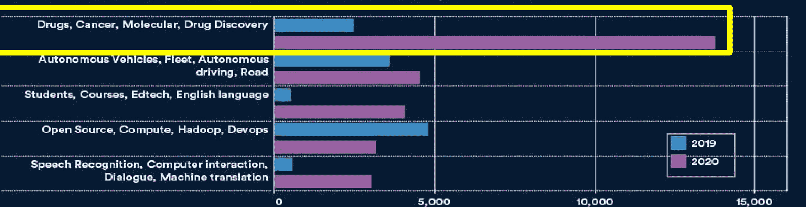

### Eroom's 法则（摩尔定律的倒数）

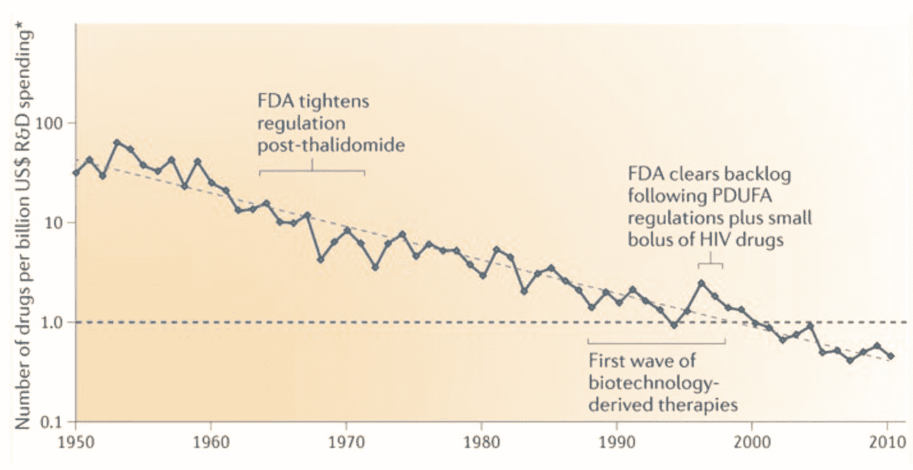

### 药物发现与开发

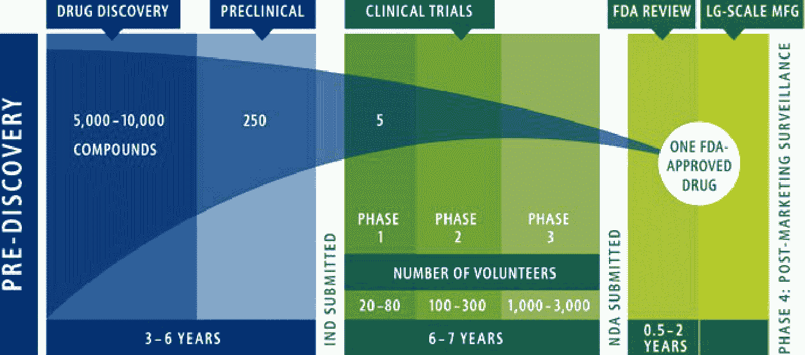

### 科学的第四范式

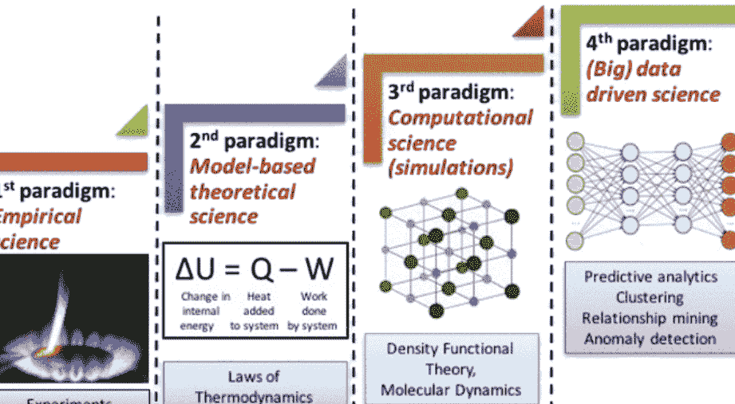

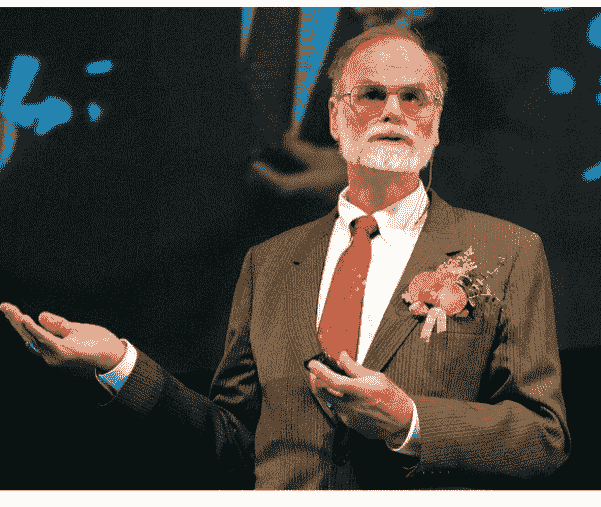

Jim Gray, Turing Award 1998 (1944-2007) Honoured as father of The 4th Paradigm Image source: Wikipedia

Agrawal, A., & Choudhary, A. (2016). Perspective: Materials informatics and big data: Realization of the “fourth paradigm” of science in materials science. Apl Materials, 4(5), 053208.

### 药物发现与开发

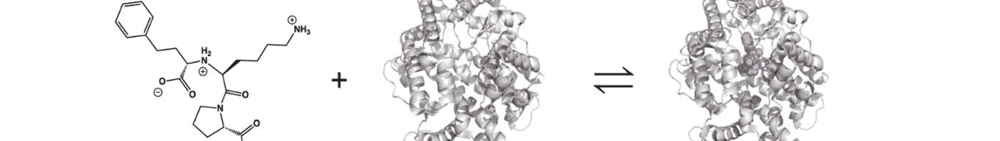

Drug is a small molecule that binds to a bio target (e.g., protein) and modifies its functions to produce useful physiological or mental effects.

Proteins are large biomolecules consisting of chains of amino acid residues.

### 药物相似性

- 水溶性和脂溶性，例如通过 LogP 测量。大多数药物口服 → 通过膜。
- 对生物靶标的效力 → 靶向特异性结合。
- 配体效率（低能耗结合）和脂溶性效率。
- 分子量小 → 影响扩散

1. 氢键供体不超过 5 个（氮-氢和氧-氢键的总数）
2. 氢键受体不超过 10 个（所有氮或氧原子）
3. 分子质量小于 500 道尔顿
4. 辛醇-水分配系数（log P）不超过 5

https://en.wikipedia.org/wiki/Lipinski%27s_rule_of_five

Lipinski, Christopher A., et al. "Experimental and computational approaches to estimate solubility and permeability in drug discovery and development settings." Advanced drug delivery reviews 23.1-3 (1997): 3-25.

### IND: 研究新药; BLA: 生物制剂许可申请; NDA: 新药申请

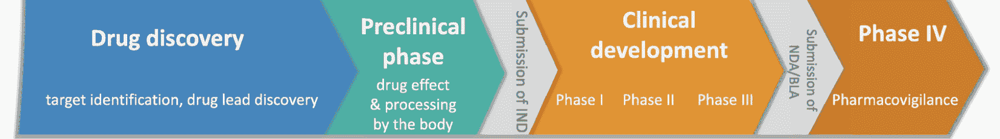

- 识别疾病的致病因素或靶点
- 识别药物兴趣（平均持续时间：5 年）

Phase 0:
- 药物性质评估（ADMET）
- 体外试验（细胞模型）
- 体内试验（动物模型或人体受试者）持续时间：1-3 年（平均：18 个月）

Phase I：剂量毒性、药物安全性和动力学
Phase II：药物疗效及联合药物测试
Phase III：与标准疗法或安慰剂比较的药物（确认性临床试验）持续时间：2-10 年（平均：5 年）

监测长期副作用

> Réda, Clémence, Emilie Kaufmann, and Andrée Delahaye-Duriez. "Machine learning applications in drug development." Computational and structural biotechnology journal 18 (2020): 241-252.

### 药物发现中的推理

推理是从已获知识在响应查询（或线索）时推导新知识。

实用场景：(查询, 数据库, 答案) 三元组

- 分类：查询 = 这是否为药物？数据库 = 药物的原子结构。
- 回归：查询 = 该药物有多毒？数据库 = 药物。
- QA：查询 = 自然语言问题。数据库 = 上下文/图像/文本。
- 多任务学习：查询 = 任务 ID。数据库 = 药物/蛋白。
- 零样本学习：查询 = 任务描述。数据库 = 数据。
- 药物-蛋白结合：查询 = 药物。数据库 = 蛋白。
- 推荐系统：查询 = 靶向（药物）。数据库 = {CCI, PPI, Drug-target, gene-diseases};

### 药物发现作为推理学习

学习是通过经验自我改进，获取知识和技能。

推理学习是提升知识库蕴含谓词的能力。

例如，给定疾病和知识库，判断该药物是否具有治疗效果。

请参阅我们 IJCAI'21 教程以获取更多细节：

https://neuralreasoning.github.io


> (Dan Roth; ACM Fellow; IJCAI John McCarthy Award)

Khardon, Roni, and Dan Roth. "Learning to reason." Journal of the ACM (JACM) 44.5 (1997): 697-725.

### 药物发现的三个基本问题

给定分子，它是药物吗？即性质/靶点/效应预测。

- 药物相似性
- 它能调节的靶点及其程度
- 如果口服或注射，其动力学/动力学/效应/代谢

给定靶点，什么分子？

- 如果给出分子列表，挑选合适的一个。如果评估昂贵，需要搜索，例如使用贝叶斯优化。
- 如果未找到分子，需要从头生成 → 生成模型 + 贝叶斯优化，或强化学习。
- 药物相似空间呈现什么样？

### 我们需要强大的机器学习用于药物发现

### 表现能力

- 能够表示生物医学世界的复杂性
- 理想情况下，能够表示全部化学空间
- 能计算任何可计算的内容

### 可学性

- 具备从训练信号（或缺失信号）中学习的机制

### 一般化能力

- 在未见过的数据上工作

## Part B1

### 分子表示学习

- 指纹
- 字符串表示
- 图形表示
- 自监督学习

### 分子性质预测

- 近似量子化学计算
- 图回归和分类
- 图多任务学习
- 解释
- 数据高效学习


## 类 BERT 的自监督学习

ChemBERTa (Chithrananda, S 等) 采用 RoBERTa 的预训练流程，使用来自 PubChem 的 1000 万条唯一 SMILES。

\begin{tabular}{ccccccccc}
Model & BBBP ROC & BBBP PRC & ClinTox ROC & ClinTox PRC & HIV ROC & HIV PRC & Tox21 ROC & Tox21 PRC \\
ChemBERTa 10M & 0.643 & 0.620 & 0.733 & 0.975 & 0.622 & 0.119 & 0.728 & 0.207 \\
D-MPNN & 0.708 & 0.697 & 0.906 & 0.993 & 0.752 & 0.152 & 0.688 & 0.429 \\
RF & 0.681 & 0.692 & 0.693 & 0.968 & 0.780 & 0.383 & 0.724 & 0.335 \\
SVM & 0.702 & 0.724 & 0.833 & 0.986 & 0.763 & 0.364 & 0.708 & 0.345 \\
\end{tabular}

> #REF: Chithrananda, S., Grand, G., & Ramsundar, B. (2020). ChemBERTa: 大规模自监督预训练用于分子属性预测。分子机器学习工作坊 NeurIPS 2020

## 子图掩码自监督学习

GROVER 使用上下文属性预测和图级动机预测，利用 GNNTransformer 架构进行预训练。

[Image placeholder omitted]

> Rong, Yu, et al. "Self-Supervised Graph Transformer on Large-Scale Molecular Data." NeurIPS. 2020.

## 对比学习自监督

GCC (Qiu, Jiezhong, et al.) 将子图实例歧视 (SID) 作为预训练任务，InfoNCE 作为训练目标。

SID 通过两次带重启的随机游走，从 k-邻域子图中采样作为正样本对，并从其他 k-邻域子图中采样作为负样本对。

[Image placeholder omitted]

## GCC (Qiu, Jiezhong, et al)

### 表 2: 节点分类。

| 数据集 | US-Airport | H-index |
|----------|------------|---------|
| US-Airport | 1,190 | 5,000 |
| H-index | 13,599 | 44,020 |
| ProNE | 62.3 | 69.1 |
| GraphWave | 60.2 | 70.3 |
| Struc2vec | 66.2 | > 1 Day |
| GCC (E2E, freeze) | 64.8 | 78.3 |
| GCC (MoCo, freeze) | 65.6 | 75.2 |
| GCC (rand, full) | 64.2 | 76.9 |
| GCC (E2E, full) | 68.3 | 80.5 |
| GCC (MoCo, full) | 67.2 | 80.6 |

### 表 3: 图分类。

| 数据集 | IMDB-B | IMDB-M | COLLAB | RDT-B | RDT-M |
|----------|--------|--------|--------|-------|-------|
| # graphs | 1,000 | 1,500 | 5,000 | 2,000 | 5,000 |
| # classes | 2 | 3 | 3 | 2 | 5 |
| Avg. # nodes | 19.8 | 13.0 | 74.5 | 429.6 | 508.5 |
| DGK | 67.0 | 44.6 | 73.1 | 78.0 | 41.3 |
| graph2vec | 71.1 | 50.4 | - | 75.8 | 47.9 |
| InfoGraph | 73.0 | 49.7 | - | 82.5 | 53.5 |
| GCC (E2E, freeze) | 71.7 | 49.3 | 74.7 | 87.5 | 52.6 |
| GCC (MoCo, freeze) | 72.0 | 49.4 | 78.9 | 89.8 | 53.7 |
| DGCNN | 70.0 | 47.8 | 73.7 | - | - |
| GIN | 75.6 | 51.5 | 80.2 | 89.4 | 54.5 |
| GCC (rand, full) | 75.6 | 50.9 | 79.4 | 87.8 | 52.1 |
| GCC (E2E, full) | 70.8 | 48.5 | 79.0 | 86.4 | 47.4 |
| GCC (MoCo, full) | 73.8 | 50.3 | 81.1 | 87.6 | 53.0 |

## 日程

## 分子表征学习

- 指纹
- 字符串表示
- 图形表示
- 自监督学习

## 分子属性预测

- 近似量子化学计算
- 图回归与分类
- 图多任务学习
- 解释
- 数据高效学习

## 药物发现的三个基本问题

> 给定分子，它是药物吗？即属性/目标/效应预测。

- 药物相似性
- 它能调节的目标及程度
- 口服或注射后的动力学、效应和代谢

## 给定目标，什么是分子？

- 如果给出分子列表，挑选合适的一个。如果评估费用高，需要搜索，例如使用贝叶斯优化。

- 如果未找到分子，需要从头生成 → 生成模型 + 贝叶斯优化，或强化学习。

- 药物相似空间呈现怎样的形态？

## 给定分子图，生成分子的步骤是什么？

- 合成可行性
- 反应规划，或反向合成

## 量子化学

在化学中，我们主要需要了解电子结构（例如电子密度和电子能量）。

密度可以从波函数推断。但求解波方程非常困难。

密度泛函理论 (DFT)：电子密度是空间和时间的函数。

[Image placeholder omitted]

> Aspuru-Guzik, Alán, Roland Lindh, and Markus Reiher. "物质模拟 (r) 的演变". ACS central science 4.2 (2018): 144-152.

## 近似 DFT

[Image placeholder omitted]

Gilmer, Justin, et al. "Neural message passing for quantum chemistry." arXiv preprint arXiv:1704.01212 (2017).

## 分子属性预测

- 药物发现过程中的基础任务
- 例如虚拟筛选和先导化合物优化
- 分子属性
- 结合亲和力
- 对细胞表达有影响
- 毒性、ADME 性质（吸收、分布、代谢和排泄）
- 与其他分子相互作用
- 易于合成

## 分子活性预测

Collecting messages

m_i^{(k+1)} = \sum_{v_j \in N(v_i)} M_k \left( h_i^{(k)}, h_j^{(k)}, e_{ij} \right)

Refining node embedding

h_i^{(k+1)} = U_k \left( h_i^{(k)}, m_i^{(k+1)} \right)

> #Ref: Pham, Trang, Truyen Tran, and Svetha Venkatesh. "Graph Memory Networks for Molecular Activity Prediction." ICPR'18.

## 例子：抗生素发现的 halicin

[Image placeholder omitted]

## GAML 用于多靶标药物预测

Scale linearly with number of targets + efficient processing through message factoring.

(a) 输入图包含 4 个节点和 3 个标签

(b) 输入节点更新

(c) 标签节点更新

> #REF: Do, Kien, et al. "Attentional Multilabel Learning over Graphs-消息传递方法". Machine Learning, 2019.

## 更灵活的药物-疾病响应与 RDMN

[Image placeholder omitted]

| 模型 | 微F1 | 宏F1 | 平均 AUC |
|---|---|---|---|
| SVM | 66.4 | 67.9 | 85.1 |
| RF | 65.6 | 66.4 | 84.7 |
| GB | 65.8 | 66.9 | 83.7 |
| NeuralFP [19] | 68.2 | 67.6 | 85.9 |
| MT-NN [51] | 75.5 | 78.6 | 90.4 |
| RDMN | 77.8 | 80.3 | 92.1 |

[Image placeholder omitted]

## 参数共享帮助 RDMN 更好响应多种疾病

[Image placeholder omitted]

[Image placeholder omitted]

## 药物-药物交互作为图-图推理

2017 年药物交互报告：日益严重的致命威胁

[Image placeholder omitted]

> #REF: Pham, Trang, Truyen Tran, and Svetha Venkatesh. "关系动态记忆网络". arXiv preprint arXiv:1808.04247 (2018).

## 基于注意力的解释

内部注意力可以提供一定的解释能力

外部反事实方法可以通过生成对分子的小幅度改变来更精确地评估效果。

稍后更多细节。

> #REF: Do, Kien, et al. "Attentional Multilabel Learning over Graphs-消息传递方法". Machine Learning, 2019.


...[/content].

Let's parse the original content line by line.

Original:

[content]

## GNNExplainer

GNNExplainer explains DL model by providing a small subgraph of the input graph together with a small subset of node features that are most influential for the prediction.

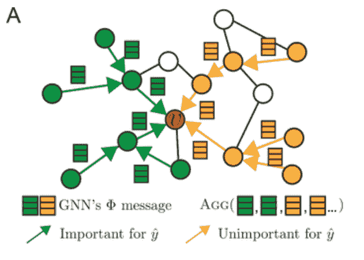

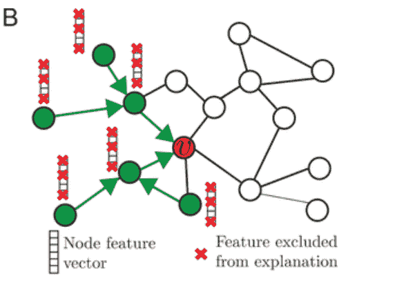

max_{GS} MI(Y, (GS, XS)) = H(Y) - H(Y|G = GS, X = XS)

## GNNExplainer (2)

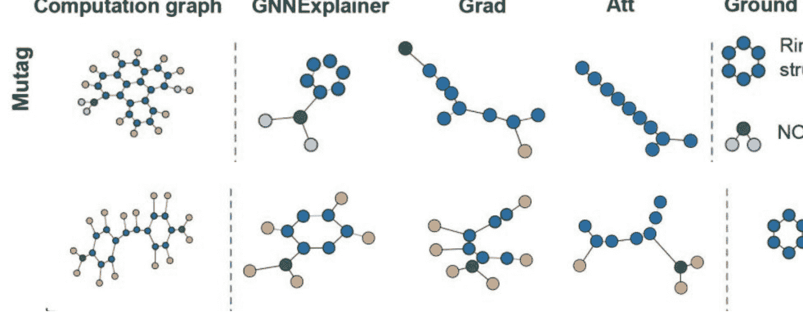

Ying, Rex, et al. "Gnnexplainer: Generating explanations for graph neural networks." Advances in neural information processing systems 32 (2019): 9240.

## GNNExplainer (3)

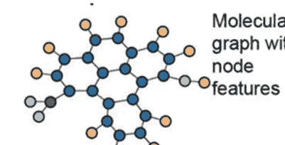

- Input to GNN
- GNN's Prediction
- Molecule's mutagenicity
- Ground Truth Feature Importance

GNNExplainer


- Grad
- Att
- Not applicable

## Few-shot learning for drug property prediction

Some ideas are in place:

- Prototype, distance metric learning.
- Joint feature learning of many small tasks, then fine-tuning on new task.

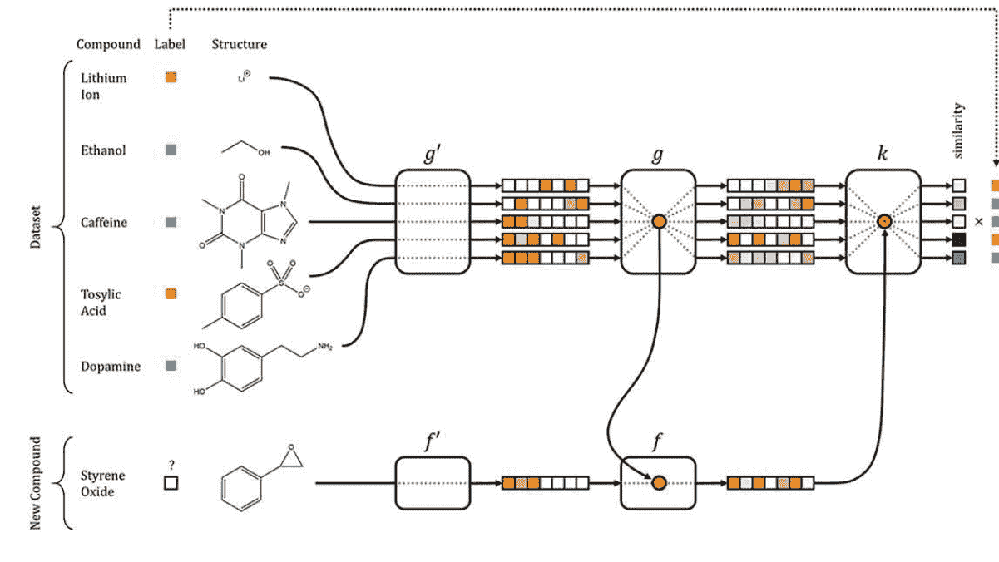

## Part B2

## Protein representation and protein-drug binding

### Agenda

## Protein representation learning

- Embedding, BERT
- 2D contact map
- 3D structure
- Protein folding

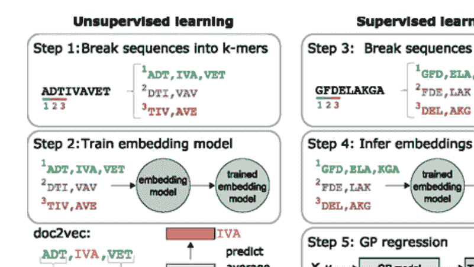

> #REF: Yang, K. K., Wu, Z., Bedbrook, C. N., & Arnold, F. H. (2018). Learned protein embeddings for machine learning. Bioinformatics, 34(15), 2642-2648.

## Sequential representation

- One-hot encoding: simple, but inherently sparse, memory-inefficient, contains no prior knowledge and contextual information.

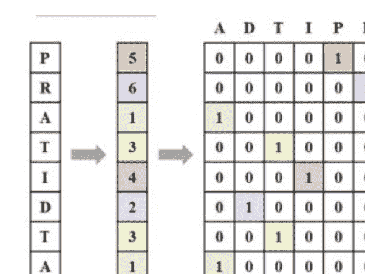

#REF: Lim, S., Lu, Y., Cho, C. Y., Sung, I., Kim, J., Kim, Y., ... & Kim, S. (2021). A review on compound-protein interaction prediction methods: Data, format, representation and model. Computational and Structural Biotechnology Journal, 19, 1541.

## Sequential representation (cont.)

- One-hot encoding: simple, but inherently sparse, memory-inefficient, contains no prior knowledge and contextual information.

- Evolutionary information: search for related proteins to perform multiple sequence alignment (MSA) and extract evolutionary information. Can be effective (AlphaFold2) but computational costly and requires sufficient data and diversity.

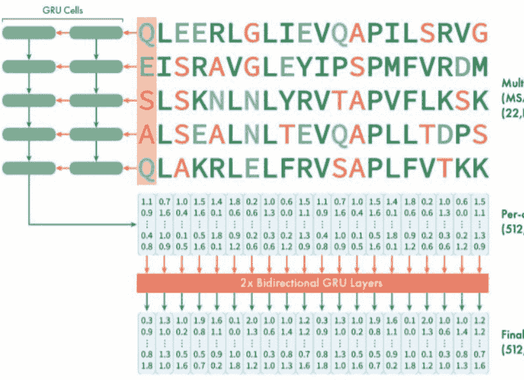

> #REF: Kandathil, S. M., Greener, J. G., Lau, A. M., & Jones, D. T. (2021). Ultrafast end-to-end protein structure prediction enables high-throughput exploration of uncharacterised proteins.

## NLP-inspired embedding

- NLP-inspired embedding: protein sequence as a sentence and residues as tokens then apply language modelling (word2vec, doc2vec, glove, seq2vec, ELMo, BERT, etc).

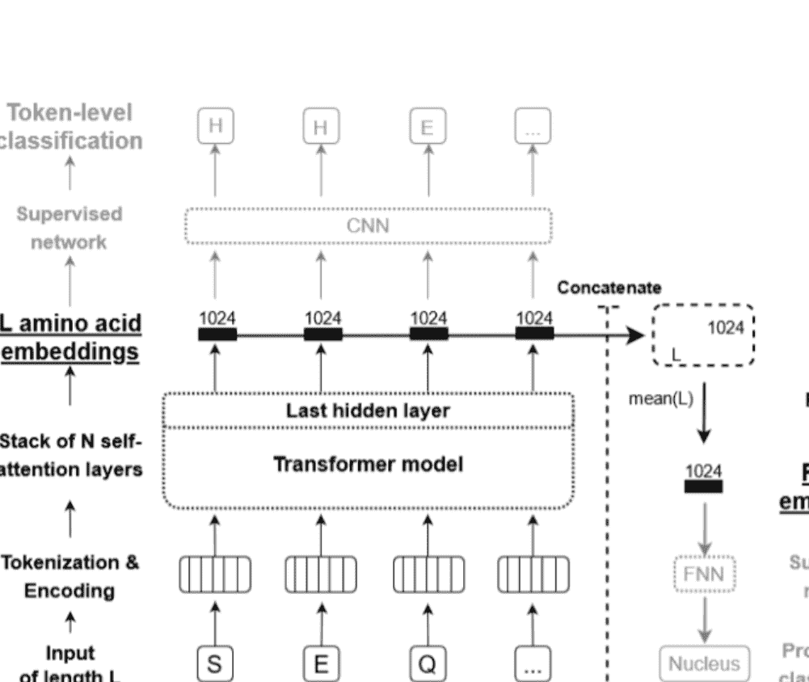

## Spatial representation

- 2D contact/distance map: distance between residues pairs of 3D protein structure.

- 3D structure: coordinate of residues in 3D space.

- Graph representation: residues as nodes and distance as edges. Can combine with sequential representation via attributed graph.

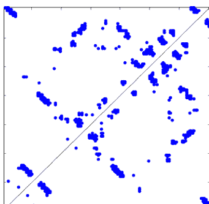

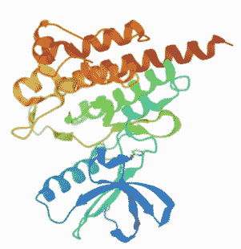

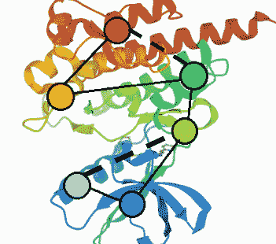

## Protein sequence

AKLMMAATTAGVVVTTTH...

Pretraining


Protein contact map

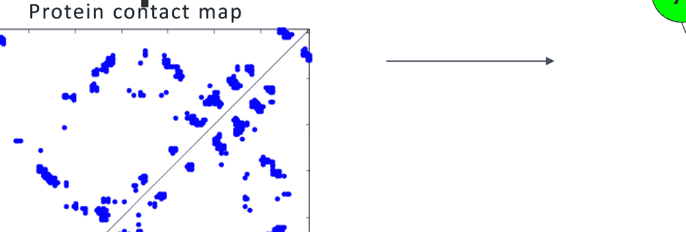

## Protein graph

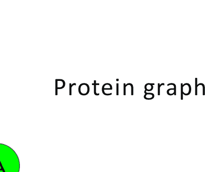

## Protein folding prediction progress

CASP: MEDIAN ACCURACY of PREDICTIONS in FREE-MODELING by THE BEST TEAM, 2006-20.

Source: DeepMind, 2020 | Chart: 2021 AI Index Report

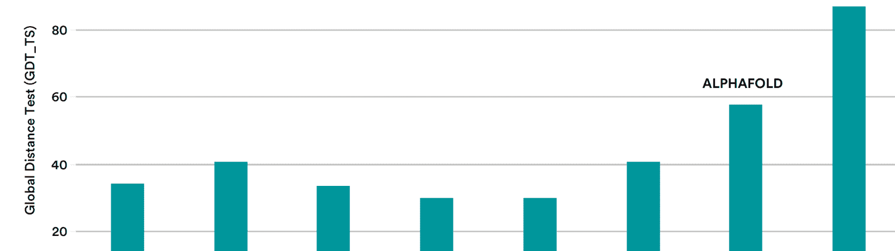

## Protein 3D structure prediction

- Input: protein amino acid sequence X = (x₁ x₂ ... x_L) where L is protein sequence length, x_i is residue type at position i.


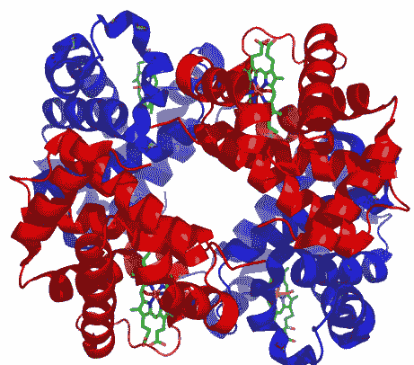

"#REF: "Hemoglobin", En.wikipedia.org, 2020. [Online]. Available: https://en.wikipedia.org/wiki/Hemoglobin."

### Approaches

- Template-based
- Using known structure of proteins that have high sequence similarity with target protein as the initial structure template.
- From the initial structure, protein fragments are inserted or deleted to minimize the global free energy.
- An effective method if the target protein sequence has at least 30% sequence identity with the template protein.
- Template-free
- Without using solved protein structure
- Main goal is to find a conformation that has minimum free energy
- Requires a vast computational resource such as powerful supercomputer or distributed computing projects (Rosetta@Home, Folding@Home)

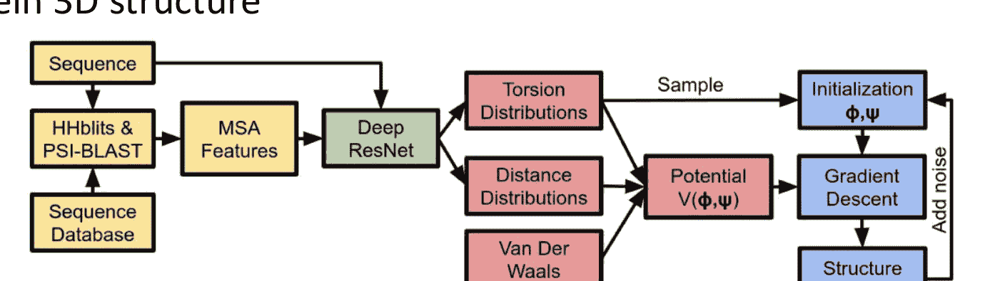


## AlphaFold 2
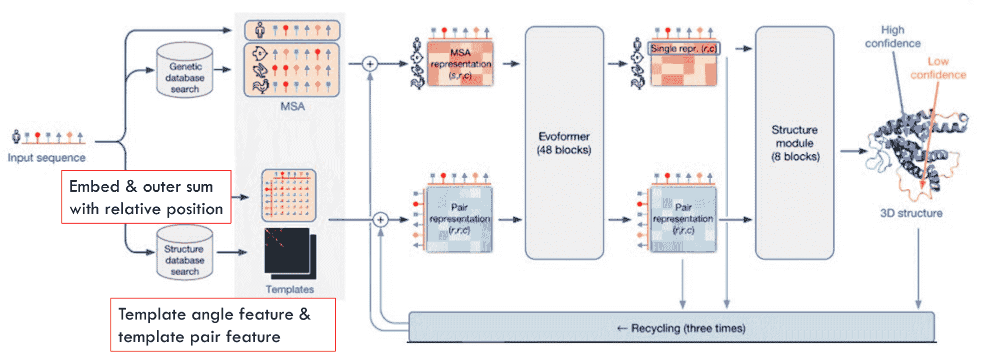

### AlphaFold 2 – Evoformer 块
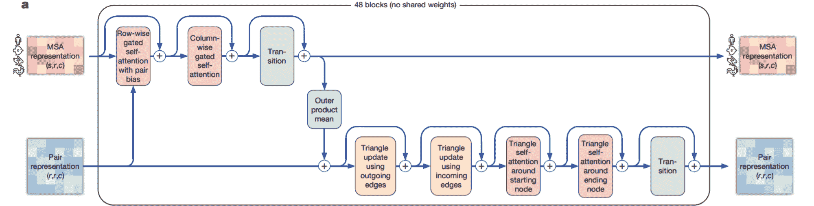
### Pair 表示 (r,r,c)
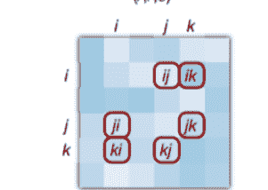
### 对应的图中的边
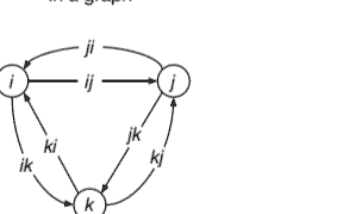
### 使用 'outgoing' 边的三角乘法更新
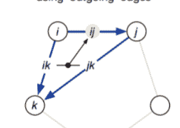
### 使用 'incoming' 边的三角乘法更新
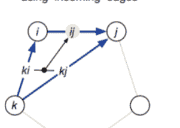
### 起始节点周围的三角自注意
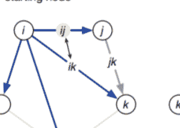
### 结束节点周围的三角自注意
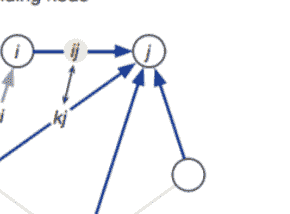

### AlphaFold 2 – 结构模块
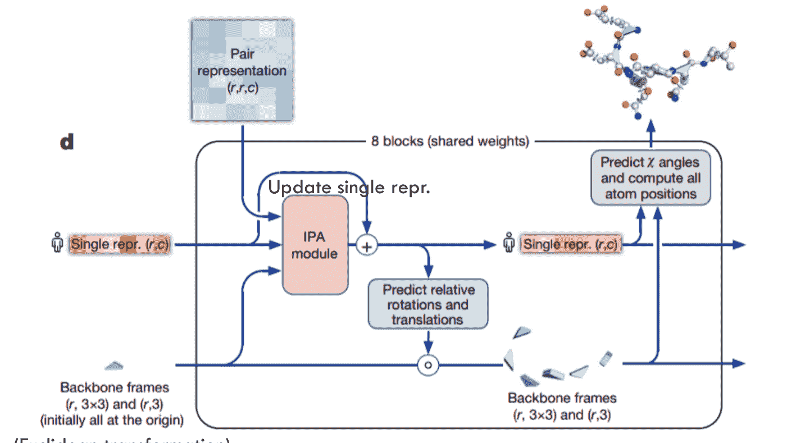

### 议程
## 蛋白质表示学习
- 嵌入, BERT
- 2D 接触图
- 3D 结构
- 蛋白质折叠
## 药物-靶标结合预测
- 多靶标预测
- 药物-蛋白质结合作为图-图交互
- 冷启动问题
- 解释
> Cheng, Feixiong, et al. "预测药物-靶标相互作用和药物重新定位通过基于网络的推理". PLoS computational biology 8.5 (2012): e1002503.

## 药物-靶标双部分网络
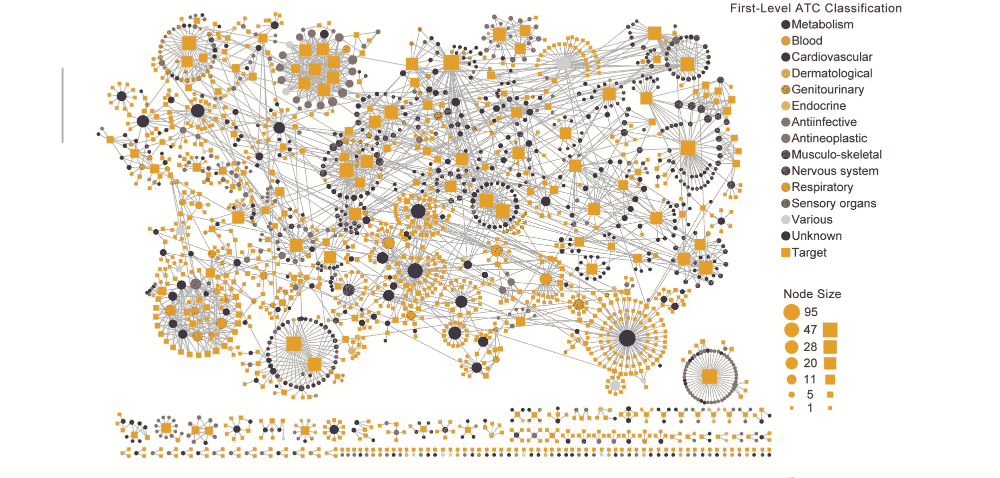
- 代谢
- 血液
- 心血管
- 皮肤
- 生殖泌尿
- 内分泌
- 抗感染
- 抗肿瘤
- 骨骼肌肉
- 神经系统
- 呼吸
- 感官器官
- 各种
- 未知
- 靶标
- 95
- 47
- 28
- 20
- 11
- 5
- 1

## 双部分网络操作
- 链接预测
- 推荐技术，例如 SVD、随机游走、最近邻。
- 知识图完成技术，例如 TransE
- 稍后在 C2 部分中更多
> #REF: Do, Kien, et al. "基于图的_attentional multilabel learning_ 传递方法". Machine Learning, 2019.

## 多靶标结合
规模随靶标数量线性增长，并通过消息因子化实现高效处理。
- (a) 一个输入图包含 4 个节点和 3 个标签
- (b) 输入节点更新
- (c) 标签节点更新
> #REF: Do, Kien, et al. "基于图的_attentional multilabel learning_ 传递方法". Machine Learning, 2019.

## 药物和蛋白质
## 药物分子
一种小分子与生物大分子（如蛋白质）结合，以改变其活性或功能
## 蛋白质
大分子由氨基酸残基链形成三维形状。蛋白质在生物体中执行许多功能

## 药物和蛋白质 (2)
## 药物分子
- 结合到蛋白质结合位点
- 改变其靶标活性
- 结合强度即为结合亲和力
## 蛋白质
- 可能因与药物分子的相互作用而改变构象
- 其功能因药物分子在结合位点的存在而改变

## 药物和蛋白质 (3)
我们需要理解药物-靶标相互作用，因为：
- 快速且安全的药物重新定位和发现/重新定位过程，用于快速应对疫情
- 寻找对困难疾病的解决方案
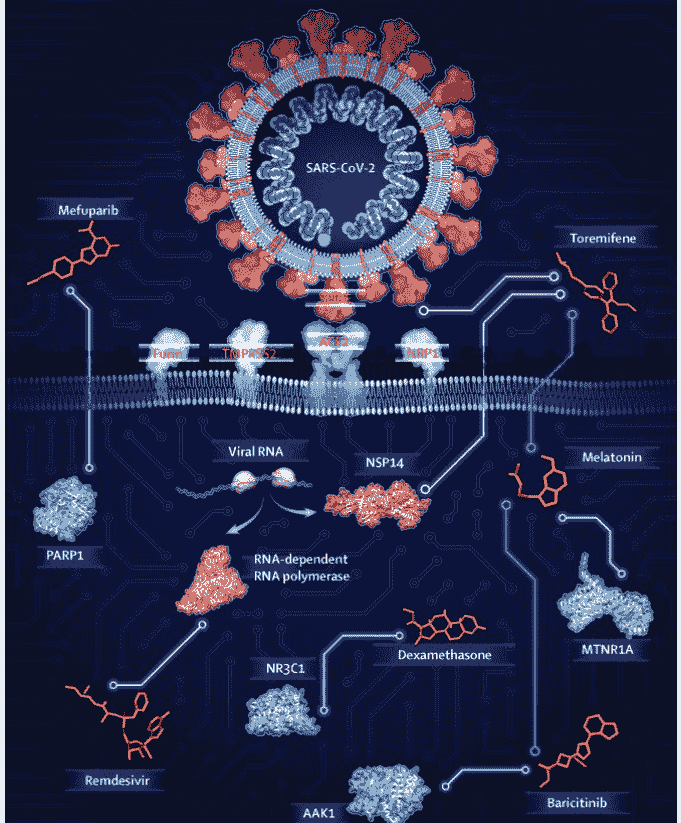
> 图片来源: Lancet

## 药物-靶标结合作为问答
- 上下文/数据库: 结合靶标（例如 RNA/蛋白质序列，或 3D 结构），作为集合、序列或图，加上现有的结合、交互数据库。
- 查询: 药物（例如 SMILES 字符串，或分子图）
- 答案: 亲和力、结合位点、调节效应、构象变化。
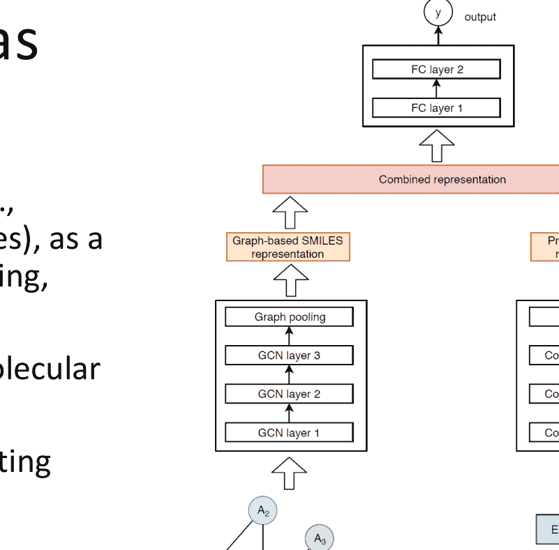
> #REF: Nguyen, T., Le, H., & Venkatesh, S. (2019). GraphDTA: 使用图卷积网络预测药物-靶标亲和力。BioRxiv, 684662.

### 药物图
### 图内图交互
### 蛋白质图
> Nguyen, T. M., Nguyen, T., Le, T. M., & Tran, T. (2021). “GEFA: 早期融合方法用于药物-靶标亲和力预测”。IEEE/ACM Transactions on Computational Biology and Bioinformatics

## GEFA (续)
我们设计了一个用于详细分析药物与蛋白质残基相互作用的模型。
该架构是一种新的图内图结构。
这使得对结合位点和强度的预测更加准确和精确。
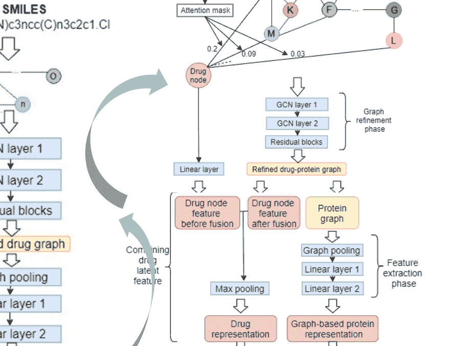

## GEFA (续): 药物-靶标图
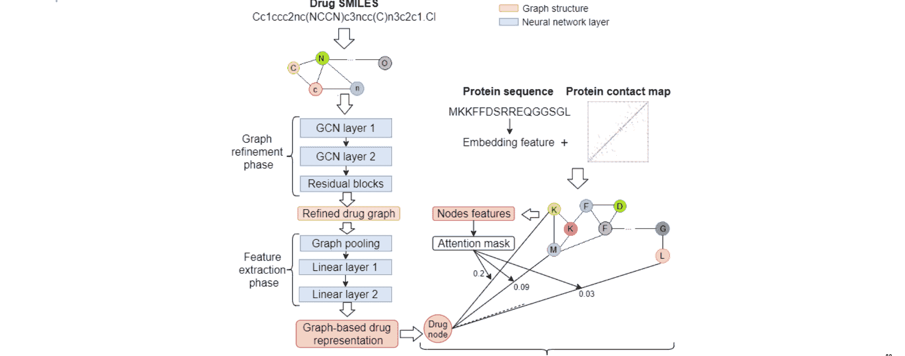

## GEFA (续): GCN + 融合
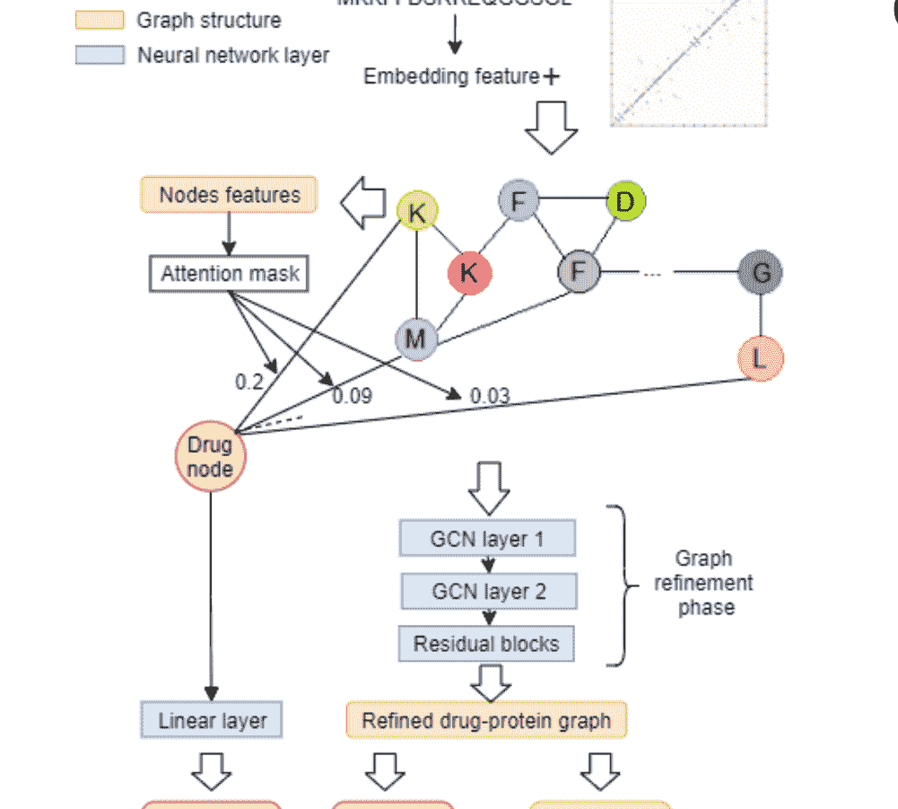
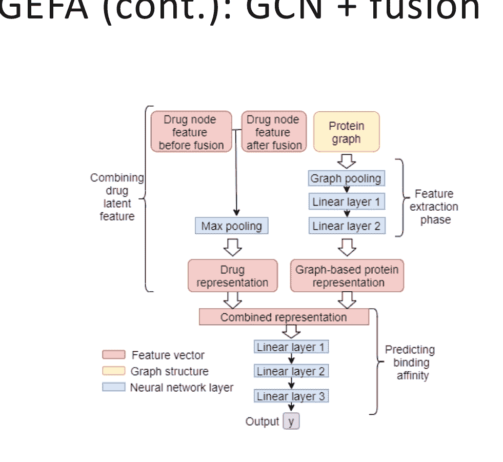

## 冷启动问题
## 训练集
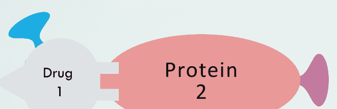
## 测试集
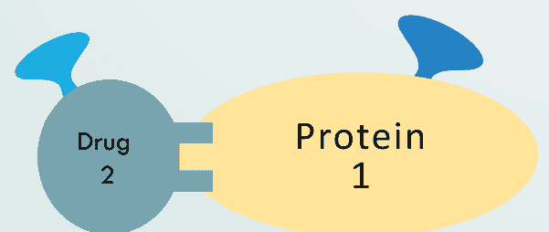
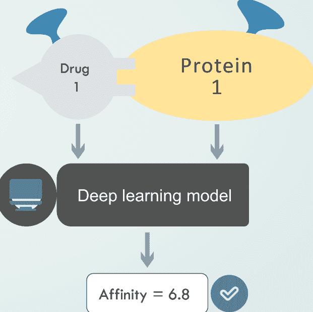

## 冷启动问题
## 测试集

## 结果可视化
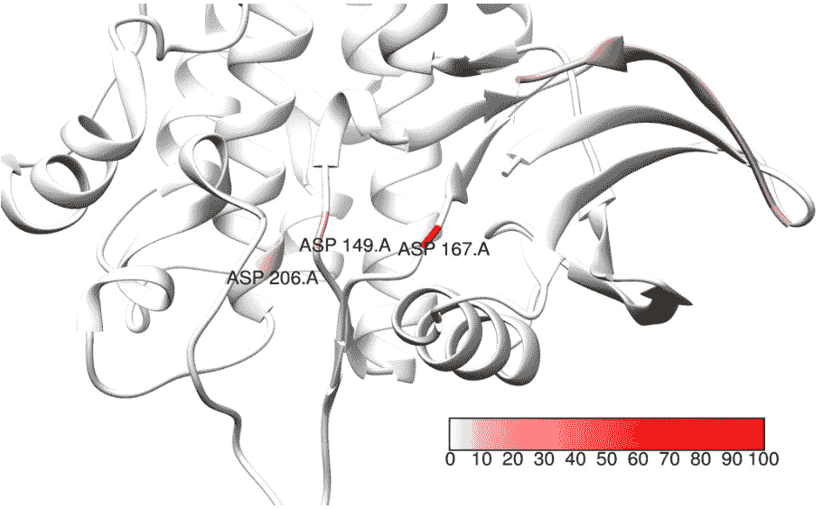
预测的 MST1 靶标结合位点的注意力值。残基 ASP 167.A 拥有最高的注意力分数。
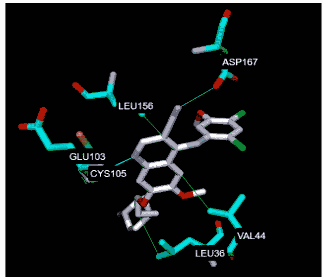
模拟预测的残留-配体相互作用。残基 ASP 167.A 是结合位点之一

## 解释 DTA 深度学习模型: 特征归因
展示输入各部分对模型决策的贡献
不显示模型输入与输出之间的因果关系

## 解释 DTA 深度学习模型: 反事实
观测数据

## 反事实解释生成

## 反事实解释生成目标
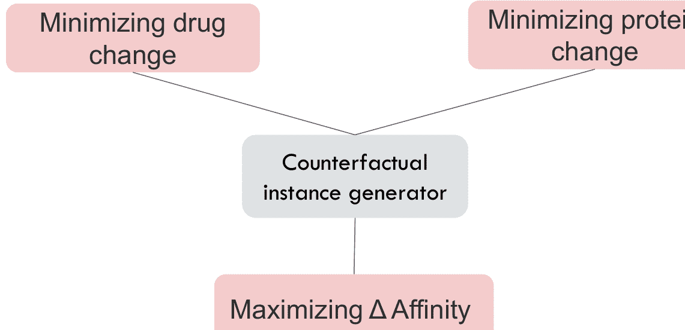

## MACDA: 多剂代理反事实药物-靶标亲和力框架
> Nguyen, Tri Minh, et al. "基于多剂代理强化学习的药物靶标预测反事实解释". arXiv preprint arXiv:2103.12983 (2021).

## MACDA: 多剂代理反事实药物-靶标亲和力框架
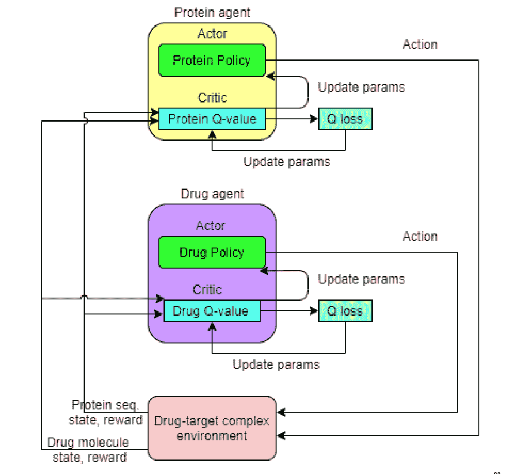
### 药物剂
- 行动:
- 移除原子和键
- 添加原子和键
### 蛋白质剂
- 用阿拉닌酸替换其他类型的氨基酸
### 药物-靶标环境
### DTA 模型
### 奖励
- 药物表示相似度
- 蛋白质表示相似度
- Δ 亲和力

## C1 部分
## 分子优化与生成

### 议程
### 分子优化
- 潜在空间的贝叶斯优化
- 目标导向强化学习
## 生成分子的生成
- 分子的深度生成模型
- 分子的循环模型

## 药物发现的三个基本问题
给定分子，它是药物吗？即属性、靶标或效应预测。

- 药物相似性
- 它可以调节的靶标及其程度
- 如果口服或注射，其动力学/动力学、效应、代谢情况

给定靶标，什么分子？
- 如果给出分子列表，挑选合适的一个。如果评估昂贵，需要搜索，例如使用贝叶斯优化。
- 如果未找到分子，需要从零开始生成 → 生成模型 + 贝叶斯优化，或强化学习。
- 药物相似空间呈现怎样的形态？

给定分子图，生成分子的步骤是什么？
- 合成可行性
- 反应规划，或逆合成


### 药物设计作为结构化机器翻译，即条件生成

> 可以表示为结构化机器翻译：

• (知识库 + 结合属性) 到 (查询) → 一对多关系。

将图表表示为字符串（例如 SMILES），并使用序列 VAEs 或 GANs。

### 生成式图形模型

+   • 模型节点和交互
• 模型团体

### 序列

+   • 迭代方法

### 强化学习

+   • 离散目标

这些的任何组合 + 记忆。
[/content]

[content]
### 分子优化

我们将起始分子优化为期望的性质。通常我们需要在多个目标之间取得平衡，包括与原分子的相似性。

策略 1：在离散化的化学空间中依次进行操作（如原子和键的添加/删除），确保结果化学上合法。

策略 2：将离散结构映射到连续空间，在潜在空间中搜索，然后映射回离散空间。
[/content]

[content]
### 黑盒优化

这适用于任何我们没有详细了解但可以确定目标函数的过程。

### Typical methods:

+   - 贝叶斯优化
- 强化学习
- 主动学习
- 进化算法
[/content]

[content]
### 强化学习用于分子优化

State: Current molecule

Actions: Atom/Bond addition/removal

Rewards: the properties of molecules (final reward) and chemical validity (intermediate and final reward)

### Learning:

+   - 政策梯度
- Q-value function with TD learning

> 周振鹏, 等. "通过深度强化学习优化分子". Scientific reports 9.1 (2019): 1-10.

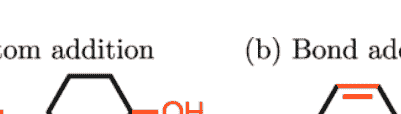

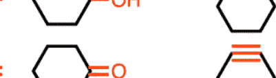

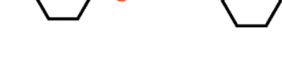
[/content]

[content]
### 图形 + 强化学习

生成式图形很难搞对：空间太大！

强化学习提供逐步构建：一步一步地构建

+   - 也称为马尔可夫决策过程
- 如前所述：图形提供属性估计


[/content]

[content]
### 在潜在空间中搜索

### 模型: SMILES → VAE+RNN

#REF: Gómez-Bombarelli, Rafael, 等. "基于数据驱动的连续分子表示的自动化化学设计". ACS Central Science (2016).


[/content]

[content]
### 分子优化作为机器翻译


+   - 修改现有分子更容易，即“分子改写”
- 分子优化作为图到图翻译

> #REF: Jin, W., Yang, K., Barzilay, R., & Jaakkola, T. (2019). 学习多模态图到图翻译用于分子优化. ICLR.
[/content]

[content]
### 议程

### 分子优化

+   潜在空间中的贝叶斯优化
+   目标导向强化学习

### 生成分子生成

+   分子的深度生成模型
+   分子的循环模型
[/content]

[content]
### 逆设计

+   给定期望的性能/表现来设计结构。
+   利用现有数据，离线查询模拟器
+   方法 1：通过优化搜索最佳结构（即分子优化）
+   方法 2：学习逆设计函数 g(y) = f⁻¹(y)
+   单步预测设计变量


[/content]

[content]
### 背景: 变分自编码器

学习设计结构的密度函数 P(x)。

两个独立过程：生成过程（隐藏 → 可见）与识别过程（可见 → 隐藏）


[/content]

[content]
### VAE 用于药物空间建模

将 SMILES 映射到向量空间（识别 RNN）

探索向量空间，例如随机采样或 BO（贝叶斯优化）进行搜索。

将结果映射回 SMILES 空间（生成 RNN）

> #REF: Gómez-Bombarelli, Rafael, 等. "基于数据驱动的连续分子表示的自动化化学设计". ACS Central Science (2016).


[/content]

[content]
### 图形VAE

消除了分子的顺序表示的需求。

### 处理不规则结构

+   预测整个邻接矩阵、节点类型和边类型

### 处理变大小图

+   受限于训练数据中最大图的大小。

### 处理 permutation invariance

+   对两个图中每一对节点进行匹配
[/content]

[content]
### 邻接矩阵


#REF: Simonovsky, M., & Komodakis, N. (2018). GraphVAE: 通过变分自编码器生成小图。arXiv preprint arXiv:1802.03480.
[/content]

[content]
### 连接树 VAE

图形具有表达性但困难。字符串更易处理，但可能生成无效分子。

连接树是一种将图转换为“厚树”的方法

### 聚类词汇:

+   - 环
- 键
- 原子

> Jin, W., Barzilay, R., & Jaakkola, T. (2018). 连接树变分自编码器用于分子图生成. ICML'18.


[/content]

[content]
### 算法 2 分子 G = (V, E) 的树分解

V1 ← 所有不属于任何环的键 (u, v) ∈ E 的集合。

V2 ← G 中简单环的集合。

for r1, r2 in V2 do

合并 r1, r2 为一个环，如果它们共享超过两个原子（桥接环）。

end for

V0 ← 位于 V1 ∪ V2 中三个或更多集合交集的原子。

V ← V0 ∪ V1 ∪ V2

E ← {(i, j, c) ∈ V × V × ℝ | |i ∩ j| > 0}. 当 i ∈ V0 或 j ∈ V0 时设置 c = ∞，否则 c = 1。

返回集群图 (V, E) 上的最大生成树。

| Method | Reconstruction | Validity |
| CVAE | 44.6% | 0.7% |
| GVAE | 53.7% | 7.2% |
| SD-VAE² | 76.2% | 43.5% |
| GraphVAE | - | 13.5% |
| JT-VAE | 76.7% | 100.0% |

> Jin, W., Barzilay, R., & Jaakkola, T. (2018). 连接树变分自编码器用于分子图生成. ICML'18.
[/content]

[content]
### 图RNN

这是一种图动态的情况：节点和边是依次添加的。

通过 BFS 解决可扩展性问题

> You, Jiaxuan, 等. "GraphRNN: 使用深度自回归模型生成真实图形". ICML (2018).


[/content]

[content]
### VAE + BO 方式的问题

这仍然是一个插值问题

在训练数据的高密度区域之外搜索会导致生成质量极差。

我们需要一种更内在的探索策略

+   组合性
+   语法/语法
+   网络生成生成网络（进行中）

[/content]

[content]
### 语法 VAE

拟议方法

+   1) 定义语法
2) 将有效序列解析为一系列生产规则的序列
3) 学习一个 VAE，它生成语法生产规则的序列
4) 使用该 VAE 生成有效的生产规则序列
5) 按顺序应用这些规则将得到原始序列

> Kusner, Matt J., Brooks Paige, and José Miguel Hernández-Lobato. "语法变分自编码器". International Conference on Machine Learning. PMLR, 2017.
[/content]

[content]
### 编码

### 语法 VAE (2)

### 第 122 页

### 解码

### 语法 VAE (3)


[/content]

[content]
### 其他作品

Shi, Chence, 等. "GraphAF: 基于流的分子图生成自回归模型". International Conference on Learning Representations. 2019.

Mahmood, Omar, 等. "面具图建模用于分子生成". Nature communications 12.1 (2021): 1-12.


 tag. Let's copy the entire content.

[content]
## Part C2

### Knowledge graph reasoning & Drug synthesis

### Agenda

### Reasoning on biomedical knowledge graphs

- Recommendation

- Drug repurposing

### Retrosynthesis

- Chemical planning

- Chemical reaction as graph morphism

### Wrapping up

### Biomedical knowledge graphs


> Callahan, Tiffany J., et al. "Knowledge-based biomedical data science." Annual review of biomedical data science 3 (2020): 23-41.

### Some biomedical knowledge graphs

| KG Dataset | Link | Entities | Triples | Entity Types | Relation Types | Contains Features | Constituent Datasets | Version Info | Last Update |
|---|---|---|---|---|---|---|---|---|---|
| Hetionet [56] | https://het.io/ | 47K | 2.2M | 11 | 24 | ✗ | 29 | ✗ | 2017 |
| DRKG [65] | https://github.com/gnn4dr/DRKG | 97K | 5.7M | 13 | 107 | ✗ | 34 | ✗ | 2020 |
| BioKG [151] | https://github.com/dsi-bdi/biokg | 105K | 2M | 10 | 17 | categorical | 13 | ✗ | 2020 |
| PharmKG [164] | https://github.com/MindRank-Biotech/PharmKG | 7.6K | 500K | 3 | 29 | continuous | 7 | ✗ | 2020 |
| OpenBioLink [14] | https://zenodo.org/record/3834052 | 184K | 4.7M | 7 | 30 | ✗ | 17 | ✗ | 2020 |
| Clinical Knowledge Graph [124] | https://data.mendeley.com/datasets/mrcf7f4tc2/1 | 16M | 220M | 35 | 57 | ✗ | 35 | ✗ | 2020 |

### Examples of ontologies suitable for drug discovery

| Ontology Name | Entities Covered | Classes | Average # of children | Classes with no definition | Number of Properties | Max Depth | License |
|---------------|------------------|---------|-----------------------|----------------------------|----------------------|-----------|---------|
| Monarch Disease Ontology (MonDO) | Diseases | 24K | 5 | 8K | 25 | 16 | Creative Commons |
| Experimental Factor Ontology (EFO) | Diseases | 28K | 6 | 7K | 66 | 20 | Apache 2.0 |
| Orphanet Rare Disease Ontology (ORDO) | Rare Diseases | 15K | 17 | 8.5K | 24 | 11 | Creative Commons |
| Medical Subject Headings (MeSH) | Medical Terms | 300K | 4 | 270K | 38 | 15 | UMLS License |
| Human Phenotype Ontology (HPO) | Disease Phenotype | 19K | 3 | 6.5K | 0 | 16 | HPO License |
| Disease Ontology (DO) | Diseases | 19K | 4 | 8K | 89 | 33 | Creative Commons |
| Drug Target Ontology (DTO) | Drug Targets | 10K | 4 | 3K | 43 | 11 | Creative Commons |
| Gene Ontology (GO) | Genes | 44K | - | - | 11 | - | Creative Commons |

### Biomedical knowledge graph construction

- Nodes: Terms within biological ontologies

- Edge: Relationship between terms. Some notable entities relationship resources:

| Dataset | First Released | Update Frequency | Updated < 1 Year Ago | Curation Method | Primary Domain | Summary |
|---------|----------------|------------------|----------------------|-----------------|----------------|---------|
| STRING | 2003 | Monthly | ✓ | Expert & Automated | Protein/Gene Interactions | One of the most commonly used sources for physical and functional protein-protein interactions in existing KGs. |
| BioGRID | 2003 | Monthly | ✓ | Expert | Biological Interactions | Contains interactions between gene, protein and chemical entities with could be included directly in a KG. |
| IntAct | 2003 | Monthly | ✓ | Expert | Molecular Interactions | Contains molecular reactions between gene, protein and chemical entities. Uses UniProt for identifiers. |
| OmniPath | 2016 | > Annually | ✓ | Expert | Pathways | An integrator of interaction resources that could be included in a KG via its RDF version. |
| Pathway Commons | 2010 | Biannually | ✓ | Expert & Automated | Pathways | A collection of many resources, including the others discussed in this table. |

### Use cases of reasoning with KGs

- Polypharmacy prediction

- Drug-target interaction prediction

- Gene-disease prioritisation


> #REF:Yuan, J., Jin, Z., Guo, H., Jin, H., Zhang, X., Smith, T., & Luo, J. (2020). Constructing biomedical domain-specific knowledge graph with minimum supervision. Knowledge and Information Systems, 62(1), 317-336.

### Polypharmacy prediction

Predicting the adverse side effect when using one or more drugs simultaneously.


### Polypharmacy prediction

### Decagon (Zitnik, M et.al)

### A GCN per-layer update for a single drug node (in blue)

### B Polypharmacy side effect prediction

### C A batch of networks for six drugs

> #REF: Zitnik, M., Agrawal, M., & Leskovec, J. (2018). Modeling polypharmacy side effects with graph convolutional networks. Bioinformatics, 34(13), i457-i466.

### Drug-target interaction prediction

Predicting the unknown interaction between drug and target

TriModel (Mohamed, S. K. et.al) learns a low rank vector representation of knowledge entities and relations.


> #REF: Mohamed, S. K., Nováček, V., & Nounu, A. (2020). Discovering protein drug targets using knowledge graph embeddings. Bioinformatics, 36(2), 603-610.

### Gene-disease prioritisation

Predicting the relationship between diseases and molecular entities (proteins and genes).


[PAGE 135]

### Gene-disease prioritisation

Predicting the relationship between diseases and molecular entities (proteins and genes).


#REF: Paliwal, S., de Giorgio, A., Neil, D., Michel, J. B., & Lacoste, A. M. (2020). Preclinical validation of therapeutic targets predicted by tensor factorization on heterogeneous graphs. Scientific reports, 10(1), 1-19.

### Drug repurposing

De novo drug discovery is costly, takes long time without guarantee of success

Market for rare diseases is too small to warrant commercial development

Urgent, new diseases like COVID-19 can’t wait

Drug repurposing (aka drug repositioning, reprofiling or re-tasking) is one of the best ways to go.

+   Finding new uses for approved or investigational drugs designed for other purposes.

Reduced time and cost, Quicker to enter clinical trials compared to de novo drug discovery

> Lee, Wing-Hin, et al. "The potential to treat lung cancer via inhalation of repurposed drugs." Advanced drug delivery reviews 133 (2018): 107-130.

### Approaches

+   Signature matching, similarity-based (drug-disease, drug-drug, adverse effect profile)
Detailed drug-protein binding prediction
Pathway/network mapping → Knowledge graph inference, e.g., link prediction
Retrospective clinical analysis from electronic health records

> The general genomic layout and the general replication kinetics and the biology of the MERS, SARS and [SARS-CoV-2] viruses are very similar, so testing drugs which target relatively generic parts of these coronaviruses is a logical step.
(Vincent Munster, Chief o US National Institutes of Health Viral Ecology Unit, as of Feb 2020)

Pushpakom, Sudeep, et al. "Drug repurposing: progress, challenges and recommendations." Nature reviews Drug discovery 18.1 (2019): 41-58.

### Repurposing as multi-target prediction over molecular graph

(a) A input graph with 4 nodes and 3 labels

(b) Input node update

(c) Label node update

#REF: Do, Kien, et al. "Attentional Multilabel Learning over Graphs-A message passing approach." Machine Learning, 2019.

### Repurposing as drug-target prediction in biomedical knowledge graphs

A knowledge graph is a set of triplets (head, tail, relation), where head and tail are node / entity, and relation is link type. E.g., head = protein, tail = drug, relation = drug-protein-binding.

Typically a knowledge graph is incomplete, e.g., missing relations between any pair (head, tail).

Repurposing is finding new links for existing nodes (drugs).

The search typically starts from a target (e.g., a protein) to locate suitable drugs for further development (e.g., trials or optimization).

[/content]

Now we need to translate each piece.

We must keep the markdown formatting (headings, lists, tables). For tables, we need to translate Chinese within cells, but keep the table structure. Also need to translate the link text inside tables (the dataset names). Also need to translate the blockquote content.

Also need to translate any bold/italic; none appear.

Also need to translate any inline code (none). Code blocks (none). So just translation.

Now let's start translating.

First line: "# Part C2" -> "# 部分 C2" maybe "Part C2" is a heading. Chinese translation: "Part C2" could be "C2 部分" or "C2 章节". Usually "Part C2" maybe "C2 部分". Let's use "C2 部分". But maybe better "C2 章节". I'll choose "C2 部分". However the original is "# Part C2". So translation: "# C2 部分". But maybe "C2 章节". Let's decide: "C2 部分". So "# C2 部分".

Next "# Knowledge graph reasoning & Drug synthesis" -> "# 知识图推理与药物合成". Keep & as "与". So "# 知识图推理与药物合成".

Next "# Agenda" -> "# 议程".

Next "# Reasoning on biomedical knowledge graphs" -> "# 生物医学知识图的推理".

List items:

"- Recommendation" -> "- 推荐"

"- Drug repurposing" -> "- 药物再利用" (or "药物重新利用"). Use "药物再利用".

Next "# Retrosynthesis" -> "# 逆向合成" (or "逆向合成"). Use "逆向合成".

List items:

"- Chemical planning" -> "- 化学规划"

"- Chemical reaction as graph morphism" -> "- 化学反应作为图形变形" maybe "化学反应作为图形变形". Keep as is.

Next "# Wrapping up" -> "# 总结".

Next "# Biomedical knowledge graphs" -> "# 生物医学知识图".

Then image line: "" remains same.

Next blockquote:

"> Callahan, Tiffany J., et al. "Knowledge-based biomedical data science." Annual review of biomedical data science 3 (2020): 23-41."

We need to translate the content inside quotes? The whole blockquote is a citation. Should translate the text, but keep the > symbol. So translate to Chinese: "Callahan, Tiffany J., et al." maybe keep names unchanged (they are proper nouns). The title "Knowledge-based biomedical data science." translate to "基于知识的生物医学数据科学". Then "Annual review of biomedical data science 3 (2020): 23-41." translate to "《生物医学数据科学年度评论》3卷 (2020年): 23-41." But maybe keep the journal name in English? The rule says translate content, so we should translate the whole text, including journal name? Possibly yes. But example: they kept the citation as is? In example, they had "Richard Feynman" etc. Not sure. Let's see example: In example, they had:

> Callahan, Tiffany J., et al. "Knowledge-based biomedical data science." Annual review of biomedical data science 3 (2020): 23-41.

In the translation example, they didn't have a blockquote; they had a paragraph. But they kept references unchanged. Hmm.

Probably we should translate the whole blockquote content, but keep the citation format. So we translate the title and journal name to Chinese, but keep the authors names unchanged (maybe). Let's translate:

"Callahan, Tiffany J., et al." -> "Callahan, Tiffany J., 以及其他作者" maybe "Callahan, Tiffany J., 等". In Chinese academic citations, they often say "Callahan, Tiffany J., 等". So we can translate to "Callahan, Tiffany J., 等". Then the title: "Knowledge-based biomedical data science." -> "基于知识的生物医学数据科学". Then "Annual review of biomedical data science 3 (2020): 23-41." -> "《生物医学数据科学年度评论》3卷 (2020年): 23-41". But maybe keep "Annual review of biomedical data science" as is, but translate the rest. However rule says translate content, so we should translate everything that is not a URL. The authors are not a URL; they are part of content, so translate. The title is content, translate. The journal name is also content, translate. So we produce Chinese.

Thus blockquote becomes:

"> Callahan, Tiffany J., 等. "基于知识的生物医学数据科学". 《生物医学数据科学年度评论》3卷 (2020年): 23-41."

But need to keep punctuation. Let's craft:

"> Callahan, Tiffany J., 等. “基于知识的生物医学数据科学”. 《生物医学数据科学年度评论》3卷 (2020年): 23-41."

But the original uses double quotes for title. We can keep double quotes but Chinese uses “”. Might be okay.

Now next section: "# Some biomedical knowledge graphs" -> "# 部分生物医学知识图" maybe "一些生物医学知识图". Use "一些生物医学知识图".

Now the table. We need to translate each cell content.

Table header row:

| KG Dataset | Link | Entities | Triples | Entity Types | Relation Types | Contains Features | Constituent Datasets | Version Info | Last Update |

We translate each header:

- KG Dataset -> "KG 数据集"
- Link -> "链接"
- Entities -> "实体数"
- Triples -> "三元组数"
- Entity Types -> "实体类型"
- Relation Types -> "关系类型"
- Contains Features -> "包含特征"
- Constituent Datasets -> "组成数据集"
- Version Info -> "版本信息"
- Last Update -> "最后更新"

Now rows:

Row 1:

| Hetionet [56] | https://het.io/ | 47K | 2.2M | 11 | 24 | ✗ | 29 | ✗ | 2017 |

We need to translate "Hetionet [56]" maybe keep as "Hetionet [56]" (no Chinese). But maybe translate to "Hetionet [56]" (same). However maybe we should translate "Hetionet" to "Hetionet" (no change). The citation [56] maybe keep. So we keep "Hetionet [56]". But maybe we need to translate the text before the URL, which is "Hetionet [56]". So we keep same.

Link column: "https://het.io/" remains same (URL). The content to translate is the link text, which is the URL itself? Actually the link text is the URL? In example, link text was a phrase, not URL. Here the link text is the URL itself (the visible text is the URL). So we need to translate the URL? That seems odd. But maybe they consider the link text as the URL (the visible text). In that case we need to translate the URL? That doesn't make sense. Probably they consider the link text as the dataset name (the part before the URL). But the table shows "Link" column containing the URL; there is no separate link text. So maybe they treat the URL as the link text, and we need to translate the content of the link (the URL) but keep the URL unchanged? That is contradictory. Let's interpret: The link is [text](URL). In the table, they have "Link" column with the URL; maybe the link text is the URL itself (the visible text is the URL). So we need to translate the URL? That seems impossible. Maybe they intend that the link text is the dataset name (the part before the URL) but they omitted it. Hmm.

Given the ambiguity, maybe we should translate the dataset name (the first column) and keep the URL unchanged. The "Link" column is just the URL; we keep it as is (no translation). So we keep "https://het.io/" unchanged.

Now other columns: "47K", "2.2M", "11", "24", "✗", "29", "✗", "2017". These are numbers/symbols; keep as is.

Row 2:

| DRKG [65] | https://github.com/gnn4dr/DRKG | 97K | 5.7M | 13 | 107 | ✗ | 34 | ✗ | 2020 |

Translate dataset name: "DRKG [65]" maybe keep same.

Link unchanged.

Numbers unchanged.

Row 3:

| BioKG [151] | https://github.com/dsi-bdi/biokg | 105K | 2M | 10 | 17 | categorical | 13 | ✗ | 2020 |

Dataset name "BioKG [151]" keep.

Row 4:

| PharmKG [164] | https://github.com/MindRank-Biotech/PharmKG | 7.6K | 500K | 3 | 29 | continuous | 7 | ✗ | 2020 |

Row 5:

| OpenBioLink [14] | https://zenodo.org/record/3834052 | 184K | 4.7M | 7 | 30 | ✗ | 17 | ✗ | 2020 |

Row 6:

| Clinical Knowledge Graph [124] | https://data.mendeley.com/datasets/mrcf7f4tc2/1 | 16M | 220M | 35 | 57 | ✗ | 35 | ✗ | 2020 |

Now next section: "# Examples of ontologies suitable for drug discovery" -> "# 适用于药物发现的本体论示例".

Now the table:

Headers:

| Ontology Name | Entities Covered | Classes | Average # of children | Classes with no definition | Number of Properties | Max Depth | License |

Translate:

- Ontology Name -> "本体论名称"
- Entities Covered -> "涵盖实体"
- Classes -> "类别"
- Average # of children -> "平均子类数量"
- Classes with no definition -> "没有定义的类别"
- Number of Properties -> "属性数量"
- Max Depth -> "最大深度"
- License -> "许可证"

Now rows:

Row 1:

| Monarch Disease Ontology (MonDO) | Diseases | 24K | 5 | 8K | 25 | 16 | Creative Commons |

Translate:

- Ontology Name: "Monarch Disease Ontology (MonDO)" -> "Monarch 疾病本体 (MonDO)" maybe keep English name but translate "Disease Ontology" to "疾病本体". So "Monarch 疾病本体 (MonDO)". Keep parentheses.

- Entities Covered: "Diseases" -> "疾病"

- Classes: "24K" keep.

- Average # of children: "5" keep.

- Classes with no definition: "8K" keep.

- Number of Properties: "25" keep.

- Max Depth: "16" keep.

- License: "Creative Commons" -> "Creative Commons" maybe translate to "Creative Commons". Could translate to "Creative Commons". But maybe "Creative Commons" is English; we could translate to "创意共享". However the rule says keep symbols; but license names maybe keep as is. In example they kept "Creative Commons". So we keep "Creative Commons".

Row 2:

| Experimental Factor Ontology (EFO) | Diseases | 28K | 6 | 7K | 66 | 20 | Apache 2.0 |

Translate:

- Ontology Name: "Experimental Factor Ontology (EFO)" -> "实验因子本体 (EFO)" maybe "实验因子本体 (EFO)". Keep parentheses.

- Entities Covered: "Diseases" -> "疾病"

- Classes: "28K"

- Average # of children: "6"

- Classes with no definition: "7K"

- Number of Properties: "66"

- Max Depth: "20"

- License: "Apache 2.0" keep.

Row 3:

| Orphanet Rare Disease Ontology (ORDO) | Rare Diseases | 15K | 17 | 8.5K | 24 | 11 | Creative Commons |

Translate:

- Ontology Name: "Orphanet Rare Disease Ontology (ORDO)" -> "Orphanet 罕见疾病本体 (ORDO)" maybe "Orphanet 罕见疾病本体 (ORDO)". Keep.

- Entities Covered: "Rare Diseases" -> "罕见疾病"

- Classes: "15K"

- Average # of children: "17"

- Classes with no definition: "8.5K"

- Number of Properties: "24"

- Max Depth: "11"

- License: "Creative Commons" keep.

Row 4:

| Medical Subject Headings (MeSH) | Medical Terms | 300K | 4 | 270K | 38 | 15 | UMLS License |

Translate:

- Ontology Name: "Medical Subject Headings (MeSH)" -> "医学主题头ings (MeSH)" maybe "医学主题头ings"? Actually "Medical Subject Headings" is "医学主题头ings". Let's translate as "医学主题头ings (MeSH)". But maybe "医学主题头ings" is not correct; better "医学主题头ings" is weird. Maybe "医学主题头ings" -> "医学主题头ings". Could be "医学主题头ings". Let's use "医学主题头ings (MeSH)". But maybe "医学主题头ings" is not correct; maybe "医学主题头ings" is "医学主题头ings". I think "Medical Subject Headings" translates to "医学主题头ings". We'll use "医学主题头ings (MeSH)". But maybe "医学主题头ings" is not correct; maybe "医学主题头ings" is "医学主题头ings". Let's just translate as "医学主题头ings (MeSH)". Might be okay.

- Entities Covered: "Medical Terms" -> "医学术语"

- Classes: "300K"

- Average # of children: "4"

- Classes with no definition: "270K"

- Number of Properties: "38"

- Max Depth: "15"

- License: "UMLS License" keep.

Row 5:

| Human Phenotype Ontology (HPO) | Disease Phenotype | 19K | 3 | 6.5K | 0 | 16 | HPO License |

Translate:

- Ontology Name: "Human Phenotype Ontology (HPO)" -> "人类表型本体 (HPO)" maybe "人类表型本体 (HPO)". Keep.

- Entities Covered: "Disease Phenotype" -> "疾病表型"

- Classes: "19K"

- Average # of children: "3"

- Classes with no definition: "6.5K"

- Number of Properties: "0"

- Max Depth: "16"

- License: "HPO License" keep.

Row 6:

| Disease Ontology (DO) | Diseases | 19K | 4 | 8K | 89 | 33 | Creative Commons |

Translate:

- Ontology Name: "Disease Ontology (DO)" -> "疾病本体 (DO)" maybe "疾病本体 (DO)". Keep.

- Entities Covered: "Diseases" -> "疾病"

- Classes: "19K"

- Average # of children: "4"

- Classes with no definition: "8K"

- Number of Properties: "89"

- Max Depth: "33"

- License: "Creative Commons" keep.

Row 7:

| Drug Target Ontology (DTO) | Drug Targets | 10K | 4 | 3K | 43 | 11 | Creative Commons |

Translate:

- Ontology Name: "Drug Target Ontology (DTO)" -> "药物靶点本体 (DTO)" maybe "药物靶点本体 (DTO)". Keep.

- Entities Covered: "Drug Targets" -> "药物靶点"

- Classes: "10K"

- Average # of children: "4"

- Classes with no definition: "3K"

- Number of Properties: "43"

- Max Depth: "11"

- License: "Creative Commons" keep.

Row 8:

| Gene Ontology (GO) | Genes | 44K | - | - | 11 | - | Creative Commons |

Translate:

- Ontology Name: "Gene Ontology (GO)" -> "基因本体 (GO)" maybe "基因本体 (GO)". Keep.

- Entities Covered: "Genes" -> "基因"

- Classes: "44K"

- Average # of children: "-" keep.

- Classes with no definition: "-" keep.

- Number of Properties: "11"

- Max Depth: "-"

- License: "Creative Commons" keep.

Now next section: "# Biomedical knowledge graph construction" -> "# 生物医学知识图构建".

List items:

"- Nodes: Terms within biological ontologies" -> "- 节点: 生物医学本体中的术语"

"- Edge: Relationship between terms. Some notable entities relationship resources:" -> "- 边: 术语之间的关系。一些著名的实体关系资源:"

Now the table:

Headers:

| Dataset | First Released | Update Frequency | Updated < 1 Year Ago | Curation Method | Primary Domain | Summary |

Translate:

- Dataset -> "数据集"
- First Released -> "首次发布"
- Update Frequency -> "更新频率"
- Updated < 1 Year Ago -> "最近1年内更新"
- Curation Method -> "编辑方法"
- Primary Domain -> "主要领域"
- Summary -> "概述"

Rows:

| STRING | 2003 | Monthly | ✓ | Expert & Automated | Protein/Gene Interactions | One of the most commonly used sources for physical and functional protein-protein interactions in existing KGs. |

Translate each cell:

- Dataset: "STRING" keep.

- First Released: "2003" keep.

- Update Frequency: "Monthly" -> "每月"

- Updated < 1 Year Ago: "✓" keep.

- Curation Method: "Expert & Automated" -> "专家 & 自动化"

- Primary Domain: "Protein/Gene Interactions" -> "蛋白质/基因相互作用"

- Summary: "One of the most commonly used sources for physical and functional protein-protein interactions in existing KGs." -> translate: "在现有知识图中，它是物理和功能性蛋白-蛋白相互作用最常用的来源之一。" maybe "在现有知识图中，它是物理和功能性蛋白-蛋白相互作用最常用的来源之一。" We'll translate.

Row 2:

| BioGRID | 2003 | Monthly | ✓ | Expert | Biological Interactions | Contains interactions between gene, protein and chemical entities with could be included directly in a KG. |

Translate:

- Dataset: "BioGRID" keep.

- First Released: "2003"

- Update Frequency: "Monthly" -> "每月"

- Updated < 1 Year Ago: "✓"

- Curation Method: "Expert" -> "专家"

- Primary Domain: "Biological Interactions" -> "生物相互作用"

- Summary: "Contains interactions between gene, protein and chemical entities with could be included directly in a KG." -> translate: "包含基因、蛋白质和化学实体之间的相互作用，可直接纳入知识图。"

Row 3:

| IntAct | 2003 | Monthly | ✓ | Expert | Molecular Interactions | Contains molecular reactions between gene, protein and chemical entities. Uses UniProt for identifiers. |

Translate:

- Dataset: "IntAct" keep.

- First Released: "2003"

- Update Frequency: "Monthly" -> "每月"

- Updated < 1 Year Ago: "✓"

- Curation Method: "Expert" -> "专家"

- Primary Domain: "Molecular Interactions" -> "分子相互作用"

- Summary: "Contains molecular reactions between gene, protein and chemical entities. Uses UniProt for identifiers." -> translate: "包含基因、蛋白质和化学实体之间的分子反应。使用 UniProt 作为标识符。"

Row 4:

| OmniPath | 2016 | > Annually | ✓ | Expert | Pathways | An integrator of interaction resources that could be included in a KG via its RDF version. |

Translate:

- Dataset: "OmniPath" keep.

- First Released: "2016"

- Update Frequency: "> Annually" -> "> 每年" maybe "每年以上"? The original says "> Annually". We'll translate as "> 每年". But maybe "每年以上". Let's use "> 每年".

- Updated < 1 Year Ago: "✓"

- Curation Method: "Expert" -> "专家"

- Primary Domain: "Pathways" -> "通路"

- Summary: "An integrator of interaction resources that could be included in a KG via its RDF version." -> translate: "是一个整合交互资源的工具，可通过其 RDF 版本纳入知识图。"

Row 5:

| Pathway Commons | 2010 | Biannually | ✓ | Expert & Automated | Pathways | A collection of many resources, including the others discussed in this table. |

Translate:

- Dataset: "Pathway Commons" keep.

- First Released: "2010"

- Update Frequency: "Biannually" -> "每两年"

- Updated < 1 Year Ago: "✓"

- Curation Method: "Expert & Automated" -> "专家 & 自动化"

- Primary Domain: "Pathways" -> "通路"

- Summary: "A collection of many resources, including the others discussed in this table." -> translate: "汇集了许多资源，包括本表中讨论的其他资源。"

Now next section: "# Use cases of reasoning with KGs" -> "# 与知识图进行推理的使用案例".

List items:

"- Polypharmacy prediction" -> "- 多药联用预测"

"- Drug-target interaction prediction" -> "- 药物-靶点相互作用预测"

"- Gene-disease prioritisation" -> "- 基因疾病优先级排序" maybe "基因疾病优先级排序". Use "基因疾病优先级排序".

Now image line: "" keep.

Next blockquote:

"> #REF:Yuan, J., Jin, Z., Guo, H., Jin, H., Zhang, X., Smith, T., & Luo, J. (2020). Constructing biomedical domain-specific knowledge graph with minimum supervision. Knowledge and Information Systems, 62(1), 317-336."

We need to translate the content inside the blockquote. The #REF: part is a reference identifier; maybe we keep it unchanged. The rest is the citation. So translate the citation text.

Original: "Yuan, J., Jin, Z., Guo, H., Jin, H., Zhang, X., Smith, T., & Luo, J. (2020). Constructing biomedical domain-specific knowledge graph with minimum supervision. Knowledge and Information Systems, 62(1), 317-336."

Translate:

- Authors: keep names, but maybe translate "J." etc? Usually keep as is. So we keep "Yuan, J., Jin, Z., Guo, H., Jin, H., Zhang, X., Smith, T., & Luo, J.".

- Year and title: "Constructing biomedical domain-specific knowledge graph with minimum supervision." -> "构建生物医学领域特定知识图，需最小监督。" maybe "构建生物医学领域特定知识图，需最小监督。" We'll translate.

- Journal: "Knowledge and Information Systems, 62(1), 317-336." -> "知识和信息系统, 62(1), 317-336." maybe "《知识和信息系统》62卷(1), 317-336". Let's translate: "《知识和信息系统》62卷(1), 317-336". Keep punctuation.

Thus blockquote becomes:

"> #REF:Yuan, J., Jin, Z., Guo, H., Jin, H., Zhang, X., Smith, T., & Luo, J. (2020). 构建生物医学领域特定知识图，需最小监督. 《知识和信息系统》62卷(1), 317-336."

But need to keep the #REF: prefix. So maybe:

"> #REF:Yuan, J., Jin, Z., Guo, H., Jin, H., Zhang, X., Smith, T., & Luo, J. (2020). 构建生物医学领域特定知识图，需最小监督. 《知识和信息系统》62卷(1), 317-336."

Now next section: "# Polypharmacy prediction" -> "# 多药联用预测". Already have heading.

But there is also "# Polypharmacy prediction" again later. Let's see.

After the image line, there is:

"# Polypharmacy prediction"

"Predicting the adverse side effect when using one or more drugs simultaneously."

So we need to translate the heading and the sentence.

Heading: "# Polypharmacy prediction" -> "# 多药联用预测" (same as earlier). But there is also earlier "# Polypharmacy prediction" as a heading (maybe duplicate). We'll translate both.

Sentence: "Predicting the adverse side effect when using one or more drugs simultaneously." -> "预测同时使用一种或多种药物时的不良副作用。" maybe "预测同时使用一种或多种药物时的不良副作用。" We'll translate.

Now next heading: "# Polypharmacy prediction" again (maybe duplicate). We'll translate similarly.

Then "# Decagon (Zitnik, M et.al)" -> "# Decagon (Zitnik, M 等)". Keep "Decagon" as is, maybe translate "Zitnik, M et.al" to "Zitnik, M 等". So "# Decagon (Zitnik, M 等)".

Then "# A GCN per-layer update for a single drug node (in blue)" -> "# 每层 GCN 对单个药物节点的更新 (蓝色)". But need to translate "in blue" to Chinese "蓝色". So "# A GCN per-layer update for a single drug node (in blue)" -> "# 每层 GCN 对单个药物节点的更新 (蓝色)". But maybe "A GCN per-layer update" -> "每层 GCN 更新". Let's translate: "# 每层 GCN 对单个药物节点的更新 (蓝色)". Keep parentheses.

Then "# B Polypharmacy side effect prediction" -> "# B 多药联用副作用预测". But maybe "B" is a label; keep "B". So "# B 多药联用副作用预测". Or "B 多药联用副作用预测". We'll keep "B" as is.

Then "# C A batch of networks for six drugs" -> "# C 六种药物的网络批量". Maybe "C 六种药物的网络批量". Let's translate: "# C 六种药物的网络批量". Or "C 六种药物的网络批量". We'll do "# C 六种药物的网络批量".

Now blockquote:

"> #REF: Zitnik, M., Agrawal, M., & Leskovec, J. (2018). Modeling polypharmacy side effects with graph convolutional networks. Bioinformatics, 34(13), i457-i466."

Translate:

- Keep #REF:.

- Authors: keep names.

- Title: "Modeling polypharmacy side effects with graph convolutional networks." -> "使用图卷积网络建模多药联用副作用。" maybe "使用图卷积网络建模多药联用副作用". We'll translate.

- Journal: "Bioinformatics, 34(13), i457-i466." -> "《生物资讯学》34卷(13), i457-i466." maybe "《生物资讯学》34卷(13), i457-i466". Keep.

Thus blockquote:

"> #REF: Zitnik, M., Agrawal, M., & Leskovec, J. (2018). 使用图卷积网络建模多药联用副作用. 《生物资讯学》34卷(13), i457-i466."

Now next heading: "# Drug-target interaction prediction" -> "# 药物-靶点相互作用预测".

Sentence: "Predicting the unknown interaction between drug and target" -> "预测药物与靶点之间的未知相互作用".

Now next sentence: "TriModel (Mohamed, S. K. et.al) learns a low rank vector representation of knowledge entities and relations." -> translate: "TriModel (Mohamed, S. K. 等) 学习知识实体和关系的低秩向量表示。" maybe "TriModel (Mohamed, S. K. 等) 学习知识实体和关系的低秩向量表示。" Keep.

Now image line: "" keep.

Next blockquote:

"> #REF: Mohamed, S. K., Nováček, V., & Nounu, A. (2020). Discovering protein drug targets using knowledge graph embeddings. Bioinformatics, 36(2), 603-610."

Translate:

- Keep #REF:.

- Title: "Discovering protein drug targets using knowledge graph embeddings." -> "利用知识图嵌入发现蛋白质药物靶点。" maybe "利用知识图嵌入发现蛋白质药物靶点". We'll translate.

- Journal: "Bioinformatics, 36(2), 603-610." -> "《生物资讯学》36卷(2), 603-610."

Thus blockquote:

"> #REF: Mohamed, S. K., Nováček, V., & Nounu, A. (2020). 利用知识图嵌入发现蛋白质药物靶点. 《生物资讯学》36卷(2), 603-610."

Now next heading: "# Gene-disease prioritisation" -> "# 基因疾病优先级排序".

Sentence: "Predicting the relationship between diseases and molecular entities (proteins and genes)." -> "预测疾病与分子实体（蛋白质和基因）之间的关系。"

Image line: "" keep.

Next page break: "[PAGE 135]" -> "[PAGE 135]" keep as is (maybe not translate). It's a page marker.

Next heading: "# Gene-disease prioritisation" again -> same translation.

Sentence same as before.

Image line: "" keep.

Next blockquote:

"#REF: Paliwal, S., de Giorgio, A., Neil, D., Michel, J. B., & Lacoste, A. M. (2020). Preclinical validation of therapeutic targets predicted by tensor factorization on heterogeneous graphs. Scientific reports, 10(1), 1-19."

Translate:

- Keep #REF:.

- Title: "Preclinical validation of therapeutic targets predicted by tensor factorization on heterogeneous graphs." -> "基于张量分解在异构图上对治疗靶点的预临床验证。" maybe "基于张量分解在异构图上的预临床验证治疗靶点". Let's translate: "基于张量分解在异构图上的预临床验证治疗靶点". We'll produce: "基于张量分解在异构图上的预临床验证治疗靶点". Might be a bit long but okay.

- Journal: "Scientific reports, 10(1), 1-19." -> "《科学报告》10卷(1), 1-19."

Thus blockquote:

"> #REF: Paliwal, S., de Giorgio, A., Neil, D., Michel, J. B., & Lacoste, A. M. (2020). 基于张量分解在异构图上的预临床验证治疗靶点. 《科学报告》10卷(1), 1-19."

Now next heading: "# Drug repurposing" -> "# 药物再利用".

Sentences:

"De novo drug discovery is costly, takes long time without guarantee of success" -> " de novo 药物发现成本高昂，耗时且没有成功保证". But need to translate accurately: "De novo drug discovery is costly, takes long time without guarantee of success" -> "De novo 药物发现成本高昂，耗时且没有成功保证". Maybe "De novo 药物发现成本高昂，耗时且没有成功保证". We'll translate as "De novo 药物发现成本高昂，耗时且没有成功保证。"

"Market for rare diseases is too small to warrant commercial development" -> "罕见病市场规模过小，难以支撑商业开发。"

"Urgent, new diseases like COVID-19 can’t wait" -> "紧急的新兴疾病如 COVID-19 无法等待。" maybe "紧急的新兴疾病如 COVID-19 无法等待。" We'll translate.

"Drug repurposing (aka drug repositioning, reprofiling or re-tasking) is one of the best ways to go." -> "药物再利用（即药物重新定位、重新配方或重新任务）是最佳选择之一。" maybe "药物再利用（即药物重新定位、重新配方或重新任务）是最佳选择之一。"

"+   Finding new uses for approved or investigational drugs designed for other purposes." -> "+   为已获批或研究中的药物寻找新的用途。" maybe "为已获批或研究中的药物寻找新的用途。"

"Reduced time and cost, Quicker to enter clinical trials compared to de novo drug discovery" -> "时间和成本更低，比 de novo 药物发现更快进入临床试验". But need to translate: "时间和成本更低，比 de novo 药物发现更快进入临床试验". However "de novo" is English; maybe we keep "de novo" as is or translate to "全新". Better: "时间和成本更低，比全新药物发现更快进入临床试验". Let's translate: "时间和成本更低，比全新药物发现更快进入临床试验。"

"> Lee, Wing-Hin, et al. "The potential to treat lung cancer via inhalation of repurposed drugs." Advanced drug delivery reviews 133 (2018): 107-130."

Translate: "Lee, Wing-Hin, et al." -> "Lee, Wing-Hin, 等". Title: "The potential to treat lung cancer via inhalation of repurposed drugs." -> "利用吸入 repurposed 药物治疗肺癌的潜力". maybe "利用吸入 repurposed 药物治疗肺癌的潜力". But need Chinese: "利用吸入 repurposed 药物治疗肺癌的潜力". Maybe "利用吸入 repurposed 药物治疗肺癌的潜力". Could be "利用吸入 repurposed 药物治疗肺癌的潜力". Let's translate: "利用吸入 repurposed 药物治疗肺癌的潜力". But maybe better: "利用吸入 repurposed 药物治疗肺癌的潜力". We'll keep "repurposed" as English? Might be okay. But maybe translate to " repurposed 药物". Let's do: "利用吸入 repurposed 药物治疗肺癌的潜力". The journal: "Advanced drug delivery reviews 133 (2018): 107-130." -> "《先进药物递送评论》133卷 (2018): 107-130."

Now "# Approaches" -> "# 方法".

List items:

"+   Signature matching, similarity-based (drug-disease, drug-drug, adverse effect profile)" -> "+   签名匹配，基于相似性 (药物-疾病, 药物-药物, 不良反应特征)" maybe "签名匹配，基于相似性 (药物-疾病, 药物-药物, 不良反应特征)". We'll translate.

"Detailed drug-protein binding prediction" -> "详细的药物-蛋白质结合预测"

"Pathway/network mapping → Knowledge graph inference, e.g., link prediction" -> "通路/网络映射 → 知识图推理，例如链接预测"

"Retrospective clinical analysis from electronic health records" -> "基于电子健康记录的回顾性临床分析"

Now blockquote:

"> The general genomic layout and the general replication kinetics and the biology of the MERS, SARS and [SARS-CoV-2] viruses are very similar, so testing drugs which target relatively generic parts of these coronaviruses is a logical step.
(Vincent Munster, Chief o US National Institutes of Health Viral Ecology Unit, as of Feb 2020)"

We need to translate the whole blockquote content. Let's parse:

"The general genomic layout and the general replication kinetics and the biology of the MERS, SARS and [SARS-CoV-2] viruses are very similar, so testing drugs which target relatively generic parts of these coronaviruses is a logical step."

Translate:

"一般的基因组布局和一般的复制动力学以及 MERS、SARS 和 [SARS-CoV-2] 病毒的生物学非常相似，因此测试针对这些冠状病毒相对通用部位的药物是合理的。" Let's translate:

"一般的基因组布局和一般的复制动力学以及 MERS、SARS 和 [SARS-CoV-2] 病毒的生物学非常相似，因此测试针对这些冠状病毒相对通用部位的药物是合理的。" That seems okay.

Now the citation: "(Vincent Munster, Chief o US National Institutes of Health Viral Ecology Unit, as of Feb 2020)". There's a typo "Chief o". Probably "Chief of". So translate: "(Vincent Munster, US 国家卫生研究院病毒生态学单位负责人, 截至 2020 年 2 月)". We'll translate: "(Vincent Munster, 美国国家卫生研究院病毒生态学单位负责人, 截至 2020 年 2 月)". Keep parentheses.

Now next paragraph:

"Pushpakom, Sudeep, et al. "Drug repurposing: progress, challenges and recommendations." Nature reviews Drug discovery 18.1 (2019): 41-58."

Translate: "Pushpakom, Sudeep, 等. “药物再利用：进展、挑战与建议”. 《Nature Reviews Drug Discovery》18.1 (2019): 41-58."

Now next heading: "# Repurposing as multi-target prediction over molecular graph" -> "# 多靶点预测 over 分子图". Maybe "多靶点预测 over 分子图". Let's translate: "# 多靶点预测 over 分子图". Keep "over" maybe "在...上". But we can translate as "# 多靶点预测 over 分子图". Or "# 多靶点预测 (在分子图上)". Let's do "# 多靶点预测 over 分子图". Keep "over" as English? Probably translate to "在". So "# 多靶点预测 在分子图上". But maybe better "# 多靶点预测 (在分子图上)". Let's do "# 多靶点预测 (在分子图上)". However the original includes "(a) A input graph with 4 nodes and 3 labels". So we need to translate those.

List items:

"(a) A input graph with 4 nodes and 3 labels" -> "(a) 输入图包含 4 个节点和 3 个标签". Maybe "输入图包含 4 个节点和 3 个标签". We'll translate.

"(b) Input node update" -> "(b) 输入节点更新"

"(c) Label node update" -> "(c) 标签节点更新"

Now "#REF: Do, Kien, et al. "Attentional Multilabel Learning over Graphs-A message passing approach." Machine Learning, 2019."

Translate:

"> #REF: Do, Kien, et al. "Attentional Multilabel Learning over Graphs-A message passing approach." Machine Learning, 2019."

Translate title: "Attentional Multilabel Learning over Graphs-A message passing approach." -> "注意力多标签图学习 - 信息传递方法". Maybe "注意力多标签图学习 - 信息传递方法". We'll translate as "注意力多标签图学习 - 信息传递方法". Keep quotes? Not needed.

Journal: "Machine Learning, 2019." -> "《机器学习》2019". We'll translate.

Thus blockquote:

"> #REF: Do, Kien, et al. "Attentional Multilabel Learning over Graphs-A message passing approach." Machine Learning, 2019."

But we need to translate the title inside quotes. So:

"> #REF: Do, Kien, et al. "注意力多标签图学习 - 信息传递方法". 《机器学习》2019."

Now next heading: "# Repurposing as drug-target prediction in biomedical knowledge graphs" -> "# 药物-靶点预测 在生物医学知识图中". Maybe "药物-靶点预测 在生物医学知识图中". Let's translate: "# 药物-靶点预测 在生物医学知识图中". Or "药物-靶点预测 在生物医学知识图中". We'll do "# 药物-靶点预测 在生物医学知识图中".

Sentences:

"A knowledge graph is a set of triplets (head, tail, relation), where head and tail are node / entity, and relation is link type. E.g., head = protein, tail = drug, relation = drug-protein-binding."

Translate:

"A knowledge graph is a set of triplets (head, tail, relation), where head and tail are node / entity, and relation is link type." -> "知识图是一组三元组 (head, tail, relation)，其中 head 和 tail 是节点/实体，relation 是链接类型。"

"E.g., head = protein, tail = drug, relation = drug-protein-binding." -> "例如，head = 蛋白质，tail = 药物，relation = 药物-蛋白质结合。"

"Typically a knowledge graph is incomplete, e.g., missing relations between any pair (head, tail)." -> "通常知识图是不完整的，例如缺少任意 (head, tail) 之间的关系。"

"Repurposing is finding new links for existing nodes (drugs)." -> "药物再利用是为现有节点 (药物) 寻找新的链接。"

"The search typically starts from a target (e.g., a protein) to locate suitable drugs for further development (e.g., trials or optimization)." -> "搜索通常从目标 (例如，蛋白质) 开始，以定位用于进一步开发的合适药物（如临床试验或优化）。"

Now we have completed translation of all content.

Now we need to wrap the entire translation in [content]...[/content] as per instruction. The original content already had [content] tags. We need to output only the translation inside [content]...[/content] and not include any extra text.

Thus we need to produce:

[content]
## C2 部分
### 知识图推理与药物合成
### 议程
### 生物医学知识图的推理
- 推荐
- 药物再利用
### 逆向合成
- 化学规划
- 化学反应作为图形变形
### 总结
### 生物医学知识图


> Callahan, Tiffany J., 等. “基于知识的生物医学数据科学”. 《生物医学数据科学年度评论》3卷 (2020年): 23-41.

### 一些生物医学知识图

| KG 数据集 | 链接 | 实体数 | 三元组数 | 实体类型 | 关系类型 | 包含特征 | 组成数据集 | 版本信息 | 最后更新 |
|---|---|---|---|---|---|---|---|---|---|
| Hetionet [56] | https://het.io/ | 47K | 2.2M | 11 | 24 | ✗ | 29 | ✗ | 2017 |
| DRKG [65] | https://github.com/gnn4dr/DRKG | 97K | 5.7M | 13 | 107 | ✗ | 34 | ✗ | 2020 |
| BioKG [151] | https://github.com/dsi-bdi/biokg | 105K | 2M | 10 | 17 | categorical | 13 | ✗ | 2020 |
| PharmKG [164] | https://github.com/MindRank-Biotech/PharmKG | 7.6K | 500K | 3 | 29 | continuous | 7 | ✗ | 2020 |
| OpenBioLink [14] | https://zenodo.org/record/3834052 | 184K | 4.7M | 7 | 30 | ✗ | 17 | ✗ | 2020 |
| Clinical Knowledge Graph [124] | https://data.mendeley.com/datasets/mrcf7f4tc2/1 | 16M | 220M | 35 | 57 | ✗ | 35 | ✗ | 2020 |

### 适用于药物发现的本体论示例

| 本体论名称 | 涵盖实体 | 类别 | 平均子类数量 | 没有定义的类别 | 属性数量 | 最大深度 | 许可证 |
|---------------|----------|------|--------------|----------------|----------|----------|--------|
| Monarch 疾病本体 (MonDO) | 疾病 | 24K | 5 | 8K | 25 | 16 | Creative Commons |
| 实验因子本体 (EFO) | 疾病 | 28K | 6 | 7K | 66 | 20 | Apache 2.0 |
| Orphanet 罕见疾病本体 (ORDO) | 罕见疾病 | 15K | 17 | 8.5K | 24 | 11 | Creative Commons |
| 医学主题头ings (MeSH) | 医学术语 | 300K | 4 | 270K | 38 | 15 | UMLS License |
| 人类表型本体 (HPO) | 疾病表型 | 19K | 3 | 6.5K | 0 | 16 | HPO License |
| 疾病本体 (DO) | 疾病 | 19K | 4 | 8K | 89 | 33 | Creative Commons |
| 药物靶点本体 (DTO) | 药物靶点 | 10K | 4 | 3K | 43 | 11 | Creative Commons |
| 基因本体 (GO) | 基因 | 44K | - | - | 11 | - | Creative Commons |

### 生物医学知识图构建

- 节点: 生物医学本体中的术语
- 边: 术语之间的关系。一些著名的实体关系资源:

| 数据集 | 首次发布 | 更新频率 | 最近1年内更新 | 编辑方法 | 主要领域 | 概述 |
|---------|----------|----------|----------------|----------|----------|--------|
| STRING | 2003 | 每月 | ✓ | 专家 & 自动化 | 蛋白质/基因相互作用 | 在现有知识图中，它是物理和功能性蛋白-蛋白相互作用最常用的来源之一。 |
| BioGRID | 2003 | 每月 | ✓ | 专家 | 生物相互作用 | 包含基因、蛋白质和化学实体之间的相互作用，可直接纳入知识图。 |
| IntAct | 2003 | 每月 | ✓ | 专家 | 分子相互作用 | 包含基因、蛋白质和化学实体之间的分子反应。使用 UniProt 作为标识符。 |
| OmniPath | 2016 | > 每年 | ✓ | 专家 | 通路 | 是一个整合交互资源的工具，可通过其 RDF 版本纳入知识图。 |
| Pathway Commons | 2010 | 每两年 | ✓ | 专家 & 自动化 | 通路 | 汇集了许多资源，包括本表中讨论的其他资源。 |

### 与知识图进行推理的使用案例

- 多药联用预测
- 药物-靶点相互作用预测
- 基因疾病优先级排序


> #REF:Yuan, J., Jin, Z., Guo, H., Jin, H., Zhang, X., Smith, T., & Luo, J. (2020). 构建生物医学领域特定知识图，需最小监督. 《知识和信息系统》62卷(1), 317-336.

### 多药联用预测

预测同时使用一种或多种药物时的不良副作用。


### 多药联用预测

### Decagon (Zitnik, M 等)

### 每层 GCN 对单个药物节点的更新 (蓝色)

### B 多药联用副作用预测

### C 六种药物的网络批量

> #REF: Zitnik, M., Agrawal, M., & Leskovec, J. (2018). 使用图卷积网络建模多药联用副作用. 《生物资讯学》34卷(13), i457-i466.

### 药物-靶点相互作用预测

预测药物与靶点之间的未知相互作用

TriModel (Mohamed, S. K. 等) 学习知识实体和关系的低秩向量表示。


> #REF: Mohamed, S. K., Nováček, V., & Nounu, A. (2020). 利用知识图嵌入发现蛋白质药物靶点. 《生物资讯学》36卷(2), 603-610.

### 基因疾病优先级排序

预测疾病与分子实体（蛋白质和基因）之间的关系。


[PAGE 135]

### 基因疾病优先级排序

预测疾病与分子实体（蛋白质和基因）之间的关系。


#REF: Paliwal, S., de Giorgio, A., Neil, D., Michel, J. B., & Lacoste, A. M. (2020). 基于张量分解在异构图上的预临床验证治疗靶点. 《科学报告》10卷(1), 1-19.

### 药物再利用

De novo 药物发现成本高昂，耗时且没有成功保证

罕见病市场规模过小，难以支撑商业开发

紧急的新兴疾病如 COVID-19 无法等待

药物再利用（即药物重新定位、重新配方或重新任务）是最佳选择之一。

+   为已获批或研究中的药物寻找新的用途。

时间和成本更低，比全新药物发现更快进入临床试验。

> Lee, Wing-Hin, 等. “利用吸入 repurposed 药物治疗肺癌的潜力”. 《先进药物递送评论》133卷 (2018): 107-130.

### 方法

+   签名匹配，基于相似性 (药物-疾病, 药物-药物, 不良反应特征)

详细的药物-蛋白质结合预测

通路/网络映射 → 知识图推理，例如链接预测

基于电子健康记录的回顾性临床分析

> 一般的基因组布局和一般的复制动力学以及 MERS、SARS 和 [SARS-CoV-2] 病毒的生物学非常相似，因此测试针对这些冠状病毒相对通用部位的药物是合理的。
(Vincent Munster, 美国国家卫生研究院病毒生态学单位负责人, 截至 2020 年 2 月)

Pushpakom, Sudeep, 等. “药物再利用：进展、挑战与建议”. 《Nature Reviews Drug Discovery》18.1 (2019): 41-58.

### 多靶点预测 (在分子图上)

(a) 输入图包含 4 个节点和 3 个标签

(b) 输入节点更新

(c) 标签节点更新

#REF: Do, Kien, et al. "Attentional Multilabel Learning over Graphs-A message passing approach." Machine Learning, 2019.

### 药物-靶点预测 在生物医学知识图中

A 知识图是一组三元组 (head, tail, relation)，其中 head 和 tail 是节点/实体，relation 是链接类型。例如，head = 蛋白质，tail = 药物，relation = 药物-蛋白质结合。

通常知识图是不完整的，例如缺少任意 (head, tail) 之间的关系。

药物再利用是为现有节点 (药物) 寻找新的链接。

搜索通常从目标 (例如，蛋白质) 开始，以定位用于进一步开发的合适药物（如临床试验或优化）。

[/content]

Now ensure we didn't miss any bold/italic. There's no bold/italic. Also ensure we kept code blocks (none). Inline code (none). Links: we kept URLs unchanged. For link texts like "Hetionet [56]" we kept same; maybe need to translate "Hetionet [56]" to Chinese? But it's a name; maybe keep as is. However maybe we need to translate "Hetionet [56]" to "Hetionet [56]" (no change). That's fine.

Check for any other link texts: In tables, the "Link" column contains URLs; we kept them unchanged. The "Link" column header we translated to "链接". Good.

Check for any italic *...*: none.

Check for any inline code: none.

Check for any blockquote: we translated.

Check for any list items: we translated.

Check for any headings: we translated.

Check for any images: kept same.

Check for any page markers: kept.

Now ensure we didn't miss any line breaks. The output must be exactly inside [content]...[/content] with no extra spaces before/after? The instruction: "输出应包含在“[content]...[/content]”中". So we need to output:

[content]
... translation ...
[/content]

Make sure there is a newline after [content] and before ...[/content] tags. The user gave a large block of text with many sections. We must translate all content, not missing any line. Also must not output the original English text, only the translated Chinese within the [content] tags.

We need to be careful: The original includes headings like "## TransE: Translational embedding of relations (link types)". Those are markdown headings. We need to translate them, preserving the heading level? The rule: "列表，表格，引用块保留格式，翻译内容". For headings, they are part of the text; we should translate the text but keep the markdown syntax. So "## TransE: Translational embedding of relations (link types)" becomes "## TransE: Translational embedding of relations (link types)"? Actually we need to translate the content, not the markup. The heading text "TransE: Translational embedding of relations (link types)" should be translated to Chinese: "## TransE: 关系的翻译嵌入 (link types)" maybe. But "link types" maybe keep English? Probably translate everything except code and URLs. So translate the Chinese part after colon. Let's translate: "TransE: Translational embedding of relations (link types)" -> "TransE: 关系的翻译嵌入 (link types)". But "link types" maybe also translate? Could be "链接类型". But the instruction: "链接（[link](https://example.org)）需要翻译其内容，但保留网址。" So for link text we translate, but for other text we translate. So "link types" is part of the text, we translate to Chinese: "链接类型". So heading becomes "## TransE: 关系的翻译嵌入 (链接类型)". Keep the markdown "##". Also need to translate "Head, tail and relation are typically embedded as vectors in the same space." -> "头、尾和关系通常作为向量在同一空间中嵌入。" Keep punctuation.

Next: "E(h, r, t) = ||h + r - t||_{1/2}" is a formula, keep as is (no translation). Next: "TransE assumes a triplet has small translation distance from head to tail via relation, captured as an triplet energy." -> "TransE 假设三元组通过关系从头到尾的翻译距离较小，记为三元组能量。" Something like that.

"Loss function in TransE: minimize energy of the known triplets, separate it from energies of corrupted triplets by a margin." -> "TransE 的损失函数：最小化已知三元组的能量，并通过 margin 与损坏三元组的能量分开。" Keep as Chinese.

"L = \sum \sum [E(h, r, t) + \gamma - E(h', r', t')]_+" -> keep formula.

Next section: "## TransF: Translation in the relation-projected space" -> "## TransF: 在关系投影空间中的翻译". Something like that.

Then code blocks: 
```
M_{r,h} = \sum_{i=1}^s \alpha_r^{(i)} \mathbf{U}^{(i)} + \mathbf{I}
```
No translation.

```
M_{r,t} = \sum_{i=1}^s \beta_r^{(i)} \mathbf{V}^{(i)} + \mathbf{I}
```
No translation.

"TransF utilises relation-specific projection of head and tail." -> "TransF 使用关系特定的头和尾的投影。"

"h_{\perp} = M_{r,h}h, t_{\perp} = M_{r,t}t" -> keep.

"E(h, r, t) = ||h_{\perp} + r - t_{\perp}||_{\ell_1/2}" -> keep.

Then image line: "" -> keep as is (image link). No translation.

Then citation: "Do, Kien, Truyen Tran, and Svetha Venkatesh. "Knowledge graph embedding with multiple relation projections." 2018 24th International Conference on Pattern Recognition (ICPR). IEEE, 2018." Translate the citation? The instruction: "链接（[link]）需要翻译其内容，但保留网址。" For citations, it's not a link, it's just text. Should we translate the whole citation? Probably yes, translate the text, keep the year and conference name maybe translate? The citation includes English words like "International Conference on Pattern Recognition". We can translate to Chinese: "2018 年第 24 届模式识别国际会议 (ICPR)". Also "IEEE" maybe keep as is? Could translate to "伊莱克斯"? Probably keep as is. But better translate "IEEE" to "IEEE" (maybe keep). Let's translate: "Do, Kien, Truyen Tran, and Svetha Venkatesh. "知识图嵌入与多关系投影". 2018 年第 24 届模式识别国际会议 (ICPR). IEEE, 2018." Keep the punctuation.

Next: "## Example: COVID-19 drug repurposing using link prediction" -> "## 例子：COVID-19 药物再利用中的链接预测". Keep "##".

"Biomedical knowledge graph built from PubMed and COVID-19 research literature." -> "基于 PubMed 和 COVID-19 研究文献构建的生物医学知识图。"

"Knowledge graph completion methods for drug repurposing." -> "用于药物再利用的知识图完成方法。"

"Aim for novel drug recommendation." -> "旨在新药推荐。"

Image line: "" keep.

"Zhang, Rui, et al. "Drug repurposing for COVID-19 via knowledge graph completion." Journal of biomedical informatics 115 (2021): 103696." Translate: "Zhang, Rui, et al. “COVID-19 药物再利用的知识图完成”. 生物医学信息学杂志 115 (2021): 103696." Keep the name unchanged.

Next: "## Agenda" -> "## Agenda" maybe translate? It's a heading; we can translate to Chinese "## 议程". But maybe keep English "Agenda"? The instruction: translate content, keep format. So we translate "Agenda" to "议程". So "## Agenda" -> "## 议程". However there is also later "## Agenda" again after retrosynthesis. We'll translate both.

"Reasoning on biomedical knowledge graphs" -> "对生物医学知识图的推理". Keep.

"- Recommendation" -> "- 推荐"

"- Drug repurposing" -> "- 药物再利用"

"## Retrosynthesis" -> "## retrosynthesis" maybe translate to "## 逆向合成". Keep "##". So "## Retrosynthesis" -> "## 逆向合成".

"- Chemical planning" -> "- 化学规划"

"- Chemical reaction as graph morphism" -> "- 化学反应作为图形变形". Maybe "化学反应作为图形变形". Keep.

"Wrapping up" -> "总结". So "Wrapping up" -> "总结".

"## The three basic questions in drug discovery" -> "## 药物发现的三个基本问题". Translate.

"Given a molecule, is this drug? Aka properties/targets/effects prediction." -> "给定分子，它是药物吗？即属性/靶点/效果预测。" Keep punctuation.

"- Drug-likeness: Targets it can modulate and how much" -> "- 药物相似性：它能调节的靶点及其程度". Maybe "药物相似性：它可以调节的靶点及程度". We'll translate.

"- Its dynamics/kinetics/effects/metabolism if administered orally or via injection" -> "- 其动力学/动力学/效应/代谢，如果口服或注射". Might be "其动力学、动力学、效应和代谢，如果口服或注射". Let's translate: "- 其动力学、动力学、效应和代谢（口服或注射）". But maybe "其动力学、动力学、效应和代谢（口服或注射）". We'll produce a natural Chinese.

"- If the list of molecules is given, pick the good one. If evaluation is expensive, need to search, e.g., using Bayesian Optimization." -> "- 如果给出分子列表，挑选合适的一个。如果评估昂贵，需要搜索，例如使用贝叶斯优化。"

"- If no molecule is found, need to generate from scratch → generative models + Bayesian Optimization, or Reinforcement Learning." -> "- 如果未找到分子，需要从零生成 → 生成模型 + 贝叶斯优化，或强化学习。"

"How does the drug-like space look like?" -> "药物相似空间呈现怎样？"

"- Synthetic tractability" -> "- 合成可行性"

"- Reaction planning, or retrosynthesis" -> "- 反应规划，或逆向合成"

"## Retrosynthesis prediction" -> "## 逆向合成预测"

"Once a molecular structure is designed, how do we synthesize it?" -> "分子结构设计完成后，如何合成它？"

"## Retrosynthesis planning/prediction" -> "## 逆向合成规划/预测"

"- Identify a set of reactants to synthesize a target molecule" -> "- 识别合成目标分子所需的反应物集合"

"- This is reverse of chemical reaction prediction" -> "- 这是化学反应预测的逆过程"

"## Two ML approaches:" -> "## 两种机器学习方法："

"- Template-based" -> "- 基于模板"

"- Template-free" -> "- 无模板"

Image lines: keep.

"## GTPN: Synthesis via reaction prediction as neural graph morphism" -> "## GTPN: 通过神经图形变形实现合成". Maybe "## GTPN: 合成通过反应预测作为神经图形变形". Let's translate: "## GTPN: 合成通过反应预测作为神经图形变形". Keep.

"Input: A set of graphs = a single big graph with disconnected components" -> "输入：一组图 = 一个包含不连通组件的大图". 

"Output: A new set of graphs. Same nodes, different edges." -> "输出：一个新的图集合。节点相同，边不同。"

"Model: Graph morphism" -> "模型：图形变形"

"Method: Graph transformation policy network (GTPN)" -> "方法：图形变换策略网络 (GTPN)"

"Figure 1: A sample reaction represented as a set of graph transformations from reactants (leftmost) to products (rightmost). Atoms are labeled with their type (Carbon, Oxygen,...) and their index (1, 2,...) in the molecular graph. The atom pairs that change connectivity and their new bonds (if existed) are highlighted in green. There are two bond changes in this case: 1) The double bond between O:1 and C:2 becomes single. 2) A new single bond between C:2 and C:10 is added." Translate accordingly.

"Atoms are labeled with their type (Carbon, Oxygen,...) and their index (1, 2,...) in the molecular graph." -> "原子标记为其类型（碳、氧、...）和在分子图中的索引（1, 2,...）。"

"The atom pairs that change connectivity and their new bonds (if existed) are highlighted in green." -> "改变连接的原子对及其新键（如果存在）以绿色高亮显示。"

"There are two bond changes in this case: 1) The double bond between O:1 and C:2 becomes single. 2) A new single bond between C:2 and C:10 is added." -> "在此情况下有两种键变化：1) O:1 与 C:2 之间的双键变为单键。2) 在 C:2 和 C:10 之间新增一个单键。"

Image lines: keep.

"Kien Do, Truyen Tran, and Svetha Venkatesh. "Graph Transformation Policy Network for Chemical Reaction Prediction." KDD'19." Translate: "Kien Do, Truyen Tran, and Svetha Venkatesh. “图形变换策略网络用于化学反应预测”。 KDD'19." Keep.

"## MoleculeChef: Searching for synthesizable molecules" -> "## MoleculeChef: 寻找可合成的分子". Maybe "## MoleculeChef: 寻找可合成的分子". Keep.

"- Aims to generate synthesizable molecules rather than just any molecules with given properties" -> "- 旨在生成可合成的分子，而非仅针对给定属性的任意分子"

"- Step 1: Generative models to select a set of initial reactants from existing molecules" -> "- 步骤 1：使用生成模型从现有分子中选择一组初始反应物"

"- Step 2: Use a reaction model to predict the products" -> "- 步骤 2：使用反应模型预测产物"

"Bradshaw, J., et al. "A model to search for synthesizable molecules." Advances in Neural Information Processing Systems 32 (2019)." Translate: "Bradshaw, J., et al. “寻找可合成分子的模型”。 神经信息处理系统 32 (2019)。" maybe "Advances in Neural Information Processing Systems" translate to "神经信息处理系统". Keep.

Image lines: keep.

"## G2G: Framework for retrosynthesis prediction" -> "## G2G: 逆向合成预测框架". Or "## G2G: 逆向合成预测框架". Keep.

"This is reverse of GTPN" -> "这与 GTPN 相反". Keep.

"Input: Target graph (molecule)" -> "输入：目标图（分子）"

"Output: Set of graphs (reactants)" -> "输出：图集合（反应物）"

"Two stages:" -> "两个阶段："

"- Reaction center identification" -> "- 反应中心识别"

"- Graph translation" -> "- 图形翻译"

"Shi, Chence, et al. "A graph to graphs framework for retrosynthesis prediction." International Conference on Machine Learning. PMLR, 2020." Translate: "Shi, Chence, et al. “图到图框架用于逆向合成预测”。 国际机器学习会议. PMLR, 2020." Keep.

Image lines: keep.

"## Agenda" again -> "## 议程"

"Reasoning on biomedical knowledge graphs" -> "对生物医学知识图的推理"

"- Recommendation" -> "- 推荐"

"- Drug repurposing" -> "- 药物再利用"

"Retrosynthesis" -> "逆向合成"

"- Chemical planning" -> "- 化学规划"

"- Chemical reaction as graph morphism" -> "- 化学反应作为图形变形"

"Wrapping up" -> "总结"

"## Topics covered" -> "## 覆盖主题"

"- A: Intro to drug discovery pipeline & ML tasks" -> "- A: 药物发现流程与机器学习任务概述"

"- B1: Molecular representation and property prediction" -> "- B1: 分子表示与属性预测"

"- B2: Protein representation and protein-drug binding" -> "- B2: 蛋白表示与蛋白-药物结合"

"- C1: Molecular optimisation & generation" -> "- C1: 分子优化与生成"

"- C2: Drug synthesis & machine reasoning" -> "- C2: 药物合成与机器推理"

"## Applications of AI" -> "## AI 应用"

"- Subject enrolment section" -> "- 受试者登记部分"

"- Patient dropout" -> "- 患者脱落"

"- Monitoring of trial" -> "- 试验监测"

"- Market positioning" -> "- 市场定位"

"- Market prediction and analysis" -> "- 市场预测与分析"

"- Product costing" -> "- 产品成本"

"- Target protein structure prediction" -> "- 靶蛋白结构预测"

"- Drug protein interaction" -> "- 药物-蛋白相互作用"

"- De novo drug design" -> "- 新药设计"

"- Bioactivity prediction" -> "- 生物活性预测"

"- Toxicity prediction" -> "- 毒性预测"

"- Physicochemical property prediction" -> "- 物化性质预测"

"- Aid in deciding suitable excipients" -> "- 帮助决定合适的辅料"

"- Monitoring and modifying development process" -> "- 监控和修改开发过程"

"- Ensuring in-process specification compliance" -> "- 确保过程规格符合"

"- Automated manufacturing" -> "- 自动化制造"

"- Personalized manufacturing" -> "- 个性化制造"

"- Correlating manufacturing errors to set parameters" -> "- 将制造错误与设定参数关联"

"- Understand critical process parameters" -> "- 理解关键过程参数"

"- Guide future production cycle" -> "- 指导未来生产周期"

"- Regulation of in-line quality" -> "- 在线质量调节"

"- Ensure QA with aid of ELN and other techniques" -> "- 通过 ELN 等技术确保质量保证"

"## Drug discovery enjoys SOTA ML tools" -> "## 药物发现享受最先进的机器学习工具"

"- Attention, transformers & graphs" -> "- 注意力、变换器和图"

"- Deep generative models" -> "- 深度生成模型"

"- Reinforcement learning & planning" -> "- 强化学习与规划"

"- Self-supervised learning" -> "- 自监督学习"

"- Advances in NLP" -> "- NLP 进展"

"- Reasoning over biomedical knowledge graphs" -> "- 生物医学知识图推理"

"## The room is wide open" -> "## 空间宽阔"

"- Biomed complexity + huge chemical space" -> "- 生物医学复杂性 + 巨大的化学空间"

"- Data quality issues + biases + incompleteness" -> "- 数据质量问题 + 偏见 + 不完整"

"- Huge computational investment" -> "- 巨大的计算投入"

"- Uncertainty handling" -> "- 不确定性处理"

"- More efficient human-machine co-creation." -> "- 更高效的人机协同创造。"

"- Q: Can we automate the entire discovery and synthesis process?" -> "- Q: 我们能自动化整个发现和合成过程吗？"

"- Q: Can we “3D print” a drug in real-time as needed for each patient?" -> "- Q: 我们能实时“3D 打印”药物以满足每位患者的需求吗？"

"- Q: Is there any chance for “foundation model” as found in Internet data?" -> "- Q: 互联网数据中是否存在“基础模型”的可能性？"

"Picture taken from (Bommasani et al, 2021)" -> "图片来源于 (Bommasani et al, 2021)" keep.

Now we need to ensure we preserve all lines, including blank lines? The instruction: "原文可能有多行，不要漏掉任何一行，并且注意一定不要重复输出原文！！！". So we must output each line exactly as in original but translated. Also need to keep the [content]...[/content] tags.

We need to ensure we keep the same number of lines? Not necessarily, but we must not miss any line. Let's go through the original content line by line and produce translation.

Original content (starting after [content]):

[content]

## TransE: Translational embedding of relations (link types)

Head, tail and relation are typically embedded as vectors in the same space.

E(h, r, t) = ||h + r - t||_{1/2}

TransE assumes a triplet has small translation distance from head to tail via relation, captured as an triplet energy.

Loss function in TransE: minimize energy of the known triplets, separate it from energies of corrupted triplets by a margin.

L = \sum \sum [E(h, r, t) + \gamma - E(h', r', t')]_+

## TransF: Translation in the relation-projected space

```
M_{r,h} = \sum_{i=1}^s \alpha_r^{(i)} \mathbf{U}^{(i)} + \mathbf{I}
```

```
M_{r,t} = \sum_{i=1}^s \beta_r^{(i)} \mathbf{V}^{(i)} + \mathbf{I}
```

TransF utilises relation-specific projection of head and tail.

h_{\perp} = M_{r,h}h, t_{\perp} = M_{r,t}t

E(h, r, t) = ||h_{\perp} + r - t_{\perp}||_{\ell_1/2}


Do, Kien, Truyen Tran, and Svetha Venkatesh. "Knowledge graph embedding with multiple relation projections." 2018 24th International Conference on Pattern Recognition (ICPR). IEEE, 2018.

## TransE: Translational embedding of relations (link types)

Head, tail and relation are typically embedded as vectors in the same space.

E(h, r, t) = ||h + r - t||_{1/2}

TransE assumes a triplet has small translation distance from head to tail via relation, captured as an triplet energy.

Loss function in TransE: minimize energy of the known triplets, separate it from energies of corrupted triplets by a margin.

L = \sum \sum [E(h, r, t) + \gamma - E(h', r', t')]_+

## TransF: Translation in the relation-projected space

```
M_{r,h} = \sum_{i=1}^s \alpha_r^{(i)} \mathbf{U}^{(i)} + \mathbf{I}
```

```
M_{r,t} = \sum_{i=1}^s \beta_r^{(i)} \mathbf{V}^{(i)} + \mathbf{I}
```

TransF utilises relation-specific projection of head and tail.

h_{\perp} = M_{r,h}h, t_{\perp} = M_{r,t}t

E(h, r, t) = ||h_{\perp} + r - t_{\perp}||_{\ell_1/2}


Zhang, Rui, et al. "Drug repurposing for COVID-19 via knowledge graph completion." Journal of biomedical informatics 115 (2021): 103696.

### Agenda

Reasoning on biomedical knowledge graphs

- Recommendation

- Drug repurposing

### Retrosynthesis

- Chemical planning

- Chemical reaction as graph morphism

Wrapping up

## The three basic questions in drug discovery

Given a molecule, is this drug? Aka properties/targets/effects prediction.

- Drug-likeness: Targets it can modulate and how much

- Its dynamics/kinetics/effects/metabolism if administered orally or via injection

Given a target, what are molecules?

- If the list of molecules is given, pick the good one. If evaluation is expensive, need to search, e.g., using Bayesian Optimization.

- If no molecule is found, need to generate from scratch → generative models + Bayesian Optimization, or Reinforcement Learning.

How does the drug-like space look like?

- Synthetic tractability

- Reaction planning, or retrosynthesis

## Retrosynthesis prediction

Once a molecular structure is designed, how do we synthesize it?

## Retrosynthesis planning/prediction

- Identify a set of reactants to synthesize a target molecule

- This is reverse of chemical reaction prediction

## Two ML approaches:

- Template-based

- Template-free


## GTPN: Synthesis via reaction prediction as neural graph morphism

Input: A set of graphs = a single big graph with disconnected components

Output: A new set of graphs. Same nodes, different edges.

Model: Graph morphism

Method: Graph transformation policy network (GTPN)

Figure 1: A sample reaction represented as a set of graph transformations from reactants (leftmost) to products (rightmost). Atoms are labeled with their type (Carbon, Oxygen,...) and their index (1, 2,...) in the molecular graph. The atom pairs that change connectivity and their new bonds (if existed) are highlighted in green. There are two bond changes in this case: 1) The double bond between O:1 and C:2 becomes single. 2) A new single bond between C:2 and C:10 is added.


Kien Do, Truyen Tran, and Svetha Venkatesh. "Graph Transformation Policy Network for Chemical Reaction Prediction." KDD'19.

## MoleculeChef: Searching for synthesizable molecules

- Aims to generate synthesizable molecules rather than just any molecules with given properties

- Step 1: Generative models to select a set of initial reactants from existing molecules

- Step 2: Use a reaction model to predict the products

Bradshaw, J., et al. "A model to search for synthesizable molecules." Advances in Neural Information Processing Systems 32 (2019).


## G2G: Framework for retrosynthesis prediction

This is reverse of GTPN

Input: Target graph (molecule)

Output: Set of graphs (reactants)

Two stages:

- Reaction center identification

- Graph translation

Shi, Chence, et al. "A graph to graphs framework for retrosynthesis prediction." International Conference on Machine Learning. PMLR, 2020.


### Agenda

Reasoning on biomedical knowledge graphs

- Recommendation

- Drug repurposing

Retrosynthesis

- Chemical planning

- Chemical reaction as graph morphism

Wrapping up

## Topics covered

- A: Intro to drug discovery pipeline & ML tasks

- B1: Molecular representation and property prediction

- B2: Protein representation and protein-drug binding

- C1: Molecular optimisation & generation

- C2: Drug synthesis & machine reasoning

## Applications of AI

- Subject enrolment section

- Patient dropout

- Monitoring of trial

- Market positioning

- Market prediction and analysis

- Product costing

- Target protein structure prediction

- Drug protein interaction

- De novo drug design

- Bioactivity prediction

- Toxicity prediction

- Physicochemical property prediction

- Aid in deciding suitable excipients

- Monitoring and modifying development process

- Ensuring in-process specification compliance

- Automated manufacturing

- Personalized manufacturing

- Correlating manufacturing errors to set parameters

- Understand critical process parameters

- Guide future production cycle

- Regulation of in-line quality

- Ensure QA with aid of ELN and other techniques

## Drug discovery enjoys SOTA ML tools

- Attention, transformers & graphs

- Deep generative models

- Reinforcement learning & planning

- Self-supervised learning

- Advances in NLP

- Reasoning over biomedical knowledge graphs

## The room is wide open

- Biomed complexity + huge chemical space

- Data quality issues + biases + incompleteness

- Huge computational investment

- Uncertainty handling

- More efficient human-machine co-creation.

- Q: Can we automate the entire discovery and synthesis process?

- Q: Can we “3D print” a drug in real-time as needed for each patient?

- Q: Is there any chance for “foundation model” as found in Internet data?

Picture taken from (Bommasani et al, 2021)

[/content]

We need to translate each line. Let's go step by step, preserving line breaks.

I'll rewrite each line with Chinese translation, keeping code blocks unchanged.

First line after [content] is a blank line? There's a blank line before "## TransE...". In original there is a blank line after [content] then a heading. We need to keep blank lines? Probably keep them as they are, but we can just include them as blank lines.

Let's produce translation:

[content]

## TransE: 关系的翻译嵌入 (链接类型)

头、尾和关系通常作为向量在同一空间中嵌入。

E(h, r, t) = ||h + r - t||_{1/2}

TransE 假设三元组通过关系从头到尾的翻译距离较小，记为三元组能量。

Loss function in TransE: minimize energy of the known triplets, separate it from energies of corrupted triplets by a margin.

L = \sum \sum [E(h, r, t) + \gamma - E(h', r', t')]_+

## TransF: 在关系投影空间中的翻译

```
M_{r,h} = \sum_{i=1}^s \alpha_r^{(i)} \mathbf{U}^{(i)} + \mathbf{I}
```

```
M_{r,t} = \sum_{i=1}^s \beta_r^{(i)} \mathbf{V}^{(i)} + \mathbf{I}
```

TransF 使用关系特定的头和尾的投影。

h_{\perp} = M_{r,h}h, t_{\perp} = M_{r,t}t

E(h, r, t) = ||h_{\perp} + r - t_{\perp}||_{\ell_1/2}


Do, Kien, Truyen Tran, and Svetha Venkatesh. "Knowledge graph embedding with multiple relation projections." 2018 24th International Conference on Pattern Recognition (ICPR). IEEE, 2018.

## TransE: 关系的翻译嵌入 (链接类型)

头、尾和关系通常作为向量在同一空间中嵌入。

E(h, r, t) = ||h + r - t||_{1/2}

TransE 假设三元组通过关系从头到尾的翻译距离较小，记为三元组能量。

Loss function in TransE: minimize energy of the known triplets, separate it from energies of corrupted triplets by a margin.

L = \sum \sum [E(h, r, t) + \gamma - E(h', r', t')]_+

## TransF: 在关系投影空间中的翻译

```
M_{r,h} = \sum_{i=1}^s \alpha_r^{(i)} \mathbf{U}^{(i)} + \mathbf{I}
```

```
M_{r,t} = \sum_{i=1}^s \beta_r^{(i)} \mathbf{V}^{(i)} + \mathbf{I}
```

TransF 使用关系特定的头和尾的投影。

h_{\perp} = M_{r,h}h, t_{\perp} = M_{r,t}t

E(h, r, t) = ||h_{\perp} + r - t_{\perp}||_{\ell_1/2}


Zhang, Rui, et al. "Drug repurposing for COVID-19 via knowledge graph completion." Journal of biomedical informatics 115 (2021): 103696.

### Agenda

对生物医学知识图的推理

- 推荐

- 药物再利用

### Retrosynthesis

- 化学规划

- 化学反应作为图形变形

总结

## 药物发现的三个基本问题

给定分子，它是药物吗？即属性/靶点/效果预测。

- 药物相似性：它可以调节的靶点及程度

- 其动力学、动力学、效应和代谢（口服或注射）

给定目标，什么分子？

- 如果给出分子列表，挑选合适的一个。如果评估昂贵，需要搜索，例如使用贝叶斯优化。

- 如果未找到分子，需要从零生成 → 生成模型 + 贝叶斯优化，或强化学习。

药物相似空间呈现怎样？

- 合成可行性

- 反应规划，或逆向合成

## 逆向合成预测

分子结构设计完成后，如何合成它？

## 逆向合成规划/预测

- 识别合成目标分子所需的反应物集合

- 这是化学反应预测的逆过程

## 两种机器学习方法：

- 基于模板

- 无模板


## GTPN: 合成通过反应预测作为神经图形变形

输入：一组图 = 一个包含不连通组件的大图

输出：一个新的图集合。节点相同，边不同。

模型：图形变形

方法：图形变换策略网络 (GTPN)

Figure 1: 一个示例反应，表示为从反应物（最左侧）到产物（最右侧）的一系列图形变换。原子标记为其类型（碳、氧、...）和在分子图中的索引（1, 2,...）。改变连接的原子对及其新键（如果存在）以绿色高亮显示。在此情况下有两种键变化：1) O:1 与 C:2 之间的双键变为单键。2) 在 C:2 和 C:10 之间新增一个单键。


Kien Do, Truyen Tran, and Svetha Venkatesh. “图形变换策略网络用于化学反应预测”。 KDD'19.

## MoleculeChef: 寻找可合成的分子

- 旨在生成可合成的分子，而非仅针对给定属性的任意分子

- 步骤 1：使用生成模型从现有分子中选择一组初始反应物

- 步骤 2：使用反应模型预测产物

Bradshaw, J., et al. “寻找可合成分子的模型”。 神经信息处理系统 32 (2019).


## G2G: 逆向合成预测框架

这与 GTPN 相反

输入：目标图（分子）

输出：图集合（反应物）

两个阶段：

- 反应中心识别

- 图形翻译

Shi, Chence, et al. “图到图框架用于逆向合成预测”。 国际机器学习会议. PMLR, 2020.


### 议程

对生物医学知识图的推理

- 推荐

- 药物再利用

### 逆向合成

- 化学规划

- 化学反应作为图形变形

总结

## 覆盖主题

- A: 药物发现流程与机器学习任务概述

- B1: 分子表示与属性预测

- B2: 蛋白表示与蛋白-药物结合

- C1: 分子优化与生成

- C2: 药物合成与机器推理

## AI 应用

- 受试者登记部分

- 患者脱落

- 试验监测

- 市场定位

- 市场预测与分析

- 产品成本

- 靶蛋白结构预测

- 药物-蛋白相互作用

- 新药设计

- 生物活性预测

- 毒性预测

- 物化性质预测

- 帮助决定合适的辅料

- 监控和修改开发过程

- 确保过程规格符合

- 自动化制造

- 个性化制造

- 将制造错误与设定参数关联

- 理解关键过程参数

- 指导未来生产周期

- 在线质量调节

- 通过 ELN 等技术确保质量保证

## 药物发现享受最先进的机器学习工具

- 注意力、变换器和图

- 深度生成模型

- 强化学习与规划

- 自监督学习

- NLP 进展

- 生物医学知识图推理

## 空间宽阔

- 生物医学复杂性 + 巨大的化学空间

- 数据质量问题 + 偏见 + 不完整

- 巨大的计算投入

- 不确定性处理

- 更高效的人机协同创造。

- Q: 我们能自动化整个发现和合成过程吗？

- Q: 我们能实时“3D 打印”药物以满足每位患者的需求吗？

- Q: 互联网数据中是否存在“基础模型”的可能性？

Picture taken from (Bommasani et al, 2021)

