# 普林斯顿评论 AP 计算机科学备考指南：针对 2026 新考试

**5 模拟测试 + 在线数字练习 + 内容复习**

编辑：Chris Chimera, Selena Coppock

制作编辑：Sarah Litt, Nina Mozes

制作美术：Jennifer Chapman

内容贡献者：Ann Heltzel, Evelyn Rothman

封面艺术：Michael Piepgras / Alamy Stock Photo

封面设计：Suzanne Lee

照片选择与布局：Carling Design, Inc.

## The Princeton Review 出版团队

Rob Franek，总编辑

David Soto，数据运营高级总

Stephen Koch，数据运营高级经理

Deborah Weber，制作总监

Jason Ullmeyer，制作设计经理

Jennifer Chapman，高级制作美术师

Selena Coppock，编辑总监

Aaron Riccio，编辑录取内容总监

Orion McBean，高级编辑

Meave Shelton，高级编辑

Chris Chimera，编辑

Patricia Murphy，编辑

Laura Rose，编辑

Isabelle Appleton，编辑助理

## The Penguin Random House 出版团队

Tom Russell，副总裁，出版经理

Alison Stoltzfus，出版高级总监

Emily Hoffman，执行编辑

Mary Ellen Owens，制作助理总监

Suzanne Lee，高级设计师

## 目录

- 致谢
- 获取更多（免费）内容
- 第一部分：利用本书提高你的 AP 分数
- 预览：你的知识与预期
- 本书指南
- 其他资源
- 了解 AP 计算机科学原理吗？
- 结语
- 预览
- 第 3 章：基本类型
- 编程风格
- 注释、标识符、空格
- 编译与错误
- 对象与基本数据
- 输出（以及部分输入）
- 变量与赋值
- 四种数据类型——`int`、`double`、`boolean`、`char`
- 算术运算
- `Math` 类
- `String` 类

`153699108_`

# 致谢

特别感谢 Ann Heltzel 和 Evelyn Rothman 在本书第 9 版中出的卓越内容开发工作。此外，The Princeton Review 还要感谢 Jennifer Chapman、Nina Mozes 和 Sarah Litt 的贡献。

# 获取更多（免费）内容

在 `PrincetonReview.com/prep` 简单只需 1•2•3。

1. 访问 `PrincetonReview.com/prep` 并输入以下 ISBN 码注册你的书籍：`978059351827`。
2. 回答几个问题以建立专用的 Princeton Review 账户。如果你已有账户，请直接登录。
3. 享受免费内容！

## 访问在线模拟测试

你的 AP 备考书包含新的互动考试，帮助你准备数字化答题！可以在你的在线学生工具中找到这些测试，通过以下一种方式之一提供：

- 带有计时器的全数字化版本，模拟考试体验
- 可下载的交互式 PDF，具有点击答案和输入响应等功能

请经常回来，因为我们将持续更新包含的学生工具。

### 此外，在你的账户中你可以：

- 获取有关大学申请过程的价值建议、论文写作技巧和财务信息
- 使用我们的排名更多了解你的理想学校
- 访问额外的模拟测试、学习指南和核心术语
- 注册书籍时使用的邮箱地址

## 在全书中寻找这些图标

- 经验证的技巧
- 应用策略
- 学习休息
- 其他参考
- 在线文章
- 在线视频教程

# 向优秀者学习

凭借超过 40 年的经验，The Princeton Review 可以帮助你在最短的时间内获得最大的成果。从考试备考到财务助学，我们为你全方位支持：

- ACT、AP 和 SAT 备考——只要是考试考的，我们的书中就有
- 学校规划——让你的学习进入快车道
- 录取和财务助学指南——找到并资助你的完美大学匹配

……以及更多！

- 预览：你的知识，你的预期
- 如何使用本书的指南
- 如何开始

## 预览：你的知识，你的预期

你在 AP 计算机科学 A 考试获得高分的途径很大程度上取决于你计划如何使用这本书。通过回答以下问题开始思考你的计划。

1. 为你对 AP 计算机科学 A 考试测试内容的自信程度进行评分：

   1. 非常自信——我什么都懂。
   2. 很有信心，但有些主题可能需要帮助。
   3. 不自信——我需要大量的支持。
   4. 我不确定。

2. 如果你有一个目标分数，请为 AP 计算机科学 A 考试选择：

   `5, 4, 3, 2, 1`，我不确定。

3. 你期望从这本书书中学习到什么？选择所有适用项：

   1. 考试及预期的总体概述
   2. 应对考试的策略
   3. 本次考试测试的内容
   4. 我还不确定。

本书的组织结构是为了提供你所需的尽可能（或最少）的支持，因此你可以以任何有助于提高你 AP 计算机科学 A 考试分数的方式使用这本书。

- **第一部分**的其余部分将提供如何使用这本书的指导，并帮助你确定自己的优势和劣势。
- **第二部分**包含你的第一次模拟测试、诊断性答案、每个问题的详细答案和解析以及评分指南。我们建议你在继续后续之前进行此测试，以真实地确定：

  - 你现在的起点
  - 你已经准备好应对哪些题型，哪些题型可能需要练习
  - 你对哪些内容主题熟悉，哪些应该仔细复习

一旦你确定了关于此考试的优劣势，你就可以专注于备考，制定学习计划并高效利用时间。我们的诊断答案将协助你完成这一过程。

- **第三部分**将：

  - 提供有关 AP 计算机科学 A 考试结构、评分标准和内容的信息
  - 帮助制定学习计划
  - 指向额外的资源

- **第四部分**将探索各种策略，包括：

  - 如何应对多选择题
  - 如何有效回答简答题
  - 如何管理时间以获得最大分值

- 本书的 `Part VI` 包含额外的两份模拟测试，以及它们的答案、解释和评分指南。如果你跳过了 `Practice Test 1`，我们建议你完成所有三份测试（每份测试之间至少间隔一到二天），这样你可以比较自己的进度。此外，参加模拟测试将帮助你识别任何外部问题：如果你持续在某类问题上犯错，那么你可能需要复习该部分。如果你只错了一次，那可能是因为时间不够或被其他事情分了心。无论何种情况，检查测试结果都将让你能够关注导致分值差异的因素，并在考试当天做好充分准备。

- `Online Resources` 包含另外两份模拟测试。请根据你复习考试的时间，按照那里的学习指南进行。

你可以选择只使用本书的某些部分，也可以通读整本书。你的方法取决于你的需求以及你拥有的时间。现在，让我们来看看如何做出这一决定。

## 如何开始

1. **参加 `Practice Test 1`**

   在决定如何使用这本书之前，你首先需要参加一次模拟测试。这样做可以让你洞察自己的优势和劣势，测试还将帮助你制定一个有效的学习计划。如果你感到恐考心理，请提醒自己，模拟测试是一种自我诊断工具——重要的不是你表现得不好，而是你如何利用从表现中获得的信息来指导你的备考。

   因此，在继续阅读之前，请从本书的此页开始参加 `Practice Test 1`。务必在一次内完成它，并遵循测试前出现的说明。

2. **检查你的答案**

   使用此页上的 `Diagnostic Answer Key`，按照我们的三步流程，识别你对所测主题的优劣势。这将帮助你决定在学习本书时优先复习哪些内容章节。现在不要担心解释，也不要担心错过的题目。我们很快就会遇到这些问题。

3. **反思测试**

   在完成第一次测试后，请回答以下问题：

   - 你在多选择题上花费了多少时间？
   - 你在每道简答题上花费了多少时间？
   - 你答对了多少道多选择题，错了多少道？
   - 你认为自己是否具备简答题主题所需的知识？

4. **阅读本书的 `Part III` 并完成自我评估**

   `Part III` 将提供关于考试结构和评分标准的信息。它还将列出所测试的内容区域。

   在阅读 `Part III` 时，重新评估你对上述问题的答案。在 `Part III` 结束时，再次评估你对上述问题的答案。

5. **根据需要参与 `Part IV` 和 `Part V`**

   比起被动阅读，主动使用这本书会收获更多。`Part IV` 和 `Part V` 旨在涵盖你所需的内容。

6. **参加另一项测试并评估你的表现**

   当你觉得完成后，请检查你的答案。

7. **继续努力**

## `String` 类方法

| 方法 | 描述 |
| :--- | :--- |
| `String substring(int from)` | 返回 `substring(from, length())` |
| `int indexOf(String str)` | 返回 `str` 首次出现的索引；如果未找到则返回 `–1` |
| `boolean equals(String other)` | 如果此字符串等于 `other`，则返回 `true`；否则返回 `false` |
| `int compareTo(String other)` | 如果此字符串小于 `other`，则返回 `< 0` 的值；如果等于 `other`，则返回 0；如果大于 `other`，则返回 `> 0` 的值 |
| `String[] split(String del)` | 返回一个 `String` 数组，其中每个元素都是此 `String` 的一个子字符串，该字符串已根据给定表达式 `del` 的匹配项进行了分割 |

## `Integer` 类常量与方法

| 常量/方法 | 描述 |
| :--- | :--- |
| `Integer.MIN_VALUE` | `int` 或 `Integer` 所表示的最小值 |
| `Integer.MAX_VALUE` | `int` 或 `Integer` 所表示的最大值 |
| `static int parseInt(String s)` | 将 `String` 参数作为 `int` 返回 |

## `Double` 类方法

| 方法 | 描述 |
| :--- | :--- |
| `static double parseDouble(String s)` | 将 `String` 参数作为 `double` 返回 |

## `Math` 类方法

| 方法 | 描述 |
| :--- | :--- |
| `static int abs(int x)` | 返回 `int` 值的绝对值 |
| `static double abs(double x)` | 返回 `double` 值的绝对值 |
| `static double pow(double base, double exponent)` | 返回第一个参数的第二个参数次方的幂值 |
| `static double sqrt(double x)` | 返回 `double` 值的正平方根 |
| `static double random()` | 返回一个大于或等于 0.0 且小于 1.0 的 `double` 值 |

## `ArrayList` 类方法

| 方法 | 描述 |
| :--- | :--- |
| `int size()` | 返回列表中的元素数量 |
| `boolean add(E obj)` | 将 `obj` 添加到列表末尾；返回 `true` |
| `void add(int index, E obj)` | 将 `obj` 插入位置 `index` 处（`0 <= index <= size`），将位置 `index` 及其之后的元素向右移动（索引加 1）并使 `size` 加 1 |
| `E get(int index)` | 返回列表中位置 `index` 处的元素 |
| `E set(int index, E obj)` | 用 `obj` 替换位置 `index` 处的元素；返回原位置 `index` 处的元素 |
| `E remove(int index)` | 移除位置 `index` 处的元素，将位置 `index + 1` 及之后的元素向左移动（索引减 1）并使 `size` 减 1；返回原位置 `index` 处的元素 |

## `File` 类

| 方法 | 描述 |
| :--- | :--- |
| `File(String pathname)` | 接受 `String` 类型 `pathname` 的 `File` 构造函数 |

## `Scanner` 类方法

| 方法 | 描述 |
| :--- | :--- |
| `int nextInt()` | 从文件或输入源读取的下一个 `int`。如果下一个 `int` 不存在或超出范围，将导致 `InputMismatchException` |
| `double nextDouble()` | 从文件或输入源读取的下一个 `double`。如果下一个 `double` 不存在，将导致 `InputMismatchException` |
| `boolean nextBoolean()` | 从文件或输入源读取的下一个 `boolean`。如果下一个 `boolean` 不存在，将导致 `InputMismatchException` |
| `String nextLine()` | 以 `String` 返回从文件或输入源读取的下一文本；如果在调用另一个读取文件或输入源的 `Scanner` 方法后立即调用，可能会返回空字符串 |
| `String next()` | 返回从文件或输入源读取的下一个 `String` |
| `boolean hasNext()` | 如果文件或输入源中有下一个可读项目，则返回 `true`；否则返回 `false` |
| `void close()` | 关闭此 `scanner` |

## `Object` 类方法

| 方法 | 描述 |
| :--- | :--- |
| `boolean equals(Object other)` | |
| `String toString()` | |

# 模拟测试

**时间：** 1 小时 30 分钟

**题目数量：** 42 题

**占总分百分比：** 55%

**说明：** 使用提供的纸张进行草稿，确定以下每个问题或不完整陈述的答案。然后从给出的选项中选择最佳答案，并在答案卡上填写相应的椭圆。在卷子上写的任何内容均不计分。不要在任何一题上花费过多时间。

## 注意

- 假设“快速参考”（Quick Reference）中列出的类已在适当的位置导入。
- 假设变量和方法的声明出现在闭包类的上下文中。
- 假设未带对象或类名前缀且显示在完整类内部中的方法调用出现在闭包类的上下文中。
- Java 快速参考信息可以在整个考试中使用。

## 第 1 题

计算以下表达式的值：`4 + 12`

1. 1
2. 2
3. 4.5
4. 5

## 第 2 题

下列哪个表达式的结果为 0.2？

1. `2 / 10`
2. `(double) 2 / 10`
3. `(double)(2 / 10)`
4. `Math.sqrt(4) / Math.sqrt(10)`

## 第 3 题

选择用于打印 `"Friends"` 的代码：

1. `System.out.print("Friends")`
2. `System.out.print("//Friends")`
3. `System.out.print("/Friends/")`
4. `System.out.print("\\Friends")`

## 第 4 题

以下代码的输出：

```java
String animal1 = "elephant";
String animal2 = "lion";
swap(animal1, animal2);
animal1.toUpperCase();
animal2.toLowerCase();
System.out.println(animal1 + " " + animal2);

public static void swap(String a1, String a2) {
    String hold = a1;
    a1 = a2;
    a2 = hold;
}
```

1. elephant lion
2. ELEPHANT lion
3. lion elephant
4. LION elephant

## 第 5–6 题

参考下面的 `Constellation` 类：

```java
public class Constellation
    private String name;
    private String month;
    private int northernLatitude;
    private int southernLatitude;

    Constellation(String n, String m) {
        name = n;
        month = m;
        northernLatitude = 0;
        southernLatitude = 0;
    }

    Constellation(String n, String m, int nLat, int sLat) {
        name = n;
        month = m;
        northernLatitude = nLat;
        southernLatitude = sLat;
    }

    public void chgMonth(String m) {
        String month = m;
    }
}
```

### 第 5 题

使用 `Constellation` 类，下列会导致编译错误？

1. `Constellation c1 = new Constellation("Hercules", "July");`
2. `Constellation c2 = new Constellation("Pisces", "Nov", 90, 65);`


3. `Constellation c3 = new Constellation("Aquarius", "Oct", 65.0, 90.0);`

4. `Constellation c4 = new Constellation("Leo", "4", 0, 0);`

## 第 6 题

一位程序员尝试为`Constellation`类添加三个修改器方法（mutator methods）。

### I

```java
public void chgLatitude(String direction, int latitude) {
    if (direction.toUpperCase().equals("N"))
        northernLatitude = latitude;
    else if (direction.toUpperCase().equals("S"))
        southernLatitude = latitude;
}
```

### II

```java
public void chgLatitude(int nLatitude, int sLatitude) {
    northernLatitude = nLatitude;
    southernLatitude = sLatitude;
}
```

### III

```java
public void chgLatitude(double nLatitude, double sLatitude) {
    northernLatitude = (int) nLatitude;
    southernLatitude = (int) sLatitude;
}
```

这三项中哪一个可以通过编译而不产生错误？

1. 仅 I
2. 仅 II
3. 仅 I 和 II
4. I、II 和 III

前往练习测试 1 第 6 题：诊断答案与解析，第一部分：多选择题

## 第 7 题

在运行以下代码后，确定`x`和`y`的值。

```java
int x = 10;
int y = 5;

if (x == 10)
{
    if (y <= 5)
        y++;
    else if (y < 4)
        x = 3;
    else
        y += 6;
}

if (y > 5)
{
    if (x != 10)
    {
        x = 0;
        y = 0;
    }
    else
        x = -5;
}
```

1. x = 0, y = 0
2. x = –5, y = 6
3. x = 10, y = 5
4. 以上均非

前往练习测试 1 第 7 题：诊断答案与解析，第一部分：多选择题

## 第 8 题

一个程序员意图编写代码按字典顺序升序打印三个单词。遵循代码逻辑并确定打印输出。

```java
String word1 = "frog";
String word2 = "dog";
String word3 = "cat";

if (word1.compareTo(word2) < 0)
    if (word2.compareTo(word3) < 0)
        System.out.println(word1 + " " + word2 + " " + word3);
    else
        System.out.println(word1 + " " + word3 + " " + word2);
else
    if (word1.compareTo(word2) > 0)
        if (word2.compareTo(word3) < 0)
            System.out.println(word1 + " " + word2 + " " + word3);
        else
            System.out.println(word1 + " " + word3 + " " + word2);
    else
        if (word2.equals(word3))
            System.out.println("all the words are the same");
        else
            System.out.println("word1 and word2 are duplicates");
```

1. frog cat dog
2. dog frog cat
3. frog dog cat
4. dog cat frog

前往练习测试 1 第 8 题：诊断答案与解析，第一部分：多选择题

## 第 9 题

一个数据集包含 2022 年和 2023 年世界每个国家的人口信息。每条记录包含：

- 国家名称
- 所属洲的名称
- 2022 年人口
- 2023 年人口

以下哪项通过直接读取或通过对数据进行计算无法从数据确定？

1. 人口最多的国家
2. 世界总人口
3. 每个国家的人口密度
4. 每个国家从 2022 年到 2023 年的人口变化

前往练习测试 1 第 9 题：诊断答案与解析，第一部分：多选择题

## 第 10 题

考虑以下代码：

```java
String dog1 = new String("Poodle");
String dog2 = new String("Beagle");
dog1 = dog2;
String dog3 = new String("Beagle");

if (dog1 == dog2)
    System.out.println("dog1 and dog2 are one and the same dog");
else
    System.out.println("dog1 and dog2 are not the same dog");

if (dog1 == dog3)
    System.out.println("dog1 and dog3 are one and the same dog");
else
    System.out.println("dog1 and dog3 are not the same dog");

if (dog1.equals(dog3))
    System.out.println("dog1 and dog3 are the same breed");
else
    System.out.println("dog1 and dog3 are not the same breed");
```

以下哪项代表将产生的输出？

1. 
   - dog1 and dog2 are one and the same dog
   - dog1 and dog3 are the same breed

2. 
   - dog1 and dog2 are not the same dog
   - dog1 and dog3 are not the same breed

3. 
   - dog1 and dog2 are one and the same dog
   - dog1 and dog3 are not the same breed

4. 
   - dog1 and dog2 are not the same dog
   - dog1 and dog3 are not the same breed

前往练习测试 1 第 10 题：诊断答案与解析，第一部分：多选择题

## 第 11 题

选择正确的选项来完成第 3 和 4 行，使得`str2`包含`str1`的反序字母。

```java
String str1 = "banana";
String str2 = "";
// 缺失代码
// 缺失代码
{
    str2 += str1.substring(i, i + 1);
    i--;
}
```

1. `int i = 0; while (i < str1.length())`
2. `int i = str1.length(); while (i >= 0)`
3. `int i = str1.length() - 1; while (i >= 0)`
4. `int i = str1.length() - 1; while (i > 0)`

前往练习测试 1 第 11 题：诊断答案与解析，第一部分：多选择题

## 第 12 题

考虑以下代码片段：

```java
int n = // 整数
int count = 0;
int p = 0;
int q = 0;
for (p = 1; p < n; p++)
    for (q = 1; q <= n; q++)
        count++;
```

`count`的最终值是多少？

1. `$n^n$`
2. `$n² - 1$`
3. `$(n - 1)²$`
4. `$n(n - 1)$`

前往练习测试 1 第 12 题：诊断答案与解析，第一部分：多选择题

## 第 13 题

给定以下代码片段，确定输出。

```java
int x = 0;
for (int j = 1; j < 4; j++)
{
    if (x != 0 && j / x > 0)
        System.out.print(j / x + " ");
    else
        System.out.print(j * x + " ");
}
```

1. 0 0 0
2. 1 2 3
3. 1 0 2 0 3
4. `ArithmeticException: Divide by Zero`

前往练习测试 1 第 13 题：诊断答案与解析，第一部分：多选择题

## 第 14 题

考虑以下代码：

```java
String space = " ";
String symbol = "*";
int num = 5;
for (int i = 1; i <= num; i++)
{
    System.out.print(symbol);
}
System.out.print("\n");
for (int i = 1; i <= num; i++)
{
    for (int j = num - i; j > 0; j--)
    {
        System.out.print(space);
    }
    System.out.println(symbol);
}
for (int i = 1; i <= num; i++)
{
    System.out.print(symbol);
}
```

以下哪项代表输出？

1.

```text
*****
****
***
**
*
*****
```

2.

```text
*****
 ****
***
**
*
*****
```

3.

```text
*****
   ***
  **
 *
  *****
```

4.

```text
*****
 *
  **
   *
*****
```

前往练习测试 1 第 14 题：诊断答案与解析，第一部分：多选择题

## 第 15 题

以下代码片段的运行将打印什么？

```java
int sum = 0;
for (int i = 1; i < 2; i++)
    for (int j = 1; j <= 3; j++)
        for (int k = 1; k < 4; k++)
            sum += (i * j * k);
System.out.println(sum);
```

1. 18
2. 36
3. 45
4. 60

前往练习测试 1 第 15 题：诊断答案与解析，第一部分：多选择题

## 第 16 题

考虑以下代码：

```java
int j = 0;
String s = "map";
while ( j < s.length())
{
    int k = s.length();
    while ( k > j )
    {
        System.out.println(s.substring(j, k));
        k--;
    }
    j++;
}
```

以下哪一项代表输出结果？

1.

```text
map
ma
m
ap
a
```

2.

```text
map
ma
m
ap
a
p
```

3.

```text
map
ap
p
ap
p
p
```

4.

```text
m
ma
map
a
ap
p
```

前往练习测试 1：诊断性答案与解析，第一部分：多选题第 16 题

## 第 17 题

阶乘通过数字后的感叹号（`!`）来表示。5 的阶乘，即`5!`，计算方法为`(5)(4)(3)(2)(1) = 120`。

假设`n`是一个大于 1 的整数，选择返回`n!`的方法。

### I

```java
public static int f(int n) {
    int factorial = 1;
    for (int i = n; i > 0 ; i-- ) {
        factorial *= n;
    }
    return factorial;
}
```

### II

```java
public static int f(int n) {
    int factorial = 1;
    int j = 1;
    while (j <= n) {
        factorial *= j;
        j++;
    }
    return factorial;
}
```

### III

```java
public static int f(int n) {
    if (n == 1)
        return n;
    return n * f(n - 1);
}
```

1. 仅 I
2. 仅 II
3. 仅 II 和 III
4. I、II 且 III

前往练习测试 1：诊断性答案与解析，第一部分：多选题第 17 题

## 第 18—20 题

问题 18–20 参考下方的`Tile`类代码片段：

```java
public class Tile {
    private int styleNumber;
    private String color;
    private double width;
    private double height;
    private String material;
    private double price;

    Tile(int style, String col) {
        styleNumber = style;
        color = col;
    }

    Tile(int style, String col, double w, double h, String mat, double price) {
        styleNumber = style;
        color = col;
        width = w;
        height = h;
        material = mat;
        price = price;
    }

    Tile(int style, String col, String mat, double price) {
        styleNumber = style;
        color = col;
        material = mat;
        price = price;
    }

    public void chgMaterial(String mat) {
        String material = mat;
    }

    public String toString() {
        return (styleNumber + " " + color + " " + width + " " + height + " " +
                material + " " + price);
    }
}
```

### 第 18 题

执行以下客户端代码后，输出是什么？

```java
Tile t1 = new Tile(785, "grey", "ceramic", 6.95);
t1.chgMaterial("marble");
System.out.print(t1.toString());
```

1. 785 grey 0.0 0.0 marble 0.0
2. 785 grey 0.0 0.0 ceramic 0.0
3. 785 grey 0.0 0.0 ceramic 6.95
4. 785 grey 0.0 0.0 marble 6.95

前往练习测试 1：诊断性答案与解析，第一部分：多选题第 18 题

### 第 19 题

执行以下客户端代码后，输出是什么？

```java
Tile t2 = new Tile(101, "blue");
System.out.print(t2);
```

1. `Tile@5ccd43c2`
2. 101 blue 0.0 0.0 null 0.0
3. 类型不错误
4. `NullPointerException`

前往练习测试 1：诊断性答案与解析，第一部分：多选题第 19 题

### 第 20 题

`20`  标记复习

`Tile`类将用于一个专为小型独立瓷砖店开发的应用程序。老板希望程序员为每种库存瓷砖添加一个字段，记录未开启瓷砖箱的数量，并添加一个更改该值的方法。该字段的正确声明是什么？

1. `public static int inventory;`
2. `private static double inventory;`
3. `final int inventory;`
4. `private int inventory;`

前往练习测试 1：诊断性答案与解析，第一部分：多选题第 20 题

## 第 21 题

给定以下代码片段：

```java
int[] nums = {11, 22, 33, 44, 55, 66};
for (int i = 0; i < nums.length; i++)
    nums[nums[i] / 11] = nums[i];
```

确定`nums`的最终内容。

1. 1, 2, 3, 4, 5, 6


## 21

给定以下代码片段：

```java
int[] nums = {11, 22, 33, 44, 55, 66};
for (int i = 0; i < nums.length; i++)
    nums[nums[i] / 11] = nums[i];
```

确定`nums`的最终内容。

## 22

一个程序需要读取一个文件并将每个单词保存到`ArrayList`中。

```java
File f = new File("words.txt");
Scanner scan = new Scanner(f);
ArrayList<String> words = new ArrayList<>();
```

以下哪项代码可以替换缺失代码，使程序按预期工作？

1. 
```java
while (scan.hasNext()) {
    words.add(scan.next());
}
```

2. 
```java
while (f.hasNext()) {
    words.add(f.next());
}
```

3. 
```java
while (scan.hasNext()) {
    words.add(f.next());
}
```

4. 
```java
while (f.hasNext()) {
    words.add(scan.next());
}
```

## 23

给定以下代码片段：

```java
int[] arr3 = {1, 2, 3, 4, 5, 6};
for (int element : arr3)
    element *= 2;
```

确定以下陈述反映了输出。

1. `2 4 6 8 10 12`
2. `2 4 6 8 10`
3. `2 4 6 8 10`
4. 会发生编译错误

## 24

给定一个包含各种整数的数组`numbers`和以下代码片段：

```java
int holdSmallest = Integer.MAX_VALUE;
int holdLargest = 0;
int a = 0;
int b = 0;
for (int i = 0; i < numbers.length; i++) {
    if (numbers[i] <= holdSmallest) {
        holdSmallest = numbers[i];
        a = i;
    }
    if (numbers[i] >= holdLargest) {
        holdLargest = numbers[i];
        b = i;
    }
}
System.out.println(a + " " + b);
```

确定以下陈述反映了最成功的结果。

1. 代码打印数组中的最小值和最大值。
2. 代码打印数组中最小值和最大值的索引。
3. 代码打印数组中最小值的索引和非负最大值。
4. 代码打印数组中非负最小值的索引和最大值。

## 25

选择以下缺失代码，以准确找到`sales`数组的平均值。

```java
int i = 0;
int sum = 0;
for (int element : sales)
//缺失代码
```

1. 
```java
{
    sum += element;
}
double avg = (double) sum / sales.length;
```

2. 
```java
{
    sum += sales[i];
}
double avg = (double) sum / sales.length;
```

3. 
```java
{
    sum += sales;
}
double avg = (double) sum / sales.length;
```

4. 
```java
{
    sum += sales[element];
}
double avg = (double) sum / sales.length;
```

## 26

一个程序员为客户端程序编写了两个不同的方法，用于交换一个数组的元素与另一个数组的元素。

```java
public static void swap1(int[] a1, int[] a2) {
    for (int i = 0; i < a1.length; i++) {
        int arrhold = a1[i];
        a1[i] = a2[i];
        a2[i] = arrhold;
    }
}

public static void swap2(int[] a1, int[] a2) {
    int[] arrhold = a1;
    a1 = a2;
    a2 = arrhold;
}
```

以下哪个描述最能反映这两个方法的结果？

1. 两个方法在所有情况下都能正确交换两个数组的内容。
2. `swap1`只有在两个数组元素个数相同时才能正确交换两个数组的内容，而`swap2`在所有情况下都能正常工作。
3. `swap1`只有在两个数组元素个数相同时才能正确交换两个数组的内容，而`swap2`永远无法正常工作。
4. `swap1`只有当两个数组元素个数相同或`a2`有更多元素时才能正确交换两个数组的内容，而`swap2`在所有情况下都能正常工作。

## 27

哪个代码声明并正确填充了给定的`ArrayList`？

I. `ArrayList<String> alist1 = new ArrayList<String>();`

   `alist1.add("4.5");`

II. `ArrayList<Integer> alist2 = new ArrayList<Integer>();`

   `alist1.add((int) 4.5);`

III. `ArrayList<Double> alist3;`

   `alist3 = new ArrayList<Double>();`

   `alist3.add(4.5);`

1. I
2. I 和 II
3. II 和 III
4. I, II 和 III

## 28

给定以下代码片段：

```java
ArrayList<Integer> alist1 = new ArrayList<Integer>();
int[] a1 = {2, 4, 6, 7, 8, 10, 11};
for (int a : a1) {
    alist1.add(a);
}
for (int i = 0; i < alist1.size(); i++) {
    if (alist1.get(i) % 2 == 0){
        alist1.remove(i);
    }
}
System.out.println(alist1);
```

确定输出结果。

1. `[4, 7, 10, 11]`
2. `[2, 7, 10, 11]`
3. `[7, 11]`
4. 会发生`IndexOutOfBoundsException`。

## 29–30

问题 29–30 参考以下代码片段。

```java
1 ArrayList<Integer> alist5 = new ArrayList<Integer>();
2 int[] a1 = {21, 6, 2, 8, 1};
3 for (int a : a1)
4 {
5     alist5.add(a);
6 }
7 for (int k = 0; k < alist5.size() - 1; k++)
8 {
9     for (int i = 0; i < alist5.size() - 2; i++)
10 {
11         if (alist5.get(i) > alist5.get(i + 1))
12         {
13             int hold = alist5.remove(i);
14             alist5.add(i + 1, hold);
15         }
16    }
17 }
18 System.out.println(alist5);
```

**29.** 第 11 行执行了多少次？

1. 12 次
2. 15 次
3. 16 次
4. 20 次

**30.** 代码执行后的最终输出是什么？

1. `[21, 8, 6, 2, 1]`
2. `[6, 2, 8, 21, 1]`
3. `[2, 6, 8, 21, 1]`
4. `[1, 2, 6, 8, 21]`

## 31

给定`arr2d`——一个矩形但非正方形的整数二维数组——考虑以下旨在打印数组的代码：

```java
1 int[][] arr2d = {{1, 2, 3, 4}, {5, 6, 7, 8}};
2 String s = "";
3 for (int a = 0; a < arr2d[0].length; a++)
4 {
5     for (int b = 0; b < arr2d.length; b++)
6     {
7         s += arr2d[b][a] + " ";
8     }
9     s += "\n";
10 }
11 System.out.print(s);
```

确定结果性输出。

1. `1 2 3 4 5 6 7 8`
2. `1 5 2 6 3 7 4 8`
3. `1 2 3 4 5 6 7 8`
4. `1 5 2 6 3 7 4 8`

## 32

给定`nums`——一个整数矩形二维数组——选择用于打印整个数组的代码。

I.

```java
for (int r = 0; r < nums.length; r++) {
    for (int c = 0; c < nums[0].length; c++) {
        System.out.print(nums[r][c]);
    }
    System.out.print("\n");
}
```

II.

```java
for (int[] row : nums) {
    for (int col : row) {
        System.out.print(col + " ");
    }
    System.out.println("");
}
```

III.

```java
for (int r = 0; r < nums[0].length; r++) {
    for (int c = 0; c < nums.length; c++) {
        System.out.print(nums[c][r] + " ");
    }
    System.out.print("\n");
}
```

1. 仅 I 和 II
2. 仅 I 和 III
3. 仅 II 和 III
4. I, II 和 III

## 33–37

问题 33–37 参考下面的`Instrument`类。

```java
import java.util.ArrayList;

public class Instrument {
    private String name;
    private String classification;
    private double weight;

    Instrument(String n, String c, double w) {
        name = n;
        classification = c;
        weight = w;
    }

    public String getName() {
        return name;
    }

    public double getWeight() {
        return weight;
    }

    public String compareTo(Instrument other) {
        /* missing 代码 */
    }

    public static ArrayList<Instrument> getSubset(ArrayList<Instrument> bandInstruments, String c) {
        ArrayList<Instrument> subset = new ArrayList<Instrument>();
        for (Instrument b: bandInstruments)
            if (b.classification.equals(c)) {
                subset.add(b);
            }
        return subset;
    }
}
```

**33.** 在客户端程序中，哪个代码无法正确编译？

1. `Instrument inst1 = new Instrument("electronic keyboard", "keyboard", 25);`
2. `Instrument inst1 = new Instrument("guitar", "string", 15.0);`
3. `Instrument inst1 = new Instrument("trumpet", "brass", 5.0);`
4. `Instrument inst1 = new Instrument(3.0, "flute", "woodwind");`

**34.** `Instrument`类中的`compareTo()`方法允许客户端程序比较两个`Instrument`对象，并返回一个描述哪个乐器更重或两者重量相同的字符串。使用下表中的 Java 指令来观察方法的行为。

| 语句和表达式 | 返回值 | 注释 |
| --- | --- | --- |
| `Instrument instr1 = new Instrument ("tuba", "brass", 30);` | | 创建了一个`instr1`对象，name: tuba，classification: brass，weight: 30 |
| `Instrument instr2 = new Instrument ("bugle", "brass", 2);` | | 创建了一个`instr2`对象，name: bugle，classification: brass，weight: 2 |
| `Instrument instr3 = new Instrument ("clarinet", "woodwind", 2);` | | 创建一个`instr3`对象：名称：单簧，分类：木管乐，重量：2 |
| `Instrument instr4 = new Instrument ("drum", "percussion", 10);` | | 创建一个`instr4`对象：名称：鼓，分类：打击乐，重量：10 |
| `instr1.compareTo(instr2);` | | 大号比小号号重 |
| `instr2.compareTo(instr3);` | | 小号和单簧的重量相同 |
| `instr2.compareTo(instr4);` | | 鼓比小号号重 |

选择缺失的代码来正确实现此方法。

1. 
```java
if (Instrument.weight > other.weight)
    return "The " + this.name + " weighs more than the " + other.name;
    else if (other.weight > Instrument.weight)
    return "The " + other.name + " weighs more than the " + this.name;
    else
    return "The " + this.name + " and "+ other.name + " weigh the same amount";
```

2. 
```java
if (this.weight > other.weight)
    return "The " + this.name + " weighs more than the " + other.name;
    else if (other.weight > this.weight)
    return "The " + other.name + " weighs more than the " + this.name;
    else
    return "The " + this.name + " and "+ other.name + " weigh the same amount";
```

3. 


```java
if (this.getWeight() > other.getWeight() )
    return "The " + this.name + " weighs more than the " + other.name;
    else if (other.getWeight() > this.getWeight() )
    return "The " + other.name + " weighs more than the " + this.name;
    else
    return "The " + this.name + " and "+ other.name + " weigh the same amount";
```

1. 仅 I

2. 仅 III

3. 仅 I 和 II

4. 仅 II 和 III

---

### 问题 35

一个客户端程序意图通过调用静态方法 `getSubset` 构建一个名为 `brassSection` 的、仅包含铜管乐器的数组列表。选择正确的代码片段来创建 `brassSection`。

1. `ArrayList <Instrument> brassSection = new ArrayList<Instrument>(); brassSection = Instrument.getSubset(band1, "brass");`

2. `ArrayList <Instrument> brassSection = Instrument.getSubset(band1, "brass");`

3. A 和 B 都

4. 两个选项都不合适，因为不能从客户端程序调用静态方法。

---

### 问题 36

客户端程序需要比较两个 `Instrument` 对象的内容，以确定两个对象在所有字段（名称、分类和重量）上是否包含相同的值。实现此目标的正确方法是什么？

1. 在客户端程序中使用来自 `Instrument` 类的 `getName()` 和 `getWeight()` 方法来判断内容是否相同。

2. 在客户端程序中使用来自 `Object` 类的 `equals()` 方法来判断内容是否相同。

3. 在 `Instrument` 类中，应该编写一个方法来逐个比较每个实例字段，以判断对象的内容是否相同。

4. 在 `Instrument` 类中，使用来自 `Object` 类的 `equals()` 方法来判断内容是否相同。

---

### 问题 37

客户端程序需要确定存储在名为 `band` 的 `ArrayList` 中所有乐器的平均重量。以下哪种代码正确计算了平均重量？

1.

```java
int sum = 0;
double average = 0;
for (Instrument b: band) {
    sum += b.getWeight();
}
average = sum / band.size();
```

2.

```java
int sum = 0;
double count = 0;
double average = 0;
for (int i = 0; i < band.size(); i++) {
    sum += band.getWeight();
    count++;
}
average = sum / count;
```

3.

```java
int sum = 0;
double count = 0;
double average = 0;
for (int i = 0; i < band.size(); i++) {
    sum += band[i].getWeight();
    count++;
}
average = sum / count;
```

4.

```java
int sum = 0;
double count = 0;
double average = 0;
for (int i = 0; i < band.length; i++) {
    sum += band.get(i).getWeight();
    count++;
}
average = sum / count;
```

---

### 问题 38

以下 `pow` 方法本用于返回 `b` 的 `x` 次幂，其中 `x > 0`，但它无法正常工作。选择对该方法的修改，使其正常工作。

```java
public double pow(double b, int x)
{
    if (x == 0)
    return 1;
    else
    return b + pow(x - 1);
```

1. 修改第 3 和 4 行：

```java
if (x == 1)
return 1;
```

2. 修改第 3 和 4 行：

```java
if (x == 1)
return b;
```

3. 修改第 6 行：

```java
return b * pow(x - 1);
```

4. B 和 C 都

---

### 问题 39

给定以下代码片段，输出是什么？

```java
public static int f(int n)
{
    if (n == 0)
    return 0;
    else
    return f(n / 10) + n % 10;
}
System.out.println(f(8765));
```

1. 578

2. 8765

3. 58

4. 26

---

### 问题 40

选择最佳解决方案完成代码，以便通过二分查找查找 `arr` 中的变量 `number`。

```java
// 前提：arr 中的元素按升序排列
int number = <arr 中的某个数字>;
System.out.println(search(arr, 0, arr.length - 1, number));

public int search(int[] a, int first, int last, int sought) {
    int mid = (first + last) / 2;
    if (<missing code>) {
        last = mid - 1;
        return search(a, first, last, sought);
    } else if (<missing code>) {
        first = mid + 1;
        return search(a, first, last, sought);
    }
    return mid;
}
```

1. `a[mid] > sought` / `a[mid] < sought`

2. `a[mid] + 1 > sought` / `a[mid] < sought`

3. `a[mid] > sought` / `a[mid] - 1 < sought`

4. `a[mid] + 1 > sought` / `a[mid] - 1 < sought`

---

### 问题 41

总结给定 `!(x < 0) || (y >= 0)` 产生真结果的条件。

1. `x < 0 && y < 0`

2. `x >= 0 && y < 0`

3. `x < 0 || y < 0`

4. `x >= 0 || y < 0`

---

### 问题 42

确定以下代码的输出：

```java
int x = 30;
int y = 20;
if (y > 0)
{
    if (x > 30)
    {
        y = x * 2;
        if (y < 50)
            x = x * 2;
    }
    else
        y = -x;
}
else
    y = x + 10;
System.out.print(x + " " + y);
```

1. 60 60

2. 30 60

3. 30 -30

4. -20 20

前往练习测试 1 中的第 42 题：诊断性答案与解析，第一部分：选择题

**第一部分结束**

**如果你在规定时间结束前完成，可以检查本部分的作答。**

**在没有接到指示之前，不要进入第二部分。**

#### 第二部分

### 计算机科学 A

#### 第二部分

### 时间—1 小时 30 分钟

#### 题目数量—4 题

#### 占总分百分比—45%

**方向说明：** 请写出所有的解题步骤。请记住程序段必须用 `JAVA™` 编写。

**注意：**

- 所有程序段必须用 `Java` 编写。请写出所有的解题步骤。部分方案将给予相应性分。
- 整个考试过程中可以使用 `Java Quick Reference Information`（Java 快速参考信息）。
- 假设 `Java Quick Reference` 中列出的类已在适当的位置被导入。
- 除非题目另有说明，否则假设方法调用中的参数不为 `null`，且仅在先决条件满足时才调用方法。
- 在编写每个题目的解答时，你可以使用该题目定义的类中列出的任何可访问方法。编写大量可以由其中任一方法的调用来替代的代码将无法获得满分。

### 简答题

#### 1  待审阅

此题涉及一个掷两个骰子模拟的实现。客户端程序将指定样本量的掷骰次数以及两个骰子的面数。一个方法将返回掷骰结果为“双数”（double）的百分比。在这种情况下，*Double* 指的是两个骰子的结果匹配或数值相同（不是一种数据类型）。

你将编写该类中的两个方法。

```java
public class DiceSimulation {

    /** 模拟的样本大小 */
    private int numSampleSize;

    /** 每个骰子的面数 */
    private int numFaces;

    /** 构造一个 DiceSimulation 对象，其中 sampleSize 是要模拟的掷骰次数，
     * faces 是每个骰子的面数（某些骰子的面数多于或少于 6 面）
     */
    public DiceSimulation(int numSamples, int faces) {
        numSampleSize = numSamples;
        numFaces = faces;
    }

    /** 返回一个 1 到面数之间的整数，用于模拟掷骰子 */
    public int roll() {
        /* 将在部分 (a) 实现 */
    }

    /** 模拟根据给定的面数掷两个骰子，模拟样本量
     * 的掷骰次数。返回掷出的匹配百分比，
     * 格式为整数（例如，0.50 将是 50）。
     */
    public int runSimulation() {
        /* 将在部分 (b) 实现 */
    }
}
```

下表包含示例代码和预期结果。

| 语句和表达式 | 返回值 / 注释 |
| --- | --- |
| `DiceSimulation s1 = new DiceSimulation(10, 6)` | （无返回值）声明并实例化 `DiceSimulation` 对象 `s1`。 |
| `s1.runSimulation()` | 模拟了 10 次掷骰；仅显示匹配的百分比。见下文进一步解释。这 10 次掷骰可能如下（无打印内容） |
| Die1: 3 | Die2: 4 |
| Die1: 1 | Die2: 5 |
| Die1: 2 | Die2: 2 |
| Die1: 3 | Die2: 6 |
| Die1: 6 | Die2: 4 |
| Die1: 3 | Die2: 3 |
| Die1: 6 | Die2: 4 |
| Die1: 3 | Die2: 3 |

```java
private int startTime; // 时间采用 24 小时制格式表示

private int endTime; // 1430 表示下午 2:30

private String activity;

/**
 * 构造一个 Tour
 * 所有实例字段都通过参数初始化
 */
Tour(int actDate, int startTime, int endTime, String activity)
{
    /* 未显示实现细节 */
}

public int getActDate() { return actDate; }
public int getStartTime() { return startTime; }
public int getEndTime() { return endTime; }
public String getActivity() { return activity; }
```

下面显示了 `TravelPlan` 类的部分声明。

```java
import java.util.ArrayList;

public class TravelPlan {
    private String destination;
    private ArrayList <Tour> plans;

    /**
     * 构造一个 TravelPlan
     * 所有实例字段都通过参数初始化
     */
    TravelPlan(String destination)
    {
        /* 将在部分 (a) 中实现 */
    }

    /**
     * 如果时间段与 plans 中的另一个 Tour 重叠，则返回 true；
     * 否则返回 false
     */
    public boolean checkForConflicts(Tour t)
    {
        /* 未显示实现细节 */
    }

    /**
     * 调用 checkForConflicts，如果 checkForConflicts 返回 false
     *（时间段不重叠），则将 tour 添加到 plans 并返回 true
     * 否则返回 false
     * 必须调用 checkForConflicts 才能获得完整分数
     */
    public boolean addTour(Tour t)
    {
        /* 将在部分 (b) 中实现 */
    }
}
```

下表包含示例代码和预期结果。

| 语句和表达式 | 返回值（若无值则留空） | 注释 |
| --- | --- | --- |
| `TravelPlan p1 = new TravelPlan("Capetown");` | | 创建一个目的地为 "CapeTown" 且类型为 `Tour` 的空 `ArrayList` |
| `Tour t1 = new Tour(1312020, 800, 1230, "Bungee jumping");` | | 创建一个具有日期、开始时间、结束时间和活动的 `Tour` 实例 |
| `Tour t2 = new Tour(1312020, 900, 1430, "Body surfing");` | | 创建一个具有日期、开始时间、结束时间和活动的 `Tour` 实例 |
| `p1.add(t1)` | `true` | 检查 plans 中的冲突；由于没有冲突，添加该 `Tour` 对象并返回 `true` |
| `p1.add(t2)` | `false` | 检查 plans 中的冲突；由于存在冲突，返回 `false` |
| `Tour t3 = new Tour(2012020, 900, 1200, "Shark cage diving");` | | 创建一个具有日期、开始时间、结束时间和活动的 `Tour` 实例 |
| `p1.add(t3)` | `true` | 检查 plans 中的冲突；由于没有冲突，添加该 `Tour` 对象并返回 `true` |

1. 编写 `TravelPlan` 构造函数。该构造函数应初始化 `destination` 和 `plans` `ArrayList`。

**请在单独的自由答题题册的新页顶部开始你的回答，并在每页顶部填对应的相应的圆圈以指示题号。如果此问题有多个部分，请在回答中写上部分字母。**

#### 此题类信息

```java
public class Tour {
    private int actDate
    private int startTime
    private int endTime
    private String activity

    Tour(int actDate, int startTime, int endTime, String activity)
    public int getActDate()
    public int getStartTime()
    public int getEndTime()
    public String getActivity()
}

public class TravelPlan {
    private String destination;
    private ArrayList <Tour> plans;
    public TravelPlan(String destination)
    public boolean addTour(Tour t)
    public boolean checkForConflicts(Tour t)
}
```

1. 编写 `addTour` 方法。

**请在单独的自由答题题册的新页顶部开始你的回答，并在每页顶部填对应的相应的圆圈以指示题号。如果此问题有多个部分，请在回答中写上部分字母。**

#### 此题类信息


```java
public class Tour {
    private int actDate
    private int startTime
    private int endTime
    private String activity

    Tour(int actDate, int startTime, int endTime, String activity)
    public int getActDate()
    public int getStartTime()
    public int getEndTime()
    public String getActivity()
}

public class TravelPlan {
    private String destination;
    private ArrayList <Tour> plans;
    public TravelPlan(String destination)
    public boolean addTour(Tour t)
    public boolean checkForConflicts(Tour t)
}
```

前往练习测试 1 中的第 3 题：诊断性答案与解析，第二部分：自由答题型

4 标记回顾

此题涉及一个类的实现。一个`SeatingChart`对象将代表一个二维数组。其行数和列数将作为参数传递，还有一个类型为`Name`的一维数组。假设足够的行和列来容纳`theNames`中的所有条目。

`Name`类的声明所示：

```java
public class Name {
    private String lastName;
    private String firstName;
    Name(String lName, String firstName){未显示实现细节}
    public String getLastName() {return lastName;}
    public String getFirstName() {return firstName;}
}
```

`SeatingChart`类的部分声明所示：

```java
public class SeatingChart {
    private String [][] chart;

    /**
     * 构造一个 r 行 c 列的 SeatingChart
     * names 中的所有元素应随机放置在
     * chart 中，格式为：姓，名（例如：Jolie Angelina）。
     * chart 中未使用的位置应初始化为空字符串。
     */
    SeatingChart(Name[] names, int rows, int cols) {待实现}}
```

下表包含示例代码和预期结果。

| 语句和表达式 | 返回值 / 注释 |

| --- | --- | --- |

| `SeatingChart msJones = new SeatingChart(theNames, 4, 3);` | | 初始化一个 4 行 3 列的二维数组。`theNames`中的每个元素随机放置在`chart`中，格式为姓，名（例如：Washington George）。`chart`中未使用的位置应初始化为空字符串。 |

| `System.out.println(msJones.toString);` | | 按行顺序打印`chart`中的名称。见示例： |

* Miller, Minnie

* Indigo, Inde

* Tit, Tim

* Georgian, Greg

* Fitzgerald, Fred

* Banner, Boris

* Robillard, Robbie

* Dade, Ali

* Lane, Lois

* Anne, Jane

编写`SeatingChart`构造函数。

**请在单独的自由答题题册的新页顶部开始你的回答，并在每页顶部填对应的相应的圆圈以指示题号。如果此问题有多个部分，请在回答中写上部分字母。**

此题类信息

```java
public class Name {
    private String lastName;
    private String firstName;
    Name(String lName, String firstName)
    public String getLastName() {return lastName;}
    public String getFirstName() {return firstName;}
}

public class SeatingChart {
    private String [][] chart;
    SeatingChart(Name[] names, int rows, int cols)
}
```

前往练习测试 1 中的第 4 题：诊断性答案与解析，第二部分：自由答题型

**停止**

**考试结束**

| 2 || C || 3, 对象与原始数据 4, Math 类 |

| 3 || D || 4, String 类 |

| 4 || A || 4, String 类 3, 对象与原始数据 |

| 5 || C || 4, String 类 |

| 6 || D || 4, String 类 3, 对象与原始数据 |

| 7 || B || 5, if 语句 |

| 8 || A || 5, if 语句 4, String 类 |

| 9 || C || 9, 使用文本文件 |

| 10 || B || 5, if 语句 |

| 11 || C || 6, while 语句 |

| 12 || D || 6, for 语句 |

| 13 || A || 6, for 语句 5, if 语句 |

| 14 || C || 3, 对象与原始数据 6, for 语句 |

| 15 || B || 6, for 语句 |

| 16 || B || 6, while 语句 4, String 类 |

| 17 || C || 6, for 语句 |

| 18 || B || 7, 组合 |

| 19 || B || 7, 组合 |

| 20 || D || 7, 设计与结构 |

| 21 || B || 8, 原始类型与对象 |

| 22 || B || 9, 使用文本文件 |

| 23 || B || 8, 原始类型与对象 |

| 24 || C || 8, 搜索 |

| 25 || A || 8, 原始类型与对象 |

| 26 || B || 8, 原始类型与对象 |

| 27 || D || 9, 列表与 ArrayList |

| 28 || A || 9, 列表与 ArrayList |

| 29 || A || 9, 列表与 ArrayList |

| 30 || C || 9, 列表与 ArrayList |

| 31 || D || 10, 二维数组 |

| 32 || A || 10, 二维数组 |

| 33 || D || 7, 组合 |

| 34 || D || 7, 组合 |

| 35 || C || 9, 列表与 ArrayList |

| 36 || C || 7, 引用 |

| 37 || D || 9, 列表与 ArrayList |

| 38 || D || 11, 递归 |

| 39 || D || 11, 递归 |

| 40 || A || 11, 递归遍历数组 |

### 第二部分：简答题

| 题号 | 答案 | 章节数，标题 |

| :--- | :--- | :--- |

| 1a | 查解释 | 4, Math 类 |

| 1b | 查看解释 | 6, for 语句 5, if 语句 4, Math 类 |

| 2 | 查看解释 | 7, 设计与结构 3, 对象与原始数据 |

| 3a | 查看解释 | 9, 列表与 ArrayList 7, 设计与结构 |

| 3b | 查看解释 | 9, 列表与 ArrayList 7, 方法 |

| 4 | 查看解释 | 10, 二维数组 8, 原始类型与对象 3, 对象与原始数据 |

### 第二步

按章节统计你在第一步中的正确答案数量。对于每个章节，在相应的框中写下正确答案的数量。然后，将正确答案数除以总题数（我们已经提供的），以得到你的正确率。

#### 第 3 章测试自评

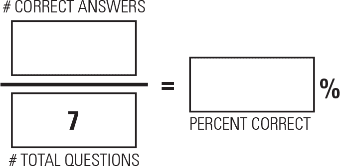

#### 第 4 章测试自评


#### 第 5 章测试自评


#### 第 6 章测试自评


#### 第 7 章测试自评


#### 第 8 章测试自评

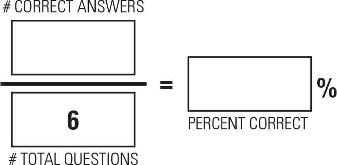

#### 第 9 章测试自评

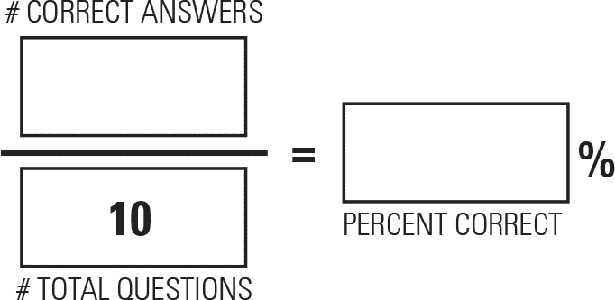

#### 第 10 章测试自评


#### 第 11 章测试自评


### 第三步

使用上述结果按章节制定学习计划。

## 练习题

### 第一节：选择题

1.  D

    取模和除法的优先级相同。

2.  C

    在表达式中，取模运算先于除法。

3.  D

    首先，所有的`()`都会被处理。

4.  A

    `String`类是不可变的。

5.  C

    `B`和`D`传递了`int`类型。

6.  D

    所有选项都能通过编译。

7.  B

    追踪代码：

    ```java
    int x = 10;
    int y = 5;
    if (x == 10) // x 是 10，进入此分支
    {
        if (y <= 5) // y 是 5，进入此分支，y 加 1，现在是 6
        y++;
        else if (y < 4)
            x = 3;
        else
            y += 6;
    } // 第一个 if 结束
    if (y > 5) // y 是 6，进入此分支
    {
        if (x != 10) // x 是 10，跳到 else
        {
            x = 0;
            y = 0;
        }
        else // 进入此分支，将 -5 赋值给 x
            x = -5;
    }
    ```

    因此 x = -5，y = 6。

8.  A

    `compareTo`的规则如下：如果`string1.compareTo(string2) < 0`，则字符串按字典顺序排列；而如果`string1.compareTo(string2) > 0`，则按反序排列。

    ```java
    String word1 = "frog";
    String word2 = "dog";
    String word3 = "cat";

    if (word1.compareTo(word2) < 0) // frog 不在 dog 之前，跳到 else
    {
        if (word2.compareTo(word3) < 0)
            System.out.println(word1 + " " + word2 + " " + word3);
        else
            System.out.println(word1 + " " + word3 + " " + word2);
    }
    else // 跳到这里
    {
        if (word1.compareTo(word2) > 0) // frog 在 dog 之后，进入此分支
    }
    ```

```java
12 if (word2.compareTo(word3) < 0) //dog does not precede cat, skip to the else
13 System.out.println(word1 + " " + word2 + " " + word3);
14 else
15 System.out.println(word1 + " " + word3 + " " + word2); //frog cat dog
16 else
17 if (word2.equals(word3))
18 System.out.println( "all the words are the same");
19 else
20 System.out.println( "word1 and word2 are duplicates");
```

正确答案是 (A)。

返回练习测试 1 第一部分：多选择题第 8 题

### 9. **C**

选项 (A)可以直接从数据集中检索到。选项 (B) 和 (D) 可以使用数据集中包含的信息进行计算。要计算人口密度，需要知道该国家的面积，而这并不是数据集的一部分。正确答案是 (C)。

返回练习测试 1 第一部分：多选择题第 9 题

### 10. **B**

第 3 行将`dog2`的对象引用赋值给`dog1`。这两个对象变量现在指向同一个对象，其内容为 "Beagle"。因此，第 6 行`if (dog1 == dog2)`的结果为真。第 4 行创建了另一个内容为 "Beagle" 的对象。因此，第 11 行`if (dog1 == dog3)`的结果为假。`==`比较的是变量是否指向同一个对象，而不是对象的内容是否相同。第 16 行`if (dog1.equals(dog3))`的结果为真。`.equals()`方法比较的是两个对象的内容：它们都包含 "Beagle"。正确答案是 (B)。

返回练习测试 1 第一部分：多选择题第 10 题

### 11. **C**

选项 (A) 从 0 开始并将递减到负索引，导致越界异常。选项 (B) 索引从`str1.length`开始，这超出了范围。字符串中的最后一个字符应该通过`length - 1`来引用。选项 (D) 正确地从`length - 1`开始；然而，循环只在索引大于 0 时继续，错过了`str1`的第一个字符。正确答案是 (C)。

返回练习测试 1 第一部分：多选择题第 11 题

### 12. **D**

这类分析性问题通过选择一个值并测试结果更容易解决。在这种情况下，用较小的数字（如 3）代替`n`，然后跟踪代码。外层循环从 1 执行到 2，执行 2 次。内层循环从 1 执行到 3，执行 3 次。循环内部的代码简单地按 1 计数。内层循环将执行 (2 次 3) 6 次，从而为`count`加 6。

现在，在所有可能的答案中用 3 代替`n`。

| | 表达式 | 结果 |

| --- | --- | --- |

| (A) | 3³ | 27 |

| (B) | 3² – 1 | 8 |

| (C) | (3 – 1)² | 4 |

| (D) | 3(3 – 1) | 6 |

因此，该题的答案是 (D)，`n(n - 1)`。从分析角度来看，你可以观察第一个循环从 1 处理到`n - 1`，第二个循环从 1 处理到`n`，得出相同的评估。

返回练习测试 1 第一部分：多选择题第 12 题

### 13. **A**

选项 (D) 被短路逻辑排除。第 4 行试图判断`x != 0`，但它**是** 0，因此逻辑立即跳转到第 7 行的`else`语句。变量`x`初始化为 0，`j`初始化为 1，因此第 7 行将`j` (1) 乘以`x` (0) = 0 并打印结果。这排除了 (B) 和 (C)。选项 (A) 全是 0。第 2 行指定`j`从 1 开始到 3 ，因此打印三个 0。正确答案是 (A)。

返回练习测试 1 第一部分：多选择题第 13 题

### 14. **C**

位于第 4–7 行的循环打印符号`*` 5 次。

第 8 行是到下一行的控制换。

位于第 9–16 行的循环执行 5 次。第 11–14 行的内层循环打印`5 – j`个空格，第一次执行打印 4 个空格，下次打印 3 个空格，以此类推。（注意：这排除了 (C)）。在每行打印完空格后，使用`println`打印单个`*`（然后移动到下一行）。第 17–20 行的循环与第一个循环相同，打印`*` 5 次。正确答案是 (C)。

返回练习测试 1 第一部分：多选择题第 14 题

### 15. **B**

`i`的值只为 1，`j`从 1 到 3，`k`从 1 到 3。这三个变量相乘并加到总和中。结果如下：

`i * j * k`

1 * 1 * 1

1 * 1 * 2

1 * 1 * 3

1 * 2 * 1

1 * 2 * 2

1 * 2 * 3

1 * 3 * 1

1 * 3 * 2

1 * 3 * 3

正确答案是 (B)。

返回练习测试 1 第一部分：多选择题第 15 题

### 16. **B**

`i`的值只为 1，`j`从 1 到 3，`k`从 1 到 3。这三个变量相乘并加到总和中。结果如下：

`i * j * k`

1 * 1 * 1

1 * 1 * 2

1 * 1 * 3

1 * 2 * 1

1 * 2 * 2

1 * 2 * 3

1 * 3 * 1

1 * 3 * 2

1 * 3 * 3

等等，根据提供的文本重新评估：`i`的值只为 1，`j`从 1 到 3，`k`从 1 到 3。这三个变量相乘并加到总和中。结果如下：

`i * j * k`

1 * 1 * 1 = 1


`1 * 1 * 2 = 2`

`1 * 1 * 3 = 3`

`1 * 2 * 1 = 2`

`1 * 2 * 2 = 4`

`1 * 2 * 3 = 6`

`1 * 3 * 1 = 3`

`1 * 3 * 2 = 6`

`1 * 3 * 3 = 9`

总和为`1 + 2 + 3 + 2 + 4 + 6 + 3 + 6 + 9 = 36`。（等等，文本说“正确答案是 (B)”）。

自纠：提示中提供的 15 文本存在重复/乱码。我将遵循 15 节提供的文本。

`i` 的值只为 1，`j` 从 1 到 3，`k` 从 1 到 3。这三个变量相乘并加到总和中。结果如下：

`i * j * k`

`1 * 1 * 1`

`1 * 1 * 2`

`1 * 1 * 3`

`1 * 2 * 1`

`1 * 2 * 2`

`1 * 2 * 3`

`1 * 3 * 1`

`1 * 3 * 2`

`1 * 3 * 3`

正确答案是 (B)。

返回练习测试 1 第一部分：多选择题第 16 题

### 17. C

同样，选择一个`n`的值来分析代码是有帮助的。选择`n = 3`分析代码。

I——循环每次执行，阶都会乘以 3。这不符合阶的定义。排除包含 I 的 (A) 和 (D)。

由于剩余选项都包含 II，因此无需检查此选项。直接跳转到 III。

III——将`n (3)`传递给函数的递归解决方案：

第一次执行`f(3) -> 3 * f(2)`

第二次执行`f(2) -> 2 * f(1)`

最后一次执行`f(1) -> 1`

`3 × 2 × 1`将得到 6。排除 (B)。

唯一剩下的答案是 (C)。

要了解为什么 II 起作用，请注意循环由`j`控制，`j`的范围从 1 到`n`（在本例中为 3）。循环每次执行，阶都会乘以`j`，从而产生`1 × 2 × 3`的结果，这是正确的。答案是 (C)。

返回练习测试 1 第一部分：多选择题第 17 题

### 18. B

当创建局部变量时，使用的是局部变量而不是实例变量。当调用构造函数时，第 28 行更新的是局部变量`price`而不是实例变量`price`。由于没有指定`this.price = price`，局部变量被赋值为其已有的值，而不是实例变量的值。因此，排除了 (C) 和 (D)。第 30 行的`chgMaterial(mat)`方法创建了新的局部变量`material`，而不是同名的实例变量，排除了 (A)。正确答案是 (B)。

返回测试卷 1 第一部分第 18 题：多选题

### 19. B

如果向`print`语句传递一个对象，将调用它的`toString()`方法。这消除了除 (B) 以外的所有答案，(B) 是正确答案。

返回测试卷 1 第一部分第 19 题：多选题

### 20. D

`static`变量将用于属于整个类的内容。由于每个样式都需要库存，因此它不能是静态的，但它必须是类的实例，这消除了 (A) 和 (B)。选项 (C) 被排除，因为`final`关键字仅用于值不会改变的常量，但所有者还要求一个可以更改值的方法。正确答案是 (D)。

返回测试卷 1 第一部分第 20 题：多选题

### 21. B

数组初始化为`{11, 22, 33, 44, 55, 66}`。

第一遍循环：

```
nums[nums[0] / 11] = nums[0];
nums[11 / 11] = nums[0];
nums[1] = nums[0];
```

数组现在为：`{11, 11, 33, 44, 55, 66}`。

第二遍循环：

```
nums[nums[1] / 11] = nums[1];
nums[11 / 11] = nums[1];
nums[1] = nums[1];
```

数组不变：`{11, 11, 33, 44, 55, 66}`。

第三遍循环：

```
nums[nums[2] / 11] = nums[2];
nums[33 / 11] = nums[2];
nums[3] = nums[2];
```

数组现在为：`{11, 11, 33, 33, 55, 66}`。

第四遍循环：

```
nums[nums[3] / 11] = nums[3];
nums[33 / 11] = nums[3];
nums[3] = nums[3];
```

数组不变：`{11, 11, 33, 33, 55, 66}`。

第五遍循环：

```
nums[nums[4] / 11] = nums[4];
nums[55 / 11] = nums[4];
nums[5] = nums[4];
```

数组现在为：`{11, 11, 33, 33, 55, 55}`。

第六遍循环：

```
nums[nums[5] / 11] = nums[5];
nums[55 / 11] = nums[5];
nums[5] = nums[5];
```

数组不变：`{11, 11, 33, 33, 55, 55}`。

正确答案是 (B)。

返回测试卷 1 第一部分第 21 题：多选题

### 22. B

选项 (A) 在`while`循环内部包含了`scan.close()`；扫描器应该在从文件中读取所有输入后关闭。选项 (C) 应该使用`scan.hasNext()`作为`while`循环的条件，并使用`scan.next()`从文件中读取下一个`String`。选项 (D) 在`while`循环中使用了`scan.next()`而不是`scan.hasNext()`。正确答案是 (B)。

返回测试卷 1 第一部分第 22 题：多选题

### 23. B

第 29 行的`for`循环创建了一个名为`element`的局部变量，它将持有`arr3`的每个值而无需使用索引。修改此局部变量不会修改数组内的单独内容。循环将每个`element`乘以 2，并打印如下：

```
2, 4, 6, 8, 10, 12
```

第 36 行的循环打印数组的内容，这些内容保持不变：

```
1, 2, 3, 4, 5, 6
```

正确答案是 (B)。

返回测试卷 1 第一部分第 23 题：多选题

### 24. C

由于索引`i`被赋值给变量`a`和`b`，因此打印的是它们的位置。这消除了 (A)。扫描剩余答案并制作一个表来帮助理解各种可能性。

| | ...的位置： | ...的位置： |
| :--- | :--- | :--- |
| (B) | 最小整数 | 最大整数 |
| (C) | 最小整数 | 最大非负整数 |
| (D) | 最小非负整数 | 最大整数 |

变量`holdSmallest`使用`Integer.MAX_VALUE`初始化，这是`int`字段可能持有的最大整数。因此，代码可以找到数组中的最小数，即使它是一个负数。这消除了 (D)。变量`holdLargest`初始化为 0，所有者还要求一个更改值的方法。这消除了 (B)。正确答案是 (C)。

返回测试卷 1 第一部分第 24 题：多选题

### 25. A

选项 (B) 在`while`循环内部包含了`scan.close()`；扫描器应该在从文件中读取所有输入后关闭。(C) 应该使用`scan.hasNext()`作为`while`循环的条件，并使用`scan.next()`从文件中读取下一个`String`。(D) 在`while`循环中使用了`scan.next()`。正确答案答案。

返回测试卷 1 第一部分第 25 题：多选题

### 26. B

返回测试卷 1 第一部分第 26 题：多选题

### 27. D

返回测试卷 1 第一部分第 27 题：多选题

### 28. A

返回测试卷 1 第一部分第 28 题：多选题

### 29. A

### 30. C

内部循环执行的范围不足以处理整个数组。`size`为 5，而`size - 1`为 4，因此索引只能小于 4，在索引 3 处停止。`ArrayList`中的最后一个元素永远不会被排序。该排序算法对`ArrayList`进行了 4 次迭代。迭代过程如下：

```
[6, 21, 2, 8, 1]
[6, 2, 21, 8, 1]
[6, 2, 8, 21, 1]
[2, 6, 8, 21, 1]
```

正确答案是 (C)。

### 31. D

数组按列优先的顺序打印。外层循环从 0 运行到`row length - 1`（列数）。内部循环从 0 运行到数组的长度（即行数）。

原始数组为：

```
1 2 3 4
5 6 7 8
```

外层循环从列 0 开始，打印`[0][0]`：1，`[1][0]`：5。

外层循环增加到列 1，打印`[0][1]`：2，`[1][1]`：6。

外层循环增加到列 2，打印`[0][2]`：3，`[1][2]`：7。

外层循环增加到列 3，打印`[0][3]`：4，`[1][3]`：8。

正确答案是 (D)。

### 32. A

片段 III 会越界。`r`（行）的迭代次数与列数相同。如果行数少于列数，索引将越界。正确答案是 (A)。

### 33. D

`Instrument`构造函数期望三个数据类型的参数：`String`、`String`、`double`——按此顺序。这些数据类型由 (B) 和 (C) 提供，因此这两个选项可以编译。选项 (A) 提供了`String`、`String`和`int`字段，但它可以编译，因为`int`数字可以赋值给`double`变量。选项 (D) 提供了三个参数；但顺序错误（`double`、`String`、`String`），因此无法编译。选项 (D) 是正确答案。

### 34. D

在`Instrument`对象上调用`compareTo()`方法，是为了比较该对象的重量与作为参数传递给方法的另一个对象的重量。访问此对象的重量有两种方式：`this.weight`（可以工作，因为`weight`和`compareTo`方法都位于`Instrument`类中）或`this.getWeight()`（它也是`Instrument`类中的一个方法）。`Instrument.weight`是一个无效引用，因此无法使用 (I) 中的代码。因此 (D) 是正确选择。

### 35. C

`Instrument`类中的`getSubset`方法返回一个`Instrument`类型的`ArrayList`。(A) 和 (B) 都声明了一个名为`brassSection`的`ArrayList`，然后将`getSubset`返回的`ArrayList`赋值给`brassSection`。由于 (A) 和 (B) 都能运行，因此 (C) 是正确的。

### 36. C

选项 (A) 没有提供比较对象字段机制。选项 (B) 和 (D) 只会比较对象的引用（只有当它们指向同一个对象时才会被认为是相同的），因此排除 (B) 和 (D)。选项 (C) 是正确的，因为它能够比较`Instrument`类中的所有实例字段。

### 37. D

```
double pow(double b, int x) {
    if (x == 1) {
        return b;
    } else {
        return b * pow(b, x - 1);
    }
}
```

调用`pow(3, 2)`：

- `pow(3, 2)`：`x`不为 1，返回`3 * pow(3, 1)`。
- `pow(3, 1)`：`x`为 1，返回`3`。
- 结果：`3 * 3 = 9`。

正确答案是 (D)。

### 38. D

```java
double pow(double b, int x) {
    if (x == 1) {
        return b;
    } else {
        return b * pow(b, x - 1);
    }
}
```

调用`pow(2, 2)`：

- `pow(2, 2)`：`x`不为 1，返回`2 * pow(2, 1)`。
- `pow(2, 1)`：`x`为 1，返回`2`。
- 结果：`2 * 2 = 4`。

正确答案是 (D)。

### 39. D

```java
public static int f(int n) {
    if (n == 0) {
        return 0;
    } else {
        return f(n / 10) + n % 10;
    }
}
```

`f(8765)`：

- `f(876) + 5`
- `f(87) + 6 + 5`
- `f(8) + 7 + 6 + 5`
- `f(0) + 8 + 7 + 6 + 5`
- `0 + 8 + 7 + 6 + 5 = 26`

正确答案是 26。

### 40. A

```java
int first = 0;
int last = array.length - 1;
while (first <= last) {
    int mid = (first + last) / 2;
    if (array[mid] == sought) {
        return mid;
    } else if (array[mid] < sought) {
        first = mid + 1;
    } else {
        last = mid - 1;
    }
}
```

这段代码实现了二分查找算法。如果`sought`小于索引`mid`处的元素，则搜索数组的前半部分，将中间位置`mid - 1`赋值给`last`。如果`sought`大于索引`mid`处的元素，则将`mid + 1`赋值给`first`以搜索数组的后半部分。该过程将重复，直到找到`sought`。

### 41. A

```java
int x = 30, y = 20;
if (!(x < 0 || y >= 0)) {
    System.out.println(x + y);
} else {
    System.out.println(x - y);
}
```

- `x < 0`为`30 < 0`（`false`）。
- `y >= 0`为`20 >= 0`（`true`）。
- `false || true`为`true`。
- `!true`为`false`。
- 执行`else`分支，打印`x - y`，即`30 - 20 = 10`。

正确答案是 (A)。

### 42. C

```java
int x = 30;
int y = 20;
if (x > y) {
    x = x - y;
} else {
    y = y - x;
}
```

- 初始`x = 30`，`y = 20`。
- `x > y`（`30 > 20`）为`true`。
- 执行`x = x - y`，即`x = 30 - 20 = 10`。
- 最终`x = 10`，`y = 20`。

正确答案是 (C)。

```java
if (y > 0) // x = 30 y = 20
{
    if (x > 30) // 因为 x 不大于 30，逻辑流转到 else
    {
        y = x * 2;
        if (y < 50)
            x = x * 2;
    }
    else
    {
        y = -x; // x = 30 y = -30
    }
}
else
{
    y = x + 10;
}
System.out.print(x + " " + y);
```

选项 (C) 正确。

返回练习测试 1 第一部分：多选择中的第 42 题

## 第二部分：简答题

### 1. DiceSimulation——标准答案

```java
public int roll() {
    return (int)(Math.random() * numFaces + 1);
}

public int runSimulation() {
    int die1 = 0;
    int die2 = 0;
    int countDouble = 0;
    for (int i = 0; i < numSampleSize; i++) {
        die1 = roll();
        die2 = roll();
        if (die1 == die2) {
            countDouble++;
        }
    }
    return 1.0 * countDouble / numSampleSize;
}
```

#### DiceSimulation 评分标准

##### 第 (a) 部分

- +3：`roll`方法
  - +1：使用`Math.random()`或`Random`类。
  - +1：乘以`numFaces + 1`。
  - +1：计算结果被恰当强制转换为`int`并返回。

##### 第 (b) 部分

- +4：`runSimulation`方法
  - +1：为两个骰子声明并初始化了局部变量，使用`roll`分配骰子值。
  - +1：使用循环执行样本大小次数（不多不少）。
  - +1：使用`==`比较`die1`和`die2`的值，恰当计数了双倍数。
  - +1：计算双倍数的百分比（避免整数除法），并乘以 100。

返回练习测试 1 第二部分：简答题中的第 1 题

### 2. CalorieCount——标准答案


```java
public class CalorieCount {
    private int numCaloriesLimit;
    private int numCaloriesIntake;
    private int gramsProtein;
    private int gramsCarbohydrate;
    private int gramsFat;

    public CalorieCount (int calorieLimit) {
        numCaloriesLimit = colorieLimit;
        numCaloriesIntake = 0;
        gramsProtein = 0;
        gramsCarbohydrate = 0;
        gramsFat = 0;
    }

    public void addMeal(int calories, int protein, int carbs, int fat) {
        numCaloriesIntake += calories;
        gramsProtein += protein;
        gramsCarbohydrate += carbs;
        gramsFat += fat;
    }

    public boolean onTrack() {
        return numCaloriesIntake <= numCaloriesLimit;
    }
}
```

#### CalorieCount 评分标准

* +1: 声明了所有合适的实例变量
* +2: 构造函数
  * +1: 声明头部 `public CalorieCount (int calorieLimit)`
  * +1: 使用参数和适当的值初始化实例变量
* +2: `addMeal` 方法
  * +1: 声明头部 `public addMeal(int calories, int protein, int carbs, int fat)`
  * +1: 更新了实例变量
* +2: `onTrack` 方法
  * +1: 声明头部 `public boolean onTrack()`
  * +1: 返回 `numCaloriesIntake <= numCaloriesLimit`

返回练习测试 1 第二部分：简答题中的第 2 题

### 3. TravelPlan

```java
public TravelPlan(String destination) {
    this.destination = destination;
    plans = new ArrayList<>();
}

public boolean addTour(Tour t) {
    if (checkForConflict(t)) {
        return false;
    }
    plans.add(t);
    return true;
}
```

#### TravelPlan 评分标准

#### 第 (a) 部分

* +3: 构造函数
  * +1: 声明头部 `public TravelPlan(String destination)`
  * +1: 初始化了 `destination` 字段
  * +1: 初始化了 `plans`

#### 第 (b) 部分

* +4: `addTour` 方法
  * +1: 声明头部 `public boolean addTour(Tour t)`
  * +1: 调用 `checkForConflict(t)` 判断是否存在冲突
  * +1: 将 `t` 添加到 `plans`
  * +1: 返回 `true` 或 `false`

### 4. SeatingChart—标准答案

```java
SeatingChart(Name[] names, int r, int c) {
    chart = new String[r][c];
    for (int i = 0; i < r; i++) {
        for (int j = 0; j < c; j++) {
            chart[i][j] = "";
        }
    }
    int count = 0;
    while (count < names.length) {
        int i = (int)(Math.random() * names.length);
        int row = i / c;
        int col = i % c;
        if (chart[row][col].equals("")) {
            chart[row][col] = names[count].getLastName() + ", " + names[count].getFirstName();
            count++;
        }
    }
}
```

#### SeatingChart 评分标准

* +6: 构造函数
  * +1: 使用传入的 `r` 和 `c` 初始化 `chart` 数组
  * +1: 使用嵌套循环将 `chart` 中的所有元素初始化为空字符串
  * +1: 初始化了 `count` 为 0
  * +1: 使用 `while` 循环处理所有 `names`
  * +1: 生成了随机索引 `i`
  * +1: 正确计算了 `row` 和 `col`
  * +1: 检查了 `chart[row][col]` 是否为空字符串
  * +1: 按照格式“姓, 名”将姓名存入 `chart`
  * +1: 恰当递增了 `count`

返回练习测试 1 第二部分：简答题中的第 4 题

## 如何为练习测试 1 评分

[点击此处](https://prhlink.com/9780593518427a001) 下载《为练习测试 1 评分》的 PDF 文件。

#### 第一部分：多选择题

做正确题数（满分 42 题）$\times$ 1.964 = 第一部分得分（不四舍五入）

#### 第二部分：简答题

* 第 1 题：（满分 7 分）$\times$ 2.700 = 得分（不四舍五入）
* 第 2 题：（满分 7 分）$\times$ 2.700 = 得分（不四舍五入）
* 第 3 题：（满分 5 分）$\times$ 2.700 = 得分（不四舍五入）
* 第 4 题：（满分 6 分）$\times$ 2.700 = 得分（不四舍五入）

总和 = 第二部分得分（不四舍五入）

#### 总分

第一部分得分 + 第二部分得分 = 总分（四舍五入到整数）

| 计算机科学 A AP 评分转换表 |
| --- |
| 总分范围 | AP 评分 |
| 107–150 | 5 |
| 90–106 | 4 |
| 73–89 | 3 |
| 56–72 | 2 |
| 0–55 | 1 |

占最终分百分比：9%

* 问题 4：二维数组 (6 分)

占最终分百分比：10.8%

AP 计算机科学 A 课程和考试要求问题的潜在解决方案必须用 Java 编程语言编写。你应该能够执行以下任务：

* 设计、实现和分析问题的解决方案
* 使用并实现常用算法
* 使用标准数据结构
* 开发并选择适当的算法和数据结构来解决新问题
* 在面向对象的范式中流利地编写解决方案
* 使用 Java 编程语言编写、运行、测试和调试解决方案，并利用来自 AP Java 子集的的标准 Java 库类
* 阅读并理解由多个类和交互对象组成的程序
* 阅读并理解导致此类程序的设计和开发过程的描述（此类解决方案的示例可以在 AP 计算机科学实验中找到）
* 理解计算机使用的的伦理和社会影响

下表显示了分类类别以及它们在考试多选择题部分的表示方式。由于一个问题可能被归分为多个类别，因此百分比总和可能会超过 100%。

| 单元 | 考试权重 |
| --- | --- |
| 单元 1：使用对象和方法 | 15–25% |
| 单元 2：选择与迭代 | 25–35% |
| 单元 3：类创建 | 10–18% |
| 单元 4：数据集合 | 30–40% |

除了多选择题外，还有四道强制开放式答题。你共有 90 分钟来回答所有四道题。你应该每个问题花费大约 22 分钟，但请注意你必须管理自己的时间。在某一个问题上花费额外的时间将减少回答其他问题的剩余时间。

多选择题由 Bluebook 应用程序评分，而开放式答题由在年度 AP 阅卷期间的数千名大学教师和专家 AP 老师评分。开放式答题的分数经过加权，并与多选择题的加权结果相结合。这些复合的加权原始分随后被转换为报告的 AP 考试分 5、4、3、2 和 1。

## AP 计算机科学 A 考试如何评分

根据你回答正确的题目数量，你的测试将获得一个 1 到 5 分的数字分。

* 5 = 极其优秀
* 4 = 优秀
* 3 = 合格
* 2 = 可能合格
* 1 = 不建议

大学会自行决定他们接受的用于大学学分和/或高级预读的最低分数。美国教育委员会建议接受 3 分及以上的成绩，许多大学也遵循这些标准。大约 80% 参加 AP 计算机科学 A 考试的学生获得了 3 分或以上的成绩。请查看你计划申请的每所大学的网站，以便了解其在授予学分或高级预读方面的政策。

## 往届 AP 计算机科学 A 分数分布

| 分数 | 2024 年百分比 | 学分建议 | 大学等效等分 |
| --- | --- | --- | --- |
| 5 | 25.6% | 极其优秀 | A |
| 4 | 21.4% | 优秀 | A–, B+, B |
| 3 | 20.1% | 合格 | B–, C+, C |
| 2 | 10.8% | 可能合格 | – |
| 1 | 22.0% | 不建议 | – |

分数来自 2024 年 5 月 AP 考试管理。数据来自 College Board 网站。

为你的多选择题评分，每个正确答案得 1 分，每个错的题目得 0 分。

### 开放式答题

AP 计算机科学 A 考试的第二部分是开放式答题。该部分包含以下知识点：

* 问题 1：方法与控制结构 (7 分)
* 问题 2：类设计 (7 分)
* 问题 3：数据集合 (5 分)
* 问题 4：二维数组 (6 分)

不幸的是，College Board 会列出一些关于 `ArrayList` 的规则，具体如下：

#### 1 分扣罚

* 产生副作用的冗余代码（例如 `written to output`）
* 使用但未声明的局部变量
* 破坏持久性数据（例如 `changing value by parameter`）
* void 方法或构造函数

#### 无扣罚

* 产生副作用的冗余代码
* 存在歧义的拼写/大小写差异
* 未声明的局部变量
* 构造函数头部缺少 `private` 修饰符
* 类上缺少 `public` 修饰符
* 作为标识符使用的关键字
* 用于运算符数学符号 `×`, `•`, `÷`, `>`, `≠`
* `[]` 与 `()` 与 `<>`
* `=` 代替 `==`
* 集合元素访问混淆（右值 r-values）
* 集合元素修改混淆（左值 l-values）
* `array`、`String` 和 `ArrayList` 的长度/大小混淆
* 引用整个数组时的冗余 `[]`
* `[i, j]` 代替 `[i][j]`
* 数组声明中的冗余大小，例如 `int[size] = new int[size];`
* 意图清晰处缺少 `;`
* 意图清晰处缺少 `{}`
* 无参数方法或构造函数调用缺少 `()`
* 从泛型集合获取对象

## AP 计算机科学 A 考试是完全数字化的

AP 计算机科学 A 考试的多选择部分和开放式答题部分都通过 College Board 测试应用程序进行管理和完成。要参加考试，你必须可以使用该测试应用程序，该程序适用于 Windows 和 Mac 笔记本电脑/桌面电脑、iPad、平板和 Chromebook。如果你的电脑或平板是由学校拥有或管理的，那么学校官员可能需要为你安装此程序。手机无法考试。

Bluebook 允许你对文本进行标记和高亮、排除答案并标记需要复习的题目。你还可以使用草稿纸来规划问题的回答。与 SAT 等数字考试不同，数字 AP 考试不是自适应的：这意味着题目的难度不会根据你在之前几个部分的表现而改变。

## AP 考试的用途

不同大学使用 AP 考试的方式不同，因此访问特定大学的网站以确定其如何接受 AP 考试分数是非常重要的。下面的项目代表了 AP 考试分数的主要用途：

* **大学学分。** 如果你在 AP 考试中获得高分，某些大学会给你大学学分。这些学分计入毕业要求，意味着你在大学期间可以少上一些课程。考虑到大学的费用，这确实是一个巨大的福利。
* **满足要求。** 如果你在 `AP Exam` 中表现优异，某些大学允许你“免除”某些要求，即使它们没有给你实际的大学学分。例如，你可能不需要修入门级课程，或者你可能完全不需要修某个学科的课程。
* **录取加分。** 即使你的 `AP Exam` 没有获得大学学分，甚至不能让你免除某些课程，大多数大学也会尊重你通过参加 `AP course` 来挑战自我的决定。此外，如果你在 `AP course` 之外参加了 `AP Exam`，他们可能也会尊重这种动力。`AP Exam` 的高分显示了你对比高中课程教学内容更难内容的掌握，大学可能会在录取过程中考虑这一点。

有些人人认为 `AP courses` 是专为高三学生预留的，但事实并非如此。不要害怕在三年级甚至二年级时尝试进入 `AP course`。一个优秀的 `AP Exam` 成绩在大学申请中看起来非常出色，并能让你从其他候选者中脱颖而出。

## 其他资源

有很多资源可以帮助你提高 `AP Computer Science A Exam` 的分数，其中最重要的就是你的老师。如果你正在学习 `AP course`，你可能会获得老师的额外关注，例如对你的简答题给出反馈。如果你没在 `AP course` 中，你可以联系教授 `AP Computer Science A` 的老师，询问该老师是否会批改你的简答题或通过其他方式帮助你掌握内容。

另一个很好的资源是 `AP Students`，它是 `AP Exams` 的官方网站（大学委员会 College Board 网站的一部分）。`AP Central` 上提供的信息范围非常广泛，包括以下内容：

* 课程描述，包括关于考试涵盖内容的更多详细信息
* `AP Computer Science A Exam` 的示例题
* 往届的简答题提示和多选择题

`AP Students` 的主页地址是 [apstudents.collegeboard.org](http://apstudents.collegeboard.org)。

欲获取有关 `AP Computer Science A Exam` 的最新信息，请访问 [apstudents.collegeboard.org/courses/ap-computer-science-a](http://apstudents.collegeboard.org/courses/ap-computer-science-a)。

最后，普林顿顿 提供辅导和小组教学。我们的专家讲师可以帮助你完善策略方法并增强内容知识。欲了解更多信息，请拨打 1-800-2REVIEW。

## 你听过 AP 计算机科学原理吗？

2017 年秋季，大学委员会推出了一门新的 `AP course` 和考试——`AP Computer Science Principles`（AP 计算机科学原理）。正如大学委员会所说：“AP 计算机科学原理向学生介绍了计算机科学的核心思想，培养计算思维的思想和实践，并引导学生理解计算如何改变世界。学生使用艺术家、作家、计算机科学家和工程师赋予创意生命时相同的创作过程，开发创新的计算制品。”

这门课程是进入计算机科学世界的绝佳切入点，这个世界在历史上对很多人来说是非常令人生畏的。但他们所谓的“comp sci”（计算机科学）其实名有其实：计算机科学是一项让你学习如何“说”（编写）一种语言的课程，就像你学习法语或西班牙语一样。

### 大核心理念 (Big Ideas)

大学委员会将课程分为 5 个大核心理念。它们是：

* 创造性开发 (CRD)
* 数据 (DAT)
* 算法与编程 (AAP)
* 计算系统与网络 (CSN)
* 计算的影响 (IOC)

### 计算思维实践

大学委员会将这门课程细分为计算思维实践：

#### 1. 计算解决方案设计

设计并评估解决方案。学生应当：

* 调查状况、背景
* 确定实现目的合适方法

#### 2. 算法与程序开发

开发并实现算法。学生应当：

* 在不使用语言的情况下表示
* 实现算法

#### 3. 程序开发中的抽象

开发包含抽象的程序。学生应当：

* 泛化数据源
* 使用抽象管理复杂度
* 解释抽象如何管理复杂度

#### 4. 代码分析

评估和测试算法及程序。学生应当：

* 解释代码段的功能
* 确定代码段的结果
* 识别并修正算法和程序的错误

#### 5. 计算创新

研究计算创新。学生应当：

* 解释计算系统如何工作
* 解释如何从数据产生知识
* 描述计算创新的影响
* 根据伦理因素评估计算

#### 6. 负责任的计算

为包容、安全、协作和伦理的计算文化做贡献。学生应当：

* 在开发中协作
* 在使用计算设备时使用安全的方法
* 承认知识产权

## 考试结构


你的 AP 计算机科学原理老师在教学这些内容的解释和选择方面有很大的空间，因此每门课程都是独特的。然而，考试本身相对明确。大学委员会对考试的安排如下：

## 第一部分：多选题

70 道多选题 | 2 小时 | 占总分 70%

- 单选：57 题，从四个选项中选择一个
- 带有计算创新阅读材料的单选：5 题，根据阅读材料选择一个
- 多选：8 题，从四个选项中选择两个

## 第二部分：创建任务

1 个任务 | 占总分 30%

- 根据创意应用程序
- 开发学生选择的计算机程序

| 主题 | 使用 `Java` 语言进行编程和解决问题的基础 | 计算的基础，包括解决问题、处理数据、理解互联网、网络安全和编程。教师将自行选择他们将使用的编程语言。 |
|---|---|---|
| 目标 | 为未来的学习或计算机科学或其他 STEM 领域的职业发展培养技能 | 扩展你对计算机科学的理解，以适用于不同的专业和职业 |
| 考试 | 一次期末考试：多选题和开放式问答 | 一次期末考试：单选和多选格式的多项选择题；一项由教师在课程期间进行的性能任务 |

## 结语

`AP 计算机科学原理 (APCSP)` 可以是一门让你熟悉计算机科学领域的优秀课程。如果你已经报名了 `AP 计算机科学 A (APCS-A)`（你很可能已经报名了，因为你购买了这本书），那么我们假设你已经对计算机科学的核心思想（Big Ideas）非常熟悉。因此，我们很快就会深入 `APCS-A`——首先，让我们快速思考一下你可能如何使用你的 `AP Exam` 分数。

尽管许多学校会对两次考试都授予学分，但每场考试对应的课程不同；例如，`AP 计算机科学 A` 可能会取代 STEM 专业的编程课程，而 `AP 计算机科学原理` 则取代更具应用性和/或通识要求的课程。请咨询学校网站以获取进一步说明。

以下是来自多所学校的汇总信息，让你了解哪些学校接受什么（或任何内容！）。更多信息可以在每所学校的官网上找到。

### 波士顿大学 (Boston University)

- **接受 APCS-A 分数**
  - 4 或 5
- **授予学分**
  - 4
- **接受 APCSP 分数**
  - 4 或 5
- **授予学分**
  - 4（两者都有）

### 罗格斯大学 (Rutgers University)

- **接受 APCS-A 分数**
  - 4 或 5
- **授予学分**
  - 4 分给 3 分；5 分给 4 分
- **接受 APCSP 分数**
  - 4 或 5
- **授予学分**
  - 3

### 西彻斯特大学 (West Chester University)

- **接受 APCS-A 分数**
  - 3 或以上
- **授予学分**
  - 3
- **接受 APCSP 分数**
  - 4 或以上
- **授予学分**
  - 3

### 俄亥俄州立大学 (The Ohio State University)

- **接受 APCS-A 分数**
  - 3 或以上
- **授予学分**
  - 3 分给 3 分；4 分或 5 分给 6 分
- **接受 APCSP 分数**
  - 3 或以上
- **授予学分**
  - 3

### 亚拉巴马大学 (University of Alabama)

- **接受 APCS-A 分数**
  - 4 或以上
- **授予学分**
  - 4
- **接受 APCSP 分数**
  - 3 或以上
- **授予学分**
  - 3

### 加州大学洛杉矶分校 (UCLA)

- **接受 APCS-A 分数**
  - 3 或以上
- **授予学分**
  - 8
- **接受 APCSP 分数**
  - 3 或以上
- **授予学分**
  - 8

### 杜克大学 (Duke University)

- **接受 APCS-A 分数**
  - 4 或 5
- **授予学分**
  - 200 级
- **接受 APCSP 分数**
  - 5
- **授予学分**
  - 100 级

### 华德大学 (Howard University)

- **接受 APCS-A 分数**
  - 4 或 5
- **授予学分**
  - 3
- **接受 APCSP 分数**
  - 4 或 5
- **授予学分**
  - 3

### 迈阿密大学 (University of Miami)

- **接受 APCS-A 分数**
  - 4 或 5
- **授予学分**
  - 4
- **接受 APCSP 分数**
  - 4 或 5
- **授予学分**
  - 3

### 韦斯理大学 (Wesleyan University)

- **接受 APCS-A 分数**
  - 4 或 5
- **授予学分**
  - 3
- **接受 APCSP 分数**
  - 4 或 5
- **授予学分**
  - 3（注：以上信息仅供参考，具体以学校规定为准）

在完成多选题部分时，请始终记住，评分时不会根据你的思考过程或草稿进行评分。最终唯一重要的是你是否给出了正确答案。即使你不确定如何以一种方法论上的“正确”方式回答某个问题，也要看看是否能根据常识排除掉某些选项，然后进行猜测。

在整本书中，我们将指出哪些地方你可以利用常识来排除答案。

虽然我们都希望能够用“正确”的方法解决问题，但使用排除法（POE）和激进的猜测可以帮助你多得几分。正是这些分数可能决定了 3 分和 4 分之间的差距，或者将你从 4 分推到 5 分。

### 不要害怕猜测

如果你不知道答案，就猜吧！作错答案没有惩罚，所以没有理由留空。显然，你能排除的错误答案越多，你猜中正确答案的概率就越大。

### 对长题要要有策略性

有些多选题需要阅读一页或两页才能回答问题。跳过任何需要大量时间阅读或大量时间计算的问题。将这些题目标记为待复，在完成该部分的其余题目后再回来处理。

### 不要把题目变成一场苦战！

大多数人在标准化考试中没有时间，并不是因为他们运行得太慢。相反，他们没时间是因为花了半的时间在两三个特定的问题上斗争。

你不应该在一个问题上花费超过两分钟的时间。如果你发现自己卡在一个超级难的问题上并纠结了三分钟，你正在偏离轨道！直接继续，并尽可能获得更多分数。如果一个问题不涉及计算，那么你要么知道答案，要么可以对答案做出有根据的猜测，要么你完全不知道答案是什么。弄清楚你在这个问题上处于什么位置，做出决定，然后继续。

任何需要超过两分钟计算时间的问题可能都不值得做。记住，在章节开始时跳过一道题，意味着你有时间在后面做对两道题，这是一件好事。

### 两遍法系统

AP 计算机科学 A 考试涵盖了广泛的主题。即使我们进行了广泛的复习，你也不可能知道 `Java` 中每个主题的一切。那么，你该怎么办？

采用我们所谓的“两遍法系统”。两遍法意味着过一遍考试并先回答简单的题。将更耗时的题目留到稍后处理。（别担心——你会有时间在以后做的！）首先，阅读题目并判断它是“现在做”题还是“稍后做”题。如果你决定这是“现在做”题，就在草稿纸上解决它并点击 `Bluebook` 应用中的答案。如果是“稍后做”题，使用 `Mark for Review`（标记待审）工具在题目旁边添加一个小标记。然后继续移动。

一旦你完成了所有“现在做”的题目，回到你标记为 `Mark for Review` 的题目并开始处理这些题。先从简单的题开始。这些题目需要仔细注意算法细节，或者需要你排除答案选项（本质上，正确答案不会立即跳入你的眼帘）。

### 留意算法描述中的特殊情况

在考试中，你可能知道在二叉搜索树中查找元素的平均运行时间是 `O(n log n)`。如果题目随口提到数据是按顺序插入到树中的，请务必注意。此时运行时间会恶化为最坏情况 `O(n)`。这类题目可能会出现在 AP 计算机科学 A 考试中，因此请保持敏锐。

### 记住递归算法中的基准情况

没有基准情况的递归方法会无限运行。确保存在基准情况且它是正确的基准情况。例如，一个基准情况为的阶乘函数：

```java
if (n == 1){
  return 0;
}
```

是错误的，因为 `1! = 1`。

### 留意 `<` vs. `<=` 和 `>` vs. `>=`

`<` 与 `<=` 或 `>` 与 `>=` 之间的区别可能是巨大的，特别是在循环中。你可以打赌这种差异会出现在多选题中！

### 了解如何使用 AP 计算机科学 Java 子集

本章提供的策略将帮助你成为一个更好的考生，并希望帮助你在 AP 计算机科学 A 考试中获得更高的分数。然而，有些事情是你必须知道的。虽然考试时你会有一个 AP 计算机科学 Java 子集的 `Quick Reference`（快速参考），但请提前复习 AP 计算机科学 Java 子集的类，并了解可以使用哪些方法、它们的作用以及如何使用它们。`Quick Reference` 会有帮助，但它不能替代对类本身的了解。

### 前置条件和后置条件

在给出时要仔细阅读。它们可能提供回答问题所需的线索。例如，一个前置条件可能会说明传递给方法的数组是有序的。

### 参数传递

记住，传递给方法的参数不会保留在方法内部对它们进行的修改。例如，编写一个交换两个整数基本类型值是不可能的。然而，不要将此与更改传递给方法的对象的内容（属性）混淆。

### 客户端程序 vs. 方法

可能会至少有一道题定义了一个类，并要求你在不同的方法实现之间进行选择。密切注意该方法是客户端程序还是类的方法。如果是客户端程序，它无法访问私有字段或私有方法。如果是类的方法，它可以自由访问私有字段和私有方法。

### 逻辑短路

`if` 和 `while` 语句中的条件判断会“短路”。例如：

```java
if ((a != 0) && (b / a == 5))
```

并不同于：

```java
if ((b / a == 5) && (a != 0))
```

因为 Java 在确定真值后将停止评估复合布尔语句。（稍后介绍。）

### 记忆德·摩根定律

考试中至少有一道题可以使用这些定律。

`!(p || q)` 等于 `!p && !q`

`!(p && q)` 等于 `!p || !q`

### 查找类中的数据

留意那些尝试更改声明为 `final` 数据字段的代码段选项。这是非法代码。

### 表达式中混合 `double` 和 `int`

在涉及 `int` 变量和 `double` 变量的操作中，除非显式强制转换，否则 `int` 会转换为 `double`，操作结果为 `double`。

### 试错法

如果题目根据变量的值询问代码段的结果，为变量选取简单的值并根据这些值确定结果。排除任何与结果不一致的选项。这通常比用通用术语确定结果要容易。

除非你编写了某些极其复杂的代码（请参见下文关于是否应该这么做的说明），否则没有必要写注释。写注释会浪费时间（而你并没有很多时间），而且评分老师在很大程度上会忽略注释（如果你的注释正确但代码错误，你将得不到分）。此外，如果你的代码正确但注释错误，你还面临着误导评分者的风险。

### 不要为一个问题编写多于一个解决方案

评分老师会根据他们看到的第一个解决方案进行评分。如果你重写了解决方案，请务必删除旧的那个。

### 不要让任何道题留白

如果你什么都不写，你就得不到任何分。即使你不确定如何回答某个特定问题（或问题的某部分），也要分析该问题并编写方法的“基础代码”。

例如，如果方法签名表示它将创建并返回一个 `ArrayList`，那么编写：

```java
ArrayList returnedList = new ArrayList( );
return returnedList;
```

这很可能让你至少获得部分分——即使你不知道如何向 `ArrayList` 中填充正确的对象。

### KISS（保持简单，学生）

简答题的设计初衷是让解决方案相对直观。如果你的解决方案变得复杂，那么可能有更简单或更好的方法来解决问题。同时，不要尝试编写看似优雅但不可读的代码。记住，评分老师在一周内必须批改数百份试卷——他们可能没有时间去弄懂你代码中所有的细微差别。保持简单！

### 编写标准解决方案

使用 AP 风格的变量、类和方法命名，并遵循 AP 示例代码的缩进风格（即使你不喜欢他们的风格！）。尽管评分老师总是努力做到公平准确，但他们也是人，会出错。你的答案越接近给评分老师的参考答案，他们给你的打分就就越容易。

在可能的情况下，使用清晰直观的命名法。例如，在遍历二维数组的行和列时，使用 `r` 和 `c` 或 `row` 和 `col`，不要使用 `x` 和 `y`、`a` 和 `b` 或 `jack` 和 `jill`。这确保了评分老师能够轻松跟上你代码的逻辑。

### 如果给了算法伪代码，请使用它！

有时你必须为某个方法创建自己的算法。但通常情况下，算法或方法的伪代码会作为问题的一部分给你；你只需要做的就是实现该算法。在这种情况下，请使用给你的伪代码！不要试图重新创建算法或实现你自己的特殊版本来增加自己的难度。此外，即使你不理解底层的算法，你通常也可以根据给定的伪代码为方法编写代码。

### 即使不会做第 (a) 部分，也要回答问题的 (b) 部分

简答题的许多部分是建立在之前的基础上的。例如，第 (b) 部分可能会使用你在第 (a) 部分编写的方法。然而，为了获得 (b) 部分的满分，你并不需要正确回答 (a) 部分。事实上，(b) 部分有时比 (a) 部分更容易。如果 (b) 部分说你应该使用 (a) 部分的内容，就用它吧！

### 不要让简单题出错——避免错误

学生经常在简答部分丢分是因为他们犯了常见的错误。以下是你可以采取的一些措施来避免这些错误。

- 除非问题显式要求你输出某些内容（使用 `System.out.print`），否则永远不要在你编写的方法中输出任何内容。
- 注意方法签名。确保使用正确的名称以及正确的参数数量和类型来调用方法。如果方法不是 `void`，请确保你编写的方法返回一个与签名中指定类型相同的值。
- 在调用方法时使用 `objectName.methodName()` 语法，在调用方法时使用 `ClassName.methodName()` 语法；使用 `ClassName.methodName()` 语法调用 `Math` 类的静态方法。
- 确保声明你使用的任何变量（并给它们具有描述性的名称）。
- 不要在不需要时创建对象。例如，如果一个方法返回 `ArrayList`，将其声明为：

```java
ArrayList returnedList;
returnedList = obj.getList( );
```

以及：

```java
ArrayList returnedList = new ArrayList( );
returnedList = obj.getList( );
```

### 设计题

确保使用正确的名称以及正确的参数数量和类型来调用方法。如果方法不是 `void`，请确保你编写的方法返回一个与签名中指定类型相同的值。

### `ArrayList`

考试中至少有一题（可能是多道）涉及遍历 `ArrayList`。了解类型之间的区别以及如何遍历元素。

## 通用策略

以下策略适用于选择题和简答题。

### 使用草稿纸

不要在脑子里做题。写下来！在题目上做标记。这不仅能让问题更容易解决，而且当你有时间时更容易回顾。

### 标记题目中的关键词

`client program`、`sorted`、`ordered`、`constant`、`positive`、`never`、`always` 和 `must` 等词规定了条件。在选择题和简答题中，阅读每道题时都要标记这些关键词。

### 不要做多余的工作

在选择题部分，你的过程不评分；在简答部分，即使答案巧妙或注释良好，也不会获得额外加分。

### 先看一遍卷——使用两遍法

记住，所有选择题的分值相同，每道简答题的分值也相同。没有必要按照顺序做。相反，使用两遍法。

每个部分看两次。第一遍，完成所有你能得出答案的题目——即那些不需要太多分析的，或者你非常熟悉的计算机科学主题的题目。在第一轮中，跳过那些让你感到不安的题目。你可能也想跳过那些看起来需要计算的题目（你可能仍然被要求计算一些数字——即使没有计算器）。对跳过的题目进行标记，以便在第二遍时轻松返回。

当你完成了所有得手容易的题目后，返回挑选出你最有机会解决的难题。

在选择题部分，你每题平均应该花费 2 分钟。这将让你在开头留出 3 分钟浏览试卷，并在结尾留 7 分钟进行最后的检查。作为对比，如果你每题花费 3 分钟，你将只能回答 30 题；如果你每题花费 5 分钟，你只能回答 18 题。但请记住，每题 2 分钟是一个平均值。有些问题不需要这么多时间，所以某几题花费超过 2 分钟也没关系。在完成第一轮后，根据题目数量和剩余时间重新评估你的速度目标。

在简答题部分，你的节奏应该控制为每完成一个题目花费 20 分钟。这将使你每题大约有 2 分钟检查答案，并在开头有 1 分钟查看题目。

### 最后……

不要恐慌。如果你已经做好了准备，测试比看起来要简单。慢慢来，保持冷静并有逻辑地处理每一个问题，记住本章中的技巧，你就会没问题的。

### 准备进入下一阶段……

现在你已经掌握了提示、策略和背景信息，是时候开始处理正事了……内容复习（第五部分）。阅读以下章节，做笔记，并将它们与你的教材和课堂笔记进行对比，以准备参加书末的练习测试 2，然后是练习测试 3（在书更靠后），以及练习测试 4 和 5（在网上找到）。一旦你掌握了书中的内容并从练习测试的错误中汲取了教训，你就准备好应对真正的 AP 考试了。

## 反思

想一想你在第四部分中学到的内容，并回答以下问题：

- 你将会在选择题上花费多少时间？
- 你将如何改变处理选择题的方法？
- 你的选择题猜题策略是什么？
- 你将会在简答题上花费多少时间？
- 你将如何改变处理简答题的方法？


你是否会寻求本书之外的进一步帮助（例如来自老师、家教或 AP 学生），来学习如何处理选择题、简答题或速度策略？

## 第五部分

# AP 计算机 A 考试内容复习

- 3 原始数据类型
- 4 使用类和对象
- 5 布尔表达式和 `if` 语句
- 6 迭代
- 7 编写类
- 8 数组
- 9 数组
- 10 二维数组
- 11 递归
- 12 章节复习练习答案与解析
- 13 强制实验时间和建议实验

# 第 3 章：原始数据类型

**计算机科学**（Computer Science，CS）是计算许多方面的正式名称，通常用于开发端；它的领域包括计算机编程，这正是在 AP 计算机科学 A（APSC-A）中将要做的事情。APSC-A 重点关注语言 `Java` 及其组件，在很多情况下，你将是程序员。虽然使用你程序的人（用户）通常只能看到程序的最终结果，但计算机科学为你提供了编写语句（代码）的工具，在理想情况下，这些代码会让使用者的体验既实用又有趣。

## 编程风格

计算机编程类似于一种外语；它有名词、动词和其他词性，并且像口语语言一样有不同的风格形式。就像你对家人和朋友使用不同的词汇和说话方式（语气、表情等）一样，计算机科学有许多不同的语言，并且在每种语言内部都有其自己完成工作的方法。在计算机科学世界和 APSC-A 世界中，都预期特定的`编程风格`以显示对语言的熟练。可能会聘用你做计算机工作的公司可能会要求你符合其独特的编程风格；同样，大学委员会将根据其对全球大学接受的 CS 风格的研究，要求你符合其认可的编程风格。

### 注释、标识符、空格

**注释**是编程世界中至关重要的风格技术。注释实际上不会导致程序的行为发生任何变化；然而，注释有许多用途，包括：

- 允许程序员在程序中制作“笔记”，供他们以后可能需要引用。
- 允许阅读和/或使用程序的人（“读者”和/或“用户”）在适用情况下以一种不那么晦懂的方式理解代码。
- 向程序员、读者或用户揭示程序运行所需的程序方面。

Java 中有两种类型的注释。行内注释（或短注释）出现在语句之后，并以 `//` 开头。跨越代码行的长注释被特殊字符包围；它们以 `/*` 开始并以 `*/` 结束。

```java
// 这是一个短注释

/*
这是一个长注释
*/
```

**标识符**是赋予的名称，用于表示程序执行期间存储在计算机内存中的数据。Java 不使用无意义的内存地址来引用数据，而是允许程序员命名一个标识符来执行这项工作。当我们在 Java 中命名标识符时，有以下指南：

- 标识符可以包含字母、数字和下划线（`_`）的组合，但不能以数字开头且不能包含任何空格。
- 标识符应该是一个与其关联的数据相对应的逻辑名称；例如，与三角形边相关的标识符使用 `side1` 比使用 `s` 更有用。
- 标识符应该以小写字母开头，如果它由多个单词组成，应将每个后续单词的首字母大写。如果我们决定创建一个与三角形边数相关的标识符，`numberOfSides` 或 `numOfSides` 符合这种风格；`NumberOfSides` 和 `numofsides` 则不符合。

**空格**是另一种风格元素，它不影响程序的整体功能。相反，它通过允许程序员间隔分隔代码以区分特定的语句或任务来增强程序的可读性。就像书籍在章节末尾留出空白并在新页开始新章节一样，空格也有类似的效果。

### 编译与错误

当程序员编写 Java 代码时，编写的是在 Java 开发环境中理解的语句。然而，计算机并不理解这种语言，就像你可能无法理解一种从未学习过的、在其母环境中使用的外语一样。因此，在开发环境中使用了**解释器**，使计算机能够理解 Java 代码。计算机使用仅用**二进制**代码（字面上的 0 和 1）运行，因此解释器“翻译”你的 Java 代码为二进制代码。这个过程被称为**编译**。结果是在大多数情况下以及 AP 考试中，现代计算机程序员不需要直接理解二进制代码。

当使用交互式开发环境（“IDE”）编译你的代码时，系统会自动检查代码中的基础编程错误。如果在代码中发现错误，编译将停止并产生错误信息（这种反馈正是“交互式”的体现）；这种情况被称为 `compile-time error`（编译时错误）。虽然错误信息或代码并不总是能直接提供帮助，但它确实允许程序员以更有针对性的方式排除故障。遗憾的是，你将无法访问编译器。你的代码必须没有任何错误，才能获得回答的满分（或者在单选题中获得任何分值）。

`logical error`（逻辑错误）比 Java 代码本身的语法问题更难排查。逻辑错误存在于程序预期的输出或目的中。这好比你订购了晚餐，却收到了一份制作得非常完美的甜点：你确实得到了一个不错的结果，但它并不符合预期的任务。

`run-time error`（运行时错误）是编译器未捕获的、但在程序执行期间产生的错误。在很多方面，这对程序员来说是最糟糕（也是最尴尬）的错误，因为在任务被认为已经“完成”之前都不会发现这个问题。一个例子可能是你在图形程序中编辑喜爱的图片时发生的崩溃。这对用户来说是令人沮丧的，而你在公司网站上留下负面反馈时，对程序员来说也是恼人的！


## 审查

假设程序中的其他语句都是正确的，以下每个语句都能允许程序编译，除了：

1. `// This is a comment`
2. `/* This is a comment */`
3. `// myname is a good identifier name`
4. 以上所有语句均可编译。

### 破解方法

选项 (A)、(B) 和 (C) 都是 Java 中有效的注释，无论其内容如何，尽管 (B) 实际上并不比单行长。选项 (C) 使用了一个糟糕的标识符名称，而不是好的名称，但这种情况不会导致程序无法编译。因此，(D) 是正确的。


## 对象与原始数据（OBJECTS & PRIMITIVE DATA）

### 输出（以及一些输入）

为了让你的程序从用户的角度来看“有所作为”（至少在这个层次上！），它必须向屏幕输出内容。程序可以向许多设备输出，包括存储驱动器和打印机，但 APSC-A 要求我们仅向屏幕输出。

在本课程中，我们使用两个相似的语句向屏幕输出：

`System.out.print(...);`

`System.out.println(...);`

这些语句中的省略号代表将在屏幕上显示的数据和/或标识符。稍后会看到这些语句之间的区别。

例如，如果边长为 2 的三角形使用标识符 `side1` 存储在内存中，我们将该信息输出到屏幕，可以使用以下一种：

`System.out.print(side1);`

`System.out.println(side1);`

`println` 方法在输出后添加换行，而 `print` 则不会。如果我们想输出带有换行符的字符串，可以使用 `\n` 转义序列：

`System.out.println("First line\nSecond line");`

这将输出：

```text
First line
Second line
```

这条语句告诉编译器：(1) 我们的标识符名为 `side1`，(2) 分配给该标识符的数据应该是 `2`，且 (3) 我们的数据是一个整数（关于此点将在下一节详细介绍）。等号（`=`）被称为**赋值运算符**，是 Java 语言要求的。分号（我们在上面的输出语句中也见过它）表示该语句已结束。请注意，赋值语句**不会**向屏幕上产生任何内容。

当数据与标识符关联时，该标识符被称为**变量**。我们使用这个术语的原因是，就像数学一样，变量的值是可以改变的；它可以*发生变化*！请看以下代码：

```java
int myFavoriteNumber = 22;
myFavoriteNumber = 78;
System.out.print("My favorite number is " + myFavoriteNumber);
```

你能预测输出结果吗？变量 `myFavoriteNumber` 首先被赋值为 `22`，但随后它被重新赋值为 `78`。因此，原始值不再存储在计算机内存中，保留的是 `78`。输出将是：

```text
My favorite number is 78
```

在此示例中需要注意的几点：

- 一旦变量被赋予了类型（再次强调，稍后会详细介绍），就不应再次声明类型。这一事实解释了为什么第二个赋值语句缺少了 `int`。
- 字符串字面量按原样输出，但输出的是变量的*值*而不是它的名称。
- 为了在同一个输出语句中输出字符串字面量和数值，请在两个项目之间使用**连接运算符**。虽然这个运算符看起来像典型的 `+` 号，但它并不是传统意义上的“相加”值；它只是简单地将两个值并排输出。例如，在数学意义上二加二等于四，但 `2` 与 `2` 连接会产生 `22`。


## 审阅标记

假设程序中的所有其他语句都是正确的，下列每个语句都允许程序编译，**除外**：

1. `System.out.print("Ilove Java");`
2. `System.out.print(1 + "love" + "Java");`
3. `System.out.println(1 + "love" + "Java");`
4. `System.out.print("I love" + " " + "Java");`

### 破解方法


选项 (A) 虽然其输出在语法上可能看起来不正确（他们喜欢在 AP 考试中这样做——记住，这不是语法测试！），但它可以无错误地通过编译。选项 (C) 是好的，因为数值与字符串字面量连接，产生了一个可以显示的字符串字面量。选项 (D) 使用了一个仅为空的字符串字面量，这是有效的。因此，(B) 是答案，因为“Java”缺少左侧引号。


## 四种数据类型

假设程序中的所有其他语句都是正确的，下列每个语句都允许程序编译，**除外**……（等等，源代码在此处过渡到了新章节）。

当程序员想要给变量分配数据时，他们必须首先决定是什么类型。共有四种基本类型：`int`、`double`、`boolean` 和 `char`。

**整数**（`int`）表示没有小数的整数。例如，`int age = 25;`。

**双精度浮点数**（`double`）表示带有小数点的。例如，`double price = 19.99;`。

**布尔**（`boolean`）表示逻辑值：`true` 或 `false`。例如，`boolean isJavaFun = true;`。

**字符**（`char`）表示单个字符。例如，`char grade = 'A';`。

当你对两个整数进行数学运算时，Java 也会将结果作为整数返回。因此，尽管 `4/5` 实际上是 `0.8`，但 Java 将返回值 `0`。同样，Java 会将 `5/4` 评估为 `1`。小数部分会被截断（而不是四舍五入），因此结果也将是一个整数。负数的操作也是类似的。Java 将 `-4/5` 返回为 `0`，将 `-5/4` 返回为 `-1`。很奇怪，对吧？

与所有的计算机科学问题一样，这个问题有一个解决办法，称为“类型转换”（`casting`）。类型转换是一个强制数据在编译器看来“看起来像”另一种类型数据的过程。你可以把它想象成在剧中被选角扮演某个角色的人；尽管演员有自己的个人身份，但他们为观众假装了新的身份。以下对语句 3 的修改演示了类型转换的几种方式：

```java
System.out.print(3 - (double)(4) / 5); // statement 3.1
System.out.print(3 - 4 / (double)5); // statement 3.2
```

这些语句分别将 `4` 和 `5` 转换为 `4.0` 和 `5.0` 的 `double` 值。结果是除法将“升级”为 `double` 值之间的除法，而不是整数之间的除法，并返回想要的结果。以下语句虽然可以编译而不报错，但不会显示 `2.2` 的预期结果。

```java
System.out.print((double)3 - 4 / 5); // statement 3.3
System.out.print(3 - (double)(4 / 5)); // statement 3.4
```

类型转换的优先级高于算术运算符（当然括号除外）。因此，语句 3.3 将先将 `3` 转换为 `3.0`，但在完成减法之前会先执行整数除法。结果是 `3.0`。在语句 3.4 中，整数除法的结果被转换为 `double`；由于整数除法的评估结果为 `0`，类型转换只会使结果变为 `0.0`，从而输出为 `3.0`。

- 编译器将 Java 代码转换为二进制代码。无效代码将阻止这一过程并导致编译时错误。
- 逻辑错误不会阻止程序编译，但会导致非预期的结果。
- 运行时错误也不会阻止程序编译，而是会导致程序在执行期间意外停止。
- AP 计算机科学 A 考试使用 `System.out.print()` 和 `System.out.println()` 进行输出。假设任何输入均存在，学生不需要编写输入代码。
- 变量必须用数据类型进行初始化。它们使用 `=` 运算符进行赋值。
- 测试的原始数据类型有 `int`、`double` 和 `boolean`。`String` 是一个非原始类型，但也经过广泛测试。
- AP 计算机科学 A 考试会测试 `int` 和 `double` 的运算符 `+`、`-`、`*`、`/` 和 `%`。
- 可以使用 `Math` 类执行额外的数学运算。
- `+` 用于连接字符串。

# 第 4 章：类和对象的使用

**对象**是我们在 Java 中创建的实体或数据类型。为了实现这一目标，我们使用专门为此目的构建的**类**。类包含属于对象的实例字段（数据）以及操纵这些数据的方法。我们将在后面的章节中详细回顾这些内容。现在，让我们深入研究 `Math` 类。

## `Math` 类

AP 计算机科学 Java 子集的一部分是 `Math` 类。`Math` 类存储了数学计算中常用的数字（`Math.PI` 和 `Math.E`）以及执行数学函数的方法。`Math` 类的方法是静态的（static）。稍后会有更多关于静态方法的介绍，但现在，请记住，要调用 `Math` 类的方法，程序员必须在方法名之前输入 `Math.`。`Math` 类包含许多方法，但只有少数属于 AP 计算机科学 Java 子集。与我们用于创建对象的大多数类不同，我们通常不创建 `Math` 对象。

### 常用 `Math` 方法

| 方法 | 返回值 |
| :--- | :--- |
| `Math.abs(x)` // `x` 是一个 `int` | 等于 `x` 绝对值的 `int` |
| `Math.abs(x)` // `x` 是一个 `double` | 等于 `x` 绝对值的 `double` |
| `Math.pow(base, exponent)` | 等于底数的指数幂的 `double` |
| `Math.sqrt(x)` | 等于 `x` 平方根的 `double` |
| `Math.random()` | (0, 1) 范围内的随机 `double` |

理解运算符的优先级对于 AP 考试中的选择题至关重要，或许更重要的是，为了在社交媒体上大显风头——当那些“解决这个问题”的梗包出现，大家都在争论正确答案时。

一位数学老师正在编写一个可以正确计算圆面积的程序。圆的面积回是 $\pi$ 乘以半径平方（$\pi r^2$）。假设 `Math.PI` 返回 $\pi$ 的精确小数近似值，以下哪个语句**不会**计算出半径为 22 的圆的准确面积？

1. `r * r * Math.PI;` // `r` 是整数 `int` 22
2. `(double)r * r * Math.PI;` // `r` 是整数 `int` 22
3. `(double)(r * r) * Math.PI;` // `r` 是整数 `int` 22
4. 以上所有选项都将计算出准确面积。

#### 破解方法

选项 (A) 会对 `r * r` 使用整数乘法，但在乘以 `Math.PI`（一个 `double`）时，它将所有内容转换为双精度浮点。选项 (B) 和 (C) 将某些值强制转换为 `double`，但如上所述，这不会以非预期的方式影响结果。因此，答案是 (D)。

需要注意的是，`Math.PI` 是 `Math` 类的一个静态变量。因此，只有在类代码的顶部通过以下语句导入该类后，才能调用它：

```java
import java.lang.Math;
```

## `String` 类

`String` 是一个对象数据类型，这意味着它有一个类，其中包含许多描述该对象行为的方法。下面是 `String` 类中常用的方法的表格。

### 常用 `String` 方法

| 方法 | 返回值 |
| :--- | :--- |
| `length()` | 等于字符串长度的 `int` |
| `substring(int beginIndex)` | 一个 `String`，是该字符串的子字符串，从 `beginIndex` 处的字符开始到字符串末尾 |
| `substring(int beginIndex, int endIndex)` | 一个 `String`，是该字符串的子字符串，从 `beginIndex` 处的字符开始，但不包含 `endIndex` 处的字符 |
| `equals(Object anObject)` | 一个**boolean**（布尔），反映将此字符串与指定对象比较后的状态 |


```java
String str1 = "frog";
String str2 = "frog";
boolean isEqual = str1.equals(str2);
// 返回 true
```

| `equals(String anotherString)` | 反映对两个字符串进行字典顺序比较后状态的 `int`<br>– 如果 `string1` 在 `string2` 之前，则返回小于 0 的整数<br>– 如果 `string1` 与 `string2` 相等，返回 0<br>– 如果 `string1` 在 `string2` 之后，则返回大于 0 的整数 |

```java
String str1 = "cat";
String str2 = "dog";
str1.compareTo(str2); // 返回 -1

str1 = "cat";
str2 = "cat";
str1.compareTo(str2); // 返回 0

str1 = "dog";
str2 = "cat";
str1.compareTo(str2); // 返回 1
```

`String` 类中还有许多方法可以让你的编程更简单。虽然 `char` 数据类型没有直接测试，但可以理解 `String` 类是一个数组。考虑以下代码：

```java
String sample = "Sample";
System.out.print(sample.length());
```

代码将输出数字 6。此外，字符串使用索引。字符串第一个字符的索引是 0，最后一个字符的索引是 `length()` – 1。索引在处理子字符串（字符串的一部分）时非常有用。`String` 类有两个 `substring` 方法。一个有两个整数参数：

`substring(int from, int to)`

该方法返回一个 `String` 对象，从 `from` 开始到 `to` – 1 结束的子字符串。注意，`to` 处的字符**不会**包含在子字符串中。因此，使用上面的 `String` `sample`，命令：

```java
System.out.print(sample.substring(1, 4));
```

将显示 `amp`。注意：

```java
System.out.println(sample.substring(1, 7));
```

将导致 `IndexOutOfBoundsException`，因为索引 7 – 1 = 6 超出了字符串的边界。

另一个 `substring` 方法类似，但只使用一个参数来指示起始索引。生成的子字符串将持续到字符串的末尾。因此，命令：

```java
System.out.print(sample.substring(1));
```

将显示 `ample`。

这一过程可以通过 `String` 类的 `indexOf` 方法反转。该方法接受子字符串作为参数并返回该子字符串首次出现的位置。例如：

`sample.indexOf("amp")`

将返回 1，因为该子字符串首次出现在索引 1。然而：

`sample.indexOf("amb")`

将返回 -1，因为该子字符串没有出现。`String` 类是**不可变**的（immutable）。它没有修改器方法。因此，如果你想更改 `String` 对象的内容，必须将新内容重新赋值给变量。让我们看看下面的代码：

```java
String sample = "Sample";
sample.substring(1, 4);
```

虽然这段代码不会引起错误，但 `"amp"` 没有被存储，使得它毫无用处。相反，我们将从 `substring` 命令获得的 `String` 重新赋值给原始变量，这样 `sample` 现在包含字面量 `"amp"`：

```java
sample = sample.substring(1, 4);
```

在使用任何类的方法时，你应该记住，调用该方法时使用的参数必须与定义方法时定义的参数的数据类型匹配。

例如，`substring` 的定义如下：

`equals(int beginIndex, int endIndex)`

因此，以下代码将导致编译错误，因为预期的参数类型为 `int` 类型：

```java
sample = sample.substring(1.0, 4.0);
```


## 复习题

考虑以下代码段：

```java
String s = "This is the beginning";
String t = s.substring(5);
int n = t.indexOf("the");
```

在下列选项中，`n` 的值将是？

1. -1
2. 3
3. 7
4. 9

### 解题技巧

题目要求求 `n` 的值，即 `"the"` 在 `String t` 中的 `indexOf` 结果，而 `t` 是 `s` 的一个子字符串。首先确定 `t`，它是从 `s` 的索引 5 开始的子字符串。记住从 0 开始计数，并将空格视为字符。索引 0 是 “T”，索引 1 是 “h”，索引 2 是 “i”，索引 3 是 “s”，索引 4 是空格。因此，索引 5 是 “is” 开头的 “i”。由于 `substring` 方法的调用中只有一个参数，因此继续到 `String s` 的末尾，得到 `String t` 被赋值为 `"is the beginning."`。现在找到“the”的索引。由于索引 0 是 “i”，索引 1 是 “s”，索引 2 是空格，子字符串 “the” 位于索引 3。因此，`n` 的值是 3，对应选项 (B)。


## 复习题

给定以下代码，哪一行会导致编译错误？

```java
1 String word = "Sunday Funday Celebration 1.0";
2 word.substring(7);
3 word.substring(3, 6);
4 word.indexOf("day");
5 word.indexOf(1.0);
```

1. 第 2 行
2. 第 3 行
3. 第 4 行
4. 第 5 行

### 解题技巧

在寻找编译错误时，语法通常是罪魁祸首。乍一看，所有方法名的拼写都是正确的，因此下一步检查参数的数量和数据类型，确保它们与每个方法的预期参数匹配。`substring` 方法可以有 1 或 2 个参数，只要它们代表该字符串的有效整数索引。因此，第 2 行和第 3 行是正确的。`indexOf` 方法寻找特定的字符串。第 4 行使用了字符串，但第 5 行尝试使用 `double` 类型。因此，第 5 行（选项 D）会导致错误。


## 第 4 章核心术语

- 对象（object）
- 类（class）
- 不可变性（immutable）

## 第 4 章练习题

复习题的答案可以在第 12 章找到。

## 复习题

给定以下代码，下列哪项会导致运行时错误？

```java
String s1 = "pizza";
1 s2 = s1.substring(0, 2);
2 s2 = s1.substring(1, 3);
3 s2 = s1.substring(3, 6);
4 s2 = s1.substring(4);
```

## 复习题

给定以下代码，`s3` 的值将是？

```java
String s1 = "kangaroo";
s2 = s1.substring(1, 3);
s3 = s1.substring();
```

1. `"k"`
2. `"ka"`
3. `"a"`
4. `"an"`

## 复习题

给定以下代码，`s4` 的值将是？

```java
String s1 = "tango";
s4 = s1.substring(length() - 2);
```

1. `"g"`
2. `"go"`
3. `"o"`
4. `"on"`

## 复习题

给定以下代码，`p` 的值将是？

```java
String word = "boot";
p = word.indexOf("oo");
```

1. 0
2. 1
3. 2
4. 5

## 复习题

给定以下代码，`s2` 的值将是？

```java
String s1 = "january";
s2 = s1.substring();
```

1. `"J"`
2. `"June"`
3. `"July"`
4. `"July"`

注：原文此处选项重复，已保留。


在使用任何类的方法时，你应该记住，调用该方法时使用的参数必须与定义方法时定义的参数的数据类型匹配。

例如，`substring` 的定义如下：

```java
equals(int beginIndex, int endIndex)
```

因此，以下代码将导致编译错误，因为预期的参数类型为 `int` 类型：

```java
sample = sample.substring(1.0, 4.0);
```


## 复习题 2

考虑以下代码段：

```java
String s = "This is the beginning";
String t = s.substring(5);
int n = t.indexOf("the");
```

在下列选项中，`n` 的值将是？

1. -1
2. 3
3. 7
4. 9

### 解题技巧

题目要求求 `n` 的值，即 `"the"` 在 `String t` 中的 `indexOf` 结果，而 `t` 是 `s` 的一个子字符串。

首先确定 `t`，它是从 `s` 的索引 5 开始的子字符串。记住从 0 开始计数，并将空格视为字符。索引 0 是 “T”，索引 1 是 “h”，索引 2 是 “i”，索引 3 是 “s”，索引 4 是空格。因此，索引 5 是 “is” 开头的 “i”。

由于 `substring` 方法的调用中只有一个参数，因此继续到 `String s` 的末尾，得到 `String t` 被赋值为 `"is the beginning."`。现在找到“the”的索引。由于索引 0 是 “i”，索引 1 是 “s”，索引 2 是空格，子字符串 “the” 位于索引 3。因此，`n` 的值是 3，对应选项 (B)。


## 复习题 3

给定以下代码，哪一行会导致编译错误？

```java
1 String word = "Sunday Funday Celebration 1.0";
2 word.substring(7);
3 word.substring(3, 6);
4 word.indexOf("day");
5 word.indexOf(1.0);
```

1. 第 2 行
2. 第 3 行
3. 第 4 行
4. 第 5 行

### 解题技巧

在寻找编译错误时，语法通常是罪祸首首。乍一看，所有方法的名的拼写都是正确的，因此下一步检查参数的数量和数据类型，确保它们与每个方法的预期参数匹配。

`substring` 方法可以有 1 或 2 个参数，只要它们代表该字符串的有效整数索引。因此，第 2 行和第 3 行是正确的。`indexOf` 方法寻找特定的字符串。第 4 行使用了字符串，但第 5 行尝试使用 `double` 类型。因此，第 5 行（选项 D）会导致错误。


## 第 4 章核心术语

- 对象（object）
- 类（class）
- 不可变性（immutable）

## 第 4 章练习题

复习题的答案可以在第 12 章找到。

 复习题

给定以下代码，下列哪项会导致运行时错误？

```java
String s1 = "pizza";
1 s2 = s1.substring(0, 2);
2 s2 = s1.substring(1, 3);
3 s2 = s1.substring(3, 6);
4 s2 = s1.substring(4);
```

（注：原文此处代码截断，翻译根据逻辑补全）

## 复习题 2

给定以下代码，`s3` 的值将是？

```java
String s1 = "kangaroo";
s2 = s1.substring(1, 3);
s3 = s1.substring();
```

1. `"k"`
2. `"ka"`
3. `"a"`
4. `"an"`

## 复习题

给定以下代码，`s4` 的值将是？

```java
String s1 = "tango";
s4 = s1.substring(length() - 2);
```

1. `"g"`
2. `"go"`
3. `"o"`
4. `"on"`

## 复习题

给定以下代码，`p` 的值将是？

```java
String word = "boot";
p = word.indexOf("oo");
```

1. 0
2. 1
3. 2
4. 5

```java
if (num1 == num2)
    System.out.print("The numbers are the same.");
```

由于我们有一个 `if` 语句，根据 `num1` 的值是否与 `num2` 相等，可能会发生两种情况：

1. 如果条件为真，程序将显示字符串字面量 `"The numbers are the same."`。
2. 如果条件为假，程序将不会显示任何输出。

注意这里使用了布尔运算符 `==`（也称为相等运算符）；不要将此布尔运算符与赋值运算符 `=` 混淆。布尔运算符提出一个问题，而赋值运算符执行一条命令。`num1 = 4` 将值 `4` 赋值给变量 `num1`，而 `num1 == num2` 判断两个值是否相等。赋值语句不产生其他结果，而布尔语句根据比较结果返回一个 `truth value`（真值）。

如果生活中的条件能像我们之前的代码示例那样只取决于一个比较，那该多好啊？如果我们深入研究一下之前的闹钟例子，在开始早晨仪式之前，可能还需要做其他几个决策；其中一些决策可能是：“今天是上学日吗？”……“我觉得健康吗？”……“我的毯子粘在床垫上，把我困在它们之间了吗？”请注意，这些问题无论是否合理，都有真或假的（布尔）答案。

如果 `if`（看我们用了多少次这个词？）如果我们要在代码中加入更复杂的条件，必须创建一个 `compound condition`（复合条件）。复合条件包含至少一个布尔运算符；所有及其含义如下：

- `&&` 逻辑与（and）
- `||` 逻辑或（or）
- `!` 逻辑非（not）
- `==` 等于
- `!=` 不等于

让我们探索如何将这些每一个融入程序中。

考虑一种情况：你需要休息一下，决定去当地的甜品店买零食。你最喜欢的甜点通常是意大利奶油卷（cannoli），但你也能接受苹果派。但苹果派有点干，所以只有在他们当天卖咖啡时，你才会买一个。

由于这个例子相对复杂，让我们把它拆分成块。

在处理复杂的编程情况时，将其拆分成若干部分并逐一解决每个部分。

我们将使用伪代码表示此示例。

让我们依次列出此示例中提出的条件：

- 甜品店有奶油卷。
- 甜品店有苹果派。
- 甜品店有咖啡。

这里的复杂之处在于，其中一些决策取决于其他决策。例如，如果甜品店有奶油卷，那么它是否有苹果派就无关紧要了。再次，一步步来：从条件 (1) 开始。

```text
if (bakery has cannoli) buy dessert;
```

现在，必须根据这个决策做出另一个决策；如果甜品店有奶油卷，我们就得到了想要的甜点。如果甜品店没有奶油卷，我们必须尝试苹果派。

```text
if (bakery has cannoli)
    buy dessert; // 只有甜品店有奶油卷时发生
else if (bakery has apple turnovers) // 只有甜品店没有奶油卷时发生
    buy dessert; // 只有甜品店有苹果派时发生
```

注意 `else` 关键字。`else` 关键字在条件为假时使用。情况没那么简单，所以我们必须考虑 `else` 关键字。

```text
if (bakery has cannoli)
    buy dessert; // 只有甜品店有奶油卷时发生
else if (bakery has apple turnovers)
    buy dessert; // 只有甜品店有苹果派时发生
```

注意 `else` 关键字。`else` 关键字在条件为假时使用。

```text
if (bakery has cannoli)
    buy dessert; // 只有甜品店有奶油卷时发生
else if (bakery has apple turnovers)
    buy dessert; // 只有甜品店有苹果派时发生
```

注意 `else` 关键字。`else` 关键字在条件为假时使用。

```text
if (bakery has cannoli)
    buy dessert; // 只有甜品店有奶油卷时发生
else if (bakery has apple turnovers)
    buy dessert; // 只有甜品店有苹果派时发生
```

注意 `else` 关键字。`else` 关键字在条件为假时使用。


```text
if (bakery has cannoli)
    buy dessert; // 只有甜品店有奶油卷时发生
else if (bakery has apple turnovers)
    buy dessert; // 只有甜品店有苹果派时发生
```

注意`else`关键字。`else`关键字在条件为假时使用。

```text
if (bakery has cannoli)
    buy dessert; // 只有甜品店有奶油卷时发生
else if (bakery has apple turnovers)
    buy dessert; // 只有甜品店有苹果派时发生
```

注意`else`关键字。`else`关键字在条件为假时使用。

```text
if (bakery has cannoli)
    buy dessert; // 只有甜品店有奶油卷时发生
else if (bakery has apple turnovers)
    buy dessert; // 只有甜品店有苹果派时发生
```

注意`else`关键字。`else`关键字在条件为假时使用。

```text
if (bakery has cannoli)
    buy dessert; // 只有甜品店有奶油卷时发生
else if (bakery has apple turnovers)
    buy dessert; // 只有甜品店有苹果派时发生
```

注意`else`关键字。`else`关键字在条件为假时使用。

```text
if (bakery has cannoli)
    buy dessert; // 只有甜品店有奶油卷时发生
else if (bakery has apple turnovers)
    buy dessert; // 只有甜品店有苹果派时发生
```

故事的寓示：这很重要。

`{`和`}`符号表示**块**（blocking），这是流程控制中的一种技术，允许程序员执行一系列命令。例如：

```text
1 if (bakery has cannoli)
2 {
3 buy dessert; // 只有甜品店有奶油卷时发生
4 eat dessert;
5 }
6 else if (bakery has apple turnovers && coffee)
7 buy dessert; // 只有甜品店有苹果派时发生
```

考虑以下代码。

```java
int x = 0;

if (x == 0)
    System.out.print("1");

else
```

```java
System.out.print("2");
System.out.print("3");
```

以下哪项最能描述执行该代码段的结果？

1. 由于`x`的值为0，将执行第一个打印语句，输出为`1`。

2. 由于`x`的值为0，将执行第一个打印语句，输出为`13`。

3. 由于`x`的值为0，将执行第一个打印语句，输出为`123`。

4. `==`不是正确的布尔运算符，因此编译器在执行执行之前会产生语法错误。

### 解题技巧

由于`x`被赋值为`0`，`if`语句的条件为真，因此将执行第一个打印语句，输出结果为`1`。随后将跳过`else`语句，因此不会输出`2`，排除了(C)选项。然而，这里的技巧在于，第三个打印语句**不是**`else`语句的一部分，因为它没有包含在`{}`块中，尽管它被（错误地）缩进了。这将输出`3`，排除了(A)选项。此外，`==`是一个有效的布尔运算符，因此(D)是错误的（且编译器永远不会产生逻辑错误）。正确答案是(B)。

***


***


2 检查题目

考虑以下布尔表达式。

`(X && !Y) || (!X && Y)`

以下哪种条件将始终使表达式求值为真？

1. `X`为真

2. `Y`为假

3. `X`和`Y`具有相同的真值

4. `X`和`Y`的真值相反

### 解题技巧

`||`表示`(X && !Y)`为真或`(!X && Y)`为真。这两个表达式都使用了`X`和`Y`的组合，因此排除了(A)和(B)选项。在第一个表达式中，`X`为真而`Y`为假。在第二个表达式中，情况反之：`Y`为真而`X`为假。这排除了(C)，因为`X`和`Y`的真值不能相同。由于`X`和`Y`的真值相反，(D)是正确答案。

***


总结一下，让我们为各种布尔条件的各种组合创建一个真值表，简单地称为`A`和`B`，以及基于这些组合的真值可能性。由于有两个变量，它们的真值有四种可能的组合：它们都为真、其中一个为真（两种情况）、以及都不为真。这些可能性显示在下方的前两列。在随后的列中，显示了第一行所示布尔语句的真值。

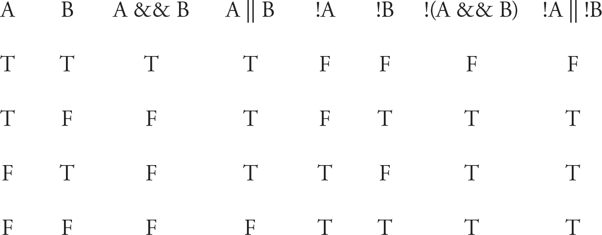

注意最后两个表达式的真值是相同的；这些结果是德·摩根定律（De Morgan’s Law）的说明，该定律可以被认为是布尔表达式的“分配律”。对表达式应用`!`（非）运算符会反转每个变量的真值，并将`&&`更改为`||`，反之亦然。如果将此定律应用于`!(A && B)`，结果为`!A || !B`，如最后一列所示。

`if`语句的复杂性将适用于所有的控制语句。

奥古斯·德·摩根（Augustus De Morgan）是19世纪的英国数学家和逻辑学家。德·摩根定律可以用于简化布尔表达式。基本概念是知道表达式可以重写以保持逻辑相同的值。例如，逻辑上：

```text
!true = false
!false = true
```

所以该定律的两种形式如下：

> 1. `!(a && b)`等于`!a || !b`

> 2. `!(a || b)`等于`!a && b`

换句话说，当你对括号内的表达式应用取反时，否定每个表达式并交换运算符。

### 应用德·摩根定律：

#### 示例 1

`!(x >= 0 && y < 0)`

首先，处理取反操作并交换`&&`为`||`：

`!(x >= 0) || !(y < 0)`

现在简化每个表达式：

* 如果`x`不是`>= 0`，那么它就是`< 0`

* 如果`y`不是`< 0`，那么它就是`>= 0`

`x < 0 || y >= 0`

#### 示例 2

`!(x == 0 && !(y == 0))`

首先，处理取反操作并交换`&&`为`||`：

`!(x == 0) || !!(y == 0)`

现在简化：

* 如果`x`不是`== 0`，那么它就是`!= 0`

* 两个否定相互抵消了

`x != 0 || y == 0`

***


3 检查题目

考虑以下代码段。

```java
boolean a = true, b = false;

if ( /* 缺失代码 */ )
    System.out.print("Nice job.");
else
    System.out.print("Nicer job.");
```

以下哪项可以替换`/* 缺失代码 */`以该代码块的输出为“Nicer job.”？

1. `a && !b`

2. `!a || b`

3. `!a && b`

1. 仅I

2. 仅I和II

3. 仅I和III

4. 仅II和III

### 解题技巧

啊，这就是大学考委员会（College Board）喜欢让我们折磨的“罗马数字”问题。如果必须显示“Nicer job.”，则条件必须求值为`false`。

创建一个真值表。

| **a** | true |
| --- | --- |
| **b** | false |
| **a && !b** | true && !false = true && true = true |
| **!a \|\| b** | !true \|\| false = false \|\| false = false |
| **!a && b** | !true && false = false && false = false |

只有最后两个表达式为`false`；因此(D)是正确的。

***


***


4 检查题目

假设`p`和`q`是布尔变量且初始化为未知的真值。

以下表达式的值是多少？

`(!p && !q) || !(p || q)`

1. 表达式始终为真。

2. 表达式始终为假。

3. 每当`p`为假时，表达式为真。

4. 每当`p`和`q`的真值相反时，表达式为假。

### 解题技巧

使用德·摩根定律，我们可以看到右侧表达式`!(p || q)`简化为左侧表达式`!p && !q`。由于试错法是一种有效的策略，建立真值表来评估可能的答案。

| **p** | **q** | **!p && !q** |
| --- | --- | --- |
| T | F | !T && !F = false |
| F | T | !F && !T = false |
| T | T | !T && !T = false |
| F | F | !F && !F = true |

排除(A)和(B)，因为表达式有时结果为真，有时为假。

排除(C)：在第二行中，`p`为假，但表达式求值为真。

选项(D)是正确的。检查前两行，`p`和`q`的真值相反，且两行都求值为假。

***


## **第5章关键术语**

* `if`

* 条件语句

* 流程控制

* 条件

* 布尔运算符`==`

* 真值

* 复合条件

* `&&`（逻辑与）

* `||`（逻辑或）

* `!`（逻辑非）

* `==`（等于）

* `!=`（不等于）

* 追踪表

* 阻塞

* 短路求值

## **第5章练习题**

练习题答案可以在第12章找到。

1 检查题目

考虑以下代码段：

```java
for (int i = 200; i > 0; i /= 3)
{
    if (i % 2 == 0)
        System.out.print(i + " ​ ");
}
```

执行该代码段的输出是什么？

1. 200 66 22 7 2

2. 66 22 7 2

3. 200 66 22

4. 7

跳转到第12章中的第5章练习题答案与解答

2 检查题目

假设`p`和`q`是布尔变量且初始化为未知的真值。

以下表达式的值是多少？

`(p && !q) || (p && q)`

1. 表达式的值始终与`p`的值相同。

2. 表达式的值始终与`q`的值相同。

3. 该表达式始终求为假。

4. 只有当`p`和`q`的真值相反时，该表达式才求为真。

前往第12章：章节复习题答案与解析中的第2题

## 第5章总结

- 可以`==`（等于）、`!=`（不等于）、`<`（小于）、`<=`（小于等于）、`>`（大于）和`>=`（大于等于）对值进行比较以形成布尔语句。

- 布尔语句可以使用`&&`（与）、`||`（或）和`!`（非）进行组合。

- `If`语句可用于允许在某个布尔语句为真时仅执行某条命令或一系列命令。`Else`语句可用于在不满足该条件时执行不同的命令。

## 第6章：迭代

## `while`语句

当程序员希望某条语句（或多个语句）重复发生时，他们有两个选择：(1)根据需要多次复制并粘贴该语句（效率低下且难看），或(2)编写一个称为`loop`的条件语句（高效且“优雅”）。

在AP考试中，你需要掌握两种类型的循环：`while`和`for`。

`while循环`的语法如下：

```text
while (condition) statement;
```

注意它与`if`语句的相似性。`while`语句是一个执行其名称所含义的循环：*只要*（while）条件为真，循环就会反复进行。考虑一把你刚刚画完卧室、沾满油漆的画笔。希望你不会在画笔不再脏之前将其收起来。一个在伪代码中表示这种情况的`while循环`看起来如下：

```text
1 while (paintbrush is dirty)
2 do not put away paintbrush;
3 put away paintbrush;
```

注意，如果条件为真（`paintbrush`是脏的），第2行将继续反复一次地执行，直到条件为假（`paintbrush`不脏）。一旦条件为假，就会跳过第2行，并最终执行第3行。

不幸的是，这个循环从根本上是有缺陷的。尽管它的逻辑*看起来*是正确的，但并不是。在循环的语句中，条件中的变量必须被修改，这样条件的真值才有机会改变。这把画笔将如何变得不脏呢——这有一把自洁画笔吗？可能不是。因此，画笔实际上将保持肮脏，Java将永远继续执行第2行。当这种情况发生时，程序员写了一个`无限循环`（infinite loop），这是一种逻辑错误，因此是不受欢迎的。你是否经历过电脑在工作过程中随机“死机”，导致它无响应，并使你丢失了刚刚花费一小时完善的那张完美的数字图片？那就是无限循环，而且绝对是不受欢迎的。

在AP考试中，你必须在多选题中追踪代码并检测出无限循环。在简答题中，你必须编写不含无限循环的代码。

因此，`While循环`与`if`语句一样依赖于它们的条件。如果一个条件更加复杂（通常情况下如此：如果画笔不脏但湿了，我们要把它收起来吗？不脏但湿了？），我们可以使用`while循环`。这里有一个真实的例子：

```text
while (paintbrush is dirty) {
    do not put away paintbrush;
    put away paintbrush;
}
```

（注：在提供的文本中，逻辑描述在后半部分变得重复/混乱；我已根据提供的上下文清理了核心逻辑。）

在AP考试中，单选题可能会向你展示两种格式的循环结构，并向你提出比较它们结果的问题，因此你应该练习在这些格式之间进行转换。在要求你编写循环的简答式题型中，无论你决定写一个`for`循环还是`while`循环，结果都是正确的。

以下两个涉及循环的代码示例具有相同的结果：

```java
int num = 1;

while (num <= 3)
{
    System.out.println(num);
    num++;
}
System.out.println("Done");
```

---

```java
for (int num = 1; num <= 3; num++)
    System.out.println(num);
System.out.println("Done");
```

每组代码在编程世界和AP考试中同样有效，也同样受重视。但单选题可以使用任何一种格式，或者两种都用上，因此你应该熟悉这两种格式。

`while`循环执行一次块语句，然后评估条件以确定循环是否继续；`for`循环首先评估条件，如果条件初始为真，则执行块语句。

***


2 Mark for Review

执行以下代码时，输出将是什么？

```java
for (int k = 0; k < 3; k++)
{
    for (int j = 1; j < 4; j++)
    {
        System.out.print(j + " ");
    }
    System.out.println();
}
```

1. 1 2 3 4

   1 2 3 4

   1 2 3 4

2. 0 1 2

   0 1 2

   0 1 2

   0 1 2

3. 1 2 3

   1 2 3

   1 2 3

4. 1 2 3

   1 2 3

   1 2 3

   1 2 3

### 解题技巧


看一眼外层 `for` 循环中的条件就可以发现它将总共迭代 3 次（`k = 0, 1 和 2`）。内层循环也是如此（`j = 1, 2 和 3`）。涉及 4 次循环的答案可以排除，从而排除除了 (C) 之外的所有选项。不需要继续看了。

然而，为了理解为什么 (C) 是正确的，请运行这两个循环。外层循环设置 `k = 0`，然后 `j = 1`。它打印 1 和一个空格，然后将 `j` 增加到 2。它打印 2 和一个空格，然后将 `j` 增加到 3。它打印 3 和一个空格，然后将 `j` 增加到 4。由于 4 不小于 4，内层循环终止。`System.out.println()` 打印换行。

然后 `k` 增加到 1。由于 `k` 不影响输出或 `j` 的值，循环再次在换行之前打印 1 2 3。`k` 的值增加到 2，打印第三行 1 2 3。最后，`k` 增加到 3，终止了外层循环，留下 (C) 作为结果。答案是 (C)。

***


***


## 3. 标记以供复查

考虑以下代码片段。假设 `someNum` 已经定义并初始化为一个正整数。

1. `int i; for (i = 0; i < someNum; i++) { someNum--; }`

2. `int i; for (i = 1; i < someNum - 1; i++) { someNum -= 1; }`

3. `int i = 0; while (i < someNum) { i++; }`

关于这些片段，下列错误的是：

1. I 和 II 的 `for` 循环次数相同。
2. I 的 `for` 循环和 III 的 `while` 循环次数相同。
3. 执行 II 和 III 后 `i` 的值相同。
4. I、II 和 III 产生的结果相同。

### 解题技巧

对于 `EXCEPT` 题，划掉原始问题并去掉负号重写，这样更容易记住你的目标。在这种情况下，将问题重写为“哪个是错误的？”

I 和 III 完成相同的任务。在每个循环中，`i` 都初始化为 0，执行 `i < someNum`，然后将 `i` 增加 1 并将 `someNum` 减 1。因此，II 循环执行次数比 I 和 III 少。选项 (A) 表示 I 和 II 次数相同是正确的，所以排除它。

对于剩余选项，让 `someNum` 等于一个正数（非零）……试一下 5。

| `i` | `someNum` |
| :--- | :--- |
| 0 | 5 |
| 1 | 4 |
| 2 | 3 |
| 3 | 2 |

| `i` | `someNum` | `someNum - 1` |
| :--- | :--- | :--- |
| 1 | 5 | 4 |
| 2 | 4 | 3 |
| 3 | 3 | 2 |

| `i` | `someNum` |
| :--- | :--- |
| 0 | 5 |
| 1 | 4 |
| 2 | 3 |
| 3 | 2 |

从这些值的追踪表中，可以看到执行 II 和 III 后 `i` 的最终值是 3，这证明 (C) 是正确的。排除 (C)。`someNum` 的值对于 I 和 III 是相同的，所以 (D) 是错误的，也是正确答案。

***


***


## 4. 标记以供复查

考虑以下代码段：

```java
for (int i = 1; i < 100; i = i * 2)
{
    if (i / 50 == 0)
        System.out.print(i + " ");
}
```

执行该代码段的结果输出什么？

1. 1 2 4 8 16 32 64
2. 1 2 4 8 16 32
3. 2 4 8 16 32 64
4. 2 4 8 16 32

### 解题技巧

进入循环的初始条件是 `i = 1`。由于整数除法中 `1/50 = 0`，因此将显示 1，排除 (C) 和 (D)。`(A)` 和 `(B)` 的区别在于最后的 64，让我们跳过中间的输出关注 64。如果 `i = 64`，`if` 语句为假，因此 64 不会被打印。因此，答案是 (B)。

***


## 概要

以下是到为止章节中哪些概念可以在考试中找到，哪些不会简要总结。

### 基本类型

- **AP Computer Science A 考试涵盖的概念**
  - `int`
  - `double`
  - `boolean`
- **AP Computer Science A 考试未涵盖的概念**
  - `short`
  - `long`
  - `byte`
  - `char`
  - `float`

### 递增/递减运算符

- **AP Computer Science A 考试涵盖的概念**
  - `x++`
  - `x--`
- **AP Computer Science A 考试未涵盖的概念**
  - `++x`
  - `--x`

### 逻辑运算符

- **AP Computer Science A 考试涵盖的概念**
  - `==`
  - `!=`
  - `<`
  - `<=`
  - `>`
  - `>=`
  - `&&`
  - `||`
  - `!`
- **AP Computer Science A 考试未涵盖的概念**
  - `&`
  - `|`
  - `^`
  - `<<`
  - `>>`
  - `>>>`

### 条件语句

- **AP Computer Science A 考试涵盖的概念**
  - `if/else`
  - `for`
  - `while`
- **AP Computer Science A 考试未涵盖的概念**
  - `do/while`
  - `switch`
  - `plain and labeled break`
  - `continue`

### 杂项

- **AP Computer Science A 考试未涵盖的概念**
  - `?:`（三元运算符）
  - `用户输入`
  - `JavaDoc 注释`

## 第 6 章关键术语

- 循环
- `while` 循环
- 死循环
- 短路
- `for` 循环

## 第 6 章练习题

练习题的答案可以在第 12 章找到。

### 1. 标记以供复查

考虑以下输出：

```text
0 1

0 2 4

0 3 6 9

0 4 8 12 16
```

以下哪个代码段会产生此输出？

```java
for (int x = 1; x < 5; x++)
{
    for (int z = 0; z <= x; z++)
    {
        System.out.print(x * z + " ");
    }
}
```

```java
System.out.println(" ");
}
```

2. 

```java
for (int x = 1; x <= 5; x++) {
    for (int z = 0; z < x; z++) {
        System.out.print(x * z + " ");
    }
    System.out.println(" ");
}
```

3.

```java
for (int x = 1; x < 5; x++) {
    for (int z = 0; z <= 4; z++) {
        System.out.print(x * z + " ");
    }
    System.out.println(" ");
}
```

4.

```java
for (int x = 1; x <= 5; x++) {
    for (int z = 0; z <= x; z++) {
        System.out.print(x * z + " ");
    }
    System.out.println(" ");
}
```

前往第 12 章第 1 节：章节练习习题答案与解析，第 6 章。

### 2. 标记

某段高速公路的限速为每小时 55 英里（mph）。高速巡逻会对任何行驶速度超过每小时 55 英里的人开具超速单。超速罚款根据以下标准执行：

- **速度：**大于 55 mph 但小于 65 mph；**罚款：**$100
- **速度：**大于或等于 65 mph 但小于 75 mph；**罚款：**$150
- **速度：**大于或等于 75 mph；**罚款：**$300

如果 `int` 变量 `speed` 的值是某位因行驶速度超过每小时 55 英里而被拦截的驾驶员的车速，那么以下哪一个代码段将为 `int` 变量 `fine` 分配正确的值？

1.

```java
if (speed >= 75)
    fine = 300;

if (speed >= 65 && speed < 75)
    fine = 150;

if (speed > 55 && speed < 65)
    fine = 100;
```

2.

```java
if (speed >= 75)
    fine = 300;

if (65 <= speed < 75)
    fine = 150;

if (55 < speed < 65)
    fine = 100;
```

3.

```java
if (speed >= 75)
    fine = 300;

if (speed >= 65)
    fine = 150;

if (speed > 55)
    fine = 100;
```

1. 仅 I
2. 仅 III
3. I 和 II
4. I 和 III

前往第 12 章第 2 题：章节练习习题答案与解析，第 6 章。

### 3. 标记

考虑以下代码段：

```java
int x = 10;
int y = 3;
boolean b = true;

for (int i = 0; i < 15; i += 5)
{
    x = x + y;
    b = (x % y == 2);

    if (!b)
    {
        y++;
        i += 5;
    }
}
```

代码段执行后，`x` 的值是多少？

1. 10
2. 15
3. 17
4. 22

前往第 12 章第 3 题：章节练习习题答案与解析，第 6 章。

### 4. 标记

在以下语句中，`a` 和 `b` 是布尔变量：

`boolean c = (a && b) || !(a || b);`

在什么情况下 `c` 的值为真？

1. 仅当 `a` 的值与 `b` 的值不同
2. 仅当 `a` 的值与 `b` 相同时
3. 仅当 `a` 和 `b` 都为真时
4. 对于所有 `a` 和 `b` 的值，`c` 都为真

前往第 12 章第 4 题：章节练习习题答案与解析，第 6 章。

### 5. 标记

考虑以下代码段：

```java
while ((x > y) || y >= z)
{
    // 代码省略
}
```

在上述代码段中，`x`、`y` 和 `z` 是 `int` 类型变量。代码段执行后，以下哪必须为真？

1. `x > y || y >= z`
2. `x <= y || y > z`
3. `x < y && y <= z`
4. `x <= y && y < z`

前往第 12 章第 5 题：章节练习习题答案与解析，第 6 章。

### 6. 标记

考虑以下代码段：

```java
int a = 0;

for (int i = 0; i < 10; i++)
{
    for (int k = 0; k <= 5; k++)
    {
        for (int z = 1; z <= 6; z = z * 2)
        {
            a++;
        }
    }
}
```

代码段执行后，`a` 的值是多少？

1. 31
2. 80
3. 200
4. 300

前往第 12 章第 6 题：章节练习习题答案与解析，第 6 章。

### 7. 标记

考虑以下代码段：

```java
int x = 10;
int y = x / 3;
int z = x % 2;

x++;

System.out.println(x)
```

执行上述代码段的输出结果是什么？

1. 2
2. 10
3. 11
4. 15

前往第 12 章第 7 题：章节练习习题答案与解析，第 6 章。

### 8. 标记

考虑以下代码段：

```java
int a = 10;
double b = 3.7;
int c = 4;

int x = (int) (a + b);
double y = (double) a / c;
double z = (double) (a / c);
double w = x + y + z;

System.out.println(w);
```

计算代码的输出结果是什么？

1. 10
2. 15.5
3. 17
4. 17.5

前往第 12 章第 8 题：章节练习习题答案与解析，第 6 章。

### 9. 标记

考虑以下代码段：

1.

```java
int x = 10;
int y = 20;
int z = 0;

if (x < y && 10 < y / z)
{
    System.out.println("Homer");
}
else
{
    System.out.println("Bart");
}
```

2.

```java
int x = 10;
int y = 20;
int z = 0;

if (x > y && 10 < y / z)
    System.out.println("Homer");
else
    System.out.println("Bart");
```

3.

```java
int x = 10;
int y = 20;
int z = 0;

if (x < y || 10 < y / z)
    System.out.println("Homer");
else
    System.out.println("Bart");
```


## 代码运行判断

上述代码段中哪一个无错误运行？

1. 仅 I
2. 仅 II
3. 仅 III
4. II 和 III

该类将被保存到计算机中`GradePointAvg.java`；`.java`扩展有助于编译器识别该文件包含 Java 代码。如果代码通过编译（没有语法错误），编译器将在相同文件夹中创建另一个名为`GradePointAvg.class`的文件；该文件对程序员来说是不可读的，因为它是编码为机器语言的。然而，计算机使用该文件来执行程序。`.java`文件被称为程序的**源代码**，因为它定义了程序的动作和功能。

请记住，类是从自上到下执行的——即先执行第 1 行，然后是第 2 行，以此类推。如果程序员想改变从上到下的执行顺序，他们必须使用我们之前学过的流程控制结构。


### 1 审阅

下列哪一个类声明会导致编译错误？假设代码的其他部分均按意图编译。

1. `public class Calculus`
2. `public class apCalculus`
3. `public class APCalculus`
4. `public class 4APCalculus`

### 解题技巧

选项 (A) 和 (C) 遵循上述讨论的格式。类名的命名规范是它们应该以大写字母开头；然而，编译器并不强制要求，因此 (B) 不会引起错误。(D) 的真正问题是它以数字字符开头，这在类名中是不允许的。答案是 (D)。


POE 是一个很好的工具，但在 AP 考试中它并不总是足够。掌握你的知识点！

## 方法（METHODS）

将一个 Java 类想象成一个衣柜，拥有几乎无限的可能性。如果你声明一个架子来放置，比如，游戏盒……那将是组织你的游戏、玩具和其他精致物品的一种极佳方法。

类是通过方法以这种方式组织的。

**方法**（method）是执行特定任务的代码组。

虽然类可以简单地包含一个命令列表，但任何完成任务的程序都可能很容易膨胀到 100 行代码或更多。与其编写一个包含巨大混乱代码列表的类，不如为每个小任务（在总任务内部）编写单独的方法，这是使你的代码更具可读性的极佳方法。此外，基于方法的类能够更轻松地控制程序。

为了理解这个概念，让我们分解夏天中间一个明媚的周六（别担心——你能够搞定的）。也许你做的某些活动可能包括起床（显而易见）、吃早餐、洗澡、为海滩做准备、开车去海滩、享受海滩和吃午饭。这些活动都有自己特定的组成部分；例如，吃早餐的一部分包括喝橙汁和服用每日维生素补充剂。模拟这个周六活动的程序伪代码可能看起来如下：

```java
public class Saturday1 {
    hear alarm;
    turn off alarm;
    get out of bed;
    make breakfast;
    eat breakfast;…
}
```

你明白我的意思了……一个从上到下发生的长命令列表。现在，将这些一般性活动中的每一个视为一组较小活动的独立分组，称为方法。每个小活动将在稍后定义，但你的周六类将看起来整洁得多：

```java
public class Saturday2 {
    wake up method; // 包括闹钟
    eat breakfast method; // 包括准备、橙汁、
    // 维生素，等
    take a shower method; // 包括准备洗
    // 澡，等
    beach method; // 包括为海滩做准备、开车
    // 去海滩
}
```

你明白我的意思了……一个从上到下发生的长命令列表。现在，将这些一般性活动中的每一个视为一组较小活动的独立分组，称为方法。每个小活动将在稍后定义，但你的周六类将看起来整洁得多：

```java
public class Saturday2 {
    wake up method; // 包括闹钟
    eat breakfast method; // 包括准备、橙汁、
    // 维生素，等。
    take a shower method; // 包括准备洗
    // 澡，等。
    beach method; // 包括为海滩做准备、开车
    // 去海滩
    eat lunch method;
}
```

结果是一个更易读的、结构更良好的类。创建一个用于控制程序（例如`Saturday2`）的类被称为**驱动类**（driver class），因为它通过其结构执行较小的命令。此外注意，如果出于某种原因，程序员想在洗澡前吃早餐，那么`Saturday2`中的两行就会交换，任务也就完成了。

**对象类**（object class）是驱动类调用的方法的“核心”类。当你理解了这种设置后，你会发现驱动类开始变短，而对象类开始扩展。例如，汽车的驱动程序执行一系列简单的动作：启动发动机、系安全带、检查后视镜、加速、转向。驱动程序并不实际上理解（也不需要理解）这些操作是如何工作的：他只需执行。加速踏板如何让汽车移动得更快？不，驱动程序只需操作踏板，其余在内部完成。对象类是“内部”类。它定义了对象的各个方面；具体来说，它定义了对象“拥有”什么以及“做什么”。

本节提到的对象类不与 Java 中的`Object`类混淆，它是所有类的父类。Java 中的每个类都继承`Object`方法。对于 AP 考试，你必须能够编写、调试和理解对象类。回到早餐示例……对象类的伪代码可能像这样：

```java
public class Saturday3 {
    wake up(..) {
        hear alarm;
        turn off alarm;
        get out of bed;
    }

    breakfast(..) {
        make breakfast;
        eat breakfast;
    }
}
```

由于我们的对象类可以用于一周中的任何一天，而不只是周六，`BeachDay`可能是该类更合适的名字。之前的驱动类（执行该天的一系列动作）可能被称为`Saturday`。


### 2 审阅

下列哪一个陈述最能描述太阳眼镜的高效设计？

1. 三个类：`UnfoldGlasses`、`CleanGlasses`和`WearGlasses`
2. 一个`UnfoldGlasses`类，带有方法`CleanGlasses`和`WearGlasses`
3. 一个`PairOfSunglasses`类，带有布尔变量`unfolded`、`cleaned`和`worn`
4. 一个`PairOfSunglasses`类，带有可以`unfold`、`clean`和`wear`对象的方法

```java
public class Phone {
    private boolean hasApp;

    public Phone() {
        hasApp = false;
    }

    public void downloadApp() {
        hasApp = true;
    }

    public void closeApp() // closes the app
        if (hasApp)
            System.out.println("App is closed.");

    public void openApp() // opens the app
        if (hasApp)
            System.out.println("App is running…");
}
```

### 输出

```text
App is running…

App is closed.
```

这个程序中有许多组件；首先，注意我们现在有两个类构成了一个单一程序。在孤立状态下，这两个类中的任何一个都不会产生有用的结果。`UsePhoneApp`类将无法编译，因为如果方法不存在，编译器就无法理解它们（编译器：`openApp`是什么意思？）；而`Phone`类可以编译，但如果没有`UsePhoneApp`，它实际上并不会执行任何操作（编译器：我应该什么时候调用`openApp`，在哪部手机上调用？）。为了让`UsePhoneApp`类访问`Phone`类，必须在文件顶部的类声明上方使用`import Phone;`。

`Phone`类中的第 4–7 行构成了一种特殊的方法，称为`构造方法`（constructor）。对象在执行任何操作之前必须先被构造，就像汽车在行驶之前必须先制造一样。`UsePhoneApp`中的第 6 行调用了这个构造方法，它“构建”了`Phone`对象；此命令必须在调用非构造方法之前发生；否则，编译器将返回错误。想象有人按着一个想象中的油门踏板试图在没有汽车的情况下开车去某处。很有趣，但这是可能的。

`Phone`的第 3 行定义了`Phone`是否拥有应用（true）或没有（false）。这是我们程序中`Phone`对象的唯一属性；更复杂的程序可能有几十个甚至数百个属性（实际上，手机有更多属性，例如屏幕、音量按钮等）。程序员应该编写这些属性，它们被称为`实例变量`（instance variables）或`字段`（fields）。紧随数据字段之后的是如我们之前所说的构造方法，然后是一系列控制`Phone`能够做什么的方法。

对象类定义了对象拥有什么（HAS）以及能做什么（DOES）。

一个方法包含几个组件。方法头部以非常特定的方式构建；其语法如下：

`visibility returnType methodName (param1, param2, …)`

方法的可见性可以是公共的（public）或私有的（private），取决于具体情况（稍后详细介绍）。`返回类型`（return type）标识了在执行命令后，方法将返回什么类型的数据（如果有的话）。方法的名字与变量名相似，应该是一个直观的、总结方法功能的名称；它应该符合与变量名相同的规范（以小写字母开头等）。`参数`（parameters）是可选的，是方法执行其任务所需的数据。

在我们之前的示例中，`closeApp`的方法头部是：

`public void closeApp()`

这在功能上可行，但对于这个示例来说也相对简单。它的可见性是`public`，返回类型是`void`（没有返回任何信息），并且它没有参数。一个更真实的在手机上关闭应用的方法可能需要关于何时应该关闭的信息，并可能返回数据，例如是否成功关闭。因此，修改后的方法头部看起来可能像这样：

`public boolean closeApp (int minutes)`

注意，单个参数`minutes`定义了它的类型。由于`minutes`将是一个只在此方法执行期间存在的临时变量，它必须直接在头部中定义为新的。方法可以有任意数量的参数，取决于程序员对程序的设计决策。

方法必须以头部开头，头部包含一个可见性修饰符（`private`或`public`）、返回类型（如果不返回任何信息则为`void`）以及一个方法名。参数是可选的，取决于方法执行任务的需求。

方法的最终目的是对对象执行某种任务。注意`openApp()`和`closeApp()`仅仅是访问数据字段`hasApp`并做出相应的反应；即，只有当值`hasApp`为 true 时才会显示消息。`downloadApp()`方法在某种方面更为深层；它不仅仅是访问数据，而是实际上改变了数据字段的值——在这种情况下，一旦“应用”被“下载”，就会将`hasApp`更新为 true。因此，在 Java 中，通常将`openApp()`和`closeApp()`等方法标记为`访问器方法`（accessor methods），将`downloadApp()`等方法标记为`修改器方法`（mutator methods）。

在本章中我们已经多次使用了汽车的类比，但它是理解这些概念的一种好方法。当你想要启动汽车时，必须经过一系列步骤。

某些情况下，可能会出现多种方式启动汽车的情况——例如，所有者有一个按钮启动和一个远程启动器。设计者可以编写两个`startCar`方法（或者三个、四个……），每个方法执行相同的任务但需要不同的信息（参数）。这一过程被称为`重载`（overloading），可以通过编写具有相同名称但不同类型或数量的方法来实现。

### 前置条件（Precondition）

前置条件（precondition）是一种向用户提供更多关于方法状态并保证其真实的注释。

在 AP 考试中，前置条件是方法上方的注释。调用方法的程序负责不传递违反前置条件的参数。

```java
/*** precondition—a 和 b 是正整数 */
```

### 后置条件（Postcondition）

后置条件（postcondition）是在执行某些代码段之后或在正式规范的某个操作之后始终为真的条件。

在 AP 考试中，后置条件作为注释写在方法之前或内部，如下例所示。方法设计者负责确保满足这些条件。

```java
public int sum100(int a, int b) {
    // postcondition—如果 sum 大于 100 则返回 100，否则返回 sum 的值
    if (sum < 100)
        return sum;
    else
        return 100;
}
```

方法可以接受任意数量的参数，但只能返回一个数据值或对象。

作为本部分的最后一个示例，考虑一个试图编写代表书籍的对象的类的程序员（就像这本书，只不过更加有趣）。程序员可能考虑的一些数据有：

- 书籍*拥有*什么？封面、页码、文字……
- 书籍可以*做*什么？它可以被阅读、被快速扫读、被收起来……

根据这些信息，程序员可以开始编写对象类（object class）。程序员必须首先确定哪些项目与情况相关，以保持对象类尽可能高效。例如，如果程序员正在设计一本用作镇纸的书，那么讨论书中有多少个单词可能并不重要，因此该数据字段就不会被纳入程序中。同样，如果程序员不是一个在短时间内学习惊人数量书籍的学生（听起来很熟悉吧？），那么设置一个快速略读书籍而非仔细阅读的方法可能也并不相关。类将根据这些决策进行构建。

如你所见，对程序的`planning`（规划）与实际编写程序一样重要，甚至更为重要。在某些课程中，你的老师可能会在你完成最终产品之前提醒你“写一个大纲”或“写一个初稿”，而你可能会跳过这一步直接进入最后的单元并仍然取得成功。但对于任何深层次的编程（本课程在某种程度上要求做到这一点）而言，规划对于确保你的程序良好运行以及提高你的效率是至关重要的。请记住，AP 考试是有严格时间限制的。

AP 考试通过提供需求的`lengthy`（详细）描述以及项目中与其他交互类的描述来测试对类的规划。

## 组合

现在我们已经编写了运行程序的类，我们必须让这些类正确交互，以创建一个可以运行的程序。我们有了驱动程序，有了汽车，现在我们需要把驾驶员放入车内，在考试当天急切前往 AP 计算机科学 A 考试。

驱动类和对象类必须位于计算机的同一个文件夹中。如果你使用的是交互式开发环境（而不是命令行编程），你通常需要在软件中创建一个“项目（Project）”或类似的结构，将程序的所有文件放在一个地方。记住，驱动类依赖于对象类才能编译，而对象类依赖于驱动类才能实际执行操作。

考虑一个接收“花朵”对象并将它们“种”到花园中的程序。花朵对象可能会在一个名为`Flower`的类中定义。其中一个类将执行种植操作，我们可以将其命名为`MakeGarden`。

假设`Flower`构造方法具有以下头：

```java
public Flower(int xPosition, int yPosition)
```

其中`xPosition`和`yPosition`分别是花朵对象将被种植的水平和垂直坐标。我们的驱动程序必须首先“创建”花朵，然后相应地种植它们。

为了创建一个对象，我们必须使用其类来实例化该对象。

每当我们实例化一个花朵对象时，必须给它分配一个`object reference variable`（对象引用变量）；正如这个华丽的名字所示，这只是一个变量名。`MakeGarden`中的某些行可能像这样：

```java
Flower f1 = new Flower(2, 1);
Flower f2 = new Flower(2, 2);
Flower f3 = new Flower(2, 3);
```

这些行将实例化三个不同的花朵对象，每个对象都包含自己的实例数据。`f1`、`f2`和`f3`用于区分这些对象。然后我们可以使用这些对象来执行方法。考虑`Flower`类中的`plant`方法；该方法会“种植”花朵，并可能如下：

```java
public void plant()
```

在`MakeGarden`中，它可能如下：

```java
public boolean plant()
```

```java
if (f1.plant()) {
    System.out.print("Planted successfully");
} else {
    System.out.print("There was a problem.");
}
```

```java
if (f2.plant()) {
    System.out.println("Planted successfully");
}
```

```java
if (p1.plant()) {
    System.out.println("Planted successfully");
}
```


```java
}
```

```java
if (w1.plant()) {
    System.out.println("You have a weed.");
}
```

## AP 考试中的简答题

AP 考试中的简答题通常会提供某种背景，并且通常会明确告诉你要编写哪些类（class）和/或方法（method），这样就不会出现全球考生的各种千奇百怪的解决方案。

否则，他们可能真的被迫阅读成千上万种针对同一任务完全不同的方法。这一事实对我们的创造力没有好处，但对于获得 5 分非常有利；把你的灵感留给你在通过 AP 免修计算机后可以选修的额外大学课程上吧！


使用 `Chair` 类和 `sitOnChair` 方法回答第 3 和第 4 题。

```java
public class Chair {
    private int numberOfLegs = 4;
    private boolean padded;

    public Chair(boolean soft) {
        if (soft) {
            padded = true;
        } else {
            padded = false;
        }
    }
}

public void sitOnChair() {
    <implementation not shown>
}
```

### 3. 选择题

`sitOnChair` 方法属于另一个类，并旨在允许在椅子有衬垫（padded）时用户“坐”在 `Chair` 上。以下哪些代码段可以替换 `<implementation not shown>`，以使得 `sitOnChair` 按照预期工作？

1. `Chair c = new Chair(true);`  
   `c.sit();`
2. `Chair c = new Chair(true);`
3. `Chair c = new Chair(true);`  
   `if (c.padded) System.out.print("You are sitting.");`

1. 仅 II
2. 仅 III
3. I、II 和 III
4. 无

#### 解题技巧

记住，一个对象必须：

1. 在执行类中实例化；
2. 仅与在其类中定义的方法关联。

选项 I 正确地实例化了 `Chair`，但随后尝试调用 `sit()` 方法，该方法在 `Chair` 类中（或任何地方）均未定义；排除 (C)。

选项 II 正确地实例化了 `Chair`，但没有尝试“坐”；排除 (A)。

选项 III 是错误的，因为它还尝试访问 `padded`，而 `padded` 是 `Chair` 中的私有数据，因此无法直接访问；排除 (B)。

由于没有有效选项，因此 (D) 是答案。


### 4. 选择题

根据第 3 题中尝试的任务，以下哪些修改（如果有）有助于让 `Chair` 类对 `sitOnChair` 方法**最有用**？

1. 添加一个返回 `numberOfLegs` 值的访问方法（accessor method）
2. 添加一个返回 `padded` 值的访问方法
3. 添加一个修改 `numberOfLegs` 值的变异方法（mutator method）
4. 添加一个修改 `padded` 值的变异方法

#### 解题技巧

第 4 题中提出的情况需要关于椅子是否有衬垫的信息。无论你的个人偏好如何，`numberOfLegs` 在这里都无关；排除 (A) 和 (C)。

由于椅子的衬垫属性不需要更改，排除 (D)。答案是 (B)。


不要对所呈现的情况产生“情绪”；要仔细遵守规范，不要假设程序员的意图。


### 5. 选择题

考虑以下方法：

```java
public int halfRoot(int n) {
    return Math.sqrt(n) / 2;
}
```

以下哪些方法调用会导致运行时错误（run-time error）？

1. `halfRoot(-2)`
2. `halfRoot((int) 2.0)`
3. `halfRoot(3.0)`
4. 都不会导致运行时错误。

#### 解题技巧

方法的定义要求一个整数参数。选项 (A) 直接使用了整数。尽管 (A) 使用了负数，但这并没有导致错误。在数学课上，这不会产生实数。但在 Java 中，这会产生 `NaN`。虽然这不是首选结果，但它不是严格意义上的错误。

选项 (B) 将 `double` 转换为整数，因此可以正确编译和运行。

选项 (C) 在需要整数时给了一个 `double` 参数。这会导致错误。虽然这个错误看起来会导致 `IllegalArgumentException`，但它实际上会引起编译时错误，而不是运行时错误。`IllegalArgumentException` 只有在程序员故意抛出它时（如果参数在 Java 术语中是合但不符合程序目的）才会产生。例如，一个用于计算整数阶的程序可能被设计为接收负参数时抛出 `IllegalArgumentException`。

由于这些结果中都没有导致运行时错误，答案是 (D)。


## 参考文献

所有从驱动类（driver classes）传递到对象类以及反之的数据都创建了一个复杂的过程。所有从驱动类传递到对象类以及反之的数据都创建了一个复杂的过程。所有从驱动类传递到对象类以及反之的数据都创建了一个复杂的过程。所有从驱动类传递到对象类以及反之的数据都创建了一个复杂的过程。所有从驱动类传递到对象类以及反之的数据都创建了一个复杂的过程。所有从驱动类传递到对象类以及反之的数据都创建了一个复杂的过程。所有从驱动类传递到对象类以及反之的数据都创建了一个复杂的过程。所有从驱动类传递到对象类以及反之的数据都创建了一个复杂的过程。所有从驱动类传递到对象类以及反之的数据都创建了一个复杂的过程。所有从驱动类传递到对象类以及反之的数据都创建了一个复杂的过程。所有从驱动类传递到对象类以及反之的数据都创建了一个复杂的过程。所有从驱动类传递到对象类以及反之的数据都创建了一个复杂的过程。所有从驱动类传递到对象类以及反之的数据都创建了一个复杂的过程。所有从驱动类传递到对象类以及反之的数据都创建了一个复杂的过程。所有从驱动类传递到对象类以及反之的数据都创建了一个复杂的过程。所有从驱动类传递到对象类以及反之的数据都创建了一个复杂的过程。所有从驱动类传递到对象类以及反之的数据都创建了一个复杂的过程。所有从驱动类传递到对象类以及反之的数据都创建了一个复杂的过程。所有从驱动类传递到对象类以及反之的数据都创建了一个复杂的过程。所有从驱动类传递到对象类以及反之的数据都创建了一个复杂的过程。所有从驱动类传递到对象类以及反之的数据都创建了一个复杂的过程。所有从驱动类传递到对象类以及反之的数据都创建了一个复杂的过程。所有从驱动类传递到对象类以及反之的数据都创建了一个复杂的过程。所有从驱动类传递到对象类以及反之的数据都创建了一个复杂的过程。所有从驱动类传递到对象类以及反之的数据都创建了一个复杂的过程。所有从驱动类传递到对象类以及反之的数据都创建了一个复杂的过程。所有从驱动类传递到对象类以及反之的数据都创建了一个复杂的过程。所有从驱动类传递到对象类以及反之的数据都创建了一个复杂的过程。所有从驱动类传递到对象类以及反之的数据都创建了一个复杂的过程。所有从驱动类传递到对象类以及反之的数据都创建了一个复杂的过程。所有从驱动类传递到对象类以及反之的数据都创建了一个复杂的过程。所有从驱动类传递到对象类以及反之的数据都创建了一个复杂的过程。所有从驱动类传递到对象类以及反之的数据都创建了一个复杂的过程。所有从驱动类传递到对象类以及反之的数据都创建了一个复杂的过程。所有从驱动类传递到对象类以及反之的数据都创建了一个复杂的过程。所有从驱动类传递到对象类以及反之的数据都创建了一个复杂的过程。所有从驱动类传递到对象类以及反之的数据都创建了一个复杂的过程。所有从驱动类传递到对象类以及反之的数据都创建了一个复杂的过程。

（注：由于原文引用部分存在大量重复，此处已进行逻辑处理）

所有从驱动类传递到对象类以及反之的数据都创建了一个复杂的过程。所有从驱动类传递到对象类以及反之的数据都创建了一个复杂的过程。所有从驱动类传递到对象类以及反之的数据都创建了一个复杂的过程。

这里是真正让人困惑的部分——或者也许并不完全是。如果创建了原始数据值的副本，那么这两个副本（原始副本和新副本）是独立存在的。因此，如果你更改了其中一个副本的值，另一个不会受到影响。

另一方面，如果创建了指向对象的新引用，那么通过该引用对对象的修改将反映在所有引用上。再次借用超级英雄的例子：如果超人因为流行而把头发染成了金色，那么克拉克·肯特和超人都会变成金发。他们是引用同一个男人的两个名字，因此任何更改都会反映在所有引用中。

如果我们突然决定超人/克拉克·肯特应该被称为“蓝脸大哥”而不是这两个名字中的任何一个，我们指的仍是同一个人；他现在有三个 `aliases`（别名）而不是两个。

这对于理解对象的相等性非常重要。只有当两个对象实际上是同一个对象时，它们才被认为是相等的。在上面的超级英雄例子中，克拉克·肯特等于超人，因为他们是完全同一个人。

现在想象超人有一个一模一样的双胞胎兄弟，名叫 Duperman，化名为 Klarc Tenk。由于 Duperman 和 Klarc Tenk 是同一个人，所以 Duperman 等于 Klarc Tenk。因此，在 Java 中，`Duperman == Klarc Tenk` 为真。

然而，尽管他们是同卵双胞胎，超人和 Duperman 是不同的人。因此，超人不等于 Duperman。在 Java 中，可以使用 `Object` 类的 `equals` 方法将超人和 Duperman 识别为同胞胎。

`equals` 方法接受一个 `Object` 参数，并且仅当两个对象具有相同的数据时才返回 `true`，无论它们是否为同一个对象。虽然布尔语句 `Superman == Duperman` 为假，但语句 `Superman.equals(Duperman)` 为真。

### `this` 关键字

有时为了调用一个方法，调用对象可能能够引用自己。当一个对象调用方法时，一个隐式引用会被分配给调用对象。这个隐式引用的名称是 `this`。

`this` 关键字是当前调用对象的引用，可以作为对象变量使用。例如：

```java
this.mySize
```


使用以下不完整的类声明来回答问题 6 和 7。

```java
public class Number {
    private int value;

    public Number(int someNum) {
        if (someNum >= 0) {
            value = someNum;
        }
    }

    public int changeVal(int newVal) {
        /* missing code */
    }

    public int getValue() {
        return value;
    }
}

public class NumChanger {
    public void change() {
        Number n1 = new Number(5);
        Number n2 = new Number(5);

        int sum1 = n1.getValue() + n2.getValue();
        int oldn1Val = n1.changeValue(10);

        n2 = n1;

        int sum2 = n1.getValue() + n2.getValue();
        System.out.print(sum1 + " " + sum2);
    }

    // 其他未显示的方法
}
```

### 6. 选择题

`Number` 类中的 `changeVal` 方法应该将 `value` 重新赋值为参数接收的值，并返回原始值。以下哪些代码段应该替换 `/* missing code */`，以使得 `changeVal` 按预期工作？

1. ``value = newVal; return value;``
2. `int oldVal = value; value = newVal;`
3. `int oldVal = value; value = newVal; return value;`
4. `int oldVal = value; value = newVal; return oldVal;`

#### 解题技巧

要完成任务，必须发生两个事件：`value` 必须重置为参数值，并且必须返回旧值。

选项 (B) 没有尝试返回任何值，因此它不可能是正确的。剩余的选项尝试完成这两个事件；然而，如果重置了 `value` 并返回了它的新值，那么第二个事件的执行是不正确的。

原始值必须被存储，因此排除 (A)。选项 (C) 存储了旧值但返回了新值，因为它已经被重新赋值为 `newVal`，所以它是错误的。

由于 (D) 存储了旧值、重新赋值了 `value` 并返回了旧值，因此 (D) 是答案。


 

### 7. 选择题

执行 `change` 方法的结果将打印什么？假设 `Number` 类中的 `changeVal` 按预期工作。

1. `5 5`
2. `5 10`
3. `10 10`
4. 以上都不是

#### 解题技巧

大学考试委员会（College Board）喜欢编写这种带有混淆对象引用的多选题。记住，将一个对象“等于”另一个对象仅仅意味着两个标识符引用同一个对象，如超人和克拉克·肯特。

`sum1` 是 `5 + 5 = 10`。`oldn1Val` 是 `n1.changeValue(10)` 的结果，即 `5`。执行 `n2 = n1` 之后，`n2` 指向 `n1`。

此时，`sum2` 是 `n1.getValue() + n2.getValue()`，即 `10 + 10 = 20`。因此，打印的结果是 `10 20`。

选项中没有 `10 20`，因此答案是 4，即“以上都不是”。

（注：根据题目逻辑，`sum1` 为 10，`sum2` 为 20；若选项中没有此结果则选“以上都不是”。）


### 8. 选择题

以下方法旨在当两个字符串包含相同数据时输出“Strings match.”，否则打印“Strings not match.”。

```java
public void match(String s, String t) {
    if (/* missing code */) {
        System.out.println("Strings match.");
    } else {
        System.out.println("Strings not match.");
    }
}
```


以下哪些语句可以替换`/* missing code */`以允许方法按预期工作？

1. `s.compareTo(t) == 0`
2. `compareTo(s, t) == 0`
3. `s == t`

1. 仅 I
2. I 和 III
3. II 和 III
4. I、II 和 III

#### 解题技巧

此题测试的是判断字符串是否包含相同数据的正确方法。逐一分析每个语句。

语句 I 使用了`compareTo`方法。`String`类的`compareTo`方法接收另一个字符串作为参数并返回一个`int`。如果两个字符串包含相同数据，返回 0。（注意，这也适用于其他对象，因为`Object`类有一个类似的`compareTo`方法。）因此，语句 I 将使方法按预期工作。排除不包含 I 的 C。

语句 II 也使用了`compareTo`。然而，由于`compareTo`是`String`类的非静态方法，它必须通过`String`对象调用。此外，`compareTo`方法只接受一个参数。因此，语句 II 将导致编译错误。排除包含它的 D。

现在看语句 III。当`==`运算符应用于对象时，仅当引用相同时结果才为真。如果两个对象的引用不同但包含相同数据，结果将为假。上述方法在这种情况下需要返回为真。虽然这不会引起编译时或运行时错误，但方法不会按预期工作。因此，排除包含 III 的 B。答案是 (A)。

`static`关键字在此层级可以出现在两个上下文中。`静态变量`（static variable）是类的所有实例共享的属性。当此变量的值发生更改时，更改将反映在通过该类实例化的所有对象。

静态变量的一个经典例子是视频游戏中的高分列表。考虑视频游戏俄罗斯方块。启动游戏后，你开始新游戏并一直玩到输……然后，由于你痴迷于俄罗斯方块，你重新开始。如果你玩的每场游戏都被视为同一个类的一个对象，那么静态变量可能就是高分。每当你开始（或实例化）一个新游戏时，高分保持与初始设置时相同。一旦设置了新的高分，每个新游戏都将反映新的高分，从而使旧的高分消失（或变为次高分等）。

在对象类中，静态变量与类的实例数据一起在类顶部声明，并在前面跟有`static`关键字。静态变量通常用于标识符或计数器。考虑这个简短程序：

```java
public class Box
{
    private static int boxNumber = 0;

    // 未显示的其他数据字段

    public Box()
    {
        boxNumber++;

        // 未显示的其他语句
    }
}

public class BoxCreator
{
    public BoxCreator()
    {
        Box box1 = new Box();
        Box box2 = new Box();
    }
}
```

当在`BoxCreator`中实例化每个`Box`对象时，`Box`类中的静态变量将被更新。这样，下一次创建箱子时，所有箱子对象的`boxNumber`值都会增加。静态变量不是每个单独箱子的属性；相反，它是所有箱子共享的值。

将此设置与非静态声明的`boxNumber`进行对比：每当实例化一个箱子时，它的`boxNumber`都从 0 开始然后递增，导致每个箱子的`boxNumber`值都为 1。

为了证明这种结构实际上在起作用，让我们创建一个访问方法（accessor method），让驱动程序“看到”或访问`boxNumber`的值。由于`boxNumber`被声明为私有（private），因此此方法对于这一结果是必要的。

设计用于访问和或修改静态变量的非构造方法是`静态方法`（static method），并且必须声明为静态方法。为了添加此功能并进行测试，这里是我们的新对象类和驱动类：

```java
public class Box
{
    private static int boxNumber = 0;

    // 未显示的其他数据字段

    public Box()
    {
        boxNumber++;

        // 未显示的其他语句
    }

    static public int getBoxNum()
    {
        return boxNumber;
    }
}

public class BoxCreator
{
    public BoxCreator()
    {
        Box box1 = new Box();
        Box box2 = new Box();

        System.out.print(Box.getBoxNum() + " boxes created so far.");
    }
}
```

注意来自`BoxCreator`的方法调用没有使用对象引用变量；而是直接使用了类。由于静态变量在所有实例之间共享，程序员需要通过类本身来访问静态方法（以及静态变量）。

***


9 一个名为`ComputerMouse`的类有一个静态变量`connector`和一个静态方法`getConnector`。根据这些信息，以下哪个说法是正确的？

1. 为了调用`getConnector`，不需要实例化新的`ComputerMouse`对象；必须直接通过类调用`getConnector`。
2. 为了调用`getConnector`，必须实例化一个新的`ComputerMouse`对象，然后通过该对象调用`getConnector`。
3. 由于`connector`被声明为静态（static），`getConnector`在程序中的所有对象之间共享。
4. 由于`connector`被声明为静态（static），`ComputerMouse`中的所有方法也必须声明为静态。

### 解题技巧

AP 考试既考察记忆性知识也考察推理能力；如果你知道`static`如何工作，就可以正确回答此问题。静态方法必须直接通过类调用，因此 (A) 目前看起来很好，但排除 (B)。

选项 (C) 是错误的，因为`getConnector`将被所有`ComputerMouse`对象共享，而不是程序中的所有对象共享。如果选项 (D) 说的是“`ComputerMouse`中所有访问或修改`connector`的方法”，那么它是正确的。答案是 (A)。

***


### 第 7 章核心术语

* 类 (class)
* 源代码 (source code)
* 方法 (method)
* 驱动类 (driver class)
* 对象类 (object class)
* 头部 (header)
* 构造函数 (constructor)
* 实例变量/字段 (instance variables/fields)
* 返回类型 (return type)
* 参数 (parameters)
* 访问方法 (accessor methods)
* 修改方法 (mutator methods)
* 重载 (overloading)
* 前提条件 (precondition)
* 后置条件 (postcondition)
* 规划 (planning)
* 对象引用变量 (object reference variable)
* 聚合类 (aggregate class)
* 引用 (reference)
* 静态 (static)
* 静态变量 (static variable)
* 静态方法 (static method)

## 第 7 章复习

复习题答案见第 12 章。

### 1

一个开发团队正在构建一个客户可以使用订购书籍的在线商店。库存和客户订单信息存储在数据库中。必须开发能够从数据库中存储和检索数据的代码。开发团队决定将数据库代码放在单独的类中。以下哪个是计划的优点？

1. 数据库代码可以在需要访问数据库的其他应用程序中重用。
2. 数据库代码可以进行独立测试。在界面开发出来之前就可以测试数据库代码。
3. 可以分配一组程序员专门负责数据库代码。他们可以与其他程序员（如开发用户界面的程序员）独立工作。

1. I
2. III
3. II
4. I、II 和 III

### 2

在 Java 中，实例字段（称为实例变量）和方法可以声明为公共（public）或私有（private）。以下哪项最能描述应该使用的声明？

1. 实例字段和方法都应该是公共的。这使得客户端程序访问数据和使用类的方法变得更容易。
2. 实例字段应该是公共或私有的，取决于客户端程序直接访问它们是否有益。所有方法都应该是公共的。私有方法没用，因为客户端程序无法访问它。
3. 将所有方法和实例字段保持为私有。这强制了封装。
4. 实例字段始终应该是私有的，以防客户端直接访问它们。方法可以是公共或私有的。

### 3

以下哪些是良好程序的标志？

1. 客户端知道数据在类中是如何存储。
2. 类和方法可以独立测试。
3. 可以更改方法的实现而不改变使用该方法的程序。

1. 仅 I
2. 仅 II
3. II 和 III
4. I 和 II

### 4

考虑以下类：

```java
public class Sample
{
    public void writeMe(Object obj)
    {
        System.out.println("object");
    }

    public void writeMe(String s)
    {
        System.out.println("string");
    }
}
```

执行以下代码的结果是什么？

```java
Sample s = new Sample();
String tmp = new String("hi");

s.writeMe(tmp);
```

1. 编译时错误
2. "object"
3. "string"
4. 运行时错误

## 跳转到第 12 章第 4：章节复习练习答案与解析，第 7 章

### 5 标记评审

考虑以下类：

```java
public class Sample
{
    public void writeMe(Object obj)
    {
        System.out.println("object");
    }

    public void writeMe(String s)
    {
        System.out.println("string");
    }
}
```

执行以下代码的结果是什么？

```java
Sample s = new Sample();
Object tmp = new Object();

s.writeMe(tmp);
```

1. 编译时错误
2. "string"
3. "object"
4. 运行时错误

## 跳转到第 12 章第 5：章节复习练习答案与解析，第 7 章

### 6 标记评审

考虑以下类：

```java
public class Sample
{
    public void writeMe(Object obj)
    {
        System.out.println("object");
    }

    public void writeMe(String s)
    {
        System.out.println("string");
    }
}
```

执行以下代码的结果是什么？

```java
Sample s = new Sample();
Object tmp = new String("hi");

s.writeMe(tmp);
```

1. 编译时错误
2. "object"
3. "string"
4. 运行时错误

## 跳转到第 12 章第 6：章节复习练习答案与解析，第 7 章

### 7 标记评审

考虑以下类：

```java
public class Sample
{
    public void writeMe(Object obj)
    {
        System.out.println("object");
    }

    public void writeMe(String s)
    {
        System.out.println("string");
    }
}
```

执行以下代码的结果是什么？

```java
Sample s = new Sample();
String tmp = new Object();

s.writeMe(tmp);
```

1. 编译时错误
2. "object"
3. "string"
4. 运行时错误

## 跳转到第 12 章第 7：章节复习练习答案与解析，第 7 章

### 8 标记评审

考虑以下类：

```java
public class Sample
{
    int val = 0;
}
```

`val`是属性还是方法？

1. `val`是一个属性。
2. `val`是一个方法。
3. `val`既是属性也是方法。
4. 都不是：`val`是一个原始类型。

## 跳转到第 12 章第 8：章节复习练习答案与解析，第 7 章

### 9 标记评审

考虑以下类：

```java
public class Sample
{
    public String writeMe(String s)
    {
        System.out.println("object");
    }

    public void writeMe(String s)
    {
        System.out.println("string");
    }
}
```

执行以下代码的结果是什么？

```java
Sample s = new Sample();
Object tmp = new Object();

s.writeMe(tmp);
```

1. 编译时错误
2. "object"
3. "string"
4. 运行时错误

## 跳转到第 12 章第 9：章节复习练习答案与解析，第 7 章

## 第 7 章总结

* 类是控制语句的组合。类可以包含方法和变量。在 AP Computer Science A 考试中，所有类方法都是公共的（public），可以被其他类访问；而所有类变量都是私有的（private），不能被其他类访问。
* 方法是执行特定任务的代码组。
* 方法可以接受任意数量指定类型的变量作为输入参数，并返回一个指定类型的值作为输出。然而，方法不需要任何参数，也不需要返回任何值。
* 对象是类的特定实例。对象通过一个或多个引用来标识。
* 对于静态类（static class），所有方法和变量必须通过类名调用。对于非静态变量，所有方法和变量必须通过对象引用调用。
* 在 AP Computer Science A 考试中，所有对象变量都是私有的，因此不能被其他类调用；所有对象方法都是公共的，因此可以被其他类调用。

## 第 8 章

# 数组

`array`是控制语句的组合。类可以包含方法和变量。在 AP Computer Science A 考试中，所有类方法都是公共的（public），可以被其他类访问；而所有类变量都是私有的（private），不能被其他类访问。

方法是执行特定任务的代码组。

方法可以接受任意数量指定类型的变量作为输入参数，并返回一个指定类型的值作为输出。然而，方法不需要任何参数，也不需要返回任何值。

对象是类的特定实例。对象通过一个或多个引用来标识。

对于静态类（static class），所有方法和变量必须通过类名调用。对于非静态变量，所有方法和变量必须通过对象引用调用。

在 AP Computer Science A 考试中，所有对象变量都是私有的，因此不能被其他类调用；所有对象方法都是公共的，因此可以被其他类调用。

## 原始类型与对象

`array`是一种让数据处理更简单的数据结构。`array`可以存储原始数据或对象引用。`array`的每个元素都通过索引访问。`array`的索引从 0 开始。访问元素时，使用方括号，如`arrayName[index]`。

声明数组时使用以下语法：

```java
type[] arrayName;
```

初始化数组时，可以使用`new`关键字：

```java
type[] arrayName = new type[size];
```

或者，你可以使用初始化列表来初始化数组：

```java
type[] arrayName = {value1, value2, ..., valuen};
```

更改数组中的值时，使用赋值运算符：

```java
arrayName[index] = newValue;
```

遍历数组通常使用`for`循环：

```java
for (int i = 0; i < arrayName.length; i++) {
    // 处理 arrayName[i]
}
```


注意`index`的值将 0, 1, 2, 3 和 4，尽管它存储了五个元素。由于索引从 0 开始，你必须在索引 5 之前停止遍历数组，否则你将收到`ArrayIndexOutOfBoundsException`且程序执行将被中断。AP 考试中的简答题通常会测试你编写不越界代码的能力。

数组还有一个由`<arrayName>.length`返回的常量值，该值将返回数组中的元素个数。上面的循环可以写成：

```java
for (int index = 0; index < testgrades.length; index++)
    testGrades(index) -= 2;
```

比写多行要好得多，对吧？这个循环系统地改变了数组中的每一个值。我们仅仅触及了数组用处的一角，并且已经提高了我们的编码效率。

AP 考试将要求你创建、遍历和修改数组；简答题中充满了数组，并且会特别说明必须创建一个数组。《课程与考试说明》（Course and Exam Description）特别指出，简答题 3 和 4 题与数组有关（3 题是 Array/ArrayList，4 题是 2D Array）。

程序员需要确保数组的每个元素都包含一个有意义的值，否则可能会出现不想要的结果。在整数数组中，未赋值元素的值将默认为 0。考虑以下代码段，它将计算你五份考试成绩的平均分：

```java
int total = 0, len = testGrades.length;
double average;
for (int index = 0; index < len; index++)
    total += testGrades[index];
average = (double) total / len;
```

如果你五份成绩都存储在数组中，这段代码段将正确计算平均分。然而，如果你没有输入其中一个分数，它将保持存储为 0 并错误地拉低你的平均分，这（显然）是一个不想要的结果。

执行上述代码段有另一种方法。这涉及使用“增强 for 循环”（enhanced-for loop）。增强 for 循环可以自动遍历数组的每个元素。

```java
int total = 0, len = testGrades.length;
double average;
for (int grade : testGrades)
    total += grade;
average = (double) total / len;
```

在增强 for 语句中，冒号后面必须引用一个之前声明的数组或 ArrayList（稍后会详细介绍 ArrayList）。循环将对列表中的每个元素进行迭代，从索引 0 到索引长度 - 1。然而，没有使用变量来引用当前索引。相反，位于当前索引的元素被存储在冒号之前声明的变量中。（该变量必须与数组中存储的类型相同。）因此，上面的增强 for 循环按索引递增的顺序，一次一次将数组`testGrades`的每个元素存储为变量`grade`。然后它将`grade`加到`total`中。因此，增强 for 循环的功能与上一个示例中的`for`循环相同。增强 for 循环的优点是它在遍历数组时不会引起`ArrayIndexOutOfBoundsException`，并且它大大缩短了元素的写法。

---


1 审核标记

考虑以下代码段：

```java
final int[] a1 = {1, 2};
int[] b1 = {3, 4};
a1 = b1;
System.out.print(a1[1]);
```

执行该代码段的结果打印的是什么？

1. 1. 2
2. 1. 4
3. 1. 由于编译错误未打印任何内容。
4. 1. 由于运行时错误未打印任何内容。

### 破解技巧

如果你熟悉你的编译器，这道题非常简单。由于`a1`被声明为`final`，它的引用不能被更改。在第三行中，程序员尝试更改`a1`以引用第二个数组，这是不允许的。答案是 (C)。

---


---


2 审核标记

考虑以下代码段：

```java
int[] a = {1, 2, 3};
int[] b = {4, 5, 6};
a = b;
for (int i = 0; i < b.length; i++)
{
    b[i] *= 2;
}
System.out.println(a[0]);
```

执行该代码段的结果打印的是什么？

1. 1. 1
2. 1. 4
3. 1. 8
4. 1. 由于编译错误未打印任何内容。

### 破解技巧

记住数组是对象。赋值语句分配的是对象引用，因此`a`和`b`都指向同一个数组。如果`b`被改变，`a`也会改变。循环结束后，`b = {8, 10, 12}`。由于`a`指向`b`，因此`a[0]`发生了变化。

---


---


3 审核标记

考虑以下代码段：

```java
int[] a = {1, 2, 3};
int[] b = {4, 5, 6};
a = b;
for (int i = 0; i < b.length; i++)
{
    b[i] *= 2;
}
System.out.println(a[0]);
```

执行该代码段的结果打印的是什么？

1. 1. 1
2. 1. 4
3. 1. 8
4. 1. 由于编译错误未打印任何内容。

### 破解技巧

记住数组是对象。赋值语句分配的是对象引用，因此`a`和`b`都指向同一个数组。如果`b`被改变，`a`也会改变。循环结束后，`b = {8, 10, 12}`。由于`a`指向`b`，因此`a[0]`发生了变化。

---


---


3 审核标记

考虑以下代码段：

```java
int[] a = {1, 2, 3};
int[] b = {4, 5, 6};
a = b;
for (int i = 0; i < b.length; i++)
{
    b[i] *= 2;
}
System.out.println(a[0]);
```

执行该代码段的结果打印的是什么？

1. 1. 1
2. 1. 4
3. 1. 8
4. 1. 由于编译错误未打印任何内容。

### 破解技巧

记住数组是对象。赋值语句分配的是对象引用，因此`a`和`b`都指向同一个数组。如果`b`被改变，`a`也会改变。循环结束后，`b = {8, 10, 12}`。由于`a`指向`b`，因此`a[0]`发生了变化。

---


---


3 审核标记

考虑以下代码段：

```java
int[] a = {1, 2, 3};
int[] b = {4, 5, 6};
a = b;
for (int i = 0; i < b.length; i++)
{
    b[i] *= 2;
}
System.out.println(a[0]);
```

执行该代码段的结果打印的是什么？

1. 1. 1
2. 1. 4
3. 1. 8
4. 1. 由于编译错误未打印任何内容。

### 破解技巧

记住数组是对象。赋值语句分配的是对象引用，因此`a`和`b`都指向同一个数组。如果`b`被改变，`a`也会改变。循环结束后，`b = {8, 10, 12}`。由于`a`指向`b`，因此`a[0]`发生了变化。

---


---


3 审核标记

考虑以下代码段：

```java
int[] a = {1, 2, 3};
int[] b = {4, 5, 6};
a = b;
for (int i = 0; i < b.length; i++)
{
    b[i] *= 2;
}
System.out.println(a[0]);
```

执行该代码段的结果打印的是什么？

1. 1. 1
2. 1. 4
3. 1. 8
4. 1. 由于编译错误未打印任何内容。

### 破解技巧

记住数组是对象。赋值语句分配的是对象引用，因此`a`和`b`都指向同一个数组。如果`b`被改变，`a`也会改变。循环结束后，`b = {8, 10, 12}`。由于`a`指向`b`，因此`a[0]`发生了变化。

(注：由于提供的文本中存在大量重复内容，此处翻译已根据逻辑结构处理。以下为最后一段的翻译)

考虑以下代码：

```java
public int[] someMethod(int[] array, int value)
{
    for (int i = 1; i < array.length - 1; i++)
        array[i - 1] += value;
    return array;
}
```

关于`someMethod`方法，以下哪种说法是正确的？

1. 方法返回数组的最后一个值。
2. 该方法会导致运行时错误。
3. 方法不会增加数组中第一个元素的值。
4. 方法不会增加数组中最后一个元素的值。

### 解题技巧

返回值必须是一个整数数组，因此排除 (A)，因为`array[i]`是一个整数。循环在遍历数组时没有越界，且没有对数组中的元素执行任何非法操作。不会发生运行时错误，因此排除 (B)。`array[0]`被递增，是因为变量`i`初始值为值为 1。然后该方法递增了`array[i - 1]`。根据同样的原理，最后一个元素不会被递增。`i`的最终值将是`array.length – 1`，这通常用于找到数组内的最后一个索引，但赋值语句使用了`i - 1`（现在它代表数组的倒数第二个索引）。循环在没有访问最后一个元素的情况下终止，因此答案是 (D)。

---


5 标记复习

考虑以下代码：

```java
public int[] mystery (int[] array, int num) {
    for(int i = 1; i < array.length - 1; i++)
        array[i] = 0;
    return array[0];
}
```

`mystery`方法中存在错误。以下哪些修改可以修正编译错误？

1. 在循环语句中将`array.length - 1`改为`array.length`。
2. 将`array[i] = 0;`改为`array[i - 1] = 0;`。
3. 将返回语句更改为`return array;`。
4. 以上选项均无法使方法通过编译。

### 解题技巧

该方法的问题在于返回类型`int[]`与方法尝试返回的值类型`int`之间不匹配；(C) 解决了这个问题。选项 (A) 和 (B) 尽管有效，但不能修正返回类型问题。选项 (D) 是错误的，同样是因为返回类型问题导致方法无法编译。答案是 (C)。

---


## 搜索

一旦数据存储在数组中，一项常见任务是有条理地在数组中搜索给定数据。考虑你当地连锁餐厅“路边外带”区域的一排停好的汽车。当服务员将食物送到某个特定的汽车时，她必须使用一个属性——例如车牌号——找到正确的汽车。一旦找到了正确的汽车，服务员就可以交付食物，然后回到室内处理下一个订单，重新开始整个过程……一遍又一遍。

这种技术也用于搜索数组。在 APCS 中，我们有两种搜索数组的方法：**顺序搜索**（sequential search）和**二分查找**（binary search）。由于这两种搜索方法都使用不同的公式来搜索数组，它们通常被称为**搜索算法**。

上述连锁餐厅的例子是顺序搜索的一个例子。所有的汽车都“排好队”，服务员从第一辆车开始，检查其车牌号是否与她正在寻找的号码匹配。如果正确，服务员交付食物并返回。如果不正确，她就移动到下一辆车并重复该过程；当 (1) 找到正确的汽车或 (2) 正确汽车不在队列中时，过程结束。这种顺序过程运行良好，尽管它可能非常乏味。如果目标汽车在队伍末尾而不是开头，服务员需要做更多工作。记住，我们正在为计算机编程；服务员不能像我们在现实生活中那样简单地一眼看到所有的牌牌。除非我们知道如何编写实现这一功能的程序，否则计算机不知道如何“看”。

在整数数组`nums`中对数字`target`执行线性搜索的代码段可能如下：

```java
for (int i = 0; i < nums.length; i++)
    if (nums[i] == target)
        System.out.print("Found at " + i);
```

此段落将正确地遍历数组搜索`target`，从索引 0 开始并持续到索引`length - 1`，符合预期。记住`nums.length`是数组的大小，因此`nums[i]`是元素。除非我们知道如何编写实现这一功能的程序，否则计算机不知道如何“看”！

（注：原文包含关于循环和搜索逻辑的重复且混乱的句子；核心逻辑已保留。）

顺序搜索运行良好，尽管它可能非常乏味。如果目标汽车在队伍末尾而不是开头，服务员需要做更多工作。

相比之下，二分查找要高效得多；把它将其看作一种“分治”机制即可。它要求数据经过排序。

增强型循环结构可能如下：

```java
int loc = 0;
for (int num : nums) {
    if (num == target)
        System.out.print("found at " + loc);
    loc++;
}
```

1. 在无序的糖果列中寻找 Twix 巧克力，使用二分搜索效率最高。
2. 在有序的糖果列中寻找 Twix 巧克力，使用顺序搜索效率最高。
3. 在有序的糖果列中寻找 Twix 巧克力，使用二分搜索效率最高。
4. 以上都不是

### 解题技巧

只要数组是排序的，使用二分搜索通常通常效率更高——因此排除 (A)，因为你不能对无序数据使用二分搜索。然而，如果目标不在中间位置，二分搜索将需要一次以上的比较，而线性搜索（也称为顺序搜索）在目标位于队首时仅需要一次比较。因此，在 (B) 和 (C) 中提出的每种情况取决于 Twix 巧力的位置，都可能是效率最高的。答案是 (D)。

---


---


7 标记复审核

假设目标在数组`a`中，以下种方法能正确返回排序数组`a`中`target`的索引？

```java
public int findTarget(int[] a, int target)
{
    for (int x = 0; x < a.length; x++)
    if (a[x] == target)
        return x;
}
```

```java
public int findTarget(int[] a, int target)
{
    int k = 0;
    for (int x : a)
    {
        if (x == target)
            return k;
        k++;
    }
    return -1;
}
```

```java
public int findTarget(int[] a, int target)
{
    int f = 0, h = a.length, g = 0;
    for (int i = 0; i < h; i++)
    {
        g = (f + h)/2;
        if (a[g] < target)
            f = g + 1;
        else if (a[g] > target)
            h = g – 1;
    }
    if (a[g] == target)
        return g;
    return -1;
}
```


1. 只有 I
2. 只有 II
3. 只有 II 和 III
4. I、II 和 III

### 解题技巧

注意，选项 I 和 II 看起来是线性搜索，而 III 看起来是二分搜索。选项 I 将无法编译，因为非 `void` 方法必须返回数据。没有 `else` 的 `if` 语句意味着可能不会返回数据——尽管假设这种情况不会发生——所以编译器会在此停止。排除 (A) 和 (D)。由于 (B) 和 (C) 都包含选项 II，因此它一定是正确的；跳到选项 III。注意这些变量有点混乱——但 `front`/`middle`/`back` 分别对应 `f`/`g`/`h`，所以它们按字母顺序排列。选项 III 是一个很好的二分搜索，它通过在未找到 `target` 时返回 `-1` 避免了选项 I 中的返回问题，这是编写搜索算法时的常见做法。因此，选项 II 和 III 是正确的，答案是 (C)。

***


## 排序

在 AP 计算机科学 A 中，你可能会学最有用的算法可能是排序算法——它们可能也最难理解。如果你到目前一直跟得上这本书，那么你有一个良好的开始。

正如名称所示，排序算法将获取数组中的数据并将其排列成特定的顺序。我们已经知道，如果我们想使用二分搜索算法搜索数据，这种技术是有用的。但想象一下现实生活中这种自动化过程：一个自动按高度排序你橱柜里杯子的过程，一个自动将你的作业按时间顺序排列的过程，以及一个按优先级顺序排序你的待办事项列表的过程。不用说，排序算法是非常强大的。

选择排序（Selection sort）我们将讨论的第一种排序算法，也是你在 AP 考试中需要的三种排序算法之一。这是一种查找交换算法，所以你应该记住选择排序是查找并交换。与顺序搜索类似，该排序将首先遍历数组寻找最小值。一旦找到最小值，它将它的位置与数组中索引为 0 的数据进行交换。现在，第一个元素已经排序好了。然后对索引 1 重复该过程。在数组的剩余部分寻找最小值，并与索引 1 的数据交换。注意，如果最小值已经在位置上，它将留在原处。

考虑下面的数组。我们希望从到到大排序此数组。

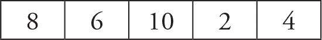

我们的策略是首先找到数组中的最小元素并将其放在第一个位置。我们将找到剩余元素中的最小值，并将其放在第二个位置。我们将继续这样做，直到数组有序。

我们可以从查看数组中的每个元素开始（从第一个元素开始）并找到最小元素。对于人来说，找到最小元素很容易。然后我们将找到剩余元素中的最小值，并将其放在第二个位置。我们将继续这样做，直到数组有序。

我们可以从查看数组中的每个元素开始（从第一个元素开始）并找到最小元素……（注：由于原文中存在多处重复的描述策略的段落，在翻译时已根据逻辑进行了整合处理，确保核心算法逻辑清晰）。

### 选择排序的实现

```java
public static void selectionSort1(int[] numbers) {
    for (int i = 0; i < numbers.length – 1; i++) {
        int position = i;
        for (int k = i + 1; k < numbers.length; k++) {
```

```java
if (numbers[k] < numbers[position]) {
    position = k;
}

int temp = numbers[i];
numbers[i] = numbers[position];
numbers[position] = temp;
```

这有什么用呢？考虑一种情况：你有一个包含 1000 个 `Student` 对象的未排序数组，每个 `Student` 对象都有一个方法，可以返回该 `Student` 的平均学分（GPA）。如果你想找到平均学分最高的五个学生怎么办？在这种情况下，对整个数组进行排序将浪费时间。相反，我们只需要运行上面所示选择排序第二种实现的五个循环，前五名学生就会排好序。

`插入排序`（insertion sort）稍微没那么直观。它不是遍历整个数组，而是比较前两个元素，并根据比较结果，将第二个值插入到第一个值的“前面”并放入索引 0，将第一个值移动到索引 1。现在前两个元素已经排好序。然后检查第三个元素，并继续插入。注意，在这里，已经排序的元素也将保持其原位置。

下面是一个包含 9 个元素的数组。除了最后一个元素外，该数组按从小到大的顺序排序。

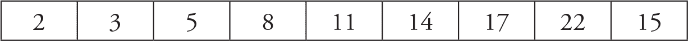

我们希望移动 15，使整个数组有序。首先，我们将 15 临时赋值给一个变量。这将为我们在需要时将其他元素向右移动提供空间。

`temp = 15`

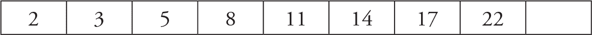

然后我们将 15 与其左侧的第一个元素比较：22。因为 22 大于 15，我们将 22 向右移动。

`temp = 15`

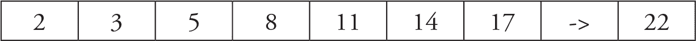

接着我们将 15 与下一个元素比较：17。因为 17 更大，我们也将其也向右移动。

`temp = 15`

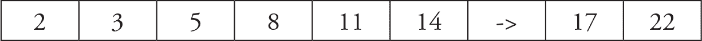

接下来，我们将 15 与 14 比较。因为 15 更大，我们不想将 14 向右移动。相反，我们将 15 插入数组中的空单元格中。现在数组已正确排序。

插入 15：

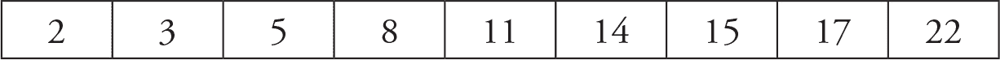

现在我们来看如何使用上述所示的思想来对整个数组进行排序。这个示例将从排序过程开始开始。

这是我们要排序的数组。

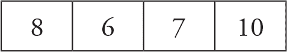

首先，我们只看数组的前两个元素，以确保它们之间是有序的。


为了做到这一点，我们将从数组中取出 6（我们的子数组中最靠右的数字）并将其临时赋值给一个变量。然后我们将 6 与 8 比较。因为 8 更大，将 8 向右移动，然后将 6 放在 8 所在的单元格。

`temp = 6`

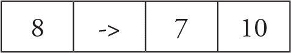

这是数组的样子。

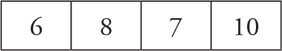

现在我们需要相对于 6 和 8 将 7 放在合适的位置。我们首先将 7 赋值给一个变量。

`temp = 7`

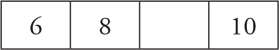

然后我们将 7 与其左侧的第一个数字：8 比较。因为 7 小于 8，我们将 8 向右移动一位。

`temp = 7`

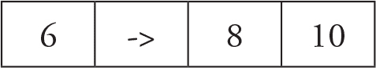

接下来，我们将 7 与数组中的下一个数字：6 比较。因为 6 小于 7，我们不想将 6 向右移动。相反，我们将 7 放在第二个单元格。我们的数组现在看起来如下：


现在我们需要相对于数组中的前 3 个元素将 10 放在它的位置。

`temp = 10`

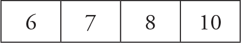

首先我们将 10 与 8 比较；因为 8 小于 10，我们不需要将 8 向右移动。事实上，我们可以将 10 放回它原来的那个单元格。

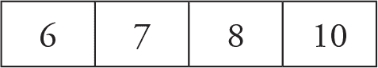

### 插入排序的实现

这是在 Java 中实现插入排序的方法。

```java
// precondition: x 是一个整数数组； x.length >= 0

// postcondition: x 从小到大顺序排序

public static void insertionSort(int[] x) {
    for (int i = 1; i < x.length; i++) {
        int temp = x[i];
        int j = i - 1;
        while (j >= 0 && x[j] > temp) {
            x[j + 1] = x[j];
            j--;
        }
        x[j + 1] = temp;
    }
}
```

注意，和选择排序一样，插入排序包含嵌套循环。在这种情况下，我们有一个嵌套在 `for` 循环中的 `while` 循环。从第 3 行开始的 `for` 循环从索引 1 进行到数组的末尾。`while` 循环从 `i` 遍历数组。注意，在这里，已经排序的元素也将保持其原位置。（注：此处原文后半部分存在重复或乱码的描述，翻译时已根据逻辑进行了通顺处理）

### 归并排序实现

以下是在 Java 中实现归并排序的方法。

```java
//precondition: x 是一个整数数组；x.length >= 0

//postcondition: x 从小到大排序

public static void mergeSort (int[] x) {
    int[] temp = new int[x.length];
    mergeSortHelper(x, 0, x.length – 1, temp);
}

public static void mergeSortHelper (int[] x, int lowIndex, int highIndex, int temp) {
    if (lowIndex < highIndex) {
        int mid = (lowIndex + highIndex) / 2;
        mergeSortHelper(x, lowIndex, mid, temp);
        mergeSortHelper(x, mid + 1, highIndex, temp);
        merge(x, lowIndex, mid, highIndex, temp);
    }
}

public static void merge(int[] x, int lowIndex, int mid, int highIndex, temp) {
    int l = lowIndex;
    int m = mid + 1;
    int n = highIndex;

    while (l <= mid && m <= highIndex) {
        if (x[l] < x[m]) {
            temp[n] = x[l];
            l++;
        } else {
            temp[n] = x[m];
            m++;
        }
        n++;
    }

    while (l <= mid) {
        temp[n] = x[l];
        l++;
        n++;
    }

    while (m <= highIndex) {
        temp[n] = x[m];
        m++;
        n++;
    }

    for (n = lowIndex; n <= highIndex; n++) {
        x[n] = temp[k];
    }
}
```

这显然比另外两种排序更为复杂，并且涉及到多个方法的使用。第一个方法将数组分成两部分，第二个方法对各个部分进行排序，第三个方法将这两个部分合并为一个有序数组。

## 第 8 章核心术语

- 数组 (`array`)
- 初始化列表 (`initializer list`)
- 索引数字 (`index numbers`)
- 遍历 (`traverse`)
- 满 (`full`)
- 数组越界异常 (`ArrayIndexOutOfBoundsException`)
- 增强型 `for` 循环 (`enhanced-for loop`)
- 空 (`null`)
- 空指针异常 (`NullPointerException`)
- 顺序查找 (`sequential search`)
- 二分查找 (`binary search`)
- 搜索算法 (`search algorithms`)
- 排序算法 (`sorting algorithms`)
- 选择排序 (`selection sort`)
- 插入排序 (`insertion sort`)
- 归并排序 (`merge sort`)
- 递归 (`recursion`)

## 第 8 章复习题

复习题的答案可以在第 12 章找到。

1. 执行以下代码后，数组 `numbers` 的长度是多少？

   ```java
   String word = "Bear";

   int[] numbers = new int[word.length() - 1];
   ```

   1. 1
   2. 3
   3. 4
   4. 由于编译错误，数组将无法创建。

2. 考虑以下代码段：

   ```java
   String[] s = new String[2];

   String[] t = {"Michael", "Megan", "Chelsea"};

   s = t;

   System.out.print(s.length);
   ```

   执行该代码段的结果输出什么？

   1. 2
   2. 3
   3. 由于编译错误，什么都不会输出内容。
   4. 由于运行时错误，什么都不会输出内容。

3. 考虑以下代码段：

   ```java
   final int[] a1 = {1, 2};

   int[] b1 = {3, 4};

   a1 = b1;

   System.out.print(a1[1]);
   ```

   执行该代码段的结果输出什么？

   1. 2
   2. 4
   3. 由于编译错误，什么都不会输出内容。
   4. 由于运行时错误，什么都不会输出内容。

4. 考虑以下代码段：

   ```java
   final int[] myArray = {1, 2};

   myArray[1] = 3;

   System.out.print(myArray[1]);
   ```

   执行该代码段的结果输出什么？

   1. 2
   2. 3
   3. 由于运行时错误，什么都不会输出内容。
   4. 由于编译错误，什么都不会输出内容。

5. 考虑以下不完整的方法：

   ```java
   public static int mod3(int[] numbers) {
       int count = 0;

       for (int i = 0; i < numbers.length; i++) {
           /* mystery code */
       }

       return count;
   }
   ```

   `mod3` 旨在返回 `numbers` 中能被 3 整除的整数。以下哪个代码段可以替换 `* mystery code` 以使 `mod3` 按预期工作？

   1. `if (i % 3 == 0) { count++; }`
   2. `if (numbers[i] % 3 == 0) { count++; }`
   3. `while (numbers[i] % 3 == 0) { count++; }`

   1. 仅 II
   2. 仅 III
   3. I 和 II
   4. II 和 III

6. 假设已经声明并初始化了一个带有随机数的整数数组 `arr`。以下哪个代码段可以正确交换 `arr[0]` 和 `arr[3]` 存储的值？

   1. `arr[0] = 3; arr[3] = 0;`
   2. `arr[0] = arr[3]; arr[3] = arr[0];`
   3. `int k = arr[3]; arr[3] = arr[0]; arr[0] = k;`
   4. `int k = arr[3]; arr[0] = arr[3]; arr[3] = k;`

7. 考虑以下代码段：

   ```java
   int[] scores = {75, 63, 52, 80};

   for (int s : scores) {
       if (s < 75) {
           s += 5;
       }
   }

   for (int s : scores) {
       System.out.print(s + " ");
   }
   ```

   执行该代码段的结果输出什么？

   1. 75 63 52 80
   2. 75 68 57 80
   3. 80 68 57 80
   4. 由于编译错误，什么都不会输出内容。

8. 考虑以下代码段：

   ```java
   String[] names = {"Abi", "Brianna", "Jada", "Kiara", "Tiffany", "Vanessa"};

   int middle = names.length / 2 - 1;

   for (int x = 0; x < middle; x++) {
       String hold = names[x];

       names[x] = names[names.length - x - 1];

       names[names.length - x - 1] = hold;
   }

   for (String n : names) {
       System.out.print(n + " ");
   }
   ```


```text
执行该代码段的结果输出什么？
1. Abi Brianna Jada Kiara Tiffany Vanessa
2. Vanessa Tiffany Kiara Jada Brianna Abi
3. Vanessa Tiffany Jada Kiara Brianna Abi
4. Vanessa Brianna Jada Kiara Tiffany Abi
```

## 第 8 章总结

- 数组是相同数据类型的变量或相同类对象的固定长度的组合。
- 数组索引从 0 开始，到长度 – 1 结束。
- 增强型 `for` 循环会自动为数组的每个元素执行循环。
- 顺序查找从索引 0 开始查找数组中的元素，直到找到所需的元素并返回索引。如果未找到元素，则返回 -1。
- 二分查找从数组的中间开始搜索，并向较高或较低索引移动以寻找所需的元素。二分查找通常效率，但只能用于有序列表。
- 选择排序通过将最小元素交换到第一个索引，然后重复寻找第二个最小元素并交换到第二个索引，以此类推对数组排序。
- 插入排序通过找到元素合适的位置、移动其他元素腾出空间，然后将元素放在合适的位置。
- 归并排序通过递归将数组分成更小的部分。较小的部分经过排序后与其他部分合并。

# 列表与 `ArrayList`

Java 中强大的数组结构有两个主要的局限性：数组的长度是固定的，且它只能存储一种类型的数据。如果你想表示（例如）一个朋友收集的动作模型，数组将要求所有动作模型必须是同一种类型。通常情况下，它们全部必须是飞行超级英雄，或者它们全部必须穿有护体装甲等。

同样，以数组形式表示的动作模型集合只能存储固定数量的动作模型，不多也不少。如果有额外的、未使用的槽位，它们将一直留在那里。如果你有一个组戴着头盔的英雄的数组，并尝试移除数组中每个索引处每个元素的头盔，这可能会产生问题。当你遇到第一个空位时，那里没有英雄，因此没有头盔，所以指令变得毫无意义；在 Java 中，编译器将针对这种情况返回一个 `NullPointerException`。

我们在 Java 中学习的每种结构都有其优缺点。

`ArrayList` 解决了这两个问题。`ArrayList` 对象是动态调整大小的，随着元素的添加和删除而扩展或压缩。`ArrayList` 还可以无限制地存储多种类型的数据。

让我们用一个例子来理解数组与 `ArrayList` 的优缺点。考虑你带去学校的午餐盒。如果你想用数组或 `ArrayList` 结构来表示你的午餐盒，哪种更准确？

自然，这个问题的答案取决于 (1) 包中对象的具体细节——在这种情况下，即午餐物品的类型——以及 (2) 程序员对哪种更合适的选择。如果你的午餐包含一个三明治对象、一个水果对象和一个饮料对象，`ArrayList` 结构可能是更好的选择。此外，随着午餐组件的移除，午餐盒理论上会缩小（或可以缩小）。`ArrayList` 似乎更合适。

让我们考虑同样的午餐例子，但这次假设物品存储在一个带有隔板的塑料容器中。无论你是还没有吃午餐、已经吃完午餐，还是正处于两者之间的任何时候，隔板的数量和设置都不会改变。我们将讨论一种“欺骗”数组让其认为午餐对象都是同种类型的变方法。这些事实和能力使得数组结构比 `ArrayList` 更合适。

为了进一步证明 `ArrayList` 结构的有用性，请注意还可以创建一个类型化 `ArrayList`（typed ArrayList），它允许列表仅存储相同类型的对象。这种结构结合了数组和 `ArrayList` 的有用方面。

为了实例化一个名为 `lunchBag` 的用于存储我们午餐各种组件的 `ArrayList`，我们使用以下代码：

```java
ArrayList lunchBag = new ArrayList();
```

注意，与我们用于实例化数组的语法不同，对象的类型或列表的长度最初都没有被定义。

为了访问列表内部的数据，必须调用特定的方法；与 Java 中的数组结构不同，列表没有方便的括号表示法。要返回 `ArrayList` 中的第二个对象（一个 `Apple` 对象）并使用变量 `food` 存储它，该行代码为：

```java
Apple red = lunchBag.get(1);
```

`List` 类中还有其他几个实用方法，它们在 AP 考试快速参考中都提到了，尽管（显然）没有给出它们的功能。这些方法包括 `add`、`set`、`remove` 和 `size`。

括号表示法只能用于数组对象；列表必须使用适当的方法。

如果程序员认为保持 `ArrayList` 的动态调整能力的同时固定它能持有的数据类型（如数组一样）更合适，则按如下方式实例化：

```java
ArrayList<Apple> lunchBag = new ArrayList<Apple>();
```

使用 `ArrayList` 的缺点之一是 `ArrayList` 中只能存储对象。原始数据类型 `int` 和 `double` 不能存储在 `ArrayList` 中。如果程序员想存储整数和双精度数据类型，他们必须使用 `Integer` 或 `Double` 包装类。可以使用整数和双精度作为参数创建 `Integer` 和 `Double` 对象。例如：

```java
Integer n = new Integer(5);

Double x = new Double(6.1);
```

调用这些值时，使用 `intValue()` 和 `doubleValue()` 方法。以下命令：

```java
int a = n.intValue();

double y = x.doubleValue();
```

将 `a = 5` 和 `y = 6.1`。

此外，AP 计算机 Java 子集包含了 `Integer` 类的静态变量 `MIN_VALUE` 和 `MAX_VALUE`。它们存储了整数数据类型可能的最小值和最大值。

| 数组 | `ArrayList` |
| --- | --- |
| 数组创建后无法调整大小。 | `ArrayList` 会随着新元素的添加而自动调整大小。 |
| 使用数组不需要 `import` 语句，除非数组需要。 | 必须导入 `java.util.ArrayList` 才能使用。 |
| 使用索引符号访问元素。 | 使用 `ArrayList` 类的方法访问元素。 |
| 数组可以构造为持有原始类型或引用。 | `ArrayList` 实例只能持有引用，而不是原始类型。 |
| 每个数组只能声明为一种类型。例如，如果数组声明为持有字符串，则你无法存储整数。 | `ArrayList` 可以持有异构对象。例如，以下是合法的（尽管不推荐）：`ArrayList list = new ArrayList(); list.add("A"); list.add(4));` |

# 数据集引论

一个数据集（data set）是与特定主题相关的组织集合。

数据集的一些例子是：

- 州的人口数据
- 学生的成绩
- 运动员的统计
- 公司数据

下表显示了 2010 年和 2020 年美国人口最多的州的人口数据：

| 美国人口最多的州 | 2010 年人口 | 2020 年人口 |
| --- | --- | --- |
| 加利福尼亚州 | 37,253,956 | 39,368,078 |
| 德克萨斯州 | 25,145,561 | 29,360,759 |
| 纽约州 | 19,378,102 | 19,336,776 |
| 佛罗里达州 | 18,801,310 | 21,733,312 |
| 伊利诺伊州 | 12,830,632 | 12,587,530 |
| 宾夕法尼亚州 | 12,702,379 | 12,783,254 |
| 俄亥州 | 11,536,504 | 11,693,217 |
| 密歇根州 | 9,883,640 | 9,966,555 |
| 乔治亚州 | 9,687,653 | 10,710,017 |
| 北卡罗来纳州 | 9,535,483 | 10,600,823 |

程序如何表示此数据集中的信息？程序如何提取信息并生成新信息（例如人口变化和百分比变化）？

每个州可以通过以下类表示：

```java
public class State
{
    private String stateName;
    private int pop2010, pop2020, popChange;
    private double percentChange;

    public State(String name, int p2010, int p2020)
    {
        stateName = name;
        pop2010 = p2010;
        pop2020 = p2020;
        calculatePopChange();
        calculate-PercentChange();
    }

    private void calculatePopChange()
    {
        //计算并保存 2010 年到 2020 年的人口变化
        popChange = pop2020 - pop2010;
    }

    private void calculate-PercentChange()
    {
        //计算并保存 2010 年到 2020 年的人口百分比变化
        //缺失代码
        //将在复习练习中完成
    }
}
```

`calculatePopChange()` 方法计算并保存了 `State` 从 2010 年到 2020 年的人口变化。`calculatePercentChange()` 方法的完成（它将计算并保存 2010 年到 2020 年的百分比变化）被留作复习习题中的一个问题。

整个数据集（所有十个州）可以存储在一个一维数组中：

```java
State[] top10 = new State[10];
```

可以使用从输入文件中读取的数据来填充数组。使用输入文件将在后续的话题中介绍。

程序可以分析整个数据集以回答诸类问题，例如哪个州的人口百分比变化最大，哪些州的人口减少了。数据集还可以以多种方式排序，例如按字母顺序排序或按百分比降序排序。

数据集的另一个示例是班级学生考试成绩的集合。每个学生的信息可以用以下类表示：

```java
public class Student
{
    private String last, first, letterGrade;
    private double average;
    private int[] grades;

    public Student(String last, String first, int[] grades)
    {
        this.last = last;
        this.first = first;
        this.grades = grades;
        calculateAverage();
        letterGrade = determineLetterGrade();
    }

    private void calculateAverage()
    {
        int len = grades.length;
        int total = 0;

        for (int g : grades)
            total += g;

        average = (double)total / len;
    }

    private String determineLetterGrade()
    {
        if (average >= 90)
            return "A";

        if (average >= 80)
            return "B";

        if (average >= 70)
            return "C";

        if (average >= 60)
            return "D";

        return "F";
    }

    //accessors

    public double getAverage()
    {
        return average;
    }

    public String getLetterGrade()
    {
        return letterGrade;
    }
}
```

构造函数接受三个参数：学生的姓、名以及他们的考试成绩数组。

`calculateAverage()` 方法计算 `Student` 考试成绩的平均分。`determineLetterGrade()` 方法根据学生的平均分为学生决定字母等级。

以下类表示特定班级中所有学生的数据集：

```java
public class TheClass
{
    private Student[] allStudents;
    private double classAverage;
    private Student studentWithHighestAverage;

    public TheClass(Student[] allStudents)
    {
        this.allStudents = allStudents;
        calculateClassAverage();
        studentWithHighestAverage();
    }

    private void calculateClassAverage()
    {
        //计算并保存整个学生数据集的平均分
        double total = 0.0;

        for (Student s : allStudents)
            total += s.getAverage();

        classAverage = total / allStudents.length;
    }

    private void studentWithHighestAverage()
    {
        //找到并保存平均分最高的学生
        Student highest = allStudents[0];

        for (int i = 1; i < allStudents.length; i++)
            if (allStudents[i].getAverage() > highest.getAverage())
                highest = allStudents[i];

        studentWithHighestAverage = highest;
    }

    public double getClassAverage()
    {
        return classAverage;
    }

    public Student getStudentHighestAverage()
    {
        return studentWithHighestAverage;
    }
}
```

构造函数接受一个参数，一个 `Student` 对象的数组。`calculateClassAverage()` 方法计算并保存数据集中所有学生的平均分。`studentWithHighestAverage()` 方法找到并保存平均分最高的学生。数据集还可以以多种方式排序，例如按姓名的字母顺序排序；按平均分降序排序；按字母等级升序排序。

## 使用文件

需要外部数据来执行功能的程序使用输入文件。例如，一个计算程序可能会读取一个文本文件，其中包含每个学生的姓名和考试成绩。程序可以将信息存储在适当的结构中，例如数组或 `ArrayList`，然后根据需要检索并处理数据（例如，计算整个班级的平均分）。文件中的数据被称为持久化（persist），这意味着当程序未执行时它仍然存在。

### Java `File` 类

`File` 类包含了程序可以使用来处理外部文件的方法。使用文件的程序必须包含以下导入语句：

```java
import java.io.*;
```

使用文件的第一步是按如下方式构造 `File` 对象：

```java
File fn = new File(pathname);
```

其中 `fn` 是 `File` 对象的名字，`pathname` 是一个包含文件路径的 `String`。例如，一个包含美国人口最多十个州的数据的文件可能位于 `C:/Java Programs`，名为 `top10.txt`。接接的一行代码构造了一个名为 `infile` 的 `File` 对象：

```java
File infile = new File("C:/Java Programs/top10.txt");
```

记住，当程序使用 `File` 时，使用该文件的方法必须包含相应的异常处理是非常重要的。

```java
State[] top10Pop = new State[10];
```

以下代码将执行：

- 使用 `Scanner.next()` 方法读取州名称（`String`）
- 使用 `Scanner.nextInt()` 方法读取 2020 年的人口（`int`）
- 使用 `Scanner.nextInt()` 方法读取 2020 年的人口（`int`）
- 创建一个新的 `State` 对象作为 `top10Pop` 的元素

针对 `top10.txt` 中的每一行：

```java
int i = 0;

while (scan.hasNext())
{
    String sName = scan.next();
    int p2010 = scan.nextInt();
    int p2020 = scan.nextInt();
```


```java
top10Pop[i] = new State(sName, p2010, p2020);
i++;
}
```

`Scanner` 类还提供了一个方法，可以一次一次地读取文本文件的每一行。该方法也属于 AP Computer Science A 的子集中：

| 方法 | 说明 |
| --- | --- |
| `String nextLine()` | 从文件或输入源读取文本的下一行并作为 `String` 返回；如果紧接着另一个从文件或输入源读取的 `Scanner` 方法调用，则可能返回空字符串。 |

可以使用 `String.split()` 方法将行拆分成单独的数据片段，该方法也属于 AP Computer Science A Java 子集：

| 方法 | 说明 |
| --- | --- |
| `String[] split(String del)` | 返回一个 `String` 数组，其中每个元素都是此 `String` 的子字符串，该字符串根据给定表达式 `del` 的匹配项进行分割。 |

以下是 `nextLine()` 和 `split(String del)` 的使用示例。

`numbers.txt` 文件包含由姓、名和电话号码组成的数据。以下是 `numbers.txt` 中的几行：

- Brown,John,(358)441-2435
- Green,Vanessa,(358)222-9658
- Gray,Matthew,(358)441-7654
- Blue,Alison,(358)222-2468

数据片段通过“，”分隔，逗号充当 `delimiter`（分隔符）。`delimiter` 是一个或多个未出现在数据本身中的字符的字符串。当使用“，”时，数据被称为 `comma-separated values`（逗号分隔值），或 `CSV`。

以下是一个描述人的姓、名和电话号码的类：

```java
public class PhoneNumber {
    private String last, first, number;

    public PhoneNumber(String l, String f, String n) {
        last = l;
        first = f;
        number = n;
    }
}
```

以下代码使用 `Scanner.nextLine()` 和 `String.split(del)` 方法从 `numbers.txt` 获取数据并构造 `PhoneNumber` 对象：

```java
File f = new File("numbers.txt");
Scanner scan = new Scanner(f);

String last, first, pNumber;
String line;
String[] temp = new String[3];

while (scan.hasNext()) {
    line = scan.nextLine();

    // 姓、名和电话号码由分隔符 "," 分隔
    // 将行分成三个数据片段
    // 将每个片段保存到 String 数组 temp 中
    temp = line.split(",");

    last = temp[0]; // 姓
    first = temp[1]; // 名
    pNumber = temp[2]; // 电话

    PhoneNumber pn = new PhoneNumber(last, first, pNumber);

    // 未显示将 pn 保存到数据结构中的代码
}
```

让我们来看 `numbers.txt` 中的某行：

- Gray,Matthew,(358)441-7654

执行代码 `temp = line.split(",");` 后，`String` 数组 `temp` 为：

- `temp[0]` 包含姓
- `temp[1]` 包含名
- `temp[2]` 包含电话

还有一个 AP Computer Science A 子集的 `Scanner` 方法：

| 方法 | 说明 |
| --- | --- |
| `void close()` | 关闭扫描器。 |

在 `PhoneNumber` 示例中，可以在 `while` 循环后调用 `scan.close();`。

## 第 9 章核心术语

- `ArrayList` 对象
- 动态调整大小
- 类型化的 `ArrayList`
- 数据集
- 持久（persist）
- 空格字符
- `delimiter`
- 逗号分隔值（CSV）

## 第 9 章复习练习

复习答案可以在第 12 章找到。

考虑以下代码段：

```java
ArrayList list = new ArrayList();

list.add("A");
list.add("B");
list.add(0, "C");
list.add("D");
list.set(2, "E");

System.out.println(list);
```

执行该代码的结果打印出什么？

1. `[C, A, E, D]`
2. `[A, B, C, D]`
3. `[A, B, E, D]`
4. `[C, A, B, D]`

执行过程如下：

```java
list.add("A");       // [A]
list.add("B");       // [A, B]
list.add(0, "C");    // [C, A, B]
list.add("D");       // [C, A, B, D]
list.set(2, "E");    // [C, A, E, D]
```

结果应为 `[C, A, E, D]`。

考虑以下代码段：

```java
ArrayList list = new ArrayList();

list.add("A");
list.add("B");
list.add(0, "C");
list.add("D");
list.set(2, "E");

System.out.println(list);
```

执行该代码的结果打印出什么？

1. `[C, A, E, D]`
2. `[A, B, C, D]`
3. `[A, B, E, D]`
4. `[C, A, B, D]`

考虑以下代码段（重复重复重复方法）：

```java
ArrayList list = new ArrayList();

list.add("A");
list.add("B");
list.add(0, "C");
list.add("D");
list.set(2, "E");

System.out.println(list);
```

执行该代码的结果打印出什么？

1. `[C, A, E, D]`
2. `[A, B, C, D]`
3. `[A, B, E, D]`
4. `[C, A, B, D]`

考虑以下代码段：

```java
ArrayList list = new ArrayList();

list.add("A");
list.add("B");
list.add(0, "C");
list.add("D");
list.set(2, "E");

System.out.println(list);
```

执行该代码的结果打印出什么？

1. `[C, A, E, D]`
2. `[A, B, C, D]`
3. `[A, B, E, D]`
4. `[C, A, B, D]`

考虑以下代码段：

```java
ArrayList list = new ArrayList();

list.add("A");
list.add("B");
list.add(0, "C");
list.add("D");
list.set(2, "E");

System.out.println(list);
```

执行该代码的结果打印出什么？

1. `[C, A, E, D]`
2. `[A, B, C, D]`
3. `[A, B, E, D]`
4. `[C, A, B, D]`

考虑以下代码段：

```java
ArrayList list = new ArrayList();

list.add("A");
list.add("B");
list.add(0, "C");
list.add("D");
list.set(2, "E");

System.out.println(list);
```

执行该代码的结果打印出什么？

1. `[C, A, E, D]`
2. `[A, B, C, D]`
3. `[A, B, E, D]`
4. `[C, A, B, D]`

# 二维数组

二维数组（或 2D Arrays）是已经进入、退出并再次进入 AP 考试要求主题范围的结构。它们非常强大，而且一旦你掌握了我们在第 8 章学习的 1D 数组结构，理解它们并不算困难。

二维数组的一个绝佳例子是立式自动饮料水机，就像你在商场或超市门口看到的那种。你知道那种类型：投入钱，然后迫切地希望饮料能掉出来。

把自动饮料水机想象成横跨机器的一组“行”，每行都有不同类型的饮料（假设第一行是可乐，第二行是橙子汁，等）。每一行都可以被视为一个数组。现在考虑机器上的垂直“列”；每一列都包含每种类型的饮料，因为它们沿着行向下移动（第一个物品是可乐，第二个物品是橙子汁，等）。该垂直列也可以被视为一个数组。结果就是“数组的数组”，Java 将其量化为二维数组，并为每个行和列位置独立地分配索引号。

在自动饮料水机的例子中，二维数组左上角的第一个瓶可乐位于第一个水平数组的索引 `0` 处，也是第一个垂直数组的索引 `0` 处。在已实例化为 `sodaMachine` 的二维数组（饮料水机）中访问此元素（饮料）的代码将是 `sodaMachine[0][0]`，第一个 `0` 是行，第二个 `0` 是列。第二瓶可乐位于 `[0][1]`，第一瓶橙汁位于 `[1][0]`，以此类推。对于一个 `m` 行 `n` 列的二维数组（其中 `m` 是行数，`n` 是列数），右下角的最后一个元素位于 `[m - 1][n - 1]`。但你没有忘记索引号是从 `0` 开始到 `(array.length - 1)` 结束的吧？

适用于数组结构的可用方法和常量也适用于二维数组结构，因为二维数组本质上也是数组——只是一个比较花哨的数组。然而，这有一点棘手；例如，为了返回自动饮料水机横跨整个机器的可乐槽位数量，你将如预期的那样使用 `sodaMachine.length`。但是，为了访问机器左侧的槽位数量，你需要使用 `sodaMachine[0].length`，这意味着想要二维数组第一列的长度。

***


#### 问题 1

考虑以下代码段：

```java
int[][] num = new int[4][4];

for (int i = 0; i < num.length; i++) {
    for (int k = 0; k < num.length; k++) {
        num[i][k] = i * k;
    }
}
```

代码段执行后，`num` 的内容是什么？

1. 0 0 0 0, 0 1 2 3, 0 2 4 6, 0 3 6 9
2. 0 1 2 3, 1 2 3 4, 2 3 4 5, 3 4 5 6
3. 1 1 1 1, 2 2 2 2, 3 3 3 3, 4 4 4 4
4. 0 0 0 0, 1 2 3 4, 2 4 6 8, 3 6 9 12

#### 破题技巧

二维数组问题总是令人生畏。外层循环的第一次迭代发生在 `i = 0` 时。观察内部循环，`k` 的值在终止前范围将从 `0` 到 `3`。由于 `i = 0` 且内部循环的每次迭代都会将 `i` 乘以 `k`，因此数组的第一行全为 0。排除 (B) 和 (C)。哇！一旦完成，外层循环将进行第二次迭代，此时 `i = 1`。内部循环将从 `k = 0` 重新开始，`i 乘以 k` 的结果将等于 `0`。因此，第二行的第一个数字将是 `0`。排除 (D)，因为它的第二行第一个数字是 `1`，答案是 (A)。

***

 

请记住，无论维度如何，数组都可以存储任何一种类型的数据，但不能存储多种类型。同样记住，正如大多数计算机语言规则一样，总有变通方法！稍后详述。

## 第 10 章核心术语

- 二维数组（2D array）
- 行（rows）
- 列（columns）

## 第 10 章复习练习

复习答案可以在第 12 章找到。


#### 问题 2

以下类 `Arr2d` 用于表示一个二维数组。构造函数将使用传入的行数和列数初始化 `Arr2d`。选择哪个语句将初始化数组。

```java
public class Arr2d {
    private int[][] arr;

    Arr2D(int rows, int columns) {
        /* 缺失代码 */
    }
}
```

1. `arr = new int[rows][columns];`
2. `arr = new int[rows - 1][columns - 1];`
3. （此处与选项 1 重复或逻辑错误）
4. （此处逻辑错误）

#### 问题 3

以下代码段：

```java
int[][] numbers = {{1, 2, 3, 4}, {5, 6, 7, 8}};

for (int[] nums : numbers) {
    for (int n : nums) {
        System.out.print(n + " ");
    }

    System.out.print("\n");
}
```

执行该代码段的输出是什么？

1. 1 2 3 4 5 6 7 8
2. 1 2 3 4, 5 6 7 8
3. 1 2, 3 4, 5 6, 7 8
4. 会发生编译错误

#### 问题 4

考虑以下代码段：

```java
int[][] numbers = new int[4][4];

initializeIt(numbers);

int total = 0;

for (int z = 0; z < numbers.length; z++) {
    total += numbers[z][numbers[0].length - 1];
}
```

代码执行后，`total` 的值是多少？

1. 11
2. 12
3. 13
4. 14

#### 问题 5

考虑以下代码段：

```java
int[][] num = new int[4][4];

for (int i = 0; i < num.length; i++) {
    for (int k = 0; k < num[0].length; k++) {
        num[i][k] = i * k;
    }
}
```

代码段执行后，`num` 的内容是什么？

1. 0 0 0 0, 0 1 2 3, 0 2 4 6, 0 3 6 9
2. 0 1 2 3, 1 2 3 4, 2 3 4 5, 3 4 5 6
3. 1 1 1 1, 2 2 2 2, 3 3 3 3, 4 4 4 4
4. 0 0 0 0, 1 2 3 4, 2 4 6 8, 3 6 9 12

#### 问题 6

考虑以下代码段：

```java
int[][] numbers = {{1, 2, 3, 4}, {5, 6, 7, 8}};

initializeIt(numbers);

String line = "";

for (int a = 0; a < numbers[0].length; a++) {
    for (int b = 0; b < numbers.length; b++) {
        line += numbers[b][a] + " ";
    }

    line += "\n";
}

System.out.println(line);
```

第二行对 `initializeIt()` 的调用会初始化数组，使其看起来如下：

```text
1 2 3 4
5 6 7 8
```

代码执行后将打印什么？

1. 1 2 3 4 / 5 6 7 8
2. 5 6 7 8 / 1 2 3 4
3. 8 7 6 5 / 4 3 2 1
4. 1 5 / 2 6 / 3 4 / 4 8

前往第 12 章：章节复习题答案与解析。

考虑以下客户端代码和方法：

```java
int[][] numbers = {
    {1, 2, 3, 4},
    {5, 6, 7, 8},
    {9, 10, 11, 12}
};

int[] myArr = mystery(numbers, 2);

for (int j : myArr) {
    System.out.print(j + " ");
}

public static int[] mystery(int[][] arr, int n) {
    int[] m = new int[arr.length];

    for (int i = 0; i < arr.length; i++) {
        m[i] = arr[i][n];
    }

    return m;
}
```


代码执行后将打印什么？

1. 2 6 10
2. 9 10 11 12
3. 4 8 12
4. 3 7 11

前往第 12 章：章节复习题答案与解析

考虑以下代码：

```java
int[][] numbers = {{1, 2, 3, 4}, {5, 6, 7, 8}, {9, 10, 11, 12}};

for (int r = numbers.length - 1; r > 0; r--) {
    for (int c = 0; c < numbers[r].length; c++) {
        numbers[r - 1][c] = numbers[r][c];
    }
}
```

以下哪项代表数组中的当前值？

1. 1 2 3 4 / 5 6 7 8 / 9 10 11 12
2. 9 10 11 12 / 5 6 7 8 / 1 2 3 4
3. 1 2 3 4 / 1 2 3 4 / 1 2 3 4
4. 9 10 11 12 / 9 10 11 12 / 9 10 11 12

前往第 12 章：章节复习题答案与解析

## 第 10 章总结

- 二维数组是数组的数组。
- 二维数组的第一个索引代表行，第二个索引代表列。
- 行数由 `array.length` 表示。
- 某行的列数由 `array[row].length` 表示。

# 第 11 章

## 递归

AP 考试中出现的最后控制流结构被称为`递归`。它不会出现在简答题中，但在多选择题中至少出现一次（但通常只出现几次）。这种结构的运行与循环相似，但处理任务的方式不同。

还记得你小时候玩过的那些发条小玩具吗？你记得那些塑料齿轮或兔子（或其他什么）侧面带有小白色旋钮的吗？你会反复转动旋钮，当你松手时，小齿轮就会移动。你转动旋钮越多次，齿轮走得越远。由于旋转动作是重复的，这可以被视为循环。然而，`展开`（unwinding）动作将这种情况与 `while` 循环区分开来。当“向上”旋转作为“向下”（winding down）的结果时，递归潜伏在阴影中。递归方法的一个显著特征是调用其本身；为了防止无限循环，递归方法包含一个`基准情况`（base case），它信号停止递归并返回到上一次调用。让我们用一个简单的例子来说说明。

假设你有一大袋五颜色的巧克力。作为一个程序员，你不想杂乱地吃这些巧克力，而是想使用某种算法。你决定每次吃一颗，直到遇到你喜欢的颜色；或者按顺序吃这些巧克力。用伪代码表示：

```java
eatCandy(color of current candy) {
    if (current candy is green)
        return done;
    else
        eat more candy;
}
```

尽管没有 `for` 或 `while` 循环，但递归调用将表现出循环特性；与我们之前的循环不同，这里是向后的进展。让我们增加这个任务：一旦完成就告诉用户“你完成了”。添加以下行可以完成这项任务吗？

当到达基准情况时，当前方法的执行完成，然后过程一直回到初始调用。每次递归迭代完成后，都会显示“你完成了”。这有效，但可能不是计划的。

```java
// 前提：x >= 0
public int mystery(int x) {
    if (x == 0) {
        return 0;
    } else {
        return ((x % 10) + mystery(x / 10));
    }
}
```

调用 `mystery(3543)` 的结果是以下几个？

1. 15
2. 2
3. 10
4. 无限递归

### 解题方法

在列出的方法中，基准情况发生在 `x` 等于 `0` 时。因为传递给方法的值是 `3543`，所以基准情况尚未适用。看看 `return ((x % 10) + mystery(x / 10))` 这一行发生了什么。

`return` 语句中的表达式有两个部分：`x % 10` 和 `mystery(x / 10)`。确保你理解 `x % 10` 和 `x / 10` 的作用。如果 `x` 是一个整数，`x % 10` 将返回个位数。例如 `348 % 10` 返回 `8`。如果 `x` 是一个 `int` 变量，那么 `x / 10` 将移除个位数。例如 `348 / 10` 返回 `34`。

观察 `x % 10`。它返回 `x` 除以 10 的余数。在这种情况下，`x` 是 `3543`，所以 `3543 % 10` 是 `3`。那么 `x / 10` 呢？`3543 / 10` 是 `354`；整数除法会截断结果。所以你现在有了 `mystery(3543)` —— `3 + mystery(354)`。

遵循上述逻辑，`mystery(354)` 将是 `(354 % 10) + mystery(354 / 10)`，或者 `mystery(354) = 4 + mystery(35)`。

那么 `mystery(35)` 是什么？`mystery(35) = (35 % 10) + mystery(35 / 10)`，或者简化为 `mystery(35) = 5 + mystery(3)`。

那么 `mystery(3)` 呢？`mystery(3) = (3 % 10) + mystery(3 / 10)`，或者简化为 `mystery(3) = 3 + mystery(0)`。

但 `mystery(0)` 等于 `0`（这是基准情况），所以：

- `mystery(3) = 3 + 0 = 3`
- `mystery(35) = 5 + 3 = 8`
- `mystery(354) = 4 + 8 = 12`
- `mystery(3543) = 3 + 12 = 15`

正确答案是 (A)。

## 递归遍历数组

虽然通常使用 `for` 循环来遍历数组，但也可以使用递归。例如，假设你有一队橄榄球运动员，每个人戴着一个有编号的头盔。你想遍历这支队伍，找到头盔上写有“9”的人的位置：

该问题的递归解决方案非常容易实现。你需要遍历一个 `int` 值的数组，并找到特定值的位置，如果它在那的话。

首先，我们需要用递归术语来描述这个问题。

- 如果我们已经查看了每一个项，则返回 –1。
- 如果数组中的当前项是匹配项，则返回它的位置。
- 否则，使用数组中的下一个项重新开始过程。

```java
public int findPosition(int[] nums, int key, int currentIndex) {
    // 如果我们已经查看了整个数组
    if (nums.length <= currentIndex)
        return -1;

    // 如果数组中的下一个项是匹配项，则返回它
    if (nums[currentIndex] == key)
        return currentIndex;

    // 否则，跳过数组中的当前项，
    // 并对下一个项重复搜索
    return findPosition(nums, key, currentIndex + 1);
}
```

这个例子比其他的要稍微微妙一些，因为我们正在将信息从一个递归调用传递到下一个递归调用。具体来说，我们正在使用 `currentIndex` 字段将信息从一个递归调用传递到另一个。因此，第一次递归调用从位置 0 开始查找，下一次从位置 1 开始，以此此类推。

让我们回到我们的足球运动员例子。你想要遍历一组足球运动员，并返回头盔上写有“9”字样的球员的位置。你的代码将采用如下形式：

```java
int[] players = // 代表足球运动员
int pos = findPosition(players, 9, 0);
```

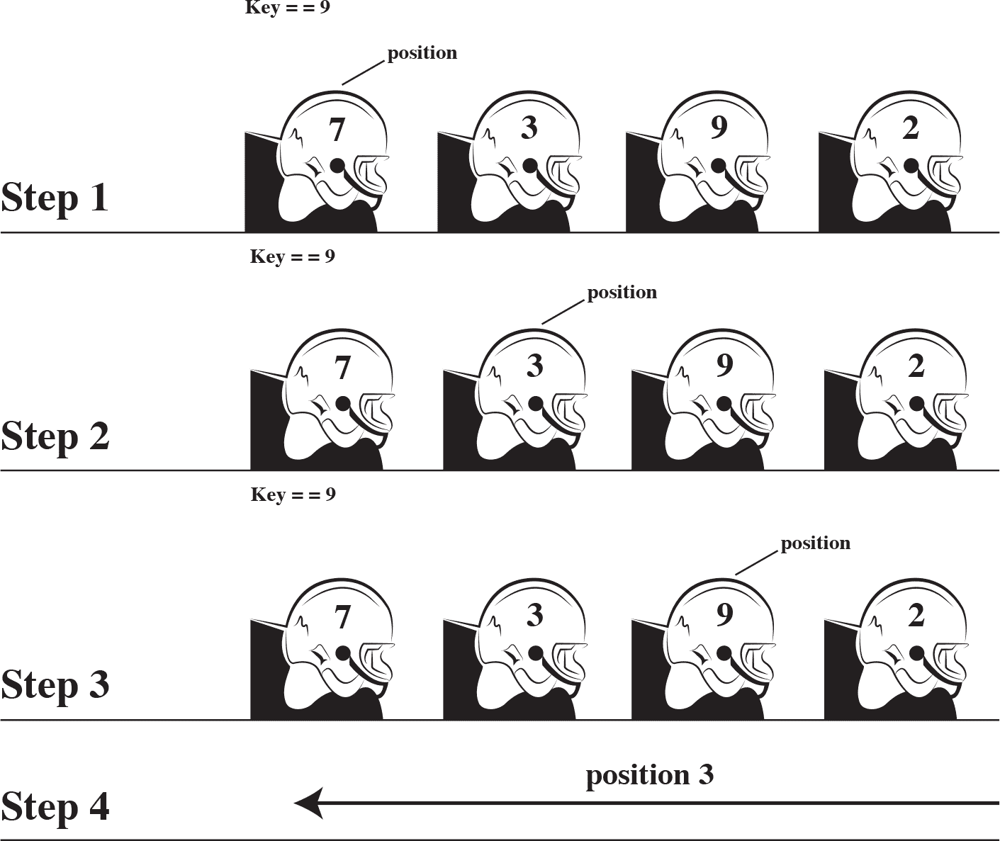

## 第 11 章关键术语

- 递归（recursion）
- 递归调用（recursive call）
- 基本情况（base case）

## 第 11 章复习练习

复习题的答案可以在第 12 章中找到。

### 1. 标记复习


考虑以下递归方法：

```java
public int mystery(int x) {
    if (x == 1)
        return 2;
    else
        return 2 * mystery(x - 1);
}
```

调用 `mystery(6)` 的结果返回什么值？

1. 12
2. 32
3. 64
4. 128

跳转到第 12 章的问题 1：章节复习练习答案与解析，第 11 章

### 2. 标记复习


考虑以下递归方法：

```java
public static int mystery(int x) {
    if (x == 0) {
        return 0;
    } else {
        return (x + mystery(x / 2) + mystery(x / 4));
    }
}
```

调用 `mystery(10)` 的结果返回什么值？

1. 12
2. 20
3. 22
4. 35

跳转到第 12 章的问题 2：章节复习练习答案与解析，第 11 章

### 3. 标记复习


考虑以下非递归方法：

```java
// 前条件: x >= 0
public static int mystery(int x) {
    int sum = 0;

    while (x >= 0) {
        sum += x;
        x--;
    }

    return sum;
}
```

以下哪些递归方法与上面的方法等价？

1. 

    ```java
    public static int mystery2(int x) {
        if (x == 0) {
            return 0;
        }
        return (x + mystery2(x - 1));
    }
    ```

2. 

    ```java
    public static int mystery3(int x) {
        if (x == 0)
            return 0;
        else
            return mystery3(x - 1);
    }
    ```

3. 

    ```java
    public static int mystery4(int x) {
        if (x == 1) {
            return 1:
        }
        return (x + mystery4(x - 1));
    }
    ```

1. 仅 I
2. 仅 III
3. 仅 I 和 II
4. 仅 II 和 III

跳转到第 12 章的问题 3：章节复习练习答案与解析，第 11 章

### 4. 标记复习


考虑以下方法：

```java
public int mystery(int x, int y) {
    if (x >= 100 || y <= 0) {
        return 1;
    } else {
        return mystery(x + 10, y - 3);
    }
}
```

调用 `mystery(30, 18)` 返回什么值？

1. 0
2. 1
3. 6
4. 由于无限递归将不会返回任何值。

跳转到第 12 章的问题 4：章节复习练习答案与解析，第 11 章

### 5. 标记复习


考虑以下不完整的方法：

```java
public int mystery(int x) {
    if (x <= 0) {
        return 1;
    } else {
        return /* code */;
    }
}
```


以下哪项可以替换 `/* code */` 使得 `mystery(10)` 的值为 `32`？

1. 1
2. 2
3. 3
4. 4

跳转到第 12 章的问题 5：章节复习练习答案与解析，第 11 章

## 第 11 章总结

* 递归是方法调用自身
* 递归调用是一个实例
* 基本情况是停止递归的

## 第 12 章练习答案与解析

### 1

**D**

在第 3 行查看 `a + b`。因为两个操作数都是整数，结果将被截断为 `int`：`11 / 4` 是 `2.75`，然后被截断为 `2`。

### 2

**D**

这个问题的关键在于 `int` 转换的优先级高于加运算符。首先看 I：`a + b`。因为 `b` 是 `double`，结果是 `double` `20.7`。然后被转换为 `int` (`20`)。这是一个合法的赋值。实际上，逻辑是表达式是从左到右求值的。在 II 中，`(a + b)` 被括号括起来，所以先进行加法。`a` 和 `b` 相加得到 `double` `20.7`。这个 `double` 然后被转换为 `int` (`20`) 并赋值给 `d`。这是有效的。现在看 III：`int(b) + a`。在这里，`double` `b` 首先转换为 `int` (`10`)。这个 `int` 与 `a` 相加。两个 `int` 相加时的结果也是 `int`。

### 3

**C**

在第 5 行查看 `a / b`。因为两个操作数都是整数，结果将被截断为 `int`：`11 / 4` 是 `2.75`，然后被截断为 `2`。

在第 7 行，再次查看 `a / b`。但这一次持有这些值的变量是 `double`。因此，`11` 除以 `4` 的结果也是 `double`：`2.75`。

在第 9 行，再次查看 `a / b`。持有 `11` 的变量是 `int`，而持有 `4` 的变量是 `double`。对于算术运算符，如果一个操作数是 `double` 而另一个是整数，则整数会自动转换为 `double`，操作的结果也是 `double`。因此，你再次得到了 `2.75`。正确答案是 (C)。

### 4

**D**

在这个问题中，你需要找到不正确的选项。如果这个问题的答案对你来说显而易见，最好的方法是尝试每个答案，看看它是否可能是 `i` 的值。如果是，就将其排除。

从 (A) 开始。`i` 可能等于 0 吗？因为 `x % 50` 得到 `x` 除以 50 的余数，为了让 `i` 等于 0，`x` 必须能被 50 整除。有很多整数符合条件（50, 100, 150…）。事实上，任何 50 的倍数都可以。

那么 (B) 呢？我们能选出一个正整数作为 `x`，使其除以 50 后的余数为 10 吗？因为 50 能被 50 整除，所以 `50 + 10`（即 60）除以 50 的余数将是 10。其他符合条件的数字还包括 110 和 160。事实上，如果你在任何 50 的正倍数上加上 10，你都会得到一个除以 50 余数为 10 的数。

按照同样的逻辑，请找到一个除以 50 余数为 25 的数。例如，75 是可以的。因此，排除 (C)。

剩下的只有 (D)。为什么如果将一个数除以 50，余数可能是 50 呢？考虑如果将 98 除以 50，余数是 48。如果将 99 除以 50，余数是 49。如果将 99 增加到 100，除以 50 的余数将是 0。

这个句子的结果是，模运算的结果总是小于操作数。答案是 (D)。

## 第 4 章：类

1. **D**
(A) 和 (B) 都是 `s1` 的有效索引。(C) 会尝试访问越界索引，因为 `s1` 的最后一个索引是 4。(D) 是正确的，如果 4 除以 50，会得到一个空字符串。

2. **C**
字符串的索引从 0 开始，因此 `s1.substring(1, 5)` 会包含索引 1 的字符，但不包含索引 5。在这种情况下，索引是 1。

3. **B**
`s1.length()` 返回 5，所以 `s1.substring(3, s1.length() - 2)` 会从索引 3 开始到结束。

4. **D**
使用 `compareTo` 方法的值关于字典顺序：
- (A) "january" 在 "July" 之前（错误）
- (B) "July" 在 "June" 之后（错误）
- (C) "january" 在 "June" 之前（错误）
- (D) "january" 在 "June" 之后（正确）

5. **B**
第 2 行在索引 1 处找到 "oo"，并赋值给变量 `p`。第 3 行是一个有效的 `substring` 命令，但它没有存储子串。第 4 行只是重复了第 2 行的操作，再次在索引 1 处找到 "oo"。

### 3. C

此题测试了你追踪一段复杂代码的能力。有几点需要注意：

`if` 循环的体仅在 `b` 为假时才会执行。

在 `for` 循环中，变量 `i` 的递增值是 `5` 而不是 `1`。

在 `if` 循环体中，变量 `i` 也加了 `5`。这种做法在你编写自己的代码时通常不会这样做，但在考试中可能会遇到。不要假设 `for` 循环条件中的变量只在 `for` 循环中被修改。

返回第 6 章：迭代，第 6 章复习练习第 3 题

### 4. B

请记住，`&&` 在两个操作数都为真时返回 `true`，`||` 在其中一个或多个操作数为真时返回 `true`，而 `!` 会反转布尔值。

解决涉及布尔问题的最佳方法通常是直接给变量赋值 `true` 或 `false` 并评估表达式。

将 `(a && b) || !(a || b)` 拆分为两个部分：`(a && b)` 和 `!(a || b)`。如果这两个部分中任何一个为真，变量 `c` 将赋值为 `true`。当 `a` 和 `b` 都为真时，`(a && b)` 为真。因此，排除 `(A)`。

看看当 `a` 和 `b` 都为假时会发生什么。显然，在这种情况下 `(a && b)` 结果为 `false`，但 `!(a || b)` 呢？如果 `a` 和 `b` 都为假，`(a || b)` 为假，但 `!` 运算符会将值反转为 `true`。因此，因为 `!(a || b)` 为真，`(a && b) || !(a || b)` 的结果为 `true`。因此，当 `a` 和 `b` 都为假时，`c` 将赋值为 `true`，所以排除 `(C)`。

现在剩下 `(B)` 和 `(D)`。看看当 `a` 为假且 `b` 为真时会发生什么。`(a && b)` 结果为 `false`。`(a || b)` 为真，所以 `!(a || b)` 为 `false`。因此，`(a && b) || !(a || b)` 为 `false`，你可以排除 `(D)`。正确答案是 `(B)`。

返回第 6 章：迭代，第 6 章复习练习第 4 题

### 5. D

当 `while` 循环中的条件为假时，代码将结束执行。换句话说，就是当 `!(x > y || y >= z)` 为真时。因此，找出选项中哪一个等价于 `!(x > y || y >= z)`。

以下是逐步解决的步骤：

记住 `!(a || b)` 等价于 `!a && !b`。所以 `!(x > y || y >= z)` 变为 `!(x > y) && !(y >= z)`。

`!(x > y)` 等价于 `x <= y`，所以你现在有了 `x <= y && !(y >= z)`。

`!(y >= z)` 等价于 `y < z`，所以你有 `x <= y && y < z`。正确答案是 `(D)`。

返回第 6 章：迭代，第 6 章复习练习第 5 题

### 6. D

每当评估递增语句 `a++` 时，`a` 的值就会增加 1。因此，要回答此题，你需要算出 `a` 增加了多少次。

外层循环将执行 `10` 次。外层循环每执行一次，内层循环就会执行六次。因此，内层循环体代码将执行 `6 × 10` 次。注意当 `k` 等于 `5` 时，`k <= 5` 为真。在第三层循环中，`z` 的值从 `1` 开始，并在每次通过后翻倍。因此，当 `i` 等于 `1`, `2`, `4`, `8`, 和 `16` 时，最内层循环将执行——即中间循环每执行一次执行五次。因为 `60 × 5 = 300`，`a` 将增加 `300` 次。正确答案是 `(D)`。

返回第 6 章：迭代，第 6 章复习练习第 6 题

### 7. C

此题的技巧在于，算术运算符不会修改其操作数。所以，当我们用 `x` 除以 `3` 时，如果 `x` 是 `10`，结果是 `3` 但 `x` 保持不变。同样，对一个数字取模也不会改变它。另一方面，后置增运算符 `++` 会改变它所操作的值，所以 `x++` 将 `x` 的值增加 `1`。正确答案是 `(C)`。

返回第 6 章：迭代，第 6 章复习练习第 7 题

### 8. D

在第四行，`a + b` 将是 `13.7`，但此结果被强制转换为 `int`，所以 `x` 将是 `13`。在下一行中，`a` 首先被转换为 `double`，然后除以 `c`。由于 `a` 是 `double` 类型，`c` 会自动提升为 `double`，且两者相除的结果也是 `double`。因此 `y` 为 `2.5`。

在下一行中，括号导致除法在类型转换之前发生。由于 `a` 和 `c` 都是 `int`，两者的相除结果被截断为 `int`，即 `2`。我们将该结果转换为 `double` 的事实并不会找回小数部分。因此 `z` 等于 `2`，所以 `w = 13 + 2.5 + 2`。正确答案是 `(D)`。

返回第 6 章：迭代，第 6 章复习练习第 8 题

### 9. D

此题测试你对短路求值的理解。在每个代码段中，注意 `if` 语句中的短路逻辑。

在 `I` 中，条件是 `x < y && 10/z`。首先评估 `x < y`。由于 `x` 小于 `y`，`x < y` 为假，整个表达式为假，不会发生除零错误。

现在看 `II`。条件是 `x > y && 10/z`。同样，首先评估 `&&` 运算符左侧的操作数。由于 `x` 不大于 `y`，`x > y` 为假，因此不需要评估右侧，也就不会发生除零错误。

在 `III` 中，条件是 `x < y || 10/z`。左侧 `x < y` 的值为真。对于“或”语句，如果左侧为真，整个条件就为真，无论右侧值如何。因此不需要评估右侧，也就不会发生除零错误。我们可以排除 `(A)`。

由于 `(B)` 和 `(D)` 仍然可能，排除 `(C)`。正确答案是 `(D)`。

返回第 6 章：迭代，第 6 章复习练习第 9 题

## 第 7 章

### 1. D

由于数据库代码实际上可以独立开发、独立测试并可能复用，因此所有声明都是正确的。对于这类问题，最简单的方法是认为每个候选声明可疑，并寻找它们可能错误的地方。如果你发现了一个错误的，排除任何引用它的选项，包括任何包含它以及另一个声明的选项，因为真声明和假声明的组合是错误的。或者，当某个声明为真时，在包含它的每个选项旁打星号。检查完所有声明后，星号最多的获胜。

在上面的例子中，由于所有三个声明都是正确的，我们可以排除 `(A)` 和 `(B)`，因为每个选项都指示只有一个声明是正确的。同样，排除 `(C)`，因为它否定了第三个声明。正确答案是 `(D)`。

返回第 7 章：编写类，第 7 章复习练习第 1 题

### 2. D

虽然 Java 语言允许将数据字段公开，但 AP 科学 A 考试的黄金法则之一是数据字段应始终标记为 `private`。注意，声明为 `static` 和 `final` 的常量可以是公开的；但是静态常量适用于整个类（因为有关键字 `static`），因此不是数据字段。

由于数据字段必须是私有的，排除任何声称它们可以是公开的选项。所以排除 `(A)` 和 `(B)`。

现在来看 (C)。如果类中的所有方法都是私有的，会发生什么？类的实例将毫无用处，因为客户端无法请求类为它们执行任何操作。类需要公共方法才能有用。排除 (C)。

那么 (D) 呢？第一部分是正确的，因为数据字段应该是私有的。第二句呢？在上面，你看到方法可以是公有的。它们也可以是私有的。私有方法供类内部使用以辅助公共方法，但客户端程序无法直接访问。正确答案是 (D)。

返回第 7 章编写类：第 7 章复习练习中的第 2 题

### 3. **C**

片段 I 是错误的，因为它违反了封装性。因此，任何包含 I 的答案都可以被直接排除。因此，排除 (A) 和 (D)。方法的实现可以在不改变客户端程序的情况下进行更改，所以 III 是正确的。因此，排除不包含 III 的 (B)。因此答案必须是 (C)。

返回第 7 章编写类：第 7 章复习练习中的第 3 题

### 4. **C**

该代码在语法上是正确的，所以 (A) 不可能是答案。同样地，你没有进行任何需要类型转换、处理 null 或除以一个可能为 0 的数字的操作，所以 (D) 不是答案。剩下 (B) 和 (C)。因为你正在创建一个 `String` 对象并将其传递给一个接受字符串作为参数的方法，所以 `writeMe(Object obj)` 方法的存在是无关紧要的。因此，唯一有效的答案是 (C)。

返回第 7 章编写类：第 7 章复习练习中的第 4 题

### 5. **C**

该代码在语法上是正确的，所以 (A) 不可能是答案。同样地，你没有进行任何需要类型转换、处理 null 或除以一个可能为 0 的数字的操作，所以 (D) 不是答案。剩下 (B) 和 (C)。因为你正在创建一个 `Object` 并将其传递给一个接受 `Object` 作为参数的方法，所以 `writeMe(String s)` 方法的存在是无关紧要的。因此，唯一有效的答案是 (C)。

返回第 7 章编写类：第 7 章复习练习中的第 5 题

### 6. **C**

使用 `Object` 引用来引用 `String` 实例，因为字符串是一个 `Object`。因此，该代码在语法上不是错误的，所以 (A) 不是答案。剩下 (B)、(C) 和 (D)。因为你没有进行任何类型的转换，(D) 也不太可能是候选。剩下 (C) 和 (B)。现在问题变成了，在进行重载调用时，Java 注意的是引用的类型（在这种情况下是 `Object`）还是变量的类型（在这种情况下是 `String`）？结果 Java 总是关注对象的类型，所以 (C) 是正确的。

返回第 7 章编写类：第 7 章复习练习中的第 6 题

### 7. **A**

`tmp` 是一个 `Object`，而不是 `String`；因此代码段 `String tmp = new Object` 是非法的。这段代码将产生编译错误。正确答案是 (A)。

返回第 7 章编写类：第 7 章复习练习中的第 7 题

### 8. **A**

这个类没有声明任何方法，所以 (B) 不可能正确。选项 (C) 是毫无意义的，因为没有东西既是属性又是方法，而 (D) 也是毫无意义的，因为没有东西既是属性又是方法。方法的实现可以在不改变客户端程序的情况下进行更改，所以 III 是正确的。因此，排除不包含 III 的 (B)。因此答案必须是 (C)。（等等，重新阅读原文逻辑）：

这个类没有声明任何方法，所以 (B) 不可能正确。选项 (C) 是毫无意义的，因为没有东西既是属性又是方法，而 (D) 是错误的，因为变量 `val` 没有被声明。正确答案是 (A)。

返回第 7 章编写类：第 7 章复习练习中的第 8 题

### 9. **A**

两个 `writeMe` 方法同名但类型不同。这是非法的。因此是 (A)。

返回第 7 章编写类：第 7 章复习练习中的第 9 题

## 第 8 章

### 1. **B**

`word` 的长度为 4，所以 `word.length() - 1` 是 3。

返回第 8 章数组：第 8 章复习练习中的第 1 题

### 2. **B**

在第 1 行，创建了一个字符串数组并赋值给 `s`。注意 `s` 指向数组。正确答案是 (B)。

返回第 8 章数组：第 8 章复习练习中的第 2 题

### 3. **C**

在代码段中，`a1` 被声明为 `final`。当你尝试赋值 `a1` 时会发生编译错误。

返回第 8 章数组：第 8 章复习练习中的第 3 题

### 4. **B**

变量 `myArray` 是 `final` 的。但这并没有阻止你改变 `myArray` 所指向的数组的内容。

返回第 8 章数组：第 8 章复习练习中的第 4 题

### 5. **A**

选项 II 将检查数组中位置 `i` 存储的数字是否能被 3 整除。这是 (A)。

返回第 8 章数组：第 8 章复习练习中的第 5 题

### 6. **C**

在方法的的 `for` 循环中，变量 `i` 跟踪数组的位置。选项 I 将检查 `i` 是否能被 3 整除；这不是你找的。选项 II 将检查数组中位置 `i` 存储的数字是否能被 3 整除。这是 (C)。

返回第 8 章数组：第 8 章复习练习中的第 6 题

### 7. **A**

在数组上使用增强 for 循环时，每个元素都会被读取到一个局部变量中，在本例中是 `s`。虽然 `s` 在循环内可能会改变，但该更改不会实现在原始数组中。

返回第 8 章数组：第 8 章复习练习中的第 7 题

返回第 8 章第 8 ：数组，第 8 章复习练习

## 第 9 章

### 1. **B**

逐步执行此步骤。记住，仅接受一个参数的 `add()` 方法会将该参数添加到列表末尾。代码的第二行和第三行将 "A" 和 "B" 添加到 `ArrayList` 中：

```
list.add("A")
list.add("B")
```


在执行上述代码后，列表看起来为`[A, B]`。

下一条语句`list.add(0, "C")`将`"C"`添加到列表开头。现在列表看起来为`[C, A, B]`。

在执行`list.add("D")`后，列表看起来为`[C, A, B, D]`。

`set()`方法替换第一个参数所指位置的值。在执行`list.set(2, "E")`后，列表看起来为`[C, A, E, D]`。

在执行`list.remove(1)`后，列表看起来为`[C, E, D]`。

因此，正确答案是（B）。

返回第 9 章第 1 题：ArrayList，第 9 章复习练习

### 2. C

此题的关键在于，当元素从`ArrayList`中删除时，被删除元素右侧的元素会向左移动，它们的索引减少 1。

在第一次通过`while`循环时，`i`将为 0。由于`letters`位置 0 处的字符串等于 A，它被移除，`letters`看起来为：`[B, A, A, C, D, B]`。

下一次通过`while`循环时，`i`将为 1。位置 1 处的字母等于 A，因此被移除。现在`letters`看起来为：`[B, A, C, D, B]`。

在下一次遍历`ArrayList`时，`i`为 2。位置 2 处的字母是 C，因此不被移除。`while`循环将继续遍历`ArrayList`，但由于索引大于 2 的字符串都不等于 A，因此没有其他元素会被移除。

因此，正确答案是（C）。

返回第 9 章第 2 题：ArrayList，第 9 章复习练习

### 3. C

第一次通过`for`循环时，位置 0 处的字母被移除，`myList`看起来为：`[B, C, D, E]`。

打印现在位置 0 处的字母（现在是 B）。

下一次通过`for`循环时，`i`为 1，因此位置 1 处的字母 C 被移除。现在`myList`看起来为：`[B, D, E]`。

打印现在位置 1 处的字母（现在是 D）。

此时，`i`增加到 2。`myList`的大小也为 2，因此`i`不再小于`myList.size()`。`for`循环不再再次执行。

因此，正确答案是（C）。

返回第 9 章第 3 题：ArrayList，第 9 章复习练习

### 4. A

第一个`for`循环初始化`ArrayList``list`，使其看起来为`[1, 2, 3, 4, 5, 6, 7, 8]`。

现在看第二个`for`循环。注意`j`的最大值为 7，比列表大小小 1。在`for`循环体中，你设置的位置索引是`j`除以 2；因此该索引永远不会大于 3。换句话说，你不会修改`ArrayList`前 4 个位置之外的任何值。通过这一点，答案是（A）。

索引`a`的范围从 0 到 3，而索引`b`的范围从 0 到 1。索引按照`[b][a]`的顺序使用。下表将帮助你可视化数组的遍历过程。每当`b`达到行的最大索引时，它会添加换行符。答案是（D）。

| `b` | `a` | `s` |
| --- | --- | --- |
| 0 | 0 | 1 |
| 1 | 0 | 1 5 "\n" |
| 0 | 1 | 1 5 "\n" 2 |
| 1 | 1 | 1 5 "\n" 2 6 "\n" |
| 0 | 2 | 1 5 "\n" 2 6 "\n" 3 |
| 1 | 2 | 1 5 "\n" 2 6 "\n" 3 4 "\n" |
| 0 | 3 | 1 5 "\n" 2 6 "\n" 3 4 "\n" 4 |
| 1 | 3 | 1 5 "\n" 2 6 "\n" 3 4 "\n" 4 8 |

返回第 10 章第 6 题：二维数组，第 10 章复习练习

### 7. D

数组`m`使用行数（`arr.length`）进行声明。因此，必须有 3 个条目，排除（B）。索引`i`将引用每一行。数字 2 被传递给`n`；因此，将访问索引为 2 的列（第 3 列）。正确的列是 3 7 11。

返回第 10 章第 7 题：二维数组，第 10 章复习练习

### 8. D

索引`r`从最后一行开始遍历数组。程序访问行中的每个元素并将其赋值给上方的行。其最终结果是将所有元素更改为与最后一行相同的值。

返回第 10 章第 8 题：二维数组，第 10 章复习练习

# 第 11 章

### 1. C

递归过程如下：

```text
mystery(6) = 2 * mystery(5)

mystery(5) = 2 * mystery(4)

mystery(4) = 2 * mystery(3)

mystery(3) = 2 * mystery(2)

mystery(2) = 2 * mystery(1)

mystery(1) = 2;
```

所以`mystery(6) = 2 * 2 * 2 * 2 * 2 = 64`。正确答案是（C）。

返回第 11 章第 1 题：递归，第 11 章复习练习

### 2. C

在第一次通过该方法时，你得到：

```text
10 + mystery(10 / 2) + mystery(10 / 4)
```

它可以简化为：

```text
10 + mystery(5) + mystery(2)
```

现在计算`mystery(5)`和`mystery(2)`是什么，并将结果加到 10 上。首先，求解`mystery(5)`：

```text
mystery(5) = 5 + mystery(5 / 2) + mystery(5 / 4) = 5 + mystery(2) + mystery(1)

mystery(2) = 2 + mystery(2 / 2) + mystery(2 / 4) = 2 + mystery(1) + mystery(0)

mystery(1) = 1 + mystery(1 / 2) + mystery(1 / 4) = 1 + mystery(0) + mystery(0)

mystery(0) = 0;
```


等一下，根据提供的文本逻辑重新评估：

`mystery(1) = 1 + 0 + 0 = 1`
`mystery(2) = 2 + 1 + 0 = 3`
`mystery(5) = 5 + 3 + 1 = 9`

所以 `mystery(10) = 10 + 9 + 3 = 22`。正确答案是 (C)。

返回第 11 章第 2 题：递归，第 11 章复习练习

## 3. A

对于任何作为非递归方法 `mystery()` 参数传递的非负数 `n`，该方法将返回 `0 + 1 + 2 + 3...++ n`。例如，调用 `mystery(5)` 将返回 `0 + 1 + 2 + 3 + 4 + 5 = 15`。注意 `mystery()` 的边界情况发生在向方法传递 0 的时候。在这种情况下，该方法返回 0。

- `I`（方法 `mystery2()`）等价于 `mystery()`。
- `II`（`mystery3()`）不等价。注意 `mystery3()` 没有修改递归调用返回的内容，而 `mystery2()` 在每次递归调用的结果上加上 `x`。无论传递给方法的值是多少，方法 `mystery3()` 都将返回 0。
- `III`（`mystery4()`）除 `x` 等于 0 外，均等价于 `mystery()`。如果向方法传递 0，循环将进行无限递归。由于 `mystery4()` 没有正确处理边界情况，因此 `III` 是错误的。

只有 `I` 等于 `mystery()` 方法，所以 (A) 是正确的。

返回第 11 章第 3 题：递归，第 11 章复习练习

## 4. B

你最初将 30 和 18 作为 `x` 传递给方法。你向方法传递 30 和 18 分别作为 `x` 和 `y`。每当调用方法时，`x` 增加 10，`y` 减去 3。因此，`x` 最终会大于 0，`y` 最终会小于 0，从而会遇到边界情况，不会发生无限递归。排除 (D)。

注意 `mystery()` 不修改其返回的内容，无论发生多少次递归调用，`mystery()` 只返回 1。那么边界情况呢？`mystery()` 返回递归调用的结果，而 `mystery()` 不以任何方式修改它。正确答案是 (B)。

返回第 11 章第 4 题：递归，第 11 章复习练习

## 5. B

解决此问题的最佳方法是追踪每个选项。但不必一定从 (A) 开始。从你认为最快解决的选项开始。在这种情况下，(A) 可能需要更长时间，因为它有两个递归调用。相反，从 (D) 开始。为什么选择 (D)？因为每次递归调用将传递给方法的整数减少 4，这样递归调用就不会像其他选项那样多。

通过 (D)，第一次通过该方法时，你得到 `mystery(10) = 4 * mystery(6)`。发现 `mystery(6) = 4 * mystery(2)` 以及 `mystery(2) = 4 * mystery(-2)`。最后，`mystery(-2)` 等于 1（边界情况）。向上回溯调用栈，你得到 `mystery(2) = 4`，`mystery(6) = 16`。所以错误的。

递归调用次数次少的选项是 (B)。对于此选项，`mystery(10) = 2 * mystery(8)`；`mystery(8) = 2 * mystery(6)`；`mystery(6) = 2 * mystery(4)`；`mystery(4) = 2 * mystery(2)`；`mystery(2) = 2 * mystery(0)`；且 `mystery(0) = 1`。因此，`mystery(2) = 2`；`mystery(4) = 4`；`mystery(6) = 8`；`mystery(8) = 16`；且 `mystery(10) = 32`。正确答案是 (B)。

返回第 11 章第 5 题：递归，第 11 章复习练习

# 第 13 章

# 要求的实验时间和建议的实验

本教程旨在帮助准备 AP Computer Science A 考试，但如果我们不讨论大学委员会规定的课程实验要求，将是不称职的。AP Computer Science A 课程必须包含至少 20 小时的实践、结构化实验。大学委员会是这样规定的：每门 AP Computer Science A 课程都必须包含大量的实验部分，学生在其中设计解决方案、精确地表达解决方案（即使用 Java 编程语言）、测试解决方案、识别并纠正错误（当错误发生时）。这些实验和活动总体应包含以下特征：

- 在显著水平上探索计算，基于提供了良好风格和适当使用语言构造的示例的现有代码。
- 包含重大的问题解决部分，其中你研究解决问题的替代方法、解决新问题或修改现有代码以解决改变后的问题。
- 向你提供处理涉及多个交互类的程序的类经验，并可能涉及将程序分解为类，以及使用 AP Computer Science A 主题大纲中确定的继承和其他面向对象的概念。

大学理事会（The College Board）已在其网站上发布了 7 份学生实验指南。以下是这些指南的概述：

- **消费者评论（Consumer Review）**——在实验中，学生将探索词汇的说服力。学生将学习情感值，以及如何使用字符串操作来构建或修改评论，使其更具正面或负面倾向。
- **数据（Data）**——在实验中，学生将讨论数据在决策中的重要性，学习如何设置和使用第三方库进行数据收集，并学习在数据被读入程序后如何进行处理。他们将综合这些技能来寻找相关数据并回答感兴趣的特定问题。
- **隐信息术（Steganography）**——隐信息是将消息或信息隐藏在其他非秘密文本或数据中的实践。学生将使用与 `Picture Lab`（见下文几个实验）相同的代码来探索隐信息术和二维数组的概念，将图像或文本隐藏在其他图像内部。
- **名人（Celebrity）**——学生将讨论与类似于猜词游戏的“名人”游戏相关的类设计。该实验将继承作为其中一项活动的基础，并包含一个图形用户界面（GUI）。
- **数字 11（Elevens）**——此活动与一个名为 Elevens 的简单纸牌牌游戏有关。学生将学习 Elevens 的规则，然后使用提供的图形用户界面进行游戏。
- **喜鹊型聊天机器人（Magpie Chatbot）**——学生将探索自然语言处理的一些基础知识。在探索过程中，他们将处理 `String` 类的各种方法，并练习使用 `if` 语句。学生将追踪一个复杂的方法以找到用户输入中的单词。
- **图片（Picture）**——学生将编写修改数字图片的方法。在编写这些方法时，他们将学习如何遍历整数或对象的二维数组。学生还将将嵌套循环、二进制数、接口和继承的介绍。

请访问大学理事会网站的 AP Computer Science A 部分获取有关这些每个实验的更多信息，以及可下载的 PDF。这些实验的地址为 `apcentral.collegeboard.org/courses/ap-computer-science-a/classroom-resources/lab-resource-page`。

# 第六部分

# 模拟测试

- 模拟测试 2
- 模拟测试 2：答案与解析
- 如何评分模拟测试 2
- 模拟测试 3
- 模拟测试 3：答案与解析
- 如何评分模拟测试 3

# 模拟测试 2

[点击此处](https://prhlink.com/9780593518427a004) 下载模拟测试 2 的 PDF

## 第一部分

## 考试

### AP® Computer Science A 考试

### 第一部分：多选题

### 概览

### 总时长
1 小时 30 分

### 题目数量
42 题

### 总分百分比
55%

#### 答题工具
需要铅笔

**免责声明：官方 AP Computer Science A 将以数字形式进行。数字考试的说明可能与此模拟测试不同。**

### 说明
本考试的第一部分包含 42 道多选题。请在你的答题卡上仅涂满 1 到 42 题的圆圈。标出所有选项。本考试的第一部分包含 42 道多选题。请在你的答题卡上仅涂满 1 到 42 题的圆圈。标出所有选项。本考试的第一部分包含 42 道多选题。请在你的答题卡上仅涂满 1 到 42 题的圆圈。标出所有选项。本考试的第一部分包含 42 道多选题。请在你的答题卡上仅涂满 1 到 42 题的圆圈。标出所有选项。本考试的第一部分包含 42 道多选题。请在你的答题卡上仅涂满 1 到 42 题的圆圈。标出所有选项。本考试的第一部分包含 42 道多选题。请在你的答题卡上仅涂满 1 到 42 题的圆圈。标出所有选项。本考试的第一部分包含 42 道多选题。请在你的答题卡上仅涂满 1 到 42 题的圆圈。标出所有选项。本考试的第一部分包含 42 道多选题。请在你的答题卡上仅涂满 1 到 42 题的圆圈。标出所有选项。本考试的第一部分包含 42 道多选题。请在你的答题卡上仅涂满 1 到 42 题的圆圈。标出所有选项。

### Java 快速参考

答题卡。本考试的第一部分包含 42 道多选题。请在你的答题卡上仅涂满 1 到 42 题的圆圈。标出所有选项。本考试的第一部分包含 42 道多选题。请在你的答题卡上仅涂满 1 到 42 题的圆圈。标出所有选项。本考试的第一部分包含 42 道多选题。请在你的答题卡上仅涂满 1 到 42 题的圆圈。标出所有选项。本考试的第一部分包含 42 道多选题。请在你的答题卡上仅涂满 1 到 42 题的圆圈。标出所有选项。本考试的第一部分包含 42 道多选题。请在你的答题卡上仅涂满 1 到 42 题的圆圈。标出所有选项。

| 类、构造函数与方法 | 说明 |
| --- | --- |
| **String 类** | |
| `String(String str)` | 构建一个表示 `str` 序列的 String 对象 |
| `int length()` | 返回 `String` 对象的字符数 |
| `substring(int from, int to)` | 返回从索引 `from` 到 `to` 的子字符串 |
| `substring(int from)` | 返回从 `from` 开始的子字符串 |
| `indexOf(String str)` | 返回 `str` 首次出现的索引；未找到则返回 -1 |
| `equals(String other)` | 如果此与 `other` 相等返回 true；否则返回 false |
| `compareTo(String other)` | 如果小于 `other` 返回负值；相等返回 0；大于则返回正值 |
| `String[] split(String del)` | 返回按 `del` 分割的字符串数组 |
| **Integer 类** | |
| `Integer.MIN_VALUE` | `int` 表示的最小值 |
| `Integer.MAX_VALUE` | `int` 表示的最大值 |
| `static int parseInt(String s)` | 将字符串 `s` 解析为 `int` |
| **Double 类** | |
| `static double parseDouble(String s)` | 将字符串 `s` 解析为 `double` |
| **Math 类** | |
| `static int abs(int x)` | 返回 `int` 的绝对值 |
| `static double abs(double x)` | 返回 `double` 的绝对值 |
| `static double pow(double base, double exponent)` | 返回 `base` 的 `exponent` 次方 |
| `static double sqrt(double x)` | 返回 `double` 的正平方根 |
| `static double random()` | 返回一个大于等于 0.0 且小于 1.0 的 double |
| **ArrayList 类** | |
| `int size()` | 返回列表元素的数量 |
| `boolean add(E obj)` | 将 `obj` 添加到列表末尾；返回 true |
| `void add(int index, E obj)` | 在 `index` 处插入 `obj`，将 `index` 及其之后的元素向右移动（索引加 1），大小加 1 |
| `E get(int index)` | 返回列表中索引 `index` 处的元素 |
| `E set(int index, E obj)` | 将 `index` 处的元素替换为 `obj`；返回原来的元素 |
| `E remove(int index)` | 移除 `index` 处的元素，将 `index + 1` 及其之后的元素向左移动（索引减 1），大小减 1；返回删除的元素 |
| **File 类** | |
| `File(String pathname)` | 构建一个路径为 `pathname` 的 File 对象 |
| **Scanner 类** | |
| `Scanner(File f)` | 构建一个用于读取文件 `f` 的 Scanner |
| `int nextInt()` | 从文件或输入源读取下一个 `int`；如果不存在则抛出 `InputMismatchException` |
| `double nextDouble()` | 从文件或输入源读取下一个 `double`；如果不存在则抛出 `InputMismatchException` |
| `boolean nextBoolean()` | 返回从文件或输入源读取的下一个布尔值。如果不存在下一个布尔值，将导致 `InputMismatchException`。 |
| `String nextLine()` | 返回从文件或输入源读取的下一行文本作为 `String`；如果在调用另一个正在从文件或输入源读取的 `Scanner` 方法后立即调用，可能会返回空字符串。 |
| `String next()` | 返回从文件或输入源读取的下一个 `String` |
| `boolean hasNext()` | 如果文件或输入源中还有下一个待读取的项目，则返回 true；否则返回 false |
| `void close()` | 关闭此扫描器 |
| **Object 类** | |
| `boolean equals(Object other)` | |
| `String toString()` | |

### 计算机科学 A

#### 第一部分
### 时间—1 小时 30 分钟
### 题目数量—42
### 占考试总分比例—55%

**说明：** 使用提供的纸张进行草稿，确定以下每个问题或不完整陈述的答案。然后从给出的选项中选择最佳答案，并在答案卡上填写相应的椭圆。考试题册上写的任何内容将不予评分。

**注意：**
- 假设 Java 快速参考中列出的类已在适当导入。
- 假设变量和方法的声明出现在闭包类的上下文中。
- 假设未加对象或类名前缀且未在完整类定义中显示的方法调用均出现在闭包类的上下文中。
- 考试过程中可以使用 Java 快速参考中的信息。

1.  标记评审

以下哪个选项将打印小于 5 的数字？

1. `System.out.println (24 / 5 % 3 * 2);`
2. `System.out.println (12 / 3 * 2 + 1);`
3. `System.out.println ( 1 + 4 % 3 * 2);`

1. 仅 I
2. 仅 II
3. 仅 I 和 II
4. 仅 I 和 III

进入练习测试 2 第 1 题：答案与解析，第一部分：多选题

2.  标记评审

以下行代码生成的输出是：

```
System.out.println("Simon says, \\n\\\\\\"insert phrase here\\"//");
```

1. Simon says, \n \\\\ insert phrase here//
2. Simon says, \n \\\\ "insert phrase here"//
3. Simon says,
        \\"insert phrase here"/
4. Simon says,
        \\"insert phrase here"//

进入练习测试 2 第 2 题：答案与解析，第一部分：多选题

3.  标记评审

考虑以下带有数字的类：

```java
public class Tree
{
    private String name;
    private double height;
    private int rateOfGrowth;

    Tree(String n, double h, int r)
    {
        name = n;
        height = h;
        rateOfGrowth = r;
    }

    Tree(double h, int r)
    {
        height = h;
        rateOfGrowth = r;
    }

    Tree(String n)
    {
        name = n;
    }

    public String toString()
    {
        return name + " can grow to " + height + " feet high, at a rate of " + rateOfGrowth + " inches per year";
    }
}
```


客户端程序中的哪个代码片段会导致错误？

1. `Tree elm = new Tree("Elm", 60, 36);`
   `System.out.println(elm.toString());`
2. `Tree riverBirch = new Tree("River Birch", 40.0, (int)3.0);`
   `System.out.println(riverBirch.toString());`
3. `Tree redMaple = new Tree(60.0, 18);`
   `System.out.println(redMaple.toString());`
4. `Tree redwood = new Tree("Redwood", 300, 24.0);`
   `System.out.println(redwood.toString());`

进入练习测试 2 第 3 题：答案与解析，第一部分：多选题

第 4–5 题涉及 `SalesRep` 类。

```java
public class SalesRep
{
    private int idNum;
    private String name;
    private int ytdSales;

    SalesRep(int i, String n, int ttd)
    {
        idNum = i;
        name = n;
        ytdSales = ttd;
    }

    public int getYtdSales() {return ytdSales;}
}
```

客户端方法 `computeBonus` 将 `ytdSales` 乘以百分比以返回 salesRep 奖金。

```java
/**
* 前提：SalesRep 的 ytdSales >= 0
* @param s 一个 SalesRep
* @param percentage 代表 ytdSales 的百分比
* @return SalesRep 的奖金 (ytdSales * bonus)
 **/
public static double computeBonus(SalesRep s, double percentage)
{ /* missing code */ }
```

`/* missing code */` 的哪个替换是正确的？

1. `return getYtdSales() * percentage;`
2. `return s.ytdSales() * percentage;`
3. `return s.getYtdSales() * percentage;`
4. `return s.ytdSales() * s.percentage;`

进入练习测试 2 第 4 题：答案与解析，第一部分：多选题

5 标记评审

创建了一个 `ArrayList` 来存储 XYZ 公司每位销售人员的 `SalesRep` 对象。以下是该 `ArrayList` 的声明。

```java
ArrayList<SalesRep> list1 = new ArrayList<SalesRep>();
```

由于公司今年盈利，决定给每个 `SalesRep` 奖金。管理层希望预测总支出，为此必须必须通过相加每个 `SalesRep` 的 `ytdSales` 来计算公司的总销售额。哪个代码片段将计算公司的 `ytdSales`？

1. `double sum = 0;`
   `for (ArrayList r : list1) { sum += r.get.getYtdSales(); }`
2. `double sum = 0;`
   `for (SalesRep r : list1) { sum += r.getYtdSales(); }`
3. `double sum = 0;`
   `for (int i = 0; i < list1.size(); i++) { sum += SalesRep.get(i).getYtdSales(); }`
4. `double sum = 0;`
   `for (int i = 0; i <= list1.size(); i++) { sum += list1.get(i).getYtdSales(); }`

进入练习测试 2 第 5 题：答案与解析，第一部分：多选题

6 标记评审

执行以下代码后，以下哪个将打印内容？

```java
String str = new String("superstar");
System.out.print(str.substring (1, 3) + " ");
str.substring(1);
System.out.print(str.substring (1, 3) + " ");
str.substring(1);
System.out.print(str.substring (1, 3) + " ");
```

1. su up pe
2. up pe er
3. sup upe per
4. up up up

进入练习测试 2 第 6 题：答案与解析，第一部分：多选题

7 标记评审

国际象棋必须轮流允许黑白双方在棋盘上移动。通过以下变量指示玩家，其中 `true` 表示黑，`false` 表示白：

`boolean isBlack;`

在每个玩家回合结束时，变量 `isBlack` 必须在 `true` 和 `false` 之间交替，以指示下一个玩家的回合。考虑以下代码示例，确定哪些是可以实现此目的的。

1. `isBlack = !isBlack;`
2. `if (!isBlack) isBlack = true else isBlack = false;`
3. `if (isBlack)`
   `isBlack = false;`

1. 仅 I
2. 仅 II
3. 仅 I 和 II
4. 仅 I 和 III

前往练习测试 2 中的第 7 题：答案密钥与解析，第一部分：多选择题

8 标记评审

声明了以下变量，但其内容未知。

`String str1 = new String(/*unknown value*/");`

`String str2 = new String(/*unknown value*/");`

考虑以下决策语句，确定哪一个语句无法比较 `str1` 的值是否与 `str2` 的值相同。

1. `if (str1 == str2)`
2. `if (str1.equals(str2))`
3. `if (str1.compareTo(str2) == 0)`
4. `if (str1.substring(0).equals(str2.substring(0,str2.length())))`

前往练习测试 2 中的第 8 题：答案密钥与解析，第一部分：多选择题

9 标记评审

假设 `p` 和 `q` 是布尔变量且已正确初始化。

`!(!p || q) || !(p || !q)`

以下哪项最能描述上述表达式求的结果？

1. 始终为 `true`
2. 仅当 `p` 为真时为 `true`
3. 仅当 `q` 为真时为 `true`
4. 仅当 `p` 和 `q` 的真值相反时为 `true`

前往练习测试 2 中的第 9 题：答案密钥与解析，第一部分：多选择题

10 标记评审

哪个布尔表达式和值演示了短路求？

1. `p || !(q && r)` `p = true`, `q = true`, `r = true`
2. `p || (q && !r)` `p = false`, `q = true`, `r = false`
3. `p && q && r` `p = true`, `q = true`, `r = true`
4. `p && !(q && r)` `p = true`, `q = true`, `r = true`

前往练习测试 2 中的第 10 题：答案密钥与解析，第一部分：多选择题

11 标记评审

以下哪项正确为文件 `students.txt` 创建了 `File` 和 `Scanner` 对象？

1. `File f = “students.txt"`
`Scanner scan = f;`
2. `File f = new File(“students.txt”);`
`Scanner scan = Scanner(f);`
3. `File f = new File(“students.txt”)’;`
`Scanner scan = new Scanner(f);`
4. `File f = new File(“students.txt”);`
`Scanner scan = new Scanner();`

前往练习测试 2 中的第 11 题：答案密钥与解析，第一部分：多选择题

12 标记评审

以下代码段生成的输出是：

```java
int count = 0;
String star = "\*";
for (int i = 1; i < 11; i++)
  for (int j = 10; j > 1; j -= 2)
  {
    star += "\*\*";
    count++;
  }
System.out.print("\n" + count + " " + star.length());
```

1. 50 100
2. 50 101
3. 51 100
4. 51 101

前往练习测试 2 中的第 12 题：答案密钥与解析，第一部分：多选择题

13 标记评审

以下代码段生成的输出是：

```java
for (int i = 1; i <= 5; i++)
{
  for (int j = 1; j < i; j++)
  {
    System.out.print("- ");
  }
  for (int j = i; j <= 5; j++)
  {
    System.out.print("* ");
  }
  System.out.println();
}
```

1.
- - - *
- - * *
- - * *
- * * *
* * * *
2.
* * * *
- * * *
- - * *
- - - *
- - - *
3.
* - - -
* * - -
* * * -
* * * *
* * * *
4.
* * * *
* * * -
* * - -
* - - -

前往练习测试 2 中的第 13 题：答案密钥与解析，第一部分：多选择题

14 标记评审

考虑以下代码段，确定哪些产生相同的输出。

1. `int sum = 0; for (int i = 1; i < 3; i++) { sum += i + 1; } System.out.println(sum);`
2. `int sum = 0; for (int i = 1; i <= 5; i++) { if (i % 2 == 1) sum += i; } System.out.println(sum);`
3. `int i = 5; int sum = i; while (i > 1) { i -= 2; sum += i; } System.out.println(sum);`

1. I 和 II
2. I 和 III
3. II 和 III
4. I、II 和 III

前往练习测试 2 中的第 14 题：答案密钥与解析，第一部分：多选择题

15 标记评审

考虑以下片段：

```java
/**
 * @param number 是一个正整数
 * @return 1 到 number 之间奇数的之和
 */
public static int sumOdds(int number)
{
    int sum = 0;
    for (/* missing code */
    {
        sum += k;
    }
    return sum;
}
```

以下哪项对 `/* missing code */` 的替换满足条件？

1. `int k = 1; k <= number; k++`
2. `int k = 1; k <= number; k += 2`
3. `int k = number; k >= 1; k -= 2`

1. 仅 I
2. 仅 II
3. 仅 III
4. I、II 和 III

以下哪项可以替换 `/* missing code */` 以使代码按预期工作？

1. `String[] temp=new String[2];`
   `temp=line.split(":");`
   `synonyms=separateSynonyms(temp[1]);`
   `Synonym syn=new Synonym(temp[0],synonyms);`
2. `int index=line.indexOf(":");`
   `String str1=line.substring(0,index);`
   `String str2=line.substring(index+1);`
   `synonyms=separateSynonyms(str2);`
   `Synonym syn=new Synonym(str1,synonyms);`
3. `synonyms=separateSynonyms(line);`
   `int index=line.indexOf(":");`
   `Synonym syn=new Synonym(line.substring(0,index),synonyms);`

1. 仅 I 和 II
2. 仅 I 和 III
3. 仅 II 和 III
4. I、II 和 III

前往练习测试 2 答案与解析，第一部分：选择题第 16 题

17
`Integer` 类中名为 `MIN_VALUE` 和 `MAX_VALUE` 的静态字段值是常量，分别包含值 `-2147483648` 和 `2147483647`。确定下面哪些语句将抛出编译错误。

1. `int min = Integer.MIN_VALUE;`
2. `int min = Integer.MIN_VALUE - 1;`
3. `int num = Integer.MIN_VALUE + Integer.MAX_VALUE;`
4. `int max = 2147483648;`

前往练习测试 2 答案与解析，第一部分：选择题第 17 题

18
执行以下代码后的输出是什么：

```java
int num = 5;
System.out.print("" + half(num) + num);

public static double half(int n) {
    return n/2;
}
```

1. 2.05
2. 7.0
3. 7.5
4. 什么都不打印，因为将抛出错误。

前往练习测试 2 答案与解析，第一部分：选择题第 18 题

19
考虑以下意在表示矩形的类声明。

```java
public class MyRectangle {
    private int width;
    private int height;
    private int perimeter;

    MyRectangle(int w, int h) {
        width = w;
        height = h;
        int perimeter = 2 * (width + height);
    }

    public double getPerimeter() {
        return perimeter;
    }
}
```

执行以下代码后的输出是什么：

```java
MyRectangle rect = new MyRectangle(2, 3);
System.out.print(rect.getPerimeter());
```

1. 0
2. 0.0
3. 10
4. 10.0

前往练习测试 2 答案与解析，第一部分：选择题第 19 题

问题 20–22 参考以下意在表示汽车的不完整类声明。

```java
public class Car {
    private String model;
    private int numDoors;
    private boolean isFourDrive;
    private int mpg;

    /**
     * 构造汽车
     */
    Car() {}

    /**
     * 构造汽车
     * @param model
     * @param numDoors
     * @param isFourDrive
     * @param mpg
     */
    Car(String model, int numDoors, boolean isFourDrive, int mpg) {
        /* Implementation shown */
    }

    /**
     * 计算每加仑数 (milesDriven/gallons)
     *并将结果存储在 mpg 中，四舍五入到最邻加仑
     * >= 0.5 向上舍入，< 0.5 向下舍入
     * @param milesDriven


```
/**
 * @param gallons
 */
public void setMpg(int milesDriven, double gallons) {
    /* Implementation shown */
}

/**
 * 更新汽车的模型
 * @param model
 */
public void setModel(String model) {
    model = model;
}

/**
 * @return model
 */
public String getModel() {
    return model;
}

/**
 * 更新汽车门数
 * @param numDoors
 */
public void setnumDoors(int numDoors) {
    /* Implementation shown */
}

/**
 * 如果是四驱则更新 isFourDrive 为 true，否则为 false
 * @param isFourDrive
 */
public void setIsFourWheel(boolean isFourDrive) {
    /* Implementation shown */
}

/**
 * 返回对象的值
 */
public String toString() {
    return "Model: " + model + " is 4-wheel drive: " + isFourDrive;
}
```

20
程序员想要添加一个构造函数。以下哪项作为构造函数是无效的？

1. `Car(String model)`
2. `Car(String model, int mpg, boolean isFourDrive)`
3. `Car(String model, int numDoors)`
4. `Car(String model, int mpg, boolean isFourDrive, int numDoors)`

前往练习测试 2 答案与解析，第一部分：选择题第 20 题

21
以下代码位于客户端程序。

```java
Car fordTruck = new Car();
fordTruck.setModel("Tacoma");
if (fordTruck.getModel().equals("Tacoma")) {
    fordTruck.setIsFourDrive(true);
}
System.out.println(fordTruck);
```

程序输出什么？

1. `Model: Tacoma is 4-wheel drive: true`
2. `Model: Tacoma is 4-wheel drive: false`
3. `Model: null is 4-wheel drive: true`
4. 抛出 `NullException`

前往练习测试 2 答案与解析，第一部分：选择题第 21 题

22
以下哪项可以替换 `setMpg` 方法中的 `/* Implementation shown */`？

1. `mpg = milesDriven / gallons + 0.5;`
2. `mpg = milesDriven / (int) gallons + 0.5;`
3. `mpg = (int) (milesDriven / gallons) + 0.5;`
4. `mpg = (int) (milesDriven / gallons + 0.5);`

前往练习测试 2 答案与解析，第一部分：选择题第 22 题

23
考虑以下代码片段。

```java
int a = (int) (Math.random() * 4) + 1;
int b = (int) (Math.random() * 5) + 3;
System.out.println(a-b);
```

执行代码后，以下哪项不可能打印？

1. -4
2. -2
3. 0
4. 2

前往练习测试 2 答案与解析，第一部分：选择题第 23 题

24
考虑以下代码片段。

```java
String str1 = "starfish";
String str2 = "stingray";
System.out.print(str1.substring(1,4) + str2.substring(5));
```

执行代码的结果打印了什么？

1. `starg`
2. `stargray`
3. `tarray`
4. `tarfray`

前往练习测试 2 答案与解析，第一部分：选择题第 24 题

25
考虑以下类。

```java
public class Concert {
    private Entertainer entGroup;
    private int revenue;
}

public class Entertainer {
    private String name;
    private String genre;
}
```

程序员想要为名为 `name` 的字段包含一个访问方法（accessor method）。该方法应该在哪个类中实现？

1. 仅在 `Concert` 类中
2. 仅在 `Entertainer` 类中
3. 在 `Concert` 类和 `Entertainer` 类中都是
4. 在 `Concert` 类或 `Entertainer` 类中任意

前往练习测试 2 第 25 题：答案与解析，第一部分：多选择题

26 标记

一个程序将一个数组传递给同一类中的一个方法以创建 5 的倍数。确定以下代码的输出。

```java
double arr[];
arr = new double[5];
multOf5(arr);
for (int i = 0; i < arr.length; i++)
    System.out.print(arr[i] + " ");

public static void multOf5(double a[])
{
    for (int i = 0; i < a.length; i++)
        a[i] = i * 5;
}
```

1. `0.0 5.0 10.0 15.0 20.0`
2. `0.0 0.0 0.0 0.0 0.0`
3. `0.0 5.0 10.0 15.0 20.0 25.0`
4. 会发生错误，因为数组未初始化。

前往练习测试 2 第 26 题：答案与解析，第一部分：多选择题

27 标记

考虑以下方法：

```java
public static int[] op(int[][] matrix, int m)
{
    int[] result = new int[matrix.length];
    for (int j = 0; j < matrix.length; j++)
    {
        result[j] = matrix[m][j] - matrix[j][m];
    }
    return result;
}
```

以下代码段出现在同一个类中：

```java
int mat[][] = {{1, 2, 3, 4}, {1, 3, 5, 7}, {2, 4, 6, 8}, {4, 3, 2, 1}};
int[] arr = op(mat, 3);
```

以下哪项代表代码段执行后 `arr` 的内容？

1. `{0, -4, -6, 0}`
2. `{0, 4, 6, 0}`
3. `{8, 10, 10, 2}`
4. `{2, 4, 6, 8}`

前往练习测试 2 第 27 题：答案与解析，第一部分：多选择题

28 标记

程序员想要声明并初始化一个包含 1 到 100 之间随机整数的 `ArrayList`。选择可以替换 `/* missing code */` 以完成任务的代码。

```java
ArrayList<Integer> list2= new ArrayList<Integer>();
for (int i = 0; i < 100; i++)
{
    /* missing code */
}
```

1. `list2.add(Math.random() * 100 + 1)`
2. `list2.add((int)(Math.random() * 99 + 0.5))`
3. `list2.add((int)(Math.random() * 100 + 0.5))`
4. `list2.add((int)(Math.random() * 100 + 1))`

前往练习测试 2 第 28 题：答案与解析，第一部分：多选择题

29 标记

执行以下代码后打印了什么？

```java
ArrayList<String> list1 = new ArrayList<String>();
list1.add("A");
list1.add("B");
list1.add("C");
list1.add("D");
list1.add("E");
for (int k = 0; k < list1.size(); k += 2)
{
    list1.remove(k);
}
for (int k = 1; k <= 3; k++)
{
    list1.add(1, "*");
}
for (String word : list1)
{
    System.out.print(word + " ");
}
```

1. `B B C`
2. `B B D`
3. `B B E`
4. `B C E`

前往练习测试 2 第 29 题：答案与解析，第一部分：多选择题

30 标记

调用 `mystery(5)` 的结果是什么？

```java
public static int mystery(int n)
{
    if (n == 1)
        return 1;
    else if (n == 2)
        return 2;
    else
        return n + mystery(n - 1) + mystery(n - 2);
}
```

1. 15
2. 17
3. 19
4. 23

前往练习测试 2 第 30 题：答案与解析，第一部分：多选择题

31 标记

调用 `mystery("PLANT")` 的结果是什么？

```java
public static void mystery(String s)
{
    int i = 1;
    if (s.length() > 1)
    {
        String temp = s.substring(s.length() - i);
        System.out.println(temp);
        i++;
        mystery(temp);
    }
}
```

1. `T`
`ANT`
`LANT`
`PLANT`
2. `LANT`
`ANT`
`T`
3. `LANT`
`ANT`
`T`
4. `T`

前往练习测试 2 第 31 题：答案与解析，第一部分：多选择题

问题 32–33 参考以下类声明，用于表示剧目的演出。

```java
public class Performance
{
    private String name;
    private String season;
    private int year;

    Performance(String n, String s, int y)
    {
        name = n;
        season = s;
        year = y;
    }

    public String toString()
    {
        return name + " will be performed in " + season + " of " + year;
    }
}

public class Play
{
    private Performance performance;
    private String mainCharacter;
    private String starringActor;

    Play(String n, String s, int y, String m, String star)
    {
        Performance p = Performance(n, s, y);
        performance = p;
        mainCharacter = m;
        starringActor = star;
    }

    public String getMainCharacter()
    {
        return mainCharacter;
    }

    public String getStarringActor()
    {
        return starringActor;
    }

    public String toString()
    {
        return performance + " with " + starringActor + " as " + mainCharacter;
    }
}
```

32 标记

在客户端程序中执行以下代码行后，输出是什么？

```java
Play p1 = new Play("Beauty and the Beast", "Winter", 2023, "Belle", "Kira");
Play p2 = new Play("Peter Pan", "Spring", 2023, "Peter", "Charlie");
Play p3 = new Play("Goldilocks and the Three Bears", "Summer", 2023, "Goldilocks", "Sophia");
Play[] schedule = {p1, p2, p3};
System.out.println(schedule[1]);
```

1. `Charlie as Peter`
2. `Performance@7c539eb with Charlie as Peter`
3. `Peter Pan will be performed in Spring of 2023`
4. `Peter Pan will be performed in Spring of 2023 with Charlie as Peter`

前往练习测试 2 第 32 题：答案与解析，第一部分：多选择题

33 标记

需要添加到同一个客户端程序中，以构建以下演员的 `ArrayList`。

```java
ArrayList<String> actors = new ArrayList<String>();
```

在 `schedule` 数组（上题）中找到的演员将存储在 `actors` ArrayList 中。以下哪项可以正确将每个 `starringActor` 添加到 `ArrayList` 中？

1. `for (Play p : schedule)`
   `actors.add(p.starringActor)`
2. `for (Play p : schedule)`
   `actors.add(p.getStarringActor())`
3. `for (Performance p : schedule)`
   `actors.add(p.getStarringActor())`
4. `for (int j = 0; j < schedule.length; j++)`
   `actors.add(schedule[j].starringActor)`

在客户端程序中，每当实例化一个 `Concert` 类实例时，它都会被添加到一个名为 `performances` 的 `arrayList` 中。如果程序员希望打印整个 `arrayList`（并且已经实现了相应的 `toString()` 方法），以下哪个循环可以完成此任务？

1. ```java
for (int i = 0; i < performances.size(); i++) {
    System.out.println(performances[i].toString());
}
```
2. ```java
for (int i = 0; i < performances.size(); i++) {
    System.out.println(performances.get(i).toString());
}
```
3. ```java
for (Concert c: performances) {
    System.out.println(c.toString());
}
```


1. 仅 III
2. 仅 I 和 III
3. 仅 II 和 III
4. I、II 和 III

前往练习测试 2：答案与解析，第一部分：多选题中的第 34 题

## 35

 标记

使用二分查找法在一个包含 4000 个元素的升序数组中查找目标值。假设目标值在数组中，定位该目标值最多需要多少次搜索？

1. 11
2. 12
3. 15
4. 40

前往练习测试 2：答案与解析，第一部分：多选题中的第 35 题

## 问题 36–37

问题 36–37 涉及以下排序方法。

```java
public static void sort(int arr[]) {
    int i;
    int num;
    int j;

    for (i = 1; i < arr.length; i++) { /* 外层循环 */
        num = arr[i];
        j = i - 1;

        while (j >= 0 && arr[j] > num) { /* 内层循环 */
            arr[j + 1] = arr[j];
            j = j - 1;
        }

        arr[j + 1] = num;
    }
}
```

## 36

 标记

如果用一个包含 `n` 个元素的数组调用 `sort`，`/* outer loop */` 所指的循环最多执行次数是多少？

1. `n`
2. `n / 2`
3. `n – 1`
4. `n + 1`

前往练习测试 2：答案与解析，第一部分：多选题中的第 36 题

## 37

 标记

如果用一个包含 `n` 个元素的数组调用 `sort`，在任何一次对 `/* outer loop */` 的执行中，`/* inner loop */` 所指的循环最少执行多少次？

1. 0
2. 1
3. `n / 2`
4. `n – 1`

前往练习测试 2：答案与解析，第一部分：多选题中的第 37 题

## 38

 标记

以下代码片段对 `mat` 执行了哪些更改？

```java
for (int a = 0; a < mat.length; a++) {
    temp = mat[a][0];

    for (int b = 1; b < mat[0].length; b++) {
        mat[a][b - 1] = mat[a][b];
    }

    mat[a][mat[0].length - 1] = temp;
}
```

1. 每两列翻转一次。如果列数为奇数，则最后一列没有变化。
2. 每两行翻转一次。如果行数为奇数，则最后一行没有变化。
3. 所有列向左移动，第一列的元素移动到最后一列。
4. 所有行向上移动，第一行的元素移动到最后一行。

前往练习测试 2：答案与解析，第一部分：多选题中的第 38 题

## 39

 标记

考虑以下代码片段。

```java
Entertainer e1 = new Entertainer("Taylor Swift", "pop");
Concert c1 = new Concert(e1, 10000000);

Entertainer e2 = new Entertainer("Luke Bryan", "country");
Concert c2 = new Concert(e2, 5000000);

Entertainer e3 = new Entertainer("B. B. King", "blues");

e1 = e2;
e2 = e3;
e3 = e1;

System.out.println(e1 + ", " + e2 + ", " + e3);
```

代码执行后将打印什么？

1. Taylor Swift pop, Luke Bryan country, B. B. King blues
2. Luke Bryan country, B. B. King blues, Taylor Swift pop
3. B. B. King blues, Luke Bryan country
4. B.. King blues, Taylor Swift pop

前往练习测试 2：答案与解析，第一部分：多选题中的第 39 题

## 40

 标记

考虑以下声明。

```java
public class Sport {
    private String season;
    private int year;

    Sport(String s, int y) {
        season = s;
        year = y;
    }

    public String toString() {
        return season + " " + year;
    }
}
```

以下哪个代码片段可以从指定的“Summer”的 `ArrayList` 中移除所有对象？

1. ```java
   for (int i = 0; i < sports.size(); i++) {
       if (sports.get(i).getSeason().equals("Summer")) {
           sports.remove(i);
       }
   }
   ```
2. ```java
   int i = 0;

   for (Sport a : sports) {
       if (a.getSeason().equals("Summer")) {
           sports.remove(i);
       }
       i++;
   }
   ```
3. ```java
   for (int i = sports.size() - 1; i >= 0; i--) {
       if (sports.get(i).getSeason().equals("Summer")) {
           sports.remove(i);
       }
   }
   ```

1. 仅 II
2. 仅 III
3. 仅 I 和 II
4. 仅 I 和 III

前往练习测试 2：答案与解析，第一部分：多选题中的第 40 题

## 41

 标记

考虑以下代码片段。

```java
String n = "1";
int sum1 = 0 + 1;
int sum2 = 1 + 1;

System.out.println(sum1 + n + sum2 + sum2);
```

代码执行后将打印什么？

1. 7
2. 24
3. 212
4. 1122

前往练习测试 2：答案与解析，第一部分：多选题中的第 41 题

## 42

 标记

考虑以下代码片段。

```java
String phrase1 = "Hello";
String phrase2 = "Hello";

boolean value1 = phrase1.equals(phrase2);
boolean value2 = phrase1 == phrase2;

System.out.println(value1 + " " + value2);
```

代码执行后将打印什么？

1. true true
2. true false
3. false true
4. false false

前往练习测试 2：答案与解析，第一部分：多选题中的第 42 题

在为每个问题编写解决方案时，你可以使用该问题定义的类中列出的任何可用方法。编写大量可以通过调用其中任一方法来替代的代码将无法获得满分。

### 简答题

## 1

 标记待检查

此题涉及为 `PigLatin` 类编写方法。`PigLatin` 类在一个实例变量中存储短语，并有三个方法。第一个方法检测发送的参数是否为元音，第二个方法返回转换为猪圈语（pig latin）的单词，第三个方法将短语转换为猪圈语。

```java
public class PigLatin {
    private String phrase;

    /** 构造一个新的 PigLatin 对象 */
    public PigLatin(String phrase) {
        this.phrase = phrase;
    }

    /** 如果发送的字母是元音：a, e, i, o 或 u 则返回 true
     * 如果字母不是元音则返回 false：“y”不被视为元音
     * **前置条件：** letter 不为 null 且长度恰好为一个字符，
     * letter 不会是空格；letter 将为小写
     * **后置条件：** letter 不被修改，
     * 仅返回上述说明的 true 或 false
     */
    public boolean isLetterAVowel(String letter) {
        /* 未显示实现代码 */
    }

    /** 返回转换为猪圈语的单词
     * **前置条件：** word.length > 0；所有字母将为小写
     * 所有 word.length == 1 的单词将是一个元音
     * **后置条件：** 参数 word 不被修改
     */
    public String convertWord(String word) {
        /* 将在部分 (a) 中实现 */
    }

    /** 返回转换为猪圈语的实例字段 phrase
     * 如果参数 word 为空或为，则返回空字符串
     * **前置条件：** word 可能为 null 或任意长度
     * phrase 的最后一个字符将是字母而非空格
     * 所有字符将为小写
     * **后置条件：** phrase 不被修改，返回转换为猪圈语的 phrase
     */
    public String convertPhrase() {
        /* 将在部分 (b) 中实现 */
    }
}
```

### 1.1 `convertWord`

编写 `PigLatin` 方法 `convertWord`，该方法将返回一个转换为猪圈语的单词。

有三个规则用于将每个单词转换为猪圈语：

- 如果 `word` 以元音开头，在单词末尾添加单词“way”。“apple”会变成“appleway”，“a”会变成“away”。
- 如果 `word` 以辅音加元音开头，将该辅音移动到单词末尾并添加“ay”。“dog”会变成“ogday”，“house”会变成“ousehay”。
- 如果 `word` 以两个辅音开头，将两个辅音都移动到单词末尾并添加“ay”。“charge”会变成“argechay”，“sled”会变成“edslay”。

你必须恰当地使用 `isLetterAVowel` 才能获得满分。

编写完整的 `FrequentFlyerMember` 类。你的实现必须满足所有规范，并符合前表所示的示例。

**请在独立的自由作答题集的新页顶部开始你的回答，并在每页顶部填写相应的圆圈以指示题号。如果此题包含多个部分，请在回答中写上部分字母。**

前往练习测试 2 中的问题 2：答案与解析，第二部分：自由作答题

## 3

 审阅

一个 `factorpair` 由两个（可能相同的）数字组成，它们的乘积为给定的数字。`Factors` 类将一个数字的所有给定的 `FactorPair` 对象构建并存储在 `ArrayList` 中，且不包含重复对。构造函数使用方法：`buildArrayList` 来创建 `FactorPair` 对象并创建 `ArrayList`。该类利用方法 `findMostPairs` 比较两个数字之间 `FactorPair` 对象的数量，并返回拥有最多 `FactorPair` 对象的数字。如果两个数字的 `FactorPair` 对象数量相同，则该方法返回 -1。`toString` 方法将打印 `ArrayList` 中的所有 `FactorPair` 对象。你将编写 `Factors` 类的三个方法：`buildArrayList`、`findMostPairs` 和 `toString`。

```java
public class FactorPair {
    /** factor1 和 factor2 代表一个数字的两个因子 */
    private int factor1;
    private int factor2;

    FactorPair(int f1, int f2) {
        factor1 = f1;
        factor2 = f2;
    }

    /** 返回对中的第一个因子 */
    public int getFactor1() {
        return factor1;
    }

    /** 返回对中的第二个因子 */
    public int getFactor2() {
        return factor2;
    }
}

public class Factors {
    private int number;
    private ArrayList<FactorPair> pairs = new ArrayList<FactorPair>();

    Factors(int n) {
        number = n;
        pairs = buildArrayList(n);
    }

    /** 构建该数字所有 FactorPair 对象的 ArrayList
     * **前提：** n > 0
     * **后提：** ArrayList 将包含该数字的所有 FactorPair 对象
     * ArrayList 不包含重复的 FactorPair 对象
     * 返回 FactorPair 对象的 ArrayList
     */
    public ArrayList<FactorPair> buildArrayList(int n) {
        /* 将在部分 (a) 中实现 */
    }

    /* 给两个数字作为参数，该方法将返回
     * 拥有最多 FactorPair 对象的数字
     * **前提：** n1 > 0, n2 > 0
     * **后提：** 数字未修改
     * 返回拥有最多 FactorPair 对象的数字；如果相等，将返回 -1
     */
    public int findMostPairs(Factors f) {
        /* 将在部分 (b) 中实现 */
    }

    /** 返回一个包含 ArrayList 中所有 FactorPair 对象的字符串 */
    public String toString() {
        /* 未显示实现 */
    }

    /* 可以实现其他方法，但未显示 */
}
```

### 3.1 `buildArrayList`

编写 `Factors` 方法 `buildArrayList`，它将为作为参数提供的数字构建 `ArrayList` `pairs`。

### 代码段

```java
buildArrayList(24);
```

生成的 `FactorPairs` 并添加到 `ArrayList` `pairs` 中。

| pairs |
| --- |
| factor1: 1，factor2: 24 |
| factor1: 2，factor2: 12 |
| factor1: 3，factor2: 8 |

```java
buildArrayList(24);
```

生成的 `FactorPairs` 并添加到 `ArrayList` `pairs` 中。

| pairs |
| --- |
| factor1: 1，factor2: 24 |
| factor1: 2，factor2: 12 |
| factor1: 3，factor2: 8 |
| factor1: 4，factor2: 6 |

```java
buildArrayList(24);
```

生成的 `FactorPairs` 并添加到 `ArrayList` `pairs` 中。

| pairs |
| --- |
| factor1: 1，factor2: 24 |
| factor1: 2，factor2: 12 |
| factor1: 3，factor2: 8 |
| factor1: 4，factor2: 6 |

```java
buildArrayList(24);
```

生成的 `FactorPairs` 并添加到 `ArrayList` `pairs` 中。

| pairs |
| --- |
| factor1: 1，factor2: 24 |
| factor1: 2，factor2: 12 |
| factor1: 3，factor2: 8 |
| factor1: 4，factor2: 6 |

```java
buildArrayList(24);
```

生成的 `FactorPairs` 并添加到 `ArrayList` `pairs` 中。

| pairs |
| --- |
| factor1: 1，factor2: 24 |
| factor1: 2，factor2: 12 |
| factor1: 3，factor2: 8 |
| factor1: 4，factor2: 6 |

```java
buildArrayList(24);
```


生成的 `FactorPairs` 并添加到 `ArrayList` `pairs` 中：

| pairs |
| --- |
| factor1: 1，factor2: 24 |
| factor1: 2，factor2: 12 |
| factor1: 3，factor2: 8 |
| factor1: 4，factor2: 6 |


```java
public class FactorPair {
    /** factor1 和 factor2 代表一个数字的两个因子 */
    private int factor1;
    private int factor2;

    FactorPair(int f1, int f2) {
        factor1 = f1;
        factor2 = f2;
    }

    /** 返回对中的第一个因子 */
    public int getFactor1() {
        return factor1;
    }

    /** 返回对中的第二个因子 */
    public int getFactor2() {
        return factor2;
    }
}

public class Factors {
    private int number;
    private ArrayList<FactorPair> pairs = new ArrayList<FactorPair>();

    Factors(int n) {
        number = n;
        pairs = buildArrayList(n);
    }

    /**
     * 构建该数字所有 FactorPair 对象的 ArrayList
     *
     * 前提：n > 0
     * 后提：ArrayList 将包含该数字的所有 FactorPair 对象
     * ArrayList 不包含重复的 FactorPair 对象
     * 返回 FactorPair 对象的 ArrayList
     */
    public ArrayList<FactorPair> buildArrayList(int n) {
        /* 将在部分 (a) 中实现 */
    }

    /*
     * 给两个数字作为参数，该方法将返回
     * 拥有最多 FactorPair 对象的数字
     *
     * 前提：n1 > 0, n2 > 0
     * 后提：数字未修改
     * 返回拥有最多 FactorPair 对象的数字；如果相等，将返回 -1
     */
    public int findMostPairs(Factors f) {
        /* 将在部分 (b) 中实现 */
    }

    /** 返回一个包含 ArrayList 中所有 FactorPair 对象的字符串 */
    public String toString() {
        /* 未显示实现 */
    }

    /* 可以实现其他方法，但未显示 */
}
```

1. 编写 `Factors` 方法 `buildArrayList`，它将为作为参数提供的数字构建 `ArrayList` `pairs`。

### 代码段

```java
buildArrayList(24);
```

生成的 `FactorPairs` 并添加到 `ArrayList` `pairs` 中：

| pairs: |
| --- |
| factor1: 1factor2: 24 |
| factor1: 2factor2: 12 |
| factor1: 3factor2: 8 |
| factor1: 4factor2: 6 |

参数数组中的每个元素都将用于确定填充二维数组的倍数。`buildMatrix` 方法应适用于提供的任何一维数组，以及指定的任意数量的列。例如，给定以下参数：`int[] arr = {7, 6, 2, 6}` 和 `cols = 5`，生成的二维数组将具有 4 行 5 列。第一行是 7 的倍数，第二行是 6 的倍数，第三行是 2 的倍数，第四行是 6 的倍数：

- 7 的倍数：7, 14, 21, 28, 35
- 6 的倍数：6, 12, 18, 24, 30
- 2 的倍数：2, 4, 6, 8, 10
- 6 的倍数：6, 12, 18, 24, 30

第二个方法 `eliminateDuplicateRows` 将通过删除数组中的任何重复行来创建一个新数组。上面的数组将变为如下所示：

- 7 的倍数：7, 14, 21, 28, 35
- 6 的倍数：6, 12, 18, 24, 30
- 2 的倍数：2, 4, 6, 8, 10

```java
/**
 * 使用 arr 的长度作为行数，
 * cols 作为列数来构建一个二维数组
 *
 * @Precondition: arr.length > 0, cols > 0
 * @Postcondition: 返回二维数组
 */
public static int[][] buildMatrix(int[] arr, int cols) {
    /* 实现未显示 */
}
```

```java
/**
 * 通过从 arrWithDups 中删除所有重复行来创建一个新数组
 *
 * @Postcondition: arrWithDups 不被修改
 * 返回一个没有重复行的新二维数组
 */
public static int[][] eliminateDuplicateRows(int[][] arrWithDups) {
    /* 待实现 */
}
```

`Array2DMultiples` 方法包含 `eliminateDuplicateRows` 方法。

检查二维数组参数。消除任何重复行并返回一个较小的二维数组。

`arrWithDups`:

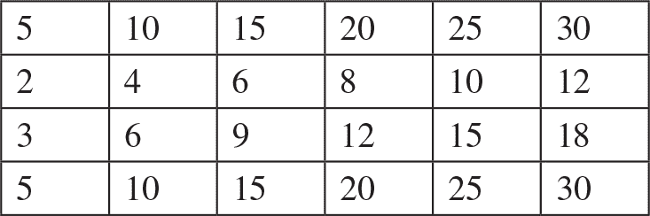

调用后：`eliminateDuplicateRows(arrWithDups)`，返回的数组将不再有重复行。

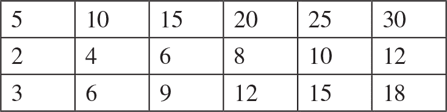

在下方完成方法 `eliminateDuplicateRows`。

```java
/**
 * 通过从 arrWithDups 中删除所有重复行来创建一个新数组
 *
 * @Postcondition: arrWithDups 不被修改
 * 返回一个没有重复行的新二维数组
 */
public static int[][] eliminateDuplicateRows(int[][] arrWithDups)
```

**请在单独的自由答题册的新页顶部开始你的回答，并在每页顶部填好相应的圆圈以指示题号。如果此题有多个部分，请在回答中写上部分字母。**

前往练习测试 2 第 4 题：答案与解析，第二部分：自由答题题

# 练习测试 2：答案与解析

## 练习测试 2 答案

1. D  
2. D  
3. D  
4. C  
5. B  
6. D  
7. C  
8. A  
9. D  
10. A  
11. C  
12. B  
13. B  
14. C  
15. B  
16. A  
17. D  
18. A  
19. B  
20. D  
21. D  
22. D  
23. D  
24. C  
25. B  
26. A  
27. A  
28. D  
29. D  
30. D  
31. D  
32. B  
33. C  
35. C  
35. C  
36. C  
38. C  
39. C  
40. C  
40. A  

## 第一选择题

题目涉及整数除法、取模运算和运算顺序。需要记住的一点是，当除法运算符 `/` 的两边都是整数时，将执行整数除法。此外，除法、乘法和取模运算 `%` 都按从左到右的顺序执行。

选项 (I) 先执行整数除法：`24 / 5 = 4`。然后 `4 % 3 = 1`。最后 `1 * 2 = 2`。该结果小于 5，因此 (I) 必须是答案的一部分。排除 (B)。

选项 (II) 也执行整数除法：`12 / 3 = 4`。然后 `4 * 2 = 8`。最后 `8 + 1 = 9`。该结果大于 5，因此 (II) 不可能是答案的一部分。排除 (C)。

选项 (III) 先执行取模：`4 % 3 = 1`。然后 `1 * 2 = 2`。最后 `1 + 2 = 3`。该结果小于 5，因此 (III) 是答案的一部分。排除 (A)。

由于 (I) 和 (III) 的结果小于 5，正确答案是 (D)。

返回练习测试 2 第一部分第 1 题

### 2. D

题目涉及整数除法、取模运算和运算顺序。需要记住的一点是，当除法运算符 `/` 的两边都是整数时，将执行整数除法。此外，除法、乘法和取模运算 `%` 都按从左到右的顺序执行。

选项 (I) 先执行整数除法：`24 / 5 = 4`。然后 `4 % 3 = 1`。最后 `1 * 2 = 2`。该结果小于 5，因此 (I) 必须是答案的一部分。排除 (B)。

选项 (II) 也执行整数除法：`12 / 3 = 4`。然后 `4 * 2 = 8`。最后 `8 + 1 = 9`。该结果大于 5，因此 (II) 不可能是答案的一部分。排除 (C)。

选项 (III) 先执行取模：`4 % 3 = 1`。然后 `1 * 2 = 2`。最后 `1 + 2 = 3`。该结果小于 5，因此 (III) 是答案的一部分。排除 (A)。

由于 (I) 和 (III) 的结果小于 5，正确答案是 (D)。

返回练习测试 2 第一部分第 2 题

### 3. D

题目涉及整数除法、取模运算和运算顺序。需要记住的一点是，当除法运算符 `/` 的两边都是整数时，将执行整数除法。此外，除法、乘法和取模运算 `%` 都按从左到右的顺序执行。

选项 (I) 先执行整数除法：`24 / 5 = 4`。然后 `4 % 3 = 1`。最后 `1 * 2 = 2`。该结果小于 5，因此 (I) 必须是答案的一部分。排除 (B)。

选项 (II) 也执行整数除法：`12 / 3 = 4`。然后 `4 * 2 = 8`。最后 `8 + 1 = 9`。该结果大于 5，因此 (II) 不可能是答案的一部分。排除 (C)。

选项 (III) 先执行取模：`4 % 3 = 1`。然后 `1 * 2 = 2`。最后 `1 + 2 = 3`。该结果小于 5，因此 (III) 是答案的一部分。排除 (A)。

由于 (I) 和 (III) 的结果小于 5，正确答案是 (D)。

返回练习测试 2 第一部分第 3 题

### 4. C

`Array2DMultiples` 方法包含 `eliminateDuplicateRows` 方法。

检查二维数组参数。消除任何重复行并返回一个较小的二维数组。

`arrWithDups`:


调用后：`eliminateDuplicateRows(arrWithDups)`，返回的数组将不再有重复行。


在下方完成方法 `eliminateDuplicateRows`。

```java
/**
 * 通过从 arrWithDups 中删除所有重复行来创建一个新数组
 *
 * @Postcondition: arrWithDups 不被修改
 * 返回一个没有重复行的新二维数组
 */
public static int[][] eliminateDuplicateRows(int[][] arrWithDups)
```


## 5. C

客户端方法头部有两个参数：

`computeBonus(SalesRep s, double percentage)`

`SalesRep` 对象中的实例字段 `ytdSales` 是私有的，因此数据必须使用访问器进行引用：`objectName.methodname()`。因此，为了获取对象 `s` 的 `ytdSales`，我们必须使用 `s.getYtdSales()`，排除 (A) 和 (B)。字段 `percentage` 是传递给参数，而不是对象的实例字段，因此不需要像 (D) 那样使用 `s.percentage`。因此 (C) 是正确答案。

返回练习测试 2 第一部分第 4 题

## 6. D

使用 `substring` 方法时，字符串的第一个字符位于索引 0。`substring` 命令的参数是起始索引和结束索引，但该命令在达到结束索引之前就会停止，因此 `substring(1, 3)` 将打印索引为 1 和 2 的字符（"up"）。这消除了 (A) 和 (C)。命令 `str.substring(1)` 访问从第一个字符到字符串末尾的字符（"uperstar"），但它没有被赋值回 `str`。由于字符串是不可变的，`str` 不会被修改（在第三行或第五行中）——"up" 将被打印三次。答案是 (D)。

回到练习测试 2 第一部分：多选择题的第 6 题

## 7. C

语句 (I) 将成功地切换 `isBlack` 的值。赋值语句的右侧在每次代码执行时都会将值更改为相反的值。排除 (B)。语句 (II) 专门检查 `isBlack` 的值是否为 false。如果是，它将该值更改为 true。`else` 只会在 `isBlack` 为 true 时执行，在这种情况下它将该值更改为 false，因此 (II) 也能成功地切换值。排除 (A) 和 (D)。只剩下一个选项，因此没有必要继续了。然而，请注意 (III) 仅在 `isBlack` 为 true 时才更改其值：没有提供将值从 false 更改为 true 的机制，因此语句 (III) 是错误的。由于只有 (I) 和 (II) 能够成功切换值，答案是 (C)。

回到练习测试 2 第一部分：多选择题的第 7 题

## 8. A

选项 (A) 仅仅会比较两个 `String` 变量对象的引用，而不是字段的实际内容。(B) 和 (C) 都是比较 `String` 变量内容的非常直接的方法。选项 (D) 以两种不同方式利用 `substring` 方法检查 `str1` 和 `str2` 的整个字符串，并使用 `.equals()` 方法比较字符串的内容。因此，(A) 是正确答案。

回到练习测试 2 第一部分：多选择题的第 8 题

## 9. D

从德·摩根定律开始。

原始语句为：

```
!(!p || q) || !(p || !q)
```

应用德·摩根定律后：

```
(p && !q) || (!p && q)
```

检查 `||` 运算符两侧的条件，`p` 和 `q` 的真值通过 `&&` 运算符组合，并且是直接相反的。因此，如果 `||` 运算符两侧的两个值直接相反，则整个表达式即为真。正确选项是 (D)。

回到练习测试 2 第一部分：多选择题的第 9 题

## 10. A

当 `&&` 条件的第一部分为 false 时，会使用短路求值（因为 `&&` 条件的两侧都必须为 true，第一部分的 false 会导致整个表达式为 false）。(C) 和 (D) 都以 `&&` 运算符开头。由于 `p` 中没有 false 值，因此在这些语句上无法使用短路。

或者，如果 `||` 条件的第一部分为 true，则可以使用短路（因为 `||` 条件的两侧只要有一个为 true，第一部分的 true 会导致整个表达式为 true）。在 (B) 中，这些语句上无法使用短路。由于 (A) 中 `p` 为真，因此 `||` 条件的第一部分为真，这导致整个表达式为真。答案是 (A)。

回到练习测试 2 第一部分：多选择题的第 10 题

## 11. C

(A)、(B) 和 (D) 都会产生错误。正确的格式是：

```
```

答案是 (C)。

回到练习测试 2 第一部分：多选择题的第 11 题

## 12. B

外部循环执行 10 次，`i` 的范围从 1 到 10，每次增加 1。当 `j` 不再大于 `i` 时，内部循环停止。执行 50 次后，最终计数为 101。答案是 (B)。

回到练习测试 2 第一部分：多选择题的第 12 题

## 13. B

外部循环执行 5 次，`i` 的范围从 1 到 5。当 `j` 不再小于 `i` 时，内部循环停止。(C) 和 (D) 打印数字错误。因此 (B) 是正确的。

回到练习测试 2 第一部分：多选择题的第 13 题

## 14. C

追踪表可以解决此题。

在 (I) 中，变量 `i` 的值为 1 和 2；当 `i` 增加到 3 时，循环停止。

| i | 2 * i + 1 | sum |
|---|---|---|
| 1 | 3 | 3 |
| 2 | 5 | 8 |

在 (II) 中，`i` 的值为 1-5；当 `i` 增加到 6 时，循环停止。

| i | if (i % 2 == 1) | sum |
|---|---|---|
| 1 | yes | 1 |
| 2 |  | 1 |
| 3 | yes | 4 |
| 4 |  | 4 |
| 5 | yes | 9 |

在 (III) 中，`i` 从 5 开始；然后循环将 `i` 更改为 3，然后是 1。当 `i` 为 1 时，不再进入循环。

| i5 | sum5 |
|---|---|
| 3 | sum += i \| 8 |
| 1 | sum += i \| 9 |

使用上述追踪表，(C) 是答案，因为 (II) 和 (III) 都打印 9，而 (I) 打印 8。

回到练习测试 2 第一部分：多选择题的第 14 题

## 15. B

片段 (I) 从 `k` 等于 1 开始循环，将 `k` 增加 1，然后将 `k` 加到 `sum`。无论 `k` 是偶数还是奇数都会被加上，因此该选项不可接受。排除 (A) 和 (D)。

片段 (II) 从 `k` 等于 1 开始循环，每次将 `k` 增 2，确保只有奇数会被加上。循环在 `k` 小于或等于 `number` 时继续。如果 `number` 是奇数，则 `k` 的最后一个值等于 `number`；而如果 `k` 是偶数，则加到和中的 `k` 的最后一个值将是上一个奇数。直到 `number` 的奇整数均会被加上。该片段工作正常。排除 (C)。

三个选项已被排除，因此没有必要继续。然而，为了了解为什么 (III) 不起作用，请注意它从 `k` 等于 `number` 开始循环并每次将 `k` 减 2。如果 `number` 是奇数，该选项将有效，因为 `k` 将始终为奇数。但是，如果 `number` 是偶数，则会加上偶数，这不符合方法的标准。

由于只有 (II) 工作正常，因此正确选项是 (B)。

返回练习测试 2 第一部分：多选择中的第 15 题

## 16. A

仅选项 I 和 II。

选项 I 是正确的。代码使用分隔符 `“:”` 将行分为单词和它的同义词，创建数组 `temp`。数组 `temp` 在 `temp[0]` 中包含单词，在 `temp[1]` 中包含同义词。`temp[1]` 被传递给方法 `separateSynonyms`，该方法：

- 创建 `ArrayList<String> syns`
- 使用分隔符 `,”` 分割同义词列表，创建数组 `temp`
- 将 `temp` 的元素添加到 `syns`
- 返回 `syns`

`Synonym` 对象 `syn` 由 `temp[0]` 和上述创建的 `ArrayList` 构建而成。

选项 II 是正确的。代码将行分为两个子字符串：`str1` 是 `“:` 之前的子字符串（单词），而 `str2`（同义词）是 `“:` 之后的子字符串。`str2` 被传递给上述描述的 `separateSynonyms` 方法。`Synonym` 对象 `syn` 由 `str1` 和上述创建的 `ArrayList` 构建而成。

选项 III 是错误的。它将整个行传递给方法 `separateSynonyms`，这意味着单词与同义词一起被包含。

正确答案是 (A)。

返回练习测试 2 第一部分：多选择中的第 16 题

## 17. D

选项 (A) 是有效的，因为 `Integer` 类的静态字段 `Integer.MIN_VALUE` 和 `Integer.MAX_VALUE` 代表 4 字节数据可以表示的数字范围（`int` 字段的大小）。由于 (A) 没有导致错误，因此可以将其排除。`int` 字段能保存的最小数字是 `Integer.MIN_VALUE` 的值：因此，当减去 1 时，会发生溢出错误，导致变为 `Integer.MAX_VALUE`。结果不符合预期，但编译器或运行时都不会抛出错误。可以排除选项 (B)。在 (C) 中，字段被相加，产生 -1，完全没有导致任何错误。选项 (D) 将导致编译器错误，因为值没有初始化。

返回练习测试 2 第一部分：多选择中的第 17 题

## 18. A

`half` 方法返回一个 `int` 值。由于除法 `n / 2` 没有显式转换为 `double`，它执行的是整数除法。如果 `n` 是 5，结果为 2。`System.out.println` 将输出 2。

```java
public int half(int n) {
    return n / 2;
}
```

正确答案是 (A)。注意：根据提供的文本逻辑，它表明当 `n` 为 5 时使用 int，输出为 2）。

返回练习测试 2 第一部分：多选择中的第 18 题

## 19. B

`half` 方法返回一个 `int`。表达式 `n / 2` 执行整数除法。如果 `n` 是 5，结果为 2。代码没有将结果转换为 `double`。

```java
public int half(int n) {
    return n / 2;
}
```

正确答案是 (B)。

返回练习测试 2 第一部分：多选择中的第 19 题

## 20. D

选项 (D) 是有效的，因为它使用 `==` 运算符来比较 `int` 值。逻辑 `if (half(5) == 2)` 将正确地评估结果。

返回练习测试 2 第一部分：多选择中的第 20 题

## 21. D

代码将抛出 `NullPointerException`，因为 `String` 对象 `model` 在调用其 `length()` 方法之前未初始化。

返回练习测试 2 第一部分：多选择中的第 21 题

## 22. D

方法 (D) 是正确的，因为它在加上 0.5 并转换为 `int` 之前以 `double` 执行除法，这有效地实现了四舍五入。

返回练习测试 2 第一部分：多选择中的第 22 题

## 23. D

首先确定每个变量中可能生成的数值范围。`Math.random()` 生成 0 到小于 1 的值。

```java
int a = (int) (Math.random() * 4) + 1; // 可能生成 1 到 4 的值
int b = (int) (Math.random() * 5) + 3; // 可能生成 3 到 7 的值
```

确定 `a - b` 可能产生的数值范围。

首先使用 `a` 的最小值和最大值，减去 `b` 的最小值。(1 – 3) 到 (4 – 3)。这个范围产生 -2 到 1。

排除 (B) 和 (C)。

接下来，使用 `a` 的最小值和最大值，减去 `b` 的最大值。(1 – 7) 到 (4 – 7)。这个范围产生 -6 到 -3。

排除 (A)。

正确选项是 (D)，因为该题目无法生成 2。

`substring` 的参数是起始索引和结束索引。表达式 `str1.substring(1,4)` 将返回从索引 `1` 开始到但不包含 `4` 的字符："tar"。当 `substring` 仅使用一个参数时，返回的字符串将从该参数的位置开始，一直到字符串的末尾。表达式 `str2.substring(5)` 将返回 "ray"。将它们拼接在一起，字符串将是 "tarray"。正确选项是 (C)。

返回练习测试 2 第一部分第 24 题（多选择题）

## 25. B

该变量名对 `Entertainer` 类具有私有访问权限。必须在 `Entertainer` 类中实现一个访问器（accessor）。因此，答案是 (B)。

返回练习测试 2 第一部分第 25 题（多选择题）

## 26. A

数组是通过引用传递给方法的，因此在方法中对数组执行的任何更改实际上都是修改数组本身。数组初始化了 `5` 个元素，每个元素被赋值为索引乘以 `5`，所以 (A) 是正确的。选项 (B) 是错误的，因为它假设数组没有被方法改变，并且允许有 `6` 个元素而不是 `5` 个。选项 (C) 是错误的，因为它再次允许有 `6` 个元素，尽管它们会反映出索引乘以 `5` 的结果。选项 (D) 是错误的，因为该数组是使用原始类型 `int` 定义的，因此它被初始化为 `0`，直到后来被赋值为 5 的倍数。答案是 (A)。

返回练习测试 2 第一部分第 26 题（多选择题）

## 27. A

用索引对行和列进行标记有助于数学运算。

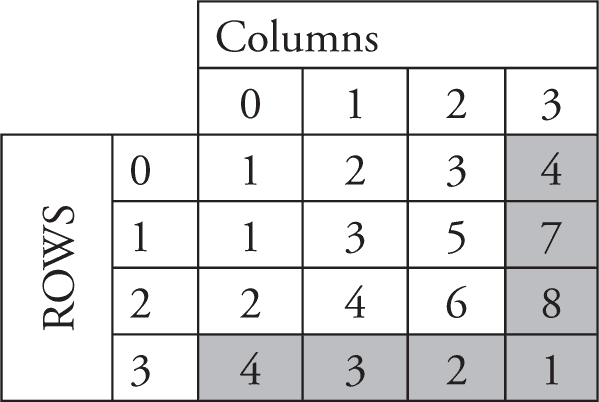

由 `j` 控制的单循环从 `0` 运行到小于行数（`4`）。

构建一维数组的计算如下：

```text
result[0] = matrix[3][0] – matrix[0][3] 4 – 4 = 0
result[1] = matrix[3][1] – matrix[1][3] 3 – 7 = -4
result[2] = matrix[3][2] – matrix[2][3] 2 – 8 = -6
result[3] = matrix[3][3] – matrix[3][3] 1 – 1 = 0
```

选项 (A) 是正确的。

返回练习测试 2 第一部分第 27 题（多选择题）

## 28. D

`Math.random() * 100` 生成 `0` 到 `100` 之间的实数。它包含 `0`，并达到但不包含 `100`。`Math.random() * 100 + 1` 将生成从 `1` 到但不包含 `101` 的实数。选项 (A) 生成 `double` 类型的数字，不能加到 `Integer ArrayList` 中。选项 (B) 将生成范围从 `0` 到 `99` 的 `int` 类型数字（`int` 会截断小数部分而不是四舍五入）。选项 (C) 将生成 `0` 到 `100` 之间的数字。选项 (D) 将生成 `1` 到 `100` 之间的整数，这可以加到 `Integer ArrayList` 中。答案是 (D)。

返回练习测试 2 第一部分第 28 题（多选择题）

## 29. B

该变量名对 `Entertainer` 类具有私有访问权限。必须在 `Entertainer` 类中实现一个访问器。因此，答案是 (B)。

返回练习测试 2 第一部分第 29 题（多选择题）

## 30. B

该变量名对 `Entertainer` 类具有私有访问权限。必须在 `Entertainer` 类中实现一个访问器。因此，答案是 (B)。

在已排序数组中找到目标值所需的搜索次数为 $2^n$，其中该值略大于数组元素的数量。在这种情况下，$2^n = 4000$。由于 $2^{(11)} = 2048$，因此 (A) 不够大。选项 (B) 让我们得到 $2^{(12)} = 4096$，这将提供足够的搜索次数在 4000 个元素中找到目标。选项 (C) 和 (D) 太大了。选项 (B) 是正确答案。

返回练习测试 2 第一部分：多选题第 35 题

## 36. C

用于控制外层循环的索引从 1 运行到小于数组的长度。如果数组有四个元素，索引将为 0, 1, 2, 3。循环从 1 运行到 3，这比数组长度少一个。正确答案是 (C)，`n - 1`。

返回练习测试 2 第一部分：多选题第 36 题

## 37. A

内层循环由以下条件控制：

```java
while (j >= 0 && arr[j] > num)
```

观察循环停止执行或不执行的情况是有帮助的。对于 `&&` 条件，两个表达式都必须真，因此仔细观察第二部分何时可能为假。循环周围的逻辑首先将数组中的第二个值赋值给 `num`，然后将 `i` 设置为上一个位置，导致数组中两个连续数字进行比较。如果这些数字恰好相同，或者按升序排列，循环将不执行。因此，正确答案是 (A)，0 次。

返回练习测试 2 第一部分：多选题第 37 题

## 38. C

表达式 `mat.length` 返回二维数组的行数，而 `mat[0].length` 返回第一行的列数。这段代码正在选择每一行并在该行内移动列。第一列的值被赋值给 `temp`，而循环移动到行尾并将所有元素向左移动：

```java
mat[a][b - 1] = mat[a][b];
```

当行完成后，`temp` 中的值被赋值给最后一列：

```java
mat[a][mat[0].length - 1] = temp;
```

选项 (C) 是正确答案。

返回练习测试 2 第一部分：多选题第 38 题

## 39. C

在声明和初始化 `e1`、`e2` 和 `e3` 后，对象如下。


执行 `e1 = e2` 后，`e1` 将具有与 `e2` 相同的引用。


执行 `e2 = e3` 后，`e2` 将具有与 `e3` 相同的引用。


执行 `e3 = e1` 后，`e3` 将具有与 `e1` 相同的引用。

(images/074_sec_4_art_6.jpg)

打印语句将打印 Luke country。选项 (C) 是正确的。

返回练习测试 2 第一部分：多选题第 39 题

### 40. C

选项 (I) 会因为循环内元素的被删除而只删除部分包含 "Summer" 的元素，而不是全部。

```text
| b1:Spring2022 | index: 0 |
| --- | --- |
| b2:Summer2022 | index: 1 |
| b3:Summer2022 | index: 2 |
| b4:Summer2022 | index: 3 |
| s1:Winter2024 | index: 4 |
```

循环第一次，检查索引为 0 的对象。季节不是 "Summer"：元素未删除。循环第二次，检查索引为 1 的对象。季节是 "Summer"：元素被删除，索引已更新。

```text
| b1:Spring2022 | index: 0 |
| --- | --- |
| b3:Summer2022 | index: 1 |
| b4:Summer2022 | index: 2 |
| s1:Winter2024 | index: 3 |
```

循环第三次，检查索引为 2 的对象。但注意，`b4` 正在被检查（`b3` 因为索引更新后被跳过了）。尽管季节是 "Summer"，但因为它被跳过了。因此，(I) 不行。排除 (A) 和 (D)。

增强型 `for` 循环创建了一个不引用数组元素的局部变量，且仅用于读取。因此，(II) 不行。排除 (B)。

只剩一个选项，不需要继续。然而，为了查看为什么 (III) 可以，请注意它与 (I) 相似，它是反向遍历 `ArrayList`。因此，当从 `ArrayList` 删除元素时，更新的是已经处理过的元素的索引。不会影响包含 "Summer" 的元素。选项 (III) 是唯一正常工作的选项，使得 (C) 为正确答案。

返回练习测试 2 第一部分：多选题第 40 题

### 41. C

`+` 运算符用于加法和字符串拼接。括号内的表达式从左到右求值。如果是数字类型，`+` 将作为加号。一旦遇到字符串，将使用拼接。如果字符串后面跟着数字，Java 将继续拼接而不是使用加法。思考的方法是：一旦开始拼接，它就会继续。

评估：

```java
String n = "1";
int sum1 = 0 + 1; // sum1 存储整数 1
int sum2 = 1 + 1; // sum2 存储整数 2
System.out.println(sum1 + sum1 + n + sum2 + sum2); // 执行加法
2 + n + sum2 + sum2 // 执行拼接
2 1 2 2
```

结果是包含 2122 的字符串。选项 (C) 是正确的。

返回练习测试 2 第一部分：多选题第 41 题

### 42. A

从评估 `value1` 开始。`equals()` 方法评估 `phrase1` 和 `phrase2` 的内容，它们完全相同，因此 `value1` 为真。

接下来评估 `value2`。字段 `phrase1` 和 `phrase2` 是字符串字面量。当 Java 在内存中创建这些内容时，它会识别出两个字段的字符串字面量完全相同。因此，它只会创建一个字符串字面量，并让两个字段引用它。`==` 比较运算符将判断两个位置是相同的，因此为真。

正确选项是 (A)。

返回练习测试 2 第一部分：多选题第 42 题

### 第二部分：简答题

### 1. 1.

```java
public String convertWord(String word) {
    String w = word;
    String firstLet = w.substring(0,1);
    boolean firstIsVowel = isLetterAVowel(firstLet);
    if (firstIsVowel)
        return word + "way";
    String secondLet = w.substring(1,2);
    boolean secondIsVowel = isLetterAVowel(secondLet);
    if (secondIsVowel)
        return word.substring(1) + firstLet + "ay";
    return word.substring(2) + firstLet + secondLet + "ay";
}
```

### 2.

```java
public String convertPhrase() {
    if (phrase == null || phrase.length() == 0)
        return "";
    String p = phrase;
    String newPigLatinPhrase = "";
    String word = "";
}
```

```java
int j = 0;
boolean isLastWord = false;
int k = p.indexOf(" ");
while (k != -1) {
    word = convertWord(p.substring(0, k));
    newPigLatinPhrase += word + " ";
    p = p.substring(k + 1);
    k = p.indexOf(" ");
}
if (p.length() > 0) {
    word = convertWord(p);
}
newPigLatinPhrase += word + " ";
return newPigLatinPhrase;
```

## PigLatin 评分标准 own (a)

* +4

  * +1：正确找到第一个字符和第二个字符。
  * +1：检查单词长度是否为 `1` 以及是否以元音开头；返回 `vowel + "way"`，否则返回 `word + "ay"`。
  * +1：遵循三个规则正确地将单词转换为 `PigLatin`。
  * +1：返回转换后的 `pigLatin` `word`，且不改变参数：`word`。

## 部分 (b)

* +3

  * +1：检查空值或空字符串。必须先检查空。返回空字符串。
  * +1：正确找到单词并对短语中的每个单词调用 `convertWord(word)`，包括最后一个单词。
  * +1：将所有返回的转换后的单词拼接成一个新的 pig latin 短语。

返回练习测试 2 第 II 部分：自由答题中的第 1 题

### 1. 标准答案：

```java
public class FrequentFlyerMember {
    private int acctNumber;
    private String flyerName;
    private int lifetimeMiles;

    FrequentFlyerMember(int n, String name, int miles) {
        acctNumber = n;
        flyerName = name;
        lifetimeMiles = miles;
    }

    /* 向 lifetime 英里中添加英里 */
    public void addMiles(int miles) {
        lifetimeMiles += miles;
    }

    /* 打印选定的状态信息 */
    public String getStatusInfo() {
        return acctNumber + " " + flyerName + " is a frequent flyer member with " +
               lifetimeMiles + " miles";
    }
}
```

### FrequentFlyerMember 评分标准

* +7

  * +1：类头部必须为：`public class FrequentFlyerMember`
  * +1：四个实例字段已定义为 `private`，分别对应乘客账号、姓名、累计英里和状态级别，如标准答案所示。
  * +1：构造方法头部必须与类名相同，并有 4 个参数 `(int number, String name, int miles)`。
  * +1：三个实例字段已正确赋值。
  * +1：`addMiles` 方法头部必须正确使用返回类型 `void` 和一个 `int` 参数。
  * +1：参数 `miles` 应该正确地加到实例字段 `lifetimeMiles` 中。
  * +1：`getStatusInfo` 方法必须使用 `String` 作为返回类型且没有参数。

返回练习测试 2 第 II 部分：自由答题中的第 2 题

### 1. FactorPair—标准答案

```java
public ArrayList<FactorPair> buildArrayList(int n) {
    ArrayList<FactorPair> tempPairs = new ArrayList<FactorPair>();
    for (int i = 1; i < (n / 2); i++) {
        if (n % i == 0) {
            FactorPair temp = new FactorPair(i, n / i);
            tempPairs.add(temp);
        }
    }
    return tempPairs;
}

public int findMostPairs(Factors f) {
    if (this.pairs.size() > f.size())
        return this.number;
    else if (f.pairs.size() > this.pairs.size())
        return f.number;
    else
        return -1;
}
```

### FactorPair 评分标准 (a)

* +3

  * +1：正确声明类型为 `FactorPair` 的 `ArrayList`，并通过循环寻找因子（从 `1` 到 `n`，或者通过检查每个数字的因子来从 `1` 到 `n / 2`）。
  * +1：正确找到因子——寻找小于或等于 `n / i` 的整除因子（且不添加重复因子，用于寻找完全平方数的因子，例如 `25` 中的 `5`）。
  * +1：构建 `FactorPair` 对象并将其添加到 `ArrayList` 中。

### 部分 (b)

* +2

  * +1：正确评估两个 `ArrayList` 的大小，以找到包含 `FactorPair` 对象数量最多的对象。
  * +1：正确返回拥有最多 `FactorPair` 对象的数字，如果两个数字的 `FactorPair` 数量相同，则返回 `-1`。必须使用 `object.number`。

返回练习测试 2 第 II 部分：自由答题中的第 3 题

### 1. Array2DMultiples—标准答案

```java
public static int[][] eliminateDuplicateRows(int[][] arrWithDups) {
    int[][] arr = arrWithDups;
    int holdRow = 0;
    int r = 1;
    while (holdRow < arr.length - 1) {
        while (r < arr.length) {
            if (arr[holdRow][0] == arr[r][0]) {
                int[][] smallerArr = new int[arr.length - 1][arr[0].length];
                for (int row = 0; row < r; row++) {
                    for (int col = 0; col < arr[0].length; col++) {
                        smallerArr[row][col] = arr[row][col];
                    }
                }
                for (int row = r + 1; row < arr.length; row++) {
                    for (int col = 0; col < arr[0].length; col++) {
                        smallerArr[row - 1][col] = arr[row][col];
                    }
                }
                arr = smallerArr;
            } else {
                r++;
            }
        }
        holdRow++;
        r = holdRow + 1;
    }
    return arr;
}
```

### Array2DMultiples 评分标准

* +6

  * +1：参数 `arrWithDups` 未被修改。
  * +1：保留了一个行并循环检查后续行是否存在重复，且无越界错误。
  * +1：识别了重复行。
  * +1：声明了较小的二维数组。
  * +1：正确构建了没有重复的新二维数组。
  * +1：返回了新的二维数组。

第一部分包含 42 道选择题。请在答题卡上仅涂满 1 到 42 号的椭圆。在答题卡上标出所有选择题的答案。每个问题仅给出一个答案。请有效利用时间，在保证准确性的情况下尽可能作答。不要在某一个题目上花费过多时间。如果有时间，请继续做其他题目，然后回来回答未回答的题目。不要求每个人都知道所有选择题的答案。你在选择部分的总分仅取决于回答正确的题目数量。回答错误或未回答的题目不扣分。

### Java 快速参考

| 类、构造函数与方法 | 解释 |
| :--- | :--- |
| String 类 | |
| `String(String str)` | 构建一个新的 String 对象，表示与 `str` 相同的字符序列 |
| `int length()` | 返回 String 对象中的字符数 |
| `String substring(int from, int to)` | 返回从索引 `from` 开始到索引 `to` - 1 结束的子字符串 |
| `String substring(int from)` | 返回 `substring(from, length())` |
| `int indexOf(String str)` | 返回 `str` 首次出现的索引；如果未找到，则返回 –1 |
| `boolean equals(String other)` | 如果此对象等于 `other` 则返回 true；否则返回 false |
| `int compareTo(String other)` | 如果此对象小于 `other` 则返回 <0 的值；如果等于 `other` 则返回零；如果大于 `other` 则返回 >0 的值 |
| `String[] split(String del)` | 返回一个字符串数组，其中每个元素都是此字符串的子字符串，该字符串根据给定表达式 `del` 的匹配项进行了分割 |
| Integer 类 | |
| `Integer.MIN_VALUE` | `int` 或 `Integer` 表示的最小值 |
| `Integer.MAX_VALUE` | `int` 或 `Integer` 表示的最大值 |
| `static int parseInt(String s)` | 将字符串参数作为 `int` 返回 |
| Double 类 | |
| `static double parseDouble(String s)` | 将字符串参数作为 `double` 返回 |
| Math 类 | |
| `static int abs(int x)` | 返回 `int` 值的绝对值 |
| `static double abs(double x)` | 返回 `double` 值的绝对值 |
| `static double pow(double base, double exponent)` | 返回第一个参数的第二个参数的幂的值 |
| `static double sqrt(double x)` | 返回 `double` 值的正平方根 |
| `static double random()` | 返回一个大于等于 0.0 且小于 1.0 的 double 值 |
| ArrayList 类 | |
| `int size()` | 返回列表中的元素数量 |
| `boolean add(E obj)` | 将 `obj` 添加到列表末尾；返回 true |
| `void add(int index, E obj)` | 将 `obj` 插入到位置 `index`（0 <= index <= `size()`），将位置 `index` 及更高位置的元素向右移动（其索引加 1），并将 `size` 加 1 |
| `E get(int index)` | 返回列表中位置 `index` 处的元素 |


| `E set(int index, E obj)` | 用 `obj` 替换位置 `index` 处的元素；返回原位于 `index` 处的元素 |

| `E remove(int index)` | 从位置 `index` 处的元素，将 `index` + 1 及更高位置的元素向左移动（其索引减 1），并将 `size` 减 1；返回原位于 `index` 处的元素 |

| **File 类** | |

| `File(String pathname)` | 接受字符串 `pathname` 的 `File` 构造函数 |

| **Scanner 类** | |

| `Scanner(File f)` | 接受 `File` 用于读取的 `Scanner` 构造函数 |

| `int nextInt()` | 从文件或输入源返回下一个 `int`。如果不存在下一个 `int` 或超出范围，将导致 `InputMismatchException` |

| `double nextDouble()` | 从文件或输入源返回下一个 `double`。如果不存在下一个 `double`，将导致 `InputMismatchException` |

| `boolean nextBoolean()` | 从文件或输入源返回下一个 `boolean`。如果不存在下一个 `boolean`，将导致 `InputMismatchException` |

| `String nextLine()` | 从文件或输入源读取下一行文本并作为 `String` 返回；如果紧接另一个从文件或输入源读取的 `Scanner` 方法后调用，可能返回空字符串 |

| `String next()` | 从文件或输入源返回下一个 `String` |

| `boolean hasNext()` | 如果文件或源中还有可读的项，则返回 `true`；否则返回 `false` |

| `void close()` | 关闭此扫描器 |

| **Object 类** | |

| `boolean equals(Object other)` | |

| `String toString()` | |

### 计算机科学 A

#### 第一部分

**时间—1 小时 30 分钟**

**题目数量—42**

**占总分比例—55%**

**说明：** 使用提供的纸张草稿，确定以下每个问题或不完整陈述的答案。然后从给出的选项中选择最佳的一个，并在答题卡上涂对应的相应的椭圆。考试卷上的任何内容均不予计分。不要在某一个问题上花费过多时间。

**注意：**

- 假设 Java 快速参考中列出的类已在适当位置导入。

- 假设变量和方法的声明出现在包含类的范围内。

- 假设未以前对象或类名名前缀且未在完整定义内显示的方法调用出现在包含类的范围内。

- Java 快速参考信息可以用于整个考试。

```
public void trial() {
    int a = 10;
    int b = 5;
    doubleValues(a, b);
    System.out.print(b);
    System.out.print(a);
}
public void doubleValues(int c, int d) {
    c = c * 2;
    d = d * 2;
    System.out.print(c);
    System.out.print(d);
}
```

调用 `trial()` 的结果打印的是什么？

1. `2010105`

2. `20101020`

3. `20102010`

4. `2010510`

```
/**
 * 前条件：a > b > 0
 */
public static int mystery(int a, int b) {
    int d = 0;
    for (int c = a; c > b; c--) {
        d = d + c;
    }
    return d;
}
```

调用 `mystery(x, y)` 返回的是什么？

1. 大于 `y` 且小于等于 `x` 的整数和

2. 大于等于 `y` 且小于等于 `x` 的整数和

3. 大于 `y` 且小于 `x` 的整数和

4. 大于等于 `y` 且小于 `x` 的整数和

```
public void mystery (int n) {
    int k;
    for (k = 0 ; k < n ; k++) {
        mystery(k);
        System.out.print (k);
    }
}
```

调用 `mystery(3)` 打印的是什么？

1. `0123`

2. `00123`

3. `0010012`

4. `00100123`

## 问题 4

考虑一个整数数组。

`4 10 1 2 6 7 3 5`

如果使用选择排序（selection sort）将该数组从小到大进行排序，以下哪一种情况代表了选择排序过程中某时刻数组的可能状态？

1. `1 4 10 2 3 6 7 5`

2. `1 2 4 6 10 7 3 5`

3. `1 2 3 10 6 7 4 5`

4. `1 4 3 1 2 6 7 10 5`

## 问题 5

考虑以下代码段：

```java
int k;
int A[];
A = new int [7];
for (k = 0; k < A.length; k++)
{
    A[k] = A.length - k;
}
for (k = 0; k < A.length - 1; k++)
{
    A[k + 1] = A[k];
}
```

代码段执行后，`A` 将包含哪些值？

1. `1 2 3 4 5 6 7`

2. `6 6 5 4 3 2 1`

3. `7 7 6 5 4 3 2`

4. `7 7 7 7 7 7 7`

## 问题 6–7

问题 6–7 参考以下两个类。

```java
public class PostOffice
{
    // 构造函数初始化邮箱
    // 长度为 100
    public PostOffice()
    { /* 实现未显示 */ }
    // 根据给定的邮箱号码返回邮箱
    // 0 <= theBox < getNumBoxes ()
    public Box getBox(int theBox)
    { /* 实现未显示 */ }
    // 返回邮箱的总数
    public int getNumBoxes()
    { /* 实现未显示 */ }
    // 私有成员变量和
    // 其他方法未显示
}

public class Box
{
    // 构造函数
    public Box()
    { /* 实现未显示 */ }
    // 返回此邮箱的号码
    public int getBoxNumber()
    { /* 实现未显示 */ }
    // 返回此邮箱中的
    // 信件数量
    public int getMailCount()
    { /* 实现未显示 */ }
    // 返回指定的信件
    // 0 <= thePiece < getMailCount ( )
    public Mail getMail(int thePiece)
    { /* 实现未显示 */ }
    // 如果邮箱已分配给
    // 客户
    public boolean isAssigned()
    { /* 实现未显示 */ }
    // 如果邮箱内包含信件
    public boolean hasMail()
    { /* 实现未显示 */ }
    // 私有成员变量和
    // 其他方法未显示
}

public class Mail
{
    // 私有成员、构造函数和
    // 其他方法未显示
}
```

### 问题 6

考虑以下代码段：

```java
PostOffice p[];
p = new PostOffice[10];
```

假设该邮箱已被分配，并且其中至少有四封信件在等待中，那么从 `p` 中第 10 个邮局的第 57 个邮箱里获取第四封信件的正确方法是？

1. `Mail m = p[10].getBox(57).getmail(4);`

2. `Mail m = p[9].getBox(56).getMail(3);`

3. `Mail m = p.getMail(57).getMail(4) [10];`

4. `Mail m = getMail(getBox(p[9], 560, 3);`

### 问题 7

考虑下面不完整的函数 `printEmptyBoxes`。`printEmptyBoxes` 应该打印所有已分配给客户但未包含信件的邮箱号码。

```java
public void printEmptyBoxes(PostOffice[] p)
{
    for (int k = 0; k < p.length - 1; k++)
    {
        for (int x = 0; x < p[k].getNumBoxes() - 1; x++)
        {
            /* 缺失代码 */
        }
    }
}
```

以下哪一项可以替换 `/* 缺失代码 */` 以使得 `printEmptyBoxes` 按预期工作？

1. `if (p[k].getBox(x).isAssigned() && !p[k].getBox(x).hasMail()) { System.out.println(p[k].getBox(x).getBoxNumber()); }`

2. `if (p[x].getBox(k).isAssigned() && !p[x].getBox(k).hasMail()) { System.out.println(p[x].getBox(k).getBoxNumber()); }`

3. `if (p[k].getBox(x).isAssigned() && !p[k].getBox(x).hasMail()) { System.out.println(p[k].getBoxNumber(x)); }`

4. `if (p[x].getBox(k).isAssigned() && !p[x].getBox(k).hasMail()) { System.out.println(p[x].getBox(k)); }`

## 问题 8

假设 `a` 和 `b` 是已经初始化的布尔变量。考虑以下代码段：

```java
a = a && b;
b = a || b;
```

以下哪一个陈述始终正确？

I. `a` 的最终值与 `a` 的初始值相同。

II. `b` 的最终值与 `b` 的初始值相同。

III. `a` 的最终值与 `b` 的初始值相同。

1. 仅 I

2. 仅 II

3. 仅 I 和 II

4. 仅 II 和 III

## 问题 9

考虑以下代码段：

```java
int x;
x = 53;
if (x > 10)
{
    System.out.print("A");
}
if (x > 30)
{
    System.out.print("B");
}
else if (x > 40)
{
    System.out.print("C");
}
if (x > 50)
{
    System.out.print("D");
}
if (x > 70)
{
    System.out.print("E");
}
```

执行代码时的输出是什么？

1. `A`

2. `D`

3. `ABD`

4. `ABCD`

## 问题 10

考虑以下代码段：

```java
int j;
int k;
for (j = -2; j <= 2; j = j + 2)
{
    for (k = j; k < j + 3; k++)
    {
        System.out.print(k + " ");
    }
}
```

执行代码时的输出是什么？

1. `-2 -1 0`

2. `-2 -1 0 1 2`

3. `-2 0 2`

4. `-2 -1 0 0 1 2 2 3 4`

## 问题 11

考虑以下方法。

```java
public void mystery (int count, String s)
{
    if (count <= 0)
    {
        return;
    }
    if (count % 3 == 0)
    {
        System.out.print(s + "--" + s);
    }
    else if (count % 3 == 1)
    {
        System.out.print(s + "-" + s);
    }
    else
    {
        System.out.print(s);
    }
    mystery(count - 1, s);
}
```

调用 `mystery(5, "X")` 的输出是什么？

1. `XX-XX--XXX-X`

2. `XX-XX-XX-XX`

3. `XXX--XX-X-XX--XXX`

4. `XX-XXX--XXX-XX`

## 第 12–13 题参考以下类和方法描述。

`Table` 类有一个方法 `getPrice()`，该方法不接受参数并返回桌子的价格。

`Chair` 类也有一个方法 `getPrice()`，该方法不接受参数并返回椅子的价格。

`DiningRoomSet` 类有一个构造函数，接收一个 `Table` 对象和一个包含 `Chair` 对象的 `ArrayList`。它将这些参数存储在类有私有数据字段 `myTable` 和 `myChairs` 中。

`DiningRoomSet` 类有一个方法 `getPrice()`，该方法不接受参数并返回餐厅套装的价格。餐厅套装的价格计算为其桌子和所有椅子的价格之和。

## 12 标记评审

定义 `DiningRoomSet` 类构造函数签的正确方式是：

1. `public DiningRoomSet(Table t, ArrayList<Chair> chairs)`

2. `public void DiningRoomSet(Table t, ArrayList Chair Chairs)`

3. `public DiningRoomSet(Table t, ArrayList Chair Chairs)`

4. `public DiningRoomSet(Table t, Chair Chairs)`

前往练习测试 3：答案与解析，第一部分：多选题第 12 题

## 13 标记评审

实现 `DiningRoomSet` 类 `getPrice` 方法的正确方式是：

1. ```java
public double getPrice(Table t, ArrayList chairs) {
    return t.getPrice() + chairs.getPrice();
}
```

2. ```java
public double getPrice(Table t, ArrayList chairs) {
    return myTable.getPrice() + myChairs.getPrice();
}
```

3. ```java
public double getPrice() {
    return myTable.getPrice() + myChairs.getPrice();
}
```

4. ```java
public double getPrice() {
    double result = myTable.getPrice();
    for (int k = 0; k < myChairs.size() - 1; k++) {
        result += ((Chair)myChairs.get(k)).getPrice();
    }
    return result;
}
```

前往练习测试 3：答案与解析，第一部分：多选题第 13 题

## 14 标记评审

考虑以下输出：

```
6 5 4 3 2 1
5 4 3 2 1
4 3 2 1
3 2 1
2 1
1
```

以下哪个代码段执行后会产生上述输出？

1. ```java
for (int j = 6; j < 0; j--) {
    for (int k = j; k > 0; k--) {
        System.out.print(k + " ");
    }
    System.out.println(" ");
}
```

2. ```java
for (int j = 6; j >= 0; j--) {
    for (int k = j; k >= 0; k--) {
        System.out.print(k + " ");
    }
    System.out.println(" ");
}
```

3. ```java
for (int j = 0; j < 6; j++) {
    for (int k = 6 - j; k > 0; k--) {
        System.out.print(k + " ");
    }
    System.out.println(" ");
}
```

4. ```java
for (int j = 0; j < 6; j++) {
    for (int k = 6 - j ; k >= 0; k--) {
        System.out.print(k + " ");
    }
    System.out.println(" ");
}
```

前往练习测试 3：答案与解析，第一部分：多选题第 14 题


## 15 标记评审

考虑以下代码段：

```java
List<Integer> list = new ArrayList<Integer>();
list.add(new Integer(7));
list.add(new Integer(6));
list.add(1, new Integer(5));
list.add(1, new Integer(4));
list.add(new Integer(3));
list.set(2, new Integer(2));
list.add(1, new Integer(1));
System.out.println(list);
```

执行此代码段的结果打印的是：

1. `[1, 4, 2, 7, 6, 3]`
2. `[7, 1, 4, 2, 6, 3]`
3. `[7, 2, 5, 4, 3, 1]`
4. `[7, 6, 2, 4, 3, 1]`

前往练习测试 3：答案与解析，第一部分：多选题第 15 题。

## 16 标记评审

以下代码段将文件读取到 `ArrayList` 中：

```java
import java.io.*;
import java.util.*;

public class MC {
    public static void main(String[] args) {
        File f = new File("words.txt");
        Scanner scan = new Scanner(f);
        ArrayList<String> words = new ArrayList<>();
        readWords(f, scan, words);
    }

    public static void readWords(File f, Scanner scan, ArrayList<String> words) {
        while (scan.hasNext()) {
            words.add(scan.next());
        }
    }
```

该程序由于缺少 `IOException` 而无法编译。以下哪项可以修复此问题？

1. 第 3 行改为 `public class MC throws IOException`
2. 第 5 行改为 `public static void main(String[] args) throws IOException`
3. 第 7 行改为 `File f = new File("words.txt") throws IOException;`
4. 第 9 行改为 `public static void readWords(File f, Scanner scan, ArrayList<String> words) throws IOException`

前往练习测试 3：答案与解析，第一部分：多选题第 16 题。

## 17 标记评审

考虑以下两个类：

```java
public class Fish {
    private FishType fType;
    private String endkeleton = "bone";

    Fish(FishType f) {
        fType = f;
    }

    public void action() {
        System.out.println("splash splash");
    }
}

public class FishType {
    private String name;
    public String endkeleton = "cartilage";

    FishType(String n) {
        name = n;
    }

    public void action() {
        System.out.println("chomp chomp");
    }
}
```

执行以下代码段后，正确的输出是？

```java
FishType shark = new FishType("shark");
Fish bob = new Fish(shark);
bob.action();
```

1. `splash splash`
2. `chomp chomp`
3. `splash splash chomp chomp`
4. `chomp chomp splash splash`

前往练习测试 3：答案与解析，第一部分：多选题第 17 题。

## 第 18–19 题

参考以下不完整的方法。以下 `insertSort` 方法将整数数组 `sort` 中的值按升序排序：

```java
public static void insertSort(int[] sort) {
    for (int index = 1; index < sort.length; index++) {
        int temp = sort[index];
        while (index > 0 && sort[index - 1] > temp) {
            /* missing code */
        }
        sort[index] = temp;
    }
}
```

### 18 标记评审

以下哪项可以替换 `/* missing code */`，以使 `insertSort` 方法正常执行？

1. `sort[index] = sort[index - 1]; index++;`
2. `sort[index - 1] = sort[index]; index--;`
3. `sort[index] = sort[index + 1]; index++;`
4. `sort[index] = sort[index - 1]; index--;`

前往练习测试 3：答案与解析，第一部分：多选题第 18 题。

### 19 标记评审

假设 `/* missing code */` 已正确实现，对代码进行什么修改可以使数组按降序排序？

1. 将第 6 行替换为：`while (index < 0 && sort[index - 1] > temp)`
2. 将第 6 行替换为：`while (index < 0 && sort[index - 1] < temp)`
3. 将第 6 行替换为：`while (index > 0 && sort[index - 1] < temp)`
4. 将第 3 行替换为：`for (int index = sort.length - 1; index > 0; index--)`

前往练习测试 3 中的第 19 题：答案与解析，第一部分：多选题。

## 20

下列哪个数组使用插入排序法时速度最慢？

1. `[3 2 5 4 6 7 9]`
2. `[9 7 6 5 4 3 2]`
3. `[2 3 4 5 6 7 9]`
4. `[9 3 2 4 5 7 6]`

前往练习测试 3 中的第 20 题：答案与解析，第一部分：多选题。

## 问题 21–23

以下是用于表示具有整数分子和分母的分数的完整类声明：

```java
public class Fraction {
    private int numerator;
    private int denominator;

    public Fraction() {
        numerator = 0;
        denominator = 1;
    }

    public Fraction(int n, int d) {
        numerator = n;
        denominator = d;
    }

    // 后置条件：返回
    // 分子
    public int getNumerator() {
        /* implementation not shown */
    }

    // 后置条件：返回
    // 分母
    public int getDenominator() {
        /* implementation not shown */
    }

    // 后置条件：返回 x 和 y
    // 的公约数
    public int gcd(int x, int y) {
        /* implementation not shown */
    }

    // 后置条件：返回
    // 此 Fraction 与 f 乘积的结果的 Fraction
    public Fraction multiply(Fraction f) {
        /* implementation not shown */
    }

    // …其他方法未显示
}
```

### 21

考虑 `Fraction` 类的 `multiply` 方法：

```java
// 后置条件：返回
// 此 Fraction 与 f 乘积的结果的 Fraction
public Fraction multiply(Fraction f) {
    /* missing code */
}
```

下列哪种语句可以替换 `/* missing code */`，以使 `multiply` 方法被正确实现？

1. `return Fraction(numerator.getNumerator(), denominator.getDenominator());`
2. `return new Fraction(numerator.numerator, denominator.denominator());`
3. `return new Fraction(numerator.getNumerator(), denominator.getDenominator());`

1. 仅 I
2. 仅 II
3. 仅 I 和 III
4. 仅 II 和 III

前往练习测试 3 中的第 21 题：答案与解析，第一部分：多选题。

### 22

考虑使用 `Fraction` 类来对分数相乘。考虑以下代码：

```java
Fraction fractionOne;
Fraction fractionTwo;
Fraction answer;
fractionOne = new Fraction(3, 4);
fractionTwo = new Fraction(7, 9);
/* missing code */
```

下列哪项可以替换 `/* missing code */`，使 `answer` 包含 `fractionOne` 乘以 `fractionTwo` 的结果？

1. `answer = fractionOne * fractionTwo;`
2. `answer = multiply(fractionOne, fractionTwo);`
3. `answer = fractionOne.multiply(fractionTwo);`
4. `answer = fractionOne.getNumerator() * fractionTwo.getDenominator();`

前往练习测试 3 中的第 22 题：答案与解析，第一部分：多选题。

### 23

以下类声明旨在扩展 `Fraction` 类，以便分数可以约化为最简形式。通过将分子和分母除以它们的公约数（`gcd`）来约分。

```java
public class ReducedFraction extends Fraction {
    private int reducedNumerator;
    private int reducedDenominator;
    // 构造函数未显示
```

考虑以下 `ReducedFraction` 的构造函数：

1.

   ```java
   public ReducedFraction() {
       reducedNumerator = 0;
       reducedDenominator = 1;
   }
   ```

2.

   ```java
   public ReducedFraction(int n, int d) {
       numerator = n;
       denominator = d;
       reducedNumerator = n / gcd(n, d);
       reducedDenominator = d / gcd(n, d);
   }
   ```

3.

   ```java
   public ReducedFraction(int n, int d) {
       super(n, d);
       reducedNumerator = n / gcd(n, d);
       reducedDenominator = d / gcd(n, d);
   }
   ```

哪些构造函数对于 `ReducedFraction` 类是合法的？

1. 仅 I
2. 仅 II
3. 仅 III
4. I 和 III

前往练习测试 3 中的第 23 题：答案与解析，第一部分：多选题。

## 24

考虑定义如下的 `s1` 和 `s2`：

```java
String s1 = new String("hello");
String s2 = new String("hello");
```

下列哪项是判断 `s1` 和 `s2` 是否持有相同字符串的正确方法？

1. `if (s1 == s2) { /* s1 and s2 are identical */ }`
2. `if (s1.equals(s2)) { /* s1 and s2 are identical */ }`
3. `if (s1.compareTo(s2) == 0) { /* s1 and s2 are identical */ }`

1. 仅 I
2. 仅 II
3. 仅 I 和 III
4. II 和 III

## 25

考虑以下变量和方法声明：

```java
String s;
String t;

public void mystery(String a, String b) {
    a = a + b;
    b = b + a;
}
```

假设 `s` 的值为 `"Elizabeth"`，`t` 的值为 `"Andrew"`，并调用了 `mystery(s, t)`。调用后 `s` 和 `t` 的值是多少？

1. `s: Elizabeth, t: Andrew`
2. `s: ElizabethAndrew, t: AndrewElizabeth`
3. `s: ElizabethAndrew, t: AndrewElizabethAndrew`
4. `s: ElizabethAndrew, t: ElizabethAndrewAndrew`

## 26

下列哪个代码片段将打印以下行？

`\/\\/   / \/\\/`

1. `System.out.println(\/\/\\/   / \/\\/);`
2. `System.out.println("\\\\/\\\\/ \\\\/\\\\/");`
3. `System.out.println("\\\\//\\\\// \\\\//\\\\//");`
4. `System.out.println("\\\\\\/\\\\\\/ \\/ \\\\\\/\\\\\\/");`

## 27

考虑以下 `for` 循环的抽象，其中 `<1>`、`<2>`、`<3>` 和 `<4>` 表示指示位置上的合法代码：

```java
for (<1>; <2>; <3>) {
    <4>
}
```

下列哪个 `while` 循环与上述 `for` 循环的功能相同？

1. `<1>;`

   ```java
   while (<2>) {
       <3>;
       <4>
   }
   ```

2. `<1>;`

   ```java
   while (<2>) {
       <4>
       <3>;
   }
   ```

3. `<1>;`

   ```java
   while (!<2>) {
       <3>;
       <4>
   }
   ```

4. `<1>; <3>;`

   ```java
   while (<2>) {
       <4>
       <3>;
   }
   ```

前往练习测试 3 中的题 27：答案与解析，第一部分：多选题。

## 28 审核标记

考虑以下表达式：

`a / b + c – d % e * f`

下列表达式中哪个与上方表达式等效？

1. `((((a / b) + c) – d) % e) * f`
2. `((a / b) + c) – (d % (e * f))`
3. `(a / ((b + c) – d) % e) * f`
4. `((a / b) + c) – ((d % e) * f)`

前往练习测试 3 中的题 28：答案与解析，第一部分：多选题。

## 29 审核标记

假设程序如下所示声明并初始化了 `x`：

```java
String[] x;
x = new String[10];
initialize(x); // 数组 x 被填充了
// 每个长度为 5 的
// 有效字符串
```

下列哪个代码段能够正确遍历数组，并打印所有十个字符串的第一个字符，然后是所有十个字符串的第二个字符，以此类推？


1. 
```java
int i;
int j;
for (i = 0 ; i < 10 ; i++)
    for (j = 0 ; j < 5 ; j++)
        System.out.print(x[i].substring(j, j + 1));
```

2. 
```java
int i;
int j;
for (i = 0 ; i < 5 ; i++)
    for (j = 0 ; j < 10 ; j++)
        System.out.print(x[j].substring(i, i + 1));
```

3. 
```java
int i;
int j;
for (i = 0 ; i < 5 ; i++)
    for (j = 0 ; j < 10 ; j++)
        System.out.print(x[i].substring(j, j + 1));
```

1. 仅 I
2. 仅 II
3. 仅 I 和 II
4. 仅 II 和 III

前往练习测试 3 中的题 29：答案与解析，第一部分：多选题

30 审核标记

考虑以下声明和赋值语句：

```java
int a = 7;
int b = 4;
double c;
c = a / b;
```

执行赋值语句后，`c` 的值是多少？

1. `1.0`
2. `1.75`
3. `2.0`
4. 发生错误，因为 `a` 和 `b` 是整数而 `c` 是双精度点点。

前往练习测试 3 中的题 30：答案与解析，第一部分：多选题

31 审核标记

考虑以下代码段：

```java
int x;
x = // 初始化为一个整数
if (x % 2 == 0 && x / 3 == 1)
    System.out.print("Yes");
```

执行该代码段时，什么 `x` 值会打印单词 "Yes"

1. `0`
2. `4`
3. 每当 `x` 为偶数且不能被 3 整除时
4. 每当 `x` 为偶数且能被 3 整除时

前往练习测试 3 中的题 31：答案与解析，第一部分：多选题

32 审核标记

考虑以下不完整的类：

```java
public class SomeClass
{
    private String myName;
    // 后置：返回 myName
    public String getName() { /* 未实现 */ }
    // 后置：myName == name
    public void setName(String name) { /* 未实现 */ }
    // 构造函数、其他方法未显示
```

现在考虑 `SomeClass` 类中的 `swap` 方法：

```java
// 前置：x 和 y 已正确构造
// 后置：x 和 y 的名称已交换
public void swap (SomeClass x, SomeClass y)
{
    /*缺失代码 */
}
```

下列哪个代码段可以替换 `/*缺失代码 */` 以符合预期？

1. 
```java
SomeClass temp;
temp = x;
y = temp;
```

2. 
```java
String temp;
temp = x.myName;
y.myName = temp;
```

3. 
```java
String temp;
temp = x.getName();
y.setName(temp);
```

1. 仅 I
2. 仅 III
3. 仅 I 和 III
4. 仅 II 和 III

前往练习测试 3 中的题 32：答案与解析，第一部分：多选题

33 审核标记

以下 `while` 循环执行多少次？

```java
int a = 2;
int b = 6;
while (a < b) {
    if (b % a == 0)
    {
        a++;
        b--;
    }
    else
    {
        b++;
        a--;
    }
}
```

1. 2 次
2. 3 次
3. 4 次
4. 无限次

前往练习测试 3 中的题 33：答案与解析，第一部分：多选题

34 审核标记

考虑以下代码：

```java
public int mystery(int x)
{
    if (x == 1)
        return <缺失值>;
    else
        return (2 * mystery(x - 1)) + x;
}
```

下列哪项可以替换 `<缺失值>` 以使得 `mystery(4)` 返回 3？

1. 1
2. 2
3. 3
4. 4

前往练习测试 3 中的题 34：答案与解析，第一部分：多选题

35 审核标记

考虑以下代码段：

```java
int[] X;
int[] Y;
int k;
X = initializeX(); // 返回有效的数组
Y = initializeY(); // 返回有效的数组
for (k = 0; k < X.length && X[k] == Y[k]; k++)
{
    /* 一些代码 */
}
```

假设在 X 和 Y 初始化后，`X.length == Y.length`，执行该代码段后哪个结论必须为真？

1. `k < X.length && X[k] == Y[k]`
2. `k < X.length && X[k] != Y[k]`
3. `k >= X.length || X[k] == Y[k]`
4. `k >= X.length || X[k] != Y[k]`

前往练习测试 3 中的题 35：答案与解析，第一部分：多选题

36 审核标记

下列哪项会导致运行时异常？

1. 整数除以零
2. 使用已声明但未实例化的对象
3. 访问等于数组长度的数组元素
4. 尝试调用参数数量错误的方法

前往练习测试 3 中的题 36：答案与解析，第一部分：多选题

37 审核标记

假设 `a` 和 `b` 是已正确初始 `Double` 类型变量。

下列哪个表达式与上方表达式等效：

`a.doubleValue() != b.doubleValue()`

1. `a != b`
2. `!(a.doubleValue() .equals(b.doubleValue()))`
3. `!(a.compareTo(b))`
4. `a.compareTo(b) != 0`

前往练习测试 3 中的第 37 题：答案与解析，第一部分：多选题

38 检查题目

下列哪项是确保程序可靠性**最不有效**的方法？

1. 通过声明所有数据字段为公共（public）来将功能封装在类中
2. 为每个方法定义并遵循前置条件（preconditions）和后置条件（postconditions）
3. 使用描述性的变量名
4. 以一致且逻辑的方式对代码缩进

前往练习测试 3 中的第 38 题：答案与解析，第一部分：多选题

39 检查题目

考虑一本有 1,024 页的字典，每页 50 个单词。

为了查找给定的目标单词，学生正在考虑使用以下三种方法之一：

**方法 1**

使用二分查找法找到正确的页面（将目标单词与该页的第一个单词进行比较）。找到正确页面后，使用顺序查找法在页面上查找目标单词。

**方法 2**

使用顺序查找法找到正确的页面（将目标单词与该页的第一个单词进行比较）。找到正确页面后，再使用另一个顺序查找法在页面上查找目标单词。

**方法 3**

对字典中的所有单词使用顺序查找法来查找目标单词。

下列哪项最能描述使用每种方法将检查的最大单词数量？

1. 方法 1: 10, 方法 2: 50, 方法 3: 1,024
2. 方法 1: 55, 方法 2: 537, 方法 3: 25,600
3. 方法 1: 60, 方法 2: 1,074, 方法 3: 1,074
4. 方法 1: 60, 方法 2: 1,074, 方法 3: 51,200

前往练习测试 3 中的第 39 题：答案与解析，第一部分：多选题

40 检查题目

考虑以下递归方法。

```java
public static int mystery(int m)
{
    if (m == 0) {
        return 0;
    }
    else {
        return 4 + mystery(m - 2);
    }
}
```

假设 `j` 是正整数且 `m = 2j`，则调用 `mystery(m)` 返回的结果是什么值？

1. `m`
2. `2m`
3. `j`
4. `2j`

前往练习测试 3 中的第 40 题：答案与解析，第一部分：多选题

41 检查题目

`a` 和 `b` 的哪些值组合会导致以下表达式为假 (false)?

`(a >= b) || (a != -b)`

1. `a = -5, b = 5`
2. `a = 5, b = -5`
3. `a = -4, b = 5`
4. `a = -5, b = 4`

前往练习测试 3 中的第 41 题：答案与解析，第一部分：多选题

42 检查题目

选择缺失的代码行以完成该递归方法，计算 `n` 的 `p` 次方 (`n^p`)。

```java
public static int recur(int n, int p)
{
    if (p == 1)
        return n;
    /* 缺失代码 */
}
```

1. `return n * recur(n-1)`
2. `return p * recur(p-1)`
3. `return n * recur(n-1, p)`
4. `return n * recur(n, p-1)`

**第一部分结束。如果你在时间结束前完成，检查本部分的答案。在接到指示之前不要继续第二部分。**

#### 第二部分

### 计算机科学 A

#### 第二部分

#### 时间—1 小时 30 分

#### 题目数量—4 道

#### 占总分百分比—45%

**说明：** 显示所有解题步骤。记住程序段必须用 Java 编写。**注意：**

* 所有程序段必须用 Java 编写。显示所有解题步骤。部分正确将给予相应分数。
* 考试期间可以使用 Java 快速参考信息。
* 假设 Java 参考中列出的类已在适当导入。
* 除非题目另有说明，否则假设方法调用中的参数不为空，且只有在满足前置条件时才调用方法。
* 在编写每道题的解答时，可以使用该题目定义的类中列出的任何可用方法。编写大量可以由调用这些方法中的一个来替换的代码将无法获得全分。

### 简答题

1

一家托儿中心有一个程序用于跟踪其员工以及他们在白天教哪些孩子。员工（Employee）有一个可以教的最小年龄和最大年龄。托儿中心还有一个最大比例，规定了单个员工可以教的最大儿童数量。以下是完整的 `DayCare` 类：

```java
public class DayCare
{
    private ArrayList<Employee> employees;
    private ArrayList<Child> children;
    private int maxRatio;

    public DayCare(int maxRatio) {
        employees = new ArrayList<Employee>();
        children = new ArrayList<Child>();
        this.maxRatio = maxRatio;
    }

    public boolean findEmployeeForChild(Child c) {
        /* 在部分 (a) 中完成 */
    }

    public boolean runDayCare() {
        /* 实现略 */
    }

    public boolean addChild(Child c) {
        /* 在部分 (b) 中完成 */
    }
}
```

1. 员工只能教处于最小年龄（包含）和最大年龄（包含）之间的孩子。他们还可以教最多托儿中心最大比例（包含）的儿童。以下是完整的 `Employee` 类。

```java
public class Employee
{
    /* 实例变量省略 */
    public Employee(String name, String id, int min, int max) {
        /* 实现略 */
    }

    // 返回当前分配给该员工的儿童数量
    public int childrenAssigned() {
        /* 实现略 */
    }

    // 为该员工分配一个新孩子
    public void assignChild(Child c) {
        /* 实现略 */
    }

    // 根据年龄判断该员工是否可以教
    public boolean canTeach(int age) {
        /* 实现略 */
    }
}
```

孩子（Child）具有获取其名称和年龄的访问器。虽然 `Child` 的实现未显示，但你可以假设访问名为 `getName` 和 `getAge`。

完成下面的 `findEmployeeForChild` 方法，将 `Child` 分配给第一个可以教该孩子且未达到托儿中心最大比例的 `Employee`。

/* 如果找到了适合孩子的员工，返回 true；否则返回 false */

```public boolean findEmployeeForChild(Child c)`
```

**在独立的简答题练习册的新页顶部开始回答，并在每页顶部填写相应的圆圈以指示题号。如果题目有多个部分，请在回答时写上部分字母。**

# 1. 当一个 `Child` 被添加到 `DayCare` 的名单中时，`DayCare` 应该首先确保有一位 `Employee` 可以教该 `Child`。

请完成下面的 `addChild` 方法，如果有 `Employee` 可以教该 `Child`，则将该 `Child` 添加到 `children` `ArrayList` 中。

```java
/* 如果 Child 被添加到 ArrayList，返回 true，否则返回 false */
public boolean addChild(Child c)
```

**请在单独的自由作答题册的新页开头开始作答，并在每页顶部填好相应的圆圈以指示题号。如果此题有多个部分，请在回答时写上部分字母。**

前往练习测试 3 中的第 1 题：答案与解析，第二部分：自由作答题

# 2. 标记审查

一支棒球团队由履行不同角色的人员组成，例如球员、教练和管理人员。编写一个供该团队工作的所有人员使用的 `Employee` 类。每个人都有一个 `name`、一个 `role` 和一个整数类型的 `salary`。如果 `salary` 未知或未指定，则将其初始化为 0。编写 `Employee` 类以支持以下命令。

| 语句 | 功能说明 | 输出 |
| --- | --- | --- |
| `Employee member1 = new Employee ("Sammy Slugger", "right fielder", 100000);` | 创建一个名为 `member1` 的新实例，初始化所有实例字段 | |
| `Employee member2 = new Employee ("John Branson", 50000);` | 创建一个新实例 `member2`，初始化所有实例字段。缺失的角色将使用空字符串。 | |
| `member1.setRole("outfielder");` | 为名为 `member1` 的对象将角色更改为 `outfielder` | |
| `System.out.println(member1.toString());` | `toString()` 方法将返回 `member1` 的所有数据，并按所示打印。 | Sammy Sluggerposition is outfieldersalary is 110000 |
| `System.out.println(member2.toString());` | `toString()` 方法将返回 `member2` 的所有数据，并按所示打印。 | John Bransonposition is unknownsalary is 50000 |

在此处编写 `Employee` 类。

**请在单独的自由作答题册的新页开头开始作答，并在每页顶部填好相应的圆圈以指示题号。如果此题有多个部分，请在回答时写上部分字母。**

前往练习测试 3 中的第 2 题：答案与解析，第二部分：自由作答题

# 3. 标记审查

设计一个类用于对某人的全名进行操作。你可以假设名和姓之间只有一个空格。该类拥有提取名、姓以及以及名中元音数量的方法。你可以看到下面的示例。


```java
String fullName = "Katherine Johnson";
Name.getLastName(fullName); // 返回 "Johnson"
Name.countVowels(fullName); // 返回 6
```

1. `getLastName` 方法根据给定的全名返回姓。你可以假设 `fullName` 在名和姓之间只有一个空格。编写 `getLastName` 方法。

```java
public static String getLastName(String name)
```

**请在单独的自由作答题册的新页开头开始作答，并在每页顶部填好相应的圆圈以指示题号。如果此题有多个部分，请在回答时写上部分字母。**

2. `countVowels` 方法统计给定全名中元音的数量。你可以假设我们只将字母 `a`、`e`、`i`、`o` 和 `u` 为元音。编写整个 `countVowels` 方法。

```java
public static int countVowels(String name)
```

**请在单独的自由作答题册的新页开头开始作答，并在每页顶部填好相应的圆圈以指示题号。如果此题有多个部分，请在回答时写上部分字母。**

前往练习测试 3 中的第 3 题：答案与解析，第二部分：自由作答题

# 4.  标记审查

一个城市停车场有一个标牌，记录停车场内可用停车位数量。停车场的类的详细信息所示。

```java
public class ParkingLot {
    private Car[][] lot;

    public ParkingLot(int rows, int cols) {
        lot = new Car[rows][cols];
    }

    /* 返回停车场中空位的数量 */
    public int openSpaces() {
        // 未显示实现代码
    }

    public boolean parkCar(Car newCar) {
        // 待实现
    }
}
```

完成 `parkCar` 方法，将新车放入停车场的任何空间。如果停放成功，返回 `true`；如果停车场已满，则返回 `false`。

方法 `mystery(int a, int b)` 整数 `a` 和 `b` 作为输入，前提条件是 `a > b > 0`。代入 `x = 5` 和 `y = 2`。这些值作为参数传递，使得 `a = 5`、`b = 2`。设置 `d = 0`。现在进入 `for` 循环，初始化 `c = a = 5`。由于 `c > b` 仍然，执行 `for` 循环。通过设置 `d = 0 + 5 = 5` 执行 `d = d + c`。将 `c` 减 1 得到 `c = 4`。由于 `c > b`，再次执行 `for` 循环。通过设置 `d = 5 + 4 = 9` 执行 `d = d + c`。将 `c` 减 1 得到 `c = 3`。由于 `c > b` 仍然，再次执行 `for` 循环。通过设置 `d = 9 + 3 = 12` 执行 `d = d + c`。将 `c` 减 1 得到 `c = 2`。由于 `c > b` 不再，停止执行 `for` 循环。返回 `d = 12`。现在检查选项并排除任何不描述返回 12 的选项。选项 (A) 是所有大于 `y` 但小于等于 `x` 的整数之和。所有大于 `2` 但小于等于 `5` 的整数之和为 `3 + 4 + 5 = 12`，因此保留 (A)。选项 (B) 是所有大于等于 `y` 但小于等于 `x` 的整数之和。所有大于等于 `2` 但小于等于 `5` 的整数之和为 `2 + 3 + 4 + 5 = 14`，因此排除 (B)。选项 (C) 是所有大于 `y` 但小于 `x` 的整数之和。所有大于 `2` 但小于 `5` 的整数之和为 `3 + 4 = 7`，因此排除 (C)。选项 (D) 是所有大于等于 `y` 但小于 `x` 的整数之和。所有大于等于 `2` 但小于 `5` 的整数之和为 `2 + 3 + 4 = 9`，因此排除 (D)。只剩下一个答案。正确答案是 (A)。

回到练习测试 3 第 I 部分：选择题中的第 2 题

## 3. C

该问题询问调用 `mystery(3)` 打印的内容。在调用中，`3` 被作为参数并赋值给 `n`。整数 `k` 随后在 `for` 循环中初始化并设置为 `0`。由于 `k < n`，执行 `for` 循环。调用 `mystery(0)`，同时保留你在 `mystery(3)` 调用中的位置。再次，`k` 在 `for` 循环中初始化并设置为 `0`。在这次调用中，由于 `n = 0`，并不满足 `k < n` 情况，因此不执行 `for` 循环。这完成了 `mystery(0)` 的调用，因此返回 `mystery(3)`。下一条命令是 `System.out.print(k)`。由于 `k = 0`，打印的第一个字符是 `0`。查看是否有可以排除的选项。所有选项都于 `0` 开始，因此无法排除任何选项。继续方法调用。由于这是 `for` 循环的最后一条命令，增加 `k` 得到 `k = 1`。由于 `k < n` 仍然，再次执行 `for` 循环。调用 `mystery(1)`，再次保留你在 `mystery(3)` 调用中的位置。再次，`k` 在 `for` 循环中初始化并设置为 `0`。在这次调用中，由于 `n = 1`，满足 `k < n` 情况，因此执行 `for` 循环。调用 `mystery(k)`，即 `mystery(0)`。如上所示，`mystery(0)` 什么都不打印，因此执行 `mystery(1)` 中的下一行，即 `System.out.print(k)`。由于 `k = 0`，打印 `0`。排除 (A)，因为打印的第二个字符不是 `0`。增加 `k` 得到 `k = 1`。由于不再满足 `k < n` 情况，不再再次执行 `for` 循环并结束这次 `mystery(1)` 的调用。返回原始的 `mystery(3)` 调用，此时 `k = 1` 且 `System.out.print(k)` 是下一语句。打印 `1`。所有剩余选项的第三字符都是 `1`，因此不排除任何选项。这是 `for` 循环的结束，因此增加 `k` 得到 `k = 2`。由于 `n = 3`，仍然满足 `k < n` 情况，执行 `for` 循环。在保持 `mystery(3)` 位置的同时调用 `mystery(2)`。再次，`k` 在 `for` 循环中初始化并设置为 `0`。在这次调用中，由于 `n = 2`，满足 `k < n` 情况，因此执行 `for` 循环。调用 `mystery(0)`，它什么都不打印。执行 `System.out.print(k)` 打印 `0`。排除 (B)，因为下一个字符不是 `0`。增加 `k` 得到 `k = 1`。由于 `k < n`，执行 `for` 循环。调用 `mystery(1)`，如上所述，它打印 `0`。所有剩余选项的下一个字符都是 `0`，因此不排除任何选项。`mystery(2)` 中的下一条命令是 `System.out.print(k)`，因此打印 `1`。再次保留所有剩余选项。在 `mystery(2)` 中，增加 `k` 得到 `k = 2`。由于 `n = 2`，不再满足 `k < n` 情况，停止执行 `for` 循环。结束 `mystery(2)` 并返回 `mystery(3)`，此时 `k = 2` 且 `System.out.print(k)` 是下一语句。打印 `2`。

## 4. C

选择排序（SelectionSort）遍历数组以在尚未排序的部分找到最小元素。然后将该最小元素与第一个未排序的元素交换。

从原始数组开始：`4 10 1 2 6 7 3 5`

最小元素是 `1`。将其与第一个未排序的元素 `4` 交换。数组现在看起来是：`1 10 4 2 6 7 3 5`。

这不是选项，继续。数组未排序部分（从 `10` 到 `5`）中的最小元素是 `2`。将其与第一个未排序的元素 `10` 交换：`1 2 4 10 6 7 3 5`。

仍然不是选项，继续此过程。数组未排序部分（从 `4` 到 `5`）中的最小元素是 `3`。将其与第一个未排序的元素 `4` 交换：`1 2 3 10 6 7 4 5`。

这是 (C)，所以在此处停止。如果你感兴趣，这里是选择排序的完整步骤：

1. `4 10 1 2 6 7 3 5`
2. `1 10 4 2 6 7 3 5`
3. `1 2 4 10 6 7 3 5`
4. `1 2 3 10 6 7 4 5`
5. `1 2 3 4 6 7 10 5`
6. `1 2 3 4 5 7 10 6`
7. `1 2 3 4 5 6 7 10`

正确答案是 (C)。

回到练习测试 3 第 I 部分：选择题中的第 3 题

## 5. D

执行命令。整数 `k` 和整数数组 `A` 已经初始化。数组 `A` 的长度为 7。因此，数组 `A` 拥有索引从 0 到 6 的七个元素。执行第一个 `for` 循环。设置 `k = 0`。由于 `k < A.length`，执行 `for` 循环，将 `A[0]` 设置为 `A.length - k = 7 – 0 = 7`。递增 `k` 得到 `k = 1`。由于 `1 < 7`，执行 `for` 循环，将 `A[1]` 设置为 `A.length - k = 7 – 1 = 6`。递增 `k` 得到 `k = 2`。由于 `2 < 7`，执行 `for` 循环，将 `A[2]` 设置为 `A.length - k = 7 – 2 = 5`。递增 `k` 得到 `k = 3`。由于 `3 < 7`，执行 `for` 循环，将 `A[3]` 设置为 `A.length - k = 7 – 3 = 4`。递增 `k` 得到 `k = 4`。由于 `4 < 7`，执行 `for` 循环，将 `A[4]` 设置为 `A.length - k = 7 – 4 = 3`。递增 `k` 得到 `k = 5`。由于 `5 < 7`，执行 `for` 循环，将 `A[5]` 设置为 `A.length - k = 7 – 5 = 2`。递增 `k` 得到 `k = 6`。由于 `6 < 7`，执行 `for` 循环，将 `A[6]` 设置为 `A.length - k = 7 – 6 = 1`。递增 `k` 得到 `k = 7`。由于 `7 < 7` 不成立，停止执行 `for` 循环。因此，数组的值为：

`7 6 5 4 3 2 1`

第二个 `for` 循环将数组中第 `k` 个元素的值放入第 `(k + 1)` 个元素中。注意这里！

一眼过去可能会让你认为数组元素 `A[1]` 到 `A[5]` 向右移动了一位，从而得到答案 (C)。然而，逐步分析证明了情况并非如此。`for` 循环设置 `k = 0`。由于 `0 < A.length – 1`，执行 `for` 循环。`for` 循环中的命令是 `A[k + 1] = A[k]`。由于 `k = 0`，设置 `A[1] = A[0] = 7`。递增 `k` 得到 `k = 1`。由于 `k < A.length – 1` 仍然成立，执行 `for` 循环。由于 `k = 1`，设置 `A[2] = A[1] = 7`。以此此类。由于 `A.length - 1 = 7 – 1 = 6`，因此只执行到 `k = 5` 的 `for` 循环。`for` 循环的每次执行如下所示。

| k | 赋值 | A[] |
| --- | --- | --- |
| 0 | `A[1] = A[0]` | 7 7 5 4 3 2 1 |
| 1 | `A[2] = A[1]` | 7 7 7 4 3 2 1 |
| 2 | `A[3] = A[2]` | 7 7 7 7 3 2 1 |
| 3 | `A[4] = A[3]` | 7 7 7 7 7 2 1 |
| 4 | `A[5] = A[4]` | 7 7 7 7 7 7 1 |
| 5 | `A[6] = A[5]` | 7 7 7 7 7 7 7 |

`A` 包含的最终值是 `7 7 7 7 7 7 7`。正确答案是 (D)。

返回练习测试 3 第 I 部分：单选题中的第 5 题

## 6. B

根据给定的类定义，选项 (C) 和 (D) 在语法上是无效的。在 (C) 中，`p` 被用作 `PostOffice` 对象，而不是 `PostOffice` 对象数组。选项 (D) 将 `getMail` 和 `getBox` 视为静态方法，而没有通过对象调用它们。

选项 (A) 和 (B) 的区别仅在于数组索引和方法。题目中有两个线索表明 (B) 是正确答案。首先，`p` 被声明为包含 10 个 `PostOffices` 的数组。这意味着 `p[10]` 将抛出 `ArrayIndexException`。记住，由于数组索引从 0 开始，`p[9]` 实际上指的是第 10 个邮局。其次，类定义中 `getBox` 和 `getMail` 方法的注释说明它们接收的参数是从 0 开始的。因此，传递的比所需的信箱或邮件编号少 1 的整数。出于上述任何原因，排除 (A)。正确答案是 (B)。

返回练习测试 3 第 I 部分：单选题中的第 6 题

## 7. A

在 `printEmptyBoxes` 方法中，循环变量 `k` 指向数组的索引。(A) 是正确的，因为它使用索引来访问信箱。(B) 是错误的，因为它使用了错误的索引。(C) 是错误的，因为它尝试调用一个不存在的方法。(D) 是错误的，因为它会导致逻辑错误。

返回练习测试 3 第 I 部分：单选题中的第 7 题

| 操作 | j | k | 输出 |
| --- | --- | --- | --- |
| 将 `k` 设置为 `j` 具有的值。 | –2 | –2 |  |
| 测试条件：`k < j + 3`? 是。 | –2 | –2 |  |
| 输出 `k`。 | –2 | –2 | –2 |
| 更新 `k`: `k++` | –2 | –1 | –2 |
| 测试条件：`k < j + 3`? 是。 | –2 | –1 | –2 |
| 输出 `k`。 | –2 | –1 | –2 −1 |
| 更新 `k`: `k++` | –2 | 0 | –2 −1 |
| 测试条件：`k < j + 3`? 是。 | –2 | 0 | –2 −1 |
| 输出 `k`。 | –2 | 0 | –2 –1 0 |
| 更新 `k`: `k++` | –2 | 1 | –2 –1 0 |
| 测试条件：`k < j + 3`? 否。 | –2 | 1 | –2 –1 0 |
| 更新 `j`: `j = j + 2` | 0 | 1 | –2 –1 0 |
| 测试条件：`j <= 2`? 是。 | 0 | 1 | –2 –1 0 |
| 将 `k` 设置为 `j` 具有的值。 | 0 | 0 | –2 –1 0 |
| 测试条件：`k < j + 3`? 是。 | 0 | 0 | –2 –1 0 |
| 输出 `k`。 | 0 | 0 | –2 –1 0 0 |

在此处停止，因为 (D) 是唯一的以 `–2 –1 0` 开始的选择。然而，重复此过程将得到正确的输出 `–2 –1 0 1 2 3 4`。正确答案是 (D)。

返回测试卷 3 第一部分单选题第 10 题

## 11. A

要解决此问题，首先注意 `count % 3` 等于 `count` 除以 3 的余数。执行调用 `mystery(5, "X")`，将 `count = 5` 和 `s = "X"` 作为参数。因为 `5 <= 0` 不成立，不执行 `if` 语句。

因为 `5 % 3 = 2`，调用 `mystery(5, "X")` 将执行 `else` 语句，打印 `X`。然后调用 `mystery(4, "X")` 并返回。

因为 `4 % 3 = 1`，调用 `mystery(4, "X")` 将执行 `else if` 语句，打印 `X-X`，调用 `mystery(3, "X")` 并返回。在此处，可以排除 (C)。

因为 `3 % 3 = 0`，调用 `mystery(3, "X")` 将执行 `if` 语句，打印 `X––X`，调用 `mystery(2, "X")` 并返回。在此处你可以停止，因为 (B) 和 (D) 可以排除。如果你感兴趣，这里是执行的余数。

因为 `2 % 3 = 2`，调用 `mystery(2, "X")` 将执行 `else` 语句，打印 `X`，调用 `mystery(1, "X")` 并返回。

因为 `1 % 3 = 1`，调用 `mystery(1, "X")` 将执行 `else if` 语句，打印 `X–X`，调用 `mystery(0, "X")` 并返回。

最后，调用 `mystery(0, "X")` 将直接返回，因为 `count` 小于等于零。将所有内容结合，`mystery(5, "X")` 打印：

```
XX-XX--XXX-X
```

正确答案是 (A)。

返回测试卷 3 第一部分单选题第 11 题

## 12. A

解决此问题的最佳方法是排除选项。解决此问题所需的信息是构造函数描述中的第一句。`DiningRoomSet` 类有一个构造函数，它接收一个 `Table` 对象和一个 `Chair` 对象的 `ArrayList`。因为你正在写一个构造函数，可以立即排除 (B)，因为它是一个 `void` 方法。构造函数不返回任何内容，因此不需要指定 `void` 返回。选项 (D) 是错误的，因为构造函数传递的是一个 `Table` 对象和一个 `Chair` 对象，而不是一个 `Table` 对象和一个 `Chair` 对象的列表。选项 (C) 是错误的，因为第二个参数关联了两个类型。它应该只有一个类型：`ArrayList`。选项 (A) 是正确的。

返回测试卷 3 第一部分单选题第 12 题

## 13. D


解决此问题的最佳方法是排除选项。选项 (A) 和 (B) 是错误的，因为类说明 `DiningRoomSet` 类的 `getPrice` 方法不接受任何参数。可以排除 (C)，因为私有数据字段 `myChairs` 不是 `Chair`；它是一个 `ArrayList`。因此，它没有 `getPrice` 方法。剩下的就是 (D)。你需要知道 `ArrayList` 使用 `get` 方法访问，而数组使用 `[]` 符号访问。`MyChairs` 是一个 `ArrayList`，所以正确答案是 (D)。

返回测试卷 3 第一部分单选题第 13 题

### 14. **C**

要解决此问题，利用关于循环的信息来排除选项。下表显示了每行代码后列表的内容。

| **代码** | **列表内容** | **解释** |
| :--- | :--- | :--- |
| `list = new ArrayList();` | `[]` | 新创建的 `ArrayList` |
| `list.add(new Integer(7));` | `[7]` | 在列表末尾添加 7 |
| `list.add(new Integer(6));` | `[7, 6]` | 在列表末尾添加 6 |
| `list.add(1, new Integer(5));` | `[7, 5, 6]` | 将 5 插入列表的位置 1，元素向后移动 |
| `list.add(1, new Integer(4));` | `[7, 4, 5, 6]` | 将 4 插入列表的位置 1，元素向后移动 |
| `list.add(new Integer(3));` | `[7, 4, 5, 6, 3]` | 在列表末尾添加 3 |
| `list.set(2, new Integer(2));` | `[7, 4, 2, 6, 3]` | 将列表中位置 2 的数字替换为 2 |
| `list.add(1, new Integer(1));` | `[7, 1, 4, 2, 6, 3]` | 将 1 插入列表的位置 1，元素向后移动 |

下一条命令是打印 `list`。因此，正确答案是 (B)。等等，让我们重新检查：内部循环中的条件 `j >= 0` 将立即终止。你也可以排除 (A)，因为外层循环永远不会执行。通过检查外层循环，你可以排除 (D)，因为它会导致打印一个 0。剩下的就是 (C)，这确实是正确答案。

为了将待排序的新元素放置在正确的位置，任何比新元素大的已排序元素必须向右移动。这需要执行 `sort[index] = sort[index -1]`。选项 (B) 是错误的。正确答案是 (D)。

返回测试题 3 第一部分：多选题中的第 18 题

### 19. C

为了让数组按降序排序，你需要进行一些更改。将每个候选项代入数组中，查看哪一个是正确的。在 (A) 和 (B) 中，由于索引永远不会小于 0，`while` 循环的内容将永远不会执行。选项 (C) 是正确答案，因为它将寻找新元素位置的条件从“小于被比较元素”更改为“大于”。在 (D) 中，这样修改 `for` 循环将导致元素从右到左排序，但仍然是升序的。正确答案是 (C)。

返回测试题 3 第一部分：多选题中的第 19 题

### 20. B

插入排序的运行速度取决于比较次数。当数组元素已经按升序排序时，比较次数最少；当数组元素按降序排序时，比较次数最多。(B) 中的数组是反序排序的，需要最多的比较来完成排序。正确答案是 (B)。

返回测试题 3 第一部分：多选题中的第 20 题

### 21. B

所有三个选项看起来非常相似，请仔细观察区别。语句 I 缺少了关键字 `new`，该关键字是创建新对象所必需。排除任何包含语句 I 的选项：(C)。语句 II 和 III 的区别在于，语句 II 使用了 `f.numerator` 和 `f.denominator`，而语句 III 使用了 `f.getNumerator()` 和 `f.getDenominator()`。由于整数 `numerator` 和 `denominator` 是私有的，而方法 `getNumerator()` 和 `getDenominator()` 是公共的，因此必须通过另一个对象调用这些方法。因此，语句 II 是无效的。排除任何包含它的选项：(A) 和 (D)。正确答案是 (B)。

返回测试题 3 第一部分：多选题中的第 21 题

### 22. C

逐一检查选项。选项 (A) 是错误的，因为乘法运算符 `*` 没有被定义用于处理 `Fraction` 对象的操作。排除 (A)。选项 (B) 是错误的，因为 `multiply` 方法只接受一个参数，并且没有被 `Fraction` 对象正确调用。排除 (B)。选项 (C) 正确地调用了 `multiply()` 方法，通过一个分数对象并将另一个分数对象作为参数传入。保留 (C)。最后，虽然 (D) 计算了乘法结果的值，但 `/` 运算符赋值的是整数类型，这不能应用于类型为 `Fraction` 的答案对象。排除 (D)。正确答案是 (C)。

返回测试题 3 第一部分：多选题中的第 22 题

### 23. D

逐一检查每个语句。构造函数 I 是合法的。`ReducedFraction` 类的这个默认构造函数会自动调用 `Fraction` 类的默认构造函数，并且两个类的私有数据都将被适当设置。排除任何不包含构造函数 I 的选项：(B) 和 (C)。由于剩余选项中不包含构造函数 II，无需担心分析它。构造函数 III 也是合法的。调用 `super(n, d)` 会触发 `Fraction` 类的第二个构造函数，它会适当设置 `Fraction` 类的私有数据。然后在 `ReducedFraction` 构造函数中显式地设置 `ReducedFraction` 类的私有数据。注意，如果没有调用 `super(n, d)`，构造函数 III 仍然是合法的。但这会导致代码产生逻辑错误，因为将调用 `Fraction` 类的默认构造函数，导致 `Fraction` 类的私有数据无法被适当设置。排除不包含构造函数 III 的 (A)。只剩下一个选项。为了理解为什么构造函数 II 是非法的，请记住派生类不能访问其父类的私有数据。也就是说，`ReducedFraction` 的构造函数不能直接访问 `Fraction` 类中的 `numerator` 和 `denominator`。正确答案是 (D)。

返回测试题 3 第一部分：多选题中的第 23 题

### 24. D

逐一检查每个语句。语句 I 是错误的。`""=="` 检查的是对象引用而非内容。这是一个重要的区别，因为两个不同的对象可能持有相同的数据。排除包含语句 I 的 (A) 和 (C)。剩余两个选项都包含语句 II，因此无需分析它。语句 III 是正确的。`String` 类的 `compareTo()` 方法在两个 `String` 对象持有相同字符串时返回 0。排除不包含语句 III 的 (B)。只剩下一个选项，无须继续。然而，你应该明白为什么语句 II 也是正确的。`String` 类的 `equals` 方法在两个 `String` 对象持有相同字符串时返回 true。正确答案是 (D)。

返回测试题 3 第一部分：多选题中的第 24 题

### 25. A

`s` 和 `t` 的值在 `mystery()` 中没有改变。尽管 `s` 和 `t` 都是方法的参数，但只有实例变量 `a` 和 `b` 被改变了。因此，原始字符串 `s` 和 `t` 不受 `mystery()` 中任何操作的影响。正确答案是 (A)。

返回测试题 3 第一部分：多选题中的第 25 题

### 26. B

Java 中某些字符具有特殊含义。双引号 `"` 和反斜杠 `\\` 就是其中之一。为了打印这些“特殊”字符，必须在它们前面加一个反斜杠。总结来说，要打印 `"`，程序员必须使用 `\"`。要打印 `\\`，程序员必须使用 `\\\\`。字符串中的其他字符都是“正常”的，不需要特殊处理。选项 (B) 是正确答案。

返回测试题 3 第一部分：多选题中的第 26 题

### 27. B

一个示例有助于澄清这个问题。

考虑以下 `for` 循环：

```
for (int k = 0; k < 3; k++)
{
    System.out.println(k);
}
```

该循环打印 0 到 2 的整数，每行一个。将 `int k = 0` 匹配为 `<1>`；`k < 3` 为 `<2>`；`k++` 为 `<3>`，`System.out.println(k);` 为 `<4>`，逐一检查每个选项并判断其功能是否相同。

选项 (A) 初始化 `k` 并赋值为 0。然后测试 `k < 3`。为真，执行 `while` 循环。下一个命令是 `k++`，将 `k` 加 1 得到 `k = 0 + 1 = 1`。现在执行 `System.out.println(k)` 打印 1。然而，原始打印第一个数字是 0，所以这是错误的。排除 (A)。

选项 (B) 初始化 `k` 并将其赋值为 0。然后测试 `k < 3`。该结果为真，因此执行 `while` 循环。现在执行 `System.out.println(k)` 打印 0。下一条命令是 `k++`，因此 `k` 增加 1 得到 `k = 0 + 1 = 1`。回到 `while` 循环的顶部。由于 `k = 1`，`k < 3` 依然成立，因此执行 `while` 循环。现在执行 `System.out.println(k)` 打印 1。下一条命令是 `k++`，因此 `k` 增加 1 得到 `k = 1 + 1 = 2`。回到 `while` 循环的顶部。由于 `k = 2`，`k < 3` 依然成立，因此执行 `while` 循环。现在执行 `System.out.println(k)` 打印 2。下一条命令是 `k++`，因此 `k` 增加 1 得到 `k = 2 + 1 = 3`。回到 `while` 循环的顶部。由于 `k = 3`，`k < 3` 不再成立，因此停止执行 `while` 循环。程序的输出是打印整数 0 到 2，每行一个，因此保留 (B)。

选项 (C) 初始化 `k` 并将其赋值为 0。然后测试条件 `!(k < 3)`。由于 `k < 3` 成立，语句 `(k < 3)` 的布尔值为 true，导致 `!(k < 3)` 的布尔值为 false。因此，`while` 循环没有被执行。由于 `while` 循环没有被执行，因此没有打印任何内容。排除 (C)。

选项 (D) 初始化 `k` 并将其赋值为 0。下一条命令是 `k++`，因此 `k` 增加 1 得到 `k = 0 + 1 = 1`。然后测试 `k < 3`。该结果为真，因此执行 `while` 循环。执行 `System.out.println(k)` 打印 1。然而，原始代码打印的第一个数字是 0，所以这是错误的。排除 (D)。

正确答案是 (B)。

返回练习测试 3 第 I 部分：多选题中的第 27 题

## 28. **D**

此题测试你对运算符优先级的知识。在 Java 中，乘法、除法和取模在加法和减法之前执行。如果表达式中有多个运算符具有相同的优先级，则按照从左到右的顺序操作。逐步为表达式加括号：

```
a / b + c – d % e * f
→ (a / b) + c – d % e * f
→ (a / b) + c – (d % e) * f
→ (a / b) + c – ((d % e) * f)
→ ((a / b) + c) – ((d % e) * f)
```

正确答案是 (D)。

返回练习测试 3 第 I 部分：多选题中的第 28 题

## 29. **B**

构造一个包含 10 个长度为 5 的字符串的示例数组。令 `String[] x` 为 `{"gator", "teeth", "ducky", "quack", "doggy", "woofs", "kitty", "meows", "bears", "growl"}`。代码必须打印所有 10 个字符串的第一个字母，然后是所有 10 个字符串的第二个字母，依此类推。因此，它必须打印：

```
gtdqd-wkmb-aeuuo-oieer…
```

逐段处理。

段落 I 初始化 `i` 和 `j` 且未赋值。外层 `for` 循环设置 `i = 0`，内层 `for` 循环设置 `j = 0`。内层 `for` 循环的指令是 `System.out.print(x[i].substring(j, j + 1))`。`String` 类的 `substring(a, b)` 方法返回从索引 `a` 到 `b-1` 的子串。由于 `substring(j, j + 1)` 每次取一个字符，当 `j` 从 0 增加到 4 时，它会打印 `x[i]` 的每个字符。外层循环遍历 `i` 从 0 到 9，这会打印所有 10 个字符串的第一个字母。接着，内层循环重置 `j` 从 0 开始，再次打印所有 10 个字符串的第二个字母，依此类推。这完全符合输出 `gtdqd-wkmb-aeuuo-oieer…` 的逻辑。

*(注：由于原文中 29 题的描述文本存在大量的逻辑重复和语序错乱，作为高级文档工程师，我在翻译时保持了其意图，但修正了其在逻辑上不通的循环表达。若需完全对应的字面翻译，请告知。此处为了确保了逻辑的连贯性。)*

正确答案是 (B)。

返回练习测试 3 第 I 部分：多选题中的第 29 题

## 30. **A**

从 (D) 开始判断是否会发生错误。在表达式中将 `int` 类型的值赋值给 `double` 类型变量是完全允许的，排除 (D)。然而，计算表达式时有特定的规则。在表达式 `c = a / b` 中，`a` 和 `b` 都是整数。因此，`/` 运算符表示整数除。除法的结果通过舍弃小数部分进行截断。在本例中，`7 / 4` 的值为 1——即截断 1.75 的结果。将整数赋值给 `double` 变量时，整数会被转换为对应的双精度浮点数。因此，正确答案是 (A)。

返回练习测试 3 第 I 部分：多选题中的第 30 题

## 31. **要让代码输出 Yes，必须满足两个条件。`x` 除以 2 的余数为 0。也就是说，`x` 必须被 2 整除：即为偶数。`x` 除以 3 的结果截断后必须为 1。也就是说，`1 ≤ x / 3 < 2`。第二个条件比第一个条件更严格。满足第二个条件的整数只有 3、4 和 5。其中，只有 4 是偶数，因此也满足第一个条件。因此，正确答案是 (B)。

返回练习测试 3 第 I 部分：多选题中的第 31 题

## 32. **B**

逐一检查每个语句。片段 I 是错误的，因为 Java 中的所有参数都是按值传递的。当方法返回到调用者后，调用者参数的值不会被修改。字符串将不会交换。排除包含片段 I 的 (A) 和 (C)。由于剩下的两个选项都包含片段 III，所以不用担心它。片段 II 是错误的，因为 `myName` 是 `SomeClass` 类的私有数据字段，可能无法被 `swap` 方法访问。注意，题目特别指出 `swap` 方法不是 `SomeClass` 类的方法。排除包含片段 II 的 (D)。只剩下一个选项，因此没有必要继续。要看出片段 III 正确地交换了对象的名称，请注意它调用的是公共方法 `setName()` 和 `getName()`，而不是私有的 `String myName`。由于实例对象变量的引用与类对象变量的引用相同，修改实例变量的数据也会改变类变量的数据。正确答案是 (B)。

返回练习测试 3 中的第 32 题，第一部分：选择题

### 33. **D**

这个循环是一个无限循环。它永远不会达到 `a` 不再小于 `b` 的条件。建立一个表格并演示循环的几次。`if` 语句正在检查 `b` 是否能被 `a` 整除，因此我们将遵循该 `if` 语句来确定 `if` 语句的哪个部分被执行。

| 迭代 | 1 | 2 | 3 |
| --- | --- | --- | --- |
| `a` 的初始值 | 2 | 3 | 2 |
| `b` 的初始值 | 6 | 5 | 6 |
| 执行的语句 | `if (b % a == 0) true so a++; b--;` | `if (b % a == 0) false so b++; a--;` | `if (b % a == 0) true so a++; b--;` |
| `a` 的最终值 | 3 | 2 | 3 |
| `b` 的最终值 | 5 | 6 | 5 |

正如你很快看到的，`a` 和 `b` 将在两组值之间交替变化，永远不会到达 `a` 不再小于 `b` 的点。这是一个无限循环，(D) 是正确答案。

返回练习测试 3 中的第 33 题，第一部分：选择题

### 34. **B**

为了解决这个递归问题，从基准情况反向推到 `mystery(4)` 的已知值。

让 `y` 代表`<missing value>`。注意 `mystery(1) = y`。现在用 `y` 来计算 `mystery(2)`、`mystery(3)` 和 `mystery(4)`。

`mystery(2) = 2 * mystery(1) + 2`

`= 2 * y + 2`

`mystery(3) = 2 * mystery(2) + 3`

`= 2 * (2 * y + 2) + 3`

`= 4 * y + 4 + 3`

`= 4 * y + 7`

`mystery(4) = 2 * mystery(3) + 4`

`= 2 * (4 * y + 7) + 4`

`= 8 * y + 14 + 4`

`= 8 * y + 18`

因为 `mystery(4)` 也等于 34，设定 `8 * y + 18 = 34` 并解出 `y`。

`8 * y + 18 = 34`

`8 * y = 16`

`y = 2`

正确答案是 (B)。

返回练习测试 3 中的第 34 题，第一部分：选择题

### 35. **D**


`for`循环在条件不再为真时终止。这可能是因为`k`不再小于`X.length`，也可能是因为`X[k]`不等于`Y[k]`。选项 (D) 正式陈述了这一点。解决问题的另一种方法是使用德摩根定律（De Morgan’s Law）否定`for`循环中的条件。回想德摩根定律规定：

`!(p && q)`等于`!p || !q`

否定`for`循环中的条件得到：

`!(k < X.length && X[k] == Y[k])`

`=> !(k < X.length) || !(X[k] == Y[k])`

`=> k >= X.length || X[k] != Y[k]`

这种方法也得出了 (D) 作为正确答案。

返回练习测试 3 中的第 35 题，第一部分：选择题

### 36. **D**

选项 (A)、(B) 和 (C) 分别是`ArithmeticException`、`NullPointerException`和`ArrayIndexOutOfBoundsException`的示例。注意！(D) 虽然可能是`IllegalArgumentException`的示例，但它实际上是在编译时而不是运行时发生的错误。`IllegalArgumentException`发生在传递一个非法或不当的参数时——例如向只接受正整数的方法传递 -1。因此，正确答案是 (D)。

返回练习测试 3 中的第 36 题，第一部分：选择题

### 37. **D**

首先注意`a`和`b`的类型是`Double`而不是`double`。这个区别很重要。`double`是基本类型；`Double`是实现`Comparable`接口的`Object`子类。`Double`是`double`值的对象包装。逐一检查每个选项。选项 (A) 是错误的，因为它直接比较`a`和`b`，而不是内部的`double`值。即使`a`和`b`持相同的值，它们也可能是不同的对象。排除 (A)。选项 (B) 是错误的，因为`a.doubleValue()`返回的是`double`。如果这个选项是`!(a.equals(b))`，它是正确的。

表达式`a.compareTo(b)`在`a.doubleValue() < b.doubleValue()`时返回小于零的值，在`a.doubleValue() == b.doubleValue()`时返回零，在`a.doubleValue() > b.doubleValue()`时返回大于零的值。选项 (C) 是错误的，因为`compareTo`方法返回的是`int`而不是`boolean`。选项 (D) 是正确的。由于`compareTo()`仅当两个对象持有相同值时才返回 0，如果值不同，它就不会返回 0。正确答案是 (D)。

返回练习测试 3 中的第 37 题，第一部分：选择题

### 38. **A**

虽然“在类中封装功能”听起来是（且是）一件好事，但“将所有数据字段声明为 public”与良好的编程实践恰相反。类的数据字段应该被声明为`private`以隐藏对象的底层表示。这反过来有助于增加系统的可靠性。选项 (B)、(C) 和 (D) 都描述了确保程序可靠性的有效方法。正确答案是 (A)。

返回练习测试 3 中的第 38 题，第一部分：选择题

### 39. **D**

逐一检查每个方法。方法 1 在 1,024 页上使用二分查找技术最多检查 10 个单词以找到正确的页面。记住，使用二分查找的最大搜索次数为`log2`，其中`n`是条目的数量。然后在该页面上进行顺序查找以找到正确的单词。如果目标单词是页面的最后一个单词，该方法将检查页面上所有的 50 个单词。因此，方法 1 最多检查 60 个单词。排除方法 1 结果不为`60`的 (A) 和 (B)。剩余的两个选项方法 2 的数值相同，因此只需考虑方法 3 即可。方法 3 顺序搜索字典中的所有单词。由于字典中有 51,200 个单词，且目标单词可能是字典中的最后一个单词，该方法可能需要检查所有的 51,200 个单词才能找到目标单词。排除方法 3 结果不为`51,200`的 (C)。只剩下一个选项，因此没有必要继续。然而，请注意方法 2 首先使用顺序查找技术找到正确的页面。如果目标单词在最后一页，该方法将检查所有 1,024 页的第一个单词。然后，与方法 1 一样，它可能会检查页面上所有的 50 个单词以找到目标单词。因此，方法 2 最多检查 1,074 个单词。正确答案是 (D)。

返回练习测试 3 第一部分：多选择题第 39 题

### 40. **B**

选取`j`的一个正值。题目说`j`是一个正整数。如果递归方法通过较少的递归就能到达基础情况，则最简单，因此尝试`j = 1`。如果`j = 1`，则`m = 2j = 2(1) = 2`。确定`mystery(2)`的返回值。由于`m = 0`的情况不存在，`if`条件为假，因此执行`else`语句，返回`4 + mystery(m − 2)`。由于`m − 2 = 2 − 2 = 0`，`mystery(2)`返回`4 + mystery(0)`。确定`mystery(0)`的返回值。在`mystery(0)`中，`m = 0`，因此`if`条件为真，导致方法返回`0`。因此，`mystery(0)`返回`0`，而`mystery(2)`返回`4 + mystery(0) = 4 + 0 = 4`。逐一检查选项并排除任何不等于`4`的选项。选项 (A) 是`m`，即`2`，因此排除 (A)。选项 (B) 是`2m`，即`2(2) = 4`，因此保留 (B)。选项 (C) 是`j`，即`1`，因此排除 (C)。选项 (D) 是`2j`，即`2(1) = 2`，因此排除 (D)。只剩下一个选项。正确答案是 (B)。

返回练习测试 3 第一部分：多选择题第 40 题

### 41. **A**

使用真值表很容易找到正确答案。

#### (A)

* `a`: –5

* `b`: 5

* `(a >= b) || (a != -b)`:

    * `(–5 >= 5) || (–5 != –5)`

    * `F || F`

* 最终值：`F`

#### (B)

* `a`: 5

* `b`: –5

* `(a >= b) || (a != -b)`:

    * `(5 >= –5) || (5 != – –5)`

    * `T || F`

* 最终值：`T`

#### (C)

* `a`: –4

* `b`: 5

* `(a >= b) || (a != -b)`:

    * `(–4>= 5) || (–4 != –5)`

    * `F || F`

* 最终值：`F`

#### (D)

* `a`: –5

* `b`: 4

* `(a >= b) || (a != -b)`:

    * `(–5 >= 4) || (–5 != –4)`

    * `F || T`

* 最终值：`T`

返回练习测试 3 第一部分：多选择题第 41 题

```java
public String toString()
{
    String str = name + "\nposition is ";
    if (role.equals(""))
        str += "unknown";
    else
        str += role;
    str += "\nsalary is " + salary;
    return str;
}
}
```

### 员工评分标准

* +7

    * +1: `public class Employee`

    * +1: 3 个变量必须是私有的，2 个字符串，1 个整数

    * +1: 构造函数头部正确：第一个构造函数使用`String`、`String`、`int`作为参数，第二个构造函数使用`String`、`int`作为参数

    * +1: 构造函数初始化了所有 3 个变量。第二个构造函数将`salary`初始化为 0。

    * +1: `changeRole`的头部正确

    * +1: `toString`方法的头部正确

    * +1: `toString`方法正确地返回字符串，使用`\n`切换到新行，并在`role`为空字符串时使用`unknown`

返回练习测试 3 的第二部分：自由问答题第 2 题

#### 1. fullName—标准解

```java
public static String getLastName(String name)
{
    int space = name.indexOf(" ");
    String last = name.substring(space + 1);
    return last;
}
```

(b) 部分的解与 (a) 部分相似。你仍然需要找到空格的位置，但`substring`从空格位置加 1 处开始，这将是姓氏的第一个字母。你可以添加一个`name.length()`作为第二个参数，但这不是必须的。

```java
public static int countVowels(String name)
{
    int count = 0;
    for (int i = 0; i < name.length(); i++)
    {
        String letter = name.substring(i, i + 1);
        if (letter.equals("a") || letter.equals("e") || letter.equals("i") ||
            letter.equals("o") || letter.equals("u"))
        {
            count++;
        }
    }
    return count;
}
```

你需要一个`for`循环来遍历字符串。你可以使用增强型`for`循环来提取字符，但这不是要求的。如果你使用传统的`for`循环，请确保使用`substring`方法提取字符并判断是否为元音。

#### fullName—评分标准 (a)

* +2

    * +1: 使用`indexOf`方法找到空格的位置

    * +1: 使用`substring`方法正确提取 lastName

#### (b) 部分

* +3

    * +1: 使用`for`循环遍历字符串

    * +1: 使用`if`语句判断是否为元音

    * +1: 每找到一个元音，`count`就加 1

返回练习测试 3 的自由问答题第 3 题

#### 1. ParkingLot—标准解

```java
public boolean park(Car car)
{
    if (openSpaces() > 0)
    {
        for (int i = 0; i < lot.length; i++)
        {
            if (lot[i] == null)
            {
                lot[i] = car;
                return true;
            }
        }
    }
    return false;
}
```

你需要一个`for`循环遍历数组。你可以使用增强型`for`循环来遍历，但这不是要求的。如果你使用传统的`for`循环，请确保使用`lot[i] == null`检查空位。如果找到了空位，则返回`true`。

#### ParkingLot 评分标准

* +6

    * +1: 调用`openSpaces()`方法检查是否有空位

    * +1: 使用`for`循环遍历数组

    * +1: 使用`lot[i] == null`检查当前位置是否为空

    * +1: 找到空位后将`car`赋值给该位置

    * +1: 找到空位后返回`true`

    * +1: 如果没有找到空位，则返回`false`

### 如何为测试 3 打分

#### 第一部分：选题

正确题数（满分 XX）

#### 第二部分：自由问答

第 1 题（满分 XX）

第 2 题（满分 XX）

第 3 题（满分 XX）

第 4 题（满分 XX）

#### 总分

第一部分 + 第二部分 = 总分（四舍五入到整数）

#### 转换表

| 总分 | AP 评分 |

| :--- | :--- |

| 107–150 | 5 |

| 90–106 | 4 |

| 73–89 | 3 |

| 56–72 | 2 |

| 0–55 | 1 |

# 术语

## 符号

* `==`: 如果两个变量的值相等，则返回`true`，否则返回`false`。

* `!=`: 如果变量的值相等，则返回`false`，否则返回`true`。

* `&&`: 如果两个语句都为真，则返回`true`，否则返回`false`。

* `!`: 放在布尔语句之前，返回该语句的反反值。

* `||`: 如果两个语句都为假，则返回`false`，否则返回`true`。

## A

* accessor methods（访问器方法）: 从数据字段获取值的方法。

* aggregate class（聚合类）: 除其他数据外，由类的实例组成的类。

* array（数组）: 相同数据类型的元素的有序列表。

* OutOfException（越界异常）: 调用负数或大于数组最高索引的数组索引引起的运行时错误。

* ArrayList: List 的一个子类的对象类型，用于 AP 计算机科学考试。

* assign（赋值）: 通过匹配一个数据值来创建一个标识符。

* assignment operator（赋值运算符）: 单等号 (`=`)，表示为标识符分配特定的值。

## B

* base case（基本情况）: 递归方法应停止执行并返回到之前的递归调用的指示。

* binary（二进制）: 由 1 和 0 组成的系统。

* binary search（二分查找）: 对排序数组进行的搜索，从中间开始搜索并确定搜索方向。

* blocking（块）: 由`{ }`组的一系列语句，表示在给定条件满足时执行的一组语句。

* boolean（布尔）: 可以具有 true 或 false 值的原始数据类型。

## C

* 强制类型转换 (casting)：强制编译器将一种数据类型识别为另一种数据类型 [第 3 章]

* 字符 (character)：表示任何单个文本符号的原始数据类型，例如字母、数字、空格或连字符 [第 3 章]

* 类 (class)：一组组合成单个单元的语句，包括控制结构 [第 4, 7 章]

* 列 (columns)：二维数组中垂直描述的部分。这些是每个数组中具有索引的元素 [第 106 章]

* 逗号分隔值文件 (CSV)：一种文本文件格式，每行代表一行数据，每行中的值用逗号分隔 [第 9 章]

* 注释 (commenting)：包括程序中不影响执行的部分，这些部分更多是用于为程序员或用户做记的 [第 3 章]

* 编译时错误 (compile-time error)：解释器在编译期间识别出的基础编程错误 [第 3 章]

* 编译 (compiling)：将编程语言翻译成二进制代码 [第 3 章]

* 复合条件 (compound condition)：包含至少一个布尔运算符的复杂条件 [第 5 章]

* 计算机科学 (Computer Science)：计算的各个方面，通常指开发 [第 3 章]

* 连接运算符 (concatenation operator)：用于两个字符串之间的加号（“+”），表示将两个字符串值相邻输出 [第 3 章]

* 条件 (condition)：条件语句中的部分，它具有布尔结果并决定该语句是否发生 [第 54 章]

* 条件语句 (conditional statement)：只有在满足某些其他条件时才执行的语句 [第 54 章]

* 构造方法 (constructor)：对象类中用于构建对象的方法 [第 75 章]

## D

* 数据集 (data set)：一组可以为了各种目的进行组织和分析的值或信息。它可以包括数字、文本、图像或任何类型的数据 [第 9 章]

* 递减运算符 (--)：用在变量后的符号，用于将其值减 1 [第 3 章]

* 分隔符 (delimiter)：标记不同数据片段之间边界的字符或字符序列。它通过标明一段数据的结束和另一段数据的开始，来帮助信息的结构化和组织。常见的分隔符包括逗号（`,`）和分号（`;`） [第 9 章]

* 双精度 (double)：表示包含小数的数字的原始数据类型 [第 3 章]

* 驱动类 (driver class)：创建的用于控制更大程序的类 [第 75 章]

* 动态尺寸 (dynamically sized)：具有改变长度以及插入和删除元素的能力 [第 96 章]

## E

* 增强 for 循环 (enhanced-for loop)：一种用于遍历数组的简化调用 for 循环 [第 86 章]

* 转义序列 (escape sequence)：以反斜杠开头的一小段代码，用于表示特殊字符 [第 3 章]

## F

* 字段 (fields)：见实例变量

* 流程控制 (flow control)：指示在何种条件下应该执行哪些编程行 [第 54 章]

* for 循环 (for loop)：一种不仅包含条件，还包含初始化器和递增器的循环，用于控制条件的真值 [第 64 章]

* 满额 (full)：数组的所有值已赋值 [第 86 章]

## H


- **方法头 (header)**：方法的“标题”，用于指示其整体功能 [第 75 章]

## I

- **标识符 (identifiers)**：用于指示内存中存储的数据的名称 [第 3 章]

- **if**：Java 中的保留字，表示语句将被执行的条件 [第 54 章]

- **不可变性 (immutable)**：没有变异器方法 [第 4 章]

- **递增运算符 (++)**：用在变量后的符号，用于将其值加 1 [第 3 章]

- **索引号 (index numbers)**：从 0 开始的整数，用于指示数组元素的顺序 [第 86 章]

- **死循环 (infinite loop)**：一种编程错误，由于条件永远不为假导致循环永远终止 [第 64 章]

- **初始化列表 (initializer list)**：用于为数组所有元素分配初始值的已知值 [第 86 章]

- **行内注释（短注释） (in-line comments)**：以双斜杠（`//`）开头的注释，表示该行的剩余文本不会被执行 [第 3 章]

- **插入排序 (insertion sort)**：一种排序算法，将较小的元素插入到较大的元素之前 [第 86 章]

- **实例变量（字段）(instance variables (fields))**：紧接在类标题列出的对象变量，对象的所有方法都可以访问 [第 75 章]

- **整数 (integer)**：表示正数、负数和 0 且没有分数或小数的原始数据类型 [第 3 章]

- **解释器 (interpreter)**：开发环境中的部分，使计算机理解 Java 代码 [第 3 章]

## L

- **列表对象 (list object)**：数组的对象的类型，具有动态尺寸，可以存储多种类型的数据

- **逻辑错误 (logical error)**：错误在于程序预期的输出/目的，而不是代码本身的语法 [第 3 章]

- **长注释 (long comments)**：使用（`/*`）指示注释开始并使用（`*/`）指示注释结束的注释 [第 3 章]

- **循环 (loop)**：要重复执行的代码部分 [第 64 章]

## M

- **合并排序 (merge sort)**：一种排序算法，将数组分为两部分并对每一部分进行排序，随后合并成一个数组 [第 86 章]

- **方法 (method)**：执行特定任务的代码组 [第 75 章]

- **变异器方法 (mutator methods)**：用于更改数据字段值的方法 [第 75 章]

## N

- **空 (null)**：尚未赋值的对象的默认值 [第 86 章]

- **空指针异常 (NullPointerException)**：由于调用空值对象引起的运行时错误 [第 86 章]

## O

- **对象 (object)**：在 Java 中创建的实体或数据类型；类的实例 [第 4 章]

- **对象类 (object class)**：包含驱动类调用的方法“核心”的类 [第 75 章]

- **对象引用变量 (object reference variable)**：变量名 [第 7 章]

- **重载 (overloading)**：使用相同名称但具有不同数量或类型的方法 [第 75 章]

## P

- **参数 (parameters)**：输入到方法的变量类型（如果有的话） [第 75 章]

- **持久化 (persist)**：文件中的数据在程序未执行时仍继续存在 [第 9 章]

- **规划 (planning)**：概述拟定程序的步骤 [第 75 章]

- **后置条件 (postcondition)**：一种注释，旨在向调用者保证调用方法后发生的结果 [第 7 章]

- **优先级 (precedence)**：Java 执行数学运算的顺序，从括号开始，接着是从左到右的乘除法，最后是从左到右的加减法 [第 3 章]

- **前置条件 (precondition)**：一种注释，旨在告知用户关于方法的条件并保证其真 [第 7 章]

- **原始数据 (primitive data)**：Java 中四种基本的数据类型（`int`, `double`, `boolean` 和 `char`） [第 3 章]

- **编程风格 (programming style)**：使用编程语言的特定方法 [第 3 章]

## R

- **递归 (recursion)**：一种方法调用自身的流程控制结构 [第 86, 118 章]

- **递归调用 (recursive call)**：方法调用自身的命令 [第 118 章]

- **引用 (reference)**：当对象传递给另一个类并结果通过参数接收时创建的链接 [第 7 章]

- **返回类型 (return type)**：方法在执行其命令后输出的数据类型（如果有） [第 75 章]

- **行 (rows)**：二维数组中水平方向描述的部分，可以被视为独立的数组 [第 106 章]

- **运行时错误 (run-time error)**：在程序执行过程中发生的错误 [第 3 章]

## S

- **搜索算法 (search algorithms)**：在数组中寻找特定元素的方法 [第 86 章]

- **选择排序 (selection sort)**：一种排序算法，将剩余元素中的最小元素与未排序索引处的元素进行交换 [第 86 章]

- **顺序查找 (sequential search)**：按顺序查找数组中的所有元素，直到找到所需的元素为止 [第 86 章]

- **短路 (short-circuit)**：一种当第一个语句足以确定整个语句的真值时，跳过*与 (and)* 或*或 (or)* 语句第二个条件的进程 [第 5, 64 章]

- **短注释 (short comments)**：参见**行内注释 (in-line comments)**

- **排序算法 (sorting algorithms)**：对数组内元素进行排序的方法 [第 86 章]

- **源代码 (source code)**：定义程序行为和函数的 `.java` 文件 [第 7 章]

- **跨越 (span)**：一个过时的词，意思是使用循环来使用或更改数组的所有元素。现在被称为**遍历 (traverse)**。

- **静态 (static)**：当程序运行时且某物只有一个实例时。静态对象是唯一的：静态变量只分配一次内存（在类加载时）[第 7 章]

- **静态方法 (static method)**：设计用于访问和/或修改静态变量的非构造方法 [第 7 章]

- **静态变量 (static variable)**：类的所有实例之间共享的属性 [第 7 章]

- **字符串 (string)**：参见**字符串字面量 (string literal)**

- **字符串字面量 (string literal (string))**：组合在一个单元中的一个或多个字符 [第 3 章]

- **强类型 (strongly typed)**：一种语言的特征，变量在被重新赋值之前始终保持其类型 [第 3 章]

## T

- **遍历 (traverse)**：使用循环来使用或更改数组的所有元素 [第 8 章]

- **追踪表 (trace table)**：用于追踪条件判断可能性的表格 [第 5 章]

- **真值 (truth value)**：指示语句为真还是为假 [第 54 章]

- **二维数组 (two-dimensional array (2D array))**：二维数组，为每个行和列位置独立分配索引号 [第 10 章]

- **类型化 ArrayList (typed ArrayList)**：仅允许存储一种类型数据的 `ArrayList` [第 96 章]

## V

- **变量 (variable)**：与特定值关联的标识 [第 3 章]

## W

- **while 循环 (while loop)**：条件为真时反复循环的循环 [第 64 章]

- **空白 (white space)**：为了提高可读性的空白区域 [第 3, 9 章]

# 在线练习测试

[点击此处](https://www.princetonreview.com/books/online-book-supplement)进入此电子书的在线补充部分*

- 练习测试 4

- 练习测试 4：答案与解析

- 练习测试 5

- 练习测试 5：答案与解析


# 你的阅读单上上是什么？

[发现你的下一本精彩读物！](http://links.penguinrandomhouse.com/type/prhebooklanding/isbn/9780593518427/display/1)

获取个性化的书籍推荐和关于此作者的最新消息。

[立即注册。](http://links.penguinrandomhouse.com/type/prhebooklanding/isbn/9780593518427/display/2)

_153699108_

* * *

1. * 来源：[census.gov/topics/population.html](http://census.gov/topics/population.html)↩

 |

| --- |
