# 深度学习原理与实验指南

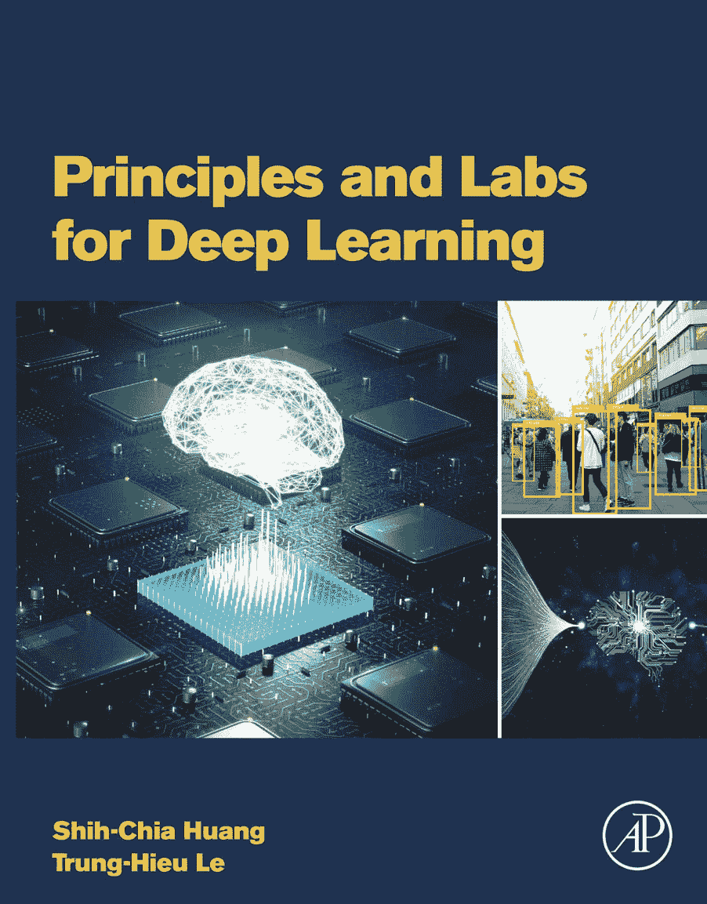

**黄世嘉 (Shih-Chia Huang)** - 教授，国立台北科技大学电子工程学系，台湾台北

**黎忠贤 (Trung-Hieu Le)** - 助理教授，国立台北科技大学电子工程学系，台湾台北；讲师，鸿工业教育大学信息技术学院，越南顺化


索引


**制作项目经理**：Swapna Srinivasan

# 前言

黄世家；Le Trung-Hieu，立台北科技大学电子工程学系，台湾台北

1943 年，Warren McCulloch 和 Walter Pitts 引入了一种基于阈值逻辑算法的计算模型，为人工智能（AI）的发展铺平了道路。人工智能研究领域始于 1956 年的达特茅斯人工智能夏季研究项目。在近 80 年的发展历史中，AI 经历了多次起伏，尤其是两次“AI 寒冬”，即 AI 研究资金投入减少且对人工智能研究兴趣下降的时期。

在 Google DeepMind 开发的基于深度学习的计算机围棋程序 AlphaGo 在 2015 年击败职业围棋手后，AI 再次引起了大量的研究关注。近年来，基于深度学习算法的 AI 取得了巨大进步，并成功应用于学术界和工业界的许多问题。认识到深度学习的潜力和力量，Google、Facebook、Microsoft、Tesla 等许多顶级科技公司已投入了大量的人力和资源，利用深度学习开发其产品。

本书作者深理解 AI 领域的重要性及其发展。因此，《深度学习原理与实验》旨在启发并帮助更多的学生、工程师和研究人员快速进入 AI 领域，并在他们的研究项目、产品和平台上开始应用深度学习。本书包含 12 章，内容兼顾了理论与实践。

- “TensorFlow 2 简介”章节
- “神经网络”章节
- “二分类问题”章节
- “多分类问题”章节
- “训练神经网络”章节
- “进阶 TensorFlow”章节
- “进阶 TensorBoard”章节
- “卷积神经网络架构”章节
- “迁移学习”章节
- “变分自编码器”章节
- “生成对抗网络”章节
- “目标检测”章节

每章的前半部分介绍并分析了相应的理论，帮助读者理解深度学习的核心基础。每章的后半部分通过精心设计并分步实施的示例程序，帮助读者巩固刚学到的知识。书中选用了最流行的开源库 `TensorFlow` 来实现示例程序。最后，每章都包含一个相应的实验（Lab）以及实现说明，以指导读者实践并完成特定的学习目标。书中的所有实验项目均可从 GitHub 下载：

## 环境安装

## 摘要

环境安装是开发机器学习模型的第一步。`Python` 和 `TensorFlow` 是构建这些模型广泛使用的编程语言和工具包。本章首先介绍了如何在 Windows 和 Ubuntu 操作系统上安装 `Python`、`TensorFlow` 以及必要的扩展包。接下来，介绍了 `Jupyter Notebook` 和 `PyCharm` IDE 的设置，分别用于编译简单和复杂的网络模型。最后，介绍了如何从 GitHub 下载书中所有的示例程序，以及如何运行代码示例，帮助读者熟悉这些工具包的使用。

**关键词：** `Python`；`TensorFlow`；`Jupyter Notebook`；`PyCharm`；Ubuntu 环境；Windows 环境

## 大纲

- 在 Windows 和 Ubuntu 操作系统上安装 `Python`、`TensorFlow` 和扩展包。
- 在 Windows 和 Ubuntu 操作系统上设置 `Jupyter Notebook` 和 `PyCharm` IDE。
- 从 GitHub 下载书中所有的示例程序，并通过 `Jupyter Notebook` 运行代码。

# 1: Python 安装

## 1.1: Windows 环境

要安装 `Python`，首先访问 Python 官网下载 Python 安装文件。`TensorFlow` 的版本需要 `Python3.4`、`Python3.5` 或 `Python3.6`，因此请务必安装这三个版本中的任意一个。以下将以 `Python3.6.8` 为示例。

3.6.8 安装文件如图 1 所示。

```
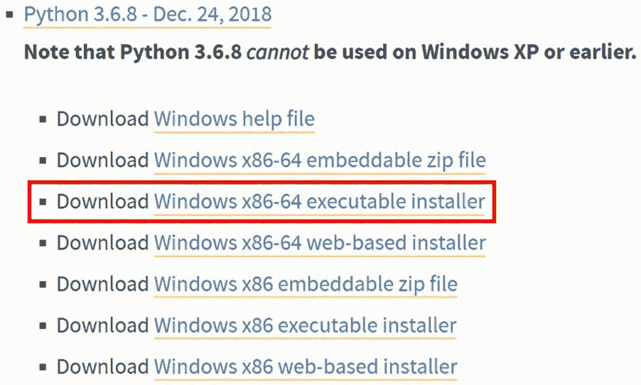图 1 下载 Python 安装文件。
```

`Python`：使用默认设置安装 `Python`，如图 2 所示。

```
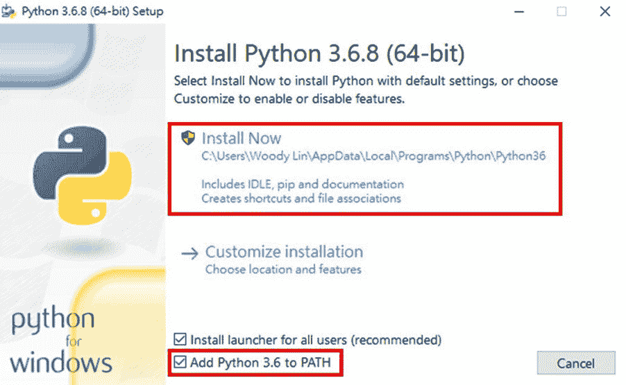图 2 安装 Python。
```

## 1.2: Ubuntu 环境

由于 Ubuntu 操作系统内置了 `Python`，本节省略 `Python` 的安装步骤。

# 2: TensorFlow 安装

安装 TensorFlow 有许多方法，例如使用本地安装、Virtualenv 虚拟机、Docker 等。本书使用了 TensorFlow 推荐的 Virtualenv 虚拟机，并介绍了在 Windows 和 Ubuntu 两个操作系统上带有 CPU 和 GPU 支持支持的 TensorFlow 安装方法。

## 2.1: Windows 环境

命令行提示符：按下“Windows 徽键 + R”打开“运行”框，然后输入 `cmd` 并点击“确定”，如图 3 所示。

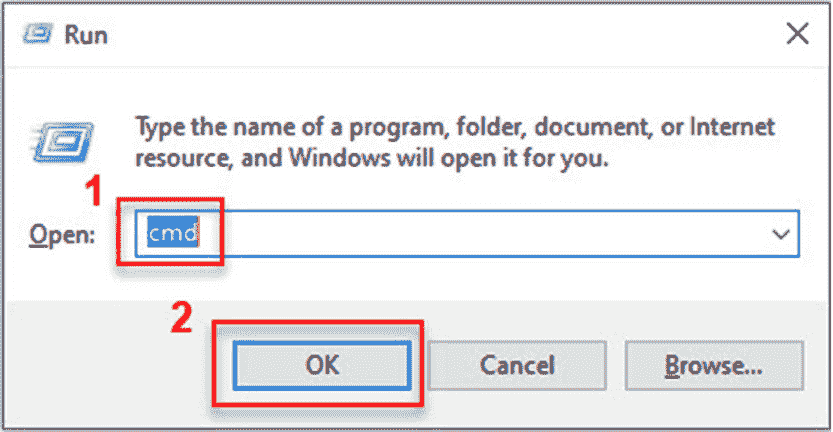

图 3 打开命令行提示符。

virtualenv 虚拟机：

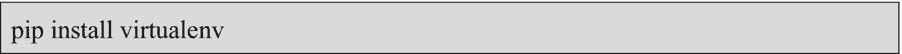

一个新的虚拟环境：在下方的命令行中，`tf2` 代表虚拟环境的名字。

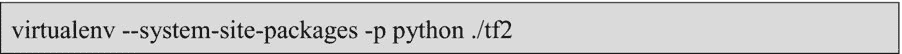

虚拟环境 (`tf2`)，如图 4 所示。

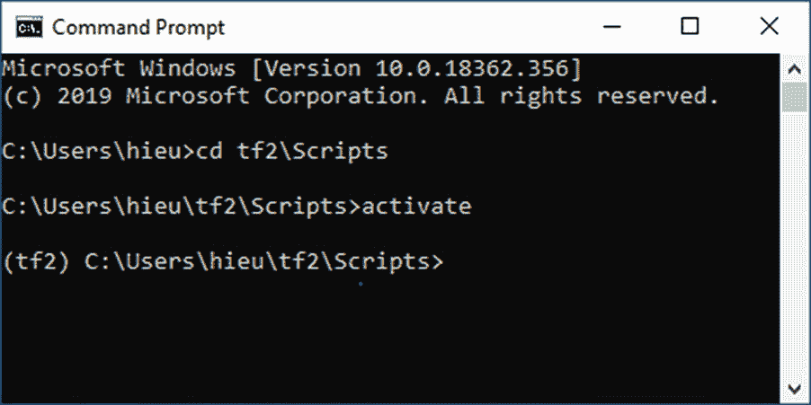

图 4 进入虚拟环境。

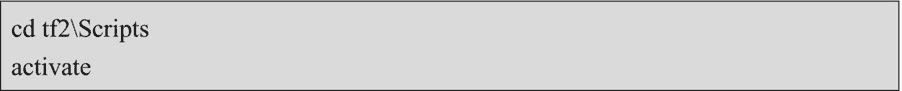

`pip` 版本：

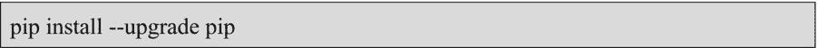

TensorFlow：TensorFlow 有两个版本的安装：TensorFlow CPU 支持和 TensorFlow GPU 支持。如果电脑拥有 Nvidia GPU 并且支持 CUDA，建议安装 TensorFlow GPU 支持。

CPU 支持：


GPU 支持：

首先，访问 `https://developer.nvidia.com/cuda-gpus` 检查显卡是否支持 CUDA。然后按照顺序安装显卡驱动、`CUDA10`、`cuDNN` 以及 TensorFlow GPU 版本。

显卡：访问 `www.nvidia.com/download/index.aspx?lang=en-us` 下载对应的显卡驱动，如图所示并安装。


图 5 下载显卡驱动。

在窗口中点击“Archive of Previous CUDA Releases”（旧版本 CUDA 存档），如图所示。

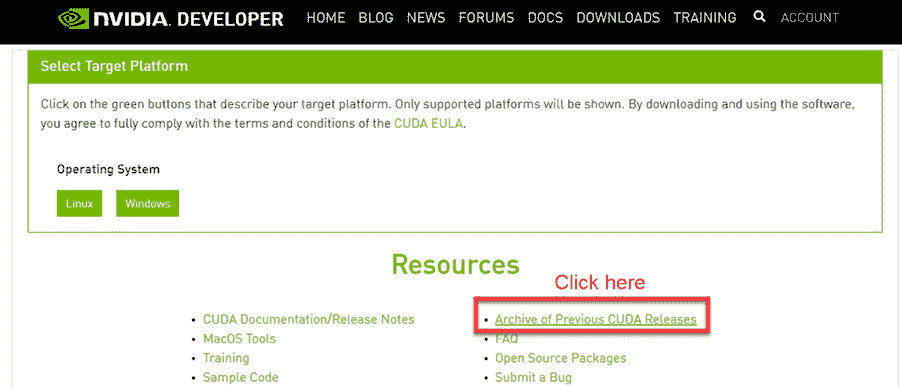

图 6 CUDA 下载页面。

`CUDA Toolkit 10.0` 的版本，如图 7 所示。

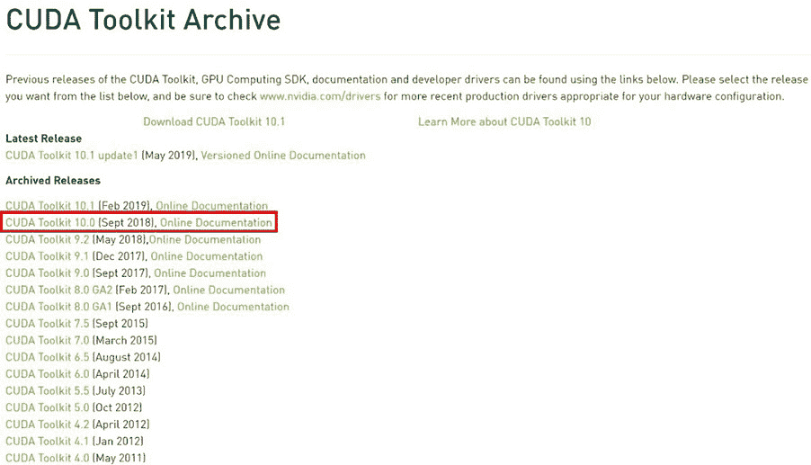

图 7 选择 CUDA 安装版本。

Windows 10 的安装包，下载并安装，如图 8 所示。

![图 8 下载 CUDA 安装文件。访问 `https://developer.nvidia.com/rdp/cudnn-download` 下载 `cuDNN`，如图所示。注意，需要登录才能下载。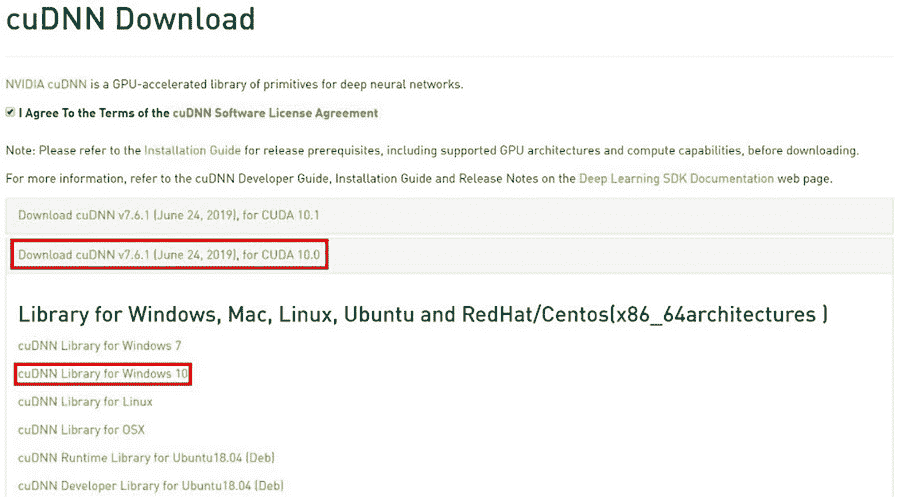

图 9 下载 cuDNN 安装文件。

从 cuDNN 解压文件夹中解压并三个三个到 CUDA 安装目录。步骤如下：

- 将 `< cuDNN 解压文件夹 > \cuda\bin\cudnn64_7.dll` 文件复制到 `C:\Program Files\NVIDIA GPU Computing Toolkit\CUDA\v10.0\bin` 目录
- 将 `< cuDNN 解压文件夹 > \cuda\include\cudnn.h` 文件复制到 `C:\Program Files\NVIDIA GPU Computing Toolkit\CUDA\v10.0\include` 目录
- 将 `< cuDNN 解压文件夹 > \cuda\lib\x64\cudnn.lib` 文件复制到 `C:\Program Files\NVIDIA GPU Computing Toolkit\CUDA\v10.0\lib\x64` 目录

TensorFlow GPU

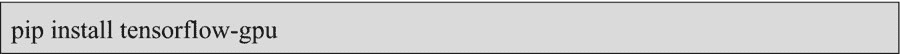

安装：

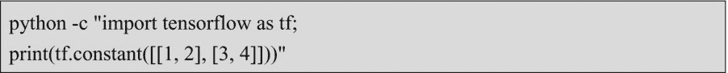

## 2.2: Ubuntu 环境

终端，如图 10 所示。

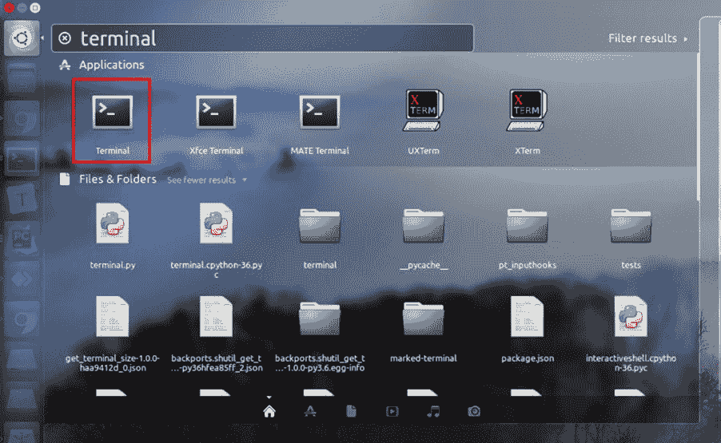

图 10 打开终端。

`pip`：


virtualenv 虚拟机：


一个新的虚拟环境：在下方的命令行中，`tf2` 代表虚拟环境的名字。


虚拟环境 (`tf2`)：


`pip` 版本：


TensorFlow：TensorFlow 有两个版本的安装：TensorFlow CPU 支持和 TensorFlow GPU 支持。

CPU 支持：


GPU 支持：访问 `developer.nvidia.com/cuda-gpus` 检查显卡是否支持 CUDA，然后按照 `https://www.tensorflow.org/install#ubuntu` 的指令安装驱动和库。

使用 pip 包安装 TensorFlow GPU 支持：


安装：

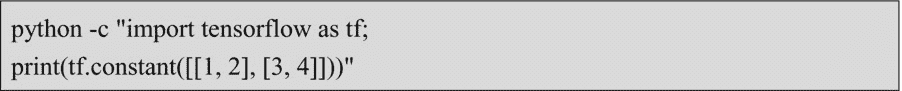

### 补充说明

与直接安装“本地 Python”的环境相比，通过“Virtualenv 虚拟机”或“Docker”可以创建多个环境，其中不同版本的 TensorFlow 互不影响。因此，强烈建议使用“Virtualenv 虚拟机”或“Docker”安装软件包。

# 3: Python 扩展安装

Windows 和 Ubuntu 的扩展安装方法相同。首先在 Ubuntu 上打开终端或在 Windows 上打开命令行提示符，然后进入已安装的 Virtualenv 虚拟机，最后在窗口中输入命令。

开源库，用于处理数组并支持大型多维矩阵。安装 Numpy，执行以下命令：


Python 绘图库，支持绘制静态和动态可视化。安装 Matplotlib，执行以下命令：

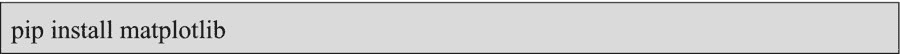

基于 Python 构建的库，用于数据处理和分析。安装 Pandas，执行以下命令：

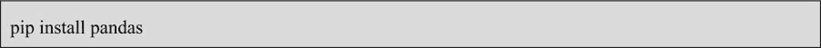

开源库，为计算机视觉应用（如图像处理、目标检测、人脸识别等）提供通用基础。安装 OpenCV，执行以下命令：


TensorFlow 扩展包，包含许多由于通用性局限或不常用而未添加到 TensorFlow 核心的新功能。安装 TensorFlow Addons，执行以下命令：

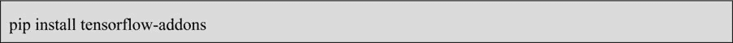

一组可用于特定用途（如开发、训练或测试机器学习模型）的数据集。所有数据集均可以通过 `tf.data.Datasets` API 获取。安装 TensorFlow Datasets，执行以下命令：

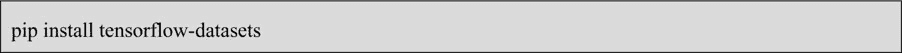

预训练机器学习和深度学习模型库，可以通过迁移学习或微调技术重用这些模型，从而用更少的训练数据和时间处理新任务。安装 TensorFlow Hub，执行以下命令。

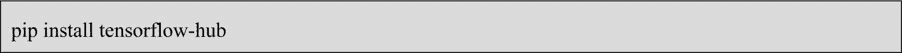

# 4: Jupyter notebook

Jupyter Notebook 是一个基于 Web 的交互式应用程序，支持创建和共享包含实时代码、叙述性文本和可视化内容的文档。“Jupyter”名称源于三个核心编程语言：Julia、`Python` 和 `R`。通过 Jupyter Notebook，可以连接许多支持超过四十种语言的内核（kernels）。`IPython` 内核允许在 `Python` 中编写源代码，它被设为 Jupyter Notebook 的默认内核。下面介绍了在 Windows 和 Ubuntu 操作系统上安装 Jupyter Notebook 的方法。

## 4.1: Jupyter notebook 安装

环境

Jupyter Notebook：请运行以下命令。

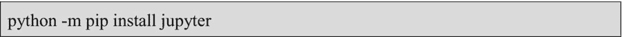

将虚拟环境关联到 Jupyter Notebook：命令行中的 `tf2` 代表虚拟环境的名字。

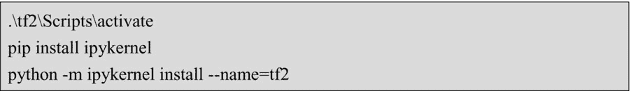

环境

Jupyter Notebook：请运行以下命令。

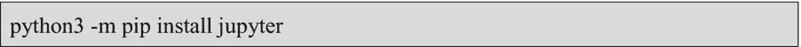

将虚拟环境关联到 Jupyter Notebook：命令行中的 `tf2` 代表虚拟环境的名字。

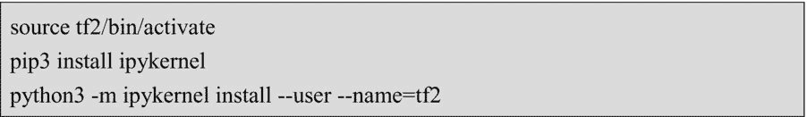

## 4.2: 设置并创建新项目

Jupyter Notebook：请运行以下命令。


执行文件：

点击窗口右上角的“New”（新建）图标，然后点击已安装的 `Python` 解释器（在 Jupyter 中称为 `kernel`）以启动，如图所示。这里有三种不同的内核：

- 本地 Python (Local Python)
- 虚拟机 Python，包含之前安装的 `TensorFlow-cpu` 版本
- 虚拟机 Python，包含之前安装的 `TensorFlow-gpu` 版本

`kernel`：进入 Python 文件后，选择 `Kernel` → `Change kernel` → `select kernel`。右上角将显示当前正在使用的内核，如图所示。

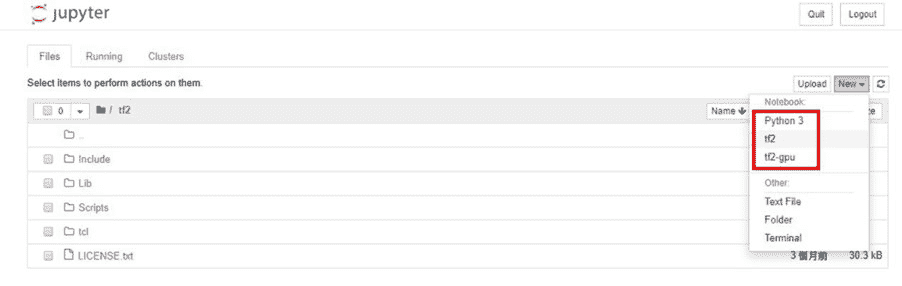图. 11 创建执行文件。

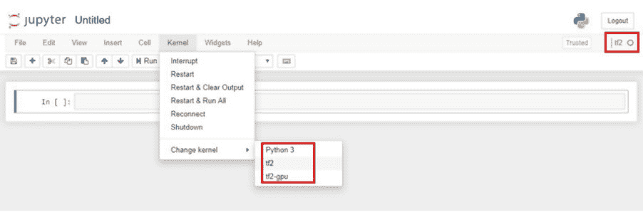图. 12 选择内核。

## 4.3: Jupyter Notebook 操作

模式：Jupyter Notebook 有两种模式，编辑模式（Edit Mode）和命令模式（Command Mode）。

模式：编写代码的模式，可以通过绿色边框和绿色左边距的单元格来识别，如图所示。

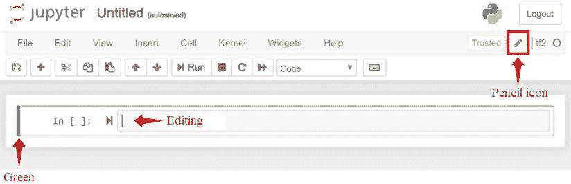图. 13 编辑模式。

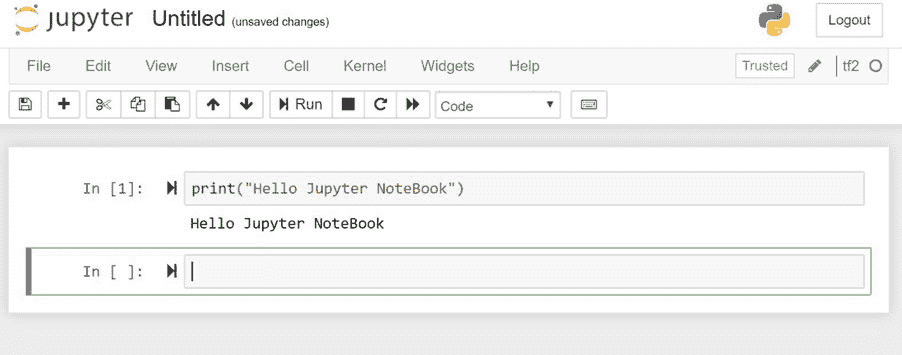图. 14 在编辑模式下运行代码。

进入编辑模式请按“Enter”键或直接点击单元格。进入后，要测试此模式，在单元格中输入 `print (“Hello Jupyter Notebook”)`，然后按 `Shift + Enter` 运行并查看结果，如图所示。

编辑 Notebook 的模式，可以通过灰色边框和蓝色左边距的单元格来识别，如图所示。进入命令模式请按 `Esc` 键或点击单元格任意区域。

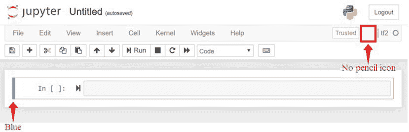图. 15 命令模式。

在 Jupyter Notebook 中

导航：在 Notebook 界面鼠标执行任何操作，如选择内核、进入模式、运行选定的单元格等。

导航：使用键盘快捷键执行特定操作，如运行当前单元格、保存程序、在上方插入单元格、复制选定的单元格等。要查看快捷键及其功能，请参考菜单栏中的“Help → Keyboard Shortcuts”，或点击工具栏上的“键盘”图标，如图所示。

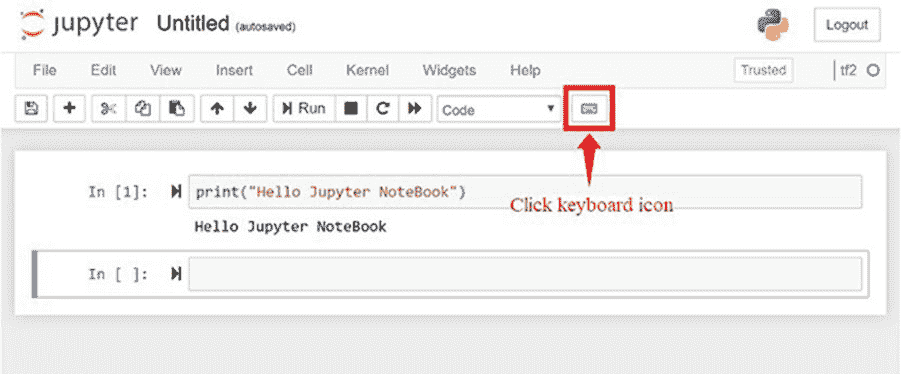图. 16 显示快捷键的图标。

Jupyter Notebook 中的某些快捷键及其功能如图所示

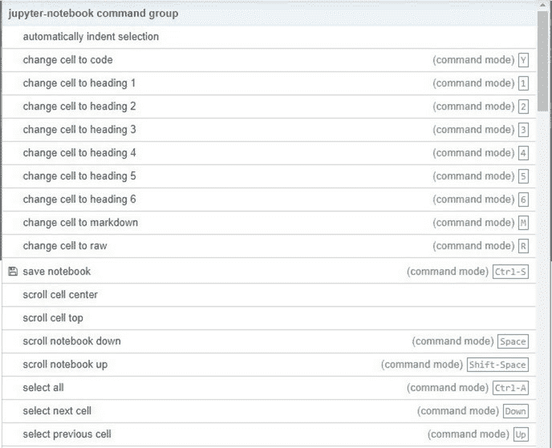图. 17 Jupyter Notebook 中的快捷键。

# 5: PyCharm IDE

## 5.1: PyCharm 安装

PyCharm 是计算机编程领域最强大的集成开发环境（IDE）之一。它由一家捷克软件开发公司开发，具有许多功能，包括代码辅助、项目和代码导航、图形调试器、支持 Web 框架等。因此，建议使用 PyCharm 实现复杂的程序。下载 PyCharm 安装包请访问官方网站：那里有适用于 Windows 和 Ubuntu 操作系统的专业版和社区版。社区版免费使用，而专业版需要付费，如图所示。下载后请按照安装步骤进行安装。

图. 18 下载 PyCharm 页面。

补充说明

备注：如果您是学生或教师，可以访问 `www.jetbrains.com/student/` 申请免费的教育许可证来使用 PyCharm 专业版。在使用一年后仍是学生或教师，可以免费续签许可证。

## 5.2: 设置并创建新项目

安装 PyCharm 后，需要进行环境设置。

UI 主题：可以设置为 Darcula 或 Light，如图所示。UI 主题以后可以在 Settings（设置）中更改。

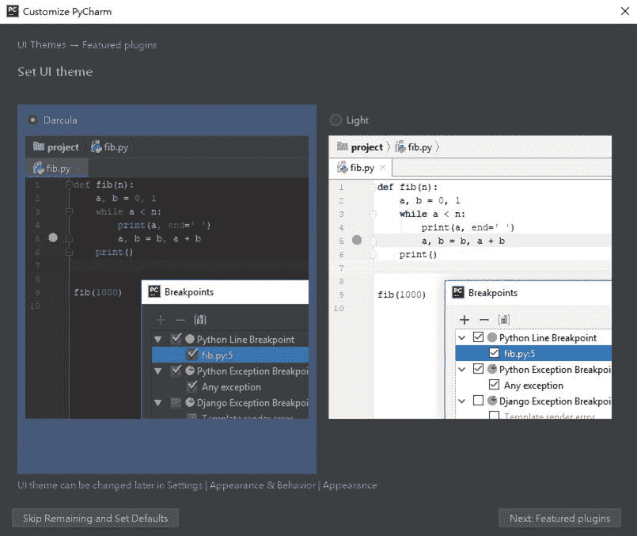图. 19 设置 UI 主题。

其他插件：PyCharm 在其仓库中提供了几个插件供下载和安装。如果没有必要，可以跳过此步骤，如图所示。

图. 20 在 PyCharm 中下载特色插件。

新项目：在 PyCharm 窗口上点击“Create New Project”（新建项目），如图所示。


图. 21 在 PyCharm 中创建新项目。

或为项目创建一个目录，如图所示。

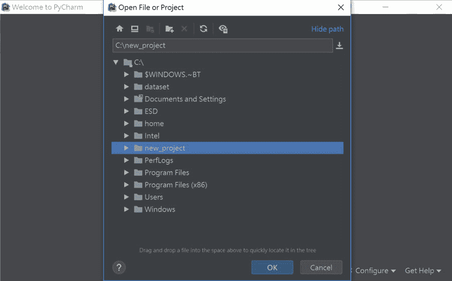

图. 22 为新项目创建或选择目录。

Python 执行文件：右键点击项目名称 → `New` → `Python File`，如图所示。


图. 23 在 PyCharm 中创建新的 Python 执行文件。

Python 解释器：点击 `File` → `Settings` → `Project: Code` → `Project Interpreter` → `Add` → `Virtualenv Environment` → `Existing environment` → 选择虚拟机，如 `tf2` 或 `tf2-gpu`（请参考 TensorFlow 安装），如图所示。

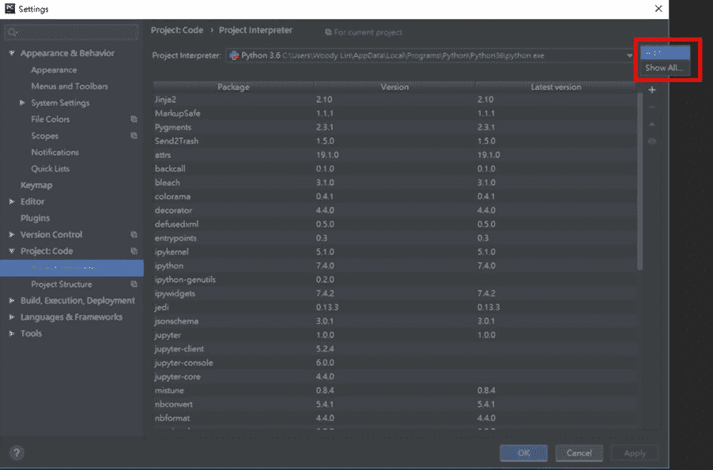

图. 24 项目解释器。

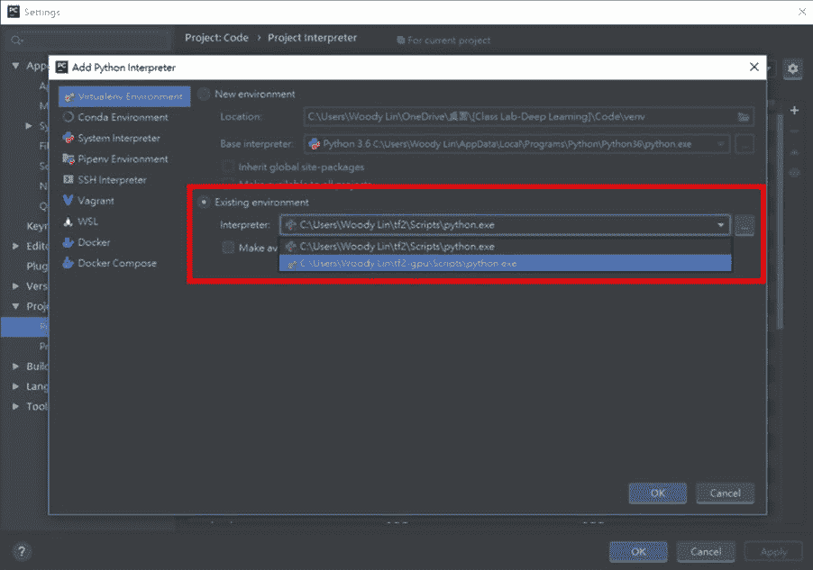

图. 25 选择现有的虚拟环境。

Python 文件：可以使用项目窗口右上角的图标按钮或右键点击 Python 文件来运行它，如图所示。

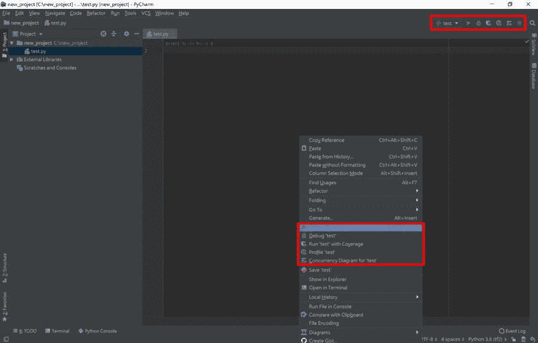

图. 26 运行 Python 文件。

## 5.3 PyCharm 快捷键

PyCharm 提供了快捷键，用于快速执行大多数与编辑、调试、导航等相关的任务。这有助于用户在不离开键盘的情况下更高效地工作。要查看 PyCharm 中所有的快捷键及其功能，请点击菜单栏中的“Help ➔ Keymap Reference”，如图 27 和 28 所示。

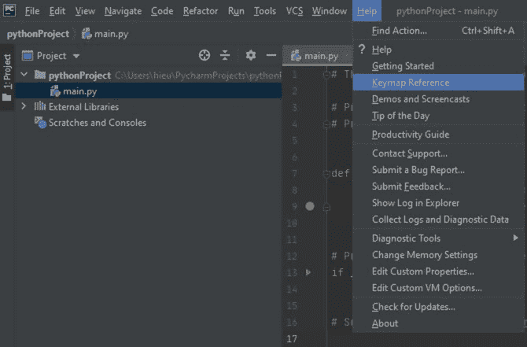

图. 27 PyCharm 中的帮助菜单。

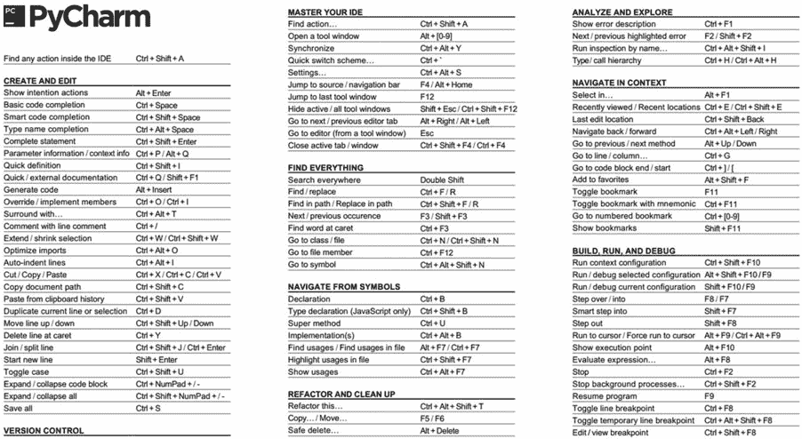

图. 28 PyCharm 中的快捷键。

# 6 GitHub labs

## 6.1 下载源代码

书中的 Labs 源代码托管在 GitHub 上。要下载所有 Labs，请访问 GitHub URL：然后点击“Code → Download ZIP”下载 Zip 文件，如图。下载完成后，你必须解压此文件才能打开和运行。

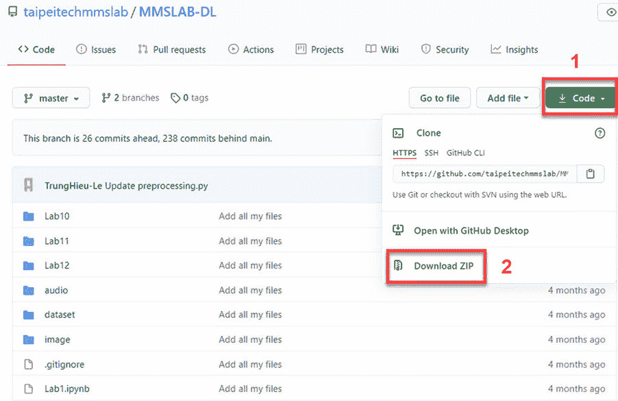

图 29 GitHub 上书中的 Labs。

## 6.2 打开并运行源代码

假设项目目录路径为`C:\Users\mmslab\Deep-Learning-Book-master`。要打开项目，进入`Deep-Learning-Book-master`文件夹。

### Windows 环境

打开命令提示符并运行以下命令：

```
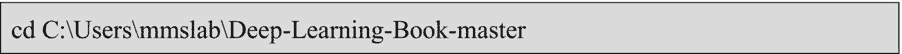
```

### Ubuntu 环境

打开终端并运行以下命令：

```
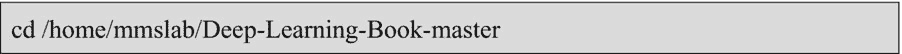
```

### Jupyter Notebook

运行以下命令，结果所示：

```
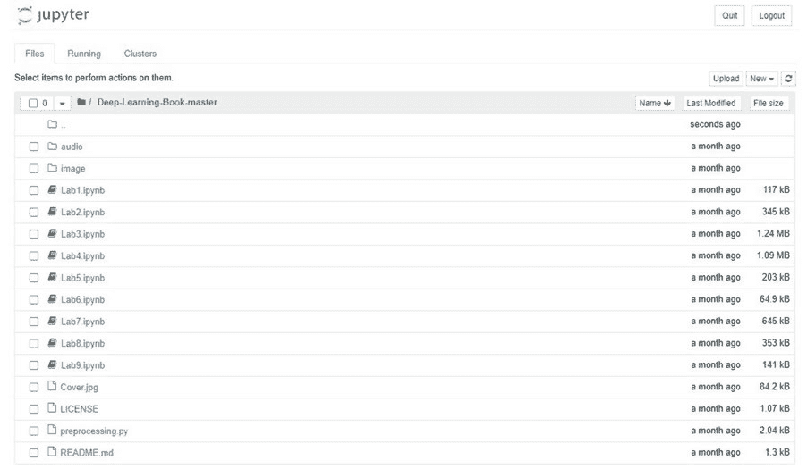
```

图 30 通过 Jupyter Notebook 打开项目。

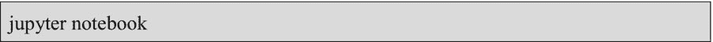

打开特定 Lab 的程序，点击项目中的相应文件。例如，要打开 Lab1 的代码，请点击`Lab1.ipynb`文件，如图：

```
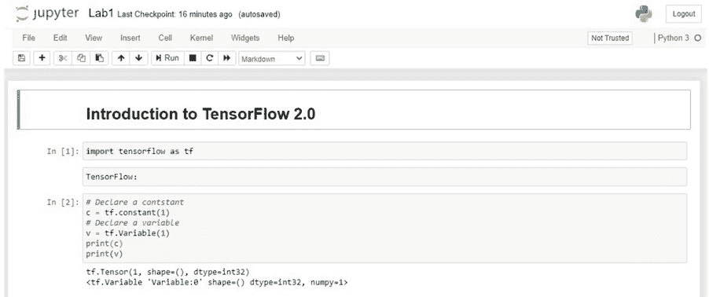
```

图 31 Lab1 的源代码。

运行程序，点击“快进图标”，如图：

```
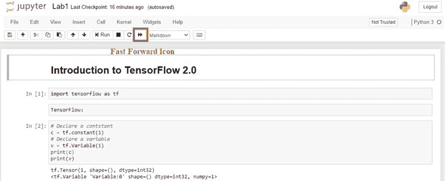
```

图 32 在 Jupyter Notebook 上运行代码。

# 第 1 章：TensorFlow 2 简介

## 摘要

目前已引入许多开源工具用于开发和训练机器学习模型。与其他工具包相比，TensorFlow 在 GitHub 上吸引了最多的用户。TensorFlow 2 是 TensorFlow 1 的改进版本，侧重于简单的执行、易的模型构建和稳健的模型部署。本章详细介绍了 TensorFlow 2 的三个主要更新功能：(1) 动态执行（eager execution），提供了一个可以立即评估操作而无需构建图的编程环境；(2) Keras，一个高层应用程序编程接口（API），用于快速方便地设计和训练网络模型；(3) `tf.data`，一个允许用简单方式构建复杂输入流水线的 API。

**关键词**

TensorFlow 2；动态执行；Keras；序列模型；函数式模型

**大纲**

- 了解深度学习

- TensorFlow 2

- 从 TensorFlow 2 开始

- 使用`tf.keras`构建神经网络

- 使用`tf.data`构建输入流水线

## 1.1 深度学习

### 1.1.1 深度学习简介

人工智能（AI）是指赋予机器学习和模仿人类行为的能力。它主要用于辅助人类，特别是取代高重复、低技能的工作。AI 是一个综合领域，包括进化计算、专家系统、符号 AI、支持向量机（SVMs）、机器学习、深度学习和强化学习。机器学习是 AI 的一个分支，涉及强化学习、深度学习等。深度学习是指使用神经网络，即输入层、隐藏层和输出层。深度学习中的“深”指的是使用多层对数据进行转换层。它是目前最流行的技术，因为它支持神经网络，如图所示。


图 1 深度学习

在深度学习中，一组数据被输入神经网络，神经网络被描述为通过有向图的一系列计算步骤。通过使用`CNTK`构建深度学习模型，网络的权重将得到更新。深度学习广泛应用于计算机视觉、语音识别和自然语言等领域。

### 1.1.2 深度学习工具包

目前已引入许多开源工具用于开发和训练机器学习模型。最流行的深度学习工具包如下：

- **TensorFlow**：一个用 Python 和 C++ 编写的端到端开源平台，提供了全面的工具和库生态系统，帮助开发者轻松地构建和部署机器学习模型。

- **Keras**：一个用 Python 编写的高层应用程序编程接口（API），允许在 TensorFlow、Theano 和 CNTK 等其他工具包之上进行快速实验。

- **Caffe**：一个由伯克利人工智能研究中心开发的用 C++ 编写的深度学习框架；模型和优化可以通过配置来表示，而无需硬编码。

- **MXNet**：一个高效的深度学习库，可以快速训练网络模型并支持多种编程语言，包括 Python、Scala、Clojure、Java、Julia、Perl、C++ 和 R。

- **Theano**：一个 Python 库，用于高效地优化和评估有关多维数组的数学表达式。通过图形处理器（GPU），可以通过 Theano 高效执行符号微分。

- **CNTK**：微软认知工具包；深度学习模型被描述为通过有向图的一系列计算步骤。

- **DL4J**：一个用 Java 编写的分布式深度学习库，兼容 Java 虚拟机语言，即 Scala、Clojure 或 Kotlin。在运行多个 GPU 时，DeepLearning4J 的性能与 Caffe 相当。

- **PyTorch**：一个 Python 软件包，提供类似 Numpy 的张量计算，具有加速的 GPU 性能，并支持具有最大灵活性的神经网络库。

- **Chainer**：一个基于 Python 的深度学习框架，通过提供自动微分 API 和面向对象的高层 API 来支持构建和训练神经网络。

- **DIGITS**：学习 GPU 训练系统；一个支持 Caffe、TensorFlow 和 Torch 等框架的 Web 应用，用于加速图像分类、分割和目标检测任务的神经网络模型训练。

## 1.2 TensorFlow 简介

TensorFlow [3] 是由 Google Brain 团队开发的端到端开源平台，它使用数据流图来构建机器学习和深度学习模型。

### 张量数据表示

`Tensor` 是一个具有统一类型（a）的多维数组。TensorFlow 中的所有计算都基于张量。这里列出了创建基础张量的示例。

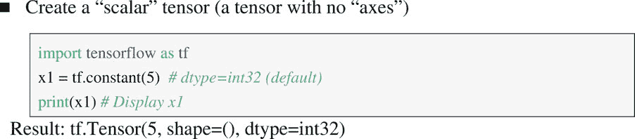 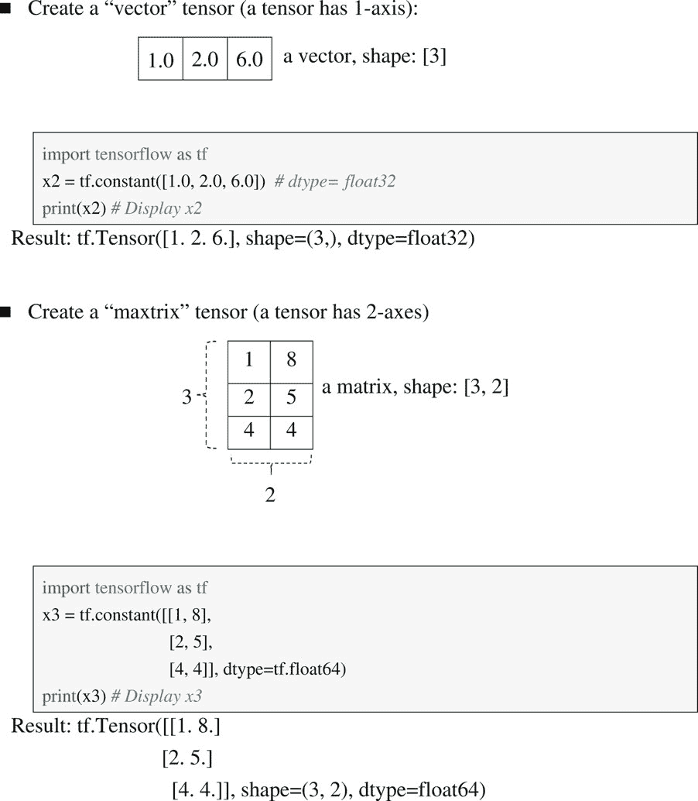 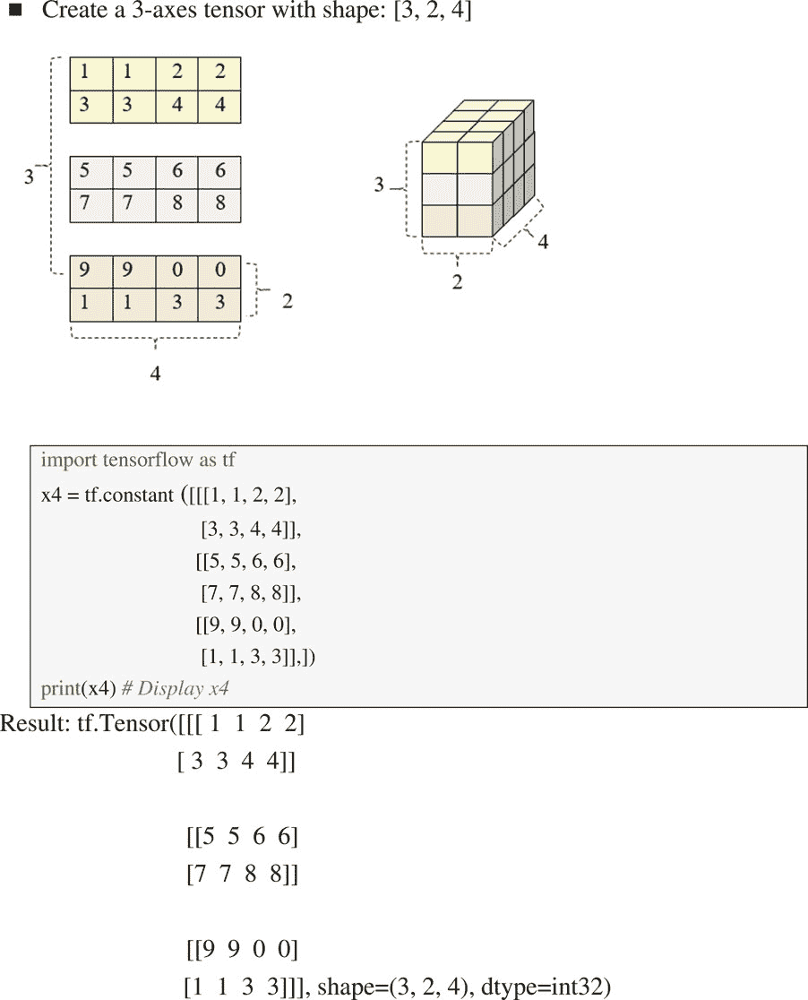

### 计算图

TensorFlow 通过使用数据流图来表示计算。在计算图中，每个节点代表一种操作（如加法、减法、乘法、除法等），边代表节点之间的关联。在执行每个操作后，将形成一个新张量用于下次计算。

例如，使用 TensorFlow 展示数学公式的源代码所示：

```
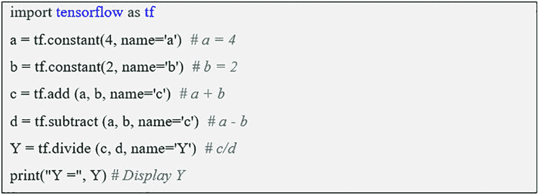
```

上述程序的计算图如图所示。注意，TensorFlow 使用 TensorBoard 来绘制图形；我们将在章节中介绍这一功能。图中从左侧开始，常量`a`和`b`连接到加法（Add）和减法（Sub）操作节点进行计算，然后`Add`节点和`Sub`节点产生的张量连接到除法（Div）操作节点以计算最终结果。


图 1.2 `Y = (a + b)/(a - b)`的计算图。

在 TensorFlow 1 中，首先生成计算图，然后创建一个 session 来执行该图。这种技术被称为静态计算图。为了帮助用户轻松上手 TensorFlow 并调试程序，TensorFlow 2 引入了激进执行（Eager execution），这是一种命令式编程环境，可以立即执行操作而无需构建图；它减少了样板代码。除了激进执行，TensorFlow 2 还有许多变化，我们将在下一节介绍。

## 1.3 TensorFlow 2 的改进

TensorFlow 2 是 TensorFlow 1 的改进版本，侧重于简单的执行、易的模型构建和健壮的模型部署。TensorFlow 2 有六个主要更新功能：激进执行、Keras、`tf.data`、TensorFlow Hub、分布式策略（Distribution Strategy）和 SavedModel。前三个功能将在下一节讨论。后续章节将讨论其他功能。

- **Execution (执行)**：一个用于机器学习和深度学习研究与实验的灵活平台，提供命令式编程环境，操作可以立即求值而无需构建图。

- **Keras**：构建在 TensorFlow 2 之上的高级 API，用于快速方便地设计和训练网络模型。TensorFlow 2 内置的 Keras 可以通过`tf.keras`函数使用。

- **tf.data**：允许用户以简单方式构建复杂输入流水线的 API。该 API 可以处理大量数据并读取不同格式的数据。

- **Hub**：存储已训练机器学习和深度学习模型的地方，用于特定目的的复用，例如通过微调网络模型以用更少的训练数据和时间来解决新任务。

- **Strategy (策略)**：`tf.distribute.Strategy`，一种 TensorFlow API，用于将现有模型的训练分布到多个设备（如 GPU 或 TPU）上。

- **SavedModel**：TensorFlow 2 标准化了一个统一格式，用于存储带有权重的完整网络模型。使用 SavedModel，可以将训练好的模型部署到许多平台或设备，如智能手机、树莓派甚至网页。

图 1.3 显示了 TensorFlow 2 的简化概念图。所示，该图由两个阶段组成：(1) 训练阶段和 (2) 部署阶段。训练阶段从使用`tf.data` API 读取和处理输入流水线数据、从 TensorFlow Hub 加载预训练模型权重进行微调、使用`tf.keras` API 构建神经网络、使用分布式策略训练模型以及使用`SavedModel`保存模型权重。在部署阶段，训练好的模型可以通过不同的库部署到不同的设备或平台。

- **Lite**：一个用于将训练好的机器学习模型转换为压缩的 flat buffer 并部署到移动和物联网（IoT）设备上的库。

- **FlowJS**：一个用于将训练好的机器学习模型部署在 JavaScript 环境（如浏览器或 Node.js）中的库。

- **Serving**：一个用于机器学习和深度学习模型的灵活部署系统，允许在服务器架构不变的情况下部署新算法。2 还支持 Java、C、Go 等其他语言。


图 1.3 TensorFlow 2 的简化概念图。

## 1.4 激进执行 (Eager execution)

### 1.4.1 激进执行简介

通过激进执行平台立即求值操作是 TensorFlow 2 中最重要的更新功能之一。与 TensorFlow 1 不同（它通过先构建计算图然后设置 session 来执行生成的图），TensorFlow 2 中的激进执行提供了一个编程环境，操作可以立即求值而无需构建图。这使用户能够通过即时错误报告更容易地进行调试，并简化动态模型的规范。

激进执行的重要特性如下：

- 操作的求值。

- 程序的调试。

- 不需要构建计算图。

- 无需`tf.Session.run`即可返回计算结果。

TensorFlow 1 和 TensorFlow 2 的对比：

1. 代码：

```

```

2. 代码：

```

```

### 1.4.2 TensorFlow 操作

本节展示了一个简单的程序，首先检查激进执行以确保其已激活。然后，介绍并执行了一些基础操作，如加法、减法、乘法等，帮助读者理解一个完整的 TensorFlow 程序。

     

补充说明

TensorFlow 的数据格式可能与其他库（如 OpenCV 或 Matplotlib）不同。当发生数据类型错误时，最快的解决方案是将数据转换为 Numpy 格式，因为该格式适用于大多数 Python 包。

## 1.5 Keras

### 1.5.1 Keras 简介

`Keras`由 François Chollet 于 2014 年引入，是一个开源深度学习库，旨在快速构建和训练神经网络模型。`Keras`本身没有低层操作；它运行在被称为“后端”（backend）的开源深度学习库之上，例如`TensorFlow`、`CNTK`和`Theano`。`Keras`默认使用`TensorFlow`后端；可以通过`use_backend()`函数将其更改为`CNTK`后端或`Theano`后端。`Keras`集成了许多常用的神经网络构建模块，用于高效地设计模型，例如卷积层、损失函数、激活函数、优化器等。在`TensorFlow 2`中，`Keras`是高层 API，因此没有需要安装任何额外的`Keras`包；可以直接通过`tf.keras` API 直接使用。强烈建议使用`tf.keras` API 而不是`Keras` API，因为`tf.keras`支持 TensorFlow 操作、动态执行（Eager Execution）、`tf.data`、TPU 训练等。以下介绍了 Keras 中构建网络模型的两种最常用方法，包括顺序模型（sequential models）和函数模型（functional models）。

以下网络层用于设计网络模型（后续章节将介绍有关这些层的更多细节）：

* 全连接层。

* 卷积层。

* 用于将张量展平为一维张量。通常插入在卷积层和全连接层之间。

* 用于添加具有相同形状的张量列表并输出单个张量。

* 用于拼接张量列表；除拼接轴外，所有张量的形状都相同。

### 补充说明

使用`tensorflow.keras.utils.plot_model`需要额外安装`pydot`和`graphviz`包。

**Ubuntu**：打开终端并输入以下命令：

**Windows**：打开命令提示符并输入以下命令：

* 访问`https://graphviz.gitlab.io/_pages/Download/windows/graphviz-2.38.msi`下载并安装`graphviz`包，如图 1.4 所示。


图 1.4 下载 Graphviz 2.38。

* 将`graphviz/bin`安装路径添加到“新建系统变量”中：控制面板 → 系统 → 高级系统设置 → 环境变量，如图 1.5 所示。


图 1.5 新环境变量。

## 1.5.2 顺序模型 (Sequential model)

顺序模型是以系统方式逐层构建深度学习网络的方法。图 1.6 显示了一个顺序网络，它从输入层开始，连接到隐藏层 1。然后，隐藏层 1 连接到隐藏层 2，最后，隐藏层 2 和输出层相互连接形成一个完整模型。`Keras`提供了顺序模型 API 用于快速、地构建网络模型。然而，顺序模型的构建方法具有一些局限性：

* 允许创建单输入单输出的模型。

* 不允许创建共享层的模型。

* 不允许构建具有多个输入或输出的模型。


图 1.6 单输入输出模型。

在这里，我们介绍两种构建顺序网络模型的方法，以图像分类问题为例。该模型有一个大小为 28 × 28 的输入，它将被展平为大小为 784 的一维向量；两个带有线性整流单元（ReLU）激活函数的隐藏层（全连接层）；以及一个用于分类的输出层 softmax 层。

 

## 1.5.3 函数模型 (Functional model)


Keras 函数 API 是一种通过层的有向无环图来构建网络模型的方法。按照这种方法，首先创建层的实例，然后将它们成对地连接起来，最后指定作为网络输入和输出的层。使用 Keras 函数 API 定义网络模型有三个步骤：

1. **（定义输入）**：与顺序模型不同，需要首先定义具有特定输入数据大小的输入层。
2. **（连接层）**：这一步通过在声明新层时指定其输入来自何处来完成。
3. **（创建模型）**：在所有层都声明并连接后，需要指定模型的输入和输出以完成模型创建。

Keras 函数 API 在创建复杂模型方面非常灵活，特别是对于具有多个输入、多个输出或多个输入多个输出的模型，如图所示。我们稍后介绍的用于目标检测、图像分割、生成对抗网络等高级应用的所有复杂模型，都可以使用 Keras 函数 API 构建。

 图 1.7 不同网络模型图。

 图 1.8 使用 `tf.data` API 处理输入数据流水线。注意，ML 和 DL 分别是机器学习（machine learning）和深度学习（deep learning）的缩写。

以下介绍了如何使用 Keras 函数 API 构建图 1.7 所示的四种网络模型。

### 输入输出模型

例如，一个模型有一个大小为 28 × 28 的输入，它被展平为大小为 784 的一维向量；两个隐藏层 `hidden1` 和 `hidden2` 以及一个名为 `Output` 的输出层，接 softmax 函数用于分类。构建模型的代码如下：

```
 
```

### 多输入单输出模型

例如，一个商品预测模型由两个输入组成，包括图像和品牌，以及一个大小为 (1,) 的预测输出。大小为 (128, 128, 3) 的图像输入通过两个隐藏层 `hidden1_1` 和 `hidden1_2`，大小为 (1,) 的品牌输入通过隐藏层 `hidden1_3`。合并两个输入信息后，生成的特征发送到另一个隐藏层 `hidden2`。然后，`hidden2` 层的输出作为密集层 `Output` 的输入进行价格预测。构建此模型的代码如下：

```
 
```

### 单输入多输出模型

例如，肖像识别模型有一个输入两个输出。模型的输入是大小为 (128, 128, 3) 的个人照片，它通过三个隐藏层 `hidden1`、`hidden2` 和 `hidden3`。在展平最后一个隐藏层（`hidden3`）的输出后，将其发送到两个输出层 `Age_Output` 和 `Gender_Output` 分用于年龄和性别预测。构建模型的代码如下：

```
 
```

### 多输入多输出模型

例如，一个天气预测模型有两个输入（卫星云图和气候信息），以及三个输出（降水概率、温度和湿度）。大小为 (256x256x3) 的卫星云图通过三个隐藏层 `hidden1`、`hidden2` 和 `hidden3`，大小为 (10,) 的气候信息通过一个密集层。在合并两个输入信息后，模型分别通过 `Output1`、`Output2` 和 `Output3` 层输出包括降水概率、温度和湿度气候信息。构建模型的代码如下：

```
 
```

## 1.6: Tf.data

### 1.6.1: `tf.data` 简介

准备数据并将数据输入模型中是训练机器学习和深度学习模型的第一步。如果构建数据输入流水线的方法导致 CPU 花费长时间加载数据，从而导致 GPU 需要等待 CPU，这可能会导致性能问题。为了防止 GPU 出现数据饥饿，TensorFlow 提供了 `tf.data` API，以有助于构建复杂且高度优化的数据流水线。如图所示，在数据发送到机器学习或深度学习模型之前，通过 `tf.data` 经过三个阶段进行处理：提取阶段、转换阶段和加载阶段。

从本地磁盘（SSD、HDD）、云存储等存储设备中读取数据是数据流水线的第一步，`tf.data` 支持读取许多数据格式。图 1.9 展示了使用 `tf.data` 读取和表示数据的示例。请注意，如果此步中的数据直接传递给模型，那么在每次训练迭代中将取表示数据中的某行。一个大小为 5 TB 的数据集和一个运行 16 GB 内存的 CPU 在训练模型时将遇到困难。

 图 1.9 使用 `tf.data` 读取和表示数据。

在读取和表示数据后，通常下一步是打乱数据并创建小批次（mini-batches）。`tf.data` 使用 `tf.data.Dataset` 完成此任务，如图 10 所示。 使用 `tf.data` 打乱数据。

转换阶段之后，数据被加载到 GPU 或 TPU 等设备中进行训练。`tf.data` API 提供数据的预取、并行输入输出（I/O）以及批次的并行处理，如图 12 所示。 使用 `tf.data` 加载数据。

### 1.6.2: `tf.data` 基本函数

本节提供了一些使用 `tf.data` API 的示例程序，用于创建数据、设置属性、检索数据等。注意需要顺序执行代码的每一行。

### 使用单个元素创建数据集

 遍历列表、元组、字符串等序列进行循环：(image-3xt9lm6.jpg)

### 使用计数创建数据集

 从源数据创建数据集 (image-1teguj4.jpg)

### 通过合并创建新数据集

 使用切片创建数据集 (image-jcpon4iz.jpg) (image-r50.jpg)

### 使用特定函数转换数据

 数据集中的样本可以命名：(image-c8nil3.jpg)

### 设置每个批次的大小

 随机打乱数据集的元素。缓冲区填充 `buffer_size` 个元素，然后对缓冲区中的元素进行随机采样，并用新元素替换所选元素。建议将 `buffer_size` 设置为大于等于数据集的大小。(image-4rhqr1lo.jpg) 在完成所有样本读取后，除非使用 `repeat` 函数，否则无法再次读取。设置 `repeat(n)` 允许数据集重复 `n` 次 (image-evginwo9.jpg) (image-bb9lly.jpg)

### 参考文献

[1] Dargan S., Kumar M., Ayyagari M., Kumar G. A survey of deep learning and its applications: a new paradigm to machine Arch. Computat. Methods Eng. 2020;27:1071–1092. doi:10.1007/s11831-019-9344-w.

[2] Zacharias J., Barz M., Sonntag D. A survey on deep learning toolkits and libraries for intelligent user CoRR; 2018. vol. abs/1803.0418.

[3] Abadi M., Agarwal A., Barham P., Brecardo E., Chen Z., Citro C., Corrado G., Davis A., Dean J., Devin M., Ghemawat S., Goodfellow I., Harp A., Irving G., Isard M., Jia Y., Jozefowicz R., Kaiser L., Kudlur M., Levenberg J., Mane D., Monga R., Moore S., Murray D., Olah C., Schuster M., Shlens J., Steiner B., Sutskever I., Talwar K., Tucker P., Vanhoucke V., Vasudevan V., Viegas F., Vinyals O., Warden P., Wattenberg M., Wicke M., Yu Y., Zheng X. TensorFlow: Large-scale machine learning on heterogeneous software.

[4] Chollet F.

## 摘要

神经网络有很多应用，包括模式识别、序列识别、医学诊断等。通过五个章节，本书帮助读者理解并提高在神经网络方面的实践技能。首先，我们讨论了神经网络的结构和原理、用于模型竞赛和开发的 Kaggle 平台，以及一个构建和训练全连接神经网络（FCNN）预测房价的示例。然后，我们使用 TensorBoard 获取机器学习实验所需的视觉化。最后，我们研究了过拟合问题以及在训练神经网络模型期间防止该问题的方法。我们还包含了代码示例。

## 2.1 神经网络简介

### 2.1.1 神经网络的简史

1943 年，Warren McCulloch 和 Walter Pitts [1] 引入了一种基于阈值逻辑算法的计算模型，为人工神经网络（ANNs）的发展铺平了道路。受 McCulloch 和 Pitts 许多方法的启发，人们针对神经网络提出了许多方法，这些方法可以分为两类：(1) 关注生物学过程，以及 (2) 关注应用。然而，在 1980 年至 2000 年间，更简单的模型例如用于分类和回归分析的线性分类器或支持向量机（SVMs）变得更加流行。

原因可以解释如下：具有许多中间层（称为隐藏层）的深层网络可以获得比具有少量隐藏层的浅层神经网络更好的性能，如图所示。在深层网络中，隐藏层从输入数据中提取特征，这些特征被用于后续层的计算。因此，隐藏层越多，能够获取的数据特征就越详尽。例如，一个人脸识别模型将面部图像作为输入，然后第一个隐藏层从输入层获取原始数据，并提取边缘、线条等简单特征。在随后的隐藏层中，可以提取人脸、眼睛、头发等输入图像的高级特定特征以用于人脸识别。

遗憾的是，由于基于梯度的学习方法和反向传播 [8] 等机器学习算法在训练过程中存在梯度消失问题，它们对于深度神经网络的效果并不良好。此外，由于深层神经网络具有高计算成本和内存占用，它们需要大型数据集来进行训练和开发。


图 2.1 神经网络的架构。

从 2000 年至今，计算机技术各个领域和机器学习算法的发展使得构建和训练深层神经网络成为可能，并取得了突破性进展。

### 计算能力

过去，使用中央处理器（CPU）来执行神经网络的计算，但现在由于性能的提升，开始使用图形处理器（GPU）和张量处理器（TPU）。2012 年，Krizhevsky 等人使用 NVIDIA GPU 训练了一个名为“AlexNet”的八层网络。在赢得 2012 年 ImageNet 大规模视觉识别挑战赛（ILSVRC）冠军后，大家意识到 GPU 惊人的计算能力以及深层神经网络的能力。

### 存储设备

如果没有足够的训练数据，深层神经网络无法高效地进行训练。因为数据存储设备价格昂贵且容量有限，20-30 年前获取大型数据集是不可能的。如今，随着科技的发展，存储设备的价格下降，像 Kaggle 和 TensorFlow hub 这样的互联网和云设备随处可见；有许多可用数据库供用户下载、研究和开发。因此，缺乏大型数据集和数据存储设备的问题已经得到解决。

### 函数

Sigmoid 曾是神经网络中非常流行的激活函数。然而，在随机权重初始化的深层网络隐藏层中使用 sigmoid 激活函数会导致训练期间出现梯度消失，这使得网络权重难以更新，导致训练无效。2011 年，Glorot 等人 [11] 引入了修正线性单元（`ReLU`）函数，该函数已被证明有效解决了梯度消失问题并提高了各种神经网络的学习速度。2015 年，He 等人引入了参数化修正线性单元（`PReLU`）激活函数，允许有效地训练更深、更宽的神经网络。

### 2.1.2 神经网络的原理

神经网络由三层组成：输入层、隐藏层和输出层。网络中的每一层都有许多神经元用于连接和计算，如图所示。输入层、隐藏层和输出层的神经元分别称为输入神经元、隐藏神经元和输出神经元。输入层从外部向网络提供初始数据，不经过隐藏层的任何计算。隐藏层位于神经网络的输入层和输出层之间，负责通过隐藏神经元对输入数据进行计算并将结果传递到输出层。输出层接收最后一个隐藏层的结果作为输入，并利用其神经元计算并产生网络的最终结果。


图 2.2 双层神经网络示例。注意神经网络的层数等于隐藏层数加一，`l` 表示第 `l` 层第 `i` 个神经元的输出，偏置（biases）是隐藏的。除了输入神经元，神经网络的每个神经元都可以接收一个或多个带有独立权重的输入，这些输入求和产生输出。通常，在求和输入后，得到的和会被发送到非线性函数，即生成输出的激活函数，如图所示。常见的激活函数包括 `ReLU`、`sigmoid` 和 `tanh`，我们将在后面的章节中讨论。


图 2.3 神经网络神经元的示意。`x_i`、`w_i` 和 `b_i` 分别代表神经元的输入、权重和偏置。`σ` 是激活函数。当神经网络采用激活函数对输入进行非线性变换时，它可以帮助神经网络描述和学习复杂任务。

### 2.1.3 训练神经网络

训练神经网络是使用训练数据寻找网络合适的权重，以创建输入输出良好映射的过程。如图所示，神经网络的训练过程由四个部分组成：准备数据集、构建网络模型、损失函数和优化。

### 数据集


图 2.4 神经网络训练过程示意图。

用于训练神经网络的数据集分为三类：训练数据、验证数据和测试数据。

- **训练数据**：一组示例，用于拟合神经网络中连接的权重。训练数据通常包含样本对（输入样本，真实值标签）。真实值标签也称为预期输出。
- **验证数据**：一组示例，用于在调整网络模型超参数（如隐藏层数、每层神经元数量等）期间估计模型的拟合情况。
- **测试数据**：一组示例，用于估计最终网络模型在训练数据上的拟合情况。对于大多数竞赛，训练数据和验证数据会发布，而测试数据保留作为模型最终评估的依据。

### 补充说明

测试数据用于评估神经网络在真实世界的准确性和泛化能力。如果神经网络的超参数直接通过测试数据的结果进行调整，网络在训练数据和测试数据上可能会获得良好的性能，但应用到真实世界时表现很差。为了避免这个问题，使用验证数据代替测试集。

### 网络模型

本节介绍的神经网络由三个主要部分组成：输入层、隐藏层和输出层。对于不同的任务，网络模型使用不同的超参数构建，例如隐藏层数、每层神经元数等。由于超参数的选择直接影响网络的训练结果，我们在第 7 章中使用 `TensorBoard` 工具来调整这些参数。

在神经网络中，如果每一层的每个神经元都连接到下一层的所有神经元，这种网络被称为全连接神经网络（FCNN）。图 2.5 显示了具有三个隐藏层的 FCNN 采用 `ReLU` 激活函数进行非线性变换。由于全连接，上一层的信息可以用于下一层的计算；这有助于 FCNN 更好地学习输入数据。然而，FCNN 的计算开销非常大，并受到过拟合问题的挑战，在训练过程中会导致网络性能不佳，尤其是深度神经网络。在本章的后续章节，我们将讨论 FCNN 在房价预测中的应用以及解决过拟合的问题。


图 2.5 全连接神经网络。

### 函数

神经网络的训练是通过优化过程使用损失函数来计算模型预测值与预期输出之间的误差。对于不同的训练目的，优化过程可能会最小化或最大化损失函数，这意味着需要一组合适的参数来达到最低或最高分数。通常，在训练神经网络时应用最小化损失函数。有许多损失函数用于回归问题、二分类问题和多分类问题。

- **回归问题**：输出层设计有一个神经元的神经网络用于每个所需的值。回归模型的一个例子是根据卧室数量、浴室数量、楼层、年龄等信息来预测房价。回归模型最常用的损失函数是均方误差（`MSE`）和平均绝对误差（`MAE`），它们计算预测值与预期输出之间的平方差或绝对差。
- **二分类问题**：输出层设计有一个神经元的神经网络用于预测输入样本是否属于某一类。对于训练二分类模型，二分类交叉熵损失函数（也称为 log 函数）是常用的。
- **多分类问题**：输出层设计有多个神经元的神经网络用于预测一个类别。对于训练多分类模型，分类交叉熵损失函数（也称为 softmax 函数）被广泛使用。

MSE 

MAE  其中 `y` 是预期输出，`y_pred` 是神经网络的预测值，N 是批的数据量。MSE 和 MAE 都计算模型预测值与预期输出之间的误差，但 MSE 计算平方误差，MAE 计算绝对误差。图 2.6 展示了 MSE 和 MAE 的比较。如图所示，当 `y_true - y_pred` 值在 -1 和 1 之间时，MSE 损失值小于 MAE。相反，当 `y_true - y_pred` 值大于 1 或小于 -1 时，MSE 损失值大于 MAE。使用这两种方法作为损失函数会产生不同的训练结果。


图 2.6 MSE 和 MAE 损失值。本章中的房价预测模型使用 MSE 作为训练损失函数。读者可以将 MSE 改为 MAE 以比较这两种方法的结果。


在训练神经网络时，优化过程是寻找一组参数（也称为一组权重），使损失函数的损失值尽可能小。梯度下降（`GD`）是训练神经网络最常用的优化算法。通过 `GD` 寻找损失函数的最小值，沿着当前点损失函数梯度的反方向步进。这种算法可以比作一个正在寻找山下山路径的人。根据人的当前位置，他们观察山的陡度，然后沿着最陡的方向向下走。重复此步骤直到到达山底。例如，给定一个具有未初始化权重 `W` 和损失函数 `L` 的神经网络模型，用于计算预测输出与预期输出之间的误差。使用 `GD` 算法训练网络以最小化 `L`。达到 `L` 最小值的步骤如下：

1. 随机初始化 `W`
2. 通过公式使用学习率 `η` 更新 `W`：


其中 `∇L` 代表点处 `L` 的梯度。

3. 使用新的 `W` 计算 `L` 的值（称为“损失”），并重复步骤 2 直到达到最小损失，如图 2.7 所示。


图 2.7 梯度下降图。

损失值达到最小损失意味着模型的预测结果最接近预期输出。事实上，并不是每次 `GD` 更新都是朝着损失函数的最小值更新的，而是朝着可以减少此时损失函数误差的方向更新。因此，当模型训练到损失值无法减少时，到达的点通常是局部最小值而不是全局最小值，如图所示。


图 2.8 权重向收敛于局部最小值而非全局最小的方向更新。

学习率是一个可配置的超参数，决定了训练神经网络过程中每次迭代的步长。较小的学习率会导致每次更新的权重变化很小并需要许多训练迭代；而较大的学习率可以快速变化且需要的迭代次数较少。如果学习率太大，每次更新的权重变化太大；可能会跳过最小值并产生震荡，如图所示。相反，如果学习率太小，优化效率可能较低，在长时间训练后也找不到最优值，如图所示。因此，学习率是训练网络模型时至关重要的超参数之一。


图 2.9 不同学习率的优化过程。

## 2.2 Kaggle 简介

### 2.2.1 Kaggle 平台

Kaggle 是全球著名的竞赛平台，公司和研究人员可以在这里发布数据集并组织竞赛来解决数据科学领域的挑战。竞赛对所有人开放。如图所示，Kaggle 竞赛页面上有多达 19 个正在进行的比赛。值得注意的是，Kaggle 不仅是一个竞赛网站，还是一个社区平台，允许用户相互工作、讨论、组队或共享研究结果。


图 2.10 Kaggle 竞赛页面。

Kaggle 的另一个很棒之处是它有一个数据集区域，其中的数据集已经过分类并供下载，如图所示。本章的实验数据是从 Kaggle 网站下载的数据集。


图 2.11 Kaggle 上的公共数据集。

### 2.2.2 King County 房屋销售数据集

在本节中，介绍了来自 Kaggle 的“美国金县房屋销售（House Sales in King County, USA）”数据集用于训练和评估房价预测模型。要下载该数据集，请访问如图所示。


图 2.12 King County 房屋销售数据集。

该数据集包含 21,613 条房屋数据，每个房屋样本包含 21 项信息。代码代表的含义如下：

- 房屋识别码
- 房屋出售日期
- 房价（目标值）
- 卧室数量
- 浴室数量
- 室内居住面积（平方英尺）
- 总楼层
- 是否临水面
- 物产状况
- 建筑与设计
- 评分
- 地上层
- 地下层
- 翻新时间
- 邮政编码
- 纬度
- 经度

## 2.3 实验 1：房屋预测

在本节中，在“King County 房屋销售”数据集上构建并训练了一个 `FCNN` 来预测价格。网络接受卧室、浴室、楼层等信息作为输入，然后输出价格。`MSE` 和 `Adam` 分别作为损失函数和优化器。图 2.13 显示了源代码的流程图。


图 2.13 源代码流程图。

### 2.3.1 准备数据集

必要的包：


转换数据：


数据类型：

数据类型：因为数据集中的日期是字符串类型，而模型输入接受数值类型，因此通过以下代码将日期、月份和日期转换为数值：


划分：将数据集分为三部分：训练集、验证集和测试集。


归一化：归一化的主要功能是将不同的数据缩放到相同的范围。例如：“房屋的卧室或浴室数量约为 1 到 5 个，而房屋面积约为 1500 到 2500”。由于数据尺度的巨大差异，可能会导致预测模型更关注数值较大的数据而忽略数值较小的数据。为了解决这个问题，通常将输入数据缩放到 0 到 1 之间或 -1 到 1 之间；这个过程被称为数据归一化。在本次实验中，使用标准分（standard score）对数据进行标准化，其公式如下：


其中 `x` 是原始分数，`mean` 是总体平均值，`std` 是总体标准差。

### 2.3.2 构建并训练网络模型

名为 `Model-1` 的 `FCNN`：在本例中，我们构建了一个具有三个全连接层的网络模型，其中 `ReLU` 作为隐藏层的激活函数。由于需要线性输出，输出层不使用任何激活函数。


优化器、损失函数、指标函数和回调函数。


模型 

### 2.3.3 显示训练结果


损失折线图：在 `model.compile()` 中，损失函数为 `MSE`，因此历史中记录的 `loss` 和 `val_loss` 是由 `MSE` 计算的损失值。


指标折线图：在 `model.compile()` 中，指标函数已设置为 `MAE`，因此网络计算预测值与预期输出之间的 `MAE`。`mean_absolute_error` 和 `val_mean_absolute_error` 值将记录在历史中。


测试数据上的平均百分比误差：在测试数据上预测房价并计算平均百分比误差。


## 2.4 TensorBoard 简介

TensorBoard 是 TensorFlow 的一个工具包，为机器学习实验提供了所需的可视化和测量功能，例如跟踪训练过程中的损失值和模型准确率、可视化模型图、查看直方图等。使用 TensorBoard 有两种常用方法：

1. 在使用 Keras 的 `Model.fit` 进行训练时，添加 `tf.keras.callbacks.TensorBoard` 函数来创建和存储日志；
2. 在使用 `tf.GradientTape()` 或其他方法进行训练时，使用 `tf.summary` API 记录信息。

TensorBoard 的图形界面如图所示。TensorBoard 有四个主要的工具：Scalars（标量）面板、Graphs（图）面板、Distributions（分布）面板和 Histograms（直方图）面板。

- **Scalars 面板**：有助于在训练神经网络期间跟踪学习率、损失、准确率等标量值。
- **Graphs 面板**：有助于可视化由 TensorFlow 构建的模型。
- **Distributions 和 Histograms 面板**：有助于显示张量的分布。它们被广泛用于可视化 TensorFlow 权重和偏置。


图 2.14 TensorBoard 的图形界面。

### TensorBoard 的优缺点包括：

- 在模型训练期间的信息（如损失、准确率的变化、权重和偏置的直方图等）可以实时跟踪和查看，而无需等到训练完成。
- 在模型训练期间，信息会多次写入日志文件。如果记录了大量信息，会训练时间。

在训练房价预测模型时，已添加了 TensorBoard 回调函数即 `keras.callbacks.TensorBoard` 来创建和存储日志。打开日志文件有两种方法：第一种直接在 Jupyter Notebook 中打开日志文件，第二种是通过终端运行 TensorBoard，然后通过浏览器观察结果。

#### 使用 Jupyter Notebook 查看日志文件

结果如图所示


图 2.15 在 TensorBoard 上可视化指标（损失和准确率）(1)。


#### 使用命令行查看日志文件

进入 TensorBoard 日志文件存储的位置并运行下面的命令。注意，结果通过 URL 观察：如图所示


图 2.16 在 TensorBoard 上可视化指标（损失和准确率）(2)。


可以指定端口号来显示结果；执行下面的命令，可以通过 URL 观察结果：如图所示


除了损失和准确率等指标外，模型图也被可视化了，如图所示。我们将在后续讨论 TensorBoard 的其他可视化功能，如图像、文本、音频等。


图 2.17 在 TensorBoard 上可视化模型图。

## 2.5 实验 2：过拟合问题

### 2.5.1 过拟合简介

过拟合是指网络模型在训练数据上获得了很好的性能，但在验证数据上的表现很差。通常使用训练损失曲线来观察是否存在过拟合问题。图 2.18 展示了过拟合现象，其中训练数据的损失值（训练误差）在训练一段时间后持续下降，而验证数据的损失值（验证误差）逐渐增加。


图 2.18 过拟合现象。

第 2.3 节中房价预测模型的训练结果如图，从损失曲线图中也可以观察到过拟合现象。


图 2.19 训练房价预测模型时的过拟合问题。

过拟合通常发生在训练数据规模太小或模型复杂度过大时。因此，增加训练数据或简化模型可能会改善过拟合问题。在不增加数据量的情况下，防止过拟合的三种方法是：

- **模型大小**：当模型的参数数量减少时，参数较少的模型将无法轻易拟合所有训练数据。模型必须学习如何使用有限的参数来学习有效的特征表示。
- **权重正则化**：在训练神经网络模型时，网络权重的大小会增加。网络训练得越久，网络权重就越大。具有大权重的神经网络通常是不稳定的，因为输入的微小变化就会导致输出的巨大变化，这可能是神经网络训练数据过拟合的标志。为了解决过拟合问题，权重正则化的核心思想是在训练过程中限制网络权重的大小。为了惩罚大权重，首先计算权重大小，然后在训练模型时将计算结果添加到损失函数中。计算权重大小有两种主要方法：`L1 正则化`和`L2 正则化`，也称为权重衰减。

  - `L1 正则化`：

    

  - `L2 正则化`：

    

    其中 `λ` 是控制惩罚的正则化参数，`λ` ∈ `[0, 1]`，`w` 是模型的权重，`M` 是模型的参数总数，`MSE` 是损失函数。

- **Dropout 技术**：Dropout 技术指的是在神经网络中随机丢弃神经元，以防止在训练过程中出现复杂的共同适应。在丢弃神经元时，它们会被临时从网络中取出，其与其他神经元的连接也会被移除，如图所示。Dropout 技术已被证明在语音识别、图像分类等许多应用中解决过拟合问题并提高神经网络性能是有效的。


图 2.20 随机丢弃（Random dropout）。

### 2.5.2 代码示例

本节继续使用房价预测模型（`Model-1`）测试过拟合。我们通过基于 `model-1` 修改的三个模型来探索防止过拟合问题的三种方法的效果：(1) 缩小模型大小的模型，名为 `Model-2`；(2) 添加权重正则化的模型，名为 `Model-3`；(3) 添加 dropout 技术的模型，名为 `Model-4`。表 2.1 显示了 `Model-1`、`Model-2`、`Model-3` 和 `Model-4` 的架构。

减小 `Model-1` 大小的模型

表 2.1

2.1 2.1 2.1 2.1 2.1


添加权重正则化的模型


添加 dropout 的模型


训练完成后，对训练好的 `Model-2`、`Model-3` 和 `Model-4` 在测试数据上进行验证。


### 2.5.3 使用 TensorBoard 进行可视化

在本节中，我们使用 `TensorBoard` 来观察和分析 `Model-1`、`Model-2`、`Model-3` 和 `Model-4` 的训练结果。在 `TensorBoard` 的左下角记录所有训练数据，并仅显示验证数据记录，如图所示。图 `model-1/validation` 中的橙色折线图代表过拟合模型；`model-2/validation` 中的深红色折线图代表减少参数的模型；`model-3/validation` 中的青色折线图代表添加 `L2` 正则化的模型；`model-4/validation` 中的绿色折线图代表使用 dropout 技术的模型。


图 2.21 TensorBoard Scalars (1)。

将平滑比例设为零以显示未修改的原始原始数据；注意，将平滑设置为零更利于寻找最低点，如图所示。


图 2.22 TensorBoard Scalars (2)。

实验结果证明，三种方法都能解决原始模型的过拟合问题并提高模型性能。其中，应用 dropout 技术的 `Model-4` 具有最低的损失值，而使用 `L2` 归一化的 `Model-3` 具有最低的百分比误差。

### 参考文献

- [1] McCulloch W.S., Pitts W. A logical calculus of the ideas immanent in nervous Bull. Math. Biophys. 1943;5(4):115–133.
- [2] Rochester N., Holland J., Haibt L., Duda W. Tests on a cell assembly theory of the action of the brain, using a large digital IRE Trans. Inform. 1956;2(3):80–93.
- [3] Farley B.W.A.C., Clark W. Simulation of self-organizing systems by digital Trans. IRE Prof. Group Inform. 1954;4(4):76–84.
- [4] Rosenblatt F. The perceptron: a probabilistic model for information storage and organization in the Psychol. Rev. 1958;65(6):386–408.
- [5] Weng J.J., Ahuja N., Huang T.S. Learning recognition and...

# 第 3 章：二分类问题

## 摘要

机器学习是计算机科学的一个子领域，而二分类是机器学习中最常见的问题之一。在基本形式上，二分类是指将一个输入样本预测为两个类别之一的模型。本章首先介绍了四种主要的机器学习算法类型，包括监督学习、无监督学习、半监督学习和强化学习。接下来，我们将详细介绍二分类模型。最后，我们通过全连接神经网络（FCNN）逐步构建宝可梦战斗预测模型，以帮助读者提高在处理二分类问题和神经网络方面的实践技能。

## 关键词

二分类；监督学习；无监督学习；独热编码；宝可梦战斗预测

## 提纲

- 了解四种主要的机器学习算法
- 二分类问题
- 二分类交叉熵和独热编码
- 基于全连接神经网络（FCNN）的宝可梦战斗预测模型

## 3.1 机器学习算法

机器学习是计算机科学的一个子领域，根据学习风格分为四类：监督学习、无监督学习、半监督学习和强化学习。以下介绍了每种类型的方法和应用。

#### 监督学习

该算法通过使用包含样本及相应标签的给定标记数据集来训练网络模型。这种算法分为两个主要类型，包括分类和回归，广泛应用于许多计算机视觉领域，如目标检测、图像分割、语音识别等。最常用的监督学习方法有：

- 邻域算法 (`KNN`)
- 树和随机森林
- 向量机 (`SVMs`)
- 神经网络 (`DNNs`)

#### 无监督学习


与监督学习算法不同，无监督学习算法仅使用没有标签或注释的数据集进行推理。无监督学习算法的常见任务包括聚类和降维。聚类用于根据每组样本之间的相关性将输入数据分组。降维是将数据从高维空间转换为低维空间的过程，同时保持数据的结构和特征。以下是常用的无监督学习方法：

- 聚类问题
- 算法
- 聚类算法
- 降维问题
- 主成分分析（PCA）算法
- `PCA`

## 半监督学习

使用包含大量未标记数据和少量标记数据的数据来训练模型的方法。通常，半监督学习算法结合监督学习和无监督学习，试图通过使用另一种技术相关的信息来提高其中一种技术的性能。这些算法通常应用于标记数据稀缺或难以获取的分类问题，例如计算机辅助诊断、语法标记等。

## 强化学习

这种技术引起了广泛关注，因为 Google DeepMind 团队已成功将强化学习应用于 Atari 游戏、AlphaGo 和机器人。强化学习是一种允许代理在交互环境中学习并采取行动，以使期望累积奖励最大化的技术。具体而言，在某一时刻，环境的状态和奖励会被发送给代理，然后代理做出决策，从一组可用动作中选择一个并发送回给环境。该过程随着环境的新状态和奖励不断重复，如图所示。


图 3.1 强化学习。

## 3.2 二分类问题

### 3.2.1 二分类简介

二分类是机器学习中最为常见的问题之一。在基本形式上，它指的是模型将输入样本预测为两个类别中的一个。二分类模型通常用于推断事件或特定类别的概率，例如是否患病、男性或女性、胜或负、通过或失败等。图 3.2 展示了二分类的一个示例，其中“猫”的图像通过网络模型进行计算和推断概率。根据预测结果，模型确定输入样本属于“猫”类还是“非猫”类。假设这意味着有 90% 的概率输入样本属于“猫”类，10% 的概率输入样本属于“非猫”类。


图 3.2 二分类示例。


图 3.3 二分类模型概述；`p` 是网络模型的预测概率。

### 3.2.2 二分类模型

二分类模型通过对样本的概率进行建模，将输入样本预测为两个类别中的一个；因此，其输出只有一个概率分值。图展示了二分类模型的概述。

#### 表示（representation）

如前面的章节所述，分类问题属于监督学习方法，它需要输入样本对和相应的标签来进行学习。然而，大多数机器学习算法（尤其是神经网络）无法直接处理带标签或分类数据；它们需要将数据转换为数字。可以使用整数来编码这些数据，这对于类别之间具有自然顺序关系的任务是有效的，例如雾浓度浓度的标签：“轻雾”、“中等雾”和“大雾”。如果类别之间没有自然的顺序关系（例如“桌子”和“人”这两个标签），那么使用整数编码技术可能会导致模型性能不佳，因为这种方法允许模型假设类别之间存在自然的顺序关系。

独热编码（One-hot encoding）是一种通过使用一组包含 `0` 和 `1` 的比特位来表示分类数据的方法。如果有 `N` 个类，则将构建 `N` 组比特位，其中每组由 `N-1` 个 `0` 位比特和一个 `1` 位比特表示。这有助于每个类别的表示变得完全独立且更具表现力。例如，如表第一列所示，给定包括人、狗、猫、鸟、花、飞机、汽车和卡车在内的八个类，如果使用表第二列所示的数字 `1`、`2`、`3`、`4`、`5`、`6`、`7` 和 `8` 来表示这些类，那么“狗”类比其他类更接近“人”类和“猫”类。这是因为在关系中 `2` 比其他数字更接近 `1` 和 `3`。但这因为八类之间没有自然的原始关系。通过使用独热编码来表示这八个类，每个类都是独立完成的，如表第三列所示。在下一节中，将应用独热编码和整数编码技术来表示宝可梦战斗预测模型的分类数据，以探索每种技术的效果。

表 3.1

3.1 3.1 3.1 3.1 3.1 3.1 3.1 3.1 3.1 3.1

#### 模型

在二分类问题中，网络模型负责从输入样本中学习特征，并输出一个单一概率来预测两个类别中的一个。接下来，我们将介绍训练二分类模型的网络架构和损失函数。

#### 架构（architecture）

由于具有强大的学习能力，神经网络已应用于二分类问题以实现高性能。如第... 章介绍，神经网络由输入层、隐藏层和输出层组成，每层都包含用于连接和计算的神经元。对于二分类模型，取决于每个问题和数据的特征，构建神经网络的超参数（例如输入层中的神经元数量、每个隐藏层的神经元数量、隐藏层的数量等）可能不同，但输出层中的神经元数量只有一个，如图所示。第 7 章讨论了如何为特定问题（如分类）选择最优的神经网络架构。在本章第 3.3 节中，引入了一个五层神经网络来预测宝可梦战斗的结果（获胜者、败者）。


图 3.4 二分类神经网络的架构。

#### 函数（function）

交叉熵（CE）和均方误差（MSE）是训练机器学习模型广泛使用的损失函数。虽然 MSE 通常用于线性回归模型（见第... 章），但对于分类模型，CE 是一个首选方案。MSE 和 CE 的公式如下：


其中 `y` 是期望输出，是模型的预测输出，`C` 是类别数量，`N` 是批处理的数据量。

图 3.5 显示了 CE 和 MSE 的比较。所示，如果预测正确（`= 1`），则 MSE 和 CE 的损失值都将为 `0`；如果预测错误（`= 0`），MSE 的最大值为 1，而 CE 为无穷大。由于分类是指预测一个或多个类之一的任务，而线性回归是指预测连续值的任务，分类中两个类之间的决策边界比线性回归大。如果将 MSE 应用分类，它无法对错误分类产生足够的惩罚，导致模型训练效率低下。


图 3.5 交叉熵（CE）与均方误差（MSE）的区别。分类问题可以分为两类：二分类问题和多分类问题。二分类交叉熵（BCE）通常用作二分类模型的损失函数，分类交叉熵（CCE）通常用作多分类模型的损失函数。本章关注二分类问题，因此引入了 BCE 并将其用作训练模型的损失函数。第 4 章进一步讨论了 CCE。

BCE 是 sigmoid 激活函数和 CE 损失的结合，也称为 sigmoid 交叉熵损失，如图。


图 3.6 二分类交叉熵（BCE）。BCE 的公式为：


其中 `y` 是期望输出，是网络模型的预测值，`N` 是批处理的数据量，`f` 是 sigmoid 函数。

使用 BCE 作为目标函数训练机器学习模型时，返回的损失值在 `0` 到 `1` 之间，如果模型正确预测标签，则获得较低的损失值。如图所示，在期望输出 `y` 等于 `1` 或 `0` 的两种情况下，预测值（` `）越接近期望输出，损失值就越小。


图 3.7 使用二分类交叉熵（BCE）的模型损失值与预测输出（` ））的关系。

#### 分类（classification）

二分类模型的输出是单一概率分值。模型通过将预测概率与阈值进行比较来确定输入样本属于第一类还是第二类，如图所示。通常，阈值被设置为 `0.5`，作为 `0` 到 `1` 之间预测概率的默认值。如果预测概率大于阈值，则输入样本被归类为第一类；否则，分配给第二类。


图 3.8 二分类。

## 3.3 实验：宝可梦战斗预测

在本节中，实现了一个可梦战斗预测模型来说明二分类模型。在战斗中，可以根据宝可梦的特征（如血量、攻击力、防御点等）预测胜者。因此，宝可梦的特征被用作战斗预测模型的输入。使用之前引入的 `BCE` 损失函数来训练模型。模型根据输出概率值预测第一个和第二个宝可梦战斗的结果。如果预测概率小于 `0.5`，则第一个宝可梦获胜；否则，第二个宝可梦获胜。

为了验证独热编码（one-hot encoding）技术的效果，我们实现了宝可梦战斗模型的两种场景：

- 第一种场景：使用整数编码技术表示宝可梦属性以训练模型，命名为 `Model-1`。
- 第二种场景：使用独热编码技术表示宝可梦属性以训练模型，命名为 `Model-2`。

### 3.3.1 宝可梦电雀窟数据集简介

本章的示例使用了 Kaggle 数据集，即“Pokémon-Weedle’s Cave”（宝可梦电雀窟）数据集用于训练和评估宝可梦战斗预测模型。请访问 `https://www.kaggle.com/terminus7/pokemon-challenge` 并点击“Download”下载数据集，如图 3.9 所示。


图 3.9 宝可梦电雀窟数据集页面。

为了预测两个宝可梦之间未来比赛的结果，电雀窟数据集提供了宝可梦的特征和之前的战斗结果用于模型训练。

#### 数据

`Pokémon-Weedle’s Cave` 数据集包含 `800` 只宝可梦。表 3.2 显示了前五只宝可梦的信息。每个宝可梦的特征如下：

**表 3.2**

| 宝可梦名称 | 1: 第一属性 | 2: 第二属性 | 生命值 | 攻击力 | 防御点 | 特殊攻击力 | 特殊防御点 | 宝可梦的速度 | 进化阶段 | 传说宝可梦 |
| :--- | :--- | :--- | :--- | :--- | :--- | :--- | :--- | :--- | :--- | :--- |

`Pokémon-Weedle’s Cave` 数据集提供了 `50,000` 场宝可梦战斗的结果。表 3.3 列出了前五场战斗的信息，其中数字代表每个宝可梦的 `ID`。

**表 3.3**

| ID | 宝可梦名称 | 胜者 |
| :--- | :--- | :--- |
| 5 | 小火 | 小火 |
| 1 | 妙蛙 | 小火 |

每个宝可梦的详细信息可以通过战斗中宝可梦的 `ID` 找到。如表 3.4 所示，`ID` 为 `5` 的第一个宝可梦对应`小火`；`ID` 为 `1` 的第二个宝可梦对应`妙蛙`；战斗胜者是`小火`。

训练数据集包含训练样本和相应的真实标签（ground-truth labels）如下：

- **samples**: 第一个宝可梦（类型 1, 类型 2, HP, 攻击, 防御, 特殊攻, 特殊防, 速度, 世代, 传说）和第二个宝可梦（类型 1, 类型 2, HP, 攻击, 防御, 特殊攻, 特殊防, 速度, 世代, 传说）。
- **labels（或预期输出）**: 第一个宝可梦或第二个宝可梦；`0`意味着第一个宝可梦获胜，`1`意味着第二个宝可梦获胜。

#### 补充说明

`Pokémon-Weedle’s Cave` 数据集中宝可梦有 `18` 种属性（`Type1` 和 `Type2`），包括草、火、水、虫、普通、毒、电、地、仙、斗、超能力、岩石、鬼、冰、龙、钢、暗和飞行。可以使用 `0` 到 `17` 的数字来表示这些属性。然而，属性之间没有自然的序数关系，因此使用独热编码技术来编码这些属性更好。

### 3.3.2 代码示例

图 3.10 显示了宝可梦战斗预测模型源代码的流程图。


图 3.10 宝可梦战斗预测模型源代码流程图。


#### 数据转换

##### 来自 CSV 文件的宝可梦数据


“#” 作为索引值。


##### 战斗数据


##### 如果宝可梦数据中有任何缺失数据

`data` 包含 `800` 个宝可梦样本，但宝可梦数据中的“名称”和“类型 2”缺失信息。

原始数据集中可能缺失信息，但这不会影响训练，因为在训练期间不会使用名称。

2：宝可梦的第二个属性缺失信息，因为某些宝可梦没有这个属性，因此需要将数据填充到缺失字段。


没有第二属性（`Type 2`）的宝可梦数量。通过设置参数 `dropna=False`，可以考虑缺失数据（`NaN`）。`NaN`意味着宝可梦没有第二属性。


在缺失数据中：将 `"NaN"` 替换为 `"empty"`。


数据类型：`Type1`、`Type2` 和 `Legendary` 是网络模型的输入数据。由于数据类型的差异，不能直接输入模型。需要进行数据转换。

##### 打印输入数据的数据类型


数据类型：`Type2`：将 `Type1` 和 `Type2` 的数据类型从 `"object"` 转换为 `Legendary` 的数据类型，从 `"False"` 和 `"True"` 分别转换为 `0` 和 `1`。


使用独热编码表示属性（`Type1` 和 `Type2`）。使用 `get_dummies()` 函数转换 `Type 1`。


使用 `get_dummies()` 函数转换 `Type 2`。


两组独热编码。


整数编码技术表示属性（`Type1` 和 `Type2`）：将宝可梦属性转换为数值（`0`、`1`、`2`、……`18`）。


通过 `cat.codes` 属性的编码值。


数值表示（`0, 1, 2…18`）以替换原始属性标签。


未使用的数据（`name`）。


`0` 和 `1` 表示宝可梦战斗中的胜者：`0`意味着第一个宝可梦获胜，`1`意味着第二个宝可梦获胜。

#### 划分


# division

为了训练和测试模型，将宝可梦数据集分为三部分：训练数据、验证数据和测试数据，比例分别为 `6`、`2` 和 `2`。数据划分代码如下。

 将 `Type1` 和 `Type2` 限制在 `0` 和 `1` 之间（有 `19` 个属性，包括空属性）。 标准分标准化宝可梦的值。 以 `Numpy` 数组格式转换训练数据、验证数据和来自战斗数据的标签。 两种不同的输入数据：第一类型（`Type1` 和 `Type2`）使用整数编码表示。 第二类型使用独热编码表示。

## 训练网络模型

实现了两个宝可梦战斗预测模型：

- 使用整数编码技术表示宝可梦的 `18` 属性（`Type1` 和 `Type2`）。
- 使用独热编码技术表示宝可梦的 `18` 属性（`Type1` 和 `Type2`）。

表 3.5 显示了 `Model-1` 和 `Model-2` 的架构。

**表 3.5**

| 3.5 | 3.5 | 3.5 |
| :--- | :--- | :--- |

`Model-1` 的输入是两个宝可梦的数据；每个宝可梦有十个不同的特征，因此输入形状为 `(20,)`。  优化器、损失函数和指标函数。 用于保存模型的回调函数。 `model-57bw`。

### 补充说明

之前引入的 `BCE` 包含内置的 sigmoid 激活函数，但 sigmoid 激活函数通常添加到网络的输出层。为了避免输出两次 sigmoid 操作，`keras.losses.BinaryCrossentropy` 函数有一个 `from_logits` 参数设置：

- 设置为 `False`（默认）：损失函数不会添加 sigmoid 激活函数。
- 设置为 `True`：损失函数将添加 sigmoid 激活函数。

`keras.losses.CategoricalCrossentropy` 函数具有相同的概念。

`Model-2` 的输入是两个宝可梦的数据；每个宝可梦有二十七项不同的信息，因此输入形状为 `(54,)`。 优化器、损失函数和指标函数。 回调函数。 `model-2.d7tcp8x`。

### 结果

`Model-1` 和 `Model-2` 的训练准确率。 图 3.11 显示 `Model-2` 在训练数据和验证数据上的准确率优于 `Model-1`。结果证明，在测试数据上使用独热编码进行二分类比整数编码技术更有效。可以观察到，最后使用训练好的 `Model-2` 预测了妙花、喷火龙和水龟之间的战斗结果，如图所示。

### 参考文献

1. Keller J.M., Gray M.R., Givens J.A. A fuzzy k-nearest neighbor In IEEE Transactions 1985:580–585.
2. Denoeux T. A k-nearest neighbor rule based on Dempster-Shafer IEEE Trans. Syst. Man 1995;25(5):804–813.
3. Fukunaga K., Narendra P.M. A branch and bound algorithm for computing k-nearest IEEE Trans. Comput. 1975;C-24(7):750–753.
4. Dudani S.A. The distance-weighted k-nearest-neighbor IEEE Trans. Syst. Man 1976;S-6(4):225–327.
5. Quinlan J.R. Induction of decision Mach. Learn. 1986;1:81–106.
6. Schmid H. Probabilistic part of speech tagging using decision Proceedings of the International Conference of New Methods in Language 1994:44–49.
7. Janikow C.Z. Fuzzy decision trees: issues and IEEE Trans. Syst. Man 1998;28(1):1–14.
8. Tsang S., Kao B., Yip K.Y., Ho W., Lee S.D. Decision trees for uncertain IEEE Trans. Knowl. Data Eng. 2011;23(1):64–78.
9. Breiman L. Random. Learn. 2001;45(1):5–32.
10. Bosch A., Zisserman A., Munoz X. Image classification using random forests and IEEE International Conference of Computer Vision, Rio de Janeiro; 2007:1–8.
11. Gislason P.O., Benediktsson J.A., Sveinsson J.R. Random forests for land cover Pattern Recogn. Lett. 2006;27(4):294–300.

# 第 4 章：多分类问题

## 摘要

卷积神经网络（也称为 `CNN` 或 `ConvNet`）是一种深度神经网络，它已成功应用于多种计算机视觉领域，特别是用于视觉图像的分析。在本章中，我们首先介绍了 `CNN` 的结构和操作机制，以解释其工作原理。接下来，我们将讨论多分类问题，这指的是将样本归类为三个或更多类别中的一个的问题。然后，我们将构建一个基于 `CNN` 的多分类模型，以帮助读者提高使用 `CNN` 解决多分类问题的技能。最后，我们介绍并应用了一种数据增强技术，以防止训练过程中的过拟合问题，并提高基于 `CNN` 的分类模型的性能。

## 关键词

卷积神经网络；`TensorFlow` 数据集；多分类；图像分类；数据增强

## 大纲

- 卷积神经网络 (`CNNs`) 简介
- 分类交叉熵
- 增加训练数据的数据增强技术
- 使用 `CNN` 在 CIFAR-10 数据集上进行多分类

## 4.1 卷积神经网络

### 4.1.1 卷积神经网络简介

卷积神经网络，也称为 `CNN` 或 `ConvNet`，是一种深度神经网络，它已成功应用于各种计算机视觉应用中，特别是用于分析视觉图像。图 4.1 显示了 2012 年 ImageNet 大规模视觉识别挑战（ImageNet LSVRC）中最佳方法的排名。所示，使用 `CNN` 的 `AlexNet` 在错误率方面优于之前最先进的图像分类方法。在随后的 ImageNet 竞赛中，基于 `CNN` 的模型（如 `GoogLeNet`、`ResNet`、`ResNeXt` 等）继续获胜，并以令人惊叹的性能压倒了传统模型。


图 4.1 2012 年 ImageNet 大规模视觉识别挑战（ImageNet LSVRC）中最佳方法的排名。

正如前面的章节所述，普通神经网络包括输入层、隐藏层和输出层，其中来自输入层的输入在发送到输出层之前，会通过一系列隐藏层进行转换。每层都包含一组神经元，其中每个神经元与上一层的所有神经元全连接，且神经元完全独立地运行，如图所示。`CNNs` 与普通神经网络相似，这意味着它们也由包含可学习权重和偏置神经元的层组成。然而，与普通神经网络不同，`CNNs` 层中的神经元是以三维方式组织的，包括宽度、高度和深度，每个神经元仅通过卷积核（神经元的感受野）与上一层的局部区域连接，如图所示。在 `CNNs` 中，神经元的 3D 输入张量在每一层都被转换为神经元的 3D 输出张量。例如，如果一个设计用于 ImageNet [2] 数据集图像分类的 `CNN` 接收到维度为 `256 × 256 × 3` 的图像输入，那么 `CNN` 的最终输出层维度应为 `1 × 1 × 1000`，因为 ImageNet 有 1000 个类。


图 4.2 普通神经网络和卷积神经网络 (CNN) 的示意图。

### 4.1.2 构建卷积神经网络

通常，一个简单的 `CNN` 由三种主要类型的层构建组成：卷积层、池化层和全连接层，如图所示。下面详细介绍这些层。

#### 卷积层


图 4.3 卷积神经网络 (CNN) 架构示意图。

卷积层的原理是使用卷积核或滤波器在输入上滑动以学习特征。如图所示，将一个 `3 × 3` 的卷积核滑动到 `4 × 4` 的输入图像上，产生一个大小为 `2 × 2` 的输出特征图；第一次计算的输出为 7，计算公式为：

   

图 4.4 卷积层中的计算。

卷积核的大小和数量是可调的超参数，大多数尺寸设置为奇数，如 `3 × 3`、`5 × 5` 或 `7 × 7`。由于卷积核过多也导致过拟合问题，因此必要调整此参数以选择最合适的一个。

#### 零填充

图 4.4 描述了卷积层的基本操作，在每次卷积之后，输出张量的大小与输入张量相比发生了变化。为了控制输出张量的大小，通过在输入张量周围进行零填充（zero-padding）来实现。大多数情况下，使用零填充来保留输入张量的大小。例如，通过在 `4 × 4` 输入的周围应用大小为 `1` 的零填充，输入大小变为 `6 × 6`，所示。然后在在 `6 × 6` 的输入上进行卷积核大小为 `3 × 3` 的卷积，输出量的大小为 `4 × 4`，与原始输入相同，所示。


图 4.5 大为 1 的零填充。


图 4.6 零填充的卷积操作。

#### 步长

步长控制卷积核在输入上的滑动方式。在普通卷积层中，使用步长值为 `1`，这意味着每次滑动一个像素。当步长大于 1 时（例如图中步长为 `2`），卷积每次移动 2 个像素，导致较小的输出张量。


图 4.7 步长为 2 的卷积操作。

两种填充模式（same padding 和 valid padding）下卷积层输出大小的计算公式如下：

- 相同填充（same）：卷积后的输出大小与输入相同。
   
- 有效填充（valid）：卷积后的输出大小比输入小。
   

其中：

- 输入大小
- 输出大小
- 卷积核大小或滤波器大小
- 卷积操作的步长

前面的示例是单通道和单个卷积核的计算，但实际上，卷积层是在多个通道和多个卷积核上执行计算的。例如，如图所示在 `4 × 4 × 3` 输入上进行卷积，深度显示为三种颜色：R (红)、G (绿) 和 B (蓝)。

- 有效填充：1
- 卷积核数量：2 (`W0` 和 `W1`)
- 卷积核大小：`3 × 3`
- 无偏置


图 4.8 在大小为 `4 × 4 × 3` 的图像上进行卷积，具有两个卷积核 `W0` (`3 × 3 × 3`) 和 `W1` (`3 × 3 × 3`)。

卷积层的参数数量公式为：

- 输入的深度或通道数
- 卷积核的高度
- 卷积核的宽度
- 卷积核的数量
- 如果使用偏置，`bias = 1`，否则 `bias = 0`

示例 1：计算图中卷积层的参数数量。


示例 2：创建一个，由大小为 `28 × 28 × 4` 的输入层和使用 32 个大小为 `3 × 3` 的卷积核的输出卷积层组成。网络设置为：`28 × 28 × 4`（高度、宽度和深度），有效填充：1，卷积核大小：`3 × 3`。构建 CNN 的代码：


`CNN` 的参数数量可以通过 `model.summary()` 函数获得；它是 1184 个参数，所示。


图 4.9 卷积神经网络 (CNN)。

为了验证 `CNN` 的参数数量是否与所示 1184 一致，应用了上述参数计算。因为 `CNN` 只有一个卷积层，网络的参数数量就是卷积层的参数数量，计算为：


所示，计算结果与通过 `model.summary()` 函数计算的参数数量一致。

**补充说明**

由于在 `CNN` 的卷积层中使用 sigmoid 激活函数在训练期间很容易遇到梯度消失问题，因此在当前的 `CNN` 中将此激活函数替换为修正线性激活 (ReLU) 函数以进行有效训练。第 5 章提供了更多关于 sigmoid 函数和 ReLU 函数对 `CNN` 性能的影响的信息。

#### 池化层

池化层通常紧接卷积层之后，以减少输入张量的空间尺寸（宽度和高度），从而减少 `CNN` 的计算并在训练过程中避免过拟合问题。池化层与输入的每个通道独立工作，因此通道数或深度维度保持不变，所示。存在一些池化层，如最大池化、平均池化和 L2 范数池化层。其中，采用最大操作的最大池化层在 `CNNs` 中最常用，因为它在实践中被证明更有效。图 4.11 中的示例是最大池化层的操作，大小为 `4 × 4` 的输入通过 `2 × 2` 的卷积核和步长 2 进行池化，产生大小为 `2 × 2` 的输出。


图 4.10 池化层示意图。池化层在输入张量的每个通道中独立工作。


图 4.11 最大池化层的操作。

#### 全连接层

全连接层或密集层是 `CNNs` 的重要组件。该层的神经元与上一层的所有神经元全连接。它已成功应用于图像分类、语义分割等许多计算机视觉应用。在 `CNNs` 中，首先通过卷积层和池化层执行卷积和池化操作以从输入中提取特征。所得特征在发送到全连接层组合数据并驱动最终输出之前，被展平为一维特征向量，所示。如果神经网络仅由全连接层构建，则被称为全连接网络。全连接网络通常计算开销极大，且性能低于 `CNNs`。在下一节中，我们将同时应用全连接网络和 `CNN`。


图 4.12 全连接层的连接。

### 4.1.3 卷积神经网络的操作

在 `CNNs` 中，每个卷积层都有从输入提取特征的卷积核，使用不同值的卷积核可以获得各种效果，所示卷积在开始时没有意义；它们的值在训练期间需要初始化和更新。

表 4.1


前面的描述只提到了有一个卷积层的网络。具有多层的 `CNNs` 是如何工作的？图 4.13 展示了深度 `CNN` 的操作，其中前几层卷积层（1-3 层）主要负责提取简单特征，如边缘、线条等。然后将所得特征发送到更深层层（4-6 层）以生成更具体的特征，如鼻子、眼睛和耳朵。最后，这些输出特征通过展平层展平为一维特征向量，然后输入全连接层进行最终预测。


图 4.13 深度卷积网络。

图中显示了 `CNN` 特征可视化的示例，其中 ImageNet [2] 上训练的 VGG-16 [6] 网络和 DeconvNet [7] 用于获取结果。所示 VGG-16 网络的浅层（2 层）对线条和边缘的结合有反应。


图 4.14 训练的 VGG-16 模型第二层的特征可视化。


图 4.15 训练的 VGG-16 模型第七层的特征可视化。


图 4.16 训练的 VGG-16 模型第十五层的特征可视化。

图中 VGG-16 网络中间层（7 层）包含更复杂的不变性，提取类似的纹理，如月亮的形状、窗户和房屋。图中 VGG-16 网络的深层（15 层）呈现出显著的变性和更高的类别特异性，例如狗和猫的眼睛、耳朵，鸟的腿和姿态等。

## 4.2 多类别分类

### 4.2.1 多类别分类简介

在机器学习中，多类别分类是指将样本归类为三个或更多类别中的某一个的问题。与在该章介绍的二分类模型类似，多类别分类模型也用于对类别概率进行建模。然而，与二分类模型输出单一概率来将输入样本推断为两个类别之一不同，多类别分类模型为每个类别生成一个概率，其中输出概率分之和应等于 1，如图所示。基于预测的概率分，模型可以确定输入样本属于哪个目标类别。例如，给定一个分类三个类别的模型，在将样本输入模型后，它输出的类别 1 的概率分数为 0.7，类别 2 为 0.1，类别 3 为 0.2。这意味着模型认为输入样本有 70% 的置信度属于类别 1，10% 的置信度属于类别 2，20% 的概率属于类别 3。


图 4.17 分类模型流程图。

### 4.2.2 多类别分类模型架构

如在该节介绍的，最先进的多类别分类模型基于 `CNNs`，它具有特征提取器和分类器两个主要部分，如图所示。


图 4.18 基于 CNN 的多类别分类模型架构。

#### 特征提取器

特征提取器由卷积层和池化层组成，用于从输入中提取特征。分类器由全连接层组成，结合来自特征提取器的提取特征来执行最终的分类决策。为了实现这一目标，最后一个全连接层后面跟着 `softmax` 函数，用于计算每个目标类别的概率分。根据概率模型的描述，`softmax` 函数的每个输出值都在 0 到 1 之间，且所有输出值之和等于 1。`softmax` 函数表示为：


例如，一个分类三个类别的模型（C = 3）在最后一层输出三个值 [3, 1, -3]，这些值通过 `softmax` 函数转换成分别为 0.88、0.12 和 0 的概率分，如图所示。基于这些输出概率分，输入样本显然属于第一类。


图 4.19 Softmax 输出计算。

#### 损失函数

如在前一章提到的，分类问题可以分为二分类问题和多类别分类问题。虽然二分类交叉熵（`BCE`）通常用作二分类模型的损失函数，但类别交叉熵（`CCE`）被用多类别分类模型的损失函数。`CCE` 损失函数是 `softmax` 函数和交叉熵（`CE`）函数的组合。它也被称为 softmax loss，如图所示。


图 4.20 类别交叉熵 (CCE)。

`CE` 的公式定义为：


`CCE` 的公式表示为：


其中，$y$ 是期望输出，$\hat{y}$ 是模型的预测值，$f$ 是 `softmax` 函数，$C$ 是类别数量，$N$ 是一个批次的数据量。图 4.21 显示了计算 `CCE` 的示例。输出层后接 `softmax` 函数的神经网络以“cat”图像作为输入，输出预测结果 [0,0,0,0,0.6,0,0,0.1,0,0.3]。期望输出 [0,0,0,1,0,0,0,0,0] 与预测结果之间的误差使用以下公式计算：


图 4.21 使用类别交叉熵 (CCE) 的计算示例。

### 4.2.3 数据增强

在该章提到的，深度学习模型在训练过程中经常遇到过拟合问题。因此，使用了三种方法来防止这个问题：减小模型尺寸、权重正则化和丢弃（dropout）。处理过拟合问题的另一种方法是通过对可用数据应用不同的变换来增加训练数据的数量和多样性；这被称为数据增强。由于数据增强最常用于图像处理，因此也被称为图像增强。通过使用图像增强，数据量可以比原始数据增加两倍，如图所示。常见的图像变换技术包括：

- 翻转（flipping）
- 旋转（rotation）
- 平移（shifting）
- 缩放（scaling）
- 转换（对比度、饱和度或亮度等）
- 图像处理（高斯模糊或平均模糊等）
- 噪声（高斯噪声或盐椒噪声等）


图 4.22 图像增强示例。

## 4.3 实验：CIFAR-10 图像分类

在本节中，我们使用 `CIFAR-10` 数据集来训练和评估多类别分类模型的性能。在训练过程中，我们分别使用 `CCE` 和 `Adam` 作为损失函数和优化器。网络模型在三种场景下实现：

- 全连接神经网络 (`FCNN`)
- 未应用图像数据增强技术进行模型训练的 CNN
- 运用了图像数据增强技术以增加训练数据量和多样性的 CNN

### 4.3.1 CIFAR-10 数据集介绍

`CIFAR-10` 数据集 `[14]` 包含 60,000 张尺寸为 `32 × 32` 的 RGB 图像，其中 50,000 张用于训练，10,000 张用于测试。`CIFAR-10` 包含 10 类：飞机、汽车、鸟、猫、鹿、狗、青蛙、马、船和卡车，如图所示。该数据集可以在官方网站下载：


图 4.23 `CIFAR-10` 数据集。

### 4.3.2 TensorFlow datasets

数据集在深度学习中起着至关重要的作用，但不同的来源格式和复杂性使得将其加载到深度学习模型变得困难。为了解决这个问题，`TensorFlow` 提供了一系列即用的公共数据集，称为 `TensorFlow Datasets`。在 `TensorFlow Datasets` 中，所有数据集都以 `tf.data.Datasets` 的形式提供，支持易于使用和高度优化的输入流水线。这里我们展示了一个使用 `tf.data.Datasets` 加载数据的示例。


有超过 60 个图像分类数据集。`TensorFlow Datasets` 上还提供了对象检测、问答、摘要等多个领域的数据集。请访问 `www.tensorflow.org/datasets/` 了解更多详情。在下一节中，我们将通过 `tf.data.Datasets` API 从 `TensorFlow Datasets` 加载 `CIFAR10` 数据集，用于训练和测试多类别分类模型。

### 4.3.3 代码示例

图 4.24 是多类别分类模型源代码的流程图。

- 数据
- 软件包


图 4.24 多类别分类模型源代码流程图。

 

读取与分析

  

#### CIFAR-10 信息

可以通过以下简单命令显示数据集的基本信息，如输入图像尺寸、类别数量、训练集样本数等：

  `CIFAR-10` 的 10 个类别

 训练数据并计算每类的数量

 图像

 划分

- 数据：将图像中的所有像素除以 255，将像素值缩放到 0 和 1 之间
- 数据：使用独热编码，例如，类别 2 表示为 `[0,0,0,0,0,0,0,0,1,0]`

 训练数据、验证数据和测试数据

 增强（针对模型-3）

- 帮助函数
- 图像
   水平翻转
   转换
   旋转
   图像

 用于训练和网络模型的数据

实现了三个多类别分类模型：

1. `FCNN`
2. 未应用数据增强技术进行训练的 CNN
3. 应用数据增强技术训练 `Model-2`

表 4.2 显示了 `Model-1`、`Model-2` 和 `Model-3` 的架构。

表 4.2

| | `FCNN` | `Model-1` | `Model-3` |
| :--- | :--- | :--- | :--- |
| 网络模型 |  |  | |
| 用于保存模型的存储目录 |  | 数据集：因为数据集之前设置过，所以需要重新加载  | |
| 回调函数 |    | | |
| 优化器、损失函数和指标函数 | | | |
| 数据：将图像中的所有像素除以 255，将像素值缩放到 0 和 1 之间 | | | |
| 增强：水平翻转图像、旋转图像、转换颜色和缩放图像 | | | |
| 数据：使用独热编码，例如，类别 2 表示为 `[0,0,0,0,0,0,0,0,1,0]` | | | |

# 第 5 章：神经网络训练

## 摘要

神经网络的训练是一个寻找合适权重集的过程，以实现在训练数据和验证数据上获得高性能。本章介绍了训练网络模型时使用的一些重要技术，包括反向传播、权重初始化和批次归一化。随后，我们检查了每种权重初始化技术的有效性，并通过将批次归一化应用于 CIFAR-10 数据集的神经网络模型训练，验证了其有效性。最后，我们通过 TensorBoard 上对第 4 章和本章中所有训练过的神经网络的性能进行了总结、比较和可视化，以观察每种技术对训练过程中模型收敛的影响。

## 关键词

反向传播；权重初始化；Glorot 初始化；He 初始化；批次归一化

## 目录

- 用于训练神经网络的反向传播算法
- 权重初始化的重要性
- 使用 TensorBoard 观察神经网络的权重分布
- 批次归一化的性
- 不同神经网络训练技术的有效性

## 5.1 反向传播

### 5.1.1 反向传播简介

反向传播（Backpropagation, BP）[1] 是一种结合梯度下降来更新神经网络权重的方法，我们在之前的章节中介绍过。梯度下降是用于神经网络进行优化的最常用算法之一。通过计算梯度并向反方向移动，可以在训练过程中减小网络预测结果与预期输出之间的误差。权重更新公式为：


其中 `L` 是损失函数，`η` 是学习率，`W` 是神经网络的权重。通过上述公式，`BP` 方法被用于计算每个输入和输出示例的损失函数相对于神经网络权重的梯度。以下是一个解释如何计算梯度的示例。

图 5.1 显示了带有前向传播计算的单层神经网络的示意图。其计算过程为：

  

其中 `x` 和 `b` 是输入数据；`w` 是网络的权重；`f` 是激活函数；`ŷ` 是神经网络的预测值，`y` 是预期输出。


图 5.1 单层神经网络的前向传播计算图。

`BP` 用于计算梯度 `∂L/∂W` 并更新网络权重，如如图所示。其计算过程为：

   

图 5.2 单层神经网络的反向传播（BP）计算图。

### 5.1.2 梯度消失问题

梯度消失是指在训练神经网络时（尤其是使用梯度法和 `BP` 训练深层神经网络 DNNs 时）所会遇到的问题。表 5.1 列出了三种常见的激活函数：sigmoid、tanh 和正向线性单元（`ReLU`）。在神经网络的隐藏层中使用 `sigmoid` 和 `tanh` 激活函数可能会导致梯度消失问题。例如，当通过 `sigmoid` 激活函数层执行 `BP` 时，需要与 `sigmoid` 函数的梯度相乘。`sigmoid` 导数的最大值为 0.25，这意味着梯度在一次传递后将衰减 0.25 倍。如果神经网络有五层，梯度将至少减少 0.25⁵，这使得难以更新神经网络的前层权重。同样，`tanh` 激活函数也存在这种情况。最近，隐藏层通常采用 `ReLU` 激活函数，因为它在输入为正时直接输出输入，否则输出零，从而克服梯度消失问题，并允许神经网络学习得更快、更有效。

表 5.1

这里我们解释在神经网络中使用 `sigmoid` 激活函数时的梯度消失。假设有一个双层神经网络，每层都使用 `sigmoid` 激活函数计算输出值，输入权重 `w` 和 `b` 以及预期输出 `y`，图 5.3 显示了带有前向传播计算的网络示意图。其计算过程为：

    

这里

 

图 5.3 双层神经网络的前向传播计算图。

如图所示，`∂L/∂w` 是通过 `BP` 方法计算的，其计算过程为：

   

图 5.4 双层神经网络的反向传播（BP）计算图。

从上述 `BP` 的计算可以发现，在每个 `sigmoid` 激活函数之后，计算值将至少减少 0.25 倍，因此传输层越多，梯度衰减就越严重。这就是训练 `DNNs` 期间梯度消失的原因。

`ŷ` 的计算结果通过使用 `TensorFlow` 程序进行了验证，如下所示。


## 5.2 权重初始化

权重初始化在神经网络的训练中起着至关重要的作用，因为它直接影响模型的收敛。在本节中，我们将介绍并分析三种权重初始化方法，以及它们对构建神经网络的影响。在接下来，我们将简要描述这三种不同的权重初始化方法。

- 正态分布初始化（distribution initialization）：正态分布的最简单情况是当参数 `μ`（均值）设置为 0 且参数 `σ`（标准差）设置为 1 时，称为标准正态分布。在下面的实验中，使用带有 sigmoid 激活函数的神经网络来分析 `μ = 0` 和 `σ = 1` 的正态分布，以及 `μ = 0` 和 `σ = 0.01` 的正态分布。最终分析结果显示，`μ = 0` 和 `σ = 1` 的正态分布是梯度消失的原因。
- Glorot 初始化（Glorot initialization）：这种方法通过尝试保持神经网络所有层中梯度规模大致相同，来改进正态分布初始化方法的问题。然而，对于使用 ReLU 激活函数的深度神经网络（DNN），使用 Glorot 初始化在训练过程中仍然会出现梯度消失现象。
- He 初始化（initialization）：这种方法解决了在 DNN 中采用 ReLU 激活函数时使用 Xavier 或 Glorot 初始化出现的问题，通过使每层的输出分布更加均匀来实现。

下面将详细介绍并分析每种初始化方法在训练和开发神经网络中的影响。我们还列出了程序示例所需的各种包。


### 5.2.1 正态分布

**带有 sigmoid 激活函数的神经网络以及 `μ = 0` 和 `σ = 1` 的正态分布**

为了构建模型，使用了以下网络层：

- 形状为 `(100,)` 的输入层。
- （全连接层）：使用 `sigmoid` 作为激活函数，并采用 `μ = 0` 和 `σ = 1` 的正态分布进行权重初始化；不使用偏置。


结果显示，大部分输出值分布在 0 和 1 附近。应用 `BP`（请参考表中的 sigmoid 函数导数）时，梯度值将趋于零，导致梯度消失问题。因此，`μ = 0` 和 `σ = 1` 的正态分布并不是一种有效的权重初始化方法。

**带有 sigmoid 激活函数的神经网络以及 `μ = 0` 和 `σ = 0.01` 的正态分布**

为了构建模型，使用了以下网络层：

- 形状为 `(100,)` 的输入层
- （全连接层）：使用 `sigmoid` 作为激活函数，并采用 `μ = 0` 和 `σ = 0.01` 的正态分布进行权重初始化；不使用偏置


结果显示，第二层的输出值大多分布在 0.5 左右，应用 `BP`（请参考表中的 sigmoid 函数导数）时梯度值将在 0.25 左右。虽然梯度问题得到了改善，但在由许多卷积层组成的深度网络中，它仍然可能发生。

### 5.2.2 Glorot 初始化

**带有 Glorot 初始化和 sigmoid 激活函数的神经网络**

Glorot 等人 [6] 在 2010 年提出了 Glorot 初始化方法。它在许多 DNN 中被广泛使用，并被视为 `Keras` 中的默认权重初始化方法。为了构建模型，使用了以下网络层：

- 形状为 `(100,)` 的输入层
- （全连接层）：使用 `sigmoid` 作为激活函数，并采用 Glorot 方法进行权重初始化；不使用偏置


结果显示，Glorot 初始化方法产生的输出分布比正态分布方法更宽。这有助于防止训练过程中的梯度消失，并允许神经网络学习数据。因此，对于带有 sigmoid 或 tanh 激活函数的神经网络，建议使用 Glorot 权重初始化方法。

**带有 Glorot 初始化和 ReLU 激活函数的神经网络**

为了构建模型，使用了以下层：

- 形状为 `(100,)` 的输入层
- （全连接层）：使用 `ReLU` 作为激活函数，并采用 Glorot 进行权重初始化；不使用偏置。


结果显示，当网络模型的层数增加时，深层的输出分布更接近 0，这可能在训练过程中导致梯度消失问题。因此，不建议对使用 ReLU 激活函数的 DNN 使用 Glorot 权重初始化方法。

### 5.2.3 He 初始化

**带有 He 初始化和 ReLU 激活函数的神经网络**

何恺明 [7] 在 2015 年提出了 He 初始化方法。事实证明，在使用带有 ReLU 激活函数的 DNN 时，该方法对于防止梯度消失问题是非常有效的。为了构建模型，使用了以下层：

- 形状为 `(100,)` 的输入层
- （全连接层）：使用 `ReLU` 作为激活函数，并采用 He 方法进行权重初始化；不使用偏置


结果显示，当带有 ReLU 激活函数的深度网络使用 He 初始化方法时，每层的输出分布都非常均匀。成功解决了在带有 ReLU 激活函数的 DNN 中使用 Glorot 初始化方法的问题。

以下点总结了本节的知识：

- 使用带有 sigmoid 或 tanh 激活函数的神经网络时，建议使用 Glorot 方法进行权重初始化。
- 使用带有 ReLU 激活函数的神经网络时，建议使用 He 方法进行权重初始化。
- 使用 ReLU 激活函数的网络通常比带有 sigmoid 或 tanh 激活函数的 DNN 获得更好的性能。

## 5.3 批量归一化

### 5.3.1 批量归一化简介

Ioffe 和 Szegedy [8] 于 2015 年提出了批量归一化算法。它允许使用高学习率来加速神经网络的训练，同时减少了对权重初始化的依赖。在训练神经网络时，网络层的输出分布会发生变化。后层必须不断适应前一层输出分布的变化，也就是说每一层都需要根据前一层的输出分布进行调整。这导致神经网络由于需要仔细的权重初始化和较低的学习率，使得权重更新得非常缓慢。

为了解决这个问题，批量归一化的核心思想是对神经网络每一层的每批次（batch）输入数据和输出进行归一化处理。

如图所示，网络层的输出均匀地分布在 −10 到 10 之间。在通过 `tanh` 激活函数后，输出分布不再均匀；大多数输出值分布在 −1 和 1 附近，这会导致梯度消失问题（参见表中的 `tanh` 函数数）。如图，网络层的输出首先被归一化到 -2 到 2 的范围内，然后通过 `tanh` 激活函数，与未使用归一化的情况相比，产生了更均匀的输出分布。


图 5.5 使用归一化与未使用归一化的输出分布对比。

对于输入的批次数据，批量归一化变换通过四个步骤表示：

1. 计算批次的均值：
   
2. 计算批次的方差：
   
3. 归一化值：
   
   其中 `ε` 是为了数值稳定性性的常数。
4. 缩放和位移：
   
   其中 yᵤ 表示批量归一化变换的输出，α 和 β 是需要学习的参数。

通过在神经网络中添加批量归一化变换，可以对任何激活函数进行处理。在下一节中，我们将介绍批量归一化在神经网络中的位置。

以下点总结了批量归一化的优点：

- 通过使用学习率加速神经网络的训练
- 减少神经网络训练中的过拟合问题
- 减少梯度消失和梯度爆炸问题
- 消消了使用 dropout 技术防止数据信息丢失的需求

### 5.3.2 带有批量归一化的神经网络

批量归一化已成功应用于神经网络，以提高各种计算机视觉应用的性能，如图像分类、图像识别、目标检测、图像到翻译等。带有批量归一化的神经网络与普通神经网络略有不同，其中批量归一化的位置位于卷积层和激活函数之间，如图所示。


图 5.6 带有批量归一化的卷积神经网络结构。

在这里，我们展示了一个在神经网络中添加批量归一化的代码示例。


## 5.4 实验 1: 三种权重初始化方法的验证

本节延续了书中关于 CIFAR-10 图像分类的话题。为了验证每种权重初始化方法的有效性，实现了三种构建神经网络的场景：

- 使用正态分布（$\mu = 0$ 和 $\sigma = 0.01$）的神经网络
- 使用 Glorot 权重初始化的神经网络
- 使用 He 权重初始化的神经网络

`Model-1`、`Model-2` 和 `Model-3` 具有相同的架构，并在隐藏层中使用 `ReLU` 激活函数。

### 5.4.1 代码示例

图 5.7 显示了在 CIFAR-10 数据集上构建和测试三个模型的源代码流程图。

- 数据
- 图像增强函数


图 5.7 CIFAR-10 图像分类源代码的流程图。

由于书中后续章节将使用图像增强技术，因此在此处创建了一个包含图像增强函数的 Python 文件。若要使用该技术，直接在程序中导入其函数即可。

- 文件：在 Jupyter 中创建一个文件，如图 5.8 所示


图 5.8 创建文件。

将文件名更改为 `preprocessing.py`，如图 5.9 所示


图 5.9 修改文件名。

    和训练网络模型

实现了三个具有相同的 CIFAR-10 图像分类模型。表 5.2 列出了每个模型的架构和描述。

表 5.2

| 5.2 | 5.2 | 5.2 | 5.2 |
| :--- | :--- | :--- | :--- |

   结果


结果显示，使用 `ReLU` 激活函数和 `He` 权重初始化的 `Model-3` 达到了最高精度，其次是使用 `Glorot` 初始化的 `Model-2` 和使用正态分布（$\mu = 0$ 和 $\sigma = 0.01$）的 `Model-3`。

### 5.4.2 使用 TensorBoard 可视化权重分布

TensorBoard 提供两种数据分布可视化工具：`DISTRIBUTIONS` 和 `HISTOGRAMS`。在训练网络时，`tf.keras.callbacks.TensorBoard` 函数的 `histogram_freq` 参数设置为 1，这意味着将记录每个训练轮次（epoch）中每一层的权重分布，可以使用 `DISTRIBUTIONS` 和 `HISTOGRAMS`。

以下内容直接使用上节中带有三种不同权重初始化方法的三个模型的训练结果（包括 `He` 初始化、`Glorot` 初始化和正态分布（$\mu = 0$ 和 $\sigma = 0.01$），通过 TensorBoard 可视化并分析权重分布的变化。

进入存储“lab5-logs”的目录，然后通过下面的命令行打开 TensorBoard 查看训练记录。


使用正态分布初始化的 `Model-1` 的权重分布

`DISTRIBUTIONS` 工具

图 5.10 显示了 `Model-1` 在 100 个 epoch 中的权重变化，其中 x 轴为时间轴，y 轴为权重分布的范围。可以观察到第一、二卷积层的权重分布变化很小。显然，网络权重完全没有更新。

`HISTOGRAMS` 工具


图 5.10 DISTRIBUTIONS 显示了正态分布（$\mu = 0$ 和 $\sigma = 0.01$）下 `Model-1` 在 100 个 epoch 中的权重变化，其中 x 轴为时间轴，y 轴为权重分布的范围。可以观察到第一、二卷积层的权重分布变化很小。显然，网络权重完全没有更新。

## 5.6 不同神经网络的比较

在本节中，我们总结并比较了第 4 章和本章中所有神经网络的性能。表 5.4 显示了在 CIFAR-10 数据集上评估的模型架构和准确率。所示，带有批归一化和 Glorot 权重初始化的卷积神经网络（`Lab 5 Model-4`）在准确率方面优于其他模型。

### 表 5.4

图像增强；随机正态分布初始化；Glorot 均匀初始化；Glorot 正态初始化；He 正态初始化；批归一化。

可以通过 TensorBoard 观察第 4 章和本章中模型的训练结果，如图所示。注意，在打开 TensorBoard 时，`logdir` 后面需要两个日志文件。


图 5.16 神经网络在 CIFAR-10 数据集上的训练结果。


### 参考文献

[1] Rumelhart D.E., Hinton G.E., Williams R.J. Learning representations by back-propagation 1986;323:533–536.
[2] Mishkin D., Matas J. All you need is a good In: Proc. International Conference on Learning 2016:3013–3018.
[3] Xie D., Xiong J., Pu S. All you need is beyond a good init: exploring better solution for training extremely deep convolutional neural networks with orthonormality and Proc. IEEE Conf. Comput. Vis. Pattern Recognit. 2017;6176–6185.
[4] Salimans T., Kingma D.P. Weight normalization: a simple reparameterization to accelerate training of deep neural Adv. Neural Inf. Proces. Syst. 2016;901–909.
[5] Masood S., Doja M.N., Chandra P. Analysis of weight initialization methods for gradient descent with In: International Conference of Soft Computing Techniques and 2015:131–136.
[6] Glorot X., Bengio Y. Understanding the difficulty of training deep feedforward neural In: Proc. Conf. Artificial Intelligence and 2010:249–256.
[7] He K., Zhang X., Ren S., Sun J. Delving deep into rectifiers: surpassing human-level performance on ImageNet In: IEEE International Conference on Computer 2015:1026–1034.
[8] Ioffe S., Szegedy C. Batch normalization: accelerating deep network training by reducing internal covariate In: International Conference on Machine 2015:448–456.
[9] Huang G., Liu Z., Van Der Maaten L., Weinberger K.Q. Densely connected convolutional In: Proceedings of the IEEE Conference on Computer Vision and Pattern 2017:4700–4708.
[10] He K., Zhang X., Ren S., Sun J. Deep residual learning for image In: Proceedings of the IEEE Conference on Computer Vision and Pattern 2016:770–778.
[11] Le T., Huang S., Jaw D. Cross-resolution feature fusion for fast hand detection in intelligent homecare IEEE Sens. J. 2019;19:4696–4704.
[12] Isola P., Zhu J.-Y., Zhou T., Efros A.A. Image-to-image translation with conditional adversarial In: Proceedings of the IEEE Conference on Computer Vision and Pattern 2017:1125–1134.

# 第 6 章：高级 TensorFlow

## 摘要

尽管 TensorFlow 的高级 Keras 应用程序接口（API）使得构建和训练神经网络模型变得简单，但它仍然存在局限性。例如，作者在最新论文中提出的所有新网络层或损失函数并没有包含在高级 API 中，因此这些层和损失函数无法用于构建新的网络模型。在本章中，我们引入了高级 TensorFlow 技术，展示了如何为特定目的定制 API，例如自定义网络层、自定义损失函数、自定义指标函数和自定义回调函数。然后，我们提供了两种构建用于多类别分类神经网络的场景。在第一种情况下，我们应用了高级 Keras API；在第二种情况下，我们使用 TensorFlow 的自定义 API。

## 关键词

Keras API；自定义 API；网络层；损失函数；指标函数；回调

## 提纲

- 使用 TensorFlow 创建自定义 API
- 在设计神经网络时使用高级 Keras API 和 TensorFlow 自定义 API 的益处
- 使用高级 Keras API 和 TensorFlow 自定义 API 的神经网络

## 6.1 进阶 TensorFlow

之前的章节介绍了如何通过以下步骤使用 `tf.keras` API 来构建和训练用于线性回归、二分类和多类别分类的神经网络模型：

- 网络模型的输入：`tf.keras.Input()`
- 网络的层：`tf.keras.layers()`
- 网络模型：`tf.keras.Model()`
- 优化器、损失函数和指标函数：`model.compile()`
- 网络模型：`model.fit()`

虽然 TensorFlow 的高层 Keras API 使构建和训练神经网络模型变得非常非常简单，但它仍然存在局限性。例如，并不是所有问题的损失函数都包含在高级 API 中，因此这些损失函数无法用于训练新的网络模型。在本节中，我们将演示高级 TensorFlow 技术，以展示如何针对以下特定目的自定义 API：

- 网络层：如何创建一个新的网络层
- 损失函数：如何创建一个新的损失函数
- 指标函数：如何创建一个新的指标函数
- 回调函数：如何创建一个新的回调函数

### 6.1.1 自定义网络层

TensorFlow 提供的网络层类型非常多样，包括：

- 卷积层：`Conv1D`, `Conv2D`, `Conv3D`, `SeparableConv2D`, `DepthwiseConv2D`, `Conv2DTranspose` 等
- 池化层：`MaxPooling1D`, `MaxPooling2D`, `AveragePooling2D`, `GlobalMaxPooling2D` 等
- 合并层：`Add`, `Subtract`, `Multiply`, `Concatenate`, `Maximum` 等
- 激活层：线性整流单元（`ReLU`）、`LeakyReLU`, `PReLU` 等
- 循环层：`RNN`, `GRU`, `LSTM`, `ConvLSTM2D` 等
- 归一化、丢弃（dropout）等

如果 TensorFlow 中没有定义某类型的网络层，可以通过继承 `tf.keras.layers.Layer` 类来创建一个新的自定义层。以下是创建自定义层的模板。


TensorFlow 关 Keras 层 API 的官方文档位于：`www.tensorflow.org/versions/r2.0/api_docs/python/tf/keras/layers`

### 6.1.2 自定义损失函数

在设计用于分类、识别、回归等各种问题的神经网络模型时，有许多损失函数可以选择。TensorFlow 提供的损失函数不足以处理所有问题。因此，如果 TensorFlow 中没有用于解决特定问题的损失函数，则有必要定义一个新的。以下是创建自定义损失函数的模板。


可以通过以下地址访问 TensorFlow 提供的官方损失函数：`www.tensorflow.org/versions/r2.0/api_docs/python/tf/keras/losses`

### 6.1.3 自定义指标函数

指标函数用于评估神经网络模型的质量，每个任务的每个指标都是不同的。例如，交并比（`IoU`）指标用于语义分割模型，平均精度均值（`mAP`）指标用于目标检测模型，而峰值信噪比（`PSNR`）和结构相似性指数（`SSIM`）指标用于图像增强模型，如去雾模型、去雾模型等。如果 TensorFlow 中没有可用的指标函数，可以通过继承 `tf.keras.metrics.Metric` 类来创建一个。以下是创建自定义指标函数的模板。


可以通过以下地址访问 TensorFlow 提供的官方指标函数：`www.tensorflow.org/versions/r2.0/api_docs/python/tf/keras/metrics`

### 6.1.4 自定义回调函数

回调是在训练神经网络模型过程中在各个阶段执行操作的强大工具。例如，使用回调可以帮助在每个训练轮次（epoch）后写入 TensorBoard 日志来监控损失和指标，通过早停（early stopping）防止过拟合，保存最佳模型权重等。TensorFlow 中可用的常用回调有：

- 监控值并存储最佳模型权重
- 如果模型的监控值长时间内没有改进，则提前终止训练
- 如果模型的监控值在长时间内没有改进，则降低学习率
- 在训练过程中记录模型的权重、计算图结构等

如果 TensorFlow 未提供某个回调，可以通过继承 `tf.keras.callbacks.Callback` 类来创建一个。以下是创建自定义回调的模板。


可以通过以下地址访问 TensorFlow 提供的官方回调函数：`www.tensorflow.org/versions/r2.0/api_docs/python/tf/keras/callbacks`

## 6.2 使用 TensorFlow 的高层 Keras API 和自定义 API

本节通过示例详细介绍 TensorFlow 自定义 API 和高层 Keras API 的更多细节。每个示例都使用这两种方法实现，以展示每种方法的优势。虽然高层 Keras API 经过优化且易于使用，但自定义 API 在构建神经网络方面非常灵活。

### 6.2.1 网络层

在本节中，我们使用 TensorFlow 的高层 Keras API 和自定义网络层来创建一个卷积层。卷积层的参数如下：

- 卷积核数量：64
- 尺寸：$3 \times 3$
- 步长（stride）：1
- 填充（padding）：valid
- 激活函数：`ReLU`
- 初始化：Glorot 初始化
- 偏置初始化：zeros

以下两种方法创建的卷积层具有相同的功能。


### 6.2.2 损失函数

本节使用高层 Keras API 和自定义损失函数建立分类交叉熵（`CCE`）损失函数。CCE 的公式为：


其中 `y` 是期望输出，即模型的预测结果，`f` 是 softmax 函数，`C` 是类别数量，`N` 是批次中的数据量。以下两种方法创建的损失函数具有相同的功能。


尽管第二方法创建的自定义交叉熵（`CCE`）损失函数可以工作，但在实践中它会被官方函数 `tf.nn.softmax_cross_entropy` 代替。这是因为官方 API 经过优化，因此训练更快、更稳定。


### 6.2.3 指标函数

指标是判断模型性能的函数。TensorFlow 许多性能判断指标，如二进制准确率、分类准确率、稀疏分类准确率、top-k 分类准确率、稀疏 top-k 分类准确率等。在本节中，我们使用高层 Keras API 和自定义指标函数创建分类准确率，计算预测值与独热标签的匹配情况。以下两种方法创建的指标函数具有相同的功能。


**补充说明**

分类准确率计算的示例


### 6.2.4 回调函数

本节介绍了在训练过程中保存神经网络最佳权重的两种方法。第一方法使用高层 Keras API 的回调，而第二方法采用 TensorFlow 的自定义回调函数。以下两种方法创建的回调具有相同的功能。


图 6.1 展示了由 TensorFlow Keras API 生成的保存权重文件示例。


图 6.1 保存的模型权重文件。

## 6.3 实验：使用高级 Keras API 和自定义 API 实现两个网络模型

在本节中，我们展示了构建多类别分类神经网络的两种场景。在种场景中，我们使用 TensorFlow 的高级 Keras API 来创建网络模型，命名为 `Model-1`。在第二种场景中，我们使用 TensorFlow 的自定义 API 构建网络模型，命名为 `Model-2`。`Model-1` 和 `Model-2` 在 CIFAR-10 数据集上分别进行训练以比较性能。图 6.2 是构建 `Model-1` 和 `Model-2` 的源代码流程图。


图 6.2 使用高级 Keras API 和自定义 API 构建多类别分类模型的源代码流程图。

 

`Model-1` 和 `Model-2` 具有相同的架构，如表所示。虽然 `Model-1` 是使用 TensorFlow 的高级 Keras API 构建的，但 `Model-2` 是使用 TensorFlow 的自定义 API 构建的。

表 6.1

    

### 补充说明

`Model-1` 和 `Model-2` 在输出层没有使用 softmax 激活函数，因为 `Model-1` 的内置损失函数 `keras.losses.CategoricalCrossentropy()` 的参数 `from_logits` 被设置为 `True`，而 `Model-2` 的自定义损失函数使用了 `tf.nn.softmax_cross_entropy_with_logits()` 函数，该函数已经采用了 softmax 来计算 CCE 损失。因此，如果在此模型的输出层附加 softmax 激活函数，输出值将通过 softmax 函数计算两次。

     

实验结果显示，两个模型的准确率接近。这证实了使用 TensorFlow 的自定义 API 设计神经网络可以获得与使用高级 Keras API 相似的结果，同时更具活性。

# 第 7 章：高级 TensorBoard

## 摘要

TensorBoard 是 TensorFlow 的官方工具包，为设计神经网络和机器学习实验提供了所需的可视化支持。`tf.keras.callbacks.TensorBoard` 函数在支持训练过程中神经网络的各种状态和统计信息方面存在限制。本章介绍了如何使用 TensorFlow 的 `tf.summary` 模块编写摘要数据并在 TensorBoard 上显示，提供了许多应用程序接口（API），如 `tf.summary.scalar`、`tf.summary.image`、`tf.summary.text`、`tf.summary.audio` 和 `tf.summary.histogram`。为了帮助读者深入使用 TensorBoard，我们展示了可视化神经网络训练结果的两种场景。在第一场景中，我们应用 `tf.summary.image` API 来观察图像结果。在第二场景中，我们使用带有 HParams Dashboard 的超参数调优技术，为特定问题的网络模型设计识别最合适的超参数（学习率、优化器、权重初始化方法等）。

**关键词：**

TensorBoard；超参数调优；`tf.summary`；HParams Dashboard；可视化工具；训练结果

## 大纲

- TensorBoard 以及用于写入数据（如文本、音频和图像）的底层应用程序接口（API）
- 通过结合 `tf.summary.image` API 和自定义回调，在 TensorBoard 上输出训练过程中神经网络图像
- TensorBoard 中的 HParams Dashboard，用于为特定问题的神经网络设计识别最合适的超参数

## 7.1 高级 TensorBoard

TensorBoard 是 TensorFlow 的官方工具包，为设计神经网络和进行机器学习实验提供了所需的可视化支持。第 2 章和第 5 章介绍了四个可视化函数的使用，包括 `Scalars`标量、`Graphs`图、`Distributions`分布和 `Histograms`直方图，只需使用 `tf.keras.callbacks.TensorBoard` 即可完成设置。然而，高级 Keras API 中的 `tf.keras.callbacks.TensorBoard` 函数在提供神经网络训练过程中各种状态和统计信息方面存在限制。例如，在 TensorBoard 的 `Scalars` 板中，只能观察到 `loss` 和 `accuracy` 等关键指标，以及它们随训练过程的变化情况。如果我们想观察和分析训练期间网络模型的输出结果（如图像、文本等），则需要使用自定义函数。本章介绍了如何使用 TensorFlow 的 `tf.summary` 模块编写摘要数据并在 TensorBoard 上显示，该模块提供了以下 API：

- 写入标量摘要，例如损失函数值、准确率值或学习率
- 写入图像摘要
- 写入文本摘要
- 写入音频摘要
- 写入直方图摘要

下节将介绍 `tf.summary` 模块的使用。


TensorBoard 结果：通过命令行打开 TensorBoard 查看结果，如图所示。由于数据尚未写入日志文件，因此没有对应的数据仪表板激活。


图 7.1 TensorBoard 接口。


可以在此处访问 `tf.summary` 模块详情：`www.tensorflow.org/versions/r2.0/api_docs/python/tf/summary`

### 7.1.1 tf.summary.scalar

`tf.summary.scalar` 是 `tf.summary` 模块的一个 API，用于写入标量摘要，如损失值、准确率值等。这些值可以通过 TensorBoard 的标量仪表板显示，以便进行观察和监控。图 7.2 展示了使用高级 Keras API 中的函数 `tf.keras.callbacks.TensorBoard` 获取的神经网络在训练期间的损失和平均绝对误差值变化。如果需要写入和监控其他标量值，建议使用 `tf.summary.scalar`。`tf.summary.scalar` 的语法表达式如下：


图 7.2 标量仪表板。


以下是使用 `tf.summary.scalar` API 在 TensorBoard 上写入并视化正弦函数的示例。图 7.3 显示了结果。


图 7.3 标量仪表板上的正弦。


### 7.1.2 tf.summary.image

`tf.summary.image` 是 `tf.summary` 模块的一个 API，用于写入图像摘要。其结果可以显示在 TensorBoard 的图像仪表板上。`tf.summary.image` 的语法表达式如下：


下面的程序示例解释了如何使用 `tf.summary.image` API。请从下方链接下载测试图像并解压到根目录下。`https://drive.google.com/open?id=1cC45twI3a5AkBYYE6Qb3ZV3uCPlw9eL6`

- 读取一个图像 (`airplane.png`)


将一个图像写入日志文件并在 TensorBoard 上显示，如图 7.4 所示。


图 7.4 在图像仪表板上观察由 `tf.summary.image` 写入的图像。


将 `airplane_zoom.png`、`plane_flip.png`、`plane_color.png`、`plane_rot.png` 和 `plane.png` 等图像同时写入日志文件并在 TensorBoard 上显示，如图 7.5 所示。


图 7.5 在图像仪表板上观察由 `tf.summary.image` 写入的多张图像。


分步将包括 `airplane_zoom.png`、`airplane_flip.png`、`airplane_color.png`、`airplane_rot.png` 和 `airplane.png` 在五张图像写入日志文件并在 TensorBoard 上显示，如图 7.6 所示。


图 7.6 在图像仪表板上分步观察由 `tf.summary.image` 写入的图像。


### 7.1.3 tf.summary.text

`tf.summary.text` 是 `tf.summary` 模块的一个 API，负责写入文本摘要。其结果可以通过 TensorBoard 的文本仪表板显示。`tf.summary.text` 的语法表达式如下：


参数：

- 文本摘要的名称
- 字符串值
- 显式的单调递增步值
- 文本摘要的可选描述

下面的程序示例解释了如何使用 `tf.summary.text`。将文本数据写入日志文件并在 TensorBoard 上显示，如图 7.7 所示。


图 7.7 在文本仪表板上观察由 `tf.summary.text` 写入的文本。


### 7.1.4 tf.summary.audio

`tf.summary.audio` 是 `tf.summary` 模块的一个 API，用于写入音频摘要。其结果可以显示在 TensorBoard 的音频仪表板上。`tf.summary.audio` 的语法表达式如下：


参数：

- 音频摘要的名称
- 形状为 `(n, m, c)` 的张量数据，其中 `n`, `m` 和 `c` 分别表示音频数量、帧数和通道数
- 表示采样率的整数
- 显式的步值
- 表示每步发射音频数量，默认值为三
- 常量字符串，表示音频格式，如 `wav`、`mp3` 等
- 音频摘要的可选描述

下面的程序示例解释了如何使用 `tf.summary.audio`。请从下方链接下载测试音频并解压到根目录下：`https://drive.google.com/open?id=1V4nNQ-ZQMBUezFWZo62dRevUGP`


将音频写入日志文件并在 TensorBoard 上显示，如图 7.8 所示。


图 7.8 在音频仪表板上观察由 `tf.summary.audio` 写入的音频。


### 7.1.5 tf.summary.histogram

`tf.summary.histogram` 是 `tf.summary` 模块的一个 API，用于写入直方图摘要。其结果可以显示在 TensorBoard 的直方图仪表板和分布仪表板上。`tf.summary.histogram` 的语法表达式如下：


参数：

- 直方图摘要的名称
- 张量数据
- 显式的单调递增步值
- 表示桶数量的正整数
- 音频摘要的可选描述

图展示了使用高级 Keras API 中的函数 `tf.keras.callbacks.TensorBoard` 获取的神经网络层权重分布。


图 7.9 神经网络层的权重分布。

由于 `tf.keras.callbacks.TensorBoard` 不支持写入层的输出分布，如果需要可视化此分布，建议使用 `tf.summary.histogram` API。下面的程序示例解释了如何使用 `tf.summary.histogram`。将 100 组随机值写入日志文件并在 TensorBoard 上显示，如图 7.10 所示。


图 7.10 在直方图仪表板上观察由 `tf.summary.histogram` 写入的多组随机值。


图 7.11 在分布仪表板上观察由 `tf.summary.histogram` 写入的多组随机值。


## 7.2 实验 1: 使用 tf.summary.image API 可视化训练结果

为了帮助读者更深入理解 `tf.summary` 模块的 API，本实验采用 `tf.summary.image` API 将在 CIFAR-10 数据集上训练的网络模型的混淆矩阵结果写入，并将该结果显示在 TensorBoard 的图像面板（images dashboard）上。图 7.12 显示了训练后网络模型的可视化结果。


图 7.12 图像面板上的混淆矩阵结果。

图 7.13 是构建网络模型和可视化输出结果的源代码流程图。

### 辅助函数


图 7.13 构建网络模型并可视化训练结果源代码流程图。

### 补充说明

图 7.14A 展示了一个混淆矩阵示例，其中矩阵列代表预测标签，矩阵行代表真实标签。图中，中间的数字 2 表示真实标签为 1，且预测为 1 的正确预测数量为 2。图中左下角的数字 2 表示真实标签为 2，且预测为 0 的错误预测数量为 2。


图 7.14 混淆矩阵分析。

### `plot_confusion_matrix` 函数

混淆矩阵中的数字代表预测的百分比


### 补充说明

归一化混淆矩阵：以下代码是混淆矩阵的归一化过程。图 7.15 显示了转换操作。


图 7.15 混淆矩阵的归一化过程。


### 以及训练网络模型

划分数据


### 一个网络模型

表 7.1 显示了网络模型的架构。

### 网络模型

表 7.1

| 7.1 | 7.1 |
| :--- | :--- |


### 在 TensorBoard 上混淆矩阵结果

通过命令行使用 TensorBoard 查看训练记录


### 使用 TensorBoard 可视化混淆矩阵结果

可以通过 TensorBoard 观察每个 epoch 下网络模型的混淆矩阵结果。进度条用于观察网络模型在不同 epoch 的预测结果，如图所示。


图 7.16 在图像面板上观察混淆矩阵结果。

从图中的混淆矩阵结果可以看出，高亮框中的值越大，网络模型的性能就越好。


图 7.17 混淆矩阵结果 (1)。

此外，还可以从混淆矩阵中观察类别之间的关系。如图所示，有 20% 的“猫”类被预测为“狗”类，这意味着网络模型容易混淆“猫”类和“狗”类。


图 7.18 混淆矩阵结果 (2)。

## 7.3 实验 2：使用 TensorBoard HParams 进行超参数调优

为特定问题开发良好的神经网络模型时存在许多问题，例如应该使用多少层网络、使用哪种优化器更好、如何设置合适的学习率值、是否应用 dropout 技术或批归一化方法等。这些可调整的参数统称为超参数，它们直接影响训练结果。因此，开发神经网络模型的一个重要步骤是选择最佳超参数。本章最后一节介绍了一种使用 TensorFlow 提供的 `HParams` 面板的超参数调优技术，它可以帮助识别特定问题最合适的超参数。该技术通过一个程序示例直接解释，该示例构建了 36 个具有不同超参数组合的网络模型，并在 `CIFAR-10` 数据集上进行训练，以便对获得的结果进行分析和比较。

构建神经网络模型使用的超参数如下：

- `augmentation` (`IA`): 是或否
- `normalization` (`BN`): 是或否
- `rate` (`LR`): `0.001`、`0.01` 或 `0.03`
- `initialization method`（初始化方法）：`Random Normal`、`Glorot Normal` 或 `He Normal`

### 7.3.1 TensorBoard 中的 HPARAMS 面板

通过命令行使用 TensorBoard：


`HParams` 面板：打开 TensorBoard 后，点击列表选项中的 `HParams`，如图所示。


图 7.19 TensorBoard 中的列表选项。

### HParams 面板

点击 `HParams` 后，会打开一个面板，如图所示。`HParams` 面板的左侧窗显示超参数视图、指标值、运行状态、表格视图中的排序信息以及会话组的数量。主面板显示三个不同的视图，包括在“表格视图”（table view）上的运行列表、“并行坐标视图”（parallel coordinates view）中每个运行对应每个超参数和指标的情况，以及“散点图视图”（scatter plot view）中每个超参数与每个指标的比较图表。在图中，由于没有写入任何数据，`HParams` 面板中没有显示任何信息。


图 7.20 TensorBoard 中的 HParams 面板。

### 7.3.2 代码示例

图 7.21 是构建和分析具有各种超参数的 36 个神经网络模型的源代码流程图。

超参数


图 7.21 构建和分析 36 个具有不同超参数组合的神经网络的源代码流程图。

 

执行上述程序后，TensorBoard 屏幕上会有更多关于超参数和指标值的信息，如图。

以及训练网络模型


图 7.22 带有超参数和指标信息的 TensorBoard HParams。


训练数据：带有图像增强和不带图像增强

 

一个用于构建和训练网络模型的函数。

模型中使用的网络层如下：

- 尺寸为 `32 × 32 × 3` 的输入层
- 卷积层（权重初始化：`Random normal`、`Glorot normal` 或 `He normal`）
- 带有预设参数的批归一化层（超参数：使用或不使用）
- `ReLU` 激活函数层
- 池化层，用于特征图的下采样
- 展层（flatten），用于将输入展平为一维 `Tensor`
- Dropout 层，在训练期间每一步以 50%的频率随机将输入单元设置为 0
- 全连接层；如果此层用作网络隐藏层，将采用 `ReLU` 激活函数。如果此层用作网络输出层，将用 `ReLU` 激活函数替换为 `softmax` 激活函数。

 

### 具有不同超参数组合的 36 个网络模型

表 7.2 显示了训练 36 个神经网络模型的超参数组合。

表格 7.2

（表格内容省略）

网络模型


通过 TensorBoard HParams 的训练结果。

36 个神经网络模型的超参数和训练结果显示在 `HParams` 面板上，如图。

#### 并行坐标视图


图 7.23 带有 36 个网络模型的 TensorBoard HParams。

要使用并行坐标视图观察结果，请点击面板中的 `PARALLEL COORDINATES VIEW`，如图。


图 7.24 带有并行视图的 HParams 面板。

从并行坐标视图的结果来看（如图所示），高准确率的网络模型使用了图像增强和批归一化技术，而使用不同类型的初始化方法或学习率对训练结果的影响很小。


图 7.25 不同超参数对网络模型准确率的影响。

在 TensorBoard HParams 中，可以设置准确率值的范围以过滤不需要的信息，如图。从 `HParams` 面板可以观察到如果应用批归一化，对初始化方法的选择就不那么细致，因为它们对准确率没有太大改变。


图 7.26 限制了准确率范围的 TensorBoard HParams。

我们还可以显示特定学习率的模型结果，例如显示学习率值为 `0.001` 的训练模型的结果，如图。所示，准确率最高的三个网络模型都是使用 `0.001` 的学习率训练的。


图 7.27 选择运行特定学习率的 TensorBoard HParams。

### 补充说明

图 7.27 中的结果显示，网络模型在用 `0.001` 的学习率训练时达到了最佳准确率。然而，这种比较是不公平的，因为使用 `0.001` 学习率的网络模型收敛速度远慢于 `0.01` 或 `0.03`。此外，使用 `ReduceLROnPlateau` 等回调函数也会减少此值，因此建议使用较高的学习率，然后在训练过程中逐渐降低此值。

### 散点图视图

要显示比较每个超参数与每个指标的图表，请点击面板中的 `SCATTER PLOT VIEW`，如图所示。我们留给读者自行探索。分析方法与“并行坐标视图”部分相似。


图 7.28 带有散点图视图的 HParams 面板。

# 第 8 章：卷积神经网络架构

## 摘要

卷积神经网络（CNNs）已广泛应用于许多计算机视觉领域，如图像分类、人脸识别、目标检测等。本章介绍了一些流行的 CNN 架构，包括 `LeNet`、`AlexNet`、`VGG`、`GoogLeNet` 和 `ResNet`。随后，介绍了实现计算机视觉 CNN —— `Inception-v3` 的两种场景。在第一种场景中，我们使用 `Keras Applications` 创建 `Inception-v3` 模型；在第二种场景中，我们利用 `TensorFlow Hub` 构建 `Inception-v3` 模型。

## 关键词

CNNs；`Keras application`；`TensorFlow hub`；`Inception`；`ResNet`；`VGG`

## 大纲

- 介绍流行的卷积神经网络（CNN）架构，包括 `LeNet`、`AlexNet`、`VGG`、`GoogLeNet` 和 `ResNet`
- 介绍 `Keras Applications` 和 `TensorFlow Hub`
- 通过 `Keras Applications` 和 `TensorFlow Hub` 实现 `Inception-v3` 网络

## 8.1 常见的卷积神经网络架构

本章介绍了一些最具代表性的卷积神经网络（CNN）架构，包括 `LeNet`、`AlexNet`、`VGG`、`GoogLeNet` 和 `ResNet`。这些 CNN 被广泛应用于计算机视觉领域，如图像分类、人脸识别、目标检测等。

### 8.1.1 LeNet

Yann 等人于 1998 年提出了用于手写字符识别的 `LeNet` [1]。`LeNet`的架构直观且简单，由三个命名为 `C1`、`C3` 和 `C5` 的卷积层、两个命名为 `S2` 和 `S4` 的下采样层以及一个命名为 `F6` 和 `Output` 的全连接层组成，如图所示。

- **C1**: `LeNet` 尺寸为 `32 × 32` 的输入灰度图像通过一个具有 6 个大小为 `5 × 5` 卷积的卷积层（`C1`），输出 6 个大小为 `28 × 28` 的特征图。`C1` 有 22,304 个连接和 156 个可训练参数。
- **S2**: `C1` 的输出被发送到一个卷积大小为 `2 × 2`、步长为 `2` 的下采样层（`S2`），之后是 sigmoid 激活函数，产生 6 个大小为 `14 × 14` 的特征图。`S2` 有 5880 个连接和 12 个可训练参数。
- **C3**: 一个具有 16 个大小为 `5 × 5` 卷积核的卷积层接收 `S2` 的输出作为输入，产生 16 个大小为 `28 × 28` 的特征图。`C3` 有 156,000 个连接和 1516 个可训练参数。
- **S4**: 下采样层与第二层（`S2`）相同。该层使用 16 个大小为 `2 × 2`、步长为 `2` 的卷积核输出 16 个大小为 `5 × 5` 的特征图。`S4` 有 2000 个连接和 32 个可训练参数。
- **C5**: 一个具有 120 个大小为 `5 × 5` 卷积核的卷积层，接收 `S4` 的 16 个大小为 `5 × 5` 的输出特征图作为输入，产生 120 个大小为 `1 × 1` 的特征图。`C5` 有 48,120 个可训练参数。
- **F6**: 有 84 个神经元的全连接层，后接 sigmoid 激活。`F6` 包含 10,164 个可训练参数。
- **输出层**: 有 10 个神经元的全连接层，每个类别对应一个神经元。


图 8.1 LeNet 的架构。

### 8.1.2 AlexNet

`AlexNet` [2] 是 2012 年 ImageNet 大规模视觉识别挑战（ILSVRC 2012）的冠军。它的架构比 `LeNet` 更大更深，如图所示。具体而言，`AlexNet` 架构由八层组成，包括五层卷积层，其中第一层卷积核大小为 `11 × 11`，第二层为 `5 × 5`，其他层为 `3 × 3`，随后是三个全连接层。在每个卷积层和全连接层的输出处都采用了修正的线性单元（ReLU）激活函数，最后一个全连接层除外，它将其输出发送到 softmax 函数进行最终分类。为了获得惊人的性能，`AlexNet` 采用了 dropout 和数据增强技术以防止训练过程中的过拟合。如果说 `LeNet` 为 CNN 铺平了道路，那么 `AlexNet` 就是驱动 CNN 热潮的关键。


图 8.2 AlexNet 的架构。

### 8.1.3 VGG

`VGG` [3] 是 Karen 等人于 2014 年引入用于大规模图像识别的深度 CNN。`VGG` 有多个版本，如 `VGG-11`、`VGG-13`、`VGG-16` 和 `VGG-19`，每个版本之间的主要区别在于层数。`VGG-16` 的架构由 16 个卷积层组成，如图所示。


图 8.3 VGG-16 的架构。

与之前的 CNN 相比，`VGG` 仅由卷积核大小为 `3 × 3` 的卷积层组成，而不是 `5 × 5`、`7 × 7` 或 `9 × 9`。其主要原因是多个 `3 × 3` 卷积层的堆叠可以实现与 `5 × 5`、`7 × 7` 或 `9 × 9` 卷积层相似的感受野，同时参数数量大大减少。图 8.4 展示了两个 `3 × 3` 卷积层的堆叠和单个 `5 × 5` 卷积层。两者具有相同的输入和输出尺寸，但使用两个 `3 × 3` 卷积层只需要 18 个参数，而单个 `5 × 5` 卷积层需要 25 个参数。注意，为了计算方便，省略了通道数。


图 8.4 多个 `3 × 3` 卷积层的堆叠与单个卷积层。

### 8.1.4 GoogLeNet

`GoogLeNet` [4] 是 Google 提出的的一种深度网络架构，也称为 `Inception-v1`，它获得了 2014 年 ILSVRC 冠军。`GoogLeNet` 的架构由深度为 22 层的 `Inception Blocks` 组成，如图所示。


图 8.5 GoogLeNet 的架构。

`GoogLeNet` 中使用 `Inception Blocks` 的主要思想是在保持计算不变的同时增加网络的深度和宽度。原始的 inception 架构（也称为 naïve inception）所示，它包含四个并行层，包括 `1 × 1` 卷积、`3 × 3` 卷积、`5 × 5` 卷积和 `3 × 3` 最大池化。该模块的输出是通过拼接这些层形成的，并作为网络下一阶段的输入。虽然由 naïve inception 组成的网络可以获得高性能，但需要大量的参数和计算。


图 8.6 naïve Inception Block。


图 8.7 GoogLeNet 中的 Inception Block。

`GoogLeNet` 中的 `Inception Block` 是通过将 `1 × 1` 卷积层连接到 `3 × 3` 和 `5 × 5` 卷积层以及 naïve inception 的 `3 × 3` 最大池化层而设计的。为了展示在 `Inception Block` 中使用 `1 × 1` 卷积层的优势，让我们使用卷积层将尺寸为 `36 × 36 × 128` 的输入转换为 `36 × 36 × 64`：

- **第一方法**: 输入直接进入 `3 × 3` 卷积层以产生预期输出。卷积层的参数数为 73,728，如图所示。


图 8.8 3 × 3 卷积层的可训练参数数量计算。

- **第二方法**: 输入首先通过 `1 × 1` 卷积层将特征图数量减少到 16，然后将得到的特征图发送到 `3 × 3` 卷积层以获得预期输出。两个卷积层的参数数为 11,264，少于未应用 `1 × 1` 卷积层的第一种方法的 73,728，如图所示。


图 8.9 1 × 1 和 3 × 3 卷积层组合架构的可训练参数数量计算。

尽管 `GoogLeNet` 的深度为 22 层，但通过使用 `Inception Blocks`，`GoogLeNet` 的参数数量仍比 8 层的 `AlexNet`少 12 倍。在 Google 提出`GoogLeNet`架构之后，引入了更多版本的 Inception 模型。以下是每个版本的总结：

- `Inception-v1` 也称为 `GoogLeNet`:2014 年发布，它是第一个引入 `1 × 1` 卷积来减少网络计算的多分支架构。
- `Inception-v2`:2015 年发布，引入批归一化以加速训练并提高 CNN 性能。
- `Inception-v3`:2016 年发布，在构建 Inception 模块时探索 `1 × n` 和 `n × 1` 卷积。
- `Inception-v4`:2017 年发布，使用带有残差连接的 Inception 架构。
- `Inception-ResNet`:2017 年发布，引入深度可分离卷积来构建 CNN 架构代替 Inception 模块。

### 8.1.5 ResNet

Microsoft 于 2015 年获得当年 ILSVRC 冠军时推出了 `ResNet` [5]（残差网络）。针对 ImageNet 有五种`ResNet`架构版本，包括`ResNet-18`、`ResNet-34`、`ResNet-50`、`ResNet-101` 和 `ResNet-152`。这里，`ResNet-x`中的`x`是对应版本`ResNet`的层数。图 8.10 展示了`ResNet-34`的架构。


图 8.10 ResNet-34 的架构。(A) Residual Block：两个 `3 × 3` 卷积层的堆叠，各层卷积核数量相等。(B) Residual Block, 1/2：两个 `3 × 3` 卷积层的堆叠，第一层的卷积核数量是第二层的一半。

在深度学习中，更深的神经网络能够学习更复杂的特征，并比浅层神经网络获得更好的性能。然而，退化（degradation，指神经网络准确率问题）在训练过程中会变得饱和并迅速退化，导致更大的训练误差。例如，图 8.11 显示了 20 层神经网络和 56 层网络在 CIFAR-10 数据集上的实验结果。所示，20 层神经网络的训练和测试误差少于 56 层网络。


图 8.11 CIFAR-10 数据集上 20 层神经网络和 56 层网络的训练和测试误差。

为了克服退化问题，`ResNet`使用 Residual Blocks 构建深度网络。图 8.12 展示了一个典型的残差。


图 8.12 在 3 × 3 卷积层上添加快捷连接的 Residual Block。

图 8.13 展示 ImageNet 上训练 ResNet 的实验结果。图 8.13A 显示了未使用快捷连接的 18 层和 34 层网络的结果。所示，34 层网络的训练和验证误差大于 18 层网络。当添加快捷连接时，即使用`Residual Blocks`构建网络时，`ResNet-34`的训练和验证误差少于`ResNet-18`。


图 8.13 ImageNet 上使用和不使用快捷连接的网络的训练和验证误差

### 8.1.6 网络架构对比

图 8.14 展示了在 ImageNet 数据集上训练的`AlexNet`、`VGG`、`GoogLeNet`和`ResNet`的结果。所示，深度为 152 层的`ResNet`架构在 ImageNet 测试集上的 top-5 误差最少，之后是`GoogLeNet`、`VGG-19`和`AlexNet`。


图 8.14 ImageNet 测试集上的 top-5 误差 CNN。

## 8.2 实验：Inception-v3 网络的实现

本章介绍了如何实现用于图像分类的 Inception-v3 网络。该目标可以通过前面章节介绍的 `TensorFlow` 库来实现；然而，由于网络架构复杂，这需要一些时间。接下来的章节介绍了两种更快速、更有效地构建 Inception-v3 网络的方法：`Keras Applications` 和 `TensorFlow Hub`。图 8.15 显示了 Inception-v3 网络的一个示例预测。


图 8.15 Inception-v3 网络对非洲象的图像预测。

### 8.2.1 Keras applications

`Keras Applications` 是 `Keras` 库的应用模块，为流行的架构（如 `Xception`、`VGG`、`ResNet`、`Inception` 等）提供了网络声明和预训练权重。表 8.1 列出了使用 `Keras Applications` 获取的一些网络在 2012 年 ILSVRC 比赛使用的 ImageNet 验证集上的准确率。

- 如果概率最高的模型预测结果与答案相同，则预测是正确的
- 如果网络预测了五个概率最高的结果，其中一个与答案相同，则预测是正确的
- 网络的参数数量
- 网络的层数，包括卷积层、池化层、激活层等

表 8.1

以下程序使用 `Keras Applications` 构建 Inception-v3 网络作为示例。图 8.16 是源代码的流程图。

使用 `Keras Applications` 的网络


图 8.16 使用 `Keras Applications` 构建和测试 Inception-v3 网络的流程图。


### 参数

- `include_top` (default)：包括网络顶部的全连接层
- 不包括全连接层
- `weights`：`random initialization`
- `weights` (default)：使用 ImageNet 上的预训练权重
- `input_tensor` (optional)：用于在网络之间共享输入；默认设置为 `None`
- `input_shape` (optional)：输入形状为 `(299, 299, 3)`；如果使用了 `input_tensor`，则省略 `input_shape`
- `pooling` (optional)：当 `include_top` 设置为 False 时用于特征提取
- `pooling` (default)：使用最后一个卷积块的输出作为网络的输出
- 在最后一个卷积块的输出处使用全局平均池化
- 在最后一个卷积块的输出处使用全局最大池化
- `classes` (optional)：类别数量；默认值为 `1000`。如果需要自定义类别数量，则需要将 `include_top` 设置为 `True` 并将 `weights` 设置为 `None`


预测处理

对于每个网络模型，`Keras Applications` 都提供了相应的函数，用于按照网络模型要求的格式处理数据。每个模型的输入格式可能有所不同。例如，某些模型需要值范围从 -1 到 +1 的输入图像，另一些则使用值范围从 0 到 1，以此此类推。用于解码预训练模型的预测并将预测值映射到实际类名称。导入数据预处理和解码


用于预测的预训练模型


### 8.2.2 TensorFlow Hub

`TensorFlow Hub` 是一个存储库，可以下载并复用训练好的机器学习模型，且需少量的代码。通过 `tfhub.dev` 仓库提供了各种预训练模型，如图像分类模型和文本嵌入模型。`TensorFlow Hub` 的官方网站如图


图 8.17 TensorFlow Hub 网站。

要安装 `TensorFlow Hub`，请使用以下命令行：


以下程序使用 `TensorFlow Hub` 构建 Inception-v3 网络作为示例。图 8.18 是源代码的流程图。

使用 `TensorFlow Hub` 包的网络


图 8.18 使用 `TensorFlow Hub` 构建和测试 Inception-v3 网络的流程图。


Inception-v3 网络

1. 访问网站 `https://tfhub.dev/` 并点击 `classification` 标签，如图
   
   图 8.19 在 `TensorFlow Hub` 上选择分类标签。
2. 选择 `Inception-v3`，如图
   
   图 8.20 在 `TensorFlow Hub` 中选择 Inception-v3 模型。
3. 选择 Inception-v3 网络的 `TF2` 版本，如图
   
   图 8.21 在 `TensorFlow Hub` 上选择 Inception-v3 网络的版本。
4. 点击 `Copy URL` 按钮复制预训练 Inception-v3 的 URL，`TensorFlow Hub` 上的 Inception-v3 如下
   
   图 8.22 `TensorFlow Hub` 上的 Inception-v3。
5. 使用复制的 URL 创建 `TensorFlow Hub` 上的 Inception-v3
6. 显示 `TensorFlow Hub`  Inception-v3 架构
   
   使用 `Keras Applications` 的预测数据
   
   预训练模型
   
   使用 `summary` 函数
   

### 参考文献

1. Lecun Y., Bottou L., Bengio Y., Haffner P. Gradient-based learning 1998.
2. Krizhevsky A., Sutskever I., Hinton G. Imagenet classification with deep 2012.
3. Simonyan K., Zisserman A. Very deep convolutional networks for large-scale image.
4. Szegedy C., et al. Going deeper with 2015.
5. He K., Zhang X., Ren S., Sun J. Deep residual learning 2016.
6. Ioffe S., Szegedy C. Batch normalization: accelerating deep training by reducing internal 2015.
7. Szegedy C., Vanhoucke V., Ioffe S., Shlens J. Rethinking the inception 2016.
8. Chollet F. Xception: deep learning with depthwise separable 2017.
9. He K., Sun J. Convolutional neural networks at constrained 2015.
10. Sandler M., Howard A., Zhu M., Zhmoginov A., Chen L.-C. Mobilenetv2: inverted residuals and linear 2018.
11. Huang G., Liu Z., Van Der Maaten L., Weinberger K.Q. Densely connected convolutional 2017.
12. Hu J., Shen L., Sun G. Squeeze-and-excitation 2018.
13. Li X., Wang W., Hu X., Yang J. Selective kernel 2019.
14. Szegedy C., Ioffe S., Vanhoucke V., Alemi A. Inception-v4, inception-resnet and the impact of residual connections 2016.
15. Howard A.G., Zhu M., Chen B., Kalenichenko D., Wang W., Weyand T., Andreetto M., Adam H. Mobilenets: efficient convolutional networks for mobile vision applications 2017.
16. Xie S., Girshick R., Dollár P., He K. Aggregated residual transformations for deep 2017.
17. Zoph B., Vasudevan V., Shlens J., Quoc V.L. Learning transferable architectures for scalable image 2018.

# 第 9 章：迁移学习

## 摘要

迁移学习已广泛应用于神经网络的训练，因为它通常比从零开始训练网络更快、更容易，且更有效。本章首先介绍并分析了迁移学习策略。然后，为了帮助读者进一步理解并提高开发神经网络的实践技能，本章实现了了两种构建和训练网络模型的场景。在第一种场景中，我们通过 `Keras Applications` 构建了 `Inception-v3` 模型并从零开始训练该模型。在第二种场景中，通过 `TensorFlow Hub` 构建了 `Inception-v3` 网络，并应用迁移学习来训练该网络模型。

## 关键词

迁移学习；从零开始训练；预训练模型；CNN；神经网络

## 目录

- 迁移学习策略
- 通过 `TensorFlow Hub` 使用预训练的 `Inception-v3` 模型进行迁移学习
- 迁移学习与从零开始训练

## 9.1 迁移学习

### 9.1.1 迁移学习简介

在这一章中，我们解释并演示了网络不同深度的卷积层所提取的特征是不同的。特别是，浅层主要负责提取输入的简单特征，如边缘和线条，而深层则基于从之前层提取的特征，因此它们可以识别出更具体的特征，如鼻子、眼睛、耳朵等，如图 9.1 所示。


图 9.1 卷积神经网络 (CNN) 示例。

卷积神经网络 (CNN)学习到的特征可以应用于不同的任务。例如，通过使用包含数万张图像的 ImageNet 数据集来训练 CNN，大量的训练数据允许网络模型学习到非常多样化的特征。当我们有一个新数据集并想要解决某个感兴趣的任务时，不需要从零开始训练整个网络模型，而是使用在如 ImageNet 等大型数据集上训练好的模型（称为预训练模型），作为新任务的初始化方法或固定特征提取器。这种训练方法被称为迁移学习。

迁移学习实际上与人类的学习方法非常相似；通过完成某任务获得的知识也可以用于解决其他相关任务。任务之间越相关，知识就越容易迁移。例如，当我们知道如何骑自行车时，学习骑摩托车就会更容易。根据许多使用迁移学习方法训练神经网络模型的公开工作结果，与从零训练的方法相比，该方法可以在需要较训练数据和训练时间的情况下，帮助获得更好的性能。图 9.2 显示了从零训练与迁移学习的区别。如图所示，在从零训练中，模型是针对特定任务分别训练的，没有保留任何知识从一个模型迁移到另一个模型。在迁移学习中，新任务的学习基于从之前任务中学到的知识。


图 9.2 从零开始训练模型和使用迁移学习训练模型的对比示意图。

### 9.1.2 迁移学习策略

根据训练数据的以下两个特征，可以应用四种迁移学习策略：

- **训练数据的大小**：如果新数据集包含数万个训练样本，则被认为是大型数据集。如果新数据集仅由数百或数千个训练样本，则被认为是小数据集。
- **数据的相似性**：这是新训练数据与用于预训练模型的数据之间的相似性。例如，猫和老虎被认为是相似样本，而猫和桌子被认为是不同的样本。

#### 第一种策略：使用小数据集和相似训练样本训练网络模型

由于在小数据集上训练了庞大的网络模型，很容易发生过拟合问题。因此，在应用迁移学习时，预训练模型的权重在训练过程中必须保持不变。由于新数据集与用于预训练模型的数据具有相似性，它们在网络的隐藏层中具有相似的特征，尤其是在深层。因此，特征提取层不需要更改。为了学习新任务，只需要对处理网络模型输出特征的最后一层进行修改。新的网络模型是基于预训练模型的架构构建的，移除输出层（最后一层），然后为新任务添加新层。迁移学习的步骤如下：

1. **移除网络层**：选择移除预训练模型的最后一层，如图所示。
   
   图 9.3 移除预训练模型的最后一层 (1)。
2. **添加新层**：在原始网络结构上方添加一个或多个层以用于新任务，如图所示。
   
   图 9.4 为新任务添加层 (1)。
3. **训练新模型**：在训练网络期间，大多数网络层的权重固定，只训练新添加的层，如图所示。
   
   图 9.5 冻结层 (1)。

#### 第二种策略：使用小数据集和不同训练样本训练网络模型

由于使用小数据集训练网络模型，预训练模型的权重应保持不变以防止过拟合。由于新数据集的样本与用于预训练模型的数据不同，它们仅在浅层具有相似的特征，而网络深层的特征非常不同。为了基于预训练模型架构构建网络模型以学习新任务，仅保留浅层，而应移除深层并用新的替换输出层。迁移学习的步骤如下：

1. **移除网络层**：移除预训练模型的深层，只留下提取线条和边缘等简单特征的浅层，如图所示。
   
   图 9.6 移除预训练模型的层。
2. **添加新层**：在原始网络架构上方添加新层以用于新任务，如图所示。
   
   图 9.7 为新任务添加层 (2)。
3. **训练新模型**：在训练网络期间，大多数网络层的权重固定，只训练新添加的层，如图所示。
   
   图 9.8 冻结层 (2)。

#### 第三种策略：使用大型数据集和相似训练样本训练网络模型

使用大型数据集允许我们从零训练整个预训练模型或新的网络模型。以下提供了两种训练方法：

**预训练模型**：由于新数据集与用于预训练模型的数据相似，它们在网络的隐藏层中具有相似的特征，尤其是在深层。因此，特征提取层不需要更改。为了学习新任务，只需要对处理网络输出的最后一层进行修改。新模型是通过将最后一层替换为新的构建的。最后，由于数据集足够大，可以优化新添加层或其他所有层。微调的步骤如下：

1. **移除网络层**：选择移除预训练模型的最后一层，如图所示。
   
   图 9.9 移除预训练模型的最后一层 (2)。
2. **添加新层**：在原始网络架构上方添加一个或多个层以用于新任务，如图所示。
   
   图 9.10 为新任务添加层 (3)。
3. **训练新模型**：
   - **方法一**：大多数网络层的权重固定，只训练新添加的层，如图所示。
     
     图 9.11 冻结层 (3)。
   - **方法二**：在新数据集上训练或微调整个网络模型，如图所示。
     
     图 9.12 训练或微调整个网络模型 (1)。

**新网络模型**：由于数据集足够大，允许我们创建一个新的网络模型并从零训练，如图所示。

#### 第四种策略：使用大型数据集和不同训练样本训练网络模型


图 9.13 从零训练网络模型 (1)。

使用更大的数据集训练网络模型可以避免过拟合问题。因此，可以在新数据集上训练整个预训练网络模型或新的网络模型提高性能。以下提供了两种训练方法。

**预训练模型**：由于新数据集与用于预训练模型的数据之间存在差异，它们在模型的大多数层中特征并不相似。但在实践中，使用预训练模型的权重初始化来训练新的网络模型通常是有益的。训练模型的步骤如下：

1. **移除网络层**：选择移除预训练模型的最后一层，如图所示。
   
   图 9.14 移除预训练模型的最后一层 (3)。
2. **添加新层**：在原始网络架构上方添加一个或多个层以用于新任务，如图所示。
   
   图 9.15 为新任务添加层 (4)。
3. **训练新模型**：在新更大的数据集上使用来自预训练模型的权重初始化训练或微调整个网络模型，如图所示。
   
   图 9.16 训练或微调整个网络模型 (2)。

**新网络模型**：由于数据集足够大，允许我们创建一个新的网络模型并从零训练，如图所示。


图 9.17 从零训练网络模型 (2)。

## 9.2 实验：使用 Inception-v3 进行迁移学习

本节介绍了如何使用 `Inception-v3` 网络提高在 `Dogs vs. Cats` 数据集上的图像分类性能。我们进行了两种训练场景。在第一场景中，我们通过 `Keras Applications` 构建了名为 `Model-1` 的 `Inception-v3` 模型，并使用随机权重初始化对其从零开始训练。在第二种场景中，我们通过 `TensorFlow Hub` 加载 `Inception-v3` 网络进行特征提取，并采用两个全连接层，构建了一个新的网络模型 `Model-2`。通过对 `Model-2` 应用迁移学习，大部分层的权重被固定；只有新添加的两个全连接层在 `Dogs vs. Cats` 数据集上进行训练以学习新任务。实验结果显示，`Model-2` 的准确率高于 `Model-1`。

### 9.2.1 Dogs vs. Cats 数据集简介

`Dogs vs. Cats` 数据集包含狗和猫两类，是为了 2013 年的 Kaggle 机器学习竞赛而引入的。Kaggle 提供了 25,000 张标记狗猫图像用于训练，以及 12,500 张未标记图像用于测试。图 9.18 显示了 `Dogs vs. Cats` 数据中的部分图像。为了在实验中构建优化的输入流水线，`Dogs vs. Cats` 数据通过 `tf.data.Datasets` 编程接口 (API) 从 `TensorFlow dataset` 加载，用于网络模型的训练和测试。


图 9.18 Dogs 数据集中的图像。

### 9.2.2 代码示例

图 9.19 是图像分类模型源代码的流程图。

### dataset


图 9.19 图像分类模型源代码流程图。


### 以及训练网络模型


### 补充说明

在章节中，`Inception-v3` 网络通过 `TensorFlow Hub` 加载，在本章中，它被加载。这两个加载的网络之间的区别在于，第 8 章加载的 `Inception-v3` 包含最后的分类层（1000 个类别），而该分类层在后续的网络中被移除。

### Model-1 和 Model-2

`Model-1` 和 `Model-2` 的最佳训练权重均用于评估 `Cats_vs_Dogs` 测试集。


结果显示，使用迁移学习的 `Model-2` 获得了 99.39% 的分类准确率，高于从零训练的 `Model-1` 的 1.42% 准确率。

### 参考文献

[1] Yosinski J., Clune J., Bengio Y., Lipson H. How transferable are features in deep neural Adv. Neural Inf. Proces. Syst. 2014;3320–3328.
[2] Oquab M., Bottou L., Laptev I., Sivic J. Learning and transferring mid-level image representations using convolutional neural In: Proceedings of the IEEE Conference on Computer Vision and Pattern Recognition, Columbus; 2014:1717–1724.
[3] Mormont R., Geurts P., Marée R. Comparison of deep transfer learning strategies for digital In: Proceedings of the IEEE Conference on Computer Vision and Pattern Recognition Workshops; 2018:2343–234309.
[4] Kornblith S., Shlens J., Le Q.V. Do better ImageNet models transfer Proc. IEEE Conf. Comput. Vis. Pattern Recognit. 2019;2661–2671.
[5] Shin H., et al. Deep convolutional neural networks for computer-aided detection: CNN architectures, dataset characteristics and transfer IEEE Trans. Med. 2016;35(5):1285–1298.
[6] Tajbakhsh N., et al. Convolutional neural networks for medical image analysis: full training or fine IEEE Trans. Med. 2016;35(5):1299–1312.
[7] Ganin Y., Ustinova E., Ajakan H., Germain P., Larochelle H., Laviolette F., Marchand M., Lempitsky V. Domain-adversarial training of neural J. Mach. Learn. Res. 2016;17(1):2030–2096.
[8] Hendrycks D., Lee K., Mazeika M. Using pre-training can improve model robustness and In: International Conference on Machine 2 2019.
[9] Ding Z., Fu Y. Deep transfer low-rank coding for cross-domain IEEE Trans. Neural Netw. Learn. Syst. 2019;30(6):1768–1779.
[10] Zhuang F., et al. A comprehensive survey on transfer Proc.
[11] ... (truncated for brevity)

## 10.2 变分自编码器简介

### 10.2.1 VAE 简介

`VAE` [4] 是 `AE` 的高级版本，它学习数据生成分布，使其能够从潜分布中提取随机代码或潜在表示，生成与输入数据具有相似特征的输出数据。图 10.3 显示了 `VAE` 和 `AE` 之间的区别。


图 10.3 自编码器 (AE) 与变分自编码器 (VAE) 的区别。

图 10.4 显示了 `VAE` 的概念。所示，编码器接收输入数据并输出两个向量，包括均值向量 (`μ`) 和用于生成潜分布的方差向量。然后，从潜分布中随机采样一个代码或潜在表示，通过解码器生成输出数据。


图 10.4 变分自编码器 (VAE) 的概念图。

至于为什么 `VAE` 有可以从潜分布中随机采样的代码，这里有一个直观的例子来解释。如图所示，图像 A 和 B 被用编码器的输入。在编码器的输出处，采样了两个代码，即 `Code A` 和 `Code B`，并发送到解码器以产生 `Output A` 和 `Output B`。由于两个分布之间存在交集，可以从这个交集中产生 `Output A` 和 `Output B` 之间的额外 `Output C`。这种设计使得 `VAE` 的输出具有连续关系，例如 `Output A`、`Output B` 和 `Output C` 之间的连续关系。


图 10.5 在 `VAE` 中使用潜分布的优势。

### 10.2.2 VAE 的操作

如前所述，`AE` 直接输出潜空间表示的值，而 `VAE` 的编码器输出两个均值 (`μ`) 和方差向量来生成潜分布。解码器从潜分布中随机采样的代码来重构原始输入。在训练 `VAE` 模型时，通过反向传播算法计算模型参数与最终损失之间的关系。然而，对于随机采样过程无法做到这一点，因为没有用于计算的值。为了解决这个问题，`VAE` 采用了重参数化技巧（reparametrization trick）进行采样，其中从标准正态分布中随机采样一个 `ε`，与潜分布的参数 `μ` 结合计算编码器的输出代码，定义所示。遵循这一技巧，可以在训练过程中优化潜分布的 `μ` 和 `σ`，同时允许从该分布中随机采样。使用代码的另一种更直观的解释是，`μ` 被视为 `AE` 的代码，该代码在 `VAE` 中加入噪声以产生代码 `C`，并希望 `C` 仍然可以解码为原始输入。


图 10.6 变分自编码器 (VAE) 图。

采用与章节类似的示例，`VAE` 的编码器产生 225 组 2D 向量代码，然后将这些组通过解码器生成 225 张手写数字图像，如图所示。所示，每个图像都是一个易于识别的数字，并且彼此平滑地转换为另一个。


图 10.7 变分自编码器 (VAE) 生成图像的示例。

### 10.2.3 变分自编码器损失函数

`VAE` 模型的训练目标是确保预测输出与输入尽可能相似。如果数据包含图像样本，可以使用重构图像与输入图像每个像素之间的二元交叉熵 (`BCE`) 损失进行训练。这种损失被称为重构损失，公式如下：


其中：

- 输入图像
- 重构图像
- 图像宽度
- 图像高度
- 通道数量

然而，如果只使用重构损失训练 `VAE` 模型是不够的。如图所示，控制噪声规模的是由编码器学习的。如果编码器学习输出 0，则不添加噪声来计算输出代码。如果计算代码时不包含噪声，`VAE` 模型的输出代码将与 `AE` 模型相似，这意味着没有给 `VAE` 模型添加对编码表示的约束。图中显示了 `exp(σ²)` 的图，其中，该的值越小，该的值越接近于 0。


图 10.8 `exp ( σ ² )` 的图。

为了解决这个问题，引入了 `KL 散度` 来限制该的值。如果该的值等于 0，则必须为 0。此时，该的值等于 1，因此解决了编码器向 `σ = 0` 方向更新的问题。图 10.9 显示了其公式所示：


图 10.9 `exp(σ i²) — (1 + σ i²)` 的图。

此外，应用了 L2 正则化，公式如下：


最后，通过引入 `μ` 和 `σ` 建立了 `KL 散度`，也称为 Kullback–Leibler 散度损失 (`KL Loss`)，表示如下：


其中：

- 均值（编码器的输出之一）
- 方差（编码器的另一个输出）
- 批量大小

## 10.3 实验：变分自编码器模型的实现

本节介绍了一个用于构建 VAE 模型的示例程序，该模型在 MNIST 手写数字数据集 [5] 上进行训练和测试，用于图像的压缩和重建。图 10.10 显示了 VAE 模型的一些生成图像。


图 10.10 变分自编码器 (VAE) 生成的手写数字图像。

### 10.3.1 创建项目

由于本章中的 VAE 模型比之前几个章节中的示例程序复杂得多，我们使用 Pycharm IDE 作为编译器来编写源代码并训练模型。接下来，我们概述了创建项目的流程。

- 创建新项目：点击“File（文件）”→“New Project（新建项目）”，如图所示
  
  图 10.11 在 Pycharm 上创建新项目。
- 新项目的目录，如图所示。
  
  图 10.12 设置新项目目录。
- Python 解释器：打开“Project Interpreter: Python 3.6”，选择“Existing interpreter（现有解释器）”，并设置 Python Interpreter，如图所示。
  
  图 10.13 解释器设置。
- 项目：点击“Create（创建）”按钮创建一个新项目，如图所示
  
  图 10.14 创建项目。

### 补充说明

本章 VAE 项目的代码示例可以在此处下载：如图所示


图 10.15 GitHub 上的变分自编码器 (VAE) 源代码。

### 10.3.2 数据集介绍

我们使用 MNIST 手写数字数据集 [5] 在本章中训练和测试 VAE 模型。MNIST 包含 60,000 个训练样本和 10,000 个测试样本，它们是大小为 28 × 28 的灰度图像。可以通过 TensorFlow datasets 如下加载该数据集。


图 10.16 显示 MNIST 数据集的一些示例图像。


图 10.16 MNIST 数据集中的手写数字。

### 10.3.3 构建变分自编码器模型

#### 文件

创建一个文件夹用于存储 VAE 项目的 Python 文件，如图所示。在这里，我们对这些文件进行简要介绍。

- `train.py`：训练 VAE 模型的源代码文件
- `test.py`：评估 VAE 模型的源代码文件
- `models.py`：VAE 模型和自定义网络层的源代码文件
- `losses.py`：自定义损失函数的源代码文件
- `callbacks.py`：自定义回调函数的源代码文件

#### VAE 模型


图 10.17 变分自编码器 (VAE) 项目。

图 10.18 是构建 VAE 模型源代码的流程图。

#### 辅助函数

构建 VAE 模型


图 10.18 变分自编码器 (VAE) 模型源代码流程图。

VAE 模型源代码写在 `models.py` 文件中。图 10.19 显示了 VAE 的架构。


图 10.19 变分自编码器 (VAE) 的架构。

创建 `create_vae_model` 函数。


图 10.19 中的采样层是一个自定义网络层。图 10.20 描述了该层的输出。

采样自定义网络层的源代码


图 10.20 变分自编码器 (VAE) 模型中的采样。


#### 补充说明

损失函数（Loss）用于优化 `μ` 且位于 VAE 模型的中间，因此在建立网络层时必须同时声明内部损失。为了完成此任务，在上述 `create_vae_model` 函数中使用的 `vae.add_loss` 是方法之一。我们也可以通过创建“自定义网络模型”或“自定义网络层”来添加损失函数。


损失函数


其中：

- 输入图像
- 输出图像
- 图像宽度
- 图像高度
- 图像通道数
- 每个批次的数据量

重构损失函数写在 `losses.py` 文件中。


回调

请在 `callbacks.py` 文件中编写源代码。

- `SaveDecoderModel` class：检查每个 epoch（轮）。如果损失有任何改进，则保存解码器模型（类似于 `keras.callbacks.Checkpoint`）。
- `SaveDecoderOutput` class：在每个 epoch 中，解码器模型生成 22 张图像并将它们写入 TensorBoard 以观察输出。


训练 VAE 模型

训练 VAE 模型的源代码写在 `train.py` 文件中。

包


数据

归一化


MNIST 数据集


数据

回调


VAE 模型


优化器和损失函数


VAE 模型


结果

生成

VAE 输出由解码器网络生成。测试模型的源代码写在 `test.py` 文件中。图 10.21 展示了测试结果。


图 10.21 变分自编码器 (VAE) 模型的重建图像。


使用命令行打开 TensorBoard：

```


`tensorboard` --

可以通过 TensorBoard 观察 VAE 模型在训练期间的预测变化，如图 10.22 所示。


图 10.22 TensorBoard 上变分自编码器 (VAE) 训练结果。

注意使用自定义回调`SaveDecoderOutput`获取的 10.22 图像。

## 参考文献

[1] Hinton G., Salakhutdinov R. Reducing the dimensionality of data with neural 2006;313(5786):504–507.

[2] Hinton G.E., Zemel R. Autoencoders, minimum description length and helmholtz free Adv. Neural Inf. Proces. Syst. 1994;6:3–10.

[3] Vincent P., et al. Stacked denoising autoencoders: learning useful representations in a deep network with a local denoising J. Mach. Learn. Res. 2010;11(12).

[4] Kingma D.P., Welling M. Auto-encoding variational In: 2nd International Conference on Learning Representations, Canada, April 2014. [Online]. Available:

[5] Deng L. The MNIST Database of handwritten digit images for machine learning [Best of the IEEE Signal Process. Mag. 2012;29(6):141–142.

# 第 11 章：生成对抗网络

## 摘要

生成对抗网络（GAN）在许多计算机视觉任务如图像生成、文本生成、文本到图像生成、图像转换等方面显示了卓越的结果。本章讨论了 GAN 的结构和原理。接下来，介绍并解释了 Wasserstein 距离以及带梯度惩罚的 Wasserstein 生成对抗网络（WGAN-GP），它是 GAN 的改进版本。最后，本章介绍了一个在大型人脸属性数据集（CelebA）上构建、训练和测试 WGAN-GP 模型的示例程序。

## 关键词

GAN；WGAN-GP；Wasserstein 距离；生成器；判别器

## 大纲

- 生成对抗网络 (GANs)
- Wasserstein 距离与带梯度惩罚的 Wasserstein 生成对抗网络 (WGAN-GP)
- 使用 WGAN-GP 生成脸部图像

## 11.1: 生成对抗网络

### 11.1.1: 生成对抗网络导论

Goodfellow 等人 [1] 于 2014 年提出了生成对抗网络（GAN）。GAN 学习生成与训练数据具有相同统计特性的新数据，它由生成器（generator）和判别器（discriminator）两个子网络组成，如图所示生成器负责生成与真实样本无区分的伪样本，而判别器则学习识别生成器生成样本的真伪。生成的样本越接近真实样本，判别器给出的分数越高，反之亦然。由于判别器的输出经过 sigmoid 激活函数，因此分数范围在 0 到 1 之间。


图 11.1 生成器和判别器的操作。

GAN 的运行可以想象成一个学生（生成器）学习画肖像，一个老师（判别器）负责评估并区分学生画的肖像与真实的肖像。在老师的指导下，学生学习改进作品，形成一个对抗与改进的循环。在训练结束时，学生画的肖像与真实的肖像变得无法区分。这就是 GAN 的核心概念，如图。


图 11.2 生成对抗网络（GAN）结构图。

目前已经提出了许多类型的 GAN，例如 DCGAN、ImprovedGAN、PACGAN、WGAN、WGAN-GP、CycleGAN、PGGAN、StackGAN、video2video、BigGAN、StyleGAN 等。GAN 在图像生成、文本生成、文本到图像生成、图像翻译等许多计算机视觉任务中展现了显著的效果，如图。


图 11.3 生成对抗网络（GAN）的应用。

### 11.1.2: 生成对抗网络的训练

GAN 的训练方法与之前章节介绍的网络模型不同。在训练 GAN 时，通过对抗过程，使用不同的损失函数同时训练包括生成器和判别器在内的两个模型，如图。我们在下一节中介绍训练生成器和判别器的损失函数。

### 生成器


图 11.4 生成对抗网络（GAN）的训练过程。

训练生成器的目的是最小化生成器损失。生成器损失越低，生成器产生接近真实样本的伪样本的能力越强。如图，向生成器输入一组随机向量（`z`）后，会生成一张图像（` `）。然后，将生成的图像发送到判别器进行识别。如果判别器的输出接近 1，生成器的损失就会越小。这意味着判别器认为生成器生成的样本更加真实，换句话说，判别器无法区分真实样本和生成的样本（伪样本）。在训练生成器期间，需要固定判别器的权重。生成器的损失函数公式如下：

```
 generator.

discriminator.

input data of the generator.

N: 训练数据量。
```

### 判别器


图 11.5 生成器的训练图。

训练判别器的目的是最小化判别器损失。判别器损失越低，判别器区分生成样本和真实样本的能力越强。如图，将真实图像（`x`）输入判别器后，期望的预测结果为 1。当使用一组随机向量（`z`）作为输入通过生成器产生生成的图像（` `）后，将其传入判别器进行识别，期望输出为 0。当判别器对真实样本的输出接近 1 而对生成样本的输出接近 0 时，判别器损失更低，换句话说，判别器可以轻易区分真实样本和生成样本。在训练判别器期间，需要固定生成器的权重。判别器的目标函数描述如下：

```
 discriminator.

real image from dataset.

: generated image from the generator.

N: 训练数据量。
```


 图 11.6 判别器的训练图。

在训练 GAN 期间，每次迭代生成器产生越来越真实的样本，而判别器变得越来越擅长区分它们，如图所示。当判别器无法再次区分真实样本和生成样本时，过程达到平衡。

 图 11.7 生成器在不同训练迭代次数后的输出结果变化。

## 11.2 WGAN-GP 简介

在本节中，我们将分析原始 GAN [1] 和 Wasserstein 生成对抗网络 (WGAN) 的缺点。然后，我们将介绍 WGAN 的一个改进版本——带有梯度惩罚的 Wasserstein 生成对抗网络 (WGAN-GP)，它应用了梯度惩罚技术来实现 GAN 的稳定训练。

### 11.2.1 生成对抗网络的缺点

原始 GAN 最大的缺点是训练存在不稳定性，这是由于以下原因导致的：

- 判别器训练得太完美，这意味着判别器可以很容易区分出真实数据分布和生成数据分布。如图所示，判别器预测的，在通过 `sigmoid` 激活函数后，其输出值接近 0。判别器预测并在发送到 `sigmoid` 激活函数后，其输出值接近 1。然而，如第 5 章表 5.1 所示，当 `sigmoid` 的输出值接近 0 或 1 时，其导数趋于 0。由于梯度消失问题，生成器在训练过程中很难更新权重。

 图 11.8 判别器训练的情况。

- 判别器训练不充分，意味着它无法正确判断真实和生成之间的区别。这可能导致真实和生成的被预测为相似。如图所示，真实和生成的重叠了，这意味着判别器无法区分真实和生成。判别器的错误判断还会导致生成器在错误方向上更新。

为了避免图 11.8A 所示的问题并获得如图所示的训练良好的模型，在训练期间需要仔细监控判别器损失（discriminator loss），这样生成器才有机会产生更接近真实数据的结果。

GAN [1] 的损失函数为：

 (11.1)

对于固定的生成器，可以通过以下方式获得最优判别器：
(11.2)

因此，公式 (11.1) 可以重写为：
(11.3)

  
真实数据分布。
生成数据分布。
判别器。
优化后的判别器。

Kullback–Leibler 散度（KL 散度），也称为相对熵，用于衡量同一概率空间上两个概率分布 `ℙ` 和 `ℚ` 之间的差异，定义为：
(11.4)

Jensen–Shannon 散度（JS 散度）基于 Kullback–Leibler 散度来衡量两个概率 `ℙ` 和 `ℚ` 之间的相似性，定义为：
 (11.5)

公式中使用 JS 散度，因此当使用最优判别器最小化 GAN 损失函数时，它被称为最小化 JS 散度。如果 `ℙ = ℚ`，则意味着训练模型达到了值为 `-2log2` 的全局最小值，且生成器完美地复制了数据分布。

### 11.2.2 Wasserstein 距离简介

如所述，训练 GAN 是困难且不稳定的。为了解决这个问题，Wasserstein GAN (WGAN) [5] 提出了一种使用 Wasserstein 距离的新型损失函数，该距离在处处都具有平滑的梯度。Wasserstein 距离是指将一个数据分布移动到另一个数据分布时搬运质量的最小成本。对于真实数据分布和生成器生成的数据分布，Wasserstein 距离为：
 (11.6)

所有可能的传输计划集合，其中联合分布的边缘分布分别为 `ℙ` 和 `ℚ`
`x` 与 `y` 之间的距离
: 传输计划 `γ` 的预期搬运成本
`inf`: 任何传输计划 `γ` 的下确界或最大下界

根据 Kantorovich–Rubinstein 对偶性，公式 (11.6) 的 Wasserstein 距离可以转换为以下形式：
 (11.7)

真实数据分布
生成数据分布
判别器
Lipschitz 约束：对于判别器

### 补充说明

与 GAN 不同，WGAN [5] 不采用 `sigmoid` 激活函数，它输出一个标量分数。如果 `ℙ = ℚ`，则判别器的输出接近 `+∞`；如果 `ℙ ≠ ℚ`，则输出接近 `-∞`，如图所示。
 (11.8)

为了强制判别器的 Lipschitz 约束，WGAN 使用简单的权重裁剪（weight-clipping）方法将权重限制在某个范围内。特别是，如果权重大于 `c`，则将其设置为 `c`；如果小于 `c`，则保持不变。

然而，使用权重裁剪方法会遇到问题：工作 [6] 显示，模型对裁剪阈值 `c` 非常敏感。如果 `c` 稍微增大，通过网络层的梯度增大，会导致梯度爆炸。相反，如果 `c` 稍微减小，通过网络层的梯度变小，会导致梯度消失。

为了解决 WGAN 的问题，提出了 WGAN-GP [6]，它使用梯度惩罚方法代替权重裁剪来强制判别器的 Lipschitz 约束。在 WGAN-GP 中，通过直接约束判别器输出相对于输入的梯度范数来应用梯度惩罚技术。WGAN-GP 的目标函数为：
 (11.9)

真实数据分布
生成数据分布
从这些采样的点之间沿点对的直线进行均匀采样
判别器
惩罚系数；该参数在原始工作 [6] 中被设置为 10

### 11.2.3 WGAN-GP 训练

WGAN-GP 的训练过程与原始 GAN 相同，但生成器和判别器的损失函数都经过了改进以提升性能。训练生成器的目的是最小化生成器损失。生成器损失越小，生成器产生接近真实样本的能力越强。例如，将一组随机向量 `z` 输入生成器，产生一张图像 `()`。然后，将此生成的图像发送到判别器进行预测。判别器的输出越大，生成器损失越小。在训练生成器期间，判别器的权重需要固定。生成器的目标函数为：
 (11.10)

判别器
生成器
生成器的输入样本
N: 数量

训练判别器的目的是最小化判别器损失。判别器损失越小，判别器区分生成样本和真实样本的能力越强。在训练判别器期间，生成器的权重需要固定。判别器的损失函数公式为：
 (11.11)

判别器
来自数据集的真实样本
: 生成器生成的样本
惩罚系数；通常设置为 10
N: 数量

# 11.3 实验：WGAN-GP 的实现

本节介绍了如何构建用于图像生成的 WGAN-GP 模型。为了进行实验，我们使用了大规模的 CelebFaces Attributes (CelebA) 数据集 [14] 对模型进行训练和测试。图 11.10 显示了 WGAN-GP 在不同训练迭代后生成的一些图像。

  
图 11.10 WGAN-GP 在不同训练迭代后的生成图像。

## 11.3.1 创建项目

由于本章中的 WGAN-GP 示例程序比第 1-9 章中的模型更为复杂，因此我们采用 PyCharm IDE 作为编译器来编写源代码并训练模型。接下来，我们概述了创建项目的过程。

- **一个新项目**：点击“File”（文件）→“New Project”（新建项目），如图  所示。
图 11.11 在 PyCharm 上创建新项目。
- **新项目的目录**，如图 所示。
图 11.12 设置新项目目录。
- **一个 Python 解释器**：打开“Project Interpreter: Python 3.6”，选择“Existing interpreter”（现有解释器），并设置 Python Interpreter，如图 所示。
图 11.13 解释器设置。
- **一个项目**：点击“Create”（创建）按钮创建一个新项目，如图 所示。
图 11.14 创建项目。

### 补充说明
本章 WGAN-GP 的源代码可以通过图所示地址下载
图 11.15 GitHub 上的 WGAN-GP 源代码。

### 11.3.2 数据集介绍

CelebA 数据集 [14] 包含 202,599 张尺寸为 218 × 178 × 3 的图像，分为三个部分，包括训练集中的 162,770 张图像、验证集中的 19,962 张图像以及测试集中的 19,867 张图像。图 11.16 显示了 CelebA 数据集的一些示例图像。可以通过 TensorFlow datasets 如下所示加载数据集。


图 11.16 来自 CelebA 数据集的图像。


## 11.3.3 构建 WGAN-GP 模型和文件

### 文件
WGAN-GP 项目的 Python 文件如图所示。文件如下：
- 训练 WGAN-GP 模型的源代码
- WGAN-GP 模型的源代码
- 自定义损失函数的源代码
- 数据预处理的源代码

### WGAN-GP 模型

图 11.17 WGAN-GP 项目。

图 11.18 显示了构建 WGAN-GP 模型源代码的流程图。

### 辅助函数
用于构建 WGAN-GP 模型的函数

图 11.18 构建 WGAN-GP 模型源代码的流程图。

WGAN-GP 的网络架构定义在 `models.py` 文件中。图 11.19 显示了生成器和判别器的架构。


图 11.19 WGAN-GP 模型架构。

创建生成器和判别器的函数。
 

### 损失函数
- **损失**:此损失函数的目的是训练生成器产生与真实图像无法区分的图像（在使用判别器时）。

- **判别器**
- **生成器**
- **生成器的输入**
- **数据**

生成器损失函数在 `losses.py` 文件中描述。

- **损失**:降低 `real_loss` 值可以让判别器更容易预测真实图像，降低 `fake_loss` 值可以让判别器更容易识别虚假图像，而梯度惩罚（gradient penalty）则让判别器满足 1-Lipschitz 约束。

判别器损失函数在 `losses.py` 文件中描述。

- **判别器**
- **来自中的真实图像**
- **生成器生成的图像**
- **惩罚系数**:通常置为 10
- **数据**

`real_loss` 和 `fake_loss` 的函数。

- **惩罚**
 
- **判别器**
- **真实图像和生成图像的 `t` 在 0 和 1 之间均匀采样**
- **数据**
- **梯度惩罚函数**


### 预处理
数据处理：使用尺寸为 64 × 64 的输入图像，并将输入图像的每个像素归一化到范围 [-1, 1]。该代码写在 `dataset.py` 文件中。
数据处理函数


### 训练 WGAN-GP 模型
训练 WGAN-GP 模型这部分代码写在 `train.py` 文件中。
- **必要的包**

- **训练参数**
- **数据**

- **WGAN-GP 模型**


### 优化器和损失函数
- **优化器**

- **训练生成器的函数**

- **训练判别器的函数**
 
- **显示图像**:
- **WGAN-GP**: 

### 结果
可以通过 TensorBoard 观察生成器输出图像的变化，如图 11.21 和 11.22 分别显示生成器损失、判别器损失以及梯度惩罚。

图 11.20 TensorBoard 上的生成器图像。

图 11.21 生成器损失和判别器损失。

图 11.22 梯度惩罚。

通过命令行打开 TensorBoard：

### 参考文献
1. Goodfellow I., Pouget-Abadie J., Mirza M., Xu B., Warde-Farley D., Ozair S., Courville A., Bengio Y. Generative adversarial. Neural Inf. Syst. 2014;2672–2680.
2. Radford A., Metz L., Chintala S. Unsupervised representation learning with deep convolutional generative adversarial In International Conference on Learning 2016:1–16.
3. Salimans T., Goodfellow I., Zaremba W., Cheung V., Radford A., Chen X. Improved techniques for training Adv. Neural Inf. Syst. 2016;2226–2334.
4. Lin Z., Khetan A., Fanti G., Oh S. PacGAN: the power of two samples in generative adversarial Adv. Neural Inf. Syst. 2018;1503–1512.
5. Arjovsky M., Chintala S., Bottou L. Wasserstein In Proc. 34th International Conference on Machine 2017;214–223.
6. Gulrajani I., Ahmed F., Arjovsky M., Dumoulin V., Courville A. Improved training of wasserstein Adv. Neural Inf. Syst. 2017;5767–5777.
7. Zhu J.-Y., Park T., Isola P., Efros A.A. Unpaired image-to-image translation using cycle-consistent adversarial In International Conference on Computer 2017;2223–2232.
8. Karras T., Aila T., Laine S., Lehtinen J. Progressive growing of GANs for improved quality, stability, and In International Conference on Learning 2018:1–26.
9. Zhang H., Xu T., Li H., Zhang S., Huang X., Wang X., Metaxas D. Stackgan: text to photo-realistic image synthesis with stacked generative adversarial In Proceedings of the International Conference on Computer 2017:5907–5915.
10. Wang T.-C., Liu M.-Y., Zhu J.-Y., Liu G., Tao A., Kautz J., Catanzaro B. Video-to-video In Advances in Neural Information Processing 2018.
11. Brock A., Donahue J., Simonyan K. Large scale GAN training for high fidelity natural image In 7th International Conference on Learning, ICLR 2019, New Orleans, LA, USA, May 2019. [Online]. Available:
12. Karras T., Laine S., Aila T. A style-based generator architecture for generative adversarial In Proceedings of the IEEE Conference on Computer Vision and Pattern 2019:4401–4410.
13. Villani C. Optimal Transport: Old and Springer Science & Business Media; 2008;vol. 338.
14. Liu Z., Luo P., Wang X., Tang X. Large-scale celebfaces attributes (celeba) Retrieved August 15 2018.

# 第 12 章：目标检测

## 摘要
目标检测是计算机视觉中最重要的任务之一。它不仅对物体类别进行分类，还能确定它们在图像中的位置。在本章中，我们将讨论基于 CNN 的先进目标检测方法。然后，我们将展示一个在 PASCAL VOC 2007 数据集上构建、训练和测试 `YOLO-v3` 示例程序。

**关键词**：R-CNN; YOLO; SSD; RetinaNet; CFF-SSD; DSNet

## 目录
- 计算机视觉
- 先进的基于 CNN 的目标检测方法
- YOLO-v3 检测模型

## 12.1 计算机视觉
计算机视觉是一个交叉科学领域，专注于解决计算机如何理解图像或视频内容，以实现类似于人类视觉系统的自动化任务。计算机视觉应用广泛，如视频监控、人脸识别、人脸标注、图像检索、生物识别、交通监控、可见性恢复、目标检测等。计算机视觉的四个主要任务是：

- **分类**：识别图像的类别，如图所示。用于图像分类的常用网络模型包括 `GoogLeNet`、`ResNet` 等。

图 12.1 计算机视觉的四个主要任务。

- **检测**：找出给定图像中物体类别及其位置，如图所示。用于目标检测的常用网络模型包括 `Faster R-CNN`、`YOLO-v3` 等。
- **分割**：为图像中的每个像素分配标签，如图所示。用于语义分割的常用网络模型包括 `FCN`、`DeepLab-v3` 等。
- **分割**：在图像的详细像素级识别每个物体的边界，如图所示。用于实例分割的常用网络模型包括 `FCIS`、`Mask R-CNN` 等。

由于目标检测广泛应用于计算机视觉的各个领域，本章重点介绍目标检测方法，特别是先进的基于 CNN 的模型。

## 12.2 目标检测简介
目标检测是计算机视觉中最重要的任务之一。它不仅对物体类别进行分类，还能确定它们在图像中的位置。如图所示，网络接收图像作为输入，然后对该图像输入预测多个类别和边界框。最后，它在输出图像上为每个预测的物体框框并标记标签。

图 12.2 目标检测框图。

### 补充说明
有许多边界框格式，如图所示的 `(x1, y1, x2, y2)`，其中 `(x1, y1)` 和 `(x2, y2)` 分别是物体在图像上的左上角和右下坐标。另一种常见格式是 `(x, y, w, h)`，其中 `(x, y)` 是左上坐标，`w` 和 `h` 分别是边界框的宽度和高度。每个目标检测方法可以使用不同的边界框格式进行物体位置预测。

基于卷积神经网络（CNN）的目标检测近年来受到了广泛关注并取得了优目的性能。它可以分为两类：(1) 基于区域建议的方法和(2) 基于回归/分类的方法。

- **基于建议的方法**：遵循这种方法，目标检测方法分两步进行预测。在第一步中，使用 `selective search` 等区域建议方法创建给定图像中物体的感兴趣区域 (`RoIs`)。在第二步中，将 `RoIs` 馈入 `CNN` 以对物体进行分类并精炼边界框。虽然由于分两个独立阶段预测物体，基于区域建议的方法运行时间可能较慢，但它们在检测物体方面通常能获得高性能。第一类的代表性网络模型包括 `R-CNN`、`Fast R-CNN`、`Faster R-CNN` 等。
- **方法**：属于这一类的目标检测方法仅使用一步来预测物体，直接从整个输入图像映射到边界框和类别概率。这些方法可以实现实时速度，使其适用于现实系统；然而，准确性并不理想。已经提出了许多方法来提高检测性能，如 `SSD`、`YOLO-v2` 和 `YOLO-v3` 等。

## 12.3 目标检测方法

过去的几十年里已经出现了许多目标检测方法。在本节中，我们将介绍一些基于深度 CNN 的方法。图 12.3 显示了目标检测方法的历史演进。


图 12.3 基于 CNN 的目标检测方法的历史演进。

### 12.3.1 R-CNN

Girshick 等人 [20] 在 2014 年提出了具有 CNN 特征的区域（`R-CNN`），它被称为第一个基于 CNN 的检测模型。这种基于区域提议（region proposal）的方法 `R-CNN` 通过两个阶段完成目标检测，如图所示。在第一阶段，采用选择性区域搜索（selective search）方法 [21] 从输入图像中生成约 2000 个可能包含对象的区域提议。在第二阶段，将这些区域提议变形（warped）为固定大小，然后分别通过 `CNN` 进行特征提取。最后，将每个区域提取的特征发送到全连接层，以对物体进行分类并精炼边界框。`R-CNN` 采用类别特定的线性支持向量机（`SVM`）进行物体分类。如果模型需要预测 `n` 个类，则使用 `n` 个 `SVM` 分类器。


图 12.4 `R-CNN` 的示意图。

尽管 `R-CNN` 在性能上优于以前的方法 [42]，但由于该方法需要对每张图像的大量区域提议进行单独分类，在训练和推理过程中仍然消耗大量时间。

### 12.3.2 Fast R-CNN

Girshick 等人 [22] 在 2015 年提出了具有 CNN 特征的快速区域（`Fast R-CNN`），它是 `R-CNN` 的改进版本，如图所示。


图 12.5 `Fast R-CNN` 的架构。

基于 `R-CNN`，`Fast R-CNN` 结合了三个主要改进以提高目标检测性能：
- 使用 `CNN` 从整个图像提取特征，而不是从头开始提取每个图像块，这有助于显著缩短处理时间。
- 采用选择性搜索方法从输入图像中生成 `RoIs`（感兴趣区域），将它们与相应的特征图结合，并发送到 `ROI pooling` 层生成固定长度的特征向量，如图所示。这些生成的特征向量被输入到全连接层用于物体分类和定位。


图 12.6 `Fast R-CNN` 中的 `RoI pooling`。
- 采用带有 `softmax` 函数的 `SVM` 进行分类。

在 `Fast R-CNN` 中，应用 `ROI pooling` 将不同尺寸的 `ROIs` 变形为固定大小。例如，将一个 8 × 8 的特征图转换为大小为 2 × 2 的固定长度特征，如图所示。


图 12.7 `RoI Pooling`：(A) 一个 8 × 8 的特征图，(B) 将 `RoI`（红色）与特征图结合，(C) 将 `RoI` 分分为 2 × 2 的目标区域，其中四个区域的大小相等也可以不同，(D) 对每个区域取 `max`，得到一个大小为 2 × 2 的固定长度特征图。

### 12.3.3 Faster R-CNN

Ren 等人 [23] 在 2015 年提出了具有 CNN 特征的快速区域（`Faster R-CNN`），它是 `Fast R-CNN` 的改进版本。`Faster R-CNN` 采用了与 `Fast-CNN` 相似的设计，但将选择性搜索方法替换为区域提议网络（`RPN`），用于在特征图上生成区域提议，如图所示。


图 12.8 区域提议网络 (`RPN`)。

`Faster R-CNN` 在速度和精度上均优于 `R-CNN` 和 `Fast-CNN`。该方法相对于之前的版本有两个主要变化：
- 提议网络 (`RPN`）：`Faster R-CNN` 使用 `CNN` 代替了 `R-CNN` 和 `Fast-CNN` 使用的选择性搜索方法。如图所示，在每个滑动位置，`RPN` 同时预测多个区域提议，并输出 `4k` 个坐标和 `2k` 个估计是否目标的得分，其中 `k` 是 anchor 的数量。


图 12.9 区域提议网络 (`RPN`)。

`Anchor` 是一个参考框，与尺度和宽高比有关`Faster R-CNN` 在每个位置使用了 9 个 anchor 框（3 种尺度和 3 种宽高比）。这些 anchor 被预先选择以覆盖各种尺寸的物体。

补充说明：
`RPN` 不直接输出边界框（`x, y, w, h`）；它采用以下四个坐标参数化：

(image-7nroz3h.jpg)
其中 `x` 和 `y` 代表预测中心的坐标，`w` 和 `h` 分别代表其宽度和高度。`Anchors` 框代表真值框（ground-truth）。

### 12.3.4 YOLO-v1

Redmon 等人 [24] 在 2016 年提出了一眼检测（`YOLO`）。它是首个基于回归/分类的目标检测方法，如图所示。与基于区域提议的方法不同，`YOLO` 通过单个 `CNN` 直接从整个图像推断物体分类和定位。这种策略有助于 `YOLO` 达到每秒 45 帧的运行速度，使其成为实时检测器。


图 12.10 `YOLO` 的架构。

为了，`YOLO` 模型将输入图像划分为 S × S 网格。如果一个网格包含物体的中心，则负责检测该物体。每个网格有 `B` 个边界框，并预测这些框的得分。每个预测的边界框包含五个预测值（`x, y, w, h`）和一个得分，其中 `x` 和 `y` 代表相对于网格边界的中心坐标，`w` 和 `h` 代表相对于整个图像的宽度和高度，得分反映是否存在物体。边界框得分越高，网格预测包含物体的概率越大。类别概率基于预测类别的数量。如果有 20 个类，则输出 20 个类别概率。


图 12.11 `YOLO` 的预测过程。

`YOLO` 模型的输出尺寸计算如下：
`Output size = S × S × (B × 5 + C)`
- `S`: 网格的宽度和高度。
- `B`: 每个网格预测的边界框数量。
- `5`: 网格中每个预测边界框包含五个预测值：`y, w` 和框得分。
- `C`: 类别概率的数量；如果有 20 个类别，则输出 20 个类别概率。

例如，`YOLO` 在 PASCAL VOC 数据集上的 `S = 7`, `B = 2`  `C = 20`。`YOLO` 模型的输出尺寸为 `7 × 7 × (2 × 5 + 20) = 7 × 7 × 30` 张量。

补充说明：
`YOLO` 在每个网格上预测两个边界框，因此总共预测了 `7 × 7 × 2 = 98` 个物体框。然而，这 98 个边界框并不是最终预测。为了给最终答案保留最佳边界框，`YOLO` 使用非极大值抑制（`NMS`）方法移除冗余边界框，如图所示。


图 12.12 使用非极大值抑制 (`NMS`) 选择最佳边界框。

`NMS` 方法如下：
- 得分太小，意味着预测边界框内没有物体，因此首先移除得分小于阈值的边界框。
- 将剩余的边界框按照得分从大到小排序，并放入“物体框列表”，标记为 `L`。
- 从 `L` 中取出得分最高的边界框，并放入“过滤后的物体框列表”，标记为 `F`。
- 分别计算 `F` 中边界框与 `L` 中所有边界框的交并比（`IoU`）。如果计算出的 `IoU` 值大于 `IoU` 阈值，则从 `L` 中移除该边界框，直到 `L` 为空。

### 12.3.5 SSD

Wei Liu 等人 [25] 在 2016 年提出了单次预测检测器（`SSD`）。它是一种基于 CNN 的实时检测模型，通过将所提出的跨分辨率融合（`CFF`）方法应用于基础检测器 `SSD` 来提高目标检测性能，尤其是对小目标的检测。`SSD` 有两个版本：用于快速检测的 `1CFF-SSD` 和用于更准确检测的 `2CFF-SSD`，如图所示。


图 12.22 `SSD` 的架构。

空洞空间金字塔池化（`N-ASPP`）模块
它使用浅层特征图作为输入，通过四个不同速率的并行空洞卷积提取多尺度上下文信息。


图 12.23 跨分辨率融合 (`CFF`)

在 `1CFF-SSD` 架构中，采用一种 `CFF`，即使用不同速率的空洞卷积来增强语义信息。在 `2CFF-SSD` 中，为了产生检测，`SSD` 使用来自六层不同卷积的特征图。在 `SSD` 模型中，特征图中的每个网格预测多个边界框，深层负责检测大物体，而浅层负责检测小物体。由六层卷积预测的边界框数量计算如下：
`Total box: 5776 + 216 + 150 + 36 + 4 = 8732`
每个预测框包含 `N` 个类别得分和四个偏移。默认框被预先选择以覆盖各种尺寸的物体。`SSD` 使用不同层具有不同的默认框，每个框位于相应的网格。

### 12.3.6 YOLO-v2

Redmon 等人 [26] 在 2017 年提出了 `YOLOv2`，也称为 `YOLO9000`，它是 `YOLO` 的改进版本，比 `YOLO` 和 `SSD` 都更快更强。`YOLOv2` 包含了以下重要变化：
- 归一化：在卷积层中加入批归一化（`Batch normalization`），这有助于在训练过程中避免过拟合问题并提高约 2% 的平均精度`mAPAP）。
- 分类器：在 `YOLOv2` 中，分类器首先使用 224 x 224 的输入分辨率训练，然后返回 480 x 480 的分辨率，利用更少的 epoch。这有助于提高模型 4% 的精度`mAP`。
- anchor 框：`YOLO-v2` 使用 anchor 框的预测取代了 `YOLO` 中的任意边界框。虽然使用 anchor 框使精度略有下降，但增加了检测所有真值目标的概率。
- 聚类：为了找到最适合数据集的 top-K 边界框，采用了 `K`-means 聚类方法来定位 top-K 聚类的中心。对于最佳设计，为训练 `YOLO-v2` 模型选择了 5 个 anchor。
- 位置预测：由于 `YOLO` 对位置预测没有加约束，导致训练不稳定。使用 `sigmoid` 函数将模型的输出预测限制在 0 到 1 之间，使得 `YOLO-v2` 在训练过程中更稳定。在输出特征图中，`YOLO-v2` 在每个网格预测五个边界框；每个边界框有五个坐标，相应的预测定义为：
`Pr(object) * IOU(predicted box, ground truth box) = 预测框的中心、宽度和高度；图像的左上角；sigmoid 激活函数；anchor 框的宽度和高度；预测框的得分`


图 12.14 使用 `YOLO-v2` 的细粒度特征。

补充说明：
- 重组层：与减少输入信息的 `max pooling` 层不同，图 14 中的 `reorganization layer` 在操作后保留了输入的原始原始信息，如图所示。


图 12.15 重组层操作。
- 训练：在 `YOLO-v2` 模型训练期间，输入图像的大小每 10 个 batch 改变一次。通过取 32 的倍数（如 320, 352, 384, 416, 448, 480, 512, 544 和 576），`YOLO-v2` 使用 320 x 320 的最小输入大小和 608 x 608 的最大大小。这种策略有助于 `YOLO-v2` 在以实时速度运行的同时克服多尺度目标检测的问题。

### 12.3.7 特征金字塔网络

Lin 等人 [27] 在 2017 年引入了特征金字塔网络（`FPN`）。`FPN` 采用带有横向连接的金字塔架构来在不同尺度上检测物体。使用 `CNN` 进行特征提取时，深层具有低分辨率和语义特征，而浅层包含高分辨率和弱语义信息。为了创建一个包含所有层丰富语义特征的金字塔，在 `FPN` 中通过自上而下的路径构建高分辨率层。由于重构层具有强语义特征但缺乏位置信息，这些层与相应的特征图之间添加了横向连接以更好地预测物体，如图所示。


图 12.16 特征金字塔网络 (`FPN`) 的架构。

图中总结了四种常用的目标检测架构的特征：
- 17A 显示了 `FPN` 的架构。在这种网络架构中，特征在每个尺度上独立计算。虽然这种方法是有效的，但运行时间非常慢。`YOLO` [24] 是这种架构的代表。
- 17B 显示了单尺度特征的网络架构。这种方法使用单一尺度的特征进行预测。它可以实现实时预测速度，但由于使用缺乏语义信息的浅层来预测小物体，精度不理想。
- 17C 显示了架构。`SSD` 使用不同尺度的特征图来做出预测。这种方法的优点是不需要额外的计算。
- 17D 显示了 `FPN` 架构。类似于图中的层次，`FPN` [27] 也从较低层级预测小物体，并从更高层级预测大物体。在 `FPN` 中，高层语义信息在所有尺度上扩散，因此比图中网络更有效。


图 12.17 用于目标检测常用的架构。

### 12.3.8 RetinaNet

Lin 等人 [28] 在 2017 年提出了用于密集目标检测的 Focal Loss（`RetinaNet`）。为了提高目标检测性能，`RetinaNet` 采用 `ResNet` [35] 作为主干网络，采用 `FPN` 架构 [27] 构建多尺度特征金字塔，并在每个金字塔层级添加两个子网络，即分类子网络和回归子网络，分别用于物体分类和定位，如图所示。分类子网络和回归子网络具有相同的架构，包括四个 3x3 卷积层带有 `ReLU` 激活，每个层有 256 个滤波器，随后是用于预测的 3x3 卷积层。两个子网络的区别在于分类子网络的最后一层使用 `A * K` 个滤波器后接 `sigmoid` 激活函数，而回归子网络利用 `4 * A` 个滤波器。`A` 和 `K` 分别代表 anchor 的数量和物体类别。注意的是，`RetinaNet` 中提出的 focal loss 用于训练物体分类以解决类别不平衡问题并提高目标检测精度。


图 12.18 `RetinaNet` 的架构。

`Focal loss` 是交叉熵损失（`CE`）的改进版本，定义如下：


其中是权重因子 `γ` 是一个可调的聚焦参数，定义如下：


这里，`y` 是真值类别，`p` 是模型预测的类别概率。如果 `γ = 0`，则等于 `CE`；如果设置 `γ > 0`，网络在训练过程中可以更多关注分类错误的示例而不是分类良好的示例。例如：
- 模型输出一个高概率值，例如 = 0.8，意味着预测结果接近真值（分类良好的示例）。
- 当 `γ = 0` 时，`FL = 0.32192`
- 当 `γ = 2` 时，`FL = 0.01287`
- 模型输出一个低概率值，例如 = 0.2，意味着预测结果与真值差异很大（分类错误的示例）。
- 当 `γ = 0` 时，`FL = 0.32192`
- 当 `γ = 2` 时，`FL = 0.48603`
如所示，如果 `γ > 0`，分类良好的示例的损失为 `FL = 0.01287`，模型关注分类错误的示例 `FL = 0.48603`。在实验中，`RetinaNet` 在 `γ = 2` 时效果最好。

### 12.3.9 YOLO-v3

Redmon 在 2018 年提出了 `YOLO-v2` 的优化版本—— `YOLO-v3`。`YOLO-v3` 通过三个主要改进获得了惊人的检测效果：
(1) 改变主干网络以提取更好的特征
(2) 增加 anchor 框的数量以实现精确预测
(3) 应用 `FPN` 概念进行多尺度检测，如图所示。

主干网络：所有检测方法的第一步都是训练一个主干网络。例如，`SSD` 的主干是 `VGG-16`，`YOLO-v2` 的主干是 `DarkNet-19`，`RetinaNet` 的主干是 `ResNet-101`，而 `YOLO-v3` 的主干是 `Darknet-53`。`Darknet-53` 在 `Darknet-19` 架构上通过添加快捷连接构建了 53 个卷积层。`Darknet-53` 在精度和每秒操作次数上比 `DarkNet-19`、`ResNet-101` 和 `SSD` 更高效。


图 12.20 `Darknet-19` 和 `Darknet-53` 的架构。

框和多尺度预测：`YOLO-v2` 使用 5 个 anchor 框预测物体位置，而 `YOLO-v3` 将 anchor 框的数量从 5 增加到 9。这 9 个具有不同尺度的 anchor 被分配给三个不同的输出层，如表 12.1 所示。

表 12.1
| | | |
|---|---|---|
| | | |
| | | |
| | | |
| | | |
| | | |
| | | |
| | | |


图 12.19 `YOLO-v3` 的架构。

`YOLO-v3` 的三个输出分别是 `52 × 52`、`26 × 26` 和 `13 × 13` 网格，对应于输出图 `52 × 52`、`26 × 26` 和 `13 × 13`。输出图越小，相应网格的感受野越大。如图所示，`4 × 4` 特征图的感受野比 `2 × 2` 特征图 小，因此使用小 anchor 框 (a) 比使用 anchor boxes (c) 好。相反，`2 × 2` 特征图的每个网格感受野更大，因此使用大 anchor 框 (d) 比使用小 anchors (b) 好。


图 12.21 anchor 框的配置。

由于每个输出层分配了三个不同的 anchor 框，且每个网格预测三个边界框，`YOLO-v3` 的每个输出层形状可以表示为 4 个边界框偏移、1 个物体性预测和 `c` 个类别预测。例如，使用 `YOLO-v3` 在包含 80 类的 COCO 数据集上检测物体（`c = 80`）。三个预测层的输出形状分别为 `(13,13,3,85)`、`(26,26,3,85)` 和 `(52,52,3,85)`，对应的预测框数量分别为 507、2028 和 8112，所示。

为了训练 `YOLO-v3`，目标损失函数由三部分组成：偏移损失、边界框损失以及分类损失，定义如下：

- 每个真值边界框的四个坐标
- 每个预测边界框的四个坐标
- 网格 `i` 中框的预期得分
- 网格 `i` 中框的预测得分
- 网格 `i` 中类别 `c` 的预期类别概率
- 网格 `i` 中类别 `c` 的预测类别概率
`S`: 网格的宽度和高度；`YOLO-v3` 有三种尺寸的网格，包括 `13 × 13`、`26 × 26` 和 `52 × 52`
`B`: 如果网格 `i` 中的边界框负责检测物体，则每个网格预测的边界框数量；否则，如果网格 `i` 中没有物体，则为 0
交叉熵

### 12.3.10 CFF-SSD

Le 等人 [31] 在 2019 年提出了跨分辨率融合单检测器（`CFF-SSD`）。`CFF-SSD` 通过将提出的跨分辨率融合（`CFF`）方法应用于基础检测器 `SSD` 来提高目标检测性能，尤其是对小目标的检测。`CFF-SSD` 有两个版本：用于快速检测的 `1CFF-SSD` 和用于更准确检测的 `2CFF-SSD`，如图所示。


图 12.22 `CFF-SSD` 的架构。

空洞空间金字塔池化（`N-ASPP`）模块
`N-ASPP` 模块使用浅层特征图作为输入，通过四个不同速率的并行空洞卷积提取多尺度上下文信息。


图 12.23 跨分辨率融合 (`CFF`)

在 `1CFF-SSD` 架构中，采用一种 `CFF`，即使用不同速率的空洞卷积来增强语义信息。在 `2CFF-SSD` 中，为了产生检测，`SSD` 使用来自六层不同卷积的特征图。在 `SSD` 模型中，特征图中的每个网格预测多个边界框，深层负责检测大物体，而浅层负责检测小物体。由六层卷积预测的边界框数量计算如下：
`Total box: 5776 + 216 + 150 + 36 + 4 = 8732`
每个预测框包含 `N` 个类别得分和四个偏移。默认框被预先选择以覆盖各种尺寸的物体。`SSD` 使用不同层具有不同的默认框，每个框位于相应的网格。

## 12.4 实验：YOLO-v3 的实现

本节介绍了如何构建用于目标检测的 `YOLO-v3` 模型。为了进行实验，我们使用了 `PASCAL VOC 2007` 数据集对模型进行训练和测试。

## 12.4.1 加载 YOLO-v3 项目

由于本章 `YOLO-v3` 模型的示例程序比第 1-9 章中的之前的示例更复杂，我们使用 `PyCharm` IDE 作为编译器来编写和训练模型。加载 `YOLO-v3` 项目的过程如下。

- `YOLO-v3` 项目：请访问 `https://github.com/taipeitechmmslab/MMSLAB-DL/tree/master` 下载源码，如图图 12.28 GitHub 上的`YOLO-v3` 项目 (Lab12)所示。
- 使用 `PyCharm` 打开项目，如图图 12.29 在 PyCharm 上打开项目。
- 加载项目的路径，如图图 12.30 `YOLO-v3` 项目路径。
- 编译环境（注意：如果此步骤已设置，则省略）：点击 `File` → `Settings` → `Project` “项目名称” → `Project Interpreter` → `Add` → `Virtualenv Environment` → `Existing environment` → 选择虚拟机，如图 12.31 和 图 12.31 新解释器、 图 12.32 选择现有的虚拟环境。

## 12.4.2 数据集介绍

在本节中，我们使用 `PASCAL Visual Object Classes 2007` (`PASCAL VOC 2007`) 数据集来训练和测试 `YOLO-v3` 模型。这是一个基准数据集，已用于评估许多目标检测方法，如 `R-CNN`、`SSD`、`YOLO` 等。可以通过 `TensorFlow` 数据集加载该数据集，如下所示 `PASCAL VOC 2007` 数据集由三部分组成，包括 2501 张图像的训练集、2510 张图像的验证集和 4952 张图像的测试集。该数据集有 20 类，可以使用以下命令显示显示数据集：显示数据集中的图像以及目标的地面真边界框 

## 12.4.3 构建 YOLO-v3 模型

图 12.33 显示了 `YOLO-v3` 项目，包含以下文件和文件夹：
- 训练 `YOLO-v3` 模型的源码文件
- 多尺度训练的源码文件
- 测试模型的源码文件
- 设置模型参数、训练参数和权重路径的源码文件
- 将 `YOLO-v3` 训练权重转换为 `TensorFlow` 格式的源码文件
- 存储自定义网络层源码文件的文件夹
- 存储自定义网络模型源码文件的文件夹
- 存储自定义损失函数源码文件的文件夹
- 存储工具包的文件夹，例如用于加载数据集的 `dataset.py`、用于评估模型的 `evaluation.py` 等
- 存储输出结果的文件夹图 12.33 `YOLO-v3` 项目 图 12.34 `YOLO-v3` 模型源码流程图。

运行 `YOLO-v3` 项目需要执行两个文件：用于训练模型的 `train.py`（或 `train-multi-scale.py`）和用于测试训练模型的 `test.py`。`train.py` 和 `train-multi-scale.py` 的区别在于 `train.py` 使用固定尺寸训练模型，而 `train-multi-scale.py` 采用多尺度训练，输入图像的大小按 32 的倍数进行变化，如 320、352、384、416、448、480、512、544、576 和 608，每 10 个 epoch 变化一次。最小输入尺寸为 320×320，最大输入尺寸为 608×608。使用 `train-multi-scale.py` 的训练结果优于 `train.py`，但耗时更长。

### YOLO-v3 模型

图 12.34 是构建 `YOLO-v3` 模型的流程图。

### 辅助函数
- **backbone (骨干网络)**：`Darknet-53` 的源码写在 `model → darknet.py`。`YOLO-v3` 使用 `Darknet-53` 作为特征提取的骨干网络。图 12.35 和 12.36 显示了 `Darknet-53` 的架构图 12.35 `Darknet-53` 架构 (1) 图 12.36 `Darknet-53` 架构 (2)。`Darknet-53` 代码如下Darknet Convolution 和 `Darknet Residual Block` 的源码  
- **architecture (架构)**：`YOLO-v3` 模型源码写在 `model → yolo.py`。`YOLO-v3` 使用三个不同的卷积层检测目标。图 12.37 和 12.38 显示了 `YOLO-v3` 的架构图 12.37 `YOLO-v3` 架构 (1) 图 12.38 `YOLO-v3` 架构 (2)。`YOLO-v3` 模型源码如下 
- **setting of convolutional layer of YOLO-v3 (YOLO-v3 卷积层设置)**： 此自定义层用于将输出尺寸重塑为 `(act, grid_h, grid_w + 5)` ，通过以下公式将模型预测坐标转换为边界框 `(x, y, w, h)`   ，对应预测边界框的中心、宽度和高度。
- **top corner of the image (图像顶角)**：  `sigmoid` 激活函数。此自定义层用于移除冗余边界框预测 
- **loss function (损失函数)**：目标损失函数的源码如下   计算 IoU 的函数  **：数据预处理源码存储在 `utils → dataset.py`。`YOLO-v3` 模型训练的数据预处理分为两个步骤：(1) 数据增强和(2) 训练目标转换。
- **augmentation (增强)**：颜色转换、水平翻转、图像缩放和图像旋转 image-m0ovxqp8.jpg) 
- **target transformation (目标转换)**：将数据格式 `(batch size, 100, [x1, y1, x2, y2, classes])` 转换为 `(batch size, grid, grid, anchors, [x, y, w, h, obj, class])`image-70e46b2p.jpg)  
- **pre-trained model (预训练模型)**：使用 `convert.py` 文件将原始预训练的 `YOLO-v3` 模型转换为 `Keras` 使用的 HDF5 格式 image-2c3va4a9.jpg
- **hyperparameters for training (训练超参数)**：`config.py` 文件用于存储 `YOLO-v3` 模型训练的超参数 image-xscejl60.jpg) 
- **training the YOLO-v3 model (训练 YOLO-v3 模型)**：训练 `YOLO-v3` 模型，首先加载转换后的 `YOLO-v3` 模型权重 (`yolov3.h5`)，然后在 `PASCAL VOC 2007` 数据集上对模型进行微调。代码写在 `train.py` 文件中。
- **packages (包)**:image-ik5zyhxr.jpg
- **hyperparameter for training YOLO-v3 (YOLO-v3 训练超参数)**:image-ci2kiue.jpg)
- **YOLO-v3 model and load weights (YOLO-v3 模型及加载权重)**:image-zqf00t.jpg)
- **callback (回调)**:image-e4t53q.jpg)
- **function for training (训练函数)**:image-s2721t.jpg)  
- **YOLO-v3 (Step 1) (YOLO-v3 步骤 1)**：冻结模型的所有层；仅更新输出权重 image-jhcgy6l.jpg)
- **YOLO-v3 (Step 2) (YOLO-v3 步骤 2)**：训练整个网络 image-hjrscyt.jpg)
- **predictions (预测)**：训练后，在 `Pascal2007` 训练集上训练的 `YOLO-v3` 权重用于在 `VOC2007` 测试集上进行预测。代码写在 `test.py` 文件中 image-271f9jd9.jpg) 
- **packages (包)**
- **test data and data information (测试数据和数据信息)**:yh86zuci.jpg
- **YOLO-v3 model and load weights (YOLO-v3 模型及加载权重)**:image-k7262ve.jpg
- **of YOLO-v3 (YOLO-v3 的)**:image-j9ipiole.jpg
- **results (结果)**：运行预测函数；图 12.39 显示了 `YOLO-v3` 模型的一些结果 image-l2vtx2y.jpg
- **Detection results of the YOLO-v3 model on Pascal test set (YOLO-v3 模型在 Pascal 测试集上的检测结果)**:image-cy36fyw.jpg

### References
1. Zhu X., Wang Y., Dai J., Yuan Y. Flow-guided feature aggregation for object In 2017 International Conference on Computer Vision, Venice; 2017:408–417.
2. Huang S.C. An advanced motion detection with video quality analysis for surveillance Trans. Circuits Syst. Video. 2011;21(1):1–14.
3. Huang S.C., Do B.H. Radial function based neural network for motion detection in dynamic Cybern. 2014;44(1):114–125.
4. Taigman Y., Yang M., Ranzato M., Wolf L. Deepface: closing the gap to human-level performance in face IEEE Conf. Comput. Vis. Pattern Recognit. 2014;1701–1708.
5. Schroff F., Kalenichenko D., Philbin J. Facenet: a unified embedding for face recognition and Proc. IEEE Conf. Comput. Vis. Pattern Recognit. 2015;815–823.
6. Huang S.C., Jiau M.K., Hsu C.A. A high-efficiency and high-accuracy fully automatic face annotation for distributed online social Trans. Circuits Syst. Video. 2014;24(10):1810–1813.
7. Zheng L., Yang Y., Tian Q. SIFT meets CNN: a decade survey of instance Trans. Pattern Anal. Mach. Intell. 2018;40(5):1224–1244.
8. Gordo A., Almazan J., Revaud J., Larlus D. Deep image retrieval: learning global representations for image In: European Conference on Computer 2016:241–257.
9. Cao K., Jain A.K. Automated latent fingerprint Trans. Pattern Anal. Mach. Intell. 2019;41(4):788–800.
10. Gangwar A., Joshi A. DeepIrisNet: deep iris representation with applications in iris recognition and cross-sensor iris In: 2016 International Conference on Image Processing, Phoenix, AZ; 2016:2301–2305.
11. Huang S., Chen B. Highly accurate object detection in variable bit rate video-based traffic monitoring Trans. Neural Netw. Syst. 2013;24(12):1920–1931.
12. Huang S., Chen B. Automatic moving object extraction through a real-world variable-bandwidth network for traffic monitoring Trans. Ind. Electron. 2014;61(4):2099–2112.
13. Liu Y., Jaw D., Huang S., Hwang J. DesnowNet: context-aware deep network for snow Trans. Image Process. 2018;27(6):3064–3073.
14. Chen B., Huang S., Li C., Kuo S. Haze removal using radial basis function networks for visibility restoration Trans. Neural Netw. Syst. 2018;29(8):3828–3838.
15. Huang S., Chen B., Wang W. Visibility restoration of single hazy images captured in real-world weather Trans. Circuits Syst. Video. 2014;24(10):1814–1824.
16. Le T.-H., Lin P.-H., Huang S.-C. LD-Net: an efficient lightweight denoising model based on convolutional neural network, IEEE J. Comput. Soc. 2020;1:173–181.
17. Huang S., Ye J., Chen B. An advanced single-image visibility restoration algorithm for real-world hazy Trans. Ind. Electron. 2015;62(5):2962–2972.
18. Chen B., Huang S. Edge-based Dehazing algorithm for visibility in real Disp. Technol. 2016;12(9):964–970.
19. Chen B., Huang S. Error-optimized sparse representation for single image Trans. Ind. Electron. 2017;64(8):6573–6581.
20. Girshick R., Donahue J., Darrell T., Malik J. Rich feature hierarchies for accurate object detection and Proc. IEEE Conf. Vis. Pattern Recognit. 2014;580–587.
21. Uijlings J., van de Sande K., Gevers T., Smeulders A. Selective search for object Int. J. Comput. Vis. 2013.
22. Girshick R. Fast Proceedings of the IEEE Conference on Vision 2015:1440–1448.
23. Ren S., He K., Girshick R., Sun J. Faster R-CNN: towards real-time detection with region proposal In Neural Information Processing 2015:91–99.
24. Redmon J., Divvala S., Girshick R., Farhadi A. You look once: unified, real-time detection. IEEE Conf. Vis. Pattern Recognit. 2016;79–88.
25. Liu W., Anguelov D., Erhan D., Szegedy C., Reed S. Ssd: single shot multibox In: European Conference on Computer 2015:21–37.
26. Redmon J., Farhadi A. YOLO9000: better, faster, Proc. IEEE Conf. Vis. Pattern Recognit. 2017;7263–7271.
27. Lin T.-Y., Dollár P., Girshick R., Hariharan B., Belongie S. Feature pyramid networks for object Proc. IEEE Conf. Vis. Pattern Recognit. 2017;2117–2125.
28. Lin T.-Y., Goyal P., Girshick R., He K., Dollar P. Focal loss for dense Proceedings of the IEEE International Conference on Vision 2017:2999–3007.
29. He K., Gkioxari G., Dollar P., Girshick R.B. Mask: Proceedings of the IEEE Conference on Vision 2017;2980–2988.
30. Redmon J., Farhadi A. YOLOv3: An incremental improvement, arXiv 2018.
31. Le T., Huang S., Jaw D. Cross-resolution feature fusion for fast detection in intelligent Sensors J. 2019;19(12):4696–4704.
32. S. Huang, T. Le and D. Jaw, DSNet: joint semantic learning for object detection in inclement weather, in IEEE Transactions on Pattern Analysis and Machine Intelligence.
33. Le T.-H., Jaw D.-W., Lin I.-C., Liu H.-B., Huang S.-C. An efficient hand detection method based on convolutional neural In: 2018 7th International Symposium on Next Generation Electronics; 2018:1–2.
34. Szegedy C., et al. Going deeper with IEEE Conference on Computer Vision and Pattern 2015:1–9.
35. He K., Zhang X., Ren S., Sun J. Deep residual learning for image Proc. IEEE Conf. Vis. Pattern Recognit. 2016;770–778.
36. Long J., Shelhamer E., Darrell T. Fully convolutional networks for semantic Proc. IEEE Conf. Vis. Pattern Recognit. 2015;3431–3440.
37. Chen L.-C., Papandreou G., Schroff F., Adam H. Rethinking atrous convolution for semantic image segmentation, arXiv 2017.
38. Li Y., Qi H., Dai J., Ji X., Wei Y. Fully convolutional instance-aware semantic Proc. IEEE Conf. Vis. Pattern Recognit. 2017;2359–2367.
39. Zhao Z.-Q., Zheng P., Xu S.-t., Wu X. Object detection with deep learning: a IEEE Trans. Neural Netw. Syst. 2019;30(11):3212–3232.
40. Uijlings J.R., Van De Sande K.E., Gevers T., Smeulders A.W. Selective search for object Int. J. Comput. Vis. 2013;104(2):154–171.
41. Fidler S., Mottaghi R., Yuille A., Urtasun R. Bottom-up segmentation for top-down In: Proceedings of the IEEE Conference on Computer Vision and Pattern 2013:3294–3301.
42. Sermanet P., Eigen D., Zhang X., Mathieu M., Fergus R., LeCun Y. Overfeat: Integrated recognition, localization and detection using convolutional networks, arXiv 2013.
43. Zeiler M.D., Fergus R. Visualizing and understanding convolutional In: European Conference on Computer 2014:818–833.
44. Simonyan K., Zisserman A. Very deep convolutional networks for large-scale image In: International Conference on Learning 2015:1–14.
45. Chen L., et al. DeepLab: Semantic image segmentation with deep convolutional nets, atrous convolution, and fully connected IEEE Trans. Pattern Anal. Mach. Intell. 2018;40(4):834–848.

# 索引
注：页码后的后的 `f` 表示图表，`t` 表示表格，`b` 表示文本框。

## A
- `激活 (Activation)` 29
- `激活 (Activation)`
- `AdaGrad`
- `Adam`
- `AE 模型` 参见 `自动编码器 (AE) 模型`
- `锚点框 (Anchor boxes)`
- `应用程序接口 (Application programming interfaces)`
- `高级的 (advanced)`
- `自定义 API 和高级 Keras API`
- `自定义回调函数 (custom callback)`
- `自定义损失函数 (custom loss)`
- `自定义指标 (custom metric)`
- `自定义网络 (custom network)`
- `Keras` 225
- `TensorBoard` 参见 `TensorBoard`
- `数据流 (data flow)`
- `数据 (data)`
- `深层 (deep)`
- `部署 (deployment)`
- `即时模式 (eager)`
- `改进 (improvement)`
- `训练 (training)`
- `人工智能 (Artificial intelligence)`
- `人工神经网络 (Artificial neural networks)`
- `大气散射 (Atmospheric scattering)`
- `空洞的 (Atrous)`
- `自动编码器 (AE)` 也参见`变分自动编码器 (VAE) 模型`

## B
- `反向传播 (Backpropagation)` 117–121
    - `单层神经网络`
    - `双层神经网络`
- `批次 (Batch)` 291
- `神经网络 (neural network)`
- `验证 (verification)`
- `伯克利人工智能 (Berkeley Artificial Intelligence)`
- `二分类 (Binary classification)` 92
    - `输入 (input)`
    - `损失 (loss)`
    - `网络 (network)`
    - `输出 (output)`
- `二分类 (Binary classification)`
- `二分类 (binary classification)`
- `机器学习 (machine learning)`
- `宝可梦战斗预测 (Pokemon combat prediction)`
- `代码 (code)`
- `宝可梦大针虫洞 (Pokémon-Weedle's cave)`
- `二交叉熵 (BCE)` 238
- `边界框置信度 (Bounding box confidence)`

## C
- `回调函数 (Callback)`
    - `的自定义 API 和高级 Keras API`
- `类别的 (Categorical)`
- `分类交叉熵 (CCE) 损失` 153
- `CelebFaces 属性 (CelebA)` 270
- `中央处理单元 (Central processing units)`
- `CIFAR-10 图像分类 (CIFAR-10 image classification)`
    - `架构 (architecture)`
    - `CIFAR-10` 188–189
    - `代码 (code)`
    - `流程图 (flowchart)`
    - `TensorFlow`
- `分类 (Classification)`
- `分类 (Classification)`
- `二元的 (binary)` 参见`二分类问题`
- `聚类 (Clustering)`
- `CNNs` 参见`卷积神经网络 (CNNs)`
- `COCO` 297
- `Jupyter 命令模式 (Command mode, Jupyter)`
- `公共块 (Common block)`
- `计算机 (Computer)`
- `混淆矩阵 (Confusion matrix),`
    - `带有 (with)`
- `卷积的 (Convolutional)` 147
- `卷积神经网络 (Convolutional neural networks)` 220
    - `用于图像 (for image)`
    - `物体 (object)`
    - `更快的 (faster)`
    - `快速 (fast)`
    - `特征金字塔 (feature pyramid)`
    - `单阶段多框检测 (single shot multibox)` 302–329
    - `操作 (operation)`
- `卷积 (Convolution)`
- `交叉熵 (Cross-entropy)`
- `损失 (loss)`
- `跨分辨率特征融合 (Cross-resolution feature fusion)`
- `跨分辨率特征融合单阶段多框检测 (Cross-resolution feature fusion single shot multibox detector)`
- `CUDA`
- `自定义回调函数 (Custom callback)`
- `自定义损失函数 (Custom loss)`
- `自定义指标 (Custom metric)`
- `自定义网络 (Custom network)`

## D
- `Darknet-53`
- `Darknet`
- `Darknet 残差 (Darknet Residual)`
- `数据增强 (Data augmentation)`
    - `多类别分类 (multi-category classification)`
- `数据 (Data)`
- `数据预处理 (Data preprocessing)`
    - `数据处理, Keras`
- `深度卷积的 (Deep convolutional)`
- `深度学习 (Deep learning)`
- `深度学习 GPU 训练系统 (Deep Learning GPU Training System)`
- `DeepLearning4J`
- `深度神经网络 (Deep neural networks)` 118
- `检测子网络 (Detection subnetwork),`
- `维度 (Dimension)`
- `降维 (Dimension reduction)`
- `直接定位 (Direct location)`
- `判别器 (Discriminators)`
    - `损失 (loss)`
    - `训练方法 (training method)`
    - `生成对抗 (generative adversarial)`
- `分布 (Distributions)`
- `DISTRIBUTIONS 工具`
- `Glorot`
- `He`
- `正态分布 (normal distribution)`
- `分布 (Distribution)`
- `猫狗大战 (Dogs vs. Cats)`
- `丢弃 (Dropout)`
- `双子网络 (Dual-Subnet Network)`

## E
- `即时模式 (Eager)`
- `Jupyter 编辑模式 (Edit mode, Jupyter)`
- `环境安装 (Environment installation)`
    - `Ubuntu 环境`
- `Jupyter`
    - `Windows 环境`
    - `Jupyter`

## F
- `更快的 (Faster)`
- `快速 (Fast)`
- `特征提取 (Feature extraction)`
    - `骨干网络 (backbone)` 308
    - `CNN` 293
- `特征 (Feature)`
    - `特征图 (Feature map)`
    - `N-ASPP`
    - `区域提议 (region proposal)`
    - `感兴趣区域 (regions of interest)`
    - `RM`
    - `单阶段多框检测 (single shot multibox)`
    - `YOLO` 参见`You Only Look Once (YOLO)`
- `特征金字塔网络 (Feature pyramid networks)`
- `特征恢复 (Feature recovery (FR))`
- `细粒度特征 (Fine-grained features)`
- `焦点 (Focal)`
- `去雾 (Fog removal)`
- `FPNs` 参见`特征金字塔网络 (FPNs)`
- `全连接 (Fully connected)`
- `全连接神经网络 (Fully connected neural network)`
- `函数模型 (Functional model), in`

## G
- `生成对抗网络 (Generative adversarial network)`
    - `生成器和判别器 (generator and discriminator)`
    - `损失 (loss)`
    - `训练 (training)`
    - `判别器 (discriminator)`
    - `生成器 (generator)`
- `生成器 (Generators)`
    - `损失 (loss)` 274
    - `训练方法 (training method)`
    - `生成对抗 (generative adversarial)`
- `GitHub`
    - `下载源 (download source)`
    - `打开并运行 (open and run)`
- `VAE 模型`
    - `Glorot 初始化 (Glorot initialization)` 23–125
    - `基于梯度的优化 (Gradient-based optimization)`
    - `梯度下降 (Gradient descent)` 17
    - `梯度 (Gradient)`
    - `图形单元 (Graphic units)`
    - `显卡 (Graphics card)`

## H
- `去雾 (Haze removal)`
- `He 初始化 (He initialization)` 25–26
- `隐藏的 (Hidden)` 27–29
- `高分辨率 (High-resolution)`
- `直方图 (Histograms)`
    - `直方图工具 (HISTOGRAM tool)`
    - `Glorot`
    - `He`
    - `正态分布 (normal distribution)`
    - `房价预测 (House price-prediction)`
    - `HParams`
    - `精度范围 (with accuracy range)`
    - `平行坐标 (with Parallel Coordinates)`
    - `特定的 (specific)`
    - `散点图 (Scatter Plot)`
- `人脸识别 (Human face recognition)`

## I
- `图像 (Image)`
- `图像 (Image)`
- `图像增强 (Image enhancement)` 220
- `ImageNet 大规模视觉识别 (Image Large Scale Recognition)`
- `图像生成 (Image production)`
- `图像 (Image)`
- `图像到图像 (Image-to-image)`
- `图像变换 (Image transformations)`
- `Inception 块 (Inception blocks)`
    - `原生 inception (Naïve inception)`
    - `Keras`
    - `TensorFlow`
- `输入 (Input)` 28–29
- `实例 (Instance)`
- `编码 (Integer-encoding)` 63
- `集成环境 (Integrated environments)`
- `交并比 (Intersection over union)` 318–1

## J
- `Jensen–Shannon 散度 (Jensen–Shannon divergence (JS))`
- `Jupyter`
    - `键盘 (keyboard)`
    - `导航 (navigation)`
    - `项目 (project)`
    - `Ubuntu`
    - `Windows`

## K
- `内核 (Kernel)`
- `快捷键 (Keyboard shortcuts)`
- `Keras` 25
- `Keras` 225
- `函数 (functional)`
- `keras.callbacks.TensorBoard`
- `keras.Sequential`
- `K-means 聚类 (K-means clustering)`
- `Kullback–Leibler (KL)` 260

## L
- `潜的 (Latent)`
- `学习 (Learning)`
- `线性 (Linear)`
- `线性回归 (Linear regression)`
- `Lipschitz 性 (Lipschitz)`
- `对数损失 (Log loss)`
- `损失 (Loss)` 41
    - `自定义 API 和高级 Keras API 的` 278
    - `生成对抗 (generative adversarial)` 274
    - `多类别分类 (multi-category classification)`
    - `神经 (neural)`
    - `变分自动编码器 (variational auto-encoder)` 248
    - 316

## M
- `机器学习 (Machine learning)` 57–58
- `平均误差 (Mean absolute error)`
- `平均精度 (Mean precision)`
- `均方误差 (Mean squared error)`
- `合并 (Merge)`
- `指标 (Metric)`
    - `自定义 API 和高级 Keras API 的`
- `微软认知工具包 (Microsoft Cognitive Toolkit)`
- `MNIST 手写数字` 243
- `model.summary()`
- `动量 (Momentum)`
- `Jupyter 鼠标导航 (Mouse navigation, Jupyter)`
- `多分类 (Multi-category classification)`
    - `损失 (loss)`
    - `网络 (network)`
- `多类分类 (Multiclass classification)`
- `多尺度映射 (Multiscale mapping)`
- `多尺度预测 (Multiscale prediction),`
- `多尺度 (Multi-scale)`

## N
- `原生 inception (Naïve inception)`
- `窄空洞金字塔池化 (Narrow Atrous Pyramid Pooling (N-ASPP))`
- `网络 (Network)`
- `网络 (Network)`
- `神经网络 (Neural network)`
    - `架构 (architecture)`
    - `历史 (history)`
    - `房价预测 (house price-prediction)`
    - `构建训练网络 (building and training network)`
    - `数据集 (dataset)`
    - `显示训练 (display training)`
    - `超参数 (hyperparameters)`
    - `Kaggle`
    - `美国国王县房价 (House Sales in King County, USA)`
    - `过拟合 (overfitting)`
    - `原理 (principle)`
    - `问题 (problems)` 169–171
    - `可视化 (visualization)`
    - `可视化训练 (visualizing training)`
    - `训练与测试 (training and test)`
    - `训练 (training)`
    - `迁移学习 (transfer learning)` 参见`迁移学习`
    - `类型 (types)`
    - `隐藏 (hidden)`
    - `输入 (input)`
    - `输出 (output)`
- `非极大值抑制 (Non-maximum suppression (NMS))`
- `正态分布 (Normal distribution)`
    - `初始化 (initialization)`
    - `变分自动编码器 (variational auto-encoder)`
- `归一化过程 (Normalization process)`
    - `批 (batch)` 291
    - `神经网络 (neural network)`
    - `验证 (verification)`
    - `混淆矩阵 (confusion matrix)`
    - `数据 (data)`

## O
- `物体 (Object)`
- `块 (block)`
- `边界框 (bounding box)`
- `卷积神经 (convolutional neural)`
    - `更快的 (faster)`
    - `快速 (fast)`
    - `特征金字塔 (feature pyramid)`
    - `单阶段多框检测 (single shot multibox detector)`
    - `网络架构 (network architectures)`
    - `选择性搜索 (selective search)` 288
- `偏移 (offset)`
- `独热编码 (One-hot encoding)`
- `优化 (Optimization)` 41
- `输出 (Output)` 28–29
- `过拟合 (Overfitting)`
    - `丢弃 (dropout)`
    - `缩小尺寸 (reduce the size of)`
    - `权重 (weight)`

## P
- `参数线性整流单元 (Parametric rectified linear unit (PReLU))`
- `PASCAL 视觉对象类别 2007`
- `峰值噪比 (Peak signal-to-noise ratio)`
- `宝可梦战斗预测 (Pokémon combat prediction)`
    - `架构 (architecture)`
    - `流程图 (flowchart)`
    - `宝可梦大针虫洞 (Pokémon-Weedle's cave)`
- `池化 (Pooling)` 147
- `预训练 (Pre-trained)`
    - `Keras`
    - `TensorFlow`
    - `迁移学习 (transfer learning)` 参见`迁移学习`
- `PyCharm`
    - `帮助 (help)`
    - `快捷键 (keyboard)`
    - `项目 (project)`
    - `执行 (execution)`
    - `Python`
    - `主题 (theme)`
    - `Python`
    - `扩展 (extension)`
    - `Ubuntu`
    - `Windows`

## R
- `重建 (Reconstruction)` 249
- `修正线性单元 (Rectified linear unit (ReLU))` 202
- `递归 (Recurrent)`
    - `数据处理, Keras`
    - `深度卷积 (Deep convolutional)`
    - `深度学习 (Deep learning)`
    - `深度学习 GPU 训练系统 (Deep Learning GPU Training System)`
    - `DeepLearning4J`
    - `深度神经网络 (Deep neural networks)` 118
    - `检测子网络 (Detection subnetwork),`
    - `维度 (Dimension)`
    - `降维 (Dimension reduction)`
    - `直接定位 (Direct location)`
    - `判别器 (Discriminators)`
    - `损失 (loss)`
    - `训练方法 (training method)`
    - `生成对抗 (generative adversarial)`
- `分布 (Distributions)`
    - `DISTRIBUTIONS 工具`
- `Glorot`
- `He`
- `正态分布 (normal distribution)`
- `分布 (Distribution)`
    - `猫狗大战 (Dogs vs. Cats)`
- `丢弃 (Dropout)`
- `双子网络 (Dual-Subnet Network)`

## S
- `相同 (Same)`
- `标量 (Scalars)`
- `语义 (Semantic)`
- `半监督学习 (Semi-supervised learning)`
- `Sigmoid` 17
- `Sigmoid 交叉熵 (Sigmoid cross-entropy)`
- `单层神经网络 (Single-layer neural)`
- `单阶段多框检测 (single shot multibox)` 302–329
- `挤压-激励 (Squeeze-Excitation (SE))`
- `静态 (Static)`
- `随机梯度下降 (Stochastic gradient descent (SGD))`
- `结构相似性 (Structural similarity)`
- `监督学习 (Supervised learning)`
- `支持向量机 (Support vector machine)` 285

## T
- `tanh`
- `优点 (advantages)`
- `回调 (callback)`
- `缺点 (disadvantages)`
- `图形 (graph)`
- `超参数 (hyperparameter)`
- `测试数据 (Test data, neural)`
- `迁移 (Transfer)`
    - `训练 (training)`
- `TensorFlow`
    - `TensorBoard`
    - `单元 (processing units)`

## U
- `Ubuntu`
- `Jupyter`
- `无监督学习 (Unsupervised learning)`
- `上采样 (Upsampling)`
- `use_backend()`

## V
- `VAE 模型` 参见`变分自动编码器 (VAE) 模型`
- `验证数据 (Validation data, neural)`
- `有效填充 (Valid padding)`
- `梯度消失 (Vanishing gradient)` 118–121
- `变分自动编码器 (Variational auto-encoder (VAE))` 参见`自动编码器 (AE) 模型`
    - `自动编码器 (auto-encoder)`
    - `二交叉熵 (binary cross-entropy)`
    - `概念 (conceptual)`
    - `create_vae_model` 244
    - `构建和 (building and)`
    - `创建辅助 (creating helper)`
    - `MNIST 手写数字`
    - `项目 (project)`
    - `源 (source)`
    - `可视化 (visualization)`
    - `损失 (loss)` 248
    - `重建 (reconstruction)` 249
    - `采样 (sampling)`
- `Virtualenv` xv
- `可视化工具 (Visualization tools)`
    - `分布 (The distributions)`
    - `直方图 (The histograms)`
    - `图像 (The images)`
    - `文本 (The text)`

## W
- `Wasserstein`
- `带梯度惩罚的瓦瑟斯坦生成对抗网络 (Wasserstein generative adversarial network with gradient penalty)` 272
    - `CelebA`
    - `目录和 (directory and)`
    - `训练后生成的图像 (generated face images after training)`
    - `项目 (project)`
    - `损失 (loss)`
    - `源 (source)`
    - `训练 (training)` 279
    - `可视化 (visualization)`
- `权重 (Weight)`
- `权重初始化 (Weight initialization)`
    - `He`
    - `损失 (loss)`
    - `正态分布 (normal distribution)`
    - `验证 (verification)`
    - `Xavier 或 Glorot (Xavier or Glorot)` 123–125
- `权重 (Weight)`
- `Windows`
- `Jupyter`

## X
- `Xavier 初始化 (Xavier initialization)`

## Y
- `You Only Look Once`
    - `锚点 (anchor)`
    - `数据 (data)`
    - `数据 (data)`
    - `目录和 (directory and)`
    - `用于...的超参数 (hyperparameters for)`
    - `交并比 (intersection over)`
    - `最后层卷积 (last convolutional)`
    - `加载 (loading)`
    - `路径 (path)`
    - `源 (source)` 311
    - `虚拟 (virtual)`

## Z
- `零填充 (Zero padding)`
