# Web API 设计原则：通过 API 和微服务交付价值


Mike Amundsen 序言


# 对《Web API 设计原则》的赞誉

> “在过去的几年里，我有幸能与 James 一起工作并向他学习。他丰富的机构性知识，加之他深厚的经验和对实践应用的深刻见解，使他在同领域中脱颖而出。我非常高兴看到，其他人现在有机会通过这本书，从 James 关于如何构建更好 API 的引人入胜且务实的愿景中受益。《Web API 设计原则》综述了所有可用的技术，并提供了一种规范性的、易于遵循的方法。应用此书中指南的团队将创建出更能引起客户共鸣的 API，及时地交付更多业务价值，并减少破坏性变更。我再不能更推荐《Web API 设计原则》这本书了。”

—Matthew Reinbold，Postman API 生态系统总监

> “James 是业内 API 设计领域的顶尖专家之一，这本全面的指南反映了这一点。将 API 设计置于业务成果和数字能力的背景下，使其成为任何正在经历数字化转型的组织至关重要的指南。”

—Matt McLarty，MuleSoft（Salesforce 旗下）API 战略全球负责人

> “在现代软件开发中，API 既是我们面临的许多问题的根源，也是解决方案。James 从概念到缓存对 API 进行剖析、分析和设计的流程，为团队创建了一种可重复的方法，让他们能够解决比以往更多的问题。”

—D. Keith Casey, Jr.，CaseySoftware, LLC API 问题解决专家

> “遵循 James 清晰且易于遵循的指南，我在一个下午内就能够将他的方法应用于当前的现实世界用例中。现在我拥有了实用的指导、技术和清晰的示例，帮助我迈出下一步。对于任何与 API 接触并与之工作的人来说，都是推荐阅读。”

—Joyce Stack，Elsevier 架构师

> “《Web API 设计原则》发现的不只是原则。在书中，你将学习到一种——设计 API 的流程。”

—Arnaud Lauret，API 万能工

> “本富有见地的策略指南指导 API 团队通过一个结构化的流程，促进高效的协作、有价值的能力识别以及最佳实践的构建。James 将多年的经验详细转化为了一个定义和完善 API 产品的务实路线图，并为 API 安全、事件驱动、韧性和微服务对齐提供了入门知识。对于初次接触 API 领域或负责引导新团队入职及建立结构化 API 定义流程的架构师来说，这本是必读之作。”

—Chris Haddad，Karux LLC 首席架构师


 访问 pearson.com/aw 查看完整的出版列表。

Vaughn Vernon 是开发的倡导者。Addison Wesley 签名系列为读者提供了关于现代趋势的实用信息。他强调发现价值的能力。该系列涵盖了独特的方法。该系列以软件为中心，并面向专业人士。


# Scout AutomatedPrint


Pearson 致力于创建反映所有学习者多样性的无偏见内容。我们接受多样性的许多维度，包括但不限于种族、族群、性别、社会经济地位、年龄、能力、性取向以及宗教或政治信仰。

教育是我们世界中公平和变革的强大力量。它具有交付改善生活和实现经济流动机会的潜力。当我们与作者合作，为每个产品和服务创建内容时，我们承认我们的责任，即展示包容性并融入多元化的学术研究，以便每个人都能发挥他们的潜力。作为全球领先的学习公司，我们有责任推动变革，并履行我们帮助更多人创造美好生活、创造更美好世界的使命。

我们的愿景是有目的地做出贡献，创造这样一个世界：

- 每个人都能通过学习获得公平且终身的成功机会。
- 我们的教育产品和服务是包容性的，并代表了学习者丰富的多样性。
- 我们的教育内容准确反映了我们服务的学习者的历史和经历。
- 我们的教育内容引发学习者更深层次的讨论，并激励他们扩展自己的认知世界世界。

尽管我们努力呈现无偏见的内容，但我们希望听到您对此 Pearson 产品的任何担忧或需求，以便我们进行调查并解决。

- 如果对任何潜在偏见有担忧，请通过此链接与我们联系：https://www.pearson.com/report-bias.html。


献给我的妻子，
你的支持与鼓励
让一切成为可能。

献给祖父 J.W.，
在我八岁时他送了我一台 Commodore 64，
因为他相信“计算机终会变得伟大，
我的孙子应该学会如何使用它们”，
并激励了我追随他的脚步成为一名作家。

献给我的父亲，
你延续了 J.W. 的工作。我想念你。

献给我的儿子，
他通过在 Minecraft 中无尽的编程延续了这一传统。

献给我的女儿，
她每天都激励我
写出更好的文案。


  避免 API 边界反模式 . . . . . . . . . . . . . 70


- 第 1 步：识别 RPC 操作 ... 142


- 总结 ... 186


- 让 API 测试变得至关重要. . . . . . . . . . . . . . . . . . . . . . . . . . 231


- . . . . . . . . . . . . . . . . . . . . . . . . . . . 254
- . . . . . . . . . . . . . . . . . . . . . . . . . . . . . . 254

- 第 14 章：面向变更的设计. . . . . . . . . . . . . . . . . . . . . . 261
- 变更对 API 的影响 . . . . . . . . . . . . . . . . . . . . . . 261
- 最小可行性设计 (Minimum Viable Design) . . . . . . . . . . 262
- 消费者如何应对变更 . . . . . . . . . . . . . . . 263
- 变更管理 . . . . . . . . . . . . . . . . . . . 264
- 版本控制 (Versioning) . . . . . . . . . . . . 264
- 破坏性变更 (Breaking Changes) . . . . . . . . . . 265
- 兼容性变更 . . . . . . . . . . . . 265
- 变更策略 . . . . . . . . . . . . . . . . . 267
- 弃用 (Deprecation) . . . . . . . . . . . . . . 268
- 弃用策略 . . . . . . . . . . . . . . . . . . 268
- 弃用通知 . . . . . . . . . . . . . . 269
- 总结 . . . . . . . . . . . . . . . . . . . . . . . . 270

- 第 15 章：保护 API . . . . . . . . . . . . . . 273
- API 的潜在威胁 . . . . . . . . . . . . . . 273
- 保护组件 . . . . . . . . . . . . . . . 274
- API 网关 (Gateways) . . . . . . . . . . . . 276
- API 管理 . . . . . . . . . . . . 276
- 服务网格 (Service Meshes) . . . . . . 277
- 应用防火墙 (Application Firewalls) . . . . 278
- 内容分发网络 (CDNs) . . . . . 278
- API 防护 . . . . . . . . . . . 279
- API 网关拓扑 . . . . . . . . . . . . . . . . . . . . . 279
- 拓扑 1：网关到服务器 . . . . . . . . . . 283
- 拓扑 2：网关到服务 . . . . . . . . . . 283
- 拓扑 3：多实例 . . . . . . . . . . . 283
- 身份与访问管理 (IAM) . . . . . . . . . . . . 284
- API 密钥 . . . . . . . . . . . . . . . . . . . 285
- API 令牌 (Tokens) . . . . . . . . . . . . . . . . . . . . . . 286
- OAuth 2.0 与 OpenID Connect . . . . . . . . . . . . 288
- 自建 API 网关的考量 . . . . . . . . . 289
- 原因 1：安全是不断变化的目标 . . . . . . . 290
- 原因 2：耗时比预期长 . . . . . . . 290
- 原因 3：预期的性能 . . . . . . . 290
- 辅助库怎么办？ . . . . . . . . . . . . . . . . 291
- 总结 . . . . . . . . . . . . . . . . . . . . . . . . 291
- 第 16 章：持续 API 设计之旅 . . . . . . . . 293
- 建立 API 风格指南 . . . . . . . . . . . . . . . . . . . . 293
- 鼓励遵循风格指南的方法 . . . . . . . . . 294
- 选择 API 风格指南的语调 . . . . . . . . . . . . . . . 295
- 开始使用 API 风格指南的贴士 . . . . . . . . . . 296
- 支持多种 API 风格 . . . . . . . . . . . . . . 296
- 进行 API 设计评审 . . . . . . . . . . . . . . 297
- 从文档评审开始 . . . . . . . . . . . . . 298
- 检查标准和设计一致性 . . . . . . . . . . . . . . 299
- 评审自动化测试覆盖率 . . . . . . . . . . . . . . 299
- 添加外部支持 . . . . . . . . . . . . . . . . . . . . . 299
- 开发复用文化 . . . . . . . . . . . . . . 300
- 旅程才刚刚开始 . . . . . . . . . . . . . . . . . 301

- 附录：HTTP 基础 . . . . . . . . . . . . . . 303
- 索引 . . . . . . . . . . . . . . . . 319


## 系列丛序言

我们可以很容易想到许多有机体——生物体——从巨大的个体到微观的单细胞形式。然而，“有机体”（organism）的第二种用法可能没有那么容易跳入脑海。一个例子就是组织（organization），它包含了 organic（有机）和 organism 的前缀。在这种 organism 的用法中，我描述的是一种具有双向依赖关系的结构。一个组织是一个有机体，因为它拥有组织良好的部分。这种有机体没有部分就无法生存，部分没有有机体也无法生存。

从这个角度来看，我们可以继续将其应用于非生命体，因为它们表现出生物的特征。考虑原子。每一个原子都是一个自成的系统，而所有生命体由原子组成。然而，原子是无机的且不繁殖。因此，将原子视为活的物体并不困难，因为它们在不停地运动、运作。原子与其他原子键合。当这种情况发生时，每个原子不仅是一个自成系统，还变成了以其他原子为子系统的子系统，它们的组合行为产生了一个更大的系统。

因此，所有关于软件的理念都是非常有机的，以至于非生命体仍然被生物的某些方面所“刻画”。当我们使用具体场景讨论软件模型概念，或者绘制架构图，或者编写一个单元及其相应的领域模型单元时，软件开始变得活跃。它不是静态的，我们继续讨论如何让它变得更好，不断完善，一个场景导致另一个场景，并对架构和领域模型产生影响。随着我们不断迭代，完善中增加的价值导致了有机体的增量增长。随着时间的推移，软件也是如此。我们通过实用的抽象来应对复杂性，软件不断成长并改变形状，其明确目的是让全球范围内的生物体工作得更高效。

遗憾的是，软件有机体倾向于长得不好而不是长得好。如果它们开始时很健康，然后就会生病、畸形、长出不自然的肢体、萎缩并恶化。更糟糕的是，这些症状是由那些为了改进软件、使其变得更好却出错的努力造成的。最糟糕的部分是，每一次失败的完善，这些复杂躯体发生的任何错误都导致了它们的死亡。（噢，如果它们能直接死去就好了！）相反，我们必须杀掉它们，而杀掉它们需要勇气、技巧和像屠龙者般的胆量。不，是几十位勇猛的屠龙者。实际上，是几十位头脑非常大的屠龙者。

这就是本系列丛发挥用场的地方。我正在策划一个系列丛，帮助你通过各种方法走向成熟并取得更大的成功——反应式、对象和函数式架构与编程；领域建模；合适的服务；模式以及 API。此外，该系列还涵盖了相关底层技术的最佳用法。这并不是一蹴而就的。它需要有目标和技巧的有机完善。我和其他作者在这里为你提供帮助。为此，我们付出了最大的努力来实现我们的目标。

当 James 和我于 2019 年 7 月聚在一起几天时，我们涵盖了许多 API 和领域驱动设计，以及相关主题。我认为我们的对话在本质上是有机的。随着我们对各种主题进行迭代，我们完善了知识交流，这种饥渴感驱动着我们增长了扩展软件构建方法的渴望和决心，以帮助他人扩展技能并走向更大的成功。阅读我们书籍的人以及我们的咨询和培训客户，是获益最多的人。

至少，我对 James 在所有 API 领域的百科全书式知识留印象深刻。在我们在一起期间，我问了 James 关于写书的事。他告诉我自出版过一本书，但当时并没有打算再写另一本。那大约在我获得 Signature Series 邀请的九个月前。当系列计划正在进行时，我立即联系了 James 希望在系列书中担任作者。我非常高兴他接受了，并且他提出了有机软件设计和开发技术，例如“对齐-定义-设计-完善”（ADDR）。当你读他的书时，你将理解为什么我如此高兴能让 James 加入我的系列丛。

> Vaughn Vernon

## 前言

根据 IDC 最近一份关于 API 和 API 管理的报告……

正因如此，当这本书出现在我的办公桌上，我感到非常高兴。多年来，我有幸与 James 合作，了解他的工作和声誉，听到他正在写一本涵盖 Web API 设计的书，我感到非常开心。现在，在读完这本书后，我同样乐意向你这位读者推荐它。

Web API 领域及其设计方面的工作在过去几年中迅速成熟，跟上最新进展是一项艰巨的任务。诸如 API 业务预期的变化；收集、记录和记录 API 设计工作流程的成熟；以及不断演变的技术变化和所有编码、发布、测试和监控 API 的工作，使得 API 景观变得巨大，到很少有人能够成功应对。通过他的“对齐-定义-设计-完善”流程，James 提供了一系列优秀的建议、示例和基于经验的建议，帮助读者引导现有的 Web API 空间，并为未来不可避免的变化做好准备。

James 的工作中一直脱颖出的特点之一，是他能够超越技术，深入到组织内部 API 和 API 项目的社交和业务方面。James 在银行、保险、全球运输甚至计算机硬件供应商等多个业务领域拥有一长长的国际客户名单，书中的材料反映了这种经验的深度。这里详述的技术和过程反映了这种经验的深度。

## 前言

很难确定这段旅程的起点——也许它始于十年前。它是成千上万小时培训、数万英里的旅程以及数过多的文字和代码行的成果。它包含了我有幸衡量过的全球各地组织所产出的洞察见解。

或者，旅程始于二十五年前，当我第一次进入软件行业时。许多顾问通过书籍和文章提供了他们的见解。沿途的导师帮助我塑造了思维方式。他们奠定了我偏好实现软件的基础。

也许旅程始于四十年前，我的祖父送给我一台 Commodore 64。他是一位民用工程师和成本工程师，在工作养家的同时还要上夜校。他对知识充满渴求，阅读并吸收他所能看到的一切。在看到电脑运行后，他总是让我们大笑：“我仍然对电视是如何工作的感到惊讶！”然而，正是他送了那台魔法般的计算机，他说：“计算机有一天会变得很大，我的孙子会学会使用它。”这一个动作开启了我对软件开发的终身热爱。

事实上，旅程始于七十年前，当时我们这个计算时代的先驱们建立了许多我们今天仍用于构建软件的基础性原则。尽管技术选择在不断变化，趋势在起彼伏，但这一切都是建立在软件行业及其他许多人的工作之上。无数的人为我们今天所做的事情开拓了道路。

我想说的是，如果没有我们之前付出的所有努力，API 就不会有今天的样子。因此，我们必须通过理解行业历史来更好地理解我们今天所做事情背后的“如何”和“为什么”。然后，我们必须寻求将这些教训应用到我们明天做的每一事情上。在此途中，我们需要找到方法激励他人也这样做。这是我祖父和父亲教给我的，所以我把这个教训传给你们。

— Mike Amundsen，API 战略家


# 谁应该读这本书

这本书适用于任何想要设计单个 API 或一系列令人类愉悦的 API 的人员。产品所有者和产品经理将深入理解团队设计 API 所需的要素。软件架构师和开发者将通过应用软件架构原则来学习如何设计 API 并获益。技术作家将发现他们不仅可以贡献 API 文档的清晰度，还能在整个 API 设计过程中增加价值的方法。简而言之，*Web API 设计原则》（Principles of Web API Design）适用于所有参与 API 设计的人员，无论他们处于开发还是非开发角色。

# 关于这本书

这本书概述了设计 API 的系列原则和流程。书中介绍的对齐-定义-完善（Alignment-Define-Refine, ADDR）流程旨在帮助个人和跨职团队管理 API 设计的复杂性。通过应用客户声音、待办事项（jobs to be done）和流程映射等概念，它鼓励从外向内的视角来看 API 设计。尽管《Web API 设计原则》从零开始讲解了一个绿地项目示例，但该书也适用于现有的 API。

本书涵盖了 API 设计的所有方面，从需求分析到得出可以交付的 API 设计；它还包含了如何记录 API 设计的指导，以便在团队和 API 消费者之间进行更有效的沟通。最后，书还涉及了可能对你的 API 设计产生影响的一些 API交付要素。

分为五个部分：

- 第一部分：Web API 设计简介——概述了为什么 API 设计至关重要，并介绍了书中使用的 API 设计流程。
- 第二部分：对齐 API 结果——确保设计 API 的团队与所有客户及利益相关者之间达成一致。
- 第三部分：定义候选 API——识别为了将预期结果转化为 API 规范（profiles）而所需的 API，包括所需的 API 操作。
- 第四部分：设计 API——将 API 规范转换为满足目标开发者需求的一种或多种 API 风格。涵盖的风格包括 REST、gRPC、GraphQL 和基于事件的异步 API。
- 第五部分：完善设计——根据文档、测试和反馈的洞察改进 API 设计。它还包含了一个关于将 API 分解为微服务的章节。最后，书以关于如何在大型组织中扩展设计流程的提示作为结束。

对于那些需要温习 HTTP（用于 Web 端 API 的 Web 语言）的人来说，附录提供了一个很好的入门指南帮助你开始。

# 书中不包含的内容

书中没有代码列表，只有用于记录 API 设计细节的某些标记。你不需要成为软件开发者就可以利用书中描述的流程和技术。它没有深入探讨特定的编程语言，也没有规定特定的设计或开发方法论。

整个 API 设计和交付生命周期的范围非常大。虽然有一些洞察扩展到了 API 设计之外，但我无法捕捉可能发生的每一个细节和情况。相反，这本书解决了团队在从想法到业务需求，最终到 API 设计过程中所遇到的的挑战。

让我们开始吧。

在 InformIT 网站上注册你的《Web API 设计原则》副本，以便方便更新。


## 第一章

## API 设计原则

所有的架构都是设计，但并非所有设计都是架构。架构代表了塑造系统形态和功能的重大设计决策。

> — 格拉迪·布奇

几十年来，各机构一直在提供 API。API 起初是组织内部共享并在第三方销售的库和组件。随后，它们发展为分布式组件，使用诸如 CORBA 等标准进行分布式对象集成，使用 SOAP 等标准进行跨组织的分布式服务集成。这些标准是为了互操作性而设计的，但缺乏有效设计的元素，需要数月的努力才能成功集成它们。

随着这些标准被 Web API 取代，只需要少量的 API。团队可以花时间对其进行适当的设计，并根据需要进行迭代。现在情况不再如此。各机构提供的 API 比以往任何时候都多，速度也比以往更快。Web API 的影响力已超出了少数内部系统和合作伙伴的范围。

如今，基于 Web 的 API 使用 Web 标准将组织与其客户、合作伙伴和员工连接起来。数以百计的库和框架使得以廉价且快速的方式向市场交付 API 或供使用成为可能。持续集成和持续交付（CI/CD）工具比以往任何时候都更容易构建自动化流水线，以确保以速度和效率交付 API。

然而，当今 API 项目面临的最大挑战仍然是：如何成功设计出能够让开发者以一致且可扩展的方式进行理解和集成的 API。面对这一挑战，要求组织认识到 Web API 不仅仅是技术。正如艺术品需要色彩与光的平衡，API 设计也受益于业务能力、产品思维以及对开发者体验关注的融合。

## Web API 设计的元素

组织的 API 集合提供了该业务在市场中所重视内容的视角。其 API 设计质量反映了该业务如何重视开发。API 提供的（以及未提供的）一切内容都充分说明了组织最关心的什么。有效的 Web API 设计包含三个重要元素：业务能力、产品思维和开发者体验。

### 业务能力

业务能力描述了组织带入市场的促进因素。它们可能包括面向外部的能力，例如独特的产品设计、卓越的客户服务或优化的产品交付。也可能包括面向内部的能力，例如管道管理或信誉风险评估。

组织通过三种方式交付业务能力：直接交付、通过第三方供应商外包，或通过组织与第三方流程的结合。

例如，一家本地咖啡店可能选择销售定制咖啡混合豆。为了做到，它通过第三方分销商采购咖啡豆，在内部烘焙咖啡豆，然后利用第三方点点（POS）系统在零售店销售其咖啡混合豆。通过将一些必要能力外包给专业的第三方，该咖啡店能够专注于交付与市场中其他产品区分开来的特定业务能力。

API 将组织带入市场的业务能力数字化。在着手设计新 API 或扩展现有 API 时，应该很好理解底层的业务能力，并将其反映到 API 设计中。

### 产品思维

各组织正在与合作伙伴和客户集成，以看重 Web API 的增长。然而，许多组织面临的挑战是，每次集成都是定制的。对于每一个新的合作伙伴或客户集成，都有一个由开发者、项目经理和客户经理组成的专门团队被指命构建定制集成方案。这涉及了巨大的精力，并且往往是重复性的，且需要针对每个合作伙伴进行定制。

软件即服务（SaaS）业务模式的增长，以及对 Web API 需求的增加，使得讨论重点从与合作伙伴和客户的一次性集成转向了对产品思维的关注。

将产品思维应用于 API 设计过程，可以将焦点从单一客户或合作伙伴转移到有效的 API 设计上，这种设计能够针对特定的客户细分，在几乎不需要定制工作的情况下处理新的自动化机会。它还为员工、企业间（B2B）和客户驱动的集成实现了自服务模型。

API 产品的重点不再是定制实现，而更多在于以可扩展且成本效益的方法满足市场需求。通过同时考虑多个消费者，可重用的 API 应运而生。在着手设计新 API 时，使用产品思维方法从多个使用该 API 的方获取反馈。这样做将尽早塑造 API 设计，并增加重用机会。

### 开发者体验

用户体验（UX）是满足用户确切需求的学科，从他们与公司的互动到其服务以及产品本身。开发者体验（DX）对于 API 而言，就像 UX 对于产品和服务一样重要。DX 关注于开发者与 API 产品交互的各个方面。它延伸到 API 的操作细节之外。它还涵盖了 API 产品的所有方面，从初次印象到日常使用和支持。

卓越的 DX 对于 API 的成功至关重要。当交付了良好的 DX 时，开发者能够快速、自信地使用 Web API。它通过让开发者从集成者转变为 API 专家，提升了产品化 API 的市场吸引力。这种专业知识直接转化为为客户和其业务快速、低成本地交付真实价值的能力。

API 团队寻求理解如何为他们的 API 设计出出色的体验，请记住 DX 对于内部开发者来说也是一个重要因素。例如，优秀的文档使内部开发者能够快速理解和使用 API，而文档糟糕的 API 则需要联系负责该 API 的内部团队来学习如何正确使用它。虽然他们可能直接接触设计和实现 API 的开发者，但这增加了不必要的通信开销。内部开发者受益于 DX，因为他们可以更快地创造业务价值。

### 案例研究

## API 与产品思维在银行业

Capital One 在 2013 年扩展了其 API 之旅，目标是开发一个企业级 API 平台。最初的平台 API 侧重于整个组织的交付自动化，以在提高交付速度的同时打破孤岛障碍。

随着 API 平台中数字能力的数量增加，Capital One 的重点从内部 API 转向了市场的服务器产品机会。它在西南南节（SXSW）上发布了名为 DevExchange 的面向公众的开发者门户，并提供了多种 API 产品。这些产品提供了银行级授权、奖励计划、信用卡预审，甚至还有创建账户的 API。

Capital One 通过利用其数字能力进一步扩展了这一理念，开发了全渠道存在。用于其 Web 和移动应用程序的 API 为使用 Amazon Alexa 平台的语音交互体验以及使用名为 Echo（Echo 倒过来）的聊天机器人交互聊天奠定了基础。

对 API 采用基于产品的方法，结合稳健的数字能力 API 组合，Capital One 能够与其客户和合作伙伴探索机会。这并非一夜之间实现的，但它确实源于从高管愿景开始并在整个组织执行的 API 关注。

## API 设计即沟通

当开发者思考软件设计时，类、方法、函数、模块和数据库的想法可能会跃跃而出。UML 序列图和活动图，或者如果偏好，简单的框和箭头图，被用于传递跨代码的理解。所有元素都是开发团队用于理解和未来开发者入职的沟通过程的一部分。


## 复习软件设计原则

同样，API 设计是一种通信过程。API 并不是在单一团队成员之间进行内部通信，而是将通信向外扩展。通信界线通过三种不同的方式进行延伸：

- 1. **跨越网络边界的通信**：API 的设计（包括对协议的选择）会影响 API 的“频繁性（chattiness）”。如 HTTP 等网络协议更适合粗粒度的通信。其他协议，例如消息队列遥测传输协议（MQTT）和高级消息队列协议（AMQP），通常用于消息传递 API，它们更适用于在定义网络边界内的细粒度通信。API 设计反映了系统之间通信的频率，以及由于网络边界和瓶颈对性能可能产生的影响。API 设计过程对客户端和服务器的性能有巨大影响。
- 2. **与消费开发者的通信**：API 设计和相关文档是开发者的用户界面。它们告知开发者如何以及何时可以使用每个 API 操作。它们还决定了开发者是否以及如何能够组合这些操作以实现更复杂的结果。在 API 设计过程中，早期且频繁的通信对于满足消费 API 的开发者的需求至关重要。
- 3. **面向市场的通信**：API 设计和文档向潜在客户、合作伙伴和内部开发者告知了 API 通过其提供的数字能力可以实现哪些结果。有效的 API 设计有助于传播并实现这些数字能力。

API 设计是通信的重要组成部分。API 设计过程帮助我们我们在设计阶段考虑这些通信方面。

## 复习软件设计原则

软件设计聚焦于代码库内部软件组件的组织和通信。代码注释、序列图以及设计模式的审慎使用等技术有助于改进团队成员之间的通信工作。

API 设计建立在这些软件设计原则的基础上，但其受众更广泛，超出了团队或组织的范畴。通信的范围从单一团队或组织扩展到全球的开发者。然而，相同的软件设计原则同样适用于基于 Web 的

## 第1 章 API 设计原则

API 设计：模块化、封装、松耦合和高内聚。虽然这些可能是大多数开发者熟悉的话题，但它们是 API 设计的基础，在进行任何 API 设计过程之前需要进行复习。

## 模块化

模块是软件程序中最小的原子单元。它们由一个或多个源文件组成，其中包含类、方法或函数。模块具有本地的公共 API，用于向同一代码库内的其他模块暴露它们提供的功能和业务能力。模块有时被称为组件或代码库。

大多数编程语言通过分组代码的命名空间（namespaces）或包（packages）来支持模块。将相关代码分组到同一个命名空间有助于高内聚。模块的内部细节通过编程语言提供的访问修饰符受到保护。例如，Java 编程语言有 `public`、`package` 和 `private` 等关键字，通过限制模块的暴露来鼓励松耦合。

随着越来越多的模块被组合，软件系统就创建了。如图 1.1 所示，在更复杂的解决方案中，系统将模块组合成更大的模块。

将相同的模块化概念应用于基于 Web 的 API 设计，有助于揭每个 API 的边界和职责。这确保了互补 API 之间具有清晰的职责，这些 API 专注于外部化数字能力，同时隐藏内部实现细节。消费开发者通过快速有效地理解 API 从中获益。

## 封装

封装旨在隐藏组件的内部细节。使用范围修饰符来限制对模块代码的访问。模块暴露一组公共方法或函数，同时隐藏模块的内部细节。内部更改可能会

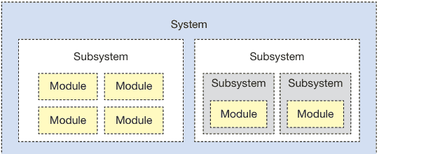

图 1.1 模块组合成不断大的单元，形成软件系统。

在不影响依赖其公共方法的其他模块的情况下发生。有时封装被称为信息隐藏，这是 David Parnas 自 20 世纪 70 年代以来应用于软件开发的概念。

Web API 进一步封装了这一概念。它们将语言的内部细节、Web 框架的选择、系统的类和对象以及数据库设计隐藏在基于 HTTP 的 API 之后。封装在 API 设计后的内部细节鼓励松耦合的 API，这种 API 依赖消息而非底层的数据库设计和模型进行通信。组织不再需要理解所有的内部实现细节（例如支付网关）。相反，它们只需要理解 API 提供的操作以及如何使用它们来实现预期结果。

高内聚是一个术语，用于当模块内的代码都与同一功能密切相关时。高内聚模块会导致“意大利面条代码”，因为方法调用不会跨越整个代码库。当代码分散在整个代码库中时，调用频繁地在模块之间跳跃。这种代码风格被认为表现出低内聚。

耦合是两个或多个组件之间的相互依赖程度。紧耦合的组件表示组件受到其他组件实现细节的极大限制。松耦合组件将其内部细节隐藏在外部，将模块之间的知识限制在公共接口（或编程语言 API）上，代码的其他区域可以调用它。

图 1.2 展示了模块内部高内聚和松耦合的概念。

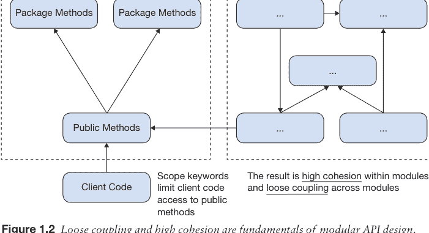

## 第1 章 API 设计原则

Web API 通过将相关的 API 操作分组以实现高内聚，同时确保内部细节被封装，以鼓励松耦合的 API 设计。

## 基于资源的 API 设计

资源是某个概念的数字表示，通常是实体或实体集合，并随时间而变化。它由一个唯一名称或标识符组成，可以引用文档、图像、其他资源的集合或现实世界中的任何事物（如人或时间）。基于资源的 API 关注跨网络的交互，而不依赖于它们如何存储在数据库中。它们提供了与特定资源交互的不同操作或可用性（affordances）。此外，资源支持多种表示形式，允许 Web 应用、移动应用和报告工具使用 JSON 或 XML 等媒体格式与资源交互。

## 资源不是数据模型

重要一点是，资源与数据库中的数据模型是不同的。数据模型通常反映为数据库中的架构设计，是为了支持解决方案的 I/O 性能和报告需求而所需的读写交互而优化的。

虽然数据可能是 API 的一部分，但不应将数据模型作为 API 设计的基础。数据模型满足一系列需求，包括读写性能、优化的数据存储和优化的查询支持。数据模型针对应用程序的内部细节进行了优化。

就像编程语言和框架的选择一样，数据类型的选择以及随时间发生的变化直接会将这些内部实现细节暴露给 API 消费者。结果是 API 变得脆弱，当数据模型发生变化时，必须引入重大的设计变更。

Web API 追求不同的目标，包括交付结果和体验、优化的网络访问以及语言独立。由于 API 涉及系统集成，它们应该在长时间保持稳定，而数据模型可能会为了适应新的或不断的数据访问需求而变化。

虽然 API 可能对数据模型产生影响，但 API 设计应该独立于最新的数据库趋势进行演进。


# 当团队将数据模型暴露为 API 时会发生什么？

**频繁的代码更改：** 数据库模式的更改会导致 API 不断变化，因为 API 必须与底层数据库保持同步。这种对数据模型的更改会导致消费者陷入复杂的从属关系中，每当底层数据模型发生变化时，他们就必须重写自己的 API 集成。这种障碍可以通过反腐层（anticorruption layer）克服，将代码单元与这些更改隔离开。然而，由于下游开发者需要维护反腐层，API 的持续变化会产生高昂的开发成本。

**产生网络频繁交互：** 将连接表作为独立的 API 端点会导致 API 的“频繁交互”（chattiness），因为消费者被迫为每个表进行多次 API 调用。这类似于 n+1 查询问题降低性能的方式。虽然 n+1 问题可能是数据库的性能瓶颈，但 API 频繁交互对 API 性能的影响是毁灭性的。

**数据不一致：** 不仅性能会受到网络频繁交互的影响，n+1 问题还会导致数据不一致。客户端被迫进行多次 API 调用并将结果缝合为一个单一的统一视图。由于在通过多次 API 请求获取必要数据时可能跨越事务边界产生不一致性，这可能导致数据不完整或损坏。

**混淆 API 细节：** 针对查询性能优化的列（例如使用字符代码表示状态的 CHAR(1) 列），在没有额外说明的情况下，对 API 消费者来说毫无意义。

**暴露敏感数据：** 构建镜像数据模型 API 的工具会使用 `SELECT FROM [table name]` 暴露表中的所有列。这还暴露了 API 消费者永远不应该看到的数据，例如个人身份信息（PII）。它还可能暴露黑客通过更深入地了解 API 内部细节来攻破系统的数据。

## 资源不是对象或领域模型

API 资源与面向对象的代码库中的对象不同。对象支持代码库内部的协作。对象通常用于将数据模型映射到代码中以便于操作。它们面临与暴露的数据模型相同的问题：频繁的代码更改、网络频繁交互和数据不一致。

同样，领域模型（通常由对象组成）代表特定的业务领域。它们可以被用于多种方式来满足系统需求。根据应用方式的不同，它们可能会遍历不同的事务上下文。然而，Web API 在考虑事务边界而不是直接暴露内部领域或对象行为时最有效。

请记住，API 消费者并没有看到数据模型细节以及 API 背后所有代码的特权。他们没有参加过导致驱动数据模型设计的无数决策的无限会议。他们不知道做出这些数据模型设计决策的背景。伟大的 API 通过从数据设计转向消息设计，避免泄露内部细节（包括数据库设计选择）。

## 基于资源的 API 交换消息

基于资源的 API 在业务与用户或远程系统之间创建了某种对话。例如，假设一个项目管理应用程序的用户正在与 API 服务器对话。这种对话可能看起来如图 1.3 所示。

将 API 视为会话席觉得很奇怪吗？这与艾兰·凯（Alan Kay）发明*面向对象编程*术语时的初衷并不遥。他并没有关注继承和多态设计，而是将面向对象编程设想为组件之间发送消息：

> 抱歉我很久以前为这个主题创造了“对象”这个术语，因为它让许多人关注了次要的想法。大想法是“消息传递”。

Web API 是基于凯对面向对象编程的原始愿景设计的。它们向服务器请求消息并接收响应消息。大多数 Web API 通过发送请求并等待响应来同步地执行这种消息交换。

API 设计考虑系统之间的对话式消息交换，以产生客户、合作伙伴和员工所需的结果。伟大的 API 设计还考虑了这种通信如何随需求的变化而演变。

- 3. Alan Kay, "Prototypes vs Classes was: Re: Sun's HotSpot," Squeak Developer's List, October 10, 1998, http://lists.squeakfoundation.org/pipermail/squeak-dev/1998-October/017019.html.

## Web API 设计原则 13

今天 上 8:32

客户端：你能发给我一份我被允许查看的项目列表吗？

服务器：没问题，这里是我们为你准备的内容

今天 上午 8:32

客户端：你能为我创建一个新项目吗，名字叫 'My Project'（我的项目）吗？

服务器：办好了。你可以在这里找到它

今天 上午 8:32

客户端：你能发给我项目 12345 的详细信息吗（我称它为 'My Project'）吗？

服务器：哦，没问题。这是给你的详细信息

图 1.3 API 客户端与 API 服务器之间的交互示例，就像用户在用对话术语与服务器说话一样。

## Web API 设计原则

API 设计方法必须在健壮的数字能力与对支持快速轻松集成的卓越开发者体验关注之间取得平衡。它必须根于一系列创建坚实基础的原则。这五个原则建立了必要的基础，并在本书中详细介绍：

原则 1：API 设计绝不应该孤立进行。协作式 API 设计对于伟大的 API 至关重要。（第 2 章）

第一章 API 设计原则

**原则 2：** API 设计从以结果为导向的关注开始。关注结果确保 API 为所有人交付价值。（第 3–6 章）

**原则 3：** 选择匹配需求的 API 设计元素。尝试寻找完美的 API 风格是徒劳的。寻求理解并应用适用于需求的 API 元素，无论是 REST、GraphQL、gRPC 还是行业正在使用的新风格。（第 7–12 章）

**原则 4：** API 文档是开发者最重要的用户界面。因此，API 文档应该是一等公民，而不是被留到最后一刻的任务。（第 13 章）

**原则 5：** API 是持久的，因此要相应计划。深思熟虑的 API 设计结合进化设计方法使 API 对变化具有韧性。（第 14 章）

## 总结

Web API 设计结合了三个重要元素来交付成功的 API：业务能力、产品化思维和开发者体验。这些跨职领域意味着组织不能忽略 API 设计过程。开发者、架构师、领域专家和产品经理必须通力设计满足市场需求的 API。

此外，Web API 设计建立在软件设计原则的基础上，包括模块化、封装、松耦合和高内聚。API 设计应该隐藏其外部化系统的内部细节。它们不应该暴露数据模型，而应该关注灵活且适应时间的系统间消息交换。

那么如何从业务需求转向能够为客户、合作伙伴和员工交付结果的可演进 API 设计呢？这就是下一章的主题，该章将介绍一个将业务需求转化为 API 设计的过程。

第 2 章

## 协作式 API 设计

> 前期大设计是愚蠢的，但不做前期设计更愚蠢。
Dave Thomas

## 为什么需要 API 设计过程？

在介绍设计流程回顾之前，重要的是，团队不需要正式的 API 设计过程也可以成功设计并交付 API。我与全球许多公司合作过，他们在没有一致的 API 设计方法的情况下成功将 API 推向生产环境。然而，他们的 API 交付时间更长，因为需要


多次的破坏性设计变更。与通过 API 设计过程设计的 API 相比，设计不合理的 API 缺乏对如何使用 API 的充分洞察。

API 设计过程可以提高整个交付过程的效率。通过优先关注 API 约，设计将用户和开发者的需求作为首要考虑。此外，实现细节不太可能泄露到 API 设计中，而导致 API 设计脆弱，随着时间的推移，实现细节的改变将导致引入破坏性变更。

后端 API 是任何前端交付计划的主要障碍。如果强制前端开发人员等待后端人员完成 API 实现，端到端的交付过程将花费过长时间。设计反馈中的任何错误在前端开发人员开始集成 API 之前无法发现。只有在完成所有集成工作后，才能获得客户反馈。图 2.1 可视化了这个问题以及对交付计划的影响。

API 设计过程鼓励迭代的、以团队为导向的设计，从而实现更高的整体效率。前端和后端 API 团队共同工作达成设计，并并行处理各自的任务。客户反馈也可以更早地纳入，避免最后的返工。如图 2.2 所示，该过程在每个发布版本中重复，确保设计过程在迭代反馈的同时变得更加快速。记住，API 错误越早发现，修复成本越低。

## API 设计过程反模式 (API Design Process Antipatterns)

未能采用 API 设计过程或采用效率较低的过程可能会导致对团队和整个组织产生负面影响的反模式。回顾此处详述的常见 API 设计反模式，看看是否有任何一个引起你的共鸣。

## 泄露抽象反模式 (The Leaky Abstraction Antipattern)

没有正式 API 设计过程的 API 设计师将从代码开始，反向进行 API 设计。API 设计将包含内部技术决策，有时甚至需要对特定数据库或云供应商的熟悉。

例如，一个用于推荐引擎的公共 API 产品需要理解 Apache Lucene 才能使用该 API。API 通过 HTTP POST 接受使用 Lucene 配置格式的配置文件来管理

API 设计过程反模式 17

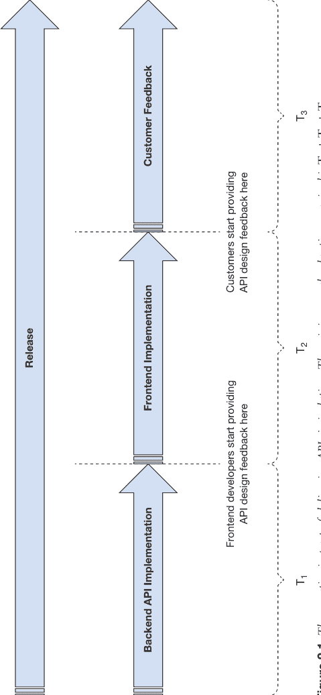

图 2.1 隔离交付 API 的负面影响。所需的最小日历时间为 T1 + T2 + T3

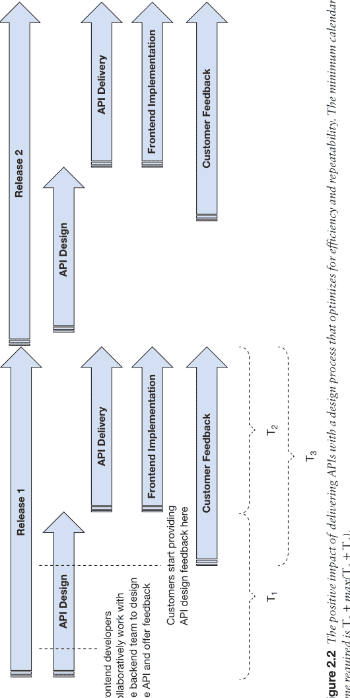

前端开发人员与后端团队协作设计 API 并提供反馈
客户在此开始提供 API 设计反馈

**图 2.2** 使用优化效率和可重复性的设计过程交付 API 的正面影响。所需的最小时间为 $T_1 + \max(T_2, T_3)$。

API 设计过程反模式 19

推荐引擎。内部实现细节泄露给 API 消费者，导致他们需要成为 Apache Lucene 专家，而不是使用推荐引擎 API 的专家。

通过代码和设计的混合对 API 进行原型设计或产生演进式 API 设计是有价值的。然而，这种方法需要集中精力找到原型设计的正确平衡，然后进行结合所学经验的从外向内的设计。有效的 API 设计过程支持这种迭代学习方法。

## 下一个版本设计修复反模式 (The Next Release Design Fix Antipattern)

没有 API 设计过程的团队可能会发现自己已经在规划下一个版本，甚至在当前版本推送到生产环境之前。由于 API 设计决策在当前发布中变得不可更改，会导致破坏性变更的设计改进被移至待办事项中。

这种反模式最初只是一个无意的设计决策，由于底层代码更改的复杂性导致的。也许代码更改将花费太长时间。团队被迫将不完善的 API 设计推向生产，并在可见的未来对其进行支持。所需的更改可能仅小到一个拼写错误或微小的类型错误，但必须作为 API 的一部分，以避免对大量开发者引入破坏性变更。

API 设计过程结合 API 稳定性约（如第14章“为变更而设计”中所讨论），可以缓解这类问题。

## 英雄式设计努力反模式 (The Heroic Design Effort Antipattern)

更熟悉业务领域的人会将他们对客户和市场需求的理解融入其中，交付满足目标市场需求的 API。这种方法对于对客户和市场有深入理解的小团队可能效果良好。

然而，它并没有为专家知识短缺的新兴领域提供一种可预测的方法，导致需要英雄式的 API 设计努力。从市场到生产期间漫长混乱的开发、每天发生多次设计变更，是英雄式设计努力反模式的迹象。与试点客户的最后时刻导致发现重大设计缺陷的情况司是常常。团队在发布前仓命寻找解决这些缺陷的设计方案。在有限的时间内，代码被快速修补以“使其运行”。

虽然 API 设计过程不能保证第一次设计就是完美的，但它有助于快速挑战假设。它还鼓励与主领域专家和客户进行早期沟通，在设计问题昂贵到无法修复之前解决它们。

## 未使用的 API 反模式 (The Unused API Antipattern)

团队不希望他们的项目被视为失败，更糟糕的是，在生产环境中几乎没有使用而处于闲置。情况通常如此，因为 API 设计可能错过了目标受众的底层目标和欲望。一个 API 可能在巨大的欢呼中发布，结果却寥寥无几。

## API 设计方法 (The API Design Approach)

协作设计对于一个出色的 API 至关重要。技术和技术参与者都应该参与整个 API 设计过程。将 API 设计工作仅留给开发团队将大大降低 API 潜力的机会。

## 原则 1：API 永远不应孤立设计 (Principle 1: APIs should never be designed in isolation)

## 优先方法 (The API-First Approach)

API 设计过程提高了整个交付过程的效率。通过优先关注 API 约，设计将用户和开发者的需求作为首要考虑。此外，实现细节不太可能泄露到 API 设计中，而导致 API 设计脆弱，随着时间的推移，实现细节的改变将导致引入破坏性变更。

后端 API 是任何前端交付计划的主要障碍。如果强制前端开发人员等待后端人员完成 API 实现，端到端的交付过程将花费过长时间。设计反馈中的任何错误在前端开发人员开始集成 API 之前无法发现。只有在完成所有集成工作后，才能获得客户反馈。图 2.1 可视化了这个问题以及对交付计划的影响。

API 设计过程鼓励迭代的、以团队为导向的设计，实现更高的整体效率。前端和后端 API 团队共同工作达成设计，并并行处理各自的任务。客户反馈也可以更早地纳入，避免最后的返工。如图 2.2 所示，该过程在每个发布版本中重复，确保设计过程在迭代反馈的同时变得更加快速。记住，API 错误越早发现，修复成本越低。


## 通过 API 设计优先持续保持敏捷

API 设计优先的方法侧重于在整个设计和交付过程中提供频繁的反馈和调整机会。API 设计优先的方法并没有规定在进入代码阶段之前必须完成所有的设计工作。为了理解如何做到这一点，是时候重新审视《敏捷宣言》，并看看它如何应用于 API 设计优先的方法中。

## 重新审视《敏捷宣言》

快速回顾《敏捷宣言》的原则有助于我们更好地理解 API 设计优先如何与敏捷开发相契。以下是几个与 API 设计优先关注点相关的原则：

- 我们的首要任务是满足客户的需求。
- 我们应该欢迎需求的变化，即使在开发后期。
- 我们必须努力频繁地交付可运行的软件。
- 业务人员和开发人员必须共同工作。
- 可运行的软件是衡量进展的首要标准。
- 注意技术卓越性和良好的设计，因为这会增强敏捷性。
- 通过最大化“不做的工作量”来追求简单。

记住这些原则，团队有机会在就 API 设计与利益者进行早期且频繁的沟通的同时，保持敏捷性。这些利益者可能包括内部开发团队、渠道合作伙伴以及负责集成 API 的开发人员。

渐进式地交付 API 设计而不是一次性交付，可以允许团队满足欢迎需求变化和交付可运行软件的原则。它还能帮助团队避免对 API 设计产生负面影响的最后时刻忙乱。

“追求简单”鼓励团队以简单的方式进行设计。团队设计的 API 应该避免那些需要较高认知负载才能理解的巧妙设计。相反，设计应该基于其所解决的用例是直观的，并使用适用于解决方案领域的词汇。它们应该只提供支持该用例的必要信息。

> 1. Kent Beck, et al., “Principles behind the Agile Manifesto,”https://agilemanifesto.org/principles.html.


API 设计优先的目标应该是收集足够的细节，以限制未来发生破坏性变更（breaking change）的风险。它并没有强制在开发开始之前必须完成整个设计过程。敏捷开发和 API 设计优先是极佳的伙伴。


团队一直向 API 设计中添加内容，但在破坏依赖于它们的集成的情况下，是不可能移除内容的。利用敏捷软件开发的优势，根据客户、合作伙伴和员工的需求量进地设计 API。

API 设计优先流程使团队能够快速、深思地移动，并在流程早期具有做出更改的敏捷性。它是 API 设计瀑布式方法的完全对面。

## 对齐-定义-设计-精炼（Align-Define-Design-Refine）流程

大多数 API 设计团队面临的最大挑战之一，是如何从各种形式的业务需求交付 API 设计：用例、电子表格、线框图等。具有软件分析背景的人可能会发现这是一项更容易的任务。然而，在将领域模型和能力映射到基于 Web 的 API 设计时仍然存在挑战。挑战之一是需要确保所有技术和非技术团队成员之间范围和交付物的一致性。

正如名称所示，对齐-定义-设计-精炼（ADDR）流程²引导团队通过 API 设计优先的方法。该流程将逐步过程分组为四个不同的阶段：

- **对齐（Align）：** 确保业务、产品和技术部门围绕一组预期结果在理解和范围上保持一致
- **定义（Define）：** 将业务和客户需求映射为数字能力，这些能力将形成一个或多个 API 的基础，以实现预期结果。

² ADDR 流程基于我在多年 API 设计教练经验中获得的许多教训。


- 3. **设计（Design）：** 为每个 API 应用特定的设计步骤，使用一种或多种 API 风格满足预期结果
- 4. **精炼（Refine）：** 除了文档、原型制作和测试工作，还通过开发人员的反馈精炼 API 设计

这些阶段中总共有七个步骤，在本书的剩余部分将深入探讨：

- 1. **识别数字能力：** 识别客户需求和预期结果，包括所需的相应数字能力。
- 2. **捕捉活动步骤：** 通过协作 API 设计会议扩展数字能力，以获得统一的理解和清晰度。
- 3. **识别 API 边界：** 将数字能力分组为 API 边界，并确定 API 是否已存在或需要新的 API。
- 4. **建模 API 概要：** 使用协作 API 建模会议来定义高层 API 设计，将资源和操作整合到 API 概要中。
- 5. **高层 API 设计：** 为每个 API 概要选择一种或多种 API 风格，并记录高层设计元素。
- 6. **精炼设计：** 使用鼓励改进开发者体验的技术，纳入 API 使用者的设计反馈。
- 7. **编写 API 文：** 完成 API 文档，包括参考文档和入门指南，以加速集成。

图 2.4 总结了支持 API 设计优先方法的 ADDR 流程。

该流程实现了以下目标：

- 交付一个使用客户理解的词汇来强调并解决客户问题的 API 设计。
- 减少非正式设计流程中常见的频繁设计变动。
- 为整个组织（而不仅仅是开发人员）优化 API 设计和交付过程。
- 尽可能避免不必要的步骤以加速交付。
- 创建一个可重复的流程，通过技术和非技术角色的混合来交付 API 设计，其中一些人可能并不完全理解 API 设计的细微差别，但能够贡献他们的见解。


图 2.4 ADDR 流程概述

ADDR 流程松散建立在 DDD（领域驱动设计）中的概念和实践之上。然而，组织不需要践行 DDD，甚至不需要熟悉它，就能有效地应用该流程。熟悉 DDD 的人可能会识别出所使用的一些概念和技术。然而，重要的是，ADDR 流程在必要时可能会偏离 DDD 实践，以确保它在各种情况下仍然是易于上手且可重复的。因此，熟悉 DDD 的人可能根据自己的需求和偏好对流程进行调整。


如所述，API 设计过程应该强调使用客户理解的词汇来强调并解决客户的问题。这需要对 API 将如何满足市场需求有深入理解，并结合业务策略。如果 API 的设计和开发不考虑这些考量，它往往将无法成为一个令人愉悦使用的绝佳 API。

领域驱动设计（DDD）是一种软件开发方法，鼓励领域专家和软件开发人员之间的协作以解决复杂的解决方案。DDD 的核心原则包括讨论、倾听、理解、发现和交付业务价值。跨本地和技术角色的团队每个成员都为软件解决方案中业务创新的见解深度做出贡献。对 DDD 新手可能可能参考 Eric Evans 的 DDD 经典著作以及 Vaughn Vernon 的《领域驱动设计实现》（Implementing Domain-Driven Design），这些书籍提供了在组织中实施 DDD 的见解。

本书的剩余部分详细检查了 ADDR 流程：

- 对齐和定义实现结果所需的 API（第 3-6 章）
- 使用常用模式和实践设计满足结果的 API（第 7-9 章）
- 将 API 分分为更小的服务（第 10 章）
- 通过健壮的文档、辅助库和测试策略相结合提高开发者体验，确保消费者能够自信启动（第 11-13 章）
- 演进 API 设计，这对于可持续的长寿 API 至关重要（第 14 章）
- 保护 API 以确保数据不会泄露给未经授权方（第 15 章）
- 扩展 API 设计工作，这对于较大的计划很重要（第 16 章）


## API 设计关乎每个人

开发者负责设计并编写代码以实现所有功能。设计师和用户体验（UX）专家则将所有内容整合为用户界面，并关注易用性。

每个人都贡献自己的经验，并可以在 API 设计过程的，发挥自己的长处和技能。对于规模较小的组织，可能需要一个人兼任多个角色。在可能的情况下，应将技术性较强的角色与产品及业务角色分开分配，以确保在设计 API 时视角能够保持健康的平衡。

在 API 设计会议中通常涉及的角色可能包括但不限于：

- API 设计师和架构师帮助协助促进设计过程，并引入 API 设计专业知识。
- 领域专家（SMEs）和业务领域专家有助于澄清需求，并规范 API 设计中使用的词汇。
- 技术负责人负责指导实施工作，并可能为了估算工作而提出额外的澄清性问题。
- 产品经理将市场机会和客户需求整合到 API 设计中。
- 技术文档工程师在范围确定和设计会议期间提出澄清性问题，这些问题将影响交付的功能，并驱动 API 文档和快速上手指南的制作。
- Scrum 主管和项目经理提供意见，协助进度安排和识别风险。
- QA 团队可以就设计可测试的 API 提供意见，决定如何以及何时测试 API，并与开发工作并行设计测试计划。
- 基础设施和运维团队确保服务器、网络、容器平台、消息中间件、流平台和其他必要的资源可供构建和消费 API 的团队使用。
- 安全团队审查 API 设计以关注涉及个人身份信息（PII）和非公开信息（NPI）的担忧，识别风险，限制攻击面，并帮助设计访问敏感数据的 API。

API 设计过程整合了这些每个角色的视角，以使业务与开发团队对齐，定义 API 的明确目标和结果，并设计 API 以实现定义的目标。接下来的章节将进一步探讨这一过程。

## 有效应用该流程

ADDR 过程可以与任何现有的流程相结合。然而，请准备好某些步骤起初可能会显得不确定或生涩。随着时间的推移，这些流程将变得更加熟悉，付出将获得回报。给组织时间来熟悉该流程。花时间列出先前的挑战以及该流程寻求解决这些问题的方法可能也会有用。

组织可能希望逐步引入这一过程。在这种情况下，建议从识别 API 所需的活动和步骤开始（如第 4 章“捕捉活动和步骤”所示），然后进行第 6 章“API 建模”。随着需要，可以随时间引入额外的步骤。

## 总结

API 合约的设计是软件交付中一个独立且关键的步骤。API 设计需要与组织以及使用 API 的开发者进行通信。它有助于纠正错误的假设。它还鼓励了业务、产品和技术团队之间的沟通。

API 设计优先的方法通过从外而内的视角来看待 API 设计，专注于构建解决方案的客户和开发者。结合采用自下而上的设计技术，API 将具有更平衡的设计，既反映了领域又反映了客户和开发者的需求。API 设计过程需要各种角色来帮助对齐、定义和设计 API 将提供的能力和结果。

在完成 API 设计艺术和基础的介绍后，是时候通过第一阶段：对齐（Align），深入研究 ADDR 过程的细节。

## 第二部分

## 对齐 API 结果

在设计 API 时面临的挑战之一是如何将业务需求转化为 API 设计。团队希望有信心计划交付的 API 能满足利益相关者的需求。此外，他们希望知道业务和技术团队保持一致，以防止在最后时刻对 API 设计和底层实现进行大规模重构。

第二部分通过引入 ADDR 流程的对齐阶段来解决这些问题。第 3 章“识别数字能力”和第 4 章“捕捉活动和步骤”中介绍的流程和技术引导团队将业务需求转化为客户、合作伙伴和员工所需的数字能力。在团队应用了流程的推荐步骤后，他们将对范围和与利益相关者的对齐充满信心，继续定义和设计必要的 API。

本页故意留白

## 第 3 章

## 识别数字能力

> 当我们购买一个产品时，本质上是“雇佣”它来帮助我们完成工作。如果它做得很好，当我们下次遇到同样的工作时，我们倾向于再次雇佣它。如果它表现得很糟糕，我们就“开雇”它，并寻找替代品。
— Clayton M. Christensen, Taddy Hall, Karen Dillon, and David. Duncan


**图 3.1** 对齐阶段从识别数字能力开始。

## 识别数字能力

API 是数字能力最常见的体现，因为它们驱动着 Web 和移动应用、合作伙伴集成以及工作场所解决方案。它们允许普通开发者或专家开发者有系统地利用数据、业务流程和内部系统来产生结果。组织必须开发识别数字能力的技能（见 3.1），并利用这些技能来塑造 API 设计，帮助用户产生结果。

ADDR 过程从定义交付结果所需的数字能力开始。它还详细说明了在设计 API 之前交付所需的特定活动和步骤。

本章介绍了数字能力的概念，解释了它们如何与 API 关联，并概述了一种易于操作的方法，将需求映射为识别数字能力的格式。这些数字能力随后用于指导产品和平台 API 设计。

## 确保利益相关者对齐

正如第 2 章“协作 API 设计”所示，API 设计是一个通信过程。它向跨团队和组织边界的外部和内部开发者传达 API 提供的数字能力。API 生成团队之外的人无法、也不应该被阅读 API 的实际代码来完全理解其工作原理。事实上，外部开发者可能完全无法访问源代码。因此，API 设计和任何后续文档都力求以最简单的方式与开发者进行沟通。

有效的 API 设计包含了客户的需求。在这种语境下，客户被定义为一组特定的开发者和终端用户，他们的体验将受到 API 设计的好坏影响。保持 API 设计与客户需求一致有助于交付良好的用户和开发者体验。

未达到目标的 API 设计将交付糟糕的体验，通常会导致破坏现有集成的重大更改。一旦 API 在环境中至少有一个集成，就很难说服内部或外部团队花费时间和金钱升级到 API 的下一个版本。这为破坏现有集成的 API 设计留下了余地。因此，获得满足客户需求的 API 设计需要专注努力，而不是猜测。

除非组织小到支持开发者与客户之间的直接沟通，否则会有多个角色参与产品定义：产品所有者、产品经理、业务分析师、软件分析师和客户经理


例如经理、管理人员等等。这些角色代表了客户的需求。有效的 API 设计包含了来自组织内部多个角色的意见，而不仅仅是关于如何将数据推入数据存储或遗留系统的技术细节。

此外，利益相关者与负责实现 API 的开发团队之间建立共识也是必要的。如果 API 缺乏业务背景，它可能满足客户的需求，但缺乏满足业务目标所需的充分因素。如果 API 缺乏客户背景，它可能满足业务的需求，但无法交付客户预期的结果。如果两者都缺乏，API 将没有任何实际作用，努力都将付诸东流。在 ADDR 过程中，利用数字能力来建立业务、客户和技术之间的共识，以避免这些负面后果。

### 什么是数字能力？

业务能力描述了组织向市场提供的赋能因素。业务能力的示例包括消费品设计、制造和客户支持。

数字能力是通过自动化将预期结果变为现实的资产。它们为员工、合作伙伴和客户提供了与组织进行数字交互的能力。数字能力可能以一个或多个技术解决方案的形式存在。例如 REST APIs、用于集成的基于 Webhook 的异步 API、SOAP 服务、消息流，以及通过每日、每周或每月基于文件的导出过程进行的批量数据交换。

审查内部或竞争对手产品或服务所提供的数字能力，可以更深入地了解组织所重视的内容，包括其所针对的市场份额。

数字能力组合是产品或组织提供的数字能力的集合。对于构建平台以连接市场中两个或多个参与方的组织来说，“数字平台”和“平台能力”这些术可能更为熟悉。

虽然数字能力可以映射到业务能力，但它们运行在不同的关注层级。业务架构师定义业务能力（如客户服务），并可能关联关键绩效指标（KPI）或目标（OKR）以跟踪增长。数字能力专注于产出结果，并包含了交付组织业务能力所需的活动。业务能力描述的是组织的“做什么”；数字能力描述的是“如何做”。

## 第 3 章 识别数字能力

表 3.1 基于 REST 的项目管理 API 实现的数字能力

| 数字能力 | 示例基于 REST 的 API 设计 |
|---|---|
| 从头到尾管理项目 | POST /projects |
| 为项目添加协作者 | POST /projects/{projectid}/collaborators |
| 将项目细分为问题 | POST /issues |
| 标记问题完成 | POST /issues?status=issueId/completed |
| 查看未完成的问题 | GET /issues?status=incomplete |
| 查看活动项目 | GET /projects?status=active |

表 3.1 提供了一个典型项目管理应用的示例，用以展示项目管理应用的数字能力之间的区别，以及它们如何通过基于 REST 的 API 实现。注意这些数字能力的描述是以客户及其预期结果为中心进行编写的。API 设计风格的选择（如 REST、GraphQL 或 gRPC，在第 7 和第 8 章中详细介绍）并不是数字能力的显式部分，而是数字能力体现方式的一部分。在某些情况下，单个数字能力可能提供多种 API 设计风格。有几种方法可以捕捉业务和产品需求，并用于驱动作为 API 的数字能力设计。ADDR 建议使用工作故事（job stories），这种方法植根于“待办事项”（jobs to be done）的设计方法。

## 关注待办事项 (Jobs to Be Done)

待办事项（JTBD）是由产品或服务提供的满足的识别需求。JTBD 涉及捕获客户问题、要执行的任务以及应该产生的预期结果。

> JTBD 由《创新者困境》作者克莱顿·克里斯坦森（Clayton Christensen）制定，这是一种在设计产品或服务时从客户角度出发的方法。JTBD 确保产品解决了特定需求，从而更有机会获得市场采用。它从识别客户需求、待办事项开始，然后定义产品或服务将如何填充这些需求。

- 1. 克里森学院, “Jobs to Be Done,” 访问于 2021 年 8 月 12 日, https://www.christenseninstitute.org/jobs-to-be-done.
2. Clayton M. Christensen, The Innovator's Dilemma: When New Technologies Cause Great Firms to Fail (Boston: Harvard Business Review Press, 2016).

## 什么是工作故事 (Job Stories)？

在 JTBD 中，任务（jobs）不仅仅是需要执行的功能。任务实际上关乎预期的结果或成就。任务可能是全新的且未解决的，也可能以某种不完全满足客户需求的方式得到解决。产生预期结果的产品是考虑了所有关于“待办事项”因素的产品。JTBD 不仅适用于 API，还适用于组织产品和软件设计的所有其他方面。

JTBD 背后的理念根植于 20 世纪 80 年代中期的客户声音（VOC）³，产品经理试图通过进入客户心态来提高产品性能。VOC 结合了市场研究数据以及通过调查和客户访谈识别出的特定等待和需求。

克里斯坦森还提醒我们，产品试图解决的任务还有情感和社会的一面。任务延伸到眼前的问题之外，包括减少或消除其中涉及的焦虑。产品在产生朝预期结果进展的同时，应该提供积极的体验。甚至可能在完成任务时带来乐趣。

## 原则 2：API 设计从以结果为中心的关注开始

对结果的关注确保了 API 为所有人交付价值。这需要一种产品思维的 API 设计方法，而不是纯由数据和系统集成驱动。ADDR 过程专注于识别和实现这些结果。

## 什么是工作故事？

客户和用户不在乎 API、微服务、无服务器或所使用的前端框架类型。他们想要问题的解决方案。他们关心的是结果。

工作故事捕获了任何产品的待办事项，包括客户对新产品、服务或 API 的动机、事件和期望。它们从客户的角度构筑了每一个设计问题。工作故事试图识别客户面临的问题以及他们最终想要的结果。识别出将解决这些问题的任务。API 将提供数字能力，以驱动这些 JTBD 产生预期结果。

> 3. 百基百科，s.v. "Voice of the Customer," 最后修改于 2021 年 7 月 15 日，12:112, https://en.wikipedia.org/wiki/Voice_of_the_customer.

## 第 3 章 识别数字能力

工作故事由艾兰·克莱门（Alan Klement）⁴创建，并基于克里斯坦森制定的 JTBD。它们提供了一个简单的框架来捕获待办事项的所有方面。

制作工作故事的团队会发现，他们的 API 设计更关注观众的预期结果。他们也将拥有创建自动化测试验收准则所需的细节。需要注意的是，工作故事并不包含实现规范。相反，它们应该详细说明为了交付结果所发生了什么。

ADDR 过程高度依赖工作故事来以客户为中心的方式捕捉业务需求。工作故事以简单的格式表达客户需求，并为识别驱动 API 设计的数字能力提供了自然的方式。

## 工作故事的组成

工作故事由三个部分组成，使用“当……（When），我想……（I to），以便……（so I can）的格式：

- 1. **当 (When)**：建立因果关系的触发事件是客户选择结果的原因。触发事件是何时使用 API 的关键指标。
- 2. **我想 (I to)**：能力是客户识别出的需要采取的行动。能力识别了 API 在交付预期结果时将扮演的重要角色。它也被用于解构 API 将交付的操作。
- 3. **以便 (So I can)**：结果是预期的最终状态。它是当触发事件发生时应用能力的结果。结果为 API 设计提供了验收。

图 3.2 展示了一个忘记密码的工作故事示例，突出了它的三个组成部分。

图 3.2 中的工作故事演示了工作故事如何被用于数字能力的设计。在这种情况下，它捕获了一个“重置我的密码”的数字能力。这是 API 为了满足目标客户需求必须提供的许多数字能力之一。


# 为 API 编写任务故事 (Job Stories)

用于创建任务故事的细节可能以不同的形式存在。某些细节可能标识需要解决的问题。另一些细节可能指出了预期的结果，但缺乏其他信息。

由于编写任务故事没有对错之分，这里提供了三种方法来帮助团队应对现实世界中遇到的各种情况。可以应用其中一种、两种或全部三种方法来编写捕捉客户需求的任务故事。然后，将洞察结果转化为“当……（When），我想……（I want to），以便我能够……（so I can）”的任务故事格式。

### 方法 1：问题已知

这种方法最常见，因为客户通常擅长识别他们需要解决的问题。在这种情况下，请使用以下一个或所有问题来探索问题空间，并识别组成任务故事所需的另外两个部分：

- * 客户解决问题时预期的结果是什么？
- * 实现该结果所需的任务是什么？
- 鉴于这两个答案，原始描述是否最能体现触发情境，或者有更好的任务故事写法来表达问题？

### 方法 2：预期结果已知

有时预期结果是明确的，但触发情境却不明。这种情况发生在客户心中有一个预期的结果，但不确定为什么需要它。使用以下问题来引导讨论，并帮助根据预期结果制定任务故事：

- 客户所描述的、驱动预期结果的问题是什么？
- 实现该结果所需的任务是什么？如果确定了多项任务，请将它们总结为单一任务描述。
- 预期结果是否仍然最能表达他们的需求，还是应该重写？

| 任务故事 1 – 忘记密码 | |
| :--- | :--- |
| 触发事件或情境 | 我忘记了以前登录过的账户密码 |
| 所需能力 | 我想将密码重置为新的 |
| 预期结果或目标 | 以我能够成功登录应用程序 |

**图 3.2** 任务故事及其三个组成部分。

### 方法 3：数字能力已确定

有时客户已经确定了他们需要的数字能力。这发生在客户是领域专家或在问题上花费了大量时间的情况下。在这种情况下，通过以下问题来验证他们确定的数字能力，并填充任务故事的缺失部分：

- 客户希望体验的预期结果是什么？
- 客户或利益相关者描述的、要求结果的问题或触发情境是什么？
- 确定的数字能力有助于产生预期结果吗？如果没有，是否有更适合问题的数字能力表述方式？

## 克服任务故事的挑战

当团队开始构建任务故事时，可能会遇到三个问题：任务故事过于详细，或者可能需要额外的用户背景。这些问题可以通过以下建议解决：

### 挑战 1：任务故事过于详细

任务故事应该包含足够的内容，以便将任务故事拆分为独立的任务（详见第 4 章）。然而，任务故事可能会堆满了未来重要的细节。当任务故事作者担心丢失之前讨论过的特定细节时，这种情况经常发生。

**当我发现想买的产品时，**
**我想**提供产品的数量、颜色和样式
**以便我能够**将其加入购物车并查看总金额、运费和预估销售税。

当任务故事包含过多细节时，将细节作为额外项目提取到任务故事下方。这样做可以确保细节不丢失，并保持任务故事清晰聚焦。以下是同一个任务故事，将细节移到了故事叙述之外：

**当我发现想买的产品时，**
**我想**将产品加入购物车
**以便我能够**将其纳入订单。

**额外细节：**

- 将商品加入购物车时需要以下字段：数量和样式。
- 购物车将显示总金额、运费和预估销售税。

这些细节可以提取到文档或 Markdown 的项目列表中，或者作为表格中的额外注释列。

### 挑战 2：任务故事以功能为中心

熟悉编写用户故事的人倾向于关注功能而非结果来编写任务故事。这种挑战可能会出现在已经有用户界面或高保真原型的产品上。任务故事作者直接跳到了解决方案。

以下是一个关注功能细节的任务故事示例：

**当我发现想买的产品时，**
**我想**通过点击黄色按钮将产品加入购物车
**以便我能够**将其纳入订单。

## 第 3 章：识别数字能力

考虑将包含功能的任务故事调整为标准的任务故事结构。如果团队担心丢失任务故事中的功能细节，可以将功能细节移动到任务故事的“额外细节”部分。可以在设计过程的后续阶段引用这些功能细节。
例如：

当我发现想买的产品时，
我想将产品加入购物车
以便我能够将其纳入订单。

额外细节：

- 加入购物车的按钮应该是黄色的。

### 挑战 3：需要额外的背景

用户故事的优点是可以使用“作为……（As a）”短语开头。但有时故事需要额外的背景。在这种情况下，替换角色（persona）名称，例所示：

当需要对特卖活动日期做出决定时，
经理希望生成一份符合自定义标准的销售报告
以便经理可以查看销售历史

这种方法在任务故事和用户故事之间提供了很好的平衡。

## 捕捉任务故事的技术

目前，没有专门为任务故事设计的工具，因此团队可以灵活地选择适合自己的工具。以下是几个建议：

- **电子表格 (Spreadsheets)：** 电子表格是通用工具，对于捕捉故事非常有用。电子表格中的一个行即可。第一列应该是任务故事的标识符。将接下来的几列分配给三个组成部分之一：“当……”、“我想……”、“以便我能够……”。最后，添加第五列用于注释。许多电子表格支持协作编辑，允许多人进行评审、评论和贡献。
- **文档 (Documents)：** 文档也有用，尽管结构化程度较低。团队希望模仿索引样式来捕捉任务故事时，文档非常有用。以指示任务故事标识符（数字或简要描述）作为标题。为了可读性，将任务故事的三个组成部分单独成行。留出空间以列表形式捕捉额外的洞察或细节。在每个任务故事之间留空行以便区分，或者每页分配一个任务。
- **Markdown：** Markdown 是一种具有易读语法的文本文件，用于捕捉任务故事。Markdown 文件可以将故事导出为 HTML、PDF 等格式。使用包含所有任务故事的单个 Markdown 文件，或者为每个任务创建一个 Markdown 文件。结合版本控制系统（如 git）来查看任务故事的更改历史。


JSON's Bookstore 必须设计一系列 API 来支持在线商务、订单履行、库存管理和目录管理。该公司还需要支持与合作伙伴及客户的集成。在此过程中，API 的表面积不断扩大，这要求 JSON's Bookstore 找到一种可扩展的 API 方法，且不会减慢其开发速度。

## 任务故事（Job Story）示例

表 3.1 中的任务故事是为了支持 JSON's Bookstore 的购物和购买体验而确定的。作为一个练习，请回顾这些任务故事并尝试编写额外的故事以练习任务故事格式。

请参考 GitHub 上提供的 API 工作坊示例 ⁵，查看完整的任务故事列表。

## 总结

API 是数字能力，通过自动化将预期的结果变为现实。基于这些结果设计的 API 将帮助为目标受众提供更好的 API 设计。

表 3.2 JSON's Bookstore 的任务故事
| ID | 当 . . . | 我想 . . . | 这样我就可以 . . . |
|---|---|---|---|
| 1 | 我想看到新出的书 | 列出最近添加的书 | 跟上最新的水彩画讨论动态 |
| 2 | 我想找一本能娱乐我或教我新知识的书 | 按主题或关键词搜索书籍 | 浏览相关书籍 |
| 3 | 我遇到一本陌生的书 | 查看书籍详情和评论 | 确定这本书是否对我感兴趣 |
| 4 | 我发现了一本或多本我想买的书 | 下单 | 购买书籍并将其寄到我的偏好地址 |
| 5 | 我不确定订单何时到达 | 查看订单状态 | 确认订单到达的日期 |
> 5. https://bit.ly/align-define-design-examples

任务故事提供了对预期结果以及实现这些结果所需的数字能力的上下文化理解。通过编写任务故事的过程，可以建立所有利益相关者对业务需求的共同理解。在编写任务故事上投入的精力越多，API 就越可能满足客户的需求。任务故事是 API 设计之前所有利益相关者所需的产物。下一章将讨论如何将任务故事扩展为活动和步骤，这将是 API 设计的基础。

本页特意留。

## 第 4 章

## 活动与步骤

真实的情况是，软件开发人员花费大量时间来学习他们不了解的事情。与其他职业不同，我们是第一次做这些事情（即使看起来是一样的）。

Alberto Brandolini


**图 4.1** 对齐阶段的下一步是捕捉活动步骤。

## 第 4 章 捕捉活动与步骤

来自 Brandolini 的这段话引起了许多面临不熟悉领域软件开发的团队的共鸣。虽然开发者可以留在熟悉的业务领域，但大多数人没有这种奢侈。开发者必须快速熟悉领域并将其可运行的软件，包括用户界面、API 和数据模型。

ADDR 过程通过一系列设计步骤来弥补这一差距。第 3 章“识别数字能力”详细说明了通过预期结果进行 API 设计的第一步。下一步是从利益相关者、开发团队和业务专家那里收集细节，以更好地理解概念、流程和工作流。

本章介绍了如何使用基于活动的结构（见图 4.1）捕捉细节和预期行为。它还引入了 EventStorming 框架作为探索领域的协作方法。结果是对领域的更深入理解、所有利益相关者之间的对齐，以及定义和设计交付所需数字能力的基础。

## 将任务故事扩展为活动与步骤

创建任务故事有助于识别预期结果以及产生这些结果所需的数字能力。该主题在第 3 章已涵盖。下一步是将数字能力细化为实现这些结果所需的活动和步骤。

活动朝着预期结果努力。活动可能由一个参与者或多个参与者的协作完成。活动步骤将活动分解为完成该活动需要执行的单个任务。一旦完成了必要的活动，任务故事的目标就会实现。捕捉这些细节有两个快速步骤：识别每个任务故事的活动，然后将每个活动分解为单个步骤。结果随后用于识别 API 边界，这在第 5 章“识别 API 边界”中详细介绍。

## 将任务故事扩展为活动与步骤

在这一过程中，所有团队成员对解决方案有了更深入的理解和对齐。如果需求模糊或仍存在不确定性，团队可能会选择进行 EventStorming 活动来进一步探索解决方案。EventStorming 将在本章后面详细介绍。

## 识别每个任务故事的活动

首先识别产生每个任务故事预期所需的任何活动。目标是找到更大的工作单元。

JSON's Bookstore 的活动示例：
- 浏览书籍
- 购物书籍
- 下单

## 将每个活动分解为步骤

活动由步骤组成。注意，某些活动可能只有一个步骤，而另一些可能有多个步骤。这是很常见的，因为某些活动比其他活动复杂。

将活动分解为其步骤需要领域专家（SME）。可用时，应由产品经理负责。如果 SME 不可用，则花时间进行采访。

表 4.1 JSON's Bookstore 的活动示例
| 数字能力 | 活动 | 参与者 | 描述 |
|---|---|---|---|
| 下单 | 浏览书籍 | 客户 | 浏览或搜索书籍 |
| 下单 | 购物书籍 | 客户、客服中心 | 将书籍加入购物车 |
| 下单 | 创建订单 | 客户、客服中心 | 根据购物车内容下单 |

## 第 4 章 捕捉活动与步骤

表 4.2 JSON's Bookstore 的活动步骤示例
| 数字能力 | 活动 | 活动步骤 | 参与者 | 描述 |
|---|---|---|---|---|
| 下单 | 浏览书籍 | 列出书籍 | 客户、客服中心 | 按类别或发布日期列出书籍 |
| 下单 | 浏览书籍 | 搜索书籍 | 客户、客服中心 | 按作者、标题搜索书籍 |
| 下单 | 浏览书籍 | 查看书籍详情 | 客户、客服中心 | 查看书籍详情 |
| 下单 | 购物书籍 | 将书籍加入购物车 | 客户、客服中心 | 将书籍加入客户购物车 |
| 下单 | 购物书籍 | 从购物车移除书籍 | 客户、客服中心 | 从客户购物车中移除书籍 |
| 下单 | 购物书籍 | 清空购物车 | 客户、客服中心 | 移除购物车中的所有书籍 |
| 下单 | 购物书籍 | 查看购物车 | 客户、客服中心 | 查看当前购物车和总额 |
| 下单 | 创建订单 | 结账 | 客户、客服中心 | 从内容创建订单 |
| 下单 | 创建订单 | 订单支付 | 客户、客服中心 | 接受并处理订单付款 |

表 4.2 将 JSON's Bookstore 的活动分解为活动步骤。对每个任务故事重复此过程。与 SME 评审活动和步骤以获得反馈并确保正确对齐。完成后，进入第 5 章详细介绍的定义阶段。如果需求尚不清晰以产生活动和步骤，则需要更多工作。GitHub 上提供的 API 工作坊示例¹提供了捕捉任务故事活动的模板和示例。

## 如果需求不清晰怎么办？

表 4.1 和表 4.2 中详细说明的活动和步骤很容易理解，因为大多数人都体验过在线电子商务网站。对于团队不熟悉的领域，在活动和步骤清晰之前，可能需要进一步探索问题空间。EventStorming 是以协作方式理解和对齐齐的推荐技术。

> ¹ https://bit.ly/align-define-design-examples


### 使用 EventStorming 进行协作理解

EventStorming² 是一种协作流程，旨在以视觉模型的形式将业务流程、需求和领域事件呈现出来。它是由 Alberto Brandolini 设计的工具，已通过不同的方式进行调整，以适应世界各地组织的需求。

EventStorming 在面对面的会议中进行最为有效。在必要时，可以使用远程会议，但这会导致动态对话受限。引导者会帮助小组引导整个流程，并帮助会议保持正轨运行。每个人都应该预期在整个会议期间贡献力量，提供见解、澄清疑问，并识别需要后续研究的缺失事实。

与关注解决方案软件设计的其它技术不同，EventStorming 寻求对全部或部分内容建立共同理解。这种方法旨在创建一个对所有或部分内容的共享理解，通过提供见解、澄清问题和识别缺失事实来消除歧义。

### 案例研究

#### 针对业务转换的 EventStorming

在本次 EventStorming 会话中，参与者通过对业务流程的讨论来识别领域事件、领域模型、触发点和冲突点。

- 参与者在会话中识别了订单处理流程中的关键环节。
- 识别了在支付确认阶段可能出现的瓶颈。
- 确定了需要进一步研究的库存同步问题。

## EventStorming 的工作原理

ADDR 流程将 EventStorming 会话分为五个不同的步骤。每个步骤都旨在增加细节和理解。在这个过程中，确保团队和领域专家之间达成更好的共识。

### 步骤 1：识别业务领域事件

耗时：30-60 分钟

EventStorming 流程从识别用户故事或一组用户故事的领域事件开始。每个人将这些事件记录在贴纸上（通常为橙色），并把它们放在画布上。Brandolini 建议对特定项目使用一致颜色。

领域事件使用过去时表述，以表示事情已经发生。对于某些参与者来说，使用过去时具有挑战性。帮助他们重述领域事件，直到养成这种习惯。这种努力在随后的步骤中获得回报。

此步骤提供两次迭代，每次 15 到 30 分钟。对于范围更大的会话，可能需要更多迭代。结果是画布上会有许多无序的贴纸。

随着事件的放置，参与者可能会开始放慢速度。这是很常见的，很容易解决。在每次迭代之间，检查画布的某些区域以识别缺失的事件。要求参与者识别缺失的事件。

### 步骤 2：创建叙事

耗时：90-120 分钟

一旦事件完成排序，就会使用额外颜色的贴纸来扩展领域理解。图 4.5 展示了 JSON 书店“下单”用户故事的一部分，其中使用了这些额外类型的贴纸。

| 避免使用 | 推荐 |
| --- | --- |
| 重复事件 | 唯一的领域事件 |
| 用户验证成功 | 用户已验证 |
| 下单 | 订单已提交 |
| 打印物流标签 | 物流标签 |

### 步骤 3：审查叙事并识别差距

耗时：60-90 分钟

一旦所有事件都清理完毕并按照时间线分组，小组将寻求确保没有遗漏事件。为了做到这一点，小组开始从左到右走一遍，讲述完整的叙事。如果事件缺失或需要澄清，将立即更改。

### 步骤 4：扩展领域理解

耗时：30-60 分钟


## EventStorming 如何工作

##55

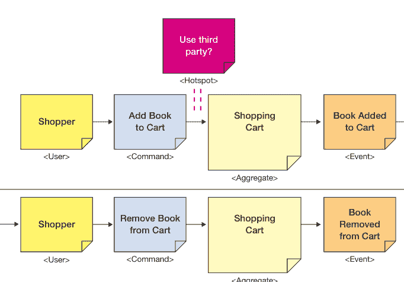

**图 4.5 为 JSON 书店设计的“下单”任务故事（Place Order job story），扩展后包含了用于命令、聚合和用户的额外颜色标记便签。还有一个带有有待解决问题的“热点”便签，以便在会话后解决。**

以下是贯穿 EventStorming 会话中常用的便签类型——以及通常为每种类型指定的颜色：

- **业务事件（橙色）：** 动作或策略的结果，表示工作流或流程的进展。
- **热点（亮粉色）：** 未知或或缺失的数据，需要在会话后进行研究和跟进。
- **命令（深蓝色）：** 用户或系统采取的动作。
- **聚合（大尺寸、淡黄色）：** 执行命令后产生的行为或逻辑，这种行为通常会导致一个或多个事件。在领域驱动设计（DDD）中，聚合被定义为事务一致性单元。在 EventStorming 中，它是工作流、状态机和其他行为的高级表示。
- **策略（淡紫色）：** 执行新命令的触发事件或动机，且是必不可少的。它充当事件与命令之间的桥梁或胶水。策略可能以“当”（when）或“每当”（whenever）开头。

## 第 4 章 捕捉活动与步骤

- **外部系统（淡粉色）：** 解决方案之外的系统。这些可能是组织内部的团队外部的系统，或者是第三方系统。它们最好被视为小组控制之外的聚合。
- **用户界面（白色）：** 提供一个或多个角色对聚合执行命令能力的用户界面。
- **用户（黄色、小型）：** 与系统交互的特定角色，通常通过 UI 交互，但也可能是作为自动调用或其他机制的结果。

首先，通过添加命令（蓝色便签）来捕获系统或用户采取的动作，这些动作将导致识别出的一个或多个业务领域事件。命令被发送到聚合，以便捕获这些聚合。业务规则（通常表述为“当 xyz 发生时， . .……”可以作为策略（淡紫色）被捕捉。亮粉色便签用于需要更多信息的热点指示。

## 第 5 步：审查最终叙述

预计时间：30 分钟

最后，从两个方向（从开始到结束和从结束到开始）审查叙述，以确保所有元素都已捕捉。重要事件和触发器被清晰地标记，以表示步骤之间的关键转换。图 4.6 显示了一个完全探索的“下单”任务故事，使用了表达会话期间获得理解所需的必要便签。

这标志着 EventStorming 会话的完成。应该保存画布以备参考，因为它将对指导 API 设计过程中的后续步骤很有用。考虑给画布拍照并与团队分享。卷起画布或将其移动到共享空间对于在同一办公区域的团队成员很有帮助。如果团队使用了数字工具（如 Miro³），请将工作导出为 PDF 或图像，以便在 wiki 上共享或作为其他项目资产。

最后，使用之前概述的格式编写会话期间识别出的活动和活动步骤。

## EventStorming 如何工作 57

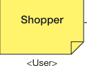
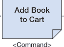
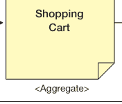


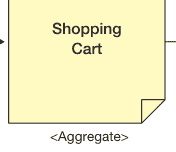


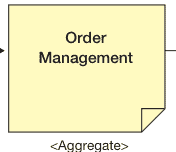
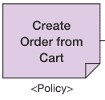


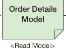
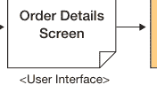
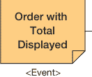

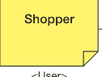

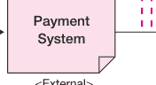


图 4.6 显示了一个完全探索的“下单”任务故事，使用了表达会话期间获得理解所需的必要便签。


- 2. 熟悉领域领域的领域专家（SMEs）
- 3. 参与软件交付的技术主管、架构师和高级开发人员
- 4. 安全专家，特别是当领域涉及隐私问题时
- 5. 不参与决策的个人软件开发人员（仅限特定情况）

## 引导 EventStorming（事件风暴）

一个熟悉 EventStorming 的引导者至关重要。引导者负责推动流程并确保每个人在整个过程中保持参与。便利贴可能会导致分散、减慢进度、导致问题遗漏，或让领域专家无法回答问题。远程会议只会增加可能的干扰因素，因此引导者必须通过控制会议节奏和在每个步骤之间提供清晰的过渡来防止这些问题的发生。

当产生疑问时，引导者需要评估讨论是否在侵犯他人或变得偏离主题。如有必要，使用便利贴记录争议区域并在稍后回顾。由于 EventStorming 相对较新，且经验丰富的引导者较少，本节提供了来自实际会议的见解和技巧。

## 准备：收集物资

在进行线下会议时，EventStorming 需要一些必需物资。请确保在会议开始几天前或会议当天早上订购所有物资。

会议需要大量不同颜色的便利贴。通常，橙色便利贴使用最多，因此准备更多这种颜色以匹配 EventStorming 的需求很重要。不过，可以根据需要调整可用物品。记住，大多数参与者将是第一次参加 EventStorming 会议，因此他们并不知道什么是“标准颜色”。

还需要一面大墙来悬挂贴有并移动便利贴的纸张。有些组织倾向于使用尺寸小于 18 到 24 英寸（45–60 厘米）的纸，以便沿墙壁排列两到三行。应该有一个可见的图例，以确保每个人记得使用的颜色颜色。务必写出一个图例，显示所有便利贴颜色、其类型（例如，橙色代表业务事件）以及显示它们如何典型组合形成叙事的箭头。图 4.7 显示了一个示例。

应使用黑色记笔在便利贴上书写，以确保离开建模表面时文字依然易于阅读。确保每位参与者至少有一支记笔，并在房间里散放几支备用以防丢失。

远程会议可以选择使用绘图工具来模拟便利贴。另一个选项是使用每个参与者都可以访问的共享文档，并应用与便利贴类似的颜色编码。无论选择哪种，都要在活动之前练习使用该工具，以确保会议期间有效利用时间。

![4.7]

**图 4.7** 一个图例，显示了常见的颜色编码便利贴如何在 EventStorming 会议期间协作以捕捉领域。

## 分享：沟通 EventStorming 会议

实现成功的 EventStorming 会议需要在会议完成前后进行准备和有效沟通。以下是引导者在会议前通过电子邮件和视频进行有效沟通的建议：

- 产品管理的参与至关重要。坚持要求产品所有者产品经理参加。以开发人员为主的会议将侧重于目前运作如何、现有系统以及维持现状。此外，这会达成共识，导致对领域和预期结果产生错误的理解。
- 分享会议的目的和范围。如果提前共享目的和范围，许多人将困惑或无法参与。沟通目的和范围还将确保正确的人在场，这是 EventStorming 发挥最大效能的关键。最初建立预期并在会议开始时进行强化。
- 建立共同预期。困惑或未实现的预期会导致会议无效或对 EventStorming 产生不良看法。就流程、预期结果和要产生的设计资产建立预期。在会议开始时重申这些内容以强化目标并建立正确的心态。
- 确保 API 设计尚未开始。已经开始 API 设计的团队可能会忽略会议的输出，转而倾向于推进当前的设计。会议应用于引导具有即时执行力的愿景。不愿或无法结合会议输出的团队很可能无法获得 EventStorming 会议的最高价值。在继续之前确保每个人的认同。
- 强化 EventStorming 如何融入整体 API 设计中。分享进度指示或经常回顾整体流程，以展示会议在大图中的位置。提醒观众，EventStorming 产生的宝贵见解将指导接下来的 API 建模和设计步骤。否则，会议可能像是在浪费时间。

在会议启动时，再次回顾这些项目。在会议当天回顾所有内容有助于让大家记忆，并为会议设定预期。

## 执行：进行 EventStorming 会议

在会议开始时，回顾会议的预期、流程和范围。然后从会议的第一步开始。大多数第一次参加的人可能不确定如何开始。准备好帮助他们，或让更熟悉的人开始流程。

通过先演示来展示流程是如何运作的。通过从小组获取输入发布第一个业务事件，将其表达为过去式，然后将其贴在时间轴的大致位置。要求小组独立开始。每个步骤都使用相同的技巧。

为流程的每一步建立明确的理由。虽然流程对引导者来说可能是显而易见的，但大多数参与者需要时间来适应 EventStorming。

## 总结：记录活动和活动步骤

会议完成后，拍摄带有便利贴的画布照片以便分享。在离开该区域之前，应检查照片以确保所有手写字清晰。如果不是，请靠近画板拍摄更多照片。

为了让画布数字化可用，可以使用工具生成单张全景照片，或从左到右对照片进行编号，以确保根据需要重新组合。如果团队位于共享办公空间，可以小心移除画布并放置在新位置。

如 Miro 等数字工具可能对远程会有帮助，并支持最终画布的 PDF 或图像导出。如果没有其他工具，可以使用共享文档，例如 Google Docs 或托管在 SharePoint 上的 Word 文档。经验表明，颜色编码文本与虚拟便利贴一样有效，并且在操作画布时更容易复制粘贴。

最后，利用画布识别并记录活动和活动步骤，如本章开头所述的那样。


# 64 第 4 章 捕捉活动与步骤

在会议结束后两周，协调员应向团队发送第二封邮件。这封邮件应该询问团队如何使用会议的产出。利用此机会发现阻碍团队进展的阻塞性问题。如果团队受阻，请安排后续讨论以指导他们采取后续步骤。

最后，在获得许可的情况下，撰写本次会议的案例研究并包含参与者的引言。这有助于那些不确定事件风暴（EventStorming）流程价值的团队理解其提供的价值，并增加他们投入必要时间的意愿。这也有助于在组织内部分享团队的胜利成果。

## 自定义流程

记住，事件风暴是一种在协作环境中提供“基于发现的学习”的工具。定制化流程有助于组织从会议中获得最大收益。除了 Brandolini 建议的原始流程外，还探索了以下添加或修改：

- **三车道法：** 不再使用覆盖整面墙的单张纸，而是使用窄纸来并行创建三个独立的“车道”。在识别业务事件期间，所有初始事件都贴在顶部的线上。在将它们排序成叙事时，事件会被移动到中间车道。当使用新的贴纸扩展初始业务事件之外的内容以扩展画布时，顶线则用于扩展可用空间。底线则作为“停车场”，存放被认为在范围之外或被识别为重复的事件。这种方法的建立是迫性之举，因为组织从用品室里提供的纸卷仅有 12 英寸（30 厘米）高。

- **45 度贴纸：** 当某个贴纸内容清晰、需要重写为过去式，或由于其他原因再次被回顾时，任何人都有权将贴纸倾斜 45 度。这标记了该贴纸在继续流程的下一个步骤之前需要进行跟进。

- **多部分事件风暴会议：** 随着远程会议的引入，疲劳感通常比高能量的线下会议更快到来。在这种情况下，考虑将一次事件风暴会议拆分为多个部分，每个部分超过两小时后进行一小时休息。如有必要，只要所有参与者都能连续两天参加，会议可以跨越两天进行。

- **共享协调：** 鼓励协调员邀请不同的人来引导叙述/故事讲述。共享协调可以增强团队对会议的所有翁，让团队成员保持参与并远离邮件，同时帮助对他人进行事件风暴流程的交叉培训。协调员先演示并协调一段时间，然后请求志愿者或选择某人来协调流程的某部分。这种模式将持续，直到每个人都有机会协调会议的一部分。在活动期间，原始协调员将保持在位，并在需要时指导每个人。

## 总结

团队对领域概念、流程和工作流建立详细的理解至关重要。将这些细节作为活动和活动步骤捕捉，有助于所有团队成员达成一致，并为未来的 API 设计工作奠定基础。事件风暴框架可以作为协作方法，与领域专家和主题专家一起详细探索领域概念。

API 设计过程的下一步是开始定义边界上下文（bounded contexts）以及实现 API 产品或 API 平台提供的数字能力所需的 API。

## 第三部分

# 定义候选 API 在在 API 设计过程中，已经通过“任务故事”（job stories）识别了数字能力。产生产出所需的活动已被捕捉，并基于来自事件风暴会议的洞察。通过从关注结果和活动开始，团队能够保持与客户需求和业务目标的一致。

API 设计过程的下一步是识别候选 API。这些候选 API 将反映使用事件风暴画布或上一步生成的活动列表识别出的一个或多个边界。随着边界的确定，一个或多个 API 配置文件（API profiles）开始出现。

每个 API 配置文件提供了关于 API 更详细的清晰说明，并为最终的 API 设计提供信息。它反映了需要设计的 API 资源以及将提供的操作。这个定义步骤对于设计专注于交付的 API 至关重要。

## 边界

在 API 设计过程的这一阶段，已经通过任务故事识别了数字能力。产生产出所需的活动已被捕捉，并基于来自事件风暴会议的洞察。通过从关注结果和活动开始，团队能够保持与客户需求和业务目标的一致。

**

API 设计过程的下一步是识别候选 API。这些候选 API 将反映使用事件风暴画布或上一步生成的活动列表识别出的一个或多个边界。

这些 API 专注于跨组织交付成果。缺乏明确的 API 范围和职责会让开发者感到困惑并无法有效使用。

**全能型 API 模式** 即使是最经验丰富的 API 设计师，在一个 API 尝试完成所有事情时也会面临挑战。创建一个巨大的 API 会让开发者找到所需内容变得困难。缺乏明确的 API 范围和职责会让开发者感到困惑并无法有效使用。

**过载 API 模式** 在规模较大的组织中，由于错误地认为单一 API 是组织工作的最佳方式，一个团队可能负责书籍目录、库存、购物和履约的大部分。当其他部门等待该团队添加新功能时，交付速度会大大降低。

**碎片化模式** 起始于一个初衷良好的目标，最终会导致整个代码库中布满了许多小的 API。

**避免 API 边界反模式**

在书店示例中，*books* 可能意味着几个上下文之一：

- 目录中的书籍条目
- 仓库库存中的书籍
- 加入购物车的书籍
- 已下订单的书籍
- 作为订单一部分发货的书籍

创建一个单一 API 可能不是实现清晰度或理性的最佳路径。随着围绕 *books* 的新上下文的引入，API 的更改将变得频繁。结果将是各种方式混合匹配该术语，直到 API 变成一个混乱的杂烩。

相反，通过更多的上下文来澄清单单词术语（如 *book*）。例如，书籍目录 API 有助于将 API 操作限制在目录管理相关的范围内。在这个明确定义的范围范围内，包含了额外的职责，包括管理公共描述、关联元数据、书籍封面、章节等。只有对目录管理感兴趣的人才需要处理此 API。

**工具 API 反模式** 几乎每个开发团队都构建过工具库。这个库是散布在整个代码库中的各种实用程序。用于存储工具的命名空间（例如 `com.mycompany.util`）在整个代码库中被引用。

某些 API 遭受着与可怜的、过度使用的工具 API 相同的挑战。这些 API 有多种用途，但作为一个整体并不连贯。与 API 集成的开发者难以理解何时以及何地应用每一个工具。


## 边界上下文、子域与 API

API 边界的目标是统一通用语言（ubiquitous language），同时尽可能地减少团队之间的整体协调。在 Web API 的情况下，边界可能提供一个或多个网络接口，以支持边界区域内的所有操作。每个边界都应该由单一团队拥有，该团队有权构建边界内的所有内容。

定义定义清晰的边界对于 API 来说是一个重要因素，因为它通过将 API 范围限制在特定的职责范围内，有助于加速 API 的设计和开发过程。用于 API 操作和资源的术语也应该反映界定上下文的通用语言。对于较大或更复杂的边界，可能需要进一步拆分，可能会导致在 API 之后隐藏额外的 API 和服务。随着对解决方案的不断深入，边界可能会发生迁移。

大多数团队面临的挑战是如何识别其 API 的上下文。有些团队可能只有在看到它时才能识别，而另一些团队可能会在域的特定部分周围划分边界。这两种方法都没有产生一种可重复、可教学的流程来明确识别 API 的范围。相反，建议使用事件风暴（EventStorming）画布和对齐阶段的活动步骤产物来帮助识别边界。

## 关于 API 边界与 DDD 的说明

虽然本章试图整合识别 API 边界常用的 DDD 术语和实践，但也旨在支持尚未采用通用 DDD 实践的组织。

本章试图寻找一个平衡点，既支持熟悉 DDD 复杂性的实践者，也支持不太熟悉的人员。无论哪种情况，DDD 中许多有用的教训仍然适用于未完全参与 DDD 实践的组织。更熟悉 DDD 的组织可能希望引入超出本章范围的额外实践。

当团队完成 API 设计时，请参考 Vaughn Vernon 的优秀著作《领域驱动设计实战》（*Implementing Domain-Driven Design*）以获取有关实现 DDD 的更多细节。

### 通过活动寻找 API 边界

### 使用事件风暴寻找 API 边界

如第 4 章所述，事件风暴有助于统一术语，同时让团队对流程、业务策略和系统交互达成共识。通过检查整个事件风暴画布上使用的语言，开发者发现随着术语和关注点的转移，关于可能的 API 边界的提示开始显现。这通过语言模式的变化得到了体现，如图 5.2 所示。

随着术语的转变，边界开始出现。识别并命名每个边界。然后，为每个边界分配一个基于 Web API 作为起点。该 API 将提供交付该边界数字能力所需的 API 操作。

团队可能还会选择将事件风暴识别的聚合（aggregates）作为 API 范围的提示。虽然这为 API 边界提供了一些额外见解，但并非如此。基于细粒度职责捕捉并关注单一职责的聚合，对于识别 API 后面的内部模块或服务更有用。然而，如果聚合是在更细的级别上分组的，它们可能成功识别出一个负责协调结果的 API。

对于某些探索有限范围的事件风暴会议，可能只有一个边界。但对于大多数解决方案，在事件风暴画布上至少会识别两个边界。

图 5.3 根据事件风暴提供的见解，强调了三个符合独立 API 的特定边界。

### 通过活动寻找 API 边界

虽然事件风暴有助于通过设计寻找边界，但它并不是引导识别过程唯一的方法。也可以通过审查熟悉必要流程和工作流的主题专家生成的活动和活动产物来使用相同的方法，如第 4 章所述。当已投入大量精力获取需求时，这种方法尤为有效。

寻找像之前使用事件风暴时描述的语言转变。通常，活动步骤名称和/或描述具有名词和动词的基础句子结构。注意活动步骤中名词发生变化的地方。被作用的名词可能提供边界所在处的线索。当步骤切换到一组新名词时，标记该位置并将其作为新边界的起点。虽然不如事件风暴那样全面，但活动和活动步骤将提供关于语言转变的见解，这些转变展示了边界的迁移。

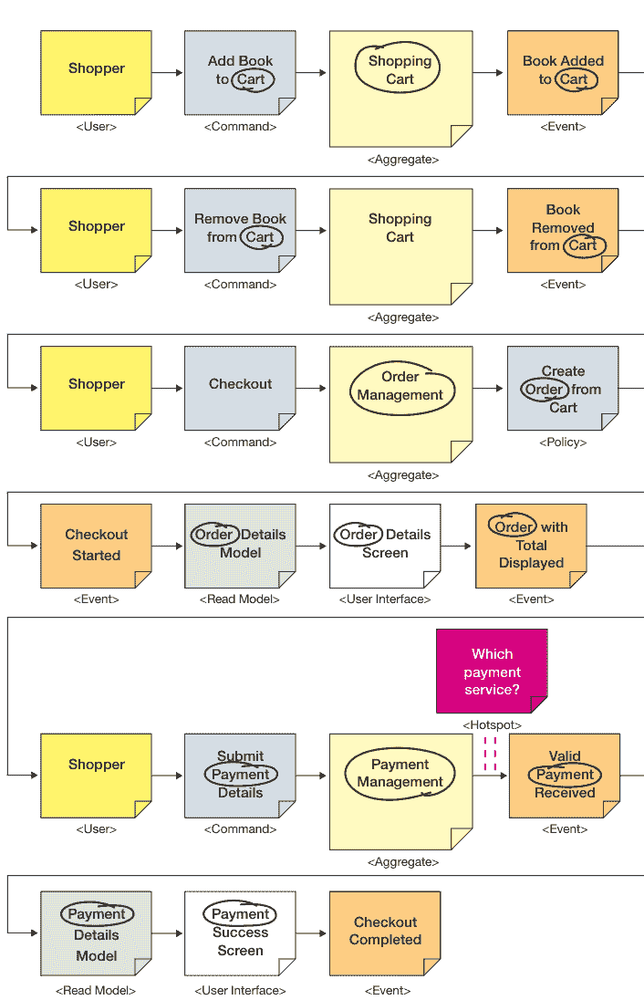

## API 的命名与范围划分

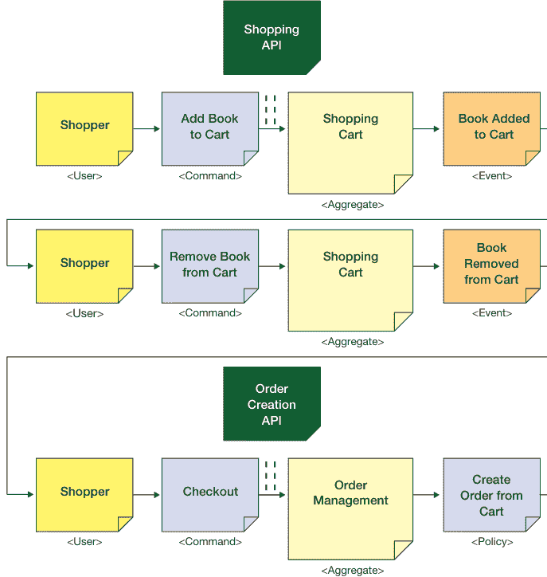

**图 5.3** 通过事件风暴画布上的语言转变识别出的 API。

例如，上一章表 4.2 中的活动和活动步骤在表 5.1 中。注意从“书籍”（Books）到“购物车”（Cart），再到“订单”（Order）和“支付”（Payment）的转变。这些转变为识别边界提供了起点，并由此形成 API。

## API 的命名与范围划分

接下来，为边界赋予一个名称，以代表将设计的 API。尝试分配一个包含范围、结果或目标受众的名称。知名 API 名称示例包括 Twitter 的 Followers API 和 eBay 的 Seller API。

## 第 5 章识别 API 边界

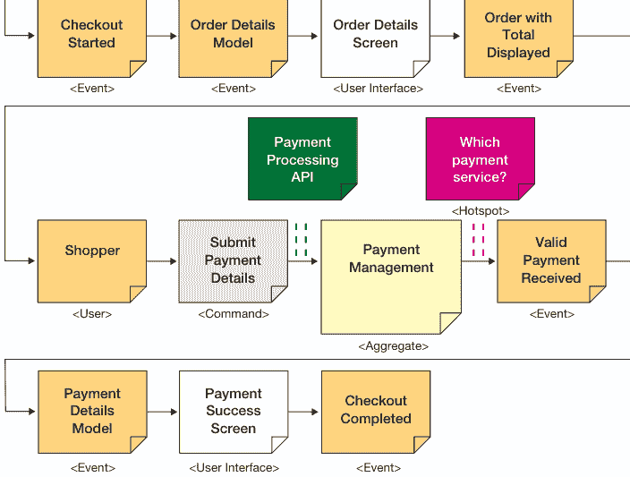

**表 5.1** JSON 图书店的活动步骤；分隔符指示识别边界的词汇迁移

| 数字能力 | 活动 | 活动步骤 | 参与者 | 描述 |
|---|---|---|---|---|
| 下订单 | 浏览书籍 | 列出书籍 | 客户、呼叫中心 | 按类别或发布日期列出书籍 |
| 下订单 | 浏览书籍 | 搜索书籍 | 客户、呼叫中心 | 按作者、标题搜索书籍 |
| 下订单 | 浏览书籍 | 查看书籍详情 | 客户、呼叫中心 | 查看书籍详情 |
| 下订单 | 购物书籍 | 将书籍加入购物车 | 客户、呼叫中心 | 将书籍加入客户的购物车 |
| 下订单 | 购物书籍 | 移除书籍 | 客户、呼叫中心 | 从客户的购物车中移除书籍 |
| 下订单 | 购物书籍 | 清空购物车 | 客户、呼叫中心 | 从客户的购物车中移除所有书籍 |
| 下订单 | 购物书籍 | 查看购物车 | 客户、呼叫中心 | 查看当前购物车和总量 |
| 下订单 | 创建订单 | 结账 | 客户、呼叫中心 | 根据购物车内容创建订单 |
| 下订单 | 创建订单 | 支付订单 | 客户、呼叫中心 | 接受并处理订单支付 |

避免使用 service（服务）和 manager（经理）术语，因为它们对于理解 API 的目的通常没有帮助。

图 5.3 中的 API 命名为 Shopping API、Order Creation API 和 Payment Processing API。这是一个良好的开始，并清晰地阐述了每个 API 的范围。

## 注意

某些 API 设计师倾向于将订单创建和支付 API 合并，因为它们可以被认为是内聚的，因此作为单一 API 存在。在这个简单的示例中，为了教学目的将它们分开。然而，领域见解表明，通过清晰定义的边界分离订单创建，可以在未来进行更复杂的处理，而不会给订单边界增加负担。

最后，根据代表的边界将活动步骤划分到相应的 API 中。表 5.2 包含了 Shopping API，包括与 API 相关的活动步骤。

表 5.3 包含了“下订单”数字能力的结账过程。最后，表 5.4 包含了作为“下订单”数字能力的支付步骤。

# 表 5.2 通过边界识别发现的 Shopping API 及对应的 JSON 图书店活动步骤

| 数字能力 | 活动 | 活动步骤 | 参与者 | 描述 |
|---|---|---|---|---|
| 下订单 | 浏览书籍 | 列出书籍 | 客户、呼叫中心 | 按类别或发布日期列出书籍 |
| 下订单 | 浏览书籍 | 搜索书籍 | 客户、呼叫中心 | 按作者、标题搜索书籍 |
| 下订单 | 浏览书籍 | 查看书籍详情 | 客户、呼叫中心 | 查看书籍详情 |
| 下订单 | 购物书籍 | 将书籍加入购物车 | 客户、呼叫中心 | 将书籍加入客户的购物车 |
| 下订单 | 购物书籍 | 移除书籍 | 客户、呼叫中心 | 从客户的购物车中移除书籍 |
| 下订单 | 购物书籍 | 清空购物车 | 客户、呼叫中心 | 从客户的购物车中移除所有书籍 |
| 下订单 | 购物书籍 | 查看购物车 | 客户、呼叫中心 | 查看当前购物车和总量 |
| 下订单 | 创建订单 | 结账 | 客户、呼叫中心 | 根据购物车内容创建订单 |
| 下订单 | 创建订单 | 支付订单 | 客户、呼叫中心 | 接受并处理订单支付 |


# **表 5.3** 订单创建 API，通过边界识别发现，并带有 JSON 书店中相应的活动步骤

| 数字能力 | 活动 | 活动步骤 | 参与者 | 描述 |
| :--- | :--- | :--- | :--- | :--- |
| 下单 | 创建订单 | 结账 | 客户、呼叫中心 | 根据购物车内容创建订单

# **表 5.4** 支付处理 API，通过边界识别发现，并带有 JSON 书店中相应的活动步骤

| 数字能力 | 活动 | 活动步骤 | 参与者 | 描述 |
| :--- | :--- | :--- | :--- | :--- |
| 下单 | 创建订单 | 支付订单 | 客户、呼叫中心 | 接受并处理订单的付款 |

一旦明确定义了边界，就可以开始 API 建模。这项工作将生成 API 概要文件（API profiles），用于定义每个 API 将提供的各种操作和事件。API 建模将在下一章中详细介绍。

## 总结

API 获益于仔细的范围界定和职责分配。应用边界有助于识别交付所需工作故事（job stories）目标结果所需的一个或多个 API。这为下一步 API 建模铺平了道路，在建模过程中，将形成 API 的蓝图，并为 API 设计奠定基础。

## 第 6 章

## API 建模

你可以在绘图台上使用橡擦，也可以在建筑现场使用大锤。

> — 弗兰克·洛德·莱特

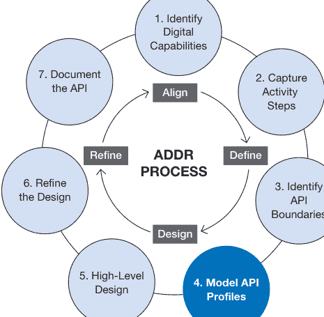

**图 6.1** 定义阶段的最后一步是创建 API 概要文件，为过渡到设计阶段做准备。

## 第 6 章 API 建模

开发者往往渴望立即开始编写代码。代码是开发者的主要工具。它代表一切——锤子、螺丝刀、直尺和锯子。当代码被视为设计 API 的唯一工具时，API 设计的质量可能会受到影响。生产生产环境代码的冲动变得比 API 本应产生的结果更具价值。

诚然，当代码被用于探索解决方案的特定领域以降低风险时，它是有价值的。使用代码进行实验、揭示未知性或探索新技术也是有价值的。David Thomas 和 Andrew Hunt 在他们的书籍《实战宝典》中将“追踪跟踪弹”（tracer bullet）一词应用于软件。该术语描述了将代码作为探索和降低风险的手段。追踪跟踪弹通过学习而非生产级代码来交付价值。

API 建模是 API 设计的“追踪跟踪弹”。它是一种在设计和交付过程之前，探索 API 必要元素的技术。API 建模（见图 6.1）有助于将之前步骤中获得的见解和产物整合到 API 概要文件中，描述了交付终端预期结果所需 API 的范围和意图。

## 什么是 API 建模？

就像美丽的网页设计始于线框图（wireframe）一样，伟大的 API 设计始于帮助定义其范围和职责的 API 模型。API 建模的目标是充分理解并验证开发者和终端用户的需求。与严格关注终端用户交互的线框图不同，API 建模同时关注开发者和终端用户的目标。通常，这些目标是一致的，但有时并不一致。API 建模有助于快速暴露出问题，以便在编写代码之前解决它们。

API 建模使用工作故事、活动和活动步骤来生成每个 API 的凝聚视图，称为 API 概要文件（API profile）。API 概要文件捕获了有关 API 的特征，包括其名称、范围、操作以及用于交付预期结果的编辑事件。API 建模在设计和开发开始之前——此时代码的成本要低。

完成 API 设计后，团队将需要将生成的 API 概要文件迁移到 API 设计中。API 建模可以作为所选单一 API 设计风格（如 REST、GraphQL 或 gRPC）的输入。它还可用于

* 1. David Thomas 和 Andrew Hunt, 《实战宝捷》(The Pragmatic Programmer), 2019.

API 概要文件捕获了有关 API 的特征，包括其名称、范围、操作以及用于交付预期结果的编辑事件。就像美丽的网页设计始于线框图（wireframe）一样，伟大的 API 设计始于一个帮助定义其范围和职责的 API 模型。API 建模的目标是充分理解并验证开发者和终端用户的需求。与严格关注终端用户交互的线框图不同，API 建模同时关注开发者和终端用户的目标。通常，这些目标是一致的，但有时并不一致。API 建模有助于快速暴露出问题，以便在编写代码之前解决它们。

API 建模使用工作故事、活动和活动步骤来生成每个 API 的凝聚视图，称为 API 概要文件（API profile）。API 概要文件捕获了有关 API 的特征，包括其名称、范围、操作以及用于交付预期结果的编辑事件。API 建模在设计和开发开始之前——此时代码的成本要低。

完成 API 设计后，团队将需要将生成的 API 概要文件迁移到 API 设计中。API 建模可以作为所选单一 API 设计风格（如 REST、GraphQL 或 gRPC）的输入。它还可用于

* 1. David Thomas 和 Andrew Hunt, 《实战宝捷》(The Pragmatic Programmer), 2019.

API 概要文件捕获了有关 API 的特征，包括其名称、范围、操作以及用于交付预期结果的编辑事件。就像美丽的网页设计始于线框图（wireframe）一样，伟大的 API 设计始于一个帮助定义其范围和职责的 API 模型。API 建模的目标是充分理解并验证开发者和终端用户的需求。与严格关注终端用户交互的线框图不同，API 建模同时关注开发者和终端用户的目标。通常，这些目标是一致的，但有时并不一致。API 建模有助于快速暴露出问题，以便在编写代码之前解决它们。

API 建模使用工作故事、活动和活动步骤来生成每个 API 的凝聚视图，称为 API 概要文件（API profile）。API 概要文件捕获了有关 API 的特征，包括其名称、范围、操作以及用于交付预期结果的编辑事件。API 建模在设计和开发开始之前——此时代码的成本要低。

完成 API 设计后，团队将需要将生成的 API 概要文件迁移到 API 设计中。API 建模可以作为所选单一 API 设计风格（如 REST、GraphQL 或 gRPC）的输入。它还可用于

* 1. David Thomas 和 Andrew Hunt, 《实战宝捷》(The Pragmatic Programmer), 2019.

API 概要文件捕获了有关 API 的特征，包括其名称、范围、操作以及用于交付预期结果的编辑事件。就像美丽的网页设计始于线框图（wireframe）一样，伟大的 API 设计始于一个帮助定义其范围和职责的 API 模型。API 建模的目标是充分理解并验证开发者和终端用户的需求。与严格关注终端用户交互的线框图不同，API 建模同时关注开发者和终端用户的目标。通常，这些目标是一致的，但有时并不一致。API 建模有助于快速暴露出问题，以便在编写代码之前解决它们。

## API 概要文件结构

API 概要文件捕获了关于 API 的信息，不取决于 API 风格（如 REST、GraphQL）。它还涵盖了以下细节：

*   API 的名称和简短描述
*   API 的范围
*   参与者 操作
*   API 生成的事件
*   API 的详细信息
*   （可选）API 服务级别协议（SLA）

API 概要文件捕获了有关 API 的特征，包括其名称、范围、操作以及用于交付预期结果的编辑事件。API 建模在设计和开发开始之前——此时代码的成本要低。

完成 API 设计后，团队将需要将生成的 API 概要文件迁移到 API 设计中。API 建模可以作为所选单一 API 设计风格（如 REST、GraphQL 或 gRPC）的输入。它还可用于

* 1. David Thomas 和 Andrew Hunt, 《实战宝捷》(The Pragmatic Programmer), 2019.

API 概要文件捕获了有关 API 的特征，包括其名称、范围、操作以及用于交付预期结果的编辑事件。就像美丽的网页设计始于线框图（wireframe）一样，伟大的 API 设计始于一个帮助定义其范围和职责的 API 模型。API 建模的目标是充分理解并验证开发者和终端用户的需求。与严格关注终端用户交互的线框图不同，API 建模同时关注开发者和终端用户的目标。通常，这些目标是一致的，但有时并不一致。API 建模有助于快速暴露出问题，以便在编写代码之前解决它们。

API 建模使用工作故事、活动和活动步骤来生成每个 API 的凝聚视图，称为 API 概要文件（API profile）。API 概要文件捕获了有关 API 的特征，包括其名称、范围、操作以及用于交付预期结果的编辑事件。API 建模在设计和开发开始之前——此时代码的成本要低。

完成 API 设计后，团队将需要将生成的 API 概要文件迁移到 API 设计中。API 建模可以作为所选单一 API 设计风格（如 REST、GraphQL 或 gRPC）的输入。它还可用于

* 1. David Thomas 和 Andrew Hunt, 《实战宝捷》(The Pragmatic Programmer), 2019.

## API 建模过程

API 建模的目标是生成建模过程中识别出的一个或多个 API 概要文件。建模过程分为五个步骤。每个步骤都为 API 增加额外的细节，直到形成 API 的蓝图。

82 第 6 章 API 建模

| 操作名称 | 描述 | 参与者 | 资源 | 抛出的事件 | 操作详细信息 |
| :--- | :--- | :--- | :--- | :--- | :--- |
| listies() | 搜索 thingies ... | 客户、停止 | Thingy | | 请求参数：vendorId, 返回：Thingy[] |
| 我的 API - 此处填写描述 | | | | | |

图6.2 使用表格或文档捕捉 API 概要文件的模板。

## 使用 OpenAPI 规范如何？

OpenAPI 规范（OAS）是一种机器可读的格式，用于描述基于 REST 和基于 gRPC 的 API。该格式的设计是为了帮助生成 API 参考文档和样板代码。因此，OAS 结构植根于 URL 路径。OAS 并不是 API 概要文件的合适格式。然而，API 概要文件将有助于在设计过程中创建基于 OAS 的 API。

API 团队发现使用应用级语义（ALPS）规范（在第13章“文档 API 设计”中详细介绍）是生成机器可读 API 概要文件的有效方法，它可以加速 API 建模和设计过程。

那些拥有对齐-定义-设计-完善（ADDR）步骤产物的人通常可以在两小时内完成 API 建模。对于跳过了某些步骤的人，API 建模可能需要几小时才能完成。

# 第1步：捕捉 API 概要摘要

第一步是填写 API 概要文件的基本细节，包括 API 名称、简短描述和 API 范围。API 的范围应该与组织支持的范围对应：内部、公开和合作伙伴。记住，随着团队对每个 API 的流程和职责的理解，这些细节可以更改。

接下来，根据之前捕获的活动和活动步骤捕捉 API 操作名称和参与者。将之前识别的每个活动步骤转换为使用一致命名格式的操作名称。建议使用小驼峰法，这有助于团队像本章稍后推荐的那样，使用序列图探索 API 模型。

图6.3 展示了如何使用 JSON 书店的购物 API 捕捉 API 文件的开始，该 API 是在设计过程对齐阶段识别的。


### 购物 API — 支持书籍浏览体验和购物车管理

| 操作名称 |  | 参与者 | 资源(s) | 发布的事件 | 操作详情 |
|---|---|---|---|---|---|
| listBooks() | 按类别或发布日期列出书籍 | 客户、呼叫中心 | | | |
| searchBooks() | 按作者、标题搜索书籍 | 客户、呼叫中心 | | | |
| viewBook() | 查看书籍详情 | 客户、呼叫中心 | | | |
| addToToCart() | 将书籍加入客户购物车 | 客户、呼叫中心 | | | |
| removeBookFromCart() | 从客户购物车移除书籍 | 客户、呼叫中心 | | | |
| clearCart() | 移除购物车中的所有书籍 | 客户、呼叫中心 | | | |
| viewCart() | 查看当前购物车和总计 | 客户、呼叫中心 | | | |

图 6.3 JSON：书店的购物 API，其名称、描述、作用域和操作名称已根据第 3 章“边界上下文”中的 API 设计练习进行了填充。

### 第 2 步：识别资源

下一步是使用 API 配置文件（profile）来识别 API 的资源。资源通常是 API 操作的领域实体。找到每个操作的目标有助于识别初始资源集。在开始开始 API 设计时，这通常是一项艰巨的任务。然而，该过程中的对齐（Align）和定义（Define）阶段提供了足够的理解，为设计者提供一组初始候选资源。

使用购物 API 示例来说明资源识别过程，图 6.4 显示书籍（Book）和购物车（Cart）资源被操作使用，并且是资源的候选对象。

对于每个候选资源，创建一个表格来记录资源名称和目前已知的任何属性。包含描述有助于统一理解，并在进入 API 设计阶段时非常有用。

在创建 API 配置文件时，重点仅捕获对操作至关重要的属性。这样做可以加速建模过程，并确保重点留在 API 配置文件上，而不是实现细节。

图 6.5 显示了购物 API 的资源，包括在枚举书籍（Book）资源属性时发现的名为“书籍作者”（Book Author）的新资源。

### 关于资源识别的警告

虽然使用数据库架构作为资源识别的起点可能很有吸引力，但请记住，API 设计不应泄露实现细节。数据库架构反映了针对事务和写操作的优化，而不是通过网络 API 暴露业务领域概念。

建模 API 时，最好自上而下工作，以避免将内部数据模型决策泄露到 API 设计中。如果实现阶段证明资源与数据库架构之间是一一一关系，那么正如画家鲍勃·罗斯（Bob Ross）所说，这就是一个“幸运的意外”。

- 2. Bob Ross，“我们没有犯错，”选自《绘画面对》第 3 季第 5 集“远山山”（Schmidt1942, 2013；最初于 1984 年 2 月 1 日播出），https://www.youtube.com/watch?v=wCaO56kWWtc。

## 购物 API—支持书籍浏览体验和购物车管理

| 操作名称 | 描述 | 参与者 | 资源(s) | 发布的事件 | 操作详情 |
|---|---|---|---|---|---|
| Public | list(books) | 按类别或发布日期列出书籍 | 客户、呼叫中心 | list(books) | | |
| | search(books) | 按作者、标题搜索书籍 | 客户、呼叫中心 | search(books) | | |
| | view(Book) | 查看书籍详情 | 客户、呼叫中心 | view(Book) | | |
| | addToCart(book) | 将书籍加入客户购物车 | 客户、呼叫中心 | addToCart(book) | | |
| | removeFromCart(book) | 从客户购物车移除书籍 | 客户、呼叫中心 | removeFromCart(book) | | |
| | clearCart() | 移除购物车中的所有书籍 | 客户、呼叫中心 | clearCart() | | |
| | view(cart) | 查看当前购物车和总计 | 客户、呼叫中心 | view(cart) | | |

图 6.4 为 JSON 书店的购物配置识别书籍和购物车资源。

## API 建模过程 87

| 属性名称 | 描述 |
|---|-|
| title | 书籍标题 |
| isbn | 书籍的唯一 ISBN |
| authors | 书籍作者资源列表 |

| 属性名称 | 描述 |
|---|-|
| books | 当前购物车中待购买的书籍 |
| subtotal | 购物车中所有书籍的总费用 |
| salesTax | 需要应用的销售税 |
| vatTax | 需要应用的任何值增值税 |
| cartTotal | 购物车的总费用 |

| 属性名称 | 描述 |
|---|-|
| fullName | 作者的全名 |

> **图 6.5** 捕获购物 API 的每个资源，并带有每个资源的一些基本细节作为起点。

### 第 3 步：定义资源分类法（Taxonomy）

一旦识别了资源，就可以寻找资源之间的关系以定义 API 分类法。*Taxonomy* 是对概念的分类及其排列方式。API 分类法捕捉了 API 将提供的资源集及其与其他资源的关系。

资源之间可能有三种关系类型：

- 1. **独立的**（Independent）：资源独立存在，不需要另一个资源的存在。
- 2. **依赖的**（Dependent）：如果没有父资源的存在，一个资源无法存在。
- 3. **关联的**（Associative）：资源可以独立存在；它们的关系需要额外的属性来描述。结果是表示两者之间关系的第三个资源。

Dan Klyn，“理解信息架构，”TUG，https://understandinggroup.com/ia-theory/understanding-architecture.

## 第 6 章 建模

| 属性名称 | 描述 |
|---|-|
| title | 书籍标题 |
| isbn | 书籍的唯一 ISBN |
| authors | 书籍作者资源列表 |

| 属性名称 | 描述 |
|---|-|
| books | 当前购物车中待购买的书籍 |
| subtotal | 购物车中所有书籍的总费用 |
| salesTax | 需要应用的销售税 |
| vatTax | 需要应用的任何值增值税 |
| cartTotal | 购物车的总费用 |

> 这是一个独立的关系吗？
> 数量放在哪里？

| 属性名称 | 描述 |
|---|-|
| fullName | 作者的全名 |

**图 6.6** 审查资源关系引入了一个挑战：数量属于哪里？

6.6 显示了购物 API 识别的资源以及可能的关系。书籍（Book）资源与书籍作者（Book Author）资源之间的关系是独立的。它们之间可能存在引用，但它们彼此独立存在。

注意图 6.6，关于在书籍加入购物车时在哪里指定数量，有一个需要解决的问题。这个问题需要进一步探讨。当书籍被添加到购物车时，可能重要的额外细节包括每本书的数量和价格。这表明存在一种关联关系，它需要一个新资源，在本例中为购物车项（Cart Item）。结果如图 6.7 所示。

操作 `addBookToCart()` 被重命名为 `addToCart()`，`removeBookFromCart()` 被重命名为 `removeItemFromCart()`，以反映购物车项资源的引入，如图 6.8 所示。


## API 建模过程

| 购物车资源 | 属性名称 | 描述 |
|---|---|---|
| | cartitems | 当前购物车中待购买的物品 |
| | subtotal | 购物车中所有书籍的总费用 |
| | salesTax | 需要适用的销售税 |
| | vatTax | 需要适用的增值税 |
| | cartTotal | 购物车的总费用 |

| 购物车项目资源 | 属性名称 | 描述 |
|---|---|---|
| | book | 当前购物车中待购买的书籍 |
| | qty | 购物车中物品的数量（默认值为 1） |
| | unitPrice | 以整数形式表示的价格。例如，$1.99 USD 将表示为 199 |

| 书籍资源 | 属性名称 | 描述 |
|---|---|---|
| | title | 书名 |
| | isbn | 书籍的唯一 ISBN |
| | authors | 书籍作者资源列表 |

| 书籍作者资源 | 属性名称 | 描述 |
|---|---|---|
| | fullName | 作者的全名 |

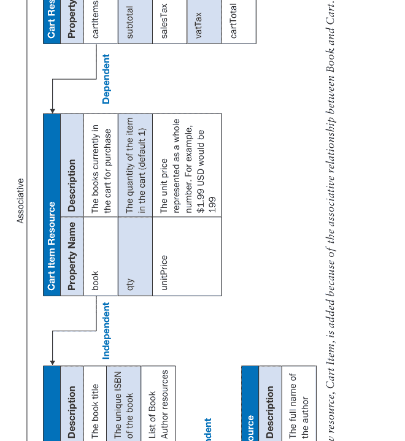

## 购物 API – 支持书籍浏览体验和购物车管理

| 操作名称 | 描述 | 参与者 | 资源(s) | 触发事件 | 操作详情 |
| --- |---|---|---|---|---|
| 公共 | listBooks() | 按类别或发布日期列出书籍 | 客户、呼叫中心 | 书籍、书籍作者 | | |
| | searchBooks() | 按作者搜索书籍 | 客户、呼叫中心 | 书籍、书籍作者 | | |
| | viewBook() | 查看书籍详情 | 客户、呼叫中心 | 书籍 | | |
| | addItemToCart() | 将书籍添加到客户购物车 | 客户、呼叫中心 | 购物车项目、购物车 | | |
| | removeItemFromCart() | 从客户购物车中移除书籍 | 客户、呼叫中心 | 购物车项目、购物车 | | |
| | clearCart() | 从客户购物车中移除所有书籍 | 客户、呼叫中心 | 购物车 | | |
| | viewCart() | 查看当前购物车和总额 | 客户、呼叫中心 | 购物车 | | |

图 6.8 购物 API 概要，已修订以反映“购物车项目”资源的引入。

## API 建模过程

91

事件名称应使用过去时表示，并符合组织内部使用的首选标准和规范。6.9 扩展了之前的模型，增加了每个操作将触发的事件。请注意“触发事件”（Emitted Events）列中使用的过去时命名。

API 概要现在反映了已确定操作将触发的内容。某些操作可能只触发一个事件，某些可能触发多个事件，而某些则可能不需要触发任何事件。

### 第 5 步：扩展操作详情

最后一步是扩展每个操作的细节，包含重要的输入和输出细节。此时不必担心捕获所有内容，因为没有必要。专注于对于跨团队传递理解至关重要的核心输入输出资源和参数。在此阶段，不需要捕获每个属性的类型或在 API 模型中定义模式（schema）。避免过度关注寻找每一个参数，因为在设计阶段会有充足的时间来捕捉完整的设计。如有必要，可以使用“停车场”（parking lot）来记录在设计过程中出现时需要处理的重要事项。

用于指导后续 API 设计的额外细节是操作是同步还是异步的。同步 API 以 HTTP 常见的传统的请求/响应方式运行。异步 API 在后台运行，而不是提供即时结果。异步 API 将第 9 章“消息、流和基于事件的异步 API”中讨论。目前，请关注每个操作的同步性。

操作中一个经常被忽视的细节是安全性（safety）。在选择合适的 HTTP 方法时，安全性和幂等性（idempotence）是重要的考虑因素。每个 HTTP 方法规范都描述了服务器必须实现的安全等等性。安全性分类对于客户端作为其错误处理代码的一部分进行考虑也是重要的。

HTTP 操作的安全性有三种分类：

- 1. 安全的（Safe）：操作不对目标资源(s) 产生任何更改。此安全性分类分配给所有基于读取（GET）的操作。

- 2. 幂等的（Idempotent）：操作会对目标资源(s) 进行状态更改，但如果使用相同的输入执行操作，它将产生相同的结果。这很重要，因为它告诉 API 客户端是否可以重新发送之前失败的请求而不会产生额外的副作用。此安全性分类分配给替换和删除操作（PUT 和 DELETE）。

92 第 6 章 API 建模

购物 API – 支持书籍浏览体验和购物车管理

| 操作名称 | 描述 | 参与者 | 资源(s) | 触发事件 | 操作详情 |
|---|---|---|---|---|---|
| listBooks() | 按类别或发布日期列出书籍 | 客户、呼叫中心 | 书籍、书籍作者 | Books.Listed | | |
| searchBooks() | 按作者、标题搜索书籍 | 客户、呼叫中心 | 书籍、书籍作者 | Books.Searched | | |
| viewBook() | 查看书籍详情 | 客户、呼叫中心 | 书籍 | Book.Viewed | | |
| addItemToCart() | 将书籍添加到客户购物车 | 客户、呼叫中心 | 购物车项目、购物车 | Cart.ItemAdded | | |
| removeItemFromCart() | 从客户购物车中移除书籍 | 客户、呼叫中心 | 购物车项目、购物车 | Cart.ItemRemoved | | |
| clearCart() | 从客户购物车中移除所有书籍 | 客户、呼叫中心 | 购物车 | Cart.Cleared | | |
| viewCart() | 查看当前购物车和总额 | 客户、呼叫中心 | 购物车 | Cart.Viewed | | |

图 6.9 JSON：购物 API，现在为每个操作添加了触发事件。

- 3. 不安全的（Unsafe）：操作会对目标资源(s) 进行状态更改，且如果多次使用相同的输入，无法保证结果相同。此安全性分类通常分配给创建和更新操作（POST 和 PATCH）。

检查每个操作以确定所需的安全性分类。在 API 建模期间这样做为设计提供了额外的见解。

图 6.10 显示了扩展后的购物 API 示例，包含了每个操作的、同步性和安全性分类。随后，通过捕获支持设计期间需要考虑的架构需求（如 SLA）和行业标准来完善 API 概要。

参考 GitHub 上的可用 API 工作讨会⁴获取 API 概要模板和示例，以启动工作。

## 使用序列图验证 API 模型

API 设计团队有责任确保 API 满足使用者的需求。这需要两个最终步骤：验证 API 模型以确保没有漏洞，并收集利益者的反馈。

将 API 概要与之前生成的原始工作故事和活动进行验证，以确认所有需求都已满足。为了验证 API 模型，创建演示典型使用场景的序列图。这些场景可能源自 EventStorming、工作故事或其他来源。图 6.11 显示了一个使用建模 API 支持购物和结账体验示例场景。

在验证过程中，澄清所有细节以确保对 API 范围和操作完全定义。如果缺少完成场景的操作，请返回建模步骤以捕获缺失的操作。

一旦模型通过验证，将模型分享给所有利益者并获取反馈。如果 API 建模是在包括业务和产品利益者在内的整个团队中进行的，那么反馈在过程中已获取。否则，请共享生成的资产并在进入流程设计阶段之前寻求纳入反馈。

> 4. https://bit.ly/align-define-design-examples


## 第6 章 API 建模

| 操作名称 | 描述 | 参与者(s) | 资源(s) | 发布的事件 | 操作细节 |
| :--- | :--- | :--- | :--- | :--- | :--- |
| 公共 | listBooks() | 按类别或发布日期列出书籍 | 客户、客服中心 | 书、书籍作者 | BooksListed | 请求参数：categoryId, releaseDate 安全/同步 |
| | searchBooks() | 按作者、标题搜索书籍 | 客户、客服中心 | 书 | BooksSearched | 请求参数：searchQuery 安全/同步 |
| | viewBook() | 查看书籍详情 | 客户、客服中心 | 书 | BookViewed | 请求参数：bookId 安全/同步 |
| | addToCart() | 将书籍加入客户购物车 | 客户、客服中心 | 购物车、条目 | CartAdded | 请求参数：cartId, bookId, quantity 安全/同步 |
| | removeItemCart() | 从客户购物车移除条目 | 客户、客服中心 | 购物车、条目 | CartRemoved | 请求参数：itemId 同步安全/同步 |
| | clearCart() | 从客户购物车移除所有书籍 | 客户、客服中心 | 购物车 | CartCleared | 请求参数：cartId 安全/同步 |
| | viewCart() | 查看当前购物车和总计 | 客户、客服中心 | 购物车 | CartViewed | 请求参数：cartId 安全/同步 |

**图 6.10** JSON 的书店：在 API 配置中添加了操作细节的购物 API。

购物 API – 支持书籍浏览体验和购物车管理

## 评估 API 优先级与复用

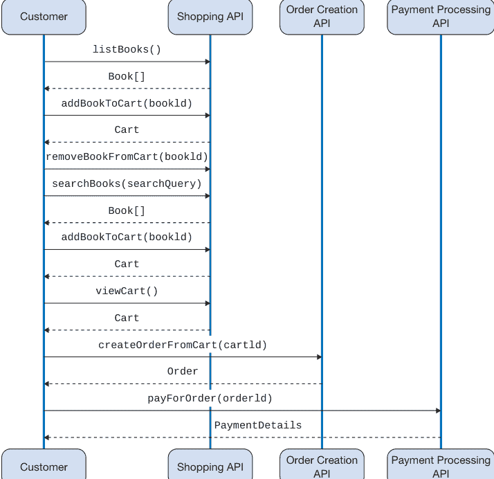

**图 6.11** JSON 书店的“下单”作业故事（job story），以序列图的形式表示，以确保所有操作在 API 建模过程中被识别，从而实现作业故事的结果和相关活动。

## 评估 API 优先级与复用

并不是所有的 API 在交付计划中的权重都是相等的。在进入 API 设计之前，规模评估是一个可选的步骤。该练习的结果有助于团队避免构建不必要的 API，或按错误的优先级顺序构建。

首先，评估 API 提供的业务和竞争价值。通过回答以下问题来评估每个 API 带来的价值：

- 该 API 是否帮助提供了相对于其他市场产品的竞争优势？
- 该 API 是否降低了业务成本（例如通过减少人工流程）？
- 该 API 是否创建了新的收入流或改进了现有收入流？
- 该 API 是否产生了业务智能、市场洞察或决策因素？
- 该 API 是否自动化了重复任务，从而为组织释放了处理更关键业务功能的能力？

如果所有问题的答案都是“否”，那么产生的价值就很低。对其中一个或多个问题回答“是”，则意味着该 API 为业务或市场提供了价值。

接下来，评估从零构建每个 API 的工作量。一种方法是通过将 API 分为小、中、大来使用相对规模评估法。考虑 EventStorming 期间呈现的细节，并编写活动步骤，以估计从头开始构建 API 的规模和复杂性。

最后，确定是否存在可以复用或扩展的现有 API。这些 API 可能是现成的（COTS）API、另一个团队产的内部 API，或者是可以用来加速交付的开源解决方案。组织往往会忘记这一步，导致浪费时间和精力构建重复的或相似的 API。执行这一步鼓励组织优先复用 API，仅在必要时才构建新 API。

图 6.12 显示了一个表格格式，记录了本章建模的 JSON 书店 API 配置的这些细节示例。

## 总结

API 建模有助于将设计过程中“对齐（Align）”阶段产生的见解和构制品整合到一个描述所需 API 范围和意图的模型中。检查以下清单以确保没有遗漏任何内容：

- 资源分类法识别了每个资源的属性以及它们之间的关系和依赖关系。

| API 配置 | 业务和竞争价值 | 内部构建工作量 | 现有内部/第三方 API |
| :--- | :--- | :--- | :--- |
| 购物 API | 中 | 中 | 第三方 uStore 解决方案（自定义和添加我们内部推荐引擎 API 的复杂度较高（可能也包括履行支持）） |
| 订单创建 API | 中 | 中 | 第三方订单处理 API（可能也包括履行支持） |
| 支付处理 API | 小 | 大 | 各种第三方支付处理器 |

图 6.12 在 API 建模过程中捕获的当前 JSON 书店配置的规模评估和优先级工作。

- 创建 API 配置是为了提供每个 API 的高层规范，而独立于 API 将如何被设计和实现。
- 序列图有助于验证 API 如何交付作业故事中取获的结果。
- 规模评估和优先级排序有助于确保在可能时复用，并在必要时构建。

通过花时间对 API 进行建模，团队可以清晰地表达每个 API 的需求。他们还能识别从零开始构建它们所需的工作量，并考虑可能满足要求的内部或第三方 API。复用现有 API 可以节省数周或几个月的交付工作。

随着 API 建模完成，ADDR 过程的“定义（Define）”阶段已经结束。下一步是 API 设计阶段。该阶段将 API 配置迁移到特定的 API 风格。第 7 章展示了如何使用 API 配置来指导设计。

## 第四部分

## 设计 API

现在 API 已经过建模，团队对每个 API 的范围和意图有了更好的理解。对齐-设计-完善（ADDR）过程是将 API 配置迁移到特定的设计。API 风格有很多选择，从 REST 到其他。

本页特意留空

## 第 7 章

# 基于 REST 的 API 设计

REST 接口的设计是为了在 Web 的常见情况下保持高效。

> Roy Thomas Fielding

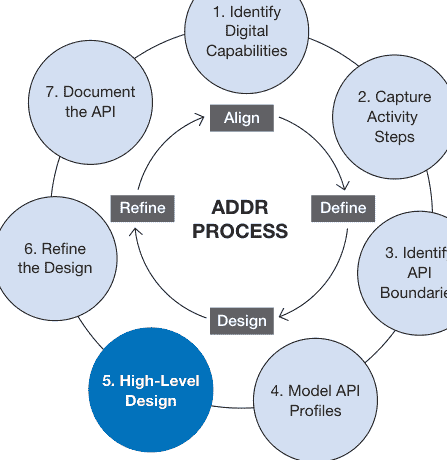

图 7.1 设计阶段提供了多种 API 风格选择。

团队从建模移动到设计阶段时，面临着各种决策。某些决策很容易解决，而另一些则需要仔细考虑。要知道，第一次正确设计 API 是困难的。因此，鼓励团队花时间设计原型以获取反馈。

本章介绍了 REST 的概述，以及将建模阶段创建的 API 配置迁移到基于 REST 的 API 设计的步骤。在此过程中，探索了各种决策。结果如图层所示。

# 原则 3：选择匹配需求的 API 设计元素

寻找完美的 API 风格是徒劳的。相反，要理解并应用适用于需求的 API 元素，无论是 REST、GraphQL、gRPC 还是刚刚进入行业的风格。接下来的章节提供了流行 API 风格的见解，帮助团队选择合适的风格或风格。这些章节讨论了何时使用何种风格、何时选择同步或异步交互模型，以及是否提供 SDK 库。

## 什么是基于 REST 的 API？

表现性状态转换（REST）是一种分布式系统的架构风格。与 HTTP 不同，REST 并不是由标准小组管理的规范。该术是由 Roy Thomas Fielding 在他的论文《架构风格与网络化软件架构的设计》中提出的。1 这篇论文概述了理解架构风格的核心概念和约束，以及这些约束是如何以不同程度应用于万维网的架构的。

> 1 Roy Thomas Fielding, "Architectural Styles and the Design of Network-based Software Architectures"（博士论文，加州大学，2000），https://www.ics.uci.edu/~fielding/pubs/dissertation/top.htm.


## 什么是基于 REST 的 API？

该论文并不要求使用 HTTP 作为 REST 架构的底层协议。然而，它确实讨论了 HTTP 规范的作者如何依赖所概述的架构约束来使其更具演进性。由于 HTTP 是大多数网络 API 的首选协议，本章及后续章节中提供的细节均基于 HTTP 作为首选协议。

Fielding 论文中概述的用于建立约束的一系列架构属性，这些属性在应用于分布式系统（包括基于网络的 API）时，使其在灵活性和可演进性上达成了共识：

- **客户端/服务器（Client/server）：** 客户端和服务器独立运行，它们之间的交互仅以请求和响应的形式存在。
- **无状态（Stateless）：** 服务器不会记住任何关于使用 API 用户的信息，因此处理请求所需的所有信息必须由客户端在每次请求中提供。注意：这并不是服务器端的状态。
- **分层系统（Layered system）：** 客户端感知不到客户端与响应请求的实际服务器之间有多少层（如果有的话）。这是 HTTP 的一个核心原则，允许客户端缓存、缓存服务器、反向代理和授权分层——这些对于发送请求的客户端来说都是透明的。
- **可缓存（Cacheable）：** 服务器响应必须包含关于数据是否可缓存的信息，允许客户端和任何中间件服务器在 API 服务器之外缓存数据。
- **按需代码（Code on demand，可选）：** 客户端可以从服务器请求代码（通常以脚本或二进制包的形式存在）供客户端执行。这在今天已通过浏览器请求 JavaScript 来扩展 Web 页面的行为来实现。按需代码为 API 团队提供了一个机会，让客户端获取 JavaScript 文件，以执行表单验证和其他职责。因此，可演进性可以扩展到客户端的按需代码。
- **统一接口（Uniform interface）：** 通过依靠基于资源的标识、使用表示进行交互、自描述性消息和多媒体控制，来鼓励独立的演进性。

在考虑基于 Web 的 API 设计时，Fielding 论文中概述的架构约束非常重要。当这些约束被放在一起时，它们有助于设计可演进的 Web API。

## REST 从来不是关于 CRUD

如前所述，REST 既不是规范也不是协议。与流行观点相反，基于 REST 的 API 并不需要 JSON，也不需要使用创建-读取-更新-删除（CRUD）的数据交互模式。REST 仅仅是一组关于各个组件如何协同工作的约束和约定。这为解决架构问题提供了灵活性。今天许多基于 Web 的 API 都使用 JSON 和 CRUD 模式作为设计元素。

坦率地说，这些分歧并无益。相反，在处理标记为 RESTful 或基于 REST 的 API 时，最好带着一种宽容和理解的心态，理解并不是每个人都读过并完全应用了原始的 REST 论文。利用这个机会温和地指导团队如何随时间改进他们的架构和 API 设计。无论你做什么，请不要利用这个机会来展示你对 REST 的比他们了解得得多。

## REST 是客户端/服务器

客户端/服务器架构是 REST 的一项基本约束。服务器托管可用资源，通过同步的基于消息的交互支持操作，客户端和服务器的用户界面与之交互。

将客户端和服务器分离允许客户端的用户界面随时间推移而改变。可以使用新的设备和界面样式，而无需更改服务器。

最重要的是，客户端能够独立于服务器进行演进。服务器可以提供新资源或额外的表示格式，而不会对客户端产生负面影响。这是 API 可以作为产品提供的根本原因，无论供应商是否提供了预先的用户界面。

## REST 是以资源为中心的

REST 中信息的核心抽象是“资源”。如第 1 章“API 设计原则”所述，资源由一个唯一的名称或标识符组成，该标识符可以引用文档、图像、资源集合或现实世界中任何内容的数字表示（例如人或物）。

资源的表示（representations）捕捉了资源的当前状态或意图状态。每个资源必须至少支持一种表示格式，但也可以支持多种。这些表示可能包括数据格式，如 JSON、XML、CSV、PDF、图像和其他媒体类型。

对于任何给资源，支持的表示格式可能取决于客户端的需求。例如，JSON 可能是基于 REST 的 API 提供的默认媒体格式。但某些资源可能需要在电子表格中进行操作，因此提供同一资源的备用基于 CSV 的表示。

例如，一个资源可能代表一个名为 Vaughn Vernon 的人。该资源可能有一个或多个表示。可能有一个基于 JSON 的表示，同时有一个 XML 表示。如果对所有更改保留历史记录，则每次更改都可能以 JSON 和 XML 媒体格式可用的表示形式存在。

## REST 是基于消息的

Fielding 论文的读者可能注意到，它关注客户端和服务器之间的消息交换。注意论文中使用了“消息（messages)”和“自描述消息（self-descriptive messages)”等术语。基于 REST 的 API 设计超越了 JSON 或 XML 表示中的优先级。

资源表示是整个消息中的消息体。传输协议设计也是完整基于 REST 的 API 设计的一部分。URL 路径、URL 查询参数以及 HTTP 请求/响应头必须被视为设计过程的一部分。只关注消息体会会导致设计不。

HTTP 方法、URL 和请求体的组合是从客户端发送到服务器的命令消息。它告诉服务器你想做什么。响应头、状态码和响应有效负载构成了发送给客户端的回复消息。当开发者将基于 REST 的 API 认为是在与客户端交换消息时，他们的 API 设计将随着消息的演进而变得更具演进能力。

## REST 支持分层系统

正如图文所示，REST 架构风格是一个分层系统，这意味着客户端不应假设它直接与服务器通信。客户端和服务器之间可能存在多个中间层，提供缓存、访问控制、负载均衡等功能，如图 7.2 所示。

## 第 7 章基于 REST 的 API 设计


**图 7.2** 支持分层架构，允许中间件服务器存在于客户端和服务器之间。

## REST 支持按需代码

按需代码是一个强大但利用率低的约束。当客户端请求资源时，也可以请求处理它的代码。客户端不需要知道代码中的内容，只需要知道如何执行它。主要的益处是 API 可以在不需要客户端应用程序进行特定升级的情况下扩展自身。

这种技术是浏览器每天都在做的事情，通过下载 JavaScript 文件并在浏览器本地执行来实现。浏览器不需要知道它下载的 JavaScript 文件中的内容，只需要知道它们需要内置的 JavaScript 引擎，因此可以在浏览器提供的安全沙箱内执行。当新功能和特性变得可用时，它们会立即提供给用户，而无需升级浏览器。

虽然（按需代码）在基于 Web 的应用程序中被广泛使用，但它是基于 的 API 利用率最少的约束之一，也是最强大的之一。想象一个 API 提供了下载代码以创建表单和客户端验证行为的选择，而无需在客户端侧编写和维护它们！

## 多媒体控制

多媒体 API 是由表示中的自描述链接驱动的。这些链接指向其他相关的 API 操作，引用相关的资源。它们也可以用于引用 API 的其他可能用途，通常称为能力（affordances）。Fielding 认为多媒体对于基于 REST 的架构是重要的。

使用多媒体控制的 API 通过提供运行时的操作发现来扩展客户端和服务器之间的对话。它们还可以通过表示中链接的存在或缺失向客户端传达状态。这一强大的概念将在本节稍后进行探讨。


# 第 7 章基于 REST 的 API 设计

超媒体控制的一种常见用途是分页，如下所示基于超文本应用语言（HAL）的响应：

```
{
  "links": {
    "self": {"href": "/projects"},
    "next": {"href": "/projects?since=d266f6cd&maxResults=20"},
    "prev": {"href": "/projects?since=43be807d&maxResults=20"},
    "first": {"href": "/projects?since=ef2426a&maxResults=20"},
    "last": {"href": "/projects?since=4e4c7be&maxResults=20"}
  }
}
```

API 客户端可以设计为使用 `next` 链接逐页跟踪搜索结果，直到 `next` 链接消失，表示所有搜索结果都已处理。

提供超媒体控制的 API 有助于创建上下文驱动的响应。这些控制能够根据超媒体链接的存在与否，指示哪些操作是可能或不可行的。这种能力避免了发送布尔字段或状态相关字段的需求，客户端无需解释这些字段来决定可以采取哪些操作。相反，服务器预先确定这一点，并通过提供的链接是否存在来传达可以做和不能做的事项。

# 什么是 HATEOAS？

超媒体作为应用状态的引擎（HATEOAS）是菲尔德（Fielding）在其论文中提出的 REST 约束之一。它将链接的存在或不存在作为客户端可以执行某些操作的指示器。由于服务器了解执行该操作本身授权需求的用户，因此能够更好地判断客户端能够做什么。如果没有这一约束，客户端将需要重新实现服务器端的业务逻辑，并始终保持这种逻辑同步。

需要注意的是，菲尔德表示他更倾向于使用“超媒体控制”术语而非 HATEOAS。在本书的剩余部分中，为了清晰起见，将使用超媒体控制代替 HATEOAS。

## 什么是基于 REST 的 API？

以下是一个内容管理系统中文章的 HAL 响应示例，它根据文章状态和用户作为作者的角色提供指向有效操作的超媒体链接：

```
{
  "articleId":"12345",
  "status":"draft",
  "links": [
    { "rel":"self", "url":"..."},
    { "rel":"update", "url":"..."},
    { "rel":"submit", "url":"..."}
  ],
  "authors": [ ... ]
}
```

当作者准备好提交文章进行编辑审核时，编辑将检索文章，并根据文章的提交状态和编辑的角色接收以下操作：

```
{
  "articleId":"12345",
  "status":"submitted",
  "links": [
    { "rel":"self", "url":"..."},
    { "rel":"reject", "url":"..."},
    { "rel":"approve", "url":"..."}
  ],
  "authors": [ ... ]
}
```

超媒体控制对使用上下文驱动超媒体控制的 API 驱动工作流具有重大影响。它们有助于减少客户端中为了模拟服务器行为而必须重复的业务逻辑。如果没有这些控制，客户端需要编写代码来根据文章状态和用户角色识别允许哪些操作。相反，客户端可以被设计为寻找特定的超媒体链接，这些链接指示特定的按钮是否对终端用户显示或禁用，从而避免了与服务器端业务逻辑同步的需求。这确保了 API 在演进时不会破坏客户端代码。

# 第 7 章基于 REST 的 API 设计

基于 REST 的 API 提供了四种主要的超媒体控制类型：

- 1. 索引超媒体控制：提供所有可用 API 操作的列表，通常作为 API 首页。
- 2. 导航超媒体控制：在负载响应中或通过使用 `Link` 头部包含分页链接。
- 3. 关系超媒体控制：指示与其他资源之间关系或用于主从细关系的链接。
- 4. 上下文驱动超媒体控制：告知客户端可用操作的服务器状态。

需要注意的是，任何不鼓励每个资源拥有唯一 URL 的 API 风格都无法利用超媒体控制。GraphQL 和 gRPC API 风格就是如此（在第 8 章“基于 RPC 和查询的 API 设计”中有详细介绍），还包括旧的网络 API 风格和消息规范，如 SOAP 和 XML-RPC。

# 使用理查逊成熟度模型衡量 REST

理查逊成熟度模型（Richardson Maturity Model，简称 RMM）是列纳德·理查逊（Leonard Richardson）创建的一种成熟度模型，描述了四种基于 REST 的 API 设计成熟度级别。这四个级别通常定义如下：

- 等级 0：单个 API 操作（或端点），接收所有请求。此外，所需操作的性质通过某种操作参数反映，或嵌入在请求负载中（例如：`POST /api?op=getProjects`）。
- 等级 1：通过 URL 命名引入了基于资源的设计，但在需要时带有额外的操作参数（例如：`GET /projects?id=112345`）。
- 等级 2：添加了正确应用的 HTTP 方法（如 GET、POST、PUT）和响应码，以改进客户端/服务器的交互。
- 等级 3：自描述性 API，包含超媒体控制，根据服务器端状态建议相关的资源和客户端功能。

## 什么是基于 REST 的 API？

111

RMM 旨在用于衡量 API 的成熟度。理查逊在 2015 年的 REST 盛会上详细描述了 RMM 的整体意图，并将其描述为“令人尴尬的”，不幸的是，许多设计在尝试达到这种 设计时并未满足 REST 的标准。

# 何时选择 REST

菲尔德的论文明确定义了 REST 是一种通过 HTTP 进行粗粒度数据传输的架构风格。对于遇到额外延迟或不可预测连接的 API，REST 是一个很好的选择。对于细粒度的交互，RPC 或其他风格可能更合适。RPC 风格提供了改进的性能和长连接，但不满足菲尔德概述的 REST 约束。

-2. Leonard Richardson, "What Have I Done?" (lecture, REST Fest, Greenville, SC September 18, 2015).

此外，许多组织在面向客户和合作伙伴提供 Web API 时默认选择 REST 作为其 API 风格。大多数组织内部选择基于 REST 的 API 风格是因为大量的工具、基础设施、运营和管理支持。由于 REST 构建在 Web 模式之上，对开发者来说很熟悉，易于运维团队管理，并提供了丰富的工具和库。

# REST API 设计流程

现在已经对一个或多个 API 进行了建模（如第 6 章“API 建模”所述），是时候开始 API 设计过程了。虽然 API 建模的目标是探索并并将 API 需求转化为一系列 API 配置文件，但 API 设计过程是使用本章之前讨论的 REST 原则将 API 配置文件映射到 HTTP。API 设计的大部分工作集中在建模 API 以生成 API 配置文件，通过五个快速步骤可以完成高层 API 设计。

# 步骤 1：设计资源 URL 路径

接下来，将每个资源名称转换为 URL 友好名称，使用小写字母并将连字符代替空格。路径以斜杠开始，随后是复数形式的资源名称，表示资源实例的集合。

| 资源路径 |
| :--- |
| Books |
| Book Authors |
| Carts |
| Cart Items |

图 7.3 开始从建模期间创建的 API 配置文件将资源列表迁移到初步 API 设计中。注意 Cart Items 是依赖关系，如第 6 章详细所述，因此它略有缩进。


依赖资源嵌套在父资源下，要求路径中包含父级标识符才能与依赖资源交互。

# 关于依赖资源的警告

当从关系数据库开始自底向上设计 API，或使用关系型风格进行资源设计时，通常会看到大量的依赖资源。嵌套依赖资源是为了将子资源的导航范围限制在父资源的范围内。虽然创建依赖资源可能很有吸引力，但请记住，每个嵌套层都需要 API 消费者在路径中包含父级标识符。例如：

```
GET /users/{userId}/projects/{projectId}/tasks/{taskId}
```

API 消费者为了通过给定的标识符检索任务，还需要父级项目和用户标识符。这增加了客户端跟踪这些父级标识符的额外工作。嵌套依赖资源是一个实用的设计选项，但应仅在提高 API 可用性时使用。

结果如图 7.4 所示。注意资源集合使用的是复数名称。虽然这是要求的，但这种约定在 REST API 中很常见。
将操作列表（包括其描述和请求/响应详情）迁移到新的表格格式，用于捕捉高层设计。如图 7.5 所示。

| 资源路径 |
| :--- |
| /books |
| /carts |
| /carts/(cartId)/items |
| /authors |

**图 7.4** 将每个资源名称转换为 URL 友好型名称，并将依赖资源嵌套在父资源下。

# 第 7 章 基于 REST 的 API 设计

| 资源路径 | 操作名称 | HTTP 方法 | 描述 | 请求 | 响应 |
|---|---||---|---|---|
| /books | listBooks() | GET | 按类别或发布日期列出书籍 | categoryId/releaseDate | Book[] |
| /books/search | searchBooks() | GET | 按作者或标题搜索书籍 | searchQuery | Book[] |
| /books/{bookId} | viewBook() | GET | 查看书籍详情 | bookId | Book |
| /carts/{cartId} | viewCart() | GET | 查看当前购物车和总计 | cartId | Cart |
| /carts/{cartId} | clearCart() | DELETE | 从客户购物车中移除所有书籍 | cartId | Cart |
| /carts/{cartId}/items | addItemToCart(itemId) | POST | 向客户购物车中添加书籍 | cartId, itemId | Cart |
| /carts/{cartId}/items | removeItemFromCart(itemId) | DELETE | 从客户购物车中移除书籍 | cartId, itemId | Cart |
| /authors/{authorId} | getAuthorDetails() | GET | 获取作者详情 | authorId | Author 表格格式 |

图 7.5 将 API 概要的操作列表、描述和请求迁移到新的以设计为中心的格式。

# 第 2 步：将 API 操作映射到 HTTP 方法

下一步是确定哪个 HTTP 方法适用于每个操作。表 6.1 概述了每个 HTTP 方法可能分配的三种安全分类：安全的（safe）、幂等的（idempotent）。表 7.1 根据预期的用途概述了常用 HTTP 方法的安全分类。

在建模过程中，可能会在 API 概要的操作名称和/或描述中识别出常用动词。这些动词通常为最匹配操作的 HTTP 方法提供子句。通过结合表 7.1 所示的 HTTP 方法安全分类与表 7.2 列出的操作映射，可以选择合适的 HTTP 方法。

以表 7.2 为参考，并结合第 1 步中之前创建的资源路径列表，根据预期的用途为每个操作分配相应的路径和 HTTP 方法。如果操作是与特定的资源实例交互，请在路径中包含资源标识符。结果如图 7.6 所示。

| HTTP 方法 | 方法描述 | 安全分类 | 安全描述 |
|---|---||---|---|
| GET | 返回请求的数据 | 安全的 | 不发生状态更改 |
| POST | 用于各种场景，从计算到创建新资源 | 不安全的 | 无法保证相同输入多次调用的结果相同 |
| PUT | 客户端提供的整个资源表示表示 | 幂等的 | 保证相同输入多次调用的结果相同 |
| PATCH | 执行资源的部分更新 | 不安全的 | 无法保证相同输入多次调用的结果相同，因为客户端仅提供了资源表示 |
| DELETE | 从服务器删除资源 | 幂等的 | 多次调用同一资源仍会导致资源被删除（即使不存在） |

# 第 7 章 基于 REST 的 API 设计

| 表 7.2 操作名称/描述中发现常用动词映射到 HTTP |
| 操作动词 | 典型 HTTP 方法 + 资源示例 |
|---|---|
| List, Search, Match, View All | 资源集合 <br> GET /books |
| Show, Retrieve, View | 资源实例 <br> GET /books/123 |
| Create, Add | 资源集合 <br> POST /books |
| Replace | 资源实例或集合 <br> PUT /carts/123 |
| Update | 资源实例 <br> PATCH /carts/123 |
| Delete, Remove All, Clear, Reset | 资源实例 <br> DELETE /carts/123 |
| Delete | 资源实例 <br> DELETE /carts/123/items |
| Search, Secure Search | 资源集合的自定义操作 <br> POST /carts/search |
| <其他动词> | 资源集合或实例的自定义操作 <br> POST |

# 第 3 步：将 API 操作映射到 HTTP 方法

下一步是确定适用于每个操作的 HTTP 方法。表 6.1 概述了每个 HTTP 方法可能分配的三种安全分类：安全的、幂等的。表 7.1 根据预期的用途概述了常用 HTTP 方法的安全分类。

在建模过程中，可能会在 API 概要的操作名称和/或描述中识别出常用动词。这些动词通常为最匹配操作的 HTTP 方法提供子句。通过结合表 7.1 所示的 HTTP 方法安全分类与表 7.2 列出的操作映射，可以选择合适的 HTTP 方法。

以表 7.2 为参考，并结合第 1 步中之前创建的资源路径列表，根据预期的用途为每个操作分配相应的路径和 HTTP 方法。如果操作是与特定的资源实例交互，请在路径中包含资源标识符。结果如图所示。

# 第 3 步：分配响应代码

API 设计正在开始。下一步是为每个操作分配响应代码。这些代码属于三个主要类：
- 2xx：成功
- 4xx：客户端错误
- 5xx：服务器错误

API 客户端应该准备好处理任何响应，但没有 {捕捉所有可能的代码。首先为每个操作识别至少一个成功响应，以及 API 可能显式返回的错误代码。虽然错误列表可能不完整，但首先识别可能返回的典型错误代码。图 7.7 显示了购物 API 可能的成功和错误代码。

| 资源路径 | 操作名称 | HTTP 方法 | 描述 | 请求 | 响应 |
|---|---|---|---|---|---|
| /books | listBooks() | GET | 按类别或发布日期列出书籍 | categoryId/releaseDate | Book[] |
| /books/search | searchBooks() | GET | 按作者或标题搜索书籍 | searchQuery | Book[] |
| /books/{bookId} | viewBook() | GET | 查看书籍详情 | bookId | Book |
| /carts/{cartId} | viewCart() | GET | 查看当前购物车和总计 | cartId | Cart |
| /carts/{cartId} | clearCart() | DELETE | 从客户购物车中移除所有书籍 | cartId | Cart |
| /carts/{cartId}/items | addItemToCart(itemId) | POST | 向客户购物车中添加书籍 | cartId, itemId | Cart |
| /carts/{cartId}/items | removeItemFromCart(itemId) | DELETE | 从客户购物车中移除书籍 | cartId, itemId | Cart |
| /authors/{authorId} | getAuthorDetails() | GET | 获取作者详情 | authorId | Author 表格格式 |

图 7.6 使用识别出的路径列表，根据预期的用途为每个操作分配相应的路径和 HTTP 方法。

# 不要发明你自己的代码

多年来，API 设计者做过一些奇怪的决定。一种是决定使用 UNIX 风格的代码，其中0 表示成功，1 到 127 表示错误。请不要发明你自己的代码。HTTP 设计是分层的，这意味着在客户端和服务器之间可能涉及中间服务器。创建你自己的代码会导致这些中间层出现问题。

虽然响应代码列表很大，但有几个是 API 设计中常用的。这些代码详见表 7.3。

# 第 4 步：记录 REST 设计

完成第 3 步后，高层 API 设计工作结束。利用目前完成的工作，现在是使用 API 描述格式捕捉 API 设计了。这将允许团队内部和团队之间共享 API 设计以获取反馈。

表 7.3 API 设计中常用的 HTTP 响应代码

| HTTP 响应代码 | 描述 |
|---|---|
| 200 OK | 请求成功。 |
| 201 Created | 请求已执行并创建了新资源。 |
| 202 Accepted | 请求已接受处理，但处理尚未完成。 |
| 204 No Content | 服务器已执行请求但不需要返回正体。这在删除操作中常见。 |
| 400 Bad Request | 由于语法错误或输入无效，服务器无法理解请求。 |
| 401 Unauthorized | 服务器需要用户身份验证。 |
| 403 Forbidden | 服务器理解请求但拒绝执行。 |
| 404 Not Found | 服务器未找到请求 URL/URI 的任何内容。 |
| 500 Internal Server Error | 服务器遇到意外情况，导致无法执行请求。 |


| Resource Path | Operation Name | HTTP Method | Description | Request | Response |
| :--- | :--- | :--- | :--- | :--- | :--- |
| /books | listBooks() | GET | 按类别或发布日期列出书籍 | category/releaseDate | Book[] 200 |
| /books/search | searchBooks() | POST | 按作者、标题搜索书籍 | searchQuery | Book[] 200 |
| /books(bookid) | viewBook() | GET | 查看书籍详情 | bookid | Book 200 |
| /carts(cartid) | viewCart() | GET | 查看当前购物车和总计 | cartid | Cart 200, 404 |
| /carts(cartid) | clearCart() | DELETE | 移除购物车中的所有书籍 | cartid | Cart 204, 404 |
| /carts(cartid)/items | addItemToCart() | POST | 向客户购物车中添加书籍 | cartid | Cart 201, 400 |
| /carts(cartid)/items(cartitemid) | removeItemFromCart() | DELETE | 从客户购物车中移除书籍 | cartcartitemid | Cart 204, 401 |
| /authors | getAuthorDetails() | GET | 获取作者详情 | author | BookAuthor 200, 404 |

图 7.7 扩展购物 API 设计，并在表格的 Response 列中捕获了成功和错误响应代码。

# 第 7 章基于 REST 的 API 设计

组织通常有一个首有的 API 描述格式，例如 OpenAPI 规范 (OAS) 或 API Blueprint。如果尚未选择或标准化格式，请参阅第 13 章“API 文档编写”，了解更多关于可用格式的信息。无论选择何种格式，结果都是为 API 设计提供一个机器可读的版本，以便场场所处理、渲染 API 参考文档以及提供工具支持。

为了演示 API 设计阶段文档编写的关键领域，本章的示例使用了 OpenAPI 规范 v3 (OAS v3)。截图显示了使用 Swagger Editor 渲染 OAS v3 描述文件的结果，以作说明。

通过利用在整个 API 建模和设计过程中捕获的细节启动文档编写过程。包含 API 名称、描述以及关于 API 的其他细节。描述应引用可能与此 API 协作的其他 API。总结 API 的目的和提供的操作类型。避免包含 API 实现的内部细节，这些细节可以存储在 API 外部的 wiki 或共享协作工具中，以供以后参考。图 7.8 显示了在 OAS v3 中捕获这些细节的结果。

```
openapi: 3.0.0
info:
  title: 书店购物 API - REST 
  description:
    支持在线书店的购物体验，包括浏览和搜索
    可用书籍以及购物车管理。
订单创建 API 用于将购物车转换为订单，准备接受收货详情、支付和履约跟踪。
该 API 按照功能包含以下购物操作：
| Capability | Operation |
| List Books | 列出店内最近的书籍 |
| List Books | 按主题或关键词搜索书籍 |
| View Book | 查看详情 |
| Place Order | 创建购物车 |
| Place Order | 添加到购物车 |
| Place Order | 从购物车中移除书籍 |
| Place Order | 修改购物车中的书籍 |
| Place Order | 查看购物车总计 |
contact:
  version: '1.0'
servers:
- url: https://{defaultHost}
variables:
  defaultHost:
    default: www.example.com/shop
```

图 7.8 将购物 API 设计捕获到 OpenAPI 规范 v3 中，从名称、描述和其他细节开始。

- 1. https://swagger.io

# REST API 设计流程

接下来，捕获每个操作的细节。对于 OAS v3，这从路径开始，随后是该路径支持的每个 HTTP 方法。建议为每个操作添加 `operationId` 属性。使用第 6 章定义的 API 配置文件中的操作名称。这使得文档编写过程变得简单，并有助于将 OAS 描述映射回 API 配置。

使用在第 3 章“识别数字能力”创建的相关作业故事（job stories）中捕获的细节，为 API 编写一个简要总结，帮助读者理解其目的。使用第 6 章 API 配置中捕获的信息扩展设计字段中的细节。此外，确保所有路径参数和查询参数都已捕获。如图 7.9 所示。

```
paths:
  books:
    get:
      tags:
        - Books
      summary: 根据搜索标准返回可用书籍的分页列表
      description: 根据搜索标准返回可用书籍的分页列表。如果没有提供搜索标准，将按字母顺序返回书籍。 
      operationId: ListBooks
      parameters:
        - name: q
          in: query
          description: 用于通过标题和描述过滤书籍的查询字符串。如果未提供，将列出所有可用书籍。注意查询参数 'q' 是通用查询的常用标准
          style: form
          explode: true
          schema:
            type: string
        - name: daysSinceBookReleased
          in: query
          description: 用于过滤过去若干天内书籍的查询字符串，例如 7 表示过去 7 天内。默认值 0 表示不应用过滤。过滤的最大天数是 30 天。
          style: form
          explode: true
          schema:
            type: integer
            format: int32
        - name: offset
          in: query
          description: 获取列表的偏移量，偏移为 0 表示第一页。默认偏移为 0
          style: form
```

图 7.9 扩展 API 设计以包含每个操作。

# 第 7 章 基于 REST 的 API 设计

最后，在 OAS v3 描述的 schema 部分捕获所有资源表示。使用第 6 章所述的 API 建模期间创建的资源模型。如图 7.10 所示，其中捕获了 ListBooks 操作。

注意图 7.10，ListBooks 操作返回一个包含搜索结果中每本书基本信息的 BookSummary 实例数组。为数组响应或每个操作的请求/负载定义适当的 schema 通常是必要的。

**图 7.10** 完成 API 设计以包含 schema 定义。

| Line | Value |
| :--- | :--- |
| 427 | NewCart: |
| 428 | title: NewCart |
| 429 | required: |
| 430 | - bookId |
| 431 | - quantity |
| 432 | type: object |
| 433 | properties: |
| 434 | bookId: |
| 435 | type: string |
| 436 | description: 添加到购物车的书籍 |
| 437 | quantity: |
| 438 | minimum: 1 |
| 439 | type: integer |
| 440 | description: 添加到购物车的书籍数量 |
| 441 | format: int32 |
| 442 | description: 创建一个带有初始购物车项的购物车 |
| 443 | NewCartItem: |
| 444 | title: NewCartItem |
| 445 | required: |
| 446 | - bookId |
| 447 | - quantity |
| 448 | type: object |
| 449 | properties: |
| 450 | bookId: |
| 451 | type: string |
| 452 | description: 添加到购物车的书籍 |
| 453 | quantity: |
| 454 | minimum: 1 |
| 455 | type: integer |
| 456 | description: 添加到购物车的书籍数量 |
| 457 | format: int32 |
| 458 | description: 指定要添加到购物车的书籍和数量 |


# 第 124 页 第7 章 基于 REST 的 API 设计

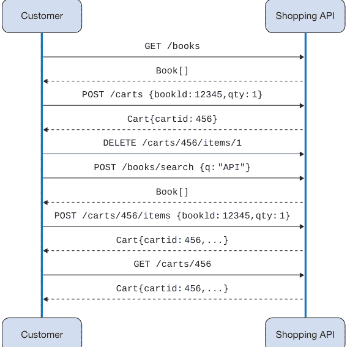

**图 7.12** 使用序列图来验证 API 设计是否满足之前建模的需求。

## 第 5 步：共享并收集反馈

最后一步是共享 API 设计，以获取直接团队、组织内的 API 架构师以及计划在 API 准备绪后立即集成的内部/外部团队的反馈。

一旦 API 正式发布并集成，API 设计就会被锁定，之后只能进行非破坏性的更改。可以添加新的端点，可能会向现有的资源表示中添加新字段，但重命名或修改现有端点会破坏现有的 API 消费者，导致客户不满，并可能引发客户流失。第一次做对至关重要。尽早共享 API 设计以获取反馈有助于避免发布后发生重大的设计变更。

API 的 Mock（模拟）实现也有助于探索 API 设计。因为阅读 API 文档只能对 API 有基本的了解，Mock 实现为开发者提供了一个使用模拟数据体验 API 如何运行的机会。目前开始出现一些工具，它们可以接受 OAS 等 API 描述格式，并在无需编写一行代码的情况下生成 Mock API 实现。

请参阅第 16 章“继续 API 设计之旅”，了解其他 API 全生命周期技术，这些技术有助于在 API 开发和部署后仍获得反馈。

## 选择表示格式

到目前为止，关于资源设计的讨论集中在资源名称和属性上。然而，API 资源的表示格式也需要确定。选择表示格式是重要的一步。

对于某些组织来说，首选表示格式已经作为 API 风格指南的一部分确定。在这种情况下，决策已经做出，无需采取进一步行动。但是，如果这是一个新的 API 产品、程序或平台，则需要投入更多工作来完成设计。

尽可能选择一种单一格式作为所有 API 提供的默认表示。使用单一格式可以确保开发者在与该组织及其未来的 API 集成时保持一致性。

随着时间的推移可能会添加额外的格式，允许在不破坏现有集成的情况下缓慢迁移到新格式。多格式方法需要使用 HTTP 让客户端指定所需的表示格式。内容协商（Content negotiation）在附录 I 中进行了讨论。

表 7.4 总结了可用的四类表示格式。每个类别都建立在前一个的基础上，为资源和消息格式提供了更多选项。然而，随着选项的增加，复杂度也随之增加。每个类别都进行了解释，并提供了一个示例。本章提供的示例可在 GitHub 工作库中找到。

4. https://bit.ly/design-examples

第7 章 基于 REST 的 API 设计

表 7.4 API 表示格式分类
| 类别 | 概述 |
| --- | --- |
| 资源序列化 (Resource Serialization) | 将资源表示为各种格式，例如 JSON、XML、Protocol Buffers 和 Apache Avro |
| 超媒体序列化 (Hypermedia Serialization) | 支持嵌入超媒体控件的序列化表示 |
| 超媒体消息 (Hypermedia Messaging) | 支持超媒体控件属性的通用格式 |
| 语义超媒体消息 (Semantic Hypermedia Messaging) | 支持超媒体字段映射的通用格式 |

## 资源序列化
资源序列化表示格式最为常见。它们直接将资源的属性及其值映射到所需的格式，通常是 JSON、XML 或 YAML。Protocol Buffers 和 Apache Avro 等二进制格式也越来越受到接受。

这些表示格式需要显式代码来处理资源与目标格式之间的序列化。这种映射逻辑可以通过代码生成器或硬编码来实现。格式化程序和表示库通常有助于管理目标格式与表示资源的对象或结构之间的映射。

无论如何处理序列化，解析和映射代码都是唯一的，因为它必须感知预期的字段和嵌套结构。列表 7.1 提供了一个使用 JSON 序列化表示 Book 资源的示例。

### 列表 7.1 使用 JSON 的序列化表示

```json
{
  "bookId": "12345",
  "isbn": "978-032183457",
  "title": "Implementing Domain-Driven Design",
  "description": "Vaughn 不仅对领域驱动设计社区文献，还对更广泛的企业应用领域做出了重要贡献。",
  "authors": [
    { "authorId": "765", "fullName": "Vaughn Vernon" }
  ]
}
```

+   5. https://developers.google.com/protocol-buffers/docs/proto3
6. https://avro.apache.org/docs/current

基于序列化的格式仅使用键值对提供资源的属性。

## 超媒体序列化
超媒体序列化类别与资源序列化类似，但增加了关于如何表示超媒体链接的规范。它还可能包含统一方式包含相关和/或嵌套资源（称为*嵌入资源*）的规范。

超文本语言（HAL）等格式允许以很少或没有更改扩展序列序列格式。这防止了在将基于序列化的 API 迁移到包含超媒体时破坏 API 客户端。列表 7.2 显示了一个基于 HAL 的表示示例。

### 列表 7.2 使用 HAL 的超媒体序列化

```json
{
  "bookId": "12345",
  "isbn": "978-032183457",
  "title": "Implementing Domain-Driven Design",
  "description": "Vaughn 不仅对领域驱动设计社区文献，还对更广泛的企业应用领域做出了重要贡献。",
  "links": {
    "self": { "href": "/books/12345" }
  },
  "embedded": {
    "authors": [
      {
        "authorId": "765",
        "fullName": "Vaughn Vernon",
        "_links": {
          "self": { "href": "/authors/765" }
        }
      }
    ]
  }
}
```

⁷. Mike Kelly,"JSON Hypertext Application Language" (2016),https://tools.ietf.org/html/draft-json-hal-08.

第7 章 基于 REST 的 API 设计

```json
  "links": {
    "self": { "href": "/authors/765" },
    "authoredBooks": { "href": "/books?authorId=765" }
  }
```

并不是所有的超媒体格式都提供相同的功能。Mike Amundsen 创建了这些因素的列表，称为 H-Factors⁸，支持对超媒体支持的水平和复杂性进行推理。

## 超媒体消息
超媒体消息格式与序列化的区别在于，它们提出了一种统一的基于消息的格式来捕捉资源属性、超媒体控件和嵌入资源。这使得对所有资源使用单一解析器比为每种资源类型编写唯一的映射代码来解析序列化格式变得简单。

虽然序列化和基于消息的格式之间的差异是微妙的，但考虑到团队将不再担心 JSON 或 XML 负载应该什么样。相反，他们将关注消息格式中的资源表示、关系和超媒体控件。不再需要开会来决定是否需要在 JSON 响应周围数据包装器！

超消息格式包括 JSON:API 和 Siren¹⁰ 这两种格式都提供了一种单一结构消息，足以包含复杂的资源表示和嵌入资源，并且都提供了超媒体控件支持。

Siren 的消息能力与 JSON:API 类似，但它还增加了有助于以最小定制工作创建 Web 用户界面的元数据。

JSON:API 是一种规范，消除了 API 风格指南中常见的设计选项决策。表示格式、何时使用不同的 HTTP 方法以及如何通过响应塑造和相关资源的预取来优化连接，只是 JSON:API 已经提供的决策之一。

列表 7.3 提供了一个 JSON:API 基于消息的表示示例。

+   8. http://amundsen.com/hypermedia/hfactor
9. https://jsonapi.org
10. https://github.com/kewinsiber/siren


# 列表 7.3 JSON:API 展示基于消息的表示

```json
{
  "data": {
    "type": "books",
    "id": "12345",
    "attributes": {
      "isbn": "978-0321834577",
      "title": "Implementing Domain-Driven Design",
      "description": "With Implementing Domain-Driven Design, Vaughn 不仅对领域驱动社区的文献做出了重要贡献，还对更广泛的企业级应用架构领域做出了重要贡献。"
    },
    "relationships": {
      "authors": [
        {"id": "765", "type": "authors"}
      ]
    },
    "included": [
      {
        "type": "authors",
        "id": "765",
        "fullName": "Vaughn Vernon",
        "links": {
          "self": {"ref": "/authors/765"},
          "authoredBooks": {"ref": "/books?authorId=765"}
        }
      }
    ]
  }
}
```

# 语义超媒体消息

语义超媒体消息是最全面的类别，因为它增加了语义描述文件和链接数据支持，使 API 成为语义网（Semantic Web）的一部分。
通过链接数据应用资源属性的语义，为每个属性赋予了更多含义，而无需使用显式名称。

# 第 7 章基于 REST 的 API 设计

数据通常依赖于 Schema.org或其他资源的共享词汇。随着数据分析和机器学习的增长，将数据链接到共享词汇使自动化系统能够轻松推导出 API 提供的数据价值。支持语义超媒体消息的常见格式包括 Hydra,11 UBER,12 Hyper,13 JSON-LD,14 和 OData.15。
列表 7.4 提供了一个 UBER 表示格式的示例。

# 列表 7.4 UBER 语义超媒体消息格式

```json
{
  "uber" : 
  {
    "version" : "1.0",
    "data" : 
    [
      {"rel" : ["self"], "url" : "http://example.org/},
      {"rel" : ["profile"], "url" : "http://example.org/profiles/books"},
      {
        "name" : "searchBooks",
        "rel" : ["search", "collection"],
        "url" : "http://example.org/books/search?q={query}",
        "templated" : "true"
      },
      {
        "id" : "book-12345",
        "rel" : ["collection", "http://example.org/rels/books"],
        "url" : "http://example.org/books/12345",
        "data" : [
          "name" : "bookId",
          "value" : "12345",
          "Label" : "Book ID"
        ]
      }
    ]
  }
}
```

11. Markus Lanthaler, Core Vocabulary: A Vocabulary for Hypermedia-Driven Web APIs (Hydra W3C Community Group, 2021), http://www.hydra-cg.com/spec/latest.
12. Mike Amundsen and Irak Nadeshvili, Uniform Basis for Exchange Representations (UBER) (2021), https://rawgit.com/uber-hypermedia/specification/master/uber-hypermedia.html.
13. Irak Nadeshvili and Randall Randall, Hyper - Foundational Hypermedia Type " (2017), http://hyperjson.io/spec.html.
14. https://json-id.org.
15. https://www.odata.org

# 选择表示格式

```json
{
  "name" : "isbn",
  "value" : "978-0321834577",
  "label" : "ISBN",
  "rel" : ["https://schema.org/isbn"]
},
{
  "name" : "title",
  "value" : "Example Book",
  "label" : "Book Title",
  "rel" : ["https://schema.org/name"]
},
{
  "name" : "description",
  "value" : "通过 Implementing Domain-Driven Design, Vaughn 不仅对领域驱动设计社区的文献做出了重要贡献，还对更广泛的企业级应用架构领域做出了重要贡献。",
  "label" : "Book Description",
  "rel" : ["https://schema.org/description"]
},
{
  "name" : "authors",
  "rel" : ["collection","http://example.org/rels/authors"],
  "data" : [
    {
      "id" : "author-765",
      "rel" : ["https://schema.org/Person"],
      "url" : "http://example.org/authors/765",
      "data" : [
        {
          "name" : "authorId",
          "value" : "765",
          "label" : "Author ID"
        },
        {
          "name" : "fullName",
          "value" : "Vaughn Vernon",
          "label" : "Full Name",
          "rel" : "https://schema.org/name"
        }
      ]
    }
  ]
}
```

# 选择表示格式

（注：上面的 JSON 块在源文本似乎被截断了，但我已对可见部分的语法进行了修正。）


# 单例资源 (Singleton Resources)

单例资源代表资源集合之外的单个资源实例。单例资源可以代表一个虚拟资源，用于与集合中的现有资源实例进行直接交互（例如，用户且唯一的个人资料）。当父资源与其子资源之间存在一个且仅有的实例时，API 也可能提供嵌套的单例资源（例如，用户的配置）。以下示例说明了单例资源的可能用途：

- GET /users/{userId}，避免了消费者需要知道自己的用户标识符，或由于因安全配置不当而导致访问其他用户数据的风险。
- PUT /users/567/configuration——用于管理特定账户的单个配置资源实例。

单例资源应该已经存在，因此不要求客户端提前创建它们。虽然单例资源可能无法像其基于集合的兄弟资源那样提供完整的 CRUD 风格生命周期，但它们仍然可以提供 GET、PUT 和/或 PATCH HTTP 方法。

# 背景（队列）作业（Background Queued Jobs）

HTTP 是一种请求/响应协议，要求对提交的任何请求返回响应。对于完成时间较长的操作，应用程序通过打开连接阻塞等待响应可能不是最佳选择。HTTP 提供了 202 Accepted 响应码来实现这一目的。

例如，存在一个 API 操作支持批量导入账户。API 客户端可以提交以下有效请求：

```
POST /bulk-import-accounts
Content-Type: application/json

{
  "items": [
    { ... },
    { ... },
    { ... },
    { ... }
  ]
}
```

服务器可以返回以下响应，表示请求是有效的，但尚无法完全处理：
HTTP/1.1 202 Accepted
Location: https://api.example.com/import-jobs/7937
客户端随后可以通过向 Location 头中提供的 URL 提交请求来确定状态：
HTTP/1.1 200 OK

```
{
  "jobId": "7937",
  "importStatus": "InProgress",
  "percentComplete": "25",
  "suggestedNextPollTimestamp": "2018-10-02T11:00:00.00Z",
  "estimatedCompletionTimestamp": "2018-10-02T14:00:00.00Z"
}
```

这被称为“触发并跟进”（fire-and-follow-up）模式。如果客户端不需要监控作业状态，它可以忽略该 URL 并处理其他任务。这被称为“触发并遗忘”（fire-and-forget）模式。

# REST 中的长事务支持（Long-Running Transaction Support in REST）

有时，一个事务需要多个 API 操作才能完成。在 SOAP 时代，提供了 WS-Transaction 规范来管理跨一个或多个请求的事务。这通常需要事务管理器，这在许可和集成工作方面的成本都很高。为了在基于 REST 的 API 中避免这一需求，可以应用构建器设计模式来支持类似的语义。
例如，想象一个用于支持预订音乐或体育赛事座位的 API。可能 API 要求在将座位重新放可用池之前，必须在特定时间范围内完成支付。可以使用 Seats 资源来搜索优质区域内的一组共同喜爱的座位：

```
GET /seats?section=premium&numberOfSeats=4
```

可能有一组四个座位可用。然而，我们无法使用 Seats 资源来预订座位，因为这将需要四个独立的 API 调用，而这些调用无法被封装在事务中：

```
PUT /seats/seat1 to reserve seat #1
PUT /seats/seat2 to reserve seat #2
```

# 第 7 章 基于 REST 的 API 设计

```
PUT /seats/seat3 to reserve seat #13 <- 这一个失败了。现在怎么办？
PUT /seats/seat4 to reserve seat #4
```

相反，考虑创建一个表示事务的 Reservation（预订）资源：

```
POST /reservations
{
  "seatIds": ["seat1", "seat2", "seat3", "seat4"]
}
```

如果成功，将创建一个新的 Reservation，并可用于完成支付过程。它还可用于通过附加项、团体餐食计划等进一步定制预订。或者，如果超过了时间限制，预订将失效或从系统中删除，API 客户端将重新开始。

# 寻找更多模式？

这些仅仅是适用于 REST 和其他 API 风格的少数设计模式。请参阅 API 工作坊示例^16 GitHub 仓库以获取更多模式资源。

# 总结（Summary）

在讨论基于 REST 的 API 时，许多人将使用 JSON 的 CRUD 类 API 概念与 REST 架构风格混淆。然而，REST 定义了一组架构约束，这些约束帮助 API 模拟 Web 的特性。当然，REST API 可能会应用各种设计模式（包括 CRUD），为资源产生一种易于理解的交互模型。

通过应用五步设计流程，可以创建一个基于资源的 API 设计，并将 REST 约束应用于在 API 建模过程中创建的 API 配置文件中。将设计映射为机器可读的 API 描述允许工具生成文档，供团队以及将使用 API 的初始开发者进行评审。

如果 REST 对于 API 建模过程中识别出的某些或所有 API 不是合适的 API 风格怎么办？第 8 章将探讨当 REST 不是最佳选择或需要通过新的交互风格扩展时，GraphQL 和 gRPC 是两种额外的 API 风格。

> 16. https://bit.ly/align-define-design-examples

## 第 8 章

# RPC 与查询式 API 设计（RPC and Query-Based API Design）

选择合适的 API 风格需要对应用程序的问题领域有理解，以及对各种架构风格的意识。

> — Roy Fielding


# 第 8 章 RPC 与查询式 API 设计

虽然基于 REST 的架构风格包含了市场上大多数 API 产品，但并非总是如此。REST 风格也不总是每个 API 的最佳选择。作为 API 设计师，了解可用选项以及每种风格的权衡对于使用 API 的开发者至关重要。

远程调用（RPC）型和查询式 API 是 REST 之外的两种额外 API 风格。RPC API 已存在数十年，但由于 gRPC 的引入开始复兴。查询式 API 由于 GraphQL 的引入变得越来越流行，成为许多希望控制 API 响应形状的前端开发者的选择。

由于有多种 API 风格，理解每种风格的优势和挑战很重要。对于某些 API 产品和平台，单一 API 风格可能足够。对于其他情况，集成 API 的开发者的用途和偏好可能需要混合 API 风格。

本章探索 RPC 和查询式 API 风格，并根据第 6 章“API 建模”中概述的 API 配置文件定义 RPC 和查询式 API 设计。

# 什么是基于 RPC 的 API？（What Is an RPC-Based API?）

RPC 可以在网络上执行代码单元（过程），就像在本地执行一样。客户端获取服务器可调用的过程列表。每个过程都定义了类型化且有序的参数列表以及结构。重要的是，客户端与服务器是紧耦合的。如果服务器上的过程被修改或删除，则由开发者负责相应更改。这包括修改代码以便客户端和服务器能够同步并重新通信。

RPC API 必须遵循某种规范，以支持目标编程语言对过程调用的序列化。在 Java 早期，远程方法调用（RMI）库支持 Java 到 Java 的通信，并使用 Java 的对象序列化功能作为 Java 进程之间交换的二进制格式。


以下是一个通过 HTTP 进行 JSON-RPC 用的示例。注意它显式提到了方法（过程）和有序参数列表，这导致了客户端和服务器之间的紧密耦合：

```
POST https://rpc.example.com/calculator-service HTTP/1.1
Content-Type: application/json
Content-Length: ...application/json
```

```
{"jsonrpc": "2.0", "method": "Subtract", "params": [42, 23], "id": 1}
```

大多数基于 RPC 的系统都会利用辅助库和代码生成工具来生成负责网络通信的客户端和服务器存根（stubs）。熟悉分布式计算谬误的人知道，每当远程执行代码时，都可能发生故障。RPC 的目标之一是消除调用行为，使其像调用本地过程一样，通常将网络中断和故障处理支持集成到客户端和服务器存根中并作为错误抛出。

远程过程使用接口定义语言（IDL）定义。代码生成器使用 IDL 生成客户端存根和准备好实现的服务器骨架（skeleton）。由于这个原因，基于 RPC 的 API 设计和实现通常更快，但对方法重命名和参数重新排序的韧性较低。

## gRPC 协议

gRPC 由 Google 于 2015 年创建，旨在通过使用 RPC 和代码生成加速服务的开发。它最初作为一项倡议启动，随后发布并被许多组织和开源项目（包括 Kubernetes）采用。

gRPC 基于 HTTP/2 进行传输，并使用 Protocol Buffers（协议缓冲区）进行序列化。它还利用了 HTTP/2 提供的双向流，允许客户端向服务器流传输数据，服务器向客户端流传数据。图 8.2 显示了多种编程语言如何在一个基于 GoLang 的服务中通过生成的客户端存根与 gRPC 服务器进行通信。

- 1. Wikipedia, s.v. "Fallacies of Distributed Computing," 最后修改于 2021年7月24日，20:52, https://wikipedia.org/wiki/Fallacies_of_distributed_computing.
- 2. https://developers.google.com/protocol-buffers.

## 140 第 8 章 RPC 和基于查询的 API 设计

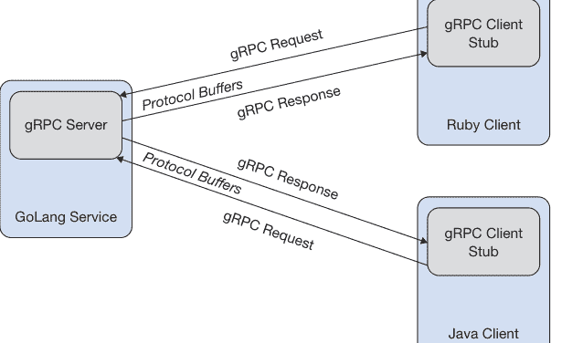

默认情况下，gRPC 使用 Protocol Buffers 的 proto 文件格式来定义每个服务、提供的服务方法以及交换的消息。列表 8.1 显示了一个提供减法操作的计算服务的示例 IDL 文件。

### 列表 8.1 定义减法操作的基于 gRPC 的 IDL

```
// calculator-service.proto3
service Calculator {
  // 减去两个整数
  rpc Subtract(SubtractRequest) returns (CalcResult){
}

// 包含要减数值的请求消息
message SubtractRequest {
  // 被减数
  int64 minuend = 1;
  // 减数
  int64 subtrahend = 2;
}
```

```
// 包含计算结果的响应消息
message CalcResult {
int64 result = 1;
}
```

## 考虑 RPC 时的考虑因素

基于 RPC 的 API 往往用性能换取更紧密的耦合。许多 RPC 协议（如 gRPC）提供的代码生成通过自动生成存根并为服务器实现生成骨架代码，加速了开发过程。这些因素导致团队在同时拥有 API 客户端和服务器端时选择基于 RPC 的 API，从而允许开发和运行时性能的提升。

然而，在继续之前，应该考虑使用基于 RPC 的 API 风格的缺点：

- 客户端和服务器之间的集成是紧密耦合的。在生产环境中，如果不破坏 API 客户端，无法更改字段的顺序。
- 过程调用的序列化封化和反序列化是固定的。与基于 REST 的 API 不同，这种方式缺乏活性。
- 某些 RPC 协议（如 gRPC）需要自定义网关来实现错误处理，这在 HTTP/1 中是不支持的。
- 最后，请注意 gRPC 依赖于 HTTP/2 并且对请求头进行自定义。

总结来说，当团队同时拥有 API 客户端和服务器时，基于 RPC 的 API 是最佳选择，因为它们能够保持状态的更新。

> 3. https://github.com/grpc/web

## RPC 设计过程

RPC 设计过程利用了第 6 章中描述的 API 配置和输入/输出，基于 Protocol Buffers 的 API 设计过程可以适应变化。

### 第 1 步：识别 RPC 操作

迁移操作列表（包括请求/响应细节）到一个新的格式以适应变化。这在图 8.3 中所示。

### 第 2 步：详细化 RPC 操作

扩展每个操作的请求和响应细节，类似于本地方法调用。同样，每个响应将返回错误状态，以便客户端能够处理。

| 操作名称 | 描述 | 响应 |
|---|---|---|
| listBooks() | 按类别或发布日期列出书籍 |
| searchBooks() | 按标题搜索书籍 |
| viewBook() | 查看书籍详情 |
| viewCart() | 查看当前购物车和总计 |
| clearCart() | 移除购物车中的所有书籍 |
| addItemToCart() | 向购物车添加书籍 |
| removeItemFromCart() | 从购物车中移除书籍 |
| getAuthorDetails() | 获取作者详情 |

图 8.3 基于之前第 6 章 API 示例创建的初始 RPC 操作表格。

| 操作名称 | 描述 | 请求 | 响应 |
| --- | --- | --- | --- |
| listBooks() | 按类别或发布日期列出书籍 | ListBookRequest -categoryId -release | ListBookResponse -Book[] |
| searchBooks() | 按标题搜索书籍 | SearchQuery -query | SearchResponse or google.rpc.rpc.Status + ProblemDetails |
| viewBook() | 查看书籍详情 | ViewBookRequest -bookid | Book or google.rpc.rpc.Status + ProblemDetails |
| viewCart() | 查看当前购物车和总计 | ViewCartRequest -cartid | Cart or google.rpc.rpc.Status + ProblemDetails |
| clearCart() | 移除购物车中的所有书籍 | ClearCartRequest -cartid | Cart or google.rpc.rpc.Status + ProblemDetails |
| addItemToCart() | 向购物车添加书籍 | AddCartItemRequest -quantity | Cart or google.rpc.rpc.Status + ProblemDetails |
| removeItemFromCart() | 从购物车中移除书籍 | RemoveCartItemRequest -itemId | Cart or google.rpc.rpc.Status + ProblemDetails |
| getAuthorDetails() | 获取作者详情 | GetAuthorRequest: -author | BookAuthor or google.rpc.rpc.Status + ProblemDetails |

**图 8.4** 带有请求和响应的完整 gRPC 设计。


# 第 3 ：编写 API 设计

使用前两个步骤中的设计细节为基于 RPC 的 API 编写 IDL 文件。在 gRPC 的情况下，IDL 文件采用 Protocol Buffers 格式。列表 8.2 提供了一个基于 gRPC 的购物车 API 骨架，以演示文档化过程。

列表 8.2 gRPC 版本的购物车 API 的 IDL 文件

```
service ShoppingCart {
  rpc ListBooks(ListBooksRequest) returns (ListBooksResponse) {}
  rpc SearchBooks(SearchBooksRequest) returns (SearchBooksResponse) {}
  rpc ViewBook(ViewRequest) returns (Book) {}
  rpc ViewCart(ViewCartRequest) returns (Cart) {}
  rpc ClearCart(ClearCartRequest) returns (Cart) {}
  rpc AddItemToCart(AddToCartItemRequest) returns (Cart) {}
  rpc RemoveItemFromCart(RemoveCartItemRequest) returns (Cart) {}
  rpc GetAuthorDetails() returns (Author) {}
}

message ListBooksRequest {
  string category_id = 1;
  string release_date = 2;
}

message SearchBooksRequest {
  string query = 1;
}

message SearchBooksResponse {
  int32 page_number = 1;
  int32 result_per_page = 2 [default = 10];
  repeated Book books = 3;
}

message ViewBookRequest {
  string book_id = 1;
}

message ViewCartRequest {
  string cart_id = 1;
}

message ClearCartRequest {
  string cart_id = 1;
}
```

```
message AddCartItemRequest {
  string cart_id = 1;
  string book_id = 2;
  int32 quantity = 3;
}
```

```
message RemoveCartItemRequest {
  string cart_id = 1;
  string cart_item_id = 2;
}
```

```
message Cart {
  string cart_item_id = 1;
  Book book = 2;
  int32 quantity = 3;
}
```

```
message Cart {
  string cart_id = 1;
  repeated CartItem cart_items = 2;
}
```

```

就是这样！基于 RPC 的 API 现在有了一个高层设计。现在可以添加细节来完成 API 以及代码生成器，用以启动开发和集成工作。还建议使用如 `prot-gen-doc` 等工具生成人类可读的文档。

请记住，由于 RPC 与代码紧密耦合，任何代码更改将直接影响基于 RPC 的 API 设计。换句话说，当应用代码更改时，基于 RPC 的 API 设计是被替换，而不是被修改。

注意大部分工作是在 API 建模步骤完成的。通过将 API 建模技术作为设计工作的基础，将客户预期结果的工作可以很容易映射到基于 RPC 的设计中。如果需要额外的 API 风格（例如 REST），则可以将相同的 API 建模工作重新应用到所选 API 风格的设计工作中。

# 什么是基于查询的 API？

基于查询的 API 提供了强大的查询能力和响应形状化能力。它们支持通过标识符获取完整的资源表示、资源集合的分页列表，以及使用简单和高级

> https://github.com/pseudomuto/protoc-gen-doc

过滤表达式进行资源集合过滤。大多数基于查询的风格也支持数据变异，支持基于全增删改查（CRUD）的完整生命周期以及自定义操作。

大多数基于查询的 API 风格还提供响应形状化，允许 API 客户端指定响应中包含的字段。响应形状化还支持对资源图的深度和浅层获取。深度获取允许在检索父资源的同时检索嵌套资源，避免了在客户端通过多次 API 调用来重新构建一个大图。浅层获取防止了这种情况，愉快地避免了响应中出现不必要的数据。响应形状化通常用于移动应用，与可以在单个屏幕上渲染更多信息的 Web 相比，移动应用需要较少的数据。

# 理解 OData

两种流行的基于查询的 API 风格是 OData 和 GraphQL。OData 是一种由 OASIS 标准化并管理的基于查询的 API 协议。它构建在 HTTP 和 JSON 之上，并使用熟悉 REST 的人员熟悉的基于资源的方法。

OData 查询通过特定的基于资源的 URL 通过 GET 进行。它还支持超媒体控件以用于跟踪相关资源，并在更新操作期间使用数据链接来表达资源关系，而不是标识符。OData 支持自定义操作，这些操作可以超出标准 CRUD 模式的方式变异数据。还支持函数以支持计算。列表 8.3 展示了如何使用过滤的 GET 通过 OData 查询检索任何位于旧金山的机场。

**列表 8.3** 使用过滤器查找旧金山机场的 OData

```
{
  "odata.context": "/OData/$metadata#\$filter=contains(Location/Address, 'San Francisco')",
  "value": [
    {
      "odata.id": "/OData/Airports('SFO')",
      "odata.link": "/OData/Airports('SFO')",
      "iataCode": "SFO",
      "Name": "San Francisco International Airport"
    }
  ]
}
```

5. https://www.odata.org/documentation

```
{
  "iataCode": "SFO",
  "Location": {
    "Address": "South McDonnell Road, San Francisco, CA 94128",
    "City": {
      "CountryRegion": "United States",
      "Name": "San Francisco",
      "Region": "California"
    },
  },
  "Loc": {
    "type": "Point",
    "coordinates": [
      -122.37472222222,
      37.61888888889
    ],
    "crs": {
      "type": "name",
      "properties": {
        "name": "EPSG:4326"
      }
    }
  }
}
```

一些开发者发现采用 OData 规范的复杂性对于简单的 API 来说太大了。然而，基于 REST 的 API 设计与强大的查询选项的结合使得 OData 成为大型 API 产品和平台的流行选择。OData 获得了微软、SAP 和 Dell 等公司的大量支持和投资。Microsoft Graph API 将 Office 365 平台统一在单个 API 下，它构建在 OData 之上，是构建高级支持的以数据为中心的 REST 基于 API 的极佳示例。

6. Microsoft, "Overview of Microsoft Graph," June 2021, https://docs.microsoft.com/en-us/graph/overview.

# 探索 GraphQL

GraphQL 是一种支持查询和变数据的 API 风格。它由 Facebook 在 2012 年内部开发，并在 2015 年公开发布。它最初的设计是为了解决单页应用程序（SPA）和移动应用获取嵌套数据的挑战。所有的 GraphQL 操作都通过单个端点进行隧道，而不是利用 HTTP 的完整功能。这阻止了使用 HTTP 内容协商来支持 JSON 之外的媒体类型。它还阻止了 HTTP 条件头提供的并发控制和乐观锁定。

实施授权也是一个挑战，因为通过 URL 实施访问控制的传统 API 网关限于单个 GraphQL 操作。然而，某些 API 网关正在扩展其功能以包含围绕 GraphQL 查询和变异的授权实施。同样，通常与路径和 HTTP 方法关联的速率限制需要重新思考以适应这种新的交互风格。

7. https://graphql.org

```graphql
{
  "data" : {
    "Name": "San Francisco International Airport",
    "iataCode": "SFO",
    "Location": {
      "Address": "South McDonnell Road, San Francisco, CA 94128",
      "City": {
        "CountryRegion": "United States",
        "Name": "San Francisco",
        "Region": "California"
      }
    }
  }
}
```

```
{
  "Loc": {
    "type": "Point",
    "coordinates": [
      -122.37472222222,
      37.61888888889
    ]
  }
}
```

# 基于查询的 API 设计过程

设计基于查询的 API 的过程与其他 API 设计风格（如 RPC 和 REST）相似。主要区别在于，在设计操作之前，步骤需要创建资源图。为了演示这一过程，基于第 6 章所示的 API 建模工作设计了一个基于 GraphQL 的 API。


## 第一步：设计资源和图结构

对于对于基于查询的 API，第一步也是最重要的步骤是设计所有资源的图结构。如果已经完成了第 6 章概述的 API 建模工作，那么这一步已经完成了。如果 API 建模工作尚未完成，请返回第 6 章并在继续之前完成这些步骤。图 8.5 和 8.6 重新回顾了书店示例中第 6 章所识别的资源和关系。

一旦确定了所有顶层资源以及相关资源，请进入下一步设计查询和变异操作。

## 第二步：设计查询和变异操作

下一步是迁移第 6 章 API 配置建模中捕获的所有操作。API 配置档捕获了每个操作，并包含了安全、幂等或不安全的安全性分类。将每个标记为安全的操作归类为查询。标记为幂等或不安全的操作将是变异（mutation）。对于购物车 API，既有查询操作也有变异操作，如图 8.7 所示。

| 书资源 | | |
| :--- | :--- | :--- |
| 属性名称 | 描述 | |
| title | 书名 | |
| isbn | 书的唯一 ISBN | |
| authors | 书籍作者资源列表 | |

| 书籍作者资源 | | |
| :--- | :--- | :--- |
| 属性名称 | 描述 | |
| fullName | 作者全名 | |

**图 8.5** 书资源是第 6 章中建模的购物车 API 需要支持的第一个顶层资源。

| 购物车资源 | 属性名称 | 描述 |
| :--- | :--- | :--- |
| | cartItems | 当前在购物车中等待购买的书籍 |
| | subtotal | 购物车中所有书籍的总费用 |
| | salesTax | 需要应用的销售税 |
| | vatTax | 需要应用的任何增值税 |
| | cartTotal | 第 6 章中建模的购物车总费用。 |

| 购物车项目资源 | 属性名称 | 描述 |
| :--- | :--- | :--- |
| | qty | 当前在购物车中等待购买的书籍 |
| | unitPrice | title |

| 书资源 | 属性名称 | 描述 |
| :--- | :--- | :--- |
| | isbn | 书籍的书名 | |
| | authors | 书籍作者资源列表 | |
| | fullName | 第 6 章中建模的书籍的唯一 ISBN。 |

图 8.6 购物车资源是购物车需要支持的第二个顶层资源

| 操作类型 | 操作名称 | 描述 | 响应 |
| :--- | :--- | :--- | :--- |
| 查询 | listBooks() | 按类别或发布日期列出书籍 | | | |
| 查询 | searchBooks() | 按作者、标题搜索书籍 | | | |
| 查询 | viewBook() | 查看书籍详情 | | | |
| 查询 | viewCart() | 查看当前购物车和总额 | | | |
| 变异 | clearCart() | 从客户购物车移除所有书籍 | | | |
| 变异 | addItemToCart() | 向客户购物车中添加书籍 | | | |
| 变异 | removeItemFromCart() | 从客户购物车中移除书籍 | | | |
| 查询 | getAuthorDetails() | 获取作者详情 | | | |

图 8.7 第 6 章建模的购物车 API 配置已迁移到表格格式，有助于基于查询的 API 设计。

# 154 第 8 章 RPC 和基于查询的 API 设计

如果所选协议仅支持查询操作，则变异必须使用不同的 API 风格处理。GraphQL 同时支持两者，因此设计可以在同一个 API 定义中包含查询和变异。

一旦捕获了基本操作细节，请扩展请求和响应列，包含更多关于输入输出值的详细信息。输入输出值在第 6 章的 API 建模期间已经确定。将这些值迁移到新的 API 设计表中。购物车 API 操作在图 8.8 中扩展。

## 第三步：记录 API 设计

最后，使用所选协议优优格式记录生成的 API。对于 GraphQL，使用 schema 来定义可用的查询和变异，如列表 8.5 所示。

列表 8.5 捕获为 GraphQL Schema 的购物车 API

```graphql
# API 名称: "Bookstore Shopping API Example"
# 书店示例基于 REST 的 API 支持在线书店的购物体验。API 包含以下能力和操作...
```

```graphql
type Query {
  listBooks(input: ListBooksInput!): BooksResponse!
  searchBooks(input: SearchBooksInput!): BooksResponse!
  viewBook(input: GetBookInput!): BookSummary!
  getCart(input: GetCartInput!): Cart!
  AuthorDetails(input: GetAuthorDetailsInput!): BookAuthor!
}
type Mutation {
  clearCart(): Cart
  addItemToCart(input: AddCartInput!): Cart
  removeItemFromCart(input: RemoveCartInput!): Cart
}
type BooksResponse {
  books: [BookSummary!]
}
type Summary {
  bookId: String!
```

```graphql
isbn: String!
title: String!
authors: [BookAuthor!]

type BookAuthor {
  authorId: String!
  fullName: String!
}

type Cart {
  cartId: String!
  cartItems: [CartItem!]
}

type CartItem {
  itemId: String!
  bookId: String!
  quantity: Int!
}

input ListBooksInput {
  offset: Int!
  limit: Int!
}

input SearchBooksInput {
  q: String!
  offset: Int!
  limit: Int!
}

input GetAuthorDetailsInput {
  authorId: String!
}

input AddCartInput {
  cartId: String!
  bookId: String!
  quantity: Int!
}

input RemoveCartInput {
  cartId: String!
  itemId: String!
}
```

# RPC 和基于查询的设计

| 操作类型 | 操作名称 | 描述 | 请求 | 响应 |
| :--- | :--- | :--- | :--- | :--- |
| 查询 | listBooks() | 按类别或发布日期列出书籍 | (categoryId, releaseDate) | ... | | |,, | | |[] | |
| 查询 | searchBooks() | 按作者、标题搜索书籍 | (searchQuery) | ... | | ( |) | | | | |
| 查询 | viewBook() | 查看书籍详情 | (bookId) | ... ( | () |) | Book |
| 查询 | viewCart() | 查看当前购物车和总额 | (cart) | ... | | | | | | | | |
| 变异 | clearCart() | 从客户购物车移除所有书籍 | (cartId) | ... | | | | | | | | |
| 变异 | addItemToCart() | 向客户购物车中添加书籍 | (cartId, bookId, quantity) | ... | | | | | | | | | |
| 变异 | removeItemFromCart() | 从客户购物车中移除书籍 | (cartId, itemId) | ... | | | | | | | | | |
| 查询 | getAuthorDetails() | 获取作者详情 | (authorId) | ... (authorId) | BookAuthor | |

图 8.8 购物车 API 设计现在扩展了关于查询和变异的更多详细信息。


大多数基于 Web 的 API 讨论集中在基于 REST、基于查询和基于远程过程调用 (RPC) 的 API 常见的同步请求/响应交互上。对于处理 HTTP 经验较少的开发者和非开发人员来说，这些 API 易于理解且容易上手。

然而，同步 API 也有其局限性。API 服务器无法向相关方通知资源表示的变化，也无法在多方之间的工作流完成时发出通知。相反，它们要求客户端在接收任何通知之前必须先发起与 API 服务器的交互。

异步 API（或 async APIs）释放了数字产品或平台的全部潜力。它们将 API 对话从由客户端发起扩展到以服务器为导向，允许客户端对事件做出反应，而不是启动对话。基于单一类型的事件通知可以构建新的功能。而且这一切都可以在不涉及 API 拥有团队的情况下完成。

将异步 API 设计作为整体 API 设计的一部分，可以使团队能够根据通知或数据流构建新的解决方案。但要释放异步 API 的全部潜力，还需要考虑一些因素。本章介绍了围绕异步 API 的一些挑战和设计模式。它还演示了如何基于第 6 章概述的前述 API 建模步骤，来设计和记录异步 API。

## API 轮询的问题

如果 API 客户端想要知道何时可用新数据，它必须定期检查服务器，查看是否添加了任何新资源或修改了现有资源。这种模式被称为 API 轮询（API polling），是需要感知新资源或现有资源修改的客户端的常用解决方案。

API 轮询是灵活的，客户端可以在任何使用请求/响应风格的 API 之上实现。然而，API 轮询并不是理想的解决方案。编写检测和跟踪修改所需的逻辑是复杂且浪费的，并可能导致糟糕的用户体验。API 客户端必须向资源集合发送 GET 请求以获取最新的资源列表，将该列表与 API 客户端上次获取的列表进行比较，并判断是否添加了内容。某些 API 提供了根据自上次请求以来的时间戳来提供近期更改的操作，但仍取决于 API 客户端继续进行 API 轮询以确定何时发生了更改。

然而，许多开发者被迫构建轮询代码来不断检查服务器状态的变化。构建轮询代码给开发者带来了额外的挑战：

- API 返回的响应带有默认的、非最优排序（例如：从旧到新）。消费者必须请求所有条目以查找是否有新内容，通常需要保留已看到的 ID 列表以确定哪些是新的。
- 速率限制（Rate limiting）可能会阻止按所需的间隔发送请求，从而无法及时检测变化。
- API 提供的数据不足以让客户端判断是否发生了特定事件（例如资源修改）。

理想的情况是让服务器通知任何感兴趣的 API 消费者新数据或近期事件。然而，这在 HTTP 中常见的传统的请求/响应 API 风格中是不可能的；因为 API 客户端必须在 API 服务器通信任何更改之前先提交请求。
异步 API 帮助了这一需求。API 服务器不再让 API 客户端不断地轮询并实现更改检测规则，而是在服务器上发生变化时，向感兴趣的 API 客户端发送异步推送通知。与根于 HTTP/响应的传统同步基于 Web 的 API 相比，这开启了一系列全新的可能性。

## 异步 API 创建了新的可能性

正如第 1 章“API 设计原则”所述，API 提供了数据和行为的接口来交付数字能力，通常通过 HTTP 实现。数字能力包括客户配置搜索、客户注册以及将客户配置关联到账户。这些数字能力结合在一起创建 API 产品和 API 平台，赋能组织内部的业务部门以及合作伙伴和客户来创造新的成果。
异步 API 也是数字能力。它们超越了传统的基于 REST 的 API，为数字业务开启了可能：

- 实时响应业务事件：解决方案可以在状态变化和关键业务事件发生时做出反应。
- 通过消息流扩展解决方案的价值：从现有的解决方案和 API 中解锁额外的价值。通过将内部事件与其 API 提供的功能并，出现了利用内部事件的新机会。新的解决方案通过事件驱动的交互风格构建在现有 API 之上。
- 提高 API 效率：不再需要通过不断 API 轮询检查状态变化。通过将状态更改事件推送给感兴趣的人，减少了支持 API 所需的资源，从而降低了基础设施成本。

| 案例：GitHub Webhooks 创建了新的 CI/CD 市场 |
| :--- |
| GitHub Webhooks 已存在一段时间，允许团队在新代码推送到 GitHub 托管的仓库时收到通知。虽然 Git 支持在源代码仓库中编写脚本创建此类事件，但 GitHub 是最早将这些基于脚本的钩转换为 Webhooks 的供应商之一。任何在 GitHub 上托管代码的个人或组织都可以通过基于 HTTP 的 POST 在新代码可用时收到通知，并触发新的构建过程。随着时间的推移，以前仅限于本地部署的持续集成和交付（CI/CD）工具现在可以通过软件即服务（SaaS）模式提供。这些解决方案将被授予接收基于 Webhook 的通知并启动新构建过程的权限。这种异步 API 通知最终创建了整个托管 CI/CD 工具 市场。这就是异步 API 的力量。 |

为了释放异步 API 的全部潜力，理解消息基础知识非常重要。

## 消息基础知识回顾

消息包含由消息生产者发布给消息接收者的数据。接收者可以是本地函数或方法、同一主机上的另一个进程、远程服务器上的进程，或者像消息代理之类的中间件。消息有三种类型：命令、回复和事件：

- 命令消息（Command message）请求立即或在未来执行工作。命令消息通常是祈使性的：例如 `CreateOrder`、`RegisterPayment` 等。命令消息有时被称为 `request messages`（请求消息）。
- 回复消息（Reply message）提供命令消息的结果或产物。回复消息通常添加 Result 或 Reply 后缀以与对应的命令消息区分来：CreateOrderReply、RegisterPaymentResult 等。回复消息也被称为响应消息（response messages）。并非所有命令消息都有回复消息。
- 事件消息（Event messages）告诉接收者过去发生过的事情。良好的事件使用过去时式来表示动作已经发生：例如 OrderCreated、PaymentSubmitted 等。事件消息通常在业务事件发生、工作流状态更改或数据被修改时使用。

## 消息是不可变的

需要注意的是，消息是不可变的。一旦发布，就不能被修改。因此，需要修改的消息必须作为新消息重新发布。如有必要，包含一个关联标识（correlation identifier）以将新消息映射到原始消息。

图 9.2 显示了每种消息的示例及其提供的上下文。

命令消息：
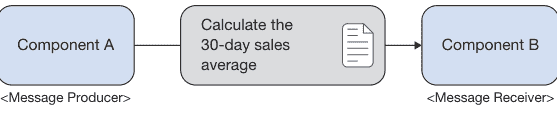

回复消息：
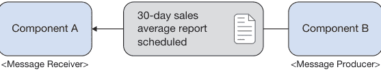

事件消息：
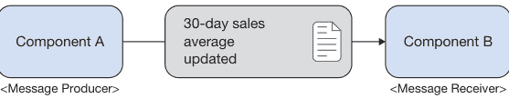

图 9.2 三种主要消息类型的示例。


## 消息样式与局部性

应用程序或服务可以从一种或多种消息传递样式中选择：

- 同步消息传递涉及消息生产者发送消息并等待接收者处理它并返回回复。

- 异步消息传递允许消息生产者和接收者按照各自的时间进行操作，而无需相互等待。消息生产者将消息发送给接收者，但接收者可能无法立即进行处理。消息生产者在等待消息接收者的回复的同时，可以自由执行其他任务。

此外，消息可以在不同的局部性之间进行交换：

- 本地消息假设消息在同一个进程内发送和接收。因此，编程语言和主机也将是相同的。Smalltalk 编程语言是为了支持对象之间发送和接收消息而构建的。基于 Actor 的框架（如 Vlingo¹）也支持这种方式。一个“邮箱”位于产生消息的代码和将处理消息的代码之间。消费者代码会尽快处理每条消息，有时会使用线程或专用 CPU 核心来并行处理多条消息。

- 进程间消息在同一台主机上的独立进程之间交换消息。示例包括 UNIX  sockets 和动态数据交换 (DDE)。

- 分布式消息传递涉及两个或多个主机进行消息传递。消息通过网络使用所需的协议进行传输。分布式消息传递的示例包括使用高级消息队列协议 (AMQP)的消息代理、消息队列传输协议 (MQTT)、基于 SOAP 的 Web 服务、基于 REST 的 API 等。

同步和异步消息样式的结合，加上消息的局部性，决定了基于消息的解决方案的可能性。

> ¹ https://vlingo.io

## 消息的元素

当出现关于消息设计的讨论时，大多数重点集中在消息体上。消息体通常是结构化格式，例如 JSON 或 XML，二进制或纯文本格式也是有效的。某些组织选择将消息体封装在消息封包中，封包内包含了关于消息内容和消息发布者的有用元数据。

然而，消息并不仅仅是消息体。消息还可能传输协议语义。网络协议（如 HTTP、MQTT 和 AMQP）包含了消息头，其中包含详细信息，如时间戳、生存时间 (TTL)、优先级/服务质量等。除非消息包含在协议上处理该消息的所有必要信息，否则它没有被完全描述。9.2 演示了基于 REST 的 API 在 API 客户端和 API 服务器之间交换的每条消息的元素。

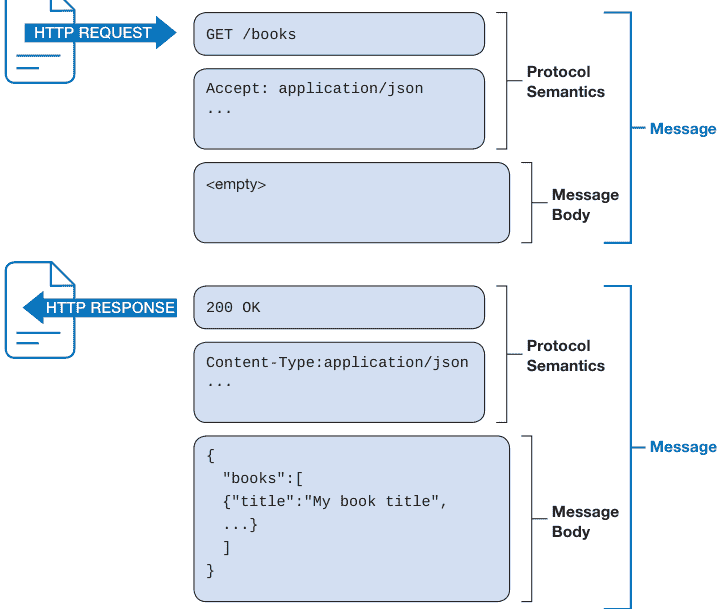

**图 9.3** 一个 REST API 示例，显示了 API 客户端和 API 服务器之间交换的请求和响应消息的元素。

## 理解消息代理

消息代理充当消息生产者和消息接收者之间的中间节点。结果是松耦合的设计，因为生产者只感知消息代理，而不知道最终接收消息的组件。消息代理的示例包括 RabbitMQ² ActiveMQ³ 和 Jmqtt⁴。

消息代理还提供额外的功能：

- **事务边界**确保只有在事务提交时，消息才会发布或标记为已交付。
- **持久性订阅**在分发到消息接收者之前存储消息。无法交付的消息（可能是因为消息接收者离线）将代表客户端存储直到它们重新连接（即存储和转发模式）。
- **客户端确认模式**指定了客户端如何认为消息被视为已确认，以便在平衡性能与故障恢复之间提供灵活性。消息被视为已分发是通过：(1) 交付时自动确认或 (2) 客户端确认消息已成功处理后。
- **消息处理失败**在原始消息接收者发生故障或停机时，通过将消息分发给不同的接收者来处理。这种行为由客户端连接到代理时建立的客户端确认模式控制。
- **死信队列 (DLQ)**存储由于消息接收者无法发现的错误而无法处理的消息。允许对失败的消息交付进行自动或手动的审查和处理。
- **消息优先级和 TTL**帮助消息代理优先交付消息，并在未处理的消息超过特定时间且仍未被处理时将其移除。
- **基于标准的连接性**通过 AMQP 协议实现，以及针对 Java 的（通过 Java 消息服务 (JMS) 和其他语言绑定的）的优化协议。

2. https://www.rabbitmq.com
3. http://activemq.apache.org/index.html
4. https://github.com/Ciciczz/jmqtt

## 消息基础回顾

消息代理提供两种消息发布方法：点对点和扇出 (fanout)。

### 点对点消息发布（队列）

点对点消息传递允许发布者从注册的订阅者池中选择单个订阅者发送消息。代理负责通过轮询或类似的选择过程选择将接收已发布消息进行处理的订阅者。只有一个订阅者会接收发布到队列的消息。如果订阅者未能在超时时间内处理该消息，代理将选择一个新的订阅者进行处理。图 9.4 演示了点对点队列的示例。

点对点队列用于发布命令消息确保一致性和可预测性并避免重复处理。这是后台作业处理的常见模式，每个作业应被处理一次。

### 扇出消息发布（主题）

扇出消息允许发布到主题的每条消息分发给当前注册的所有订阅者（见 9.5）。代理不在乎消息是否被它们中的全部或部分处理。与点对点队列不同，消息将由所有订阅者处理。

所有主题订阅者都会接收每条消息的副本。这种分布方式支持每个事件的独立并行处理。订阅者彼此彼此感知，也不感知发布者，只知道有新消息发送给了它们。

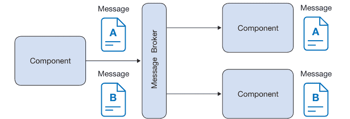

**图 9.4** 一个点对点队列，将消息分发给订阅该队列的单个接收者。

## 第 9 章 用于事件和流的异步 API

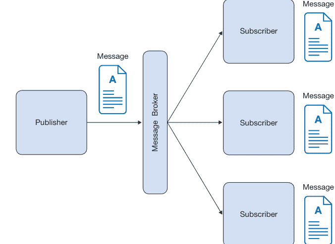

**图 9.5** 一个扇出主题，将每条消息分发给所有订阅的消息者。

## 关于消息代理术语的说明

本章使用的队列和主题术语在关于分布式消息的资源中很常见。请记住，某些供应商（例如 RabbitMQ）为主题提供了更不同的选项。这些选项范围从消息的通用广播（称为扇出）到选择性广播（他们称为主题）。请务必仔细阅读供应商文档，以理解他们偏于使用的术语。

## 消息流基础

消息代理通常是事务性，并设计用于管理持久订阅的状态以便进行离线接收者的故障恢复。虽然对于应用程序和集成解决方案很有用，但事务支持和其他特性限制了传统消息代理的可扩展性。

消息流建立在数十年的消息代理知识的基础上，但将一些责任从服务器转移出去，同时增加了应对今天复杂数据和消息需求的新功能。它使用扇出模式进行推


向一个或多个订阅者发送新消息通知，类似于消息代理主题。流式服务器的示例包括 Apache Kafka，5，Apache Pulsar，6 和 Amazon Kinesis。7。

与消息代理不同，订阅者可以从主题的可用消息历史中的任何时间点请求消息。这允许重放消息，或者简单地从之前处理中断的地方继续。与消息代理不同，流式服务器将状态管理从服务器转移到客户端。现在由客户端负责跟踪最后看到的消息。错误恢复也被推给了客户端，强制客户端从最后已知的消息恢复处理消息。

对这种交互风格的支持是通过将消息管理从传统的队列或主题转移到只追加日志来实现的。这些日志可以存储消息，也可以在指定的保留期内限制消息历史。图 9.6 显示了一个使用带有两个消费者的分布式日志的主题。

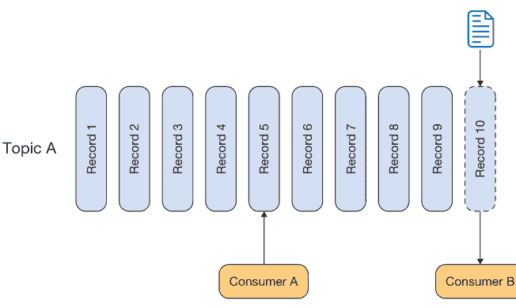

**图 9.6** 流式主题，由记录消息的分布式日志组成，由两个独立的消费者消费，这两个消费者具有两个独立的偏移量以反映它们当前的消息。

- 5. https://kafka.apache.org
6. https://pulsar.apache.org
7. https://aws.amazon.com/kinesis

由于能够指定起始位置的偏移量，客户端能够使用消息代理无法实现的解决方案解决新类型的问题：

- 由于消息流服务器具有高扩展性和低延迟的设计，一旦从其他系统或第三方接收到接入数据，即可实现实时数据处理和数据分析。
- 使用历史消息在将新代码推送到生产环境之前验证代码更改的结果。
- 对历史消息执行实验性数据分析。
- 无需为了审计而订阅所有的消息代理队列和主题。
- 将数据推入数据仓库或数据湖供其他系统使用，无需传统的提取-转换-加载（ETL）过程。

消息流更高的扩展性使得数据管理和共享的方式发生了转变。与其共享数据存储的访问权限或复制数据存储，不如每个新的或修改的数据事件消息都被推送到主题流中。任何消费者都可以处理数据更改，包括将其存储在本地进行缓存或进一步分析。

## 消息流考虑因素

在某些情况下，消息流可能不是最佳选择：

- **重复消息处理**：订阅者必须跟踪它们在流中的当前位置。因此，必须预计并处理重复消息处理。如果发生故障之前没有存储当前位置，可能会出现这种情况。
- **无消息过滤**：消息代理可以根据特定值支持队列或主题上的消息。消息流在箱范围内不支持这种过滤。相反，它要求接收者处理从给定偏移量开始的所有消息，或应用 Apache Spark 等第三方解决方案。
- **授权受限**：由于消息流相对较新，对于今天的解决方案，细粒度的授权控制和过滤非常有限或不存在。在继续之前，请确保所选供应商满足了授权需求。目前开始出现了一些连接流与 REST 的解决方案，这可能允许 API 网关应用更严格的授权策略。

## 异步 API 风格

异步 API 允许一种 API 交互样式，服务器可以在发生变化时通知消费者。有多种 API 风格支持异步 Webhooks、服务器发送事件 (SSE) 和 WebSocket，其中后者最常见。

## 使用 Webhooks 进行服务器通知

Webhooks 允许 API 服务器在事件发生时向其他感兴趣的服务器发布通知。与在同一代码库中发生的传统回调不同，基于 Web 的 webhooks 使用 HTTP POST。webhooks 一术语由 Jeff Lindsay 在 2007 年创造。从那时起开发了 REST Hooks 模式，提供了一种管理和保护 webhook 订阅及通知的标准方法。

当 API 服务器向接收回调系统提供的 URL 发送 POST 请求时，就会触发 webhook。例如，感兴趣的订阅者可以注册在他们提供的特定 URL 上接收新任务事件通知，例如 https://myapp/callbacks/new-tasks。然后，API 服务器向每个订阅者的回调 URL 发送包含事件详情消息的 POST 请求。完整序列如图 9.6 所示。

Webhooks 必须能够通过 API 服务器进行网络访问，并且能够托管自己的 API 服务器以接收 POST 请求。因为 webhooks 非常适用于系统之间的服务器到通信，但对浏览器和移动应用程序没有用。

## 有效实现 Webhooks

Webhooks 需要各种考虑因素，包括处理交付失败、保护客户端和服务器之间的通信，以及长时间确认通知的回调。参考 REST Hooks 文档-1 获取有效实现 webhooks 服务器的提示。

- 8. Jeff Lindsay, "Webhooks to Revolutionize the Web" (blog), Wayback Machine, May 3, 2007, https://web.archive.org/web/20180630220036/http://progrimum.com/blog/2007/05/03/web-hooks-to-revolutionize-the-web.
9. https://resthooks.org
10. https://resthooks.org/docs

## 第 9 章 用于事件驱动和流处理的异步 API

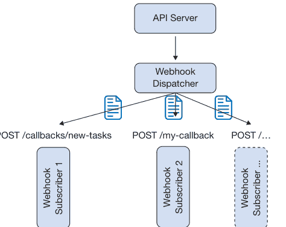

图 9.7 一个 API 服务器的 webhook 分发器，向每个希望使用 HTTP POST 接收回调的注册 URL 发送消息。

## 使用服务器事件进行服务器推送

SSE 基于 EventSource 接口，¹由 W3C 作为 HTML5 标准。它定义了使用 HTTP 支持长连接以允许服务器将数据推回客户端。这些传入的消息对客户端是有用的。

SSE 是一种简单的解决方案，在避免 API 轮询挑战的同时支持服务器推送。虽然 SSE 最初设计用于向浏览器推送数据，但它正成为一种向浏览器和服务器端订阅者推送数据的更流行的方式。

SSE 使用标准的 HTTP 连接，但保持连接较长时间而不是立即断开。这种连接允许 API 服务器在数据可用时将数据推回客户端。

规范概述了返回数据格式的选项，允许事件名称、注释、多行数据和事件标识符。订阅者使用媒体类型为 text-stream 的 GET 请求提交 SSE 操作（见图 9.8）。

> 11. https://developer.mozilla.org/en-US/docs/Web/API/EventSource

## 异步 API 风格

```
GET /tasks/event-stream
Accept: text/event-stream

task_created:
data: {"id": "12345"}
id: 12345

task_created:
data: {"id": "6789"}
id: 6789

<<Disconnected>>
GET /tasks/event-stream
Accept: text/event-stream
Last-Event-Id: 6789
```


**图 9.8** 使用服务器发送事件 (SSE) 允许 API 服务器通过长连接向客户端推送到事件。连接可以使用 Last-Event-Id 请求头恢复。


## 第 9 章 用于事件驱动和流处理的异步 API

SSE 确实在某些情况下可能并不适用：

-   API 网关（API gateway）无法处理长连接，或者超时时间非常短（例如小于 30 秒）。虽然这并不意味着无法使用，但它将要求客户端频繁地重新连接。
-   某些浏览器不支持 SSE。更多信息请参考 Mozilla 的兼容浏览器列表$^{12}$。
-   客户端和服务器之间需要进行双向通信。在这种情况下，WebSocket 协议可能是更好的选择，因为 SSE 仅支持服务器推送。

W3C 的 SSE 规范易于读懂，并提供了额外的规范说明和示例。

## 通过 WebSocket 实现双向通知

WebSocket 支持在由 HTTP 发起的 TCP 连接中隧道化全双工协议，该协议被称为子协议（subprotocol）。由于它们是全双工的，API 客户端与服务器之间变得可能的双向通信。客户端能够通过 WebSocket 连接向服务器推送请求，而服务器也可以向客户端推送事件和响应。

WebSocket 是一个由互联网工程任务组（IETF）维护的 RFC 6455 标准协议$^{13}$。大多数浏览器都支持 WebSocket，使其易用于浏览器到服务器、服务器到浏览器以及服务器到服务器的场景。由于 WebSocket 连接是通过 HTTP 连接进行隧道化的，它们还可以克服某些组织内部的代理限制。

一个一个需要记住的重要因素是，WebSocket 的行为并不像 HTTP，尽管它使用 HTTP 来建立连接。它必须选择一个子协议。IANA 官方注册了许多子协议$^{14}$。WebSocket 同时支持文本（text）和二进制（binary）格式子协议。图 9.9 显示了一个使用纯文本子协议的 WebSocket 交互示例。

WebSocket 的实现更为复杂，但它支持双向通信。这意味着它允许客户端在同一个连接上向服务器发送数据，并从服务器接收数据。虽然 SSE 更容易实现，但客户端无法在同一条连接上发送请求，因此在需要全双工通信时，WebSocket 是更好的选择。在选择异步 API 时请记住这一点。

> 12. MDN Docs, "Server-Sent Events," 修改于 2021 年 8 月 10 日，https://developer.mozilla.org/en-US/docs/Web/API/Server-sent-events.
> 13. Internet Engineering Task Force (IETF), The WebSocket Protocol (Request for Comments 6455, 2011 年 12 月），https://tools.ietf.org/html/rfc6455.
> 14. Internet Assigned Numbers Authority (IANA), WebSocket Protocol Registries, 修改于 2021 年 7 月 19 日，https://www.iana.org/assignments/websocket/websocket.html.

# 支持 WebSocket 的 REST API 服务器

```
HTTP/1.1 101 Switching Protocol Handshake
Date: Thu, 18 Sep 2029 14:53:18 GMT
Connection: Upgrade
Upgrade: websocket
---
```

WebSocket 升级请求

```
WebSocket upgrade response
<<WebSocket Enabled>>
Hello, server
Hello, client
```

## API 消费者（Web/移动/服务器）

```
GET ws://echo.websocket.org?encoding=text HTTP/1.1
Host: websocket.org
Connection: Upgrade
Upgrade: websocket
Sec-Websocket-Version: 13
---
```

图 9.9 API 客户端和服务器之间使用 WebSocket 和纯文本子协议创建聊天应用程序的交互示例。

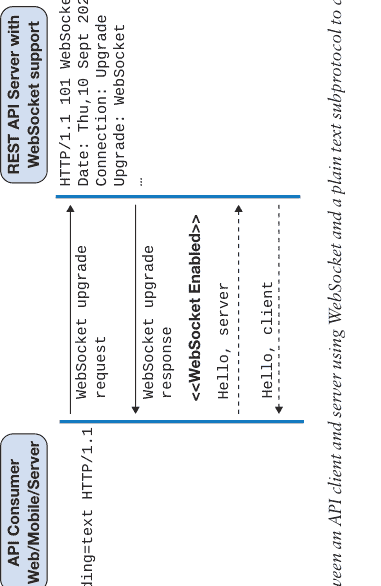

# gRPC 流式传输

TCP 协议针对长连接的双向通信进行了优化。HTTP/1.1 构建在 TCP 之上，但需要多个连接来允许客户端实现并发。虽然这种多连接需求是为了负载均衡和扩展，但它对性能有相当大的影响，因为每个连接都需要建立新的 TCP socket 连接并进行协议协商。

HTTP/2 是一个基于 Google 的 SPDY 协议工作成果构建的新标准，它优化了请求并包含了响应复用（response multiplexing）。在响应复用中，单个 HTTP/2 连接被用于一个或多个并发的请求。这避免了为每个请求创建新连接的开销，类似于 HTTP/1.1 支持持久连接（keep-alive connections）的方式。然而，HTTP/2 复用允许一次性发送多个请求，而不是使用持久连接按顺序发送。

此外，HTTP/2 服务器可能会向客户端推送资源，而不是要求客户端发起请求。这与 HTTP/1.1 传统的请求/响应模式相比是一个转变。

gRPC 利用了 HTTP/2 的双向通信，消除了在 SSE 之外单独在 HTTP/1.1 之上支持请求/响应或其他基于推送的方法的需求。由于 gRPC 支持双向通信，可以使用相同的协议来设计和集成异步 API。gRPC 流式传输有三种模式：客户端到服务器、服务器到客户端和双向，如图 9.10 所示。

像 WebSocket 一样，gRPC 可以作为一个全双工连接发送和接收消息及事件。与 WebSocket 不同，gRPC 不需要做出子协议决策，因为 gRPC 默认使用 Protocol Buffers。然而，浏览器没有内置的 gRPC 支持；grpc-web 项目正致力于将 gRPC 桥接到浏览器，但存在局限性。因此，gRPC 流式传输通常局限于服务与之间的交互。

### gRPC 异步选项 1：客户端到服务器

```
service Main {
  rpc GetOrders(OrderQuery) returns (stream Order);
}
```

### gRPC 异步选项 2：服务器到客户端

```
service Main {
  rpc GetOrders(OrderQuery) returns (stream Order);
}
```

### gRPC 异步选项 3：双向流式

```
service Main {
  rpc GetOrders(stream OrderQuery) returns (stream Order);
}
```
**图 9.10 gRPC 的三种选项：客户端到服务器、服务器到客户端和双向**

## 选择 API 样式

虽然异步 API 有多种样式，但根据情况和限制，某些样式可能是更好的选择。以下是每种样式的考虑因素，有助于判断：

-   **Webhooks**：Webhooks 是唯一不需要客户端发起连接的样式，当需要服务器到服务器的通知时使用。
-   **Server-Sent Events (SSE)**：SSE 在客户端和服务器端通常最容易实现，但不支持双向通信。当需要服务器推送事件时使用。
-   **WebSocket 协议**：WebSocket 实现较为复杂，因为需要支持一个或多个子协议，它支持双向通信。WebSocket 被浏览器广泛支持。
-   **gRPC 流式传输**：gRPC 充分利用了 HTTP/2，支持双向通信。gRPC 不被浏览器完全支持；适用于管理基础设施。

## 设计异步 API

设计异步 API 的过程与使用 REST、RPC 或查询样式设计传统的请求/响应 API 类似。从第 6 章“API 建模”中定义的资源开始。回顾并捕捉每个 API 配置文件的事件。然后确定哪些命令和事件对 API 消费者有益。

## 命令消息

命令消息包含了请求另一个组件执行工作所需的所有细节。在设计异步 API 的命令时，重要的是设计中要包含足够处理请求的细节。它可能包含一个发布结果消息的位置。该目标位置可以是 POST 到消息代理主题的 URL，或者是共享对象存储（如 Amazon S3）的 URL。

在设计时，使用内置语言机制（如对象序列化）来简化命令生产者和消费者的开发可能是很容易的。这将限制消费和处理这些命令的系统。相反，寻求使用语言无关的格式，例如 UBER 超媒体格式、Apache Avro、Protocol Buffers、JSON 或 XML。

以下是一个异步更新客户账单地址的 JSON 命令消息示例：

```json
{
  "messageType": "customerAddress.update",
  "requestId": "123f4567",
  "updatedAt": "2020-01-01T02:56:45Z"
}
```


```json
{
  "customerId": "330001003",
  "newBillingAddress": {
    "addressLine1": "...",
    "addressLine2": "...",
    "addressCity": "...",
    "addressState": "...",
    "addressRegionProvince": "...",
    "addressPostalCode": "..."
  }
}
```

可以提供一个额外的 `replyTo` 字段并包含回调的 URL，或者由其他订阅者监听 `customerAddress.updated` 事件来对更改做出响应，例如在第三方系统中更新账单地址。

## 事件通知

事件通知（有时被称为“精简事件”，thin events）用于通知订阅者状态更改或业务事件的发生。它们的目标仅为订阅者提供必要的信息，以便其判断该事件是否感兴趣。

事件订阅者负责通过 API 获取详情的最新表示，以避免使用过时数据。在精简事件中提供超链接，有助于将获取最新资源表示的 API 操作与事件等异步 API 整合。下例事件载负载展示了这一点：

```json
{
  "eventType": "customerAddress.updated",
  "eventId": "123e4567",
  "updatedDate": "2020-01-14T03:56:45Z",
  "customerId": "330001003",
  "_links": [
    { "rel": "self", "href": "/events/123e4567" },
    { "rel": "customer", "href": "/customers/330001003" }
  ]
}
```

精简事件用于与频繁变化的资源相关的事件，迫使事件订阅者检索最新的资源表示，以避免处理过时数据。虽然并非必须，但精简事件也可以包含更新发生时更改的特定属性的详情，以帮助消费者判断该事件是否感兴趣。

# 事件携带状态传输事件 (Event-Carried State Transfer Events)

事件携带状态传输事件包含了事件发生时的所有可用信息。这避免了联系 API 获取完整资源表示的需求，尽管可能还会使用额外的 API 来补充订阅者执行任何处理所需的数据。

事件携带状态传输优于精简事件的原因有以下几点：

- 订阅者关注的是与事件相关的资源快照，而不是精简事件提供的少数细节和相关多媒体链接。
- 数据状态通过消息流进行更改，以支持重放消息历史，这需要资源的完整时间点快照。
- 通过异步 API 进行消息传递用于服务间通信，需要发布完整的资源表示，以避免 API 流量增加以及服务之间过紧耦合。

这种消息设计风格通常会尽可能模拟 API 的表示结构。当更新事件必须提供事件中任何被修改属性的旧值和新值时，出现偏差也是很常见的。

最后，对于中大型载荷，使用嵌套结构而非扁平结构来对相关属性分组。这有助于推动演进性，因为属性名称被限制在父属性范围内，从而避免了属性名称冲突或为了澄清关系而使用长属性名。以下是扁平化结构到事件携带状态传输消息风格的演示。

```json
{
  "eventType": "customerAddress.updated",
  "eventId": "123e4567",
  "updatedAt": "2020-01-14T03:56:45Z",
  "customerId": "330001003",
  "previousBillingAddressLine1": "...",
  "previousBillingAddressLine2": "...",
  "previousBillingAddressCity": "...",
  "previousBillingAddressState": "...",
  "previousBillingAddressRegionProvince": "...",
  "previousBillingAddressPostalCode": "...",
  "newBillingAddressLine1": "...",
  "newBillingAddressLine2": "...",
  "newBillingAddressCity": "...",
  "newBillingAddressState": "...",
  "newBillingAddressRegionProvince": "...",
  "newBillingAddressPostalCode": "..."
}
```

结构化方法在如下示例所示：

```json
{
  "eventType": "customerAddress.updated",
  "eventId": "123e4567",
  "updatedAt": "2020-01-14T03:56:45Z",
  "customerId": "330001003",
  "previousBillingAddress": {
    "addressLine1": "...",
    "addressLine2": "...",
    "addressCity": "...",
    "addressState": "...",
    "addressRegionProvince": "...",
    "addressPostalCode": "..."
  },
  "newBillingAddress": {
    "addressLine1": "...",
    "addressLine2": "...",
    "addressCity": "...",
    "addressState": "...",
    "addressRegionProvince": "...",
    "addressPostalCode": "..."
  }
}
```

当将结构化组合应用于携带状态样式时，消费者能够重用值对象来包含每个嵌套对象的详情，并在之后在用户界面中轻松检测字段差异。如果没有这种模式，则需要值对象以及额外的编码工作来执行诸如检测前后地址差异的操作。

## 事件批

虽然大多数异步 API 设计为在消息可用时通知订阅者，但某些设计可能从将事件分组为批中益。事件批要求订阅者处理多条消息。一个简单的示例是用数组封装通知：

```json
{
  "events": [
    {
      "eventType": "customerAddress.updated",
      "eventId": "123e4567",
      "updatedAt": "2020-01-14T03:56:45Z",
      "customerId": "330001003",
      ...
    }
  ]
}
```

另一种设计方案是提供一个包含批额外元数据的信封：

```json
{
  "meta": {
    "eventType": "customerAddress.updated",
    "eventId": "123e4567",
    "updatedAt": "2020-01-14T03:56:45Z",
    "customerId": "330001003",
    "_links": [
      { "rel": "self", "href": "/events/123e4567" },
      { "rel": "customer", "href": "/customers/330001003" }
    ]
  },
  "events": [
    {
      "eventType": "customerAddress.updated",
      ...
    }
  ]
}
```


payload:

```
type: object
properties:
  queryStringFilter:
    type: string
    description: 搜索过滤器使用的查询字符串
  categoryIdFilter:
    type: string
    description: 搜索过滤器使用的类别 ID
  releaseDateFilter:
    type: string
    description: 搜索过滤器使用的发布日期
```

CartItemAdded:

```
payload:
properties:
  cartID:
    type: string
    description: 添加书籍的购物车 cartID
  bookID:
  type: string
    description: 添加到购物车的书籍 ID
  quantity:
    type: integer
    description: 添加的书籍数量
```

请记住，AsyncAPI 规范还支持为每个通道的发布（publish）和订阅（subscribe）消息添加协议绑定（protocol bindings）。这种灵活性使得同一个消息定义可以用于多种消息协议，包括消息中间件、SSE、消息中间件和消息流。访问 AsyncAPI 页面¹⁸ 可获取有关规范的更多信息以及帮助开始使用此异步 API 描述格式的额外资源。例如，异步 API 描述示例，请参考 GitHub 上的 API 工作坊示例¹⁹。

+   18. https://asyncapi.com
+   19. https://bit.ly/align-define-design-examples

## 总结

团队可以从 API 设计方法从严格的请求/响应 API 转向思考 API 如何同时提供同步请求/响应操作和异步事件中获益。这些事件使 API 向其他团队推送通知，这些团队可以在原始 API 之上构建完全全新的功能，甚至是产品供应。其结果是作为 API 产品或 API 平台倡议的一部分，将增加创新能力并产生更具变革性的 API。

## 第五部分

## 完善 API 设计

遵循到到对齐-定义-设计-完善（ADDR）流程，在对齐（Align）阶段已识别了结果并捕获了数字能力。随后，定义（Define）阶段将阐述这些细节，形成具有边界范围和责任的 API 配置文件。设计（Design）阶段将一种或多种 API 风格应用于 API 配置文件，生成交付所需结果 API 的高级设计。

完善（Refine）阶段旨在改进开发者体验并为 API 的交付做准备。第五部分涵盖的主题包括：将 API 拆分为服务以转移复杂性、应用适当的 API 测试策略以及提供稳健 API 文档的策略。还探索了提供辅助库和命令行界面（CLI）。最后，还提供了为大型组织扩展 ADDR 流程的提示。

## 第 10 章

## 从 API 到微服务

关于单体架构最大的谬误在于，你只能有一个。

> — Kelsey Hightower

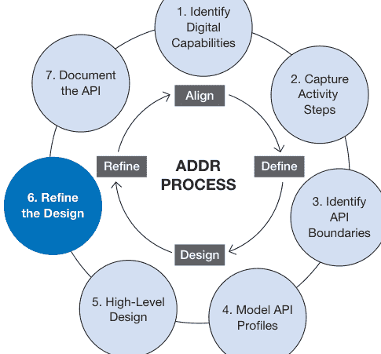

**图 10.1** 完善 API 设计可能包括将其拆分为更小的服务，以降低解决方案的整体复杂性。

## 第 10 章：从 API 到微服务

所有组织都希望尽可能地交付业务价值。同时，它们必须确保其软件始终按照预期运行。提高开发速度可能会导致 bug 增加和可靠性下降。软件解决方案越大，这种风险就越高。

为了降低这些风险，要求组织通过会议协调来放慢软件交付速度。这些会议寻求在优化交付的同时解决沿途的风险。软件解决方案越大，需要的会议越多来缓解相关的风险。然而，在速度与交付高质量软件之间取得平衡非常重要。

将 API 拆分为微服务（图 10.1）是团队应对这种平衡需求的一种选择。本章将探讨微服务主题，包括其优点、挑战以及微服务的替代方案。

## 什么是微服务？

微服务是小型的、独立部署的组件，提供一个或少数有边界的数字能力。每个服务提供所需的数字能力之一，确保每个服务都有有限的范围。当组合时，微服务使用比传统面向服务的方法更小的构建块来交付高度复杂的解决方案，如图 10.2 所示。

微服务的采用通常用于将高度复杂的系统拆分为独立部署的组件，而不是将复杂性包含在单个代码库中。理解单个微服务所需的认知负载低于理解单个代码库的负载。


图 10.2 关于单体、面向服务和微服务架构的传统思维。虚线表示传统的粗粒度边界，这些边界被进一步拆分以降低更粗粒度服务的复杂性。

## 什么是微服务？

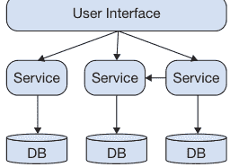

**图 10.3** 微服务将高复杂性拆分为更小的、独立部署的组件。

测试变得更容易上手，自动化测试套件变得更加关注单个组件（见图 10.3）。

微服务的概念已经存在了十多年，但直到最近微服务才被后大多数群体广泛使用。在微服务的早期，团队必须权衡建立和维护微服务架构所需基础设施的精力。随着时间的推移，许多这些因素通过云原生基础设施得到了解决。

# 关于“微服务”术语的警告

理解该术语的含义非常重要。首先，确保理解定义。其次，寻找参考架构和目标。最后，意识到组织可能会使用微服务这一术语。

## 微服务减少协调成本

随着今天许多这些因素得到解决，组织现在默认采用基于微服务的方法。然而，理解围绕微服务的架构决策的优点和挑战都是重要的。必须考虑对服务背后的人产生积极或负面影响的技术和非技术因素。

在同一个代码库中工作的多个团队的协调成本极高。需要一个接一个会议来确保开发者不会引入 bug 并避免合并冲突。对于大型组织，需要引入额外的经理来进行协调。

微服务最大的好处是减少团队协调。独立运行以维护一个或几个微服务的团队可以在团队内部进行协调，团队外部的协调点有限。益处是跨组织沟通意图和解决问题所需的会议更少。结果是团队有更多时间来设计、编码、测试和交付他们的服务。

然而，微服务并没有消除跨团队协作。必须协调集成以确保所有微服务都符合解决方案的需求。产品经理、业务部门和服务团队之间必须同步时间表。因此，小型团队会议的数量可能会增加，但每次会议的参会人数和讨论范围大大缩小了。团队获得了更多的独立性，且由于协调工作限制在团队范围内。

为了实现减少团队协调的目标，需要几个因素：

- 自服务、自动化基础设施资源确保新服务的快速加载。这些资源通常与 DevOps 自动化工具和持续交付流程文化相关。
- 团队对整个软件开发生命周期内的服务的所有权，包括增强和支持服务。跨生命周期的团队所有权会产生“你拥有，你管理”的文化，而不是交付给运维团队；可能包括软件可靠工程师和其他角色来增强团队。
- 移除中心化数据所有权，允许每个服务拥有并管理与其服务相关的数据。


# 衡量微服务的复杂性 193

如果不考虑这些重要因素，任何向微服务的迁移都将面临挑战，包括微服务膨肿、交付速度变慢甚至项目失败。这一主题在《战略性单体与微服务》（Strategic Monoliths and Microservices）的第 6 章“开放主机服务”部分有进一步讨论。

转向微服务的益处与其说与技术选择有关，不如说与它们对组织产生有关。向微服务的迁移必须审慎考虑，因为它们可能对日常开发和运营产生积极或负面影响。

# API 与微服务之间的区别

虽然 API 产品和微服务都提供基于网络的 API，但它们之间的区别是巨大的：

- API 产品针对稳定性和可演进性，而微服务则允许实验。API 的消费者期望除非迁移到新 版本的 API，否则合约永远不会被破坏。微服务是为实验和持续变化而设计的。因此，微服务可以随时被拆分、合并或删除。
- API 产品提供了一组数字能力，用于集成到解决方案中。微服务将解决方案分解为分布式组件。它们不是即时边界之外与开发者的外部合约。如果外部合约成为一项需求，则服务必须过渡到具有稳定接口的 API 产品。

仅仅因为代码库小并不意味着它是微服务。微服务是一个内部组件，不应直接与外部消费者共享。API 产品可以在特定团队内部、跨团队、组织以及/或与合作伙伴/公共开发者之间共享。

# 衡量微服务的复杂性

考虑微服务时，最重要的因素是解决方案的复杂性。复杂性无法从软件解决方案中完全消除。然而，它可以分布在整个解决方案中。微服务允许将复杂性

> 2. Vaughn Vernon and Tomasz Jaskula, Strategic Monoliths and Microservices: Driving Innovation Using Purposeful Architecture (Boston: Addison-Wesley, 2021).

分散到各个组件中，使得每个组件都更容易构建和管理。然而，将问题分解为分布式组件会引入其他复杂性。

每个团队和组织必须考虑解决方案的复杂性以及微服务引入的复杂性，以确定转向微服务有助于还是阻碍组织快速安全地交付解决方案的能力。虽然单个微服务可能提供较低的复杂性，但在运行时交付、监控和保护该服务的架构和自动化要求会增加。

如果解决方案的复杂性因子较低，那么微服务通常是不必要的，甚至可能对解决方案的成功有害。如果解决方案的复杂性未知，请权衡后续因素，然后从平衡这些因素的最小解决方案开始，当复杂性增加时迁移到微服务。

# 自服务基础设施

微服务需要自服务的、全自动的设施。团队必须能够设计微服务、构建它并部署代码，而无需任何手动流程或审批。尚未完全自动化配置和部署流水线的组织将遇到相当大的阻力。如果没有全自动化支持，为了避免手动流程，新代码将不断添加到现有微服务中，导致产生巨大且孤立的服务。

# 独立发布周期

微服务必须有自己的发布周期。某些组织选择使用现有的发布流程（例如两周一次的冲刺和发布），而不是允许微服务在准备就绪时发布。这种所有微服务的同步协调部署导致了大型发布过程，而不是让独立团队根据需要部署它们的微服务。

# 转向单团队所有制

每个微服务都应该由单一团队拥有、监控和管理。团队应该只拥有一个或几个微服务以专注于他们的精力。他们必须从定义、设计到交付完全拥有该服务。他们必须支持该服务，就像一个寻求根据其他团队反馈来纳入改进的产品一样。

# 衡量微服务的复杂性 195

较小的组织发现分配单团队所有制具有挑战性，而是将所有服务的所有权在少数开发者之间共享。开发者花费在代码库之间切换和处理分布式计算挑战上的时间比比向市场交付解决方案的时间还要。

# 组织结构和文化影响

微服务需要适当的组织支持和结构。组织结构和文化可能与微服务团队的所有权独立性相冲突。汇报结构可能针对较大的交付团队进行了优化。在协调跨越管理者的团队的服务集成方面可能会出现挑战。倾向于集中监督的组织在将控制权移给单个团队时可能会遇到困难。

这些组织挑战可能会产生不健康的紧张关系，使得在转向微服务的同时，难以实现微服务通常承诺的速度和安全性。在转向微服务之前，请记住组织的结构，确保获得执行团队和监督服务团队的经理的支持。

> 提示
> 不要忽视采用微服务在组织和文化上的影响。从基于产品或项目的所有制转变为边界区域内一个或几个微服务的所有制，将对汇报结构和团队对齐产生影响。在继续之前计算成本。否则，组织可能正在用代码复杂性交换组织复杂性。

# 数据所有权的转移

微服务必须拥有它们自己的数据。这是一个具有挑战性的项目，因为在转向微服务时，很少考虑源代码之外的内容。当服务不拥有自己的数据时，底层模式更改的协调成本可能会影响到共享该数据的多个微服务中。这可能需要大规模、协调的发布工作来使每个服务与共享数据源中的破坏性模式保持一致。

# 分布式数据管理和治理

微服务需要大量的数据管理和治理。由于微服务拥有自己的数据，必须投入资金以确保存在适用于报告和分析的适当数据管理策略。今天的数据管理通常通过基于 ETL（提取转换加载）的处理，将数据迁移到基于在线分析处理（OLAP）的存储中，以优化查询和决策支持。

转向微服务要求转向数据流，而不是为了数据聚合的目的而从多个服务获取数据。需要更强调管理术语表，创建一个强大的本体论和分类法以统一分布式数据模型。具有中心化数据治理和大型共享数据库的组织在迁移到微服务架构时必须谨慎。最后，不要低估将单体数据存储拆分为每个服务数据存储所需的努力。

# 分布式系统挑战

通往微服务的之旅需要对分布式系统有深入理解。那些不熟悉分布式追踪、可观察性、最终一致性、容错和故障转移概念的人，在使用微服务时将面临更困难的。由 L. Peter Deutsch 等人在 1994 年在 Sun Microsystems 编写的“分布式计算八大谬误”在今天仍然适用，每位开发者都必须理解这些。

此外，许多人发现，最初分解服务以及随后将服务集成到解决方案中需要架构监督。无法获得架构支持的团队可能在微服务的设计中缺乏架构考虑，导致边界糟糕和团队职责重叠，从而产生跨团队协调。ADDR 流程中的对齐（Align）阶段旨在早期解决这一问题。

最后，分层架构在单体代码库中很常见，但在那里是不受欢迎的。如果微服务的分层不正确，对单个微服务的更改可能会影响其他服务，并需要额外的协调工作来同步更改。应用分层方法的微服务必须确保服务更改的影响是有限的。重新回顾 REST 的分层原则，查看如何使用层来增加组件之间的独立性。

> 3. Wikipedia, s.v. “Fallacies of Distributed Computing,” last modified July 24, 2021, 20:52, https://en.wikipedia.org/wiki/Fallacies_of_distributed_computing.


# 弹性、故障转移与分布式事务

随着微服务的数量增加，服务之间调用所需的复杂性也随之增加。同步微服务需要跨网络进行调用链操作，因此容易受到网络故障的影响。

必须在每个微服务中构建内弹性机制，以确保在发生临时网络中断时能够进行重试和故障转移。在第 15 章“保护 API”中讨论的服务网格（Service Mesh）概念是为了解决这些跨关注点而引入的，但服务网格引入了额外的部署和运维复杂性，这对于简单的解决方案来说可能是不必要的。

同步调用链的另一个方面问题是，在第一次调用之外的失败需要之前的服务调用回滚事务。在服务面向架构（SOA）鼎盛时期，事务管理器被用于创建分布式事务，通常通过两阶段提交（2PC）事务来实现。在高度分布的微服务架构中，这不是一个选项。

相反，分布式事务通常使用 Saga 模式实现。在每个服务调用中应用事务上下文，当对涉及的每个资源执行回滚时，使用补偿事务来执行相反的操作。事件溯源（Event Sourcing）通常与 Saga 模式配合使用，以确保所有操作都是原子事务，并由账本支持以供审计和故障排除。

# 重构与代码共享的挑战

在微服务中，重构代码更具挑战性，因为集成开发环境（IDE）和其他重构工具只能在单个代码库内进行重构。跨多个微服务代码库进行代码重构变得更容易出错。

当微服务使用相同的编程语言时，倾向于使用共享代码库来处理公共代码。在服务之间共享代码会产生协调耦合，需要更多的会议来确保对跨微服务共享代码的更改不会对其他产生负面影响。在服务之间共享代码时，所有更改必须是可选的，以避免强制其他团队步调一致。

> 4. Chris Richardson, "Pattern: Saga," Microservice Architecture, 访问于2021年8月19日, https://microservices.io/patterns/data/saga.html.

# 你真的需要微服务吗？

在权衡了微服务的挑战和底层的运维复杂性后，可能会确定 API 边界不需要拆分为微服务。也许需要的不是微服务，而是一个或多个被设计为模块化的单体 API，被称为单体架构（Monoliths）。

模块化单体在单个代码库内应用松散耦合和高内聚，以避免分布式计算的复杂性。随着时间的推移，如果解决方案对于单个代码库来说变得太复杂，可以将单体拆分为微服务。然而，只有在用尽了所有重构和组织单个代码库模块的路径后，才应用这种方法。

请记住，组织并不限于单个单体架构。多个模块化单体可能足以满足团队的需求。每个单体提供一个或几个 API，支持单体内部边界上下文（Bounded Contexts）包含的操作。

# 同步与异步微服务

微服务可以设计为同步或异步。同步微服务采用更传统的请求/响应模型，通常通过 HTTP REST、RPC 或查询型 API 风格实现。

虽然同步的基于请求/响应的 API 对开发者来说更熟悉，但结果可能是导致脆弱的集成。编排服务之间 API 调用的服务如果某个单个服务出现问题，可能会中途失败，从而需要撤销之前成功的 API 调用。调用其他服务的（称为调用链）可能会中途失败，但它们无法无法撤销之前的 API 调用。图 10.4 说明了这种担忧，因为客户端只调用了服务 A，这导致在发生下游错误时会出现更多可能失败的服务调用。

或者，可以使用异步访问模式进行微服务集成。在这种风格下，消息被提交到托管在消息代理或流处理服务器上的消息队列或主题中。一个或多个微服务轮流监听消息并发布包含业务事件的消息作为结果。

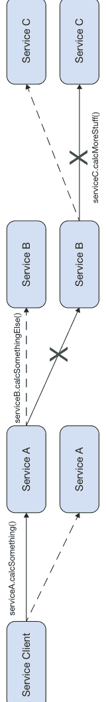

图 10.4 使用同步请求/响应风格的微服务会导致在客户端不知情的情况下可能失败的调用链。

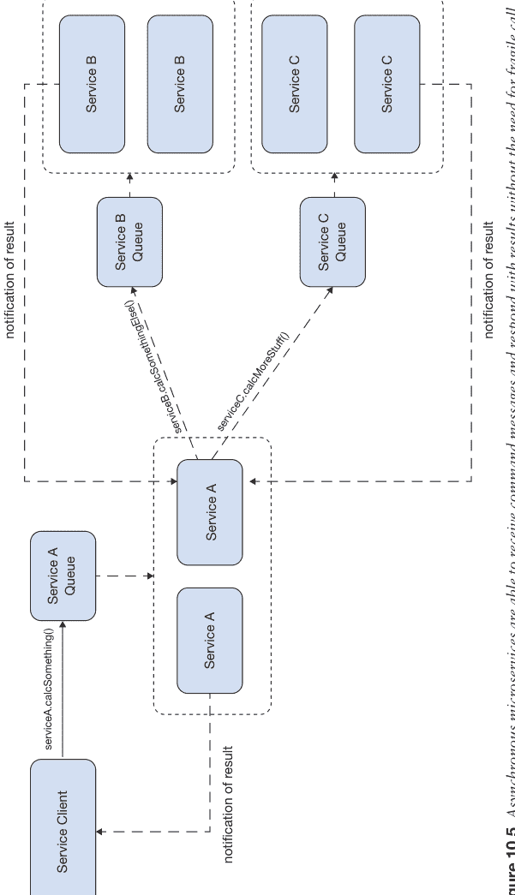

# 微服务架构风格

异步微服务提供了若干优势。最大的优势是新的微服务可以上线以替换旧服务，而无需消费者知晓。新的微服务订阅相同的主题和队列并开始处理消息。

此外，消费者可以根据需要灵活地使用以下交互模式之一或多个：发后即忘（fire-and-forget）、监听事件（fire-and-listen for events）或使用提供的响应 URL 进行后续跟进（fire-and-follow-up）。

最后，异步错误处理和恢复是内置在消息代理和流解决方案中的。避免对同步调用链错误恢复的需求极大简化了基础设施要求，减少或消除了对服务网格的需求。

当然，异步集成比标准的请求/响应方法更复杂。开发者必须学习与异步服务集成，并通过检查错误响应消息和使用死信队列（DLQ）检查未处理的消息来处理失败。

基于微服务的架构不仅限于单一风格或方法。应用微服务有三种常见风格。每风格在如何利用微服务减少团队间协调方面略有不同。有些组织选择应用这些风格中的一种或多种。

# 直接服务通信

在这种风格下，每个服务直接使用同步或异步模型与其他服务进行通信。这是微服务早期最常见的风格。许多组织遇到过服务故障和调用链脆弱性等挑战。图 10.6 描绘了这种架构。

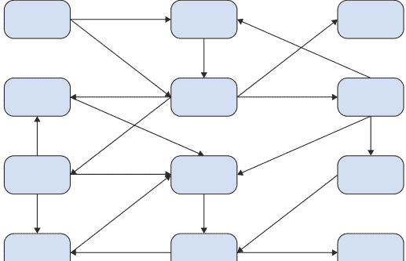

图 10.6 直接服务通信允许任何服务调用其他服务。

# 基于 API 的编排

这种风格从设计 API 开始，并根据需要进一步拆分为微服务。这是在使用直接服务通信模型遇到困难的组织选择的风格。该模型如图 10.7 所示。

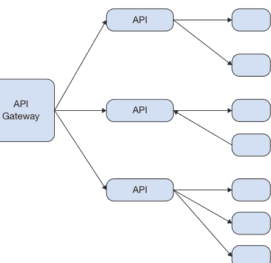

图 10.7 基于 API 的编排风格提供了更高的稳定性，同时隐藏了微服务。

# 单元架构

单元架构（见图 10.8）结合了上述两种风格，为微服务带来了更模块化的方法。每个单元提供一个或多个数字能力，通过同步或异步 API 提供。API 通过网关外部化，隐藏了服务拆分的内部细节。单元被组合成更大的解决方案。由于这种风格的模块化组合性，它通常出现在大型组织中，因为它为演进中的系统提供了更好的管理。

Uber 工程团队最近从许多小型服务的集成转向了这种单元架构模型。它发现复杂性的增加远大于微服务提供的价值。Uber 将这种方法称为领域驱动的微服务架构（DOMA），并提供了一篇总结该方法的有用文章。它与单元架构的许多元素相似，通过降低降低大规模微服务架构的复杂性，同时保持了其提供的灵活性和优势。

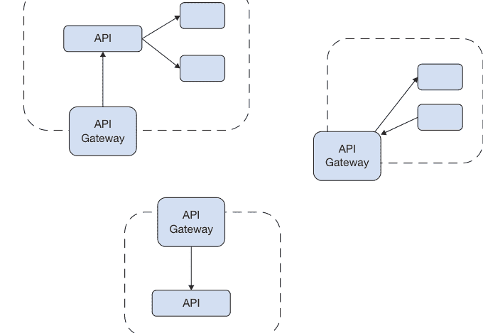

图 10.8 单元架构将直接服务通信和基于 API 的编排风格相结合，为大型组织或复杂系统提供了更模块化的方法。


# 微服务的规模优化 (Right-Sizing)

在向微服务转型道路上的组织往往为寻找微服务的合适规模而苦恼。团队经常问：“微服务的最大允许尺寸是多少？”一个更好的问题应该是：“基于目前的需求，这个微服务的合适规模是多少？”

微服务并不是静态不变的。相反，它们会不断成长并变得复杂。随着时间的推移，一个微服务可能需要拆分。在其他情况下，两个微服务可能会产生相互依赖，并从合并为一个单一服务中受益。因此，微服务的规模会随着时间变化而变化。

同样重要的是，服务随着时间推移而增长，这要求经常重新评估微服务的边界。只有当服务所有权归属于单一团队时，才能高效地完成。跨团队共享的服务则需要额外的协调会议。

微服务的规模优化需要一个持续的设计和重新评估过程：

- 1. 识别事务边界所在的位置，以找到候选服务边界。定义边界有助于减少跨服务分发事务的概率。

- 2. 根据识别出的边界设计两个或几个粗粒度的微服务。这一步确保了你的微服务操作在事务边界内保持完整性，并避免了在网络上跨多个微服务调用回滚事务的挑战。

- 3. 随着服务的增长持续拆分服务，在事务边界需求的指导下，同时保持较低的团队协调成本。

> 提示
> 最好关注微服务的规模，更多地关注服务的目的。微服务应该寻求让未来的变更变得更容易，即使服务在开始时是更粗粒度的。

# 将 API 拆分为微服务

如果团队已确定将 API 拆分为两个或多个微服务是有益的，那么在开始交付阶段时，还需要一些额外的步骤：扩展之前创建的 API 序列图以包含更多细节、识别候选服务以及捕捉服务设计细节。

# 第一步：识别候选微服务

拆分 API 的第一步是识别候选微服务。从扩展 API 建模和设计阶段创建的 Web 序列图开始，包含外部系统数据存储。这些图有助于识别服务之间的自然边界。图 10.9 扩展了 Shopping API，引入了外部搜索引擎，该引擎将支持基础和高级查询支持。

由于搜索引擎集成在 Shopping API 的 `Search Books` 操作中是只读的，因此将其拆分为独立服务是一个很好的选择。拥有该候选服务的团队将负责：

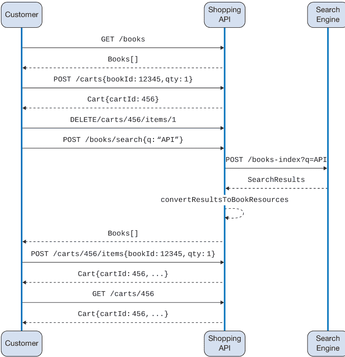

图 10.9 扩展后的 Shopping API 序列图，现在包含了任何外部系统。

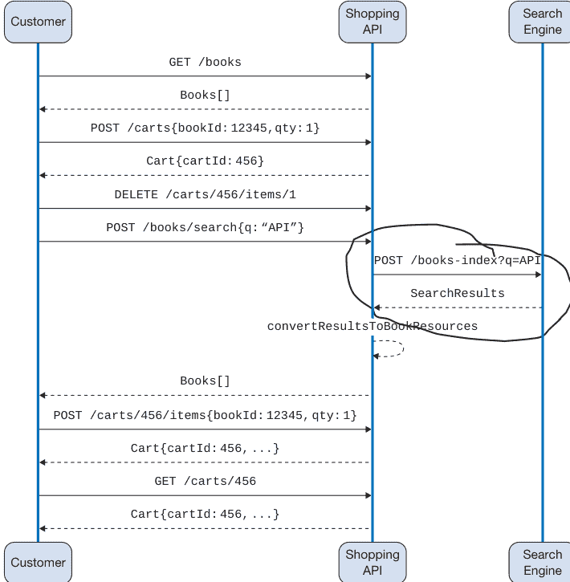

**图 10.10** 搜索引擎集成需要关于如何正确索引和搜索实体的专业知识，因此 `Search Books` 操作是作为独立微服务的良好候选。

确保搜索引擎索引既具有高性能，又能交付客户所需的功能。图 10.10 显示了支持书籍搜索的候选微服务的边界。

# 第二步：将微服务引入 API 序列图

接下来，修订序列图以显示候选微服务的引入。确定集成应该使用同步 API（如 REST），还是使用异步服务更好。图 10.11 显示了 Shopping API 的更新序列图。

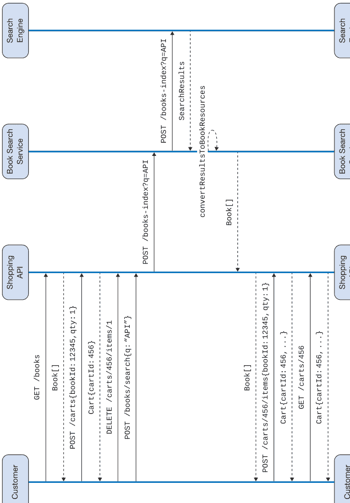

图 10.11 包含候选微服务的更新序列图，这允许识别可能的网络或事务挑战。

审查更新内容并确定候选微服务的工作是否过多并应该进一步拆分。或者，可能服务的工作太少，引入了太多的网络调用，因此应该合并为一个稍大的服务。

# 第三步：使用微服务设计画布捕捉

最后，捕捉候选微服务的设计细节。建议使用微服务设计画布 (Microservice Design Canvas, MDC)，因为它有助于关注服务将支持的命令、查询和事件。如果服务的细节无法放入单页 MDC 中，它可能负责了太多内容。在这种情况下，重新审设计，看看它是否需要进一步拆分，或者对于支持该 API 集是合适的。图 10.12 显示了书籍搜索服务的 MDC 示例。

此时，MDC 已经提供了足够的细节来继续构建并将服务与一个或多个 API 集成。在继续之前，还有一些额外的考虑因素需要处理。

# 额外的微服务设计考虑

注意，所有 API 都将从服务拆分中受益。每当涉及新的微服务时，都有可能增加网络延迟，从而负面影响 API 客户端。

当由于同步服务调用另一个、另一个再调用另一个而导致服务调用链时，网络延迟的增加尤为重要。客户端接收响应的总时间是顺序执行每个服务调用所需时间之和。对于每个执行时间小于 10 毫秒的高效服务实现，延迟可能不需要太担心。与旧系统集成的服务在峰值使用期间可能会性能下降，导致最终用户等待几秒钟。最后，对于某些微服务生态系统，可能无法知道涉及多少个服务或预测执行所需的总时间。

尽可能将事务保持在单一服务边界内。跨越多个服务调用的事务边界需要额外的设计考虑。如果服务调用失败，任何之前的调用都必须回滚。由于每个服务都管理自己的事务边界，可能需要补偿事务来撤销事务——这就是 Saga 模式的应用。尽可能寻求拆分微服务，以保持事务的完整性。

6. https://launchany.com/canvas

# 微服务总结
描述：管理搜索引擎中书籍的索引和搜索

| 服务名称：书籍搜索服务 | |
| :--- | :--- |
| 消费者任务： | 1. 搜索书籍<br>2. 索引书籍<br>3. 删除书籍 |
| 依赖关系： | |
| 服务依赖： | |
| 数据源： | 第三方搜索引擎 |
| 事件订阅： | N/A |
| 逻辑/规则： | 将书籍转换为可搜索字段 |
| 架构 | |
| 质量属性 | 99.9% 可用性 |
| 实现 | |
| 接口 | |
| 查询 | search(query) |
| 命令 | index(book) |
| 事件 | index(bookId) |

图 10.2 一个微服务设计画布，在实施之前捕捉微服务，包括设计考虑。 - microservesign.com/canvas

# 转型微服务的考虑因素

虽然转向微服务有很多益处，但这种转型不应轻率。在经过一段时间和反思后，某些组织选择简化它们的微服务之旅，另一些决定放弃旅程，转而采用无微服务的化思维，剩下的则继续进行微服务。

首先，验证基于微服务的方法是否被应用于正确的上下文。某些微服务倡议是由执行团队指示的，缺乏正确的背景。这通常始于一位强制微服务的高管，以便团队能够增加交付速度。然而，并没有提供背景以告知团队在解决方案简单的情况下避免微服务的复杂性（例如，一个为数据集提供 CRUD 服务的应用程序）。结果是浪费精力和精力将简单的解决方案拆分为微服务。

接下来，确保组织的汇报结构和文化已准备好随着转向微服务进行调整。某些组织尚未准备好让团队长期拥有服务。相反，他们将微服务视为交付但从未拥有的项目。构建服务的团队会转向其他项目和更高优先级的任务。结果导致从现有服务的微小更改中受益的团队被要求构建自己的服务。


## 总结

微服务是独立部署的代码单元，通过组合构建构建式系统。转向微服务需要新技术的结合以及自上而下的组织支持。当组织对决策因素进行审慎反思后，其向微服务的转型可能会带来主要收益：降低多个团队之间的协调成本。

要警惕那些带来的收益无法超过其所需复杂性的技术趋势。微服务为某些组织带来了收益，但并非没有挑战。组织必须计算迁移到微服务的成本是否大于设计、构建和运行微服务的复杂度，以判断其复杂度是否超过了单一单体代码库的复杂度。

替代方案（如模块化单体和基于单元的架构）支持微服务的许多目标，但在减少协调和优化局部决策方面的支持程度各不相同。当产生疑问时，可以应用敏捷软件的“你以后不需要它”（YAGNI）原则，从模块化单体 API 开始，并在需要出现时将其分解为微服务。

# 第11 章

## 改进开发者体验

每个交付价值的有用 API 通常会有多个消费者。
这是一种自然的不对称，并且会随着时间的推移而增加。

> — Mark O’Neill

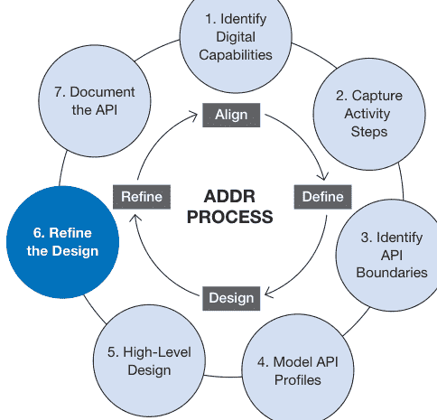

图 11.1 完善 API 设计包括通过辅助库和命令行界面来改进开发者体验。

当团队考虑交付 API 时，主要关注的是必须构建的代码。他们关注诸如因素，如目标编程语言、辅助构建 API 的框架、持续集成与交付 (CI/CD) 流水线以及其他因素。所有这些决策都是重要的，它们仅涉及 API 提供者。它们并没有直接面对未来将使用该 API 的数十、上百或数千个 API 消费者。

作为 API 提供者，在设计和交付的所有工作中将 API 消费者放在首位是非常重要的。这一责任包括创建 Mock API 以帮助早期采用者尽早获得 API 设计反馈（图 11.1）。它还需要考虑是否提供辅助库和命令行界面，以缩短所有技能水平 API 消费者的集成时间。本章旨在解决这些问题，以扩大对集成 API 的众多当前及未来 API 消费者的影响。

# 创建 Mock API 实现

API 设计是模式与主观设计决策的混合。在 API 设计阶段合理的逻辑，对于集成 API 的开发者来说可能并不合理。API Mocking（ 模拟）是创建一个 API 设计的模拟版本。生成 API 设计的 Mock 版本有助于验证 API 设计将满足目标开发者的需求。

Mock 实现交付快速，因为它们缺乏生产就绪的代码。它们还跳过了后端数据库服务器和遗留系统。Mock API 在实现 API 设计的同时，返回静态响应或基于合成数据集的响应。

通过 Mock 实现，开发者能够在实现开始之前集成 API 的部分内容。因此，API 团队可以查看 API 设计是否缺少了关键功能。Mock 实现还帮助团队识别 API 设计中可能缺失的重要数据元素。

API 设计包含了妥协。一旦开发者开始与 API 集成，他们将对如何进行更改提供反馈。如果 API 设计是冻结的，这种更改必须等到 API 的新版本发布。通过与 Mock 实现进行集成，可以尽早识别这些问题区域，且更改成本要低得多。

另一个益处是，Mock 实现有助于加速交付过程。无需等待整个 API 完成编码，可以使用 Mock 实现为前端开发生成 API 集成代码。它们还可用于驱动自动化测试的创建。随着时间的推移，Mock 集成将被真实的 API取代，直到 Mock 不再需要并被完全移除。接口保持不变，但实现随时间被替换。同时，团队可以并行进行。

API Mock 实现主要有三种类型：静态 Mock、原型（prototype）和基于 README 的 Mock。每种都可以独立使用或结合使用，在交付之前探索 API 设计。Mock 也可用于搭建与生产环境隔离的本地或云学习环境。

# 静态 API Mock

在编写代码之前探索 API 设计的最简单方法之一是编写某些或所有预期请求和响应的静态版本。静态 Mock 通过基于 JSON 或 XML 文件捕捉 API 交互，这些文件可以与开发者和 API 设计评审者共享。它们提供了在编码前查看和改进的示例。

下面的 Mock 响应演示了使用 JSON:API 规范的 Shopping API 示例中的 Resource实例：

```json
{
  "data": {
    "type": "books",
    "id": "12345",
    "attributes": {
      "isbn": "978-0321834577",
      "title": "Implementing Domain-Driven Design",
      "description": "With Implementing Domain-Driven Design, Vaughn has made an important contribution not only to the literature of the Domain-Driven Design community, but also to the literature of the broader enterprise application architecture field."
    },
    "relationships": {
      "authors": {
        "data": [
          {"id": "765", "type": "authors"}
        ]
      }
    }
  },
  "included": [
    {
      "type": "authors",
      "id": "765",
      "fullName": "Vaughn",
      "links": {
        "self": "/authors/765",
        "authoredBooks": { "href": "/books?authorId=765" }
      }
    }
  ]
}
```

可以使用 Web 服务器（如 Apache）提供静态 Mock，允许前端开发者集成 Mock。

重要的是注意的是，静态 Mock 缺乏任何实现，因此 Mock 将将限于 GET 操作。然而，创建一个获取资源的 静态 Mock 是非常有用的、易于构建的并提供了机会。

# API 原型设计 (Prototypeing)

丢弃型原型比静态 Mock 能对 API 设计提供更佳的验证。与通常限于 GET 操作的静态 Mock 不同，API 原型能够支持所有类型的操作。

手动制作 API 原型需要更多精力。通常，团队会选择一种常用的语言和框架进行快速交付。Ruby、Python、PHP 和 Node.js 因为其开发便利和丰富的库成为热门选择。

团队可能希望选择不支持生产的语言和框架。这样做可以确保旨在丢弃的原型变成生产代码。

使用基于 API 描述（如 OpenAPI 规范）的 API Mock 工具允许团队跳过大部分或全部开发工作。这些工具为常见的增删改查（CRUD）操作生成临时数据。某些工具为实现生成代码，另一些动态创建 Mock API。

建议保持 API 原型简单。根据需要扩展原型，以深入需要进一步探索或可以鼓励并行开发的领域。

# 基于 README 的 Mock

基于 README 的 Mock 提供了一种无需编写代码的替代原型风格。创建一个 README 文件来演示如何使用 API 完成一个或多个预期结果。基于 README 的 Mock 通过共享使用 API 的意图，在实现开始之前验证 API 设计。

大多数基于 README 的 Mock 使用 Markdown，使得文本和示例易于生成并在浏览器中渲染。GitHub 和 GitLab 等工具具有内置的 Markdown 支持，尽管也可以使用静态网站生成工具如 Jekyll 或 Hugo。

下面是一个基于 README 的 Mock，演示了如何使用 JSON:API 媒体格式获取书籍详情，然后将其加入购物车：

- 1. 获取书籍详情

```http
GET /books/12345 HTTP/1.1
Accept: application/vnd.api+json

HTTP/1.1 200 OK
Content-Type: application/vnd.api+json
{
  "data": {
    "type": "books",
    "id": "12345",
    "attributes": {
      "isbn": "978-0321834577"
    }
  }
}
```


# 第 11 章 提升开发者体验

```json
{
  "title": "Implementing Domain-Driven Design",
  "description": "通过《Implementing Domain-Driven Design》，Vaughn 不仅对更广泛的驱动设计社区做出了重要贡献，对更广泛的企业应用架构领域也做出了贡献。",
  "relationships": {
    "authors": {
      "data": [
        {"id": "765", "type": "authors"}
      ]
    }
  },
  "included": [
    {
      "type": "authors",
      "id": "765",
      "fullName": "Vaughn Vernon",
      "links": {
        "self": { "href": "/authors/765" },
        "authoredBooks": { "href": "/books?authorId=765" }
      }
    }
  ]
}
```

2. 将书籍加入购物车

POST /carts/6789/items HTTP/1.1
Accept: application/vnd.api+json

HTTP/1.1 201 Created
Content-Type: application/vnd.api+json

```json
{
  "data": {
    "type": "carts",
    "id": "6789",
    "attributes": {
... truncated for space ...
}
}
```

3. 从购物车中移除书籍

...

使用这种方法可以让团队留出时间思考 API 设计以及如何使用它来产生结果——而无需承担编写或更改代码的开销。它还提高了文档质量以及周围讨论的质量。README 驱动的设计可以被视为使用行为驱动开发（BDD）框架（如 Cucumber）¹编写的验收测试的手写版本。

# 提供辅助库和 SDK

客户端辅助库为单一编程语言将所有的 HTTP 连接管理、错误检测、JSON 序列化（marshaling）和其他关注点封装起来。一些开发者更倾向于使用辅助库，因为它们通过避免处理底层 HTTP 问题来帮助加速开发。它们还可以在主流的集成开发环境（IDEs）中实现代码补全，而这在直接处理 HTTP 时是无法实现的。

软件开发包（或 SDK）是一种封装好的解决方案，包含了辅助库、文档、示例代码、参考应用程序以及其他面向者的资源。虽然 SDK 可能由 API 提供者发布，但 API 开发者门户的增长已经取代了封装完整 SDK 的需求。

许多开发者往往交替使用这些术语，但 SDK 和辅助库之间存在明确区别。重要的是要清楚发行版中提供了什么，以便与开发者建立正确的预期。

然而，不要期望所有开发者都利用辅助库。那些熟悉 HTTP 的人员通常更倾向于直接与其工作，而不是通过辅助库。这种偏好集中在某些辅助库缺乏灵活性上，因为库内部缺少功能，可能会导致开发者无法满足用例的精确需求。

¹ 1. https://cucumber.io

# 提供辅助库的选项

提供辅助库有三种方案：

- **提供者支持**：提供者支持的辅助库由提供者构建。提供者拥有并管理它们，并确保它们与 API 同步。
- **社区贡献**：不是由提供者，而是由社区贡献辅助库。这允许更多种语言，但可能导致质量上的不一致。
- **消费者生成**：消费者可以创建自己的辅助库来封装 API。这提供了最大的灵活性，但将维护负担留给了用户。

# 辅助库的版本控制

版本控制是辅助库的一个关键方面。当 API 变化时，必须更新辅助库以避免破坏性变更。开发者应该提供清晰的版本控制策略，帮助用户理解更新的影响。

# 辅助库的文档与测试

文档对于开发者有效使用辅助库至关重要。它应该包含示例、教程以及 API 方法的引用。自动化测试也有助于确保辅助库按预期正常工作。

# 为 API 提供 CLI

虽然大多数 API 针对的是将其集成到应用程序中的开发者，但命令行界面（CLI）将 API 的范围扩展到了更擅长编写 Shell 脚本而非完整应用程序的自动化工程师。CLI 提供了一种人类易好的方法来与 API 交互，用于：

- 提供快速脚本支持
- 为概念验证（POC）提取数据
- 使用 Kubernetes、Heroku、Amazon Web Services (AWS)、Google Cloud (gcloud) 等工具实现基础设施自动化


为了提供优秀的 CLI 体验，API 团队需要成为“以人为本”CLI 设计的研究者。优秀的 *Command Line Interface Guidelines*² 网站基于工具和操作系统领域 40 年的模式和实践，深入介绍了如何设计一个以人为本的 CLI。

此外，团队还应该尝试理解在 *nix 工具（如 `sed`、`awk` 和 `grep`）中常见的管道与过滤器（pipe and filter）设计模式，以更好地理解工具链是如何运作的。最后，仔细研究来自 Kubernetes、Heroku 等其他平台的流行的 CLI，可以帮助团队了解如何设计一个封装远程 API 的用户友好 CLI。

## 使用代码生成器生成辅助库和 CLI

无论是一个小团队负责快速连续交付多个 API，还是一个组织正在扩展其 API 计划，利用代码生成工具都是至关重要的。代码生成通过引入样板代码和通用模式，确保 API 的一致性并在大规模范围内交付。虽然某些 API 风格（如 gRPC）高度依赖代码生成，但其他 API 风格则将代码生成视为可选。代码生成器有助于在多种目标编程语言中跨平台一致性地生成 SDK 和辅助库。

对于基于 REST 的 API，Swagger Codegen³ 项目是最流行的。该项目为多种编程语言提供了开源客户端代码生成器。另一个流行的基于 REST 的 API 选项是 APIMatic⁴，这是一个提供代码生成支持的免费增值（freemium）工具。所有工具都根据 OAS 描述文件生成客户端代码。生成的代码由 API 团队打包并分发。

一些组织发现创建自己的客户端生成器是更好的选择。虽然这样做需要更多投入，但生成的代码可以根据需要进行自定义。例如，可以自定义代码以跟踪速率限制、检测特殊的错误响应码，并在适当的情况下引入重试循环。

+ 2. Anand Prasad, Ben Fishman, Carl Tashian, and Eva Parish, *Command Line Interface Guidelines*, 访问于2021年8月20日，https://cli.dev.
3. https://swagger.io/tools/swagger-codegen
4. https://www.apimatic.io

## 总结

API 设计并不仅限于 API 操作的细节和协议语义。它要求对开发者如何集成 API 进行深思熟虑。虽然某些代码决策对 API 提供者来说很重要，但这些是内部考虑，不会直接影响许多使用该 API 的 API 消费者。API 越复杂，就越需要支持设计和交付过程的（例如 API  mock、辅助库、CLI）。

API 团队必须考虑他们的决策可能对未来的 API 消费者产生正面或负面的影响。避免做出为少数开发者提供局部优化的决策，而是选择为 API 的当前及未来众多消费者进行全局优化。

## 第 12 章

## API 测试策略

软件缺陷消除是软件最昂贵且耗时的工作形式。

> — Caspers Jones

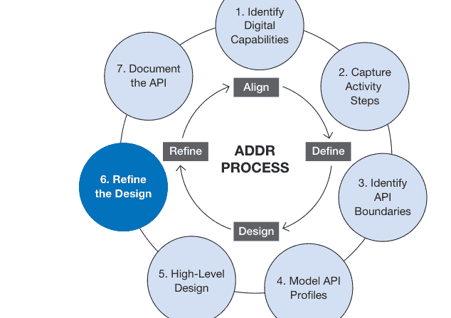

图 12.1 API 测试通过尽早发现 API 质量问题来完善 API 设计。

在构建 API 产品或平台时，建立一套 API 测试策略是非常关重要的。选择正确的 API 测试方法有助于 API 计划的可维护性成功。它还能加速交付，同时避免了软件开发中最昂贵的方面之一：缺陷消除。最后，由于自动化测试具有以消费者为导向的特性，它为 API 的开发者体验提供了另一个视角。

## 验收测试

验收测试，也称为*面向解决方案的测试（*solution-oriented testing*），确保 API 支持所捕获的任务故事（job stories）。它试图回答以下问题：

- API 是否解决了我们客户面临的真实问题？
- 它是否为需要执行的任务产生了预期的结果？

验收测试验证了实现预期结果所需的 API 操作的着色。仅使用 API 接口组合验收测试，以验证系统是否满足所有端到端功能。API 内部在开发过程中可以并可能更改，但不应影响验收测试的结果。

验收测试是 API 最价值的测试类型。编写验收测试的过程有助于识别单个 API 操作或端到端集成中糟糕的开发者体验。在时间有限的情况下，在代码测试之后，这是应该投入最多测试精力的地方。

## 自动化安全测试

每周都有新的头条指示某公司被黑客入侵导致隐私信息泄露。安全是一个过程而非产品，而且是一个持续的过程。安全测试旨在回答以下问题：

- API 是否受到了攻击的保护？
- API 是否提供了敏感数据泄露的机会？
- 是否有人在爬取我的 API 并通过数据损害业务智能？

虽然安全测试通常与自动化测试直接相关联，但它是一个主动过程，包括设计时的评审流程、开发时的静态和动态代码分析以及运行时监控。

API 契约测试 227

设计时和开发时的测试通常包含策略和工具，旨在通过识别潜在问题的设计评审来防止敏感数据泄露。它还包括针对每个 API 操作的授权策略，以确保执行正确的访问控制。

可以使用 API 管理层来应用运行时监控和强制执行。授权执行通过配置管理，避免了在 API 实现中实现访问限制。日志分析可能用于检测和阻止恶意攻击。关于安全保护的更多细节请参阅第 15 章“保护 API”。

## 运行监控

API 可以且通常提供了应用程序的主要接口。由于该服务充当依赖项，因此服务的可用性（无论是内部还是外部）至关重要。有服务水平协议（SLA）来规定标准。未能满足 SLA 会产生负面影响并令客户。

运行监控回答以下问题：

- API 是否可用且运行良好？
- 是否符合 SLA？
- 是否需要增加基础设施？

监控和分析是运行监控的重要组成部分。分析验证了实际使用情况在正确性和性能上是否匹配。分析测量可以是简单的性能计数器，也可以是复杂的支持第三方库集成。

## API 契约测试

为了验证每个 API 操作符合预期行为并遵循定义的契约，契约测试有时被称为功能测试。

契约测试回答以下问题：

- 所有成功用例是否符合规范？
- 是否遵循了输入参数？如何处理错误输入？
- 是否收到了预期输出？
- 响应格式是否正确？使用了正确的数据类型？
- 错误是否被正确处理？是否返回给了消费者？

在对齐-定义-设计-优化（ADDR）过程中，API 描述在实现之前就被定义了。这些描述文件可以在契约测试过程中验证 API 契约。REST API 的常用规范格式包括 OpenAPI (Swagger)、API Blueprint 和ful API Modeling Language (RAML)。GraphQL API 有定义的 schema，有助于驱动契约测试。gRPC 使用接口定义（IDL）文件定义服务合约。此主题将在第 13 章“文档 API”中进一步讨论。

契约测试必须首先确保每个 API 操作的正确性。每分钟处理数千个客户端并不能保证 API 提供或执行的信息符合规范。识别和消除错误、寻找不一致之处以及验证 API 是否符合其设计规范，都属于正确性测试的范畴。

接下来，契约测试必须关注可靠性。API 在每次调用操作时都应该提供正确的信息。重复执行设计为等等的 API 操作应该产生相同的结果。支持分页的 API 操作应以可预测的方式产生结果。

最后，契约测试应该提交无效和缺失的数据，并验证是否收到了预期的错误响应。字符串值可能替代数值值，以及超出接受范围的值。日期格式应该是错误的，或者产生超出预期接受范围的日期。

## 用户界面测试与 API 测试

某些成员可能认为为 API 构建专门的测试是浪费资源的。他们可能会主张用户界面（UI）测试已经涵盖了 API，因为 UI 调用了 API。然而，这并不


这种情况。相反，UI 测试仅在 UI 触及 API 的范围内对 API 进行测试。这意味着，如果 UI 对用户输入执行了客户端验证，那么 UI 测试将永远无法验证 API 处理错误数据的能力。

虽然有些人可能认为这种程度的测试已经足够，但他们可能忘记了开放 Web 应用安全项目（OWASP）的建议：不要信任用户输入。用户或客户端并不总是以 API 期望的方式提交数据。务必验证来自表单以及 HTTP 请求头的数据。

API 测试的目标之一是确保 API 能够处理从特定 UI 之外提交的各种有效值和无效值。如果我们依赖 UI 测试，那么 API 就不应被认为经过了充分测试。

API 测试的另一个目标是确保 API 在未通过测试的情况下无法到生产环境。这要求 API 测试必须成为持续集成和交付流水线的一部分，就像所有其他类型的自动化测试一样。

## 选择加速测试的工具

某些组织可能拥有一支建立完善的质量保证（QA）小组，专门负责自动化测试和手动探索测试。QA 团队可能由编写代码的人以及使用测试工具帮助在无需编写代码的情况下构建自动化套件的人组成。其他组织可能根本没有 QA 团队，而是依靠开发人员来编写和维护 API 测试代码。在选择 API 测试工具时，必须考虑这些因素。

现在有许多开源和商业测试工具可用于 API 规范格式创建 API 测试，以帮助启动测试过程。某些工具设计为支持通过 UI 创建测试，以减少或消除编写测试代码的需求。另一些工具设计为提供需要编码的脚本环境或测试库。务必选择与组织中的测试偏好和技能匹配的解决方案。

性能和监控解决方案（第三方 API 监控即服务的形式）由多家公司提供，并且通常作为针对少量测试的免费增值（freemium）服务开始。还有开源监控工具可用，可以在本地部署或云托管基础设施上运行。用于执行负载和性能测试的自定义工具可以修改为以更低的频率和更小的规模运行，用于监控或浸泡测试。

API 测试通常通过代码或测试脚本自动化，并在专门的测试环境中执行。自动化这些测试具有较高的基础设施成本，因为需要包含基础设施资源的额外非生产环境。请务必考虑测试将如何自动化，以及支持这些测试所需的设施成本。

最后，考虑通过策略性地选择 API 测试工具来扩展测试驱动开发（TDD）。专门的 QA 团队可以构建开发人员在实现 API 时创建自动化测试套件。被要求编写 API 测试的开发人员可能希望采取类似的方法，将 TDD 应用于他们的日常开发流程中。这种方法有助于展示进度，并验证 API 实现处理了所有情况、无效情况和错误情况。

## API 测试的挑战

在建立 API 测试策略时，不能忽视的挑战之一是对测试数据集的需求。虽然单元测试可能不需要复杂的数据集，但 API 测试的需求恰恰相反。API 测试通常需要花费巨大精力构建一套连贯的数据集，以支持必要的测试集。

创建 API 测试数据集有两种常用方法：现有数据集的快照和洁净室数据创建（cleanroom data creation）。对生产系统进行快照并清理数据集中的敏感数据通常是最直接的路径。分离需要的数据所需较少，而是选择接受整个数据存储快照作为起点。快照可用于将测试还原到已知状态。当存在生产数据时，这是一个非常棒的方法。

洁净室数据创建更具挑战性且耗费大量时间，但一旦完成，它就能实现更健壮的测试集。洁净室数据涉及从零开始创建连贯的数据集以支持 API 测试过程。可以使用如 Mockarang 等工具合成部分数据，同时提供比简单使用随机值更真实的值。然而，为了构建代表整个场景而非仅仅是单个数据表的深度嵌套数据集，通常需要手工制作数据元素。

例如，JSON 的书店（Bookstore）需要书籍、购物车、订单和客户，这些是不易随机生成的。相反，通常需要领域专家手动构建这些元素，或许使用表格。然后通过脚本将这些数据加载到适当的数据存储中，确保这些元素通过共享标识符、外键和链接表正确连接。随后，测试可以使用 API 获取客户，检查其订单，执行新的购物体验，并验证 API 是否按预期方式运行。

某些 API 测试可能依赖于不提供自身沙箱或测试环境的第三方服务。在这种情况下，可以使用 API 模拟（API mocking）等技术来隔离外部依赖，并防止需要将生产系统作为 API 测试套件的一部分。与其连接到系统，不如创建一个 mock 响应来代替该系统。当然，这通常需要额外的数据准备工作，以确保 mock 响应能够正确满足要支持的场景。

## 让 API 测试变得不可或缺

团队在时间紧迫时往往会选择捷径，这通常涉及糟糕或没有进行 API 测试。就像文档一样，测试在开发过程中通常被视为“可有可无”的特性。然而，我们应该将测试和文档视为真正调用 API 并准备好部署的必经步骤。否则，我们将让组织面临回归的风险。

## 总结

健壮的 API 测试策略是 API 交付的重要一步，可确保 API 的正确性和可靠性。它还应该超出开发阶段，扩展到运行时测试。在所有测试都创建并通过之前，API 不应被视为完成。

## 第 13 章

# 设计 API 设计

文档是 API 的第三种用户界面，也是最重要的。
— Keith Casey


**图 13.1** 精炼（Refine）阶段的最后一步是生成文档，将收获整合回 API 设计中。

# 第 13 章 设计 API 设计

文档是开发者体验中非常重要的一个元素。大多数 API 团队假设每个操作的参考文档就足够了。然而，这只是 API 文档工作的开始。

建立 API 文档策略是 API 设计的一部分。开发者门户必须支持各种对 API 成功做出贡献的画像（personas）。本章概述了任何 API 文档工作的要点，并提供了关于如何建立和改进 API 开发者门户的领域见解。

## API 文档的重要性

API 文档对于集成 API 的开发者来说是最重要的用户界面。它是 API 提供者（负责设计和交付 API）与将 API 集成到应用程序和自动化脚本许多开发者之间主要的通信媒介。

除非 API 是开源产品的一部分，否则 API 消费者永远无法访问源代码。即使可以访问源代码，通过代码来理解 API 也是不可接受的。它会减慢开发速度。最好的情况下是令人沮丧；最坏的情况下，开发者会转向竞争对手或自己构建所需的功能。

此外，组织 API 文档也非常重要。当 API 提供者为快速上手指南和参考文档创建清晰的区域时，开发者可以在需要时找到他们所需的内容。即使是编写最好的 API 文档，如果没有良好地组织到开发者门户中，也会大打折扣。

> 原则 4：API 文档是开发者最重要的用户界面

文档是 API 提供者（负责设计和交付 API）与将 API 集成到应用程序和自动化脚本的许多开发者之间主要的通信媒介。因此，API 文档应该是头等任务，而不是留到最后一刻的任务。

## API 描述格式

传统上，技术文档在 PDF、Microsoft Word 文档或纯 HTML 中捕获和共享。虽然这些格式比没有文档要好，但它们将文档的实用性局限于人类阅读。


API 描述格式以机器可读的格式提供了 API 的细节。工具可以将这些描述转换为人类可读的文档、生成客户端库，并生成已经建立起常用模式和实践的服务器端代码骨架。

某些 API 描述格式支持添加特定厂商的扩展。这些扩展可用于进一步定义授权、路由和配置规则，用于自动化部署和 API 管理层配置。GraphQL 和 gRPC 等 API 风格提供了它们各自的格式。对于直接构建在 HTTP 之上的基于 REST 或远程过程调用 (RPC) 的 API，则需要单独的描述格式。本节概述了流行的格式，以帮助团队选择他们希望用于驱动 API 描述和文档工作的格式或多个格式。

文档示例可以在 GitHub 上的 API workshop 示例仓库中找到。

# OpenAPI 规范

OpenAPI 规范（Open Specification, OAS）曾名为 Swagger，目前是描述 API 细节最流行的格式之一。它由 Linux基金会（Linux Foundation）在 OpenAPI 倡议（OAI）的指导下管理。Swagger 品牌现在归 SmartBear 所有，该公司继续以 Swagger 之名维护并支持各种开源 API 项目。

OAS 的流行归功于 Swagger UI 内置的“测试”（try-itout）功能。该项目旨在为开发者生成基于 HTML 的 API 参考文档。测试功能允许开发者和非开发者通过生成的文档直接针对实运行服务器探索 API。它支持基于 JSON 和 YAML 的格式。

OAS 规范目前为第 3 版本，尽管在某些组织和开源项目中仍能遇到 OAS v2。工具生态系统非常庞大且持续增长，这使其成为构建第一个或第三之一个 API 的团队的热门选择。列表 13.1 提供了一个 OAS v3 的示例，它是基于第 7 章“基于 REST 的 API 设计”中创建的购物车 API 设计。

# 列表 13.1 OpenAPI 规范 v3 示例

```
openapi: 3.0.0
info:
  title: Bookstore Shopping Example
description: The Bookstore Example REST-based API supports the shopping
```

- 1. https://bit.ly/align-define-design-examples

在线书店的体验。API 包含以下能力和操作...

```
contact:
  version: '1.0'
paths:
  /books:
    get:
      tags:
        - Books
      summary: 返回书籍的分页列表
      description: 根据提供的搜索标准提供书籍的分页列表：
      operationId: ListBooks
      parameters:
        - name: q
          in: query
          description: 用于通过标题和描述过滤书籍的查询字符串。
      description-2: 如果未提供，所有可用的书籍都将...
      schema:
        type: string
      responses:
        200:
          description: 成功
          content:
            application/json:
              schema:
                $ref: '#/components/schemas/ListBooksResponse'
        401:
          description: 请求失败。当使用无效的 API 凭据进行请求时收到...
        403:
          description: 请求失败。当使用有效的 API 凭据访问您没有权限的 API 操作或资源时收到。
components:
  schemas:
    ListBooksResponse:
      title: ListBooksResponse
      type: object
      properties:
```

# API 描述格式

```
books:
  type: array
  items:
    $ref: '#/components/schemas/BookSummary'
    description: "列表或过滤请求产生的结果摘要列表..."
```

```
BookSummary:
  title: BookSummary
  type: object
  properties:
    bookId:
      type: string
      description: 内部标识符，与 ISBN 独立，用于识别库存中的书籍
    isbn:
      type: string
      description: 书籍的 ISBN
    title:
      type: string
      description: "书籍标题，例如，API 设计的实用方法"
```

```
authors:
  type: array
  items:
    $ref: '#/components/schemas/BookAuthor'
    description: "对书店进的书籍进行摘要..."
```

```
BookAuthor:
  title: BookAuthor
  type: object
  properties:
    authorId:
      type: string
      description: 引用作者的内部标识符
    fullName:
      type: string
      description: "作者全名，例如，D. Keith Casey"
    description: "代表书籍的单一作者。由于一本书可能有多个作者，..."
```

# API Blueprint

API Blueprint 起于名为 Apiary 的 API 工具供应商（现为 Oracle 的一部分）。它结合了使用 Markdown 轻松生成文档的想法，以及一种使机器可读的结构，以支持代码生成和其他工具需求。

由于 API Blueprint 基于 Markdown，任何能够渲染和编辑文件的工具（如集成开发环境 IDEs）都能处理这种格式。虽然其工具生态系统不如 OAS 那么庞大，但由于 Apiary 在被收购前的努力，它拥有大量的社区支持。如列表 13.2 所示，它易于操作，因此是那些希望将基于 Markdown 的文档与机器可读的 API 描述相结合的人的热选择。

# 列表 13.2 API Blueprint 示例

```
FORMAT: 1A
HOST: https://www.example.com
```

```
FORMAT: 1A
HOST: https://www.example.com

# 书店购物示例
# The Bookstore Example REST-based API 支持在线书店的体验。API 包含以下能力和操作...

## Group
## Books
### GET /books
# 返回书籍的分页列表
# 根据提供的搜索标准提供书籍的分页列表：

### Parameters
- q (query): 用于通过标题和描述过滤书籍的查询字符串。如果未提供，所有可用的书籍都将...
- offset (query): 从此处检索列表，偏移量为 0 表示第一页结果...
- limit (query): API 调用中包含的记录数，如果未提供则默认为 25...

### Responses
- 200 (application/json): 成功
- 401: 请求失败。当使用无效的 API 凭据进行请求时收到...
- 403: 请求失败。当使用有效的 API 凭据访问您没有权限的 API 操作或资源时收到。

# Data Structures
## ListBooksResponse (object): 列表或过滤请求产生摘要列表...

## BookSummary (object): 对书店进的书籍进行摘要...

## BookAuthor (object): 代表书籍的单一作者。由于一本书可能有多个作者，...
```

# 第十三章 设计 API 设计

# RAML

RAML 代表 RESTful API 建模语言，设计时考虑了全生命周期。它源于 MuleSoft，但包含了许多其他行业领导者的贡献。RAML 的设计旨在支持设计工具以及文档和代码生成工具。RAML 构建在 YAML 格式之上。

虽然 RAML 是 MuleSoft 的帮助下产生的，但规范和大部分工具是中立的。它专注于描述基于 REST 的 API 常见的资源、方法、参数、响应、媒体类型和其他 HTTP 结构。然而，它可以用于描述任何基于 HTTP 的 API 格式。列表 13.3 使用 RAML 描述购物车 API。

# 列表 13.3 RAML v1.0 示例

```
#RAML 1.0
title: Bookstore Shopping Example
version: 1.0
baseUri: https://www.example.com
baseUriParameters:
  defaultHost:
    required: false
    default: www.example.com
    example:
      value: www.example.com
  displayName: defaultHost
  type: string
protocols:
  - HTTPS
documentation:
  title: Bookstore Shopping Example
  content: The Bookstore Example REST-based API 支持在线书店的体验。API 包含以下能力和操作...
```


API 描述格式 241

```yaml
types:
ListBooksResponse:
```yaml
ListBooksResponse:
display: ListBooksResponse
description: 列表或过滤结果的书籍摘要列表
request:
  type: object
  properties:
    books:
      required: false
      displayName: books
      type: array
      items:
        type: BookSummary
BookSummary:
  display: BookSummary
  description: 总结书店库存的书籍...
  type: object
  properties:
    bookId:
      required: false
      displayName: bookId
      description: 内部标识符，与 ISBN 独立，用于在库存中标识书籍
      type: string
    isbn:
      required: false
      displayName: isbn
      description: 书籍的 ISBN
      type: string
    title:
      required: false
      displayName: title
      description: 书名，例如《API 设计的实用方法》
    Design:
      type: string
    authors:
      required: false
      displayName: authors
      type: array
```

## 第 13 章 文档化 API 设计

```yaml
items:
  type: BookAuthor
BookAuthor:
  display: BookAuthor
  description: 代表一本书的单个作者。由于一本书可能有多个作者，...
  type: object
  properties:
    authorId:
      required: false
      displayName: authorId
      description: 引用作者的内部标识符
      type: string
    fullName:
      required: false
      displayName: fullName
      description: 作者的全名，例如 D. Keith Casey
      type: string
/books:
  get:
    display: ListBooks
    description: 根据提供的搜索条件提供分页的书籍列表...
    queryParameters:
      q:
        required: false
        display: q
        description: 用于通过标题过滤书籍的查询字符串
        description: 如果未提供，将列出所有可用书籍...
        type: string
      offset:
        required: false
        default: 0
        example:
          value: 0
        display: offset
        description: 从该偏移量获取书籍列表，偏移量为 0 表示结果的第一页...
        type: integer
        minimum: 0
        format: int32
      limit:
        required: false
        default: 25
        example:
          value: 25
        displayName: limit
        description: API 调用中包含的记录数，如果未提供，则默认包含 25 条记录...
        type: integer
        minimum: 1
        maximum: 100
        format: int32
    headers:
      Authorization:
        required: true
        displayName: Authorization
        description: 用于授权您的请求调用此操作的 OAuth 2.0 令牌...
        type: string
    responses:
      200:
        description: 成功
        headers:
          Content-Type:
            default: application/json
            displayName: Content-Type
            type: string
      body:
        application/json:
          displayName: response
          description: 成功
          type: ListBooksResponse
      401:
        description: 请求失败。当使用无效的 API 凭据进行请求时接收...
        body: {}
      403:
        description: 请求失败。当使用有效的 API 凭据请求您无访问权限的 API 操作或资源时接收。
        body: {}
```

# JSON Schema

JSON Schema 规范提供了一种机器可读的格式，用于捕捉基于 JSON 的结构和验证规则。该规范分为核心基础规则和验证规则，使其成为需要验证的 JSON Schema 的全面解决方案。JSON Schema 可以被视为 XML Schema 的 JSON 等版本。

虽然 JSON Schema 独立于任何特定的 API 风格，但它可以用于描述基于 REST 的 API 以及其他 API 风格的资源表示。它在组织中也被用作定义跨企业领域对象模式的单一格式。

虽然 OAS 的架构定义部分非常灵活，但它缺乏 JSON Schema 提供的某些健壮定义支持。最近的努力帮助了 JSON Schema 和 OAS 保持一致，允许同时使用这两种格式。鉴于 JSON Schema 在 OAS 描述格式中的接受度，预计其在未来将继续获得工具链的支持。列表 13.4 展示了 JSON Schema 的示例。

**列表 13.4** 示例 JSON Schema

```json
{
  "$id": "https://example.com/BookSummary.schema.json",
  "$schema": "http://json-schema.org/draft-07/schema#",
  "description": "总结书店库存的书籍...",
  "type": "object",
  "properties": {
    "bookId": {
      "type": "string"
    },
    "isbn": {
      "type": "string"
    },
    "title": {
      "type": "string"
    },
    "authors": {
      "type": "array",
      "items": {
        "$ref": "#/definitions/BookAuthor"
      }
    }
  },
  "definitions": {
    "BookAuthor": {
      "type": "object",
      "properties": {
        "authorId": {
          "type": "string"
        },
        "fullName": {
        "type": "string"
      }
    }
  }
}
```

# 使用 XML 描述 ALPS 语义

```xml
<alps version="1.0">
  <descriptor id="help"><text>帮助</text>
  <link rel="help" href="http://example.com/help.html" />
  <descriptor id="collection" type="safe" rel="BookSummary">
    <text>根据提供的搜索条件提供分页的书籍列表...</text>
    <descriptor id="q">
      <text>用于通过标题过滤书籍的查询字符串</text>
      <text>如果未提供，将列出所有可用书籍...</text>
    </descriptor>
  </descriptor>
  <descriptor id="offset">
    <text>从该偏移量获取书籍列表，偏移量为 0 表示结果的第一页...</text>
  </descriptor>
  <descriptor id="limit">
    <text>API 调用中包含的记录数，如果未提供，则默认包含 25 条记录...</text>
  </descriptor>
  </descriptor>
  <descriptor id="BookSummary" type="semantic">
    <descriptor id="bookId"><text>内部标识符，与 ISBN 独立，用于在库存中标识书籍</text></descriptor>
    <descriptor id="isbn"><text>书籍的 ISBN</text></descriptor>
    <descriptor id="title"><text>书名，例如《API 设计的实用方法》</text></descriptor>
    <descriptor id="authors">
      <descriptor id="authorId"><text>引用作者的内部标识符</text></descriptor>
      <descriptor id="fullName"><text>作者的全名，例如 D. Keith Casey</text></descriptor>
    </descriptor>
  </descriptor>
</alps>
```

# 使用 APIs.json 改进 API 发现

多个 API 描述格式可能是必要的，以帮助开发者使用各种工具消费 API。APIs.json 是一种通过索引文件描述格式，类似于网站地图，引导搜索引擎索引器访问网站的重要区域。

单个 APIs.json 文件可以引用多个 API，使得该格式适用于将多个独立的 API 描述文件封装到单一产品或平台视图中。与其他机器可读格式结合时，API 可以被发现、索引并在公共或私有 API 目录中可用。
正如名称所示，默认格式是 JSON，尽管列表 13.6 中的 YAML 格式同样可用。

```json
{
  "name": "书店示例",
  "type": "索引",
  "description": "书店示例中基于 REST 的 API 支持在线书店的购物体验，带有...",
  "tags": [
    "应用程序编程接口",
    "API"
  ],
  "created": "2020-12-10",
  "url": "http://example.com/apis.json",
  "specificationVersion": "0.14",
  "is": [
    {
      "name": "书店购物 API",
      "description": "书店示例中基于 REST 的 API 支持在线书店的购物体验",
      "humanURL": "http://example.com",
      "baseURL": "http://api.example.com",
      "tags": [
        "API",
        "应用程序编程接口"
      ],
      "properties": [
        {
          "type": "文档",
          "url": "https://example.com/documentation"
        }
      ]
    }
  ]
}
```


## 第 13 章文档 API 设计

```
- type: OpenAPI
  url: http://example.com/openapi.json
- type: JSONSchema
  url: http://example.com/json-schema.json
```

contact:
- FN: APIs.json
  email: info@apisjson.org
X-twitter: apisjson

specifications:
- name: OpenAPI
  description: OpenAPI 作为我们所有 API 的合约。
  url: https://openapi.org
- name: JSON Schema
  description: JSON Schema 用于定义所有用到的底层对象。
  url: https://json-schema.org/

+ common:
- type: Signup
  url: https://example.com/signup
- type: Authentication
  url: http://example.com/authentication
- type: Login
  url: http://example.com/login
- type: Blog
  url: http://example.com/blog
- type: Pricing
  url: http://example.com/pricing

## 使用代码示例扩展文档

代码示例为开发者实践中应用文档提供了必要的指导。它们帮助开发者在参考文档与集成 API 的实际工作之间建立联系。

代码示例有多种形式，从演示特定操作如何运行的几行代码，到演示完整工作流的复杂示例。

## 优先编写快速上手代码示例

起初，开发者必须克服对 API 的基本理解以及它将如何解决其问题的障碍。需要记住的是，在这个阶段，开发者只想看到某些东西运行起来。

“首次 Hello World 时间”（Time to First Hello World, 简称 TTHW）是衡量 API 复杂性的关键指标。开发者获得第一次“胜利”花费的时间越长，他们就越容易在 API 上遇到挣扎，并放弃它或构建自己的解决方案。

为了帮助开发者快速上手，请提供简洁的示例，消除显式编码的需求。查看来自 Stripe 的示例：

```ruby
require "stripe"
Stripe.api_key = "your_api_token"
Stripe::Token.create({
  card => {
    :number => 424224242424242,
    :exp_month => 6,
    :exp_year => 2024,
    :cvc => "314"
  }
})
```

注意在此示例中，没有需要编写的代码。开发者只需要填写他们的 API key 即可在沙箱环境中获得信用卡令牌。

在此阶段应避免使用需要开发者编写大量代码的示例代码，以实现更低的 TTHW。在首次尝试 API 时，永远不要要求开发者编写代码来完成示例。相反，要让他们轻松启动并看到请求成功运行。

## 使用工作流示例扩展文档

在开发者有时间通过一些代码示例尝试 API 后，下一步是开始演示用例和工作流。

工作流示例专注于实现特定的结果。这些示例提供了对生产环境级编码规范的完整理解。使用内联注释有助于解释为什么每一步都是必要的。使用硬编码值来增加可理解性。选择易读的变量和方法名。

以下是使用 Stripe 的 Ruby 辅助库扣除信用卡的示例。

```ruby
# 记得将此更改你的 API key
Stripe.api_key = "my_api_key"
```

```ruby
# 使用 Stripe.js 或 Checkout! 创建 Token
```

```ruby
# 获取表单提交的支付令牌:
token = params[:stripeToken]
```

```ruby
# 创建客户:
customer = Stripe::Customer.create(
  :email => "paying.user@example.com",
  :source => token,
```

```ruby
# 扣除客户而非信用卡:
charge = Stripe::Charge.create(
  :amount => 1000,
  :currency => "usd",
  :customer => customer.id,
```

```ruby
# 你的代码：将客户 ID 和其他信息
# 保存到数据库中供以后使用。
```

```ruby
# 你的代码（稍后）：当再次向客户
# 充电时，检索客户 ID。
```

```ruby
charge = Stripe::Charge.create(
  :amount => 1500, # 这是 $15.00
  :currency => "usd",
  :customer => customer_id, # 之前存储，然后检索
)
```

注意工作流代码示例比实现快速 TTHW 的示例更复杂。这些示例需要短到足以解释概念，但又不能长到需要花费大量时间来理解。演示易于理解且可能映射客户需求的场景通常是最佳选择。

## 错误案例和生产级示例

虽然某些开发者可能比其他人更熟悉如何让代码达到生产就，但在 API 集成的最后一里，协助可以为开发者铺平道路。错误案例和生产级示例帮助开发者理解如何将 API 集成到生产环境中。添加演示如何捕获并从用户提供的错误数据中恢复的示例也很重要。最后，展示如何获取账户的当前速率限制以及何时超出速率限制的情况。

## 从参考文档到开发者门户

API 文档是所有描述 API 及其使用方法的工作的总术语。尽管该术语的使用方式就像只有一种文档，但 API 文档包含的不仅仅是参考文档。它包括一个开发者门户，汇总了成功所需的所有元素。

## 通过开发者门户提高 API 采用率

虽然开发者通常是开发者门户的目标群体，但其他角色也能受益于开发者门户：

- 参与发现、评审和批准新 API 过程的**高管人员**
- **业务和产品经理**，他们正在寻找方法利用内部和第三方 API 来加速新功能的交付
- **解决方案架构师和技术负责人**，他们正在定义可能利用现有 API 的新解决方案

开发者门户有助于汇总确保 API 可被找到所需的各种沟通风格、对 API 优势的理解以及对如何集成 API 的帮助。它还为组织组合中的许多 API 提供了接口。

### 案例研究 企业级开发者门户的成功

大型 IT 集团的 API 计划计划最初只有几个人。经过一年的投资，团队产了几个 API，为业务提供了多项高价值功能。然而，团队仅产生了参考文档——没有开发者门户。在帮助下，团队将参考文档扩展为完整的开发者门户。

他们修订后的开发者门户引导用户了解 API 的结构和功能、在沙箱环境中进行集成引导，并通过轻量级认证计划获得生产访问权限。

有影响力的高管利用开发者门户来宣传 API 计划，导致对采用 API 的需求增加。开发者门户现在作为中心通信工具，以及向技术和非技术团队推广该计划的方法。

## 优秀开发者门户的元素

优秀的开发者门户由以下元素组成，解决了参与采用 API 的各种角色的需求：

- 功能角色：API 的概述，涵盖了益处、功能和定价等问题，以筛选潜在客户。
- 案例研究：案例研究突出了使用该 API 构建的应用。它们帮助读者理解 API 如何在他们特定的垂直业务领域内或用于特定类型的应用程序中使用。
- 快速上手指南：有时称为快速启动指南，它向开发者介绍 API 解决的常见用例，并为每个用例提供分步的上手指南。


-   身份验证与授权：此元素描述了如何获取具有适当授权范围的 API 令牌（token），以便根据需要使用 API。

-   API 参考文档：参考文档中提供了每个操作的详细信息，包括 URL 路径结构、输入和输出数据结构以及错误数据结构。

-   发布日志与变更日志：以历史格式总结了每次发布中的更改，包括新操作和对现有操作的增强。

除了这些核心元素外，开发者门户还致力于为开发者提供信息并实现以下体验：

-   易于上手（Easy onboarding）：如果启动变得很困难，API 很难获得采用。从自注册到引导式导览以及 API 令牌创建，易于上手可以帮助开发者克服采用新 API 的挑战。开发者门户与 API 网关之间负责配置 API 令牌的集成工作，这对于有效的上手引导至关重要。

-   运营洞察：API 是否可用或已暂时宕机？一个反映 API 可用性的简单状态页面有助于告知那些在应用程序中看到错误率增加的开发者和运维人员状态。

-   实时支持：包含聊天解决方案（无论是嵌入到开发者门户中，还是通过 Slack、WebEx 或 Microsoft Teams 等通信平台），可以为能够解决集成问题的人提供直接支持。负责实时支持的团队通常被称为开发者关系（Developer Relations，简称 DevRel）。他们可能在负责开发者支持的同时也负责开发者门户。

## 高效的 API 文档

要编写清晰的文档，回答那些考虑采用 API 的人员经常问的问题至关重要。这些问题的答案可以通过与集成 API 的开发者进行访谈来获得。

尽可能与他们进行交流。与 API 消费者进行讨论将带来 API 提供者改进文档所需的那些关键的“顿悟（aha!）”时刻。

# 第 13 章文档化 API 设计

当无法与 API 消费者进行讨论时，尝试寻找其他开发者来评审文档。通过定义一个虚构场景，编写一些代码调用 API 并生成原型，从而进行文档审计。在此过程中，通过提问来识别所提供的 API 文档中需要改进之处。

## 问题 1：你的 API 如何解决我的问题？

确保 API 文档包含一个引言，涵盖 API 解决了什么问题以及没有解决什么问题，并提供 API 过去解决过的示例案例。这些信息为读者建立了背景，他们可能正在判断该 API 是否适合他们的需求。

## 问题 2：每个 API 操作支持什么问题？

添加文档以澄清每个操作的作用及其适用场景。“获取所有账户”对 API 操作并不是一个有帮助的描述。添加关于支持哪些类型的过滤器（无论是隐含还是显式的）的详细信息。

提供一些示例场景，描述 API 操作可能如何被使用，或者它可能如何与其他操作结合以实现特定结果。在对齐-定义-设计-优化（ADDR）过程中创建的任务故事（job stories）和 API 配置文件是这些细节的良好来源。

## 问题 3：我如何开始使用该 API？

如果 API 提供自服务上手引导，请在文档中指出这一点，作为更快速启动的优势。对于那些需要时间通过合作伙伴计划的人员，也请在文档中包含该计划的细节。这些信息可以确保在开发者开始第一次“Hello World”集成之前，预留了适当的时间。

在 API 文档的各个位置提供上手流程的链接至关重要。并非所有开发者都从开发者门户的首页开始。公开访问的参考文档会被搜索引擎索引，从而为进入开发者门户创建自然流量入口。务必在参考 API 文档的顶部附近包含一个指向上手流程的链接。

最后，不要假设所有开发者都能弄明白如何使用 API。每个开发者都处于职业生涯的不同阶段。有些人使用 Web API 的经验可能比别人多或少。请花时间一步一步地解释如何开始。

## 技术作家在 API 文档中的角色

传统上，技术作家专注于交付软件手册，通常以 PDF 或 HTML 格式输出。这些手册由屏幕截图和使用软件的分步指南组成。这需要对用户界面有深入的了解，包括经常被忽视的功能。这一角色对于确保最终用户能够有效高效地使用软件同时降低支持成本至关重要。技术作家很少需要对一或多种编程语言有深入的知识，例如 C/C++、Java 或 Python。

在过去的十年里，技术作家的角色经历了转型。在某些组织中，技术作家被用户体验（UX）专家所取代，后者设计的用户界面需要极少或不需要文档。其他组织则用营销和产品角色取代了技术作家，通过改进应用文案来提高转化率或使用率指标。

随着 API 的增长，技术作家再次处于高度需求之地。他们需要理解如何通过 HTTP 直接使用 API，并使用多种编程语言演示使用 Java、Python、GoLang、Ruby、JavaScript、Objective-C、Swift、命令行自动化等进行 API 集成。他们的目标群体涵盖了终端用户、经验丰富的开发者以及刚毕业的学生。由于部署和云基础设施的影响，发布不再仅限于每年几次大发布，现在可能每周或每天发生。

技术作家为任何产品提供的价值是巨大的。对于 API 而言，他们的才华无价的。他们为 API 设计和文档提供了从外部向内的视角，以确保其为目标观众提供价值。关于每个 API 操作的目的和预定用途的问题有助于早期完善 API 设计。

大多数技术作家的挑战是建立一个足够的团队，来处理组织提供的每次 API 发布之前、期间和之后的海量工作。对于小型 API，一个技术作家可能就能保持文档更新。但如果组织规模很大并提供多个 API，挑战将超过即使最有天赋的技术作家的能力。因此，组织拥有一个技术作家团队至关重要。该团队应该投入几名技术作家负责新兴 API，而另一些专注于维护现有 API 的文档。所有关于 API 文档工具和流程的决定都应由技术作家做出，而不是由开发者强制他们使用特定工具。他们应该被视为一等团队成员，而不是一个孤立的团队（在最后一刻被丢过来 API 实现任务以进行快速且草率的文档工作）。

最后，请记住 API 文档是开发者的用户界面。技术作家可以决定或毁掉一个 API 的成功。对于企业 API 平台也是如此，某些 API 针对合作伙伴、客户和第三方服务集成器。

## 最小可行门户

最小可行门户（MVP）基于精益流程中的“最小可行产品”构构建，以建立一种分阶段交付开发者门户的方法。MVP 将优先级分为三个阶段，第一阶段是最小开发者门户的需求。随着团队对 API 的日益成熟，开发者门户可以通过从最小文档增强为健壮的开发者门户。

## 阶段 1：最小可行门户

表 13.1 中的清单列出了初始 API 开发者门户中提供的五个最重要的模块。表中包含了要回答的问题以及每个部分要包含的信息，以帮助该流程。

| 表 13.1 最小可行门户清单 |
|| | 要回答的问题 | 要包含的信息 |
|---|---|---|
| 概述 | 你有什么种类型的 API？ | API 类型（RESTful, SOAP, gRPC, GraphQL 等） |
| | 用户可以使用你的 API 做什么？ | 简要的用例和示例（两句话） |
| | 用户需要知道哪些访问细节或限制？ | 基础 URL、速率限制 |
| 身份验证 | 如果你的 API 需要身份验证令牌或密钥，用户如何获取？ | 身份验证方法 |
| | 令牌/密钥会过期吗？ | 过期间隔（如有） |
| | 如果令牌/密钥过期，用户应该怎么办？ | 刷新过期的令牌/密钥 |
| | 用户如何将身份验证传递给你的 API？ | 示例授权标头 |


# 最小可行门户 (MVP) 257

| 章节 | 需要回答的问题 | 需要包含的信息 |
| :--- | :--- | :--- |
| 工作流 | 用户使用你的 API 执行的最有用的两个或三个操作，其最佳/假设的工作流是什么？ | 工作流中提到的每个操作的参考链接 |
| 代码示例 | “Hello World”和常见用例的代码是什么样子的？ | 用户可以复制粘贴的完整代码示例和代码段。对于每个操作：HTTP 方法 (GET, PUT, POST, DELETE) |
| 参考文档 | 用户使用每个操作需要知道什么？ | 完整的请求 URL 参数（路径和查询）：名称、类型、描述以及参数是否为必填；示例请求（包含头部和正文）；示例请求中每个元素的列表，包括类型、描述和是否为必填；示例响应；响应中每个元素的列表，包括类型和描述；错误和状态代码列表，包括代码、消息和含义 |

一旦所有章节的列表项都已勾选完成，API 开发者门户就准备就绪，可以支持 API 设计早期初始消费者的需求，以及未来可能发现该 API 的消费者的需求。根据可用专业知识和 API 操作的数量，完成此阶段所需的时间可能在一到三周之间。如有必要，关注 API 解决的最常见用例，并在未来阶段加入额外的文档。

# 阶段 2：改进

投入时间改进门户的最佳位置取决于 API 的特性。如果 API 发生了变化、有了新操作，或者工作方式与之前的记录不同，首要任务是更新文档以包含这些更改。但如果所有内容都是最新的，可以在时间允许的情况下考虑表 13.2 中的一些想法。

# 表 13.2 改进开发者门户

| 改进类型 | 推荐的改进措施 |
| :--- | :--- |
| 快速（一或两天） | 添加变更日志列出 API 的增强和修复<br>标准化术语——确保在整个文档中使用相同的术语表示相同的意思<br>微调用例和示例以确保其具有引导性<br>为 API 添加基于聊的支持或公共讨论论坛<br>添加一个链接到用户关于你 API 的项目和博客文章的页面（例如，阳光 Foundation 列出了需要帮助的项目和可以使用的项目）<br>创建一个共享的产品路线图 |
| 并不快速（三天或以上） | 以用户为中心而非以开发者为中心重新修订所有内容<br>更新文本以包含用户可能搜索的术语<br>检查参考文档中是否存在缺失、不完整或令人困惑的信息<br>重新组织以改进章节和内容的逻辑顺序<br>为非技术用户和决策者添加以业务为导向的内容<br>实现一种新的发布工具<br>将代码示例扩展为完整的教程<br>创建通过 GitHub 提供的参考应用，帮助开发者快速上手 |

# 阶段 3：专注于增长

一旦完成了前两个阶段中与团队相关的项目，可以考虑一些额外的改进，将门户从“支持客户”转变为“产生采用率增长”：

- **添加案例研究**：案例研究通过描述客户如何使用 API 来解决问题、扩展业务或以某种方式成功，展示 API 的价值。通过提供真实世界的背景为 API 文档增加深度和意义，帮助读者理解 API 已如何帮助了他人，也可以如何帮助他们。案例研究甚至可以为使用 API 激发一些新想法。如果“案例研究”听起来有点枯燥或学术化，可以尝试使用“成功故事”或“客户故事”。

- **添加入门指南**：理解 API 如何运作的读者可能仅通过身份验证就能开始使用 API，但那些不那么熟悉的用户呢？入门指南应该建立用户他们可以使用该 API 的信心，并激励他们深入研究文档的其他部分。

- **整合分析数据**：分析数据帮助门户管理员根据流量模式的真实数据为受众需求定制门户，并帮助读者更顺畅地浏览内容。

- **转向单页格式**：考虑将门户的某些部分重构为单页。这种格式的益处是，用户可以通过链接到所有章节标题的菜单或通过 Ctrl/Cmd+F 搜索页面上的文本来导航文档。

- **翻译文档**：随着 API 获得关注，考虑文档翻译是否会有帮助。专业翻译昂贵且耗时；在开始这段旅程之前，需要一个清晰且有说服力的业务理由。虽然罕见，但有些团队发现他们的大多数用户在另一个国家，因此从翻译后的文档中受益。

最后，不断查看其他拥有成功 API 的公司是如何处理文档的。然后制定一个计划，将这些新想法纳入开发者门户，以造客户、合作伙伴和内部开发者受益。

# 开发者门户工具与框架

建立开发者门户的挑战之一是选择一个工具或一系列工具来帮助生成门户。这里列出了组织用于生成其开发者门户的工具：

- **静态站点生成器**：如 Jekyll（用于支持 GitHub pages）和 Hugo 是创建和管理开发者门户的流行选择。页面使用 Markdown 或类似的符号编写，并存储在代码仓库中。部署通常是自动的，以确保一旦更改合并到主分支就会发布最新版本的文档。

- **SwaggerUI**：这是开启 Swagger 描述格式一切的工具，现在已从工具中分离为 OAS。此开源代码库可以将任何 OAS v2 或 v3 规范以及旧的 Swagger 规范文件转换为 HTML 格式的 API 参考文档。

- **MVP 模板**：我与其他合作创建了一个基于 Jekyll 的 GitHub 项目，用于启动 API 开发者 MVP。它帮助将静态生成器与一些内容占位符结合，并将 Swagger 或类似的参考文档集成到一个位置。派生 https://github.com/launchy/mvp-template仓库并根据需要进行自定义以快速开始。

无论选择什么工具，请确保作为门户的一部分提供任何机器可读的描述（例如 OAS 文件）。这将允许开发者应用他们自己的工具（如自定义代码生成器）来加速集成过程。

最后，确保研究可以协助创建和管理开发者门户的开源和商业工具。第15章详细介绍的一些 API 管理 (APIM) 层也提供门户管理支持。

## 总结

建立 API 文档策略是交付成功的 API 产品、正式的 API 程序或企业 API 平台的一部分。开发者门户必须支持各种角色的人员。确保文档是整个 API 设计和交付生命周期的一部分至关重要。否则，它将成为一项最后时刻的任务，导致文档糟糕，无法满足目标角色的需求。

力求将文档和 API 门户更新包含在整体交付计划中。只有当文档随发布同步更新时，API 才被认为就绪。这种文档方法将产生一个更完整的 API，鼓励开发者和其他决策者快速采用。


## 第14 章
## 为变更而设计

在进行 API 设计时，你必须得非常谨慎。API 是持久的。一旦你发布了 API，也许你可以对其进行版本控制，但一旦你这样构建了它，就无法从客户手中撤回。在 API 设计中保持保守和极简主义，有助于你构建基础工具，在这些工具之上，你可以添加更多功能，或者让合作伙伴在其之上构建层。

> — Werner Vogels

管理变更并非易事，但它是 API 成熟过程中不可或缺的一部分。对于在单一代码库中工作的开发者来说，变更可能是困难的但可控的。可以通过重构工具和自动化测试覆盖率来评估变更的影响。

当变更涉及基于 Web 的 API 时，变更变得更具挑战性。某些团队可能与每个 API 消费者都建立了直接关系，这允许逐步引入并与所有方协调来引入变更。然而，情况通常并非如此。相反，大多数 API 消费者与拥有该 API 的团队没有个人关系。管理 API 设计的变更需要额外的额外，以避免客户流失。本章介绍了确定变更影响的考量因素，以及在 API 设计中引入变更以尽量减少对 API 消费者影响的策略。

## 变更对现有 API 的影响

对齐-定义-设计-完善（ADDR）适用于任何组织，无论是早期初创公司还是拥有数百个现有 API 的组织。该过程揭示了客户、合作伙伴和员工所需的成果和活动。无论团队是在设计他们的第一个还是第第五十个 API，这种方法都是非常有用的。

## 第14 章 为变更而设计

书中贯使用的虚构在线书示例假设在整个过程中识别出的 API 之前并不存在，即一个绿地项目（greenfield project）。现实情况是，组织已经为了各种用途在生产环境中拥有 API，任何建议的 API 设计必须符合需要棕地开发（brownfield development）的现实。

这些棕地计划被迫将 ADDR 过程的发现与任何现有的 API 设计相，以确定最佳发展路线。本章详细说明了在 API 已经存在时处理变更的一些考量。

## 执行 API 设计缺口分析

团队应该对在该过程中确定的理想 API 设计与目前的设计方式进行缺口评估。然后团队必须决定是为了一致性而遵循与 API 设计相同的风格和设计决策，将新设计与旧的设计决策混合，还是考虑替代方案。

执行此类设计缺口分析时需要考虑的因素包括：

- 设计过程中对资源和资源属性引入了不同的术语
- 从以数据为中心向以资源为中心的 API 设计风格的转变
- 与现状相比，API 产品愿景和方向的改变

以这些因素为起点，详细列出现有 API 与根据 ADDR 过程创建的理想 API 设计之间的差异。为新设计为 API 消费者提供的价值以及 API 设计变更的影响大小分配尺寸。使用 T 恤尺码（例如：小、中、大、特大）可确保衡量是衡量价值和影响大小的有效方法。然后决定对 API 消费者什么是最好的。

## 确定对 API 消费者最佳的方案

做出 API 设计决策，特别是当需要破坏性变更（breaking changes）时，涉及的不仅仅对组织的直接影响。它还必须包括对 API 消费者最好的。

## 变更对现有 API 的影响

考虑以下问题以确定 API 变更对当前和未来 API 消费者的影响：

- 谁是 API 消费者？内部消费者可能更容易协调变更，而合作伙伴可能对集成变更产生抵触。代表客户的客户和第三方可能由于可用开发资源有限或没有而无法变更。
- 与 API 消费者有什么种关系？团队个人认识的内部或外部方可以更容易地就破坏性变更进行谈判。没有关系的 API 消费者可能更具挑战性。市场中具有强大影响力的 API 消费者如果被迫采用不必要的 API 变更，可能会对当前和未来的消费者前景产生负面影响。
- 变更为 API 消费者交付了什么价值？改进 API 使用的 API 变更可能会很好。变更也可能解锁消费者一直请求的新能力，但付出了变更成本。对于其他人来说，这可能会让他们停下来考虑迁移到不同的供应商，导致客户流失。

组织如何与其 API 消费者管理变更，在很大程度上反映了它的价值观以及重视什么。如果 API 提供者倾向于以不断破坏性变更为代价交付 API 设计的优雅性，API 消费者可能很快开始寻找替代方案。然而，如果 API 提供者重视 API 消费者高于拥有完美的 API，它可能会发现自己是市场的领导者。

## 变更策略

继续现有的设计风格可能需要在 API 设计中做出不太理想的妥协。这些妥协可能包括微小的困扰，例如继续使用一个命名不当的资源，而该资源并不一定反映在 ADDR 过程中获得的洞察。

支持旧格式和新格式等妥协在现实世界中很常见。在这种情况下，服务器首先检查新消息格式，在需要时回退到旧消息格式。版本控制责任放在服务器而不是 API 消费者身上，确保不引入任何变更。

另一个示例是在旧风格旁边添加新设计风格。新操作使用新设计风格，旧操作在一段时间保持不变。逐渐，使用弃用策略用新操作替换旧操作，该策略鼓励现有集成一次性迁移到新操作。

## 第14 章 为变更而设计

然而，某些妥协可能更为重大，例如现有的设计过于低级。这个问题对于选择暴露数据库表的 API来说很常见，而新的提议设计将采用粗粒度设计。混合低级和高级级 API 可能会给开发者带来过多的认知失调，因此是不理想的。

团队必须决定是希望将新设计添加到现有 API，作为全新的产品启动新 API，还是将新设计作为现有 API 的版本交付。每个选项都会对组织以及当前和未来的 API 消费者产生影响。如果现有 API 碍了消费者有效使用 API 的能力，可能需要更多的绿地方法。请记住，如果团队选择发布新 API 或版本，则未来需要额外的资源来维护两个 API。下一节将讨论 API 版本控制策略和考虑。

## 变更管理建立在信任之上

最重要的是 ADDR 过程有助于业务和 API 团队在问题空间达成统一理解。统一的理解可以创建设计目标状态与现实的愿景。根据本章提供的建议执行该过程。这样做确保对现有 API 的增强或新 API 的交付满足 API 消费者的需求，提供者与消费者之间的信任不会丢失。

## 原则 5：API 是持久的，因此请此计划

深思的 API 设计结合演进式设计方法使 API 具有韧性。管理 API 设计的变更需要额外的关注。这有助于避免需要跟踪最新变更的开发者感到沮丧。

## API 版本控制策略

当


发生这种情况时，团队应尝试确保不会引入会强制其 API 消费者修复代码的破坏性变更（breaking changes）。对于某些 API 消费者来说，更新代码以适应 API 更改可能根本不是选项。因此，重要的是理解什么可能构成破坏性变更，然后建立 API 版本控制策略，鼓励 API 随着时间的演进，而不会破坏现有的 API 消费者。

## 常见的非破坏性变更

非破坏性变更在本质上往往是加性的，尽管并非总是如此。此类更改可能包括：

- 添加新的 API 操作。现有的客户端代码不会使用该操作，对现有的集成不会造成损害。
- 在请求消息中添加可选字段。在这种情况下，现有的客户端代码不会被强制添加新字段。
- 在请求消息中添加带有默认值的必填字段。对于在添加之前编写的客户端代码，服务器将应用默认值，因为请求中会缺少该字段。
- 在响应消息中添加字段。现有的客户端代码应该安全地忽略新字段，除非它们选择了使用映射库，而该库在目标对象中找不到新添加的字段时会抛出错误。虽然是 API 消费中的一种反模式，但在某些情况下可能会遇到，请务必小心。
- 在枚举字段中添加值。在客户端上序列化的新值可能没有与之关联的已知显示字符串。为了成为非破坏性变更，旧版客户端在接收到新枚举值时必须正常运行。并非所有客户端都按这种方式设计，因此建议谨慎慎行。

## 不兼容的变更

与现有集成代码不兼容的更改包括但不限于以下内容：

- 重命名字段和/或资源路径，因为现有的客户端代码将需要更改代码以适应重命名后的值
- 在请求或响应中重命名或删除字段
- 移除现有 API 客户端代码使用的 API 操作
- 将字段从单值更改为一对多关系（例如，从每个账户一个电子邮件地址更改为账户的电子邮件地址列表）
- 更改 API 操作返回的 HTTP 方法或响应状态码

请记住，一旦 API 发布到生产环境并至少有一个集成，这些设计决策就永久地成为了 API 的一部分。这就是为什么 ADDR 过程如此重要的原因——它帮助团队在 API 进入生产环境之前验证设计决策。然而，适当的 API 版本控制策略可以帮助缓解这些问题问题，同时允许 API 设计随时间演进。

## API 版本与修订

关于 API 版本控制已经有了许多讨论、文章和辩论。每个讨论中最关键的方面必须是区分安全地演进 API 设计与引入导致强制修改代码的破坏性变更。API 版本控制工具箱中最好的工具之一是引入 API 版本（versions）和修订（revisions）。

API 版本代表一组分组的 API 操作。在每个版本内部，对 API 的修改应该是向后兼容的。然而，跨版本之间不保证兼容性。API 的每个版本通常被视为一个独立的产品，具有不同的行为和能力。API 消费者选择特定版本并针对该版本编写代码。他们只在准备就绪时才会迁移到新版本，这可能在新版本发布后的很长时间——或者可能永远不迁移。版本可以是数字或字符串（例如 v1 或 2017-01-14）。对于熟悉语义化版本（semver）的人来说，这等同于主版本（major version）。

图 14.1 展示了 API 的两个版本，每个版本提供 API 消费者在发起 API 请求时选择的不同产品。

API 修订标识内部增强，这种增强不应对特定的 API 版本产生任何负面影响。修订对 API 消费者来说应该是透明的，因为消费者应该订阅特定的版本。提供者可以选择在告知或不告知 API 消费者的情况下发布特定 API 版本的修订修订。在内部，团队可能会发布 v1.2，但 API 消费者只知道他们在使用 API 的 v1（见图 14.2）。API 消费者可以查看每个修订的变更日志，查看某些增强是否有用，否则在提供者发布新的 API 修订时不采取任何操作。这等同于在使用 semver 时增加次版本号（minor number）。

## API 版本控制策略

267

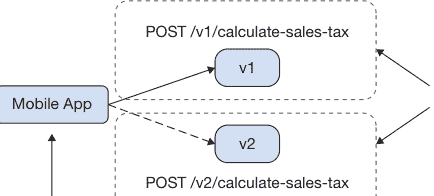

API 消费者为新购买选择 v1，或未来可能不选择 v2

**图 14.1** API 版本由 API 消费者选择，API 服务器为新应用程序提供当前版本 (v2)，并为现有应用程序提供旧版本 (v1)，直到它们将代码迁移到 v2。

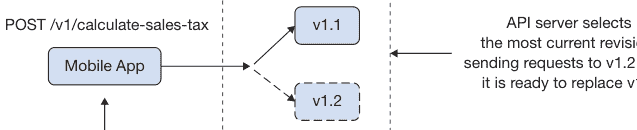

API 消费者仍在使用 API v1 且未感知新部署的修订

**图 14.2** API 修订不暴露给 API 消费者，允许 API 提供者在无需应用程序明确感知的情况下升级到最新修订。

## API 版本控制方法

实现 API 版本控制有三种流行方法：基于标头（header）、基于 URI 和基于主机名的版本控制。

基于标头的版本控制将所需的版本作为 HTTP 请求中 Accept 头部的一部分（例如 `Accept: application/vnd.github.v3+json`）。许多人将其视为首选的版本控制形式，因为 URI 在不同版本之间保持不变，且媒体类型定义了所需的资源表示版本。

基于 URI 的控制将版本作为 URI 的一部分，可以作为前缀，也可以作为后缀。例如 `/v1/customers`。这种版本控制方法通常最常见，因为它适用于不支持自定义请求头的各种工具。缺点是 URI 会随着每个新版本而改变，这被认为违反了通过不更改资源 URI 来支持稳定性的目的。

基于主机名的版本控制将版本包含在主机名而不是 URI 中（例如 `https://v2/api.myapp.com/customers`）。这种方法用于技术限制无法根据 URI 或接受头部路由到正确的后端版本。

无论选择何种方案，API 版本应仅包含版本号。不应使用次版本号；否则将需要更改代码，通常会导致非破坏性变更变为破坏性变更。例如，从 `/v1/customers` 迁移到 `/v2/customers` 需要更改代码，即使版本之间的区别仅在于新增的操作。

## API 版本控制的业务考量

每当发布新版本时，客户必须决定是否加入。这一决定取决于成本与收益。迁移的精力是多少？

迁移到新 API 版本是一个强制性因素。仅仅因为 API 设计并不完美并不意味着团队应该发布带有破坏性变更的新版本来获得完美的设计。每当为了满足需求而发布新版本时，组织就会引入客户流失，因为客户必须权衡迁移成本与转向竞争对手的代价。

此外，引入新版本通常需要保留当前的 API 版本一段时间。虽然某些组织有能力强制客户升级一段时间，但并非总是如此。因此，任何先前的 API 版本在可见的未来都必须保持支持。

每个新的 API 版本都像一个全新的产品，需要额外的基础设施、支持和开发成本来维护。当你想创建一个新的 API 版本来修复去年做出的那个令人恼的设计决策时，请记住这一点。

## 废弃 API

没有什么比让团队的一周变得糟糕的是忙于为一个一夜之间关闭的 API 寻找替代方案了。为了避免对现有 API 消费产生产生这种影响，团队必须定义其废弃策略并将其传给 API 消费者。


# 废用 API 269

废用 API 操作或产品为 API 提供者提供了一个与其 API 消费者维持信任水平的机会。但这需要清晰的政策和规划来废用并最终停止（sunset）一个 API。如果执行得当，API 消费者将尽早且频繁地收到已废用 API 的通知，并在 API 退役前获得迁移到替代方案的机会。

# 建立废用政策

组织应该作为 API 程序标准和实践的一部分，拥有一份清晰记录的废用政策和流程。该政策应包含：

- 关于何时允许废用的细节
- 建立废用流程的步骤
- 在 API 或操作退役之前，废用期的最短持续时间
- 要求为消费者建立迁移路径，即使这包括其他提供与废用操作或产品相似的解决方案的供应商
- 在 API 的服务条款中对组织的废用政策进行清晰的定义

建立了废用政策的组织将更好地在维护其 API 消费者信任的同时，废用 API 操作或产品。

# 宣布废用事项

传达废用信息是维护 API 消费者信任的重要因素。沟通方法多种多样，但应包括：

- 针对已废用操作（或产品）编写良好的电子邮件
- Web 端仪表板顶部的通知横幅
- 嵌入在所有相关 API 文档中的警告
- 用于废用的博客文章或专门的落地页，讨论该决策并回答常见问题
- 带有博客文章链接的频繁社交媒体通知

270
第 14 章 为变化而设计

公告策略应该包含上述大部分或全部沟通方法。请记住，员工的变动可能导致电子邮件地址不再更新，因此使用多种方法可以确保实现最有效的沟通。

对于使用 OpenAPI 描述的 API，使用 `deprecated: true` 标识符，将在 HTML 文档中渲染废用警告。基于 GraphQL 和 gRPC 的 IDL API 对其架构和接口语言（IDL）格式也有类似的规定。

使用 Sunset Header RFC 以程序化的方式通信何时将退役。考虑在 API 文档中包含使用 Sunset Header 的分步骤指南。这将帮助 API 消费者接收有关废用 API 操作的自动通知。

最后，如果提供了 API 辅助库，请在日志文件或控制台中包含有关 Sunset Header 存在的警告。使用该库的后端代码可能会将日志重定向到日志聚合器，从而导致监控仪表板中的内部告警。

# 建立 API 稳定性合同

正如本章开头所示，在有人使用它 之前，API 设计是不算完成的。那么，如果设计在在使用后才完成，团队如何能设计出一个永久有效的 API 呢？这需要一些鼓励演进式 API 设计的规范，包括倾听早期反馈、不断寻求额外的见解，以及通过开发者的 API 稳定性合同建立预期。

ADDR 流程旨在早期且频繁地与利益相关者接触，以确保 API 符合目标受众的需求。API 设计师必须愿意倾听、学习并根据收到的反馈调整其 API 设计。任何不满足此要求的都只会满足 API 所有者的需求，而不是当前和未来 API 消费者的需求。

团队不仅要在初始设计过程中倾听反馈，在初始发布后也要继续倾听。寻求更好地了解 API 在原始意图之外的使用情况。对客户和开发者进行采访，查看 API 设计和文档的改进如何帮助他们。沟通必须是持续的，而不是 API 设计过程初期的一次性讨论。

1. E. Wilde, “The Sunset HTTP Header,” 2016年2月3日, https://tools.ietf.org/html/draft-wilde-sunset-header-01.

API 稳定性合同是 API 提供者与其 API 消费者之间建立变更预期的方法。合同定义了 API 操作或整个基于 API 产品的支持水平和寿命。以下是为组织的推荐起点：

- 实验性（Experimental）：这是用于实验和反馈的早期版本。不保证其会被支持。设计可能会更改，或者在未来的发布中被完全移除。

- 预发布（Prerelease）：设计已发布以获取反馈，未来将获得支持。然而，设计尚未冻结，因此可能会引入破坏性变更（breaking change）。

- 支持（Supported）：API 处于生产状态并受到支持。任何设计更改不能破坏现有的消费者。

- 已废用（Deprecated）：API 产品或 API 操作仍受支持，但很快将退役。

- 退役（Retired）：不再可用或不再支持。

应用 API 稳定性合同让 API 提供者能够早期引入新的 API 操作或实验性 API，以获取设计反馈，然后再对其进行长期支持。

## 总结

API 设计的变更是不可避免的。无论是内部还是外部，消费者都依赖 API 在改进时保持稳定。在 API 设计中引入更改为所有团队和组织提供了维护 API 消费者信任的机会。通过应用适当的 API 版本策略、在 API 不再需要时采取适当的废用步骤以及建立 API 稳定性合同，团队能够在变化的同时避免对 API 消费者产生负面影响。

本页特意留空

# 第15 章

# 保护 API

> 组织必须采用集成化的 API 安全方法，否则将为进一步的威胁敞大门。

— D. Keith Casey

API 设计不仅止于 HTTP 方法、路径、资源。保护 API 免受恶意攻击者的侵害是 API 设计中不可或缺的部分。如果不加保护，它将变成一个可能造成无法修复的损害的大门。API 保护涉及实现正确的组件、选择 API 网关以及集成身份和访问管理。本章概述了一些基本原则，并提供了指导。提供了供进一步阅读的资源。

# API 被利用的可能性

某些 API 提供者可能选择不实施 API 安全或只实施基础安全措施。攻击者倾向于寻找不安全的 API 并利用它们。最近的安全泄露显示了这些关键漏洞以及使用 API 时可能产生的后果：

- 通过不安全的 API 获取了 Telegram 的用户数据库，暴露了 1500 万账户。

# 第15 章 保护 API

- 利用返回重置令牌的密码重置 API，允许确认邮件被绕过导致账户被接管，暴露了敏感的健康和个人信息。

- 结合之前的数据集来确认用户授权，导致能够通过安全筛选并从美国国税务局（IRS）下载税单。

- 反向工程分析公司内部、私下使用的未公开 API，允许以极小的保护措施进行访问。这种安全风险对于许多认为未公开 API 是安全的供应商来说，例如 Snapchat。

- 由于此前私有的 Tinder API 向终端用户开放，暴露了用户的精确位置（纬度和经度）。在向开发者开放 API 之前进行彻底的安全审查将发现，是移动应用程序而非 API 负责隐藏用户的物理位置。

这些泄露从低回报结果（如泄露商业情报以获得竞争优势）到高回报结果（可能泄露极其敏感的数据）。有的甚至通过泄露精确位置危及了个人安全！

遗憾的是，某些 API 提供者在保护其内部 API 时可能会走捷径。他们错误地认为，如果不记录对 API 的潜在访问，就不会有人去寻找它。这种误导的想法最好的情况下是天真的，并且会使组织面临本可以避免的各种攻击向量。

# 基本的 API 保护实践

无论 API 是面向公众开发者还是内部私使用，保护 API 都是关重要的。API 保护需要多种对整体 API 安全策略至关重要的实践。

- 身份验证（Authentication）：确定调用者的身份并验证其身份。使用用户名和密码在 Web 应用中最为常见，但不建议用于 API，因为密码可能会经常更改。相反，请使用 OpenID Connect 或类似的解决方案以确保在处理 API 请求之前验证调用者的身份。


# 核心 API 保护实践 275

-   授权 (authz)：根据调用者分配的范围（scopes），防止对单个或一组 API 操作的未经授权访问。API 密钥、API 令牌和/或 OAuth 2 是 API 中常用的授权技术。
-   声明 (Claims)：在比授权更细粒度的层上分配访问控制，确保 API 资源实例受到保护。
-   速率限制 (throttling)：限制 API 请求以防止流量激增对所有消费者的 API 性能产生负面影响。同时也能防止拒绝服务攻击（无论是恶意的，还是由于开发者错误导致的无意行为）。速率限制通常基于 IP 地址、API 令牌或多种因素的组合，并限制在特定时间内的特定次数。
-   配额 (Quotas)：限制应用程序或设备在特定时间范围内使用 API 的次数不超过许可范围。配额通常有月度限制，并可能根据分配的订阅级别或组织之间的正式协议建立。
-   会话劫持防护：执行适当的跨源资源共享 (CORS)，根据源源客户端允许或拒绝 API 访问。同时防止跨站请求伪造 (CSRF)，后者常被用于劫持会话。
-   密码学 (Cryptography)：对传输中和静态的数据进行加密以防止对数据的未经授权访问。请记住，加密需要额外的措施来保护用于加密数据元素的私钥；否则，攻击者将利用受损的密钥轻易解密 API 响应中的数据。
-   双向 TLS (Mutual TLS)：当需要保证客户端身份时使用双向 TLS（或 mTLS）。在服务间通信或使用使用 webhooks 的 HTTP 回调时，可以使用 mTLS，以防止恶意方尝试伪造身份。
-   协议过滤与保护：过滤可能用于恶目的 API 客户端请求。此安全措施可以检测 HTTP 方法和路径的无效组合，强制通过传输层安全 (TLS) 使用安全 HTTP 进行通信，并拦截已知恶意客户端。
-   消息验证：执行输入验证以防止提交无效数据或覆盖受保护的字段。它还可以防止解析器攻击，如 XML 实体利用、SQL 注入和通过请求发送的 JavaScript 注入攻击以获取未经授权的数据。
-   数据爬取和机器人网络防护：检测通过 API 进行刻意数据爬取、在线欺诈、垃圾信息以及来自恶意机器人网络的分布式拒绝服务 (DDoS) 攻击。这些攻击往往非常复杂，需要专门的检测和修复。
-   审查与扫描：对源代码中的 API 安全漏洞（静态审查）和网络流量模式（实时审查）进行人工/或自动的审查和测试。

并非所有这些实践都包含在单一解决方案中。相反，必须将多个组件视为 API 保护策略的必要部分。

## API 保护的组件

有多个组件可以用于保护 API。当这些组件结合时，它们构成了 API 安全策略的基础。

## API 网关 (API Gateways)

API 网关既是一种模式，也是中间件的一种分类。API 网关模式涉及增加一个额外的网络跳数，客户端必须通过该跳数才能访问 API 服务器。

API 网关中间件负责将 API 跨越网络边界外部化。它们在过程中可能充当透传，或执行协议转换。API 网关成为所有进出 API 流量的中央守门员。

API 网关可以是独立产品，也可以是大型产品体系（如 API 管理层）中的组件。API 网关可以从零开始构建，某些网关由反向代理和插件等构建块组合而成以启用所需功能。API 网关很少解决管理 API 作为产品时所需的高级功能，这些关注由 API 管理层提供。

## API 管理 (API Management)

API 管理层（或 APIM）包含 API 网关，但还扩展了其功能，包含完整的 API 全周期管理解决方案。该解决方案包括 API 的发布、监控、保护、分析和变现。它可能还包含社区互动功能。

## API 保护的组件 277

订阅级别支持涉及定义在每个级别上包含或排除的 API 操作。它还允许根据为注册应用程序分配的订阅级别，提供更高级的速率限制和配额支持。

APIM 可能提供大多数 API 网关中不具备的扩展安全措施。因此，它们可能与 Web 应用防火墙 (WAF) 的职责重叠。

## 服务网格 (Service Meshes)

服务网格将可靠性、可观测性、路由和错误处理的需求从每个进程转移到独立的进程外基础设施。这种新基础设施是可选的，并且独立于每个进程所选择的任何特定编程语言和框架，使其具有移植性。由于微服务的引入，服务网格变得流行，可用于任何架构或架构风格的组合。

服务网格将进程的直接通信替换为一系列代理，这些代理代表进程处理通信和错误处理。代理部署在运行的进程旁边，以消除任何单点故障。部署到单个虚拟机 (VM) 或作为侧车（sidecar）部署在每个容器旁边。使用集式管理控制平面来配置代理、通报中断并监督网络状况。然而，控制器不参与网络数据通信。

服务网格的组件如图 15.1 所示。

服务网格被视为 API 网关和 APIM 的竞争对手。然而，虽然服务网格在 OSI 第 4 层 (TCP/IP) 和 OSI 第 7 层 (HTTP) 上运行，但它们通常与 API 网关或 APIM 配对使用。这通过使用服务网格提供韧性的网络通信，同时由 APIM 或 API 网关提供 API 产品和生命周期管理，实现了两者的优势。

服务网格引入了额外的网络跳数，可能会对网络性能产生负面影响。然而，服务网格提供的功能抵消了这种负面影响，并且考虑到在没有服务网格时必须协调的许多独立网络管理元素，它可能会产生净收益。

最后，请记住，较小的组织可能认为不需要服务网格带来的复杂性。然而，在跨或多个云环境中管理许多服务的大型组织可能会从使用服务网格中受益。

# 第 15 章 保护 API


**图 15.1** 服务网格的组件，包括代理连接到中央控制平面进行监督和配置。

## Web 应用防火墙 (WAF)

WAF 保护 API 免受网络威胁，包括常见的脚本和注入攻击。与 API 网关不同，它们监控 OSI 第 3 层和第 4 层的网络活动，允许比仅关注 HTTP 协议的 API 网关更深的数据包检测。因此，它们可以检测更多的攻击向量，并在请求到达后端 API 服务器之前阻止常见的攻击。

WAF 为来自各种位置和 IP 地址的 DDoS 攻击提供了额外的保护层。

需要注意的是，WAF 提供的功能非常重要，它们已合并到 APIM、内容分发网络和其他层中，这可能消除了安装独立 WAF 的需求。

## 内容分发网络 (CDNs)

内容分发网络 (CDN) 将缓存内容分发到全球，减轻 API 服务器的负载。它们通过更快速地向 API 客户端响应数据（比等待 API 服务器处理请求更快）来提高应用程序性能。

某些 CDN 供应商通过作为动态内容的反向代理并缓存静态内容，承担了 WAF 的许多功能。这减少了 API 和 Web 应用程序的异常流量。某些 CDN 还在 DDoS 攻击到达云基础设施之前提供额外的保护层。


# 智能 API 保护

即使部署了上述的一个或多个组件，API 提供者仍然容易受到自动化攻击向量的影响，这通常被称为僵尸网络攻击。这些攻击通常跨多个主机和多个 IP 范围进行协调，导致攻击可能不被检测到。僵尸网络攻击很难检测，因为大多数组件都是孤立地评估传入的请求。它们的设计并不是为了评估跨越互联网多个客户端的流量。

对于一次性展示整个数据目录的 API 来说，数据挖掘也是一种风险。API 配额和速率可能足够大，允许攻击者一次性抓取所有数据，即使相关的 API 操作受到了 API 网关、APIM 和 WAF 的保护。

因此，采用先进的检测技术来分析跨多个源 IP 地址的 API 流量变得越来越关重要。这种能力通过前述组件的更高级版本，或者通过用于监控和评估更复杂攻击向量流量的专用组件来实现。这种保护超越了传统的 WAF，它从 IP 地址规则扩展到包含多个 IP 地址的更全面的流量评估。

# API 网关拓扑

每个组织都需要一个特定的 API 拓扑，其中包含一个或多个 API 网关或 APIM 实例。该拓扑结构旨在使 API 平台或产品易于管理，并能够灵活处理市场、监管要求和业务目标所需的各种功能性和非功能性需求。

本节概述了领域中的一些考虑因素和常见拓扑。请记住，并非所有组织都符合这些特定场景之一。当发现偏离时，请寻求核实预期场景的业务和运营方面是否值得采用这种不寻常。

# API 管理托管选项

托管 API 网关或 APIM 层有三种主要选项：托管（hosted）、本地（on-premises）和混合（hybrid）。每种方案都为组织提供了不同的优缺点。

托管 APIM 是由供应商提供的基于软件即服务（SaaS）的解决方案。某些供应商可能提供托管解决方案，在达到每秒最大请求数之前，他们会建议进行自托管。其他供应商可能支持大量的 API 请求，并提供各种订阅级别和服务水平协议（SLA）以定制化解决方案。对于规模较小的组织或刚启动 API 之旅的组织来说，托管 APIM 是一个很好的选择。然而，随着 API 项目的成熟，它们可能会变得昂贵，并且通常会迁移到本地。图 15.2 展示了托管 APIM 选项。

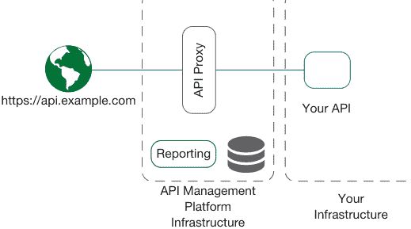

**图 15.2** 托管 API 管理选项。

本地 APIM 安装在数据中心或云基础设施中。与托管 APIM 相比，它们在确保适当可靠性和可用方面给运营带来了更大的负担，但提供了更多的自定义选项。此外，本地安装允许组织安装多个网关实例，以在变化多变的监管审计中隔离 API，或隔离合作伙伴和客户之间 API 使用的影响。当需要使用 API 网关管理未发布到公共互联网的内部面向 API 时，它们也很有用。图 15.3 展示了本地 APIM 选项。

第三种 APIM 管理选项是混合型。混合安装使用供应商提供的托管仪表板和报告基础设施，同时支持使用本地模型部署 API 网关实例。这是领域中常见的选项。其主要优势是减少支持分析和报告系统所需的各种过程的负担，特别是当组织缺乏某些相关组件或数据库供应商的内部专业知识时。图 15.4 展示了混合 APIM 模型。

请记住，某些云基础设施提供者提供自己的 API 网关或 APIM。虽然这在短期内可能有用，但某些组织发现所需的定制工作量太大。需要采取多云策略的组织可能会选择第三方 APIM 供应商，而不是支持多个云提供的 API 网关。无论何种情况，请选择最适合当前 API 项目阶段的选项，并重新评估以确保使用最佳方案。

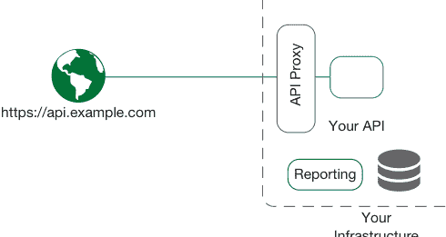

**图 15.3** 本地 API 管理选项。


**图 15.4** 混合 API 管理选项。

# 多云 API 管理零售案例研究

多云策略并不新鲜。事实上，任何向零售领域提供解决方案在使用竞争对手的云时可能都会遇到挑战。一个例子是沃尔玛，他们倾向于让托管 SaaS 使用 AWS。这种需求的初始假设可能是对将数据放在竞争对手云上的担忧。然而，真实原因更简单：沃尔玛不想让运营收入流向竞争对手。因此，那些将 AWS 作为主要云提供者的零售公司被要求使用另一个云供应商，如 Azure。

这种偏好对组织的 API 管理选择产生了重大影响。它还迫使组织考虑独立的 APIM 供应商，以避免为每个云使用两个 API 网关。

# API 网络流量考虑因素

将网络通信作为建立 API 策略的一部分是重要的。进入现有数据中心的流量与内部流量的处理不同。这种差异影响了组织管理 API 网络流量的方式。

为了更好地理解 API 网络流量保护涉及的决策，研究网络拓扑概念是重要的。如果有疑问，请咨询网络工程师，为本地或云基础设施建立安全高效的网络拓扑。

南北流量描述进出数据中心的数据。北向流量离开数据中心。南向流量进入数据中心。东西向流量表示数据中心内部的数据流。

在请求/响应 API 风格的情况下，数据中心之外的所有 API 请求都被视为南向流量，API 响应为北向流量。API 与数据库之间或服务之间的通信是东西向流量。

注意随着零信任架构（ZTA）的引入，南北和东西向流量之间的区别正在缩小。在 ZTA 中，所有流量、企业流量和虚拟专用网络（VPN）流量都被视为没有初始信任。相反，所有设备和服务都需要通过逐请求的访问决策来建立信任。这使得建立良好的访问策略变得重要，这些策略结合了身份和访问管理、验证和授权服务，并为每个 API、服务和服务提供了全面的访问控制策略。有关 ZTA 的更多细节可以在 NIST 的零信任架构专书中找到¹

+¹ Scott Rose, Oliver Borchert, Stu Mitchellchell and Sean Connelly, Zero Trust Architecture (National Institute of Standards and Technology (NIST) Special Publication 800-207, August 2020), https://nvlpubs.nist.gov/nistpubs/SpecialPublications/NIST.SP.800-207.pdf.


**图 15.5** API 拓扑结构 I，显示 API 网关路由到单体架构。

## 拓扑结构 1：API 网关直接连接 API 服务器

对于独立 API 产品，最常见的拓扑结构是将传入的请求通过 API 网关直接路由到 API 后端。API 后端通常是一个由负载均衡器和多个 API 服务器实例组成的集群。在这种情况下，不需要服务网格。图 15.5 展示了这种传统的 API 管理方法。

## 拓扑结构 2：API 网关路由到服务

另一种选项是由多个后端服务组成一个 API。API 网关根据请求的路径来决定由哪个服务负责处理请求。服务可以管理在负载均衡器后面，或者作为服务网格的一部分，允许 API 网关利用服务网格与可用实例进行通信。图 15.6 展示了如何使用 API 网关将传入的请求路由到多个后端服务。

## 拓扑结构 3：多个 API 网关实例

对于具有合规要求且频繁审计的组织，或者对于必须处理各种客户、合作伙伴以及 Web/移动应用部署的组织，可能需要多个 API 网关实例。每个网关实例可以像拓扑结构 1 所示路由到单个单体架构，也可以像拓扑结构 2 所示路由到多个后端服务。或者，API 网关实例


图 15.6 API 拓扑结构 2，显示根据传入 API 请求的基础路径将 API 网关路由到多个后端服务

专门用于多租户 SaaS 的一个或多个租户。一个网关实例的可用性问题不应对其他网关实例产生负面影响，从而限制在高峰使用场景下的受影响。这种拓扑结构如图 15.7 所示。

## 身份与访问管理

到目前，假设存在 API 客户端、API 服务器，现在还有 API 网关以及可能有助于防止恶意攻击向量的其他中间件。保护 API 产品或平台还有另一个重要因素：身份与访问管理 (IAM）；IAM 提供身份验证和授权服务，通常通过与其他使用行业标准的供应商集成来实现。它还包括生成 API 令牌（在代表用户时代替密码）以及分配给用户的访问控制。IAM 是将所有其他 API 保护组件结合在一起的胶水。


**图 15.7** API 拓扑结构，显示多个 API 网关实例，支持各种内部和外部 API 客户端，包括为了 PCI 合规和审计的支付处理隔离。

## 密码和 API 密钥

某些 API 选择允许 API 客户端提供用户名和密码凭据，这些凭据用于登录 Web 或移动应用程序。虽然这是一种简单的方法，但由于以下原因，非常不建议这样做：

- 密码是脆弱的，因为它们经常更改，这会导致任何代码在更新新密码之前都无法使用该 API。
- 将部分或全部数据的访问权限委托给第三方需要与他们共享密码。
 使用 使用用户名和密码不支持多因素身份验证。

为了避免这些挑战，大多数情况下首选使用 API 密钥或 API 令牌。这两个概念经常交叉使用，但区别很大。

API 密钥是密码的简单替代品，且没有过期日期。它们通常在用户配置页或 Web 应用程序的设置页面找到。API 密钥可能是一个长的字母数字值（例如 15zv8ua896maxm）。因为 API 密钥没有分配过期日期，任何恶意获取密钥的人都可能无限期使用 API 访问数据和后端系统。重置 API 密钥通常需要在用户配置页或设置页面中执行手动步骤，前提是 API 提供商确实提供了 API 密钥重置功能。

## API 令牌

API 令牌是 API 密钥的健壮替代方案。它们代表用户授权与 API 交互的会话。虽然它们可能是字母数字且看起来与 API 密钥相似，但它们并不是同一个。API 令牌可以代表用户，也可以代表代表用户限制或完全访问 API 的第三方。API 令牌还有一个关联的过期时间。

取决于各种配置元素，API 令牌的过期时间可能从几秒到几天不等。与之对应的还有一个允许 API 客户端在之前的令牌过期或失效时请求新的 API 令牌的刷新令牌。

一个 API 令牌可能关联有一个或多个控制。。这些控制通常被称为范围 (scopes)。可以代表用户生成多个 API 令牌，其中一个分配了对特定 API 资源只读访问的范围，另一个分配了对所有资源读/写访问的范围，还有一个提供供委托的第三方应用程序进行有限 API 访问的单一范围。图 15.8 展示了 API 令牌。

API 经常使用多种方法将 API 令牌传递给服务器，包括作为 URL 上的查询参数或通过头部。在 URL 中使用查询参数不如使用头部更安全，因为 URL 经常会记录在服务器日志和浏览器历史中。因此，建议使用 Authorization 头部传递令牌。

img/6a422bfe4f2691ab7de274bb6978b0eb_321_0.png)

图 15.8 API 拓扑结构，显示支持各种内部和外部 API 客户端，包括为了 PCI 合规和审计的支付处理隔离。（注意：文中提到了 15.8，但说明指的是令牌流）。

## JSON Web Tokens

一种流行的传值 API 令牌标准是 JSON Web Tokens (JWT)，通常读作 "jot"。JWT 由三个部分组成：头部、负载和签名。每个部分都经过 Base64 编码并用点分隔。例如：

```json
{
  "alg": "HS256",
  "typ": "JWT"
}
```
```json
{
  "sub": "1234567890",
  "name": "John Doe",
  "iat": 1516239022
}
```

确保确保没有被篡改。使用私钥签名提供了进一步的保护并验证身份。JWT 更多用于通信授权详情，而传引用 API 令牌则用于南北流量。

## OAuth 2.0 和 OpenID Connect

验证用户、生成 API 令牌并支持第三方应用程序的工作流需要数据所有者、API 服务器、授权服务器和第三方之间复杂的交互流。OAuth 2.0 是一个行业标准框架，防止每个 API 服务器实现不同的形式。它为 Web 应用程序、桌面应用程序、手机和设备提供了特定的授权流。这些流支持多种授权类型、集成或第三方授权服务器、各种令牌格式以及对扩展的支持。

这种复杂的工作流在支持登录 Google、Twitter、Facebook 或或其他账户的网站中非常常见。虽然网站不受这些任何供应商所有或管理，但它们提供了验证用户账户的登录界面。网站实现特定的特定的流将用户引导到所选供应商的登录页面。登录成功后，用户返回网站并已通过身份验证。在后台，网站和身份提供者交换足够的细节以验证用户确实是其身份。图 15.9 展示了 OAuth 2.0 交互的核心组件。

OAuth 2.0 是一个复杂的框架，但在投入足够精力的情况下是可以理解的。结合其他 API 安全主题，它值得专门出一本书。有关 OAuth 2.0 的更多信息，包括资源链接，可以通过 Aaron Parecki 优秀的 OAuth 社区网站获取。

如前所述，OAuth 2.0 关注授权工作流。OpenID Connect 是 OAuth 2.0 协议之上的身份层，提供了一种验证和获取身份详情的标准方法。它允许 Web 和移动


**图 15.9** OAuth 2.0 的核心组件和基本交互。

客户端可以验证终端用户的身份，并使用类 REST 的 API 获取配置信息。如果没有该协议，则需要自定义集成来桥接授权服务器与 API 之间的身份和配置详情。详细规范以及更新后的 OpenID Connect 兼容服务器列表可以在 OpenID Connect⁴ 网站上找到。

需要在多个内部供应商和第三方供应商之间进行联邦身份管理的企业，严重依赖单点登录（SSO）来实现其 Web 应用。安全断言标记语言（SAML）是一种用于将 API 桥接到企业内部现有 SSO 解决方案的标准，使得企业通过应用程序访问 API 的过渡更加顺畅。更多细节请参阅 OASIS SAML⁵ 网站。

## 在构建内部 API 网关之前的考虑因素

开发人员经常会考虑构建自己的 API 网关，或使用辅助库来实现自己的身份验证和授权支持。虽然某些机构在 API 之发展程的早期就不得不采取此行动，但现在已没有必要内部构建 API 网关了。事实上，出于三个原因，非常不建议构建自定义 API 网关。

+ 4. https://openid.net/connect
+ 5. https://www.oasis-open.org/committees/tc_home.php?wg_abbrev=security

## 原因 1：API 安全是一个不断变化的目标

想要让攻击者更容易发现并利用 API 中的安全漏洞吗？构建一个自定义 API 网关吧。问问任何通过其 API 遭受入侵的公司——即使配备了正确的组件，安全也很困难。

实施适当的安全措施需要对组织的每个方面进行专注的关注。除非组织手头有安全专家团队，否则构建一个内部安全的 API 网关所需的时间将比构建概念验证版本要长得多。而且，它需要持续投入资源以使其跟上最新的漏洞。

## 原因 2：它花费的时间比预期的要长

构建自定义网关通常始于一个浪漫的想法。合理化过程始于“这不应该花太长时间”，接着是“它恰好做我需要做的事——不多不少，结果速度会快得多”，最后以那个令人恐惧的反问句结尾：“这怎么可能呢？”

现实是，构建和维护生产级的 API 网关和 APIM 供应商并非易事。API 网关供应商之所以能够对其产品收费是有的。除了基础功能集外，非标准客户端和代理服务器的偏差将导致在 API 网关的整个周期内进行各种故障排除。此外，实现 OAuth 2.0、OpenID Connect、SAML 以及其他规范是复杂的，并且需要大量时间进行构建、测试和支持。

首先要问的是，构建自定义 API 网关所花费的时间对组织来说是否值得。计算构建和维护 API 网关的全成本，包括为了处理目前未处理的新和新兴攻击向量的补丁和改进。许多组织走了这条路，结果却从未将其预期的解决方案推向市场。

## 原因 3：预期的性能需要时间

在软件领域，有三个推荐的开发阶段：让它运行起来、使其变得正确以及让它变快。通常，开发者擅长第一步——让它运行起来。他们通过实验代码来查看某些操作是否可行，或者在继续之前查看结果可能是什么样子。

从“使其运行”到“使其符合生产环境要求”所需的精力是巨大的。边缘情况很多且不可预见。使其变得正确需要时间。而使其变快则需要更多的投入。组织是否准备好投入员工来构建一个已经存在的解决方案？

## 辅助库呢？

也许某个团队正在考虑将 API 网关的功能直接包含在源代码中。也许现有的辅助库提供了 API 令牌生成和一些基础安全功能。这对于今天可能是可行的。但从长远来看具有可持续性吗？

此外，许多开发者假设该库是由安全专家编写的，旨在满足组织的需求，并在未来维护以应对所有形式的漏洞、错误以及语言/框架的主要版本发布。除非该库是由商业公司提供的，否则这些假设中至少有一个是错的。这是组织愿意承担的风险吗？

尽可能利用提供身份验证和授权的第三方 IAM 解决方案。避免实现自定义身份验证和授权解决方案，因为这将使 API 暴露于利用弱弱或废弃代码的恶意攻击。

## 总结

API 设计需要考虑如何保护 API 免受恶意攻击者的侵害。不受保护的 API 就像一扇敞门，欢迎攻击者破坏组织及其客户。API 保护策略涉及实施正确的组件、选择 API 网关解决方案以及集成身份和访问管理将所有一切紧密结合在一起。

不要将 API 保护留给某人的侧边项目或组织内部意良好的团队。选择带有供应商支持组件的正确方法，确保组织 API 的正门是关锁的，而不是敞开的。

# 第 16 章

# 继续 API 设计之旅

> 当治理有效时，它可以提供清晰的方向，消除障碍，并允许组织的不同部分独立运行。

> — Matt McLarty

一个生产多个 API 产品的组织必须学会扩展其 API 设计流程。否则，设计在组织产生的 API 组合中将缺乏一致性。身份验证和授权将在 API 之间产生差异。命名规范和错误响应将偏离。简而言之，API 程序将变成一糟。

本章探索了在组织内部扩展 API 设计工作所需的因素。这些因素包括为了一致性而建立风格指南、纳入设计评审以及鼓励复用文化。一旦应用了这些措施，团队将能够在独立运行的同时，保持整个 API 组合的一致性。最后，本章回顾了书中涵盖的主题，并对如何继续 API 设计之旅提供了一些指导。


访问共享服务和支持（例如 API 管理层、运营和基础设施支持），而不是被迫由他们自己实现。

- 2. 联邦式：由一个中心化团队监督并维护风格指南，由本地嵌入在业务部门内部的教练，和/或可用人员提供服务以满足其特定需求。这种方法避免了委员会在不了解特定部门需求的情况下设计标准的“象牙塔”问题。

- 3. 克隆并定制：由一个单一小组管理风格指南。团队克隆这些标准作为起点，在本地进行细微改进，以保持业务部门的一致性。对于那些在业务部门内部和/或跨业务部门拥有许多独立团队的组织，这是最有效的方法。

这些方法可以独立使用或结合使用，以达到满足组织所需的预期。

## 选择风格指南的语调

某些风格指南是非正式的，某些则非常正式，包括使用 RFC 2119¹ 来表示需求级别。决定风格指南的语调和正式程度取决于对三个问题的回答：

- * 组织是否强制执行标准？如果是，请使用 RFC 2119 建议来强制执行哪些是**必须 (MUST)**、**应该 (SHOULD)** 和**可以 (MAY)** 实现的。

- * 强制执行会推迟到未来？那么请开始使用 RFC 2119，但在强制执行之前将这些单词保持小写（例如 must, should, may）。这展示了预期和可能的未来强制执行，在最初的介绍期间正式感较少。

- * 指南是否在多个业务部门之间共享，从而限制了组织控制或严格执行准则的能力？如果是这样，请放软语气，并通过鼓励团队尽可能采用许多准则来关注设计的一致性，而不是使用更正式的语气。

> 1. S. Bradner, "Key Words for Use in RFCs to Indicate Requirement Levels," March 1997, https://datatracker.iet.org/doc/html/rfc2119.

## 开始使用 API 风格指南的技巧

- 浏览 Arnaud Lauret（又名 API Handyman）的 [API Stylebook](https://example.org)。API Stylebook 旨在帮助 API 设计师解决 API 设计问题并构建他们的 API 设计指南。也浏览其他公开的风格指南以获取见解。
- 从小处着手。API 风格指南的范围对于一个个人或一个小团队最初来说可能太大了。从简单开始，随着时间的推移不断扩展。
- 让风格指南社交化。仅仅因为风格指南存在并不意味着组织中的人知道它。花时间向团队推广该风格指南。在发布正式版本之前，从早期的发布候选版本中获取见解。

> 记住
API 风格指南的目标是指导设计 API 的团队，使其与整个组织内的其他 API 保持一致。

## 支持多种 API 风格

虽然组织可能会建议或强制执行单一的 API 风格，但情况并非总是如此。随着新的 API 风格的出现，由于与企业交互新方式的推动，API 组合面临着挑战。请记住，仅仅在十年前，许多组织才停止开发基于 SOAP 的 Web 服务。API 项目必须考虑随着新的 API 风格变得流行，应如何对它们进行评估、批准和支持。

API 项目必须考虑将异步 API（如 Webhooks、WebSockets、服务器发送事件 (SSE)、数据流和内部消息传递）作为 API 组合的一部分。与同步 API 设计一样，异步 API 设计必须作为整体 API 组合的一部分进行治理和管理。

API 风格指南必须在这些 API 风格引入组织时处理每一种。虽然可以在不同的 API 风格之间共享风格指南的元素，但强烈建议在开始时为每种 API 风格编写风格指南。

随着时间的推移，命名约定和保留字等通用建议可以在不同的 API 风格指南之间共享。然而，大多数组织发现 API 风格之间的标准和通用做法存在显著差异。记住，对于每种 API 风格遵循通用做法，比将所有 API 风格统一为一套建议要好。

最后，请记住支持每种 API 风格都是成本的。花时间理解新 API 风格的需求。然后确定这些需求是否大于构建和支持另一个 API 风格指南所需的成本。

## 进行 API 设计评审

API 设计评审寻求通过建设性的评审和反馈来改进 API 设计。实现一个健康的 API 设计评审过程有助于将见解、模式和教训纳入可重复的流程，引导组织向更佳的设计迈进。

API 设计评审通过建设性的评审和反馈来改进 API 设计。

API 设计评审提供了机会以：

- 在编码开始前分享即将发布的 API 知识。
- 在编码开始前纳入设计反馈。
- 为那些将使用 API 的开发者提供倡导。
- 通过一致设计的 API 提供更好的开发者体验。
- 在代码更改成本变得更高或时间有限之前发现缺失或错误的假设。

以下是关于进行健康设计评审的一些技巧和见解。

> 关于评审的警告

设计评审有两种方式：建设性和破坏性。建设性的设计评审提供了指导他人并完善整个组织的机会。破坏性的设计评审则相反，通常会种下挫败和不信任的种子。最坏的情况下，设计评审会导致原本健康的流程出现问题。

因此，在进行设计评审时要谨慎。先尝试提问。通常，偏见和假设会被引入设计评审中。相反，通过提问和倾听来寻求理解。不要声称了解设计的一切——每个人都能从学习新知识中获益。永远不要指责某人故意设计糟糕——没有人打算这样做。假设良好，仔细倾听，寻求理解，提供建议的步骤。记住：每个人都是从新手开始的。模拟评审行为，以建设性的方式鼓励改进。

## 从文档评审开始

API 评审不是代码评审。API 评审员充当使用 API 的开发者的倡导。因此，从 API 文档开始非常重要。

API 的存在出于多种原因，包括数据访问、客户自动化、系统间集成、市场创建和工作自动化。引言应该清楚 API 为什么存在，以及它如何与其他 API 协作以完成更复杂的工作流或结果。使用以下清单检查所有文档领域：

- API 名称：名称应该是描述性的，以便在首次发现时确定 API 的范围。
- API 描述：描述应该是全面的，从 API 概述开始，并包含解决的用例列表。
- API 操作：每个操作都应提供其产生的任务、活动或结果的摘要，并附带详细的使用说明。确保捕获并正确描述所有输入和输出值，包括违反时可能导致错误的格式。
- 使用示例：API 使用的示例通常是文档中最重要但缺失的部分。这些示例不需要特定的编程语言（尽管对于向广泛受众提供 API 有帮助）。简单的 HTTP 请求/响应示例，如果配合 Postman 集合，将极大地加速开发者的理解并完成集成工作。
- 避免内部引用。


# 执行 API 设计评审

## 检查标准与设计一致性

许多中大型组织面临的共同挑战之一是 API 设计的一致性。很容易发现某些由团队独立设计、且没有应用任何跨组织一致性的 API。通常情况下，缺乏一致性与缺乏设计评审流程的组织有关。即使已经建立了评审机制，不一致性也可能经常渗入。

API 设计评审的一部分应当应该是验证标准和设计选择是否遵循了既建立的风格指南和标准。这项任务可以通过人工评审和使用如 Spectral 等 API 检查工具结合来完成。

最后，寻找一致地应用通用设计模式的机会。例如：增删改查（CRUD）、分页技术的统一使用、用于文件上传的多部分 MIME 等。虽然这些常见模式可以作为风格指南的一部分被记录下来，但识别偏离情况并与团队讨论它们，将有助于在尽可能的情况下提供一致性，并在适当的时候设置特例。

## 评审自动化测试覆盖率

虽然 API 设计评审侧重于设计，但评审测试覆盖率同样重要。包含测试覆盖率评审可以确保 API 的测试策略已作为设计的一部分被考虑过。它还有助于确保 API 的操作可以结合使用，以产生对齐阶段确定的预期结果。

如果评审是在流程早期进行的，可能还没有任何特定的代码或测试覆盖率。在这种情况下，应评审测试计划以揭示缺失或错误的设计假设。一个很好的起点是评审作业故事（job stories）、建模期间产生的 API 配置文件以及其他产物。这将有助于发现任何缺失的测试计划，并确保测试覆盖率足以验证功能性，以及用于验证预期目标的验收测试。

## 支持“试用一下”

没有比与 API 交互更能对 API 设计提供更好的评审方法了。如果 API 已经存在代码，请直接尝试该 API。这将有助于检验文档、API 设计和实现。

如果团队采取了设计优先的方法，则目前可能很少或完全没有代码。模拟工具（Mocking tools）有助于解决这一问题。模拟工具是填补空白并在交付过程中尽早发现糟糕设计决策或缺失端点的绝佳方法。这些工具通常接受 OpenAPI 规范、API Blueprint 以及其他描述格式的定义，以生成 API 设计的模拟版本。虽然模拟 API 不会完整，但它将提供对完备后如何使用 API 的基本理解，并及早发现次优的设计决策。

## 建立复用文化

API 消费者是任何计划中不可或缺的元素。然而，许多组织专注于策略、目标和治理以创建 API，而没有解决通过发现快速采用 API 的需求。

对于大多数组织来说，API 文档是事后考虑的。这是遗憾的，因为这会对 API 的发现和采用产生严重后果，导致有价值 API 的复用率降低。实施有效 API 发现的组织遵循以下格言：尽可能利用数字能力；必要时进行构建。

API 文档是开发者与 API 的首次接触

**图 16.1** API 消费周期，展示了开发团队在发现新 API 时经历的阶段——使用 API——通过通讯或分发列表与他们保持联系。通过一致的开发者通信宣布新的及即将到来的改进、成功案例和常见用例。突出负责构建和支持 API 的团队，以展示他们对满足开发者需求的承诺。

# 旅程刚刚开始

本书的重点一直是 Web API 设计原则，这些原则产生了一种可重复的、协作的 API 设计过程，通过以结果为导向的方法交付价值。这些原则如下：

- * **原则 1：** API 绝不应该孤立设计。协作式 API 设计对于出色的 API 至关重要。（第 2 章）
- * **原则 2：** API 设计从以结果为导向的关注开始。关注结果确保 API 为所有人交付价值。（第 3–6 章）
- * **原则 3：** 选择匹配所需的 API 设计元素。试图寻找完美的 API 风格是一项徒劳的努力。相反，寻求理解并应用适用于需求的 API 元素，无论是 REST、GraphQL、gRPC 还是刚刚进入行业的新兴风格。（第 7–12 章）
- * **原则 4：** API 文档是开发者最重要的用户界面。否则，API 文档应该是“一等公民”，而不应被留到最后一刻的任务。（第 13 章）
- * **原则 5：** API 是持久的，因此要相应计划。深思熟虑的 API 设计结合演进设计方法可以使 API 应对变化。（第 14 章）

这些原则是四阶段流程的基础：对齐-定义-设计-精炼（ADDR）。该的 ADDR 流程侧重于对齐利益相关者、定义所需的数字能力、设计产生结果的 API，然后根据反馈精炼设计。

该流程意识到 API 绝不应该孤立设计。它需要包括领域专家在内的各种角色的协作。当参与 API 设计的人员首先对结果达成一致时，API 将保持专注于所交付的价值。在此过程中，利益相关者在设计 API 之前通过 EventStorming 和 API 建模等协作技术达成理解一致。然后通过与将 API 集成到其解决方案中的人员反馈进行设计和精炼。

虽然有些人可能认为旅程已经完成，但这仅仅是开始。API 设计现在将交付交付和管理。它将面对真实的使用，可能会遇到从未考虑过的新用例。随着 API 的增长和成熟，ADDR 流程将再次被使用。对于较大的组织，这种 API 设计生命周期将在许多 API 中重复，需要多个团队来扩展 ADDR 流程。旅程刚刚开始。

# 附录

# HTTP 入门

为了更好地理解 Web API 如何工作，从理解 Web 的语言 HTTP 开始是至关重要的。虽然 HTTP 协议可以隐藏在各种库和框架之后，但理解该协议为排查 API 集成和改进 API 设计提供了基础。

本入门介绍了 HTTP 协议、使用 HTTP 与 Web API 交互涉及的元素，以及有助于构建更强大的 API 交互的一些高级功能。

## HTTP 概述

HTTP 协议是一种客户端/服务器协议。HTTP 客户端向服务器发送请求。HTTP 服务器然后根据给定的信息判断是否可以处理该请求。服务器返回响应，其中包含指示成功或失败的代码，以及一个包含请求信息或错误详情的响应负载。这种请求/响应流如图 A.1 所示。

HTTP 由几个元素组成：

- 发送请求的统一资源定位符 (URL)
- 告知服务器希望如何与资源交互的 HTTP 方法
- 请求头和主体
- 响应头和主体
- 指明请求是否被成功处理或遇到错误的响应码


# 304 附录

GET /projects/12345 HTTP/1.1
Accept: application/json


```
HTTP/1.1 200 OK
{
  "id": "12345",
  "projectName": "My Project"
}
```

**图 A.1** HTTP 协议概览。

# 统一资源定位符 (URL)

HTTP 使用 URL 作为数据或服务所在的唯一地址。请求被发送到 URL，由服务器处理请求并向客户端发送回执响应。URL 通常出现在浏览器的地址栏中。示例包括：

- *https://www.google.com*
- *https://launchany.com/effective-api-programs/*
- *https://deckofcardsapi.com/api/deck/new/shuffle*

URL 由以下项目组成：

- **协议 (Protocol):** 用于连接的协议（例如 http [不安全] 或 https [安全]）。
- **主机名 (Hostname):** 要连接的服务器（例如 api.example.com）。
- **端口号 (Port number):** 一个范围从 0 到 65535 的数字，用于识别服务器上请求所在的进程（例如 https 使用 443，http 使用 80）。
- **路径 (Path):** 所请求的资源路径（例如 /projects）。默认路径为 /，表示主页。
- **查询字符串 (Query string):** 包含要传递给服务器的数据。以问号开头，包含 name=value 键值对，并使用 符号 作为它们之间的分隔符（例如 ?page=1&per_page=10）。

# HTTP 请求

| 协议 | 主机名 | 端口 | 路径 | 查询字符串 |
|---|---|---|---|---|
| https | api.mycompany.example | 443 | /projects | page=2 |

**图 A.2** 统一资源定位符 (URL) 的组成元素。

图 A.2 展示了 URL 的元素。

# HTTP 请求

一个 HTTP 请求由几个部分组成：HTTP 方法、路径、标头（Header）和消息体（Message Body）。

HTTP 方法告知服务器客户端想要请求什么类型的交互。常见的 HTTP 方法有 GET（请求数据）和 POST（提交数据）。用于 Web 端 API 的常用方法将在本附录稍后部分详细介绍。

路径是 URL 中引用服务器上资源的部分。该资源可以是静态文件（如图像），也可以是执行动态请求处理的代码。

标头告知服务器关于客户端的信息以及请求的细节。标头由 `name:value` 格式的标头字段组成。与 Web 端 API 一起常用的 HTTP 请求标头包括：

- **Accept**: 告知服务器客户端支持哪些内容类型。示例可能 image/gif 和 image/jpeg。如果客户端愿意接受任何类型的响应，则使用 `"*"`。此标头通常用于内容协商，后文将详述。

- **Content-Type**: 告知服务器请求体的内容类型。在使用需要消息体的 HTTP 方法（例如 POST）提交数据时使用。

- **User-Agent**: 提供一个自由格式的字符串，表示发出请求的 HTTP 客户端类型。这可能指示特定的浏览器类型和版本，也可以经过自定义以指示特定的辅助库或命令行工具。

# 306 附录

```
GET http://www.google.com/HTTP/1.1
User-Agent: Mozilla/5.0 [en] (X11; Linux 2.2.013 i686)
Host: google.com
Accept: image/gif, image/x-bitmap, image/jpeg/*
Accept-Encoding: gzip
Accept-Language: en
Accept-Charset: iso-8859-1, "*,utf-8
```

图 A.3 对 https://www.google.com 发送 HTTP 请求的逐行检查。

- **Accept-Encoding**: 告知服务器客户端能够处理哪些压缩支持（如果有）。这允许服务器使用 gzip 或压缩格式压缩响应，以减少响应的字节大小。

消息体在提交数据时为服务器提供详细信息，根据服务器的要求，它可以是人类可读或二进制。对于使用 GET 的检索请求，消息体可能为空。
图 A.3 展示了发送到 Google 的 HTTP 请求示例，该请求请求包含搜索表单的主页，并进行了逐行记录。

# HTTP 响应

一旦服务器接收到请求，就会处理请求并发送响应。响应由三个部分组成：响应码、响应标头和响应体。

响应码是一个对应成功或错误代码的数字，指示请求是否可以完成。发送的响应码必须是 HTTP 规范中列出的之一，并在后文中详细介绍。每个响应只允许一个响应码。

响应标头告知客户端请求的结果。标头由 `name:value` 格式的标头字段组成。与 Web 端 API 一起常用的 HTTP 响应标头包括：

- **Date**: 响应的日期。
- **Content-Location**: 响应的完整 URL。如果请求导致重定向并可能需要客户端更新其资源 URL，则此项有用。
- **Resource**: 响应的长度（字节为单位）。

# 常用 HTTP 方法

```
HTTP/1.1 200 OK
Date: Fri, 13 Nov 2020 22:16:05 GMT
Content-Length: 79
Content-Type: text/html
Connection: close
```

**图 A.4** 对 https://www.google.com 发送 HTTP 请求的逐行检查。（注：此处原文逻辑似乎错乱，已根据语境翻译）

- **Accept-Encoding**: 告知服务器客户端能够处理哪些压缩支持（如果有）。

...

# 常用 HTTP 方法

HTTP 方法告知服务器客户端想要请求什么类型的交互。常见的 HTTP 方法有 GET（请求数据）和 POST（提交数据）。

在 Web 端 API 中常用的 HTTP 方法包括：

- **GET**: 从服务器检索资源。
- **HEAD**: 请求响应标头但不响应体。
- **POST**: 向服务器提交数据，通常用于存储或计算。
- **PUT**: 向服务器提交数据，通常作为现有数据的替换。
- **PATCH**: 向服务器提交数据，通常作为现有数据的部分更新。
- **DELETE**: 删除服务器上的现有资源。

HTTP 方法具有客户端需要考虑的重要语义：安全性 (Safety) 和等幂性 (Idempotence)。

安全方法表示 HTTP 方法不会产生副作用，例如修改数据。这通常适用于 GET 和 HEAD 方法，因为它们用于检索且不修改数据。

等幂性方法确保在提交相同请求时产生相同的副作用。这适用于 GET 和 HEAD 方法，因为没有数据被修改。PUT 和 DELETE 由 HTTP 规范保证是等幂的，因为 PUT 将资源替换为全新的表示，而 DELETE 从服务器删除资源。

POST 不保证是等幂的，因为每次随后的请求可能会创建新资源，或以无法保证产生相同结果的方式修改数据（例如增加值）。同样，PATCH 不是等幂的，因为它修改的是部分字段，而不是整个资源。

图 A.5 总结了用于 Web 端 API 的常用 HTTP 方法的语义。

| 方法 | 安全性 | 等幂性 |
|---|---|---|
| GET | 是 | 是 |
| POST | 否 | 否 |
| PUT | 否 | 是 |
| PATCH | 否 | 否 |
| DELETE | 否 | 是 |
| HEAD | 是 | 是 |
| OPTIONS | 是 | 是 |


# HTTP 响应码

HTTP 响应包含一个响应码，用于向 API 消费者指示请求成功还是失败。HTTP 提供了一系列响应码，API 服务器可以将其发送给客户端以指示结果。

HTTP 响应状态码属于四个主要的响应码族：

- 200 系列代码表示请求已成功处理。
- 300 系列代码表示客户端可能需要采取额外的操作来完成请求，例如跟进重定向。
- 400 系列代码表示请求发生失败，客户端可能希望修复并重新提交。
- 500 系列代码表示服务器发生错误，该错误不是客户端的责任。如果合适，客户端可以在未来尝试尝试重试。

表 A.1 列出了 HTTP 规范中用于基于 REST 的 API 的常用响应码列表。

## 表 A.1 API 设计中常用的 HTTP 响应码
| HTTP 响应码 | 描述 |
|---|---|
| 200 OK | 请求已成功执行， |
| 201 Created | 请求已执行并创建了新资源。 |
| 202 Accepted | 请求已接收并处理，但处理尚未完成。 |
| 204 No Content | 服务器执行了请求但不需要返回正文。这用于删除操作。 |
| 304 Not Modified | 服务器根据客户端提供的 If-Modified-Since 或 If-None-Match 请求头确定，内容自上次请求以来未发生变化。 |
| 400 Bad Request | 由于语法错误，服务器无法理解该请求。 |
| 401 Unauthorized | 请求需要用户验证。 |
| 403 Forbidden | 服务器理解了请求，但拒绝执行。 |
| 404 Not Found | 服务器未找到与请求 URL 匹配的内容。 |
| 412 Precondition Failed | 客户端提交了基于最后修改时间戳或 ETag 的条件的请求，且该条件失败。如果需要，客户端应重新获取资源并再次尝试更改。 |
| 415 Unsupported Media Type | 服务器无法以 Accept 头中指定的客户端提供的任何媒体类型进行响应。 |
| 428 Precondition Required | 服务器要求在处理请求之前必须提供预条件头。通常在需要并发控制头的地方强制执行。 |
| 500 Internal Server Error | 服务器遇到意外情况，导致无法执行请求。 |

# 内容协商

内容协商允许客户端为服务器响应请求一个或多个首选媒体类型。通过内容协商，单个操作可以支持不同的资源表示，包括 CSV、PDF、PNG、JPG、SVG 等。

客户端使用 Accept 头请求首选媒体类型。此示例演示了 API 客户端请求基于 JSON 的响应：

```
GET https://api.example.com/projects HTTP/1.1
Accept: application/json
```

头中可能包含多个支持的媒体类型，如下所示：

```
GET https://api.example.com/projects HTTP/1.1
Accept: application/json, application/xml
```

在选择媒体类型时，星号可以作为通配符使用。text/* 表示文本媒体类型的任何子类型都是可以的。指定 */ 表示客户端将接受响应中的任何媒体类型。这是浏览器的常见场景，它们在遇到未知媒体类型时会提示用户保存文件或启动选择。然而，对于与 API 通的客户端，明确指定是非常重要的，以避免遇到未知或不支持的内容类型时可能发生的运行时错误。

请求可以通过 Accept 头中的质量因子（quality factors）指定特定的支持媒体类型。质量因子表示为 0 到 1 之间的值，有助于分配媒体类型的首选顺序。API 服务器检查头值，并使用同时符合服务器支持和客户端请求的内容类型返回响应。如果服务器无法使用接受的内容类型进行响应，它将返回 415 Unsupported Media Type 代码。

# 缓存控制

这是一个使用 qvalues 指定对 XML 偏好的示例，如果 XML 不可用，则也支持 JSON：

```
GET https://api.example.com/projects HTTP/1.1
Accept: application/json;q=0.5, application/xml;q=1.0
```

使用 qvalues 允许 API 客户端支持特定类型，例如为了改进转换能力使用 XML，并使用 JSON 作为备选方案。

由于 API 客户端可能会指定多个媒体类型，它们必须特别关注 Content-Type 头以确定哪个解析器是合适的。以下根据前面的示例提供 XML 的响应：

```
HTTP/1.1 200 OK
Date: Tue, 16 June 2015 06:57:43 GMT
Content-Type: application/xml

<project>...</project>
```

内容协商将 API 的媒体支持扩展到单一类型之外（例如 JSON 或 XML）。它允许 API 的部分或所有操作以最符合 API 客户端需求的内容类型做出响应。

同样，语言协商允许 API 在响应中支持多种语言。这种方法类似于使用 Accept-Language 请求头和 Content-Language 响应头进行的内容协商。

最快的请求是不需要的请求。缓存是数据的本地存储，用于防止未来重复检索数据，从而优化网络通信。熟悉该术语的开发者可能已经过 Memcached 等服务端缓存工具将数据保留在内存中，减少从数据库获取未缓存数据的需要，以提高应用程序性能。

HTTP 缓存控制允许 API 客户端或中间缓存服务器在本地存储缓存资源。这使缓存更靠近 API 客户端，减少或消除了跨网络到达后端 API 服务器的需求。用户将获得更好的性能和更低的网络依赖。

HTTP 通过 Cache-Control 响应头提供了多种缓存选项。该头声明响应是否可以缓存，如果是，则应该缓存多久。

以下是一个返回项目列表的 API 操作示例：

```
HTTP/1.1 200 OK
Date: Tue, 22 December 2020 06:57:43 GMT
Content-Type: application/xml
Cache-Control: max-age=240

<project>...</project>
```

在此示例中，max age 表示在客户端考虑状态之前，数据可以缓存长达 240 秒（4 分）。API 可能会显式标记响应为不可缓存，从而每次都需要新请求：

```
HTTP/1.1 200 OK
Date: Tue, 22 December 2020 06:57:43 GMT
Content-Type: application/xml
Cache-Control: no-cache

<project>...</project>
```

在 API 中合理使用缓存控制可以减少流量并加快应用程序。

# 条件请求

条件请求是 HTTP 提供的一种少为人知但强大的功能。条件请求允许仅在发生变化时请求更新的表示。发送条件请求的客户端如果内容未更改，将收到 304 Not Modified，否则收到带有更改内容的 200 OK。

告知客户端本地副本有两种预条件类型：基于时间和基于实体标记（entity tag）。

基于时间的预条件要求客户端为后续请求存储 Last-Modified 头。然后使用 If-Modified-Since 请求头来指定最后修改时间戳，服务器将用与已知时间戳进行比较以判断资源是否发生变化。

以下是使用最后修改时间判断服务器资源变化的客户端/服务器交互示例：

```
GET /projects/12345 HTTP/1.1
Accept: application/json;q=0.5, application/xml;q=1.0
If-Modified-Since: Tue, 22 December 2020 05:29:03 GMT
```

```
HTTP/1.1 200 OK
Date: Tue, 22 December 2020 06:57:43 GMT
Content-Type: application/xml
Cache-Control: max-age=240
Location: /projects/12345
Last-Modified: Tue, 22 December 2020 05:29:03 GMT
```

```
<project>...</project>
```

```
GET /projects/12345 HTTP/1.1
Accept: application/json;q=0.5, application/xml;q=1.0
If-Modified-Since: Tue, 22 December 2020 05:29:03 GMT
```

```
HTTP/1.1 304 Not Modified
Date: Tue, 22 December 2020 07:03:43 GMT
```


# 314 附录

实体标签（也称为 ETag）是一个表示当前资源状态的不透明值。客户端可以在 GET、POST 或 PUT 请求后存储 ETag，并使用该值通过 HEAD 或 GET 请求来检查发生的变化。

ETag 是整个响应的哈希值。或者，服务器也可以提供弱 ETag（weak ETag），它在语义上是等价的，但在字节上可能并非完全相同。

以下是一个使用 ETag 而不是修改时间的客户端/服务器交互：

```
GET /projects/12345 HTTP/1.1
Accept: application/json;q=0.5, application/xml;q=1.0

HTTP/1.1 200 OK
Date: Tue, 22 December 2020 06:57:43 GMT
Content-Type: application/xml
Cache-Control: max-age=240
Location: /projects/12345
ETag: "17f0fff99ed5ae4edffd6496d7311f"

<project>...</project>
```

```
GET /projects/12345 HTTP/1.1
Accept: application/json;q=0.5, application/xml;q=1.0
If-None-Match: "17f0fff99ed5ae4edffd6496d7311f"

HTTP/1.1 304 Not Modified
Date: Tue, 22 December 2020 07:03:43 GMT

GET /projects/12345 HTTP/1.1
Accept: application/json;q=0.5, application/xml;q=1.0
If-None-Match: "17f0fff99ed5ae4edffd6496d7311f"

HTTP/1.1 200 OK
Date: Tue, 22 December 2020 07:33:04 GMT
Content-Type: application/xml
Cache-Control: max-age=240
Location: /projects/12345
ETag: "b252d66ab3ec050b5fd2c3a6263ffaf51db10ffcb"

<project>...</project>
```

条件请求减少了验证和重新获取缓存资源所需的努力。ETag 是表示当前内部状态的不透明值，而最后修改时间戳而非 ETag 则可能被用于基于时间的比较。在对资源进行修改时，它们也常用于并发控制。

## HTTP 中的并发控制

使用 HTTP 进行并发控制是需要支持不同用户同时修改数据 API 的团队所面临的一项挑战。一些 API 设计师找到了巧妙的方法，在 HTTP 上实现资源级锁定。然而，HTTP 内置了并发控制机制，使得团队无需自行构建它。

条件请求也用于支持 HTTP 中的并发控制。通过将 ETag 或最后修改日期与 PUT、PATCH 或 DELETE 等状态更改方法相结合，我们可以确保数据不会被另一个 API 客户端通过单独 HTTP 请求意外覆盖。

要应用条件请求，API 客户端会在请求中添加预条件（precondition），如果资源的最后修改时间或 ETag 已发生变化，则阻止修改。服务器将返回 412 Precondition Failed（前提条件失败）响应。API 服务器还可能强制要求预条件头，如果请求中未发现任何一个条件头，则通过响应 428 Precondition Required（需要前提条件）来执行并发控制。

以下是一个两个 API 客户端尝试修改项目的示例。首先，每个客户端都使用 GET 请求获取项目资源，然后每个客户端尝试进行更改，但只有第一个 API 客户端能够应用该更改：

```
GET /projects/12345 HTTP/1.1
Accept: application/json;q=0.5, application/xml;q=1.0
HTTP/1.1 200 OK
Date: Tue, 22 December 2020 07:33:04 GMT
Content-Type: application/xml
Cache-Control: max-age=240
Location: /projects/12345
ETag: "b252d6ab33ec055fd2c3a62af5110b"

<project>...</project>
```

# 316 附录

```
PUT /projects/1234
If-Match: "b252d6ab33ec055fd2c3a62af5110b"
```

```
{ "name":"Project 1234", "Description":"My project" }
```

```
HTTP/1.1 200 OK
Date: Tue, 22 December 2020 08:21:20 GMT
Content-Type: application/xml
Cache-Control: max-age=240
Location: /projects/12345
ETag: "1d720c9d54e1a9cf73be41eff24fffb"
```

```
<project>...</project>
```

```
PUT /projects/1234
If-Match: "1d720c9d54e1a9cf73be41eff24fffb"
```

```
{ "name":"Project 5678", "Description":"No, is my project" }
```

```
HTTP/1.1 412 Precondition Failed
Date: Tue, 22 December 2020 08:21:24 GMT
```

接收到失败条件响应的第二个 API 客户端现在必须重新获取资源的表示，告知用户更改，并询问用户是重新提交更改还是保持原样。

并发控制可以通过请求头中的条件请求添加到 API 中。如果 ETag/修改日期未更改，则正常处理请求。如果已更改，则返回 412 响应，防止两个独立的客户端并发修改数据。这是 HTTP 内置的一种强大功能，避免了团队自行发明并发控制。

## 总结

HTTP 是一种强大的协议，拥有一系列功能，其中某些较为人知。内容协商允许 API 客户端和服务器就支持的媒体类型达成一致。缓存控制指令提供了客户端和中间件支持。HTTP 条件请求可用于保护资源不被覆盖。通过应用这些技术，团队能够以一种弹性且可扩展的方式构建复杂的应用程序。

## 索引

### A
- 验收（Acceptance）,22
- ActiveMQ, 226
- ADDR 过程中的步骤, 24, 25
- ADDR, 参见 Align-Define-Refine (ADDR)
- 高级消息队列协议（Advanced Message Queuing Protocol (AMQP)), 7, 164, 165, 166
- 分析（Analytics）, 在 MVP, 259
- 228
- 可可用性（Affordances）, 107
- 聚合笔记（Aggregate note）, 55
- 敏捷宣言（Agile Manifesto）, 22
- API 优先设计的敏捷性（Agility of API design-first）, 22–23
- Amazon Alexa, 6
- Align, 在 ADDR 过程中, 23
- Align-Define-Refine (ADDR), 23–26
- 反馈（feedback）, 23, 24
- 达成的目标, 24–25
- 过程概述, 25
- 阶段, 24
- 现实设计中使用的步骤, 25–26
- 捕获与步骤, 45–65
- 数字能力（digital capabilities）, 31–43
- ALPS（应用级配置 Application-Level Profile）, 83, 245–46
- Amazon Kinesis, 169
- Amazon Web Services (AWS), 221, 281
- AMQP（高级消息队列协议）, 7, 164, 166
- Amundsen, Pike, 128
- 接入层（Antruption layer）, 11
- 避免反模式（Antipatterns avoiding）, 70–71
- 全能 API 反模式（all-in-one API antipattern）, 70
- 过载 API 反模式（overloaded API antipattern）, 70–71

### B
- 业务能力（business capabilities of）, 4
- 边界上下文、子域和 API（bounded contexts, subdomains, and APIs）, 71–72
- 发现（finding）, 72
- 加剧为了（Exacerbating for）, 72–74

### C
- Apache Avro, 126, 178
- Apache Kafka, 169, 173
- Apache Lucene, 16, 19
- Apache Pulsar, 169
- Apache Spark, 170
- 基于 API 的编排（API-based orchestration）, 201, 202
- API Blueprint, 238–40
- API 边界（API boundaries）, 69–78
- 相应的活动, 74–75
- 在 ADDR 过程中识别的, 24, 25
- 识别（identifying）, 69–78
- API 命名和范围划分（naming and scoping APIs）, 75, 77, 78
- APIset生命周期（API consumption lifecycle）, 300
- API 合约测试（API contract testing）, 227–28
- API 描述格式（API description formats）, 234–48
- ALPS, 245–46
- 使用 API 改进 API 设计（improving API design using APIs）, 247–48
- JSON Schema, 244–45
- OAS, 235–37
- RAML, 240–46
- API 设计反模式（API design antipats）, 16–20
- 编码（coding）, 16
- 方法（approach）, 13, 14
- 通信（communication）, 6–7
- 数据模型（data model exposed in）, 11
- 元素（elements of）, 4, 6, 102
- 以结果为导向（outcome-based focus of）, 4
- 原则（principles of）, 13–14
- 过程（process）, 15–28

### D
- 弃用（deprecating）, 268–70
- 确定最佳 API（determining what is best for API）
- ADDR 中的 API 适配（API adaptation in）, 16–20
- API 优先设计方法（API design-first approach in）, 20–23
- 有效应用（applying effectively）, 28
- 应用 API 产品思维（API product thinking to）, 5
- API 通信（API communication in）, 6–15
- DDD 中的（DDD in）, 26
- 原因（reasons for）, 15–16
- API 设计会议涉及的角色（roles involved in API design sessions）, 27
- 软件设计及原则（software design and, reviewing principles of）, 7–10


# 索引 321

OAS, 83
过程, 81–93

-   添加操作事件, 88, 91, 92
-   获取 API 配置文件摘要, 83–84
-   展开操作详情, 91, 93, 94
-   资源识别, 85–87
-   资源分类, 27–88, 89–90
-用于验证的序列图, 93–95
APIMs (API 管理层), 260, 276–77
API 优先级与重用
- 评估效益和竞争价值, 96
- 评估中, 95–97,
- 规模估算与优先级排序, 80
API 配置文件, 80
- 在 ADDR 过程中建模, 24, 25
- 结构, 81, 82
- 摘要, 83–84
API 保护, 273–91. *另见* API 网关
APIMs 中的, 276
- 其中的身份认证 (auth), 274
- 其中的授权 (authz), 275
- 其中的 CDNs, 276
- 其中的声明 (claims), 275
- 其中的组件, 276–79
- 其中的加密学, 275
- 数据爬取和机器人防护, 276
- 网关拓扑结构, 275–84
- 其中的 IAM, 284–89
- 其中的智能 API 保护中的, 279
- 消息验证中的, 275
- 其中的双向 TLS (mutual), 275
- 实践中的, 274–76
- 协议过滤和保护中的, 275
- 速率限制（限流）中的, 275
- 审查和扫描中的, 276
- 安全违规/入侵, 273–74
- 服务网格中的, 277–78
- 预防会话劫持中的, 275
- 其中的 WAFs, 278
API 原型模拟, 216–217
API 与微服务的区别, 193
API 安全违规, 273–74
APIs.json, 274–278
API 稳定性合约, 270–71

API 风格指南 (Lauret), 296
API 风格指南, 293–97

- 遵循性, 294–95
- 入门技巧, 对于 296
- 支持多个 API 风格, 296–97
- 调性选择, 295
- 包含的主题中的, 294
API 测试, 225–31
- 验收测试, 226
- 自动化安全, 226–27
- 挑战, 230–31
- 合约测试, 227–28
- 库 (libraries), 221
- 导入, 231
- 运行监控, 227
- 加速工具的选择, 选择, 229–30
- 用户界面版本, 228–29
API 版本控制, 264–68
- 业务考量, 268
- 常见的非破坏性变更, 265
- 完美无缺的变更, 265–66
- 方法, 267–68
- 基于标头的, 267
- 基于主机名的 (homename), 268
- 基于 URI 的, 267–68
- 修订版, 266–67
- 版本, 266–67
APM (应用管理)
工具, 221
应用级配置文件指标 (ALPS), 83, 245–246
性能管理 (APM) 工具, 221
架构师, 27
“架构风格与基于软件架构的设计” (Fielding), 102.
201–203 中的架构风格
基于 API 的编排, 201, 202
- 基于单元的架构, 203
- 直接服务通信, 201, 202
关联关系, 77, 88
用于事件触发和流处理的异步 API, 159–186
异步 API 风格, 171–78
- 通过 WebSocket 协议进行双向通知, 174–176
- gRPC 流式, 176–177
- 选择, 177–78
- 使用 webhooks 的服务器通知, 171–172
- 使用 SSE 的服务器推送, 172–174
- 益处, 160
- 设计, 178–83
- 命令消息, 178–79
- 事件批处理, 182–83
- 事件状态传输事件, 180–82
- 事件消息, 179–80
- 事件排序, 184–85
- 局限性, 160
- 有意义手册的审查, 162
- 产生的新可能性, 161–162
- 轮询 (polling), 与 160–61
AsyncAPI 规范, 185
异步消息, 164
异步微服务, 198–201
身份认证 (auth), 274
开发者门户中的认证, 253
授权 (authz), 275
自动化安全测试, 226–27
自动化测试覆盖率, 299
AWS (Amazon 服务), 221, 281
- JavaScript 文件, 107
- 中间件, 141
- SSE, 172–74
- 与 webhooks, 174–76, 178
业务能力, 4
业务领域事件, 51
业务备注, 55
业务价值, 评估, 96

可缓存（架构属性）, 103
链调用, 197–201
能力, 工作中, 36–37
捕捉活动和步骤, 45–65
EventStorming, 58–65
案例研究
- 开发者门户中的, 252
- 开发者门户元素, 252
- 企业门户成功, 252
- 采纳增长, 市场中, 162
- 多云 API 管理, 281–282
- REST 产品, 116, 118
- 编写者的角色, 27
- 微服务中的共享, 197
持续集成与持续交付 (CI/CD) 工具, 3
通过降低协调成本, 192–93
微服务降低协调成本, 192–93
- CORBA, 3
CORS (跨源资源共享), 275
COTS (商用) API, 96
增删改 (CRUD)
用于存储数据的 API 模拟工具, 217
生命生命周期, 132, 147, 210
模式, 132–33
REST 和, 104
创建步骤, 165
跨站资源共享 (CORS), 275
跨站请求伪造 (CSRF), 275
加密学, 275
CSRF (跨站请求伪造), 275
Cucumber 测试工具, 219
微服务的文化影响, 195
重用文化, 开发, 300–301
客户, 322
强制风格指南的自定义方法, 295

数据
- API 优先设计中, 20
- 用于存储的 API 模拟工具, 217
- 暴露敏感, 11
- 不一致性, 11
模型
作为 API 暴露, 11
微服务架构和, 196
用于映射的对象, 11
与基于资源的 API 区别, 11
协作 API 设计, 25
命令行接口 (CLIs), 221
用于 API 的, 221–23
命令行生成, 223
在微服务中变异, 275
命令消息, 179–80
便签备注 (sticky note), 55
设计, 178–83
COTS (商用) API, 96
通信, 与 7
贡献的库, 220
竞争价值, 评估, 96
组件, 8
消费者生成的库, 220
数据集创建, 230
数据交换, 164
DDD (领域驱动设计), 219
DDoS (分布式拒绝服务)攻击, 276
DLQ 死信队列, 166
将 API 分解为微服务, 204
依赖资源, 87
废弃稳定性, 270–71
废弃 API, 268–70
宣布废弃, 269–70
建立废弃策略, 269
设计
在 ADDR 过程中, 23
在 API 优先设计方法中, 20
一致性, 299
风格指南中的模式, 294
设计师体验, 27
作者过程中的设计阶段, 23
开发者体验 (DX), 5
用于 API 的 CLIs, 221–23
提供辅助库和 SDK, 219–23
开发者门户, 251–53
API 文档中的, 253
易于入的, 253
优秀的元素, 252–53
企业门户成功, 252
功能发现中的, 252
实时支持, 253
运行洞察中的, 253
发布说明和变更日志中的, 253
用于工具和框架, 259–60
DevOps, 191–92
DevRel (开发者关系), 253
数字-数字能力, 31–43
在作者过程中, 24, 25
定义, 33–34
识别, 31–43
工作故事 (job stories), 35–42
TJBB, 34–55
确保利益相关者对齐, 31–33
Dillon, Karen, 31
直接服务通信, 201, 202
在 API 优先设计方法中发现, 20
微服务中的分布式数据管理, 196
分布式消息, 164
微服务中的分布式系统变更, 196
微服务中的分布式事务, 197


## 索引 325

面向领域的微服务架构 (DOMA), 203
领域理解, 54–56
Duncan, S., 31
重复消息处理, 170
持久订阅, 166
DX (开发者体验), 5
动态数据交换 (DDE), 164
  准备, 60–61
  参与其中, 62
  总结, 63
  便签贴中的, 55–56
演进式设计方法, 14, 19
交换消息, 12–13
实验性稳定性合约, 271
外部系统便签贴, 56
提取-转换-加载 (ETL), 170, 196

## E

- 开发者门户中的快速上手, 253
嵌入式资源, 127
新兴风格, 14, 102
封装, 8–9
Enno 图, 6
企业级开发者门户成功（案例研究）, 252
错误用例示例, 251
ETL (提取-转换-加载)过程, 170, 196
Evans, Ric, 26, 79
事件驱动 (Eventing), 82–83
携带状态转移的事件, 180–82
事件驱动, *参见* 用于事件和流处理的 Async APIs；事件风暴 (EventStorming)；服务器发送事件 (SSE)
事件消息, 163
  设计, 179–80
事件通知, 179–80
事件排序, 183
事件风暴 (EventStorming), 58–65
  参与人员, 59–60
  益处, 58–60
  用于协作理解, 49
  用于寻找 API, 72–74
  用于国际电汇业务（案例研究）, 49–50
  创建事件叙述, 51–53
  自定义, 64–65
  扩展领域存储, 54–56
  识别领域事件, 51
  审查最终叙述, 56–57
  审查叙述并识别差距, 54
  场次, 60–65
  执行, 63
  后续跟踪, 63–64

## F

- 微服务中的故障转移, 197
扇出 (Fanout), 术语的使用, 168
开发者门户中的功能发现, 252
联邦方法，用于强制执行风格指南合规性, 295
反馈
  在 ADDR 过程中, 23, 24
  在 API 优先设计方法中, 21
  在设计过程中, 17–18
  产品代码, 116, 118–19
  在基于 REST 的 API 中, 102–03, 105, 110, 112, 133, 134, 235, 240
  在 RMM 中, 110
  在基于 RPC 的 API 中, 139, 141, 235
  与服务网格以及, 277
  将 API 操作映射到, 115–117
  其安全分类, 91, 93
  HTTP POST, 16
Hugo, 217
Hunt, Andrew, 80
超媒体控制控件, 107–110
超媒体消息传递, 128–29
超媒体序列化, 127–28
超文本应用语言 (HAL), 108, 127

## I

IAM. *参见* 身份与访问管理 (IAM)
幂等性 HTTP 操作, 99, 115
身份与访问管理 (IAM), 284–89
  引用传递与值传递, 287–88
  单词和 API 密钥, 285–86
OAuth 2.0, 288
OpenID Connect, 289
IDEs (集成开发环境), 197, 219, 238
IDL (接口定义语言), 139–40, 145, 228, 270
实现领域驱动设计 (Evans and Vernon), 26, 72
集中化方法，用于强制执行风格指南合规性, 294–95
微服务中的独立发布周期, 194
基础设施与运维, 27
智能 API 保护, 279
接口定义语言 (IDL), 139–40, 145, 228, 270
接口测试与 API, 228–29
互联网工程任务组, 174
进程间消息传递, 164
API 指南中的引言, 294
物联网 (IoT), 184
设计或交付的 API 的隔离, 13, 17, 20, 33

## J

Java Message Service (JMS), 150, 166
Java 编程语言, 8, 138
JavaScript, 103, 107, 111, 255, 286
Jekyll, 217, 259, 260
JMS (Java Message Service), 150, 166
待办事项 (JTBD), 34–35, 222
任务故事 (Job stories), 35–42
  在活动和步骤中, 46–48
  将每个活动拆解为步骤, 47–48
  为每个故事识别活动, 47
  捕捉, 40–41
  详细的任务故事, 38–39
  以功能为中心的任务故事, 39–40
  对额外用户上下文的需要, 40
  定义, 35–36
  示例, 42
  真实世界设计项目, 41–42
  为 API 编写, 37–38
Jones, Kasper, 225
JSON Schema, 244–45
JSON Web Tokens (JWTs), 288
JTBD (待办事项), 34–35, 222
JWTs (JSON Web Tokens), 288

## K

Kay, Alan, 12, 159
关键性能指标 (KPIs), 33
Klement, Alan, 36
KPIs (关键性能指标), 33
Kubernetes, 139, 221, 223

## L

Lauret, Arnaud, 296
分层系统
  在 Fielding 的页面中, 103–06
API 风格指南中的生命周期管理, 294
Lindsay, Jeff, 171, 133–34
链接表, 11, 231
开发者门户中的实时支持, 253
本地消息传递, 164
REST 中的长事务支持, 135–36
松耦合, 9–10

## M

托管选项, 79–81
Markdown 文件, 39, 217, 238
市场, 通向...的, 7
McLarty, Matt, 293
MDC (微服务设计画布), 208, 209
大一反模式, 70
消息代理
  示例, 166
  其提供的功能, 166
  通过主题进行扇出分发, 167
  通过队列进行点对点分发, 167
  术语, 168
  理解, 166
MQTT (消息队列遥测传输), 7, 164, 165, 184
消息流, *参见* 用于事件和流处理的 Async APIs
  考虑因素, 170
  基础, 168
  gRPC, 176
  服务器, 169
消息传递, 162–71
  元素, 165
  基于资源的设计, 12–13
  其不可变性, 163
  API 消息验证, 275
  优先级, 166
  功能, 166
  风格与局部性, 164
  类型, 162–63
微服务设计画布 (MDC), 208, 209
微服务, 189–21
  与 API 的区别, 193
  架构风格, 201–03
  其复杂性, 193
  减少团队协作成本, 192
  拆解为 API, 204–10
  分布式数据管理与治理, 196
  分布式系统的挑战, 196
  分布式事务, 197
  微服务中的故障转移, 197
  独立发布周期, 194
  需求, 198
  组织结构和文化影响, 195
  通过重构和代码共享, 197
  规模化, 204
  自服务基础设施, 194
  数据所有权的转移, 199
  向单团队所有权迁移, 194
  同步/异步, 198–201
  迁移的考虑因素, 210
  对术语的警告, 191
中间件, 141, 276
最小可行门户 (MVP), 256–59
  检查清单, 256–57
  采用增长, 258–59
  其分析, 258
  其案例研究, 258
  其入门指南, 258–59
  其单页格式, 259
  改进, 257–58
模拟 API 实现, 214–219
API 原型模拟, 216–217
基于 README 的模拟, 215–219
静态 API 模拟, 215–26
Mockaroo, 230
模块化, 8
模块化单体, 198
模块, 8
Mozilla, 174
MTLS (双向 TLS), 275
MuleSoft, 240
多云 API 管理零售（案例研究）, 281–82
多部分事件风暴场次, 64
多个 API 网关实例, 283–84, 285
变异操作，设计, 151, 153–54
MVP. *参见* 最小可行门户 (MVP)


# 目录 329

## N

- N+1 查询问题, 11
- 命名空间 (Namespaces), 8
- API 命名, 75–77, 78
- 叙述 (Narratives),在事件风暴 (EventStorming) 中
  - 创建, 51–53
  - 识别差距, 54
  - 最终叙述的审查, 56–57
- 美国标准与技术研究院 (NIST), 282
- 网络边界，跨通信, 7
- 网络频繁性 (Network chattiness), 7, 11
- 网络协议, 6
- 网络流量细节, 282–83
- 下一个版本设计修复反模式, 19
- NIST (美国标准与技术研究院), 282
- 运营建议,在 API 风格指南中, 294
- 操作细节,在 API 建模中, 91, 93, 94
- 微服务的组织结构, 195
- 结果 (Outcome),在工作故事 (job story) 中, 36–37
- 基于结果的关注,设计或交付的 API, 14, 35, 264, 301
- 外包, 4
- 负载过度 API 反模式, 70–71
- OWASP (开放 Web 应用安全项目), 229

## O

- OAI (OpenAPI 倡议), 235
- OAS (OpenAPI 规范), 83, 120–22, 184, 217, 235–37
- OAuth 2.0, 288–289
- Objective-C, 255
- 目标与关键结果 (OKRs), 33
- 面向对象编程, 12
- 对象 (Objects),在领域模型中, 11–12
  - 数据, 147–48
- OKRs (目标与关键结果), 33
- OLAP (在线分析处理), 196
- 在线分析处理 (OLAP), 196
- OpenAPI 倡议, 235
- OpenAPI 规范 (OAS), 83, 120–22, 184, 217, 235–37
- OpenID Connect, 288, 289
- Web 应用安全项目 (OWASP), 229
- 运营洞察,在开发者门户中, 253
- 运营监控,在 API 测试中, 227

## P

- Parnas, David, 9
- 引用传递 API 令牌, 287–88
- 传传递 API 令牌, 287–88
- 密码, 286–88
- 个人身份信息 (PII), 27
- PHP, 216
- PII (个人身份信息), 11
- 管道与过滤器设计模式, 223
- PoCs (概念证明), 221
- 销售点 (POS) 系统，第三方, 4
- 策略便利签, 55
- 轮询 (Polling), 66–61
- 《实战程序员》(Thomas 和 Hunt 著), 80
- 预发布稳定性合约 (Perelease), 271
- 产品定义, 32
- 生产就绪示例, 251
- 产品经理, 27
- 产品代码, 116, 118, 119
- 编写 REST API 设计文档, 118, 120–23
- 将 API 操作映射到 HTTP 方法, 115–16, 117
- 分享与收集反馈, 124–25
- 表现形式格式，选择, 124–32
- 何时选择, 111–12
- RESTful API 建模语言 (RAM), 228, 240–43
- REST Hooks 文档, 171
- 已废弃的稳定性合约, 271
- 审查与扫描, 276
- RFC 2119, 295
- RFC 6455, 174
- Richardson, Leonard, 110
- 理查逊成熟度模型 (RMM), 110–11
- 规模化 (Right-sizing), 204
- RMI (远程方法调用), 138
- RMM (理查逊成熟度模型), 110–11
- 基于 RPC 的 API 设计, 138–46
  - 定义, 138–39
  - 考虑时的因素, 141
  - gRPC 协议, 139–41
  - 过程, 142–46
  - 详细说明 RPC 操作, 142, 144
  - 文档 API 设计, 145–46
  - 识别 RPC 操作, 142, 143
- 基于 RPC (远程方法) 的 API 设计。参见基于 RPC 的 API 设计
- Ruby, 216, 220, 250, 255
- SaaS (软件即服务), 5, 41, 162, 279, 281, 284
- 安全 HTTP 操作, 91, 115
- SAML (安全断言标记语言), 289
- Schema 定义, 122–23
- 范围修饰符, 8
- 范围 (Scopes), 286
- API 范围化 (Scoping APIs), 75–77, 78
- Scrum 主师, 27
- SDKs (软件开发包), 219–221
- 安全断言标记语言 (SAML), 289
- 安全团队, 27
- 微服务中的自服务基础设施, 194
- 自服务模型, 5
- 语义超文本消息, 129–32
- 序列图
  - 添加的微服务, 206–28
  - 用于验证 API 模型, 93–95
- 序列化
  - 超媒体, 127–28
  - 资源, 126–27
  - 选择, 177
- 使用 SSE 的服务器推送, 172–74
- 服务器端事件 (SSE), 184, 185, 296
  - 用于多种 API 风格, 296
  - 选择, 177
  - 服务器推送, 172
  - 被使用, 174
- 服务水平协议 (SLA), 8, 22
- 服务网格, 277
- 服务面向架构 (SOA), 197
- 会话劫持防护, 27
- 共享对齐,在事件风暴中, 65
- 便利签，松耦合, 71
- 单页应用 (SPA), 149
- 单页格式,在 MVP 中, 26
- 单点登录 (SSO), 289
- 微服务中的单团队所有权, 194
- 单例资源,在 REST 中, 133
- 尺寸，解耦, 71

## 目录 366

## T

- TCP/IP, 277
- TDD (测试驱动开发), 230
- 技术负责人, 27
- 技术作家，角色
  - 在 API 设计中, 27
  - 在 API 文档中 255–56
- 技术,在风格指南中, 294
- 测试驱动开发 (TDD), 230
- 细事件, 179
- 第三方销售点 (POS) 系统, 4
- Thomas, David, 15, 80
- 三道流方法, 64
- 限流 (节流), 215
- 首次响应时间 (TTFHW), 249–51
- 生存时间 (TTL), 165, 166
- 传输层安全 (TLS), 275
- 语调,在风格指南中, 295
- 工具
  - 用于加速 API 测试, 229–30
  - API Mock Mock, 217
  - 在风格指南中, 294
  - APM, 221
  - CI/CD, 3
  - 供开发者, 259–60
  - 用于 Markdown 支持, 217
- 主题,在风格指南中, 294
- 术语的使用, 168
- 引导性符号, 80
- 事务边界, 166
- 传输层安全 (TLS), 275
- 触发事件,在工作故事 (job story) 中, 36–37
- 尝试一下, 299–300


# U

Uber Engineering, 203
通用语言 (Ubiquitous language), 49
UI（用户界面）测试, 228–29
统一接口 (Uniform interface), 103
唯一名称 (Unique name), 10
UNIX, 118, 164
不安全的 HTTP 操作, 93, 115
未使用的 API 模式, 20
基于 URI 的版本控制, 267–68
REST 中的 URL 路径, 112–14
用户体验 (UX), 5, 27, 255
用户界面便利签 (User interface sticky note), 56
用户界面 (UI) 测试, 228–29
用户便利签 (User sticky note), 56
UX (用户体验), 5, 27, 255

边界 (boundaries), 12, 71
面向客户和合作伙伴的, 112
可演化的, 103
高内聚低耦合, 10
信息查找, 9
基于消息的, 12
基于 REST 的, 107, 112, 161–62
Web 应用防火墙 (WAFs), 277, 278
Webhooks
  调度器, 17, 171
  有效实现, 171
  选择, 177
  使用服务器通知, 171–72
WebSocket
  通过 WebSocket 双向通知, 174–76
  选择 WebSocket 协议, 178
Wright, Frank Lloyd, 79
为 API 编写工作故事 (job stories), 37–38
  预期结果已知, 37–38
  已确定数字能力时, 38
  已知问题时, 37
WS–Transaction 规范, 135–36

# V

Vernon, Vaughn, 26, 72
版本控制辅助库, 220–221
虚拟机 (VM), 277
虚拟专用网络 (VPN), 282
VM (虚拟机), 277
VOC (客户声音), 35
Vogels, Werner, 261
客户声音 (VOC), 35
VPN (虚拟专用网络), 282

# X

XML 架构, 244

# Y

YAML, 126, 235, 240, 245, 247
“你不需要它” (YAGNI) 原则, 211

# W

W3C, 172, 174
WAFs (Web 应用防火墙), 277, 278
Web APIs, 3–5, 9–10

# Z

零信任架构 (ZTA), 282


# 在 informit.com/register 注册您的产品

获取额外福利并在下次购买时立享 35% 折扣

- 自动获得下次购买的 6 折优惠券，有效期为 30 天。请在您的 InformIT 购物车或账户页面的“管理代码”部分查找代码。
- 下载可用的产品更新。
- 如果可用，访问额外材料。
- 勾选此框以接收我们的消息，并获取新版本及相关产品的专属优惠。

> *注册福利因产品而异。福利将列在您账户页的“已注册产品”下。*

# InformIT.com—信赖的技术学习源

InformIT 是全球领先教育公司 Pearson 集团旗下信息技术品牌的在线平台。在 InformIT.com 上，您可以：

- 购买我们的书籍、电子书、软件和视频培训
- 享受我们的特别优惠和促销活动 (informit.com/promotions)
- 订阅特别优惠和内容通讯邮件 (informit.com/newsletters)
- 访问数千个免费图表和视频课程

与 InformIT 联系——访问 informit.com/community

Add-Wesley Adobe Press Cisco Press Microsoft Press Pearson IT Certification Que Sams Peachpit Press

