# 基于区块链的物联网应用的概率数据结构指南


## 前言

我很高兴撰写这篇前言，不仅因为作者是我的同事，还因为我相信两种不同技术的协作可以丰富现实世界的问题。本书结合了两个有趣的主题，即概率数据结构和区块链技术。当我第一次听说本书的概念时，我感到很高兴，因为本书提出了一个新概念。读者阅读本书后，将会发现使用概率数据结构用于区块链技术的理由，而且语言通俗易懂。为了使概念更加清晰，作者提供了示例。此外，为了准备问题和课堂活动，每章包含一组选择题和一些问题。即使你没有良好的计算机科学经验，本书也会从基础开始解释概念。

区块链技术正在快速发展。区块链技术面临的最大挑战是存储问题。有些人认为区块链技术之所以不够普及，是因为数据去重导致高空间需求，而对区块链数据的查询处理耗时较长。我相信本书是回答这些疑虑的最佳投资之一。本书旨在讨论利用概率数据结构，在区块链数据库上以较少存储和最小化时间复杂度分析大数据的技术。概率数据结构在考虑大量数据的同时，简化了查询执行。此外，使用 `Python` 语言展示了概率数据结构和区块链的实际执行。本书面向技术从业者、软件开发人员、研究人员、专业开发人员、学生、教师和决策者。

## 前言

随着物联网 (`IoT`) 技术的普及，大量数据正在被生成，其特征是所有 V（即速度、容量和多样性），被称为大数据。最终用户要求在对存储的海量数据执行各种查询时，具备高安全性和隐私性以及实时响应。为了解决安全问题，区块链 (`BC`) 技术作为一种分布式数据存储结构应运而生，为网络上的所有用户提供透明度。然而，为了降低整体通信和计算成本，高效处理以及快速验证和校验数据是当务之急。传统数据结构在存储和响应时间方面处理大数据效率低下。其他现有的数据查询方法，如 `MapReduce` 和 `SQL`，不适合来自物联网应用的延迟敏感和流式数据。在此背景下，近似和概率算法被发现能有效减少空间和计算时间复杂度。与传统数据结构不同，概率数据结构 (`PDS`) 基于哈希技术以紧凑形式存储数据。内存需求低、大规模数据处理、实时处理、非结构化数据存储、延迟降低是研究人员采用 PDS 的一些流行特性。

本书将提供 PDS 和区块链概念的深入理论和实践知识。本书中每个概率数据结构的工作原理将使用代码片段和示例进行说明。这也是首次尝试向技术从业者介绍 PDS 在区块链中的应用性。尽管文献中不支持将 PDS 与区块链集成的大量工作，但本书将为读者在上述主题上提供新方向。本书还提供了 PDS 在区块链中应用的参考。它还将包含各种 PDS 的 `Python` 语言实现代码，以便读者可以通过动手实践获得信心。采用 `Python` 作为实现语言而非其他现有语言，来实现本书中提出的概念，其原因包括语法简单、存在第三方模块、用户友好的环境、广泛的库支持以及在提供数据科学应用方面的多功能性。

全书分为四个部分，共 17 章，每个部分之前都有相关概述。第一部分简要介绍了物联网技术以及由于物联网的普及而带来的大数据革命。第二部分专门介绍区块链技术的基本概念，首先涵盖广泛应用于区块链和 PDS 的密码学概念。第三部分涵盖 PDS 以及用于估计成员查询、基数、相似性和频率的算法，并使用 `Python` 语言实现每个 PDS。第四部分介绍了 PDS 在基于区块链的物联网应用中的使用，以实现更好的存储和计算复杂度。

## 传记

**Dr. Neeraj Kumar**


Prof. Neeraj Kumar 于 2009 年获得印度 Jammu and Kashmir 州 Katra 的 Shri Mata Vaishno Devi University 的 CSE 博士学位，并曾在英国 Coventry 的 Coventry University 担任博士后研究员。他目前担任印度 Patiala (Pb.) Thapar Institute of Engineering and Technology (Deemed to be University) 计算机科学与工程系教授。他在 IEEE TKDE、IEEE TIE、IEEE TDSC、IEEE TITS、IEEE TCE、IEEE TII、IEEE TVT、IEEE ITS、IEEE SG、IEEE Netw.、IEEE Comm.、IEEE WC、IEEE IoTJ、IEEE SJ、Computer Networks、Information sciences、FGCS、JNCA、JPDC 和 ComCom 等高引用期刊上发表了 400 多篇技术研究论文（这些论文被引用超过 10000 次，当前 h-index 为 55）。他指导了许多攻读博士学位和 M.E./M.Tech. 学位的研究学者。他的研究得到 UGC、DST、CSIR 和 TCS 的资助支持。他的研究领域包括网络管理、IoT、大数据分析、深度学习和网络安全。他担任以下知名期刊的编辑。

*   ACM Computing Survey, ACM
*   IEEE Transactions on Sustainable Computing, IEEE
*   IEEE Systems Journal, IEEE
*   IEEE Network Magazine, IEEE
*   IEEE Communication Magazine, IEEE
*   Journal of Networks and Computer Applications, Elsevier
*   Computer Communication, Elsevier
*   International Journal of Communication Systems, Wiley

此外，他还担任过多家知名国际期刊的客座编辑，例如 - IEEE Access、IEEE ITS、Elsevier CEE、IEEE Communication Magazine、IEEE Network Magazine、Computer Networks、Elsevier、Future Generation Computer Systems、Elsevier、Journal of Medical Systems、Springer、Computer and Electrical Engineering、Elsevier、Mobile Information Systems、International Journal of Ad hoc and Ubiquitous Computing、Telecommunication Systems、Springer 和 Journal of Supercomputing、Springer。他还与 IET、Springer、Elsevier、CRC 等国际/国内出版商编辑/撰写了 10 本书。Security and Privacy of Electronic Healthcare Records: Concepts, paradigms and solutions (ISBN-13: 978-1-78561-898-7)、Machine Learning for cognitive IoT、CRC Press、Blockchain, Big Data and IoT、Blockchain Technologies across industrial vertical、Elsevier、“Multimedia Big Data Computing for IoT Applications: Concepts, Paradigms and Solutions” (ISBN: 978-981-13-8759-3)、Proceedings of First International Conference on Computing, Communications, and Cyber-Security (IC4S 2019) (ISBN 978-981-15-3369-3)。一本名为“Multimedia Big Data Computing for IoT Applications: Concepts, Paradigms, and Solutions”的编辑教材于 2019 年由 Springer 出版，截至 2020 年 6 月 6 日已有 350 万次下载。它吸引了全球研究人员的关注。([`www.springer.com/in/book/9789811387586`](https://www.springer.com/in/book/9789811387586))

他曾担任 IEEE Globecom 2018 和 IEEE ICC 2019 的研讨会主席，以及 IEEE MASS 2020、IEEE MSN2020 等各种国际会议的 TPC 主席和委员。他是 IEEE 高级会员。他于 2018 年获得 IEEE Systems Journal 和 ICC 2018, Kansas-city 的最佳论文奖。他入选了 2019 年 Web of Science (WoS) 高引用研究人员名单。在印度，他在高引用研究人员名单中排名第 13 位。他是台湾 Asia University、沙特阿拉伯 Jeddah 的 King Abdul Aziz University 和澳大利亚 Charles Darwin University 的客座教授。

## Mrs. Arzoo Miglani

Arzoo Miglani 目前正在印度 Patiala 的 Thapar Institute of Engineering & Technology (TIET) 攻读博士学位。她曾在印度 Dehradun 的 DIT University 担任助理教授 2 年，并在 TIET 工作了 1 年。她于 2015 年从 TIET 获得信息安全 ME 学位。她于 2009 年从印度 Hisar 的 GJU 完成 B.tech 学位。她已通过 GATE 考试。她的研究领域包括无线传感器网络和网络安全、区块链和面向内容的网络。

## Part I

## Background

# 1

# Overview of Internet of Things

## 1.1 Understanding the Concept of Internet of Things

电子和通信技术的快速发展推动了社会的进步。数字化始于大型机计算的引入，该技术使用大型计算机连接人们。接下来是微型计算机时代，使每个人都能负担得起自己的计算设备。第一个名为高级研究计划署网络 (ARPANET) 的互联网出现在 20 世纪 60 年代末，当时连接了四所大学的计算机系统。后来，TCP/IP 协议套件的开发扩大了网络规模。然而，在 20 世纪 90 年代，计算框架变得更加个人化，直到万维网 (WWW) 的出现。1991 年，世界上第一个网站上线。互联网早期仅因 WWW（一个互连的 HTML 文档网络）而流行。这种网络最初仅用于军事和科学目的。接下来，这种静态 HTML 页面框架升级为 Web 2.0，涉及用户参与和交互（社交网络网站、博客、电子商务等）。从那以后，连接互联网的设备数量呈指数级增长。目前，我们所处的网络时代是 Web 3.0（也称为更智能的网络），它正在超越并迈向物联网。Fig. 1.1 展示了计算技术的演变。

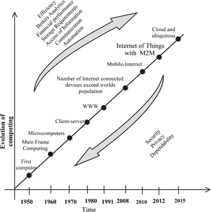

**FIGURE 1.1**

Evolution of computing.


## 物联网（IoT）概述

物联网（Internet of Things，IoT）技术最早于 1999 年提出，但在 2008 年之后才获得广泛普及。除了学术研究，物联网也是工业界关注的领域。在当前场景下，传感器被嵌入到日常物品中，例如灯具、手表和手机等。借助物联网，人类的生活变得更加轻松舒适。根据物联网应用的不同，会使用各种传感器，例如温度传感器、湿度传感器、无线电测距与测向（RADAR）、红外线以及射频识别（RFID）。

物联网是一个新兴的计算主题，其中日常使用的物理对象通过互联网（经由无线传感器网络（WSN）、蓝牙、RFID、近场通信、LoRa 等）相互连接，且几乎不需要人工干预。此外，这些设备被编程为可通过授权访问进行远程控制。网关层将物联网设备连接到外部世界以实现远程控制。事实上，WSN 是物联网系统中使用的一种技术，它能够聚合小型传感器节点以执行多项任务，包括数据的收集、聚合、处理和分析 \[199\], \[190\], \[201\]。

物联网网络中的智能设备涉及机器对机器（M2M）通信，以在无需任何人工干预的情况下完成任务。除了 M2M 之外，RFID、近场通信（NFC）、车对车（V2V）、车对电网（V2G）也是实现物联网理念所涉及的其他技术。物联网的范围从可穿戴配件到大型电力机械不等，每种设备都嵌入了传感器芯片。例如，Apple Watch 包含可提供追踪支持、身体活动数据和心率数据以供分析的传感器。同样，洗衣机和冰箱等大型电力机械可以通过物联网支持的实现变得完全自动化。

未来的互联网将拥有连接在一起并具备新功能的异构设备。值得注意的是，物联网已被证明是加强普适计算概念的先驱 \[127\]。随着物联网普及率的提高，它正在渗透到生活的方方面面。事实上，硬件技术的进步（例如使用基于无线认知网络提高带宽）和更好的连接服务使物联网更加流行 \[202\]。除了个人使用，物联网还为社区提供服务。它涵盖了许多商业和工业领域，包括医疗保健、体育、交通、娱乐、智能家居等。Fig. 1.2 描绘了物联网用于数据收集、传输和处理的分层架构。

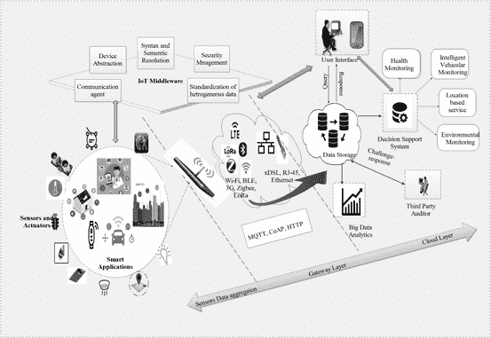

**FIGURE 1.2**  
Layer architecture of IoT for data collection, transmission, and processing.

2008 年是物联网的拐点，因为连接到互联网的设备数量超过了世界人口。截至目前，世界上已部署了 380 亿台联网设备，并预计到 2025 年，将有超过 754.4 亿台智能设备连接到互联网 \[223\](如 Fig. 1.3 所示）。学术界、政府和私营企业的持续贡献无疑为物联网实现了新的服务要求。此外，物联网技术已将存储场景从存储空间有限的硬盘改变为空间无限的云存储。

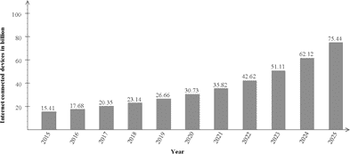

**FIGURE 1.3**  
IoT connected devices worldwide.

## 1.1.1 Components of IoT

物联网的不同组件包括执行器、传感器、连接性、数据处理、平台和用户界面，如 Fig. 1.4 所示。

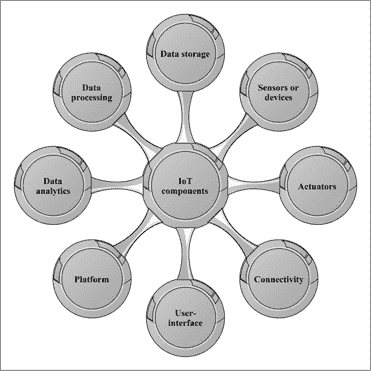

**FIGURE 1.4**  
Major components of IoT.

*   **IoT 传感器和设备**：设备可以包含多个用于感知任务的传感器。当前有多种传感器可供选择，包括近距离检测传感器、湿度传感器、RFID 标签、压力传感器、温度传感器等。这些传感器从周围环境收集信息并将其发送到数据处理层。设计将收集的数据转化为可用知识的技术非常重要。不幸的是，这些设备受电池限制。此外，为这些设备定期更换电池对许多应用来说不是可行的解决方案，因此需要能够使用多年的耐用电池。

*   **用户界面**：它为最终用户提供了一个易于访问的用户友好型媒介。用户界面有助于检查物联网系统中发生的所有活动。例如，用户可能使用界面来查看家中安装的摄像头的视频录像。实现这一点的一种流行方法是开发带有一些预定义规则的应用程序，以便在检测到任何异常活动时触发自动警报或通过电子邮件或手机短信发送通知。此外，物联网设备的特点是功率有限、内存小和处理能力弱。然而，由于物联网机器产生了大量数据，物联网系统必须面临包括安全性、数据隐私、数据管理和互操作性在内的各种挑战。

*   **数据处理**：随着物联网和大数据革命的进步，数据处理技术的重要性已得到提升。传感器生成数据后，会将其发送到用户设备或云端进行分析。数据处理可以从非常简单的事情（例如检测空调或加热器上的当前温度读数是否在定义范围内）到非常复杂的事情（检测家中不想要的人并触发警报）。但是，为了提高系统效率，数据应实时处理（无延迟）。

*   **连接性**：显然，要将收集的数据传输到云服务器，需要一种媒介。但是，根据系统不同，数据可以实时或分批随时发送。物联网网络中的事物通过公共或私有网络相互连接。各种通信媒介包括蜂窝网络、Wi-Fi、Bluetooth、广域网（WAN）、Zigbee、LoRaWAN、卫星等。值得注意的是，消息队列遥测传输（MQTT）是一种特定的 M2M/IoT 连接协议，用于在带宽优质的网络中连接远程位置。但是，每种网络都有其自身的属性，包括效率、数据传输速率、范围、带宽等。此外，网络中任何实体的识别是物联网的基础。互联网协议第 4 版（IPV4）和互联网协议第 6 版（IPV6）都受到物联网的支持。由于 IPV4 地址短缺，物联网上的对象有时会使用 IPV6 地址来标识。事实上，IPV6 是未来物联网的关键通信使能器。IPV6 的特性，即可扩展性、安全性和可连接性等，使其成为物联网的完美解决方案。对于短距离通信，电气和电子工程师学会（IEEE）提出了 IEEE 802.15.4 和 IEEE 802.11。请参阅 Fig. 1.5 以了解物联网分层协议的分类。因此，根据系统规格，选择最佳连接选项非常重要。

    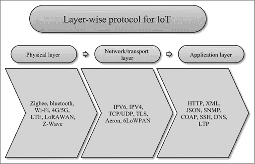

    **FIGURE 1.5**  
    Layer-wise protocol for IoT.


Platform: 随着连接互联网的设备数量增加，管理和存储 IoT 设备产生的海量数据变得困难。特别是，基于云的基础设施被用于存储和处理 IoT 数据。此外，许多数据管理工具也可用，并提供自动化功能来管理产生的大量数据。

## 1.2 Big Data Revolution

过去几年中呈指数级增长的新趋势是“大数据”。大数据是数据利用领域的一个新时代。它指的是包含结构化和非结构化数据的大型数据集，这些数据会被进一步分析以做出智能决策。根据国际数据公司（IDC）的一份报告，预计到 2025 年大数据将增加到 163 ZB \[2\]。大数据的特征是 3 个 V，即容量、速度和多样性。虽然其他研究还引入了真实性、价值和变异性作为额外特征 \[85\]。许多组织使用大数据来解决业务问题并带来创新。来自 IoT 系统、卫星、社交媒体、在线游戏等的新数据集是大数据革命的主要因素。数据集非常复杂且庞大，以至于常规软件无法处理它们 \[205\]。此外，在产生的海量数据中，缺乏对有用数据的洞察。然而，数据分析正在努力开发复杂的语言来分析这些海量数据。然而，作为一个优势，数据的增加会带来更高的准确性和更自信的决策 \[178\]，\[194\]。

此外，大数据分析是一个搜索数据库、数据挖掘并得出一些结果以改善组织绩效的过程。这些分析需要能够处理结构化、非结构化和半结构化数据，并将其转换为更易理解形式的工具。然而，隐私、保密性、可用性、速度、身份验证、高效存储和处理冗余是一些需要着手改进的大数据策略，以便在系统中取得改进。

### 1.2.1 Big data and IoT

特别是，来自 IoT 设备的数据在大数据格局中发挥了重要作用。IoT 连接设备数量的增加需要先进技术来满足客户要求。此外，IoT 的普及使得大数据分析更加复杂，因为在 IoT 环境中通过异构设备收集数据。IoT 的基本概念是通过互联网连接世界上所有物理设备（即家庭、工作场所、移动车辆中），然后处理收集数据中的信息以做出有意义的决策。IoT 从不同来源生成数据（多样性），这可能有助于结构化和非结构化数据。此外，IoT 数据的数量可以从千兆字节（GB）到泽塔字节（ZB）（容量），生成的数据可以分批或流式收集（速度） \[192\]，\[50\]。因此，由于 IoT 设备产生的海量数据，我们需要一个先进的数据处理系统。IoT 数据分析可以为各种领域（如健康分析、恶意软件检测、商业市场分析和预测等）提供关于隐藏分析的重大洞察。一些 IoT 大数据应用在 Fig. 1.6 中显示。数据挖掘、机器学习、深度学习、统计分析等是一些最新的数据分析技术，用于独立分析数据 \[101\]，\[211\]。此外，IoT 分析仍未完全发展，因为大部分 IoT 生成的数据仍未被利用。此外，随着 IoT 设备数据生成的大幅增加，一个主要关注点是数据存储以及如何在单次遍历中查询如此大的数据集 \[150\]。特别是，研究人员利用大数据分析工具来解决上述挑战。Fig. 1.7 展示了导致大数据革命的因素。IoT 和大数据的融合在各个领域创造了新的机会。来自 IoT 传感器的数据随后被输入大数据框架进行探索和分析。将大数据与 IoT 集成的目的是分析大量数据并实时处理。大数据系统正在采用平台即服务（PaaS）模型，以灵活且可扩展的方式处理 IoT 数据。在某些情况下，IoT 分析和处理还与边缘计算服务协作，这将 IoT 处理分散到网络边缘 \[162\]。然而，来自边缘节点的选定数据仍然被传输到云端。显然，IoT 系统越大，它对大数据能力的业务需求就越多。以下步骤用于 IoT 大数据处理：

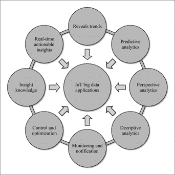

**FIGURE 1.6**  

IoT big data applications.

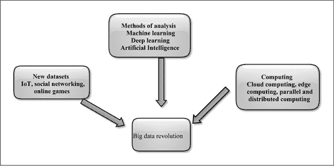

**FIGURE 1.7**  

Factors leading to big data revolution.

*   首先，由 IoT 设备生成的大量结构化、非结构化和半结构化数据由大数据系统收集。数据复杂性主要由 3 个 V 来表征，即容量、速度和多样性。请参阅 Fig. 1.8。

    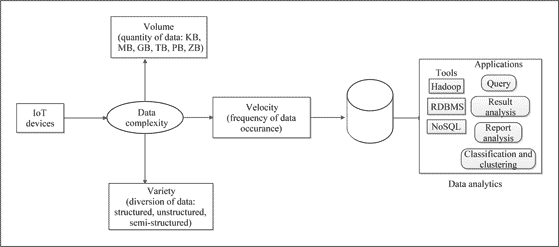

    **FIGURE 1.8**  

    IoT big data processing.

*   接下来，大数据框架将收集的数据存储在共享分布式数据库中。

*   此外，存储的数据使用大数据分析工具（如 Hadoop、MapReduce、RDBMS 等）进行分析。

*   最后，生成分析数据的报告。

大数据分析可以对 IoT 产生多方面的好处，包括：

*   检查数据

*   揭示趋势

*   发现隐藏的相关性

*   揭示新信息

*   发现不可见的模式

*   对数据进行查询

*   数据的分类和聚类

不幸的是，目前可用的软件无法很好地处理新兴的大数据。此外，IoT 和大数据的协作也为研究行业带来了挑战，包括数据存储和分析工具。此外，这种数据的增加需要更高的安全性，这给大数据安全专业人员带来了新的挑战。通过 Wi-Fi 和蓝牙传输的数据必须使用防泄漏技术发送。此外，分析部门应设计方法来处理 IoT 设备生成的冗余数据。


此外，当今数据驱动和决策场景正迫使处理和分析的速度与数据生成的速度一样快。在此背景下，数据的流处理可能是有效的。传统数据是以批次收集的，并涉及批处理。然而，批处理虽然能处理海量数据，但延迟时间较长。例如，数据可能每 12 小时或 24 小时处理一次。不幸的是，数据在被处理和分析时已不再新鲜。相比之下，数据的流处理通常比批处理更具时效性。流数据是指由各种数据源持续生成并同时收集的数据。例如，来自交通信号灯的数据没有开始或结束。在收集到实时流数据后立即进行处理，可以构建一个高效的系统。值得注意的是，流数据框架始终假设数据是持续生成且始终在移动的。大部分物联网数据都可以被描述为流数据。健康传感器、交通信号灯传感器、温度传感器等都是数据流的良好研究对象。数据流使数据能够实时分析，并为广泛的活动提供决策。因此，为了实现实时分析，许多研究人员已采用数据流处理而非批处理。`Hadoop MapReduce` 是批处理的最佳且流行的平台，而 `Apache Kafka`、`Apache storm`、`Apache Samza` 是一些用于数据流处理的开源平台。此外，`Apache flink` 是一个流行的开源数据流引擎，用于通过分布式计算在数据流上实现数据分发和容错。它几乎具有零延迟，因为数据是实时流式传输的。值得注意的是，由于早期互联网连接不佳和带宽限制，早期的研究限制了流数据以连续方式到达目的地。然而，流数据在可扩展性、数据持久性和数据存储方面面临挑战。因此，为了对流数据做出实时决策，需要一种新的范式，能够以非常高的吞吐量速度处理数据。表 1.1 显示了批处理和流处理数据之间的区别。

**TABLE 1.1**

批处理和流处理数据的比较。

| 批处理 || 流处理 |

| --- | --- |

|

*   未定义时间线

*   延迟时间为分钟到小时

*   涉及复杂分析

*   始终处理大量数据

 ||

*   更具时效性

*   以秒或几分钟为单位进行实时决策

*   涉及简单分析

*   处理单个记录

 |

| --- | --- |

解决流数据问题的方法之一是使用概率数据结构（PDS），因为它们能够高效地处理可扩展和动态数据。PDS 对于需要在大型数据集上执行查询时实现实时响应的应用非常有用。此外，PDS 优化了各种查询（例如成员身份、基数搜索和频率计数等）的时间和空间复杂度。未来章节将详细讨论 PDS 及其类型。

## 1.3 理解边缘计算

边缘计算被定义为一种分布式计算架构，支持在事物所在地附近进行数据处理，并生成数据。边缘计算正将计算时代推向更分布式的架构。边缘计算的出现是因为物联网设备的指数级增长，这些设备进一步与云通信 \[123\]。这项技术将数据存储、处理和计算更靠近设备，而不是依赖于数千英里外的中心位置。根据 Gartner 的一份报告，到 2020 年，75% 的数据将在云外产生 \[3\]。在边缘计算场景中，传感器和设备将数据传输到附近的边缘计算设备（例如网关、交换机、路由器和微型数据中心等），这些设备处理数据，而不是将其发送到远程数据中心。设计边缘计算的主要目的是解决数据从生成点长途传输到云存储时的带宽成本。通过这种方式，数据可以实时轻松处理，延迟显著降低，从而提高应用程序性能。通过将敏感数据存储在更靠近设备的位置，也可以改善安全性和隐私服务。此外，通过本地处理数据，可以节省大量资金。组织内物联网的日益增长和广泛采用预计将更多地依赖边缘计算市场。预计到 2024 年，全球边缘计算市场规模可达 90 亿美元，如 图 1.9 (a) 所示。此外，图 1.9 (b) 表示 2019 年按应用划分的边缘计算市场份额（美元）。此外，边缘计算为物联网应用促进了新的可能性，特别是使用 ML 服务执行对象检测、语言处理等任务。这意味着数据处理可能更高效，属性的中心化程度更低。包括智能电网、物联网车辆（IoV）、物联网无人机（IoD）、自动驾驶汽车等在内的许多物联网应用都可以从边缘计算中受益。边缘计算的一些优势在 图 1.10 中有所描述。

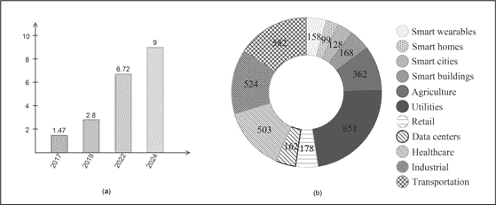

**FIGURE 1.9**

(a) 全球边缘计算市场规模 2024 年；(b) 2019 年按应用划分的边缘计算市场份额（美元）。

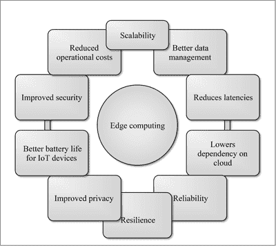

**FIGURE 1.10**

边缘计算对物联网的主要优势。

*   **延迟降低**：与云网络相比，边缘网络更靠近物联网设备，这意味着存储、处理和通信的往返时间更短。

*   **物联网设备电池寿命更长**：由于边缘计算将打开通信通道的时间缩短，这意味着电池受限的物联网设备的电池寿命可以延长。

*   **更好的数据管理**：边缘计算是数据管理的未来，因为它不再在集中位置管理数据，而是使多个边缘设备能够进行分布式管理。

*   **改进的安全性和隐私性**：边缘计算还提供一些安全性和隐私性优势。如前所述，由于云固有的集中化特性，它容易受到分布式拒绝服务（DDoS）攻击。相比之下，边缘计算将存储和处理分布在各种设备和数据中心，从而消除了单个服务器宕机的可能性。此外，边缘计算减少了传输到中心数据中心的数据量。最重要的是，将数据存储在设备所在位置附近也提高了系统的隐私性。

*   **可扩展性**：显然，通过分散处理，中心网络的负载减轻了。边缘计算提供了一种更经济的可扩展性方式，使公司可以通过边缘数据中心扩展其计算能力。此外，使用边缘计算设备减少了网络核心对大量带宽的需求。


## 弹性

边缘计算相较于集中式模型提供了更多的通信路径，从而也保障了数据通信的弹性。如果边缘某个设备发生故障，其他资源仍可保持持续运行。由于众多边缘计算设备和数据中心连接到网络，数据可以通过多条路径进行路由，以确保用户能够获取数据。

## 降低运营成本

显然，物联网传感器产生的大部分数据与物联网无关。在此背景下，边缘计算允许在将数据发送到云端之前进行过滤，从而降低数据传输成本。此外，边缘计算减少了对大量云存储的需求，进而降低基础设施成本。

## 自主运行

许多物联网应用要求其运行具有自主性。边缘计算支持本地存储和计算。因此，即使未连接互联网，系统仍可正常运行。

因此，对实时计算需求不断增长的物联网设备持续推动着向边缘计算服务的发展。然而，边缘计算与物联网的这种协作需要新的投资、基础设施和管理平台。

以下是在物联网环境中部署边缘计算时面临的挑战：

### 异构性

如前所述，计算平台可能拥有不同的操作系统和硬件规格。此外，通信技术在数据速率和传输范围方面也可能是异构的。因此，边缘计算的挑战之一是为不同环境设计可移植的软件空间。另一个问题是开发支持硬件异构性的语言。

### 标准协议

在物联网框架中，异构设备和传感器通过通信协议与边缘服务器连接。由于存在不同的接口，需要特定的通信协议。因此，由于新设备开发的增加，物联网系统中标准协议的开发具有挑战性。

### 可用性

可用性是指随时为订阅的物联网节点提供资源和服务。对于不断增加的物联网设备，确保硬件和软件资源的可用性具有挑战性。

### 安全性与隐私

显然，边缘计算为网络安全部门提供了缓解，因为物联网数据传输距离较短。尽管边缘环境的动态特性使网络处于无保护状态。许多可执行应用程序在网络边缘运行，因此保持数据的机密性非常重要。

# 活动

### 选择题

1. ARPANET 代表什么？

   1. Advanced Real Projects Air Network

   2. Advanced Research Preparation Agency Network

   3. Advanced Recruitment Process Agency Network

   4. Advanced Research Projects Agency Network

2. 连接到物联网的海量设备需要自动通信，而非通过人类。这称为什么？

   1. Skynet

   2. Bot 2 Bot

   3. Machine-2-machine computing

   4. Intercloud

3. MQTT 是 —- 协议？

   1. Machine-to-machine

   2. Internet of Things

   3. Machine-to-machine and Internet of Things

   4. Machine things

4. IP 地址第 6 版有多少位？

   1. 64

   2. 128

   3. 32

   4. 256

5. MQTT 代表

   1. MQ Telemetry Things

   2. MQ Transport Telemetry

   3. MQ Transport Things

   4. MQ Telemetry Transport

6. 大数据的三个 V 是什么？

   1. Volume

   2. Velocity

   3. Variety

   4. All of the above

7. — 是检查大量且不同种类数据集的过程？

   1. Big data analytics

   2. Machine learning

   3. Deep learning

   4. None of the above

8. Hadoop 可以处理哪种类型的数据？

   1. Structured

   2. Unstructured

   3. Semi-structured

   4. All of the above

9. 什么将物联网设备连接到云端以聚合数据、在协议之间进行转换，并在将数据发送到其他地方之前进行处理？

   1. IoT sensors

   2. IoT standards

   3. IoT gateways

   4. IoT processors

10. 以下哪一项是物联网边缘计算的挑战？

    1. Increased security risks

    2. Inconsistent industry standards and regulations

    3. Lack of support for new devices

    4. All of the above

1. d  2. c  3. c  4. b  5. d  6. d  7. a  8. d  9. c  10. d

# 智能应用

## 2.1 能源互联网

据报道，用户的全球电力消耗预计到 2040 年将比 2017 年增长 30%（\[30\]）。这种不断增长的需求是由于城市化、对电器的日益追求以及人口增长。为了满足这一需求，由于 CO2 燃烧导致的环境污染问题已被提升为关键问题。要设计基于物联网的完整智能家居和智慧城市，需要一种智能电力分配方法。采用可再生能源、电动汽车（EV's）、智能电网是解决这一问题的一些最有效方案。随着分布式能源资源的使用，能源系统正朝着去中心化方向转变。此外，本地能源市场的概念也日益流行，它涉及网络不同节点之间的本地电力交易。同样，智能电网为电力的生成、分配、存储和传输提供了一个自主平台。智能电网框架通过平衡不同公用事业之间的电力生成和消耗来保持稳定性 \[117\]。为了将智能电网与分布式能源资源相结合，微电网被有效使用。随着微电网的使用，能源交易者和消费者可以轻松在本地交易能源，这明显减少了传输功率损耗。此外，电动汽车（EV's）和车联网（V2G）技术是智能电网的重要组成部分，有助于构建绿色环保的环境。电动汽车与风电和太阳能电站协作，能够提供更好的存储和能量平衡服务。同样，V2G 技术使电动汽车能够充当一种能量存储介质，以便在高峰时段将能量传回电网，用于负载平衡。电动汽车车主在放电时会获得相应的报酬。

显然，上述所有技术的使用正在将能源市场框架从集中式网络转向分布式和去中心化网络。这种包括发电厂、微电网、电动汽车、智能电网和人与互联网之间的动态互连，被称为能源互联网（IoE）。具体来说，IoE 是物联网、大数据、人工智能（AI）和计算技术在分布式能源管理系统中的实现，旨在优化现有的能源基础设施。IoE 彻底改变了能源市场，以实现自主管理的智能电力基础设施。与物联网类似，IoE 基于传感器和自动化实时监测技术，从不同公用事业收集能源信息。


因此，能源市场与智能边缘设备协作以实时处理数据，正在将能源市场推向一个不同的未来。然而，IoE 包含多种形式的能源，这导致网络中的安全和隐私问题，从而要求一种新的能源系统。此外，通信协议和标准在控制和维护 IoE 设备方面面临问题。数据管理、支付机制、点对点（P2P）能源交易、需求响应管理、网络攻击和动态定价是 IoE 面临的其他一些问题。

## 2.2 自动驾驶汽车

人口增长直接影响个人拥有的车辆数量，这显然给当前的交通基础设施带来了负担。据报道，到 2030 年，全球车辆数量预计将达到 20 亿辆 \[177\]。车辆数量的增加给当前交通系统带来了各种问题，例如- 停车困难、道路事故增加、通勤时间延长、污染增加等，这创造了对可靠交通系统的需求 \[196\]，\[141\]。此外，自动驾驶汽车还面临许多其他挑战，包括软件异质性、数据验证和确认以及延迟 \[187\]。最近，认知计算与物联网的集成越来越受欢迎，因为自学习模型被包含在智能事物中，旨在模拟人类思维过程。这项技术被称为认知物联网（CIoT）。在 CIoT 的各种应用中，自动驾驶汽车是开发者中的新宠。由于计算机视觉技术、汽车工业和认知计算的最新进展，自动驾驶汽车正在得到工业界和学术界研究的广泛关注。

自动驾驶汽车旨在自动获取、收集、管理和分发不同交通实用工具（包括车辆、接入点（`AP's`）和路侧单元（`RSU's`））之间的交通信息。提高安全性、节省时间、改善交通流量、自动停车、新的商业机会、以客户为中心的体验和减少事故是自动驾驶汽车要实现的一些关键目标。自动驾驶汽车由编程控制的 AI 代理组成，用于监督、决策和自我管理，无需人工干预。自动驾驶汽车应该执行包括感知邻域环境、控制速度和实现无人驾驶驾驶等任务，无需任何人工控制。此外，使用自动驾驶汽车将减少对物理道路信号、车辆保险和交通警察的需求 \[158\]。自动驾驶汽车：自动驾驶汽车通过专用短程通信（`DSRC`）协议连接。这些车辆配备了各种传感器和执行器（`压电传感器`、`微波多普勒 RADAR 传感器`、`电感线圈传感器`、`IR 传感器`、`声学传感器`等），以处理实时交通数据以实现更好的操作和决策。这些传感器有助于提供有关速度、车道占用率、物体检测的信息，以完成包括行驶时间延迟和交通流量预测等任务。特别是，摄像头传感器旨在支持周围视图，`RADAR` 传感器有助于物体检测，而 `LIDAR` 传感器用于碰撞避免。此外，软件定义网络（`SDN`）为自动驾驶汽车带来了灵活性、可编程性和其他一些广泛的进步 \[43\]，\[42\]，\[198\]。除此之外，自动驾驶汽车还与基于 GPS 的出租车和蜂窝记录数据连接。自动驾驶汽车需要大量的数据收集和处理。连接汽车、接入点和路侧单元（`RSU's`）之间共享的所有数据都上传到云服务器进行处理和决策。然而，维护来自不同来源的收集数据有相当大的成本。因此，应考虑收集数据的性质（`volume`、`variety`、`velocity`、`quality`）。

## 2.3 医疗保健

医疗护理和健康护理是 IoT 值得提及的应用。借助 IoT，医生现在可以持续监测患者的健康状况。此外，患者与医生的互动变得更加高效。许多设备，例如- 健身手环、血糖仪、运动探测器、心率监测袖带等，已增加了用户对自身健康的个性化关注。这些设备用于通知卡路里计数、运动检查、呼吸检查、预约、站立目标和心电图（`ECG`）等。此外，无线体域网络也很流行，其中多个传感器节点随机部署在人体内 \[180\]。在发生重大干扰或常规活动变化的情况下，警报消息会发送给家人和相关医生。此外，远程手术有能力基于高源数据传输向偏远地区提供医疗服务 \[96\]。降低成本、改善治疗、更快的疾病诊断、主动治疗和减少错误是基于 IoT 的医疗保健的一些关键优势。此外，IoT 可以识别设备补充物资的时间。网关、健康数据库、迷你医疗服务器是为授权利益相关者提供按需服务的一些重要组件。最近，全球 Healthcare 4.0 诊断系统的使用呈指数级增长。在这里，患者记录存储在电子健康记录（`EHR`）存储库中，该存储库位于集中式或分布式位置，以便从任何地方监控和访问数据 \[105\]，\[193\]，\[44\]，\[104\]。在此背景下，电子健康云框架已发展起来，用于在各种医疗机构、医学研究人员和医院系统等之间交换和共享重要信息 \[145\]。一些 IoT 医疗保健应用包括：

*   血糖水平感知

*   ECG 监测

*   血压监测

*   血氧饱和度监测

*   轮椅管理

*   药物管理

*   康复系统

*   咳嗽检测

*   黑色素瘤检测

*   远程手术

Healthy children、GoogleFit、Period calendar、Noom walk、OnTrack diabetes、Eyecare plus、Asthma tracker 和 Daily yoga 是一些流行的通用医疗保健智能手机应用程序。值得注意的是，基于 IoT 的医疗保健研究目标涉及网络架构、互操作性、异质性、安全性、政策和指南等 \[210\]。特别是，由于医疗保健数据的敏感性，它面临着安全和隐私问题 \[103\]。与标准通信场景类似，保密性、完整性、认证、可用性、数据新鲜度、权威性、恢复能力、容错是实现安全基于 IoT 的医疗保健解决方案所需的安全要求。然而，由于基于 IoT 的传感器在计算、内存和能源方面的限制，阻碍了在医疗保健系统中实施复杂的安全协议。此外，移动性、可扩展性和动态安全更新是实现安全要求的一些其他挑战性因素。

## 2.4 智慧农业


# 下一代计算时代将完全基于物联网

农业行业是物联网颠覆的另一个领域。根据联合国报告的最新统计数据，世界人口预计将在 2050 年达到 97 亿 \[4\]。为了养活如此庞大的人口增长，农业行业已采用物联网。值得注意的是，缺乏气候知识可能会影响农作物产量的质量。许多时候，农业和农耕活动因预测不准而失败，给农民带来巨大损失。农业领域被视为确保粮食安全的关键部门。

借助物联网，不可预测的天气状况、气候变化和环境变化等挑战得到了高效解决，以满足不断增长的粮食需求。基于物联网的农业市场预计将从 2019 年的 127 亿美元增长到 2024 年的 209 亿美元 \[5\]。通过在农田部署全球定位系统（GPS）和智能传感器，并结合大数据分析，农民将能够高效管理农业。物联网便于收集和管理传感器设备采集的海量数据，借助云计算服务，数据可以随时随地轻松访问。

智慧农业是一种以可持续方式种植食物的高科技系统。智慧农业消除了农民体力劳动的需求，以提高生产力。基于物联网的智慧农业实时监测作物状况以及田地的各种因素，包括湿度、土壤、土壤湿度、温度等。此外，植物监测、动物监测、病虫害防治、供应链管理、基础设施管理和控制系统管理等，都是基于物联网的智慧农业的其他应用 \[87\]。此外，借助传感器和互联互通，可以节省水和电的过度使用，以实现植物的最佳生长。这消除了在恶劣天气条件下亲自到场的需求。有关基于物联网的农业应用，请参阅 图 2.1。

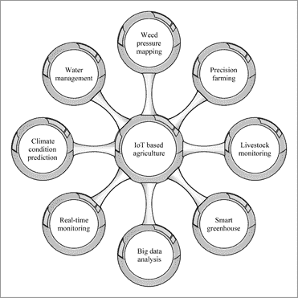

**FIGURE 2.1**  

基于物联网的农业应用。

除了大规模农业，基于物联网的智慧农业也专为家庭农业和有机农业设计。最近，空中无人机也被用于改善农业活动。通过飞行中收集的视觉图像数据，可以为农民提供包括植物健康指数、产量生产、植物健康测量、田地积水图谱、杂草压力图谱、小麦中的氮含量等在内的洞察。

## 2.5 智慧教育

近年来，智慧教育受到了学术界和工业界的广泛关注。物联网可以通过提供更好的学习体验，影响学生学习的方方面面。智慧学习环境的目标是实现自主学习和自主激励的服务，使学习者可以在自己的地方参加教育课程，并使用个性化学习内容。基于物联网的智慧教育的一些优势如下：

*   物联网在教学和评估中发挥着关键作用。由于物联网具有设备到设备（D2D）管理和互联互通的核心功能，它可以轻松管理设备，并提供学生交互以获得更好的学习体验。因此，物联网提供在家学习，远程学习课程运行成功。

*   不同教育单位之间的自动连接将自动降低总体支出。

*   物联网系统可用于跟踪机构的整体安全。可以通过基于物联网的传感器轻松跟踪防火安全、学生移动跟踪、外部人员进入等活动。此外，可以管理学院的车辆并为其提供安全。

然而，数字学习涉及大量电子设备，需要设备管理和决策。

## 2.6 智慧工业

工业间日益加剧的竞争和不断增长的生产需求给机器带来压力，从而导致故障风险。此外，原材料价格越来越高，迫使工业优化运营并减少能源和制造浪费。此外，工业需要对机器和工人进行安全的实时监控。在此背景下，基于物联网的智慧工业已被证明有助于解决上述问题。

智慧工业（也称为工业 4.0）为智能工厂、工作机器和工业基础设施提供互联互通，以简化智能业务运营并创建智能自优化工业设施 \[131\]。2019 年被视为工业 4.0 成熟度的转折点 \[6\]。数字化、互联互通、新技术和先进制造是推动智慧工业革命的驱动因素。智慧工业网络在高度细粒度级别上互联产品、机器、制造单元、公司、生产工厂等。这项技术基本上基于自动化、连接性、云、大数据、机器学习、模拟数据分析、增强现实以及制造中的数据交换的概念。智慧工业改变了工厂和工作场所的运作方式，使其更加安全、高效、灵活且环保。智能工厂、智能机场、智能铁路、汽车工业和智能建筑是智慧工业的一些关键物联网应用。物联网使机器能够在工厂内部以及与云服务器相连，从而在制造中实现最佳规划和灵活性。借助智慧工业，线性和顺序的供应链运营正在向互联和开放的供应链运营系统转变。资产效率、更好的质量、更低的成本、安全性、故障发生检测和可持续性是智慧工业的优势。值得注意的是，与智能家居和智能城市应用相比，工业物联网（IIoT）中的数据可靠性必须更高 \[67\]。对于某些工业应用，在工业环境中，无线通信需要低延迟和低抖动。图 2.2 转变是因为智慧工业。

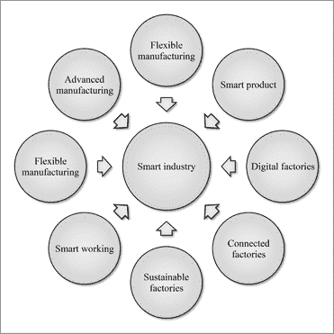

**FIGURE 2.2**  

智慧工业带来的转变。

值得注意的是，物联网与智慧工业的协作正在将场景从价值链方法转向以网络为中心的方法。然而，互操作性问题是设计自动化的人机和机机协作时的严重关切问题之一。

## 2.7 智慧城市


许多基于物联网的应用旨在通过收集信息来改善城市居民的生活方式。随着人口水平的增加，智慧城市的需求日益增长，因为在庞大人口中管理这些有限资源是困难的 \[195\]。智慧城市被称为基于信息和通信技术的创新城市，旨在提高生活质量和城市运营效率。城市的智慧是指有效利用所有资源并以最大效率自动运行的能力。智慧城市提供许多服务，包括交通、废物管理、环境监测和交通管理，仅举几例。（参见 图 2.3。）智慧城市所需的关键特征，即互联、智能和仪表，均由物联网支持 \[111\]。因此，可以说物联网是智慧城市的支柱。这些应用的通信设备专门设计用于执行低功耗操作，但可用于需要更长通信距离的大面积区域。LoRa 技术在智慧城市应用中被高效使用。基础设施建设、交通、能源、治理、教育和公民是智慧城市的关键组成部分，而可持续性、生活质量、城市化和智慧是智慧城市的各种属性 \[147\]。可持续性定义了城市基础设施、气候变化、社会问题、废物管理、水资源管理治理等。服务质量是根据公民的情感和财务福祉计算的。城市化包括基础设施、技术和经济等方面。智慧包括智慧生活、智慧经济、智慧移动等方面。设计成本、可靠通信、运营效率、灾害韧性、系统故障、公共安全和碳排放是构建智慧城市的几个挑战。

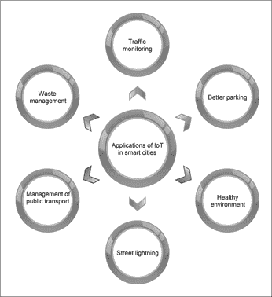

**FIGURE 2.3**  

Applications of IoT in smart cities.

在用户背景下，物联网应用分为四类：

*   个人物联网：这些应用由个人使用。例如，智能手表用户。

*   群组物联网：这些应用由一小群人使用。例如，在智能家居、联网汽车、智能教育等方面。

*   社区物联网：这些应用由更大群体的人使用。例如，智慧城市和智能公园等。

*   工业物联网：这些应用指物联网应用的工业子集。例如，智能工厂、智能农业等。

# 活动

### 选择题

1.  智能电网的组成部分是什么？

    1.  电动汽车

    2.  车辆到电网

    3.  太阳能电站

    4.  以上都是

2.  IoE 的缩写是什么？

    1.  能源互联网

    2.  电力互联网

    3.  进化互联网

    4.  引擎互联网

3.  以下哪项不是物联网健康应用？

    1.  血压监测

    2.  轮椅管理

    3.  远程手术

    4.  电费生成

4.  智能农业的组成部分是什么？

    1.  航空无人机

    2.  GPS

    3.  温度传感器

    4.  电动汽车

5.  以下哪项不是基于物联网的农业应用？

    1.  精准农业

    2.  黑色素瘤检测

    3.  杂草压力制图

    4.  智能温室

6.  智能工业的另一个名称是什么？

    1.  工业 4.0

    2.  工业 5.0

    3.  工业 6.0

    4.  工业 7.0

7.  以下哪类用户在智能手表中发现针对健康的应用增加？

    1.  个人物联网

    2.  群组物联网

    3.  社区物联网

    4.  工业物联网

8.  以下哪类用户被公民用于为智慧城市做出贡献？

    1.  个人物联网

    2.  群组物联网

    3.  社区物联网

    4.  工业物联网

9.  以下哪类用户用于联网汽车的应用？

    1.  个人物联网

    2.  群组物联网

    3.  社区物联网

    4.  工业物联网

1. d  2. a  3. d  4. a, b, c  5. b  6. a  7. a  8. c  9. c

# 3

# 物联网挑战

尽管有许多好处，物联网在全球采用方面仍面临许多挑战。图 3.1 (b) 显示了物联网网络面临的主要问题。本章总结了物联网世界面临的挑战。

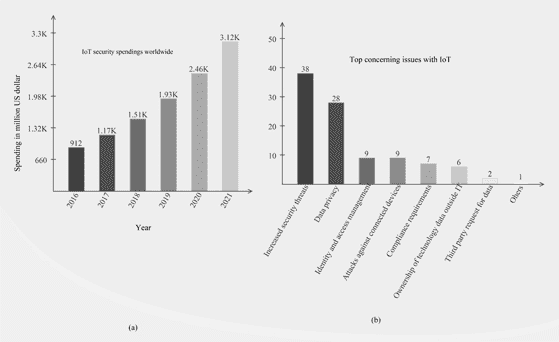

**FIGURE 3.1**  

(a) IoT security spendings worldwide (b) Top issues with IoT.

## 3.1 安全

对于安全的物联网范式，数据隐私、保密性、完整性、身份验证、授权和可用性等参数很重要，需要实现。值得注意的是，物联网组件大多无人看管，因此很容易被攻破。此外，采用弱密码和使用默认密码是身份验证攻击的常见漏洞 \[186\]。此外，通过 Web 界面连接设备为结构化查询语言 (SQL) 注入和跨站点脚本等攻击打开了机会。同样，为了提供远程服务，物联网设备使用 Telnet 服务，分布式拒绝服务 (DDoS)、窃听和 TCP SYN 等攻击可以轻松发起 \[219\]。例如，2016 年 10 月 21 日的 Mirai 僵尸网络攻击感染了多个物联网设备。接下来，这些被攻击的物联网设备被用于通过发起 DDoS 攻击来淹没域名系统 (DNS) 服务提供商“Dyn”。结果，该僵尸网络使各种社交网络网站瘫痪。同样，女巫攻击和欺骗攻击等攻击可以在物联网设备上发起，以降低网络性能并破坏数据隐私。图 3.1 (a) 显示了 2016-2021 年物联网的全球安全支出。因此，构建具有高安全控制的物联网设备很重要。


值得注意的是，与传统网络相比，为物联网范式提供安全性是复杂的，因为来自各种传感器的异构数据的存在。此外，由于系统的开放性以及通过无线通信介质与互联网互连，安全性是一个突出的挑战。此外，传统的安全解决方案（包括`firewall`和`anti-virus`）由于空间和能量有限，不适用于物联网 \[33\]。因此，设计基于最优能耗的安全解决方案是物联网中需要特别关注的重要问题之一 \[188\]。文献支持各种加密协议，包括`Rivest–Shamir–Adleman (RSA)`、`Elliptic-curve cryptography (ECC)`、`Diffie Hellman (DH)`密钥交换等，以处理这些安全问题。使用加密的安全解决方案也不适合物联网，因为这些受限设备无法实现复杂的加密和解密。此外，所有这些安全协议都依赖于一对加密密钥，对于这些密钥对的生成和管理，物联网制造商依赖于集中式、受信任的第三方。此外，数字证书的检查、维护和吊销也依赖于一个称为“注册机构”的集中式方。值得注意的是，拥有一个集中式方可能成为单点故障，并成为数据隐私攻击的原因。此外，为每个物体颁发数字证书是有问题的，因为物联网对象的数量非常大。因此，需要解决授权、身份验证、可用性、不可否认性和信任等关键要求，以应对未来的物联网网络。

## 3.2 数据管理

物联网设备产生大量需要实时处理和分析的数据。当前的数据中心框架无法有效处理数据的异构性。学术界和工业界都有大量研究致力于解决物联网中的数据管理问题。根据国际数据公司的一份报告，物联网设备产生的数据预计将从 2018 年的 33 ZB 增长到 2025 年的 79.24 ZB \[7\]。

数据管理的主要关注点之一是数据存储。物联网数据存储基本有三种类型，即本地、分布式和集中式。本地类型表示物联网传感器产生的数据将存储在物联网设备本身上。分布式处理表示数据将存储在边缘并通过分布式技术进行处理，而集中式类型表示收集的数据存储在数据中心。如前所述，物联网设备缺乏电力且存储空间有限，因此在物联网设备上存储数据是不可能的。此外，用于存储物联网设备产生的数据的数据中心应拥有足够的能源和电力资源，以便在需要时处理查询。然而，在未来，物联网设备产生的预计数据量可能会使云基础设施过载。此外，在远程集中位置存储数据在处理任何查询时可能会导致高响应时间。因此，物联网数据应存储在靠近数据生成点的分布式位置。

## 3.3 隐私

物联网系统包含多个设备，这些设备生成和交换包含隐私敏感信息的异构数据。例如，智能健康可穿戴设备和设备产生大量包含用户位置、健康状况、睡眠模式等信息的物联网数据。值得注意的是，这些数据存储在第三方云服务提供商处。此外，用户的浏览互联网兴趣行为由第三方收集，以丰富用户体验。因此，在医疗保健、电力数据、军事应用等场景中，通常需要提供隐私保护 \[207\]。隐私是设备控制何时以及与谁共享设备个人信息的能力 \[217\]。此外，收集的个人数据应由授权服务提供商访问。传统的隐私保护方法由于高能耗和处理开销，对物联网来说成本高昂。值得注意的是，依赖集中式云服务器（第三方审计员），用户不知道有多少个人信息正在与其他方共享。此外，大多数最先进的隐私框架基于集中式结构，因此由于可扩展性问题和单点故障，不适合物联网。因此，物联网系统需要一种轻量级、可扩展且分布式的隐私保障。

## 3.4 异构性

物联网连接不同复杂度和不同供应商的各种物联网实体。最近，研究人员为物联网开发了多种硬件和软件平台。物联网中的交互不依赖于某一种特定的硬件设备或软件，而是依赖于各种不同类型的智能连接设备。物联网设备的发布日期、版本、技术接口和比特率可能不同。此外，物联网系统在通信协议、数据格式和基础设施方面表现出异构性。由于许多异构事物连接到互联网，需要一种支持轻松连接、控制和通信的特定架构。此外，为了支持自动化，不同设备应具有同步时钟。此外，物联网的环境是动态的，即设备可能连接到与另一时间完全不同的一组设备。由于设备的高度异构性，物联网在网络中缺乏可扩展性、互操作性、可靠性、可用性和安全性。因此，必须在所有网络技术中部署互操作性，并考虑其模式、网络提供商和供应商。

## 3.5 延迟


# Latency Challenge in IoT

Latency 是 IoT 演进中必须考虑的一大挑战。网络操作延迟会降低 IoT 系统性能和服务质量（QoS）\[169\]。由于这些设备的计算能力有限，IoT 数据通常需要发送到云端进行计算处理。然而，IoT 用户希望从世界各地访问这些数据。因此，对于集中式云服务器来说，处理如此多的请求是一项艰巨的任务。此外，由于云服务器位于远处，访问服务的延迟显而易见。此外，还有一些对延迟敏感的应用（军事、医疗、交通）要求立即处理查询。因此，设计支持低延迟和快速响应时间的计算基础设施至关重要。除了高延迟之外，直接与云端通信会导致网络带宽过载。不过，随着包括雾/边缘计算在内的最新进展，通过在计算和存储资源上进行少量投资，延迟问题得到了缓解 \[126\]，\[189\]。因此，某些信息应在设备附近进行处理，以便在挑战更少的情况下实现 IoT。可以从 Fig. 3.2 看出，与边缘/雾计算技术相比，云框架的延迟更大。因此，对于延迟敏感的服务，更倾向于使用雾/边缘计算 \[184\]。雾/边缘计算在云端和 IoT 设备之间支持一个智能层，使 IoT 能够实现低延迟、位置感知和地理分布 \[128\]，\[206\]。显然，云计算支持集中化，而雾计算则催生了去中心化。此外，一种名为触觉互联网的最新技术已被用作最新的互联网网络，可实现超低延迟，同时具备高可用性、可靠性和安全性 \[57\]，\[100\]，\[56\]，\[115\]。

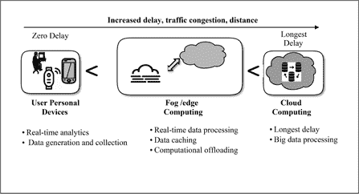

**FIGURE 3.2**  

Comparison of data processing at different computing locations.

## 3.6 Communication Challenge in IoT

IoT 设备通过互联网相互通信，并与外部环境通信。IoT 通信是远程监控、数据分析和信息交换的基础。要完全连接 IoT 设备，需要可靠且双向的信号来收集和传输设备之间的数据。在此背景下，IoT 支持多样化的无线网络。此外，无线通信的最新技术更关注于向目的地传输敏感信息，包括能量、延迟、可靠性和安全性 \[191\]。然而，由于传感器网络的无线特性，IoT 网络容易受到安全攻击，例如欺骗、水坑攻击、女巫攻击、蠕虫洞攻击和 DDoS。因此，为了充分发挥 IoT 的潜力，必须解决 IoT 通信面临的一些挑战。

此外，网络移动性和覆盖范围仍然是 IoT 的开放研究挑战，需要考虑以有效开发 IoT 用例，因为大多数 IoT 服务旨在交付给移动用户 \[175\]。这是 IoT 的一个重要断言，以确保 IoT 节点随时随地都能连接。智能手机有时会因设备移动性而出现中断。因此，需要一个有效的移动性系统来管理 IoT 中连接设备的增长。现有的蜂窝网络需要部署更多基站，以高效地将网络中的所有设备连接在一起。

除此之外，网络拥塞是 IoT 实施中需要解决的另一大挑战，因为智能设备正在推高网络中的信令负载，与传统的人机（H2H）流量相比。在网络拥塞严重的情况下，IoT 性能和网络的服务质量（QoS）会下降。因此，TCP/IP 协议必须有效处理网络拥塞问题 \[204\]。然而，当前的 TCP 实现不适用于 IoT 应用场景，因为 IoT 网络的流量模式与传统网络完全不同。

数百万台连接设备的连接会消耗电力和 CPU。为了解决这个问题，通信技术应强制实施最小电池耗尽和最小功耗。与此同时，带宽消耗是 IoT 连接的另一个问题。此外，最优能源利用是 IoT 中需要关注的重要问题之一 \[188\]，\[200\]。因此，需要一个轻量级网络来在设备和服务器之间无缝传输数据。

### Conclusion

从上述讨论可以得出结论，集中式云/第三方存在多种局限性。特别是，存储在云上的数据面临隐私问题，因为第三方可能在未经同意的情况下更改用户数据。此外，集中式服务器更容易受到 DDoS 攻击。此外，在负载重的情况下，集中式服务器可能无法为用户查询生成快速响应。最重要的是，集中式服务器可能导致单点故障。

# Activity

#### Multiple Choice Questions

1. IoT 设备和节点天然易受 \_\_\_\_\_\_ 威胁？

    1. Sensors

    2. Security

    3. Connectivity

    4. Heterogeneity

2. IoT 涉及一种在环境中无处不在的架构。

    1. True

    2. False

3. 与 IoT 相关的风险和挑战有哪些？

    1. Scalability

    2. Privacy and security

    3. Energy consumption

    4. All of the above

4. IoT 中的哪一项是关键特征，其中设备具有不同的硬件平台和网络？

    1. Heterogeneity

    2. Sensors

    3. Connectivity

    4. Security

5. 当僵尸军队被部署来向 IoT 设备发送垃圾邮件攻击时，会出现哪个挑战？

    1. Heterogeneity

    2. Sensors

    3. Connectivity

    4. Security

6. 将 IoT 数据存储在远程位置会导致查询处理的高响应时间。

    1. True

    2. False

7. IoT 网络操作延迟影响？

    1. System performance

    2. Security

    3. Privacy

    4. QoS

8. 云框架的延迟低于雾计算。

    1. True

    2. False

9. 集中式第三方在数据管理方面的局限性是什么？

    1. Vulnerable to DoS attack

    2. Single point of failure

    3. Privacy issues

    4. All of the above

10. 以下哪项延迟最低？

     1. Cloud devices

     2. User personal devices

     3. Fog devices

     4. Mist devices

1. b  2. a  3. d  4. a  5. d  6. a  7. a, d  8. b  9. d  10. b

# Part II

# Blockchain Overview

# 4

# Python Basics

## 4.1 Introduction

Python 是一种用于通用编程的高级编程语言，由 Guido Van Rossum 于 1991 年开发。Python 特别设计为高度可读，因为它使用频繁的英语关键字。Python 常用于在服务器上创建软件和 Web 应用程序。Python 的一些重要特性描述如下：

* It supports concepts of object-oriented programming.


它可以与包括 C、C++、Java、公共对象请求代理体系结构（CORBA）等在内的其他一些编程语言轻松集成。

Python 具有可扩展性，因为它比 shell 脚本更好地支持大型程序。

Python 高度依赖缩进，这里使用空白来定义作用域。由于其强大的结构化构造，它支持清晰的编写和逻辑应用。

Python 可以轻松连接到所有主要的商业数据库。

Python 具有可移植性，因为它在各种硬件平台上运行。

Python 支持交互模式，这使得代码的交互式测试和调试成为可能。

Python 支持高级动态数据类型和动态类型检查。

Python 是一种脚本语言，因为它适合嵌入和编写小型非结构化脚本。

Python 程序的长度远短于等效的 C、C++ 程序，原因如下：

*   在 Python 的高级数据类型支持下，复杂操作可以用单个语句表达。
*   使用缩进而不是使用开始和结束括号。
*   变量和参数的声明并不重要。

**注意：** Python 是一种编译和解释型编程语言。源代码首先被编译为字节码，然后该字节码在 Python 虚拟机上被解释为机器语言以给出实际输出。字节码的概念实现了可移植性。但是，要执行 Python 代码，每次都需要 Python 程序代码。

编写完程序后，在文本编辑器中将程序保存为 `.py` 文件。然后，在 Python 解释器中执行该文件。尽管如此，在 Python 解释器中输入命令是玩转 Python 特性的好方法，但不建议用于解决更复杂的问题。

本章余下部分将通过示例讨论 Python 语言的各种重要特性，从简单语句、表达式、数据类型开始，到类、对象、函数、文件处理等概念。让我们开始 Python 编程。

## 4.2 注释

Python 中的注释用 `#` 表示。行中 `#` 之后写的所有内容都会被忽略。值得注意的是，注释不会被 Python 语言解释。

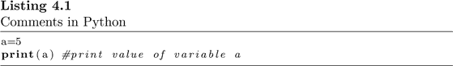

输出：5

## 4.3 多行语句

为了表示行应继续，（多行语句）Python 允许使用行延续字符，即，例如：

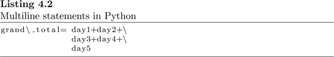

## 4.4 块和缩进

Python 使用缩进而不是开始和结束括号来描述块和嵌套块结构。使用缩进的优点包括减少对编码标准的需求、减少不一致性和减少工作量。缩进中的空格数量是可变的，但在块中，每个语句必须缩进相同的数量。例如：

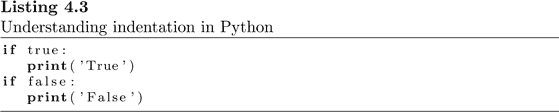

以下代码将生成错误：

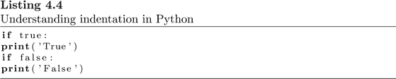

## 4.5 创建变量和赋值

变量用于在保留的内存位置存储值。创建变量后，内存中会保留一个空间。与其他编程语言不同，不需要显式声明变量。为变量赋值后，使用该变量代替值。等号用于为变量赋值。Python 字符串用单引号或双引号表示，结果相同。打印语句用于显示变量的值。例如，语句

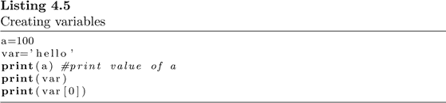

输出：100

hello

h

变量可以有可变长度，并且可以任意长。变量可以包含字母和数字，但是，不能以数字开头。

## 4.6 数据类型

变量可以存储不同类型的数据。数字、字符串、列表、元组、字典是标准数据类型。Python 数字数据类型存储数值。例如：

a=1, b=2。

Python 包括三种不同的数字类型，即，int、float、complex。相比之下，字符串由字符序列组成。但是，Python 中的字符串是不可变的，这意味着它不能被更改。字符串用单引号或双引号声明。例如：a=”abc”。本章余下部分将进一步讨论其余数据类型。type() 函数用于获取任何变量的数据类型。

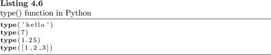

输出：str

int

float

list

## 4.7 运算符

与其他编程语言类似，Python 支持以下运算符组：

*   算术运算符
*   比较运算符
*   赋值运算符
*   逻辑运算符
*   位运算符
*   成员运算符
*   身份运算符

### 4.7.1 算术运算符

此类别包括数学运算，例如- 加法(+)、减法(-)、除法(/)、取模(%) 和幂(\*\*)。例如：

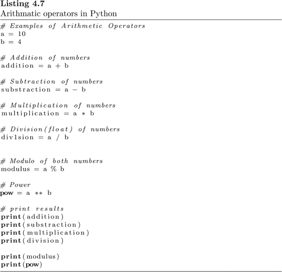

输出：

14

6

40

2.5

2

10000

### 4.7.2 比较运算符

此运算符用于比较值，并根据条件返回 true 或 false。此类别包括大于(>)、小于(<)、等于(==)、不等于(!=)、大于等于(≥)、小于等于(≤)。例如：

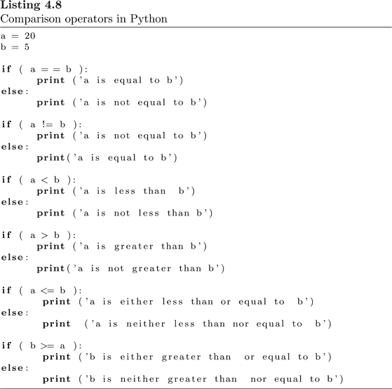

输出：

a 不等于 b

a 不等于 b

a 不小于 b

a 大于 b

a 既不小于也不等于 b

b 既不大于也不等于 b

### 4.7.3 逻辑运算符

此类别执行逻辑 AND (and)、逻辑 OR(or) 和逻辑 NOT (not)。例如：

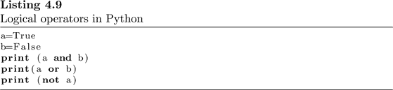

输出：

False

True

False

### 4.7.4 Python 位运算符

它执行逐位操作。位运算符包括按位与(&)、按位或(∨)、按位非(¬)、按位异或(⊕)、按位右移(≫) 和按位左移 (≪)。

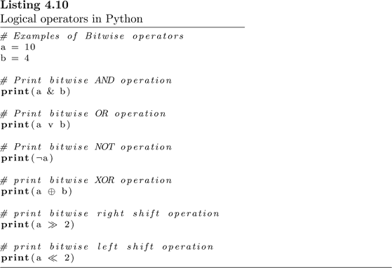

输出：

0

14

−11

14

2

40

### 4.7.5 赋值运算符

此运算符用于为变量赋值。可用的赋值运算符有：

\=: 将操作数右侧的值赋给操作数左侧

+=: 将右操作数与左操作数相加，并将结果赋给左操作数

\-=: 用左操作数减去右操作数，然后赋给左操作数

\*=: 将右操作数与左操作数相乘，并赋给左操作数

/=: 用左操作数除以右操作数，然后将结果赋给左操作数

%=: 使用左操作数和右操作数取模，并将结果赋给左操作数

\*\*=: 对操作数进行指数运算，并将值赋给左操作数

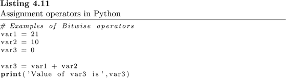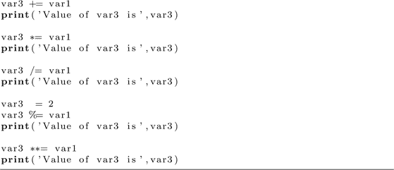

输出：

var3 的值为 31

var3 的值为 52

var3 的值为 1092

var3 的值为 52

var3 的值为 2

var3 的值为 2097152

### 4.7.6 成员运算符

此运算符用于检查元素在序列中的成员身份。下面讨论了两个成员运算符：

in: 如果元素存在于序列中，则结果为 true，否则为 false

not in: 如果元素不是序列的成员，则结果为 true，否则为 false

例如：

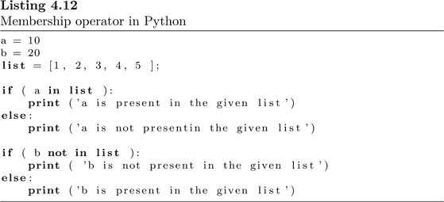

输出：

a 不在给定列表中

b 不在给定列表中

### 4.7.7 身份运算符

这些运算符用于比较两个内存位置，即，检查两个值是否位于内存的同一部分。Python 中有两个身份运算符。

is: 如果操作数相同，则返回 true

is not: 如果操作数不相同，则返回 true

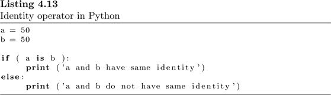

输出：

a 和 b 具有相同的身份


## 4.8 Python 中的输入和输出

内置的 `input()` 函数用于从键盘获取用户输入。括号内的参数用于提示键盘输入。输入函数会自动识别用户输入的是字符串、数字还是列表。但是，当输入被输入时，首先将其转换为字符串。即使是整数值，也会通过类型转换转换为整数。

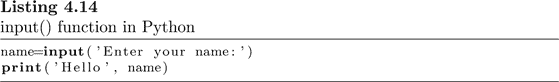

假设用户输入了 abc 作为名称。

输出：Hello abc

产生输出的方法是使用 `print()` 函数，传递零个或多个用逗号分隔的表达式。不带参数的打印，即 `print()` 是为了换行。默认情况下，Python `print()` 函数以新行结束，即 `print()` 函数会自动换行。

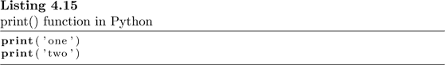

输出：

one

two

## 4.9 列表

列表是 Python 的一个强大功能。它们与数组相同。列表是一种用于声明序列的数据类型。列表是用方括号中用逗号分隔的项目声明的。要访问列表项，使用索引号。值得注意的是，列表可能包含不同类型的项目。列表可以包含字符串、整数以及对象。此外，列表在声明后仍可更改。

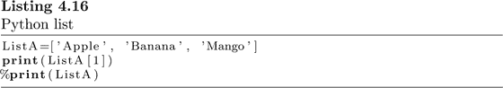

输出：Banana

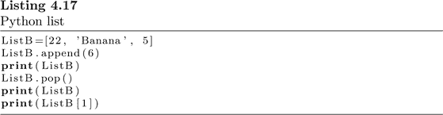

输出：

22, ‘Banana’, 5, 6

22, ‘Banana’, 5

5

**注意：** 元组与列表相同，区别在于元组是不可变的，即声明后不能更改。

## 4.10 字典

Python 字典具有键和值，并用花括号编写。但是，字典中的键应该是唯一的，而值可以相同。要访问任何项，请在方括号内使用键名。

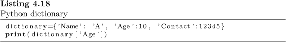

输出：10

## 4.11 Python 条件和 if-else

Python if-else 语句与逻辑条件一起使用，例如- 等于、不等于、小于等于、大于等于、大于和小于。if 语句使用 `if` 关键字指定。

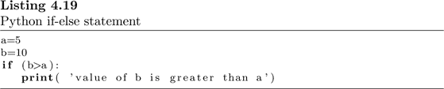

输出：value of b is greater than a

**关键点** Python 使用缩进来定义作用域

此外，`elif` 关键字用于检查如果前一个条件不为真，则尝试此条件，而 `else` 在任何前面的条件为假时执行。greater than equal to, greater than, and less than。elif 语句使用 `elif` 关键字指定。

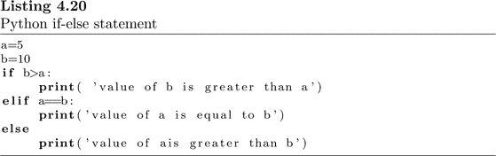

输出：value of b is greater than a

## 4.12 循环

通常，任何编程语言的语句都是按顺序执行的。但是，可能存在需要执行不同路径的情况。循环块允许执行一个或多个语句多次。Python 支持两个循环命令：

*   While 循环

*   For 循环

**While 循环**：While 循环用于执行语句或语句块，直到给定条件满足。当语句变为假后，while 之后的第一个语句将被执行。

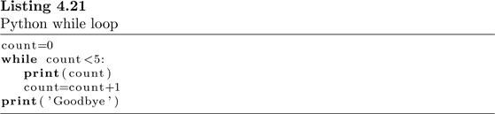

输出：

0

1

2

3

4

Goodbye

While 也可以与 else 语句一起使用

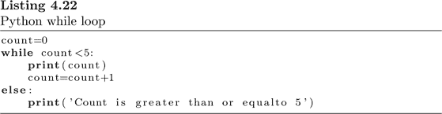

输出：

0

1

2

3

4

Goodbye

**For 循环**：在 Python 中，for 循环用于顺序遍历，例如，列表或数组。

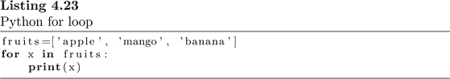

输出：

apple

mango

banana

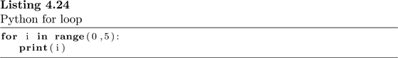

输出：

0,1,2,3,4

## 4.13 Python 中的函数

函数是一段接受一些输入、执行一些计算并产生输出的语句块。基本上，函数用于将重复执行的任务组合在一起。函数在被调用时执行。Python 中有一些内置函数，例如 `print()`，也可以使用 `def` 关键字创建函数。要调用函数，请使用该函数的名称，后跟一个括号。

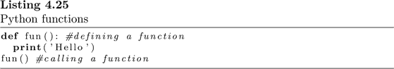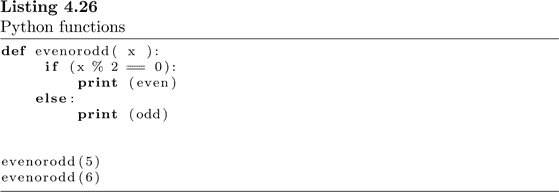

输出：

Odd

Even

## 4.14 Python 中的类和对象

如前所述，Python 是一种面向对象的语言。类类似于对象构造函数或创建对象的蓝图，而对象是带有实际值的类的副本。类便于将数据和功能捆绑在一起。每个类都有自己的数据成员和成员函数，可以使用对象访问。尽管如此，一个类可以有许多对象。类的属性始终是公共的，并使用点 (.) 运算符访问。要创建类，使用关键字 `class`。

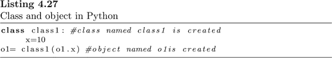

输出：5

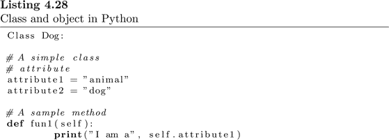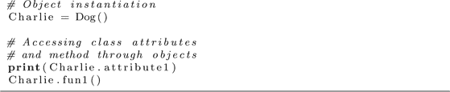

输出：

animal

I am a animal

I am a dog

要创建现实生活中的应用程序，我们需要了解一个名为 `init()` 的特殊函数，它是用于创建类新实例的初始化方法。特别是，`init()` 方法用于在创建对象时为对象属性赋值。

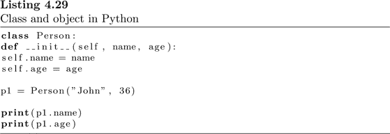

输出：

John

36

## 4.15 Python 中的文件处理

文件在磁盘上有一个位置，存储着一些信息。像 Java 和 C++ 一样，Python 也支持文件处理，并使用户能够通过读取和写入文件来处理文件。文件中的每行代码都包含一系列字符。此外，每行都以一个名为行尾 (EOL) 的特殊终止符结束，它告诉解释器新行已开始。大多数文件操作都是使用文件对象完成的。

### 4.15.1 `open()` 函数

显然，在读取或写入文件之前，必须先打开它。要打开文件以进行读取或写入，使用 `open()` 函数。`open()` 函数创建一个文件对象，并接受两个参数，即文件名和模式。语法：

`open(filename; mode)`

mode 字段告诉如何打开文件。例如：

r: 仅打开文件以供读取

rb: 以二进制格式打开文件以供只读

w: 打开文件仅供写入

r+: 以二进制格式打开文件以同时进行读取和写入

wb: 以二进制格式打开文件以供只写

a: 打开文件以供追加

a+: 打开文件以同时进行追加和读取

如果指定名称的文件不存在，它将抛出 `FileNotFoundError` 错误。

### 4.15.2 `close()` 函数

`close()` 方法关闭文件对象，并禁止对该文件执行任何进一步操作。

语法：

`fileObject.close()`

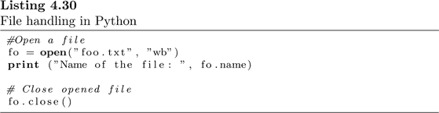

输出：

Name of the file: foo.txt

### 4.15.3 `read()` 函数

此函数从打开的文件中读取一个字符串。

语法：

`fileObject.read([count])`

count 参数指定要从指定文件中读取的字节数。如果缺少 count 参数，文件将被读取直到文件末尾。

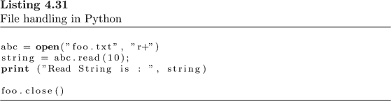

输出：

The first 10 characters from the file named foo.txt.

## 4.16 `write()` 函数

此函数允许用户将字符串写入打开的文件。值得注意的是，write 函数不会隐式添加换行符，即字符串末尾。

语法：

`fileObject.write(string)`

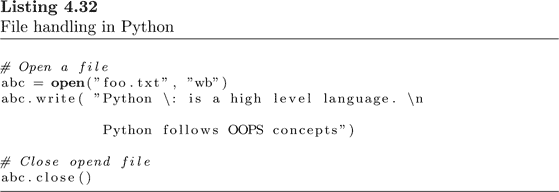

输出：

Python is a high level language

Python follows OOPS concepts

# 活动

### 选择题

1.  如何在 Python 代码中插入注释？

    1.  \\ \*This is a comment\* \\

    2.  #This is a comment

    3.  “This is a comment”

    4.  None of these

2.  哪个不是合法的变量名？

    1.  abc

    2.  10abc

    3.  \_abc

    4.  abc\_abc

3.  以下 Python 表达式的值是多少？

    1.  9.0

    2.  9

    3.  4.0

    4.  4

4.  以下代码的输出是什么？

    x = 100

    y = 50

    print(x and y)

    1.  True

    2.  False

    3.  100

    4.  50

5.  在 Python 中输出 “hello world” 的正确语法是什么？

    1.  print(“hello world”)


## 2. echo(“hello word”)

## 3. put(“hello word”)

## 4. None of these

## 6. Python 文件的正确文件扩展名是什么？

1. `.py`

2. `.python`

3. `.pyt`

4. None of these

## 7. 以下代码的输出结果是什么？

```
print type(type(int))
```

1. type ‘int’

2. type ‘type’

3. error

4. 0

## 8. 假设 listA 为 [31, 41, 5, 20, 5, 125, 1, 3]，执行 listA.pop(1) 后 list1 是什么？

1. 31, 41, 5, 20, 5, 125, 1, 3

2. 31, 41, 5, 20, 5, 125, 1

3. 31, 41, 5, 20, 5, 125, 1, 3, 3

4. None of these

## 9. 以下程序的输出结果是什么？

```
j = 0

while i ≤ 5:
    print j

    j++

    print j+1
```

1. 0 2 1 3 2 4

2. Error

3. 5 4 3 2 1

4. None of these

## 10. ¬¬¬¬¬¬ 5 的求值结果是什么？

1. +5

2. -5

3. 10

4. 11

1. b 2. b 3. a 4. d 5. d 6. a 7. b 8. b 9. b (Python 中没有 `++` 运算符) 10. a

# 5

# Cryptography Primitives

## 5.1 Introduction

机密性、完整性、可用性（也称为 CIA 三要素）是为定义信息安全策略而开发的模型（参阅 图 5.1

**FIGURE 5.1**

信息安全的 CIA 三要素。

值得注意的是，密码学在确保实现上述安全属性方面起着非常重要的作用。接下来，我们将讨论基本的密码学原语。我们将先讨论密码学哈希函数的详细信息，然后讨论数字签名的概念。

## 5.2 Encryption/Decryption Process

### 5.2.1 Encryption

加密是将原始数据转换为不可识别形式的过程。数据通常被加密以防止被窃取。加密由发送方执行。

### 5.2.2 Decryption

与加密相反，解密是将密文转换回明文的过程。解密在接收方执行。

### 5.2.3 Symmetric key encryption

这种加密类型对加密明文和解密密文使用相同的密码学密钥。

### 5.2.4 Asymmetric key encryption

这种加密过程涉及 2 对密钥。在这里，发送方和接收方都有一对公钥和私钥。公钥用于加密明文，而私钥用于解密目的。为了完成许多密码学任务，使用公钥和私钥。

### 5.2.5 Public key

公钥发布给所有其他用户查看。公钥使用典型的非对称算法生成，以与相关的私钥匹配。用于创建公钥的最流行算法是：`RSA`、`ECC` 和数字签名应用程序（`DSA`）。这些提到的算法基于重计算方法，创建不同长度的随机数字组合，以防止暴力攻击。密钥的长度表示保护的强度。大密钥尺寸提供更多的密码学安全性，防止黑客攻击。

### 5.2.6 Private key

与公钥相反，私钥是只有密钥所有者知道的秘密密钥。私钥使用与创建公钥相同的算法创建。`tcolorbox`

**关键点** 私钥用于解密、数字签名和身份验证，而公钥用于加密、数字签名验证和身份验证。

## 5.3 Cryptographic Hash Functions

密码学哈希函数（`H`）接受可变长度的输入或消息（`M`）并生成固定大小的输出，称为哈希值或消息摘要（`h`），如 图 5.2 所示

```
\begin{array}{l} {h = H(M)} \\\\ \\end{array}
```

(5.1)

通常，消息摘要的大小小于实际输入数据。因此，哈希函数有时被称为压缩函数。

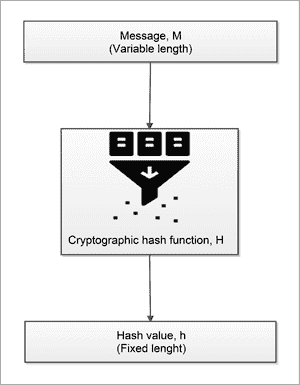

**FIGURE 5.2**

密码学哈希函数的框图。

关键点

*   哈希函数遵循多对一属性，因此面临冲突。

*   在区块链中，消息摘要的大小为 256 位。

*   哈希函数可以高效计算，因为这些计算不需要大量资源。

*   好的哈希函数产生均匀分布的输出。

*   `M` 中即使只有一位变化也会改变完整的哈希码。

### 5.3.1 Typical properties of a hash function

*   完全难以逆转哈希函数，即，对于给定的哈希值 `h[1]`，找到输入 `M[1]` 使其精确哈希为 `h[1]` 应该是困难的过程。此属性称为不可逆性或原像抗性。此外，此类哈希函数称为单向函数。

*   对于给定的输入及其对应的哈希，在计算上难以找到具有相同哈希的不同输入，即，对于具有哈希值 `h[1]` 的输入 `M[1]`，找到任何其他输入 `M[2]` 使得 `H(M[1]) = H(M[2])` 应该是困难的。哈希函数的此属性称为第二原像抗性。

*   哈希函数的另一个重要属性称为无冲突属性，它指出如果两条消息不同，则它们的消息摘要也不同，即，如果两条消息 `M[1]`、`M[2]` 不相等（`M1 ≠ M2`），则 `H(M[1]) ≠ H(M[2])`。

*   给定两条消息 `M[1]`、`M[2]` 和一个哈希函数 `h`，找到值 `k` 使得 `M[2] = h(M[1]∥k)` 是困难的。哈希函数的此属性称为谜题友好性。


### 5.3.2 哈希函数的要求

*   **单向性：** 一旦计算出哈希值，就无法用来恢复原始文档。例如，就像人类的指纹一样，无法从人类指纹中检索出一个人的外貌。

*   **确定性：** 它表示如果两个相似的文档通过哈希算法，应该始终生成相同的哈希值。

*   **雪崩效应：** 它表示即使在文档中更改一个比特位，更改后的文档的哈希值也应该与原始文档的哈希值有显著差异。

*   **必须能够抵抗碰撞：** 它意味着哈希函数应具有抗碰撞特性。

### 5.3.3 加密哈希函数的应用

*   密码存储：每当用户使用用户名、ID 和密码创建帐户时，ID 提供商不会存储密码。相反，提供商将密码传递给哈希算法，仅存储密码的哈希值。每次用户尝试登录时，提供商会对用户输入的密码进行哈希处理，并将其与保存的哈希值进行比较。提供商有一个密码文件，其中包含以 \[用户 ID1*`h(P1*)`\] 形式的对表，用于给定的用户 ID（ID1）和密码（P1）。只有当两个哈希值匹配时，才会授予帐户授权，否则不授予。整个过程已在 图 5.3 中描绘。

    

    **FIGURE 5.3**  

    Password storage using hash functions.

*   数据完整性检查：哈希函数最流行的应用之一是数据完整性检查。这样，哈希函数可以保证数据的正确性，即用户可以检测对原始文件所做的任何修改、插入和删除。

    **案例 1：**

    消息（`*M*`）连同计算的 `*M*` 哈希值使用对称加密进行加密。加密确保消息的机密性。要检查消息的完整性，首先，对接收到的加密块进行解密，然后从块中提取消息。接下来，对消息 M 应用相同的哈希算法，并将计算出的哈希值与接收到的哈希值进行匹配。整个过程已在 图 5.4 中显示。

    

    **FIGURE 5.4**  

    Data integrity check with message encryption.

    **案例 2：**

    在某些情况下，仅加密哈希代码，以减少不需要机密性的应用程序的负担。要检查消息的完整性，请使用密钥解密接收到的哈希值，并从消息中计算哈希摘要，然后将其与源接收到的哈希摘要进行比较。整个过程已在 图 5.5 中显示。

    

    **FIGURE 5.5**  

    Data integrity check without message encryption.

### 5.3.4 MD5 消息摘要算法

消息摘要算法 5 (MD5) 是消息摘要算法 4 (MD4) 的扩展，由 Ron Rivest 于 1991 年开发。但是，MD5 比 MD4 慢一点，但比 MD4 具有更好的安全性。特别是，它用于验证数据的完整性。此外，它还用作 DSA，通过在使用私钥加密文件之前以安全方式压缩大文件。该哈希算法接受任意长度的输入，并生成 128 位指纹作为输出。

MD5 的基础基于 Merkle Damgard 模式。该算法以 512 位块处理数据，每个块被分解为 16 个块，每个块 32 位。MD5 生成 128 位输出的逐步工作定义如下：

*   **附加填充位：** 填充意味着向原始消息添加一些额外的位。在这里，消息被填充，使得总位长度比 512 的精确倍数少 64 位。为了填充，第一位是 1，其余位是 0。例如，对于 1000 位的消息，填充了 472 位（1000 + 472 = 1472，比 512 的倍数少 64 位。）

*   **附加长度：** 填充后，通过计算原始消息长度 mod 264 在末尾插入 64 位。因此，生成的消息是 512 位的倍数。

*   **分割消息：** 将生成的消息分割为 512 位块。

*   **初始化 MD 缓冲区：** 接下来初始化一个四字缓冲区。四个缓冲区（`A`、`B`、`C`、`D`）是 32 位寄存器，其值是预定义的。值得注意的是，最终输出仅在这些缓冲区中。

*   **以 16 字块处理消息：** 每个 512 位块在 4 轮中处理，每轮使用四个函数 `F`、`G`、`H`、`I`。此外，每轮包含 16 个步骤，使用一些常数。因此，每个 512 位块总共执行 64 次操作，该块的输出作为 `A`、`B`、`C`、`D` 的值馈送到下一个块。

### 5.3.5 SHA-256

区块链比特币挖矿使用一种称为 SHA-256 的特殊哈希函数，该哈希函数生成 256 位消息摘要。SHA 代表安全哈希算法。SHA-256 的操作与 MD4、MD5 以及 SHA-1 类似。哈希函数的计算首先通过预处理消息开始。对于预处理：

*   首先，对消息进行填充，使总消息大小成为 512 位的倍数。为此，请遵循以下步骤：

    *   假设消息长度为 `l` 位，且 `l`mod512 ≠ 0。

    *   在消息末尾附加值为 1 的位。

    *   接下来，附加 `k` 个零位，使得 `l+1+k` ≡ 448mod512。

    *   之后，附加一个 64 位块，其值为以二进制形式写入的 `l`。附加此长度是为了避免平凡碰撞。要提取原始消息，请读取最后 64 位（用于计算消息长度），然后从左到右开始获取位，直到观察到的长度。

    *   填充后消息的结果长度应为 512 位的倍数。

    例如，给定的消息是 ‘abc’。

    *   其长度为 24（8\*3）。

    *   首先，在消息末尾附加一个 1。

    *   接下来，附加 448-(24+1) 个零，即 423 个零。

    *   最后，附加一个 64 位块，其中包含以二进制形式写入的 24，结果为：

        $$011000101100010011000111\\underset{423\\,\\text{times}}{\\underset{︸}{00.....0}}\\underset{64\\,\\text{bit}}{\\underset{︸}{00.....011000}}.$$  

        现在，结果长度为 512 位。

*   接下来，将原始消息 `M` 解析为 `N` 个 512 位块，即 `M1`、`M2`、……、`MN`。

*   之后，每个 512 位块被分为 16 个子块 `M[0]^(*i*)`、`M[1]^(*i*)`、……、`M[15]^(*i*)`，每个子块长度为 32 位。

*   每个消息块一次处理一个。要处理每个块，请使用固定哈希值 `h0`（256 位，也称为初始化向量 IV）进行初始化。

*   接下来，按顺序计算：

    `H^(*i*) = h^((*i* − 1)) + C[*M*]^(*i*)(H^((*i* − 1)))`

    其中，`C` 是压缩函数，`+` 是模 2³² 加法。

## 5.4 数字签名

数字签名是安全区块链架构背后的另一个重要基础。它是一种加密方法，用于验证数据的真实性和完整性。除此之外，数字签名防止不可否认性，即发件人不能否认文档的来源。数字签名的工作方式类似于物理签名；但是，它们是电子签名。尽管如此，签名机构只能签署文档，任何拥有有效密钥的人都可以验证签名。此外，一个文档的签名不能从一个文档转移到另一个文档。


数字签名是基于非对称密码学（Public-key cryptography）概念实现的。非对称密码学使用两个不同的密钥，即公钥和私钥。公钥仅为用户所知，而私钥为宇宙中的每个人所知。为了保护数据的机密性，待传输的数据使用接收方的公钥进行加密，而在目标节点上使用私钥来解密消息。

### 5.4.1 数字签名模型

要生成数字签名，消息使用发送方的私钥进行签名，而在目标端，签名使用发送方的公钥进行验证。但是，通过将加密哈希的概念与数字签名相结合，可以减小数字签名的大小。因此，与其对原始消息进行签名，不如对消息摘要进行签名。生成数字签名的步骤如下：

*   首先，对消息（`M`）进行哈希处理以获得消息摘要 `h(M)`。接下来，使用发送方的私钥对生成的哈希进行签名，从而得到数字签名。

*   接下来，消息和数字签名通过信道进行传输。

*   接收方收到特定的数字签名后，使用发送方的公钥对其进行解密（这保证了发送方的`真实性`）。应用解密算法后，接收方将得到消息摘要 `h(M)`。

*   同时，接收方会计算所收到原始消息的哈希值。我们将此值称为 `h’(M)`。

*   如果 `h(M)`=`h’(M)`，则原始文档的`完整性`得以保持。

*   由于假设只有文档的签署者知道私钥，因此其他人无法生成签署者的签名。因此，它确保了`不可否认性`属性。

生成哈希函数的整个过程已在 图 5.6 中描述。因此，通过应用哈希函数，可以减小签名的大小。


**图 5.6**  

数字签名。

关键点

*   加密密钥应防止被他人猜测。但是，假设加密算法为所有人所知。

*   密钥应具有足够的长度，因为与短密钥相比，长密钥更难被猜测。

*   密钥应具有足够的熵并真正随机生成。

## 5.5 零知识证明

与区块链相关的另一个概念是零知识证明。它是一种加密方法，用于向验证者证明证明者知道某个值，而无需透露除“证明者知道该值”这一事实之外的任何数据。简单来说，通过生成最终输出，证明者需要证明他们可以计算某个东西，而无需透露计算过程，而验证者只知道输出。

例如，A 想要向 B 证明他知道密钥，但不向 B 披露秘密密钥，而 B 验证 A 确实持有该密钥。因此，它们有能力彻底改变数据处理、收集以及数据交易的方式。零知识证明具有 3 个重要属性：

*   完备性：如果事实为真，证明者应向验证者证明这一事实，且零知识证明应返回 true。

*   可靠性：如果事实/陈述为假，证明者无法说服验证者证明者的陈述为真。

*   零知识/隐私：如果证明者提供的信息为真，验证者除得知信息为真这一事实外，不会了解任何其他信息。换句话说，提供的信息不应向验证者透露任何其他内容。

为了更好地理解零知识证明，让我们来看看零知识证明中流行且经典的例子：`两个球和色盲朋友`。

假设 A 有两个颜色不同的相同球（例如一个红色，一个绿色），而你的朋友 B 是色盲，这意味着 B 无法根据颜色区分这两个球。但是，A 必须向 B 证明这两个球颜色不同。不过，A 不想透露哪个是红色，哪个是绿色。这个问题的证明系统将如下工作：

*   A 会将两个球都给 B，并将两个球放在身后。

*   B 然后从身后取出两个球中的一个并展示出来。

*   B 然后再次将球放回身后，然后通过随机以等概率从两个球中选取一个，仅展示两个球中的一个。

*   接下来，B 问 A：“我换球了吗？”。

第三步和第四步会重复，直到 B 确信有两个不同颜色的球。显然，根据球的颜色，A 可以肯定地判断 B 是否换了球。此外，如果球颜色相同且因此无法区分，A 猜测 B 是否换球的正确概率不高于 50%。如果 A 和 B 重复此过程多次，如果 A 撒谎，他/她会被识破。

很明显，上述证明系统是零知识的，因为 B 永远不会知道哪个是绿色球，哪个是红色球。

此外，零知识证明有两种变体：交互式和非交互式零知识证明。在交互式证明中，证明者和验证者交换多条消息来证明或验证信息。它要求验证者不断询问关于证明者所拥有知识的问题。不幸的是，交互式零知识证明的可传输性有限。相比之下，非交互式证明系统要求证明者和验证者之间除了双方之间的共同参考字符串外不需要交互。

关键点

`零知识证明在区块链中的应用：` 两种流行的区块链用例，即比特币和以太坊，都基于公共地址来描绘用户的真实身份，从而在网络中保持匿名性。值得注意的是，由于区块链的分布式特性，交互式零知识证明不是一种高效的解决方案。此外，零知识证明的一个现实世界用例是 Zcash，它使原生交易在被网络共识规则验证的同时能够完全加密，而 Zcash 是一个非交互式零知识证明系统。

## 5.6 哈希表

它是一种流行的数据结构，支持快速插入和搜索操作，与数据大小无关。它基本上是一种从一组相似对象中识别特定对象的方法。特别是，哈希表（也称为哈希映射）以数组格式存储数据，每个数据值都与一个唯一的索引值相关联。哈希表使用哈希函数生成索引，即要插入数据元素的位置。数据结构中的信息有两个主要组件，即唯一键和值。例如，键可以是唯一 ID（键不一定每次都是整数），值是电话号码。哈希函数将决定将键映射到哪里，以及将相应的值与其存储在哪里。映射的效率取决于哈希函数的效率。基本上，我们用来输入元素的集合远大于哈希表的容量，以便可以避免冲突。显然，如果表中的项目数量增加，冲突也会增加。为了衡量哈希表的填充程度，使用负载因子（`α`）的概念，它定义为已用键数（`n`）与表的总容量（`m`）的比例。

$$
\begin{array}{l}
{\alpha = \frac{n}{m}}
\end{array}
$$

(5.2)

值得注意的是，`n` 不能超过表的总容量。如果 `α` 接近最大值，冲突的可能性会显著增加。


# 哈希表冲突解决

在链表中，插入操作效率高，但查找仍然需要线性时间。此外，在有序数组中，查找效率高，但插入效率不足。值得注意的是，对于 `n` 个元素，链表可以在 `O(n)` 时间内搜索，而二分查找需要 `O(log2n)` 时间，数组搜索需要 `O(n)` 时间。与此相反，哈希表允许插入、删除和搜索操作非常快，即在平均情况下为 `O(1)` 时间（参考 表 5.1）。让我们以哈希表数据结构为例，如 图 5.7 所示，哈希函数为：`h(x) = xmod10`，其中 `x` 是键。假设项目为 (key, value) 格式，项目为 (1,999)、(2, 9876)、(45, 5434)、(90, 9877)。因此，哈希表组织数据，以便对于给定的键，可以快速查找任何数据。然而，可能会出现两个或多个数据项发生冲突并哈希到相同索引的情况。这被称为冲突问题。例如，如果我们要插入项目 (55, 7767)，此插入将导致冲突，因为索引 5 处已经有一个项目。一个被称为良好哈希函数的函数可以避免冲突。冲突解决技术分为两个主要部分，即封闭寻址和开放寻址。为了避免冲突，封闭寻址使用额外的数据结构，而开放寻址哈希将所有数据存储在表中。更正式地说，在开放寻址的冲突解决情况下，将依次尝试单元格 `h0(x), h1(x),……., hm-1(x)` 以满足等式，

**TABLE 5.1**  

哈希表的平均和最坏情况复杂度。

|  || 平均复杂度 || 最坏情况复杂度 |

| --- | --- | --- |

| 空间 || `O(n)` || `O(n)` |

| --- | --- | --- |

| 插入 || `O(1)` || `O(1)` |

| 删除 || `O(1)` || `O(n)` |


**FIGURE 5.7**  

哈希表示例。

```
\begin{array}{l} {h_{i}(x) = (h(x) + f(i))modm} \\\\ \\end{array}
```

(5.3)

其中，`f(0)=0`，函数 `f` 称为冲突解决策略，`h(x)` = 主哈希函数，`x` 是键，`m` 是表大小。接下来，我们将讨论流行的冲突解决技术。冲突解决技术的分类已在 图 5.8 中表示


**FIGURE 5.8**  

冲突解决技术分类。

## 5.6.1 链地址法

避免冲突的一种可能方法是简单地将具有相同索引的数据存储在数组相应索引的链表中。此方法称为链地址法。在这里，每个数组槽持有指向链表的指针，该链表包含所有哈希到相同哈希索引的键的值，如 图 5.9 所示。

**查找：** 当然，此解决方案最终会导致线性时间，即在最坏情况下查找为 `O(n)`。因为在最坏情况下，所有键可能具有哈希表的相同索引，因此，为了执行顺序搜索，时间要求为 `O(n)`。此外，此方法的缓存性能不佳。尽管此方法易于实现，且哈希表永远不会填满。

**删除：** 要删除，首先需要搜索键，然后删除。由于搜索的最坏情况时间复杂度为 `O(n)`，因此删除所需时间为 `O(n)`。


**FIGURE 5.9**  

每个数组槽包含指向链表的指针。

## 5.6.2 线性探测

线性探测是处理冲突的一种流行方法。探测简单意味着在发生冲突时，找到要放置键的下一个空单元格。此方法属于开放寻址的冲突解决。在发生冲突时插入，将尝试紧邻的下一个单元格，直到找到空单元格。因此，表的大小应等于或大于键的总数。正式地说，对于线性探测，`f` 是线性函数，在等式 5.3 中大多为 `f(i) = i`，即，`hi = (h(x) + i)modm`。显然，搜索的最坏情况复杂度为 `O(m)`。

然而，线性探测面临聚集问题，即，如果多个连续项形成一个组，那么查找空槽进行插入或搜索项将花费大量时间。让我们通过一个示例来理解线性探测，假设 3、17、14、6、21、13、7、22 是要依次插入的键，`h(x) = (2x + 3)mod10` 是键 `x` 的哈希函数。参考 图 5.10，每个键的哈希值如下：

`h(3) = 9`

`h(17) = 7`

`h(9) = 1`

`h(6) = 5`

`h(21) = 5`

`h(13) = 9`

`h(7) = 7`

`h(22) = 7`


**FIGURE 5.10**  

线性探测示例。

**插入 3,17,14,6：** 插入这 4 个元素不会遇到任何冲突。因此，它们根据给定的哈希函数插入到其哈希索引处。

**插入 21**：由于 `h(21) = 5` 且该位置已被键 6 占用。因此，让我们尝试使用等式进行线性探测：`hi = (h(x) + i)modm`，其中 i=0 到 m-1

**i=0**: `h0 = (h(x) + 0)modm ⟹ h0 = (5)mod10 = 5`，该位置已被占用。

接下来，**i=1**: `h1 = (h(x) + 1)modm ⟹ h1 = (5 + 1)mod10 = 6`，该位置空闲。因此，21 被插入到位置 6。

同样，13、7 和 22 被插入。

此插入示例在 图 5.10 中展示。

## 5.6.3 二次探测

这是另一种开放寻址方案，用于解决哈希表中的冲突。它通过获取键的哈希值并添加二次多项式的连续值来工作。更正式地说，对于二次探测，`f(i) = i²`，即，`hi = (h(x) + i²)modm`，其中 i=0 到 m-1。

该方案具有良好的内存缓存，因为它保持了引用的局部性。此外，与线性探测相比，它避免了聚集问题。让我们通过一个示例来理解二次探测。参考 图 5.11。再次考虑 3、17、14、6、21、13、7、22 是要依次插入的键，`h(x) = (2x + 3)mod10` 是键 `x` 的哈希函数。每个键的哈希值如下：


**FIGURE 5.11**  

二次探测示例。

`h(3) = 9`

`h(17) = 7`

`h(9) = 1`

`h(6) = 5`

`h(21) = 5`

`h(13) = 9`

`h(7) = 7`

`h(22) = 7`

**插入 3,17,14,6：** 插入这 4 个元素不会遇到任何冲突。因此，它们根据给定的哈希函数插入到其哈希索引处。

**插入 21**：`h(21)` 是 5，已被键 6 占用。因此，让我们尝试使用等式进行二次探测：`hi = (h(x) + i²)modm`，其中 i=0 到 m-1 **i=0**: `h0 = (h(x) + 0)mod m ⟹ h0 =(5)mod 10 = 5`，该位置已被占用。

接下来，**i=1**: `h1 = (h(x) + 1²)mod m ⟹ h1 =(5+1)mod 10= 6`，该位置空闲。因此，21 被插入到位置 6。

**插入 13**：`h(13) = 9` 已被占用。因此，让我们尝试二次探测 **i=0**: `h0 = (h(x) + 0)mod m ⟹ h0 =(9)mod 10 = 9`，该位置已被占用。

**i=1**: `h1 = (h(x) + 1²)mod m ⟹ h1(x)=(9+1)mod 10= 0`，该位置空闲。因此，13 被插入到位置 0。

**插入 7**：由于 `h(7) = 7` 已被占用，因此让我们尝试二次探测。 **i=0**: `h0 = (h(x) + 0)mod m ⟹ h0 =(7)mod 10 = 7`，该位置已被占用。

**i=1**: `h1 = (h(x) + 1²)mod m ⟹ h1 =(7+1)mod 10= 8`，该位置空闲。因此，7 被插入到位置 8。


**Insert 22**: `h(22) = 7` which is already occupied. So, lets try quadratic probing `i=0`: `h0 = (h(x) + 0) mod m ⟹ h0 = (7) mod 10 = 7` which is occupied.

**i=1**: `h1 = (h(x) + 1²) mod m ⟹ h1 = (7 + 1) mod 10 = 8` and this location is also not free. **i=2**: `h2 = (h(x) + 2²) mod m ⟹ h2 = (7 + 4) mod 10 = 1` and this location is also not free.

**i=3**: `h3 = (h(x) + 3²) mod m ⟹ h3 = (7 + 9) mod 10 = 6` and this location is free. So, 22 is inserted at location 6.

### 5.6.4 双哈希

This technique applies a second hash function to the given key in case of collision, i.e., `f(i) = i * h2` and `i = 0 to m - 1` where, `h2(x)` is another hash function. The second hash function provides an offset value to resolve collision. This technique also comes under a double hashing technique. Notably, a good second hash function makes sure that all cells are equally probed. Unfortunately, the computational cost of double hashing is high as compared to other probing schemes. Let's understand quadratic probing with an example as represented in Fig. 5.12. Again consider 3, 17, 14, 6, 21, 13, 7, 22 are the keys to be inserted in series and `h(x) = (2x + 3) mod 10` is the hash function for key `x`. Assume other hash function `h'(x) = (3k + 1) mod 10` Hash for each key is given by:

`h(3) = 9`

`h(17) = 7`

`h(9) = 1`

`h(6) = 5`

`h(21) = 5`

`h(13) = 9`

`h(7) = 7`

`h(22) = 7`


**FIGURE 5.12**

Example of double hashing.

**Insert 3,17,14,6:** Insertion of these 4 element doest not face any collision. So, they are inserted at their hash indexes calculated according to given hash function.

**Insert 21**: `h(21)` is 5 which is occupied by the key 6. So, lets apply double hashing with the equation: `hi = (h(x) + i * h'(x) mod m` where i=0 to m-1. **i=0**: `h0 = (h(x) + 0 * h'(x) mod m ⟹ h0 = (5 + 0) mod 10 = 5` which is occupied.

**i=1**: `h1 = (h(x) + 1 * h'(x) mod m ⟹ h1 = (5 + 1 * 4) mod 10 = 9 mod 10 = 9` and which is also not free [`h'(21) = (3 * 21 + 1) mod 10 = 4`]

**i=2**: `h2 = (h(x) + 2 * h'(x) mod m ⟹ h1 = (5 + 2 * 4) mod 10 = 13 mod 10 = 3` and which is free. So, key 21 is inserted at location 3.

**Insert 13**: `h(13)` is 9 which is occupied by the key 3. So, lets apply double hashing with the equation: `hi = (h(x) + i * h'(x) mod m` where i=0 to m-1. **i=0**: `h0 = (h(x) + 0 * h'(x) mod m ⟹ h0 = (9 + 0) mod 10 = 9` which is occupied.

**i=1**: `h1 = (h(x) + 1 * h'(x) mod m`. Notably, [`h'(13) = (13 * 3 + 1) mod 10 = 0`]. So, this will always result in hash index 9 which is not free. This signifies choice of second hash function is not goo. So, we can't insert 13 in this hash table.

**Insert 7**: `h(7)` is 7 which is occupied by the key 17. So, lets apply double hashing with the equation: `hi = (h(x) + i * h'(x) mod m` where i=0 to m-1.

**i=0**: `h0 = (h(x) + 0 * h'(x) mod m ⟹ h0 = (7 + 2 * 0) mod 10 = 7` which is occupied.

**i=1**: `h1 = (h(x) + 1 * h'(x) mod m ⟹ h1 = (7 + 2 * 1) mod 10 = 9 mod 10 = 9` which is also not free. Notably, [`h'(7) = (7 * 3 + 1) mod 10 = 2`].

**i=2**: `h2 = (h(x) + 2 * h'(x) mod m ⟹ h2 = (7 + 2 * 2) mod 10 = 11 mod 10 = 1` which is also not free.

**i=3**: `h3 = (h(x) + 3 * h'(x) mod m ⟹ h3 = (7 + 2 * 3) mod 10 = 13 mod 10 = 3` which is also not free.

**i=4**: `h4 = (h(x) + 4 * h'(x) mod m ⟹ h4 = (7 + 2 * 4) mod 10 = 15 mod 10 = 5` which is also not free.

**i=5**: `h5 = (h(x) + 5 * h'(x) mod m ⟹ h5 = (7 + 2 * 5) mod 10 = 17 mod 10 = 7` which is also not free.

**i=6**: `h6 = (h(x) + 6 * h'(x) mod m ⟹ h6 = (7 + 2 * 6) mod 10 = 19 mod 10 = 9` which is also not free.

**i=7**: `h7 = (h(x) + 7 * h'(x) mod m ⟹ h7 = (7 + 2 * 7) mod 10 = 21 mod 10 = 1` which is also not free.

**i=8**: `h8 = (h(x) + 8 * h'(x) mod m ⟹ h8 = (7 + 2 * 8) mod 10 = 23 mod 10 = 3` which is also not free.

**i=9**: `h9 = (h(x) + 9 * h'(x) mod m ⟹ h9 = (7 + 2 * 9) mod 10 = 25 mod 10 = 5` which is also not free.

Now, we cant increase value of i to 1 as i could range from 0 to 9. So, value of i can't go beyond 9. We have checked all possible value of i from 0 to 9. So, we can't insert 7 in this hash table.

**Insert 22**: `h(22)` is 7 which is occupied by the key 17. So, lets apply double hashing with the equation: `hi = (h(x) + i * h'(x) mod m` where i=0 to m-1.

**i=0**: `h0 = (h(x) + 0 * h'(x) mod m ⟹ h0 = (7 + 7 * 0) mod 10 = 7` which is occupied.

**i=1**: `h1 = (h(x) + 1 * h'(x) mod m ⟹ h1 = (7 + 7 * 1) mod 10 = 14 mod 10 = 4` which is free. Notably, [`h'(7) = (22 * 3 + 1) mod 10 = 7`].

## 5.7 RSA

Introduced in 1978, RSA (Rivest, Shamir, Adleman) is the first widely adopted cryptosystems. RSA follows the idea of public-key encryption which is based on two components, i.e., public key, and private key. Everyone on the network has its own public and private key pair. The public key is known to everybody on the network and it is used to encrypt the message and also to verify signatures. In contrast, a private key is only known to the receiver and is used to decrypt the sent message and also to create signatures. Applications of RSA include both digital signatures and public key encryption. In RSA, the public key of the receiver is used to encrypt the message whereas the private key of the receiver is used to decrypt the message as shown in Fig. 5.13. Encryption is a process of transforming the original message into an unrecognizable form called ciphertext whereas decryption is a process of converting encrypted message back to the original message. The process of RSA involves 3 steps, i.e., key generation, encryption, and decryption.

### 5.7.1 密钥生成步骤：

*   Select the variables `p` and `q` where both `p` and `q` both are large prime numbers and p≠q. The whole security of RSA is dependent on the difficulty of factoring large prime numbers. A poor choice of `p` and `q` can make RSA less secure and vulnerable to different attacks.

*   Compute `n = p * q`, `n` is a part of the public key and should be large so that it is difficult to extract `p` and `q` from it.

*   Compute `ϕ(n) = (p-1)(q-1)`. `ϕ(n)` is called as Euler's totient function.

*   Next, public key `e` is generated such that gcd(`ϕ(n)`, e)=1 or `e` should be co-prime to `ϕ(n)`; 1¡e¡`ϕ(n)`.

*   Finally, create the private key `d` such that d≡e-1mod`ϕ(n)`.

Both (`n`, `e`) are part of RSA public key and is publically available and private key consist of (`n`, `d`).

### 5.7.2 加密

Lets assume a sender has to sent a plaintext message `M` to a receiver having public key (`n`, `e`). To encrypt message use:

Cipher text= `M^(e) mod n`.

### 5.7.3 解密

To decrypt, receiver uses its private key as:

Plaintext= `C^(d) mod n`


**FIGURE 5.13**

RSA algorithm structure.

### 5.7.4 RSA 示例

**Key generation**

*   Assume `p = 17`, `q = 11`.


*   Compute `n`; `n` = 17 * 11 = 187.

*   Compute `ϕ(n)`; `ϕ(n)` = (17 - 1) * (11 - 1) = 160.

*   Choose `e` such that gcd(`ϕ(n)`, `e`) = 1; choose `e` = 7.

*   Compute `d` such that `d` ≡ `e`⁻¹ mod `ϕ(n)`; `d` * `e` ≡ 1 mod 160 and `d` < 160 ⟹ `d` = 23 as 23 * 7 = 10 * 160 + 1.

因此，公钥 = (7, 187)

私钥 = (23, 187)。

**关键点** 公钥密码体制遵循非对称属性，即加密消息或验证消息签名的人无法解密或对消息进行签名。

## 5.8 椭圆曲线密码学

实现公钥密码学的另一种方法是使用椭圆曲线。ECC 是密码学中最强大的概念之一。ECC 用于身份验证，同时在 SSL/TLS 上进行安全网页浏览。比特币和以太坊等流行的加密货币使用椭圆曲线的概念。ECC 适用于密钥生成、数字签名以及加密/解密服务。值得注意的是，与 RSA 相比，ECC 需要更小的密钥大小才能提供等效安全性。显然，更小的密钥大小更易于管理和使用。256 位 ECC 相当于 3072 位密钥大小的 RSA 算法。由于 ECC 达到与 RSA 等效的安全性，且具有较低的计算功耗和电池使用量，ECC 已广泛用于移动应用程序。ECC 的密钥生成算法使用椭圆曲线方程的属性，该方程将在下文讨论：

椭圆曲线定义为满足三次数学方程的一组点（参见 图 5.14），即，

$$
\begin{array}{l}
{y^{2} = x^{3} + ax + b} \\
\end{array}
$$

(5.4)

其中 4 * a³ + 27 * b² ≠ 0

要绘制这样的曲线，我们需要对每个 `a` 和 `b` 的组合计算 $y = \pm \sqrt{x^{3} + ax + b}$。


**FIGURE 5.14**

椭圆曲线示意图。

**椭圆曲线的属性**

*   根据 `a` 和 `b` 的值，椭圆曲线在平面上呈现不同的形状

*   所有椭圆曲线都围绕 x 轴对称。例如，如果取 `a` = 27 和 `b` = 2，那么对于 `x` = 2，`y` = ± 8，即，(2, − 8) 和 (2, 8) 是生成的点。

*   任何非垂直线与曲线相交最多三个点。

*   椭圆曲线上的点构成一个群。适用于椭圆曲线上点的群运算称为加法定律。要将曲线上的点 `P` 与另一个点 `Q` 相加，请使用以下规则：

    *   首先，用一条直线连接 `P` 和 `Q`。

    *   将这条直线与曲线相交的点称为 -`R`。

    *   该点相对于 x 坐标的镜像定义了点 `P` 和 `Q` 的加法，并在 图 5.15 中用 `R` 表示。


**FIGURE 5.15**

椭圆曲线上点的加法。

**关键点**

陷门函数 `f` 定义为易于计算但其逆函数 `f`⁻¹ 难以计算的函数。

# 活动

### 选择题

1.  哪种加密/解密密钥仅为交换秘密消息的各方所知？

    1.  公钥

    2.  私钥

    3.  安全令牌

    4.  电子签名

2.  以下哪项不是私钥的功能？

    1.  加密文本

    2.  身份验证

    3.  解密文本

    4.  以上都不是

3.  什么是密码？

    1.  加密算法

    2.  解密后的消息

    3.  加密后的消息

    4.  秘密密钥

4.  密码散列函数将任意块转换为 ………？

    1.  可变大小字符串

    2.  固定大小字符串

    3.  固定和可变大小字符串均可

    4.  无法确定

5.  以下哪项是 CIA 三要素的组成部分？

    1.  机密性

    2.  完整性

    3.  身份验证

    4.  可用性

6.  散列函数的要求是什么？

    1.  单向性

    2.  雪崩效应

    3.  确定性

    4.  以上全部

7.  密码分析是 ……

    1.  降低加密速度

    2.  提高加密速度

    3.  生成密文

    4.  发现密码算法中的不安全性

8.  数字签名基于 …..？

    1.  公钥加密

    2.  私钥加密

    3.  区块链技术

    4.  以上都不是

9.  零知识证明的属性是什么？

    1.  完备性

    2.  可靠性

    3.  零知识性

    4.  以上都不是

10. 以下哪项是冲突解决技术？

     1.  二次探测

     2.  ECC

     3.  DSA

     4.  以上全部

1. b  2. a  3. c  4. b  5. c  6. d  7. d  8. a  9. a, b, c  10. a

# 6

# 区块链技术与技术基础

## 6.1 区块链基础

区块链是一个不断增长的区块列表，它结合了密码学与分布式计算，以提供去中心化、透明且强一致性的支持。特别是，区块链技术正在取代现有的交易管理系统 \[112\]。值得注意的是，在共享文档中写东西的传统方式是 user1 将文档发送给 user2，user2 在收到文档后用自己的内容更新文档并将其发回给 user1。但是，这种方法不允许双方同时在文档上写作。作为解决方案，使用微软 Word 提供的 Google 文档，user1 和 user2 都可以同时写作。尽管如此，这个 Google 文档平台是集中式的，并涉及第三方。大多数传统的分布式数据库是集中式的，具有高复杂性，并且依赖于可信的数据库公司。

集中式架构有一个中央协调系统，网络上的每个节点都连接到该系统。网络上的任何信息共享都必须涉及这个中央协调系统。尽管如此，集中式系统存在一些缺点。

*   单点故障：如果系统或服务器崩溃怎么办。不幸的是，如果这个中央系统崩溃，网络上的所有节点都会断开与网络的连接，所有操作都会终止。这种情况可能导致所有信息丢失。因此，完全依赖单个服务器是不高效的。

*   瓶颈：在流量增加的情况下，瓶颈很常见。

*   单点攻击：由于存在单一的中央权威，存在单点攻击的可能性。因此，这种架构很容易遭受拒绝服务攻击。

*   延迟：由于集中式服务器通常位于离用户较远的位置，因此访问数据的时间会增加。

*   更高的隐私风险：由于集中式架构涉及可信的第三方，用户不知道用户信息如何与第三方保持安全。可信的第三方可能会将用户的私人信息与其他方共享。

除此之外，还有其他架构来支持信息共享，即分布式和去中心化架构：


在去中心化架构中，不再由单个协调者负责，而是存在多个协调者，网络节点可连接到其中任意一个协调者。因此，当某个协调者节点发生故障时，网络节点可以连接到其他任意协调者来共享信息。去中心化支持容错能力，因为去中心化系统不太可能意外崩溃。此外，由于存在多个协调者，不存在单点攻击的风险。另一方面，在分布式架构中，网络中的所有节点都参与计算，且没有单一的管理机构。网络中的所有节点相互协调，并共同参与信息共享过程。去中心化系统实际上是分布式系统的一部分。在去中心化和分布式网络中，`user1` 和 `user2` 各自拥有文档的本地副本，且两个用户可以同时在文档上进行编写。

区块链是一个支持去中心化和分布式架构的平台，网络节点可以相互共享信息。与客户端-服务器模型不同，区块链实现了数字 P2P 网络。在区块链网络中，有多个节点通过互联网连接，每个节点都维护一份全局账本的本地副本。然而，这些本地副本应始终根据全局信息进行更新。特别是，这种数据的本地副本称为公共账本。公共账本的一个常见示例是银行交易，而区块链的第一个常见用例是比特币网络。区块链比特币被称为去中心化的加密货币交换系统，并且它也共享分布式账本。许多其他区块链加密货币平台被引入，包括以太坊，它利用与比特币相同的公共模型，而 Hyperledger、Ripple 等平台则是一些许可型区块链。尽管区块链的分布式应用被用于医疗保健、物联网、智能电网等许多其他领域。区块链为多个互不信任且参与信息共享或理性决策过程的各方提供了一个去中心化的共同平台。这项技术提供了一种以安全、透明且高度抗篡改的方式存储交易的有效方法。区块链网络确保文档的一致性并保持同步。存储在区块链上的任何内容都具有透明性，任何修改它的人都要对自己的行为负责。此外，该网络的去中心化特性确保网络中的单个节点无法向链中追加无效区块。在交易被添加到区块链网络之前，它会由区块链网络上的所有参与者进行验证。在向区块链网络添加新区块之前，它始终与前一个区块的加密哈希相关联。因此，加密链接确保了网络的完整性。由于每个区块都与前一个区块的哈希加密链接，因此区块链这个名称是合理的。如果任何区块被篡改，攻击者需要修改所有后续区块，这相当困难。

根据维基百科，区块链是一个不断增长的记录列表，称为区块，它们使用密码学相互链接 \[8\]。

区块链技术主要基于密码学和分布式账本技术的基础。特别是，区块链使用哈希函数、ECC、数字签名和椭圆曲线数字签名算法（ECDSA）的概念来维护系统的完整性、机密性和不可否认性。分布式账本是一种在去中心化网络的节点之间共享和同步的数据库。此外，分布式账本中的每条记录都带有时间戳，以实现文档的完整性。然而，在分布式环境中，网络参与者使用共识机制来就网络的单一状态达成相互协议。显然，共识机制最大限度地降低了欺诈交易的风险。

区块链挖矿是在交易添加到网络之前对其进行验证的过程，矿工是负责在网络中验证和生成新区块的实体。只有具有某些特殊特征（每个区块链网络不同）的特殊节点才被视为矿工。此外，挖出的区块会在网络中广播，由其他节点验证后才最终加入网络。每当进行新的比特币交易时，它首先会被放入交易池。矿工不验证单个交易，而是从交易池中收集一定数量的交易来形成候选区块。因此，候选区块是指由矿工创建但尚未添加到网络的区块。可能会出现多个矿工同时或在近乎相同的时间挖出包含完全相同或某些不同交易的区块的情况。然而，当两个区块同时被挖出时，可能只有一个矿工的区块上有更多的区块。如果现有链上出现多个有效区块，在这种情况下，只有最长的子分支会被接受并继续；未被接受的区块称为孤儿区块，该路径称为分叉。换句话说，孤儿区块是指由于缺少前驱而与主分支没有任何链接的区块。此外，如果存在两个长度相同的不同链，则接受由更多矿工广播的链。这些未验证区块中的交易会被发送回交易池。在这种情况下，矿工的努力将变得徒劳，因为挖出的区块变得未被记录。

### 6.1.1 区块链技术的特性

*   去中心化：区块链技术不依赖于集中式系统或任何管理机构来执行所有交易。相反，网络由网络节点控制，使其去中心化。网络上的每个节点都有共享账本的副本，该副本会被更新。此外，它解决了单点故障的问题。

*   更好的安全性：网络安全被定义为防止和从网络攻击中恢复的能力。区块链技术提供更好的安全性，因为不存在系统故障的可能性。区块链使用密码学系统为用户提供保护。区块链技术受欢迎的另一个原因基本上是其处理个人隐私威胁的能力。所有交易都经过验证，修改这些交易相当困难。

*   不可更改性：不可更改账本是区块链系统的主要优势。不可更改性意味着网络上的数据不能被更改或篡改。区块链存储交易的永久记录。在区块被验证并添加到网络后，它不能被修改或删除。此外，缺乏集中化促进了可扩展性和鲁棒性。集中式架构可能被篡改，并需要信任第三方来维护完整性。

*   匿名性：区块链提供匿名性，因为节点在网络上通过其公钥被识别。因此，节点的身份被保持私密。

*   透明性：网络上的任何节点都可以审计交易，每个节点都可以访问同一通用账本。数据的每个状态和每个更新状态都对网络节点可见。

*   冗余：由于分布式账本的副本存储在网络上的每个全节点中，因此冗余是区块链固有的。


### 效率

所有交易均通过预设程序自动执行。因此，区块链技术在降低人力成本的同时提高了效率。

### 6.1.2 区块链区块由什么构成？

区块链中的第一个区块称为创世区块，该区块没有任何前一个区块。所有网络参与者应拥有相同的创世区块，以确保区块链网络的正确性。创世区块的前一个哈希值为零。区块链的结构由一串区块组成，每个区块包含数据和元数据的交易。区块内的数据包含网络参与者生成的交易，区块以安全的方式保存交易，使其无法被篡改。交易是特定协议允许的原子事件或最小构建块。例如，在比特币区块链中，交易是用户的付款。另一方面，元数据包含有关区块的信息，包括父区块哈希、时间戳等。矿工或网络中的其他节点使用这些信息元数据来验证区块或将区块追加到区块链中。链式区块的结构由 图 6.1 表示。区块的元数据存储在区块头中，并包含以下字段：

*   `Version`: 版本号用于跟踪区块链节点使用的协议升级。

*   `Timestamp`: 它指定区块的创建时间。

*   `Nonce`: 它是一个随机数，用于解决工作量证明（PoW）加密难题，如公式 6.1.2 所示。

    $$\\begin{array}{l} \\left. SHA - 256(SHA - 256(Previousblockhash \\middle| \\middle| Tx\_{1} \\right. \\\\ \\left| \\middle| Tx\_{2} \\middle| \\middle| ....... \\middle| \\middle| Tx\_{n} \\middle| \\middle| nonce)) < Difficulty \\right. \\\\ \\end{array}$$  

    (6.1)

*   `Difficulty/Target`: 这是 PoW 算法用于解决挖矿过程的。对于要添加到区块链网络中的区块，它必须生成一个有效的哈希，难度值用于完成此任务。

*   `Previous block hash`: 如前所述，区块链中的每个第 n 个区块存储前一个区块的哈希，即第 (n-1) 个区块。为了计算第 (n-1) 个区块的哈希，第 (n-1) 个区块的所有头部字段会被集体哈希两次。

*   `Merkle tree`: 它包含 Merkle 树根的值，将在下一章详细说明。它基本上是一种树结构，其中叶级节点包含文档的哈希，每个中间节点包含其左子节点和右子节点的哈希。如 图 6.2 所示，有 8 个交易，即 t1、t2、……、t8。Merkle 树的叶节点包含这些交易的直接哈希，然后第 1 级包含中间节点，其哈希值为其左子节点和右子节点的哈希（即，获得的哈希再次配对以计算下一级的哈希）。此哈希将递归计算，直到获得单个根哈希。


**FIGURE 6.1**  

链式区块结构。

**关键点** 强制性字段为交易、Merkle 根哈希和前一个区块的哈希，这些字段被每个区块链网络使用，其余字段特定于特定的区块链应用程序。


**FIGURE 6.2**  

Merkle 树结构。

此外，Merkle 哈希树用于成员验证。值得注意的是，要验证任何给定交易的成员身份，验证者不需要拥有完整的 Merkle 树，只需 (log n) 个数据片段即可，其中 n 是树中节点的总数。由于每个节点都可以访问区块头，因此可以从中下载 Merkle 哈希树的根值。假设用户 A 拥有一个区块的 Merkle 树根节点，用户 B 想向用户 A 证明交易 t4 在该区块中。（参考 图 6.2。为了实现这一点，用户 2 必须向用户 1 提供从 t4 到根的树路径上的某些节点的兄弟节点，以便用户 A 可以重新计算树的根哈希，并将其与从区块下载的哈希进行匹配。例如，为了验证区块中交易 t4 的存在，用户 2 实际上必须向用户 1 提供 c、a' 和 b''，以及交易 t4 的哈希。知道 c 和 a，可以计算出 b'，b' 与 a' 结合可以计算出 a''，最后可以用 a'' 和 b'' 计算出根哈希。事实上，用户 2 可以在不透露交易 t4 内容的情况下证明其存在于区块中，只需证明 t4 的哈希即可。

因此，即使在 Merkle 树中存在大量区块的情况下，任何元素的成员身份也可以在相对较短的时间内得到证明。仅拥有顶层节点的哈希值，就可以轻松遍历到任何叶节点，以检查其是否被篡改。tcolorbox

**关键点** 使用 Merkle 树，任何交易的成员身份可以在 O(log n) 时间和空间复杂度内得到验证。

### 6.1.3 比特币基础

比特币被视为第一个完全功能的数字货币。它完全执行一个无需任何中央金融组织的 P2P 银行系统 \[160\]。比特币区块链网络是一个用户可以相互发送或接收加密货币的网络。它属于公有区块链，世界上任何人都可以成为比特币网络的一部分。在这里，交易是网络中一个节点向另一个网络转移加密货币。区块链网络上的每个注册节点都持有该人比特币钱包中的一对公钥和私钥。此外，比特币钱包地址从不包含该人的姓名或身份。基本上，钱包地址是用户使用的公钥的数学对应关系。因此，使用比特币地址保持了网络的匿名性。值得注意的是，用户可以拥有多个地址。假设用户 A 想向用户 B 转移一些比特币。任何拥有用户 B 钱包地址的人都可以向其账户转移比特币，但是，要释放资金只需要用户 B 的公钥。为了实现这一点，用户 A 将创建一笔交易，指定用户 A 想要转移的金额和用户 B 的地址。接下来，用户将对交易进行签名，并在网络中广播此交易。要创建数字签名，对交易取哈希并使用发送者的私钥进行加密。网络中的任何人或特定的矿工都可以使用用户 A 的公钥来验证该交易的完整性、认证和不可否认性。值得注意的是，当用户向另一个地址发送比特币时，该用户的钱包会创建一个交易输出，其中包含另一个用户的地址（资金正在转移给该用户），并且该交易记录在区块链网络中，以发送者的比特币地址作为交易输入。换句话说，输入是对先前交易输出的引用。在多笔交易的情况下，所有总币值相加，并可由新交易的输出使用。例如，在 图 6.3 中，付款人 B 通过使用其私钥对来自交易 1 的自身币进行签名，并添加其自身公钥和收款人 C 的地址来创建交易 Y。网络上的任何人都可以使用 B 的公钥来验证交易，并确保 B 花费的是正确的币。但是，对于任何交易要被网络其余部分接受，交易区块需要被验证，验证节点的矿工必须在区块中包含 PoW。在这里，矿工是具有良好计算能力和资源的特殊节点。值得注意的是，比特币网络中的区块大小不能超过 1 MB，以实现快速传播。


**FIGURE 6.3**  

Illustration of Bitcoin transaction.

PoW 是由矿工生成的加密难度哈希。特别是，它是一种比特币共识算法。PoW 和挖矿的概念使得交易在计算上难以修改。在 PoW 中，基本上，矿工必须找到一个随机数值，使得区块的哈希具有特定的哈希值。第一个解决谜题的矿工将以网络激励的形式获得奖励。网络中的所有其他节点都会验证矿工挖出的区块。要将区块添加到比特币网络中，超过 51% 的网络节点应批准该区块。因此，攻击区块链网络的唯一方式是当 51% 的哈希算力掌握在攻击者手中。该算法的详细内容将在即将到来的章节中解释。

比特币受欢迎的另一个原因是其解决双重花费问题的能力。双重花费是指同一比特币被用于多个交易的问题。例如，用户 A 拥有 100 个比特币，并试图同时将相同的 100 个比特币发送给用户 B 和用户 C。时间戳和分布式账本的属性确保了比特币不会被双重花费。`tcolorbox`

**关键点** 比特币地址是随机数，可能会出现两个不同的用户创建相同地址并导致冲突的情况。在这种情况下，地址的原始所有者和冲突所有者都可以花费发送到该地址的比特币。

**多签名交易：** 这是一种由多个用户签名并从多签名地址转移资金的交易类型。当指定多个人来保管比特币时，会使用这种交易。要追加此类比特币，这些人中的每一个人或大多数人都必须签署交易。这意味着创建数字签名使用了不止一个私钥。

## 6.2 区块链类型

区块链的首要应用是执行安全交易。但是，根据用户的需求，区块链网络有多种实现方式：

*   公有区块链：公有区块链网络是一种无需许可的系统，任何拥有互联网访问权限的节点都可以参与并成为网络的一部分。在这里，网络的任何用户都可以访问记录、验证交易、验证交易并执行挖矿任务。公有区块链网络中的参与者越多，网络就越安全，因为区块将由更多网络参与者进行验证和确认。比特币、以太坊、莱特币、恒星、达世币是公有区块链的示例。

*   私有区块链：相比之下，私有区块链由组织或企业拥有，参与者受到限制，只有经过身份验证的用户才被允许。实际上，私有区块链是公有区块链的限制版本。私有区块链用于私有组织中存储敏感信息。新用户如果没有网络的邀请，就无法加入网络。邀请程序涉及在新用户加入之前需要满足的条件。私有区块链比公有区块链快。值得注意的是，与公有区块链相比，私有区块链具有中心化特征。Hyperledger、multichain、Corda 是私有区块链的流行示例。高度可定制性、更好的访问控制、更好的可扩展性是私有区块链的一些优势 \[47\]。

*   联盟区块链：这种类型的区块链被视为半私有系统。显然，它不是公共网络，而是一个许可网络。但是，不是由单个组织管理，而是由多个组织管理。这种类型对多个组织在同一行业运营的情况有益。在这里，只有少数选定的节点有权监督共识机制并授权交易。与公有区块链相比，联盟区块链提供更快的速度。此外，这种区块链类型不面临可扩展性问题。Quorum 是此类别下的一个流行示例。

上述讨论的区块链类型的差异以表格形式在 表 6.1 中讨论。

 **TABLE 6.1**  

区块链类型的差异。 

| 区块链类型 |

| --- |

| 特性 || 公有 || 私有 || 联盟 |

| --- | --- | --- | --- |

| 无需许可 || 是 || 否 || 否 |

| 读取权限 || 任何人 || 仅受邀用户 || 取决于 |

| 写入权限 || 任何人 || 批准的参与者 || 批准的参与者 |

| 所有权 || 无人 || 单一实体 || 多个实体 |

| 交易速度 || 慢 || 快 || 快 |

| 集中化 || 否 || 是 || 部分 |

## 6.3 区块链应用

由于其分布式、不可篡改且对所有交易都可信的特性，区块链技术有着各种应用。不仅金融领域，区块链技术还有潜力彻底改变商业、工业、教育等领域。\[182\] 的作者建议，区块链应用的增长可以分为三个阶段，即区块链 1.0、区块链 2.0 和区块链 3.0。区块链 1.0 涵盖加密货币作为 P2P 支付系统的使用。区块链 2.0 包括智能合约、智能财产和具有简单现金交易的去中心化应用程序。区块链 3.0 涵盖超越金融和加密货币的应用，例如医疗保健、治理、农业和智能电网等。\[49\]。

*   教育：值得一提的区块链应用之一是在教育领域。类似于金融领域，教育领域也利用区块链来保护学生数据在未来几年的安全。由于区块链能高效地跟踪信息，大学和学校的图书馆信息服务可以实施区块链。一些大学和研究所已使用区块链来支持学位管理和课程学习成果的评估。另一个用途是根据存储在区块链网络上的透明记录，奖励学生的成功和成就。例如，尼科西亚大学是第一个使用区块链来管理来自大规模开放在线课程（MOOC）平台的学生证书的地方 \[170\]。除此之外，区块链技术有助于减少学生的虚假学位。通过区块链，所有学位和证书都以数字形式存储在区块链网络上，而无需任何中介来验证它们。此外，拼车应用程序可以用来组织拼车服务。这无疑将减轻公共交通的负担。


# 区块链应用场景

## 医疗保健

大多数现有医疗保健系统由中央机构维护。因此，患者产生的所有数据都可以被这些第三方在未经患者同意的情况下访问，这导致隐私问题。为了解决这个问题，最近区块链技术已被广泛用于医疗保健网络的各种应用，例如数据管理、数据共享、数据存储、数据分析和访问管理系统。医疗保健领域最主要的用例是改进和保障医疗记录管理 \[208\]。借助区块链，由 IoT 传感器测量的信息，例如温度、血压、心脏护理和脉搏率，会在区块链网络上安全且透明地共享。患者现在可以控制和检查与医生或任何其他医疗官员共享哪些信息以及共享多少信息。另一个用例是验证医疗保健融资任务中的声称交易。文献支持许多将区块链与医疗保健系统集成的工作，例如 \[102\]，\[97\]。

## 投票系统

在民主国家，维护选举系统的安全是国家安全问题。如今，政府使用电子投票机来成功实现投票机制。值得注意的是，这些电子投票系统基于集中式网络，一切都由受信任的第三方处理。然而，这种系统存在物理安全、隐私和缺乏透明度的问题。重要的是，此类系统的主要关注点之一是防止数据库操纵。通过利用区块链和智能合约的基础，可以为透明民主创建一个安全的电子投票系统。SHA-256 哈希函数的使用以及借助密码学与前一个块的链接，防止对数据库的任何修改。此外，数字签名的使用确保了系统的可靠性。另外，区块链支持的匿名性概念确保选民可以在不担心身份泄露的情况下提交他们的投票。

## 智能电网

为了为基于 IoT 的智慧城市设计智能基础设施，需要一个智能且自动化的电力分配系统。在此背景下，智能电网以多种方式彻底改变了能源领域。智能电网旨在构建一个自动化电力基础设施，以最大限度地减少能源浪费。尽管在现有文献中，智能电网公用事业由中央第三方提供，该第三方平衡用户的电力负载和付款。该中央机构存储与电力生成、消耗和传输相关的所有信息。然而，由于耗时更多、单点故障以及分布式资源数量增加，集中式管理并不有效。借助区块链，不同的电力公用事业在没有第三方的情况下交换能源并进行付款。所有涉及的交易在经过所有网络参与者验证后存储在公共分布式账本上。所有记录和能源交易都由每个网络参与者存储，这确保了网络上的信任和透明度。同时，由于对单点故障的抵抗力，将区块链与智能电网集成可以最大限度地减少 DDoS 攻击 \[124\]。此外，消除第三方降低了交易成本。不仅如此，网络参与者之间的互连实现了 P2P 信息共享，从而实现自动调度。此外，还可以使用区块链实现电费的自动发送。因此，区块链实现了自主参与、安全付款、电力分配和生成的透明度、灵活的需求响应管理、P2P 能源交易和实时定价数据 \[125\]。

## 智能交通系统

区块链技术的另一个潜在用例是开发智能交通系统（ITS）或自动驾驶汽车。随着汽车工业、计算技术和设备的快速发展，ITS 的增长越来越受欢迎。然而，ITS 中不同感应单元、路边单元（RSU's）和基站（BS's）收集的信息通常存储在基于云的平台上，因此由于集中化而面临安全和隐私风险。ITS 需要保护和验证数据以进行实时决策。区块链提供可信的数据，因为整个网络都参与数据验证和校验。凭借其去中心化的特性，区块链可以促进自动驾驶交通系统中车辆与 RSU's 之间的可信通信。此外，分布式数据验证机制确保了不可更改且可追溯的分布式账本，有助于在 ITS 中构建安全的金融系统以进行 P2P 资金转账。对于电动汽车（EV's）与充电站之间的能源交易，区块链提供安全的支付处理和交易管理 \[155\]。同样，可以使用区块链实现标准化收费的过路费支付。此外，拼车服务可以利用区块链进行安全付款并显示透明信息 \[98\]。此外，保险合同可以存储在区块链网络上，并可以部署智能合约以采取行动索赔资金和检测任何类型的合同违规。另外，借助智能合约功能，海关清关可以更快、更有效，从而减少检查站的处理时间 \[99\]。

# 6.4 Smart Contracts

智能合约是在分布式环境中实现的自动且不可逆的应用程序。除了拥有完全代码访问权限的开发人员外，没有人可以编辑或修改智能合约的执行行为。智能合约高效地管理数字文档，因为它们是自执行和自验证的 \[95\]。它实际上是一段代码，用于在多个方之间建立协议，执行前必须满足条件。每个方必须根据其协议履行承诺。例如，一个特定日期和时间的支付智能合约意味着在指定日期和时间到达时，预定义条件得到满足，付款会自动转移到接收者的账户。因此，消除了对受信任第三方的需求。当放置在区块链环境中时，它利用区块链技术的属性（例如不可逆性、防篡改性、透明性等）。智能合约的字节码对区块链网络上的每个人都可见。值得注意的是，一个智能合约可能需要另一个智能合约的结果。智能合约不仅用于支付交易，还用于执行许多不同的流程，例如保险、供应链管理、抵押贷款、房地产、投票等。随着 IoT 技术的普及，智能合约被用于实现 M2M 交互。

目前，智能合约最大的平台是 Ethereum。Solidity 是一种面向对象的高级语言，专门用于实现智能合约。Solidity 受 C++、Python 和 javascript 等常见语言的启发，具有继承、库等特性。Solidity 的编译器将代码转换为 EVM 字节码。执行智能合约的基本步骤如下：

*   合同条款最终确定后，开发编程代码以指定预定义条件和结果。
*   将智能合约部署到区块链网络，并在网络的所有参与者之间复制。


一旦条款和条件得到满足，合同即被执行，结果将被触发。

值得注意的是，比特币网络是第一个在区块链中使用智能合约概念的网络，其方式是一个节点可以按照某些规则将币转移到另一个节点。此外，网络参与者只有在满足某些预定义条件时才会验证交易。相比之下，以太坊用一种使开发者能够编写自己的程序代码的语言取代了比特币的限制性语言。这意味着，以太坊开发者可以编写自己的程序。

## 6.5 区块链的问题

区块链技术有潜力颠覆广泛的行业，但它面临着自己的挑战，如 图 6.4 所示。然而，随着时间的推移，文献引入了许多改进来消除这些挑战。

### 存储

区块链的首要问题是数据存储，因为网络上的每个全节点都保存一份分布式账本的副本。显然，这个不断增长的数据存储库很难处理。在此背景下，应鼓励在研究中采用侧链或子链等机制 \[32\]。

### 可扩展性

另一个问题是公共区块链网络规模的不断增大。随着交易数量的增加，区块链的大小也会变大。例如，当前比特币区块链的大小约为 269 GB \[9\]。为了验证目的，存储网络上发生的所有交易非常重要。因此，区块链中存在可扩展性问题。此外，共识协议会影响网络的可扩展性。另外，随着网络规模的扩大，将需要更多资源，因此系统的容量规模将降低。由于高可扩展性，区块链中的交易执行可能会变慢。分片是一种改进可扩展性并提高交易吞吐量的新方法。它是一种分区方法，将部分参与者分组为较小的网络，这些网络仅负责其分片的交易。这样，每个分片将拥有自己独特的智能合约集，这些合约可以轻松执行。

### 高计算

市场上大多数区块链消耗大量能源，因为它们基于比特币基础设施并使用 PoW 作为共识算法。该协议涉及复杂的数学谜题，并需要高计算能力进行验证。然而，这种计算密集型任务对于在区块链中生成新块非常重要。此外，该算法涉及高能源资源的消耗。解决数学谜题消耗的能源相当于 2020 年丹麦的年度用电量 \[10\]。因此，区块链可能对环境造成高昂成本。为了解决 PoW 面临的能源挑战，已引入了许多其他共识算法，包括权益证明 (PoS)、身份证明 (PoI)。

### 缺乏标准

根据 \[11\] 中的一项研究，区块链技术未被广泛采用的原因之一是用户之间缺乏信任。缺乏标准可能会在用户之间产生争议。此外，缺乏标准化会导致区块链网络中大量节点之间的互操作性问题。市场上有多个区块链项目，拥有不同的协议、隐私措施、共识算法和编程语言。此外，这些不同项目造成的缺乏统一性会给安全解决方案带来一致性问题。此外，区块链网络有多种类型，包括公有链、私有链和联盟链，每种都有其自身的优缺点。因此，由于互操作性问题，不同类型的区块链无法通信。区块链的标准化有助于降低成本并解决互操作性问题。在此背景下，市场上有一个名为 \[12\] 的项目，它依赖于智能桥架构来支持通用互操作性。

### 延迟

交易验证是分布式共识的另一个属性。块中的交易总数和块之间的生成时间对交易确认时间有显著影响。这会在区块链网络中引入延迟或滞后，因为在验证和确认块时，由于数据量大和网络规模不断扩大，会产生延迟。因此，区块链网络的每秒交易数较慢。解决此问题的一个方案是为移动区块链网络使用边缘计算，尤其是在 PoW 共识机制下。然而，该方案在将有限的边缘计算资源分配给不同网络中的各个矿工方面面临困难。Bitcoin-NG \[77\]、Litecoin \[13\]、Ghost \[176\] 是旨在改善网络延迟的比特币网络的一些变体。

### 隐私泄露

区块链值得一提的另一个问题是隐私泄露。区块链中的隐私意味着能够在不泄露身份信息的情况下执行交易。相比之下，比特币默认不支持隐私，因为比特币的关键特征是透明性。网络上发生的所有交易都可以被网络上的任何人检查、跟踪和审计。\[139\] 的作者得出结论，区块链并未实现交易隐私，因为每个公钥对应的交易价值是公开可见的。除此之外，轻量级客户端存在隐私问题，因为全节点拥有关于轻量级客户端感兴趣的钱包地址的所有信息。

为了提高数据隐私，可以对区块链网络的数据进行加密。例如，\[122\] 中提出的模型以加密形式存储交易。该模型中的编译器将以加密形式编写的代码进行翻译。同样，\[1\] 中提出的 Enigma 项目将数据分成块，并在网络中分发，使得没有节点能够访问数据。提供数据隐私的另一个解决方案是将私有和敏感数据存储在链外，这种机制被称为链外解决方案。这种系统更适合高度敏感的数据，例如医疗或军事应用。

### 安全威胁

与隐私问题一起，区块链网络面临的另一个挑战是安全威胁。区块链系统中可以发起许多安全攻击，包括女巫攻击、路由攻击、DoS 攻击、日蚀攻击等。读者可以参考 \[148\]、\[133\] 以了解这些攻击的更多详细信息。然而，最流行的攻击是多数攻击或 51% 攻击。在比特币网络中，任何拥有超过 51% 计算能力的网络参与者都可以比其他人更快地发现 nonce 功率，这意味着该节点有权决定哪个块是允许的。大多数在有限用户中集中的共识算法容易受到多数攻击。如果一个 BC 节点控制了超过 51% 的哈希（挖矿）算力，就会发生这种攻击。为了解决区块链中的安全问题，需要结合最新的机器学习技术对区块链数据进行数据分析 \[185\]、\[63\]、\[14\]。


### 匿名性问题

匿名性意味着发送者不可识别。如今，在保持用户匿名性的同时进行用户身份验证是用户的另一项要求 \[39\]。从设计上讲，区块链支持匿名性，因为钱包地址与个人身份之间没有直接关联。区块链不是使用真实身份，而是采用假名，且大多数情况下公钥作为区块链网络的假名。不幸的是，这种不可追踪的特性激励人们进行非法网络购买。然而，使用公共地址在一定程度上保护匿名性。一旦一个人与另一个人进行交易，就会泄露其公共地址。由于区块链拥有每个钱包的完整历史记录，拥有公共地址即可查询所有先前活动、钱包余额等。此外，任何一方都可以拦截交易以找出源 IP 地址。显然，这个公共账本通过简单分析交易，就能轻易将钱包地址与可识别的姓名关联起来。解决此问题的一种方法是使用虚拟专用网络（VPN）技术，该技术使用他人的互联网连接。另外，为每笔交易使用新的比特币地址也能起到一定帮助。例如，门罗币（Monero）是另一种加密货币，它为每笔新交易使用不同的秘密地址。另一种流行的预防技术是洋葱路由，它会模糊节点上线时的 IP 地址。在此背景下，Tor \[15\] 是实现洋葱路由的开源平台。该软件也有助于隐藏节点的 IP 地址。


**FIGURE 6.4**  

区块链技术的问题。

### 6.5.1 IPFS：去中心化数据存储问题的解决方案

如上所述，在区块链上存储大文件具有挑战性。在存储容量方面，值得一提的是星际文件系统（IPFS）\[16\]。IPFS 网络适合共享需要大带宽上传/下载的大文件。IPFS 是一种去中心化的 P2P 分布式文件系统，用于存储共享文件。IPFS 是一种高效的存储方式，因为它消除了数据重复。在 P2P 连接的 IPFS 中，如果一个节点崩溃，其余节点可以提供所需的文件。这个分布式文件系统将所有计算设备连接在同一文件系统下。IPFS 基本上是用于访问互联网内容的超文本传输协议（HTTP）的替代方案。在 IPFS 中，网络上的文件托管在去中心化服务器上，这意味着内容不是存储在单个系统上，而是托管在散布在互联网各处的多个节点上。IPFS 节省了大约 60% 的网络带宽。与从单台机器下载单个文件的 HTTP 不同，IPFS 同时从多个去中心化机器下载文件的多个片段。

与按名称引用 IPFS 上存储的文件不同，该系统按文件的加密哈希值引用文件。文件的加密哈希值也作为地址使用。这个哈希值代表一个根对象以及路径中可找到的所有其他对象。特别是，内容寻址概念在 HTTP 层中使用，这意味着不是按位置引用文件（基于位置的引用模型支持中心化），而是按内容本身的任何表示来寻址。要存储文件，IPFS 依赖于分布式哈希表（DHT）。DHT 是类似字典的接口，用于访问分布在网络各节点上的数据。网络上的节点使用一种称为 bitswamp 的机制在节点之间交换数据。

当新文件添加到 IPFS 网络时，IPFS 使用其内容和节点 ID 生成文件的多哈希地址。要访问特定文件，IPFS 会查询网络中具有匹配哈希的文件。计算文件的加密哈希后，询问拥有与该哈希匹配内容的网络对等节点。接下来，内容直接从拥有所需数据的节点下载。因此，IPFS 网络上任何拥有内容哈希的节点都可以通过其内容 ID 查找特定文件，而与该 IP 匹配的节点将提供该文件。

IPFS 模型可以与区块链模型集成，例如比特币和以太坊，因为这两个系统具有相似的结构。与在区块链上存储实际值不同，IPFS 只是在区块链上存储文件的哈希值。此外，使用这些哈希值可以找到文件的实际位置。

Fig. 6.5 展示了作者在 \[152\] 中讨论的使用 IPFS 的数据共享模式。首先，文件所有者将文件及其元数据上传到 IPFS。其次，IPFS 生成文件的哈希值并返回给所有者。第三步，所有者在智能合约中查找提供加密/解密服务的节点。接下来，所有者将 IPFS 哈希分为 `k` 个片段，对其进行加密，最后将其存储在区块链网络上。


**FIGURE 6.5**  

IPFS 上的数据共享。

## 6.6 区块链的 Python 实现

我们使用了 Anaconda 自带的科学 Python 开发环境（Spyder）来实现区块链。它支持编辑、调试和交互式测试。与此同时，我们还使用了 Flash 和 Postman 应用程序来成功创建区块链网络。Flask 是一个用于构建 Web 应用程序的 Web 框架，它无需依赖外部库即可工作。要安装 Flask，请使用命令：`pip install Flask==0.12.2` Postman 是一个 HTTP 客户端，用于通过向 Web 服务器发送请求并获取响应来测试应用程序编程接口（API）。它提供了一个简单且用户友好的界面，允许任何人使用服务器在线加入区块链网络。


接下来，我们将制作一个函数来检查区块是否有效。要检查区块有效性，需要检查两个主要点：

*   每个区块的工作量证明在加密哈希中应有 4 个前导零。

*   前一个哈希字段应与区块的前一个哈希值完全相同。

区块链类已创建。此外，我们将使用 Flask 创建 Web 应用程序，以便与区块链进行交互。

*   首先，我们将通过创建 Flask 类的对象来创建基于 Flask 的 Web 应用程序。实际上，我们将通过 Flask 与区块链进行交互。

*   接下来，我们将创建区块链类的实例。

*   然后，我们将发出一个 GET 请求，通过解决 PoW 问题来挖掘一个区块。

*   接下来，我们将再次发出一个 GET 请求来获取区块链。


现在，我们将通过基于 Flask 的应用程序发出新请求来挖掘一个新区块。为此，将使用路由装饰器来告知 Flask 哪个统一资源定位符（URL）应触发我们的函数来挖掘区块。使用 URL 时，我们需要指定其他参数，即请求方法。它可以是 GET 或 POST。GET 会获取一些信息，而 POST 会创建某些东西，例如交易。


现在，我们将创建第二个 GET 请求，在 Postman 应用程序的用户界面中显示完整的区块链。


最后，现在我们将从 Flask 应用程序运行区块链应用程序。我们将使用 Postman 发出挖矿区块和获取链请求，以检查链的实际状态。为此，从 Flask 类的 app 对象中，我们将调用 run 方法，该方法接受两个参数，即 host 和 port。从 Flask 文档中，我们可以检查该应用程序正在运行于 `http://127.0.0.1.5000/`。此 URL 将在 Postman 中输入。此外，文档中还规定，要使服务器公开可用，请设置 `host=0.0.0.0` 和 `port` 为 `5000`。


编写代码后，在编辑器上执行代码。从 Fig 6.6 可以看出，应用程序已成功运行于 `http:\\ \\0.0.0.0`。现在，我们将使用 Postman 应用程序发出 GET 请求。在 Postman 应用程序中，我们必须输入请求 URL，并将请求类型选择为 GET，如 Fig. 6.7 所示。要挖矿区块，我们必须使用 `mine_block` 请求，要获取区块链状态，我们必须使用 `get_chain` 请求。


**FIGURE 6.6**  

区块链应用程序。


**FIGURE 6.7**  

带有 Postman 的区块链应用程序示意图。

首先，我们将使用 `get_chain` 请求，可以看出网络中只有一个区块，即创世区块，因为我们尚未挖矿任何区块。请参阅 Fig. 6.8。此创世区块具有索引 1，`previous_hash=0` 和 `proof` 为 `1`，如代码所示。


**FIGURE 6.8**  

带有 Postman 的区块链应用程序示意图。

现在，我们将按照 Fig. 6.9 所示，挖掘网络中索引为 2 的第一个区块。该区块的 proof 值为 533，这意味着编码字符串 533² − 1² 的加密哈希以四个前导零开头。


**FIGURE 6.9**  

带有 Postman 的区块链区块挖矿示意图。

挖掘第一个区块后，让我们使用 `get_chain` 请求检查区块链的状态。请参阅 Fig. 6.10。


**FIGURE 6.10**  

带有 Postman 的区块链 get\_chain 示意图。

# 活动

### 选择题

1.  P2P 的全称是什么？

    1.  Product-to-product

    2.  Peer-to-peer

    3.  Pear-to-product

    4.  Product-to-peer

2.  以下哪项定义了矿工？

    1.  一种区块链

    2.  加密文本的人

    3.  存储数据的计算机

    4.  验证区块链交易并将其存储在全球账本上的人

3.  哪个术语用于定义区块链分叉？

    1.  Fork

    2.  Mining

    3.  Nonce

    4.  Genesis

4.  Nonce 的用途是什么？

    1.  充当哈希函数

    2.  防止双重支付

    3.  防止 51% 攻击

    4.  以上都不是

5.  什么是创世区块？

    1.  区块链的第一个区块

    2.  区块链中最大的区块

    3.  区块链中最小的区块

    4.  交易数量最多的区块

6.  什么为以太坊虚拟机提供动力？

    1.  Bitcoin

    2.  CoinDesk

    3.  Ether

    4.  Gas

7.  什么是 PoW？

    1.  一种交易验证协议

    2.  一种哈希算法

    3.  一种加密算法

    4.  安装区块链所需的证书

8.  以下哪项用于存储 Bitcoin？

    1.  Pocket

    2.  Box

    3.  Wallet

    4.  Bank

9.  以下哪项构成一个区块？

    1.  哈希指针

    2.  Nonce 值

    3.  交易

    4.  以上都是

10.  Bitcoin 的中央服务器位于哪里？

     1.  India

     2.  Washington

     3.  London

     4.  None of these

11.  以下哪个行业可以使用区块链技术？

     1.  Healthcare

     2.  Smart grid

     3.  P2P money exchange

     4.  All of these

1\. b  2. d  3. a  4. b  5. a  6. d  7. a  8. c  9. d  10. d  11. d

# 7

# 区块链使用的验证与确认方法

## 7.1 共识机制

区块链作为一个自我调节系统运行，不涉及任何中央机构。由于其去中心化和分布式特性，区块链面临拜占庭将军问题 \[129\]。这是一个在去中心化环境中达成共识的问题，其中通信通道不可信。因此，即使存在不诚实节点，区块链网络也应可靠地运行。此外，在没有中央机构的情况下，必须有人确保区块的有效性和验证。共识机制是在去中心化框架中达成共同协议的过程。共识机制确保所有节点都同意共享区块的单一状态，否则网络将面临拜占庭将军问题 \[48\]。它确保即使存在故障节点，也能保证可靠性、正确运行和容错能力。共识必须是确定性的、同步的和能源充足的。Fig. 7.1 展示了高效共识算法的一些要求。然而，在分布式和去中心化环境中达成共识是困难的。tcolorbox

**关键点** 公共区块链的共识算法可扩展性较低，但实现了低延迟和高吞吐量，而私有区块链共识算法具有高可扩展性。


**FIGURE 7.1**  

共识算法的特性。

接下来，将讨论不同的共识算法。这些讨论的共识算法的表格比较将在 Tables 7.1 和 7.2 中讨论。


### 7.1.1 工作量证明

它是区块链网络用于实现拜占庭容错的第一个也是最流行的共识算法。最初，工作量证明（PoW）是为公共区块链设计的，但在许多现有研究中，PoW 已被私有网络和联盟网络使用。PoW 的基础是一种信念：如果一个节点有能力执行困难的加密计算，那么该节点不太可能攻击网络。基于证明的共识算法的好处是，挖矿区块不需要等待其他网络成员的批准。要将区块添加到区块链网络中，每个矿工都试图找到特定的 nonce 值，以生成区块头中指定的区块的 SHA 哈希。为了解决这种加密难题，nonce 的值在每一轮后都会递增，以达到等于或低于该区块定义的目标值的哈希值。特别是，区块哈希在开头应有某些零，也称为系统的难度。挖矿后，矿工将把区块广播到网络中。只有当网络的大多数成员接受该区块时，它才会成功追加到区块链中。如果一个矿工或一组矿工控制了 51% 的哈希算力，就会导致 51% 攻击。显然，在 PoW 机制下，大量能源被浪费，因为多个矿工同时竞争挖矿一个区块，最后只有一个区块被网络接受。

### 7.1.2 权益证明


# Proof-of-Stake (PoS)

Proof-of-Stake (PoS) 是专门为解决 PoW 高能耗问题而设计的。PoS 在挖矿块时涉及的 CPU 计算较少，因此比 PoW 耗能更低。与依赖外部投资的 PoW 不同，PoS 仅使用内部投资（即加密货币）。虽然与 PoW 类似，PoS 也是为无许可区块链设计的。然而，在 PoS 中，矿工被称为验证者，块是锻造而非挖矿。其基于这样一个基础：网络中参与度更高且持有更多加密货币的节点不太可能攻击网络。要成为验证者，节点必须存入一些加密货币作为质押。质押者将新块追加到链上的概率与其账户中的质押量成正比。PoS 为网络提供安全性，因为成员的质押面临风险。不幸的是，采用这种方法会导致富者愈富，因为验证者因验证交易而获得激励，这增加了同一节点反复被选为验证者的可能性。此外，与涉及电力、CPU 计算和时间投资的 PoW 相比，仅拥有足够质押量的节点即可通过投资质押来攻击系统。显然，要发动 51% 攻击，验证者必须控制网络中至少 51% 的总数字货币，这使得 PoS 攻击更加昂贵。显然，攻击不成功将导致巨大的财务损失。PoS 的第一个用例是 PPCoin，其中持有最旧且数量最多代币的参与者拥有更多挖矿块的可能性（这也被称为基于币龄的选择）。在这里，质押等于代币数量乘以持有期 \[119\]。

## 7.1.3 委托权益证明

这也是 PoW 的一种替代方案，因为 PoW 需要大量外部资源。相比之下，委托权益证明 (DPoS) 设计上耗资更少且更环保。DPoS 基于投票系统，质押者投票选出少数几名代表（见证人），由他们负责代表质押者保障网络安全。在这里，矿工被称为见证人，他们有责任成功创建新块。节点的投票权与每个用户持有的加密货币数量成正比。见证人根据声誉选举产生，声誉由每个见证人持有的质押数量决定 \[130\]。得票最多的前 *m* 名见证人参与区块链网络的决策。值 *m* 的选择使得至少 50% 的选民认为存在足够的去中心化 \[17\]。验证块时，见证人会获得一些收益。当选的见证人逐个验证块。如果某个见证人在固定时间内未能验证，则该块将分配给队列中的下一个见证人，并选出新见证人来替换粗心的那个。要发动 51% 攻击，攻击者必须控制 51% 的选定见证人。值得注意的是，质押者在选举见证人时的参与度越高，攻击者发动攻击就越困难。

## 7.1.4 实用拜占庭容错

拜占庭容错被描述为分布式系统在网络中存在发送误导信息的攻击节点的情况下，仍能达成一致的能力。实用拜占庭容错 (PBFT) 是为优化 BFT 以在区块链网络中实现而设计的。实用拜占庭容错 (PBFT) \[59\] 是为异步环境中的拜占庭将军问题 \[129\] 而设计的。它基于这样的假设：网络中恶意节点少于总节点的 30%。换句话说，至少需要 3*f* + 1 个节点工作，其中 *f* 是故障副本的数量。基于 PBFT 的区块链最多可容忍 33% 的恶意节点。PBFT 的过程包含 3 个阶段，包括。

*   Pre-prepare：对于每个请求，领导节点广播 pre-prepare 消息，以请求网络中其他节点希望提交的值。

*   Prepare：节点广播 prepare 消息，指定它们即将提交的值。

*   Commit：如果前一阶段有 2*f* + 1 个节点同意，领导节点确认请求。

然而，在 PBFT 中，如果有事先的参与者列表，可以实现低交易延迟和低网络通信开销的共识。此外，可扩展性有限使其不适合 IoT 应用 \[107\]。

## 7.1.5 权威证明

权威证明 (PoA) \[18\] 是 PoS 模型的一种优化变体，其中网络上的权威方质押其身份以公平运行网络。Parity \[19\] 和 Geth \[20\] 已实现 PoA。PoA 假设权威方是诚实且可信的。通过质押身份，验证者不希望与负面声誉关联。与任命单一权威方不同，使用一组权威方就网络状态达成一致，最终决定必须由权威方验证。创建块时，权威方依赖于挖矿轮换方法 \[36\]。它基于这样的假设：在 *N* 个权威方中，至少 $\frac{N}{2} + 1$ 应该是可信节点。PoA 算法设计用于许可和无许可网络。然而，\[68\] 的作者证明 PoA 不适用于许可区块链，因为它面临一致性问题。与 PBFT 不同，PoA 在网络中涉及较少的消息交换，从而提高了性能。然而，使用中心化权威限制了 PoA 在某些应用中的使用。

## 7.1.6 容量证明

与 PoW 不同，在容量证明 (PoC) 中，添加新块需要专用存储，而不是使用 CPU 和 GPU 进行计算 \[75\]。采用这种共识，可以节省大量能源。PoC 也被称为压缩的工作量证明，因为所有计算都由验证者在挖矿开始前一次性预先执行，而这项工作的结果（图文件）被缓存在硬盘上。绘图过程使用 shabal 哈希机制创建 nonce 值。挖矿过程只需读取图文件。如果存储介质包含最近生成的块谜题的快速解决方案，则验证者的账户将获得激励。然而，硬盘的大小决定了创建唯一图文件所需的时间。与 PoS 不同，网络上的每个人都有公平的挖矿机会，因为存储介质以更低的价格轻松获得。

## 7.1.7 燃烧证明


Proof-of-Burn (PoB) \[21\]旨在解决 PoW 中高能耗问题，并减少对硬件资源的依赖。在 PoB 中，矿工将币投入到一个 eater 地址，该地址是不可花费的地址（在此地址中，币变得无用且无法访问）。Eater 地址没有分配任何私钥，这意味着只有币可以发送到该地址，但发送到 eater 地址的币无法再次使用或花费。通过燃烧或投资币，矿工表示其愿意承担短期损失。在燃烧币时，会针对 eater 地址执行一笔交易，并通过该交易计算出一个 burn hash。Burn hash 是通过将一个乘数与一个内部哈希相乘来计算的。如果 burn hash 的值小于某个预定义值，则生成 PoB 区块。矿工燃烧的加密货币越多，挖矿的概率就越高。成功挖出一个区块后，矿工会获得奖励。然而，从单个矿工的角度来看，该方案成本高昂。

## 7.1.8 Proof-of-Luck

Proof-of-Luck (PoL) \[142\]使用可信执行环境（TEE）来正确处理关键操作。PoL 的理念是网络上的每个节点都从 TEE 请求一个随机数（运气值）。运气值越高，被选为矿工节点的机会就越大。与 PoW 类似，网络上的节点接收交易，矿工节点竞争将待处理的交易提交到包含由 TEE 生成的运气值的区块中。接下来，节点将生成的区块广播到网络，幸运区块被添加到网络中。这里假设不到一半的节点是故障的。PoL 还需要安装专用硬件，例如 SGX。

## 7.2 Simplified Payment Verification

值得注意的是，区块链网络生成了大量数据，这使得资源受限的设备难以在其设备上存储所有数据。移动设备特别面临这一问题。区块链不断增长的大小显然是内存受限设备（如 IoT 设备和比特币移动用户）的关注点。据 \[22\] 报告，截至 2020 年 3 月底，比特币区块链的总大小为 270.11 GB，显然，这些数据在未来几年将继续增长。

为解决此问题，区块链在区块链网络中支持两种类型的客户端，即轻量级客户端和全节点客户端。全节点是遵循区块链所有规则的区块链网络节点，而轻量级节点是引用可信全节点的节点。轻量级客户端也称为瘦客户端。与全节点客户端不同，轻量级客户端不需要下载整个区块链网络。尽管如此，轻量级客户端会下载所有区块的区块头。显然，这导致空间和带宽消耗减少，因为没有实际交易被下载。然而，这些节点参与简单的网络操作，包括确认余额、接收交易历史、检查区块中交易的存在、验证区块难度以及下载区块头，并且要执行这些操作，这些客户端依赖于全节点客户端。这些客户端参考一个或多个全节点客户端来进行交易验证、验证和挖矿任务。此外，这些客户端不会接收网络中广播的所有交易。相反，它们从连接的全节点客户端接收感兴趣的一些过滤后的交易。此外，与全节点客户端相比，轻量级客户端只能执行有限的验证。如果轻量级节点想要验证某个区块中交易的包含情况，它将向全节点请求访问 Merkle 树。接下来，轻量级节点将使用从全节点接收的哈希值计算 Merkle 哈希值，并将其与从区块头下载的 Merkle 哈希值进行比较。在不实际下载整个区块链的情况下，确认特定交易包含在区块链中的整个过程被称为简化支付验证（SPV）。SPV 过程与安全和隐私问题相关。值得注意的是，任何攻击者都可以用虚假交易欺骗轻量级节点。虽然可以通过连接到不同的全节点并确保所有人都同意同一条区块链来解决此问题。

**关键点** 为解决可扩展性问题，中本聪描述了回收磁盘空间的过程，该过程提到从区块中消除不必要的旧交易。但是，在丢弃已花费交易以节省磁盘空间之前，请确保该交易在币下被足够多的区块覆盖。为了在不干扰区块哈希的情况下实现这一点，区块中只包含 Merkle 根哈希。

## 7.3 Block Validation

即使在挖矿过程之后，网络节点在区块添加到主区块链之前也会验证该区块。在将区块包含到区块链之前，应检查以下几点：

*   语法结构：这是首要验证，确保区块应符合为该区块链网络定义的语法结构。

*   时间戳验证：如果时间戳值大于紧邻前 11 个区块的中位时间戳，且小于 2+ 网络调整时间，则区块被视为有效，其中网络调整时间是验证节点所有连接对等节点返回的时间戳值的中位数。

*   交易：该区块中应至少存在一笔交易。

*   Merkle 哈希：Merkle 哈希从接收区块中的交易计算得出，并与区块头中存在的 Merkle 哈希进行匹配。哈希实际上被视为区块链网络的核心安全元素。

*   前一个哈希：验证当前区块应包含紧邻前一个区块的哈希。

*   目标：区块的哈希值应小于目标哈希值。

## 7.4 Transaction Validation

网络中广播的交易需要经过验证，以确保币由授权所有者花费，而不是由任何随机用户花费。交易验证规则如下：

*   空：此属性确保输入和输出交易均不为空。

*   结构：交易的定义语法结构正确。

*   大小：交易的总大小应小于或等于最大区块大小。

*   范围：每笔交易的输出值必须在合法货币范围内。

*   币不足：如果输入值的总和小于输出值的总和，则应拒绝该交易。

*   交易费用过低：如果交易费用低于定义的交易费用，则拒绝该交易。

*   公钥：验证每个输入的公钥是否被接受。

*   双重花费：对于每个输入，如果在池中的任何交易中存在被引用的输出，则该交易将被拒绝。

*   无输出交易：对于每个输入，如果不存在任何被引用的输出，则拒绝该交易。

*   孤儿交易：对于每个输入，探测主分支和交易池以搜索被引用的输出。如果任何输入不存在输出交易，则该交易是孤儿交易。

# Activity

### 多项选择题

1.  共识算法的目的是什么？

    1.  确保所有节点同意单一状态

    2.  解决拜占庭将军问题

    3.  在存在故障节点的情况下确保容错性

    4.  以上都是


# 2. PoW 的最大挑战是什么？

1. 需要高算力
2. 单个矿工无法进行挖矿
3. 矿工一次无法挖出一个区块
4. 以上都不是

# 3. PoS 代表什么？

1. Proof-of-Stake
2. Proof-of-Standard
3. Proof-of-source
4. Proof of-secondary

# 4. PPCoin 加密货币使用哪种共识算法？

1. PoW
2. PoA
3. PoB
4. PoS

# 5. DPoS 算法如何选择矿工？

1. 投票系统
2. 电力更大的人
3. 计算机更多的人
4. 以上都不是

# 6. PBFT 共识算法的缺点是什么？

1. 可靠性有限
2. 可扩展性有限
3. 需要高算力
4. 无容错能力

# 7. 在 PoB 中，矿工将币投入到以太坊地址。

1. 正确
2. 错误

# 8. Parity 使用哪种共识算法？

1. PoB
2. PoA
3. PoW
4. PoS

1. d  2. a  3. a  4. d  5. a  6. b  7. a  8. b

# 8

# 区块链的数据结构

## 8.1 区块链的数据结构

本节将讨论区块链使用的重要数据结构。

*   哈希指针：在数据结构中，指针用于指向内存中存储值的地址。获取任何内存位置存储值的过程称为解引用指针（参阅 Fig. 8.1）。此外，哈希指针是一种指向哈希值地址的指针，以使其防篡改。特别是，它不仅包含紧邻前一个区块的地址，还包含前一个区块中数据的哈希值。值得注意的是，哈希指针用于构建名为区块链的链表。在区块链中，哈希指针指向紧邻前一个区块中存储数据的哈希值。因此，链中的任何修改都会通过哈希指针被检测到。假设一个恶意人员篡改了区块链的一个区块，比如第 10 个区块。随着第 10 个区块内容的更改，该区块的哈希值也发生了变化（哈希的抗冲突属性）。为了欺骗他人，他还必须更改下一个区块（即第 11 个区块）的哈希指针。此外，第 12 个区块的哈希指针也必须更改，以此类推。参阅 Fig. 8.2 了解哈希指针链的示意图。

    

    **FIGURE 8.1**

    哈希指针示意图。

    

    **FIGURE 8.2**

    哈希指针链示意图。

    **关键点** 哈希指针可用于任何基于指针的数据结构，只要该结构中没有循环。如果数据结构中存在循环，则无法使所有哈希值匹配。显然，在带有循环的结构中，没有可以开始并向后计算的终点。

*   链表：链表是最流行的数据结构之一。特别是，它是一系列包含某些信息的块，通过指针链接到紧邻的下一个块。每个块中的指针包含下一个块的地址。最后一个块有一个空指针，意味着它不指向任何东西。区块链基本上是一个包含数据和指向前一个区块的哈希指针的链表。

*   默克尔树：使用哈希指针构建的另一个重要数据结构是二叉树。特别是，这种使用哈希指针链接的二叉树被称为默克尔树。这是区块链概念的主要基础。默克尔树也称为哈希树，以 Ralph Merkle \[140\] 命名。它基本上是一种树结构，其中叶子级节点包含文档的哈希值，每个中间节点包含其左子节点和右子节点的哈希值。如 Fig. 8.3 所示，有 8 笔交易，即 t1、t2、……、t8。默克尔树的叶子节点包含这些交易的直接哈希值，然后第 1 级包含具有其左子节点和右子节点哈希值的中间节点（即，获得的哈希值再次配对以计算下一级的哈希值）。此哈希值将递归计算，直到获得单个根哈希值。这意味着交易的任何变化都会反映在每个级别的哈希值中，包括根哈希值。因此，使用单个哈希值（即根哈希值），交易可以集体存储在一个区块中，而无需担心被篡改。因此，默克尔哈希树确保存储在区块链上的数据保持完好且未被篡改。换句话说，默克尔哈希保留了文档的完整性。

    

    **FIGURE 8.3**

    默克尔树结构。

    **关键点** 计算默克尔哈希时，比特币使用 SHA-256 哈希。

*   前缀树：前缀树是一种有序树数据结构，用于维护字符串集合。如果两个字符串有共同前缀，则它们在前缀树中会有相同的祖先。前缀树是存储字典的理想数据结构。此外，它还用于编码和解码。值得注意的是，这与二叉树不同，而是一种 N 叉树。事实上，前缀树的搜索性能优于二叉搜索树和哈希表。哈希表不支持基于前缀的搜索。此外，使用前缀树可以轻松按字母顺序打印所有单词。

    前缀树存储键值对，其中键是树中到达其对应值的路径。使用前缀树时，节点可以拥有的子节点数量没有限制。但是，所有节点的后代都有共同前缀。特别是，每个节点最多可以有 26 个子节点。每个节点的子节点按字母顺序排列。可以将其视为一个内部包含大小为 26 的数组的节点。但是，更好的选择是在每个节点处使用链表来节省空间。

    不幸的是，前缀树需要大量内存来存储字符串，因为每个节点都有许多进一步的指针。此外，如果存在长键且没有其他键共享共同前缀，则前缀树效率低下。标准前缀树占用 *O*(*W*) 空间，其中 *W* 是集合中字符串的总大小。前缀树的插入、删除和搜索操作需要 *O*(*l* \* *n*)，其中 *l* 是单词的平均长度，*n* 是单词的总数，而创建前缀树的最坏情况运行时复杂度为 *O*(*m* \* *n*)，其中 *m* 是字符串中最长的单词，n 是单词的总数。例如，字符串集合 S=bear, bell, bid, bull, buy, sell, stock, stop 的前缀树数据结构在 Fig. 8.4 中表示。

    

    **FIGURE 8.4**

    前缀树数据结构示意图。

*   Patricia 树：Patricia 代表 practical algorithm to retrieve information coded in alphanumeric。它也基于相同前缀的节点共享相同路径的基本原理（也称为前缀树）。但是，它比前缀树数据结构需要更少的内存。它实际上是前缀树的紧凑表示，其中只有一个子节点的节点与其父节点合并。换句话说，Patricia 树类似于基数树，其基数值等于 2。特别是，以太坊区块链基于 Merkle-Patricia 树，这是一种具有包含整个数据结构哈希值的根节点的树。Fig. 8.5 表示字符串 S= bear, bell, bid, bull, buy, sell, stock, stop 的 Patricia 树。

    

    **FIGURE 8.5**

    Patricia 树数据结构示意图。


# Merkle Patricia Trie

Merkle Patricia trie 是一种数据结构，它结合了 Merkle 树和 Patricia 树。Merkle 树用于维护数据完整性，而 Patricia 树则支持快速信息检索。这些 Merkle Patricia trie 也展示了一些形式的验证和防篡改功能。Ethereum 区块链加密货币使用 Merkle Patricia 树来存储交易和世界状态。值得注意的是，Ethereum 与 Bitcoin 相当不同，因为它使用智能合约，这些合约会不断更新。此外，Ethereum 使用 3 个不同的 Merkle 树而不是一个 Merkle 树来实现全局状态，并赋予在区块链内查询数据的额外能力，具体描述如下：

* `stateRoot`: 指定块的状态。
* `transactionRoot`: 指定块中的交易哈希。
* `receiptRoot`: 指定块中使用的 gas 数量。

在 Ethereum 中，所有状态信息都以键值对的形式存储。键主要是字符串值，用于引用搜索索引。例如，账户地址是键，余额是对应于该键的值。Merkle Patricia 树引入了 4 种节点类型，描述如下：

* Empty node: 这些只是空白节点。
* Leaf node: 它是树中表示路径结束的终端节点。Leaf node 不会有任何进一步的子节点，并且始终包含对应于某个键的值。它由两个项目组成，第一个对应于后缀，第二个对应于任何值。
* Branch node: 它是具有多个分支的节点。它是一个 17 项结构，其中前 16 项是十六进制值（0—F），第 17 项对应于终结符节点。
* Extension node: 它是一种分支节点，但只有一个子节点。它是分支节点的优化版本。它是一个两项节点，第一部分表示大小大于一个节点且至少由两个不同键共享的键部分。第二部分对应于指向分支节点的指针。

值得注意的是，为了区分叶节点和扩展节点，存在半字节（nibble）的概念。在键的开头添加一个半字节，以区分奇偶性（键的长度为偶数或奇数）和终结符状态（节点是叶节点还是扩展节点）。最低有效位表示奇偶性，而次低位表示终结符状态。此外，如果键长度为偶数，则添加一个额外的半字节以实现整体偶数性。


**FIGURE 8.6**  
Illustration of Merkle Patricia tree data structure.

# Binary Heap

Binary heap 属于二叉树类别。特别是，binary heap 是一个完全二叉树，这意味着除了可能的最低一级外，每一级都被完全填充，并且最低一级始终从左侧填充。此外，根据排序属性，binary heap 被分类为最大堆（max-heap）或最小堆（min heap）。在最大堆中，每个节点中存储的键值必须大于或等于其子节点中的键值。相比之下，在最小堆中，每个节点中存储的键值必须小于或等于其子节点中的键值。最小堆和最大堆数据结构的示例分别在 Figs. 8.7 和 8.8 中表示。Ethereum 区块链使用 binary heap 数据结构来解决 Ethereum 的块 gas 限制和迭代问题。Ethereum gas 是在 Ethereum 区块链上执行某些操作的价格。例如，所有 Ethereum 交易都由交易发送者支付。在这种情况下，攻击者可以通过为传入交易运行任意智能合约来故意消耗更多 gas。此外，当 Ethereum 网络的用户在智能合约中插入数据时，可能会导致遍历数据的 gas 成本过高。特别是，如果开发人员依赖数组数据结构，攻击者可以将数组填充到某个程度，使得遍历它产生的 gas 成本高于单个交易执行所应使用的成本。显然，binary heap 解决了这个问题，因为这种数据结构不需要遍历树的所有元素，而只需遍历树的高度。此外，最大堆的自平衡属性防止树退化，即使在最坏情况下（对于总共 `n` 个元素）也能保持 `O(log n)` 的成本。


**FIGURE 8.7**  
Example of max-heap.


**FIGURE 8.8**  
Example of min-heap.

# Activity

## Multiple Choice Questions

1. 以下哪种数据结构用于区块链？

   1. Merkle hash tree
   2. Tries
   3. Binary tree
   4. All of the above

2. 在区块链中使用哈希指针进行连接的主要目的是什么？

   1. To prevent modifications in block
   2. To encrypt block
   3. To decrypt block
   4. To find nonce value of block

3. Bitcoin 使用哪种哈希算法来计算 Merkle 哈希？

   1. MD4
   2. MD5
   3. SHA-256
   4. All of these

4. 当 `w` 为集合中字符串的总大小时，trie 数据结构占用的总空间是多少？

   1. `O(w)`
   2. `O(w2)`
   3. `O(log w)`
   4. None of these

5. Patricia tree 的另一个名称是什么？

   1. Prefix tree
   2. Suffix tree
   3. Max heap
   4. Binary heap

6. 使用 Merkle Patricia tree 的主要目的是什么？

   1. To prevent modifications in block
   2. To encrypt block
   3. To decrypt block
   4. To find nonce value of block

7. 以下哪种节点是 Merkle Patricia tree 的一种类型？

   1. Leaf node
   2. Branch node
   3. Extension node
   4. All of these

8. 为什么 Ethereum 使用 binary heap 数据结构？

   1. To solve block gas limit and iteration problem
   2. To solve PoS problem
   3. To authenticate nodes on network
   4. To generate more ethers

9. 哈希指针可以用于带有循环的任何数据结构吗？

   1. True
   2. False

10. 使用 Merkle 哈希树的主要目的是什么？

    1. To preserve integrity of block
    2. To decrypt a block
    3. To encrypt a block
    4. To find nonce value

1. d  2. a  3. c  4. a  5. a  6. a  7. d  8. a  9. b  10. a

# Part III

# Probabilistic Data Structures: An Overview

# 9

# Introduction to Probabilistic Data Structures

## 9.1 Need of Probabilistic Data Structures


过去几年中，数据的产生呈指数级增长。这种巨大的数据增长对工业界和学术界在存储和查询处理方面构成了挑战。在分析大规模数据集的日志时，需要执行不同的查询操作，例如计算唯一项目、计算数据项的频率、在集合中搜索任意项目等。此外，我们还需要探测更复杂的数据集，例如图像、视频、网页等。显然，为了处理数据上的此类查询操作，将数据存储在计算机内存中是必不可少的。磁带、硬盘、固态硬盘是计算系统可用的不同类型的内存。然而，这些不同类型的内存具有不同的特性，如 Fig. 9.1 所示。例如，硬盘是机械设备，与集成在半导体芯片上的主内存相比，访问速度较慢，这使得从硬盘数据库查询变得耗时。因此，对于一个查询，处理器每次都要访问硬盘以获取所需的数据，这显然是一个缓慢的操作。此外，与主内存相比，磁盘访问成本较高（这就是为什么 1 GB 主内存比 1 GB 硬盘贵得多的原因）。


**FIGURE 9.1**  

Computer memory hierarchy.

此外，进程需要在主内存中才能执行，因此它需要从二级内存交换到主内存，如 Fig. 9.2 所示。同时，对于开发者来说，主内存易于使用，因为在主内存中创建数组、链表或集合比使用 Hadoop 数据库或 Apache Solr 在二级存储中写入或读取文件要容易。这些新兴的大数据技术常用于提供准确的分析和决策。这些技术提供分布式数据存储和并行处理。尽管带有重型处理引擎（Spark、MapReduce）的分布式数据库 Hadoop 适用于批处理框架，其目标是提高作业吞吐量，而不是处理访问速度问题。值得注意的是，数据的批处理不施加任何时间约束，因此可以将其存储在磁盘上，并批量处理查询。此外，在二级存储的数据库上使用 SQL 处理查询的流行方法会导致高空间复杂度。例如，Powerdrill 是一种面向列的数据存储方法，在处理大型数据集时面临高内存和计算开销的挑战。然而，流数据需要实时处理且延迟极小，这可以通过提高访问速度来实现。此外，流数据需要单次处理。因此，对于流数据的实时处理以及单次处理数据，始终更倾向于在主内存中进行更多工作。随后，不断增长的数据库和应用程序数据集的规模要求一种紧凑的数据结构，以便得到妥善管理和处理。


**FIGURE 9.2**  

Memory management via swapping.

当前的数据生成场景导致了新应用的发布，这些应用需要处理海量数据。传统算法假设数据能装入主内存，在处理如此大量的数据时会失效。在此背景下，流式算法（在消耗有限存储和时间的同时，通过一次或几次遍历处理数据）在研究人员中越来越受欢迎。

不幸的是，为了解决上述问题，确定性数据结构（如哈希表、数组、二叉搜索树）无法处理大型数据集，因为很难一次性将大量流式数据加载到内存中。传统数据结构无法超越线性处理。此外，对于大型数据集，确定性数据结构提供的多项式运行时间复杂度并不有利。另外，数据的 3V（容量、多样性、速度）要求实时分析和处理。此外，数据的复杂性和数据中的噪声未定义。由于数据大小事先未知，无法预测存储数据所需的内存要求。因此，需要一种有效的数据结构，能够在主内存中支持快速响应时间和高效的存储空间。为了应对这些挑战，概率数据结构（PDS）最近被许多研究人员和程序员使用。

PDS 允许直接在主内存中对数据执行基本查询操作。PDS 的用例是处理无法装入主内存的大数据。PDS 用于查询操作，例如成员检查、频率检查、相似性检查和基数检查。低内存需求和良好的处理速度是 PDS 的两个独特属性。尽管如此，PDS 的工作高度依赖于加密哈希函数，这些函数在插入数据时实现随机性和灵活性。当哈希函数应用于大型数据集时，它将数据以紧凑形式汇总，从而大幅减少存储需求，且其行为难以预测。在此，加密哈希函数还必须满足三个主要要求：

*   工作因子：为了防御暴力破解，哈希函数应在计算上代价高昂。

*   粘性状态：不可能创建具有合理输入模式的状态。

*   扩散：哈希函数的相关输出位应是每个输入位的复杂函数。

加密哈希函数进一步分类为带键哈希函数和不带键哈希函数。带键哈希函数涉及一个密钥，而对于不带键哈希函数，密钥对所有人都已知。带键哈希函数用于消息认证码（MAC）。

值得注意的是，PDS 基于不带键哈希函数。基于这一洞察，由于随机选择的哈希函数，这种数据结构的性质是随机的。此外，在大多数情况下，不需要知道集合中哪个项目被匹配，有时只需要知道是否发生匹配即可。因此，可以只存储项目的签名而不是值。此外，PDS 对于同一系列操作每次都不会产生相同的结构。因此，PDS 也被称为草图数据结构 \[116\]。值得注意的是，PDS 预期会带来特定结构的不准确性。然而，它们具有恒定的查询处理时间，并且可以轻松并行化（因为哈希具有独立性），以用于实时数据处理以实现快速响应。接下来的章节将详细讨论成员查询、基数估计、相似性搜索和频率估计 PDS，以及它们的 Python 实现。请参阅 Fig. 9.3 了解 PDS 的分类。


**FIGURE 9.3**  

Taxonomy of PDS.

由于内存需求最小化，PDS 对于大数据和流数据应用很有用。

## 9.2 确定性数据结构与概率数据结构


# IT 专业人员接触过不同的确定性数据结构

IT 专业人员接触过不同的确定性数据结构，例如，`Array`、哈希表等。然而，使用这些内存中的常规数据结构时，插入、搜索、删除等操作是使用特定键值执行的。这些数据结构产生确定性（准确）的结果。相比之下，PDS 中操作的结果可能是概率性的，这意味着结果是近似的，并不总是确定的。值得注意的是，常规数据结构可以执行 PDS 能够执行的所有操作集，但仅适用于小数据集。然而，如果数据集太大而无法放入内存，常规数据结构在这种情况下会失败。此外，对于要求一次性处理数据的流式应用程序，使用常规数据结构很难处理。表 9.1 展示了确定性数据结构和概率性数据结构之间的差异。

**TABLE 9.1**  

确定性和概率性数据结构之间的差异。

| 确定性数据结构 || 概率性数据结构 |

| --- | --- |

| 不会生成假阳性 || 查询处理时会生成假阳性 |

| --- | --- |

| 提供最优路径 || 提供良好路径而非最优路径 |

| 不一定使用哈希函数 || 这些数据结构严格使用哈希函数来处理查询 |

| 以实际格式存储数据 || 存储数据签名而非实际数据 |

| 占用比 PDS 更多内存 || 占用比传统数据结构少得多的内存 |

| 以线性、次线性、平方、阶乘等时间处理查询 || 仅以常数时间处理查询 |

| 生成无错误的结果 || 结果中预期会有错误。然而，错误率具有特定结构 |

| 在需要完全准确性时使用 || 在需要速度和低内存而非精确准确性时使用 |

| 以非活动形式存储数据 || 将非均匀分布的数据转换为均匀分布的数据 |

| 示例：`Array`、链表 || 示例：`Bloom filter`、`HLL` |

## 9.3 概率性数据结构的应用

要构建有效的应用程序，一种做法是高效地使用数据结构。事实上，选择一个好的数据结构是优秀程序员的标志。任何涉及大规模业务的应用程序都可以使用 PDS。分析大数据集、统计分析、挖掘大数据集是 PDS 的一些用例。例如，检查 Amazon 上某个特定商品是否可订购。然而，PDS 的应用不仅限于计算机科学领域，还用于各个领域。例如，在将 DNA 序列分类为新的或已知基因组时。

*   当多个文件共享公共数据或相同数据在给定文件中出现多次时，定义数据块重复。将每个文件与所有其他文件进行比较涉及大量处理。PDS 通过存储数据块的指纹而不是存储原始数据，并匹配哈希来查找重复文件，从而帮助解决此问题 \[71\]。

*   当特定机器被攻击者淹没，以至于在需要时用户无法访问它时，定义 DDoS 攻击。这需要监控网络流量。一种解决方案是分析 IP 数据包的目标 IP 地址，如果任何 IP 地址的计数器值超过预定义阈值，则该地址被视为可疑。PDS 可以帮助以较少内存和常数时间分析这些数据包。

*   同样，个人电子邮件的过滤可以通过 PDS 得到简化，因为垃圾邮件检测系统涉及一个包含电子邮件签名的大型数据库 \[216\]。

*   网络流量的增长需要网络监控和流量工程。为了高效运行，数据中心和 PDS 草图用于重点发送方检测、流量矩阵估计、流量模式检测等任务。PDS 草图已被证明可以最大限度地减少网络中信息收集的计算成本 \[137\]。

*   基数估计 PDS 用于检查有多少个唯一 IP 地址查看了任何特定网站上的文章。

*   PDS 也用于 DNA 序列，涉及将序列分类为新的或已存在的基因组。测序意味着计算 DNA 片段中碱基对的正确顺序。此外，PDS 用于分析 DNA 测序中的相关性 \[109\]。

*   值得提及的 PDS 应用是查找数据集中频率大于预定义数字的所有元素。PDS 的这种特性用于检测网站的重点发送方。

*   同样，PDS 可用于拼写检查应用程序，内存中有 350,000 个单词的字典。

## 9.4 概率性数据结构的挑战

PDS 通过使用固定或次线性内存并提供恒定执行时间来优化算法性能。然而，PDS 面临的最大挑战是它们无法提供确切答案，并显示出一定的错误概率。然而，这种错误可以通过与 PDS 资源进行权衡来控制。因此，对于降低精度不可接受的情况（例如，银行账户、军事应用程序），不建议使用 PDS。尽管如此，对于相对较小错误成本较低的情况（例如，推荐电影、计算唯一访问者、防止 DDoS 攻击），可以推荐使用 PDS。

# 活动

### 选择题

1.  以下哪种内存的访问速度最慢？

    1.  寄存器

    2.  主内存

    3.  硬盘

    4.  磁带存储

2.  加密哈希函数的要求是什么？

    1.  单向性

    2.  工作因子

    3.  扩散

    4.  以上全部

3.  在密钥哈希函数中，密钥对每个人都是已知的。

    1.  正确

    2.  错误

4.  以下哪种内存的使用最方便？

    1.  寄存器

    2.  主内存

    3.  硬盘

    4.  磁带存储

5.  关于 PDS 的以下哪个陈述是错误的？

    *   PDS 也称为草图数据结构

    *   PDS 也称为确定性数据结构

    *   PDS 操作的结果有一些错误

    *   Bloom filter 是 PDS 的一个示例

6.  以下哪个是基数估计 PDS 的示例？

    1.  HyperLogLog

    2.  BF

    3.  Skiplist

    4.  Minhashing

7.  以下哪个是成员查询 PDS 的示例？

    1.  Cuckoo filter

    2.  Minhashing

    3.  Simhashing

    4.  LogLog

8.  以下哪个是频率查询 PDS 的示例？

    1.  Cuckoo filter

    2.  CMS

    3.  Simhashing

    4.  LogLog

9.  PDS 对于大数据和流式数据应用很有用

    1.  正确

    2.  错误

10.  以下哪个是 PDS 的示例？

     1.  检测 DDoS 攻击

     2.  拼写检查器

     3.  监控 IP 流量

     4.  以上全部

1. d  2. d  3. b  4. a  5. b  6. a  7. a  8. b  9. a  10. d

# 10

# 成员查询概率性数据结构

## 10.1 成员查询概率性数据结构


Oftentimes while processing streaming IoT data, searching for a particular item is required with minimum latency and space. The aim of membership query probabilistic data structures (MSQ PDS) is to check the presence of an element `x` in a large set (`S`) of elements. The membership query operation using a linked list, array or a balanced binary tree requires a memory space linear to the size of set `S`. Hash table also has a larger size so, the memory it takes will also be larger. On the other hand, MSQ PDS are getting popular for handling queries of big data and streaming applications as these data structures consume less memory. Also, MSQ PDS provides constant query time. In order to provide optimized space efficiency, as opposed to storing the entire set of data, MSQ PDS stores summarized form of data using hashing. Table 10.1 represents a comparison in space and time complexity for membership query operation in different data structures. Insertion and deletion (for some specific MSQ PDS) are the operations that are supported by MSQ PDS.

**TABLE 10.1**  

Space and time complexity for searching in different data structures

|  || Linear DS || Non-linear DS || Hashing DS || Probabilistic DS |

| --- | --- | --- | --- | --- |

| Example: || Array, Linked list || Graph, BST || Hash Tables || BF, QF, Skiplist |

| Space Complexity || `O(n)` || `O(n)` || `O(n)` || `O(m)` |

| Search Time || `O(n)` || `O(log n)` || `O(1)` || `O(k)` |

`n`: data size, `m`: PDS size (`m` ¡ ¡ `n`), `k`: number of hash function, DS: Data structures, BST: Binary search trees

Nevertheless, a predictable error is expected while using MSQ PDS. However, here errors are managed under a predefined marginal threshold with a trade-off between accuracy and storage requirements. Bloom Filter, quotient filter, and skiplist are popularly used PDS under this category which will be discussed further in this chapter. Moreover, the popularity of Bloom filter resulted in its various variants with some extra capability which is not supported by standard Bloom filter. However, being a part of error prone approach, bloom filter, and quotient filter return results with false positive on membership query whereas skip list doesn't return any error.

False positive implies that even if an element is not present in the set, query result may output true whereas false negative implies that for the presence of an element query results in negative results. The difference between false positive and false negative has been represented in Fig. 10.1. Additionally, the precision and recall value for the model can be computed from Eqs. 10.1 and 10.2 respectively where precision describes how accurate the calculated results are out of total positive predictions and recall depicts the proportion of correctly identified actual positive. The next topic discusses the concept of Bloom filter.


**FIGURE 10.1.**  

False positive vs. false negative.

```
\begin{array}{l} {Precision = \frac{True\, positive}{True\, positive + False\, positive}} \\ \end{array}
```

(10.1)

```
\begin{array}{l} {Recall = \frac{True\, positive}{True\, positive + False\, negative}} \\ \end{array}
```

(10.2)

## 10.2 Bloom Filter and its Variants

The concept of BF was introduced by Burton H. Bloom back in 1970 \[46\]. BF resides inside the main memory and with BF its fast to check MSQ. Insertion and lookup are the two operations supported by standard BF. However, lookup operation of standard BF occasionally results in false positive but never in false negative. Apparently, BF should be used in cases where a bit of false positive can be accepted.

### 10.2.1 Structure of Bloom filter

BF is an array of `m` bits having index from 0 to m-1 as represented in Fig. 10.2. A single bit is used to represent each entry in the filter, i.e., 0 or 1. Along with this, BF employs `k` different independent and uniform hash functions. Instead of storing the data itself, BF utilizes hashing to store hashes of the data in a compact form. However, employed hash functions should have fast speed. The number of hash functions can be from 1 to `m`. The bits of BF are all initialized to zero. It first performs multiple times (`k`) hashing on each data item and then stores its hash value in the array of size `m`. Clearly, with an increase in the number of hash functions, the speed of BF gets slow. Notably, searching time complexity with BF is independent of the size of array and stored number of elements. For a fixed error rate, both insertion and lookup operations serve constant time complexity that is proportional to the number of hash functions used. Hence, by encoding information in a bit vector, BF can compactly represent a data and can be transmitted with a low bandwidth requirement. Despite proving quite beneficial, there are some disadvantages of BF which are listed as follows:

*   Nevertheless, deletion is not supported by BF as resetting bits to 0 can introduce false negatives (the reseted bit might represent other element entry in the BF). However, the entire BF can be deleted once in a while with reset function. Although, there are various instances of BF which support deletion by keeping a record of variable count in memory, for example, Counting BF \[79\], Deletable BF \[165\] etc.

*   Poor scaling out of main memory as in secondary memory use of multiple hash functions requires many random access to the disk.

*   BF can not be resized dynamically.

*   Inability to compute frequency count of each element. It can only check presence of any element.


**FIGURE 10.2.**  

Representation of Bloom filter.

Insertion and membership query operations of BF are described as follows:

*   To insert an element `x`, first apply `k` hash functions to the element `x` and the position corresponding to `h_i(x)`(`i` = 1, 2, ..., `k`) is set to 1 if already not set.

*   To check membership of an element `x`, pass the element `x` through `k` hash functions to get `k` array positions. If any of the bit corresponding to these positions is zero, then the element is definitely not in the set otherwise, it might be present. Also, it is probable that even if all `k` corresponding positions are 1, element might not be present into the set (false positive). While designing BF, one of the aims of developers is to design filter with very less false positive rate. However, false negative never happens for BF.

For example, consider a case where BF is 10 bit long with three hash functions ( `h[1]`, `h[2]`, `h[3]`) where `h[1]` = `x mod 6`, `h[2]` = (`x mod 4`) `mod 6` and `h3` = (2 * `x`) `mod 6`. To insert an element 11, pass the key (`11`) through all hash functions which results in 3 indices, i.e, `h[1]` = 5, `h[2]` = 3, `h[3]` = 4 and set these three resulting positions to 1. Similarly to insert element 3, positions 0, 3 will be set to 1 as represented in Fig. 10.3. However, membership query for key `5` returns definitely not in the set as positions corresponding to hash function `h[2]` is zero (See Fig. 10.4). The lookup operation for element 12 will result in false positive as 12 is not present in the set but position corresponding to all three hash functions, (i.e., 0, 0, 0) are set to 1 whereas for element 5, the scenario represents true positive. Simultaneously, Fig. 10.5 represents deletion and it could be observed that deletion of element 3 from the introduces false negative for element 11.

**Union and intersection of standard BF**


# BF 的代数运算与应用

BF 也支持并集和交集代数运算。假设 `BF(X)` 和 `BF(Y)` 是使用相同大小的过滤器和哈希函数的两个 BF。那么 `BF(X)` 和 `BF(Y)` 之间的交集和并集运算如下：

$$
\begin{array}{l} {BF(A \cap B) = BF(A) \cap BF(B)} \\\\ \end{array}
$$

(10.3)

$$
\begin{array}{l} {BF(A \cup B) = BF(A) \cup BF(B)} \\\\ \end{array}
$$

(10.4)


**FIGURE 10.3.**  

Insertion in BF.


**FIGURE 10.4.**  

Lookup in BF.


**FIGURE 10.5.**  

Deletion in BF.

# Applications of BF

* Yahoo mail 使用 `BF` 来紧凑地表示用户联系人列表，以便它可以轻松地装入浏览器缓存内存中。使用 `BF` 避免了为了检查发件人的电子邮件地址是否已存在联系人列表中而往返后端服务器。

* `BF` 被 youtube 利用，以确保为用户推荐的视频不与用户的观看历史记录匹配。

* URL 缩短器使用 `BF` 以确保生成唯一的 URL。

* Tinder 部署 `BF` 以过滤掉右滑的重复项。

* Apache HBase、Postgress 数据库正在使用 `BF` 来检查特定记录是否存在，如果结果为正，则记录将从内存中获取。

* Facebook 使用 `BF` 进行 one-hit-wonder。One-hit-wonder 用于获得大量流量的网站。它基本上检查只发生一次且不再发生的事件。因此，`BF` 可以用于探测特定网页是否之前被访问过。如果有人只访问一次网站，将不会提供太多内容和复杂的计算。在另一种情况下，如果有人更频繁地访问网站，将提供更多个性化内容。为了实现此过程，使用 `BF` 并将访问者与 `BF` 进行检查。如果结果为正，站点将提供昂贵的内容，如果结果为负，则提供缓存版本。

* Quora 这个著名的问答平台使用 `BF` 来过滤掉用户之前看过的故事。

* `BF` 支持拼写检查器。

* `BF` 广泛用于不同节点之间的数据包转发和路由。

* Bioinformatics \[108\]。

* 通过将恶意 IP 地址的条目插入 `BF` 来防止 DDoS 攻击。\[161\]

# False Positive Probability in BF:

显然，误正率取决于过滤器中 1 的数量以及哈希函数的数量。

元素传递给哈希函数并设置位的概率由 $\frac{1}{m}$ 给出，而不设置位（即发生误正的概率）由 Eq. 10.5 给出：

$$
\begin{array}{l} {P = 1 - \frac{1}{m}} \\\\ \end{array}
$$

(10.5)

当元素通过 `k` 个哈希函数时，将元素映射到 `k` 个对应位置后，任意位未被设置的概率由 Eq. 10.6 给出：

$$
\begin{array}{l} {P = \left( {1 - \frac{1}{m}} \right)^{k}} \\\\ \end{array}
$$

(10.6)

现在，对于 `n` 次插入，将元素通过 `k` 个哈希函数处理后，任意位未被设置的概率由 Eq. 10.7 给出：

$$
\begin{array}{l} {P = \left( {1 - \frac{1}{m}} \right)^{kn}} \\\\ \end{array}
$$

(10.7)

尽管如此，当位被错误地设置为高电平时，就会发生误正率（FPR）。因此，任意位被设置的概率由 Eq. 10.8 给出：

$$
\begin{array}{l} {P = 1 - \left( {1 - \frac{1}{m}} \right)^{kn}} \\\\ \end{array}
$$

(10.8)

新元素通过 `k` 个哈希函数。因此，对于 `k` 个哈希函数，Eq. 10.8 可以变形为 Eq. 10.9：

$$
\begin{array}{l} {P = \left( {1 - e^{\frac{- kn}{m}}} \right)^{k}} \\\\ \end{array}
$$

(10.9)

从 Eq. 10.9 可以清楚地看出，FPR 是 `k`、`m` 和 `n` 的函数。增加元素总数并减小过滤器大小会导致 FPR 增加。然而，通过增加 `k`，FPR 会降低。不幸的是，增加 `k` 的值会增加系统的计算复杂度。另外，如果 `m` 的值设置为 ∞，误差率趋于 0，而如果 `m` 的值为 1，在这种情况下误差率趋于 0，这意味着 100% 的错误概率。为了获得最小 FPR，对于恒定的 `m` 和 `n`，最优的 `k` 值按 Eq. 10.10 计算。因此，对于给定的 `k`，`m` 需要随 `n` 线性增加以保持固定的 FPR。

$$
\begin{array}{l} {k_{opt} = ln(2)\frac{m}{n} = 0.7\frac{m}{n}} \\\\ \end{array}
$$

(10.10)

此外，通过固定可接受的目标 FPR `(p)` 并利用最优的 `k` 值，可以计算过滤器大小 `m`：

$$
\begin{array}{l} {P = \left( {1 - e^{\frac{( - ln(2)\frac{m}{n})n}{m}}} \right)^{ln(2)\frac{m}{n}}} \\\\ \end{array}
$$

(10.11)

这进一步导致：

$$
\begin{array}{l} {m = - \frac{nln(p)}{{(ln(2))}^{2}}} \\\\ \end{array}
$$

(10.12)

因此，从 Eq. 10.12，可以计算每个元素所需的最优位数：

$$
\begin{array}{l} {\frac{m}{n} = - \frac{nln(p)}{ln2} \approx - 1.44{\log}_{2}p} \\\\ \end{array}
$$

(10.13)

图 Fig. 10.6 展示了 10M 元素的 FPR 随过滤器大小的变化 \[41\]。可以观察到，随着过滤器大小的增加，误正率下降。对于单个哈希函数，要使 `p` 小于 0.01，过滤器大小需要是总元素大小的 100 倍，而选择 `k = 5` 可以在 100M 中提供相同的效果。

![FIGURE 10.6. False positive rate vs. size of array \[41\].](images/fig10_6.jpg)

**FIGURE 10.6.**  

False positive rate vs. size of array \[41\].

### 10.2.2 Implementation of BF in Python


### 10.2.3 Variants of BF

一些流行的 BF 变体如下所述，它们的比较在 Table 10.3 中给出。

**TABLE 10.2**  

Case when 8 bits per elements are used for compression.

| Array bits per element || $\frac{m}{n}$ || 8 || 14 || 92 |

| --- | --- | --- | --- | --- |

| Transmission bits per element || $\frac{z}{n}$ || 8 || 7.293 || 7.293 |

| Hash function || k || 6 || 2 || 1 |

| False positive rate || P || 0.0216 || 0.0177 || 0.0108 |

`n`: data size, `m`: BFsize `k`: number of hash function, `z`: desired compressed size


#### 10.2.3.1 Counting BF

如前所述，标准 BF 中的删除需要将位从 1 重置为 0，这可能导致发生误负，因为单个任意位可能表示多个元素。作为解决此问题的方案，作者在 \[79\] 中设计了计数 BF，用于在 Internet 上的各种代理之间交换与 Web 缓存相关的信息。


值得注意的是，网络使用量的增加影响了网络中的获取延迟。在此背景下，分布式代理服务器通过维护彼此代理服务器信息的网页缓存内存来改善延迟，从而允许从客户端附近的邻居缓存中访问所需页面，而不是从原始网页源访问。网页缓存共享可以从 `BF` 中获益良多，因为总消息交换量与代理服务器总数成平方关系。网页缓存的优势在于降低因互联网请求增加而导致的不必要带宽消耗。在此过程中，每个代理服务器都配备了其他代理服务器缓存文档的紧凑且汇总的信息。Web 代理服务器定期构建当前缓存条目的 `BF` 并将其广播到网络中。对于缓存未命中，代理服务器会探测 `BF` 以查找其他代理服务器中的缓存命中。然后将查询发送到结果为正的代理服务器。假阳性概率通过减少带宽消耗得到补偿，因为 `BF` 阻止了完整的 URL 缓存摘要列表的传输。分布式 Web 缓存的概念在 图 10.7 中表示。


**FIGURE 10.7.**  

分布式 Web 缓存。

在此，在计数 `BF` 中，而不是使用单个位来表示过滤器中的每个条目，而是使用固定大小的计数器值来跟踪哈希到该位置的元素计数。为了避免计数器溢出，毒药近似建议大多数应用程序每个计数器使用 4 位。计数 `BF` 不仅仅用于检查元素的存在，而是用于检查元素出现 `θ` 次或更多次的情况，其中 `θ` 表示计数阈值。例如，如果 `θ`=2 对于一击即绝的情况，它意味着特定事件的一击或两击。与标准 `BF` 类似，计数 `BF` 也会产生假阳性。但是，与标准 `BF` 不同，如果尝试从过滤器中删除从未插入的元素，计数 `BF` 可能会导致假阴性。参数 `m`、`n`、`k` 的定义与标准 `BF` 相同。但是，计数 `BF` 会导致空间浪费，如在 \[51\] 中报告。

最初，此过滤器中的所有位均为零。计数 `BF` 支持的操作描述如下：

*   插入：要插入元素，将其传递给 `k` 个哈希函数，并将与这些哈希函数对应的 `k` 个计数器各加一。为了解释这一概念，请考虑具有 3 个哈希函数的 `BF`，即 `h[1]`、`h[2]`、`h[3]`，其中 `h[1]` = `x mod 10`，`h[2]` = `(2x + 3) mod 10`，`h3` = `(2 * x) mod 10`，且 `x` 表示要插入的数字。元素 9、15、8 的插入在 图 10.8 中表示。每个元素对应的哈希索引为：

    `h1` = 9, `h2` = 1, `h3` = 8

    `h1` = 5, `h2` = 3, `h3` = 0

    `h1` = 8, `h2` = 9, `h3` = 6

    

    **FIGURE 10.8.**  

    Counting BF 中的插入。

*   查找：在对元素进行成员查询时，将元素输入 `k` 个哈希函数。如果映射到这些对应位置的任何位为零，则表示该元素肯定不在集合中，否则可能存在。元素 9 和 15 的成员查询结果为真阳性，而对于元素 13 则报告假阳性，如 图 10.9 所示（`h1` = 5, `h2` = 3, `h3` = 4）。

    

    **FIGURE 10.9.**  

    Counting BF 中的查找。

*   删除：要删除元素，只需将相应位置的计数器值减一，如 图 10.10 中针对元素 8 所示。此外，图 10.11 表示元素 13（从未添加到过滤器）被删除，随后对元素 8 的成员查询导致假阴性的情况。尽管如此，计数 `BF` 支持删除，但其空间无法按需扩展 \[92\]。

    

    **FIGURE 10.10.**  

    Counting BF 中的删除。

    

    **FIGURE 10.11.**  

    理解 Counting BF 中的假阴性。

然而，计数溢出是计数 `BF` 的一个缺点。如果计数器值达到 `2^(w) − 1`（其中 `w` 表示计数器的宽度），则在此点之后无法再增加。计数 `BF` 还支持与标准 `BF` 所述相同的应用。不同之处在于，可以将计数 `BF` 用于替代 `BF`，以允许从 Web 缓存中删除最近最少使用的 Web 信息。计数 `BF` 的一个有价值的应用是通过在短时间内对给定网页的访问设置近似计数来检测 DDoS 攻击。

#### 10.2.3.2 Compressed BF

引入压缩 `BF` \[146\] 的意图是使 `BF` 能够作为消息在不同网络节点之间传递。压缩是减少传输大小的有效技术，压缩 `BF` 可以提高网络性能。然而，作者推荐使用算术编码来实现快速压缩过程。显然，开发者关注的是优化高流量网络中的传输大小。除了减少要广播的位数外，假阳性率和查找成本也会降低。不幸的是，压缩和解压缩会增加处理成本。在此，哈希函数不是针对 `m` 和 `n` 进行优化，而是针对传输大小（不一定是 `m`，而是压缩数组）。但是，压缩后的目标是尽量降低假阳性概率。

在标准 `BF` 中，开发者的主要关注点是通过操纵 `k` 来最小化假阳性概率，前提是 `m` 和 `n` 为固定值。当每个位置被设置为 0 或 1 的概率为 `1/2` 时，标准 `BF` 针对 `k_opt = ln(2) m/n = 0.7 m/n` 进行了优化。虽然，在压缩 `BF` 中，`k` 的选择使得每个数组条目为 1 的概率为 `1/3`。因此，由此产生的不平衡过滤器将包含 `1/3` 的 1 和 `2/3` 的 0，从而易于压缩。此特性被用于压缩 `m` 位数组并抑制其传输大小。为了实现这一点，对于大型过滤器大小，采用了减少的哈希函数数量，以便在网络中传输的位数比标准 `BF` 少，且具有低假阳性率。具体来说，在传输相同位数的情况下，压缩 `BF` 比标准 `BF` 实现更低的假阳性率。值得注意的是，假阳性率降低到 `0.5^((z/n))`，其中 `z` 是压缩后的数组大小。作者得出结论，随着过滤器大小的增加，可以尽量减少哈希函数的使用。表 10.2 显示了每个元素使用 8 位进行传输时的结果，即 `z/n = 8`。与标准 `BF` 类似，使用完全随机哈希函数，且无法删除元素。此外，`w` 的大值可能导致由于未使用的零的数量而造成空间浪费。因此，确定 `w` 的正确值是一个复杂的权衡，取决于应用程序类型和数据分布。此外，`BF` 的其他变体，如计数 `BF`，也可以从这种压缩中受益。在接收节点，`BF` 被解压缩。显然，此过滤器在端点仍然需要较大的内存空间。具体来说，压缩 `BF` 用于分布式节点之间的 P2P 共享。然而，计算能力和内存资源有限的轻量级节点可能无法处理此复杂算法。


### 10.2.3.3 频谱 BF

不幸的是，标准 BF 不支持多重集，即，如果一个元素在集合中重复出现多次，它不允许查询元素的重复数。2003 年，频谱 BF \[65\] 专门设计用于支持多重集，并更倾向于用于流式数据。事实上，频谱 BF 是计数 BF 的优化扩展。频谱一词表示元素的重复数在请求的频谱范围内受到支持。改进查找、提高准确性和支持删除是采用频谱 BF 而非标准 BF 的原因。与计数 BF 类似，使用 `m` 计数器数组而不是位向量。所有计数器均初始化为零。然而，使用计数器而非单个位会增加空间需求。除了插入和查找操作外，频谱 BF 还支持删除。所有这些操作的时间复杂度均为常数，即 `O(1)`。处理临时冰山查询、频谱 Bloomjoins、提供快速积极索引是频谱 BF 的一些用例。临时冰山查询在查询时执行指定阈值的查询并返回一小部分数据。频谱 Bloomjoins 的设施减少了在执行连接时远程数据库站点之间的常见轮次，以最大限度地降低复杂性和网络使用。此外，频谱 BF 用于需要对关系进行频率计数查询索引的场景，例如，双焦采样。频谱 BF 采用两种方案进行操作，即，最小增加和重复最小值。前者适用于插入和查找，而后者也可以支持删除。对于仅需要插入和查找的序列，最小增加在性能上优于重复最小值。`O(N) + O(m) + N` 是该数据结构的总空间需求，其中 `N` 是数组的总长度，`m` 是插入到数组中的唯一元素的数量。现在，我们将逐一讨论两种频谱 BF 方案。

**最小增加**：该方案基于关键洞察，即最小计数器对应于 `k` 个哈希函数的 `k` 个计数器位置具有最合适的结果，因为其他项目在大数据集中也可能被哈希到相同位置。基于这一洞察，对于增量操作，只有最小值计数器被加 1，其余保持不变。对于多重集 `S`，假设 `f[x]` 是元素 `x` 在集合中的频率。

*   插入：在插入元素时，计算对应于 `k` 个哈希函数的位置，并仅将最小值计数器值加 1。考虑一个具有 `10` 个计数器值和 `3` 个哈希函数的频谱 BF，即 `h[1] = x mod 10`、`h[2] = (2x + 3) mod 10`、`h3 = (2 * x) mod 10`。Fig. 10.12 表示使用最小增加方案的插入。在这里，元素 9、15、8、9、8、9 依次插入，而在插入时仅将最小计数器值加 1。例如，在首次插入元素 8 时，哈希函数返回 8、9、6 作为数组位置，其数据分别为 1、1、0。因此，在插入 8 时，仅将位置 6（即 0）的值加 1。然而，在第二次插入元素 9 时，哈希函数返回 9、1、8 位置，其值分别为 1、1、1。由于三个位置的计数器值相同，因此全部加 1。

*   频率查询：元素 `x` 的频率计数查询返回 `f[x]`。通过 `k` 个哈希函数后，返回 `k` 个位置中的最小值。Fig. 10.13 表示使用最小增加方案的查找操作。在这里，查询元素 8 返回 2，因为对应于哈希函数的位置（即 8、9、6）的值分别为 3、3、2，其中最小值 2 被返回作为频率查询结果。此外，查询元素 13 返回 1，尽管它不存在于集合中，这显然是一个假阳性。

*   删除：在使用最小增加时，不宜进行删除。由于插入元素时并非所有计数器值都被加 1（仅加 1 最小计数器值），因此删除操作可能导致假阴性。Fig. 10.14 表示在频谱 BF 中执行删除时出现假阴性的情况。删除元素 9 会将位置 9、1、8 的计数器值各减 1，因此元素 8 的频率查询将返回 1，而实际上应为 2，因为元素 8 出现了 2 次。


**FIGURE 10.12.**  

Insertion in spectral BF following minimal increase scheme.


**FIGURE 10.13.**  

Lookup operation in spectral BF following minimal increase scheme.


**FIGURE 10.14.**  

Deletion operation in spectral BF following minimal increase scheme.

**重复最小值**：重复最小值采用两个不同的频谱 BF，主 BF（F1）和次 BF（F2）。重复最小值的关键逻辑是，查询时出现错误的元素具有较低的重复最小值计数器值。在这里，对应于 `k` 个哈希函数的重复最小值计数器值的项目在主频谱 BF 中维护，而具有唯一最小值计数器值的元素在次频谱 BF 中维护。因此，次 BF 存储面临较高错误率的元素。尽管如此，在唯一最小值的情况下对 BF 进行两次哈希使得重复最小值成为一种复杂的方法。重复最小值方案支持的操作如下讨论。

*   插入：要插入项目 `x`，在主 BF 中加 1 对应的 `k` 个计数器。接下来，检查元素 `x` 是否具有重复最小值计数器值，如果是，则继续计数器值过程。否则，如果 `x` 具有单个最小值计数器值，则在次 BF 中检查 `x` 并加 1 计数器。如果未找到，则将 `x` 插入次频谱 BF，其值等于从主 BF 中检索到的最小值计数器值。

*   频率查询：要查询元素，首先探测主 BF 并检查元素是否具有重复最小值，如果是，则返回最小值计数器值。否则，在次 BF 中搜索，如果次 BF 中的最小值计数器值大于零，则返回该值，否则返回主 BF 中的最小值计数器值。

*   删除：要删除元素，首先在主 SBF 中将计数器值减 1。此外，如果它具有单个最小值，则在次 BF 中也减 1 其计数器值。由于元素同时插入主 BF 和次 BF，因此永远不会发生假阴性。

### 10.2.3.4 可删除 Bloom 过滤器 (DBF)


Deletable BF (DBF) [165] 是为了解决计数 BF 中删除元素时出现的假阴性问题而引入的。然而，与计数 BF 使用计数器数组不同，DBF 使用一个 `m` 位的位数组。DBF 背后的关键洞察是，它试图定位插入元素时可能发生冲突的位区域，且删除只能在无冲突区域进行。这里，一个 `m` 位的位数组被分为 `r` 个区域，每个区域应包含 $\frac{m'}{r}$ 个位，其中 `m'` = `m` − `r`。在 `m` 位数组的开头，保留了一个大小为 `r` 的冲突位图来编码，这些 `r` 位初始化为 0。冲突位图中的 1 标记为易碰撞区域，而 0 表示无冲突区域。设计 BF 时的一个关键问题是选择 `r` 的值，因为这个值决定了 BF 删除元素的能力和 FPR。DBF 的假阳性概率计算如下：

$$
\begin{array}{l} {P = \left\lbrack {1 - \left( {1 - \frac{1}{m - r}} \right)^{k*n}} \right\rbrack^{k}} \\\\ \end{array}
$$

(10.14)

其中，`n` 是要插入的元素总数。DBF 支持的操作描述如下：

*   插入：要插入一个元素，将与 `k` 个哈希函数对应的 `k` 个位置设置为 1。如果 `k` 个位置中的任何一个已经是 1，则表示发生了冲突，作为对此冲突的响应，冲突位图中与冲突发生区域对应的位被设置为 1。Fig. 10.15 表示 DBF 中的插入操作。这里，元素 15、9、8、4 使用 3 个哈希函数依次插入，如下：`h[1] = x mod 11`，`h[2] = (2*x + 3) mod 11`，`h3 = (2 * x) mod 11`。对于元素 9，未检测到冲突，而对于元素 8，在第 3 个区域的第 8 个位置检测到冲突。因此，冲突位图中对应的位被设置为 1。同样，对于元素 4，冲突发生在区域 1、2 和 3，因此冲突位图中这些相同的位置被设置为 1。

    

    **FIGURE 10.15.**  

    Insertion operation in deletable BF.

*   查询：要查询一个元素，将该元素传递给 `k` 个哈希函数，如果 `k` 个位置中的任何一个为 0，则该元素不在集合中，否则它可能存在。

*   删除：要删除，在 `k` 个计算出的哈希位置中，仅重置位于无冲突区域的那些位。如果与哈希函数对应的所有 `k` 位都位于易碰撞区域，则该元素不可删除。因此，只有当 `k` 位中至少有一位可以重置为 0 时，才能删除元素。这样可以避免假阴性，但假阳性仍然可能发生。Fig. 10.16 表示 DBF 的删除操作。如图所示，元素 15 无法删除，因为相应的哈希位置，即 4、0、8 都位于易碰撞区域，而元素 9 被成功删除，因为在相应的哈希位置中，第 9 个和第 10 个位置位于无冲突区域。

    

    **FIGURE 10.16.**  

    Deletion operation in DBF.

### 10.2.3.5 Stable BF

不幸的是，BF 中零的数量会随时间减少，并且会达到一个点，此时所有查询都被回答为可能在集合中。引入 SBF 的原因是为了消除流数据中的重复项，并在错误达到预定义阈值之前驱逐过时数据。Stable BF 为更近期的项目创建空间，因为这些数据比过时数据更重要。类似于计数 BF，这里使用一个 `d` 位计数器数组，所有计数器初始化为 0。因此，最大计数器值可以达到 2^(`d`) − 1。为了处理过时数据，Stable BF 驱逐过时数据以给新数据腾出空间。查询处理、URL 爬取、监控不同 IP 地址、图处理是 Stable BF 的一些应用。

*   插入：要插入一个项目，将其传递给 `k` 个哈希函数。在零的数量变为常数的某个点之后，更新 Stable BF。要更新，随机将 `p` 个计数器值减 1。此步骤后，所有 `k` 个计算出的哈希位置都设置为最大值。

*   检查重复性：要检查重复值，查询并检查 `k` 个哈希单元是否被哈希为 0 或 1。对于任何单元返回 0 的情况，集合中没有重复项目，否则存在重复。但是，随机将位设置为 0 可能导致假阴性。这里，假阴性被定义为查询重复项目时被回答为不同项目的情况。此外，假阴性取决于输入数据分布。对于没有前驱的元素，假阴性的概率为零。

此外，Stable BF 在引入由于随机驱逐过时信息而导致的假阴性的同时，保证了 FPR 的紧上界。设置 `p=0` 和 `d=1`，Stable BF 表现为 SBF。Fig. 10.17 表示 `p=2` 和 `d=3` 的情况。


**FIGURE 10.17.**  

Understanding Stable BF.

### 10.2.3.6 Retouched Bloom Filter (RBF)

减少假阳性的一种方法是增加位向量的大小。然而，这种方法可能导致内存使用量增加。Donnet *et al.* [73] 引入了另一种 BF 变体来降低过滤器中的 FPR，并将其命名为 RBF。该过滤器还增强了系统的灵活性。这里，试图从过滤器中移除那些比其他更麻烦的假阳性。然而，这种方法引入了随机假阴性。假阴性通过更容易处理更令人担忧的假阳性这一优势来补偿。这里，假阳性是在 BF 构建完成但尚未使用后试图识别的。Retouched BF 随机移除一些假阳性，以引入一些假阴性为代价。值得注意的是，标准 BF 中不会发生假阴性。

RBF 通过将位向量中某些选定的位重置为 0 来降低 FPR。RBF 的此过程称为位清除过程。显然，对于一个元素，如果与 `k` 个哈希函数对应的任何位置在位清除过程中被重置为 0，将导致假阴性。位清除过程可以是随机的或选择性的。RBF 的结果基于度量 `χ` 得出。如果该度量的值大于 1，则表示移除的假阳性比例高于生成的假阴性比例，而小于 1 的值表示移除的假阳性比例低于生成的假阴性比例。

*   随机位清除 RBF：在随机位清除过程中，随机将某些位重置为 0，无论这些位是否应被重置为 0。对于随机位清除过程，观察到 `χ` 的值计算为 1，这意味着系统的总体错误率保持不变。

*   选择性位清除 RBF：与随机位清除不同，仅将那些导致假阳性的位重置为零。选择性清除过程有 4 个算法来进行，讨论如下：

    *   随机选择：第一个是随机选择，不需要为选择性清除过程提供任何智能。这里，与随机位清除过程不同，不是在位向量中重置随机位，而是可以重置 `k` 个可用位中的一个。这里，仅重置一个与麻烦键的假阳性相关的位。


# 最小假阴性选择

这里，目标是降低选择性清除过程中产生的假阴性发生概率。这是通过局部设置一个存储已记录元素数量的计数向量来实现的。该算法考虑了属于某个集合的元素哈希键在位向量中发生哈希冲突的可能性。该算法的缺点是高估。

# 最大假阳性选择

该算法旨在移除最大数量的假阳性。对于每个需要消除的先前未被删除的问题键，在 `k` 个哈希值中，选择要重置的位置，以减少假阳性的数量。

# 比率选择

最后一种算法是比率选择，它是最小假阴性选择算法和最大假阳性选择算法的组合。这也旨在尽量减少生成的假阴性，并最大限度地移除假阳性。

选择性清除过程降低假阳性率的程度大于生成的假阳性数量的增加。显然，RBF 会产生额外的键移除处理成本，该成本是 RBF 参数（例如哈希函数数量）的倍数。有关更多细节和涉及的数学内容，用户可参考 \[73\]。

### 10.2.3.7 动态布隆过滤器

如前所述，布隆过滤器不适合动态集合，即大小随时间变化的集合。标准布隆过滤器无法对静态集合执行添加和删除操作。布隆过滤器仅适用于大小预先已知的集合。此外，在布隆过滤器中，目标假阳性率阈值是在知道总元素数量后计算的。特别是对于没有集合基数上限信息的应用，很难决定布隆过滤器的大小。如果元素数量超过集合大小的阈值，由于出现太多假阳性，SBF 将变得非常不成功。此外，对于分布式应用场景，网络上的所有节点都必须采用类似配置，以实现节点间标准布隆过滤器的互操作性。为了处理这种情况，如果任何一个节点的基数大小超过阈值，节点会重建其布隆过滤器。对于大多数独立应用，如果它们预先知道动态集合的总元素数量上限，则会分配大于已知上限的空间，以便表示所有项目。然而，这种方法降低了标准布隆过滤器的空间效率。

作为解决标准布隆过滤器这一问题的方案，引入了动态布隆过滤器。对于独立应用，动态布隆过滤器可以按需插入项目。对于分布式应用，动态布隆过滤器处理节点间的互操作性问题，因为它消耗合适的内存以减少不必要的浪费和传输开销。此外，即使元素数量增加，它也能将假匹配概率控制在可接受的水平。在这里，在动态布隆过滤器中，假阳性概率被称为假匹配概率。值得注意的是，动态布隆过滤器也可以支持静态集合。这里，如果假阳性率低于预定义的上限，则布隆过滤器被称为“活动”，否则被称为“满”。动态布隆过滤器由 `s` 个同质标准布隆过滤器组成。`s` 初始化为值 1，并且处于活动状态。元素的插入只能在活动布隆过滤器中进行，并且在前一个活动布隆过滤器变满后会追加一个新的布隆过滤器。Fig. 10.18 表示动态布隆过滤器的数据结构。让 `NR` 是添加到布隆过滤器的元素计数。尽管如此，动态布隆过滤器是使用动态布隆过滤器的假匹配概率上限、`s` 的最大值、标准布隆过滤器的假阳性率上限、每个标准布隆过滤器的过滤器大小 `m`、以及容量 `C`（即一个标准布隆过滤器中要存储的最大项目数）来初始化的。要创建动态布隆过滤器，请使用上述提到的参数初始化一个标准布隆过滤器。动态布隆过滤器支持的操作如下：

*   插入：要插入元素，首先从给定的动态布隆过滤器中定位活动布隆过滤器。如果当前布隆过滤器不是活动的，则使用下一个布隆过滤器作为新的活动布隆过滤器，并将 `s` 的值加一。将元素传递给 `k` 个哈希函数，并将元素插入当前活动布隆过滤器。接下来，将当前布隆过滤器的 `NR` 值加 1。多次插入后，当元素数量超过容量阈值 `c`，即 `NR > c` 时，会追加一个新的布隆过滤器，这个新创建的布隆过滤器被称为活动布隆过滤器。同一时间只有一个布隆过滤器处于活动状态，其余处于非活动状态。插入操作的时间复杂度为 `O(k)`。

*   查询：要搜索项目，将项目传递给 `k` 个哈希函数。如果动态布隆过滤器中存储的任何布隆过滤器返回 true，则该元素可能存在于集合中；否则，如果所有布隆过滤器都返回 false，则该元素肯定不存在于集合中。查询操作的时间复杂度为 `O(k * s)`。

*   删除：动态布隆过滤器中的删除有些困难。要删除，首先使用上面讨论的查询操作检查元素是否存在于动态布隆过滤器中。如果元素不存在，则拒绝删除元素。如果查询结果对单个布隆过滤器为正，则将相应的 `k` 位重置为 0；否则，如果多个布隆过滤器返回 1，则动态布隆过滤器不删除元素，以防止发生假阴性。删除操作的时间复杂度为 `O(k * s)`。


**FIGURE 10.18.**  

动态布隆过滤器的数据结构。

### 10.2.3.8 杜鹃过滤器

与布隆过滤器类似，杜鹃过滤器 \[78\] 提供快速成员查询，具有很高的空间效率。此外，杜鹃过滤器支持删除，并以相同的空间复杂度支持有限计数。杜鹃过滤器基于杜鹃哈希的概念。杜鹃哈希以其在处理基于哈希的数据结构中的冲突方面的卓越性能而闻名。在杜鹃哈希中，使用一个杜鹃哈希表，它由一组桶组成，项目应该插入其中。这里，为每个表使用两个哈希函数。每个项目使用两个不同的哈希函数进行哈希，每个哈希函数索引到一个桶。项目存储在两个桶中的任何一个。首先尝试将项目存储在第一个桶中，如果那里没有存储任何内容；否则，如果第二个桶中的相应位置为空，则将项目存储在第二个桶中。如果第二个桶不为空，则存储在第二个桶中的项目被驱逐并重新插入到备用哈希索引。接下来，将元素放置在空位置。显然，这个过程面临驱逐旧键的问题。如果旧键的备用哈希位置为空，则很容易重新定位；否则，旧键必须驱逐另一个键。这个过程重复进行，直到找到一个空桶。如果这种情况导致循环，则选择完全新的哈希函数，并再次重建整个数据结构。因此，插入的摊销复杂度为 `O(1)`。查询过程探测两个桶以检查项目的存在。Fig. 10.19 表示按顺序插入元素 20、50、53、75、100、67、105、3、36、39。


**FIGURE 10.19.**  

杜鹃哈希中的插入。


# Cuckoo Filter

Cuckoo filter 由其指纹（fingerprint）和桶大小（bucket size）决定。例如，`(3,5)` 过滤器表示 3 位长度的过滤器，每个桶可存储 5 个指纹。结论是，如果目标假阳性率（FPR）小于 3%，Cuckoo filter 占用的空间比标准 BF 更少。即使过滤器 95% 的空间被占用，Cuckoo filter 的成员查询性能也优于标准 BF。然而，仅存储指纹而不是实际项目，阻止了使用标准 Cuckoo 哈希进行插入。在这里，现有的指纹必须被重新定位到备用位置，而不是实际项目。Cuckoo filter 的操作描述如下：

## 插入

这里的问题是如何恢复和重新哈希原始项目以定位到备用位置？为了解决这个问题，Cuckoo filter 采用了“部分键 Cuckoo 哈希”来从指纹中查找项目的备用位置。这里，对于项目 `x`，两个哈希桶的索引计算如下：`h1 = hash(x)` 和 `h[2] = h1 + hash(f(x))`。通过使用 XOR 操作，确保可以使用 `h2` 和 `x` 的指纹来计算 `h1`。因此，要重新定位由 `h1` 或 `h2` 计算出的任一位置的键，备用位置由 `j = i ⊕ hash(f[i])` 计算，其中 `i` 是项目最初存储的桶索引位置，`j` 是备用桶的索引。通过此过程，不需要项目 `x` 的原始值。考虑一个每 10 个桶有两个条目的 Cuckoo filter，如 图 10.20 所示。要计算项目 `x` 的索引位置，请使用 `h[1] = hash(x)` 和 `h[2] = i[1] ⊕ hash(f)`。假设 `i[1]` 和 `i[2]` 是从这些哈希函数计算出的索引。此示例使用移位折叠法计算项目 `x` 的指纹（`f`），`x` 的哈希由 `xmod10` 计算。为了处理冲突，随机选择 `i[1]` 或 `i[2]`（假设为 `i`），并使用公式 `j = i ⊕ hash(f(x))` 将桶 `i` 中的指纹移位到备用桶 `j`。插入时可能存在以下情况：

### Case1: Insert(131)

*   (a)使用移位折叠法计算指纹 `f`，`f`= 13+1 = 14。
*   (b)`i1 = hash(x) = hash(131) = 131mod10 =1`
*   (c)`i2 = 1 ⊕ (hash(14)) = 1 ⊕ (14mod10) = 1 ⊕ 4 = 5`
*   (d)由于索引 1 可用，在同一位置插入 `f`。

### Case 2: Insert(1111)

*   (a)`f(1111) = 11 + 11 = 22`
*   (b)`i1 = 1111mod10 = 1`
*   (c)`i2 = 1 ⊕ (22mod10) = 1 ⊕ 2 = 3`
*   (d)由于索引 1 和 5 都已占用，这表示冲突情况。
*   (e)随机选择 `i[1]` 或 `i[2]`，并将所选位置的指纹移位到其他桶。假设选择 `i[1]`，则 `j = i[1] ⊕ hash(f[i[2]]) = 1 ⊕ (hash(f[1])) = 1 ⊕ (hash(14)) = 1 ⊕ 4 = 5`。


**FIGURE 10.20.**

Insertion in cuckoo filter.

## 查询

对于项目 `x`，首先计算 `x` 的指纹和桶的两个索引。接下来，读取这两个位置的内容。如果匹配，则过滤器返回 true，否则返回 false。这样可以避免假阴性，因为没有溢出。如果两个元素具有相同的指纹且哈希索引也相同，则可能发生假阳性。显然，此过程的时间复杂度为 `O(1)`。但是，当过滤器填满时，FPR 会变得很高。

## 删除

要删除一个项目，首先遵循要删除元素的相同查询过程。如果没有匹配，则无法删除，否则如果有匹配，只需从桶中删除该指纹的副本。为了避免“误删除”，元素的条目不会被清除。有了这一洞察，删除后过滤器的假阳性特性保持不变。此过程的时间复杂度为 `O(1)`。

然而，与 Cuckoo 哈希不同，过滤器中仅存储指纹，而不是原始值。每个元素存储在 `f` 位指纹中。Cuckoo filter 占用的空间由 Eq. 10.15 给出，其中 `ϵ` 指定 FPR，`α` 是过滤器的最大容量，`B` 是每个桶的条目数。

```
\begin{array}{l} \frac{log\_{2}(\frac{1}{\epsilon}) + log\_{2}(2B)}{\alpha} \\ \end{array}
```

(10.15)

## 10.2.3.9 Hierarchical BF

在网络术语中，归因被定义为查找某些流量的源和目的地的过程。但是，有时由于缺乏日志机制，此过程很困难，例如，攻击者可能使用僵尸机器伪造地址。Hierarchical BF 有助于负载归因过程，给定负载时，目标是识别给定负载的发送者或接收者。这可能有助于检测某些安全攻击，例如 DDoS、伪造。Shanmugasundarm 等人 \[168\] 基本上扩展了 BF 以支持子字符串匹配。作为优势，此算法甚至不需要完整的数据包进行归因，只需一部分即可。除此之外，该算法需要低存储要求，并且通过简单存储负载的哈希而不是实际负载来确保数据隐私。

这里，长度为 `p` 的每个数据包的负载首先被分为 `q` 个大小为 `s` 的多个块。每个块附加其偏移值。接下来，将每个块及其偏移值哈希并插入标准 BF。这种数据结构称为基于块的 BF 带偏移，如 图 10.21 所示。


**FIGURE 10.21.**

Hierarchical BF.

## 10.2.3.10 Stochastic Fair Blue

虽然作者不将此数据结构定义为 BF 的变体，但它与 BF 的工作有很多相似之处。Stochastic Fair Blue (SFB) \[81\] 是一种使用计数 BF 与蓝色算法的技术。作者提出此方案以解决 TCP 的拥塞控制问题。它检测重击者以增强组播数据包的转发速度。SFB 使用 `N*k` 个桶，其中 `k` 是级别数，每个级别有 `N` 个桶，以及 `k` 个哈希函数。此外，每个桶关联一个丢弃/标记概率 `p[m]`。对于每个传入数据包，对其连接 ID（源-目的地址对、源-目的端口对和协议）应用 `k` 个哈希函数，并递增相应的桶位置。如果哈希到某个桶的数据包数量超过桶的最大大小，则为该桶的 `p[m]` 增加值 `δ[1]`；否则，如果链路空闲，则减少值 `δ[2]`。如果 `p[m]` 的值达到 1，则将数据包放入重击者列表。为了降低 FPR，作者使用了保守更新的思想。对于一个数据包，提取相应 `k` 个哈希位置中的 `p[min]`。现在，如果 `p[min] = 1`，则将数据包标记为重击者并将其丢弃。因此，使用 BF 可以用更少的空间和每个数据包更少的操作轻松检测重击者。

图 10.22 表示 Stochastic Fair Blue 的示例。如图所示，数据包 `p[x]` 提高了其映射到的所有桶的 `p[m]`。但是，数据包 `p[y]` 可能在某个级别中映射到与重击者流相同的桶，但在其他级别中，它映射到正常桶。由于数据包 `p[y]` 的 `p[min]` 为 0.2<1，它被识别为正常流，而 `p[x]` 被标记为重击者。


**FIGURE 10.22.**

Stochastic fair blue example.

## 10.3 Quotient Filter


After BF, Quotient Filter (QF) \[40\] is popular among programmers for checking approximate membership queries (AMQ), i.e., it also checks whether an element belongs to a set or not. QF is a cache friendly scheme based on quotienting technique \[120\] that even provides scalability outside the main memory. Similar to BF, the membership query result answers ”probably in the set” or ”definitely not in the set” as QF also generates false positive errors. Increasing filter size can significantly reduce error probability of query whereas inserting more elements into the set can increase the false positive rates. However, no false negatives are generated for any query results. A typical use case of AMQ QF is in database tables stored on disk. Any access to the database stored on disk will first check QF for the particular key. If the filter returns positive results, the disk will be accessed otherwise not.

BF only provides beneficial when it is stored in the main memory. When BF size gets too large its performance significantly reduces. Another option is to store BF on disk but this approach requires too many random access to the disk because of the usage of multiple hash functions. Also, this approach will perform multiple input output operations. Moreover, in-memory buffering technique fails in providing scalability if BF size is much larger than in-memory buffer size. QF on the other hand, stores elements data really close to each other so as to avoid multiple random access. With this insight, QF uses a single hash function and provides ways to tackle high collision probability. However, the size consumed by QF is 20% larger than BF.

The QF is quite fascinated by the concept of hash tables where instead of storing actual elements, hashes of the element along with some meta data bits are stored. The additional meta data bits are used to handle collisions. Insertion, lookup, deletion, merging, resizing are the operations supported by QF. To perform QF operations, first pass the element `x` through a single hash function that in return generates `p` bit fingerprint. The fingerprint is further partitioned into two parts: remainder part which has `r` least significant bits and quotient part which has `q` most significant bits. The employed hash tables have a total of 2^(`q`) slots and the remainder part for any element is stored in location indexed by the quotient. Hard collision happens if different valued elements hash similar fingerprint whereas soft collision happens if two different value fingerprints have same quotient but different remainder.

Suppose a element `k` generate fingerprint `kf`, and after partition lets its remainder be `KR` and its quotient be `KQ`. If `KR` is stored exactly at slot `KQ`, the slot is termed as canonical slot. For a soft collision, `KR` is stored at next available slot to the right of location `KQ` in sorted order. Insertion algorithm makes sure that all fingerprints with same quotient bits are stored contagiously and such a set forms a run. It may also be possible that runs first fingerprint may not get stored in its canonical slot as it may get shifted with already stored remainder of some different quotient. A run having its first fingerprint stored in canonical slot refers to the start of the cluster. A cluster may comprise more than one run which ends at an empty slot or start of some other cluster. Along with elements fingerprint, three additional bits are stored in the slot as shown in Fig. 10.23. These bits are explained as follows:

*   `is_occupied`: If this bit is set, it implies that this slot is the canonical slot for some inserted element in the filter. It may be possible that the key is not stored in its canonical slot but stored somewhere else in the filter.

*   `is_continuation`: If this bit is set, it implies that slot is occupied with some remainder but definitively not the first remainder of the run.

*   `is_shifted`: If this bit is set, it implies that slot is holding a remainder that is not in its canonical slot.

However, with metadata bits, QF consumes 20% more space than BF (but less than counting BF) for the same data size. Also, throughput of lookup operation slows down 3 times. The only way false positive can happen is when there is a hard collision and its probability is given as: $1 - e^{\\frac{- \\alpha}{2^{r}}}$, where `α` is load factor defined as the fraction of total elements and number of slots. When a new element is inserted, its slot is marked occupied and additional bits are updated accordingly. The significance of different combination of additional bits are specified in Table 10.4. Operations of QF are discussed as follows:


**FIGURE 10.23.**  

Structure of QF.

**TABLE 10.4**  

Significance of possible combination of metadata bits.

| 1 || 2 || 3 || Interpretation |

| --- | --- | --- | --- |

| 0 || 0 || 0 || This Slot is empty |

| 0 || 0 || 1 || This is start of run and remainder has been shifted from its canonical slot. |

| 0 || 1 || 0 || This combination is not used. |

| 0 || 1 || 1 || This remainder is not first remainder in a run and also it has been shifted from its canonical slot |

| 1 || 0 || 0 || This is first remainder in run that too in canonical slot. |

| 1 || 0 || 1 || This is holding first remainder in run that has been shifted from its canonical slot. In addition, the run meant for this slot exists that has been shifted right. |

| 1 || 1 || 0 || This combination is not used |

| 1 || 1 || 1 || This remainder is not first remainder in a run that has been shifted from its canonical slot. In addition, the run meant for this slot exists that has been shifted right. |

1: `is_occupied`, 2: `is_continuation`, 3: `is_shifted`

**Lookup**: To query any element `k` follow the following steps.

*   Hash the key to generate its fingerprint `kH`.

*   Next, partition `kH` into quotient `kQ` and remainder `kR`. Clearly, canonical slot for element `k` is `kQ`. If canonical slot has all metadata bits as false, it implies slot is not occupied. Hence, the element is definitively not present in the set.

*   If `kQ` is occupied, then locate the run for `k`. As it is previously mentioned, remainder with same quotient are stored contagiously and it forms a run. The first in a run might not be present in canonical slot, if entire run has been shifted right by some another run in left. So, to locate quotient run, first locate start of the cluster and then find number of run to skip in a cluster to reach run for `kR`. For this:

    *   Scan left for locating start of the cluster. If `is_shifted` for slots to the left of `kQ` is false, it implies start of the cluster.

    *   Scan right to keep track of running count that counts number of runs to skip in order to reach quotient run. The slots to the left of `kQ` with `is_occupied` set implies another run to be skipped. For each value of `is_occupied` as 1, increment the running count and decrement one if `is_continuation` is clear (implies start of another run) until running count reaches zero. When the value of running count becomes zero it implies that quotient run has been reached.

*   Next, remainder corresponding to the run with `kR` is compared. If matches, the element `k` is probably present in the set otherwise definitely not in the filter.

**Insertion:**

*   Pass the element `k` to be inserted through the hash function to compute its fingerprint. First, ensure that the key is not already inserted in filter by using lookup procedure described above. If not inserted already, then follow the next step.


当元素在运行中插入时，总是按排序顺序进行。元素余数可能需要在任何槽中向右移动，即使它们属于同一个运行，并相应更新元数据位。然而，这种移动不会改变 `is_occupied` 位的值。

如果余数插入到已存在运行的起始位置，这会导致任何先前的余数移动到右侧下一个可用槽，并相应地设置其 `is_continuation` 位。如果余数被移动，`is_shifted` 也必须重置。

为了理解 QF，请考虑一个商大小为 4、余数大小为 28 的示例。假设所用哈希函数生成 32 位哈希。首先，元素 `144`、`133`、`4033` 被添加到 QF 中，如 图 10.24 (a) 所示。所有 3 个元素的插入都在规范槽中完成，因为这些槽未被占用。


**图 10.24.**

QF 中元素的插入。

接下来，添加元素 `9999`。该元素的规范槽已被占用。观察到 `is_shift` 和 `is_continuation` 位未设置，这意味着它是簇的开头，也是运行的开始。元素 `9999` 的余数大于元素 `144` 的余数，因此应存储在元素 `144` 的右侧，即槽 `2`，并设置其 `is_shifted` 和 `is_continuation` 位。插入元素 `9999` 后 QF 的变化反映在 图 10.24 (b) 中。

接下来，要添加元素 `14023`。由于槽 `2` 已被占用，但其 `is_occupied` 位为 `0`。因此，元素 `14023` 必须存储到右侧下一个可用槽，即槽 `3`，并为槽 `3` 设置 `is_shifted` 位。同时，为槽 `2` 设置 `is_occupied` 位，因为它是元素 `14023` 的规范槽。插入元素 `14023` 后 QF 的状态在 图 10.24 (c) 中表示。

最后，将元素 `55` 添加到 QF 中，经过哈希函数后生成 `0*x*10000001`。由于规范槽 `1` 不可用。槽 `1` 的 `is_shifted` 和 `is_continuation` 位值为 `0`，这意味着它是簇的开头，也是运行的开始。元素 `55` 的余数小于元素 `144` 的余数。因此，槽 `1` 中现有的余数应向右移动到槽 `2`，并相应设置 `is_continuation` 和 `is_shifted` 位。插入元素 `55` 后 QF 的状态在 图 10.24 (d) 中表示。

现在，考虑元素 `4045` 的查找查询。假设 `f(4045)` = `733433CD`。由于规范槽 `7` 已被占用。`is_occupied`、`is_continuation` 和 `is_shifted` 的值推断出它是簇的开头，也是运行的开头。参见 图 10.24 (d)。右侧下一个槽，即 `8` 为空，这推断出槽 `7` 本身是运行的开始和结束。接下来，将元素 `4045` 的余数与槽 `7` 中现有的余数进行比较。由于两个值的匹配失败，因此该元素肯定不存在。

接下来，考虑查询 `133` 的情况，其指纹值为 `48921258`。可以观察到槽 `4` 已被占用。此外，其 `is_shifted` 位的值为 `1`，这意味着与当前余数对应的元素已存储在其规范槽中并被移动。`is_canonical` 槽的值 `1` 表示该槽为规范槽的运行存在，但已向右移动。为了定位簇的开头，从槽 `4` 向左扫描并查找 `is_shifted` 为 false 的位置，发现为槽 `1`。因此，槽 `1` 表示簇的开头。接下来，定位商运行，为此从槽 `4` 向左扫描并检查 `is_occupied`。如果 `is_occupied` 位的值为 `1`，则意味着有另一个运行需要跳过。有 `3` 个这样的槽，即 `1`、`2` 和 `4`，这表明元素 `4033` 的运行是簇中的第三个运行。当前运行的开始和前一个运行的结束由 `is_continuation` 位为 false 检测到。第一个运行在索引 `1`，第二个在索引 `4`，第三个在索引 `5`。因此，索引 `5` 是元素 `4033` 的商运行。现在，将从索引 `5` 开始的商运行中存储的余数与待查元素的余数进行比较。然而，该运行中只有一个槽。因此，将元素 `4033` 的余数与槽 `5` 中现有的余数进行比较。由于匹配，因此得出结论：元素 `4033` 可能在集合中。

## 算法 1 商技术

**输入：** 指纹 `f`

**输出：** 商 `f[q]` 和余数 `f[r]`

1: `f[r]←f mod 2^r`

2: `2:` 返回 `f[q]`, `f[r]`

## 算法 2 查找运行

**输入：** 规范桶索引 `f[q]`

1: `i ← f[q]`

2: **while** `QF[i].is_shifted=1` **do**

3:`i←i−1`

4: **end while**

5: `run[start]← i`

6: **while** `i≠f[q]` **do**

7:**repeat**

8:`run[start]← runstart+1`

9:**until** `QF[run[start]].is_continuation ≠1`

10:**repeat**

11:`i←i+1`

12:**until** `QF[i].is_occupied=1`

13: **end while**

14: `run[end]←run[start]`

15: **repeat**

16:`run[end]← run[end]+1`

17: **until** `QF[runend].is_continuation ≠1`

18: **返回** `run[start]`, `run[end]`

## 算法 3 在 QF 中测试元素

**输入：** 元素 `x`，哈希函数 `h`

**输出：** 正结果为 True，负结果为 False

1: `f←h(x) f[q], f[r]←f`

2: **if** `QF[fq.is_occupied≠1 ]` **then**

3:返回 False

4: **else**

5:`run[start], run[end]← Find(f[q])`

6:**for** `i← run[start] to runend` **do**

7:**if** `QF[i] =f[r]` **then**

8:返回 True

9:**end if**

10:**end for**

11:返回 False

12: **end if**

## 10.4 跳表

跳表遵循类似链表的结构。然而，在链表中搜索操作的最坏时间复杂度为 `O(n)`，因为搜索时列表是线性遍历的，而对于跳表则为 `O(log n)`。对于唯一元素的集合 `S`，跳表定义为链表序列 `S0`、`S1`、`S2`、……、`Sh`。较低列表（基础列表）高度为 `0`，该列表应包含集合 `S` 的所有元素，且按非递减顺序排列。此外，每个列表 `Sl (l = 0, 1, 2, ......, h)` 包含特殊项 `−∞` 和 `+∞`。系列中每个连续链表容纳来自紧邻前一列表的元素子集，子集元素的选择方式定义了链表的类型，即确定性或概率性。任何元素都以概率 `p` 从紧邻前一层插入到新层中。对于概率性（或随机）跳表，使用随机抛硬币来构建每个更高级别的元素，而在确定性（或完美）跳表中，每个更高级别由紧邻下一级别的 `1/2` 元素组成。在概率性跳表中，每个元素以 `1/2` 的概率添加到下一级别。由于本章主要关于 PDS，为了简洁起见，主要关注概率性类型的跳表。与其他数据结构不同，跳表不使用哈希，但仍被视为概率性数据结构，因为它基于概率概念来构建跳表原始层之上的后续层。跳表数据结构的名称辩护为更高级别跳过较低列表中的一些元素。跳表的操作定义如下：

*   搜索：要开始搜索项目 `i`，从顶层列表的最左侧项目开始，即每种情况下的 `−∞`。在任何当前位置 `p`，将要搜索的项目 `i` 与 `p` 紧邻右侧的项目进行比较，并将该元素存储在新变量 `v` 中，即 `v←(E(r(p)))`，并遵循：

    *   如果 `i = v`，返回 `v`。


## 跳表（Skip List）的搜索、插入与删除

否则如果 `i > v`，则向右移动一步；如果 `i < v`，则向下移动一步并将其与紧邻的最右侧项进行比较。重复相同的过程，直到无法再向下移动，这表明该项不在列表中。

元素 80 的搜索过程如 Fig. 10.25 所示。对于 `n` 个元素，跳表的搜索时间复杂度为 `O(log n)`，因为在每个层级，项目数量都会减半。


**FIGURE 10.25.** Searching in skip list.

### 插入

插入项时，请遵循以下步骤：

1. 首先遵循搜索算法，定位底层级元素的位置。
2. 接下来，多次抛掷一枚偏向的硬币，直到出现反面。观察在出现反面之前正面出现的次数。将此数字存储在一个变量中，例如 `x`。
3. 如果 `x` 的值为 `0`，则仅在底层级 `S[0]` 添加该项。否则，如果 `x >= h`，则在 `Sh` 级别之上添加额外的新级别 `S[h + 1]`、`S[h + 2]`、...、`S[x + 1]`，这些级别仅包含两个特殊键（即 `-∞`、`+∞`）和元素 `i`。

对于 `n` 个元素，插入元素的时间复杂度为 `O(log n)`。元素 85 且 `x = 1` 的插入过程如 Fig. 10.26 所示。


**FIGURE 10.26.** Insertion in skip list.

### 删除

删除项 `i` 时，请遵循以下步骤：

1. 首先使用上述描述的搜索算法搜索 `i`，并定位项 `i` 的位置 `p0, p1, ..., ph`。
2. 从对应位置 `p0, p1, ..., ph` 的级别 `S0, S1, ..., Sh` 中移除该元素。

对于 `n` 个元素，删除操作的时间复杂度为 `O(log n)`。元素 87 的删除过程如 Fig. 10.27 所示。


**FIGURE 10.27.** Deletion in skip list.

跳表在需要并发访问的数据结构场景中非常有益。例如，跳表用于为大规模微处理器设计高度可扩展的并发优先队列 \[171\]。同样，跳表用于在大规模多处理器的抢占式和并发环境中为共享对象实现无锁字典 \[181\]。跳表为共享对象实现了非阻塞（无锁）算法，确保无论存在多少竞争，至少有一个操作会处于活动状态。

## 10.4.1 Skiplist implementation in Python

首先，我们将定义一个跳表节点，每个节点由指向紧邻下一个节点的指针列表连接。


接下来，我们将定义一个跳表


为了执行搜索、插入和删除操作，定义一个 `update` 函数非常重要，该函数将从最顶层开始搜索，并传递任何级别的列表，直到找到大于问题元素的元素。然后，探索下一级，并重复上述过程。


# Activity

### Multiple Choice Questions

1. 以下哪项不属于成员查询 PDS 类别？

    1. BF
    2. Min Hash
    3. QF
    4. Skip list

2. 在标准布隆过滤器中，对于 `k` 个哈希函数、`m` 个过滤器大小和 `n` 个要插入的总元素，搜索复杂度是多少？

    1. `O(k)`
    2. `O(n)`
    3. `O(n + k)`
    4. `O(m)`

3. 以下哪种布隆过滤器不支持假阴性？

    1. Counting BF
    2. Spectral BF
    3. Deletable BF
    4. 以上都不是

4. 计数布隆过滤器相对于标准布隆过滤器的优势是什么？

    1. 空间需求更少
    2. 计数 BF 从不支持假阳性
    3. 计数 BF 从不支持假阴性
    4. 计数布隆过滤器支持删除

5. 以下提到的哪种布隆过滤器不支持删除？

    1. Counting BF
    2. Deletable BF
    3. Scalable BF
    4. Dynamic BF

6. 具有 `n` 个元素的跳表中删除操作的时间复杂度是多少？

    1. `O(log n)`
    2. `O(n)`
    3. `n²`
    4. `O(n + n)`

7. 以下哪项不是 QF 的元数据位？

    1. `is_occupied`
    2. `is_continuation`
    3. `is_set`
    4. `is_shifted`

8. 为什么更倾向于使用 QF 而不是 BF？

    1. QF 比 BF 消耗更少的空间
    2. QF 对缓存友好，而 BF 不是
    3. BF 提供主存储器之外的可扩展性，而 QF 不提供
    4. 以上都不是

1. b  2. a  3. c  4. d  5. c  6. a  7. c  8. c

# 11

# Cardinality Estimation Probabilistic Data Structures

## 11.1 Introduction

下一类 PDS 是用于基数估计，广泛用于查询处理和数据库设计。数据库模型使用基数估计算法来计算谓词的选择性。线性计数、LogLog、HyperLogLog 是属于此类别的一些算法。此类 PDS 的目的是计算集合中唯一元素的数量，其中存在重复项。例如，对于集合 `S = [1, 2, 3, 1, 2, 3, 4]`，该集合的基数为 4。此类 PDS 的一个重要用例是计算特定网站的唯一访客数量。根据数据，从 2019 年 5 月到 2019 年 9 月，Amazon 网页的总访问量为 22.2 亿。如果我们认为每 10 位访客中有 1 位是唯一的，则此类情况的基数为 2.22 亿。值得注意的是，对于任何确定性数据结构，在线性空间需求下，基数估计很难实现。计算基数估计的一种简单方法是首先将集合元素按升序排列。接下来，对集合 `S` 应用线性扫描以消除重复项。如果使用归并排序，则具有 `n` 个元素的集合 `S` 的基数可以在 `O(n log n)` 次磁盘访问和 `O(1)` 额外空间内计算，因此这种方法效率低下。计算基数的另一种方法是使用哈希表数据结构，其中元素的哈希值存储在哈希表中，基数由哈希表中的键总数计算得出。显然，哈希具有无需排序即可删除重复项的优势，因此只需一次扫描。但是，对于大型数据集，哈希效果不佳，因为很难将大型哈希表放入主内存中。这种方法的时间复杂度为 `O(n)`，额外空间为 `O(n)`。因此，使用传统的确定性方法，随着数据量的增加，查询处理只能在线性内存空间内进行。

使用概率技术的 PDS 以低空间需求和线性时间估计基数。基数估计 PDS 也基于哈希。然而，与简单哈希不同，这些数据结构不在哈希表中存储元素的值。使用 PDS 进行基数估计可以与数据类型无关，并且可以在并行机器上分布，通信开销较小。

## 11.2 Linear Counting


作为一种首次尝试使用概率方法计算基数的尝试，`[213]`中的作者引入了线性计数算法。线性计数不存储实际元素，而是简单地将哈希表中对应于该元素的位设置为 1。由于两条记录可能会冲突到同一位置，因此计算出的计数可能不精确。因此，基数是近似计算的，它是根据哈希表的占用率计算得出的。对于包含 1.2 亿个元素的集合，使用线性计数方法计算基数需要 1.25 MB 的主内存、1000 次磁盘访问，并且错误率为 1%。线性计数提供了一种两步过程来计算基数，具体描述如下：

*   线性计数在主内存中使用一个大小为 `m` 的哈希表以及一个哈希函数。哈希表的每个条目都初始化为 0。对于每个传入的项目，应用哈希函数，并将哈希表中对应的索引设置为 1。

*   接下来，记录空白条目（即 0）的数量。我们将这个数字称为 `x`。然后通过取 `x` 和 `m` 的分数来分析空位的比例（`V[n]`）。最终估计的基数是通过将值代入以下方程计算得出的：

    $$\\begin{array}{l} {\\,\\hat{n} \\approx - m\\, ln\\, V\\_{N}} \\\\ \\end{array}$$  

    (11.1)

    其中，`n` 是计算出的估计基数。

线性计数算法的时间复杂度为 `O(n)`，其中 `n` 是集合 `S` 中元素的总数。线性计数算法结果的准确性取决于负载因子。在这里，负载因子定义为唯一元素与哈希表大小的比例。负载因子值越高，结果的准确性越低；负载因子值越低，结果的准确性越高。因此，如果哈希表大小相对于元素总数非常小，可能会导致高碰撞风险。否则，如果哈希表大小足够大，碰撞风险会降低，但它会占用更多空间。作者得出结论，对于大于 1 的负载因子，线性计数会产生 1% 的错误。对于给定的包含 `N` 个唯一元素的多重集，估计基数 `n̂` 的预期相对误差由公式 11.3 给出。变量 `t` 表示负载因子（$\frac{N}{m}$）。相对误差表示，平均而言，估计基数 `n̂` 有多少百分比被错误计算，并由以下公式给出。

$$\\begin{array}{l} \\frac{(e^{t} - t - 1)}{2N} \\\\ \\end{array}$$  

(11.2)

哈希表大小也受标准误差的影响。标准误差被描述为 $\frac{\hat{(}n)}{N}$ 的标准偏差，并通过以下方程计算。

$$\\begin{array}{l} {\\sqrt{m}\\frac{{(e^{t} - t - 1)}^{1/2}}{N}} \\\\ \\end{array}$$  

(11.3)

尽管为了使用此方法，必须事先知道唯一项目的数量，以便分配适当大小的哈希表。显然，线性计数方法比传统方法更快，但它无法产生准确的结果。因此，这种数据结构的用例是针对不需要 100% 准确性的应用。尽管如此，`[38]`中的作者建议不要对基数大于 2000 万的数据库关系使用线性计数算法，因为表大小极大。该方法能以更少的存储需求提供更准确的结果。作为更好的解决方案，LogLog 和 HyperLogLog 算法也可用。

让我们通过一个示例来理解线性计数。假设 `m` = 16，且哈希函数基于模哈希，即 `h(k)` = (`k` + 2)*`m`**o**d*16，其中 `k` 是要插入的键。设集合 `S` 包含总共 10 个元素，即 `S` = 4, 34, 6, 4, 14, 36, 6, 7, 0, 7。值得注意的是，该集合的基数为 7。将这些元素传递给哈希函数并将相应的位设置为 1。传递这些元素后哈希表的结果状态表示为 `h(4)` = 6, `h(34)` = 0, `h(6)` = 8, `h(4)` = 6, `h(14)` = 0, `h(36)` = 2, `h(6)` = 8, `h(7)` = 9, `h(0)` = 2`a**n**d**h(7)` = 9。在这种情况下，`x` 的值为 11，负载因子为 $\\frac{7}{16}$，因此（`V[n]`）的值为 $\\frac{11}{16}$，等于 0.6875。要获得最终估计基数，将（`V[n]`）的值代入公式 11.1，结果为 `n̂` ≈  − 16 \* `l**n`(0.6875)，求解后得到 5.99 ≈ 6。由于碰撞，估计计数为 6，而实际基数为 7。整个示例在 `Fig. 11.1` 中表示。


**FIGURE 11.1.**  

Example of linear counting algorithm.


### 11.2.1 Implemtation code of linear counting

线性计数的 Python 实现代码描述如下。首先，定义了一个包含 0 到 20 之间 300 个数字的数据集。接下来，我们使用 `len()` 函数检查数据集中唯一值的数量。这表明，随着映射大小的增加，负载因子降低，基数估计会产生更准确的结果。

 

## 11.3 LogLog

线性计数仍然消耗 O(n) 空间，即线性空间消耗。在此背景下，`[74]`中引入了 LogLog，它为大型数据集的基数估计提供了解决方案。该算法使用的内存量级为 `l**o**g`2)，其中 `N` 是唯一项目数量的上限。为了计算 2³²（40 亿）个不同的项目，该算法只需要 `l**o**g`2) = 5 位的空间。为了理解 LogLog 的概念，举个类比：假设两个朋友 Tom 和 Jerry 参加了一个会议，他们在那里决定打赌谁与最多陌生人互动。于是，他们开始记录自己互动的人数。然而，这样计数可能是一项繁琐的任务。因此，在下一次会议中，他们不再只是计数，而是开始在纸上写下名字。这样更容易计算唯一的人数，而不是被总对话次数搞混。然而，随身携带笔和纸并不容易。于是，Tom 提出了一个替代方案，而不是记下人的名字，他们决定询问对方联系号码的最后 6 位数字，最后 6 位数字中前导零序列最长的人将被宣布为获胜者。例如，某人的联系号码是 988866336，那么这里的最长序列是 0，因为没有前导零；如果联系号码是 00639，那么最长序列变为 2。显然，如果 Tom 或 Jerry 只与少数人互动，获得最长前导零序列的概率要么是 0，要么是 1。随着他们互动的人数增加，获得前导零序列的机会会增加到 3 或 4。要获得最长零序列为 6 的值，他们中的任何一人都必须与数千人互动，才能找到某人其联系号码的最后 6 位数字为 00000。

同样的概念应用于 LogLog 算法。在这里，通过对每个元素进行哈希处理，然后记录每个元素的最长零序列，来计算大型集合中的唯一元素。LogLog 使用一个包含 `m` 个条目或桶的哈希表，以及一个单一的哈希函数。值得注意的是，随着 `m` 值的增加，平均错误率会降低。由于哈希函数的输出长度固定，元素插入的时间复杂度为 O(1)。使用 LogLog 估计基数的逐步说明描述如下：

*   对于每个传入的项目，计算每个项目的固定长度哈希值。


将前一步骤中获得的哈希值分为两部分。前 `k` 位表示桶的索引，而在剩余序列中，记录最长的零序列，并将该最长零序列的值存储在相应的桶中。例如，对于一个包含 16 个桶的哈希表，获得的固定长度（10 位）哈希值为 1010 001001，总共有 16 个桶。因此，前 4 位表示桶的索引，而在剩余位中记录最长零序列，即在索引为 10 的位置存储值 2。

对于每个获得的哈希值，每个桶中只存储目前为止最长的前导零字符串的最大值。

假设 `R1`、`R2`，……，`Rm` 表示哈希表中的条目。集合的最终基数可以通过计算哈希表中条目的算术平均值得到。为了减少异常值的影响并最小化方差，计算的是平均值而非简单平均。因此，LogLog 通过存储多个估计值并对结果求平均来提高准确性。因此，集合的最终基数可以计算为：

$$
\begin{array}{l} {Estimated\\quad cardinality = 0.79402*m*2^{\frac{\sum_{j = 1}^{m}R_{j}}{m}}} \\\\ \end{array}
$$

(11.4)

使用 `m` 个桶基本上模拟了使用不同的 `m` 个哈希函数。LogLog 算法的标准误差为 $\frac{1.30}{sqrt(M)}$，其中 `m` 表示桶条目的总数。因此，对于具有 2048 个条目的桶，且每个条目具有 S 位，预期误差为 2.5%。哈希表可以估算高达 227 的基数。LogLog 的核心洞察是，一个数字以长串零开头的可能性较小（数字有 10 个前导零的概率较小，但并非罕见）。虽然 LogLog 算法不适用于小基数，且只能用于具有大基数的集合。此外，需要预先解码要插入的总项数的上界，以便选择哈希表。以 LogLog 为例，其中 `m` = 16，任何桶的索引占用 4 位。此示例统计网站的独立访客数。请参阅 图 11.2。插入 4 个元素后，估算基数为 $0.79402*16*2^{\frac{6}{16}} \approx 16.47$。显然，由于插入的元素较少，该算法的计算结果不准确。然而，对于大基数，该算法将生成更准确的结果。


**图 11.2.**  

LogLog 示例。

### 11.3.1 Python 中 LogLog 的实现


## 11.4 HyperLogLog

HyperLogLog (HLL) 是最流行的概率算法，用于计算多重集中的不同项数。与精确计算不同，HLL 在低存储需求下计算近似值。HLL [82] 是 LogLog 的改进版本，在两个方面进行了改进。

在 HLL 中插入任何元素的过程与 LogLog 中讨论的几乎相同。与 LogLog 不同的是，在步骤 4 中合并桶时，不是使用算术平均，而是取桶中值的调和平均。HLL 的顺序实现如 图 11.3 所示。这是为了减少同一桶中不常见的高最大前导零计数的影响。调和平均有助于忽略趋向于无穷大的值。因此，它减少了对噪声数字进行指数运算的影响，并提高了基数估计的准确性。HLL 通过在求平均之前移除最大值来进一步减少异常值的影响，以提高估计的准确性。HLL 得出的估算基数为：

$$
\begin{array}{l} {E = \alpha_{m}.m\frac{m}{\left( {\sum_{j = 1}^{m}2^{- R^{j}}} \right)}} \\\\ \end{array}
$$

(11.5)


**图 11.3.**  

HLL 的顺序实现。

其中，`α` 是一个常数，其值根据桶的数量选择。

HLL 对极端情况进行修正，即当所有桶均未被占用，以及当桶几乎填满且哈希冲突导致低估时。如果计算出的估算值 `E` 小于 2.5 * `m`，且存在某些桶的最大前导零值为零，则在这种情况下，最终基数将替换为

$$
\begin{array}{l} {E_{new} = - m*log(\frac{V}{m})} \\\\ \end{array}
$$

(11.6)

其中，`V` 是最大前导零值为零的桶的计数。而对于接近哈希表总大小的大基数，即对于 $E > \frac{2^{m}}{30}$，最终基数计算为：

$$
\begin{array}{l} {E_{new} = - 2^{m}log(1 - \frac{E}{2^{m}})} \\\\ \end{array}
$$

(11.7)

除此之外，HLL 支持合并操作，该操作简单地应用两个 HLL 的并集，该函数返回每对桶中的最大值，即，

$$
\begin{array}{l} {HLL_{union}[j] = max(HLL_{1}[j],HLL_{2}[j])} \\\\ \end{array}
$$

(11.8)

其中，`j` 从 1 变化到 `m`。HLL 比 LogLog 更受欢迎的原因之一是，对于相同数量的项目，与 LogLog 相比，HLL 产生更好的准确性。HLL 的标准误差率描述为 $\frac{1.04}{sqrt(m)}$，其中 `m` 是使用的桶的数量。例如，Redis 软件默认使用 16348 个寄存器，因此为了实现 HLL，它返回 0.81% 的标准误差。原始 HLL 对于小基数仍然返回较大的误差，但经过一些改进，它可以管理从非常小范围的基数到大范围基数。

以统计迄今访问过网站的独立用户数量为例。假设有 16 个桶，这意味着寻址一个桶需要 4 位。如 图 11.4 所示，对于每个 IP 地址，首先将其传递给一个返回 16 位固定数字的 HLL 哈希函数。前四位确定桶号，从剩余位中提取前导零的计数，但只保留最大前导零数的记录，其余均被忽略。同样，对于其他 IP 地址，重复相同的过程。为了得到最终基数，取计数列的调和平均。插入 4 个不同的 IP 地址后，估算基数可以计算为 $\frac{0.673*16*16}{2^{- 2} + 2^{- 4}} \approx 551$，这显然不等于 4，因为对于小基数，HLL 结果显示出强烈的偏差。然而，对于大基数，该算法工作良好。


**图 11.4.**  

HLL 示例。

### 11.4.1 Python 中 HLL 的实现


# 活动

### 选择题

1.  对于 `n` 个总元素，线性计数算法的时间复杂度是多少？

    1.  `O(n)`

    2.  `O(n²)`

    3.  `O(log n)`

    4.  `O(n log n)`

2.  对于大小为 `m` 的哈希表，LogLog 算法插入操作的时间复杂度是多少？

    1.  `O(m)`

    2.  `O(1)`

    3.  `O(m²)`

    4.  以上都不是

3.  对于大小为 32 的哈希表，索引字段和最长零序列字段各保留多少位？

    1.  6,25

    2.  5,27

    3.  16,16

    4.  10,22

4.  HLL 代表什么？

    1.  HydroLogLog

    2.  HyperLogLog

    3.  Hyperloglinear

    4.  Hyperlinearlinear

5.  对于 `N` 作为唯一元素数量上界的 LogLog 数据结构，空间需求是多少？

    1.  `log2)`

    2.  `log²(log2)`

    3.  `log2)`

    4.  `log²(log²(N))`


6. 要计数 2³²（40 亿个）不同的项目，LogLog 算法只需要？

1. 5 位

2. 10 位

3. 32 位

4. 以上都不是

1. a 2. b 3. c 4. b 5. a 6. a

# 12

# 频率计数查询概率数据结构

## 12.1 简介

此类别涉及估计集合中特定项目的计数。例如，搜索引擎使用频率估计器来提取经常搜索的查询，网络路由器使用它们来定位常见的源地址和目标地址。一种提出的解决方案是从集合中随机提取一个显示完整集合属性的样本。然而，实现真正的随机性是一项相当不利的任务。因此，抽样也不是解决我们问题的有用方法。同样，使用哈希表时，随着添加更多项目，内存需求会变得很高（线性空间需求）。多数算法 \[52\] 和 Misra-Gries \[144\] 算法是解决频率计数问题的两种流行的确定性算法。一种有效的方法是采用基于近似的查询来处理流数据。在此背景下，一种流行的数据结构是“草图”（Sketch），它基于摘要方法执行近似查询。基于近似和随机化的草图算法在此背景下是空间和时间高效的解决方案。草图是指一类算法，它通过一个比实际数据大小小得多的紧凑摘要来描绘大量数据 \[89\]。机器学习、NLP、安全是草图变体被使用的一些重要领域 \[203\]。草图还解决了抽样技术面临的问题，并在实践中支持并行化。草图中的并行化意味着它可以在数据的不同部分上独立实现，并进一步合并这些部分，从而得到一致的聚合。简而言之，并行化为面临可扩展性挑战的问题提供了一种简单的分治方法。此外，草图具有次线性渐近计算复杂度，从而导致低计算能力和存储。该类别下的算法由两个参数表征，即 `ϵ` 和 `δ`，其中 `ϵ`（精度参数）描述了频率估计结果中最大可承受的误差，最大概率为 `δ`（置信参数）。这两个参数可根据可用空间进行调整。此外，对于草图，在估计频率时，误差可能是高估、低估或两者的组合。

# 12.2 Count-Min Sketch

Count-Min Sketch (CMS) \[66\] 是最流行的用于执行频率计数查询的草图数据结构。具体来说，这种数据结构用于对流数据进行高效的查询处理。CMS 使用数据的压缩表示来保证低存储需求。类似于哈希表，CMS 使用一个宽度为 `w`、深度为 `d` 的表。在设计草图时，参数 `w` 和 `d` 是固定的。表全部初始化为零。与哈希表不同，CMS 不使用单个哈希函数，而是为表的每一行使用不同的哈希函数，即总共使用 `d` 个两两独立的哈希函数，如 Fig. 12.1 所示。两两独立性构建了一个通用哈希族，从而导致最小碰撞 \[113\]。来自通用族的哈希函数是那些碰撞概率较低的类。应选择哈希函数，使其将传入的项目分散开，以达到高精度。每个哈希函数接收传入元素，并将其映射到范围 1,2,3,…..,`w` 内的相应列。CMS 只消耗次线性空间，但由于哈希冲突而存在高计数的缺点。线性空间复杂度意味着随着数据大小的增加，内存消耗也随之增加，两者之间存在直接关系。另一方面，次线性空间并不消耗与数据量相等的内存。然而，它消耗的内存比数据少或少一半，如 Fig. 12.2 所示。CMS 支持的操作如下：


**FIGURE 12.1.**

Structure of CMS.


**FIGURE 12.2.**

Understanding sub-linear space requirements.

* `Update(i, c)`：此函数将任何传入元素 `i` 的频率更新一个计数 `c`。对于每个传入元素，应用所有 `d` 个哈希函数，并将每个哈希函数对应的 1 到 `w` 之间的位置更新，方法是在现有值上添加一个值 `c`。

* `Estimate(i)`：此函数计算集合中元素 `i` 的频率。首先定位与 `d` 个哈希函数对应的位置。最后，元素 `i` 的频率计数是从 `d` 个获得位置中取出的最小值。由于使用了哈希函数，不同元素可能会在同一单元格上发生冲突。因此，通过选择最小值，可以为频率查询获取最接近准确的结果。显然，CMS 的结果可能会高估，但永远不会低估。值得注意的是，CMS 先进行计数，然后再计算最小值，因此得名 Count-Min Sketch。

* `Delete(i, c)`：要从集合中删除元素 `i`，只需在每一行中将 `d` 个对应位置的值减去计数 `c`。

值得注意的是，CMS 的频率估计在某种程度上类似于计数 BF。与其他 PDS 一样，CMS 的用例对于不关心元素精确频率计数的应用是有益的。数据库查询规划、流量监控中的重点发现、NLP、压缩感知、联合大小估计是频率查询估计 PDS 的一些有前途的用例。CMS 也支持并行化，因为这里可以通过对表格求和来合并子草图。但是，只有当两个草图使用相同的 `w` 和 `d` 值以及相同的哈希函数构建时，才能合并。此外，CMS 支持对任何可加和值（支持幺半群）的近似加法。CMS 的一个缺点是它对数字的真实频率计数显示出有偏估计的行为。Count-min-log sketch 和 count-min-mean sketch 是 CMS 的一些最新改进。显然，对于任何项目 `i`，实际频率（`f[i]`）始终小于或等于估计频率（`f̂[i]`）。对于大小为 `w*d` 的草图，设置 $w = \\frac{2}{\\epsilon}$ 和 $d = log\\left( \\frac{1}{\\delta} \\right)$ 可确保估计操作最多超过实际频率 `ϵ*N`（`f̂[i]` ≤ `f[i]` + `ϵ*N`），概率至少为 1 − `δ`。改变 `w` 和 `d` 值的影响在 Table 12.1 中表示。因此，大小为 `N` 的基数估计最多有 $\\frac{2N}{w}$ 的误差，概率至少为 $1 - \\left( \\frac{1}{2} \\right)^{d}$。CMS 消耗的空间为 O( $\\frac{1}{\\epsilon}log\\frac{1}{\\delta}$)，更新和估计所需时间由 $O\\left( log\\frac{1}{\\delta} \\right) = O\\left( d \\right)$ 给出。CMS 还通过减少相应的哈希位置来支持删除。

**TABLE 12.1**

CMS 参数变化的影响。

| Parameter || Increase || Decrease |

| --- | --- | --- |

| w ||

* 高精度

* 更多内存需求

 || • 相对较高的误差率 |

| --- | --- | --- |

| d ||

* 更新处理速度较低

* 较低的误报率

* 更多内存需求

 ||

* 更新数据所需时间更少

* 内存需求更少

 |


# 12.2 Count-Min Sketch (CMS)

CMS 的主要应用之一包括监控重点项（Heavy hitters）。重点项是相对于阈值 `ϕ` 定义的，如果任何项的频率计数等于或大于 `ϕ`，则该项可能被视为重点项。Schechter *et al.* \[167\] 提出了一种方法，用于识别最流行的密码，以防止统计猜测攻击。在这里，作者的主要贡献是通过不让任何密码变得常见，从而剥夺攻击者猜测最流行密码的机会。当 CMS 与 BF 结合使用时，效果更好。Gupta *et al.* \[94\] 提出了一个在 PDS 上工作的入侵检测系统模型。为了检查来自可疑节点列表的节点是否可疑，所有传入节点都会先通过一个 BF，然后通过一个 CMS 来统计特定节点的命中频率，前提是 BF 返回 true。

让我们通过一个例子来理解 CMS。考虑一个二维表，其中 `w` 的值为 6，`d` 的值为 4，即将使用 4 个哈希函数，每行将有 6 个桶。考虑 `h[1]` = `i mod 6`，`h2` = `(2*i) mod 6`，`h[3]` = `(i mod 3) mod 6` 和 `h[4]` = `(2*i+3) mod 6`。所有 24 个位置都初始化为零。每个传入元素都会通过所有 4 个哈希函数，相应的位置会根据给定的计数递增。操作序列 `update(12,1)`、`update(5,2)`、`update (16,1)`、`update(6,1)` 在 图 12.3 中显示。元素 12、5、16、6 通过给定哈希函数后的结果在 表 12.2 中显示。查询操作 `Estimate(6)` 在 图 12.4 中显示，查询操作 `Estimate(12)` 在 图 12.5 中表示。对于元素 6，估计查询返回正确结果，而对于元素 12，它显示了一个过估计的情况。最后，元素 6 以计数 1 删除的情况在 图 12.6 中显示。


**FIGURE 12.3.**  

Update operation in CMS.

**TABLE 12.2**  

Results of elements after passing through hash functions.

| Element || `h[1]` || `h[2]` || `h[3]` || `h[4]` |

| --- | --- | --- | --- | --- |

| 12 || 0 || 0 || 0 || 5 |

| --- | --- | --- | --- | --- |

| 5 || 5 || 4 || 2 || 1 |

| 16 || 4 || 2 || 1 || 5 |

| 6 || 0 || 0 || 0 || 3 |


**FIGURE 12.4.**  

Estimate operation in CMS.


**FIGURE 12.5.**  

Estimate operation in CMS representing over-estimate.


**FIGURE 12.6.**  

Estimate operation in CMS representing over-estimate.

## 12.2.1 Implementation of CMS with Python


## 12.2.2 Count-mean-min-sketch

为了处理 CMS 产生的偏差，\[70\] 的作者引入了一种称为 count-mean-min (CMM) 的 CMS 变体。作者指出，由于 CMS 的计数器会被许多元素触碰，因此预期会出现错误。在这里，作者将此错误描述为噪声。值得注意的是，CMS 输出噪声最小的计数器。在 CMM 中，作者旨在估计每个计数器生成的噪声。为了从计数器中估计噪声，请记录行中未被问题元素触碰的其他计数器的值。这里假设每个元素均匀且随机地映射到表的所有行中。未被元素触碰的每个计数器中的值是一个独立随机变量，并遵循与噪声相同的分布模式。CMM 的结构和更新过程与 CMS 类似。这里也使用了一个二维表 (`w*d`)，它使用相同的哈希函数 (`h0`, `h1`, …., `hd-1`。然而，CMM 的估计过程与 CMS 不同。它不是从 `d` 个计数器中返回最小值，而是从这些 `d` 个计数器中扣除估计的噪声，并返回残差的中位数。为了计算行中每个 `d` 个计数器的噪声，取任何行 `i` 中除该行 `i` 的计数器外的所有其他计数器的平均值。因此，给定计数器的估计噪声由以下公式给出：

$$
\begin{array}{l} \frac{N - CM\lbrack i,h_{i}(q)\rbrack}{w - 1} \\\\ \end{array}
$$  

(12.1)

其中，`N` 是流大小，

`CM[i, hi(q)]` 是行 `i` 中元素 `q` 的计数器，且 `i= o,1,…., d-1`，

`w` = 草图宽度

`q` = 问题元素

该算法也可能高估，估计计数由以下所有 `i` 行的中位数给出：

$$
\begin{array}{l} {CM\lbrack i,h_{i}(q)\rbrack - \frac{N - CM\lbrack i,h_{i}(q)\rbrack}{w - 1}} \\\\ \end{array}
$$  

(12.2)

# 12.3 Count-sketch

Count-sketch 与 CMS 几乎相似，它为任何单个项目提供频率估计。实际上，count-sketch 的作者 \[62\] 设计它是为了在流中保持最高频率项目的近似计数。CMS 和 count-sketch 之间的区别在于估计过程以及频率估计的保证准确性的性质。作者已证明，所提出的算法优于采样算法。Count sketch 也使用大小为 `w*d` 的二维表，它被解释为 `d` 个哈希表的数组，每个哈希表有 `w` 个桶。与 CMS 不同，count sketch 的每一行使用两个哈希函数 (`h` 和 `g`)，而不是使用单个哈希函数。每个哈希函数 `h[1]`, `h[2]`, ......, `h[d]` 映射到 `1,2,….,w`，而 `s[1]`, `s[2]`, .........., `s[d]` 映射到 -1, +1，即 +1 或 -1。count-sketch 支持的操作如下：

*   `Update(q, c)`：此操作将计数 `c` 的项目 `q` 更新到 count-sketch 中。对于数组中的每个哈希表，计算更新后的草图状态为：

    $$
    \begin{array}{l} {sketch\lbrack k,h_{i}\lbrack q\rbrack\rbrack = sketch\lbrack k,h_{i}\lbrack q\rbrack\rbrack + c*s_{i}\lbrack q\rbrack where\\, > i \\in \\lbrack 1,d\\rbrack\\, > and\\, > 1 < k < d.} \\\\ \end{array}
    $$  

    (12.3)

    引入 `±1` 有助于更好地估计元素 `q`，因为它可以更好地处理元素之间的冲突。但是，如果元素 `q` 与多个高频元素冲突，则不会对元素 `q` 产生良好的估计，但在与低频元素冲突的情况下，`±1` 的影响是积极的。

*   `Estimate(q)`：此操作查找草图中元素 `q` 的近似计数。要执行该操作，请取 `sketch[k,h[k][q].s[k][q]]` 的中位数，其中 `i` ∈ `[1,d]` 和 `1 ≤ k ≤ d`。作者在结果中证明，中位数比平均值更稳健。此外，平均值对异常值敏感。

然而，作者在 count-sketch 的基础论文中未提及删除操作。Count-Sketch 消耗的空间为 $O\\left( \\frac{1}{\\epsilon^{2}}log\\frac{1}{\\delta} \\right)$。但是，作者忽略了从流中实际存储元素的空间需求。此外，设置 `w = 2/ϵ²` 和 `d = log(4/δ)` 可使错误最多为 `ϵ*N`，概率至少为 `1 − δ`，其中 `N` 是流大小。值得注意的是，该算法对查询会产生高估和低估。


让我们通过一个例子更清晰地理解 count-sketch。考虑一个表，其中 `w = 6` 且 `d = 4`。每个哈希表的哈希函数值为 `h[1] = i mod 6`、`h2 = (2 * i) mod 6`、`h[3] = (i mod 3) mod 6` 和 `h[4] = (2 * i + 3) mod 6`，且 `g1, g2` 对任何传入的项目随机生成 `-1` 或 `+1`。元素经过哈希函数 `h` 和 `g` 后的结果在 表 12.3 中表示。一系列操作 `update(12,1)`、`update(5,2)`、`update(16,1)` 和 `update(6,1)` 已在 图 12.7 中表示。同样，操作 `estimate(5)` 和 `estimate(12)` 分别在 图 12.8 和 12.9 中表示。从 图 12.9 可以清楚地看出，元素 12 的查询结果导致高估。值得注意的是，count-sketch 的估计查询也可能导致低估。


**图 12.7.**  

Count-sketch 中的更新操作。


**图 12.8.**  

Count-sketch 中的估计操作。


**图 12.9.**  

Count-sketch 中表示高估的估计操作。

## 12.4 带保守更新的 Count-Min Sketch

保守更新背后的主要逻辑是“最小增加”，它仅以确保估计准确性所需的最小量来增加计数。保守更新（CU）可以应用于 Count-Min-sketch 以及谱 BF。CM-CU sketch 由 \[76\] 的作者引入，旨在减少结果中的假正错误。具体来说，\[88\] 的作者得出结论，带保守更新的 CMS 将高估误差减小了 1.5 倍。与 CMS 类似，CM-CU 也使用大小为 `w * d` 的二维表，其中 `w` 是表的宽度，`d` 是表的深度。此外，使用与表深度相等的 `k` 个哈希函数。对于任何传入的项目，仅按最小量增加计数。但是，CM-CU sketch 不支持删除。CM-CU sketch 支持的操作如下：

*   Update (`q, c`): 此操作将计数 `c` 的元素 `q` 添加到 sketch 中。要执行此操作，首先，使用为 CMS 解释的 `Estimate(q)` 过程从 sketch 的现有状态计算元素 `q` 的近似频率（即，取由 `d` 个哈希函数索引的值返回的最小值。我们将此值称为 `f[q]`。接下来，比较与 `k` 个哈希函数对应的 `k` 个位置的值。在这里，在 CMS 中，仅当 sketch 中的现有值小于 `f[q] + 1` 时，`k` 个位置的值才会增加，否则值不会改变。这种条件更新确保不必要的更新并减少高估误差。要以计数 `c` 更新 `q`，首先使用以下公式计算 `f[q]`：

    $$\\begin{array}{l} {f\_{q} = min\_{k}\\, > sketch\\lbrack k,h\_{k}(q)\\rbrack\\, > \\forall\\, > 1 \\leq k \\leq d} \\\\ \\end{array}$$  

    (12.4)

    并根据以下公式更新计数：

    $$\\begin{array}{l} \\left. sketch\\lbrack k,h\_{k}(q)\\rbrack\\leftarrow max\\left\\{ sketch\\lbrack k,h\_{k}(q)\\rbrack,f\_{q} + c \\right\\} \\right. \\\\ \\end{array}$$  

    (12.5)

*   `Estimate(q)`: 它遵循与 CMS 在 第 12.2 节 中解释的相同的 `Estimate(q)` 过程。

更新操作的示例已在 图 12.10 中表示。这里，操作 `update(12,1)`、`update(5,2)`、`update(16,1)`、`update(6,1)` 以系列形式显示。所有这些元素的哈希输出已在 表 12.2 中显示。同样，操作 Estimate(6) 已在 图 12.11 中显示。实验得出结论，误差率与 $\\frac{1}{M}$ 成正比，其中 `M` 是可用内存。


**图 12.10.**  

CM-CU sketch 中的更新操作。


**图 12.11.**  

CM-CU sketch 中的估计操作。

# 活动

### 选择题

1.  带保守更新的 count-min 背后的主要思想是什么？

    1.  最小增加

    2.  最小减少

    3.  最大增加

    4.  最大减少

2.  如果一个 sketch 使用大小为 `t * b` 的表，其中 `t` 是行数，`b` 是列数，那么要实现 CMS 需要多少个哈希函数？

    1.  `O(t+b)`

    2.  `O(b)`

    3.  `O(t)`

    4.  `O(t*b)`

3.  count-sketch 执行查询使用哪种集中趋势度量？

    1.  众数

    2.  中位数

    3.  平均值

    4.  极差

4.  CMS 二维数组宽度增加对误差率有什么影响？

    1.  误差率会变高

    2.  误差率会降低

    3.  误差可能高也可能低

    4.  误差率与表宽度无关

5.  以下提到的哪种 BF 不支持删除？

    1.  Counting BF

    2.  DBF

    3.  Stable BF

    4.  Compressed BF

6.  以下哪种是频率估计的确定性算法？

    1.  CMS

    2.  HLL

    3.  Majority algorithm

    4.  以上全部

7.  CMS 中更新操作的时间复杂度是多少？

    1.  `O(d)`

    2.  `O(w)`

    3.  `O(log d)`

    4.  `is_shifted`

8.  CMS 的空间需求是什么？

    1.  线性

    2.  次线性

    3.  超线性

    4.  对数

1. a  2. b  3. b  4. b  5. c  6. c  7. a  8. b

# 13

# 近似相似性搜索查询概率数据结构

## 13.1 简介

系统生成的大型数据集可能包含重复项或近似重复项。应用暴力技术探索所有可能的组合可以给出精确的最近邻匹配，但这种方式不可扩展。此外，传统的聚类分析技术（例如，k-最近邻）需要二次或三次时间，对于大型数据集似乎不切实际。而且，树结构方法，例如 kd-trees、BDD 树等，需要足够的空间和时间，因为这些方法在搜索时将给定查询与每条记录进行比较以识别相似记录 \[83\], \[106\]。因此，需要一种高效的相似性搜索方法，能够以低成本解决所需的查询。为了解决这个问题，研究人员提出使用近似技术进行高维相似性搜索。


该类别下的数据结构近似了高维数据的相似性搜索。有时，相似性搜索也被称为近似最近邻搜索或邻近搜索。在该类问题中，不同的感兴趣特征（例如，文本文档、图像）被视为点，并使用距离度量来识别两个对象之间的相似性。相似性搜索度量将一组集合映射到范围 \[0,1\] 内的相似性分数。具体来说，这里的目标是在高维属性空间中找到重复项或相似点的簇。近似相似性搜索的用例包括查找互联网上网页之间的相似性、定位相似的图像或音频/视频文件、数据去重、识别抄袭案例、识别恶意软件家族的变体等。在数学上，该问题定义为：对于查询 `q`，目标是定位项目 `x`，使得 `dis(q,x) ≤ (1+ϵ) * dis(q,x)^(*)`，其中，`ϵ` 是最多估计的预期误差 \[212\]。

近似相似性的基础也依赖于哈希，因为哈希将数据点转换为低维表示。哈希表查找和快速距离近似是用于执行近似最近邻搜索的两种哈希技术。前一种方法使用哈希表作为数据结构，由桶组成。每个项目 `x` 被哈希到桶 `h(x)`。然而，与传统哈希算法不同，这里哈希表旨在最大化邻近项目碰撞的概率。相比之下，后一种方法计算给定查询与参考项目哈希代码之间的距离。随后，距离最小的参考项目是最近邻的候选项。接下来，我们将介绍不同类型的近似相似性搜索 PDS。

## 13.2 Minhashing

Andrie Border 引入了 minhashing 来检测 AltaVista 搜索引擎网页中的重复项 \[53\]，\[54\]。Minhash 基于 Jaccard 相似性概念来识别两个集合之间的相似性。两个集合的 Jaccard 相似性是两个集合交集与并集的比率，公式如下：

$$\\begin{array}{l} \\left. JS(S\_{1},S\_{2}) = \\middle| S\_{1} \\cap S\_{2} \\middle| / \\middle| S\_{1} \\cup S\_{2} \\middle| . \\right. \\\\ \\end{array}$$  

(13.1)

例如，取两个小集合，`setA = 10, 113, 2, 55, 12` 和 `setB = 10, 3, 56, 7, 9`。可以注意到，集合之间有 2 个共同项，两个集合总共有 10 个唯一项。因此，集合 A 和 B 的 Jaccard 相似性为 $\\frac{2}{9}$。虽然计算两个集合之间的交集和并集是一项昂贵的操作。但是，为了计算文档之间的相似性，文档也可以表示为集合。Shingling 是将文档转换为集合的一种流行方式。`k`-shingles 定义为给定文档的所有可能 `k` 大小的不可重复子字符串的集合。一个包含 `n` 个单词的文档，拥有 `k`-shingles 集合，消耗 `O(kn)` 空间。假设一个文档由一个小句子“Clustering large number of binary program is a difficult task”组成。那么，5 个单词长的 shingles 是：

*   Clustering large number of binary
*   large number of binary program
*   number of binary program is
*   of binary program is a
*   binary program is a difficult
*   program is a difficult task

因此，文档作为一个集合是：（“Clustering large number of binary”，“large number of binary program”，“number of binary program is”，“of binary program is a”，“binary program is a difficult”，“program is a difficult task”）。计算 Jaccard 相似性的时间复杂度是 `O(n[2])`，因为总共有 $\\frac{n(n - 1)}{2}$ 次比较。

此外，大量集合也可以由一个单一的布尔矩阵表示。要将集合表示为布尔矩阵，矩阵的行包含全集的元素，而矩阵的列包含所有集合。行 `r` 和列 `c` 的条目为 1，当且仅当行 `r` 的集合是列 `c` 的成员，否则条目为零。在这种情况下，列相似性是具有列值为 1 的行的集合的 Jaccard 相似性。为了理解这一点，考虑三个列 C1、C2、C3，其值为：从 Table 13.1 $Sim(C\_{1},C\_{2}) = \\frac{2}{5}$，因为在列 C1 和 C2 中有两行，两个条目都为 1。因此，列 C1 和 C2 所代表的集合的交集为 2。此外，还有至少有一列为 1 的行。因此，所代表集合的并集为 5。因此，Jaccard 相似性为 $\\frac{2}{5}$，即 40%。同样，$Sim(C\_{1},C\_{3}) = \\frac{1}{5}$。值得注意的是，此矩阵不是稀疏的，计算这种情况下的 Jaccard 相似性非常简单。然而，使用这种表示，结果矩阵是稀疏的，即它的零比一多，这是内存的开销。从 Table 13.1 $Sim(C\_{1},C\_{2}) = \\frac{2}{5}$，因为在列 C1 和 C2 中有两行，两个条目都为 1。因此，列 C1 和 C2 所代表的集合的交集为 2。此外，还有至少有一列为 1 的行。因此，所代表集合的并集为 5。因此，Jaccard 相似性为 $\\frac{2}{5}$，即 40%。同样，$Sim(C\_{1},C\_{3}) = \\frac{1}{5}$。值得注意的是，此矩阵不是稀疏的，计算这种情况下的 Jaccard 相似性非常简单。然而，使用这种表示，结果矩阵是稀疏的，即它的零比一多，这是内存的开销。Minhash 算法提供了一种快速近似两个集合 Jaccard 相似性的方法。为了实现 minhashing，为每个集合计算并保存 minhash 签名到签名矩阵中。计算出的 minhash 签名具有固定长度，并且与集合的大小无关。Minhash 的签名矩阵由 `h` 行组成，表示哈希函数的数量，以及 `c` 列，等于集合的总数。签名矩阵很有用，因为它提供了与布尔矩阵几乎相同的相似性，但存储空间要少得多。

**TABLE 13.1**  

理解 minhashing。

| C1 || C2 || C3 |

| --- | --- | --- |

| 0 || 1 || 1 |

| 1 || 1 || 0 |

| 1 || 0 || 1 |

| 0 || 0 || 0 |

| 1 || 1 || 0 |

| 0 || 1 || 1 |

*   随机排列行。
*   计算 minhash 值，`MH(C)` = 排列后列 `C` 中第一个值为 1 的行的索引。
*   同样，使用多个独立哈希函数为每个列创建签名，使得签名矩阵有 `h` 行。这些 minhash 函数只选择一次，同一组 minhash 函数应用于每个列。值得注意的是，大矩阵产生的错误较少。
*   Sim(C1, C2)= Sim(Sig(C1), Sig(C2)，即两个集合之间的相似性是 minhash 值一致的排列的比例。


让我们通过一个示例来理解这个概念。考虑一个输入矩阵，包含 5 列和 7 行，如 图 13.1 所示。这些列按顺序 `P1`、`P2`、`P3` 进行了三次置换。因此，结果签名矩阵有 3 行（每行对应一个置换）和 5 列。置换 1 的 minhash 值对每个 5 列分别为 `2 − 1 − 2 − 3 − 4`，原因如下：第 5 行在顺序中排第一，第 4 行排第二，依此类推。显然，第 5 行在第 2 列中有 1，因此第 2 列得到了其第一个 minhash 值，接着分析第 4 行。由于第 4 行在第 1 列和第 3 列中都有 1，且这两列尚未分配任何值，所以这两列在签名矩阵中都得到值 2。接下来，扫描第 2 行，它在第 2 列和第 4 列中有 1。由于第 2 已经有 minhash 值，因此只有第 4 列在签名矩阵中得到值 3。同样，第 5 列得到值 4。值得注意的是，我们已经发现了每个列的 minhash 值，因此没有必要继续。


**FIGURE 13.1.**  

理解 minhashing。

# 惊人的特性

如果我们考虑行的所有可能置换，则观察到：

`Pr[MH(C[1])MH(C[2])] = JS(C[1], C[2])`

不幸的是，对于大型数据集，很难选择随机置换。此外，表示大型条目的随机置换需要大量空间。另外，按照这些置换中的任何一个顺序访问行需要许多磁盘访问来获取每一行，这显然很耗时。

让我们看看 minhashing 的更好实现。其思想是模拟置换，而不实际置换行。在此实现中，为每个 minhash 函数选择一个普通哈希函数（`h`），该函数将整数哈希到某个桶。我们假设行 `r` 在置换中的位置是 `h(r)`。采取以下步骤来获取签名矩阵。

*   与其置换行，不如选择若干个普通哈希函数，每个对应我们想要模拟的 minhash 函数。

*   对于每个列 `C` 和每个哈希函数 `h[i]`，保留一个槽 `M(i, c)`。例如，槽的数量为 `100 * 列数`。

*   将所有槽 `M(i, c)` 初始化为无穷大。

*   要计算 minhash 签名，`M(i, c)` 应始终包含那些列 `C` 在行 `r` 中有 1 的 `hi` 的最小值。

### 算法 4 Minhash 算法

上述讨论的方法的算法如算法 4 所示。

```
for each row r do
    for each hash function do
        compute hi;
        for each column c do
            if c has 1 in row r then
                for each hash function h[i] do
                    if hi(r) ¡ M(i,c) then M(i,c) ← hi(r);
                end if
            end for
        end if
    end for
end for
```

此实现既快速，又使用固定内存占用。虽然签名矩阵消耗的空间相对较少来表示文档签名，但它仍然需要 $\\begin{pmatrix} n \\\\ 2 \\\\ \\end{pmatrix}(O(n^{2}))$ 近似时间来查找相似对比较。要通过示例理解这个概念，考虑一个包含 2 列和 5 行的矩阵，如 图 13.2 所示。这里使用了两个哈希函数，即 `h(x) = x mod 5` 和 `g(x) = (2x + 1) mod 5`。因此，最终签名矩阵长度为 2。


**FIGURE 13.2.**  

理解 minhashing。

最初所有槽都是无穷大。第一行在第 1 列中有 1，在第 2 列中有 0。因此，第 2 列的两个组件都没有改变，仍然是无穷大，但第 1 列的值将改变为 `h(1)` 和 `g(1)` 的值，即 1 和 3。现在，考虑第二行，两列都有 1，且 `h(2) = 2` 和 `g(2) = 0`。简单来说，对于第 2 列，无穷大值被哈希值替换，而对于第 1 列，`h(2) > h(1)` 所以该值不会改变，`g(2) < g(1)` 所以第二个组件将改变为 0。由于 minhash 函数使用每个哈希函数遇到的最小值。因此，minhash 这个名称是站得住脚的。同样，观察其他行，两列的最终签名矩阵如 图 13.2 所示。代码 13.4 展示了使用内置哈希函数和 `h` 按位 XOR 掩码进行哈希的 Python 实现。


## 13.3 局部敏感哈希

局部敏感哈希（LSH）旨在找到给定查询的最近数据点。同样，哈希表被用来找到足够接近的匹配。检测抄袭、按主题分类、推荐系统、实体解析、全基因组关联研究、音频视频指纹等，都是 LSH 使用的一些关键领域。LSH 使用的思想是“重新利用碰撞”，它指出与其避免碰撞，不如让近似数据点发生碰撞。因此，在 LSH 中，附近或足够接近的数据点被安排落入同一个桶，而远离的数据点落入不同的桶。更正式地说，算法选择一个哈希族 `H`，如果该哈希族是局部敏感的，则：

`Pr[h(A) = h(B)]` 如果 `A` 足够接近 `B` 则较高

`Pr[h(A) = h(B)]` 如果 `A` 远离 `B` 则较低

LSH 是一种多次对项目进行哈希并仅比较那些至少一次落入同一桶的项目的想法。但是，LSH 不能保证提供精确答案，但它们给出了很好的近似。为了实现 LSH，

*   第一步是对给定文档集进行分片。

*   第二步是执行 minhashing，它以签名形式输出集合的短整数表示。

    值得注意的是，minhashing 使用哈希将大集合转换为短签名，同时保留相似性，而 LSH 进一步找到可能相似的签名对。

*   第三步是执行局部敏感哈希，旨在找到一小组候选签名对，这些对仅被评估相似性检查。与其探测集合的所有对进行相似性检查，不如仅评估一组候选对。对于 minhash 签名矩阵，列使用多个哈希函数哈希到不同的桶，即使只有一次哈希到同一个桶的文档也被称为候选对。

    与其检测完全相似的文档，LSH 寻找文档之间大于 `t` 的相似性。因此，min-hash 签名矩阵的两列 `C1` 和 `C2` 是候选对，如果它们的签名在至少分数 `t` 的签名行中一致。要对单个列进行哈希，

    *   首先将签名矩阵分区为 `b` 个带，每个带有 `r` 行。

    *   将每个列的每个带哈希到 `k` 个桶中的任何一个。为了更好的效率，取 `k` 尽可能大。

    *   识别至少在 1 个带中哈希到同一个桶的候选对。

    *   `b` 和 `r` 应该被选择以实现最相似的对和少量不相似的对，并且消除假阳性和假阴性。关于选择 `b` 和 `r` 的更多见解将在下一节讨论。

    带分区和一个带的哈希函数计算的概念在 图 13.3 和 13.4 中表示。

*   最后，访问主内存以测试候选对是否真的具有相似的签名。


**FIGURE 13.3.**  

LSH 中的带分区。


**图 13.4.**

单个带的哈希函数。

# 观察

对于 100 行的签名矩阵，如果我们选择 25 个带，每个带包含 4 个签名，那么两个给定文档落在同一哈希桶中的概率会更高，因为这两个文档将被哈希 20 次（每个带一次），并且在每个带中只比较少量签名，即仅 5 个，与另一种情况（10 个带，每个带 10 个签名）相比。因此，如果选择较高数量的带，则存在较高的误正率。相反，如果选择较低数量的带，则误负率会增加。

假设签名矩阵中有 100,000 列和 100 行，这意味着签名矩阵的大小为 100\*100000。让我们假设选择的带数为 20，每个带包含 5 个签名。为了理解误正和误负的存在，请考虑两种情况：

### 情况 1

假设相似度阈值为 80%，即我们想要检索所有 80% 相似的文档对。

两个列 `C1`、`C2` 在某个特定带中相同的概率为：`(0.8)⁵ = 0.32768`。

两个列 `C1`、`C2` 在 20 个带中都不相同的概率为：`(1 − 0.328)²⁰ = 0.00035`。这意味着大约 $\\frac{1}{3000}$ 的真正 80% 相似集合是误负。

### 情况 2

考虑另一种情况，即两个文档相似度为 40%。

两个列 `C1`、`C2` 在某个特定带中相同的概率为：`(0.4)⁵ = 0.01`。

因此，两个列 `C1`、`C2` 在 20 个带中至少有一个相同的概率为：`(1 − (1 − 0.01)) = 0.19`。这意味着大约有 20% 的误正概率。

因此，`b` 和 `r` 应该被选择以实现误正和误负的最小率。


### 13.3.1 Simhash

Simhash 是 LSH 的一种变体，与典型的加密算法不同，Simhash 也试图最大化近似项目发生碰撞的概率 \[62\]。它由 Moses Chankar 提出，用于检测近似重复文档。Simhashing 基于符号随机投影的概念 \[34\]。它基本上降低数据的维度，并将高维数据映射到 `f`-位指纹（`f` 是通过哈希生成的非常小的值）。

Simhash 指纹通常从文档的任何特征生成。文档特征通常是 `k`-词 shingles 或单词频率。要计算 Simhash 指纹，请按照以下步骤操作：

*   生成文档的特征。

*   选择哈希大小 `f`（8, 16, 32 等）并维护一个 `f` 维向量 `V`，并将向量的所有维度初始化为 0。

*   将每个特征哈希为 `f` 位哈希值（每个特征的这些唯一 f 位会递增/递减向量的最终 `f` 值）。

*   对于每个唯一的 `f` 位哈希值：

    `if bit[i] of hash is set then, add 1 to final bit vector(V[i])`

    `elsif bit of hash is not set, substract 1 from V[i]`

*   最终 Simhash 位向量具有

    `bit[i]` 为 1 如果 `V[i] > 0`，否则为 0。

例如，考虑句子“Data Structures”。

*   首先，将所有大写单词转换为小写单词，并分成 3-词 shingles，即，‘dat’, ‘ata’, ‘tas’, ‘ast’, ‘str’, ‘tru’, ‘ruc’, ‘uct’, ‘ctu’, ‘tur’, ‘ure’, ‘res’。

*   哈希每个 shingle

    `h(dat) = 10110000`

    `h(ata) = 10100001`

    `h(tas) = 10110010`

    `h(ast) = 01100011`

    `h(str) = 10110100`

    `h(tru) = 00100101`

    `h(ruc) = 10110110`

    `h(uct) = 10111000`

    `h(tur) = 01101001`

    `h(ure) = 10111010`

    `h(res) = 01101011`

*   `if single.h[i] == 1, V[i]` 递增 1

    `if single.h[i] == 0, V[i]` 递减 1

    `V` 向量由 Fig. 13.5 表示。

    

    **图 13.5.**

    Simhash 示例。

*   要计算最终 Simhash 指纹：

    if `V[i] > 0`, `simhash[i]` = 1

    else `simhash[i]` = 0

    因此，Simhash 指纹为 (10110000)。

    要检测文档 `d` 与给定文档集的相似性。一种解决方案是计算文档 `d` 的 Simhash 指纹与所有其他文档 Simhash 指纹值的汉明距离。然而，随着问题规模的增长，这种方法效率不高。在另一种方法中，与其将文档 `d` 的所有 Simhash 位与文档集 Simhash 值中的所有位进行比较，不如只比较某些特定的位位置。只有当它们匹配时，才计算两个 Simhash 指纹的汉明距离。

# 活动

### 选择题

1.  以下哪一项不是相似性搜索 PDS 的一种类型？

    1.  Minhash

    2.  Maxhash

    3.  LSH

    4.  Simhash

2.  文档中总共有 *n* 个单词的 k-shingles 集合占用的空间是？

    1.  `O(k²)`

    2.  `O(k + n)`

    3.  `O(n³)`

    4.  `O(k * n)`

3.  签名矩阵用于比较相似对所消耗的时间是？

    1.  $\\begin{pmatrix} n \\\\ 2 \\\\ \\end{pmatrix}(O(n^{2}))$

    2.  `O(n⁴)`

    3.  `O(n)`

    4.  `O(log n)`

4.  一般来说，两个列 C1 和 C2 的签名在任何带中都不一致的概率由以下哪项给出？

    1.  `(1 − s^(b))^(r)`

    2.  `(1 − s^(b))^(r)`

    3.  `(1 − r^(s))^(b)`

    4.  `(1 − b^(r))^(s)`

5.  以下哪项不是距离度量？

    1.  欧几里得距离

    2.  汉明距离

    3.  余弦距离

    4.  签名距离

6.  计算 *n* 个给定文档的 Jaccard 相似度的时间复杂度是多少？

    1.  `O(n²)`

    2.  `O(log n)`

    3.  `O(n³)`

    4.  `O(n)`

7.  LSH 中带数较多意味着：

    1.  较低的误正率

    2.  较高的误负率

    3.  较高的误正率

    4.  较低的误负率

8.  局部敏感哈希生成：

    1.  仅误正

    2.  仅误负

    3.  既有误正也有误负

    4.  既没有误正也没有误负

# 第四部分

# 概率性数据结构与区块链的集成

# 14

# 成员查询 PDS 在区块链中的适用性

## 14.1 全区块链客户端与轻量级区块链客户端

如前所述 小节 6.1.3，区块链支持两种类型的客户端。全区块链节点存储数字账本的完整副本。必须下载并存储整个区块的历史。由于下载整个区块链既耗时又需要大量存储空间。这对区块链节点的资源、内存、带宽和计算能力提出了很高的要求。除了磁盘空间消耗之外，另一个问题是由于比特币交易量的增长，验证广播区块正确性的开销。因此，区块链支持另一种类型的客户端来解决资源和内存受限设备的问题。与全客户端相反，轻量级客户端可以在不下载完整区块链副本的情况下进行交易。尽管如此，轻量级客户端仅存储区块头以实现 PoW 区块链概念。然而，轻量级客户端必须引用受信任的全客户端的区块链副本。全客户端仅转发轻量级客户端请求的交易副本。


在此背景下，SPV 是轻量级客户端用于验证交易是否包含在某个区块中，而无需下载整个区块链的一种方法。验证过程已在 小节 6.1.3 中描述。读者可参考该小节。除了检查区块中交易的存在性，轻量级客户端还可以验证区块的难度。为了验证，轻量级客户端检查一个区块是否与前一个区块有成功的加密链接。此外，轻量级客户端检查 PoW 解决方案是否满足区块难度。全区块链客户端与轻量级区块链客户端之间的区别如 表 14.1 所示。

**TABLE 14.1**  

全区块链客户端与轻量级区块链客户端对比。

| **全区块链客户端** || **轻量级区块链客户端** |

| --- | --- |

| 存储分布式账本的整个区块链历史记录（完整副本） || 无需下载区块链账本的完整副本 |

| --- | --- |

| 无需引用任何其他节点 || 引用一个或多个全客户端以执行操作 |

| 提供更高的隐私性 || 轻量级客户端必须向全节点指定交易。因此，存在隐私风险 |

| 主要由计算机系统组成 || 移动端主要由移动钱包组成 |

| 节点拥有挖矿权 || 未授予轻量级客户端挖矿权 |

| 对网络的完整功能做出贡献 || 对网络功能无贡献 |

| 不依赖第三方或任何其他节点 || 依赖轻量钱包提供商 |

| 对自己的资金拥有完全控制权 || 无法保证引用的全节点在需要时在线 |

| 全客户端维护高度复杂 || 提供易用性 |

| 这些节点必须验证网络中每笔交易的正确性 || 这些节点无权验证要添加到区块链网络的区块 |

关键点

全客户端可以通过不提供感兴趣的交易来欺骗轻量级客户端。这是一种 DoS 攻击的情况。但是，通过连接到多个全节点，可以解决此问题。

## 14.2 带概率数据结构的 BF

### 14.2.1 使用 BF 的比特币

值得注意的是，SPV 客户端不需要列出他们感兴趣的每笔交易（这可能多达数千笔）。在此背景下，BF 可以与 SPV 客户端一起使用。SPV 客户端无需直接发送感兴趣交易的地址列表，而是可以使用 BF 与 SPV 客户端一起实现一种空间高效的方式来获取感兴趣的交易。SPV 客户端所需的所有地址都嵌入在 BF 中，并转发给关联的全客户端。此过程的逐步序列描述如下：

*   此处，客户端通过插入所有感兴趣交易的地址来形成 BF。

*   当引用的全客户端上线时，轻量级客户端与全客户端建立连接，并在成功连接后，通过安全通道传输已构建的 BF。

*   对于接收到的每个交易区块，全客户端首先会根据从 SPV/轻量级客户端接收到的 BF 对其进行检查。

*   在出现正面结果的情况下，匹配的交易以及一些实现 Merkle 哈希所需的 Merkle 分支将发送到 SPV 客户端。SPV 客户端与全客户端之间的序列步骤如 图 14.1 所示。


**FIGURE 14.1.**  

SPV 客户端与全客户端之间的步骤序列。

**SPV 客户端的问题**

*   现在，全节点知道请求轻量级客户端接收的交易的所有公开地址，这一事实显然违反了客户端的隐私。购买习惯等信息可能会因这种隐私威胁而泄露。此外，这可能导致 DoS 攻击。

*   全节点可能被攻击者攻破并窃取与 SPV 客户端相关的 BF。此外，在攻击者发起女巫攻击（攻击者故意生成大量恶意节点）的情况下，选择任何恶意节点作为全客户端的可能性会增加。

*   不幸的是，在这种情况下也存在误正概率，这意味着可能会将不需要的交易传输到轻量级客户端。然而，这一特性使得识别用户拥有的比特币地址变得困难，因为很难确定 BF 中实际包含哪些正面地址。尽管如此，\[86\] 的作者建议，BF 的误正不足以保护 SPV 客户端的隐私。此外，高误正率会浪费更多网络带宽。但是，带宽充足的 SPV 客户端可以选择高误正率。这意味着全客户端无法准确判断 SPV 客户端感兴趣的交易。事实上，误正率极高的 BF 会导致下载几乎整个区块链。相比之下，通过设置低误正率，全节点将确切知道 SPV 客户端感兴趣的交易，因为仅会下载特定交易。此外，低误正率会导致 SPV 客户端同步速度更快，而高误正率会导致同步时间更长，因为会下载大量交易。

    **关键点：** BF 在隐私和网络带宽之间存在权衡。

*   随着 SPV 客户端拥有的地址数量增加，内存请求的大小也会增加。

    **使用 BF 保护 SPV 客户端隐私的研究**

*   \[86\] 的作者讨论了 SPV 客户端使用 BF 时的地址信息泄露问题。作者得出并观察了以下几点：

    *   实验表明，地址信息泄露取决于 SPV 客户端用于构建 BF 的地址数量。结论是，如果 SPV 客户端使用少于 20 个地址构建 BF，与在 BF 中嵌入 20 个以上地址的情况相比，信息泄露的风险较高。

    *   如果攻击者能够从同一 SPV 客户端收集多个 BF，这种情况会泄露大量更多的地址。因此，应避免同一 SPV 客户端构建多个 BF。此外，BF 应使用不同的元素和不同的种子构建，以避免攻击者泄露大量信息。

    *   如果 SPV 客户端重新启动，且攻击者可以将具有相同元素但不同参数的两个不同 BF 关联起来，则信息泄露会加剧。因此，SPV 客户端应记住其外部 BF 的状态，以避免使用相同元素但不同参数重新计算新的过滤器。


值得注意的是，对于固定的 `BF` 假阳性率，隐私保护水平取决于区块中唯一地址的总数。由于区块中唯一地址的总数可能会稳步增加，因此在设计 `BF` 时，决定隐私保护策略非常重要。在此背景下，\[114\] 的作者提出了一种隐私度量，即 `γ`-deniability，以确定地址在多大程度上被 `BF` 的假阳性率所隐藏。基本上，`γ` 是设计 SPV 客户端 `BF` 时用于控制隐私水平的参数。`γ`-deniability 描述了 `BF` 中插入的地址在多大程度上由假阳性比特币地址所平衡。然而，要创建一个指定特定 `γ` 的 `BF`，需要了解从上次检查点到最新区块的唯一地址数量（`Nu`）。为了计算 `Nu`，作者建议在不访问整个区块链的情况下使用线性回归模型。要检查 `Nu` 估算方案背后的数学原理，读者可参考 \[114\]。使用线性回归模型和目标 `γ` 计算 `Nu` 后，可以构建 `BF` 的数组大小。结果表明，与传统方案相比，所提方案实现的隐私水平更高。

\[163\] 的作者解释了另一种 SPV 客户端实现，该客户端从全节点下载整个比特币区块链以验证感兴趣的单笔交易。但是，客户端只会保留区块中的感兴趣交易并丢弃其余交易。这种方法可以保护隐私，因为网络上的其他节点无法确定 SPV 客户端感兴趣的交易。不幸的是，这种方式会造成大量带宽浪费。在此，作者使用了私有信息检索（`PIR`）的概念来创建低带宽和低延迟成本的完全私有查询。`PIR` 使用户能够以一种方式查询数据库，即数据库不会了解用户查询的任何信息。该提案的系统模型涉及不同的 `PIR` 服务器，这些服务器响应 SPV 客户端的 `PIR` 查询并提供执行操作所需的数据。`PIR` 服务器不会了解任何以用户为中心的交易数据。`PIR` 服务器实际上首先下载整个区块链并将其存储在 `PIR` 数据库中。对于每个数据库，`PIR` 服务器会创建一个名为清单文件的描述文件。SPV 客户端仍然从关联的全节点客户端下载 `BF` 并获取清单文件，之后再查询 `PIR` 数据库。

为了将 `BF` 与 `BC` 集成，\[23\] 中的类似方法提出了一种不向 SPV 客户端发送任何无关交易的方法，从而利用快速链同步。三条消息在轻量级客户端和全节点客户端之间执行操作：`filterload` 消息在连接上初始化并设置当前 `BF`，`filteradd` 消息通过向当前 `BF` 添加数据元素来更新当前 `BF`，`filterclear` 消息删除正在使用的当前 `BF`。此外，作者得出结论，`BF` 的紧凑尺寸使得快速成员资格检查成为可能，从而引发了 DoS 攻击的风险。而且，SPV 方法可能导致隐私问题，因为全节点客户端拥有 SPV 客户端使用的比特币地址的信息。然而，`BF` 生成的假阳性使得全节点客户端难以识别实际地址，但它无法完全隐藏 SPV 客户端地址的匿名性。此外，高假阳性率可能导致网络带宽浪费 \[153\]。

#### 14.2.1.1 使用 BF 的 PoW

除了 SPV 实现之外，比特币的 PoW 机制还使用 `BF` 来避免 nonce 重用攻击。为了实现这一点，每个验证者使用两个 `BF`：当前和之前。在计算 PoW 之前，每个 nonce 都会与两个 `BF` 进行检查，对于阳性成员资格结果，拒绝 nonce 值并计算 `SHA−256(SHA−256(++n||h))`（其中，`n` 是 nonce，`h` 是上一个头部）以检查结果的 MSB 位是否与给定目标匹配。最后，将 nonce 值 `n` 添加到当前 `BF` 中以进行更新。此外，验证者可以通过将当前 `BF` 复制到之前的 `BF` 来重置当前 `BF`。

### 14.2.2 使用 BF 的 Ethereum

除了 `Bitcoin` 之外，`Ethereum` 也集成了 `BF` 以实现更好的空间效率。Ethereum 存储中的参数已编入索引，以过滤特定值/地址的事件日志 \[215\]。每笔交易的收据在 Ethereum 中被编码。每笔交易收据表示为 `BR[i]`，其中 `i` 表示第 i 笔交易。该收据包含 4 个项目，即 (`R`, `Ru`, `Rl`, `Rb`)，其中 `R` 表示交易后的状态，`Ru` 表示在执行交易后立即持有交易收据的区块中累积消耗的 gas 数量，`Rl` 表示交易执行过程中创建的日志集合，`Rb` 表示从每个日志条目信息中构建的 `BF`。该 `BF` 为 2048 位。借助 `BF`，整个 Ethereum 区块链可以在几秒钟内扫描以找到匹配特定主题的日志。

每当创建新区块时，任何日志合约的地址以及交易发生时生成的日志的索引字段都会插入 `BF`，并且该 `BF` 会添加到区块头中。索引字段主要由交易的地址字段组成，包括“to、from 和智能合约地址”以及其他日志主题（例如，transfer）。然而，为了节省空间，实际日志不会添加到区块头中。如果应用程序需要查找给定合约或具有特定索引字段的日志条目，它只需扫描每个区块头以检索 `BF` 来检查其是否包含相关日志。如果结果为阳性，节点会再次从该区块执行交易，重新生成日志，并返回相关日志。但是，直接按地址索引交易可能会给目标机器带来高负担。在此背景下，\[166\] 的作者提出了一种使用 `BF` 的方法，以改进的方式提取单个账户的账户级信息。此外，\[90\] 的作者提出了一种布谷鸟过滤器来检查地址成员资格。结论是，布谷鸟过滤器在 `SBF` 上执行快速成员资格搜索。

### 14.2.3 区块链与 BF 用于证书吊销的集成

\[64\] 的作者提出使用区块链构建证书管理系统，该系统是公钥基础设施的核心组件。在此，所有与证书相关的操作都存储在区块链上以供公众审计。然而，作者描述了区块链用于证书管理的一些问题。

*   实际中的中心化：由于在包括 `PoW`、`PoS` 等共识算法中拥有高质押或更好计算能力的特权节点，网络存在中心化风险。

*   块大小管理：如前所述，区块链的当前块大小是特定且有限的。但是，在某些情况下，证书吊销列表的大小可高达 76 MB，这显然无法放入一个块中。因此，需要多个块来存储 CRL 信息。因此，检查有关证书吊销的信息变得不足。

为了保持本书的简洁性，我们将不讨论第一个问题的解决方案。我们只是讨论区块链和比特币的集成。读者可参考原论文以获取详细信息。


为了解决后续问题，即块大小限制，作者提出了一种使用双计数布隆过滤器（`DCBF`）的吊销检查方法。`DCBF` 提供高效的查询处理和经济的存储。系统的全部证书被分为两个集合，即有效证书集和吊销证书集。为了存储两种不同类型的集合，采用了两个计数 BF，即 `CBF1` 和 `CBF2`。更新或新创建的证书存储在 `CBF1` 中，而吊销证书首先从 `CBF1` 中删除，然后存储在 `CBF2` 中。当创建一个块时，`CBF1` 和 `CBF2` 都存储在一个块中。要检查吊销证书，首先，待检查的证书通过 `CBF2`。如果此 BF 返回负结果，则该证书被标记为有效证书。否则，在出现正结果的情况下，该证书在 `CBF1` 中进行匹配。如果在这种情况下结果为负，则该证书肯定已被吊销，而对于正结果，则在块中检查证书的相关操作。比较两个 BF 的结果可确保证书的准确状态，且没有任何误正。

### 14.2.4 区块链与 BF 在智能电网领域的集成

在研究工作 \[91\] 中，作者提出了在智能电网中实现隐私的解决方案。在此，作者使用区块链进行数据聚合，而不是依赖可信的第三方。系统架构根据用户的用电类型将智能电网的所有用户划分为不同的组。所有用户的密钥由密钥管理中心（`KMC`）初始化。`KMC` 基本上为每个用户分配多个公钥和私钥，公钥用作用户的化名。在每个时间槽中，根据用电数据选择一个新的矿工节点。选定的矿工节点聚合节点数据，并将此数据记录在私有区块链中以确保消息完整性。要选择矿工节点，遵循一个随机过程。其用电数据最接近某个时间槽平均用电数据的节点将被选为矿工节点。网络中的用户可以创建多个化名来提交其电力生成/消耗信息。这样，用户的真实身份就不会被泄露。

此外，为了确保基于区块链的系统中的快速身份验证，使用了 BF。BF 使用零知识证明来探测伪造化名的存在。布隆过滤器是为每个不同的组使用该组的化名构建的，构建的 BF 会发送到相应组中的所有节点。要验证用户的有效性，将用户的注册化名传递给 BF。如果存在正匹配，则用户已通过身份验证，否则未通过。值得注意的是，身份验证是使用零知识证明完成的。如果一个未注册用户使用化名并向系统发送错误信息，BF 可以以高效的空间消耗验证用户的化名。因此，如果一个未在 `KMC` 注册的用户试图向网络发送虚假信息，此尝试将会失败，因为 BF 中的映射值将包含至少一个零。为了避免误正，作者建议 BF 的数组大小应足够大，以便降低哈希冲突的概率。Fig. 14.2 显示了使用布隆过滤器的身份管理系统。


**FIGURE 14.2.**  

Identity Authentication Management System using BF.

### 14.2.5 区块链与比特币在可穿戴感知设备中的集成

健康保险公司正在制定策略，以配合其政策与可穿戴设备协作。尽管可穿戴 IoT 设备会生成关于患者日常生活的大量私人信息，且这些信息绝不应被篡改 \[209\]。为了解决安全数据记录的问题，\[172\] 的作者提出了一种轻量级解决方案。在此，处于同一广播域中的所有智能设备通过记录所有数据对话以链式结构，作为相邻设备的见证人。然而，使用一个网关来记录其与传感器设备进行的所有详细信息。基本上，传感器设备记录它们在网络中听到的所有对话并维护记录，然后将其转发到网关。值得注意的是，这种方法会导致网络中存在大量流量，使用大量内存，并给见证人带来高通信开销。作为解决方案，这些设备不再记录整个对话，而是使用 BF 按时间顺序存储对话的指纹。因此，使用 BF 降低了空间复杂度。过一段时间后，见证人将其签名的 BF 上传到网关。数字签名确保了系统的完整性和不可否认性。此外，为了降低误正概率，作者建议使用不同的哈希函数。

### 14.2.6 Graphene：块传播协议

在分布式系统中，为了在副本之间进行高效同步，始终需要尽量减少网络带宽。显然，高效设计的用于同步新挖出的块和新创建的交易的网络协议可以带来许多好处。例如，如果块在传输时消耗较少的网络数据，那么最大块大小可以相应增加。此外，每秒处理的交易总数也会增加。许多研究人员正在尝试发明使用较少带宽传输块的技术。使用的带宽越少，块或消息在网络中传播得就越快。使用较少带宽传输的块不仅增加了对等节点之间的同步，还减少了链中的分叉。区块链中的 Graphene 协议被认为是一种尽可能使用最少带宽传输块的协议。

此外，比特币矿工旨在快速广播新发现的块，因为即使是毫秒级的延迟也会增加其他块被添加到 BC 的概率。这促使矿工减少要添加到块中的交易数量。比特币网络中的矿工为所有未确认交易维护一个内存池。矿工从内存池中选择一些交易并构建一个新的候选块。如果所有矿工的挖矿池理想同步，并且他们使用相同的协议来选择要添加到其候选块中的交易，那么这消除了在块中包含交易的需求，并使每个矿工能够从内存池中重建块。在实际场景中，矿工的内存池并未完全同步，因此会导致块传播效率低下。为了解决这个问题，\[159\] 的作者提出了一种名为 Graphene 的协议，用于为基于 BC 的网络设计新块。它将 BF 与反向布隆查找表（`IBLT`）相结合，以解决 P2P 网络中的集合协调问题。`IBLT` \[25\] 解决了计算两个数据集差异的问题，这有助于确定哪些数据集具有共同点。为了同步块，发送方首先从块中的交易 ID 构建一个 `IBLT`。此外，它使用相同的交易 ID 构建一个 BF。接收方利用 BF 从内存池中筛选交易 ID 并构建其自己的 `IBLT`。最后，接收方解码两个块之间的差异。这样，网络带宽可以显著降低。仿真结果表明，使用 Graphene，网络流量会大幅减少。

### 14.2.7 使用 BF 和区块链的反恶意软件


With the increase in Internet usage, the threats of viruses and malwares also gets increased. Mostly, anti-malware programs work by matching signatures of attack to arbitrary input stream. Nevertheless, its important to update these pattern matching mechanism in order to protect users from all types of new malwares. The idea of deploying a centralized update server is obviously a target for malicious attacker.

Authors of `[156]` provides a architecture named “BitAV” that scans the input with less memory usage and fast speed. Along with this, BitAV provides decentralized updates and maintenance by relying on blockchain based system. Systems can distribute the novel virus pattern on blockchain which increases the fault tolerance. Moreover, the blockchain enabled P2P maintenance mechanism that improves end-to-end performance and it is comparatively less susceptible to DoS attack. The blockchain structure of BitAV blockchain is similar to Bitcoin implementation. The only difference comes in the way transaction fields works. BitAV stores two information in place of transaction field, i.e, identifier and invalidation fields. The identifier field enables addition of new malware identifiers. The rest metadeta section is same as the Bitcoin header section to ensure verifiability. Every new identifier on blockchain holds format: `[Identifier][Publickey][Signature]`. Over and above, the scanning mechanism of BitAV uses a `BF` to enable constant time key value queries. Instead of storing signatures of malwares or their updates, `BF` stores them in hash format to save space and to reduce query time.

### 14.2.8 Transaction execution in disaster prone area using BF and blockchain

Authors of `[157]` utilizes a `BF` and blockchain to enable mobile based transaction mechanism in a disaster prone area. Here, it is assumed that there is no or limited access to bank in a disaster prone area as there is no Internet connectivity to this area. Endorsers supports absolute payment security for transactions between customer and merchant. Similar to Bitcoin, here also transactions are stored in blockchain like structure. Nevertheless, in this approach computing `PoW` by `Miners` is not required. Users computes hash of transactions log and other neighboring nodes add this signature to the log after verification to form an event chain. An event chain is a use case of cryptographic hash function on block. Rather than signing entire log, endorser computes hash value of previous block and sends it to monitor. Furthermore, monitor signs on the integration of hash value, GPS co-ordinate, spending of coin and sends back to endorser. Each user on the network stores event chain as their transaction log. Whenever a new event happens, a new block is cryptographically linked to last event chain. In case a mobile phone is switched off, the event chain is considered broken as the device is not able to ping messages with neighboring monitor nodes. Therefore, restricting a new event from being added to the event chain.

Additionally, in order to depict all spent e-coin from the beginning, a `BF` is used. All spent e-coins are mapped using hash function to `BF`. Rather than storing all ID's of spent e-coins, only the hashes of ID's are recorded in event chain. To check double spending of a certain e-coin, `BF` is probed. Clearly, communication overhead is reduced by using a `BF`.

### 14.2.9 Non-equivocation with BF and blockchain

Authors of `[197]` discussed their concerns on non -equivocation by a Certificate authority. If a CA equivocates different contradicting certificates for the same identity, it can compromise user's privacy. Hence, non-revocation is indeed an important necessity in security system today including blockchain based transparency and public key distribution. However with online trusted parties non-equivocation is difficult again because of privacy concerns and single point of failure.

To address this issue, authors have used Bitcoin witness approach, mainly due to three reasons:

*   Bitcoin witnesses scheme is resistant to forking attacks.
*   It involves a single global witnesses, i.e., Bitcoin blockchain and other multiple trusted entities for example, log providers and auditors are not allowed.
*   Bitcoin blockchain provides open, decentralized and transparent environment to provide a efficient witnesses system.

Authors present their scheme with name Catena that reduces auditors bandwidth and provides tamper-evident log on the top of Bitcoin blockchain. Also, with Catena, forking is not allowed. Each Catena transaction consists of exactly one statement and previous catena transaction is suspended, thus creating a chain of transactions. Along with prevention of equivocation attack, Man-in-the-Middle (`MITM`) attacks are also prevented with Catena. Here, Bitcoin blockchain employs a trustworthy witnesses that can confirm for directory digest. For instance, in certificate transparency a log server can be employed to directly witness signed heads via a Catena log. Additionally, auditors who are running client interface can check for non-equivocation via `SPV` method. Similar to `SPV` verification, clients only have to download Bitcoin block headers and some pieces of Merkle hash to check for non-equivocation. Here also, thin clients relies on `BF` in order to avoid downloading whole data. Thin nodes insert only transactions of interest or its relevant connections in `BF` to filter out irrelevant transactions. Therefore, with using `BF`, Catena clients only receive relevant Catena transactions. Notably, authors of this scheme also pointed out that thin nodes have less security than full nodes.

### 14.2.10 Outdoor health monitoring using blockchain and BF

A popular application of IoT is in health care system `[149]` `[214]`. In this context, Unmanned aerial vehicle (`UAV`) can provide help to body wearable sensors in outdoor by alarming unpredictable problems for example, natural disaster and traffic hotspot. (`UAV` also known as drones is a type of aircrraft without a pilot on board and it has capability to provide efficient solutions in military, civil, and commercial sectors for audio and video surveillance `[138]`.) Notably, `UAV` collaborated with mobile edge computing (`MEC`) can enable real-time support to users to store their health related information to `MEC` server. `MEC` brings cloud storage services near to user proximity `[45]`. Nevertheless, communication link between `UAV` and `MEC` suffers lots of cyber threats such as- `MITM` etc. Also, `MEC` server is prone to data integrity attack.


Authors of `[110]` suggested to blockchain as a solution for resolving security issues existing among UAV and MEC server. This is the first attempt when outdoor health monitoring system is proposed using blockchain. Here, health information that is collected from via UAV from users and stored on MEC server is protected with blockchain based architecture. To validate users, authors have used `BF` and health data is only stored in blockchain if blockchain validators them. Every user first registers on the network and for that user first generate a public and private key pair by using `ECC`. Next, user requests MEC server for registration. The health data collected from wearable devices and this data is transferred to MEC server via UAV. Before sending health care data, user encrypt this data using public key of UAV. Next, after decrypting health data UAV users using `BF`. Finally after successful validation, MEC encrypts health data and forwards to nearest MEC server. However before forwarding data, UAV validates identity of user with `BF`. Hence, using a `BF` in this case reduces data transmission. MEC server decrypts this data and checks this data for finding abnormalities. In case of any issue it is reported to the hospital. To validate the results parameters, i.e., processing time of MEC server, UAV validation time, UAV energy consumption, transmission of data for MEC server are used. It has been proved in experiments expected size of transmission data increases at much lower rate with `BF` over non-`BF`. With increase in number of users, data increases exponentially for non-`BF`.

### 14.2.11 基于区块链和 BF 的 5G 及其以后 MEC 的多域协作

IoT 和 5G 系统的快速增长加速了万物互联的概念 `[145]`、`[55]`。显然，设备数量的增加导致数据量大幅增长。然而，这种高速的数据增长对 5G 系统和云计算模型的计算能力构成了挑战 `[58]`。为了解决这个问题，设计了异构 MEC 系统 `[132]`、`[220]`。异构 MEC 被设计为一个分布式计算平台，集成了一个以上的 MEC 服务器、云服务器以及计算存储，在数据源附近提供智能边缘服务。由于这些系统具有短传输链路，边缘计算能快速响应服务请求。然而，为了实现异构 MEC 系统，多个 MEC 服务器需要整合其资源以完成大规模计算任务。不幸的是，这种多服务器协作涉及信任和安全问题，因为这些服务器属于不同的域，并由不同的组织管理。MEC 服务器通过由 `SDN` 控制器启用的跨域路由与其他 MEC 服务器联系。然而，为了确保多个服务器之间的跨域路由，`SDN` 控制器需要其他域的拓扑信息。值得注意的是，不同域的这些信息应相互保密，这种隐私泄露可能会损害 MEC 系统。

`[218]` 的作者使用区块链解决了隐私泄露问题。在这里，区块链实现了 MEC 服务器之间的可信数据共享，以实现多域 MEC 网络的可信协作。此外，该系统采用容纳性 `BF` 作为载体，帮助多域协作路由共识，而无需泄露拓扑隐私。

首先，跨域 MEC 请求通过域 1 到达控制器 A。根据此请求，控制器 A 计算域 1 的域内路径，并选择权重总和最小的最优路径。同时，新请求也发送到拥有域 1 虚拟拓扑的后续域控制器。此外，控制器 A 构建包含控制器路由结果的 `BF`。在这里，`BF` 维护分布式账本和高效路由机制。具体来说，`BF` 也被用作路由验证的载体。表 14.2 和 14.3 表示上述讨论方案的表格比较。


**TABLE 14.2**  

Comparison between different schemes integrating blockchain with BF.


**TABLE 14.3**  

Comparison between different schemes integrating blockchain with BF.

## 14.3 区块链与 QF 的集成

`QF` 与 `BF` 起到相同的作用。但是，如果数据无法装入主内存，`BF` 就会失效。文献中不支持任何集成 `QF` 和区块链的工作。尽管如此，上述使用 `BF` 的工作可以用 `QF` 替代，特别是当过滤器大小太大而无法装入主内存时。

## 14.4 区块链与跳表的集成

区块链值得一提的用例之一是用于公证文件，例如学术学位。区块链的防篡改和透明特性使得区块链上的文件更难以伪造和修改。然而，作为一个有前景的应用，公证用例存在一些局限性。其中一个挑战是验证文件在区块链上的存在，即使该文件相对于某个参考点非常旧。可能会出现用户未更新其区块链的情况，此时验证者在区块链上的参考点可能在时间上落后于待查询的区块。值得注意的是，对于低功耗设备来说，这个问题会变得更加严重。

解决这个问题的一个方案是使用 `SPV` 客户端，如前几章所讨论。此外，`SPV` 引入了安全弱点；如果 `SPV` 客户端从单个全节点获取交易，则可能容易受到单点故障的影响。此外，`SPV` 和全客户端容易受到隔离攻击（例如，来自公共区块链且工作量非常小的分叉）以及基于路由的劫持攻击 `[37]`。另外，如果 `SPV` 客户端连接到多个全节点，可能会导致带宽和功耗的消耗增加。因此，它不适合大量轻客户端。重要的是，`SPV` 客户端必须保持在线，以检查交易是否已提交到区块链。事实上，对于任何验证者进行验证，设备需要通过良好的互联网连接保持在线。在没有良好网络连接的情况下验证交易要么是不可能的，要么是不安全的。

解决这个问题的另一个方案是使用集体签名（`CoSi`）`[183]`，这是 ByzCoin 提供的一种高效数字签名技术。ByzCoin 从过去几天或几周内最近成功的工作量证明矿工中构建一个共识组。为了安全地提交交易，这个共识组运行 `PBFT` 算法。然而，而不是使用全对全通信，`CoSi` 在每个阶段都被使用，`CoSi` 生成一个单一的、高效可验证的紧凑集体签名，该签名经过加密签名，揭示共识组的一部分已经验证。要检查交易上的 `CoSi`，验证者应在交易提交时知道共识组中矿工的公钥。显然，这个共识组会不断变化。为了解决这个问题，当共识组发生变化时，之前共识组中的一些节点共同形成并签署一个前向链接，包含两个重要信息。`CoSi` 协议的架构在 Fig. 14.3 中表示。

![FIGURE 14.3. CoSi protocol architecture \[121\].](images/fig14_3.jpg)

**FIGURE 14.3.**


CoSi 协议架构 \[121\]。

*   指向下一个共识组提交的第一个区块的哈希指针。

*   描述共识组如何变更，指定插入或移除哪些矿工公钥。

另外，所有已提交的区块都使用哈希具有后向链接。因此，没有互联网连接的验证者可以使用链的前向和后向链接进行验证。然而，使用此方法要求证明者发送所有中间区块头和前向链接。显然，这会给低功耗设备带来带宽、功率和存储带宽的压力。

为解决此问题，Chainiac 使用了 Skipchains，这是一种与区块链集成的跳表加密区块链变体，用于提供安全的 P2P 验证。*Skipchains* 最初是在由名为 *CHAINIAC \[154\]* 的框架更新软件的背景下引入的。它使用 *skipchains* 来验证供应商提供的软件更新的完整性和真实性。此外，此提案消除了单点故障。Skipchain 包含指向区块链的长距离前向和后向链接。使用 *skipchains*，验证者可以从任何参考点向前和向后遍历以跟踪时间线。每当在 Chainiac 中创建新区块时，该区块包含指向更远过去的哈希链接，同时还包含指向紧邻前一个区块的链接。此后向链接可以证明区块链中任何位置的旧交易的完整性。此外，Chainiac 连同 CoSi 提供长距离前向链接。长距离前向链接包含共识组中公钥更改的信息。使用此技术，文档不是由单一机构验证，而是由领导者以及一组去中心化的见证者验证。它在 4 轮通信中实现，每轮之后，签名由见证者生成和验证。它提供保证，如果中央机构密钥被泄露，客户端无法验证文档，除非由多个见证者签名。此外，它减少了 PBFT 中的通信开销。由于每个节点不再需要单个节点签名。因此，*CoSi* 减少了在准备和提交阶段在网络中广播的消息的数据大小 \[72\]。拥有长距离前向和长距离后向链接后，加密链可以双向遍历，以便验证者可以验证时间中任何位置的区块的正确性，前提是其他参与者引用区块链上的某个点。此验证可以在对数步数内完成。因此，使用 skipchain 的此离线和 P2P 验证未来可以扩展到区块链技术。

*Skipchains* 表示为 *S*[*b*]^(*h*)，其中 *h* 和 *b* 分别定义 *skipchain* 的高度和基数；如果 0<*b*<1，skipchain 是随机的，如果 *b*>1（整数），则定义为确定性的。*skipchains* 的元组包含（ *i**d*[*t*], *D*[*t*], *h*[*t*], *F*[*t*], *B*[*t*]），分别表示块标识符、有效载荷数据、块高度、前向和后向链接列表。

在 BC 中，*Skipchains* 由资源受限设备用于验证交易的正确性。为了验证，*skipchains* 只下载对数个块，而不是下载所有 BC 数据。图 14.4 显示了 skipchain 中的前向和后向链接。*skipchain* 中的验证过程也类似于使用 Merkle 树的验证过程。所有已提交的块都包含指向紧邻前一个块的后向哈希链接，并且还指向更远的过去。前向链接使用 *CoSi* 形成，确保一定数量的矿工已验证并提交了块。


**FIGURE 14.4.**  

Structure of *S*[2]³ deterministic Skipchains.

# 活动

### 选择题

1.  轻量级区块链客户端的特征是什么？

    1.  轻量级客户端也称为 SPV 客户端

    2.  轻量级客户端只下载区块链网络的区块头。

    3.  轻量级客户端下载区块链分布式账本的完整副本

    4.  轻量级客户端必须参考可信的全节点客户端来执行操作

2.  轻量级客户端用于验证交易在块中包含的方法称为什么？

    1.  复杂支付验证

    2.  简化支付验证

    3.  区块链支付验证

    4.  以上都不是

3.  全节点区块链客户端的特征是什么？

    1.  存储区块链分布式账本的完整历史记录

    2.  相比轻量级客户端提供更好的安全性

    3.  参考轻量级客户端来执行操作

    4.  以上都不是

4.  将 BF 与 SPV 客户端集成提供？

    1.  防御 DoS 攻击

    2.  获取感兴趣交易的节省空间的方式

    3.  防御女巫攻击

    4.  BF 不能与 SPV 客户端一起使用

5.  以下哪项是 SPV 客户端的主要问题？

    1.  SPV 客户端无法轻松下载区块头

    2.  SPV 客户端无法在移动设备上运行

    3.  SPV 客户端隐私受到威胁

    4.  以上都不是

6.  解释以太坊如何使用 BF 来实现更好的空间效率？

7.  解释比特币如何使用 BF 来实现 SPV 客户端？

8.  解释 BF 如何用于基于区块链的证书吊销系统？

9.  解释 Graphene 协议的工作原理。

10.  反恶意软件如何集成使用 BF 和区块链？

11.  解释 Skipchains 的概念。

1\. a, b, d  2. b  3. a, b  4. b  5. c

# 15

# 基于区块链的基数估算 PDS 的适用性

## 15.1 区块链中的 DDoS 攻击

DDoS 代表分布式拒绝服务攻击。此攻击用于使机器完全关闭。在此，目标机器被虚假流量过载，以便无法处理合法请求。术语“分布式”用于此攻击是因为此攻击由称为僵尸网络的计算机网络发送。特别是，攻击者出于娱乐和牟利目的发起此攻击。DDoS 难以应对的一个原因是很难区分合法请求和恶意请求。

然而，区块链的去中心化特性防止此攻击被发起 \[164\], \[173\], \[174\]。特别是，针对单个区块链机器的攻击在区块链网络中是已知的（例如女巫攻击、路由攻击）。尽管如此，如果某些节点无法活跃，区块链网络仍然运行。后来，当受攻击系统设法恢复时，它们会重新同步并使用从节点收集的最新数据进行更新。区块链网络中的保护程度取决于节点数量和网络的哈希率。为了破坏整个系统，攻击者需要攻击网络中总节点数的 51%，或者换句话说，攻击者需要比其他参与者组合拥有更多的计算能力。


对于基于区块链的加密货币系统，此类攻击包括针对交易过程，即禁用机器以阻止新交易的生成。发起此攻击的一种方式是创建各种交易，在恶意攻击者预先创建的钱包之间转移资产。通过创建多个交易，矿工会投入其中为这些交易求解工作量证明。拒绝服务是由处理合法交易的要求引起的。值得注意的是，在比特币区块链网络中，会收取交易费用，但该费用对攻击者来说并不高到无法支付。

例如，当名为比特币黄金 \[26\] 的加密货币推出时，它立即受到 DDoS 影响，导致网站宕机四小时。比特币黄金硬分叉注意到每分钟有 1000 万次访问。后来的推特声明显示，大部分访问涉及通过中国路由的 IP 地址。

另一项关于在区块链上发起 DDoS 攻击的努力由 \[143\] 的作者讨论，该攻击被称为 `blockchain denial of service (BDoS)`。这基于区块链协议为安全性分配激励的基本原理，即矿工成功挖出一个区块会获得奖励。BDoS 通过给予矿工更高的利润来对抗系统，从而利用矿工的理性。与传统的 DoS 攻击相比，BDoS 可以用显著更少的资源破坏区块链。与自私挖矿不同，此处攻击者的目标不是为对手提供收益，而是破坏区块链网络。让我们来了解 BDoS 攻击。

如果多个矿工同时挖出区块，会导致分叉（如果区块具有相同的父区块），在这种情况下，链会出现不同的分支。根据比特币规则，为了防止歧义，只扩展单一链，即矿工应扩展主链中最长的链。然后，与该链分叉的区块奖励将被忽略。然而，为了避免奖励损失，矿工通常在当前区块验证之前就开始挖矿。值得注意的是，一旦接收到区块头的元数据，他们就会开始在最新区块上挖矿。因此，通过避免在区块上浪费资源，矿工试图增加挖出下一个区块的机会。这种仅使用区块头进行挖矿的方法称为 SPV 挖矿，如前面在 第 7 章 中所述。发起攻击时，攻击者创建一个区块并仅发布其区块头。给定区块头后，矿工尝试扩展该区块。然而，攻击者从不发布完整区块，理性矿工尝试的该区块永远不会被包含在区块链的主链中，并且来自该区块的预期奖励为零。因此，攻击者创造了一种情况，诚实矿工最终会损失奖励。此外，矿工无法处理合法请求，这导致诚实矿工放弃挖矿，从而造成资源浪费。

DDoS 攻击的对策包括识别洪水攻击的源头，然后设计过滤器以阻止该源头。只有当源地址在预期 IP 地址范围内时，才允许来自该源的出站和入站流量。

注意：

DDoS 攻击不会直接影响存储在区块链网络中的数据的安全性，但被攻击的节点无法参与共识机制，其计算能力和资源因此被浪费。

## 15.2 内存池交易计数

所有等待确认的交易都存储在比特币网络的内存池(`mempool`)中。要获得确认，交易首先需要从 `mempool` 进入区块。值得注意的是，区块链网络中没有全局内存池。比特币网络上的每个节点通过连接到比特币网络来构建其自身版本的 `mempool`。`mempool` 中的每个交易都支付费用并具有一个大小。显然，矿工会优先选择费用较高的交易。每当节点重新启动时，`mempool` 就会被清除。节点向矿工支付费用以挖出交易。区块中交易的最大数量各不相同，因为并非所有交易都具有相同的大小。`mempool` 中交易数量越多，流量拥堵就越严重，从而导致更长的确认时间。此外，网络的交易费用由网络拥塞程度和交易大小决定。比特币区块大小为 1 MB，这意味着矿工每个区块大约可以获取并处理 1 MB 的交易，大约每 10 分钟一次。对于比特币网络，如果交易数量超过 1 MB，会导致网络拥塞，矿工随后会优先处理费用较高的交易。在此背景下，比特币的 `mempool transaction count` 指标 \[27\] 揭示了导致拥塞的交易数量。（相比之下，`mempool size` 将指定拥塞将持续多久。）

## 15.3 线性计数、LogLog 和 HyperLogLog 与区块链的交互

尽管文献中没有现有工作将 HLL、LogLog 或线性计数集成到区块链中。但如下所述，这些 PDS 可用于区块链网络中的计数目的。值得注意的是，我们以 HLL 为背景提出了我们的观点，因为它是这三种算法中最流行且最高效的算法。

### 15.3.1 计算内存池中的交易

这种基数估算 PDS 可用于计算 `mempool` 中的交易。`Mempool transaction count` 告诉有多少笔交易导致了拥塞。由于区块链网络上的每个系统对这些未确认交易的存储容量不同。在此背景下，HLL 可用于计算每个节点 `mempool` 中的交易数量。要实现此逻辑，每当有新交易添加到 `mempool` 时，它首先会被哈希，然后根据最长零序列的值将生成的哈希存储在桶中。最后，使用桶中值的调和平均值将桶中的值组合起来。此外，可以使用编程在 `mempool` 上设置上限，指定添加到 `mempool` 的最大交易数量以避免拥塞。要设置限制，也可以使用智能合约的概念，开发一个包含逻辑的合约，指定 `mempool` 中的最大交易数量。使用 HLL 检查区块链网络中拥堵流量的用法如 图 15.1 所示。


**FIGURE 15.1.**  

HLL to check congested traffic in Bitcoin network.

### 15.3.2 HLL 以防止 DoS 攻击


一个可以实现 HLL 的有趣领域是防止区块链中的 DDoS 攻击。在这里，攻击者的意图是用大量无意义的流量淹没受害机器，以消耗资源和带宽。如前所述，可以通过同时发送大量交易在区块链中发起 DDoS 攻击。另一种方式，攻击者还可以发送额外大尺寸的 opcode 来处理区块，矿工处理所需时间也会增加。因此，矿工无法处理合法请求。在区块链上执行 DoS 的另一种方法是用无限的虚假交易填充孤块，因为孤块被提供了无限存储。因此，当新交易到达时，孤块中的所有交易都会被验证和校验（如果之前未验证），这会导致矿工节点过于繁忙，无法处理正常交易 \[28\]。在此背景下，HLL 可以用于网络中，以通知传入数据包的源 IP 是否超过预定义阈值。例如，\[60\] 的作者提出了一种算法，该算法使用滑动 HLL 和 BF 来检测端口扫描攻击。端口扫描攻击是一种 DoS 攻击形式，攻击者旨在发现受害机器上的某些服务。滑动 HLL 与 \[61\] 提出的原始 HLL 非常相似，该原始 HLL 使用滑动窗口模型来近似可变有界间隔上的基数。此外，智能合约也可以用于相同目的。例如，Rodrigues 等人 \[164\] 使用智能合约来缓解 DoS。在这里，智能合约跨多个域报告黑名单 IP 地址。值得注意的是，阻止 IP 地址的技术仅适用于静态 IP 地址，对于动态 IP 地址则失效。智能合约被编程为在区块链中阻止 IP 地址。然而，作者使用传统数据结构来计算来自同一 IP 地址的交易数量。与使用传统数据结构相比，可以使用概率数据结构来节省空间，并在常数时间内执行计数操作。基于区块链的 IoT 网络中处理 DoS 的过程如 Fig. 15.2 所示。要获取区块内地址的唯一计数，从 IoT 节点生成的数据/交易中提取 IP 地址和端口号。将提取的字段传递给 SHA-256 哈希函数以估计基数。


**FIGURE 15.2.**  

Approximate cardinality estimation in blockchain based IoT environment.

**Note** 上述讨论可适用于基于 IoT 的环境，因为该环境涉及智能电网环境或 V2G 环境中的金融服务，如交换付款、支付账单等。此外，区块链网络适用于许多其他 IoT 领域，如农业、医疗等。

# 15.3.3 IoT chain

一个名为 IoT chain \[29\] 的项目使用区块链和 PDS 设计，以改进 IoT 网络。IoT chain (ITC) 被引入以解决 IoT 中的数据隐私、DDoS 攻击、集中式环境的开销成本、数据采集、数据处理等挑战。这种技术是非对称加密、半同态加密和由区块链技术驱动的分布式账本的组合。使用非对称算法的私钥-公钥对，用户的私有数据不会被攻击者看到。区块链技术降低了集中式架构带来的成本，此外，它确保数据不会与任何第三方共享。同态加密允许对加密数据执行操作。除此之外，ITC 在去中心化环境中使用 BF 和 HLL 进行数据的实时分析，在某个时间段之前处理数据变得必要。

# Activity

### Multiple Choice Questions

1.  What does mempool transaction count reveals?

    1.  Number of transactions that are causing congestion.

    2.  For how long congestion will last?

    3.  Block size

    4.  None of these

2.  What does mempool size metric tells?

    1.  Number of transactions that are causing congestion.

    2.  For how long congestion will last?

    3.  Block size

    4.  None of these

3.  What is IoT chain?

    1.  Integration of blockchain and IoT

    2.  Integration of IoT and PDS

    3.  Integration of IoT and homonorphic encryption

    4.  None of these

4.  What is Bitcoin gold?

    1.  Gold version of Bitcoin

    2.  A variant of Ethereum

    3.  Consensus algorithm

    4.  Hard fork of Bitcoin

5.  There is a global memory pool for a blockchain network.

    1.  True

    2.  False

6.  To compromise the whole blockchain network, attacker needs to attack ……..% of total nodes?

    1.  51%

    2.  30%

    3.  33%

    4.  1%

7.  What are the main characteristics of homomorphic encryption?

    1.  Operations can be performed on encrypted data.

    2.  It resolves encryption issues

    3.  Its process involves a third party service provider

    4.  All of the above

8.  BDoS stands for?

    1.  Blockchain Denial of Service

    2.  Base Denial of Service

    3.  Bloated Denial of Service

    4.  None of these

1\. a  2. b  3. a  4. d  5. b  6. c  7. d  8. a

# 16

# Applicability of Frequency Estimation PDS with Blockchain

## 16.1 RFID Tag Cloning

Radio frequency identification (RFID) is latest auto-identification technology based on radio waves for identification and tracking of object without line of sight \[31\]. Unlike conventional barcode, RFID tag is a reusable, readable or writable and less likely to be error prone. RFID use case includes shipping, port operation, supply chain management, banknotes etc. to name a few. Enhanced operational efficiency, better accuracy, lower operational cost, improved service are some of the benefits of RFID. RFID tag reading are in form of data stream. For example, say S=S1, S2,…….,Sm is a data stream of tag readings divided into batches of t seconds. Despite having various technology, security issues of RFID are a matter of concern among which RFID cloning attack is one of the malicious attack. RFID cloning attack implies fabricating more than one replicas of genuine tag. A cloned tag is generally the duplicate copy of Electronic Product Code (EPC) against a genuine tag. Whenever a reader reads the tag, it is hard to differentiate among two tags. Additionally, using same hash function against same EPC results in hash collision. Cloning of RFID can lead to financial loses. However, cryptography based authentication method assures security and privacy but also impose requirements of high memory and computational power \[80\].

## 16.2 Understanding Heavy Hitters


网络流量监控对于安全网络运行非常重要。在此背景下，检测大流量（heavy hitters）是流量测量应用的一个过程。检测大流量可用于流量计费和异常检测等网络操作。大流量被定义为占总链路容量特定比例的流。换句话说，就是检测大小超过给定阈值的流。根据 Zhou 等人的说法，检测大流量是确定网络数据流中相同元素频率的过程 \[221\]。值得注意的是，网络流由 5 个元组决定，即源 IP 地址、目的 IP 地址、源端口、目的端口和协议。通常，数据流定义为 `S=p1, p2,….,pn`，其中 `pi` 由 IP 地址、端口号等组成。检测大流量已在许多领域进行了研究，例如网络流量和 IP 通话。

要使用 PDS 检测大流量，第一步是数据包处理阶段，它从网络数据包中提取网络数据流。第二步，将数据流的每个元素更新到概率性草图中。第三步，通过概率性计数计算流大小。最后，将测量间隔内流大小的估计值识别为大流量。如果某个元素的值大于或等于阈值，则相应的 IP 地址被识别为大流量。

## 16.3 CMS 与区块链的集成

文献中缺乏支持 CMS 与区块链集成的工作。但是，我们可以以多种方式在区块链中使用 CMS。

### 16.3.1 检测 DoS 攻击

如上所述，检测 DoS 攻击、异常检测、QoS 管理是实时检测大流量的重要用例。除了 HLL，还可以通过 CMS 为任何时间槽 `t` 设置阈值 `ϕ`，如果 CMS 中计数器的频率大于预定义阈值 `ϕ * N`（`N` 是总计数），则该节点可被识别为恶意节点。此外，通过使用频率计数 PDS，验证者可以检查块中地址的频率，或统计相同源地址和目的地址对的频率以生成实时响应。通过这种方式使用 CMS，每个流式更新可以在对数步数内处理。CMS 的另一个优点是，合法连接可以从观察池中删除 \[118\]。

受 \[179\] 工作的启发，图 16.1 提出了一种用于私有区块链 IoT 网络中实时检测大流量的想法。尽管 \[179\] 的作者没有使用 PDS 来检测大流量。由于私有区块链中的参与者数量通常较少，因此必须确保节点的可用性才能正确运行。显然，私有区块链网络的节点应始终可用，同时受到 DoS 攻击的保护。该提案使用了一个软件定义网络（SDN）支持的交换机来保护私有区块链中的节点免受 DDoS 攻击。在网络中，这种攻击会阻止节点参与共识机制，这可能导致计算能力的浪费。但是，DDoS 是基于流量统计通过使用 Count-Sketches 检测的 \[135, 134, 84\]。SDN 支持的交换机会过滤掉生成大流量并试图在网络中发送数据的远程节点。它监听所有传入数据包 (`p1, p2,…….., pn`)，并从每个数据包中提取源-目的地址对以计算流条目的统计信息。SDN 交换机配置了私有网络中注册区块链节点的信息（IP 地址和端口号）。SDN 网络控制器定期检查概率性计数草图以检测大流量。它将大流量流和正常流量流分别放入黑名单和白名单中。最后，来自白名单的数据包被转发到网络中的矿工节点进行验证。


**FIGURE 16.1.**  

基于区块链的 IoT 环境中的大流量检测。

### 16.3.2 检测 RFID 标签克隆

在 IoT 环境中，Count-sketches 可用于检测供应链管理、航运和港口操作、水位监测等应用中的 RFID 克隆标签。在此背景下，Hazalila *et al.\[113\]* 提出了一种基于 CMS 向量和双哈希冲突一致性的轻量级抗克隆方法。CMS 使用两个独立的哈希函数来探测相同的 EPC。在对相同的 EPC 进行哈希处理时，相同的哈希函数会导致哈希冲突，这意味着标签克隆的可能性很高。实现结果表明，所提方法优于基线方法，并在检测克隆比率方面实现了更好的准确性。虽然该提案没有实现区块链技术，但 CMS 可以扩展到基于区块链的 IoT 网络。草图是分布在多个 RFID 阅读器上的标签读取的累积。每个草图包含在批量间隔期间接收到的标签读取。

# 活动

### 选择题

1.  在 RFID 的上下文中，EPC 代表什么？

2.  解释 CMS 与区块链的集成如何帮助防止 RFID 标签克隆？

3.  解释大流量（heavy hitter）的含义是什么？

4.  如何执行 RFID 标签克隆？

5.  解释 count-sketch 如何防止 DoS 攻击。

# 17

# 基于区块链的近似相似性搜索 PDS 的适用性

## 17.1 无线多媒体传感器网络的近似最近邻二分搜索算法

将大量 IoT 数据存储在区块链上需要大量的内存空间。此外，现有的相似性搜索方法创建索引结构所需的空间甚至比实际数据集还要大。针对这一问题，区块链中的相似性搜索 PDS 允许验证者或用户实时检索给定查询的相似数据。基于 ASS 的 PDS 以最少的距离评估次数执行计算。在文献 \[136\] 中，作者结合了 LSH 和区块链与 IPFS 来管理无线多媒体传感器网络（WMSN）生成的数据。基于区块链的系统保护高度敏感的数据免受篡改。

## 17.2 基于局部敏感哈希的图像版权区块链


# 关于数字资产版权证明

A. Zhuvikin [222] 提出了一种基于区块链的图像版权登记系统，该系统基于强健的图像特征。如上文所述，LSH 通过确保相似对象比不相似对象具有更高的碰撞概率，从而在高维数据集上实现易于搜索。与使用 LSH 不同，这里使用的是交叉多面体 LSH，它也将相似数据映射到相同的索引值 [35]。但是，与原始 LSH 相比，交叉多面体显著降低了空间和时间复杂度。它使用 LSH 来检索内容相似的图像，即使这些图像经过内容保留操作（例如 JPEG 压缩、缩小、放大等）后发生了变化。要共享带有版权的原始图像，首先通过执行 LSH 并使用所有者的私钥进行签名来计算强健图像特征向量。在下一步中，获得的签名与一个称为盲因子的随机整数相乘，以生成盲签名，这些盲签名会广播到网络上的所有矿工节点以进行验证。最后，使用 LSH 和盲签名构建图像索引项，以便轻松定位版权所有者。此外，提出了一种名为“带旋转和交叉多面体局部敏感哈希的单置换（OPRCP）”的混合数据查询方法，该方法在 WMSN 混合数据（音频、图像、文本）中近似最近邻搜索，同时构建查询数据结构。OPRCP 首先使用 TF-IDF 方法提取多媒体数据的特征向量，然后从获得的特征向量构建哈希表数据结构。当验证者或用户需要将查询对象映射到数据结构时，查询在特征向量化后会经历相同的哈希计算过程。作者还分析了查询时间与 LSH 最近邻搜索中查询准确性之间的关系。与原始 LSH 相比，OPRCP 在空间和时间方面改进了相似性搜索。

# 活动

## 回答以下问题

1. 解释区块链与局部敏感哈希的集成如何帮助保护图像版权。

2. 根据你的看法，minhashing 可以与区块链集成的可能领域有哪些？

## 参考文献

1. [1] 2015 年至 2025 年全球物联网（IoT）连接设备安装基数。可用：[`www.statista.com/statistics/471264/iot-number-of-connected-devices-worldwide/`](https://www.statista.com)，[访问日期：2020 年 1 月]。

2. [2] IDC 预测到 2025 年数据量将增加十倍。可用：[`inform.tmforum.org/data-analytics-and-ai/2017/04/idc-predicts-ten-fold-increase-data-2025/`](https://inform.tmforum.org)，[访问日期：2020 年 7 月]。

3. [3] 边缘计算承诺提供近乎实时的洞察，并促进本地化行动。可用：[`www.gartner.com/smarterwithgartner/what-edge-computing-means-for-infrastructure-and-operations-leaders/`](https://www.gartner.com)，[访问日期：2020 年 2 月]。

4. [4] 世界人口预计将在 2050 年达到 98 亿，在 2100 年达到 112 亿。可用：[`www.un.org/development/desa/en/news/population/world-population-prospects-2017.html`](https://www.un.org)，[访问日期：2020 年 3 月]。

5. [5] 农业物联网市场。可用：[`www.marketsandmarkets.com/Market-Reports/iot-in-agriculture-market-199564903.html`](https://www.marketsandmarkets.com)，[访问日期：2020 年 3 月]。

6. [6] 智能制造变得更便宜以及全球制造业的另外四项预测。可用：[`www.smartindustry.com/assets/Uploads/2019-Crystal-Ball-Report.pdf`](https://www.smartindustry.com)，[访问日期：2020 年 3 月]。

7. [7] 全球数据空间物联网设备和数据预测，2019–2023 年。可用：[`www.idc.com/getdoc.jsp?containerId=US45066919`](https://www.idc.com)，[访问日期：2020 年 3 月]。

8. [8] 区块链。可用：[`en.wikipedia.org/wiki/Blockchain`](https://en.wikipedia.org)，[访问日期：2020 年 3 月]。

9. [9] 2010 年至 2020 年比特币区块链大小，按季度计算。可用：[`www.statista.com/statistics/647523/worldwide-bitcoin-blockchain-size/#:: text=The%20size%20of%20the%20Bitcoin,the%20end%20of%20March%202020`](https://www.statista.com)，[访问日期：2020 年 5 月]。

10. [10] 区块链采用的剩余挑战及可能解决方案。可用：[`www.finextra.com/blogposting/18496/remaining-challenges-of-blockchain-adoption-and-possible-solutions`](https://www.finextra.com)，[访问日期：2020 年 4 月]。

11. [11] 区块链已经到来。你的下一步是什么？可用：[`www.pwc.com/gx/en/issues/blockchain/blockchain-in-business.html`](https://www.pwc.com)，[访问日期：2020 年 4 月]。

12. [12] 开发者中心：使用 ARK 构建、贡献并赚取收益。可用：[`ark.io/developers`](https://ark.io)，[访问日期：2020 年 4 月]。

13. [13] 莱特币 - 开源 P2P 数字 [currencylitecoin.org](http://currencylitecoin.org)。可用：[`litecoin.org/`](https://litecoin.org)，[访问日期：2020 年 5 月]。

14. [14]

15. [15] Tor 项目，在线匿名。可用：[`www.torproject.org/`](https://www.torproject.org)，[访问日期：2020 年 6 月]。

16. [16] IPFS 支持分布式网络。可用：[`ipfs.io/`](https://ipfs.io)，[访问日期：2020 年 5 月]。

17. [17] 委托权益证明共识。可用：[`bitshares.org/technology/delegated-proof-of-stake-consensus/`](https://bitshares.org)，[访问日期：2020 年 4 月]。

18. [18] wiki/Proof-of-Authority-Chains.md。可用：[`github.com/openethereum/wiki/blob/master/Proof-of-Authority-Chains.md`](https://github.com)，[访问日期：2020 年 6 月]。

19. [19] 使用 Parity 构建权威证明网络。可用：[`medium.com/quantstamp/building-a-proof-of-authority-network-with-parity-654d18bce321`](https://medium.com)，[访问日期：2020 年 6 月]。

20. [20] 使用 Geth 设置您自己的私有权威证明以太坊网络。可用：[`hackernoon.com/setup-your-own-private-proof-of-authority-ethereum-network-with-geth-9a0a3750cda8`](https://hackernoon.com)，[访问日期：2020 年 6 月]。

21. [21] 证明销毁。可用：[`en.bitcoin.it/wiki/Proof\_of\_burn#:: text=Proof%20of%20burn%20is%20a,Work%20and%20Proof%20of%20Stake. text=The%20idea%20is%20that%20miners,to%20a%20verifiably%20unspendable%20address`](https://en.bitcoin.it)，[访问日期：2016 年 7 月]。

22. [22] 比特币区块链大小。可用：[`ycharts.com/indicators/bitcoin\_blockchain\_size`](https://ycharts.com)，[访问日期：2020 年 3 月]。

23. [23] 连接布隆过滤。可用：[`github.com/bitcoin/bips/blob/master/bip-0037.mediawiki`](https://github.com)，[访问日期：2019 年 9 月]。

24. [24] 带 SHA256 和布隆过滤器的工作量证明。可用：[`github.com/indutny/proof-of-work`](https://github.com)，[访问日期：2020 年 5 月]。

25. [25]

26. [26] 比特币黄金网站遭受 DDoS 攻击后宕机。可用：[`www.coindesk.com/bitcoin-gold-website-following-massive-ddos-attack`](https://www.coindesk.com)，[访问日期：2020 年 6 月]。


27. \[27\] 内存池交易计数。可用：[`https://www.blockchain.com/charts/mempool-count`](https://www.blockchain.com)，\[访问日期：2020 年 6 月\]。

28. \[28\] CVE-2012-3789。可用：[`https://en.bitcoin.it/wiki/CVE-2012-3789`](https://en.bitcoin.it)，\[访问日期：2020 年 6 月\]。

29. \[29\] IoT Chain——高安全性轻量级物联网操作系统。可用：[`https://steemit.com/blockchain/@ansteadm/iot-chain-or-a-high-security-lite-iot-os`](https://steemit.com)，\[访问日期：2020 年 6 月\]。

30. \[30\] 世界能源展望 2017。访问日期：2019 年 3 月 30 日。

31. \[31\] Jemal Abawajy. 增强 RFID 标签抗克隆攻击能力。载于 2009 年第三届网络与系统安全国际会议，第 18–23 页。IEEE，2009 年。

32. \[32\] Akram Shaik V., Malik Praveen K., Singh Rajesh, Anita Gehlot, and Tanwar Sudeep. 区块链技术在各领域的应用：机遇与挑战。Security and Privacy, n/a(n/a):e109。

33. \[33\] Alaba Fadele Ayotunde, Othman Mazliza, Hashem Ibrahim Abaker Targio, and Alotaibi Faiz. 物联网安全：一项调查。Journal of Network and Computer Applications, 88:10–28, 2017。

34. \[34\] Alon Noga, Matias Yossi, and Szegedy Mario. 频率矩近似的空间复杂度。Journal of Computer and system sciences, 58(1):137–147, 1999。

35. \[35\] Andoni Alexandr, Indyk Piotr, Laarhoven Thijs, Razenshteyn Ilya, and Schmidt Ludwig. 用于角度距离的实用且最优的 LSH。载于神经信息处理系统进展，第 1225–1233 页，2015 年。

36. \[36\] Aniello Leonardo, Baldoni Roberto, Gaetani Edoardo, Lombardi Federico, Margheri Andrea, and Sassone Vladimiro. 一种防篡改高性能基于区块链的事务日志用于分布式数据库的原型评估。载于 2017 年第 13 届欧洲可靠计算会议 (EDCC)，第 151–154 页。IEEE，2017 年。

37. \[37\] Apostolaki Maria, Zohar Aviv, and Vanbever Laurent. 劫持比特币：加密货币的路由攻击。载于 2017 年 IEEE 安全与隐私研讨会 (SP)，第 375–392 页。IEEE，2017 年。

38. \[38\] Astrahan Morton M., Schkolnick Mario, and Kyu-Young Whang. 在不排序的情况下近似属性的唯一值数量。Information Systems, 12(1):11–15, 1987。

39. \[39\] Banerjee S., Odelu V., Das A. K., Chattopadhyay S., Kumar N., Park Y., and Tanwar S.. 全球移动网络中基于匿名性保护的群组形成认证协议设计。IEEE Access, 6:20673–20693, 2018。

40. \[40\] Bender Michael A., Farach-Colton Martin, Johnson Rob, Kraner Russell, Kuszmaul Bradley C., Medjedovic Dzejla, Montes Pablo, Shetty Pradeep, Spillane Richard P., and Zadok Erez. 不要抖动：如何在闪存上缓存哈希。VLDB 端会议录, 5(11):1627–1637, 2012。

41. \[41\] Bhat Abishek. 使用布隆过滤器，卢克！, 2016 年。访问日期：2019 年 8 月 17 日。

42. \[42\] Bhatia Jitendra, Dave Ridham, Bhayani Heta, Tanwar Sudeep, and Nayyar Anand. VANET 环境中基于 SDN 的实时城市交通分析。Computer Communications, 149:162–175, 2019。

43. \[43\] Bhatia Jitendra, Modi Yash, Tanwar Sudeep, and Bhavsar Madhuri. 软件定义车载网络：一项全面综述。International Journal of Communication Systems, 32(12):e4005, 2019。e4005 dac.4005。

44. \[44\] Bhattacharya P., Tanwar S., Bodke U., Tyagi S., and Kumar N.. Bindaas：医疗 4.0 应用中基于区块链的深度学习即服务。IEEE Transactions on Network Science and Engineering, pages 1–1, 2019。

45. \[45\] Bhattacharya Pronaya, Tanwar Sudeep, Shah Rushabh, and Ladha Akhilesh. 移动边缘计算支持的区块链框架——一项调查。载于 Singh Pradeep Kumar, Kar Arpan Kumar, Singh Yashwant, Kolekar Maheshkumar H., and Tanwar Sudeep (编), ICRIC 2019 论文集，第 797–809 页，Cham, 2020 年。Springer International Publishing。

46. \[46\] Bloom Burton H. 带可容许错误的哈希编码中的空间/时间权衡。Communications of the ACM, 13(7):422–426, 1970。

47. \[47\] Bodkhe U., Bhattacharya P., Tanwar S., Tyagi S., Kumar N., and Obaidat M. S.. Blohost：基于区块链的智慧旅游与酒店管理。载于 2019 年计算机、信息和电信系统国际会议 (CITS)，第 1–5 页，2019 年 8 月。

48. \[48\] Bodkhe U., Mehta D., Tanwar S., Bhattacharya P., Singh P. K., and Hong W.. 面向网络物理系统的去中心化共识机制综述。IEEE Access, 8:54371–54401, 2020。

49. \[49\] Bodkhe U., Tanwar S., Parekh K., Khanpara P., Tyagi S., Kumar N., and Alazab M.. 面向工业 4.0 的区块链：一项全面综述。IEEE Access, 8:79764–79800, 2020。

50. \[50\] Bodkhe Umesh and Tanwar Sudeep. 面向物联网应用的安全数据传播技术：研究挑战与机遇。Software: Practice and Experience, n/a(n/a):1–23。

51. \[51\] Bonomi Flavio, Mitzenmacher Michael, Panigrahy Rina, Singh Sushil, and Varghese George. 计数布隆过滤器的改进构造。载于算法欧洲研讨会，第 684–695 页。Springer, 2006。

52. \[52\] Boyer Robert Stephen. 自动推理：献给 Woody Bledsoe 的论文集，第 1 卷。Springer Science & Business Media, 2012。

53. \[53\] Broder Andrei Z. 关于文档的相似性与包含性。载于 Proceedings. Compression and Complexity of SEQUENCES 1997 (Cat. No. 97TB100171)，第 21–29 页。IEEE, 1997。

54. \[54\] Broder Andrei Z, Charikar Moses, Frieze Alan M, and Mitzenmacher Michael. 独立于最小值的排列。Journal of Computer and System Sciences, 60(3):630–659, 2000。

55. \[55\] Budhiraja I., Tyagi S., Tanwar S., Kumar N., and Guizani M.. 基于 Cr-NOMA 的 5G 飞托小区用户干扰缓解方案。载于 2018 年 IEEE 全球通信会议 (GLOBECOM)，第 1–6 页，2018 年 12 月。

56. \[56\] Budhiraja I., Tyagi S., Tanwar S., Kumar N., and Rodrigues J. J. P. C.. Diya：面向 D2D 通信的触觉互联驱动延迟评估 NOMA 方案。IEEE Transactions on Industrial Informatics, 15(12):6354–6366, 2019。

57. \[57\] Budhiraja I., Tyagi S., Tanwar S., Kumar N., and Rodrigues J. J. P. C.. 面向 5G 智慧社区的触觉互联：基于 NOMA 方案的洞察。IEEE Transactions on Industrial Informatics, 15(5):3104–3112, 2019。

58. \[58\] Budhiraja Ishan, Tyagi Sudhanshu, Tanwar Sudeep, Kumar Neeraj, and Guizani Mohsen. 5G 环境中飞托小区用户的跨层 NOMA 干扰缓解。IEEE Transactions on Vehicular Technology, PP, 02 2019。

59. \[59\] Castro Miguel, Liskov Barbara, et al. 实用拜占庭容错。载于 OSDI, volume 99, pages 173–186, 1999。

60. \[60\] Chabchoub Yousra, Chiky Raja, and Dogan Betul. 滑动 HyperLogLog 和 EWMA 如何检测 IP 流量中的端口扫描攻击？EURASIP Journal on Information Security, 2014(1):5, 2014。


## 参考文献

### 61. Chabchoub Yousra 和 Heébrail Georges
Sliding hyperloglog: Estimating cardinality in a data stream over a sliding window. 在 2010 IEEE 国际数据挖掘研讨会，页码 1297–1303。IEEE, 2010。

### 62. Charikar Moses, Chen Kevin, 和 Farach-Colton Martin
Finding frequent items in data streams. 在自动机、语言与编程国际研讨会，页码 693–703。Springer, 2002。

### 63. Chauhan K., Jani S., Thakkar D., Dave R., Bhatia J., Tanwar S., 和 Obaidat M. S.
Automated machine learning: The new wave of machine learning. 在 2020 年第 2 届工业应用创新机制国际会议 (ICIMIA)，页码 205–212, 2020。

### 64. Chen Jing, Yao Shixiong, Yuan Quan, He Kun, Ji Shouling, 和 Du Ruiying
Certchain: 基于区块链的 TLS 连接公开高效证书审计。在 IEEE INFOCOM 2018-IEEE 计算机通信会议，页码 2060–2068。IEEE, 2018。

### 65. Cohen Saar 和 Matias Yossi
Spectral bloom filters. 在 2003 年 ACM SIGMOD 数据管理国际会议论文集，页码 241–252。ACM, 2003。

### 66. Cormode Graham 和 Muthukrishnan Shan
An improved data stream summary: the count-min sketch and its applications. 算法期刊, 55(1):58–75, 2005。

### 67. Xu Li Da, He Wu, 和 Li Shancang
Internet of things in industries: A survey. IEEE 工业信息学会刊, 10(4):2233–2243, 2014。

### 68. De Angelis Stefano, Aniello Leonardo, Baldoni Roberto, Lombardi Federico, Margheri Andrea, 和 Sassone Vladimiro
Pbft vs proof-of-authority: applying the cap theorem to permissioned blockchain. 2018。

### 69. Deng Fan 和 Rafiei Davood
Approximately detecting duplicates for streaming data using stable bloom filters. 在 2006 年 ACM SIGMOD 数据管理国际会议论文集，页码 25–36, 2006。

### 70. Deng Fan 和 Rafiei Davood
New estimation algorithms for streaming data: Count-min can do more, 2007。

### 71. Deshmukh Vijay, Komatsu Kiyoshi, 和 Saraswat Prashant
System and method for storing and accessing data using a plurality of probabilistic data structures, October 16 2012. US Patent 8,290,972。

### 72. Tuan Tien Dinh Anh, Liu Rui, Zhang Meihui, Chen Gang, Ooi Beng Chin, 和 Wang Ji
Untangling blockchain: A data processing view of blockchain systems. IEEE 知识与数据工程汇刊, 30(7):1366–1385, 2018。

### 73. Donnet Benoit, Baynat Bruno, 和 Friedman Timur
Retouched bloom filters: allowing networked applications to trade off selected false positives against false negatives. 在 2006 年 ACM CoNEXT 会议论文集，页码 13。ACM, 2006。

### 74. Durand Marianne 和 Flajolet Philippe
Loglog counting of large cardinalities. 在欧洲算法研讨会，页码 605–617。Springer, 2003。

### 75. Dziembowski Stefan, Faust Sebastian, Kolmogorov Vladimir, 和 Pietrzak Krzysztof
Proofs of space. 在年度密码学会议，页码 585–605。Springer, 2015。

### 76. Estan Cristian 和 Varghese George
New directions in traffic measurement and accounting, volume 32. ACM, 2002。

### 77. Eyal Ittay, Gencer Adem Efe, Sirer Emin Gün, 和 Van Renesse Robbert
Bitcoin-ng: A scalable blockchain protocol. 在第 13 届 {USENIX} 网络系统设计与实现研讨会 ({NSDI} 16)，页码 45–59, 2016。

### 78. Fan Bin, Andersen Dave G., Kaminsky Michael, 和 Mitzenmacher Michael D.
Cuckoo filter: Practically better than bloom. 在第 10 届 ACM 新兴网络实验与技术国际会议, CoNEXT '14，页码 75–88, New York, NY, USA, 2014。ACM。

### 79. Fan Li, Cao Pei, Almeida Jussara, 和 Broder Andrei Z.
Summary cache: A scalable wide-area web cache sharing protocol. 在 ACM SIGCOMM 计算机通信评论, 卷 28，页码 254–265。ACM, 1998。

### 80. Farash Mohammad Sabzinejad, Nawaz Omer, Mahmood Khalid, Chaudhry Shehzad Ashraf, 和 Khan Muhammad Khurram
A provably secure rfid authentication protocol based on elliptic curve for healthcare environments. 医学系统期刊, 40(7):165, 2016。

### 81. Feng Wu-chang, Shin Kang G, Kandlur Dilip D, 和 Saha Debanjan
The blue active queue management algorithms. IEEE/ACM 网络汇刊, 10(4):513–528, 2002。

### 82. Flajolet Philippe, Fusy Éric, Gandouet Olivier, 和 Meunier Frédéric
Hyperloglog: the analysis of a near-optimal cardinality estimation algorithm. 2007。

### 83. Friedman Jerome H, Bentley Jon Louis, 和 Finkel Raphael Ari
An algorithm for finding best matches in logarithmic expected time. ACM 数学软件汇刊 (TOMS), 3(3):209–226, 1977。

### 84. Ganguly Sumit, Garofalakis Minos, Rastogi Rajeev, 和 Sabnani Krishan
Streaming algorithms for robust, real-time detection of ddos attacks. 在第 27 届分布式计算系统国际会议 (ICDCS'07)，页码 4–4。IEEE, 2007。

### 85. Gani Abdullah, Siddiqa Aisha, Shamshirband Shahaboddin, 和 Hanum Fariza
A survey on indexing techniques for big data: taxonomy and performance evaluation. 知识与信息系统期刊, 46(2):241–284, 2016。

### 86. Gervais Arthur, Capkun Srdjan, Karame Ghassan O, 和 Gruber Damian
On the privacy provisions of bloom filters in lightweight bitcoin clients. 在第 30 届年度计算机安全应用会议论文集，页码 326–335, 2014。

### 87. Gor M., Vora J., Tanwar S., Tyagi S., Kumar N., Obaidat M. S., 和 Sadoun B.
Gata: Gps-arduino based tracking and alarm system for protection of wildlife animals. 在 2017 年计算机、信息与电信系统国际会议 (CITS)，页码 166–170, July 2017。

### 88. Goyal Amit 和 Hal Daumé III
Approximate scalable bounded space sketch for large data nlp. 在经验性自然语言处理会议论文集，页码 250–261。计算语言学协会, 2011。

### 89. Goyal Amit, Hal Daumé III, 和 Cormode Graham
Sketch algorithms for estimating point queries in nlp. 在 2012 年经验性自然语言处理与计算自然语言学习联合会议论文集，页码 1093–1103。计算语言学协会, 2012。

### 90. Gruber Damian, Li Wenting, 和 Karame Ghassan
Unifying lightweight blockchain client implementations.

### 91. Guan Zhitao, Si Guanlin, Zhang Xiaosong, Wu Longfei, Guizani Nadra, Du Xiaojiang, 和 Ma Yinglong
Privacy-preserving and efficient aggregation based on blockchain for power grid communications in smart communities. IEEE 通信杂志, 56(7):82–88, 2018。

### 92. Guo D., Liu Y., Li X., 和 Yang P.
False negative problem of counting bloom filter. IEEE 知识与数据工程汇刊, 22(5):651–664, 2010。


93. [93] Guo Deke, Wu Jie, Chen Honghui, and Luo Xueshan. 动态布隆过滤器的理论与网络应用. In Proceedings IEEE INFOCOM 2006. 25TH IEEE International Conference on Computer Communications, pages 1–12. IEEE, 2006.

94. 94 Gupta Divya, Garg Sahil, Singh Amritpal, Batra Shalini, Kumar Neeraj, and Obaidat MS. Proids: 基于概率数据结构的网络流量监测入侵检测系统. In GLOBECOM 2017-2017 IEEE Global Communications Conference, pages 1–6. IEEE, 2017.

95. 95 Gupta R., Tanwar S., Al-Turjman F., Italiya P., Nauman A., and Kim S. W.. 网络物理系统中基于 AI 的智能合约隐私保护：工具、技术与挑战. IEEE Access, 8:24746–24772, 2020.

96. 96 Gupta R., Tanwar S., Tyagi S., and Kumar N.. 医疗 4.0 的触觉互联网远程手术系统：架构、研究挑战与未来方向. IEEE Network, 33(6):22–29, Nov 2019.

97. 97 Gupta R., Tanwar S., Tyagi S., Kumar N., Obaidat M. S., and Sadoun B.. Habits: 医疗 4.0 的基于区块链的远程手术框架. In 2019 International Conference on Computer, Information and Telecommunication Systems (CITS), pages 1–5, Aug 2019.

98. 98 Gupta Rajesh, Kumari Aparna, and Tanwar Sudeep. 区块链设想的边缘即连接自动驾驶汽车分类法. Transactions on Emerging Telecommunications Technologies, n/a(n/a):e4009.

99. 99 Gupta Rajesh, Tanwar Sudeep, Kumar Neeraj, and Tyagi Sudhanshu. 工业 4.0 中自动驾驶汽车的基于区块链的安全攻击韧性方案：系统综述. Computers & Electrical Engineering, 86:106717, 2020.

100. 100 Gupta Rajesh, Tanwar Sudeep, Tyagi Sudhanshu, and Kumar Neeraj. 5G 时代的触觉互联网及其应用：全面综述. International Journal of Communication Systems, 32(14):e3981, 2019. e3981 dac.3981.

101. 101 Gupta Rajesh, Tanwar Sudeep, Tyagi Sudhanshu, and Kumar Neeraj. 安全数据分析的机器学习模型：分类法与威胁模型. Computer Communications, 153:406–440, 2020.

102. 102 Hathaliya J., Sharma P., Tanwar S., and Gupta R.. 医疗 4.0 的基于区块链的远程患者监测. In 2019 IEEE 9th International Conference on Advanced Computing (IACC), pages 87–91, Dec 2019.

103. 103 Hathaliya Jigna J. and Tanwar Sudeep. 医疗 4.0 中安全与隐私问题的详尽调查. Computer Communications, 153:311–335, 2020.

104. 104 Hathaliya Jigna J., Tanwar Sudeep, and Evans Richard. 保护电子健康记录：基于移动设备的生物识别认证方法. Journal of Information Security and Applications, 53:102528, 2020.

105. 105 Hathaliya Jigna J, Tanwar Sudeep, Tyagi Sudhanshu, and Kumar Neeraj. 医疗 4.0 中电子健康记录的保护：基于生物识别的方法. Computers & Electrical Engineering, 76:398–410, 2019.

106. 106 He Kaiming and Sun Jian. 基于传播辅助 kd-tree 的最近邻字段计算. In 2012 IEEE Conference on Computer Vision and Pattern Recognition, pages 111–118. IEEE, 2012.

107. 107 He Qingqiang, Guan Nan, Lv Mingsong, and Yi Wang. 面向物联网的区块链/DLT 共识机制. In 2018 IEEE 13th International Symposium on Industrial Embedded Systems (SIES), pages 1–10. IEEE, 2018.

108. 108 Heo Yun, Wu Xiao-Long, Chen Deming, Ma Jian, and Hwu Wen-Mei. Bless: 高通量测序读段的基于布隆过滤器的错误校正方案. Bioinformatics, 30(10):1354–1362, 2014.

109. 109 Irber Luiz C and Brown C Titus. 大型 DNA 测序数据集中 k-mer 的高效基数估计：k-mer 基数估计. BioRxiv, page 056846, 2016.

110. 110 Islam Anik and Shin Soo Young. Bhmus: 智慧城市中基于 UAV 的区块链安全室外健康监测方案. In 2019 7th International Conference on Information and Communication Technology (ICoICT), pages 1–6. IEEE, 2019.

111. 111 Jariso M., Khan B., Tanwar S., Tyagi S., and Rishiwal V.. 农村环境升级的混合能源系统. In 2018 IEEE Globecom Workshops (GC Wkshps), pages 1–6, Dec 2018.

112. 112 Kabra Naman, Bhattacharya Pronaya, Tanwar Sudeep, and Tyagi Sudhanshu. Mudrachain: 金融机构自动支票清算的基于区块链的框架. Future Generation Computer Systems, 102:574–587, 2020.

113. 113 Kamaludin Hazalila, Mahdin Hairulnizam, and Abawajy Jemal H. 分布式 RFID 系统中的克隆标签检测. PloS one, 13(3):e0193951, 2018.

114. 114 Kanemura Kota, Toyoda Kentaroh, and Ohtsuki Tomoaki. 基于 γ-可否认性启用布隆过滤器的隐私保护移动比特币客户端设计. In 2017 IEEE 28th Annual International Symposium on Personal, Indoor, and Mobile Radio Communications (PIMRC), pages 1–6. IEEE, 2017.

115. 115 Kaneriya S., Lakhani D., Brahmbhatt H. U., Tanwar S., Tyagi S., Kumar N., and Rodrigues J. J. P. C.. 触觉互联网能否成为低延迟心脏定向测量的解决方案：分析. In ICC 2019 - 2019 IEEE International Conference on Communications (ICC), pages 1–6, 2019.

116. 116 Kaneriya S., Tanwar S., Buddhadev S., Verma J. P., Tyagi S., Kumar N., and Misra S.. 基于范围的利用概率马尔可夫模型进行天气长期预测方法. In 2018 IEEE International Conference on Communications Workshops (ICC Workshops), pages 1–6, May 2018.

117. 117 Kaneriya S., Tanwar S., Nayyar A., Verma J. P., Tyagi S., Kumar N., Obaidat M. S., and Rodrigues J. J. P. C.. 智能电网系统的数据消耗感知负载预测方案. pages 1–6, Dec 2018.

118. 118 Karre Santhosh Kumar. DDoS 攻击的分布式检测. International Journal of Future Computer and Communication, 2(6):628, 2013.

119. 119 King Sunny and Nadal Scott.Ppcoin: 具有权益证明的点对点加密货币. self-published paper, August, 19, 2012.

120. 120 Knuth Donald Ervin. 计算机程序设计艺术：排序与搜索，第 3 卷. Pearson Education, 1997.

121. 121 Kogias Eleftherios Kokoris, Jovanovic Philipp, Gailly Nicolas, Khoffi Ismail, Gasser Linus, and Ford Bryan. 通过集体签名实现强一致性以增强比特币安全性与性能. In 25th {usenix} security symposium ({usenix} security 16), pages 279–296, 2016.

122. 122 Kosba A, Miller A, Shi E, and Hawk ZW. 安全与隐私的区块链密码学模型及隐私保护智能合约. In 2016 IEEE symposium. Retrieved Apr, volume 12, page 2017, 2016.

123. 123 Kumar R., Kalra M., Tanwar S., Tyagi S., and Kumar N.. Min-parent: 云环境中提升资源利用率的有效方法. In 2016 International Conference on Advances in Computing, Communication, Automation (ICACCA) (Spring), pages 1–6, 2016.


## 参考文献

124. \[124\] Kumari A., Tanwar S., Tyagi S., Kumar N., Obaidat M. S., and Rodrigues J. J. P. C.. Fog computing for smart grid systems in the 5g environment: Challenges and solutions. IEEE Wireless Communications, 26(3):47–53, 2019.

125. \[125\] Kumari Aparna, Gupta Rajesh, Tanwar Sudeep, and Kumar Neeraj. Blockchain and ai amalgamation for energy cloud management: Challenges, solutions, and future directions. Journal of Parallel and Distributed Computing, 143:148–166, 2020.

126. \[126\] Kumari Aparna, Tanwar Sudeep, Tyagi Sudhanshu, and Kumar Neeraj. Fog computing for healthcare 4.0 environment: Opportunities and challenges. Computers and Electrical Engineering, 72:1–13, 2018.

127. \[127\] Kumari Aparna, Tanwar Sudeep, Tyagi Sudhanshu, Kumar Neeraj, Maasberg Michele, and Choo Kim-Kwang Raymond. Multimedia big data computing and internet of things applications: A taxonomy and process model. Journal of Network and Computer Applications, 124:169–195, 2018.

128. \[128\] Kumari Aparna, Tanwar Sudeep, Tyagi Sudhanshu, Kumar Neeraj, Parizi Reza M., and Choo Kim-Kwang Raymond. Fog data analytics: A taxonomy and process model. Journal of Network and Computer Applications, 128:90–104, 2019.

129. \[129\] Lamport L, Shostak R, and Pease M. The byzantine generals problem acm transactions on progamming languages and syetems, vol. 4 no. 3 pp. 382–401, 1982.

130. \[130\] Larimer Daniel. Delegated proof-of-stake (dpos). Bitshare whitepaper, 2014.

131. \[131\] Lavingia Kruti and Tanwar Sudeep. Augmented Reality and Industry 4.0, pages 143–155. Springer International Publishing, Cham, 2020.

132. \[132\] Lei Lei, Zhong Zhangdui, Zheng Kan, Chen Jiadi, and Meng Hanlin. Challenges on wireless heterogeneous networks for mobile cloud computing. IEEE Wireless Communications, 20(3):34–44, 2013.

133. \[133\] Li Xiaoqi, Jiang Peng, Chen Ting, Luo Xiapu, and Wen Qiaoyan. A survey on the security of blockchain systems. Future Generation Computer Systems, 107:841–853, 2020.

134. \[134\] Li Zhichun, Gao Yan, and Chen Yan. Hifind: A high-speed flow-level intrusion detection approach with dos resiliency. Computer Networks, 54(8):1282–1299, 2010.

135. \[135\] Liu Haiqin, Sun Yan, and Kim Min Sik. Fine-grained ddos detection scheme based on bidirectional count sketch. In 2011 Proceedings of 20th International Conference on Computer Communications and Networks (ICCCN), pages 1–6. IEEE, 2011.

136. \[136\] Liu Huakun, Wei Xin, Xiao Ruliang, Chen Lifei, Du Xin, and Zhang Shi. Oprcp: Approximate nearest neighbor binary search algorithm for hybrid data over wmsn blockchain. EURASIP Journal on Wireless Communications and Networking, 2018(1):208, 2018.

137. \[137\] Martins R. F. T., Verdi F. L., Villaça R., and Garcia L. F. U.. Using probabilistic data structures for monitoring of multi-tenant p4-based networks. In 2018 IEEE Symposium on Computers and Communications (ISCC), pages 00204–00207, 2018.

138. \[138\] Mehta Parimal, Gupta Rajesh, and Tanwar Sudeep. Blockchain envisioned uav networks: Challenges, solutions, and comparisons. Computer Communications, 151:518–538, 2020.

139. \[139\] Meiklejohn Sarah, Pomarole Marjori, Jordan Grant, Levchenko Kirill, McCoy Damon, Voelker Geoffrey M, and Savage Stefan. A fistful of bitcoins: characterizing payments among men with no names. In Proceedings of the 2013 conference on Internet measurement conference, pages 127–140, 2013.

140. \[140\] Merkle Ralph C. A digital signature based on a conventional encryption function. In Conference on the theory and application of cryptographic techniques, pages 369–378. Springer, 1987.

141. \[141\] Mewada A., Tanwar S., and Narmawala Z.. Comparison and evaluation of real time reservation technologies in the intelligent public transport system. In 2018 Fifth International Conference on Parallel, Distributed and Grid Computing (PDGC), pages 800–805, Dec 2018.

142. \[142\] Milutinovic Mitar, He Warren, Wu Howard, and Kanwal Maxinder. Proof of luck: An efficient blockchain consensus protocol. In proceedings of the 1st Workshop on System Software for Trusted Execution, pages 1–6, 2016.

143. \[143\] Mirkin Michael, Ji Yan, Pang Jonathan, Klages-Mundt Ariah, Eyal Ittay, and Jules Ari. Bdos: Blockchain denial of service. arXiv preprint arXiv:1912.07497, 2019.

144. \[144\] Misra Jayadev and Gries David. Finding repeated elements, 1982.

145. \[145\] Mistry Ishan, Tanwar Sudeep, Tyagi Sudhanshu, and Kumar Neeraj. Blockchain for 5g-enabled iot for industrial automation: A systematic review, solutions, and challenges. Mechanical Systems and Signal Processing, 135:106382, 2020.

146. \[146\] Mitzenmacher M.. Compressed bloom filters. IEEE/ACM Transactions on Networking, 10(5):604–612, 2002.

147. \[147\] Mohanty Saraju P, Choppali Uma, and Kougianos Elias. Everything you wanted to know about smart cities: The internet of things is the backbone. IEEE Consumer Electronics Magazine, 5(3):60–70, 2016.

148. \[148\] Moubarak Joanna, Filiol Eric, and Chamoun Maroun. On blockchain security and relevant attacks. In 2018 IEEE Middle East and North Africa Communications Conference (MENACOMM), pages 1–6. IEEE, 2018.

149. \[149\] \Mutlag Ammar Awad, Ghani Mohd Khanapi Abd, Arunkumar N et al, Mohammed Mazin Abed, and Mohd Othman. Enabling technologies for fog computing in healthcare iot systems. Future Generation Computer Systems, 90:62–78, 2019.

150. \[[150\] Naimi Ashley I and Westreich Daniel J. Big data: A revolution that will transform how we live, work, and think, 2014.

151. \[151\] Nakamoto Satoshi et al. Bitcoin: A peer-to-peer electronic cash system. (2008), 2008.

152. \[152\] Naz Muqaddas, Javaid Nadeem, and Iqbal Sohail. Research based data rights management using blockchain over ethereum network. PhD thesis, MS thesis, COMSATS University Islamabad (CUI), Islamabad 44000, Pakistan, 2019.

153. \[153\] Nick Jonas David. Data-driven de-anonymization in bitcoin. Master's thesis, ETH-Zürich, 2015.

154. \[154\] Nikitin Kirill, Kokoris-Kogias Eleftherios, Jovanovic Philipp, Gailly Nicolas, Gasser Linus, Khoffi Ismail, Cappos Justin, and Ford Bryan. {CHAINIAC}: Proactive software-update transparency via collectively signed skipchains and verified builds. In 26th {USENIX} Security Symposium ({USENIX} Security 17), pages 1271–1287, 2017.

155. \[155\] Nimje Akhilesh Arvind, Panwar Akhilesh Baliram, Gupta Annima, and Tanwar Sudeep. Capacity Estimation of Electric Vehicle Aggregator for Ancillary Services to the Grid, pages 235–257. Springer Singapore, Singapore, 2019.

156. \[156\] Noyes Charles. Bitav: Fast anti-malware by distributed blockchain consensus and feedforward scanning. arXiv preprint arXiv:1601.01405, 2016.


157. \[157\] Ojetunde Babatunde, Shibata Naoki, and Gao Juntao. Secure payment system utilizing manet for disaster areas. IEEE Transactions on Systems, Man, and Cybernetics: Systems, 2017.

158. \[158\] Oza Jitendra, Narmawala Zunnun, Tanwar Sudeep, and Singh Pradeep Kr. Public transport tracking and its issues. International Journal of Computer Sciences and Engineering, 5:192–197, 11 2017.

159. \[159\] Ozisik A Pinar, Andresen Gavin, Bissias George, Houmansadr Amir, and Levine Brian. Graphene: A new protocol for block propagation using set reconciliation. In Data Privacy Management, Cryptocurrencies and Blockchain Technology, pages 420–428. Springer, 2017.

160. \[160\] Patel S. B., Bhattacharya P., Tanwar S., and Kumar N.. Kirti: A blockchain-based credit recommender system for financial institutions. IEEE Transactions on Network Science and Engineering, pages 1–1, 2020.

161. \[161\] Patgiri Ripon, Nayak Sabuzima, and Borgohain Samir Kumar. Preventing ddos using bloom filter: A survey. arXiv preprint arXiv:1810.06689, 2018.

162. \[162\] Prasad Vivek, Bhavsar Madhuri, and Tanwar Sudeep. Influence of monitoring: Fog and edge computing. Scalable Computing, 20:365–376, 05 2019.

163. \[163\] Qin K., Hadass H., Gervais A., and Reardon J.. Applying private information retrieval to lightweight bitcoin clients. In 2019 Crypto Valley Conference on Blockchain Technology (CVCBT), pages 60–72, 2019.

164. \[164\] Rodrigues Bruno, Bocek Thomas, Lareida Andri, Hausheer David, Rafati Sina, and Stiller Burkhard. A blockchain-based architecture for collaborative ddos mitigation with smart contracts. In IFIP International Conference on Autonomous Infrastructure, Management and Security, pages 16–29. Springer, Cham, 2017.

165. \[165\] Rothenberg Christian Esteve, Macapuna Carlos AB, Verdi Fábio L, and Magalhaes Mauricio F. The deletable bloom filter: a new member of the bloom family. IEEE Communications Letters, 14(6), 2010.

166. \[166\] Rush Thomas Jay. Adaptive enhanced bloom filters for identifying transactions of interest in a blockchain. 2017.

167. \[167\] Schechter Stuart, Herley Cormac, and Mitzenmacher Michael. Popularity is everything: A new approach to protecting passwords from statistical-guessing attacks. In Proceedings of the 5th USENIX conference on Hot topics in security, pages 1–8. USENIX Association, 2010.

168. \[168\] Shanmugasundaram Kulesh, Brönnimann Hervé, and Memon Nasir. Payload attribution via hierarchical bloom filters. In Proceedings of the 11th ACM conference on Computer and communications security, pages 31–41. ACM, 2004.

169. \[169\] Sharma Priyanka, Nunia Manish K, Basavarajaish Madhushree, and Tanwar Sudeep. Tree-based ant colony optimization algorithm for effective multicast routing in mobile adhoc network. Recent Advances in Computer Science and Communications (Formerly: Recent Patents on Computer Science), 13(2):120–127, 2020.

170. \[170\] Sharples Mike and Domingue John. Chapter:'The Blockchain and Kudos: A Distributed System for Educational Record, Reputation and Reward'from Book: Adaptive and Adaptable Learning: 11th European Conference on Technology Enhanced Learning, EC-TEL 2016, Lyon, France, September 13-16, 2016. Springer, 2016.

171. \[171\] Shavit Nir and Lotan Itay. Skiplist-based concurrent priority queues. In Proceedings 14th International Parallel and Distributed Processing Symposium. IPDPS 2000, pages 263–268. IEEE, 2000.

172. \[172\] Siddiqi Muhammad, All Syed Taha, and Sivaraman Vijay. Secure lightweight context-driven data logging for bodyworn sensing devices. In 2017 5th International Symposium on Digital Forensic and Security (ISDFS), pages 1–6. IEEE, 2017.

173. \[173\] Singh Rajeev, Tanwar Sudeep, and Sharma Teek Parval. Utilization of blockchain for mitigating the distributed denial of service attacks. Security and Privacy, 3(3):e96, 2020.

174. \[174\] Singh Rajeev, Tanwar Sudeep, and Sharma Teek Parval. Utilization of blockchain for mitigating the distributed denial of service attacks. Security and Privacy, 3(3):e96, 2020.

175. \[175\] Singh Y., Lone J. A., Singh P. K., Polkowski Z., Tanwar S., and Tyagi S.. Deployment and coverage in wireless sensor networks: A perspective. In 2019 11th International Conference on Electronics, Computers and Artificial Intelligence (ECAI), pages 1–7, 2019.

176. \[176\] Sompolinsky Yonatan and Zohar Aviv. Accelerating bitcoin's transaction processing. fast money grows on trees, not chains. IACR Cryptology ePrint Archive, 2013(881), 2013.

177. \[177\] Sperling Daniel and Gordon Deborah. Two billion cars: transforming a culture. TR news, (259), 2008.

178. \[178\] Srivastava A., Singh S. K., Tanwar S., and Tyagi S.. Suitability of big data analytics in indian banking sector to increase revenue and profitability. In 2017 3rd International Conference on Advances in Computing, Communication Automation (ICACCA) (Fall), pages 1–6, Sep. 2017.

179. \[179\] Steichen Mathis, Hommes Stefan, and State Radu. Chainguard—a firewall for blockchain applications using sdn with openflow. In 2017 Principles, Systems and Applications of IP Telecommunications (IPTComm), pages 1–8. IEEE, 2017.

180. \[180\] Gupta Sumit Kumar Kumar Neeraj Tyagi Sudhanshu, Tanwar Sudeep and Rodrigues Joel J. P. C.. Selective cluster-based temperature monitoring system for homogeneouswireless sensor networks. ZTE Communications, 12(3):22, 2014.

181. \[181\] Sundell Håkan and Tsigas Philippas. Scalable and lock-free concurrent dictionaries. In Proceedings of the 2004 ACM symposium on Applied computing, pages 1438–1445. ACM, 2004.

182. \[182\] Swan Melanie. Blockchain: Blueprint for a new economy. “O'Reilly Media, Inc.”, 2015.

183. \[183\] Syta Ewa, Tamas Iulia, Visher Dylan, Wolinsky David Isaac, Jovanovic Philipp, Gasser Linus, Gailly Nicolas, Khoffi Ismail, and Ford Bryan. Keeping authorities “honest or bust” with decentralized witness cosigning. In 2016 IEEE Symposium on Security and Privacy (SP), pages 526–545. Ieee, 2016.

184. \[184\] Taherkordi Amir and Eliassen Frank. Data-centric iot services provisioning in fog-cloud computing systems. In 2017 IEEE/ACM Second International Conference on Internet-of-Things Design and Implementation (IoTDI), pages 317–318. IEEE, 2017.

185. \[185\] Tanwar S., Bhatia Q., Patel P., Kumari A., Singh P. K., and Hong W.. Machine learning adoption in blockchain-based smart applications: The challenges, and a way forward. IEEE Access, 8:474–488, 2020.

186. \[186\] Tanwar S., Patel P., Patel K., Tyagi S., Kumar N., and Obaidat M. S.. An advanced internet of thing based security alert system for smart home. In 2017 International Conference on Computer, Information and Telecommunication Systems (CITS), pages 25–29, July 2017.


### 187. Tanwar S., Tyagi S., Budhiraja I., and Kumar N.
Tactile internet for autonomous vehicles: Latency and reliability analysis. IEEE Wireless Communications, 26(4):66–72, August 2019.

### 188. Tanwar S., Tyagi S., Kumar N., and Obaidat M. S.
La-mhr: Learning automata based multilevel heterogeneous routing for opportunistic shared spectrum access to enhance lifetime of wsn. IEEE Systems Journal, 13(1):313–323, March 2019.

### 189. Tanwar S., Vora J., Kaneriya S., and Tyagi S.
Fog-based enhanced safety management system for miners. In 2017 3rd International Conference on Advances in Computing, Communication Automation (ICACCA) (Fall), pages 1–6, Sep. 2017.

### 190. Tanwar Sudeep, Kumar Neeraj, and Niu Jian-Wei.
Eemhr: Energy-efficient multilevel heterogeneous routing protocol for wireless sensor networks. International Journal of Communication Systems, 27(9):1289–1318, 2014.

### 191. Tanwar Sudeep, Kumar Neeraj, and Rodrigues Joel J.P.C.
A systematic review on heterogeneous routing protocols for wireless sensor network. Journal of Network and Computer Applications, 53:39–56, 2015.

### 192. Tanwar Sudeep, Kumari Aparna, Tyagi Sudhanshu, and Kumar Neeraj.
Verification and validation techniques for streaming big data analytics in internet ofthings environment. IET Networks, November 2018.

### 193. Tanwar Sudeep, Parekh Karan, and Evans Richard.
Blockchain-based electronic healthcare record system for healthcare 4.0 applications. Journal of Information Security and Applications, 50:102407, 2020.

### 194. Tanwar Sudeep, Ramani Tilak, and Tyagi Sudhanshu.
Dimensionality reduction using pca and svd in big data: A comparative case study. In Patel Zuber and Gupta Shilpi, editors, Future Internet Technologies and Trends, pages 116–125, Cham, 2018. Springer International Publishing.

### 195. Tanwar Sudeep, Tyagi Sudhanshu, and Kumar Sachin.
The role of internet of things and smart grid for the development of a smart city. In Hu Yu-Chen, Tiwari Shailesh, Mishra Krishn K., and Trivedi Munesh C., editors, Intelligent Communication and Computational Technologies, pages 23–33, Singapore, 2018. Springer Singapore.

### 196. Tanwar Sudeep, Vora Jayneel, Tyagi Sudhanshu, Kumar Neeraj, and Obaidat Mohammad S.
A systematic review on security issues in vanet. Security and Privacy, 1(5):e39, 2018.

### 197. Tomescu Alin and Devadas Srinivas.
Catena: Efficient non-equivocation via bitcoin. In 2017 IEEE Symposium on Security and Privacy (SP), pages 393–409. IEEE, 2017.

### 198. Trivedi Hardik, Tanwar Sudeep, and Thakkar Priyank.
Software defined network-based vehicular adhoc networks for intelligent transportation system: Recent advances and future challenges. In Singh Pradeep Kumar, Paprzycki Marcin, Bhargava Bharat, Chhabra Jitender Kumar, Kaushal Narottam Chand, and Kumar Yugal, editors, Futuristic Trends in Network and Communication Technologies, pages 325–337, Singapore, 2019. Springer Singapore.

### 199. Tyagi S., Gupta S. K., Tanwar S., and Kumar N.
Ehe-leach: Enhanced heterogeneous leach protocol for lifetime enhancement of wireless sns. In 2013 International Conference on Advances in Computing, Communications and Informatics (ICACCI), pages 1485–1490, Aug 2013.

### 200. Tyagi S., Gupta S. K., Tanwar S., and Kumar N.
Ehe-leach: Enhanced heterogeneous leach protocol for lifetime enhancement of wireless sns. In 2013 International Conference on Advances in Computing, Communications and Informatics (ICACCI), pages 1485–1490, Aug 2013.

### 201. Tyagi Sudhanshu, Tanwar Sudeep, Gupta Sumit Kumar, Kumar Neeraj, and Rodrigues Joel J. P. C.
A lifetime extended multi-levels heterogeneous routing protocol for wireless sensor networks. Telecommunication Systems, 59(1):43–62, May 2015.

### 202. Tyagi Sudhanshu, Tanwar Sudeep, Kumar Neeraj, and Rodrigues Joel J.P.C.
Cognitive radio-based clustering for opportunistic shared spectrum access to enhance lifetime of wireless sensor network. Pervasive and Mobile Computing, 22:90–112, 2015. Special Issue on Recent Developments in Cognitive Radio Sensor Networks.

### 203. Vachhani Hrishikesh, Obiadat Mohammad S., Thakkar Arkesh, Shah Vyom, Sojitra Raj, Bhatia Jitendra, and Tanwar Sudeep.
Machine learning based stock market analysis: A short survey. In Raj Jennifer S., Bashar Abul, and Jino Ramson S. R., editors, Innovative Data Communication Technologies and Application, pages 12–26, Cham, 2020. Springer International Publishing.

### 204. Vanzara Rakeshkumar, Sharma Priyanka, Bhatt Haresh S., Tanwar Sudeep, Tyagi Sudhanshu, Kumar Neeraj, and Obaidat Mohammad S.
Adytia: Adaptive and dynamic tcp interface architecture for heterogeneous networks. International Journal of Communication Systems, 32(2):e3855, 2019. e3855 dac.3855.

### 205. Verma Jai Prakash, Tanwar Sudeep, Garg Sanjay, Gandhi Ishit, and Bachani Nikita H.
Evaluation of pattern based customized approach for stock market trend prediction with big data and machine learning techniques. International journal of business, 6:1–15, 2019.

### 206. Vohra J., Tanwar S., Tyagi S., Kumar N., and Rodrigues J. J. P. C.
Hridaay: Ballistocardiogram-based heart rate monitoring using fog computing. In 2019 IEEE Global Communications Conference (GLOBECOM), pages 1–6, 2019.

### 207. Vora J., Italiya P., Tanwar S., Tyagi S., Kumar N., Obaidat M. S., and Hsiao K.
Ensuring privacy and security in e-health records. In 2018 International Conference on Computer, Information and Telecommunication Systems (CITS), pages 1–5, July 2018.

### 208. Vora J., Nayyar A., Tanwar S., Tyagi S., Kumar N., Obaidat M. S., and Rodrigues J. J. P. C.
Bheem: A blockchain-based framework for securing electronic health records. In 2018 IEEE Globecom Workshops (GC Wkshps), pages 1–6, Dec 2018.

### 209. Vora J., Tanwar S., Tyagi S., Kumar N., and Rodrigues J. J. P. C.
Faal: Fog computing-based patient monitoring system for ambient assisted living. In 2017 IEEE 19th International Conference on e-Health Networking, Applications and Services (Healthcom), pages 1–6, Oct 2017.

### 210. Vora J., Tanwar S., Tyagi S., Kumar N., and Rodrigues J. J. P. C.
Home-based exercise system for patients using iot enabled smart speaker. In 2017 IEEE 19th International Conference on e-Health Networking, Applications and Services (Healthcom), pages 1–6, Oct 2017.

### 211. Vora J., Vekaria D., Tanwar S., and Tyagi S.
Machine learning-based voltage dip measurement of smart energy meter. In 2018 Fifth International Conference on Parallel, Distributed and Grid Computing (PDGC), pages 828–832, Dec 2018.

### 212. Wang Jingdong, Shen Heng Tao, Song Jingkuan, and Ji Jianqiu.
Hashing for similarity search: A survey. arXiv preprint arXiv:1408.2927, 2014.

### 213. Whang Kyu-Young, Vander-Zanden Brad T, and Taylor Howard M.
A linear-time probabilistic counting algorithm for database applications. ACM Transactions on Database Systems (TODS), 15(2):208–229, 1990.


214.  \[214\] Woo Woo Min, Lee JongWhi, and Park KeeHyun. 面向个人医疗设备的可靠 IoT 系统. Future Generation Computer Systems, 78:626–640, 2018.

215.  \[215\] Wood Gavin. Ethereum：一种安全的去中心化通用交易账本. Ethereum project yellow paper, 151:1–32, 2014.

216.  \[216\] Yan Jeff and Cho Pook Leong. 基于布隆过滤器增强协作式垃圾邮件检测. In 2006 22nd Annual Computer Security Applications Conference (ACSAC'06), pages 414–428. IEEE, 2006.

217.  \[217\] Yan Zheng and Holtmanns Silke. 信任建模与管理：从社会信任到数字信任. In Computer security, privacy and politics: current issues, challenges and solutions, pages 290–323. IGI Global, 2008.

218.  \[218\] Yang Hui, Liang Yongshen, Yuan Jiaqi, Yao Qiuyan, Yu Ao, and Zhang Jie. 基于分布式区块链的可信多域协作，用于 5G 及以后的移动边缘计算. IEEE Transactions on Industrial Informatics, 2020.

219.  \[219\] Zhao F. and Guibas L.J.. 无线传感器网络：一种信息处理方法. Morgan Kaufmann, 2004.

220.  \[220\] Zhao Tianchu, Zhou Sheng, Guo Xueying, Zhao Yun, and Niu Zhisheng. 面向延迟敏感型移动云计算的本地云与互联网云协作调度方案. In 2015 IEEE Globecom Workshops (GC Wkshps), pages 1–6. IEEE, 2015.

221.  \[221\] Zhou Aiping, Zhu Huisheng, Liu Lijun, and Zhu Chengang. 基于概率草图的网络数据流重点项识别. In 2018 IEEE 3rd International Conference on Cloud Computing and Big Data Analysis (ICCCBDA), pages 451–456. IEEE, 2018.

222.  \[222\] ZHUVIKIN ALEKSEI. 基于稳健图像特征和局部敏感哈希的图像版权区块链. International Journal of Computer Science & Applications, 15(1), 2018.

223.  \[223\] Zyskind Guy, Nathan Oz, and Pentland Alex. Enigma：具有保证隐私的去中心化计算平台. arXiv preprint arXiv:1506.03471, 2015.

# 索引


# 索引

## A

- 5G, 257
- Advanced Research Projects Agency Network (ARPANET), 3
- 匿名性, 104
- 人工智能, 19
- 身份验证, 9, 31, 32, 252
- 自动驾驶汽车, 20

## B

- 批处理, 11
- 大数据, 8
  - 数据分析, 9
  - 数据集, 9
  - Hadoop, 10
  - MapReduce, 10
  - RDBMS, 10
  - 多样性, 9, 10, 21, 143
  - 速度, 9, 10, 21, 143
  - 容量, 9, 10, 21, 143
- 二叉堆, 134
  - 最大堆, 134
  - 最小堆, 134
- 二分查找算法, 279
- 区块链, 89, 91, 117, 129, 279
  - 51% 攻击, 104
  - 比特币, 90, 91, 95, 102, 246, 255, 266
    - 共识算法, 117
    - 共识机制, 91, 117
    - 联盟链, 98
    - 加密货币, 90, 95, 99, 104, 121
    - 委托权益证明, 119
    - 分布式账本, 91, 97, 100–102, 257, 269
    - 双重支付, 97
    - 以太坊, 90, 97, 102, 134, 250
      - 分叉, 91
      - 全节点客户端, 245
      - 创世区块, 92
      - 哈希指针, 129
      - Hyperledger, 90
      - IPFS, 105, 106
      - 轻节点客户端, 245
      - Litcoin, 97
      - Merkle Patricia trie, 132
      - Merkle tree, 93, 131
      - 矿工, 91, 93, 96, 103, 253
      - 挖矿, 93, 96, 97, 104, 118, 120, 123
      - nonce, 93
      - 孤块, 91
      - 实用拜占庭容错 (PBFT), 119, 120, 261
      - 私有链, 97, 117
      - 权威证明, 120
      - 销毁证明, 121
      - 容量证明, 120
      - 运气证明, 121
      - 权益证明, 118
      - 工作量证明, 93, 96, 117, 250
      - 公有链, 97, 117
      - 简化支付验证(SPV), 122, 245–247, 256, 260
      - 智能合约, 101
      - 时间戳, 93
      - 交易池, 91
- 蓝牙, 11
- 瓶颈, 89

## C

- 集中式架构, 89
- 证书颁发机构 (CA), 255
- 证书管理系统, 251
- 证书吊销, 251
- CIA 三要素, 61
- 集体签名, 260
- 机密性, 9, 31, 61, 91
- DDoS, 14, 31, 35, 146, 247, 265, 266, 268, 274, 275
- 去中心化, 92
- 去中心化架构, 90
- 解密, 32, 62
- 确定性数据结构, 144
- ECC, 31, 84, 91, 256
- ECDSA, 91
- 边缘计算, 13
- 电动汽车, 19
- 电子产品代码, 273
- 椭圆曲线密码学 (ECC), 31
- 加密, 32, 62
  - 非对称密钥加密, 63
  - 私钥, 63
  - 公钥, 63
  - 对称密钥加密, 63

## F

- Flask, 107
- Graphene, 253, 254
- Hadoop, 141
- 医疗健康, 21, 99, 256
- 重点项, 273
- 异质性, 34
- 异构设备, 9
- HTTP, 105
- 不可篡改性, 92
- 完整性, 31, 61, 91

## I

- 物联网 (IoT), 3
  - 认知物联网, 20
  - 社区物联网, 27
  - 群组物联网, 27
  - 工业物联网, 27
  - 能源物联网, 19
  - 个人物联网, 27
- 反向布隆查找表, 254
- IoT, 4, 9, 19
- IoT 链, 269
- JPEG 压缩, 279
- 延迟, 11, 14, 20, 34, 35, 103
- 链表, 129
- 机器对机器 (M2M), 4
- MapReduce, 12
- 移动边缘计算 (MEC), 256
- 多重签名交易, 97
- 不可否认性, 61
- PaaS, 10
- Patricia 树, 132
- 对等网络, 20, 61, 90
- Postman, 107
- 实用拜占庭容错(PBFT), 260
- 隐私, 9, 33, 103

## P

- 概率性数据结构(PDS false positive), 248
- 概率性数据结构(PDS), 12, 141
  - 近似相似性搜索 PDS, 279
  - 近似相似性搜索 PDS, 225
  - 布隆过滤器, 151, 153, 246, 251
  - 基数估算 PDS, 195, 265
  - 压缩布隆过滤器, 163
  - count-min sketch (CMS), 274
  - 计数布隆过滤器, 160
  - 布谷鸟过滤器, 174
  - 可删除布隆过滤器, 167
  - 动态布隆过滤器, 172
  - 假阴性, 151
  - 假阳性, 151, 247
  - 频率估算 PDS, 273
  - 分层布隆过滤器, 177
  - HyperLogLog, 202, 268
  - 线性计数, 196
  - 局部敏感哈希, 234, 279
  - LogLog, 199
  - 成员查询 PDS, 151
  - MinHash, 226
  - 商过滤器, 151, 179, 259
  - 修饰布隆过滤器, 170
  - SimHash, 238
  - 跳链, 261
  - 跳表, 151, 187, 260, 261
  - 频谱布隆过滤器, 165
  - 稳定布隆过滤器, 169
  - 随机公平蓝, 178

## Q

- QoS, 34, 274
- 射频识别 (RFID), 273
- 射频识别 (RFID), 3
- 冗余, 9, 92
- RSA, 31, 82

## R

- 安全性, 16, 31, 104
  - 异常检测, 274
  - 压缩函数, 64
  - 数字签名, 69
  - 双重哈希, 80
  - 哈希函数, 63
  - 哈希表, 73
  - 密钥管理中心, 251
  - 线性探测, 75
  - 中间人攻击, 256
  - MD4, 67
  - MD5, 67
  - 消息摘要, 63
  - 原像抗性, 65
  - 匿名名, 252
  - 二次探测, 78
  - 路由攻击, 265
  - 第二原像抗性, 65
  - 链地址法, 75
  - SHA-256, 68
  - 洞穴攻击, 35
  - 欺骗, 35
  - 女巫攻击, 35
  - 女巫攻击, 265
  - 零知识证明, 71

## S

- 传感器, 21
- 智慧城市, 25
- 智慧教育, 23
- 智慧农业, 22
- 智能电网, 19, 251
  - 微电网, 19
- 智慧工业, 24
- 软件定义网络, 21, 275
- 流处理, 12
- TCP/IP, 3
- 透明性, 92, 100
- Trie 树, 132
- 无人机 (UAV), 256
- 车辆到电网 (V2G), 4, 19
- 车辆到车辆 (V2V), 4
- Wi-Fi, 11
- 万维网 (WWW), 3

## Python

- Python, 41, 107
  - 算术运算符, 45
  - 赋值运算符, 48
  - 位运算符, 47
  - 字节码, 42
  - 类, 42, 55
  - 注释, 42
  - 比较运算符, 46
  - 构造函数, 55
  - 数据类型, 44
  - 字典, 52
  - 文件处理, 56
  - 函数, 42, 54
  - 身份运算符, 50
  - 缩进, 41, 43
  - 解释器, 42
  - 列表, 51
  - 逻辑运算符, 47
  - 循环, 53
  - 成员运算符, 49
  - 面向对象语言, 55
  - 面向对象编程, 41
  - 对象, 42
  - 运算符, 45
  - 字符串, 44
  - 变量, 44

