# 概率机器学习 - 高级主题补充材料


## 第 1 章

## 简介

# 第一部分

### 基础

## 第 2 章

## 概率

### 2.1 高斯分布的更多趣味

#### 2.1.1 推导 MVN 的条件分布

考虑如下形式的联合高斯分布 \(p(x_1, x_2) = \mathcal{N}(x|\mu, \Sigma)\)，其中

\(\mu = \begin{pmatrix} \mu_1 \\ \mu_2 \end{pmatrix}, \quad \Sigma = \begin{pmatrix} \Sigma_{11} & \Sigma_{12} \\ \Sigma_{21} & \Sigma_{22} \end{pmatrix}\)

在 ?? 中，我们声称

\(p(x_1|x_2) = \mathcal{N}(x_1|\mu_1 + \Sigma_{12}\Sigma_{22}^{-1}(x_2 - \mu_2), \Sigma_{11} - \Sigma_{12}\Sigma_{22}^{-1}\Sigma_{21})\)

在本节中，我们将使用 Schur 补推导此结果。

让我们将联合分布 \(p(x_1, x_2)\) 分解为 \(p(x_2)p(x_1|x_2)\)，如下所示：

\(p(x_1, x_2) \propto \exp \left\{ -\frac{1}{2} \begin{pmatrix} x_1 - \mu_1 \\ x_2 - \mu_2 \end{pmatrix}^T \begin{pmatrix} \Sigma_{11} & \Sigma_{12} \\ \Sigma_{21} & \Sigma_{22} \end{pmatrix}^{-1} \begin{pmatrix} x_1 - \mu_1 \\ x_2 - \mu_2 \end{pmatrix} \right\}\)

使用 ??，上述指数变为

\(p(x_1, x_2) \propto \exp \left\{ -\frac{1}{2} \begin{pmatrix} x_1 - \mu_1 \\ x_2 - \mu_2 \end{pmatrix}^T \begin{pmatrix} \mathbf{I} & \mathbf{0} \\ -\Sigma_{22}^{-1}\Sigma_{21} & \mathbf{I} \end{pmatrix} \begin{pmatrix} (\Sigma/\Sigma_{22})^{-1} & \mathbf{0} \\ \mathbf{0} & \Sigma_{22}^{-1} \end{pmatrix} \right.\)
\(\times \left. \begin{pmatrix} \mathbf{I} & -\Sigma_{12}\Sigma_{22}^{-1} \\ \mathbf{0} & \mathbf{I} \end{pmatrix} \begin{pmatrix} x_1 - \mu_1 \\ x_2 - \mu_2 \end{pmatrix} \right\}\)
\(= \exp \left\{ -\frac{1}{2} (x_1 - \mu_1 - \Sigma_{12}\Sigma_{22}^{-1}(x_2 - \mu_2))^T (\Sigma/\Sigma_{22})^{-1} \right.\)
\((x_1 - \mu_1 - \Sigma_{12}\Sigma_{22}^{-1}(x_2 - \mu_2)) \right\} \times \exp \left\{ -\frac{1}{2} (x_2 - \mu_2)^T \Sigma_{22}^{-1} (x_2 - \mu_2) \right\}\)

其形式如下

\(\exp(\text{quadratic form in } x_1, x_2) \times \exp(\text{quadratic form in } x_2)\)

因此，我们已成功将联合分布分解为

\(p(x_1, x_2) = p(x_1|x_2)p(x_2)\)
\(= \mathcal{N}(x_1|\mu_{1|2}, \Sigma_{1|2})\mathcal{N}(x_2|\mu_2, \Sigma_{22})\)

其中条件分布的参数可以从上述方程中直接读出，使用

\(\boldsymbol{\mu}_{1|2} = \boldsymbol{\mu}_1 + \Sigma_{12}\Sigma_{22}^{-1}(x_2 - \mu_2)\) (2.11)

\(\Sigma_{1|2} = \Sigma / \Sigma_{22} = \Sigma_{11} - \Sigma_{12}\Sigma_{22}^{-1}\Sigma_{21}\) (2.12)

我们也可以利用 \(|\mathbf{M}| = |\mathbf{M}/\mathbf{H}||\mathbf{H}|\) 这一事实来验证归一化常数是否正确：

\((2\pi)^{(d_1+d_2)/2}|\Sigma|^{\frac{1}{2}} = (2\pi)^{(d_1+d_2)/2}(|\Sigma/\Sigma_{22}||\Sigma_{22}|)^{\frac{1}{2}}\) (2.13)

\(= (2\pi)^{d_1/2}|\Sigma/\Sigma_{22}|^{\frac{1}{2}}(2\pi)^{d_2/2}|\Sigma_{22}|^{\frac{1}{2}}\) (2.14)

其中 \(d_1 = \text{dim}(x_1)\) 且 \(d_2 = \text{dim}(x_2)\)。

我们可以看到，多元正态分布的边缘化方程很简单，但条件分布方程较为复杂。我们也可以使用以下参数化将 MVN 写成 **信息形式**：

\(\Lambda \triangleq \Sigma^{-1}, \quad \eta \triangleq \Sigma^{-1}\mu\) (2.15)

此处 \(\Lambda\) 为精度矩阵，\(\eta\) 为精度加权均值。在这种形式下，可以证明边缘分布和条件分布由下式给出：

\(p(x_2) = \mathcal{N}_c(x_2|\eta_2 - \Lambda_{21}\Lambda_{11}^{-1}\eta_1, \Lambda_{22} - \Lambda_{21}\Lambda_{11}^{-1}\Lambda_{12})\) (2.16)

\(p(x_1|x_2) = \mathcal{N}_c(x_1|\eta_1 - \Lambda_{12}x_2, \Lambda_{11})\) (2.17)

为证明这一点，让我们按以下方式划分 \(\eta\)：

\(\begin{pmatrix} \eta_1 \\ \eta_2 \end{pmatrix} = \begin{pmatrix} \Lambda_{11} & \Lambda_{12} \\ \Lambda_{21} & \Lambda_{22} \end{pmatrix} \begin{pmatrix} \mu_1 \\ \mu_2 \end{pmatrix}\) (2.18)

因此

\(\eta_1 = \Lambda_{11}\mu_1 + \Lambda_{12}\mu_2\) (2.19)

\(\eta_2 = \Lambda_{21}\mu_1 + \Lambda_{22}\mu_2\) (2.20)

因此

\(\begin{pmatrix} \Lambda_{11} & \Lambda_{12} \\ \Lambda_{21} & \Lambda_{22} \end{pmatrix} = \begin{pmatrix} \Sigma_{11} & \Sigma_{12} \\ \Sigma_{21} & \Sigma_{22} \end{pmatrix}^{-1}\) (2.21)

\(= \begin{pmatrix} (\Sigma/\Sigma_{22})^{-1} & -(\Sigma/\Sigma_{22})^{-1}\Sigma_{12}\Sigma_{22}^{-1} \\ -\Sigma_{22}^{-1}\Sigma_{21}(\Sigma/\Sigma_{22})^{-1} & \Sigma_{22}^{-1} + \Sigma_{22}^{-1}\Sigma_{21}(\Sigma/\Sigma_{22})^{-1}\Sigma_{12}\Sigma_{22}^{-1} \end{pmatrix}\) (2.22)

其中左上角为

\(\Lambda_{11} = (\Sigma/\Sigma_{22})^{-1} = (\Sigma_{11} - \Sigma_{12}\Sigma_{22}^{-1}\Sigma_{21})^{-1}\) (2.23)

使用条件化的矩形式，我们有

\(\Lambda_{1|2} = \Sigma_{1|2}^{-1} = (\Sigma_{11} - \Sigma_{12}\Sigma_{22}^{-1}\Sigma_{21})^{-1} = \Lambda_{11}\) (2.24)

\(\mu_{1|2} = \mu_1 + \Sigma_{12}\Sigma_{22}^{-1}(x_2 - \mu_2)\) (2.25)

但从方程 2.22 和 2.23 中我们有

\(\Lambda_{12} = -\Lambda_{11}\Sigma_{12}\Sigma_{22}^{-1}\) (2.26)

所以

\(\mu_{1|2} = \mu_1 - \Lambda_{11}^{-1}\Lambda_{12}(x_2 - \mu_2)\) (2.27)

\(\eta_{1|2} = \Lambda_{1|2}\mu_{1|2} = \Lambda_{11}\mu_1 - \Lambda_{12}(x_2 - \mu_2)\) (2.28)

\(= \Lambda_{11}\mu_1 + \Lambda_{12}\mu_2 - \Lambda_{12}x_2 = \eta_1 - \Lambda_{12}x_2\) (2.29)

接下来我们将推导信息形式下的边缘化结果。令

\(\begin{pmatrix} \Sigma_{11} & \Sigma_{12} \\ \Sigma_{21} & \Sigma_{22} \end{pmatrix} = \begin{pmatrix} \Lambda_{11} & \Lambda_{12} \\ \Lambda_{21} & \Lambda_{22} \end{pmatrix}^{-1} \qquad (2.30)\)
\(= \begin{pmatrix} \Lambda_{11}^{-1} + \Lambda_{11}^{-1}\Lambda_{12}(\Lambda/\Lambda_{11})^{-1}\Lambda_{21}\Lambda_{11}^{-1} & -\Lambda_{11}^{-1}\Lambda_{12}(\Lambda/\Lambda_{11})^{-1} \\ -(\Lambda/\Lambda_{11})^{-1}\Lambda_{21}\Lambda_{11}^{-1} & (\Lambda/\Lambda_{11})^{-1} \end{pmatrix} \qquad (2.31)\)

因此

\(\Lambda_{22}^m = \Sigma_{22}^{-1} = \Lambda/\Lambda_{11} = \Lambda_{22} - \Lambda_{21}\Lambda_{11}^{-1}\Lambda_{12} \qquad (2.32)\)
\(\eta_2^m = \Lambda_{22}^m\mu_2^m = (\Lambda_{22} - \Lambda_{21}\Lambda_{11}^{-1}\Lambda_{12})\mu_2 \qquad (2.33)\)
\(= \Lambda_{22}\mu_2 - \Lambda_{21}\Lambda_{11}^{-1}\Lambda_{12}\mu_2 \qquad (2.34)\)
\(= (\Lambda_{21}\mu_1 + \Lambda_{22}\mu_2) - \Lambda_{21}\Lambda_{11}^{-1}(\Lambda_{11}\mu_1 + \Lambda_{12}\mu_2) \qquad (2.35)\)
\(= \eta_2 - \Lambda_{21}\Lambda_{11}^{-1}\eta_1 \qquad (2.36)\)

#### 2.1.2 线性高斯系统的贝叶斯规则推导

我们现在推导高斯分布的贝叶斯规则。基本思路是推导联合分布 \(p(z, y) = p(z)p(y|z)\)，然后利用高斯条件化结果来计算 \(p(z|y)\)。

更详细地，我们按以下步骤进行。联合分布的对数如下（忽略无关常数）：

\(\log p(z, y) = -\frac{1}{2}(z - \mu_z)^T \Sigma_z^{-1}(z - \mu_z) - \frac{1}{2}(y - \mathbf{W}z - b)^T \Sigma_y^{-1}(y - \mathbf{W}z - b) \qquad (2.37)\)

这显然是一个联合高斯分布，因为它是二次型的指数。

展开涉及 \(\mathbf{z}\) 和 \(\mathbf{y}\) 的二次项，并忽略线性项和常数项，我们得到

\(Q = -\frac{1}{2}z^T \Sigma_z^{-1}z - \frac{1}{2}y^T \Sigma_y^{-1}y - \frac{1}{2}(\mathbf{W}z)^T \Sigma_y^{-1}(\mathbf{W}z) + y^T \Sigma_y^{-1}\mathbf{W}z \qquad (2.38)\)
\(= -\frac{1}{2} \begin{pmatrix} z \\ y \end{pmatrix}^T \begin{pmatrix} \Sigma_z^{-1} + \mathbf{W}^T \Sigma_y^{-1}\mathbf{W} & -\mathbf{W}^T \Sigma_y^{-1} \\ -\Sigma_y^{-1}\mathbf{W} & \Sigma_y^{-1} \end{pmatrix} \begin{pmatrix} z \\ y \end{pmatrix} \qquad (2.39)\)
\(= -\frac{1}{2} \begin{pmatrix} z \\ y \end{pmatrix}^T \Sigma^{-1} \begin{pmatrix} z \\ y \end{pmatrix} \qquad (2.40)\)

其中联合分布的精度矩阵定义为

\(\Sigma^{-1} = \begin{pmatrix} \Sigma_z^{-1} + \mathbf{W}^T \Sigma_y^{-1}\mathbf{W} & -\mathbf{W}^T \Sigma_y^{-1} \\ -\Sigma_y^{-1}\mathbf{W} & \Sigma_y^{-1} \end{pmatrix} \triangleq \Lambda = \begin{pmatrix} \Lambda_{xx} & \Lambda_{xy} \\ \Lambda_{yx} & \Lambda_{yy} \end{pmatrix} \qquad (2.41)\)

从方程 ?? 出发，并利用 \(\mu_y = \mathbf{W}\mu_z + b\) 这一事实，我们有

\(p(z|y) = \mathcal{N}(\mu_{z|y}, \Sigma_{z|y}) \qquad (2.42)\)
\(\Sigma_{z|y} = \Lambda_{xx}^{-1} = (\Sigma_z^{-1} + \mathbf{W}^T \Sigma_y^{-1}\mathbf{W})^{-1} \qquad (2.43)\)
\(\mu_{z|y} = \Sigma_{z|y}(\Lambda_{xx}\mu_z - \Lambda_{xy}(y - \mu_y)) \qquad (2.44)\)
\(= \Sigma_{z|y}(\Sigma_z^{-1}\mu_z + \mathbf{W}^T \Sigma_y^{-1}\mathbf{W}\mu_z + \mathbf{W}^T \Sigma_y^{-1}(y - \mu_y)) \qquad (2.45)\)
\(= \Sigma_{z|y}(\Sigma_z^{-1}\mu_z + \mathbf{W}^T \Sigma_y^{-1}(\mathbf{W}\mu_z + y - \mu_y)) \qquad (2.46)\)
\(= \Sigma_{z|y}(\Sigma_z^{-1}\mu_z + \mathbf{W}^T \Sigma_y^{-1}(y - b)) \qquad (2.47)\)


#### 2.1.3 具有未知测量噪声的传感器融合

本节将**??**中的传感器融合结果扩展到每个测量设备精度未知的情况。正如我们将看到的，这会产生潜在的多模态后验，这与高斯情况截然不同。我们的介绍基于[Min01]。

为简化起见，我们假设隐变量为标量，\(z \in \mathbb{R}\)，且只有两个测量设备，\(x\) 和 \(y\)。不过，我们允许它们具有不同的精度，因此数据生成机制的形式为 \(x_n|z \sim \mathcal{N}(z, \lambda_x^{-1})\) 和 \(y_n|z \sim \mathcal{N}(z, \lambda_y^{-1})\)。我们将对 \(z\) 使用非信息先验，\(p(z) \propto 1\)，可以用一个无限宽的高斯分布来模拟，\(p(z) = \mathcal{N}(z|m_0 = 0, \lambda_0^{-1} = \infty)\)。因此，未知参数是两个测量精度，\(\boldsymbol{\theta} = (\lambda_x, \lambda_y)\)。

假设我们对每个设备进行2次独立测量，结果为
\(x_1 = 1.1, x_2 = 1.9, y_1 = 2.9, y_2 = 4.1\) (2.48)

如果参数 \(\boldsymbol{\theta}\) 已知，则后验为高斯分布：
\(p(z|\mathcal{D}, \lambda_x, \lambda_y) = \mathcal{N}(z|m_N, \lambda_N^{-1})\) (2.49)
\(\lambda_N = \lambda_0 + N_x \lambda_x + N_y \lambda_y\) (2.50)
\(m_N = \frac{\lambda_x N_x \bar{x} + \lambda_y N_y \bar{y}}{N_x \lambda_x + N_y \lambda_y}\) (2.51)

其中 \(N_x = 2\) 是 \(x\) 测量的次数，\(N_y = 2\) 是 \(y\) 测量的次数，\(\bar{x} = \frac{1}{N_x} \sum_{n=1}^{N_x} x_n = 1.5\) 且 \(\bar{y} = \frac{1}{N_y} \sum_{n=1}^{N_y} y_n = 3.5\)。之所以得到这个结果，是因为后验精度是测量精度之和，而后验均值是先验均值（为0）和数据均值的加权和。

不过，测量精度未知。一个简单的解决方案是通过最大似然估计来估计它们。对数似然由以下给出：
\(\ell(z, \lambda_x, \lambda_y) = \frac{N_x}{2} \log \lambda_x - \frac{\lambda_x}{2} \sum_n (x_n - z)^2 + \frac{N_y}{2} \log \lambda_y - \frac{\lambda_y}{2} \sum_n (y_n - z)^2\) (2.52)

通过求解以下联立方程得到最大似然估计：
\(\frac{\partial \ell}{\partial z} = \lambda_x N_x (\bar{x} - z) + \lambda_y N_y (\bar{y} - z) = 0\) (2.53)
\(\frac{\partial \ell}{\partial \lambda_x} = \frac{1}{\lambda_x} - \frac{1}{N_x} \sum_{n=1}^{N_x} (x_n - z)^2 = 0\) (2.54)
\(\frac{\partial \ell}{\partial \lambda_y} = \frac{1}{\lambda_y} - \frac{1}{N_y} \sum_{n=1}^{N_y} (y_n - z)^2 = 0\) (2.55)

这给出了
\(\hat{z} = \frac{N_x \hat{\lambda}_x \bar{x} + N_y \hat{\lambda}_y \bar{y}}{N_x \hat{\lambda}_x + N_y \hat{\lambda}_y}\) (2.56)
\(1/\hat{\lambda}_x = \frac{1}{N_x} \sum_n (x_n - \hat{z})^2\) (2.57)
\(1/\hat{\lambda}_y = \frac{1}{N_y} \sum_n (y_n - \hat{z})^2\) (2.58)

我们注意到，z的最大似然估计与后验均值 \(m_N\) 形式相同。

我们可以通过固定点迭代求解这些方程。我们先估计 \(\lambda_x = 1/s_x^2\) 和 \(\lambda_y = 1/s_y^2\) 进行初始化，其中 \(s_x^2 = \frac{1}{N_x} \sum_{n=1}^{N_x} (x_n - \bar{x})^2 = 0.16\) 且 \(s_y^2 = \frac{1}{N_y} \sum_{n=1}^{N_y} (y_n - \bar{y})^2 = 0.36\)。使用此方法，我们得到 \(\hat{z} = 2.1154\)，因此 \(p(z|\mathcal{D}, \hat{\lambda}_x, \hat{\lambda}_y) = \mathcal{N}(z|2.1154, 0.0554)\)。如果现在进行迭代，我们将收敛到 \(\hat{\lambda}_x = 1/0.1662, \hat{\lambda}_y = 1/4.0509, p(z|\mathcal{D}, \hat{\lambda}_x, \hat{\lambda}_y) = \mathcal{N}(z|1.5788, 0.0798)\)。

后验的插件近似在图2.1(a)中绘制。这根据每个传感器的估计精度对其进行加权。由于传感器 \(y\) 被估计为远不如传感器 \(x\) 可靠，因此 \(\mathbb{E}\left[z|\mathcal{D}, \hat{\lambda}_x, \hat{\lambda}_y\right] \approx \bar{x}\)，所以我们实际上忽略了 \(y\) 传感器。

现在我们将采用贝叶斯方法并对未知精度进行积分，遵循**??**。也就是说，我们计算

\(p(z|\mathcal{D}) \propto p(z) \left[ \int p(\mathcal{D}_x|z, \lambda_x)p(\lambda_x|z)d\lambda_x \right] \left[ \int p(\mathcal{D}_y|z, \lambda_y)p(\lambda_y|z)d\lambda_y \right] (2.59)\)

我们将使用非信息性Jeffrey先验(**??**) \(p(z) \propto 1\), \(p(\lambda_x|z) \propto 1/\lambda_x\) 和 \(p(\lambda_y|z) \propto 1/\lambda_y\)。由于 \(x\) 和 \(y\) 项是对称的，我们将只关注其中一项。关键积分为

\(I = \int p(\mathcal{D}_x|z, \lambda_x)p(\lambda_x|z)d\lambda_x (2.60)\)

\(\propto \int \lambda_x^{-1} \lambda_x^{N_x/2} \exp \left( - \frac{N_x}{2} \lambda_x (\bar{x} - z)^2 - \frac{N_x}{2} s_x^2 \lambda_x \right) d\lambda_x (2.61)\)

利用 \(N_x = 2\) 这一事实，这简化为

\(I = \int \lambda_x^{-1} \lambda_x^1 \exp(-\lambda_x[(\bar{x} - z)^2 + s_x^2])d\lambda_x (2.62)\)

我们将其识别为与未归一化Gamma密度的积分成正比

\(\text{Ga}(\lambda|a, b) \propto \lambda^{a-1} e^{-\lambda b} (2.63)\)

其中 \(a = 1\) 且 \(b = (\bar{x} - z)^2 + s_x^2\)。因此，积分与Gamma分布的归一化常数 \(\Gamma(a)b^{-a}\) 成正比，所以我们得到

\(I \propto \int p(\mathcal{D}_x|z, \lambda_x)p(\lambda_x|z)d\lambda_x \propto ((\bar{x} - z)^2 + s_x^2)^{-1} (2.64)\)

后验变为

\(p(z|\mathcal{D}) \propto \frac{1}{(\bar{x} - z)^2 + s_x^2} \frac{1}{(\bar{y} - z)^2 + s_y^2} (2.65)\)

精确后验在图2.1(b)中绘制。我们看到它有两个模式，一个在 \(\bar{x} = 1.5\) 附近，另一个在 \(\bar{y} = 3.5\) 附近。这些分别对应这样的信念：\(x\) 传感器比 \(y\) 传感器更可靠，反之亦然。第一个模式的权重更大，因为 \(x\) 传感器的数据彼此一致性更高，因此 \(x\) 传感器是可靠的可能性似乎略大一些。（它们显然不可能都可靠，因为它们对所报告的数值存在分歧。）然而，贝叶斯解保持了 \(y\) 传感器可能更可靠的可能性；仅从两次测量中我们无法判断，就像插件近似那样只选择 \(x\) 传感器会导致过度自信（后验过于窄）。

迄今，我们一直假设先验与似然是共轭的，因此我们能够解析地计算后验。然而，这种情况很少见。一个常见的替代方法是使用蒙特卡洛采样来近似积分，如下所示：

\(p(z|\mathcal{D}) \propto \int p(z|\mathcal{D}, \theta)p(\theta|\mathcal{D})d\theta (2.66)\)

\(\approx \frac{1}{S} \sum_s p(z|\mathcal{D}, \theta^s) (2.67)\)

其中 \(\theta^s \sim p(\theta|\mathcal{D})\)。请注意，\(p(z|\mathcal{D}, \theta^s)\) 是条件高斯分布，且易于计算。因此，我们只需要一种从参数后验 \(p(\theta|\mathcal{D})\) 中抽取样本的方法。我们将在 **??** 中讨论适合此目的的方法。

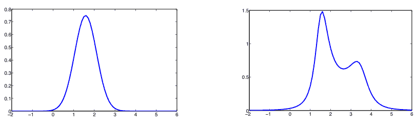

图 2.1: z的后验。(a) 插件近似。(b) 精确后验。由 sensor_fusion_unknown_prec.py 生成。

### 2.2 Google的PageRank算法

本节讨论Google的PageRank算法，因为它提供了马尔可夫链理论的一个有趣应用。PageRank是用于对网页搜索结果进行排名的组件之一。我们下面概述基本思想；有关更详细的解释，请参见[BL06b]。

#### 2.2.1 使用反向索引检索相关页面

我们将网络视为一个巨大的有向图，其中节点表示网页（文档），边表示超链接。[^1] 然后我们执行一种称为网络爬取的过程。我们从几个指定的根节点开始，例如wikipedia.org，然后跟随链接，存储遇到的所有页面，直到时间用尽。

接下来，每个网页中的所有单词都输入到一种称为反向索引的数据结构中。也就是说，对于每个单词，我们存储出现该单词的文档列表。在测试时，当用户输入查询时，我们可以按以下方式查找潜在的相关页面：对于查询中的每个单词，查找包含每个单词的所有文档，并对这些列表取交集。（我们可以通过存储每个文档中每个单词的位置，然后测试文档中的单词是否以与查询相同的顺序出现，从而获得更精细的搜索。）

让我们举个例子，来自 http://en.wikipedia.org/wiki/Inverted_index。假设有3个文档，D0 = "it is what it is"，D1 = "what is it" 和 D2 = "it is a banana"。然后我们可以创建以下反向索引，其中每对表示文档和单词位置：

| 单词 | 位置 |
|---|---|
| "一个" | {(2, 2)} |
| "香蕉" | {(2, 3)} |
| "是" | {(0, 1), (0, 4), (1, 1), (2, 1)} |
| "它" | {(0, 0), (0, 3), (1, 2), (2, 0)} |
| "什么" | {(0, 2), (1, 0)} |

例如，我们可以看到单词 "什么" 出现在文档 0 的位置 2（从 0 开始计数）出现，在文档 1 的位置 0 出现。假设我们搜索 "什么 是 它"。如果忽略单词顺序，我们将检索以下文档：

\({D_0, D_1} \cap {D_0, D_1, D_2} \cap {D_0, D_1, D_2} = {D_0, D_1}\)  (2.68)

如果要求单词顺序匹配，则只会返回文档 D1。更一般地说，我们可以允许非顺序匹配，但可以为单词顺序与查询单词顺序匹配的文档，或其他特征（例如，单词出现在文档标题中）的文档给予“奖励分”。然后我们可以按得分/相关性降序返回匹配的文档。这称为文档排名。

[^1]: 2008年，Google表示已索引1万亿个（10^12）唯一URL。如果假设每个页面平均有约10个URL，这意味着约有1000亿个唯一网页。2010年的估计约为1210亿个唯一网页。来源：https://bit.ly/2KeQeyi


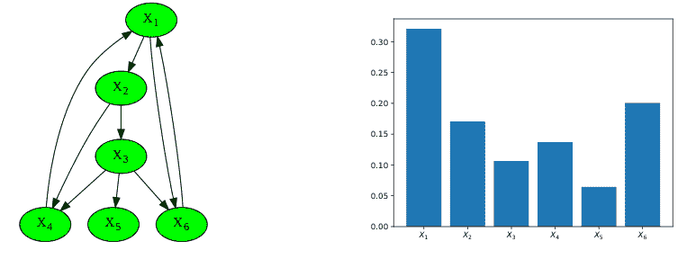

图 2.2：(a) 一个非常小的万维网。由 pagerank_small_plot_graph.py 生成 (b) 对应的平稳分布。由 pagerank_demo_small.py 生成。

#### 2.2.2 PageRank 分数

迄今为止，我们已经描述了信息检索的标准过程。但网页的链接结构提供了额外的信息来源。基本思想是，某些网页比其他网页更具权威性，因此这些网页应当排得更高（假设它们与查询匹配）。如果一个网页被许多其他页面链接，则它被视为**权威页面**。但为了防止所谓**链接农场**的影响——这些是仅为了给特定网站人为提升其表面相关性而链接到该站点的虚拟页面——我们将根据源页面的权重对每个入站链接进行加权。因此，我们得到页面 \( j \) 的权威性（也称为其 **PageRank**）的以下递归定义：

\(\pi_j = \sum_i A_{ij} \pi_i\) (2.69)

其中，\( A_{ij} \) 是从 \( i \) 到 \( j \) 跟随链接的概率。（“PageRank”一词以 Google 联合创始人之一 Larry Page 命名。）

我们将公式 (2.69) 识别为马尔可夫链的平稳分布。但是，我们如何定义转移矩阵呢？在最简单的设置中，我们将 \( A_{i:} \) 定义为 \( i \) 连接到的所有状态上的均匀分布。然而，为了确保分布是唯一的，我们需要将链变成一个正规链。可以通过允许每个状态 \( i \) 以小概率跳转到任何其他状态（包括其自身）来实现。这实际上使得转移矩阵无周期且完全连接（尽管网页本身的邻接矩阵 \( G_{ij} \）是高度稀疏的）。

我们将在下文讨论计算此巨型矩阵主特征向量的高效方法。在此，我们忽略计算问题，仅给出一些示例。

首先，考虑图 2.2 中的小型网络。我们发现平稳分布为

\(\boldsymbol{\pi} = (0.3209, 0.1706, 0.1065, 0.1368, 0.0643, 0.2008)\) (2.70)

因此，随机冲浪者大约有 32% 的时间会访问站点 1。我们看到，节点 1 的 PageRank 高于节点 4 或 6，尽管它们拥有相同数量的入站链接。这是因为，从有影响力的节点接收链接比从不具影响力的节点接收链接更有助于提高你的 PageRank 分数。

作为一个稍大的示例，图 2.3(a) 显示了从 harvard.edu 根目录派生的网络图。图 2.3(b) 显示了相应的 PageRank 向量。

#### 2.2.3 高效计算 PageRank 向量

令 \( G_{ij} = 1 \) 当且仅当存在从 \( j \) 到 \( i \) 的链接。现在想象在该图上进行随机游走，在每个时间步，以概率 \( p \) 你均匀随机地跟随一个出站链接，并以概率 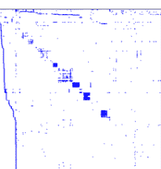

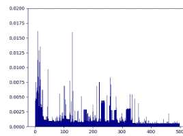

1-p 你跳转到一个随机节点，同样是均匀随机选择的。如果没有出站链接，你就跳转到一个随机页面。（这些随机跳转，包括自转移，确保链是不可约的（强连接）且正规的。因此，我们可以使用特征向量方法求解其唯一的平稳分布。）这定义了以下转移矩阵：

```
M_{ij} = \begin{cases} p G_{ij} / c_j + \delta & \text{if } c_j \neq 0 \\ 1/n & \text{if } c_j = 0 \end{cases}
```

其中，n 是节点数量，\(\delta = (1 - p) / n\) 是不跟随链接从一个页面跳转到另一个页面的概率，\(c_j = \sum_i G_{ij}\) 表示页面 j 的出度。（如果 \(n = 4 \cdot 10^9\) 且 \(p = 0.85\)，则 \(\delta = 3.75 \cdot 10^{-11}\)。）此处 M 是一个列和为一的随机矩阵。注意，在我们先前的记法中 M = A^T。

我们可以紧凑地表示转移矩阵如下。定义对角矩阵 D，其条目为

```
d_{jj} = \begin{cases} 1 / c_j & \text{if } c_j \neq 0 \\ 0 & \text{if } c_j = 0 \end{cases}
```

定义向量 z，其分量为

```
z_j = \begin{cases} \delta & \text{if } c_j \neq 0 \\ 1/n & \text{if } c_j = 0 \end{cases}
```

然后我们可以将公式 (2.71) 改写为如下：

```
M = pGD + 1z^T
```

矩阵 M 不是稀疏的，但它是稀疏矩阵的秩一修正。M 的大多数元素都等于小常数 \(\delta\)。显然，这些元素无需显式存储。

我们的目标是求解 \(v = Mv\)，其中 \(v = \pi^T\)。寻找大型矩阵主特征向量的一种高效方法称为幂法。它仅由重复的矩向量乘法，随后进行归一化组成：

```
v \propto Mv = pGDv + 1z^T v
```

可以通过不使用任何矩阵乘法来实现幂法，只需从转移矩阵中采样并计数访问每个状态的次数即可。这本质上是对 v = Mv 隐含求和的蒙特卡洛近似。将此应用于图 2.3(a) 中的数据，得出图 2.3(b) 中的平稳分布。从均匀分布开始，需要 13 次迭代才能收敛。为了处理变化的网页结构，我们可以每天或每周重新运行此算法，将 v 从旧分布开始；这称为热启动 [LM06]。

关于如何在并行分布式计算环境中执行此蒙特卡洛幂法的详细信息，参见例如 [RU10]。

#### 2.2.4 网络垃圾信息

PageRank 并非万无一失。例如，考虑美国百货公司 JC Penney 采用的策略。在 2010 年圣诞季节，它在成千上万个不相关的网页上植入了指向其主页的大量链接，从而提高了其在 Google 搜索引擎上的排名 [Seg11]。尽管每个源页面的 PageRank 都很低，但数量如此之多，以至于它们的效果叠加在一起。企业称此为**搜索引擎优化**；Google 称其为**网络垃圾信息**。当 Google 被告知此骗局（由 *《纽约时报》* 通知）时，它手动降低了 JC Penney 的权重，因为这种行为违反了 Google 的行为准则。结果，JC Penney 从第 1 名降至第 65 名，实际上消失在视野之外。自动检测此类骗局依赖于各种超出本章范围的技术。

#### 2.2.5 个性化 PageRank

PageRank 算法计算每个网页的单一全局重要性概念。在某些情况下，让每个用户定义自己的重要性概念很有用。**个性化 PageRank** 算法（也称为**带重启的随机游走**）计算相对于节点 $k$ 的平稳分布，即以一定概率返回到特定的起始节点 $k$ 而非随机节点。相应的平稳分布 \(\pi^k\) 衡量了每个节点相对于 \(k\) 的重要性。详情请参见 [Lof15]。（Pinterest 使用类似系统来推断一个“pin”（书签网页）与另一个“pin”的相似性，如 [Eks+18] 所述。）

## 第 3 章

## 统计学

### 3.1 贝叶斯概念学习

在本节中，我们将使用一些受人类学习贝叶斯模型启发的简单示例来介绍贝叶斯统计。这将使我们熟悉关键思想，而不会被数学技术细节所困扰。

考虑一个孩子如何学习一个词的含义，例如“dog”。通常，孩子的父母会指出这个概念的**正例**，说诸如“看那只可爱的小狗”或“当心那只小狗”之类的话。核心挑战是根据有限（可能相当少）的此类示例，弄清楚我们所说的**概念**“dog”是什么意思。请注意，父母不太可能提供**负例**；例如，人们通常不会说“看那只不是狗的东西”。负例可能在主动学习过程中获得（例如，孩子说“看那只狗”，父母说“那是猫，亲爱的，不是狗”），但心理学研究表明，人们可以仅凭正例学习概念 [XT07]。这意味着无法使用标准监督学习方法。

我们通过假设所见数据由某个隐藏概念 \(h \in \mathcal{H}\) 生成来制定问题，其中 \(\mathcal{H}\) 称为**假设空间**。（我们使用记法 \(h\) 而不是 \(\boldsymbol{\theta}\)，以与概念学习文献保持一致。）然后我们专注于计算后验 \(p(h|\mathcal{D})\)。在第 3.1.1 节中，我们假设假设空间由有限数量的备选假设组成；这将显著简化后验的计算，使我们能够专注于思想，而不会被数学过分分散注意力。在第 3.1.2 节中，我们将此扩展到连续假设空间。这将构成贝叶斯推断实值参数的基础，用于我们在后续章节中讨论的更熟悉的概率模型，如伯努利分布和高斯分布、逻辑回归以及深度神经网络。（另请参见 [Jia+13]，了解这些想法在从图像进行概念学习问题上的应用。）

#### 3.1.1 学习离散概念：数字游戏

假设我们正在尝试从提供该概念示例的老师那里学习某个数学概念。我们假设概念定义为属于其**外延**的正整数集合；例如，概念“偶数”由 \(h_{even}=\{2,4,6,\dots\}\) 定义，概念“2 的幂”由 \(h_{two}=\{2,4,8,16,\dots\}\) 定义。为简单起见，我们假设数字范围在 1 到 100 之间。

例如，假设我们看到一个示例，\(\mathcal{D}=\{16\}\)。你认为还有哪些数字是这个概念的示例？17？6？32？99？仅凭一个示例很难判断，因此你的预测会相当模糊。presumably，在某种意义上与 16 相似的数字更可能。但是以何种方式相似？17 相似是因为它“接近”；6 相似是因为它们有一个共同的数字，32 相似是因为它也是偶数且是 2 的幂，但 99 似乎不相似。因此，有些数字比其他数字更有可能。

现在假设我告诉你，\(\mathcal{D}=\{2,8,16,64\}\) 是正例。你可能猜测隐藏的概念是“2 的幂”。根据你对真实（但隐藏）概念的信念，你可能会自信地


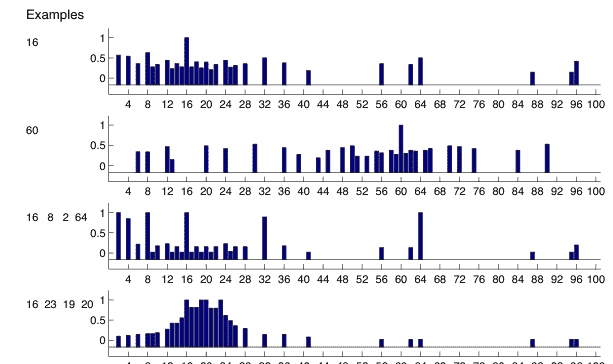

图 3.1：数字游戏中的经验成员分布，源自 8 名人类的预测。前两行：在看到 $\mathcal{D} = \{16\}$ 和 $\mathcal{D} = \{60\}$ 之后。这说明了弥散相似性。第三行：在看到 $\mathcal{D} = \{16, 8, 2, 64\}$ 之后。这说明了类似规则的行为（2 的幂）。底行：在看到 $\mathcal{D} = \{16, 23, 19, 20\}$ 之后。这说明了集中相似性（接近 20 的数字）。来自 [Ten99] 中的图 5.5。经 Josh Tenenbaum 友好许可使用。

预测 $y \in \{2, 4, 8, 16, 32, 64\}$ 也可能在未来由教师生成。这是**泛化**的一个示例，因为我们正在对尚未看到的未来数据进行预测。

图 3.1 举例说明了人类在这项任务中的表现。给定单个示例，例如 $\mathcal{D} = \{16\}$ 或 $\mathcal{D} = \{60\}$，人类会对数量级相似的其他数字做出相当弥散的预测。但当给出多个示例，例如 $\mathcal{D} = \{2, 8, 16, 64\}$ 时，人类通常会发现潜在的**模式**，并利用它来对哪些其他数字可能属于同一概念做出相当精确的预测，即使这些其他数字“遥远”。

我们如何解释这种行为并在机器中模拟它？解决**归纳**问题的经典方法是假设我们有一个概念假设空间 $\mathcal{H}$（例如偶数、1 到 10 之间的所有数字等），然后找出与观测数据 $\mathcal{D}$ 一致的 $\mathcal{H}$ 的最小子集；这称为**版本空间**。随着我们看到更多示例，版本空间会收缩，我们对底层假设也会越来越确定 [Mit97]。

然而，版本空间理论无法解释我们在图 3.1 中看到的人类行为。例如，在看到 $\mathcal{D} = \{16, 8, 2, 64\}$ 之后，为什么人们会选择“2 的幂”规则，而不选择“所有偶数”或“2 的幂（32 除外）”等规则，这些规则都与证据同样一致？我们将展示贝叶斯推断如何解释这种行为。生成的预测如图 3.2 所示。

##### 3.1.1.1 似然

我们必须解释为什么人们在看到 $\mathcal{D} = \{16, 8, 2, 64\}$ 后会选择 $h_{two}$ 而不选择 $h_{even}$，鉴于两个假设都与证据一致。关键的直觉是我们想要避免**可疑的巧合**。例如，如果真正的概念是偶数，那么我们碰巧只看到 2 的幂将是令人惊讶的。

为形式化这一点，让我们假设示例是从概念的**外延**中均匀随机抽样的。（Tenenbaum 称此为**强抽样假设**。）在此假设下，从未知概念 $h$ 中独立抽取 $N$ 个项目（有放回）的概率由以下公式给出：

```
$$ p(\mathcal{D}|h) = \prod_{n=1}^N p(y_n|h) = \prod_{n=1}^N \frac{1}{\text{size}(h)}\mathbb{I}(y_n \in h) = \left[ \frac{1}{\text{size}(h)} \right]^N \mathbb{I}(\mathcal{D} \in h) \quad (3.1) $$
```

其中 $\mathbb{I}(\mathcal{D} \in h)$ 当且仅当所有数据点都位于 $h$ 的支持集中时才非零。这个关键方程体现了

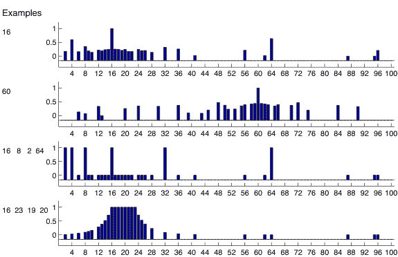

图 3.2：使用完整假设空间推导的后验成员概率。与图 3.1 相比。贝叶斯模型的预测仅针对有人类数据可用的值进行绘制；这就是为什么顶行看起来比图 3.4 更稀疏。来自 [Ten99] 中的图 5.6。经 Josh Tenenbaum 友好许可使用。

Tenenbaum 称之为大小原则，这意味着模型倾向于偏好与数据一致的最简单（最小）假设。这更常被称为奥卡姆剃刀。

为了了解其工作原理，设 D = {16}。则 p(D|h_two) = 1/6，因为小于 100 的 2 的幂只有 6 个，但 p(D|h_even) = 1/50，因为有 50 个偶数。因此 h = h_two 的似然高于 h = h_even。4 个示例之后，h_two 的似然为 (1/6)^4 = 7.7 × 10^-4，而 h_even 的似然为 (1/50)^4 = 1.6 × 10^-7。这是近乎 5000:1 的似然比，支持 h_two。这量化了我们之前的直觉，即 D = {16, 8, 2, 64} 如果由 h_even 生成将是一个非常可疑的巧合。

##### 3.1.1.2 先验

在贝叶斯方法中，我们必须对未知数 p(h) 指定先验分布，以及似然 p(D|h)。为了了解为何这有用，假设 D = {16, 8, 2, 64}。给定此数据，概念 h' = “2 的幂（32 除外）”比 h = “2 的幂”更可能，因为 h' 无需解释示例集中缺少 32 这一巧合。然而，假设 h' = “2 的幂（32 除外）”似乎“在概念上不自然”。我们可以通过给不自然的概念分配低先验概率来捕捉这种直觉。当然，你的先验可能与我不同。贝叶斯推理中的这种主观性是许多争议的根源，因为这意味着，例如，一个孩子和一名数学教授会得出不同的答案。[^1]

尽管先验的主观性具有争议性，但它实际上非常有用。如果你被告知这些数字来自某个算术规则，那么给定 1200、1500、900 和 1400，你可能会认为 400 很可能但 1183 不太可能。但如果你被告知这些数字是健康胆固醇水平的示例，你可能会认为 400 不太可能而 1183 很可能，因为你假设健康水平处于某个范围内。因此，我们可以看出先验是将背景知识应用于问题的机制。没有它，快速学习（即从小样本量学习）是不可能的。

那么，我们应该使用什么先验？我们最初将考虑 30 个简单的算术概念，例如“偶数”、“奇数”、“质数”或“以 9 结尾的数字”。我们可以对这些概念使用均匀先验；但是，为了说明目的，我们使偶数和奇数的先验可能性更大，并对其他概念使用均匀先验。我们还包括两个“不自然”的概念，即“2 的幂，加上

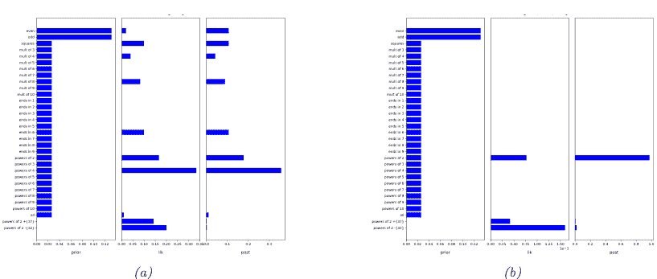

图 3.3：(a) 当数据为 D = {16} 时模型的先验、似然和后验。(b) 当 D = {2, 8, 16, 64} 时的结果。改编自 [Ten99]。由 numbers_game.py 生成。

37" 和 "2 的幂，除 32 以外"，但给它们低先验权重。请参见图 3.3a(底行)以查看此先验的图示。

除了“类似规则”的假设外，我们还考虑 1 <= n, m <= 100 之间 n 和 m 的区间集合。这使我们能够捕捉基于“接近”某个数字的概念，而不是满足某个更抽象的属性。我们对区间使用均匀先验。

我们可以通过使用**混合分布**来结合这两个先验，如下所示：

```
p(h) = \pi \text{Unif}(h|\text{rules}) + (1 - \pi) \text{Unif}(h|\text{intervals}) (3.2)
```

其中 0 < \pi < 1 是分配给规则先验的**混合权重**，Unif(h|S) 是集合 S 上的均匀分布。

##### 3.1.1.3 后验

后验只是似然乘以先验，然后归一化：p(h|D) \propto p(D|h)p(h)。图 3.3a 绘制了在看到 D = {16} 后的先验、似然和后验。（在此图中，为了简化，我们只考虑类似规则的假设，不考虑区间。）我们可以看出，后验是先验和似然的组合。对于大多数概念，先验是均匀的，因此后验与似然成正比。然而，“不自然”的概念“2 的幂，加上 37”和“2 的幂，除 32 以外”尽管似然很高，但由于先验低，后验支持度也低。相反，奇数概念尽管先验高，但由于似然低，后验支持度也低。

图 3.3b 绘制了在看到 D = {16, 8, 2, 64} 后的先验、似然和后验。现在似然在 2 的幂概念上更加集中，因此主导了后验。基本上，学习者有了“顿悟”时刻，并找出了真正的概念。[^2] 这个例子还说明了为什么我们需要对不自然的概念设置低先验，否则我们就会过拟合数据并选择“2 的幂，除 32 以外”。

##### 3.1.1.4 后验预测

关于假设的后验是我们对世界的内部**信念状态**。检验我们的信念是否合理的方法是使用它们来预测客观可观测的量（这是科学方法的基础）。为此，我们计算可能未来观测上的**后验预测分布**：

```
p(y|\mathcal{D}) = \sum_h p(y|h)p(h|\mathcal{D}) (3.3)
```

[^1]: 一个孩子和一名数学教授不仅有不同的先验，还有不同的假设空间。然而，我们可以通过将孩子和数学教授的假设空间定义为相同，然后将孩子在某些“高级”概念上的先验权重设为零来巧妙处理这一问题。因此，先验和假设空间之间没有明显的区别。

[^2]: 人类有探究事物的自然欲望；Alison Gopnik 在她的论文“解释如同高潮” [Gop98] 中认为，进化确保我们喜欢降低后验不确定性。


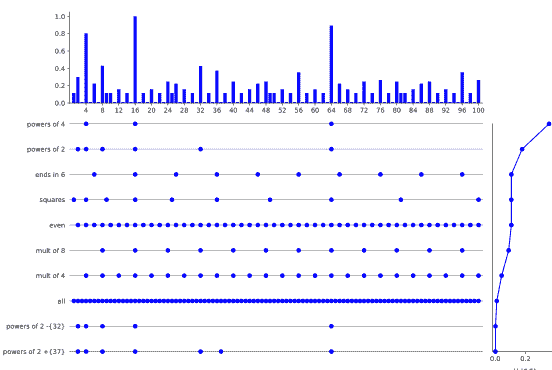

图 3.4：在看到一个示例 D = {16} 后，关于假设的后验及其诱导的成员后验。一个点表示该数字与此假设一致。右侧的图 p(h|D) 是赋予假设 h 的权重。通过对点进行加权求和，我们得到 p(y ∈ h|D)（顶部）。改编自 [Ten99] 的图 2.9。由 numbers_game.py 生成。

这被称为**贝叶斯模型平均** [Hoe+99]。每个术语只是各个假设预测的加权平均。这在图 3.4 中有所体现。底部的点显示来自每个假设的预测；右侧的垂直曲线显示与每个假设相关的权重。如果我们将每一行乘以其权重并相加，就得到顶部的分布。

##### 3.1.1.5 MAP、MLE 和插件近似

随着数据量的增加，后验通常会集中在单一点附近，即我们在图 3.3（右上角图）中看到的**后验众数**。后验众数定义为后验概率最大的假设：

```
$h_{map} \triangleq \underset{h}{\text{argmax}} \, p(h|\mathcal{D})$
```

这也被称为**最大后验**或 **MAP** 估计。

我们可以通过求解以下**优化问题**来计算 MAP 估计：

```
$h_{map} = \underset{h}{\text{argmax}} \, p(h|\mathcal{D}) = \underset{h}{\text{argmax}} \, \log p(\mathcal{D}|h) + \log p(h)$
```

第一项 \(\log p(\mathcal{D}|h)\) 是**似然** \(p(\mathcal{D}|h)\) 的对数。第二项 \(\log p(h)\) 是先验的对数。随着数据集规模增大，对数似然的幅度增长，但对数先验项保持不变。因此，我们说**似然淹没先验**。在这种情况下，MAP 估计的一个合理近似是忽略先验项，只选择**最大似然估计**或 **MLE**，其定义为

```
$h_{mle} \triangleq \underset{h}{\text{argmax}} \, p(\mathcal{D}|h) = \underset{h}{\text{argmax}} \, \log p(\mathcal{D}|h) = \underset{h}{\text{argmax}} \, \sum_{n=1}^N \log p(y_n|h)$
```

假设我们用单个**点估计** \(\hat{h}\) 来近似后验，它可能是 MAP 估计或 MLE。我们可以将这种退化分布表示为单个点质量

```
$p(h|\mathcal{D}) \approx \mathbb{I}\left(h = \hat{h}\right)$
```

其中 \(\mathbb{I}()\) 是指示函数。相应的后验预测分布变为

```
\(p(y|\mathcal{D}) \approx \sum_h p(y|h)\mathbb{I}\left(h=\hat{h}\right) = p(y|\hat{h})\) (3.8)
```

这称为**插件近似**，因其简单性而被广泛使用，我们将在 **??** 中进一步讨论。

尽管插件近似简单，但在数据集较小时，它的表现质量不如完全贝叶斯方法。在贝叶斯方法中，我们从宽泛的预测开始，随着看到更多数据，预测会变得更加精确，这符合直觉。例如，给定 \(\mathcal{D} = \{16\}\)，存在许多后验质量不可忽略的假设，因此在整数上的预测支持很广。然而，当我们看到 \(\mathcal{D} = \{16, 8, 2, 64\}\) 时，后验将其质量集中在一两个特定假设上，因此整体预测支持变得更加聚焦。相比之下，MLE 选择最小一致假设，并使用该单一模型预测未来。例如，如果我们看到 \(\mathcal{D} = \{16\}\)，我们计算 \(h_{mle}\) 为“所有 4 的幂”（或区间假设 \(h = \{16\}\)），结果插件近似仅预测 \(\{4, 16, 64\}\) 具有非零概率。这是**过拟合**的示例，我们过于关注训练中看到的特定数据，无法正确推广到新示例。当我们观察更多数据时，MLE 将被迫选择更广泛的假设来解释所有数据。例如，如果我们 \(\mathcal{D} = \{16, 8, 2, 64\}\)，MLE 将扩展为“所有 2 的幂”，与贝叶斯方法类似。因此，在无限数据的极限下，两种方法会收敛到相同的预测。然而，在小样本模式下，完全贝叶斯方法（我们考虑多个假设）将给出更好（不那么过度自信）的预测。

#### 3.1.2 学习连续概念：健康水平游戏

数字游戏涉及观察一系列离散变量，并从有限假设空间中推断另一个离散变量的分布。这使得计算特别简单：我们只需要求和、乘法和除法。然而，在许多应用中，我们观察到的变量是实值连续量。更重要的是，未知参数也通常是连续的，因此假设空间成为 \(\mathbb{R}^K\) 的（某个子集），其中 \(K\) 是参数的数量。这使数学变复杂，因为我们必须用积分替换求和。然而，基本思想是相同的。

为了说明这些想法，我们考虑另一个称为**健康水平游戏**的概念学习示例，同样由 Tenenbaum 提出。其想法如下：我们测量两个连续变量，代表一些随机选定的健康患者的胆固醇和胰岛素水平。我们想知道哪些值范围对应于健康范围。与数字游戏一样，挑战仅从正数据中学习概念。

让我们将假设空间设为平面上的**轴平行矩形**，如图 3.5 所示。这是一个在机器学习中广泛研究的经典示例 [Mit97]。这也是健康水平游戏的一个合理假设，因为我们知道（根据先验领域知识）胰岛素和胆固醇的健康水平必须介于（未知的）下界和上界之间。我们可以将矩形假设表示为 \(h = (\ell_1, \ell_2, s_1, s_2)\)，其中 \(\ell_j \in (-\infty, \infty)\) 是左下角的坐标（位置），\(s_j \in [0, \infty)\) 是两条边的长度。因此，假设空间是 \(\mathcal{H} = \mathbb{R}^2 \times \mathbb{R}_+^2\)，其中 \(\mathbb{R}_{\ge 0}\) 是非负实数集。

更复杂的概念可能需要空间中的不连续区域来表示。或者，我们可能希望使用*潜在*矩形区域来表示更复杂的高维概念 [Li+19]。假设空间从何而来是一个非常有趣的问题，但超出了本章的范围。（一种方法是使用分层贝叶斯模型，如在 [Ten+11] 中讨论。）

##### 3.1.2.1 似然

我们假设点是从矩形的支撑集中均匀随机采样的。为了简化分析，让我们先考虑一维“矩形”（即线段）的情况。在 1d 情况下，似然

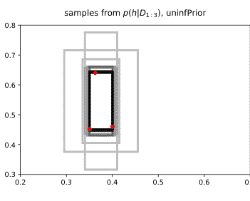

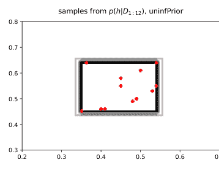

图 3.5：“健康水平”游戏中的后验样本。轴代表“胆固醇水平”和“胰岛素水平”。（a）给定少量正示例（由 3 个红色叉号表示），对矩形的真实范围存在很大不确定性。（b）给定足够数据，最小包围矩形（即最大似然假设）成为最可能的，尽管还有许多其他相似假设几乎同样可能。改编自 [Ten99]。由 healthy_levels_plots.py 生成。

is \(p(\mathcal{D}|\ell, s) = (1/s)^N\) 如果所有点都在区间内，否则为 0。因此

```
\(p(\mathcal{D}|\ell, s) = \begin{cases} s^{-N} & \text{if } \min(\mathcal{D}) \ge \ell \text{ and } \max(\mathcal{D}) \le \ell + s \\ 0 & \text{otherwise} \end{cases}\) (3.9)
```

为了将其推广到 2d，我们假设在给定假设的情况下观察到的特征是条件独立的。因此，2d 似然变为

```
\(p(\mathcal{D}|h) = p(\mathcal{D}_1|\ell_1, s_1)p(\mathcal{D}_2|\ell_2, s_2)\) (3.10)
```

其中 \(\mathcal{D}_j = \{y_{nj} : n = 1 : N\}\) 是维度（特征）\(j=1,2\) 的观测值。

##### 3.1.2.2 先验

为简单起见，让我们假设先验分解，即 \(p(h) = p(\ell_1)p(\ell_2)p(s_1)p(s_2)\)。我们将对每一项使用非信息性先验。如我们在 **??** 中解释，这意味着我们应该使用形式 \(p(h) \propto \frac{1}{s_1} \frac{1}{s_2}\) 的先验。

##### 3.1.2.3 后验

后验由以下给出

```
\(p(\ell_1, \ell_2, s_1, s_2|\mathcal{D}) \propto p(\mathcal{D}_1|\ell_1, s_1)p(\mathcal{D}_2|\ell_2, s_2) \frac{1}{s_1} \frac{1}{s_2}\) (3.11)
```

我们可以通过将 \(\mathbb{R}^4\) 离散化为 4d 网格、逐点评估分子并进行归一化，在数值上计算这一点。

由于可视化 4d 分布比较困难，我们而是从中绘制**后验样本**，\(h^s \sim p(h|\mathcal{D})\)，并将它们可视化为矩形。在图 3.5(a) 中，我们展示了观测数据点数量 \(N\) 较小时的一些样本——我们对正确假设不确定。在图 3.5(b) 中，我们看到对于较大的 \(N\)，样本集中在观测数据上。

##### 3.1.2.4 后验预测分布

我们现在考虑，在考虑到迄今为止看到的数据的情况下，如何预测未来我们期望看到哪些数据点。特别是，我们想知道看到任意点 \(\mathbf{y} \in \mathbb{R}^2\) 的可能性有多大。


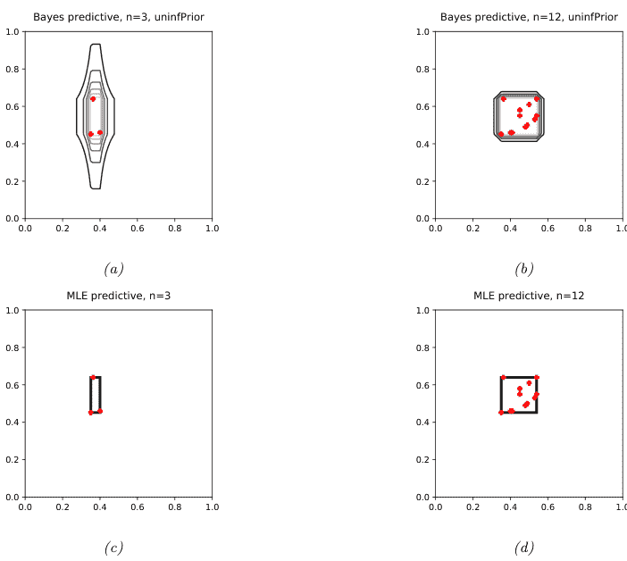

图 3.6: 健康水平游戏的后验预测分布。红色叉号为观测数据点。左列：N = 3。右列：N = 12。第一行：贝叶斯预测。第二行：使用 MLE（最小封闭矩形）的插件预测。我们可以看到，随着数据增多、对概念的了解加深，贝叶斯预测会从不确定走向确定；而插件预测则从窄变广，因为它在看到更多数据时被迫进行泛化。然而，两者最终会收敛到同一答案。改编自 [Ten99]。由 healthy_levels_plot.py 生成。

让我们定义 \(y_j^{\min} = \min_n y_{nj}, y_j^{\max} = \max_n y_{nj},\) 和 \(r_j = y_j^{\max} - y_j^{\min}\)。可以证明，后验预测分布由以下公式给出：

```
\(p(\mathbf{y}|\mathcal{D}) = \left[ \frac{1}{(1 + d(y_1)/r_1)(1 + d(y_2)/r_2)} \right]^{N-1} \quad (3.12)\)
```

其中，若 \(y_j^{\min} \le y_j \le y_j^{\max}\)，则 \(d(y_j) = 0\)；否则，\(d(y_j)\) 为沿第 \(j\) 维到最近数据点的距离。因此，若 \(\mathbf{y}\) 位于训练数据的支撑集内，则 \(p(\mathbf{y}|\mathcal{D}) = 1\)；若 \(\mathbf{y}\) 位于支撑集外，则概率密度会下降，下降速率取决于 \(N\)。

注意，若 \(N=1\)，预测分布未定义。这是因为仅凭一个数据点无法推断 2D 矩形的范围（除非使用更强的先验）。

在图 3.6(a) 中，我们绘制了在只看到 \(N=3\) 个示例时的后验预测分布；可以看到存在一个广泛的泛化梯度，其在垂直方向上的延伸比水平方向更远。这是因为数据在垂直方向上的扩展比水平方向更大。换句话说，如果我们在某一维上观察到了较大的范围，就有证据表明矩形在该维上相当大；否则，我们更倾向于紧凑的假设，这符合大小原则。

在图 3.6(b) 中，我们绘制了 \(N=12\) 时的分布。可以看到，它聚焦于最小的一致性假设，因为大小原则会对比必要更大的假设进行指数级降权。

##### 3.1.2.5 插件近似

现在假设我们使用后验预测的插件近似，\(p(\boldsymbol{y}|\mathcal{D}) \approx p(\boldsymbol{y}|\hat{\boldsymbol{\theta}})\)，其中 \(\hat{\boldsymbol{\theta}}\) 为 MLE 或 MAP 估计，这与第 3.1.1.5 节的讨论类似。在图 3.6(c-d) 中，我们展示了该近似的表现。在这两种情况下，它都预测最小封闭矩形，因为这具有最大似然。然而，这不会超出观测数据的范围进行外推。
我们还看到，最初预测较窄，因为观测到的数据很少，但随着数据增多，预测会变宽。相比之下，在贝叶斯方法中，初始预测较宽，因为存在大量不确定性，但随着数据增多会变窄。在大数据量的极限下，两种方法会收敛到相同的预测。（有关插件近似的更多讨论，参见 **??**。）

### 3.2 信息性先验

当我们只有很少数据时，选择一个信息性先验非常重要。

例如，考虑经典的 **出租车问题** [Jay03, p190]：你来到一个新城市，看到一辆编号为 \(t=27\) 的出租车，并希望推断该城市出租车的总数 \(T\)。我们将使用均匀似然 \(p(t|T) = \frac{1}{T} \mathbb{I}(T \ge t)\)，因为我们假设可能观察到的出租车编号最大为 \(T\)。\(T\) 的 MLE 估计为 \(\hat{T}_{\text{mle}} = t = 27\)。但这似乎不太合理。相反，大多数人会猜测 \(T \sim 2 \times 27 = 54\)，其假设是：如果你看到的出租车是在 0 到 \(T\) 之间的均匀随机样本，那么它可能接近分布的中间。

一般来说，我们关于 \(T\) 得出的结论将高度取决于我们对哪些 \(T\) 值可能的先验假设。在下面的章节中，我们将讨论不同问题领域的各种可能的信息性先验；我们的介绍基于 [GT06]。

一旦选择了先验，我们可以按以下方式计算后验：

```
\(p(T|t) = \frac{p(t|T)p(T)}{p(t)}\) \\
(3.13)
```

其中

```
\(p(t) = \int_0^\infty p(t|T)p(T)dT = \int_t^\infty \frac{p(T)}{T}dT\) \\
(3.14)
```

我们将使用后验中位数作为 \(T\) 的点估计。这是满足以下条件的值 \(\hat{T}\)：

```
\(p(T \ge \hat{T}|t) = \int_{\hat{T}}^\infty p(T|t)dT = 0.5\) \\
(3.15)
```

注意，后验中位数通常比后验众数更能很好地概括后验，原因在 **??** 中有解释。

#### 3.2.1 领域特定先验

在图 3.7 顶部，我们展示了一些直方图，表示各种标量量的经验分布，具体为：人们的寿命（年）、电影时长（分钟）、电影收入（千美元）、诗歌的行数、以及某人在美国众议院任职的年数。（这些数据的来源列在 [GT06] 中。）

在底部，我们针对每个领域，将 \(p(T|t)\) 作为 \(t\) 的函数进行绘制。实心点是一组人在从单次观测 \(t\) 预测 \(T\) 时的中位数回答。实线是使用领域适当先验的贝叶斯模型计算得到的后验中位数（详情见下文）。虚线是使用非信息性 \(1/T\) 先验的贝叶斯模型计算得到的后验中位数。我们看到，人与知情贝叶斯模型之间存在显著的一致性。这表明，正如 [GT06] 所主张的，人们可以在广泛的问题中隐式地使用合适的先验。在下面的章节中，我们将讨论一些适合的参数化先验，它们能够捕捉这种行为。在 [GT06] 中，他们还考虑了一些只能由非参数先验良好建模的数据集。在这种情况下，贝叶斯推断同样有效，但为了简单起见，我们不予赘述。

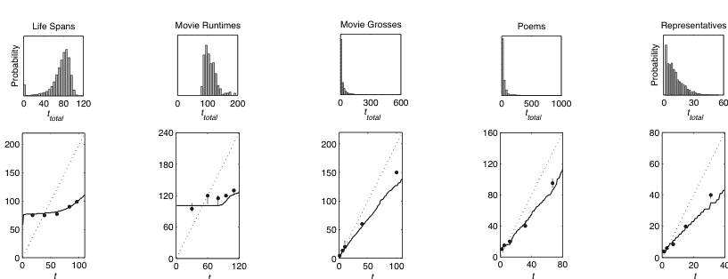

图 3.7：顶部：各种时长量的经验分布。底部：预测总时长作为观测时长的函数，p(T|t)。点是人观测到的中位数回答。实线：使用信息先验的贝叶斯预测。虚线：使用非信息先验的贝叶斯预测。来自 [GT06] 的图 2a。经 Tom Griffiths 特许使用。

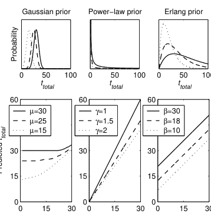

图 3.8：顶部：三个不同参数值下的先验分布。底部：对应的预测分布。来自 [GT06] 的图 1。经 Tom Griffiths 特许使用。

#### 3.2.2 高斯先验

观察图 3.7(a-b)，可以清楚地看出，寿命和电影片长可以很好地用高斯分布 \(\mathcal{N}(T|\mu, \sigma^2)\) 建模。不幸的是，如果使用高斯先验，我们无法以闭式形式计算后验中位数，但仍可以通过求解一维积分问题进行数值计算。得到的 \(\hat{T}(t)\) 与 t 的图表如图 3.8（左下角）所示。当 t 远小于先验均值 \(\mu\) 时，预测的 T 值大约等于 \(\mu\)，因此曲线左侧是平坦的。当 t 远大于 \(\mu\) 时，预测值收敛到略高于对角线的一条直线，即 \(\hat{T}(t) = t + \epsilon\)，其中 \(\epsilon > 0\) 为某个很小且递减的值。

要理解这种行为的直觉意义，可以考虑遇到一名 18 岁、39 岁或 51 岁的男子：在所有情况下，合理的预测是他大约能活到 \(\mu = 75\) 岁。但现在想象遇到一名 80 岁的男子：我们可能不期望他活得更久，因此预测 \(\hat{T}(80) \approx 80 + \epsilon\)。


#### 3.2.3 幂律先验

观察图 3.7(c-d)，很明显电影票房和诗歌长度可以用形式为 \(p(T) \propto T^{-\gamma}\) 的 **幂律** 分布来建模，其中 \(\gamma > 0\)。（如果 \(\gamma > 1\)，这被称为帕累托分布，见 **??**。）幂律的特征是具有非常 **长尾** 的分布。这捕捉了这样一个事实：大多数电影票房很低，但少数大片票房很高。各种诗歌的行数也具有这种形状，因为有少数史诗，如荷马的 _奥德赛_ ，但大多数都是短诗，如俳句。财富在许多国家也有类似的偏态分布，尤其是在美国这样的寡头政治国家（见，例如，`inequality.org`）。

在幂律先验的情况下，\(p(T) \propto T^{-\gamma}\)，我们可以解析地计算后验中位数。我们有

$$
p(t) \propto \int_t^\infty T^{-(\gamma+1)} dT = -\frac{1}{\gamma} T^{-\gamma}|_t^\infty = \frac{1}{\gamma} t^{-\gamma} \quad (3.16)
$$

因此后验变为

$$
p(T|t) = \frac{T^{-(\gamma+1)}}{\frac{1}{\gamma} t^{-\gamma}} = \frac{\gamma t^\gamma}{T^{\gamma+1}} \quad (3.17)
$$

对于 \(T \ge t\) 的取值，我们可以按如下方式推导后验中位数：

$$
p(T > T_M|t) = \int_{T_M}^\infty \frac{\gamma t^\gamma}{T^{\gamma+1}} dT = - \left( \frac{t^\gamma}{T} \right) \big|_{T_M}^\infty = \left( \frac{t}{T_M} \right)^\gamma \quad (3.18)
$$

求解使得 \(P(T > T_M|t) = 0.5\) 的 \(T_M\) 得到 \(T_M = 2^{1/\gamma} t\)。

这在图 3.8（底部中间）中有所示。我们可以看到，预测时长是观测时长的某个常数倍。对于最能拟合电影票房经验分布的特定 \(\gamma\) 值，最优预测大约比观测值大 50%。因此，如果我们观察到一部电影迄今已赚取 4000 万美元，我们预测它总共将赚取 6000 万美元。

正如 Griffiths 和 Tenenbaum 所指出的，这条规则不适用于服从高斯先验的量，例如人们的年龄。正如他们写道：“遇到一个 10 岁的女孩和她 75 岁的祖父时，我们永远不会预测女孩总共只能活 15 岁（\(1.5 \times 10\)），而祖父能活到 112 岁（\(1.5 \times 75\)）。”这表明，人们在解决这类预测问题时，隐含地知道应该使用哪种先验。

#### 3.2.4 Erlang 先验

观察图 3.7(e)，很明显美国众议员的任职年数大约可以用伽马分布（**??**）来建模。Griffiths 和 Tenenbaum 使用伽马分布的一个特例，其中形状参数为 \(a = 2\)；这被称为 **Erlang 分布**：

$$
p(T) = \text{Ga}(T|2, 1/\beta) \propto T e^{-T/\beta} \quad (3.19)
$$

对于 Erlang 先验，我们也可以解析地计算后验中位数。我们有

$$
p(t) \propto \int_t^\infty \exp(-T/\beta) dT = -\beta \exp(-T/\beta) \big|_t^\infty = \beta \exp(-t/\beta) \quad (3.20)
$$

因此后验的形式为

$$
p(T|t) = \frac{\exp(-T/\beta)}{\beta \exp(-t/\beta)} = \frac{1}{\beta} \exp(-(T-t)/\beta) \quad (3.21)
$$

对于 \(T \ge t\) 的取值，我们可以按如下方式推导后验中位数：

$$
p(T > T_M|t) = \int_{T_M}^\infty \frac{1}{\beta} \exp(-(T-t)/\beta) dT = - \exp(-(T-t)/\beta) \big|_{T_M}^\infty = \exp(-(T_M-t)/\beta) \quad (3.22)
$$

求解使得 \(p(T > T_M|t) = 0.5\) 的 \(T_M\) 得到 \(T_M = t + \beta \log 2\)。

这在图 3.8（底部右侧）中有所示。我们可以看到，最佳猜测只是观测值加上一个常数，其中该常数反映了平均任期。

## 第 4 章

## 图形模型

### 4.1 DGM 的更多示例

#### 4.1.1 QMR 网络

在本节中，我们描述被称为 **快速医学参考** 或 **QMR** 网络 [Shw+91] 的 PGM-D。这是一种传染病模型，（以简化形式）如图 4.1 所示。（为了清晰起见，我们省略了参数，因此不使用盘状符号。）QMR 模型是一种 **二分图** 结构，顶部是隐藏的疾病（原因），底部是可见的症状或发现。我们可以按如下方式写出分布：

\( p(\mathbf{z}, \mathbf{x}) = \prod_{k=1}^K p(z_k) \prod_{d=1}^D p(x_d | \mathbf{z}_{\text{pa}(d)}) \) (4.1)

其中 \( z_k \) 代表第 \( k \) 种疾病，\( x_d \) 代表第 \( d \) 种症状。该模型可以用于推理引擎中，以计算给定观测症状下每种疾病的后验概率，即 \( p(z_k | \mathbf{x}_v) \)，其中 \( \mathbf{x}_v \) 是可见症状节点的集合。（未观测的症状可以从模型中移除，假设它们是随机缺失的（**??**），因为它们对似然没有贡献；这称为 **冗余节点移除**。）

我们现在讨论模型的参数化。为简单起见，我们假设所有节点都是二值的。根节点的 CPD 只是伯努利分布，代表该疾病的先验概率。使用 CPT 表示叶节点（症状）的 CPD 将需要太多参数，因为许多叶节点的 **扇入**（父节点数量）非常大。一种自然的替代方案是使用逻辑回归来建模 CPD，\(p(x_d|\mathbf{z}_{\text{pa}(d)}) = \text{Ber}(x_d|\boldsymbol{\sigma}(\boldsymbol{w}_d^\mathsf{T}\mathbf{z}_{\text{pa}(d)}))\)。然而，我们使用一种称为 noisy-OR 模型的替代方案，我们将在下面解释，

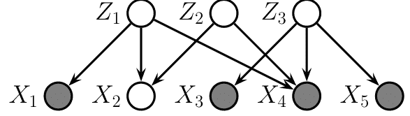

图 4.1：QMR 网络的一个小型版本。所有节点都是二值的。隐藏节点 \( z_k \) 代表疾病，可见节点 \( x_d \) 代表症状。在完整网络中，有 570 个隐藏（疾病）节点和 4075 个可见（症状）节点。阴影（实心灰色）的叶节点是观测到的；在此示例中，症状 \( x_2 \) 未被观测（即，我们不知道它是存在还是缺失）。当然，隐藏的疾病永远不会被观测。

| z0 | z1 | z2 | P(xd=0|z0,z1,z2) | P(xd=1|z0,z1,z2) |
|---|---|---|---|---|
| 1 | 0 | 0 | θ0 | 1 - θ0 |
| 1 | 1 | 0 | θ0θ1 | 1 - θ0θ1 |
| 1 | 0 | 1 | θ0θ2 | 1 - θ0θ2 |
| 1 | 1 | 1 | θ0θ1θ2 | 1 - θ0θ1θ2 |

表 4.1：p(xd|z0,z1,z2) 的 noisy-OR 条件概率分布，其中 z0 = 1 是一个泄漏节点。

noisy-OR 模型假设，如果父节点激活，则子节点通常也会被激活（因为它是一个或门），但偶尔父节点到子节点的“链接”可能会随机独立地失败。如果发生故障，子节点将不激活，即使父节点是激活的。为了更精确地建模，令 \(\theta_{kd} = 1 - q_{kd}\) 为 \(k \rightarrow d\) 链接失败的概率。子节点不激活的唯一方式是，所有激活的父节点的所有链接都随机独立地失败。因此

\(p(x_d = 0|\mathbf{z}) = \prod_{k \in \text{pa}(d)} \theta_{kd}^{\mathbb{I}(z_k=1)}\) (4.2)

显然，\(p(x_d = 1|\mathbf{z}) = 1 - p(x_d = 0|\mathbf{z})\)。特别是，让我们定义 \(q_{kd} = 1 - \theta_{kd} = p(x_d = 1|z_k = 1, \mathbf{z}_{-k} = 0)\)；这是 \(k\) 可以“自行”激活 \(d\) 的概率；这有时被称为其“**因果能力**”（见，例如，[KNH11]）。

如果我们观察到 \(x_d = 1\) 但其所有父节点都不激活，那么这与模型相矛盾。这种数据案例在模型下的概率为零，这有问题，因为某人可能表现出症状但并不患有任何指定的疾病。为了处理此问题，我们添加一个虚拟 **泄漏节点** \(z_0\)，它始终处于激活状态；这代表“所有其他原因”。参数 \(q_{0d}\) 表示背景泄漏能够“自行”导致症状 \(d\) 的概率。修改后的 CPD 变为

\(p(x_d = 0|\mathbf{z}) = \theta_{0d} \prod_{k \in \text{pa}(d)} \theta_{kd}^{z_k}\) (4.3)

数值示例见表 4.1。

如果我们定义 \(w_{kd} \triangleq \log(\theta_{kd})\)，我们可以将 CPD 重写为

\(p(x_d = 1|\mathbf{z}) = 1 - \exp \left( w_{0d} + \sum_k z_k w_{kd} \right)\) (4.4)

我们可以看到，这与逻辑回归模型相似。

根据领域专业知识手动设置 \(\theta_{kd}\) 参数相对容易，就像 QMR 中所做的那样。这样的模型称为 **概率专家系统**。在本书中，我们专注于从数据中学习参数；我们将在 **??** 中讨论如何进行此操作（另见 [Nea92; MH97]）。

#### 4.1.2 遗传连锁分析

PGM-D 在统计遗传学中被广泛使用。在本节中，我们讨论 **遗传连锁分析** 问题，即我们试图推断哪些基因导致特定疾病。我们将在下面解释该方法。

##### 4.1.2.1 单位点

我们从 **家谱图** 开始，这是一个表示父母与子女之间关系的 DAG，如图 4.2(a) 所示。接下来我们构建 DGM。对于基因组沿线的每个人（或动物）\(i\) 和位置或位点 \(j\)，我们创建三个节点：观测到的 **表型** \(P_{ij}\)（可以是血型等属性，或只是可测量的 DNA 片段），以及两个隐藏的 **等位基因**（基因），


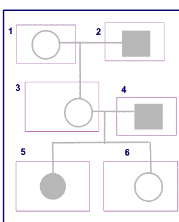

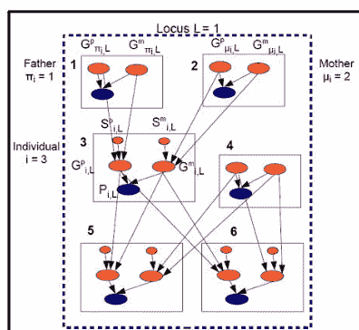

图 4.2：左：家系图，圆圈代表女性，方块代表男性。感兴趣疾病的个体被高亮显示。右：位点 j = L 的 DGM。蓝色节点 $P_{ij}$ 是个体 $i$ 在位点 $j$ 上的表型。橙色节点 $G_{ij}^{p/m}$ 是父系/母系等位基因。小红色节点 $S_{ij}^{p/m}$ 是父系/母系选择开关变量。创始人（根）节点没有父母，因此不需要开关变量。除了蓝色表型外，所有节点都是隐藏的。改编自图 3 来自 [FGL00]。

| $G^p$ | $G^m$ | $p(P=a)$ | $p(P=b)$ | $p(P=o)$ | $p(P=ab)$ |
|---|---|---|---|---|---|
| a | a | 1 | 0 | 0 | 0 |
| a | b | 0 | 0 | 0 | 1 |
| a | o | 1 | 0 | 0 | 0 |
| b | a | 0 | 0 | 0 | 1 |
| b | b | 0 | 1 | 0 | 0 |
| b | o | 0 | 1 | 0 | 0 |
| o | a | 1 | 0 | 0 | 0 |
| o | b | 0 | 1 | 0 | 0 |
| o | o | 0 | 0 | 1 | 0 |

表 4.2：对基因型到表型（血型）进行映射的条件概率表（CPT）。这是一种确定性的、多对一的映射。

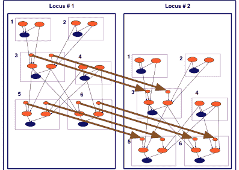

图 4.3：图 4.2 扩展到两个位点，展示开关变量如何空间相关。这由 $S_{ij}^m \rightarrow S_{i,j+1}^m$ 和 $S_{ij}^p \rightarrow S_{i,j+1}^p$ 边表示。改编自图 3 来自 [FGL00]。

$G_{ij}^m$ 和 $G_{ij}^p$，一个从 $i$ 的母亲遗传（母系等位基因），另一个从 $i$ 的父亲遗传（父系等位基因）。有序对 $\mathbf{G}_{ij} = (G_{ij}^m, G_{ij}^p)$ 共同构成了 $i$ 在位点 $j$ 上的隐藏 **基因型**。

显然，我们必须添加 $G_{ij}^m \rightarrow X_{ij}$ 和 $G_{ij}^p \rightarrow P_{ij}$ 弧，表示基因型导致表型。CPD $p(P_{ij}|G_{ij}^m, G_{ij}^p)$ 称为 **渗透率模型**。作为一个非常简单的例子，假设 $P_{ij} \in \{A, B, O, AB\}$ 表示个人 $i$ 的观察血型，而 $G_{ij}^m, G_{ij}^p \in \{A, B, O\}$ 是其基因型。我们可以使用表 4.2 中显示的确定性 CPD 来表示渗透率模型。例如，A 显性于 O，所以如果一个人具有基因型 AO 或 OA，其表型将为 A。

此外，我们从 $i$ 的母亲和父亲添加指向 $G_{ij}^{m/p}$ 的弧，反映来自父母的遗传物质的 **孟德尔遗传**。更准确地说，设 $\mu_i = k$ 为 $i$ 的母亲。例如，在图 4.2(b) 中，对于个体 $i=3$，我们有 $\mu_i = 2$，因为 2 是 3 的母亲。基因 $G_{ij}^m$ 可能等于 $G_{kj}^m$ 或 $G_{kj}^p$，即 $i$ 的母系等位基因是其母亲两个等位基因中的一个的副本。设 $S_{ij}^m$ 为一个隐藏开关变量，指定选择。然后我们可以使用以下 CPD，称为 **遗传模型**：

```
p(G_{ij}^m | G_{kj}^m, G_{kj}^p, S_{ij}^m) = \left\{ \begin{array}{ll} \mathbb{I} \left( G_{ij}^m = G_{kj}^m \right) & \text{if } S_{ij}^m = m \\ \mathbb{I} \left( G_{ij}^m = G_{kj}^p \right) & \text{if } S_{ij}^m = p \end{array} \right. (4.5)
```

我们可以类似地定义 $p(G_{ij}^p | G_{kj}^m, G_{kj}^p, S_{ij}^p)$，其中 $\pi = p_i$ 是 $i$ 的父亲。$S_{ij}$ 的值据说指定基因型的 **相位**。$G_{i,j}^m, G_{i,j}^p, S_{i,j}^m$ 和 $S_{i,j}^m$ 的值构成了个人 $i$ 在位点 $j$ 上的 **单倍型**。（不带开关变量 $S_{i,j}^p$ 和 $S_{i,j}^m$ 的基因型 $G_{i,j}^p$ 和 $G_{i,j}^m$ 称为“未相位”基因型。）

接下来，我们需要指定根节点的先验，即 $p(G_{ij}^m)$ 和 $p(G_{ij}^p)$。这称为 **创始人模型**，代表了人群中不同等位基因的总体患病率。我们通常假设这些创始等位基因在位点之间相互独立，并给这些根节点均匀先验。最后，我们需要为控制遗传过程的开关变量指定先验。目前，我们假设只有一个位点，因此可以为开关假设均匀先验。得到的 DGM 如图 4.2(b) 所示。

##### 4.1.2.2 多个位点

如果我们可以测量多个表型和基因型，将获得更多统计效力。在这种情况下，我们必须对基因之间的空间相关性进行建模，因为基因组上位置接近的基因很可能会共同遗传，因为它们之间不太可能发生重组事件。我们可以通过在开关变量 $S$ 上强加一个两状态马尔可夫链来建模，其中位点 $j$ 处的状态转换概率由 $\theta_j = \frac{1}{2}(1 - e^{-2d_j})$ 给出，其中 $d_j$ 是位点 $j$ 和 $j+1$ 之间的距离。这称为 **重组模式**。两个连锁位点的得到的 DGM 如图 4.3 所示。

现在我们可以使用这个模型来确定给定致病基因在基因组上假设所处的位置——这就是遗传连锁分析任务。该方法的工作原理如下。首先，假设模型的所有参数，包括所有标记位点之间的距离，都是已知的。唯一未知的是致病基因的位置。如果有 $L$ 个标记位点，我们构建 $L+1$ 个模型：在模型 $\ell$ 中，我们假设致病基因位于标记 $\ell$ 之后，其中 $0 < \ell < L + 1$。我们可以估计马尔可夫切换参数 $\hat{\theta}_\ell$，从而得到致病基因与其最近已知位点之间的距离 $d_\ell$。我们使用其似然 $p(\mathcal{D}|\hat{\theta}_\ell)$ 来衡量该模型的质量。然后我们可以选择似然最高的模型。

但是，请注意，计算似然需要对所有隐藏的 $S$ 和 $G$ 变量进行边缘化。有关此任务的一些精确方法，请参见 [FG02] 及其参考文献；这些方法基于变量消去算法，我们将在 Section ?? 中讨论。不幸的是，如我们在 Section ?? 中解释的，如果个体和/或位点的数量很大，精确方法在计算上可能不可行。有关基于“簇变量方法”计算似然的近似方法，请参见 [ALK06]。

请注意，上述模型可以以多种方式扩展。例如，我们可以使用 **系统发育 HMM** [SH03] 来对系统发育之间的演化进行建模。

### 4.2 UGM 的更多示例

Pott 模型的一个有趣应用出现在 **蛋白质结构预测**领域。目标是从氨基酸的一维序列预测蛋白质的三维形状。一种常见的方法称为 **直接耦合分析**（DCA）。下面我们简要介绍；详情请参见 [Mor+11]。

首先，我们从同一蛋白质家族的一组相关氨基酸序列计算 **多序列比对**（MSA）；这可以使用 HMM 完成，如 Section ?? 所述。MSA 可以由一个 $N \times T$ 矩阵 $\mathbf{X}$ 表示，其中 $N$ 是序列数量，$T$ 是每个序列的长度，而 $X_{ni} \in \{1, \dots, V\}$ 是序列 $n$ 中位置 $i$ 处字母的标识。对于蛋白质序列，$V = 21$，代表 20 种氨基酸加上间隙字符。

一旦我们有了 MSA 矩阵 $\mathbf{X}$，我们就使用最大似然估计或某种近似（例如伪似然 [Eke+13]）来拟合 Potts 模型；详情请参见 ??。$^1$ 拟合模型后，我们选择具有最高 $J_{ij}$ 系数的边，其中 $i, j \in \{1, \dots, T\}$ 是蛋白质中的位置或 **残基**。由于这些位置高度耦合，它们很可能处于物理接触中，因为相互作用的残基必须共同进化以避免破坏蛋白质的功能（例如，参见 [LHF17] 的综述）。此图称为 **接触图**。

一旦建立了接触图，它可以作为输入用于三维结构预测算法，例如 [Xu18] 或 **alphafold** 系统 [Eva+18]，该系统赢得了 2018 年 CASP 竞赛。此类方法使用神经网络来学习形式为 $p(d(i,j)|\{c(i,j)\})$ 的函数，其中 $d(i,j)$ 是残基 $i$ 和 $j$ 之间的三维距离，$c(i,j)$ 是接触图。

#### 4.2.1 Hopfield 网络

**Hopfield 网络** [Hop82] 是一个完全连接的 Ising 模型（??），具有对称权重矩阵 $\mathbf{W} = \mathbf{W}^\mathsf{T}$。相应的能量函数形式为

```
$$ \mathcal{E}(\mathbf{x}) = -\frac{1}{2} \mathbf{x}^\mathsf{T} \mathbf{W} \mathbf{x} $$
```

其中 $x_i \in \{-1, +1\}$。

Hopfield 网络的主要应用是作为 **联想记忆** 或 **内容可寻址记忆**。其思路如下：假设我们对一组完全观察到的位向量进行训练，这些向量对应于模式


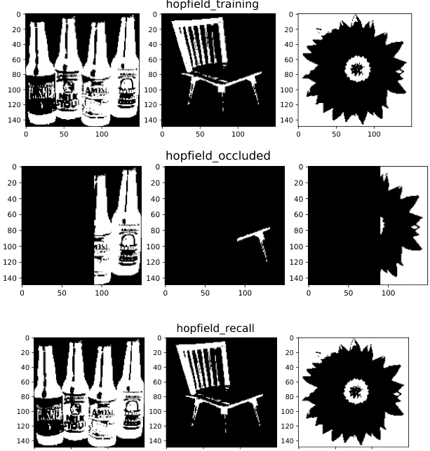

图 4.4：联想记忆如何重建图像的示例。这些是大小为 150 × 150 像素的二值图像。顶部：训练图像。中间行：部分可见的测试图像。底部行：最终状态估计。改编自 [HKP91] 的图 2.1。由 hopfield__demo.py 生成。

我们想要记忆。（我们将在下面讨论如何做到这一点）。然后，在测试时，我们向网络展示一个部分模式。我们希望估计缺失的变量；这称为 **模式补全**。也就是说，我们想要计算

\(\boldsymbol{x}^* = \underset{\boldsymbol{x}}{\text{argmin}} \mathcal{E}(\boldsymbol{x})\) (4.7)

我们可以使用 **迭代条件众数（ICM）** 来求解这个优化问题，即我们根据邻居将每个隐藏变量设置为其最可能的状态。选择最可能的状态相当于使用规则

\(\boldsymbol{x}^{t+1} = \text{sgn}(\mathbf{W}\boldsymbol{x}^t)\) (4.8)

这可以被视为 Gibbs 采样的确定性版本（见 **??**）。

我们在图 4.4 中说明了此过程。在顶部行，我们展示了一些训练示例。在中间行，我们展示了一个损坏的输入，对应于初始状态 \(\boldsymbol{x}^0\)。在底部行，我们展示了经过 30 次 ICM 迭代后的最终状态。整个过程可以被视为根据示例的一部分从记忆中检索完整示例。

为了学习权重 \(\mathbf{W}\)，我们可以使用 **??** 中描述的最大似然估计方法。（另请参见 [HSDK12]。）但是，[Hop82] 提出了一种更简单的启发式方法，即使用以下 **外积方法**：

\(\mathbf{W} = \left( \frac{1}{N} \sum_{n=1}^N \boldsymbol{x}_n \boldsymbol{x}_n^\top \right) - \mathbf{I}\) (4.9)

这通过 \(N\) 将输出乘积矩阵归一化，然后将对角线设置为 0。这确保了与训练集中任何示例匹配的模式的能量较低。这是我们在图 4.4 中使用的技术。然而，请注意，此方法不仅存储原始模式，还存储它们的逆以及其他线性组合。因此，模型在存储的示例开始在记忆中“碰撞”之前，可存储的示例数量存在上限。Hopfield 证明，对于随机模式，网络容量约为 \(\sim 0.14N\)。

#### 4.2.2 受限玻尔兹曼机（RBMs）的更多细节

在本节中，我们将更详细地讨论 RBM。

##### 4.2.2.1 二元 RBMs

最常见的 RBM 形式具有二元隐藏节点和二元可见节点。联合分布则具有以下形式：

\(p(\boldsymbol{x}, \boldsymbol{z}|\boldsymbol{\theta}) = \frac{1}{Z(\boldsymbol{\theta})} \exp(-\mathcal{E}(\boldsymbol{x}, \boldsymbol{z}; \boldsymbol{\theta})) \tag{4.10}\)

\(\mathcal{E}(\boldsymbol{x}, \boldsymbol{z}; \boldsymbol{\theta}) \triangleq -\sum_{d=1}^D \sum_{k=1}^K x_d z_k W_{dk} - \sum_{d=1}^D x_d b_d - \sum_{k=1}^K z_k c_k \tag{4.11}\)

\(= -(\boldsymbol{x}^{\text{T}}\mathbf{W}\boldsymbol{z} + \boldsymbol{x}^{\text{T}}\boldsymbol{b} + \boldsymbol{z}^{\text{T}}\boldsymbol{c}) \tag{4.12}\)

\(Z(\boldsymbol{\theta}) = \sum_{\boldsymbol{x}} \sum_{\boldsymbol{z}} \exp(-E(\boldsymbol{x}, \boldsymbol{z}; \boldsymbol{\theta})) \tag{4.13}\)

其中，\(\mathcal{E}\) 是能量函数，\(\mathbf{W}\) 是一个 \(D \times K\) 权重矩阵，\(\boldsymbol{b}\) 是可见偏置项，\(\boldsymbol{c}\) 是隐藏偏置项，\(\boldsymbol{\theta} = (\mathbf{W}, \boldsymbol{b}, \boldsymbol{c})\) 是所有参数。为了记号简洁，我们将通过添加虚拟单元 \(x_0 = 1\) 和 \(z_0 = 1\) 并设置 \(\mathbf{w}_{0,:} = \boldsymbol{c}\) 和 \(\mathbf{w}_{:,0} = \boldsymbol{b}\) 来将偏置项吸收到权重矩阵中。请注意，天真地计算 \(Z(\boldsymbol{\theta})\) 需要 \(O(2^D 2^K)\) 的时间，但我们可以利用图的结构将其减少到 \(O(\min\{D2^K, K2^D\})\) 的时间。

当使用二元 RBM 时，后验可以计算如下：

\(p(\boldsymbol{z}|\boldsymbol{x}, \boldsymbol{\theta}) = \prod_{k=1}^K p(z_k|\boldsymbol{x}, \boldsymbol{\theta}) = \prod_k \text{Ber}(z_k|\boldsymbol{\sigma}(\boldsymbol{w}_{:,k}^{\text{T}}\boldsymbol{x})) \tag{4.14}\)

通过对称性，可以证明，给定隐藏变量时，我们可以按如下方式生成数据：

\(p(\boldsymbol{x}|\boldsymbol{z}, \boldsymbol{\theta}) = \prod_d p(x_d|\boldsymbol{z}, \boldsymbol{\theta}) = \prod_d \text{Ber}(x_d|\boldsymbol{\sigma}(\boldsymbol{w}_{d,:}^{\text{T}}\boldsymbol{z})) \tag{4.15}\)

我们可以用矩阵-向量记法写出这一点：

\(\mathbb{E}[\boldsymbol{z}|\boldsymbol{x}, \boldsymbol{\theta}] = \boldsymbol{\sigma}(\mathbf{W}^{\text{T}}\boldsymbol{x}) \tag{4.16}\)

\(\mathbb{E}[\boldsymbol{x}|\boldsymbol{z}, \boldsymbol{\theta}] = \boldsymbol{\sigma}(\mathbf{W}\boldsymbol{z}) \tag{4.17}\)

\(\mathbf{W}\) 中的权重称为 **生成权重**，因为它们用于生成观察值，而 \(\mathbf{W}^{\text{T}}\) 中的权重称为 **识别权重**，因为它们用于识别输入。

从方程 4.14 可以看出，我们按输入向量 \(\boldsymbol{x}\) 与权重向量 \(\boldsymbol{w}_{:,k}\) 的“相似程度”（不考虑缩放因子）来激活隐藏节点 \(k\)。因此，每个隐藏节点都会捕获输入的某些特征，这些特征编码在其权重向量中，类似于前馈神经网络。

例如，考虑文本模型的 RBM，其中 \(\boldsymbol{x}\) 是词袋（即，词汇表上的位向量）。如果“主题” \(k\) 存在于文档中，则令 \(z_k = 1\)。假设文档具有“体育”和“药物”主题。如果我们将每个主题的预测“相乘”，模型可能会给单词“兴奋剂”赋予非常高的概率，因为它满足两个约束。相比之下，将专家相加只会使分布更广（参见图 ??）。特别是，如果我们将“体育”和“药物”的预测混合在一起，我们可能会生成“板球”和“成瘾”等词，这些词来自两个主题的并集，而不是它们的交集。

##### 4.2.2.2 类别 RBMs

我们可以通过使用 1-of-C 编码将二元 RBM 扩展到类别可见变量，其中 C 是每个 \(x_d\) 的状态数量。我们按如下方式定义新的能量函数 [SMH07; SH10]：

\(E(\boldsymbol{x}, \boldsymbol{z}; \boldsymbol{\theta}) \triangleq - \sum_{d=1}^D \sum_{k=1}^K \sum_{c=1}^C x_d^c z_k w_{dk}^c - \sum_{d=1}^D \sum_{c=1}^C x_d^c b_d^c - \sum_{k=1}^K z_k c_k \tag{4.18}\)

完整条件分布由以下给出

\(p(x_d = c^* | \boldsymbol{z}, \boldsymbol{\theta}) = S(\{b_d^c + \sum_k z_k w_{dk}^c\}_{c=1}^C)[c^*] \tag{4.19}\)

\(p(z_k = 1 | \boldsymbol{x}, \boldsymbol{\theta}) = \sigma(c_k + \sum_d \sum_c x_d^c w_{dk}^c) \tag{4.20}\)

##### 4.2.2.3 高斯 RBMs

我们可以将模型推广到处理实值数据。特别是，高斯 RBM 具有以下能量函数：

\(E(\boldsymbol{x}, \boldsymbol{z} | \boldsymbol{\theta}) = - \sum_{d=1}^D \sum_{k=1}^K w_{dk} z_k x_d - 1/2 \sum_{d=1}^D (x_d - b_d)^2 - \sum_{k=1}^K a_k z_k \tag{4.21}\)

模型的参数为 \(\boldsymbol{\theta} = (w_{dk}, a_k, b_d)\)。（我们假设数据已标准化，因此将方差固定为 \(\sigma^2 = 1\)。）将其与标准或信息形式的高斯分布进行比较（参见第 ?? 节）：

\(N_c(\boldsymbol{x} | \boldsymbol{\eta}, \boldsymbol{\Lambda}) \propto \exp(\boldsymbol{\eta}^T \boldsymbol{x} - 1/2 \boldsymbol{x}^T \boldsymbol{\Lambda} \boldsymbol{x}) \tag{4.22}\)

其中 \(\boldsymbol{\eta} = \boldsymbol{\Lambda}\boldsymbol{\mu}\)。我们看到，我们已设置 \(\boldsymbol{\Lambda} = \mathbf{I}\)，以及 \(\boldsymbol{\eta} = \sum_k z_k \mathbf{w}_{:,k}\)。因此，均值由 \(\boldsymbol{\mu} = \boldsymbol{\Lambda}^{-1}\boldsymbol{\eta} = \sum_k z_k \mathbf{w}_{:,k}\) 给出，这是原型的加权组合。推断和学习所需的完整条件分布由以下给出

\(p(x_d | \boldsymbol{z}, \boldsymbol{\theta}) = N(x_d | b_d + \sum_k w_{dk} z_k, 1) \tag{4.23}\)

\(p(z_k = 1 | \boldsymbol{x}, \boldsymbol{\theta}) = \sigma ( c_k + \sum_d w_{dk} x_d ) \tag{4.24}\)

还可以开发更强大的模型，使（协）方差取决于隐藏状态 [RH10]。

##### 4.2.2.4 具有高斯隐藏单元的 RBMs

如果我们使用高斯潜在变量和高斯可见变量，我们就得到了因子分析的无向版本（??）。有趣的是，这在数学上等同于标准的有向版本 [MM01]。

如果我们使用高斯潜在变量和类别观察变量，我们就得到了类别 PCA 的无向版本（第 ?? 节）。在 [SMH07] 中，这被应用于 Netflix 协作过滤问题，但被发现远不如使用二元潜在变量（后者具有更强的表达能力）。


#### 4.2.3 最大熵拼写模型的特征诱导

在某些应用中，我们假设特征 \(\phi(\boldsymbol{x})\) 是已知的。然而，可以以非监督的方式在最大熵模型中学习特征；这被称为 **特征诱导**。

特征诱导的一种常见方法最初在 [DDL97; ZWM97] 中提出，即从一组基础特征开始，不断从旧特征中创建新的特征组合，并贪婪地将最好的特征添加到模型中。

以这种方法为例，[DDL97] 描述了如何构建表示英语拼写的模型。这可以形式化为可变长度字符串上的概率分布 \(p(\boldsymbol{x}|\boldsymbol{\theta})\)，其中 \(x_t\) 是英文字母表中的一个字母。最初模型没有特征，这表示均匀分布。该算法首先选择添加特征

\(\phi_1(\boldsymbol{x}) = \sum_i \mathbb{I}(x_i \in \{a, \dots, z\})\) (4.25)

该特征用于检查是否存在小写字母。添加特征后，参数通过最大似然法（重新）拟合（这是一个计算困难的问题，我们将在 **??** 中讨论）。对于此特征，结果表明 \(\hat{\theta}_1 = 1.944\)，这意味着在任何位置包含小写字母的单词，其可能性大约是同一单词在该位置不包含小写字母的 \(e^{1.944} \approx 7\) 倍。使用（退火）Gibbs 采样（在 **??** 中描述）从该模型生成的一些样本如下所示。$^2$

m, r, xevo, ijjiiir, b, to, jz, gsr, wq, vf, x, ga, msgmGh, pcp, d, oziVlaI, hzagh, yzop, io,
advzmxnv, ijv_bolft, x, emx, kayerf, mlj, rawzyb, jp, ag, ctdnnnbg, wgdw, t, kgvu, cy, spxcq,
uzflbbf, dxttkn, cxwx, jpd, ztzh, lv, zhpkvnu, l^, r, qee, nyrx, atze4n, ik, se, w, lrh, hp+,
yryqka'h, zcngotcnx, igcump, zjcjs, lqpWiqu, cefmfhc, o, lb, fdcY, tzby, yopxmvk, by, fz, t,
govyccm, ijyiduwfzo, 6xr, duh, ejv, pk, pjw, l, fl, w

算法添加的第二个特征检查两个相邻字符是否均为小写：

\(\phi_2(\boldsymbol{x}) = \sum_{i \sim j} \mathbb{I}(x_i \in \{a, \dots, z\}, x_j \in \{a, \dots, z\})\) (4.26)

现在模型的形式为

\(p(\boldsymbol{x}) = \frac{1}{Z} \exp(\theta_1 \phi_1(\boldsymbol{x}) + \theta_2 \phi_2(\boldsymbol{x}))\) (4.27)

继续以这种方式，算法为字符串 s> 和 ing> 添加特征，其中 > 表示单词结束，以及诸如 [0–9] 等各种正则表达式。使用（退火）Gibbs 采样从具有 1000 个特征的模型生成的一些样本如下所示。

was, reaser, in, there, to, will, ,, was, by, homes, thing, be, relovorated, ther, which, conists,
at, fores, anditing, with, Mr., proveral, the, ,, ***, on't, prolling, prothere, ,, mento, at, yao,
l, chestraing, for, have, to, intrally, of, qut, .., best, compers, ***, cluseliment, uster, of,
is, deveral, this, thise, of, ofect, inatever, thifer, constranded, statet, vill, in, thase, in,
youse, menttering, and, .., of, in, verate, of, to

如果为每一种可能的字母组合定义一个特征，我们可以表示任何概率分布。然而，这会导致过拟合。最大熵方法的威力在于，我们可以选择哪些特征对该领域很重要。

另一种方法是引入潜变量，以隐式方式对可见节点之间的相关性进行建模，而不是显式地学习特征函数。有关此类模型的示例，请参见 **??**。

$^2$我们感谢 John Lafferty 分享此示例。

| Fr(A,A) | Fr(B,B) | Fr(B,A) | Fr(A,B) | Sm(A) | Sm(B) | Ca(A) | Ca(B) |
|---|---|---|---|---|---|---|---|
| 1 | 1 | 0 | 1 | 1 | 1 | 1 | 1 |
| 1 | 1 | 0 | 1 | 1 | 0 | 0 | 0 |
| 1 | 1 | 0 | 1 | 1 | 1 | 0 | 1 |

表 4.3: 吸烟示例中 8 个变量的一些可能联合实例化。

#### 4.2.4 关系型 UGM

我们可以以类似于关系型 DGMs (**??**) 的方式创建 **关系型 UGM**。这在判别设置中特别有用，原因与无向 CRF 优于条件 DGMs 相同（参见 **??**）。

例如，假设我们有兴趣将大学网页分类为不同类型（例如，学生、教授、管理员等）。显然，我们可以根据网页内容（例如，单词、图片、布局等）来完成此任务。然而，我们也可能假设超链接结构本身包含信息。例如，学生可能会引用教授，教授可能会引用其他教授，但管理员页面与学生/教授之间可能没有链接。当面对标签不明确的网页时，我们可以根据其邻居的估计标签来偏置我们的估计，如同在 CRF 中一样。此过程称为 **集体分类**（参见例如 [Sen+08]）。为了为任意大小和形状的 Web 图指定 CRF 结构，我们只需指定一个模板图和势函数，然后适当地展开模板以匹配 Web 的拓扑结构，并利用参数绑定。

#### 4.2.5 马尔可夫逻辑网络

指定关系型 UGM 的一种特别流行的方法是使用 **一阶逻辑**，而不是对模板进行图形描述。结果称为 **马尔可夫逻辑网络** [RD06; Dom+06; DL09]。

例如，考虑句子“吸烟会导致癌症”和“如果两个人是朋友，且其中一人吸烟，那么另一人也吸烟”。我们可以用一阶逻辑如下写出这些句子：

```
\forall x.Sm(x) \implies Ca(x)                                   (4.28)
\forall x.\forall y.Fr(x,y) \wedge Sm(x) \implies Sm(y)          (4.29)
```

其中 $Sm$ 和 $Ca$ 是谓词，$Fr$ 是一个关系。

将所有公式写成 **合取范式**（CNF），也称为 **子句形式**，很方便。在这种情况下，我们得到

```
\neg Sm(x) \vee Ca(x)                                          (4.30)
\neg Fr(x,y) \vee \neg Sm(x) \vee Sm(y)                        (4.31)
```

第一个子句可读作“$x$ 不吸烟或他患有癌症”，这在逻辑上等同于公式 (4.28)。（请注意，在子句中，任何未绑定的变量，例如 $x$，都被假设为全称量化。）

假设世界中只有两个对象（人），Anna 和 Bob，我们将用 **常量符号** $A$ 和 $B$ 表示。然后我们可以为 $x, y \in \{A, B\}$ 创建 8 个二元随机变量 $Sm(x)$、$Ca(x)$ 和 $Fr(x,y)$。这定义了 $2^8$ 个 **可能世界**，其中一些在表 4.3 中显示。

我们的目标是在这些联合赋值上定义一个概率分布。我们可以通过使用这些变量创建一个 UGM，并为每个逻辑规则或约束添加一个势函数来实现这一点。例如，我们可以通过创建势函数 $\Psi(Sm(x), Ca(x))$ 来对规则 $\neg Sm(x) \vee Ca(x)$ 进行编码，其中我们定义

```
\(\Psi(Sm(x), Ca(x)) = \begin{cases} 1 & \text{if } \neg Sm(x) \vee Ca(x) = T \\ 0 & \text{if } \neg Sm(x) \vee Ca(x) = F \end{cases} \quad (4.32)\)
```

请注意，我们没有编码 $Fr$ 是对称关系这一事实，因此 $Fr(A, B)$ 和 $Fr(B, A)$ 可能具有不同的值。同样，我们有“退化”节点 $Fr(A)$ 和 $Fr(B)$，因为我们在公式 (4.29) 中没有强制执行 $x \neq y$。（如果添加此类约束，则生成接地网络的模型编译器应避免创建冗余节点。）

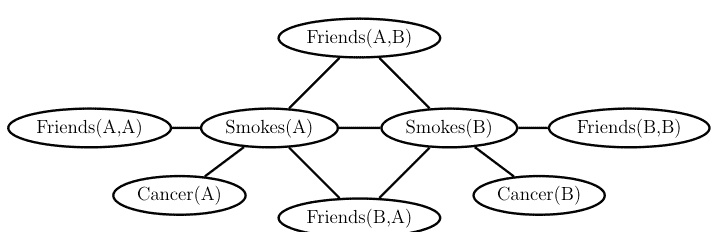

图 4.5: 一个表示为 2 个人的双向 MRF 的接地马尔可夫逻辑网络示例。改编自 [DL09] 中的图 2.1。经 Pedro Domingos 友好许可使用。

结果是图 4.5 中的 UGM。

上述方法将对所有逻辑有效的世界分配非零概率。然而，逻辑规则不一定总是为真。例如，吸烟并不总是导致癌症。我们可以通过使用非零势函数来放宽硬约束。特别是，我们可以为每个规则关联一个权重，从而得到诸如下面的势函数

```
\(\Psi(Sm(x), Ca(x)) = \begin{cases} e^w & \text{if } \neg Sm(x) \lor Ca(x) = T \\ e^0 & \text{if } \neg Sm(x) \lor Ca(x) = F \end{cases}\) (4.33)
```

其中 \(w > 0\) 的值控制我们希望多强地执行相应的规则。

整体联合分布的形式为

```
\(p(x) = \frac{1}{Z(w)} \exp(\sum_i w_i n_i(x))\) (4.34)
```

其中 \(n_i(x)\) 是在赋值 \(x\) 中求值为真的子句 \(i\) 的实例数量。

给定接地 MLN 模型后，我们可以使用标准方法进行推理。当然，接地模型通常非常大，因此必须使用更高效的推理方法，这些方法避免创建完整的接地模型（称为 **提升推理**）。有关详细信息，请参见 [DL09; KNP11]。

获得可处理性的一种方法是将离散问题放宽为连续问题。这是 **铰链损耗 MRF** [Bac+15] 的基本思想，它支持使用可扩展凸优化进行精确推理。对于此模型族有一种模板语言，称为 **概率软逻辑**，它与 MLN 具有相似的“风味”，尽管它的表达能力不那么强。

最近，MLN 已以各种方式与 DL 相结合。例如，[Zha+20] 使用图神经网络进行推理。而 [WP18] 在证据融合中使用 MLN，其中噪声预测来自使用弱监督训练的 DNN。

最后，值得注意的是，无向模型中会出现一种微妙之处，即展开模型的大小（取决于宇宙中的对象数量）可能会影响推理结果，即使我们对新对象没有数据。例如，考虑一个长度为 \(T\) 的无向链，包含 \(T\) 个隐藏节点 \(z_t\) 和 \(T\) 个观察节点 \(y_t\)；称此模型为 \(M_1\)。现在假设我们将链长度加倍至 \(2T$，而不添加更多证据；称此模型为 \(M_2\)。我们发现 \(p(z_t|y_{1:T}, M_1) \neq p(z_t|y_{1:T}, M_2)\)，对于 \(t=1:T$，尽管我们没有添加新信息，但由于分区函数不同，结果会不同。在有向链中不会发生这种情况，因为新添加的节点可以被边缘化而不影响原始节点，因为模型是局部归一化的，因此是模块化的。有关进一步讨论，请参见 [JBB09; Poo+12]。


## 第 5 章

## 信息论

## 第 6 章

## 优化

### 6.1 近端方法

在本节中，我们讨论一类称为**近端方法**的优化算法，它们将函数的**近端算子**作为基本子程序，而不是其梯度或黑塞矩阵。我们将在下面定义该算子，但本质上它涉及求解一个凸子问题。

与梯度方法相比，近端方法更容易应用于非光滑问题（例如，带有 $\ell_1$ 项的问题），以及需要分解并并行求解的大规模问题。这些方法广泛用于信号和图像处理，以及深度学习中的一些应用（例如，[BWL19] 使用近端方法训练量化 DNN，[Yao+20] 使用近端方法进行高效神经架构搜索，[Sch+17; WHT19] 使用近端方法进行策略梯度优化等）。

我们的介绍部分基于 [PB+14] 中的教程。另一篇很好的综述见 [PSW15]。

#### 6.1.1 近端算子

设 \( f : \mathbb{R}^n \to \mathbb{R} \cup \{+\infty\} \) 为一个凸函数，其中 \( f(x) = \infty \) 表示该点不可行。设 \( f \) 的有效域为可行点集合：

\(\text{dom}(f) = \{ x \in \mathbb{R}^n : f(x) < \infty \}\)

\( f \) 的**近端算子**（也称为**近端映射**），记作 \(\text{prox}_f(x) : \mathbb{R}^n \to \mathbb{R}^n \)，定义为

\(\text{prox}_f(x) = \underset{z}{\text{argmin}} \left( f(z) + \frac{1}{2} \|z - x\|_2^2 \right)\)

这是一个强凸函数，因此具有唯一的极小点。该算子在图 6.1a 中有示意。我们可以看到，域内的点向函数的最小值点移动，而域外的点先移动到边界，然后再向最小值点移动。

例如，假设 \( f \) 是凸集 \( \mathcal{C} \) 的指示函数，即，

\( f(x) = I_{\mathcal{C}}(x) = \begin{cases} 0 & \text{if } x \in \mathcal{C} \\ \infty & \text{if } x \notin \mathcal{C} \end{cases} \)

在这种情况下，近端算子等价于投影到集合 \( \mathcal{C} \)：

\(\text{proj}_{\mathcal{C}}(x) = \underset{z \in \mathcal{C}}{\text{argmin}} \|z - x\|_2\)

因此，我们可以将近端算子视为广义投影。

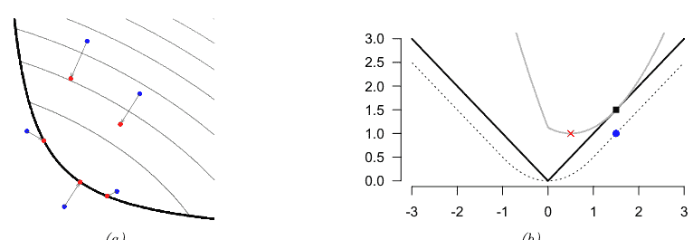

图 6.1：(a) 在各点处求解近端算子。细线表示凸函数的水平集；最小值点位于左下角。黑线表示其域的边界。蓝点通过近端算子映射到红点，因此可行集外的点映射到边界，可行集内的点映射到更靠近最小值点的位置。摘自 [PB+14] 图 1。经 Stephen Boyd 友好许可使用。(b) 带有 \(\eta = 1\)（虚线）的绝对值函数（实黑线）的 Moreau 包络示意。详情见正文。摘自 [PSW15] 图 1。经 Nicholas Polson 友好许可使用。

我们通常希望计算缩放函数 \(\eta f\)（其中 \(\eta > 0\)）的近端算子，可以写成

\[
\text{prox}_{\eta f}(\mathbf{x}) = \text{argmin}_\mathbf{z} \left( f(\mathbf{z}) + \frac{1}{2\eta} \|\mathbf{z} - \mathbf{x}\|_2^2 \right) \quad (6.5)
\]

方程 (6.5) 中问题的解与以下信赖区域优化问题的解相同：

\[
\text{argmin}_\mathbf{z} f(\mathbf{z}) \text{ s.t. } \|\mathbf{z} - \mathbf{x}\|_2 \le \rho \quad (6.6)
\]

适当选择 \(\eta\) 和 \(\rho\) 时成立。这种近端投影在保持接近当前迭代点的同时最小化函数。我们将在下面给出近端算子的其他解释。

我们可以通过用马哈拉诺比斯距离替换欧氏距离来推广该算子：

\[
\text{prox}_{\eta f, \mathbf{A}}(\mathbf{x}) = \text{argmin}_\mathbf{z} \left( f(\mathbf{z}) + \frac{1}{2\eta} (\mathbf{z} - \mathbf{x})^\top \mathbf{A} (\mathbf{z} - \mathbf{x}) \right) \quad (6.7)
\]

其中 **A** 是一个半正定矩阵。

##### 6.1.1.1 Moreau 包络

让我们定义函数 \(f\) 关于 \(\mathbf{z}\) 的以下二次近似，要求其在 \(\mathbf{x}\) 处与 \(f\) 相切：

\[
f_\mathbf{x}^\eta(\mathbf{z}) = f(\mathbf{z}) + \frac{1}{2\eta} \|\mathbf{z} - \mathbf{x}\|_2^2 \quad (6.8)
\]

根据定义，该函数的最小值点位置为 \(\mathbf{z}^*(\mathbf{x}) = \text{argmin}_\mathbf{z} f_\mathbf{x}^\eta(\mathbf{z}) = \text{prox}_{\eta f}(\mathbf{x})\)。

例如，考虑使用 \(f_{x_0}^1(z) = |z| + \frac{1}{2}(z - x_0)^2\) 在 \(x_0 = 1.5\) 处近似函数 \(f(x) = |x|\)。如图 6.1b 所示：实黑线是 \(f(x)\)，\(x_0 = 1.5\) 是黑色方形，浅灰线是 \(f_{x_0}^1(z)\)。\(x_0\) 到 \(f\) 的近端投影是 \(z^*(x_0) = \text{argmin}_z f_{x_0}^1(z) = 0.5\)，即二次函数的最小值点，由红色叉号表示。这个近端点比起始点 \(x_0\) 更接近 \(f(x)\) 的最小值点。

现在让我们在这个近端点处评估近似：

\[
f_\mathbf{x}^\eta(\mathbf{z}^*(\mathbf{x})) = f(\mathbf{z}^*) + \frac{1}{2\eta} \|\mathbf{z}^* - \mathbf{x}\|_2^2 = \min_\mathbf{z} f(\mathbf{z}) + \frac{1}{2\eta} \|\mathbf{z} - \mathbf{x}\|_2^2 \triangleq f^\eta(\mathbf{x}) \quad (6.9)
\]

其中 \(f^\eta(\mathbf{x})\) 称为 \(f\) 的 Moreau 包络。

例如，在图 6.1b 中，我们看到 \( f_{x_0}^1(z^*) = f_{x_0}^1(0.5) = 1.0 \)，因此 \( f^1(x_0) = 1.0 \)。这由蓝色圆点表示。虚线是当我们改变 \( x_0 \) 时蓝点的轨迹，即 \( f \) 的 Moreau 包络。

我们可以看到，Moreau 包络是 \( f \) 的一个光滑下界，且与 \( f \) 具有相同的最小值点位置。此外，即使 \( f \) 没有，它也具有定义域 \(\mathbb{R}^n\)，并且即使 \( f \) 不是，它也是连续可微的。这使得优化更容易。例如，\( f(r) = |r| \) 的 Moreau 包络是 **Huber 损失** 函数，用于鲁棒回归。

##### 6.1.1.2 线性近似上的近端算子产生梯度更新

假设我们在当前迭代点 \( \boldsymbol{x}_t \) 处对 \( f \) 进行线性近似：

\( \hat{f}(\boldsymbol{x}) = f(\boldsymbol{x}_t) + \boldsymbol{g}_t^\mathsf{T}(\boldsymbol{x} - \boldsymbol{x}_t) \quad (6.10) \)

其中 \( \boldsymbol{g}_t = \nabla f(\boldsymbol{x}_t) \)。为了计算近端算子，请注意

\( \nabla_z \hat{f}_x^\eta(\boldsymbol{z}) = \nabla_z \left[ f(\boldsymbol{x}_t) + \boldsymbol{g}_t^\mathsf{T}(\boldsymbol{z} - \boldsymbol{x}) + \frac{1}{2\eta}||\boldsymbol{z} - \boldsymbol{x}_t||_2^2 \right] = \boldsymbol{g}_t + \frac{1}{\eta}(\boldsymbol{z} - \boldsymbol{x}_t) \quad (6.11) \)

求解 \( \nabla_z \hat{f}_x^\eta(\boldsymbol{z}) = \boldsymbol{0} \) 得到标准梯度更新：

\( \text{prox}_{\eta f}(\boldsymbol{x}) = \boldsymbol{x} - \eta \boldsymbol{g}_t \quad (6.12) \)

因此，近端步相当于对线性化目标进行梯度步。

##### 6.1.1.3 二次近似上的近端算子产生正则化牛顿更新

现在假设我们在 \( \boldsymbol{x}_t \) 处使用二阶近似：

\( \hat{f}(\boldsymbol{x}) = f(\boldsymbol{x}_t) + \nabla \boldsymbol{g}_t(\boldsymbol{x} - \boldsymbol{x}_t) + \frac{1}{2}(\boldsymbol{x} - \boldsymbol{x}_t)^\mathsf{T} \mathbf{H}_t (\boldsymbol{x} - \boldsymbol{x}_t) \quad (6.13) \)

该近似的近端算子为

\( \text{prox}_{\eta \hat{f}}(\boldsymbol{x}) = \boldsymbol{x} - (\mathbf{H}_t + \frac{1}{\eta}\mathbf{I})^{-1} \boldsymbol{g}_t \quad (6.14) \)

##### 6.1.1.4 近端算子作为平滑目标上的梯度下降

近端算子对于无法进行泰勒级数近似的非光滑函数而言可能最有用。相反，我们将优化 Moreau 包络，它是一个平滑近似。

具体来说，根据方程 (6.9)，我们有

\( f^\eta(\boldsymbol{x}) = f(\text{prox}_{\eta f}(\boldsymbol{x})) + \frac{1}{2\eta} || \boldsymbol{x} - \text{prox}_{\eta f}(\boldsymbol{x}) ||_2^2 \quad (6.15) \)

因此 Moreau 包络的梯度为

\( \nabla_x f^\eta(\boldsymbol{x}) = \frac{1}{\eta} (\boldsymbol{x} - \text{prox}_{\eta f}(\boldsymbol{x})) \quad (6.16) \)

因此我们可以将近端算子重写为

\( \text{prox}_{\eta f}(\boldsymbol{x}) = \boldsymbol{x} - \eta \nabla f^\eta(\boldsymbol{x}) \quad (6.17) \)

因此，近端步相当于对平滑目标进行梯度步。

#### 6.1.2 计算近端算子

在本节中，我们将简要讨论如何计算机器学习中有用的各种函数的近端算子，无论是作为正则化项还是约束。更多示例可见 [PB+14; PSW15]。


##### 6.1.2.1 莫罗分解

计算某些近端算子的有用技术利用了一个被称为**莫罗分解**的结果，它指出

\(\boldsymbol{x} = \text{prox}_f(\boldsymbol{x}) + \text{prox}_{f^*}(\boldsymbol{x}) \quad (6.18)\)

其中 \(f^*\) 是 \(f\) 的凸共轭（参见第 6.5 节）。

例如，假设 \(f = || \cdot ||\) 是 \(\mathbb{R}^D\) 上的一般范数。可以证明 \(f^* = I_{\mathcal{B}}\)，其中

\(\mathcal{B} = \{ \boldsymbol{x} : ||\boldsymbol{x}||^* \le 1 \} \quad (6.19)\)

是对偶范数 \(|| \cdot ||^*\) 的单位球，定义为

\(||\boldsymbol{z}||^* = \sup \{ \boldsymbol{z}^T \boldsymbol{x} : ||\boldsymbol{x}|| \le 1 \} \quad (6.20)\)

因此

\(\text{prox}_{\lambda f}(\boldsymbol{x}) = \boldsymbol{x} - \lambda \text{prox}_{f^*/\lambda}(\boldsymbol{x}/\lambda) = \boldsymbol{x} - \lambda \text{proj}_{\mathcal{B}}(\boldsymbol{x}/\lambda) \quad (6.21)\)

因此，范数的近端算子与范数球上的投影之间存在密切联系，我们将在下文中利用这一点。

##### 6.1.2.2 投影到框约束

设 \(\mathcal{C} = \{ \boldsymbol{x} : \boldsymbol{l} \le \boldsymbol{x} \le \boldsymbol{u} \}\) 为一个框或超矩形，对每个元素施加下界和上界。（如果我们不想约束某个维度上的值，这些边界可以是无限的。）投影算子很容易按元素计算，只需在边界处进行阈值处理：

\(\text{proj}_{\mathcal{C}}(\boldsymbol{x})_d = \begin{cases} l_d & \text{if } x_d \le l_d \\ x_d & \text{if } l_d \le x_d \le u_d \\ u_d & \text{if } x_d \ge u_d \end{cases} \quad (6.22)\)

例如，如果我们想确保所有元素都是非负的，可以使用

\(\text{proj}_{\mathcal{C}}(\boldsymbol{x}) = \boldsymbol{x}_+ = [\max(x_1, 0), \dots, \max(x_D, 0)] \quad (6.23)\)

##### 6.1.2.3 \(\ell_1\) 范数

考虑 1-范数 \(f(\boldsymbol{x}) = ||\boldsymbol{x}||_1\)。近端投影可以按分量计算。我们可以按如下方式求解每个一维问题：

\(\text{prox}_{\lambda f}(x) = \underset{z}{\text{argmin}} \lambda |z| + \frac{1}{2}(z-x)^2 \quad (6.24)\)

可以证明，其解为

\(\text{prox}_{\lambda f}(x) = \begin{cases} x - \lambda & \text{if } x \ge \lambda \\ 0 & \text{if } |x| \le \lambda \\ x + \lambda & \text{if } x \le -\lambda \end{cases} \quad (6.25)\)

这被称为**软阈值算子**，因为绝对值小于 \(\lambda\) 的值被设为 0（阈值处理），但以可微的方式进行。这对于强制稀疏性很有用。请注意，软阈值可以更紧凑地写为

\(\text{SoftThreshold}_\lambda(x) = \text{sign}(x) (|x| - \lambda)_+ \quad (6.26)\)

其中 \(x_+ = \max(x, 0)\) 是 \(x\) 的正部分。在向量情况下，我们定义 \(\text{SoftThreshold}_\lambda(\boldsymbol{x})\) 为按元素的软阈值处理。

##### 6.1.2.4 $\ell_2$ 范数

现在考虑 $\ell_2$ 范数 $f(\boldsymbol{x}) = \|\boldsymbol{x}\|_2 = \sqrt{\sum_{d=1}^D x_d^2}$。其对偶范数也是 $\ell_2$ 范数。将向量投影到相应的单位球 $\mathcal{B}$ 可以通过简单地对位于单位球外部的向量进行缩放来完成：

$\text{proj}_{\mathcal{B}}(\boldsymbol{x}) = \begin{cases} \frac{\boldsymbol{x}}{\|\boldsymbol{x}\|_2} & \|\boldsymbol{x}\|_2 > 1 \\ \boldsymbol{x} & \|\boldsymbol{x}\|_2 \le 1 \end{cases}$ (6.27)

因此，根据莫罗分解，我们有

$\text{prox}_{\lambda f}(\boldsymbol{x}) = (1 - \lambda/\|\boldsymbol{x}\|_2)_+\boldsymbol{x} = \begin{cases} (1 - \frac{\lambda}{\|\boldsymbol{x}\|_2})\boldsymbol{x} & \text{if } \|\boldsymbol{x}\|_2 \ge \lambda \\ 0 & \text{otherwise} \end{cases}$ (6.28)

如果向量的 $\ell_2$ 范数小于 \(\lambda\)，这将把整个向量设为零。因此，这被称为**块软阈值处理**。

##### 6.1.2.5 平方 $\ell_2$ 范数

现在考虑使用 _平方_ $\ell_2$ 范数（缩放 0.5 倍），$f(\boldsymbol{x}) = \frac{1}{2}\|\boldsymbol{x}\|_2^2 = \frac{1}{2} \sum_{d=1}^D x_d^2$。可以证明

$\text{prox}_{\lambda f}(\boldsymbol{x}) = \frac{1}{1 + \lambda}\boldsymbol{x}$ (6.29)

这会缩小向量 $\boldsymbol{x}$ 的幅值，但不强制稀疏性。因此，这被称为**收缩算子**。

更一般地，如果 $f(\boldsymbol{x}) = \frac{1}{2}\boldsymbol{x}^\mathbf{T}\mathbf{A}\boldsymbol{x} + \boldsymbol{b}^\mathbf{T}\boldsymbol{x} + c$ 是一个二次函数，且 **A** 为正定，则

$\text{prox}_{\lambda f}(\boldsymbol{x}) = (\mathbf{I} + \lambda\mathbf{A})^{-1}(\boldsymbol{x} - \lambda\boldsymbol{b})$ (6.30)

这是一个特例，如果 \(f\) 是仿射函数，\(f(\boldsymbol{x}) = \boldsymbol{b}^\mathbf{T}\boldsymbol{x} + c\)。那么我们有 \(\text{prox}_{\lambda f}(\boldsymbol{x}) = \boldsymbol{x} - \lambda\boldsymbol{b}\)。我们在公式 (6.12) 中见过此示例。

##### 6.1.2.6 核范数

一个 \(m \times n\) 矩阵 **A** 的**核范数**，也称为**迹范数**，是其奇异值的 \(\ell_1\) 范数：$f(\mathbf{A}) = \|\mathbf{A}\|_* = \|\boldsymbol{\sigma}\|_1$。将其作为正则化项可以得到低秩矩阵。其近端算子定义为

$\text{prox}_{\lambda f}(\mathbf{A}) = \sum_i (\sigma_i - \lambda)_+ \boldsymbol{u}_i \boldsymbol{v}_i^\mathbf{T}$ (6.31)

其中 $\mathbf{A} = \sum_i \sigma_i \boldsymbol{u}_i \boldsymbol{v}_i^\mathbf{T}$ 是 **A** 的奇异值分解（SVD）。此操作称为**奇异值阈值处理**。

##### 6.1.2.7 投影到正定锥

考虑正半定矩阵锥 $\mathcal{C}$，并令 $f(\mathbf{A}) = I_{\mathcal{C}}(\mathbf{A})$ 为指示函数。近端算子对应于将 **A** 投影到该锥上。这可以使用以下公式计算：

$\text{proj}_{\mathcal{C}}(\mathbf{A}) = \sum_i (\lambda_i)_+ \boldsymbol{u}_i \boldsymbol{u}_i^\mathbf{T}$ (6.32)

其中 $\sum_i \lambda_i \boldsymbol{u}_i \boldsymbol{u}_i^\mathbf{T}$ 是 **A** 的特征值分解。这对于优化正半定（psd）矩阵很有用。

##### 6.1.2.8 投影到概率单纯形

设 \(\mathcal{C} = \{\boldsymbol{x} : \boldsymbol{x} \ge 0, \sum_{d=1}^D x_d = 1\} = \mathbb{S}_D\) 为 \(D\) 维概率单纯形。我们可以使用以下公式投影到此集合：

\(\text{proj}_\mathcal{C}(\boldsymbol{x}) = (\boldsymbol{x} - v\mathbf{1})_+\) (6.33)

值 \(v \in \mathbb{R}$ 必须使用二分法查找。详情请参见 [PB+14, 第 183 页]。这对于优化离散概率分布很有用。

#### 6.1.3 近点法（PPM）

近点法（PPM），也称为近端最小化算法，迭代应用以下更新：

\(\boldsymbol{\theta}_{t+1} = \text{prox}_{\eta_t \mathcal{L}}(\boldsymbol{\theta}_t) = \text{argmin}_\boldsymbol{\theta} \mathcal{L}(\boldsymbol{\theta}) + \frac{1}{2\eta_t}||\boldsymbol{\theta} - \boldsymbol{\theta}_t||_2^2\) (6.34)

其中我们假设 \(\mathcal{L} : \mathbb{R}^n \to \mathbb{R} \cup \{+\infty\}\) 是一个闭合正规凸函数。与直接最小化 \(\mathcal{L}$ 相比，该方法的优势在于，有时添加二次正则化可以改善问题的条件数，从而加速收敛。

##### 6.1.3.1 随机和增量 PPM

PPM 可以扩展到随机设置，目标是优化 \(\mathcal{L}(\boldsymbol{\theta}) = \mathbb{E}_{q(\boldsymbol{z})} [\ell(\boldsymbol{\theta}, \boldsymbol{z})]$，通过使用以下随机更新：

\(\boldsymbol{\theta}_{t+1} = \text{prox}_{\eta_t \ell_t}(\boldsymbol{\theta}_t) = \text{argmin}_\boldsymbol{\theta} \ell_t(\boldsymbol{\theta}) + \frac{1}{2\eta_t}||\boldsymbol{\theta} - \boldsymbol{\theta}_t||_2^2\) (6.35)

其中 \(\ell_t(\boldsymbol{\theta}) = \ell(\boldsymbol{\theta}, \boldsymbol{z}_t)$ 且 \(\boldsymbol{z}_t \sim q$。得到的方法称为随机 PPM（参见例如 [PN18]）。如果 \(q$ 是与有限和目标相关的经验分布，这称为增量近点法 [Ber15]。它通常比 SGD 更稳定。

在代价函数为线性最小二乘问题的情况下，可以证明 [AEMI18] IPPM 等价于卡尔曼滤波器（??），其中后验均值等于当前参数估计 \(\boldsymbol{\theta}_t$。这种概率视角的优势在于，它还给出了后验协方差，可用于在 prox 算子内部定义一个变量度量距离函数，如公式 (6.7) 所示。我们可以使用扩展卡尔曼滤波器（??）将此扩展到非线性问题。

##### 6.1.3.2 SGD 是线性化目标上的 PPM

我们现在展示 SGD 是线性化目标上的 PPM。为此，令当前迭代点处的近似为

\(\hat{\ell}_t(\boldsymbol{\theta}) = \ell_t(\boldsymbol{\theta}_t) + \boldsymbol{g}_t^\mathsf{T}(\boldsymbol{\theta} - \boldsymbol{\theta}_t)\) (6.36)

其中 \(\boldsymbol{g}_t = \nabla_\boldsymbol{\theta} \ell_t(\boldsymbol{\theta}_t)$。现在我们对这个近似目标计算近端更新：

\(\boldsymbol{\theta}_{t+1} = \text{prox}_{\eta_t \hat{\ell}_t}(\boldsymbol{\theta}_t) = \text{argmin}_\boldsymbol{\theta} \hat{\ell}_t(\boldsymbol{\theta}) + \frac{1}{2\eta_t}||\boldsymbol{\theta} - \boldsymbol{\theta}_t||_2^2\) (6.37)

我们有

\(\nabla_\boldsymbol{\theta} \left[ \ell_t(\boldsymbol{\theta}_t) + \boldsymbol{g}_t^\mathsf{T}(\boldsymbol{\theta} - \boldsymbol{\theta}_t) + \frac{1}{2\eta_t}||\boldsymbol{\theta} - \boldsymbol{\theta}_t||_2^2 \right] = \boldsymbol{g}_t + \frac{1}{\eta_t}(\boldsymbol{\theta} - \boldsymbol{\theta}_t)\) (6.38)

将梯度设为零，得到 SGD 步骤 \(\boldsymbol{\theta}_{t+1} = \boldsymbol{\theta}_t - \eta_t \boldsymbol{g}_t$。


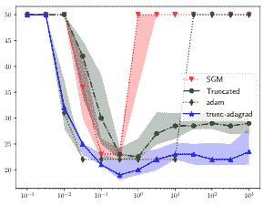

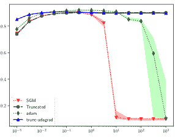

图 6.2: 在 CIFAR10 图像分类数据集上训练 resnet-128 CNN 时使用下界损失函数的益处示意图。曲线如下：SGM（随机梯度方法，即 SGD）、Adam、截断 SGD 和截断 AdaGrad。（a）达到满足 \(\mathcal{L}(\boldsymbol{\theta}_t) - \mathcal{L}(\boldsymbol{\theta}^*) \le \epsilon\) 的误差所需时间与初始学习率 \(\eta_0\) 的关系。（b）50 个 epoch 后的 Top-1 准确率与 \(\eta_0\) 的关系。线条表示 50 次随机重启的中位数性能，阴影表示 90% 置信区间。源自 [AD19c] 的图 4。经 Hilal Asi 友好许可使用。

##### 6.1.3.3 超越线性近似（截断 AdaGrad）

有时，我们可以做得比仅使用带有目标线性近似的 PPM 更好，且几乎不需要额外成本，如 [AD19b; AD19a; AD19c] 所指出。例如，假设我们知道损失的下界 \(\ell_t^{\min} = \min_{\boldsymbol{\theta}} \ell_t(\boldsymbol{\theta})\)。例如，使用平方误差或离散标签的交叉熵损失时，有 \(\ell_t(\boldsymbol{\theta}) \ge 0\)。因此我们定义**截断模型**

\[
\hat{\ell}_t(\boldsymbol{\theta}) = \max \left(\ell_t(\boldsymbol{\theta}) + \boldsymbol{g}_t^\top (\boldsymbol{\theta} - \boldsymbol{\theta}_t), \ell_t^{\min}\right) \tag{6.39}
\]

我们可以通过用缩放欧几里得范数替换欧几里得范数来进一步改进，其中对角缩放矩阵由 \(\mathbf{A}_t = \text{diag}(\sum_{i=1}^t \boldsymbol{g}_i \boldsymbol{g}_i^\top)^{\frac{1}{2}}\) 给出，如 AdaGrad [DHS11] 中所示。如果 \(\ell_t^{\min} = 0\)，则得到的近端更新变为

\[
\boldsymbol{\theta}_{t+1} = \underset{\boldsymbol{\theta}}{\text{argmin}} \left[ \ell_t(\boldsymbol{\theta}_t) + \boldsymbol{g}_t^\top (\boldsymbol{\theta} - \boldsymbol{\theta}_t) \right]_+ + \frac{1}{2\eta_t} (\boldsymbol{\theta} - \boldsymbol{\theta}_t)^\top \mathbf{A}_t (\boldsymbol{\theta} - \boldsymbol{\theta}_t) \tag{6.40}
\]

\[
= \boldsymbol{\theta}_t - \min\left(\eta_t, \frac{\ell_t(\boldsymbol{\theta}_t)}{\boldsymbol{g}_t^\top \mathbf{A}_t^{-1} \boldsymbol{g}_t}\right) \boldsymbol{g}_t \tag{6.41}
\]

因此，更新类似于标准 SGD 更新，但如果学习率过大，我们会将其截断。$^1$

[AD19c] 称这为**截断 AdaGrad**。此外，他们证明，优化这个截断线性近似（无论是否使用 AdaGrad 加权），而不是梯度下降使用的标准线性近似，可以带来显著益处。特别是，对于任何学习率，它都保证是稳定的（在某些技术条件下），而标准 GD 即使在凸问题中也可能“爆炸”。

图 6.2 展示了在 CIFAR10 图像分类数据集上训练 resnet-128 CNN（**??**）时这种方法的益处。对于 SGD 和截断近端方法，学习率使用 \(\eta_t = \eta_0 t^{-\beta}\) 进行衰减，其中 \(\beta = 0.6\)。对于 Adam 和截断 AdaGrad，学习率设置为 \(\eta_t = \eta_0\)，因为我们使用对角缩放。我们可以看到，与 SGD 或 Adam 相比，两种截断方法（常规版和 AdaGrad 版）在更广泛的初始学习率 \(\eta_0\) 范围内都有良好表现。

$^1$推导该更新的一种方法（由 Hilal Asi 建议）是对 \(\hat{\ell}_t(\boldsymbol{\theta}_{t+1})\) 的值进行情况分析，其中 \(\hat{\ell}_t\) 是截断线性模型。如果 \(\hat{\ell}_t(\boldsymbol{\theta}_{t+1}) > 0$，则将梯度设为零会得到通常的 SGD 更新，\(\boldsymbol{\theta}_{t+1} = \boldsymbol{\theta}_t - \eta_t \boldsymbol{g}_t$。（为简单起见，我们假设 \(\mathbf{A}_t = \mathbf{I}$。）否则，我们必然有 \(\hat{\ell}_t(\boldsymbol{\theta}_{t+1}) = 0$。但我们知道对于某些 \(\lambda$ 有 \(\boldsymbol{\theta}_{t+1} = \boldsymbol{\theta}_t - \lambda \boldsymbol{g}_t$，因此求解 \(\hat{\ell}_t(\boldsymbol{\theta}_t - \lambda \boldsymbol{g}_t) = 0$ 可得 \(\lambda = \hat{\ell}_t(\boldsymbol{\theta}_t) / \|\boldsymbol{g}_t\|_2^2$。

#### 6.1.4 镜下降

我们可以通过将方程 (6.34) 中的欧几里得距离项 \(\|\boldsymbol{\theta} - \boldsymbol{\theta}_t\|_2^2$ 替换为更一般的 Bregman 散度（**??**）来扩展近端点更新，

\[
D_h(x, y) = h(x) - [h(y) + \nabla h(y)^\top (x - y)] \tag{6.42}
\]

其中 \(h(x)\) 是一个强凸函数。这给出了以下更新：

\[
\theta_{t+1} = \text{argmin}_\theta \mathcal{L}(\theta) + \frac{1}{\eta_t} D_h(\theta, \theta_t) \tag{6.43}
\]

假设我们对 \(\mathcal{L}(\theta)$ 进行线性近似。

\[
\hat{\mathcal{L}}_t(\theta) = \mathcal{L}(\theta_t) + \boldsymbol{g}_t^\top (\theta - \theta_t) \tag{6.44}
\]

其中 \(\boldsymbol{g}_t = \nabla_\theta \mathcal{L}(\theta_t)$。如果使用欧几里得距离对这个线性近似进行近端更新，我们得到标准梯度更新，如在第 6.1.3.2 节中所示。但是，将其与 Bregman 散度结合会给出以下更新：

\[
\theta_{t+1} = \text{argmin}_\theta \eta_t \boldsymbol{g}_t^\top \theta + D_h(\theta, \theta_t) \tag{6.45}
\]

这被称为**镜下降** [NY83; BT03]。这可以以显而易见的方式轻松扩展到随机环境。

可以证明自然梯度下降（**??**）是镜下降的一种形式 [RM15]。更准确地说，均值参数空间中的镜下降等价于标准参数空间中的自然梯度下降。

#### 6.1.5 近端梯度方法

我们通常有兴趣优化形式的复合目标

\[
\mathcal{L}(\theta) = \mathcal{L}_s(\theta) + \mathcal{L}_r(\theta) \tag{6.46}
\]

其中 \(\mathcal{L}_s$ 是凸且可微的（光滑），\(\mathcal{L}_r$ 是凸但不一定可微的（即，可能是非光滑或“粗糙”的）。例如，\(\mathcal{L}_r$ 可能是 \(\ell_1$ 范数正则化项，\(\mathcal{L}_s$ 可能是线性回归的负对数似然（参见第 6.1.5.1 节）。

**近端梯度方法**是以下更新：

\[
\theta_{t+1} = \text{prox}_{\eta_t \mathcal{L}_r}(\theta_t - \eta_t \nabla \mathcal{L}_s(\theta_t)) \tag{6.47}
\]

如果 \(\mathcal{L}_r = I_C$，这等价于**投影梯度下降**。如果 \(\mathcal{L}_r = 0$，这等价于梯度下降。如果 \(\mathcal{L}_s = 0$，这等价于近端点方法。

我们可以按以下方式创建带有 **Nesterov 加速**的近端梯度方法版本：

\[
\tilde{\theta}_{t+1} = \theta_t + \beta_t(\theta_t - \theta_{t-1}) \tag{6.48}
\]

\[
\theta_{t+1} = \text{prox}_{\eta_t \mathcal{L}_r}(\tilde{\theta}_{t+1} - \eta_t \nabla \mathcal{L}_s(\tilde{\theta}_{t+1})) \tag{6.49}
\]

参见例如 [Tse08]。

现在我们考虑随机情况，其中 \(\mathcal{L}_s(\theta) = \mathbb{E}[\mathcal{L}_s(\theta, z)]$。（我们假设 \(\mathcal{L}_r$ 是确定性的。）在这种情况下，我们可以使用以下随机更新：

\[
\theta_{t+1} = \text{prox}_{\eta_t \mathcal{L}_r}(\theta_t - \eta_t \nabla \mathcal{L}_s(\theta_t, z_t)) \tag{6.50}
\]

其中 \(z_t \sim q$。这被称为**随机近端梯度方法**。如果 \(q$ 是经验分布，这被称为**增量近端梯度方法** [Ber15]。两种方法也可以加速（参见例如 [Nit14]）。

如果 \(\mathcal{L}_s$ 不是凸的，我们可以计算局部凸近似，如第 6.1.3.3 节所示。（我们假设 \(\mathcal{L}_r$ 保持凸。）该方法的加速版本在 [LL15] 中研究。在随机情况下，我们可以同样对 \(\mathcal{L}_s(\theta, z)$ 进行局部凸近似。这在 [Red+16; LL18] 中研究。在增量情况下（其中 \(q = p_D$），EKF 解释给出在 [Aky+19] 中。

##### 6.1.5.1 示例：稀疏线性回归的迭代软阈值算法（ISTA）

假设我们有兴趣对带有稀疏性促进先验的权重的线性回归模型进行拟合，如拉索模型（**??**）所示。实现这一点的一种方法是将参数的 \(\ell_1$-范数作为（非光滑）惩罚项添加进去，\(\mathcal{L}_r(\theta) = \|\theta\|_1 = \sum_{d=1}^D |\theta_d|$。因此目标是

\[
\mathcal{L}(\theta) = \mathcal{L}_s(\theta) + \mathcal{L}_r(\theta) = \frac{1}{2}\|\mathbf{X}\theta - \mathbf{y}\|_2^2 + \lambda\|\theta\|_1
\]

近端梯度下降更新可以写为

\[
\theta_{t+1} = \text{SoftThreshold}_{\eta_t\lambda}(\theta_t - \eta_t \nabla\mathcal{L}_s(\theta_t))
\]

其中软阈值算子（方程 (6.26)）按元素应用，且 \(\nabla\mathcal{L}_s(\theta) = \mathbf{X}^\top(\mathbf{X}\theta - \mathbf{y})$。这称为**迭代软阈值算法**或 **ISTA** [DDM04; Don95]。如果我们将其与 Nesterov 加速相结合，我们得到称为“快速 ISTA”或 **FISTA** [BT09] 的方法，该方法广泛用于拟合稀疏线性模型。

#### 6.1.6 交替方向乘子法（ADMM）

考虑优化 \(\mathcal{L}(x) = \mathcal{L}_s(x) + \mathcal{L}_r(x)$ 的问题，其中 \(\mathcal{L}_s$ 和 \(\mathcal{L}_r$ 现在都可能是非光滑的（但我们假设两者都是凸的）。我们可能希望独立优化这些问题（例如，以便可以并行执行），但需要确保解是一致的。

实现这一点的一种方法是使用**变量分割技巧**结合约束优化：

最小化 \(\mathcal{L}_s(x) + \mathcal{L}_r(z)$ 受限于 \(x - z = \mathbf{0}\)

这称为**共识形式**。

对应的增广拉格朗日函数由以下给出

\[
L_\rho(x, z, y) = \mathcal{L}_s(x) + \mathcal{L}_r(z) + y^\top(x - z) + \frac{\rho}{2}\|x - z\|_2^2
\]

其中 \(\rho > 0$ 是惩罚强度，\(y \in \mathbb{R}^n$ 是与一致性约束相关的对偶变量。我们现在可以执行以下块坐标下降更新：

\[
x_{t+1} = \underset{x}{\text{argmin}} L_\rho(x, z_t, y_t)
\]

\[
z_{t+1} = \underset{z}{\text{argmin}} L_\rho(x_{t+1}, z, y_t)
\]

\[
y_{t+1} = y_t + \rho(x_{t+1} - z_{t+1})
\]

我们可以看到，对偶变量是共识误差的（缩放）运行平均值。

插入 \(L_\rho(x, z, y)$ 的定义，我们得到以下更显式的更新方程：

\[
x_{t+1} = \underset{x}{\text{argmin}} \left( \mathcal{L}_s(x) + y_t^\top x + \frac{\rho}{2}\|x - z_t\|_2^2 \right)
\]

\[
z_{t+1} = \underset{z}{\text{argmin}} \left( \mathcal{L}_r(z) - y_t^\top z + \frac{\rho}{2}\|x_{t+1} - z\|_2^2 \right)
\]

如果我们合并线性项和二次项，我们得到

\[
x_{t+1} = \underset{x}{\text{argmin}} \left( \mathcal{L}_s(x) + \frac{\rho}{2}\|x - z_t + (1/\rho)y_t\|_2^2 \right)
\]

\[
z_{t+1} = \underset{z}{\text{argmin}} \left( \mathcal{L}_r(z) + \frac{\rho}{2}\|x_{t+1} - z - (1/\rho)y_t\|_2^2 \right)


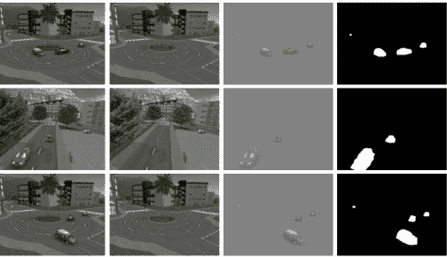

图6.3：对监控视频中的某些帧应用鲁棒PCA。第一列是输入图像。第二列是低阶背景模型。第三列是稀疏前景模型。最后一列是推导的前景掩码。来源于[Bou+17]的图1。经Thierry Bouwmans kindly许可使用。

最后，如果我们定义 \( u_t = (1/\rho)y_t \) 和 \( \lambda = 1/\rho \)，现在可以用更通用的方式写出这个：

```
\( x_{t+1} = \text{prox}_{\lambda \mathcal{L}_s}(z_t - u_t) \) (6.62)
\( z_{t+1} = \text{prox}_{\lambda \mathcal{L}_r}(x_{t+1} + u_t) \) (6.63)
\( u_{t+1} = u_t + x_{t+1} - z_{t+1} \) (6.64)
```

这称为**交替方向乘数法**或**ADMM**算法。这种方法的优点在于，目标函数中的不同项（以及它们可能具有的任何约束）被完全独立地处理，从而允许使用不同的求解器。此外，该方法可以扩展到随机设置，如[ZK14]所示。

##### 6.1.6.1 示例：鲁棒PCA

在本节中，我们给出了来自[PB+14, Sec. 7.2]的ADMM示例。

考虑以下**矩阵分解问题**：

```
\(\text{minimize}_{\mathbf{X}_{1:J}} \sum_{j=1}^J \gamma_j \phi_j(\mathbf{X}_j) \text{ s.t. } \sum_{j=1}^J \mathbf{X}_j = \mathbf{A}\) (6.65)
```

其中\(\mathbf{A} \in \mathbb{R}^{m \times n}\)是给定的数据矩阵，\(\mathbf{X}_j \in \mathbb{R}^{m \times n}\)是优化变量，\(\gamma_j > 0\)是权衡参数。

例如，假设我们想要找到\(\mathbf{A}\)作为低阶矩阵加稀疏矩阵之和的良好最小二乘近似。这称为**鲁棒PCA** [Can+11]，因为稀疏矩阵可以处理少数可能导致近似积较高的异常值。该方法常用于将监控视频分解为静态背景的低阶模型和动态前景对象（如移动汽车或人）的稀疏模型，如图6.3所示。（有关综述，见例如[Bou+17]。）RPCA也可用于从人脸图像中去除小的“异常值”，如高光和阴影，以提高人脸识别效果。

我们可以将鲁棒PCA表述为以下优化问题：

```
\(\text{minimize } ||\mathbf{A} - (\mathbf{L} + \mathbf{S})||_F^2 + \gamma_L ||\mathbf{L}||_* + \gamma_S ||\mathbf{S}||_1\) (6.66)
```

这是观测数据矩阵的稀疏加低阶分解。我们可以通过定义\(\mathbf{X}_1 = \mathbf{L}\)、\(\mathbf{X}_2 = \mathbf{S}\)和\(\mathbf{X}_3 = \mathbf{A} - (\mathbf{X}_1 + \mathbf{X}_2)\)，然后使用以下损失函数，将此重新表述为规范矩阵分解问题的形式：

```
\(\phi_1(\mathbf{X}_1) = ||\mathbf{X}_1||_*, \, \phi_2(\mathbf{X}_2) = ||\mathbf{X}_2||_1, \, \phi_3(\mathbf{X}_3) = ||\mathbf{X}_3||_F^2\) (6.67)
```

我们可以使用ADMM来处理此类矩阵分解问题，其中我们使用分割$\mathcal{L}_s(\mathbf{X}) = \sum_j \gamma_j \phi_j(\mathbf{X}_j)$和$\mathcal{L}_r(\mathbf{X}) = I_C(\mathbf{X})$，其中$\mathbf{X} = (\mathbf{X}_1, \dots, \mathbf{X}_J)$，$\mathcal{C} = \{ \mathbf{X}_{1:J} : \sum_{j=1}^J \mathbf{X}_j = \mathbf{A} \}$。总体算法变为

```
$$\mathbf{X}_{j, t+1} = \text{prox}_{\eta_t \phi_j}(\mathbf{X}_{j, t} - \overline{\mathbf{X}}_t + \frac{1}{J}\mathbf{A} - \mathbf{U}_t)$$ (6.68)
```

```
$$\mathbf{U}_{t+1} = \mathbf{U}_t + \overline{\mathbf{X}}_{t+1} - \frac{1}{J}\mathbf{A}$$ (6.69)
```

其中$\overline{\mathbf{X}}$是$\mathbf{X}_1, \dots, \mathbf{X}_J$的元素级平均值。注意，$\mathbf{X}_j$可以并行更新。

$\ell_1$范数的投影在6.1.2.3节中讨论，核范数的投影在6.1.2.6节中讨论，平方Frobenius范数的投影与平方欧几里得范数的投影相同（在6.1.2.5节中讨论），而对约束集$\sum_j \mathbf{X}_j = \mathbf{A}$的投影可以使用平均算子来完成：

```
$$\text{proj}_{\mathcal{C}}(\mathbf{X}_1, \dots, \mathbf{X}_J) = (\mathbf{X}_1, \dots, \mathbf{X}_J) - \overline{\mathbf{X}} + \frac{1}{J}\mathbf{A}$$ (6.70)
```

在内循环中使用$\ell_1$最小化的替代方法是使用硬阈值法 [CGJ17]。虽然不是凸的，但可以证明该方法可以收敛到全局最优解，并且速度快得多。

还可以制定非负版本的鲁棒PCA。尽管NRPCA不是凸问题，但可以找到全局最优解 [Fat18; AS19]。

### 6.2 局部搜索

在本节中，我们讨论启发式优化算法，这些算法试图在离散、无结构的搜索空间中找到全局最大值。这些算法使用以下离散类比来替代局部梯度更新（形式为\(\boldsymbol{\theta}_{t+1} = \boldsymbol{\theta}_t + \eta_t \mathbf{d}_t\)）：

```
$$\mathbf{x}_{t+1} = \underset{\mathbf{x} \in \text{nbr}(\mathbf{x}_t)}{\text{argmax}} \mathcal{L}(\mathbf{x})$$ (6.71)
```

其中$\text{nbr}(\mathbf{x}_t) \subseteq \mathcal{X}$是$\mathbf{x}_t$的**邻居**集合。这称为爬山法、最陡上升法或**贪婪搜索**。

如果某点的“邻域”包含整个空间，则方程(6.71)将在一步内返回全局最优解，但通常这样的全局邻域太大，无法穷举搜索。因此，我们通常定义局部邻域。例如，考虑**八皇后问题**。其目标是在\(8 \times 8\)棋盘上放置皇后，使它们互不攻击（参见图6.6）。状态空间的形式为$\mathcal{X} = 64^8$，因为我们需要指定网格上每个皇后的位置。但是，由于约束条件，只有\(8^8 \approx 17\text{M}\)个可行状态。我们将状态的邻居定义为通过将单个皇后移动到同一列的另一格子生成的所有可能状态，因此每个节点有\(8 \times 7 = 56\)个邻居。根据[RN10, p.123]，如果从随机生成的8皇后状态开始，最陡上升法有86%的时间会陷入局部最大值，因此它只能解决14%的问题实例。但是，它很快，成功时平均需要4步，陷入困境时平均需要3步。

在下面的章节中，我们将讨论稍微聪明一些、不太可能陷入局部最大值的算法。

#### 6.2.1 随机局部搜索

爬山法是贪婪的，因为它通过精确求解方程(6.71)来选择其局部邻域中的最佳点。减少陷入局部最大值机会的一种方法是在每一步大约最大化此目标。例如，我们可以在上坡邻居上定义一个概率分布，与其改进程度成正比，然后随机采样一个。这称为**随机爬山法**。如果我们逐渐降低此概率分布的熵（因此随着时间的推移变得更加贪婪），我们会得到一种称为模拟退火的方法，我们将在**??**中讨论。

另一种简单的技术是使用贪婪爬山法，但每当达到局部最大值时，就从不同的随机起始点重新开始。这称为**随机重启爬山法**。为了了解其好处，请再次考虑八皇后问题。如果每次爬山搜索成功的概率为\( p \approx 0.14 \)，那么我们预计需要\( R = 1/p \approx 7 \)次重启才能找到有效解。总步数的期望值可以按如下方式计算。设\( N_1 = 4 \)为成功试验的平均步数，\( N_0 = 3 \)为失败试验的平均步数。那么平均总步数为\( N_1 + (R - 1)N_0 = 4 + 6 \times 3 = 22 \)。由于每一步都很快，整体方法非常快。例如，它可以在一分钟内解决\( n = 1\text{M} \)的n皇后问题。

当然，在实践中解决n皇后问题并不是最有用的任务。但是，它是几种现实世界中**布尔可满足性问题**的典型代表，这类问题涉及从AI规划到模型检查等各种问题（参见例如[SLM92]）。在这些问题中，我们讨论过的简单**随机局部搜索（SLS）**算法效果出奇地好（参见例如[HS05]）。

#### 6.2.2 禁忌搜索

算法1：禁忌搜索。
```
1 t := 0 // counts iterations ;
2 c := 0 // counts number of steps with no progress;
3 Initialize x_0 ;
4 x* := x_0 // current best incumbent;
5 while c < c_max do
6   x_{t+1} = argmax_{x \in nbr(x_t) \setminus {x_{t-\tau}, ..., x_{t-1}}} f(x);
7   if f(x_t) > f(x*) then
8     x* := x_t ;
9     c := 0
10   else
11     c := c + 1
12   t := t + 1
13 return x*
```

爬山法一旦达到局部最大值或平坦区域就会停止。显然，可以进行随机重启，但这会忽略迄今为止获得的所有信息。一种更智能的替代方法称为**禁忌搜索 [GL97]**。这与爬山法类似，但允许降低（或至少不增加）评分函数的移动，前提是移动到以前未见过的新状态。我们可以通过保存一个禁忌列表来强制执行此操作，该列表跟踪最近访问的\(\tau\)个状态。这迫使算法探索新状态，并增加从局部最大值中逃脱的机会。我们这样做最多\( c_{max} \)步（称为“禁忌任期”）。伪代码可见算法1。（如果设置\( c_{max} = 1 \)，则得到贪婪爬山法。）

例如，考虑禁忌搜索到达山顶\( x_t \)时会发生什么。下一步，它将移动到峰值的一个邻居\( x_{t+1} \in nbr(x_t) \)，该邻居得分较低。下一步，它将移动到上一步的邻居\( x_{t+2} \in nbr(x_{t+1}) \)；禁忌列表阻止它循环返回\( x_t \)（峰值），因此它将被迫选择同等高度或更低的邻近点。它以这种方式继续，“绕着”峰值，可能被迫下降到较低的水平集（一种逆向**盆地淹没**操作），直到找到通往新峰值的山脊，或者直到超过最大非改进移动次数。

根据[RN10, p.123]，禁忌搜索将可解决的八皇后问题百分比从14%提高到94%，尽管该变体每个成功实例平均需要21步，每个失败实例平均需要64步。


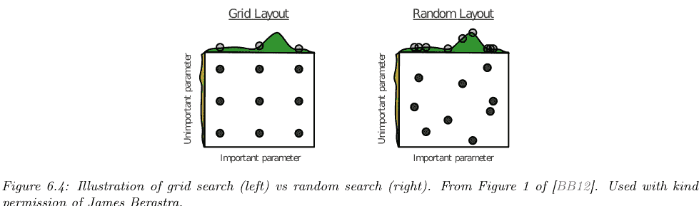

#### 6.2.3 随机搜索

在对目标一无所知的问题中，出人意料地有效的一种策略是使用**随机搜索**。在此方法中，每个迭代 $x_{t+1}$ 都从 $\mathcal{X}$ 中均匀随机选择。这应始终作为基准尝试。

在 [BB12] 中，他们将此技术应用于某些机器学习模型的超参数优化问题，其中目标是在验证集上的性能。在他们的示例中，搜索空间是连续的，$\Theta = [0, 1]^D$。从中随机采样很容易。标准的替代方法是将空间量化为一组固定值，然后全部评估；这被称为**网格搜索**。(当然，只有当维数 $D$ 较小时，这才可行。) 他们发现随机搜索优于网格搜索。这样做的直观原因是，许多超参数对目标函数影响不大，如图 6.4 所示。因此，在这样不重要的维度上放置细网格是浪费时间。

RS 也已用于优化 MDP 策略的参数，其中目标形式为 $f(x) = \mathbb{E}_{\tau \sim \pi_\omega} [R(\tau)]$，即由使用参数为 $x$ 的策略生成的轨迹的预期奖励。对于自由参数较少的策略，RS 可以胜过 **??** 中描述的更复杂的强化学习方法，如 [MGR18] 所示。在策略参数数量较多的情况下，有时可以将它们投影到较低维的随机子空间，并在该子空间中进行优化（无论是网格搜索还是随机搜索）[Li+18]。

### 6.3 基于种群的优化

随机局部搜索 (SLS) 在每个步骤都维护一个“最佳猜测” $x_t$。如果运行 $T$ 步并重启 $K$ 次，总成本为 $TK$。一种自然的替代方法是维护一组或**种群** $S_t$ 的 $K$ 个良好候选者，我们试图在每个步骤中改进它们。这称为**进化算法 (EA)**。如果运行 $T$ 步，它也需要 $TK$ 时间；然而，它通常比多重启动 SLS 获得更好的结果，因为搜索过程并行探索了更多的空间，并且种群中不同成员的信息可以共享。EA 有多种版本，具体取决于我们如何在每个步骤中更新种群，如第 6.3.1 节所述。

与维护一组显式的有前途候选者不同，另一种方法是在有前途的候选者上维护一个概率分布。我们称这为**基于分布的优化 (DBO)**.$^2$ 通过使用带有合适归纳偏置的参数分布，我们有时可以获得更好的性能。我们在第 6.3.3 节讨论了一些示例。

2 注意，“概率优化”和“随机优化”这两个术语已经被“占用”了。(概率优化通常用于指代贝叶斯优化 (**??**)，而随机优化是指目标具有随机性的任何优化问题。) DBO 的另一个术语是“基于模型的优化”(见 [BBZ17])。然而，这个术语是歧义的，因为它可能指代良好候选者的模型（即 $\mathcal{X}$ 上的概率分布）或目标的廉价（可能可微）近似（即回归函数 $\mathcal{X} \to \mathbb{R}$），如 **??** 中所讨论。

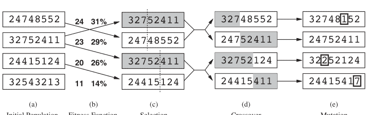

图 6.5: 将遗传算法应用于八皇后问题的示例。(a) 由 4 个字符串组成的初始种群。(b) 我们按适应度对种群成员进行排名，然后计算它们的交配概率。这里整数表示不相攻击的皇后对数，因此全局最大值为 28。我们以概率 $p(\theta) = \mathcal{L}(\theta)/Z$ 选择个体 \(\theta\)，其中 \(Z = \sum_{\theta \in \mathcal{P}} \mathcal{L}(\theta)\) 对种群的总适应度求和。例如，我们以概率 24/78 = 0.31 选择第一个个体，以概率 23/78 = 0.29 选择第二个个体，等等。在此示例中，我们选择第一个个体一次，第二个个体两次，第三个个体一次，最后一个个体无法繁殖。(c) 每个父母的“染色体”上随机选择一个分割点。(d) 两个父母交换其染色体的一半。(e) 我们可以选择性地应用逐点突变。来自 [RN10] 的图 4.6。经 Peter Norvig 友好许可使用。

#### 6.3.1 进化算法

由于 EA 算法从生物进化过程汲取灵感，它们也借用了大量相关术语。种群中个体的适应度是目标函数的值（可能在种群成员之间归一化）。步骤 t + 1 的种群成员称为后代。这些后代可以通过从 \(\mathcal{S}_t\) 中随机选择一个父母并对其应用随机突变来创建。这类似于无性生殖。或者，我们可以通过从 \(\mathcal{S}_t\) 中选择两个父母，然后以某种方式将它们组合起来生成一个子代，类似于有性生殖；组合父母称为重组。(之后通常跟随突变。)

选择父母的过程称为选择函数。在截断选择中，每个父母从种群中适应度最高的 K 个成员（称为精英集）中选择。在锦标赛选择中，每个父母是从 K 个随机选择的成员中适应度最高的。在适应度比例选择中，也称为轮盘赌选择，每个父母被选择的概率与其相对其他个体的适应度成正比。我们还可以“淘汰”种群中最年长的成员，然后根据适应度选择父母；这称为正则化进化 [Rea+19]。

除了父母的选择规则外，我们还需要指定重组和突变规则。这些启发式方法有许多可能的选择。我们下面简要提及其中几种。

- 在遗传算法 (GA) [Gol89; Hol92] 中，我们使用突变和一种基于交叉的特定重组方法。为了实现交叉，我们假设每个个体表示为整数或二进制数向量，类比于染色体。我们为每个选定的父母沿染色体选择一个分割点，然后交换字符串，如图 6.5 所示。

- 在遗传编程 [Koz92] 中，我们使用个体的树结构表示，而不是位串。这种表示确保所有交叉都产生有效的子代，如图 6.7 所示。遗传编程可用于寻找良好程序以及其他结构化对象，例如神经网络。在进化编程中，树的结构是固定的，只有数值参数会进化。

- 在代理辅助的 EA 中，使用代理函数 \(\hat{f}(s)\) 代替真实目标函数 \(f(s)\)，以加快种群成员的评估（综述见 [Jin11]）。这

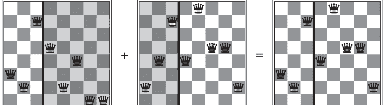

图 6.6: 对应图 6.5(c) 中前两个父母及其在图 6.5(d) 中的第一个子代的八皇后状态。我们可以看到，编码 32752411 表示第一个皇后在第 3 行（从左下角开始计数），第二个皇后在第 2 行，等等。阴影列在交叉中丢失，但未阴影列被保留。来自 [RN10] 的图 4.7。经 Peter Norvig 友好许可使用。

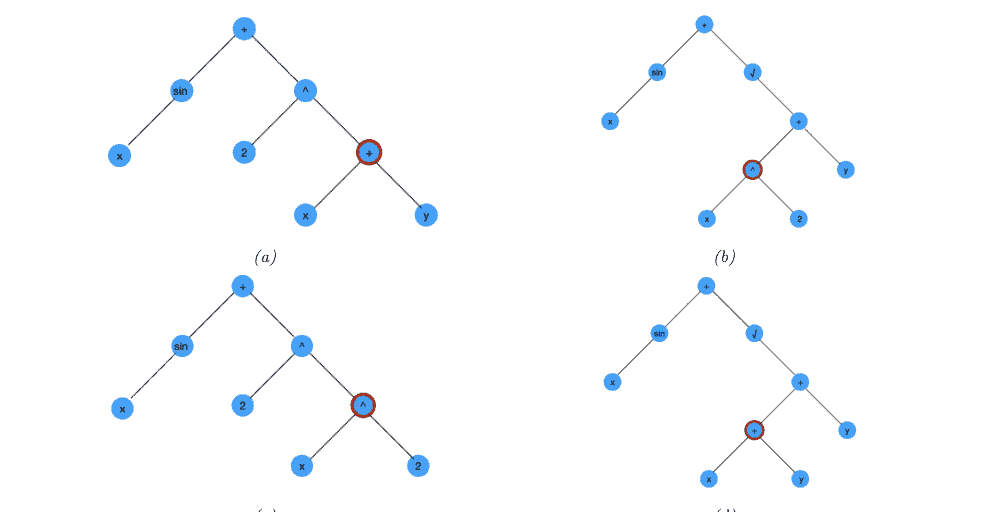

图 6.7: 遗传程序中交叉算子的示例。(a-b) 两个父母，分别表示 sin(x) + (x + y)^2 和 sin(x) + \sqrt{x^2 + y}。红色圆圈表示两个交叉点。(c-d) 两个子代，分别表示 sin(x) + (x^2)^2 和 sin(x) + \sqrt{x + y + y}。改编自 [Mit97] 的图 9.2


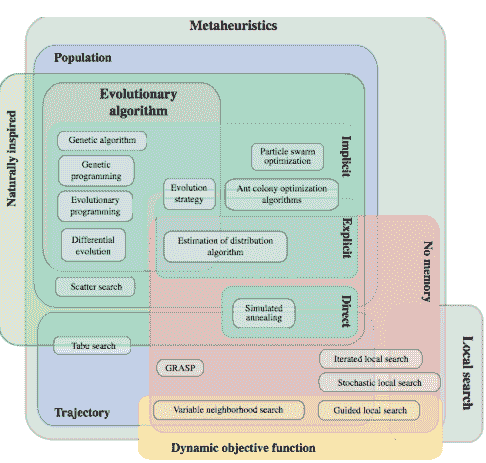

图 6.8：各种元启发式优化算法的分类。来自 https://en.wikipedia.org/wiki/Metaheuristic。经维基百科作者 Johann Dreo 和 Caner Candan 允许使用。

这与贝叶斯优化中使用响应面模型（？）类似，只是它不处理探索-利用权衡。

- 在模因算法 [MC03] 中，我们将突变和重组与标准局部搜索相结合。

进化算法已应用于大量应用，包括训练神经网络（这种组合被称为**神经进化** [Sta+19]）。一个基于 JAX 的高效（神经）进化库可以在 https://github.com/google/evojax 找到。

#### 6.3.2 元启发式算法

术语“元启发式”常用于描述不同种类的局部或基于种群的搜索算法（参见例如，[Luk13]）。元启发式算法有多种类型，分类它们的方法也有几种，如图 6.8 所示。这些算法中的许多受“自然现象”的启发。例如，[AQ+20] 提出使用“基于“墨鱼群算法（SSA）”的“增强花粉传播算法（FPA）”的改进自适应神经-模糊推理系统（ANFIS）”来解决 covid19 预测问题，而 [Mol+18] 使用“用于制造过程的鸡群优化与深度学习”。然而，这种“启发”通常会产生临时算法，没有理论支持（因此几乎没有使用它们的理由）。正如 Glover 和 Sorensen [GS15] 所生动指出的

大量（且不断增加）的出版物专注于基于隐喻开发（所谓的）新的元启发式框架。已被用作元启发式框架基础的自然或人造过程列表现在包括细菌觅食、河流形成、生物地理学、音乐家一起演奏、电磁学、重力、帝国殖民、矿井爆炸、联赛锦标赛、云等多种多样的过程，等等。基于动物行为的元启发式中存在一个重要的子类别。蚂蚁、蜜蜂、蝙蝠、狼、猫、萤火虫、鹰、海豚、青蛙、鲑鱼、秃鹫、白蚁、苍蝇等许多其他动物，都已被用来启发一种“新颖”的元启发式。[...] 一般来说，关于基于隐喻的元启发式的论文发表仅限于二流期刊和会议，但最近也可以找到一些对这一规则的例外。Sörensen [Sör15] 表示，该方向的研究从根本上存在缺陷。

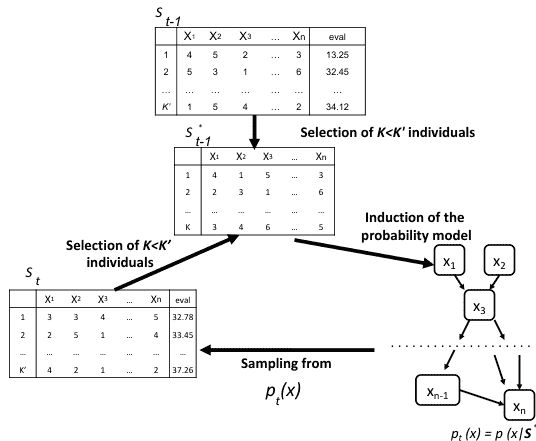

图 6.9：BOA 算法图示（应用于结构为贝叶斯网的生成模型的 EDA）。改编自 [PHL12] 的图 3。

鉴于此评估，我们不再进一步讨论此类方法。

#### 6.3.3 分布估计算法

EA 方法维护一批优秀候选解种群，可以将其视为高适应度状态上的隐式（非参数）密度模型。[BC95] 提出“从遗传算法中移除遗传学”，即通过显式学习配置空间上的概率模型，使其质量集中在高适应度解上。也就是说，种群成为生成模型 \(\theta_t\) 的参数集。

学习此类模型的一种方法如下。我们首先从当前模型中创建 \(K' > K\) 个候选解的样本，\(S_t = \{x_k \sim p(x|\theta_t)\}\)。然后使用适应度函数对样本进行排序，再使用选择算子选出最有希望的大小为 \(K\) 的子集 \(S_t^*\)（这称为**截断选择**）。最后，使用极大似然估计在 \(S_t^*\) 上拟合一个新的概率模型 \(p(x|\theta_{t+1})\)。这称为**分布估计**或 **EDA** 算法（参见例如，[LL02; PSCP06; Hau+11; PHL12; Hu+12; San17; Bal17]）。

请注意，EDA 等同于最小化由 \(S_t^*\) 定义的经验分布与模型分布 \(p(x|\theta_{t+1})\) 之间的交叉熵。因此，EDA 与 **交叉熵方法** 有关，如第 6.3.4 节所述，尽管 CEM 通常假设特殊情况 \(p(x|w) = \mathcal{N}(x|\mu, \Sigma)\)。EDA 还与 EM 算法密切相关，如 [Bro+20] 中所讨论。

作为一个简单的示例，假设配置空间是长度为 \(D\) 的比特串，适应度函数为 \(f(x) = \sum_{d=1}^D x_d\)，其中 \(x_d \in \{0, 1\}\)（在 EA 文献中这称为**一最大**函数）。这种情况的一个简单概率模型是形式为 \(p(x|\theta) = \prod_{d=1}^D \text{Ber}(x_d|\theta_d)\) 的完全因式分解模型。在 EDA 中使用此模型会产生一种称为单变量边缘分布算法或 **UMDA** 的方法。

我们可以通过将 \(\theta_d\) 设置为 \(S_t^*\) 中第 \(d\) 位开启的样本比例来估计伯努利模型的参数。或者，我们可以逐步调整参数。基于种群的增量学习（**PBIL**）算法 [BC95] 将此想法应用于因式分解伯努利模型，得出以下更新：

```
\(\hat{\theta}_{d,t+1} = (1 - \eta_t)\hat{\theta}_{d,t} + \eta_t \bar{\theta}_{d,t}\) (6.72)
```

其中 \(\bar{\theta}_{d,t} = \frac{1}{N_t} \sum_{k=1}^K \mathbb{I}(x_{k,d} = 1)\) 是从当前迭代生成的 \(K = |S_t^*|\) 个样本估计的极大似然估计，\(\eta_t\) 是学习率。

使用更具表达性的概率模型来捕捉参数之间的依赖关系是简单明了的（在 EA 文献中这些被称为**构建块**）。例如，对于实值参数，我们可以使用多元高斯分布，$p(\boldsymbol{x}) = \mathcal{N}(\boldsymbol{x}|\boldsymbol{\mu}, \boldsymbol{\Sigma})$。所得方法称为**多元正态估计算法**或 **EMNA**，[LL02]。（另参见第 6.3.4 节。）

对于离散随机变量，使用概率图形模型（**??**）来捕捉变量之间的依赖关系是自然的。[BD97] 使用 Chow-Liu 算法（第 31.1.2 节）学习树结构图形模型；[BJV97] 是这种情况的特例，其中图为树。我们也可以学习更一般的图形模型结构（参见例如，[LL02]）。我们通常使用贝叶斯网（**??**），因为我们也可以使用祖先采样（**??**）轻松生成样本；因此所得方法称为**贝叶斯优化算法（BOA）** [PGCP00]。<sup>3</sup> 层次 BOA（hBOA）算法 [Pel05] 通过使用决策树和决策图来表示贝叶斯网中的局部 CPT（如 [CHM97] 中所述），而不是使用表格。一般来说，学习用于 EDA 的概率模型结构称为**连锁学习**，类比于如果基因可以作为构建块共同遗传，则它们可以连锁在一起。

我们也可以使用深度生成模型来表示优秀候选解上的分布。例如，[CSF16] 使用去噪自动编码器和 NADE 模型（**??**），[Bal17] 使用一个 DNN 回归器，然后通过对输入进行梯度下降将其反转，[PRG17] 使用 RBMs（**??**），[GSM18] 使用 VAEs（**??**），等等。此类模型可能需要更多数据来拟合（因此需要更多函数调用），但可能更忠实地建模概率景观。（然而，这是否转化为更好的优化性能尚不清楚。）

#### 6.3.4 交叉熵方法

**交叉熵方法** [Rub97; RK04; Boe+05] 是 EDA（第 6.3.3 节）的一个特例，其中种群由多元高斯分布表示。具体而言，我们将 \(\boldsymbol{\mu}_{t+1}\) 和 \(\boldsymbol{\Sigma}_{t+1}\) 设置为 \(\mathcal{S}^*_{t+1}\) 的经验均值和协方差，即前 \(K\) 个样本。这与在 **??** 中讨论的用于采样罕见事件的 SMC 算法密切相关。

CEM 有时用于基于模型的强化学习（**??**），因为它简单且可以找到多模态目标的相当好的最优解。它也有时用于贝叶斯优化（**??**）内部，以优化多模态获取函数（参见 [BK10]）。

##### 6.3.4.1 可微 CEM

[AY19] 的**可微 CEM** 方法将前 \(K\) 算子替换为一种平滑的可微近似，从而允许优化器用作端到端可微流水线的一部分。例如，我们可以使用它来创建一个可微型模型预测控制（MPC）算法（**??**），如 **??** 中所述。

基本思路如下。设 \(\mathcal{S}_t = \{\boldsymbol{x}_{t,i} \sim p(\boldsymbol{x}|\boldsymbol{\theta}_t) : i = 1 : K'\}\) 表示当前种群，适应度值为 \(v_{t,i} = f(\boldsymbol{x}_{t,i})\)。设 \(v^*_{t,K}\) 为第 \(K\) 小的值。在 CEM 中，我们计算前 \(K\) 个样本的集合 \(\mathcal{S}^*_t = \{i : v_{t,i} \ge v^*_{t,K}\}\)，然后基于这些样本更新模型：\(\boldsymbol{\theta}_{t+1} = \text{argmax}_{\boldsymbol{\theta}} \sum_{i \in \mathcal{S}_t} p_t(i) \log p(\boldsymbol{x}_{t,i}|\boldsymbol{\theta})\)，其中 \(p_t(i) = \mathbb{I}(i \in \mathcal{S}^*_t) / |\mathcal{S}^*_t|\)。在可微版本中，我们用“软”密集分布 \(\boldsymbol{q}_t = \Pi(\boldsymbol{p}_t; \tau, K)\) 取代稀疏分布 \(\boldsymbol{p}_t$，其中

```
\(\Pi(\boldsymbol{p}; \tau, K) = \text{argmin}_{\boldsymbol{0} \le \boldsymbol{q} \le \boldsymbol{1}} -\boldsymbol{p}^\top \boldsymbol{q} - \tau \mathbb{H}(\boldsymbol{q}) \text{ s.t. } \mathbf{1}^\top \boldsymbol{q} = K\) (6.73)
```

该算子将分布 \(\boldsymbol{p}\) 投影到和为 \(K\) 的分布多极体上。（此处 \(\mathbb{H}(\boldsymbol{q}) = - \sum_i q_i \log(q_i) + (1-q_i) \log(1-q_i)\) 是熵，\(\tau > 0\) 是温度参数。）该投影算子（因此整个 DCEM 算法）可以通过隐式微分 [AKZK19] 进行反向传播。

3 这不应与我们在 **??** 中讨论的贝叶斯优化方法混淆，后者使用响应面建模来建模 \(p(f(\boldsymbol{x}))\) 而不是 \(p(\boldsymbol{x}^*)\)。


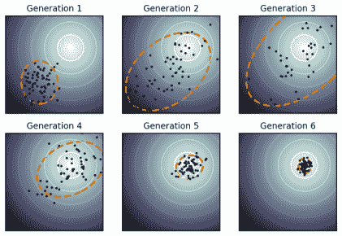

图 6.10: 将 CMA-ES 方法应用于简单 2d 函数的示意图。点表示种群成员，虚线橙色椭圆表示多元高斯分布。来自 https://en.wikipedia.org/wiki/CMA-ES。经 Wikipedia 作者 Sentewolf 许可使用。

#### 6.3.5 Natural evolutionary strategies

Evolution strategies [Wie+14] are a form of distribution-based optimization in which the distribution over the population is represented by a Gaussian, p(x|theta_t) (see e.g., [Sal+17]). Unlike CEM, the parameters are updated using gradient ascent applied to the expected value of the objective using MLE on a set of elite samples. More precisely, consider the smoothed objective L(theta) = E_{p(x|theta)} [f(x)]. We can use the REINFORCE estimator (??) to compute the gradient of this objective as follows:

nabla_theta L(theta) = E_{p(x|theta)} [f(x) nabla_theta log p(x|theta)] (6.74)

This can be approximated by drawing Monte Carlo samples. If the probability model is in the exponential family, we can compute the natural gradient (??), rather than the "vanilla" gradient; such methods are called natural evolution strategies [Wie+14].

##### 6.3.5.1 CMA-ES

The CMA-ES method of [Han16], which stands for "covariance matrix adaptation evolution strategy" is a kind of NES. It is very similar to CEM except it updates the parameters in a special way. In particular, instead of computing the new mean and covariance using unweighted MLE on the elite set, we attach weights to the elite samples based on their rank. We then set the new mean to the weighted MLE of the elite set.

The update equations for the covariance are more complex. In particular, "evolutionary paths" are also used to accumulate the search directions across successive generations, and these are used to update the covariance. It can be shown that the resulting updates approximate the natural gradient of L(theta) without explicitly modeling the Fisher information matrix [Oll+17].

Figure 6.10 illustrates the method in action.

### 6.4 Dynamic programming

Dynamic programming is a way to efficiently find the globally optimal solution to certain kinds of optimization problems. The key requirement is that the optimal solution be expressed in terms of the optimal solution to smaller subproblems, which can be reused many times. Note that DP is more of an algorithm "family" rather than a specific algorithm. We give some examples below.

#### 6.4.1 Example: computing Fibonacci numbers

Consider the problem of computing **Fibonacci numbers**, defined via the recursive equation

$F_i = F_{i-1} + F_{i-2}$ (6.75)

with base cases $F_0 = F_1 = 1$. Thus we have that $F_2 = 2, F_3 = 3, F_4 = 5, F_5 = 8$, etc. A simple **recursive** algorithm to compute the first $n$ Fibonacci numbers is shown in Algorithm 2. Unfortunately, this takes exponential time. For example, evaluating fib(5) proceeds as follows:

$F_5 = F_4 + F_3$ (6.76)
$= (F_3 + F_2) + (F_2 + F_1)$ (6.77)
$= ((F_2 + F_1) + (F_1 + F_0)) + ((F_1 + F_0) + F_1)$ (6.78)
$= (((F_1 + F_0) + F_1) + (F_1 + F_0))(F_1 + F_0) + F_1)$ (6.79)

We see that there is a lot of repeated computation. For example, fib(2) is computed 3 times. One way to improve the efficiency is to use **memoization**, which means memorizing each function value that is computed. This will result in a linear time algorithm. However, the overhead involved can be high.

It is usually preferable to try to solve the problem **bottom up**, solving small subproblems first, and then using their results to help solve larger problems later. A simple way to do this is shown in Algorithm 3.

```
Algorithm 2: Fibonacci numbers, top down
1 function fib(n);
2 if n = 0 or n = 1 then
3 | return 1
4 else
5 | return (fib(n - 1) + fib(n - 2))
```

```
Algorithm 3: Fibonacci numbers, bottom up
1 function fib(n);
2 F_0 := 1, F_1 := 1 ;
3 For i = 2, ..., n do
4 | F_i := F_{i-1} + F_{i-2}
5 return F_n
```

#### 6.4.2 ML examples

There are many applications of DP to ML problems, which we discuss elsewhere in this book. These include the forwards-backwards algorithm for inference in HMMs (**??**), the Viterbi algorithm for MAP sequence estimation in HMMs (**??**), inference in more general graphical models (**??**), reinforcement learning (**??**), etc.

### 6.5 Conjugate duality

In this section, we briefly discuss **conjugate duality**, which is a useful way to construct linear lower bounds on non-convex functions. We follow the presentation of [Bis06, Sec. 10.5].

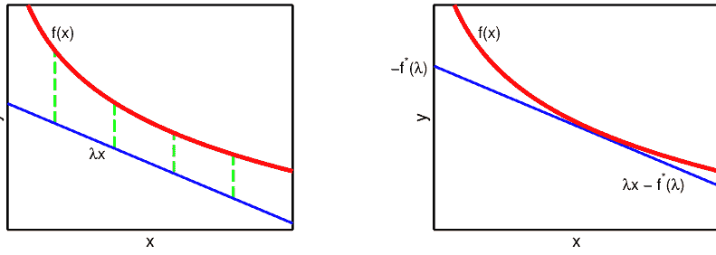

Figure 6.11: Illustration of a conjugate function. Red line is original function f(x), and the blue line is a linear lower bound \(\lambda x\). To make the bound tight, we find the x where \(\nabla f(x)\) is parallel to \(\lambda\), and slide the line up to touch there; the amount we slide up is given by \(f^*(\lambda)\). Adapted from Figure 10.11 of [Bis06].

#### 6.5.1 Introduction

Consider an arbitrary continuous function \(f(\mathbf{x})\), and suppose we create a linear lower bound on it of the form

\(\mathcal{L}(\mathbf{x}, \boldsymbol{\lambda}) \triangleq \boldsymbol{\lambda}^\top \mathbf{x} - f^*(\boldsymbol{\lambda}) \le f(\mathbf{x})\) (6.80)

where \(\boldsymbol{\lambda}\) is the slope, which we choose, and \(f^*(\boldsymbol{\lambda})\) is the intercept, which we solve for below. See Figure 6.11(a) for an illustration.

For a fixed \(\lambda\), we can find the point \(\mathbf{x}_\lambda\) where the lower bound is tight by “sliding” the line upwards until it touches the curve at \(\mathbf{x}_\lambda\), as shown in Figure 6.11(b). At \(\mathbf{x}_\lambda\), we minimize the distance between the function and the lower bound:

\(\mathbf{x}_\lambda \triangleq \underset{x}{\text{argmin}} f(x) - \mathcal{L}(\mathbf{x}, \boldsymbol{\lambda}) = \underset{x}{\text{argmin}} f(x) - \boldsymbol{\lambda}^\top \mathbf{x}\) (6.81)

Since the bound is tight at this point, we have

\(f(\mathbf{x}_\lambda) = \mathcal{L}(\mathbf{x}_\lambda, \boldsymbol{\lambda}) = \boldsymbol{\lambda}^\top \mathbf{x}_\lambda - f^*(\boldsymbol{\lambda})\) (6.82)

and hence

\(f^*(\boldsymbol{\lambda}) = \boldsymbol{\lambda}^\top \mathbf{x}_\lambda - f(\mathbf{x}_\lambda) = \underset{x}{\max} \boldsymbol{\lambda}^\top \mathbf{x} - f(\mathbf{x})\) (6.83)

The function \(f^*\) is called the **conjugate** of \(f\), also known as the **Fenchel transform** of \(f\). For the special case of differentiable \(f\), \(f^*\) is called the **Legendre transform** of \(f\).

One reason conjugate functions are useful is that they can be used to create convex lower bounds to non-convex functions. That is, we have \(\mathcal{L}(\mathbf{x}, \boldsymbol{\lambda}) \le f(\mathbf{x})\), with equality at \(\mathbf{x} = \mathbf{x}_\lambda\), for any function \(f : \mathbb{R}^D \to \mathbb{R}\). For any given \(\mathbf{x}\), we can optimize over \(\boldsymbol{\lambda}\) to make the bound as tight as possible, giving us a fixed function \(\mathcal{L}(\mathbf{x})\); this is called a **variational approximation**. We can then try to maximize this lower bound wrt \(\mathbf{x}\) instead of maximizing \(f(\mathbf{x})\). This method is used extensively in approximate Bayesian inference, as we discuss in **??**.

#### 6.5.2 Example: exponential function

Let us consider an example. Suppose \(f(x) = e^{-x}\), which is convex. Consider a linear lower bound of the form

\(\mathcal{L}(x, \lambda) = \lambda x - f^\dagger(\lambda)\) (6.84)

where the conjugate function is given by

\(f^\dagger(\lambda) = \underset{x}{\max} \lambda x - f(x) = -\lambda \log(-\lambda) + \lambda\) (6.85)

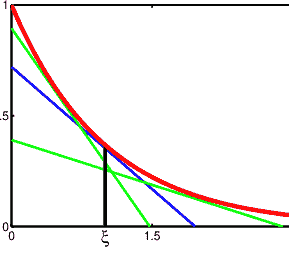

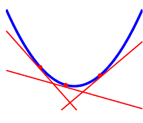

Figure 6.12: (a) The red curve is f(x) = e^{-x} and the colored lines are linear lower bounds. Each lower bound of slope \lambda is tangent to the curve at the point x_\lambda = -log(-\lambda), where f(x_\lambda) = e^{log(-\lambda)} = -\lambda. For the blue curve, this occurs at x_\lambda = \xi. Adapted from Figure 10.10 of [Bis06]. Generated by opt_lower_bound.py. (b) For a convex function f^*(x), its epigraph can be represented as the intersection of half-spaces defined by linear lower bounds of the form f^*(\lambda). Adapted from Figure 13 of [JJ99].

as illustrated in Figure 6.12(a).

To see this, define

$$J(x, \lambda) = \lambda x - f(x)$$

We have

$$\frac{\partial J}{\partial x} = \lambda - f'(x) = \lambda + e^{-x}$$

Setting the derivative to zero gives

$$x_\lambda = \arg \max_x J(x, \lambda) = -\log(-\lambda)$$

Hence

$$f^\dagger(\lambda) = J(x_\lambda, \lambda) = \lambda(-\log(-\lambda)) - e^{\log(-\lambda)} = -\lambda \log(-\lambda) + \lambda$$

#### 6.5.3 Conjugate of a conjugate

It is interesting to see what happens if we take the conjugate of the conjugate:

$$f^{**}(x) = \max_\lambda \lambda^T x - f^\dagger(\lambda)$$

If f is convex, then f^{**} = f, so f and f^\dagger are called conjugate duals. To see why, note that

$$f^{**}(x) = \max_\lambda \mathcal{L}(x, \lambda) \le f(x)$$

Since we are free to modify \lambda for each x, we can make the lower bound tight at each x. This perfectly characterizes f, since the epigraph of a convex function is an intersection of half-planes defined by linear lower bounds, as shown in Figure 6.12(b). Let us demonstrate this using the example from Section 6.5.2. We have

$$f^{**}(x) = \max_\lambda \lambda x - f^\dagger(\lambda) = \max_\lambda \lambda x + \lambda \log(-\lambda) - \lambda$$

Define

$$J^*(x, \lambda) = \lambda x - f^\dagger(x) = \lambda x + \lambda \log(-\lambda) - \lambda$$


我们有

```
\frac{\partial}{\partial \lambda} J^*(x, \lambda) = x + \log(-\lambda) + \lambda \left( \frac{-1}{-\lambda} \right) - 1 = 0 \tag{6.94}

x = -\log(-\lambda) \tag{6.95}

\lambda_x = -e^{-x} \tag{6.96}
```

代回可得

```
f^{**}(x) = J^*(x, \lambda_x) = (-e^{-x})x + (-e^{-x})(-x) - (-e^{-x}) = e^{-x} = f(x) \tag{6.97}
```

#### 6.5.4 逻辑（Sigmoid）函数的边界

在本节中，我们利用共轭对偶性的结果，推导逻辑函数的上界和下界，\(\sigma(x) = \frac{1}{1+e^{-x}}\)。

##### 6.5.4.1 指数上界

Sigmoid 函数既不是凸的也不是凹的。不过，很容易证明 \(f(x) = \log \sigma(x) = -\log(1+e^{-x})\) 是凹的，只需表明其二阶导数为负即可。现在，任何凸函数 \(f(x)\) 都可以表示为

```
f(x) = \min_{\eta} \eta x - f^{\dagger}(\eta) \tag{6.98}
```

其中

```
f^{\dagger}(\eta) = \min_{x} \eta x - f(x) \tag{6.99}
```

可以证明，若 \(f(x) = \log \sigma(x)\)，则有

```
f^{\dagger}(\eta) = -\eta \ln \eta - (1 - \eta) \ln(1 - \eta) \tag{6.100}
```

这是二元熵函数。因此

```
\log \boldsymbol{\sigma}(x) \leq \eta x - f^{\dagger}(\eta) \tag{6.101}

\boldsymbol{\sigma}(x) \leq \exp(\eta x - f^{\dagger}(\eta)) \tag{6.102}
```

图 6.13(a) 说明了 \(\sigma(x)\) 的该指数上界。

##### 6.5.4.2 二次下界

计算 \(\sigma(x)\) 的下界也很有用。如果将其设为二次下界，它将与高斯先验“配合良好”，从而简化多种模型的分析。该方法最初在 [JJ96] 中提出。

首先，我们写出

```
\log \boldsymbol{\sigma}(x) = -\log(1+e^{-x}) = -\log \left( e^{-x/2}(e^{x/2} + e^{-x/2}) \right) \tag{6.103}

= x/2 - \log(e^{x/2} + e^{-x/2}) \tag{6.104}
```

函数 \(f(x) = -\log(e^{x/2} + e^{-x/2})\) 关于 \(y = x^2\) 是凸函数，可通过证明 \(\frac{d}{dx} f(x) > 0\) 来验证。因此，我们可以使用共轭函数对 \(f\) 构造线性下界

```
f^{\dagger}(\eta) = \max_{x^2} \eta x^2 - f(\sqrt{x^2}) \tag{6.105}
```

我们有

```
0 = \eta - \frac{dx}{dx^2} \frac{d}{dx} f(x) = \eta + \frac{1}{4x} \tanh(\frac{x}{2}) \tag{6.106}
```

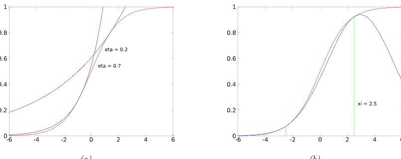

图 6.13：Sigmoid 函数的 (a) 指数上界和 (b) 二次下界示意图。由 sigmoid_upper_bounds.py 和 sigmoid_lower_bounds.py 生成。

下界在点 \(x_\eta = \xi\) 处相切，其中

\(\eta = -\frac{1}{4\xi} \tanh(\frac{\xi}{2}) = -\frac{1}{2\xi} \left[ \sigma(\xi) - \frac{1}{2} \right] = -\lambda(\xi)\) (6.107)

共轭函数可重写为

\(f^\dagger(\lambda(\xi)) = -\lambda(\xi)\xi^2 - f(\xi) = \lambda(\xi)\xi^2 + \log(e^{\xi/2} + e^{-\xi/2})\) (6.108)

因此 \(f\) 的下界变为

\(f(x) \ge -\lambda(\xi)x^2 - g(\lambda(\xi)) = -\lambda(\xi)x^2 + \lambda(\xi)\xi^2 - \log(e^{\xi/2} + e^{-\xi/2})\) (6.109)

且 Sigmoid 函数的下界变为

\(\sigma(x) \ge \sigma(\xi) \exp \left[ (x - \xi)/2 - \lambda(\xi)(x^2 - \xi^2) \right]\) (6.110)

图 6.13(b) 对此进行了说明。

虽然二次函数不是 Sigmoid 整体形状的良好表示，但当我们将 Sigmoid 用作似然函数并与高斯先验结合时，所得后验近似高斯；在此语境下，二次下界效果相当不错（因为二次似然乘以高斯先验将产生精确的高斯后验）。参见第 15.1.1 节的示例，我们在其中将此边界用于贝叶斯逻辑回归。

# 第二部分
推理

## 第 7 章

### 推理算法：概述

## 第 8 章

### 状态空间推理

## 第 9 章

### 消息传递推理

### 9.1 离散 PGM 的 MAP 估计

在本节中，我们考虑在概率图形模型中寻找变量最可能配置的问题，即，我们的目标是找到一个 MAP 分配 \(\boldsymbol{x}^* = \arg\max_{\boldsymbol{x} \in \mathcal{X}^V} p(\boldsymbol{x})\)，其中 \(\mathcal{X} = \{1, \dots, K\}\) 是每个节点的离散状态空间，\(V\) 是节点数量，且分布根据具有成对团的马尔可夫随机场（**??**）定义，每条边对应一个团：

\(p(\boldsymbol{x}) = \frac{1}{Z} \exp \left\{ \sum_{s \in \mathcal{V}} \theta_s(x_s) + \sum_{(s,t) \in \mathcal{E}} \theta_{st}(x_s, x_t) \right\}\) (9.1)

这里 \(\mathcal{V} = \{x_1, \dots, x_V\}\) 是节点，\(\mathcal{E}\) 是边，\(\theta_s\) 和 \(\theta_{st}\) 是节点和边势，\(Z\) 是配分函数：

\(Z = \sum_{\boldsymbol{x}} \exp \left\{ \sum_{s \in \mathcal{V}} \theta_s(x_s) + \sum_{(s,t) \in \mathcal{E}} \theta_{st}(x_s, x_t) \right\}\) (9.2)

由于我们只想要 MAP 配置，可以忽略 \(Z\)，只需计算

\(\boldsymbol{x}^* = \arg\max_{\boldsymbol{x}} \sum_{s \in \mathcal{V}} \theta_s(x_s) + \sum_{(s,t) \in \mathcal{E}} \theta_{st}(x_s, x_t)\) (9.3)

我们可以使用动态规划精确计算此问题，如我们在 **??** 中解释的那样：然而，这需要与图的树宽成指数关系的时间，通常太慢。在本节中，我们关注可扩展到难处理模型的近似方法。此处仅简要介绍；更多细节可见 [WJ08; KF09]。

#### 9.1.1 记号

为简化展示，我们将分布写成如下形式：

\(p(\boldsymbol{x}) = \frac{1}{Z(\boldsymbol{\theta})} \exp(-\mathcal{E}(\boldsymbol{x})), \mathcal{E}(\boldsymbol{x}) \triangleq -\boldsymbol{\theta}^T \mathcal{T}(\boldsymbol{x})\) (9.4)

其中 \(\boldsymbol{\theta} = (\{\theta_{s,j}\}, \{\theta_{s,t;j,k}\})\) 是所有节点和边参数（规范参数），\(\mathcal{T}(\boldsymbol{x}) = (\{\mathbb{I}(x_s = j)\}, \{\mathbb{I}(x_s = j, x_t = k)\})\) 是所有节点和边指示函数（充分统计量）。注意：我们使用 \(s, t \in \mathcal{V}\) 索引节点，使用 \(j, k \in \mathcal{X}\) 索引状态。

充分统计量的均值称为模型的均值参数，由以下给出

\(\boldsymbol{\mu} = \mathbb{E}[\mathcal{T}(\boldsymbol{x})] = (\{p(x_s = j)\}_s, \{p(x_s = j, x_t = k)\}_{s \neq t}) = (\{\mu_{s;j}\}_s, \{\mu_{st;jk}\}_{s \neq t})\) (9.5)

这是一个长度为 \( d = KV + K^2 E \) 的向量，其中 \( K = |\mathcal{X}| \) 是状态数，\( V = |\mathcal{V}| \) 是节点数，\( E = |\mathcal{E}| \) 是边数。由于 \(\boldsymbol{\mu}\) 完全刻画了分布 \( p(\mathbf{x}) \)，因此我们有时将 \(\boldsymbol{\mu}\) 本身视为一个分布。

方程 (9.5) 称为**标准过完备表示**。之所以称其为“过完备”，是因为它忽略了归一化约束。在某些情况下，去除这种冗余很方便。例如，考虑一个 Ising 模型，其中 \( X_s \in \{0, 1\} \)。该模型可写为

\( p(\mathbf{x}) = \frac{1}{Z(\boldsymbol{\theta})} \exp \left\{ \sum_{s \in \mathcal{V}} \theta_s x_s + \sum_{(s,t) \in \mathcal{E}} \theta_{st} x_s x_t \right\} \tag{9.6} \)

因此我们可以使用以下最小参数化

\( \mathcal{T}(\mathbf{x}) = (x_s, s \in V ; x_s x_t, (s, t) \in \mathcal{E}) \in \mathbb{R}^d \tag{9.7} \)

其中 \( d = V + E \)。相应的均值参数为 \(\mu_s = p(x_s = 1)\) 和 \(\mu_{st} = p(x_s = 1, x_t = 1)\)。

#### 9.1.2 边缘多极体

允许的 \(\boldsymbol{\mu}\) 向量空间称为**边缘多极体**，记为 \(\mathbb{M}(G)\)，其中 \( G \) 是图的结构。它被定义为给定模型中可由有效概率分布生成的所有均值参数的集合：

\( \mathbb{M}(G) \triangleq \{ \boldsymbol{\mu} \in \mathbb{R}^d : \exists p \text{ s.t. } \boldsymbol{\mu} = \sum_{\mathbf{x}} \mathcal{T}(\mathbf{x}) p(\mathbf{x}) \text{ for some } p(\mathbf{x}) \ge 0, \sum_{\mathbf{x}} p(\mathbf{x}) = 1 \} \tag{9.8} \)

例如，考虑一个 Ising 模型。若仅有两个节点连接为 \( X_1 - X_2 \)，可以证明我们有以下最小约束集：\( 0 \le \mu_{12} \)，\( 0 \le \mu_{12} \le \mu_1 \)，\( 0 \le \mu_{12} \le \mu_2\)，以及 \( 1 + \mu_{12} - \mu_1 - \mu_2 \ge 0 \)。我们可以将这些写成矩阵-向量形式

\( \left( \begin{array}{ c c c } 0 & 0 & 1 \\ 1 & 0 & -1 \\ 0 & 1 & -1 \\ -1 & -1 & 1 \end{array} \right) \left( \begin{array}{ c } \mu_1 \\ \mu_2 \\ \mu_{12} \end{array} \right) \ge \left( \begin{array}{ c } 0 \\ 0 \\ 0 \\ -1 \end{array} \right) \tag{9.9} \)

这四个约束定义了一系列半平面，它们的交集定义了一个多极体，如图 9.1(a) 所示。

由于 \(\mathbb{M}(G)\) 是通过对 \(\mathcal{T}(\mathbf{x})\) 向量取凸组合得到的，它也可以写成这些向量的凸包：

\( \mathbb{M}(G) = \text{conv}\{ \mathcal{T}_1(\mathbf{x}), \dots, \mathcal{T}_d(\mathbf{x}) \} \tag{9.10} \)

例如，对于具有二进制状态的 2 节点 MRF \( X_1 - X_2 \)，我们有

\( \mathbb{M}(G) = \text{conv}\{ (0, 0, 0), (1, 0, 0), (0, 1, 0), (1, 1, 1) \} \tag{9.11} \)

这些是图 9.1(a) 中的四个黑点。我们看到凸包定义的体积与半空间交集相同。

#### 9.1.3 线性规划松弛

我们可以将 MAP 估计问题写成如下形式：

\( \max_{\mathbf{x} \in \mathcal{X}^V} \boldsymbol{\theta}^\top \mathcal{T}(\mathbf{x}) = \max_{\boldsymbol{\mu} \in \mathbb{M}(G)} \boldsymbol{\theta}^\top \boldsymbol{\mu} \tag{9.12} \)

要理解此等式为何成立，请注意，我们可以将 \(\boldsymbol{\mu}\) 设为退化分布，其中 \(\mu(x_s) = \mathbb{I}(x_s = x_s^*)\)，而 \( x_s^* \) 是节点 \( s \) 的最优分配。因此，我们可以“模拟”优化的任务


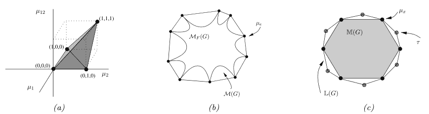

图 9.1：(a) 具有两个变量的 Ising 模型的边缘多态体示意图。(b) 集合 M_F(G) 的卡通式插图，它是边缘多态体 M(G) 的非凸内界。M_F(G) 由均匀场使用。(c) M(G) 与 L(G) 关系的卡通式插图，L(G) 趋同传播使用。集合 L(G) 总是 M(G) 的外界，且当 G 含有环时，包含关系 M(G) \subset L(G) 是严格的。两个集合都是多态体，可定义为半平面的交集（由面定义），或作为顶点的凸包。尽管图示如此，L(G) 实际上比 M(G) 具有更少的面。事实上，L(G) 具有 O(|X||V| + |X|^2|E|) 个面，其中 |X| 是每个变量的状态数，|V| 是变量数，|E| 是边数。相比之下，M(G) 具有 O(|X|^{|V|}) 个面。另一方面，尽管图示如此，L(G) 比 M(G) 具有更多的顶点，因为 L(G) 包含 M(G) 中的所有二元向量极点 \mu \in M(G)，外加额外的分数极点。出自 [WJ08] 中的图 3.6、5.4 和 4.2。经 Martin Wainwright 友好允许使用。

通过对概率分布 \mu 进行优化来求解离散赋值。此外，非退化（“软”）分布不会对应于多态体的顶点，因此也不会最大化线性函数。

看起来我们有一个易于求解的问题，因为方程 (9.12) 中的目标关于 \mu 是线性的，且约束集 M(G) 是凸的。问题是，M(G) 通常具有与节点数呈指数关系的面数量。

组合优化中的一种标准策略是放松约束。在此情况下，我们不要求概率向量 \mu 位于边缘多态体 M(G) 中，而是允许它位于更简单的凸包围集 L(G) 内，我们将在 9.1.3.1 节中定义该集合。因此，我们试图最大化原始目标的以下上界：

```
\tau^* = \arg\max_{\tau \in \mathbb{L}(G)} \theta^T \tau
```

这称为问题的线性规划松弛。如果解 \tau^* 是整数的，则它对应于精确的 MAP 估计；这将在图为树时发生。一般来说，\tau^* 将是分数的；我们可以通过舍入来导出近似 MAP 估计（有关详细信息，请参见 [Wer07]）。

##### 9.1.3.1 边缘多极体的凸外近似

考虑满足以下局部一致性约束的概率向量 \tau 集合：

```
\sum_{x_s} \tau_s(x_s) = 1
```

```
\sum_{x_t} \tau_{st}(x_s, x_t) = \tau_s(x_s)
```

第一个约束称为归一化约束，第二个约束称为边缘化约束。我们然后定义集合

```
\mathbb{L}(G) \triangleq \{ \tau \ge 0 : (\text{Equation } (9.14)) \text{ holds } \forall s \in \mathcal{V}, (\text{Equation } (9.15)) \text{ holds } \forall (s,t) \in \mathcal{E} \}
```

集合 L(G) 也是一个多态体，但它只有 O(|V| + |E|) 个约束。它是 M(G) 的凸外近似，如图 9.1(c) 所示。（相比之下，我们在 ?? 中讨论的均匀场近似是一个非凸内近似，如在 ?? 中讨论。）

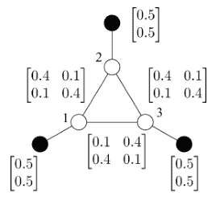

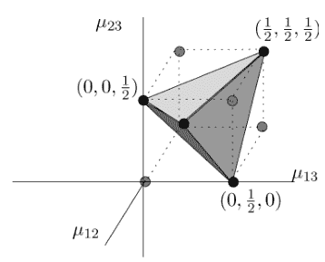

图 9.2：(a) 二元节点上的成对 UGM 示意图，以及一组不全局一致的伪边缘。(b) 边缘多态体的切片，说明了可行边缘集合，假设节点边缘被固定在 \(\mu_1 = \mu_2 = \mu_3 = 0.5\)。出自 [WJ08] 中的图 4.1。经 Martin Wainwright 友好允许使用。

我们称 \(\tau_s, \tau_{st} \in \mathbb{L}(G)\) 这些项为 **伪边缘**，因为它们可能不对应于任何有效概率分布的边缘。为此，请参见图 9.2(a)。图中显示了一组伪节点和边缘，它们满足局部一致性要求。然而，它们不全局一致。要了解原因，请注意，\(\tau_{12}\) 蕴含 \(p(X_1 = X_2) = 0.8\)，\(\tau_{23}\) 蕴含 \(p(X_2 = X_3) = 0.8\)，但 \(\tau_{13}\) 蕴含 \(p(X_1 = X_3) = 0.2\)，这是不可能的（有关正式证明，请参见 [WJ08, p81]）。实际上，图 9.2(b) 显示 \(\mathbb{L}(G)\) 包含不在 \(\mathbb{M}(G)\) 中的点。

我们声称 \(\mathbb{M}(G) \subseteq \mathbb{L}(G)\)，当且仅当 \(G\) 是树时取等号。要理解这一点，首先考虑元素 \(\boldsymbol{\mu} \in \mathbb{M}(G)\)。任何这样的向量都必须满足归一化和边缘化约束，因此 \(\mathbb{M}(G) \subseteq \mathbb{L}(G)\)。现在考虑逆命题。假设 \(T\) 是树，令 \(\boldsymbol{\mu} \in \mathbb{L}(T)\)。根据定义，这满足归一化和边缘化约束。然而，任何树都可以表示为形式

```
$$
p_\mu(\boldsymbol{x}) = \prod_{s \in V} \mu_s(x_s) \prod_{(s,t) \in E} \frac{\mu_{st}(x_s, x_t)}{\mu_s(x_s)\mu_t(x_t)}
$$ (9.17)
```

因此，满足归一化和局部一致性足以定义任何树的有效分布。因此，\(\boldsymbol{\mu} \in \mathbb{M}(T)\) 也成立。相比之下，如果图有环，则 \(\mathbb{M}(G) \neq \mathbb{L}(G)。关于这一事实的示例，请参见图 9.2(b)。此观察的重要性将在 10.1.3 节中变得清晰。

##### 9.1.3.2 算法

我们的任务是求解方程 (9.13)，这要求在简单凸多态体上最大化一个线性函数。为此，我们可以使用通用线性规划软件包。然而，这通常非常缓慢。

幸运的是，人们可以证明，一种在图中节点之间传递消息的简单算法可以用来计算 \(\boldsymbol{\tau}^*\)。特别是，可以使用 **树重权置信传播** 算法；有关详细信息，请参见 10.1.5.3 节。

##### 9.1.3.3 应用于立体深度估计

置信传播常应用于低层次计算机视觉问题（例如，请参见 [Sze10; BKR11; Pri12]）。例如，图 9.3 说明了其在给定一对单目图像（仅显示一张）时应用于 **立体深度估计** 问题。值 \(x_i\) 是像素 \(i\) 距相机的距离（量化为一定数量的值）。目标是从噪声测量中推断这些值。我们量化状态空间，而不是使用高斯模型，以避免在不连续处过度平滑，而

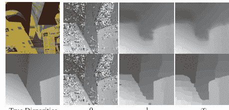

图 9.3：置信传播应用于 Middlebury 立体基准数据集 [SS02] 中的维纳斯图像的立体深度估计示例。左列：图像和真实视差。其余列：初始估计、1 次迭代后的估计以及收敛时的估计。顶行：使用连续状态空间的高斯边缘势。底行：使用量化状态空间的鲁棒边缘势。出自 [SF08] 中的图 4。经 Erik Sudderth 友好允许使用。

发生于物体边界，如图 9.3 所示。（我们也可以使用离散-连续混合状态空间，如在 [Yam+12] 中讨论，但我们将无法再应用 BP。）

毫不奇怪，人们最近已将深度学习应用于此问题。例如，[XAH19] 描述了一种可微分的消息传递版本（**??**），它速度快且可以端到端训练。然而，它需要训练用的标记数据，即像素级的真实深度值。对于这个特定问题，此类数据可以从深度相机中收集，但对于其他问题，可能需要在“无监督”MRF 上运行 BP。

#### 9.1.4 图割

在本节中，我们展示如何通过对图使用 **最大流 / 最小割** 算法来找到 MAP 状态估计，或等价地，最小能量配置。这类方法称为 **图割**，并且非常广泛地使用，尤其在计算机视觉应用中（例如，请参见 [BK04]）。

我们将首先考虑具有二元节点和受限势类别的 MRF 的情况；在这种情况下，图割将找到精确的全局最优。然后，我们考虑每个节点具有多个状态的情况；我们可以通过求解一系列二元子问题来近似求解此情况，正如我们将看到的。

##### 9.1.4.1 Ising 模型的图割

让我们首先考虑边缘能量具有以下形式的二元 MRF：

```
$$\mathcal{E}_{uv}(x_u, x_v) = \begin{cases} 0 & \text{if } x_u = x_v \\ \lambda_{uv} & \text{if } x_u \neq x_v \end{cases}$$ (9.18)
```

其中 \(\lambda_{st} \ge 0\) 是边缘成本。这鼓励相邻节点具有相同的值（因为我们试图最小化能量）。由于我们可以随意在整体能量中添加常数而不影响 MAP 状态估计，让我们重新缩放局部能量项，使得 \(\mathcal{E}_u(1) = 0\) 或 \(\mathcal{E}_u(0) = 0\)。

现在让我们构建一个图，它具有与 MRF 相同的节点集合，外加两个特殊节点：源 \(s\) 和汇 \(t\)。如果 \(\mathcal{E}_u(1) = 0\)，我们添加代价为 \(\mathcal{E}_u(0)\) 的边缘 \(x_u \to t\)。同样，如果 \(\mathcal{E}_u(0) = 0\)，我们添加代价为 \(\mathcal{E}_u(1)\) 的边缘 \(s \to x_u\)。最后，对于 MRF 中连接的每一对变量，我们添加边缘 \(x_u \to x_v\) 和 \(x_v \to x_u\)，两者的代价均为 \(\lambda_{u,v} \ge 0\)。图 9.4 说明了具有 4 个节点和以下参数的 MRF 的此构造：

```
$\mathcal{E}_1(0) = 7, \mathcal{E}_2(1) = 2, \mathcal{E}_3(1) = 1, \mathcal{E}_4(1) = 6, \lambda_{1,2} = 6, \lambda_{2,3} = 6, \lambda_{3,4} = 2, \lambda_{1,4} = 1$ (9.19)
```

构建图后，我们计算最小 \(s-t\) 割。这是将节点划分为两个集合 \(\mathcal{X}_s\) 和 \(\mathcal{X}_t\)，使得 \(s \in \mathcal{X}_s\) 且 \(t \in \mathcal{X}_t\)。然后，我们找到最小化代价总和的划分


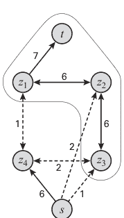

图 9.4: 对4节点 MRF 应用图割的示意图。虚线是对切分代价有贡献的边（对于双向边，我们只计算其中一个代价）。这里最小割的代价为 6。引自 [KF09] 中的图 13.5。特感谢 Daphne Koller 允许使用。

分区不同侧节点之间的边：

cost(X_s, X_t) = \sum_{x_u \in X_s, x_v \in X_t} cost(x_u, x_v) (9.20)

在图 9.4 中，我们看到最小割的代价为 6。在此图中最小化代价等价于在 MRF 中最小化能量。因此，分配给 s 的节点最优状态为 0，分配给 t 的节点最优状态为 1。在图 9.4 中，我们看到最优 MAP 估计为 (1, 1, 1, 0)。因此，我们已将 MAP 估计问题转化为存在高效求解器的标准图论问题（参见例如 [CLR90]）。

##### 9.1.4.2 具有次模势的二元 MRF 的图割

我们现在讨论如何将图割结构扩展到具有更一般势函数的二元 MRF。特别是，假设每个成对能量满足以下条件：

\mathcal{E}_{uv}(1, 1) + \mathcal{E}_{uv}(0, 0) \le \mathcal{E}_{uv}(1, 0) + \mathcal{E}_{uv}(0, 1) (9.21)

换句话说，对角能量之和小于非对角能量之和。在这种情况下，我们说这些能量是次模的（？？）。次模能量的一个例子是 \lambda_{uv} > 0 的 Ising 模型。这也称为吸引型 MRF 或关联型 MRF，因为模型“希望”相邻状态相同。

可以修改此设置下的图构建过程，然后应用图割，使得得到的估计是全局最优 [GPS89]。

##### 9.1.4.3 非二元度量 MRF 的图割

我们现在讨论如何在每个节点可以具有多个状态的 MRF 中使用图割进行近似 MAP 估计 [BVZ01]。

一种方法是使用 α 扩展。每一步，它从可用标签或状态中选择一个并将其称为 \alpha；然后它求解一个二元子问题，其中每个变量可以选择保持当前状态，或变为状态 \alpha（参见图 9.5(d) 了解示例）。

另一种方法是使用 α-β 交换。每一步，选择两个标签，称它们为 \alpha 和 \beta。如果这样做可以降低能量，当前标记为 \alpha 的所有节点可以改为 \beta（反之亦然）（参见图 9.5(c) 了解示例）。

为了最优地求解这些二元子问题，我们需要确保这些子问题的势是次模的。如果成对能量形成一个度量，则会发生这种情况。我们称这样的模型为度量 MRF。

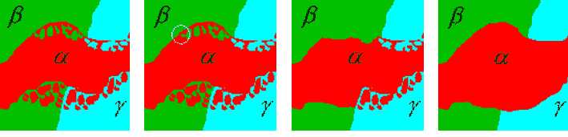

_图 9.5: (a) 具有 3 个标签的图像。(b) 标准局部移动（例如，通过迭代条件模式）只是翻转一个像素的标签。(c) α − β 交换允许当前标记为 α 的所有节点重新标记为 β，如果这会降低能量。(d) α 扩展允许当前未标记为 α 的所有节点重新标记为 α，如果这会降低能量。引自 [BVZ01] 中的图 2。特感谢 Ramin Zabih 允许使用。_

例如，假设状态具有自然顺序，这通常发生在它们是底层连续空间的离散化时。在这种情况下，我们可以定义形式为 $E(x_s, x_t) = \min(\delta, \|x_s - x_t\|)$ 的度量，或形式为 $E(x_s, x_t) = \min(\delta, (x_s - x_t)^2)$ 的半度量，其中 $\delta > 0$ 为某个常数。这种能量鼓励邻域具有相似标签，但绝不会“惩罚”它们超过 $\delta$。（这个 $\delta$ 项防止过度平滑，我们将在图 9.3 中说明。）

##### 9.1.4.4 应用于立体深度估计

图割常被应用于低级计算机视觉问题，如立体深度估计，我们已在第 9.1.3.3 节中讨论过。图 9.6 将图割（交换版本和扩展版本）与另外两个算法（模拟退火和基于归一化互相关的补丁匹配方法）在著名的 Tsukuba 测试图像上进行了比较。图割方法在此示例以及其他示例中效果最佳 [Sze+08; TF03]。它还倾向于在立体问题上超越信念传播（结果未显示），在速度和准确性方面 [Sze+08; TF03]，以及其他问题如 LIDAR 点云数据的 CRF 标注 [LMW17]。

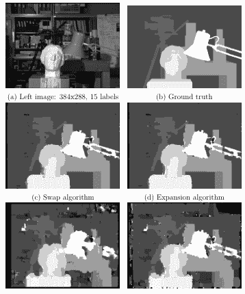

图 9.6: 在成对离散 MRF 中使用 MAP 估计进行立体深度估计的示例。(a) 左图像，大小为 384 × 288 像素，来自筑波大学。（对应的右图像类似，但未显示。）(b) 量化为 15 个电平的地面真实深度图。(c-f): 使用不同方法的 MAP 估计：(c) α − β 交换，(d) α 扩展，(e) 归一化互相关，(f) 模拟退火。引自 [BVZ01] 中的图 10。特感谢 Ramin Zabih 允许使用。

## 第 10 章

## 变分推断

### 10.1 PGM 的精确推断与近似推断

在本节中，我们将从变分角度讨论离散 PGM 的精确推断与近似推断，遵循 [WJ08]。

类似于第 9.1 节，我们将假设形式为

$$
p_\theta(\mathbf{z}|\mathbf{x}) = \frac{1}{Z} \exp \left\{ \sum_{s \in \mathcal{V}} \theta_s(z_s) + \sum_{(s,t) \in \mathcal{E}} \theta_{st}(z_s, z_t) \right\} \quad (10.1)
$$

的成对 MRF。

我们可以将其写为指数族模型，\(p(\mathbf{z}|\mathbf{x}) = \tilde{p}(\mathbf{z})/Z\)，其中 \(Z = \log p(\mathbf{x})\)，\(\tilde{p}(\mathbf{z}) = \mathcal{T}(\mathbf{z})^\top \boldsymbol{\theta}\)，\(\boldsymbol{\theta} = (\{\theta_{s,j}\}, \{\theta_{s,t,j,k}\})\) 是所有节点和边参数（规范参数），\(\mathcal{T}(\mathbf{z}) = (\{\mathbb{I}(z_s = j)\}, \{\mathbb{I}(z_s = j, z_t = k)\})\) 是所有节点和边指示函数（充分统计量）。注意：我们使用 \(s, t \in \mathcal{V}\) 索引节点，\(j, k \in \mathcal{X}\) 索引状态。

#### 10.1.1 作为 VI 的精确推断

我们知道 ELBO 是 log 边缘似然的下界：

$$
\mathcal{L}(q) = \mathbb{E}_{q(\mathbf{z})} [\log \tilde{p}(\mathbf{z})] + \mathbb{H}(q) \le \log Z \quad (10.2)
$$

设 \(\boldsymbol{\mu} = \mathbb{E}_q [\mathcal{T}(\mathbf{z})]\) 为变分分布的均值参数。那么我们可以将其改写为

$$
\mathcal{L}(\boldsymbol{\mu}) = \boldsymbol{\theta}^T \boldsymbol{\mu} + \mathbb{H}(\boldsymbol{\mu}) \le \log Z \quad (10.3)
$$

所有有效（无限制）均值参数 \(\boldsymbol{\mu}\) 的集合是与图相对应的 **边缘多极体**，\(\mathbb{M}(G)\)，如第 9.1.2 节所述。对该集合进行优化可恢复 \(q = p\)，因此

$$
\max_{\boldsymbol{\mu} \in \mathbb{M}(G)} \boldsymbol{\theta}^T \boldsymbol{\mu} + \mathbb{H}(\boldsymbol{\mu}) = \log Z \quad (10.4)
$$

方程 (10.4) 看起来易于优化：目标函数是凹的，因为它是线性函数和凹函数的和（参见图 **??** 了解熵为何是凹的）；此外，我们是在凸集 \(\mathbb{M}(G)\) 上最大化它。因此存在唯一的全局最优解。We。然而，熵通常难以计算，因为它需要对所有状态求和。我们将在下面讨论近似方法。有关我们讨论的方法的高层摘要，请参见表 10.1。

| 方法 | 定义 | 目标函数 | 优化域 | 节 |
| :--- | :--- | :--- | :--- | :--- |
| 精确 | $\max_{\boldsymbol{\mu} \in \mathbb{M}(G)} \boldsymbol{\theta}^{*T} \boldsymbol{\mu} + \mathbb{H}(\boldsymbol{\mu}) = \log Z$ | 凹 | 边缘多极体，凸 | 第 10.1.1 节 |
| 平均场 | $\max_{\boldsymbol{\mu} \in \mathbb{M}_F(G)} \boldsymbol{\theta}^T \boldsymbol{\mu} + \mathbb{H}_{MF}(\boldsymbol{\mu}) \le \log Z$ | 凹 | 非凸内近似 | 第 10.1.2 节 |
| 有环信念传播 | $\max_{\boldsymbol{\tau} \in \mathbb{L}(G)} \boldsymbol{\theta}^T \boldsymbol{\tau} + \mathbb{H}_{Bethe}(\boldsymbol{\tau}) \approx \log Z$ | 非凹 | 凸外近似 | 第 10.1.3 节 |
| TRBP | $\max_{\boldsymbol{\tau} \in \mathbb{L}(G)} \boldsymbol{\theta}^T \boldsymbol{\tau} + \mathbb{H}_{TRBP}(\boldsymbol{\tau}) \ge \log Z$ | 凹 | 凸外近似 | 第 10.1.5 节 |

表 10.1: 图模型某些变分推断方法的摘要。TRBP 是树重加权信念传播。

#### 10.1.2 平均场 VI

熵的平均场近似简单为

$$\mathbb{H}_{MF}(\boldsymbol{\mu}) = \sum_s \mathbb{H}(\boldsymbol{\mu}_s)$$ (10.5)

这源于分解假设。因此平均场目标为

$$\mathcal{L}_{MF}(\boldsymbol{\mu}) = \boldsymbol{\theta}^T \boldsymbol{\mu} + \mathbb{H}_{MF}(\boldsymbol{\mu}) \le \log Z$$ (10.6)

这是对 $\log Z$ 的凹下界。我们将在更简单但非凸的内近似 \(\mathbb{M}(G)\) 上最大化它，正如我们现在所示。

首先，令 $F$ 为原始图 $G$ 的边子图，令 $\mathcal{I}(F) \subseteq \mathcal{I}$ 为与 $F$ 的团相关的充分统计量子集。令 $\Omega$ 为完整模型的规范参数集，并按如下定义子模型的规范参数空间：

$$\Omega(F) \triangleq \{ \boldsymbol{\theta} \in \Omega : \boldsymbol{\theta}_\alpha = 0 \, \forall \alpha \in \mathcal{I} \setminus \mathcal{I}(F) \}$$ (10.7)

换句话说，我们要求与我们所选类之外的充分统计量 $\alpha$ 相关的自然参数为零。例如，在完全分解近似 $F_0$ 的情况下，我们从图中删除所有边，给出

$$\Omega(F_0) \triangleq \{ \boldsymbol{\theta} \in \Omega : \boldsymbol{\theta}_{st} = 0 \, \forall (s,t) \in E \}$$ (10.8)

在结构化平均场（第 ?? 节）的情况下，我们将不在我们可处理子图中的边的 $\theta_{st} = 0$ 设置为零。

接下来，我们按如下定义受限模型的均值参数空间：

$$\mathbb{M}_F(G) \triangleq \{ \boldsymbol{\mu} \in \mathbb{R}^d : \boldsymbol{\mu} = \mathbb{E}_\boldsymbol{\theta} [\mathcal{T}(\boldsymbol{z})] \text{ for some } \boldsymbol{\theta} \in \Omega(F) \}$$ (10.9)

这被称为边缘多极体的 **内近似**，因为 \(\mathbb{M}_F(G) \subseteq \mathbb{M}(G)\)。参见图 9.1(b) 草图。注意 \(\mathbb{M}_F(G)\) 是非凸多极体，这会导致多个局部最优。

因此平均场问题变为

$$\max_{\boldsymbol{\mu} \in \mathbb{M}_F(G)} \boldsymbol{\theta}^T \boldsymbol{\mu} + \mathbb{H}_{MF}(\boldsymbol{\mu})$$ (10.10)

这要求在非凸集上最大化凹目标函数。通常使用坐标上升进行优化，因为在每个节点的边缘分布上优化标量凹函数很容易。

#### 10.1.3 作为 VI 的有环信念传播

回顾第 10.1.1 节，精确推断可以表述为求解以下优化问题：$\max_{\boldsymbol{\mu} \in \mathbb{M}(G)} \boldsymbol{\theta}^T \boldsymbol{\mu} + \mathbb{H}(\boldsymbol{\mu})$，其中 \(\mathbb{M}(G)\) 是与图相对应的边缘多极体（详情见第 9.1.2 节）。由于该集合具有指数级多的面，在其上优化是不可处理的。

在第 10.1.2 节中，我们讨论了平均场近似，它使用非凸内近似 \(\mathbb{M}_F(G)\)，通过从图形模型中删除某些边获得，从而强制后验分解。我们还通过使用每个边缘的熵来近似熵。


在本节中，我们将考虑基于伪边缘的凸外近似 $\mathbb{L}(G)$，如第 9.1.3.1 节所示。我们还需要近似熵（在执行 MAP 估计时不需要，如第 9.1.3 节讨论）。我们在第 10.1.3.1 节讨论这种熵近似，然后展示如何利用它来近似 log $Z$。最后我们展示，环传播试图优化这个近似。

##### 10.1.3.1 Bethe 自由能

根据方程 (9.17)，我们知道，树结构图形模型上的联合分布可以由以下公式精确表示：

$$p_{\boldsymbol{\mu}}(\boldsymbol{x}) = \prod_{s \in V} \mu_s(x_s) \prod_{(s,t) \in E} \frac{\mu_{st}(x_s, x_t)}{\mu_s(x_s)\mu_t(x_t)}$$ (10.11)

这通过构造满足外近似的归一化和成对边缘化约束。

根据方程 10.11，我们可以将任何树结构分布 $\boldsymbol{\mu} \in \mathbb{M}(T)$ 的精确熵写成如下形式：

$$\mathbb{H}(\boldsymbol{\mu}) = \sum_{s \in V} H_s(\mu_s) - \sum_{(s,t) \in E} I_{st}(\mu_{st})$$ (10.12)

$$H_s(\mu_s) = - \sum_{x_s \in \mathcal{X}_s} \mu_s(x_s) \log \mu_s(x_s)$$ (10.13)

$$I_{st}(\mu_{st}) = \sum_{(x_s, x_t) \in \mathcal{X}_s \times \mathcal{X}_t} \mu_{st}(x_s, x_t) \log \frac{\mu_{st}(x_s, x_t)}{\mu_s(x_s)\mu_t(x_t)}$$ (10.14)

请注意，我们可以将互信息项改写为 $I_{st}(\mu_{st}) = H_s(\mu_s) + H_t(\mu_t) - H_{st}(\mu_{st})$ 的形式，因此我们得到以下等价但等价的替代表达式：

$$\mathbb{H}(\boldsymbol{\mu}) = - \sum_{s \in V} (d_s - 1) H_s(\mu_s) + \sum_{(s,t) \in E} H_{st}(\mu_{st})$$ (10.15)

其中 $d_s$ 是节点 $s$ 的度（邻居数量）。

Bethe$^1$ 熵近似只是在没有树的情况下使用方程 10.12：

$$\mathbb{H}_{\text{Bethe}}(\boldsymbol{\tau}) = \sum_{s \in V} H_s(\tau_s) - \sum_{(s,t) \in E} I_{st}(\tau_{st})$$ (10.16)

我们将 Bethe 自由能定义为期望能量减去近似熵：

$$\mathcal{F}_{\text{Bethe}}(\boldsymbol{\tau}) \triangleq - [\boldsymbol{\theta}^T \boldsymbol{\tau} + \mathbb{H}_{\text{Bethe}}(\boldsymbol{\tau})] \approx - \log Z$$ (10.17)

因此我们的最终目标变为

$$\max_{\boldsymbol{\tau} \in \mathbb{L}(G)} \boldsymbol{\theta}^T \boldsymbol{\tau} + \mathbb{H}_{\text{Bethe}}(\boldsymbol{\tau})$$ (10.18)

我们称其为 Bethe 变分问题或 BVP。我们正在优化的空间是一个凸集，但目标本身不是凹的（因为 $\mathbb{H}_{\text{Bethe}}$ 不是凹的）。因此可能存在多个局部最优解。另外，熵近似不是真实熵的上界或下界。因此 BVP 得到的值只是 $\log Z(\boldsymbol{\theta})$ 的近似。然而，在树的情况下，近似是精确的。另外，在具有吸引势的模型中，结果值被证明是上界 [SWW08]。在第 10.1.5 节中，我们讨论如何修改算法，使其对于任何模型始终最小化上界。

##### 10.1.3.2 LBP 消息是拉格朗日乘子

在本小节中，我们将展示 LBP 算法的任何不动点都定义了上述受约束目标的驻点。让我们将归一化约束定义为 $C_{ss}(\boldsymbol{\tau}) \triangleq -1 + \sum_{x_s} \tau_s(x_s)$，将边缘化约束定义为 $C_{ts}(x_s; \boldsymbol{\tau}) \triangleq \tau_s(x_s) - \sum_{x_t} \tau_{ts}(x_t, x_s)$，对每条边 \(t \to s\)。我们现在可以将拉格朗日函数写为

$$
\mathcal{L}(\boldsymbol{\tau}, \boldsymbol{\lambda}; \boldsymbol{\theta}) \triangleq \boldsymbol{\theta}^T \boldsymbol{\tau} + \mathbb{H}_{\text{Bethe}}(\boldsymbol{\tau}) + \sum_s \lambda_{ss} C_{ss}(\boldsymbol{\tau}) + \sum_{s,t} \left[ \sum_{x_s} \lambda_{ts}(x_s) C_{ts}(x_s; \boldsymbol{\tau}) + \sum_{x_t} \lambda_{st}(x_t) C_{st}(x_t; \boldsymbol{\tau}) \right]
$$

（约束 \(\boldsymbol{\tau} \ge 0\) 并未显式强制执行，但可以证明它在最优解处成立，因为 \(\boldsymbol{\theta} > 0\)。）一些简单的代数运算表明，\(\nabla_{\boldsymbol{\tau}} \mathcal{L} = \mathbf{0}$ 产生

$$
\log \tau_s(x_s) = \lambda_{ss} + \theta_s(x_s) + \sum_{t \in \text{nbr}(s)} \lambda_{ts}(x_s)
$$

$$
\log \frac{\tau_{st}(x_s, x_t)}{\tilde{\tau}_s(x_s)\tilde{\tau}_t(x_t)} = \theta_{st}(x_s, x_t) - \lambda_{ts}(x_s) - \lambda_{st}(x_t)
$$

其中我们定义了 \(\tilde{\tau}_s(x_s) \triangleq \sum_{x_t} \tau(x_s, x_t)$。利用边缘化约束意味着 \(\tilde{\tau}_s(x_s) = \tau_s(x_s)$ 这一事实，我们得到

$$
\log \tau_{st}(x_s, x_t) = \lambda_{ss} + \lambda_{tt} + \theta_{st}(x_s, x_t) + \theta_s(x_s) + \theta_t(x_t) + \sum_{u \in \text{nbr}(s) \setminus t} \lambda_{us}(x_s) + \sum_{u \in \text{nbr}(t) \setminus s} \lambda_{ut}(x_t)
$$

为了建立与消息传递的联系，定义 \(m_{t \to s}(x_s) = \exp(\lambda_{ts}(x_s))$。使用此表示法，我们可以对上述方程进行改写（对两边取指数后）如下：

$$
\tau_s(x_s) \propto \exp(\theta_s(x_s)) \prod_{t \in \text{nbr}(s)} m_{t \to s}(x_s)
$$

$$
\tau_{st}(x_s, x_t) \propto \exp \left( \theta_{st}(x_s, x_t) + \theta_s(x_s) + \theta_t(x_t) \right) \times \prod_{u \in \text{nbr}(s) \setminus t} m_{u \to s}(x_s) \prod_{u \in \text{nbr}(t) \setminus s} m_{u \to t}(x_t)
$$

其中 $\lambda$ 项和无关常数已被吸收进比例常数。我们可以看到，这等同于 LBP 中节点和边缘边缘分布的通常表达式。

为了推导消息在其他消息（而非 $\lambda_{ts}$）方面的方程，我们强制执行边缘化条件 $\sum_{x_t} \tau_{ts}(x_s, x_t) = \tau_s(x_s)$。然后可以证明

$$
m_{t \to s}(x_s) \propto \sum_{x_t} \left[ \exp \left\{ \theta_{st}(x_s, x_t) + \theta_t(x_t) \right\} \prod_{u \in \text{nbr}(t) \setminus s} m_{u \to t}(x_t) \right]
$$

我们可以看到，这等同于 LBP 中消息的通常表达式。

##### 10.1.3.3 Kikuchi 自由能

我们已经展示了 LBP 最小化 Bethe 自由能。在本节中，我们展示广义 BP (??) 最小化 Kikuchi 自由能；我们将其定义如下，但关键思想是它是对 $\log Z$ 的更紧近似。更详细地说，定义 $\mathbb{L}_t(G)$ 为所有伪边缘的集合，使得在最大超边大小为 $t+1$ 的超图上满足归一化和边缘化约束。例如，在图 **??** 中，我们强制执行如下形式的约束

$$\sum_{x_1, x_2} \tau_{1245}(x_1, x_2, x_4, x_5) = \tau_{45}(x_4, x_5), \sum_{x_6} \tau_{56}(x_5, x_6) = \tau_5(x_5), \dots$$ (10.26)

此外，我们将熵近似如下：

$$\mathbb{H}_{\text{Kikuchi}}(\boldsymbol{\tau}) \triangleq \sum_{g \in E} c(g) H_g(\tau_g)$$ (10.27)

其中 $H_g(\tau_g)$ 是集合 $g$ 中顶点上的联合（伪）分布的熵，$c(g)$ 称为集合 $g$ 的**超计数数**。这些与集合论中的**莫比乌斯数**相关。我们不给出精确定义，只是给出一个简单示例。对于图 **??** 中的图，我们有

$$\mathbb{H}_{\text{Kikuchi}}(\boldsymbol{\tau}) = -[H_{1245} + H_{2356} + H_{4578} + H_{5689}] - [H_{25} + H_{45} + H_{56} + H_{58}] + H_5$$ (10.28)

将这两个近似结合起来，我们可以定义**Kikuchi 自由能**$^2$ 如下：

$$\mathcal{F}_{\text{Kikuchi}}(\boldsymbol{\tau}) \triangleq -[\boldsymbol{\theta}^T \boldsymbol{\tau} + \mathbb{H}_{\text{Kikuchi}}(\boldsymbol{\tau})] \approx -\log Z$$ (10.29)

我们的变分问题变为

$$\max_{\tau \in \mathbb{L}(G)} \boldsymbol{\theta}^T \boldsymbol{\tau} + \mathbb{H}_{\text{Kikuchi}}(\boldsymbol{\tau})$$ (10.30)

与 Bethe 自由能一样，这不是凹函数。寻找该目标局部最优解有多种可能算法，包括广义信念传播。有关详细信息，参见例如 [WJ08, Sec 4.2] 或 [KF09, Sec 11.3.2]。

#### 10.1.4 凸信念传播

平均场能量函数是凹的，但它在边缘多态体的非凸内近似上最大化。Bethe 和 Kikuchi 能量函数不是凹的，但它们在边缘多态体的凸外近似上最大化。因此，对于 MF 和 LBP，优化问题都有多个最优解，因此方法对初始条件敏感。鉴于精确公式方程 (10.4) 是在凸集上最大化的凹目标，自然会想到提出类似形式的近似，而没有局部最优解。

**凸信念传播**涉及使用一组可处理的子模型，$\mathcal{F}$，例如树或平面图。对于每个模型 $F \subset G$，熵更高，$\mathbb{H}(\boldsymbol{\mu}(F)) \ge \mathbb{H}(\boldsymbol{\mu}(G))$，因为 $F$ 的约束更少。因此，任何此类子图的凸组合的熵也会更高：

$$\mathbb{H}(\boldsymbol{\mu}(G)) \le \sum_{F \in \mathcal{F}} \rho(F) \mathbb{H}(\boldsymbol{\mu}(F)) \triangleq \mathbb{H}(\boldsymbol{\mu}, \rho)$$ (10.31)

其中 $\rho(F) \ge 0$ 且 $\sum_F \rho(F) = 1$。此外，$\mathbb{H}(\boldsymbol{\mu}, \rho)$ 是 $\boldsymbol{\mu}$ 的凹函数。

在定义了熵的上界后，我们现在考虑平均参数边缘多态体的凸外界。我们希望能够计算该集合中任何向量 $\boldsymbol{\tau}$ 的熵，因此我们将其限制为：$\boldsymbol{\tau}$ 投影到子图 $G$ 上后，必须落在 $\mathbb{M}$ 投影到 $F$ 上：

$$\mathbb{L}(G; \mathcal{F}) \triangleq \{ \boldsymbol{\tau} \in \mathbb{R}^d : \boldsymbol{\tau}(F) \in \mathbb{M}(F) \, \forall F \in \mathcal{F} \}$$ (10.32)

这是一个凸集，因为每个 $\mathbb{M}(F)$ 都是凸集的投影。因此我们定义问题为

$$\max_{\boldsymbol{\tau} \in \mathbb{L}(G; \mathcal{F})} \boldsymbol{\tau}^T \boldsymbol{\theta} + \mathbb{H}(\boldsymbol{\tau}, \rho)$$ (10.33)

$^2$Ryoichi Kikuchi 是日本物理学家。


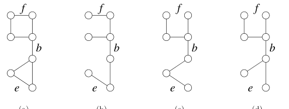

图 10.1: (a) 一个图。(b-d) 其部分生成树。引自 [WJ08] 中的图 7.1。经 Martin Wainwright 友好允许使用。

这是一个在凸集上最大化的凹目标函数，因此具有唯一最优解。此外，结果始终是 log Z 的上界，因为熵是一个上界，并且我们优化的集合比边缘多面体更大。

还需要指定可处理子模型集合 F 和分布 ρ。我们将在下文讨论一些选项。

#### 10.1.5 树加权置信传播

本节讨论树加权 BP [WJW05b; Kol06]，这是一种使用生成树作为可处理模型集合 F 的凸 BP 形式，如下文所述。

##### 10.1.5.1 生成树多面体

还需要指定可处理子模型集合 F 和分布 ρ。我们将考虑 F 为图中所有生成树的情况。对于任意给定的树，熵由方程 10.12 给出。要计算通过对所有树取平均得到的上界，请注意，单个节点的项 \(\sum_F \rho(F)H(\mu(F)_s)\) 将仅为 H_s，因为节点 s 出现在每棵树中，且 \(\sum_F \rho(F) = 1\)。但是，互信息项 I_st 接受权重 \(\rho_{st} = E_\rho [ I((s,t) \in E(T))]\)，称为**边出现概率**。因此，我们有以下关于熵的上界：

```
\mathbb{H}(\boldsymbol{\mu}) \le \sum_{s \in V} H_s(\mu_s) - \sum_{(s,t) \in E} \rho_{st} I_{st}(\mu_{st}) \triangleq \mathbb{H}_{\text{TRBP}}(\boldsymbol{\mu}) \quad (10.34)
```

这称为**树加权 BP** 近似 [WJW05b; Kol06]。这与熵的 Bethe 近似类似，除了关键的 \(\rho_{st}\) 权重之外。只要所有边 (s,t) 的 \(\rho_{st} > 0$，这就给出了精确熵的有效凹上界。

边出现概率存在于称为**生成树多面体**的空间中。这是因为它们受限于源自树分布。图 10.1 给出了一个图及其三棵生成树的示例。假设每棵树在 \(\rho\) 下具有相同的权重。边 f 出现在 3 棵树中的 1 棵，因此 \(\rho_f = 1/3\)。边 e 出现在 3 棵树中的 2 棵，因此 \(\rho_e = 2/3\)。边 b 出现在所有树中，因此 \(\rho_b = 1\)。以此类推。理想情况下，我们可以找到一个分布 \(\rho\)，或等价地，生成树多面体中的边概率，使上述上界尽可能紧。一种实现此目的的算法在 [WJW05a] 中描述。一种更简单的方法是对所有单独边使用权重 \(\rho_e = 1/E\)。

关于我们正在优化的集合呢？我们要求每棵树 T 的 \(\boldsymbol{\mu}(T) \in \mathbb{M}(T)\)，这意味着强制执行归一化和局部一致性。由于我们需要对每棵树这样做，我们在每条边上强制执行归一化和局部一致性。因此，我们实际上是在伪边缘多面体 \(\mathbb{L}(G)\) 中优化。因此，我们的最终优化问题如下：

```
\max_{\boldsymbol{\tau} \in \mathbb{L}(G)} \boldsymbol{\tau}^T \boldsymbol{\theta} + \mathbb{H}_{\text{TRBP}}(\boldsymbol{\tau}) \ge \log Z \quad (10.35)
```

##### 10.1.5.2 消息传递实现

最小化方程 (10.35) 的最简单方法是一种称为**树加权置信传播**的置信传播变体。从 \(t\) 到 \(s\) 的消息现在是来自其他邻居 \(v\) 到 \(t\) 的所有消息的函数，与以前一样，但现在它也是从 \(s\) 到 \(t\) 发送的消息的函数。具体来说，我们有以下 [WJ08, Sec 7.2.1]:

\(m_{t \to s}(x_s) \propto \sum_{x_t} \exp \left( \frac{1}{\rho_{st}} \theta_{st}(x_s, x_t) + \theta_t(x_t) \right) \frac{\prod_{v \in \text{nbr}(t) \setminus s} [m_{v \to t}(x_t)]^{\rho_{vt}}}{[m_{s \to t}(x_t)]^{1 - \rho_{st}}}\)

在收敛时，节点和边伪边缘由以下给出：

\(\tau_s(x_s) \propto \exp(\theta_s(x_s)) \prod_{v \in \text{nbr}(s)} [m_{v \to s}(x_s)]^{\rho_{vs}}\)

\(\tau_{st}(x_s, x_t) \propto \varphi_{st}(x_s, x_t) \frac{\prod_{v \in \text{nbr}(s) \setminus t} [m_{v \to s}(x_s)]^{\rho_{vs}}}{[m_{t \to s}(x_s)]^{1 - \rho_{st}}} \frac{\prod_{v \in \text{nbr}(t) \setminus s} [m_{v \to t}(x_t)]^{\rho_{vt}}}{[m_{s \to t}(x_t)]^{1 - \rho_{st}}}\)

\(\varphi_{st}(x_s, x_t) \triangleq \exp \left( \frac{1}{\rho_{st}} \theta_{st}(x_s, x_t) + \theta_s(x_s) + \theta_t(x_t) \right)\)

如果所有边 \((s, t) \in E\) 的 \(\rho_{st} = 1\)，算法将退化为标准 LBP 算法。但是，条件 \(\rho_{st} = 1\) 意味着每条边以概率 1 出现在每棵生成树中，这仅在原始图为树时才可能。因此，该方法仅在树上等价于标准 LBP，而此时该方法当然是精确的。

一般来说，这种消息传递方案不能保证收敛到唯一的全局最优解。可以设计保证收敛的双循环方法 [HS08]，但在实践中，如在方程 ?? 中所示，使用阻尼更新通常足以确保收敛。

##### 10.1.5.3 最大-积版本

我们可以修改 TRBP 以求解 MAP 估计问题（与估计后验边缘相反），方法是在方程 (10.36) 中将求和替换为乘积（详情见 [WJ08, Sec 8.4.3]）。在适当的调度下，这保证收敛到 9.1.3 节讨论的 LP 松弛，该调度称为**顺序树加权消息传递** [Kol06]。

#### 10.1.6 凸 BP 的其他可处理版本

除了树之外，还可以使用其他类型的可处理模型的凸组合来对熵进行上界。一个例子是**平面 MRF**（即图中没有交叉边的图），具有二值节点且没有外场，即模型形式为 \(p(\mathbf{x}) \propto \exp(\sum_{(s,t) \in E} \theta_{st} x_s x_t)\)。结果表明，可以在此模型中进行精确推断。因此，可以使用此类图的凸组合，有时可以产生比 TRBP 更准确的结果，尽管计算成本更高。详情见 [GJ07]，以及用于平面 Ising 模型的相关 *精确* 方法 [Sch10b]。

## 第 11 章

## 蒙特卡洛推断

## 第 12 章

## 马尔可夫链蒙特卡洛 (MCMC) 推断

## 第 13 章

## 序列蒙特卡洛 (SMC) 推断

# 第三部分

# 预测

## 第 14 章

## 判别模型：概述

## 第 15 章

## 广义线性模型

### 15.1 逻辑回归的变分推断

本节讨论了一种基于似然局部上界的逻辑回归模型贝叶斯推断的变分方法。我们将使用高斯先验 \( p(w) = \mathcal{N}(w|\mu_0, V_0) \)。我们将创建似然的“高斯类”下界，该下界将与此先验共轭。然后我们迭代改进这个下界。

#### 15.1.1 二进制逻辑回归

本节讨论二进制逻辑回归的变分推断。我们的介绍遵循 [Bis06, Sec 10.6]。

让我们首先将单个观测的似然重写如下：

```
\(\begin{aligned} p(y_n|x_n, w) &= \sigma(\eta_n)^{y_n}(1 - \sigma(\eta_n))^{1-y_n} \tag{15.1} \\ &= \left( \frac{1}{1+e^{-\eta_n}} \right)^{y_n} \left( 1 - \frac{1}{1+e^{-\eta_n}} \right)^{1-y_n} \tag{15.2} \\ &= e^{-\eta_n y_n} \frac{e^{-\eta_n}}{1 + e^{-\eta_n}} = e^{-\eta_n y_n} \sigma(-\eta_n) \tag{15.3} \end{aligned}\)
```

其中 \(\eta_n = w^T x_n\) 为 logits。这与高斯先验不是共轭的。因此，我们将使用 [JJ96; JJ00] 提议的以下 sigmoid 函数的“高斯类”变分下界：

```
\(\sigma(\eta_n) \ge \sigma(\psi_n) \exp [(\eta_n - \psi_n)/2 - \lambda(\psi_n)(\eta_n^2 - \psi_n^2)] \tag{15.4}\)
```

其中 \(\psi_n\) 是数据点 \(n\) 的变分参数，并且

```
\(\lambda(\psi) \triangleq \frac{1}{4\psi} \tanh(\psi/2) = \frac{1}{2\psi} \left[ \sigma(\psi) - \frac{1}{2} \right] \tag{15.5}\)
```

我们将其称为 JJ 界，以其发明者 Jaakkola 和 Jordan 命名。有关图示，请参见图 15.1(a)；有关推导，请参见 6.5.4.2 节。

使用此界，我们可以写成

```
\(p(y_n|x_n, w) = e^{-\eta_n y_n} \sigma(-\eta_n) \ge e^{-\eta_n y_n} \sigma(\psi_n) \exp [(-\eta_n + \psi_n)/2 - \lambda(\psi_n)(\eta_n^2 - \psi_n^2)] \tag{15.6}\)
```

我们现在可以对 log 联合分布求下界如下：

```
\(\begin{aligned} \log p(y|X, w) + \log p(w) \ge {} &-\frac{1}{2}(w - \mu_0)^T V_0^{-1}(w - \mu_0) \tag{15.7} \\ &+ \sum_{n=1}^N [\eta_n(y_n - 1/2) - \lambda(\psi_n)w^T(x_n x_n^T)w] \tag{15.8} \end{aligned}\)
```


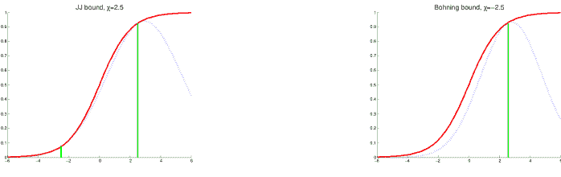

图 15.1：Sigmoid（logistic）函数的二次下界。以实线红色绘制 $\sigma(x)$ 关于 $x$ 的图。以虚线蓝色绘制 $\psi = 2.5$ 时下界 $L(x, \psi)$ 关于 $x$ 的图。(a) JJ 界。在 $\psi = \pm 2.5$ 处紧。(b) Bohning 界（第 15.1.2.2 节）。在 $\psi = 2.5$ 处紧。由 sigmoid_lower_bounds.py 生成。

Since this is a quadratic function of $\boldsymbol{w}$, we can derive a Gaussian posterior approximation as follows:

由于这是关于 $\boldsymbol{w}$ 的二次函数，我们可以按如下方式推导高斯后验近似：

$q(\boldsymbol{w}|\boldsymbol{\psi}) = \mathcal{N}(\boldsymbol{w}|\boldsymbol{\mu}_N, \mathbf{V}_N) \tag{15.9}$
$\boldsymbol{\mu}_N = \mathbf{V}_N \left( \mathbf{V}_0^{-1} \boldsymbol{\mu}_0 + \sum_{n=1}^N (y_n - 1/2) \mathbf{x}_n \right) \tag{15.10}$
$\mathbf{V}_N^{-1} = \mathbf{V}_0^{-1} + 2 \sum_{n=1}^N \lambda(\psi_n)\mathbf{x}_n \mathbf{x}_n^T \tag{15.11}$

This is more flexible than a Laplace approximation, since the variational parameters $\boldsymbol{\psi}$ can be used to optimize the curvature of the posterior covariance. To find the optimal $\boldsymbol{\psi}$, we can maximize the ELBO, which is given by

这比 Laplace 近似更灵活，因为变分参数 $\boldsymbol{\psi}$ 可用于优化后验协方差的曲率。为找到最优 $\boldsymbol{\psi}$，我们可以最大化 ELBO，其由以下给出

$\log p(\boldsymbol{y}|\mathbf{X}) = \log \int p(\boldsymbol{y}|\mathbf{X}, \boldsymbol{w}) p(\boldsymbol{w}) d\boldsymbol{w} \ge \log \int h(\boldsymbol{w}, \boldsymbol{\psi}) p(\boldsymbol{w}) d\boldsymbol{w} = \mathbb{L}(\boldsymbol{\psi}) \tag{15.12}$

where

其中

$h(\boldsymbol{w}, \boldsymbol{\psi}) = \prod_{n=1}^N \sigma(\psi_n) \exp [\eta_n y_n - (\eta_n + \psi_n)/2 - \lambda(\psi_n)(\eta_n^2 - \psi_n^2)] \tag{15.13}$

We can evaluate the lower bound analytically to get

我们可以解析地计算下界以得到

$\mathbb{L}(\boldsymbol{\psi}) = \frac{1}{2} \log \frac{|\mathbf{V}_N|}{|\mathbf{V}_0|} + \frac{1}{2} \boldsymbol{\mu}_N^T \mathbf{V}_N^{-1} \boldsymbol{\mu}_N - \frac{1}{2} \boldsymbol{\mu}_0^T \mathbf{V}_0^{-1} \boldsymbol{\mu}_0 + \sum_{n=1}^N \left[ \log \sigma(\psi_n) - \frac{1}{2} \psi_n + \lambda(\psi_n)\psi_n^2 \right] \tag{15.14}$

If we solve for $\nabla_\psi \mathbb{L}(\boldsymbol{\psi}) = \mathbf{0}$, we get the following iterative update equation for each variational parameter:

若求解 $\nabla_\psi \mathbb{L}(\boldsymbol{\psi}) = \mathbf{0}$，则可得到每个变分参数的以下迭代更新方程：

$(\psi_n^{\text{new}})^2 = \mathbf{x}_n \mathbb{E} [\boldsymbol{w} \boldsymbol{w}^T] \mathbf{x}_n = \mathbf{x}_n (\mathbf{V}_N + \boldsymbol{\mu}_N \boldsymbol{\mu}_N^T) \mathbf{x}_n \tag{15.15}$

Once we have estimated $\psi_n$, we can plug it into the above Gaussian approximation $q(\boldsymbol{w}|\boldsymbol{\psi})$.

一旦我们估计了 $\psi_n$，就可将其代入上述高斯近似 $q(\boldsymbol{w}|\boldsymbol{\psi})$。

#### 15.1.2 多项逻辑回归

#### 15.1.2 多项逻辑回归

In this section we discuss how to approximate the posterior $p(\boldsymbol{w}|\mathcal{D})$ for multinomial logistic regression using variational inference, extending the approach of Section 15.1 to the multi-class case. The key idea is to create a “Gaussian-like” lower bound on the multi-class logistic regression likelihood due to [Boh92]. We can then compute the variational posterior in closed form. This will let us deterministically optimize the ELBO.

本节将讨论如何使用变分推断来近似多项逻辑回归的后验 $p(\boldsymbol{w}|\mathcal{D})$，将第 15.1 节的方法扩展到多类情况。关键思想是基于 [Boh92] 为多类逻辑回归似然构建一个“类高斯”的下界。随后我们可以以封闭形式计算变分后验。这将使我们能够确定性地优化 ELBO。

Let $\boldsymbol{y}_i \in \{0, 1\}^C$ be a one-hot label vector, and define the logits for example $i$ to be

令 $\boldsymbol{y}_i \in \{0, 1\}^C$ 为一个 one-hot 标签向量，并定义样本 $i$ 的 logits 为

$\boldsymbol{\eta}_i = [\boldsymbol{x}_i^T \boldsymbol{w}_1, \dots, \boldsymbol{x}_i^T \boldsymbol{w}_C] \tag{15.16}$

If we define \(\mathbf{X}_i = \mathbf{I} \otimes \mathbf{x}_i\), where \(\otimes\) is the kronecker product, and \(\mathbf{I}\) is \(C \times C\) identity matrix, then we can write the logits as \(\boldsymbol{\eta}_i = \mathbf{X}_i\mathbf{w}\). (For example, if \(C = 2\) and \(\mathbf{x}_i = [1, 2, 3]\), we have \(\mathbf{X}_i = [1, 2, 3, 0, 0, 0; 0, 0, 0, 1, 2, 3]\).) Then the likelihood is given by

若定义 \(\mathbf{X}_i = \mathbf{I} \otimes \mathbf{x}_i$，其中 \(\otimes\) 为 Kronecker 积，\(\mathbf{I}\) 为 \(C \times C\) 单位矩阵，则可将 logits 写为 \(\boldsymbol{\eta}_i = \mathbf{X}_i\mathbf{w}$。（例如，若 \(C = 2$ 且 \(\mathbf{x}_i = [1, 2, 3]$，则 \(\mathbf{X}_i = [1, 2, 3, 0, 0, 0; 0, 0, 0, 1, 2, 3]$。）似然如下给出

\(p(\mathbf{y}|\mathbf{X}, \mathbf{w}) = \prod_{i=1}^N \exp[\mathbf{y}_i^\mathsf{T}\boldsymbol{\eta}_i - \text{lse}(\boldsymbol{\eta}_i)]\) (15.17)

where lse() is the log-sum-exp function

其中 lse() 为 log-sum-exp 函数

\(\text{lse}(\boldsymbol{\eta}_i) \triangleq \log \left( \sum_{c=1}^C \exp(\eta_{ic}) \right)\) (15.18)

For identifiability, we can set \(\mathbf{w}_C = \mathbf{0}$, so

为保证可识别性，我们可设置 \(\mathbf{w}_C = \mathbf{0}$，因此

\(\text{lse}(\boldsymbol{\eta}_i) = \log \left( 1 + \sum_{m=1}^M \exp(\eta_{im}) \right)\) (15.19)

where \(M = C - 1$. (We subtract 1 so that in the binary case, \(M = 1$.)

其中 \(M = C - 1$。（我们减去 1，使得在二分类情况下 \(M = 1$。）

##### 15.1.2.1 Bohning's quadratic bound to the log-sum-exp function

##### 15.1.2.1 Bohning 对 log-sum-exp 函数的二次界

The above likelihood is not conjugate to the Gaussian prior. However, we can now convert it to a quadratic form. Consider a Taylor series expansion of the log-sum-exp function around \(\boldsymbol{\psi}_i \in \mathbb{R}^M$:

上述似然与高斯先验非共轭。不过，我们现在可以将其转换为二次形式。考虑 log-sum-exp 函数在 \(\boldsymbol{\psi}_i \in \mathbb{R}^M$ 处的泰勒级数展开：

\(\text{lse}(\boldsymbol{\eta}_i) = \text{lse}(\boldsymbol{\psi}_i) + (\boldsymbol{\eta}_i - \boldsymbol{\psi}_i)^\mathsf{T}\mathbf{g}(\boldsymbol{\psi}_i) + \frac{1}{2}(\boldsymbol{\eta}_i - \boldsymbol{\psi}_i)^\mathsf{T}\mathbf{H}(\boldsymbol{\psi}_i)(\boldsymbol{\eta}_i - \boldsymbol{\psi}_i)\) (15.20)
\(\mathbf{g}(\boldsymbol{\psi}_i) = \exp[\boldsymbol{\psi}_i - \text{lse}(\boldsymbol{\psi}_i)] = \mathcal{S}(\boldsymbol{\psi}_i)\) (15.21)
\(\mathbf{H}(\boldsymbol{\psi}_i) = \text{diag}(\mathbf{g}(\boldsymbol{\psi}_i)) - \mathbf{g}(\boldsymbol{\psi}_i)\mathbf{g}(\boldsymbol{\psi}_i)^\mathsf{T}\) (15.22)

where \(\mathbf{g}$ and \(\mathbf{H}$ are the gradient and Hessian of lse, and \(\boldsymbol{\psi}_i \in \mathbb{R}^M$, where \(M = C - 1$ is the number of classes minus 1. An upper bound to lse can be found by replacing the Hessian matrix \(\mathbf{H}(\boldsymbol{\psi}_i)$ with a matrix \(\mathbf{A}_i$ such that \(\mathbf{A}_i \unknown \mathbf{H}(\boldsymbol{\psi}_i)$ for all \(\psi_i$. [Boh92] showed that this can be achieved if we use the matrix \(\mathbf{A}_i = \frac{1}{2} \left[ \mathbf{I}_M - \frac{1}{M+1}\mathbf{1}_M\mathbf{1}_M^\mathsf{T} \right]$. In the binary case, this becomes \(A_i = \frac{1}{2}(1 - \frac{1}{2}) = \frac{1}{4}$.

其中 \(\mathbf{g}$ 和 \(\mathbf{H}$ 分别为 lse 的梯度和黑塞矩阵，\(\boldsymbol{\psi}_i \in \mathbb{R}^M$，其中 \(M = C - 1$ 为类别数减 1。通过将黑塞矩阵 \(\mathbf{H}(\boldsymbol{\psi}_i)$ 替换为满足 \(\mathbf{A}_i \unknown \mathbf{H}(\boldsymbol{\psi}_i)$（对所有 \(\psi_i$ 成立）的矩阵 \(\mathbf{A}_i$，可以得到 lse 的一个上界。[Boh92] 表明，若使用矩阵 \(\mathbf{A}_i = \frac{1}{2} \left[ \mathbf{I}_M - \frac{1}{M+1}\mathbf{1}_M\mathbf{1}_M^\mathsf{T} \right]$，即可实现此目标。在二分类情况下，这变为 \(A_i = \frac{1}{2}(1 - \frac{1}{2}) = \frac{1}{4}$。

Note that \(\mathbf{A}_i$ is independent of \(\boldsymbol{\psi}_i$; however, we still write it as \(\mathbf{A}_i$ (rather than dropping the \(i$ subscript), since other bounds that we consider below will have a data-dependent curvature term. The upper bound on lse therefore becomes

需注意 \(\mathbf{A}_i$ 与 \(\boldsymbol{\psi}_i$ 无关；不过，我们仍将其写作 \(\mathbf{A}_i$（而非省略下标 \(i$），因为下文将考虑的其他边界会包含数据依赖的曲率项。因此 lse 的上界变为

\(\text{lse}(\boldsymbol{\eta}_i) \leq \frac{1}{2}\boldsymbol{\eta}_i^\mathsf{T}\mathbf{A}_i\boldsymbol{\eta}_i - \mathbf{b}_i^\mathsf{T}\boldsymbol{\eta}_i + c_i\) (15.23)
\(\mathbf{A}_i = \frac{1}{2} \left[ \mathbf{I}_M - \frac{1}{M+1}\mathbf{1}_M\mathbf{1}_M^\mathsf{T} \right]\) (15.24)
\(\mathbf{b}_i = \mathbf{A}_i\boldsymbol{\psi}_i - \mathbf{g}(\boldsymbol{\psi}_i)\) (15.25)
\(c_i = \frac{1}{2}\boldsymbol{\psi}_i^\mathsf{T}\mathbf{A}_i\boldsymbol{\psi}_i - \mathbf{g}(\boldsymbol{\psi}_i)^\mathsf{T}\boldsymbol{\psi}_i + \text{lse}(\boldsymbol{\psi}_i)\) (15.26)

where \(\boldsymbol{\psi}_i \in \mathbb{R}^M$ is a vector of variational parameters.

其中 \(\boldsymbol{\psi}_i \in \mathbb{R}^M$ 是变分参数向量。

We can use the above result to get the following lower bound on the softmax likelihood:

我们可以利用上述结果得到 softmax 似然的以下下界：

\(\log p(y_i = c|\mathbf{x}_i, \mathbf{w}) \geq \left[ \mathbf{y}_i^\mathsf{T}\mathbf{X}_i\mathbf{w} - 4\frac{1}{2}\mathbf{w}^\mathsf{T}\mathbf{X}_i\mathbf{A}_i\mathbf{X}_i\mathbf{w} + \mathbf{b}_i^\mathsf{T}\mathbf{X}_i\mathbf{w} - c_i \right]_c\) (15.27)

To simplify notation, define the pseudo-measurement

为简化记法，定义伪测量

\(\tilde{\mathbf{y}}_i \triangleq \mathbf{A}_i^{-1}(\mathbf{b}_i + \mathbf{y}_i)\) (15.28)

Then we can get a “Gaussianized” version of the observation model:

然后可以得到观测模型的“高斯化”版本：

\(p(y_i|x_i, w) \ge f(x_i, \psi_i) \mathcal{N}(\tilde{y}_i|X_i w, \mathbf{A}_i^{-1})\) (15.29)

where \(f(x_i, \psi_i)$ is some function that does not depend on \(w$. Given this, it is easy to compute the posterior \(q(w) = \mathcal{N}(m_N, \mathbf{V}_N)$, using Bayes rule for Gaussians.

其中 \(f(x_i, \psi_i)$ 是某个不依赖于 \(w$ 的函数。基于此，利用高斯的贝叶斯法则，可以轻松计算后验 \(q(w) = \mathcal{N}(m_N, \mathbf{V}_N)$。

Given the posterior, we can write the ELBO as follows:

给定后验后，ELBO 可表示如下：

\(\mathcal{L}(\psi) \triangleq -D_{\text{KL}} (q(w)\|p(w)) + \mathbb{E}_q \left[ \sum_{i=1}^N \log p(y_i|x_i, w) \right]\) (15.30)
\(= -D_{\text{KL}} (q(w)\|p(w)) + \mathbb{E}_q \left[ \sum_{i=1}^N y_i^\mathsf{T} \eta_i - \text{lse}(\eta_i) \right]\) (15.31)
\(= -D_{\text{KL}} (q(w)\|p(w)) + \sum_{i=1}^N y_i^\mathsf{T} \mathbb{E}_q [\eta_i] - \sum_{i=1}^N \mathbb{E}_q \left[ \text{lse}(\eta_i) \right]\) (15.32)

where \(p(w) = \mathcal{N}(w|m_0, \mathbf{V}_0)$ is the prior and \(q(w) = \mathcal{N}(w|m_N, \mathbf{V}_N)$ is the approximate posterior. The first term is just the KL divergence between two Gaussians, which is given by

其中 \(p(w) = \mathcal{N}(w|m_0, \mathbf{V}_0)$ 为先验，\(q(w) = \mathcal{N}(w|m_N, \mathbf{V}_N)$ 为近似后验。第一项即两个高斯分布之间的 KL 散度，其由以下给出

\(-D_{\text{KL}} (\mathcal{N}(m_N, \mathbf{V}_N)\|\mathcal{N}(m_0, \mathbf{V}_0)) = -\frac{1}{2} \left[ \text{tr}(\mathbf{V}_N \mathbf{V}_0^{-1}) - \log |\mathbf{V}_N \mathbf{V}_0^{-1}| \right]\)
\(+(m_N - m_0)^\mathsf{T} \mathbf{V}_0^{-1}(m_N - m_0) - DM]\) (15.33)

where \(DM$ is the dimensionality of the Gaussian, and we assume a prior of the form \(p(w) = \mathcal{N}(m_0, \mathbf{V}_0)$, where typically \(\mu_0 = \mathbf{0}_{DM}$, and \(\mathbf{V}_0$ is block diagonal. The second term is simply

其中 \(DM$ 为高斯分布的维度，且我们假设先验形式为 \(p(w) = \mathcal{N}(m_0, \mathbf{V}_0)$，通常 \(\mu_0 = \mathbf{0}_{DM}$，且 \(\mathbf{V}_0$ 为分块对角矩阵。第二项仅为

\(\sum_{i=1}^N y_i^\mathsf{T} \mathbb{E}_q \left[ \eta_i \right] = \sum_{i=1}^N y_i^\mathsf{T} \tilde{m}_i\) (15.34)

where \(\tilde{m}_i \triangleq \mathbf{X}_i m_N$. The final term can be lower bounded by taking expectations of our quadratic upper bound on lse as follows:

其中 \(\tilde{m}_i \triangleq \mathbf{X}_i m_N$。最后一项可通过对 lse 的二次上界取期望来下界化，如下所示：

\(-\sum_{i=1}^N \mathbb{E}_q \left[ \text{lse}(\eta_i) \right] \ge -\frac{1}{2} \text{tr}(\mathbf{A}_i \tilde{\mathbf{V}}_i) - \frac{1}{2} \tilde{m}_i \mathbf{A}_i \tilde{m}_i + b_i^\mathsf{T} \tilde{m}_i - c_i\) (15.35)

where \(\tilde{\mathbf{V}}_i \triangleq \mathbf{X}_i \mathbf{V}_N \mathbf{X}_i^\mathsf{T}$. Hence we have

其中 \(\tilde{\mathbf{V}}_i \triangleq \mathbf{X}_i \mathbf{V}_N \mathbf{X}_i^\mathsf{T}$。因此我们有

\(\mathcal{L}(\psi) \ge -\frac{1}{2} \left[ \text{tr}(\mathbf{V}_N \mathbf{V}_0^{-1}) - \log |\mathbf{V}_N \mathbf{V}_0^{-1}| + (m_N - m_0)^\mathsf{T} \mathbf{V}_0^{-1}(m_N - m_0) \right]\)
\(-\frac{1}{2} DM + \sum_{i=1}^N y_i^\mathsf{T} \tilde{m}_i - \frac{1}{2} \text{tr}(\mathbf{A}_i \tilde{\mathbf{V}}_i) - \frac{1}{2} \tilde{m}_i \mathbf{A}_i \tilde{m}_i + b_i^\mathsf{T} \tilde{m}_i - c_i\) (15.36)

We will use coordinate ascent to optimize this lower bound. That is, we update the variational posterior parameters \(\mathbf{V}_N$ and \(m_N$, and then the variational likelihood parameters \(\psi_i$. We leave the detailed derivation as an exercise, and just state the results. We have

我们将使用坐标上升来优化此下界。即，先更新变分后验参数 \(\mathbf{V}_N$ 和 \(m_N$，再更新变分似然参数 \(\psi_i$。详细推导留作练习，这里仅给出结果。我们有

\(\mathbf{V}_N = \left( \mathbf{V}_0 + \sum_{i=1}^N \mathbf{X}_i^\mathsf{T} \mathbf{A}_i \mathbf{X}_i \right)^{-1}\) (15.37)
\(m_N = \mathbf{V}_N \left( \mathbf{V}_0^{-1} m_0 + \sum_{i=1}^N \mathbf{X}_i^\mathsf{T}(y_i + b_i) \right)\) (15.38)
\(\psi_i = \tilde{m}_i = \mathbf{X}_i m_N\) (15.39)


我们可以利用 \(\mathbf{A}_i\) 是常数矩阵这一事实，再加上 \(\mathbf{X}_i\) 具有块结构这一事实，将前两项简化如下：

\(\mathbf{V}_N = \left( \mathbf{V}_0 + \mathbf{A} \otimes \sum_{i=1}^N \mathbf{x}_i \mathbf{x}_i^\mathsf{T} \right)^{-1}\)

\(\mathbf{m}_N = \mathbf{V}_N \left( \mathbf{V}_0^{-1} \mathbf{m}_0 + \sum_{i=1}^N (\mathbf{y}_i + \mathbf{b}_i) \otimes \mathbf{x}_i \right)\)

其中 \(\otimes\) 表示 Kronecker 积。

##### 15.1.2.2 Bohning's bound in the binary case

如果我们处理二进制数据，则 \(y_i \in \{0, 1\}\)，\(M = 1\) 且 \(\eta_i = \mathbf{w}^\mathsf{T} \mathbf{x}_i\)，其中 \(\mathbf{w} \in \mathbb{R}^D\) 是一个权重向量（而非矩阵）。在这种情况下，Bohning 界变为

\(\log(1 + e^\eta) \le \frac{1}{2} a \eta^2 - b \eta + c\)

\(a = \frac{1}{4}\)

\(b = a \psi - (1 + e^{-\psi})^{-1}\)

\(c = \frac{1}{2} a \psi^2 - (1 + e^{-\psi})^{-1} \psi + \log(1 + e^\psi)\)

对于这种情况，可以推导出另一个二次界，如第 6.5.4.2 节所示。其形式如下

\(\log(1 + e^\eta) \le \lambda(\psi)(\eta^2 - \psi^2) + \frac{1}{2}(\eta - \psi) + \log(1 + e^\psi)\)

\(\lambda(\psi) \triangleq \frac{1}{4\psi} \tanh(\psi/2) = \frac{1}{2\psi} \left[ \sigma(\psi) - \frac{1}{2} \right]\)

为了方便与 Bohning 界进行比较，我们将 JJ 界重写为以下二次形式

\(\log(1 + e^\eta) \le \frac{1}{2} a(\psi) \eta^2 - b(\psi) \eta + c(\psi)\)

\(a(\psi) = 2\lambda(\psi)\)

\(b(\psi) = -\frac{1}{2}\)

\(c(\psi) = -\lambda(\psi) \psi^2 - \frac{1}{2} \psi + \log(1 + e^\psi)\)

JJ 界具有自适应曲率项，因为 \(a\) 依赖于 \(\psi\)。此外，它在两个点处紧确，如图 15.1(a) 所示。相比之下，Bohning 界是一个常曲率界，且仅在一个点处紧确，如图 15.1(b) 所示。尽管如此，Bohning 界更简单，计算速度也稍快一些，因为 \(\mathbf{V}_N\) 是一个常数，与变分参数 \(\Psi\) 无关。

##### 15.1.2.3 Other bounds

可以通过使用分段二次上界来近似 lse，从而设计出比 JJ 界更精确且适用于多类情况的界，如 [MKM11] 所述。通过增加分段数量，该界可以被任意收紧。

也可以提出非界的近似。例如，[SF19] 给出了 softmax 层在应用于随机输入（以其前两个矩刻表征）时的输出的一个简单近似。

### 15.2 Converting multinomial logistic regression to Poisson regression

可以将具有 $K$ 个输出的多类 logistic 回归模型表示为 $K$ 个独立的 Poisson 回归模型。（虽然 Poisson 模型是分别拟合的，但它们是隐式耦合的，因为跨所有 $K$ 个结果的计数必须总和为 $N_n$。）当类别数量较大时，这一事实可以实现更高效的训练 [Tad15]。

为了了解这种关系为何成立，我们遵循 [McE20, Sec 11.3.3] 的介绍。为简化记法，我们假设 $K=2$（即二项回归）。假设我们有 $m$ 次试验，每种结果类型的计数分别为 $y_1$ 和 $y_2$。多项似然的形式为

\( p(y_1, y_2 | m, \mu_1, \mu_2) = \frac{m!}{y_1! y_2!} \mu_1^{y_1} \mu_2^{y_2} \) (15.52)

现在考虑两个 Poisson 似然的乘积，分别对应每组计数：

\( p(y_1, y_2 | \lambda_1, \lambda_2) = p(y_1 | \lambda_1) p(y_2 | \lambda_2) = \frac{e^{-\lambda_1} \lambda_1^{y_1}}{y_1!} \frac{e^{-\lambda_2} \lambda_2^{y_2}}{y_2!} \) (15.53)

我们现在证明，在适当的参数设置下，这两者是等价的。

令 \(\Lambda = \lambda_1 + \lambda_2\) 为任何类型的预期总计数，\(\mu_1 = \lambda_1 / \Lambda\) 且 \(\mu_2 = \lambda_2 / \Lambda\)。将其代入二项似然可得

\( p(y_1, y_2 | m, \mu_1, \mu_2) = \frac{m!}{y_1! y_2!} \left( \frac{\lambda_1}{\Lambda} \right)^{y_1} \left( \frac{\lambda_2}{\Lambda} \right)^{y_2} = \frac{m!}{\Lambda^{y_1} \Lambda^{y_2}} \frac{\lambda_1^{y_1} \lambda_2^{y_2}}{y_1! y_2!} \) (15.54)

\( = \frac{m!}{\Lambda^m} \frac{e^{-\lambda_1}}{e^{-\lambda_1}} \frac{\lambda_1^{y_1}}{y_1!} \frac{e^{-\lambda_2}}{e^{-\lambda_2}} \frac{\lambda_2^{y_2}}{y_2!} \) (15.55)

\( = \frac{\frac{m!}{e^{-\Lambda} \Lambda^m}}{p(m-1)} \frac{ \frac{e^{-\lambda_1} \lambda_1^{y_1}}{y_1!} }{ p(y_1) } \frac{ \frac{e^{-\lambda_2} \lambda_2^{y_2}}{y_2!} }{ p(y_2) } \) (15.56)

最终表达式表明 \( p(y_1, y_2 | m) = p(y_1) p(y_2) / p(m) \)，这很合理。

### 15.3 Case study: is Berkeley admissions biased against women?

在本节中，我们考虑来自 [McE20, Sec 11.1.4] 的一个简单但有趣的 logistic 回归示例。感兴趣的问题是 UC Berkeley 研究生院的录取是否对女性存在偏见。该数据集来自一篇著名的论文 [BHO75]，该论文收集了 6 个部门中男性和女性的统计数据。数据表只有 12 行，如表 15.1 所示，尽管总样本量（观察数）为 4526。

我们进行回归分析，试图确定性别 **是否导致** 录取率不平衡。（这是一个简单的 **公平性** 分析示例。）

#### 15.3.1 Binomial logistic regression

回答感兴趣问题的一个明显方法是拟合一个二项 logistic 回归模型，其中结果是每行的录取率，输入是相应组的性别 ID。这个模型可以写成如下形式：

\( A_i \sim \text{Bin}(N_i, \mu_i) \) (15.57)
\(\text{logit}(\mu_i) = \alpha + \beta_{\text{MALE}}[i]\) (15.58)
\(\alpha \sim \mathcal{N}(0, 10)\) (15.59)
\(\beta \sim \mathcal{N}(0, 1.5)\) (15.60)

| dept | gender | admit | reject | applications |
|---|---|---|---|---|
| A | 男性 | 512 | 313 | 825 |
| A | 女性 | 89 | 19 | 108 |
| B | 男性 | 353 | 207 | 560 |
| B | 女性 | 17 | 8 | 25 |
| C | 男性 | 120 | 205 | 325 |
| C | 女性 | 202 | 391 | 593 |
| D | 男性 | 138 | 279 | 417 |
| D | 女性 | 131 | 244 | 375 |
| E | 男性 | 53 | 138 | 191 |
| E | 女性 | 94 | 299 | 393 |
| F | 男性 | 22 | 351 | 373 |
| F | 女性 | 24 | 317 | 341 |

表 15.1: 来自 [BHO75] 的 UC Berkeley 录取数据。

这里 male[i] = 1 当且仅当病例 i 指的是男性录取数据。因此，女性病例的 log odds 为 \(\alpha\)，男性候选人的 log odds 为 \(\alpha + \beta\)。（这些参数的先验选择在 **??** 中讨论。）

上述公式在性别上是不对称的。特别是，男性的 log odds 关联了两个随机变量，因此先验上更不确定。通常将模型重写为以下对称方式更好：

\(A_i \sim \text{Bin}(N_i, \mu_i)\) (15.61)
\(\text{logit}(\mu_i) = \alpha_{\text{GENDER}[i]}\) (15.62)
\(\alpha_j \sim \mathcal{N}(0, 1.5), j \in \{1, 2\}\) (15.63)

这里 GENDER[i] 是性别（1 表示男性，2 表示女性），因此男性的 log odds 为 \(\alpha_1\)，女性的 log odds 为 \(\alpha_2\)。

我们可以使用多种方法进行后验推断（见 **??**）。这里我们使用 HMC（**??**）。我们发现 \(\alpha_1\) 的 89% 可信区间为 \([-0.29, 0.16]\)，\(\alpha_2\) 的可信区间为 \([-0.91, 0.75]\)。<sup>1</sup> 对应的概率差分布 \(\sigma(\alpha_1) - \sigma(\alpha_2)\) 为 \([0.12, 0.16]\)，均值为 0.14。因此，似乎 Berkeley 对男性存在偏袒。

然而，在下结论之前，我们应该检查模型是否有效。在图 15.2a 中，我们绘制了后验预测分布，以及原始数据。我们发现模型对数据的拟合非常差（蓝色数据点经常超出黑色预测区间）。特别是，我们发现除 C 和 E 部门外，女性在所有部门的经验录取率实际上更高，但模型却说女性的录取机会应该低 14%。

问题在于男性和女性申请各个部门的数量并不相等。女性倾向于不申请录取率高的部门（如 A 和 B），而是更多地申请录取率低的部门（如 F）。因此，尽管 *整体* 上被录取的女性较少，但在每个部门内部，女性的录取率大致相同。

如果我们考虑图 15.3a 中的 DAG，可以更好地理解这一点。这旨在作为相关因素的因果模型。我们将在 **??** 中更详细地讨论因果性，但基本思想应该从这张图中清楚。特别是，我们看到从性别到录取存在一条间接因果路径 \(G \rightarrow D \rightarrow A\)，因此为了推断直接效应 \(G \rightarrow A\)，我们需要对 \(D\) 进行条件化并关闭间接路径。

<sup>1</sup>McElreath 使用 89% 区间而非 95%，以强调这些值的任意性。差异微不足道。


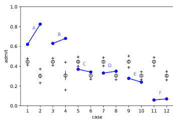

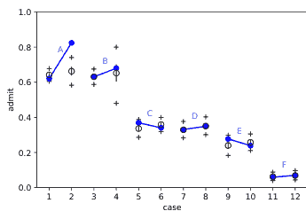

_图 15.2:_ 蓝点表示每个部门（_A_–_F_）的录取率，男性（每对的左半部分）和女性（右半部分）。圆表示 \(\mu_i\) 的后验均值，小垂直黑线表示 \(\mu_i\) 的 1 个标准差。_+_ 标记表示 _A<sub>i</sub>_ 的 95% 预测区间。_(a)_ 基础模型，仅考虑性别。_(b)_ 增强模型，添加部门特定偏移。改编自 [_McE20_] 的图 11.5。由 logreg_ucb_admissions_numpyro.ipynb 生成。

我们可以通过将部门 ID 作为另一个特征来实现这一点：

```
\(A_i \sim \text{Bin}(N_i, \mu_i)\) (15.64)

\(\text{logit}(\mu_i) = \alpha_{\text{GENDER}[i]} + \gamma_{\text{DEPT}[i]}\) (15.65)

\(\alpha_j \sim \mathcal{N}(0, 1.5), j \in \{1, 2\}\) (15.66)

\(\gamma_k \sim \mathcal{N}(0, 1.5), k \in \{1, \dots, 6\}\) (15.67)
```

这里 \(j \in \{1, 2\}\)（针对性别）和 \(k \in \{1, \dots, 6\}\)（针对部门）。请注意，此模型中有 12 个参数，但每种组合（数据切片）都关联了相当大的样本量，如表 15.1 所示。

在图 15.2b 中，我们绘制了该新模型的后验预测分布；可以看出拟合效果现在好多了。我们发现 \(\alpha_1\) 的 89% 可信区间为 \([-1.38, 0.35]\)，\(\alpha_2\) 为 \([-1.31, 0.42]\)。概率差值 \(\sigma(\alpha_1) - \sigma(\alpha_2)\) 的对应分布为 \([-0.05, 0.01]\)。因此，看来毕竟没有偏差。

然而，上述结论基于图 15.3a 模型的正确性。如果存在 **未观察到的混杂变量** _U_，例如学术能力，同时影响录取率和部门选择，会怎样呢？此假设在图 15.3b 中所示。在这种情况下，对碰撞器 _D_ 进行条件化会在性别和录取之间打开一条非因果路径，\(G \rightarrow D \leftarrow U \rightarrow A\)。这使得我们可能想要得出的任何因果结论都无效。

此示例的要点是，为那些试图从预测模型中得出因果结论的人敲响警钟。有关更多详细信息，请参见 **??**。

#### 15.3.2 Beta-二项逻辑回归

在某些情况下，即使考虑了观察到的预测变量，观察到的计数变异性也可能超过单纯二项模型的预期。这称为 **过分散**，通常是由于模型中遗漏的未观察因素引起的。在这种情况下，我们可以使用 **Beta-二项** 模型而不是二项模型：

```
\(y_i \sim \text{BetaBinom}(m_i, \alpha_i, \beta_i)\) (15.68)

\(\alpha_i = \pi_i \kappa\) (15.69)

\(\beta_i = (1 - \pi_i) \kappa\) (15.70)

\(\pi_i = \sigma(\mathbf{w}^\top \mathbf{x}_i)\) (15.71)
```

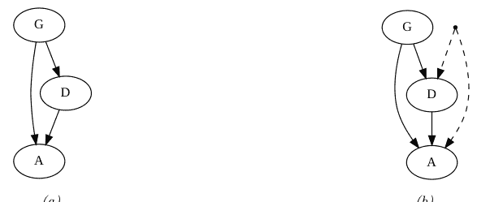

图 15.3：录取率的一些可能因果模型。\( G \) 为性别，\( D \) 为部门，\( A \) 为录取率。(a) 没有隐藏的混杂变量。(b) 隐藏的混杂变量（小点）同时影响 \( D \) 和 \( A \)。由 `logreg_ucb_admissions_numpyro.ipynb` 生成。

请注意，我们已将模型参数化为其均值：

```
\(\pi_i = \frac{\alpha_i}{\alpha_i + \beta_i}\) (15.72)
```

和形状：

```
\(\kappa_i = \alpha_i + \beta_i\) (15.73)
```

我们选择让均值取决于输入（协变量），但将形状（类似于精度项）视为共享常量。

如我们在 **??** 中讨论的，Beta-二项分布可表示为以下形式的连续混合分布：

```
\(\text{BetaBinom}(y|m, \alpha, \beta) = \int \text{Bin}(y|m, \mu)\text{Beta}(\mu|\alpha, \beta)d\mu\) (15.74)
```

在回归语境下，我们可以这样理解：我们不仅直接预测均值，还预测均值和方差。这样，每个单独的样本可以比我们预期的具有更大的变异性。

如果形状参数 \(\kappa\) 小于 2，则分布为倒置 U 形，强烈偏向概率 0 或 1（参见 **??**）。我们通常希望避免这种情况，可以通过确保 \(\kappa > 2\) 来实现。

遵循 [McE20, p371]，让我们使用此模型重新分析第 15.3 节中的 Berkeley 录取数据。我们看到，结果存在很大的变异性，这是由于各部门的录取率不同。假设我们仅回归性别，即 \(\mathbf{x}_i = (\mathbb{I}(\text{GENDER}_i = 1), \mathbb{I}(\text{GENDER}_i = 2))\)，而 \(\mathbf{w} = (\alpha_1, \alpha_2)\) 是相应的 logits。如果使用二项回归模型，我们可能会被误导认为存在性别偏差。但如果使用更稳健的 Beta-二项模型，我们就可以避免这一错误结论，如下所示。

我们拟合以下模型：

```
A_i \sim \text{BetaBinom}(N_i, \pi_i, \kappa) \quad (15.75)
logit(\pi_i) = \alpha_{\text{GENDER}[i]} \quad (15.76)
\alpha_j \sim \mathcal{N}(0, 1.5) \quad (15.77)
\kappa = \phi + 2 \quad (15.78)
\phi \sim \text{Expon}(1) \quad (15.79)
```

（为确保 \(\kappa > 2\)，我们使用一个技巧，将其定义为 \(\kappa = \phi + 2\)，在 \(\phi\) 上放置一个指数先验（下界为 0）。）

我们拟合此模型（使用 HMC）并在图 15.4 中绘制结果。在图 15.4a 中，我们展示了后验预测分布；可以看出它相当宽泛，因此模型不再过度自信。在图 15.4b 中，

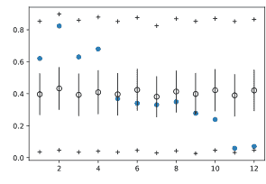

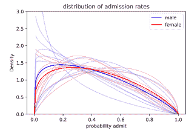

图 15.4：将 Beta-二项回归模型拟合到 Berkeley 录取数据的结果。(b) 后验预测分布（黑色）叠加在经验数据（蓝色）上。空心圆是后验预测的平均录取率 E[A_i|D]；垂直线是围绕该均值的 1 个标准差，std [A_i|D]；+ 符号表示 89% 预测区间。(b) 男士（蓝色）和女士（红色）录取率的后验分布样本。粗曲线是后验均值。改编自 [McE20] 的图 12.1。由 logreg_ucb_admissions_numpyro.ipynb 生成。

我们绘制 p(σ(α_j)|D)，这是男性和女性录取率的后验分布。我们看到这些值存在相当大的不确定性，因此现在我们避免了一个显著高于另一个的错误结论。但是，该模型的预测过于模糊，以至于无用。在第 15.3.4 节中，我们通过使用多层次逻辑回归模型来解决这个问题。

#### 15.3.3 泊松回归

让我们使用泊松回归重新审视第 15.3 节中的 Berkeley 录取示例。我们使用模型的简化形式，仅对结果计数进行建模，不使用任何特征，如性别或部门。也就是说，模型形式如下：

```
y_{j,n} ~ Poi(λ_j)                                      (15.80)
λ_j = e^{α_j}                                          (15.81)
α_j ~ N(0, 1.5)                                        (15.82)
```

对于 j = 1 : 2 和 n = 1 : 12。令 λ̄_i = E[λ_i|D]，其中 D_1 = y_{1,1:N} 是录取计数向量，D_2 = y_{2,1:N} 是拒绝计数向量（因此 m_n = y_{1,n} + y_{2,n} 是病例 n 的申请总数）。整个数据集的预期录取率为

```
λ̄_1 / (λ̄_1 + λ̄_2) = 146.2 / (146.2 + 230.9) = 0.38  (15.83)
```

让我们将其与以下形式的二项回归模型进行比较：

```
y_n ~ Bin(m_n, μ)                            (15.84)
μ = σ(α)                                     (15.85)
α ~ N(0, 1.5)                                (15.86)
```

令 ᾱ = E[α|D]，其中 D = (y_{1,1:N}, m_{1:N})。整个数据集的预期录取率为 σ(ᾱ) = 0.38，与公式 (15.83) 一致。（代码请参见 logreg_ucb_admissions_numpyro.ipynb。）

#### 15.3.4 GLMM（层次贝叶斯）回归

让我们重新审视第 15.3 节中的 Berkeley 录取数据集，其中有 12 个示例，对应 6 个部门的男性和女性录取。因此，数据同时按性别和部门分组。


回顾一下，\( A_i \) 是示例 \( i \) 中录取的学生人数，\( N_i \) 是申请人数，\( \mu_i \) 是预期录取率（感兴趣的变量），而 \( \text{DEPT}[i] \) 是系所（6 个可能值）。出于教学目的，我们将分类变量 \( \text{GENDER}[i] \) 替换为二元指示变量 \( \text{MALE}[i] \)。我们可以构建一个带有 **可变截距** 和 **可变斜率** 的模型，如下所示：

```
\( A_i \sim \text{Bin}(N_i, \mu_i) \tag{15.87} \)

\( \text{logit}(\mu_i) = \alpha_{\text{DEPT}[i]} + \beta_{\text{DEPT}[i]} \times \text{MALE}[i] \tag{15.88} \)
```

该模型有 12 个参数，与公式 (15.65) 中的原始表述一样。然而，这些并非独立的自由度。特别是，截距和斜率是相关的，如图 15.2 所示（录取率越高，斜率越陡）。我们可以使用以下先验来捕捉这一点：

```
\( (\alpha_j, \beta_j) \sim \mathcal{N}\left( \begin{pmatrix} \overline{\alpha} \\ \overline{\beta} \end{pmatrix}, \boldsymbol{\Sigma} \right) \tag{15.89} \)

\( \overline{\alpha} \sim \mathcal{N}(0, 4) \tag{15.90} \)

\( \overline{\beta} \sim \mathcal{N}(0, 1) \tag{15.91} \)

\( \boldsymbol{\Sigma} = \text{diag}(\boldsymbol{\sigma}) \mathbf{R} \text{diag}(\boldsymbol{\sigma}) \tag{15.92} \)

\( \mathbf{R} \sim \text{LKJ}(2) \tag{15.93} \)

\( \boldsymbol{\sigma} \sim \prod_{d=1}^2 \mathcal{N}_+(\sigma_d|0, 1) \tag{15.94} \)
```

我们可以用以下更紧凑的方式表示。\(^2\)。我们定义 \( \boldsymbol{u} = (\overline{\alpha}, \overline{\beta}) \) 和 \( \boldsymbol{w}_j = (\alpha_j, \beta_j) \)，然后使用此模型：

```
\( \text{logit}(\mu_i) = w_{\text{DEPT}[i]}[0] + w_{\text{DEPT}[i]}[1] \times \text{MALE}[i] \tag{15.95} \)

\( \boldsymbol{w}_j \sim \mathcal{N}(\boldsymbol{u}, \boldsymbol{\Sigma}) \tag{15.96} \)

\( \boldsymbol{u} \sim \mathcal{N}(\mathbf{0}, \text{diag}(4, 1)) \tag{15.97} \)
```

图形模型请参见图 15.5(a)。

按照 **??** 中的讨论，最好将模型重写为非中心形式。因此我们写

```
\( \boldsymbol{w}_j = \boldsymbol{u} + \sigma \mathbf{L} \boldsymbol{z}_j \tag{15.98} \)
```

其中 \( \mathbf{L} = \text{chol}(\mathbf{R}) \) 是相关矩阵 \( \mathbf{R} \) 的 Cholesky 分解，且 \( \boldsymbol{z}_j \sim \mathcal{N}(\mathbf{0}, \mathbf{I}_2) \)。因此模型变为如下形式：\(^3\)。

```
\( \boldsymbol{z}_j \sim \mathcal{N}(\mathbf{0}, \mathbf{I}_2) \tag{15.99} \)

\( \boldsymbol{v}_j = \text{diag}(\boldsymbol{\sigma}) \mathbf{L} \boldsymbol{z}_j \tag{15.100} \)

\( \boldsymbol{u} \sim \mathcal{N}(\mathbf{0}, \text{diag}(4, 1)) \tag{15.101} \)

\( \text{logit}(\mu_i) = u[0] + v_{[\text{DEPT}[i], 0]} + (u[1] + v_{[\text{DEPT}[i], 1]}) \times \text{MALE}[i] \tag{15.102} \)
```

numpyro 代码中实现的是这个模型版本。

拟合该模型的结果如图 15.5(b)所示。与图 15.2b 相比，拟合效果略有改善，特别是第二列（系所 2 中的女性），现在观测值落在预测区间内。

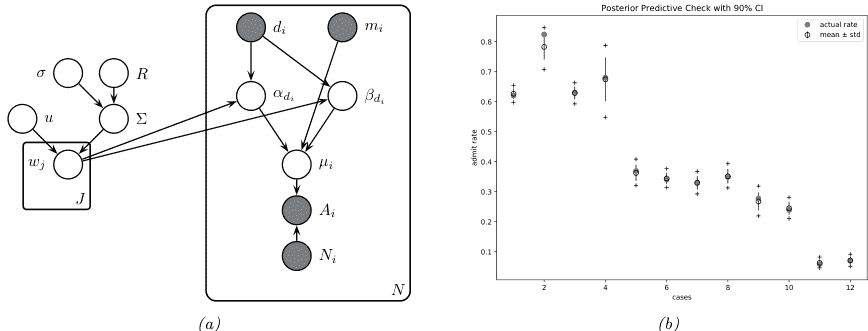

图 15.5：(a) 针对输入 $d_i$（系所）和 $m_i$（男性）以及输出 $A_i$（录取人数）的广义线性混合模型，给定 $N_i$（申请人数）。(b) 将此模型拟合到 UCB 数据集的结果。由 logreg_ucb_admissions_numpyro.ipynb 生成。

## 第 16 章 深度神经网络

## 第 17 章 高斯过程

## 第 18 章 结构化预测

## 第 19 章 超越 iid 假设

# 第四部分 生成

## 第 20 章 生成模型：概述

## 第 21 章 变分自编码器

## 第 22 章 自回归模型

## 第 23 章 归一化流

## 第 24 章 基于能量的模型

## 第 25 章 去噪扩散模型

## 第 26 章 生成对抗网络

# 第五部分 发现

## 第 27 章 发现方法：概述

## 第 28 章 隐变量模型

### 28.1 主题模型

在本节中，我们展示如何修改 **??** 的多项式 PCA 模型，以处理可变大小的观测值，例如文本文档。基本假设是，每个观测值 **_x_**_<sub>l</sub>_ 在共享隐因 **_z_** 条件下独立于所有其他观测值生成；似然为分类分布，具有共享参数，先验为狄利克雷分布。这称为**主题模型**，因为 **_z_** 变量可以解释为存在于文档 **_x_** 中的不同主题的混合。

#### 28.1.1 潜在狄利克雷分配 (LDA)

最常见的主题模型称为**潜在狄利克雷分配 (LDA)** [BNJ03; Ble12; BGHM17]。（此处的“LDA”一词不应与线性判别分析混淆。）

##### 28.1.1.1 模型定义

我们可以如下定义 LDA 模型。设 $x_{nl} \in \{1, \dots, V\}$ 为文档 $n$ 中第 $l$ 个单词的身份，其中 $l$ 现在可从 1 到 $L_n$ 取值，$L_n$ 为文档长度，$V$ 为词汇表大小。位置 $l$ 处单词 $v$ 的概率由以下公式给出

$p(x_{nl} = v | z_n) = \sum_k z_{nk} w_{kv}$ (28.1)

其中 $0 \le z_{nk} \le 1$ 是文档 $n$ 中“主题” $k$ 的比例，且 $z_n \sim \text{Dir}(\alpha)$。

我们可以通过为每个文档中的每个单词关联一个离散隐变量 $c_{nl} \in \{1, \dots, N_z\}$ 来重写此模型，其分布为 $p(c_{nl} | z_n) = \text{Cat}(c_{nl} | z_n)$。因此，$c_{nl}$ 指定了文档 $n$ 中单词 $l$ 使用的主题。完整的联合模型变为

$p(x_n, z_n, c_n) = \text{Dir}(z_n | \alpha) \prod_{l=1}^{L_n} \text{Cat}(c_{nl} | z_n) \text{Cat}(x_{nl} | W[c_{nl}, :])$ (28.2)

其中 **W**[$k$, :] = **_w_**_<sub>k</sub>_ 是第 $k$ 个主题的单词分布。相应的 PGM-D 请参见图 28.1。

我们通常对主题参数使用狄利克雷先验，$p(w_k) = \text{Dir}(w_k | \beta 1_V)$；通过设置足够小的 $\beta$，可以鼓励这些主题稀疏，从而每个主题仅预测单词的一个子集。此外，我们对隐因使用狄利克雷先验，$p(z_n) = \text{Dir}(z_n | \alpha 1_{N_z})$。如果设置足够小的 $\alpha$，可以鼓励每个文档的主题分布稀疏，从而每个文档仅包含一部分主题。示意图见图 28.2。

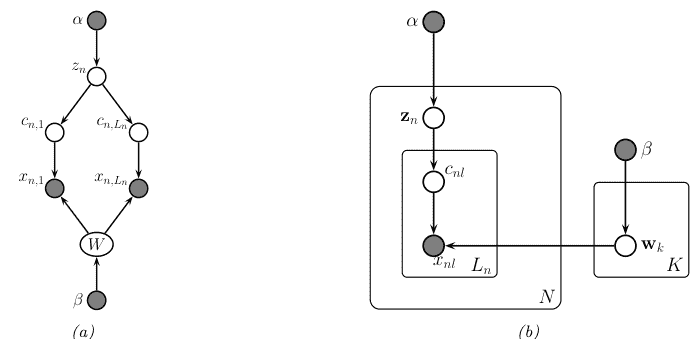

图 28.1：作为 PGM-D 的潜在狄利克雷分配 (LDA)。(a) 展开形式。(b) 盘状形式。


图 28.2：潜在狄利克雷分配 (LDA) 示意图。我们按单词被分配的主题对某些单词进行了颜色编码：黄色代表遗传学集群，粉色代表进化集群，蓝色代表数据分析集群，绿色代表神经科学集群。每个主题又定义为单词上的稀疏分布。本文与神经科学无关，因此没有单词被分配给绿色主题。该文档的主题分配总体分布在右侧以稀疏直方图显示。改编自 [Ble12] 的图 1。经 David Blei 友好许可使用。

| 单词 | 概率 |
|---|---|
| MUSIC | .090 |
| DANCE | .034 |
| SONG | .033 |
| PLAY | .028 |
| THEATER | .026 |
| SINGING | .026 |
| BAND | .026 |
| PLAYED | .023 |
| SANG | .022 |
| SONGS | .021 |
| DANCING | .020 |
| PIANO | .017 |
| PLAYING | .016 |
| RHYTHM | .015 |
| ALBERT | .013 |
| MUSICAL | .013 |

| 单词 | 概率 |
|---|---|
| LITERATURE | .031 |
| POEM | .028 |
| POETRY | .027 |
| POET | .020 |
| PLAYS | .019 |
| POEMS | .019 |
| PLAY | .015 |
| LITERARY | .013 |
| WRITERS | .013 |
| DRAMA | .012 |
| WRITING | .012 |
| POETS | .011 |
| WRITER | .011 |
| SHAKESPEARE | .010 |
| WRITTEN | .009 |
| STAGE | .009 |

| 单词 | 概率 |
|---|---|
| PLAY | .136 |
| BALL | .129 |
| GAME | .065 |
| PLAYED | .054 |
| HIT | .032 |
| PLAYED | .031 |
| BASEBALL | .027 |
| GAMES | .025 |
| BAT | .019 |
| RUN | .019 |
| THROWS | .016 |
| BALLS | .015 |
| TENNIS | .011 |
| HOME | .010 |
| CATCH | .010 |
| FIELD | .010 |

图 28.3：与单词 play 相关的三个主题。来自 [SG07] 的图 9。经 Tom Griffiths 友好许可使用。

文档 #29795 Box bisbeetocke，年龄 60 五十七岁，坐 174 在坡 571 上的 166 悬崖俯瞰 527 密西西比 137 河 157。他 77 正在聆听 600 来自 609 一艘 345 河船。音乐 67 已经 149 俘获了他的心 157 以及他的耳朵 119。那是 267 爵士乐。Bix Beiderbecke 已经 571 听过音乐课 671。他 700 显示了 154 在钢琴 677 上的前景，他的 553 父母 556 希望 118 他可能会考虑 177 成为一名音乐会钢琴家 770。但是 Bix 368 对另一种 1509 类型的音乐 577 感兴趣。他想要 596 演奏 771 彗星。并且他想要 596 演奏 777 爵士乐 ...

文档 #1883 存在一个简单的 1850 个理由 106，说明为什么在整个西方世界 946 中真正伟大的戏剧 162 时期 878 如此之少。太多的事情 500 必须在同一时间都合适。剧作家必须拥有合适的演员 562，演员 362 必须拥有合适的剧院，剧院必须拥有合适的观众 862。我们必须记住 58，戏剧 816 存在 213 就是为了表演 777，而不仅仅是 399 为了阅读 541（即使你独自阅读 1247 戏剧 578 时，也要试着 326 表演 366 它，在边走边上台 478）只要 145 一部戏剧 166 必须表演 662，那么某种 1535 戏剧性的 962...

文档 #21359 Jim 366 有一个 166 游戏书 554 Jim 296 阅读 554 这本书 254 Jim 396 看到 981 一个 166 游戏 为一个。Jim 396 玩 166 这个游戏 166 Jim 366 喜欢 366 这个游戏 166 为一个。这个游戏书 254 帮助 911 Jim 396 Don 1205 进入 366 房子 624 Don 1306 和 Jim 296 阅读 354 这个游戏书 254 男孩们 529 看到 166 一个游戏 为两个。两个男孩 520 玩 166 这个游戏 166 男孩们 109 玩 379 这个游戏 166 为两个。男孩们 526 喜欢 166 这个游戏 Meg 222 进入 360 房子 267 Meg 242 和 Don 182 和 Jim 366 阅读 160 这本书 254。他们看到 166 一个游戏 为三个。Meg 166 和 Don 181 和 Jim 396 玩 776 这个游戏 166 他们玩 166...

图 28.4：TASA 语料库中的三篇文档，包含单词 play 的不同含义。灰色单词被模型忽略，因为它们对应无趣的停用词（例如 "and"、"the" 等）或极低频单词。来自 [SG07] 的图 10。经 Tom Griffiths 友好许可使用。

请注意，LDA 的一个早期版本，称为概率性 LSA，在 [Hof99] 中提出。（LSA 代表“潜在语义分析”，指的是将 PCA 应用于文本数据；详情请参见 [Mur22, Sec 20.5.1.2]。）似然函数 p(x|z) 与 LDA 中的相同，但 pLSA 为 z 未指定先验，因为它旨在对固定语料库进行后验分析（类似于 LSA），而不是一个真正的生成模型。

##### 28.1.1.2 多义性

每个主题是一组共现且因此语义相关的单词的分布。例如，图 28.3 显示了从拟合到 TASA 语料库的 LDA 模型中学习到的 3 个主题。这些似乎对应于单词 "play" 的 3 种不同含义：演奏乐器、戏剧表演和体育比赛。

我们可以使用推断的文档级主题分布来克服多义性，即，进行消歧

1 TASA 语料库是一个未加标签的教育材料集合，包含 37,651 篇文档和 12,190,931 个词元。出现在少于 5 篇文档中的单词已被替换为星号，但标点符号被保留。合并词汇表包含 37,202 个唯一单词。


特定词语的含义。这在图 28.4 中得到说明，其中一部分词语被标注了其所属的主题（即，我们展示 \(\text{argmax}_k p(c_{nl} = k | x_n)\)）。在第一篇文档中，单词“music”表明音乐主题（编号 77）出现在文档中，这反过来使得 \(c_{nl} = 77\) 更有可能成立，其中 \(l\) 是对应单词“play”的索引。

##### 28.1.1.3 后验推断

已有许多算法被提出用于在 LDA 模型中进行近似后验推断。在原始 LDA 论文 [BNJ03] 中，他们使用变分均匀场推断（参见 **??**），而在 [HBB10] 中，他们使用随机 VI（参见第 28.1.6 节）。在第 28.1.5 节中，我们讨论坍缩吉布斯采样器，它将离散隐变量边缘化。在 [MB16; SS17] 中，他们讨论如何学习摊销推理网络以对坍缩模型执行 VI。

最近，人们对用于拟合 LDA 类模型的谱方法表现出了相当大的兴趣，这些方法速度快，并附带了关于所得解质量的可证明保证（与 MCMC 和变分方法不同，后者的解只是未知质量的近似）。这些方法在基本模型之外做出某些（合理的）假设，例如存在某些锚点词，这些词唯一确定文档的主题。详情请参见 [Aro+13]。

##### 28.1.1.4 确定主题数量

选择 \(N_z\)（即主题数量）是一个标准的模型选择问题。已采用的一些方法如下：

- 使用退火重要性采样 (**??**) 来近似证据 [Wal+09]。
- 交叉验证，使用测试集上的对数似然。
- 使用变分下界作为 \(\log p(\mathcal{D}|N_z)\) 的代理。
- 使用非参数贝叶斯方法 [Teh+06]。

#### 28.1.2 相关主题模型

LDA 的一个弱点是它无法捕捉主题之间的相关性。例如，如果文档具有“business”主题，那么合理地预期“finance”主题会共同出现。问题的根源在于为 \(z_n\) 使用狄利克雷先验。狄利克雷分布的问题在于，它仅由均值向量 \(\alpha\) 表征，但其协方差是固定的（\(\Sigma_{ij} = -\alpha_i\alpha_j\)），而不是自由参数。

绕过此问题的一种方法是将狄利克雷先验替换为 **logistic normal 分布**，其定义如下：

```
\(p(z) = \int \text{Cat}(z|\mathcal{S}(\epsilon))\mathcal{N}(\epsilon|\mu, \Sigma)d\epsilon\) (28.3)
```

这被称为 **相关主题模型** [BL07]：

与在 **??** 中讨论的分类 PCA 不同，CTM 使用 logistic normal 来建模均值参数，因此 \(z_n\) 是稀疏且非负的，而 CatPCA 使用正态分布来建模自然参数，因此 \(z_n\) 是密集的且可以为负。更准确地说，CTM 定义 \(x_{nl} \sim \text{Cat}(\mathbf{W}\mathcal{S}(\epsilon_n))\)，而 CatPCA 定义 \(x_{nd} \sim \text{Cat}(\mathcal{S}(\mathbf{W}_d z_n))\)。

拟合 CTM 模型比较棘手，因为 \(\epsilon_n\) 的先验不再与 \(c_{nl}\) 的多项式似然共轭。然而，我们可以推导出变分均匀场近似，如 [BL07] 中所述。

拟合模型后，可以通过修剪低强度边缘，将 \(\hat{\Sigma}\) 转换为稀疏精度矩阵 \(\hat{\Sigma}^{-1}\)，从而得到稀疏高斯图形模型。这使您可以可视化主题之间的相关性。图 28.5 显示了将此过程应用于 1990-1999 年 *Science* 杂志的结果。

#### 28.1.3 动态主题模型

在 LDA 中，主题（词语分布）被假设为静态的。在某些情况下，允许这些分布随时间平滑演变是有意义的。例如，一篇文章可能会使用主题“neuroscience”，但如果它写于 1900 年代，则更可能使用“nerve”这样的词，而如果它写于


图 28.5: 将相关主题模型（K = 50 个主题）应用于 Science 文章时的输出。节点表示主题，每个主题中显示 5 个最可能的短语。字体大小反映主题的总体流行度。请参见 http://www.cs.cmu.edu/~lemur/science/ 以获取带有 100 个主题的此模型的交互版本。经 [BL07] 图 2 和 David Blei 允许使用。


图 28.6: 动态主题模型作为 PGM-D。

2000 年代，则更可能使用“calcium receptor”这样的词（这反映了神经科学向分子生物学发展的总体趋势）。

建模这一点的一种方法是假设主题分布按照高斯随机游走演变，如状态空间模型中所见（参见 ??）。我们可以通过 softmax 函数将这些高斯向量映射为概率，从而得到以下模型：

```
$$\begin{aligned} w_k^t | w_k^{t-1} \sim \mathcal{N}(w_{t-1,k}, \sigma^2 1_{N_w}) \quad (28.4) \\ z_k^t \sim \text{Dir}(\alpha 1_{N_z}) \quad (28.5) \\ c_{nl}^t | z_n^t \sim \text{Cat}(z_n^t) \quad (28.6) \\ x_{nl}^t | c_{nl}^t = k, W^t \sim \text{Cat}(S(w_k^t)) \quad (28.7) \end{aligned}$$
```

这被称为 **动态主题模型** [BL06a]。有关 PGM-D，请参见图 28.6。

可以使用结构化均匀场方法（**??**）在此模型中执行近似推断，该方法利用卡尔曼平滑算法（**??**）在 $w_k^t$ 节点之间的线性高斯链上执行精确推断（详情请参见 [BL06a]）。有关该模型应用于 Science 100 年文章的示例，请参见正文。


图 28.7: LDA-HMM 模型作为 PGM-D。

还可以使用摊销推断，并为每个词学习嵌入，这对罕见词效果好得多。这称为 **动态嵌入主题模型** [DRB19]。

#### 28.1.4 LDA-HMM

第 28.1.1 节的潜在狄利克雷分配（LDA）模型假设词语是可交换的，因此忽略了词序。建模词语之间序列依赖性的简单方法是使用 HMM。HMM 的问题在于它们只能建模短程依赖，因此无法捕捉文档的整体要义。因此，它们可以生成语法上正确的句子，但不能生成语义上合理的句子。

可以将 LDA 与 HMM 结合，创建一个称为 **LDA-HMM** [Gri+04] 的模型。该模型使用 HMM 状态来建模功能或语法词，例如“and”或“however”，并使用 LDA 来建模内容或语义词，这些词更难以预测。有一个特殊的 HMM 状态指定何时应使用 LDA 模型生成词语；其余时间，HMM 生成词语。

更正式地说，对于每篇文档 n，模型定义了一个具有状态 $h_{nl} \in \{0, \dots, H\}$ 的 HMM。此外，每篇文档都有一个关联的 LDA 模型。如果 $h_{nl} = 0$，我们从语义 LDA 模型生成词语 $x_{nl}$，主题由 $c_{nl}$ 指定；否则，我们从句法 HMM 模型生成词语 $x_{nl}$。PGM-D 如图 28.7 所示。CPD 如下：

$p(\mathbf{z}_n) = \text{Dir}(\mathbf{z}_n|\alpha\mathbf{1}_{N_z}) \quad (28.8)$
$p(c_{nl} = k|\mathbf{z}_n) = z_{nk} \quad (28.9)$
$p(h_{n,l} = j|h_{n,l-1} = i) = A_{ij} \quad (28.10)$
$p(x_{nl} = d|c_{nl} = k, h_{nl} = j) = \begin{cases} W_{kd} & \text{if } j = 0 \\ B_{jd} & \text{if } j > 0 \end{cases} \quad (28.11)$

其中 **W** 是通常的主题-词矩阵，**B** 是状态-词 HMM 发射矩阵，**A** 是状态-状态 HMM 转移矩阵。

此模型中的推断可以通过坍缩吉布斯采样来完成，解析地积分掉所有连续量。详情请参见 [Gri+04]。

将该模型（具有 $N_z = 200$ 个 LDA 主题和 $H = 20$ 个 HMM 状态）应用于合并的 Brown 和 TASA 语料库^2 的结果如表 28.1 所示。我们看到 HMM 通常负责

2 Brown 语料库包含 500 份文档和 1,137,466 个词符，每个词符都有词性标注。TASA 语料库是一个未标注的教育材料集合，包含 37,651 份文档和 12,190,931 个词符。出现在少于 5 份文档中的词被星号替换，但标点符号被保留。合并词汇表的大小为 37,202 个唯一词。


| 该 | 该 | 该 | 该 | 该 | 一个 | 该 | 该 | 该 |
|---|---|---|---|---|---|---|---|---|
| 血液 | , | , | 的 | 一个 | 该 | , | 一个 | , |
| , | 和 | 和 | , 到 | , | , | 的 | 一个 | 在 |
| 身体 | 一个 | 在 | 在 | 在 | , | 一个 | 和 | 游戏 |
| 心脏 | 在 | 土地 | 和 | 到 | 水 | 和 | 饮料 | 球 |
| 和 | 树木 | 到 | 课程 | 图片 | 是 | 故事 | 酒精 | 和 |
| 在 | 树 | 农民 | 政府 | 电影 | 和 | 是 | 到 | 团队 |
| 到 | 与 | 为 | 一个 | 图像 | 物质 | 到 | 瓶子 | 到 |
| 是 | 在 | 农场 | 州 | 镜头 | 是 | 作为 | 在 | 玩 |
| 血液 | 森林 | 农民 | 政府 | 光 | 水 | 故事 | 药物 | 球 |
| 心脏 | 树木 | 土地 | 州 | 眼 | 物质 | 故事 | 药物 | 游戏 |
| 压力 | 森林 | 农作物 | 联邦的 | 镜头 | 分子 | 诗 | 酒精 | 团队 |
| 身体 | 土地 | 农场 | 公共的 | 图像 | 液体 | 角色 | 人们 | * |
| 肺 | 土壤 | 食物 | 地方的 | 镜子 | 粒子 | 诗 | 饮酒 | 篮球 |
| 氧气 | 地区 | 人们 | 行为 | 眼睛 | 气体 | 固体 | 个人 | 球员 |
| 血管 | 公园 | 农业 | 州 | 玻璃 | 物质 | 诗 | 大麻 | 球员 |
| * | 区域 | 雨 | 玉米 | 部门 | 镜头 | 温度 | 生命 | 身体 | 场 |
| 呼吸 | 在 | 他 | * | 是 | 说 | 能 | 时间 | ; |
| 一个 | 为 | 它 | 新的 | 有 | 做 | 会 | 方式 | ( |
| 他的 | 到 | 你 | 其他 | 看 | 使用 | 将 | 年 | ; |
| 这个 | 在 | 他们 | 第一个 | 做 | 做 | 可能 | 天 | : |
| 他们的 | 与 | 我 | 相同的 | 知道 | 去 | 可能 | 部分 | ) |
| 这些 | 在 | 她 | 伟大的 | 得到 | 发现 | 有 | 数字 | |
| 你的 | 由 | 我们 | 好的 | 去 | 被称为 | 必须 | 种类 | |
| 她的 | 从 | 那里 | 小的 | 拿 | 有 | 地方 | | |
| 我的 | 如 | 这个 | 小的 | 找到 | 做 | | | |
| 一些 | 进入 | 谁 | 老的 | | | | | |

表 28.1：第一行：在联合 Brown 和 TASA 语料库上训练的 LDA 模型提取的主题。中间行：LDA-HMM 模型 LDA 部分提取的主题。底行：LDA-HMM 模型 HMM 部分提取的主题。每一列代表一个单一主题/类，单词按该主题/类中的概率顺序排列。由于有些类将几乎所有概率都给予少数几个单词，当单词占概率质量的 90% 时列表终止。来自 [Gri+04] 的图 2。获得 Tom Griffiths 的友好许可。

与此方法相反，我们在此研究整体网络活动如何 [控制] 单细胞参数（如输入电阻），以及时间和空间常数，这些参数对于兴奋性和时空（sic）集成至关重要。

- 本文的集成架构结合了使用神经网络的前馈 [控制] 和误差反馈自适应 [控制]。

- 换句话说，为了我们的收敛证明，我们要求 softassign 算法 [返回] 一个双随机矩阵，因为 *辛克霍恩定理* 保证它会这样做，而不是基于某些合理度量仅仅接近双随机的矩阵。

  目标是构建一个组合，在给定风险水平和时间范围内实现最大预期 [回报]，同时遵守 *机构* 或 *法律要求* 的约束。

- 左侧 [图] 是标准实验，右侧来自带 # 样本的训练。[图] G 被称为 *访客 [图]。和 H 被称为主机 [图]。

图 28.8：NIPS 语料库中的功能词和实词，由 LDA-HMM 模型区分。灰度表示分配给 LDA 组件的后验概率，黑色最高。方框中的单词在一个句子中作为功能词出现，在另一个句子中作为实词出现。带星号的单词频率较低，模型将其视为单个单词类型。来自 [Gri+04] 的图 4。获得 Tom Griffiths 的友好许可。


图 28.9：(a) 展开的 N 份文档的 LDA。(b) 折叠的 LDA，其中我们积分掉连续隐变量 $z_n$ 和连续主题参数 $\mathbf{W}$。

语法词，而 LDA 用于语义词。如果没有 HMM，LDA 主题将被功能词“污染”（见图顶部），这就是为什么此类词通常在预处理期间被移除的原因。

该模型还可以帮助消除同一词在语法上或语义上使用时的歧义。图 28.8 显示了该模型应用于 NIPS 语料库时的一些示例。3 我们看到单词的角色被区分开来，例如，“we require the algorithm to return a matrix”（动词）与 “the maximal expected return”（名词）。原则上，词性标注器可以消除这两种用法的歧义，但请注意 (1) LDA-HMM 方法完全是无监督的（未使用 POS 标记），并且 (2) 有时一个词可以具有相同的 POS 标记，但不同的含义，例如，“the left graph”（语法角色）与 “the graph $G$”（语义角色）。

更近期，[Dic+17] 提出了 topic-RNN，它与 LDA-HMM 类似，但用 RNN 替换了 HMM 模型，RNN 是一个功能强大得多的模型。

#### 28.1.5 LDA 的折叠吉布斯采样

在本节中，我们讨论如何使用 MCMC 进行推理。香草吉布斯采样从以下全条件分布中采样：

```
p(c_{il} = k|\cdot) \propto \exp[\log \pi_{ik} + \log w_{k, x_{il}}] \quad (28.12)
p(\pi_i|\cdot) = \text{Dir}(\{\alpha_k + \sum_l \mathbb{I}(c_{il} = k)\}) \quad (28.13)
p(w_k|\cdot) = \text{Dir}(\{\gamma_v + \sum_i \sum_l \mathbb{I}(x_{il} = v, c_{il} = k)\}) \quad (28.14)
```

然而，通过解析地积分掉 $\pi_i$ 和 $w_k$（它们都服从狄里克莱 分布），仅对离散的 $c_{il}$ 进行采样，可以获得更好的性能。这种方法最初在 [GS04] 中提出，是折叠吉布斯采样的一个示例。图 28.9(b) 显示现在所有 $c_{il}$ 变量都完全相关。然而，我们可以逐个对它们进行采样，如下文所述。

首先，我们需要一些符号。令 $N_{ivk} = \sum_{l=1}^{L_i} \mathbb{I}(c_{il} = k, x_{il} = v)$ 为文档 $i$ 中单词 $v$ 被分配给主题 $k$ 的次数。令 $N_{ik} = \sum_v N_{ivk}$ 为文档 $i$ 中任何单词被分配给主题 $k$ 的次数。令 $N_{vk} = \sum_i N_{ivk}$ 为任何文档中单词 $v$ 被分配给主题 $k$ 的次数。令 $N_k = \sum_v N_{vk}$ 为分配给主题 $k$ 的单词数。最后，令 $L_i = \sum_k N_{ik}$ 为文档 $i$ 中的单词数；这是已观察到的。

3NIPS 代表“神经信息处理系统”。它是顶级机器学习会议之一。NIPS 语料库第 1-12 卷包含 1713 份文档。


图 28.10：将（折叠）吉布斯采样应用于小型 LDA 示例的说明。共有 \( N = 16 \) 份文档，每份包含从 \( V = 5 \) 个单词的词汇表中抽取的可变数量的单词。共有两个主题。白点表示单词被分配给主题 1，黑点表示单词被分配给主题 2。(a) 状态的初始随机分配。(b) 吉布斯采样 64 步后的后验样本。来自 [SG07] 的图 7。获得 Tom Griffiths 的友好许可。

我们现在可以推导边际先验。通过应用 **??**，可以表明

```
\( p(\mathbf{c}|\alpha) = \prod_i \int \left[ \prod_{l=1}^{L_i} \text{Cat}(c_{il}|\pi_i) \right] \text{Dir}(\pi_i|\alpha \mathbf{1}_K) d\pi_i \tag{28.15} \\
= \left( \frac{\Gamma(K\alpha)}{\Gamma(\alpha)^K} \right)^N \prod_{i=1}^N \frac{\prod_{k=1}^K \Gamma(N_{ik}+\alpha)}{\Gamma(L_i+K\alpha)} \tag{28.16} \)
```

通过类似的推理，可以表明

```
\( p(\mathbf{x}|\mathbf{c}, \beta) = \prod_k \int \left[ \prod_{il: c_{il}=k} \text{Cat}(x_{il}|w_k) \right] \text{Dir}(w_k|\beta \mathbf{1}_V) dw_k \tag{28.17} \\
= \left( \frac{\Gamma(V\beta)}{\Gamma(\beta)^V} \right)^K \prod_{k=1}^K \frac{\prod_{v=1}^V \Gamma(N_{vk}+\beta)}{\Gamma(N_k+V\beta)} \tag{28.18} \)
```

从上述方程，并利用 \(\Gamma(x+1)/\Gamma(x) = x\) 这一事实，我们可以推导 \(p(c_{il}|\mathbf{c}_{-i,l})\) 的全条件分布。定义 \(N_{tvk}\) 与 \(N_{wk}\) 相同，只是它通过对文档 \(i\) 中除了 \(c_{il}\) 之外的所有位置求和来计算。另外，令 \(x_{il} = v\)。则

```
\( p(c_{i,l} = k | \mathbf{c}_{-i,l}, \mathbf{y}, \alpha, \beta) \propto \frac{N_{v,k}^{-} + \beta}{N_{k}^{-} + V\beta} \frac{N_{i,k}^{-} + \alpha}{L_i + K\alpha} \tag{28.19} \)
```

我们可以看到，文档中的单词被分配给一个主题，既取决于该主题生成该单词的频率（第一项），也取决于该主题在该文档中被使用的频率（第二项）。

根据方程 (28.19)，我们可以按以下方式实现折叠吉布斯采样器。我们随机为每个单词分配一个主题，\(c_{il} \in \{1, \dots K\}\)。然后我们可以按以下方式采样新主题：对于语料库中的给定单词，根据当前单词分配的主题递减相关计数；从方程 (28.19) 中绘制一个新主题，更新计数矩阵；并重复。由于计数矩阵非常稀疏 [Li+14]，该算法可以高效实现。

该过程在图 28.10 中通过一个包含两个主题和五个单词的小示例进行了说明。图左侧说明了从 LDA 模型中采样的 16 份文档，使用 \(p(\text{money}|k=1) = p(\text{loan}|k=1) = p(\text{bank}|k=1) = 1/3\) 和 \(p(\text{river}|k=2) = p(\text{stream}|k=2) = p(\text{bank}|k=2) = 1/3\)。例如，我们看到第一个文档包含单词 “bank” 4 次（由 “bank” 列第 1 行中的四个点表示），以及各种其他金融术语。图右侧显示了 64 次迭代后的吉布斯采样器状态。在大多数情况下，每个标记都被分配了“正确”的主题。例如，在文档 1 中，我们看到单词 “bank” 已被正确分配给金融


主题，基于单词“money”和“loan”的存在。参数的后验均值估计由 $\hat{p}(\text{money}|k=1) = 0.32$, $\hat{p}(\text{loan}|k=1) = 0.29$, $\hat{p}(\text{bank}|k=1) = 0.39$, $\hat{p}(\text{river}|k=2) = 0.25$, $\hat{p}(\text{stream}|k=2) = 0.4$, 和 $\hat{p}(\text{bank}|k=2) = 0.35$ 给出，考虑到只有 16 个训练样本，这非常准确。

#### 28.1.6 LDA 的变分推断

比 MCMC 更快的替代方案是使用变分 EM，我们将在通用术语中在 ?? 中讨论。将此应用于 LDA 有几种方式，我们将在以下部分中讨论。

##### 28.1.6.1 序列版本

在本节中，我们关注一种展开模型并为每个词使用潜在变量的版本。遵循 [BNJ03]，我们将使用如下形式的完全因子化（均匀场）近似：

```
$$q(\mathbf{z}_n, \mathbf{s}_n) = \text{Dir}(\mathbf{z}_n|\tilde{\mathbf{z}}_n) \prod_l \text{Cat}(s_{nl}|\tilde{\mathbf{N}}_{nl})$$ (28.20)
```

其中 $\tilde{\mathbf{z}}_n$ 是 $\mathbf{z}_n$ 近似后验的变分参数，$\tilde{\mathbf{N}}_{nl}$ 是 $s_{nl}$ 近似后验的变分参数。我们将遵循通常的均匀场方法。对于 $q(s_{nl})$，我们使用贝叶斯规则，但需要对先验取期望：

```
$$\tilde{N}_{nlk} \propto w_{d,k} \exp(\mathbb{E}[\log z_{nk}])$$ (28.21)
```

其中 $d = x_{nl}$，并且

```
$$\mathbb{E}[\log z_{nk}] = \psi_k(\tilde{\mathbf{z}}_n) \triangleq \Psi(\tilde{z}_{nk}) - \psi(\sum_{k'} \tilde{z}_{nk'})$$ (28.22)
```

其中 $\psi$ 是 digamma 函数。$q(\mathbf{z}_n)$ 的更新通过累加预期计数获得：

```
$$\tilde{z}_{nk} = \alpha_k + \sum_l \tilde{N}_{nlk}$$ (28.23)
```

M 步通过累加预期计数并归一化得到：

```
$$\hat{w}_{dk} \propto \beta_d + \sum_{n=1}^N \sum_{l=1}^{L_n} \tilde{N}_{nlk} \mathbb{I}(x_{nl} = d)$$ (28.24)
```

##### 28.1.6.2 计数版本

请注意，E 步需要 $O((\sum_n L_n) N_w N_z)$ 空间来存储 $\tilde{N}_{nlk}$。在模型的 mPCA 版本中进行推断要节省空间得多，该版本使用计数；这些计数仅占用 $O(N N_w N_z)$ 空间，如果文档较长，这是一个巨大的节省。（相比之下，坍塌 Gibbs 采样器必须显式地处理 $s_{nl}$ 变量。）

遵循 ?? 中的讨论，我们将使用变量 $\mathbf{z}_n$ 和 $\mathbf{N}_n$，其中 $\mathbf{N}_n = [N_{ndk}]$ 是计数矩阵，可以从 $\mathbf{s}_{n,1:L_n}$ 推导得出。我们将再次使用如下形式的完全因子化（均匀场）近似：

```
$$q(\mathbf{z}_n, \mathbf{N}_n) = \text{Dir}(\mathbf{z}_n|\tilde{\mathbf{z}}_n) \prod_d \mathcal{M}(\mathbf{N}_{nd}|x_{nd}, \tilde{N}_{nd})$$ (28.25)
```

其中 $x_{nd} = \sum_{l=1}^{L_n} \mathbb{I}(x_{nl} = d)$ 是标记 $d$ 在文档 $n$ 中出现的总次数。

E 步变为

```
$$\tilde{z}_{nk} = \alpha_k + \sum_d x_{nd} \tilde{N}_{ndk}$$ (28.26)
```

```
$$\tilde{N}_{ndk} \propto w_{dk} \exp(\mathbb{E}[\log z_{nk}])$$ (28.27)
```

M 步变为
\(\hat{w}_{dk} \propto \beta_d + \sum_n x_{nd}\tilde{N}_{ndk}\) (28.28)

##### 28.1.6.3 贝叶斯版本

### 算法 4：LDA 的批量变分贝叶斯

```
Input: {x_nd}, N_z, \alpha, \beta;
Estimate \hat{w}_{dk} using EM for multinomial mixtures;
while not converged do
   // E step ;
   a_{dk} = 0 // expected sufficient statistics;
   for each document n = 1 : N do
     (\tilde{z}_n, \tilde{N}_n) = VB-Estep(x_n, \hat{W}, \alpha);
     a_{dk} += x_{nd}\tilde{N}_{ndk};
   // M step ;
   for each topic k = 1 : N_z do
     \hat{w}_{dk} = \beta_d + a_{dk};
function (\tilde{z}_n, \tilde{N}_n) = VB-Estep(x_n, \hat{W}, \alpha);
Initialize \tilde{z}_{nk} = \alpha_k;
repeat
  \tilde{z}_n^{old} = \tilde{z}_n, \tilde{z}_{nk} = \alpha_k;
  for each word d = 1 : N_w do
    for each topic k = 1 : N_z do
      \tilde{N}_{ndk} = exp(\psi_k(\hat{w}_d) + \psi_k(\tilde{z}_n^{old}));
    \tilde{N}_{nd} = normalize(\tilde{N}_{nd});
    \tilde{z}_n += x_{nd}\tilde{N}_{nd}
until Converged;
```

我们现在修改算法以使用变分贝叶斯（VB）而不是 EM，即我们既推断参数也推断潜在变量。这样做有两个好处。首先，通过设置 \(\beta \ll 1\)，VB 将鼓励 **W** 稀疏（如在 **??** 中）。其次，我们将能够将此推广到在线学习设置，如下文所述。

我们的新近似后验变为
\(q(z_n, \mathbf{N}_n, \mathbf{W}) = \text{Dir}(z_n | \tilde{z}_n) \prod_d \mathcal{M}(\mathbf{N}_{nd} | x_{nd}, \tilde{N}_{nd}) \prod_k \text{Dir}(\mathbf{w}_k | \tilde{w}_k)\) (28.29)

\(\tilde{N}_{ndk}$ 的更新变为如下：
\(\tilde{N}_{ndk} \propto \exp(\mathbb{E}[\log w_{dk}] + \mathbb{E}[\log z_{nk}])\) (28.30)

M 步与之前相同：
\(\hat{w}_{dk} \propto \beta_d + \sum_n x_{nd}\tilde{N}_{ndk}\) (28.31)

不需要归一化，因为我们只是在更新伪计数。整体算法在算法 4 中总结。

### 算法 5：LDA 的在线变分贝叶斯

```
1 Input: $\{x_{nd}\}$, $N_z$, $\boldsymbol{\alpha}$, $\boldsymbol{\beta}$, LR schedule;
2 Initialize $\tilde{w}_{dk}$ randomly;
3 for $t=1:\infty$ do
  4 Set step size $\eta_t$ ;
  5 Pick document $n$ ;
  6 $(\tilde{\mathbf{z}}_n, \tilde{\mathbf{N}}_n) = \text{VB-Estep}(\mathbf{x}_n, \tilde{\mathbf{W}}, \boldsymbol{\alpha})$;
  7 $\tilde{w}_{dk}^{new} = \beta_d + N x_{nd} \tilde{N}_{ndk}$;
  8 $\tilde{w}_{dk} = (1-\eta_t)\tilde{w}_{dk} + \eta_t \tilde{w}_{dk}^{new}$ ;
```


图 28.11：批量和在线 VB-LDA 的测试困惑度与训练文档数量对比。取自 [HBB10] 的图 1。经 David Blei 友好许可使用。

###### 28.1.6.4 在线（SVI）版本

在批量版本中，E 步每次均匀场更新需要 $O(N N_z N_w)$。如果文档较多，这可能很慢。可以通过使用随机变分推断来减少，如在 ?? 中讨论。我们以通常的方式执行 E 步。然后，我们将单个数据情况的预期充分统计量视为整个数据集都具有这些统计量，从而计算 **W** 的变分参数。最后，我们对 **W** 的变分参数进行部分更新，对新估计赋予权重 $\eta_t$，对旧估计赋予权重 $1 - \eta_t$。步长 $\eta_t$ 随时间衰减，按照某些时间表，如 SGD 中一样。整体算法在算法 5 中总结。在实践中，我们应使用小批量，如在 ?? 中解释。在 [HBB10] 中，他们使用了 256-4096 大小的批量。

图 28.11 绘制了大小为 1000 的测试集上随分析文档数量（E 步）变化的困惑度，数据来自（英文）维基百科。该图显示，在线变分推断比离线推断快得多，但产生相似的结果。

## 第 29 章

## 隐马尔可夫模型

## 第 30 章

## 状态空间模型

## 第 31 章

## 图学习

### 31.1 学习树结构

由于一般图的结构学习问题是 NP-hard [Chi96]，我们首先考虑树的特殊情况。树之所以特殊，是因为我们可以高效地学习其结构，如下文所述，并且一旦学习了树，就可以使用它们进行高效的精确推断，如在 **??** 中讨论。

#### 31.1.1 有向还是无向树？

在继续之前，我们需要讨论是否应该使用有向或无向树的问题。带有单个根节点 \(r\) 的有向树定义联合分布如下：

\(p(\boldsymbol{x}|T) = \prod_{t \in V} p(x_t | x_{\text{pa}(t)})\) (31.1)

其中我们定义 \(\text{pa}(r) = \emptyset\)。例如，在图 31.1(b-c) 中，我们有

\(p(x_1, x_2, x_3, x_4 | T) = p(x_1)p(x_2|x_1)p(x_3|x_2)p(x_4|x_2)\) (31.2)

\(= p(x_2)p(x_1|x_2)p(x_3|x_2)p(x_4|x_2)\) (31.3)

我们看到根节点的选择无关紧要：这两个模型是等价的。

为了使模型更加对称，最好使用无向树。可以按如下表示：

\(p(\boldsymbol{x}|T) = \prod_{t \in V} p(x_t) \prod_{(s,t) \in E} \frac{p(x_s, x_t)}{p(x_s)p(x_t)}\) (31.4)

其中 \(p(x_s, x_t)\) 是边缘分布，\(p(x_t)\) 是节点分布。例如，在图 31.1(a) 中，我们有

\(p(x_1, x_2, x_3, x_4 | T) = p(x_1)p(x_2)p(x_3)p(x_4) \frac{p(x_1, x_2)p(x_2, x_3)p(x_2, x_4)}{p(x_1)p(x_2)p(x_2)p(x_3)p(x_2)p(x_4)}\) (31.5)


图 31.1：一棵无向树和两棵等价的有向树。


要了解与有向表示的等价性，让我们消去项以得到

$$p(x_1, x_2, x_3, x_4 | T) = p(x_1, x_2) \frac{p(x_2, x_3)}{p(x_2)} \frac{p(x_2, x_4)}{p(x_2)} \tag{31.6}$$
$$= p(x_1) p(x_2 | x_1) p(x_3 | x_2) p(x_4 | x_2) \tag{31.7}$$
$$= p(x_2) p(x_1 | x_2) p(x_3 | x_2) p(x_4 | x_2) \tag{31.8}$$

其中 \(p(x_t | x_s) = p(x_s, x_t) / p(x_s)\)。

因此，树可以表示为无向图或有向图：参数数量相同，因此学习的复杂度也相同。当然，两种表示中的推断也是相同的。无向表示是对称的，对结构学习很有用，但有向表示对参数学习更方便。

#### 31.1.2 Chow-Liu 算法

使用方程 (31.4)，我们可以将树的对数似然写成如下形式：

$$\log p(\mathcal{D} | \boldsymbol{\theta}, T) = \sum_t \sum_k N_{tk} \log p(x_t = k | \boldsymbol{\theta})$$
$$+ \sum_{s, t} \sum_{j, k} N_{stjk} \log \frac{p(x_s = j, x_t = k | \boldsymbol{\theta})}{p(x_s = j | \boldsymbol{\theta}) p(x_t = k | \boldsymbol{\theta})} \tag{31.9}$$

其中 \(N_{stjk}\) 是节点 \(s\) 处于状态 \(j\) 且节点 \(t\) 处于状态 \(k\) 的次数，\(N_{tk}\) 是节点 \(t\) 处于状态 \(k\) 的次数。我们可以用经验分布重写这些计数：\(N_{stjk} = N p_{\mathcal{D}}(x_s = j, x_t = k)\) 和 \(N_{tk} = N p_{\mathcal{D}}(x_t = k)\)。将 \(\boldsymbol{\theta}\) 设置为 MLEs，这变为

$$\frac{\log p(\mathcal{D} | \boldsymbol{\theta}, T)}{N} = \sum_{t \in \mathcal{V}} \sum_k p_{\mathcal{D}}(x_t = k) \log p_{\mathcal{D}}(x_t = k) \tag{31.10}$$
$$+ \sum_{(s, t) \in \mathcal{E}(T)} \mathbb{I}(x_s, x_t | \hat{\boldsymbol{\theta}}_{st}) \tag{31.11}$$

其中 \(\mathbb{I}(x_s, x_t | \hat{\boldsymbol{\theta}}_{st}) \ge 0\) 是在给定经验分布下 \(x_s\) 和 \(x_t\) 之间的互信息：

$$\mathbb{I}(x_s, x_t | \hat{\boldsymbol{\theta}}_{st}) = \sum_j \sum_k p_{\mathcal{D}}(x_s = j, x_t = k) \log \frac{p_{\mathcal{D}}(x_s = j, x_t = k)}{p_{\mathcal{D}}(x_s = j) p_{\mathcal{D}}(x_t = k)} \tag{31.12}$$

由于方程 (31.11) 中的第一个项与拓扑 \(T\) 无关，在学习结构时可以忽略它。因此，可以通过计算最大权重生成树来找到最大化似然的树拓扑，其中边权重是成对互信息 \(\mathbb{I}(x_s, x_t | \hat{\boldsymbol{\theta}}_{st})\)。这称为 **Chow-Liu 算法** [CL68]。

寻找最大生成树（MST）有几种算法。最著名的两种是 Prim 算法和 Kruskal 算法。两者都可以实现为在 \(O(E \log V)\) 时间内运行，其中 \(E = V^2\) 是边数，\(V\) 是节点数。有关详细信息，请参见例如 [SW11, Sec 4.3]。因此总运行时间为 \(O(NV^2 + V^2 \log V)\)，其中第一项是计算充分统计量的成本。

图 31.2 给出了该方法的示例，应用于所示的二进制 20 newsgroups 数据（在 ?? 中所示）。该树已任意根植于表示“email”的节点。学习到的连接看起来直觉上合理。

#### 31.1.3 查找 MAP 森林

由于所有树都有相同数量的参数，我们可以安全地使用最大似然分数作为模型选择标准，而无需担心过拟合。但是，有时我们可能希望拟合一个


图 31.2: 从 20-newsgroup 数据估计的 MLE 树。由 chow_liu_tree_demo.py 生成。

森林而不是单棵树，因为森林中的推断比树中的快得多（我们可以并行运行森林中每棵树的信念传播）。MLE 标准永远不会选择省略边。但是，如果我们使用边缘似然或惩罚似然（例如 BIC），最优解可能是一个森林。下面我们给出边缘似然的详细信息。

在第 31.2.3.2 节中，我们解释了如何使用 CPTs 的 Dirichlet 先验计算任何 DAG 的边缘似然。生成的表达式可以写成如下形式：

```
log p(\mathcal{D}|T) = \sum_{t \in \mathcal{V}} \log \int \prod_{i=1}^N p(x_{it} | \mathbf{x}_{i, \text{pa}(t)}, \boldsymbol{\theta}_t) p(\boldsymbol{\theta}_t) d\boldsymbol{\theta}_t = \sum_t \text{score}(\mathbf{N}_{t, \text{pa}(t)})
```

其中 \(\mathbf{N}_{t, \text{pa}(t)}\) 是节点 \(t\) 及其父节点的计数（充分统计量），score 在方程 (31.26) 中定义。

现在假设我们只允许最多有一个父节点的 DAG。遵循 [HGC95, p227]，让我们为每个 \(s \to t\) 边关联一个权重，\(w_{s,t} \stackrel{\Delta}{=} \text{score}(t|s) - \text{score}(t|\emptyset)\)，其中 \(\text{score}(t|\emptyset)\) 是 \(t\) 没有父节点时的分数。请注意，权重可能是负的（与 MLE 情况不同，在 MLE 情况中边权重总是非负的，因为它们对应互信息）。然后我们可以重写目标如下：

```
log p(\mathcal{D}|T) = \sum_t \text{score}(t|\text{pa}(t)) = \sum_t w_{\text{pa}(t), t} + \sum_t \text{score}(t|0)
```

最后一项对所有树 \(T\) 都是相同的，所以我们可以忽略它。因此，找到最可能的树相当于在相应的加权有向图中找到 **最大分支**。这可以使用 [GGS84] 中的算法来找到。

如果评分函数是先验和似然等价的（这些术语在第 31.2.3.3 节中解释），则有

```
score(s|t) + score(t|0) = score(t|s) + score(s|0)
```

因此权重矩阵是对称的。在这种情况下，最大分支与最大权重森林相同。我们可以应用 MST 算法的略有修改版本来找到这一点 [EAL10]。为了理解这一点，让 \(G = (V, E)\) 成为具有正负边权重的图。现在让 \(G'\) 成为通过从 \(G\) 中省略所有负边得到的图。这不会减少总权重，因此我们可以通过找到 \(G'\) 的每个连通分量的 MST 来找到 \(G\) 的最大权重森林。我们可以直接在 \(G'\) 上运行 Kruskal 算法来做到这一点：无需显式查找连通分量。

#### 31.1.4 树混合模型

单棵树的表达能力相当有限。本章后面我们将讨论学习更一般图形的方法。但是，生成的图形在推断中可能代价高昂。一个有趣的替代方案


图 31.3: 一个简单的线性高斯模型。

是学习 **树混合模型** [MJ00]，其中每个混合组件可能具有不同的树拓扑。这类似于在 **??** 中讨论的 TAN 分类器的无监督版本。我们可以使用 EM 拟合树混合模型：在 E 步中，我们计算每个数据点的每个簇的责任度，在 M 步中，我们使用 Chow-Liu 算法的加权版本。有关详细信息，请参见 [MJ00]。

事实上，可以通过对所有可能的树进行边缘化来创建“无限树混合模型”。值得注意的是，可以使用矩阵树定理在 \(V^3\) 时间内完成此操作。这使我们能够对后验边缘概率等进行精确的贝叶斯推断。但是，使用这种无限混合模型对隐藏节点进行推断是不可行的。有关详细信息，请参见 [MJ06]。

### 31.2 学习 DAG 结构

在本节中，我们讨论如何从观测数据中估计有向图形模型的结构。这通常称为 **贝叶斯网络结构学习**。只有在做出忠实性假设时才能做到这一点，我们将在第 31.2.1 节中解释。此外，我们的输出将是一组等效 DAG，而不是单个唯一 DAG，我们将在第 31.2.2 节中解释。在介绍这些限制后，我们讨论一些统计和算法技术。如果将 DAG 解释为因果，这些技术可用于 **因果发现**，尽管这依赖于关于无混杂的附加假设。有关更多详细信息，请参见例如 [GZS19]。

#### 31.2.1 忠实性

马尔可夫假设允许我们从图 G 中推断分布 p 的条件独立性（CI）属性。为了向相反方向推进，我们需要假设生成分布 p 对生成 DAG G 是 **忠实** 的。这意味着 p 的所有条件独立性（CI）属性都由图形结构精确捕获，因此 I(p) = I(G)；这意味着 p 中不能有任何由于参数的特定设置（如回归矩阵中的零）而不在图形中显式的 CI 属性。（出于这个原因，忠实分布也称为 **稳定** 分布。）

让我们考虑一个不忠实分布的示例（来自 [PJS17, Sec 6.5.3]）。考虑以下形式的线性高斯模型

```
X = E_X, E_X ~ N(0, \sigma_X^2) \qquad (31.16)
Y = aX + E_Y, E_Y ~ N(0, \sigma_Y^2) \qquad (31.17)
Z = bY + cX + E_Z, E_Z ~ N(0, \sigma_Z^2) \qquad (31.18)
```

其中误差项是独立的。如果 ab + c = 0，则 X \perp\!\perp Z，尽管图 31.3 的 DAG 并未暗示这一点。幸运的是，如果系数是从正密度中随机绘制的，这种意外抵消发生的概率为零 [SGS00, Thm 3.2]。

#### 31.2.2 马尔可夫等价

即使有忠实性假设，我们也不能总是从联合分布中唯一地识别 DAG。为了了解这一点，请考虑以下 3 个有向图形模型：X -> Y -> Z、X <- Y <- Z 和 X <- Y -> Z。它们都表示


图 31.4：三个 DAG。$G_1$ 和 $G_3$ 是马可夫等价的，$G_2$ 不是。


图 31.5：马可夫等价 DAG 的 PDAG 表示。

相同的 CI 语句集，即

$X \perp Z|Y, X \not\perp Z$ (31.19)

我们称这些图为 **马可夫等价**，因为它们编码了相同的 CI 假设集。也就是说，它们都属于同一马可夫 **等价类**。然而，DAG $X \to Y \leftarrow Z$ 编码了 $X \perp Z$ 和 $X \not\perp Z|Y$，因此对应于不同的分布。

在 [VP90] 中，他们证明了以下定理。

**定理 31.2.1.** 两个结构当且仅当具有相同的 **骨架** 时才是马可夫等价的，即，它们具有相同的边（_不考虑方向_）并且具有相同的 _v-结构_（父节点不相邻的汇聚节点）集合。

例如，参考图 31.4，我们可以看到 $G_1 \not\equiv G_2$，因为反转 $2 \to 4$ 边会创建一个新的 v-结构。然而，$G_1 \equiv G_3$，因为反转 $1 \to 5$ 边不会创建新的 v-结构。

我们可以使用单个 **部分有向无环图** 或 **PDAG**（也称为 **基本图** 或 **模式**）来表示马可夫等价类，其中一些边是有向的，一些是无向的（参见 **??**）。无向边表示可逆边；只要不创建新的 v-结构，任何组合都是可能的。有向边被称为 **强制边**，因为改变其方向将改变 v-结构，从而改变等价类。例如，PDAG $X - Y - Z$ 表示 $\{X \to Y \to Z, X \leftarrow Y \leftarrow Z, X \leftarrow Y \to Z\}$，它编码了 $X \not\perp Z$ 和 $X \perp Z|Y$。另一个示例见图 31.4。

上述定理的意义在于，当我们从数据中学习 DAG 结构时，即使给定无限量的数据，也无法唯一地识别所有边的方向。我们称可以“至马可夫等价”地学习 DAG 结构。这也提醒我们不要过度解读特定边方向的含义，因为我们通常可以改变它们而不以任何可观察的方式改变模型。（如果我们想要区分 PDAG 中的边方向（例如，如果我们想要对边赋予因果解释），我们可以使用干预数据，如我们在第 31.4.2 节中讨论的那样。）

#### 31.2.3 贝叶斯模型选择：统计基础

在本节中，我们讨论如何计算图上的精确后验 $p(G|\mathcal{D})$，暂时忽略计算可行性的问题。我们假设没有缺失数据，也没有隐藏变量。这被称为 **完整数据假设**。

为简单起见，我们将专注于所有变量均为类别型且所有 CPD 均为表的情况。我们的介绍部分基于 [HGC95]，尽管我们将遵循 **??** 的记法。特别是，让 \(x_{it} \in \{1, \dots, K_t\}\) 为病例 \(i\) 中节点 \(t\) 的值，其中 \(K_t\) 是节点 \(t\) 的状态数。让 \(\theta_{tck} \triangleq p(x_t=k|\boldsymbol{x}_{pa(t)}=c)\)，其中 \(k=1:K_t\)，\(c=1:C_t\)，其中 \(C_t\) 是父节点组合数（可能的条件情况）。为简化记法，我们通常假设 \(K_t=K\)，因此所有节点具有相同的状态数。我们还令 \(d_t = \text{dim}(\text{pa}(t))\) 为节点 \(t\) 的度或扇入，因此 \(C_t = K^{d_t}\)。

##### 31.2.3.1 似然推导

假设没有缺失数据且所有 CPD 均为表格，似然可以写为：

$$
\begin{aligned}
p(\mathcal{D}|G, \boldsymbol{\theta}) &= \prod_{i=1}^N \prod_{t=1}^V \text{Cat}(x_{it}|\boldsymbol{x}_{i,\text{pa}(t)}, \boldsymbol{\theta}_t) \quad (31.20) \\
&= \prod_{i=1}^N \prod_{t=1}^V \prod_{c=1}^{C_t} \prod_{k=1}^{K_t} \theta_{tck}^{\mathbb{I}[(x_{i,t}=k, \boldsymbol{x}_{i,\text{pa}(t)}=c)]} = \prod_{t=1}^V \prod_{c=1}^{C_t} \prod_{k=1}^{K_t} \theta_{tck}^{N_{tck}} \quad (31.21)
\end{aligned}
$$

其中 \(N_{tck}\) 是节点 \(t\) 处于状态 \(k\) 且其父节点处于状态 \(c\) 的次数。（从技术上讲，这些计数取决于图结构 \(G\)，但我们将此从记法中省略。）

##### 31.2.3.2 边缘似然推导

选择具有最大似然的图将始终选择完全连接图（受无环约束限制），因为这最大化了参数数量。为避免这种过拟合，我们将选择具有最大边缘似然 \(p(\mathcal{D}|G)\) 的图，其中我们对参数进行积分；贝叶斯奥卡姆剃刀的神奇之处（**??**）将惩罚过于复杂的图。

要计算边缘似然，我们需要指定参数上的先验。我们将做出两个标准假设。首先，我们假设 **全局先验参数独立性**，这意味着 \(p(\boldsymbol{\theta}) = \prod_{t=1}^V p(\boldsymbol{\theta}_t)\)。其次，我们假设 **局部先验参数独立性**，这意味着对于每个 \(t\)，\(p(\boldsymbol{\theta}_t) = \prod_{c=1}^{C_t} p(\boldsymbol{\theta}_{tc})$。结果发现，这些假设意味着每个 CPT 中每一行的先验必须是狄利克雷分布 [GH97]，即 \(p(\boldsymbol{\theta}_{tc}) = \text{Dir}(\boldsymbol{\theta}_{tc}|\boldsymbol{\alpha}_{tc})$。在这些假设下，并使用 **??** 的结果，我们可以写下任何 DAG 的边缘似然如下：

$$
\begin{aligned}
p(\mathcal{D}|G) &= \prod_{t=1}^V \prod_{c=1}^{C_t} \int \left[ \prod_{i:x_{i,\text{pa}(t)}=c} \text{Cat}(x_{it}|\boldsymbol{\theta}_{tc}) \right] \text{Dir}(\boldsymbol{\theta}_{tc}) d\boldsymbol{\theta}_{tc} \quad (31.22) \\
&= \prod_{t=1}^V \prod_{c=1}^{C_t} \frac{B(\mathbf{N}_{tc} + \boldsymbol{\alpha}_{tc})}{B(\boldsymbol{\alpha}_{tc})} \quad (31.23) \\
&= \prod_{t=1}^V \prod_{c=1}^{C_t} \frac{\Gamma(N_{tc})}{\Gamma(N_{tc} + \alpha_{tc})} \prod_{k=1}^{K_t} \frac{\Gamma(N_{tck} + \alpha_{tck}^G)}{\Gamma(\alpha_{tck}^G)} \quad (31.24) \\
&= \prod_{t=1}^V \text{score}(\mathbf{N}_{t,\text{pa}(t)}) \quad (31.25)
\end{aligned}
$$

其中 \(N_{tc} = \sum_k N_{tck}\)，\(\alpha_{tc} = \sum_k \alpha_{tck}$，\(\mathbf{N}_{t,\text{pa}(t)}$ 是节点 \(t\) 及其父节点的计数向量（充分统计量），score() 是由以下定义的局部评分函数

$$ \text{score}(\mathbf{N}_{t,\text{pa}(t)}) \stackrel{\triangle}{=} \prod_{c=1}^{C_t} \frac{B(\mathbf{N}_{tc} + \boldsymbol{\alpha}_{tc})}{B(\boldsymbol{\alpha}_{tc})} \quad (31.26) $$

我们称边缘似然根据图结构分解或因式分解。

##### 31.2.3.3 设置先验

我们应如何设置超参数 \(\alpha_{tck}$？使用形式为 \(\alpha_{tck} = \frac{1}{2}$ 的杰弗里斯先验很有诱惑力 (?)。然而，结果发现这违反了一种称为 **似然等价** 的属性，该属性有时被认为是可取的。该属性指出，如果 \(G_1\) 和 \(G_2$ 是马可夫等价（第 31.2.2 节），它们应该具有相同的边缘似然，因为它们本质上是等价模型。Geiger 和 Heckerman [GH97] 证明，对于完全图，唯一满足似然等价和参数独立性的先验是狄利克雷先验，其中伪计数的形式为

$$ \alpha_{tck} = \alpha p_0(x_t = k, \mathbf{x}_{\text{pa}(t)} = c) \quad (31.27) $$

其中 \(\alpha > 0$ 称为 **等效样本量**，\(p_0$ 是某个先验联合概率分布。这被称为 **BDe** 先验，代表贝叶斯狄利克雷似然等价。

为了推导其他图结构的超参数，Geiger 和 Heckerman [GH97] 引入了一种称为 **参数模块性** 的额外假设，该假设指出，如果节点 \(X_t$ 在 \(G_1$ 和 \(G_2$ 中具有相同的父节点，则 \(p(\boldsymbol{\theta}_t|G_1) = p(\boldsymbol{\theta}_t|G_2)$。根据此假设，我们始终可以通过对方程 (31.27) 中的伪计数进行边缘化，来推导任何其他图中节点 \(t$ 的 \(\boldsymbol{\alpha}_t$。

通常假设先验分布 \(p_0$ 在所有可能的联合配置上是均匀的。在这种情况下，我们有 \(\alpha_{tck} = \frac{\alpha}{K_t C_t}$，因为 \(p_0(x_t = k, \mathbf{x}_{\text{pa}(t)} = c) = \frac{1}{K_t C_t}$。因此，如果我们对 CPT 中所有 \(C_t \times K_t$ 个条目求和伪计数，我们将得到总等效样本量 \(\alpha$。这被称为 **BDeu** 先验，其中 "u" 代表 uniform。这是学习贝叶斯网络结构最广泛使用的先验。关于设置全局调节参数 \(\alpha$ 的建议，参见 [SKM07]。

##### 31.2.3.4 示例：大学计划数据集的分析

我们现在考虑来自 [HMC97] 的一个更大的示例，他们分析了一个包含 5 个变量的数据集，与高中生是否上大学的决定有关。具体来说，变量如下：

- 性别：男性或女性
- SES：社会经济地位：低、低中、上中或高。
- IQ：智力商数：离散为低、低中、上中或高。
- PE：父母鼓励：低或高
- CP：大学计划：是或否。

这些变量针对 10,318 名威斯康星州高中毕业生进行了测量。存在 \(2 \times 4 \times 4 \times 2 \times 2 = 128$ 种可能的联合配置。

Heckerman 等人计算了所有 29,281 个可能的 5 节点 DAG 上的精确后验，除了那些 SEX 和/或 SES 具有父节点，和/或 CP 具有子节点的图。（基于领域知识，这些图的先验概率设为 0。）他们使用 \(\alpha = 5$ 的 BDeu 评分，尽管他们表示结果对 3 到 40 之间的任何 \(\alpha$ 都是稳健的。前两个图显示于图 31.6。我们可以看到，最可能的一个具有近乎全部的概率质量，因此后验非常尖锐。

将此图解释为因果关系很有诱惑力（有关此主题的详细讨论，参见 **??**）。特别是，似乎社会经济地位、IQ 和父母鼓励都会因果影响是否上大学的决定，这很合理。此外，性别仅通过父母鼓励间接影响大学计划，这也合理。然而，从社会经济地位到 IQ 的直接链接似乎令人惊讶；这可能是由于隐藏的共同原因。在第 31.2.8.5 节中，我们将在允许存在隐藏变量的情况下重新审查此数据集。


图 31.6：从 Sewell-Shah 数据中学习到的两个最可能的 DAG。来自 [HMC97]。经 David Heckerman 特许使用。

##### 31.2.3.5 非表格 CPD 的边缘似然

如果所有 CPD 都是线性高斯的，我们可以用正则-伽马模型替代狄利克雷-多项式模型，从而推导出边缘似然的不同精确表达式。详情请参见 [GH94]。实际上，我们可以轻松地组合离散节点和高斯节点，只要离散节点始终有离散父节点；这称为条件高斯 DAG。同样，我们可以以封闭形式计算边缘似然。详情请参见 [BD03]。

在一般情况下（即高斯和 CPT 以外的所有情况），我们需要近似边缘似然。最简单的方法是使用 BIC 近似，其形式为

$$
\sum_t \log p(\mathcal{D}_t | \hat{\theta}_t) - \frac{K_t C_t}{2} \log N \quad (31.28)
$$

#### 31.2.4 贝叶斯模型选择：算法

在本节中，我们讨论一些用于近似计算后验 p(G|D) 的众数（或来自该后验的样本）的算法。

##### 31.2.4.1 已知节点顺序的 K2 算法

假设我们知道节点的全序。那么我们可以独立地计算每个节点的父节点分布，而不会引入任何有向环的风险：我们只需枚举所有可能的祖先子集并计算它们的边缘似然。如果我们只为每个节点返回最佳的父节点集合，我们就得到了 K2 算法 [CH92]。在这种情况下，我们可以使用 l1-正则化来为每个节点找到最佳的父节点集合，如 [SNMM07] 所示。

##### 31.2.4.2 动态规划算法

一般来说，节点的顺序是未知的，因此后验不易分解。尽管如此，我们可以使用动态规划来找到全局最优的 MAP DAG（马尔可夫等价类以内），如 [KS04; SM06] 所示。

如果我们的目标是知识发现，MAP DAG 可能会产生误导，原因我们在 ?? 中讨论过。更好的方法是计算每条边存在的边缘概率 p(G_st = 1|D)。我们也可以使用动态规划来计算这些量，如 [Koi06; PK11] 所示。

不幸的是，所有这些方法在一般情况下都需要 V2^V 的时间，因此对于超过约 16 个节点的图来说不可行。


图 31.7：从 20-Newsgroup 数据中学习到的局部最优 DAG。来自 [Sch10a] 的图 4.10。经 Mark Schmidt 特许使用。

##### 31.2.4.3 扩展到更大的图

计算 DAG 后验的主要挑战在于可能存在非常多的图。更准确地说，[Rob73] 表明 D 个节点上的 DAG 数量满足以下递推关系：

$$
f(D) = \sum_{i=1}^D (-1)^{i+1} \binom{D}{i} 2^{i(D-i)} f(D-i) \quad (31.29)
$$

当 D > 2 时。基例是 f(1) = 1。求解此递推关系可得到以下序列：1, 3, 25, 543, 29281, 3781503，等等。1

1 更长的数值列表可在 http://www.research.att.com/~njas/sequences/A003024 上找到。有趣的是，DAG 的数量等于所有特征值均为正实数的 (0,1) 矩阵的数量 [McK+04]。

确实，寻找全局最优 MAP DAG 的一般问题被证明是 NP-complete [Chi96]。鉴于假设空间的巨大规模，我们通常被迫使用近似方法，下面我们将回顾其中一些方法。

##### 31.2.4.4 用于近似众数的爬山法

寻找近似 MAP 图结构的常见方法是使用贪婪爬山法。每一步，算法都会对当前图提出小的更改，例如添加、删除或反转单条边；然后移动到后验增加最多的邻近图。当达到局部最大值时，该方法停止。重要的是，该方法只对图提出局部更改，因为这使得边缘似然（因此也是后验）的变化可以在常数时间内计算（假设我们缓存了充分统计量）。这是因为在计算 log Bayes factor $\delta(G \rightarrow G') = \log p(G'|D) - \log p(G|D)$ 时，方程 (31.23) 中除一项或两项外的所有项都会抵消。

我们可以从最佳树初始化搜索，该树可以使用 31.1.2 节讨论的精确方法找到。为了加快速度，我们可以限制搜索，使其只添加属于从依赖网络 [Sch10a] 估计的马尔可夫毯一部分的边。图 31.7 给出了一种从 20-Newsgroup 数据以这种方式学习到的 DAG 示例。对于二进制数据，可以使用频繁项集挖掘的技术来找到良好的马尔可夫毯候选者，如 [GM04] 所述。

我们可以使用多随机重启等技术来增加找到良好局部最大值的机会。我们还可以使用更复杂的局部搜索方法，例如遗传算法或模拟退火，用于结构学习。（另请参见 31.2.6 节中基于连续松弛的梯度技术。）

也可以在 PDAG 空间而不是 DAG 空间中执行贪婪搜索；这称为 **贪婪等价搜索** 方法 [Chi02]。虽然每一步都稍微复杂一些，但优势在于搜索空间更小。

##### 31.2.4.5 采样方法

如果我们的目标是知识发现，MAP DAG 可能会产生误导，原因我们在 **??** 中讨论过。更好的方法是计算每条边存在的概率 \(p(G_{st}=1|\mathcal{D})\)。我们可以使用动态规划 [Koi06; PK11] 精确地做到这一点，尽管这可能代价高昂。一种近似方法是从后验中采样 DAG，然后计算每对 (s,t) 中存在 s → t 边或路径的次数比例。绘制样本的标准方法是使用 Metropolis Hastings 算法 (**??**)，我们使用与贪婪搜索中相同的局部建议 [MR94]。

一种混合更快的方法是使用折叠 MH 采样器，如 [FK03] 所建议。这利用了这样一个事实：如果知道节点的全序，我们可以独立地为每个节点选择父节点，而无需担心环，如 31.2.4.1 节中讨论的那样。通过对所有可能的父节点选择进行求和，我们可以将问题的这部分边缘化，并仅采样全序。[EW08] 也使用顺序空间（折叠）MCMC，但这次使用了并行退火 MCMC 算法。

#### 31.2.5 基于约束的方法

我们现在介绍一种学习 DAG 结构（直到马尔可夫等价类，该方法的输出是 PDAG）的方法，它使用局部条件独立性检验，而不是使用似然全局地对模型进行评分。CI 检验结合起来以推断全局图结构，因此这种方法称为 **基于约束**。CI 检验的优势在于它更本地，不需要指定完整模型。（但是，CI 检验的形式隐含地依赖于假设，见例如 [SP18]。）

##### 31.2.5.1 IC 算法

最初由 Verma 和 Pearl [VP90] 提出的算法称为 **IC 算法**，代表“归纳因果”。该方法如下 [Pea09, p50]：

- 1. 对于每对变量 \(a\) 和 \(b\)，搜索一个集合 \(S_{ab}\)，使得 \(a \perp b | S_{ab}\)。构建一个无向图，使得当且仅当找不到这样的集合 \(S_{ab}\) 时，\(a\) 和 \(b\) 才连接（即，它们不能被变为条件独立）。

- 2. 按以下方式确定 v-结构中涉及的边缘的方向：对于每对非相邻节点 \(a\) 和 \(b\) 具有共同邻居 \(c\)，检查 \(c \in S_{ab}\)；如果是，则对应的 DAG 必须是 \(a \rightarrow c \leftarrow b\)、\(a \leftarrow c \rightarrow b\) 或 \(a \leftarrow c \leftarrow b$，所以我们无法确定方向；如果不是，则 DAG 必须是 \(a \rightarrow c \leftarrow b$，所以将这些箭头添加到图中。

- 3. 在由此产生的部分有向图中，尽可能多地确定无向边缘的方向，但需满足两个条件：(1) 方向不应创建新的 v-结构（因为如果存在，早就已被检测到），以及 (2) 方向不应创建有向环。更准确地说，遵循图 31.8 中显示的规则。在第一种情况中，如果 \(X \rightarrow Y\) 具有已知方向，但 \(Y - Z\) 未知，那么我们必须有 \(Y \rightarrow Z$，否则我们将创建一个新的 v-结构 \(X \rightarrow Y \leftarrow Z$，这是不允许的。其他两种情况遵循类似的推理。


*图31.8: 在PDAGs中推断强制边的3条规则。改编自[Pe'05]。*

##### 31.2.5.2 PC算法

IC 的显著加速，即由其创建者彼得·斯皮尔特斯（Peter Spirtes）和克拉克·格莱莫尔（Clark Glymour）[SG91] 命名的 **PC算法**，可以通过按步骤 1 中分离集的搜索顺序按不断增加的基数进行排序来实现。我们从完全连接图开始，然后查找大小为 0 的集合 $S_{ab}$，然后是大小为 1，依此类推；一旦找到分离集，就移除相应的边。示例请参见图 31.9。


*图31.9: PC算法步骤 1 的示例。来自 [SGS00] 的图 5.1。特此感谢彼得·斯皮尔特斯授权使用。*

PC算法的另一个变体是使用通用变量选择技术而不是 CI 检验来学习原始无向结构（即，每个节点的马尔可夫毯）。这往往更稳健，因为它避免了独立性检验可能出现的统计显著性问题。详情请参见 [PE08]。

PC算法的运行时间为 $O(D^{K+1})$ [SGS00, p85]，其中 $D$ 是节点数，$K$ 是相应无向图中任何节点的最大度（邻居数）。

##### 31.2.5.3 频率派与贝叶斯方法

IC/PC算法依赖于一个能够检验任何变量集之间条件独立性的神谕，\( A \perp B | C \)。可以将其应用于有限数据集，使用假设检验方法（例如离散数据的卡方检验）来近似。然而，此类方法在小样本量下表现不佳，并且可能会遇到多重检验问题（因为正在比较如此多的假设）。此外，任何给定步骤中出现的错误都可能导致最终结果不正确，因为错误的约束会被传播。在实践中，通常采用混合方法，即先使用 IC/PC 创建初始结构，然后利用它来加速贝叶斯模型选择，后者往往更稳健，因为它避免了关于条件独立性或缺乏条件独立性的任何硬性决策。

#### 31.2.6 基于稀疏优化的方法

稀疏图与稀疏邻接矩阵之间存在 1:1 的对应关系。这表明，我们可以通过使用强制稀疏性的连续优化方法来执行结构学习，这类似于 lasso 和其他 \(\ell_1\) 罚项方法（**??**）。对于无向图，这相对简单直接，并产生一个凸目标，如第 31.3.2 节所述。然而，对于 DAG，问题更难，因为存在无环性约束。幸运的是，[Zhe+18] 展示了如何将此约束编码为平滑罚项。（他们将其方法称为“无泪DAG”，因为据说使用起来无痛。）特别是，他们展示了如何将组合问题转化为连续问题：

\(\min_{\mathbf{W} \in \mathbb{R}^{D \times D}} f(\mathbf{W}) \text{ s.t. } G(\mathbf{W}) \in \text{DAGs} \Longleftrightarrow \min_{\mathbf{W} \in \mathbb{R}^{D \times D}} f(\mathbf{W}) \text{ s.t. } h(\mathbf{W}) = 0\) (31.30)

此处 **W** 是 \(D\) 个节点上的加权邻接矩阵，\(G(\mathbf{W})\) 是相应的图（通过将 **W** 在 0 处阈值化得到），\(f(\mathbf{W})\) 是评分函数（例如，惩罚对数似然），而 \(h(\mathbf{W})\) 是约束函数，用于衡量 **W** 定义 DAG 的接近程度。约束由以下给出：

\(\ h(\mathbf{W}) = \text{tr}((\mathbf{I} + \alpha \mathbf{W})^d) - d \propto \text{tr}(\sum_{k=1}^d \alpha^k \mathbf{W}^k)\) (31.31)

其中 \(\mathbf{W}^k = \mathbf{W} \cdots \mathbf{W}\) 包含 \(k\) 个项，且 \(\alpha > 0\) 是正则化器。\(\mathbf{W}^k\) 的元素 \((i, j)\) 当且仅当存在由 \(k\) 条边组成的从 \(j\) 到 \(i\) 的路径时才非零。因此，对角元素计算了 \(k\) 步中从一个边到自身的路径数量。因此，若 **W** 定义了一个有效 DAG，则 \(h(\mathbf{W})\) 将为 \(0\)。

[Zhe+18] 中考虑的评分函数形式为：

\(\ f(\mathbf{W}) = \frac{1}{2N} \|\mathbf{X} - \mathbf{XW}\|_F^2 + \lambda \|\mathbf{W}\|_1\) (31.32)

其中 \(\mathbf{X} \in \mathbb{R}^{ND}\) 是数据矩阵。他们展示了如何使用基于梯度的方法来寻找等式约束目标的局部最优解。每次迭代的代价为 \(O(D^3)\)。

已提出若干此类扩展。例如，[Yu+19] 将高斯噪声假设替换为 VAE（变分自编码器，**??**），并使用图神经网络作为编码器/解码器。此外，[Lac+20] 放宽了线性假设，并允许变量之间使用神经网络依赖关系。

#### 31.2.7 一致估计量

一个自然的问题是，在无限数据的极限下，上述算法是否可以恢复“真实”DAG 结构 \(G\) （直到马尔可夫等价类）。我们假设数据是由忠实于 \(G\) 的分布 \(p\) 生成的（参见第 31.2.1 节）。

已知后验众数（MAP）会收敛到 MLE，而 MLE 又会收敛到真实图 \( G \) （直到马尔可夫等价类），因此任何精确的贝叶斯推断算法都是一致估计量。[Chi02] 展示了他的贪婪等价搜索方法（这是 PDAG 空间中的一种爬山法）是一致估计量。同样，[SGS00; KB07] 展示了 PC 是一致估计量。然而，这些算法的运行时间可能随节点数呈指数增长。此外，所有这些方法都假设所有变量都被完全观察到。

#### 31.2.8 处理隐性变量

通常情况下，我们无法观察到所有节点的值（即，完全数据假设不成立），要么是因为存在缺失数据，要么是因为存在隐藏变量，或者两者兼而有之。这使得计算任何给定图结构的边缘似然变得难以处理，如第 31.2.8.1 节所述。它还带来了新问题，例如如何确定要向模型中添加多少隐藏变量以及如何连接它们，如第 31.2.8.7 节所述。

##### 31.2.8.1 近似边缘似然

如果存在隐藏或缺失变量 \(\boldsymbol{h}\)，则边缘似然由以下给出：

\(p(\mathcal{D}|G) = \int \sum_h p(\mathcal{D}, h|\theta, G)p(\theta|G)d\theta = \sum_h \int p(\mathcal{D}, h|\theta, G)p(\theta|G)d\theta \quad (31.33)\)

通常情况下，这难以计算。例如，考虑混合模型，其中我们不观察聚类标签。在此情况下，数据有 \(K^N\) 种可能的补充（假设我们有 \(K\) 个聚类）；我们可以对 \(\boldsymbol{h}\) 的每个分配评估内部积分，但无法评估所有积分。（当然，其中大多数积分将对应于后验支持很小的假设，例如将单个数据点分配给孤立聚类，但我们无法预先知道这些分配的相对权重。）下面我们提到了一些更快的确定性边缘似然近似方法。

##### 31.2.8.2 BIC近似

边缘似然的一个简单近似是使用 BIC 得分（**??**），其由以下给出：

\(\text{BIC}(G) \triangleq \log p(\mathcal{D}|\hat{\theta}, G) - \frac{\log N}{2} \dim(G) \quad (31.34)\)

其中 \(\dim(G)\) 是模型中的自由度数量，\(\hat{\theta}\) 是 MAP 或 ML 估计。然而，BIC 得分往往会严重低估真实边缘似然 [CH97]，导致其选择过于简单的模型。下面我们讨论一些更好的近似方法。

##### 31.2.8.3 切斯曼-斯图茨近似

我们现在讨论边缘似然的切斯曼-斯图茨近似（CS）[CS96]。我们首先计算参数 \(\hat{\theta}\) 的 MAP 估计（例如，使用 EM）。用 \(\overline{\mathcal{D}} = \overline{\mathcal{D}}(\hat{\theta})\) 表示数据的期望充分统计量；对于离散变量，我们只是用其期望值“填充”隐藏变量。然后我们在此填充数据上使用精确的边缘似然公式：

\(p(\mathcal{D}|G) \approx p(\overline{\mathcal{D}}|G) = \int p(\overline{\mathcal{D}}|\theta, G)p(\theta|G)d\theta \quad (31.35)\)

然而，将其与公式 (31.33) 进行比较，可以看出该值会指数级变小，因为它不对 \(\boldsymbol{h}\) 的所有值求和。为纠正此问题，我们首先写出

\(\log p(\mathcal{D}|G) = \log p(\overline{\mathcal{D}}|G) + \log p(\mathcal{D}|G) - \log p(\overline{\mathcal{D}}|G) \quad (31.36)\)


| PE | H | p(IQ=high|PE,H) |
|---|---|---|
| low | 0 | 0.098 |
| low | 1 | 0.22 |
| high | 0 | 0.21 |
| high | 1 | 0.49 |

| H | p(SES=high|H) |
|---|---|
| 0 | 0.088 |
| 1 | 0.51 |


| SES | SEX | p(PE=high|SES,SEX) |
|---|---|---|
| low | male | 0.32 |
| low | female | 0.166 |
| high | male | 0.86 |
| high | female | 0.81 |

| SES | IQ | PE | p(CP=yes|SES,IQ,PE) |
|---|---|---|---|
| low | low | low | 0.011 |
| low | low | high | 0.170 |
| low | high | low | 0.124 |
| low | high | high | 0.53 |
| high | low | low | 0.093 |
| high | low | high | 0.39 |
| high | high | low | 0.24 |
| high | high | high | 0.84 |

图 31.10：从 Sewell-Shah 数据学习得到的带有单个二元隐变量的最可能 DAG。部分节点的 CPT 条目显示了 MAP 估计。摘自 [HMC97]。经 David Heckerman 友好许可使用。

然后我们对最后两项应用 BIC 近似：

```
log p(D|G) - log p(D̄|G) ≈ [ log p(D|θ̂, G) - (log N)/2 dim(G) ]
- [ log p(D̄|θ̃, G) - (log N)/2 dim(G) ] (31.37)
```

```
= log p(D|θ̂, G) - log p(D̄|θ̃, G) (31.38)
```

将所有内容综合起来，我们得到

```
log p(D|G) ≈ log p(D̄|G) + log p(D|θ̂, G) - log p(D̄|θ̃, G) (31.39)
```

第一项 p(D̄|G) 可以通过将填充的数据代入精确边缘似然来计算。第二项 p(D|θ̂, G) 涉及一个指数求和（因此与左边的“维度”匹配），可以使用推理算法计算。最后一项 p(D̄|θ̃, G) 可以通过将填充的数据代入常规似然来计算。

##### 31.2.8.4 变分贝叶斯 EM

变分贝叶斯 EM 算法是一种更准确的方法。回顾自 ?? 中的关键思想是做出以下因子化假设：

```
p(θ, z₁:N | D) ≈ q(θ)q(z) = q(θ) ∏ᵢ q(zᵢ) (31.40)
```

其中 zᵢ 是病例 i 中的隐变量。在 E 步中，我们更新 q(zᵢ)，在 M 步中，我们更新 q(θ)。相应的变分自由能为对数边缘似然提供了一个下界。在 [BG06] 中，证明了与 BIC 或 CS 相比，这个界对真实对数边缘似然（通过缓慢的退火重要性采样程序估计）是一个好得多的近似。事实上，可以证明变分界总是比 CS 更准确（而 CS 又总是比 BIC 更准确）。

##### 31.2.8.5 示例：再谈大学计划

让我们重新审视第 31.2.3.4 节中的大学计划数据集。回顾一下，如果忽略隐变量的可能性，MAP DAG 中社会经济地位与 IQ 之间存在直接链接。Heckerman 等人决定看看如果引入一个隐变量 H（将其作为 SES 和 IQ 的共同父节点，代表一个隐藏的共同原因）会发生什么。他们还考虑了一个变体，即 H 指向 SES、IQ 和 PE。对于这两种情况，他们都考虑了不删除、删除一个或删除两条 SES-PE 和 PE-IQ 边。他们将隐藏节点的状态数从 2 变化到 6。因此，他们使用 CS 近似计算了 $8 \times 5 = 40$ 个不同模型的近似后验。

他们找到的最可能模型如图 31.10 所示。这比不含任何隐变量的最佳模型可能性大 $2 \cdot 10^{10}$ 倍。它也比第二可能的含隐变量模型可能性大 $5 \cdot 10^9$ 倍。因此，后验再次非常集中。

这些结果表明，父母的社会经济地位和孩子的 IQ 确实存在一个潜在的隐藏共同原因。通过检查 CPT 条目，我们发现当 H 取值 1 时，SES 和 IQ 都更可能为高。他们将其解释为隐变量代表“父母质量”（可能是遗传因素）。但是，请注意，H 和 SES 之间的弧可以反向而不改变图中的 v-结构，因此也不影响似然；这凸显了解释隐变量的困难。

有趣的是，隐变量模型在可见变量之间具有与最可能可见变量模型相同的条件独立性假设。因此，仅通过查看数据中的经验条件独立性（这是第 31.2.5 节讨论的基于约束的结构学习方法的基础）无法区分这些假设。相反，通过采用考虑简洁性（而不仅仅是条件独立性）的贝叶斯方法，我们可以发现隐藏因素可能存在。这是许多科学和日常人类推理的基础（有关讨论，见 [GT09] 等）。

##### 31.2.8.6 结构 EM

在存在缺失数据的情况下进行结构推断的一种方法是使用标准搜索过程（确定性或随机），并使用第 31.2.8.1 节的方法来估计边缘似然。但是，这种方法效率不高，因为当存在缺失数据时，边缘似然无法分解，其近似也是如此。例如，如果使用 CS 近似或 VBEM 近似，我们需要在每个邻域模型中进行推断，仅仅为了评估单个移动的质量！

[Fri97; Thi+98] 提出了一种称为 **结构 EM** 算法的更高效方法。基本思想是这样：不再拟合每个候选邻域图然后填充其数据，而是只填充一次数据，并使用这些填充后的数据来评估所有邻域的得分。虽然这可能是边缘似然的不良近似，但它足以近似不同模型之间边缘似然的差异，而这正是我们选择最佳邻域所需要的全部。

更准确地说，定义 $\overline{\mathcal{D}}(G_0, \hat{\theta}_0)$ 为使用具有 MAP 参数 $\hat{\theta}_0$ 的模型 $G_0$ 填充的数据。现在定义修改后的 BIC 得分如下：

```
\(\text{BIC}(G, \mathcal{D}) \triangleq \log p(\mathcal{D}|\hat{\theta}, G) - \frac{\log N}{2} \text{dim}(G) + \log p(G) + \log p(\hat{\theta}|G)\) (31.41)
```

其中我们已经包含了图和参数的对数先验。可以证明 [Fri97]，如果我们选择一个相对于 $G_0$ 在期望数据上增加 BIC 得分的图 $G$，那么它也会在实际数据上增加得分，即，

```
\(\text{BIC}(G, \overline{\mathcal{D}}) - \text{BIC}(G_0, \overline{\mathcal{D}}) \le \text{BIC}(G, \mathcal{D}) - \text{BIC}(G_0, \mathcal{D})\) (31.42)
```

要将此转换为算法，我们按以下步骤进行。首先用某个图 $G_0$ 和一组参数 $\theta_0$ 进行初始化。然后使用当前参数填充数据——在实践中，这意味着当我们询问任何特定家族的预期计数时，我们使用当前模型进行推断。（如果我们知道需要哪些计数，可以预先计算所有计数，这快得多。）然后我们使用填充后的数据评估所有邻域的 BIC 得分，并选择最佳邻域。接着我们重新拟合模型参数，再次填充数据，并重复。为了提高速度，我们可以选择每隔几步才重新拟合一次模型，因为结构的微小变化希望不会过多地使参数估计和填充后的数据失效。


图 31.11：含隐变量和不含隐变量的 DGM。例如，叶子可能代表医学症状，根节点代表主要原因（如吸烟、饮食和锻炼），隐变量可以代表中介因素，如心脏病。对隐变量进行边缘化会诱导一个团。

一个有趣的应用是学习系统发育树结构。这里观察到的叶子是当前存活物种的 DNA 或蛋白质序列，目标是推断树的拓扑结构和缺失内部节点的值。对于这项任务有许多经典算法（例如，参见 [Dur+98]），但 [Fri+02] 中讨论了一种使用结构 EM 的算法。

这种方法的另一个有趣应用是学习稀疏混合模型 [BF02]。其思路是：我们有一个指定聚类的隐变量 C，并且必须为每个可能的特征 Xt 决定是否添加边 C → Xt。因此，一些特征将依赖于聚类 ID，而另一些将是独立。（另请参见 [LFJ04]，了解执行此任务的不同方法，使用常规 EM 和一组位，每个特征一个位，这些位在不同数据病例中可以自由更改。）

##### 31.2.8.7 发现隐变量

在第 31.2.8.5 节中，我们“手动”引入了一个隐变量，然后通过拟合一系列不同的模型并计算具有最佳边缘似然的模型来确定局部拓扑。我们如何自动化此过程？

图 31.11 提供了一个有用的直觉：如果“真实模型”中存在隐变量，那么其子节点很可能密集连接。这暗示了以下启发式方法 [Eli+00]：在可见域中执行结构学习，然后查找结构签名，例如密集连接的节点集（近团）；引入隐变量并将其连接到近团中的所有节点；然后让结构 EM 处理细节。不幸的是，这种技术效果不太好，因为结构学习算法偏向于不拟合具有密集连接团的模型。

另一个有用的直觉来自聚类。在平坦混合模型（也称为潜在类模型）中，离散潜在变量为其子节点提供压缩表示。因此，我们希望创建与其子节点具有高互信息的隐变量。

做到这一点的一种方法是创建一个树结构的潜在变量层次结构，每个潜在变量只需解释一小组子节点。[Zha04] 将其称为分层潜在类模型。他们提出了一种贪婪局部搜索算法来学习此类结构，方法是添加或删除隐节点、添加或删除边等。（请注意，学习最优潜在树是 NP-hard [Roc06]。）

最近，[HW11] 提出了一种基于聚合层次聚类的更快速贪婪算法来学习此类模型。不展开细节，我们仅举例说明该系统可以学习的内容。图 31.12 显示了从 20-newsgroup 数据学习到的部分潜在森林。出于速度原因，该算法强制每个潜在节点恰好有两个子节点。尽管如此，我们仍能看到可解释的聚类。例如，图 31.12 显示了关于医学、体育和宗教的独立聚类。这为 LDA 和其他主题模型（第 28.1.1 节）提供了一种替代方案，并具有额外的优势，即潜在树中的推断是精确的，并且所用时间与节点数成线性关系。


图 31.12: 从 20-newsgroup 数据中学习到的部分层次化潜在树。来自 [HW11] 的图 2。特感谢 Stefan Harmeling 授权使用。


图 31.13: 从 20-newsgroup 数据中学习到的部分潜在树。请注意，某些单词可能有多种含义，并连接到不同的潜在变量，代表不同的“话题”。例如，单词“win”可以指体育背景（由 h5 表示）或 Microsoft Windows 背景（由 h25 表示）。来自 [Cho+11] 的图 12。特感谢 Jin Choi 授权使用。


图 31.14: Google 的 Rephil 模型。叶节点表示单词的存在或缺失。内部节点表示共现单词的簇，或“概念”。所有节点都是二进制的，所有条件概率分布（CPD）都是 noisy-OR。该模型包含 1200 万个单词节点、100 万个潜在聚类节点和 3.5 亿条边。特感谢 Brian Milch 授权使用。

[Cho+11] 提出了一种替代方法，其中观测数据不被限制在叶节点。该方法首先在观测数据上构建 Chow-Liu 树，然后添加隐藏变量以捕获内部节点之间的高阶依赖关系。这产生了更加紧凑的模型，如图 31.13 所示。该模型的预测准确率也优于其他方法，例如混合模型，或者所有观测数据都被强制位于叶节点的树。有趣的是，可以证明该方法可以恢复精确的潜在树结构，前提是数据是从树生成的。详情请参见 [Cho+11]。但是请注意，与 [Zha04; HW11] 不同，这种方法要求所有变量（隐藏和观测）的基数相同。此外，如果观测变量是高斯的，隐藏变量也必须是高斯的。

##### 31.2.8.8 示例：Google 的 Rephil

在本节中，我们描述了一个名为 **Rephil** 的巨大有向图模型（DGM），它是从数据中自动学习得到的。² 该模型在 Google 内部广泛用于各种目的，包括其著名的 AdSense 系统。³

模型结构如图 31.14 所示。叶节点是二进制节点，表示文本文档或查询中单词或复合词（例如“New York City”）的存在或缺失。潜在变量也是二进制的，表示共现单词的簇。所有 CPD 都是 noisy-OR，因为某些叶节点（表示单词）可能有多个父节点。这意味着每条边可以用一个隐藏变量进行增强，以指定链接是否被激活；如果链接不活跃，则父节点无法激活子节点。（[SH06] 独立提出了非常类似的模型。）

参数学习基于 EM，其中需要推断每条边的隐藏激活状态 [MH97]。结构学习基于神经科学的旧观念：“**一起放电的节点应该连接在一起**”。为实现这一点，我们运行推理，检查经常同时激活的簇-单词和簇-簇对。然后，如果链接能显著增加子节点的概率，我们就从父节点向子节点添加一条边。不常被激活的链接会被剪除。我们以每个“文档”一个簇进行初始化（对应一组语义相关的短语）。然后，如果 A 解释了 B 的顶部单词且反之亦然，我们就合并簇 A 和 B。我们还可以丢弃使用频率过低的簇。

²原名为“Phil”的系统由 Georges Harik 和 Noam Shazeer 开发。它已作为美国专利 #8024372 “用于学习文本概率生成模型的方法和装置”公布，申请于 2004 年。Rephil 是由 Uri Lerner 等人开发的该方法更具概率合理性的版本。下面的摘要基于 Brian Milch（他也在 Google 工作）的笔记。

³AdSense 是 Google 的一种系统，通过从网页中提取语义关键词，以自动方式将网页与内容相关的广告相匹配。这些关键词的作用类似于用户搜索时输入的单词；后一种信息形式由 Google 的 AdWords 系统使用。详细信息是保密的，但 [Lev11] 提供了概述。

该模型在大约 1000 亿条文本片段或搜索查询上进行训练；即使在并行分布式计算架构上，这也需要几周时间。生成的模型包含 1200 万个单词节点和大约 100 万个潜在聚类节点。模型中大约有 3.5 亿条链接，包括许多簇-簇依赖关系。图中最长路径的长度为 555，因此该模型相当深。

该模型中的精确推理显然不可行。但是请注意，大多数叶节点将处于关闭状态，因为大多数单词不会出现在给定查询中；这样的叶节点可以从分析上移除。我们还可以通过从开启的单词沿最强链接跟踪到其父节点，来剪除不太可能的隐藏节点，从而得到一组概念候选。然后我们执行迭代条件模式（ICM）以形成近似推理。（ICM 是 Gibbs 采样的确定性版本，它根据马尔可夫毯中邻居的值将每个节点设置为最可能的状态。）此过程持续进行，直到达到局部最大值。我们可以从随机初始配置开始多次重复此过程。在 Google，这可以在 15 毫秒内完成！

##### 31.2.8.9 谱方法

最近，研究人员开发了多种方法，可以在某些假设下恢复 DAG 的精确结构，即使存在（已知数量的）潜在变量。特别是，已经为以下情况获得了可识别性结果：

- x 包含 z 的 3 个或更多独立视图 [Goo74; AMR09; AHK12; HKZ12]，有时称为三元组约束。

- z 是分类变量，且 x 是依赖于 z 的混合分量的 GMM [Ana+14]。

- z 由二进制变量组成，且 x 是一组 noisy-OR CPDs [JHS13; Aro+16]。

就算法而言，这些方法大多数不基于最大似然，而是使用矩法和谱方法。详情请参见 [Ana+14]。

##### 31.2.8.10 用于学习 ADMG 的基于约束的方法

显式建模潜在变量的替代方法是将它们边缘化，并使用无环有向混合图（??）。可以对 ADMG 进行贝叶斯模型选择，尽管该方法有些缓慢且复杂 [SG09]。或者，可以修改 PC/IC 算法以学习 ADMG。这种方法称为 IC* 算法 [Pea09, p52]：可以对其进行加速以获得 FCI 算法（FCI 代表“快速因果推断”）[SGS00, p144]。

由于马尔可夫等价性，不可避免地会对边的方向存在一些不确定性，因此 IC*/FCI 的输出实际上不是 ADMG，而是一种密切相关的结构，称为部分定向诱导路径图 [SGS00, p135] 或标记模式 [Pea09, p52]。这样的图有 4 种类型的边：

- 标记箭头 a *-> b，表示从 a 到 b 的有向路径。

- 未标记箭头 a -> b，表示从 a 到 b 的有向路径或一个潜在共同原因 a <- L -> b。

- 双向箭头 a <- b，表示一个潜在共同原因 a <- L -> b。

- 无向边 a - b，表示 a <- b 或 a -> b 或一个潜在共同原因 a <- L -> b。

IC*/FCI 比贝叶斯推理更快，但也存在与原始 IC/PC 算法相同的问题（即，需要 CI 测试神谕、多重检验导致的问题、缺乏不确定性的概率表示等）。此外，由于不显式表示潜在变量，生成的模型无法用于推理和预测。

### 31.3 学习无向图结构

在本节中，我们讨论如何学习无向图形模型的结构。一方面，这比学习 DAG 结构更容易，因为我们不需要担心无环性。另一方面，它


图 31.15: 由 20 新闻组数据构建的依赖网络。我们展示了所有回归权重高于 0.5 的边，这些边来自由 $\ell_1$ 罚项逻辑回归估计的马尔可夫毯。无向边表示在两个方向均发现了有向边的情况。来源：[Sch10a] 中的图 4.9。经 Mark Schmidt 友好许可使用。

比学习 DAG 结构更难，因为似然不能分解（见 **??**）。这排除了我们用于学习 DAG 结构的那种局部搜索方法（包括贪婪搜索和 MCMC 采样），因为评估每个邻域图的成本过高，因为我们需要从头重新拟合每个模型（无法增量更新模型的得分）。在本节中，我们将讨论几种解决此问题的方法。

#### 31.3.1 依赖网络

学习 UGM 结构的一种简单方法是将其表示为全条件分布的乘积：

$$
p(\boldsymbol{x}) = \frac{1}{Z} \prod_{d=1}^D p(x_d|\boldsymbol{x}_{-d}) \tag{31.43}
$$

这种表达式称为 **伪似然**。

这样一组局部分布定义了一个称为 **依赖网络** [Hec+00] 的模型。不幸的是，独立估计的全条件分布乘积并不保证与任何有效的联合分布一致。然而，我们仍可以在吉布斯采样器中使用该模型来近似联合分布。这种方法有时用于数据填补 [GR01]。

然而，依赖网络的主要优势在于，我们可以对每个分布 $p(x_d|\boldsymbol{x}_{-d})$ 使用稀疏回归技术，从而诱导出稀疏图结构。例如，[Hec+00] 使用分类/回归树，[MB06] 使用 $\ell_1$-正则化线性回归，[WRL06; WSD19] 使用 $\ell_1$-正则化逻辑回归，[Dob09] 使用贝叶斯变量选择，等等。

图 31.15 显示了一个使用 $\ell_1$ 正则化逻辑回归从 20-newsgroup 数据中学习到的依赖网络，其中惩罚参数 $\lambda$ 由 BIC 选择。这些估计的马尔可夫毯中出现的许多单词都代表相当自然的关联（aids:disease, baseball:fans, bible:god, bmw:car, cancer:patients 等等）。然而，一些估计的统计依赖关系似乎不那么直观，例如 baseball:windows 和 bmw:christian。如果我们不仅关注稀疏模式，还关注回归权重的值，可以获得更多洞察。例如，以下是前 5 个单词的传入权重：

- aids: children (0.53), disease (0.84), fact (0.47), health (0.77), president (0.50), research (0.53)
- baseball: *基督教* (-0.98), *驱动* (-0.49), games (0.81), *上帝* (-0.46), *政府* (-0.69), hit (0.62), *内存* (-1.29), players (1.16), season (0.31), *软件* (-0.68), *窗口* (-1.45)
- bible: car (-0.72), *卡片* (-0.88), christian (0.49), fact (0.21), god (1.01), jesus (0.68), orbit (0.83), *程序* (-0.56), religion (0.24), version (0.49)
- bmw: car (0.60), *基督教* (-11.54), engine (0.69), *上帝* (-0.74), *政府* (-1.01), *帮助* (-0.50), *窗口* (-1.43)
- cancer: disease (0.62), medicine (0.58), patients (0.90), research (0.49), studies (0.70)

以红色斜体显示的单词具有负权重，表示解离关系。例如，模型反映了 baseball:windows 是一个不太可能的组合。结果表明，该模型中大多数权重都是负数（1173 个负数，286 个正数，8541 个零）。

[MB06] 讨论了在 $\ell_1$-正则化线性回归下，依赖网络可以恢复真实图结构的理论条件，假设数据是从稀疏高斯图形模型生成的。我们将在 31.3.2 节讨论更一般的解决方案。

#### 31.3.2 GGM 的图形拉索

在本节中，我们考虑学习无向高斯图形模型（GGM）结构的问题。这些模型很有用，因为稀疏参数与稀疏图结构之间存在 1:1 映射。这允许我们将 **??** 中高效的 $\ell_1$ 正则化估计技术扩展到图的情况；所得方法称为 **图形拉索** 或 **Glasso** [FHT08; MH12]。

##### 31.3.2.1 GGM 的极大似然估计

在讨论结构学习之前，我们需要讨论参数估计。计算（非可分解）GGM 的极大似然估计的任务称为 **协方差选择** [Dem72]。

对数似然可以写为

$$
\ell(\Omega) = \log \det \Omega - \text{tr}(\mathbf{S}\Omega) \tag{31.44}
$$

其中 $\Omega = \Sigma^{-1}$ 是精度矩阵，$\mathbf{S} = \frac{1}{N} \sum_{i=1}^N (\mathbf{x}_i - \overline{\mathbf{x}})(\mathbf{x}_i - \overline{\mathbf{x}})^\top$ 是经验协方差矩阵。（为简化记号，我们假设已经估计了 $\hat{\boldsymbol{\mu}} = \overline{\mathbf{x}}$。）可以证明，其梯度由以下给出

$$
\nabla \ell(\Omega) = \Omega^{-1} - \mathbf{S} \tag{31.45}
$$

然而，我们必须强制执行以下约束：如果 $G_{st} = 0$ 则 $\Omega_{st} = 0$（结构性零），且 $\Omega$ 是正定的。前一个约束易于强制执行，但后一个约束有些挑战性（尽管仍是凸约束）。一种方法是如果 $\Omega$ 离开正定锥，则向目标函数添加惩罚项；这是 [DVR08] 采用的方法。另一种方法是使用坐标下降法，如 [HTF09, p633] 所述。

有趣的是，可以证明极大似然估计必须满足以下性质：如果 $G_{st} = 1$ 或 $s = t$，则 $\Sigma_{st} = S_{st}$，即由边连接的一对的协方差必须与经验协方差匹配。此外，根据 GGM 的定义，如果 $G_{st} = 0$，则 $\Omega_{st} = 0$，即未连接的一对的精度必须为 0。我们称 $\mathbf{\Sigma}$ 是 $\mathbf{S}$ 的正定 **矩阵补全**，因为它尽可能保留 $\mathbf{S}$ 中的条目，对应图中的边，受 $\Sigma^{-1}$ 上所需的稀疏模式限制，对应缺失的边；$\mathbf{\Sigma}$ 中的其余条目被填充以最大化似然。

让我们考虑 [HTF09, p652] 中的一个举例。我们将使用以下邻接矩阵，表示循环结构 X1 − X2 − X3 − X4 − X1，以及以下经验协方差矩阵：

\(\mathbf{G} = \begin{pmatrix} 0 & 1 & 0 & 1 \\ 1 & 0 & 1 & 0 \\ 0 & 1 & 0 & 1 \\ 1 & 0 & 1 & 0 \end{pmatrix}, \quad \mathbf{S} = \begin{pmatrix} 10 & 1 & 5 & 4 \\ 1 & 10 & 2 & 6 \\ 5 & 2 & 10 & 3 \\ 4 & 6 & 3 & 10 \end{pmatrix} \quad (31.46)\)

极大似然估计由以下给出

\(\boldsymbol{\Sigma} = \begin{pmatrix} 10.00 & 1.00 & \mathbf{1.31} & 4.00 \\ 1.00 & 10.00 & 2.00 & \mathbf{0.87} \\ \mathbf{1.31} & 2.00 & 10.00 & 3.00 \\ 4.00 & \mathbf{0.87} & 3.00 & 10.00 \end{pmatrix}, \quad \boldsymbol{\Omega} = \begin{pmatrix} 0.12 & -0.01 & \mathbf{0} & -0.05 \\ -0.01 & 0.11 & -0.02 & \mathbf{0} \\ \mathbf{0} & -0.02 & 0.11 & -0.03 \\ -0.05 & \mathbf{0} & -0.03 & 0.13 \end{pmatrix} \quad (31.47)$

（参见 ggmFitDemo.py 以获取复制这些数字的代码，使用来自 [FHT08] 的坐标下降算法。）\(\boldsymbol{\Omega}\) 中的受约束元素和 \(\boldsymbol{\Sigma}\) 中的自由元素（均对应缺失边）已被高亮显示。

##### 31.3.2.2 促进稀疏性

我们现在讨论一种学习稀疏高斯 MRF 结构的方法，该方法利用精度矩阵中的零与图中缺失边之间存在 1:1 对应关系的事实。这表明，我们可以通过使用鼓励精度矩阵中出现零的目标函数来学习稀疏图结构。类比于 lasso（见 **??**），可以定义以下 $\ell_1$ 罚项负对数似然：

\(J(\boldsymbol{\Omega}) = -\log \det \boldsymbol{\Omega} + \text{tr}(\mathbf{S}\boldsymbol{\Omega}) + \lambda ||\boldsymbol{\Omega}||_1 \quad (31.48)\)

其中 $||\boldsymbol{\Omega}||_1 = \sum_{j,k} |\omega_{jk}|$ 是矩阵的 1-范数。这称为 **图形拉索** 或 **Glasso**。

尽管目标函数是凸的，但它是非光滑的（因为不可微的 $\ell_1$ 罚项）且受约束的（因为 \(\boldsymbol{\Omega}\) 必须是正定矩阵）。已有多种算法用于优化此目标函数 [YL07; BGd08; DGK08]，尽管或许最简单的是 [FHT08] 中的算法，它使用类似于 lasso 的射影算法的坐标下降算法。一种更快的方法基于软阈值，如 [FS18; FZS18] 中所述。

作为示例，让我们将该方法应用于 [Sac+05] 中的流式细胞术数据集。数据的离散化版本如图 31.19(a) 所示。这里我们使用原始连续数据。然而，我们忽略了数据是在干预下采样的事实。在 **??** 中，我们展示了随着 $\lambda$ 从 0 扫描到较大值时学习到的图结构。这些代表了关于这些蛋白质连接性的一系列合理假设。

将其与图 31.19(b) 中学习到的 DAG 进行比较是有价值的。DAG 的优点是可以轻松建模数据的干预性质，但缺点是无法建模已知存在于该生物通路中的反馈回路（见 [SM09] 中的讨论）。请注意，我们展示许多 UGM 而只展示一个 DAG 是偶然的：我们可以轻松使用 BIC 选择“最佳” UGM，反之，我们也可以轻松展示从后验中采样的几个 DAG 结构。

#### 31.3.3 离散 MRF/CRF 的图形拉索

可以将图形拉索的思想扩展到离散 MRF 和 CRF 情况。然而，现在图中的每个边都关联一组参数，因此我们必须使用组 lasso 的图形类比（见 **??**）。例如，考虑一个带有三值节点的双向 CRF，节点和边势能由以下给出

\(\psi_t(y_t, \boldsymbol{x}) = \begin{pmatrix} \boldsymbol{v}_{t1}^\top \boldsymbol{x} \\ \boldsymbol{v}_{t2}^\top \boldsymbol{x} \\ \boldsymbol{v}_{t3}^\top \boldsymbol{x} \end{pmatrix}, \quad \psi_{st}(y_s, y_t, \boldsymbol{x}) = \begin{pmatrix} \boldsymbol{w}_{t11}^\top \boldsymbol{x} & \boldsymbol{w}_{t12}^\top \boldsymbol{x} & \boldsymbol{w}_{t13}^\top \boldsymbol{x} \\ \boldsymbol{w}_{t21}^\top \boldsymbol{x} & \boldsymbol{w}_{t22}^\top \boldsymbol{x} & \boldsymbol{w}_{t23}^\top \boldsymbol{x} \\ \boldsymbol{w}_{t31}^\top \boldsymbol{x} & \boldsymbol{w}_{t32}^\top \boldsymbol{x} & \boldsymbol{w}_{t33}^\top \boldsymbol{x} \end{pmatrix} \quad (31.49)\)


假设 \(\boldsymbol{x}\) 以常数项 1 开头，以考虑偏移量。（如果 \(\boldsymbol{x}\) 仅包含 1，则 CRF 退化为 MRF。）请注意，我们可以选择将部分 \(\boldsymbol{v}_{tk}\) 和 \(\boldsymbol{w}_{stjk}\) 权重设为 0，以确保可识别性，尽管先验也可以处理此问题。

为学习稀疏结构，我们可以最小化以下目标函数：

```
\(J = -\sum_{i=1}^N \Big[ \sum_t \log \psi_t(y_{it}, \boldsymbol{x}_i, \boldsymbol{v}_t) + \sum_{s=1}^V \sum_{t=s+1}^V \log \psi_{st}(y_{is}, y_{it}, \boldsymbol{x}_i, \boldsymbol{w}_{st}) \Big]\\
+ \lambda_1 \sum_{s=1}^V \sum_{t=s+1}^V ||\boldsymbol{w}_{st}||_p + \lambda_2 \sum_{t=1}^V ||\boldsymbol{v}_t||_2^2\) (31.50)
```

其中 \(||\boldsymbol{w}_{st}||_p\) 是 \(p\)-范数；常见选择是 \(p=2\) 或 \(p=\infty$，如 **??** 中所述。CRF 结构学习方法最早由 [Sch+08] 提出。（使用 \(\ell_1\) 正则化来学习二进制 MRF 结构的方法由 [LGK06] 提出。）

尽管此目标函数是凸的，但计算成本可能很高，因为我们需要进行推理来计算其梯度，如 **??** 中所述（这对 MRF 也适用），原因是全局配分函数。因此，我们应该使用不会过多调用目标函数或其梯度的优化器，例如 [Sch+09] 中的投影拟牛顿方法。此外，我们可以使用近似推理，例如环式信念传播（**??**），来更快地计算近似目标函数和梯度，尽管这不一定在理论上是严谨的。

另一种方法是将群拉索惩罚应用于 **??** 中讨论的伪似然。这快得多，因为不再需要推理 [HT09]。图 31.16 显示了将此过程应用于 20-newsgroup 数据的结果，其中 \(y_{it}\) 表示文档 \(i\) 中词 \(t\) 的存在，且 \(\boldsymbol{x}_i = 1\)（因此模型是 MRF）。

关于基于稀疏全条件分布学习稀疏离散 PGM-U 结构的较新方法，请参见 [VML19] 的 GISE（Generalized Regularized Interaction Screening Estimator，广义正则化交互筛选估计器）方法，其耗时为多项式时间，但样本复杂度接近信息论下界 [Lok+18]。

#### 31.3.4 无向图结构的贝叶斯推断

尽管图形拉索速度相当快，但它只能给出结构的点估计。此外，它不是模型选择一致的 [Mei05]，意味着即使在 \(N \rightarrow \infty\) 时也无法恢复真实图。更可取的是对参数进行边缘化，并在图空间中进行后验推断，即计算 \(p(G|\mathcal{D})\)。然后我们可以提取后验摘要，例如后验边缘边缘概率 \(p(G_{ij} = 1|\mathcal{D})\)，就像我们对 DAG 所做的那样。在本节中，我们将讨论如何实现这一点。

如果图是可分解的，并且我们使用共轭先验，则可以以封闭形式计算边缘似然 [DL93]。此外，我们可以高效地识别图的可分解邻居 [TG09]，即合法的边添加和删除集合。这意味着我们可以进行相对高效的随机局部搜索来近似后验（例如 [GG99; Arm+08; SC08]）。

然而，如果目标是知识发现，限制于可分解图会相当受限，因为可分解图的数量远少于一般无向图的数量。\(^4\)

\(^4\) 在 \(V\) 个节点上的可分解图数量，对于 \(V=2, \dots, 8\)，如下所示（[Arm05, p158]）：2；8；61；822；18,154；617,675；30,888,596。如果我们将这些数字除以无向图的数量（即 \(2^{V(V-1)/2}\)），我们得到的比率为：1、1、0.95、0.8、0.55、0.29、0.12。因此，我们可以看到可分解图在总假设空间中所占比例微乎其微。


Figure 31.16: 使用群 \(\ell_1\) 正则化（\(\lambda = 256\)）从 20-newsgroup 数据估计的 MRF。未绘制孤立节点。来自 [Sch10a] 的图 5.9。经 Mark Schmidt 友好允许使用。

[Mog+09] 提出了一种快得多的方法。具体来说，他们修改了第 31.3.2.1 节中的基于梯度的方法来寻找 MAP 估计；这些算法不需要知道图的团。通过仅使用对角拉普拉斯近似，可以进一步加速，该方法比 BIC 更准确，但成本基本相同。加上不限制于可分解图，这使得可以使用相当快速的随机搜索方法来近似 \(p(G|D)\) 及其众数。该方法在计算成本相当的情况下，无论是在预测准确性还是结构恢复方面，都显著优于图形拉索。

### 31.4 学习因果 DAG

因果推理（我们将在 **??** 中更详细地讨论）依赖于了解 DAG 的底层结构（尽管 [JZB19] 说明如果我们仅知道直到马尔可夫等价类的图，如何回答某些查询）。学习这种结构称为 **因果发现**（例如，见 [GZS19]）。

如果只有两个变量，我们需要知道因果模型应写为 \(X \to Y\) 还是 \(X \leftarrow Y\)。这两个模型都是马尔可夫等价的（第 31.2.2 节），这意味着它们无法从观测数据中区分开来，但它们做出了截然不同的因果预测。我们将在 31.4.1 节讨论如何学习因果-效应对。

当有 2 个以上变量时，我们需要考虑更一般的技术。在第 31.2 节中，我们讨论了如何使用基于似然的方法和假设检验方法从观测数据中学习 DAG 结构。但是，这些方法无法区分马尔可夫等价的模型，因此我们需要进行干预以减少等价类的大小 [Sol19]。我们将在 31.4.2 节讨论一些合适的方法。

上述技术假设感兴趣的因果变量（例如，癌症发病率、吸烟率）可以直接测量。但是，在许多 ML 问题中，数据要“底层”得多。例如，考虑从原始像素中学习世界的因果模型。我们将在 31.4.3 节简要讨论这个主题。

有关因果发现方法的更多详细信息，请参见例如 [Ebe17; PJS17; HDMM18; Guo+21]。

#### 31.4.1 学习因果-效应对

如果我们只观察这样的一对变量，则无法使用第 31.2 节讨论的方法来学习图结构，因为这类方法基于条件独立性检验，至少需要 3 个变量。但是，从直觉上讲，在这种情况下我们仍然应该能够学习因果关系。例如，我们知道海拔 *X* 会导致温度 *Y*，而不是反之亦然。例如，假设我们在两个不同的国家（例如荷兰（低海拔）和瑞士（高海拔））中测量 *X* 和 *Y*。如果将联合分布表示为 _p_(_X_, _Y_) = _p_(_X_)_p_(_Y_|_X_)，我们会发现 _p_(_Y_|_X_) 分布在两个群体中是稳定的，而 _p_(_X_) 会发生变化。但是，如果将联合分布表示为 _p_(_X_, _Y_) = _p_(_Y_)_p_(_X_|_Y_)，我们会发现 *p_(_Y_) 和 _p_(_X_|_Y_) 都* 需要随群体发生变化，因此相应的分布都会更“复杂”，以捕捉数据中的这种非平稳性。在本节中，我们将讨论利用这一想法的一些方法。我们的介绍基于 [PJS17]。（更多详情请参见 [Moo+16]。）

##### 31.4.1.1 算法信息理论

假设 \(X \in \{0, 1\}\) 且 \(Y \in \mathbb{R}\)，我们使用以下公式表示联合 _p_(_x_, _y_)：

```
\(p(x, y) = p(x)p(y|x) = \text{Ber}(x|\theta)\mathcal{N}(y|\mu_x, 1)\)
(31.51)
```

我们也可以用以下形式等价地表示 [Daw02, p165]：

```
\(p(x, y) = p(y)p(x|y) = [\theta\mathcal{N}(y|\mu_1, 1) + (1 - \theta)\mathcal{N}(y|\mu_2, 1)]\text{Ber}(x|\sigma(\alpha + \beta y))\)
(31.52)
```

其中 \(\alpha = \text{logit}(\theta) + \mu_2^2 - \mu_1^2\) 且 \(\beta = \mu_1 - \mu_2\)。我们可以合理地论证，第一个模型（对应于 \(X \rightarrow Y\)）更可能是正确的，因为它由两个看起来相当通用的简单分布组成。相比之下，在方程 (31.52) 中，*p_(_Y_)* 的分布更复杂，并且似乎依赖于 *p_(_X_|_Y_)* 的特定形式。

[JS10] 展示了如何使用算法信息理论形式化这种直觉。具体来说，他们说，*X* 导致 *Y*，如果 *分布 P<sub>X</sub>_ 和 *P*<sub>_Y_|_X_</sub>（*不是随机变量 X 和 Y*）在算法上独立。为定义这一点，令 *P<sub>X</sub>_(_X_)* 成为由 *f<sub>X</sub>_(_X_, _U<sub>X</sub>_)* 诱导的分布，其中 *U<sub>X</sub>_ 是一个比特串，而 *f<sub>X</sub>_ 由图灵机表示。类似地定义 *P*<sub>_Y_|_X_</sub>。最后，令 *K_(_s_)* 成为比特串 _s_ 的 Kolmogorov 复杂度，即使用通用图灵机生成 _s_ 的最短程序的长度。如果

```
\(K(P_{X,Y}) = K(P_X) + K(P_{Y|X})\)
(31.53)
```

我们说 *P<sub>X</sub>_ 和 *P*<sub>_Y_|_X_</sub> 在算法上独立。

不幸的是，没有算法可以计算 Kolmogorov 复杂度，因此这种方法纯粹是概念性的。在下面的章节中，我们将讨论一些更实用的指标。

##### 31.4.1.2 加性噪声模型

一般形式为 \(X \rightarrow Y\) 的两变量 SCM 需要指定函数 *X* = *f<sub>X</sub>_(_U<sub>X</sub>_)、*U<sub>X</sub>_ 的分布、函数 *Y* = *f<sub>Y</sub>_(_X*, _U<sub>Y</sub>_) 和 *U<sub>Y</sub>_ 的分布。我们可以通过令 *X* = *U<sub>X</sub>_ 并直接定义 *p_(_X_)*，以及定义 *Y* = *f<sub>Y</sub>_(_X*, _U<sub>Y</sub>_) = *f_(_X_, _U_)（其中 *U_ 是噪声项）来简化符号。

一般来说，这种模型从有限数据集中不可识别。例如，我们可以想象 *U_ 的值可用于在不同的函数映射之间进行选择，*Y* = *f_(_X_, *U_ = *u_) = *f<sub>u</sub>_(_X_)。由于 *U_ 未被观测，诱导分布将是不同映射的混合物，通常无法解耦。例如，考虑 *X_ 和 *U_ 为伯努利随机变量，且 *U_ 在函数 *Y* = *f_id(_X_) = I(*Y_ = *X_) 和 *Y_ = *f_neg(_X_) = I(*Y_ != *X_) 之间进行选择的情况。在这种情况下，诱导分布 _p_(_Y_) 是均匀的，与 *X_ 无关，尽管我们有结构 \(X \rightarrow Y\)。

上述顾虑促使我们希望限制每个节点处函数的灵活性。一个自然的家族是加性噪声模型（ANM），其中我们假设每个变量对其父节点具有以下依赖关系 [Hoy+09]:

```
\(X_i = f_i(X_{\text{pa}_i}) + U_i\)
(31.54)
```


图 31.17: X 导致 Y 的特征。左图：如果我们尝试从 X 预测 Y，则残差误差（噪声项，由垂直箭头显示）与 X 无关。右图：如果我们尝试从 Y 预测 X，则残差误差不是常数。引自 [Var21] 的图 8.8。经 Kush Varshney 友好授权使用。

在两个变量的情况下，我们有 Y = f(X) + U。如果 X 和 U 都服从高斯分布，且 f 是线性函数，则系统定义一个联合高斯分布 p(X, Y)，如我们在 ?? 中讨论过。这是对称的，因此无法区分 X → Y 与 Y → X。然而，如果让 f 为非线性，和/或让 X 或 U 为非高斯分布，我们可以区分 X → Y 与 Y → X，如下文所述。

##### 31.4.1.3 非线性加性噪声模型

假设 p_{Y|X} 是一个加性噪声模型（可能为高斯噪声），其中 f 是非线性函数。在这种情况下，我们通常无法为 p_{X|Y} 构建 ANM。因此，我们可以按如下方式确定是 X → Y 还是反之：我们为 X → Y 拟合一个（非线性）回归模型，然后检查残差误差 Y - \(\hat{f}_Y(X)\) 是否与 X 独立；接着交换 X 和 Y 的角色重复上述过程。理论 [PJS17] 指出，独立性检验仅对因果方向成立。参见图 31.17 以获得示意图。

##### 31.4.1.4 非高斯噪声的线性模型

如果从 X 到 Y 的映射函数是线性的，且假设高斯噪声，我们无法判断是 X → Y 还是 Y → X。这从图 31.17 在线性情况下的对称性可见。然而，通过将线性模型与非高斯噪声相结合，我们可以恢复可辨识性。

例如，考虑来自 **??** 的 ICA 模型。这是一个简单的线性模型，形式为 y = Ax，其中 p(x) 服从非高斯分布，而 p(y|x) 是退化分布，因为我们假设观测模型是确定性的（无噪声）。在 ICA 情况下，我们可以唯一识别参数 A 和对应的隐源 x。这使我们能够区分 X → Y 模型与 Y → X 模型。（该方法背后的直觉是，随机变量的线性组合倾向于服从高斯分布（根据中心极限定理），因此如果 X → Y，则 p(Y) 会“看起来比 p(X) 更高斯”。）

另一种可以区分箭头方向的情况是当我们有非高斯观测噪声时，即 y = Ax + U_Y，其中 U_Y 是非高斯的。这是“非高斯线性非循环模型”（LiNGAM）[Shi+06] 的一个示例。非高斯加性噪声导致诱导分布 p(X, Y) 取决于 X → Y 还是 Y → X 而有所不同。

##### 31.4.1.5 信息几何因果推断

另一种方法，称为信息几何因果推断（IGCI），在 [Dan+10; Jan+12] 中提出。在此方法中，我们假设 f 是 [0, 1] 上的确定性严格单调函数，且 f(0) = 0、f(1) = 1，且没有观测噪声，因此 Y = f(X)。如果 X 服从分布 p(X)，则诱导分布 p(Y) 的形状将取决于函数 f 的形式，如图 31.18 所示。直观地，p(Y) 的峰值将出现在 f 斜率较小的区域，因此 f^{-1} 的


图 31.18: 关于 \( Y = f(X) \) 的信息几何因果推断示意图。效应 \( p(Y) \) 的密度在 \( f \) 平坦（因此 \( f^{-1} \）陡峭）的区域往往较高。引自 [Jan+12] 的图 4。

斜率较大。因此 \( p_Y(Y) \) 与 \( f^{-1}(Y) \) 将相互依赖，而 \( p_X(X) \) 与 \( f(X) \) 不会（因为我们假设原因的分布与因果机制独立）。

更精确地说，将函数 \( \log f' \)（导数函数的对数）和 \( p_X \) 视为在概率空间 \( [0, 1] \）上的具有均匀分布的随机变量。我们说 \( p_{X,Y} \) 满足 IGCI 模型，如果 \( f \) 是如上的映射，且以下独立性准则成立：\( \text{Cov} [\log f', p_X] = 0，其中

\[
\text{Cov} [\log f', p_X] = \int_0^1 \log f'(x) p_X(x) dx - \int_0^1 \log f'(x) dx \int_0^1 p_X(x) dx \quad (31.55)
\]

其中 \( \int_0^1 p_X(x) dx = 1 \)。可以证明逆函数 \( f^{-1} \) 满足 \( \text{Cov} \left[ \log f^{-1'}, p_Y \right] \ge 0 \)，当且仅当 \( f \) 为线性时取等号。

可以将其转化为以下经验检验。定义

\[
C_{X \to Y} = \int_0^1 \log f'(x) p(x) dx \approx \frac{1}{N-1} \sum_{j=1}^{N-1} \log \frac{|y_{j+1} - y_j|}{|x_{j+1} - x_j|} \quad (31.56)
\]

其中 \( x_1 < x_2 \cdots x_N \) 是按递增顺序观察到的 \( x \) 值。量 \( C_{Y \to X} \) 的定义类似。我们每当 \( \hat{C}_{X \to Y} < \hat{C}_{Y \to X} \) 时就选择 \( X \to Y \) 作为模型。这称为 IGCI 的 **基于斜率的方法**。

还可以证明 IGCI 模型满足 \( H(X) \le H(Y) \) 的性质，其中 \( H() \) 是微分熵。直观地，原因是将非线性函数 \( f \) 应用于 \( p_X \) 可以引入额外的不规则性，从而使 \( p_Y \) 比 \( p_X \) 更不均匀。这在图 31.18 中有示意。然后我们可以根据估计熵的差异在 \( X \to Y \) 和 \( X \leftarrow Y \) 之间进行选择。

IGCI 的基于斜率的方法和基于熵的方法的经验比较可见 [Moo+16]。

#### 31.4.2 从干预数据学习因果 DAG

在第 31.2 节中，我们讨论了如何从观测数据学习 DAG 结构，使用基于似然（贝叶斯）的模型选择方法，或基于约束（频率派）的方法。（关于将此类方法应用于医疗模拟器的近期经验比较，参见 [Tu+19]。）然而，此类方法无法区分马尔可夫等价的模型，因此输出可能不足以回答所有感兴趣的因果查询。

为了区分同一马尔可夫等价类内的 DAG，我们可以使用 **干预数据**，其中某些变量已被设置，并测量了后果。特别是，我们可以修改在第 31.2 节中讨论的标准基于似然的 DAG 学习方法，以考虑到


图 31.19：(a) 一个由 5400 个数据点（行）组成的设计矩阵，用于测量不同实验条件下 11 种蛋白质（列）的状态（使用流式细胞术）。数据已离散化为 3 个状态：低（黑色）、中（灰色）和高（白色）。某些蛋白质使用激活或抑制化学品进行了显式控制。(b) 一个表示各种蛋白质（蓝色圆）与各种实验干预（粉色椭圆）之间依赖关系的有向图形模型，该模型从这些数据中推断而出。我们绘制了所有满足 p(G_st = 1|D) > 0.5 的边。虚线边被认为在自然界中存在但未被算法发现（1 个假阴性）。实线边为真阳性。浅色边表示干预的影响。引自 [EM07] 的图 6d。

数据生成机制已发生改变。例如，如果 \(\theta_{ijk} = p(X_i = j|X_{pa(i)} = k)\) 是节点 \(i\) 的 CPT，那么在计算充分统计量 \(N_{ijk} = \sum_n \mathbb{I}(X_{ni} = j, X_{n,pa(i)} = k)\) 时，我们排除 \(X_i\) 由干预外部设置而非从 \(\theta_{ijk}\) 采样的情况 \(n\)。此技术最初在 [CY99] 中提出，对应于来自共享参数的一组残缺模型的贝叶斯参数推断。

前述方法假设我们使用 **完美干预**，即我们将变量确定性地设置为选定值。在现实中，实验者很少能控制单个变量的状态。相反，他们可以执行可能同时影响许多变量的操作。（这有时被称为“胖手干预”，类比于某人试图改变某个系统（例如电子电路）的单个组件，但意外接触多个组件并因此导致各种副作用的实验。）我们可以通过将干预节点添加到 DAG (**??**) 来建模这一点，然后学习一个更大的增强 DAG 结构，其约束为干预节点之间没有边，且“常规”节点到干预节点没有边。

例如，假设我们扰动细胞信号通路中的各种蛋白质，并使用流式细胞术等技术测量结果磷酸化状态，如 [Sac+05] 所示。此类数据集的示例见图 31.19(a)。图 31.19(b) 显示了从图 31.19(a) 描绘的干预流式细胞术数据中学习到的增强 DAG。特别是，我们绘制了中位图，其中包括所有满足 \(p(G_{ij} = 1|\mathcal{D}) > 0.5\) 的边。这些是使用 [Koi06] 的精确算法计算的。详情见 [EM07]。

由于干预数据有助于唯一识别 DAG，因此自然会尝试选择最优的干预集，以便用尽可能少的数据发现图结构。这是一种主动学习或实验设计形式，类似于科学家所做的。关于此问题的一些方法，参见 [Mur01; HG09; KB14; HB14; Mue+17] 等。

#### 31.4.3 从低级输入学习

在许多问题中，可用数据相当“低级”，例如图像中的像素，且被认为由某些“高级”隐性因果因素生成，例如场景中相互作用的对象。学习此类因果模型称为 **因果表征学习**，它将本节讨论的因果发现方法与隐性变量建模技术（例如，VAEs，**??**）和表征


学习（？？）。有关更多详情，见 [CEP17; Sch+21]。

## 第 32 章
## 非参数贝叶斯模型

## 第 33 章
## 表征学习

## 第 34 章
## 可解释性

# 第六部分
# 决策制定

## 第 35 章
## 多步决策问题

## 第 36 章
## 强化学习

## 参考文献

- [AD19a] H. Asi 和 J. C. Duchi.“建模简单结构与几何以改进随机优化算法”。在：AISTATS。2019。
- [AD19b] H. Asi 和 J. C. Duchi.“随机（近似）近点方法：收敛性、最优性与自适应性”。在：SIAM J. Optim. (2019)。
- [AD19c] H. Asi 和 J. C. Duchi.“随机优化中更好模型的重要性”。en. 在：PNAS 116.46 (2019 年 11 月), pp. 22924–22930.
- [AEM18] Ö. D. Akyildiz, V. Elvira, 和 J. Miguez.“增量近点方法：一种概率视角”。在：ICASSP。2018。
- [AHK12] A. Anandkumar, D. Hsu, 和 S. Kakade.“混合模型与隐马尔可夫模型矩法”。在：COLT。2012。
- [AKM05] A. Atay-Kayis 和 H. Massam.“计算不可分解高斯图形模型边缘似然的蒙特卡罗方法”。在：Biometrika 92 (2005), pp. 317–335.
- [Aky+19] Ö. D. Akyildiz, É. Chouzenoux, V. Elvira, 和 J. Míguez.“概率增量近点梯度方法”。在：IEEE Signal Process. Lett. 26.8 (2019).
- [AKZK19] B. Amos, V. Koltun, 和 J Zico Kolter.“有限多标签投影层”。在：(2019 年 6 月). arXiv: 1906.08707 [cs.LG].
- [ALK06] C. Albers, M. Leisink, 和 H. Kappen.“用于扩展家谱高效连锁分析的簇变异方法”。在：BMC Bioinformatics 7 (2006).
- [AMR09] E. S. Allman, C. Matias, 和 J. A. Rhodes.“具有众多观测变量的潜在结构模型中参数的可识别性”。en. 在：Ann. Stat. 37.6A (2009 年 12 月), pp. 3099–3132.
- [Ana+14] A. Anandkumar, R. Ge, D. Hsu, S. M. Kakade, 和 M. Telgarsky.“用于学习潜变量模型的张量分解”。在：JMLR 15 (2014), pp. 2773–2832.
- [AQ+20] M. A. A. Al-Qaness, A. A. Ewees, H. Fan, 和 M. Abd El Aziz.“中国 COVID-19 确诊病例预测优化方法”。en. 在：J. Clinical Medicine 9.3 (2020 年 3 月).
- [Arm05] H. Armstrong.“可分解高斯图形模型的贝叶斯估计”。博士论文。UNSW，2005。
- [Arm+08] H. Armstrong, C. Carter, K. Wong, 和 R. Kohn.“使用可分解图形模型混合物进行贝叶斯协方差矩阵估计”。在：Statistics and Computing (2008), pp. 1573–1375.
- [Aro+13] S. Arora 等人。“具有可证明保证的主题建模实用算法”。在：ICML。2013。
- [Aro+16] S. Arora, R. Ge, T. Ma, 和 A. Risteski.“Noisy-or 网络的可证明学习”。在：(2016). arXiv: 1612.08795 [cs.LG].
- [AS19] B. G. Anderson 和 S. Sojoudi.“非凸无监督视频分割的全局最优性保证”。在：_第 57 届 Allerton 通信、控制与计算年会_ (2019).
- [AY19] B. Amos 和 D. Yarats.“可微交叉熵方法”。在：(2019 年 9 月). arXiv: `1909.12830 [cs.LG]`.
- [Bac+15] S. H. Bach, M. Broecheler, B. Huang, 和 L. Getoor.“铰链损失马尔可夫随机场与概率软逻辑”。在：(2015). arXiv: `1505.04406 [cs.LG]`.
- [Bal17] S. Baluja.“优化景观深度模型学习”。在：_IEEE 计算智能研讨会系列 (SSCI)_ (2017).
- [BB12] J. Bergstra 和 Y. Bengio.“超参数优化随机搜索”。在：_JMLR_ 13 (2012), pp. 281–305.
- [BBZ17] T. Bartz-Beielstein 和 M. Zaefferer.“连续和离散全局优化的基于模型的方法”。在：_Appl. Soft Comput._ 55.C (2017 年 6 月), pp. 154–167.
- [BC95] S. Baluja 和 R. Caruana.“从标准遗传算法中去除遗传学”。在：_ICML_。1995, pp. 38–46.
- [BD03] S. G. Bottcher 和 C. Dethlefsen.“deal: 学习贝叶斯网络的一个包”。在：_J. of Statistical Software_ 8.20 (2003).
- [BD97] S. Baluja 和 S. Davies.“用于组合优化的最优依赖树：学习搜索空间结构”。在：_ICML_。1997.
- [Ber15] D. P. Bertsekas.“凸优化的增量梯度、次梯度和近点方法：综述”。在：(2015 年 7 月). arXiv: `1507.01030 [cs.SY]`.
- [BF02] Y. Barash 和 N. Friedman.“基因表达数据的上下文特异性贝叶斯聚类”。在：_J. Comp. Bio._ 9 (2002), pp. 169–191.
- [BG06] M. Beal 和 Z. Ghahramani.“带有隐变量的有向图形模型变分贝叶斯学习”。在：_Bayesian Analysis_ 1.4 (2006).
- [BGd08] O. Banerjee, L. E. Ghaoui, 和 A. d’Aspremont.“多变量高斯或二进制数据的稀疏最大似然估计模型选择”。在：_JMLR_ 9 (2008), pp. 485–516.
- [BGHM17] J. Boyd-Graber, Y. Hu, 和 D. Mimno.“主题模型的应用”。在：_Foundations and Trends® in Information Retrieval_ 11.2-3 (2017), pp. 143–296.
- [BHO75] P. J. Bickel, E. A. Hammel, 和 J. W. O'connell.“研究生录取中的性别偏见：来自伯克利的数据”。en. 在：_Science_ 187.4175 (1975 年 2 月), pp. 398–404.
- [Bis06] C. Bishop._模式识别与机器学习_。Springer, 2006.
- [BJV97] J. S. D. Bonet, C. L. I. Jr., 和 P. A. Viola.“MIMIC: 通过估计概率密度寻找极值”。在：_NIPS_。MIT Press, 1997, pp. 424–430.
- [BK04] Y. Boykov 和 V. Kolmogorov.“面向计算机视觉能量最小化的最小割/最大流算法实验比较”。en. 在：_IEEE PAMI_ 26.9 (2004 年 9 月), pp. 1124–1137.
- [BK10] R. Bardenet 和 B. Kegl.“代理的代理：利用混合交叉熵算法加速基于高斯过程的全局优化”。在：_ICML_。2010.
- [BKR11] A. Blake, P. Kohli, 和 C. Rother, 编._面向视觉和图像处理的马尔可夫随机场进展_。MIT Press, 2011.
- [BL06a] D. Blei 和 J. Lafferty.“动态主题模型”。在：_ICML_。2006, pp. 113–120.
- [BL06b] K. Bryan 和 T. Leise.“$25,000,000,000 特征向量：Google 背后的线性代数”。在：_SIAM Review_ 48.3 (2006).
- [BL07] D. Blei 和 J. Lafferty.“"Science" 的相关主题模型”。在：_Annals of Applied Stat._ 1.1 (2007), pp. 17–35.
- [Ble12] D. M. Blei.“概率主题模型”。在：Commun. ACM 55.4 (2012), pp. 77–84.
- [BNJ03] D. Blei, A. Ng, 和 M. Jordan.“潜在狄里克莱分配”。在：JMLR 3 (2003), pp. 993–1022.
- [Boe+05] P.-T. de Boer, D. P. Kroese, S. Mannor, 和 R. Y. Rubinstein.“交叉熵方法教程”。en. 在：Ann. Oper. Res. 134.1 (2005 年 2 月), pp. 19–67.
- [Boh92] D. Bohning.“多项式逻辑回归算法”。在：Annals of the Inst. of Statistical Math. 44 (1992), pp. 197–200.
- [Bou+17] T. Bouwmans, A. Sobral, S. Javed, S. K. Jung, 和 E.-H. Zahzah.“低阶加矩阵分解用于背景/前景分离：面向大规模数据集的比较评估综述”。在：Computer Science Review 23 (2017 年 2 月), pp. 1–71.
- [Bro+20] D. Brookes, A. Busia, C. Fannjiang, K. Murphy, 和 J. Listgarten.“通过期望最大化视角看分布估计算法”。在：GECCO. GECCO ’20. Cancún, Mexico: Association for Computing Machinery, 2020 年 7 月, pp. 189–190.
- [BT03] A. Beck 和 M. Teboulle.“面向凸优化的镜像下降与非线性投影次梯度方法”。在：Operations Research Letters 31.3 (2003), pp. 167–175.
- [BT09] A. Beck 和 M. Teboulle.“线性反问题的快速迭代收缩-阈值算法”。在：SIAM J. Imaging Sci. 2.1 (2009 年 1 月), pp. 183–202.
- [BVZ01] Y. Boykov, O. Veksler, 和 R. Zabih.“基于图割的快速近似能量最小化”。在：IEEE PAMI 23.11 (2001).
- [BWL19] Y. Bai, Y.-X. Wang, 和 E. Liberty.“ProxQuant: 通过近点算子的量化神经网络”。在：ICLR。2019.
- [Can+11] E. J. Candes, X. Li, Y. Ma, 和 J. Wright.“稳健主成分分析？”. 在：JACM 58.3 (2011 年 6 月), 11:1–11:37.
- [CEP17] K. Chalupka, F. Eberhardt, 和 P. Perona.“因果特征学习：概述”。在：Behaviormetrika 44.1 (2017 年 1 月), pp. 137–164.
- [CGJ17] Y. Cherapanamjeri, K. Gupta, 和 P. Jain.“近似最优稳健矩阵补全”。在：ICML。2017.
- [CH92] G. Cooper 和 E. Herskovits.“从数据诱导概率网络的贝叶斯方法”。在：Machine Learning 9 (1992), pp. 309–347.
- [CH97] D. Chickering 和 D. Heckerman.“给定贝叶斯网络下不完整数据边缘似然的有效近似”。在：Machine Learning 29 (1997), pp. 181–212.
- [Chi02] D. M. Chickering.“贪婪搜索的最优结构识别”。在：Journal of Machine Learning Research 3 (2002), pp. 507–554.
- [Chi96] D. Chickering.“学习贝叶斯网络是 NP-完全问题”。在：AI/Stats V. 1996.
- [CHM97] D. M. Chickering, D. Heckerman, 和 C. Meek.“带有局部结构的贝叶斯网络学习贝叶斯方法”。在：UAI. UAI’97. San Francisco, CA, USA, 1997, pp. 80–89.
- [Cho+11] M. Choi, V. Tan, A. Anandkumar, 和 A. Willsky.“潜在树图形模型学习”。在：JMLR (2011).
- [CL68] C. K. Chow 和 C. N. Liu.“使用依赖树近似离散概率分布”。在：IEEE Trans. on Info. Theory 14 (1968), pp. 462–67.
- [CLR90] T. H. Cormen, C. E. Leiserson, 和 R. L. Rivest.算法导论。MIT Press, 1990.
- [CS96] P. Cheeseman 和 J. Stutz.“贝叶斯分类 (AutoClass): 理论与结果”。在：Advances in Knowledge Discovery and Data Mining. 由 Fayyad, Piatetsky-Shapiro, Smyth, 和 Uthurusamy 编辑。MIT Press, 1996.


- [CSF16] A. W. Churchill、S. Sigtia 和 C. Fernando. “使用神经网络生成基因型的学习”. 载于：（2016 年 4 月）. arXiv: 1604.04153 [cs.NE].

- [CY99] G. Cooper 和 C. Yoo. “从实验和观测数据混合中进行因果发现”. 载于：UAI. 1999.

- [Dan+10] P. Daniusis 等. “推断确定性因果关系”. 载于：UAI. 2010.

- [Daw02] A. P. Dawid. “用于因果建模与推断的影响图”. 载于：国际统计评论 70 (2002). 勘误 p437, pp. 161–189.

- [DDDM04] I. Daubechies、M. Defrise 和 C. De Mol. “线性逆问题带稀疏约束的迭代阈值算法”. 载于：纯粹与应用数学通讯 57.11 (2004 年 11 月), pp. 1413–1457.

- [DDL97] S. DellaPietra、V. DellaPietra 和 J. Lafferty. “随机场特征诱导”. 载于：IEEE PAMI 19.4 (1997).

- [Dem72] A. Dempster. “协方差选择”. 载于：生物计量学 28.1 (1972).

- [DGK08] J. Duchi、S. Gould 和 D. Koller. “学习稀疏高斯分布的投影子梯度方法”. 载于：UAI. 2008.

- [DGR03] P. Dellaportas、P. Giudici 和 G. Roberts. “不可分解图形高斯模型的贝叶斯推断”. 载于：Sankhya, A 系列 65 (2003), pp. 43–55.

- [DHS11] J. Duchi、E. Hazan 和 Y. Singer. “在线学习与随机优化的自适应子梯度方法”. 载于：JMLR 12 (2011), pp. 2121–2159.

- [Die+17] A. B. Dieng、C. Wang、J. Gao 和 J. Paisley. “TopicRNN：具有长程语义依赖性的循环神经网络”. 载于：ICLR. 2017.

- [DL09] P. Domingos 和 D. Lowd. 马可夫逻辑：人工智能的接口层. Morgan & Claypool, 2009.

- [DL93] A. P. Dawid 和 S. L. Lauritzen. “可分解图形模型统计分析中的超-Markov 定律”. 载于：统计学年鉴 3 (1993), pp. 1272–1317.

- [Dob09] A. Dobra. 全基因组数据的依赖网络. 技术报告. 华盛顿大学, 2009.

- [Dom+06] P. Domingos、S. Kok、H. Poon、M. Richardson 和 P. Singla. “统一逻辑与统计人工智能”. 载于：IJCAI. 2006.

- [Don95] D. L. Donoho. “基于软阈值的去噪”. 载于：IEEE 信息论交易 41.3 (1995 年 5 月), pp. 613–627.

- [DRB19] A. B. Dieng、F. J. R. Ruiz 和 D. M. Blei. “动态嵌入主题模型”. 载于：（2019 年 7 月）. arXiv: 1907.05545 [cs.CL].

- [Dur+98] R. Durbin、S. Eddy、A. Krogh 和 G. Mitchison. 生物序列分析：蛋白质和核酸的概率模型. 剑桥大学出版社, 1998.

- [DVR08] J. Dahl、L. Vandenberghe 和 V. Roychowdhury. “通过和弦嵌入进行非和弦图的协方差选择”. 载于：优化方法与软件 23.4 (2008), pp. 501–502.

- [EAL10] D. Edwards、G. de Abreu 和 R. Labouriau. “使用最小 AIC 或 BIC 森林选择高维混合图形模型”. 载于：BMC 生物信息学 11.18 (2010).

- [Ebe17] F. Eberhardt. “因果发现基础导论”. 载于：数据科学与分析国际期刊 3.2 (2017), pp. 81–91.

- [Eke+13] M. Ekeberg、C. Lövkvist、Y. Lan、M. Weigt 和 E. Aurell. “蛋白质中改进的接触预测：使用伪似然推断 Potts 模型”. 载于：物理评论 E：统计、非线性与软物质物理 87.1 (2013 年 1 月), p. 012707.

- [Eks+18] C. Eksombatchai 等. “Pixie：一个面向 2 亿+ 用户实时推荐 30 亿+ 物品的系统”. 载于：WWW. 2018.

- [Eli+00] G. Elidan、N. Lotner、N. Friedman 和 D. Koller. “发现隐变量：一种基于结构的方法”. 载于：*NIPS*. 2000.

- [EM07] D. Eaton 和 K. Murphy. “来自不确定干预的精确贝叶斯结构学习”. 载于：*AI/Statistics*. 2007.

- [Eva+18] R. Evans 等. “基于深度学习评分的从头结构预测”. 载于：（2018）.

- [EW08] B. Ellis 和 W. H. Wong. “从实验数据中学习因果贝叶斯网络结构”. 载于：*JASA* 103.482 (2008), pp. 778–789.

- [Fat18] S. Fattahi. “非负稳健主成分分析中无虚假局部最小值的精确保证”. 载于：*JMLR* (2018).

- [FG02] M. Fishelson 和 D. Geiger. “通用家系的精确遗传连锁计算”. 载于：*BMC 生物信息学* 18 (2002).

- [FGL00] N. Friedman、D. Geiger 和 N. Lotner. “带值抽象的似然计算”. 载于：*UAI*. 2000.

- [FHT08] J. Friedman、T. Hastie 和 R. Tibshirani. “稀疏逆协方差估计：图形拉索”. 载于：*生物统计学* 9.3 (2008), pp. 432–441.

- [FK03] N. Friedman 和 D. Koller. “关于网络结构的贝叶斯观点：贝叶斯网络中结构发现的一种贝叶斯方法”. 载于：*机器学习* 50 (2003), pp. 95–126.

- [Fri+02] N. Friedman、M. Ninio、I. Pe’er 和 T. Pupko. “系统发育推断的结构 EM 算法”. 载于：*计算生物学期刊* 9 (2002), pp. 331–353.

- [Fri97] N. Friedman. “在存在缺失值和隐变量的情况下学习贝叶斯网络”. 载于：*UAI*. 1997.

- [FS18] S. Fattahi 和 S. Sojoudi. “图形拉索与阈值处理：等价性与闭式解”. 载于：*JMLR* (2018).

- [FZS18] S. Fattahi、R. Y. Zhang 和 S. Sojoudi. “学习大规模稀疏图形模型的线性时间算法”. 载于：*IEEE Access* (2018).

- [GG99] P. Giudici 和 P. Green. “可分解图形高斯模型的确定”. 载于：*生物计量学* 86.4 (1999), pp. 785–801.

- [GGS84] H. Gabow、Z. Galil 和 T. Spencer. “使用收缩的图算法高效实现”. 载于：*FOCS*. 1984.

- [GH94] D. Geiger 和 D. Heckerman. “学习高斯网络”. 载于：*UAI*. 第 10 卷. 1994, pp. 235–243.

- [GH97] D. Geiger 和 D. Heckerman. “通过局部和全局独立性对狄里克莱分布的表征”. 载于：*统计学年鉴* 25 (1997), pp. 1344–1368.

- [GJ07] A. Globerson 和 T. Jaakkola. “使用平面图分解的近似推断”. 载于：*AISTATS*. 2007.

- [GL97] F. Glover 和 M. Laguna. Kluwer 学术出版社, 1997.

- [GM04] A. Goldenberg 和 A. Moore. “从稀疏数据中学习大型贝叶斯网络结构的可行方法”. 载于：*ICML*. 2004.

- [Gol89] D. E. Goldberg. *搜索、优化与机器学习中的遗传算法*. 第 1 版. 波士顿, 马萨诸塞州, 美国: Addison-Wesley Longman Publishing Co., Inc., 1989.

- [Goo74] L. A. Goodman. “使用可识别和不可识别模型的探索性潜在结构分析”. 载于：*生物计量学* 61.2 (1974), pp. 215–231.

- [Gop98] A. Gopnik. “解释即高潮”. 载于：*心智与机器* 8.1 (1998), pp. 101–118.

- [GPS89] D. Greig、B. Porteous 和 A. Seheult. “二值图像的精确最大后验估计”. 载于：*英国皇家统计学会 B 系列期刊* 51.2 (1989), pp. 271–279.

- [GR01] A. Gelman 和 T. Raghunathan. “使用条件分布进行缺失数据插补”. 载于：统计科学 (2001).

- [Gri+04] T. Griffiths、M. Steyvers、D. Blei 和 J. Tenenbaum. “整合主题与句法”. 载于：NIPS. 2004.

- [GS04] T. Griffiths 和 M. Steyvers. “寻找科学主题”. 载于：PNAS 101 (2004), pp. 5228–5235.

- [GS15] F. Glover 和 K. Sorensen. “元启发式”. 载于：Scholarpedia 期刊 10.4 (2015), p. 6532.

- [GSM18] U. Garciarena、R. Santana 和 A. Mendiburu. “用于在搜索分布中学习和利用潜在表示的变分自编码器扩展”. 载于：遗传与进化计算会议论文集. 2018, pp. 849–856.

- [GT06] T. Griffiths 和 J. Tenenbaum. “日常认知中的最优预测”. 载于：心理科学 17.9 (2006), pp. 767–773.

- [GT09] T. Griffiths 和 J. Tenenbaum. “基于理论的因果归纳”. 载于：心理评论 116.4 (2009), pp. 661–716.

- [Guo+21] R. Guo、L. Cheng、J. Li、P. Richard Hahn 和 H. Liu. “基于数据的因果学习综述：问题与方法”. 载于：ACM 计算机调查 53.4 (2021).

- [GZS19] C. Glymour、K. Zhang 和 P. Spirtes. “基于图形模型的因果发现方法综述”. 载于：Front. Genet. 10 (2019 年 6 月), p. 524.

- [Han16] N. Hansen. “CMA 进化策略：一个教程”. 载于：（2016 年 4 月）. arXiv: 1604.00772 [cs.LG].

- [Hau+11] M. Hauschild 和 M. Pelikan. “分布估计算法导论与综述”. 载于：群体与进化计算. 2011.

- [HB14] A. Hauser 和 P. Bühlmann. “来自干预数据的因果模型主动学习的两种最优策略”. 载于：国际近似推理期刊 55.4 (2014 年 6 月), pp. 926–939.

- [HBB10] M. Hoffman、D. Blei 和 F. Bach. “潜在狄里克莱分配的在线学习”. 载于：NIPS. 2010.

- [HDMM18] C. Heinze-Deml、M. H. Maathuis 和 N. Meinshausen. “因果结构学习”. 载于：统计与应用年度评论 5.1 (2018 年 3 月), pp. 371–391.

- [Hec+00] D. Heckerman、D. Chickering、C. Meek、R. Rounthwaite 和 C. Kadie. “用于密度估计、协同过滤和数据可视化的依赖网络”. 载于：JMLR 1 (2000), pp. 49–75.

- [HG09] Y.-B. He 和 Z. Geng. “带干预实验和最优设计的因果网络主动学习”. 载于：JMLR 10 (2009), pp. 2523–2547.

- [HGC95] D. Heckerman、D. Geiger 和 M. Chickering. “学习贝叶斯网络：知识与统计数据的结合”. 载于：机器学习 20.3 (1995), pp. 197–243.

- [HKP91] J. Hertz、A. Krogh 和 R. G. Palmer. 神经计算理论导论. Addison-Wesley, 1991.

- [HKZ12] D. Hsu、S. Kakade 和 T. Zhang. “学习隐马尔可夫模型的谱算法”. 载于：计算机与系统科学期刊 78.5 (2012), pp. 1460–1480.

- [HMC97] D. Heckerman、C. Meek 和 G. Cooper. 因果发现的贝叶斯方法. 技术报告 MSR-TR-97-05. Microsoft 研究院, 1997.

- [Hoe+99] J. Hoeting、D. Madigan、A. Raftery 和 C. Volinsky. “贝叶斯模型平均：一个教程”. 载于：统计科学 4.4 (1999).

- [Hof99] T. Hofmann. “概率潜在语义索引”. 载于：信息检索研究与开发 (1999), pp. 50–57.


- [Hol92] J. H. Holland. *自然与人工系统中的适应*. `https://mitpress.mit.edu/books/adaptation-natural-and-artificial-systems`. 访问：2017-11-26. 4月 1992.

- [Hop82] J. J. Hopfield. “具有涌现集体计算能力的神经网络与物理系统”. In: *PNAS* 79.8 (1982), 2554–2558.

- [Hoy+09] P. O. Hoyer, D. Janzing, J. M. Mooij, J. Peters, and P. B. Schölkopf. “基于加性噪声模型的非线性因果发现”. In: *NIPS*. 2009, pp. 689–696.

- [HS05] H. Hoos and T. Stutzle. *随机局部搜索：基础与应用*. Morgan Kaufmann, 2005.

- [HS08] T. Hazan and A. Shashua. “一般图上凸自由能推理的收敛消息传递算法”. In: *UAI*. 2008.

- [HSDK12] C. Hillar, J. Sohl-Dickstein, and K. Koepsell. *使用最小概率流的高效最优二进制 Hopfield 联想记忆存储*. 技术报告. 4月 2012. arXiv: `1204.2916`.

- [HT08] H. Hara and A. Takemura. “一种改进高斯图形模型中迭代比例缩放的定位方法”. In: *统计学通讯 - 理论与方法* (2008). 即将出版.

- [HT09] H. Hoefling and R. Tibshirani. “使用伪似然估计稀疏二元成对马尔可夫网络”. In: *JMLR* 10 (2009).

- [HTF09] T. Hastie, R. Tibshirani, and J. Friedman. *统计学习基础*. 第 2 版. Springer, 2009.

- [Hu+12] J. Hu, Y. Wang, E. Zhou, M. C. Fu, and S. I. Marcus. “全局优化中一些基于模型的方法综述”. 英文. In: *随机系统的优化、控制与应用*. Systems & Control: Foundations & Applications. Birkhäuser, Boston, 2012, pp. 157–179.

- [HW11] S. Harmeling and C. K. I. Williams. “二进制隐性树的贪婪学习”. In: *IEEE PAMI* 33.6 (2011), pp. 1087–1097.

- [IM17] J. Ingraham and D. Marks. “不可处理无向模型的贝叶斯稀疏性”. In: *ICML*. 2017.

- [Jan+12] D. Janzing 等. “推断因果方向的信息几何方法”. In: *AIJ* 182 (2012), pp. 1–31.

- [Jay03] E. T. Jaynes. *概率论：科学的逻辑*. Cambridge University Press, 2003.

- [JBB09] D. Jian, A. Barthels, and M. Beetz. “自适应马尔可夫逻辑网络：带动态参数的统计关系模型学习”. In: *第 9 次欧洲人工智能会议*. 2009, 937–942.

- [JHS13] Y. Jernite, Y. Halpern, and D. Sontag. “使用四元测试在噪声-OR 网络中发现隐变量”. In: *NIPS*. 2013.

- [Jia+13] Y. Jia, J. T. Abbott, J. L. Austerweil, T. Griffiths, and T. Darrell. “视觉概念学习：结合机器视觉与概念层次上的贝叶斯泛化”. In: *NIPS*. 2013.

- [Jin11] Y. Jin. “代理辅助进化计算：近期进展与未来挑战”. In: *群体与进化计算* 1.2 (2011年6月), pp. 61–70.

- [JJ00] T. S. Jaakkola and M. I. Jordan. “通过变分方法的贝叶斯参数估计”. In: *统计与计算* 10 (2000), pp. 25–37.

- [JJ96] T. Jaakkola and M. Jordan. “贝叶斯逻辑回归问题及其扩展的变分方法”. In: *AISTATS*. 1996.

- [JJ99] T. Jaakkola and M. Jordan. “变分概率推理与 QMR-DT 网络”. In: *JAIR* 10 (1999), pp. 291–322.

- [Jon+05] B. Jones, A. Dobra, C. Carvalho, C. Hans, C. Carter, and M. West. “高维图形模型的随机计算实验”. In: Statistical Science 20 (2005), pp. 388–400.

- [JS10] D. Janzing and B. Schölkopf. “使用算法马尔可夫条件的因果推断”. In: IEEE Trans. on Information Theory 56.10 (2010), pp. 5168–5194.

- [JZB19] A. Jaber, J. Zhang, and E. Bareinboim. “马尔可夫等价下条件因果效应的识别”. In: NIPS. 2019, pp. 11512–11520.

- [KB07] M. Kalisch and P. Bühlmann. “使用 PC 算法估计高维有向无环图”. In: JMLR 8 (2007), pp. 613–636.

- [KB14] M. Kalisch and P. Bühlmann. “因果结构学习与推理：一篇选择性综述”. In: Qual. Technol. Quant. Manag. 11.1 (2014年1月), pp. 3–21.

- [KF09] D. Koller and N. Friedman. 概率图形模型：原理与技术. MIT Press, 2009.

- [KNH11] K. B. Korb, E. P. Nyberg, and L. Hope. “一种新的因果动力理论”. In: 科学中的因果性. Oxford University Press, 2011.

- [KNP11] K. Kersting, S. Natarajan, and D. Poole. 统计关系 AI：逻辑、概率与计算. 技术报告. UBC, 2011.

- [Koi06] M. Koivisto. “贝叶斯网络中精确贝叶斯结构发现的进展”. In: UAI. 2006.

- [Kol06] V. Kolmogorov. “用于能量最小化的收敛树重权消息传递”. In: IEEE PAMI 28.10 (2006), pp. 1568–1583.

- [Koz92] J. R. Koza. 遗传编程. https://mitpress.mit.edu/books/genetic-programming. 访问：2017-11-26. 1992年12月.

- [KS04] M. Koivisto and K. Sood. “贝叶斯网络中的精确贝叶斯结构发现”. In: JMLR 5 (2004), pp. 549–573.

- [Lac+20] S. Lachapelle, P. Brouillard, T. Deleu, and S. Lacoste-Julien. “基于梯度的神经 DAG 学习”. In: ICLR. 2020.

- [LD08] A. Lenkoski and A. Dobra. 高斯图形模型中的贝叶斯结构学习与估计. 技术报告 545. 华盛顿大学统计学系, 2008.

- [Lev11] S. Levy. 《谷歌密码：谷歌如何思考、工作并塑造我们的生活》. Simon & Schuster, 2011.

- [LFJ04] M. Law, M. Figueiredo, and A. Jain. “使用混合模型同时进行特征选择与聚类”. In: IEEE PAMI 26.4 (2004).

- [LGK06] S.-I. Lee, V. Ganapathi, and D. Koller. “使用 L1 正则化的马尔可夫网络高效结构学习”. In: NIPS. 2006.

- [LHF17] R. M. Levy, A. Haldane, and W. F. Flynn. “蛋白质共变、自由能景观与进化适应度的 Potts 哈密顿模型”. 英文. In: Curr. Opin. Struct. Biol. 43 (2017年4月), pp. 55–62.

- [Li+14] A. Q. Li, A. Ahmed, S. Ravi, and A. J. Smola. “降低主题模型的采样复杂度”. In: KDD. ACM, 2014, pp. 891–900.

- [Li+18] C. Li, H. Farkhoor, R. Liu, and J. Yosinski. “测量目标函数景观的内在维度”. In: ICLR. 2018.

- [Li+19] X. Li, L. Vilnis, D. Zhang, M. Boratko, and A. McCallum. “概率盒嵌入几何的平滑化”. In: ICLR. 2019.

- [LL02] P. Larranaga and J. A. Lozano. 分布估计算法：进化计算的新工具. 美国马萨诸塞州诺威尔: Kluwer Academic Publishers, 2002.

- [LL15] H. Li and Z. Lin. “非凸规划的加速近端梯度方法”. In: NIPS. 2015, pp. 379–387.

- [LL18] Z. Li and J. Li. “非光滑非凸优化的简单近端随机梯度方法”. In: (2018年2月). arXiv: 1802.04477 [math.OC].

- [LM06] A. Langville and C. Meyer. “以 Google PageRank 为目标更新马尔可夫链”. In: SIAM J. on Matrix Analysis and Applications 27.4 (2006), pp. 968–987.

- [LMW17] L. Landrieu, C. Mallet, and M. Weinmann. “3D 激光雷达点云上下文分类中信念传播与图割方法的比较”. In: IEEE 国际地球科学与遥感研讨会 (IGARSS). 2017年7月, pp. 2768–2771.

- [Lof15] P. Lofgren. “个性化 PageRank 的高效算法”. 博士论文. Stanford, 2015.

- [Lok+18] A. Y. Lokhov, M. Vuffray, S. Misra, and M. Chertkov. “Ising 模型的最优结构与参数学习”. 英文. In: Science Advances 4.3 (2018年3月), e1700791.

- [Luk13] S. Luke. 元启发式算法要点. 2013.

- [MB06] N. Meinshausen and P. Bühlmann. “基于 Lasso 的高维图与变量选择”. In: The Annals of Statistics 34 (2006), pp. 1436–1462.

- [MB16] Y. Miao and P. Blunsom. “语言作为隐式变量：句子压缩的离散生成模型”. In: EMNLP. 2016.

- [MC03] P. Moscato and C. Cotta. “模因算法温和介绍”. 英文. In: 元启发式算法手册. 运筹学与管理科学国际系列. Springer, 美国马萨诸塞州波士顿, 2003, pp. 105–144.

- [McE20] R. McElreath. 统计学重思：附带 R 和 Stan 示例的贝叶斯课程（第 2 版）. 英文. Chapman and Hall/CRC, 2020.

- [McK+04] B. D. McKay, F. E. Oggier, G. F. Royle, N. J. A. Sloane, I. M. Wanless, and H. S. Wilf. “无环有向图与 (0,1) 矩阵的特征值”. In: J. Integer Sequences 7.04.3.3 (2004).

- [Mei05] N. Meinshausen. 关于高斯图形模型选择中 Lasso 的简短说明. 技术报告. ETH 统计学研讨会, 2005.

- [MGR18] H. Mania, A. Guy, and B. Recht. “静态线性策略的简单随机搜索在强化学习中具有竞争力”. In: NIPS. 由 S. Bengio, H. Wallach, H. Larochelle, K. Grauman, N. Cesa-Bianchi, and R. Garnett 编辑. Curran Associates, Inc., 2018, pp. 1800–1809.

- [MH12] R. Mazumder and T. Hastie. 图形 Lasso：新见解与替代方案. 技术报告. 斯坦福大学统计学系, 2012.

- [MH97] C. Meek and D. Heckerman. “因果独立与因果交互模型的结构与参数学习”. In: UAI. 1997, pp. 366–375.

- [Min01] T. Minka. 学习与发现的统计方法 10-602：家庭作业 2，问题 5. 技术报告. CMU, 2001.

- [Mit97] T. Mitchell. 机器学习. McGraw Hill, 1997.

- [MJ00] M. Meila and M. I. Jordan. “树混合学习”. In: JMLR 1 (2000), pp. 1–48.

- [MJ06] M. Meila and T. Jaakkola. “树信念网络的可处理贝叶斯学习”. In: Statistics and Computing 16 (2006), pp. 77–92.

- [MKM11] B. Marlin, E. Khan, and K. Murphy. “伯努利-逻辑隐性高斯模型估计的分段界限”. In: ICML. 2011.

- [MM01] T. K. Marks and J. R. Movellan. 扩散网络、专家乘积与因子分析. 技术报告. 加州大学圣地亚哥分校, 2001.

- [Mog+09] B. Moghadam, B. Marlin, E. Khan, and K. Murphy. “加速不可分解高斯图形模型的贝叶斯结构推断”. In: NIPS. 2009.


- [Mol+18] D. Moldovan, V. Chifu, C. Pop, T. Cioara, I. Anghel, and I. Salomie. “制造过程中鸡群优化与深度学习”. 载于：网络在教育与研究（RoEduNet）会议. 克卢日-纳波卡: IEEE, 2018年9月, pp. 1–6.

- [Moo+16] J. M. Mooij, J. Peters, D. Janzing, J. Zscheischler, and B. Schölkopf. “使用观测数据区分原因与结果：方法与基准”. 载于：JMLR 17.1 (2016年1月), pp. 1103–1204.

- [Mor+11] F. Morcos 等人. “残基共演的直接耦合分析捕捉众多蛋白质家族中的原生接触”. en. 载于：美国国家科学院院刊 108.49 (2011年12月), E1293–301.

- [MR94] D. Madigan and A. Raftery. “使用奥卡姆窗进行图形模型中的模型选择与模型不确定性处理”. 载于：JASA 89 (1994), pp. 1535–1546.

- [Mue+17] J. Mueller, D. N. Reshef, G. Du, and T. Jaakkola. “学习最优干预”. 载于：AISTATS. 2017.

- [Mur01] K. Murphy. 因果贝叶斯网络结构的主动学习. 技术报告. 加州大学伯克利分校计算机科学系, 2001.

- [Mur22] K. P. Murphy. 概率机器学习：导论. MIT出版社, 2022.

- [Nea92] R. Neal. “信念网络的连接主义学习”. 载于：人工智能 56 (1992), pp. 71–113.

- [Nit14] A. Nitanda. “带加速技术的随机近端梯度下降”. 载于：NIPS. 2014, pp. 1574–1582.

- [NY83] A. Nemirovski and D. Yudin. 优化中的问题复杂性与方法效率. Wiley, 1983.

- [Oll+17] Y. Ollivier, L. Arnold, A. Auger, and N. Hansen. “信息几何优化算法：通过不变性原理的统一视图”. 载于：JMLR 18 (2017), pp. 1–65.

- [PB+14] N. Parikh, S. Boyd, et al. “近端算法”. 载于：优化基础与前沿 1.3 (2014), pp. 127–239.

- [Pea05] D. Pe’er. “信号网络的贝叶斯网络分析：入门”. 载于：Science STKE 281 (2005), p. 14.

- [PE08] J.-P. Pellet and A. Elisseeff. “使用马尔可夫毯进行因果结构学习”. 载于：JMLR 9 (2008), pp. 1295–1342.

- [Pea09] J. Pearl. 因果性：模型、推理与推断（第二版）. 剑桥大学出版社, 2009.

- [Pel05] M. Pelikan. 分层贝叶斯优化算法：迈向新一代进化算法. en. 2005年版平装重印精装第1版. 施普林格, 2005.

- [PGCP00] M. Pelikan, D. E. Goldberg, and E Cantú-Paz. “连锁问题、分布估计与贝叶斯网络”. en. 载于：进化计算 8.3 (2000), pp. 311–340.

- [PHL12] M. Pelikan, M. Hauschild, and F. Lobo. 分布估计算法导论. 技术报告. 密苏里大学, 2012.

- [PJS17] J. Peters, D. Janzing, and B. Schölkopf. 因果推断要素：基础与学习算法（自适应计算与机器学习系列）. MIT出版社, 2017年11月.

- [PK11] P. Parviainen and M. Koivisto. “存在未观测变量时的祖先关系”. 载于：ECML. 2011.

- [PN18] A. Patrascu and I. Necoara. “受约束凸优化中随机近端点方法的非渐近收敛”. 载于：JMLR 18.198 (2018), pp. 1–42.

- [Poo+12] D. Poole, D. Buchman, S. Natarajan, and K. Kersting. “聚合与种群增长：关系逻辑回归和马尔可夫逻辑案例”. 载于：统计关系人工智能研讨会. 2012.

- [PRG17] M. Probst, F. Rothlauf, and J. Grahl. “使用受限玻尔兹曼机进行组合优化的可扩展性”. 载于：欧洲运筹学杂志 256.2 (2017年1月), pp. 368–383.

- [Pri12] S. Prince. *计算机视觉：模型、学习与推断*. 剑桥, 2012.

- [PSCP06] M. Pelikan, K. Sastry, and E. Cantú-Paz. *通过概率建模实现可扩展优化：从算法到应用（计算智能研究）*. 美国新泽西州西考库斯: 施普林格-维尔拉格纽约公司, 2006.

- [PSW15] N. G. Polson, J. G. Scott, and B. T. Willard. “统计与机器学习中的近端算法”. en. 载于：*统计科学* 30.4 (2015年11月), pp. 559–581.

- [RD06] M. Richardson and P. Domingos. “马尔可夫逻辑网络”. 载于：*机器学习* 62 (2006), pp. 107–136.

- [Rea+19] E. Real, A. Aggarwal, Y. Huang, and Q. V. Le. “图像分类器架构搜索的正则化进化”. 载于：*AAAI*. 2019.

- [Red+16] S. J. Reddi, S. Sra, B. Póczos, and A. J. Smola. “非光滑非凸有限和优化的近端随机方法”. 载于：*NIPS*. NIPS’16. 美国, 2016, pp. 1153–1161.

- [RH10] M. Ranzato and G. Hinton. “使用分解三阶玻尔兹曼机建模像素均值与协方差”. 载于：*CVPR*. 2010.

- [RK04] R. Rubinstein and D. Kroese. *交叉熵方法：组合优化、蒙特卡洛模拟与机器学习的统一方法*. 施普林格-维尔拉格, 2004.

- [RM15] G. Raskutti and S. Mukherjee. “镜像下降的信息几何”. 载于：*IEEE信息理论论文汇刊* 61.3 (2015), pp. 1451–1457.

- [RN10] S. Russell and P. Norvig. *人工智能：一种现代的方法*. 第3版. 计算机科学出版社, 2010.

- [Rob73] R. W. Robinson. “标记无环有向图的计数”. 载于：*图论的新方向*. F. Harary 编. 学术出版社, 1973, pp. 239–273.

- [Roc06] S. Roch. “最大似然法系统发育树重建困难的简短证明”. 载于：*IEEE/ACM计算生物学与生物信息学论文汇刊* 31.1 (2006).

- [Rov02] A. Roverato. “不可分解图的高逆Wishart分布及其在高斯图形模型贝叶斯推断中的应用”. 载于：*斯堪的那维亚统计学杂志* 29 (2002), pp. 391–411.

- [RU10] A. Rajaraman and J. Ullman. *海量数据挖掘*. 自出版, 2010.

- [Rub97] R. Y. Rubinstein. “带罕见事件的计算机仿真模型优化”. 载于：*欧洲运筹学杂志* 99.1 (1997年5月), pp. 89–112.

- [Sac+05] K. Sachs, O. Perez, D. Pe’er, D. Lauffenburger, and G. Nolan. “源自多参数单细胞数据的因果蛋白质信号网络”. 载于：*科学* 308 (2005).

- [Sal+17] T. Salimans, J. Ho, X. Chen, and I. Sutskever. “作为可扩展强化学习替代方案的进化策略”. 载于：(2017年3月). arXiv: `1703.03864 [stat.ML]`.

- [San17] R. Santana. “灰箱优化与因子分布算法：两个世界的碰撞”. 载于：(2017年7月). arXiv: `1707.03093 [cs.NE]`.

- [SC08] J. G. Scott and C. M. Carvalho. “高斯图形模型的特征包含随机搜索”. 载于：*计算与图形统计学杂志* 17.4 (2008), pp. 790–808.

- [Sch+08] M. Schmidt, K. Murphy, G. Fung, and R. Rosales. “用于心脏运动异常检测的随机场结构学习”. 载于：*CVPR*. 2008.

- [Sch+09] M. Schmidt, E. van den Berg, M. Friedlander, and K. Murphy. “带简单约束的代价函数优化：有限内存投影拟牛顿算法”. 载于：*人工智能与统计*. 2009.

- [Sch10a] M. Schmidt. “带L1正则化的图形模型结构学习”. 博士论文. 不列颠哥伦比亚大学, 2010.

- [Sch10b] N. Schraudolph. “通过重加权完美匹配在NP难二元MRF中进行多项式时间精确推断”. 载于：AISTATS. 2010.

- [Sch+17] J. Schulman, F. Wolski, P. Dhariwal, A. Radford, and O. Klimov. “近端策略优化算法”. 载于：(2017年7月). arXiv: 1707.06347 [cs.LG].

- [Sch+21] B. Schölkopf et al. “迈向因果表征学习”. 载于：IEEE院刊 109.5 (2021年5月), pp. 612–634.

- [Seg11] D. Segal. “搜索的肮脏小秘密”. 载于：纽约时报 (2011).

- [Sen+08] P. Sen, G. Namata, M. Bilgic, L. Getoor, B. Galligher, and T. Eliassi-Rad. “网络数据中的集体分类”. en. 载于：AI杂志 29.3 (2008年9月), pp. 93–93.

- [SF08] E. Sudderth and W. Freeman. “信念传播的信号与图像处理”. 载于：IEEE信号处理杂志 (2008).

- [SF19] A. Shekhovtsov and B. Flach. “带类别层和最大层的概率神经网络中的前馈传播”. 载于：ICLR. 2019.

- [SG07] M. Steyvers and T. Griffiths. “概率主题模型”. 载于：潜在语义分析：通向意义之路. T. Landauer, D. McNamara, S. Dennis, and W. Kintsch 编. 劳伦斯·埃尔劳baum, 2007.

- [SG09] R. Silva and Z. Ghahramani. “隐变量的隐秘生活：混合图模型的贝叶斯学习”. 载于：JMLR 10 (2009), pp. 1187–1238.

- [SG91] P. Spirtes and C. Glymour. “稀疏因果图快速恢复算法”. 载于：社会科学计算机评论 9 (1991), pp. 62–72.

- [SGS00] P. Spirtes, C. Glymour, and R. Scheines. 因果、预测与搜索. 第2版. MIT出版社, 2000.

- [SH03] A. Siepel and D. Haussler. “生物序列分析中系统发育与隐马尔可夫模型的结合”. 载于：第7届国际计算分子生物学会议（RECOMB）论文集. 2003.

- [SH06] T. Singliar and M. Hauskrecht. “噪声-OR成分分析及其在链路分析中的应用”. 载于：JMLR 7 (2006).

- [SH10] R. Salakhutdinov and G. Hinton. “复制Softmax：一种无向主题模型”. 载于：NIPS. 2010.

- [Shi+06] S. Shimizu, P. O. Hoyer, A. Hyvärinen, and A. Kerminen. “用于因果发现的线性非高斯无环模型”. 载于：JMLR 7.Oct (2006), pp. 2003–2030.

- [Shw+91] M. Shwe et al. “使用INTERNIST-1/QMR知识库重构进行概率诊断”. 载于：Methods. Inf. Med 30.4 (1991), pp. 241–255.

- [SK86] T. Speed and H. Kiiveri. “有限图上的高斯马尔可夫分布”. 载于：统计学年鉴 14.1 (1986), pp. 138–150.

- [SKM07] T. Silander, P. Kontkanen, and P. Myllymaki. “MAP贝叶斯网络结构对等效样本量参数的敏感性”. 载于：UAI. 2007, pp. 360–367.

- [SLM92] B. Selman, H. Levesque, and D. Mitchell. “求解困难可满足性问题的新方法”. 载于：第十届全国人工智能会议论文集. AAAI’92. 圣何塞, 加利福尼亚: AAAI出版社, 1992, pp. 440–446.

- [SM06] T. Silander and P. Myllymaki. “寻找全局最优贝叶斯网络结构的简单方法”. 载于：UAI. 2006.

- [SM09] M. Schmidt and K. Murphy. “使用有向环形图形模型建模离散干预数据”. 载于：UAI. 2009.


- [SMH07] R. R. Salakhutdinov, A. Mnih, and G. E. Hinton. “基于协同过滤的受限玻尔兹曼机”。在：ICML。卷 24。2007，页 791–798。

- [SNMM07] M. Schmidt, A. Niculescu-Mizil, and K. Murphy. “使用 L1-正则化路径学习图形模型结构”。在：AAAI。2007。

- [Sol19] L. Solus. “混合图模型的干预性马可夫等价性”。在：(2019 年 11 月)。arXiv: 1911.10114 [math.ST]。

- [Sör15] K. Sörensen. “元启发式——隐喻的揭示”。在：运筹学国际期刊 22.1 (2015 年 1 月)，页 3–18。

- [SP18] R. D. Shah and J. Peters. “条件独立性检验的困难性与广义协方差度量”。在：统计学年刊 (2018)。

- [SS02] D. Scharstein and R. Szeliski. “密集双帧立体对应算法的分类学与评估”。在：国际计算机视觉期刊 47.1 (2002)，页 7–42。

- [SS17] A. Srivastava and C. Sutton. “主题模型的自编码变分推断”。在：ICLR。2017。

- [Sta+19] K. O. Stanley, J. Clune, J. Lehman, and R. Miikkulainen. “通过神经进化设计神经网络”。在：自然·机器智能 1.1 (2019)。

- [SW11] R. Sedgewick and K. Wayne. 算法。艾迪生-韦斯利，2011。

- [SWW08] E. Sudderth, M. Wainwright, and A. Willsky. “吸引型图形模型的环级数与贝瑟变分界”。在：NIPS。2008。

- [Sze+08] R. Szeliski 等人. “基于平滑性先验的马尔可夫随机场能量最小化方法的比较研究”。在：IEEE PAMI 30.6 (2008)，页 1068–1080。

- [Sze10] R. Szeliski. 计算机视觉：算法与应用。施普林格，2010。

- [Tad15] M. Taddy. “分布式多项式回归”。en. 在：应用统计学年刊 9.3 (2015 年 9 月)，页 1394–1414。

- [Teh+06] Y.-W. Teh, M. Jordan, M. Beal, and D. Blei. “层级狄利克莱过程”。在：JASA 101.476 (2006)，页 1566–1581。

- [Ten+11] J. Tenenbaum, C. Kemp, T. Griffiths, and N. Goodman. “如何培育心智：统计学、结构与抽象”。在：科学 6022 (2011)，页 1279–1285。

- [Ten99] J. Tenenbaum. “概念学习的贝叶斯框架”。博士论文。麻省理工学院，1999。

- [TF03] M. Tappen and B. Freeman. “使用相同 MRF 参数的立体视觉图切与置信传播比较”。在：ICCV。2003 年 10 月，900–906 第 2 卷。

- [TG09] A. Thomas and P. Green. “在简单扰动方案下枚举可分解图的可分解邻图”。在：计算统计学与数据分析 53 (2009)，页 1232–1238。

- [Thi+98] B. Thiesson, C. Meek, D. Chickering, and D. Heckerman. “DAG 模型混合体学习”。在：UAI。1998。

- [Tse08] P. Tseng. 关于凸-凹优化的加速近端梯度方法。未出版手稿。2008。

- [Tu+19] R. Tu, K. Zhang, B. C. Bertilson, H. Kjellström, and C. Zhang. “因果发现算法评估的神经性疼痛诊断模拟器”。在：NIPS。2019。

- [Var21] K. R. Varshney. 可信机器学习。2021。

- [VML19] M. Vuffray, S. Misra, and A. Y. Lokhov. “离散图形模型的高效学习”。在：(2019 年 2 月)。arXiv: 1902.00600 [cs.LG]。

- [VP90] T. Verma and J. Pearl. “因果模型的等价性与合成”。在：UAI。1990。

- [Wal+09] H. Wallach, I. Murray, R. Salakhutdinov, and D. Mimno. “主题模型的评估方法”。在：ICML。2009。

- [WCK03] F. Wong, C. Carter, and R. Kohn. “协方差选择模型的高效估计”。在：生物计量学 90.4 (2003)，页 809–830。

- [Wer07] T. Werner. “最大和问题的线性规划方法：综述”。在：IEEE PAMI 29.7 (2007)，页 1165–1179。

- [WHT19] Y. Wang, H. He, and X. Tan. “真正的近端策略优化”。在：UAI。2019。

- [Wie+14] D. Wierstra, T. Schaul, J. Peters, and J. Schmidhuber. “自然进化策略”。在：JMLR 15.1 (2014)，页 949–980。

- [WJ08] M. J. Wainwright and M. I. Jordan. “图形模型、指数族与变分推断”。在：机器学习基础与前沿 1–2 (2008)，页 1–305。

- [WJW05a] M. Wainwright, T. Jaakkola, and A. Willsky. “对数分配函数上界的新类”。在：IEEE 信息理论汇刊 51.7 (2005)，页 2313–2335。

- [WJW05b] M. Wainwright, T. Jaakkola, and A. Willsky. “基于树一致性的 MAP 估计：消息传递与线性规划”。在：IEEE 信息理论汇刊 51.11 (2005)，页 3697–3717。

- [WP18] H. Wang and H. Poon. “深度概率逻辑：间接监督的统一框架”。在：EMNLP。2018。

- [WRL06] M. Wainwright, P. Ravikumar, and J. Lafferty. “使用 ℓ-1 正则化伪似然推断图形模型结构”。在：NIPS。2006。

- [WSD19] S. Wu, S. Sanghavi, and A. G. Dimakis. “稀疏逻辑回归学习所有离散双向图形模型”。在：NIPS。2019。

- [XAH19] Z. Xu, T. Ajanthan, and R. Hartley. “立体视觉的快速可微消息传递”。在：(2019 年 10 月)。arXiv: 1910.10892 [cs.CV]。

- [XT07] F. Xu and J. Tenenbaum. “词汇学习作为贝叶斯推断”。在：心理评论 114.2 (2007)。

- [Xu18] J. Xu. “基于深度学习的距离驱动蛋白质折叠”。在：(2018 年 11 月)。arXiv: 1811.03481 [q-bio.BM]。

- [Yam+12] K. Yamaguchi, T. Hazan, D. McAllester, and R. Urtasun. “用于鲁棒立体估计的连续马尔可夫随机场”。在：(2012 年 4 月)。arXiv: 1204.1393 [cs.CV]。

- [Yao+20] Q. Yao, J. Xu, W.-W. Tu, and Z. Zhu. “通过近端迭代的高效神经架构搜索”。在：AAAI。2020。

- [YL07] M. Yuan and Y. Lin. “高斯图形模型中的模型选择与估计”。在：生物计量学 94.1 (2007)，页 19–35。

- [Yu+19] Y. Yu, J. Chen, T. Gao, and M. Yu. “DAG-GNN: 基于图神经网络的 DAG 结构学习”。在：ICML。2019。

- [Zha04] N. Zhang. “用于聚类分析的分层隐类模型”。在：JMLR (2004)，页 301–308。

- [Zha+20] Y. Zhang 等人. “基于图神经网络的高效概率逻辑推理”。在：ICLR。2020。

- [Zhe+18] X. Zheng, B. Aragam, P. Ravikumar, and E. P. Xing. “无泪 DAG：结构学习的平滑优化”。在：NIPS。2018。

- [ZK14] W. Zhong and J. Kwok. “快速随机交替方向乘数法”。在：ICML。由 E. P. Xing 和 T. Jebara 编辑。卷 32。机器学习研究论文集。中国北京：PMLR，2014，页 46–54。

- [ZWM97] C. S. Zhu, N. Y. Wu, and D. Mumford. “最小最大熵原理及其在纹理建模中的应用”。在：神经计算 9.8 (1997 年 11 月)。
