# 概率机器学习：入门指南 第1册


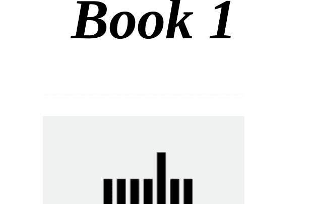


## 前言

2012 年，我出版了一本名为《机器学习：概率视角》的 1200 页书籍，它在概率建模这一统一视角下，对当时机器学习（ML）领域提供了相当全面的覆盖。该书反响良好，并于 2013 年获得了 De Groot 奖。

2012 年也通常被认为是“深度学习革命”的开始。术语“深度学习”指的是基于具有许多层的人工神经网络的 ML 分支（因此得名“深度”）。尽管这种基本技术已经存在多年，但直到 2012 年，它才开始在几个具有挑战性的基准上显著优于其他更“经典”的 ML 方法。例如，[KSH12] 使用深度神经网络（DNNs）赢得了 ImageNet 图像分类挑战，[CMS12] 使用 DNNs 赢得了另一项图像分类挑战，而 [DHK13] 使用 DNNs 在很大程度上优于现有的语音识别方法。这些突破得益于硬件技术的进步（特别是将视频游戏中的快速图形处理单元重新用于 ML），数据收集技术的进步（特别是使用众包收集大型标记数据集，如 ImageNet），以及各种新的算法思想。

自 2012 年以来，深度学习领域爆炸式增长，新进展以越来越快的速度出现。对该领域的兴趣也爆炸式增长，得益于该技术的商业成功以及可应用的广泛应用。因此，在 2018 年，我决定撰写我书籍的第二版，以尝试总结这些进展。

到 2020 年春季，我的第二版草稿已膨胀到约 1600 页，我仍未完成。此时发生了 3 件主要事件。首先，COVID-19 大流行爆发，因此我决定“转型”，以便将大部分时间花在 COVID-19 建模上。其次，MIT Press 告诉我他们无法出版一本 1600 页的书，我需要将其拆分为两卷。第三，我决定招募几位同事帮助我完成最后约 15% 的“缺失内容”。（见下文致谢。）

结果是两本新书，《概率机器学习：导论》，你现在正在阅读，以及《概率机器学习：高级主题》，它是本书的续集 [Mur22]。这两本书共同尝试使用我在第一本书中使用的概率建模和贝叶斯决策理论的相同统一视角，对 ML 领域进行相当广泛的覆盖。

第一本书的大部分内容已被重用，但现在在两本新书之间大致平均分配。此外，每本书都有大量新材料，涵盖一些来自深度

学习，但也包括该领域其他方面的进展，如生成模型、变分推断和强化学习。为了使本书更自成体系且对学生更有用，我还增加了一些背景内容，涉及优化和线性代数等主题，这些内容因篇幅限制在第一版中被省略。

另一个主要变化是，几乎所有的软件现在都使用 Python 而不是 Matlab。（未来，我们希望提供代码的 Julia 版本。）新代码利用了标准的 Python 库，如 numpy、scipy、scikit-learn 等。一些示例还依赖于各种深度学习库，如 TensorFlow、JAX 和 PyTorch。除了用于创建部分图表的脚本外，每个章节还配有 Jupyter 笔记本，讨论了我们在正文中没有空间涵盖的实践方面。详情请见 [http://mlbayes.ai](http://mlbayes.ai)。

## Acknowledgements

我谨感谢以下人员帮助我撰写本书的各个部分：

- Frederik Kunstner、Si Yi Meng、Aaron Mishkin、Sharan Vaswani 和 Mark Schmidt 帮助撰写了 [第5章（优化算法）](#) 的部分内容。
- Lihong Li 帮助撰写了 [第8.3节（赌博机问题）](#)。
- Justin Gilmer 帮助撰写了 [第14.6节（对抗示例）](#)。
- Krzysztof Choromanski 帮助撰写了 [第15.6节（高效Transformer）](#)。
- Andrew Wilson 帮助撰写了 [第17.4.2节（利用并行化和核矩阵结构）](#)。
- Colin Raffel 帮助撰写了 [第19.2节（迁移学习）](#) 和 [第19.6节（半监督学习）](#)。
- Bryan Perozzi 帮助撰写了 [第23章（图嵌入）](#)。
- Zico Kolter 帮助撰写了 [附录C（线性代数）](#) 的部分内容。

我还要感谢 John Fearns 审阅了几乎整本书。许多其他人对本书的部分内容提供了反馈，并帮助了代码工作。完整的贡献者名单请见 [网页](#)。

最后，我要感谢我在 Google 的经理 Doug Eck 允许我利用公司时间撰写本书，并感谢我的妻子 Margaret 允许我利用家庭时间撰写本书。我希望我将所有这些材料汇集在一处所做的努力，能帮助你在探索“ML 之地”的发现之旅中节省时间。

Kevin Patrick Murphy
Palo Alto, California
January 2021.

# 1 Introduction

## 1.1 What is machine learning?

机器学习的流行定义，或 ML，源自 Tom Mitchell [Mit97]，如下：

> 计算机程序被认为是在某些任务类 T 和性能度量 P 方面从经验 E 中学习，如果其在 T 中的任务性能，以 P 衡量，随着经验 E 的增加而提高。

因此，机器学习有许多不同种类，取决于我们希望系统学习的任务 T 的性质、用于评估系统的性能度量 P 的性质，以及我们给予它的训练信号或经验 E 的性质。

在本書中，我们将从概率角度涵盖最常见的 ML 类型。粗略地说，这意味着我们将所有未知量（例如，对某个感兴趣量未来值的预测，如明天的温度，或某个模型的参数）视为随机变量，这些随机变量赋予概率分布，描述变量可能取的一组加权可能值。（如有必要，请参阅第 D 章快速复习概率基础。）

我们采用概率方法有两个主要原因。首先，正如我们在第 8.1 节中所解释的，它是在不确定性下进行决策的最优方法。其次，概率建模是大多数其他科学和工程领域使用的语言，因此在这些领域之间提供了一个统一的框架。正如 DeepMind 研究员 Shakir Mohamed 所说：¹

> 几乎所有机器学习都可以用概率术语来描述，使其具有概率性。

经验 E 以 N 个输入-输出对的集合 D = {(x_n, y_n)}_{n=1}^N 的形式给出，称为训练集。（N 称为样本大小。）性能度量 P 取决于我们预测的输出类型，如下所述。

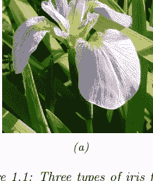

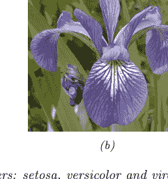

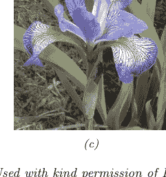

图 1.1：三种鸢尾花：setosa、versicolor 和 virginica。经 Dennis Kramb 和 SIGNA 友情许可使用。

| 索引 | sl | sw | pl | pw | 标签 |
|---|---|---|---|---|---|
| 0 | 5.1 | 3.5 | 1.4 | 0.2 | setosa |
| 1 | 4.9 | 3.0 | 1.4 | 0.2 | setosa |
| ... | ... | ... | ... | ... | ... |
| 50 | 7.0 | 3.2 | 4.7 | 1.4 | versicolor |
| ... | ... | ... | ... | ... | ... |
| 149 | 5.9 | 3.0 | 5.1 | 1.8 | virginica |

表 1.1：Iris 设计矩阵的子集。特征为：花萼长度、花萼宽度、花瓣长度、花瓣宽度。每类各有 50 个示例。

### 1.2.1 Classification

在分类问题中，输出空间是一组 C 个无序且互斥的标签，称为类别，Y = {1,2,...,C}。给定输入预测类别标签的问题也称为模式识别。（如果只有两个类别，通常表示为 y ∈ {0,1} 或 y ∈ {-1,+1}，则称为二元分类。）

#### 1.2.1.1 Example: classifying Iris flowers

例如，考虑将鸢尾花分类为其 3 个亚种 setosa、versicolor 和 virginica 的问题。图 1.1 显示了这些类别中的每一种的一个示例。

2. 有时（例如在 statsmodels Python 包中）x 被称为外生变量，y 被称为内生变量。

## 1.2 Supervised learning

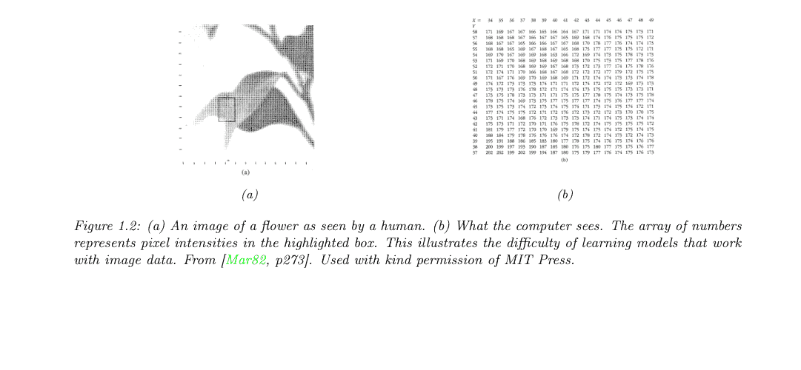

|58 37 189 167 196 187 165 184 164 167 171 171 174 175 173|
|94 348 564 567 896 807 859 859 169 169 179 179 174 175 173|
|95 189 169 169 169 169 166 166 172 169 173 173 174 175 173|
|52 172 174 175 173 173 171 171 172 172 174 174 175 175 173|
|46 173 175 178 173 173 171 171 174 174 175 175 176 176 173|
|47 175 178 173 173 174 174 175 175 176 176 177 177 173|
|46 173 175 174 173 173 174 174 175 175 176 176 177 177 173|
|45 175 174 174 173 173 174 174 175 175 176 176 177 177 173|
|44 177 175 174 174 173 173 174 174 175 175 176 176 177 177 173|
|40 181 171 174 174 174 174 175 175 176 176 177 177 178 177 173|
|35 179 171 172 172 172 172 173 173 174 174 175 175 176 176 177 177 173|
|39 195 171 172 172 172 172 173 173 174 174 175 175 176 176 177 177 173|
|39 195 171 172 172 172 172 173 173 174 174 175 175 176 176 177 177 173|
|39 195 171 172 172 172 172 173 173 174 174 175 175 176 176 177 177 173|
|39 195 171 172 172 172 172 173 173 174 174 175 175 176 176 177 177 173|

在图像分类中，输入空间 X 是图像的集合，这是一个非常高维的空间：对于具有 C = 3 个通道（例如 RGB）和 D₁ × D₂ 像素的彩色图像，我们有 X = R^D，其中 D = C × D₁ × D₂。（实际上我们用整数表示每个像素强度，通常取自范围 {0, 1, . . . , 255}，但为便于记号我们假设输入为实值。）从图像到标签的学习映射 f : X → Y 非常具有挑战性，如图 1.2 所示。然而，它可以使用某些类型的函数来解决，例如卷积神经网络或 CNN，我们将在第 14.1 节中讨论。

幸运的是，一些植物学家已经确定了 4 个简单但高度信息丰富的数值特征——花萼长度、花萼宽度、花瓣长度、花瓣宽度——可用于区分三种鸢尾花。在本节中，为简单起见，我们将使用这个维度 much 更低的输入空间，X = R^4。鸢尾花数据集是 150 个标记的鸢尾花示例的集合，每种类型 50 个，由这 4 个特征描述。它被广泛用作示例，因为它小而易于理解。（我们将在本书后面讨论更大更复杂的数据集。）

当我们有特征的小数据集时，通常将它们存储在 N × D 矩阵中，其中每一行代表一个示例，每一列代表一个特征。这称为设计矩阵；请参阅表 1.1 中的示例。³

鸢尾花数据集是表格数据的示例。当输入是可变大小的（例如单词序列或社交网络）而不是定长向量时，数据通常以设计矩阵以外的其他格式存储。然而，这类数据通常被转换为固定大小的特征表示（称为特征化过程），从而隐式创建用于进一步处理的設計矩阵。我们在第 10.4.3.1 节中给出了一个示例，在那里我们讨论了序列的词袋表示。


#### 1.2.1.2 探索性数据分析

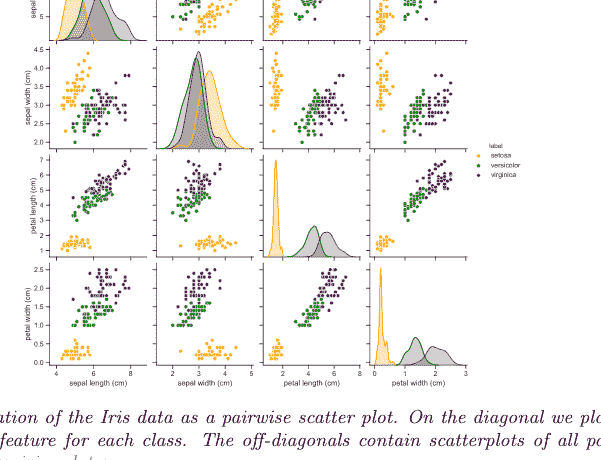

*图1.3：鸢尾花数据的成对散点图可视化。对角线绘制了每个类别中每个特征的边际分布。非对角线包含所有可能特征对的散点图。由 `iris_plot.py` 生成。*

在使用机器学习处理问题之前，通常最好先进行**探索性数据分析**，以查看是否存在任何明显的模式（这可能为选择何种方法提供提示），或数据中是否存在任何明显的问题（例如标签噪声或异常值）。

对于特征数量较少的表格数据，通常绘制**成对图**，其中我们显示每对变量的散点图，并按类别标签进行颜色编码。示例见图1.3。

对于高维数据，通常先进行**降维**，然后在二维或三维空间中可视化数据。我们将在第20章讨论降维方法。

#### 1.2.1.3 学习分类器

从图1.3可以看出，setosa类很容易与其他两类区分开来。例如，假设我们创建以下**决策规则**：

$$f(\mathbf{x}; \boldsymbol{\theta}) = \begin{cases} \text{若花瓣长度} < 2.45，\text{则为 Setosa} \\ \text{否则为 Versicolor 或 Virginica} \end{cases} \quad (1.1)$$

3. 这个特定的设计矩阵有$N = 150$行和$D = 4$列，因此呈**高瘦**形状，因为$N \gg D$。相比之下，一些数据集（例如基因组学）的特征比样本多，$D \gg N$；它们的设计矩阵呈**矮胖**形状。术语“大数据”通常指$N$很大，而术语“宽数据”指$D$（相对于$N$）很大。

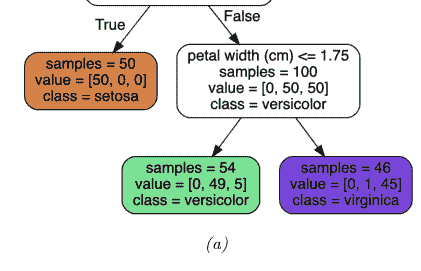
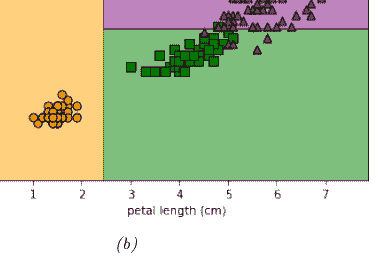

*图1.4：* 仅使用花瓣长度和花瓣宽度特征应用于鸢尾花数据的深度为2的决策树示例。叶节点根据预测类别进行颜色编码。每个方框内显示了从根节点到该节点的训练样本数量；我们展示了每个类别落入该节点的数值数量。这个计数向量可以归一化，以获得每个节点上类别标签的分布。然后我们可以选择多数类别。改编自[Gér19]的图6.1和图6.2。由 `trees/iris_dtree.ipynb` 生成。

这是一个非常简单的分类器示例，我们将输入空间划分为两个区域，由一维（1d）决策边界$x_{\text{花瓣长度}} = 2.45$定义。位于该边界左侧的点被分类为setosa；右侧的点为versicolor或virginica。

我们可以看到，这一规则完美分类了setosa样本，但无法完美分类virginica和versicolor样本。为了提高性能，我们可以递归地划分空间，对分类器出错的区域进行切分。例如，我们可以添加另一个决策规则，应用于未通过第一个测试的输入，检查花瓣宽度是否低于1.75厘米（如果是，则预测为versicolor）或高于1.75厘米（如果是，则预测为virginica）。我们可以将这些嵌套规则组织成树结构，称为决策树，如图1.4a所示。这产生了图1.4b中所示的二维决策面。

我们可以通过为每个内部节点存储所用的特征索引以及相应的阈值来表示树。我们用$\boldsymbol{\theta}$表示所有这些参数。我们将在第18.1节讨论如何学习这些参数。

#### 1.2.1.4 模型拟合

监督学习的目标是自动生成类似于图1.4a所示的分类模型，从而可靠地预测任何给定输入的标签。衡量此任务性能的一种常见方式是训练集上的误分类率：

$$\mathcal{L}(\boldsymbol{\theta}) \triangleq \frac{1}{N} \sum_{n=1}^{N} \mathbb{I}(y_n \neq f(\mathbf{x}_n, \boldsymbol{\theta})) \quad (1.2)$$

在许多情况下，由于对输入-输出映射缺乏了解（这称为**认知不确定性**或**模型不确定性**），和/或由于映射中固有的（不可约的）随机性（这称为**偶然不确定性**或**数据不确定性**），我们无法根据输入完美预测精确的输出。

例如，在图1.4b中，我们看到一个具有petal-length=5和petal-width=1.75的输入恰好位于virginica（紫色）和versicolor（绿色）之间的决策边界上，因此关于正确标签可能存在一些不确定性。我们可以使用以下**条件概率分布**来捕捉这种不确定性：

$$p(y = c|\mathbf{x}; \boldsymbol{\theta}) = f_c(\mathbf{x}; \boldsymbol{\theta}) \quad (1.7)$$

其中$f : \mathcal{X} \rightarrow [0,1]^C$将输入映射到$C$个可能输出标签上的概率分布。例如，给定图1.4a中的决策树，我们可以估计每个叶节点上类别标签的经验分布。如果我们考虑第二个（绿色）叶节点，我们得到$p(y|\mathbf{x} \in L_3(\boldsymbol{\theta})) = [0/54, 49/54, 5/54]$，这反映了输入空间该区域中的大多数样本是versicolor，但有些是virginica。

在预测中表示不确定性可能对某些应用很重要。例如，让我们回到有毒花的例子。如果我们确信花是setosa，我们可以享用健康的小吃，但如果我们不确定花是versicolor还是virginica，我们最好饿肚子。或者，如果我们不确定，我们可以选择执行**信息收集行动**，例如进行诊断测试。关于如何在存在不确定性的情况下做出最优决策的更多信息，请参阅第8.1节。

在拟合概率模型时，通常使用负对数概率作为损失函数：

$$\ell(y, f(\mathbf{x}; \boldsymbol{\theta})) = - \log p(y|f(\mathbf{x}; \boldsymbol{\theta})) \quad (1.8)$$

其原因在第8.1.6.1节中解释，但直觉是，一个好的模型（具有低损失）会为每个对应输入$\mathbf{x}$的真实输出$y$分配高概率。训练集的平均负对数概率由下式给出

$$\mathrm{NLL}(\boldsymbol{\theta}) = - \frac{1}{N} \sum_{n=1}^{N} \log p(y_n | f(\mathbf{x}_n; \boldsymbol{\theta})) \quad (1.9)$$

这被称为**负对数似然**。

### 1.2.2 回归

现在假设我们要预测实数数量$y \in \mathbb{R}$，而不是类标签$y \in \{1,\dots,C\}$；这被称为**回归**。例如，在鸢尾花的情况下，$y$可能是花被食用后的毒性程度，或植物的平均高度。

回归与分类非常相似。然而，由于输出是实值的，我们需要使用不同的损失函数。对于回归，最常见的选择是使用**二次损失**，即$\ell_2$损失：

$$\ell_2(y, \hat{y}) = (y - \hat{y})^2 \quad (1.10)$$

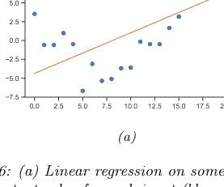
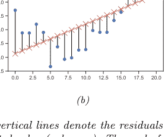

图1.6：（a）一些一维数据上的线性回归。（b）垂直线表示每个输入（蓝色圆圈）的观测输出值与其预测值（红色叉号）之间的残差。最小二乘回归的目标是选择一条使残差平方和最小的直线。由 `linreg_residuals_plot.py` 生成。

这比小残差更惩罚大残差$y - \hat{y}$。⁴ 使用二次损失时的经验风险等于均方误差或MSE：

$$\mathrm{MSE}(\boldsymbol{\theta}) = \frac{1}{N} \sum_{n=1}^{N} (y_n - f(\mathbf{x}_n; \boldsymbol{\theta}))^2 \quad (1.11)$$

#### 1.2.2.1 线性回归

作为示例，考虑图1.6a中的一维数据。我们可以使用以下形式的简单线性回归模型来拟合这些数据

$$f(x; \boldsymbol{\theta}) = b + w x \quad (1.12)$$

其中$w$是斜率，$b$是偏移量，$\boldsymbol{\theta} = (w, b)$是模型的所有参数。通过调整$\boldsymbol{\theta}$，我们可以最小化平方误差之和（由图1.6b中的垂直线所示），直到找到最小二乘解

$$\hat{\boldsymbol{\theta}} = \arg\min_{\boldsymbol{\theta}} \mathrm{MSE}(\boldsymbol{\theta}) \quad (1.13)$$

详见第11.2.2.1节。

如果我们有多个输入特征，我们可以写成

$$f(\mathbf{x}; \boldsymbol{\theta}) = b + w_1 x_1 + \dots + w_D x_D = b + \mathbf{w}^{\top} \mathbf{x} \quad (1.14)$$


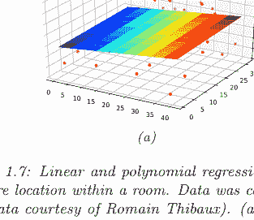

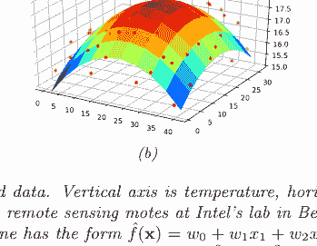

图 1.7：将线性和多项式回归应用于二维数据。纵轴是温度，横轴是房间内的位置。数据由加州伯克利 Intel 实验室的一些遥感微尘节点收集（数据由 Romain Thibaux 提供）。(a) 拟合平面的形式为 f(x)= w0 + w1 x1 + w2 x2。(b) 温度数据用如下形式的二次函数拟合：f(x)= w0 + w1 x1 + w2 x2 + w3 x1^2 + w4 x2^2。由 linreg_2d_surface_demo.py 生成。

我们可以扩展该模型以使用 D > 2 个输入特征（例如一天中的时间），但这样就更难可视化了。

为了减少符号的杂乱，通常将偏置项 b 吸收到权重 w 中，即定义 \tilde{w} = [b, w1, ..., wD] 和 \tilde{x} = [1, x1, ..., xD]，于是 \tilde{w}^T \tilde{x} = w^T x + b (1.16)

这会将仿射函数转换为线性函数。我们通常假设已经完成了这一步，因此可以直接写成 f(x; w) = w^T x。

在统计学中，参数 w 通常被称为回归系数（通常用 β 表示），b 被称为截距。在机器学习中，参数 w 被称为权重，b 被称为偏置。这些术语源自电气工程：在那里，我们把函数 f 看作一个电路，它接受 x 并返回 f(x)。每个输入都通过带有权重 w 的“导线”馈入电路。电路计算其输入的加权和，再加上一个常数偏置或偏移项 b。（“偏置”一词的这种用法不应与第 E.4.1 节中讨论的统计学概念“偏差”相混淆。）

#### 1.2.2.2 多项式回归

图 1.6a 中的线性模型显然对数据的拟合效果不佳。我们可以使用 D 次多项式回归模型来改进拟合。其形式为 f(x; w) = w^T φ(x)，其中 φ(x) 是从输入导出的特征向量，具体形式如下：φ(x) = [1, x, x^2, ..., x^D] (1.17)

这是特征预处理的一个简单例子，也称为特征工程。

在图 1.8a 中，我们看到使用 D = 2 会得到好得多的拟合效果。我们可以继续增大 D，从而增加模型中参数的数量，直到 D = N − 1；在这种情况下，每个数据点有一个参数，因此我们可以完美地**插值**数据。由此得到的模型 MSE 为 0，如图 1.8c 所示。然而，直观地说，所得函数对未来的输入不会是一个好的预测器，因为它过于“弯弯曲曲”。我们将在第 1.2.3 节更详细地讨论这一点。

我们也可以将多项式回归应用于多维输入。例如，图 1.7(b) 绘制了对输入进行二次展开后的温度模型预测 $f(\mathbf{x}; \mathbf{w}) = w_0 + w_1 x_1 + w_2 x_2 + w_3 x_1^2 + w_4 x_2^2$ (1.18)

二次曲面比图 1.7(a) 中的线性模型能更好地拟合数据，因为它捕捉到了房间中间更热这一事实。我们还可以添加交叉项（例如 $x_1 x_2$）来捕捉交互效应。详见第 10.4.2 节。

请注意，上述模型使用的预测函数仍然是参数 $\mathbf{w}$ 的线性函数，尽管它是原始输入 $\mathbf{x}$ 的非线性函数。这之所以重要，是因为如我们在第 11.2.2.1 节中解释的，线性模型产生的 MSE 损失函数 $\mathrm{MSE}(\boldsymbol{\theta})$ 具有唯一的全局最优解。

#### 1.2.2.3 深度神经网络

在第 1.2.2.2 节中，我们手动指定了输入特征的变换，即多项式展开 $\phi(\mathbf{x}) = [1, x_1, x_2, x_1^2, x_2^2, \cdots]$。我们可以通过学习来构建更加强大的模型。

如何选择具有合适复杂度的模型？如果我们用训练集来评估不同的模型，我们总会选择最复杂的模型，因为它具有最多的**自由度**，因而损失最小。因此，我们应该选择测试损失最小的模型。

在实践中，我们需要将数据划分为三个集合，即训练集、测试集和**验证集**；后者用于模型选择，而我们只用测试集来估计未来性能（总体风险）。也就是说，测试集不用于模型拟合，也不用于模型选择。更多细节见第 4.4.4 节。

## 1.3 无监督学习

在监督学习中，我们假设训练集中的每个输入样本 **x** 都有一组相应的输出目标 **y**，我们的目标是学习输入-输出映射。尽管这很有用，有时也颇具难度，但监督学习本质上只是“美化的曲线拟合” [Pea18]。

一个可以说更有趣的任务是试图“理解”数据，而不是仅仅学习一个映射。也就是说，我们只得到观测到的“输入” D = {**x**_n : n = 1 : N}，而没有对应的“输出” **y**_n。这被称为**无监督学习**。

从概率的角度来看，我们可以将无监督学习的任务视为拟合形如 p(**x**) 的无条件模型，该模型可以生成新的数据 **x**；而监督学习则涉及拟合条件模型 p(**y**|**x**)，它指定给定输入时的输出（的分布）。⁵

无监督学习避免了为训练而收集大规模标注数据集的需要，而标注数据往往既耗时又昂贵（想想请医生标注医学图像的情形）。

无监督学习也避免了学习如何将世界划分为常常是任意的类别。例如，考虑标注视频中“喝”或“小口抿”这样的动作何时发生的任务。是当人拿起杯子时，还是杯子第一次碰到嘴唇时，还是液体倒出时？如果他们先倒出一些液体，然后停顿，然后再倒——这是两个动作还是一个？人类往往会在这些问题上产生分歧 [Idr+17]，这意味着该任务没有被明确定义。因此，期望机器学习这样的映射是不合理的。⁶

最后，无监督学习迫使模型“解释”高维输入，而不仅仅是低维输出。这使我们能够学习关于“世界如何运作”的更丰富的模型。正如多伦多大学著名的机器学习教授 Geoff Hinton 所说：

> 我们在学习看东西时，没有人告诉我们正确答案是什么——我们只是去看。偶尔，你的母亲会说“那是一只狗”，但这是非常少的信息。以这种方式，你能获得几个比特的信息就算幸运了——甚至每秒一个比特。大脑的视觉系统有 10¹⁴ 个神经连接。而你只能活 10⁹ 秒。所以每秒学习一个比特没有用。你需要大约每秒 10⁵ 比特。而只有一个地方能获得这么多信息：从输入本身。—— Geoffrey Hinton，1996 年（引自 [Gor06]）。

⁵ 在统计学界，通常用 **x** 表示外生变量，它们不被建模，而只是作为输入给出。因此，无条件模型应记为 p(**y**) 而不是 p(**x**)。

⁶ 一种更合理的方法是尝试刻画由“一群”标注者产生的标签的概率分布（例如参见 [Dum+18; Aro+19]）。这样做正视了这样一个事实：由于任务本身的模糊性，给定输入可能存在多个“正确”标签。

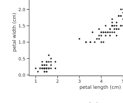

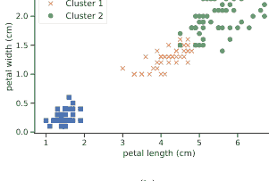

图 1.9：(a) 鸢尾花数据集中花瓣特征的散点图。(b) 使用 K = 3 进行无监督聚类的结果。由 *iris_kmeans.py* 生成。

### 1.3.1 聚类

无监督学习的一个简单例子是在数据中寻找**簇**的问题。目标是将输入划分为包含“相似”点的区域。例如，考虑鸢尾花数据集的二维版本。在图 1.9a 中，我们展示了不带任何类别标签的点。直观上，数据中至少有两个簇，一个在左下角，一个在右上角。此外，如果我们假设一组“好的”簇应当相当紧凑，那么我们可能想把右上角分成（至少）两个子簇。最终划分为三个簇的结果如图 1.9b 所示。（注意，簇的数量并没有唯一正确的答案；相反，我们需要考虑模型复杂度与数据拟合之间的权衡。我们将在第 21.3.7 节讨论如何进行这种权衡。）

### 1.3.2 自监督学习

近年来流行的一种无监督学习方法是**自监督学习**。在这种方法中，我们从无标签数据中创建代理监督任务。例如，我们可能尝试学习从灰度图像预测彩色图像，或者遮盖句子中的某些词，然后根据周围的上下文预测它们。我们希望得到的预测器 $\hat{\mathbf{x}}_1 = f(\mathbf{x}_2; \boldsymbol{\theta})$（其中 $\mathbf{x}_2$ 是观测输入，$\mathbf{x}_1$ 是预测输出）能从数据中学到有用的特征，这些特征随后可用于标准的、下游的监督任务。我们将在第 19.2 节更详细地讨论这种方法。

### 1.3.3 评估无监督学习

尽管无监督学习很有吸引力，但评估无监督学习方法的输出质量非常困难，因为没有可以与之比较的真值 [TOB16]。

评估无监督模型的一种常见方法是测量模型分配给未见过的测试样本的概率。为此，我们可以计算数据的（无条件）负对数似然：

$\mathcal{L}(\boldsymbol{\theta}; \mathcal{D}) = -\frac{1}{|\mathcal{D}|} \sum_{\mathbf{x} \in \mathcal{D}} \log p(\mathbf{x}|\boldsymbol{\theta})$ (1.24)


这将无监督学习的问题视为 **密度估计** 的问题。其思想是，一个好的模型不会对实际数据样本感到“惊讶”（即，会为其分配高概率）。此外，由于概率之和必须为 1.0，如果模型对数据样本所在的数据空间区域分配高概率，则它隐式地对数据不来自的区域分配低概率。因此，模型学会了捕捉数据中的 **典型模式**。这可以用于 **数据压缩** 算法内部。

不幸的是，密度估计很困难，尤其是在高维情况下。此外，一个对数据分配高概率的模型可能并未学习到有用的高层模式（毕竟，模型只需记住所有训练示例即可）。

替代的评估指标是使用学习到的无监督表示作为特征或输入给下游的监督学习方法。如果无监督方法发现了有用的模式，那么就应该能够使用这些模式进行监督学习，而使用的标记数据比使用原始特征时少得多。例如，在第 1.2.1.1 节中，我们看到鸢尾花的手动定义的 4 个特征包含了执行分类所需的大部分信息。因此，我们仅使用 150 个示例就能训练出性能完美的分类器。如果输入是原始像素，我们就需要更多示例才能达到可比的性能（参见第 14.1 节）。也就是说，我们可以通过先学习一个好的表示来提高学习的 **样本效率**（即，减少获得良好性能所需的标记示例数量）。

提高样本效率是一个有用的评估指标，但在许多应用中，尤其是在科学中，无监督学习的目的是 *获得理解*，而不是提高某些预测任务的性能。这需要使用 **可解释** 的模型，但这些模型也能生成或“解释”数据中观察到的大部分模式。借用柏拉图的话，目标是发现如何“按其关节分割自然”。当然，评估我们是否成功发现了某个数据集背后的真实底层结构通常需要进行实验，从而与世界互动。我们将在第 1.4 节进一步讨论这一主题。

## 1.4 强化学习

除监督学习和无监督学习之外，还有第三种 ML，称为 **强化学习 (RL)**。在此类问题中，系统或 **智能体** 必须学习如何与其环境交互。这可以通过一种 **策略** **a** = π(**x**) 来编码，该策略指定针对每个可能的输入 **x**（源自环境状态）应采取什么动作。

例如，考虑一个学习玩电子游戏的智能体，例如 Atari《太空侵略者》（参见图 1.10a）。在这种情况下，输入 **x** 是图像（或过去图像的序列），输出 **a** 是移动方向（左或右）以及是否发射导弹。作为更复杂的例子，考虑机器人学习行走的问题（参见图 1.10b）。在这种情况下，输入 **x** 是所有肢体的关节位置和角度的集合，输出 **a** 是一组致动或电机控制信号。

与监督学习 (SL) 的不同之处在于，系统不会被告知哪种动作是最好的（即对于给定的输入应产生什么输出）。相反，系统只是偶尔会根据其采取的动作收到 **奖励**（或惩罚）信号。这就像 **向批评者学习**，批评者偶尔会给出竖大拇指或竖拇指向下，而与 **向教师学习** 相反，教师会在每一步告诉你该做什么。

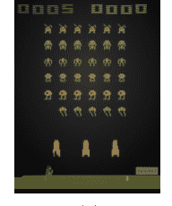

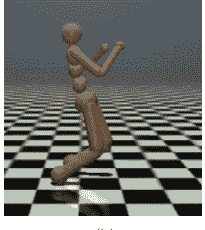

Figure 1.10: 一些控制问题的示例。(a) 太空侵略者 Atari 游戏。来自 https://gym.openai.com/envs/SpaceInvaders-v0/。(b) 在 MuJoCo 模拟器中控制人形机器人使其尽可能快地行走而不倒下。来自 https://gym.openai.com/envs/Humanoid-v2/

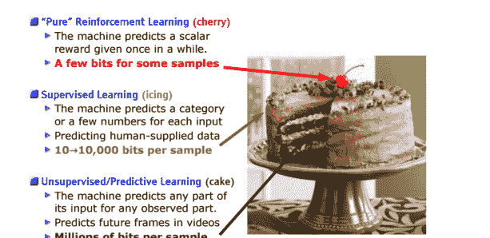

Figure 1.11: 三种机器学习类型可视化为巧克力蛋糕的层级。该图（最初来自 https://bit.ly/2m65Vs1）曾在 Yann Le Cun 在 NIPS'16 的演讲中使用，并经其许可使用。

RL 近期变得越来越受欢迎，这得益于其广泛的适用性（因为智能体试图优化的奖励信号可以是任何感兴趣的指标）。然而，由于多种原因，使 RL 发挥作用可能比监督学习或无监督学习更困难。一个关键的困难是奖励信号可能只偶尔给出（例如，如果智能体最终达到期望状态），即使如此，智能体也可能不清楚其众多动作中哪些导致了奖励。（想象一下玩象棋游戏，在游戏结束时只有一个胜负信号。）

为了弥补来自奖励信号的最小信息量，通常会使用其他信息来源，例如专家演示，可以以监督方式使用，或未标记数据，可以由无监督学习系统用来发现环境的底层结构。这使得从有限次数的试验（与环境的交互）中学习成为可能。正如 Yann Le Cun 在 2016 年 NIPS 会议上的邀请演讲中所说：“If intelligence was a cake, unsupervised learning would be the chocolate sponge, supervised learning would be the icing, and reinforcement learning would be the cherry.” 这在图 1.11 中有所说明。

有关 RL 的更多信息可在本书的续集中找到，[Mur22]。

## 1.5 讨论

在本节中，我们将 ML 和本书置于更大的背景中。

### 1.5.1 ML 与其他领域的关系

有几个子社区从事 ML 相关主题的工作，每个社区都有不同的名称。**预测分析** 领域与监督学习（尤其是分类和回归）相似，但更侧重于商业应用。**数据挖掘** 涵盖监督和无监督机器学习，但更侧重于结构化数据，通常存储在大型的商业数据库中。**数据科学** 使用机器学习和统计技术，但也强调其他主题，例如数据集成、数据可视化以及与领域专家的合作，通常在一个迭代反馈循环中（参见例如，[BS17]）。这些领域之间的差异通常只是术语上的。

ML 也与 **统计学** 领域密切相关。事实上，斯坦福大学著名的统计学教授 Jerry Friedman 说

> [如果统计学领域] 从其诞生之初就将计算方法作为基本工具纳入，而不是仅仅作为应用现有工具的便捷方式，许多其他数据相关领域 [例如 ML] 就不需要存在——它们本应是统计学的一部分。—— Jerry Friedman [Fri97b]

机器学习也与 **人工智能** (**AI**) 相关。历史上，AI 领域假设我们可以通过手工编程“智能”（参见例如，[RN10; PM17]），但这种方法在很大程度上未能达到预期，主要是因为显式编码此类系统所需的所有知识被证明太困难。因此，人们重新对使用 ML 帮助 AI 系统获取自身知识产生了兴趣。（事实上，联系如此紧密，以至于有时“ML”和“AI”术语可以互换使用。）

### 1.5.2 书籍结构

我们已经看到 ML 与数学、统计学、计算机科学等许多其他学科密切相关。很难知道从哪里开始。

在本書中，我们通过概率论作为统一的透镜，在这个相互关联的领域中走一条特定的路径。我们在第一部分介绍统计基础，在第二部分至第四部分介绍监督学习，在第五部分介绍无监督学习。相关背景材料在

附录。有关无监督学习和强化学习的更多信息，请参阅本书的续作，[Mur22]。

除了本书本身，您可能会觉得随书提供的在线 Python 笔记本很有帮助。详情见 http://mlbayes.ai。

### 1.5.3 注意事项

在本书中，我们将了解如何使用机器学习来创建能够（尝试）根据输入预测输出的系统，然后利用这些预测来选择行动，以最小化预期损失。在设计此类系统时，很难设计出能正确指定我们所有偏好的损失函数；这可能导致“**奖励黑客**”，即机器优化了我们提供的奖励函数，但我们随后发现该函数并未捕捉到我们忘记指定的各种约束或偏好 [Wei76; Amo+16; D’A+20]。（在需要在多个目标之间进行权衡时，这一点尤为重要。）

在**人工智能伦理**和**人工智能安全**的背景下，奖励引发了一系列担忧（参见例如 [KR19]）。Russell [Rus19] 提出通过不指定奖励函数，而是迫使机器通过观察人类行为来推断奖励，从而解决这个问题，这种方法被称为**逆强化学习**。然而，过于紧密地模仿当前或过去的人类行为可能并不理想，并且可能受到可用于训练的数据的偏见影响（参见例如 [Pau+20]）。

另一种方法是将机器学习视为构建自适应组件的工具，这些组件是更大系统的一部分。这样的系统应像我们设计和监管其他复杂的、半自主的人类制品（如飞机、在线交易平台或医疗诊断系统）那样进行设计和监管（参见 [Jor19]）。机器学习在此类系统中扮演关键角色，但应设置额外的制衡机制，以编码我们的先验知识和偏好，并确保系统按我们 intended 的方式行动。

## 第一部分

## 基础

# 2 概率推断

## 2.1 引言

在本章中，我们将介绍一些基本的概率“机制”，我们将使用它们来解决机器学习问题。

## 2.2 贝叶斯法则

> 贝叶斯定理之于概率论，犹如毕达哥拉斯定理之于几何学。—— Sir Harold Jeffreys, 1973 [Jef73]。

在本节中，我们将讨论**贝叶斯推断**的基础知识。根据《韦氏词典》，“推断”一词意味着“从样本数据到概括，通常带有计算过的确定性程度”。术语“贝叶斯”用于指代使用概率论表示“确定性程度”并利用**贝叶斯法则**¹来根据数据更新确定性程度的推断方法。

贝叶斯法则本身非常简单：它只是一个用于计算在给定观测数据 $Y = y$ 时，未知（或**隐变量**）量 $H$ 可能值的概率分布的公式：

$p(H = h|Y = y) = \frac{p(H = h)p(Y = y|H = h)}{p(Y = y)}$ (2.1)

这自然由以下恒等式得出：

$p(h|y)p(y) = p(h)p(y|h) = p(h, y)$ (2.2)

而该恒等式本身又源于**概率乘法法则**。²

1. Thomas Bayes (1702-1761) 是一位英国数学家和长老会牧师。关于应将此拼写为 Bayes’ rule 还是 Bayes’s rule 的讨论，参见 https://bit.ly/2kDtLuK。

2. 如果您对这几个方程不熟悉，请参阅附录 D 复习概率论。另外，请注意我们略微滥用了记法，使用 $p(h)$ 作为 $p_H(h)$ 的简写，$p(y)$ 作为 $p_Y(y)$ 的简写，等等。即，$p(h)$ 和 $p(y)$ 是在不同值上求值的不同函数。（相比之下，$f(h)$ 和 $f(y)$ 是同一函数 $f$ 在不同值上求值的结果。）我们希望通过上下文能清楚其含义。此外，我们使用 $p()$ 来表示概率质量函数（针对离散随机变量）和概率密度函数（针对连续随机变量）。最后，我们写 $p(h)$ 表示分布 $p_H()$ 在 $h$ 处求值对应的标量值，并写 $p(H)$ 表示对所有可能值的完整分布。

在公式 (2.1) 中，项 $p(H)$ 代表我们在看到任何数据之前对 $H$ 的可能值所知道的信息；这被称为**先验分布**。（如果 $H$ 有 $K$ 个可能值，那么 $p(H)$ 是一个由 $K$ 个概率组成的向量，其和为 1。）项 $p(Y \mid H = h)$ 代表如果 $H = h$ 时我们预期的结果 $Y$ 的分布；这被称为**观测分布**。当我们在对应于实际观测值 $y$ 的点评估此分布时，得到函数 $p(Y = y \mid H = h)$，这被称为**似然**。（注意这是 $h$ 的函数，因为 $y$ 是固定的，但它不是概率分布，因为它的和不为 1。）将先验分布 $p(H = h)$ 乘以每个 $h$ 的似然函数 $p(Y = y \mid H = h)$，得到未归一化的联合分布 $p(H = h, Y = y)$。我们可以通过除以 $p(Y = y)$ 将其转换为归一化分布，$p(Y = y)$ 被称为**边际似然**，因为它是通过边缘化未知量 $H$ 计算得出的：

$$p(Y = y) = \sum_{h' \in \mathcal{H}} p(H = h')p(Y = y \mid H = h') = \sum_{h' \in \mathcal{H}} p(H = h', Y = y)$$  
(2.3)

通过计算每个 $h$ 的 $p(H = h, Y = y)/p(Y = y)$ 来归一化联合分布，得到**后验分布** $p(H = h \mid Y = y)$；这代表了我们关于 $H$ 可能值的新**信念状态**。

我们可以用文字概括贝叶斯法则如下：

$$\text{后验} \propto \text{先验} \times \text{似然}$$  
(2.4)

这里我们使用符号 $\propto$ 表示“成正比”，因为我们忽略了分母，分母只是一个独立于 $H$ 的常数。使用贝叶斯法则根据相关观测数据更新关于某个感兴趣量的未知值的分布，被称为**贝叶斯推断**，或**后验推断**。也可以简单地称为**概率推断**。

下面给出了一些贝叶斯推断起作用的简单示例。我们将在本书的后面看到更多有趣的示例。

### 2.2.1 示例：检测 COVID-19

假设你认为自己可能感染了**COVID-19**，这是一种由**SARS-CoV-2** 病毒引起的传染病。你决定进行一次诊断测试，并想利用其结果来确定自己是否感染。

设 $H = 1$ 表示你感染的事件，$H = 0$ 表示你未感染的事件。如果测试结果为阳性，设 $Y = 1$；如果测试结果为阴性，设 $Y = 0$。我们要计算 $p(H = h \mid Y = y)$，其中 $h \in \{0,1\}$，$y$ 是观测到的测试结果。（为了简洁起见，我们将值分布 $[p(H = 0 \mid Y = y), p(H = 1 \mid Y = y)]$ 写为 $p(H \mid y)$。）我们可以将此视为**二分类**的一种形式，其中 $H$ 是未知的类别标签，$y$ 是特征向量。

首先我们必须指定似然。这个量显然取决于测试的可靠性。有两个关键参数。**灵敏度**（又称**真阳性率**）定义为 $p(Y = 1 \mid H = 1)$，即真值为阳性时测试结果为阳性的概率。**假阴性率**定义为 1 减去灵敏度。**特异度**（又称**真阴性率**）定义为 $p(Y = 0 \mid H = 0)$，即真值为阴性时测试结果为阴性的概率。**假阳性率**定义为 1 减去特异度。我们在表 2.1 中总结了所有这些量。（更多细节参见 8.1.3.1 节。）参考 [https://myti.ms/3lTtZgV](https://myti.ms/3lTtZgV)，我们将灵敏度设为 87.5%，特异度设为 97.5%。

| H | Y=0 | Y=1 |
| --- | --- | --- |
| H=0 | TNR | FPR |
| H=1 | FNR | TPR |

表 2.1：二元结果 Y 在两个可能的隐状态 H 下的似然函数 p(Y|H)。每行之和为 1。缩写：TNR 为真阴性率，TPR 为真阳性率，FNR 为假阴性率，FPR 为假阳性率。

接下来我们必须指定先验。量 p(H = 1) 代表您居住地区的疾病患病率。为了说明目的，我们将其设为 p(H = 1) = 0.1。

现在假设你测试呈阳性。我们有：
p(H = 1|Y = 1) = p(Y = 1|H = 1)p(H = 1) / [p(Y = 1|H = 1)p(H = 1) + p(Y = 1|H = 0)p(H = 0)]
= TPR × 先验 / (TPR × 先验 + FPR × (1 - 先验))
= 0.875 × 0.1 / (0.875 × 0.1 + 0.025 × 0.9) = 0.795

因此，你感染的可能性为 79.5%。

现在假设你测试呈阴性。你感染的概率为：
p(H = 1|Y = 0) = p(Y = 0|H = 1)p(H = 1) / [p(Y = 0|H = 1)p(H = 1) + p(Y = 0|H = 0)p(H = 0)]
= FNR × 先验 / (FNR × 先验 + TNR × (1 - 先验))
= 0.125 × 0.1 / (0.125 × 0.1 + 0.975 × 0.9) = 0.014

因此，你感染的可能性仅为 1.4%。（如果患病率（基础率）降至 p(H = 1) = 0.01，这两个数字分别降至 26% 和 0.13%。另见练习 2.1。）

在上面的示例中，我们假设灵敏度和特异度参数是已知的。参见 [GC20] 了解当这些参数存在不确定性时，如何在对诊断测试中应用贝叶斯法则。

### 2.2.2 示例：蒙提·霍尔问题

在本节中，我们考虑贝叶斯法则的一个更“琐碎”的应用。具体来说，我们将它应用于著名的蒙提·霍尔问题。

想象一个游戏节目，规则如下：有三扇门，标记为 1、2、3。一个奖品（例如，一辆车）藏在其中一扇门后面。你可以选择一扇门。然后游戏节目主持人打开另外两扇门中的一扇（不是你选的那扇），且保证不显示奖品位置。此时，你将再次获得选择门的机会：你可以坚持你的第一次选择，或者切换到另一扇关闭的门。然后所有门都会打开，你将获得最终选择的门后的奖品。


| 门 1 | 门 2 | 门 3 | 换门 | 留门 |
|---|---|---|---|---|
| 汽车 | - | - | 输 | 赢 |
| - | 汽车 | - | 赢 | 输 |
| - | - | 汽车 | 赢 | 输 |

*表 2.2：蒙提霍尔游戏的 3 种可能状态，显示出换门（平均而言）比坚持原选择好两倍。改编自 [PM18] 的表 6.1。*

例如，假设你选择了门 1，而游戏节目主持人打开了门 3，揭露门后什么都没有，正如承诺的那样。你应该（a）坚持门 1，还是（b）换到门 2，还是（c）两者没有区别？

直观上，似乎应该没有区别，因为你最初的门选择无法影响奖品的位置。然而，主持人打开门 3 这一事实告诉我们有关奖品位置的信息，因为他是在知道真实位置并基于你的选择的情况下做出选择的。正如我们下面所示，如果你换到门 2，实际上赢得奖品的可能性是两倍。

为了证明这一点，我们将使用贝叶斯规则。令 $H_i$ 表示奖品在门 $i$ 后面的假设。我们做出以下假设：三个假设 $H_1$、$H_2$ 和 $H_3$ 先验上等概率，即

$$P(H_1)=P(H_2)=P(H_3)=\frac{1}{3}. \tag{2.11}$$

我们在选择门 1 后收到的观测数据要么是 $Y = 3$ 要么是 $Y = 2$（分别表示打开门 3 或门 2）。我们假设这两种可能结果具有以下概率。如果奖品在门 1 后面，则主持人会在 $Y = 2$ 和 $Y = 3$ 之间随机选择。否则主持人的选择是强制的，概率为 0 和 1。

$$\begin{array}{|l|l|l|}\hline P(Y=2|H_1)=\frac{1}{2} & P(Y=2|H_2)=0 & P(Y=2|H_3)=1 \\ P(Y=3|H_1)=\frac{1}{2} & P(Y=3|H_2)=1 & P(Y=3|H_3)=0 \end{array}\tag{2.12}$$

现在，利用贝叶斯定理，我们评估假设的后验概率：

$$P(H_i|Y=3)=\frac{P(Y=3|H_i)P(H_i)}{P(Y=3)}\tag{2.13}$$

$$\begin{array}{|l|l|l|}\hline P(H_1|Y=3)=\frac{(1/2)(1/3)}{P(Y=3)} & P(H_2|Y=3)=\frac{(1)(1/3)}{P(Y=3)} & P(H_3|Y=3)=\frac{(0)(1/3)}{P(Y=3)} \end{array}\tag{2.14}$$

分母 $P(Y=3)$ 为 $P(Y=3)=\frac{1}{6}+\frac{1}{3}=\frac{1}{2}$。所以

$$\begin{array}{|l|l|l|}\hline P(H_1|Y=3)=\frac{1}{3} & P(H_2|Y=3)=\frac{2}{3} & P(H_3|Y=3)=0. \end{array}\tag{2.15}$$

因此，参赛者应换到门 2 以获得获得奖品的最大机会。参见表 2.2 的具体示例。

## 2.3 贝叶斯概念学习

在第 2.2 节中，我们讨论了从单个观测 y 推断感兴趣的隐藏量 h ∈ ℋ 的问题。我们可以很容易地将其推广到观测数据是一组观测的情况，𝒟 = {yₙ : n = 1 : N}；现在目标是推断数据背后的隐藏共同模式，或 **概念**。通常，我们用概率分布 p(h|𝒟) 表示我们对哪个概念最能解释数据的不确定性。

作为一个激励示例，考虑孩子如何学习单词的含义，例如“dog”。通常孩子的父母会指出该概念的 **正例**，说诸如，“look at the cute dog!”，或“mind the doggy”，等。核心挑战是根据有限的（并且可能相当少）此类示例弄清楚我们对单词“dog”的含义。具体来说，我们应该能够预测哪些其他物体会被认为是“dog”，哪些不会。

请注意，父母不太可能提供 **反例**；例如，人们通常不会说“look at that non-dog”。反例可能在主动学习过程中获得（例如，孩子说“look at the dog”而父母说“that’s a cat, dear, not a dog”），但心理学研究表明，人们可以仅从正例中学习概念 [XT07]。这意味着标准监督学习方法无法解释这种行为；然而，贝叶斯推断可用于说明人类如何以无监督的方式学习单词的含义 [XT07] 以及语言的其他方面（例如 [CM06]），以及他们如何从真实世界图像中学习视觉概念 [Jia+13]。

而不是处理从真实数据学习中的复杂性，在本节中我们考虑来自 [Ten00] 的该问题的两种简化形式，这将作为贝叶斯概念学习方法的温和介绍。

### 2.3.1 学习离散概念：数字游戏

假设我们正试图从一位提供该概念示例的教师那里学习某个数学概念。我们假设一个概念被定义为属于其 **外延** 的正整数集合；例如，“偶数”概念由 $h_{\text{even}} = \{2, 4, 6, \dots\}$ 定义，而“2 的幂”概念由 $h_{\text{two}} = \{2, 4, 8, 16, \dots\}$ 定义。为简单起见，我们假设数字范围在 1 到 100 之间。

例如，假设我们看到一个示例，𝒟 = {16}。你认为哪些其他数字是该概念的示例？17？6？32？99？仅凭一个示例很难判断，因此你的预测会相当模糊。 presumably 与 16 在某种意义上相似的数字更有可能。但相似在什么方面？17 相似，因为它“很近”，6 相似因为它有共同的数字，32 相似因为它也是偶数和 2 的幂，但 99 似乎不相似。因此有些数字比其他数字更可能。

现在假设我告诉你 𝒟 = {2, 8, 16, 64} 是正例。你可能会猜测隐藏的概念是“2 的幂”。根据你对真实（但隐藏）概念的信念，你可以有信心地预测 y ∈ {2, 4, 8, 16, 32, 64} 也可能在未来由教师生成。这是一个 **泛化** 的例子，因为我们在对尚未看到的未来数据做出预测。

图 2.2 给出了人类在此任务上表现的示例。给定单个示例，例如 𝒟 = {16} 或 𝒟 = {60}，人类对其他量级相似的数字做出相当分散的预测。但当给出多个示例，例如 𝒟 = {2, 8, 16, 64}，人类经常发现

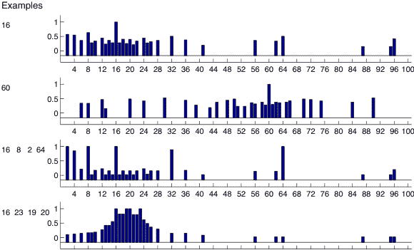

*图 2.2：数字游戏中基于 8 名人类预测得出的经验成员分布。* 前两行：在看到 $D = \{16\}$ 和 $D = \{60\}$ 之后。这说明了弥散相似性。第三行：在看到 $D = \{16, 8, 2, 64\}$ 之后。这说明了类规则行为（2 的幂）。底部一行：在看到 $D = \{16, 23, 19, 20\}$ 之后。这说明了聚焦相似性（接近 20 的数字）。摘自 [Ten99] 的图 5.5。在 Josh Tenenbaum 友情许可下使用。

一个潜在的 **模式**，并利用它对哪些其他数字可能属于同一概念做出相当精确的预测，即使那些其他数字“相距甚远”。

我们如何解释这种行为并在机器中模拟它？解决 **归纳** 问题的经典方法是假设我们有一个概念的假设空间 $\mathcal{H}$（例如偶数、1 到 10 之间的所有数字等），然后识别与观测数据 $D$ 一致的 $\mathcal{H}$ 的最小子集；这称为 **版本空间**。随着我们看到更多示例，版本空间缩小，我们对潜在假设变得越来越确定 [Mit97]。

然而，版本空间理论无法解释我们在图 2.2 中看到的人类行为。例如，在看到 $D = \{16, 8, 2, 64\}$ 之后，为什么人们选择规则“2 的幂”，而不是“所有偶数”，或“除 32 外的 2 的幂”，两者都与证据同样一致？我们现在将展示贝叶斯推断如何解释这种行为。所得预测显示在图 2.3 中。

#### 2.3.1.1 似然

我们必须解释为什么在看到 $D = \{16, 8, 2, 64\}$ 之后，人们选择了 $h_{\mathrm{two}}$ 而不是 $h_{\mathrm{even}}$，鉴于两个假设都与证据一致。关键直觉是我们想要避免 **可疑的巧合**。例如，如果真实概念是偶数，那么我们恰好只看到 2 的幂就会令人惊讶。

为了形式化这一点，让我们假设示例是从概念的 **外延** 中均匀随机抽样的。（Tenenbaum 将此称为 **强采样假设**。）在此假设下，从未知的

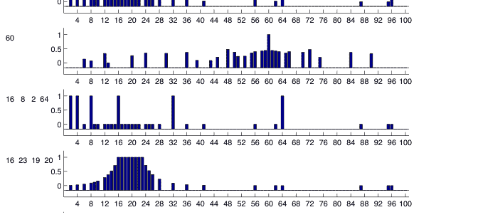

图 2.3：使用完整假设空间得出的后验成员概率。与图 2.2 对比。贝叶斯模型的预测仅针对有人类数据可用的那些值进行绘制；这就是为什么顶线看起来比图 2.5 更稀疏的原因。取自 [Ten99] 的图 5.6。经 Josh Tenenbaum 许可使用。

concept h is given by

$p(D|h) = \prod_{n=1}^{N} p(y_n|h) = \prod_{n=1}^{N} \frac{1}{\text{size}(h)} \mathbb{I}(y_n \in h) = \left[\frac{1}{\text{size}(h)}\right]^N \mathbb{I}(D \in h)$ (2.16)

其中 $\mathbb{I}(D \in h)$ 当且仅当所有数据点都位于 $h$ 的支撑中时非零。这个关键方程体现了 Tenenbaum 所称的大小原则，这意味着模型偏好与数据一致的最简单（最小）假设。这更 commonly known as 奥卡姆剃刀。

要了解其工作原理，让 $D = \{16\}$。那么 $p(D|h_{\text{two}}) = 1/6$，因为小于 100 的 2 的幂只有 6 个，但 $p(D|h_{\text{even}}) = 1/50$，因为偶数有 50 个。因此 $h = h_{\text{two}}$ 的似然高于 $h = h_{\text{even}}$。在 4 个示例之后，$h_{\text{two}}$ 的似然为 $(1/6)^4 = 7.7 \times 10^{-4}$，而 $h_{\text{even}}$ 的似然为 $(1/50)^4 = 1.6 \times 10^{-7}$。这是在 $h_{\text{two}}$ 方面几乎 5000:1 的似然比。这量化了我们之前的直觉，即如果由 $h_{\text{even}}$ 生成，$D = \{16,8,2,64\}$ 将是一个非常可疑的巧合。

#### 2.3.1.2 Prior

在贝叶斯方法中，我们必须指定未知量的先验 $p(h)$，以及似然 $p(D|h)$。为了了解其有用性，假设 $D = \{16,8,2,64\}$。给定这些数据，概念 $h' = $ “除 32 外的 2 的幂” 比 $h = $ “2 的幂” 更有可能，因为 $h'$ 不需要解释 32 缺失于示例集合中的巧合。然而，假设 $h' = $ “除 32 外的 2 的幂” 看起来“概念上不自然”。我们可以通过为不自然的概念分配低先验概率来捕捉这种直觉。当然，你的先验可能与我的不同。这

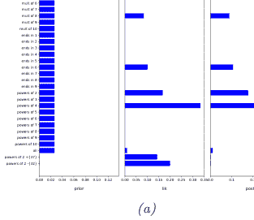
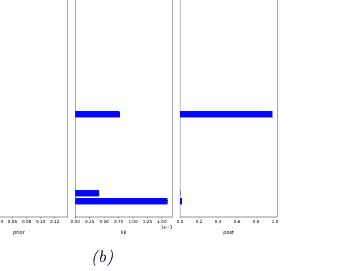

图 2.4：(a) 当数据为 $D = \{16\}$ 时模型的先验、似然和后验。(b) 当 $D = \{2, 8, 16, 64\}$ 时的结果。改编自 [Ten99]。由 numbers_game.py 生成。

#### 2.3.1.4 Posterior predictive

假设的后验是我们对世界的内部信念状态。检验我们的信念是否合理的办法是将其用于预测客观可观测的量（这是科学方法的基石）。为此，我们计算可能未来观测的后验预测分布：

$p(y|D) = \sum_{h} p(y|h) p(h|D)$ (2.18)

这称为贝叶斯模型平均 [Hoe+99]。每一项只是各个假设预测的加权平均。这在图 2.5 中有所说明。底部的点显示了每个假设的预测；右侧的垂直曲线显示了与每个假设相关的权重。如果我们将每一行乘以其权重并相加，我们就得到顶部的分布。

#### 2.3.1.5 MAP, MLE, and the plugin approximation

随着数据量的增加，后验通常会集中在一点，即后验模式，正如我们在图 2.4（右上图）中所见。后验模式定义为具有最大后验概率的假设：

$h_{\text{map}} \doteq \arg\max_{h} p(h|D)$ (2.19)

这也称为最大后验或 MAP 估计。

我们可以通过求解以下优化问题来计算 MAP 估计：

$h_{\text{map}} = \arg\max_{h} p(h|D) = \arg\max_{h} \log p(D|h) + \log p(h)$ (2.20)

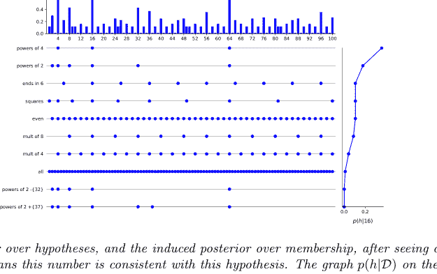

图 2.5：在看到一个示例 $D = \{16\}$ 后，假设的后验以及由此产生的成员后验。一个点表示该数字与该假设一致。右侧的图 $p(h|D)$ 是赋予假设 $h$ 的权重。通过对点进行加权求和，我们得到 $p(y \in h|D)$（顶部）。改编自 [Ten99] 的图 2.9。由 numbers_game.py 生成。

第一项，$\log p(D|h)$，是似然 $p(D|h)$ 的对数。第二项，$\log p(h)$，是先验的对数。随着数据集规模的增大，对数似然的幅度增长，但对数先验项保持不变。因此我们说似然压倒了先验。在这种情况下，对 MAP 估计的一个合理近似是忽略先验项，只选择最大似然估计或 MLE，其定义为

$h_{\text{mle}} \doteq \arg\max_h p(D|h) = \arg\max_h \log p(D|h) = \arg\max_h \sum_{n=1}^N \log p(y_n|h)$ (2.21)

假设我们用一个点估计 $\hat{h}$ 来近似后验，它可能是 MAP 估计或 MLE。我们可以将这种退化分布表示为一个单点质量

$p(h|D) \approx \mathbb{I}(h = \hat{h})$ (2.22)

其中 $\mathbb{I}()$ 是 Eq. (1.3) 中定义的指示函数。相应的后验预测分布变为

$p(y|D) \approx \sum_h p(y|h) \mathbb{I}(h = \hat{h}) = p(y|\hat{h})$ (2.23)

预测，然后随着我们看到更多数据而使我们的预测更精确，这符合直觉。例如，给定 $\mathcal{D} = \{16\}$，有许多假设具有非可忽略的后验质量，因此整数上的预测支撑很宽。然而，当我们看到 $\mathcal{D} = \{16,8,2,64\}$ 时，后验将质量集中在一两个特定假设上，因此整体预测支撑变得更集中。相比之下，MLE 选择最小一致假设，并使用该单一模型预测未来。例如，如果我们看到 $\mathcal{D} = \{16\}$，我们计算 $h_{\text{mle}}$ 为“所有 4 的幂”（或区间假设 $h = \{16\}$），并且由此产生的插件近似仅预测 $\{4,16,64\}$ 具有非零概率。这是一个 **overfitting** 的例子，我们对训练中看到的具体数据给予过多关注，并且未能正确推广到新示例。当我们观察到更多数据时，MLE 将被迫选择更宽的假设来解释所有数据。例如，如果我们看到 $\mathcal{D} = \{16,8,2,64\}$，MLE 扩展为“所有 2 的幂”，类似于贝叶斯方法。在无限数据的极限下，两种方法收敛到相同的预测。然而，在小样本情况下，我们考虑多个假设的完全贝叶斯方法将给出更好（不太过度自信）的预测。

### 2.3.2 Learning a continuous concept: the healthy levels game

数字游戏涉及观察一系列离散变量，并从有限的假设空间中推断另一个离散变量的分布。这使得计算特别简单：我们只需要求和、乘法和除法。然而，在许多应用中，我们观察到的变量是实值连续量。更重要的是，未知参数通常也是连续的，因此假设空间变为 $\mathbb{R}^K$ 的（某个子集），其中 $K$ 是参数的数量。这使数学变得复杂，因为我们必须用积分代替求和。然而，基本思想是相同的。

我们通过考虑另一个概念学习示例来说明这些思想，即 **healthy levels game**，也由 Tenenbaum 提出。想法是这样的：我们测量两个连续变量，表示随机选择的健康患者的胆固醇和胰岛素水平。我们想知道什么值范围对应于健康范围。与数字游戏一样，挑战是从仅正数据中学习概念。

设我们的假设空间为平面上的 **axis-parallel rectangles**，如图 2.6 所示。这是一个经典示例，在机器学习中已被广泛研究 [Mit97]。对于健康水平游戏来说这也是一个合理的假设，因为我们知道（来自先验领域知识）胰岛素和胆固醇的健康水平必须落在（未知）下限和上限之间。我们可以将矩形假设表示为 $h = (\ell_1,\ell_2,s_1,s_2)$，其中 $\ell_j \in [-\infty,\infty]$ 是左下角的坐标（位置），并且 $s_j \in [0,\infty]$ 是两边的长度。因此假设空间为 $\mathcal{H} = \mathbb{R}^2 \times \mathbb{R}_+^2$，其中 $\mathbb{R}_+^\perp$ 是正实数集。

更复杂的概念可能需要不连续的空间区域来表示它们。或者，我们可能想要使用 *latent* 矩形区域来表示更复杂的高维概念 [Li+19b]。假设空间来自何处是一个非常有趣的问题，但超出了本章的范围。（一种方法是使用分层贝叶斯模型，如 [Ten+11] 中所讨论的。）


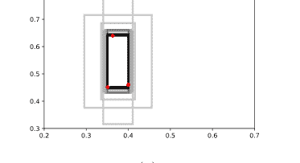

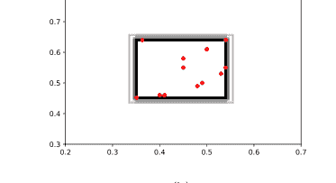

图 2.6：“健康水平”游戏中后验的样本。坐标轴表示“胆固醇水平”和“胰岛素水平”。（a）给定少量正例（用 3 个红色叉号表示），关于矩形真实范围存在很大不确定性。（b）数据足够时，最小的包围矩形（即最大似然假设）变得最可能，尽管还有许多其他相似假设几乎同样可能。改编自 [Ten99]。由 healthy_levels_plots.py 生成。

#### 2.3.2.1 Likelihood

我们假设点是从矩形的支撑集上均匀随机采样的。为简化分析，我们首先考虑一维“矩形”，即线段的情况。在一维情况下，似然为 $p(\mathcal{D}|\ell,s) = (1/s)^N$，如果所有点都在区间内，否则为 0。因此

$$ p(\mathcal{D}|\ell,s) = \begin{cases} s^{-N} & \text{if } \min(\mathcal{D}) \ge \ell \text{ and } \max(\mathcal{D}) \le \ell + s \\ 0 & \text{otherwise} \end{cases} \quad (2.24) $$

将其推广到二维，我们假设在给定假设的情况下观测到的特征是条件独立的。因此二维似然变为

$$ p(\mathcal{D}|h) = p(\mathcal{D}_1|\ell_1,s_1)p(\mathcal{D}_2|\ell_2,s_2) \quad (2.25) $$

其中 $\mathcal{D}_j = \{y_{nj} : n = 1 : N\}$ 是维度（特征）$j = 1,2$ 的观测值。

#### 2.3.2.2 Prior

为简单起见，假设先验可分解，即 $p(h) = p(\ell_1)p(\ell_2)p(s_1)p(s_2)$。我们将为这些项中的每一项使用无信息先验。如我们在第 7.3 节中解释的，这意味着我们应使用形式为 $p(h) \propto \frac{1}{s_1}\frac{1}{s_2}$ 的先验。

#### 2.3.2.3 Posterior

后验由下式给出

$$ p(\ell_1,\ell_2,s_1,s_2|\mathcal{D}) \propto p(\mathcal{D}_1|\ell_1,s_1)p(\mathcal{D}_2|\ell_2,s_2)\frac{1}{s_1}\frac{1}{s_2} \quad (2.26) $$

我们可以通过将 $\mathbb{R}^4$ 离散化为 4 维网格，按点评估分子并进行归一化来数值计算它。

由于可视化 4 维分布很困难，我们改为从中抽取 **posterior samples**，$h^s \sim p(h|\mathcal{D})$，并将其可视化为矩形。在图 2.6(a) 中，我们展示了观测数据点数量 $N$ 很小时的一些样本——我们对正确的假设不确定。在图 2.6(b) 中，我们看到当 $N$ 较大时，样本集中在观测数据上。

#### 2.3.2.4 Posterior predictive distribution

我们现在考虑如何根据迄今为止看到的数据预测未来期望看到哪些数据点。特别是，我们想知道看到任意点 $\mathbf{y} \in \mathbb{R}^2$ 的可能性有多大。

令 $y_j^{\min} = \min_n y_{nj}$，$y_j^{\max} = \max_n y_{nj}$，且 $r_j = y_j^{\max} - y_j^{\min}$。那么可以证明（练习 2.4）后验预测分布由下式给出

$$ p(\mathbf{y}|\mathcal{D}) = \left[ \frac{1}{(1 + d(y_1)/r_1)(1 + d(y_2)/r_2)} \right]^{N-1} \quad (2.27) $$

其中 $d(y_j)=0$ 当 $y_j^{\min} \le y_j \le y_j^{\max}$ 时，否则 $d(y_j)$ 是沿维度 $j$ 到最近数据点的距离。因此如果 $\mathbf{y}$ 在训练数据的支撑内，则 $p(\mathbf{y}|\mathcal{D})=1$；如果 $\mathbf{y}$ 在支撑外，概率密度会下降，其速率取决于 $N$。

请注意，如果 $N=1$，预测分布未定义。这是因为我们无法仅从一个数据点推断二维矩形的范围（除非使用更强的先验）。

在图 2.7(a) 中，我们绘制了仅看到 $N=3$ 个示例时的后验预测分布；我们看到存在一个宽泛的泛化梯度，其沿垂直维度延伸得比水平方向更远。这是因为数据的垂直分布比水平更广。换句话说，如果我们在一个维度上看到较大的范围，我们就有证据表明该维度上的矩形相当大，否则我们更倾向于紧凑的假设，这符合尺寸原理。

在图 2.7(b) 中，我们绘制了 $N=12$ 时的分布。我们看到它集中在最小的一致假设上，因为尺寸原理对不必要的较大假设进行指数级降权。

#### 2.3.2.5 Plug-in approximation

现在假设我们对后验预测使用插件近似，$p(\mathbf{y}|\mathcal{D}) \approx p(\mathbf{y}|\hat{\theta})$，其中 $\hat{\theta}$ 是 MLE 或 MAP 估计，类似于第 2.3.1.5 节的讨论。在图 2.7(c-d) 中，我们展示了该近似的行为。在这两种情况下，它都预测最小包围矩形，因为那是最大似然的。然而，这并不会超出观测数据的范围外进行外推。我们还看到，最初预测较窄，因为观测数据很少，但随着数据增多，预测变得更宽。相比之下，在贝叶斯方法中，初始预测很宽，因为不确定性很大，但随着数据增多而变窄。在大数据极限下，两种方法收敛到相同的预测。（有关插件近似的更多讨论，请参见第 2.4.2 节。）

## 2.4 Bayesian machine learning

在第 2.3 节中，我们考虑了概念学习，其中数据是一组整数 $y \in \{1,\dots,100\}$，或平面上的点 $\mathbf{y} \in \mathbb{R}^2$。在这两种情况下，我们的预测都基于过去的训练示例。

为了对新模型进行预测，我们需要选择输出概率分布 $p$ 的形式，以及预测器 $f$ 的形式。我们将在第 3 章中考虑各种输出分布，并在第 II–IV 部分考虑各种预测器。

### 2.4.1 Fully Bayesian approach

在机器学习的贝叶斯方法中，我们计算给定数据的参数后验的方式与计算任何其他未知假设的后验完全相同，即使用贝叶斯规则：

$$ p(\theta|\mathcal{D}) = \frac{p(\theta)p(\mathcal{D}|\theta)}{p(\mathcal{D})} \quad (2.29) $$

由此，我们可以计算给定输入的输出的后验预测分布：

$$ p(\mathbf{y}|\mathbf{x},\mathcal{D}) = \int p(\mathbf{y}|\mathbf{x},\theta)p(\theta|\mathcal{D})d\theta \quad (2.30) $$

### 2.4.2 Plug-in approximation

在许多模型中，计算后验和后验预测在计算上可能很困难。在这种情况下，通常用单一的点估计来近似后验，例如最大似然估计（MLE）或最大后验（MAP）估计，两者都可以使用标准优化方法计算（参见第 4 章）。例如，MLE 由下式给出

$$ \hat{\theta}_{\text{mle}} = \arg\max_{\theta}\log p(\mathcal{D}|\theta) = \arg\min_{\theta} -\frac{1}{N}\sum_{n=1}^{N}\log p(\mathbf{y}_n|f(\mathbf{x}_n;\theta)) \quad (2.31) $$

而 MAP 估计由下式给出

$$ \hat{\theta}_{\text{map}} = \arg\max_{\theta}\log p(\theta|\mathcal{D}) = \arg\max_{\theta}\log p(\mathcal{D}|\theta)+\log p(\theta) \quad (2.32) $$
$$ = \arg\min_{\theta} -\left[\frac{1}{N}\sum_{n=1}^{N}\log p(\mathbf{y}_n|f(\mathbf{x}_n;\theta))\right] - \log p(\theta) \quad (2.33) $$

一旦我们计算出这些点估计，我们就可以将后验表示为在所选值处无限窄但无限高的“尖峰”。形式上，这可以使用狄拉克 delta 函数来完成，其定义为

$$ \delta(\theta)=\begin{cases}+\infty & \text{if }\theta=0\\0 & \text{if }\theta\neq0\end{cases} \quad (2.34) $$

（这可以通过逐元素检查相等性扩展到向量值输入。）delta 函数满足性质

$$ \int_{-\infty}^{\infty}\delta(\theta)d\theta = 1 \quad (2.35) $$

因此我们可以定义一个 pdf，将其所有概率密度放在单个点上，如下所示：

$$ p(\boldsymbol{\theta}|\mathcal{D}) = \delta(\boldsymbol{\theta} - \hat{\boldsymbol{\theta}}) \quad (2.36) $$

我们称之为 **delta function approximate posterior**。

为了使用我们的近似进行预测，我们利用 delta 函数满足 **sifting property** 这一事实，其说明

$$ \int_{-\infty}^{\infty} f(y)\delta(x - y)dy = f(x) \quad (2.37) $$

如果我们使用 delta 函数后验，则预测分布可以通过简单地将点估计“插入”似然中获得：

$$ p(\mathbf{y}|\mathcal{D}) = \int p(\mathbf{y}|\boldsymbol{\theta})p(\boldsymbol{\theta}|\mathcal{D})d\boldsymbol{\theta} \approx \int p(\mathbf{y}|\boldsymbol{\theta})\delta(\boldsymbol{\theta} - \hat{\boldsymbol{\theta}})d\boldsymbol{\theta} = p(\mathbf{y}|\hat{\boldsymbol{\theta}}) \quad (2.38) $$

这称为 **plug-in approximation**。这种方法等同于机器学习中大多数使用的标准方法，即首先拟合模型（即计算点估计 $\hat{\boldsymbol{\theta}}$），然后用其进行预测。然而，标准（插件）方法可能遭受过拟合和过度自信，如我们在第 1.2.3 节中讨论的。完全贝叶斯方法通过边缘化参数来避免这种情况，但可能很昂贵。幸运的是，即使是简单的近似，即对几个合理的参数值进行平均，也能提高性能。我们在下面给出一些例子。

### 2.4.3 Example: scalar input, binary output

假设我们想要执行二元分类，因此 $y \in \{0,1\}$。我们将使用如下形式模型

$$ p(y|\mathbf{x};\boldsymbol{\theta}) = \text{Ber}(y|\sigma(\mathbf{w}^\top \mathbf{x} + b)) \quad (2.39) $$

其中

$$ \sigma(a) \triangleq \frac{e^{a}}{1 + e^{a}} \quad (2.40) $$

是 **sigmoid** 或 **logistic function**，将 $\mathbb{R} \to [0,1]$ 映射，且 $\text{Ber}(y|\mu)$ 是均值为 $\mu$ 的伯努利分布（详见第 3.1 节）。换句话说，

$$ p(y=1|\mathbf{x};\boldsymbol{\theta}) = \sigma(\mathbf{w}^\top \mathbf{x} + b) = \frac{1}{1 + e^{-\mathbf{w}^\top \mathbf{x} + b}} \quad (2.41) $$

该模型称为 **logistic regression**。（我们在第 10 章中更详细地讨论它。）

让我们将此模型应用于确定鸢尾花是否为 setosa 或 versicolor 的任务，$y_n \in \{0,1\}$，给定花萼长度 $x_n$ 的信息。（有关鸢尾花数据集的描述，请参见第 1.2.1.1 节。）

我们首先拟合以下形式的一维 logistic 回归模型

$$ p(y=1|x,\boldsymbol{\theta}) = \sigma(b + w x) \quad (2.42) $$


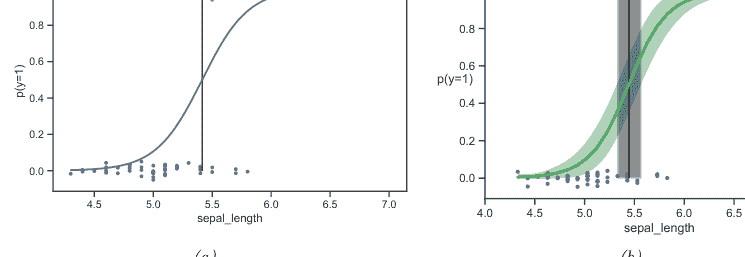

图2.8：（a）使用对应于花萼长度的单一输入特征 $x$ 来分类一朵鸢尾花是否为变色鸢尾（$y = 1$）或山鸢尾（$y = 0$）的逻辑回归。标记的点经过（垂直方向）抖动以避免过度重叠。垂直线是决策边界。由 `logreg_iris_1d.py` 生成。（b）与（a）相同，但展示了后验分布。改编自[Mar18]的图4.4。由 `logreg_iris_bayes_1d_pymc3.py` 生成。

我们使用最大似然估计将模型拟合到数据集 $\mathcal{D} = \{(x_n, y_n)\}$。（有关如何计算该模型的MLE，详见第10.2.3节。）图2.8a展示了后验预测的插件近似 $p(y = 1|x, \hat{\boldsymbol{\theta}})$，其中 $\hat{\boldsymbol{\theta}}$ 是参数的最大似然估计（MLE）。我们看到，随着花萼长度增大，我们越来越确信这朵花属于变色鸢尾，正如S形（sigmoid）逻辑函数所示。

**决策边界**被定义为使 $p(y = 1|x^*, \hat{\boldsymbol{\theta}}) = 0.5$ 的输入值 $x^*$。我们可以如下求解这个值：

$\sigma(b + w x^*) = \frac{1}{1 + e^{-(b + w x^*)}} = \frac{1}{2}$ (2.43)

$b + w x^* = 0$ (2.44)

$x^* = - \frac{b}{w}$ (2.45)

从图2.8a中，我们看到 $x^* \approx 5.5$ cm。

然而，上述方法并未对参数估计中的不确定性进行建模，因此忽略了输出概率以及决策边界位置中由此产生的不确定性。为了捕获这种额外的不确定性，我们可以使用贝叶斯方法来近似后验 $p(\boldsymbol{\theta}|\mathcal{D})$。（详见第10.6节。）在此基础上，我们可以使用蒙特卡洛近似来近似后验预测分布：

$p(y = 1|x, \mathcal{D}) \approx \frac{1}{S} \sum_{s=1}^{S} p(y = 1|x, \boldsymbol{\theta}^s)$ (2.46)

其中 $\boldsymbol{\theta}^s \sim p(\boldsymbol{\theta}|\mathcal{D})$ 是一个后验样本。图2.8b绘制了该函数的均值和95%可信区间。我们看到，现在每个输入都有一个预测概率范围。我们还可以使用蒙特卡洛近似计算决策边界位置的分布：

$p(x^*|\mathcal{D}) \approx \frac{1}{S} \sum_{s=1}^{S} \delta(x^* - (-b^s / w^s))$ (2.47)

其中 $(b^s, w^s) = \boldsymbol{\theta}^s$。该分布的95%可信区间由图2.8b中的“粗”垂直线显示。

尽管对这一应用而言，仔细地对不确定性建模可能并不重要，但在风险敏感的应用中（如医疗和金融）它可能很重要，我们将在第8章讨论。

### 2.4.4 示例：二值输入，标量输出

现在假设我们想要预测包裹的递送时间 $y \in \mathbb{R}$，该包裹由A公司还是B公司运送。我们可以使用二值特征 $x \in \{0,1\}$ 对公司ID进行编码，其中 $x = 0$ 表示A公司，$x = 1$ 表示B公司。针对此问题，我们将使用以下判别模型：

$p(y|x,\theta) = \mathcal{N}(y|\mu_x, \sigma_x^2)$ (2.48)

其中 $\mathcal{N}(y|\mu, \sigma^2)$ 是高斯分布

$\mathcal{N}(y|\mu, \sigma^2) \equiv \frac{1}{\sqrt{2\pi\sigma^2}} e^{-\frac{1}{2\sigma^2}(y-\mu)^2}$ (2.49)

而 $\theta = (\mu_0, \mu_1, \sigma_0, \sigma_1)$ 是模型的参数。如我们在第4.2.5节所讨论的，我们可以使用最大似然估计来拟合该模型；或者，我们也可以采用第7.2.3节讨论的贝叶斯方法。

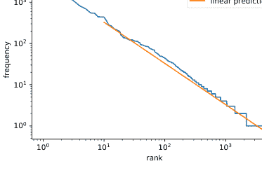

图2.10：H. G. 威尔斯的*《时间机器》*中单词频率与排名的双对数图。（为了视觉清晰，我们从图中移除了前10个单词。）由*zipfs_law_plot.py*生成。改编自[*Zha+19a*，第8.3节]中的图。

覆盖Brown语料库一半需要135个单词。这些词被称为**头部词项**，因为它们构成了概率分布的头部。形式上，我们可以用如下形式的**帕累托分布**来建模这一现象：

$p(r) \propto \kappa r^{-a}$
(2.50)

其中 $p(r)$ 是遇到排名为 $r$ 的单词的概率，$\kappa$ 和 $a$ 是常数。如果我们设 $a = 1$，就得到Zipf定律。从式(2.50)可以看出，绘制单词的对数频率与其对数排名的关系图，我们应该得到一条斜率为$-1$的直线，如图2.10所示。关于Zipf定律的进一步讨论，参见例如[Ada00]。

重尾问题并非自然语言所独有。正如Andrew Gelman在他的博客⁵中所说的那样：

> 样本量从来都不大。如果N太小，无法得到足够精确的估计，你就需要获取更多数据（或做出更多假设）。但一旦N“足够大”，你就可以开始细分数据以了解更多信息（例如，在民意调查中，一旦你对整个国家有了很好的估计，你就可以分别估计男性和女性、北方人和南方人、不同年龄组，等等等等）。N永远都不够，因为如果N“够了”，你就已经要转向下一个需要更多数据的问题了。

另一个出现重尾现象的有趣场景是**推荐系统**。正如我们在第22章中解释的，这样的系统必须预测用户可能喜欢哪些物品（例如电影）。但由于系统总是会面临新用户和新电影，它经常处于“小$N$”的情形。在这种情况下，贝叶斯方法可以通过从我们有更多数据的其他相似用户或物品“借用统计强度”来帮助创建个性化推荐（讨论见第7.4节）。总的来说，贝叶斯方法对于在线学习和序贯决策非常有用（见第8.3节），在这些场景中数据可能稀缺，而且做出错误决策可能是灾难性的。

### 2.4.7 贝叶斯方法在“深度学习时代”还有意义吗？

在深度学习社区中，拟合具有数百万参数的模型很常见（详见第三部分）。与经典方法相比，这实际上*增加*了不确定性，因为我们进入了一个参数数量可能远多于训练样本数量的情形；由此得到的预测函数 $f(x;\theta)$ 因此是*欠定的*[DA+20]。原则上，贝叶斯方法是捕获这类认知不确定性的理想方法（参见例如[Wil20b]），尽管在实践中实现这一点可能很棘手。

除了对“深度”模型“采用贝叶斯方法”之外，我们还可以使用深度模型来帮助我们对DNN之外的其他类型模型“采用贝叶斯方法”。关键的洞见是，对具有隐变量的模型计算后验 $p(z\mid x,\theta)$ 可能很慢，但我们可以训练一个DNN来为我们近似这个函数。这就是摊销推断背后的基本思想，我们将在第20.3.5节中以VAE（变分自编码器）为背景简要讨论。

尽管深度学习和贝叶斯方法之间有许多有趣的关联，但我们把对**贝叶斯深度学习**更深入（咳）的讨论推迟到本书的续作[Mur22]中。

## 2.5 习题

### 习题2.1 [医学诊断中的贝叶斯法则]

在你一年一度的体检之后，医生带来了坏消息和好消息。坏消息是你检测出患有某种严重疾病，而且该检测的准确率为99%（即，如果你患病，检测呈阳性的概率为0.99；如果你没有患病，检测呈阴性的概率也为0.99）。好消息是这是一种罕见病，每10,000人中只有1人患病。你实际患病的概率是多少？（请展示你的计算过程并给出最终结果。）

### 习题2.2 [法律推理]

（来源：Peter Lee。）假设发生了一起犯罪。现场发现了无法用无辜解释的血迹。这种血型在1%的人群中存在。

- a. 检察官声称：“如果被告是无辜的，他有1%的概率具有犯罪血型。因此，他有99%的概率是有罪的。”这就是所谓的**检察官谬误**。这个论证有什么问题？

- b. 辩护方声称：“犯罪发生在一个拥有80万人口的城市。这种血型大约会在8000人身上出现。证据表明被告有罪的概率仅为1/8000，因此没有相关性。”这就是所谓的**辩护方谬误**。这个论证有什么问题？

### 习题2.3 [概率对用于生成答案的问题形式很敏感]

（来源：Minka。）我的邻居有两个孩子。假设孩子的性别像掷硬币一样，那么先验地，最可能的情况是我的邻居有一个男孩和一个女孩，概率为 $1/2$。其他可能性——两个男孩或两个女孩——的概率分别为 $1/4$ 和 $1/4$。

- a. 假设我问他是否有男孩，他回答有。那么其中一个孩子是女孩的概率是多少？

- b. 相反，假设我碰巧看到他的一个孩子跑过去，而且是个男孩。那么另一个孩子是女孩的概率是多少？


### 练习 2.4 [推导健康水平博弈的后验预测密度]

我们首先考虑一维“矩形”（即线段）；由于各维度相互独立，我们可以轻松将其推广到二维。

为方便起见，我们将遵循 Josh Tenenbaum 博士论文 [Ten99] 中的符号表示。具体而言，设 $h = \theta$ 为未知的假设或参数向量，$\mathcal{H}$ 为可能的假设（矩形）集合，$\mathcal{H}_y$ 为与观测 $y$ 一致的假设集合（因此矩形的尺寸必须足够大以包含 $y$），而 $\mathcal{H}_{D,y}$ 为与 $D$ 中所有示例以及 $y$ 都一致的假设集合。

后验预测由 $p(y|D) = p(y,D)/p(D)$ 给出，其中

$p(D) = \int_{h\in\mathcal{H}} p(h)p(D|h)dh = \int_{h\in\mathcal{H}_D} p(h)/|h|^N dh$ (2.51)

这里我们利用了这样一个事实：如果 $h \in \mathcal{H}_D$，则 $p(D|h) = 1/|h|^N$，否则为 0。类似地，$p(y,D) = \int_{h\in\mathcal{H}_{D,y}} p(h)/|h|^N dh$。

为了推导公式 2.51 中的积分，我们假设最大观测值为 0（由于我们假设先验分布具有平移不变性，因此可以选择任意最大值并重新居中数据）。那么，矩形的右边缘必须位于数据之外，因此 $\ell \ge 0$。此外，如果 $r$ 是示例所跨范围，则最左侧的数据点位于 $-r$，因此矩形的左侧必须满足 $\ell - s \le -r$，其中 $s$ 是矩形的大小。

a. 基于这些假设，证明：

$p(D) = 1 / [N(N-1) r^{N-1}]$ (2.52)

提示：使用分部积分法

$I = \int_a^b f(x)g'(x)dx = [f(x)g(x)]_a^b - \int_a^b f'(x)g(x)dx$ (2.53)

b. 为了计算 $p(y,D)$，我们只需将范围从 $r$ 扩展到 $r + d$，其中 $d$ 是从 $y$ 到最近观测示例的距离。因此证明：

$p(y|D) = 1 / (1 + d/r)^{N-1}$ (2.54)

# 3 概率模型

在第 2.4 节中，我们介绍了机器学习中的贝叶斯方法。简而言之，该方法包含三个步骤：(1) 指定一个形式为 $p(\mathbf{y}|\mathbf{x},\boldsymbol{\theta}) = p(\mathbf{y}|f(\mathbf{x};\boldsymbol{\theta}))$ 的（条件）概率模型，以及一个先验分布 $p(\boldsymbol{\theta})$；(2) 计算关于任何未知参数的后验分布，$p(\boldsymbol{\theta}|\mathcal{D})$；(3) 使用 $p(\mathbf{y}|\mathbf{x},\mathcal{D})$ 进行预测。

根据我们对输入-输出映射可能形态的假设，我们可以使用许多可能的预测函数 $f(\mathbf{x};\boldsymbol{\theta})$。我们将在本书剩余的章节中看到许多不同的例子。然而，在本章中，我们专注于输出分布 $p(\mathbf{y}|\boldsymbol{\theta})$ 本身。具体而言，我们描述了可用于构建概率模型（无论是有条件还是无条件）的各种“构建模块”。我们将在全书中广泛使用这些模块。我们将在第 4 章讨论如何估计（学习）这些构建模块的参数。

## 3.1 伯努利分布与二项分布

也许最简单的概率分布是伯努利分布，它可以用于建模二元事件，如下所述。

### 3.1.1 定义

该分布定义如下：

$\mathrm{Ber}(y|\theta) \triangleq \theta^{y}(1-\theta)^{1-y} = \begin{cases} 1-\theta & \text{如果 } y=0 \\ \theta & \text{如果 } y=1 \end{cases}$ (3.1)

其中 $0 \le \theta \le 1$ 是 $y=1$ 的概率。为了表示随机变量 $Y$ 服从参数为 $\theta$ 的伯努利分布这一假设，我们写作 $Y \sim \mathrm{Ber}(\theta)$ (3.2)，其中符号 $\sim$ 意味着“采样自”或“服从...分布”。伯努利分布是二项分布的一种特殊情况。为了解释这一点，假设我们观察到一组 $N$ 次伯努利试验，表示为 $y_n \sim \mathrm{Ber}(\cdot|\theta)$，其中 $n=1:N$。具体来说，想象抛掷硬币 $N$ 次。让我们定义 $s$ 为正面朝上的总次数，$s \triangleq \sum_{n=1}^{N} \mathbb{I}(y_n=1)$。$s$ 的分布由二项分布给出：$\mathrm{Bin}(s|N,\theta) \triangleq \binom{N}{s} \theta^{s}(1-\theta)^{N-s}$ (3.3)

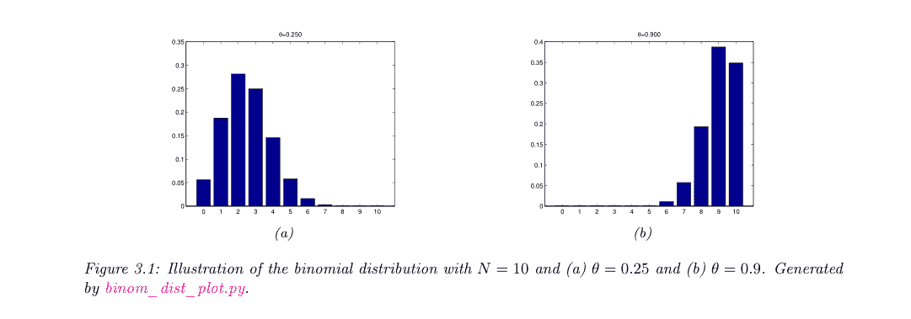

其中

\(\left( \begin{array}{c} N \\ k \end{array} \right) \triangleq \frac{N!}{(N-k)!k!} \)

(3.4)

是从 N 个物品中选择 k 个物品的方法数（这被称为二项式系数，读作“N 中选 k”）。有关二项分布的一些示例，请参见图 3.1。如果 $N = 1$，二项分布退化为伯努利分布。

当我们希望根据某些输入 $x \in X$ 预测二元变量 $y \in \{0,1\}$ 时，我们需要使用形式如下的一种条件概率分布

$p(y|x,\theta) = Ber(y|f(x;\theta))$ 

(3.5)

为了避免 $0 \le f(x;\theta) \le 1$ 的限制，我们可以让 $f$ 成为一个无约束函数，并使用以下模型：

$p(y|x,\theta) = Ber(y|\sigma(f(x;\theta)))$ 

(3.12)

这里 $\sigma()$ 是 sigmoid 函数或 logistic 函数，定义如下：

$\sigma(a) \equiv 1 / (1 + e^{-a})$ 

(3.13)

其中 $a = f(x;\theta)$。“sigmoid”一词意为 S 形：图 3.2a 给出了其绘图。我们可以看到，它将整个实数线映射到 $[0,1]$ 区间，这对于将输出解释为概率（因此是伯努利参数 $\theta$ 的有效值）是必要的。Sigmoid 函数可以被视为“Heaviside 阶跃函数”的一种“软化”版本，后者定义如下：

$H(a) \equiv \mathbb{I}(a > 0)$ 

(3.14)

如图 3.2b 所示。

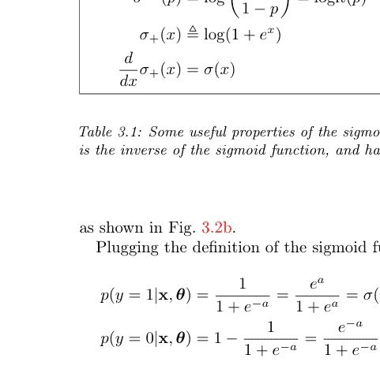

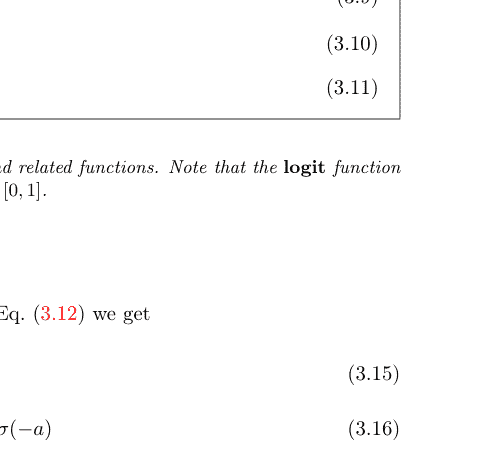

图 3.2: (a) Sigmoid (Logistic) 函数 $\sigma(a) = (1 + e^{-a})^{-1}$。(b) Heaviside 函数 $H(a > 0)$。由 activation_fun_plot.py 生成。

$\sigma(x) \equiv 1/(1+e^{-x}) = e^x/(1+e^x)$

$d\sigma(x)/dx = \sigma(x)(1-\sigma(x))$

$1-\sigma(x) = \sigma(-x)$

$\sigma^{-1}(p) = \log(p/(1-p)) \equiv \text{logit}(p)$

$\sigma_+(x) \equiv \log(1+e^x)$

$d\sigma_+(x)/dx = \sigma(x)$

表 3.1: Sigmoid (Logistic) 函数及相关函数的一些有用性质。注意 logit 函数是 sigmoid 函数的逆函数，其定义域为 $[0,1]$。

将 sigmoid 函数的定义代入公式 (3.12)，我们得到

$p(y=1|x,\theta)=1/(1+e^{-a})=e^a/(1+e^a)=\sigma(a)$ (3.15)

$p(y=0|x,\theta)=1-1/(1+e^{-a})=1/(1+e^a)=\sigma(-a)$ (3.16)

量 $a$ 等于对数几率（log odds），即 $\log(p/(1-p))$，其中 $p=p(y=1|x;\theta)$。为了看出这一点，请注意

$\log(p/(1-p))=\log(e^a/(1+e^a) * (1+e^a)/1 ) = \log(e^a) = a$ (3.17)

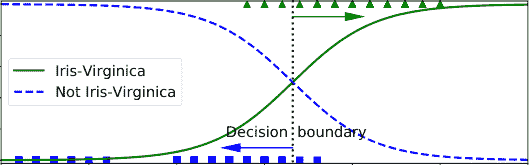

*图 3.3: 应用于 1 维、2 类鸢尾数据集版本上的逻辑回归。由 `iris_logreg.py` 生成。改编自 [Gér19] 的图 4.23。*

**Logit 函数**将 $p$ 映射到对数几率 $a$：

\[
\operatorname{logit}(p) \triangleq \log\left(\frac{p}{1-p}\right) = \sigma^{-1}(a)
\tag{3.18}
\]

**Logistic 函数**是 logit 函数的逆函数，将对数几率 $a$ 映射到 $p$：

\[
\operatorname{logistic}(a) \triangleq \frac{1}{1+e^{-a}} = \frac{e^a}{1+e^a} = \sigma(a)
\tag{3.19}
\]

有关这些函数的一些有用性质，请参见表 3.1。

### 3.1.3 二元逻辑回归

在本节中，我们使用条件伯努利模型，其中使用形式为 $f(x; \theta) = \mathbf{w}^{\mathsf{T}}\mathbf{x}$ 的线性预测器。因此，模型具有如下形式

\[
p(y \mid x; \theta) = \operatorname{Ber}(y \mid \sigma(\mathbf{w}^{\mathsf{T}}x+b))
\tag{3.20}
\]

换句话说，

\[
p(y=1 \mid x; \theta) = \sigma(\mathbf{w}^{\mathsf{T}}x+b) = \frac{1}{1+e^{-(\mathbf{w}^{\mathsf{T}}x+b)}}
\tag{3.21}
\]

这被称为**逻辑回归**。

例如，考虑鸢尾数据集的 1 维、2 类版本，其中正类为“virginica（维吉尼亚鸢尾）”，负类为“not virginica（非维吉尼亚鸢尾）”，我们使用的特征 $x$ 是花瓣宽度。我们对此拟合了一个逻辑回归模型，并在图 3.3 中显示了结果。**决策边界**对应于 $p(y=1 \mid x=x^*,\theta)=0.5$ 的值 $x^*$。我们可以看到，在这个例子中，$x^* \approx 1.7$。当 $x$ 远离此边界时，分类器对其类别标签预测的信心增强。

从这个例子中应该清楚地看出，为什么使用线性回归来进行（二元）分类问题是不合适的。在这种模型中，如果我们向右移动足够远，概率将增加到超过 1；如果我们向左移动足够远，概率将降低到低于 0。

有关逻辑回归的更多细节，请参见第 10 章。


## 3.2 分类与多项分布

为了表示有限标签集合上的分布，$y \in \{1,\ldots,C\}$，我们可以使用 **分类分布**，它将伯努利分布推广到 $C>2$ 个取值。

### 3.2.1 定义

分类分布是一个离散概率分布，每个类别有一个参数：

$$\operatorname{Cat}(y\mid\boldsymbol{\theta}) \triangleq \prod_{c=1}^{C}\theta_c^{\mathbb{I}(y=c)} \tag{3.22}$$

换句话说，$p(y=c\mid\boldsymbol{\theta})=\theta_c$。注意参数受约束使得 $0\leq\theta_c\leq1$ 且 $\sum_{c=1}^{C}\theta_c=1$；因此只有 $C-1$ 个独立参数。

我们可以通过将离散变量 $y$ 转换为具有 $C$ 个元素的 **独热向量** 来以另一种方式写出分类分布，其中除对应类别标签的项外全部为 0。（术语“one-hot”源自电气工程，其中二进制向量被编码为一组导线上的电电流，导线可以处于激活（“hot”）或不激活（“cold”）状态。）例如，如果 $C=3$，我们将类别 1、2 和 3 编码为 $(1,0,0)$、$(0,1,0)$ 和 $(0,0,1)$。更一般地，我们可以使用 **单位向量** 编码类别，其中 $\mathbf{e}_c$ 除第 $c$ 维外全为 0。（这也称为 **哑编码**。）使用独热编码，我们可以如下写出分类分布：

$$\operatorname{Cat}(\mathbf{y}\mid\boldsymbol{\theta}) \triangleq \prod_{c=1}^{C}\theta_c^{y_c} \tag{3.23}$$

分类分布是 **多项分布** 的特例。为了说明这一点，假设我们观察到 $N$ 次分类试验，$y_n\sim\operatorname{Cat}(\cdot\mid\boldsymbol{\theta})$，其中 $n=1,\ldots,N$。具体来说，想象掷一个 $C$ 面骰子 $N$ 次。让我们定义 $\mathbf{s}$ 为计数每个面出现次数的向量，即 $s_c\triangleq\sum_{n=1}^{N}\mathbb{I}(y_n=c)$。（等价地，如果使用独热编码，我们有 $\mathbf{s}=\sum_n\mathbf{y}_n$。）$\mathbf{s}$ 的分布由 **多项分布** 给出：

$$\operatorname{Mu}(\mathbf{s}\mid N,\boldsymbol{\theta}) \triangleq \binom{N}{s_1,\ldots,s_C}\prod_{c=1}^{C}\theta_c^{s_c} \tag{3.24}$$

其中 $\theta_c$ 是面 $c$ 出现的概率，且

$$\binom{N}{s_1,\ldots,s_C}\triangleq\frac{N!}{s_1!s_2!\cdots s_C!} \tag{3.25}$$

是 **多项系数**，它是把大小为 $N=\sum_{c=1}^{C}s_c$ 的集合划分为大小为 $s_1$ 直到 $s_C$ 的子集的方法数。如果 $N=1$，多项分布就变成分类分布。

### 3.2.2 Softmax 函数

在条件情况下，我们可以定义

$$p(y\mid\mathbf{x},\boldsymbol{\theta})=\operatorname{Cat}(y\mid f(\mathbf{x};\boldsymbol{\theta})) \tag{3.26}$$

它也可以写成

$$p(y\mid\mathbf{x},\boldsymbol{\theta}) = \operatorname{Mu}(\mathbf{y}\mid 1,f(\mathbf{x};\boldsymbol{\theta})) \tag{3.27}$$

我们要求 $0 \le f_c(\mathbf{x};\boldsymbol{\theta}) \le 1$ 且 $\sum_{c=1}^C f_c(\mathbf{x};\boldsymbol{\theta}) = 1.$

为了避免 $f$ 直接预测概率向量的要求，通常将 $f$ 的输出传入 **softmax** 函数 [Bri90]，也称为 **多项式对数几率**。它定义如下：

$$\mathcal{S}(\mathbf{a}) \triangleq \left[ \frac{e^{a_1}}{\sum_{c'=1}^C e^{a_{c'}}}, \dots, \frac{e^{a_C}}{\sum_{c'=1}^C e^{a_{c'}}} \right] \tag{3.28}$$

它将 $\mathbb{R}^C$ 映射到 $[0,1]^C$，并满足约束 $0 \le \mathcal{S}(\mathbf{a})_c \le 1$ 且 $\sum_{c=1}^C \mathcal{S}(\mathbf{a})_c = 1$。softmax 的输入 $\mathbf{a} = f(\mathbf{x};\boldsymbol{\theta})$ 称为 **logits**，是对数几率的推广。

softmax 函数因此得名，因为它有点像 argmax 函数的作用。为了看清这一点，让我们将每个 $a_c$ 除以一个常数 $T$，称为 **温度**。[^1] 然后当 $T \to 0$ 时，我们得到

$$\mathcal{S}(\mathbf{a}/T)_c = \begin{cases} 1.0 & \text{if } c = \operatorname{argmax}_{c'} a_{c'} \\ 0.0 & \text{otherwise} \end{cases} \tag{3.29}$$

换句话说，在低温下，分布将大部分概率质量放在最可能的狀態（这称为 **胜者通吃**），而在高温下，它会均匀地分散质量。参见图 3.4 作说明。

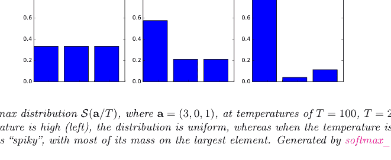

*图 3.4：Softmax 分布 $\mathcal{S}(\mathbf{a}/T)$，其中 $\mathbf{a} = (3,0,1)$，温度为 $T = 100$、$T = 2$ 和 $T = 1$。当温度较高（左）时，分布是均匀的，而当温度较低（右）时，分布是“尖峰”的，大部分质量集中在最大元素上。由 `softmax_plot.py` 生成。*

[^1]：这种术语来自统计物理学领域。**玻尔兹曼分布** 是状态上的分布，其形式与 softmax 函数相同。

### 3.2.3 多类逻辑回归

如果我们使用形式为 $f(\mathbf{x};\boldsymbol{\theta}) = \mathbf{W}\mathbf{x} + \mathbf{b}$ 的线性预测器，其中 $\mathbf{W}$ 是 $C \times D$ 矩阵，$\mathbf{b}$ 是 $C$ 维偏置向量，则最终模型变为

$$p(y\mid\mathbf{x};\boldsymbol{\theta}) = \operatorname{Cat}(y\mid\mathcal{S}(\mathbf{W}\mathbf{x} + \mathbf{b})) \tag{3.30}$$

令 $\mathbf{a} = \mathbf{W}\mathbf{x} + \mathbf{b}$ 为 logits 的 $C$ 维向量。然后我们可以将上式重写如下：

$$p(y = c\mid \mathbf{x}; \boldsymbol{\theta}) = \frac{e^{a_c}}{\sum_{c'=1}^{C} e^{a_{c'}}}\tag{3.31}$$

这被称为 **多项逻辑回归**。

如果只有两个类别，这就简化为二元逻辑回归。可以看出

$$\mathcal{S}(\mathbf{a})_0 = \frac{e^{a_0}}{e^{a_0}+e^{a_1}} = \frac{1}{1+e^{a_1-a_0}} = \sigma(a_0 - a_1)\tag{3.32}$$

因此我们只需训练模型预测 $a = a_1 - a_0$。这可以用单个权重向量 $\mathbf{w}$ 完成；如果使用多类公式，我们将有两个权重向量 $\mathbf{w}_0$ 和 $\mathbf{w}_1$。这样的模型是 **过参数化** 的，这可能会损害可解释性，但预测结果将相同。

我们将在第 10.3 节更详细地讨论这一点。现在，我们只给出一个例子。图 3.5 显示了将此模型拟合到 3 类、仅使用 2 个特征的鸢尾花数据集时的情况。我们看到每个类别之间的决策边界是线性的。我们可以通过转换特征（例如使用多项式）来创建非线性边界，如我们在第 10.3.1 节中讨论的那样。

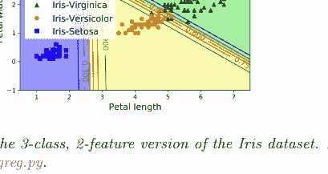

*图 3.5：对鸢尾花数据集的 3 类、2 特征版本的逻辑回归。改编自图 4.25 [Gér19]。由 `iris_logreg.py` 生成。*

### 3.2.4 Log-sum-exp 技巧

在本节中，我们讨论在使用 softmax 分布时需要注意的一个重要实践细节。假设我们想计算归一化概率 $p_c = p(y = c\mid \mathbf{x})$，它由下式给出

$$p_c = \frac{e^{a_c}}{Z(\mathbf{a})} = \frac{e^{a_c}}{\sum_{c'=1}^{C} e^{a_{c'}}}\tag{3.33}$$

其中 $\mathbf{a} = f(\mathbf{x}; \boldsymbol{\theta})$ 是 logits。计算 **配分函数** $Z$ 时可能会遇到数值问题。例如，假设我们有 3 个类别，logits $\mathbf{a} = (0,1,0)$。那么我们得到 $Z = e^0 + e^1 + e^0 = 4.71$。但现在假设 $\mathbf{a} = (1000,1001,1000)$；我们得到 $Z = \infty$，因为在计算机上，即使使用 64 位精度，`np.exp(1000) = inf`。类似地，假设 $\mathbf{a} = (-1000,-999,-1000)$；现在我们得到 $Z = 0$，因为 `np.exp(-1000) = 0`。为了避免数值问题，我们可以使用以下恒等式：

$$\log \sum_{c=1}^{C} \exp(a_c) = m + \log \sum_{c=1}^{C} \exp(a_c - m)\tag{3.34}$$

这对任意 $m$ 都成立。常见的做法是使用 $m = \max_c a_c$，这确保你指数化的最大值为零，因此肯定不会溢出，即使发生下溢，结果也合理。这被称为 **log-sum-exp 技巧**。我们在实现 `lse` 函数时使用此技巧：

$$\operatorname{lse}(\mathbf{a}) \triangleq \log \sum_{c=1}^{C} \exp(a_c)\tag{3.35}$$

我们可以用它从 logits 计算概率：

$$p(y = c\mid \mathbf{x}) = \exp(a_c - \operatorname{lse}(\mathbf{a}))\tag{3.36}$$

然后我们可以将其传递给交叉熵损失，定义在式 (8.39) 中。

然而，为了节省计算量并提高数值稳定性，通常会修改交叉熵损失，使其以 logits $\mathbf{a}$ 作为输入，而不是概率向量 $\mathbf{p}$。例如，考虑二元情况。一个样本的 CE 损失为

$$\mathcal{L} = -[\mathbb{I}(y = 0)\log p_0 + \mathbb{I}(y = 1)\log p_1]\tag{3.37}$$

其中

$$\log p_1 = \log\left(\frac{1}{1 + \exp(-a)}\right) = \log(1) - \log(1 + \exp(-a)) = 0 - \operatorname{lse}([0, -a])\tag{3.38}$$

$$\log p_0 = 0 - \operatorname{lse}([0, +a])\tag{3.39}$$

## 3.3 单变量高斯（正态）分布

对于实值随机变量 $y \in \mathbb{R}$，使用最广泛的分布是高斯分布，也称为正态分布（参见第 3.3.4 节讨论这些名称）。

### 3.3.1 累积分布函数

我们如下定义连续随机变量 $Y$ 的累积分布函数，或 cdf：

$$P(y) \triangleq \Pr(Y \le y)\tag{3.40}$$

（注意我们使用大写 $P$ 表示 cdf。）利用它，我们可以计算位于任意区间的概率如下：

$$\Pr(a < Y \le b) = P(b) - P(a)\tag{3.41}$$


CDF 是单调非递减函数。

高斯分布的 CDF 定义为

$$\Phi(y; \mu, \sigma^2) \triangleq \int_{-\infty}^{y} \mathcal{N}(z|\mu, \sigma^2)\, dz = \frac{1}{2}\left[1 + \operatorname{erf}\left(\frac{z}{\sqrt{2}}\right)\right] \tag{3.42}$$

其中 \(z = (y - \mu)/\sigma\)，且 \(\operatorname{erf}(u)\) 是**误差函数**，其定义为

$$\operatorname{erf}(u) \triangleq \frac{2}{\sqrt{\pi}} \int_0^u e^{-t^2}\, dt \tag{3.43}$$

上述误差函数已内置于大多数软件包中。关于该函数的图像，请参阅图 3.6a。

参数 \(\mu\) 编码了分布的均值，由于该分布是单峰的，因此均值与众数相同。参数 \(\sigma^2\) 编码了方差。（有时我们会讨论高斯分布的**精度**，即方差的倒数，记为 \(\lambda = 1/\sigma^2\)。）当 \(\mu = 0\) 且 \(\sigma = 1\) 时，该高斯分布被称为**标准正态**分布。

如果 \(P\) 是 \(Y\) 的 CDF，那么 \(P^{-1}(q)\) 就是满足 \(P(Y \le y_q) = q\) 的值 \(y_q\)；这被称为 \(P\) 的 \(q\) 分**位数**。值 \(P^{-1}(0.5)\) 是分布的**中位数**，其左侧有一半的概率质量，右侧也有另一半。值 \(P^{-1}(0.25)\) 和 \(P^{-1}(0.75)\) 分别是下**四分位数**和上**四分位数**。

例如，设 \(\Phi\) 为高斯分布 \(N(0,1)\) 的 CDF，而 \(\Phi^{-1}\) 为逆 CDF（也称为**概率逆函数**）。那么，在 \(\Phi^{-1}(\alpha/2)\) 左侧的点包含 \(\alpha/2\) 的概率质量，如图 3.6b 所示。由于对称性，在 \(\Phi^{-1}(1 - \alpha/2)\) 右侧的点也包含 \(\alpha/2\) 的质量。因此，中心区间 \((\Phi^{-1}(\alpha/2), \Phi^{-1}(1 - \alpha/2))\) 包含 \(1 - \alpha\) 的质量。如果我们设 \(\alpha = 0.05\)，则 95% 的中心区间由范围

$$(\Phi^{-1}(0.025), \Phi^{-1}(0.975)) = (-1.96, 1.96) \tag{3.44}$$

覆盖。如果分布为 \(N(\mu, \sigma^2)\)，则 95% 区间变为 \((\mu - 1.96\sigma, \mu + 1.96\sigma)\)。这通常通过写成 \(\mu \pm 2\sigma\) 来近似。

### 3.3.2 概率密度函数

我们将**概率密度函数**或**PDF** 定义为 CDF 的导数：

$$p(y) \triangleq \frac{d}{dy} P(y) \tag{3.45}$$

高斯分布的 PDF 由下式给出

$$\mathcal{N}(y|\mu, \sigma^2) \triangleq \frac{1}{\sqrt{2\pi\sigma^2}} e^{-\frac{(y-\mu)^2}{2\sigma^2}} \tag{3.46}$$

其中 \(\sqrt{2\pi\sigma^2}\) 是确保密度积分结果为 1 所需的归一化常数（参见练习 3.2）。关于该函数的图像，请参阅图 3.6b。

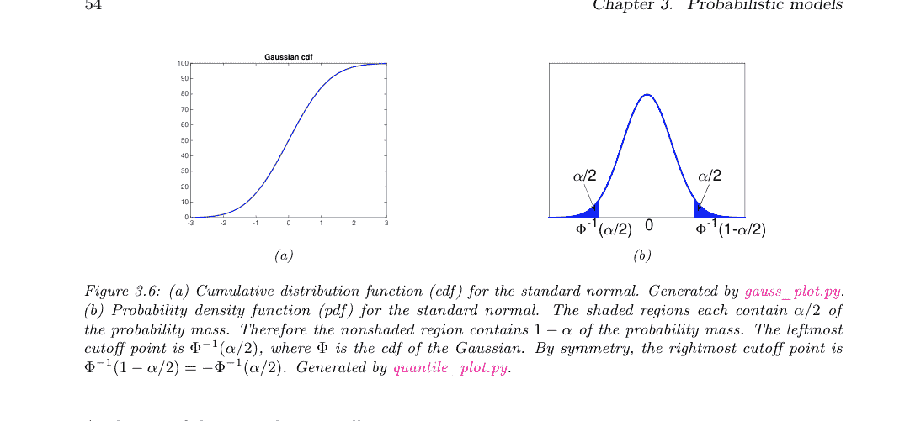

随着区间大小的减小，我们可以写出

$$\Pr(y \le Y \le y+dy) \approx p(y)\,dy \tag{3.48}$$

直观地说，这意味着 \(Y\) 落在 \(y\) 附近的一个小区间内的概率等于 \(y\) 处的密度乘以区间的宽度。上述结果的一个重要推论是，某一点处的 PDF 可能大于 1。例如，\(N(0|0, 0.01) = 3.99\)。

我们可以使用 PDF 来计算分布的均值（或期望值）：

$$E[Y] \triangleq \int y\, p(y)\, dy \tag{3.49}$$

对于高斯分布，我们有熟悉的结论：\(E[N(\mu,\sigma^2)] = \mu\)。（不过请注意，对于某些分布，该积分不是有限的，因此均值未定义。）

我们还可以使用 PDF 来计算分布的方差。方差衡量的是分布的“离散程度”，通常记为 \(\sigma^2\)。方差的定义如下：

$$V[Y] \triangleq E[(Y - \mu)^2] = \int (y - \mu)^2 p(y)\, dy \tag{3.50}$$

$$= \int y^2 p(y)\, dy + \mu^2 \int p(y)\, dy - 2\mu \int y p(y)\, dy = E[Y^2] - \mu^2 \tag{3.51}$$

由此我们推导出一个有用的结果：

$$E[Y^2] = \sigma^2 + \mu^2 \tag{3.52}$$

标准差的定义为

$$\operatorname{std}[Y] \triangleq \sqrt{V[Y]} = \sigma \tag{3.53}$$

（由于标准差具有与 \(Y\) 本身相同的量纲，因此它比方差更具可解释性。）对于高斯分布，我们有熟悉的结论：\(\operatorname{std}[N(\mu,\sigma^2)] = \sigma\)。

### 3.3.3 回归

到目前为止，我们一直在考虑无条件的高斯分布。在某些情况下，让高斯分布的参数成为某些输入变量的函数是很有帮助的，即我们想要创建一个条件密度模型，形式为

$$p(y \mid \mathbf{x}; \boldsymbol{\theta}) = \mathcal{N}(y \mid f_\mu(\mathbf{x}; \boldsymbol{\theta}), f_\sigma(\mathbf{x}; \boldsymbol{\theta})^2) \tag{3.54}$$

其中 \(f_\mu(\mathbf{x}; \boldsymbol{\theta}) \in \mathbb{R}\) 预测均值，而 \(f_\sigma(\mathbf{x}; \boldsymbol{\theta}) \in \mathbb{R}_+\) 预测标准差。

通常假设方差是固定的，并且独立于输入。这被称为**同方差回归**。此外，通常还假设均值是输入的线性函数。由此产生的模型被称为**线性回归**：

$$p(y \mid \mathbf{x}; \boldsymbol{\theta}) = \mathcal{N}(y \mid \mathbf{w}^\top \mathbf{x} + b, \sigma^2) \tag{3.55}$$

其中 \(\boldsymbol{\theta} = (\mathbf{w}, b, \sigma^2)\)。图 3.7(a) 展示了一维情况下该模型的示例，关于该模型的更多细节，请参见第 11.2 节。

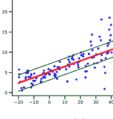

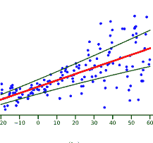

*图 3.7：使用均值 \(\mu(x)=b+wx\) 的高斯输出进行线性回归，其中 (a) 方差 \(\sigma^2\) 固定（同方差），或 (b) 方差 \(\sigma(x)^2\) 依赖于输入（异方差）。由 linreg_1d_hetero_tfp.py 生成。*

然而，我们也可以让方差依赖于输入；这被称为**异方差回归**。在线性回归的设置中，我们有

$$p(y \mid \mathbf{x}; \boldsymbol{\theta}) = \mathcal{N}(y \mid \mathbf{w}_\mu^\top \mathbf{x} + b, \sigma_+(\mathbf{w}_\sigma^\top \mathbf{x})) \tag{3.56}$$

其中 \(\boldsymbol{\theta} = (\mathbf{w}_\mu, \mathbf{w}_\sigma)\) 是两组回归权重，且

$$\sigma_+(a) = \log(1 + e^a) \tag{3.57}$$

是**Softplus** 函数，它将 \(\mathbb{R}\) 映射到 \(\mathbb{R}_+\)，以确保预测的标准差非负。图 3.7(b) 展示了一维情况下该模型的示例。

请注意，图 3.7 绘制了 95% 的预测区间 \([\mu(x) - 2\sigma(x), \mu(x) + 2\sigma(x)]\)。这是在给定 \(\mathbf{x}\) 的情况下预测观测值 \(y\) 的不确定性，它捕捉了蓝色点之间的变异性。相比之下，底层（无噪声）函数的不确定性由 \(\sqrt{\mathbb{V}[f_\mu(\mathbf{x}; \boldsymbol{\theta})]}\) 表示，其中不涉及 \(\sigma\) 项；此时的不确定性是关于参数 \(\boldsymbol{\theta}\) 的，而不是关于输出 \(y\) 的。关于如何对参数不确定性进行建模的细节，请参见第 11.6 节。

### 3.3.4 为什么高斯分布被如此广泛使用？

高斯分布是统计和机器学习中使用最广泛的分布。原因有几点。首先，它有两个参数，易于解释，并且捕捉了分布的一些最基本属性，即均值和方差。其次，中心极限定理（第 D.5.6 节）告诉我们，独立随机变量之和近似服从高斯分布，这使其成为对残差误差或“噪声”进行建模的良好选择。第三，在具有指定均值和方差的约束下，高斯分布所做的假设最少（即具有最大熵）。这使其在许多情况下成为一个良好的默认选择。最后，它具有简单的数学形式，从而导致了易于实现但通常非常有效的方法，我们将在第 3.5 节中看到。

从历史角度来看，值得注意的是，“高斯分布”这个术语有点误导性，因为正如 Jaynes [Jay03, p241] 所指出的：“这种分布的基本性质及其主要特征在 Gauss 六岁时就被 Laplace 注意到了；而这个分布本身在 Laplace 出生前就已经被 de Moivre 发现了”。然而，Gauss 在 19 世纪推广了该分布的使用，如今“高斯”一词在科学和工程领域已被广泛使用。

“正态分布”这一名称似乎源于线性回归中的正规方程（参见第 11.2.2.2 节）。然而，我们倾向于避免使用“正态”一词，因为它暗示其他分布是“非正态的”，而正如 Jaynes [Jay03] 指出的那样，实际上是高斯分布才是“非正常”的，因为它具有许多通常分布所不具备的特殊性质。

### 3.3.5 半正态分布

对于某些问题，我们需要一个非负实数上的分布。创建此类分布的一种方法是定义 \(Y = |X|\)，其中 \(X \sim N(0, \sigma^2)\)。\(Y\) 的诱导分布称为半正态分布，其 PDF 为

$$\mathcal{N}_+(y|\sigma) \triangleq 2\mathcal{N}(y|0, \sigma^2) = \frac{\sqrt{2}}{\sigma\sqrt{\pi}} \exp\left(-\frac{y^2}{2\sigma^2}\right), \quad y \ge 0 \tag{3.58}$$

可以将其视为 \(N(0, \sigma^2)\) 分布“折叠”到自身上。该分布具有以下矩：

$$\text{mean} = \frac{\sigma\sqrt{2}}{\sqrt{\pi}}, \quad \text{var} = \sigma^2\left(1 - \frac{2}{\pi}\right) \tag{3.59}$$

## 3.4 其他常见的单变量分布

在本节中，我们将简要介绍本书中将要使用的一些其他单变量分布。

### 3.4.1 Student t 分布

高斯分布对异常值非常敏感。高斯分布的一个鲁棒替代方案是 Student t 分布，简称 Student 分布。² 其 PDF 为


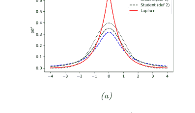

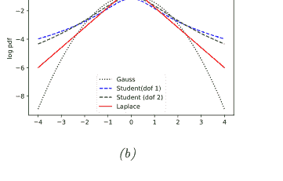

*图 3.8：* (a) $\mathcal{N}(0,1)$，$\mathcal{T}(\mu=0,\sigma=1,\nu=1)$，$\mathcal{T}(\mu=0,\sigma=1,\nu=2)$ 以及 $\mathrm{Lap}(0,1/\sqrt{2})$ 的概率密度函数（pdf）。高斯分布和拉普拉斯分布的均值均为 0，方差均为 1。当 $\nu=1$ 时，学生氏分布等同于柯西分布，后者没有明确定义的均值和方差。(b) 这些概率密度函数的对数。请注意，对于任何参数值，学生氏分布都不是对数凹的，这与拉普拉斯分布不同。尽管如此，两者都是单峰的。由 *student_laplace_pdf_plot.py* 生成。

如下：

$$\mathcal{T}(y|\mu,\sigma^2,\nu) \propto \left[1 + \frac{1}{\nu}\left(\frac{y-\mu}{\sigma}\right)^2\right]^{-(\nu+1)/2}\tag{3.60}$$

其中 $\mu$ 是均值，$\sigma > 0$ 是尺度参数（而非标准差），$\nu > 0$ 被称为**自由度**（尽管更好的术语是**正态度** [Kru13]，因为 $\nu$ 的值越大，该分布的行为就越像高斯分布）。

我们可以看到，概率密度随着距中心距离的平方以多项式函数的形式衰减，而不是指数函数，因此与高斯分布相比，尾部有更多的概率质量，如图 3.8 所示。我们说学生氏分布具有**重尾**，这使其对异常值具有鲁棒性。

为了说明学生氏分布的鲁棒性，请参考图 3.9。左侧展示了拟合在没有异常值的一些数据的高斯分布和学生氏分布。右侧加入了一些异常值。我们可以看到，高斯分布受影响很大，而学生氏分布几乎不变。我们将在 11.4.1 节中讨论如何使用学生氏分布进行鲁棒线性回归。

供日后参考，我们注意到学生氏分布具有以下性质：

$$\text{均值} = \mu,\ \text{众数} = \mu,\ \text{方差} = \frac{\nu\sigma^2}{\nu-2}\tag{3.61}$$

仅当 $\nu > 1$ 时均值才有定义。仅当 $\nu > 2$ 时方差才有定义。当 $\nu \gg 5$ 时，学生氏分布迅速逼近高斯分布并失去其鲁棒性特性。通常使用 $\nu = 4$，这在一类问题中表现良好 [LLT89]。

“学生氏”分布。术语 $t$ 的起源似乎出现在学生氏分布表格的语境中，费希尔在建立经典统计推断的基础时使用过这些表格。有关更多历史细节，请访问 http://jeff560.tripod.com/s.html。

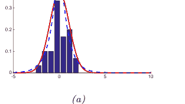

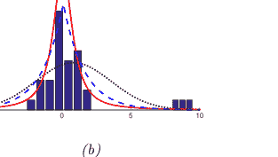

图 3.9：展示异常值对拟合高斯、学生氏和拉普拉斯分布的影响。(a) 无异常值（高斯和学生氏曲线重叠在一起）。(b) 有异常值。我们可以看到，与拉普拉斯分布相比，高斯分布更容易受到异常值的影响。改编自 [Bis06] 的图 2.16。由 robust_pdf_plot.py 生成

### 3.4.2 柯西分布

如果 $\nu = 1$，学生氏分布被称为柯西分布或洛伦茨分布。其概率密度函数定义为

$\mathcal{C}(x|\mu,\gamma)=\frac{1}{\gamma\pi}\left[1+\left(\frac{x-\mu}{\gamma}\right)^2\right]^{-1}$  (3.62)

与高斯分布相比，该分布的尾部非常厚重。例如，标准正态分布中 95% 的值位于 -1.96 和 1.96 之间，但对于标准柯西分布，它们位于 -12.7 和 12.7 之间。事实上，尾部如此厚重，以至于定义均值的积分不收敛。

半柯西分布是柯西分布（均值为 0）的一个版本，它“折叠”在自身上，因此其所有概率密度都位于正实数上。因此它具有以下形式

$\mathcal{C}_+(x|\gamma)\triangleq\frac{2}{\pi\gamma}\left[1+\left(\frac{x}{\gamma}\right)^2\right]^{-1}$  (3.63)

这在贝叶斯建模（第 7.2.3.5 节）中非常有用，在那里我们希望使用具有重尾但在原点处密度有限的正实数分布。

### 3.4.3 拉普拉斯分布

另一种具有重尾的分布是拉普拉斯分布³，也称为双侧指数分布。它具有以下概率密度函数：

$\text{Lap}(y|\mu,b)\triangleq\frac{1}{2b}\exp\left(-\frac{|y-\mu|}{b}\right)$  (3.64)

3. 皮埃尔-西蒙·拉普拉斯（1749–1827）是一位法国数学家，在创建贝叶斯统计学领域方面发挥了关键作用。

参见图 3.8 的绘图。这里 $\mu$ 是位置参数，$b > 0$ 是尺度参数。该分布具有以下性质：

均值 = $\mu$，众数 = $\mu$，方差 = $2b^2$  (3.65)

在 11.4.2 节中，我们讨论如何使用拉普拉斯分布进行鲁棒线性回归；在 11.5 节中，我们讨论如何使用拉普拉斯分布进行稀疏线性回归。

### 3.4.4 贝塔分布

贝塔分布的支持区间为 [0, 1]，定义如下：

$\text{Beta}(x|a,b) = \frac{1}{B(a,b)} x^{a-1} (1 - x)^{b-1}$  (3.66)

其中 $B(a,b)$ 是贝塔函数，定义为

$B(a,b) \triangleq \frac{\Gamma(a)\Gamma(b)}{\Gamma(a+b)}$  (3.67)

其中 $\Gamma(a)$ 是由以下式子定义的伽玛函数

$\Gamma(a) \triangleq \int_0^\infty x^{a-1} e^{-x} dx$  (3.68)

参见图 3.10a 中一些贝塔分布的图示。

我们需要 $a,b > 0$ 以确保分布可积（即确保 $B(a,b)$ 存在）。如果 $a = b = 1$，我们得到均匀分布。如果 $a$ 和 $b$ 都小于 1，我们得到一个在 0 和 1 处有“尖峰”的双峰分布；如果 $a$ 和 $b$ 都大于 1，分布是单峰的。

供日后参考，我们注意到该分布具有以下性质（练习 D.12）：

均值 = $\frac{a}{a+b}$，众数 = $\frac{a-1}{a+b-2}$，方差 = $\frac{ab}{(a+b)^2(a+b+1)}$  (3.69)

### 3.4.5 伽玛分布

伽玛分布是正值随机变量 $x > 0$ 的一个灵活分布。它由两个参数定义，称为形状 $a > 0$ 和速率 $b > 0$：

$\text{Ga}(x| \text{形状} = a, \text{速率} = b) \triangleq \frac{b^{a}}{\Gamma(a)} x^{a-1} e^{-x b}$  (3.70)

有时分布是用形状 $a$ 和尺度 $s = 1/b$ 来参数化的：

$\text{Ga}(x| \text{形状} = a, \text{尺度} = s) \triangleq \frac{1}{s^{a}\Gamma(a)} x^{a-1} e^{-x/s}$  (3.71)

参见图 3.10b 中伽玛概率密度函数的一些图示。

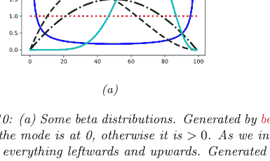

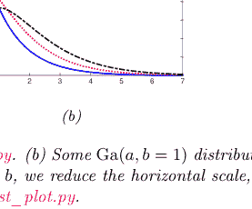

图 3.10：(a) 一些贝塔分布。由 beta_dist_plot.py 生成。(b) 一些 Ga(a, b = 1) 分布。如果 a ≤ 1，众数在 0，否则 > 0。随着速率 b 的增加，我们缩小水平尺度，从而将所有内容向左和向上压缩。由 gamma_dist_plot.py 生成。

供参考，我们注意到该分布具有以下性质：

均值 = $a/b$，众数 = $(a-1)/b$，方差 = $a/b^2$  (3.72)

有几个分布只是伽玛分布的特例，我们稍后讨论。

- **指数分布。** 其定义为
  
  $\text{Expon}(x|\lambda) \triangleq \text{Ga}(x| \text{形状} = 1, \text{速率} = \lambda)$  (3.73)
  
  该分布描述了泊松过程中事件之间的时间间隔，即事件以恒定的平均速率 $\lambda$ 连续且独立发生的过程。

- **卡方分布。** 其定义为
  
  $\chi^2_\nu(x) \triangleq \text{Ga}(x| \text{形状} = \nu/2, \text{速率} = 1/2)$  (3.74)
  
  其中 $\nu$ 被称为自由度。这是平方高斯随机变量之和的分布。更准确地说，如果 $Z_i \sim \mathcal{N}(0,1)$，且 $S = \sum_{i=1}^\nu Z_i^2$，则 $S \sim \chi^2_\nu$。

- **逆伽玛分布**是假设 $X \sim \text{Ga}(a,b)$ 时 $Y = 1/X$ 的分布。可以证明（练习 D.11）其概率密度函数为
  
  $\text{IG}(x| \text{形状} = a, \text{尺度} = s) \triangleq \frac{b^a}{\Gamma(a)} x^{-(a+1)} e^{-s/x}$  (3.75)
  
  该分布具有以下性质
  
  均值 = $s/(a-1)$，众数 = $s/(a+1)$，方差 = $s^2 / [(a-1)^2(a-2)]$  (3.76)
  
  仅当 $a > 1$ 时均值才存在。仅当 $a > 2$ 时方差才存在。

## 3.5 多元高斯（正态）分布

用于连续随机变量的联合概率分布中，最常用的是**多元高斯**或**多元正态（MVN）**。这主要是因为它在数学上方便，而且因为在许多情况下，高斯假设是相当合理的（参见 3.3.4 节的讨论）。

### 3.5.1 定义

MVN 密度由以下式子定义：

$$\mathcal{N}(\mathbf{y}|\boldsymbol{\mu},\boldsymbol{\Sigma}) \triangleq \frac{1}{(2\pi)^{D/2}|\boldsymbol{\Sigma}|^{1/2}} \exp\left[-\frac{1}{2}(\mathbf{y}-\boldsymbol{\mu})^{\top}\boldsymbol{\Sigma}^{-1}(\mathbf{y}-\boldsymbol{\mu})\right] \tag{3.77}$$

其中 $\boldsymbol{\mu}=\mathbb{E}[\mathbf{y}]\in\mathbb{R}^D$ 是均值向量，$\boldsymbol{\Sigma}=\mathrm{Cov}[\mathbf{y}]$ 是 $D\times D$ 的**协方差矩阵**，定义如下：

$$\mathrm{Cov}[\mathbf{y}] \triangleq \mathbb{E}\left[(\mathbf{y}-\mathbb{E}[\mathbf{y}])(\mathbf{y}-\mathbb{E}[\mathbf{y}])^{\top}\right] \tag{3.78}$$

$$\mathrm{Cov}[\mathbf{y}] = \begin{pmatrix} \mathbb{V}[Y_1] & \mathrm{Cov}[Y_1,Y_2] & \cdots & \mathrm{Cov}[Y_1,Y_D] \\ \mathrm{Cov}[Y_2,Y_1] & \mathbb{V}[Y_2] & \cdots & \mathrm{Cov}[Y_2,Y_D] \\ \vdots & \vdots & \ddots & \vdots \\ \mathrm{Cov}[Y_D,Y_1] & \mathrm{Cov}[Y_D,Y_2] & \cdots & \mathbb{V}[Y_D] \end{pmatrix} \tag{3.79}$$

其中

$$\mathrm{Cov}[Y_i,Y_j] \triangleq \mathbb{E}[(Y_i-\mathbb{E}[Y_i])(Y_j-\mathbb{E}[Y_j])] = \mathbb{E}[Y_iY_j] - \mathbb{E}[Y_i]\mathbb{E}[Y_j] \tag{3.80}$$

且 $\mathbb{V}[Y_i]=\mathrm{Cov}[Y_i,Y_i]$。由公式 (3.78)，我们得到重要结果 $$\mathbb{E}[\mathbf{y}\mathbf{y}^{\top}] = \boldsymbol{\Sigma} + \boldsymbol{\mu}\boldsymbol{\mu}^{\top} \tag{3.81}$$

公式 (3.77) 中的归一化常数 $Z=(2\pi)^{D/2}|\boldsymbol{\Sigma}|^{1/2}$ 仅确保概率密度函数积分为 1（参见练习 3.3）。


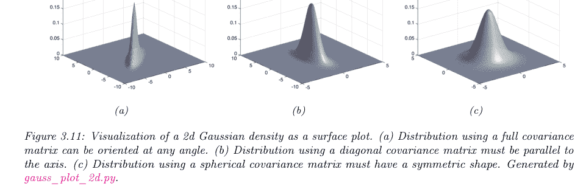

Figure 3.11: 2d 高斯密度作为曲面图的可视化。 (a) 使用完整协方差矩阵的分布可以以任意角度定向。 (b) 使用对角协方差矩阵的分布必须与轴平行。 (c) 使用球形协方差矩阵的分布必须具有对称形状。 由 gauss_plot_2d.py 生成。

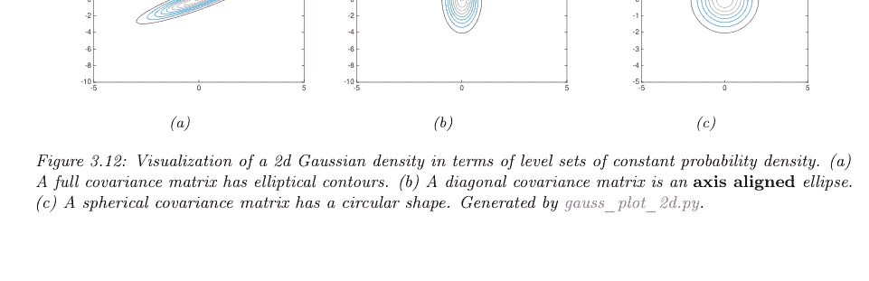

Figure 3.12: 2d 高斯密度以恒定概率密度水平集形式的可视化。 (a) 完整协方差矩阵具有椭圆形轮廓。 (b) 对角协方差矩阵是轴对齐的椭圆。 (c) 球形协方差矩阵具有圆形形状。 由 gauss_plot_2d.py 生成。

图 3.11 和图 3.12 绘制了三种不同类型协方差矩阵在 2d 中的一些 MVN 密度。 完整协方差矩阵有 \(D(D+1)/2\) 个参数，其中除以 2 是因为 \(\boldsymbol{\Sigma}\) 是对称的。 （椭圆形形状的原因在 Sec. C.4.4 中有解释，其中我们讨论二次型的几何形状。） 对角协方差矩阵有 \(D\) 个参数，且非对角项为 0。 球形协方差矩阵，也称为各向同性协方差矩阵，具有形式 \(\boldsymbol{\Sigma}=\sigma^2 \mathbf{I}_D\)，因此它只有一个自由参数，即 \(\sigma^2\)。

### 3.5.2 马哈拉诺比斯距离

在本节中，我们尝试深入了解多维高斯 pdf 的几何形状。 为此，我们将考虑恒定（对数）概率的水平集的形状。

特定点 \(\mathbf{x}\) 处的对数概率由下式给出

\[
\log p(\mathbf{x}|\boldsymbol{\mu},\boldsymbol{\Sigma})=-\frac{1}{2}(\mathbf{x}-\boldsymbol{\mu})^\mathsf{T}\boldsymbol{\Sigma}^{-1}(\mathbf{x}-\boldsymbol{\mu})+\mathrm{const} \tag{3.85}
\]

\(\mathbf{x}\) 的依赖关系可以用 \(\mathbf{x}\) 与 \(\boldsymbol{\mu}\) 之间的 **Mahalanobis distance** \(\Delta\) 来表示，其平方定义如下：

\[
\Delta^2 \triangleq (\mathbf{x}-\boldsymbol{\mu})^\mathsf{T}\boldsymbol{\Sigma}^{-1}(\mathbf{x}-\boldsymbol{\mu}) \tag{3.86}
\]

因此，恒定（对数）概率的轮廓等价于恒定马哈拉诺比斯距离的轮廓。

为了深入了解恒定马哈拉诺比斯距离的轮廓，我们利用 \(\boldsymbol{\Sigma}\) 和 \(\boldsymbol{\Lambda}=\boldsymbol{\Sigma}^{-1}\) 都是正定矩阵（根据假设）这一事实。 考虑 \(\boldsymbol{\Sigma}\) 的以下特征分解（附录 C.4）：

\[
\boldsymbol{\Sigma}=\sum_{d=1}^{D}\lambda_d\mathbf{u}_d\mathbf{u}_d^\mathsf{T} \tag{3.87}
\]

我们可以类似地写出

\[
\boldsymbol{\Sigma}^{-1}=\sum_{d=1}^{D}\frac{1}{\lambda_d}\mathbf{u}_d\mathbf{u}_d^\mathsf{T} \tag{3.88}
\]

令 \(z_d\triangleq\mathbf{u}_d^\mathsf{T}(\mathbf{x}-\boldsymbol{\mu})\)，则 \(\mathbf{z}=\mathbf{U}(\mathbf{x}-\boldsymbol{\mu})\)。 然后我们可以将马哈拉诺比斯距离重写如下：

\[
(\mathbf{x}-\boldsymbol{\mu})^\mathsf{T}\boldsymbol{\Sigma}^{-1}(\mathbf{x}-\boldsymbol{\mu})=(\mathbf{x}-\boldsymbol{\mu})^\mathsf{T}\left(\sum_{d=1}^{D}\frac{1}{\lambda_d}\mathbf{u}_d\mathbf{u}_d^\mathsf{T}\right)(\mathbf{x}-\boldsymbol{\mu}) \tag{3.89}
\]

\[
=\sum_{d=1}^{D}\frac{1}{\lambda_d}(\mathbf{x}-\boldsymbol{\mu})^\mathsf{T}\mathbf{u}_d\mathbf{u}_d^\mathsf{T}(\mathbf{x}-\boldsymbol{\mu})=\sum_{d=1}^{D}\frac{z_d^2}{\lambda_d} \tag{3.90}
\]

正如我们在 Sec. C.4.4 中讨论的那样，这意味着我们可以将马哈拉诺比斯距离解释为在新的坐标系 \(\mathbf{z}\) 中的欧几里得距离，其中我们通过 \(\mathbf{U}\) 旋转 \(\mathbf{x}\) 并通过 \(\boldsymbol{\Lambda}\) 缩放。

例如，在 2d 中，让我们考虑满足以下方程的点 \((z_1,z_2)\) 集合：

\[
\frac{z_1^2}{\lambda_1}+\frac{z_2^2}{\lambda_2}=r \tag{3.91}
\]

由于这些点具有相同的马哈拉诺比斯距离，因此它们对应于等概率点。 因此我们看到 2d 高斯的等概率密度轮廓沿椭圆分布。 这在图 C.6 中有所说明。 特征向量决定了椭圆的方向，特征值决定了其拉伸程度。

我们也可以通过线性映射 \(\mathbf{L}\) 来定义马哈拉诺比斯距离，使得 \(\boldsymbol{\Sigma}^{-1}=\mathbf{L}^\mathsf{T}\mathbf{L}\)，其中 \(\mathbf{L}\) 可以从 \(\mathbb{R}^D\) 映射到 \(\mathbb{R}^d\)，其中 \(d\leq D\)。 然后我们有

\[
(\mathbf{x}-\boldsymbol{\mu})^\mathsf{T}\boldsymbol{\Sigma}^{-1}(\mathbf{x}-\boldsymbol{\mu})=(\mathbf{x}-\boldsymbol{\mu})^\mathsf{T}\mathbf{L}^\mathsf{T}\mathbf{L}(\mathbf{x}-\boldsymbol{\mu})=(\mathbf{L}\boldsymbol{\delta})^\mathsf{T}(\mathbf{L}\boldsymbol{\delta})=\|\mathbf{L}\boldsymbol{\delta}\|_2^2 \tag{3.92}
\]

其中 \(\boldsymbol{\delta}=\mathbf{x}-\boldsymbol{\mu}\)。 这可以被认为是在低维空间中测量欧几里得距离。

### 3.5.3 MVN 的边缘分布和条件分布

假设我们有两个离散随机变量，\(Y_1\) 和 \(Y_2\)。 我们可以将它们的联合分布表示为一个 2d 表，其所有条目之和为一。 例如，考虑以下两个二元变量的示例：

| \(p(Y_1,Y_2)\) | \(Y_2=0\) | \(Y_2=1\) |
|---|---|---|
| \(Y_1=0\) | 0.2 | 0.3 |
| \(Y_1=1\) | 0.3 | 0.2 |

给定联合分布，我们按如下方式定义边缘分布：

\[
p(Y_2=y_2)=\sum_{y_1} p(Y_1=y_1,Y_2=y_2) \tag{3.93}
\]

我们按如下方式定义条件分布：

\[
p(Y_1=y_1|Y_2=y_2)=\frac{p(Y_1=y_1,Y_2=y_2)}{p(Y_2=y_2)} \tag{3.94}
\]

我们现在讨论如何将这些结果推广到联合高斯随机变量，其中用积分代替求和。 我们将随机变量向量 \(\mathbf{x}\) 分为两部分 \(\mathbf{x}_1\) 和 \(\mathbf{x}_2\)，其中 \(\mathbf{x}_2\) 是我们感兴趣的变量，而 \(\mathbf{x}_1\) 称为干扰变量。 \(\mathbf{x}_2\) 的边缘分布可以通过积分消去 \(\mathbf{x}_1\) 如下计算：

\[
p(\mathbf{x}_2)=\int \mathcal{N}(\mathbf{x}|\boldsymbol{\mu},\boldsymbol{\Sigma})\,d\mathbf{x}_1=\mathcal{N}(\mathbf{x}_2|\boldsymbol{\mu}_2,\boldsymbol{\Sigma}_{22}) \tag{3.95}
\]

其中我们定义了（矩）参数的以下划分：

\[
\boldsymbol{\mu}=\begin{pmatrix}\boldsymbol{\mu}_1\\ \boldsymbol{\mu}_2\end{pmatrix},\quad
\boldsymbol{\Sigma}=\begin{pmatrix}\boldsymbol{\Sigma}_{11} & \boldsymbol{\Sigma}_{12}\\ \boldsymbol{\Sigma}_{21} & \boldsymbol{\Sigma}_{22}\end{pmatrix} \tag{3.96}
\]

现在假设我们观察到 \(\mathbf{x}_2\) 的值，并且我们想根据此观测预测 \(\mathbf{x}_1\) 的值。 也就是说，我们想将先验分布 \(p(\mathbf{x}_1)\)（它代表我们在看到任何观测之前对 \(\mathbf{x}_1\) 值的信念）转换为后验分布 \(p(\mathbf{x}_1|\mathbf{x}_2)\)（它代表我们在看到 \(\mathbf{x}_2\) 之后（后验）对 \(\mathbf{x}_1\) 值的信念）。 练习 3.8 要求你推导出以下重要结果：

\[
p(\mathbf{x}_1|\mathbf{x}_2)=\mathcal{N}\left(\mathbf{x}_1\,\middle|\, \boldsymbol{\mu}_1+\boldsymbol{\Sigma}_{12}\boldsymbol{\Sigma}_{22}^{-1}(\mathbf{x}_2-\boldsymbol{\mu}_2),\; \boldsymbol{\Sigma}_{11}-\boldsymbol{\Sigma}_{12}\boldsymbol{\Sigma}_{22}^{-1}\boldsymbol{\Sigma}_{21}\right) \tag{3.97}
\]

请注意，后验均值是 \(\mathbf{x}_2\) 的线性函数，但后验协方差与 \(\mathbf{x}_2\) 无关。 有关简单示例，请参阅练习 3.5。

### 3.5.4 示例：插补缺失值

作为上述结果的一个示例应用，假设我们观察到 \(\mathbf{x}\) 的某些部分（维度），其余部分缺失或未观测。 我们可以利用维度之间的相关性（由协方差矩阵编码）来推断缺失条目； 这称为缺失值插补。

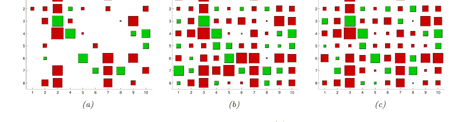

Figure 3.13: 使用 MVN 进行数据插补的说明。 (a) 数据矩阵的可视化。 空白条目缺失（未观测）。 红色为正，绿色为负。 正方形的面积与值成正比。 （这被称为 Hinton 图，以著名 ML 研究员 Geoff Hinton 的名字命名。） (b) 真实数据矩阵（隐藏）。 (c) 基于该行部分观测数据、使用真实模型参数的后验预测分布的均值。 由 gaussImputationDemo.m 生成。

图 3.13 显示了一个简单示例。 我们从 \(D=10\) 维高斯分布中采样 \(N\) 个向量，然后故意在每个样本（行）中“隐藏” 50% 的数据。 然后我们根据观测条目和真实模型参数推断缺失条目。 更精确地说，对于数据矩阵的每一行 \(n\)，我们计算 \(p(\mathbf{x}_{n,h}|\mathbf{x}_{n,v},\boldsymbol{\theta})\)，其中 \(v\) 是该行可见条目的索引，\(h\) 是隐藏条目的剩余索引，且 \(\boldsymbol{\theta}=(\boldsymbol{\mu},\boldsymbol{\Sigma})\)。 由此，我们计算每个缺失变量 \(i\in h\) 的边缘分布 \(p(x_{n,i}|\mathbf{x}_{n,v},\boldsymbol{\theta})\)。 从边缘分布中，我们计算后验均值 \(\bar{x}_{n,i}=\mathbb{E}[x_{n,i}|\mathbf{x}_{n,v},\boldsymbol{\theta}]\)。

后验均值代表我们对该条目真实值的“最佳猜测”，其含义是它最小化了我们的期望平方误差，如第 8 章所述。 我们可以使用 \(\mathrm{Var}[x_{n,i}|\mathbf{x}_{n,v},\boldsymbol{\theta}]\) 作为对该猜测的置信度度量，尽管这里未显示。 或者，我们可以从 \(p(\mathbf{x}_{n,h}|\mathbf{x}_{n,v},\boldsymbol{\theta})\) 中抽取多个后验样本； 这称为多重插补，并为下游消耗“填补”数据的算法提供更稳健的估计。

## 3.6 线性高斯系统

在第 3.5.3 节中，我们对无噪声观测进行条件化以推断高斯随机向量隐藏部分的后验。 在本节中，我们扩展这种方法以处理噪声观测。

设 \(\mathbf{z}\in\mathbb{R}^D\) 为未知值向量，\(\mathbf{y}\in\mathbb{R}^K\) 为 \(\mathbf{z}\) 的某种噪声测量。 我们假设这些变量由以下联合分布相关：

\[
p(\mathbf{z})=\mathcal{N}(\mathbf{z}|\boldsymbol{\mu}_z,\boldsymbol{\Sigma}_z) \tag{3.98}
\]

\[
p(\mathbf{y}|\mathbf{z})=\mathcal{N}(\mathbf{y}|\mathbf{W}\mathbf{z}+\mathbf{b},\boldsymbol{\Sigma}_y) \tag{3.99}
\]

其中 \(\mathbf{W}\) 是大小为 \(K\times D\) 的矩阵。 这是线性高斯系统的一个例子。


# 第3章. 概率模型

对应的联合分布，$p(z,y) = p(z)p(y|z)$，是一个 $D + K$ 维高斯分布，其均值和协方差由下式给出

$$
\begin{aligned}
\mu &= \begin{pmatrix} \mu_z \\ W\mu_z + b \end{pmatrix} \\
\Sigma &= \begin{pmatrix} \Sigma_z & \Sigma_z W^T \\ W \Sigma_z & \Sigma_z + W \Sigma_z W^T \end{pmatrix}
\end{aligned}
$$

通过对 y 进行条件化，我们可以使用高斯的贝叶斯规则计算后验 $p(z|y)$，如下所示：

$$
\begin{aligned}
p(z|y) &= \frac{p(y|z)p(z)}{p(y)} = N(z | \mu_{z|y}, \Sigma_{z|y}) \\
\Sigma_{z|y}^{-1} &= \Sigma_z^{-1} + W^T \Sigma_y^{-1} W \\
\mu_{z|y} &= \Sigma_{z|y} [W^T \Sigma_y^{-1} (y - b) + \Sigma_z^{-1} \mu_z]
\end{aligned}
$$

归一化常数由下式给出

$$
p(y) = \int N(z|\mu_z, \Sigma_z) N(y|Wz + b, \Sigma_y) dz = N(y | W\mu_z + b, \Sigma_y + W \Sigma_z W^T)
$$

该结果通过将高斯条件化公式 Eq. (3.97) 应用于联合 $p(y,z)$ 得到。我们看到高斯先验 $p(z)$ 与高斯似然 $p(y|z)$ 结合后得到高斯后验 $p(z|y)$。因此高斯分布在贝叶斯条件化下是封闭的。更一般地描述，我们说高斯先验是高斯似然的共轭先验，因为后验分布与先验具有相同的类型。我们将在第 7.2 节更详细地讨论共轭先验的概念。在下面的各节中，我们给出该结果的各种应用。

### 3.6.1 示例：从噪声传感器推断潜在向量

假设我们有一个未知的感兴趣量，$z \in \mathbb{R}^D$，我们为其赋予高斯先验，$p(z) = N(\mu_z, \Sigma_z)$。如果我们先验对 $z$ “一无所知”，我们可以设 $\Sigma_z = \infty I$，这意味着我们对 $z$ 的取值完全不确定。（在实践中，我们可以使用一个大但有限的值作为协方差。）由于对称性，设 $\mu_z = 0$ 似乎是合理的。

现在假设我们对 $z$ 进行了 $N$ 次有噪声但独立的测量，$y_n \sim N(z, \Sigma_y)$，每个大小为 $K$。我们可以将似然表示如下：

$$
p(D|z) = \prod_{n=1}^N N(y_n | z, \Sigma_y) = N(\bar{y} | z, \frac{1}{N} \Sigma_y)
$$

注意，我们可以用平均值 $\bar{y}$ 替换 $N$ 个观测值，前提是我们将协方差按 1/N 缩小以补偿。设 $W = I$，$b = 0$，我们就可以使用高斯的贝叶斯规则计算 $z$ 的后验：

$$
\begin{aligned}
p(z | y_1, \dots, y_N) &= N(z | \hat{\mu}, \hat{\Sigma}) \\
\hat{\Sigma}^{-1} &= \Sigma_z^{-1} + N \Sigma_y^{-1} \\
\hat{\mu} &= \hat{\Sigma} (\Sigma_y^{-1} (N \bar{y}) + \Sigma_z^{-1} \mu_z)
\end{aligned}
$$

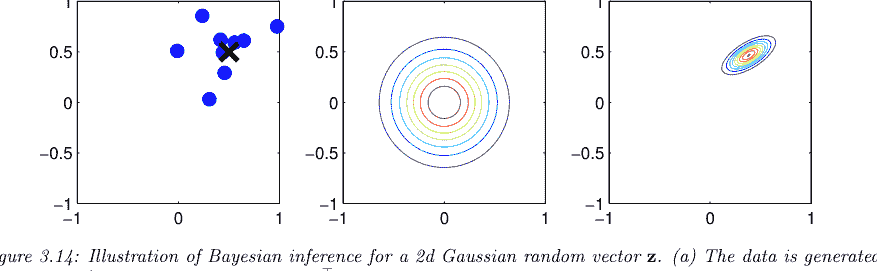

图 3.14：二维高斯随机向量 z 的贝叶斯推断示意图。(a) 数据由 $y_n \sim N(z, \Sigma_y)$ 生成，其中 $z = [0.5, 0.5]^T$ 且 $\Sigma_y = 0.1[2,1;1,1]$。我们假设传感器噪声协方差 $\Sigma_y$ 已知但 z 未知。黑色十字表示 z。(b) 先验为 $p(z) = N(z|0,0.1I_2)$。(c) 我们展示了在观察到 10 个数据点后的后验。由 gaussInferParamsMean2d.m 生成。

其中 $\hat{\mu}$ 和 $\hat{\Sigma}$ 是后验的参数。

图 3.14 给出了一个二维示例。我们可以把 z 视为物体在二维空间中的真实但未知的位 置，例如导弹或飞机，而 $y_n$ 是有噪声的观测，例如雷达“闪烁”。随着我们接收到更多的闪烁，我们能够更好地定位源。这就是卡尔曼滤波的思想。（在本书记的续篇 [Mur22] 中，我们讨论了卡尔曼滤波算法，该算法将这一思想扩展到观测的时间序列。）

关于 z 位置向量每个分量的后验不确定性取决于传感器在这些维度上的可靠性。在上面的示例中，第 1 维的测量噪声高于第 2 维，因此我们对 $z_1$（水平轴）的后验不确定性大于对 $z_2$（垂直轴）的后验不确定性。

### 3.6.2 示例：从多个噪声传感器推断潜在向量

在本节中，我们将第 3.6.1 节扩展到具有多个测量、来自不同传感器且每个传感器可靠性不同的情况。即模型具有以下形式

$$
p(z, y) = p(z) \prod_{m=1}^{M} \prod_{n=1}^{N_m} N(y_{n,m} | z, \Sigma_m) \quad (3.110)
$$

其中 M 是传感器（测量设备）的数量，$N_m$ 是来自传感器 m 的观测数量，且 $y = y_{1:N,1:M} \in \mathbb{R}^K$。我们的目标是将证据结合起来，计算 $p(z|y)$。这被称为传感器融合。

我们现在给出一个简单的示例，其中只有两个传感器，因此 $y_1 \sim N(z, \Sigma_1)$ 且 $y_2 \sim N(z, \Sigma_2)$。图示上，我们可以将此示例表示为 $y_1 \leftarrow z \rightarrow y_2$。我们可以将 $y_1$ 和 $y_2$ 合并为一个向量 $y$，因此模型可以表示为 $z \rightarrow [y_1, y_2]$，其中 $p(y|z) = N(y|Wz, \Sigma_y)$，其中 $W = [I; I]$ 且 $\Sigma_y = [\Sigma_1, 0; 0, \Sigma_2]$ 是块结构矩阵。然后我们可以应用高斯的贝叶斯规则计算 $p(z|y)$。

图 3.15(a) 给出了一个二维示例，其中我们设 $\Sigma_1 = \Sigma_2 = 0.01 I_2$，因此两个传感器的可靠性相等。

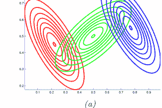

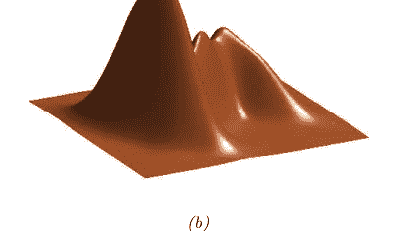

图 3.15：我们观察到 $y_1 = (0, -1)$（红色十字）和 $y_2 = (1, 0)$（绿色十字）并估计 $E[z|y_1,y_2]$（黑色十字）。(a) 传感器可靠性相等，因此后验均值估计位于两个圆之间。(b) 传感器 2 更可靠，因此估计更偏向绿色圆。(c) 传感器 1 在垂直方向上更可靠，传感器 2 在水平方向上更可靠。估计是对两个测量的适当组合。由 sensor_fusion_2d.py 生成。

在这种情况下，后验均值位于两个观测值 $y_1$ 和 $y_2$ 之间。在图 3.15(b) 中，我们设 $\Sigma_1 = 0.05I_2$ 且 $\Sigma_2 = 0.01I_2$，因此传感器 2 比传感器 1 更可靠。在这种情况下，后验均值更接近 $y_2$。在图 3.15(c) 中，我们设 $\Sigma_1 = 0.01 \begin{pmatrix} 10 & 1 \\ 1 & 1 \end{pmatrix}$，$\Sigma_2 = 0.01 \begin{pmatrix} 1 & 1 \\ 1 & 10 \end{pmatrix}$，因此传感器 1 在第二个分量（垂直方向）上更可靠，传感器 2 在第一个分量（水平方向）上更可靠。在这种情况下，后验均值使用 $y_1$ 的垂直分量和 $y_2$ 的水平分量。

## 3.7 混合模型

创建更复杂的概率模型的一种方法是取简单分布的凸组合。这称为混合模型。其形式为 $p(y|\theta) = \sum_{k=1}^K \pi_k p_k(y)$，其中 $p_k$ 是第 k 个混合分量，且 $\pi_k$ 是混合权重，满足 $0 \le \pi_k \le 1$ 且 $\sum_{k=1}^K \pi_k = 1$。

我们可以将此模型重新表述为分层模型，其中引入离散潜在变量 $z \in \{1,\dots,K\}$，它指定用于生成输出 y 的分布。潜在变量的先验为 $p(z = k) = \pi_k$，条件为 $p(y|z = k) = p_k(y) = p(y|\theta_k)$。即，我们定义以下联合模型：$p(z|\theta) = \text{Cat}(z|\pi)$，$p(y|z = k, \theta) = p(y|\theta_k)$。

图 3.16：二维中 3 个高斯的混合。(a) 我们展示了混合中每个分量的等概率轮廓。(b) 总体密度的曲面图。改编自 [Bis06] 的图 2.23。由 mixGaussPlotDemo.m 生成。

数据的“生成故事”是我们首先采样特定的分量 z，然后使用根据 z 的值选择的<|message|> 参数生成观测 y $y$。通过边缘化 z，我们恢复公式 (3.112)：

$$
p(y|\theta) = \sum_{k=1}^K p(z = k|\theta) p(y|z = k, \theta) = \sum_{k=1}^K \pi_k p(y|\theta_k) \quad (3.115)
$$

我们可以通过改变基分布 $p_k$ 来创建不同种类的混合模型，如下所述。

### 3.7.1 高斯混合模型

高斯混合模型或 GMM，也称为高斯混合（MoG），定义如下：

$$
p(y) = \sum_{k=1}^K \pi_k N(y|\mu_k, \Sigma_k) \quad (3.116)
$$

在图 3.16 中，我们展示了二维中 3 个高斯混合定义的密度。每个混合分量由不同的一组椭圆轮廓表示。如果我们让混合分量的数量足够大，GMM 可以逼近 $\mathbb{R}^D$ 上的任意光滑分布。

#### 3.7.1.1 使用 GMM 进行聚类

GMM 通常用于对实值数据样本 $y_n \in \mathbb{R}^D$ 进行无监督聚类。这分为两个阶段。首先我们拟合模型，例如通过计算 MLE $\hat{\theta} = \arg\max \log p(D|\theta)$，其中 $D = \{y_n : n = 1 : N\}$。（我们将在第 5.7.3 节讨论如何计算此 MLE。）然后我们将每个数据点 $y_n$ 与离散潜在或隐藏变量 $z_n \in \{1, \dots, K\}$ 关联，该变量指定用于生成 $y_n$ 的混合分量或簇的身份。这些潜在身份是


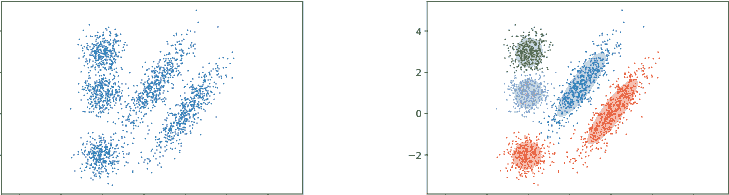

**图 3.17：** (a) 二维中的一些数据。(b) 使用 GMM 计算出的、以 $K = 3$ 个聚类划分的一种可能的聚类结果。由 `gmm_2d.py` 生成。

未知，但我们可以使用贝叶斯规则计算它们的后验：

$$r_{nk} \triangleq p(z_n = k \mid \mathbf{x}_n, \boldsymbol{\theta}) = \frac{p(z_n = k \mid \boldsymbol{\theta})p(\mathbf{x}_n \mid z_n = k, \boldsymbol{\theta})}{\sum_{k'=1}^{K} p(z_n = k' \mid \boldsymbol{\theta})p(\mathbf{x}_n \mid z_n = k', \boldsymbol{\theta})} \tag{3.117}$$

量 $r_{nk}$ 被称为簇 $k$ 对数据点 $n$ 的**责任**。在给定这些责任的情况下，我们可以按如下方式计算最可能的簇分配：

$$\hat{z}_n = \underset{k}{\arg\max}\ r_{nk} = \underset{k}{\arg\max}\left[\log p(\mathbf{x}_n \mid z_n = k, \boldsymbol{\theta}) + \log p(z_n = k \mid \boldsymbol{\theta})\right] \tag{3.118}$$

这被称为**硬聚类**。（如果我们使用这些责任将每个数据点按比例分配到不同的簇，则称为**软聚类**。）参见图 3.17 中的示例。

如果我们对 $z_n$ 采用均匀先验，并使用 $\boldsymbol{\Sigma}_k = \mathbf{I}$ 的球形高斯分布，则硬聚类问题简化为

$$z_n = \underset{k}{\arg\min}\ \lVert \mathbf{y}_n - \hat{\boldsymbol{\mu}}_k \rVert_2^2 \tag{3.119}$$

换句话说，我们将每个数据点分配给距离其最近的质心，这里的距离由欧几里得距离度量。这就是 **K 均值聚类**算法的基础，我们将在第 2.1.3 节中讨论该算法。

#### 3.7.1.2 使用 GMM 作为先验来正则化逆问题

在本节中，我们考虑使用 GMM 作为黑盒密度模型来正则化多对一映射的逆问题。具体而言，我们考虑从退化版本 $\mathbf{y}$ 中推断“干净”图像 $\mathbf{z}$ 的问题。我们使用如下形式的线性-高斯前向模型：

$$p(\mathbf{y} \mid \mathbf{z}) = \mathcal{N}(\mathbf{y} \mid \mathbf{W}\mathbf{z}, \sigma^2\mathbf{I}) \tag{3.120}$$

其中 $\sigma^2$ 是测量噪声的方差。矩阵 $\mathbf{W}$ 的形式取决于退化的性质，为简单起见，我们假设该性质是已知的。以下是我们方法中可以建模的几种常见退化类型示例：

- 如果退化是由加性噪声引起的（如图 3.18a 所示），我们可以设置 $\mathbf{W} = \mathbf{I}$。由此得到的 MAP 估计可用于**图像去噪**，如图 3.18b 所示。
- 如果退化是由模糊引起的（如图 3.18c 所示），我们可以将 $\mathbf{W}$ 设置为固定的卷积核 [KF09b]。由此得到的 MAP 估计可用于**图像去模糊**，如图 3.18d 所示。
- 如果退化是由遮挡引起的（如图 3.18e 所示），我们可以将 $\mathbf{W}$ 设置为对角矩阵，在对应于遮挡物的位置处为 0。由此得到的 MAP 估计可用于**图像修复**，如图 3.18f 所示。

因此我们看到，线性-高斯似然模型具有令人惊讶的灵活性。给定模型后，我们的目标是通过计算 MAP 估计 $\hat{\mathbf{z}} = \arg\max_{\mathbf{z}} p(\mathbf{z}|\mathbf{y})$ 来对其求逆。然而，对该模型求逆的问题是病态的，因为存在许多可能的潜在图像 $\mathbf{z}$ 映射到相同的观测图像 $\mathbf{y}$。因此，我们需要使用先验来正则化求逆过程。

在 [ZWW11] 中，他们提出使用形式为 $p(\mathbf{z}) = \sum_k p(c = k)\mathcal{N}(\mathbf{z}|\boldsymbol{\mu}_k, \boldsymbol{\Sigma}_k)$ 的 GMM 先验，其中使用 $K = 200$ 个混合分量，并在包含 200 万张干净图像块的数据集上拟合该先验。因此，完整的联合模型具有如下形式：

$$p(c = k, \mathbf{z}, \mathbf{y}|\boldsymbol{\theta}) = p(c = k)\mathcal{N}(\mathbf{z}|\boldsymbol{\mu}_k, \boldsymbol{\Sigma}_k)\mathcal{N}(\mathbf{y}|\mathbf{Wz}, \sigma^2\mathbf{I}) \tag{3.121}$$

为了计算边际 MAP 估计 $\arg\max_{\mathbf{z}} p(\mathbf{z}|\mathbf{y})$，我们可以使用近似

$$p(\mathbf{z}|\mathbf{y}) \approx p(\mathbf{z}|\mathbf{y}, c^*) \propto \mathcal{N}(\mathbf{z}|\boldsymbol{\mu}_{c^*}, \boldsymbol{\Sigma}_{c^*})\mathcal{N}(\mathbf{y}|\mathbf{Wz}, \sigma^2\mathbf{I}) \tag{3.122}$$

如果我们知道 $c^*$，就可以使用式 (3.102) 中针对高斯分布的贝叶斯规则来计算上述表达式。为了计算 MAP 混合分量 $c^*$，我们可以使用式 (3.105) 得到

$$c^* = \arg\max_c p(c) p(\mathbf{y}|c) = \arg\max_c p(c)\mathcal{N}(\mathbf{y}|\mathbf{W}\boldsymbol{\mu}_c, \sigma^2\mathbf{I} + \mathbf{W}\boldsymbol{\Sigma}_c\mathbf{W}^{\mathsf{T}}) \tag{3.123}$$

图 3.18 展示了该过程实际运行的一些示例。

如果退化是未知的，则称为“盲逆问题”，其难度明显更大。参见例如 [Ani+18; XC19; Wan+20c] 中的相关工作。

### 3.7.2 伯努利混合

如果数据是二值的，我们可以使用**伯努利混合**，其中每个混合分量具有以下形式：

$$p(\mathbf{y}|\mathbf{z}=k,\boldsymbol{\theta}) = \prod_{d=1}^{D} \operatorname{Ber}(y_d|\mu_{dk}) = \prod_{d=1}^{D} \mu_{dk}^{y_d}(1-\mu_{dk})^{1-y_d} \tag{3.124}$$

这里 $\mu_{dk}$ 是位 $d$ 在簇 $k$ 中被激活的概率。

例如，考虑为著名的 **MNIST** 数据集 [LeC+98; YB19] 构建一个无监督密度模型。该数据集包含 6 万张大小为 $28 \times 28 \times 1$ 的训练图像（最后一维大小为 1 表示图像是灰度图），展示了来自 10 个类别的手写数字；图 3.19a 是该数据的一个示例。训练样本有 6 万个，测试样本有 1 万个。

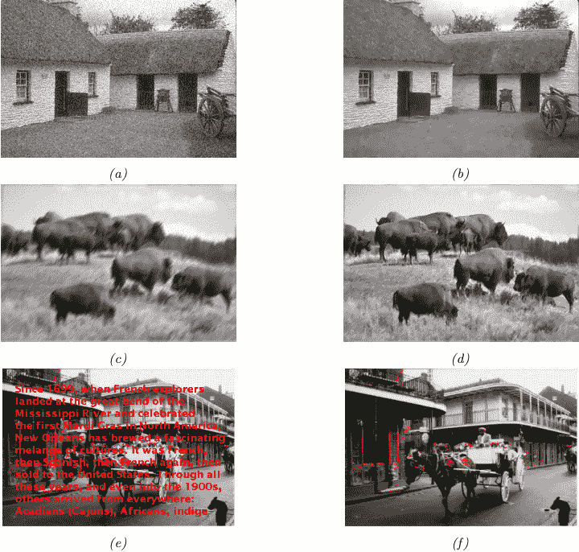

图 3.18：使用 GMM 块先验和高斯似然通过 MAP 估计从退化版本（左）恢复干净图像（右）的示例。第一行：图像去噪。第二行：图像去模糊。第三行：图像修复。来自 [RW15] 和 [ZW11]。经 Dan Rosenbaum 和 Daniel Zoran 友好许可使用。

我们使用 $K = 20$ 个分量在训练集数据上拟合了一个伯努利混合模型。（我们使用 EM 算法进行拟合——详见第 5.7.3 节。）每个混合分量得到的参数（即 $\mu_k$ 和 $\pi_k$）如图 3.19b 所示。我们可以看到，该模型“发现”了每种数字的一种表示。（有些数字被表示多次，因为模型不知道“真实”的类别数。关于如何选择混合分量数量 $K$ 的更多信息，请参见第 21.3.7 节。）

### 3.7.3 高斯尺度混合

高斯尺度混合 (GSM) [AM74; Wes87] 类似于一种“无限”的高斯混合，其中每个分量具有不同的尺度（方差）。更准确地说，令 $x = \epsilon z$，其中 $z \sim \mathcal{N}(0, \sigma_0^2)$，$\epsilon \sim p(\epsilon)$。我们可以

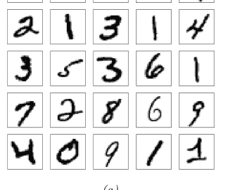


*图 3.19：(a) MNIST 数据集 [LeC+98; YB19] 中前 25 个数字的可视化。由 mnist_viz_tf.py 生成。(b) 我们对二值化的 MNIST 数字数据拟合了 20 个伯努利混合分量。我们可视化了估计的簇均值 $\hat{\mu}_k$。每幅图像上方的数字表示估计的混合权重 $\hat{\pi}_k$。训练该模型时未使用任何标签。由 mixBerMnistEM.m 生成。*

我们可以将其视为对高斯随机变量 $z$ 施加**乘性噪声**。我们有 $x|\epsilon \sim \mathcal{N}(0, \epsilon^2 \sigma_0^2)$。对尺度 $\epsilon$ 求边际积分可得

$$p(x)=\int \mathcal{N}(x|0,\sigma_0^2\epsilon^2)p(\epsilon)d\epsilon\tag{3.125}$$

通过改变先验 $p(\epsilon)$，我们可以生成各种有趣的分布。下面我们给出一些示例。

这种方法的主要优势在于，使用**扩展参数化**通常在计算上更方便，即在模型中显式包含尺度项 $\epsilon$，因为在该条件给定后，分布是高斯分布。我们在第 11.6.4.2 节中使用了该公式，其中我们讨论了使用 lasso 的稀疏回归，并在第 11.4.1.1 节中讨论了稳健回归。

#### 3.7.3.1 示例：学生 t 分布作为 GSM

我们可以将学生分布表示为如下 GSM：

$$\mathcal{T}(y|0,\sigma^2,\nu)=\int_0^\infty dz\,\mathcal{N}(y|0,z\sigma^2)\mathrm{IG}\left(z\Big|\frac{\nu}{2},\frac{\nu}{2}\right)=\int_0^\infty dz\,\mathcal{N}(y|0,z\sigma^2)\chi^{-2}(z|\nu,1)dz\tag{3.126}$$

其中 IG 是逆伽马分布（第 3.4.5 节）。（推导见练习 3.7。）因此，我们可以将学生分布视为不同宽度高斯分布的无限叠加；将其积分后，所得到的分布比具有相同方差的高斯分布具有更宽的尾部。这个结果也解释了为什么当自由度变大时学生分布趋近于高斯分布，因为当 $\nu = \infty$ 时，逆伽马分布变成了一个 delta 函数。


*图 3.20：带有相应二元 CPT 的洒水器 PGM。T 和 F 分别代表真和假。有关在该模型中实现推理的代码，请参阅 `sprinkler_pgm.py`。*

#### 3.7.3.2 示例：作为 GSM 的拉普拉斯分布

类似地，可以证明拉普拉斯分布是高斯分布的无限加权和，其中精度来自 Gamma 分布：

$$\mathrm{Lap}(w|0,\lambda)=\int \mathcal{N}(w|0,\tau^2)\mathrm{Ga}(\tau^2|1,\frac{\lambda^2}{2})d\tau^2\qquad(3.127)$$

## 3.8 概率图模型

我基本上知道两条以简单方式处理复杂系统的原则：第一是模块化原则，第二是抽象原则。我是机器学习中计算概率的辩护者，因为我相信概率论以深刻而有趣的方式实现了这两条原则——即通过分解和平均。在我看来，尽可能充分地利用这两种机制是机器学习的前进方向。——迈克尔·乔丹（Michael Jordan），1997年（引自 [Fre98]）。

我们现在已经介绍了一些简单的概率构建块。在 3.6 节中，我们展示了一种将一些高斯构建块组合起来，从更简单的部分构造高维分布 $p(\mathbf{y})$ 的方法，即边缘分布 $p(\mathbf{y}_1)$ 和条件分布 $p(\mathbf{y}_2|\mathbf{y}_1)$。这个想法可以扩展到定义多个随机变量集合上的联合分布。我们将做出的关键假设是，某些变量与其他变量**条件独立**。我们将使用图来表示我们的条件独立假设，如下面简要说明。（更多信息请参阅本书续集 [Mur22]。）

### 3.8.1 表示

**概率图模型（probabilistic graphical model）** 或 **PGM** 是一种使用图结构来编码条件独立性假设的联合概率分布。当图为**有向无环图（directed acyclic graph）** 或 **DAG** 时，该模型有时被称为**贝叶斯网络（Bayesian network）**，尽管这类模型本质上与贝叶斯方法无关。

PGM 的基本思想是：图中的每个节点表示一个随机变量，每条边表示一个直接依赖关系。更准确地说，每条缺失的边表示一个条件独立性。在 DAG 的情况下，我们可以按**拓扑序（topological order）**（父节点在子节点之前）对节点进行编号，然后连接它们，使得给定父节点时，每个节点与其所有前驱节点条件独立：

$$Y_i \perp Y_{\text{pred}(i)\setminus\text{pa}(i)} \mid Y_{\text{pa}(i)}\tag{3.128}$$

其中 pa(i) 是节点 i 的父节点，pred(i) 是节点 i 在排序中的前驱节点。（这被称为**有序马尔可夫性质（ordered Markov property）**。）因此，我们可以将联合分布表示如下：

$$p(\mathbf{Y}_{1:V}) = \prod_{i=1}^{V} p(Y_i \mid \mathbf{Y}_{\text{pa}(i)})\tag{3.129}$$

其中 V 是图中的节点数。

#### 3.8.1.1 示例：洒水器网络

例如，假设我们要对与天气相关的 4 个离散（二元）随机变量之间的依赖关系进行建模：C（是否有云）、R（是否下雨）、S（洒水器是否开启）以及 W（草地是否湿润）。直观上，云会导致降雨，但会阻止洒水器开启（无论是由于传感器还是人为干预）。雨和洒水器都可能导致草地湿润。我们可以使用图 3.20 中的 DAG 来表示这些假设，其中节点编号如下：C = Y₁，S = Y₂，R = Y₃，W = Y₄。该模型定义了以下联合分布：

$$p(C, S, R, W) = p(C)p(S\mid C)p(R\mid C,\cancel{S})p(W\mid \cancel{C},S,R)\tag{3.130}$$

其中我们划掉了由于模型的条件独立性而不需要的项。

每一项 $p(Y_i\mid\mathbf{Y}_{\text{pa}(i)})$ 被称为节点 i 的**条件概率分布（conditional probability distribution）** 或 **CPD**。这可以是任何我们想要的分布。在图 3.20 中，我们假设每个 CPD 都是一个条件类别分布，它可以表示为一个**条件概率表（conditional probability table）** 或 **CPT**。我们可以将第 i 个 CPT 表示如下：

$$\theta_{ijk} \triangleq p(Y_i = k \mid \mathbf{Y}_{\text{pa}(i)} = j)\tag{3.131}$$

#### 3.8.1.2 示例：马尔可夫链


图 3.21：一阶和二阶自回归（马尔可夫）模型的示意图。

现在假设我们要在可变长度序列 $p(y_{1:T})$ 上创建一个联合概率分布。如果每个变量 $y_t$ 表示来自具有 $K$ 个可能值的词汇表中的一个单词，因此 $y_t \in \{1,\ldots,K\}$，则所得模型表示长度为 $T$ 的可能句子上的分布；这通常被称为语言模型。

根据概率的链式法则，我们可以将 $T$ 个变量上的任意联合分布表示如下：

$p(\mathbf{y}_{1:T}) = p(y_1)p(y_2|y_1)p(y_3|y_2,y_1)p(y_4|y_3,y_2,y_1)\ldots = \prod_{t=1}^{T} p(y_t|\mathbf{y}_{1:t-1})$ (3.132)

不幸的是，表示每个条件分布 $p(y_t|\mathbf{y}_{1:t-1})$ 所需的参数数量随着 $t$ 呈指数增长。然而，假设我们做出如下条件独立性假设：给定当前 $y_t$，未来 $\mathbf{y}_{t+1:T}$ 与过去 $\mathbf{y}_{1:t-1}$ 独立。这被称为一阶马尔可夫条件，由图 3.21(a) 中的 PGM 表示。在这个假设下，我们可以将联合分布写成：

$p(\mathbf{y}_{1:T}) = p(y_1)p(y_2|y_1)p(y_3|y_2)p(y_4|y_3)\ldots = p(y_1)\prod_{t=2}^{T} p(y_t|y_{t-1})$ (3.133)

这被称为马尔可夫链、马尔可夫模型或一阶自回归模型。

函数 $p(y_t|y_{t-1})$ 被称为转移函数、转移核或马尔可夫核。这只是在给定 $t-1$ 时刻状态的情况下，$t$ 时刻状态的一个条件分布，因此它满足条件 $p(y_t|y_{t-1}) \ge 0$ 和 $\sum_{k=1}^{K} p(y_t = k|y_{t-1}=j)=1$。我们可以将此 CPT 表示为一个随机矩阵 $A_{jk}=p(y_t=k|y_{t-1}=j)$，其中每一行的和为 1。这被称为状态转移矩阵。我们假设该矩阵在所有时间步上都是相同的，因此该模型被称为齐次的、平稳的或时不变的。这是参数共享的一个例子，因为同一个参数被多个变量共享。这个假设允许我们用固定数量的参数对任意数量的变量进行建模。

一阶马尔可夫假设相当强。幸运的是，我们可以轻松地将一阶模型推广为依赖于最近的 $M$ 个观测值，从而创建阶数（记忆长度）为 $M$ 的模型：

$p(\mathbf{y}_{1:T}) = p(\mathbf{y}_{1:M}) \prod_{t=M+1}^{T} p(y_t|\mathbf{y}_{t-M:t-1})$ (3.134)

这被称为 $M$ 阶马尔可夫模型。例如，如果 $M=2$，则 $y_t$ 依赖于 $y_{t-1}$ 和 $y_{t-2}$，如图 3.21(b) 所示。这被称为三元模型（trigram model），因为它对单词三元组的分布进行建模。如果我们使用 $M = 1$，则得到**二元模型（bigram model）**，它对单词对的分布进行建模。

对于大型词汇表，当 $M$ 较大时，估计 $M$ 元模型的条件分布所需的参数数量可能会变得难以承受。在这种情况下，我们需要在条件独立性之外做出额外的假设。例如，我们可以假设 $p(y_t|y_{t-M:t-1})$ 可以表示为一个低秩矩阵，或者用某种神经网络来表示。这被称为**神经语言模型（neural language model）**。详见第 15 章。

PGM 定义了联合概率分布。因此，我们可以使用边缘化和条件化的规则来计算任意变量集合 $i$ 和 $j$ 的 $p(Y_i|Y_j = y_j)$。

例如，考虑图 3.20 中的洒水器示例。我们可以按如下方式计算“已经下雨”的先验信念：

```
$$p(R = 1) = \sum_{c=0}^{1} p(C = c)p(R = 1|C = c) = 0.5$$
```

如果我们看到草地是湿的，那么我们对“下过雨”的（后验）信念变为 $p(R = 1|W = 1) = 0.7079$。现在假设我们还注意到洒水器是开着的：我们对下过雨的信念下降到 $p(R = 1|W = 1, S = 1) = 0.3204$。这种多个原因对某些观测结果之间产生的负相互影响被称为**解释消除效应（explaining away effect）**，也称为**伯克森悖论（Berkson's paradox）**。

现在让我们给出一个更有趣的例子。我们将考虑 [LS88] 中提出的一个假设模型；它被称为“亚洲网络”，因为它被设计用于对可能最近去过亚洲的西方患者的各种肺部疾病进行建模。（注意：这纯粹是为了教学目的，不是一个真实的模型。此外，很明显，原则上我们可以为 COVID-19 诊断创建类似的模型。）

图 3.22a 显示了模型，以及每个节点上的先验边缘分布（假设为二元）。现在假设患者报告他们患有呼吸困难（Dyspnea），也就是气短。我们可以通过将该节点“着色”为深色来表示这一事实，然后将分布钳制为 Dyspnea=1 的概率为 100%，Dyspnea=0 的概率为 0%。然后我们通过网络传播这个新信息，得到如图 3.22b 所示的更新后的边缘分布。我们看到支气管炎（bronchitis）的概率从 45% 上升到 83.4%，因为这是证据最可能的病因或解释。然而，该症状（呼吸困难）仍有一定概率是由肺结核（TB）或肺癌（Lung Cancer）引起的。

现在假设医生问患者最近是否去过亚洲，患者回答是。图 3.22c 显示了每个节点的新的信念状态。我们看到肺结核（TB）的概率从 2% 增加到 9%。然而，支气管炎仍然是最可能的解释，于是医生问患者是否吸烟，患者回答是。图 3.22c 显示了每个节点的新的信念状态。我们看到


我们现在更加确信患者患有支气管炎，而非结核病或肺癌。X 光片显示异常结果的预测概率已上升至 24%，因此医生可能会认为值得订购一项测试来验证这一假设。

#### 3.8.2.3 计算问题

我们已经看到，贝叶斯推理允许我们通过结合嘈杂的证据与先验知识来更新对世界的信念。不幸的是，从联合分布中计算边缘分布和条件分布的过程在计算上可能非常昂贵。幸运的是，我们通常可以利用分布的条件独立性（CI）特性，使计算变得更加高效。我们在 7.7 节中简要讨论了这一主题，并在本书的续作中做了更详细的阐述，[Mur22]。

### 3.8.3 学习

如果条件概率分布（CPD）的参数未知，我们可以将它们视为额外的随机变量，将它们添加为图中的节点，然后将其视为**隐藏变量**进行推断。图 3.23(a) 展示了一个简单的例子，其中我们有 $N$ 个独立同分布（iid）随机变量，$y_n$，它们都取自具有共同参数 $\theta$ 的同一分布。（阴影节点代表观测值，而未着色（空心）节点代表潜在变量或参数。）


图 3.23：左：数据点 y_n 在给定 θ 的条件下是独立的。右：相同的模型，使用盘式符号表示。这代表了与左侧相同的模型，除了重复的 y_n 节点位于一个框内，称为盘式符号（plate）；右下角的数字，N，指定了 y_n 节点重复的次数。

更精确地说，该模型编码了关于数据的以下“生成故事”：

θ ~ p(θ)  (3.136)
y_n ~ p(y|θ)  (3.137)

其中 p(θ) 是参数上某种（未指定的）先验分布，p(y|θ) 是某种指定的似然函数。相应的联合分布形式为

p(D, θ) = p(θ) p(D|θ)  (3.138)

其中 D = (y₁, …, y_N)。由于独立同分布（iid）假设，似然函数可以重写如下：

p(D|θ) = ∏_{n=1}^N p(y_n|θ)  (3.139)

请注意，定义此模型时数据向量的顺序并不重要，即我们可以对概率图模型（PGM）中叶节点的编号进行排列。当这种性质成立时，我们说数据是可交换的。

#### 3.8.3.1 盘式符号（Plate notation）

在图 3.23(a) 中，我们可以看到 y 节点重复了 N 次。为了避免视觉杂乱，通常使用一种称为盘式符号（plates）的语法糖形式。这是一种符号约定，我们在重复变量周围画一个小框，理解到当模型展开时，框内的节点将得到重复。我们通常将副本或重复次数写在框的右下角。图 3.23(b) 对此进行了说明。这种符号广泛用于表示某些类型的贝叶斯模型。


*图 3.24：作为图形模型表示的高斯混合模型。*

图 3.24 展示了一个更有趣的例子，其中我们将 GMM（3.7.1 节）表示为图形模型。我们看到，这编码了联合分布

$$p(\mathbf{y}_{1:N},\mathbf{z}_{1:N},\boldsymbol{\theta}) = p(\boldsymbol{\pi})\left[\prod_{k=1}^{K}p(\boldsymbol{\mu}_k)p(\boldsymbol{\Sigma}_k)\right]\left[\prod_{n=1}^{N}p(z_n\mid\boldsymbol{\pi})p(\mathbf{y}_n\mid z_n,\boldsymbol{\mu}_{1:K},\boldsymbol{\Sigma}_{1:K})\right] \tag{3.140}$$

我们看到，潜在变量 $z_n$ 以及未知参数，$\boldsymbol{\theta}=(\boldsymbol{\pi},\boldsymbol{\mu}_{1:K},\boldsymbol{\Sigma}_{1:K})$，都显示为未着色节点。

## 3.9 练习

### 练习 3.1 [高斯分布 vs 联合高斯分布]

设 $X\sim\mathcal{N}(0,1)$ 且 $Y=WX$，其中 $p(W=-1)=p(W=1)=0.5$。显然 $X$ 和 $Y$ 不独立，因为 $Y$ 是 $X$ 的函数。

- a. 证明 $Y\sim\mathcal{N}(0,1)$。
- b. 证明 $\operatorname{Cov}[X,Y]=0$。因此 $X$ 和 $Y$ 不相关但依赖，即使它们是高斯分布。

**提示：** 使用协方差的定义

$$\operatorname{Cov}[X,Y]=\mathbb{E}[XY]-\mathbb{E}[X]\mathbb{E}[Y] \tag{3.141}$$

以及**迭代期望法则**

$$\mathbb{E}[XY]=\mathbb{E}\left[\mathbb{E}[XY\mid W]\right] \tag{3.142}$$

零均值高斯分布的归一化常数由下式给出

Z = \int_a^b \exp(-x^2/(2\sigma^2)) dx

其中 a = -\infty 且 b = \infty。为了计算这个，考虑它的平方

Z^2 = \int_a^b \int_a^b \exp(-(x^2 + y^2)/(2\sigma^2)) dx dy

让我们使用 x = r \cos\theta 和 y = r \sin\theta 将变量从笛卡尔坐标 (x,y) 变换为极坐标 (r,\theta)。由于 dx dy = r dr d\theta，且 \cos^2\theta + \sin^2\theta = 1，我们有

Z^2 = \int_0^{2\pi} \int_0^\infty r \exp(-r^2 / (2\sigma^2)) dr d\theta

计算这个积分，从而证明 Z = \sqrt{2\pi \sigma^2}。提示 1：将积分分解为两项的乘积，第一项（涉及 d\theta）是常数，因此很容易。提示 2：如果 u = e^{-r^2 / (2\sigma^2)}，则 du/dr = -(r/\sigma^2) e^{-r^2 / (2\sigma^2)}，因此第二个积分也容易计算（因为 \int u'(r) dr = u(r)）。

证明 d 维高斯分布的归一化常数由下式给出

(2\pi)^{d/2} |\Sigma|^{1/2} = \int \exp(-1/2 (\mathbf{x} - \boldsymbol{\mu})^T \boldsymbol{\Sigma}^{-1} (\mathbf{x} - \boldsymbol{\mu})) d\mathbf{x}

提示：对角化 \Sigma 并使用 |\Sigma| = \prod_i \lambda_i 的事实，将联合概率密度函数写为变换坐标系中 d 个一维高斯分布的乘积。（你需要使用变量代换公式。）最后，使用单变量高斯分布的归一化常数。

推导二元高斯分布概率密度函数的显式表达式。

考虑二元高斯分布 p(x_1, x_2)。

a. p(x_2|x_1) 是什么？通过使用 \rho, \sigma_2, \sigma_1, \mu_1,\mu_2 和 x_1 表达你的答案来简化它。

b. 假设 \sigma_1 = \sigma_2 = 1。现在的 p(x_2|x_1) 是什么？

假设我们有两个具有已知（且不同）方差 v_1 和 v_2，但未知（且相同）均值 \mu 的传感器。假设我们从第一个传感器观察到 n_1 个观测值 y_i^{(1)} \sim \mathcal{N}(\mu, v_1)，从第二个传感器观察到 n_2 个观测值 y_i^{(2)} \sim \mathcal{N}(\mu, v_2)。（例如，假设 \mu 是外面的真实温度，传感器 1 是精确的（低方差）数字温度传感设备，传感器 2 是不精确的（高方差）水银温度计。）设 \mathcal{D} 代表来自两个传感器的所有数据。假设 \mu 的非信息先验（我们可以使用精度为 0 的高斯分布来模拟它），后验 p(\mu | \mathcal{D}) 是什么？给出后验均值和方差的显式表达式。

证明学生分布可以写成一个高斯尺度混合，其中我们在精度 \alpha（或等效地，在方差上的逆 Gamma 分布）上使用 Gamma 混合分布。

### 练习 3.8 [MVN 条件分布的推导]

考虑形式为 $p(\mathbf{x}_1, \mathbf{x}_2) = \mathcal{N}(\mathbf{x}|\boldsymbol{\mu}, \boldsymbol{\Sigma})$ 的联合高斯分布，其中

$$\boldsymbol{\mu} = \begin{pmatrix} \boldsymbol{\mu}_1 \\ \boldsymbol{\mu}_2 \end{pmatrix}, \quad \boldsymbol{\Sigma} = \begin{pmatrix} \boldsymbol{\Sigma}_{11} & \boldsymbol{\Sigma}_{12} \\ \boldsymbol{\Sigma}_{21} & \boldsymbol{\Sigma}_{22} \end{pmatrix} \tag{3.147}$$

通过使用 Schur 补，证明

$$p(\mathbf{x}_1|\mathbf{x}_2) = \mathcal{N}(\mathbf{x}_1|\boldsymbol{\mu}_1 + \boldsymbol{\Sigma}_{12}\boldsymbol{\Sigma}_{22}^{-1}(\mathbf{x}_2 - \boldsymbol{\mu}_2), \boldsymbol{\Sigma}_{11} - \boldsymbol{\Sigma}_{12}\boldsymbol{\Sigma}_{22}^{-1}\boldsymbol{\Sigma}_{21}) \tag{3.148}$$

### 练习 3.9 [MVN 边缘化和条件分布的信息形式公式]

推导 MVN 边缘分布和条件分布的信息形式方程，即证明

$$p(\mathbf{x}_2) = \mathcal{N}_c(\mathbf{x}_2|\boldsymbol{\xi}_2 - \boldsymbol{\Lambda}_{21}\boldsymbol{\Lambda}_{11}^{-1}\boldsymbol{\xi}_1, \boldsymbol{\Lambda}_{22} - \boldsymbol{\Lambda}_{21}\boldsymbol{\Lambda}_{11}^{-1}\boldsymbol{\Lambda}_{12}) \tag{3.149}$$

$$p(\mathbf{x}_1|\mathbf{x}_2) = \mathcal{N}_c(\mathbf{x}_1|\boldsymbol{\xi}_1 - \boldsymbol{\Lambda}_{12}\mathbf{x}_2, \boldsymbol{\Lambda}_{11}) \tag{3.150}$$


# 4 参数估计

## 4.1 引言

在第3章中，我们假设模型中每个构建模块的所有参数 $\boldsymbol{\theta}$ 都是已知的。在本章中，我们讨论如何从数据 $\mathcal{D} = \{(\mathbf{x}_n, \mathbf{y}_n) : n = 1 : N\}$ 中学习这些参数。我们专注于计算**点估计** $\hat{\boldsymbol{\theta}}(\mathcal{D})$ 的技术，并忽略估计中的任何不确定性概念。如果需要对参数中的不确定性进行建模，我们可以使用第7章中的技术来计算后验 $p(\boldsymbol{\theta}|\mathcal{D})$。（或者，我们可以使用频率统计中的技术，这将在附录 E.3 中讨论。）

从 $\mathcal{D}$ 中估计 $\boldsymbol{\theta}$ 的过程称为**模型拟合**或**训练**，是机器学习的核心。产生此类估计的方法有很多，但大多数都归结为如下形式的优化问题：

$\hat{\boldsymbol{\theta}} = \arg\min_{\boldsymbol{\theta}} \mathcal{L}(\boldsymbol{\theta})$  (4.1)

其中 $\mathcal{L}(\boldsymbol{\theta})$ 是某种损失函数或目标函数。我们在本章中讨论了几种不同的损失函数。在某些情况下，我们还讨论了如何以闭式形式求解优化问题。然而，一般来说，我们需要使用某种通用优化算法，这将在第5章中讨论。

## 4.2 最大似然估计（MLE）

参数估计最常用的方法是选择使训练数据概率最高的参数；这称为**最大似然估计**或 **MLE**。下面我们给出更多细节，然后给出一系列实例。

### 4.2.1 定义

我们将 MLE 定义如下：

$\hat{\boldsymbol{\theta}}_{\text{mle}} \triangleq \arg\max_{\boldsymbol{\theta}} p(\mathcal{D}|\boldsymbol{\theta})$  (4.2)

另一种论证 MLE 合理性的方式是：由此产生的预测分布 $p(\mathbf{y}|\hat{\theta}_{\mathrm{mle}})$ 尽可能（将在下面定义的意义下）接近数据的**经验分布**。在无条件情形下，经验分布定义为

$p_D(\mathbf{y}) \triangleq \frac{1}{N}\sum_{n=1}^{N}\delta(\mathbf{y}-\mathbf{y}_n)\quad(4.10)$

我们看到经验分布是一系列位于观测训练点处的 delta 函数或“尖峰”。我们希望创建一个模型，其分布 $q(\mathbf{y}) = p(\mathbf{y}|\boldsymbol{\theta})$ 与 $p_D(\mathbf{y})$ 相似。

衡量概率分布 $p$ 与 $q$ 之间（不）相似性的标准方法是**库尔贝克–莱布勒散度**，或**KL散度**。我们将在第 6.2 节中给出细节，但简而言之，其定义为

$\mathbb{KL}(p\|q)=\sum_{\mathbf{y}}p(\mathbf{y})\log\frac{p(\mathbf{y})}{q(\mathbf{y})}\tag{4.11}$
$=\sum_{\mathbf{y}}p(\mathbf{y})\log p(\mathbf{y})-\sum_{\mathbf{y}}p(\mathbf{y})\log q(\mathbf{y})\tag{4.12}$

其中下方的花括号分别表示 $-\mathbb{H}(p)$ 和 $\mathbb{H}(p,q)$。

其中 $\mathbb{H}(p)$ 是 $p$ 的熵（见第 6.1 节），$\mathbb{H}(p,q)$ 是 $p$ 与 $q$ 的交叉熵（见第 6.1.2 节）。可以证明 $\mathbb{KL}(p\|q)\ge0$，当且仅当 $p=q$ 时取等号。

如果我们定义 $q(\mathbf{y})=p(\mathbf{y}|\boldsymbol{\theta})$，并令 $p(\mathbf{y})=p_D(\mathbf{y})$，则 KL 散度变为

$\mathbb{KL}(p\|q)=\sum_{\mathbf{y}}p_D(\mathbf{y})\log p_D(\mathbf{y})-p_D(\mathbf{y})\log q(\mathbf{y})\tag{4.13}$
$=-\mathbb{H}(p_D)-\frac{1}{N}\sum_{n=1}^{N}\log p(\mathbf{y}_n|\boldsymbol{\theta})\tag{4.14}$
$=\text{const}+\text{NLL}(\boldsymbol{\theta})\tag{4.15}$

第一项是常数，可以忽略，只剩下 NLL。因此，最小化 KL 等价于最小化 NLL，而后者又等价于计算 MLE，如公式 (4.7) 所示。

我们可以将上述结果推广到有监督（条件）情形，使用如下经验分布：
$p_D(\mathbf{x},\mathbf{y})=p_D(\mathbf{y}|\mathbf{x})p_D(\mathbf{x})=\frac{1}{N}\sum_{n=1}^{N}\delta(\mathbf{x}-\mathbf{x}_n)\delta(\mathbf{y}-\mathbf{y}_n)\tag{4.16}$

期望 KL 变为
$\mathbb{E}_{p_D(\mathbf{x})}[\mathbb{KL}(p_D(Y|\mathbf{x})\|q(Y|\mathbf{x}))]=\mathbb{E}_{p_D(\mathbf{x})}[-\mathbb{H}(p_D(Y|\mathbf{x}))]-\mathbb{E}_{p_D(\mathbf{x})}\left[\frac{1}{N}\sum_{n=1}^{N}\log p(\mathbf{y}_n|\mathbf{x},\boldsymbol{\theta})\right]\tag{4.17}$
$=\text{const}-\frac{1}{N}\sum_{n=1}^{N}\log p(\mathbf{y}_n|\mathbf{x}_n,\boldsymbol{\theta})\tag{4.18}$

最小化该式等价于最小化公式 (4.6) 中的条件 NLL。

## 4.2 最大似然估计（MLE）

拉格朗日函数如下：

L(θ, λ) ≜ −∑_k N_k log θ_k − λ (1 − ∑_k θ_k )

(4.26)

对 λ 求导得到原始约束：

∂L/∂λ = 1 − ∑_k θ_k = 0

(4.27)

对 θ_k 求导得到

∂L/∂θ_k = −N_k/θ_k + λ = 0 ⟹ N_k = λ θ_k

(4.28)

我们可以利用和为1的约束求解 λ：

∑_k N_k = N = λ ∑_k θ_k = λ

(4.29)

因此 MLE 为

θ̂_k = N_k / λ = N_k / N

(4.30)

这也就是事件 k 发生的经验频率。

### 4.2.5 示例：一元高斯分布的 MLE

假设 Y ~ N(μ, σ²) 且令 D = {y_n : n = 1 : N} 为大小为 N 的 iid 样本。我们可以按如下方式使用 MLE 估计参数 θ = (μ, σ²)。首先，我们推导 NLL，其由下式给出

NLL(μ, σ²) = −∑_{n=1}^N log[(1/(2πσ²))^{1/2} exp(−1/(2σ²)(y_n − μ)²)]

= 1/(2σ²) ∑_{n=1}^N (y_n − μ)² + (N/2) log(2πσ²)

(4.31)

(4.32)

该函数的最小值必须满足以下条件，我们将在第 5.1.1.1 节中解释：

∂NLL(μ, σ²)/∂μ = 0, ∂NLL(μ, σ²)/∂σ² = 0

(4.33)

未经 Kevin P. Murphy 和 MIT Press 许可，不得分发。

所以我们只需找到这个驻点。一些简单的微积分（习题 4.1）表明解由下式给出：

\hat{\mu}_{\text{mle}} = \frac{1}{N} \sum_{n=1}^N y_n = \bar{y}

\hat{\sigma}^2_{\text{mle}} = \frac{1}{N} \sum_{n=1}^N (y_n - \hat{\mu}_{\text{mle}})^2 = \frac{1}{N} \left[ \sum_{n=1}^N y_n^2 + \hat{\mu}^2_{\text{mle}} - 2 y_n \hat{\mu}_{\text{mle}} \right] = s^2 - \bar{y}^2

s^2 \triangleq \frac{1}{N} \sum_{n=1}^N y_n^2

\（\bar{y}\）和\（s^2\）被称为数据的充分统计量，因为它们足以计算 MLE，相对于使用原始数据本身不会丢失信息。请注意，你可能习惯看到方差估计写成

\hat{\sigma}^2_{\text{unb}} = \frac{1}{N-1} \sum_{n=1}^N (y_n - \hat{\mu}_{\text{mle}})^2

这里除以 N − 1。这不是 MLE，而是一种不同种类的估计，它恰好是无偏的（与 MLE 不同）；详见第 E.4.1 节。

### 4.2.6 示例：多元高斯分布的 MLE

在本节中，我们推导多元高斯分布参数的最大似然估计。

首先，写出对数似然，省略无关常数：

L(\mu, \Sigma) = \log p(\mathcal{D}|\mu, \Sigma) = \frac{N}{2} \log |\Lambda| - \frac{1}{2} \sum_{n=1}^N (y_n - \mu)^\top \Lambda (y_n - \mu)

#### 4.2.6.1 均值的 MLE

利用替换 z_n = y_n − μ、二次型的导数（公式 (B.45)）以及微积分链式法则，我们有

\frac{\partial}{\partial \mu} (y_n - \mu)^\top \Sigma^{-1} (y_n - \mu) = \frac{\partial}{\partial z_n} z_n^\top \Sigma^{-1} z_n \frac{\partial z_n}{\partial \mu^\top} = -1 (\Sigma^{-1} + \Sigma^{-T}) z_n

因为 $\frac{\partial \mathbf{z}_n}{\partial \boldsymbol{\mu}^\top} = -\mathbf{I}$。因此

$\frac{\partial}{\partial \boldsymbol{\mu}} L(\boldsymbol{\mu}, \boldsymbol{\Sigma}) = -\frac{1}{2}\sum_{n=1}^N -2\boldsymbol{\Sigma}^{-1}(\mathbf{y}_n - \boldsymbol{\mu}) = \boldsymbol{\Sigma}^{-1}\sum_{n=1}^N (\mathbf{y}_n - \boldsymbol{\mu}) = 0 \tag{4.41}$

$\hat{\boldsymbol{\mu}} = \frac{1}{N}\sum_{n=1}^N \mathbf{y}_n = \bar{\mathbf{y}} \tag{4.42}$

所以 $\boldsymbol{\mu}$ 的 MLE 就是经验均值。

#### 4.2.6.2 协方差矩阵的 MLE

我们可以使用迹技巧（公式 (C.36)）将对数似然改写为关于精度矩阵 $\boldsymbol{\Lambda} = \boldsymbol{\Sigma}^{-1}$ 的形式：

$L(\hat{\boldsymbol{\mu}}, \boldsymbol{\Lambda}) = \frac{N}{2}\log|\boldsymbol{\Lambda}| - \frac{1}{2}\sum_n \mathrm{tr}[(\mathbf{y}_n - \hat{\boldsymbol{\mu}})(\mathbf{y}_n - \hat{\boldsymbol{\mu}})^\top \boldsymbol{\Lambda}] \tag{4.43}$

$= \frac{N}{2}\log|\boldsymbol{\Lambda}| - \frac{1}{2}\mathrm{tr}[\mathbf{S}_{\bar{y}}\boldsymbol{\Lambda}] \tag{4.44}$

$\mathbf{S}_{\bar{y}} \triangleq \sum_{n=1}^N (\mathbf{y}_n - \bar{\mathbf{y}})(\mathbf{y}_n - \bar{\mathbf{y}})^\top = \left(\sum_n \mathbf{y}_n\mathbf{y}_n^\top\right) - N\bar{\mathbf{y}}\bar{\mathbf{y}}^\top \tag{4.45}$

其中 $\mathbf{S}_{\bar{y}}$ 是以 $\bar{\mathbf{y}}$ 为中心的散布矩阵。

我们可以将散布矩阵改写为更紧凑的形式：
$\mathbf{S}_{\bar{y}} = \tilde{\mathbf{Y}}^\top \tilde{\mathbf{Y}} = \mathbf{Y}^\top \mathbf{C}_N^\top \mathbf{C}_N \mathbf{Y} = \mathbf{Y}^\top \mathbf{C}_N \mathbf{Y} \tag{4.46}$

其中
$\mathbf{C}_N \triangleq \mathbf{I}_N - \frac{1}{N}\mathbf{1}_N\mathbf{1}_N^\top \tag{4.47}$
是中心化矩阵，它通过从每一行中减去均值 $\bar{\mathbf{y}} = \frac{1}{N}\mathbf{Y}^\top \mathbf{1}_N$ 将 $\mathbf{Y}$ 转换为 $\tilde{\mathbf{Y}}$。

利用附录 B.3 中的结果，我们可以计算损失关于 $\boldsymbol{\Lambda}$ 的导数，得到
$\frac{\partial L(\hat{\boldsymbol{\mu}}, \boldsymbol{\Lambda})}{\partial \boldsymbol{\Lambda}} = \frac{N}{2}\boldsymbol{\Lambda}^{-T} - \frac{1}{2}\mathbf{S}_{\bar{y}}^\top = \mathbf{0} \tag{4.48}$
$\boldsymbol{\Lambda}^{-T} = \boldsymbol{\Lambda}^{-1} = \boldsymbol{\Sigma} = \frac{1}{N}\mathbf{S}_{\bar{y}} \tag{4.49}$
$\hat{\boldsymbol{\Sigma}} = \frac{1}{N}\sum_{n=1}^N (\mathbf{y}_n - \bar{\mathbf{y}})(\mathbf{y}_n - \bar{\mathbf{y}})^\top = \frac{1}{N}\mathbf{Y}^\top \mathbf{C}_N \mathbf{Y} \tag{4.50}$

因此，协方差矩阵的 MLE 就是经验协方差矩阵。示例见图 4.1a。


图 4.1: (a) 第 1.2.1.1 节中鸢尾花数据集特征的协方差矩阵。(b) 相关矩阵。我们只显示下三角部分，因为该矩阵是对称的且对角线元素为单位值。请将其与图 1.3 进行对比。由 iris_cov_mat.py 生成。

有时，使用定义在公式 (D.50) 中的相关矩阵更为方便。可以使用以下公式计算它：

corr(Y) = (diag(Σ))^{-½} Σ (diag(Σ))^{-½}  (4.51)

其中 diag(Σ)^{-½} 是一个对角矩阵，包含条目 1/σ_i。请参见图 4.1b 中的一个示例。

然而，需要注意的是，最大似然估计（MLE）可能会过拟合或数值不稳定，尤其是在样本数量 N 相对于维度数量 D 较小时。主要问题在于 Σ 具有 O(D²) 个参数，因此我们需要大量数据来可靠地估计它。特别是，从公式 (4.50) 中我们可以看到，如果 N < D，完整协方差矩阵的最大似然估计将是奇异的（ill-conditioned）。即使 N > D，最大似然估计也可能是病态的，意味着它接近奇异。我们在第 4.4.2 节中讨论了此问题的解决方案。

### 4.2.7 示例：线性回归的最大似然估计

我们在第 3.3.3 节中简要提到了线性回归。回顾一下，它对应于以下模型：

p(y|x;θ) = N(y|wᵀx, σ²)  (4.52)

其中 θ = (w, σ²)。假设 σ² 是固定的，让我们专注于估计权重 w。

负对数似然或 NLL 由下式给出：

NLL(w) = - Σ_{n=1}^N log[ (1/(2πσ²))^{½} exp( -1/(2σ²) (y_n - wᵀx_n)² ) ]  (4.53)

丢弃无关的加性常数后，得到以下简化目标函数，称为残差平方和或 RSS：

RSS(w) ≜ Σ_{n=1}^N (y_n - wᵀx_n)² = Σ_{n=1}^N r_n²  (4.54)

其中 $r_n$ 是第 $n$ 个**残差误差**。按示例数量 $N$ 进行缩放得到**均方误差**或 **MSE**：

$$\text{MSE}(\mathbf{w}) = \frac{1}{N}\text{RSS}(\mathbf{w}) = \frac{1}{N}\sum_{n=1}^{N}(y_n - \mathbf{w}^\top \mathbf{x}_n)^2 \tag{4.55}$$

最后，取平方根得到**均方根误差**或 **RMSE**：

$$\text{RMSE}(\mathbf{w}) = \sqrt{\text{MSE}(\mathbf{w})} = \sqrt{\frac{1}{N}\sum_{n=1}^{N}(y_n - \mathbf{w}^\top \mathbf{x}_n)^2} \tag{4.56}$$

我们可以通过最小化 NLL、RSS、MSE 或 RMSE 来计算最大似然估计。它们都会给出相同的结果，因为这些目标函数本质上都是相同的，只是相差无关常数。

让我们关注 RSS 目标。它可以写成如下矩阵形式：

$$\text{RSS}(\mathbf{w}) = \sum_{n=1}^{N}(y_n - \mathbf{w}^\top \mathbf{x}_n)^2 = \|\mathbf{X}\mathbf{w} - \mathbf{y}\|_2^2 = (\mathbf{X}\mathbf{w} - \mathbf{y})^\top (\mathbf{X}\mathbf{w} - \mathbf{y}) \tag{4.57}$$

在第 11.2.2.1 节中，我们证明了最优解出现在 $\nabla_{\mathbf{w}}\text{RSS}(\mathbf{w}) = \mathbf{0}$ 处，并且满足以下方程：

$$\hat{\mathbf{w}}_{\text{mle}} \triangleq \arg\min_{\mathbf{w}}\text{RSS}(\mathbf{w}) = (\mathbf{X}^\top\mathbf{X})^{-1}\mathbf{X}^\top \mathbf{y} \tag{4.58}$$

这被称为**普通最小二乘**或 **OLS** 估计，它等价于最大似然估计。

## 4.3 经验风险最小化（ERM）

我们可以通过将公式 (4.6) 中的（条件）对数损失项 $\ell(\mathbf{y}_n,\boldsymbol{\theta};\mathbf{x}_n) = -\log p(\mathbf{y}_n|\mathbf{x}_n,\boldsymbol{\theta})$ 替换为任何其他损失函数，从而推广最大似然估计，得到：

$$\mathcal{L}(\boldsymbol{\theta}) = \frac{1}{N}\sum_{n=1}^{N}\ell(\mathbf{y}_n,\boldsymbol{\theta};\mathbf{x}_n) \tag{4.59}$$

这被称为**经验风险最小化**或 **ERM**，因为它是在经验分布下取期望的损失。更多细节请参见附录 E.6。

### 4.3.1 示例：最小化误分类率

如果我们正在解决分类问题，我们可能希望使用 0-1 损失：

$$\ell_{01}(\mathbf{y}_n,\boldsymbol{\theta};\mathbf{x}_n) = \begin{cases} 0 & \text{如果 } \mathbf{y}_n = f(\mathbf{x}_n;\boldsymbol{\theta}) \\ 1 & \text{如果 } \mathbf{y}_n \neq f(\mathbf{x}_n;\boldsymbol{\theta}) \end{cases} \tag{4.60}$$

其中 $f(\mathbf{x};\boldsymbol{\theta})$ 是某种预测器。经验风险变为：

$$\mathcal{L}(\boldsymbol{\theta}) = \frac{1}{N}\sum_{n=1}^{N}\ell_{01}(\mathbf{y}_n,\boldsymbol{\theta};\mathbf{x}_n) \tag{4.61}$$

这只是训练集上的经验**误分类率**。

注意，对于二分类问题，我们可以用以下符号重写误分类率。设 $\tilde{y} \in \{-1,+1\}$ 为真实标签，$\hat{y} \in \{-1,+1\} = f(\mathbf{x};\boldsymbol{\theta})$ 为我们的预测值。我们将 0-1 损失定义如下：

$$\ell_{01}(\tilde{y},\hat{y}) = \mathbb{I}(\tilde{y} \neq \hat{y}) = \mathbb{I}(\tilde{y}\,\hat{y} < 0) \tag{4.62}$$

对应的经验风险变为：

$$\mathcal{L}(\boldsymbol{\theta}) = \frac{1}{N}\sum_{n=1}^{N} \ell_{01}(y_n,\hat{y}_n) = \frac{1}{N}\sum_{n=1}^{N} \mathbb{I}(\tilde{y}_n\,\hat{y}_n < 0) \tag{4.63}$$

其中对 $\mathbf{x}_n$ 和 $\boldsymbol{\theta}$ 的依赖关系是隐式的。

### 4.3.2 代理损失

不幸的是，第 4.3.1 节中使用的 0-1 损失是一个非光滑的阶跃函数，如图 4.2 所示，使其难以优化。（事实上，它是 NP 难的 [BDEL03]。）在本节中，我们考虑使用**代理损失函数** [BJM06]。代理通常被选择为尽可能紧的凸上界，从而使其易于最小化。

例如，考虑一个概率二分类器，它产生如下标签分布：

$$p(\tilde{y}|\mathbf{x},\boldsymbol{\theta}) = \sigma(\tilde{y}\eta) = \frac{1}{1 + e^{-\tilde{y}\eta}} \tag{4.64}$$

其中 $\eta = f(\mathbf{x};\boldsymbol{\theta})$ 是对数几率（log odds）。因此，对数损失由下式给出：

$$\ell_{\mathrm{LL}}(\tilde{y},\eta) = -\log p(\tilde{y}|\eta) = \log(1 + e^{-\tilde{y}\eta}) \tag{4.65}$$

图 4.2 表明这是对 0-1 损失的一个光滑上界，其中我们绘制了损失与量 $\tilde{y}\eta$ 的关系，该量被称为**间隔**（margin），因为它定义了远离阈值 0 的“安全间隔”。因此，我们看到最小化负对数似然相当于最小化经验 0-1 损失的一个（相当紧的）上界。

0-1 损失的另一个凸上界是**合页损失**（hinge loss），定义如下：

$$\ell_{\mathrm{hinge}}(\tilde{y},\eta) = \max(0, 1 - \tilde{y}\eta) \triangleq (1 - \tilde{y}\eta)_{+} \tag{4.66}$$

这绘制在图 4.2 中；我们可以看到它的形状像一个半开的门铰链。这是 0-1 损失的一个凸上界，尽管它只是分段可导的，而不是处处可导的。

## 4.4 正则化

最大似然估计（MLE）和经验风险最小化（ERM）的一个基本问题是，它们会试图选择使训练集上损失最小化的参数，但这可能不会导致一个在未来数据上损失较低的模型。这被称为**过拟合**。

作为一个简单的例子，假设我们想预测抛硬币时正面的概率。我们抛 $N = 3$ 次并观察到 3 次正面。最大似然估计是 $\theta_{\mathrm{mle}} = N_1/(N_0 + N + 1) = 3/(3 + 0) = 1$（参见第 4.2.3 节）。然而，如果我们使用 Ber(y|θ_mle) 作为我们的模型，我们将预测所有未来的抛掷也都会是正面，这似乎不太可能。


*图 4.2：二分类中各种损失函数的示意图。水平轴是间隔 z = ŷη，垂直轴是损失。对数损失使用以 2 为底的对数。由 hinge_loss_plot.py 生成。*

问题的核心在于，模型拥有足够多的参数来完美拟合观察到的训练数据，因此它可以完美匹配经验分布。然而，在大多数情况下，经验分布并不等于真实分布，因此将所有概率质量集中在观察到的 N 个示例上，不会为未来的新颖数据留下任何概率。也就是说，模型可能无法泛化。

解决过拟合的主要方法是使用正则化，这意味着在 NLL（或经验风险）中添加一个惩罚项。因此，我们优化形式如下目标函数：

\mathcal{L}(\boldsymbol{\theta}; \lambda) = \left[ \frac{1}{N} \sum_{n=1}^{N} \ell(\mathbf{y}_n, \boldsymbol{\theta}; \mathbf{x}_n) \right] + \lambda C(\boldsymbol{\theta}) \quad (4.67)

其中 λ ≥ 0 是正则化参数，C(θ) 是某种形式的复杂度惩罚。定义复杂度惩罚的一种常见方法是使用 λC(θ) = log p(θ)，其中 p(θ) 是 θ 的先验分布。如果 ℓ 是对数损失，则正则化目标变为：

\mathcal{L}(\boldsymbol{\theta}; \lambda) = \left[ \frac{1}{N} \log p(\mathbf{y}_n | \mathbf{x}_n, \boldsymbol{\theta}) \right] + \log p(\boldsymbol{\theta}) \quad (4.68)

因此，这种方法变得与最大后验（MAP）估计相同。我们在下面给出一些示例。

### 4.4.1 示例：伯努利分布的 MAP 估计

让我们再次考虑抛硬币的例子。如果我们只观察到一次正面，最大似然估计是 θ_mle = 1。为了避免这种情况，我们可以对 θ 添加惩罚以阻止“极端”值，例如 θ = 0 或 θ = 1。我们可以通过使用贝塔分布作为我们的先验 p(θ) = Beta(θ|a, b) 来实现这一点，其中 a, b > 1 鼓励数值


θ 靠近 a/(a + b)（详见 3.4.4 节）。对数似然加上对数先验变为：

L(θ) = log p(D|θ) + log p(θ)  (4.69)
      = [N₁ log θ + N₀ log(1 − θ)] + [(a − 1) log(θ) + (b − 1) log(1 − θ)]  (4.70)

使用 4.2.3 节中的方法，我们求得最大后验概率（MAP）估计为：

θ_map = (N₁ + a − 1) / (N₁ + N₀ + a + b − 2)  (4.71)

如果我们设 a = b = 2（这会微弱地倾向于 θ 靠近 0.5 的值），那么估计变为：

θ_map = (N₁ + 1) / (N₁ + N₀ + 2)  (4.72)

这被称为**加一平滑**（add-one smoothing），是一种简单但广泛使用的技术，用于避免**零计数**（zero count）问题。（另见 7.2.1.4 节。）

零计数问题，以及更一般意义上的过拟合，类似于哲学中称为**黑天鹅悖论**（black swan paradox）的问题。这是基于西方古代的概念，即所有天鹅都是白色的。在该语境下，黑天鹅是一个比喻，指代不可能存在的事物。（黑天鹅由欧洲探险家于 17 世纪在澳大利亚发现。）“黑天鹅悖论”这一术语最初由著名的科学哲学家卡尔·波普（Karl Popper）提出；该术语也被用作一本近期畅销书的标题 [Tal07]。这个悖论被用来说明**归纳**（induction）的问题，即如何从过去的具体观察中得出关于未来的普遍结论的问题。解决这个悖论的方法在于承认归纳在一般情况下是不可能的，而我们能做的最好的事情是通过结合经验数据和先验知识，对未来可能发生的事情做出合理的猜测。

### 4.4.2 示例：多元高斯分布的 MAP 估计

在 4.2.6 节中，我们展示了多元正态分布（MVN）均值的最大似然估计（MLE）是经验均值，$\hat{\mu}_{\text{mle}} = \bar{y}$。我们还展示了协方差的最大似然估计是经验协方差，$\hat{\Sigma} = \frac{1}{N} S_{\bar{y}}$。

在高维情况下，$\Sigma$ 的估计很容易变得奇异（singular）。对此的一种解决方案是执行 MAP 估计，如下文所述。

#### 4.4.2.1 收缩估计

$\Sigma$ 的一个便捷先验是逆威沙特先验（inverse Wishart prior）（见 7.2.4.2 节）。这是一个正定矩阵上的分布，其参数由先验散度矩阵（prior scatter matrix），$\tilde{S}$，和先验样本量或强度 $\tilde{N}$ 定义。可以证明，由此得到的 MAP 估计为：

$\hat{\Sigma}_{\text{map}} = \frac{\tilde{S} + S_{\bar{y}}}{\tilde{N} + N} = \frac{\tilde{N}}{\tilde{N}+N} \frac{\tilde{S}}{\tilde{N}} + \frac{N}{\tilde{N}+N} \frac{S_{\bar{y}}}{N} = \lambda \Sigma_{0} + (1-\lambda)\hat{\Sigma}_{\text{mle}}$  (4.73)

其中 $\lambda = \frac{\tilde{N}}{\tilde{N}+N}$ 控制正则化的程度。


图 4.3：使用 N ∈ {100,50,25} 个样本在 D = 50 维空间中估计协方差矩阵。我们按降序绘制特征值，分别对应真实协方差矩阵（黑色实线）、MLE（蓝色点线）和 MAP 估计（红色虚线），使用公式 (4.74) 且 λ = 0.9。我们还在图例中列出了每个矩阵的条件数（condition number）。我们可以看到，MLE 往往良态性（well-conditioned）较差，但 MAP 估计在数值上是良态的。改编自 [SS05] 中的图 1。由 shrinkcov_plots.py 生成。

先验散度矩阵的一种常见选择（例如见 [FR07, p6]）是使用 $\tilde{S}=\tilde{N} diag(\hat{\Sigma}_{mle})$。采用这种选择，我们发现 Σ 的 MAP 估计由下式给出：

\hat{\Sigma}_{map}(i,j) = \left\{ \begin{array}{ll} \hat{\Sigma}_{mle}(i,j) & \text{若 } i = j \\ (1 - \lambda)\hat{\Sigma}_{mle}(i,j) & \text{否则} \end{array} \right. \quad (4.74)

因此我们看到，对角线元素等于其最大似然估计，而非对角线元素则向 0 “收缩”了一些。因此，该技术被称为收缩估计（shrinkage estimation）。

我们需要设置的另一个参数是 λ，它控制正则化（向 MLE 收缩）的程度。通常通过交叉验证来设置 λ（4.4.5 节）。或者，我们可以使用 [LW04a; LW04b; SS05] 中提供的封闭形式公式，如果使用平方损失，这是最优的频繁派估计（frequentist estimate）。这在 sklearn.covariance.LedoitWolf.py 中实现了。

图 4.3 展示了这种方法的优点。我们考虑拟合一个 50 维的高斯分布到 N = 100、N = 50 和 N = 25 个数据点。我们看到，与 MLE 不同（关于条件数的讨论见 C.1.4.4 节），MAP 估计总是良态的。特别是，我们看到 MAP 估计的特征值谱比 MLE 的谱更接近真实矩阵的特征值谱。然而，特征向量不受影响。

#### 4.4.2.2 反转 MAP 估计

我们已经看到了如何使用 $\hat{\Sigma}_{map}$ 计算协方差矩阵数值稳定的估计。然而，我们经常需要计算精度矩阵（precision matrix） $\hat{\Sigma}_{map}^{-1}$。由于 $\hat{\Sigma}_{map}$ 只是 $\hat{\Sigma}_{mle}$ 的缩放版本，当尝试反转 $\hat{\Sigma}_{map}$ 时，每当 D > N 时都会遇到数值问题。幸运的是，我们可以使用 Y 的奇异值分解（SVD）来绕过这个问题，如下所示。（SVD 的详细信息见附录 C.5。）

令 Y = U D V^T 为设计矩阵的 SVD，其中 V 是 D × N，U 是 N × N 正交矩阵，D 是大小为 N × N 的对角矩阵。此外，定义 N × N 矩阵 Z = U D；这类似于低维空间中的设计矩阵（因为我们假设 N < D）。另外，定义：

μ_z = V^⊤ μ̂ 为数据在此降低维度空间中的均值，其中 μ̂ = ȳ。有了这些定义，我们可以重写 MLE 如下：

```
Σ̂_
mle = 1/N Y^⊤ Y - ȳ ȳ^⊤  (4.75)
= 1/N (Z V^⊤)^⊤ (Z V^⊤) - (V μ_z)(V μ_z)^⊤  (4.76)
= 1/N V Z^⊤ Z V^⊤ - V μ_z μ_z^⊤ V^⊤  (4.77)
= V (1/N Z^⊤ Z - μ_z μ_z^⊤) V^⊤  (4.78)
= V Σ̂_
z V^⊤  (4.79)
```

其中 Σ̂_
z 是 Z 的经验协方差。因此，我们可以重写 MAP 估计为：

```
Σ̂_
map = V Ω_z V^⊤  (4.80)
```

其中：

```
Ω_z ≜ λ diag(Σ̂_
z) + (1 - λ) Σ̂_
z  (4.81)
```

这是一个可逆矩阵，与 Σ̂_
mle 不同。

### 4.4.3 示例：权重衰减

在图 1.8 中，我们看到了使用次数过高的多项式回归如何导致过拟合。一种解决方案是降低多项式的次数。然而，更通用的解决方案是对权重（回归系数）的大小进行惩罚。我们可以通过使用零均值高斯先验 p(w) 来实现这一点。由此得到的 MAP 估计由下式给出：

```
ŵ_map = argmin_w NLL(w) + λ ||w||_2^2  (4.82)
```

其中 ||w||_2^2 = Σ_{d=1}^D w_d^2。（我们写 w 而不是 θ，因为惩罚权重向量的大小更有意义，而不是其他参数，如偏置项或噪声方差。）

公式 (4.82) 被称为 ℓ_2 正则化或权重衰减。λ 的值越大，参数因“大”（偏离零均值先验）而受到的惩罚越重，从而模型的灵活性越低。

在线性回归的情况下，这种惩罚方案被称为岭回归（ridge regression）。例如，考虑 1.2.2.2 节中的多项式回归示例，其中预测器具有以下形式：

```
f(x; w) = Σ_{d=0}^D w_d x^d = w^⊤ [1, x, x^2, …, x^D]  (4.83)
```

假设我们使用高次多项式，比如 D = 14，即使我们只有一个包含 N = 21 个样本的小数据集。参数的 MLE 允许模型通过仔细调整权重来很好地拟合数据，但由此产生的函数非常“波浪形”（wiggly），从而导致过拟合。图 4.4 说明了增加 λ 如何减少过拟合。有关岭回归的更多细节，请见 11.3 节。


### 4.4.4 使用验证集选择正则化器

使用正则化的一个关键问题是如何选择正则化器强度 λ：较小的值意味着我们将专注于最小化经验风险，这可能导致过拟合；而较大的值意味着我们将专注于接近先验，这可能导致欠拟合。

在本节中，我们描述了一种简单但非常广泛使用的选择 λ 的方法。基本思想是将数据划分为两个不相交的集合：训练集 D_train 和验证集 D_valid（也称为开发集）。（通常我们使用约 80% 的数据作为训练集，20% 作为验证集。）我们在 D_train 上拟合模型（针对每个 λ 的设置），然后在 D_valid 上评估其性能。然后我们选择产生最佳验证性能的 λ 值。（这种优化方法是网格搜索（grid search）的一维示例，在 5.8.1 节中讨论。）

```
R_λ(D, θ) = 1/|D| ∑_{(x,y)∈D} ℓ(y, f(x;θ)) + λ C(θ)   (4.84)
```

对于每个 λ，我们计算参数估计：

```
θ̂_λ(D_train) = argmin_θ R_λ(D_train, θ)   (4.85)
```

> 未经 Kevin P. Murphy 和 MIT Press 许可，请勿分发。


*图4.5：5折交叉验证示意图。*

然后我们计算**验证风险**：

$R_{\lambda}^{\text{val}} \triangleq R_0(\mathcal{D}_{\text{valid}}, \hat{\boldsymbol{\theta}}_{\lambda}(\mathcal{D}_{\text{train}}))$ (4.86)

这是对**总体风险**的估计，总体风险是真实分布 $p^*(\mathbf{x}, \mathbf{y})$ 下的期望损失。最后我们选择

$\lambda^* = \argmin_{\lambda \in \mathcal{S}} R_{\lambda}^{\text{val}}$ (4.87)

（这需要对 $\mathcal{S}$ 中的每个 $\lambda$ 值各拟合一次模型，尽管在某些情况下可以更高效地完成。）

选定 $\lambda^*$ 后，我们可以将模型重新拟合到整个数据集 $\mathcal{D} = \mathcal{D}_{\text{train}} \cup \mathcal{D}_{\text{valid}}$ 上，得到

$\hat{\boldsymbol{\theta}}^* = \argmin_{\boldsymbol{\theta}} R_{\lambda^*}(\mathcal{D}, \boldsymbol{\theta})$ (4.88)

### 4.4.5 交叉验证

上述第4.4.4节中的技术效果很好。然而，如果训练集规模较小，留出20%作为验证集可能导致模型参数估计不可靠。

一个简单但流行的解决方案是使用**交叉验证**（cross validation, CV）。其思想如下：我们将训练数据分成 $K$ 个**折**（folds）；然后，对于每一折 $k \in \{1, \dots, K\}$，我们像图4.5所示那样，以循环方式在其他所有折上训练，并在第 $k$ 折上测试。形式上，我们有 $R_{\lambda}^{\text{cv}} \triangleq \frac{1}{K} \sum_{k=1}^{K} R_0(\mathcal{D}_k, \hat{\boldsymbol{\theta}}_{\lambda}(\mathcal{D}_{-k}))$ (4.89)


*图4.6：* 对图4.4中所示的21个数据点，应用岭回归拟合14次多项式，采用不同的正则化参数λ。从左到右正则化程度增加，因此模型复杂度从左到右降低。(a) 训练集（蓝色）和测试集（红色）上的MSE随log(λ)的变化。(b) 5折交叉验证对测试MSE的估计（红色）；误差条为均值标准误。黑色曲线为负对数证据 − log p(D|λ)。两条曲线均缩放至[0,1]区间。由 *polyfitRidgeModelSim* 生成。

#### 4.4.5.1 一倍标准误规则

CV给出了 \(\hat{R}(\mathcal{D}, \lambda)\) 的估计，但未提供任何不确定性度量。频率学派中一个标准的估计不确定性度量是均值标准误（见第7.2.3.4节）。我们可以如下计算。首先令 \(L_n = \ell(y_n, f(x_n; \hat{\theta}_{\lambda}(\mathcal{D}_{-n})))\) 为第 \(n\) 个样本上的损失，其中使用的参数是根据不包含第 \(n\) 个样本的训练折估计得到的。（注意 \(L_n\) 依赖于 \(\lambda\)，但我们在符号中省略了这一点。）接着令 \(\hat{\mu} = \frac{1}{N}\sum_{n=1}^{N}L_n\) 为经验均值，\(\hat{\sigma}^{2} = \frac{1}{N}\sum_{n=1}^{N}(L_n - \hat{\mu})^2\) 为经验方差。据此，我们将估计定义为 \(\hat{\mu}\)，并将该估计的标准误定义为 \(\mathrm{se}(\hat{\mu}) = \frac{\hat{\sigma}}{\sqrt{N}}\)。注意 \(\sigma\) 度量了 \(L_n\) 在不同样本间的内在变异性，而 \(\mathrm{se}(\hat{\mu})\) 度量了我们对均值 \(\hat{\mu}\) 的不确定性。

假设我们将CV应用于一组模型，并计算其估计风险的平均值和标准误。从这些带噪声的估计中选取模型的一个常见启发式方法是：选取最简单且其风险不超过最佳模型风险一个标准误以上的模型；这被称为**一倍标准误规则** [HTF01, p216]。

#### 4.4.5.2 示例：岭回归

作为示例，考虑在第4.4.3节的岭回归问题中选择 \(\ell_2\) 正则化器的强度。在图4.6a中，我们绘制了训练集（蓝色）和测试集（红色曲线）上的误差随log(λ)的变化。我们看到测试误差呈现U形曲线，随着正则化增强而下降，然后当我们开始欠拟合时上升。在图4.6b中，我们绘制了测试MSE的CV估计随log(λ)的变化。我们看到CV误差的最小值接近测试集的最优值。

### 4.4.6 早停

一种非常简单的正则化形式，在实践中通常非常有效（尤其是对复杂模型），称为**早停**（early stopping）。它利用了优化算法是迭代的这一事实，因此需要多步才能从初始参数估计中移开。如果我们发现过拟合的迹象（通过监控验证集上的性能），可以停止优化过程，以防止模型记住过多训练集信息。如图4.7所示。


图4.7：在IMDB电影情感数据集上，文本分类器（一个对词嵌入词袋进行平均池化的神经网络）的性能随训练轮数的变化。蓝色=训练集，红色=验证集。(a) 交叉熵损失。早停在约第25轮触发。(b) 分类准确率。由 imdb_mlp_bow_tf.py 生成。

### 4.4.7 使用更多数据

随着数据量的增加，过拟合的可能性（对于固定复杂度的模型）会降低（假设数据包含足够有信息量的样本，并且不过度冗余）。图4.8展示了这一点。我们展示了四种不同模型（次数递增的多项式）在训练集和测试集上的MSE随训练集规模N的变化。（误差随训练集规模变化的图称为学习曲线。）水平黑线表示贝叶斯误差，即最优预测器（真实模型）由于固有噪声而产生的误差。（在此例中，真实模型是二次多项式，噪声方差为 σ² = 4；这被称为噪声下限，因为我们无法低于它。）

我们注意到几个有趣的现象。首先，次数为1的模型的测试误差即使随着N增大也保持较高，因为该模型过于简单而无法捕捉真实情况；这称为欠拟合。其他模型的测试误差下降到最优水平（噪声下限），但更简单的模型下降得更快，因为需要估计的参数更少。模型越复杂，测试误差与训练误差之间的差距越大，但随着N的增大差距会减小。

另一个有趣的现象是，训练误差（蓝色曲线）起初随N增大而增加，至少对于足够灵活的模型而言如此。原因如下：随着数据集变大，我们观察到更多不同的输入-输出模式组合，因此拟合数据的任务变得更加复杂（参见第2.3.1.5节）。然而，最终训练集将逐渐接近测试集，误差率将收敛，并反映该模型的最优性能。


*图4.8：* 对于由二次多项式加上方差为 $\sigma^2 = 4$ 的高斯噪声生成的数据，训练集和测试集上的MSE随训练集规模的变化。我们对这些数据拟合不同次数的多项式模型。由 `linreg_poly_vs_n.py` 生成。

## 4.5 矩方法

计算MLE需要求解方程 $\nabla_{\theta}\mathrm{NLL}(\theta)=0$。有时这在计算上很困难。在这种情况下，我们可能可以使用一种更简单的方法，称为**矩方法**（method of moments, MOM）。在这种方法中，我们将分布的理论矩与经验矩相等，并求解由此产生的 $K$ 个联立方程，其中 $K$ 是参数个数。理论矩为 $\mu_k = \mathbb{E}[Y^k]$，其中 $k = 1:K$，经验矩为

$$\hat{\mu}_k = \frac{1}{N}\sum_{n=1}^{N} y_n^k$$  
(4.90)

因此我们只需对每个 $k$ 求解 $\mu_k = \hat{\mu}_k$。下面给出一些示例。

矩方法简单，但从理论上讲不如MLE方法，因为它可能无法高效地利用所有数据。（关于这些理论结果的细节，参见例如 [CB02]。）此外，它有时可能产生不一致的结果（见第4.5.2节）。然而，当它能产生有效的估计时，它可以用于初始化用于优化NLL的迭代算法（参见例如 [AHK12]），从而将MOM的计算效率与MLE的统计准确性结合起来。


### 4.5.1 示例：单变量高斯的矩估计法 (MOM)

例如，考虑单变量高斯分布的情形。根据第 4.2.5 节，我们有：

$$ \mu_1 = \mu = \bar{y} \quad (4.91) $$
$$ \mu_2 = \sigma^2 + \mu^2 = s^2 \quad (4.92) $$

其中 $\bar{y}$ 是经验均值，$s^2$ 是经验平方和均值。因此 $\hat{\mu} = \bar{y}$ 且 $\hat{\sigma}^2 = s^2 - \bar{y}^2$。在这种情况下，矩估计（MOM）与极大似然估计（MLE）相同，但这并非总是如此。

### 4.5.2 示例：均匀分布的矩估计法 (MOM)

在本节中，我们给出了将 MOM 应用于均匀分布的一个例子。我们的介绍遵循维基百科页面。² 设 $Y \sim \text{Unif}(\theta_1, \theta_2)$ 为均匀随机变量，则：

$$ p(y|\theta) = \frac{1}{\theta_2 - \theta_1} \mathbb{I}(\theta_1 \le y \le \theta_2) \quad (4.93) $$

前两个矩为：

$$ \mu_1 = \mathbb{E}[Y] = \frac{1}{2}(\theta_1 + \theta_2) \quad (4.94) $$
$$ \mu_2 = \mathbb{E}[Y^2] = \frac{1}{3}(\theta_1^2 + \theta_1\theta_2 + \theta_2^2) \quad (4.95) $$

反转这些方程可得：

$$ (\theta_1, \theta_2) = \left( \mu_1 - \sqrt{3(\mu_2 - \mu_1^2)}, \ 2\mu_1 - \theta_1 \right) \quad (4.96) $$

不幸的是，这个估计器有时会给出不合法的结果。例如，假设 $\mathcal{D} = \{0,0,0,0,1\}$。经验矩为 $\hat{\mu}_1 = 1/5$ 且 $\hat{\mu}_2 = 1/5$，因此估计的参数为 $\hat{\theta}_1 = 1/5 - 2\sqrt{3}/5 = -0.493$ 和 $\hat{\theta}_2 = 1/5 + 2\sqrt{3}/5 = 0.893$。然而，这些不可能是正确的参数，因为如果 $\theta_2 = 0.893$，我们就无法生成大至 1 的样本。

相比之下，考虑极大似然估计（MLE）。设 $y_{(1)} \le y_{(2)} \le \cdots \le y_{(N)}$ 为数据的顺序统计量（即按升序排列的值）。设 $\theta = \theta_2 - \theta_1$。则似然函数由...给出

## 4.6 在线（递归）估计

如果在训练开始前整个数据集 $\mathcal{D}$ 都是可用的，我们就说正在进行**批量学习**（batch learning）。然而，在某些情况下，数据是顺序到达的，因此 $\mathcal{D} = \{\mathbf{y}_1, \mathbf{y}_2, \dots\}$ 表现为一个无界流。在这种情况下，我们想要执行**在线学习**（online learning）。

设 $\hat{\boldsymbol{\theta}}_{t-1}$ 为基于 $\mathcal{D}_{1:t-1}$ 得到的我们的估计（例如 MLE）。为了确保我们的学习算法在每次更新时消耗恒定时间，我们需要找到如下形式的学习规则：

$$ \boldsymbol{\theta}_t = f(\hat{\boldsymbol{\theta}}_{t-1}, \mathbf{y}_t) \quad (4.100) $$

这被称为**递归更新**。下面给出了一些此类在线学习方法示例。

### 4.6.1 示例：高斯均值的递归 MLE

让我们重新考虑第 4.2.5 节中的例子，其中我们计算了单变量高斯的 MLE。我们知道，均值的批量估计由下式给出：

$$ \hat{\boldsymbol{\mu}}_t = \frac{1}{t}\sum_{n=1}^{t}\mathbf{y}_n \quad (4.101) $$

这仅仅是数据的**累加和**（running sum），因此我们可以轻松地将其转换为如下递归估计：

$$ \hat{\boldsymbol{\mu}}_t = \frac{1}{t}\sum_{n=1}^{t}\mathbf{y}_n = \frac{1}{t}\big((t-1)\hat{\boldsymbol{\mu}}_{t-1} + \mathbf{y}_t\big) \quad (4.102) $$
$$ = \hat{\boldsymbol{\mu}}_{t-1} + \frac{1}{t}(\mathbf{y}_t - \hat{\boldsymbol{\mu}}_{t-1}) \quad (4.103) $$

这被称为**移动平均**。

从公式 (4.103) 中我们可以看到，新估计值是旧估计值加上一个修正项。修正项的大小随时间推移而减小（即随着样本量的增加）。然而，如果分布正在发生变化，我们希望对较新的数据样本赋予更多权重。我们在第 4.6.2 节中讨论如何做到这一点。

### 4.6.2 指数加权移动平均 (EMA)


*图 4.9: 带有和不带偏差修正的指数加权移动平均的示意图。(a) 短记忆：$\beta = 0.9$。(b) 长记忆：$\beta = 0.99$。由 `ema_demo.py` 生成。*

**几何级数**的和由下式给出：

$$ \beta^t + \beta^{t-1} + \cdots + \beta^1 + \beta^0 = \frac{1 - \beta^{t+1}}{1 - \beta} \quad (4.108) $$

因此：

$$ \left(1-\beta\right)\sum_{k=0}^{t}\beta^k = \left(1-\beta\right)\frac{1-\beta^{t+1}}{1-\beta} = 1-\beta^{t+1} \quad (4.109) $$

由于 $\beta < 1$，当 $t \to \infty$ 时，$\beta^{t+1} \to 0$，因此较小的 $\beta$ 会更快地遗忘过去，并更快地适应更近期的数据。这在图 4.9 中有所展示。

由于初始估计从 $\hat{\mu}_0 = 0$ 开始，因此存在初始偏差。这可以通过如下缩放来修正 [KB15]：

$$ \tilde{\mu}_t = \frac{\hat{\mu}_t}{1-\beta^t} \quad (4.110) $$

（注意，公式 (4.104) 中的更新仍然先应用于未修正的 EWMA，即 $\hat{\mu}_{t-1}$，然后才进行当前时间步的修正。）这一好处在图 4.9 中有所体现。

### 4.6.3 贝叶斯推断

到目前为止，我们一直专注于计算点估计 $\hat{\theta}$，它们没有任何不确定性度量。在第 7 章中，我们讨论了一种贝叶斯方法，该方法通过计算后验分布 $p(\theta\mid\mathcal{D})$ 来对估计中的不确定性进行建模。这特别适用于在线推断，因为我们可以使用前一时间步的后验分布作为当前时间步的先验分布：

$$ p(\theta\mid\mathcal{D}_{1:t}) \propto p(y_t\mid\theta)p(\theta\mid y_{1:t-1}) \quad (4.111) $$
$$ \propto p(y_t\mid\theta)p(y_{t-1}\mid\theta)\cdots p(y_1\mid\theta)p(\theta) \quad (4.112) $$

这是顺序贝叶斯更新或在线贝叶斯推断的一个例子。它将给出与批量贝叶斯推断相同的结果，但通常效率更高。我们在第 10.6.5 节中给出了应用于逻辑回归的具体例子，在第 11.6.7 节中给出了应用于线性回归的具体例子。

## 4.7 参数不确定性

在本章中，我们专注于计算参数 $\hat{\theta}$ 的“最佳猜测”。表示我们对这一估计不确定性的主要方法有两种，分别基于**贝叶斯统计**和**频率学派统计**。详情参见第 7 章和附录 E。

## 4.8 练习

**练习 4.1** [单变量高斯的 MLE]

证明单变量高斯的 MLE 由下式给出：

$$ \hat{\mu} = \frac{1}{N} \sum_{n=1}^{N} y_n \quad (4.113) $$
$$ \hat{\sigma}^2 = \frac{1}{N} \sum_{n=1}^{N} (y_n - \hat{\mu})^2 \quad (4.114) $$

**练习 4.2** [一维高斯的 MAP 估计]

（来源：Jaakkola。）

考虑来自均值为 $\mu$（未知）、方差 $\sigma^2$（已知）的高斯随机变量的样本 $x_1, \dots, x_n$。我们进一步假设均值上有一个先验分布（也是高斯分布），$\mu \sim \mathcal{N}(m, s^2)$，其中均值 $m$ 和方差 $s^2$ 固定。因此，唯一的未知量是 $\mu$。

- a. 计算 MAP 估计 $\hat{\mu}_{MAP}$。你可以陈述结果而不必证明。或者，做更多的工作，你可以计算对数后验的导数，令其为零并求解。
- b. 证明当样本数 $n$ 增加时，MAP 估计收敛于极大似然估计。
- c. 假设 $n$ 较小且固定。如果我们增加先验方差 $s^2$，MAP 估计器会收敛到什么？
- d. 假设 $n$ 较小且固定。如果我们减小先验方差 $s^2$，MAP 估计器会收敛到什么？

# 5 优化算法¹

## 5.1 引言

我们在第 4 章中看到，机器学习的核心问题是参数估计（也称为模型拟合）。这需要解决一个**优化问题**，其中我们试图找到一组变量 **θ** ∈ Θ 的值，以最小化一个标量值的**损失函数**或**代价函数** ℒ : Θ → ℝ：

**θ**\* ∈ argmin\_{**θ** ∈ Θ} ℒ(**θ**)  (5.1)

我们将假设**参数空间**由 Θ ⊆ ℝ^D 给出，其中 D 是被优化的变量数量。因此，我们关注的是**连续优化**，而不是**离散优化**。

如果我们想要*最大化*一个**得分函数**或**奖励函数** R(**θ**)，我们可以等价地最小化 −R。我们将使用**目标函数**（objective function）这一术语泛指我们希望最大化或最小化的函数。一种能够找到目标函数最优值的算法通常被称为**求解器**（solver）。

在本章的其余部分中，我们将讨论用于不同种类目标函数的不同种类的求解器，重点介绍机器学习社区使用的方法。有关优化的更多细节，请咨询许多优秀的教科书，如 [KW19b; BV04; NW06; Ber15; Ber16] 以及各种综述文章，如 [BCN18; Sun+19; PPS18]。

### 5.1.1 局部优化与全局优化

满足公式 (5.1) 的点被称为**全局最优点**。寻找这样的点被称为**全局优化**。

通常，寻找全局最优点在计算上是不可行的 [Neu04]。在这种情况下，我们只需尝试找到一个**局部最优点**。对于连续问题，这被定义为一个“附近”点的代价更低（或相等）的点 **θ***。形式上，如果存在 δ > 0，使得对于所有 **θ** ∈ Θ 满足 ||**θ** − **θ***|| < δ 时有 ℒ(**θ***) ≤ ℒ(**θ**)，则我们说 **θ*** 是一个**局部极小点**。

局部极小点周围可能被其他具有相同目标函数值的局部极小点包围；这被称为**平坦局部极小点**。如果一个点的代价是


*图 5.1：* 一个具有局部极小值、全局极小值以及一些鞍点的二维函数示意图。我们还展示了穿过此代价景观的一些轨迹。*选自[FL+19]中的图17。感谢Jose Abdenago Flores Livas的慷慨许可。*

严格低于相邻点的值：

$$\exists\,\delta > 0,\ \forall\theta \in \Theta,\ \theta \ne \theta^* : \|\theta - \theta^*\| < \delta,\ \mathcal{L}(\theta^*) < \mathcal{L}(\theta)$$  
(5.3)

我们可以类似地定义（严格）**局部最大值**。图 5.1 提供了图示说明。

关于术语的最后一点说明；如果一个算法保证从任何起始点收敛到一个平稳点，则它被称为**全局收敛**。然而，这并不意味着（尽管有些令人困惑）它将收敛到一个全局最优解；它只是意味着它将收敛到某个平稳点。

#### 5.1.1.1 局部最优与全局最优的最优性条件

对于连续、二阶可微函数，我们可以精确表征对应于局部极小值的点。设 $\mathbf{g}(\theta) = \nabla\mathcal{L}(\theta)$ 为梯度向量，$\mathbf{H}(\theta) = \nabla^2\mathcal{L}(\theta)$ 为海森矩阵。（如有必要，请参阅附录 B.3 复习这些概念。）考虑一点 $\theta^* \in \mathbb{R}^D$，设 $\mathbf{g}^* = \mathbf{g}(\theta)|_{\theta^*}$ 为该点处的梯度，$\mathbf{H}^* = \mathbf{H}(\theta)|_{\theta^*}$ 为相应的海森矩阵。可以证明，以下条件表征了每一个局部极小值：

- **必要条件：** 如果 $\theta^*$ 是局部极小值，则必须有 $\mathbf{g}^* = 0$（即 $\theta^*$ 必须是一个**平稳点**），并且 $\mathbf{H}^*$ 必须是半正定的。
- **充分条件：** 如果 $\mathbf{g}^* = 0$ 且 $\mathbf{H}^*$ 是正定的，则 $\theta^*$ 是一个局部最优值。

为了理解为什么第一个条件是必要的，假设我们在梯度非零的点 $\theta^*$ 处：在这样的点，我们可以通过沿着负梯度方向走一小段距离来减小函数值，因此这不是最优的。所以梯度必须为零。（对于非光滑函数，必要条件是最小值处的零是局部次梯度。）为了理解为什么零梯度不是充分的，请注意平稳点可能是局部极小值、极大值或鞍点，鞍点是一些方向指向下坡而其他方向指向上坡的点。更精确地说，在鞍点处，海森矩阵的特征值既有正值也有负值。然而，如果某点处的海森矩阵是半正定的，则某些方向可能指向上坡，而其他方向是平的。这意味着目标函数在该点的邻域内不能被减小，表明它必然是一个局部极小值。此外，如果海森矩阵严格正定，则我们位于一个“碗”的底部，所有方向都指向上坡，这足以说明这是一个极小值。

### 5.1.2 约束与无约束优化

在**无约束优化**中，我们将优化任务定义为在参数空间 $\Theta$ 中找到任何最小化损失的值。然而，我们通常对允许的值有一组**约束**。标准做法是将约束集合 $\mathcal{C}$ 划分为**不等式约束** $g_j(\theta) \le 0$（其中 $j \in \mathcal{I}$）和**等式约束** $h_k(\theta) = 0$（其中 $k \in \mathcal{E}$）。例如，我们可以将总和为一的约束表示为等式约束 $h(\theta) = (1 - \sum_{i=1}^D \theta_i) = 0$，并可以使用 $D$ 个形式为 $g_i(\theta) = -\theta_i \le 0$ 的不等式约束来表示参数的非负性约束。

我们将**可行集**定义为参数空间中满足约束的子集：

$\mathcal{C} = \{\theta : g_j(\theta) \le 0 : j \in \mathcal{I}, h_k(\theta) = 0 : k \in \mathcal{E}\} \subseteq \mathbb{R}^D$ (5.4)

我们的**约束优化**问题现在变为

$\theta^* \in \arg\min_{\theta \in \mathcal{C}} \mathcal{L}(\theta)$ (5.5)

如果 $\mathcal{C} = \mathbb{R}^D$，则称为**无约束优化**。

添加约束会改变函数最优解的数量。例如，一个之前是无界的函数（因此没有明确定义的全局最大值或最小值）在添加约束后可能会“获得”多个最大值或最小值，如图 5.2 所示。然而，如果我们添加过多的约束，可能会发现可行集变为空。寻找可行集中任意一点（无论其代价如何）的任务称为**可行性问题**；这本身可能就是一个困难的子问题。

解决约束问题的常见策略是创建惩罚项，以衡量我们违反每个约束的程度。然后将这些项添加到目标函数中，并求解无约束优化问题。**拉格朗日函数**是这种组合目标函数的特殊情况（详见第 5.5 节）。

### 5.1.3 凸与非凸优化

在**凸优化**中，我们要求目标函数是定义在凸集上的凸函数（这些术语的定义见附录 B.4）。在这类问题中，每个局部极小值也是全局极小值。如果 $\mathcal{L}$ 是一个*严格*凸函数，则最优解（假设存在）是唯一的。此外，我们通常可以设计出高效找到这种极小值的方法，稍后我们将看到。因此，许多模型的设计使其训练目标是凸的。


图 5.2：非凸一维函数约束最大化的示意图。点状垂直线之间的区域表示可行集。(a) 由于函数在可行集的支撑集上是凹的，因此存在唯一的全局最大值。(b) 存在两个全局最大值，均出现在可行集的边界上。(c) 在无约束情况下，由于该函数无界，因此没有全局最大值。


图 5.3：(a) 光滑的一维函数。(b) 非光滑的一维函数。（原点处存在不连续性。）选自 https://scipy-lectures.org/advanced/mathematical_optimization/index.html#smooth-and-non-smooth-problems。感谢 Gael Varoquaux 的慷慨许可。

### 5.1.4 光滑与非光滑优化

在**光滑优化**中，目标函数和约束是连续可微函数，而在**非光滑优化**中，至少存在一些点，在这些点目标函数或约束的梯度未良好定义。图 5.3 提供了一个例子。

在一些优化问题中，我们可以将目标函数划分为仅包含光滑项的部分和包含非光滑项的部分：

$$\mathcal{L}(\theta) = \mathcal{L}_s(\theta) + \mathcal{L}_r(\theta)\tag{5.6}$$

其中 $\mathcal{L}_s$ 是光滑的（可微的），而 $\mathcal{L}_r$ 是非光滑的（“粗糙”的）。这通常被称为**复合目标函数**。在机器学习应用中，$\mathcal{L}_s$ 通常是训练集损失，而 $\mathcal{L}_r$ 是正则化项，例如 $\boldsymbol{\theta}$ 的 $\ell_1$ 范数。这种复合结构可以被各种算法利用。

## 5.2 一阶方法

在本节中，我们考虑利用目标函数**一阶**导数的迭代优化方法，即它们计算哪些方向指向“下坡”，但忽略曲率信息。所有这些算法都要求用户指定一个起始点 $\boldsymbol{\theta}_0$。然后在每次迭代 $t$，它们执行以下形式的更新：

$$\boldsymbol{\theta}_{t+1} = \boldsymbol{\theta}_t + \eta_t \mathbf{d}_t \tag{5.7}$$

其中 $\eta_t$ 被称为**步长**或**学习率**，$\mathbf{d}_t$ 是一个**下降方向**，例如**梯度** $\mathbf{g}_t = \nabla_{\boldsymbol{\theta}} \mathcal{L}(\boldsymbol{\theta})|_{\boldsymbol{\theta}_t}$。这些更新步骤一直持续到方法到达一个平稳点，在那里梯度为零。

### 5.2.1 下降方向

如果存在一个足够小（但非零）的量 $\eta$，使得我们可以沿着方向 $\mathbf{d}$ 移动并保证减小函数值，则我们说方向 $\mathbf{d}$ 是一个**下降方向**。形式上，我们要求存在 $\eta_{\max} > 0$，使得

$$\mathcal{L}(\boldsymbol{\theta} + \eta \mathbf{d}) < \mathcal{L}(\boldsymbol{\theta}) \tag{5.8}$$

对所有 $0 < \eta < \eta_{\max}$ 成立。当前迭代点处的梯度，

$$\mathbf{g}_t \triangleq \nabla \mathcal{L}(\boldsymbol{\theta})|_{\boldsymbol{\theta}_t} = \nabla \mathcal{L}(\boldsymbol{\theta}_t) = \mathbf{g}(\boldsymbol{\theta}_t) \tag{5.9}$$

指向 $f$ 的最大增加方向，因此负梯度是一个下降方向。可以证明，如果方向 $\mathbf{d}$ 与 $-\mathbf{g}_t$ 之间的角度 $\theta$ 小于 90 度并满足

$$\mathbf{d}^\top \mathbf{g}_t = \|\mathbf{d}\| \|\mathbf{g}_t\| \cos(\theta) < 0 \tag{5.10}$$

则 $\mathbf{d}$ 也是一个下降方向。

看起来最佳选择是取 $\mathbf{d}_t = -\mathbf{g}_t$。这被称为**最速下降**方向。然而，这可能非常慢。我们稍后考虑更快的版本。

### 5.2.2 步长（学习率）

在机器学习中，步长序列 $\{\eta_t\}$ 被称为**学习率调度**。有几种广泛使用的方法来选取它，其中一些我们将在下面讨论。（另见第 5.4.3 节，我们在其中讨论了随机优化的调度。）

#### 5.2.2.1 常步长

最简单的方法是使用权步长，$\eta_t = \eta$。然而，如果它太大，方法可能无法收敛；如果它太小，方法将收敛但非常缓慢。

例如，考虑凸函数

$$\mathcal{L}(\boldsymbol{\theta}) = 0.5(\theta_1^2 - \theta_2)^2 + 0.5(\theta_1 - 1)^2 \tag{5.11}$$

让我们选择下降方向 $\mathbf{d}_t = \mathbf{g}_t$。图 5.4 展示了如果我们使用此下降方向并固定步长，从 $(0,0)$ 开始时会发生什么。在图 5.4(a) 中，我们使用较小的步长 $\eta = 0.1$；我们可以看到迭代点沿着山谷缓慢移动。在图 5.4(b) 中，我们使用较大的步长 $\eta = 0.6$；


图 5.4：在一个简单的凸函数上从 (0,0) 开始进行 20 步的**最速下降法**，使用固定的步长。全局最小值位于 (1,1)。(a) η = 0.1。 (b) η = 0.6。由 steepestDescentDemo.m 生成。

我们可以看到，迭代序列在谷底两侧上下震荡，且从未收敛到最优解，尽管这是一个凸优化问题。

在某些情况下，我们可以推导出最大步长的理论上限。例如，考虑二次目标函数 $\mathcal{L}(\boldsymbol{\theta}) = \frac{1}{2}\boldsymbol{\theta}^\top\mathbf{A}\boldsymbol{\theta} + \mathbf{b}^\top\boldsymbol{\theta} + c$，其中 $\mathbf{A} \succeq \mathbf{0}$。可以证明，当且仅当步长满足 $\eta < \frac{2}{\lambda_{\max}(\mathbf{A})}$ 时，最速下降法具有全局收敛性，其中 $\lambda_{\max}(\mathbf{A})$ 是 $\mathbf{A}$ 的最大特征值。对此的直观理解可以通过想象一个球滚下山谷来解释。我们要确保它不会迈出比最陡方向斜率更大的步子，而这正是最大特征值所衡量的量（见第 3.5.2 节）。

更一般地，设置 $\eta < 2/L$，其中 $L$ 是梯度的 Lipschitz 常数（第 B.2.1.3 节），可确保收敛。由于该常数通常未知，我们通常需要根据下文讨论来调整步长。

#### 5.2.2.2 线搜索

最优步长可以通过求解一维最小化问题来找到，即寻找能沿选定方向最大程度降低目标函数值的那个值：

$$
\eta_t = \operatorname{argmin}_{\eta>0} \phi_t(\eta) = \operatorname{argmin}_{\eta>0} \mathcal{L}(\boldsymbol{\theta}_t + \eta\mathbf{d}_t) \tag{5.12}
$$

这被称为**线搜索**，因为我们是沿着由 $\mathbf{d}_t$ 定义的线进行搜索。

如果损失函数是凸的，那么该子问题也是凸的，因为对于固定的 $\boldsymbol{\theta}_t$ 和 $\mathbf{d}_t$，$\phi_t(\eta) = \mathcal{L}(\boldsymbol{\theta}_t + \eta\mathbf{d}_t)$ 是 $\eta$ 的仿射函数的凸函数。例如，考虑二次损失函数：

$$
\mathcal{L}(\boldsymbol{\theta}) = \frac{1}{2}\boldsymbol{\theta}^\top\mathbf{A}\boldsymbol{\theta} + \mathbf{b}^\top\boldsymbol{\theta} + c \tag{5.13}
$$

计算 $\phi$ 的导数得到：

$$
\frac{d\phi(\eta)}{d\eta} = \frac{d}{d\eta} \left[ \frac{1}{2}(\boldsymbol{\theta} + \eta\mathbf{d})^\top\mathbf{A}(\boldsymbol{\theta} + \eta\mathbf{d}) + \mathbf{b}^\top(\boldsymbol{\theta} + \eta\mathbf{d}) + c \right] \tag{5.14}
$$

$$
= \mathbf{d}^\top\mathbf{A}(\boldsymbol{\theta} + \eta\mathbf{d}) + \mathbf{d}^\top\mathbf{b} \tag{5.15}
$$

$$
= \mathbf{d}^\top(\mathbf{A}\boldsymbol{\theta} + \mathbf{b}) + \eta\mathbf{d}^\top\mathbf{A}\mathbf{d} \tag{5.16}
$$

求解 $\frac{d\phi(\eta)}{d\eta}=0$ 得到：

$$
\eta = - \frac{\mathbf{d}^\top (\mathbf{A}\boldsymbol{\theta} + \mathbf{b})}{\mathbf{d}^\top \mathbf{A}\mathbf{d}} \tag{5.17}
$$

使用最优步长的方法被称为**精确线搜索**。然而，通常不需要如此精确。有几种方法，如**Armijo 回溯法**，试图在不过多花费时间求解式 (5.12) 的情况下，确保目标函数有充分的下降。具体而言，我们可以从当前步长（或某个最大值）开始，然后在每一步中将其乘以因子 $0<\beta<1$ 进行缩减，直到满足以下条件，该条件被称为**Armijo-Goldstein 测试**：

$$
\mathcal{L}(\boldsymbol{\theta}_t + \eta\mathbf{d}_t) \le \mathcal{L}(\boldsymbol{\theta}_t) + c\eta\mathbf{d}_t^\top \nabla\mathcal{L}(\boldsymbol{\theta}_t) \tag{5.18}
$$

其中 $c\in[0,1]$ 是一个常数，通常 $c=10^{-4}$。在实践中，线搜索的初始化以及回溯策略会显著影响性能。详情参见 [NW06, Sec 3.1]。

### 5.2.3 收敛速率

我们希望找到能够快速收敛到（局部）最优解的优化算法。对于某些具有有界 Lipschitz 常数的凸问题，可以证明梯度下降法以**线性速率**收敛。这意味着存在一个数 $0<\mu<1$，使得：

$$
|\mathcal{L}(\boldsymbol{\theta}_{t+1}) - \mathcal{L}(\boldsymbol{\theta}_*)| \le \mu |\mathcal{L}(\boldsymbol{\theta}_t) - \mathcal{L}(\boldsymbol{\theta}_*)| \tag{5.19}
$$

这里 $\mu$ 被称为**收敛速率**。

对于一些简单问题，我们可以显式地推导出收敛速率。例如，考虑二次目标函数 $\mathcal{L}(\boldsymbol{\theta}) = \frac12 \boldsymbol{\theta}^\top \mathbf{A}\boldsymbol{\theta} + \mathbf{b}^\top \boldsymbol{\theta} + c$，其中 $\mathbf{A} \succ 0$。假设我们使用带有精确线搜索的最速下降法。可以证明（参见例如 [Ber15]），收敛速率由下式给出：

$$
\mu = \left(\frac{\lambda_{\max} - \lambda_{\min}}{\lambda_{\max} + \lambda_{\min}}\right)^2 \tag{5.20}
$$

其中 $\lambda_{\max}$ 是 $\mathbf{A}$ 的最大特征值，$\lambda_{\min}$ 是最小特征值。我们可以将其重写为 $\mu = \left(\frac{\kappa-1}{\kappa+1}\right)^2$，其中 $\kappa = \frac{\lambda_{\max}}{\lambda_{\min}}$ 是 $\mathbf{A}$ 的条件数。直观上，条件数衡量了空间的“倾斜”程度，即其偏离对称“碗状”的程度。（关于条件数的更多信息，请参见第 C.1.4.4 节。）

图 5.5 说明了条件数对收敛速率的影响。左侧展示了一个例子，其中 $\mathbf{A} = [20,5;5,1]$，$\mathbf{b} = [14;6]$ 且 $c = 10$，因此 $\kappa(\mathbf{A}) = 30.234$。右侧展示了另一个例子，其中 $\mathbf{A} = [20,5;5,16]$，$\mathbf{b} = [14;6]$ 且 $c = 10$，因此 $\kappa(\mathbf{A}) = 1.8541$。我们可以看到，对于条件数较小的问题，最速下降法收敛得快得多。


图 5.5：展示条件数 κ 对带有精确线搜索的最速下降法收敛速度影响的图示。(a) 大 κ。(b) 小 κ。改编自 [Ber09] 第 18 讲（幻灯片 42, 46）。

在更一般的非二次函数情况下，目标函数在局部最优点附近往往表现为局部二次。因此，收敛速率取决于该点处的 Hessian 矩阵的条件数 $\kappa(\mathbf{H})$。通过每一步优化一个代理目标函数（或模型），使其 Hessian 矩阵接近目标函数的 Hessian 矩阵，我们通常可以提高收敛速度，正如我们在第 5.3 节中讨论的那样。

图 5.6(a) 证明了对式 (5.11) 中简单凸目标函数的最小化，线搜索确实有效。然而，我们可以看到，带有精确线搜索的最速下降法的路径呈现出典型的**之字形**（zig-zag）行为，这是低效的。可以使用一种称为**共轭梯度**下降法的方法来克服这个问题。


图 5.6：(a) 对图 5.4 中相同函数使用线搜索从 (0,0) 开始的最速下降法。由 steepestDescentDemo.m 生成。(b) 说明在精确线搜索结束时（图片顶部），函数的局部梯度将与搜索方向垂直。改编自 [Pre+88] 的图 10.6.1。

### 5.2.4 动量方法

如我们在图 5.4 中所说明的，梯度下降法在损失景观的平坦区域移动得非常缓慢。我们将在下面讨论一些解决方案。

#### 5.2.4.1 动量

一种简单的启发式方法，称为重球法或动量法 [Ber99]，是沿着之前效果良好的方向移动得更快，而在梯度突然变化的方向上减慢速度，就像球滚下山坡一样。其实现方式如下：

$$
m_{t+1} = \beta m_t - \eta_t g_t \tag{5.21}
$$

$$
\theta_{t+1} = \theta_t + m_{t+1} \tag{5.22}
$$

其中 $m_t$ 是动量（质量乘以速度），且 $0 < \beta < 1$。$\beta$ 的典型值为 0.9。当 $\beta = 0$ 时，该方法退化为梯度下降法。


图 5.7：Nesterov 更新的示意图。改编自 [Gér19] 的图 11.6。

为了更深入地理解该方法，假设梯度在每次迭代中都是常数，记为 **g**。由于我们将动量初始化为零，**m**₀ = **0**，各步的动量如下：

**m**₁ = −η**g**  (5.23)
**m**₂ = β**m**₁ − η**g** = −β η**g** − η**g** = −(β + 1)η**g**  (5.24)
**m**₃ = β**m**₂ − η**g** = −β² η**g** − β η**g** − η**g** = −(β² + β¹ + β⁰)η**g**  (5.25)

依此类推。缩放因子是一个等比数列，其无穷和为

1 + β + β² + ⋯ = Σᵢ₌₀^∞ βⁱ = 1 / (1 − β)  (5.26)

因此在极限情况下，我们将步长乘以 1/(1 − β)。例如，若设 β = 0.9，则最终 η 会增大 10 倍。这有助于防止 GD 卡在平坦的“山谷底部”。然而，它也可能导致 overshooting，如我们在第 5.2.4.2 节中讨论的。

#### 5.2.4.2 Nesterov momentum

标准动量方法的一个问题是，在山谷底部可能减速不足，导致振荡。[Nes04] 中的 Nesterov 加速梯度方法则对梯度下降进行了修改，加入了外推步骤，如下所示：

˜θₜ₊₁ = θₜ + βₜ(θₜ − θₜ₋₁)  (5.27)
θₜ₊₁ = ˜θₜ₊₁ − ηₜ ∇ℒ(˜θₜ₊₁)  (5.28)

这本质上是一种一步“向前看”的形式，可以减少振荡量，如图 5.7 所示。

Nesterov 加速梯度也可以改写为与标准动量相同的格式。在这种情况下，动量项使用预测的新位置处的梯度进行更新，

$$\mathbf{m}_{t+1}= \beta\mathbf{m}_t - \eta_t \nabla\mathcal{L}(\boldsymbol{\theta}_t + \beta\mathbf{m}_t)\tag{5.29}$$
$$\boldsymbol{\theta}_{t+1}= \boldsymbol{\theta}_t + \mathbf{m}_{t+1}\tag{5.30}$$

这解释了为什么 Nesterov 加速梯度方法有时被称为 Nesterov momentum。它还显示了该方法为何可能比标准动量更快：动量向量已经大致指向正确方向，因此在新位置 $\boldsymbol{\theta}_t + \beta\mathbf{m}_t$ 而非当前位置 $\boldsymbol{\theta}_t$ 处测量梯度会更准确。

当 $\beta$ 和 $\eta_t$ 选择合适时，Nesterov 加速梯度方法已被证明比凸函数上的最速下降更快。它被称为“加速”，是因为这种改进的收敛速率，对于仅使用一阶信息的梯度方法而言是最佳的，前提是目标函数为凸且具有 Lipschitz 连续梯度。然而在实践中，使用 Nesterov momentum 可能比最速下降更慢，并且如果 $\beta$ 或 $\eta_t$ 指定不当，甚至会变得不稳定。

## 5.3 Second-order methods

仅使用梯度的优化算法称为 **first-order** 方法。它们的优点是梯度计算和存储成本低，但它们不建模空间的曲率，因此收敛可能很慢，如我们在图 5.5 中所见。**Second-order** 优化方法以各种方式结合曲率（如通过 Hessian），可能带来更快的收敛。我们将在下面讨论其中一些方法。

### 5.3.1 Newton’s method

经典的二阶方法是 **Newton’s method**。这由以下形式的更新组成

$$\boldsymbol{\theta}_{t+1}= \boldsymbol{\theta}_t - \eta_t\mathbf{H}_t^{-1}\mathbf{g}_t\tag{5.31}$$

其中
$$\mathbf{H}_t \triangleq \nabla^2\mathcal{L}(\boldsymbol{\theta})|_{\boldsymbol{\theta}_t}= \nabla^2\mathcal{L}(\boldsymbol{\theta}_t)= \mathbf{H}(\boldsymbol{\theta}_t)\tag{5.32}$$

假定为正定以确保更新是良定义的。Newton 方法的伪代码见算法 1。为什么它比梯度下降更快的原因在于矩阵逆 $\mathbf{H}^{-1}$ “抵消”了局部曲率中的任何偏斜，将类似图 5.5a 的拓扑转换为类似图 5.5b 的拓扑。

该算法可如下推导。考虑对 $\mathcal{L}(\boldsymbol{\theta})$ 在 $\boldsymbol{\theta}_t$ 附近做二阶泰勒级数近似：
$$\mathcal{L}_{\text{quad}}(\boldsymbol{\theta}) = \mathcal{L}(\boldsymbol{\theta}_t) + \mathbf{g}_t^{\top}(\boldsymbol{\theta} - \boldsymbol{\theta}_t) + \frac{1}{2}(\boldsymbol{\theta} - \boldsymbol{\theta}_t)^{\top}\mathbf{H}_t(\boldsymbol{\theta} - \boldsymbol{\theta}_t)\tag{5.33}$$

$\mathcal{L}_{\text{quad}}$ 的最小值在
$$\boldsymbol{\theta}= \boldsymbol{\theta}_t - \mathbf{H}_t^{-1}\mathbf{g}_t\tag{5.34}$$

#### Algorithm 1: Newton's method for minimizing a function

- 1 初始化 $\boldsymbol{\theta}_0$；
- 2 对于 $t = 1,2,...$ 直到收敛 do
- 3 计算 $\mathbf{g}_t = \nabla \mathcal{L}(\boldsymbol{\theta}_t)$；
- 4 计算 $\mathbf{H}_t = \nabla^2 \mathcal{L}(\boldsymbol{\theta}_t)$；
- 5 求解 $\mathbf{H}_t \mathbf{d}_t = -\mathbf{g}_t$ 得到 $\mathbf{d}_t$；
- 6 使用线搜索沿 $\mathbf{d}_t$ 找到步长 $\eta_t$；
- 7 $\boldsymbol{\theta}_{t+1} = \boldsymbol{\theta}_t + \eta_t \mathbf{d}_t$；


图 5.8：最小化一维函数时 Newton 方法的示意图。(a) 实曲线是函数 $\mathcal{L}(x)$。点线 $\mathcal{L}_{quad}(\theta)$ 是其在 $\theta_t$ 处的二阶近似。Newton 步 $d_t$ 是必须加到 $\theta_t$ 上以得到 $\mathcal{L}_{quad}(\theta)$ 最小值的量。改编自 [Van06] 的图 13.4。由 newtonsMethodMinQuad.m 生成。(b) Newton 方法应用于非凸函数的示意图。我们在当前点 $\theta_t$ 周围拟合一个二次函数并移动到其驻点，$\theta_{t+1} = \theta_t + d_t$。不幸的是，这会使我们接近 f 的局部最大值，而不是最小值。这意味着我们需要谨慎对待二次近似的范围。改编自 [Van06] 的图 13.11。由 newtonsMethodNonConvex.m 生成。

如果二次近似是好的，我们应该选择 $\mathbf{d}_t = -\mathbf{H}_t^{-1}\mathbf{g}_t$ 作为下降方向。参见图 5.8(a) 的示意图。请注意，在“纯” Newton 方法中，我们使用 $\eta_t = 1$ 作为步长。然而，我们也可以使用线搜索找到最佳步长；这往往更稳健，因为使用 $\eta_t = 1$ 可能并不总是全局收敛。

如果我们将该方法应用于线性回归，我们一步即可达到最优，因为（如我们在第 11.2.2.1 节所示）我们有 $\mathbf{H} = \mathbf{X}^\top \mathbf{X}$ 且 $\mathbf{g} = \mathbf{X}^\top \mathbf{X}\mathbf{w} - \mathbf{X}^\top \mathbf{y}$，因此 Newton 更新变为

\mathbf{w}_1 = \mathbf{w}_0 - \mathbf{H}^{-1}\mathbf{g} = \mathbf{w}_0 - (\mathbf{X}^\top\mathbf{X})^{-1}(\mathbf{X}^\top\mathbf{X}\mathbf{w}_0 - \mathbf{X}^\top\mathbf{y}) = \mathbf{w}_0 - \mathbf{w}_0 + (\mathbf{X}^\top\mathbf{X})^{-1}\mathbf{X}^\top\mathbf{y} \tag{5.35}

这就是 OLS 估计。然而，当我们将该方法应用于逻辑回归时，可能需要多次迭代才能收敛到全局最优，如我们在第 10.2.6 节中讨论的。

### 5.3.2 BFGS and other quasi-Newton methods

拟牛顿方法，有时称为变度量方法，通过利用每次迭代的梯度向量信息逐步构建 Hessian 的近似。

最常见的方法称为 **BFGS**（以其同时发明者 Broyden、Fletcher、Goldfarb 和 Shanno 命名），它按如下方式更新 Hessian 的近似 **B**_t ≈ **H**_t：

**B**_{t+1} = **B**_t + ( **y**_t **y**_t^⊤ ) / ( **y**_t^⊤ **s**_t ) - ( **B**_t **s**_t )( **B**_t **s**_t )^⊤ / ( **s**_t^⊤ **B**_t **s**_t )  (5.36)

**s**_t = **θ**_t - **θ**_{t-1}  (5.37)

**y**_t = **g**_t - **g**_{t-1}  (5.38)

这是对矩阵的秩二更新。如果 **B**_0 为正定，且步长 η 通过线搜索选择，满足 Eq. (5.18) 中的 Armijo 条件以及以下曲率条件

∇ℒ(**θ**_t + η**d**_t) ≥ c_2 η **d**_t^⊤ ∇ℒ(**θ**_t)  (5.39)

则 **B**_{t+1} 将保持正定。常数 c_2 在 (c,1) 中选择，其中 c 是 Eq. (5.18) 中的可调参数。这两个步长条件合称为 **Wolfe conditions**。我们通常从对角近似开始，**B**_0 = **I**。因此 BFGS 可以被视为 Hessian 的“对角加低秩”近似。

另外，BFGS 可以迭代地更新逆 Hessian 的近似 **C**_t ≈ **H**_t^{-1}，如下所示：

**C**_{t+1} = ( **I** - **s**_t **y**_t^⊤ / ( **y**_t^⊤ **s**_t ) ) **C**_t ( **I** - **y**_t **s**_t^⊤ / ( **y**_t^⊤ **s**_t ) ) + **s**_t **s**_t^⊤ / ( **y**_t^⊤ **s**_t )  (5.40)

由于存储 Hessian 近似仍需要 O(D²) 空间，对于非常大的问题，可以使用 **limited memory BFGS**，或 **L-BFGS**，其中我们通过仅使用最近的 M 个 (**s**_t, **y**_t) 对而忽略旧信息来控制近似的秩。不是显式存储 **B**_t，我们只需将这些向量存储在内存中，然后通过与存储的 **s**_t 和 **y**_t 向量进行一系列内积来近似 **H**_t^{-1} **g**_t。因此存储需求为 O(M D)。通常选择 M 在 5-20 之间足以获得良好的性能 [NW06, p177]。

请注意，sklearn 使用 LBFGS 作为逻辑回归的默认求解器。

### 5.3.3 Trust region methods

如果目标函数是非凸的，则 Hessian **H**_t 可能不是正定的，因此 **d**_t = -**H**_t^{-1} **g**_t 可能不是下降方向。这在图 5.8(b) 的一维情况下有所说明，其中显示 Newton 方法可能最终落入局部最大值而非局部最小值。

一般来说，只要 Newton 方法所做的二次近似失效，我们就会遇到麻烦。然而，通常在当前迭代点周围存在一个局部区域，在该区域内我们可以安全地用二次函数近似目标。让我们称该区域为 ℛ_t，并称 M(δ) 为目标的模型（或近似），其中 δ = θ - θ_t。然后在每一步我们可以求解

**δ*** = argmin_{δ ∈ ℛ_t} M_t(δ)  (5.41)

这称为 **trust-region optimization**。（这可以看作是线搜索的“相反”，因为我们先选择想要行进的距离，由 ℛ_t 决定，然后求解最优方向，而不是先选择方向再求解最优距离。）


图 5.9：信任域方法的示意图。虚线表示原始非凸目标的等值线。圆圈表示连续的二次近似。取自 [Pas14] 的图 4.2。经 Razvan Pascanu 许可使用。

我们通常假设 $M_t(\delta)$ 是一个二次近似：

$M_t(\delta) = \mathcal{L}(\theta_t) + \mathbf{g}_t^\top \delta + \frac{1}{2} \delta^\top \mathbf{H}_t \delta$ (5.42)

其中 $\mathbf{g}_t = \nabla_\theta \mathcal{L}(\theta)|_{\theta_t}$ 是梯度，且 $\mathbf{H}_t = \nabla_\theta^2 \mathcal{L}(\theta)|_{\theta_t}$ 是 Hessian。 此外，通常假设 $\mathcal{R}_t$ 是一个半径为 $r$ 的球，即 $\mathcal{R}_t = \{\delta : ||\delta||_2 \le r\}$。利用这一点，我们可以将约束问题转化为无约束问题，如下所示：

$\delta^* = \arg\min_{\delta} M(\delta) + \lambda ||\delta||_2^2 = \arg\min_{\delta} \mathbf{g}^\top \delta + \frac{1}{2} \delta^\top (\mathbf{H} + \lambda \mathbf{I}) \delta$ (5.43)

对于某个依赖于半径 $r$ 的拉格朗日乘子 $\lambda > 0$（参见第 5.5.1 节关于拉格朗日乘子的讨论）。我们可以用以下方法求解

$\delta = -(\mathbf{H} + \lambda \mathbf{I})^{-1} \mathbf{g}$ (5.44)

这称为 Tikhonov 阻尼或 Tikhonov 正则化。参见图 5.9 的示意图。

请注意，向 $\mathbf{H}$ 添加足够大的 $\lambda \mathbf{I}$ 可确保 resulting matrix 始终为正定。当 $\lambda \to 0$ 时，该信任方法退化为牛顿法，但当 $\lambda$ 足够大时，它会使所有负特征值变为正（并且所有 0 特征值都等于 $\lambda$）。

### 5.3.4 自然梯度下降

本节中，我们讨论自然梯度下降 (NGD) [Ama98]，它是一种用于优化（条件）概率分布 $p_\theta(\mathbf{y}|\mathbf{x})$ 参数的二阶方法。关键思想是通过测量诱导分布之间的距离来计算参数更新，而不是直接比较参数值。

例如，在比较两个高斯分布时，在参数空间中计算欧几里得距离 $||\theta - \theta'||_2$ 并没有多大意义，其中 $\theta = (\mu, \sigma)$，因为 $\mu$ 与 $\mu'$ 之间大小为 $\delta$ 的差异的重要性（就预测而言）取决于 $\sigma$ 的值。这在图 5.10(a-b) 中有所说明，该图显示了两个一元高斯分布（虚线和实线），其均值相差 δ。


图 5.10：将高斯分布的均值改变固定量（从实线曲线到虚线曲线）时，当（共享）方差较小时（如 a）比方差较大时（如 b）可能产生更大的影响。因此，均值 μ 的变化的影响（就预测精度而言）取决于优化器在 (μ,σ) 空间中的位置。取自 [Hon+10] 的图 3，转载自 [Val00]。经 Antti Honkela 许可使用。

在图 5.10(a) 中，它们共享相同的较小方差 σ²，而在图 5.10(b) 中，它们共享相同的较大方差。很明显，当方差较小时，δ 的值（就对分布的影响而言）更为重要。因此我们看到这两个参数相互作用，而欧几里得距离无法捕捉到这一点。当我们考虑更复杂的模型（如深度神经网络，参见例如 [SSE18; ZMG19]）时，这个问题会变得更糟。通过建模此类相关性，NGD 有时可以比其他梯度方法收敛得快得多。

在算法上，NGD 的基本思想是使用 Fisher 信息矩阵（附录 E.2）作为预条件矩阵，即我们执行以下形式的更新：

θ_{t+1} = θ_t - η_t F(θ_t)^{-1} g_t   (5.45)

该项

F(θ_t)^{-1} g_t = F(θ_t)^{-1} ∇L(θ_t) ≜ \tilde{∇}L(θ_t)   (5.46)

称为自然梯度，其中 F 是（平均）Fisher 信息矩阵（参见附录 E.2），由下式给出

F(θ) = E_{p_D(x)} [F_x(θ)]   (5.47)
F_x(θ) = -E_{p_θ(y|x)} [∇² log p_θ(y|x)] = E_{p_θ(y|x)} [(∇ log p_θ(y|x))(∇ log p_θ(y|x))^T]   (5.48)

NGD 是一个好主意的直觉基于以下近似，该近似在第 E.2.4 节中推导得出：

KL(p_θ(y|x) || p_{θ+δ}(y|x)) ≈ ½ δ^T F_x δ   (5.49)

其中 δ = θ_{t+1} - θ_t。因此我们看到输出分布中的散度是 δ 的二次函数，其中 F_x 表示曲率项。因此我们看到 NGD 是一种信任域方法。


*图 5.11：在二维问题上自然梯度与最陡下降的优势示意图。(a) 参数空间中两种方法的轨迹（红色 = 最陡下降，蓝色 = NG）。它们都从 (1, −1) 开始，位于右下位置。(b) 目标值与迭代次数的关系。(c) θ 参数空间中的梯度场。(d) NG 使用的白化 φ = F^{1/2} θ 参数空间中的梯度场。由 nat_grad_demo.py 生成。*

#### 5.3.4.1 示例

本节中，我们考虑来自 [SD12] 的 NGD 的一个简单示例。我们将使用一个具有不寻常、高度耦合参数化的二维高斯分布：

$$p(y;\theta)=\frac{1}{2\pi}\exp\left[-\frac12\left(y_1-\left[3\theta_1+\frac13\theta_2\right]\right)^2-\frac12\left(y_2-\frac13\theta_1\right)^2\right]\tag{5.50}$$

目标是交叉熵损失：

$$\mathcal{L}(\theta)=-\mathbb{E}_{p^*(y)}[\log p(y;\theta)]\tag{5.51}$$

该目标的梯度由下式给出

$$\nabla_{\theta}\mathcal{L}(\theta)=\begin{pmatrix}\mathbb{E}_{p^*(x)}\left[3\left(y_1-[3\theta_1+\frac13\theta_2]\right)+\frac13\left(y_2-\frac13\theta_1\right)\right]\\\mathbb{E}_{p^*(x)}\left[\frac13\left(y_1-[3\theta_1+\frac13\theta_2]\right)\right]\end{pmatrix}\tag{5.52}$$

假设 $p^*(y)=p(y;[0,0])$。则 Fisher 矩阵是一个常数矩阵，由下式给出

$$\mathbf{F}=\begin{pmatrix}3^2+\frac1{3^2}&1\\1&\frac1{3^2}\end{pmatrix}\tag{5.53}$$

图 5.11 比较了 $\boldsymbol{\theta}$ 空间中的最陡下降与自然梯度方法，后者等价于在由 $\phi = \mathbf{F}^{\frac{1}{2}} \boldsymbol{\theta}$ 给出的“白化”参数空间中的最陡下降（详见第 C.4.5 节）。两种方法都从 $\boldsymbol{\theta} = (1, -1)$ 开始。全局最优解位于 $\boldsymbol{\theta} = (0, 0)$。我们看到 NG 方法（蓝色点）收敛到该最优解的速度快得多，并且走的是最短路径，而最陡下降则走了一条非常迂回的路线。我们还看到白化参数空间中的梯度场更“球形”，这使得下降变得更简单、更快。

#### 5.3.4.2 近似 FIM

不幸的是，通常计算 FIM 是不可行的。然而，对于高维问题，已经提出了该矩阵的各种近似方法，例如来自 [MG15] 的 KFAC（Kronecker 分解近似曲率）方法。

一种更简单的方法是通过用经验分布替换模型的分布来近似 FIM。特别地，定义 $p_D(\mathbf{x},\mathbf{y}) = \frac{1}{N} \sum_{n=1}^N \delta(\mathbf{x} - \mathbf{x}_n)\delta(\mathbf{y} - \mathbf{y}_n)$，$p_D(\mathbf{x}) = \frac{1}{N} \sum_{n=1}^N \delta(\mathbf{x} - \mathbf{x}_n)$ 和 $p_{\boldsymbol{\theta}}(\mathbf{x},\mathbf{y}) = p_D(\mathbf{x})p(\mathbf{y}|\mathbf{x},\boldsymbol{\theta})$。然后我们可以按如下方式计算经验 Fisher [Mar16]：

$\mathbf{F} = \mathbb{E}_{p_{\boldsymbol{\theta}}(\mathbf{x},\mathbf{y})}\big[\nabla \log p(\mathbf{y}|\mathbf{x},\boldsymbol{\theta})\nabla \log p(\mathbf{y}|\mathbf{x},\boldsymbol{\theta})^{\top}\big]$  (5.54)
$\approx \mathbb{E}_{p_D(\mathbf{x},\mathbf{y})}\big[\nabla \log p(\mathbf{y}|\mathbf{x},\boldsymbol{\theta})\nabla \log p(\mathbf{y}|\mathbf{x},\boldsymbol{\theta})^{\top}\big]$  (5.55)
$= \frac{1}{|\mathcal{D}|} \sum_{(\mathbf{x},\mathbf{y})\in\mathcal{D}} \nabla \log p(\mathbf{y}|\mathbf{x},\boldsymbol{\theta})\nabla \log p(\mathbf{y}|\mathbf{x},\boldsymbol{\theta})^{\top}$  (5.56)

这种近似被广泛使用，因为它计算简单。不幸的是，它不如真实 Fisher 有效 [KBH19; Tho+19]。要使其成为一个好的近似，我们需要已经接近最小值，使得 $p_{\boldsymbol{\theta}}(\mathbf{x},\mathbf{y}) \approx p_D(\mathbf{x},\mathbf{y})$。使用梯度的外积会导致预条件子在梯度大或小时变得很大或很小，而与曲率无关。例如，对于线性回归模型，FIM 是常数但平方梯度不是；使用该近似会导致梯度较大时步长很小，梯度较小时步长很大。

## 5.4 随机梯度下降

本节中，我们考虑随机优化，其目标是最小化函数的平均值：

$\mathcal{L}(\boldsymbol{\theta}) = \mathbb{E}_{q(\mathbf{z})}[\mathcal{L}(\boldsymbol{\theta},\mathbf{z})]$  (5.57)

其中 $\mathbf{z}$ 是目标的随机输入。这可能是来自环境的“噪声”项，也可能是从训练集中随机抽取的训练示例，如下所述。

在每次迭代中，我们假设观察到 $\mathcal{L}_t(\boldsymbol{\theta}) = \mathcal{L}(\boldsymbol{\theta},\mathbf{z}_t)$，其中 $\mathbf{z}_t \sim q$。我们还假设有一种方法可以计算 $\mathcal{L}$ 梯度的无偏估计。如果分布 $q(\mathbf{z})$ 与我们优化的参数无关，我们可以使用 $\mathbf{g}_t = \nabla_{\boldsymbol{\theta}}\mathcal{L}_t(\boldsymbol{\theta}_t)$。在这种情况下，所得算法可写为如下形式：

$\boldsymbol{\theta}_{t+1} = \boldsymbol{\theta}_t - \eta_t \nabla \mathcal{L}(\boldsymbol{\theta}_t,\mathbf{z}_t) = \boldsymbol{\theta}_t - \eta_t \mathbf{g}_t$  (5.58)


这种方法被称为随机梯度下降法（Stochastic Gradient Descent，SGD）。只要梯度估计是无偏的，那么只要我们以特定的速率衰减步长 $\eta_t$（我们在第 5.4.3 节中讨论过），该方法就会收敛到一个平稳点。

### 5.4.1 应用于有限求和问题

SGD 在机器学习中被非常广泛地使用。为了理解原因，回顾第 4.3 节可知，许多模型拟合过程基于经验风险最小化，这涉及最小化以下损失：

L(θ) = 1/N Σ_{n=1}^N ℓ(y_n, f(x_n; θ_t)) = 1/N Σ_{n=1}^N L_n(θ_t) (5.59)

这被称为有限求和问题。该目标函数的梯度具有以下形式：

g_t = 1/N Σ_{n=1}^N ∇_θ L_n(θ_t) = 1/N Σ_{n=1}^N ∇_θ ℓ(y_n, f(x_n; θ_t)) (5.60)

这需要对所有 N 个训练样本进行求和，因此如果 N 很大，这可能很慢。幸运的是，我们可以通过采样一个大小为 B << N 的 mini-batch 来近似计算：

g_t ≈ 1/|B_t| Σ_{n∈B_t} ∇_θ L_n(θ_t) = 1/|B_t| Σ_{n∈B_t} ∇_θ ℓ(y_n, f(x_n; θ_t)) (5.61)

其中 B_t 是在迭代 t 时随机选取的一组样本。³ 这是对公式 (5.60) 中经验平均值的一个无偏近似。因此，我们可以安全地将其用于 SGD。

尽管 SGD 的理论收敛速率比批量梯度下降法（batch GD）慢（特别是，SGD 具有次线性收敛速率），但在实践中，SGD 往往更快，因为每一步的时间消耗低得多 [BB08; BB11]。为了理解为什么 SGD 可能比全批量 GD 进展更快，假设我们有一个数据集，其中单个样本被重复了 K 次。批量训练将比 SGD 慢至少 K 倍，因为它会浪费时间在计算重复样本的梯度上。即使没有重复，批量训练也可能是浪费的，因为在训练初期，参数估计不佳，因此仔细评估梯度并不值得。

### 5.4.2 示例：SGD 拟合线性回归

在本节中，我们展示如何使用 SGD 来拟合一个线性回归模型。回顾第 4.2.7 节，目标函数具有以下形式：

L(θ) = 1/(2N) Σ_{n=1}^N (x_n^T θ - y_n)^2 = 1/(2N) ||Xθ - y||_2^2 (5.62)

3. 在实践中，我们通常无放回地采样 B_t。然而，一旦到达数据集的末尾（即在一个训练 epoch 之后），我们可以对样本进行随机洗牌，以确保下一个 epoch 中的每个 mini-batch 都与上一个不同。这种版本的 SGD 在 [HS19] 中进行了分析。


图 5.12：LMS 算法的示意图。左：我们从 θ = (−0.5, 2) 开始，并缓慢收敛到最小二乘解 θ̂ = (1.45, 0.93)（红色十字）。右：目标函数随时间变化的曲线图。请注意，它并非单调递减。由 lms_demo.py 生成。

梯度为：

g_t = 1/N ∑_{n=1}^N (θ_t^T x_n - y_n) x_n   (5.63)

现在考虑使用 mini-batch 大小为 B = 1 的 SGD。更新公式变为：

θ_{t+1} = θ_t - η_t (θ_t^T x_n - y_n) x_n   (5.64)

其中 n = n(t) 是在迭代 t 时选中的样本索引。整体算法被称为最小均方（LMS）算法，也被称为 Delta 规则或 Widrow-Hoff 规则。

图 5.12 展示了将该算法应用于图 11.2 中所示数据的结果。我们从 θ = (−0.5, 2) 开始，并在大约 26 次迭代内收敛（在 ||θ_t − θ_{t−1}||_2^2 降至 10^{−2} 阈值以下的意义上）。请注意，SGD（因此 LMS 也是）可能需要多次遍历数据才能找到最优解。相比之下，基于卡尔曼滤波器并使用二阶信息的递归最小二乘算法在单次遍历中就能找到最优解（见第 11.6.7 节）。

### 5.4.3 选择步长

在使用 SGD 时，我们需要谨慎选择学习率以实现收敛。一个充分条件是学习率计划满足 Robbins-Monro 条件：

η_t → 0,  ∑_{t=1}^∞ η_t^2 / ∑_{t=1}^∞ η_t → 0   (5.65)

一种常见的选择是幂律计划，其形式为 η_t = η_0/(1 + t/s)^c。另一种常见的选择是指数衰减计划，其中 η_t = η_0 c^{t/s}。这将每 s 步将步长减小一个常数因子 c（典型的值为 c = 0.1 和 s = 20）。有关调整学习率启发式方法的更多讨论，请参阅第 13.4.1 节。

估计学习率启发式方法的一个替代方案是使用线搜索（第 5.2.2.2 节）。在使用 SGD 时，这很棘手，因为嘈杂的梯度使得计算 Armijo 条件变得困难 [CS20]。然而，[Vas+19] 表明，如果梯度噪声的方差随时间趋于零，它就可以正常工作。如果模型足够灵活，可以完美插值训练集，这种情况就可能发生。

### 5.4.4 迭代平均

SGD 产生的参数估计随时间可能非常不稳定。为了减少估计的方差，我们可以计算平均值：

$\bar{\theta}_t = \frac{1}{t} \sum_{i=1}^t \theta_i = \frac{1}{t} \theta_t + \frac{t-1}{t} \bar{\theta}_{t-1}$ (5.66)

其中 $\theta_t$ 是通常的 SGD 迭代值。这被称为迭代平均或 Polyak-Ruppert 平均 [Rup88]。

在 [PJ92] 中，他们证明了估计 $\bar{\theta}_t$ 在 SGD 算法中达到了最佳的渐近收敛速率，匹配了使用二阶信息（如 Hessian 矩阵）的变体。

这种平均化还可能带来统计上的益处。例如，在 [NR18] 中，他们证明了在线性回归的情况下，该方法等价于 $\ell_2$ 正则化（即岭回归）。

而不是使用 SGD 迭代的指数移动平均，随机权重平均（Stochastic Weight Averaging，SWA）[Izm+18] 使用等权重平均并结合修正的学习率计划。与旨在加快收敛速率的标准 Polyak-Ruppert 平均不同，SWA 利用了用于训练深度神经网络的平坦目标函数，以找到提供更好泛化的解。

### 5.4.5 方差缩减

在本节中，我们讨论减少 SGD 中方差的几种方法。在某些情况下，这可以将理论收敛速率从次线性提高至线性（即与全批量梯度下降相同）[SLRB17; JZ13; DBLJ14]。这些方法减少了梯度的方差，而不是参数本身的方差，并且旨在用于有限求和问题。

### 5.4.5.1 SVRG

随机方差缩减梯度（SVRG）[JZ13] 的基本思想是使用控制变量法（control variate），即基于全批量估计梯度的基线值，然后我们将随机梯度与该基值进行比较。

更精确地说，每隔一段时间（例如，每个 epoch 一次），我们在模型参数 $\tilde{\theta}$ 的“快照”处计算全梯度；因此，相应的“精确”梯度是 $\nabla \mathcal{L}(\tilde{\theta})$。在第 $t$ 步，我们在当前参数处计算通常的随机梯度 $\nabla \mathcal{L}_t(\theta_t)$，也在快照参数处计算 $\nabla \mathcal{L}_t(\tilde{\theta})$，将其用作基线。然后，我们可以使用以下改进的梯度估计：

$\mathbf{g}_t = \nabla \mathcal{L}_t(\theta_t) - \nabla \mathcal{L}_t(\tilde{\theta}) + \nabla \mathcal{L}(\tilde{\theta})$ (5.67)

来计算 θ_{t+1}。这是无偏的，因为 E[∇L(θ̃)] = ∇L(θ̃)。此外，由于我们每个 epoch 只需要计算一次 ∇L(θ̃)，所以更新只涉及两次梯度计算。在 epoch 结束时，我们基于 θ_t 的最新值或迭代的运行平均值更新快照参数 θ̃，并更新预期的基线。（我们可以更少地计算快照，但那样基线将与目标函数不相关，可能会损害性能，如 [DB18] 所示。）

SVRG 的迭代在计算上比全批量 GD 更快，但 SVRG 仍然可以匹配 GD 的理论收敛速率。

### 5.4.5.2 SAGA

在本节中，我们描述 [DBLJ14] 中的随机平均梯度加速（SAGA）算法。与 SVRG 不同，它只需要在算法开始时进行一次全批量梯度计算。然而，它通过消耗更多内存来“支付”这种时间节省的代价。特别是，它必须存储 N 个梯度向量。这使得该方法能够通过从总和中移除旧的局部梯度并用新的局部梯度替换它，从而维护全局梯度的近似。这被称为聚合梯度方法。

更精确地说，我们首先通过为所有 n 计算 g_n^{local} = ∇L_n(θ_0) 以及平均值 g^{avg} = 1/N ∑_{n=1}^N g_n^{local} 来初始化。然后，在第 t 次迭代中，我们使用梯度估计：

    g_t = ∇L_n(θ_t) - g_n^{local} + g^{avg} 

(5.68)

其中 n ~ Unif{1, …, N} 是在第 t 次迭代中采样的样本索引。然后我们通过用其新值替换旧的 g_n^{local} 来更新 g_n^{local} = ∇L_n(θ_t) 和 g^{avg}。

与 SVRG 相比，它的优势在于只需在开始时进行一次全批量扫描。（事实上，初始扫描并不是必需的，因为我们可以通过仅纳入迄今为止看到的梯度来“懒惰地”计算 g^{avg}。）缺点是巨大的额外内存成本。然而，如果特征（因此梯度）是稀疏的，内存成本可以是合理的。事实上，当 N 较大且 x 稀疏时，SAGA 算法推荐用于 sklearn 逻辑回归代码中。

### 5.4.5.3 应用于深度学习

方差缩减方法广泛用于拟合具有凸目标的 ML 模型，如线性模型。然而，使用 SVRG 结合传统深度学习训练实践存在一些困难。例如，使用批量归一化（第 13.4.5 节）、数据增强（第 19.1 节）和 Dropout（第 13.5.4 节）都会破坏该方法的假设，因为损失函数的随机差异不仅取决于参数和数据索引 n。更多细节请参阅例如 [DB18; Arn+19]。

### 5.4.6 预条件 SGD

在本节中，我们考虑预条件 SGD，它涉及以下更新：

    θ_{t+1} = θ_t - η_t M_t^{-1} g_t 

(5.69)

参见 https://scikit-learn.org/stable/modules/linear_model.html#logistic-regression.


其中 $\mathbf{M}_t$ 是一个 **预条件矩阵**，或简称为 **预条件器**，通常选择为正定。 不幸的是，梯度估计中的噪声使得可靠地估计 Hessian 变得困难，这也使得使用第 5.3 节中的方法变得困难。 此外，使用完整的预条件矩阵求解更新方向代价昂贵。 因此大多数实践者使用对角预条件器 $\mathbf{M}_t$。 这种预条件器不一定使用二阶信息，但通常与普通 SGD 相比会带来加速。

## 5.4.6.1 AdaGrad

**AdaGrad**（缩写为“自适应梯度”）方法是 [DHS11] 的，最初设计用于优化凸目标，其中梯度向量的许多元素为零；这些可能对应于输入中很少出现的特征，例如罕见词。 更新具有以下形式

$\theta_{t+1,d} = \theta_{t,d} - \eta_t \frac{1}{\sqrt{s_{t,d}+\epsilon}} g_{t,d} \tag{5.70}$

其中

$s_{t,d} = \sum_{\tau=1}^{t} g_{\tau,d}^2 \tag{5.71}$

是平方梯度和的和 $\epsilon > 0$ 是一个避免除零的小项。 等价地，我们可以按如下方式将更新写成向量形式：

$\Delta \theta_t = -\eta_t \frac{1}{\sqrt{\mathbf{s}_t + \epsilon}} \mathbf{g}_t \tag{5.72}$

其中平方根和除法按元素进行。 从预条件 SGD 的角度来看，这等价于取 $\mathbf{M}_t = \text{diag}(\mathbf{s}_t + \mathbf{\epsilon})^{1/2}$。 这是 **自适应学习率** 的一个例子；总体步长 $\eta_t$ 仍需选择，但与普通 GD 相比，结果对其不那么敏感。 特别是，我们通常固定 $\eta_t = \eta_0$。

## 5.4.6.2 RMSProp and AdaDelta

AdaGrad 的一个决定性特征是分母中的项随时间增大，因此有效学习率下降。 虽然确保收敛是必要的，但分母增长过快可能会损害性能。

一种替代方法是使用过去平方梯度的指数加权移动平均（EWMA，第 4.6.2 节），而不是它们的和：

$s_{t+1,d} = \beta s_{t,d} + (1 - \beta) g_{t,d}^2 \tag{5.73}$

实践中我们通常使用 $\beta \sim 0.9$，这会给最近的样本赋予更大权重。 在这种情况下，

$\sqrt{s_{t,d}} \approx \text{RMS}(\mathbf{g}_{1:t,d}) = \sqrt{\frac{1}{t} \sum_{\tau=1}^{t} g_{\tau,d}^2} \tag{5.74}$

其中 RMS 代表“均方根”。 因此这种方法（基于早期的 **RPROP** 方法 [RB93]）被称为 **RMSProp** [Hin14]。 RMSProp 的总体更新为

$$\Delta \boldsymbol{\theta}_t = -\eta_t \frac{1}{\sqrt{\mathbf{s}_t + \epsilon}} \mathbf{g}_t. \tag{5.75}$$

与 RMSProp 类似，**AdaDelta** 在 [Zei12] 中被独立提出。 除了在 $\hat{s}$ 中累积梯度的 EWMA 外，它还保留更新 $\boldsymbol{\delta}_t$ 的 EWMA 以获得如下形式的更新

$$\Delta \boldsymbol{\theta}_t = -\eta_t \frac{\sqrt{\boldsymbol{\delta}_{t-1} + \epsilon}}{\sqrt{\mathbf{s}_t + \epsilon}} \mathbf{g}_t \tag{5.76}$$

其中

$$\boldsymbol{\delta}_t = \beta \boldsymbol{\delta}_{t-1} + (1 - \beta)(\Delta \boldsymbol{\theta}_t)^2 \tag{5.77}$$

且 $\mathbf{s}_t$ 与 RMSProp 中的相同。 这具有以下优点：分子和分母的“单位”相互抵消，因此我们只是按元素将梯度乘以一个标量。 这消除了调整学习率 $\eta_t$ 的需要，这意味着可以简单地设 $\eta_t = 1$，尽管流行的 AdaDelta 实现仍将 $\eta_t$ 保留为可调超参数。 然而，由于这些自适应学习率不一定随时间减小（除非我们显式选择 $\eta_t$ 使其减小），这些方法不能保证收敛到解。

## 5.4.6.3 ADAM

可以把 RMSProp 与动量结合起来。 特别是，让我们计算梯度（与动量相同）的 EWMA 和平方梯度（与 RMSProp 相同）

$$\mathbf{m}_t = \beta_1 \mathbf{m}_{t-1} + (1 - \beta_1) \mathbf{g}_t \tag{5.78}$$

$$\mathbf{s}_t = \beta_2 \mathbf{s}_{t-1} + (1 - \beta_2) \mathbf{g}_t^2 \tag{5.79}$$

然后我们执行以下更新：

$$\Delta \boldsymbol{\theta}_t = -\eta_t \frac{1}{\sqrt{\mathbf{s}_t + \epsilon}} \mathbf{m}_t \tag{5.80}$$

 resulting 方法被称为 **ADAM**，代表“自适应矩估计” [KB15]。 实践中，作者建议使用偏差校正的矩，这会在优化过程早期增加值：

$$\hat{\mathbf{m}}_t = \mathbf{m}_t / (1 - \beta_1^t) \tag{5.81}$$

$$\hat{\mathbf{s}}_t = \mathbf{s}_t / (1 - \beta_2^t) \tag{5.82}$$

偏差校正的优点在图 4.9 中显示。

各种常数的标准值是 $\beta_1 = 0.9$，$\beta_2 = 0.999$ 且 $\epsilon = 10^{-7}$。 （如果我们设 $\beta_1 = 0$ 且不进行偏差校正，我们会得到 RMSProp，它不使用动量。） 对于总体学习率，通常使用固定的值，例如 $\eta_t = 0.001$。 同样，由于自适应学习率可能不随时间减小，收敛性无法保证。


图 5.13：一些约束优化问题的示意图。 红色轮廓是目标函数 L(θ) 的等值线。 最优约束解为黑色点，(a) 蓝线为等式约束 h(θ)=0。 (b) 蓝线表示不等式约束 |θ1|+|θ2| ≤ 1。 （与图 11.10（左）相比。）

## 5.4.6.4 Issues with adaptive learning rates

使用对角缩放方法时，总体学习率由 $\eta_0 \mathbf{M}_t^{-1}$ 决定，其随时间变化。 因此这些方法通常被称为自适应学习率方法。 然而，它们仍然需要设置基础学习率 $\eta_0$。

由于 EWMA 方法通常在梯度估计有噪声的随机环境中使用，它们的学习率自适应可能导致即使在凸问题上也无法收敛 [RKK18]。 已提出了各种解决方案，包括 AMSGrad [RKK18]、PADAM [CG18; Zho+18] 和 YOGI [Zah+18]。

## 5.5 Constrained optimization

在本节中，我们考虑以下约束优化问题：

$\theta^* = \arg \min_{\theta \in \mathcal{C}} \mathcal{L}(\theta) \tag{5.83}$

其中可行集，或约束集，为

$\mathcal{C} = \{\theta \in \mathbb{R}^D : h_i(\theta) = 0, i \in E, g_j(\theta) \leq 0, j \in I\} \tag{5.84}$

其中 E 是等式约束的集合，I 是不等式约束的集合，且 $J = I \cup E$ 是所有约束的集合。 （我们以这种方式定义约束，而不是作为某个集合的布尔成员资格，这样可以衡量任何给定提议解距离可行的程度。）

例如，假设我们有一个二次目标，$\mathcal{L}(\theta) = \theta_1^2 + \theta_2^2$，受线性等式约束 $h(\theta) = 1 - \theta_1 - \theta_2 = 0$ 约束。 图 5.13(a) 绘制了 $\mathcal{L}$ 的等值线以及约束曲面。 我们要做的是找到位于该直线上的点 $\theta^*$，但它离原点最近。 从几何上可以清楚地看出，最优解是 $\theta = (0.5, 0.5)$，由实心黑点表示。

在以下各节中，我们简要描述约束优化背后的一些理论和算法。 更多细节可在其他书籍中找到，例如 [BV04; NW06; Ber15; Ber16]。

### 5.5.1 Lagrange multipliers

在本节中，我们讨论如何求解等式约束优化问题。 我们最初假设只有一个等式约束，$h(\boldsymbol{\theta}) = 0$。

首先注意，对于约束曲面上的任意点，$\nabla h(\boldsymbol{\theta})$ 将垂直于约束曲面。 为了说明原因，考虑附近的另一个点 $\boldsymbol{\theta} + \boldsymbol{\epsilon}$，它也位于曲面上。 如果我们在 $\boldsymbol{\theta}$ 附近做一阶泰勒展开，我们有

$h(\boldsymbol{\theta} + \boldsymbol{\epsilon}) \approx h(\boldsymbol{\theta}) + \boldsymbol{\epsilon}^\top \nabla h(\boldsymbol{\theta})$ (5.85)

由于 $\boldsymbol{\theta}$ 和 $\boldsymbol{\theta} + \boldsymbol{\epsilon}$ 都在约束曲面上，我们必须有 $h(\boldsymbol{\theta}) = h(\boldsymbol{\theta} + \boldsymbol{\epsilon})$，因此 $\boldsymbol{\epsilon}^\top \nabla h(\boldsymbol{\theta}) \approx 0$。 由于 $\boldsymbol{\epsilon}$ 平行于约束曲面，$\nabla h(\boldsymbol{\theta})$ 必须垂直于它。

我们寻求约束曲面上使 $\mathcal{L}(\boldsymbol{\theta})$ 最小化的点 $\boldsymbol{\theta}^*$。 我们刚刚证明它必须满足 $\nabla h(\boldsymbol{\theta}^*)$ 垂直于约束曲面的条件。 此外，这样的点必须具有 $\nabla \mathcal{L}(\boldsymbol{\theta})$ 也垂直于约束曲面的性质，否则我们可以通过沿约束曲面移动一小段距离来减小 $\mathcal{L}(\boldsymbol{\theta})$。 由于在 $\boldsymbol{\theta}^*$ 处 $\nabla h(\boldsymbol{\theta})$ 和 $\nabla \mathcal{L}(\boldsymbol{\theta})$ 都垂直于约束曲面，它们必须彼此平行（或反平行）。 因此必须存在常数 $\lambda^* \in \mathbb{R}$ 使得

$\nabla \mathcal{L}(\boldsymbol{\theta}^*) = \lambda^* \nabla h(\boldsymbol{\theta}^*)$ (5.86)

（我们不能直接使梯度向量相等，因为它们可能具有不同的大小。） 常数 $\lambda^*$ 称为拉格朗日乘子，可以为正、负或零。 后一种情况发生在 $\nabla \mathcal{L}(\boldsymbol{\theta}^*) = 0$ 时。

我们可以将式 (5.86) 转化为一个目标，称为拉格朗日函数，我们应该最小化它：

$\mathcal{L}(\boldsymbol{\theta}, \lambda) \triangleq \mathcal{L}(\boldsymbol{\theta}) - \lambda h(\boldsymbol{\theta})$ (5.87)

在拉格朗日函数的驻点，我们有

$\nabla_{\boldsymbol{\theta},\lambda} \mathcal{L}(\boldsymbol{\theta}, \lambda) = \mathbf{0} \iff \lambda \nabla_{\boldsymbol{\theta}} h(\boldsymbol{\theta}) = \nabla \mathcal{L}(\boldsymbol{\theta}),\; h(\boldsymbol{\theta}) = 0$ (5.88)

这称为临界点，满足原始约束 $h(\boldsymbol{\theta}) = 0$ 和式 (5.86)。

如果我们有 $m > 1$ 个约束，我们可以通过加法形成新的约束函数，如下所示：

$\mathcal{L}(\boldsymbol{\theta}, \lambda) = \mathcal{L}(\boldsymbol{\theta}) - \sum_{j=1}^{m} \lambda_j h_j(\boldsymbol{\theta})$ (5.89)

现在我们有 $D+m$ 个方程和 $D+m$ 个未知数，我们可以使用标准无约束优化方法找到驻点。 我们将在下面给出一些例子。


## 5.5.1.1 示例：带一个线性等式约束的二维二次目标

考虑最小化 $\mathcal{L}(\boldsymbol{\theta}) = \theta_1^2 + \theta_2^2 - 1$，约束条件为 $\theta_1 + \theta_2 = 1$。

（这是图 5.13(a) 中说明的问题。）拉格朗日函数为

$L(\theta_1, \theta_2, \lambda) = \theta_1^2 + \theta_2^2 - 1 + \lambda(\theta_1 + \theta_2 - 1)$ (5.90)

我们有以下驻点条件：

$\frac{\partial}{\partial\theta_1} L(\theta_1, \theta_2, \lambda) = 2\theta_1 + \lambda = 0$ (5.91)

$\frac{\partial}{\partial\theta_2} L(\theta_1, \theta_2, \lambda) = 2\theta_2 + \lambda = 0$ (5.92)

$\frac{\partial}{\partial\lambda} L(\theta_1, \theta_2, \lambda) = \theta_1 + \theta_2 - 1 = 0$ (5.93)

由方程 5.91 和 5.92 可得 $2\theta_1 = -\lambda = 2\theta_2$，所以 $\theta_1 = \theta_2$。另外，由式 (5.93) 可得 $2\theta_1 = 1$。所以 $\boldsymbol{\theta}^* = (0.5, 0.5)$，正如我们之前所声称的。此外，这就是全局最小值，因为目标函数是凸的且约束是仿射的。

## 5.5.2 KKT 条件

在本节中，我们将拉格朗日乘子的概念推广到 additionally 处理不等式约束。

首先考虑我们有一个单一不等式约束 $g(\boldsymbol{\theta}) \le 0$ 的情况。为了找到最优解，一种方法是考虑一个无约束问题，其中我们将惩罚作为无限阶跃函数添加：

$\hat{\mathcal{L}}(\boldsymbol{\theta}) = \mathcal{L}(\boldsymbol{\theta}) + \infty \mathbb{I}(g(\boldsymbol{\theta}) > 0)$ (5.94)

然而，这是一个不连续的函数，很难优化。

相反，我们构造形式为 $\mu g(\boldsymbol{\theta})$ 的下界，其中 $\mu \ge 0$。这给出了以下拉格朗日函数：

$\mathcal{L}(\boldsymbol{\theta}, \mu) = \mathcal{L}(\boldsymbol{\theta}) + \mu g(\boldsymbol{\theta})$ (5.95)

注意，阶跃函数可以通过以下方式恢复

$\hat{\mathcal{L}}(\boldsymbol{\theta}) = \max_{\mu \ge 0} \mathcal{L}(\boldsymbol{\theta}, \mu) = \begin{cases} \infty & \text{if } g(\boldsymbol{\theta}) > 0, \\ \mathcal{L}(\boldsymbol{\theta}) & \text{otherwise} \end{cases}$ (5.96)

因此我们的优化问题变为

$\min_{\boldsymbol{\theta}} \max_{\mu \ge 0} \mathcal{L}(\boldsymbol{\theta}, \mu)$ (5.97)

现在考虑一般情况，其中我们有多个不等式约束，$\mathbf{g}(\boldsymbol{\theta}) \le \mathbf{0}$，和多个等式约束，$\mathbf{h}(\boldsymbol{\theta}) = \mathbf{0}$。广义拉格朗日函数变为

$\mathcal{L}(\boldsymbol{\theta}, \boldsymbol{\mu}, \boldsymbol{\lambda}) = \mathcal{L}(\boldsymbol{\theta}) + \sum_i \mu_i g_i(\boldsymbol{\theta}) + \sum_j \lambda_j h_j(\boldsymbol{\theta})$ (5.98)

（我们可以在 $-\lambda_j h_j$ 和 $+\lambda_j h_j$ 之间自由转换，因为符号是任意的。）我们的优化问题变为

$\min_{\boldsymbol{\theta}} \max_{\boldsymbol{\mu} \ge 0, \boldsymbol{\lambda}} \mathcal{L}(\boldsymbol{\theta}, \boldsymbol{\mu}, \boldsymbol{\lambda})$ (5.99)

当 L、g 和 h 为凸且满足称为 Slater 条件的技术性质（参见 [BV04, Sec.5.2.3]）时，该问题的所有临界点必须满足以下准则。

- 所有约束均得到满足（这称为可行性）：
  
  $\mathbf{g}(\boldsymbol{\theta}) \le \mathbf{0}, \quad \mathbf{h}(\boldsymbol{\theta}) = 0$ (5.100)

- 解是一个驻点：
  
  $\nabla \mathcal{L}(\boldsymbol{\theta}^*) - \sum_i \mu_i \nabla g_i(\boldsymbol{\theta}^*) - \sum_j \lambda_j \nabla h_j(\boldsymbol{\theta}^*) = 0$ (5.101)

- 不等式约束的惩罚指向正确方向（这称为对偶可行性）：
  
  $\boldsymbol{\mu} \ge \mathbf{0}$ (5.102)

- 拉格朗日乘子吸收非活动约束中的任何松弛，即 $\mu_i = 0$ 或 $g_i(\boldsymbol{\theta}^*) = 0$，所以
  
  $\boldsymbol{\mu} \odot \mathbf{g}(\boldsymbol{\theta}^*) = \mathbf{0}$ (5.103)

这称为互补松弛。

为了了解最后一个条件为何成立，考虑（为简单起见）单一不等式约束 $g(\boldsymbol{\theta}) \le 0$ 的情况。它要么是活动的，意味着 $g(\boldsymbol{\theta}) = 0$，要么是非活动的，意味着 $g(\boldsymbol{\theta}) < 0$。在活动情况下，解位于约束边界上，且 $g(\boldsymbol{\theta}) = 0$ 成为等式约束；然后根据式 (5.86)，我们有 $\nabla \mathcal{L} = \mu \nabla g$，其中 $\mu \ne 0$ 为某个常数。在非活动情况下，解不在约束边界上；我们仍然有 $\nabla \mathcal{L} = \mu \nabla g$，但此时 $\mu = 0$。这些被称为 Karush-Kuhn-Tucker (KKT) 条件。如果 L 是凸函数，且约束定义了凸集，则 KKT 条件对（全局）最优性既是充分的也是必要的。

## 5.5.3 线性规划

考虑在线性约束下优化线性函数。我们可以将此类问题写成如下一般形式。

$\min_{\boldsymbol{\theta}} \mathbf{c}^\top \boldsymbol{\theta} \quad \text{s.t.} \quad \mathbf{A}_{\le} \boldsymbol{\theta} \le \mathbf{b}_{\le}, \; \mathbf{A}_{\ge} \boldsymbol{\theta} \ge \mathbf{b}_{\ge}, \; \mathbf{A}_{=} \boldsymbol{\theta} = \mathbf{b}_{=}$ (5.104)

这种优化问题被称为线性规划。让我们现在按如下方式将其重写为标准形式：

$\min_{\boldsymbol{\theta}} \mathbf{c}^\top \boldsymbol{\theta} \quad \text{s.t.} \quad \mathbf{A} \boldsymbol{\theta} \le \mathbf{b}, \; \boldsymbol{\theta} \ge 0$ (5.105)


为此，我们用小于不等式替换大于不等式，并将等式拆分为两部分：

$\mathbf{A}_{\ge} \boldsymbol{\theta} \ge \mathbf{b}_{\ge} \rightarrow -\mathbf{A}_{\ge} \boldsymbol{\theta} \le -\mathbf{b}_{\ge}$

$\mathbf{A}_{=} \boldsymbol{\theta} = \mathbf{b}_{=} \rightarrow \begin{cases} \mathbf{A}_{=} \boldsymbol{\theta} \le \mathbf{b}_{=} \\ -\mathbf{A}_{=} \boldsymbol{\theta} \le -\mathbf{b}_{=} \end{cases}$

可行集定义了一个凸多面体，它是半空间交集定义的凸集。见图 5.14(a) 中的二维示例。图 5.14(b) 显示了一个线性成本函数，随着向右下方移动而减小。我们看到可行集中最低的点是一个顶点。事实上，可以证明最优点总是在多面体的顶点处出现，前提是解是唯一的。如果存在多个解，则该线将与一个面平行。可行集中也可能没有最优解；这种情况下，问题被称为不可行。

### 5.5.3.1 单纯形算法

可以证明 LP 的最优解出现在定义可行集的多面体的顶点处（见图 5.14(b) 中的示例）。单纯形算法通过从一个顶点移动到另一个顶点来求解 LP，每次寻找最能改善目标的边。

在最坏情况下，单纯形算法在 D 上的时间是指数级的，尽管在实践中它通常非常高效。基于内点法的多项式时间算法有多种。

### 5.5.3.2 应用

线性规划在科学、工程和商业中有许多应用。它在某些机器学习问题中也很有用。例如，第 11.4.2.1 节展示了如何使用它来求解鲁棒线性回归。它也适用于图形模型中的状态估计（参见例如 [SGJ11]）。

因此解为

$\boldsymbol{\theta}_* = (1,0)^\top, \boldsymbol{\mu}_* = (0.625, 0.375, 0, 0)^\top$ (5.116)

请注意，$\boldsymbol{\theta}$ 的最优值出现在 $\ell_1$ “球”（菱形）的其中一个顶点处。

### 5.5.4.2 应用

二次规划在 ML 中有若干应用。在第 11.5 节中，我们展示了如何将其用于稀疏线性回归。而在第 17.5 节中，我们展示了如何将其用于 SVM（支持向量机）。

## 5.5.5 混合整数线性规划

**整数线性规划**或**ILP**对应于在线性约束下最小化线性目标，其中优化变量是离散整数而不是实数。在标准形式中，问题如下：

$\min_{\boldsymbol{\theta}} \mathbf{c}^\top \boldsymbol{\theta} \quad \text{s.t.} \quad \mathbf{A}\boldsymbol{\theta} \leq \mathbf{b}, \; \boldsymbol{\theta} \geq 0, \boldsymbol{\theta} \in \mathbb{Z}^D$ (5.117)

其中 $\mathbb{Z}$ 是整数集合。如果某些优化变量是实值，则称为**混合 ILP**，通常简称为**MIP**。（如果所有变量都是实值，则它成为标准 LP。）

MIP 有大量应用，例如车辆路径规划、调度与打包。它们对某些 ML 应用也很有用，例如形式化验证某些类型深度神经网络的行为 [And+18]，以及证明 DNN 对对抗（最坏情况）扰动的鲁棒性 [TXT19]。

## 5.6 近端梯度法

我们经常对以下形式的优化目标感兴趣

$\mathcal{L}(\boldsymbol{\theta}) = \mathcal{L}_s(\boldsymbol{\theta}) + \mathcal{L}_r(\boldsymbol{\theta})$ (5.118)

其中 $\mathcal{L}_s$ 可微（光滑），而 $\mathcal{L}_r$ 是凸的但不一定可微（即它可能是非光滑或“粗糙”的）。例如，$\mathcal{L}_s$ 可能是 NLL，而 $\mathcal{L}_r$ 可能是当约束被违反时为无穷大的指示函数（参见第 5.6.1 节），或 $\mathcal{L}_r$ 可能是某些参数的 $\ell_1$ 范数（参见第 5.6.2 节），或 $\mathcal{L}_r$ 可能衡量参数与一组允许的量化值相距多远（参见第 5.6.3 节）。

处理此类问题的一种方法是使用**近端梯度法**（参见例如 [PB+14; PSW15]）。粗略地说，这沿着 $\mathcal{L}_s$ 的方向迈出一步，然后将 resulting 更新投影到尊重 $\mathcal{L}_r$ 的空间中。更精确地说，更新如下

$\boldsymbol{\theta}_{t+1} = \operatorname{prox}_{\eta_t \mathcal{L}_r} \big( \boldsymbol{\theta}_t - \eta_t \nabla \mathcal{L}_s(\boldsymbol{\theta}_t) \big)$ (5.119)

其中 $\operatorname{prox}_{\eta f}(\boldsymbol{\theta})$ 是在 $\boldsymbol{\theta}$ 处计算的 $\mathcal{L}_r$ 的**近端算子**（按 $\eta$ 缩放）：

$\operatorname{prox}_{\eta f}(\boldsymbol{\theta}) \triangleq \arg\min_{\boldsymbol{\theta}_0} \Big( f(\boldsymbol{\theta}_0) + \frac{1}{2\eta} \|\boldsymbol{\theta}_0 - \boldsymbol{\theta}\|_2^2 \Big)$ (5.120)


图 5.15：投影梯度下降的示意图。**w** 是当前参数估计，**w'** 是梯度步长后的更新，而 $P_{\mathcal{C}}(\mathbf{w}')$ 将其投影到约束集 $\mathcal{C}$ 上。来自 https://bit.ly/3eJ3BhZ 经 Martin Jaggi 许可使用。

其中界 $\rho$ 依赖于缩放因子 $\eta$。因此，近端投影在保持接近（即近端于）当前迭代点的同时最小化函数。下面我们给出一些示例。

### 5.6.1 投影梯度下降

假设我们要解决的问题

$$
\underset{\boldsymbol{\theta}}{\operatorname{argmin}}\,\mathcal{L}_s(\boldsymbol{\theta})\ \text{s.t.}\ \boldsymbol{\theta}\in\mathcal{C}
$$

(5.121)

其中 $\mathcal{C}$ 是一个凸集。例如，我们可能有 **盒约束** $\mathcal{C}=\{\boldsymbol{\theta}:\mathbf{l}\le\boldsymbol{\theta}\le\mathbf{u}\}$，其中我们为每个元素指定下界和上界。对于某些元素，这些界可以是无穷大，如果我们不想沿该维度约束值。例如，如果我们只想确保参数非负，则对每个维度 $d$ 设置 $l_d=0$ 且 $u_d=\infty$。

我们可以通过在原始目标中添加 **惩罚项** 将约束优化问题转化为无约束问题：

$$
\mathcal{L}(\boldsymbol{\theta})=\mathcal{L}_s(\boldsymbol{\theta})+\mathcal{L}_r(\boldsymbol{\theta})
$$

(5.122)

其中 $\mathcal{L}_r(\boldsymbol{\theta})$ 是凸集 $\mathcal{C}$ 的指示函数，即

$$
\mathcal{L}_r(\boldsymbol{\theta})=I_{\mathcal{C}}(\boldsymbol{\theta})=\begin{cases}0 & \text{if }\boldsymbol{\theta}\in\mathcal{C}\\
\infty & \text{if }\boldsymbol{\theta}\notin\mathcal{C}\end{cases}
$$

(5.123)

我们可以使用近端梯度下降求解式 (5.122)。指示函数的近端算子等价于到集合 $\mathcal{C}$ 的投影：

$$
\operatorname{proj}_{\mathcal{C}}(\boldsymbol{\theta})=\underset{\boldsymbol{\theta}'\in\mathcal{C}}{\operatorname{argmin}}\,||\boldsymbol{\theta}'-\boldsymbol{\theta}||_2
$$

(5.124)

该方法被称为 **投影梯度下降**。请参阅图 5.15 以了解示意图。

例如，考虑盒约束 $\mathcal{C} = \{\boldsymbol{\theta} : \mathbf{l} \le \boldsymbol{\theta} \le \mathbf{u}\}$。这种情况下的投影算子可以通过在边界处简单地进行阈值处理按元素计算：

$$
\operatorname{proj}_{\mathcal{C}}(\boldsymbol{\theta})_d = \begin{cases} l_d & \text{if } \theta_d \le l_d \\ \theta_d & \text{if } l_d \le \theta_d \le u_d \\ u_d & \text{if } \theta_d \ge u_d \end{cases}\tag{5.125}
$$

例如，如果我们想确保所有元素非负，可以使用

$$
\operatorname{proj}_{\mathcal{C}}(\boldsymbol{\theta}) = \boldsymbol{\theta}_+ = [\max(\theta_1,0),\dots,\max(\theta_D,0)]\tag{5.126}
$$

参见第 11.5.9.2 节，了解该方法在稀疏线性回归中的应用。

### 5.6.2 $\ell_1$-范数正则化的近端算子

考虑形如 $f(\mathbf{x};\boldsymbol{\theta}) = \sum_{d=1}^D \theta_d x_d$ 的线性预测器。如果对任意维度 $d$ 有 $\theta_d = 0$，我们忽略对应的特征 $x_d$。这是一种 **特征选择** 的形式，既可以作为减少过拟合的一种方式，也可以提高模型可解释性。我们可以通过惩罚 $\ell_1$ 范数来鼓励权重为零（而不仅仅是小）：

$$
||\boldsymbol{\theta}||_1 = \sum_{d=1}^D |\theta_d|\tag{5.127}
$$

这被称为 **诱导稀疏的正则化**。

为了说明其如何诱导稀疏，考虑两个可能的参数向量，一个是稀疏的，$\boldsymbol{\theta} = (1,0)$，另一个是非稀疏的，$\boldsymbol{\theta}' = (1/\sqrt{2},1/\sqrt{2})$。两者具有相同的 $\ell_2$ 范数

$$
||(1,0)||_2^2 = ||(1/\sqrt{2},1/\sqrt{2})||_2^2 = 1\tag{5.128}
$$

因此 $\ell_2$ 正则化（第 4.4.3 节）不会偏好稀疏解而非稠密解。然而，使用 $\ell_1$ 正则化时，稀疏解更便宜，因为

$$
||(1,0)||_1 = 1 < ||(1/\sqrt{2},1/\sqrt{2})||_1 = \sqrt{2}\tag{5.129}
$$

参见第 11.5 节，了解有关稀疏回归的更多细节。

如果我们将此正则化器与我们的光滑损失结合，我们得到

$$
\mathcal{L}(\boldsymbol{\theta}) = \text{NLL}(\boldsymbol{\theta}) + \lambda ||\boldsymbol{\theta}||_1\tag{5.130}
$$

我们可以使用近端梯度下降优化该目标。关键问题是如何计算函数 $f(\boldsymbol{\theta}) = ||\boldsymbol{\theta}||_1$ 的 prox 算子。由于该函数在维度 $d$ 上分解，近端投影可以按分量计算。我们可以按如下方式求解每个 1 维问题：

$$
\operatorname{prox}_{\lambda f}(\theta) = \arg\min_z \lambda |z| + \frac{1}{2}(z - \theta)^2\tag{5.131}
$$

在第 11.5.3 节中，我们证明该问题的解为

$$
\operatorname{prox}_{\lambda f}(\theta)=\begin{cases} \theta - \lambda & \text{if } \theta \ge \lambda \\ 0 & \text{if } |\theta| \le \lambda \\ \theta + \lambda & \text{if } \theta \le -\lambda \end{cases}\tag{5.132}
$$

这被称为软阈值算子，因为绝对值小于 $\lambda$ 的值被设为 0（阈值化），但以连续的方式进行。注意软阈值可以更紧凑地写为

$$
\text{SoftThreshold}(\theta, \lambda)=\operatorname{sign}(\theta)\,(|\theta|-\lambda)_{+}\tag{5.133}
$$

其中 $\theta_{+}=\max(\theta,0)$ 是 $\theta$ 的正部。在向量情况下，我们按元素执行此操作：

$$
\text{SoftThreshold}(\boldsymbol{\theta}, \lambda)=\operatorname{sign}(\boldsymbol{\theta})\odot(|\boldsymbol{\theta}|-\lambda)_{+}\tag{5.134}
$$

参见第 11.5.9.3 节，了解该方法在稀疏线性回归中的应用。

### 5.6.3 量化的近端算子

在某些应用中（例如，当训练深度神经网络以在内存受限的边缘设备上运行，如手机时），我们希望参数是量化的。例如，在极端情况下，每个参数只能为 -1 或 +1，状态空间变为 $\mathcal{C}=\{-1,+1\}^{D}$。

让我们定义一个衡量参数向量到最近量化版本的距离的正则化器：

$$
\mathcal{L}_{r}(\boldsymbol{\theta})=\inf_{\boldsymbol{\theta}_{0}\in\mathcal{C}}\|\boldsymbol{\theta}-\boldsymbol{\theta}_{0}\|_{1}\tag{5.135}
$$

（我们也可以使用 $\ell_{2}$ 范数。）在 $\mathcal{C}=\{-1,+1\}^{D}$ 的情况下，这变为

$$
\mathcal{L}_{r}(\boldsymbol{\theta})=\sum_{d=1}^{D}\inf_{[\theta_{0}]_{d}\in\{\pm1\}}|\theta_{d}-[\theta_{0}]_{d}|=\sum_{d=1}^{D}\min\{|\theta_{d}-1|,|\theta_{d}+1|\}=\|\boldsymbol{\theta}-\operatorname{sign}(\boldsymbol{\theta})\|_{1}\tag{5.136}
$$

让我们定义相应的量化算子为

$$
q(\boldsymbol{\theta})=\operatorname{proj}_{\mathcal{C}}(\boldsymbol{\theta})=\operatorname{argmin}\mathcal{L}_{r}(\boldsymbol{\theta})=\operatorname{sign}(\boldsymbol{\theta})\tag{5.137}
$$

量化学习的核心困难在于量化不是可微操作。一种流行的解决方案是使用直通估计器，它使用近似 $\frac{\partial\mathcal{L}}{\partial q(\boldsymbol{\theta})}\approx\frac{\partial\mathcal{L}}{\partial\boldsymbol{\theta}}$（参见例如 [Yin+19b]）。相应的更新可以分为两步进行：首先在当前参数的量化版本上计算梯度向量，然后使用此近似梯度更新无约束参数：

$$
\hat{\boldsymbol{\theta}}_{t}=\operatorname{proj}_{\mathcal{C}}(\boldsymbol{\theta}_{t})=q(\boldsymbol{\theta}_{t})\tag{5.138}
$$

$$
\boldsymbol{\theta}_{t+1}=\boldsymbol{\theta}_{t}-\eta_{t}\nabla\mathcal{L}_{s}(\hat{\boldsymbol{\theta}}_{t})\tag{5.139}
$$

当应用于 $\mathcal{C}=\{-1,+1\}^D$ 时，这被称为 **binary connect** 方法 [CBD15]。

我们可以使用近端梯度下降获得更好的结果，其中我们将量化视为正则化器而非硬约束；这被称为 **ProxQuant** [BWL19]。更新变为

$$
\tilde{\theta}_t = \text{prox}_{\eta_t\lambda\mathcal{L}_r}\big(\theta_t - \eta_t\nabla\mathcal{L}_s(\theta_t)\big)
$$

(5.140)

在 $\mathcal{C}=\{-1,+1\}^D$ 的情况下，可以证明近端算子是式 (5.134) 中软阈值算子的推广：

$$
\text{prox}_{\eta_t\lambda\mathcal{L}_r}(\theta) = \text{SoftThreshold}(\theta,\lambda,\text{sign}(\theta))
$$

(5.141)

$$
= \text{sign}(\theta) + \text{sign}(\theta - \text{sign}(\theta)) \odot \big(|\theta - \text{sign}(\theta)| - \lambda\big)_+
$$

(5.142)

这可以推广到其他形式的量化；参见 [Yin+19b] 了解详情。

## 5.7 界优化

在本节中，我们考虑一类称为 **界优化** 或 **MM** 算法的算法。在最小化上下文中，MM 代表 **majorize-minimize**。在最大化上下文中，MM 代表 **minorize-maximize**。我们将在第 5.7.2 节中讨论 MM 的一种特例，即 **期望最大化** 或 **EM**。

### 5.7.1 一般算法

在本节中，我们给出 MM 方法的简要概述。（更多细节可参见例如 [HL04; Mai15; SBP17; Nad+19]。）为了与文献保持一致，我们假设我们的目标是 *最大化* 某个函数 $L(\theta)$，例如关于其参数 $\theta$ 的对数似然。MM 算法中的基本方法是构造一个 **代理函数** $Q(\theta,\theta^t)$，它是 $L(\theta)$ 的紧下界，使得 $Q(\theta,\theta^t) \le L(\theta)$ 且 $Q(\theta^t,\theta^t)=L(\theta^t)$。如果满足这些条件，我们说 $Q$ 使 $L$ 下界化。然后我们在每一步执行以下更新：

$$
\theta^{t+1}= \underset{\theta}{\operatorname{argmax}}\, Q(\theta,\theta^t)
$$

(5.143)


图5.16：界优化算法示意图。改编自[Bis06]的图9.14。由emLogLikelihoodMax.m生成。


(a) 过冲。

(b) 寻求错误的根。

图5.17：MM算法的二次下界（实线）与牛顿法的二次近似（虚线）叠加在经验密度估计（点线）上。两种算法的起点均为圆圈。方块表示一次MM更新的结果。菱形表示一次牛顿更新的结果。(a) 牛顿法过冲了全局最大值。(b) 牛顿法导致目标函数下降。摘自[FT05]的图4。经Carlo Tomasi善意许可使用。

如果Q是一个二次下界，则整个方法与牛顿法类似，牛顿法反复拟合然后优化一个二次近似，如图5.8(a)所示。区别在于，优化Q能够保证目标函数得到改进，即使该目标函数不是凸的；而牛顿法可能会过冲或导致目标函数下降，如图5.17所示，因为它是一个二次近似而非一个界。

## 5.7.2 EM算法

在本节中，我们讨论期望最大化（EM）算法 [DLR77; MK97]。该算法旨在为具有缺失数据和/或隐藏变量的概率模型计算MLE或MAP参数估计。令 y_n 为第 n 个样本的可见数据，z_n 为隐藏数据。

EM背后的基本思想是在**E步**（期望步）中估计隐藏变量（或缺失值），然后在**M步**（最大化步）中使用完全观测数据计算MLE，如此交替进行。当然，我们需要迭代这一过程，因为期望值依赖于参数，而参数又依赖于期望值。

在5.7.2.1节中，我们证明EM是一种MM算法，这意味着该迭代过程将收敛到对数似然的局部最大值。收敛速度取决于缺失数据的多少，这会影响界的紧度 [XJ96; MD97; SRG03; KKS20]。

EM在机器学习中有许多应用。在本书中，我们考虑几个例子：

- 在5.7.3节中，我们展示如何使用EM拟合混合模型，如高斯混合模型。
- 在5.7.4节中，我们展示存在缺失数据时如何使用EM拟合多元高斯分布。
- 在11.4.1.1节中，我们展示如何使用EM拟合稳健线性回归模型。

### 5.7.2.1 下界

EM的目标是最大化观测数据的对数似然：

$$\ell(\boldsymbol{\theta}) = \sum_{n=1}^{N} \log p(\mathbf{y}_n|\boldsymbol{\theta}) = \sum_{n=1}^{N} \log \left[ \sum_{\mathbf{z}_n} p(\mathbf{y}_n, \mathbf{z}_n|\boldsymbol{\theta}) \right] \tag{5.145}$$

其中 $\mathbf{y}_n$ 是可见变量，$\mathbf{z}_n$ 是隐藏变量。不幸的是，这很难优化，因为对数不能移到求和号内部。

EM通过如下方式绕开这个问题。首先，考虑一组定义在每个隐藏变量 $\mathbf{z}_n$ 上的任意分布 $q_n(\mathbf{z}_n)$。观测数据的对数似然可以写成如下形式：

$$\ell(\boldsymbol{\theta}) = \sum_{n=1}^{N} \log \left[ \sum_{\mathbf{z}_n} q_n(\mathbf{z}_n) \frac{p(\mathbf{y}_n, \mathbf{z}_n|\boldsymbol{\theta})}{q_n(\mathbf{z}_n)} \right] \tag{5.146}$$

利用Jensen不等式（式(B.60)），我们可以将对数（它是一个凹函数）移入期望内部，从而得到对数似然的如下下界：

$$\begin{aligned}
\ell(\boldsymbol{\theta}) &\ge \sum_n \sum_{\mathbf{z}_n} q_n(\mathbf{z}_n) \log \frac{p(\mathbf{y}_n, \mathbf{z}_n|\boldsymbol{\theta})}{q_n(\mathbf{z}_n)} \tag{5.147}\\
&= \sum_n [\mathbb{E}_{q_n}[\log p(\mathbf{y}_n, \mathbf{z}_n|\boldsymbol{\theta})]] + \mathbb{H}(q_n) \tag{5.148}\\
&\triangleq Q(\boldsymbol{\theta}, \{q_n\}) \tag{5.149}
\end{aligned}$$

其中 $\mathbb{H}(q)$ 是概率分布 $q$ 的熵：$\mathbb{H}(q) \triangleq -\sum_z q(z) \log q(z)$。式(5.149)中的表达式有时称为**证据下界**或**ELBO**，因为它是**证据** $\log p(\mathbf{x}_{1:N}|\boldsymbol{\theta})$ 的下界。（证据是边际对数似然的另一个术语。）

EM算法在关于分布 $q_n$ 和参数 $\boldsymbol{\theta}$ 最大化下界 $Q$ 之间交替进行，下面我们讨论这一点。

### 5.7.2.2 E步

我们看到，下界是N项之和，每一项具有如下形式：

$$Q(\boldsymbol{\theta}, q_n) = \sum_{\mathbf{z}_n} q_n(\mathbf{z}_n) \log \frac{p(\mathbf{y}_n, \mathbf{z}_n | \boldsymbol{\theta})}{q_n(\mathbf{z}_n)}\tag{5.150}$$

$$= \sum_{\mathbf{z}_n} q_n(\mathbf{z}_n) \log \frac{p(\mathbf{z}_n | \mathbf{y}_n, \boldsymbol{\theta}) p(\mathbf{y}_n | \boldsymbol{\theta})}{q_n(\mathbf{z}_n)}\tag{5.151}$$

$$= \sum_{\mathbf{z}_n} q_n(\mathbf{z}_n) \log \frac{p(\mathbf{z}_n | \mathbf{y}_n, \boldsymbol{\theta})}{q_n(\mathbf{z}_n)} + \sum_{\mathbf{z}_n} q_n(\mathbf{z}_n) \log p(\mathbf{y}_n | \boldsymbol{\theta})\tag{5.152}$$

$$= -\mathbb{KL}\big(q_n(\mathbf{z}_n) \| p(\mathbf{z}_n | \mathbf{y}_n, \boldsymbol{\theta})\big) + \log p(\mathbf{y}_n | \boldsymbol{\theta})\tag{5.153}$$

其中 $\mathbb{KL}(q \| p) \triangleq \sum_z q(z) \log \frac{q(z)}{p(z)}$ 是概率分布 $q$ 和 $p$ 之间的Kullback-Leibler散度（简称KL散度）。我们将在6.2节更详细地讨论它，但这里需要的关键性质是 $\mathbb{KL}(q \| p) \ge 0$，且 $\mathbb{KL}(q \| p) = 0$ 当且仅当 $q = p$。因此，我们可以通过将每个 $q_n$ 设为 $q_n^* = p(\mathbf{z}_n | \mathbf{y}_n, \boldsymbol{\theta})$ 来关于 $\{q_n\}$ 最大化下界 $Q(\boldsymbol{\theta}, \{q_n\})$。这称为E步。这使得下界是紧的，即 $Q(\boldsymbol{\theta}, \{q_n^*\}) = \sum_n \log p(\mathbf{y}_n | \boldsymbol{\theta}) = \ell(\boldsymbol{\theta})$。

### 5.7.2.3 M步

在M步中，我们需要关于 $\boldsymbol{\theta}$ 最大化 $Q(\boldsymbol{\theta}, \{q_n^t\})$，其中 $q_n^t$ 是在第 $t$ 次迭代的E步中计算得到的分布。由于熵项 $\mathbb{H}(q_n)$ 关于 $\boldsymbol{\theta}$ 是常数，因此我们可以在M步中忽略它们。于是剩下

$$\ell^t(\boldsymbol{\theta}) = \sum_n \mathbb{E}_{q_n^t(\mathbf{z}_n)}[\log p(\mathbf{y}_n, \mathbf{z}_n | \boldsymbol{\theta})]\tag{5.154}$$

这称为期望完全数据对数似然。如果联合概率属于指数族（12.2节），我们可以将其重写为

$$\ell^t(\boldsymbol{\theta}) = \sum_n \mathbb{E}[\mathbf{t}(\mathbf{y}_n, \mathbf{z}_n)^\top \boldsymbol{\theta} - A(\boldsymbol{\theta})] = \sum_n (\mathbb{E}[\mathbf{t}(\mathbf{y}_n, \mathbf{z}_n)]^\top \boldsymbol{\theta} - A(\boldsymbol{\theta}))\tag{5.155}$$

其中 $\mathbb{E}[\mathbf{t}(\mathbf{y}_n, \mathbf{z}_n)]$ 称为期望充分统计量。

在M步中，我们最大化期望完全数据对数似然，得到

$$\boldsymbol{\theta}^{t+1} = \arg \max_{\boldsymbol{\theta}} \sum_n \mathbb{E}_{q_n^t}[\log p(\mathbf{y}_n, \mathbf{z}_n | \boldsymbol{\theta})]\tag{5.156}$$

对于指数族情形，可以通过匹配期望充分统计量的矩来闭式求解该最大化问题（12.2.4节）。

从上文可以看出，E步实际上不需要返回完整的后验分布集合 $\{q(\mathbf{z}_n) : n = 1 : N\}$，而只需返回期望充分统计量之和 $\sum_n \mathbb{E}_{q(\mathbf{z}_n)}[\mathbf{t}(\mathbf{y}_n, \mathbf{z}_n)]$。这一点在下面的例子中将变得更加清晰。

## 5.7.3 示例：GMM的EM算法

在本节中，我们展示如何使用EM算法计算高斯混合模型（GMM）参数的MLE和MAP估计。

### 5.7.3.1 E步

E步简单地使用当前参数估计 $\boldsymbol{\theta}^{(t)}$ 计算簇 $k$ 对生成数据点 $n$ 的**责任**：

$$r_{nk}^{(t)} = p(z_n = k | \boldsymbol{\theta}^{(t)}) = \frac{\pi_k^{(t)} p(\mathbf{y}_n | \boldsymbol{\theta}_k^{(t)})}{\sum_{k'} \pi_{k'}^{(t)} p(\mathbf{y}_n | \boldsymbol{\theta}_{k'}^{(t)})} \tag{5.157}$$

### 5.7.3.2 M步

M步最大化期望完全数据对数似然，其表达式为

$$\ell^t(\boldsymbol{\theta}) = \mathbb{E}\left[\sum_n \log p(z_n | \boldsymbol{\pi}) + \log p(\mathbf{y}_n | z_n, \boldsymbol{\theta})\right] \tag{5.158}$$

$$= \mathbb{E}\left[\sum_n \log\left(\prod_k \pi_k^{z_{nk}}\right) + \log\left(\prod_k \mathcal{N}(\mathbf{y}_n | \boldsymbol{\mu}_k, \boldsymbol{\Sigma}_k)^{z_{nk}}\right)\right] \tag{5.159}$$

$$= \sum_n \sum_k \mathbb{E}[z_{nk}] \log \pi_k + \sum_n \sum_k \mathbb{E}[z_{nk}] \log \mathcal{N}(\mathbf{y}_n | \boldsymbol{\mu}_k, \boldsymbol{\Sigma}_k) \tag{5.160}$$

$$= \sum_n \sum_k r_{nk}^{(t)} \log(\pi_k) - \frac{1}{2} \sum_n \sum_k r_{nk}^{(t)} \left[\log |\boldsymbol{\Sigma}_k| + (\mathbf{y}_n - \boldsymbol{\mu}_k)^\top \boldsymbol{\Sigma}_k^{-1} (\mathbf{y}_n - \boldsymbol{\mu}_k)\right] + \text{const} \tag{5.161}$$

其中 $z_{nk} = \mathbb{I}(z_n = k)$ 是分类值 $z_n$ 的one-hot编码。该目标只是计算MVN的MLE这一标准问题（见4.2.6节）的加权版本。可以证明，新的参数估计为

$$\boldsymbol{\mu}_k^{(t+1)} = \frac{\sum_n r_{nk}^{(t)} \mathbf{y}_n}{r_k^{(t)}} \tag{5.162}$$

$$\boldsymbol{\Sigma}_k^{(t+1)} = \frac{\sum_n r_{nk}^{(t)} (\mathbf{y}_n - \boldsymbol{\mu}_k^{(t+1)})(\mathbf{y}_n - \boldsymbol{\mu}_k^{(t+1)})^\top}{r_k^{(t)}}$$

$$= \frac{\sum_n r_{nk}^{(t)} \mathbf{y}_n \mathbf{y}_n^\top}{r_k^{(t)}} - \boldsymbol{\mu}_k^{(t+1)} (\boldsymbol{\mu}_k^{(t+1)})^\top \tag{5.163}$$

其中 $r_k^{(t)} \triangleq \sum_n r_{nk}^{(t)}$ 是分配给簇 $k$ 的点的加权数量。簇 $k$ 的均值就是分配给簇 $k$ 的所有点的加权平均值，协方差与加权经验散布矩阵成正比。


混合权重在 M 步中的更新只是常规最大似然估计（MLE）的一种加权形式：

$$\pi_k^{(t+1)} = \frac{1}{N}\sum_{n} r_{nk}^{(t)} = \frac{r_k^{(t)}}{N}\tag{5.164}$$

## 5.7.3.3 示例

图 5.18 展示了该算法运行的一个示例，其中我们用 2 分量 GMM 拟合了一些 2D 数据。该数据集来自 [Bis06]，源自对黄石国家公园老忠实间歇泉（Old Faithful geyser）的测量。具体而言，我们绘制了下一次喷发所需时间（分钟）与本次喷发持续时间（分钟）的关系图。在对数据进行处理之前，我们对其进行了标准化处理，即减去均值并除以标准差；这通常有助于收敛。

我们初始化参数为 $\boldsymbol{\mu}_1 = (-1,1)$，$\boldsymbol{\Sigma}_1 = \mathbf{I}$，$\boldsymbol{\mu}_2 = (1,-1)$，$\boldsymbol{\Sigma}_2 = \mathbf{I}$。我们对点进行颜色编码，使得蓝色点来自簇 1，红色点来自簇 2。更精确地说，我们将第 $n$ 个点的颜色设置为 $\mathrm{color}(n) = r_{n1}\mathrm{blue} + r_{n2}\mathrm{red}$，因此含义模糊的点会显示为紫色。我们可以看到，起初簇中心移动且形状变化很快，随后 EM 算法缓慢收敛到一个局部最大值。（关于 EM 收敛速率的最新分析，请参见 [KKS20]。）

关于将 GMM 应用于聚类的更多细节，请参见第 21.4.1 节。

## 5.7.3.4 MAP 估计

计算 GMM 的 MLE 经常会出现数值问题和过拟合。为了理解原因，假设简单起见所有 $k$ 都满足 $\boldsymbol{\Sigma}_k = \sigma_k^2\mathbf{I}$。将其中一个中心（例如 $\boldsymbol{\mu}_k$）分配到单个数据点（例如 $\mathbf{y}_n$）上是可能的，这样做会导致似然值无穷大，因为此时该数据点的似然函数为

$$\mathcal{N}(\mathbf{y}_n\mid\boldsymbol{\mu}_k = \mathbf{y}_n, \sigma_k^2\mathbf{I}) = \frac{1}{(2\pi\sigma_k^2)^{D/2}}e^{0}\tag{5.165}$$

因此，我们可以通过让 $\sigma_k \to 0$ 使该项趋向于无穷大，如图 5.19(a) 所示。我们将此称为“方差坍缩问题”（collapsing variance problem）。

一个简单的解决方案是执行 MAP 估计。幸运的是，我们仍然可以使用 EM 来找到这个 MAP 估计。我们现在的目标是最大化期望完整数据对数似然加上对数先验概率：

$$Q(\boldsymbol{\theta},\boldsymbol{\theta}^{\mathrm{old}}) = \left[\sum_{n}\sum_{k} r_{nk}\log\pi_k + \sum_{n}\sum_{k} r_{nk}\log p(\mathbf{y}_n\mid\boldsymbol{\theta}_k)\right] + \log p(\boldsymbol{\pi}) + \sum_{k}\log p(\boldsymbol{\theta}_k)\tag{5.166}$$

请注意，E 步保持不变，但 M 步需要修改，如下所述。

对于混合权重的先验分布，使用狄利克雷先验（Dirichlet prior）（第 7.2.2.2 节）$\boldsymbol{\pi} \sim \mathrm{Dir}(\boldsymbol{\alpha})$ 是自然的，因为它是与类别分布共轭的。MAP 估计给出为

$$\pi_k = \frac{r_k + \alpha_k - 1}{N + \sum_k \alpha_k - K}\tag{5.167}$$

如果使用均匀先验，即 $\alpha_k = 1$，则退化为 MLE。


*图 5.18：将 GMM 的 EM 算法应用于老忠实间歇泉数据的前 6 个步骤示意图。红色程度表示该点属于红色簇的程度，蓝色同理；因此紫色点在两个簇的责任度分配上大致为 50/50。改编自 [Bis06] 图 9.8。由 mixGaussDemoFaithful.m 生成。*


*图 5.19：(a) 说明 GMM 似然函数中可能出现的奇异性。这里 K = 2，但第一个混合分量是一个位于单个数据点 x1 中心的狭窄尖峰（$\sigma_1 \approx 0$）。改编自 [Bis06] 图 9.7。由 mixGaussSingularity.m 生成。(b) 说明在拟合高斯混合模型时，MAP 估计相比 ML 估计的优势。我们绘制了每种方法在 5 次随机试验中遇到数值问题的频率与问题维度的关系，其中 N = 100 个样本。实心红色曲线（上方）：MLE。虚线黑色曲线（下方）：MAP。由 mixGaussMLvsMAP.m 生成。*

对于混合分量的先验分布，让我们考虑以下形式的共轭先验：

$$p(\boldsymbol{\mu}_k, \boldsymbol{\Sigma}_k) = \mathrm{NIW}(\boldsymbol{\mu}_k, \boldsymbol{\Sigma}_k \mid \tilde{\mathbf{m}}, \tilde{\kappa}, \tilde{\nu}, \check{\mathbf{S}})\tag{5.168}$$

这是在第 7.2.4.4 节中讨论的正态-逆威什特分布（Normal-Inverse-Wishart distribution）。在使用 MAP 估计时，我们需要指定超参数。我们可以设置 $\tilde{\kappa}=0$，这样 $\boldsymbol{\mu}_k$ 就是无正则化的，因为数值问题仅源于 $\boldsymbol{\Sigma}_k$。在这种情况下，MAP 估计由下式给出：

$$\hat{\boldsymbol{\mu}}_k = \bar{\mathbf{y}}_k\tag{5.169}$$

$$\hat{\boldsymbol{\Sigma}}_k = \frac{\check{\mathbf{S}} + \mathbf{S}_k}{\tilde{\nu} + r_k + D + 2}\tag{5.170}$$

其中 $\mathbf{S}_k$ 是 $\boldsymbol{\Sigma}_k$ 来自公式 (5.163) 的 MLE。

现在我们讨论如何设置先验协方差 $\check{\mathbf{S}}$。一种可能的方法（在 [FR07, p163] 中建议）是使用

$$\check{\mathbf{S}} = \frac{1}{K^{1/D}} \mathrm{diag}(s_1^2, \dots, s_D^2)\tag{5.171}$$

其中 $s_d^2 = (1/N) \sum_{n=1}^N (x_{nd} - \bar{x}_d)^2$ 是维度 $d$ 的样本方差。参数 $\tilde{\nu}$ 控制我们相信该先验分布的强度。我们可以在保持先验分布正当性（proper）的同时使用的最弱先验是设置 $\tilde{\nu}= D + 2$，因此这是一个常见的选择。

现在我们在 GMM 的背景下说明使用 MAP 估计代替 ML 估计的好处。我们对 $D$ 维空间中的 $N = 100$ 个合成数据样本应用 EM，使用 ML 或 MAP 估计。如果涉及奇异矩阵的数值问题，我们将该试验计为“失败”。对于每个维度，我们进行 5 次随机试验。结果如图 5.19(b) 所示。我们可以看到，一旦 $D$ 变得中等程度地大，ML 估计就会崩溃，而使用适当先验的 MAP 很少遇到数值问题。

## 5.7.3.5 NLL 的非凸性

混合模型的似然函数由下式给出：

$$\ell(\boldsymbol{\theta}) = \sum_{n=1}^N \log \left[ \sum_{z_n=1}^K p(\mathbf{y}_n, z_n \mid \boldsymbol{\theta}) \right]\tag{5.172}$$

一般来说，这将具有多个模式（modes），因此不存在唯一的全局最优解。

图 5.20 为此提供了一个在 1D 中由 2 个高斯分布组成的混合模型的示例。我们看到存在两个同样好的全局最优解，对应于簇的两种不同标记方式：一种情况是左侧峰值对应 $z = 1$，另一种情况是左侧峰值对应 $z = 2$。这被称为标签切换问题（label switching problem）；有关更多细节，请参见第 21.4.1.2 节。

关于似然函数中有多少个模式的问题很难回答。有 $K!$ 种可能的标记方式，但根据 $\mu_k$ 之间的距离远近，某些峰值可能会合并。然而，模式的数量可以是指数级的。因此，寻找任何全局最优解都是 NP-hard 问题 [Alo+09; Dri+04]。因此，我们将满足于寻找一个局部最优解。为了找到一个良好的局部最优解，我们可以使用 K-means++（第 21.3.4 节）来初始化 EM。


*图 5.20：左：从 1D 中 2 个高斯分布的混合模型中采样的 N = 200 个数据点，其中 $\pi_k = 0.5$，$\sigma_k = 5$，$\mu_1 = -10$，$\mu_2 = 10$。右：似然曲面 $p(\mathcal{D}\mid\mu_1, \mu_2)$，其他参数均设为真实值。我们可以看到两个对称的模式，反映了参数的不可识别性（unidentifiability）。由 mixGaussLikSurfaceDemo.m 生成。*

## 5.7.4 示例：带有缺失数据的 MVN 的 EM

在第 4.2.6 节中，我们解释了当拥有完全观测的数据矩阵 $\mathbf{Y}$ 时如何计算 MVN（多元正态分布）的 MLE。在本节中，我们考虑存在**缺失数据**或**部分观测数据**的情况。例如，我们可以将 $\mathbf{Y}$ 中的条目视为对调查的回应；其中一些回应可能是未知的。

为了对缺失数据建模，设 $\mathbf{M}$ 为一个 $N \times D$ 的二元变量矩阵，如果样本 $n$ 的特征 $d$ 缺失，则 $M_{nd} = 1$，否则 $M_{nd} = 0$。设 $\mathbf{y}_n$ 为案例 $n$ 的可见条目（即 $M_{nd} = 0$ 的部分），$\mathbf{z}_n$ 为隐藏条目（即 $M_{nd} = 1$ 的部分），$\mathbf{x}_n = (\mathbf{y}_n, \mathbf{z}_n) \sim \mathcal{N}(\boldsymbol{\mu}, \boldsymbol{\Sigma})$ 为所有条目。如果我们假设 $p(\mathbf{M}\mid\mathbf{Y}, \boldsymbol{\phi}) = p(\mathbf{M}\mid\boldsymbol{\phi})$，我们称数据为**完全随机缺失**（**missing completely at random**）或 **MCAR**。如果我们假设 $p(\mathbf{M}\mid\mathbf{Y}, \boldsymbol{\phi}) = p(\mathbf{M}\mid\mathbf{Y}_{\mathrm{obs}}, \boldsymbol{\phi})$，我们称数据为**随机缺失**（**missing at random**）或 **MAR**。如果这两个假设都不成立，我们称数据为**非随机缺失**（**not missing at random**）或 **NMAR**。

在 MCAR 和 MAR 情况下，我们可以忽略缺失机制，因为它不提供任何关于隐藏数据的信息。然而，在 NMAR 情况下，我们需要对**缺失数据机制**建模，因为信息的缺乏可能具有信息量。例如，有人在调查中未回答敏感问题（例如，“你感染 COVID 了吗？”）这一事实可能关于底层值具有信息量。有关缺失数据模型的更多信息，例如参见 [LR87; Mar08]。

在本节中，为了简化，我们做出 MAR 假设。在 MAR 假设下，可见数据的对数似然具有如下形式：

$$\log p(\mathbf{Y}\mid\boldsymbol{\theta}) = \sum_n \log p(\mathbf{y}_n\mid\boldsymbol{\theta}) = \sum_n \log \left[ \int p(\mathbf{y}_n, \mathbf{z}_n\mid\boldsymbol{\theta}) \, d\mathbf{z}_n \right]\tag{5.173}$$

不幸的是，这个目标函数很难最大化，因为我们无法将对数放入期望内部。幸运的是，我们可以轻松地应用 EM，如下所述。


### 5.7.4.1 E 步

假设我们有 $\boldsymbol{\theta}^{t-1}$。然后我们可以按如下方式计算第 $t$ 次迭代的期望完全数据对数似然：

$Q(\boldsymbol{\theta}, \boldsymbol{\theta}^{t-1}) = \mathbb{E}\left[\sum_{n=1}^N \log \mathcal{N}(\mathbf{y}_n | \boldsymbol{\mu}, \boldsymbol{\Sigma}) | \mathcal{D}, \boldsymbol{\theta}^{t-1}\right]$ (5.174)

$= -\frac{N}{2} \log |2\pi \boldsymbol{\Sigma}| - \frac{1}{2} \sum_{n} \mathbb{E}\left[(\mathbf{y}_n - \boldsymbol{\mu})^{\top} \boldsymbol{\Sigma}^{-1} (\mathbf{y}_n - \boldsymbol{\mu})\right]$ (5.175)

$= -\frac{N}{2} \log |2\pi \boldsymbol{\Sigma}| - \frac{1}{2} \operatorname{tr}\left(\boldsymbol{\Sigma}^{-1} \sum_{n} \mathbb{E}\left[(\mathbf{y}_n - \boldsymbol{\mu})(\mathbf{y}_n - \boldsymbol{\mu})^{\top}\right]\right)$ (5.176)

$= -\frac{N}{2} \log |\boldsymbol{\Sigma}| - \frac{ND}{2} \log(2\pi) - \frac{1}{2} \operatorname{tr}\left(\boldsymbol{\Sigma}^{-1} \mathbb{E}[\mathbf{S}(\boldsymbol{\mu})]\right)$ (5.177)

其中

$\mathbb{E}[\mathbf{S}(\boldsymbol{\mu})] \triangleq \sum_{n} \left( \mathbb{E}[\mathbf{y}_n \mathbf{y}_n^{\top}] + \boldsymbol{\mu} \boldsymbol{\mu}^{\top} - 2 \boldsymbol{\mu} \mathbb{E}[\mathbf{y}_n]^{\top} \right)$ (5.178)

（为简洁起见，我们省略了期望关于 $\mathcal{D}$ 和 $\boldsymbol{\theta}^{t-1}$ 的条件。）我们可以看到需要计算 $\sum_n \mathbb{E}[\mathbf{y}_n]$ 和 $\sum_n \mathbb{E}[\mathbf{y}_n \mathbf{y}_n^{\top}]$；这些是期望充分统计量。

为了计算这些量，我们使用第 3.5.3 节的结果。具体来说，考虑第 $n$ 个情况，其中分量 $v$ 可观测，分量 $h$ 不可观测。我们有

$p(\mathbf{z}_n | \mathbf{y}_n, \boldsymbol{\theta}) = \mathcal{N}(\mathbf{z}_n | \mathbf{m}_n, \mathbf{V}_n)$ (5.179)

$\mathbf{m}_n \triangleq \boldsymbol{\mu}_h + \boldsymbol{\Sigma}_{hv} \boldsymbol{\Sigma}_{vv}^{-1} (\mathbf{y}_n - \boldsymbol{\mu}_v)$ (5.180)

$\mathbf{V}_n \triangleq \boldsymbol{\Sigma}_{hh} - \boldsymbol{\Sigma}_{hv} \boldsymbol{\Sigma}_{vv}^{-1} \boldsymbol{\Sigma}_{vh}$ (5.181)

因此期望充分统计量为

$\mathbb{E}[\mathbf{y}_n] = (\mathbb{E}[\mathbf{z}_n] ; \mathbf{y}_n) = (\mathbf{m}_n ; \mathbf{y}_n)$ (5.182)

其中我们假设（不失一般性）不可观测变量在节点排序中位于可观测变量之前。

为了计算 $\mathbb{E}[\mathbf{y}_n \mathbf{y}_n^{\top}]$，我们使用结果 $\operatorname{Cov}[\mathbf{y}] = \mathbb{E}[\mathbf{y} \mathbf{y}^{\top}] - \mathbb{E}[\mathbf{y}] \mathbb{E}[\mathbf{y}]^{\top}$。因此

$\mathbb{E}[\mathbf{y}_n \mathbf{y}_n^{\top}] = \mathbb{E}\left[\begin{pmatrix} \mathbf{z}_n \\ \mathbf{y}_n \end{pmatrix} \begin{pmatrix} \mathbf{z}_n^{\top} & \mathbf{y}_n^{\top} \end{pmatrix}\right] = \begin{pmatrix} \mathbb{E}[\mathbf{z}_n \mathbf{z}_n^{\top}] & \mathbb{E}[\mathbf{z}_n] \mathbf{y}_n^{\top} \\ \mathbf{y}_n \mathbb{E}[\mathbf{z}_n]^{\top} & \mathbf{y}_n \mathbf{y}_n^{\top} \end{pmatrix}$ (5.183)

$\mathbb{E}[\mathbf{z}_n \mathbf{z}_n^{\top}] = \mathbb{E}[\mathbf{z}_n] \mathbb{E}[\mathbf{z}_n]^{\top} + \mathbf{V}_n$ (5.184)


图 5.21：数据插补的说明。（a）真实值与使用真实参数插补的值的散点图。（b）与（a）相同，但使用 EM 估计的参数。我们仅出于简洁起见展示前四个变量。由 gaussImputationDemoEM.m 生成。

### 5.7.4.2 M 步

通过求解 ∇Q(θ, θ^(t-1)) = 0，我们可以证明 M 步等价于将这些 ESS 代入通常的 MLE 方程得到

μ^t = 1/N Σ_n E[y_n]  (5.185)
Σ^t = 1/N Σ_n E[y_n y_n^T] - μ^t (μ^t)^T  (5.186)

因此我们看到 EM 并不等价于简单地用期望替换变量并应用标准 MLE 公式；那样会忽略后验方差并导致错误的估计。相反，我们必须计算充分统计量的期望，并将其代入 MLE 的通常方程。

### 5.7.4.3 初始化

为了启动算法，我们可以基于数据矩阵中完全观测的行计算 MLE。如果没有这样的行，我们只需使用观测到的边缘统计量估计 Σ 的对角项。然后我们就可以开始 EM。

### 5.7.4.4 示例

作为该过程的示例，让我们重新考虑第 3.5.4 节中的插补问题，其中有 N = 100 个 10 维数据样本，缺失率为 50%。让我们使用 EM 拟合参数。将 resulting 参数记为 θ̂。我们可以通过计算 E[z_n | y_n, θ̂] 来使用模型进行预测。图 5.21 表明，使用学习到的参数获得的结果几乎与使用真实参数一样好。毫不奇怪，随着数据量的增加或缺失数据比例的降低，性能会提高。


图 5.22：网格搜索（左）与随机搜索（右）的说明。取自 [BB12] 的图 1。在 James Bergstra 友情许可下使用。

## 5.8 黑盒和无导数优化

在某些优化问题中，目标函数是黑盒，意味着其函数形式未知。这意味着我们无法使用基于梯度的方法对其进行优化。相反，解决此类问题需要黑盒优化（BBO）方法，也称为无导数优化（DFO）。

在机器学习中，这类问题在进行模型选择时经常出现。例如，假设我们有一些超参数，λ ∈ Λ，它们控制模型的类型或复杂度。我们通常将目标函数 L(λ) 定义为验证集上的损失（参见第 4.4.4 节）。由于验证损失取决于使用复杂算法计算的最优模型参数，因此该目标函数实际上是一个黑盒。5 此外，评估该黑盒代价昂贵，因为它需要在计算验证损失之前训练模型。

### 5.8.1 网格搜索和随机搜索

一种简单（且非常常见）的方法是定义一组可能的超参数的离散网格，然后穷举所有组合，如图 5.22（左）所示。如果某些维度对输出影响不大，在该维度上使用精细网格是浪费的，有时使用随机搜索可以更快地找到更好的结果，如图 5.22（右）所示。

### 5.8.2 模拟退火

模拟退火 [KJV83; LA87] 是一种随机局部搜索算法，试图找到黑盒函数 f(x) = −E(x) 的全局最大值，其中 E() 被称为“能量函数”（注意它可以为正或负）。SA 可用于离散和连续优化。

在每一步，我们根据某个提议分布 x′ ∼ q(·|x_t) 采样新状态。对于实值参数，这通常只是以当前迭代点为中心的随机游走提议，

5. 如果最优参数是使用基于梯度的优化器计算的，我们可以“展开”梯度步骤，创建一个从训练数据映射到最优参数从而映射到验证损失的深度电路。然后我们可以通过优化器进行优化（参见例如 [Fra+17]）。然而，该技术只能应用于有限的设置。

**x′ = xₜ + εₜ₊₁**，其中 **εₜ₊₁ ∼ 𝒩(0, Σ)**。（矩阵 Σ 通常是对角的，并且可能使用 [Cor+87] 中的方法随时间更新。）在提出新状态后，我们计算接受概率

αₜ₊₁ = exp(((f(x′) − f(xₜ))/Tₜ))    (5.187)

其中 Tₜ 是系统的温度。然后我们以概率 min(1, αₜ₊₁) 接受新状态（即设 xₜ₊₁ = x′），否则保持当前状态（即设 xₜ₊₁ = xₜ）。这意味着如果新状态的能量更低（更可能），我们肯定会接受它，但如果能量更高（可能性更低），我们仍可能接受，这取决于当前温度。因此该算法允许在概率空间中进行“下坡”移动（在能量空间中上坡），但随着温度下降而频率降低。

图 3.4 给出了在具有 3 个可能值的离散状态空间上定义的函数的示例。在高温下，T ≫ 1，表面近似平坦，因此很容易移动（即避免局部最优）。随着温度冷却，最大的峰变得更大，最小的峰消失。通过足够缓慢地冷却，可以“跟踪”最大的峰，从而找到全局最优（最小能量状态）。这是一个示例的 **延续方法**。

温度随时间变化的速率称为 **冷却 schedule**。已证明 [Haj88]，如果按照对数 schedule 冷却，Tₜ ∝ 1/log(t + 1)，则该方法在某些假设下保证找到全局最优。然而，该 schedule 通常太慢。实践中通常使用 **指数冷却 schedule**，形式为 Tₜ₊₁ = γTₜ，其中 γ ∈ (0,1] 为冷却率。冷却过快可能导致陷入局部最大值，但冷却过慢只会浪费时间。最佳冷却 schedule 难以确定；这是模拟退火的主要缺点之一。

### 5.8.3 基于模型的黑盒优化

许多模型选择问题（和其他黑盒优化问题）涉及组合上很大的搜索空间。例如，在 **神经架构搜索** 中，任务是选择最佳神经网络图结构（参见例如 [EMH19]）。在这种情况下，状态空间可以视为边标签的集合，𝒳 = {0,1}ᴺˣᴺ，其中 N 为节点数，且 xᵢⱼ = 1 当且仅当从 i 到 j 存在一条边。（请注意并非所有组合都是可行的，因此对于某些设置我们可能有 ℒ(x) = ∞。）

在如此庞大的指数空间中，随机搜索或盲目局部搜索通常效果不佳。通常最好尝试学习损失景观的模型，以指导后续搜索步骤。（这类似于在二阶梯度方法中构建损失表面的二次近似。）

该模型可以是隐式（非参数）模型，如种群方法（又称 **进化算法**，参见例如 [Sör15]）所用，也可以是显式（参数）模型。参数模型有许多可能的选择。例如，**交叉熵方法**（参见例如 [Rub97; RK04; Boe+05]）使用多元高斯分布来表示实值配置空间中 promising 点的分布；**概率模型构建遗传算法** [Pel08; Bal17] 使用通用概率模型（如图形模型）来表示 promising 离散配置的分布；**贝叶斯优化**（参见例如 [Sha+16a]）使用回归模型（如第 17 章讨论的高斯过程）来提供廉价的 **代理函数** 给昂贵的黑盒函数；等等。有关黑盒优化的更多信息，参见例如 [KW19b; HA17]。


## 5.9 练习

### 练习 5.1 [铰链损失函数的次导数]

设 f(x) = (1 - x)_+ 为铰链损失函数，其中 (z)_+ = max(0, z)。∂f(0)、∂f(1) 和 ∂f(2) 分别是什么？

### 练习 5.2 [Student 分布的 EM]

推导计算多元 Student 分布 MLE 的 EM 方程。分别考虑自由度参数已知和未知的情况。提示：把 Student 分布写成高斯的尺度混合。

## 6 信息论

本章中，我们介绍来自 **信息论** 领域的一些基本概念。更多细节可在其他书籍如 [Mac03; CT06] 以及本书的续篇 [Mur22] 中找到。

### 6.1 熵

**熵** 的概率分布可以解释为与从给定分布中抽取的随机变量相关联的不确定性或不可预测性的度量，如下所述。

我们也可以使用熵来定义数据来源的 **信息含量**。例如，假设我们观察到符号序列 $X_n \sim p$ 由分布 $p$ 生成。如果 $p$ 的熵很高，则很难预测每个观测值 $X_n$ 的值。因此我们说数据集 $\mathcal{D} = (X_1, \dots, X_n)$ 具有高的信息含量。相比之下，如果 $p$ 是一个熵为 0 的退化分布（最小值），那么每个 $X_n$ 都会相同，所以 $\mathcal{D}$ 不包含太多信息。所有这些都可以用数据压缩来形式化，我们将在本书的续篇中讨论。

### 6.1.1 离散随机变量的熵

离散随机变量 $X$ 在 $K$ 个状态上的分布 $p$ 的熵定义为

$$\mathbb{H}(X) \triangleq -\sum_{k=1}^{K} p(X=k) \log_2 p(X=k) = -\mathbb{E}_X [\log p(X)] \tag{6.1}$$

（注意我们使用记号 $\mathbb{H}(X)$ 来表示具有分布 $p$ 的 rv 的熵，就像人们写 $\mathbb{V}[X]$ 来表示与 $X$ 相关的分布的方差一样；我们也可以写成 $\mathbb{H}(p)$。）通常我们使用以 2 为底的对数，这种情况下单位称为 **比特**（binary digits 的简称）。例如，如果 $X \in \{1,\dots,5\}$ 具有直方图分布 $p = [0.25,0.25,0.2,0.15,0.15]$，我们发现 $H = 2.29$ 比特。如果我们使用以 $e$ 为底的对数，单位称为 **纳特**。

具有 **最大熵** 的离散分布是均匀分布。因此对于 $K$ 元随机变量，熵在 $p(x = k) = 1/K$ 时最大化；在这种情况下，$\mathbb{H}(X) = \log_2 K$。相反，具有最小熵（为零）的分布是任何将全部质量放在一个状态上的 delta 函数。这样的分布没有不确定性。

对于二元随机变量的特殊情况，$X \in \{0,1\}$，我们可以写 $p(X = 1) = \theta$ 和


图 6.1：伯努利随机变量的熵作为 θ 的函数。最大熵为 log₂ 2 = 1。由 bernoulli_entropy_fig.py 生成。


(a)

(b)

图 6.2：(a) 一些比对的 DNA 序列。每行是一个序列，每列是序列中的一个位置。(b) 表示为序列标志的相应位置权重矩阵。每列代表序列中相应位置上字母表 {A, C, G, T} 上的概率分布。字母的大小与概率成正比。列 t 的高度由 2 − H_t 给出，其中 0 ≤ H_t ≤ 2 是分布 p_t 的熵（以比特为单位）。因此确定性分布（熵为 0，对应于高度保守的位置）高度为 2，而均匀分布（熵为 2）高度为 0。由 seqlogoDemo.m 生成。

p(X = 0) = 1 − θ。因此熵变为

ℍ(X) = −[p(X = 1) log₂ p(X = 1) + p(X = 0) log₂ p(X = 0)]  (6.2)
    = −[θ log₂ θ + (1 − θ) log₂ (1 − θ)]  (6.3)

这称为二元熵函数，也写为 ℍ(θ)。我们在图 6.1 中绘制了它。我们看到当分布均匀，θ = 0.5 时，最大值为 1 比特。公平硬币需要一个是/否问题来确定其状态。

作为熵的一个有趣应用，考虑表示 DNA 序列基序的问题，它是短 DNA 字符串上的分布。我们可以通过比对一组 DNA 序列（例如来自不同物种），然后按如下方式估计第 i 个序列中每个位置 t 处 4 字母字母表 X ∼ {A, C, G, T} 的每个可能核苷酸的经验分布来估计该分布：

联合分布是

| p(X,Y) | Y = 0 | Y = 1 |
|---|---|---|
| X = 0 | 1/8 | 3/8 |
| X = 1 | 3/8 | 1/8 |

因此联合熵由

$$\mathbb{H}(X,Y) = -\left[\frac{1}{8}\log_2\frac{1}{8} + \frac{3}{8}\log_2\frac{3}{8} + \frac{3}{8}\log_2\frac{3}{8} + \frac{1}{8}\log_2\frac{1}{8}\right] = 1.81\ \text{bits}\tag{6.8}$$

显然边缘概率是均匀的：$p(X = 1) = p(X = 0) = p(Y = 0) = p(Y = 1) = 0.5$，所以 $\mathbb{H}(X) = \mathbb{H}(Y) = 1$。因此 $\mathbb{H}(X,Y) = 1.81$ 比特 $<$ $\mathbb{H}(X) + \mathbb{H}(Y) = 2$ 比特。事实上，联合熵的这个上界通常成立。如果 $X$ 和 $Y$ 独立，则 $\mathbb{H}(X,Y) = \mathbb{H}(X) + \mathbb{H}(Y)$，因此界是紧的。这在直观上是有意义的：当各部分以某种方式相关时，它会降低系统的“自由度”，从而降低整体熵。

$\mathbb{H}(X,Y)$ 的下界是什么？如果 $Y$ 是 $X$ 的确定性函数，则 $\mathbb{H}(X,Y) = \mathbb{H}(X)$。所以

$$\mathbb{H}(X,Y) \ge \max\{\mathbb{H}(X),\mathbb{H}(Y)\} \ge 0\tag{6.9}$$

直观上这说明将变量组合在一起不会使熵降低：仅仅通过向问题中添加更多未知数并不能减少不确定性，你需要观察一些数据，这是我们在第 6.1.4 节讨论的话题。

我们可以以显而易见的方式将联合熵的定义从两个变量扩展到 $n$。

### 6.1.4 条件熵

$Y$ 给定 $X$ 的 **条件熵** 是在看到 $X$ 之后对 $Y$ 的不确定性，平均于 $X$ 的可能取值：

$$\mathbb{H}(Y|X) \triangleq \mathbb{E}_{p(X)}[\mathbb{H}(p(Y|X))] \tag{6.10}$$ $$= \sum_x p(x)\mathbb{H}(p(Y|X=x)) = -\sum_x p(x)\sum_y p(y|x)\log p(y|x) \tag{6.11}$$ $$= -\sum_{x,y} p(x,y)\log p(y|x) = -\sum_{x,y} p(x,y)\log\frac{p(x,y)}{p(x)} \tag{6.12}$$ $$= -\sum_{x,y} p(x,y)\log p(x,y) + \sum_x p(x)\log\frac{1}{p(x)} \tag{6.13}$$ $$= \mathbb{H}(X,Y) - \mathbb{H}(X) \tag{6.14}$$

如果 $Y$ 是 $X$ 的确定性函数，则知道 $X$ 完全决定了 $Y$，所以 $\mathbb{H}(Y|X)=0$。如果 $X$ 和 $Y$ 独立，知道 $X$ 对 $Y$ 没有信息且 $\mathbb{H}(Y|X)=\mathbb{H}(Y)$。由于 $\mathbb{H}(X,Y) \le \mathbb{H}(Y)+\mathbb{H}(X)$，我们有

$$\mathbb{H}(Y|X) \le \mathbb{H}(Y)\tag{6.15}$$

当且仅当 X 和 Y 独立时等号成立。这表明，平均而言，对数据进行条件化永远不会增加不确定性。需要注意“平均而言”这一限定，因为对于任何特定的观测值（X 的值），你可能会更“困惑”（即 $\mathbb{H}(Y|x) > \mathbb{H}(Y)$）。然而在期望中，查看数据是有益的。（另见第 6.3.7 节。）

我们可以如下重写式 (6.14)：

$\mathbb{H}(X_1, X_2) = \mathbb{H}(X_1) + \mathbb{H}(X_2|X_1)$  (6.16)

这可以推广得到熵的 **链式法则**：

$\mathbb{H}(X_1, X_2, …, X_n) = \sum_{i=1}^{n} \mathbb{H}(X_i|X_1, …, X_{i-1})$  (6.17)

### 6.1.5 困惑度

离散概率分布 p 的 **困惑度** 定义为

perplexity(p) ≜ 2^{$\mathbb{H}(p)$}  (6.18)

这通常被解释为可预测性的度量。例如，假设 p 是 K 个状态上的均匀分布。在这种情况下，困惑度为 K。显然困惑度的下界为 2⁰ = 1，当分布能够完美预测结果时可达到。

现在假设我们有基于数据 $\mathcal{D}$ 的经验分布：

p_D(x|$\mathcal{D}$) = 1/N Σₙ₌₁^N δ_{xₙ}(x)  (6.19)

我们可以通过计算来衡量 p 对 $\mathcal{D}$ 的预测效果

perplexity(p_D, p) ≜ 2^{$\mathbb{H}(p_D, p)$}  (6.20)

困惑度常用于评估统计语言模型的质量，后者是标记序列的生成模型。假设数据是一个长度为 N 的长文档 x，且 p 是一个简单的 unigram 模型。在这种情况下，交叉熵项由

H = -1/N Σₙ₌₁^N log p(xₙ)  (6.21)

给出

因此困惑度由

perplexity(p_D, p) = 2^H = √[N]{∏ₙ₌₁^N 1/p(xₙ)}  (6.22)

给出

这有时被称为 **指数化交叉熵**。我们看到这就是逆预测概率的几何平均。


在语言模型的情况下，我们在预测下一个单词时通常会以先前的单词作为条件。例如，在一个二元组模型（bigram model）中，我们使用形式为 $p(x_i|x_{i-1})$ 的二阶马尔可夫模型。我们将语言模型的**分支因子**（branching factor）定义为任何给定单词之后可能跟随的单词数量。因此，我们可以将困惑度（perplexity）解释为加权平均分支因子。例如，假设模型预测每个单词出现的可能性相等，无论上下文如何，即 $p(x_i|x_{i-1}) = 1/K$。那么困惑度为 $((1/K)^N)^{-1/N} = K$。如果某些符号比其他符号更有可能出现，且模型正确反映了这一点，那么其困惑度将低于 $K$。然而，正如我们在 6.2 节中所示，我们有 $\mathbb{H}(p^*) \le \mathbb{H}(p^*,p)$，因此我们永远无法将困惑度降低到基础随机过程 $p^*$ 的熵以下。有关困惑度及其在语言模型中应用的进一步讨论，请参见 [JM08, p96]。

## 6.1.6 连续随机变量的微分熵

如果 $X$ 是具有概率密度函数 $p(x)$ 的连续随机变量，我们将**微分熵**（differential entropy）定义为

$h(X) \triangleq - \int_{\mathcal{X}} dx\, p(x) \log p(x)$  (6.23)

假设该积分存在。例如，假设 $X \sim U(0,a)$。那么

$h(X) = - \int_{0}^{a} dx\, \frac{1}{a} \log \frac{1}{a} = \log a$  (6.24)

请注意，与离散情况不同，*微分熵可以是负数*。这是因为概率密度函数（pdf）可以大于 1。例如，如果 $X \sim U(0,1/8)$，则我们有 $h(X) = \log_2(1/8) = -3$。

理解微分熵的一种方法是认识到所有实数值量只能以有限精度表示。可以证明 [CT91, p228]，连续随机变量 $X$ 的 $n$ 比特量化熵大约为 $h(X) + n$。例如，假设 $X \sim U(0,\frac{1}{8})$。那么，在 $X$ 的二进制表示中，二进制小数点右侧的前 3 位必须为 0（因为该数字 $\le 1/8$）。因此，要以 $n$ 位精度描述 $X$ 只需要 $n - 3$ 位，这与上面计算的 $h(X) = -3$ 一致。

### 6.1.6.1 示例：高斯分布的熵

$d$ 维高斯分布的熵为

$h(\mathcal{N}(\boldsymbol{\mu},\mathbf{\Sigma})) = \frac{1}{2} \ln |2\pi e \mathbf{\Sigma}| = \frac{1}{2} \ln[(2\pi e)^d |\mathbf{\Sigma}|] = \frac{d}{2} + \frac{d}{2} \ln(2\pi) + \frac{1}{2} \ln |\mathbf{\Sigma}|$  (6.25)

在一维情况下，这变为

$h(\mathcal{N}(\mu,\sigma^2)) = \frac{1}{2} \ln \left[2\pi e \sigma^2\right]$  (6.26)

### 6.1.6.2 与方差的关系

高斯分布的熵随方差的增加而单调增加。然而，这并不总是如此。例如，考虑两个中心位于 -1 和 +1 的一维高斯分布的混合。当我们把均值进一步分开，比如说移到 -10 和 +10 时，方差增加了（因为与总均值的平均距离变大了）。然而，熵保持大致不变，因为我们仍然不确定样本可能会落在哪里，即使我们知道它会在 -10 或 +10 附近。（高斯混合模型（GMM）的确切熵很难计算，但 [Hub+08] 介绍了一种计算其上下界的方法。）

### 6.1.6.3 离散化

一般来说，计算连续随机变量的微分熵可能是困难的。一个简单的近似方法是对变量进行**离散化**或**量化**。这里有各种方法（例如，参见 [DKS95; KK06] 的综述），但一个简单的策略是根据经验分位数对分布进行分箱。关键问题是使用多少个箱 [LM04]。Scott [Sco79] 提出了以下启发式方法：

$B = N^{1/3} \frac{\max(\mathcal{D}) - \min(\mathcal{D})}{3.5\sigma(\mathcal{D})}$ (6.27)

其中 $\sigma(\mathcal{D})$ 是数据的经验标准差，$N = |\mathcal{D}|$ 是经验分布中的数据点数量。然而，由于维数灾难，如果 $X$ 是多元随机向量，离散化技术不能很好地扩展。

## 6.2 相对熵（KL 散度）

给定两个分布 $p$ 和 $q$，定义一个**距离度量**来衡量它们有多“接近”或“相似”往往是有用的。实际上，我们会更一般地考虑一个**散度度量** $D(p,q)$，它量化了 $q$ 距离 $p$ 有多远，而不要求 $D$ 是一个度量。更准确地说，如果 $D(p,q) \ge 0$ 且当且仅当 $p = q$ 时取等号，我们称 $D$ 为散度；而度量还要求 $D$ 是对称的，并满足**三角不等式**，$D(p,r) \le D(p,q)+D(q,r)$。我们可以使用许多可能的散度度量。在本节中，我们专注于两个分布 $p$ 和 $q$ 之间的**库勒-莱布勒散度**（Kullback-Leibler divergence）或 **KL 散度**，也被称为**信息增益**或**相对熵**。

### 6.2.1 定义

对于离散分布，KL 散度定义如下：

$\mathbb{KL}(p\|q) \triangleq \sum_{k=1}^{K} p_k \log \frac{p_k}{q_k}$ (6.28)

这自然地扩展到连续分布：

$\mathbb{KL}(p\|q) \triangleq \int dx\, p(x) \log \frac{p(x)}{q(x)}$ (6.29)

### 6.2.2 解释

我们可以重写 KL 散度如下：

$$\mathbb{KL}\,(p\|q)=\underbrace{\sum_{k=1}^{K} p_k \log p_k}_{-\mathbb{H}(p)} \underbrace{-\sum_{k=1}^{K} p_k \log q_k}_{\mathbb{H}(p,q)}\tag{6.30}$$

我们识别出第一项是负熵，第二项是交叉熵。因此，我们可以将 KL 散度解释为当你使用错误的分布 $q$ 作为编码方案的基础来压缩来自 $p$ 的数据样本时需要支付的“额外比特数”。

KL 散度还有其他各种解释。有关更多信息，请参见本书的续集 [Mur22]。

### 6.2.3 示例：两个高斯分布之间的 KL 散度

例如，可以证明两个多元高斯分布之间的 KL 散度由下式给出

$$\mathbb{KL}\big(\mathcal{N}(\mathbf{x}|\boldsymbol{\mu}_1,\mathbf{\Sigma}_1)\|\mathcal{N}(\mathbf{x}|\boldsymbol{\mu}_2,\mathbf{\Sigma}_2)\big) \\ = \frac{1}{2}\Big[\operatorname{tr}(\mathbf{\Sigma}_2^{-1}\mathbf{\Sigma}_1)+(\boldsymbol{\mu}_2-\boldsymbol{\mu}_1)^{\top}\mathbf{\Sigma}_2^{-1}(\boldsymbol{\mu}_2-\boldsymbol{\mu}_1)-D+\log\left(\frac{\det(\mathbf{\Sigma}_2)}{\det(\mathbf{\Sigma}_1)}\right)\Big]\tag{6.31}$$

在标量情况下，这变为

$$\mathbb{KL}\big(\mathcal{N}(x|\mu_1,\sigma_1)\|\mathcal{N}(x|\mu_2,\sigma_2)\big)=\log\frac{\sigma_2}{\sigma_1}+\frac{\sigma_1^2+(\mu_1-\mu_2)^2}{2\sigma_2^2}-\frac{1}{2}\tag{6.32}$$

### 6.2.4 KL 散度的非负性

在本节中，我们证明 KL 散度总是非负的。

**定理 6.2.1.** *(信息不等式)* $\mathbb{KL}(p\|q)\ge 0$，当且仅当 $p=q$ 时取等号。

*证明.* 我们现在按照 [CT06, p28] 来证明该定理。设 $A=\{x:p(x)>0\}$ 为 $p(x)$ 的支持集。利用对数函数的凸性和詹森不等式（Sec. B.4.3），我们有

$$-\mathbb{KL}(p\|q)=-\sum_{x\in A}p(x)\log\frac{p(x)}{q(x)}=\sum_{x\in A}p(x)\log\frac{q(x)}{p(x)}\tag{6.33}$$

$$\le \log\sum_{x\in A}p(x)\frac{q(x)}{p(x)}=\log\sum_{x\in A}q(x)\tag{6.34}$$

$$\le \log\sum_{x\in\mathcal{X}}q(x)=\log 1=0\tag{6.35}$$

由于 $\log(x)$ 是一个严格凹函数（$-\log(x)$ 是凸的），当且仅当 $p(x)=c\,q(x)$ 时，等式 (6.34) 成立，其中 $c$ 是跟踪支持集 $A$ 占整个空间 $\mathcal{X}$ 比例的常数。当且仅当 $\sum_{x\in A}q(x)=\sum_{x\in\mathcal{X}}q(x)=1$ 时，等式 (6.35) 成立，这蕴含 $c=1$。因此，当且仅当对所有 $x$ 都有 $p(x)=q(x)$ 时，$\mathbb{KL}(p\|q)=0$。

该定理有许多重要的推论，我们将在书中详细讨论。例如，我们可以证明均匀分布是最大化熵的分布：

**推论 6.2.1.** *(均匀分布最大化熵)* $\mathbb{H}(X) \le \log |\mathcal{X}|$，其中 $|\mathcal{X}|$ 是 $X$ 的状态数，当且仅当 $p(x)$ 是均匀分布时取等号。

*证明.* 设 $u(x)=1/|\mathcal{X}|$。那么

$0 \le \mathbb{KL}(p\|u)=\sum_x p(x)\log\frac{p(x)}{u(x)}=\log|\mathcal{X}|-\mathbb{H}(X)$  (6.36)

### 6.2.5 KL 散度与最大似然估计

假设我们想找到尽可能接近 $p$ 的分布 $q$，以 KL 散度衡量：

$q^*=\arg\min_q \mathbb{KL}(p\|q)=\arg\min_q \int p(x)\log p(x)dx-\int p(x)\log q(x)dx$  (6.37)

现在假设 $p$ 是经验分布，它在观察到的训练数据上放置一个概率原子，而在其他地方质量为零：

$p_D(x)=\frac{1}{N}\sum_{n=1}^N \delta(x-x_n)$  (6.38)

利用 delta 函数的筛选性质，我们得到

$\mathbb{KL}(p_D\|q)=-\int p_D(x)\log q(x)dx+C$  (6.39)

$=-\int\Big[\frac{1}{N}\sum_n \delta(x-x_n)\Big]\log q(x)dx+C$  (6.40)

$=-\frac{1}{N}\sum_n \log q(x_n)+C$  (6.41)

其中 $C=\int p(x)\log p(x)$ 是一个与 $q$ 无关的常数。这被称为**交叉熵**目标函数，等于 $q$ 在训练集上的平均负对数似然。因此我们看到，最小化到经验分布的 KL 散度等价于最大化似然。

这一视角指出了基于似然的训练的缺陷，即它对训练集赋予了过多的权重。在大多数应用中，我们并不真的相信经验分布是真实分布的良好表示，因为它只是在有限个点上放置“尖峰”，而在其他地方密度为零。即使数据集很大（例如 100 万张图像），数据采样的宇宙通常更大（例如，“所有自然图像”的集合远大于 100 万）。我们可以使用核密度估计（Sec. 16.3）来平滑经验分布，但这需要图像空间上的类似核。一种替代的算法方法是使用**数据增强**，这是一种以我们认为反映合理“自然变化”的方式扰动观测数据样本的方法。在这个增强数据集上应用 MLE 通常会产生更好的结果，特别是当拟合具有许多参数的模型时 [Xie+19a]。


图 6.3：说明在双峰分布上的前向KL与反向KL。蓝色曲线是真实分布 p 的等高线。红色曲线是单峰近似 q 的等高线。(a) 关于 q 最小化前向KL，KL(p||q)，会使 q “覆盖” p。(b-c) 关于 q 最小化反向KL，KL(q||p)，会使 q “锁定”到 p 的两个模式之一。改编自 [Bis06] 的图 10.3。由 KLfwdReverseMixGauss.m 生成。

## 6.2.6 前向KL与反向KL

假设我们想要用一个更简单的分布 q 来近似分布 p。我们可以通过最小化 KL(q||p) 或 KL(p||q) 来实现这一点。这会产生不同的行为，我们下面讨论。

首先我们考虑前向KL，也称为包含式KL，定义如下：

$$\mathbb{KL}(p\|q)=\int p(x)\log\frac{p(x)}{q(x)}dx\tag{6.42}$$

关于 q 最小化该KL被称为 M-投影或矩投影。我们可以通过考虑那些满足 p(x) > 0 但 q(x) = 0 的输入 x 来理解最优的 q。在这种情况下，项 log p(x)/q(x) 将为无穷大。因此，最小化该KL将迫使 q 包含 p 具有非零概率的所有空间区域。换句话说，q 将呈现零回避或模式覆盖行为，并且通常会高估 p 的支撑集。图 6.3(a) 展示了模式覆盖，其中 p 是双峰分布而 q 是单峰分布。

现在考虑反向KL，也称为排他式KL：

$$\mathbb{KL}(q\|p)=\int q(x)\log\frac{q(x)}{p(x)}dx\tag{6.43}$$

关于 q 最小化该KL被称为 I-投影或信息投影。我们可以通过考虑那些满足 p(x) = 0 但 q(x) > 0 的输入 x 来理解最优的 q。在这种情况下，项 log q(x)/p(x) 将为无穷大。因此，最小化排他式KL将迫使 q 排除 p 具有零概率的所有空间区域。一种实现方式是让 q 将概率质量放在空间中极少的部分；这被称为零强制或模式寻找行为。在这种情况下，q 通常会低估 p 的支撑集。我们在图 6.3(b-c) 中展示了当 p 是双峰分布而 q 是单峰分布时的模式寻找。

## 6.3 互信息

KL散度给了我们一种度量两个分布相似程度的方法。那么，我们应该如何度量两个随机变量之间的依赖程度呢？我们可以将度量两个随机变量依赖性的问题转化为关于它们分布相似性的问题。这就引出了两个随机变量之间**互信息**（MI）的概念，我们将在下面定义它。

### 6.3.1 定义

随机变量 $X$ 和 $Y$ 之间的互信息定义如下：

$$\mathbb{I}(X;Y) \triangleq \mathbb{KL}\left(p(x,y)\|p(x)p(y)\right) = \sum_{y\in Y}\sum_{x\in X} p(x,y)\log\frac{p(x,y)}{p(x)p(y)}\tag{6.44}$$

（我们写 $\mathbb{I}(X;Y)$ 而不是 $\mathbb{I}(X,Y)$，以防 $X$ 和/或 $Y$ 表示变量集合；例如，我们可以写 $\mathbb{I}(X;Y,Z)$ 来表示 $X$ 与 $(Y,Z)$ 之间的互信息。）对于连续随机变量，我们只需将求和替换为积分。

很容易看出，互信息总是非负的，即使对于连续随机变量也是如此，因为

$$\mathbb{I}(X;Y) = \mathbb{KL}\left(p(x,y)\|p(x)p(y)\right) \ge 0\tag{6.45}$$

当且仅当 $p(x,y)=p(x)p(y)$ 时，我们达到下界 0。

### 6.3.2 解释

互信息是联合分布与因子化边缘分布之间的KL散度，这告诉我们：如果我们将一个把两个变量视为独立的模型 $p(x)p(y)$ 更新为对它们的真实联合密度 $p(x,y)$ 建模的模型，那么互信息度量的是信息增益。

为了进一步理解互信息的含义，可以用联合熵和条件熵来重新表达它，如下所示：

$$\mathbb{I}(X;Y) = \mathbb{H}(X) - \mathbb{H}(X|Y) = \mathbb{H}(Y) - \mathbb{H}(Y|X)\tag{6.46}$$

因此，我们可以将 $X$ 和 $Y$ 之间的互信息解释为观察到 $Y$ 后关于 $X$ 的不确定性的减少量；或者根据对称性，观察到 $X$ 后关于 $Y$ 的不确定性的减少量。顺便提一下，这一结果提供了另一个证明：平均而言，取条件会降低熵。特别地，我们有 $0 \le \mathbb{I}(X;Y) = \mathbb{H}(X) - \mathbb{H}(X|Y)$，因此 $\mathbb{H}(X|Y) \le \mathbb{H}(X)$。

我们还可以得到一种不同的解释。可以证明

$$\mathbb{I}(X;Y) = \mathbb{H}(X,Y) - \mathbb{H}(X|Y) - \mathbb{H}(Y|X)\tag{6.47}$$

最后，还可以证明

$$\mathbb{I}(X;Y) = \mathbb{H}(X) + \mathbb{H}(Y) - \mathbb{H}(X,Y)\tag{6.48}$$

关于这些等式，图 6.4 以**信息图**的形式给出了总结。（形式上，这是一个符号测度，它将集合表达式映射到它们的信息论对应物 [Yeu91]。）


图 6.4：以信息图表示的边缘熵、联合熵、条件熵和互信息。经 Katie Everett 善意许可使用。

### 6.3.3 示例

作为示例，让我们重新考虑第 6.1.3 节中关于素数和偶数的例子。回想一下，H(X) = H(Y) = 1。条件分布 p(Y|X) 通过对每一行归一化得到：

| | Y=0 | Y=1 |
|---|---|---|
| X=0 | 1/4 | 3/4 |
| X=1 | 3/4 | 1/4 |

因此条件熵为

H(Y|X) = -[ 1/8 log₂ 1/4 + 3/8 log₂ 3/4 + 3/8 log₂ 3/4 + 1/8 log₂ 1/4 ] = 0.81 比特 (6.49)

而互信息为

I(X;Y) = H(Y) - H(Y|X) = (1 - 0.81) 比特 = 0.19 比特 (6.50)

你可以很容易地验证

H(X,Y) = H(X|Y) + I(X;Y) + H(Y|X) (6.51)
= (0.81 + 0.19 + 0.81) 比特 = 1.81 比特 (6.52)

### 6.3.4 条件互信息

我们可以以显而易见的方式定义**条件互信息**：

$\mathbb{I}(X;Y|Z) \triangleq \mathbb{E}_{p(Z)}[\mathbb{I}(X;Y)|Z]$  (6.53)
$= \mathbb{E}_{p(x,y,z)}\left[\log\frac{p(x,y|z)}{p(x|z)p(y|z)}\right]$  (6.54)
$= \mathbb{H}(X|Z)+\mathbb{H}(Y|Z)-\mathbb{H}(X,Y|Z)$  (6.55)
$= \mathbb{H}(X|Z)-\mathbb{H}(X|Y,Z)=\mathbb{H}(Y|Z)-\mathbb{H}(Y|X,Z)$  (6.56)
$= \mathbb{H}(X,Z)+\mathbb{H}(Y,Z)-\mathbb{H}(Z)-\mathbb{H}(X,Y,Z)$  (6.57)
$= \mathbb{I}(Y;X,Z)-\mathbb{I}(Y;Z)$  (6.58)

最后一个等式告诉我们，条件互信息是 $X$ 告诉我们的关于 $Y$ 的额外（剩余）信息，排除了仅给定 $Z$ 时我们已经知道的关于 $Y$ 的信息。

我们可以将式 (6.58) 重写如下：

$\mathbb{I}(Z,Y;X)=\mathbb{I}(Z;X)+\mathbb{I}(Y;X|Z)$  (6.59)

推广到 $N$ 个变量，我们得到**互信息的链式法则**：

$\mathbb{I}(Z_1,\dots,Z_N;X)=\sum_{n=1}^N \mathbb{I}(Z_n;X|Z_1,\dots,Z_{n-1})$  (6.60)

### 6.3.5 归一化互信息

在某些应用中，拥有一个介于 0 和 1 之间的归一化依赖度量是有用的。我们现在讨论构造这种度量的一种方法。

首先，注意到

$\mathbb{I}(X;Y)=\mathbb{H}(X)-\mathbb{H}(X|Y)\le\mathbb{H}(X)$  (6.61)
$=\mathbb{H}(Y)-\mathbb{H}(Y|X)\le\mathbb{H}(Y)$  (6.62)

因此

$0\le\mathbb{I}(X;Y)\le\min(\mathbb{H}(X),\mathbb{H}(Y))$  (6.63)

因此，我们可以定义**归一化互信息**如下：

$NMI(X,Y)=\frac{\mathbb{I}(X;Y)}{\min(\mathbb{H}(X),\mathbb{H}(Y))}\le1$  (6.64)

这个归一化互信息在 0 到 1 之间变化。当 $NMI(X,Y)=0$ 时，$\mathbb{I}(X;Y)=0$，所以 $X$ 和 $Y$ 是独立的。不失一般性，假设 $X$ 具有较高的熵：$NMI(X,Y)=1\implies\mathbb{I}(X;Y)=\mathbb{H}(X)-\mathbb{H}(X|Y)=\mathbb{H}(X)\implies\mathbb{H}(X|Y)=0$，因此 $X$ 是 $Y$ 的确定性函数。

### 6.3.6 互信息作为“广义相关系数”

假设 $(x, y)$ 服从联合高斯分布：

$$\begin{pmatrix} x \\ y \end{pmatrix} \sim \mathcal{N}\left( \mathbf{0}, \begin{pmatrix} \sigma^2 & \rho\sigma^2 \\ \rho\sigma^2 & \sigma^2 \end{pmatrix} \right) \tag{6.65}$$

我们现在展示如何计算 $X$ 和 $Y$ 之间的互信息。

利用式 (6.25)，我们得到熵为

$$h(X, Y) = \frac{1}{2}\log\big[(2\pi e)^2 \det \Sigma\big] = \frac{1}{2}\log\big[(2\pi e)^2\sigma^4(1-\rho^2)\big] \tag{6.66}$$

由于 $X$ 和 $Y$ 各自服从方差为 $\sigma^2$ 的正态分布，我们有

$$h(X)=h(Y)=\frac{1}{2}\log\big[2\pi e\sigma^2\big] \tag{6.67}$$

因此

$$I(X,Y)=h(X)+h(Y)-h(X,Y) \tag{6.68}$$ $$=\log[2\pi e\sigma^2]-\frac12\log[(2\pi e)^2\sigma^4(1-\rho^2)] \tag{6.69}$$ $$=\frac12\log[(2\pi e\sigma^2)^2]-\frac12\log[(2\pi e\sigma^2)^2(1-\rho^2)] \tag{6.70}$$ $$=\frac12\log\frac{1}{1-\rho^2}=-\frac12\log[1-\rho^2] \tag{6.71}$$

我们现在讨论一些有趣的特殊情况。

- 1. $\rho = 1$。在这种情况下，$X = Y$，且 $I(X,Y)=\infty$，这是合理的。观察到 $Y$ 会告诉我们关于 $X$ 的无限信息量（因为我们能精确知道它的真实值）。
- 2. $\rho = 0$。在这种情况下，$X$ 和 $Y$ 是独立的，且 $I(X,Y)=0$，这是合理的。观察到 $Y$ 不会告诉我们任何关于 $X$ 的信息。
- 3. $\rho = -1$。在这种情况下，$X = -Y$，且 $I(X,Y)=\infty$，这同样合理。观察到 $Y$ 使我们能够以无限精度预测 $X$。

现在考虑 $X$ 和 $Y$ 是标量但不服从联合高斯分布的情形。一般来说，计算连续随机变量之间的互信息可能很困难，因为我们必须估计联合密度 $p(X,Y)$。对于标量变量，一种简单的近似是对它们进行**离散化**或**量化**，即将每个变量的取值范围划分为若干个区间，并计算落入每个直方图区间的值有多少 [Sco79]。然后，我们可以利用经验概率质量函数（pmf）轻松计算互信息。

遗憾的是，所使用的区间数量以及区间边界的位置会对结果产生显著影响。另一种方法是尝试许多不同的区间大小和位置，并计算所达到的最大互信息。这个统计量经过适当归一化后，被称为**最大信息系数**（MIC）[Res+11]。更精确地说，定义

$$m(w, h)=\frac{\max_{G\in\mathcal{G}(w,h)} \mathbb{I}\big(X(G);Y(G)\big)}{\log\min(w,h)} \tag{6.72}$$


到变量之间的非线性（有时，如E和F的情况，是非函数关系，即一对多）关系。

总之，我们看到基于互信息的统计量（如MIC）能够用来发现变量之间有趣的关系，而更简单的度量，如相关系数，则无法做到这一点。因此，MIC被称作“21世纪的相关系数”[Spe11]。然而，尽管MIC具有吸引人的性质，它确实存在一些理论问题[KA14]。例如，等宽直方图分箱并不是一个与重参数化无关的过程。由于互信息与分布的参数化方式无关（因为它基于KL散度），这可能导致收敛缓慢，并且估计对分箱宽度的选择过度敏感。一种解决策略是使用固定质量分箱，即将数据按分位数分箱。固定质量分箱与重参数化无关，因此可能具有更好的性质[Hud06]。

## 6.3.7 数据处理不等式

假设我们有一个未知变量X，并观察到它的一个带噪声的函数，记为Y。如果我们以某种方式处理这些带噪声的观测以创建一个新变量Z，直观上显然我们不能增加关于未知量X的信息量。这就是所谓的数据处理不等式。我们现在更正式地陈述它，然后进行证明。

### 定理6.3.1. 假设X → Y → Z构成马尔可夫链，因此X ⊥ Z|Y。那么I(X;Y) ≥ I(X;Z)。

证明：根据互信息的链式法则（式(6.59)），我们可以用两种方式展开互信息：

```
I(X;Y,Z) = I(X;Z) + I(X;Y|Z)
= I(X;Y) + I(X;Z|Y)
```

由于X ⊥ Z|Y，我们有I(X;Y|Z) = 0，因此

```
I(X;Z) + I(X;Y|Z) = I(X;Y)
```

由于I(X;Y|Z) ≥ 0，我们有I(X;Y) ≥ I(X;Z)。类似地，可以证明I(Y;Z) ≥ I(X;Z)。□

## 6.3.8 充分统计量

DPI的一个重要推论如下。假设我们有链θ → D → s(D)。那么

```
I(θ; s(D)) ≤ I(θ; D)
```

如果这个等式成立，那么我们称s(D)是数据D对于推断θ而言的充分统计量。在这种情况下，我们可以等价地写成θ → s(D) → D，因为从知道s(D)重构数据与从知道θ重构数据一样准确。

充分统计量的一个例子是数据本身，$s(\mathcal{D}) = \mathcal{D}$，但这并不十分有用，因为它根本没有对数据进行概括。因此，我们定义**最小充分统计量**$s(\mathcal{D})$为既充分又不包含关于$\theta$的额外信息的统计量；这样，$s(\mathcal{D})$在不丢失与预测$\theta$相关的信息的情况下，最大限度地压缩了数据$\mathcal{D}$。更正式地说，如果对于所有充分统计量$s'(\mathcal{D})$，都存在某个函数$f$使得$s(\mathcal{D}) = f(s'(\mathcal{D}))$，则称$s$是$\mathcal{D}$的*最小*充分统计量。我们可以将情况总结如下：

$$\theta \rightarrow s(\mathcal{D}) \rightarrow s'(\mathcal{D}) \rightarrow \mathcal{D}\tag{6.78}$$

这里$s'(\mathcal{D})$取$s(\mathcal{D})$并对其添加冗余信息，从而产生一对多的映射。

例如，对于一组$N$次伯努利试验，最小充分统计量就是$N$和$N_1 = \sum_n \mathbb{I}(X_n = 1)$，即成功次数。换句话说，我们不需要记录整个正反面序列及其顺序，只需记录正反面各自的总数。类似地，对于推断方差已知的高斯分布的均值，我们只需要知道经验均值和样本数量。

## 6.3.9 Fano不等式

**特征选择**的一种常用方法是选择与响应变量$Y$具有高互信息的输入特征$X_d$。下面我们说明为什么这样做是合理的。特别地，我们陈述一个称为**Fano不等式**的结果，它根据特征$X$与类别标签$Y$之间的互信息来界定（任何方法的）误分类概率。

**定理6.3.2.** *(Fano不等式) 考虑一个估计器$\hat{Y} = f(X)$，使得$Y \rightarrow X \rightarrow \hat{Y}$构成马尔可夫链。令$E$表示事件$\hat{Y} \neq Y$，表明发生了错误，并令$P_e = P(Y \neq \hat{Y})$为错误概率。那么我们有*

$$\mathbb{H}(Y|X) \leq \mathbb{H}(Y|\hat{Y}) \leq \mathbb{H}(E) + P_e \log |\mathcal{Y}|\tag{6.79}$$

*由于$\mathbb{H}(E) \leq 1$，正如我们在图6.1中看到的，我们可以将此结果弱化为*

$$1 + P_e \log |\mathcal{Y}| \geq \mathbb{H}(Y|X)\tag{6.80}$$

*从而*

$$P_e \geq \frac{\mathbb{H}(Y|X) - 1}{\log |\mathcal{Y}|}\tag{6.81}$$

*因此，最小化$\mathbb{H}(Y|X)$（可通过最大化$\mathbb{I}(X;Y)$实现）也将最小化$P_e$的下界。*

*证明.* （引自[CT06, p38]。）利用熵的链式法则，我们有

$$\mathbb{H}(E, Y|\hat{Y}) = \mathbb{H}(Y|\hat{Y}) + \underbrace{\mathbb{H}(E|Y,\hat{Y})}_{=0}\tag{6.82}$$

$$= \mathbb{H}(E|\hat{Y}) + \mathbb{H}(Y|E,\hat{Y})\tag{6.83}$$

由于条件作用会减少熵（见第6.2.4节），我们有$\mathbb{H}\left(E|\hat{Y}\right) \le \mathbb{H}(E)$。最后一项可以如下界定：

$\mathbb{H}\left(Y|E,\hat{Y}\right) = P(E=0)\mathbb{H}\left(Y|\hat{Y},E=0\right)+P(E=1)\mathbb{H}\left(Y|\hat{Y},E=1\right)$ (6.84)
$\le (1-P_e)0+P_e\log|\mathcal{Y}|$ (6.85)

因此

$\mathbb{H}\left(Y|\hat{Y}\right) \le \underbrace{\mathbb{H}\left(E|\hat{Y}\right)}_{\le\mathbb{H}(E)} + \underbrace{\mathbb{H}\left(Y|E,\hat{Y}\right)}_{P_e\log|\mathcal{Y}|}$ (6.86)

最后，根据数据处理不等式，我们有$\mathbb{I}(Y;\hat{Y}) \le \mathbb{I}(Y;X)$，因此$\mathbb{H}(Y|X) \le \mathbb{H}\left(Y|\hat{Y}\right)$，这就建立了式(6.79)。

## 6.4 练习

### 练习6.1 [用熵表示互信息]

证明下列恒等式：

$I(X;Y)=H(X)-H(X|Y)=H(Y)-H(Y|X)$ (6.87)

以及

$H(X,Y)=H(X|Y)+H(Y|X)+I(X;Y)$ (6.88)

### 练习6.2 [$D(p||q)$与$\chi^2$统计量之间的关系]

（来源：[CT91, Q12.2]。）
证明：如果$p(x)\approx q(x)$，则
$\mathbb{K}\mathbb{L}(p||q)\approx\frac{1}{2}\chi^2$ (6.89)

其中
$\chi^2=\sum_x\frac{(p(x)-q(x))^2}{q(x)}$ (6.90)

提示：将
$p(x)=\Delta(x)+q(x)$ (6.91)
$\frac{p(x)}{q(x)}=1+\frac{\Delta(x)}{q(x)}$ (6.92)
并利用$\log(1+x)$的泰勒级数展开：
$\log(1+x)=x-\frac{x^2}{2}+\frac{x^3}{3}-\frac{x^4}{4}\dots$ (6.93)
其中$-1<x\le1$。

### 练习6.3 [熵的乐趣]

（来源：Mackay。）

考虑联合分布p(X, Y)

| y \ x | 1 | 2 | 3 | 4 |
|---|---|---|---|---|
| 1 | 1/8 | 1/16 | 1/32 | 1/32 |
| 2 | 1/16 | 1/8 | 1/32 | 1/32 |
| 3 | 1/16 | 1/16 | 1/16 | 1/16 |
| 4 | 1/4 | 0 | 0 | 0 |

a. 联合熵H(X, Y)是多少？

b. 边缘熵H(X)和H(Y)分别是多少？

c. X在给定y的特定值条件下的熵定义为

H(X|Y = y) = - Σ_x p(x|y) log p(x|y)   (6.94)

对每个y值计算H(X|y)。在观察到Y之后，X的后验熵会增加吗？

d. 条件熵定义为

H(X|Y) = Σ_y p(y) H(X|Y = y)   (6.95)

计算这个值。在对Y的可能值取平均后，X的后验熵是增加还是减少？

e. X和Y之间的互信息是多少？

### 练习6.4 [前向KL散度与反向KL散度]

（来源：[Mac03]的练习33.7。）考虑联合分布p(x, y)的因子分解近似q(x, y) = q(x)q(y)。证明为了使前向KL散度𝕂𝕃(p||q)最小化，我们应该令q(x) = p(x)和q(y) = p(y)，即最优近似是边缘分布的乘积。

现在考虑以下联合分布，其中行代表y，列代表x。

|   | 1 | 2 | 3 | 4 |
|---|---|---|---|---|
| 1 | 1/8 | 1/8 | 0 | 0 |
| 2 | 1/8 | 1/8 | 0 | 0 |
| 3 | 0 | 0 | 1/4 | 0 |
| 4 | 0 | 0 | 0 | 1/4 |

证明对于这个p，反向KL散度𝕂𝕃(q||p)有三个不同的极小值。找出这些极小值，并在每个极小值处计算𝕂𝕃(q||p)。如果我们令q(x, y) = p(x)p(y)，𝕂𝕃(q||p)的值是多少？


## 7 贝叶斯统计

### 7.1 引言

在第 4 章中，我们讨论了如何从数据中估计参数。然而，这忽略了对估计值的不确定性，而这对某些应用程序来说可能很重要。在本章中，我们通过计算给定数据下的参数后验分布来对我们的不确定性进行建模：

$p(\boldsymbol{\theta}|\mathcal{D}) = \frac{p(\boldsymbol{\theta})p(\mathcal{D}|\boldsymbol{\theta})}{p(\mathcal{D})} = \frac{p(\boldsymbol{\theta})p(\mathcal{D}|\boldsymbol{\theta})}{\int p(\boldsymbol{\theta}')p(\mathcal{D}|\boldsymbol{\theta}')d\boldsymbol{\theta}'}$ (7.1)

这在概念上与我们在第 2 章中讨论的概率推断相似，不过在本章中，我们将把推断应用于更“标准”的模型类型。

#### 7.1.1 计算后验分布

贝叶斯推断依赖于计算公式 (7.1) 中的后验分布的能力。由于需要计算分母中的积分，这在计算上可能很困难；这一项是必要的，以确保分布在整个空间上积分为 1。

在第 7.2 节中，我们将讨论一类可以以封闭形式计算该积分的模型。这些模型通常用作更复杂模型的“构建模块”。然而，一般来说，我们需要使用第 7.7 节中讨论的一些算法来近似后验分布。

#### 7.1.2 概括后验分布

后验分布（通常）是一个高维对象，难以可视化和处理。在本节中，我们将讨论一些概括后验分布的常见方法。

##### 7.1.2.1 点估计

对后验分布所做的最简单的事情就是将其“压缩”到一个单点，这可以解释为我们对未知参数的“最佳猜测”。这被称为点估计。如我们在第 8.1.5 节中讨论的那样，最优的点估计最小化后验期望损失：

$\hat{\boldsymbol{\theta}} = \arg\min_{\boldsymbol{\theta}} \int p(\boldsymbol{\theta}|\mathcal{D})\ell(\boldsymbol{\theta},\hat{\boldsymbol{\theta}})d\boldsymbol{\theta}$ (7.2)

其中 $\ell(\boldsymbol{\theta}, \hat{\boldsymbol{\theta}})$ 是当真实值是 $\boldsymbol{\theta}$ 但我们猜测 $\hat{\boldsymbol{\theta}}$ 时产生的损失。

如果我们使用 $\ell_2$ 损失，$\ell(\boldsymbol{\theta}, \hat{\boldsymbol{\theta}}) = \|\boldsymbol{\theta} - \hat{\boldsymbol{\theta}}\|_2^2$，则最优估计是后验均值，$\bar{\boldsymbol{\theta}} = \mathbb{E}[\boldsymbol{\theta}|\mathcal{D}]$，如我们在第 8.1.5.1 节中所示。如果我们使用 $\ell_1$ 损失，$\ell(\boldsymbol{\theta}, \hat{\boldsymbol{\theta}}) = |\boldsymbol{\theta} - \hat{\boldsymbol{\theta}}|_1$，则最优估计是后验中位数，如我们在第 8.1.5.2 节中所示。如果我们使用 0-1 损失，$\ell(\boldsymbol{\theta}, \hat{\boldsymbol{\theta}}) = \mathbb{I}\left(\boldsymbol{\theta} = \hat{\boldsymbol{\theta}}\right)$，则最优估计是后验众数或最大后验（MAP）估计，$\hat{\boldsymbol{\theta}} = \operatorname{argmax}_{\boldsymbol{\theta}} p(\boldsymbol{\theta}|\mathcal{D})$，如我们在第 8.1.2.1 节中所示。这是最容易计算的点估计，因为它只需要优化，而不需要积分。然而，对于实值向量的参数估计来说，0-1 损失是一种非常不自然的损失函数。

##### 7.1.2.2 可信区间

我们通常需要对参数估计值有一个置信度量。对于某个（标量）量 $\theta$，一个标准的置信度量是其后验分布的“宽度”。这可以使用 $100(1 - \alpha)\%$ **可信区间**来衡量，它是一个（连续的）区域 $C = (\ell, u)$（代表下限和上限），其中包含 $1 - \alpha$ 的后验概率质量，即

$C_{\alpha}(\mathcal{D}) = (\ell, u) : P(\ell \le \theta \le u|\mathcal{D}) = 1 - \alpha$ \tag{7.3}

可能有许多区间满足公式 (7.3)，因此我们通常选择一个使得每个尾部有 $(1 - \alpha)/2$ 质量的区间；这被称为**中央区间**。如果后验具有已知的函数形式，我们可以使用 $\ell = F^{-1}(\alpha/2)$ 和 $u = F^{-1}(1 - \alpha/2)$ 计算后验中央区间，其中 $F$ 是后验的累积分布函数（cdf），$F^{-1}$ 是逆累积分布函数。例如，如果后验是高斯分布，$p(\theta|\mathcal{D}) = \mathcal{N}(0,1)$，且 $\alpha = 0.05$，那么我们有 $\ell = \Phi^{-1}(\alpha/2) = -1.96$，且 $u = \Phi^{-1}(1 - \alpha/2) = 1.96$，其中 $\Phi$ 表示高斯分布的 cdf。这在图 3.6b 中进行了说明。这证明了常见的以 $\mu \pm 2\sigma$ 形式引用可信区间的做法，其中 $\mu$ 代表后验均值，$\sigma$ 代表后验标准差，而 $2$ 是 $1.96$ 的一个良好近似值。

一般来说，计算后验的逆 cdf 往往很困难。在这种情况下，一种简单的替代方法是从后验中抽取样本，然后使用后验分位数的蒙特卡洛近似：我们只需对 $S$ 个样本进行排序，并找到在排序列表中位于 $\alpha/S$ 位置的那个样本。当 $S \to \infty$ 时，这收敛到真实分位数。有关此操作的演示，请参见 `beta_credible_int_demo.py`。

中央区间的一个问题是，中央区间外部可能存在比内部点具有更高概率的点，如图 7.1(a) 所示。这促使了一种称为**最高后验密度**或 **HPD** 区域的替代量，它是概率高于某个阈值的点的集合。更准确地说，我们在 pdf 上找到阈值 $p^*$，使得

$1 - \alpha = \int_{\theta: p(\theta|\mathcal{D}) > p^*} p(\theta|\mathcal{D}) d\theta$ \tag{7.4}

然后定义 HPD 为

$C_{\alpha}(\mathcal{D}) = \{\theta : p(\theta|\mathcal{D}) \ge p^*\}$ \tag{7.5}

1.  可信区间与置信区间不同，后者是我们在附录 E.3.4 中讨论的频率学统计中的一个概念。


图 7.1: (a) Beta(3,9) 后验的中央区间和 (b) HPD 区域。CI 为 (0.06, 0.52)，HPD 为 (0.04, 0.48)。改编自 [Hof09] 中的图 3.6。由 betaHPD.m 生成。


图 7.2: (a) 假设的多模态后验的中央区间和 (b) HPD 区域。改编自 [Gel+04] 中的图 2.2。由 postDensityIntervals.m 生成。

在一维情况下，HPD 区域有时被称为最高密度区间或 HDI。例如，图 7.1(b) 显示了 Beta(3,9) 分布的 95% HDI，即 (0.04, 0.48)。我们看到，尽管它仍然包含 95% 的质量，但它比中央区间更窄；此外，其内部的每个点都比外部的每个点具有更高的密度。

对于单模分布，HDI 将是围绕众数的包含 95% 质量的最窄区间。为了理解这一点，想象“注水”的反向过程，我们降低水位，直到 95% 的质量显露出来，而只有 5% 被淹没。这提供了一种在一维情况下计算 HDI 的简单算法：只需搜索使得区间包含 95% 质量且宽度最小的点。如果我们知道分布的逆 CDF，可以通过一维数值优化来完成；或者如果我们有一袋样本，可以通过搜索排序后的数据点来完成（参见 betaHPD.m 进行演示）。

如果后验是多模的，HDI 甚至可能不是一个连通区域：参见图 7.2(b) 的示例。然而，概括多模态后验总是很困难的。


*图 7.3:* 计算 $z = y^2$ 的分布，其中 $p(y)$ 是均匀的（左）。解析结果展示在中间，蒙特卡洛近似展示在右侧。由 `change_of_vars_demo1d.py` 生成。

##### 7.1.2.3 后验样本

通常，我们需要计算随机变量某个函数的期望值，$Z = f(Y)$。我们可以通过从其（后验）分布中绘制许多 $Y$ 的样本来近似这个值，然后使用

$$\mathbb{E}[f(Y)] = \int f(y)p(y)dy \approx \frac{1}{S}\sum_{s=1}^{S} f(y_s) \tag{7.6}$$

这被称为**蒙特卡洛积分**，与数值积分（基于在固定网格点上评估函数）相比，其优势在于函数只在具有不可忽略概率的地方进行评估。因此，MC 积分在扩展到高维问题时表现更好。

例如，假设 $y \sim \text{Unif}(-1,1)$ 且 $z = f(y) = y^2$。精确均值由下式给出

$$\mathbb{E}[z] = \int_{-1}^{1} \frac{1}{2} y^2 dy = \frac{1}{2}\left[\frac{y^3}{3}\right]_{-1}^{1} = 1/3 \tag{7.7}$$

我们可以通过从 $p(y)$ 中绘制许多样本，将它们平方，然后取平均值来近似这个值；我们发现 $\mathbb{E}[\hat{f}] = 0.34$，如图 7.3 所示。

通过改变函数 $f$，我们可以近似许多感兴趣的量，例如均值，


图 7.4：基于 $p(\mu, \sigma^2|D)$ 的蒙特卡罗近似推导出的核密度估计，其中 $D = \{y_n \sim N(\mu = 2, \sigma = 1) : n = 1 \dots 1000\}$，且我们使用了宽泛先验（diffuse prior）。红色星号表示最大似然估计（MLE）。由 `gauss2d_pymc3.py` 生成。

分布的方差和分位数，如下所示：

$$\mathbb{E}[Y] \approx \frac{1}{S}\sum_{s=1}^{S} y_s \tag{7.8}$$

$$\mathbb{V}[Y] \approx \frac{1}{S}\sum_{s=1}^{S} (y_s - \bar{y})^2 \tag{7.9}$$

$$\Pr(Y \le c) \approx \frac{1}{S} |\{y_s \le c : s = 1 \dots S\}| \tag{7.10}$$

在某些情况下，后验分布已经以样本集合的形式表示，而不是通过显式的参数化分布来生成样本。在这种情况下，我们通常使用核密度估计（KDE）将一维边缘分布或二维联合分布可视化为平滑分布。（我们在第 16.3 节中讨论了 KDE）。参见图 7.4 中的示例。

## 7.2 共轭先验

在本节中，我们考虑一组可以先验（prior）和似然（likelihood）对，使得我们可以闭式计算后验分布。特别地，我们将使用与似然函数“共轭”的先验。如果先验 $p(\theta) \in \mathcal{F}$ 是似然函数 $p(D|\theta)$ 的共轭先验，是指后验分布与先验分布属于同一参数族，即 $p(\theta|D) \in \mathcal{F}$。换句话说，$\mathcal{F}$ 在贝叶斯更新下是封闭的。如果族 $\mathcal{F}$ 对应于指数族（定义在第 12.2 节中），那么计算可以以闭式进行。在下面各节中，我们给出了该框架的一些常见示例，这些示例将在本书后续章节中使用。

### 7.2.1 贝塔-二项模型

假设我们投掷硬币 $N$ 次，并希望推断正面朝上的概率。设 $y_n = 1$ 表示第 $n$ 次试验正面朝上，$y_n = 0$ 表示第 $n$ 次试验反面朝上，并设 $D = \{y_n : n = 1 \dots N\}$ 为所有数据。我们假设 $y_n \sim \text{Ber}(\theta)$，其中 $\theta \in [0, 1]$ 是速率参数（正面朝上的概率）。在本节中，我们将讨论如何计算 $p(\theta|D)$。

#### 7.2.1.1 似然

我们假设数据是独立同分布（iid）的。因此，似然函数具有以下形式：

$$p(D|\theta) = \prod_{n=1}^N \theta^{y_n} (1 - \theta)^{1 - y_n} = \theta^{N_1} (1 - \theta)^{N_0} \quad (7.11)$$

其中我们定义了 $N_1 = \sum_{n=1}^N \mathbb{I}(y_n = 1)$ 和 $N_0 = \sum_{n=1}^N \mathbb{I}(y_n = 0)$，分别代表正面和反面的数量。这些计数被称为数据的充分统计量，因为为了推断 $\theta$，我们只需要知道这些信息关于 $D$ 的内容。总数 $N = N_0 + N_1$ 被称为样本量。

注意，我们还可以考虑二项似然模型，在这种模型中，我们进行 $N$ 次试验并观察正面朝上的数量 $y$，而不是观察一系列硬币投掷。现在，似然函数具有以下形式：

$$p(D|\theta) = \text{Bin}(y|N,\theta) \binom{N}{y} \theta^{y} (1 - \theta)^{N - y} \quad (7.12)$$

缩放因子 $\binom{N}{y}$ 与 $\theta$ 无关，因此我们可以忽略它。因此，此似然函数与方程 (7.11) 中的伯努利似然成正比，因此我们关于 $\theta$ 的推断在两种模型中是相同的。

#### 7.2.1.2 先验

为了简化计算，我们将假设先验 $p(\theta) \in \mathcal{F}$ 是似然函数 $p(y|\theta)$ 的共轭先验。这意味着后验分布与先验分布属于同一参数族，即 $p(\theta|D) \in \mathcal{F}$。

为了确保在使用伯努利（或二项）似然时具有此属性，我们应该使用具有以下形式的先验：

$$p(\theta) \propto \theta^{\tilde{\alpha} - 1} (1 - \theta)^{\tilde{\beta} - 1} \quad (7.13)$$

#### 7.2.1.3 后验

如果我们用方程 (7.11) 中的伯努利似然乘以方程 (3.66) 中的贝塔先验，我们将得到贝塔后验：

$$p(\theta|D) \propto \theta^{N_1} (1 - \theta)^{N_0} \theta^{\tilde{\alpha} - 1} (1 - \theta)^{\tilde{\beta} - 1} \quad (7.14)$$

$$\propto \text{Beta}(\theta| \tilde{\alpha} + N_1, \tilde{\beta} + N_0) \quad (7.15)$$

$$= \text{Beta}(\theta| \hat{\alpha}, \hat{\beta}) \quad (7.16)$$


图 7.5：使用充分统计量 $N_1 = 4, N_0 = 1$ 的伯努利似然更新贝塔先验。(a) Beta(2,2) 先验。(b) 均匀 Beta(1,1) 先验。由 `beta_binom_post_plot.py` 生成。

其中 $\hat{\alpha} \triangleq \tilde{\alpha} + N_1$ 和 $\hat{\beta} \triangleq \tilde{\beta} + N_0$ 是后验的参数。由于后验具有与先验相同的函数形式，我们说贝塔分布是伯努利似然的共轭先验。

先验的参数被称为**超参数**。很明显（在这个例子中）超参数起着类似于充分统计量的作用；因此它们通常被称为**伪计数**。值 $\tilde{N} \triangleq \tilde{\alpha} + \tilde{\beta}$ 被称为**等效样本量**，因为它起着类似于观测样本量 $N = N_0 + N_1$ 的作用。

# 示例

例如，假设我们设置 $\tilde{\alpha}=\tilde{\beta}= 2$。这就像说我们在看到实际数据之前已经看到了两次正面和两次反面；这是对 $\theta = 0.5$ 的值非常弱的偏好。使用此先验的效果在图 7.5a 中展示。我们看到后验（蓝线）是先验（红线）和似然（黑线）之间的“妥协”。

如果设置 $\tilde{\alpha}=\tilde{\beta}= 1$，相应的先验变为均匀分布：

$$p(\theta) = \text{Beta}(\theta|1,1) \propto \theta^0 (1 - \theta)^0 = \text{Unif}(\theta|0,1) \quad (7.17)$$

使用此先验的效果在图 7.5b 中展示。我们看到后验具有与似然完全相同的形状，因为先验是“**非信息性的**”。

# 后验的总结

后验分布 $p(\theta|\mathcal{D})$ 捕获了我们在看到数据后关于参数所知道的一切。然而，通常更方便的是用**点估计**（如后验均值）以及某种置信度量（如后验方差）来总结我们的知识。

贝塔分布的后验均值由下式给出：

$$\bar{\theta} \triangleq \mathbb{E}[\theta|\mathcal{D}] = \frac{\hat{\alpha}}{\hat{\beta} + \hat{\alpha}} = \frac{\hat{\alpha}}{\hat{N}} \quad (7.18)$$

其中 $\hat{N} = \tilde{\beta} + \tilde{\alpha} + N$ 是后验的强度（等效样本量）。*更正：根据上下文，$\hat{N}$ 通常指后验等效样本量 $\tilde{N} + N$。参见方程 7.19。*

*关于 OCR 文本解释的自我更正*：文本说“其中 Ñ = β̃ + α̃ 是强度……”。这似乎为先验强度定义了一个符号 Ñ。然后方程 7.19 使用 Ñ。让我们坚持使用提供的文本，但纠正明显的符号错误。
文本：“其中 Ñ = β̃ + α̃ 是后验的强度（等效样本量）。” -> 这可能是书中的打字错误或 OCR 错误。通常，先验强度是 $\tilde{N}$。后验强度是 $\hat{N} = \tilde{N} + N$。
查看方程 7.19：$E[\theta|D] = \frac{\tilde{\alpha} + N_1}{\tilde{\alpha} + N_1 + \tilde{\beta} + N_0}$。
文本说“其中 Ñ = β̃ + α̃ …… 和 MLE”。这可能意味着 $\tilde{N}$ 是先验强度。
保留含义：“其中 $\tilde{N} = \tilde{\beta} + \tilde{\alpha}$ 是先验的强度（等效样本量）。” OCR 说“posterior”（后验），但用 tilde 参数定义。我将把“posterior”更正为“prior”（先验）以保持一致性，或者如果严格遵循则保持原样？指令：“更正明显的 OCR 错误”。这里的“posterior”与“prior”相比是语义错误，如果 Ñ 由 tilde 参数定义。Tilde 通常表示超参数/先验。Hat 表示后验。所以 Ñ = $\tilde{N}$ 是先验强度。我假设文本意指“prior”或仅定义该符号。
实际上，查看标准的 Bishop 书籍，第 7.2.1.3 节：“其中 $\tilde{N} = \tilde{\alpha} + \tilde{\beta}$ 是先验的强度。”
OCR 文本：“其中 Ñ = β̃ + α̃ 是后验的强度（等效样本量）。”
这很可能是“prior”的 OCR 错误。我将把它更正为“prior”。

我们现在将展示后验均值是先验均值 $m = \tilde{\alpha} / \tilde{N}$（其中 $\tilde{N} = \tilde{\alpha} + \tilde{\beta}$ 是先验强度）和最大似然估计（MLE）$\hat{\theta}_{\text{mle}} = N_1 / N$ 的凸组合。

$$\mathbb{E}[\theta|D] = \frac{\tilde{\alpha} + N_1}{\tilde{\alpha} + N_1 + \tilde{\beta} + N_0} = \frac{\tilde{N}m + N_1}{N + \tilde{N}} = \frac{\tilde{N}}{N + \tilde{N}} m + \frac{N}{N + \tilde{N}} \cdot \frac{N_1}{N} = \lambda m + (1 - \lambda)\hat{\theta}_{\text{mle}} \quad (7.19)$$

其中 $\lambda = \tilde{N} / (N + \tilde{N})$ 是先验与后验等效样本量的比率。*更正*：文本说“先验与后验等效样本量的比率”。实际上 $\lambda = \tilde{N}/(N+\tilde{N})$。这是先验均值的权重。
因此，先验越弱（$\tilde{N}$ 越小），$\lambda$ 越小，从而后验均值越接近 MLE。

为了捕捉估计中不确定性的某些概念，一种常见的做法是计算我们估计的标准误差，即后验标准差：

$$\text{se}(\theta) = \sqrt{\mathbb{V}[\theta|D]} \quad (7.20)$$

在伯努利模型的情况下，我们证明后验是贝塔分布。贝塔后验的方差由下式给出：

$$\mathbb{V}[\theta|D] = \frac{\hat{\alpha}\hat{\beta}}{(\hat{\alpha} + \hat{\beta})^2(\hat{\alpha} + \hat{\beta} + 1)} \quad (7.21)$$

其中 $\hat{\alpha} = \tilde{\alpha} + N_1$ 和 $\hat{\beta} = \tilde{\beta} + N_0$。如果 $N \gg \tilde{\alpha} + \tilde{\beta}$，这简化为：

$$\mathbb{V}[\theta|D] \approx \frac{N_1N_0}{N^3} = \frac{\hat{\theta}(1 - \hat{\theta})}{N} \quad (7.22)$$

其中 $\hat{\theta}$ 是 MLE。因此，标准误差由下式给出：

$$\sigma = \sqrt{\mathbb{V}[\theta|D]} \approx \sqrt{\frac{\hat{\theta}(1 - \hat{\theta})}{N}} \quad (7.23)$$

我们看到不确定度以 $1/\sqrt{N}$ 的速率下降。我们还看到不确定度（方差）在 $\hat{\theta} = 0.5$ 时最大化，而在 $\hat{\theta}$ 接近 0 或 1 时最小化。这是合理的，因为确信硬币是有偏的比确信硬币是公平的更容易。

#### 7.2.1.4 后验预测

假设我们要预测未来的观测结果。一种非常常见的做法是首先基于训练数据计算参数的一个估计值 $\hat{\theta}(D)$，然后将该参数代入模型并使用 $p(y|\hat{\theta})$ 来预测未来；这被称为插件近似（plug-in approximation）。然而，这可能导致过拟合。作为一个极端的例子，假设我们连续看到了 $N = 3$ 次正面。MLE 是 $\hat{\theta} = 3/3 = 1.0$。然而，如果我们使用这个估计值，我们将预测反面是不可能的。

解决这一问题的一种方法是计算 MAP 估计并将其代入，如我们在第 4.4.1 节中讨论的那样。在这里，我们讨论一种完全贝叶斯的解决方案，即对 $\theta$ 进行边缘化（marginalize out）。


图 7.6: 展示 Beta-Bernoulli 模型的序列贝叶斯更新。每个彩色框代表预测分布 p(x_t|h_t)，其中 h_t = (N_{1,t}, N_{0,t}) 是从直到时间 t 为止的观测历史中推导出的充分统计量，即正面和反面的总次数。正面出现的概率（蓝色条形）由 p(x_t = 1|h_t) = (N_{1,t} + 1)/(t + 2) 给出，假设我们从均匀 Beta(θ|1,1) 先验开始。引自 [Ort+19] 的图 3。经 Pedro Ortega 善意授权使用。

## Bernoulli 模型

对于 Bernoulli 模型，产生的后验预测分布具有如下形式

p(y = 1|D) = ∫₀¹ p(y = 1|θ) p(θ|D) dθ   (7.24)
= ∫₀¹ θ Beta(θ| â, β̂) dθ = 𝔼[θ|D] = â/(â + β̂)   (7.25)

在第 4.4.1 节中，我们必须使用 Beta(2,2) 先验来恢复加一平滑，这是一种相当不自然的先验。在贝叶斯方法中，我们可以使用均匀先验，p(θ) = Beta(θ|1,1)，获得相同的效果，因为预测分布变为

p(y = 1|D) = (N₁ + 1)/(N₁ + N₀ + 2)   (7.26)

这被称为拉普拉斯继承法则。见图 7.6 了解其在序列设置中的示意图。

## 二项模型

现在假设我们感兴趣的是预测 M > 1 次未来硬币翻转试验中正面出现的次数，即我们使用二项模型而不是 Bernoulli 模型。关于 θ 的后验分布与之前相同，但后验预测分布不同：

p(y|D, M) = ∫₀¹ Bin(y|M,θ) Beta(θ| â, β̂) dθ   (7.27)
= (M choose y) 1/B(â, β̂) ∫₀¹ θˣ (1−θ)^{M−x} θ^{â−1} (1−θ)^{β̂−1} dθ   (7.28)


图 7.7: (a) 在观察到 N₁ = 4 次正面和 N₀ = 1 次反面之后，10 次未来试验的后验预测分布。(b) 基于相同数据的插入近似。在这两种情况下，我们都使用均匀先验。由 beta_binom_post_pred_plot.py 生成。

我们识别该积分为 Beta(\hat{\alpha}+y, M-y+\hat{\beta}) 分布的归一化常数。因此

\int_{0}^{1} \theta^{y+\hat{\alpha}-1}(1-\theta)^{M-y+\hat{\beta}-1} d\theta = B(y+\hat{\alpha}, M-y+\hat{\beta}) \quad (7.29)

因此我们发现后验预测由以下公式给出，称为（复合）Beta-二项分布：

Bb(x|M,\hat{\alpha},\hat{\beta}) \triangleq \binom{M}{x} \frac{B(x+\hat{\alpha}, M-x+\hat{\alpha})}{B(\hat{\alpha},\hat{\beta})} \quad (7.30)

在图 7.7(a) 中，我们绘制了在观察到 N₁ = 4 次正面和 N₀ = 1 次反面，并使用均匀 Beta(1,1) 先验时，M = 10 的后验预测密度。在图 7.7(b) 中，我们绘制了插入近似，由

p(\theta|\mathcal{D}) \approx \delta(\theta - \hat{\theta}) \quad (7.31)

p(y|\mathcal{D}, M) = \int_{0}^{1} \mathrm{Bin}(y|M,\theta) p(\theta|\mathcal{D}) d\theta = \mathrm{Bin}(y|M,\hat{\theta}) \quad (7.32)

给出，其中 \hat{\theta} 是最大后验估计（MAP estimate）。观察图 7.7，我们看到贝叶斯预测具有更长的尾部，将其概率质量分布得更广，因此不太容易发生过度拟合和黑色天鹅类型的悖论。（注意，我们在两种情况下都使用均匀先验，因此差异并非由先验的使用引起；而是由于贝叶斯方法在进行预测时积分掉了未知参数。）

### 7.2.1.5 边际似然

模型 \mathcal{M} 的边际似然或证据定义为

p(\mathcal{D}|\mathcal{M}) = \int p(\theta|\mathcal{M}) p(\mathcal{D}|\theta,\mathcal{M}) d\theta \quad (7.33)

当对特定模型的参数进行推断时，我们可以忽略这一项，因为它相对于 θ 是常数。然而，如我们在第 7.6.1 节中讨论的那样，当在不同模型之间进行选择时，这个量起着至关重要的作用。它还用于从数据中估计超参数（一种称为经验贝叶斯的方法），如我们在第 7.5 节中讨论的那样。

通常，计算边际似然可能很困难。然而，对于 beta-Bernoulli 模型，边际似然与后验归一化常数与先验归一化常数之比成正比。为了看到这一点，回忆一下 beta-二项模型的后验由 p(θ|D) = Beta(θ|a', b') 给出，其中 a' = a + N1 且 b' = b + N0。我们知道后验的归一化常数是 B(a', b')。因此

p(θ|D) = p(D|θ)p(θ)/p(D) = 1/p(D) [1/B(a,b) θ^{a-1}(1-θ)^{b-1}] [(N choose N1) θ^{N1}(1-θ)^{N0}] = (N choose N1) 1/p(D) 1/B(a,b) [θ^{a+N1-1}(1-θ)^{b+N0-1}]

所以 1/B(a+N1, b+N0) = (N choose N1) 1/p(D) 1/B(a,b)

p(D) = (N choose N1) B(a+N1, b+N0)/B(a,b)

beta-Bernoulli 模型的边际似然与上述相同，除了缺少 (N choose N1) 项。

### 7.2.1.6 共轭先验的混合

Beta 分布是二项似然的共轭先验，这使得我们能够轻松计算封闭形式的后验，如我们已所见。然而，这种先验相当受限。例如，假设我们想预测赌场中硬币翻转的结果，我们认为硬币可能是公平的，但也可能同样可能偏向正面。这种先验不能用 Beta 分布表示。幸运的是，它可以表示为 Beta 分布的混合。

例如，我们可以使用 p(θ) = 0.5 Beta(θ|20, 20) + 0.5 Beta(θ|30, 10)

如果 θ 来自第一个分布，硬币是公平的；但如果来自第二个，则偏向正面。

我们可以通过引入潜在指示变量 h 来表示混合，其中 h = k 意味着 θ 来自混合组件 k。先验具有如下形式

p(θ) = sum_k p(h = k) p(θ|h = k)


图 7.8: 两个 Beta 分布的混合。由 *mixBetaDemo.m* 生成。

其中每个 $p(\theta|h = k)$ 都是共轭的，而 $p(h = k)$ 被称为（先验）混合权重。可以证明（练习 7.4），后验也可以写为共轭分布的混合，如下所示：

$p(\theta|\mathcal{D}) = \sum_{k} p(h = k|\mathcal{D})p(\theta|\mathcal{D}, h = k)$

(7.41)

其中 $p(h = k|\mathcal{D})$ 是由下式给出的后验混合权重

$p(h = k|\mathcal{D}) = \frac{p(h = k)p(\mathcal{D}|h = k)}{\sum_{k'} p(h = k')p(\mathcal{D}|h = k')}$

(7.42)

这里量 $p(\mathcal{D}|h = k)$ 是混合组件 $k$ 的边际似然（见第 7.2.1.5 节）。

回到我们上面的例子，如果我们具有方程 (7.39) 中的先验，并且观察到 $N_1 = 20$ 次正面和 $N_0 = 10$ 次反面，那么，使用方程 (7.38)，后验变为

$p(\theta|\mathcal{D}) = 0.346\ \text{Beta}(\theta|40,30) + 0.654\ \text{Beta}(\theta|30,20)$

(7.43)

见图 7.8 获取示意图。

我们可以计算硬币偏向正面的后验概率如下：

$\Pr(\theta > 0.5|\mathcal{D}) = \sum_{k} \Pr(\theta > 0.5|\mathcal{D}, h = k)p(h = k|\mathcal{D}) = 0.9604$

(7.44)

如果我们只使用单个 Beta(20,20) 先验，我们会得到稍小的 $\Pr(\theta > 0.5|\mathcal{D}) = 0.8858$ 值。因此，如果我们最初对赌场可能使用有偏硬币“持怀疑态度”，我们的担忧会比从一个开放的心态开始被说服时更快得到证实。

## 7.2.2 狄利克雷-多项模型

在本节中，我们将第 7.2.1 节中关于二元变量（例如硬币）的结果推广到 $K$ 元变量（例如骰子）。


图 7.9: (a) 当 $K = 3$ 时，狄利克雷分布定义了单纯形上的分布，可以用三角形表面表示。该表面上的点满足 $0 \le \theta_k \le 1$ 且 $\sum_{k=1}^{3} \theta_k = 1$。由 *dirichlet_3d_triangle_plot.py* 生成。(b) $\vec{\alpha} = (20,20,20)$ 的狄利克雷密度图。(c) $\vec{\alpha} = (3,3,20)$ 的狄利克雷密度图。(d) $\vec{\alpha} = (0.1,0.1,0.1)$ 的狄利克雷密度图。由 *dirichlet_3d_spiky_plot.py* 生成。

### 7.2.2.1 似然

设 $Y \sim \text{Cat}(\boldsymbol{\theta})$ 是从类别分布中抽取的离散随机变量。似然具有如下形式

$p(\mathcal{D}|\boldsymbol{\theta}) = \prod_{n=1}^{N} \text{Cat}(y_n|\boldsymbol{\theta}) = \prod_{n=1}^{N} \prod_{c=1}^{C} \theta_c^{\mathbb{I}(y_n=c)} = \prod_{c=1}^{C} \theta_c^{N_c} \tag{7.45}$

其中 $N_c = \sum_n \mathbb{I}(y_n = c)$。

### 7.2.2.2 先验

类别分布的共轭先验是**狄利克雷分布**，它是 Beta 分布的多变量推广。其支持域是**概率单纯形**，定义为

$S_K = \{\boldsymbol{\theta} : 0 \le \theta_k \le 1, \sum_{k=1}^{K} \theta_k = 1\} \tag{7.46}$


*图 7.10：来自5维对称狄利克雷分布在不同的参数值下的样本。(a) $\tilde{\alpha} = (0.1, \dots, 0.1)$。这会产生非常稀疏的分布，其中有许多0。(b) $\tilde{\alpha} = (1, \dots, 1)$。这会得到更均匀（且稠密）的分布。由 dirichlet_samples_plot.py 生成。*

狄利克雷分布的 pdf 定义如下：

$\mathrm{Dir}(\boldsymbol{\theta} \mid \tilde{\boldsymbol{\alpha}}) \triangleq \frac{1}{B(\tilde{\boldsymbol{\alpha}})} \prod_{k=1}^{K} \theta_k^{\tilde{\alpha}_k -1} \mathbb{I}(\boldsymbol{\theta} \in S_K) \tag{7.47}$

其中 $B(\tilde{\boldsymbol{\alpha}})$ 是多元贝塔函数，

$B(\tilde{\boldsymbol{\alpha}}) \triangleq \frac{\prod_{k=1}^{K} \Gamma(\tilde{\alpha}_k)}{\Gamma(\sum_{k=1}^{K} \tilde{\alpha}_k)} \tag{7.48}$

图 7.9 展示了当 $K = 3$ 时狄利克雷分布的一些图形。我们看到，$\tilde{\alpha}_0 = \sum_k \tilde{\alpha}_k$ 控制分布的强度（即分布有多尖锐），而 $\tilde{\alpha}_k$ 控制峰值出现的位置。例如，$\mathrm{Dir}(1,1,1)$ 是均匀分布，$\mathrm{Dir}(2,2,2)$ 是以 $(1/3,1/3,1/3)$ 为中心的宽分布，$\mathrm{Dir}(20,20,20)$ 是以 $(1/3,1/3,1/3)$ 为中心的窄分布。$\mathrm{Dir}(3,3,20)$ 是一个非对称分布，其密度更多地集中在其中一个角上。如果对所有 $k$ 都有 $\tilde{\alpha}_k < 1$，我们会在单纯形的各个角得到“尖峰”。当 $\tilde{\alpha}_k < 1$ 时，来自该分布的样本将是稀疏的，如图 7.10 所示。

### 7.2.2.3 后验

我们可以将多项式似然与狄利克雷先验结合来计算后验，如下所示：

$p(\boldsymbol{\theta} \mid \mathcal{D}) \propto p(\mathcal{D} \mid \boldsymbol{\theta}) \mathrm{Dir}(\boldsymbol{\theta} \mid \tilde{\boldsymbol{\alpha}}) \tag{7.49}$
$= \left[ \prod_k \theta_k^{N_k} \right] \left[ \prod_k \theta_k^{\tilde{\alpha}_k -1} \right] \tag{7.50}$
$= \mathrm{Dir}(\boldsymbol{\theta} \mid \tilde{\alpha}_1 + N_1, \dots, \tilde{\alpha}_K + N_K) \tag{7.51}$
$= \mathrm{Dir}(\boldsymbol{\theta} \mid \tilde{\boldsymbol{\alpha}}) \tag{7.52}$

### 7.2.2.5 边际似然

按照第 7.2.1.5 节的相同推理，可以证明狄利克雷-类别模型的边际似然为

$p(\mathcal{D}) = \frac{B(N + \boldsymbol{\alpha})}{B(\boldsymbol{\alpha})}$ \tag{7.60}

其中

$B(\boldsymbol{\alpha}) = \frac{\prod_{k=1}^K \Gamma(\alpha_k)}{\Gamma(\sum_k \alpha_k)}$ \tag{7.61}

因此，我们可以将上述结果改写成如下形式，这也是文献中通常呈现的形式：

$p(\mathcal{D}) = \frac{\Gamma(\sum_k \alpha_k)}{\Gamma(N + \sum_k \alpha_k)} \prod_k \frac{\Gamma(N_k + \alpha_k)}{\Gamma(\alpha_k)}$ \tag{7.62}

## 7.2.3 高斯-高斯模型

在本节中，我们推导一元高斯分布的后验 $p(\mu, \sigma^2|\mathcal{D})$。为简单起见，我们分三步来讨论：仅推断 $\mu$、仅推断 $\sigma^2$，然后同时推断两者。多元情形参见第 7.2.4 节。

### 7.2.3.1 给定 $\sigma^2$ 时 $\mu$ 的后验

如果 $\sigma^2$ 是已知常数，那么 $\mu$ 的似然具有如下形式

$p(\mathcal{D}|\mu) \propto \exp\left( - \frac{1}{2\sigma^2} \sum_{n=1}^N (y_n - \mu)^2 \right)$ \tag{7.63}

可以证明共轭先验是另一个高斯分布 $\mathcal{N}(\mu| \tilde{m}, \tilde{\tau}^2)$。应用针对高斯分布的贝叶斯法则（式 (3.102)），我们发现相应的后验为

$p(\mu|\mathcal{D}, \sigma^2) = \mathcal{N}(\mu| \hat{m}, \hat{\tau}^2)$ \tag{7.64}

$\hat{\tau}^2 = \frac{1}{ N/\sigma^2 + 1/\tilde{\tau}^2 } = \frac{\sigma^2 \tilde{\tau}^2}{ N \tilde{\tau}^2 + \sigma^2 }$ \tag{7.65}

$\hat{m} = \hat{\tau}^2 \left( \frac{\tilde{m}}{\tilde{\tau}^2} + \frac{N\bar{y}}{\sigma^2} \right) = \frac{\sigma^2}{ N \tilde{\tau}^2 + \sigma^2 } \tilde{m} + \frac{N \tilde{\tau}^2}{ N \tilde{\tau}^2 + \sigma^2 } \bar{y}$ \tag{7.66}

其中 $\bar{y} \doteq \frac{1}{N} \sum_{n=1}^N y_n$ 是经验均值。

如果我们用精度参数来表述，这一结果就更容易理解；精度参数正好是方差的倒数。具体来说，令 $\lambda = 1/\sigma^2$ 表示观测精度，$\tilde{\lambda} = 1/ \tilde{\tau}^2$ 表示先验的精度。于是我们可以将后验改写如下：

$p(\mu\mid\mathcal{D},\lambda)=\mathcal{N}(\mu\mid\hat{m},\hat{\lambda}^{-1})$

$\hat{\lambda}=\tilde{\lambda}+N\lambda$

$\hat{m}=\frac{N\lambda\bar{y}+\tilde{\lambda}\tilde{m}}{\hat{\lambda}}=\frac{N\lambda}{N\lambda+\tilde{\lambda}}\bar{y}+\frac{\tilde{\lambda}}{N\lambda+\tilde{\lambda}}\tilde{m}$

这些方程相当直观：后验精度 $\hat{\lambda}$ 等于先验精度 $\tilde{\lambda}$ 加上 $N$ 倍的观测精度 $\lambda$。此外，后验均值 $\hat{m}$ 是经验均值 $\bar{y}$ 与先验均值 $\tilde{m}$ 的凸组合。这清楚地表明后验均值是经验均值与先验之间的一种折中。如果先验相对于信号强度较弱（$\tilde{\lambda}$ 相对于 $\lambda$ 较小），我们会把更多权重放在经验均值上。如果先验相对于信号强度较强（$\tilde{\lambda}$ 相对于 $\lambda$ 较大），我们会把更多权重放在先验上。如图 7.11 所示。还要注意，后验均值是用 $N\lambda\bar{x}$ 表示的，因此拥有 $N$ 个精度各为 $\lambda$ 的测量值，等价于拥有一个取值为 $\bar{x}$、精度为 $N\lambda$ 的测量值。

为了进一步理解这些方程，考虑观测到单个数据点 $y$ 之后的后验（即 $N=1$）。此时后验均值可以写成以下几种等价形式：

$\hat{m}=\frac{\tilde{\lambda}}{\hat{\lambda}}\tilde{m}+\frac{\lambda}{\hat{\lambda}}y$

$=\tilde{m}+\frac{\lambda}{\hat{\lambda}}(y-\tilde{m})$

$=y-\frac{\tilde{\lambda}}{\hat{\lambda}}(y-\tilde{m})$

第一个方程是先验均值与数据的凸组合。第二个方程是先验均值向数据 $y$ 调整。第三个方程是数据向先验均值调整；这被称为**收缩**估计。如果我们定义权重 $w=\tilde{\lambda}/\hat{\lambda}$，这一点就更容易看到。于是我们有

$\hat{m}=y-w(y-\tilde{m})=(1-w)y+w\tilde{m}$

注意，对于高斯分布，后验均值与后验众数是相同的。因此，我们可以用上述方程进行 MAP 估计。简单例子见习题 4.2。

### 7.2.3.2 给定 $\mu$ 时 $\sigma^2$ 的后验

如果 $\mu$ 是已知常数，$\sigma^2$ 的似然具有如下形式

$p(\mathcal{D}\mid\sigma^2)\propto(\sigma^2)^{-N/2}\exp\left(-\frac{1}{2\sigma^2}\sum_{n=1}^{N}(y_n-\mu)^2\right)$

此时我们不能再忽略前面的 $1/(\sigma^2)$ 项。标准共轭先验是逆伽马分布（第 3.4.5 节），由下式给出：

$\mathrm{IG}(\sigma^2\mid\tilde{a},\tilde{b})=\frac{\tilde{b}^{\tilde{a}}}{\Gamma(\tilde{a})}(\sigma^2)^{-(\tilde{a}+1)}\exp\left(-\frac{\tilde{b}}{\sigma^2}\right)$


图 7.11：在 $\sigma^2$ 已知时推断一元高斯的均值。(a) 使用强先验 $p(\mu) = \mathcal{N}(\mu|0,1)$。(b) 使用弱先验 $p(\mu) = \mathcal{N}(\mu|0,5)$。由 gaussInferParamsMean1d.m 生成。


图 7.12：从无信息先验出发对 $\sigma^2$ 的后验进行序贯更新。数据由已知均值 $\mu = 5$、未知方差 $\sigma^2 = 10$ 的高斯分布生成。由 gauss_seg_update_sigma_1d.py 生成。

将似然与先验相乘，我们看到后验也服从 IG 分布：

$p(\sigma^2|\mu, \mathcal{D}) = \mathrm{IG}(\sigma^2 | \hat{a}, \hat{b})$ \tag{7.76}
$\hat{a} = \tilde{a} + N/2$ \tag{7.77}
$\hat{b} = \tilde{b} + \frac{1}{2} \sum_{n=1}^N (y_n - \mu)^2$ \tag{7.78}

示意见图 7.12。

使用 $\mathrm{IG}(\tilde{a}, \tilde{b})$ 分布时有一点小小的不便：先验的强度同时体现在 $\tilde{a}$ 和 $\tilde{b}$ 中。因此，在贝叶斯统计学文献中，通常使用 IG 分布的另一种参数化形式，即（缩放）逆卡方分布：

$\chi^{-2}(\sigma^2 | \tilde{\nu}, \tilde{\tau}^2) = \mathrm{IG}(\sigma^2 | \tilde{\nu}/2, \tilde{\nu} \tilde{\tau}^2/2) \propto (\sigma^2)^{-\tilde{\nu}/2 -1} \exp(- \tilde{\nu} \tilde{\tau}^2 / (2\sigma^2))$ \tag{7.79}

这里 $\tilde{\nu}$（称为自由度或 dof 参数）控制先验的强度，而 $\tilde{\tau}^2$ 编码先验均值。使用这一先验时，后验变为

$$p(\sigma^2|\mathcal{D},\mu)=\chi^{-2}(\sigma^2|\hat{\nu},\hat{\tau}^2)\tag{7.80}$$
$$\hat{\nu}=\tilde{\nu}+N\tag{7.81}$$
$$\hat{\tau}^2=\frac{\tilde{\nu}\tilde{\tau}^2+\sum_{n=1}^N(y_n-\mu)^2}{\hat{\nu}}\tag{7.82}$$

我们看到后验自由度 $\hat{\nu}$ 等于先验自由度 $\tilde{\nu}$ 加上 $N$，后验平方和 $\hat{\nu}\hat{\tau}^2$ 等于先验平方和 $\tilde{\nu}\tilde{\tau}^2$ 加上数据平方和。

### 7.2.3.3 $\mu$ 和 $\sigma^2$ 的后验：共轭先验

现在假设我们想要同时推断均值和方差。相应的共轭先验是**正态-逆伽马**分布：

$$\text{NIG}(\mu,\sigma^2|\tilde{m},\tilde{\kappa},\tilde{a},\tilde{b})\triangleq\mathcal{N}(\mu|\tilde{m},\sigma^2/\tilde{\kappa})\,\text{IG}(\sigma^2|\tilde{a},\tilde{b})\tag{7.83}$$

不过，通常会对它使用一种重新参数化形式，称为**正态-逆卡方**或 **NIX** 分布 [Gel+14, p67]，其定义为

$$NI\chi^2(\mu,\sigma^2|\tilde{m},\tilde{\kappa},\tilde{\nu},\tilde{\tau}^2)\triangleq\mathcal{N}(\mu|\tilde{m},\sigma^2/\tilde{\kappa})\,\chi^{-2}(\sigma^2|\tilde{\nu},\tilde{\tau}^2)\tag{7.84}$$
$$\propto\left(\frac{1}{\sigma^2}\right)^{(\tilde{\nu}+3)/2}\exp\left(-\frac{\tilde{\nu}\tilde{\tau}^2+\tilde{\kappa}(\mu-\tilde{m})^2}{2\sigma^2}\right)\tag{7.85}$$

一些图形见图 7.13。沿着 $\mu$ 轴，分布形状类似高斯分布；沿着 $\sigma^2$ 轴，分布形状类似 $\chi^{-2}$ 分布；联合密度的等高线呈“压扁的鸡蛋”状。有趣的是，我们看到 $\mu$ 的等高线在 $\sigma^2$ 较小时更尖锐，这很合理，因为如果数据方差较低，我们就能更可靠地估计其均值。

可以证明（基于第 7.2.4.4 节）后验为

$$p(\mu,\sigma^2|\mathcal{D})=NI\chi^2(\mu,\sigma^2|\hat{m},\hat{\kappa},\hat{\nu},\hat{\tau}^2)\tag{7.86}$$
$$\hat{m}=\frac{\tilde{\kappa}\tilde{m}+N\bar{x}}{\hat{\kappa}}\tag{7.87}$$
$$\hat{\kappa}=\tilde{\kappa}+N\tag{7.88}$$
$$\hat{\nu}=\tilde{\nu}+N\tag{7.89}$$
$$\hat{\nu}\hat{\tau}^2=\tilde{\nu}\tilde{\tau}^2+\sum_{n=1}^N(y_n-\bar{y})^2+\frac{N\tilde{\kappa}}{\tilde{\kappa}+N}(\tilde{m}-\bar{y})^2\tag{7.90}$$

其解释如下。对于 $\mu$，后验均值 $\hat{m}$ 是先验均值 $\tilde{m}$ 与 MLE $\bar{x}$ 的凸组合；该后验的强度 $\hat{\kappa}$ 等于先验强度 $\tilde{\kappa}$ 加上数据点数量 $N$。对于 $\sigma^2$，我们改用平方和来处理：后验平方和 $\hat{\nu}\hat{\tau}^2$ 等于先验平方和 $\tilde{\nu}\tilde{\tau}^2$ 加上数据平方和 $\sum_{n=1}^N(y_n-\bar{y})^2$，再加上一个由于先验均值 $\tilde{m}$ 与 MLE $\bar{y}$ 之间的差异而产生的项。该后验的强度 $\hat{\nu}$ 等于先验强度 $\tilde{\nu}$ 加上数据点数量 $N$；


图 7.13：$\text{NI}\chi^2(\mu,\sigma^2|m,\kappa,\nu,\sigma^2)$ 分布。$m$ 为先验均值，$\kappa$ 表示我们对其的信念强度；$\sigma^2$ 为先验方差，$\nu$ 表示我们对其的信念强度。(a) $m = 0$, $\kappa = 1$, $\nu = 1$, $\sigma^2 = 1$。注意，轮廓图（表面下方）呈“压扁的鸡蛋”形状。(b) 我们通过将 $\kappa = 5$ 来增强对均值的信念，因此 $\mu$ 在 $m = 0$ 周围的分布变得更窄。由 nix_plots.py 生成。

$\sigma^2$ 的后验边缘分布为

$$p(\sigma^2|\mathcal{D}) = \int p(\mu,\sigma^2|\mathcal{D}) d\mu = \chi^{-2}(\sigma^2| \hat{\nu}, \hat{\tau}^2) \tag{7.91}$$

后验均值由 $\mathbb{E}[\sigma^2|\mathcal{D}] = \frac{\hat{\nu}}{\hat{\nu}-2} \hat{\tau}^2$ 给出。

$\mu$ 的后验边缘分布服从 Student 分布，这源于 Student 分布是高斯分布的（缩放的）混合：

$$p(\mu|\mathcal{D}) = \int p(\mu,\sigma^2|\mathcal{D}) d\sigma^2 = \mathcal{T}(\mu| \hat{m}, \hat{\tau}^2 / \hat{\kappa}, \hat{\nu}) \tag{7.92}$$

后验均值由 $\mathbb{E}[\mu|\mathcal{D}] = \hat{m}$ 给出。

### 7.2.3.4 $\mu$ 和 $\sigma^2$ 的后验：无信息先验

如果我们先验地“对参数一无所知”，可以使用无信息先验。我们在第 7.3 节讨论如何构造此类先验。一种常见的方法是使用 Jeffreys 先验。在第 7.3.1.2 节中，我们表明位置和尺度参数的 Jeffreys 先验形式为

$$p(\mu,\sigma^2) \propto p(\mu)p(\sigma^2) \propto \sigma^{-2} \tag{7.93}$$

我们可以通过使用共轭先验来模拟这一点

$$p(\mu,\sigma^2) = \text{NI}\chi^2(\mu,\sigma^2| \tilde{m}=0, \tilde{\kappa}=0, \tilde{\nu}=-1, \tilde{\tau}^2=0) \tag{7.94}$$

采用此先验，后验的形式为

$$p(\mu,\sigma^2|\mathcal{D}) = \text{NI}\chi^2(\mu,\sigma^2| \hat{m}= \bar{y}, \hat{\kappa}= N, \hat{\nu}= N-1, \hat{\tau}^2= s^2) \tag{7.95}$$

其中

$$s^2 \triangleq \frac{1}{N-1}\sum_{n=1}^{N}(y_n - \bar{y})^2 = \frac{N}{N-1}\hat{\sigma}_{\text{mle}}^2 \tag{7.96}$$

$s$ 被称为 **样本标准差**。（在第 E.4.1 节中，我们证明这是方差的无偏估计。）因此，均值的边缘后验由

$$p(\mu|\mathcal{D}) = \mathcal{T}(\mu|\bar{y}, \frac{s^2}{N}, N-1) = \mathcal{T}\left(\mu|\bar{y}, \frac{\sum_{n=1}^{N}(y_n - \bar{y})^2}{N(N-1)}, N-1\right) \tag{7.97}$$

给出。

因此 $\mu$ 的后验方差为

$$\mathbb{V}[\mu|\mathcal{D}] = \frac{\hat{\nu}}{\hat{\nu}-2}\hat{\tau}^2 = \frac{N-1}{N-3}\frac{s^2}{N} \to \frac{s^2}{N} \tag{7.98}$$

它的平方根称为 **均值的标准误差**：

$$\text{se}(\mu) \triangleq \sqrt{\mathbb{V}[\mu|\mathcal{D}]} \approx \frac{s}{\sqrt{N}} \tag{7.99}$$

因此我们可以使用

$$I_{0.95}(\mu|\mathcal{D}) = \bar{y} \pm 2\frac{s}{\sqrt{N}} \tag{7.100}$$

近似 $\mu$ 的 95% **可信区间**。

（请注意，贝叶斯可信区间与频率学派的置信区间不同，如第 E.3.4 节所述，尽管在实践中它们通常数值相似，有时甚至完全相同。）

### 7.2.3.5 半柯西先验

在第 7.3.1.4 节中，我们表明方差项的 Jeffreys 无信息先验为 $p(\sigma^2)=\text{IG}(\sigma^2|0,0)$，不幸的是，这不是一个 proper 先验。一种解决方法是使用 **弱信息** proper 先验，例如对小的 $\epsilon$ 使用 $\text{IG}(\epsilon,\epsilon)$。然而，这被证明效果不佳，其原因在 [Gel06; PS12] 中有解释。相反，建议使用第 3.4.2 节中定义的半柯西分布。（另一种常见选择是第 3.3.5 节中定义的半正态分布。）

## 7.2.4 多元高斯-高斯模型

在本节中，我们推导多元高斯的后验 $p(\boldsymbol{\mu}, \boldsymbol{\Sigma}|\mathcal{D})$。为简单起见，我们将其分为三个步骤：仅推断 $\boldsymbol{\mu}$、仅推断 $\boldsymbol{\Sigma}$，然后同时推断两者。

### 7.2.4.1 给定 $\boldsymbol{\Sigma}$ 时 $\boldsymbol{\mu}$ 的后验

似然的形式为

$$p(\mathcal{D}|\boldsymbol{\mu}) = \mathcal{N}(\bar{\mathbf{y}}|\boldsymbol{\mu}, \frac{1}{N}\boldsymbol{\Sigma}) \tag{7.101}$$


图 7.14：二维高斯均值的贝叶斯推断示意图。(a) 数据由 $\mathbf{y}_n \sim \mathcal{N}(\boldsymbol{\mu}, \boldsymbol{\Sigma})$ 生成，其中 $\boldsymbol{\mu} = [0.5, 0.5]^\top$ 且 $\boldsymbol{\Sigma} = 0.1[2, 1; 1, 1]$。(b) 先验为 $p(\boldsymbol{\mu}) = \mathcal{N}(\boldsymbol{\mu}|\mathbf{0}, 0.1\mathbf{I}_2)$。(c) 我们展示了在观察到 10 个数据点后的后验。由 gaussInferParamsMean2d.m 生成。

为简单起见，我们将使用共轭先验，在此情况下为高斯。具体而言，如果 $p(\boldsymbol{\mu}) = \mathcal{N}(\boldsymbol{\mu}|\tilde{\mathbf{m}}, \tilde{\mathbf{V}})$，则基于第 3.6 节的结果我们可以推导出 $\boldsymbol{\mu}$ 的高斯后验。我们得到

$$p(\boldsymbol{\mu}|\mathcal{D}, \boldsymbol{\Sigma}) = \mathcal{N}(\boldsymbol{\mu}|\hat{\mathbf{m}}, \hat{\mathbf{V}}) \tag{7.102}$$
$$\hat{\mathbf{V}}^{-1} = \tilde{\mathbf{V}}^{-1} + N\boldsymbol{\Sigma}^{-1} \tag{7.103}$$
$$\hat{\mathbf{m}} = \hat{\mathbf{V}} \left( \boldsymbol{\Sigma}^{-1}(N\bar{\mathbf{y}}) + \tilde{\mathbf{V}}^{-1}\tilde{\mathbf{m}} \right) \tag{7.104}$$

图 7.14 给出了这些结果的二维示例。

### 7.2.4.2 给定 $\mu$ 时 $\Sigma$ 的后验

我们现在讨论如何计算 $p(\boldsymbol{\Sigma}|\mathcal{D}, \boldsymbol{\mu})$。

#### 似然

根据第 4.2.6 节，我们可以将似然重写如下：

$$p(\mathcal{D}|\boldsymbol{\mu}, \boldsymbol{\Sigma}) \propto |\boldsymbol{\Sigma}|^{-\frac{N}{2}} \exp\left(-\frac{1}{2}\operatorname{tr}(\mathbf{S}_{\mu} \boldsymbol{\Sigma}^{-1})\right) \tag{7.105}$$

其中 $\mathbf{S}_{\mu} \triangleq \sum_{n=1}^{N} (\mathbf{y}_n - \boldsymbol{\mu})(\mathbf{y}_n - \boldsymbol{\mu})^\top$ $\tag{7.106}$ 是围绕 $\boldsymbol{\mu}$ 的散点矩阵。

#### 先验

共轭先验被称为 **逆 Wishart** 分布，它是正定矩阵上的分布。其 pdf 如下：

$$\text{IW}(\Sigma | \breve{S}, \breve{\nu}) \propto |\Sigma|^{-(\breve{\nu}+D+1)/2} \exp( -\tfrac{1}{2} \text{tr}(\breve{S} \Sigma^{-1}) ) \tag{7.107}$$

这里 $\breve{\nu} > D - 1$ 为自由度 dof，且 $\breve{S}$ 为对称正定矩阵。我们看到 $\breve{S}$ 扮演先验散点矩阵的角色，而 $N_0 \equiv \breve{\nu} + D + 1$ 控制先验的强度，因此在作用上类似于样本量 $N$。

如果 $D = 1$，逆 Wishart 退化为逆伽马：

$$\text{IW}(\sigma^2 | s^{-1}, \nu) = \text{IG}(\sigma^2 | \nu/2, s/2) \tag{7.108}$$

如果 $s = 1$，则退化为逆卡方分布。

#### 后验

将似然和先验相乘，我们发现后验也是逆 Wishart：

$$p(\Sigma | \mathcal{D}, \mu) \propto |\Sigma|^{-N/2} \exp( -\tfrac{1}{2} \text{tr}(\Sigma^{-1} S_{\mu}) ) |\Sigma|^{-(\breve{\nu}+D+1)/2} \exp( -\tfrac{1}{2} \text{tr}(\Sigma^{-1} \breve{S}) ) \tag{7.109}$$
$$= |\Sigma|^{-(N+(\breve{\nu}+D+1))/2} \exp( -\tfrac{1}{2} \text{tr}[ \Sigma^{-1} (S_{\mu} + \breve{S}) ] ) \tag{7.110}$$
$$= \text{IW}(\Sigma | \hat{S}, \hat{\nu}) \tag{7.111}$$
$$\hat{\nu} = \breve{\nu} + N \tag{7.112}$$
$$\hat{S} = \breve{S} + S_{\mu} \tag{7.113}$$

用文字来说，这表明后验强度 $\hat{\nu}$ 为先验强度 $\breve{\nu}$ 加上观测数 $N$，而后验散点矩阵 $\hat{S}$ 为先验散点矩阵 $\breve{S}$ 加上数据散点矩阵 $S_{\mu}$。

逆 Wishart 的后验众数可用于推导第 4.4.2 节中讨论的 $\Sigma$ 的收缩估计。

### 7.2.4.3 LKJ 先验

协方差矩阵的共轭先验是逆 Wishart。然而，该分布难以采样。因此通常改用 **LKJ 分布** 作为先验（以 [LKJ09] 的作者命名）。这是在相关矩阵 $C$ 上的先验，形式为 $p(C | \eta) \propto |C|^{\eta-1}$，因此 $\eta = 1$ 导致均匀分布。我们可以将此与标准差的合适先验相结合，例如半柯西先验（第 7.2.3.5 节），从而为 $\Sigma = \sigma C$ 推导出先验。

### 7.2.4.4 $\Sigma$ 和 $\mu$ 的后验

在本节中，我们使用共轭先验计算 $p(\mu, \Sigma | \mathcal{D})$。


图 7.15：表示参数先验不同假设的图形模型。(a) 高斯的半共轭先验。(b) 高斯的共轭先验。

#### 似然

似然由下式给出

$$p(\mathcal{D}|\boldsymbol{\mu},\boldsymbol{\Sigma}) \propto |\boldsymbol{\Sigma}|^{-\frac{N}{2}} \exp\left(-\frac{1}{2}\sum_{n=1}^{N}(\mathbf{y}_n - \boldsymbol{\mu})^{\top}\boldsymbol{\Sigma}^{-1}(\mathbf{y}_n - \boldsymbol{\mu})\right)\tag{7.114}$$

可以证明

$$\sum_{n=1}^{N}(\mathbf{y}_n - \boldsymbol{\mu})^{\top}\boldsymbol{\Sigma}^{-1}(\mathbf{y}_n - \boldsymbol{\mu}) = \operatorname{tr}(\boldsymbol{\Sigma}^{-1}\mathbf{S}_{\bar{\mathbf{y}}}) + N(\bar{\mathbf{y}} - \boldsymbol{\mu})^{\top}\boldsymbol{\Sigma}^{-1}(\bar{\mathbf{y}} - \boldsymbol{\mu})\tag{7.115}$$

其中

$$\mathbf{S}_{\bar{\mathbf{y}}}\triangleq\sum_{n=1}^{N}(\mathbf{y}_n - \bar{\mathbf{y}})(\mathbf{y}_n - \bar{\mathbf{y}})^{\top}=\mathbf{Y}^{\top}\mathbf{C}_N\mathbf{Y}\tag{7.116}$$

为经验散点矩阵，且 $\mathbf{C}_N$ 为第 (4.47) 式中定义的中心化矩阵。

因此我们可以将似然重写如下：

$$p(\mathcal{D}|\boldsymbol{\mu},\boldsymbol{\Sigma}) \propto |\boldsymbol{\Sigma}|^{-\frac{N}{2}} \exp\left(-\frac{N}{2}(\boldsymbol{\mu} - \bar{\mathbf{y}})^{\top}\boldsymbol{\Sigma}^{-1}(\boldsymbol{\mu} - \bar{\mathbf{y}})\right) \exp\left(-\frac{1}{2}\operatorname{tr}(\boldsymbol{\Sigma}^{-1}\mathbf{S}_{\bar{\mathbf{y}}})\right)\tag{7.117}$$

我们将在下面使用此形式。

#### 先验

显而易见的先验为

$$p(\boldsymbol{\mu},\boldsymbol{\Sigma}) = \mathcal{N}(\boldsymbol{\mu}|\breve{\mathbf{m}},\breve{\mathbf{C}})\mathrm{IW}(\boldsymbol{\Sigma}|\breve{\mathbf{S}},\breve{\nu})\tag{7.118}$$

其中 $\mathrm{IW}$ 为逆威沙特分布。不幸的是，$\boldsymbol{\mu}$ 和 $\boldsymbol{\Sigma}$ 在式 (7.117) 的似然函数中以非分解形式共同出现（参见第一个指数项），因此式 (7.118) 中的分解先验并非似然函数的共轭先验。

上述先验有时被称为**条件共轭**，因为两个条件分布 $p(\boldsymbol{\mu}\mid\boldsymbol{\Sigma})$ 和 $p(\boldsymbol{\Sigma}\mid\boldsymbol{\mu})$ 各自都是共轭的。为了构建一个完全共轭的先验，我们需要使用一个 $\boldsymbol{\mu}$ 和 $\boldsymbol{\Sigma}$ 相互依赖的先验。我们将使用如下形式的联合分布：$p(\boldsymbol{\mu},\boldsymbol{\Sigma})=p(\boldsymbol{\mu}\mid\boldsymbol{\Sigma})p(\boldsymbol{\Sigma})$。观察似然方程的形式，即式 (7.117)，我们发现自然的共轭先验具有**正态-逆威沙特**（Normal-inverse-Wishart）或 **NIW** 分布的形式，定义如下：

$$\operatorname{NIW}(\boldsymbol{\mu},\boldsymbol{\Sigma}\mid\tilde{\mathbf m},\tilde{\kappa},\tilde{\nu},\tilde{\mathbf S}) \triangleq \mathcal N\left(\boldsymbol{\mu}\mid\tilde{\mathbf m},\frac{1}{\tilde{\kappa}}\boldsymbol{\Sigma}\right)\times\operatorname{IW}(\boldsymbol{\Sigma}\mid\tilde{\mathbf S},\tilde{\nu})$$

$$=\frac{1}{Z_{\mathrm{NIW}}}|\boldsymbol{\Sigma}|^{-\frac{1}{2}}\exp\left(-\frac{\tilde{\kappa}}{2}(\boldsymbol{\mu}-\tilde{\mathbf m})^\top\boldsymbol{\Sigma}^{-1}(\boldsymbol{\mu}-\tilde{\mathbf m})\right)$$

$$\times |\boldsymbol{\Sigma}|^{-\frac{\tilde{\nu}+D+1}{2}}\exp\left(-\frac{1}{2}\operatorname{tr}(\boldsymbol{\Sigma}^{-1}\tilde{\mathbf S})\right)$$

其中归一化常数由下式给出：

$$Z_{\mathrm{NIW}} \triangleq 2^{\tilde{\nu}D/2}\Gamma_D(\tilde{\nu}/2)(2\pi/\tilde{\kappa})^{D/2}|\tilde{\mathbf S}|^{-\tilde{\nu}/2}$$

NIW 的参数可以解释如下：$\tilde{\mathbf m}$ 是 $\boldsymbol{\mu}$ 的先验均值，$\tilde{\kappa}$ 表示我们对这一先验的置信程度；$\tilde{\mathbf S}$ （成正比于）$\boldsymbol{\Sigma}$ 的先验均值，$\tilde{\nu}$ 表示我们对这一先验的置信程度。

使用有向图模型的术语来看，我们发现 $\boldsymbol{\mu}$ 和 $\boldsymbol{\Sigma}$ 在给定 $\mathcal D$ 的条件下变为依赖关系，这是由于“解释消除”（explaining away）造成的。参见图 7.15(a)。

请注意，我们在均值上的不确定性成正比于协方差。特别地，如果我们认为方差很大，那么我们在 $\boldsymbol{\mu}$ 上的不确定性也必须很大。这在直观上是合理的，因为如果数据具有较大的离散度，就很难确定其均值。

## 后验

为了推导后验分布，让我们定义平方和矩阵

$$\mathbf S_0 \triangleq \sum_{n=1}^{N}\mathbf y_n\mathbf y_n^\top=\mathbf Y^\top\mathbf Y$$

因此我们可以重写散布矩阵如下：

$$\mathbf S_{\mathbf y}=\mathbf S_0-\frac{1}{N}\left(\sum_{n=1}^{N}\mathbf y_n\right)\left(\sum_{n=1}^{N}\mathbf y_n\right)^\top=\mathbf S_0-N\bar{\mathbf y}\bar{\mathbf y}^{\top}$$

现在我们可以将似然函数与先验相乘，得到

$$p(\boldsymbol{\mu},\boldsymbol{\Sigma}\mid\mathcal D)\propto |\boldsymbol{\Sigma}|^{-N/2}\exp\left(-\frac{N}{2}(\boldsymbol{\mu}-\bar{\mathbf y})^\top\boldsymbol{\Sigma}^{-1}(\boldsymbol{\mu}-\bar{\mathbf y})\right)\exp\left(-\frac{1}{2}\operatorname{tr}(\boldsymbol{\Sigma}^{-1}\mathbf S_{\mathbf y})\right)$$

$$\times |\boldsymbol{\Sigma}|^{-\frac{\tilde{\nu}+D+1}{2}}\exp\left(-\frac{\tilde{\kappa}}{2}(\boldsymbol{\mu}-\tilde{\mathbf m})^\top\boldsymbol{\Sigma}^{-1}(\boldsymbol{\mu}-\tilde{\mathbf m})\right)\exp\left(-\frac{1}{2}\operatorname{tr}(\boldsymbol{\Sigma}^{-1}\tilde{\mathbf S})\right)$$

$$=|\boldsymbol{\Sigma}|^{-\frac{N+\tilde{\nu}+D+2}{2}}\exp\left(-\frac{1}{2}\operatorname{tr}(\boldsymbol{\Sigma}^{-1}\mathbf M)\right)$$

其中

$$\mathbf{M} \triangleq N(\boldsymbol{\mu}-\overline{\mathbf{y}})(\boldsymbol{\mu}-\overline{\mathbf{y}})^{\top}+\tilde{\kappa}\, (\boldsymbol{\mu}-\tilde{\mathbf{m}})(\boldsymbol{\mu}-\tilde{\mathbf{m}})^{\top}+\mathbf{S}_{\mathbf{y}}+\tilde{\mathbf{S}} \tag{7.127}$$

$$= (\tilde{\kappa}+N)\boldsymbol{\mu}\boldsymbol{\mu}^{\top}-\boldsymbol{\mu}(\tilde{\kappa}\tilde{\mathbf{m}}+N\overline{\mathbf{y}})^{\top}-(\tilde{\kappa}\tilde{\mathbf{m}}+N\overline{\mathbf{y}})\boldsymbol{\mu}^{\top}+\tilde{\kappa}\tilde{\mathbf{m}}\tilde{\mathbf{m}}^{\top}+\mathbf{S}_{0}+\tilde{\mathbf{S}} \tag{7.128}$$

我们可以使用一种称为配平法（completing the square）的技巧来简化 $\mathbf{M}$ 矩阵（见 B.2.1.6 节）。将其应用于上述表达式，我们有

$$(\tilde{\kappa}+N)\boldsymbol{\mu}\boldsymbol{\mu}^{\top}-\boldsymbol{\mu}(\tilde{\kappa}\tilde{\mathbf{m}}+N\overline{\mathbf{y}})^{\top}-(\tilde{\kappa}\tilde{\mathbf{m}}+N\overline{\mathbf{y}})\boldsymbol{\mu}^{\top} \tag{7.129}$$

$$= (\tilde{\kappa}+N)\left(\boldsymbol{\mu}-\frac{\tilde{\kappa}\tilde{\mathbf{m}}+N\overline{\mathbf{y}}}{\tilde{\kappa}+N}\right)\left(\boldsymbol{\mu}-\frac{\tilde{\kappa}\tilde{\mathbf{m}}+N\overline{\mathbf{y}}}{\tilde{\kappa}+N}\right)^{\top} \tag{7.130}$$

$$-\frac{(\tilde{\kappa}\tilde{\mathbf{m}}+N\overline{\mathbf{y}})(\tilde{\kappa}\tilde{\mathbf{m}}+N\overline{\mathbf{y}})^{\top}}{\tilde{\kappa}+N} \tag{7.131}$$

$$=\tilde{\kappa}\, (\boldsymbol{\mu}-\tilde{\mathbf{m}})(\boldsymbol{\mu}-\tilde{\mathbf{m}})^{\top}-\tilde{\kappa}\tilde{\mathbf{m}}\tilde{\mathbf{m}}^{\top} \tag{7.132}$$

因此我们可以将后验分布重写如下：

$$p(\boldsymbol{\mu},\mathbf{\Sigma}|\mathcal{D})\propto |\mathbf{\Sigma}|^{-(\hat{\nu}+D+1)/2}\exp\left(-\frac{1}{2}\operatorname{tr}\left[\mathbf{\Sigma}^{-1}\left(\hat{\kappa}\, (\boldsymbol{\mu}-\hat{\mathbf{m}})(\boldsymbol{\mu}-\hat{\mathbf{m}})^{\top}+\hat{\mathbf{S}}\right)\right]\right) \tag{7.133}$$

$$=\mathrm{NIW}(\boldsymbol{\mu},\mathbf{\Sigma}\,|\,\hat{\mathbf{m}},\hat{\kappa},\hat{\nu},\hat{\mathbf{S}}) \tag{7.134}$$

其中

$$\hat{\mathbf{m}}=\frac{\tilde{\kappa}\tilde{\mathbf{m}}+N\overline{\mathbf{y}}}{\hat{\kappa}}=\frac{\tilde{\kappa}}{\tilde{\kappa}+N}\tilde{\mathbf{m}}+\frac{N}{\tilde{\kappa}+N}\overline{\mathbf{y}} \tag{7.135}$$

$$\hat{\kappa}=\tilde{\kappa}+N \tag{7.136}$$

$$\hat{\nu}=\tilde{\nu}+N \tag{7.137}$$

$$\hat{\mathbf{S}}=\tilde{\mathbf{S}}+\mathbf{S}_{\mathbf{y}}+\frac{\tilde{\kappa}\,N}{\tilde{\kappa}+N}(\overline{\mathbf{y}}-\tilde{\mathbf{m}})(\overline{\mathbf{y}}-\tilde{\mathbf{m}})^{\top} \tag{7.138}$$

这个结果其实相当直观：后验均值 $\hat{\mathbf{m}}$ 是先验均值和最大似然估计（MLE）的凸组合；后验散布矩阵 $\hat{\mathbf{S}}$ 是先验散布矩阵 $\tilde{\mathbf{S}}$ 加上经验散布矩阵 $\mathbf{S}_{\mathbf{y}}$ 再加上一个由均值不确定性引起的额外项（该不确定性产生了其自身的虚拟散布矩阵）；而后验置信因子 $\hat{\kappa}$ 和 $\hat{\nu}$ 都增加了我们所条件化的数据量大小。

### 后验边缘分布

我们已经计算了联合后验分布

$$p(\boldsymbol{\mu},\mathbf{\Sigma}|\mathcal{D})=\mathcal{N}(\boldsymbol{\mu}|\mathbf{\Sigma},\mathcal{D})p(\mathbf{\Sigma}|\mathcal{D})=\mathcal{N}\left(\boldsymbol{\mu}\,|\,\hat{\mathbf{m}},\frac{1}{\hat{\kappa}}\mathbf{\Sigma}\right)\mathrm{IW}(\mathbf{\Sigma}\,|\,\hat{\mathbf{S}},\hat{\nu}) \tag{7.140}$$

我们现在讨论如何计算后验边缘分布 $p(\mathbf{\Sigma}|\mathcal{D})$ 和 $p(\boldsymbol{\mu}|\mathcal{D})$。

很容易看出 $\Sigma$ 的后验边缘分布为

$$p(\mathbf{\Sigma}|\mathcal{D}) = \int p(\boldsymbol{\mu}, \mathbf{\Sigma}|\mathcal{D}) d\boldsymbol{\mu} = \mathrm{IW}(\mathbf{\Sigma}|\widehat{\mathbf{S}}, \hat{\nu}) \tag{7.141}$$

对于均值，可以证明

$$p(\boldsymbol{\mu}|\mathcal{D}) = \int p(\boldsymbol{\mu}, \mathbf{\Sigma}|\mathcal{D}) d\mathbf{\Sigma} = \mathcal{T}\left(\boldsymbol{\mu} \mid \widehat{\boldsymbol{\mu}}, \frac{\widehat{\mathbf{S}}}{\hat{\kappa}\hat{\nu}'}, \hat{\nu}'\right) \tag{7.142}$$

其中 $\hat{\nu}' \triangleq \hat{\nu} - D + 1$。从直觉上理解，这是因为 $p(\boldsymbol{\mu}|\mathcal{D})$ 是无穷多个高斯分布的混合，其中每个混合组件的 $\mathbf{\Sigma}$ 值是从 IW 分布中抽取的；通过混合所有这些，我们诱导出了一个具有比单个高斯分布更重尾巴的 Student 分布。

### 后验预测

遵循 7.2.2.4 节，我们现在讨论如何通过积分消去参数来预测未来数据。如果 $\mathbf{y} \sim \mathcal{N}(\boldsymbol{\mu}, \mathbf{\Sigma})$，且 $(\boldsymbol{\mu}, \mathbf{\Sigma}|\mathcal{D}) \sim \mathrm{NIW}(\widehat{\mathbf{m}}, \hat{\kappa}, \hat{\nu}, \widehat{\mathbf{S}})$，则可以证明对于单个观测向量的后验预测分布如下：

$$p(\mathbf{y}|\mathcal{D}) = \int \mathcal{N}(\mathbf{x}|\boldsymbol{\mu}, \mathbf{\Sigma}) \mathrm{NIW}(\boldsymbol{\mu}, \mathbf{\Sigma} | \widehat{\mathbf{m}}, \hat{\kappa}, \hat{\nu}, \widehat{\mathbf{S}}) d\boldsymbol{\mu} d\mathbf{\Sigma} \tag{7.143}$$

$$= \mathcal{T}\left(\mathbf{y} \mid \widehat{\mathbf{m}}, \frac{\widehat{\mathbf{S}} (\hat{\kappa}+1)}{\hat{\kappa}\hat{\nu}'}, \hat{\nu}'\right) \tag{7.144}$$

其中 $\hat{\nu}' = \hat{\nu} - D + 1$。

## 7.2.5 超越共轭先验

我们看到了各种共轭先验的例子，它们都来自指数族（参见 12.2 节）。这些先验的优点在于易于解释（就来自虚拟先验数据集的充分统计量而言）且易于计算。然而，对于大多数模型来说，指数族中不存在与似然函数共轭的先验。此外，即使存在共轭先验，共轭性的假设也可能过于局限。因此，在下面的章节中，我们简要讨论了其他各种类型的先验。

## 7.3 非信息先验

当我们拥有很少或没有特定领域知识时，使用**无信息**、**非信息**或**客观**先验是理想的，以便“让数据自己说话”。不幸的是，定义这类先验并没有唯一的方法，而且它们都编码了某种知识。因此，最好使用**弥散先验**、**最小信息先验**或**默认先验**这些术语。

作为无信息先验难度的一个例子，考虑伯努利参数 $\theta \in [0,1]$。人们可能认为最无信息的先验是均匀分布，Beta(1,1)。（拉普拉斯基于他所谓的**充分理由原理**主张使用这种先验，以偏爱任何其他分布。）然而，这种先验在对数几率 $\eta = \log(\theta/(1-\theta))$ 上并不是均匀的，


## 7.3 无信息先验

所以在某种意义上它是有信息先验。确实，杰恩斯（Jaynes）认为，$\theta$的“天然”无信息先验是非正常的**Haldane先验**

$$p(\theta)=\theta^{-1}(1-\theta)^{-1}=\operatorname{Beta}(\theta\mid 0,0) \tag{7.145}$$

它呈“马蹄”形，其密度全部集中在$\theta=0$或$\theta=1$上，如图3.10a所示。

在下面几节中，我们简要介绍一些用于创建默认先验的常用方法。更多细节参见如[KW96]和Stan网站。

### 7.3.1 Jeffreys先验

令$p_\theta(\theta)$为某个先验，并令$\phi=f(\theta)$为$\theta$的某个可逆变换，例如位置和/或尺度的变化。我们希望选择一个对该函数$f$**不变**的先验，即我们希望$p_\phi(\phi)$与$p_\theta(\theta)$相同。只要$p_\theta(\theta)$被选为**Jeffreys先验**（以Harold Jeffreys命名）即可实现。在一维情形下，Jeffreys先验由$p(\theta)\propto\sqrt{F(\theta)}$给出，其中$F$是Fisher信息（附录E.2）。在多维情形下，Jeffreys先验具有形式$p(\theta)\propto\sqrt{\det F(\theta)}$，其中$F$是Fisher信息矩阵（附录E.2）。

为了理解为什么Jeffreys先验对参数化不变，考虑一维情形。假设$p_\theta(\theta)\propto\sqrt{F(\theta)}$。利用变量变换，我们可以如下推导$\phi$对应的先验：

$$p_\phi(\phi)=p_\theta(\theta)\left|\frac{d\theta}{d\phi}\right| \tag{7.146}$$

$$\propto \sqrt{F(\theta)\left(\frac{d\theta}{d\phi}\right)^2}=\sqrt{\mathbb{E}\left[\left(\frac{d\log p(x\mid\theta)}{d\theta}\right)^2\right]\left(\frac{d\theta}{d\phi}\right)^2} \tag{7.147}$$

$$=\sqrt{\mathbb{E}\left[\left(\frac{d\log p(x\mid\theta)}{d\theta}\frac{d\theta}{d\phi}\right)^2\right]}=\sqrt{\mathbb{E}\left[\left(\frac{d\log p(x\mid\phi)}{d\phi}\right)^2\right]} \tag{7.148}$$

$$=\sqrt{F(\phi)} \tag{7.149}$$

因此，无论我们使用$\theta$参数化还是$\phi$参数化，先验分布都是相同的。

下面我们给出一些Jeffreys先验的例子。

### 7.3.1.1 伯努利分布和分类分布的Jeffreys先验

对于伯努利分布，利用（式(E.18)）有$F(\theta)=\frac{1}{\theta(1-\theta)}$。因此

$$p(\theta)\propto\theta^{-\frac12}(1-\theta)^{-\frac12}=\frac{1}{\sqrt{\theta(1-\theta)}}\propto\operatorname{Beta}\left(\theta\mid\frac12,\frac12\right) \tag{7.150}$$

类似地，对于具有$K$个状态的分类随机变量，可以证明Jeffreys先验为

$$p(\boldsymbol{\theta}) \propto \operatorname{Dir}(\boldsymbol{\theta}\mid \tfrac{1}{2},\ldots,\tfrac{1}{2})$$  \hfill (7.151)

注意这不同于更显然的选择$\operatorname{Dir}(\frac{1}{K},\ldots,\frac{1}{K})$或$\operatorname{Dir}(1,\ldots,1)$。

4. https://github.com/stan-dev/stan/wiki/Prior-Choice-Recommendations.

5. Harold Jeffreys（1891–1989）是英国数学家、统计学家、地球物理学家和天文学家。不要将他与Richard Jeffrey混淆，后者是倡导概率主观解释的哲学家[Jef04]。

### 7.3.1.2 一元高斯分布的均值和方差的Jeffreys先验

考虑一元高斯分布$x \sim \mathcal{N}(\mu,\sigma^2)$，两个参数均未知，因此$\boldsymbol{\theta}=(\mu,\sigma^2)$。由式**(E.23)**，Fisher信息矩阵为

$$\mathbf{F}(\boldsymbol{\theta})=\begin{pmatrix}1/\sigma^2 & 0\\0 & 2/\sigma^2\end{pmatrix}$$  \hfill (7.152)

由于$\sqrt{\det(\mathbf{F}(\boldsymbol{\theta}))}=\sqrt{\frac{2}{\sigma^4}}$，Jeffreys先验具有形式

$$p(\mu,\sigma^2)\propto 1/\sigma^2$$  \hfill (7.153)

事实证明，我们可以用共轭NIX先验来模拟这个先验：

$$p(\mu,\sigma^2)=NIX^2(\mu,\sigma^2\mid \mu_0=0,\kappa=0,\nu=-1,\sigma_0^2=0)$$  \hfill (7.154)

这使我们能够轻松复用第**7.2.3.3**节的结果，正如我们在第**7.2.3.4**节中展示的那样。

### 7.3.1.3 一元高斯分布均值的Jeffreys先验

现在假设方差已知（固定），因此我们只想计算位置参数$\mu$的Jeffreys先验。在这种情况下，$F(\mu)=1/\sigma^2$是一个常数，因此先验具有实数轴上的均匀分布形式，

$$p(\mu)\propto 1$$  \hfill (7.155)

注意这是一个**非正常先验**，因为它不积分为1。只要后验是正常的，使用非正常先验就没有问题。只要我们看到了$N\geq 1$个数据点，就是这种情况，因为一旦我们看到单个数据点就可以“确定”位置。

我们可以使用具有无限方差的共轭高斯先验$p(\mu)=\mathcal{N}(\mu\mid 0,\infty)$来近似该先验。这使我们能够轻松复用第**7.2.3.1**节的结果。

### 7.3.1.4 高斯分布标准差的Jeffreys先验

现在假设均值已知（固定），因此我们只想计算尺度参数$\sigma$的Jeffreys先验。在这种情况下，$F(\sigma)=2/\sigma^2$，因此先验具有形式

$$p(\sigma)\propto \frac{1}{\sigma}$$  \hfill (7.156)

我们可以如下重写。设ℓ = log(σ)为尺度参数的对数。如果我们想表达对尺度参数的“无知”，自然会在对数尺度上使用均匀先验p(ℓ) ∝ 1。通过变量变换公式，我们得到如下诱导的尺度先验：p(σ) = p(ℓ) |dℓ/dσ| ∝ 1/σ。我们看到这与Jeffreys先验一致。

注意这是一个非正常先验，但只要我们看到了N ≥ 2个数据点，后验就是正常的（因为估计方差至少需要两个数据点）。

我们可以使用共轭逆Gamma分布p(σ) = IG(σ|0,0)来模拟上述先验。这使我们能够轻松复用第7.2.3.2节的结果。

### 7.3.2 不变先验

如果我们以不变性的形式拥有关于问题的“客观”先验知识，我们也许可以将其编码为先验，如下所示。

### 7.3.2.1 平移不变先验

**位置-尺度族**是以位置μ和尺度σ为参数的一族概率分布。如果x是该族中的一个随机变量，那么y = a + b x也是同族中的随机变量。

当推断位置参数μ时，直觉上合理的是使用**平移不变先验**，它满足以下性质：分配给任意区间[A, B]的概率质量与分配给相同宽度的任何其他平移区间（如[A−c, B−c]）的概率质量相同。即

$$\int_{A-c}^{B-c} p(\mu)d\mu = \int_{A}^{B} p(\mu)d\mu \tag{7.157}$$

这可以通过使用

$$p(\mu) \propto 1 \tag{7.158}$$

来实现，因为

$$\int_{A-c}^{B-c} 1d\mu = (B - c) - (A - c) = (B - A) = \int_{A}^{B} 1d\mu \tag{7.159}$$

这与第7.3.1.3节中的Jeffreys先验一致。

### 7.3.2.2 尺度不变先验

当推断尺度参数σ时，我们可能想要使用**尺度不变先验**，它满足以下性质：分配给任意区间[A, B]的概率质量与分配给任何其他区间[A/c, B/c]（其中c > 0）的概率质量相同。即

$$\int_{A/c}^{B/c} p(\sigma)d\sigma = \int_{A}^{B} p(\sigma)d\sigma \tag{7.160}$$

这可以通过使用

$$p(\sigma) \propto 1/\sigma \tag{7.161}$$

来实现，因为

$$\int_{A/c}^{B/c} \frac{1}{\sigma} d\sigma = [\log \sigma]_{A/c}^{B/c} = \log(B/c) - \log(A/c) = \log(B) - \log(A) = \int_{A}^{B} \frac{1}{\sigma} d\sigma \tag{7.162}$$

这与第7.3.1.4节中的Jeffreys先验一致。

### 7.3.2.3 学习不变先验

每当我们知道我们希望模型满足某种不变性时，我们就可以利用这一点来编码相应的先验。有时这可以通过解析方法完成（参见例如[Rob07，第9章]）。当这样做不可行时，也许可以通过求解变分优化问题来学习不变先验（参见例如[NS18]）。

### 7.3.3 参考先验

定义无信息先验的一种方式是将它视为在数据集上平均时与所有可能后验距离最大的分布。这就是参考先验[Ber05; BBS09]背后的基本思想。更准确地说，我们说$p(\boldsymbol{\theta})$是一个参考先验，如果它最大化后验与先验之间的期望KL散度：

$$p^*(\boldsymbol{\theta}) = \arg\max_{p(\boldsymbol{\theta})} \int_{\mathcal{D}} p(\mathcal{D}) \mathbb{KL}\big(p(\boldsymbol{\theta}|\mathcal{D}) \| p(\boldsymbol{\theta})\big) d\mathcal{D} \tag{7.163}$$

其中$p(\mathcal{D}) = \int p(\mathcal{D}|\boldsymbol{\theta})p(\boldsymbol{\theta})d\boldsymbol{\theta}$。这与最大化互信息$\mathbb{I}(\boldsymbol{\theta},\mathcal{D})$相同。

我们可以通过注意到以下事实来消除对数据集的积分：

$$\int p(\mathcal{D}) \int p(\boldsymbol{\theta}|\mathcal{D}) \log \frac{p(\boldsymbol{\theta}|\mathcal{D})}{p(\boldsymbol{\theta})} = \int p(\boldsymbol{\theta}) \int p(\mathcal{D}|\boldsymbol{\theta}) \log \frac{p(\mathcal{D}|\boldsymbol{\theta})}{p(\mathcal{D})} = \mathbb{E}_{\boldsymbol{\theta}}[\mathbb{KL}(p(\mathcal{D}|\boldsymbol{\theta}) \| p(\mathcal{D}))] \tag{7.164}$$

其中我们使用了$\frac{p(\boldsymbol{\theta}|\mathcal{D})}{p(\boldsymbol{\theta})} = \frac{p(\mathcal{D}|\boldsymbol{\theta})}{p(\mathcal{D})}$这一事实。

可以证明，在一维情形下，相应的先验等价于Jeffreys先验。在更高维情形下，我们可以使用链式法则一次计算一个参数的参考先验。然而，这可能在计算上变得不可行。参见[NS17]中基于变分推断（第7.7.3节）的易处理近似。

## 7.4 层次先验

贝叶斯模型需要为参数指定先验$p(\boldsymbol{\theta})$。先验的参数称为超参数，用$\phi$表示。如果这些超参数未知，我们可以为它们设置先验；这就定义了一个层次贝叶斯模型，或多层模型，可以这样可视化：$\phi \to \boldsymbol{\theta} \to \mathcal{D}$。我们假设超参数的先验是固定的（例如，我们可以使用某种最小信息先验），因此联合分布具有形式

$$p(\phi, \boldsymbol{\theta}, \mathcal{D}) = p(\phi)p(\boldsymbol{\theta}|\phi)p(\mathcal{D}|\boldsymbol{\theta}) \tag{7.165}$$

我们希望可以通过将参数本身视为数据点来学习超参数。


一种这种方法有意义的常见情况是当我们有 $J > 1$ 个相关数据集 $\mathcal{D}_j$，每个都有自己的参数 $\boldsymbol{\theta}_j$ 时。对每个组 $j$ 独立推断 $p(\boldsymbol{\theta}_j|\mathcal{D}_j)$ 如果 $\mathcal{D}_j$ 是一个小数据集（例如，如果条件 $j$ 对应于特征的罕见组合，或稀疏人口区域）可能会产生较差的结果。我们当然可以将所有数据合并以计算单一模型 $p(\boldsymbol{\theta}|\mathcal{D})$，但那样就无法对子群体进行建模。分层贝叶斯模型让我们能够从数据量大的组（因此具有信息充分的后验 $p(\boldsymbol{\theta}_j|\mathcal{D})$) **借用统计强度**，以帮助数据量少的组（因此具有高度不确定的后验 $p(\boldsymbol{\theta}_j|\mathcal{D})$）。其思想是信息充分的组 $j$ 将对 $\boldsymbol{\theta}_j$ 有一个良好的估计，由此我们可以推断 $\phi$，它可用于帮助估计数据较少的组 $k$ 的 $\boldsymbol{\theta}_k$。（信息通过图形模型中隐藏的共同父节点 $\phi$ 共享，如图 7.16 所示。）我们将在下面给出一些例子。

拟合此类模型后，我们可以计算两种类型的后验预测分布。如果我们想预测现有组 $j$ 的观测值，我们需要使用

$p(y_j|\mathcal{D}) = \int p(y_j|\theta_j)p(\theta_j|\mathcal{D})d\theta_j$ (7.166)

然而，如果我们想预测尚未测量但与现有组 $1 : J$ 可比（或 **可交换的**）的新组 $*$ 的观测值，我们需要使用

$p(y_*|\mathcal{D}) = \int p(y_*|\theta_*)p(\theta_*|\phi)p(\phi|\mathcal{D})d\theta_*d\phi$ (7.167)

有关分层模型的更多信息，请参阅例如 [GH07; Gel+14; Kru15]。

### 7.4.1 一个分层二项式模型

假设我们想估计一组县的 COVID 患病率。令 $N_j$ 为人口规模，并令 $y_j$ 为县 $j = 1 : J$ 的阳性病例数。我们假设 $y_j \sim \text{Bin}(N_j, \theta_j)$，并且我们想要估计比率 $\theta_j$。由于某些县的人口规模可能很小，如果我们分别估计每个 $\theta_j$，可能会得到不可靠的结果；例如我们可能会观察到 $y_j = 0$ 从而得到 $\hat{\theta}_j = 0$，即使真实感染率更高。

一种解决方案是假设所有 $\theta_j$ 相同；这称为 **参数绑定**。由此产生的合并 MLE 只是 $\hat{\theta}_{\text{pooled}} = \frac{\sum_j y_j}{\sum_j N_j}$。但假设所有县的比率相同是一个相当强的假设。一种折中方法是假设 $\theta_j$ 相似，但可能存在县特定的变化。这可以通过假设 $\theta_j$ 来自某个共同分布来建模，例如 $\theta_j \sim \text{Beta}(a, b)$。完整的联合分布可以写成

$p(\mathcal{D}, \boldsymbol{\theta}, \phi) = p(\phi)p(\boldsymbol{\theta}|\phi)p(\mathcal{D}|\boldsymbol{\theta}) = p(\phi) \left[\prod_{j=1}^J \text{Beta}(\theta_j|\phi)\right] \left[\prod_{j=1}^J \text{Bin}(y_j|N_j, \theta_j)\right]$ (7.168)

其中 $\phi = (a, b)$。在图 7.16 中，我们使用有向图形模型表示这些假设。


图 7.16：分层二项式模型的 PGM。（a）“展开”模型。（b）使用板表示法的相同模型。

其余是指定先验 $p(\phi)$。回想一下 Beta$(a, b)$ 分布的均值为 $\mu = a/(a + b)$，等效样本量为 $a + b$；因此先验标准差近似为 $\sigma = (a + b)^{-1/2}$。我们将使用一个不适当的因子均匀先验 $p(\mu, \sigma) \propto 1$；可以证明这会导致适当的后验，而不像 Jeffreys 先验（第 7.3.1.4 节）其形式为 $p(\mu, \sigma) \propto 1/\sigma$ [Gel+14, p110]。在使用适当的变量变换公式和雅可比行列式（参见第 D.5.3.2 节）后，我们得到以下结果：

$p(a, b) \propto (a + b)^{-5/2}$ (7.169)

我们可以使用多种方法对该模型进行近似后验推断。我们将使用一种称为 HMC 的方法（参见第 7.7.4 节），它结合了基于梯度的方法和蒙特卡洛采样，并在许多软件库中实现。结果是从后验中获得的一组样本 $(\phi^s, \theta^s) \sim p(\phi, \theta|\mathcal{D})$，由此我们可以计算任何感兴趣的量。（参见第 7.5.1 节了解更快的近似推断方法。）

在图 7.17(a，第 1、2 行) 中我们展示了一些经验数据。[^6] 在图 7.17(a，第 3 行) 中我们展示了每个组的 MLE $\hat{\theta}_j$。我们看到某些组的 $\hat{\theta}_j = 0$，这远小于合并 MLE $\hat{\theta}_{\text{pooled}}$（红色线）。在图 7.17(a，第 4 行) 中我们展示了从所有数据估计的后验均值 $E[\theta_j|\mathcal{D}]$，以及在红色线中显示的人口均值 $E[\theta|\mathcal{D}] = E[a/(a+b)|\mathcal{D}]$。我们看到计数低的组的估计值会向人口均值增加，而计数大的组的估计值会向人口均值减少。换句话说，各组相互正则化；这种现象称为收缩。收缩的量由 $(a, b)$ 的先验控制，该先验从数据中推断出来。

在图 7.17(b) 中，我们展示了每个参数的 95% 可信区间以及总体人口均值。（这被称为森林图。）我们可以用它来判断任何组是否与任何指定的目标值（例如总体平均值）显著不同。

[^6]：此数据实际上对应于特定临床试验期间发展出某种肿瘤的老鼠数量，而不是 COVID 病例，但思想是相同的。有关详细信息，请参阅 [Gel+14, p102]。

### 7.4.2 一个分层高斯模型

在本节中，我们考虑第 7.4.1 节模型的变体，但这次应用于实值数据而不是二项计数数据。更具体地说，我们假设 $y_{ij} \sim \mathcal{N}(\theta_j, \sigma^2)$，其中 $\theta_j$ 是组 $j$ 的未知均值，$\sigma^2$ 是观测方差（为简单起见，假设在各组间共享且固定）。正如我们在第 3.6.1 节中所讨论的，具有方差 $\sigma^2$ 的 $N_j$ 个观测值 $y_{ij}$ 就像有一个测量值 $y_j \triangleq \frac{1}{N_j} \sum_{i=1}^{N_j} y_{ij}$ 方差为 $\sigma_j^2 \triangleq \sigma^2/N_j$。这使我们能够简化记号并使用每个组一个观测值，似然为 $y_j \sim \mathcal{N}(\theta_j, \sigma_j^2)$，其中我们假设 $\sigma_j$ 已知。


图 7.17：使用 HMC 拟合的分层二项式模型的数据和推断。由 hbayes\_binom\_rats\_pymc3.py 生成。

我们将通过假设每个组的<|message|> 参数来自共同分布 $\theta_j \sim \mathcal{N}(\mu, \tau^2)$ 来使用分层模型。模型变为

$p(\mu, \tau^2, \boldsymbol{\theta}_{1:J}|\mathcal{D}) \propto p(\mu, \tau^2) \prod_{j=1}^{J} \mathcal{N}(\theta_j|\mu, \tau^2) \mathcal{N}(y_j|\theta_j, \sigma_j^2)$ (7.170)

其中 $p(\mu, \tau^2)$ 是超参数上的某种先验（例如弥散先验）。图 7.18(a) 显示了图形模型。

事实证明，由于方差超参数 $\tau^2$ 与组均值 $\theta_j$ 之间存在紧密依赖关系，许多算法在该模型中的后验推断都很困难。特别是，考虑通过参数空间进行局部移动，类似于 SGD。算法只能“访问” $\tau^2$ 很小的区域（对应于对先验的强收缩），如果所有 $\theta_j$ 都接近先验均值 $\mu$。除非所有组同时将其 $\theta_j$ 估计值移得更接近 $\mu$，否则很难进入 $\tau^2$ 很小的区域。我们将在第 11.6.5 节更详细地讨论这个问题。

解决这个问题的标准方法是使用以下非中心参数化重写模型：

$\theta_j = \mu + \tau \eta_j$

$\eta_j \sim \mathcal{N}(0,1)$


参见图 7.18(b) 对应的图形模型。通过将 $\theta_j$ 写为其父节点加上局部噪声项的确定性函数，我们减少了 $\theta_j$ 与 $\tau$ 之间以及其他 $\theta_k$ 变量之间的依赖关系，这可以提高推断算法的计算效率，如我们在第 7.4.2 节中所讨论的。（这类似于在变分推断中广泛使用的重参数化技巧，如第 2.3.5.1 节所讨论的。）这种重参数化在分层贝叶斯模型中被广泛使用。（参见 [GMH19] 了解自动推导这种模型变换的方法。）

现在让我们将此模型应用于一些数据。我们将考虑 [Gel+14, 第 5.5 节] 中的八所学校数据集。目标是估计一项新的辅导计划对 SAT 成绩的影响。令 $y_{nj}$ 为学生在学校 $j$ 相对于基线的成绩改善。 由于每个


*图 7.20：8 学校数据集的边缘后验密度 $p(\tau|\mathcal{D})$。由 schools8_pymc3.py 生成。*

如果每个学校有多名学生，我们使用经验均值 $\bar{y}_j = \frac{1}{N_j}\sum_{n=1}^{N_j} y_{nj}$ 和标准差 $\sigma_j$ 来汇总其数据。参见图 7.19a 以了解数据的说明。我们还展示了 $\theta$ 的合并 MLE，它是数据的精度加权平均：

$\bar{y}_{..} = \frac{\sum_{j=1}^{J} \frac{1}{\sigma_j^2}\bar{y}_j}{\sum_{j=1}^{J} \frac{1}{\sigma_j^2}}$ (7.173)

我们看到学校 0 相对于总体均值的改善异常大（28 分），这表明仅基于 $\mathcal{D}_0$ 估计 $\theta_0$ 可能不可靠。然而，我们可以轻松应用我们的分层模型。我们将使用 HMC 进行近似推断。（参见第 7.5.2 节了解更快的近似方法。）

计算（近似）后验后，我们可以计算每个学校的边缘后验 $p(\theta_j|\mathcal{D})$。这些分布如图 7.19b 所示。再次，我们看到向全局均值 $\bar{\mu} = \mathbb{E}[\mu|\mathcal{D}]$ 的收缩，其接近合并估计 $\bar{y}_{..}$。事实上，如果我们将超参数固定在其后验均值，并使用近似

$p(\mu,\tau^2|\mathcal{D}) = \delta(\mu - \bar{\mu})\delta(\tau^2 - \bar{\tau}^2)$ (7.174)

$p(\theta_j|\mathcal{D}) \approx p(\theta_j|\mathcal{D}_j, \bar{\mu}, \bar{\tau}^2)$ (7.175)

特别地，我们可以证明后验均值 $\mathbb{E}[\theta_j|\mathcal{D}]$ 介于 MLE $\hat{\theta}_j = \bar{y}_j$ 与全局均值 $\bar{\mu} = \mathbb{E}[\mu|\mathcal{D}]$ 之间：

$\mathbb{E}[\theta_j|\mathcal{D},\bar{\mu},\bar{\tau}^2] = w_j\bar{\mu} + (1 - w_j)\hat{\theta}_j$ (7.176)

其中向全局均值的收缩量由 $w_j = \frac{\sigma_j^2}{\sigma_j^2 + \tau^2}$ (7.177) 给出

因此我们看到，对于测量精度较小的组（例如由于样本量较小），收缩更多，这在直观上是有意义的。如果 $\tau^2$ 更小，收缩也会更多；当然 $\tau^2$ 是未知的，但我们可以计算其后验，如图 7.20 所示。

## 7.5 经验先验

在第 7.4 节中，我们讨论了分层贝叶斯作为从数据中推断参数的一种方法。不幸的是，这类模型中的后验推断在计算上具有挑战性。在本节中，我们讨论一种计算上方便的近似方法，其中我们首先计算超参数的点估计 $\hat{\phi}$，然后计算条件后验 $p(\boldsymbol{\theta}|\hat{\phi},\mathcal{D})$，而不是联合后验 $p(\boldsymbol{\theta},\phi|\mathcal{D})$。

为了估计超参数，我们可以最大化边缘似然：

$\hat{\phi}_{\text{mml}}(\mathcal{D}) = \arg\max_{\phi} p(\mathcal{D}|\phi) = \arg\max_{\phi} \int p(\mathcal{D}|\boldsymbol{\theta})p(\boldsymbol{\theta}|\phi)d\boldsymbol{\theta}$ (7.178)

该技术被称为 **二型最大似然**，因为我们优化的是超参数而非参数。一旦估计出 $\hat{\phi}$，我们便以通常的方式计算后验 $p(\boldsymbol{\theta}|\hat{\phi},\mathcal{D})$。

由于我们从数据中估计先验参数，因此这种方法称为 **经验贝叶斯 (EB)** [CL96]。这违反了先验应独立于数据选择的原则。然而，我们可以将其视为对完全分层贝叶斯模型中推断的计算成本低的近似，就像我们将 MAP 估计视为对单层模型 $\boldsymbol{\theta} \to \mathcal{D}$ 中推断的近似一样。事实上，我们可以构建一个层次结构，其中积分越多，就越“贝叶斯”，如下所示。

| 方法 | 定义 |
|---|---|
| 最大似然 | $\hat{\boldsymbol{\theta}} = \arg\max_{\boldsymbol{\theta}} p(\mathcal{D}|\boldsymbol{\theta})$ |
| MAP 估计 | $\hat{\boldsymbol{\theta}} = \arg\max_{\boldsymbol{\theta}} p(\mathcal{D}|\boldsymbol{\theta})p(\boldsymbol{\theta}|\phi)$ |
| ML-II（经验贝叶斯） | $\hat{\phi} = \arg\max_{\phi} \int p(\mathcal{D}|\boldsymbol{\theta})p(\boldsymbol{\theta}|\phi)d\boldsymbol{\theta}$ |
| MAP-II | $\hat{\phi} = \arg\max_{\phi} \int p(\mathcal{D}|\boldsymbol{\theta})p(\boldsymbol{\theta}|\phi)p(\phi)d\boldsymbol{\theta}$ |
| 全贝叶斯 | $p(\boldsymbol{\theta},\phi|\mathcal{D}) \propto p(\mathcal{D}|\boldsymbol{\theta})p(\boldsymbol{\theta}|\phi)p(\phi)$ |

请注意，与“常规”最大似然相比，ML-II 不太可能过拟合，因为超参数 $\phi$ 通常比参数 $\boldsymbol{\theta}$ 更少。我们在下面给出一些简单示例，并在本书后面看到一些 ML 应用。

### 7.5.1 分层二项模型

在本节中，我们重新审视第 7.4.1 节中的分层二项模型，但使用经验贝叶斯代替完全贝叶斯推断。我们可以解析地积分掉 $\theta_j$，并写下


图 7.21：使用经验贝叶斯拟合的分层二项模型的数据和推断。由 ebBinom.m 生成。

边缘似然，如第 7.2.1.5 节所示。得到的表达式为

$p(\mathcal{D}|\phi)=\prod_{j}\int \text{Bin}(y_j|N_j,\theta_j)\text{Beta}(\theta_j|a,b)d\theta_j$ (7.179)

$\propto \prod_{j}\frac{B(a+y_j,b+N_j-y_j)}{B(a,b)}$ (7.180)

$=\prod_{j}\frac{\Gamma(a+b)}{\Gamma(a)\Gamma(b)}\frac{\Gamma(a+y_j)\Gamma(b+N_j-y_j)}{\Gamma(a+b+N_j)}$ (7.181)

关于 $a$ 和 $b$ 最大化该边缘似然的各种方法在 [Min00c] 中进行了讨论。

估计出超参数 $a$ 和 $b$ 后，我们可以将其代入以使用通常的共轭分析计算每个组的后验 $p(\theta_j|a,b,\mathcal{D})$。我们将结果显示在图 7.21 中；它们与图 7.17 中显示的完全贝叶斯分析非常相似，但 EB 方法快得多。

### 7.5.2 分层高斯模型

在本节中，我们重新审视第 7.4.2 节中的分层高斯模型。然而，我们使用经验贝叶斯拟合模型。

为简单起见，我们假设 $\sigma_j^2 = \sigma^2$ 对所有组都相同。当方差相等时，我们可以以闭式推导出 EB 估计，如下所示。我们有

$p(y_j|\mu,\tau^2,\sigma^2)=\int \mathcal{N}(y_j|\theta_j,\sigma^2)\mathcal{N}(\theta_j|\mu,\tau^2)d\theta_j = \mathcal{N}(y_j|\mu,\tau^2+\sigma^2)$ (7.182)

因此边缘似然为

$p(\mathcal{D}|\mu, \tau^2, \sigma^2) = \prod_{j=1}^J \mathcal{N}(y_j|\mu, \tau^2 + \sigma^2)$ (7.183)

因此我们可以使用高斯的通常 MLE 来估计超参数。对于 $\mu$，我们有

$\hat{\mu} = \frac{1}{J} \sum_{j=1}^J y_j = \bar{y}$ (7.184)

即总体均值。对于 $\tau^2$，我们可以使用矩匹配，这等价于高斯的 MLE。这意味着我们将模型方差等同于经验方差：

$\hat{\tau}^2 + \sigma^2 = \frac{1}{J} \sum_{j=1}^J (y_j - \bar{y})^2 \triangleq v$ (7.185)

因此 $\hat{\tau}^2 = v - \sigma^2$。由于我们知道 $\tau^2$ 必须为正，因此通常使用以下修正估计：

$\hat{\tau}^2 = \max\{0, v - \sigma^2\} = (v - \sigma^2)_+$ (7.186)

在此基础上，后验均值变为

$\hat{\theta}_j = \lambda \mu + (1 - \lambda) y_j = \mu + (1 - \lambda)(y_j - \mu)$ (7.187)

其中 $\lambda_j = \lambda = \sigma^2/(\sigma^2 + \tau^2)$。

不幸的是，我们不能将上述方法用于第 7.4.2 节中的 8 学校数据集，因为它使用了不相等的 $\sigma_j$。练习 7.8 讨论了如何使用 EM 算法为这种更一般的情况推导出 EB 估计。

## 7.6 贝叶斯模型比较

> 所有模型都是错的，但有些是有用的。—— George Box [BD87, p424].$^7$

在本节中，我们假设我们有一组模型 $\mathcal{M}$，每个模型可能以不同程度拟合数据，每个模型可能做出不同的假设，并且可能更简单或更复杂。我们讨论选择“最佳”模型、组合它们或仅比较它们的方法。

### 7.6.1 贝叶斯模型选择

假设我们想从某个集合 $\mathcal{M}$ 中选择最佳模型。这称为模型选择。我们可以将其视为一个决策理论问题，其中行动空间要求选择一个模型 $m \in \mathcal{M}$。如果我们使用零-一损失，最优行动是选择最可能的模型：

$\hat{m} = \arg\max_{m \in \mathcal{M}} p(m|\mathcal{D})$ (7.188)


其中

$$p(m|\mathcal{D}) = \frac{p(\mathcal{D}|m)p(m)}{\sum_{m\in\mathcal{M}} p(\mathcal{D}|m)p(m)}\tag{7.189}$$

是模型上的后验。若模型先验是均匀的，$p(m)=1/|\mathcal{M}|$，则 MAP 模型由下式给出

$$\hat{m} = \underset{m\in\mathcal{M}}{\operatorname{argmax}}\,p(\mathcal{D}|m)\tag{7.190}$$

$p(\mathcal{D}|m)$ 的量由下式给出

$$p(\mathcal{D}|m) = \int p(\mathcal{D}|\boldsymbol{\theta},m)p(\boldsymbol{\theta}|m)d\boldsymbol{\theta}\tag{7.191}$$

这被称为 **边际似然**，或模型 $m$ 的 **证据**。直观上，它是对所有可能参数值平均的数据似然，按先验 $p(\boldsymbol{\theta}|m)$ 加权。如果 $\boldsymbol{\theta}$ 的所有设置都对数据赋予高概率，那么这很可能是一个好的模型。

### 7.6.1.1 示例：多项式回归

作为贝叶斯模型选择的一个例子，我们将考虑 1 维多项式回归。图 7.22 显示了三个不同模型的后验，对应于拟合到 $N=5$ 个数据点的 1、2 和 3 次多项式。我们对模型使用均匀先验，并使用经验贝叶斯估计回归权重的先验（参见第 11.6.6 节）。然后我们计算每个模型的证据（参见第 11.6 节，了解如何执行此操作的详细信息）。我们看到数据不足以证明复杂模型是合理的，因此 MAP 模型是 $m=1$。图 7.23 显示了 $N=30$ 个数据点的类似图。现在我们看到 MAP 模型是 $m=2$；更大的样本量意味着我们可以安全地选择更复杂的模型。

## 7.6.2 贝叶斯模型平均

到目前为止，我们一直专注于挑选单一最佳模型。然而，如果我们的目标是进行预测，我们可以通过对所有模型进行边缘化来获得更好的结果，通过计算

$$p(y|\mathbf{x},\mathcal{D}) = \sum_{m\in\mathcal{M}} p(y|\mathbf{x},m)p(m|\mathcal{D})\tag{7.192}$$

这被称为 **贝叶斯模型平均** 或 **BMA**（参见例如 [Dra95; RMH97] 进一步讨论）。如果我们对模型使用均匀先验，则变为

$$p(y|\mathbf{x},\mathcal{D}) \propto \sum_{m\in\mathcal{M}} p(y|\mathbf{x},m)p(\mathcal{D}|m)\tag{7.193}$$

本质上这需要使用按其边际似然加权的 **集成** 模型进行预测。如果模型集合非常大，我们仍然可以通过使用等权重随机选择的模型获得良好的结果。


Figure 7.22: 多项式回归贝叶斯模型选择的说明。 (a-c) 我们将 1、2 和 3 次多项式拟合到 N = 5 个数据点。实线绿色曲线为真实函数，虚线红色曲线为预测（点状蓝色线表示均值周围的 ±σ）。 (d) 我们绘制模型后验 p(m|D)，假设均匀先验 p(m) ∝ 1。改编自 Zoubin Ghahramani 的图表。由 linreg_eb_modelsel_vs_n.py 生成

## 7.6.3 奥卡姆剃刀

考虑两个模型，一个简单的 m1 和一个更复杂的 m2。假设两者都可以通过适当优化其参数来解释数据，即 p(D|θ̂1,m1) 和 p(D|θ̂2,m2) 都很大。直观上我们应该偏好 m1，因为它更简单且与 m2 一样好。这一原则被称为奥卡姆剃刀。

现在让我们看看基于边际似然对模型进行排序，如何产生这种行为，其中涉及相对于先验对似然进行平均。复杂模型会将较少的先验概率放在解释数据的“好”参数 θ̂2 上，因为先验必须在整个参数空间上积分到 1.0。因此它会在似然较低的参数空间部分取平均。相比之下，更简单的模型参数更少，因此先验集中在较小的体积上；因此其平均值大多在参数空间的好部分，靠近 θ̂1。因此我们看到边际似然会偏好更简单的模型。这被称为贝叶斯奥卡姆剃刀效应 [Mac95; MG05]。

理解贝叶斯奥卡姆剃刀效应的另一种方法是比较简单模型和复杂模型的相对预测能力。由于概率必须总和为一，我们有 ∑_{D'} p(D'|m) = 1，其中求和是对所有可能的数据集。能够预测许多事物的复杂模型必须


Figure 7.23: 与图 7.22 相同，只是现在 N = 30。由 linreg_eb_modelsel_vs_n.py 生成

将预测的概率质量稀薄地分散，因此对于任何给定数据集都不会获得像简单模型那样大的概率。这有时被称为概率质量守恒原理，并在图 7.24 中说明。在水平轴上，我们按复杂度递增的顺序绘制所有可能的数据集（以某种抽象意义衡量）。在垂直轴上，我们绘制 3 个可能模型的预测：一个简单的 M1；一个中等复杂度的 M2；和一个复杂的 M3。我们还用一条垂直线标出实际观测到的数据 D0。模型 1 太简单，对 D0 赋予低概率。模型 3 也对 D0 赋予相对较低的概率，因为它可以预测许多数据集，因此它将概率相当广泛且稀薄地分散。模型 2 是“刚刚好”：它以合理的置信度预测观测到的数据，但不会预测太多其他事物。因此模型 2 是最可能的模型。

## 7.6.4 交叉验证与边际似然之间的联系

我们已经看到边际似然如何帮助我们选择“正确”复杂度的模型。在非贝叶斯模型选择方法中，使用交叉验证（第 4.4.5 节）来实现这一目的是很标准的。

事实证明，边际似然与留一交叉验证（LOO-CV）估计密切相关，如我们现在所示。我们从边际似然开始，我们将其写成

顺序形式如下：

$$p(\mathcal{D}|m)=\prod_{n=1}^{N} p(y_n|y_{1:n-1},\mathbf{x}_{1:N},m)=\prod_{n=1}^{N} p(y_n|\mathbf{x}_n,\mathcal{D}_{1:n-1},m)\tag{7.194}$$

其中

$$p(y|\mathbf{x},\mathcal{D}_{1:n-1},m)=\int p(y|\mathbf{x},\theta)p(\theta|\mathcal{D}_{1:n-1},m)d\theta\tag{7.195}$$

假设我们使用插件近似来得到上述分布

$$p(y|\mathbf{x},\mathcal{D}_{1:n-1},m)\approx\int p(y|\mathbf{x},\theta)\delta(\theta-\hat{\theta}_m(\mathcal{D}_{1:n-1}))d\theta=p(y|\mathbf{x},\hat{\theta}_m(\mathcal{D}_{1:n-1}))\tag{7.196}$$

然后我们得到

$$\log p(\mathcal{D}|m)\approx\sum_{n=1}^{N}\log p(y_n|\mathbf{x}_n,\hat{\theta}_m(\mathcal{D}_{1:n-1}))\tag{7.197}$$

这与留一交叉验证的似然估计非常相似，只是它是顺序评估的。复杂模型会过度拟合“早期”示例，然后会较差地预测剩余示例，因此边际似然和交叉验证分数都会很低。参见 [FH20] 进一步讨论。


*图 7.24：贝叶斯奥卡姆剃刀的示意说明。宽（绿色）曲线对应于复杂模型，窄（蓝色）曲线对应于简单模型，中间（红色）曲线刚刚好。改编自 [Bis06] 的图 3.13。另见 [MG05, 图 2] 中在真实数据上生成的类似图。*

### 7.6.4.1 示例：岭回归

在本节中，我们经验性地证明了验证损失与边际似然之间的相似性。我们考虑具有不同先验的岭回归模型族。似然

为 $p(y|\mathbf{x},\boldsymbol{\theta}) = \mathcal{N}(y|\mathbf{w}^\top\mathbf{x},\beta^{-1})$ 且先验为 $p(\mathbf{w}) = \mathcal{N}(\mathbf{w}|\mathbf{0},\alpha^{-1}\mathbf{I})$。我们假设观测方差 $\sigma^2 = 1/\beta$ 已知。令 $\lambda = \alpha/\beta$ 索引不同的模型族。在第 4.4.5.2 节中，我们使用交叉验证来估计最优 $\lambda$。在本节中，我们选择具有最大边际似然的 $\lambda$ 值。更精确地说，我们按第 11.6.6.1 节的方式评估模型的对数边际似然（证据）。在图 4.6b 中，我们绘制负对数边际似然 $\mathcal{L}(\lambda)$ 与 $\log(\lambda)$。我们看到它与 CV 曲线大致具有相同的形状。特别是，它们的最小值出现在相同的 $\lambda$ 值。

此外，由于 $\mathcal{L}(\lambda)$ 是 $\lambda$ 的连续函数（不像 CV 估计），我们可以使用基于梯度的优化来找到 $\hat{\lambda}$。这可以很容易地扩展到我们有多个超参数的情况。参见第 11.6.6 节了解详细信息。

## 7.6.5 信息准则

边际似然可能难以计算，因为它需要对整个参数空间进行边缘化。此外，结果可能对先验的选择相当敏感。在本节中，我们讨论了一些用于模型选择的其它相关度量，它们包含复杂度惩罚，因此不需要使用验证集。这些被称为 **信息准则**。

基本思想是从 **偏差** 开始，它是负对数似然的两倍：

```
deviance(m) \triangleq -2 \sum_{n=1}^{N} \log p(y_n|\hat{\boldsymbol{\theta}}_m, m) \tag{7.198}
```

（因子 2 是出于历史原因，因为它抵消了高斯似然出现时 1/2 的因子。）我们知道选择偏差最小的模型会导致过拟合，因此我们添加某种复杂度惩罚得到

```
J(m) = -2L(m) + C(m) \tag{7.199}
```

其中 $L(m)$ 是对数似然，而 $C(m)$ 是模型 $m$ 的复杂度惩罚。我们下面讨论 $L$ 和 $C$ 的不同选择。参见例如 [GHV14] 了解更多详细信息。

### 7.6.5.1 贝叶斯信息准则（BIC）

**贝叶斯信息准则** 或 **BIC** [Sch78] 使用形式为

$C(m) = \log(N) \times \text{dof}(m)$ \tag{7.200}

的复杂度项

其中 $N$ 是训练集的大小，“dof” 代表模型的 **自由度**。如果我们将 dof 解释为模型中的参数数量，那么我们可以将 BIC 推导为后验的高斯近似的对数边际似然，如我们在第 7.7.2 节中讨论的。

特别是，从式 (7.229) 我们有

$\log p(\mathcal{D}) \approx \log p(\mathcal{D}|\hat{\boldsymbol{\theta}}_{\text{map}}) + \log p(\hat{\boldsymbol{\theta}}_{\text{map}}) - \frac{1}{2}\log |\mathbf{H}|$ \tag{7.201}

其中 **H** 是负对数联合分布 $\log p(\mathcal{D}, \boldsymbol{\theta})$ 在 MAP 估计 $\hat{\boldsymbol{\theta}}_{\text{map}}$ 处计算的 Hessian 矩阵。我们可以看到，式 (7.201) 是对数似然加上若干惩罚项。如果我们采用均匀先验 $p(\boldsymbol{\theta}) \propto 1$，则可以去掉先验项，并将 MAP 估计替换为最大似然估计（MLE）$\hat{\boldsymbol{\theta}}$，从而得到

$$\log p(\mathcal{D}) \approx \log p(\mathcal{D}|\hat{\boldsymbol{\theta}}) - \frac{1}{2} \log |\mathbf{H}| \tag{7.202}$$

现在我们专注于近似 $\log |\mathbf{H}|$ 项，该项有时被称为 **Occam 因子**，因为它是模型复杂度（后验分布的体积）的一种度量。我们有 $\mathbf{H} = \sum_{i=1}^{N} \mathbf{H}_i$，其中 $\mathbf{H}_i = \nabla\nabla \log p(\mathcal{D}_i|\boldsymbol{\theta})$。让我们用固定的矩阵 $\hat{\mathbf{H}}$ 来近似每个 $\mathbf{H}_i$。于是有

$$\log |\mathbf{H}| = \log |N\hat{\mathbf{H}}| = \log(N^{D}|\hat{\mathbf{H}}|) = D \log N + \log |\hat{\mathbf{H}}| \tag{7.203}$$

其中 $D = \dim(\boldsymbol{\theta})$，并且我们假设 $\mathbf{H}$ 是满秩的。我们可以去掉 $\log |\hat{\mathbf{H}}|$ 项，因为它与 $N$ 无关，因此会被似然项淹没。将所有部分整合后，我们重新得到 BIC 得分

$$\log p(\mathcal{D}) \approx \log p(\mathcal{D}|\hat{\boldsymbol{\theta}}) - \frac{D}{2} \log N \tag{7.204}$$

然后我们可以将其乘以 -2，以与式 (7.199) 匹配。

### 7.6.5.2 赤池信息准则（Akaike information criterion）

**赤池信息准则** [Aka74] 对应使用如下形式的复杂度项

$$C(m) = 2 \times \text{dof}(m) \tag{7.205}$$

它对复杂模型的惩罚比 BIC 更轻。它可以从频率学派的视角推导得到。

### 7.6.5.3 广泛适用信息准则（WAIC）

AIC 和 BIC 的主要问题在于，模型的自由度可能很难计算，因为大多数参数高度相关，并且无法从似然中唯一识别。特别是，如果从参数到似然的映射不是一一对应的，那么该模型被称为**奇异统计模型**，因为相应的 Fisher 信息矩阵（附录 E.2）以及上面的 Hessian 矩阵 $\mathbf{H}$ 可能是奇异的（行列式为 0）。即使在这种奇异情况下也能有效工作的另一个准则是**广泛适用信息准则**（WAIC），也被称为 **Watanabe–Akaike 信息准则** [Wat10; Wat13]。

在 WAIC 中，我们用平均对数逐点预测密度（LPPD）替代偏差，得到

$$\text{LPPD}(m) = \sum_{n=1}^{N} \log \mathbb{E}[p(y_n|\mathcal{D}, m)] \approx \sum_{n=1}^{N} \log \left( \frac{1}{S} \sum_{s=1}^{S} p(y_n|\boldsymbol{\theta}_s, m) \right) \tag{7.206}$$

其中 $\boldsymbol{\theta}_s \sim p(\boldsymbol{\theta}|\mathcal{D}, m)$ 是后验样本。这一步将参数边缘化掉。此外，WAIC 使用下式近似复杂度项

$$C(m) = \sum_{n=1}^{N} \log \mathbb{V}[p(y_n|\mathcal{D}, m)] \approx \sum_{n=1}^{N} \log \left( \mathbb{V}\{p(y_n|\boldsymbol{\theta}_s, m) : s = 1, S\} \right) \tag{7.207}$$

最终准则为

$$\operatorname{WAIC}(m) = -2\operatorname{LPPD}(m) + 2C(m) \tag{7.208}$$

示例见图 21.18，其中我们用该方法选择高斯混合模型中的分量个数 $K$。

### 7.6.5.4 最小描述长度（MDL）

我们可以从信息论（第 6 章）的角度来思考如何给不同模型打分的问题。目标是让发送方将数据传达给接收方。首先，发送方需要指定使用哪一个模型 $m$；这需要占用 $C(m) = -\log p(m)$ 比特（见第 6.1 节）。然后，接收方可以通过计算 $\hat{\theta}_m$ 来拟合模型，从而大致重构数据。为了完美重构数据，发送方还需要发送模型无法解释的残差；这需要占用 $-L(m) = -\sum_n \log p(y_n \mid \hat{\theta}_m,m)$。总代价为 $J(m) = -L(m) + C(m)$。选择使 $J(m)$ 最小的模型被称为**最小描述长度**（**MDL**）原理。细节可参见例如 [HY01]。

### 7.6.6 贝叶斯假设检验

**假设检验**是模型选择的一种特殊情况，其中只有两个模型，通常称为**零假设** $M_0$ 和**备择假设** $M_1$。由于只有两个模型，方便起见，我们将**贝叶斯因子**定义为边际似然之比：

$$B_{1,0} \triangleq \frac{p(D\mid M_1)}{p(D\mid M_0)} = \frac{p(M_1\mid D)}{p(M_0\mid D)}\frac{p(M_1)}{p(M_0)} \tag{7.209}$$

（这类似于**似然比**，只是我们积分掉了参数，从而由于第 7.6.3 节所解释的贝叶斯奥卡姆剃刀效应，能够比较不同复杂度的模型。）如果 $B_{1,0} > 1$，则我们更偏好模型 1，否则更偏好模型 0。

当然，$B_{1,0}$ 可能只是略大于 1。在这种情况下，我们并不太确信模型 1 更好。Jeffreys [Jeff61] 提出了一个用于解释贝叶斯因子大小的证据等级，如表 7.1 所示。这是频率学派 p 值概念（见第 E.7.5 节）的贝叶斯替代。或者，我们可以直接将贝叶斯因子转换为模型上的后验概率。若 $p(M_1)=p(M_0)=0.5$，则有

$$p(M_0\mid D) = \frac{B_{0,1}}{1+B_{0,1}} = \frac{1}{B_{1,0}+1} \tag{7.210}$$

在第 7.6.6.1 节中，我们给出了一个计算贝叶斯因子的完整示例。

### 7.6.6.1 示例：检验一枚硬币是否公平

举个例子，假设我们观察了一些掷硬币的结果，想要判断数据是由公平硬币 $\theta = 0.5$ 产生的，还是由可能有偏的硬币产生的，其中 $\theta$ 可以是 $[0,1]$ 中的任意值。我们将第一个模型记为 $M_0$，将第二个模型记为 $M_1$。$M_0$ 下的边际似然就是

$$p(D\mid M_0) = \left(\frac{1}{2}\right)^N \tag{7.211}$$

其中 $N$ 是掷硬币的次数。由式 (7.38)，在 $M_1$ 下使用 Beta 先验的边际似然为

$$p(\mathcal{D}|M_1)=\int p(\mathcal{D}|\theta)p(\theta)d\theta=\frac{B(\alpha_1+N_1,\alpha_0+N_0)}{B(\alpha_1,\alpha_0)}\tag{7.212}$$

我们在图 7.25(a) 中绘制了 $\log p(\mathcal{D}|M_1)$ 相对于正面次数 $N_1$ 的变化曲线，假设 $N=5$ 且使用均匀先验 $\alpha_1=\alpha_0=1$。（只要先验是对称的，即 $\alpha_0=\alpha_1$，曲线形状对 $\alpha_1$ 和 $\alpha_0$ 的取值并不十分敏感。）如果我们观察到 2 次或 3 次正面，那么无偏硬币假设 $M_0$ 比 $M_1$ 更有可能，因为 $M_0$ 是更简单的模型（没有自由参数）——如果硬币有偏却恰好产生几乎正好是 50/50 的正面/反面比例，那将是一种可疑的巧合。然而，当计数结果变得更加极端时，我们会更支持有偏硬币假设。注意，如果我们绘制对数贝叶斯因子 $\log B_{1,0}$，其形状将完全相同，因为 $\log p(\mathcal{D}|M_0)$ 是一个常数。

在边际似然难以计算的情况下，我们可以使用 BIC 近似。

| 贝叶斯因子 $BF(1,0)$ | 解释 |
|---|---|
| $BF < \frac{1}{100}$ | 支持 $M_0$ 的决定性证据 |
| $BF < \frac{1}{10}$ | 支持 $M_0$ 的有力证据 |
| $\frac{1}{10} < BF < \frac{1}{3}$ | 支持 $M_0$ 的中等证据 |
| $\frac{1}{3} < BF < 1$ | 支持 $M_0$ 的微弱证据 |
| $1 < BF < 3$ | 支持 $M_1$ 的微弱证据 |
| $3 < BF < 10$ | 支持 $M_1$ 的中等证据 |
| $BF > 10$ | 支持 $M_1$ 的有力证据 |
| $BF > 100$ | 支持 $M_1$ 的决定性证据 |

*表 7.1：解释贝叶斯因子大小的 Jeffreys 证据等级。*


*图 7.25：(a) 掷硬币示例中对数边际似然与正面次数的关系。(b) BIC 近似。（纵轴刻度是任意的，因为我们固定了 $N$。）由 coins_model_sel_demo.py 生成。*


在这种情况下，它由 $L_{\mathrm{BIC}}(\mathcal{D}) = \log p(\mathcal{D}|\hat{\theta}(\mathcal{D})) - \frac{1}{2}\log N = N_1 \log \hat{\theta} + N_0 \log(1 - \hat{\theta}) - \frac{1}{2}\log N \qquad (7.213)$ 给出。图 7.25(b) 显示使用它我们得到类似的结果。然而，BIC 假设参数是可识别的，而这对于大多数感兴趣的模型来说并不成立。

## 7.6.6.2 不当先验引起的问题
在使用不当先验（即不积分为 1 的先验）进行模型选择时会出现问题，即使这种先验在其他用途中可能是可以接受的。例如，考虑检验假设 $M_0 : \theta \in \Theta_0$ 与 $M_1 : \theta \in \Theta_1$。$M_0$ 的后验概率由 $p(M_0|\mathcal{D}) = \frac{p(M_0)L_0}{p(M_0)L_0 + p(M_1)L_1} \qquad (7.214)$ 给出，其中 $L_i = p(\mathcal{D}|M_i) = \int_{\Theta_i} p(\mathcal{D}|\theta)p(\theta|M_i)d\theta$ 是模型 $i$ 的边际似然。假设（为简单起见）$p(M_0)=p(M_1)=0.5$，并且我们对模型参数使用均匀但不当的先验，$p(\theta|M_0) \propto c_0$ 且 $p(\theta|M_1) \propto c_1$。定义 $\ell_i = \int_{\Theta_i} p(\mathcal{D}|\theta)d\theta$，则 $L_i = c_i \ell_i$。于是 $p(M_0|\mathcal{D}) = \frac{c_0 \ell_0}{c_0 \ell_0 + c_1 \ell_1} = \frac{\ell_0}{\ell_0 + (c_1/c_0)\ell_1} \qquad (7.215)$ 因此后验（从而贝叶斯因子）依赖于任意常数 $c_0$ 和 $c_1$。（这被称为边际化悖论。）因此，在进行贝叶斯模型选择时，我们应避免使用不当先验。（然而，如果对两个假设之间共享的共同参数使用相同的<|message|>不当先验，则不会出现悖论。）

## 7.6.7 组比较
假设我们对一个数据集有两个不同的模型，称为原假设 $H_0$ 和备择假设 $H_1$。我们可能想知道在给定数据的情况下哪个假设是“真实假设”。我们可以通过计算 $p(H_0|\mathcal{D})$ 与 $p(H_1|\mathcal{D})$ 来使用贝叶斯假设检验来回答这个问题（参见第 7.6.6 节）。然而，通常我们更感兴趣的是提出更细致的问题，例如“假设 $H_1$ 比 $H_0$ 好多少？”例如，我们可能有兴趣确定两组人群之间的血压差异，一组服用了某种药物（称为治疗组），另一组未服用（对照组）。令 $\mu_j$ 为第 $j$ 组中的平均血压，并将效应大小定义为 $\delta = \mu_A - \mu_B$。我们可以通过计算 $p(|\delta| > 0|\mathcal{D})$ 来检验是否存在“统计学显著差异”。然而，即使该概率很大，差异也可能在实际中不显著。因此最好计算诸如 $p(|\delta| > \epsilon|\mathcal{D})$ 这样的概率，其中 $\epsilon$ 表示对所讨论问题有意义的效应大小的最小幅度。更一般地，令 $R = [-\epsilon, \epsilon]$ 表示实际等价区域或 ROPE [Kru15; KL17]。我们可以定义 3 个感兴趣的事件：原假设 $H_0 : \delta \in R$，它表示两组在实际中相同；$H_A : \delta > \epsilon$，它表示 A 比 B 更好；以及 $H_B : \delta < -\epsilon$，它表示 B 比 A 更好。如何计算 $p(\delta|\mathcal{D})$ 的细节取决于我们的建模假设；我们在下面给出一些例子。（[KL17] 中可以找到更多例子。）

### 7.6.7.1 差异率的贝叶斯 χ² 检验
假设你即将从 Amazon.com 购买某样东西，有两个卖家以相同的价格提供它。卖家 1 有 90 条正面评价和 10 条负面评价。卖家 2 有 2 条正面评价和 0 条负面评价。乍一看，你应该选择卖家 2，因为他们没有负面评价。然而，由于他们评价很少，我们不能很有信心地说卖家 2 更好。本节我们概述了该问题的贝叶斯分析。

由于两个卖家的评价是针对不同商品的，我们将使用非配对检验。令 θ₁ 和 θ₂ 为两个卖家的未知可靠性。似然函数为 yᵢ ~ Bin(Nᵢ, θᵢ)，其中 yᵢ 是正面评价的数量，Nᵢ 是评价总数（因此我们有 y₁ = 90，N₁ = 100，y₂ = 2，N₂ = 2）。由于我们事先对这些卖家一无所知，我们将对两个未知参数使用均匀先验，θᵢ ~ Unif(0, 1)。这等价于 θᵢ ~ Beta(1,1)。因此后验为 p(θ₁|𝒟₁) = Beta(91,11) 且 p(θ₂|𝒟₂) = Beta(3,1)，其中 𝒟ᵢ = (yᵢ, Nᵢ) 是观测数据。

我们想计算 p(θ₁ > θ₂|𝒟)。为方便起见，令我们定义 δ = θ₁ − θ₂ 为比率之差。（或者我们可能想以对数优势比的形式工作。）我们可以通过计算以下内容来确定哪个卖家更好

```
p(δ > 0|𝒟) = ∫₀¹ ∫₀¹ 𝕀(θ₁ > θ₂) Beta(θ₁|y₁ + 1, N₁ − y₁ + 1) × Beta(θ₂|y₂ + 1, N₂ − y₂ + 1) dθ₁ dθ₂ (7.216)
```

我们可以数值计算该积分，或解析计算 [Coo05]。更简单的方法是通过蒙特卡洛采样近似后验 p(δ|𝒟)。这很简单，因为 θ₁ 和 θ₂ 在后验中是独立的，并且两者都具有 beta 分布，可以使用标准方法进行采样。p(δ|𝒟) 的 MC 近似显示在图 7.26 中。然后我们可以通过计算 θ₁ > θ₂ 的样本比例来近似 p(δ > 0|𝒟)；结果为 0.718，这与数值积分的结果非常接近。这意味着即使他们有更多负面评价，从卖家 1 购买也更好。

我们称此方法为贝叶斯 χ² 检验，因为它在精神上类似于第 E.7.4 节中讨论的频率学派检验。

### 7.6.7.2 均值差异的贝叶斯 t 检验
让我们重新审视第 7.6.7.1 节的例子，但现在我们的目标是根据他们对一组共享商品列出的价格集合来决定哪个卖家平均价格更便宜。令 yᵢʲ 为卖家 j 的商品 i 的成本。由于商品在组间可比较，我们可以使用配对检验。令 xᵢ = yᵢ¹ − yᵢ²。通常可以合理地假设 xᵢ ~ 𝒩(δ, σ²)，其中 δ 是未知效应大小。我们对 p(δ|x) 感兴趣，其中 x = (x₁, …, x_N)。

我们将使用第 (7.154) 式中给出的未知参数 (δ, σ) 的无信息 Jeffreys 先验。均值的后验边际由式 (7.97) 给出，这里为方便起见重复如下：

```
p(δ|x) = 𝒯(δ| x̄, s²/N, N − 1) (7.217)
```


其中 $\bar{x} = \frac{1}{N} \sum_{i=1}^N x_i$ 是样本均值，$s^2 = \frac{1}{N-1} \sum_{i=1}^N (x_i - \bar{x})^2$ 是方差的无偏估计。式 (7.217) 的形式与 t 检验中使用的检验统计量的频率学派抽样分布相同，如式 (E.127) 所示。因此，我们将此过程描述为贝叶斯 t 检验。

贝叶斯推断和决策是最佳的，但前提是建模假设正确。本节中，我们讨论了一些评估模型是否合理的方法。

从贝叶斯角度来看，这似乎有点奇怪，因为如果我们知道有更好的模型，为什么不直接使用它呢？这里我们假设我们没有特定的替代模型在 mind（因此我们不进行模型选择，不像第 7.6.1 节）。相反，我们只是想看看我们观察到的数据是否“典型”，即如果我们的模型正确，我们可能会期望什么。这称为模型检验，与频率学派假设检验（附录 E.7）类似，但避免了一些概念问题（在第 E.8.2 节中讨论）。

具体来说，假设我们知道真实参数 $\theta$，我们用它生成 $S$ 个合成数据集，$\tilde{\mathcal{D}}^s = \{y_n^s \sim p(\theta) : n = 1 : N\}$；这些代表模型的“合理幻觉”。为了评估我们模型的优劣，我们可以计算观测数据 $\mathcal{D}$ 与模型幻觉相比有多“典型”。为了进行此比较，我们创建一个或多个标量检验统计量 $\tau(\tilde{\mathcal{D}}^s)$，并将其与实际数据上的检验统计量 $\tau(\mathcal{D})$ 进行比较。这些统计量应衡量感兴趣的特征（因为通常不可能用给定模型捕捉数据的每个方面）。如果不同 $s$ 下 $T(\tilde{\mathcal{D}}^s)$ 的分布与 $\tau(\mathcal{D})$ 的值之间存在很大差异，则表明模型不是一个好的模型。

与我们在附录 E.3 中讨论的频率学派抽样分布概念的关键区别在于，我们首先根据观测数据 $\mathcal{D}$ 计算 $p(\theta|\mathcal{D})$，然后使用 $\theta$ 的后验样本生成每个 $\tilde{\mathcal{D}}^s$，而不是在生成 $\tilde{\mathcal{D}}^s$ 时假设访问到未知的真实参数。因此该方法称为后验预测检验 [Rub84]。

为了更清楚，让我们考虑 [Gel+04] 中的一个例子。1882 年，Newcomb 使用某种方法测量光速并获得了 $N = 66$ 个测量值，如图 7.27(a) 所示。左尾明显有两个异常值，表明分布不是高斯的。让我们尽管如此拟合一个高斯分布。为简单起见，我们将只计算 MLE，并使用 plug-in

对后验预测密度的近似：

$$
p(\tilde{y}|\mathcal{D}) \approx \mathcal{N}(\tilde{y}|\hat{\mu},\hat{\sigma}^2), \quad \hat{\mu} = \frac{1}{N}\sum_{n=1}^N y_n, \quad \hat{\sigma}^2 = \frac{1}{N}\sum_{n=1}^N (y_n - \hat{\mu})^2 \tag{7.218}
$$

设 $\tilde{\mathcal{D}}^s$ 为从这个分布中采样的第 $s$ 个大小为 $N = 66$ 的数据集，其中 $s = 1:1000$。图 7.27(b) 展示了 $s = 1:9$ 时 $\tilde{\mathcal{D}}^s$ 的直方图。很明显，这些样本中没有一个包含真实数据中出现的大的负值。这表明该模型无法捕捉数据中存在的长尾。（我们假设这些极端值在科学上是有意义的，并且我们希望模型能够捕捉到它们。）

一种更正式的拟合检验方法是定义检验统计量。由于我们感兴趣的是小值，让我们使用

$$
\tau(\mathcal{D}) = \min\{y : y \in \mathcal{D}\} \tag{7.219}
$$

图 7.27(c) 展示了 $s = 1:1000$ 时 $\tau(\tilde{\mathcal{D}}^s)$ 的经验分布。对于真实数据，$\tau(\mathcal{D}) = -44$，但生成数据的检验统计量 $\tau(\tilde{\mathcal{D}})$ 要大得多。确实，我们看到 $-44$ 位于预测分布 $p(\tau(\tilde{\mathcal{D}})|\mathcal{D})$ 的左尾。

如果 $\tau(\mathcal{D})$ 出现在预测分布的左尾或右尾，那么在该模型下它出现的可能性就非常小。我们可以使用贝叶斯 p 值（也称为后验预测 p 值）来量化这一点：

$$
p_B = P(\tau(\tilde{\mathcal{D}}) \geq \tau(\mathcal{D})|\mathcal{D}) \tag{7.220}
$$

相比之下，经典 p 值（参见第 E.7.5 节）定义为

$$
p_C = P(\tau(\tilde{\mathcal{D}}) \geq \tau(\mathcal{D})|\theta^*) \tag{7.221}
$$

其中 $\theta^*$ 是真实但未知的参数。贝叶斯方法与经典方法的关键区别在于，贝叶斯方法总是以已知的事物（即数据 $\mathcal{D}$）为条件，而从不以未知的事物（即 $\theta^*$）为条件。

我们可以使用蒙特卡洛积分来近似贝叶斯 p 值，如下所示：

$$
p_B = \int \mathbb{I}\big(\tau(\tilde{\mathcal{D}}) > \tau(\mathcal{D})\big) p(\tilde{\mathcal{D}}|\theta)p(\theta|\mathcal{D})d\theta \approx \frac{1}{S}\sum_{s=1}^S \mathbb{I}\big(\tau(\tilde{\mathcal{D}}^s) > \tau(\mathcal{D})\big) \tag{7.222}
$$

$p_B$ 的任何极端值（即接近 0 或 1 的值）都意味着通过检验统计量 $\tau$ 评估时，观测数据在该模型下是不太可能出现的。然而，如果 $\tau(\mathcal{D})$ 是模型的充分统计量，那么它很可能会被很好地估计，并且 p 值将接近 0.5。例如，在光速示例中，如果我们将检验统计量定义为数据的方差 $\tau(\mathcal{D}) = \mathbb{V}\{y : y \in \mathcal{D}\}$，我们得到 p 值为 0.48。（参见图 7.27(d)。）这表明高斯模型能够表示数据的方差，即使它无法表示数据的支撑集（范围）。

上述例子说明了一个非常重要的观点：我们不应该试图评估数据是否来自给定的模型（这个问题的答案几乎总是否定的），而应该仅仅试图评估模型是否捕捉到了我们关心的特征。有关此主题的更广泛讨论，请参见 [Gel+04, ch.6]。


图 7.27: (a) 纽科姆数据的直方图。(b) 从高斯模型采样的数据的直方图。(c) 从模型采样的数据上检验统计量的直方图，它表示 $p(\tau(\tilde{\mathcal{D}}^s)|\mathcal{D})$，其中 $\tau(\mathcal{D}) = \min\{y \in \mathcal{D}\}$。垂直线是真实数据上的检验统计量 $\tau(\mathcal{D})$。(d) 与 (c) 相同，但 $\tau(\mathcal{D}) = \mathbb{V}\{y \in \mathcal{D}\}$。由 `newcombPlugin.m` 生成。

## 7.7 近似推断算法

给定似然 $p(\mathcal{D}|\theta)$ 和先验 $p(\theta)$，我们可以使用贝叶斯规则计算后验 $p(\theta|\mathcal{D})$。然而，除了某些简单的特殊情况（如共轭模型（第 7.2 节）或所有潜变量都来自一个小的有限可能值集合的模型），实际执行这种计算通常是难以处理的。因此，我们需要近似后验。有大量方法可以执行近似后验推断，它们在准确性、简单性和速度之间进行权衡。我们在下面简要讨论其中一些算法，但在本书的续篇 [Mur22] 中会进行更详细的讨论。

作为一个运行示例，我们将使用近似 beta-Bernoulli 模型后验的问题。具体来说，目标是近似

$$
p(\theta|\mathcal{D}) \propto \left[\prod_{n=1}^N \mathrm{Bin}(y_n|\theta)\right] \mathrm{Beta}(\theta|1,1) \tag{7.223}
$$

其中 $\mathcal{D}$ 包含 10 次正面和 1 次反面（因此 $N = 11$），并且我们使用均匀先验。虽然我们可以使用第 7.2.1 节讨论的方法精确计算这个后验（参见图 7.28），但这作为一个有用的教学示例，因为我们可以将近似与精确答案进行比较。


图 7.28: 近似 beta-Bernoulli 模型的后验。(a) 使用 20 个网格点的网格近似。(b) 拉普拉斯近似。由 `beta_binom_approx_post_pymc3.py` 生成。

### 7.7.1 网格近似

最简单的近似后验推断方法是将未知量的可能值空间划分为有限个可能集合，称它们为 $\theta_1, \ldots, \theta_K$，然后通过暴力枚举来近似后验，如下所示：

$$
p(\theta = \theta_k|\mathcal{D}) \approx \frac{p(\mathcal{D}|\theta_k)p(\theta_k)}{p(\mathcal{D})} = \frac{p(\mathcal{D}|\theta_k)p(\theta_k)}{\sum_{k'=1}^K p(\mathcal{D},\theta_{k'})} \tag{7.224}
$$

这被称为网格近似。在图 7.28a 中，我们说明了将此方法应用于我们的 1 维问题。我们看到它能够轻松捕捉偏斜的后验。不幸的是，这种方法无法扩展到超过 2 或 3 维的问题，因为网格点的数量随维度数量呈指数增长。

### 7.7.2 拉普拉斯近似

在本节中，我们讨论一种使用多元高斯来近似后验的简单方法，称为拉普拉斯近似（例如，参见 [TK86; RMC09]）。

假设我们将后验写成如下形式：

$$
p(\boldsymbol{\theta}|\mathcal{D}) = \frac{1}{Z} e^{-\mathcal{E}(\boldsymbol{\theta})} \tag{7.225}
$$

其中 $\mathcal{E}(\boldsymbol{\theta}) = -\log p(\boldsymbol{\theta}, \mathcal{D})$ 被称为能量函数，$Z = p(\mathcal{D})$ 是归一化常数。在众数 $\hat{\boldsymbol{\theta}}$（即最低能量状态）周围进行泰勒级数展开，我们得到

$$
\mathcal{E}(\boldsymbol{\theta}) \approx \mathcal{E}(\hat{\boldsymbol{\theta}}) + (\boldsymbol{\theta} - \hat{\boldsymbol{\theta}})^\top \mathbf{g} + \frac{1}{2} (\boldsymbol{\theta} - \hat{\boldsymbol{\theta}})^\top \mathbf{H} (\boldsymbol{\theta} - \hat{\boldsymbol{\theta}}) \tag{7.226}
$$

其中 $\mathbf{g}$ 是众数处的梯度，$\mathbf{H}$ 是海森矩阵。由于 $\hat{\boldsymbol{\theta}}$ 是众数，梯度项为零。因此

$$
\hat{p}(\boldsymbol{\theta}, \mathcal{D}) = e^{-\mathcal{E}(\hat{\boldsymbol{\theta}})} \exp\left[-\frac{1}{2} (\boldsymbol{\theta} - \hat{\boldsymbol{\theta}})^\top \mathbf{H} (\boldsymbol{\theta} - \hat{\boldsymbol{\theta}})\right] \tag{7.227}
$$

$$
\hat{p}(\boldsymbol{\theta}|\mathcal{D}) = \frac{1}{Z} \hat{p}(\boldsymbol{\theta}, \mathcal{D}) = \mathcal{N}(\boldsymbol{\theta}|\hat{\boldsymbol{\theta}}, \mathbf{H}^{-1}) \tag{7.228}
$$

$$
Z = e^{-\mathcal{E}(\hat{\boldsymbol{\theta}})} (2\pi)^{D/2} |\mathbf{H}|^{-\frac{1}{2}} \tag{7.229}
$$

最后一行由多元高斯的归一化常数得出。

拉普拉斯近似易于应用，因为我们可以利用现有的优化算法计算 MAP 估计，然后只需计算众数处的海森矩阵。（在高维空间中，我们可以使用对角近似。）

在图 7.28b 中，我们说明了将此方法应用于我们的 1 维问题。不幸的是，我们看到它并不是一个特别好的近似。这是因为后验是偏斜的，而高斯是对称的。此外，感兴趣的参数位于受限区间 $\theta \in [0, 1]$ 内，而高斯假设了一个无约束空间 $\boldsymbol{\theta} \in \mathbb{R}^D$。幸运的是，我们可以通过变量替换来解决后一个问题。例如，在这种情况下，我们可以将拉普拉斯近似应用于 $\alpha = \mathrm{logit}(\theta)$。这是简化推断工作的一个常用技巧。另请参见练习 7.6。

### 7.7.3 变分近似

在第 7.7.2 节中，我们讨论了拉普拉斯近似，它使用优化过程来找到 MAP 估计，然后基于海森矩阵近似该点后验的曲率。在本节中，我们讨论变分推断（VI），这是另一种基于优化的后验推断方法，但它具有更大的建模灵活性（因此可以给出更准确的近似）。

VI 试图用一个易于处理的分布 $q(\boldsymbol{\theta})$ 来近似一个难以处理的概率分布（如 $p(\boldsymbol{\theta}|\mathcal{D})$），以最小化分布之间的某种差异 $D$：

$$
q^* = \arg\min_{q \in \mathcal{Q}} D(q, p) \tag{7.230}
$$

其中 $\mathcal{Q}$ 是某个易于处理的分布族（例如，全因子分解分布）。

通常使用 KL 散度（第 6.2 节）作为差异度量，因此 $D(q,p) = \mathbb{KL}(q(\boldsymbol{\theta}) \| p(\boldsymbol{\theta}|\mathcal{D}))$。在这种情况下，我们需要计算

$$
q(\boldsymbol{\theta}) = \arg\min_q \mathbb{KL}(q(\boldsymbol{\theta}) \| p(\boldsymbol{\theta}|\mathcal{D})) \tag{7.231}
$$

$$
= \arg\min_q \mathbb{E}_{q(\boldsymbol{\theta})}\left[\log q(\boldsymbol{\theta}) - \log\left(\frac{p(\mathcal{D}|\boldsymbol{\theta})p(\boldsymbol{\theta})}{p(\mathcal{D})}\right)\right] \tag{7.232}
$$

$$
= \arg\min_q \underbrace{\mathbb{E}_{q(\boldsymbol{\theta})}[-\log p(\mathcal{D}|\boldsymbol{\theta}) - \log p(\boldsymbol{\theta}) + \log q(\boldsymbol{\theta})]}_{-\mathcal{L}(q)} + \log p(\mathcal{D}) \tag{7.233}
$$

注意 $\log p(\mathcal{D})$ 与 $q$ 无关，因此在拟合近似后验时我们可以忽略它，只需专注于优化项

$$
\mathcal{L}(q) \triangleq \mathbb{E}_{q(\boldsymbol{\theta})}[\log p(\mathcal{D}|\boldsymbol{\theta}) + \log p(\boldsymbol{\theta}) - \log q(\boldsymbol{\theta})] \tag{7.234}
$$


*图 7.29：使用对 logits 的高斯近似来近似 beta-Bernoulli 模型的后验分布，即 \(q(\alpha)=\mathcal{N}(\alpha|\mu,\sigma)\)，其中 \(\alpha = \mathrm{logit}(\theta)\)。(a) 随时间变化的变分均值估计。(b) 随时间变化的变分标准差估计。(c) 随时间变化的 ELBO。(d) 从变分后验分布的样本中推导出的原始参数 \(\theta \in [0,1]\) 的内核密度估计。由 beta_binom_approx_post_pymc3.py 生成。*

由于 \(\mathbb{E}[\mathrm{KL}(q\|p)] \ge 0\)，因此 \(\mathcal{L}(q) \le \log p(\mathcal{D})\)。量 \(\log p(\mathcal{D})\)（即对数边缘似然）也被称为**证据**（evidence）。因此，\(\mathcal{L}(q)\) 被称为**证据下界**（evidence lower bound）或 **ELBO**。

使用高斯近似后验 \(q(\theta|\xi)=\mathcal{N}(\theta|\mu,\Sigma)\) 很常见，其中 \(\xi=(\mu,\Sigma)\) 是我们要优化的**变分参数**。（这与拉普拉斯近似不同，在拉普拉斯近似中，高斯参数是通过在众数附近构建二次近似来选择的，而不是通过优化来使整体拟合分布。）如果 \(\Sigma\) 是对角矩阵，则假设后验是完全因子化的；这被称为**均值场**近似。

在参数受限（例如 \(\theta \in [0,1]\)）的情况下，我们可以为每个未知变量使用不同类型的变分后验，例如 beta 分布或 Dirichlet 分布。（这是均值场假设的一个优点。）然而，选择最优的后验形式需要一定程度的专业知识。为了创建一种更容易应用或“即插即用”、适用于广泛模型的方法，我们可以使用一种称为**自动微分变分推断**（automatic differentiation variational inference）或 **ADVI** 的方法 [Kuc+16]。该方法使用自动微分（第 13.3 节）来推导计算变换变量密度所需的雅可比项；然后将其与高斯变分推断相结合，并通过优化 ELBO 来拟合。

我们在图 7.29 中对我们的 1D beta-Bernoulli 模型应用 ADVI。具体来说，我们使用以下近似：

\[
p(\alpha|\mathcal{D}) \approx q(\alpha) = \mathcal{N}(\alpha|\mu,\sigma), \text{ 其中 } \alpha = \mathrm{logit}(\theta).
\]

我们使用 SGD（随机梯度下降）优化 ELBO（这被称为**随机变分推断**）。在面板 a-b 中，我们将 \(\mu\) 和 \(\sigma\) 绘制为优化步数的函数。我们可以看到 \(\mu\) 已收敛，但 \(\sigma\) 仍在优化中。在面板 c 中，我们绘制了负的 ELBO。我们可以看到它（近似地）收敛到一个常数，该常数是负对数边缘似然的上界。最后，在面板 d 中，我们从 \(q(\alpha)\) 中绘制样本，转换为 \(\theta = \sigma(\alpha)\)，然后绘制 \(p(\theta|\mathcal{D})\) 的 KDE 近似。我们可以看到这是对图 7.28 中显示的真实 beta 后验分布的一个相当好的近似。

## 7.7.4 马尔可夫链蒙特卡罗（MCMC）近似


*图 7.30：使用 MCMC 近似 beta-Bernoulli 模型的后验分布。(a) 从 4 个独立链的样本中推导出的内核密度估计。(b) 链生成后验样本时的迹线图。由 beta_binom_approx_post_pymc3.py 生成。*

尽管变分推断（VI）是一种基于优化的快速方法，但它可能给出后验分布的有偏近似，因为它受限于特定的函数形式 \(q \in \mathcal{Q}\)。一种更灵活的方法是使用一组样本的非参数近似，

\[
q(\theta) \approx \frac{1}{S} \sum_{s=1}^S \delta(\theta - \theta^s).
\]

这被称为后验分布的**蒙特卡洛近似**。关键问题是如何有效地生成后验样本 \(\theta^s \sim p(\theta|\mathcal{D})\)，而无需评估归一化常数 \(p(\mathcal{D}) = \int p(\theta,\mathcal{D})\,d\theta\)。解决此问题的一种常见方法被称为**马尔可夫链蒙特卡罗**（Markov chain Monte Carlo）或 **MCMC**；其最常见的变体被称为**Metropolis–Hastings 算法**。

Metropolis-Hastings (MH) 的基本思想如下：我们从参数空间中的一个随机点开始，然后通过从**提议分布** \(q(\theta'|\theta)\) 中采样新状态（参数）来进行随机游走。如果 \(q\) 选择得当，生成的马尔可夫链分布将满足这样一个性质：我们在空间中访问每个点的时间比例与该点的后验概率成正比。（有关理论细节，参见例如 [BZ20]。）关键点是，为了决定是移动到新提议的点 \(\theta'\) 还是停留在当前点 \(\theta\)，我们只需要评估未归一化的密度比

\[
\frac{p(\theta|\mathcal{D})}{p(\theta'|\mathcal{D})}
= \frac{\frac{p(\mathcal{D}|\theta)p(\theta)}{p(\mathcal{D})}}{\frac{p(\mathcal{D}|\theta')p(\theta')}{p(\mathcal{D})}}
= \frac{p(\mathcal{D},\theta)}{p(\mathcal{D},\theta')} \tag{7.235}
\]

这避免了计算归一化常数 \(p(\mathcal{D})\) 的需要。（在实践中，我们通常使用对数概率而不是联合概率，以避免数值问题。）

我们看到算法的输入只是一个计算对数联合密度 \(\log p(\theta,\mathcal{D})\) 的函数，以及一个决定访问哪些状态的提议分布 \(q(\theta'|\theta)\)。通常使用高斯分布作为提议分布，\(q(\theta'|\theta)=\mathcal{N}(\theta'|\theta,\sigma I)\)；这被称为**随机游走 Metropolis** 算法。然而，这可能非常低效，因为它在空间中盲目行走，希望能找到高概率区域。

在具有条件独立结构的模型中，通常很容易逐个计算每个变量 \(d\) 的**全条件分布** \(p(\theta_d \mid \theta_{-d}, \mathcal{D})\)，然后从中采样。这类似于坐标上升的随机类比，被称为**吉布斯采样**（Gibbs sampling）。

对于所有未知变量都是连续的模型，我们通常可以计算对数联合密度 \(\nabla_{\theta} \log p(\theta, \mathcal{D})\) 的梯度。我们可以利用这些梯度信息来引导提议进入概率较高的空间区域。这种方法被称为**哈密顿蒙特卡罗**（Hamiltonian Monte Carlo）或 HMC，由于其速度，它是使用最广泛的 MCMC 算法之一。有关详情，参见例如 [Bet17]。

我们在图 7.30 中对我们的 beta-Bernoulli 模型应用 HMC。（我们对参数使用 logit 变换。）在面板 b 中，我们显示了算法从 4 个并行马尔可夫链生成的样本。我们可以看到它们围绕真实后验分布振荡，符合预期。（与变分推断不同，目标并不是使变分参数收敛到单点，因此这种随机波动是好的。）在面板 a 中，我们从每条链的后验样本中计算内核密度估计（我们也可以将样本合并为一个大型集合）；我们看到结果是对图 7.28 中真实后验分布的一个好的近似。

## 7.7.5 使用假设密度滤波的在线推断

在本节中，我们讨论如何递归地（即在线）计算（近似的）后验分布 \(p(\theta_t \mid \mathcal{D}_{1:t})\)，其中 \(\mathcal{D}_{1:t} = \{(x_n, y_n) : n = 1:t\}\) 是我们迄今为止看到的所有数据。这在数据以连续流形式到达的情况下特别有用。

我们将使用一种称为假设密度滤波（assumed density filtering）或 ADF [May79] 的技术，该技术通过用似然更新先验分布，然后强制精确的一步后验分布进入近似族，从而反复强制后验分布具有特定形式（在我们的情况下，为高斯分布）。


*图 7.31：假设密度滤波的预测-更新-投射循环示意图。*

更具体地说，我们（通过归纳法）假设我们的先验分布 \(q(\theta_{t-1}) \approx p(\theta_{t-1} \mid \mathcal{D}_{t-1})\) 满足 \(q_{t-1} \in \mathcal{Q}\)，其中 \(\mathcal{Q}\) 是一个可处理分布族（例如具有对角协方差矩阵的高斯分布，或离散分布的乘积）。我们可以使用新的测量值更新先验分布，如下所示得到近似后验分布。首先我们计算**一步前预测分布**

\[
q_{t\mid t-1}(\theta_t) = \int p(\theta_t \mid \theta_{t-1}) q_{t-1}(\theta_{t-1})\,d\theta_{t-1} \tag{7.236}
\]


### 7.8 练习

**练习 7.1** [高斯后验可信区间]

(Source: DeGroot.) 设 $X \sim \mathcal{N}(\mu, \sigma^2 = 4)$ 其中 $\mu$ 未知但具有先验 $\mu \sim \mathcal{N}(\mu_0, \sigma_0^2 = 9)$。在观察到 $n$ 个样本后，后验为 $\mu \sim \mathcal{N}(\mu_n, \sigma_n^2)$。 （这称为可信区间，是置信区间的贝叶斯类比。）$n$ 必须有多大才能确保

$$p(\ell \le \mu \le u | D) \ge 0.95 \tag{7.240}$$

其中 $(\ell, u)$ 是以 $\mu_n$ 为中心的宽度为 1 的区间，且 $D$ 为数据？提示：回忆高斯分布 95% 的概率质量在均值 $\pm1.96\sigma$ 之内。

**练习 7.2** [高斯的 BIC]

(Source: Jaakkola.)

贝叶斯信息准则（BIC）是一种可用于模型选择的惩罚对数似然函数。它定义为

$$BIC = \log p(\mathcal{D}|\hat{\theta}_{ML}) - \frac{d}{2} \log(N) \tag{7.241}$$

其中 $d$ 为模型中自由参数的数量，$N$ 为样本数量。在这个问题中，我们将看到如何使用它在全协方差高斯和对角协方差高斯之间进行选择。显然全协方差高斯的似然更高，但可能不“值得”额外的

- e. 回顾一下，CV 的替代方案是使用 BIC 分数，定义为

  $$\mathrm{BIC}(M,\mathcal{D}) \triangleq \log p(\mathcal{D}|\hat{\theta}_{MLE}) - \frac{\mathrm{dof}(M)}{2} \log N \tag{7.247}$$

  其中 $\mathrm{dof}(M)$ 为模型中自由参数的数量。计算两种模型的 BIC 分数（使用以 e 为底的对数）。BIC 更倾向于哪种模型？

**练习 7.4** [共轭先验的混合是共轭的]

考虑一个混合先验

$$p(\theta)=\sum_{k} p(z=k)p(\theta|z=k) \tag{7.248}$$

其中每个 $p(\theta|z = k)$ 都与似然共轭。证明这是共轭先验。

**练习 7.5** [指数族形式下单变量高斯的共轭先验]

使用指数族推导单变量高斯中 $\mu$ 和 $\lambda = 1/\sigma^2$ 的共轭先验。通过合适的重参数化，证明先验具有形式 $p(\mu, \lambda) = \mathcal{N}(\mu|\gamma, \lambda(2\alpha - 1))\mathrm{Ga}(\lambda|\alpha, \beta)$，因此只有 3 个自由参数。

**练习 7.6** [单变量高斯的 $p(\mu, \log \sigma|D)$ 的拉普拉斯近似。]

计算高斯的 $p(\mu, \log \sigma|D)$ 的拉普拉斯近似，使用无信息先验 $p(\mu, \log \sigma) \propto 1$。

**练习 7.7** [高斯均值的 James-Stein 估计量]

考虑二阶段模型 $Y_i|\theta_i \sim \mathcal{N}(\theta_i, \sigma^2)$ 且 $\theta_i|\mu \sim \mathcal{N}(m_0, \tau_0^2)$。假设 $\sigma^2 = 500$ 已知，我们观察到以下 6 个数据点：1505, 1528, 1564, 1498, 1600, 1470。

- a. 求 $m_0$ 和 $\tau_0^2$ 的 ML-II 估计。
- b. 求 $i = 1$ 时的后验估计 $\mathbb{E}[\theta_i|y_i, m_0, \tau_0]$ 和 $\mathbb{V}[\theta_i|y_i, m_0, \tau_0]$。 （其他项 $i = 2 : 6$ 计算方式类似。）
- c. 给出 $i = 1$ 时 $p(\theta_i|y_i, m_0, \tau_0)$ 的 95% 可信区间。你信任这个区间吗（假设高斯假设合理）？即它可能过大、过小还是刚刚好？
- d. 如果 $\sigma^2$ 变得更小（例如 $\sigma^2 = 1$），你预计估计会发生什么变化？你不需要计算数值答案；只需简要说明定性上会发生什么以及原因。

**练习 7.8** [高斯收缩模型 EB 估计的 EM]

将第 7.5.2 节的结果推广到 $\sigma_j^2$ 不相等（但已知）的情形。提示：将 $\theta_j$ 视为隐变量，然后在 E 步中将其积分掉，并在 M 步中最大化 $\lambda = (\mu, \tau^2)$。

## 8 贝叶斯决策理论

### 8.1 贝叶斯决策理论

贝叶斯推断通过计算后验 $p(H|x)$ 为给定观测数据 $X = x$ 下对隐藏量 $H$ 的信念更新提供了最佳方式。然而，最终我们需要将信念转化为可在世界中执行的 **行动**。如何决定哪个行动最好？这就是 **贝叶斯决策理论** 的用武之地。本章给出简要介绍。更多细节请参见例如 [DeG70; KWW21]。

#### 8.1.1 基础

在决策理论中，我们假设决策者，或 **智能体**，有一组可能的行动 $\mathcal{A}$ 可供选择。例如，在医生治疗可能患有 COVID-19 的患者的情况下，行动可能是：什么都不做，告知患者在家隔离，或给患者一些治疗。每个行动各自具有成本和收益，这将取决于潜在的 **自然状态** $H \in \mathcal{H}$。我们假设我们有一个 **损失函数** $\ell(h, a)$，它指定了当自然状态为 $h \in \mathcal{H}$ 时采取行动 $a \in \mathcal{A}$ 所产生的损失。例如，假设 $\mathcal{H}$ 对应患者可能存在的三种状态：他们没有癌症，或患有轻度癌症或患有重度癌症。此外，假设 $\mathcal{A}$ 对应医生可选择的三种行动：什么都不做，给药，或进行手术。我们可以用以下 **损失矩阵** 表示损失函数：

|  | 什么都不做 | 药物 | 手术 |
|---|---:|---:|---:|
| 无癌症 | 0 | 5 | 10 |
| 轻度癌症 | 10 | 1 | 5 |
| 重度癌症 | 20 | 10 | 5 |

这些（虚构的）数字反映了不同可能结果的相对成本和收益。例如，当他们没有癌症时什么都不做不会产生损失，但当他们患有重度癌症时什么都不做会产生 20 的损失。

这些数字反映了相对成本和收益，并将取决于许多因素。这些数字可以通过询问决策者对不同可能结果的 **偏好** 来推导。决策理论的一个定理是，任何一致的偏好集都可以转换为序数成本尺度（参见例如 https://en.wikipedia.org/wiki/Preference_(economics)）。

一旦我们指定了损失函数，我们就可以计算每个可能行动的 **后验期望损失**：

$$R(a|x) \triangleq \mathbb{E}_{p(h|x)}[\ell(h,a)] = \sum_{h\in\mathcal{H}} \ell(h,a)p(h|x) \tag{8.1}$$

**最优策略**（也称为 **贝叶斯估计量**）指定采取什么行动以最小化后验期望损失：

$$\pi^*(x) = \operatorname*{argmin}_{a\in\mathcal{A}} \mathbb{E}_{p(h|x)}[\ell(h,a)] \tag{8.2}$$

另一种等价的表述方式如下。让我们定义一个 **效用函数** $U(h,a)$ 为每种可能状态下每个可能行动的可取性。如果我们设 $U(h,a) = -\ell(h,a)$，则最优策略如下：

$$\pi(\mathbf{x}) = \operatorname*{argmax}_{a\in\mathcal{A}} \mathbb{E}_h [U(h,a)] \tag{8.3}$$

这称为 **最大期望效用原理**。

到目前为止，我们隐含地假设智能体是 **风险中性** 的。这意味着其决策不受结果集合确定性程度的影响。例如，这样的智能体会对确定获得 $50，或 50% 机会获得 $100 或 $0 之间无差异。相比之下，**风险厌恶** 的智能体会选择前者。我们可以将贝叶斯决策理论的框架推广到 **风险敏感** 的应用，但本文不深入探讨此问题。（参见例如 [Cho+15] 了解细节。）

#### 8.1.2 分类问题

本节我们使用贝叶斯决策理论来决定给定观测输入 $x \in \mathcal{X}$ 时预测的最优类别标签。

##### 8.1.2.1 零-一损失

假设自然状态对应类别标签，因此 $\mathcal{H} = \mathcal{Y} = \{1,\dots,C\}$。此外，假设行动也对应类别标签，因此 $\mathcal{A} = \mathcal{Y}$。在此设定中，一个非常常用的损失函数是 **零-一损失**，定义如下：

$$\ell_{01}(y^*, \hat{y}) = \mathbb{I}(y^* \neq \hat{y}) \tag{8.4}$$

在这种情况下，后验期望损失为

$$R(\hat{y}|\mathbf{x}) = p(\hat{y} \neq y^*|\mathbf{x}) = 1 - p(y^* = \hat{y}|\mathbf{x}) \tag{8.5}$$

因此，最小化期望损失的行动是选择最可能的标签：

$$\pi(\mathbf{x}) = \operatorname*{argmax}_{y\in\mathcal{Y}} p(y|\mathbf{x}) \tag{8.6}$$

这对应于后验分布的 **众数**，也称为 **最大后验** 或 **MAP 估计**。


## 8.1 贝叶斯决策理论


*图 8.1：在输入空间的某些区域中，由于类别后验概率不确定，我们可能倾向于不选择类别 1 或类别 2；相反，我们可能倾向于选择拒绝选项。改编自 [Bis06] 的图 1.26。*

| 真实值 | 估计为 0 | 估计为 1 | 行和 |
|---|---:|---:|---:|
| 0 | TN | FP | N |
| 1 | FN | TP | P |
| 列和 | N̂ | P̂ |  |

*表 8.1：二分类问题的类别混淆矩阵。TP 是真正例数，FP 是假正例数，TN 是真负例数，FN 是假负例数，P 是真实的正例数，P̂ 是预测的正例数，N 是真实的负例数，N̂ 是预测的负例数。*

拒绝选项的一个有趣应用出现在电视游戏节目《Jeopardy!》（危险边缘）中。在这个游戏中，参赛者必须解决各种文字谜题并回答多种知识问答题，但如果他们回答错误，就会失去金钱。2011 年，IBM 发布了一个名为 **Watson**（沃森）的计算机系统，它击败了顶尖的人类《Jeopardy!》冠军。Watson 使用了多种有趣的技术 [Fer+10]，但与我们当前讨论最相关的是，它包含一个模块来估计其对答案的置信度。只有当系统有足够高的置信度认为其答案正确时，它才会选择“按键”提交答案。

### 8.1.3 ROC 曲线

在第 8.1.2.2 节中，我们展示了在二分类问题中，可以通过对概率使用由假正例和假负例的相对成本推导出的阈值 $\tau$ 来挑选最优标签。相反，我们可以考虑使用一组不同的阈值，并比较其产生的性能，如下文所述。

对于任意固定的阈值 $\tau$，我们考虑以下决策规则：

\[
\hat{y}_\tau(x) = \mathbb{I}(p(y = 1|x) \ge 1 - \tau)
\]

(8.14)

我们可以使用以下方法计算在 $N$ 个标记示例的集合上使用该策略所产生的经验假正例（FP）数量：

\[
FP_\tau = \sum_{n=1}^N \mathbb{I}(\hat{y}_\tau(x_n) = 1, y_n = 0)
\]

(8.15)

类似地，我们可以计算经验假负例（FN）、真正例（TP）和真负例（TN）的数量。我们可以将这些结果存储在 \(2 \times 2\) 的类别混淆矩阵 \(C\) 中，其中 \(C_{ij}\) 是真实类别标签为 \(i\) 的项目被（错误）分类为标签 \(j\) 的次数。在二分类问题的情况下，生成的矩阵将如图 8.1 所示。

从该表中，我们可以根据是沿行还是列进行归一化，分别计算 \(p(\hat{y}|y)\) 和 \(p(y|\hat{y})\)。我们从这些分布中推导出各种汇总统计量，如表 8.2 和表 8.3 所示。

*表 8.2：沿行归一化的汇总统计量。*

| 真实值 | \(\hat{y}=0\) | \(\hat{y}=1\) |
|---|---:|---:|
| 0 | TN/N = TNR = Spec | FP/N = FPR = Type I = Fallout |
| 1 | FN/P = FNR = Miss = Type II | TP/P = TPR = Sens = Recall |

*表 8.3：沿列归一化的汇总统计量。*

| 真实值 | \(\hat{y}=0\) | \(\hat{y}=1\) |
|---|---:|---:|
| 0 | TN/N̂ = NPV | FP/P̂ = FDR |
| 1 | FN/N̂ = FOR | TP/P̂ = Prec = PPV |

例如，真正例率（TPR），也称为敏感度、召回率或命中率，定义为

\[
TPR_\tau = p(\hat{y} = 1|y = 1, \tau) = \frac{TP_\tau}{TP_\tau + FN_\tau}
\]

(8.16)

而假正例率（FPR），也称为误报率或第一类错误率，定义为

\[
FPR_\tau = p(\hat{y} = 1|y = 0, \tau) = \frac{FP_\tau}{FP_\tau + TN_\tau}
\]

(8.17)

> 未经 Kevin P. Murphy 和 MIT 出版社许可，请勿分发。


*图 8.2：* (a) 两个假想分类系统的 ROC 曲线。系统 A 的红色曲线优于系统 B 的蓝色曲线。我们绘制了随着阈值 $\tau$ 变化时真正例率（TPR）与假正例率（FPR）的关系。我们还用红色和蓝色圆点标出了等错误率（EER），并用阴影区域标出了分类器 B 的曲线下面积（AUC）。由 `roc_plot.py` 生成。(b) 两个假想分类系统的精确率-召回率曲线。系统 A 的红色曲线优于系统 B 的蓝色曲线。由 `pr_plot.py` 生成。

现在我们可以将 TPR 相对于 FPR 作为 $\tau$ 的隐函数进行绘制。这被称为 **接收者操作特征曲线或 ROC 曲线**。参见图 **8.2(a)** 作为示例。

#### 8.1.3.2 将 ROC 曲线总结为标量

ROC 曲线的质量通常用 **曲线下面积** 或 **AUC** 概括为单一数字。AUC 分数越高越好；最大值显然是 1。另一种使用的汇总统计量是 **等错误率** 或 **EER**，也称为 **交叉率**，定义为满足 FPR = FNR 的值。由于 FNR=1−TPR，我们可以通过绘制一条从左上角到右下角的直线，并查看它与 ROC 曲线的交点来计算 EER（参见图 **8.2(a)** 中的点 A 和 B）。EER 分数越低越好；最小值显然是 0（对应左上角）。

#### 8.1.3.3 类别不平衡

在某些问题中，存在严重的 **类别不平衡**。例如，在信息检索中，负例集（不相关项）通常比正例集（相关项）大得多。ROC 曲线不受类别不平衡的影响，因为 TPR 和 FPR 分别是正例和负例中的分数。然而，在这种情况下，ROC 曲线的使用价值可能会降低，因为假正例绝对数量的大幅变化不会使假正例 *率* 发生太大变化，因为 FPR 是除以 FP+TN 的（参见例如 [SR15] 的讨论）。因此，所有的“动作”都发生在曲线的极左部分。在这种情况下，我们可能选择使用其他方式来总结类别混淆矩阵，例如精确率-召回率曲线，我们将在第 **8.1.4** 节中讨论。

### 8.1.4 精确率-召回率曲线

在某些问题中，“负例”的概念定义不明确。例如，考虑在图像中检测对象：如果检测器通过分类补丁来工作，那么检查的补丁数量——因此真负例的数量——是算法的一个参数，而不是问题定义的一部分。类似地，信息检索系统通常可以选择初始候选项目集，然后对它们的相关性进行排名；通过指定截止值，我们可以将其分为正例集和负例集，但请注意，负例集的大小取决于检索的项目总数，这是算法参数，而不是问题规范的一部分。

在这些情况下，我们可能选择使用精确率-召回率曲线来总结系统的性能，如下文所述。（参见例如 [DG06] 关于 ROC 曲线和 PR 曲线之间联系的更详细讨论。）

#### 8.1.4.1 计算精确率和召回率

关键思想是用仅根据正例计算的量——即精确率——来替代 FPR：

\[
\mathcal{P}(\tau) \triangleq p(y=1|\hat{y}=1,\tau)=\frac{TP_{\tau}}{TP_{\tau}+FP_{\tau}}
\]

(8.18)

精确率衡量的是我们的检测中实际为正例的比例。我们可以将其与召回率（与 TPR 相同）进行比较，召回率衡量的是我们实际检测到的正例的比例：

\[
\mathcal{R}(\tau) \triangleq p(\hat{y}=1|y=1,\tau)=\frac{TP_{\tau}}{TP_{\tau}+FN_{\tau}}
\]

(8.19)

如果 \(\hat{y}_n \in \{0,1\}\) 是预测标签，\(y_n \in \{0,1\}\) 是真实标签，我们可以使用以下公式估计精确率和召回率：

\[
\mathcal{P}(\tau)=\frac{\sum_n y_n \hat{y}_n}{\sum_n \hat{y}_n}
\]

(8.20)

\[
\mathcal{R}(\tau)=\frac{\sum_n y_n \hat{y}_n}{\sum_n y_n}
\]

(8.21)

现在我们可以随着阈值 \(\tau\) 的变化绘制精确率相对于召回率的曲线。参见图 8.2(b)。紧贴右上角是能做到最好的表现。

#### 8.1.4.2 将 PR 曲线总结为标量

PR 曲线可以通过多种方式总结为单一数字。首先，我们可以引用固定召回率水平下的精确率，例如前 \(K = 10\) 个被召回实体的精确率。这称为 K 分数下的精确率（precision at K score）。或者，我们可以计算 PR 曲线下的面积。然而，精确率并不一定随着召回率的增加而单调下降。例如，假设某个分类器在 10% 召回率下的精确率为 90%，在 20% 召回率下的精确率为 96%。在这种情况下，我们不应测量 10% 召回率下的精确率，而应测量至少 10% 召回率下我们能达到的最大精确率（即 96%）。这被称为插值


现在考虑 PR 曲线。精确率可以写成

$$\text{Prec} = \frac{TP}{TP+FP} = \frac{P \cdot TPR}{P \cdot TPR + N \cdot FPR} = \frac{TPR}{TPR + \frac{1}{r}FPR}\tag{8.26}$$

因此，当 π → 1 且 r → ∞ 时，Prec → 1；当 π → 0 且 r → 0 时，Prec → 0。例如，如果我们从一个 r = 0.5 的平衡问题变为一个 r = 0.1 的不平衡问题（即正类更稀有），那么每个阈值下的精确率都会下降，而召回率（即 TPR）保持不变，因此整体 PR 曲线会更低。因此，如果我们有多个具有不同患病率（例如，常见或稀有物体的目标检测）的二分类问题，在平均它们的精确率时应当谨慎 [HCD12]。

F-score 也受到类别不平衡的影响。为了理解这一点，注意到我们可以将 F-score 重写如下：

$$\frac{1}{F_\beta} = \frac{1}{1+\beta^2}\frac{1}{\mathcal{P}} + \frac{\beta^2}{1+\beta^2}\frac{1}{\mathcal{R}}\tag{8.27}$$ $$= \frac{1}{1+\beta^2}\frac{TPR + \frac{N}{P}FPR}{TPR} + \frac{\beta^2}{1+\beta^2}\frac{1}{TPR}\tag{8.28}$$ $$F_\beta = \frac{(1+\beta^2)TPR}{TPR + \frac{1}{r}FPR + \beta^2}\tag{8.29}$$

## 8.1.5 回归问题

到目前为止，我们考虑了存在有限数量的动作 $\mathcal{A}$ 和自然状态 $\mathcal{H}$ 的情况。在本节中，我们考虑动作集合和状态集合都等于实数轴的情况，即 $\mathcal{A} = \mathcal{H} = \mathbb{R}$。我们将针对这种情况指定各种常用的损失函数（可以通过逐元素计算损失将其扩展到 $\mathbb{R}^D$）。由此产生的决策规则可用于计算估计器要返回的最优参数，或机器人要采取的最优动作等。

### 8.1.5.1 L2 损失

连续状态和动作最常用的损失是 $\ell_2$ 损失，也称为平方误差或二次损失，其定义如下：

$$\ell_2(h,a) = (h - a)^2\tag{8.30}$$

在这种情况下，风险由下式给出：$$R(a|\mathbf{x}) = \mathbb{E}[(h - a)^2|\mathbf{x}] = \mathbb{E}[h^2|\mathbf{x}] - 2a\mathbb{E}[h|\mathbf{x}] + a^2\tag{8.31}$$

最优动作必须满足风险（在该点）的导数为零的条件（如第 5 章所述）。因此最优动作是选择后验均值：$$\frac{\partial}{\partial a}R(a|\mathbf{x}) = -2\mathbb{E}[h|\mathbf{x}] + 2a = 0 \Rightarrow \pi(\mathbf{x}) = \mathbb{E}[h|\mathbf{x}] = \int h\,p(h|\mathbf{x})dh\tag{8.32}$$

这通常称为最小均方误差估计或 MMSE 估计。


图 8.3：δ = 1.5 时 ℓ₂、ℓ₁ 和 Huber 损失函数的示意图。由 huberLossPlot.m 生成。

### 8.1.5.2 L1 损失

ℓ₂ 损失对偏离真实值的惩罚是二次的，因此对**异常值**很敏感。一种更**稳健**的替代方案是绝对损失或 ℓ₁ **损失**

$\ell_1(h, a) = |h - a|$  (8.33)

图 8.3 中画出了该损失。练习 8.4 要求你证明最优估计是**后验中位数**，即满足 $\Pr(h < a|\mathbf{x}) = \Pr(h \ge a|\mathbf{x}) = 0.5$ 的值 $a$。我们可以将其用于稳健回归，详见第 11.4.2 节。

### 8.1.5.3 Huber 损失

另一种稳健损失函数是 **Huber 损失** [Hub64]，定义如下：

$\ell_\delta(h, a) = \begin{cases} r^2/2 & \text{if } |r| \le \delta \\ \delta|r| - \delta^2/2 & \text{if } |r| > \delta \end{cases}$  (8.34)

其中 $r = h - a$。对于小于 $\delta$ 的误差，它等价于 $\ell_2$；对于更大的误差，它等价于 $\ell_1$。图 8.3 给出了其曲线图。我们可以将其用于稳健回归，详见第 11.4.3 节。

## 8.1.6 概率预测问题

在 8.1.2 节中，我们假设可能的动作集合是选择一个单一的类标签（或者可能是“拒绝”或“不知道”动作）。在 8.1.5 节中，我们假设可能的动作集合是选择一个实数值标量。在本节中，我们假设可能的动作集合是选择某个感兴趣值上的**概率分布**。也就是说，我们要执行**概率预测**或**概率预报**，而不是预测一个具体值。更准确地说，我们假设真实的“自然状态”是一个分布 $h = p(Y|x)$，动作是另一个分布 $a = q(Y|x)$，并且我们希望针对给定的 $x$，选择 $q$ 以最小化 $\mathbb{E}[\ell(p,q)]$。下面我们讨论各种可能的损失函数。


图 8.4：状态空间 Y = {1,2,3,4} 上的一些离散分布。(a) 具有 p(y = c) = 1/4 的均匀分布。(b) 将所有质量放在 y = 1 上的退化（one-hot）分布。由 discrete_prob_dist_plot.py 生成。

这就是在给定目标标签 c 时，预测分布 q 的对数损失。

### 8.1.6.2 恰当评分规则

交叉熵损失是概率预测的一个非常常见的选择，但它并不是唯一的可能度量。我们期望的关键性质是，当且仅当决策者选择与真实分布 p 相匹配的分布 q 时，损失函数最小，即 ℓ(p,p) ≤ ℓ(p,q)，当且仅当 p = q 时取等号。这样的损失函数 ℓ 被称为恰当评分规则 [GR07]。

我们可以利用 KL(p||p) ≤ KL(p||q) 这一事实来证明交叉熵损失是恰当评分规则。然而，由于对数项的存在，交叉熵非常强调正确估计稀有事件的概率 [QC+06]。一种常见的替代方案是使用 Brier 分数 [Bri50]，其定义如下（对于具有 C 个值的离散分布）：

ℓ(p,q) ≜ 1/C Σ_{c=1}^C (q(y=c|x) - p(y=c|x))^2 (8.42)

这仅仅是将预测分布与真实分布视为向量时的平方误差。由于基于平方误差，Brier 分数对极稀有或极常见的类别不太敏感。幸运的是，它也是恰当评分规则。

## 8.2 A/B 测试

假设你正试图决定产品的哪个版本可能卖得更多，或者药物的哪个版本可能效果更好。我们将你正在选择的版本称为 A 和 B；有时版本 A 称为处理组，版本 B 称为对照组。为简化记号，我们将选择版本 A 称为选择动作 1，将选择版本 B 称为选择动作 0。我们将每个动作产生的结果（你想要最大化的）称为奖励（例如，利润或挽救的生命）。

解决此类问题的一个非常常见的方法是使用 A/B 测试，在这种测试中，你在一段时间内同时尝试两种动作，通过将不同的动作随机分配给总体的不同子集，然后测量结果并选择获胜者。（这有时也被称为“测试并推广”问题，因为你测试哪种方法最好，然后将其推广到总体的其余部分。）

A/B 测试中的一个关键问题是，在测试阶段获得可能带有噪声的结果后，提出一个决策规则或策略，以决定哪个动作最好。另一个问题是如何选择分配给处理组的人数 n₁ 和分配给对照组的人数 n₀。基本的权衡是，使用更大的 n₁ 和 n₀ 值将帮助你收集更多数据，从而在选择最佳动作时更有信心，但这会产生机会成本，因为测试阶段涉及执行可能不会产生最高奖励的动作。这被称为探索-利用权衡，或边学习边赚钱的困境。在本节中，我们按照 [FB19]² 的表述，对这个问题进行简单的贝叶斯决策理论分析。

### 8.2.1 贝叶斯方法

我们假设动作 j 的第 i 个奖励由 Yᵢⱼ ∼ N(μⱼ, σⱼ²) 给出，其中 i = 1 : nⱼ，j = 0 : 1，这里 j = 1 对应处理组（动作 A），j = 0 对应对照组（动作 B）。为简化，我们假设 σⱼ² 已知。对于未知的 μⱼ 参数（期望奖励），我们使用高斯先验，μⱼ ∼ N(mⱼ, τⱼ²)。

如果我们分配 n₁ 人给处理组，n₀ 人给对照组，那么测试阶段的期望奖励由下式给出：

𝔼[R_test] = (n₁ + n₀)m
(8.43)

推广阶段的期望奖励取决于决策规则 π(y₁, y₀)，该规则指定要部署哪个动作，其中 yⱼ = (y₁ⱼ, …, yₙⱼ,ⱼ) 是来自动作 j 的数据。我们下面推导最优策略，然后讨论它的一些性质。

### 8.2.1.1 最优策略

最优策略是选择具有更大期望后验均值的动作。应用高斯分布的贝叶斯法则（式 (3.102)），我们发现相应的后验由下式给出：

p(μⱼ | yⱼ, nⱼ) = N(μⱼ | m̂ⱼ, τ̂ⱼ²)  (8.44)
1 / τ̂ⱼ = nⱼ / σ² + 1 / τⱼ²  (8.45)
m̂ⱼ / τ̂ = nⱼ ȳⱼ / σ² + mⱼ / τⱼ²  (8.46)

我们看到后验精度（逆方差）是先验精度加上 nⱼ 个单位测量精度的加权和。我们还看到后验精度加权均值是先验精度加权均值与测量精度加权均值之和。因此，最优策略是

π*(y₁, y₀) = { 1 如果 𝔼[μ₁ | y₁] ≥ 𝔼[μ₀ | y₀]
               0 如果 𝔼[μ₁ | y₁] < 𝔼[μ₀ | y₀] }  (8.47)


其中 π = 1 表示选择动作 A，π = 0 表示选择动作 B。在完全对称的情况下，其中 n₁ = n₀，m₁ = m₀ 且 τ₁ = τ₀，我们发现最优策略就是简单地“选择赢家”：

π*(y₁,y₀) = 𝕀( m/τ² + ȳ₁/σ² > m/τ² + ȳ₀/σ² ) = 𝕀(ȳ₁ > ȳ₀) (8.48)

这符合直觉。当问题不对称时，我们需要考虑不同的样本量和先验信念。

### 8.2.1.2 预期奖励

如果总人口规模为 N，且不能重复使用测试阶段的人，则推广阶段的预期奖励为

𝔼[R_roll] = ∫_{μ₁} ∫_{μ₀} ∫_{y₁} ∫_{y₀} (N − n₁ − n₀)(π(y₁,y₀)μ₁ + (1 − π(y₁,y₀))μ₀) (8.49) × p(y₀)p(y₁)p(μ₀)p(μ₁) dy₀ dy₁ dμ₀ dμ₁ (8.50)

可以证明其等于

𝔼[R_roll] = (N − n₁ − n₀) ( m₁ + e Φ(e/v) + v φ(e/v) ) (8.51)

其中 φ 是高斯 pdf，Φ 是高斯 cdf，e = m₀ − m₁ 且

v = √[ τ₁⁴/(τ₁² + σ₁²/n₁) + τ₀⁴/(τ₀² + σ₀²/n₀) ] (8.52)

在完全对称的情况下，其中 m_j = m，τ_j = τ，σ_j = σ，且 n_j = n，式 (8.51) 简化为

𝔼[R_roll] = (N − 2n) ( m + √2 τ² / [ √π √(2τ² + 2/n σ²) ] ) (8.53)

方括号内的第二项是我们通过选择最优部署动作而期望看到的（超出先验的）人均增量收益。我们看到增量收益随 n 增加（因为我们更有可能选择正确的动作）；然而，该收益只能在更少的人口数 N − 2n 上获得。毫不奇怪，我们看到增量收益随测量噪声 σ 减小。我们还看到增量收益随先验不确定性 τ 增加，因为在这种情况下通过做实验可以学到更多。

总预期奖励由加上式 (8.43) 和式 (8.53) 给出：

𝔼[R] = 𝔼[R_test] + 𝔼[R_roll] = N m + (N − 2n) ( √2 τ² / [ √π √(2τ² + 2/n σ²) ] ) (8.54)

### 8.2.1.3 最优样本量

我们可以最大化式 (8.54) 中的预期奖励以找到测试阶段的最优样本量，该样本量（由对称性）满足 $n_1^* = n_2^* = n^*$, 且由 $\frac{d}{dn^*} \mathbb{E}[R] = 0$ 满足

$n^* = \sqrt{\frac{N}{4} u^2 + \left(\frac{3}{4} u^2\right)^2} - \frac{3}{4} u^2 \le \sqrt{N} \frac{\sigma}{2\tau}$  (8.55)

其中 $u^2 = \frac{\sigma^2}{\tau^2}$。因此，我们看到最优样本量 $n^*$ 随着观测噪声 $\sigma$ 的增加而增加，因为我们需要收集更多数据才能对正确的决策充满信心。然而，最优样本量随 τ 减小，因为对效应大小为大的先验信念意味着我们期望需要更少的数据才能得出确定的结论。

### 8.2.1.4 预期错误率

对于任意给定的样本量 $n_1$、$n_2$，我们可以计算预期错误率，即我们选择错误动作的概率。由于在对称情况下最优策略是选择均值最高的动作，错误概率在已知 $\mu_j$ 条件下的表达式为

$\Pr(\pi(\mathbf{y}_1,\mathbf{y}_0)=1|\mu_1 < \mu_0) = \Pr(Y_1 - Y_0 > 0|\mu_1 < \mu_0) = 1 - \Phi\left(\frac{\mu_1 - \mu_0}{\sigma \sqrt{\frac{1}{n_1} + \frac{1}{n_0}}}\right)$  (8.56)

令 $\delta = \mu_1 - \mu_0$ 为处理效应。当 $\delta$ 为正且较大时，错误率较低，正如预期的那样。当 $\delta$ 较小时，错误率较高，但对预期奖励的影响较不重要（即误分类的成本降低）。

上述表达式假设 $\mu_j$ 已知。由于它们未知，我们可以使用 $\mathbb{E}[\Pr(\pi(\mathbf{y}_1,\mathbf{y}_0)=1|\mu_1 < \mu_0)]$ 计算预期错误率。由对称性，量 $\mathbb{E}[\Pr(\pi(\mathbf{y}_1,\mathbf{y}_0)=0|\mu_1 > \mu_0)]$ 相同。可以证明这两个量都为

$\text{Prob. error} = \frac{1}{4} - \frac{1}{2\pi} \arctan\left(\frac{\sqrt{2}\tau}{\sigma} \sqrt{\frac{n_1 n_0}{n_1 + n_0}}\right)$  (8.57)

如预期，错误率随样本量 $n_1$ 和 $n_0$ 减小，随观测噪声 $\sigma$ 增加，随效应大小方差 $\tau$ 减小。

### 8.2.1.5 遗憾

最后，我们可以计算遗憾，即在对真实最佳动作有完美信息的情况下的预期奖励与我们策略下的预期奖励之间的差异。最小化遗憾等价于使我们策略的预期奖励等于最佳可能奖励（该奖励可能高也可能低，取决于问题）。

一个对哪个 $\mu_J$ 更大有完美信息的神谕会选择得分最高的动作，因此获得的预期奖励为 $N \mathbb{E}[\max(\mu_1,\mu_2)]$。由于我们假设 $\mu_j \sim \mathcal{N}(m,\tau^2)$，我们有

$\mathbb{E}[R|PI] = N \left(m + \frac{\tau}{\sqrt{\pi}}\right)$  (8.58)


图 8.5：网站测试所用样本量作为函数的总预期利润（a）和错误率（b）。由 ab_test_demo.py 生成。

因此，最优策略的遗憾由下式给出

𝔼[R|PI] − (𝔼[R_test|π*] + 𝔼[R_roll|π*]) = N τ/√π (1 − τ/√(τ² + σ²/n*)) + 2 n* τ² / (√π √(τ² + σ²/n*))  (8.59)

可以证明遗憾为 O(√N)，当使用人口规模为 N 的时间范围时，这对于该问题是最优的 [AG13]。

### 8.2.2 示例

在本节中，我们给出上述框架的一个简单示例。假设我们的目标是进行网站测试，其中我们有两个不同版本的网页，想要比较它们的点击率。观测数据现在是二元的，y_ij ∼ Ber(μ_j)，因此使用 Beta 先验 μ_j ∼ Beta(α, β) 是自然的（参见第 7.2.1 节）。然而，在这种情况下，最优样本量和决策规则更难计算（参见 [FB19; Sta+17] 了解详情）。作为一个简单的近似，我们可以假设 ȳ_ij ∼ N(μ_j, σ²)，其中 μ_j ∼ N(m, τ²)，m = α/(α+β)，τ² = αβ/[(α+β)²(α+β+1)]，且 σ² = m(1 − m)。

为了设定高斯先验，[FB19] 使用了约 2000 次先前 A/B 测试的经验数据。对于每次测试，他们观察了页面以两种变体中的每一种提供给用户的次数，以及用户点击每个版本的总次数。基于这些数据，他们使用分层贝叶斯模型推断 μ_j ∼ N(m = 0.68, τ = 0.03)。该先验意味着预期效应大小相当小，𝔼[|μ₁ − μ₀|] = 0.023。（这与 [Aze+20] 的结果一致，他们发现对 Microsoft Bing EXP 平台所做的多数更改效果可以忽略不计，尽管偶尔会出现一些“大热门”。）

在此先验下，假设人口为 N = 100,000，式 (8.55) 表明运行的最优试验次数为 n₁* = n₀* = 2284。测试阶段的预期奖励（点击次数或转化次数）为 𝔼[R_test] = 3106，部署阶段为 𝔼[R_roll] = 66,430，总奖励为 69,536。预期错误率为 10%。

在图 8.5a 中，我们绘制了预期奖励与测试阶段大小 n 的关系。我们看到奖励随着 n 急剧增加到 n* = 2284 处的全局最大值，然后缓慢下降。这表明稍微大一点的测试比同样程度下太小的测试更好。（然而，使用重尾模型时，[Aze+20] 发现做很多较小的测试更好。）

在图 8.5b 中，我们绘制了选择错误动作的概率与 n 的关系。我们看到大于最优的测试仅能边际性地降低该错误率。因此，如果你想使误分类率很低，可能需要较大的样本量，特别是当 μ₁ − μ₀ 很小时，因为此时很难检测到真正的最佳动作。然而，在这种情况下识别最佳动作也较不重要，因为两个动作的预期奖励非常相似。这解释了为什么基于频率统计的 A/B 测试的经典方法，使用假设检验方法来确定 A 是否优于 B（参见附录 E.7），通常会推荐远大于必要的样本量。（参见 [FB19] 及其中引用的文献以进一步讨论。）

## 8.3 赌博机问题

³ 本节与 Lihong Li 共同撰写。

在第 8.2 节中，我们讨论了 A/B 测试，其中决策者尝试两种不同的动作（A 和 B）固定次数 n₁ 和 n₀，测量由此产生的奖励序列 y₁ 和 y₀，然后选择最佳动作用于剩余时间（或剩余人口）以最大化预期奖励。

我们显然可以将此推广到两个动作之外。更重要的是，我们可以将此推广到单阶段决策问题之外。特别是，假设我们允许决策者在时间步 t 尝试动作 aₜ，观察奖励 rₜ，然后决定在时间步 t + 1 做什么，而不是等到 n₁ + n₀ 次实验结束。这种即时反馈允许自适应策略，从而产生更高的预期奖励（更低的遗憾）。

我们将一个单阶段决策问题转换为一个顺序决策问题。有许多种顺序决策问题，但在本节中，我们考虑最简单的一种，称为赌博机问题（参见例如 [BCB12; LS19b; Sli19]）。

在赌博机问题中，有一个智能体（决策者），它可以看到自然状态 sₜ ∈ S，利用它从某个策略 aₜ ∼ π(sₜ) 中选择动作，然后它最终从环境中接收到一个奖励 rₜ ∼ p_R(sₜ, aₜ)。（为将来使用，我们定义 R(s, a) = 𝔼[R|s, a] 为预期奖励。）在有限范围的表述中，目标是最大化预期累积奖励：

J ≜ Σ_{t=1}^{T} 𝔼_{p_R(r_t|s_t,a_t)π_t(a_t|s_t)p(s_t)} [r_t] = Σ_{t=1}^{T} 𝔼 [r_t] (8.60)

其中第二个期望没有明确分布的简写在没有歧义时使用。在无限范围的表述中，其中 T = ∞，累积奖励可能是无限的。为了防止 J 无界，我们引入折扣因子 0 < γ < 1，使得

J ≜ Σ_{t=1}^{∞} γ^{t-1} 𝔼 [r_t] (8.61)

量 γ 可以解释为智能体在任何时刻被终止的概率（在这种情况下它将停止累积奖励）。


我们可以将这种设定理解为一名在赌场中面对多台老虎机的智能体，每台老虎机的奖励发放率各不相同。老虎机有时被称为**单臂赌博机**，因此这样的一组机器被称为**多臂赌博机 (MAB)**；每一种不同的动作对应于拉动不同老虎机的手臂，但只有一个固定的状态（即身处某个特定的赌场）。目标是迅速找出支付金额最多的机器，然后一直玩那台机器，直到变得尽可能富有。

## 8.3.1 上下文赌博机

在基本的赌博机问题中，自然状态 $s_t$ 是固定的，意味着世界不会发生变化。然而，智能体对世界的内部模型会发生变化，因为它在学习哪些动作的奖励最高。如果我们允许环境状态 $s_t$ 随时间随机变化，则该模型被称为**上下文赌博机**，这是一种更灵活的模型。

例如，考虑一个**在线广告系统**。我们可以将用户当前正在查看的页面视为状态 $s_t$，而我们选择展示的广告视为动作 $a_t$。由于奖励函数的形式为 $R(s_t, a_t)$，我们可以看出广告 $a_t$ 的价值取决于上下文 $s_t$。目标是最大化期望奖励，这等价于人们点击广告的期望次数；这被称为**点击率**或**CTR**。（有关此应用的更多信息，请参阅例如，[Gra+10; Li+10; McM+13; Aga+14]。）

上下文赌博机的另一个应用出现在**临床试验** [VBW15] 中。在这种情况下，状态 $s_t$ 是我们正在治疗的当前患者的特征，而动作 $a_t$ 是我们选择给予他们的治疗（例如，一种新药或**安慰剂**）。我们的目标是最大化期望奖励，即治愈的人数的期望值。（事实上，目标通常表述为确定哪种治疗方法最好，而不是最大化期望奖励；这种变体被称为**最佳臂识别** [ABM10]。）

到目前为止，我们假设状态和奖励是从固定分布中采样的，$s_t \sim p(s_t)$ 且 $r_t \sim p(r|s_t, a_t)$。这被称为**随机赌博机**。也可以允许奖励，以及可能的状态，以对抗的方式选择，其中自然试图最小化智能体的奖励。这被称为**对抗赌博机**。然而，我们在本书中不考虑这个版本。

## 8.3.2 马尔可夫决策过程

我们可以考虑上下文赌博机模型的推广，其中下一个状态 $s_{t+1}$ 依赖于 $s_t$ 和智能体的动作 $a_t$；这被称为**马尔可夫决策过程**或**MDP**。这定义了一个**受控马尔可夫链**，

$$p(s_{0:T}|a_{0:T-1}) = p(s_0) \prod_{t=1}^T p(s_t|s_{t-1}, a_{t-1}) \tag{8.62}$$

其中 $p(s_t|s_{t-1}, a_{t-1})$ 被称为**状态转移模型**。进一步的推广假设智能体不能直接看到世界状态 $s_t$，而只能看到从隐藏状态生成的可能带有噪声的观测值，$y_t \sim p(\cdot|s_t, a_t)$；这被称为**部分可观测马尔可夫决策过程**或**POMDP**（读作“pom-dee-pee”）。现在智能体的策略是从所有可用数据到动作的映射，$a_t \sim \pi(\mathcal{D}_t)$，其中 $\mathcal{D}_t = (x_0, a_0, r_0, x_1, a_1, r_1, \dots, x_t)$。


*图 8.6：部分可观测马尔可夫决策过程（POMDP）的示意图，其中隐藏的环境状态 s_t 生成观测值 x_t，由具有内部信念状态 b_t 的智能体控制，信念状态生成动作 a_t。奖励 r_t 依赖于 s_t 和 a_t。该图中的节点表示随机变量（圆圈）和决策变量（方块）。*

请参阅图 8.6 以了解示意图。（MDPs 是 x_t = s_t 的特例。）MDPs 和 POMDPs 的最优策略的寻找是强化学习领域的研究对象。

有关 MDPs 和 POMDPs 的更多细节，请参阅例如，[Koc15]。有关 RL 的更多细节，请参阅其他书籍，例如 [Sze10; SB18; Ber19] 或本书的续篇，[Mur22]。

## 8.3.3 探索-利用权衡

解决赌博机问题的根本困难被称为探索-利用权衡。这指的是智能体需要在利用其知识为每个状态选择预测的最佳动作之前，尝试新的状态/动作组合（这被称为探索）以学习奖励函数 R(s, a)。

解决这个问题的最简单方法之一是使用两阶段策略。在第一阶段，智能体通过尝试许多不同的动作来进行探索，然后计算奖励函数的估计值 \hat{R}(s, a)。一旦它对所有估计值足够有信心（例如以后验方差衡量），就停止探索。在第二阶段，它使用贪婪策略 π(s) = argmax_a \hat{R}(s, a) 利用其知识。（这类似于第 8.2 节中的 A/B 测试方法。）然而，我们通常可以通过交替进行探索和利用来做得更好。我们将在下面讨论各种方法。

## 8.3.4 最优解

在本节中，我们讨论探索-利用权衡的最优解。我们从一个简单的例子开始，即无上下文的伯努利赌博机，其中 p_R(r|a) = Ber(r|μ_a)，且 μ_a = p_R(r = 1|a) = R(a) 是采取动作 a 的期望奖励。设估计的奖励函数形式为 \hat{R}(a; θ) = θ_a，这在无上下文的情况下只是一个查找表。基于观测历史在时间 t 时奖励函数的最大似然估计，

$\mathbf{h}_t=\{s_{1:t-1},a_{1:t-1},r_{1:t-1}\}$，由下式给出

$$\hat{\theta}_t(a)=\frac{N_{t,1}(a)}{\max\{N_t(a),1\}}$$

$$N_{t,r}(a)=\sum_{\tau=1}^{t-1}\mathbb{I}(r_\tau=r)\,\mathbb{I}(a_\tau=a)$$

$$N_t(a)=N_{t,0}(a)+N_{t,1}(a)=\sum_{\tau=1}^{t-1}\mathbb{I}(a_\tau=a)$$

因此 $\hat{\theta}_t(a)$ 只是采取动作 $a$ 时获得奖励为 1 的次数的比例。

为了决定何时停止探索并开始利用，我们需要对该估计有一定的置信度。自然的方法是计算后验 $p(\theta\mid\mathcal{D}_t)$。如果我们使用分解的贝塔先验，$p(\theta)=\prod_a \operatorname{Beta}(\theta_a\mid\alpha,\beta)$，则我们可以以闭式计算后验，如我们在第 [7.2.1](#) 节中讨论的那样。特别地，我们得到

$$p(\theta\mid\mathcal{D}_t)=\prod_a \operatorname{Beta}(\theta_a\mid\alpha+N_{t,1}(a),\beta+N_{t,0}(a))$$

我们可以对**高斯赌博机**使用类似的方法，其中 $p_R(r\mid a)=\mathcal{N}(r\mid\mu_a,\sigma_a^2)$，使用第 [7.2.3](#) 节的结果。

在上下文赌博机的情况下，问题变得稍微复杂一些。如果我们假设条件高斯赌博机且奖励函数为线性，$\mathbb{E}[R\mid s,a;\theta]=\phi(s,a)^\mathsf{T}\theta$，我们可以使用贝叶斯线性回归以闭式计算 $p(\theta\mid\mathcal{D}_t)$，如我们在第 [11.6](#) 节中讨论的那样。如果我们假设条件伯努利赌博机且奖励函数为线性-逻辑，$\mathbb{E}[R\mid s,a;\theta]=\sigma(\phi(s,a)^\mathsf{T}\theta)$，我们可以使用贝叶斯逻辑回归计算 $p(\theta\mid\mathcal{D}_t)$，如我们在第 [10.6](#) 节中讨论的那样；然而，该后验不能以闭式计算，因此我们必须使用近似推断方法。我们也可以使用非线性模型，尽管后验推断变得更加困难。细节可以在本书的续篇 [Mur22] 中找到。

一般来说，我们用 $\mathbf{b}_t=p(\theta\mid\mathbf{h}_t)$ 表示奖励函数参数的后验；这被称为**信念状态**或**信息状态**。它是历史 $\mathbf{h}_t$ 的有限充分统计量。

可以验证信息状态可以通过贝叶斯规则确定性地更新（请参阅图 [8.7](#) 以了解可视化）。由此诱导出一个 MDP，其中状态空间由实值向量 $\mathbf{b}_t$ 组成，且转移和奖励模型由下式给出

$$p(\mathbf{b}_t\mid\mathbf{b}_{t-1},a_t,r_t)=\mathbb{I}\bigl(\mathbf{b}_t=\operatorname{BayesRule}(\mathbf{b}_{t-1},a_t,r_t)\bigr)$$

$$p(R\mid\mathbf{b}_t,a_t=a)=\int p_R(R\mid\mu_a)p(\mu_a\mid\mathbf{b}_t)\,d\mu_a$$

该 MDP 被称为**信念状态 MDP**。由于转移模型和奖励模型已知，我们可以使用动态规划求解最优 MDP 策略。结果最优策略可以表示为类似图 [8.7](#) 的表格决策树；这被称为**Gittins 指数** [Git89]。

不幸的是，计算上下文赌博机（和 MDPs）的最优策略要困难得多，因此我们需要使用其他方法。我们将在下面讨论几个选项。


图 8.7：两臂贝塔-伯努利赌博机顺序信念更新的说明，其中臂对应临床试验中的不同药物，而观察到的结果（奖励）对应试验的成功或失败。（与图 7.6 相比，其中我们展示了单臂贝塔-伯努利模型的预测分布。）来自 [Sil18]。在 David Silver 的许可下使用。

## 8.3.5 遗憾

在下面的各节中，我们将讨论几种解决探索-利用权衡的近似方法。定义这些方法的次优程度的度量是有用的。一种常见的方法是计算遗憾，它定义为智能体策略下的期望奖励与知道真实奖励函数的神谕策略 $\pi^*$ 下的期望奖励之差。（请注意，神谕策略通常会优于我们在第 8.3.4 节中讨论的贝叶斯最优策略。）

具体来说，设 $\pi_t$ 为时间 $t$ 时智能体的策略。那么 $t$ 时的每步遗憾定义为

$$l_t \triangleq \mathbb{E}_{p(s_t)}[R(s_t, \pi_*(s_t))] - \mathbb{E}_{\pi_t(a_t|s_t)p(s_t)}[R(s_t, a_t)] \quad (8.69)$$

累积遗憾（总遗憾或遗憾）在时间 $T$ 时为

$$L_T \triangleq \mathbb{E}\left[\sum_{t=1}^T l_t\right] \quad (8.70)$$

其中期望是对确定 $\pi_t$ 的随机性求取的，该随机性取决于之前的状态、动作和奖励，以及其他潜在的随机来源。相比之下，如果我们只关心最终找到的最佳臂的性能，如大多数优化问题中那样，只需查看最后一步的简单遗憾，即 $l_T$。该问题称为纯探索 [BMS11]。

在奖励有界的典型假设下，$L_T$ 至多是 $T$ 的线性函数。如果智能体的策略随着 $T$ 的增大收敛到最优策略，则遗憾是次线性的：$L_T = o(T)$。一般来说，$L_T$ 增长越慢，智能体在探索与利用之间进行权衡的效率越高。为了理解其增长率，有助于再次考虑更简单的无上下文赌博机，其中 $R_* = \operatorname{argmax}_a R(a)$ 是最优奖励。前 $T$ 步的总遗憾可以写成

$$L_T = \mathbb{E}\left[ \sum_{t=1}^T R_* - R(a_t) \right] = \sum_{a \in \mathcal{A}} \mathbb{E}[N_{T+1}(a)] (R_* - R(a)) = \sum_{a \in \mathcal{A}} \mathbb{E}[N_{T+1}(a)] \Delta_a \quad (8.71)$$

其中 $N_{T+1}(a)$ 是智能体选择动作 $a$ 的总次数，$\Delta_a = R_* - R(a)$ 是奖励差距。如果智能体探索不足并收敛于选择次优动作（例如 $\hat{a}$），则会产生线性遗憾，每步遗憾为 $\Delta_{\hat{a}}$。另一方面，如果智能体过度探索，则 $N_t(a)$ 对次优动作来说会过大，智能体也会遭受线性遗憾。

幸运的是，使用下面讨论的一些方法可以实现次线性遗憾。事实上，其中一些在遗憾本质上不可改进的意义上是最优的；也就是说，它们与遗憾下界相匹配。为了建立这样的下界，注意智能体需要在识别最优动作之前收集足够的数据以区分不同的奖励分布。通常，奖励估计与真实奖励的偏差以 $1/\sqrt{N}$ 的速率衰减，其中 $N$ 是样本量（参见例如公式 (7.99)）。因此，如果两个奖励分布相似，则区分它们会更困难，需要更多的样本。（例如，考虑两个臂具有略微不同均值和大方差的高斯奖励的情况，如图 8.8 所示。）[LR85] 证明了一个基本结果，关于渐近遗憾（在本文未给出的某些温和假设下）：

$$\liminf_{T \to \infty} L_T \ge \log T \sum_{a:\Delta_a>0} \frac{\Delta_a}{\mathbb{KL}(p_R(a) \| p_R(a_*))} \quad (8.72)$$

因此，我们看到总遗憾最好的情况是呈对数增长。类似的下界也已针对各种赌博机变体获得。

## 8.3.6 上置信界 UCB

解决探索-利用权衡的一个特别有效的原则被称为“**在不确定性面前保持乐观**”。该原则基于对奖励的乐观估计贪婪地选择动作。具有该原则的最重要策略类统称为 **上置信界** 或 **UCB** 方法。

使用 UCB 策略时，智能体维护一个乐观的奖励函数估计 $\tilde{R}_t$，使得 $\tilde{R}_t(s_t, a) \ge R(s_t, a)$ 对所有 $a$ 以高概率成立，然后据此选择贪婪动作：

$$a_t = \arg\max_a \tilde{R}_t(s_t, a) \quad (8.73)$$

UCB 可以被视为一种探索奖励，其中乐观估计鼓励探索。通常，乐观程度 $\tilde{R}_t - R$ 随时间减少，使得智能体逐渐减少探索。具有适当构造的乐观奖励估计，UCB 策略已被证明在许多赌博机变体中可实现接近最优的遗憾 [LS19b]。


图 8.8：*3 个不同动作的奖励分布 Q(a) 的说明，以及相应的下置信界和上置信界。来自 [Sil18] 的一幅图。在 David Silver 的许可下使用。*

乐观函数 $\tilde{R}$ 可以以不同方式获得，有时有闭式解。一种方法是使用 **集中不等式** [BLM16] 推导出估计误差的高概率上界：$|\hat{R}_t(s,a) - R_t(s,a)| \le \delta_t(s,a)$，其中 $\hat{R}_t$ 是 $R$ 的通常估计（通常是 MLE），$\delta_t$ 是适当选择的函数。然后通过设置 $\tilde{R}_t(s,a) = \hat{R}_t(s,a) + \delta_t(s,a)$ 得到乐观奖励。

作为一个例子，再次考虑无上下文伯努利赌博机，$R(a) \sim \text{Ber}(\mu(a))$。MLE $\hat{R}_t(a) = \hat{\mu}_t(a)$ 由公式 (8.63) 给出。（为简单起见，我们假设对所有 $a$ 都有 $N_t(a) > 0$。）那么 **Chernoff-Hoeffding 不等式** [BLM16] 导致 $\delta_t(a) = c / \sqrt{N_t(a)}$，其中 $c$ 为适当常数，因此

$$\tilde{R}_t(a) = \hat{\mu}_t(a) + \frac{c}{\sqrt{N_t(a)}} \quad (8.74)$$

我们也可以从贝叶斯推断中推导 $\tilde{R}$。如果我们使用贝塔先验，我们可以以闭式计算后验，如公式 (8.66) 所示。后验均值为 $\hat{\mu}_t(a) = \mathbb{E}[\mu(a)|\mathcal{D}_t] = \frac{\alpha_t}{\alpha_t + \beta_t}$。根据公式 (7.23)，后验标准差近似为

$$\hat{\sigma}_t(a) = \sqrt{\mathbb{V}[\mu(a)|\mathcal{D}_t]} \approx \sqrt{\frac{\hat{\mu}_t(a)(1 - \hat{\mu}_t(a))}{N_t(a)}} \quad (8.75)$$

然后我们选择动作

$$a_t = \arg\max_a \hat{\mu}_t(a) + c\hat{\sigma}_t(a) \quad (8.76)$$

其中常数 $c$ 控制策略的贪婪程度。我们看到这与基于集中不等式的频率学派方法类似。

图 8.8 说明了 UCB 原理。我们假设有 3 个动作，并使用高斯表示 $p(R(a)|\mathcal{D}_t)$。我们用垂直虚线显示后验均值 $\mu_a$，并用水平实线显示缩放后的后验标准差 $c\sigma(a) = c s_c_a$。

## 8.3.7 Thompson 采样

假设在每一步我们定义策略以概率 $p$ 选择动作 $a$，其中 $p$ 是 $a$ 为最优动作的概率：

$$\pi_t(a\mid s_t, h_t)=\Pr(a=a_*\mid s_t,h_t)=\int \mathbb{I}\left(a=\arg\max_{a'}R(s_t,a';\theta)\right)p(\theta\mid h_t)\,d\theta \quad (8.77)$$

这被称为 **概率匹配** [Sco10]。如果后验不确定，智能体将采样许多不同的动作，从而产生探索。随着不确定性减小，它将开始利用其知识。

尽管公式 (8.77) 中的积分通常是不可处理的，我们可以通过使用单个蒙特卡洛样本 $\tilde{\theta}_t\sim p(\theta\mid h_t)$ 来近似它得到

$$\pi_t(a\mid s_t,h_t)\approx\hat{\pi}_t(a\mid s_t,h_t)=\mathbb{I}\left(a=\arg\max_{a'}R(s_t,a';\tilde{\theta}_t)\right) \quad (8.78)$$

我们然后有

$$a_t=\arg\max_a\hat{\pi}_t(a\mid s_t,h_t)=\arg\max_a R(s_t,a;\tilde{\theta}_t) \quad (8.79)$$

换句话说，我们采样一个函数，然后贪婪地行动。这就是 **Thompson 采样** [Tho33] 的思想。尽管其简单，这种方法已被证明可以实现最优（对数）遗憾（参见例如 [Rus+18] 的综述）。此外，它非常容易实现，因此在实践中被广泛使用 [Gra+10; Sco10; CL11]。

## 8.3.8 简单启发式

我们已经讨论了一些探索-利用权衡的最优解决方案。然而，其中一些难以应用，特别是在 MDP 的背景下。我们最后简要讨论几种常用的简单启发式方法。

### 8.3.8.1 $\epsilon$-greedy

一种常见的方法是使用参数化为 $\epsilon\in[0,1]$ 的 $\epsilon$-贪婪策略 $\pi_\epsilon$。在这种情况下，我们以概率 $1-\epsilon$ 选择相对于当前模型的贪婪动作，$a_t=\arg\max_a\hat{R}_t(s_t,a)$，以概率 $\epsilon$ 选择随机动作。该规则确保智能体持续探索所有状态-动作组合。不幸的是，可以证明这种启发式方法是次优的，因为它以至少常数概率 $\epsilon/|\mathcal{A}|$ 探索每个动作。

### 8.3.8.2 Boltzmann 探索

$\epsilon$-贪婪规则中效率低下的一种来源是探索在所有动作上是均匀进行的。**Boltzmann 策略** 可以更有效，通过分配更高的概率来探索更有希望的动作：

$$\pi_\tau(a\mid s)=\frac{\exp(\hat{R}_t(s_t,a)/\tau)}{\sum_{a'}\exp(\hat{R}_t(s_t,a')/\tau)},$$

其中 $\tau>0$ 是控制分布熵性的温度参数（参见图 3.4）。当 $\tau$ 接近 0 时，$\pi_\tau$ 接近贪婪策略。另一方面，更高的 $\tau$ 值会使 $\pi(a\mid s)$ 更均匀，并鼓励更多探索。其动作选择概率相对于奖励估计的变化可以比 $\epsilon$-贪婪“更平滑”，如表 8.4 所示。


| $\hat{R}(s,a_1)$ | $\hat{R}(s,a_2)$ | $\pi_\epsilon(a|s_1)$ | $\pi_\epsilon(a|s_2)$ | $\pi_\tau(a|s_1)$ | $\pi_\tau(a|s_2)$ |
|---|---|---|---|---|---|
| 1.00 | 9.00 | 0.05 | 0.95 | 0.00 | 1.00 |
| 4.00 | 6.00 | 0.05 | 0.95 | 0.12 | 0.88 |
| 4.90 | 5.10 | 0.05 | 0.95 | 0.45 | 0.55 |
| 5.05 | 4.95 | 0.95 | 0.05 | 0.53 | 0.48 |
| 7.00 | 3.00 | 0.95 | 0.05 | 0.98 | 0.02 |
| 8.00 | 2.00 | 0.95 | 0.05 | 1.00 | 0.00 |

*表8.4：简单MDP（6个状态、2个动作）上ε-贪心策略（ε = 0.1）与玻尔兹曼策略（τ = 1）的比较。改编自[GK19]的表4.1。*

## 8.3.8.3 探索奖励

探索奖励是另一种简单但有时有效的启发式方法。其基本思想是，在动作 $a$ 的奖励估计上增加一个奖励项 $b_t(s_t, a)$，然后据此选择贪心动作：$a_t = \arg\max_a \hat{R}_t(s_t,a) + b_t(s_t, a)$。通常，如果动作 $a$ 被选择的次数不多（即 $N_t(a)$ 很小），则奖励项较大；当 $N_t(a)$ 变大时，奖励项衰减为0。这些奖励因此鼓励对很少被选择的动作进行探索。它们也与**内在动机**的思想有关，即智能体为了了解世界而执行动作，即使没有外部奖励（例如参见[AMH19]的综述）。

## 8.4 讨论

在本节中，我们讨论与机器学习的决策理论方法相关的一些“更大图景”主题，该方法是大多数人工智能方法的基础（例如参见[RN19]），也是本书所采用的方法。

## 8.4.1 分离原理及其局限性

在贝叶斯决策理论中，我们在完全不知道损失函数（因此也不知道最终“任务”）的情况下计算对世界状态 $p(h|x)$ 的信念。我们仅在完成推断后，才使用损失函数来决定如何行动。在控制理论中，这被称为**分离原理**，并且在许多条件下已被证明是最优的（例如参见[GL13]）。

然而，在我们无法进行精确推断的情况下，将推断与决策分离可能是次优的[LJHG11; AS17]。因此，深度学习最近的趋势是转向**端到端学习**，即直接学习从输入到最优动作的映射，也就是学习形如 $a = \pi(x;\theta)$ 的策略，绕过对隐藏状态的显式估计。

我们只卖出 $D$ 件商品，获得利润 $(P-C)D$，但未售出的商品浪费了 $C(Q-D)$。因此，如果我们购买数量为 $Q$，期望利润为

$$E\pi(Q)=\int_Q^\infty (P-C)Qf(D)\,dD+\int_0^Q(P-C)Df(D)\,dD-\int_0^Q C(Q-D)f(D)\,dD \tag{8.81}$$

化简该表达式，然后对 $Q$ 求导，证明最优数量 $Q^*$（使期望利润最大化）满足

$$F(Q^*)=\frac{P-C}{P} \tag{8.82}$$

## **练习8.3** [贝叶斯因子与ROC曲线]

设 $B=p(D\mid H_1)/p(D\mid H_0)$ 为支持模型1的贝叶斯因子。假设我们绘制两条ROC曲线，一条通过对 $B$ 设置阈值计算，另一条通过对 $p(H_1\mid D)$ 设置阈值计算。它们会相同还是不同？请解释原因。

## **练习8.4** [后验中位数是L1损失下的最优估计]

证明在 L1 损失下，后验中位数是最优估计。

## 第二部分

## 线性模型

## 9 线性判别分析

## 9.1 引言

在本章中，我们考虑如下形式的分类模型：

$p(y = c|\mathbf{x}; \boldsymbol{\theta}) = \frac{p(\mathbf{x}|y = c; \boldsymbol{\theta})p(y = c; \boldsymbol{\theta})}{\sum_{c'} p(\mathbf{x}|y = c'; \boldsymbol{\theta})p(y = c'; \boldsymbol{\theta})}$ (9.1)

项 $p(y = c; \boldsymbol{\theta})$ 是类别标签上的先验，项 $p(\mathbf{x}|y = c; \boldsymbol{\theta})$ 被称为类别 $c$ 的**类条件密度**。

整个模型被称为**生成式分类器**，因为它指定了一种通过从 $p(\mathbf{x}|y = c; \boldsymbol{\theta})$ 采样来*生成*每个类别 $c$ 的特征 $\mathbf{x}$ 的方式。相比之下，**判别式分类器**直接对类后验 $p(y|\mathbf{x}; \boldsymbol{\theta})$ 建模。我们将在9.4节讨论这两种分类方法的优缺点。

如果我们以特殊方式选择类条件密度，我们会发现由此得到的类别后验是 $\mathbf{x}$ 的线性函数，即 $\log p(y = c|\mathbf{x}; \boldsymbol{\theta}) = \mathbf{w}^\top \mathbf{x} + \text{const}$，其中 $\mathbf{w}$ 由 $\boldsymbol{\theta}$ 导出。因此，这种整体方法被称为**线性判别分析**或**LDA**。$^1$

1. 这个术语相当容易混淆，原因有二。首先，LDA是生成式分类器而非判别式分类器。其次，LDA也代表“潜在狄利克雷分配”，这是一种流行的用于词袋的无监督生成模型[BNJ03]。


图9.1：(a) 来自3个不同类别的一些二维数据。(b) 对每个类别拟合二维高斯分布。由 discrim_analysis_dboundaries_plot2.py 生成。


图9.2：对图9.1中的数据拟合高斯判别分析。(a) 无约束协方差产生二次决策边界。(b) 共享协方差产生线性决策边界。由 discrim_analysis_dboundaries_plot2.py 生成。

## 9.2 高斯判别分析

在本节中，我们考虑一个生成式分类器，其中类条件密度为多元高斯分布：

$p(\mathbf{x}|y = c, \boldsymbol{\theta}) = \mathcal{N}(\mathbf{x}|\boldsymbol{\mu}_c, \mathbf{\Sigma}_c)$ (9.2)

因此，相应的类后验具有如下形式

$p(y = c|\mathbf{x}, \boldsymbol{\theta}) \propto \pi_c \mathcal{N}(\mathbf{x}|\boldsymbol{\mu}_c, \mathbf{\Sigma}_c)$ (9.3)

其中 $\pi_c = p(y = c)$ 是标签 $c$ 的先验概率。（注意，我们可以忽略后验分母中的归一化常数，因为它与 $c$ 无关。）我们将此模型称为**高斯判别分析**。

## 9.2.1 二次决策边界

从式(9.3)可以看出，类别标签上的未归一化对数后验由下式给出：

log p(y = c|x, θ) = log π_c − ½ log |2π Σ_c| − ½ (x − μ_c)^T Σ_c^{−1} (x − μ_c) + const (9.4)

这被称为判别函数。我们看到，任意两个类别（例如 c 和 c′）之间的决策边界将是 x 的二次函数。因此，这被称为二次判别分析（QDA）。

例如，考虑图9.1a中来自3个不同类别的二维数据。我们拟合全协方差高斯类条件（使用9.2.4节中解释的方法），并将结果绘制在图9.1b中。我们看到，蓝色类别的特征有一定相关性，而绿色类别的特征是独立的，红色类别的特征是独立的且各向同性（球形协方差）。在图9.2a中，我们看到由此产生的决策边界是 x 的二次函数。


图9.3：在 Σ₁ = Σ₂ = I 的二分类情形下LDA的几何结构。

## 9.2.2 线性决策边界

现在我们考虑高斯判别分析的一个特殊情况，其中协方差矩阵在各类别之间是绑定（共享）的，即 Σ_c = Σ。如果 Σ 与 c 无关，我们可以将式(9.4)化简如下：

log p(y = c|x, θ) = log π_c − 1/2 (x − μ_c)ᵀ Σ⁻¹ (x − μ_c)   (9.5)
= log π_c − 1/2 μ_cᵀ Σ⁻¹ μ_c + xᵀ Σ⁻¹ μ_c − 1/2 xᵀ Σ⁻¹ x   (9.6)
= γ_c + xᵀ β_c + κ   (9.7)

最后一项与 c 无关，因此是一个可以忽略的附加常数，可以去掉。因此我们看到判别函数是 x 的线性函数，所以决策边界将是线性的。因此，这种方法被称为线性判别分析或LDA。示例见图9.2b。

## 9.2.3 LDA与逻辑回归的联系

在本节中，我们推导LDA与逻辑回归之间一个有趣的联系，我们曾在3.2.3节中介绍过逻辑回归。由式(9.7)，我们可以写成

p(y = c|x, θ) = e^{β_cᵀ x + γ_c} / Σ_{c'} e^{β_{c'}ᵀ x + γ_{c'}} = e^{w_cᵀ [1, x]} / Σ_{c'} e^{w_{c'}ᵀ [1, x]}   (9.8)

其中 w_c = [γ_c, β_c]。我们看到式(9.8)与多项逻辑回归模型具有相同的形式。关键区别在于，在LDA中，我们首先拟合高斯分布（和类先验）以最大化联合似然 p(x, y|θ)，如9.2.4节所讨论，然后从 θ 推导出 w。相比之下，在逻辑回归中，我们直接估计 w 以最大化条件似然 p(y|x, w)。一般来说，这两者可能给出不同的结果（见练习10.3）。为了进一步理解式(9.8)，让我们考虑二分类情况。在这种情况下，后验为


给定

$$p(y=1\mid x,\theta)=\frac{e^{\beta_1^\mathsf{T}x+\gamma_1}}{e^{\beta_1^\mathsf{T}x+\gamma_1}+e^{\beta_0^\mathsf{T}x+\gamma_0}}=\frac{1}{1+e^{(\beta_0-\beta_1)^\mathsf{T}x+(\gamma_0-\gamma_1)}} \tag{9.9}$$

$$=\sigma\left((\beta_1-\beta_0)^\mathsf{T}x+(\gamma_1-\gamma_0)\right) \tag{9.10}$$

其中 $\sigma(\eta)$ 指的是 sigmoid 函数。

现在

$$\gamma_1-\gamma_0=-\frac{1}{2}\mu_1^\mathsf{T}\Sigma^{-1}\mu_1+\frac{1}{2}\mu_0^\mathsf{T}\Sigma^{-1}\mu_0+\log(\pi_1/\pi_0) \tag{9.11}$$

$$=-\frac{1}{2}(\mu_1-\mu_0)^\mathsf{T}\Sigma^{-1}(\mu_1+\mu_0)+\log(\pi_1/\pi_0) \tag{9.12}$$

因此如果我们定义

$$\mathbf{w}=\beta_1-\beta_0=\Sigma^{-1}(\mu_1-\mu_0) \tag{9.13}$$

$$\mathbf{x}_0=\frac{1}{2}(\mu_1+\mu_0)-(\mu_1-\mu_0)\frac{\log(\pi_1/\pi_0)}{(\mu_1-\mu_0)^\mathsf{T}\Sigma^{-1}(\mu_1-\mu_0)} \tag{9.14}$$

那么我们就有 $\mathbf{w}^{\mathsf{T}}\mathbf{x}_0=-(\gamma_1-\gamma_0)$，因此

$$p(y=1\mid x,\theta)=\sigma\left(\mathbf{w}^{\mathsf{T}}(x-\mathbf{x}_0)\right) \tag{9.15}$$

这与二元逻辑回归具有相同的形式。因此最大后验（MAP）决策规则为

$$\hat{y}(x)=1\ \text{当且仅当}\ \mathbf{w}^{\mathsf{T}}x>c \tag{9.16}$$

其中 $c=\mathbf{w}^{\mathsf{T}}\mathbf{x}_0$。如果 $\pi_0=\pi_1=0.5$，则阈值简化为 $c=\frac{1}{2}\mathbf{w}^{\mathsf{T}}(\mu_1+\mu_0)$。

为了从几何上解释这个方程，假设 $\Sigma=\sigma^2I$。在这种情况下，$\mathbf{w}=\sigma^{-2}(\mu_1-\mu_0)$，它与连接两个质心 $\mu_0$ 和 $\mu_1$ 的直线平行。因此我们可以通过将点投影到这条直线上，然后检查投影点更接近 $\mu_0$ 还是 $\mu_1$ 来对点进行分类，如图 9.3 所示。需要接近到何种程度则取决于类别的先验。如果 $\pi_1=\pi_0$，则 $\mathbf{x}_0=\frac{1}{2}(\mu_1+\mu_0)$，它位于两个均值的中间。如果我们令 $\pi_1>\pi_0$，那么为了选择类别 0，我们必须比中点更接近 $\mu_0$。反之亦然，如果 $\pi_0>\pi_1$。因此我们看到，类别先验只是改变决策阈值，而不会改变决策边界的整体形状。（在多类情况下也有类似的论证。）

### 9.2.4 模型拟合

现在我们讨论如何使用最大似然估计来拟合 GDA 模型。似然函数如下

$$p(\mathcal{D}\mid\theta)=\prod_{n=1}^{N}\operatorname{Cat}(y_n\mid\pi)\prod_{c=1}^{C}\mathcal{N}(x_n\mid\mu_c,\Sigma_c)^{\mathbb{I}(y_n=c)} \tag{9.17}$$

## 9.2 高斯判别分析

因此对数似然为

$$\log p(\mathcal{D}|\boldsymbol{\theta}) = \left[ \sum_{n=1}^{N} \sum_{c=1}^{C} \mathbb{I}(y_n = c) \log \pi_c \right] + \sum_{c=1}^{C} \left[ \sum_{n:y_n=c} \log \mathcal{N}(\mathbf{x}_n|\boldsymbol{\mu}_c, \boldsymbol{\Sigma}_c) \right] \tag{9.18}$$

由此我们看到，我们可以分别优化 $\boldsymbol{\pi}$ 和 $(\boldsymbol{\mu}_c, \boldsymbol{\Sigma}_c)$ 项。

根据第 4.2.4 节，类别先验的 MLE 为 $\hat{\pi}_c = \frac{N_c}{N}$。利用第 4.2.6 节的结果，我们可以导出高斯的 MLE 如下：

$$\hat{\boldsymbol{\mu}}_c = \frac{1}{N_c} \sum_{n:y_n=c} \mathbf{x}_n \tag{9.19}$$

$$\hat{\boldsymbol{\Sigma}}_c = \frac{1}{N_c} \sum_{n:y_n=c} (\mathbf{x}_n - \hat{\boldsymbol{\mu}}_c)(\mathbf{x}_n - \hat{\boldsymbol{\mu}}_c)^{\top} \tag{9.20}$$

遗憾的是，如果 $N_c$ 相对于输入特征的维数 $D$ 较小，则 $\hat{\boldsymbol{\Sigma}}_c$ 的 MLE 很容易过拟合（即估计可能不是良态的）。我们在下面讨论一些解决方案。

### 9.2.4.1 绑定协方差

如果我们强制 $\boldsymbol{\Sigma}_c = \boldsymbol{\Sigma}$ 绑定，我们将得到线性决策边界，正如我们已经看到的。这通常也会产生更可靠的参数估计，因为我们可以汇集所有类别的样本：

$$\hat{\boldsymbol{\Sigma}} = \frac{1}{N} \sum_{c=1}^{C} \sum_{n:y_n=c} (\mathbf{x}_n - \hat{\boldsymbol{\mu}}_c)(\mathbf{x}_n - \hat{\boldsymbol{\mu}}_c)^{\top} \tag{9.21}$$

### 9.2.4.2 对角协方差

如果我们强制 $\boldsymbol{\Sigma}_c$ 为对角的，则参数数量从 $O(CD^2)$ 减少到 $O(CD)$，从而避免了过拟合问题。然而，这失去了捕捉特征之间相关性的能力。（这被称为朴素贝叶斯假设，我们将在第 9.3 节进一步讨论。）尽管存在这种近似，该方法仍能很好地扩展到高维。

我们可以通过使用共享（绑定）的对角协方差矩阵来进一步限制模型容量。这被称为“对角 LDA”[BL04]。

### 9.2.4.3 MAP 估计

强制协方差矩阵为对角是一个相当强的假设。另一种方法是对（共享的）全协方差高斯执行 MAP 估计，而不是使用 MLE。根据第 4.4.2 节的结果，我们发现 MAP 估计为

$$\hat{\boldsymbol{\Sigma}}_{\text{map}} = \lambda \text{diag}(\hat{\boldsymbol{\Sigma}}_{\text{mle}}) + (1 - \lambda)\hat{\boldsymbol{\Sigma}}_{\text{mle}} \tag{9.22}$$

其中 $\lambda$ 控制正则化的量。该技术被称为正则化判别分析或 RDA [HTF09, p656]。

我们可以使用第 4.4.2.2 节中的技术以稳健的方式求 $\hat{\mathbf{\Sigma}}_{\text{map}}$ 的逆。然而，这可能仍然代价高昂，因为矩阵的大小为 $D \times D$。幸运的是，在 RDA 的情况下，我们实际上不需要显式计算 $\hat{\mathbf{\Sigma}}_{\text{map}}$。这是因为式 (9.8) 告诉我们，要通过 LDA 进行分类，我们只需要计算 $p(y = c|\mathbf{x}, \boldsymbol{\theta}) \propto \exp(\delta_c)$，其中

$$\begin{aligned}
\delta_c &= \mathbf{x}^\top \boldsymbol{\beta}_c + \gamma_c \tag{9.23}\\
\boldsymbol{\beta}_c &= \hat{\mathbf{\Sigma}}_{\text{map}}^{-1} \boldsymbol{\mu}_c \tag{9.24}\\
\gamma_c &= -\frac{1}{2} \boldsymbol{\mu}_c^\top \boldsymbol{\beta}_c + \log \pi_c \tag{9.25}
\end{aligned}$$

我们可以通过以下方式在不求 $D \times D$ 矩阵逆的情况下计算 RDA 的关键项 $\boldsymbol{\beta}_c$：

$$\boldsymbol{\beta}_c = \hat{\mathbf{\Sigma}}_{\text{map}}^{-1} \boldsymbol{\mu}_c = (\mathbf{V} \tilde{\mathbf{\Sigma}}_z \mathbf{V}^\top)^{-1} \boldsymbol{\mu}_c = \mathbf{V} \tilde{\mathbf{\Sigma}}_z^{-1} \mathbf{V}^\top \boldsymbol{\mu}_c = \mathbf{V} \tilde{\mathbf{\Sigma}}_z^{-1} \boldsymbol{\mu}_{z,c} \tag{9.26}$$

其中 $\boldsymbol{\mu}_{z,c} = \mathbf{V}^\top \boldsymbol{\mu}_c$，而 $\mathbf{X} = \mathbf{U D V}^\top$ 是 $\mathbf{X}$ 的 SVD。

### 9.2.5 最近质心分类器

如果我们假设类别上的先验是均匀的，则可以按如下方式计算最可能的类别标签：

$$\hat{y}(\mathbf{x}) = \arg\max_c \log p(y = c|\mathbf{x}, \boldsymbol{\theta}) = \arg\min_c (\mathbf{x} - \boldsymbol{\mu}_c)^\top \mathbf{\Sigma}^{-1} (\mathbf{x} - \boldsymbol{\mu}_c) \tag{9.27}$$

这被称为最近质心分类器，或最近类均值分类器（NCM），因为我们根据最接近的 $\boldsymbol{\mu}_c$ 将 $\mathbf{x}$ 分配给相应类别，其中距离使用（平方）马氏距离度量。

我们可以用任何其他距离度量替换它，从而得到决策规则
$$\hat{y}(\mathbf{x}) = \arg\min_c d^2(\mathbf{x}, \boldsymbol{\mu}_c) \tag{9.28}$$

我们将在第 16.2 节讨论如何学习距离度量，但一种简单的方法是使用
$$d^2(\mathbf{x}, \boldsymbol{\mu}_c) = ||\mathbf{x} - \boldsymbol{\mu}_c||^2_{\mathbf{W}} = (\mathbf{x} - \boldsymbol{\mu}_c)^\top (\mathbf{W W}^\top)(\mathbf{x} - \boldsymbol{\mu}_c) = ||\mathbf{W}(\mathbf{x} - \boldsymbol{\mu}_c)||_2^2 \tag{9.29}$$

相应的类别后验变为
$$p(y = c|\mathbf{x}, \boldsymbol{\mu}, \mathbf{W}) = \frac{\exp(-\tfrac{1}{2}||\mathbf{W}(\mathbf{x} - \boldsymbol{\mu}_c)||_2^2)}{\sum_{c'=1}^C \exp(-\tfrac{1}{2}||\mathbf{W}(\mathbf{x} - \boldsymbol{\mu}_{c'})||_2^2)} \tag{9.30}$$

我们可以使用梯度下降应用于 NLL 来优化 $\mathbf{W}$。这被称为最近类均值度量学习 [Men+12]。该技术的优点在于，它可以用于新类别的单样本学习，因为我们只需要每个类别看到一个标记原型 $\boldsymbol{\mu}_c$（假设我们已经学习了一个好的 $\mathbf{W}$）。

### 9.2.6 Fisher 线性判别分析

判别分析是一种生成式分类方法，需要为特征拟合一个多元正态分布（MVN）。正如我们已经讨论过的，这在高维情况下可能存在问题。另一种替代方法


**图 9.4：** 将费舍尔线性判别式应用于从两个类别中抽取的二维数据的示例。虚线绿色线 = 第一个主基向量。点状红色线 = 费舍尔线性判别向量。实线黑色线连接类条件均值。由 fisherLDAdemo.m 生成。


(a)


(b)

**图 9.5：** 费舍尔线性判别式的示例。(a) 将点投影到图 9.4 中的费舍尔向量上显示出良好的类别分离。(b) 将点投影到图 9.4 中的 PCA 向量上显示出较差的类别分离。由 fisherLDAdemo.m 生成。

一种方法是降低特征 \(\mathbf{x} \in \mathbb{R}^D\) 的维度，然后对得到的低维特征 \(\mathbf{z} \in \mathbb{R}^K\) 拟合多元正态分布（MVN）。最简单的方法是使用线性投影矩阵，\(\mathbf{z} = \mathbf{W}\mathbf{x}\)，其中 \(\mathbf{W}\) 是一个 \(K \times D\) 矩阵。寻找 \(\mathbf{W}\) 的一种方法是使用主成分分析或 PCA（第 20.1 节）。然而，PCA 是一种无监督技术，不考虑类别标签。因此得到的低维特征不一定最适合分类，如图 9.4 所示。

另一种方法是使用基于梯度的方法来优化对数似然，该对数似然由低维空间中的类别后验导出，如我们在第 9.2.5 节中所讨论的。

第三种方法（依赖于特征分解而非基于梯度的优化器）是找到矩阵 \(\mathbf{W}\)，使得低维数据能够使用高斯类条件密度模型尽可能好地分类。高斯性假设是合理的，因为我们计算的是（潜在非高斯）特征的线性组合。这种方法称为 **费舍尔线性判别分析**，或 **FLDA**。

FLDA 是判别式和生成式技术的有趣混合体。这种技术的缺点是无论 \(D\) 如何，都限制为使用 \(K \le C-1\) 维，原因将在下面解释。在两类情况下，这意味着我们正在寻找一个向量 \(\mathbf{w}\)，可以将数据投影到其上。下面我们推导两类情况下的最优 \(\mathbf{w}\)。然后我们将其推广到多类情况，最后给出这种技术的概率解释。

### 9.2.6.1 最优一维投影的推导

现在我们推导两类情况下的最优方向 \(\mathbf{w}\)，遵循 [Bis06, 第 4.1.4 节] 的表述。定义类条件均值为

\[
\boldsymbol{\mu}_1 = \frac{1}{N_1} \sum_{n: y_n = 1} \mathbf{x}_n,\quad
\boldsymbol{\mu}_2 = \frac{1}{N_2} \sum_{n: y_n = 2} \mathbf{x}_n \tag{9.31}
\]

设 \(m_k = \mathbf{w}^\top \boldsymbol{\mu}_k\) 为每个均值在直线 \(\mathbf{w}\) 上的投影。另设 \(z_n = \mathbf{w}^\top \mathbf{x}_n\) 为数据在直线上的投影。投影点的方差与以下成比例

\[
s_k^2 = \sum_{n: y_n = k} (z_n - m_k)^2 \tag{9.32}
\]

目标是找到 \(\mathbf{w}\)，使得均值之间的距离 \(m_2 - m_1\) 最大化，同时确保投影的簇“紧凑”，我们可以通过最小化其方差来实现。这提示了以下目标：

\[
J(\mathbf{w}) = \frac{(m_2 - m_1)^2}{s_1^2 + s_2^2} \tag{9.33}
\]

我们可以将上述等式的右边用 \(\mathbf{w}\) 表示如下

\[
J(\mathbf{w}) = \frac{\mathbf{w}^\top \mathbf{S}_B \mathbf{w}}{\mathbf{w}^\top \mathbf{S}_W \mathbf{w}} \tag{9.34}
\]

其中 \(\mathbf{S}_B\) 是类间散布矩阵，给定为

\[
\mathbf{S}_B = (\boldsymbol{\mu}_2 - \boldsymbol{\mu}_1)(\boldsymbol{\mu}_2 - \boldsymbol{\mu}_1)^\top \tag{9.35}
\]

而 \(\mathbf{S}_W\) 是类内散布矩阵，给定为

\[
\mathbf{S}_W = \sum_{n: y_n = 1} (\mathbf{x}_n - \boldsymbol{\mu}_1)(\mathbf{x}_n - \boldsymbol{\mu}_1)^\top + \sum_{n: y_n = 2} (\mathbf{x}_n - \boldsymbol{\mu}_2)(\mathbf{x}_n - \boldsymbol{\mu}_2)^\top \tag{9.36}
\]

为此，注意到

\[
\mathbf{w}^\top \mathbf{S}_B \mathbf{w} = \mathbf{w}^\top (\boldsymbol{\mu}_2 - \boldsymbol{\mu}_1)(\boldsymbol{\mu}_2 - \boldsymbol{\mu}_1)^\top \mathbf{w} = (m_2 - m_1)(m_2 - m_1) \tag{9.37}
\]

以及

\[
\mathbf{w}^\top \mathbf{S}_W \mathbf{w} = \sum_{n: y_n = 1} \mathbf{w}^\top (\mathbf{x}_n - \boldsymbol{\mu}_1)(\mathbf{x}_n - \boldsymbol{\mu}_1)^\top \mathbf{w} + \sum_{n: y_n = 2} \mathbf{w}^\top (\mathbf{x}_n - \boldsymbol{\mu}_2)(\mathbf{x}_n - \boldsymbol{\mu}_2)^\top \mathbf{w} \tag{9.38}
\]

\[
= \sum_{n: y_n = 1} (z_n - m_1)^2 + \sum_{n: y_n = 2} (z_n - m_2)^2 \tag{9.39}
\]

式 (9.34) 是两个标量的比值；我们可以对 \(\mathbf{w}\) 求导并令其等于零。可以证明（练习 9.1）\(J(\mathbf{w})\) 在以下情况下最大化

\[
\mathbf{S}_B \mathbf{w} = \lambda \mathbf{S}_W \mathbf{w} \tag{9.40}
\]

其中

\[
\lambda = \frac{\mathbf{w}^\top \mathbf{S}_B \mathbf{w}}{\mathbf{w}^\top \mathbf{S}_W \mathbf{w}} \tag{9.41}
\]

式 (9.40) 称为 **广义特征值** 问题。如果 \(\mathbf{S}_W\) 可逆，我们可以将其转换为常规特征值问题：

\[
\mathbf{S}_W^{-1} \mathbf{S}_B \mathbf{w} = \lambda \mathbf{w} \tag{9.42}
\]

然而，在两类情况下，有一个更简单的解。特别地，由于

\[
\mathbf{S}_B \mathbf{w} = (\boldsymbol{\mu}_2 - \boldsymbol{\mu}_1)(\boldsymbol{\mu}_2 - \boldsymbol{\mu}_1)^\top \mathbf{w} = (\boldsymbol{\mu}_2 - \boldsymbol{\mu}_1)(m_2 - m_1) \tag{9.43}
\]

则由式 (9.42) 可得

\[
\lambda \mathbf{w} = \mathbf{S}_W^{-1} (\boldsymbol{\mu}_2 - \boldsymbol{\mu}_1)(m_2 - m_1) \tag{9.44}
\]

\[
\mathbf{w} \propto \mathbf{S}_W^{-1} (\boldsymbol{\mu}_2 - \boldsymbol{\mu}_1) \tag{9.45}
\]

由于我们只关心方向性，而不关心尺度因子，我们可以简单地设

\[
\mathbf{w} = \mathbf{S}_W^{-1} (\boldsymbol{\mu}_2 - \boldsymbol{\mu}_1) \tag{9.46}
\]

这是两类情况下的最优解。如果 \(\mathbf{S}_W \propto \mathbf{I}\)，意味着合并协方差矩阵是各向同性的，则 \(\mathbf{w}\) 与连接类均值的向量成比例。这是一个直观合理的投影方向，如图 9.3 所示。

### 9.2.6.2 扩展到更高维度和多类

我们可以将上述思想扩展到多类和更高维子空间，通过找到一个将 \(D\) 映射到 \(K\) 的投影矩阵 \(\mathbf{W}\)。设 \(\mathbf{z}_n = \mathbf{W}\mathbf{x}_n\) 为第 \(n\) 个数据点的低维投影。设 \(\mathbf{m}_c = \frac{1}{N_c} \sum_{n:y_n=c} \mathbf{z}_n\) 为第 \(c\) 类对应的均值，\(\mathbf{m} = \frac{1}{N} \sum_{c=1}^{C} N_c \mathbf{m}_c\) 为总体均值，两者均在低维空间中。我们定义以下散布矩阵：

\[
\tilde{\mathbf{S}}_W = \sum_{c=1}^{C} \sum_{n:y_n=c} (\mathbf{z}_n - \mathbf{m}_c)(\mathbf{z}_n - \mathbf{m}_c)^\top \tag{9.47}
\]

\[
\tilde{\mathbf{S}}_B = \sum_{c=1}^{C} N_c (\mathbf{m}_c - \mathbf{m})(\mathbf{m}_c - \mathbf{m})^\top \tag{9.48}
\]


**图 9.6：** (a) 将元音数据投影到二维的 PCA。(b) 将元音数据投影到二维的 FLDA。我们看到 FLDA 情况下的类别分离更好。改编自 [HTF09] 的图 4.11。由 Hannes Bretschneider 编写的 fisherDiscrimVowelDemo.m 生成。

最后，我们将目标函数定义为最大化以下内容：

\[
J(\mathbf{W}) = \frac{|\tilde{\mathbf{S}}_B|}{|\tilde{\mathbf{S}}_W|} = \frac{|\mathbf{W}^\top \mathbf{S}_B \mathbf{W}|}{|\mathbf{W}^\top \mathbf{S}_W \mathbf{W}|} \tag{9.49}
\]

其中 \(\mathbf{S}_W\) 和 \(\mathbf{S}_B\) 在原始高维空间中以显而易见的方式定义（即使用 \(\mathbf{x}_n\) 代替 \(\mathbf{z}_n\)，\(\boldsymbol{\mu}_c\) 代替 \(\mathbf{m}_c\)，\(\boldsymbol{\mu}\) 代替 \(\mathbf{m}\)）。解可以证明 [DHS01] 为 \(\mathbf{W} = \mathbf{S}_W^{-1/2} \mathbf{U}\)，其中 \(\mathbf{U}\) 是 \(\mathbf{S}_W^{-1/2} \mathbf{S}_B \mathbf{S}_W^{-1/2}\) 的 \(K\) 个主导特征向量，假设 \(\mathbf{S}_W\) 非奇异。（如果它是奇异的，我们可以先对所有数据执行 PCA。）

图 9.6 给出了该方法应用于某些 \(D = 10\) 维语音数据的示例，表示 \(C = 11\) 种不同的元音。我们投影到 \(K = 2\) 维以可视化数据。我们看到 FLDA 比 PCA 具有更好的类别分离。

请注意，FLDA 仅限于找到最多 \(K \le C - 1\) 维的线性子空间，无论 \(D\) 多大，因为类间散布矩阵 \(\mathbf{S}_B\) 的秩为 \(C - 1\)。（\(-1\) 项源于 \(\boldsymbol{\mu}\) 项，它是 \(\boldsymbol{\mu}_c\) 的线性函数。）这是一个相当严格的限制，限制了 FLDA 的实用性。

2. 有时使用的另一种准则 [Fuk90] 是 \(J(\mathbf{W}) = \mathrm{tr}\{\tilde{\mathbf{S}}_W^{-1} \tilde{\mathbf{S}}_B\} = \mathrm{tr}\{(\mathbf{W} \mathbf{S}_W \mathbf{W}^\top)^{-1}(\mathbf{W} \mathbf{S}_B \mathbf{W}^\top)\}\)。

## 9.3 朴素贝叶斯分类器

在本节中，我们讨论一种简单的生成式分类方法，其中我们假设特征在给定类别标签的条件下是条件独立的。这称为朴素贝叶斯假设。该模型被称为“朴素”，因为我们不期望特征即使在给定类别标签的条件下也是独立的。然而，即使朴素贝叶斯假设不成立，它通常也会产生效果良好的分类器 [DP97]。其原因之一是模型非常简单（它只有 \(O(C D)\) 个参数，对于 \(C\) 个类别和 \(D\) 个特征），因此相对不易过拟合。


*图 9.7：* 类条件密度 p(x_d = 1|y = c) 对两个类别，分别对应“X windows”和“MS windows”，由某些电子邮件文档的词袋表示推导而来，使用了600个词的词汇表。索引107处的大峰值对应单词“subject”，该单词在两个类别中出现的概率均为1。由 `naiveBayesBowDemo.m` 生成。

更精确地说，朴素贝叶斯假设对应于使用以下形式的类条件密度：

$$p(\mathbf{x}\mid y=c,\boldsymbol{\theta})=\prod_{d=1}^{D}p(x_d\mid y=c,\boldsymbol{\theta}_{dc}) \tag{9.50}$$

其中 $\boldsymbol{\theta}_{dc}$ 是类别 $c$ 和特征 $d$ 的类条件密度的参数。因此类别标签的后验分布由下式给出

$$p(y=c\mid\mathbf{x},\boldsymbol{\theta})=\frac{p(y=c\mid\boldsymbol{\pi})\prod_{d=1}^{D}p(x_d\mid y=c,\boldsymbol{\theta}_{dc})}{\sum_{c'}p(y=c'\mid\boldsymbol{\pi})\prod_{d=1}^{D}p(x_d\mid y=c',\boldsymbol{\theta}_{dc'})} \tag{9.51}$$

其中 $\pi_c$ 是类别 $c$ 的先验概率，而 $\boldsymbol{\theta}=(\boldsymbol{\pi},\{\boldsymbol{\theta}_{dc}\})$ 是所有参数。这被称为 **朴素贝叶斯分类器**。

## 9.3.1 示例模型

我们仍然需要指定公式 (9.50) 中概率分布的形式。这取决于特征 $x_d$ 的类型。下面给出一些示例：

- 在二值特征的情况下，$x_d\in\{0,1\}$，我们可以使用伯努利分布：$p(\mathbf{x}\mid y=c,\boldsymbol{\theta})=\prod_{d=1}^{D}\operatorname{Ber}(x_d\mid\theta_{dc})$，其中 $\theta_{dc}$ 是类别 $c$ 中 $x_d=1$ 的概率。这有时被称为 **多元伯努利朴素贝叶斯模型**。参见图 9.7 中的示例。
- 在类别特征的情况下，$x_d\in\{1,\ldots,K\}$，我们可以使用类别分布：$p(\mathbf{x}\mid y=c,\boldsymbol{\theta})=\prod_{d=1}^{D}\operatorname{Cat}(x_d\mid\boldsymbol{\theta}_{dc})$，其中 $\theta_{dck}$ 是在 $y=c$ 的条件下 $x_d=k$ 的概率。
- 在实值特征的情况下，$x_d\in\mathbb{R}$，我们可以使用单变量高斯分布：$p(\mathbf{x}\mid y=c,\boldsymbol{\theta})=\prod_{d=1}^{D}\mathcal{N}(x_d\mid\mu_{dc},\sigma_{dc}^{2})$，其中 $\mu_{dc}$ 是类别标签为 $c$ 时特征 $d$ 的均值，$\sigma_{dc}^{2}$ 是其方差。（这等价于使用对角协方差矩阵的高斯判别分析。）

## 9.3.2 模型拟合

本节讨论如何使用最大似然估计拟合朴素贝叶斯分类器。

似然可以写成如下形式：

$$p(\mathcal{D}|\boldsymbol{\theta}) = \prod_{n=1}^{N} \mathrm{Cat}(y_n|\boldsymbol{\pi}) \prod_{d=1}^{D} p(x_{nd}|y_n, \boldsymbol{\theta}_d) \tag{9.52}$$ $$= \prod_{n=1}^{N} \mathrm{Cat}(y_n|\boldsymbol{\pi}) \prod_{d=1}^{D} \prod_{c=1}^{C} p(x_{nd}|\boldsymbol{\theta}_{d,c})^{\mathbb{I}(y_n=c)} \tag{9.53}$$

因此对数似然为

$$\log p(\mathcal{D}|\boldsymbol{\theta}) = \left[\sum_{n=1}^{N} \sum_{c=1}^{C} \mathbb{I}(y_n = c) \log \pi_c \right] + \sum_{c=1}^{C} \sum_{d=1}^{D} \left[ \sum_{n:y_n=c} \log p(x_{nd}|\boldsymbol{\theta}_{dc}) \right] \tag{9.54}$$

我们可以看到它分解为 $\boldsymbol{\pi}$ 的一项，以及每个 $\boldsymbol{\theta}_{dc}$ 的 $CD$ 项：

$$\log p(\mathcal{D}|\boldsymbol{\theta}) = \log p(\mathcal{D}_y|\boldsymbol{\pi}) + \sum_{c} \sum_{d} \log p(\mathcal{D}_{dc}|\boldsymbol{\theta}_{dc}) \tag{9.55}$$

其中 $\mathcal{D}_y = \{y_n : n = 1 : N\}$ 是所有标签，而 $\mathcal{D}_{dc} = \{x_{nd} : y_n = c\}$ 是来自类别 $c$ 的示例中特征 $d$ 的所有取值。因此我们可以分别估计这些参数。

在第 4.2.4 节中，我们证明了 $\boldsymbol{\pi}$ 的最大似然估计是经验计数向量，$\hat{\pi}_c = \frac{N_c}{N}$。$\boldsymbol{\theta}_{dc}$ 的最大似然估计取决于特征 $d$ 的类条件密度的选择。下面讨论一些常见选择。

- 在离散特征的情况下，我们可以使用类别分布。第 4.2.4 节结果的直接推广给出了最大似然估计的以下表达式：

$$\hat{\theta}_{dck} = \frac{N_{dck}}{\sum_{k'=1}^{K} N_{dck'}} = \frac{N_{dck}}{N_c} \tag{9.56}$$

其中 $N_{dck} = \sum_{n=1}^{N} \mathbb{I}(x_{nd}=k, y_n=c)$ 是特征 $d$ 在类别 $c$ 的示例中取值为 $k$ 的次数。

- 在二值特征的情况下，类别分布变为伯努利分布，最大似然估计变为

$$\hat{\theta}_{dc} = \frac{N_{dc}}{N_c} \tag{9.57}$$

它是在类别 $c$ 的示例中特征 $d$ 为“开启”时的经验比例。

- 在实值特征的情况下，我们可以使用高斯分布。第 4.2.5 节结果的直接推广给出了最大似然估计的以下表达式：

$$\hat{\mu}_{dc} = \frac{1}{N_c} \sum_{n:y_n=c} x_{nd} \tag{9.58}$$

$$\hat{\sigma}_{dc}^2 = \frac{1}{N_c} \sum_{n:y_n=c} (x_{nd} - \hat{\mu}_{dc})^2 \tag{9.59}$$

因此我们看到拟合朴素贝叶斯分类器非常简单高效。

## 9.3.3 贝叶斯朴素贝叶斯

本节将第 9.3.2 节中关于朴素贝叶斯分类器的最大似然估计的讨论推广，以计算参数的后验分布。为简单起见，假设我们具有类别特征，因此 $p(x_d|\boldsymbol{\theta}_{dc}) = \mathrm{Cat}(x_d|\boldsymbol{\theta}_{dc})$，其中 $\theta_{dck} = p(x_d = k|y = c)$。在第 7.2.2.2 节中，我们证明了类别似然的共轭先验是狄利克雷分布，$p(\boldsymbol{\theta}_{dc}) = \mathrm{Dir}(\boldsymbol{\theta}_{dc}|\boldsymbol{\beta}_{dc})$，其中 $\beta_{dck}$ 可以解释为一组“伪计数”，对应于来自先验数据的计数 $N_{dck}$。类似地，我们对标签频率使用狄利克雷先验，$p(\boldsymbol{\pi}) = \mathrm{Dir}(\boldsymbol{\pi}|\boldsymbol{\alpha})$。通过使用共轭先验，我们可以在闭式下计算后验，如第 7.2.2 节所述。具体而言，我们有

$$p(\boldsymbol{\theta}|\mathcal{D}) = \mathrm{Dir}(\boldsymbol{\pi}|\hat{\boldsymbol{\alpha}}) \prod_{d=1}^{D} \prod_{c=1}^{C} \mathrm{Dir}(\boldsymbol{\theta}_{dc}|\hat{\boldsymbol{\beta}}_{dc}) \tag{9.60}$$

其中 $\hat{\alpha}_c = \tilde{\alpha}_c + N_c$ 且 $\hat{\beta}_{dck} = \tilde{\beta}_{dck} + N_{dck}$。

利用第 7.2.2.4 节的结果，我们可以推导出后验预测分布如下。标签的先验由 $p(y|\mathcal{D}) = \mathrm{Cat}(y|\bar{\boldsymbol{\pi}})$ 给出，其中 $\bar{\pi}_c = \frac{\hat{\alpha}_c}{\sum_{c'} \hat{\alpha}_{c'}}$。对于特征，我们有 $p(x_d=k|y=c, \mathcal{D}) = \bar{\theta}_{dck}$，其中

$$\bar{\theta}_{dck} = \frac{\hat{\beta}_{dck}}{\sum_{k'} \hat{\beta}_{dck'}} = \frac{(\tilde{\beta}_{dck} + N_{dck})}{(\sum_{k'} \tilde{\beta}_{dck'} + N_{dck'})} \tag{9.61}$$

是参数的后验均值。（如果 $\tilde{\boldsymbol{\beta}} = 0$，则退化为公式 (9.56) 中的最大似然估计。）然后我们可以使用贝叶斯规则将它们结合起来，计算在观测到的测试特征向量 $\mathbf{x}$ 以及训练数据 $\mathcal{D}$ 条件下标签的预测分布：

$$p(y=c|\mathbf{x}, \mathcal{D}) \propto p(y=c|\mathcal{D}) \prod_{d} p(x_d|y=c, \mathcal{D}) = \bar{\pi}_c \prod_{d} \prod_{k} \bar{\theta}_{dck}^{\mathbb{I}(x_d=k)} \tag{9.62}$$

这给出了朴素贝叶斯的完全贝叶斯形式，其中我们对所有参数进行了积分。

## 9.3.4 朴素贝叶斯与逻辑回归的联系

本节证明 NBC 模型的类别后验 $p(y|\mathbf{x}, \boldsymbol{\theta})$ 与多项逻辑回归具有相同的形式。为简单起见，我们假设所有特征都是离散的，并且每个特征有 $K$ 个状态，尽管该结果对指数族中的任意特征分布都成立。

令 $x_{dk} = \mathbb{I}(x_d = k)$，因此 $\mathbf{x}_d$ 是特征 $d$ 的独热编码。那么类条件密度可以写成如下形式：

$$p(\mathbf{x}|y=c, \boldsymbol{\theta}) = \prod_{d=1}^{D} \mathrm{Cat}(\mathbf{x}_d|y=c, \boldsymbol{\theta}_d) = \prod_{d=1}^{D} \prod_{k=1}^{K} \theta_{dck}^{x_{dk}} \tag{9.63}$$

因此类别的后验分布由下式给出

$$p(y=c|\mathbf{x}, \boldsymbol{\theta}) = \frac{\pi_c \prod_{d} \prod_{k} \theta_{dck}^{x_{dk}}}{\sum_{c'} \pi_{c'} \prod_{d} \prod_{k} \theta_{dc'k}^{x_{dk}}} = \frac{\exp[\log \pi_c + \sum_{d} \sum_{k} x_{dk} \log \theta_{dck}]}{\sum_{c'} \exp[\log \pi_{c'} + \sum_{d} \sum_{k} x_{dk} \log \theta_{dc'k}]} \tag{9.64}$$


图 9.8：类条件密度 $p(x|y = c)$（左）可能比类别后验 $p(y = c|\mathbf{x})$（右）更复杂。改编自 [Bis06] 的图 1.27。由 *generativeVsDiscrim.m* 生成。

这可以写成 softmax 形式

$$p(y = c|\mathbf{x}, \boldsymbol{\theta}) = \frac{e^{\boldsymbol{\beta}_c^T \mathbf{x} + \gamma_c}}{\sum_{c'=1}^C e^{\boldsymbol{\beta}_{c'}^T \mathbf{x} + \gamma_{c'}}}\tag{9.65}$$

通过适当定义 $\boldsymbol{\beta}_c$ 和 $\gamma_c$。这与第 3.2.3 节中的多项逻辑回归完全相同。区别在于，使用朴素贝叶斯时我们优化联合似然 $\prod_n p(y_n, \mathbf{x}_n|\boldsymbol{\theta})$，而使用逻辑回归时我们优化条件似然 $\prod_n p(y_n|\mathbf{x}_n, \boldsymbol{\theta})$。通常情况下，这两者会给出不同的结果（参见练习 10.3）。

## 9.4 生成式与判别式分类器

形式为 $p(\mathbf{x}, y) = p(y)p(\mathbf{x}|y)$ 的模型称为 **生成式分类器**，因为它可以用于从每个类别 $y$ 生成示例 $\mathbf{x}$。相比之下，形式为 $p(y|\mathbf{x})$ 的模型称为 **判别式分类器**，因为它只能用于区分不同的类别。下面我们讨论生成式和判别式分类方法的各种优缺点。

### 9.4.1 判别式分类器的优势

判别式分类器的主要优势如下：

- **更好的预测准确性**。判别式分类器通常比生成式分类器更准确 [NJ02]。原因在于条件分布 $p(y|\mathbf{x})$ 通常比联合分布 $p(y, \mathbf{x})$ 更简单（因此更容易学习），如图 9.8 所示。特别是，判别式模型不需要“浪费精力”建模输入特征的分布。
- **可以处理特征预处理**。判别式方法的一个巨大优势是它们允许我们以任意方式预处理输入。例如，我们可以对输入特征进行多项式展开，并用嵌入向量替换一串词（参见第 19.5 节）。在这种预处理数据上定义生成模型通常很困难，因为新特征可能以复杂的方式相关，很难建模。


- **校准良好的概率估计。** 一些生成式分类器，如朴素贝叶斯（见第9.3节），做出了强烈的独立性假设，而这些假设往往并不成立。这可能导致后验类概率非常极端（接近0或1）。判别式模型，如逻辑回归，在概率估计方面通常具有更好的校准效果，尽管它们有时也需要调整（参见例如[NMC05]）。

#### 9.4.2 生成式分类器的优点

生成式分类器的主要优点如下：

- **容易拟合。** 生成式分类器通常非常容易拟合。例如，在第9.3.2节中，我们展示了如何通过简单的计数和平均来拟合朴素贝叶斯分类器。相比之下，逻辑回归需要求解一个凸优化问题（详见第10.2.3节），而神经网络需要求解一个非凸优化问题，这两者都慢得多。
- **可以轻松处理缺失的输入特征。** 有时部分输入（$\mathbf{x}$ 的分量）未被观测到。在生成式分类器中，如我们在第9.4.3节所示，处理这一问题有简单的方法。然而，在判别式分类器中，没有原则性的解决方案，因为模型假设 $\mathbf{x}$ 总是可用的用于条件化。
- **可以分别拟合各类。** 在生成式分类器中，我们独立地估计每个类条件密度的参数（如我们在第9.3.2节所示），因此当我们增加更多类别时，不需要重新训练模型。相反，在判别式模型中，所有参数相互关联，因此如果添加一个新类，必须重新训练整个模型。
- **可以处理无标签训练数据。** 使用生成式模型进行半监督学习很容易，其中我们结合有标签数据 \(D_{xy}=\{(x_n,y_n)\}\) 和无标签数据 \(D_x=\{x_n\}\)。然而，对于判别式模型来说这更难实现，因为利用 \(D_x\) 没有唯一最优的方法。

#### 9.4.3 处理缺失特征

有时我们在训练和/或测试期间缺失输入 $\mathbf{x}$ 的部分内容。

在生成式分类器中，我们可以通过边缘化来随机缺失的特征来处理缺失特征。（我们假设特征的缺失性并不提供关于其潜在价值的信息。）例如，如果缺失 \(x_1\) 的值，我们可以计算

\[
p(y=c\mid x_{2:D},\theta) \propto p(y=c\mid\pi)\,p(x_{2:D}\mid y=c,\theta)
\tag{9.66}
\]

\[
= p(y=c\mid\pi)\sum_{x_1}p(x_1,x_{2:D}\mid y=c,\theta)
\tag{9.67}
\]

在高斯判别分析中，我们可以使用第3.5.3节中的公式来边缘化掉 \(x_1\)。如果我们采用朴素贝叶斯假设，事情甚至更容易，因为我们只需忽略 \(x_1\) 的对数似然项。这是因为

\[
\sum_{x_1}p(x_1,x_{2:D}\mid y=c,\theta)
=\left[\sum_{x_1}p(x_1\mid\theta_{1c})\right]\prod_{d=2}^{D}p(x_d\mid\theta_{dc})
=\prod_{d=2}^{D}p(x_d\mid\theta_{dc})
\tag{9.68}
\]

这里我们利用了 \(\sum_{x_1} p(x_1|y=c,\boldsymbol{\theta}_1)=1\) 这一事实。

相比之下，如果我们使用判别式模型，处理缺失输入没有唯一的最佳方法。一种常见的启发式方法称为**均值填充**，即用经验均值替换缺失值。另一种方法是使用特殊值（例如，0）来表示缺失值，但这样模型就无法区分观察到值0和未观察到任何值的情况。为了解决这个问题，我们可以为每个变量添加一个二进制指示变量，以指定它是缺失的还是被观测到的。然后我们拟合形式为 \(p(y|\mathbf{x},\mathbf{m})\) 的模型，其中 \(\mathbf{m}\) 是缺失向量 [Mar08]。

### 9.5 练习

**练习 9.1** [费舍线性判别式的推导]

证明 \(J(\mathbf{w})=\frac{\mathbf{w}^T\mathbf{S}_B\mathbf{w}}{\mathbf{w}^T\mathbf{S}_W\mathbf{w}}\) 的最大值由 \(\mathbf{S}_B\mathbf{w}=\lambda\mathbf{S}_W\mathbf{w}\) 给出，其中 \(\lambda=\frac{\mathbf{w}^T\mathbf{S}_B\mathbf{w}}{\mathbf{w}^T\mathbf{S}_W\mathbf{w}}\)。提示：回忆两个标量之比的导数由 \(\frac{d}{dx}\frac{f(x)}{g(x)}=\frac{f'g-fg'}{g^2}\) 给出，其中 \(f'=\frac{d}{dx}f(x)\) 和 \(g'=\frac{d}{dx}g(x)\)。另外，回忆 \(\frac{d}{d\mathbf{x}}\mathbf{x}^T\mathbf{A}\mathbf{x}=(\mathbf{A}+\mathbf{A}^T)\mathbf{x}\)。

## 10 逻辑回归

### 10.1 引言

**逻辑回归** 是一种广泛使用的判别式分类模型 \(p(y|\mathbf{x};\boldsymbol{\theta})\)，其中 \(\mathbf{x} \in \mathbb{R}^D\) 是固定维度的输入向量，\(y \in \{1,\dots,C\}\) 是类标签，\(\boldsymbol{\theta}\) 是参数。如果 \(C = 2\)，这被称为**二元逻辑回归**；如果 \(C > 2\)，则被称为**多项逻辑回归**，或者称为**多类逻辑回归**。我们在下面给出细节。

### 10.2 二元逻辑回归

二元逻辑回归对应于以下模型

\[
p(y|\mathbf{x};\boldsymbol{\theta}) = \mathrm{Ber}(y|\sigma(\mathbf{w}^\top \mathbf{x} + b)) \tag{10.1}
\]

其中 \(\sigma\) 是第3.1.2节中定义的 sigmoid 函数。换句话说，

\[
p(y = 1|\mathbf{x};\boldsymbol{\theta}) = \sigma(a) = \frac{1}{1 + e^{-a}} \tag{10.2}
\]

其中 \(a = \mathbf{w}^\top \mathbf{x} + b\) 是对数几率 \(\log(p/1-p)\)，其中 \(p = p(y = 1|\mathbf{x};\boldsymbol{\theta})\)，如第3.1.2节所述。（在机器学习中，量 \(a\) 通常被称为 **logit** 或 **预激活**。）

有时我们选择使用标签 \(\tilde{y} \in \{-1,+1\}\) 而不是 \(y \in \{0,1\}\)。我们可以使用以下公式计算这些替代标签的概率

\[
p(\tilde{y}|\mathbf{x},\boldsymbol{\theta}) = \sigma(\tilde{y}a) \tag{10.3}
\]

因为 \(\sigma(-a) = 1 - \sigma(a)\)。这种稍紧凑的表示法在机器学习文献中广泛使用。

#### 10.2.1 线性分类器

sigmoid 函数给出类标签为 \(y = 1\) 的概率。如果误分类每一类的损失相同，则最优决策规则是预测 \(y = 1\) 当且仅当第1类比第0类更可能，如我们在第8.1.2.2节中所述。因此

\[
f(\mathbf{x}) = \mathbb{I}\big(p(y = 1|\mathbf{x}) > p(y = 0|\mathbf{x})\big) = \mathbb{I}\left(\log\frac{p(y = 1|\mathbf{x})}{p(y = 0|\mathbf{x})} > 0\right) = \mathbb{I}(a > 0) \tag{10.4}
\]


*图 10.1:* (a) 在三维空间中穿过点 \(\mathbf{x}_0 = (x_0, y_0, z_0)\) 且表面法向量为 \(\mathbf{w}\) 的二维平面可视化。详见正文。(b) 在鸢尾花数据集的二类、二特征版本上，由逻辑回归诱导的最佳线性决策边界可视化。由 `iris_logreg.py` 生成。改编自 [Gér19] 中的图 4.24。

其中 \(a = \mathbf{w}^{\mathsf{T}}\mathbf{x} + b\)。

因此，我们可以将预测函数写为：

\[
f(\mathbf{x};\theta)=b+\mathbf{w}^{\mathsf{T}}\mathbf{x}=b+\sum_{d=1}^{D}w_dx_d
\tag{10.5}
\]

其中 \(\mathbf{w}^{\mathsf{T}}\mathbf{x}=\langle\mathbf{w},\mathbf{x}\rangle\) 是权重向量 \(\mathbf{w}\) 和特征向量 \(\mathbf{x}\) 之间的内积。此函数定义了一个线性**超平面**，其法向量为 \(\mathbf{w} \in \mathbb{R}^D\)，并且有一个相对于原点的偏移量 \(b \in \mathbb{R}\)。

通过观察图 10.1a 可以理解等式 (10.5)。在这里，我们展示了一个穿过点 \(\mathbf{x}_0\) 且表面法向量为 \(\mathbf{w}\) 的三维特征空间中的平面。表面上的点满足 \(\mathbf{w}^{\mathsf{T}}(\mathbf{x}-\mathbf{x}_0)=0\)。如果我们定义 \(b=-\mathbf{w}^{\mathsf{T}}\mathbf{x}_0\)，我们可以将其重写为 \(\mathbf{w}^{\mathsf{T}}\mathbf{x}+b=0\)。这个平面将三维空间分为两个半空间。这个线性平面被称为决策边界。如果我们能用这样的线性边界完美地分离训练样本（即在训练集上没有任何分类错误），我们称数据是**线性可分**的。从图 10.1b 可以看出，鸢尾花数据集的二类、二特征版本不是线性可分的。

一般来说，关于正确的类标签会有不确定性，因此我们需要预测标签上的概率分布，而不仅仅是决定我们在决策边界的哪一侧。在图 10.2 中，我们绘制了 \(p(y=1\mid x_1,x_2;\mathbf{w})=\sigma(w_1x_1+w_2x_2)\) 对于不同的权重向量 \(\mathbf{w}\) 的情况。向量 \(\mathbf{w}\) 定义了决策边界的取向，其幅度 \(\lVert\mathbf{w}\rVert=\sqrt{\sum_{d=1}^{D}w_d^2}\) 控制 sigmoid 的陡峭程度，从而控制预测的置信度。

#### 10.2.2 非线性分类器

我们通常可以通过以合适的方式预处理输入使问题变得线性可分。特别地，设 \(\phi(\mathbf{x})\) 为输入特征向量的变换版本。例如，假设我们使用 \(\phi(x_1,x_2)=[1,x_1^2,x_2^2]\)，并设 \(\mathbf{w}=[-R^2,1,1]\)。那么 \(\mathbf{w}^{\mathsf{T}}\phi(\mathbf{x})=x_1^2+x_2^2-R^2\)，因此决策边界（即 \(f(\mathbf{x})=0\) 的地方）定义了半径为 \(R\) 的圆，如图 10.3 所示。产生的


图10.2：\(\sigma(w_1 x_1 + w_2 x_2)\) 的图形。这里 \(w = (w_1, w_2)\) 定义了决策边界的法线。该法线右侧的点满足 \(\sigma(w^\top x) > 0.5\)，左侧的点满足 \(\sigma(w^\top x) < 0.5\)。改编自 [Mac03] 的图39.3。由 sigmoid_2d_plot.py 生成。


图10.3：说明如何通过将特征从 \(x = (x_1, x_2)\) 变换为 \(\phi(x) = (x_1^2, x_2^2)\)，将二次决策边界转换为线性决策边界。经 Jean-Philippe Vert 友好许可使用。

函数 f 在参数 w 上仍然是线性的，这对于简化学习问题很重要，我们将在第10.2.3节中看到。然而，除了学习线性权重 w 之外，我们还可以通过学习特征提取器 \(\phi(x)\) 的参数来获得更强的能力；我们将在第三部分讨论如何做到这一点。

在图10.3中，我们使用了特征的二次展开。我们也可以使用更高阶的多项式，如第1.2.2.2节所示。在图1.8中，我们展示了在二维逻辑回归问题上使用最高 K 次多项式展开的效果。如图1.8所示，我们看到随着参数数量的增加，模型变得更加复杂，最终会导致过拟合。我们将在第10.2.7节讨论减少过拟合的方法。

未经 Kevin P. Murphy 和 MIT Press 许可，不得分发。


图10.4：将多项式特征展开应用于一个二类二维逻辑回归问题。(a) 次数 K = 1。(b) 次数 K = 2。(c) 次数 K = 4。(d) 训练和测试误差随次数的变化。由 logreg_poly_demo.py 生成。

## 10.2.3 最大似然估计

在本节中，我们讨论如何使用最大似然估计来估计逻辑回归模型的参数。

### 10.2.3.1 目标函数

为了记号的简洁，忽略偏置项，负对数似然（NLL）由下式给出：

$$\text{NLL}(\mathbf{w}) = -\log \prod_{n=1}^{N} \text{Ber}(y_n|\mu_n) \tag{10.6}$$
$$= -\sum_{n=1}^{N}\log\big[\mu_n^{y_n}\times(1-\mu_n)^{1-y_n}\big] \tag{10.7}$$
$$= -\sum_{n=1}^{N}\big[y_n\log\mu_n+(1-y_n)\log(1-\mu_n)\big] \tag{10.8}$$
$$= \sum_{n=1}^{N}\mathbb{H}(y_n,\mu_n) \tag{10.9}$$

其中 \(\mu_n = \sigma(a_n)\) 是类别1的概率，\(a_n = \mathbf{w}^\top\mathbf{x}_n\) 是对数几率，\(\mathbb{H}(y_n,\mu_n)\) 是二元交叉熵，定义为

$$\mathbb{H}(p,q) = -\big[p\log q + (1-p)\log(1-q)\big] \tag{10.10}$$

如果我们使用 \(\tilde{y}_n \in \{-1,+1\}\) 而不是 \(y_n \in \{0,1\}\)，那么我们可以将其重写如下：

$$\text{NLL}(\mathbf{w}) = -\sum_{n=1}^{N}\big[\mathbb{I}(\tilde{y}_n=1)\log(\sigma(a_n))+\mathbb{I}(\tilde{y}_n=-1)\log(\sigma(-a_n))\big] \tag{10.11}$$
$$= -\sum_{n=1}^{N}\log\big(\sigma(\tilde{y}_n a_n)\big) \tag{10.12}$$
$$= \sum_{n=1}^{N}\log\big(1+\exp(-\tilde{y}_n a_n)\big) \tag{10.13}$$

然而，在本书中，我们主要使用 \(y_n \in \{0,1\}\) 记号，因为这样更容易推广到多类情况（第10.3节），并且更容易看出与交叉熵的联系。

### 10.2.3.2 优化目标

为了找到最大似然估计（MLE），我们必须求解

$$\nabla_{\mathbf{w}}\text{NLL}(\mathbf{w}) = \mathbf{g}(\mathbf{w}) = \mathbf{0} \tag{10.14}$$

我们可以使用任何基于梯度的优化算法来求解，例如我们在第5章讨论的那些算法。我们在第10.2.4节给出了一个具体例子。但首先我们必须推导出梯度，如下所述。

### 10.2.3.3 推导梯度

虽然我们可以使用自动微分方法（第13.3节）来计算 NLL 的梯度，但如下所示，显式地计算也很容易。幸运的是，得到的方程将具有简单直观的解释，正如我们将看到的，这可以用来推导其他方法。

首先，注意

$$\frac{d\mu_n}{da_n}=\sigma(a_n)(1-\sigma(a_n))\tag{10.15}$$

其中 \(a_n = \mathbf{w}^\top \mathbf{x}_n\) 和 \(\mu_n = \sigma(a_n)\)。因此，根据链式法则（以及附录B.3中讨论的向量微积分规则），我们有

$$\frac{\partial}{\partial w_d}\mu_n = \frac{\partial}{\partial w_d}\sigma(\mathbf{w}^\top \mathbf{x}_n)=\frac{\partial}{\partial a_n}\sigma(a_n)\frac{\partial a_n}{\partial w_d}=\mu_n(1-\mu_n)x_{nd}\tag{10.16}$$

偏置项的梯度可以用类似的方法推导，即在上述等式中使用输入 \(x_{n0}=1\)。然而，为了简单起见，我们将忽略偏置项。因此

$$\nabla_{\mathbf{w}}\log(\mu_n)=\frac{1}{\mu_n}\nabla_{\mathbf{w}}\mu_n=(1-\mu_n)\mathbf{x}_n\tag{10.17}$$

类似地，

$$\nabla_{\mathbf{w}}\log(1-\mu_n)=\frac{-\mu_n(1-\mu_n)\mathbf{x}_n}{1-\mu_n}=-\mu_n\mathbf{x}_n\tag{10.18}$$

因此，NLL 的梯度向量由下式给出

$$\nabla_{\mathbf{w}}\text{NLL}(\mathbf{w})=-\sum_{n=1}^{N}[y_n(1-\mu_n)\mathbf{x}_n-(1-y_n)\mu_n\mathbf{x}_n]\tag{10.19}$$
$$=-\sum_{n=1}^{N}[y_n\mathbf{x}_n-y_n\mathbf{x}_n\mu_n-\mathbf{x}_n\mu_n+y_n\mathbf{x}_n\mu_n]\tag{10.20}$$
$$=\sum_{n=1}^{N}(\mu_n-y_n)\mathbf{x}_n\tag{10.21}$$
$$=\mathbf{1}_N^\top(\text{diag}(\boldsymbol{\mu}-\mathbf{y})\mathbf{X})\tag{10.22}$$

这有一个很好的直观解释：观测标签 \(y_n\) 与预测 \(\mu_n\) 之间的差，按输入 \(\mathbf{x}_n\) 加权求和。

### 10.2.3.4 推导 Hessian 矩阵

基于梯度的优化器会找到驻点，其中 \(\mathbf{g}(\mathbf{w})=\mathbf{0}\)。这可能是全局最优，也可能是局部最优。为了确保驻点是全局最优，我们必须证明目标函数是凸的，原因我们将在第5.1.1.1节中解释。直观地说，这意味着 NLL 具有**碗状**，有唯一的最低点，事实也确实如此，如图10.5b所示。


*图10.5：应用于鸢尾花数据集的二元逻辑回归的 NLL 损失曲面，该数据集有1个特征和1个偏置项。目标是使函数最小化。由 iris_logreg_loss_surface.py 生成。*

更正式地，我们必须证明 Hessian 矩阵是半正定的，我们现在就来证明。（有关线性代数的背景知识，参见附录C。）可以证明 Hessian 矩阵由下式给出

$$\mathbf{H}(\mathbf{w}) = \nabla_{\mathbf{w}}\nabla_{\mathbf{w}}^{\top}\mathrm{NLL}(\mathbf{w}) = \sum_{n=1}^{N}(\mu_n(1-\mu_n)\mathbf{x}_n)\mathbf{x}_n^{\top} = \mathbf{X}^{\top}\mathbf{S}\mathbf{X}\qquad(10.23)$$

其中

$$\mathbf{S}\triangleq\mathrm{diag}(\mu_1(1-\mu_1),\dots,\mu_N(1-\mu_N))\qquad(10.24)$$

我们看到 \(\mathbf{H}\) 是半正定的，因为对于任何非零向量 \(\mathbf{v}\)，我们有

$$\mathbf{v}^{\top}\mathbf{X}^{\top}\mathbf{S}\mathbf{X}\mathbf{v} = (\mathbf{v}^{\top}\mathbf{X}^{\top}\mathbf{S}^{\frac12})(\mathbf{S}^{\frac12}\mathbf{X}\mathbf{v}) = \|\mathbf{v}^{\top}\mathbf{X}^{\top}\mathbf{S}^{\frac12}\|_2^2 \ge 0\qquad(10.25)$$

我们可以通过确保对所有 \(n\) 有 \(\mu_n > 0\) 来保证 NLL 是严格凸的；我们可以使用 \(\ell_2\) 正则化来实现这一点，如第10.2.7节所讨论的。

## 10.2.4 随机梯度下降

我们的目标是求解以下优化问题

$$\hat{\mathbf{w}}\triangleq\arg\min_{\mathbf{w}}\mathcal{L}(\mathbf{w})\qquad(10.26)$$

其中 \(\mathcal{L}(\mathbf{w})\) 是损失函数，在这里是负对数似然：

$$\mathrm{NLL}(\mathbf{w}) = -\sum_{n=1}^{N}[y_n\log\mu_n + (1-y_n)\log(1-\mu_n)]\qquad(10.27)$$

其中 \(\mu_n = \sigma(a_n)\) 是类别1的概率，\(a_n = \mathbf{w}^\top \mathbf{x}_n\) 是对数几率。

如第5章所讨论的，我们有很多算法可以用来计算式(10.26)。最简单的也许是使用随机梯度下降（第5.4节）。如果我们使用大小为1的小批量，则得到以下简单的更新方程：

$$\mathbf{w}_{t+1} = \mathbf{w}_t - \eta_t(\mu_n - y_n)\mathbf{x}_n  \qquad(10.28)$$

其中在第 \(t\) 步，我们采样样本 \(n = n_t\)。

由于我们知道目标函数是凸的（见第10.2.3.4节），那么可以证明，只要我们以适当的速率衰减学习率（见第5.4.3节），这个过程将收敛到全局最优。我们可以使用方差缩减技术（如 SAGA，第5.4.5.2节）来提高收敛速度。

## 10.2.5 感知机算法

感知机首次在 [Ros58] 中提出，是一种确定性的二元分类器，形式如下：

$$f(\mathbf{x}_n; \theta) = \mathbb{I}(\mathbf{w}^\top \mathbf{x}_n + b > 0)  \qquad(10.29)$$

这可以看作二元逻辑回归分类器的一个极限情况，其中 sigmoid 函数 \(\sigma(a)\) 被 Heaviside 阶跃函数 \(H(a) \triangleq \mathbb{I}(a > 0)\) 取代。这两个函数的比较见图3.2。

由于 Heaviside 函数不可微，我们不能使用基于梯度的优化方法来拟合这个模型。然而，Rosenblatt 提出了感知机学习算法来解决这个问题。基本思想是从随机权重开始，然后每当模型做出预测错误时迭代更新它们。更精确地，我们使用以下方式更新权重

$$\mathbf{w}_{t+1} = \mathbf{w}_t - \eta_t(\hat{y}_n - y_n)\mathbf{x}_n  \qquad(10.30)$$

其中 \((\mathbf{x}_n, y_n)\) 是在第 \(t\) 次迭代采样的带标签样本，\(\eta_t\) 是学习率或步长。（我们可以将步长设为1，因为权重的大小不影响决策边界。）有关此算法的简单实现，参见 perceptron_demo_2d.py。

式(10.30)中的感知机更新规则有一个直观的解释：如果预测正确，则不进行任何改变，否则我们将权重向使正确答案更有可能的方向移动。更精确地，如果 \(y_n = 1\) 且 \(\hat{y}_n = 0\)，我们有 \(\mathbf{w}_{t+1} = \mathbf{w}_t + \mathbf{x}_n\)；如果 \(y_n = 0\) 且 \(\hat{y}_n = 1\)，我们有 \(\mathbf{w}_{t+1} = \mathbf{w}_t - \mathbf{x}_n\)。

通过比较式(10.30)和式(10.28)，我们看到感知机更新规则等价于二元逻辑回归的 SGD 更新规则，只是使用了近似：将软概率 \(\mu_n = p(y_n = 1|\mathbf{x}_n)\) 替换为硬标签 \(\hat{y}_n = f(\mathbf{x}_n)\)。感知机方法的优点是我们不需要计算概率，这在标签空间非常大时很有用。缺点是该方法只有在数据线性可分时才会收敛 [Nov62]，而用于最小化逻辑回归 NLL 的 SGD 总是会收敛到全局最优的 MLE，即使数据不是线性可分的。

在第13.2节中，我们将把感知机推广到非线性函数，从而显著增强其实用性。


## 10.2.6 迭代重加权最小二乘

梯度下降是一种**一阶**优化方法，这意味着它仅使用一阶梯度在损失地形中导航。这可能很慢，尤其是在空间的某些方向急剧下坡，而其他方向梯度较浅时，就像图 10.5a 中的情况。在此类问题中，使用考虑空间曲率的**二阶**优化方法会快得多。

我们在第 5.3 节中更详细地讨论了这些方法。这里我们只考虑一种对逻辑回归效果良好的简单二阶方法。我们关注全批量设置（因此我们假设 $N$ 很小），因为在随机设置中使二阶方法工作更困难（例如，参见 [Byr+16; Liu+18b] 中的一些方法）。

经典的二阶方法是**牛顿法**。这由以下形式的更新组成

$$\mathbf{w}_{t+1} = \mathbf{w}_t - \eta_t \mathbf{H}_t^{-1} \mathbf{g}_t \tag{10.31}$$

其中

$$\mathbf{H}_t \triangleq \nabla^2 \mathcal{L}(\mathbf{w})|_{\mathbf{w}_t} = \nabla^2 \mathcal{L}(\mathbf{w}_t) = \mathbf{H}(\mathbf{w}_t) \tag{10.32}$$ 

假设为正定以确保更新是良定义的。如果 Hessian 是精确的，我们可以将步长设为 $\eta_t = 1$。

我们现在将该方法应用于逻辑回归。回想一下第 10.2.3.3 节，梯度和 Hessian 由下式给出

$$\nabla_{\mathbf{w}} \text{NLL}(\mathbf{w}) = \sum_{n=1}^{N} (\mu_n - y_n)\mathbf{x}_n \tag{10.33}$$ 

$$\mathbf{H} = \mathbf{X}^\top \mathbf{S} \mathbf{X} \tag{10.34}$$ 

$$\mathbf{S} \triangleq \text{diag}(\mu_1(1-\mu_1),\dots,\mu_N(1-\mu_N)) \tag{10.35}$$

因此牛顿更新的形式为

$$\mathbf{w}_{t+1} = \mathbf{w}_t - \mathbf{H}^{-1} \mathbf{g}_t \tag{10.36}$$ 

$$= \mathbf{w}_t + (\mathbf{X}^\top \mathbf{S}_t \mathbf{X})^{-1} \mathbf{X}^\top (\mathbf{y} - \boldsymbol{\mu}_t) \tag{10.37}$$ 

$$= (\mathbf{X}^\top \mathbf{S}_t \mathbf{X})^{-1} \big[ (\mathbf{X}^\top \mathbf{S}_t \mathbf{X})\mathbf{w}_t + \mathbf{X}^\top (\mathbf{y} - \boldsymbol{\mu}_t) \big] \tag{10.38}$$ 

$$= (\mathbf{X}^\top \mathbf{S}_t \mathbf{X})^{-1} \mathbf{X}^\top [\mathbf{S}_t \mathbf{X} \mathbf{w}_t + \mathbf{y} - \boldsymbol{\mu}_t] \tag{10.39}$$ 

$$= (\mathbf{X}^\top \mathbf{S}_t \mathbf{X})^{-1} \mathbf{X}^\top \mathbf{S}_t \mathbf{z}_t \tag{10.40}$$

其中我们定义了**工作响应**为

$$\mathbf{z}_t \triangleq \mathbf{X} \mathbf{w}_t + \mathbf{S}_t^{-1} (\mathbf{y} - \boldsymbol{\mu}_t) \tag{10.41}$$ 

且 $\mathbf{S}_t = \text{diag}(\mu_{t,n}(1-\mu_{t,n}))$。由于 $\mathbf{S}_t$ 是对角矩阵，我们可以将目标重写为分量形式如下：

$$z_{t,n} = \mathbf{w}_t^\top \mathbf{x}_n + \frac{y_n - \mu_{t,n}}{\mu_{t,n}(1-\mu_{t,n})} \tag{10.42}$$

式 (10.40) 是加权最小二乘问题（第 11.2.2.4 节）的一个例子，其最小化

$$\sum_{n=1}^{N} S_{t,n}(z_{t,n} - \mathbf{w}_t^{\top} \mathbf{x}_n)^2 \tag{10.43}$$

因此总体方法被称为**迭代重加权最小二乘 (IRLS)** 算法，因为在每次迭代中我们求解一个加权最小二乘问题，其中权重矩阵 $\mathbf{S}_t$ 在每次迭代中发生变化。参见算法 2 获取一些伪代码。

```
**Algorithm 2:** Iteratively reweighted least squares (IRLS)
1 **w** = **0**;
2 $w_0 = \log(\bar{y}/(1 - \bar{y}))$;
3 repeat
4   for $n = 1 : N$ do
5     $a_n = w_0 + \mathbf{w}^{\top} \mathbf{x}_n$;
6     $\mu_n = \sigma(a_n)$;
7     $s_n = \mu_n(1 - \mu_n)$;
8     $z_n = a_n + \frac{y_n - \mu_n}{s_n}$;
9   $\mathbf{S} = \text{diag}(s_{1:N})$;
10  $\mathbf{w} = (\mathbf{X}^{\top} \mathbf{S} \mathbf{X})^{-1} \mathbf{X}^{\top} \mathbf{S} \mathbf{z}$;
11 until converged;
```

请注意，**Fisher 评分**与 IRLS 相同，只是我们用实际对数似然的 Hessian 的期望来替换它，即使用 Fisher 信息矩阵（附录 E.2）而不是 $\mathbf{H}$。由于 Fisher 信息矩阵与数据无关，它可以预先计算，而 Hessian 必须在每次迭代时重新评估。这对于具有许多参数的问题可能更快。

## 10.2.7 MAP 估计

在图 10.4 中，我们看到当参数数量相对于训练示例太多时，逻辑回归如何过拟合。这是最大似然能够找到迫使决策边界以恰当的方式“扭动”从而绕过示例的能力所致。为了获得这种行为，权重通常需要设为大值。例如，在图 10.4 中，当我们使用次数 $K = 1$ 时，我们发现两个输入权重（忽略偏置）的 MLE 为

$$\hat{\mathbf{w}} = [0.51291712, 0.11866937] \tag{10.44}$$

当我们使用次数 $K = 2$ 时，我们得到 $$\hat{\mathbf{w}} = [2.27510513, 0.05970325, 11.84198867, 15.40355969, 2.51242311] \tag{10.45}$$

而当 $K = 4$ 时，我们得到 $$\hat{\mathbf{w}} = [-3.07813766, \cdots, -59.03196044, 51.77152431, 10.25054164] \tag{10.46}$$


图 10.6：对具有 4 次多项式的两类二维逻辑回归问题应用方差为 C 的权重衰减。(a) C = 1。(b) C = 316。(c) C = 100,000。(d) 训练和测试误差与 C 的关系。由 logreg_poly_demo.py 生成。

减少此类过拟合的一种方法是防止权重变得过大。我们可以通过使用零均值高斯先验，$p(\mathbf{w}) = \mathcal{N}(\mathbf{w}|\mathbf{0}, C\mathbf{I})$，然后使用 MAP 估计来实现这一点，正如我们在第 4.4.3 节中所讨论的。新的训练目标变为

$\mathcal{L}(\mathbf{w}) = \text{NLL}(\mathbf{w}) + \lambda \|\mathbf{w}\|_2^2 \tag{10.47}$

其中 $\|\mathbf{w}\|_2^2 = \sum_{d=1}^D w_d^2$ 且 $\lambda = 1/C$。这称为 $\ell_2$ **正则化** 或 **权重衰减**。$\lambda$ 值越大，参数被惩罚为“大”（偏离零均值先验）的程度就越大，因此模型越不灵活。参见图 10.6 作说明。

我们可以通过稍微修改上述基于梯度的优化算法的输入来计算 MAP 估计。具体而言，我们使用惩罚负对数似然，其梯度和 Hessian 具有以下形式：

$\text{PNLL}(\mathbf{w}) = \text{NLL}(\mathbf{w}) + \lambda \mathbf{w}^\top \mathbf{w} \tag{10.48}$

$\nabla_{\mathbf{w}} \text{PNLL}(\mathbf{w}) = \mathbf{g}(\mathbf{w}) + 2\lambda \mathbf{w} \tag{10.49}$

$\nabla_{\mathbf{w}}^2 \text{PNLL}(\mathbf{w}) = \mathbf{H}(\mathbf{w}) + 2\lambda \mathbf{I} \tag{10.50}$

其中 $\mathbf{g}(\mathbf{w})$ 是梯度且 $\mathbf{H}(\mathbf{w})$ 是 Hessian。

有关 $\ell_2$ 正则化逻辑回归的一个有趣练习，请参见练习 10.2。

## 10.2.8 标准化

在第 10.2.7 节中，我们使用各向同性先验 $p(\mathbf{w}|\mathbf{0}, \lambda^{-1}\mathbf{I})$ 来防止过拟合。这隐含地编码了我们期望所有权重大小相似的假设，而这又编码了我们期望所有输入特征大小相似的假设。然而，在许多数据集中，输入特征处于不同的尺度。在这种情况下，通常会对数据进行**标准化**，以确保每个特征的均值为 0 且方差为 1。

更精确地说，设 $\tilde{x}_{nd}$ 为 $x_{nd}$ 的标准化版本，对于每个示例 $n = 1 : N$ 和每个特征维度 $d = 1 : D$。则我们有 $\tilde{x}_{nd} = \frac{x_{nd} - \hat{\mu}_d}{\hat{\sigma}_d}$，其中 $\hat{\mu}_d = \frac{1}{N} \sum_{n=1}^{N} x_{nd}$ 是特征 $d$ 的经验均值，且 $\hat{\sigma}_d^2 = \frac{1}{N} \sum_{n=1}^{N} (x_{nd} - \hat{\mu}_d)^2$ 是经验方差。

另一种方法是使用**最小-最大缩放**，其中我们重新缩放输入使其位于区间 $[0, 1]$ 中。这两种方法都确保特征在大小上可比较，这有助于模型拟合和推理，即使我们不使用 MAP 估计。（参见第 11.6.1.2 节对此点的讨论。）

## 10.3 多项逻辑回归

**Multinomial logistic regression** 是一种判别分类模型，其形式如下：

$p(y|\mathbf{x};\boldsymbol{\theta}) = \text{Cat}(y|\mathcal{S}(\mathbf{W}\mathbf{x} + \mathbf{b}))$  (10.51)

其中 $\mathbf{x} \in \mathbb{R}^D$ 是输入向量，$y \in \{1,\dots,C\}$ 是类别标签，$\mathcal{S}()$ 是 softmax 函数（第 3.2.2 节），$\mathbf{W}$ 是 $C \times D$ 权重矩阵，$\mathbf{b}$ 是 $C$ 维偏置向量，$\boldsymbol{\theta} = (\mathbf{W}, \mathbf{b})$ 是所有参数。我们将从此以后忽略偏置项 $\mathbf{b}$；我们假设每个 $\mathbf{x}$ 前缀为 1，并将 $\mathbf{b}$ 添加到 $\mathbf{W}$ 的第一列。因此 $\boldsymbol{\theta} = \mathbf{W}$。

如果我们令 $\mathbf{a} = \mathbf{W}\mathbf{x}$ 为 $C$ 维的 **logits** 向量，则我们可以将上式重写如下：

$p(y = c|\mathbf{x};\boldsymbol{\theta}) = \frac{e^{a_c}}{\sum_{c'=1}^{C} e^{a_{c'}}}$  (10.52)

由于归一化条件 $\sum_{c=1}^{C} p(y_n = c|\mathbf{x}_n;\boldsymbol{\theta}) = 1$，我们可以设 $\mathbf{w}_C = \mathbf{0}$。（例如，在二元逻辑回归中，其中 $C = 2$，我们只学习一个权重向量。）因此参数 $\boldsymbol{\theta}$ 对应于大小为 $D(C - 1)$ 的权重矩阵 $\mathbf{W}$，其中 $\mathbf{x}_n \in \mathbb{R}^D$。

请注意，该模型假设标签是互斥的，即只有一个真实标签。对于某些应用（例如，**图像标注**），我们希望为输入预测一个或多个标签；在这种情况下，输出空间是 $\{1,\dots,C\}$ 的子集集合。这称为**多标签分类**，与**多类分类**相对。这可以被视为一个位向量，$\mathcal{Y} = \{0,1\}^C$，其中第 $c$ 个输出在第 $c$ 个标签存在时设为 1。我们可以通过使用具有多个输出的二元逻辑回归的修改版本来解决这个问题：

$p(\mathbf{y}|\mathbf{x};\boldsymbol{\theta}) = \prod_{c=1}^{C} \text{Ber}(y_c|\sigma(\mathbf{w}_c^{\top}\mathbf{x}))$  (10.53)

### 10.3.1 线性和非线性分类器

逻辑回归在输入空间中计算线性决策边界，如图 10.7(a) 所示，其中 $\mathbf{x} \in \mathbb{R}^2$ 且 $C = 3$。然而，我们总可以转换输入


图 10.7：二维输入的三分类逻辑回归示例。(a) 原始特征。(b) 二次特征。由 logreg_multiclass_demo.py 生成。

一种创建非线性边界的方法。例如，假设我们用以下方式替换 $\mathbf{x} = (x_1, x_2)$ by

$$\phi(\mathbf{x}) = [1, x_1, x_2, x_1^2, x_2^2, x_1 x_2] \quad (10.54)$$

这使我们能够创建二次决策边界，如图 10.7(b) 所示。

## 10.3.2 最大似然估计

在本节中，我们讨论如何通过最小化负对数似然（NLL）来计算最大似然估计（MLE）。

### 10.3.2.1 目标

NLL 由下式给出

$$\mathrm{NLL}(\boldsymbol{\theta}) = -\log \prod_{n=1}^{N} \prod_{c=1}^{C} \mu_{nc}^{y_{nc}} = -\sum_{n=1}^{N} \sum_{c=1}^{C} y_{nc} \log \mu_{nc} = \sum_{n=1}^{N} \mathbb{H}(\mathbf{y}_n, \boldsymbol{\mu}_n) \quad (10.55)$$

其中 $\mu_{nc} = p(y_n = c|\mathbf{x}_n, \boldsymbol{\theta}) = \mathcal{S}(f(\mathbf{x}_n; \boldsymbol{\theta}))_c$, $y_{nc} = \mathbb{I}(y_n = c)$ 是 $y_n$ 的独热编码，且 $\mathbb{H}(\mathbf{y}_n, \boldsymbol{\mu}_n)$ 是交叉熵：

$$\mathbb{H}(\mathbf{p}, \mathbf{q}) = - \sum_{c=1}^{C} p_c \log q_c \quad (10.56)$$

### 10.3.2.2 优化目标

要找到最优解，我们需要求解 $\nabla_{\mathbf{w}} \mathrm{NLL}(\mathbf{w}) = \mathbf{0}$，其中 $\mathbf{w}$ 是权重矩阵 $\mathbf{W}$ 的向量化版本，且为书写简便我们忽略了偏置项。我们可以使用任何基于梯度的优化器找到这样的驻点；下面给出一些示例。但首先我们推导梯度和 Hessian，然后证明目标是凸的。

### 10.3.2.3 推导梯度

要推导 NLL 的梯度，我们需要使用 softmax 函数的雅可比矩阵，如下所示（参见练习 10.1 的证明）：

$$\frac{\partial \mu_c}{\partial a_j} = \mu_c(\delta_{cj} - \mu_j) \quad (10.57)$$

其中 $\delta_{cj} = \mathbb{I}(c = j)$。例如，如果我们有 3 个类别，雅可比矩阵由下式给出

$$\left[\frac{\partial \mu_c}{\partial a_j}\right]_{cj} = \begin{pmatrix} \mu_1(1-\mu_1) & -\mu_1\mu_2 & -\mu_1\mu_3 \\ -\mu_2\mu_1 & \mu_2(1-\mu_2) & -\mu_2\mu_3 \\ -\mu_3\mu_1 & -\mu_3\mu_2 & \mu_3(1-\mu_3) \end{pmatrix} \quad (10.58)$$

在矩阵形式中，这可以写成

$$\frac{\partial \boldsymbol{\mu}}{\partial \mathbf{a}} = (\boldsymbol{\mu}\mathbf{1}^\top) \odot (\mathbf{I} - \mathbf{1}\boldsymbol{\mu}^\top) \quad (10.59)$$

其中 $\odot$ 是逐元素乘积，$\boldsymbol{\mu}\mathbf{1}^\top$ 将 $\boldsymbol{\mu}$ 跨各列复制，$\mathbf{1}\boldsymbol{\mu}^\top$ 将 $\boldsymbol{\mu}$ 跨各行复制。

我们现在可以使用链式法则推导 NLL 的（批量）梯度，如下所示：

$$\nabla_{\mathbf{w}_j}\text{NLL} = \sum_n \sum_c \frac{\partial \text{NLL}}{\partial \mu_{nc}} \frac{\partial \mu_{nc}}{\partial a_{nj}} \frac{\partial a_{nj}}{\partial \mathbf{w}_j} \quad (10.60)$$

$$= -\sum_n \sum_c \frac{y_{nc}}{\mu_{nc}} \mu_{nc}(\delta_{jc} - \mu_{nj})\mathbf{x}_n \quad (10.61)$$

$$= \sum_n \sum_c y_{nc}(\mu_{nj} - \delta_{jc})\mathbf{x}_n \quad (10.62)$$

$$= \sum_n \left(\sum_c y_{nc}\right)\mu_{nj}\mathbf{x}_n - \sum_n y_{nj}\mathbf{x}_n \quad (10.63)$$

$$= \sum_n (\mu_{nj} - y_{nj})\mathbf{x}_n \quad (10.64)$$

在矩阵记号中，我们有

$$\mathbf{g}(\mathbf{W}) = \sum_{n=1}^{N} \mathbf{x}_n (\boldsymbol{\mu}_n - \mathbf{y}_n)^\top \quad (10.65)$$

这与二元逻辑回归情形的形式相同，即误差项乘以输入 $\mathbf{x}_n$，对 $N$ 求和。

### 10.3.2.4 推导 Hessian

练习 10.1 要求你证明多项逻辑回归的 NLL 的 Hessian 由下式给出

$$\mathbf{H}(\mathbf{W}) = \sum_{n=1}^{N} \bigl(\text{diag}(\boldsymbol{\mu}_n) - \boldsymbol{\mu}_n \boldsymbol{\mu}_n^\top\bigr) \otimes (\mathbf{x}_n \mathbf{x}_n^\top) \quad (10.66)$$

其中 $\mathbf{A} \otimes \mathbf{B}$ 是 Kronecker 积（Sec. C.2.5）。换句话说，块 $c, c'$ 子矩阵由下式给出

$$\mathbf{H}_{c,c'}(\mathbf{W}) = \sum_{n} \mu_{nc}(\delta_{c,c'} - \mu_{n,c'})\mathbf{x}_{n}\mathbf{x}_{n}^{\top}\quad (10.67)$$

例如，如果我们有 3 个特征和 2 个类别，则变为

$$\mathbf{H}(\mathbf{W}) = \sum_{n} \begin{pmatrix} \mu_{n1} - \mu_{n1}^2 & -\mu_{n1}\mu_{n2} \\ -\mu_{n1}\mu_{n2} & \mu_{n2} - \mu_{n2}^2 \end{pmatrix} \otimes \begin{pmatrix} x_{n1}x_{n1} & x_{n1}x_{n2} & x_{n1}x_{n3} \\ x_{n2}x_{n1} & x_{n2}x_{n2} & x_{n2}x_{n3} \\ x_{n3}x_{n1} & x_{n3}x_{n2} & x_{n3}x_{n3} \end{pmatrix}\quad (10.68)$$

$$= \sum_{n} \begin{pmatrix} (\mu_{n1} - \mu_{n1}^2)\mathbf{X}_{n} & -\mu_{n1}\mu_{n2}\mathbf{X}_{n} \\ -\mu_{n1}\mu_{n2}\mathbf{X}_{n} & (\mu_{n2} - \mu_{n2}^2)\mathbf{X}_{n} \end{pmatrix}\quad (10.69)$$

其中 $\mathbf{X}_{n} = \mathbf{x}_{n}\mathbf{x}_{n}^{\top}$。练习 10.1 还要求你证明这是一个正定矩阵，因此目标是凸的。

## 10.3.3 基于梯度的优化

使用第 10.3.2.3 节中的梯度推导 SGD 算法是直接的。类似地，我们可以使用第 10.3.2.4 节中的 Hessian 推导二阶优化方法。然而，计算 Hessian 可能很昂贵，因此通常使用拟牛顿方法对其进行近似，例如有限内存 BFGS。（BFGS 代表 Broyden, Fletcher, Goldfarb 和 Shanno。）参见第 5.3.2 节了解详情。另一种与 IRLS 类似的方法在第 10.3.4 节中描述。

所有这些方法都依赖于计算对数似然的梯度，而这又需要计算归一化概率，该概率可从 logits 向量 $\mathbf{a} = \mathbf{W}\mathbf{x}$ 使用下式计算

$$p(y = c|\mathbf{x}) = \exp(a_{c} - \mathrm{lse}(\mathbf{a}))\quad (10.70)$$

其中 lse 是第 3.2.4 节中定义的 log-sum-exp 函数。因此，许多软件库定义了接受未归一化 logits 作为输入的交叉熵损失版本。

## 10.3.4 边界优化

在本节中，我们考虑一种使用我们将在第 5.7 节中描述的称为边界优化的一类算法来拟合逻辑回归的方法。基本思想是迭代地构造你要最大化的函数的下界，然后更新该界，使其“推高”真实函数。优化边界通常比直接更新函数更容易。

如果 $L(\boldsymbol{\theta})$ 是一个我们想要最大化的凹函数，那么获得有效下界的一种方法是使用其 Hessian 的界，即找到一个负定矩阵 $\mathbf{B}$ 使得 $\mathbf{H}(\boldsymbol{\theta}) \succeq \mathbf{B}$。在这种情况下，可以证明

$$L(\boldsymbol{\theta}) \ge L(\boldsymbol{\theta}^{t}) + (\boldsymbol{\theta} - \boldsymbol{\theta}^{t})^{\top} \mathbf{g}(\boldsymbol{\theta}^{t}) + \frac{1}{2}(\boldsymbol{\theta} - \boldsymbol{\theta}^{t})^{\top} \mathbf{B}(\boldsymbol{\theta} - \boldsymbol{\theta}^{t})\quad (10.71)$$

其中 $\mathbf{g}(\boldsymbol{\theta}^{t}) = \nabla L(\boldsymbol{\theta}^{t})$。将 $Q(\boldsymbol{\theta}, \boldsymbol{\theta}^{t})$ 定义为式 (10.71) 的右端，则更新变为

$$\boldsymbol{\theta}^{t+1} = \boldsymbol{\theta}^{t} - \mathbf{B}^{-1} \mathbf{g}(\boldsymbol{\theta}^{t})\quad (10.72)$$

这与牛顿更新类似，只是我们使用的是固定矩阵 $\mathbf{B}$，而不是每次迭代都变化的 $\mathbf{H}(\boldsymbol{\theta}^t)$。这可以在较低的计算成本下提供二阶方法的一些优点。

现在让我们按照 [Kri+05] 将其应用于逻辑回归。令 $\boldsymbol{\mu}_n(\mathbf{w}) = [p(y_n = 1 \mid \mathbf{x}_n, \mathbf{w}), \ldots, p(y_n = C \mid \mathbf{x}_n, \mathbf{w})]$ 且 $\mathbf{y}_n = [\mathbb{I}(y_n = 1), \ldots, \mathbb{I}(y_n = C)]$。我们想要 *最大化* 对数似然，如下所示：

$$L(\mathbf{w}) = \sum_{n=1}^{N} \left[\sum_{c=1}^{C} y_{nc}\mathbf{w}_c^\top \mathbf{x}_n - \log \sum_{c=1}^{C} \exp(\mathbf{w}_c^\top \mathbf{x}_n)\right] \quad (10.73)$$

梯度由下式给出（参见第 10.3.2.3 节了解推导详情）：

$$\mathbf{g}(\mathbf{w}) = \sum_{n=1}^{N}(\mathbf{y}_n - \boldsymbol{\mu}_n(\mathbf{w})) \otimes \mathbf{x}_n \quad (10.74)$$

其中 $\otimes$ 表示 kronecker 积（在这种情况下，只是两个向量的外积）。Hessian 由下式给出（参见第 10.3.2.4 节了解推导详情）：

$$\mathbf{H}(\mathbf{w}) = -\sum_{n=1}^{N}\left(\operatorname{diag}(\boldsymbol{\mu}_n(\mathbf{w})) - \boldsymbol{\mu}_n(\mathbf{w})\boldsymbol{\mu}_n(\mathbf{w})^\top\right) \otimes (\mathbf{x}_n\mathbf{x}_n^\top) \quad (10.75)$$

我们可以构造 Hessian 的下界，如 [Boh92] 中所示：

$$\mathbf{H}(\mathbf{w}) \succeq -\frac{1}{2}\left[\mathbf{I} - \frac{1\,1^\top}{C}\right] \otimes \left(\sum_{n=1}^{N}\mathbf{x}_n\mathbf{x}_n^\top\right) \triangleq \mathbf{B} \quad (10.76)$$

其中 $\mathbf{I}$ 是 $C$ 维单位矩阵，$\mathbf{1}$ 是全为 1 的 $C$ 维向量。[^1] 在二元情况下，这变为

$$\mathbf{H}(\mathbf{w}) \succeq -\frac{1}{2}\left(1-\frac{1}{2}\right)\left(\sum_{n=1}^{N}\mathbf{x}_n\mathbf{x}_n^\top\right) = -\frac{1}{4}\mathbf{X}^\top\mathbf{X} \quad (10.77)$$

这是因为 $\mu_n \leq 0.5$，所以 $-(\mu_n - \mu_n^2) \geq -0.25$。

我们可以使用此下界构造 MM 算法来找到 MLE。更新变为

$$\mathbf{w}^{t+1} = \mathbf{w}^{t} - \mathbf{B}^{-1}\mathbf{g}(\mathbf{w}^{t}) \quad (10.78)$$

此迭代比 IRLS（第 10.2.6 节）更快，因为我们可以在与 $N$ 无关的时间内预先计算 $\mathbf{B}^{-1}$，而不是在每次迭代中反转 Hessian。例如，让我们考虑二元情况，则 $\mathbf{g}^{t} = \nabla L(\mathbf{w}^{t}) = \mathbf{X}^\top(\mathbf{y} - \boldsymbol{\mu}^{t})$，其中 $\boldsymbol{\mu}^{t} = [p_n(\mathbf{w}^{t}), (1-p_n(\mathbf{w}^{t}))]_{n=1}^{N}$。更新变为

$$\mathbf{w}^{t+1} = \mathbf{w}^{t} - 4(\mathbf{X}^\top\mathbf{X})^{-1}\mathbf{g}^{t} \quad (10.79)$$

将其与式 (10.37) 进行比较，其形式如下：

$$\mathbf{w}^{t+1} = \mathbf{w}^{t} - \mathbf{H}^{-1}\mathbf{g}(\mathbf{w}^{t}) = \mathbf{w}^{t} - (\mathbf{X}^\top\mathbf{S}^{t}\mathbf{X})^{-1}\mathbf{g}^{t} \quad (10.80)$$

其中 $\mathbf{S}^{t} = \operatorname{diag}(\boldsymbol{\mu}^{t} \odot (1-\boldsymbol{\mu}^{t}))$。我们看到式 (10.79) 计算更快，因为我们可以预先计算常数矩阵 $(\mathbf{X}^\top\mathbf{X})^{-1}$。

[^1]: 如果我们强制 $w_C = 0$，我们可以使用 $C-1$ 维来表示这些向量 / 矩阵。


## 10.3.5 MAP 估计

在第 10.2.7 节中我们讨论了 ℓ₂ 正则化对二元逻辑回归的好处。这些好处在多类情况下也成立。然而，还有一个额外的、令人惊讶的好处与参数的 **可识别性** 有关，如 [HTF09, Ex.18.3] 中指出的。（我们说参数是可识别的，如果存在唯一的值使似然最大化；等价地，我们要求 NLL 为 *严格凸*。）

要了解可识别性为何成为问题，请回顾多类逻辑回归的形式为

$$p(y=c\mid \mathbf{x},\mathbf{W})=\frac{\exp(\mathbf{w}_c^{\mathsf{T}}\mathbf{x})}{\sum_{k=1}^{C}\exp(\mathbf{w}_k^{\mathsf{T}}\mathbf{x})}\tag{10.81}$$

其中 **W** 是一个 $C\times C$ 权重矩阵。我们可以任意定义某一类的 $\mathbf{w}_c=\mathbf{0}$，例如 $c=C$，因为 $p(y=C\mid\mathbf{x},\mathbf{W})=1-\sum_{c=1}^{C-1}p(y=c\mid\mathbf{x},\mathbf{w})$。在这种情况下，模型的形式为

$$p(y=c\mid \mathbf{x},\mathbf{W})=\frac{\exp(\mathbf{w}_c^{\mathsf{T}}\mathbf{x})}{1+\sum_{k=1}^{C-1}\exp(\mathbf{w}_k^{\mathsf{T}}\mathbf{x})}\tag{10.82}$$

如果我们不将其中一个向量“钳制”到某个常数值，参数将不可识别。

然而，假设我们不钳制 $\mathbf{w}_c=\mathbf{0}$，因此我们使用公式 10.81，但通过优化添加 ℓ₂ 正则化

$$\mathrm{PNLL}(\mathbf{w})=-\sum_{n=1}^{N}\log p(y_n\mid\mathbf{x}_n,\mathbf{W})+\lambda\sum_{c=1}^{C}\lVert\mathbf{w}_c\rVert_2^2\tag{10.83}$$

在最优解处我们有 $\sum_{c=1}^{C}\hat{w}_{cj}=0$ 对于 $j=1:D$，因此权重自动满足和为零约束，从而使它们唯一可识别。

要了解原因，注意在最优解处我们有

$$\nabla\mathrm{NLL}(\mathbf{w})+2\lambda\mathbf{w}=\mathbf{0}\tag{10.84}$$

$$\sum_n(\mathbf{y}_n-\boldsymbol{\mu}_n)\otimes\mathbf{x}_n=\lambda\mathbf{w}\tag{10.85}$$

因此对于任意特征维度 $j$ 我们有

$$\lambda\sum_c w_{cj}=\sum_n\sum_c(y_{nc}-\mu_{nc})x_{nj}=\sum_n\left(\sum_c y_{nc}-\sum_c\mu_{nc}\right)x_{nj}=\sum_n(1-1)x_{nj}=0\tag{10.86}$$

因此如果 $\lambda>0$ 我们有 $\sum_c\hat{w}_{cj}=0$，所以权重在每个特征维度上在类之间求和为零。

## 10.3.6 最大熵分类器

回顾一下，多项逻辑回归模型可以写成

$$p(y=c\mid\mathbf{x},\mathbf{W})=\frac{\exp(\mathbf{w}_c^{\mathsf{T}}\mathbf{x})}{Z(\mathbf{w},\mathbf{x})}=\frac{\exp(\mathbf{w}_c^{\mathsf{T}}\mathbf{x})}{\sum_{c'=1}^{C}\exp(\mathbf{w}_{c'}^{\mathsf{T}}\mathbf{x})}\tag{10.87}$$

其中 $Z(\mathbf{w},\mathbf{x}) = \sum_c \exp(\mathbf{w}_c^\top \mathbf{x})$ 是配分函数（归一化常数）。这对每个类使用相同的特征，但不同的权重向量。该模型有一个轻微的扩展，允许我们使用类相关的特征。该模型可以写成

$$p(y=c|\mathbf{x},\mathbf{w}) = \frac{1}{Z(\mathbf{w},\mathbf{x})}\exp(\mathbf{w}^\top \phi(\mathbf{x},c))\tag{10.88}$$

其中 $\phi(\mathbf{x},c)$ 是类 $c$ 的特征向量。这被称为 **最大熵分类器**，简称为 **maxent 分类器**。（该术语的起源在第 12.2.6 节中解释。）

最大熵分类器包含多项逻辑回归作为特例。为此令 $\mathbf{w} = [\mathbf{w}_1,\dots,\mathbf{w}_C]$，并按如下方式定义特征向量：

$$\phi(\mathbf{x},c) = [\mathbf{0},\dots,\mathbf{x},\dots,\mathbf{0}]\tag{10.89}$$

其中 $\mathbf{x}$ 嵌入在第 $c$ 个块中，其余块为零。在这种情况下，$\mathbf{w}^\top \phi(\mathbf{x},c) = \mathbf{w}_c^\top \mathbf{x}$，因此我们恢复了多项逻辑回归。

最大熵分类器在自然语言处理领域被广泛使用。例如，考虑 **语义角色标注** 问题，其中我们将词 $\mathbf{x}$ 分类为语义角色 $y$，例如人、地点或事物。我们可以定义（布尔）特征如下：

- $\phi_1(\mathbf{x},y) = \mathbb{I}(y = \text{person} \land \mathbf{x} \text{ occurs after “Mr.” or “Mrs”})\tag{10.90}$
- $\phi_2(\mathbf{x},y) = \mathbb{I}(y = \text{person} \land \mathbf{x} \text{ is in whitelist of common names})\tag{10.91}$
- $\phi_3(\mathbf{x},y) = \mathbb{I}(y = \text{place} \land \mathbf{x} \text{ is in Google maps})\tag{10.92}$
- $\vdots$

我们可以看到使用的特征取决于标签。

创建这些特征主要有两种方法。第一种是使用各种模板手动指定许多可能有用的特征，然后使用特征选择算法，例如第 11.5.7 节的组 Lasso 方法。第二种是使用启发式特征生成方法逐步向模型添加特征。

## 10.3.7 层次分类

有时可能标签的集合可以结构化为 **层次结构** 或 **分类体系**。例如，我们可能想预测图像中是什么样的动物：它可能是狗或猫；如果是狗，可能是金毛猎犬或德国牧羊犬等。直观上，尝试预测我们最有信心的最精确标签是有意义的 [Den+12]，也就是说，系统应该“谨慎下注”。

实现此目的的一种简单方法由 [RF17] 提出，如下所示。首先，为树中的每个可能节点创建一个具有二元输出标签的模型。在训练模型之前，我们将使用 **标签涂抹**，使得标签传播到其所有父节点（**上位词**）。例如，如果一张图像被标记为“golden retriever”，我们也将把它标记为“dog”。如果我们在这种涂抹后的数据上训练多标签分类器（它产生二元标签的向量 $p(\mathbf{y}|\mathbf{x})$），它将执行层次分类，预测不同抽象级别的一组标签。

然而，该方法可能会以概率 1.0 同时预测“golden retriever”、“cat”和“bird”，因为模型没有捕捉到某些标签是互斥的这一事实。为防止这种情况，我们可以在所有为兄弟节点的标签节点之间添加互斥约束，如图 10.8 所示。


*图 10.8：标签层次结构的一个简单示例。同一椭圆内的节点之间存在互斥关系。*

例如，该模型强制 $p(\mathrm{mammal}|\mathbf{x}) + p(\mathrm{bird}|\mathbf{x}) = 1$，因为这两个标签是根节点的子节点。我们可以进一步将哺乳动物概率划分为狗和猫，因此我们有 $p(\mathrm{dog}|\mathbf{x}) + p(\mathrm{cat}|\mathbf{x}) = p(\mathrm{mammal}|\mathbf{x})$。

[Den+14; Din+15] 通过使用条件图模型推广了上述方法，其中图结构可以比树更复杂。此外，他们还允许标签之间存在软约束，除硬约束之外。

## 10.3.8 处理大量类别

在本节中，我们讨论当存在大量潜在标签时出现的问题，例如标签对应于语言中的词。

### 10.3.8.1 层次化 Softmax

在常规 Softmax 分类器中，计算 Softmax 中的归一化常数（用于计算对数似然的梯度）需要 $O(C)$ 时间，如果 $C$ 很大，这可能成为瓶颈。然而，如果我们将标签结构化为树，我们可以通过将从根到叶路径上每条边的概率相乘，在 $O(\log C)$ 时间内计算任意标签的概率。例如，考虑图 10.9 中的树。我们有

$$p(y = I^m \mid C) = 0.57 \times 0.68 \times 0.72 = 0.28 \tag{10.93}$$

因此我们用树结构化的二元分类器序列替换“扁平”输出 Softmax。这被称为 **层次化 Softmax** [Goo01; MВ05]。

构建此类树的一种好方法是使用 Huffman 编码，其中最频繁的标签放置在树的顶部附近，如 [Mik+13a] 所建议。（对于另一种基于将最常见标签聚类在一起的方法，请参阅 [Gra+17]。对于另一种基于采样标签的方法，请参阅 [Tit16]。）


*图 10.9：一个平面和分层 Softmax 模型 $p(y|x)$，其中 $x$ 是输入特征（上下文），$y$ 是输出标签。源自 https://www.quora.com/What-is-hierarchical-softmax*

## 10.3.8.2 类别不平衡与长尾

当类别数量众多时，另一个经常出现的问题是，对于大多数类别，我们可能只有很少的样本。更准确地说，如果 $N_c$ 是类别 $c$ 的样本数量，那么经验分布 $p(N_1,\dots,N_C)$ 可能具有**长尾**。结果是导致极端形式的**类别不平衡**（参见例如 [ASR15]）。由于稀有类别对整体损失的影响小于常见类别，模型可能会将“注意力”集中在常见类别上。

一种有帮助的方法是设置偏置项 $\mathbf{b}$，使得 $\mathcal{S}(\mathbf{b})_c = N_c/N$；这样的模型即使在使用权重为 $\mathbf{w}=\mathbf{0}$ 时也能匹配经验标签先验。随着权重的调整，模型可以学习该先验的输入相关偏差。

另一种常见方法是在训练之前（或训练过程中）对数据进行重采样，使其更加平衡。具体而言，假设我们以概率从类别 $c$ 中采样一个数据点：

$$p_c = \frac{N_c^q}{\sum_i^C N_i^q}\tag{10.94}$$

如果我们设置 $q=1$，我们将得到标准的**实例平衡采样**，其中 $p_c \propto N_c$；这意味着常见类别将被采样的概率大于稀有类别。如果我们设置 $q=0$，我们将得到**类别平衡采样**，其中 $p_c = 1/C$；这可以被视为首先均匀随机采样一个类别，然后从该类别中采样一个实例。最后，我们可以考虑其他选项，例如 $q=0.5$，这被称为**平方根采样** [Mah+18]。

另一种简单且易于处理长尾的方法是使用**最近类均值分类器**。其形式为

$$f(\mathbf{x}) = \arg\min_c \|\mathbf{x} - \boldsymbol{\mu}_c\|_2^2\tag{10.95}$$

## 10.4 预处理离散输入数据

在本章前面部分，我们隐含地假设输入特征是实值的，即 x ∈ ℝ^D。然而，我们经常希望将逻辑回归应用于可能具有离散输入特征的数据，例如种族和性别等类别变量，或词汇表中的单词。在下面几节中，我们将讨论一些预处理此类数据的方法，使其更适合输入到逻辑回归和其他类型的判别模型中。

### 10.4.1 独热编码

当我们有类别特征时，我们需要将它们转换为数值尺度，以便计算输入的加权和是有意义的。预处理此类类别变量的标准方法是使用独热编码，也称为虚拟变量编码。如果变量 x 有 K 个值，我们将表示其虚拟变量编码如下：one-hot(x) = [𝟙(x = 1), …, 𝟙(x = K)]。例如，如果有 3 种颜色（例如红色、绿色和蓝色），对应的独热向量将是 one-hot(red) = [1, 0, 0]，one-hot(green) = [0, 1, 0]，以及 one-hot(blue) = [0, 0, 1]。

### 10.4.2 特征交叉

使用每个类别变量的虚拟变量编码的线性模型可以捕获每个变量的主效应，但无法捕获它们之间的交互效应。例如，假设我们想根据两个类别输入变量来预测车辆的燃油效率：类型（例如 SUV、卡车或家用车）和原产国（例如美国或日本）。如果我们连接三元特征和二元特征的独热编码，我们将得到以下输入编码：

$\varphi(\mathbf{x}) = [1, \mathbb{I}(\mathbf{x}_1 = S), \mathbb{I}(\mathbf{x}_1 = T), \mathbb{I}(\mathbf{x}_1 = F), \mathbb{I}(\mathbf{x}_2 = U), \mathbb{I}(\mathbf{x}_2 = J)]$ (10.96)

其中 $\mathbf{x}_1$ 是汽车类型，$\mathbf{x}_2$ 是原产国。

该模型无法捕获特征之间的依赖关系。例如，我们预期卡车的燃油效率较低，但也许来自美国的卡车比来自日本的卡车效率更低。由于原产国的贡献独立于汽车类型，因此使用公式 (10.96) 中的线性模型无法捕获这一点。

我们可以通过计算显式的特征交叉来修复这个问题。例如，我们可以定义一个新的复合特征，具有 3 × 2 种可能的值，以捕获类型和原产国之间的交互作用。新模型变为

$f(\mathbf{x}; \mathbf{w}) = \mathbf{w}^\top \varphi(\mathbf{x})$ (10.97)

$= w_0 + w_1\mathbb{I}(\mathbf{x}_1 = S) + w_2\mathbb{I}(\mathbf{x}_1 = T) + w_3\mathbb{I}(\mathbf{x}_1 = F)$
$+ w_4\mathbb{I}(\mathbf{x}_2 = U) + w_5\mathbb{I}(\mathbf{x}_2 = J)$
$+ w_6\mathbb{I}(\mathbf{x}_1 = S, \mathbf{x}_2 = U) + w_7\mathbb{I}(\mathbf{x}_1 = T, \mathbf{x}_2 = U) + w_8\mathbb{I}(\mathbf{x}_1 = F, \mathbf{x}_2 = U)$
$+ w_9\mathbb{I}(\mathbf{x}_1 = S, \mathbf{x}_2 = J) + w_{10}\mathbb{I}(\mathbf{x}_1 = T, \mathbf{x}_2 = J) + w_{11}\mathbb{I}(\mathbf{x}_1 = F, \mathbf{x}_2 = J)$ (10.98)

我们可以看到，使用特征交叉将原始数据集转换为宽格式，拥有更多的列。

### 10.4.3 处理文本

将分类器应用于**文本文档**是很常见的，以执行诸如**情感分析**或**垃圾邮件检测**等任务。为了将文本数据输入到分类器中，我们需要解决各种问题。首先，文档具有可变长度，因此不是像逻辑回归等许多模型所假设的固定长度特征向量。其次，单词是具有许多可能值（等于词汇表大小）的类别变量，因此对应的独热编码维度将非常高，且没有自然的相似度概念。第三，我们可能在测试时遇到在训练期间未见过的单词（即所谓的**词汇外**或**OOV** 单词）。我们在下面讨论这些问题的一些解决方案。更多细节可参见例如 [BKL10; MRS08; JM18]。

#### 10.4.3.1 词袋模型

处理变长文本文档的一种简单方法是将它们解释为**词袋**，其中我们忽略单词顺序。为了将此转换为固定输入空间的向量，我们首先将每个单词映射到某些词汇表中的**标记**。² 设 $x_{nt}$ 为第 $n$ 个文档位置 $t$ 处的标记。如果词汇表中有 $V$ 个唯一的标记，那么我们可以将第 $n$ 个文档表示为一个 $V$ 维向量 $\tilde{\mathbf{x}}_n$，其中 $\tilde{x}_{nv}$ 是单词 $v$ 在文档 $n$ 中出现的次数：

$\tilde{x}_{nv} = \sum_{t=1}^{T} \mathbb{I}(x_{nt} = v)$

(10.99)

其中 $T$ 是文档 $n$ 的长度。我们现在可以将文档解释为向量空间中的向量。这被称为文本的**向量空间模型** [SWY75; TP10]。

我们传统上将输入数据存储在一个 $N \times D$ 设计矩阵中，记为 $\mathbf{X}$，其中 $D$ 是特征的数量。在向量空间模型的背景下，更常见的是将输入数据表示为 $V \times N$ 的**词频矩阵**，其中 $\mathrm{TF}_{ij}$ 是文档 $j$ 中术语 $i$ 的频率。见图 10.10 的说明。

#### 10.4.3.2 TF-IDF

将文档表示为单词计数向量的一个问题在于，频繁出现的单词可能会产生不当的影响，仅仅因为它们的单词计数幅度更高，即使它们没有携带太多语义内容。对此的一种常见解决方案是对计数取对数进行转换，这降低了在单个文档中出现多次的单词的影响。

为了减少在一般情况下（跨所有文档）出现多次的单词的影响，我们计算一个称为**逆文档频率**的量，定义如下：$\mathrm{IDF}_i \triangleq \log \frac{N}{1+\mathrm{DF}_i}$，其中 $\mathrm{DF}_i$ 是包含术语 $i$ 的文档数量。我们可以结合这些转换来计算**TF-IDF** 矩阵如下：

$\mathrm{TFIDF}_{ij} = \log(\mathrm{TF}_{ij} + 1) \times \mathrm{IDF}_i$

(10.100)

> 2. 为了减少标记数量，我们经常使用各种预处理技术，例如：丢弃标点符号，将所有单词转换为小写；丢弃常见但无信息量的单词，如“and”和“the”（这被称为**停用词去除**）；将单词替换为其基本形式，例如将“running”和“runs”替换为“run”（这被称为**词干提取**）；等等。详见 [BL12]。


*图 10.10：术语-文档矩阵的示例，其中原始计数已被其 TF-IDF 值取代（参见 10.4.3.2 节）。较深的单元格表示较大的值。源自 https://bit.ly/2kByLQl。经 Christoph Carl Kling 慷慨许可使用。*

（我们通常还对每一行进行归一化。）这提供了文档的更有意义的表示，并且可以作为许多 ML 算法的输入。参见 tfidf_demo.py 获取示例。

#### 10.4.3.3 词嵌入

虽然 TF-IDF 转换通过赋予“信息量”更大的单词更多权重，而赋予“无信息量”的单词较少权重，从而改善了单词的向量表示，但它并没有解决语义相似单词（如“man”和“woman”）在向量空间中可能比语义不相似的单词（如“man”和“banana”）距离更远的根本问题。因此，逻辑回归模型隐含假设的输入空间中接近的点应具有相似输出的假设是无效的。

解决此问题的标准方法是使用**词嵌入**，其中我们将每个稀疏独热向量 $\mathbf{x}_{n,t} \in \{0,1\}^V$ 映射到较低维度的稠密向量 $\mathbf{e}_{n,t} \in \mathbb{R}^K$，使用 $\mathbf{e}_{nt} = \mathbf{E}\mathbf{x}_{nt}$，其中 $\mathbf{E}$ 学习使得语义相似的单词被放置在一起。有许多方法可以学习这样的嵌入，如我们在 19.5 节中讨论的。

一旦我们有了嵌入矩阵，我们可以将变长文本文档表示为词嵌入的袋子。然后我们可以通过求和（或平均）嵌入将其转换为固定长度向量：

$\bar{\mathbf{e}}_n = \sum_{t=1}^{T} \mathbf{e}_{nt} = \mathbf{E}\tilde{\mathbf{x}}_n$ (10.101)

其中 $\tilde{\mathbf{x}}_n$ 是公式 (10.99) 中的词袋表示。因此，整体模型具有形式 $p(y|\mathbf{x}_n, \theta) = \mathrm{Cat}(y|\mathcal{S}(\mathbf{W}\mathbf{E}\tilde{\mathbf{x}}_n))$ (10.102)

我们经常使用**预训练的词嵌入**矩阵 $\mathbf{E}$，在这种情况下，整体模型在 $\mathbf{W}$ 上是线性的。参见 13.2.4.3 节了解该模型的非线性扩展。


## 10.4.3.4 处理新词

在测试时，模型可能会遇到一个完全新颖的、之前从未见过的词。这被称为 **词汇表外** 或 **OOV** 问题。这种新词必然会发生，因为词的集合是一个 **开放类**。例如，专有名词（人名和地名）的集合是无界的。

解决该问题的标准启发式方法是，用特殊符号 **UNK** 替换所有新词，该符号代表“未知”。然而，这会丢失信息。例如，如果我们遇到词“athazagoraphobia”，我们可能会猜测它表示“害怕某事”，因为 phobia 是英语中常见的后缀（源自希腊语）表示“害怕”。（事实证明，athazagoraphobia 的意思是“害怕被遗忘或被忽视”。）

我们可以在字符级别工作，但这需要模型学习如何将常见的字母组合分组为词。更好地利用词具有子结构这一事实，然后将输入作为 **子词单元** 或 **词片** [SHB16; Wu+16]；这些通常使用一种称为 **字节对编码** [Gag94] 的方法创建，这是一种数据压缩形式，可创建新符号来表示常见子串。

## 10.5 鲁棒逻辑回归

有时我们的数据中存在 **异常值**，它们通常是由于标注错误，也称为 **标签噪声**。为了防止模型受到这种污染的不利影响，我们将使用 **鲁棒逻辑回归**。本节讨论解决该问题的一些方法。

### 10.5.1 似然的混合模型

定义鲁棒逻辑回归模型最简单的方法之一是修改似然，使其预测每个输出标签 $y$ 以概率 $\pi$ 均匀随机生成，否则使用通常的条件模型生成。在二分类情况下，这变为

$$p(y|x) = \pi\operatorname{Ber}(y|0.5) + (1-\pi)\operatorname{Ber}(y|\sigma(\mathbf{w}^{\mathsf{T}}\mathbf{x})) \tag{10.103}$$

这种使用观察模型的混合模型来使其鲁棒的方法可以应用于许多不同的模型（例如，DNN）。

我们可以使用标准方法拟合该模型，例如 SGD 或贝叶斯推断方法如 HMC（第 10.6.3 节）。例如，让我们创建一个“污染”版本的 1 维、两类鸢尾花数据集，我们在第 2.4.3 节中讨论过。我们将添加 6 个类别为 1（变色鸢尾）的样本，其花萼长度异常低。在图 10.11a 中，我们展示了将标准（贝叶斯）逻辑回归模型拟合到该数据集的结果。在图 10.11b 中，我们展示了拟合上述鲁棒模型的结果。在后一种情况下，我们看到决策边界与我们从未污染的数据中推断出的边界相似，如图 2.8b 所示。我们还看到，关于决策边界位置的后验不确定性比使用非鲁棒模型时更小。


**图 10.11：** (a) 对包含异常值（用 *x* 表示）的数据进行逻辑回归。训练点已（垂直）抖动以避免过度重叠。垂直线为决策边界及其后验可信区间。(b) 与 (a) 相同，但使用鲁棒模型，采用错误似然。改编自 [Mar18] 的图 4.13。由 `logreg_iris_bayes_robust_1d_pymc3.py` 生成。

### 10.5.2 双温损失

本节介绍 [Ami+19] 中提出的鲁棒逻辑回归方法。

第一个观察是，如果损失函数是凸的 [LS10]，远离决策边界但被错误标注的样本会对模型产生不当的负面影响。这可以通过将通常的交叉熵损失替换为“温和化”版本来克服，该版本使用温度参数 $0 \leq t_1 < 1$ 来确保异常值的损失有界。特别地，考虑标准相对熵损失函数：

$$\mathcal{L}(\mathbf{y}, \hat{\mathbf{y}})=\mathbb{H}(\mathbf{y},\hat{\mathbf{y}})=-\sum_c y_c\log \hat{y}_c \tag{10.104}$$

其中 $\mathbf{y}$ 是真实标签分布（通常为 one-hot）而 $\hat{\mathbf{y}}$ 是预测分布。我们定义 **温和化交叉熵损失** 如下：

$$\mathcal{L}(\mathbf{y},\hat{\mathbf{y}})=\sum_c\left[y_c\left(\log_{t_1}y_c-\log_{t_1}\hat{y}_c\right)-\frac{1}{2-t_1}\left(y_c^{2-t_1}-\hat{y}_c^{2-t_1}\right)\right] \tag{10.105}$$

当真实分布 $\mathbf{y}$ 为 one-hot，且其全部质量集中在类别 $c$ 上时，简化为：

$$\mathcal{L}(c,\hat{\mathbf{y}})=-\log_{t_1}\hat{y}_c-\frac{1}{2-t_1}\left(1-\sum_{c'=1}^{C}\hat{y}_{c'}^{2-t_1}\right) \tag{10.106}$$

这里 $\log_t$ 是对数函数的温和化版本：

$$\log_t(x)\triangleq\frac{1}{1-t}\left(x^{1-t}-1\right) \tag{10.107}$$

它是单调递增且凹的，并在 $t=1$ 时退化为标准（自然）对数。（同样，温和化交叉熵在 $t=1$ 时退化为标准交叉熵。）然而，温和化对数函数在 $0 \leq t < 1$ 时下界为 $-1/(1-t)$，因此交叉熵损失有上界（见图 10.12）。


**图 10.12：** (a) $t_1 = 0.8$ 时逻辑损失和温和化逻辑损失的示意图。(b) $t_2 = 2.0$ 时 sigmoid 和温和化 sigmoid 转移函数的示意图。摘自 [https://ai.googleblog.com/2019/08/bi-tempered-logistic-loss-for-training.html](https://ai.googleblog.com/2019/08/bi-tempered-logistic-loss-for-training.html)。经 Ehsan Amid 许可使用。

第二个观察是，靠近决策边界但被错误标注的样本需要使用一个转移函数（将激活 $\mathbb{R}^C$ 映射到概率 $[0,1]^C$），其尾部比基于指数的 softmax 更重，以便可以“忽略”直接邻域的样本。特别地，标准 softmax 定义为

$$\hat{y}_c = \frac{\exp(a_c)}{\sum_{c'=1}^{C}\exp(a_{c'})} = \exp\left[a_c - \log\sum_{c'=1}^{C}\exp(a_{c'})\right] \tag{10.108}$$

其中 $\mathbf{a}$ 是 logits 向量。我们可以通过使用 **温和化 softmax** 使其具有重尾，该方法使用温度参数 $t_2 > 1 > t_1$ 如下：

$$\hat{y}_c = \exp_{t_2}\left(a_c - \lambda_{t_2}(\mathbf{a})\right) \tag{10.109}$$

其中

$$\exp_t(x) \triangleq \left[1 + (1-t)x\right]_+^{1/(1-t)} \tag{10.110}$$

是指数函数的温和化版本。（当 $t \to 1$ 时退化为标准指数函数。）在图 10.12（右）中，我们展示了温和化 softmax（在两分类情况下）具有更重的尾部，正如所期望的。

剩下的就是如何计算 $\lambda_{t_2}(\mathbf{a})$。这必须满足以下不动点方程：

$$\sum_{c=1}^{C}\exp_{t_2}\left(a_c - \lambda(\mathbf{a})\right) = 1 \tag{10.111}$$

我们可以使用二分搜索求解 $\lambda$，或使用算法 3 中的迭代过程。

#### 算法 3：计算 Eq. (10.111) 中 λ(a) 的迭代算法。摘自 [AWS19]。

```text
1 Input: logits a, temperature t > 1 ;
2 μ := max(a) ;
3 a := a − μ ;
4 while a not converged do
5   Z(a) := Σ_{c=1}^C exp_t(a_c) ;
6   a := Z(a)^{1−t} (a − μ1) ;
7 Return − log_t 1/Z(a) + μ
```

将温和化 softmax 与温和化交叉熵结合得到一种称为 **双温和逻辑回归** 的方法。在图 10.13 中，我们在 2 维中展示了该方法的示例。顶部行为标准逻辑回归，底部行为双温和。第一列为干净数据。第二列在边界附近存在标签噪声。鲁棒版本使用 t1 = 1（标准交叉熵）但 t2 = 4（具有重尾的温和化 softmax）。第三列在远离边界处存在标签噪声。鲁棒版本使用 t1 = 0.2（具有有界损失的温和化交叉熵）但 t2 = 1（标准 softmax）。第四列同时存在两种噪声；在这种情况下，鲁棒版本使用 t1 = 0.2 和 t2 = 4。

**图 10.13：** 对具有标签噪声的数据进行标准和双温和逻辑回归的示意图。摘自 [https://ai.googleblog.com/2019/08/bi-tempered-logistic-loss-for-training.html](https://ai.googleblog.com/2019/08/bi-tempered-logistic-loss-for-training.html)。经 Ehsan Amid 许可使用。

请勿在未获得 Kevin P. Murphy 和 MIT Press 许可的情况下分发。


## 10.6 贝叶斯逻辑回归

到目前为止，我们主要关注参数的点估计，即最大似然估计（MLE）或最大后验估计（MAP）。然而，在某些情况下，我们需要计算后验分布 $p(\mathbf{w}|\mathcal{D})$，以捕捉我们的不确定性。这在数据量较少的场景中特别有用，而错误决策可能带来高昂代价；例如，这在在线广告领域就会出现（参见第 8.3 节）。

与线性回归不同，逻辑回归模型的后验分布无法精确计算。我们可以使用一系列近似算法，如我们在第 7.7 节中简要讨论的那样。在本节中，我们给出几种不同方法的示例。但在讨论如何近似后验分布之前，我们先讨论如何使用后验分布进行预测。

### 10.6.1 近似后验预测分布

后验分布 $p(\mathbf{w}|\mathcal{D})$ 告诉我们在给定数据的情况下，关于模型参数我们所知道的一切。然而，在机器学习应用中，主要任务通常是预测给定输入 $\mathbf{x}$ 的输出 $y$，而不是试图理解我们模型的参数。因此，我们需要计算后验预测分布：

$$
p(y|\mathbf{x}, \mathcal{D}) = \int p(y|\mathbf{x}, \mathbf{w}) p(\mathbf{w}|\mathcal{D}) \, d\mathbf{w} \tag{10.112}
$$

如我们在第 2.4.2 节中讨论的那样，一种简单的方法是首先计算参数的点估计 $\hat{\mathbf{w}}$，例如 MLE 或 MAP 估计，然后假设 $p(\mathbf{w}|\mathcal{D}) = \delta(\mathbf{w} - \hat{\mathbf{w}})$，从而忽略所有后验不确定性。在这种情况下，上述积分简化为以下代入近似：

$$
p(y|\mathbf{x}, \mathcal{D}) \approx \int p(y|\mathbf{x}, \mathbf{w}) \delta(\mathbf{w} - \hat{\mathbf{w}}) \, d\mathbf{w} = p(y|\mathbf{x}, \hat{\mathbf{w}}) \tag{10.113}
$$

然而，如果我们想要计算预测中的不确定性，我们应该使用非退化的后验分布。正如我们将看到的，使用高斯后验分布很常见。但我们仍然需要近似方程 (10.112) 中的积分。我们将在下面讨论一些方法。

#### 10.6.1.1 蒙特卡洛近似

最简单的方法是使用积分的蒙特卡洛近似。这意味着我们从后验分布中抽取 $S$ 个样本，$\mathbf{w}_s \sim p(\mathbf{w}|\mathcal{D})$，然后计算：

$$
p(y=1|\mathbf{x}, \mathcal{D}) \approx \frac{1}{S} \sum_{s=1}^{S} \sigma(\mathbf{w}_s^\top \mathbf{x}) \tag{10.114}
$$

#### 10.6.1.2 Probit 近似

虽然蒙特卡洛近似很简单，但它可能很慢，因为我们需要在测试时为每个输入 $\mathbf{x}$ 抽取 $S$ 个样本。幸运的是，如果 $p(\mathbf{w}|\mathcal{D}) = \mathcal{N}(\mathbf{w}|\boldsymbol{\mu}, \boldsymbol{\Sigma})$，存在一种简单且准确的确定性近似方法，最早由 [SL90] 提出。为了解释这种近似，我们遵循 [Bis06, p219] 的表述。关键观察点是，Sigmoid 函数 $\sigma(a)$ 在形状上与高斯累积分布函数（cdf，参见第 3.3.1 节）$\Phi(a)$ 相似。特别是，我们有 $\sigma(a) \approx \Phi(\lambda a)$，其中 $\lambda^2 = \pi/8$ 确保这两个函数在原点具有相同的斜率。这很有用，因为我们可以精确积分高斯累积分布函数相对于高斯概率密度函数：

$$
\int \Phi(\lambda a) \mathcal{N}(a|m, v) \, da = \Phi\left(\frac{m}{(\lambda^{-2}+v)^{1/2}}\right) = \Phi\left(\frac{\lambda m}{(1+\lambda^2v)^{1/2}}\right) \approx \sigma(\kappa(v)m) \tag{10.115}
$$

其中我们定义了：

$$
\kappa(v) \triangleq (1+\pi v/8)^{-1/2} \tag{10.116}
$$

因此，如果我们定义 $a = \mathbf{x}^{\mathsf T}\mathbf{w}$，我们有：

$$
p(y=1|\mathbf{x}, \mathcal{D}) \approx \sigma(\kappa(v)m) \tag{10.117}
$$

$$
m = \mathbb{E}[a] = \mathbf{x}^{\mathsf T}\boldsymbol{\mu} \tag{10.118}
$$

$$
v = \mathbb{V}[a] = \mathbb{V}[\mathbf{x}^{\mathsf T}\mathbf{w}] = \mathbf{x}^{\mathsf T}\boldsymbol{\Sigma}\mathbf{x} \tag{10.119}
$$

其中我们在最后一行使用了方程 (D.68)。由于 $\Phi^{-1}$ 被称为 Probit 函数，我们将这种近似方法称为 **Probit 近似**。

使用方程 (10.117) 得到的预测结果在置信度方面比代入估计更温和（不那么极端）。为了看出这一点，请注意 $0 < \kappa(v) < 1$，因此 $\kappa(v)m < m$，所以 $\sigma(\kappa(v)m)$ 比 $\sigma(m)$ 更接近 0.5。然而，决策边界本身不会受到影响。为了看出这一点，请注意决策边界是满足 $p(y=1|\mathbf{x}, \mathcal{D}) = 0.5$ 的点 $\mathbf{x}$ 的集合。这意味着 $\kappa(v)m = 0$，进而意味着 $m = \bar{\mathbf{w}}^{\mathsf T}\mathbf{x} = 0$；但这与来自代入估计的决策边界相同。因此，“采用贝叶斯方法”并不会改变误分类率（在这种情况下），但它确实改变了模型的置信度估计，这可能很重要，正如我们在第 10.6.2 节中展示的。

在多类情况下，[Nab01, p353] 建议将第 10.6.1.2 节中的 Spiegelhalter 方法扩展为如下形式：

$$
p(y=c|\mathbf{x}, \mathcal{D}) \approx \frac{\exp(\kappa(v_c)m_c)}{\sum_{c'}\exp(\kappa(v_{c'})m_{c'})} \tag{10.120}
$$

$$
m_c = \mathbf{m}_c^{\mathsf T}\mathbf{x} \tag{10.121}
$$

$$
v_c = \mathbf{x}^{\mathsf T}\mathbf{V}_{c,c}\mathbf{x} \tag{10.122}
$$

其中 $\kappa$ 定义在方程 (10.116) 中。与二元情况不同，考虑后验协方差会产生不同于代入方法的预测结果（参见 [RW06] 中的练习 3.10.3）。

### 10.6.2 拉普拉斯近似

如我们在第 7.7.2 节中讨论的，拉普拉斯近似使用高斯分布来近似后验分布。该高斯分布的均值等于 MAP 估计 $\hat{\mathbf{w}}$，协方差等于在 MAP 估计处计算的逆 Hessian 矩阵 $\mathbf{H}$，即 $p(\mathbf{w}|\mathcal{D}) \approx \mathcal{N}(\mathbf{w}|\hat{\mathbf{w}},\mathbf{H}^{-1})$。我们可以使用标准的优化方法找到模式（参见第 10.2.7 节），并可以使用第 10.2.3.4 节的结果来计算模式处的 Hessian 矩阵。


图 10.14：(a) 数据的图示。(b) 逻辑回归模型的对数似然。直线从原点沿 MLE 的方向绘制（MLE 位于无穷远处）。数字对应于参数空间中的 4 个点，对应于 (a) 中的线条。(c) 未归一化的对数后验（假设模糊球形先验）。(d) 后验分布的拉普拉斯近似。改编自 Mark Girolami 的图表。由 logregLaplaceGirolamiDemo.m 生成。

作为一个例子，考虑图 10.14(a) 中示意的数据。有许多参数设置对应于能够完美分离训练数据的直线；我们展示了 4 条示例线。似然曲面如图 10.14(b) 所示。对角线连接原点和网格中似然最大的点，$\hat{\mathbf{w}}_{mle} = (8.0, 3.4)$。（无约束 MLE 满足 $\|\mathbf{w}\| = \infty$，如我们在第 10.2.7 节中讨论的；可以通过沿对角线无限向右延伸来获得该点。）

对于图 10.14(a) 中的每个决策边界，我们在图 10.14(b) 中绘制了对应的参数向量。这些参数值为 $\mathbf{w}_1 = (3, 1)$，$\mathbf{w}_2 = (4, 2)$，$\mathbf{w}_3 = (5, 3)$，以及 $\mathbf{w}_4 = (7, 3)$。这些点都近似满足 $\mathbf{w}_i(1)/\mathbf{w}_i(2) \approx \hat{\mathbf{w}}_{mle}(1)/\hat{\mathbf{w}}_{mle}(2)$，因此它们接近最大似然决策边界的取向。这些点按权重范数递增的顺序排列（3.16, 4.47, 5.83 和 7.62）。

为了确保唯一解，我们使用以原点为中心的（球形）高斯先验，$\mathcal{N}(\mathbf{w}|0, \sigma^2 \mathbf{I})$。$\sigma^2$ 的值控制先验的强度。如果我们设置 $\sigma^2 = \infty$，我们强制 MAP 估计为 $\mathbf{w} = 0$；这将导致最大不确定性的预测，因为所有点 $\mathbf{x}$ 都会产生形式为 $p(y=1|\mathbf{x}) = 0.5$ 的预测分布。如果我们设置 $\sigma^2 = 0$，MAP 估计将变为 MLE，导致最小不确定性的预测。（特别地，所有正标签点将具有 $p(y = 1|\mathbf{x}) = 1.0$，所有负标签点将具有 $p(y = 1|\mathbf{x}) = 0.0$，因为数据是可分离的。）作为一种折衷（为了使图示更好看），我们选择 $\sigma^2 = 100$ 的值。


图 10.15：二维逻辑回归模型的后验预测分布。左上：$p(y = 1|\mathbf{x}, \mathbf{w}_{map})$ 的等高线。右上：来自后验预测分布的样本。左下：对这些样本进行平均。右下：缓和的输出（Probit 近似）。改编自 Mark Girolami 的图表。由 logregLaplaceGirolamiDemo.m 生成。

将此先验与似然相乘，得到图 10.14(c) 中显示的未归一化后验分布。MAP 估计由蓝点表示。此分布的拉普拉斯近似显示在图 10.14(d) 中。我们可以看到，它正确地得到了模式（由构造决定），但后验分布的形状有些失真。（西南-东北方向的取向捕捉了关于 $\mathbf{w}$ 幅值的不确定性，而东南-西北方向的取向捕捉了关于决策边界取向的不确定性。）

在图 10.15 中，我们展示了后验预测分布的等高线。图 10.15(a) 显示了使用 MAP 估计的代入近似。我们可以看到，关于决策边界没有不确定性，即使我们正在生成标签的概率预测。图 10.15(b) 显示了当我们代入来自高斯后验的样本时会发生什么。现在我们看到关于“最佳”决策边界的取向存在相当大的不确定性。图 10.15(c) 显示了这些样本的平均值。通过对多个预测进行平均，我们看到决策边界的不确定性随着我们远离训练数据而“扩散”。图 10.15(d) 显示 Probit 近似给出了与蒙特卡洛近似非常相似的结果。


(a)

(b)

图 10.16：使用 2 个输入特征对鸢尾花（setosa vs versicolor）进行分类时，决策边界后验的示意图。(a) 每个类别有 25 个样本。改编自 [Mar18] 的图 4.5。(b) 类别 0 有 5 个样本，类别 1 有 45 个样本。改编自 [Mar18] 的图 4.8。由 logreg_iris_bayes_2d_pymc3.py 生成。

## 10.6.3 MCMC 近似

马尔可夫链蒙特卡罗（Markov chain Monte Carlo，简称 MCMC）通常被认为是近似推断的“黄金标准”，因为它对后验的形式不做任何显式假设。相反，它只是使用一组 S 个样本以非参数方式对其进行近似：

$$q(\theta|\mathcal{D}) \approx \frac{1}{S}\sum_{s=1}^{S} \delta(\theta - \boldsymbol{\theta}^s) \tag{10.123}$$

其中 $\boldsymbol{\theta}^s \sim p(\boldsymbol{\theta}|\mathcal{D})$ 是来自后验的样本。

为了高效地计算这些样本，我们可以使用哈密顿蒙特卡罗（Hamiltonian Monte Carlo，简称 HMC）方法，我们在 7.7.4 节中对其做了简要描述。HMC 有许多优秀的软件库。这里我们将使用 PyMC3。³ 它们都依赖于我们计算对数联合分布梯度的能力，即 $\nabla_{\boldsymbol{\theta}} \log p(\mathcal{D}, \boldsymbol{\theta})$；我们可以使用自动微分来实现，或者使用我们在 10.2.3 节中针对二分类情形和 10.3.2 节中针对多分类情形讨论过的显式推导。

让我们将 HMC 应用于我们在 2.4.3 节中讨论过的二分类鸢尾花分类问题的二维版本，其中我们仅使用两个输入特征：花萼长度和花萼宽度。决策边界是满足 $\sigma(b + w_1 x_1^* + w_2 x_2^*) = 0.5$ 的点集 $(x_1^*, x_2^*)$。这些点必然位于下面这条直线上：

$$x_2^* = -\frac{b}{w_2} + \left(-\frac{w_1}{w_2}x_1^*\right) \tag{10.124}$$

因此，我们可以通过从后验中采样参数 $(w_1, w_2, b) \sim p(\boldsymbol{\theta}|\mathcal{D})$，并将它们代入上述方程，得到 $p(x_1^*, x_2^* |\mathcal{D})$，从而计算决策边界后验的 MC 近似，这与式 (2.47) 类似。该方法（对参数使用模糊的高斯先验）的结果如图 10.16a 所示。实线是后验均值，阴影区间是 95% 可信区间。和之前一样，我们看到当远离训练数据时，边界位置的不确定性更高。

在图 10.16b 中，我们展示了当类别不平衡时决策边界会发生什么变化。我们注意到两点。第一，后验不确定性增大，因为来自蓝色类别的数据较少。第二，我们看到决策边界的后验均值向数据较少的类别偏移。这源于 9.2.3 节的分析，我们在该节中表明，改变类别先验会改变决策边界的位置，从而使更多的输入空间被映射到先验概率更高的类别。

## 10.6.4 变分推断

正如我们在 7.7.3 节中所讨论的，变分推断将近似推断转化为一个优化问题。它通过选择一个近似分布 $q(\mathbf{w};\boldsymbol{\xi})$ 并优化变分参数 $\boldsymbol{\xi}$ 来最大化证据下界（ELBO）。其效果是使 $q(\mathbf{w};\boldsymbol{\xi}) \approx p(\mathbf{w}|\mathcal{D})$，在 KL 散度较小的意义下成立。

### 10.6.4.1 二分类情形

在本节中，我们考虑使用高斯先验 $p(\mathbf{w}) = \mathcal{N}(\mathbf{w}|\boldsymbol{\mu}_0, V_0)$ 的二分类逻辑回归模型参数的变分推断。我们还假设高斯后验具有形式 $q(\mathbf{w}) = \mathcal{N}(\mathbf{w}|\boldsymbol{\mu}_N, V_N)$，并通过优化 ELBO 来拟合。我们对这个后验的推导遵循 [Bisi06, 第 10.6 节] 的表述。

让我们将单个观测的似然改写如下：

$$p(y_n|\mathbf{x}_n,\mathbf{w}) = \sigma(\eta_n)^{y_n}(1-\sigma(\eta_n))^{1-y_n} \tag{10.125}$$

$$= \left(\frac{1}{1+e^{-\eta_n}}\right)^{y_n}\left(1-\frac{1}{1+e^{-\eta_n}}\right)^{1-y_n} \tag{10.126}$$

$$= e^{-\eta_n y_n}\frac{e^{-\eta_n}}{1+e^{-\eta_n}} = e^{-\eta_n y_n}\sigma(-\eta_n) \tag{10.127}$$

其中 $\eta_n = \mathbf{w}^{\mathsf{T}}\mathbf{x}_n$ 是对数几率（logits）。它与高斯先验不共轭。因此，我们将使用 [J96; J00] 提出的如下 sigmoid 函数的“类高斯”变分下界：

$$\sigma(\eta_n) \geq \sigma(\xi_n)\exp\left[(\eta_n-\xi_n)/2 - \lambda(\xi_n)(\eta_n^2-\xi_n^2)\right] \tag{10.128}$$

其中 $\xi_n$ 是数据点 $n$ 的变分参数，且

$$\lambda(\xi) \triangleq \frac{1}{4\xi}\tanh(\xi/2) = \frac{1}{2\xi}\left[\sigma(\xi)-\frac{1}{2}\right] \tag{10.129}$$

我们将其称为 **JJ 界**，以纪念其提出者 Jaakkola 和 Jordan。图示见图 10.17(a)。

利用这个界，我们可以写出

$$p(y_n|\mathbf{x}_n,\mathbf{w}) = e^{-\eta_n y_n}\sigma(-\eta_n) \geq e^{-\eta_n y_n}\sigma(\xi_n)\exp\left[(-\eta_n+\xi_n)/2 - \lambda(\xi_n)(\eta_n^2-\xi_n^2)\right] \tag{10.130}$$


图 10.17：sigmoid（逻辑）函数的二次下界。红色实线绘制的是 σ(x) 与 x 的关系。蓝色虚线绘制的是 ξ = 2.5 时下界 L(x, ξ) 与 x 的关系。(a) JJ 界。它在 ξ = ±2.5 处紧。(b) Bohning 界（见 10.6.4.2 节）。它在 ξ = 2.5 处紧。由 sigmoidLowerBounds.m 生成。

现在我们可以如下给出对数联合分布的下界：

log p(y|X, w) + log p(w) ≥ -½ (w - μ₀)ᵀ V₀⁻¹ (w - μ₀)   (10.131)
+ Σ_{n=1}^N [η_n (y_n - 1/2) - λ(ξ_n) wᵀ (x_n x_nᵀ) w]   (10.132)

由于这是 w 的二次函数，我们可以推导出如下的高斯后验近似：

q(w|ξ) = N(w|μ_N, V_N)   (10.133)
μ_N = V_N ( V₀⁻¹ μ₀ + Σ_{n=1}^N (y_n - 1/2) x_n )   (10.134)
V_N⁻¹ = V₀⁻¹ + 2 Σ_{n=1}^N λ(ξ_n) x_n x_nᵀ   (10.135)

这比拉普拉斯近似更灵活，因为变分参数 ξ 可用于优化后验协方差的曲率。为了找到最优的 ξ，我们可以最大化 ELBO，其表达式为

log p(y|X) = log ∫ p(y|X, w) p(w) dw ≥ log ∫ h(w, ξ) p(w) dw = L(ξ)   (10.136)

其中

h(w, ξ) = ∏_{n=1}^N σ(ξ_n) exp[ η_n y_n - (η_n + ξ_n)/2 - λ(ξ_n)(η_n² - ξ_n²) ]   (10.137)

我们可以解析地计算该下界，得到

L(ξ) = ½ log |V_N|/|V₀| + ½ μ_Nᵀ V_N⁻¹ μ_N - ½ μ₀ᵀ V₀⁻¹ μ₀ + Σ_{n=1}^N [ log σ(ξ_n) - ½ ξ_n + λ(ξ_n) ξ_n² ]   (10.138)

注意，$\mathbf{A}_i$ 独立于 $\psi_i$；然而，我们仍然将其写为 $\mathbf{A}_i$（而不是去掉下标 $i$），因为下面考虑的其他界将具有依赖数据的曲率项。因此 lse 的上界变为

$$\text{lse}(\boldsymbol{\eta}_i) \le \frac{1}{2}\boldsymbol{\eta}_i^\top \mathbf{A}_i \boldsymbol{\eta}_i - \mathbf{b}_i^\top \boldsymbol{\eta}_i + c_i \tag{10.147}$$ $$\mathbf{A}_i = \frac{1}{2}\left[\mathbf{I}_M - \frac{1}{M+1}\mathbf{1}_M\mathbf{1}_M^\top\right] \tag{10.148}$$ $$\mathbf{b}_i = \mathbf{A}_i\psi_i - \mathbf{g}(\psi_i) \tag{10.149}$$ $$c_i = \frac{1}{2}\psi_i^\top \mathbf{A}_i\psi_i - \mathbf{g}(\psi_i)^\top\psi_i + \text{lse}(\psi_i) \tag{10.150}$$

其中 $\psi_i \in \mathbb{R}^M$ 是变分参数向量。（这与 10.3.4 节中使用的界相同。）$^4$

我们可以利用上述结果得到 softmax 似然的如下下界：

$$\log p(y_i = c\mid\mathbf{x}_i,\mathbf{w}) \ge \left[\mathbf{y}_i^\top \mathbf{X}_i\mathbf{w} - \frac{1}{2}\mathbf{w}^\top \mathbf{X}_i^\top \mathbf{A}_i \mathbf{X}_i\mathbf{w} + \mathbf{b}_i^\top \mathbf{X}_i\mathbf{w} - c_i\right]_c \tag{10.151}$$

为简化记号，定义伪测量

$$\tilde{\mathbf{y}}_i \triangleq \mathbf{A}_i^{-1}(\mathbf{b}_i + \mathbf{y}_i) \tag{10.152}$$

然后我们可以得到观测模型的“高斯化”版本：

$$p(\mathbf{y}_i\mid\mathbf{x}_i,\mathbf{w}) \ge f(\mathbf{x}_i,\psi_i)\,\mathcal{N}(\tilde{\mathbf{y}}_i\mid\mathbf{X}_i\mathbf{w},\mathbf{A}_i^{-1}) \tag{10.153}$$

其中 $f(\mathbf{x}_i,\psi_i)$ 是不依赖于 $\mathbf{w}$ 的某个函数。由此，利用高斯情形的贝叶斯规则，可以很容易地计算后验 $q(\mathbf{w}) = \mathcal{N}(\mathbf{m}_N,\mathbf{V}_N)$。

给定后验后，我们可以将 ELBO 写成如下形式：

$$\mathcal{L}(\boldsymbol{\xi}) \triangleq -\mathbb{KL}(q(\mathbf{w})\|p(\mathbf{w})) + \mathbb{E}_q\left[\sum_{i=1}^{N}\log p(y_i\mid\mathbf{x}_i,\mathbf{w})\right] \tag{10.154}$$ $$= -\mathbb{KL}(q(\mathbf{w})\|p(\mathbf{w})) + \mathbb{E}_q\left[\sum_{i=1}^{N}\mathbf{y}_i^\top \boldsymbol{\eta}_i - \text{lse}(\boldsymbol{\eta}_i)\right] \tag{10.155}$$ $$= -\mathbb{KL}(q(\mathbf{w})\|p(\mathbf{w})) + \sum_{i=1}^{N}\mathbf{y}_i^\top \mathbb{E}_q[\boldsymbol{\eta}_i] - \sum_{i=1}^{N}\mathbb{E}_q[\text{lse}(\boldsymbol{\eta}_i)] \tag{10.156}$$

其中 $p(\mathbf{w}) = \mathcal{N}(\mathbf{w}\mid\mathbf{m}_0,\mathbf{V}_0)$ 是先验，$q(\mathbf{w}) = \mathcal{N}(\mathbf{w}\mid\mathbf{m}_N,\mathbf{V}_N)$ 是近似后验。第一项就是两个高斯分布之间的 KL 散度，其表达式为

$$-\mathbb{KL}(\mathcal{N}(\mathbf{m}_N,\mathbf{V}_N)\|\mathcal{N}(\mathbf{m}_0,\mathbf{V}_0)) = -\frac{1}{2}\left[\operatorname{tr}(\mathbf{V}_N\mathbf{V}_0^{-1}) - \log|\mathbf{V}_N\mathbf{V}_0^{-1}| + (\mathbf{m}_N - \mathbf{m}_0)^\top\mathbf{V}_0^{-1}(\mathbf{m}_N - \mathbf{m}_0) - D M\right] \tag{10.157}$$

4. 如果我们有二元数据，Bohning 界变为 $\log(1+e^{\eta}) \le \tfrac12 a\eta^2 - b\eta + c$，其中 $a = \tfrac14$，$b = a\psi - (1+e^{-\psi})^{-1}$，$c = \tfrac12 a\psi^2 - (1+e^{-\psi})^{-1}\psi + \log(1+e^{\psi})$。这不如 JJ 界精确；JJ 界具有自适应曲率项，因为 $a$ 依赖于 $\boldsymbol{\xi}$。


图 10.18：一个动态逻辑回归模型。$w_t$ 是时间 $t$ 的回归权重，且有 $a_t = w_t^\top x_t$。

该模型使用高斯先验，其中 $D_{1:t} = \{(x_n, y_n) : n = 1 : t\}$ 是迄今为止我们已经看到的所有数据。这在数据持续到达的情况下特别有用，例如在线广告（参见 [Gra+10]）和推荐系统（参见 [Aga+14]）。我们遵循 [Zoc07] 的表述。

我们假设模型具有如下形式：

$p(y_t | x_t, w_t) = \text{Ber}(y_t | \sigma(x_t^\top w_t))$ (10.166)
$p(w_t | w_{t-1}) = \mathcal{N}(w_t | w_{t-1}, \sigma^2 I)$ (10.167)

其中 $\sigma^2$ 是某种过程噪声，它允许参数随时间缓慢变化。（如果需要，可以将其设为 0，如递归最小二乘法（第 11.6.7 节）中那样。）示意图见图 10.18。作为近似分布族，我们将使用对角高斯分布，以提高计算效率。因此，先验就是上一时间步的后验，其形式为

$q_{t-1}(w_{t-1}) = \prod_j \mathcal{N}(w_{t-1,j} | \mu_{t-1,j}, \tau_{t-1,j})$ (10.168)

现在我们讨论如何更新这个先验。

将 logits 定义为 $a_t = w_t^\top x_t$。如果 $q_{t|t-1}(w_t) = \prod_j \mathcal{N}(w_{t,j} | \mu_{t|t-1,j}, \tau_{t|t-1,j})$，那么我们可以如下计算 $a_t$ 的预测分布：

$q_{t|t-1}(a_t) = \mathcal{N}(a_t | m_{t|t-1}, v_{t|t-1})$ (10.169)
$m_{t|t-1} = \sum_j x_{t,j} \mu_{t|t-1,j}$ (10.170)
$v_{t|t-1} = \sum_j x_{t,j}^2 \tau_{t|t-1,j}$ (10.171)

$a_t$ 的后验由下式给出

$$q_t(a_t)=\mathcal{N}(a_t\mid m_t,v_t) \tag{10.172}$$

$$m_t=\int a_t\frac{1}{Z_t}p(y_t\mid a_t)q_{t\mid t-1}(a_t)\,da_t \tag{10.173}$$

$$v_t=\int a_t^2\frac{1}{Z_t}p(y_t\mid a_t)q_{t\mid t-1}(a_t)\,da_t-m_t^2 \tag{10.174}$$

$$Z_t=\int p(y_t\mid a_t)q_{t\mid t-1}(a_t)\,da_t \tag{10.175}$$

其中 $p(y_t\mid a_t)=\text{Ber}(y_t\mid a_t)$。这些积分是一维的，因此可以使用高斯求积法计算，如 [Zoe07] 所述。

推断出 $q_t(a_t)$ 后，我们需要计算 $q_t(\mathbf{w}\mid a_t)$。这可以按如下方式完成。定义 $\delta_m$ 为均值的变化量，$\delta_v$ 为方差的变化量：

$$m_t=m_{t\mid t-1}+\delta_m,\quad v_t=v_{t\mid t-1}+\delta_v \tag{10.176}$$

然后可以证明，模型参数上新的因子化后验由下式给出

$$q_t(w_{t,j})=\mathcal{N}(w_{t,j}\mid\mu_{t,j},\tau_{t,j}) \tag{10.177}$$

$$\mu_{t,j}=\mu_{t\mid t-1,j}+a_j\delta_m \tag{10.178}$$

$$\tau_{t,j}=\tau_{t\mid t-1,j}+a_j^2\delta_v \tag{10.179}$$

$$a_j\triangleq\frac{x_{t,j}\tau_{t\mid t-1,j}}{\sum_{j'}x_{t,j'}^2\tau_{t\mid t-1,j'}} \tag{10.180}$$

因此我们看到，对应输入幅度更大（$|x_{t,j}|$ 大）或不确定性更大（$\tau_{t\mid t-1,j}$ 大）的参数更新最多，这符合直觉。

注意，整个算法每一步仅需 $O(D)$ 的时间和空间，与 SGD 相同。然而，与 SGD 不同，这里没有步长参数，因为对角协方差隐式指定了每个维度的更新幅度。此外，我们得到的是后验近似，而不仅仅是点估计。

## 10.7 习题

### 习题 10.1 [多项逻辑回归的对数似然的梯度与 Hessian 矩阵]

- a. 设 $\mu_{ik}=\mathcal{S}(\eta_i)_k$，其中 $\eta_i=\mathbf{w}^T\mathbf{x}_i$。证明 softmax 的雅可比矩阵为
  $$\frac{\partial\mu_{ik}}{\partial\eta_{ij}}=\mu_{ik}(\delta_{kj}-\mu_{ij}) \tag{10.181}$$
  其中 $\delta_{kj}=I(k=j)$。
- b. 由此证明 NLL（负对数似然）的梯度由下式给出
  $$\nabla_{\mathbf{w}_c}\ell=\sum_i(y_{ic}-\mu_{ic})\mathbf{x}_i \tag{10.182}$$
  提示：使用链式法则以及 $\sum_c y_{ic}=1$ 这一事实。
- c. 证明 Hessian 矩阵中对应类别 $c$ 和 $c'$ 的分块子矩阵由下式给出
  $$\mathbf{H}_{c,c'} = -\sum_{i} \mu_{ic}(\delta_{c,c'} - \mu_{i,c'})\mathbf{x}_i\mathbf{x}_i^T$$ (10.183)
  由此证明 NLL 的 Hessian 矩阵是正定的。

### 习题 10.2 [二维逻辑回归中分别正则化各项]

(来源：Jaakkola.)

- a. 考虑图 10.19a 中的数据，我们拟合模型 $p(y=1|\mathbf{x},\mathbf{w}) = \sigma(w_0 + w_1 x_1 + w_2 x_2)$。假设我们通过最大似然拟合模型，即最小化
  $$J(\mathbf{w}) = -\ell(\mathbf{w},\mathcal{D}_{\text{train}})$$ (10.184)
  其中 $\ell(\mathbf{w},\mathcal{D}_{\text{train}})$ 是训练集上的对数似然。画出与 $\hat{\mathbf{w}}$ 对应的一种可能的决策边界。（先复制图形（粗略草图即可），然后将你的答案叠加到副本上，因为你将需要该图形的多个版本。）你的答案（决策边界）是唯一的吗？你的方法在训练集上会产生多少个分类错误？
- b. 现在假设我们只对 $w_0$ 参数进行正则化，即最小化
  $$J_0(\mathbf{w}) = -\ell(\mathbf{w},\mathcal{D}_{\text{train}}) + \lambda w_0^2$$ (10.185)
  假设 $\lambda$ 是一个非常大的数，因此我们将 $w_0$ 完全正则化为 0，但所有其他参数不进行正则化。画出一种可能的决策边界。你的方法在训练集上会产生多少个分类错误？提示：考虑简单线性回归 $w_0 + w_1 x_1 + w_2 x_2$ 在 $x_1 = x_2 = 0$ 时的行为。
- c. 现在假设我们只对 $w_1$ 参数进行强正则化，即最小化
  $$J_1(\mathbf{w}) = -\ell(\mathbf{w},\mathcal{D}_{\text{train}}) + \lambda w_1^2$$ (10.186)
  画出一种可能的决策边界。你的方法在训练集上会产生多少个分类错误？
- d. 现在假设我们只对 $w_2$ 参数进行强正则化。画出一种可能的决策边界。你的方法在训练集上会产生多少个分类错误？

### 习题 10.3 [逻辑回归 vs LDA/QDA]

(来源：Jaakkola.) 假设我们通过最大似然训练以下二分类器。

- a. GaussI：一种生成式分类器，其中类条件密度为高斯分布，两个协方差矩阵均设为 $\mathbf{I}$（单位矩阵），即 $p(\mathbf{x}|y=c)=\mathcal{N}(\mathbf{x}|\mu_c,\mathbf{I})$。我们假设 $p(y)$ 是均匀分布。
- b. GaussX：与 GaussI 相同，但协方差矩阵不受约束，即 $p(\mathbf{x}|y=c)=\mathcal{N}(\mathbf{x}|\mu_c,\Sigma_c)$。
- c. LinLog：使用线性特征的逻辑回归模型。
- d. QuadLog：使用线性特征和二次特征（即 2 次多项式基函数展开）的逻辑回归模型。

训练后，我们按如下方式计算每个模型 $M$ 在训练集上的性能：

$$L(M)=\frac{1}{n}\sum_{i=1}^{n}\log p(y_i|\mathbf{x}_i,\hat{\theta},M)$$ (10.187)


图 10.19：(a) 逻辑回归问题的数据。(b) 三种不同估计器的 $\hat{w}_k$ 随相关程度 $c_k$ 的变化图。

(请注意，这是*条件*对数似然 $p(y|\mathbf{x},\hat{\theta})$，而不是联合对数似然 $p(y,\mathbf{x}|\hat{\theta})$。) 现在我们想要比较每个模型的性能。如果对于任何训练集，模型 $M$ *必然*具有比 $M'$ 更低（或相等）的对数似然（在训练集上），我们就记 $L(M) \leq L(M')$（换句话说，$M$ 比 $M'$ 差，至少从训练集对数概率的角度来看是如此）。对于下面每一对模型，请说明是 $L(M) \leq L(M')$、$L(M) \geq L(M')$，还是无法作出这样的判断（即 $M$ 有时可能优于 $M'$，有时更差）；同时，针对每个问题简要（1-2 句话）解释原因。

- a. GaussI, LinLog。
- b. GaussX, QuadLog。
- c. LinLog, QuadLog。
- d. GaussI, QuadLog。

e. 现在假设我们以训练集上的平均误分类率来衡量性能：

$R(M) = \frac{1}{n} \sum_{i=1}^{n} I(y_i \neq \hat{y}(\mathbf{x}_i))$ (10.188)

一般来说，$L(M) > L(M')$ 是否蕴含 $R(M) < R(M')$？请解释原因。


## 11 线性回归

### 11.1 引言

在本章中，我们讨论**线性回归**，这是一种广泛用于预测实值输出（也称为**因变量**或**目标变量** \(y \in \mathbb{R}\)）的方法，给定一个实值输入向量（也称为**自变量**或**解释变量**，或者**协变量**） \(\mathbf{x} \in \mathbb{R}^D\)。模型的关键特性是假设输出的期望值是输入的线性函数，\(\mathbb{E}[y|\mathbf{x}] = \mathbf{w}^{\top}\mathbf{x}\)，这使得模型易于解释，且易于拟合数据。我们将在本书后续章节中讨论非线性扩展。

### 11.2 标准线性回归

在本节中，我们讨论线性回归模型最常见的形式。

#### 11.2.1 术语

术语“线性回归”通常指具有以下形式的模型：

$$p(y\mid\mathbf{x},\boldsymbol{\theta}) = \mathcal{N}(y\mid w_0 + \mathbf{w}^{\top}\mathbf{x},\sigma^2) \tag{11.1}$$

其中 \(\boldsymbol{\theta} = (w_0, \mathbf{w}, \sigma^2)\) 是模型的所有参数。（在统计学中，参数 \(w_0\) 和 \(\mathbf{w}\) 通常用 \(\beta_0\) 和 \(\boldsymbol{\beta}\) 表示。）

参数向量 \(\mathbf{w}_{1:D}\) 被称为**权重**或**回归系数**。每个系数 \(w_d\) 指定了如果我们把对应的输入特征 \(x_d\) 改变一个单位时，我们预期的输出变化量。例如，假设 \(x_1\) 是一个人的年龄，\(x_2\) 是其教育水平（表示为连续数值），而 \(y\) 是其收入。因此，\(w_1\) 对应于某人每增加一岁（从而获得更多经验）时我们预期的收入增加量，而 \(w_2\) 对应于某人教育水平每提高一级时我们预期的收入增加量。项 \(w_0\) 是偏移项或偏置项，指定了当所有输入都为 0 时的输出值。这捕捉了响应的无条件均值，\(w_0 = \mathbb{E}[y]\)，并作为基线。我们通常假设 \(\mathbf{x}\) 写为 \([1,x_1,\ldots,x_D]\)，这样我们可以将偏移项 \(w_0\) 合并到权重向量 \(\mathbf{w}\) 中。

如果输入是一维的（即 \(D = 1\)），模型具有形式 \(f(\mathbf{x};\mathbf{w}) = ax + b\)，其中 \(b = w_0\) 是截距，\(a = w_1\) 是斜率。这被称为**简单线性回归**。如果输入是多维的，\(\mathbf{x} \in \mathbb{R}^D\) 且 \(D > 1\)，该方法被称为**多元线性回归**。如果输出也是多维的，\(\mathbf{y} \in \mathbb{R}^J\)，其中 \(J > 1\)，则被称为**多变量线性回归**，

$$p(\mathbf{y}|\mathbf{x},\mathbf{W}) = \prod_{j=1}^{J} \mathcal{N}(y_j|\mathbf{w}_j^{\top}\mathbf{x},\sigma_j^2)\tag{11.2}$$

参见练习 11.1 中的一个简单数值示例。

一般来说，一条直线并不能很好地拟合大多数数据集。然而，我们可以始终对输入特征应用非线性变换，通过用 \(\phi(\mathbf{x})\) 替换 \(\mathbf{x}\) 得到

$$p(y|\mathbf{x},\boldsymbol{\theta}) = \mathcal{N}(y|\mathbf{w}^{\top}\phi(\mathbf{x}),\sigma^2)\tag{11.3}$$

只要特征提取器 \(\phi\) 的参数是固定的，即使模型在输入上不是线性的，它在参数上仍然是线性的。（我们在第三部分中讨论了如何学习特征提取器以及最终的线性映射。）

作为一个非线性变换的简单例子，考虑我们在 1.2.2.2 节中介绍的回归多项式情况。如果输入是 1d 的，并且我们使用次数为 \(d\) 的多项式展开，我们得到 \(\phi(x) = [1, x, x^2, \ldots, x^d]\)。参见图 11.1 的示例。


图 11.1：次数为 1 和 2 的多项式拟合 21 个数据点。由 linreg_poly_vs_degree.py 生成。

#### 11.2.2 最小二乘估计

为了将线性回归模型拟合到数据，我们将最小化训练集上的负对数似然。目标函数由下式给出

$$\mathrm{NLL}(\mathbf{w},\sigma^2) = -\sum_{n=1}^{N}\log\left[\left(\frac{1}{2\pi\sigma^2}\right)^{\frac12}\exp\left(-\frac{1}{2\sigma^2}(y_n-\mathbf{w}^{\top}\mathbf{x}_n)^2\right)\right]\tag{11.4}$$

$$= \frac{1}{2\sigma^2}\sum_{n=1}^{N}(y_n-\hat{y}_n)^2 + \frac{N}{2}\log(2\pi\sigma^2)\tag{11.5}$$

其中我们定义了预测响应 \(\hat{y}_n \triangleq \mathbf{w}^{\top}\mathbf{x}_n\)。最大似然估计（MLE）是 \(\nabla_{\mathbf{w},\sigma}\mathrm{NLL}(\mathbf{w},\sigma^2)=\mathbf{0}\) 的点。我们可以先对 \(\mathbf{w}\) 进行优化，然后求解最优的 \(\sigma\)。

在本节中，我们只关注估计权重 \(\mathbf{w}\)。在这种情况下，NLL 等于（在不相关的常数范围内）**残差平方和**，其表达式为

$$\mathrm{RSS}(\mathbf{w}) = \frac{1}{2}\sum_{n=1}^{N}(y_n - \mathbf{w}^\top \mathbf{x}_n)^2 = \frac{1}{2}||\mathbf{X}\mathbf{w} - \mathbf{y}||_2^2 = \frac{1}{2}(\mathbf{X}\mathbf{w} - \mathbf{y})^\top(\mathbf{X}\mathbf{w} - \mathbf{y})\tag{11.6}$$

我们将在下文讨论如何优化此目标。

##### 11.2.2.1 普通最小二乘法

根据公式 (B.45)，我们可以证明梯度由下式给出

$$\nabla_{\mathbf{w}}\mathrm{RSS}(\mathbf{w}) = \mathbf{X}^\top\mathbf{X}\mathbf{w} - \mathbf{X}^\top\mathbf{y}\tag{11.7}$$

将梯度设为零并求解得到

$$\mathbf{X}^\top\mathbf{X}\mathbf{w} = \mathbf{X}^\top\mathbf{y}\tag{11.8}$$

这些被称为**正规方程**，因为在最优解处，\(\mathbf{y} - \mathbf{X}\mathbf{w}\) 垂直（正交）于 \(\mathbf{X}\) 的值域（range），正如我们在 11.2.2.2 节中解释的那样。对应的解 \(\hat{\mathbf{w}}\) 是**普通最小二乘（OLS）**解，其表达式为

$$\hat{\mathbf{w}} = (\mathbf{X}^\top\mathbf{X})^{-1}\mathbf{X}^\top\mathbf{y}\tag{11.9}$$

量 \(\mathbf{X}^\dagger = (\mathbf{X}^\top\mathbf{X})^{-1}\mathbf{X}^\top\) 是非方阵 \(\mathbf{X}\) 的（左）伪逆（更多细节见 C.5.3 节）。

我们可以通过证明海森矩阵是正定的来检查解的唯一性。在这种情况下，海森矩阵由下式给出

$$\mathbf{H}(\mathbf{w}) = \frac{\partial^2}{\partial\mathbf{w}^2}\mathrm{RSS}(\mathbf{w}) = \mathbf{X}^\top\mathbf{X}\tag{11.10}$$

如果 \(\mathbf{X}\) 是满秩的（即 \(\mathbf{X}\) 的列线性无关），那么 \(\mathbf{H}\) 是正定的，因为对于任何非零向量 \(\mathbf{v}\)，我们有

$$\mathbf{v}^\top(\mathbf{X}^\top\mathbf{X})\mathbf{v} = (\mathbf{X}\mathbf{v})^\top(\mathbf{X}\mathbf{v}) = ||\mathbf{X}\mathbf{v}||^2 > 0\tag{11.11}$$

因此，在满秩情况下，最小二乘目标具有唯一的全局最小值。参见图 11.2 的插图。


图 11.2：(a) 图 11.1a 示例中 RSS 误差面的等高线。蓝色十字代表 MLE。(b) 对应的曲面图。由 linreg_contours_sse_plot.py 生成。

##### 11.2.2.2 最小二乘法的几何解释

正规方程具有一个优雅的几何解释，源自附录 C.7，我们现在进行解释。我们假设 \(N > D\)，因此观测值多于未知数。（这被称为**超定系统**。）我们寻找一个位于由 \(\mathbf{X}\) 张成的线性子空间中且尽可能接近 \(\mathbf{y}\) 的向量 \(\hat{\mathbf{y}} \in \mathbb{R}^N\)，即我们要找到

$$\underset{\hat{\mathbf{y}}\in\mathrm{span}(\{\mathbf{x}_{:,1},\dots,\mathbf{x}_{:,D}\})}{\mathrm{argmin}}\;||\mathbf{y} - \hat{\mathbf{y}}||_2.\tag{11.12}$$


图 11.3：求解系统 Ax = b 时，m = 3 个方程和 n = 2 个未知数的最小二乘法几何解释。a1 和 a2 是 A 的列，它们定义了嵌入在 R^3 中的一个 2d 线性子空间。目标向量 b 是 R^3 中的一个向量；它在该线性子空间上的正交投影记为 b̂。从 b 到 b̂ 的连线是残差错误向量，我们希望最小化其范数。

其中 \(\mathbf{x}_{:,d}\) 是 \(\mathbf{X}\) 的第 \(d\) 列。由于 \(\hat{\mathbf{y}} \in \mathrm{span}(\mathbf{X})\)，存在某个权重向量 \(\mathbf{w}\) 使得

$$\hat{\mathbf{y}} = w_1 \mathbf{x}_{:,1} + \cdots + w_D \mathbf{x}_{:,D} = \mathbf{X}\mathbf{w}\tag{11.13}$$

为了最小化残差 \(\mathbf{y} - \hat{\mathbf{y}}\) 的范数，我们需要残差向量与 \(\mathbf{X}\) 的每一列正交。因此

$$\mathbf{x}_{:,d}^\top (\mathbf{y} - \hat{\mathbf{y}}) = 0 \Rightarrow \mathbf{X}^\top (\mathbf{y} - \mathbf{X}\mathbf{w}) = 0 \Rightarrow \mathbf{w} = (\mathbf{X}^\top\mathbf{X})^{-1}\mathbf{X}^\top\mathbf{y}\tag{11.14}$$

因此，\(\mathbf{y}\) 的投影值由下式给出

$$\hat{\mathbf{y}} = \mathbf{X}\mathbf{w} = \mathbf{X} (\mathbf{X}^\top\mathbf{X})^{-1}\mathbf{X}^\top\mathbf{y}\tag{11.15}$$

这对应于 \(\mathbf{y}\) 在 \(\mathbf{X}\) 列空间上的正交投影。例如，考虑我们有 \(N = 3\) 个训练样本，每个样本的维度为 \(D = 2\) 的情况。该


训练数据定义了一个 2 维线性子空间，由 **X** 的 2 列定义，每一列都是 3 维空间中的一个点。我们将 **y**（它也是 3 维空间中的一个点）投影到这个 2 维子空间上，如图 11.3 所示。

The **projection matrix**

\[
\operatorname{Proj}(\mathbf{X}) \triangleq \mathbf{X}(\mathbf{X}^{\mathsf{T}}\mathbf{X})^{-1}\mathbf{X}^{\mathsf{T}} \tag{11.16}
\]

有时被称为 **帽子矩阵**，因为 \(\hat{\mathbf{y}} = \operatorname{Proj}(\mathbf{X})\mathbf{y}\)。在 **X** = **x** 为列向量的特殊情况下，**y** 在直线 **x** 上的正交投影变为

\[
\operatorname{Proj}(\mathbf{x})\mathbf{y} = \mathbf{x}\frac{\mathbf{x}^{\mathsf{T}}\mathbf{y}}{\mathbf{x}^{\mathsf{T}}\mathbf{x}} \tag{11.17}
\]

## 11.2.2.3 算法问题

回顾一下，OLS 解为

\[
\hat{\mathbf{w}} = \mathbf{X}^{+}\mathbf{y} = (\mathbf{X}^{\mathsf{T}}\mathbf{X})^{-1}\mathbf{X}^{\mathsf{T}}\mathbf{y} \tag{11.18}
\]

然而，即使理论上可以通过求逆 \(\mathbf{X}^{\mathsf{T}}\mathbf{X}\) 来计算伪逆，出于数值原因我们也不应这样做，因为 \(\mathbf{X}^{\mathsf{T}}\mathbf{X}\) 可能病态或奇异。

一种更好（且更通用）的方法是使用 SVD 计算伪逆。如果你查看 scikit-learn 线性回归拟合函数的源代码¹，你会看到它使用了 `scipy.linalg.lstsq` 函数来计算 **x**，而该函数确实使用了 SVD。

然而，如果 **X** 很高很瘦（即 \(N \gg D\)），使用 QR 分解（第 C.6.2 节）会更快。为此，令 \(\mathbf{X} = \mathbf{Q}\mathbf{R}\)，其中 \(\mathbf{Q}^{\mathsf{T}}\mathbf{Q} = \mathbf{I}\)。在附录 C.7 中，我们证明 OLS 等价于以最小化 \(\lVert\mathbf{X}\mathbf{w} - \mathbf{y}\rVert_2^2\) 的方式求解线性方程组 \(\mathbf{X}\mathbf{w} = \mathbf{y}\)。（如果 \(N = D\) 且 **X** 满秩，则方程有唯一解，误差为 0。）使用 QR 分解，我们可以将该方程组重写如下。

\[
(\mathbf{Q}\mathbf{R})\mathbf{w} = \mathbf{y} \tag{11.19}
\]

\[
\mathbf{Q}^{\mathsf{T}}\mathbf{Q}\mathbf{R}\mathbf{w} = \mathbf{Q}^{\mathsf{T}}\mathbf{y} \tag{11.20}
\]

\[
\mathbf{w} = \mathbf{R}^{-1}(\mathbf{Q}^{\mathsf{T}}\mathbf{y}) \tag{11.21}
\]

由于 **R** 是上三角矩阵，我们可以使用回代求解这组方程，从而避免矩阵求逆。参见 `linsys_solve_demo.py` 的演示。

基于矩阵分解（如 SVD 和 QR）的直接方法的替代方案是使用迭代求解器，例如 **共轭梯度** 方法（假设 **X** 是对称正定），以及适用于一般 **X** 的 **GMRES**（广义最小残差法）。（在 SciPy 中，这由 `sparse.linalg.gmres` 实现。）这些方法只需要执行矩阵-向量乘法的能力（即 **线性算子** 的实现），因此非常适合 **X** 稀疏或结构化的情况。详情请参阅例如 [TB97]。

¹ See https://github.com/scikit-learn/scikit-learn/blob/14031f6/sklearn/linear_model/_base.py#L539

## 11.2.3.3 部分回归（2 维输入）

根据式 (11.27)，我们可以按如下方式计算 Y 对 X 的回归系数：

\[
R_{Y X} \triangleq \frac{\partial}{\partial x}\mathbb{E}[Y|X=x]=w_1 = \frac{\sigma_{XY}}{\sigma_X^2} \tag{11.29}
\]

这是给定 X 时 Y 的线性预测的斜率。

现在考虑我们有两个输入，称为 X 和 Z 的情况，即 \(Y = w_0 + w_X X + w_Z Z + \varepsilon\)，其中 \(\mathbb{E}[\varepsilon] = 0\)。当 \(\varepsilon\) 与每个回归变量不相关时，最小二乘系数估计得到，即 \(\mathrm{Cov}[\varepsilon,X] = \mathbb{E}[\varepsilon X] = 0\) 且 \(\mathrm{Cov}[\varepsilon,Z] = \mathbb{E}[\varepsilon Z] = 0\)。利用这一点，可以证明 X 和 Z 的最优系数由下式给出

\[
w_X = R_{Y X\cdot Z} = \frac{\sigma_Z^2 \sigma_{YX} - \sigma_{YZ} \sigma_{XZ}}{\sigma_Z^2 \sigma_X^2 - \sigma_{ZX}^2} \tag{11.30}
\]

\[
w_Z = R_{Y Z\cdot X} = \frac{\sigma_X^2 \sigma_{YZ} - \sigma_{YX} \sigma_{XZ}}{\sigma_Z^2 \sigma_X^2 - \sigma_{ZX}^2} \tag{11.31}
\]

项 \(R_{Y X\cdot Z}\) 称为保持 Z 不变时 Y 对 X 的偏回归系数。它等于

\[
R_{Y X\cdot Z} = \frac{\partial}{\partial x}\mathbb{E}[Y|X=x,Z=z] \tag{11.32}
\]

请注意，该量与我们条件化的 Z 的具体取值无关。还要注意，\(R_{Y X}\) 可能为正而 \(R_{Y X\cdot Z}\) 可能为负，因为条件化额外变量总是有可能改变回归系数的符号，如辛普森悖论所示（参见第 D.4.6 节）。

## 11.2.3.4 递归计算 MLE

OLS 是计算 MLE 的批处理方法。在某些应用中，数据以连续流的形式到达，因此我们希望在线或递归地计算估计值，如我们在第 4.6 节中所讨论的。本节展示了如何对简单（1 维）线性回归执行此操作。

回顾第 11.2.3.2 节，简单线性回归的批处理 MLE 由下式给出

\[
\hat{w}_1 = \frac{\sum_n (x_n - \bar{x})(y_n - \bar{y})}{\sum_n (x_n - \bar{x})^2} = \frac{C_{xy}}{C_{xx}} \tag{11.33}
\]

\[
\hat{w}_0 = \bar{y} - \hat{w}_1 \bar{x} \tag{11.34}
\]

其中 \(C_{xy} = \mathrm{Cov}[X,Y]\) 且 \(C_{xx} = \mathrm{Cov}[X,X] = \mathbb{V}[X]\)。

现在我们讨论如何以递归方式计算这些结果。为此，让我们定义以下充分统计量：

\[
\bar{x}^{(n)} = \frac{1}{n}\sum_{i=1}^n x_i,\quad \bar{y}^{(n)} = \frac{1}{n}\sum_{i=1}^n y_i \tag{11.35}
\]

\[
C_{xx}^{(n)} = \frac{1}{n}\sum_{i=1}^n (x_i - \bar{x})^2,\quad C_{xy}^{(n)} = \frac{1}{n}\sum_{i=1}^n (x_i - \bar{x})(y_i - \bar{y}),\quad C_{yy}^{(n)} = \frac{1}{n}\sum_{i=1}^n (y_i - \bar{y})^2 \tag{11.36}
\]


*图 11.4：图 1.8(a) 中 1 维模型的回归系数随时间变化。由 linregOnlineDemo.m 生成。*

我们可以使用以下方法在线更新均值

\[
\bar{x}^{(n+1)} = \bar{x}^{(n)} + \frac{1}{n+1}\left(x_{n+1} - \bar{x}^{(n)}\right),\quad \bar{y}^{(n+1)} = \bar{y}^{(n)} + \frac{1}{n+1}\left(y_{n+1} - \bar{y}^{(n)}\right) \tag{11.37}
\]

为了更新协方差项，让我们首先按如下方式重写 \(C_{xy}^{(n)}\)：

\[
C_{xy}^{(n)} = \frac{1}{n}\left[\left(\sum_{i=1}^{n} x_i y_i\right) + \left(\sum_{i=1}^{n} \bar{x}^{(n)}\bar{y}^{(n)}\right) - \bar{x}^{(n)}\left(\sum_{i=1}^{n} y_i\right) - \bar{y}^{(n)}\left(\sum_{i=1}^{n} x_i\right)\right] \tag{11.38}
\]

\[
= \frac{1}{n}\left[\left(\sum_{i=1}^{n} x_i y_i\right) + n\bar{x}^{(n)}\bar{y}^{(n)} - \bar{x}^{(n)} n\bar{y}^{(n)} - \bar{y}^{(n)} n\bar{x}^{(n)}\right] \tag{11.39}
\]

\[
= \frac{1}{n}\left[\left(\sum_{i=1}^{n} x_i y_i\right) - n\bar{x}^{(n)}\bar{y}^{(n)}\right] \tag{11.40}
\]

因此

\[
\sum_{i=1}^{n} x_i y_i = n C_{xy}^{(n)} + n\bar{x}^{(n)}\bar{y}^{(n)} \tag{11.41}
\]

因此

\[
C_{xy}^{(n+1)} = \frac{1}{n+1}\left[x_{n+1}y_{n+1} + n C_{xy}^{(n)} + n\bar{x}^{(n)}\bar{y}^{(n)} - (n+1)\bar{x}^{(n+1)}\bar{y}^{(n+1)}\right] \tag{11.42}
\]

我们可以以类似的方式推导出 \(C_{xx}^{(n+1)}\) 的更新。

参见图 11.4，了解这些方程的简单示例。

在第 5.4.2 节中，我们讨论了最小均方算法，该算法使用 SGD 递归计算具有 \(D\) 维输入的线性回归的 MLE。在第 11.6.7 节中，我们展示了其贝叶斯类比，其中我们递归计算（高斯）后验 \(p(\mathbf{w}|\mathcal{D}_{1:t},\sigma^2)\)。这是一个更一般的设定，因为它反映了估计中的不确定性，并且可以对动态变化的分布进行建模。

## 11.2.3.5 从生成视角推导 MLE

线性回归是形式为 \(p(y|\mathbf{x})\) 的判别模型。然而，我们也可以使用生成模型进行回归，这与我们在第 9 章中对分类使用生成模型的方式类似。目标是计算条件期望

\[
f(\mathbf{x}) = \mathbb{E}[y|\mathbf{x}] = \int y\,p(y|\mathbf{x})dy = \frac{\int y\,p(\mathbf{x},y)dy}{\int p(\mathbf{x},y)dy} \tag{11.43}
\]

假设我们使用多元正态分布拟合 \(p(\mathbf{x},y)\)。联合分布参数的 MLE 是经验均值和协方差（参见第 4.2.6 节以证明该结果）：

\[
\boldsymbol{\mu}_x = \frac{1}{N}\sum_{n}\mathbf{x}_n \tag{11.44}
\]

\[
\mu_y = \frac{1}{N}\sum_{n}y_n \tag{11.45}
\]

\[
\mathbf{\Sigma}_{xx} = \frac{1}{N}\sum_{n}(\mathbf{x}_n - \bar{\mathbf{x}})(\mathbf{x}_n - \bar{\mathbf{x}})^\top = \frac{1}{N}\mathbf{X}_c^\top\mathbf{X}_c \tag{11.46}
\]

\[
\mathbf{\Sigma}_{xy} = \frac{1}{N}\sum_{n}(\mathbf{x}_n - \bar{\mathbf{x}})(y_n - \bar{y}) = \frac{1}{N}\mathbf{X}_c^\top\mathbf{y}_c \tag{11.47}
\]

因此根据式 (3.97)，我们有

\[
\mathbb{E}[y|\mathbf{x}] = \mu_y + \mathbf{\Sigma}_{yx}\mathbf{\Sigma}_{xx}^{-1}(\mathbf{x} - \boldsymbol{\mu}_x) \tag{11.48}
\]

我们可以通过定义将其重写为 \(\mathbb{E}[y|\mathbf{x}] = w_0 + \mathbf{w}^\top\mathbf{x}\)

\[
w_0 = \mu_y - \mathbf{w}^\top\boldsymbol{\mu}_x = \bar{y} - \mathbf{w}^\top\bar{\mathbf{x}} \tag{11.49}
\]

\[
\mathbf{w} = \mathbf{\Sigma}_{xx}^{-1}\mathbf{\Sigma}_{yx} = (\mathbf{X}_c^\top\mathbf{X}_c)^{-1}\mathbf{X}_c^\top\mathbf{y}_c \tag{11.50}
\]

这与我们在第 11.2.3.1 节中展示的判别模型的 MLE 匹配。因此我们看到，拟合联合模型然后对其进行条件化，得出的结果与拟合条件模型相同。然而，这仅对高斯模型成立（参见第 9.4 节以进一步讨论此点）。

## 11.2.3.6 推导 \(\sigma^2\) 的 MLE

在使用上述方法之一估计 \(\hat{\mathbf{w}}_{\text{mle}}\) 之后，我们可以估计噪声方差。很容易证明 MLE 由下式给出

\[
\hat{\sigma}^2_{\text{mle}} = \arg\min_{\sigma^2}\mathrm{NLL}(\hat{\mathbf{w}},\sigma^2) = \frac{1}{N}\sum_{n=1}^{N}(y_n - \mathbf{x}_n^\top\hat{\mathbf{w}})^2 \tag{11.51}
\]

这只是残差的均方误差，这是一个直观的结果。


*图11.5：图1.8a(a-b)中函数的一阶和二阶多项式回归的残差图。由linreg_poly_vs_degree.py生成。*

## 11.2.4 测量拟合优度

在本节中，我们讨论一些简单的方法来评估回归模型对数据的拟合程度（这称为**拟合优度**）。

### 11.2.4.1 残差图

对于一维输入，我们可以通过绘制残差 $r_n = y_n - \hat{y}_n$ 与输入 $x_n$ 的关系来检查模型的合理性。这被称为**残差图**。模型假设残差服从 $\mathcal{N}(0,\sigma^2)$ 分布，因此残差图应是一团大致均匀分布在水平线0上下、没有明显趋势的点。

例如，在图11.5(a)中，我们绘制了图1.8a(a)中线性模型的残差。我们看到残差存在一些曲线结构，表明拟合不足。在图11.5(b)中，我们绘制了图1.8a(b)中二次模型的残差。我们看到拟合效果好得多。

### 11.2.4.2 预测准确性和 $R^2$

我们可以通过绘制 $\hat{y}_n$ 与 $y_n$ 的关系（而不是与 $x_n$ 的关系）来衡量回归模型预测的质量。一些示例见图11.6。我们可以通过计算数据集上的RSS（残差平方和）来定量评估拟合程度：$\text{RSS}(\mathbf{w}) = \sum_{n=1}^N (y_n - \mathbf{w}^\top \mathbf{x}_n)^2$。RSS较低的模型对数据的拟合更好。另一种常用的度量是**均方根误差**或**RMSE**：

$$\text{RMSE}(\mathbf{w}) \triangleq \sqrt{\frac{1}{N}\text{RSS}(\mathbf{w})}\tag{11.52}$$

一个更具可解释性的度量可以使用**决定系数**（记为$R^2$）来计算：

$$R^2 \triangleq 1 - \frac{\sum_{n=1}^N (\hat{y}_n - y_n)^2}{\sum_{n=1}^N (\bar{y} - y_n)^2}\tag{11.53}$$


(a)

(b)

图11.6：图1.8a(a-b)中函数的一阶和二阶多项式回归的拟合值与实际值图。由linreg_poly_vs_degree.py生成。

其中 $\bar{y} = \frac{1}{N} \sum_{n=1}^{N} y_n$ 是响应的经验均值。$R^2$ 衡量预测相对于简单常数预测 $\hat{y}_n = \bar{y}$ 的方差减少程度。可以证明 $0 \le R^2 \le 1$，值越大意味着方差减少越多（拟合越好）。如图11.6所示。

## 11.3 岭回归

最大似然估计可能导致过拟合，正如我们在1.2.2.2节中讨论的那样。一个简单的解决方案是使用MAP估计，对权重采用零均值高斯先验，即 p(w) = N(w|0, \lambda^{-1}I)，如4.4.3节所述。这被称为岭回归。

更详细地说，我们按如下方式计算MAP估计：

\hat{w}_{map} = argmin \frac{1}{2\sigma^2} (y - Xw)^\top (y - Xw) + \frac{1}{2\tau^2} w^\top w \tag{11.54}

= argmin RSS(w) + \lambda \|w\|_2^2 \tag{11.55}

其中 \lambda \triangleq \frac{\sigma^2}{\tau^2} 与先验的强度成正比，并且

\|w\|_2 \triangleq \sqrt{\sum_{d=1}^{D} |w_d|^2} = \sqrt{w^\top w} \tag{11.56}

是向量 w 的 \ell_2 范数。因此我们惩罚幅度过大的权重。通常，这种技术称为 \ell_2 正则化或权重衰减，并且被广泛使用。图示见图11.7。

注意，我们不对偏移项 w_0 进行惩罚，因为它只影响输出的全局均值，不会导致过拟合。参见习题11.2。

### 11.3.1 计算MAP估计

在本节中，我们讨论计算MAP估计的算法。


图11.7：(a-c) 将岭回归应用于21个数据点的14次多项式拟合。(d) MSE与正则化强度的关系。正则化程度从左到右增加，因此模型复杂度从左到右降低。由linreg_poly_ridge.py生成。

MAP估计对应于最小化以下惩罚目标： J(w) = (y - Xw)ᵀ(y - Xw) + λ‖w‖₂² (11.57) 其中λ = σ²/τ²是正则化器的强度。导数由 ∇_w J(w) = 2(XᵀXw - Xᵀy + λw) (11.58) 给出，因此 ŵ_map = (XᵀX + λI_D)⁻¹Xᵀy = (∑_n x_n x_nᵀ + λI_D)⁻¹(∑_n y_n x_n) (11.59)

#### 11.3.1.1 使用QR分解求解

直接使用矩阵求逆计算原始估计 w = (XᵀX + λI)⁻¹Xᵀy 不是一个好主意，因为它可能很慢且数值不稳定。在本节中，我们描述一种将问题转换为标准最小二乘问题的方法，可以对其应用QR分解，如11.2.2.3节所述。我们假设先验具有形式 p(w) = N(0, Λ⁻¹)，其中Λ是精度矩阵。在岭回归的情况下，Λ = (1/τ²)I。我们可以通过向训练集添加“虚拟数据”来模拟该先验，得到

$$\tilde{\mathbf{X}} = \begin{pmatrix} \mathbf{X}/\sigma \\ \sqrt{\mathbf{\Lambda}} \end{pmatrix}, \quad \tilde{\mathbf{y}} = \begin{pmatrix} \mathbf{y}/\sigma \\ \mathbf{0}_{D\times1} \end{pmatrix} \tag{11.60}$$

其中 $\mathbf{\Lambda} = \sqrt{\mathbf{\Lambda}}\sqrt{\mathbf{\Lambda}}^\top$ 是 $\mathbf{\Lambda}$ 的Cholesky分解。我们看到 $\tilde{\mathbf{X}}$ 是 $(N + D) \times D$ 的，额外的行表示来自先验的伪数据。

我们现在证明，在这个扩充数据上的RSS等价于原始数据上的惩罚RSS：

$$f(\mathbf{w}) = (\tilde{\mathbf{y}} - \tilde{\mathbf{X}}\mathbf{w})^\top (\tilde{\mathbf{y}} - \tilde{\mathbf{X}}\mathbf{w}) \tag{11.61}$$

$$= \left(\begin{pmatrix} \mathbf{y}/\sigma \\ \mathbf{0} \end{pmatrix} - \begin{pmatrix} \mathbf{X}/\sigma \\ \sqrt{\mathbf{\Lambda}} \end{pmatrix} \mathbf{w}\right)^\top \left(\begin{pmatrix} \mathbf{y}/\sigma \\ \mathbf{0} \end{pmatrix} - \begin{pmatrix} \mathbf{X}/\sigma \\ \sqrt{\mathbf{\Lambda}} \end{pmatrix} \mathbf{w}\right) \tag{11.62}$$

$$= \begin{pmatrix} \frac{1}{\sigma}(\mathbf{y} - \mathbf{X}\mathbf{w}) \\ -\sqrt{\mathbf{\Lambda}}\mathbf{w} \end{pmatrix}^\top \begin{pmatrix} \frac{1}{\sigma}(\mathbf{y} - \mathbf{X}\mathbf{w}) \\ -\sqrt{\mathbf{\Lambda}}\mathbf{w} \end{pmatrix} \tag{11.63}$$

$$= \frac{1}{\sigma^2}(\mathbf{y} - \mathbf{X}\mathbf{w})^\top(\mathbf{y} - \mathbf{X}\mathbf{w}) + (\sqrt{\mathbf{\Lambda}}\mathbf{w})^\top(\sqrt{\mathbf{\Lambda}}\mathbf{w}) \tag{11.64}$$

$$= \frac{1}{\sigma^2}(\mathbf{y} - \mathbf{X}\mathbf{w})^\top(\mathbf{y} - \mathbf{X}\mathbf{w}) + \mathbf{w}^\top \mathbf{\Lambda}\mathbf{w} \tag{11.65}$$

因此MAP估计由下式给出

$$\hat{\mathbf{w}}_{\text{map}} = (\tilde{\mathbf{X}}^\top \tilde{\mathbf{X}})^{-1}\tilde{\mathbf{X}}^\top \tilde{\mathbf{y}} \tag{11.66}$$

可以使用标准OLS方法求解。特别地，我们可以计算$\tilde{\mathbf{X}}$的QR分解，然后按照11.2.2.3节进行。时间复杂度为$O((N + D)D^2)$。

#### 11.3.1.2 使用SVD求解

在本节中，我们假设 $D \gg N$，这是使用岭回归时的常见情况。在这种情况下，使用SVD比QR更快。为了理解其原理，令 $\mathbf{X} = \mathbf{U}\mathbf{S}\mathbf{V}^\top$ 为 $\mathbf{X}$ 的SVD，其中 $\mathbf{V}^\top\mathbf{V} = \mathbf{I}_N$，$\mathbf{U}^\top\mathbf{U} = \mathbf{I}_N$，$\mathbf{S}$ 是对角 $N \times N$ 矩阵。现在令 $\mathbf{Z} = \mathbf{U}\mathbf{S}$ 为 $N \times N$ 矩阵。那么我们可以将岭估计重写为：

$$\hat{\mathbf{w}}_{\text{map}} = \mathbf{V}(\mathbf{Z}^\top \mathbf{Z} + \lambda\mathbf{I}_N)^{-1}\mathbf{Z}^\top \mathbf{y} = \mathbf{V}(\mathbf{S}^2 + \lambda\mathbf{I})^{-1}\mathbf{S}\mathbf{U}^\top \mathbf{y} \tag{11.67}$$

换句话说，我们可以用 $N$ 维向量 $\mathbf{z}_i$ 替换 $D$ 维向量 $\mathbf{x}_i$，并像之前一样进行惩罚拟合。然后通过乘以 $\mathbf{V}$ 将 $N$ 维解转换为 $D$ 维解。几何上，我们旋转到一个新的坐标系，其中除前 $N$ 个坐标外其余坐标均为零。这不会影响解，因为球形高斯先验是旋转不变的。现在总操作时间为 $O(DN^2)$。

### 11.3.2 岭回归与PCA的联系

在本节中，我们讨论岭回归与PCA（我们将在20.1节中描述）之间一个有趣的联系，以进一步理解岭回归为何有效。我们的讨论基于[HTF09, p66]。

未经Kevin P. Murphy和MIT Press许可，不得分发。


令 **X** = **U S V**^T 为 **X** 的奇异值分解（SVD），其中 **V**^T **V** = **I**_N，**U U**^T = **U**^T **U** = **I**_N，且 **S** 是一个 N × N 的对角矩阵。利用公式 (11.67)，我们可以看到训练集上的岭回归预测值由下式给出：

$$\hat{\mathbf{y}} = \mathbf{X}\hat{\mathbf{w}}_{\text{map}} = \mathbf{U S V}^\top \mathbf{V} (\mathbf{S}^2 + \lambda\mathbf{I})^{-1} \mathbf{S U}^\top \mathbf{y}\tag{11.68}$$

$$= \mathbf{U}\tilde{\mathbf{S}}\mathbf{U}^\top \mathbf{y} = \sum_{j=1}^{D} \mathbf{u}_j \tilde{S}_{jj} \mathbf{u}_j^\top \mathbf{y}\tag{11.69}$$

其中

$$\tilde{S}_{jj} \triangleq [\mathbf{S}(\mathbf{S}^2 + \lambda I)^{-1}\mathbf{S}]_{jj} = \frac{\sigma_j^2}{\sigma_j^2 + \lambda}\tag{11.70}$$

且 $\sigma_j$ 是 **X** 的奇异值。因此

$$\hat{\mathbf{y}} = \mathbf{X}\hat{\mathbf{w}}_{\text{map}} = \sum_{j=1}^{D} \mathbf{u}_j \frac{\sigma_j^2}{\sigma_j^2 + \lambda} \mathbf{u}_j^\top \mathbf{y}\tag{11.71}$$

相比之下，最小二乘预测为：

$$\hat{\mathbf{y}} = \mathbf{X}\hat{\mathbf{w}}_{\text{mle}} = (\mathbf{U S V}^\top)(\mathbf{V S}^{-1}\mathbf{U}^\top \mathbf{y}) = \mathbf{U U}^\top \mathbf{y} = \sum_{j=1}^{D} \mathbf{u}_j \mathbf{u}_j^\top \mathbf{y}\tag{11.72}$$

如果 $\sigma_j^2$ 相比 $\lambda$ 很小，那么方向 $\mathbf{u}_j$ 对预测值的影响将微乎其微。鉴于此，我们将模型的**自由度**有效数量定义如下：

$$\text{dof}(\lambda) = \sum_{j=1}^{D} \frac{\sigma_j^2}{\sigma_j^2 + \lambda}\tag{11.73}$$

当 $\lambda = 0$ 时，$\text{dof}(\lambda) = D$；当 $\lambda \to \infty$ 时，$\text{dof}(\lambda) \to 0$。

让我们尝试理解为什么这种行为是期望的。在第 11.6 节中，我们证明如果使用 $\mathbf{w}$ 的均匀先验分布，则 $\text{Cov}[\mathbf{w}|\mathcal{D}] \propto (\mathbf{X}^\top \mathbf{X})^{-1}$。因此，我们对 $\mathbf{w}$ 不确定性最大的方向由 $(\mathbf{X}^\top \mathbf{X})^{-1}$ 中最大特征值对应的特征向量决定，如图 C.6 所示；这些方向对应于 $\mathbf{X}^\top \mathbf{X}$ 中最小特征值对应的特征向量。在第 C.5.2 节中，我们证明平方奇异值 $\sigma_j^2$ 等于 $\mathbf{X}^\top \mathbf{X}$ 的特征值。因此，小的奇异值 $\sigma_j$ 对应于后验方差较高的方向。而岭回归正是对这些方向进行最大程度的收缩。

这一过程在图 11.8 中进行了说明。水平参数 $w_1$ 未被数据良好确定（具有高后验方差），但垂直参数 $w_2$ 被良好确定。因此，$w_{\text{map}}(2)$ 接近 $w_{\text{mle}}(2)$，但 $w_{\text{map}}(1)$ 强烈向先验均值（即 0）偏移。通过这种方式，未被良好确定的参数被缩减至 0。这被称为**收缩**。

有一种相关但不同的技术叫做**主成分回归**，它是 PCA 的有监督版本，我们将在第 20.1 节中详细解释。其思想如下：首先使用 PCA 将维度降低到 $K$ 维，然后使用这些低维特征作为回归模型的输入。


图 11.8：岭回归的几何解释。似然函数显示为椭圆，先验分布显示为以原点为中心的圆。改编自 [Bis06] 图 3.15。由 geomRidge.m 生成。

回归。然而，就预测精度而言，这种技术的效果不如岭回归 [HTF01, p70]。原因在于，主成分回归仅保留前 K 个（派生）维度，而完全忽略剩余的 D − K 个维度。相比之下，岭回归使用一种对所有章节进行“软”加权的方法。

## 11.3.3 选择正则化器的强度

为了找到 $\lambda$ 的最优值，我们可以尝试有限数量的不同值，并使用交叉验证来估计它们的预期损失，如第 4.4.5.2 节所述。参见图 11.7d 获取示例。

如果我们有多个值可供选择，这种方法可能非常昂贵。幸运的是，我们通常可以使用 $\hat{w}(\lambda_k)$ 的值作为 $\hat{w}(\lambda_{k+1})$ 的初始化器来热启动优化过程，其中 $\lambda_{k+1} < \lambda_k$；换句话说，我们从高度约束的模型（强正则化器）开始，然后逐渐放松约束（减少正则化量）。我们通过这种方式扫描得到的参数集 $\hat{w}_k$ 被称为正则化路径。参见图 11.12(a) 获取示例。

我们还可以使用经验贝叶斯方法来选择 $\lambda$。具体而言，我们通过计算 $\hat{\lambda} = \arg\max_\lambda \log p(D|\lambda)$ 来选择超参数，其中 $p(D|\lambda)$ 是边际似然或证据。图 4.6b 表明，这本质上给出了与交叉验证估计相同的结果。然而，贝叶斯方法具有几个优势：计算 $p(D|\lambda)$ 只需拟合一个模型，而交叉验证需要拟合同一模型 K 次；此外，$p(D|\lambda)$ 是 $\lambda$ 的平滑函数，因此我们可以使用基于梯度的优化而不是离散搜索。

## 11.4 鲁棒线性回归

在回归模型中，使用零均值、方差恒定的高斯分布来建模噪声是非常常见的，即 $r_n \sim N(0, \sigma^2)$，其中 $r_n = y_n - w^\top x_n$。在这种情况下，最大化似然等同于最小化残差平方和，正如我们之前所见。但是，如果数据中存在异常值，这可能会导致拟合效果不佳，如图 11.9(a) 所示。（异常值是图底部的点。）这是因为平方误差以二次方式惩罚偏差，因此远离直线的点对拟合的影响比靠近直线的点更大。

实现异常值鲁棒性的一种方法是取代响应变量的高斯分布。


图 11.9：(a) 鲁棒线性回归的说明。由 *linregRobustDemoCombined.m* 生成。(b) $\ell_2$、$\ell_1$ 和 Huber 损失函数的说明，其中 $\delta = 1.5$。由 *huberLossPlot.m* 生成。

使用具有**重尾**特性的分布。这样的分布会给异常值分配更高的似然，而不必扰动直线去“解释”它们。下面我们将讨论响应变量的几种可能的替代概率分布；总结见表 11.1。

| 似然 | 先验 | 后验 | 名称 | 章节 |
|---|---|---|---|---|
| 高斯 | 均匀 | 点 | 最小二乘 | 11.2.2 |
| 学生 | 均匀 | 点 | 鲁棒回归 | 11.4.1 |
| 拉普拉斯 | 均匀 | 点 | 鲁棒回归 | 11.4.2 |
| 高斯 | 高斯 | 点 | 岭回归 | 11.3 |
| 高斯 | 拉普拉斯 | 点 | Lasso | 11.5 |
| 高斯 | 高斯-伽马 | 高斯-伽马 | 贝叶斯线性回归 | 11.6 |

表 11.1：线性回归中使用的各种似然、先验和后验的总结。似然指 $p(y|x, w, \sigma^2)$ 的分布形式，先验指 $p(w)$ 的分布形式。后验指 $p(w|D)$ 的分布形式。“点”表示退化分布 $\delta(w - \hat{w})$，其中 $\hat{w}$ 是 MAP 估计。MLE 等同于使用点后验和均匀先验。

### 11.4.1 使用学生 t 分布的鲁棒回归

在第 3.4.1 节中，我们讨论了学生分布的鲁棒性特性。要在回归上下文中使用它，我们可以简单地让均值成为输入的线性函数，如 [Zel76] 中提出的：

$p(y|\mathbf{x}, \mathbf{w}, \sigma^2, \nu) = \mathcal{T}(y|\mathbf{w}^\top \mathbf{x}, \sigma^2, \nu)$ (11.74)

### 11.4.1.1 使用 EM 计算 MLE

我们现在给出一个简单的迭代算法，用于使用学生似然计算线性回归的 MLE。为此，我们将为每个样本关联一个权重，表示它是异常值的概率。然后我们计算加权最小二乘估计。由于成为异常值的概率取决于当前参数，我们迭代此过程直至收敛。


更确切地说，我们将使用第 5.7.2 节中介绍的 EM 算法来解决该问题。乍一看，如何做到这一点可能并不明显，因为这里没有缺失数据，也没有隐藏变量。然而，事实证明，我们可以引入“人工”隐藏变量来使问题更易于求解；这是一种常用技巧。关键的洞察在于，我们可以将 Student 分布表示为高斯尺度混合分布，正如我们在第 3.7.3.1 节中所讨论的那样。

我们可以通过为每个样本关联一个潜在尺度 $z_n \in \mathbb{R}_+$，将 Student 分布的 GSM 形式应用于我们的问题。因此，完整数据的对数似然为

$$ \log p(\mathbf{y}, \mathbf{z} | \mathbf{X}, \mathbf{w}, \sigma^2, \nu) = \sum_n \left( -\frac{1}{2} \log(2\pi z_n \sigma^2) - \frac{1}{2 z_n \sigma^2} (y_n - \mathbf{w}^T \mathbf{x}_n)^2 + \left(\frac{\nu}{2} + 1\right) \log(z_n) - z_n \frac{\nu}{2} + \text{const} \right) \quad (11.75) $$

忽略不涉及 $\mathbf{w}$ 的项，并取期望，我们得到

$$ Q(\boldsymbol{\theta}, \boldsymbol{\theta}^{(t)}) = - \sum_n \frac{\lambda_n^{(t)}}{2 \sigma^2} (y_n - \mathbf{w}^{(t)T} \mathbf{x}_n)^2 \quad (11.77) $$

其中 $\lambda_n^{(t)} \triangleq E[1/z_n | y_n, \mathbf{x}_n, \mathbf{w}^{(t)}]$。我们可以将其识别为加权最小二乘目标函数，每个数据点的权重为 $\lambda_n^{(t)}$。

我们现在讨论如何计算这些权重。利用第 3.4.5 节的结果，可以证明

$$ p(z_n | y_n, \mathbf{x}_n, \boldsymbol{\theta}) = \text{IG}\left( \frac{\nu + 1}{2}, \frac{\nu + \delta_n}{2} \right) \quad (11.78) $$

其中 $\delta_n = (y_n - \mathbf{w}^T \mathbf{x}_n)^2 / \sigma^2$ 是标准化残差。因此

$$ \lambda_n = E[1/z_n] = \frac{\nu^t + 1}{\nu^t + \delta_n^t} \quad (11.79) $$

所以，如果残差 $\delta_n^t$ 较大，该点将被赋予较小的权重 $\lambda_n^t$，这在直觉上是合理的，因为它很可能是一个异常值。

## 11.4.2 使用拉普拉斯分布进行稳健回归

在第 3.4.3 节中，我们指出拉普拉斯分布对异常值也具有稳健性。如果我们将其用作回归的观测模型，将得到如下似然：

$$ p(y | \mathbf{x}, \mathbf{w}, b) = \text{Lap}(y | \mathbf{w}^T \mathbf{x}, b) \propto \exp\left(-\frac{1}{b} |y - \mathbf{w}^T \mathbf{x}|\right) \quad (11.80) $$

稳健性源于使用 $|y - \mathbf{w}^T \mathbf{x}|$ 而不是 $(y - \mathbf{w}^T \mathbf{x})^2$。图 11.9(a) 给出了该方法实际应用的示例。

### 11.4.2.1 使用线性规划计算 MLE

我们可以使用线性规划来计算该模型的 MLE。正如我们在第 5.5.3 节中解释的，这是一种求解如下形式的约束优化问题的方法：

$$ \arg \min_{\mathbf{v}} \mathbf{c}^T \mathbf{v} \quad \text{s.t.} \quad \mathbf{A} \mathbf{v} \leq \mathbf{b} \quad (11.81) $$

其中 $\mathbf{v} \in \mathbb{R}^n$ 是 $n$ 个未知参数的集合，$\mathbf{c}^T \mathbf{v}$ 是我们想要最小化的线性目标函数，$a_i^T \mathbf{v} \leq b_i$ 是我们必须满足的一组 $m$ 个线性约束。为了将其应用于我们的问题，我们定义 $\mathbf{v} = (w_1, \dots, w_D, e_1, \dots, e_N) \in \mathbb{R}^{D+N}$，其中 $e_i = |y_i - \hat{y}_i|$ 是样本 $i$ 的残差误差。我们希望最小化残差之和，因此定义 $\mathbf{c} = (0, \dots, 0, 1, \dots, 1) \in \mathbb{R}^{D+N}$，其中前 $D$ 个元素为 0，后 $N$ 个元素为 1。

我们需要强制满足约束 $e_i = |\hat{y}_i - y_i|$。事实上，只需强制满足约束 $|\mathbf{w}^T \mathbf{x}_i - y_i| \leq e_i$ 即可，因为最小化所有 $e_i$ 的和会“压缩”该约束，使其成为紧约束。由于 $|a| \leq b \implies -b \leq a \leq b$，我们可以将 $|\mathbf{w}^T \mathbf{x}_i - y_i| \leq e_i$ 编码为两个线性约束：

$$ e_i \geq \mathbf{w}^T \mathbf{x}_i - y_i \quad (11.82) $$
$$ e_i \geq -(\mathbf{w}^T \mathbf{x}_i - y_i) \quad (11.83) $$

我们可以将式 (11.82)–式 (11.83) 写为

$$ (\mathbf{x}_i, 0, \dots, 0, -1, 0, \dots, 0)^T \mathbf{v} \leq y_i \quad (11.84) $$

其中前 $D$ 个元素由 $\mathbf{x}_i$ 填充，$-1$ 位于向量的第 $(D + i)$ 个元素处。类似地，我们可以将式 (11.83) 写为

$$ (-\mathbf{x}_i, 0, \dots, 0, -1, 0, \dots, 0)^T \mathbf{v} \leq -y_i \quad (11.85) $$

我们可以通过如下定义 $\mathbf{A} \in \mathbb{R}^{2N \times (N+D)}$，将这些约束写成 $\mathbf{A} \mathbf{v} \leq \mathbf{b}$ 的形式：

$$ \mathbf{A} = \begin{pmatrix} \mathbf{x}_1^T & -1 & 0 & 0 & \dots & 0 \\ -\mathbf{x}_1^T & -1 & 0 & 0 & \dots & 0 \\ \mathbf{x}_2^T & 0 & -1 & 0 & \dots & 0 \\ -\mathbf{x}_2^T & 0 & -1 & 0 & \dots & 0 \\ \vdots & & & & \ddots & \vdots \end{pmatrix} \quad (11.86) $$

并定义 $\mathbf{b} \in \mathbb{R}^{2N}$ 为

$$ \mathbf{b} = (y_1, -y_1, y_2, -y_2, \dots, y_N, -y_N)^T \quad (11.87) $$

## 11.4.3 使用 Huber 损失的稳健回归

使用拉普拉斯或 Student 似然来最小化 NLL 的一种替代方案是使用 Huber 损失，其定义如下：

$$ \ell_{\text{huber}}(r, \delta) = \begin{cases} \frac{r^2}{2} & \text{if } |r| \leq \delta \\ \delta |r| - \frac{\delta^2}{2} & \text{if } |r| > \delta \end{cases} \quad (11.88) $$

对于小于 $\delta$ 的误差，这等价于 $\ell_2$；对于较大的误差，则等价于 $\ell_1$。如图 8.3 所示。

该损失函数的优点在于它处处可微。因此，优化 Huber 损失比使用拉普拉斯似然要快得多，因为我们可以使用标准的光滑优化方法（如 SGD）而不是线性规划。图 11.9 给出了 Huber 损失函数实际应用的示例，其结果在性质上与拉普拉斯和 Student 方法相似。

参数 $\delta$ 控制稳健程度，通常由人工设定，或通过交叉验证确定。然而，[Bar19] 展示了如何近似 Huber 损失，从而可以通过梯度方法来优化 $\delta$。

## 11.4.4 通过随机或迭代移除异常值进行稳健回归

在计算机视觉领域，一种常见的稳健回归方法是使用 RANSAC，其全称为“随机抽样一致”（random sample consensus）[FB81]。其工作原理如下：我们采样一个较小的初始点集，将模型拟合到这些点上，识别出相对于该模型的异常值（基于较大的残差），移除异常值，然后对剩余的内点重新拟合模型。我们对许多随机初始集重复这一过程，并选择最佳模型。

RANSAC 的一种确定性替代方案是如下迭代方案：最初我们假设所有数据点都是内点，并拟合模型以计算 $\hat{\mathbf{w}}_0$；然后，在每次迭代 $t$ 中，我们将模型 $\hat{\mathbf{w}}_t$ 下具有较大残差的点识别为异常值，将其移除，并对剩余点重新拟合模型，得到 $\hat{\mathbf{w}}_{t+1}$。尽管这种硬阈值方案使得问题变为非凸的，但在一些合理假设下，可以证明这种简单方案能够快速收敛到最优估计 [Muk+19; Süg+19]。

# 11.5 Lasso 回归

在第 11.3 节中，我们在拟合线性回归模型时假设回归系数服从高斯先验。这通常是一个很好的选择，因为它能促使参数保持较小，从而防止过拟合。然而，有时我们希望参数不仅小，而且恰好为零，即我们希望 $\hat{\mathbf{w}}$ 是稀疏的，从而最小化 L0 范数：

$$ \|\mathbf{w}\|_0 = \sum_{d=1}^{D} \mathbb{I}(|w_d| > 0) \quad (11.89) $$

这很有用，因为它可以用来执行特征选择。要理解这一点，请注意预测的形式为 $f(\mathbf{x}; \mathbf{w}) = \sum_{d=1}^{D} w_d x_d$，因此如果某个 $w_d = 0$，我们就忽略相应的特征 $x_d$。（同样的想法也可以应用于非线性模型，如深度神经网络（DNNs），通过促使第一层权重保持稀疏来实现。）

## 11.5.1 使用拉普拉斯先验的 MAP 估计（$\ell_1$ 正则化）

计算此类稀疏估计的方法有很多（例如参见 [Bha+19]）。在本节中，我们重点讨论使用拉普拉斯分布（我们在第 11.4.2 节中讨论过）作为先验的 MAP 估计：

$$ p(\mathbf{w} | \lambda) = \prod_{d=1}^{D} \text{Lap}(w_d | 0, 1/\lambda) \propto \prod_{d=1}^{D} e^{-\lambda |w_d|} \quad (11.90) $$


图 11.10：最小二乘问题的 $\ell_1$（左）与 $\ell_2$（右）正则化示意图。改编自 [HTF01] 的图 3.12。

其中 $\lambda$ 是稀疏参数，并且

$$ \text{Lap}(w | \mu, b) \triangleq \frac{1}{2b} \exp\left( - \frac{|w - \mu|}{b} \right) \quad (11.91) $$

这里 $\mu$ 是位置参数，$b > 0$ 是尺度参数。图 3.8 表明，即使我们将方差固定为相同，$\text{Lap}(w | 0, b)$ 在 0 处赋予的密度也大于 $\mathcal{N}(w | 0, \sigma^2)$。

为了在给定该先验的情况下对线性回归模型进行 MAP 估计，我们只需最小化以下目标函数：

$$ \text{PNLL}(\mathbf{w}) = - \log p(\mathcal{D} | \mathbf{w}) - \log p(\mathbf{w} | \lambda) = \|\mathbf{Xw} - \mathbf{y}\|_2^2 + \lambda \|\mathbf{w}\|_1 \quad (11.92) $$

其中 $\|\mathbf{w}\|_1 \triangleq \sum_{d=1}^D |w_d|$ 是 $\mathbf{w}$ 的 $\ell_1$ 范数。该方法被称为 lasso，其全称为“最小绝对收缩与选择算子”[Tib96]。（我们将在下面解释这一名称的由来。）更一般地，使用拉普拉斯先验的 MAP 估计被称为 $\ell_1$ 正则化。

还要注意，我们可以对权重向量采用其他范数。一般来说，$q$ 范数定义如下：

$$ \|\mathbf{w}\|_q = \left( \sum_{d=1}^D |w_d|^q \right)^{1/q} \quad (11.93) $$

对于 $q < 1$，我们可以得到更稀疏的解。在 $q = 0$ 的极限情况下，我们得到 $\ell_0$ 范数：

$$ \|\mathbf{w}\|_0 = \sum_{d=1}^D \mathbb{I}(|w_d| > 0) \quad (11.94) $$

然而，可以证明对于任何 $q < 1$，该问题都会变成非凸问题（例如参见 [HTW15]）。因此，$\ell_1$ 范数是 $\ell_0$ 范数最紧的凸松弛。

## 11.5.2 为什么 $\ell_1$ 正则化会产生稀疏解？

我们现在解释为什么 $\ell_1$ 正则化会产生稀疏解，而 $\ell_2$ 正则化则不会。我们重点关注线性回归的情况，尽管类似的论证也适用于其他模型。


The lasso objective is the following non-smooth objective:

$$\min_{\mathbf{w}} \mathrm{NLL}(\mathbf{w}) + \lambda \|\mathbf{w}\|_1 \tag{11.95}$$

This is the Lagrangian for the following quadratic program (see Sec. 5.5.4):

$$\min_{\mathbf{w}} \mathrm{NLL}(\mathbf{w}) \text{ s.t. } \|\mathbf{w}\|_1 \le B \tag{11.96}$$

where $B$ is an upper bound on the $\ell_1$-norm of the weights: a small (tight) bound $B$ corresponds to a large penalty $\lambda$, and vice versa.

Similarly, we can write the ridge regression objective $\min_{\mathbf{w}} \mathrm{NLL}(\mathbf{w}) + \lambda \|\mathbf{w}\|_2^2$ in bound constrained form:

$$\min_{\mathbf{w}} \mathrm{NLL}(\mathbf{w}) \text{ s.t. } \|\mathbf{w}\|_2^2 \le B \tag{11.97}$$

In Fig. 11.10, we plot the contours of the NLL objective function, as well as the contours of the $\ell_2$ and $\ell_1$ constraint surfaces. From the theory of constrained optimization (Sec. 5.5) we know that the optimal solution occurs at the point where the lowest level set of the objective function intersects the constraint surface (assuming the constraint is active). It should be geometrically clear that as we relax the constraint $B$, we “grow” the $\ell_1$ “ball” until it meets the objective; the corners of the ball are more likely to intersect the ellipse than one of the sides, especially in high dimensions, because the corners “stick out” more. The corners correspond to sparse solutions, which lie on the coordinate axes. By contrast, when we grow the $\ell_2$ ball, it can intersect the objective at any point; there are no “corners”, so there is no preference for sparsity.

## 11.5.3 Hard vs soft thresholding

The lasso objective has the form $\mathcal{L}(\mathbf{w}) = \mathrm{NLL}(\mathbf{w}) + \lambda \|\mathbf{w}\|_1$. One can show (Exercise 11.4) that the gradient for the smooth NLL part is given by

$$\frac{\partial}{\partial w_d} \mathrm{NLL}(\mathbf{w}) = a_d w_d - c_d \tag{11.98}$$
$$a_d = \sum_{n=1}^{N} x_{nd}^2 \tag{11.99}$$
$$c_d = \sum_{n=1}^{N} x_{nd}\left(y_n - \mathbf{w}_{-d}^{\top}\mathbf{x}_{n,-d}\right) \tag{11.100}$$

where $\mathbf{w}_{-d}$ is $\mathbf{w}$ without component $d$, and similarly $\mathbf{x}_{n,-d}$ is feature vector $\mathbf{x}_n$ without component $d$. We see that $c_d$ is proportional to the correlation between the $d$th column of features, $\mathbf{x}_{:,d}$, and the residual error obtained by predicting using all the other features, $\mathbf{r}_{-d} = \mathbf{y} - \mathbf{X}_{:,-d}\mathbf{w}_{-d}$. Hence the magnitude of $c_d$ is an indication of how relevant feature $d$ is for predicting $\mathbf{y}$, relative to the other features and the current parameters. Setting the gradient to 0 gives the optimal update for $w_d$, keeping all other weights fixed:

$$w_d = c_d / a_d = \frac{\mathbf{x}_{:,d}^{\top} \mathbf{r}_{-d}}{\|\mathbf{x}_{:,d}\|_2^2} \tag{11.101}$$

The corresponding new prediction for $\mathbf{r}_{-d}$ becomes $\hat{\mathbf{r}}_{-d}=w_d\mathbf{x}_{:,d}$, which is the orthogonal projection of the residual onto the column vector $\mathbf{x}_{:,d}$, consistent with Eq. (11.15).

Now we add in the $\ell_1$ term. Unfortunately, the $\|\mathbf{w}\|_1$ term is not differentiable whenever $w_d=0$. Fortunately, we can still compute a subgradient at this point. Using Eq. (B.63) we find that

$$\partial_{w_d}\mathcal{L}(\mathbf{w}) = (a_d w_d - c_d) + \lambda \partial_{w_d}\|\mathbf{w}\|_1 \tag{11.102}$$

$$= \begin{cases} \{a_d w_d - c_d - \lambda\} & \text{if } w_d < 0 \\ [-c_d - \lambda, -c_d + \lambda] & \text{if } w_d = 0 \\ \{a_d w_d - c_d + \lambda\} & \text{if } w_d > 0 \end{cases} \tag{11.103}$$

Depending on the value of $c_d$, the solution to $\partial_{w_d}\mathcal{L}(\mathbf{w})=0$ can occur at 3 different values of $w_d$, as follows:

1. If $c_d < -\lambda$, so the feature is strongly negatively correlated with the residual, then the subgradient is zero at $\hat{w}_d = \frac{c_d + \lambda}{a_d} < 0$.
2. If $c_d \in [-\lambda, \lambda]$, so the feature is only weakly correlated with the residual, then the subgradient is zero at $\hat{w}_d = 0$.
3. If $c_d > \lambda$, so the feature is strongly positively correlated with the residual, then the subgradient is zero at $\hat{w}_d = \frac{c_d - \lambda}{a_d} > 0$.

In summary, we have

$$\hat{w}_d(c_d) = \begin{cases} (c_d + \lambda)/a_d & \text{if } c_d < -\lambda \\ 0 & \text{if } c_d \in [-\lambda, \lambda] \\ (c_d - \lambda)/a_d & \text{if } c_d > \lambda \end{cases} \tag{11.104}$$

We can write this as follows:

$$\hat{w}_d = \mathrm{SoftThreshold}\left(\frac{c_d}{a_d}, \lambda/a_d\right) \tag{11.105}$$

where

$$\mathrm{SoftThreshold}(x,\delta) \triangleq \mathrm{sign}(x)(|x|-\delta)_+ \tag{11.106}$$

and $x_+ = \max(x,0)$ is the positive part of $x$. This is called soft thresholding (see also Sec. 5.6.2). This is illustrated in Fig. 11.11(a), where we plot $\hat{w}_d$ vs $c_d$. The dotted black line is the line $w_d = c_d/a_d$ corresponding to the least squares fit. The solid red line, which represents the regularized estimate $\hat{w}_d$, shifts the dotted line down (or up) by $\lambda$, except when $-\lambda \le c_d \le \lambda$, in which case it sets $w_d = 0$.


*Figure 11.11:* Left: soft thresholding. Right: hard thresholding. In both cases, the horizontal axis is the residual error incurred by making predictions using all the coefficients except for $w_k$, and the vertical axis is the estimated coefficient $\hat{w}_k$ that minimizes this penalized residual. The flat region in the middle is the interval $[-\lambda, +\lambda]$.

By contrast, in Fig. 11.11(b), we illustrate hard thresholding. This sets values of $w_d$ to 0 if $-\lambda \le c_d \le \lambda$, but it does not shrink the values of $w_d$ outside of this interval. The slope of the soft thresholding line does not coincide with the diagonal, which means that even large coefficients are shrunk towards zero. This is why lasso stands for “least absolute shrinkage and selection operator”. Consequently, lasso is a biased estimator (see Sec. E.4.1).

A simple solution to the biased estimate problem, known as debiasing, is to use a two-stage estimation process: we first estimate the support of the weight vector (i.e., identify which elements are non-zero) using lasso; we then re-estimate the chosen coefficients using least squares. For an example of this in action, see Sec. 11.5.3.

## 11.5.4 Regularization path

If $\lambda = 0$, we get the OLS solution, which will be dense. As we increase $\lambda$, the solution vector $\hat{\mathbf{w}}(\lambda)$ will tend to get sparser. If $\lambda$ is bigger than some critical value, we get $\hat{\mathbf{w}} = 0$. This critical value is obtained when the gradient of the NLL cancels out with the gradient of the penalty:

$$\lambda_{\max} = \max_d |\nabla_{w_d}\mathrm{NLL}(\mathbf{0})| = \max_d |c_d(\mathbf{w}=0)| = \max_d |\mathbf{y}^T \mathbf{x}_{:,d}| = \|\mathbf{X}^T \mathbf{y}\|_\infty \tag{11.107}$$

Alternatively, we can work with the bound $B$ on the $\ell_1$ norm. When $B = 0$, we get $\hat{\mathbf{w}} = 0$. As we increase $B$, the solution becomes denser. The largest value of $B$ for which any component is zero is given by $B_{\max} = \|\hat{\mathbf{w}}_{\mathrm{mle}}\|_1$.

As we increase $\lambda$, the solution vector $\hat{\mathbf{w}}$ gets sparser, although not necessarily monotonically. We can plot the values $\hat{w}_d$ vs $\lambda$ (or vs the bound $B$) for each feature $d$; this is known as the regularization path. This is illustrated in Fig. 11.12(b), where we apply lasso to the prostate cancer regression dataset from [HTF09]. (We treat features gleason and svi as numeric, not categorical.) On the left, when $B = 0$, all the coefficients are zero. As we increase $B$, the coefficients gradually “turn on”.[^2] The analogous result for ridge regression is shown in Fig. 11.12(a). For ridge, we see all coefficients are non-zero (assuming $\lambda > 0$), so the solution is not sparse.

Remarkably, it can be shown that the lasso solution path is a piecewise linear function of $\lambda$ [Efr+04; GL15]. That is, there is a set of critical values of $\lambda$ where the active set of non-zero coefficients changes. For values of $\lambda$ between these critical values, each non-zero coefficient increases or decreases in a linear fashion. This is illustrated in Fig. 11.12(b). Furthermore, one can solve for these critical values analytically [Efr+04]. In Fig. 11.13, we display the actual coefficient values at each of these critical steps along the regularization path (the last line is the least squares solution). (See lassoPathProstate.m for the code).

[^2]: It is common to plot the solution versus the shrinkage factor, defined as $s(B) = B / B_{\max}$, rather than against $B$. This merely affects the scale of the horizontal axis, not the shape of the curves.


图 11.12：(a) 前列腺癌示例中岭系数的轮廓随 w 的 ℓ₂ 范数上界 B 的变化，因此 B 小（λ 大）在左侧。垂直线是使用 1 标准误差规则通过 5 折交叉验证选择的取值。改编自 [HTF09] 的图 3.8。由 ridgePathProstate.m 生成。(b) 与 (a) 相同，但使用 w 的 ℓ₁ 范数。x 轴显示正则化路径不连续的 λ = 1/B 的临界值。改编自 [HTF09] 的图 3.10。由 lassoPathProstate.m 生成。

| 0 | 0 | 0 | 0 | 0 | 0 | 0 | 0 |
|---|---|---|---|---|---|---|---|
| 0.4279 | 0 | 0 | 0 | 0 | 0 | 0 | 0 |
| 0.5015 | 0.0735 | 0 | 0 | 0 | 0 | 0 | 0 |
| 0.5610 | 0.1878 | 0 | 0 | 0.0930 | 0 | 0 | 0 |
| 0.5622 | 0.1890 | 0 | 0.0036 | 0.0963 | 0 | 0 | 0 |
| 0.5797 | 0.2456 | 0 | 0.1435 | 0.2003 | 0 | 0 | 0.0901 |
| 0.5864 | 0.2572 | -0.0321 | 0.1639 | 0.2082 | 0 | 0 | 0.1066 |
| 0.6994 | 0.2910 | -0.1337 | 0.2062 | 0.3003 | -0.2565 | 0 | 0.2452 |
| 0.7164 | 0.2926 | -0.1425 | 0.2120 | 0.3096 | -0.2890 | -0.0209 | 0.2773 |

图 11.13：随着 ℓ₁ 正则化器强度的变化，拟合前列腺癌数据集的线性回归模型的系数取值。这些数值在图 11.12(b) 中绘制。

通过将 λ 从 λ_max 改变到 0，我们可以从所有权重都为零的解过渡到所有权重都非零的解。不幸的是，并非所有子集大小都可以使用 lasso 实现。特别地，可以证明，如果 D > N，最优解在达到对应于最小 ℓ₁ 范数 OLS 解的完整集合之前，最多包含 N 个变量。在第 11.5.8 节中，我们将看到通过同时使用 ℓ₂ 正则化和 ℓ₁ 正则化（一种称为弹性网络的方法），我们可以实现包含比训练案例更多的变量的稀疏解。这使我们能够探索 N 与 D 之间的模型大小。

## 11.5.5 最小二乘、lasso、ridge 和子集选择的比较

在本节中，我们比较最小二乘、lasso、ridge 和子集选择。为简单起见，我们假设 X 的所有特征都是正交的，因此 XᵀX = I。在这种情况下，NLL 给出为
NLL(w) = ||y - Xw||² = yᵀy + wᵀXᵀXw - 2wᵀXᵀy (11.108)
= const + Σ_d w_d² - 2 Σ_d Σ_n w_d x_{nd} y_n (11.109)
因此我们看到它分解为按维度求和的项之和。故我们可以分别对每个 w_d 解析地写出 MAP 和 ML 估计，如下所示。


图 11.14：(a) 显示不同回归方法在前列腺癌测试集上预测误差（绝对值）的箱线图。由 prostateComparison.py 生成。(b) 使用 lasso 恢复稀疏信号的示例。详见正文。改编自 [FNW07] 的图 1。由 sparseSensingDemo.m 生成。

- **MLE** 从式 (11.102) 可知，OLS 解为
  $$\hat{w}_d^{\text{mle}} = c_d / a_d = \mathbf{x}_{:d}^\top \mathbf{y}\tag{11.110}$$
  其中 $\mathbf{x}_{:d}$ 是 $\mathbf{X}$ 的第 $d$ 列。
- **Ridge** 可以证明 ridge 估计为
  $$\hat{w}_d^{\text{ridge}} = \frac{\hat{w}_d^{\text{mle}}}{1 + \lambda}\tag{11.111}$$
- **Lasso** 从式 (11.105)，并利用 $\hat{w}_d^{\text{mle}} = c_d / a_d$，我们有
  $$\hat{w}_d^{\text{lasso}} = \text{sign}(\hat{w}_d^{\text{mle}}) \big( |\hat{w}_d^{\text{mle}}| - \lambda \big)_+\tag{11.112}$$
  这对应于图 11.11(a) 所示的软阈值。
- **Subset selection** 如果我们使用子集选择挑选最佳的 $K$ 个特征，则参数估计如下
  $$\hat{w}_d^{\text{ss}} = \begin{cases} \hat{w}_d^{\text{mle}} & \text{if } \text{rank}(|\hat{w}_d^{\text{mle}}|) \le K \\ 0 & \text{otherwise} \end{cases}\tag{11.113}$$
  其中 rank 指权重幅度排序列表中的位置。这对应于图 11.11(b) 所示的硬阈值。

我们现在在 [HTF09] 的前列腺癌回归数据集上实验比较这些方法的预测性能。（我们将特征 gleason 和 svi 视为数值型，而非分类型。）表 11.2 显示了通过交叉验证选择的 λ（或 K）值处的估计系数；我们看到子集方法是最稀疏的，其次是 lasso。就预测性能而言，所有方法都非常相似，如图 11.14a 所示。

| 项 | OLS | 最佳子集 | Ridge | Lasso |
|---|---|---|---|---|
| 截距 | 2.465 | 2.477 | 2.467 | 2.465 |
| lcalvol | 0.676 | 0.736 | 0.522 | 0.548 |
| lweight | 0.262 | 0.315 | 0.255 | 0.224 |
| age | -0.141 | 0.000 | -0.089 | 0.000 |
| lbph | 0.209 | 0.000 | 0.186 | 0.129 |
| svi | 0.304 | 0.000 | 0.259 | 0.186 |
| lcp | -0.287 | 0.000 | -0.095 | 0.000 |
| gleason | -0.021 | 0.000 | 0.025 | 0.000 |
| pgg45 | 0.266 | 0.000 | 0.169 | 0.083 |
| 测试误差 | 0.521 | 0.492 | 0.487 | 0.457 |
| 标准误差 | 0.176 | 0.141 | 0.157 | 0.146 |

表 11.2：不同方法在前列腺癌数据上的结果，该数据有 8 个特征和 67 个训练案例。方法为：OLS = 普通最小二乘，Subset = 最佳子集回归，Ridge，Lasso。行表示系数；我们看到子集回归和 lasso 给出稀疏解。最后一行是测试集（30 个案例）上的均方误差。改编自 [HTF09] 的表 3.3。由 prostateComparison.py 生成。

## 11.5.6 变量选择一致性

通常使用 ℓ₁ 正则化来估计相关变量的集合，该过程称为变量选择。一种方法如果能在 N → ∞ 极限下恢复真实的相关变量集合（即 w* 的支撑），则称为模型选择一致的。（这是一个理论概念，假设数据来自模型。）

让我们举一个例子。我们首先生成一个大小为 D = 4096 的稀疏信号 w*，由 160 个随机放置的 ±1 脉冲组成。接下来我们生成一个大小为 N × D 的随机设计矩阵 X，其中 N = 1024。最后我们生成带噪声的观测 y = Xw* + ε，其中 εₙ ∼ N(0,0.01²)。然后我们从 y 和 X 估计 w。原始的 w* 显示在图 11.14b 的第一行。第二行是使用 λ = 0.1λ_max 的 ℓ₁ 估计 ŵ_L1。我们看到它在正确的位置有“脉冲”，因此正确识别了相关变量。然而，虽然我们看到 ŵ_L1 正确识别了非零分量，但它们太小了，这是由于收缩造成的。在第三行，我们展示了使用第 11.5.3 节中讨论的去偏技术的结果。这表明我们可以恢复原始权重向量。相比之下，最后一行显示了 OLS 估计，它是稠密的。此外，很明显我们无法对 ŵ_mle 应用单一阈值来恢复正确的稀疏权重向量。

要使用 lasso 进行变量选择，我们必须选择 λ。常见的做法是使用交叉验证在正则化路径上选择最优值。然而，重要的是要注意交叉验证选择的是使预测精度最好的 λ 值。这通常不是最有可能恢复“真实”模型的那个值。原因在于，ℓ₁ 正则化执行选择和收缩，即所选系数更接近于 0。为了防止相关系数以这种方式被收缩，交叉验证往往会选择不是太大 的 λ 值。当然，这会导致一个稀疏性较差的模型，其中包含无关变量（假阳性）。事实上，在 [MB06] 中已证明，预测最优的 λ 值不会导致模型选择一致性。然而，已经设计出各种对基本方法的扩展，这些扩展是模型选择一致的（参见例如 [BG11; HTW15]）。

## 11.5.7 组 lasso

在标准 ℓ₁ 正则化中，我们假设参数与变量之间存在 1:1 对应关系，因此如果 ŵ_d = 0，我们将其解释为变量 d 被排除。但在更复杂的模型中，可能有许多参数与给定变量相关。特别是，每个变量 d 可能有一个权重向量 w_d 与之相关，因此整体权重向量具有块结构，w = [w₁, w₂, …, w_D]。如果我们想排除变量 d，我们必须将整个子向量 w_d 强制为零。这称为组稀疏。

### 11.5.7.1 应用

以下是组稀疏有用的一些示例：

- 具有分类输入的线性回归：如果第 d 个变量是具有 K 个可能水平的分类变量，则它将表示为长度为 K 的独热向量（第 10.4.1 节），因此要排除变量 d，我们必须将传入权重的整个向量设为 0。
- 多项逻辑回归：第 d 个变量将与 C 个不同权重相关联，每个类别一个（第 10.3 节），因此要排除变量 d，我们必须将传出权重的整个向量设为 0。
- 神经网络：第 k 个神经元将有多个输入，因此如果我们想“关闭神经元”，我们必须将所有传入权重设为零。这使我们能够使用组稀疏学习神经网络结构（详情参见例如 [GEH19]）。
- 多任务学习：每个输入特征与 C 个不同权重相关联，每个输出任务一个。如果我们想对所有任务使用特征或不使用特征，我们应该在组级别选择权重 [OTJ07]。

### 11.5.7.2 罚二范数

为了鼓励组稀疏，我们将参数向量划分为 G 个组，w = [w₁, …, w_G]。然后我们最小化以下目标
PNLL(w) = NLL(w) + λ Σ_{g=1}^G ||w_g||₂   (11.114)
其中 ||w_g||₂ = √{Σ_{d∈g} w_d²} 是组权重向量的 2-范数。如果 NLL 是最小二乘，则该方法称为组 lasso [YL06; Kyu+10]。

注意，如果我们在式 (11.114) 中使用 2-范数的平方和，则模型将等价于岭回归，因为
Σ_{g=1}^G ||w_g||₂² = Σ_g Σ_{d∈g} w_d² = ||w||₂²   (11.115)


Figure 11.15: Illustration of group lasso where the original signal is piecewise Gaussian. (a) Original signal. (b) Vanilla lasso estimate. (c) Group lasso estimate using a ℓ₂ norm on the blocks. (d) Group lasso estimate using an ℓ∞ norm on the blocks. Adapted from Figures 3-4 of [WNF09]. Generated by groupLassoDemo.m.
图 11.15：组 Lasso 的说明，其中原始信号是分段高斯的。(a) 原始信号。(b) 普通 Lasso 估计。(c) 使用块上的 ℓ₂ 范数的组 Lasso 估计。(d) 使用块上的 ℓ∞ 范数的组 Lasso 估计。改编自 [WNF09] 的图 3-4。由 groupLassoDemo.m 生成。

By using the square root, we are penalizing the radius of a ball containing the group’s weight vector: the only way for the radius to be small is if all elements are small.
通过使用平方根，我们正在惩罚包含组权重向量的球的半径：半径变小的唯一方式是所有元素都很小。

Another way to see why the square root version enforces sparsity at the group level is to consider the gradient of the objective. Suppose there is only one group of two variables, so the penalty has the form √(w₁² + w₂²). The derivative wrt w₁ is
另一种理解为什么平方根版本在组级别上强制稀疏性的方法是考虑目标函数的梯度。假设只有一个包含两个变量的组，因此惩罚的形式为 √(w₁² + w₂²)。关于 w₁ 的导数为

∂/∂w₁ (w₁² + w₂²)^{½} = w₁ / √(w₁² + w₂²)  (11.116)

If w₂ is close to zero, then the derivative approaches 1, and w₁ is driven to zero as well, with force proportional to λ. If, however, w₂ is large, the derivative approaches 0, and w₁ is free to stay large as well. So all the coefficients in the group will have similar size.
如果 w₂ 接近于零，则导数趋近于 1，且 w₁ 也会被驱动至零，驱动力与 λ 成正比。然而，如果 w₂ 很大，则导数趋近于 0，w₁ 也可自由保持较大。因此组内的所有系数将具有相似的大小。

### 11.5.7.3 Penalizing the infinity norm
### 11.5.7.3 惩罚无穷范数

A variant of this technique replaces the 2-norm with the infinity-norm [TVW05; ZRY05]:
这种技术的变体用无穷范数代替 2-范数 [TVW05; ZRY05]：

‖w_g‖_∞ = max_{d∈g} |w_d|  (11.117)

It is clear that this will also result in group sparsity, since if the largest element in the group is forced to zero, all the smaller ones will be as well.
很明显，这也会导致组稀疏，因为如果组中最大元素被强制为零，较小的元素也将被强制为零。

### 11.5.7.4 Example
### 11.5.7.4 示例

An illustration of these techniques is shown in Fig. 11.15 and Fig. 11.16. We have a true signal w of size D = 2¹² = 4096, divided into 64 groups each of size 64. We randomly choose 8 groups of w and assign them non-zero values. In Fig. 11.15 the values are drawn from a N(0,1); in Fig. 11.16, the values are all set to 1. We then sample a random design matrix X of size N × D, where N = 2¹⁰ = 1024. Finally, we generate y = Xw + ε, where ε ∼ N(0,10⁻⁴ I_N). Given this data, we estimate the support of w using ℓ₁ or group ℓ₁, and then estimate the non-zero values using least squares (debiased estimate).
这些技术的说明如图 11.15 和图 11.16 所示。我们有一个大小为 D = 2¹² = 4096 的真实信号 w，分为 64 个大小为 64 的组。我们随机选择 w 的 8 个组并赋予它们非零值。在图 11.15 中，值是从 N(0,1) 抽取的；在图 11.16 中，所有值均设为 1。然后我们采样一个大小为 N × D 的随机设计矩阵 X，其中 N = 2¹⁰ = 1024。最后，我们生成 y = Xw + ε，其中 ε ∼ N(0,10⁻⁴ I_N)。给定这些数据，我们使用 ℓ₁ 或组 ℓ₁ 估计 w 的支撑，然后使用最小二乘法估计非零值（去偏估计）。


Figure 11.16: Same as Fig. 11.15, except the original signal is piecewise constant.
图 11.16：与图 11.15 相同，只是原始信号是分段常数。

within a block to have similar magnitude. This is appropriate in the second example, but not the first. (The value of λ was the same in all examples, and was chosen by hand.)
块内具有相似的幅度。这在第二个示例中是合适的，但在第一个示例中不合适。（所有示例中的 λ 值相同，且是手工选择的。）

## 11.5.8 Elastic net (ridge and lasso combined)
## 11.5.8 弹性网络（岭回归与 Lasso 结合）

In group lasso, we need to specify the group structure ahead of time. For some problems, we don't know the group structure, and yet we would still like highly correlated coefficients to be treated as an implicit group. One way to achieve this effect, proposed in [ZH05], is to use the elastic net, which is a hybrid between lasso and ridge regression.³ This corresponds to minimizing the following objective:
在组 Lasso 中，我们需要提前指定组结构。对于某些问题，我们不知道组结构，但仍希望高度相关的系数被视为隐式组。实现这一效果的一种方法是在 [ZH05] 中提出的，即使用弹性网络，它是 Lasso 与岭回归之间的混合。³ 这对应于最小化以下目标：

L(w, λ₁, λ₂) = ||y − Xw||² + λ₂||w||₂² + λ₁||w||₁ (11.118)

This penalty function is strictly convex (assuming λ₂ > 0) so there is a unique global minimum, even if X is not full rank. It can be shown [ZH05] that any strictly convex penalty on w will exhibit a grouping effect, which means that the regression coefficients of highly correlated variables tend to be equal. In particular, if two features are identically equal, so X_{:,j} = X_{:,k}, one can show that their estimates are also equal, ŵ_j = ŵ_k. By contrast, with lasso, we may have that ŵ_j = 0 and ŵ_k ≠ 0 or vice versa, resulting in less stable estimates.
该惩罚函数是严格凸的（假设 λ₂ > 0），因此即使 X 不是满秩的，也存在唯一的全局最小值。可以证明 [ZH05]，w 上的任何严格凸惩罚都会表现出分组效应，这意味着高度相关变量的回归系数趋于相等。特别是，如果两个特征完全相等，即 X_{:,j} = X_{:,k}，可以证明它们的估计也相等，ŵ_j = ŵ_k。相比之下，使用 Lasso 时，我们可能有 ŵ_j = 0 且 ŵ_k ≠ 0 或反之，导致估计不稳定。

In addition to its soft grouping behavior, elastic net has other advantages. In particular, if D > N, the maximum number of non-zero elements that can be selected (excluding the MLE, which has D non-zero elements) is N. By contrast, elastic net can select more than N non-zero variables on its path to the dense estimate, thus exploring more possible subsets of variables.
除了其软分组行为外，弹性网络还有其他优点。特别是，如果 D > N，则可以选出的非零元素的最大数量（不包括 MLE，后者有 D 个非零元素）为 N。相比之下，弹性网络在其通向稠密估计的路径上可以选择超过 N 个非零变量，从而探索更多可能的变量子集。

## 11.5.9 Optimization algorithms
## 11.5.9 优化算法

A large variety of algorithms have been proposed to solve the lasso problem, and other ℓ₁-regularized convex objectives. In this section, we briefly mention some of the most popular methods.
已提出多种算法来求解 Lasso 问题以及其他 ℓ₁ 正则化的凸目标。在本节中，我们简要介绍一些最流行的方法。

3. It is apparently called the “elastic net” because it is “like a stretchable fishing net that retains 'all the big fish'” [ZH05].
3. 据称它被称为“弹性网络”，因为它“像一张可拉伸的渔网，能保留‘所有大鱼’” [ZH05]。

### 11.5.9.1 Coordinate descent
### 11.5.9.1 坐标下降

Sometimes it is hard to optimize all the variables simultaneously, but it easy to optimize them one by one. In particular, we can solve for the j’th coefficient with all the others held fixed as follows:
有时同时优化所有变量很困难，但逐个优化它们很容易。特别是，我们可以在保持其他变量不变的情况下按如下方式求解第 j 个系数：

$$w_j^* = \arg\min_{\eta} \mathcal{L}(\mathbf{w} + \eta \mathbf{e}_j) \tag{11.119}$$

where $\mathbf{e}_j$ is the j’th unit vector. This is called **coordinate descent**. We can either cycle through the coordinates in a deterministic fashion, or we can sample them at random, or we can choose to update the coordinate for which the gradient is steepest.
其中 $\mathbf{e}_j$ 是第 j 个单位向量。这称为 **坐标下降**。我们可以以确定性的方式遍历坐标，也可以随机采样它们，或者选择更新梯度最陡的坐标。

This method is particularly appealing if each one-dimensional optimization problem can be solved analytically, as is the case for lasso (see Eq. (11.104)). This is known as the **shooting** algorithm [Fu98; WL08]. (The term “shooting” is a reference to cowboy theme inspired by the term “lasso”.) See Algorithm 4 for details.
如果每个一维优化问题都可以解析求解，则该方法特别有吸引力，Lasso 就是这种情况（参见公式 (11.104)）。这被称为 **shooting** 算法 [Fu98; WL08]。（术语“shooting”是对由术语“lasso”启发的牛仔主题的引用。）详见算法 4。

This coordinate descent method has been generalized to the GLM case in [FHT10], and is the basis of the popular **glmnet** software library.
该坐标下降方法已在 [FHT10] 中推广到 GLM 情形，并且是流行的 **glmnet** 软件库的基础。

**Algorithm 4:** Coordinate descent for lasso (aka shooting algorithm)
**算法 4：** Lasso 的坐标下降（又称 shooting 算法）

1 Initialize **w** = (**X**ᵀ**X** + λ**I**)⁻¹**X**ᵀ**y**;
1 初始化 **w** = (**X**ᵀ**X** + λ**I**)⁻¹**X**ᵀ**y**；
2 **repeat**
2 **重复**
3   **for** d = 1, …, D **do**
3   **对于** d = 1, …, D **执行**
4     a_d = Σ_{n=1}^N x_{nd}²;
4     a_d = Σ_{n=1}^N x_{nd}²；
5     c_d = Σ_{n=1}^N x_{nd}(y_n - **w**ᵀ**x**_n + w_d x_{nd});
5     c_d = Σ_{n=1}^N x_{nd}(y_n - **w**ᵀ**x**_n + w_d x_{nd})；
6     w_d = SoftThreshold(c_d / a_d, λ / a_d);
6     w_d = SoftThreshold(c_d / a_d, λ / a_d)；
7 **until** converged;
7 **直到** 收敛；

### 11.5.9.2 Projected gradient descent
### 11.5.9.2 投影梯度下降

In this section, we convert the non-differentiable ℓ₁ penalty into a smooth regularizer. To do this, we first use the **split variable trick** to define **w** = **w**⁺ − **w**⁻, where **w**⁺ = max{**w**,0} and **w**⁻ = −min{**w**,0}. Now we can replace ‖**w**‖₁ with Σ_d (w_d⁺ + w_d⁻). We also have to replace NLL(**w**) with NLL(**w**⁺ + **w**⁻). Thus we get the following smooth, but constrained, optimization problem:
在本节中，我们将不可微分的 ℓ₁ 惩罚转换为光滑正则化。为此，我们首先使用 **split variable trick** 定义 **w** = **w**⁺ − **w**⁻，其中 **w**⁺ = max{**w**,0} 且 **w**⁻ = −min{**w**,0}。现在我们可以将 ‖**w**‖₁ 替换为 Σ_d (w_d⁺ + w_d⁻)。我们还必须将 NLL(**w**) 替换为 NLL(**w**⁺ + **w**⁻)。因此我们得到以下光滑但受约束的优化问题：

$$\min_{\mathbf{w}^+ \ge 0, \mathbf{w}^- \ge 0} \text{NLL}(\mathbf{w}^+ - \mathbf{w}^-) + \lambda \sum_{d=1}^D (w_d^+ + w_d^-) \tag{11.120}$$

We can use projected gradient descent (Sec. 5.6.1) to solve this problem. Specifically, we can enforce the constraint by projecting onto the positive orthant, which we can do using w_d = max(w_d,0); this operation is denoted by P₊. Thus the projected gradient update takes the following form:
我们可以使用投影梯度下降（第 5.6.1 节）来求解此问题。具体而言，我们可以通过投影到正象限来强制约束，这可以通过使用 w_d = max(w_d,0) 实现；该操作记为 P₊。因此投影梯度更新采用以下形式：

$$\begin{pmatrix} \mathbf{w}_{t+1}^+ \\ \mathbf{w}_{t+1}^- \end{pmatrix} = P_+ \left( \begin{bmatrix} \mathbf{w}_t^+ - \eta_t \nabla \text{NLL}(\mathbf{w}_t^+ - \mathbf{w}_t^-) - \eta_t \lambda \mathbf{e} \\ \mathbf{w}_t^- + \eta_t \nabla \text{NLL}(\mathbf{w}_t^+ - \mathbf{w}_t^-) - \eta_t \lambda \mathbf{e} \end{bmatrix} \right) \tag{11.121}$$

where e is the unit vector of all ones.
其中 e 是全为 1 的单位向量。

### 11.5.9.3 Proximal gradient descent
### 11.5.9.3 近端梯度下降

In Sec. 5.6, we introduced proximal gradient descent, which can be used to optimize smooth functions with non-smooth penalties, such as $\ell_1$. In Sec. 5.6.2, we showed that the proximal operator for the $\ell_1$ penalty corresponds to soft thresholding. Thus the proximal gradient descent update can be written as
在第 5.6 节中，我们介绍了近端梯度下降，可用于优化具有非光滑惩罚（如 $\ell_1$）的光滑函数。在第 5.6.2 节中，我们证明了 $\ell_1$ 惩罚的近端算子对应于软阈值。因此近端梯度下降更新可以写为

$\mathbf{w}_{t+1} = \text{SoftThreshold}(\mathbf{w}_t - \eta_t \nabla \text{NLL}(\mathbf{w}_t), \eta_t \lambda)$

(11.122)

where the soft thresholding operator (Eq. (5.133)) is applied elementwise. This is called the **iterative** **soft thresholding algorithm** or **ISTA** [DDDM04; Don95]. If we combine this with Nesterov acceleration, we get the method known as “fast ISTA” or **FISTA** [BT09], which is widely used to fit sparse linear models.
其中软阈值算子（公式 (5.133)）逐元素应用。这称为 **iterative** **soft thresholding algorithm** 或 **ISTA** [DDDM04; Don95]。如果我们将其与 Nesterov 加速相结合，就得到被称为“fast ISTA”或 **FISTA** [BT09] 的方法，该方法广泛用于拟合稀疏线性模型。

### 11.5.9.4 LARS
### 11.5.9.4 LARS

In this section, we discuss methods that can generate a set of solutions for different values of $\lambda$, starting with the empty set, i.e., they compute the full regularization path (Sec. 11.5.4). These algorithms exploit the fact that one can quickly compute $\hat{\mathbf{w}}(\lambda_k)$ from $\hat{\mathbf{w}}(\lambda_{k-1})$ if $\lambda_k \approx \lambda_{k-1}$; this is known as **warm starting**. In fact, even if we only want the solution for a single value of $\lambda$, call it $\lambda_*$, it can sometimes be computationally more efficient to compute a set of solutions, from $\lambda_{\max}$ down to $\lambda_*$, using warm-starting; this is called a **continuation method** or **homotopy** method. This is often much faster than directly “cold-starting” at $\lambda_*$; this is particularly true if $\lambda_*$ is small.
在本节中，我们讨论可为不同 $\lambda$ 值生成一组解的方法，从空集开始，即它们计算完整的正则化路径（第 11.5.4 节）。这些算法利用了如果 $\lambda_k \approx \lambda_{k-1}$，则可以从 $\hat{\mathbf{w}}(\lambda_{k-1})$ 快速计算 $\hat{\mathbf{w}}(\lambda_k)$ 的事实；这称为 **warm starting**。事实上，即使我们只想要单个 $\lambda$ 值（称为 $\lambda_*$）的解，有时使用 warm-starting 从 $\lambda_{\max}$ 计算到 $\lambda_*$ 的一组解在计算上更有效；这称为 **continuation method** 或 **homotopy** 方法。这通常比直接在 $\lambda_*$ 处“cold-starting”快得多；特别是当 $\lambda_*$ 很小时尤其如此。

The **LARS** algorithm [Efr+04], which stands for “least angle regression and shrinkage”, is an example of a homotopy method for the lasso problem. This can compute $\hat{\mathbf{w}}(\lambda)$ for all possible values of $\lambda$ in an efficient manner. (A similar algorithm was independently invented in [OPT00b; OPT00a]).
**LARS** 算法 [Efr+04] 代表“least angle regression and shrinkage”，是 Lasso 问题的一种同伦方法的例子。它可以高效地计算所有可能 $\lambda$ 值下的 $\hat{\mathbf{w}}(\lambda)$。（类似的算法在 [OPT00b; OPT00a] 中被独立发明。）

LARS works as follows. It starts with a large value of $\lambda$, such that only the variable that is most correlated with the response vector $\mathbf{y}$ is chosen. Then $\lambda$ is decreased until a second variable is found which has the same correlation (in terms of magnitude) with the current residual as the first variable, where the residual at step $k$ on the path is defined as $\mathbf{r}_k = \mathbf{y} - \mathbf{X}_{:,F_k}\mathbf{w}_k$, where $F_k$ is the current **active set** (cf., Eq. (11.100)). Remarkably, one can solve for this new value of $\lambda$ analytically, by using a geometric argument (hence the term “least angle”). This allows the algorithm to quickly “jump” to the next point on the regularization path where the active set changes. This repeats until all the variables are added.
LARS 的工作方式如下。它从一个较大的 $\lambda$ 值开始，使得只有与响应向量 $\mathbf{y}$ 最相关的变量被选中。然后 $\lambda$ 被减小，直到找到第二个变量，其与当前残差的相关性（按幅度）与第一个变量相同，其中路径上第 $k$ 步的残差定义为 $\mathbf{r}_k = \mathbf{y} - \mathbf{X}_{:,F_k}\mathbf{w}_k$，其中 $F_k$ 是当前的 **active set**（参见公式 (11.100)）。值得注意的是，可以通过几何论证解析求解这个新的 $\lambda$ 值（因此得名“least angle”）。这使得算法可以快速“跳跃”到正则化路径上活动集发生变化的下一个点。重复此过程直到所有变量都被加入。

It is necessary to allow variables to be removed from the current active set, even as we increase $\lambda$, if we want the sequence of solutions to correspond to the regularization path of lasso. If we disallow variable removal, we get a slightly different algorithm called **least angle regression** or **LAR**. LAR is very similar to **greedy forward selection**, and a method known as **least squares boosting** (see e.g., [HTW15]).
如果我们希望解序列对应于 Lasso 的正则化路径，则有必要允许变量从当前活动集中移除，即使我们增加 $\lambda$。如果不允许变量移除，我们会得到一个略有不同的算法，称为 **least angle regression** 或 **LAR**。LAR 与 **greedy forward selection** 非常相似，并且是一种称为 **least squares boosting** 的方法（参见例如 [HTW15]）。

## 11.6 Bayesian linear regression
## 11.6 贝叶斯线性回归

We have seen how to compute the MLE and MAP estimate for linear regression models under various priors. In this section, we discuss how to compute the full posterior $p(\boldsymbol{\theta}|\mathcal{D})$, where $\boldsymbol{\theta} = (\mathbf{w}, \sigma^2)$.
我们已经看到了如何在各种先验下计算线性回归模型的 MLE 和 MAP 估计。在本节中，我们讨论如何计算完整后验 $p(\boldsymbol{\theta}|\mathcal{D})$，其中 $\boldsymbol{\theta} = (\mathbf{w}, \sigma^2)$。


## 11.6.1 使用高斯先验计算 $p(\mathbf{w}|\mathcal{D}, \sigma^2)$

为简单起见，我们首先假设 $\sigma^2$ 已知，因此可以专注于计算 $p(\mathbf{w}|\mathcal{D}, \sigma^2)$。（当 $\mathbf{w}$ 和 $\sigma^2$ 都未知的情形见第 11.6.2 节。）首先，我们必须选择一个先验。与第 11.3 节中的岭回归一样，我们使用

$p(\mathbf{w}) = \mathcal{N}(\mathbf{w} \mid \breve{\mathbf{w}}, \breve{\mathbf{\Sigma}})$  (11.123)

其中 $\breve{\mathbf{w}} = \mathbf{0}$ 是先验均值，$\breve{\mathbf{\Sigma}} = \tau^2 \mathbf{I}_D$ 是先验协方差。我们可以将似然改写为多元正态分布（MVN）的形式：

$p(\mathcal{D}|\mathbf{w}, \sigma^2) = \prod_{n=1}^N p(y_n|\mathbf{w}^\top \mathbf{x}, \sigma^2) = \mathcal{N}(\mathbf{y}|\mathbf{X}\mathbf{w}, \sigma^2 \mathbf{I}_N)$  (11.124)

其中 $\mathbf{I}_N$ 是 $N \times N$ 单位矩阵。然后，我们可以使用高斯分布的贝叶斯法则（式 (3.102)）来推导后验，结果如下：

$p(\mathbf{w}|\mathbf{X}, \mathbf{y}, \sigma^2) \propto \mathcal{N}(\mathbf{w}|\mathbf{0}, \tau^2 \mathbf{I}_D)\mathcal{N}(\mathbf{y}|\mathbf{X}\mathbf{w}, \sigma^2 \mathbf{I}_N) = \mathcal{N}(\mathbf{w}| \widehat{\mathbf{w}}, \widehat{\mathbf{\Sigma}})$  (11.125)
$\widehat{\mathbf{w}} \triangleq (\lambda \mathbf{I}_D + \mathbf{X}^\top \mathbf{X})^{-1} \mathbf{X}^\top \mathbf{y}$  (11.126)
$\widehat{\mathbf{\Sigma}} \triangleq \sigma^2 (\lambda \mathbf{I}_D + \mathbf{X}^\top \mathbf{X})^{-1}$  (11.127)

$\widehat{\mathbf{w}}$ 是后验均值，$\widehat{\mathbf{\Sigma}}$ 是后验协方差，而 $\lambda \triangleq \frac{\sigma^2}{\tau^2}$ 控制先验相对于观测噪声的强度。（注意，$\widehat{\mathbf{\Sigma}}$ 与观测到的输出变量 $\mathbf{y}$ 无关，这是线性高斯模型的一个特殊性质。）

### 11.6.1.1 一维示例

假设我们有一个形式为 $f(x; \mathbf{w}) = w_0 + w_1 x_1$ 的一维回归模型，其中真实参数为 $w_0 = -0.3$ 和 $w_1 = 0.5$。现在我们执行推断 $p(\mathbf{w}|\mathcal{D})$，并在训练集大小 $N$ 增大时可视化二维先验和后验。

具体来说，在图 11.17（本书封面设计的灵感来源）中，我们绘制了似然、后验以及后验预测分布的一个近似。$^4$ 每一行对应随着训练数据量 $N$ 增加时这些分布的图像。下面逐行解释：

- 第一行中，$N = 0$，因此后验与先验相同。在这种情况下，我们的预测“到处都是”，因为先验基本上是均匀的。

- 第二行中，$N = 1$，因此我们看到了一个数据点（第三列图中的蓝点）。我们的后验受到相应似然的约束，预测会接近观测数据。然而，我们看到后验呈山脊状，这反映出存在许多具有不同斜率/截距的可能解。这是合理的，因为我们无法仅凭一个观测值唯一地推断出两个参数（$w_0$ 和 $w_1$）。

4. 为了近似这个分布，我们从后验中抽取一些样本 $\mathbf{w}_s \sim \mathcal{N}(\boldsymbol{\mu}, \mathbf{\Sigma})$，然后对每个采样参数值绘制直线 $\mathbb{E}[y|x, \mathbf{w}_s]$，其中 $x$ 在 $[-1, 1]$ 范围内取值。


Figure 11.17: 线性回归模型 p(y|x) = N(y|w0 + w1 x1, σ²) 参数的序贯贝叶斯推断。左列：当前数据点的似然函数。中列：给定前 N 个数据点后的后验 p(w0, w1|x1:N, y1:N, σ²)。右列：当前后验预测分布的样本。第 1 行：先验分布 (N = 0)。第 2 行：1 个数据点之后。第 3 行：2 个数据点之后。第 4 行：100 个数据点之后。第 1 列和第 2 列中的白色十字代表真实参数值；我们可以看到后验的众数快速收敛到该点。第 3 列中的蓝色圆圈是观测数据点。改编自 [Bis06] 的图 3.7。由 linreg_2d_bayes_demo.py 生成。

- 第三行中，$N = 2$。此时后验变得窄得多，因为似然提供了两个约束。我们对未来的预测现在都更接近训练数据。

- 第四行（最后一行）中，$N = 100$。此时后验基本上是一个 δ 函数，以真实值 $w_* = (-0.3, 0.5)$ 为中心，如第一列和第二列图中的白色十字所示。我们预测中的变化源于大小为 σ² 的固有高斯噪声。

这个例子说明，随着数据量增加，后验均值估计 μ̂ = E[w|D] 会收敛到生成数据的真实值 $w_*$。因此，我们说贝叶斯估计是一致估计量（更多细节见第 E.5.2 节）。我们还看到后验不确定性随时间推移而减小。这就是当我们看到更多数据时“学习”参数的含义。

### 11.6.1.2 对数据中心化可降低后验相关性

细心的读者可能会注意到，图 11.17 中二维后验的形状是一个拉长的椭圆（当 N → ∞ 时最终会收缩为一个点）。这意味着后验在两个参数之间存在很大的


Figure 11.18: 具有高斯先验的一维线性回归模型 p(y|x, θ) = 𝒩(y|w₀ + w₁x, σ²) 的后验样本。(a) 原始数据。(b) 中心化数据。由 linreg_2d_bayes_centering_pymc3.py 生成。

相关性，而这可能导致计算上的困难。

为了理解为什么会这样，请注意每个数据点都会产生一个对应的似然函数，该函数对应一条穿过该数据点的直线。当我们把所有这些数据放在一起看时，最大似然对应的预测必然是通过数据均值 (x̄, ȳ) 的直线。这样的直线有很多，但如果增大斜率，就必须减小截距。因此，我们可以把高概率直线的集合想象成围绕数据均值旋转，就像一个命运之轮。⁵ w₀ 和 w₁ 之间的这种相关性就是后验呈对角线形状的原因。（高斯先验将其转化为一个拉长的椭圆，但后验相关性仍然存在，直到样本量增大使后验收缩到一个点为止。）

计算这种拉长的后验可能很困难。一个简单的解决方案是对输入数据进行中心化，即使用 x′ₙ = xₙ − x̄。这样直线可以围绕原点旋转，从而降低 w₀ 和 w₁ 之间的后验相关性。参见图 11.18 的示例。（我们也可以选择将每个 xₙ 除以该特征的标准差，如第 10.2.8 节所讨论的。）

请注意，我们可以通过以下关系，将从中心化数据拟合得到的后验转换回原始坐标：

y′ = w₀′ + w₁′x′ = w₀′ + w₁′(x − x̄) = (w₀′ − w₁′x̄) + w₁′x  (11.128)

因此，未中心化数据上的参数为 w₀ = w₀′ − w₁′x̄ 和 w₁ = w₁′。

### 11.6.1.3 概率预测

我们已经讨论了如何计算对模型参数的不确定性 p(w|𝒟)。但关于我们对未来输出的预测所伴随的不确定性又如何呢？利用式 (3.105)，我们可以证明在测试点 x 处的后验预测分布也是高斯的：

p(y|x,𝒟,σ²) = ∫ 𝒩(y|xᵀw,σ²)𝒩(w|μ̂,Σ̂)dw  (11.129)
= 𝒩(y|μ̂ᵀx, σ̂²(x))  (11.130)

5. 这个类比来自 [Mar18, 第96页]。

其中 $\hat{\sigma}^2(\mathbf{x}) \triangleq \sigma^2 + \mathbf{x}^\top \hat{\boldsymbol{\Sigma}} \mathbf{x}$ 是在看到 $N$ 个训练样本后，后验预测分布在点 $\mathbf{x}$ 处的方差。预测方差取决于两项：观测噪声的方差 $\sigma^2$ 和参数的方差 $\hat{\boldsymbol{\Sigma}}$。后者会转化为观测值周围的方差，其具体方式取决于 $\mathbf{x}$ 与训练数据 $\mathcal{D}$ 的接近程度。图 11.19(b) 说明了这一点，我们看到当远离训练点时误差条变大，表示不确定性增加。这在某些应用中可能很重要，例如主动学习（active learning），我们需要选择在哪里收集训练数据（见第 19.7 节）。

在某些情况下，计算参数后验 $p(\mathbf{w}|\mathcal{D})$ 在计算上是难以处理的。这时我们可能会选择使用点估计 $\hat{\mathbf{w}}$，然后使用代入近似（plug-in approximation）。于是有

$p(y|\mathbf{x}, \mathcal{D}, \sigma^2) = \int \mathcal{N}(y|\mathbf{x}^\top \mathbf{w}, \sigma^2)\delta(\mathbf{w} - \hat{\mathbf{w}})d\mathbf{w} = p(y|\mathbf{x}^\top \hat{\mathbf{w}}, \sigma^2). \tag{11.131}$

我们看到后验预测方差是常数，并且与数据无关，如图 11.19(a) 所示。如果我们从这个后验中采样一个参数，我们总是会恢复出同一个函数，如图 11.19(c) 所示。相比之下，如果我们从真实后验 $\mathbf{w}_s \sim p(\mathbf{w}|\mathcal{D}, \sigma^2)$ 中采样，我们将得到一系列不同的函数，如图 11.19(d) 所示，这更准确地反映了我们的不确定性。

## 11.6.2 使用高斯-伽马先验计算 $p(\mathbf{w}, \sigma^2|\mathcal{D})$

在本节中，我们讨论如何计算 $p(\mathbf{w}, \sigma^2|\mathcal{D})$。这推广了第 11.6.1 节中假设 $\sigma^2$ 已知的结果。

### 11.6.2.1 似然

我们假设如下似然：

$p(\mathcal{D}|\mathbf{w}, \sigma^2) \propto (\sigma^2)^{-N/2} \exp\left(-\frac{1}{2\sigma^2} \sum_{n=1}^{N} (y_n - \mathbf{w}^\top \mathbf{x}_n)^2\right) \tag{11.132}$

### 11.6.2.2 先验

由于回归权重在似然中现在依赖于 $\sigma^2$，$\mathbf{w}$ 的共轭先验具有如下形式

$p(\mathbf{w}|\sigma^2) = \mathcal{N}(\mathbf{w}|\tilde{\mathbf{w}}, \sigma^2 \tilde{\boldsymbol{\Sigma}}) \tag{11.133}$

对于噪声方差 $\sigma^2$，共轭先验基于逆伽马分布，其形式为

$\mathrm{IG}(\sigma^2|\tilde{a}, \tilde{b}) = \frac{\tilde{b}^{\tilde{a}}}{\Gamma(\tilde{a})} (\sigma^2)^{-(\tilde{a}+1)} \exp\left(-\frac{\tilde{b}}{\sigma^2}\right) \tag{11.134}$


图 11.19：(a) 对某些一维数据拟合二次多项式时，预测密度的代入近似（其中我们代入参数的最大似然估计）。(b) 通过对参数积分得到的后验预测密度。黑色曲线是后验均值，误差条是后验预测密度的 2 个标准差。(c) 从后验预测分布的代入近似中抽取的 10 个样本。(d) 从真实后验预测分布中抽取的 10 个样本。由 linreg_post_pred_plot.py 生成。

（更多细节见第 3.4.5 节。）将这两者结合起来，我们发现联合共轭先验是正态逆伽马分布：

NIG(w, σ² | ŵ, Σ̃, ã, b̃) ≜ N(w | ŵ, σ² Σ̃) IG(σ² | ã, b̃) (11.135)

= b̃^{ã} / [(2π)^{D/2} |Σ̃|^{1/2} Γ(ã)] (σ²)^{-(ã + (D/2) +1)} × exp[ - ((w - ŵ)ᵀ Σ̃^{-1} (w - ŵ) + 2 b̃) / (2σ²) ] (11.136)

### 11.6.2.3 后验

使用上述先验和似然，可以证明（见第 7.2.4.4 节）后验具有如下形式：

$p(\mathbf{w}, \sigma^2 | \mathcal{D}) = \text{NIG}(\mathbf{w}, \sigma^2 | \hat{\mathbf{w}}, \hat{\mathbf{\Sigma}}, \hat{a}, \hat{b})$ (11.137)

$\hat{\mathbf{w}} = \hat{\mathbf{\Sigma}} (\tilde{\mathbf{\Sigma}}^{-1} \tilde{\mathbf{w}} + \mathbf{X}^\top \mathbf{y})$ (11.138)

$\hat{\mathbf{\Sigma}} = (\tilde{\mathbf{\Sigma}}^{-1} + \mathbf{X}^\top \mathbf{X})^{-1}$ (11.139)

$\hat{a} = \tilde{a} + N/2$ (11.140)

$\hat{b} = \tilde{b} + \frac{1}{2} \left( \tilde{\mathbf{w}}^\top \tilde{\mathbf{\Sigma}}^{-1} \tilde{\mathbf{w}} + \mathbf{y}^\top \mathbf{y} - \hat{\mathbf{w}}^\top \hat{\mathbf{\Sigma}}^{-1} \hat{\mathbf{w}} \right)$ (11.141)

$\tilde{\mathbf{w}}$ 和 $\hat{\mathbf{\Sigma}}$ 的表达式与 $\sigma^2$ 已知时的情形类似。$\hat{a}$ 的表达式也很直观，因为它只是更新计数。$\hat{b}$ 的表达式可以解释为：先验平方和 $\tilde{b}$，加上经验平方和 $\mathbf{y}^\top \mathbf{y}$，再加上一项由 $\mathbf{w}$ 先验中的误差引起的项。（若令 $\mathbf{X}=1$、$\mathbf{w}=\mu$，即可恢复第 7.2.3.3 节中推断 $p(\mu, \sigma^2 | \mathcal{D})$ 的结果。）

后验边际分布如下。对于方差，我们有

$p(\sigma^2 | \mathcal{D}) = \int p(\mathbf{w} | \sigma^2, \mathcal{D}) p(\sigma^2 | \mathcal{D}) d\mathbf{w} = \text{IG}(\sigma^2 | \hat{a}, \hat{b})$ (11.142)

对于回归权重，可以证明

$p(\mathbf{w} | \mathcal{D}) = \int p(\mathbf{w} | \sigma^2, \mathcal{D}) p(\sigma^2 | \mathcal{D}) d\sigma^2 = \mathcal{T}\left(\mathbf{w} | \hat{\mathbf{w}}, \frac{\hat{b}}{\hat{a}} \hat{\mathbf{\Sigma}}, 2\hat{a}\right)$ (11.143)

我们将在第 11.6.3.2 节给出使用这些公式的完整示例。

### 11.6.2.4 后验预测分布

在机器学习中，我们通常更关心预测的不确定性（和准确性），而不是参数估计本身。幸运的是，后验预测分布可以以闭式形式推导出来。特别地，可以证明，给定 $N'$ 个新的测试输入 $\tilde{\mathbf{X}}$，我们有

$p(\tilde{\mathbf{y}} | \tilde{\mathbf{X}}, \mathcal{D}) = \iint p(\tilde{\mathbf{y}} | \tilde{\mathbf{X}}, \mathbf{w}, \sigma^2) p(\mathbf{w}, \sigma^2 | \mathcal{D}) d\mathbf{w} d\sigma^2$ (11.144)

$= \iint \mathcal{N}(\tilde{\mathbf{y}} | \tilde{\mathbf{X}} \mathbf{w}, \sigma^2 \mathbf{I}_{N'}) \text{NIG}(\mathbf{w}, \sigma^2 | \hat{\mathbf{w}}, \hat{\mathbf{\Sigma}}, \hat{a}, \hat{b}) d\mathbf{w} d\sigma^2$ (11.145)

$= \mathcal{T}\left(\tilde{\mathbf{y}} | \tilde{\mathbf{X}} \hat{\mathbf{w}}, \frac{\hat{b}}{\hat{a}} (\mathbf{I}_{N'} + \tilde{\mathbf{X}} \hat{\mathbf{\Sigma}} \tilde{\mathbf{X}}^\top), 2\hat{a}\right)$ (11.146)

后验预测均值等价于“普通”线性回归，只不过代入的是 $\hat{\mathbf{w}} = \mathbb{E}[\mathbf{w} | \mathcal{D}]$，而不是最大似然估计。后验预测方差有两个组成部分：$\hat{b}/\hat{a} \mathbf{I}_{N'}$ 来自测量噪声，$\hat{b}/\hat{a} \tilde{\mathbf{X}} \hat{\mathbf{\Sigma}} \tilde{\mathbf{X}}^\top$ 来自 $\mathbf{w}$ 的不确定性。后一项随测试输入与训练数据的接近程度而变化。结果与使用高斯先验（固定 $\sigma^2$）时类似，如图 11.19(b) 所示，不过预测分布会更宽，因为这里考虑了 $\sigma^2$ 的不确定性。

## 11.6.3 无信息先验

对贝叶斯推断的一个常见批评是必须使用先验。这有时被认为会“污染”从数据中得到的推断。如我们在第 7.3 节中讨论的，我们可以通过使用无信息先验来最小化先验的影响。下面给出一些例子。

### 11.6.3.1 线性回归的 Jeffreys 先验

由第 7.3.1.3 节可知，位置参数的 Jeffreys 先验具有形式 $p(\mathbf{w}) \propto 1$；由第 7.3.1.4 节可知，尺度因子的 Jeffreys 先验具有形式 $p(\sigma) \propto \sigma^{-1}$。我们可以使用一个非正常的 NIG 先验来模拟这些先验，其中 $\tilde{\mathbf{w}}=\mathbf{0}$，$\tilde{\mathbf{\Sigma}}=\infty\mathbf{I}$，$\tilde{a}=-D/2$，$\tilde{b}=0$。相应的后验为

$p(\mathbf{w},\sigma^2|\mathcal{D}) = \text{NIG}(\mathbf{w},\sigma^2|\hat{\mathbf{w}},\hat{\mathbf{\Sigma}},\hat{a},\hat{b})$  (11.147)

$\hat{\mathbf{w}} = \hat{\mathbf{w}}_{\text{mle}} = (\mathbf{X}^\top\mathbf{X})^{-1}\mathbf{X}^\top\mathbf{y}$  (11.148)

$\hat{\mathbf{\Sigma}} = (\mathbf{X}^\top\mathbf{X})^{-1}$  (11.149)

$\hat{a} = \frac{N - D}{2}$  (11.150)

$\hat{b} = \frac{s^2}{2}$  (11.151)

$s^2 \triangleq (\mathbf{y} - \mathbf{X}\hat{\mathbf{w}}_{\text{mle}})^\top(\mathbf{y} - \mathbf{X}\hat{\mathbf{w}}_{\text{mle}})$  (11.152)

因此，权重的后验分布为

$p(\mathbf{w}|\mathcal{D}) = \mathcal{T}\left(\mathbf{w}|\hat{\mathbf{w}}, \frac{s^2}{N - D}\hat{\mathbf{\Sigma}}, N - D\right)$  (11.153)

其中 $\hat{\mathbf{\Sigma}} = (\mathbf{X}^\top\mathbf{X})^{-1}$，$\hat{\mathbf{w}}$ 是最大似然估计。每个权重的边际分布具有形式

$p(w_d|\mathcal{D}) = \mathcal{T}\left(w_d|\hat{w}_d, \frac{\hat{\Sigma}_{dd} s^2}{N - D}, N - D\right)$  (11.154)

有趣的是，这等价于最大似然估计的频率学派抽样分布（见第 E.3.1.3 节）。

### 11.6.3.2 示例：波士顿房价

作为一个简单示例，我们考虑波士顿房价数据集，其目标是根据某些特征预测房价。表 11.3 展示了使用无信息先验进行贝叶斯分析的结果。我们可以利用这些边际后验来判断系数是否与 0“显著”不同。一种非正式的方法（不使用决策理论）是检查其 95% 可信区间是否不包含 0；如果是，则按照频率学派统计文献中的惯例，在“显著”列中加一个星号。从表 11.3 中可以看到，除 INDUS（每个城镇非零售商业用地占比）以及——更令人惊讶的——AGE（1940 年之前建造的自住单位占比）以外，所有系数都是显著的。这些结果与使用频率学派 p 值方法（第 E.7.5 节）得到的结果相同，因为在这种情况下贝叶斯后验和频率学派抽样分布是相同的。

| w_d | E[w_d\|D] | sqrt Var[w_d\|D] | 95% 可信区间 | 显著 |
|---|---|---|---|---|
| 截距 | 22.533 | 0.21097 | [22.118, 22.947] | * |
| CRIM | -0.921 | 0.28122 | [-1.474, -0.369] | * |
| ZN | 1.082 | 0.32017 | [0.453, 1.711] | * |
| INDUS | 0.143 | 0.42189 | [-0.686, 0.972] |  |
| CHAS | 0.683 | 0.21885 | [0.253, 1.113] | * |
| NOX | -2.062 | 0.44272 | [-2.932, -1.192] | * |
| RM | 2.673 | 0.29369 | [2.096, 3.250] | * |
| AGE | 0.021 | 0.37187 | [-0.710, 0.752] |  |
| DIS | -3.108 | 0.42005 | [-3.933, -2.282] | * |
| RAD | 2.661 | 0.57758 | [1.527, 3.796] | * |
| TAX | -2.078 | 0.63383 | [-3.323, -0.833] | * |
| PTRATIO | -2.064 | 0.28326 | [-2.621, -1.508] | * |
| B | 0.857 | 0.24499 | [0.376, 1.339] | * |
| LSTAT | -3.752 | 0.36198 | [-4.464, -3.041] | * |

*表 11.3：对波士顿房价数据拟合带无信息先验的线性回归模型得到的后验均值、标准差和可信区间。每个 w_d 是对应于输入特征 x_d 的系数。“显著”列中，若系数与 0“显著”不同，则标有星号。由 linregBayesBoston.m 生成。*

### 11.6.3.3 Zellner 的 g 先验

假设 σ² 服从无信息先验通常是合理的，因为它只是一个标量，对结果影响不大；但对 w 使用无信息先验可能很危险，因为正如我们在第 11.3 节关于岭回归的讨论中所说，先验的强度控制着模型的正则化程度。

一种常见的折中方案是使用 NIG 先验，其中 ã = −D/2，b̃ = 0（以确保 p(σ²) ∝ 1），w̃ = 0，Σ̃ = g(XᵀX)⁻¹，其中 g > 0 的作用类似于岭回归中的 1/λ。这被称为 Zellner 的 g 先验 [Zel86]⁶。我们看到，先验协方差与 (XᵀX)⁻¹ 成比例，而不是与 I 成比例；这保证了后验在输入缩放时保持不变，例如由于测量单位的变化而引起的缩放 [Min00a]。

使用该先验时，后验变为

p(w, σ² | g, D) = NIG(w, σ² | w_N, V_N, a_N, b_N)  (11.155)

V_N = g/(g+1) (XᵀX)⁻¹  (11.156)

w_N = g/(g+1) ŵ_mle  (11.157)

a_N = N/2  (11.158)

b_N = s²/2 + 1/[2(g+1)] ŵ_mleᵀ Xᵀ X ŵ_mle  (11.159)

6. 注意，该先验以输入 X 为条件，而不以输出 y 为条件；这在条件（判别）模型中是完全有效的，因为所有计算都以 X 为条件，而 X 被视为固定的常数输入。


针对设定 $g$ 值，已提出多种方法，包括交叉验证、经验贝叶斯 [Min00a; GF00]、层次贝叶斯 [Lia+08] 等。

## 11.6.4 促进稀疏性的先验

本节讨论使用促进稀疏性的先验对线性回归模型参数进行贝叶斯推断。

### 11.6.4.1 尖峰-平板先验（Spike and slab prior）

在使用贝叶斯推断时，实现稀疏性的标准方法是使用**尖峰-平板**（spike-and-slab, SS）先验 [MB88]。该先验具有双组分混合模型的形式，其中一个分量是位于 0 处的“尖峰”，另一个是 $-a$ 和 $a$ 之间的均匀“平板”：

$p(\mathbf{w}) = \prod_{d=1}^{D} (1 - \pi)\delta(w_d) + \pi \text{Unif}(w_d | -a, a)$  (11.160)

其中 $\pi$ 是每个系数非零的先前概率。因此，系数的对应日志先验为

$\log p(\mathbf{w}) = \|\mathbf{w}\|_0 \log(1 - \pi) + (D - \|\mathbf{w}\|_0) \log \pi = -\lambda \|\mathbf{w}\|_0 + \text{const}$  (11.161)

其中 $\lambda = \log \frac{\pi}{1-\pi}$ 控制模型的稀疏性，$\|\mathbf{w}\|_0 = \sum_{d=1}^{D} \mathbb{I}(w_d \neq 0)$ 是权重的 $\ell_0$ **范数**。因此，采用尖峰-平板先验的最大后验（MAP）估计等价于 $\ell_0$ **正则化**；这惩罚了非零系数的数量。然而，后验样本也将是稀疏的，这在第 11.5 节讨论的拉普拉斯先验下并非如此。有趣的是，[EY09] 从理论上表明（[SPZ09] 通过实验证实），使用尖峰-平板先验的后验均值比使用拉普拉斯先验的后验众数具有更好的预测准确性。

在实践中，我们经常用广泛的高斯分布来近似均匀平板，

$p(\mathbf{w}) = \prod_{d} (1 - \pi)\delta(w_d) + \pi \mathcal{N}(w_d | 0, \sigma_w^2)$  (11.162)

当 $\sigma_w^2 \to \infty$ 时，第二项趋近于 $[-\infty, +\infty]$ 上的均匀分布。我们可以通过为每个系数关联一个二元随机变量 $s_d \sim \text{Ber}(\pi)$ 来实现混合模型，以指示系数是“开”还是“关”。

不幸的是，使用这种离散混合先验的最大后验估计（更不用说完整的贝叶斯推断了）在计算上是困难的。已提出多种近似推断方法，包括贪婪搜索（见 [SPZ09]）或 MCMC（见 [HS09]）。

### 11.6.4.2 拉普拉斯先验

实现稀疏性的计算廉价方式是使用拉普拉斯先验进行最大后验估计，如 lasso（第 11.5 节）所示。在本节中，我们讨论使用此先验的后验推断；这被称为**贝叶斯 lasso**。特别是，我们假设以下先验：

$p(\mathbf{w} | \sigma^2) = \prod_{j} \frac{\lambda}{2\sqrt{\sigma^2}} e^{-\lambda |w_j| / \sqrt{\sigma^2}}$  (11.163)


*图 11.20：(a) 使用高斯尺度混合先验表示 lasso。(b) 具有 2 个组的 group lasso 的图形模型，第一组大小 G₁ = 2，第二组大小 G₂ = 3。*

（注意，将先验条件化于 σ² 对于确保完整后验是单峰的至关重要。）

为了简化推断，我们将拉普拉斯先验表示为高斯尺度混合，我们在第 3.7.3.2 节中讨论过该混合。特别是，可以证明拉普拉斯分布是高斯的无限加权和，其中精度来自 Gamma 分布：

Lap(w|0, λ) = ∫ N(w|0, τ²) Ga(τ²|1, λ²/2) dτ²  (11.164)

因此，我们可以将贝叶斯 lasso 模型表示为层次潜在变量模型，如图 11.20a 所示。对应的联合分布具有以下形式：

p(y, w, τ, σ²|X) = N(y|Xw, σ²I_N) [∏_j N(w_j|0, σ²τ_j²) Ga(τ_j²|1, λ²/2)] p(σ²)  (11.165)

我们还可以创建一个 GSM（高斯尺度混合）以匹配第 11.5.7 节中的 group lasso 先验。特别是，可以证明（练习 11.10）group lasso 先验等价于以下内容：

w_g|σ², τ_g² ~ N(0, σ²τ_g² I_{d_g})  (11.166)
τ_g² ~ Ga((d_g + 1)/2, λ²/2)  (11.167)

其中 d_g 是组 g 的大小。因此，我们看到每个组有一个方差项，每一项都来自一个 Gamma 先验，其形状参数取决于组的大小，速率参数由 γ 控制。

图 11.20b 给出了一个示例，其中有 2 个组，一个大小为 2，一个大小为 3。这张图使分组效应更加清晰。例如，假设 w₁,₁ 很小；那么 τ₁² 将被估计为小值，由于收缩效应（参见第 7.4 节），这将迫使 w₁,₂ 变小。相反，假设 w₁,₁ 很大；那么 τ₁,₂² 将被估计为大值，这将允许 w₁,₂ 变得很大。

鉴于这些层次模型，我们可以轻松推导出一套 Gibbs 采样算法（第 7.7.4 节）从后验分布中采样（见 [PC08]）。不幸的是，这些后验样本不是稀疏的，


尽管 MAP 估计是稀疏的。这是因为先验给每个系数为零的事件赋予了极小的概率。

拉普拉斯先验不适合稀疏贝叶斯模型，因为后验样本不稀疏。此外，尖峰-平板先验通常太慢而无法使用。幸运的是，有可能设计出既稀疏又高效的连续先验（没有离散潜在变量）。这类先验中一种流行的是马蹄先验 [CPS10]，因其密度函数的形状而得名。

```
w_j ~ N(0, λ_j² τ²) (11.168)
λ_j ~ C_+(0,1) (11.169)
```

其中 C_+(0,1) 是半柯西分布（第 3.4.2 节），λ_j 是局部收缩因子，τ² 是全局收缩因子。柯西分布具有非常肥的尾部，因此 λ_j 很可能为 0 或远大于 0，这模拟了尖峰-平板先验。更多细节见 [Bha+19]。

在本节中，我们考虑针对多个相关线性回归的层次贝叶斯模型。我们将其应用于 [Gel+14, 第 9.4 节] 中氡气示例的简化版本。

众所周知，氡气是非吸烟者肺癌的最大成因，因此尽可能减少氡气是有益的。为此，我们拟合了一个回归模型，该模型预测氡气水平（对数形式）作为房屋位置的函数，该位置由表示其县区的分类特征以及


图 11.22：氡气模型中每个县的 α_c 和 β_c 的后验边际分布。由 linreg_hierarchical_pymc3.ipynb 生成。

一个表示房屋是否有地下室二元特征来表示。我们使用一个由明尼苏达州 C = 85 个县组成的数据集；每个县有 2 到 80 个测量值。

我们假设以下似然函数：

$y_n|x_n = (c, f), \theta \sim \mathcal{N}(\alpha_c + \beta_c f, \sigma_y^2)$ (11.170)

其中 $c \in \{1, \dots, C\}$ 是房屋 $n$ 的县，$f \in \{0,1\}$ 指示地板是在 0 层（即地下室）还是 1 层（即地面以上）。直观上，我们预期没有地下室的房屋氡气水平较低，因为它们与氡气所在的地球有更良好的绝缘。因此，我们想要计算 $p(\beta|\mathcal{D})$，以便检验这一假设。

由于某些县的数据点非常少，我们使用层次先验，假设 $\alpha_c \sim \mathcal{N}(\mu_\alpha, \sigma_\alpha^2)$ 和 $\beta_c \sim \mathcal{N}(\mu_\beta, \sigma_\beta^2)$。我们使用弱先验参数：$\mu_\alpha \sim \mathcal{N}(0,1)$，$\mu_\beta \sim \mathcal{N}(0,1)$，$\sigma_\alpha \sim \mathcal{C}_+(1)$，$\sigma_\beta \sim \mathcal{C}_+(1)$，$\sigma_y \sim \mathcal{C}_+(1)$。图形模型见图 11.21。

我们可以使用多种算法在此模型中执行后验推断。在本节中，我们讨论使用 HMC（第 7.7.4 节）的结果，该算法在 PyMC3 包中实现。

图 11.22 显示了 $\mu_\alpha$、$\mu_\beta$、$\alpha_c$ 和 $\beta_c$ 的后验边际分布。我们看到 $\mu_\beta$ 以高概率接近 -0.6，这证实了我们的猜测，即 $f = 1$（即没有地下室）会减少房屋中的氡气量。我们还看到 $\alpha_c$ 参数的分布变化很大，这是因为各县的基础发生率不同。

图 11.23 显示了层次模型和非层次模型对 3 个不同县的预测。我们看到层次模型的预测在县际之间更加一致，即使在给定县没有某些特征组合的示例时（例如，Cass 县的样本中没有没有地下室的房屋），层次模型也工作良好。如果我们从后验预测分布中采样数据并将其与真实数据比较，我们发现非层次模型的 RMSE 为 0.13，而层次模型为 0.08，表明后者拟合更好。

层次模型中经常出现的问题是参数变得非常

7. 我们使用了 Thomas Wiecki 和 Danne Elbers 位于 https://twiecki.io/blog/2014/03/17/bayesian-glms-3/ 的代码。


在后验分布中相关，且相关方式复杂且非平稳。这在进行推断时会造成计算问题。

图 11.24a 给出了一个例子，其中我们绘制了某个特定县 c 的 p(βc,σβ|D)。如果我们认为 σβ 很大，则 βc 被“允许”变化很大，我们得到的是图顶部较宽的分布。然而，如果我们认为 σβ 很小，则 βc 被限制在接近全局先验均值 μβ 的范围内，因此我们得到的是图底部较窄的分布。这通常被称为 Neal 漏斗，源自 Radford Neal 的一篇论文 [Nea03]。对于许多算法（尤其是采样算法）来说，探索漏斗底部参数空间的部分是困难的。这从图中右侧所示的 σβ 的边际后验（以直方图形式）可以明显看出：我们看到它排除了区间 [0,0.1]，从而排除了将 βc 全部收缩到 0 的模型。在协变量没有有用预测作用的情况下，我们希望能够诱导稀疏性，因此需要克服这一问题。

幸运的是，只需改为非中心参数化 [PR03] 即可解决这一问题。也就是说，我们用 βc=μβ+β̃cσβ 替换 βc∼N(μβ,σβ²)，其中 β̃c∼N(0,1) 表示相对于全局均值 μβ 的偏移量。（这与第 20.3.5.1 节中讨论的重参数化技巧非常相似。）β̃c 与 σβ 之间的相关性要小得多，如图 11.24b 所示。（注意，我们也可以对 αc 应用此变换，尽管这不太必要，因为 σα 的大值有大量后验支持，因此无需访问漏斗底部。）

## 11.6.6 经验贝叶斯（自动相关性判定）

在第 11.6.4.2 节和第 11.6.4.3 节中，我们考虑了权重上的高斯先验，wj∼N(0,1/αj)，其中精度 αj 使用分层贝叶斯推断。在本节中，我们讨论一种经验贝叶斯方法，其中我们通过计算 α̂=argmaxαp(y|X,α) 来优化先验精度。在估计先验之后，我们使用高斯先验计算权重的 MAP 估计，


图 11.24：（a）使用中心参数化时，县 $c = 75$ 的分层镭模型中二元后验 $p(\beta_c, \sigma_\beta|\mathcal{D})$。（b）与（a）类似，只是我们绘制了非中心参数化下的 $p(\tilde{\beta}_c, \sigma_\beta|\mathcal{D})$。取自 https://twiecki.io/blog/2017/02/08/bayesian-hierchical-non-centered/。经 Thomas Wiecki 许可使用。

$\hat{\mathbf{w}} = \arg\max_{\mathbf{w}} \mathcal{N}(\mathbf{w}|\mathbf{0}, \hat{\boldsymbol{\alpha}}^{-1})$。或许令人惊讶的是，我们将看到这会产生稀疏估计，其原因将在第 11.6.6.2 节中解释。

该技术被称为稀疏贝叶斯学习 [Tip01] 或自动相关性判定（ARD）[Mac95; Nea96]。它最初是为神经网络开发的（其中稀疏性应用于第一层权重），但在这里我们将其应用于线性模型。

### 11.6.6.1 线性模型的 ARD

在本节中，我们通过将其应用于线性回归来更详细地解释 ARD。似然为 $p(\mathbf{y}|\mathbf{X}, \mathbf{w}, \beta) = \mathcal{N}(\mathbf{y}|\mathbf{w}^\top \mathbf{X}, 1/\beta)$，其中 $\beta = 1/\sigma^2$。先验为 $p(\mathbf{w}) = \mathcal{N}(\mathbf{w}|\mathbf{0}, \mathbf{A}^{-1})$，其中 $\mathbf{A} = \mathrm{diag}(\boldsymbol{\alpha})$。边际似然可以使用分析方法计算（使用公式（3.105）），如下所示：

$p(\mathbf{y}|\mathbf{X}, \boldsymbol{\alpha}, \beta) = \int \mathcal{N}(\mathbf{y}|\mathbf{X}\mathbf{w}, (1/\beta)\mathbf{I}_N)\mathcal{N}(\mathbf{w}|\mathbf{0}, \mathbf{A}^{-1})d\mathbf{w}$  (11.171)
$= \mathcal{N}(\mathbf{y}|\mathbf{0}, \beta^{-1}\mathbf{I}_N + \mathbf{X}\mathbf{A}^{-1}\mathbf{X}^\top)$  (11.172)
$= \mathcal{N}(\mathbf{y}|\mathbf{0}, \mathbf{C}_\alpha)$  (11.173)

其中 $\mathbf{C}_\alpha \triangleq \beta^{-1}\mathbf{I}_N + \mathbf{X}\mathbf{A}^{-1}\mathbf{X}^\top$。这与尖峰与板先验（第 11.6.4.1 节）下的边际似然非常相似，其表达式为

$p(\mathbf{y}|\mathbf{X}, \mathbf{s}, \sigma_w^2, \sigma_y^2) = \int \mathcal{N}(\mathbf{y}|\mathbf{X}_\mathbf{s}\mathbf{w}_\mathbf{s}, \sigma_y^2\mathbf{I})\mathcal{N}(\mathbf{w}_\mathbf{s}|\mathbf{0}_\mathbf{s}, \sigma_w^2\mathbf{I})d\mathbf{w}_\mathbf{s} = \mathcal{N}(\mathbf{y}|\mathbf{0}, \mathbf{C}_\mathbf{s})$  (11.174)

其中 $\mathbf{C}_\mathbf{s} = \sigma_y^2\mathbf{I}_N + \sigma_w^2\mathbf{X}_\mathbf{s}\mathbf{X}_\mathbf{s}^\top$。（这里 $\mathbf{X}_\mathbf{s}$ 指的是设计矩阵，其中我们仅选择 $s_d = 1$ 的 $\mathbf{X}$ 列。）区别在于，我们用连续变量 $\alpha_j \in \mathbb{R}^+$ 替换了二元变量 $s_j \in \{0,1\}$，这使得优化问题更容易。


*图 11.25：说明 ARD 为什么会产生稀疏性的示意图。* 输入向量 **x** 并未指向输出向量 **y**，因此该特征应被移除。（a）对于有限的 α，概率密度在远离 **y** 的方向上扩散。（b）当 α = ∞ 时，**y** 处的概率密度最大。改编自 [Tip01] 的图 8。

$$\ell(\alpha, \beta) = -\frac{1}{2}\log p(\mathbf{y}\mid\mathbf{X}, \alpha, \beta) = \log\lvert\mathbf{C}_{\alpha}\rvert + \mathbf{y}^{\mathsf{T}}\mathbf{C}_{\alpha}^{-1}\mathbf{y} \tag{11.175}$$

有多种算法可用于优化 $\ell(\alpha, \beta)$，其中一些将在第 11.6.6.3 节中讨论。ARD 可用作 $\ell_1$ 正则化（第 11.5 节）的替代方案。虽然 ARD 目标不是凸的，但它往往会产生更稀疏的结果 [WW12]。此外，已证明 [WRN10] ARD 目标的局部最优点比 $\ell_0$ 正则化目标少得多，因此更容易优化。

### 11.6.6.2 为什么 ARD 会产生稀疏解？

一旦我们估计了 $\alpha$ 和 $\beta$，我们就可以使用高斯的贝叶斯规则计算参数的后验，得到 $p(\mathbf{w}\mid D, \hat{\alpha}, \hat{\beta}) = \mathcal{N}(\mathbf{w}\mid\hat{\mathbf{w}}, \hat{\mathbf{\Sigma}})$，其中 $\hat{\mathbf{\Sigma}}^{-1} = \hat{\beta}\mathbf{X}^{\mathsf{T}}\mathbf{X} + \mathbf{A}$ 且 $\hat{\mathbf{w}} = \hat{\beta}\hat{\mathbf{\Sigma}}\mathbf{X}^{\mathsf{T}}\mathbf{y}$。如果我们有 $\hat{\alpha}_d \approx \infty$，则 $\hat{w}_d \approx 0$，因此解向量将是稀疏的。

我们现在给出一个基于 [Tip01] 的直观论证，说明在何种情况下这种稀疏解可能是最优的。为简单起见，我们假设 $\beta = 1/\sigma^2$ 固定。考虑一个 1 维线性回归，包含 2 个训练样本，因此 $\mathbf{X} = \mathbf{x} = (x_1, x_2)$，且 $\mathbf{y} = (y_1, y_2)$。我们可以在平面上将 $\mathbf{x}$ 和 $\mathbf{y}$ 绘制为向量，如图 11.25 所示。假设该特征与预测响应无关，因此 $\mathbf{x}$ 指向与 $\mathbf{y}$ 近乎正交的方向。让我们看看当我们改变 $\alpha$ 时边际似然会发生什么。边际似然为 $p(\mathbf{y}\mid\mathbf{x}, \alpha, \beta) = \mathcal{N}(\mathbf{y}\mid\mathbf{0}, \mathbf{C}_{\alpha})$，其中 $\mathbf{C}_{\alpha} = \frac{1}{\beta}\mathbf{I} + \frac{1}{\alpha}\mathbf{x}\mathbf{x}^{\mathsf{T}}$。如果 $\alpha$ 有限，后验将在 $\mathbf{x}$ 方向上拉长，如图 11.25(a) 所示。然而，如果 $\alpha = \infty$，我们有 $\mathbf{C}_{\alpha} = \frac{1}{\beta}\mathbf{I}$，它是球形的，如图 11.25(b) 所示。如果 $\lvert\mathbf{C}_{\alpha}\rvert$ 保持不变，后者会为观测到的响应向量 $\mathbf{y}$ 分配更高的概率密度，因此这是首选解。换句话说，边际似然“惩罚” $\alpha_d$ 很小但 $\mathbf{X}_{:,d}$ 无关的解，因为这些解浪费了概率质量。从贝叶斯奥卡姆剃刀的角度来看，消除冗余维度更为简约。

另一种理解 ARD 稀疏性的方法是将其视为近似推断 in a

层次贝叶斯模型。特别地，假设我们在每个精度 α_d ∼ Ga(a, b) 上放置一个共轭先验，并在观测精度 β ∼ Ga(c, d) 上放置一个共轭先验。由于使用 Student 先验进行精确推断是不可行的，我们可以使用变分贝叶斯方法 [BT00]，其因子化后验近似形式为

q(w, α) = q(w) q(α) ≈ N(w|μ, Σ) ∏_d Ga(α_d | â_d, b̂_d) (11.176)

（ARD 通过点估计近似 q(α)。）通过对 α 进行积分，我们可以得到关于权重的后验边缘分布 q(w)，其表达式为

p(w|D) = ∫ N(w|0, diag(α)^{-1}) ∏_d Ga(α_d | â_d, b̂_d) dα (11.177)

这是一个高斯尺度混合分布，可以证明它等同于一个具有非对角协方差的多元 Student 分布（参见第 3.7.3.1 节）。注意到 Student 分布在 0 处有一个较大的尖峰，这直观地解释了为什么后验均值（对于 Student 分布而言，后验均值等于后验众数）是稀疏的。

最后，我们也可以将 ARD 视为一个具有非因子化先验的 MAP 估计问题 [WN07]。直观地说，尽管使用了对角高斯先验，但 w_j 参数之间的依赖性之所以会出现，是因为先验精度 α_j 是在对所有 w 进行边缘化后估计的，因此它依赖于所有特征。有趣的是，[WRN10] 证明了在以下意义上，使用非因子化先验的 MAP 估计严格优于使用任何可能的因子化先验的 MAP 估计：非因子化目标函数总是比因子化目标函数拥有更少的局部极小值，同时仍然满足非因子化目标函数的全局最优解对应于 ℓ0 目标函数的全局最优解这一性质——而这一性质是 ℓ1 正则化（它没有局部极小值）所不具备的。

## 11.6.6.3 ARD 的算法

有多种算法可用于优化 ℓ(α, β)。一种方法是使用 EM 算法，在 E 步中计算 p(w|D, α)，然后在 M 步中最大化 α。在变分贝叶斯方法中，我们同时推断 w 和 α（详细信息参见 [Dru08]）。在 [WN10] 中，他们提出了一种基于迭代重加权 ℓ1 估计的方法。

最近，[HXW17] 表明，这些方法执行的嵌套迭代计算可以通过循环神经网络（第 15.2 节）来模拟。此外，通过训练该模型，可以实现比手动设计的优化算法快得多的收敛速度。

## 11.6.6.4 相关向量机

假设我们创建一个如下形式的线性回归模型 p(y|x; θ) = N(y|w^T φ(x), σ^2)，其中 φ(x) = [K(x, x1),..., K(x, xN)]，K() 是一个核函数（第 17.2 节），x1,..., xN 是 N 个训练点。这被称为核基函数展开，它将输入从 x ∈ X 变换到 φ(x) ∈ R^N。显然，该模型有 O(N) 个参数，因此是非参数模型。然而，我们可以使用 ARD 来选择一小部分样本。这种技术被称为相关向量机（RVM），将在第 17.6.1 节中讨论。


图 11.26：(a) 线性回归的动态推广。(b) 应用于模型 $p(y|x,\theta) = \mathcal{N}(y|w_0 + w_1 x, \sigma^2)$ 的递归最小二乘算法的图示。我们绘制了 $w_0$ 和 $w_1$ 的边缘后验分布与数据点数量的关系。（误差条表示 $\mathbb{E}[w_j|y_{1:t}] \pm \sqrt{\mathbb{V}[w_j|y_{1:t}]}$。）在看到所有数据后，我们收敛到离线最大似然（最小二乘）解，由水平线表示。由 linregOnlineDemoKalman.m 生成。

## 11.6.7 在线推断（递归最小二乘法）

在第 11.6.1 节中，我们讨论了如何使用形式为 $p(\mathbf{w}) = \mathcal{N}(\mathbf{w}|\boldsymbol{\mu}, \boldsymbol{\Sigma})$ 的高斯先验，在批处理模式下计算线性回归模型的 $p(\mathbf{w}|\sigma^2, \mathcal{D})$。在本节中，我们讨论如何通过重复执行以下更新来在线计算这个后验分布：

$p(\mathbf{w}|\mathcal{D}_{1:t}) \propto p(\mathcal{D}_t|\mathbf{w})p(\mathbf{w}|\mathcal{D}_{1:t-1}) \tag{11.178}$

$\propto p(\mathcal{D}_t|\mathbf{w})p(\mathcal{D}_{t-1}|\mathbf{w})\dots p(\mathcal{D}_1|\mathbf{w})p(\mathbf{w}) \tag{11.179}$

其中 $\mathcal{D}_t = (\mathbf{x}_t, y_t)$ 是第 $t$ 个带标签的样本，$\mathcal{D}_{1:t-1}$ 是前 $t-1$ 个样本。（为简洁起见，我们省略了对 $\sigma^2$ 的条件依赖。）我们看到，之前的后验 $p(\mathbf{w}|\mathcal{D}_{1:t-1})$ 变成了当前的先验，它被 $\mathcal{D}_t$ 更新后成为新的后验 $p(\mathbf{w}|\mathcal{D}_{1:t})$。这是序贯贝叶斯更新或在线贝叶斯推断的一个例子。在线性回归的情况下，这个过程被称为递归最小二乘（RLS）算法。

我们可以通过使用线性高斯状态空间模型来实现这个方法。基本思想是让隐藏状态表示回归参数，并让（时变的）观测模型表示当前的数据向量。如果我们假设回归参数不随时间变化，则动态模型变为

$p(\mathbf{w}_t|\mathbf{w}_{t-1}) = \mathcal{N}(\mathbf{w}_t|A\mathbf{w}_{t-1}, Q_t) = \mathcal{N}(\mathbf{w}_t|\mathbf{w}_{t-1}, 0) = \delta(\mathbf{w}_t - \mathbf{w}_{t-1}) \tag{11.180}$

（如果我们确实让参数随时间变化，就得到所谓的动态线性模型 [Har90; WH97; PPC09]。）（非平稳）观测模型的形式为

$p(y_t|\mathbf{w}_t, \mathbf{x}_t) = \mathcal{N}(y_t|C_t z_t, R_t) = \mathcal{N}(y_t|\mathbf{x}_t^T \mathbf{w}_t, \sigma^2) \tag{11.181}$

模型见图 11.26(a)。

利用卡尔曼滤波算法（在本书的后续部分讨论），可以证明新的信念状态由 $p(\mathbf{w}|\mathcal{D}_{1:t}) = \mathcal{N}(\mathbf{w}|\boldsymbol{\mu}_t, \boldsymbol{\Sigma}_t)$ 给出，其中

$$\boldsymbol{\mu}_t = \mathbf{A}_t \boldsymbol{\mu}_{t-1} + \mathbf{K}_t (\mathbf{y}_t - \mathbf{x}_t^{\top} \boldsymbol{\mu}_{t-1}) \tag{11.182}$$ $$\boldsymbol{\Sigma}_t = (\mathbf{I} - \mathbf{K}_t \mathbf{x}_t^{\top}) \boldsymbol{\Sigma}_{t-1} \tag{11.183}$$ $$\mathbf{K}_t = \frac{1}{\sigma^2} (\boldsymbol{\Sigma}_{t-1}^{-1} + \frac{1}{\sigma^2}\mathbf{x}_t\mathbf{x}_t^{\top})^{-1}\mathbf{x}_t \tag{11.184}$$

我们可以使用一个模糊先验来初始化这些递推：$\boldsymbol{\mu}_0 = \mathbf{0}$，$\boldsymbol{\Sigma}_0 = \infty\mathbf{I}$。

量 $\mathbf{K}_t$ 被称为卡尔曼增益矩阵，它决定了我们应该在多大程度上信任当前观测而不是当前先验。如果我们做近似 $\mathbf{K}_t \approx \eta_t \mathbf{1}$，就恢复了第 5.4.2 节中讨论的最小均方（LMS）算法，其中 $\eta_t$ 是学习率。在 LMS 中，我们需要调整学习率以确保收敛到最大似然估计。此外，该算法可能需要多次遍历数据才能收敛到这一全局最优解。相比之下，RLS 算法自动执行步长自适应，并在单次数据遍历中收敛到最优后验。参见图 11.26(b) 中的示例。

## 11.7 练习

### 练习 11.1 [多输出线性回归]

（来源：Jaakkola。）

考虑一个响应向量为二维的线性回归模型 $\mathbf{y}_i \in \mathbb{R}^2$。假设我们有一些二元输入数据 $x_i \in \{0,1\}$。训练数据如下：

| x | y |
|---|---|
| 0 | $(-1, -1)^T$ |
| 0 | $(-1, -2)^T$ |
| 0 | $(-2, -1)^T$ |
| 1 | $(1, 1)^T$ |
| 1 | $(1, 2)^T$ |
| 1 | $(2, 1)^T$ |

让我们使用以下基函数将每个 $x_i$ 嵌入到二维空间中：

$\phi(0) = (1,0)^T$, $\phi(1) = (0,1)^T$ \tag{11.185}

模型变为 $$\hat{\mathbf{y}} = \mathbf{W}^T \phi(x) \tag{11.186}$$ 其中 $\mathbf{W}$ 是一个 $2 \times 2$ 矩阵。根据上述数据计算 $\mathbf{W}$ 的最大似然估计。

### 练习 11.2 [中心化与岭回归]

### 练习 11.3 [已知 $\sigma^2$ 的一维贝叶斯线性回归]

（来源：Bolstad。）考虑对以下数据拟合如下形式的模型：

$$p(y\mid x,\boldsymbol{\theta})=\mathcal{N}(y\mid w_0+w_1x,\sigma^2)$$

数据如下：

```
x = [94,96,94,95,104,106,108,113,115,121,131];
y = [0.47, 0.75, 0.83, 0.98, 1.18, 1.29, 1.40, 1.60, 1.75, 1.90, 2.23];
```

a. 使用下式估计 $\sigma^2$ 的无偏估计：

$$\hat{\sigma}^2=\frac{1}{N-2}\sum_{i=1}^{N}(y_i-\hat{y}_i)^2$$

（分母是 $N-2$，因为我们有 2 个输入，即偏移项和 $x$。）这里 $\hat{y}_i=\hat{w}_0+\hat{w}_1x_i$，$\hat{\mathbf{w}}=(\hat{w}_0,\hat{w}_1)$ 是最大似然估计。

b. 现在假设 $\mathbf{w}$ 上的先验如下：

$$p(\mathbf{w})=p(w_0)p(w_1)$$

对 $w_0$ 使用（非正常）均匀先验，对 $w_1$ 使用 $\mathcal{N}(0,1)$ 先验。证明这可以写成形式为 $p(\mathbf{w})=\mathcal{N}(\mathbf{w}\mid\mathbf{w}_0,\mathbf{V}_0)$ 的高斯先验。$\mathbf{w}_0$ 和 $\mathbf{V}_0$ 是什么？

c. 计算斜率的边缘后验分布 $p(w_1\mid D,\sigma^2)$，其中 $D$ 是上述数据，$\sigma^2$ 是上面计算的无偏估计。$E[w_1\mid D,\sigma^2]$ 和 $V[w_1\mid D,\sigma^2]$ 是多少？请展示你的计算过程。（如果需要，可以使用 Matlab。）提示：后验方差是一个非常小的数！

d. $w_1$ 的 95% 可信区间是多少？

### 练习 11.4 [RSS 的偏导数]

令 $RSS(\mathbf{w})=\|\mathbf{Xw}-\mathbf{y}\|_2^2$ 为残差平方和。

a. 证明

$$\frac{\partial}{\partial w_k}RSS(\mathbf{w})=a_kw_k-c_k$$

$$a_k=2\sum_{i=1}^{n}x_{ik}^2=2\|\mathbf{x}_{:,k}\|^2$$

$$c_k=2\sum_{i=1}^{n}x_{ik}(y_i-\mathbf{w}_{-k}^{T}\mathbf{x}_{i,-k})=2\mathbf{x}_{:,k}^{T}\mathbf{r}_k$$

其中 $\mathbf{w}_{-k}$ 是去掉第 $k$ 个分量后的 $\mathbf{w}$，$\mathbf{x}_{i,-k}$ 是去掉第 $k$ 个分量后的 $\mathbf{x}_i$，$\mathbf{r}_k=\mathbf{y}-\mathbf{w}_{-k}^{T}\mathbf{X}_{:,-k}$ 是使用除特征 $k$ 以外的所有特征所产生的残差。提示：将权重分为涉及 $k$ 的部分和不涉及 $k$ 的部分。

b. 证明如果 $\frac{\partial}{\partial w_k}RSS(\mathbf{w})=0$，则

$$\hat{w}_k=\frac{\mathbf{x}_{:,k}^{T}\mathbf{r}_k}{\|\mathbf{x}_{:,k}\|^2}$$

因此，当我们顺序地添加特征时，特征 $k$ 的最优权重是通过将 $\mathbf{x}_{:,k}$ 正交投影到当前残差上来计算的。


## 练习 11.10 [GSM 表示的组 Lasso]

考虑先验 $\tau_j^2 \sim \text{Ga}(\delta, \rho^2/2)$，暂时忽略分组问题。由 Gamma 混合分布诱导的权重上的边缘分布称为 **复合正态伽马** 分布，并由下式给出

$p(w_j|\delta,\rho)=\int \mathcal{N}(w_j|0,\tau_j^2)\text{Ga}(\tau_j^2|\delta,\rho^2/2)d\tau_j^2 \tag{11.206}$

$=\frac{1}{Z}|w_j|^{\delta-1/2}\mathcal{K}_{\delta-\frac12}(\rho|w_j|) \tag{11.207}$

$1/Z=\frac{\rho^{\delta+\frac12}}{\sqrt{\pi}\,2^{\delta-1/2}\Gamma(\delta)} \tag{11.208}$

其中 $\mathcal{K}_\alpha(x)$ 是第二类修正贝塞尔函数（Matlab 中的 besselk.m 函数）。

现在假设方差有如下先验

$p(\sigma_{1:D}^2)=\prod_{g=1}^{G}p(\sigma_{1:d_g}^2),\;p(\sigma_{1:d_g}^2)=\prod_{j\in g}\text{Ga}(\tau_j^2|\delta_g,\rho^2/2) \tag{11.209}$

每个权重组的对应边缘形式为

$p(\mathbf{w}_g)\propto |u_g|^{\delta_g-d_g/2}\,\mathcal{K}_{\delta_g-d_g/2}(\rho u_g) \tag{11.210}$

其中

$u_g \triangleq \sqrt{\sum_{j\in g}w_{g,j}^2}=\|\mathbf{w}_g\|_2 \tag{11.211}$

现在假设 $\delta_g=(d_g+1)/2$，于是 $\delta_g-d_g/2=\tfrac12$。方便的是，我们有 $\mathcal{K}_{1/2}(z)=\sqrt{\tfrac{\pi}{2z}}\exp(-z)$。证明由此得到的 MAP 估计等价于组 Lasso。

## 练习 11.11 [线性回归专家混合的 EM]

推导拟合线性回归专家混合的 EM 方程。

## 12 广义线性模型

### 12.1 引言

在第 **10** 章，我们讨论了逻辑回归，在二元情况下，对应于模型 $p(\mathbf{y}|\mathbf{x},\mathbf{w}) = \operatorname{Ber}(y|\sigma(\mathbf{w}^{\mathsf{T}}\mathbf{x}))$。在第 **11** 章，我们讨论线性回归，对应于模型 $p(y|\mathbf{x},\mathbf{w}) = \mathcal{N}(y|\mathbf{w}^{\mathsf{T}}\mathbf{x},\sigma^2)$。这些显然非常相似。特别地，输出的均值 $\mathbb{E}[y|\mathbf{x},\mathbf{w}]$ 在两种情况下都是输入 $\mathbf{x}$ 的线性函数。

事实证明，有一类广泛的模型具有此性质，称为 **广义线性模型** 或 **GLMs** [MN89]。我们在第 **12.3** 节解释这些。但首先我们需要介绍指数族，它是 GLM（以及许多其他类型模型）的核心构建块。

### 12.2 指数族

在本节中，我们定义 **指数族**，它包括许多常见的概率分布。指数族在统计和机器学习中发挥着至关重要的作用，原因如下：

- 指数族是在某些用户选择的约束下具有最大熵（因此做出最少的假设）的唯一分布族。
- 指数族是 GLM 的核心，如第 **12.3** 节所述。
- 指数族是变分推断的核心，如第 **7.7.3** 节所述。
- 在某些正则条件下，指数族是具有有限大小充分统计量的唯一分布族，如第 **12.2.4** 节所述。
- 指数族的所有成员都有 **共轭先验** [DY79]，这简化了参数的贝叶斯推断，如第 **7.2** 节所述。

### 12.2.1 定义

考虑一个由 $\boldsymbol{\eta} \in \mathbb{R}^{K}$ 参数化的概率分布族，其在 $\mathcal{Y}^{D} \subseteq \mathbb{R}^{D}$ 上具有固定的支撑。我们说分布 $p(\mathbf{y}|\boldsymbol{\eta})$ 属于 **指数族**，如果其密度可以写成以下形式：

$$p(\mathbf{y}|\boldsymbol{\eta}) \triangleq \frac{1}{Z(\boldsymbol{\eta})}h(\mathbf{y})\exp[\boldsymbol{\eta}^{\mathsf{T}}\mathbf{t}(\mathbf{y})] = h(\mathbf{y})\exp[\boldsymbol{\eta}^{\mathsf{T}}\mathbf{t}(\mathbf{y}) - A(\boldsymbol{\eta})] \tag{12.1}$$

其中 $h(\mathbf{y})$ 是一个缩放常数（也称为 **基测度**，通常为 1），$\mathbf{t}(\mathbf{y}) \in \mathbb{R}^K$ 是 **充分统计量**，$\boldsymbol{\eta}$ 是 **自然参数** 或 **正则参数**，$Z(\boldsymbol{\eta})$ 是归一化常数，称为 **配分函数**，而 $A(\boldsymbol{\eta}) = \log Z(\boldsymbol{\eta})$ 是 **对数配分函数**。可以证明 $A$ 在凹集 $\Omega \triangleq \{\boldsymbol{\eta} \in \mathbb{R}^K : A(\boldsymbol{\eta}) < \infty\}$ 上是凹函数。

如果自然参数彼此独立则很方便。形式上，我们说指数族是 **极小** 的，如果不存在 $\boldsymbol{\eta} \in \mathbb{R}^K \setminus \{0\}$ 使得 $\boldsymbol{\eta}^\top \mathbf{t}(\mathbf{y}) = 0$。在多项分布的情况下，由于参数的和为一约束，最后这个条件可能被违反；然而，使用 $K-1$ 个独立参数重新参数化分布很容易，如下所示。

公式 (12.1) 可以通过定义 $\boldsymbol{\eta} = f(\boldsymbol{\phi})$ 来推广，其中 $\boldsymbol{\phi}$ 是另一组可能更小的参数。在这种情况下，分布具有形式

$p(\mathbf{y}|\boldsymbol{\phi}) = h(\mathbf{y}) \exp\big[ f(\boldsymbol{\phi})^\top \mathbf{t}(\mathbf{y}) - A\big(f(\boldsymbol{\phi})\big) \big]$  (12.2)

如果从 $\boldsymbol{\phi}$ 到 $\boldsymbol{\eta}$ 的映射是非线性的，我们称之为 **弯曲指数族**。如果 $\boldsymbol{\eta} = f(\boldsymbol{\phi}) = \boldsymbol{\phi}$，模型被称为 **正则形式**。如果此外 $\mathbf{t}(\mathbf{y}) = \mathbf{y}$，我们称之为 **自然指数族** 或 **NEF**。在这种情况下，它可以写成

$p(\mathbf{y}|\boldsymbol{\eta}) = h(\mathbf{y}) \exp\big[ \boldsymbol{\eta}^\top \mathbf{y} - A(\boldsymbol{\eta}) \big]$  (12.3)

### 12.2.2 示例

在本节中，我们考虑指数族中一些常见的分布示例。每一种都对应于定义 $h(\mathbf{y})$ 和 $\mathbf{t}(\mathbf{y})$ 的不同方式（因为 $Z$ 及其 $A$ 是从已知 $h$ 和 $\mathbf{t}$ 推导出来的）。

### 12.2.2.1 伯努利分布

伯努利分布可以写成指数族形式如下：

Ber$(y|\mu) = \mu^{y} (1-\mu)^{1-y}$  (12.4)
$= \exp\big[ y \log(\mu) + (1-y) \log(1-\mu) \big]$  (12.5)
$= \exp\big[ \mathbf{t}(y)^\top \boldsymbol{\eta} \big]$  (12.6)

其中 $\mathbf{t}(y) = [\mathbb{I}(y=1), \mathbb{I}(y=0)]$，$\boldsymbol{\eta} = [\log(\mu), \log(1-\mu)]$，且 $\mu$ 是均值参数。然而，这是一个 **过度完备的表示**，因为特征之间存在线性依赖。我们可以如下看出：

$\mathbf{1}^\top \mathbf{t}(y) = \mathbb{I}(y=0) + \mathbb{I}(y=1) = 1$  (12.7)

如果表示过度完备，$\boldsymbol{\eta}$ 不能唯一识别。通常使用 **极小表示**，这意味着与分布相关联的 $\boldsymbol{\eta}$ 是唯一的。在这种情况下，我们可以简单定义

Ber$(y|\mu) = \exp\left[ y \log\left(\frac{\mu}{1-\mu}\right) + \log(1-\mu) \right]$  (12.8)

我们可以通过定义将其放入指数族形式

```
η = log(μ / (1 - μ))

t(y) = y

A(η) = -log(1 - μ) = log(1 + e^η)

h(y) = 1
```

我们可以使用以下方法从正则参数 η 恢复均值参数 μ

```
μ = σ(η) = 1 / (1 + e^{-η})
```

### 12.2.2.2 分类分布

我们可以如下表示具有 K 个类别的离散分布（其中 y_k = I(y = k））：

```
Cat(y|μ) = ∏_{k=1}^K μ_k^{y_k} = exp [ ∑_{k=1}^K y_k log μ_k ]

= exp [ ∑_{k=1}^{K-1} y_k log μ_k + (1 - ∑_{k=1}^{K-1} y_k) log(1 - ∑_{k=1}^{K-1} μ_k) ]

= exp [ ∑_{k=1}^{K-1} y_k log (μ_k / (1 - ∑_{j=1}^{K-1} μ_j)) + log(1 - ∑_{k=1}^{K-1} μ_k) ]

= exp [ ∑_{k=1}^{K-1} y_k log (μ_k / μ_K) + log μ_K ]
```

其中 μ_K = 1 - ∑_{k=1}^{K-1} μ_k。我们可以如下将其写成指数族形式：

```
Cat(y|η) = exp(η^T t(y) - A(η))

η = [log μ_1, ..., log μ_{K-1}]

A(η) = -log(μ_K)

t(y) = [I(y = 1), ..., I(y = K-1)]

h(y) = 1
```

我们可以使用以下方法从正则参数恢复均值参数

```
μ_k = e^{η_k} / (1 + ∑_{j=1}^{K-1} e^{η_j})
```

请勿在未获得 Kevin P. Murphy 和 MIT Press 许可的情况下分发。


如果我们定义 $\eta_K = 0$，我们可以将其重写如下：

$\mu_k = \frac{e^{\eta_k}}{\sum_{j=1}^{K} e^{\eta_j}}$ (12.24)

其中 $k = 1 : K$。因此 $\boldsymbol{\mu} = \mathcal{S}(\boldsymbol{\eta})$，这里 $\mathcal{S}$ 是式 (3.28) 中的 softmax 或多项 logit 函数。由此我们得到

$\mu_K = 1 - \frac{\sum_{k=1}^{K-1} e^{\eta_k}}{1 + \sum_{k=1}^{K-1} e^{\eta_k}} = \frac{1}{1 + \sum_{k=1}^{K-1} e^{\eta_k}}$ (12.25)

进而

$A(\boldsymbol{\eta}) = -\log(\mu_K) = \log\left(\sum_{k=1}^{K} e^{\eta_k}\right)$ (12.26)

### 12.2.2.3 一元高斯分布

一元高斯分布通常写成如下形式：

$\mathcal{N}(y|\mu,\sigma^2) = \frac{1}{(2\pi\sigma^2)^{\frac{1}{2}}} \exp\left[-\frac{1}{2\sigma^2}(y-\mu)^2\right]$ (12.27)

$= \frac{1}{(2\pi)^{\frac{1}{2}}} \exp\left[\frac{\mu}{\sigma^2}y - \frac{1}{2\sigma^2}y^2 - \frac{1}{2\sigma^2}\mu^2 - \log\sigma\right]$ (12.28)

我们可以通过定义以下内容将其表示为指数族形式：

$\boldsymbol{\eta} = \begin{pmatrix} \mu/\sigma^2 \\ -\frac{1}{2\sigma^2} \end{pmatrix}$ (12.29)

$\mathbf{t}(y) = \begin{pmatrix} y \\ y^2 \end{pmatrix}$ (12.30)

$A(\boldsymbol{\eta}) = \frac{\mu^2}{2\sigma^2} + \log\sigma = \frac{-\eta_1^2}{4\eta_2} - \frac{1}{2}\log(-2\eta_2)$ (12.31)

$h(y) = \frac{1}{\sqrt{2\pi}}$ (12.32)

我们将矩参数定义为充分统计量向量的均值，即 $\mathbf{m} = \mathbb{E}[\mathbf{t}(\mathbf{y})]$。

我们看到对于一元高斯分布，有 $\mathbf{m} = [\mu, \mu^2 + \sigma^2]$。

如果我们固定 $\sigma^2 = 1$，可以通过定义以下内容将其写成自然指数族形式：

$\eta = \mu$ (12.33)

$\mathbf{t}(y) = y$ (12.34)

$A(\mu) = \frac{\mu^2}{2\sigma^2} + \log\sigma = \frac{\mu^2}{2}$ (12.35)

$h(y) = \frac{1}{\sqrt{2\pi}} \exp\left[-\frac{y^2}{2}\right]$ (12.36)

由此，我们看到均值（矩）参数由下式给出：

$\mathbf{m} = \mathbb{E}[\mathbf{t}(y)] = [\mu; \mu\mu^\top + \Sigma]$ (12.51)

（注意，上述表示并非最小表示，因为 $\Sigma$ 是对称矩阵。我们可以通过使用每个矩阵的上半部分或下半部分将其转换为最小形式。）

在第 3.5.3 节中，我们给出了 MVN 在矩形式下的边缘化和条件化公式。也可以推导出信息形式下的边缘化和条件化公式（参见练习 3.9）。我们得到：

$p(y_2) = \mathcal{N}_c(y_2 | \xi_2 - \Lambda_{21} \Lambda_{11}^{-1} \xi_1, \Lambda_{22} - \Lambda_{21} \Lambda_{11}^{-1} \Lambda_{12})$ (12.52)

$p(y_1 | y_2) = \mathcal{N}_c(y_1 | \xi_1 - \Lambda_{12} y_2, \Lambda_{11})$ (12.53)

因此我们看到，边缘化在矩形式下更容易，而条件化在信息形式下更容易。

### 12.2.2.5 非示例

并非所有感兴趣的分布都属于指数族。例如，学生分布（第 3.4.1 节）就不属于，因为其概率密度函数（式 (3.60)）不具备所需的形式。（不过，存在一种推广，称为 $\phi$-指数族 [Nau04; Tsa88]，它确实包含学生分布。）

作为一个更微妙的例子，考虑均匀分布 $Y \sim \text{Unif}(\theta_1, \theta_2)$。其概率密度函数具有如下形式：

$p(y|\theta) = \frac{1}{\theta_2 - \theta_1} \mathbb{I}(\theta_1 \leq y \leq \theta_2)$ (12.54)

人们很容易认为这属于指数族，其中 $h(y)=1, t(y)=0$，且 $Z(\theta)=\theta_2-\theta_1$。然而，该分布的支撑集（即值集 $\mathcal{Y}=\{y:p(y)>0\}$）依赖于参数 $\theta$，这违反了指数族的一个假设。

## 12.2.3 对数配分函数是累积量生成函数

分布的一阶和二阶累积量分别是其均值 $\mathbb{E}[Y]$ 和方差 $\mathbb{V}[Y]$，而一阶和二阶矩分别是 $\mathbb{E}[Y]$ 和 $\mathbb{E}[Y^2]$。我们还可以计算更高阶的累积量（和矩）。指数族的一个重要性质是，对数配分函数的导数可用于生成充分统计量的所有累积量。特别地，一阶和二阶累积量由下式给出：

$\nabla_{\eta} A(\eta) = \mathbb{E}[t(y)]$ (12.55)

$\nabla^2 A(\eta) = \text{Cov}[t(y)]$ (12.56)

我们在下面证明这一结果。

由上述结果，我们看到 $A$ 的 Hessian 矩阵是正定的，因此 $A$ 是凸函数（参见附录 B.4）。这在我们讨论第 12.2.4 节中的参数估计时非常重要。

### 12.2.3.1 均值的推导

为了证明该结果，我们关注一维情形。对于一阶导数，我们有：

$$
\begin{aligned}
\frac{dA}{d\eta} &= \frac{d}{d\eta}\left(\log\int \exp(\eta t(y))h(y)\,dy\right) && (12.57)\\
&= \frac{\frac{d}{d\eta}\int \exp(\eta t(y))h(y)\,dy}{\int \exp(\eta t(y))h(y)\,dy} && (12.58)\\
&= \frac{\int t(y)\exp(\eta t(y))h(y)\,dy}{\exp(A(\eta))} && (12.59)\\
&= \int t(y)\exp(\eta t(y)-A(\eta))h(y)\,dy && (12.60)\\
&= \int t(y)p(y)\,dy=\mathbb{E}[t(y)] && (12.61)
\end{aligned}
$$

例如，考虑伯努利分布。我们有 $A(\eta)=\log(1+e^\eta)$，因此均值为：

$$
\frac{dA}{d\eta}=\frac{e^\eta}{1+e^\eta}=\frac{1}{1+e^{-\eta}}=\sigma(\eta)=\mu \qquad (12.62)
$$

### 12.2.3.2 方差的推导

对于二阶导数，我们有：

$$
\begin{aligned}
\frac{d^2A}{d\eta^2} &= \frac{d}{d\eta}\int t(y)\exp(\eta t(y)-A(\eta))h(y)\,dy && (12.63)\\
&= \int t(y)\exp(\eta t(y)-A(\eta))h(y)(t(y)-A'(\eta))\,dy && (12.64)\\
&= \int t(y)p(y)(t(y)-A'(\eta))\,dy && (12.65)\\
&= \int t^2(y)p(y)\,dy-A'(\eta)\int t(y)p(y)\,dy && (12.66)\\
&= \mathbb{E}[t^2(Y)]-\mathbb{E}[t(y)]^2=\mathbb{V}[t(y)] && (12.67)
\end{aligned}
$$

这里我们使用了 $A'(\eta)=\frac{dA}{d\eta}=\mathbb{E}[t(y)]$ 这一事实。例如，对于伯努利分布，我们有：

$$
\begin{aligned}
\frac{d^2A}{d\eta^2} &= \frac{d}{d\eta}(1+e^{-\eta})^{-1}=(1+e^{-\eta})^{-2}e^{-\eta} && (12.68)\\
&=\frac{e^{-\eta}}{1+e^{-\eta}}\frac{1}{1+e^{-\eta}}=\frac{1}{e^\eta+1}\frac{1}{1+e^{-\eta}}=(1-\mu)\mu && (12.69)
\end{aligned}
$$

## 12.2.4 指数族的极大似然估计

指数族模型的似然函数具有如下形式：

$p(\mathcal{D}|\boldsymbol{\eta}) = \left[\prod_{n=1}^{N} h(\mathbf{y}_n)\right] \exp\left(\boldsymbol{\eta}^\top \left[\sum_{n=1}^{N} \mathbf{t}(\mathbf{y}_n)\right] - N A(\boldsymbol{\eta})\right) \propto \exp\left[\boldsymbol{\eta}^\top \mathbf{t}(\mathcal{D}) - N A(\boldsymbol{\eta})\right]$ (12.70)

其中 $\mathbf{t}(\mathcal{D})$ 是充分统计量：

$\mathbf{t}(\mathcal{D}) = \left[\sum_{n=1}^{N} \mathbf{t}_1(\mathbf{y}_n), \dots, \sum_{n=1}^{N} \mathbf{t}_K(\mathbf{y}_n)\right]$ (12.71)

例如，对于伯努利模型，我们有 $\mathbf{t}(\mathcal{D}) = \left[\sum_n \mathbb{I}(y_n = 1)\right]$；对于一元高斯分布，我们有 $\mathbf{t}(\mathcal{D}) = \left[\sum_n y_n, \sum_n y_n^2\right]$。

Pitman-Koopman-Darmois 定理指出，在一定的正则条件下，指数族是唯一具有有限充分统计量的分布族。（这里，有限指的是大小与数据集大小无关。）换句话说，对于具有自然参数 $\boldsymbol{\eta}$ 的指数族，我们有：

$p(\mathcal{D}|\boldsymbol{\eta}) = p(\mathbf{t}(\mathcal{D})|\boldsymbol{\eta})$ (12.72)

我们现在展示如何利用这一结果来计算极大似然估计。对数似然函数为：

$\log p(\mathcal{D}|\boldsymbol{\eta}) = \boldsymbol{\eta}^\top \mathbf{t}(\mathcal{D}) - N A(\boldsymbol{\eta}) + \text{const}$ (12.73)

由于 $-A(\boldsymbol{\eta})$ 关于 $\boldsymbol{\eta}$ 是凹的，且 $\boldsymbol{\eta}^\top \mathbf{t}(\mathcal{D})$ 关于 $\boldsymbol{\eta}$ 是线性的，我们看到对数似然函数是凹的，因此具有唯一的全局最大值。为了推导这个最大值，我们利用（第 12.2.3 节中证明的）事实：对数配分函数的导数给出充分统计量向量的期望值：

$\nabla_{\boldsymbol{\eta}} \log p(\mathcal{D}|\boldsymbol{\eta}) = \nabla_{\boldsymbol{\eta}} \boldsymbol{\eta}^\top \mathbf{t}(\mathcal{D}) - N \nabla_{\boldsymbol{\eta}} A(\boldsymbol{\eta}) = \mathbf{t}(\mathcal{D}) - N \mathbb{E}[\mathbf{t}(\mathbf{y})]$ (12.74)

将该梯度设为零，我们看到在极大似然估计处，充分统计量的经验平均值必须等于模型的理论期望充分统计量，即 $\hat{\boldsymbol{\eta}}$ 必须满足：

$\mathbb{E}[\mathbf{t}(\mathbf{y})] = \frac{1}{N} \sum_{n=1}^{N} \mathbf{t}(\mathbf{y}_n)$ (12.75)

这称为矩匹配。例如，在伯努利分布中，我们有 $\mathbf{t}(y) = \mathbb{I}(Y = 1)$，因此极大似然估计满足：

$\mathbb{E}[\mathbf{t}(y)] = p(Y = 1) = \mu = \frac{1}{N} \sum_{n=1}^{N} \mathbb{I}(y_n = 1)$ (12.76)


### 12.2.5 指数色散族

在本节中，我们考虑自然指数族的一个略微扩展，即指数色散族。这在讨论广义线性模型（GLM）时（见第 12.3 节）将会很有用。对于标量变量，其形式为

$p(y|\eta,\sigma^2) = h(y,\sigma^2) \exp\left[\frac{\eta y - A(\eta)}{\sigma^2}\right]$ (12.77)

这里 $\sigma^2$ 被称为色散参数。对于固定的 $\sigma^2$，这是一个自然指数族。

### 12.2.6 指数族的最大熵推导

假设我们希望找到一个分布 $p(\mathbf{x})$ 来描述某些数据，其中我们只知道某些特征或函数 $f_k(\mathbf{x})$ 的期望值 $(F_k)$：

$\int dx\,p(\mathbf{x})f_k(\mathbf{x}) = F_k$ (12.78)

例如，$f_1$ 可能计算 $x$，$f_2$ 可能计算 $x^2$，使得 $F_1$ 成为经验均值，$F_2$ 成为经验二阶矩。我们对分布的先验信念是 $q(x)$。

为了形式化“最少假设”的含义，我们将寻找尽可能接近先验分布的分布，在 KL 散度的意义下（见第 6.2 节），同时满足我们的约束条件。如果先验分布是均匀的，最小化 KL 散度等价于最大化熵。

为了在公式 (12.78) 的约束下最小化 KL 散度，并满足约束 $p(\mathbf{x}) \ge 0$ 和 $\sum_{\mathbf{x}}p(\mathbf{x})=1$，我们需要使用拉格朗日乘数法（见第 5.5.1 节）。拉格朗日函数由下式给出

$J(p,\boldsymbol{\lambda}) = -\sum_{\mathbf{x}}p(\mathbf{x})\log\frac{p(\mathbf{x})}{q(\mathbf{x})} + \lambda_0\left(1-\sum_{\mathbf{x}}p(\mathbf{x})\right) + \sum_k\lambda_k\left(F_k - \sum_{\mathbf{x}}p(\mathbf{x})f_k(\mathbf{x})\right)$ (12.79)

我们可以使用变分法对函数 $p$ 求导，但我们将采用一种更简单的方法，将 $\mathbf{p}$ 视为固定长度的向量（因为我们假设 $\mathbf{x}$ 是离散的）。于是我们有

其中 ηₙ = wᵀ xₙ。我们可以将其写成如下 GLM 形式：

log p(yₙ|xₙ, w, σ²) = (yₙ ηₙ - ηₙ²/2)/σ² - ½( yₙ²/σ² + log(2πσ²) )  (12.89)

我们可以看到 A(ηₙ) = ηₙ²/2，因此

𝔼[yₙ] = ηₙ = wᵀ xₙ  (12.90)
𝕍[yₙ] = σ²  (12.91)

### 12.3.1.2 二项式回归

如果响应变量是 Nₙ 次试验中的成功次数，yₙ ∈ {0,…,Nₙ}，我们可以使用二项式回归，其定义如下

p(yₙ|xₙ, Nₙ, w) = Bin(yₙ|σ(wᵀ xₙ), Nₙ)  (12.92)

我们可以看到，当 Nₙ = 1 时，二元逻辑回归是二项式回归的特例。

对数概率密度函数（log pdf）由下式给出

log p(yₙ|xₙ, Nₙ, w) = yₙ log μₙ + (Nₙ - yₙ) log(1 - μₙ) + log (Nₙ choose yₙ)  (12.93)

= yₙ log( μₙ/(1 - μₙ) ) + Nₙ log(1 - μₙ) + log (Nₙ choose yₙ)  (12.94)

其中 μₙ = σ(ηₙ)。为了将其重写为 GLM 形式，让我们定义

ηₙ ≜ log[ μₙ/(1 - μₙ) ] = log[ 1/(1+e^{-wᵀxₙ}) * (1+e^{-wᵀxₙ})/e^{-wᵀxₙ} ] = log 1/e^{-wᵀxₙ} = wᵀ xₙ  (12.95)

因此，我们可以将二项式回归写成如下 GLM 形式
log p(yₙ|xₙ, Nₙ, w) = yₙ ηₙ - A(ηₙ) + h(yₙ)  (12.96)

其中 h(yₙ) = log (Nₙ choose yₙ) 且
A(ηₙ) = -Nₙ log(1 - μₙ) = Nₙ log(1 + e^{ηₙ})  (12.97)

因此
𝔼[yₙ] = dA/dηₙ = Nₙ e^{ηₙ}/(1+e^{ηₙ}) = Nₙ/(1+e^{-ηₙ}) = Nₙ μₙ  (12.98)

且
𝕍[yₙ] = d²A/dηₙ² = Nₙ μₙ(1 - μₙ)  (12.99)

### 12.3.1.3 泊松回归

如果响应变量是一个整数计数，$y_n \in \{0,1,\ldots\}$，我们可以使用**泊松回归**，其定义为

$$p(y_n\mid x_n,\mathbf{w}) = \operatorname{Poi}(y_n\mid \exp(\mathbf{w}^{\mathsf{T}}x_n))$$

其中

$$\operatorname{Poi}(y\mid\mu) = e^{-\mu}\frac{\mu^y}{y!}$$

是泊松分布。泊松回归广泛应用于生物统计应用中，其中 $y_n$ 可能代表某个人或某地方的疾病数量，或者在高通量测序背景下代表基因组某个位置的读数数量（参见例如 [Krüa+09]）。

对数概率密度函数由下式给出

$$\log p(y_n\mid x_n,\mathbf{w}) = y_n\log\mu_n - \mu_n - \log(y_n!)$$

其中 $\mu_n = \exp(\mathbf{w}^{\mathsf{T}}x_n)$。因此，在 GLM 形式中我们有

$$\log p(y_n\mid x_n,\mathbf{w}) = y_n\eta_n - A(\eta_n) + h(y_n)$$

其中 $\eta_n = \log(\mu_n) = \mathbf{w}^{\mathsf{T}}x_n$，$A(\eta_n) = \mu_n = e^{\eta_n}$，且 $h(y_n) = -\log(y_n!)$。因此

$$\mathbb{E}[y_n] = \frac{dA}{d\eta_n} = e^{\eta_n} = \mu_n$$

且

$$\mathbb{V}[y_n] = \frac{d^2A}{d\eta_n^2} = e^{\eta_n} = \mu_n$$

### 12.3.2 最大似然估计

可以使用与我们拟合逻辑回归类似的方法来拟合 GLM。特别是，负对数似然函数具有如下形式（忽略常数项）：

$$\operatorname{NLL}(\mathbf{w}) = -\log p(\mathcal{D}\mid\mathbf{w}) = -\frac{1}{\sigma^2}\sum_{n=1}^{N}\ell_n$$

其中

$$\ell_n \triangleq \eta_n y_n - A(\eta_n)$$

其中 $\eta_n = \mathbf{w}^{\mathsf{T}}x_n$。为了符号简洁，我们将假设 $\sigma^2 = 1$。

我们可以按如下方式计算单项的梯度：

$$\mathbf{g}_n \triangleq \frac{\partial \ell_n}{\partial \mathbf{w}} = \frac{\partial \ell_n}{\partial \eta_n}\frac{\partial \eta_n}{\partial \mathbf{w}} = (y_n - A'(\eta_n))x_n = (y_n - \mu_n)x_n$$

其中 μ_n = f(w^T x)，且 f 是从规范参数映射到均值参数的逆链接函数。例如，在逻辑回归的情况下，f(η_n) = σ(η_n)，因此我们恢复了公式 (10.22)。这个梯度表达式可以以显而易见的方式用于随机梯度下降（SGD）或其他梯度方法中。

海森矩阵（Hessian）由下式给出

$$\mathbf{H} = \frac{\partial^2}{\partial \mathbf{w} \partial \mathbf{w}^\top} \mathrm{NLL}(\mathbf{w}) = - \sum_{n=1}^N \frac{\partial \mathbf{g}_n}{\partial \mathbf{w}^\top}$$ (12.109)

其中

$$\frac{\partial \mathbf{g}_n}{\partial \mathbf{w}^\top} = \frac{\partial \mathbf{g}_n}{\partial \mu_n} \frac{\partial \mu_n}{\partial \mathbf{w}^\top} = -\mathbf{x}_n f'(\mathbf{w}^\top \mathbf{x}_n) \mathbf{x}_n^\top$$ (12.110)

因此

$$\mathbf{H} = \sum_{n=1}^N f'(\eta_n) \mathbf{x}_n \mathbf{x}_n^\top$$ (12.111)

例如，在逻辑回归的情况下，f(η_n) = σ(η_n)，且 f'(η_n) = σ(η_n)(1 - σ(η_n))，因此我们恢复了公式 (10.23)。一般来说，我们看到海森矩阵是正定的，因为 f'(η_n) > 0；因此负对数似然函数是凸的，所以 GLM 的最大似然估计（MLE）是唯一的（假设对于所有 n，f'(η_n) > 0）。

### 12.3.3 具有非规范链接函数的 GLM

我们已经看到输出分布的均值参数由 μ = g^{-1}(η) 给出，其中函数 g 是链接函数。对于该函数有几种选择，我们现在来讨论一下。

**规范链接函数** g 满足性质 θ = g(μ)，其中 θ 是规范（自然）参数。因此

$$\theta = g(\mu) = g(g^{-1}(\eta)) = \eta$$ (12.112)

这是我们此前一直所假设的。例如，对于伯努利分布，规范参数是对数几率 θ = log(μ/(1 - μ))，由 logit 变换给出

$$\theta = g(\mu) = \mathrm{logit}(\mu) = \log\left(\frac{\mu}{1 - \mu}\right)$$ (12.113)

其逆函数是 Sigmoid 函数或逻辑函数 μ = σ(θ) = 1/(1 + e^{-θ})。

然而，我们可以自由选择其他类型的链接函数。例如，在第 12.4 节中，我们使用

$$\eta = g(\mu) = \Phi^{-1}(\mu)$$ (12.114)

这被称为**Probit 链接函数**。

另一种有时用于二元响应的链接函数是**互补对数-对数（complementary log-log）**函数

$$\eta = g(\mu) = \log(-\log(1 - \mu))$$ (12.115)


图 12.1：实心红色为 Logistic（Sigmoid）函数 σ(x)，叠加的虚线蓝色为高斯累积分布函数 Φ(λx)。这里 λ = √π/8，选择此值是为了使两条曲线在 x = 0 处的导数匹配。改编自信托夫（Bis06）的图 4.9。由 probit_plot.py 生成。

这用于这类应用中：要么观察到 0 个事件（记为 y = 0），要么观察到一个或多个事件（记为 y = 1），且假设事件由速率为 λ 的泊松分布控制。设 E 为事件数量。泊松假设意味着 p(E = 0) = exp(−λ)，因此

p(y = 0) = (1 − μ) = p(E = 0) = exp(−λ)  (12.116)

因此 λ = − log(1 − μ)。当 λ 是协变量的函数时，我们需要确保其为正值，因此我们使用 λ = e^η，从而

η = log(λ) = log(− log(1 − μ))  (12.117)

## 12.4 Probit 回归

在本节中，我们讨论 Probit 回归，它与二元逻辑回归类似，只是使用 μ_n = Φ(a_n) 而不是 μ_n = σ(a_n) 作为均值函数，其中 Φ 是标准正态分布的累积分布函数（cdf），且 a_n = w^T x_n。因此，对应的链接函数为 a_n = g(μ_n) = Φ^{-1}(μ_n)；高斯累积分布函数的逆函数被称为 Probit 函数。

高斯累积分布函数 Φ 与逻辑函数非常相似，如图 12.1 所示。因此，Probit 回归与“常规”逻辑回归的行为非常相似。然而，Probit 回归有一些优势。特别是，它具有作为隐变量模型的简单解释（见第 12.4.1 节），这源于经济学中研究的择偶理论（choice theory）（参见例如 [Koo03]）。这也简化了贝叶斯参数推断的任务。

### 12.4.1 隐变量解释

我们可以将 a_n = w^T x_n 解释为一个因素，它正比于在给定输入 x_n 的情况下，一个人给出积极响应（生成 y_n = 1）的可能性。然而，通常还有其他未观察到的因素会影响某人的响应。让我们用高斯噪声 ε_n ∼ N(0,1) 来模拟这些隐藏因素。设对积极结果的合并偏好由隐变量 z_n = w^T x_n + ε_n 表示。我们假设，当且仅当这个隐变量因子为正时，该人会选择积极标签，而不是


negative, i.e.,

$$y_n = \mathbb{I}(z_n \ge 0)$$ (12.118)

当我们对 $z_n$ 进行边缘化时，我们得到 probit 模型：

$$p(y_n = 1|\mathbf{x}_n, \mathbf{w}) = \int \mathbb{I}(z_n \ge 0) \mathcal{N}(z_n|\mathbf{w}^\top \mathbf{x}_n, 1) dz_n$$ (12.119)

$$= p(\mathbf{w}^\top \mathbf{x}_n + \epsilon_n \ge 0) = p(\epsilon_n \ge -\mathbf{w}^\top \mathbf{x}_n)$$ (12.120)

$$= 1 - \Phi(-\mathbf{w}^\top \mathbf{x}_n) = \Phi(\mathbf{w}^\top \mathbf{x}_n)$$ (12.121)

因此我们可以将 probit 回归视为对噪声输入应用的阈值函数。

我们可以用同样的方式解释 logistic 回归。然而，在这种情况下，噪声项 $\epsilon_n$ 来自 logistic 分布，定义如下：

$$f(y|\mu, s) \triangleq \frac{e^{-\frac{y-\mu}{s}}}{s\left(1 + e^{-\frac{y-\mu}{s}}\right)^2}$$ (12.122)

该分布的 cdf 给出为

$$F(y|\mu, s) = \frac{1}{1 + e^{-\frac{y-\mu}{s}}}$$ (12.123)

显然，如果我们使用均值 $\mu = 0$ 和 $s = 1$ 的 logistic 噪声，我们就能得到 logistic 回归。然而，如下所示，处理高斯噪声在计算上更容易。

## 12.4.2 最大似然估计

本节中，我们讨论使用 MLE 拟合 probit 回归的一些方法。

### 12.4.2.1 使用 SGD 的 MLE

我们可以使用标准梯度方法找到 probit 回归的 MLE。令 $\mu_n = \mathbf{w}^\top \mathbf{x}_n$，且 $\tilde{y}_n \in \{-1, +1\}$。则单个样本 $n$ 的对数似然梯度为

$$\mathbf{g}_n \triangleq \frac{d}{d\mathbf{w}} \log p(\tilde{y}_n|\mathbf{w}^\top \mathbf{x}_n) = \frac{d\mu_n}{d\mathbf{w}} \frac{d}{d\mu_n} \log p(\tilde{y}_n|\mathbf{w}^\top \mathbf{x}_n) = \mathbf{x}_n \frac{\tilde{y}_n \phi(\mu_n)}{\Phi(\tilde{y}_n \mu_n)}$$ (12.124)

其中 $\phi$ 是标准正态 pdf，$\Phi$ 是其 cdf。类似地，单个样本的 Hessian 为

$$\mathbf{H}_n = \frac{d}{d\mathbf{w}^2} \log p(\tilde{y}_n|\mathbf{w}^\top \mathbf{x}_n) = -\mathbf{x}_n \left( \frac{\phi(\mu_n)^2}{\Phi(\tilde{y}_n \mu_n)^2} + \frac{\tilde{y}_n \mu_n \phi(\mu_n)}{\Phi(\tilde{y}_n \mu_n)} \right) \mathbf{x}_n^\top$$ (12.125)

这可以传递给任何基于梯度的优化器。


图 12.2：使用拟牛顿法或 EM 在 2 维中拟合 probit 回归模型。由 probitRegDemo.m 生成。

### 12.4.2.2 使用 EM 的 MLE

我们可以使用 probit 回归的潜在变量解释来推导出拟合模型的优雅 EM 算法。完整的对数似然具有以下形式，假设 $\mathbf{w}$ 上有 $\mathcal{N}(\mathbf{0}, \mathbf{V}_0)$ 先验：

$\ell(\mathbf{z}, \mathbf{w}|\mathbf{V}_0) = \log p(\mathbf{y}|\mathbf{z}) + \log \mathcal{N}(\mathbf{z}|\mathbf{X}\mathbf{w}, \mathbf{I}) + \log \mathcal{N}(\mathbf{w}|\mathbf{0}, \mathbf{V}_0)$  (12.126)

$= \sum_n \log p(y_n|z_n) - \frac{1}{2}(\mathbf{z} - \mathbf{X}\mathbf{w})^\top (\mathbf{z} - \mathbf{X}\mathbf{w}) - \frac{1}{2} \mathbf{w}^\top \mathbf{V}_0^{-1} \mathbf{w}$  (12.127)

E 步中的后验是一个截断高斯分布：

$p(z_n|y_n, \mathbf{x}_n, \mathbf{w}) = \begin{cases} \mathcal{N}(z_n|\mathbf{w}^\top \mathbf{x}_n, 1)\mathbb{I}(z_n > 0) & \text{if } y_n = 1 \\ \mathcal{N}(z_n|\mathbf{w}^\top \mathbf{x}_n, 1)\mathbb{I}(z_n < 0) & \text{if } y_n = 0 \end{cases}$  (12.128)

在式 (12.127) 中，我们看到 $\mathbf{w}$ 只线性依赖于 $\mathbf{z}$，因此我们只需要计算 $\mathbb{E}[z_n|y_n, \mathbf{x}_n, \mathbf{w}]$，即只需要计算后验均值。可以证明其为

$\mathbb{E}[z_n|\mathbf{w}, \mathbf{x}_n] = \begin{cases} \mu_n + \frac{\phi(\mu_n)}{1-\Phi(-\mu_n)} = \mu_n + \frac{\phi(\mu_n)}{\Phi(\mu_n)} & \text{if } y_n = 1 \\ \mu_n - \frac{\phi(\mu_n)}{\Phi(-\mu_n)} = \mu_n - \frac{\phi(\mu_n)}{1-\Phi(\mu_n)} & \text{if } y_n = 0 \end{cases}$  (12.129)

其中 $\mu_n = \mathbf{w}^\top \mathbf{x}_n$。

在 M 步中，我们使用岭回归估计 $\mathbf{w}$，其中 $\boldsymbol{\mu} = \mathbb{E}[\mathbf{z}]$ 是我们试图预测的输出。具体地，我们有

$\hat{\mathbf{w}} = (\mathbf{V}_0^{-1} + \mathbf{X}^\top \mathbf{X})^{-1} \mathbf{X}^\top \boldsymbol{\mu}$  (12.130)

EM 算法很简单，但可能比直接的梯度方法慢得多，如图 12.2 所示。这是因为 E 步中的后验熵相当高，因为我们只观察到 $z$ 为正或负，但似然函数没有提供关于其大小的信息。使用更强的正则化器可以帮助加速收敛，因为它限制了 $z$ 的可能取值范围。此外，还可以使用各种加速技巧，例如数据增强 [DM01]。

## 12.4.3 贝叶斯推断

可以使用第 12.4.2.2 节中 probit 回归的潜在变量公式推导出用于近似后验 p(w|D) 的简单 Gibbs 采样算法（参见例如 [AC93; HH06]）。也可以使用变分贝叶斯，其往往快得多（参见例如 [GR06a; FDZ19]）。在这两种情况下，关键见解是后验 p(w|z) 是高斯分布（假设高斯先验），而 p(z|x,y,w) 是截断高斯的乘积，两者都支持高效推断。

## 12.4.4 序 probit 回归

probit 回归的潜在变量解释的一个优点是很容易扩展到响应变量以某种方式有序的情况，例如输出 low、medium 和 high。这称为序回归。基本思想如下。如果有 C 个输出值，我们引入 C + 1 个阈值 γ_j 并设

y_n = j  if  γ_{j-1} < z_n ≤ γ_j  (12.131)

其中 γ_0 ≤ … ≤ γ_C。出于可识别性原因，我们设 γ_0 = −∞，γ_1 = 0 且 γ_C = ∞。例如，如果 C = 2，则简化为标准二元 probit 模型，其中 z_n < 0 产生 y_n = 0 且 z_n ≥ 0 产生 y_n = 1。如果 C = 3，我们将实线划分为 3 个区间：(−∞, 0]、(0, γ_2]、(γ_2, ∞)。我们可以改变参数 γ_2 以确保每个区间中落入的概率质量的相对比例正确，从而匹配每个类别标签的经验频率。更多细节参见例如 [AC93]。

对于该模型寻找 MLE 比二元 probit 回归稍微棘手一些，因为我们需要对 w 和 γ 进行优化，而后者必须遵守排序约束。参见例如 [KL09] 中基于 EM 的方法。也可以为该模型推导出简单的 Gibbs 采样算法（参见例如 [Hof09, p216]）。

## 12.4.5 多项 probit 模型

现在考虑响应变量可以取 C 个无序类别值的情况，y_n ∈ {1,…,C}。多项 probit 模型定义如下：

z_{nc} = w_c^T x_{nc} + ε_{nc}  (12.132)
ε ~ N(0,R)  (12.133)
y_n = arg max_c z_{nc}  (12.134)

参见例如 [DE04; GR06b; Sco09; FSF10] 了解有关该模型及其与多项 logistic 回归联系的更多细节。

如果我们不用 y_i = argmax_c z_{ic} 而使用 y_{ic} = 𝕀(z_{ic} > 0)，我们得到一个称为多元 probit 的模型，这是一种对 C 个相关二元结果建模的方法（参见例如 [TMD12]）。

## 13 无结构数据的神经网络

### 13.1 引言

在第二部分，我们讨论了回归和分类的线性模型。特别是，在第 11 章，我们讨论了线性回归，其对应模型为 $p(y|\mathbf{x}, \mathbf{w}) = \mathcal{N}(y|\mathbf{w}^\top \mathbf{x}, \sigma^2)$。在第 10 章，我们讨论了 logistic 回归，在二元情况下，其对应模型为 $p(y|\mathbf{x}, \mathbf{w}) = \mathrm{Ber}(y|\sigma(\mathbf{w}^\top \mathbf{x}))$，在多类情况下对应模型为 $p(y|\mathbf{x}, \mathbf{w}) = \mathrm{Cat}(y|\mathcal{S}(\mathbf{W}\mathbf{x}))$。在第 12 章，我们讨论了广义线性模型，其形式为

$p(\mathbf{y}|\mathbf{x};\boldsymbol{\theta}) = p(\mathbf{y}|g^{-1}(f(\mathbf{x};\boldsymbol{\theta})))$  (13.1)

其中 $p(\mathbf{y}|\boldsymbol{\mu})$ 是具有均值参数 $\boldsymbol{\mu}$ 的指数族分布，$g^{-1}(\cdot)$ 是对应于该分布的逆链接函数，且

$f(\mathbf{x};\boldsymbol{\theta}) = \mathbf{W}\mathbf{x} + \mathbf{b}$  (13.2)

是输入的线性（仿射）变换，其中 $\mathbf{W}$ 称为 **权重**，$\mathbf{b}$ 称为 **偏置**。

线性假设非常严格。增加此类模型灵活性的简单方法是进行特征变换，用 $\phi(\mathbf{x})$ 替换 $\mathbf{x}$。例如，我们可以使用多项式变换，在 1 维中给出 $\phi(x) = [1, x, x^2, x^3, \dots]$，如我们在第 1.2.2.2 节中讨论的那样。这有时称为 **基函数展开**。模型现在变为

$f(\mathbf{x};\boldsymbol{\theta}) = \mathbf{W}\phi(\mathbf{x}) + \mathbf{b}$  (13.3)

这在参数 $\boldsymbol{\theta} = (\mathbf{W}, \mathbf{b})$ 上仍然是线性的，这使得模型拟合变得容易。然而，必须手工指定特征变换是非常受限的。

一个自然的扩展是为特征提取器赋予自己的参数，$\boldsymbol{\theta}'$，得到

$f(\mathbf{x};\boldsymbol{\theta}, \boldsymbol{\theta}') = \mathbf{W}\phi(\mathbf{x};\boldsymbol{\theta}') + \mathbf{b}$  (13.4)

我们可以显然递归地重复此过程，以创建越来越复杂的函数。如果我们组合 $L$ 个函数，我们得到

$f(\mathbf{x};\boldsymbol{\theta}) = f_L(f_{L-1}(\cdots(f_1(\mathbf{x}))\cdots))$  (13.5)

其中 $f_\ell(\mathbf{x}) = f(\mathbf{x};\boldsymbol{\theta}_\ell)$ 是第 $\ell$ 层的函数。这是 **深度神经网络** 或 **DNN** 背后的关键思想。


| x1 | x2 | y |
|---|---|---|
| 0 | 0 | 0 |
| 0 | 1 | 1 |
| 1 | 0 | 1 |
| 1 | 1 | 0 |

表 13.1：异或（XOR，exclusive OR）函数的真值表，y = x1 ⊻ x2。

术语“DNN”实际上包含了一个更大的模型家族，在这些模型中，我们将可微函数组合成任意类型的 DAG（有向无环图），将输入映射到输出。公式 (13.5) 是最简单的示例，其中 DAG 是一个链。这被称为**前馈神经网络**（**FFNN**）或**多层感知机**（**MLP**）。

MLP 假设输入是一个固定维度的向量，例如 **x** ∈ ℝ^D。我们将此类数据称为“**非结构化数据**”，因为我们不对输入的形式做任何假设。然而，这使得模型难以应用于具有可变大小或形状的输入。在第 14 章中，我们讨论**卷积神经网络**（**CNN**），它是为处理可变大小的图像而设计的；在第 15 章中，我们讨论**循环神经网络**（**RNN**），它是为处理可变大小的序列而设计的；在第 23 章中，我们讨论**图神经网络**（**GNN**），它是为处理可变大小的图而设计的。有关 DNN 的更多信息，请参阅其他各种书籍，例如 [HG20; Zha+19a; Gér19]。

## 13.2 多层感知机 (MLP)

在 10.2.5 节中，我们解释了**感知机**（perceptron）是逻辑回归的确定性版本。具体来说，它是以下形式的映射：

f(x;θ) = 𝕀(wᵀx + b ≥ 0) = H(wᵀx + b) (13.6)

其中 H(a) 是**赫维赛德阶跃函数**（heaviside step function），也被称为**线性阈值函数**。由于感知机表示的决策边界是线性的，它们所能表示的内容非常有限。1969 年，马文·明斯基（Marvin Minsky）和塞缪尔·帕普特（Seymour Papert）出版了一本著名的书《感知机》[MP69]，书中列举了许多感知机无法解决的图案识别问题。在讨论如何解决该问题之前，我们在下面给出一个具体的例子。

### 13.2.1 异或问题

《感知机》一书中最著名的例子之一是**异或问题**（XOR problem）。这里的目的是学习一个函数，用于计算其二进制输入的异或。该函数的真值表如表 13.1 所示。我们在图 13.1a 中对该函数进行了可视化。很明显，这些数据不是线性可分的，因此感知机无法表示此映射。

然而，我们可以通过将一个感知机堆叠在另一个感知机之上来克服这个问题。这被称为**多层感知机**（**MLP**）。例如，为了解决异或问题，我们可以使用图 13.1b 中所示的 MLP。它由 3 个感知机组成，分别表示为 h₁、h₂ 和 y。标记为 x 的节点是输入，标记为 1 的节点是常数项。节点 h₁ 和 h₂ 被称为**隐藏单元**，因为它们的值在训练数据中未被观察到。


图 13.1：(a) 说明了异或函数不是线性可分，但可以通过使用赫维赛德激活函数的两层模型进行分离。改编自 [Gér19] 中的图 10.6。由 xor_heaviside.py 生成。(b) 一个具有一个隐藏层的神经网络，其权重是手动构建以实现异或功能的。h1 是与（AND）函数，h2 是或（OR）函数。偏置项是通过来自值为 1 的常数节点的权重实现的。

第一个隐藏单元通过设置适当的权重来计算 h1 = x1 ∧ x2。（这里 ∧ 是与操作。）具体而言，它有来自 x1 和 x2 的输入，权重均为 1.0，但有一个偏置项为 -1.5（这是通过来自值固定为 1 的虚拟节点的权重为 -1.5 的“线路”实现的）。因此，当且仅当 x1 和 x2 都为开时，h1 才会触发，因为此时

w1^T x - b1 = [1.0, 1.0]^T [1 1] - 1.5 = 0.5 > 0  (13.7)

类似地，第二个隐藏单元计算 h2 = x1 ∨ x2，其中 ∨ 是或操作，第三个计算输出 y = \overline{h1} ∧ h2，其中 \overline{h} = ¬h 是 NOT（逻辑否定）操作。因此 y 计算的是

y = f(x1, x2) = \overline{(x1 ∧ x2)} ∧ (x1 ∨ x2)  (13.8)

这等价于异或函数。

通过推广这个例子，我们可以证明 MLP 可以表示任何逻辑函数。然而，我们显然希望避免手动指定权重和偏置。在本章的其余部分，我们讨论了如何从数据中学习这些参数的方法。

### 13.2.2 可微多层感知机

我们在 13.2.1 节中讨论的 MLP 被定义为一堆感知机，其中每一个都涉及不可微的赫维赛德函数。这使得此类模型非常难以训练，这就是它们从未被广泛使用的原因。然而，假设我们将赫维赛德函数 H : ℝ → {0,1} 替换为可微激活函数 φ : ℝ → ℝ。更精确地说，我们将每一层 l 的隐藏单元 z_l 定义为上一层隐藏单元经过此激活函数逐元素（elementwise）后的线性变换：

| 名称 | 定义 | 值域 | 引用 |
|---|---|---|---|
| Sigmoid | $\sigma(a)=\frac{1}{1+e^{-a}}$ | $[0,1]$ | |
| Hyperbolic tangent | $\tanh(a)=2\sigma(2a)-1$ | $[-1,1]$ | |
| Softplus | $\sigma_+(a)=\log(1+e^a)$ | $[0,\infty]$ | [GBB11] |
| Rectified linear unit | $\mathrm{ReLU}(a)=\max(a,0)$ | $[0,\infty]$ | [GBB11; KSH12] |
| Leaky ReLU | $\max(a,0)+\alpha\min(a,0)$ | $[-\infty,\infty]$ | [MHN13] |
| Exponential linear unit | $\max(a,0)+\min(\alpha(e^a-1),0)$ | $[-\infty,\infty]$ | [CUH16] |
| Swish | $a\sigma(a)$ | $[-\infty,\infty]$ | [RZL17] |

*表 13.2：一些流行的神经网络激活函数列表。*

$$\mathbf{z}_l=f_l(\mathbf{z}_{l-1})=\varphi_l(\mathbf{b}_l+\mathbf{W}_l\mathbf{z}_{l-1})$$  (13.9)

或者，以标量形式表示为：

$$z_{kl}=\varphi_l\left(b_{kl}+\sum_{j=1}^{K_{l-1}}w_{kj}z_{j,l-1}\right)$$  (13.10)

如果我们现在将这些函数组合成 $L$ 个，如公式 (13.5) 所示，那么我们可以使用链式法则计算输出相对于每层参数的梯度，这也被称为**反向传播**，我们将在 13.3 节中解释。（这对于任何类型的可微激活函数都成立，尽管有些类型比其他类型更有效，我们将在 13.2.3 节中讨论。）然后，我们可以将梯度传递给优化器，从而最小化某些训练目标，我们将在 13.4 节中讨论。因此，“MLP”一词几乎总是指这种模型的可微形式，而不是带有不可微线性阈值单元的历史版本。

### 13.2.3 激活函数

我们可以自由地在每一层使用任何我们喜欢的可微激活函数。然而，如果我们使用线性激活函数 $\varphi_l(a)=c_la$，那么整个模型就会退化为普通的线性模型。为了理解这一点，请注意公式 (13.5) 变为

$$f(\mathbf{x};\boldsymbol{\theta})=\mathbf{W}_Lc_L(\mathbf{W}_{L-1}c_{L-1}(\cdots(\mathbf{W}_1\mathbf{x})\cdots))\propto\mathbf{W}_L\mathbf{W}_{L-1}\cdots\mathbf{W}_1\mathbf{x}=\mathbf{W}'\mathbf{x}$$  (13.11)

为了简化符号，我们省略了偏置项。因此，使用非线性激活函数非常重要。

在神经网络的早期，常见的选择是使用 sigmoid（逻辑）函数，它可以被视为感知机中使用的赫维赛德函数的平滑近似。然而，如图 13.2a 所示，sigmoid 函数在正输入较大时**饱和**于 1，在负输入较大时饱和于 0。tanh 函数具有相似的形状，但饱和于 -1 和 +1。在这些区域中，输出相对于输入的梯度将接近于零，因此来自较高层的任何梯度信号都会“消失”，我们将在 13.4.2 节中讨论这一点。


能够训练非常深的模型的关键之一是使用非饱和激活函数。已经提出了几种不同的函数（参见表 13.2 获取摘要）。最常见的是修正线性单元或 ReLU，由 [GBB11; KSH12] 提出。其定义为：

ReLU(a) = max(a, 0) = a (a > 0)

ReLU 函数简单地“关闭”负输入，并原样传递正输入。事实证明，至少对于正输入，其梯度为 1，我们将在 13.3.2.2 节中证明；这有助于避免梯度消失。

不幸的是，对于负输入，ReLU 单元的梯度为 0，因此该单元永远不会收到任何反馈信号来帮助它逃离这种参数设置；这被称为“死 ReLU”问题 [Lu+19]。

一个简单的修复方法是使用在 [MHN13] 中提出的 leaky ReLU。其定义为：

LReLU(a; α) = max(αa, a)

其中 0 < α < 1。该函数在正输入处的斜率为 1，在负输入处的斜率为 α，从而确保即使输入为负，也会有某些信号传回给前面的层。如果我们允许参数 α 被学习而不是固定，则 leaky ReLU 被称为 parametric ReLU [He+15]。

另一个流行的选择是 ELU，由 [CUH16] 提出。其定义为：

ELU(a; α) = α(e^a − 1) if a ≤ 0 
 a if a > 0

与 leaky ReLU 相比，它的优势在于是一个平滑函数。

ELU 的一个轻微变体，称为 SELU（自归一化 ELU），由 [Kla+17] 提出。其形式为：

SELU(a; λ) = λ ELU(a; α)


图13.3：一个简单的两层MLP应用于鸢尾花分类问题。隐藏层中的节点对应于隐藏单元 h₁,i 和 h₂,j，它们之间的边表示权重 w₂,i,j，其中2指第二层。（第一层权重矩阵对应于输入到隐藏层的映射。）因此 z₂ = φ₂(W₂ z₁ + b₁)，虽然我们为了简化而省略了图中的偏置项。来自 https://bit.ly/2lDH2Up。

令人惊讶的是，他们证明，通过将 α 和 λ 设置为精心选择的值，这一激活函数可以保证每一层的输出都被标准化（前提是输入也经过标准化），即使不使用诸如批归一化（batchnorm）这样的技术（第13.4.5节）。这有助于模型拟合。

作为手动寻找好的激活函数的一种替代方案，我们可以使用黑盒优化方法在函数形式空间中进行搜索。[RZL17] 中采用了这种方法，他们发现了一个称为 swish 的函数，该函数在一些图像分类基准上表现良好。它的定义如下：

swish(a; β) = aσ(βa)

(13.16)

关于这些函数的直观比较见图13.2b。我们可以看到，它们的主要区别在于如何处理负输入。

## 13.2.4 示例模型

MLP 可用于对多种数据进行分类和回归。下面给出一些示例。

模型："sequential"

| 层（类型） | 输出形状 | 参数数量 |
|---|---|---|
| flatten (Flatten) | (None, 784) | 0 |
| dense (Dense) | (None, 128) | 100480 |
| dense_1 (Dense) | (None, 128) | 16512 |
| dense_2 (Dense) | (None, 10) | 1290 |

总参数量：118,282
可训练参数量：118,282
不可训练参数量：0

图13.4：用于 MNIST 分类的 MLP 结构。注意，100,480 = (784 + 1) × 128，16,512 = (128 + 1) × 128。由 mlp/mlp_mnist_tf.ipynb 生成。

### 13.2.4.1 用于表格数据分类的MLP

图13.3展示了一个具有两个隐藏层的MLP应用于第1.2.1.1节中的表格鸢尾花（Iris）数据集的示例，该数据集有4个特征和3个类别。该模型具有如下形式：

p(y|x;θ) = Cat(y|f3(x;θ))  (13.17)
f3(x;θ) = S(W3 f2(x;θ) + b3)  (13.18)
f2(x;θ) = φ2(W2 f1(x;θ) + b2)  (13.19)
f1(x;θ) = φ1(W1 f0(x;θ) + b1)  (13.20)
f0(x;θ) = x  (13.21)

其中 θ = (W3, b3, W2, b2, W1, b1) 是模型的参数，对应于具有可调整权重的三组边。我们可以看到，最终（输出）层的激活函数是 softmax 函数，它是分类分布的逆连接函数。对于隐藏层，我们可以自由选择任何想要的激活函数形式，正如在第13.2.3节中讨论的那样。

### 13.2.4.2 用于图像分类的MLP

要将MLP应用于图像分类，我们需要将二维输入“展平”成一维向量。然后我们可以使用类似于第13.2.4.1节所述的前馈架构。例如，考虑构建一个MLP来对MNIST数字进行分类（第3.7.2节）。这些数字是28×28=784维的。如果我们使用两个各有128个单元的隐藏层，再接一个10路softmax输出层，就得到图13.4所示的模型。

我们在图13.5中展示了该模型的一些预测结果。我们只训练了两次“epoch”（对整个数据集的遍历），但模型已经表现得相当好，测试集准确率达到97.1%。此外，这些错误看起来是合理的，例如将9误认为3。训练更多epoch可以进一步提高测试准确率。

在第14章中，我们将讨论一种更适合图像的模型，称为卷积神经网络。它通过利用关于图像空间结构的先验知识，获得更好的性能并且使用更少的参数。相比之下，MLP对

模型："sequential"

| 层（类型） | 输出形状 | 参数数量 |
|---|---|---|
| embedding (Embedding) | (None, None, 16) | 160000 |
| global_average_pooling1d (GlobalAveragePooling1D) | (None, 16) | 0 |
| dense (Dense) | (None, 16) | 272 |
| dense_1 (Dense) | (None, 1) | 17 |

总参数量：160,289
可训练参数量：160,289
不可训练参数量：0

图13.6：用于IMDB分类的MLP结构。我们使用词汇表大小 V = 1000，嵌入维度 E = 16，以及大小为16的隐藏层。嵌入矩阵 W₁ 的大小为 10,000 × 16，隐藏层（标记为“dense”）的权重矩阵 W₂ 大小为 16 × 16，偏置 b₂ 大小为 16（注意 16 × 16 + 16 = 272），最后一层（标记为“dense_1”）的权重向量 w₃ 大小为 16，偏置 b₃ 大小为 1。全局平均池化层没有自由参数。由 mlp/mlp_imdb_tf.ipynb 生成。

然后被传递到最终的线性逻辑层。总之，模型如下：

p(y|x;θ) = Ber(y|σ(w₃ᵀ h + b₃))  (13.22)
h = φ(W₂ ē + b₂)  (13.23)
ē = 1/T Σₜ₌₁ᵀ eₜ  (13.24)
eₜ = W₁ xₜ  (13.25)

如果我们使用词汇表大小 V = 1000、嵌入维度 E = 16、隐藏层大小 16，就会得到如图13.6所示的模型。该模型在验证集上的准确率为86%。

我们看到大部分参数都位于嵌入矩阵中，这可能会导致过拟合。幸运的是，我们可以执行词嵌入模型的无监督预训练，如第19.5节所讨论的，然后只需要针对这个特定的有标签任务微调输出层即可。

### 13.2.4.4 用于异方差回归的MLP

我们也可以将MLP用于回归。图13.7展示了如何构建一个异方差非线性回归模型。（术语“异方差”仅表示预测输出的方差依赖于输入，如第3.3.3节所讨论。）该函数有两个输出，分别计算 f_μ(x) = 𝔼[y|x,θ] 和 f_σ(x) = √Var[y|x,θ]。我们可以通过使用一个共同的“主干”和两个输出“头”来在这两个函数之间共享大部分层（因此也共享参数），如图13.7所示。对于 μ 头，我们使用线性激活 φ(a) = a。对于 σ 头，我们使用 softplus 激活 φ(a) = σ₊(a)。如果我们使用线性头和非线性主干，整体模型由下式给出：

p(y|x,θ) = 𝒩(y|w_μᵀ f(x; w_shared), σ₊(w_σᵀ f(x; w_shared)))  (13.26)

图13.8展示了这类模型在一个数据集上的优势，该数据集的均值随时间线性增长并带有季节性波动，而方差呈二次增长。（这是一个简单的


图13.7：具有共享“主干”和两个输出“头”的MLP示意图，一个输出头用于预测均值，另一个用于预测方差。来自 https://bit.ly/39bc4XL。经 Brendan Hasz 友好许可使用。


图13.8：使用 MLE 在具有增长噪声的一维回归数据集上拟合的MLP预测示意图。(a) 输出方差与输入相关，如图13.7所示。(b) 均值使用与(a)中相同的模型计算，但输出方差被视为固定参数 σ²，该参数在训练后通过 MLE 估计，如第11.2.3.6节所述。由 mlp/mlp_1d_regression_hetero_tfp.ipynb 生成。

**随机波动率模型**的例子；它可用于对金融数据以及地球全球温度建模，后者由于气候变化，其均值和方差都在增加。）我们看到，将输出方差 σ² 视为固定（与输入无关）参数的回归模型有时会信心不足，因为它需要适应整体噪声水平，而无法适应输入空间中每个点的噪声水平。

## 13.2.5 深度的重要性

可以证明，具有一个隐藏层的MLP是**通用函数逼近器**，这意味着只要拥有足够的隐藏单元，它就能以任意期望的精度逼近任何适当光滑的函数 [HSW89; Cyb89; Hor91]。直观地说，原因是每个隐藏单元可以指定一个半平面，而这些半平面足够大的组合可以“分割”出任意空间区域，我们可以将任意响应与该区域关联起来（当使用分段线性激活函数时最容易理解这一点，如图13.9所示）。


图 13.9：由具有 ReLU 激活函数的 MLP 产生的 R² 的有限线性决策区域分解，其中 (a) 一个隐藏层包含 25 个隐藏单元，(b) 两个隐藏层。摘自 [HAB19] 的图 1。经 Maksym Andriuschenko 许可使用。

然而，各种实验证据和理论论证（例如，[Has87; Mon+14; Rag+17; Pog+17]）表明，深度网络比浅层网络表现更好。其原因是后层可以利用先前层学习到的特征；也就是说，函数是以组合或分层的方式定义的。例如，假设我们要对 DNA 字符串进行分类，正类与正则表达式 *AA??CGCG??AA* 相关。虽然我们可以用单隐藏层模型拟合它，但直观上如果模型先使用第 1 层的隐藏单元学习检测 AA 和 CG “motifs”，然后在第 2 层使用这些特征定义一个简单的线性分类器，则更容易学习，这类似于我们在第 13.2.1 节中解决 XOR 问题的方式。

### 13.2.5.1 “深度学习革命”

尽管 DNN 背后的思想可以追溯到几十年前，直到 2010 年代它们才开始被广泛使用。一个突破性的时刻发生在 2012 年，当时 [KSH12] 表明深度 CNN 可以显著提高具有挑战性的 ImageNet 图像分类基准的性能，在一年内将错误率从 26% 降低到 16%（见图 14.14b）；这与之前每年约 2% 的降低相比是一个巨大的飞跃。几乎在同一时间，[DHK13] 表明深度神经网络可以在各种语音识别任务上显著优于之前的 state of the art。

DNN 使用量的“爆炸”有几个促成因素。其中之一是廉价 GPU（图形处理器）的可用性；这些最初是为了加速电子游戏的图像渲染而开发的，但它们也可以大幅减少拟合大型 CNN 所需的时间，而大型 CNN 涉及类似的矩阵-向量计算。另一个因素是大规模标记数据集的增长，这使我们能够拟合具有许多参数的复杂函数逼近器而不会过拟合。（例如，ImageNet 有 130 万张标记图像，并用于拟合具有数百万参数的模型。）事实上，如果将深度学习系统视为“火箭”，那么大型数据集就被称为燃料。¹

1. 这个流行的类比来自 Andrew Ng，他在 2015 年 GPU 技术大会（GTC）上的主题演讲中提到过。他的幻灯片可在 https://bit.ly/38RTxzH 获取。

## 第 13 章. 用于非结构化数据的神经网络


由于 DNN 取得了出色的经验性成功，各种公司开始对该技术产生兴趣。这导致了高质量开源软件库的开发，例如 Tensorflow（由 Google 制作）、PyTorch（由 Facebook 制作）和 MXNet（由 Amazon 制作）。这些库支持自动微分（见第 13.3 节）和可扩展的基于梯度的优化（见第 5.4 节）复杂可微函数。我们将在本书的各个地方使用这些库中的一些来实现各种模型，而不仅仅是 DNN。

有关“深度学习革命”历史的更多细节，可参见例如 [Sej18]。

> 然而，有人认为（见例如 [B19]）当前库过于不灵活，过于强调基于稠密矩阵-向量乘法的方法，而非更通用的算法原语。

在本节中，我们讨论上面讨论的神经网络类型，即人工神经网络或 ANN，与真实神经网络之间的联系。真实生物大脑的工作细节相当复杂（见例如 [Kan+12]），但我们可以给出一个简单的“卡通”。

我们首先考虑单个神经元的模型。粗略地说，我们可以说神经元 k 是否放电，用 h_k ∈ {0,1} 表示，取决于其输入的活动，用 x ∈ R^D 表示，以及传入连接的强度，用 w_k ∈ R^D 表示。我们可以使用 a_k = w_k^T x 计算输入的加权和。这些权重可以被视为连接输入 x_d 到神经元 h_k 的“电线”；这类似于真实神经元中的树突（见图 13.10）。该加权和随后与阈值 b_k 进行比较，如果激活超过阈值，神经元就会放电；这类似于神经元发出电输出或动作电位。因此我们可以用 $h_k(\mathbf{x}) = H(\mathbf{w}_k^\top \mathbf{x} - b_k)$ 模型化神经元的行为，其中 $H(a) = \mathbb{I}(a > 0)$ 是 Heaviside 函数。这称为 McCulloch-Pitts 神经元模型，并于 1943 年提出 [MP43]。

我们可以将多个这样的神经元组合起来形成 ANN。其结果有时被视为大脑的模型。然而，ANN 在许多方面与生物大脑不同，包括以下几点：

- 大多数 ANN 使用反向传播来修改其连接的强度（见第 13.3 节）。然而，真实大脑不使用反向传播，因为没有办法沿轴突向后发送信息 [Ben+15b; BS16; KH19]。相反，它们使用局部更新规则来调整突触强度。
- 大多数 ANN 严格是前馈的，但真实大脑有许多反馈连接。人们认为这种反馈充当先验，可以与感觉系统自下而上的似然结合起来，对世界隐藏状态进行后验推断，然后可用于最优决策制定（见例如 [Doy+07]）。
- 大多数 ANN 使用由加权和通过非线性组成的简化神经元，但真实生物神经元具有复杂的树突树结构（见图 13.10），具有复杂的时空动态。
- 大多数 ANN 在规模和连接数量上都小于生物大脑（见图 13.11）。当然，ANN 每周都在变大，得益于各种新的硬件加速器，例如 GPU 和 TPU（张量处理单元）等。然而，即使 ANN 在单元数量上与生物大脑相匹配，这种比较也是误导性的，因为生物神经元的处理能力远高于人工神经元（见上一点）。
- 大多数 ANN 设计用于建模单个函数，例如将图像映射到标签，或将一个词序列映射到另一个词序列。相比之下，生物大脑是非常复杂的

系统，由多个专门的相互作用模块组成，实现不同种类的功能或行为，如感知、控制、记忆、语言等（见例如 [Sha88; Kan+12]）。

当然，有努力去制作生物大脑的现实模型（例如 **Blue Brain Project** [Mar06; Yon19]）。然而，一个有趣的问题是，以这种细节水平研究大脑是否有助于“解决 AI”。人们普遍认为，如果我们的目标是构建“智能机器”，生物大脑的低级细节并不重要，就像飞机不扇动翅膀一样。然而，可以预见，“AI”将遵循与智能生物智能体相似的“智能法则”，正如飞机和鸟类遵循相同的空气动力学定律一样。

不幸的是，我们尚不知道“智能法则”是什么，或者是否真的存在这样的法则。在本书中，我们假设任何智能体都应遵循信息处理和贝叶斯决策理论的基本原理，这被认为是处理不确定性下决策的最佳方式（见第 8.4.2 节）。

当然，生物智能体受制于许多约束（例如计算、生态），这些约束通常需要算法上的“捷径”来逼近最优解；这可以解释人们在日常推理中使用的许多 **heuristics** [KST82; GTA00; Gri20]。随着我们希望机器解决的任务变得更困难，我们可能能够从神经科学和认知科学的其他领域获得启示（见例如 [MVWK16; Has+17; Zak+17]）。

## 13.3 反向传播

在本节中，我们描述著名的 **backpropagation algorithm**，它可用于计算应用于网络输出的损失函数相对于各层参数的梯度。然后可以将该梯度传递给基于梯度的优化算法，如我们在第 13.4 节中讨论的那样。

反向传播算法最初在 [BH69] 中被发现，并在 [Wer74] 中独立发现。然而，是 [RHW86] 将该算法带入了“主流” ML 社区。

我们最初假设计算图是一个简单的堆叠层的线性链，如 MLP 中那样。在这种情况下，反向传播等价于链式法则的重复应用（见公式 (B.42)）。然而，该方法可以推广到任意有向无环图（DAG），如我们在第 13.3.3 节中讨论的那样。这种通用过程通常称为 **automatic differentiation** 或 **autodiff**。

### 13.3.1 前馈网络

考虑以下目标函数，对应于 1 层 MLP 的 ℓ₂ 损失：

$$\mathcal{L}((\mathbf{x},\mathbf{y}),\theta)=\frac{1}{2}\left\|\mathbf{y}-\mathbf{W}_2\varphi(\mathbf{W}_1\mathbf{x})\right\|_2^2 \tag{13.27}$$


图 13.11：神经网络规模随时间变化的图。模型 1、2、3 和 4 分别对应感知器 [Ros58]、自适应线性单元 [WH60] 新皮层认知器 [Fuk80]，以及第一个通过反向传播训练的 MLP [RHW86]。摘自 [GBC16] 的图 1.11。经 Ian Goodfellow 许可使用。


故

$$\frac{\partial z}{\partial x_i}=\frac{\partial}{\partial x_i}\log\sum_j e^{x_j}-\frac{\partial}{\partial x_i}x_c=\frac{e^{x_i}}{\sum_j e^{x_j}}-\frac{\partial}{\partial x_i}x_c=p_i-\mathbb{I}(i=c)$$ (13.40)

若我们定义 $\mathbf{y}=[\mathbb{I}(i=c)]$，我们恢复式 (13.38)。

注意该层的雅可比矩阵是一个行向量，因为输出是标量。我们定义 $\boldsymbol{\delta}=\mathbf{J}^\top$ 为相应的列向量。

### 13.3.2.2 逐元素非线性

考虑一个应用逐元素非线性的层，$\mathbf{z}=\mathbf{f}(\mathbf{x})=\varphi(\mathbf{x})$，因此 $z_i=\varphi(x_i)$。雅可比矩阵的 $(i,j)$ 元素由下式给出

$$\frac{\partial z_i}{\partial x_j}=\begin{cases}\varphi'(x_i)&\text{if }i=j\\0&\text{otherwise}\end{cases}$$ (13.41)

其中 $\varphi'(a)=\frac{d}{da}\varphi(a)$。换句话说，相对于输入的雅可比矩阵为

$$\mathbf{J}=\frac{\partial\mathbf{f}}{\partial\mathbf{x}}=\operatorname{diag}(\varphi'(\mathbf{x}))$$ (13.42)

我们可以通过 $\boldsymbol{\delta}$ 的逐元素乘法来计算 $\boldsymbol{\delta}^\top\mathbf{J}$。

例如，若

$$\varphi(a)=\operatorname{ReLU}(a)=\max(a,0)$$ (13.43)

我们有

$$\varphi'(a)=\begin{cases}0& a<0\\1& a>0\end{cases}$$ (13.44)

在 $a=0$ 处的次导数 (Sec. B.4.4) 是 $[0,1]$ 中的任意值。通常取为 $0$。故

$$\operatorname{ReLU}'(a)=H(a)$$ (13.45)

其中 $H$ 是 Heaviside 阶跃函数。

### 13.3.2.3 线性层

现在考虑一个线性层，$\mathbf{z}=\mathbf{f}(\mathbf{x},\mathbf{W})=\mathbf{Wx}$，其中 $\mathbf{W}\in\mathbb{R}^{m\times n}$，因此 $\mathbf{x}\in\mathbb{R}^n$ 且 $\mathbf{z}\in\mathbb{R}^m$。我们可以按如下方式计算相对于输入向量的雅可比矩阵，$\mathbf{J}=\frac{\partial\mathbf{z}}{\partial\mathbf{x}}$。注意

$$z_i=\sum_{k=1}^n W_{ik}x_k$$ (13.46)

因此雅可比矩阵的 $(i,j)$ 项为

$$\frac{\partial z_i}{\partial x_j}=\frac{\partial}{\partial x_j}\sum_{k=1}^n W_{ik}x_k=\sum_{k=1}^n W_{ik}\frac{\partial}{\partial x_j}x_k=W_{ij}\tag{13.47}$$

因为 $\frac{\partial}{\partial x_j}x_k=\mathbb{I}(k=j)$。故相对于输入的雅可比矩阵为

$$\mathbf{J}=\frac{\partial\mathbf{z}}{\partial\mathbf{x}}=\mathbf{W}\tag{13.48}$$

若 $\boldsymbol{\delta}=\nabla_{\mathbf{z}}\mathcal{L}\in\mathbb{R}^m$，则我们有

$$\frac{\partial\mathcal{L}}{\partial\mathbf{x}}=\frac{\partial\mathcal{L}}{\partial\mathbf{z}}\frac{\partial\mathbf{z}}{\partial\mathbf{x}}=\boldsymbol{\delta}^\top\mathbf{W}\tag{13.49}$$

现在考虑相对于权重矩阵的雅可比矩阵，$\mathbf{J}=\frac{\partial\mathbf{z}}{\partial\mathbf{W}}$。这是一个 $m\times m\times n$ 张量，处理起来很复杂。因此，让我们专注于对单个权重 $W_{ij}$ 求梯度。这更容易计算，因为 $\frac{\partial\mathbf{z}}{\partial W_{ij}}$ 是一个向量。为此，注意

$$z_k=\sum_{l=1}^m W_{kl}x_l\tag{13.50}$$

$$\frac{\partial z_k}{\partial W_{ij}}=\sum_{l=1}^m x_l\frac{\partial}{\partial W_{ij}}W_{kl}=\sum_{l=1}^m x_l\mathbb{I}(i=k\text{ and }j=l)\tag{13.51}$$

故

$$\frac{\partial\mathbf{z}}{\partial W_{ij}}=\begin{pmatrix}0\\\vdots\\0\\x_j\\0\\\vdots\\0\end{pmatrix}\tag{13.52}$$

其中非零项出现在位置 $i$。若 $\boldsymbol{\delta}=\nabla_{\mathbf{z}}\mathcal{L}\in\mathbb{R}^m$，则我们有

$$\frac{\partial\mathcal{L}}{\partial W_{ij}}=\frac{\partial\mathcal{L}}{\partial\mathbf{z}}\frac{\partial\mathbf{z}}{\partial W_{ij}}=\boldsymbol{\delta}^\top\frac{\partial\mathbf{z}}{\partial W_{ij}}=\sum_{k=1}^m\delta_k\frac{\partial z_k}{\partial W_{ij}}=\delta_i x_j\tag{13.53}$$

因此相对于每个权重的矩阵形状的损失由外积给出

$$\frac{\partial\mathcal{L}}{\partial\mathbf{W}}=\boldsymbol{\delta}\mathbf{x}^\top\tag{13.54}$$

### 13.3.2.4 综合起来

将这些内容综合起来的练习，请参见练习 13.1。


*图 13.13：一个具有 2 个（标量）输入和 1 个（标量）输出的计算图示例。来自 [Blo20]。经 Mathieu Blondel 许可使用。*

## 13.3.3 计算图

MLP 是一种简单的 DNN 类型，其中每一层直接馈入下一层，形成链式结构，如图 13.12 所示。然而，有时我们会添加跳跃连接，其中一层连接到排序中多步之后的其他层。一般来说，我们可以使用任何类型的计算图，只要它对应于一个有向无环图 (DAG)，其中每个节点都是其所有输入的可微函数。

例如，考虑函数

$f(x_1, x_2) = x_2 e^{x_1} \sqrt{x_1 + x_2 e^{x_1}}$ (13.55)

我们可以使用图 13.13 中的 DAG 来计算它，其中我们按如下方式编号中间函数：

$x_3 = f_3(x_1) = e^{x_1}$ (13.56)
$x_4 = f_4(x_2, x_3) = x_2 x_3$ (13.57)
$x_5 = f_5(x_1, x_4) = x_1 + x_4$ (13.58)
$x_6 = f_6(x_5) = \sqrt{x_5}$ (13.59)
$x_7 = f_7(x_4, x_6) = x_4 x_6$ (13.60)


图 13.14：计算图中节点 j 处自动微分的记号。来自 [Blo20]。经 Mathieu Blondel 许可使用。

在子节点之前），然后向后工作，按反向拓扑顺序。例如，

∂o/∂x7 = ∂x7/∂x7 = I_m (13.62)
∂o/∂x6 = ∂o/∂x7 ∂x7/∂x6 (13.63)
∂o/∂x5 = ∂o/∂x6 ∂x6/∂x5 (13.64)
∂o/∂x4 = ∂o/∂x5 ∂x5/∂x4 + ∂o/∂x7 ∂x7/∂x4 (13.65)

一般来说，我们使用

∂o/∂x_j = Σ_{k∈children(j)} ∂o/∂x_k ∂x_k/∂x_j (13.66)

其中求和是对节点 j 的所有子节点 k，如图 13.14 所示。每个子节点 k 的 ∂o/∂x_k 梯度向量已经计算出来；该量称为伴随。将其乘以每个子节点的雅可比矩阵 ∂x_k/∂x_j。

计算图可以通过使用 API 定义静态图来提前计算。（这就是 Tensorflow 1 的工作方式。）或者，图可以通过在输入参数上跟踪函数的执行来“即时”计算。（这就是 Tensorflow eager 模式的工作方式，以及 JAX 和 PyTorch。）后一种方法使得使用动态图变得更容易，其形状可以根据函数计算的值而改变。

## 13.3.4 前向与反向模式微分

到目前为止，我们一直专注于反向模式微分，因为该方法按反向拓扑顺序工作。然而，我们也可以使用前向模式微分，有时效率更高。

为了理解差异，考虑形式为 **o = f(x)** 的映射，其中 **x ∈ ℝⁿ** 且 **o ∈ ℝᵐ**。我们假设 **f** 被定义为函数的复合：

**f = f₄ ∘ f₃ ∘ f₂ ∘ f₁**  (13.67)

其中 **f₁ : ℝⁿ → ℝᵐ¹**，**f₂ : ℝᵐ¹ → ℝᵐ²**，**f₃ : ℝᵐ² → ℝᵐ³**，且 **f₄ : ℝᵐ³ → ℝᵐ**。我们可以使用链式法则计算 **J_f(x) = ∂o/∂x ∈ ℝᵐˣⁿ**：

∂o/∂x = ∂o/∂x₄ ∂x₄/∂x₃ ∂x₃/∂x₂ ∂x₂/∂x = ∂f₄(x₃)/∂x₄ ∂f₃(x₂)/∂x₃ ∂f₂(x₁)/∂x₂ ∂f₁(x)/∂x  (13.68)

= **J_f₄(x₄) J_f₃(x₃) J_f₂(x₂) J_f₁(x₁)**  (13.69)

我们现在讨论如何有效地计算 **J_f(x)**。注意

**J_f(x) = ( ∂f₁/∂x₁ … ∂f₁/∂xₙ ; ⋮ ⋱ ⋮ ; ∂fₘ/∂x₁ … ∂fₘ/∂xₙ ) = ( ∇f₁(x)ᵀ ; ⋮ ; ∇fₘ(x)ᵀ ) = ( ∂f/∂x₁ , … , ∂f/∂xₙ )**  (13.70)

其中 **∇f_i(x)ᵀ ∈ ℝⁿ** 是第 *i* 行（对于 *i = 1 : m*），而 **∂f/∂x_j ∈ ℝᵐ** 是第 *j* 列（对于 *j = 1 : n*）。因此，我们可以通过使用向量雅可比积的形式 **e_iᵀ J** 从 **J** 中提取第 *i* 行，其中 **e_i ∈ ℝᵐ** 是单位向量。类似地，我们可以通过使用雅可比向量积的形式 **J e_j** 从 **J** 中提取第 *j* 列，其中 **e_j ∈ ℝⁿ**。

如果 *n < m*，使用 JVP 以从右到左的方式对每个列 *j = 1 : n* 计算 **J** 更有效：

**J_f(x) v = J_f₄(x₄) J_f₃(x₃) J_f₂(x₂) J_f₁(x₁) v**  维度为 *m×m₃, m₃×m₂, m₂×m₁, m₁×n, n×1*  (13.71)

这可以使用算法 6 中的前向微分算法。

**算法 6：前向自动微分**
1 **x₁ := x**
2 **v_j := e_j**，*j = 1 : n* 其中 **e_j ∈ ℝⁿ**
3 **for k = 1 : K do**
4   **x_{k+1} := f_k(x_k)**
5   **v_j := J_{f_k}(x_k) v_j** 对于 *j = 1 : n*
6 **返回 o = x_{K+1}, v_j = [J_f(x)]_{:,j}** 对于 *j = 1 : n*

如果 *n > m*（例如输出是标量），使用 VJP 以从左到右的方式对每个行 *i = 1 : m* 计算 **J** 更有效：

**uᵀ J_f(x) = uᵀ J_f₄(x₄) J_f₃(x₃) J_f₂(x₂) J_f₁(x₁)**  维度为 *1×m, m×m₃, m₃×m₂, m₂×m₁, m₁×n*  (13.72)

这可以使用算法 7 中的反向微分算法。


## 算法 7：反向自动微分

1. x₁ := x
2. for k = 1 : K do
   - xₖ₊₁ = fₖ(xₖ)
3. uᵢ := eᵢ ∈ ℝᵐ for i = 1 : m
4. for k = K : 1 do
   - uᵢ := uᵢᵀ J_fk(xₖ) for i = 1 : m
5. Return o = x_{K+1}, uᵢ = [J_f(x)]_{i,:}

计算 n 个 JVPs 的成本为

n(mm₃ + m₃m₂ + m₂m₁ + m₁n) (13.73)

计算 m 个 VJPs 的成本为

m(mm₃ + m₃m₂ + m₂m₁ + m₁n) (13.74)

当 m = 1（例如标量损失）且 m₃ = m₂ = m₁ = n 时，前者为 O(n³) 而后者为 O(n²)，因此反向版本在时间上更高效。然而，它需要存储所有中间值，而前向版本则不需要。此外，在计算 Hessian（即梯度的梯度）时，我们需要同时使用前向和反向微分。

## 13.4 训练神经网络

在本节中，我们讨论如何将 DNN 拟合到数据上。标准方法是使用最大似然估计，通过最小化负对数似然：

ℒ(θ) = − log p(D|θ) = − Σ_{n=1}^{N} log p(y_n|x_n; θ) (13.75)

通常也会添加正则化项（如负对数先验），我们在第 13.5 节中讨论。

原则上，我们只需使用反向传播算法（第 13.3 节）来计算该损失的梯度并将其传递给现成的优化器，例如第 5 章中讨论的那些。（第 5.4.6.3 节的 Adam 优化器是一个流行的选择，因为它能够扩展到大型数据集（由于它是 SGD 类型的算法），并且能够相当快速地收敛（由于使用了对角预条件和动量）。）然而，实践中这可能效果不佳。本节中，我们讨论可能出现的问题以及一些解决方案。有关训练 DNN 实践的更多细节，请参阅其他书籍，例如 [HG20; Zha+19a; Gér19]。

除了实际问题外，还有重要的理论问题。特别是，我们注意到 DNN 损失不是凸目标，因此通常无法找到全局最优解。尽管如此，SGD 通常可以找到令人惊讶的好解。为什么会这样仍在研究中；请参阅 [Bah+20] 以了解该工作的最新综述。


图 13.15：各种学习率启发式的说明。（a）指数调度。（b）分段常数调度。（c）余弦退火调度（也称为带重启的随机梯度）来自 [Smi17; LH17]。（d）来自 [Smi18] 的一周期调度。

### 13.4.1 调整学习率

使用 SGD 拟合 DNN 时，调整学习率对获得良好的性能很重要。在第 5.4.3 节中，我们讨论了 SGD 的学习率必须满足的收敛到局部最优的必要条件，但这些条件并未精确指定要使用的学习率调度。

在深度学习文献中，提出了许多启发式方法，其中一些在图 13.15 中示出。这些包括分段常数调度（图 13.15b）、余弦或循环调度（图 13.15c）、一周期调度（图 13.15d）等。（后者从一个较小的值开始，以防止参数“爆炸”，然后升温直到找到一个良好的吸引域，然后降温以找到局部最小值。）

除了选择衰减调度外，还需要选择初始学习率 η₀。一个常见的启发式方法，由 [BCN18] 提出并独立地由 [Smi18] 提出（他们称之为“学习率查找器”）如下：从一个较小的值开始，在一个小批量上计算训练或验证损失，然后尝试更大值（每次增加 10 倍），直到损失在值 ηmax 处“爆炸”。例如，在图 13.16 中我们看到 ηmax ≈ 0.1。然后我们将 η₀ 设置为比 ηmax 稍小的值（例如小 10 倍）。


*图 13.16：使用普通 SGD 拟合 FashionMNIST 的小型 MLP 的训练损失与学习率。（蓝色为原始损失，橙色为 EWMA 平滑版本）。由 lrfinder.py 生成。*


*图 13.17：（a）sigmoid 激活函数。（b）其导数。由 vanishing_gradients.py 生成。*

### 13.4.2 梯度消失问题

在某些 DNN 中，梯度信号在通过网络反向传播时趋于 0，这会阻止学习发生。这被称为 **梯度消失问题** [GB10]。

为了了解其发生原因，让我们考虑 sigmoid 激活函数

$$\varphi(a) = \sigma(a) = \frac{1}{1 + \exp(-a)}\tag{13.76}$$

其导数由下式给出

$$\varphi'(a) = \sigma(a)(1 - \sigma(a))\tag{13.77}$$

现在考虑计算 $\mathbf{z} = \sigma(\mathbf{Wx})$ 的一层。假设这是最后一层，则 $\boldsymbol{\delta} = \frac{\partial f(\mathbf{x},\boldsymbol{\theta})}{\partial \mathbf{x}} = \mathbf{z}(1 - \mathbf{z})$。使用第 13.3.2 节的结果，我们看到激活的局部梯度为

$$\frac{\partial \mathcal{L}}{\partial \mathbf{x}} = \boldsymbol{\delta}^\top \mathbf{W} = \mathbf{W}^\top \mathbf{z}(1 - \mathbf{z})\tag{13.78}$$

并且

$$\frac{\partial \mathcal{L}}{\partial \mathbf{W}} = \boldsymbol{\delta} \mathbf{x}^\top = \mathbf{z}(1 - \mathbf{z})\mathbf{x}^\top\tag{13.79}$$

因为误差信号是通过一系列放大或减弱它的层传递的 [Hoc+01]。（在长序列的 RNN 中也会出现类似问题，我们在第 15.2.5 节中解释。）

为了更详细地解释该问题，考虑第 $l$ 层节点相对于损失的梯度：

$$\frac{\partial \mathcal{L}}{\partial \mathbf{z}_l} = \frac{\partial \mathcal{L}}{\partial \mathbf{z}_{l+1}} \frac{\partial \mathbf{z}_{l+1}}{\partial \mathbf{z}_l} = \mathbf{J}_l \mathbf{g}_{l+1} \tag{13.84}$$

其中 $\mathbf{J}_l = \frac{\partial \mathbf{z}_{l+1}}{\partial \mathbf{z}_l}$ 是雅可比矩阵，且 $\mathbf{g}_{l+1} = \frac{\partial \mathcal{L}}{\partial \mathbf{z}_{l+1}}$ 是下一层的梯度。如果 $\mathbf{J}_l$ 在各层中恒定，则很明显从最后一层 $\mathbf{g}_L$ 到第 $l$ 层的梯度贡献将为 $\mathbf{J}_l^{L-l} \mathbf{g}_L$。因此系统的行为取决于 $\mathbf{J}$ 的特征向量。

尽管 $\mathbf{J}$ 是实值矩阵，但它通常不是对称的，因此其特征值和特征向量可以是复值，虚部对应于振荡行为。设 $\lambda$ 为 $\mathbf{J}$ 的谱半径，即特征值绝对值的最大值。如果该值大于 1，梯度可能会爆炸；如果小于 1，梯度可能会消失。（类似地，连接 $\mathbf{z}_l$ 到 $\mathbf{z}_{l+1}$ 的 $\mathbf{W}$ 的谱半径决定了正向运行时动力系统的稳定性。）

爆炸梯度问题可以通过 **梯度裁剪** 来缓解，其中如果梯度变得过大，我们限制其幅度，即我们使用

$$\mathbf{g}' = \min\left(1, \frac{c}{\|\mathbf{g}\|}\right)\mathbf{g} \tag{13.85}$$

这样，$\mathbf{g}'$ 的范数永远不会超过 $c$，但向量始终与 $\mathbf{g}$ 方向相同。

然而，梯度消失问题更难解决。有各种解决方案，例如以下：

- 修改架构，使更新为加性而非乘性；参见第 13.4.4 节。
- 修改架构以在每一层标准化激活，使得在训练期间数据集中激活的分布保持恒定；参见第 13.4.5 节。
- 仔细选择参数的初始值；参见第 13.4.6 节。

### 13.4.4 残差连接

解决 DNN 梯度消失问题的一种方法是使用 **残差网络** 或 **ResNet** [He+16a]。这是一种前馈模型，其中每一层具有 **残差块** 的形式，定义为

$$\mathcal{F}'_l(\mathbf{x}) = \mathcal{F}_l(\mathbf{x}) + \mathbf{x} \tag{13.86}$$

其中 $\mathcal{F}_l$ 是一个标准的浅层非线性映射（例如线性-激活-线性）。内部的 $\mathcal{F}_l$ 函数计算需要添加到输入 $\mathbf{x}$ 以生成期望输出的残差项或增量；学习生成输入的小扰动通常比直接预测输出更容易。（残差连接通常与 CNN 结合使用，如第 14.3.2.4 节所述，但也可以用于 MLP。）

具有残差连接的模型与没有残差连接的模型具有相同数量的参数，但更容易训练。原因是梯度可以直接从输出


图 13.19：(a) 残差块的示意图。(b) 说明添加残差连接在训练非常深的模型时为何有帮助的示意图。改编自 [Gér19] 的图 14.16。

如 Fig. 13.19b 所示，向更早的层传播。为了理解这一点，注意输出层的激活可以用任意先前层 l 表示

$$\mathbf{z}_L = \mathbf{z}_l + \sum_{i=l}^{L-1} \mathcal{F}_i(\mathbf{z}_i; \boldsymbol{\theta}_i).$$ (13.87)

因此我们可以按如下方式计算损失关于第 l 层参数的梯度：

$$\frac{\partial \mathcal{L}}{\partial \boldsymbol{\theta}_l} = \frac{\partial \mathbf{z}_l}{\partial \boldsymbol{\theta}_l} \frac{\partial \mathcal{L}}{\partial \mathbf{z}_l}$$ (13.88)

$$= \frac{\partial \mathbf{z}_l}{\partial \boldsymbol{\theta}_l} \frac{\partial \mathcal{L}}{\partial \mathbf{z}_L} \frac{\partial \mathbf{z}_L}{\partial \mathbf{z}_l}$$ (13.89)

$$= \frac{\partial \mathbf{z}_l}{\partial \boldsymbol{\theta}_l} \frac{\partial \mathcal{L}}{\partial \mathbf{z}_L} \left(1 + \sum_{i=l}^{L-1} \frac{\partial f(\mathbf{z}_i; \boldsymbol{\theta}_i)}{\partial \mathbf{z}_l} \right)$$ (13.90)

$$= \frac{\partial \mathbf{z}_l}{\partial \boldsymbol{\theta}_l} \frac{\partial \mathcal{L}}{\partial \mathbf{z}_L} + \text{other terms}$$ (13.91)

因此我们可以看到，第 l 层的梯度直接依赖于第 L 层的梯度，且这种依赖与网络的深度无关。

## 13.4.5 批归一化

另一种流行的 DNN 架构修改是在小批量样本上平均时，使层内激活的分布具有零均值和单位方差。这称为批归一化 Batch Normalization, BN [IS15]。

更精确地说，我们用 $\tilde{\mathbf{z}}_n$ 替换某层中示例 $n$ 的激活向量 $z_n$（有时是预激活向量 $a_n$），计算如下：

$\tilde{\mathbf{z}}_n = \boldsymbol{\gamma} \odot \hat{\mathbf{z}}_n + \boldsymbol{\beta}$ (13.92)

$\hat{\mathbf{z}}_n = \frac{\mathbf{z}_n - \boldsymbol{\mu}_B}{\sqrt{\sigma_B^2 + \epsilon}}$ (13.93)

$\boldsymbol{\mu}_B = \frac{1}{|\mathcal{B}|} \sum_{\mathbf{z} \in \mathcal{B}} \mathbf{z}$ (13.94)

$\boldsymbol{\sigma}_B^2 = \frac{1}{|\mathcal{B}|} \sum_{\mathbf{z} \in \mathcal{B}} (\mathbf{z} - \boldsymbol{\mu}_B)^2$ (13.95)

其中 $\mathcal{B}$ 是包含示例 $n$ 的小批量，$\boldsymbol{\mu}_B$ 是该批量的激活均值$^3$，$\boldsymbol{\sigma}_B^2$ 是相应的方差，$\hat{\mathbf{z}}_n$ 是标准化后的激活向量，$\tilde{\mathbf{z}}_n$ 是平移和缩放后的版本（BN 层的输出），$\boldsymbol{\beta}$ 和 $\boldsymbol{\gamma}$ 是该层的可学习参数，$\epsilon > 0$ 是一个很小的常数。由于该变换是可微的，我们可以轻松地将梯度传回层的输入以及 BN 参数 $\boldsymbol{\beta}$ 和 $\boldsymbol{\gamma}$。

当应用于输入层时，批归一化等价于我们在 Sec. 10.2.8 中讨论的通常标准化过程。注意输入层的均值和方差可以一次性计算，因为数据是静态的。然而，随着参数的自适应，内部层的经验均值和方差会不断变化。（这有时被称为“内部协变量偏移”。）这就是为什么我们需要在每个小批量上重新计算 $\boldsymbol{\mu}$ 和 $\sigma^2$。

批归一化的好处（在训练速度和稳定性方面）可以非常显著，尤其对于深层 CNN。确切的原因仍不清楚，但 BN 似乎使优化 landscape 显著平滑 [San+18]。它还降低了对学习率的敏感性 [ALL18]。除计算优势外，它还有统计优势。特别是，BN 起到正则化的作用；事实上可以证明它等价于一种近似贝叶斯推断的形式 [TAS18; Luo+19]。

然而，对小批量的依赖导致了若干问题。首先，在使用小批量训练时，它可能导致参数估计不稳定，尽管一种更新的方法，即批重归一化 batch renormalization [Iof17]，在一定程度上解决了这个问题。其次，批归一化层在测试时需要修改，因为推理时我们可能只有批量大小为 1。标准做法如下：在训练后，计算层 $l$ 在整个训练集上的 $\boldsymbol{\mu}_l$ 和 $\boldsymbol{\sigma}_l^2$，然后“冻结”这些参数，并将它们添加到该层的其他参数列表中，即 $\boldsymbol{\beta}_l$ 和 $\boldsymbol{\gamma}_l$。在测试时，我们随后使用这些冻结的训练值作为 $\boldsymbol{\mu}_l$ 和 $\boldsymbol{\sigma}_l^2$，而不是从测试批量计算统计量。（因此在使用带有 BN 的模型时，需要指定是用于推理还是训练。）

为了提高速度，我们可以将冻结的批归一化层与前一层合并。特别地，假设前一层计算 $\mathbf{XW} + \mathbf{b}$；与 BN 结合得到 $\boldsymbol{\gamma} \odot (\mathbf{XW} + \mathbf{b} - \boldsymbol{\mu})/\boldsymbol{\sigma} + \boldsymbol{\beta}$。如果我们定义 $\mathbf{W}' = \boldsymbol{\gamma} \odot \mathbf{W} / \boldsymbol{\sigma}$ 和 $\mathbf{b}' = \boldsymbol{\gamma} \odot (\mathbf{b} - \boldsymbol{\mu})/\boldsymbol{\sigma} + \boldsymbol{\beta}$，那么我们可以将组合层写为 $\mathbf{XW}' + \mathbf{b}'$。这称为融合批归一化 fused batchnorm。类似的技巧也可以在训练期间加速 BN [Jun+19]。

3. 当应用于卷积层时，我们在空间位置和示例上平均，但不在通道上平均（因此 $\boldsymbol{\mu}$ 的长度为通道数）。当应用于全连接层时，我们仅在示例上平均（因此 $\boldsymbol{\mu}$ 的长度为层的宽度）。

## 13.4.6 参数初始化

由于 DNN 训练的目标函数是非凸的，DNN 参数的初始化方式会对我们最终得到何种解以及函数训练的难易程度（即信息在模型中前向和后向流动的好坏）产生很大影响。在本节剩余部分，我们介绍一些用于初始化参数的常见启发式方法。

### 13.4.6.1 启发式方法

在 [GB10] 中，他们表明从标准正态分布采样参数可能导致输出的方差远大于输入的方差，从而导致梯度爆炸。为了解决这个问题，他们提出从均值为 0、方差为 $\sigma^2 = 1/\text{fan\_avg}$ 的高斯分布采样参数，其中 $\text{fan\_avg} = (\text{fan\_in} + \text{fan\_out})/2$，其中 $\text{fan\_in}$ 是单元的 **fan-in**（传入连接数），$\text{fan\_out}$ 是单元的 **fan-out**（传出连接数）。这种方法被称为 **Xavier 初始化** 或 **Glorot 初始化**，以 [GB10] 的第一作者命名。如果我们使用 $\sigma^2 = 1/\text{fan\_in}$，我们得到一种称为 **LeCun 初始化** 的方法，以在 1990 年代提出它的 Yann LeCun 命名。当 $\text{fan\_in} = \text{fan\_out}$ 时，这等价于 Glorot 初始化。如果我们使用 $\sigma^2 = 2/\text{fan\_in}$，该方法称为 **He 初始化**，以在 [He+15] 中提出它的 Ximing He 命名。最佳初始化方法的选择取决于使用的激活函数。对于线性、tanh、logistic 和 softmax，推荐使用 Glorot。对于 ReLU 及其变体，推荐使用 He。对于 SELU，推荐使用 LeCun。更多启发式方法请参见 [Gér19]。

我们也可以采用数据驱动的参数初始化方法。例如，[MM16] 提出了一种简单但有效的方案，称为 **层序单位方差** layer-sequential unit-variance, LSUV 初始化，其工作方式如下。首先，我们使用 [SMG14] 中提出的方法，用正交矩阵初始化每个（全连接或卷积）层的权重。（这可以通过从 $\mathbf{w} \sim \mathcal{N}(0, I)$ 采样，将 $\mathbf{w}$ 重塑为矩阵 $\mathbf{W}$，然后使用 QR 或 SVD 分解计算正交基来实现。）然后，对于每个层 $l$，我们计算小批量上激活的方差 $v_l$；然后我们重缩放 $\mathbf{W}_l := \mathbf{W}_l / \sqrt{v_l}$。该方案可视为正交初始化与仅在第一个小批量上执行的批归一化的结合。实验表明这种归一化已足够，且该方法比完整的批归一化更快。

另一种称为 **fixup** 的方法在 [ZDM19] 中提出。它可用于在没有批归一化的情况下训练非常深的 ResNet。

### 13.4.6.2 函数空间视角

考虑一个具有 $L$ 个隐藏层和线性输出的 MLP：

$f(x; \boldsymbol{\theta}) = \mathbf{W}_L(\cdots \varphi(\mathbf{W}_2 \varphi(\mathbf{W}_1 x + \mathbf{b}_1) + \mathbf{b}_2)) + \mathbf{b}_L$ (13.96)

我们将使用以下参数的因子化高斯先验：

$\mathbf{W}_l \sim \mathcal{N}(0, \alpha_l^2 I)$, $\mathbf{b}_l \sim \mathcal{N}(0, \beta_l^2 I)$ (13.97)

我们可以将该分布重参数化为

$\mathbf{W}_l = \alpha_l \eta_l$, $\eta_l \sim \mathcal{N}(0, I)$, $\mathbf{b}_l = \beta_l \epsilon_l$, $\epsilon_l \sim \mathcal{N}(0, I)$ (13.98)


## 13.4 深度神经网络（续）


**图 13.20：** 对具有一个隐藏层的 MLP 改变超参数的效果。（a）从高斯先验中采样的随机函数，超参数为 $\alpha_1 = 5, \beta_1 = 1, \alpha_2 = 1, \beta_2 = 1$。（b）将 $\alpha_1$ 增加 5 倍。（c）将 $\beta_1$ 增加 5 倍。（d）将 $\alpha_2$ 增加 5 倍。由 `mlpPriorsDemo2.m` 生成。

因此，先验超参数的每一种设置都指定了以下随机函数：

$$ f(\mathbf{x}; \alpha, \beta) = \alpha_L \eta_L \left( \cdots \varphi(\alpha_1 \eta_1 \mathbf{x} + \beta_1 \varepsilon_1) \right) + \beta_L \varepsilon_L \quad (13.99) $$

为了感受这些超参数的影响，我们可以从该先验中采样 MLP 参数并绘制 resulting 随机函数。我们使用 sigmoid 非线性，因此 $\varphi(a) = \sigma(a)$。我们考虑 $L = 2$ 层，因此 $\mathbf{W}_1$ 是输入到隐藏的权重，$\mathbf{W}_2$ 是隐藏到输出的权重。我们假设输入和输出都是标量，因此我们生成随机非线性映射 $f: \mathbb{R} \rightarrow \mathbb{R}$。

图 13.20(a) 在左上角显示了一些采样函数，其中 $\alpha_1 = 5, \beta_1 = 1, \alpha_2 = 1, \beta_2 = 1$。在图 13.20(b) 中我们增加 $\alpha_1$；这允许第一层权重变大，使函数的类 sigmoid 形状更陡峭（与图 10.2 相比）。在图 13.20(c) 中，我们增加 $\beta_1$；这允许第一层偏置变大，从而使 sigmoid 的中心能够更远离原点地向左向右移动。在图 13.20(d) 中，我们增加 $\alpha_2$；这允许第二层线性权重变大，使函数更“波折”（对输入变化更敏感，因而动态范围更大）。

上述结果特定于 sigmoid 激活函数的情况。ReLU 单元的行为可能不同。例如，[WI20, App. E] 显示，对于使用 ReLU 单元的 MLP，如果我们设 $\beta_\ell = 0$，从而所有偏置项都为零，改变 $\alpha_\ell$ 的效果只是重新缩放输出。为了解释这一点，注意式 (13.99) 简化为

$$ f(\mathbf{x}; \alpha, \beta=0) = \alpha_L \eta_L (\cdots \varphi(\alpha_1 \eta_1 \mathbf{x})) = \alpha_L \cdots \alpha_1 \eta_1 (\cdots \varphi(\eta_1 \mathbf{x})) \quad (13.100) $$
$$ = \alpha_L \cdots \alpha_1 f(\mathbf{x}; \alpha=1, \beta=0) \quad (13.101) $$

其中我们利用了 ReLU 的事实：对于任意正的 $\alpha$，$\varphi(\alpha z) = \alpha \varphi(z)$，而对于任意负的 $\alpha$，$\varphi(\alpha z) = 0$（因为预激活 $z \geq 0$）。一般来说，$\alpha$ 和 $\beta$ 的比值决定了输入信号在随机初始化模型中向前和向后传播时会发生什么；详情参见例如 [Bah+20]。

从上面可以看出，DNN 参数的不同分布对应于不同的 *函数分布*。因此随机初始化模型就像从该先验中采样一个点。在神经网络无限宽的极限下，我们可以解析地推导出该先验分布：这被称为 **神经网络高斯过程**，并在本书的续篇 [Mur22] 中进行了解释。

## 13.5 正则化

在第 13.4 节中，我们讨论了训练（大型）神经网络相关的计算问题。在本节中，我们讨论统计问题。特别是，我们关注避免过拟合的方法。这至关重要，因为大型神经网络很容易拥有数百万个参数。

### 13.5.1 提前停止

也许防止过拟合最简单的方法称为 **提前停止**，它指的是当验证集上的误差开始首次增加时停止训练过程的启发式方法（参见图 4.7 的示例）。该方法之所以有效，是因为我们限制了优化算法将信息从训练示例转移到参数的能力，如 [AS19] 中所解释。

### 13.5.2 权重衰减

减少过拟合的常见方法是先验参数，然后使用 MAP 估计。通常对权重使用高斯先验 $\mathcal{N}(\mathbf{w}|\mathbf{0}, \alpha^2 \mathbf{I})$ 和偏置 $\mathcal{N}(\mathbf{b}|\mathbf{0}, \beta^2 \mathbf{I})$。（参见第 13.4.6.2 节对该先验的讨论。）这等价于目标函数的 $\ell_2$ 正则化。在神经网络文献中，这被称为 **权重衰减**，因为它鼓励较小的权重，从而得到更简单的模型，如岭回归（第 11.3 节）。

### 13.5.3 稀疏 DNN

由于神经网络中权重众多，鼓励稀疏性通常很有帮助。这使我们能够执行 **模型压缩**，从而节省内存和时间。为此，我们可以使用 $\ell_1$ 正则化（如第 11.5 节），或 ARD（如第 11.6.6 节），或 spike and slab 先验（如第 11.6.4.1 节），或 horseshoe 先验（如第 11.6.4.3 节）等（参见 [GEHL19] 的最新综述）。


**图 13.21：** (a) 一个深度但稀疏的神经网络。连接使用 $\ell_1$ 正则化进行剪枝。在每个层级，编号为 0 的节点被钳制为 1，因此它们的输出权重对应于偏移/偏置项。(b) 模型在训练集上的预测。由 `sparseNetDemo.m` 生成。

作为一个简单示例，图 13.21 显示了一个 5 层 MLP，该模型使用权重上的 $\ell_1$ 正则化拟合了一些 1d 回归数据。我们看到 resulting 图拓扑是稀疏的。当然，还有许多其他稀疏估计方法。

尽管稀疏拓扑在直观上很有吸引力，但实际上这些方法并不广泛使用，因为现代 GPU 针对稠密矩阵乘法进行了优化，而稀疏权重矩阵的计算优势很少。然而，如果我们使用鼓励组稀疏性的方法，我们可以剪掉模型的整个层。这会产生块稀疏权重矩阵，从而可能带来加速和内存节省（参见例如 [Sca+17; Wen+16; MAV17; LUW17]）。

### 13.5.4 Dropout

假设我们以概率 $p$ 随机（按示例）关闭每个神经元的所有输出连接，如图 13.22 所示。该技术被称为 dropout [Sri+14]。

Dropout 可以显著减少过拟合并且被广泛使用。直观上，dropout 效果好的原因在于它防止了隐藏单元的复杂协同适应。换句话说，每个单元必须学会即使某些其他单元随机缺失也能表现良好。这防止了单元学习彼此之间复杂但脆弱的依赖关系。关于高斯尺度混合先验的更正式解释可在 [NHLS19] 中找到。

> 发明 dropout 的 Geoff Hinton 说，他受到了关于有性生殖的演讲的启发，该演讲鼓励基因单独有用（或最多依赖少数其他基因），即使与随机其他基因结合在一起。

我们可以将 dropout 视为估计权重的噪声版本，$\theta_{ij} = w_{ij} \varepsilon_{ij}$，其中 $\varepsilon_{ij} \sim \text{Ber}(1 - p)$ 是一个伯努利噪声项。（因此如果我们采样 $\varepsilon_{ij} = 0$，则层 $l - 1$ 中单元 $i$ 到层 $l$ 中任意 $j$ 的所有权重都将被设为 0。）在测试时，我们通常关闭噪声；这等价于设 $\varepsilon_{ij} = 1$。为了推导出非噪声权重的相应估计，我们应使用 $w_{ij} = \theta_{ij} / \mathbb{E}[\varepsilon_{ij}]$，这样权重在测试时的期望与训练时相同。对于伯努利噪声，我们有 $\mathbb{E}[\varepsilon] = 1 - p$，因此在进行预测前应除以 $1-p$。


**图 13.22：** Dropout 的说明。(a) 一个具有 2 个隐藏层的标准神经网络。(b) 应用 dropout 且 $p_0 = 0.5$ 后产生的稀疏网络示例。被丢弃的单元用 x 标记。来自 [Sri+14] 的图 1。经 Geoff Hinton 友情许可使用。

然而，如果我们愿意，也可以在测试时使用 dropout。结果是网络的 **集成**，每个网络具有略微不同的稀疏图结构。这被称为 **蒙特卡洛 dropout** [GG16; KG17]，其形式为

$$ p(\mathbf{y} \mid \mathbf{x}, \mathcal{D}) \approx \frac{1}{S}\sum_{s=1}^{S} p(\mathbf{y} \mid \mathbf{x}, \hat{\mathbf{W}}^{\epsilon_s}+\hat{\mathbf{b}}) \quad (13.102) $$

其中 $S$ 是样本数，我们写 $\hat{\mathbf{W}}^{\epsilon_s}$ 表示我们将所有估计的权重矩阵乘以采样的噪声向量。这有时可以很好地近似贝叶斯后验预测分布 $p(\mathbf{y} \mid \mathbf{x}, \mathcal{D})$，尤其是在噪声率得到优化时 [GHK17]。

### 13.5.5 贝叶斯神经网络

现代 DNN 通常使用（带惩罚的）最大似然目标进行训练，以找到参数的单一设置。然而，对于大型模型，参数通常远多于数据点，因此可能存在多个拟合训练数据同样好的模型，但泛化方式不同。捕获后验预测分布中的诱导不确定性通常很有用。这可以通过 *边缘化* 参数来完成，即计算

$$ p(\mathbf{y} \mid \mathbf{x}, \mathcal{D}) = \int p(\mathbf{y} \mid \mathbf{x}, \boldsymbol{\theta})p(\boldsymbol{\theta} \mid \mathcal{D})\,d\boldsymbol{\theta} \quad (13.103) $$

结果被称为 **贝叶斯神经网络** 或 **BNN**。它可以被视为无限个权重不同的神经网络集成。通过边缘化参数，我们可以避免


过拟合 [Mac95]。贝叶斯边缘化对大型神经网络而言颇具挑战性，但也可能带来显著的性能提升 [W12O]。关于**贝叶斯深度学习**的更多细节，请参阅本书的后续著作 [Mur22]。

## 13.6 其他类型的前馈网络

### 13.6.1 径向基函数网络

考虑一个单层神经网络，其隐藏层由特征向量给出

$$\phi(\mathbf{x}) = [\mathcal{K}(\mathbf{x}, \boldsymbol{\mu}_1), \dots, \mathcal{K}(\mathbf{x}, \boldsymbol{\mu}_K)] \tag{13.104}$$

其中 $\boldsymbol{\mu}_k \in \mathcal{X}$ 是一组 $K$ 个**质心**或**样本点**，且 $\mathcal{K}(\mathbf{x}, \boldsymbol{\mu}) \ge 0$ 是一个**核函数**。我们在第 17.2 节中详细描述了核函数。这里我们只给出一个例子，即**高斯核**

$$\mathcal{K}_{\text{gauss}}(\mathbf{x}, \mathbf{c}) \triangleq \exp\!\left(-\frac{1}{2\sigma^2}\|\mathbf{c} - \mathbf{x}\|_2^2\right) \tag{13.105}$$

参数 $\sigma$ 被称为核的**带宽**。注意该核具有平移不变性，意味着它仅是距离 $r = \|\mathbf{x} - \mathbf{c}\|_2$ 的函数，因此我们可以等价地将其写为

$$\mathcal{K}_{\text{gauss}}(r) \triangleq \exp\!\left(-\frac{1}{2\sigma^2}r^2\right) \tag{13.106}$$

因此，这被称为**径向基函数核**或**RBF核**。

如果我们使用方程 (13.104) 作为隐藏层并采用 RBF 核的单层神经网络，被称为**RBF网络** [BL88]。其形式为

$$p(y|\mathbf{x};\boldsymbol{\theta}) = p(y|\mathbf{w}^\top \phi(\mathbf{x})) \tag{13.107}$$

其中 $\boldsymbol{\theta} = (\boldsymbol{\mu}, \mathbf{w})$。如果质心 $\boldsymbol{\mu}$ 是固定的，我们可以使用（正则化）最小二乘法求解最优权重 $\mathbf{w}$，如第 11 章所述。如果质心未知，我们可以使用无监督聚类方法（如 K-均值，见第 21.3 节）来估计它们。或者，我们可以为训练集中的每个数据点分配一个质心，得到 $\boldsymbol{\mu}_n = \mathbf{x}_n$，此时 $K = N$。这是一个**非参数模型**的例子，因为参数数量（在此情况下为线性增长）随着数据量的增加而增加，且不独立于 $N$。如果 $K = N$，模型可以完美地插值数据，因此可能会过拟合。然而，通过确保输出权重向量 $\mathbf{w}$ 是稀疏的，模型将仅使用输入样本的有限子集；这被称为**稀疏核机**，将在第 17.6.1 节和第 17.5 节中详细讨论。避免过拟合的另一种方法是采用贝叶斯方法，通过对权重 $\mathbf{w}$ 进行积分来消除权重；这产生了一种称为**高斯过程**的模型，将在第 17.3 节中详细讨论。

### 13.6.1.1 用于回归的 RBF 网络

我们可以通过定义 $p(y|\mathbf{x}, \boldsymbol{\theta}) = \mathcal{N}(\mathbf{w}^T \phi(\mathbf{x}), \sigma^2)$ 来使用 RBF 网络进行回归。例如，图 13.24 展示了一个一维数据集，使用 $K = 10$ 个均匀分布的 RBF 原型进行拟合，但是


图 13.24：一维 RBF 基函数。左列：拟合函数。中列：在网格上求值的基函数。右列：设计矩阵。从上到下展示不同的带宽：$\tau = 0.1$，$\tau = 0.5$，$\tau = 50$。由 linregRbfDemo.m 生成。

使用单峰输出密度进行最大似然训练的模型——即使模型是灵活的线性模型，如神经网络——在一对多函数（如这些函数）上表现不佳，因为它只会产生模糊的平均输出。

为了防止这种向均值回归的问题，我们使用条件混合模型。也就是说，我们假设输出是 K 个不同输出的加权混合，对应于每个输入 x 的输出分布的不同模态。在高斯情况下，这变为

```
p(y|x) = ∑_{k=1}^K p(y|x, z = k)p(z = k|x)   (13.109)
p(y|x, z = k) = N(y | f_{μ,k}(x), diag(f_{σ,k}(x)))   (13.110)
p(z = k|x) = Cat(z | S(f_z(x)))   (13.111)
```

这里 $f_{\mu,k}$ 预测第 k 个高斯分布的均值，$f_{\sigma,k}$ 预测其方差项，$f_z$ 预测使用哪个混合分量。这个模型被称为混合专家（MoE）[Jac+91; JJJ94; YWG12; ME14]。其思想是第 k 个子模块 $p(y|x, z = k)$ 被视为输入空间某个区域中的“专家”。函数 $p(z = k|x)$ 被称为门控函数，根据输入值决定使用哪个专家。通过为给定输入 x 选择最可能的专家，我们可以“激活”模型的一个子集。这是条件计算的一个例子，因为我们根据门控网络先前计算的结果来决定运行哪个专家 [Sha+17]。

我们可以使用 SGD 或 EM 算法训练这个模型（关于


图 13.25：(a) 来自一对多函数的一些数据。(b) 每个专家在输入域上的责任度。(c) 每个专家的预测。(d) 整体预测。均值用红色十字表示，众数用黑色方块表示。改编自 [Bis06] 中的图 5.20 和 5.21。由 mixexpDemoOneToMany.m 生成。

后一种方法的细节，参见第 5.7.3 节）。

### 13.6.2.1 线性专家混合

在本节中，我们考虑一个简单示例，其中使用线性回归专家和线性分类门控函数，即模型具有以下形式：

p(y|x, z = k, θ) = N(y|w_k^T x, σ_k^2) (13.112)
p(z|x, θ) = Cat(z|S(Vx)) (13.113)

单个加权项 $p(z = k|x)$ 被称为输入 x 对应于专家 k 的责任度。在图 13.25b 中，我们可以看到门控网络如何在 K = 3 个专家之间软分割输入空间。每个专家 $p(y|x, z = k)$ 对应一个具有不同参数的线性回归模型。这些在图 13.25c 中展示。如果我们将专家作为输出的加权组合，我们得到图 13.25a 中的红色曲线，这显然是一个糟糕的预测器。相反，如果我们仅使用最活跃的专家（即责任度最高的那个）进行预测，我们得到不连续的黑色曲线，这是一个好得多的预测器。


图 13.26：具有 m 个专家的深度 MOE，表示为神经网络。引自 [CGG17] 中的图 1。经 Jacob Goldberger 友好许可使用。


图 13.27：作为神经网络的二级层次混合专家。顶层门控网络在左侧和右侧专家（由大方框显示）之间进行选择；左侧和右侧专家本身在其左侧和右侧子专家之间进行选择。

### 13.6.2.2 混合密度网络

门控函数和专家可以是任何类型的条件概率模型，而不仅仅是线性模型。如果我们使它们都成为 DNN，那么结果模型被称为混合密度网络（MDN）[Bis94; ZS14] 或深度混合专家 [CGG17]。参见图 13.26 了解该模型的示意图。

### 13.6.2.3 层次混合专家

如果每个专家本身都是一个 MoE 模型，那么结果模型被称为**层次混合专家** [JJ94]。参见图 13.27 了解具有两级层次的此类模型的插图。

具有 $L$ 层的 HME 可以被看作是一个深度为 $L$ 的“软”决策树，其中每个样本通过树的每个分支传递，最终预测是一个加权平均值。（我们在第 18.1 节中讨论决策树。）

## 13.7 练习

**练习 13.1** [单层 MLP 的反向传播]

（来源：Kevin Clark。）

考虑以下具有一个隐藏层的分类 MLP：

**x** = 输入  (13.114)
**z** = **W**x + **b**₁  (13.115)
**h** = ReLU(**z**)  (13.116)
**a** = **U**h + **b**₂  (13.117)
**p** = S(**a**)  (13.118)
ℒ = CrossEntropy(**y**, **p**)  (13.119)

其中 **x** ∈ ℝ^{D×1}, **b**₁ ∈ ℝ^{K×1}, **W** ∈ ℝ^{K×D}, **b**₂ ∈ ℝ^{C×1}, **U** ∈ ℝ^{C×K}，其中 $D$ 是输入的大小，$K$ 是隐藏单元的数量，$C$ 是类别的数量。证明参数和输入的梯度如下：

∂ℒ/∂**U** = δ₁**h**ᵀ  (13.120)
∂ℒ/∂**b**₂ = δ₁  (13.121)
∂ℒ/∂**W** = δ₂**x**ᵀ  (13.122)
∂ℒ/∂**b**₁ = δ₂  (13.123)
∂ℒ/∂**x** = δ₂**W**  (13.124)

其中损失相对于两个层（隐藏层和 logit 层）的梯度由以下公式给出：
δ₁ = ∂ℒ/∂**a** = (**p** − **y**)ᵀ  (13.125)
δ₂ = ∂ℒ/∂**z** = δ₁ **U** ⊙ H(**h**)  (13.126)


## 14 用于图像的神经网络

### 14.1 引言

在 MLP 中，每个隐藏层的核心操作是计算 $\mathbf{z} = \varphi(\mathbf{W}\mathbf{x})_j$。然而，如果输入是一个可变大小的图像，$\mathbf{x} \in \mathbb{R}^{WHC}$，其中 $W$ 是宽度，$H$ 是高度，$C$ 是输入 **通道** 的数量（例如，RGB 颜色时 $C = 3$），这种方法效果不佳。问题在于我们需要为每种输入大小学习不同大小的权重矩阵。此外，即使输入大小固定，对于合理大小的图像所需的参数数量也会变得难以承受。

在本章中，我们讨论 **卷积神经网络 (CNN)**，其中我们用卷积操作替代矩阵乘法。我们在第 $14.2$ 节中详细解释了这一点，但基本思想是将输入划分为重叠的 2d 图像块，并将每个块与一组小的权重矩阵或滤波器进行比较，这些滤波器代表物体的部分；这在图 $14.1$ 中有所说明。我们可以将此视为一种 **模板匹配**。关键在于我们从数据中学习模板，并且可以在特征空间中进行匹配，而不仅仅是在像素空间。

模板可以在输入的任何位置出现，这减少了参数数量，并确保模型对输入的 **平移** 不变。这对于诸如图像分类等任务很有用，其目标是在任何位置对物体是否存在进行分类。CNN 除了图像分类之外还有许多其他应用，我们将在本章后面讨论。它们也可以应用于 1d 输入（参见第 $15.3$ 节）和 3d 输入；然而，本章我们主要关注 2d 情况。

### 14.2 基础

在本节中，我们讨论 CNN 的基础知识。

### 14.2.1 1d 中的卷积

两个函数之间的 **卷积**，例如 $f, g : \mathbb{R}^{D} \to \mathbb{R}$，定义为

$$[f \star g](\mathbf{z}) = \int_{\mathbb{R}^{D}} f(\mathbf{u})g(\mathbf{z} - \mathbf{u})\,d\mathbf{u} \tag{14.1}$$

现在假设我们用有限长度的向量代替函数，我们可以将其视为在有限点集上定义的函数。例如，假设 $f$ 在点 $\{-L, -L + 1, \ldots, 0, 1, \ldots, L\}$ 处取值，得到权重向量（也称为滤波器或核）$w_{-L} = f(-L)$ 直到 $w_L = f(L)$。现在令 $g$ 在点 $\{-N, \ldots, N\}$ 处取值，得到特征向量 $\mathbf{x}_{-N} = g(-N)$ 直到 $\mathbf{x}_N = g(N)$。则上述方程变为

$$[\mathbf{w} \star \mathbf{x}](i) = w_{-L}x_{i+L} + \cdots + w_{-1}x_{i+1} + w_0x_i + w_1x_{i-1} + \cdots + w_Lx_{i-L} \tag{14.2}$$

（我们稍后会讨论边界条件（边缘效应）。）我们看到我们“翻转”权重向量 **w**（因为 **w** 的索引是反转的），然后将其“拖动”到 **x** 向量上，在每个点上对局部窗口求和，如图 14.2 所示。


图 14.1：我们可以通过寻找在正确（相对）位置出现的某些判别性特征（图像模板）来对数字进行分类。取自 [Cho] 的图 5.1。经 Francois Chollet 许可使用。


图 14.2：**x** = [1, 2, 3, 4] 与 **w** = [5, 6, 7] 的离散卷积得到 **z** = [5, 16, 34, 52, 45, 28]。我们看到此操作包括“翻转” **w** 然后将其“拖动”到 **x** 上，按元素相乘并将结果相加。


图 14.3：1d 互相关。改编自 [Zha+19a] 的图 13.10.1。

有一个非常相关的操作，其中我们不先翻转 **w**：

$$[\mathbf{w} \star \mathbf{x}](i) = w_{-L}x_{i-L} + \cdots + w_{-1}x_{i-1} + w_0x_i + w_1x_{i+1} + \cdots + w_Lx_{i+L} \tag{14.3}$$

这称为 **互相关**；如果权重向量是对称的，如通常情况，则互相关和卷积是相同的。在深度学习文献中，术语“卷积”通常用于表示互相关；我们将遵循这一惯例。


图 14.4：2d 互相关的说明。改编自 [Zha+19a] 的图 6.2.1。


图 14.5：用 3 × 3 滤波器（中间）对 2d 图像（左）进行卷积产生 2d 响应图（右）。响应图的亮点对应于图像中包含向右下方倾斜的对角线的区域。取自 [Cho] 的图 5.3。经 Francois Chollet 许可使用。

我们也可以在域 {0,1,…,L−1} 上评估权重 **w**，并在域 {0,1,…,N−1} 上评估特征 **x**，以消除负索引。则上述方程变为

[**w** ⊗ **x**](t) = Σ_{u=0}^{L−1} w_u x_{i+u}  (14.4)

参见图 14.3 的示例。

### 14.2.2 2d 中的卷积

在 2d 中，式 (14.4) 变为

[**W** ⊗ **X**](i,j) = Σ_{u=0}^{H−1} Σ_{v=0}^{W−1} w_{u,v} x_{i+u,j+v}  (14.5)

其中 2d 滤波器 **W** 的大小为 H × W。例如，考虑将 3 × 3 输入 **X** 与 2 × 2 核 **W** 进行卷积以计算 2 × 2 输出 **Z**：

**Z** = (w1 w2; w3 w4) ⊗ (x1 x2 x3; x4 x5 x6; x7 x8 x9)  (14.6)

= ((w1 x1 + w2 x2 + w3 x4 + w4 x5) (w1 x2 + w2 x3 + w3 x5 + w4 x6); (w1 x4 + w2 x5 + w3 x7 + w4 x8) (w1 x5 + w2 x6 + w3 x8 + w4 x9))  (14.7)

参见图 14.4 对此过程的可视化。

未经 Kevin P. Murphy 和 MIT Press 许可不得分发。

我们可以将 2d 卷积视为 **模板匹配**，因为如果以 (i, j) 为中心的相应图像块与 W 相似，则该点 (i, j) 的输出会很大。如果模板 W 对应于一个定向边缘，则与其卷积会使输出 **热力图** 在包含匹配该方向的边缘的区域中“点亮”，如图 14.5 所示。更一般地，我们可以将卷积视为一种 **特征检测**。因此得到的输出 Z = W ⊛ X 被称为 **特征图**。

### 14.2.3 卷积作为矩阵-向量乘法

由于卷积是一个线性算子，我们可以用矩阵乘法来表示它。例如，考虑式 (14.7)。我们可以通过将 2d 矩阵 X 展平为 1d 向量 x，并乘以由 W 派生的类 Toeplitz 矩阵 C，将其重写为矩阵-向量乘法，如下所示：

z = C x = ( w1 w2 0 | w3 w4 0 | 0 0 0 ; 0 w1 w2 | 0 w3 w4 | 0 0 0 ; 0 0 0 | w1 w2 0 | w3 w4 0 ; 0 0 0 | 0 w1 w2 | 0 w3 w4 ) ( x1 x2 x3 x4 x5 x6 x7 x8 x9 )ᵀ  (14.8)

= ( w1 x1 + w2 x2 + w3 x4 + w4 x5 ; w1 x2 + w2 x3 + w3 x5 + w4 x6 ; w1 x4 + w2 x5 + w3 x7 + w4 x8 ; w1 x5 + w2 x6 + w3 x8 + w4 x9 )  (14.9)

我们可以通过以明显的方式将 4 × 1 向量 z 重新 reshape 回 Z 来恢复 2 × 2 输出。¹ 因此我们看到 CNN 类似于 MLP，其中权重矩阵具有特殊的稀疏结构，并且元素在空间位置上是共享的。这实现了平移不变性的思想，并且与 MLP 中使用的标准全连接或稠密层中的权重矩阵相比，大大减少了参数数量。

### 14.2.4 边界条件和步幅

在式 (14.7) 中，我们看到将 3 × 3 图像与 2 × 2 滤波器进行卷积得到 2 × 2 输出。一般来说，将 f_h × f_w 滤波器在大小为 x_h × x_w 的图像上进行卷积会产生大小为 (x_h − f_h + 1) × (x_w − f_w + 1) 的输出；这称为 **有效卷积**，因为我们只将滤波器应用于输入的“有效”部分，即不让它“滑出末端”。如果我们希望输出与输入大小相同，我们可以使用 **零填充**，这意味着我们在图像周围添加 0 的边框，如图 14.6a 所示。这称为 **相同卷积**。

由于每个输出像素都是由其 **感受野**（基于滤波器大小）中的输入的加权组合生成的，相邻输出的值会非常相似，因为它们的输入是重叠的。我们可以通过跳过每 s 个


*图 14.6：二维卷积中填充和步长的示意图。(a) 我们对 5 × 7 的输入（带有零填充）应用“相同卷积”，使用 3 × 3 的滤波器生成 5 × 7 的输出。(b) 现在我们使用步长为 2，因此输出尺寸为 3 × 4。改编自 [Gér19] 的图 14.3–14.4。*

输入。这被称为**带步长的卷积**。图 14.6b 对此进行了说明，其中我们将 5 × 7 的图像与 3 × 3 的滤波器进行卷积，步长为 2，得到 3 × 4 的输出。

一般地，如果输入尺寸为 \(x_h \times x_w\)，我们使用尺寸为 \(f_h \times f_w\) 的卷积核，在每侧使用大小为 \(p_h\) 和 \(p_w\) 的零填充，并使用大小为 \(s_h\) 和 \(s_w\) 的步长，则输出的大小如 [DV16] 所示：

\[
\left\lfloor \frac{x_h + 2p_h - f_h + s_h}{s_h} \right\rfloor \times \left\lfloor \frac{x_w + 2p_w - f_w + s_w}{s_w} \right\rfloor
\tag{14.10}
\]

例如，考虑图 14.6(a)。我们有 \(p = 1\)，\(f = 3\)，\(s = 1\)，\(x_h = 5\) 且 \(x_w = 7\)，因此输出的大小为

\[
\left(\left\lfloor \frac{5 + 2 - 3 + 1}{1} \right\rfloor, \left\lfloor \frac{7 + 2 - 3 + 1}{1} \right\rfloor\right) = \left(\left\lfloor \frac{5}{1} \right\rfloor, \left\lfloor \frac{7}{1} \right\rfloor\right) = 5 \times 7
\tag{14.11}
\]

一般地，如果我们使用滤波器尺寸一半的填充，\(p = \lfloor f/2 \rfloor\)（其中 \(f\) 为奇数），则输出将与输入具有相同的大小。

现在考虑图 14.6(b)，我们将步长设置为 \(s = 2\)。此时输出小于输入。

\[
\left(\left\lfloor \frac{5 + 2 - 3 + 2}{2} \right\rfloor, \left\lfloor \frac{7 + 2 - 3 + 2}{2} \right\rfloor\right) = \left(\left\lfloor \frac{6}{2} \right\rfloor, \left\lfloor \frac{8}{2} \right\rfloor\right) = 3 \times 4
\tag{14.12}
\]

### 14.2.4.1 多输入和多输出通道

在图 14.5 中，输入是一张灰度图像。一般地，输入将具有多个**通道**（例如，RGB，或卫星图像中的超光谱波段）。我们可以通过为每个输入通道定义一个卷积核来将卷积的定义扩展到这种情况；因此现在 \(\mathbf{W}\) 是一个三维权重矩阵或**张量**。

我们通过将输入的通道 \(c\) 与卷积核 \(\mathbf{W}_{:,:,c}\) 进行卷积，然后对通道求和，来计算输出：

\[
z_{i,j} = b + \sum_{u=0}^{H-1} \sum_{v=0}^{W-1} \sum_{c=0}^{C-1} x_{s i + u, s j + v, c} w_{u, v, c}
\tag{14.13}
\]

其中 \(s\) 是步长（为了简单起见，我们假设高度和宽度使用相同的步长），\(b\) 是偏置项。图 14.7 对此进行了说明。


*图 14.7：应用于具有 2 个通道的输入的二维卷积示意图。改编自 [Zha+19a] 的图 6.4.1。*

每个权重矩阵可以检测一种特征。我们通常希望检测多种特征，如图 14.1 所示。我们可以通过将 \(\mathbf{W}\) 扩展为四维权重矩阵来实现这一点。用于检测输入通道 \(c\) 中特征类型 \(d\) 的滤波器存储在 \(\mathbf{W}_{:,:,c,d}\) 中。我们将卷积的定义扩展到这种情况如下：

\[
z_{i,j,d} = b_d + \sum_{u=0}^{H-1} \sum_{v=0}^{W-1} \sum_{c=0}^{C-1} x_{s i+u, s j+v, c} w_{u,v,c,d}
\tag{14.14}
\]

图 14.8 对此进行了说明。每个垂直圆柱体表示给定位置处的输出特征集合，\(z_{i,j,1:D}\)；这有时被称为超柱（hypercolumn）。每个元素是下一层中每个特征图的感受野内 \(C\) 个特征的不同加权组合。²


*图 14.8：具有 2 个卷积层的 CNN 示意图。输入有 3 个颜色通道。内部层的特征图有多个通道。圆柱体对应超柱，它们是特定位置处的特征向量。改编自 [Gér19] 的图 14.6。*

2. 在 TensorFlow 中，2D CNN 的滤波器形状为 \((H,W,C,D)\)，特征图的小批量形状为 (batch-size, image-height, image-width, image-channels)；这被称为 NHWC 格式。其他系统使用不同的数据布局。

### 14.2.4.2 1 × 1（逐点）卷积

有时我们只希望取给定位置处特征的加权组合，而不是跨位置。这可以通过使用 1 × 1 卷积（也称为逐点卷积）来实现，如图 14.9 所示。这将通道数从 \(C\) 更改为 \(D\)，而不改变空间维度：

\[
z_{i,j,d} = b_d + \sum_{c=0}^{C-1} x_{i,j,c} w_{0,0,c,d}
\tag{14.15}
\]

这可以被视为一个单层 MLP 并行应用于每个特征列。


*图 14.9：1 × 1 × 3 × 2 卷积的示意图。改编自 [Zha+19a] 的图 6.4.2。*

### 14.2.5 池化层

卷积会保留输入特征位置的信息（分辨率降低除外），这一属性被称为等变性（equivariance）。在某些情况下，我们希望具有对位置的不变性。例如，在执行图像分类时，我们可能只想知道感兴趣的对象（例如人脸）是否出现在图像的任意位置。

实现这一点的一种简单方法称为最大池化（max pooling），它只是计算其输入值的最大值，如图 14.10 所示。另一种方法是使用平均池化（average pooling），它将最大值替换为平均值。无论哪种情况，输出神经元对于输入模式在其感受野内发生的任何位置都给出相同的响应。（注意我们对每个特征通道独立应用池化。）

如果我们对一个特征图中所有的位置取平均值，该方法称为全局平均池化。因此，我们可以将一个 \(H \times W \times D\) 的特征图转换为 \(1 \times 1 \times D\) 维的特征图；这可以重塑为一个 \(D\) 维的向量，该向量可以传入全连接层，映射到 \(C\) 维的向量，然后再传入 softmax 输出。全局平均池化的使用意味着我们可以将分类器应用于任意大小的图像，因为最终的特征图总是在映射到 \(C\) 个类别的分布之前被转换为固定为 \(D\) 维的向量。


*图 14.10：使用 2 × 2 滤波器和步长为 1 的最大池化示意图。改编自 [Zha+19a] 的图 6.5.1。*

### 14.2.6 归一化层

在第 13.4.5 节中，我们讨论了批量归一化（batch normalization），它使给定特征通道内的所有激活值标准化为零均值和单位方差。这可以显著帮助训练。然而，尽管批量归一化效果很好，但当批量大小较小时，它会遇到困难，因为估计的均值和方差参数可能不可靠。

一种解决方案是通过张量的其他维度池化统计量来计算均值和方差，而不是跨批中的示例池化。更准确地说，设 \(z_i\) 表示张量的第 \(i\) 个元素；在二维图像的情况下，索引 \(i\) 有 4 个分量，表示批量、通道、高度和宽度：\(i=(i_N,i_C,i_H,i_W)\)。我们按如下方式为每个元素 \(z_i\) 计算均值和标准差：

\[
\mu_i=\frac{1}{|S_i|}\sum_{k\in S_i} z_k, \quad \sigma_i=\sqrt{\frac{1}{|S_i|}\sum_{k\in S_i}(z_k-\mu_i)^2+\epsilon}
\tag{14.16}
\]

其中 \(S_i\) 是我们取平均值的元素集合。然后我们计算 \(\bar{z}_i=(z_i-\mu_i)/\sigma_i\) 和 \(\tilde{z}_i=\gamma_c\bar{z}_i+\beta_c\)，其中 \(c\) 是对应于索引 \(i\) 的通道。

在批量归一化中，我们在批量、高度和宽度上池化，因此 \(S_i\) 是张量中所有与 \(i\) 的通道索引匹配的位置的集合。为了避免小批量带来的问题，我们可以在通道、高度和宽度上池化，但匹配批量索引。这被称为**层归一化**（layer normalization）[BKH16]。或者，我们可以为批量中的每个示例和每个通道设置单独的归一化参数。这被称为**实例归一化**（instance normalization）[UVL16]。

上述方法的一个自然推广被称为**组归一化**（group normalization）[WH18]，其中我们对通道与 \(i\) 的通道属于同一组的所有位置进行池化。图 14.11 对此进行了说明。层归一化是一个特殊情况，其中只有一个组，包含所有通道。实例归一化是一个特殊情况，其中有 \(C\) 个组，每个通道一个组。在 [WH18] 中，他们通过实验表明，使用大于单个通道但小于所有通道的组（在训练速度以及训练和测试准确率方面）可能更好。


*图 14.11：CNN 中不同激活归一化方法的示意图。每个子图显示了一个特征图张量，其中 \(N\) 是批量轴，\(C\) 是通道轴，\((H, W)\) 是空间轴。蓝色的像素由相同的均值和方差进行归一化，该均值和方差是通过聚合这些像素的值计算得出的。从左到右：批量归一化、层归一化、实例归一化和组归一化（2 个组，每组 3 个通道）。摘自 [WH18] 的图 2。经何恺明（Kaiming He）善意许可使用。*

### 14.2.7 将所有内容结合起来

一种常见的设计模式是通过交替使用卷积层和最大池化层来创建 CNN，并在最后跟随一个线性分类层。图 14.12 对此进行了说明。（在此示例中，我们省略了归一化层，因为模型相当浅。）这种设计模式首次出现在福岛坚夫的**新认知机**（neocognitron）[Fuk75]中，并受 Hubel 和 Wiesel 对人类视觉皮层中简单细胞和复杂细胞模型的启发 [HW62]。1998 年，Yann LeCun 在其同名 LeNet 模型 [LeC+98] 中使用了类似的设计，该模型使用反向传播和 SGD 来估计参数。这种设计模式在神经启发的视觉物体识别模型 [RP99] 以及各种实际应用（参见第 14.3 节和第 14.4 节）中仍然很流行。

## 14.3 使用 CNN 进行图像分类

使用 CNN 进行图像分类很常见，这是估计函数 \(f:\mathbb{R}^{H\times W\times K}\to\{0,1\}^{C}\) 的任务，其中 \(K\) 是输入通道的数量（例如，RGB 图像中 \(K=3\)），\(C\) 是类标签的数量。在本节中，我们将讨论用于此任务的常用数据集和模型。

### 14.3.1 常用数据集

机器学习文献中经常使用各种标准标注图像数据集来对模型和算法进行基准测试。我们在下面讨论其中的一些。


## 第14章 用于图像的神经网络


其中最简单且最广泛使用的是 MNIST [LeC+98; YB19]。这是一个包含 60k 训练图像的数据集，大小为 28 × 28 × 1，展示了来自 10 个类别的手写数字；示意图见图 3.19a。

如今由于 MNIST 分类被认为“太容易”，因此收集了其他数据集。MNIST 的一个简单替代方案是 FashionMNIST [XRV17]。这是一个包含 60k 图像的数据集，大小为 28 × 28 × 1，展示了来自 10 个类别的服装物品；示意图见图 14.13a。

另一个灰度数据集是 EMNIST [Coh17]，它是一个包含约 730k 图像的数据集，大小为 28 × 28 × 1，展示了来自 47 个类别的手写数字和字母。对于小型彩色图像，最常见的数据集是 CIFAR [KH09]。这是一个包含约 50k 图像的数据集，大小为 32 × 32 × 3，代表来自 10 或 100 个类别的日常物体；示意图见图 14.13b。

> 3. CIFAR 代表“加拿大高级研究院”。


图 14.14：（a）来自 ImageNet 数据集 [Rus+15] 的示例图像。该子集包含 1.3M 张彩色训练图像，每张图像大小为 256x256 像素。共有 1000 个可能的标签，每个图像一个，任务是最小化 top 5 错误率，即确保正确标签在 5 个最可能的预测之内。每个图像下方我们显示真实标签，以及 top 5 预测标签的分布。如果真实标签在 top 5 中，其概率条将涂成红色。预测由名为“AlexNet”的卷积神经网络（CNN）生成（第 14.3.2.2 节）。取自 [KSH12] 的图 4。经 Alex Krizhevsky 友情许可使用。（b）ImageNet 竞赛中随时间变化的误分类率（top 5）。经 Andrej Karpathy 友情许可使用。


图 14.15：CNN 分类器在 ImageNet 的某些图像上的常见失效模式示意图。顶行（蓝色）显示真实标签；接下来 5 行是 GoogLeNet 的 top 5 预测（红色=错误，绿色=正确）。从左到右：包含多个物体的图像、极端特写和不典型视角的图像、带滤镜的图像、显著受益于阅读文本能力的图像、包含非常小且细长的物体的图像、具有抽象表示的图像，以及 GoogLeNet 能正确识别但人类会难以辨认的细粒度图像示例。取自 https://bit.ly/3cF0ALk。经 Andrej Karpathy 友情许可使用。


40 个二元属性，例如“戴眼镜”或“波浪头发”。见图 14.16 可查看该数据集的一些示例，我们在第 20.2.6.1 节和第 20.3.5.2 节中使用它。（该数据集的高分辨率版本，称为 CelebA-HQ，可在 [Kar+18] 中获得。）

### 14.3.2 常见模型

本节简要回顾了多年来为解决图像分类任务而开发的各种 CNN。有关图像分类器的更全面综述，请参见例如 [Gu+18b]。

> 未经 Kevin P. Murphy 和 MIT Press 许可请勿分发。


图 14.18：将 CNN 应用于一些 MNIST 图像的结果（特意挑选以包含一些错误）。红色为错误，蓝色为正确。（a）训练 1 个 epoch 后。（b）训练 2 个 epoch 后。由 cnn/cnn_mnist_tf.ipynb 生成。

### 14.3.2.1 LeNet

最早的 CNN 之一，创建于 1998 年，被称为 LeNet [LeC+98]，以其创造者 Yann LeCun 命名。它被设计用于手写数字图像分类，并在第 3.7.2 节中介绍的 MNIST 数据集上训练。该模型显示在图 14.17a 中。该模型的一些预测显示在图 14.18 中。仅训练 1 个 epoch 后，测试准确率已达到 98.8%。相比之下，第 13.2.4.2 节中的 MLP 在 1 个 epoch 后准确率为 95.9%。更多轮训练可以进一步提高准确率，直至性能与标签噪声无法区分。

当然，孤立数字的分类适用性有限：在现实世界中，人们通常书写数字串或其他字母。这需要分割和分类。LeCun 及其同事设计了一种方法，将卷积神经网络与类似条件随机场的模型结合起来解决此问题。该系统被美国邮政服务部署。有关该系统的更详细说明，请参见 [LeC+98]。

### 14.3.2.2 AlexNet

尽管 CNN 已存在多年，直到 2012 年 [KSH12] 的论文，主流计算机视觉研究人员才开始关注它们。在该论文中，作者展示了如何将 ImageNet 挑战赛（第 14.3.1.2 节）上的（top 5）错误率从之前的最佳 26% 降低到 15%，这是一次巨大的改进。该模型被称为 AlexNet 模型，以其创造者 Alex Krizhevsky 命名。

图 14.17b(b) 显示了架构。它与图 14.17a 中显示的 LeNet 非常相似，区别如下：它更深（8 层可调参数（即不包括池化层）而不是 5 层）；它使用 ReLU 非线性而不是 tanh（参见第 13.2.3 节了解其重要原因）；它使用 dropout（第 13.5.4 节）进行正则化而不是权重衰减；并且它将多个卷积层堆叠在一起，而不是严格地在卷积和池化之间交替。将多个卷积层堆叠在一起的优点是感受野会随着一层的输出输入到另一层而变大（例如，连续三个 3 × 3 滤波器将具有 7 × 7 的感受野大小）。这比使用具有更大感受野的单层更好，因为多层之间还有非线性。并且，三个 3 × 3 滤波器的参数比一个 7 × 7 更少。

请注意，AlexNet 有 60M 个自由参数（远多于 1M 个标记示例），主要是由于输出处的三个全连接层。拟合该模型依赖于使用两块 GPU（由于当时 GPU 内存有限），并被广泛认为是一项工程壮举。⁴ 图 14.14a 显示了该模型对 ImageNet 中某些图像的预测。


图 14.19：Inception 模块。1 × 1 卷积层减少通道数，保持空间维度不变。通过不同大小卷积的并行路径使模型能够学习每层应使用哪种滤波器大小。最终的深度拼接块将所有不同路径的输出（都具有相同的空间大小）组合在一起。改编自 [Sze+15a] 的图 2b。

### 14.3.2.3 GoogLeNet（Inception）

Google 开发了一种名为 GoogLeNet 的模型 [Sze+15a]。（该名称是 Google 和 LeNet 的双关。）与早期模型的主要区别在于 GoogLeNet 使用了一种新型块，称为 inception 块⁵，它采用多个并行路径，每个路径都有不同大小的卷积滤波器。示意图见图 14.19。这使模型能够学习每个层级的最佳滤波器大小应为多少。整体模型由 9 个 inception 块后接全局平均池化组成。示意图见图 14.20。自该模型首次推出以来，提出了各种扩展；详情可参见 [IS15; Sze+15b; SIV17]。

### 14.3.2.4 ResNet

2015 年 ImageNet 分类挑战赛的获胜者是微软的一支团队，他们提出了名为 ResNet 的模型 [He+16a]。关键思想是用以下式子替换 x_{l+1} = F_l(x_l) with

x_{l+1} = varphi(x_l + F_l(x_l)) (14.17)

这被称为残差块，因为 F_l 只需要学习该层输入和输出之间的残差或差异，这是一个更简单的任务。在 [He+16a] 中，F 的形式为 conv-BN-relu-conv-BN，其中 conv 是卷积层，BN 是批归一化层（第 13.4.5 节）。（如果需要，我们可以在跳跃连接中添加 1 × 1 卷积以补偿 x_l 和 F(x_l) 之间通道数的不同。）示意图见图 14.21。

4. 该论文的 3 位作者（Alex Krizhevsky、Ilya Sutskever 和 Geoff Hinton）随后被 Google 聘用，尽管 Ilya 于 2015 年离职，Alex 于 2017 年离职。有关更多历史细节，请参见 https://en.wikipedia.org/wiki/AlexNet。请注意，AlexNet 并不是第一个在 GPU 上实现的 CNN；这一荣誉归于微软的一个团队 [CPS06]，他们比 CPU 快 4 倍，然后是 [Cir+11]，他们快 60 倍。

5. 该术语源自电影《盗梦空间》，其中说出了“我们需要更深入”的短语。这在 2014 年成为一个流行的网络迷因。


图 14.20：GoogLeNet（对原架构进行了简化）。输入位于左侧。改编自 [Sze+15a] 的图 3。


图 14.21：ResNet 架构。记号 64, 3 × 3 + 1(S) 表示一个具有 64 个通道的卷积层，使用 3 × 3 的卷积核，步长为 1，且采用同卷积（Same convolution）。每当分辨率减半（通过设置步长为 2）时，通道数加倍。黑色曲线边缘是跳跃连接（skip connections），它们绕过了非线性路径。红色点状曲线边缘是结合 1 × 1 卷积的跳跃连接，以便使输入通道数与非线性路径的输出相匹配。改编自 [Gér19] 的图 14.17。

使用残差块使我们能够训练非常深的模型。例如，[He+16a] 在 ImageNet 上训练了一个 152 层的 ResNet。之所以能做到这一点，是因为如第 13.4.4 节所述，梯度可以通过跳跃连接直接从输出流向较早的层。

在 [He+16b] 中，他们展示了如何通过对上述方案进行微小修改，使得我们训练多达 1001 层的模型成为可能。关键洞察在于，由于在加法步骤后使用了非线性激活函数 $x_{l+1} = \phi(x_l + F(x_l))$，跳跃连接上的信号仍然会被衰减。他们证明，以下类型的残差块表现更好：

$x_{l+1} = x_l + F'_l(x_l)$ (14.18)


图 14.22：(a) 人脸检测的示意图，这是目标检测的一个特例。（照片为作者与其妻子 Margaret，拍摄于 2018 年 2 月加州的 Filoli。图像由 Jonathan Huang 使用 SSD 人脸模型处理。）(b) 锚框（anchor boxes）的示意图。改编自 [Zha+19a, 12.5 节]。

这种方法的典型例子是**目标检测**，在其中我们必须返回一组**边界框**，表示感兴趣对象的位置及其类别标签。其中的一个特例是**人脸检测**，只关注一个类别。这如图 14.22a 所示。⁷

解决此类检测问题最简单的方法是将其转化为封闭世界问题，即任何对象可能处于的位置（和方向）是有限的。这些候选位置被称为**锚框**。我们可以创建位于不同位置、尺度和长宽比的框，如图 14.22b 所示。对于每个框，我们训练系统预测其中包含的物体类别（如果有）；我们还可以执行回归以预测物体位置相对于锚框中心的偏移量。（这些残差回归项允许亚网格空间定位。）

抽象地看，我们要学习一个如下形式的函数：

$f_\theta : \mathbb{R}^{H \times W \times K} \rightarrow [0,1]^{A \times A} \times \{1, \dots, C\}^{A \times A} \times (\mathbb{R}^4)^{A \times A}$ (14.19)

其中 $A$ 是每个维度中的锚框数量，$C$ 是物体类型（类别标签）的数量。对于每个框位置 $(i,j)$，我们预测三个输出：物体存在概率 $p_{ij} \in [0,1]$，物体类别 $y_{ij} \in \{1, \dots, C\}$，以及两个二维偏移向量 $\delta_{ij} \in \mathbb{R}^4$，这些偏移量可以加到框的中心上，以得到左上角和右下角的坐标。

已经提出了几种此类模型，包括 [Liu+16] 中的**单发检测器**（single shot detector）模型和 [Red+16] 中的**YOLO**（you only look once）模型。多年来，人们还提出了许多其他目标检测方法。这些模型在速度、准确性、简洁性等方面做出了不同的权衡。实证比较参见 [Hua+17]，较新的综述参见 [Zha+18]。

7. 注意人脸检测与**人脸识别**不同，后者是一个分类任务，试图从一组或“画廊”中可能的个体中预测一个人的身份。人脸识别通常通过对所有被检测为包含人脸的图像块应用分类器来解决。

## 14.4. 使用 CNN 解决其他判别式视觉任务


我们可以训练目标检测器来检测人。我们还可以训练它预测他们的二维形状，这由一组固定的骨骼关键点位置来表示，例如头部或手的位置。这被称为人体姿态估计。示例见图 14.23a。有多种技术可用于此，例如 PersonLab [Pap+18] 和 OpenPose [Cao+18]。最近综述参见 [Bab19]。

我们还可以预测每个检测到的对象的三维属性。主要的限制在于收集足够的标注训练数据的能力，因为人工标注员在三维空间中标注物体比较困难。然而，我们可以使用计算机图形引擎创建具有无限真实三维标注的模拟图像（例如参见 [GNK18]）。


*图 14.25：多任务稠密预测问题的示意图。基于 [EF15] 的图 1。经 Rob Fergus 善意授权使用。*

### 14.4.4 图像分割

我们可以为每个输入像素创建一个输出标签，排列在二维网格中。这可用于**语义分割**，其中我们需要预测每个像素的类别标签 $y_i \in \{1, \dots, C\}$。（这不应与实例分割混淆，我们将在第 14.4.4.3 节中讨论。）

解决语义分割的一种常用方法是使用**编码器-解码器**架构，如图第 14.4.4 节所示。编码器使用标准卷积将输入映射到一个小的二维瓶颈（bottleneck），该瓶颈在粗粒度空间分辨率下捕获输入的高级特征。这使用了一种称为空洞卷积（dilated convolution）的技术，我们在第 14.4.4.1 节中解释。解码器使用一种称为转置卷积（transposed convolution）的技术将小的二维瓶颈映射回全尺寸输出图像，我们在第 14.4.4.2 节中解释。由于瓶颈会丢失信息，我们也可以添加从输入层到输出层的跳跃连接。整体结构类似于字母 U，因此这也称为 **U-net** [RFB15]。

类似的架构可用于其他**稠密预测**或**图像到图像**任务，如**深度预测**（预测每个像素 $i$ 到相机的距离，$z_i \in \mathbb{R}$），**表面法线预测**（预测每个图像块处的表面方向，$\mathbf{z}_i \in \mathbb{R}^3$）等。当然，我们可以训练一个模型同时解决所有这些任务，使用多个输出头，如图 14.25 所示。（详见 [Kok17]。）

### 14.4.4.1 空洞卷积

卷积是一种结合局部邻域内像素值的操作。通过使用步长（striding）并将许多卷积层堆叠在一起，我们可以扩大每个神经元的感受野（receptive field），即每个神经元响应的输入空间区域。然而，我们需要许多层才能给每个神经元足够的上下文来覆盖整个图像（除非我们使用非常大的滤波器，那将速度慢且需要过多的参数）。

作为替代方案，我们可以使用**带孔卷积** [Mal99]，有时被称为法语术语 **à trous algorithm**，最近重命名为**空洞卷积** [YK16]。该方法在执行卷积时简单地每隔 $r$ 个取一个输入元素，其中 $r$ 被称为**膨胀率**或**空洞系数**（rate 或 dilation factor）。例如，在一维中，使用滤波器 $\mathbf{w}$ 和膨胀率 $r = 2$ 进行卷积，等价于使用滤波器 $\tilde{\mathbf{w}} = [w_1, 0, w_2, 0, w_3]$ 进行常规卷积，其中我们插入了 0 来扩展感受野（因此术语“带孔卷积”）。这使得我们能够在不增加参数量或计算量的情况下，获得感受野增大的好处。参见图 14.26 关于...


*图 14.26：使用速率 1、2 和 3 的 3x3 滤波器的扩张卷积。取自 [Cui+19] 的图 1。经 Ximin Cui 许可使用。*


*图 14.27：使用大小为 3 × 3 且步幅为 2 的滤波器的转置卷积，将 2 × 3 的输入映射到 5 × 7 的输出。改编自 [Gér19] 的图 14.27。*

插图。

更精确地，2D 中的扩张卷积定义如下：

$$z_{i,j,d} = b_d + \sum_{u=0}^{H-1} \sum_{v=0}^{W-1} \sum_{c=0}^{C-1} x_{i+r u, j+r v, c} w_{u,v,c,d} \quad (14.20)$$

其中我们假设高度和宽度使用相同的速率 $r$，以简化。将其与式 (14.14) 进行比较，其中步幅参数使用 $x_{s i+u, s j+v,c}$。

## 14.4.4.2 转置卷积

在第 14.4.4.1 节中，我们讨论了扩张卷积，其中我们在滤波器权重中放置 0（或“空洞”）以扩展其感受野，然后应用常规卷积。我们也可以想象做相反的操作，即在输入图像中放置 0 使其变大，然后应用常规卷积。这称为 **转置卷积**，因为相应的矩阵运算将小输入映射到更大的输出。

请注意，转置卷积有时也被称为 **反卷积**，但这是对该术语的错误用法：反卷积是“撤销”已知滤波器（如模糊滤波器）卷积效果的过程。

在语义分割中，我们为每个像素附加一个标签，但不将像素分组为对象。因此输出与输入大小相同。相比之下，在实例分割中，目标是预测图像中每个对象实例的标签和 2D 形状，如图 14.23b 所示。在这种情况下，输出数量是可变的。我们可以将“stuff”的语义分割和“things”的实例分割结合成一个连贯的框架，称为“全景分割” [Kir+19]。

我们可以使用 $p(x,y) = p(x)p(y|x)$ 定义图像和标签上的联合分布，其中 $p(y|x)$ 是 CNN 分类器，$p(x)$ 是图像上的某种先验。然后如果我们将类别标签固定为特定值，就可以使用 $p(x|y = c) \propto p(x)p(y = c|x)$ 创建条件生成模型。请注意，判别分类器 $p(y|x)$ 的训练目的是“丢弃”信息，因此 $p(y|x)$ 不是可逆函数。因此，先验项 $p(x)$ 在正则化此过程中将发挥重要作用，如我们在第 14.5.2 节中所见。

从该模型采样的一种方法是使用 Metropolis Hastings 算法（第 7.7.4 节），将 $E_c(x) = \log p(y = c|x) + \log p(x)$ 视为能量函数。由于梯度信息可用，我们可以使用形式为 $q(x'|x) = N(\mu(x), \sigma I)$ 的提议，其中 $\mu(x) = x + (\sigma/2) \nabla \log E_c(x)$。这称为 Metropolis 调整的 Langevin 算法（MALA）。作为近似，我们可以忽略拒绝步骤并接受每个提议。这称为未调整的 Langevin 算法。此外，我们可以独立缩放对数先验和对数似然的梯度。因此，我们在图像空间中得到一个更新，看起来像 SGD 的带噪声版本，只是我们对输入像素（使用式 (13.49)）而不是参数求导：

$$x_{t+1} = x_t + \epsilon_1 \frac{\partial \log p(x_t)}{\partial x_t} + \epsilon_2 \frac{\partial \log p(y = c|x_t)}{\partial x_t} + \mathcal{N}(0, \epsilon_3 I) \quad (14.21)$$

我们可以按如下方式解释该方程中的每一项：$\epsilon_1$ 项确保图像在先验下是合理的，$\epsilon_2$ 项确保图像在似然下是合理的，而 $\epsilon_3$ 项是噪声项，以便生成多样化的样本。如果我们设 $\epsilon_3 = 0$，该方法就变成了一种确定性算法，用于（近似）生成该类别的“最可能图像”。

在本节中，我们讨论可用于正则化反演分类器这一病态问题的各种图像先验。这些先验以及我们从中开始优化的图像将决定我们生成的输出类型。


*图 14.28:* 在简单高斯先验下使 ImageNet 类别“goose”和“ostrich”概率最大化的图像。取自 `http://yosinski.com/deepvis`。经 Jeff Clune 许可使用。

## 14.5.2.1 高斯先验

仅指定类别标签不足以指定我们想要的图像类型。我们还需要一个关于什么构成“合理”图像的先验 $p(\mathbf{x})$。先验对结果图像的质量可能产生很大影响，如下所示。

或许最简单的先验是 $p(\mathbf{x})=\mathcal{N}(\mathbf{x}\mid\mathbf{0},\mathbf{I})$，如 [SVZ14] 所建议。（这假设图像像素已被中心化。）这可以防止像素取极值。在这种情况下，先验项导致的更新形式为

$$\nabla_{\mathbf{x}}\log p(\mathbf{x}_t)=\nabla_{\mathbf{x}}\left(-\frac{1}{2}\lVert\mathbf{x}_t-\mathbf{0}\rVert_2^2\right)=-\mathbf{x}_t \tag{14.22}$$

因此总体更新（假设 $\epsilon_2=1$ 且 $\epsilon_3=0$）形式为

$$\mathbf{x}_{t+1}=(1-\epsilon_1)\mathbf{x}_t+\frac{\partial\log p(y=c\mid\mathbf{x}_t)}{\partial\mathbf{x}_t} \tag{14.23}$$

有关此方法生成的一些样本，请参见图 14.28。

## 14.5.2.2 全变分 (TV) 先验

如果使用额外的正则化项，我们可以生成看起来更逼真的图像。[MV15; MV16] 建议计算图像的 **全变分** 或 **TV** 范数。这等于逐像素梯度的积分，可以近似如下：

$$\mathrm{TV}(\mathbf{x})=\sum_{i,j,k}\left(x_{i j k}-x_{i+1,j,k}\right)^2+\left(x_{i j k}-x_{i,j+1,k}\right)^2 \tag{14.24}$$

其中 $x_{i j k}$ 是 RGB 图像中第 $i$ 行、第 $j$ 列、第 $k$ 通道的像素值。我们可以将此改写为应用于每个通道的水平和垂直 Sobel 边缘检测器形式：

$$\mathrm{TV}(\mathbf{x})=\sum_k\lVert\mathbf{H}(\mathbf{x}_{:, :, k})\rVert_F^2+\lVert\mathbf{V}(\mathbf{x}_{:, :, k})\rVert_F^2 \tag{14.25}$$


图 14.29：全变分范数的说明。(a) 输入图像：一只绿海龟（经 Wikimedia 作者 P. Lindgren 许可使用）。(b) 水平差值。(c) 垂直差值。由 https://bit.ly/2FiCZDp 生成。


海葵鱼


香蕉


降落伞


螺丝

图 14.30：在 TV 先验下使某些 ImageNet 类别概率最大化的图像。取自 https://bit.ly/2lCkueV。经 Alexander Mordvintsev 许可使用。

有关这些边缘检测器的说明，请参见图 14.29。使用 $p(x) \propto \exp(-\mathrm{TV}(x))$ 会阻止图像出现高频伪影。在 [Yos+15] 中，他们使用高斯模糊代替 TV 范数，但效果相似。

在图 14.30 中，我们展示了从随机噪声开始，使用 TV 先验和 CNN 似然优化 $\log p(y = c, x)$ 的一些结果，不同类别标签 $c$。

## 14.5.3 可视化 CNN 学习到的特征

有趣的问题是 CNN 中的“神经元”在学习什么。一种方法是先从随机图像开始，然后优化输入像素以最大化特定神经元的平均激活。这称为激活最大化（AM），使用与第 14.5.1 节相同的技术，但将内部节点固定为特定值，而不是钳制输出类别标签。

图 14.31 说明了将此方法（使用 TV 先验）应用于在 ImageNet 分类上训练的 AlexNet CNN 时的输出。我们看到，随着深度的增加，神经元学会识别简单的边缘/斑点，然后是纹理模式，然后是物体部件，最后是整个物体。这被认为与视觉皮层的层次结构大致相似（参见例如 [Kan+12]）。


# 第14章 图像神经网络


图14.32中的DeepDream系统展示了CNN可以用来创作“艺术”的一种方式。然而，它相当诡异。在本节中，我们讨论一种相关的方法，它给用户更多的控制。具体来说，用户必须指定一个参考“风格图像” $x_s$ 和“内容图像” $x_c$。系统随后将尝试生成一个新的图像 $x$，以 $x_s$ 的风格“重新渲染” $x_c$。这被称为神经风格迁移，如图14.33所示。这最早在[GEB16]中提出，现在已有许多关于该主题的论文；最新综述参见[Jin+17]。

风格迁移的工作原理是优化以下能量函数：

$$
L(x|x_s, x_c) = \lambda_{TV} L_{TV}(x) + \lambda_c L_{content}(x, x_c) + \lambda_s L_{style}(x, x_s)
$$
(14.26)

高层图示见图14.34。

式(14.26)中的第一项是第14.5.2.2节讨论的全变分先验。第二项通过比较预训练CNN $\phi(x)$ 在特定层 $\ell$ 的特征图，来衡量 $x$ 与 $x_c$ 的相似程度：

$$
G_{\ell}(\mathbf{x})_{c,d} = \frac{1}{H_{\ell}W_{\ell}} \sum_{h=1}^{H_{\ell}} \sum_{w=1}^{W_{\ell}} \phi_{\ell}(\mathbf{x})_{h,w,c} \phi_{\ell}(\mathbf{x})_{h,w,d}
$$
(14.28)

Gram矩阵是一个 $C_{\ell} \times C_{\ell}$ 矩阵，它与在每个 $H_{\ell}W_{\ell}$ 位置上采样的 $C_{\ell}$ 维特征向量的未中心化协方差成正比。

因此，我们按如下方式定义层 $\ell$ 的风格损失：

$$
\mathcal{L}_{\text{style}}^{\ell}(\mathbf{x},\mathbf{x}_s) = \|\mathbf{G}_{\ell}(\mathbf{x}) - \mathbf{G}_{\ell}(\mathbf{x}_s)\|_{F}^{2}
$$
(14.29)

最后，我们将整体风格损失定义为对一组层 $\mathcal{S}$ 的损失求和：

$$
\mathcal{L}_{\text{style}}(\mathbf{x},\mathbf{x}_s) = \sum_{\ell \in S} \mathcal{L}_{\text{style}}^{\ell}(\mathbf{x},\mathbf{x}_s)
$$
(14.30)

例如，在图14.34中，我们计算第1层和第3层的风格损失。（较低的层捕捉视觉纹理，较高的层捕捉物体布局。）

### 14.5.5.2 加速该方法

在[GEB16]中，他们使用L-BFGS（第5.3.2节）从白噪声开始优化式(14.26)。如果我们使用像Adam这样的优化器而不是BFGS，并从内容图像而不是白噪声初始化，我们可以获得更快的结果。然而，对每一对新的风格和内容图像运行优化器是缓慢的。多篇论文（例如[JAFF16; Uly+16; UVL16; LW16]）提出训练一个神经网络来直接预测这种优化的结果，而不是为每一对新图像对求解它。（这可以被视为一种摊销优化形式。）特别是，对于每个风格图像 $\mathbf{x}_s$，我们拟合一个模型 $f_s$，使得 $f_s(\mathbf{x}_c) \approx \arg\min \mathcal{L}(\mathbf{x}|\mathbf{x}_s,\mathbf{x}_c)$。然后我们可以将该模型应用于新的内容图像，而不必重新优化。

最近，[DSK16]展示了如何训练一个单一网络，该网络将内容和风格的离散表示 $s$ 都作为输入，然后输出 $\arg\min \mathcal{L}(\mathbf{x}|s,\mathbf{x}_c)$。这避免了为每个风格图像训练单独网络的需要。关键思想是使用特定于风格的缩放和位移参数来标准化给定层的特征。具体来说，我们使用以下条件实例归一化变换：

$$
\text{CIN}(\phi(\mathbf{x}_c), s) = \gamma_s \left( \frac{\phi(\mathbf{x}_c) - \mu(\phi(\mathbf{x}_c))}{\sigma(\phi(\mathbf{x}_c))} \right) + \beta_s
$$
(14.31)

其中 $\mu(\phi(\mathbf{x}_c))$ 是给定层中特征的均值，$\sigma(\phi(\mathbf{x}_c))$ 是标准差，$\beta_s$ 和 $\gamma_s$ 是风格类型 $s$ 的参数。（关于实例归一化的更多细节，请参见第14.2.6节。）令人惊讶的是，这个简单的技巧就足以捕捉多种风格。


# 14.6 对抗样本

在第14.5.1节中，我们讨论了通过求解以下问题来生成最有可能激活给定神经元（如输出标签 $y = c$）的图像的方法：

$$
x^* = \arg\max_{x'} [ \log p(y = c|x'; \theta) + \log p(x') ]
$$
(14.33)

其中 $p(x')$ 是用于正则化反演的先验项。在本节中，我们讨论如何修改这种方法，以生成最不可能产生真实或原始标签 $y = c$ 的图像。我们不使用对“合理图像”的先验，而是施加约束，要求 $x^*$ 应该与原始输入 $x$ 保持“感知上相似”。这产生了以下目标函数：

$$
x_{adv} = \arg\min_{x' \in \Delta(x)} \log p(y = c|x')
$$
(14.34)

其中 $\Delta(x)$ 是与 $x$ “相似”的图像集合（我们在下面讨论不同的相似性概念）。

式(14.34)是对抗攻击的一个例子。我们在图14.36中对此进行图示。输入图像 $x$ 在左边，被预测为熊猫的概率是57%。通过向输入添加少量精心选择的噪声（中间所示），我们生成右侧的对抗图像 $x_{adv}$：它“看起来”像输入，但现在被归类为长臂猿的概率是99%。

创建对抗图像的能力最早在[Sze+14]中指出。创建这样的例子惊人地容易，这看起来似乎矛盾，因为现代分类器在正常输入上似乎表现得非常好（例如，图14.1b显示了ImageNet分类错误随时间的变化），而这些扰动图像在人类看来是一样的。

对抗图像的存在也引发了安全问题。例如，[Sha+16b]表明，只需让A佩戴一副带有特殊图案的太阳镜，就能迫使面部识别系统将A误识别为B；而[Eyk+18]表明，可以在交通标志上粘贴小的“对抗贴纸”，使停止标志被分类为限速标志。

> 本节与Justin Gilmer共同撰写。


*图14.37：* 看起来像随机噪声但导致CNN自信地预测特定类别的图像。来自[NYC15]的图1。经Jeff Clune友好许可使用。


*图14.38：* 导致CNN自信地预测特定类别的合成图像。来自[NYC15]的图1。经Jeff Clune友好许可使用。

求解14.35。相反，更重要的在于实现细节，例如使用的步数、步长以及损失的具体形式。为了避免局部最小值，我们可以使用随机重启，在约束空间 $\Delta$ 中选择随机点来初始化优化。算法应针对具体问题进行仔细调整，并监控损失以检查优化问题。最佳实践参见[Car+19]。

# 14.6.2 黑盒（无梯度）攻击

在本节中，我们不再假设对手知道预测模型 $f$ 的参数 $\theta$。这被称为黑盒攻击。在这种情况下，我们必须使用无导数优化方法（参见第5.8节）。

进化算法（EA）是DFO求解器的一类。他们在[NYC15]中用于创建黑盒攻击。图14.37展示了一些通过对随机噪声图像应用EA而生成的图像。这些被称为愚弄图像，与对抗图像相对，因为它们在视觉上不逼真。图14.38展示了一些通过对组合模式生成网络[Sta07]的参数应用EA而生成的愚弄图像。通过适当扰动CPPN参数，可以生成具有高适应度（分类器得分）的结构化图像，但这些图像看起来不像是自然图像[Aue12]。

1. CPPN是一组基本函数（如线性、正弦、S形和高斯函数），它们可以组合起来指定从每个坐标到所需颜色值的映射。CPPN最初被开发为编码抽象属性（如对称性和重复性）的一种方式，这些属性经常在生物发育过程中出现。


图 14.39：为规避垃圾邮件检测器而对抗性修改的图像。该图像是从零开始构建的，并不涉及对任何给定图像施加微小扰动。这是说明当攻击者完全控制输入时，可能的对抗性输入空间 Δ 可以有多大的一个示例图。引自 [Big+11]。经 Battista Biggio 友情许可使用。

在 [SVK19] 中，他们使用差分进化通过修改单个像素来攻击图像。这相当于对扰动的 ℓ0 范数进行限制，使得 ||xadv − x||0 = 1。

在 [Pap+17] 中，他们通过仅查询其对不同输入 x 的预测 y，学习了黑盒的可微分替代模型。然后他们使用基于梯度的方法在其替代模型上生成对抗性攻击，并随后证明这些攻击可以迁移到真实模型。通过这种方式，他们能够攻击各种云服务提供商的各种图像分类 API，包括 Google、Amazon 和 MetaMind。

## 14.6.3 真实世界的对抗性攻击

通常，可能的对抗性输入空间 Δ 可以相当大，并且很难在数学上精确定义，因为它将取决于基于攻击者目标的输入语义 [BR18]。例如，考虑 [Gil+18b] 中讨论的内容受限威胁模型。该威胁模型的一个实例涉及图像垃圾邮件，其中攻击者希望上传一封电子邮件中的图像附件，而该附件不会被检测模型分类为垃圾邮件。在这种情况下 Δ 非常庞大，因为它包含攻击者希望上传的所有可能图像，这些图像包含某种语义概念（在这种情况下是广告）。为了探索 Δ，垃圾邮件发送者可以利用不同的字体、文字方向或在背景中添加随机对象，就像图 14.39 中的对抗性示例那样（更多示例见 [Big+11]）。当然，基于优化的方法仍可在此用于探索 Δ 的部分区域。然而，在实践中，手工设计对抗性输入可能更可取，因为在仅对底层分类器具有有限查询的黑盒访问的情况下，这样执行起来可能显著更容易。

## 14.6.4 基于鲁棒优化的防御

如第 14.6.3 节所述，在更一般的威胁模型中保护系统免受对抗性输入的影响似乎极其困难，这是由于可能的对抗性输入空间 Δ 非常庞大。然而，


图 14.40：用于分离由高斯斑块表示的两个类别的鲁棒与非鲁棒特征的示意图。绿色线是由经验风险最小化（ERM）诱导的决策边界。红色线是由鲁棒训练诱导的决策边界——它忽略了垂直特征 x₂，该特征比水平特征 x₁ 更不鲁棒。引自 [Ily+19] 的图 14。经 Andrew Ilyas 友情许可使用。

有一类研究致力于生成对小约束集 Δ(x) 内的扰动不变的模型，重点是 l_p-鲁棒性，其中 Δ(x) = {x' : ||x - x'||_p < ε}。尽管解决这个玩具威胁模型在安全设置中应用有限，但在某些情况下，强制平滑先验提高了对随机图像损坏的鲁棒性 [SHS]，导致模型迁移更好 [Sal+20]，并且可以使模型偏向数据中的不同特征 [Yin+19a]。

也许改进 l_p-鲁棒性的最直接方法是直接通过鲁棒优化 [BTEGN09] 进行优化，也称为对抗训练 [GSS15]。我们将对抗风险定义为

```
min_θ E_(x,y)~p(x,y) [ max_{x'∈Δ(x)} L(x', y; θ) ]
(14.39)
```

方程 14.39 中的 min max 形式从优化角度提出了独特的挑战——它需要同时求解非凹的内部最大化和非凸的外部最小化问题。更糟糕的是，内部 max 在一般情况下是 NP-hard 的 [Kat+17]。然而，在实践中，在内部问题的近似最大点 x_adv ≈ argmax_x L(x_adv, y; θ) 处计算外部目标的梯度 ∇_θ L(x_adv, y; θ) 可能已足够 [Mad+18]。目前，最佳实践是使用 PGD 的几步来近似内部问题。

其他方法寻求证明模型在给定区域 Δ(x) 内是鲁棒的。一种认证方法使用随机平滑 [CRK19]——一种将对随机噪声鲁棒的模型转换为可证明对 l2 度量中有界最坏情况扰动鲁棒的模型的技术。另一类方法专门适用于具有 ReLU 激活的网络，利用模型局部线性的性质，以及在由线性约束定义的区域中进行认证可简化为求解一系列线性规划的问题，标准求解器可应用于此 [WK18]。

## 14.6.5 模型为何存在对抗样本

对抗性输入的存在是悖论性的，因为现代分类器在正常输入上似乎表现得非常好。分类器会被这样欺骗的基本原因是许多数据集


包含具有判别性但对微小扰动不鲁棒的特征 [Ily+19]。这在图 14.40 中有所说明。数据是从 2 维中 2 个高斯的混合中抽取的，其中混合分量取决于类别标签（参见高斯判别分析，第 9.2 节）。我们看到存在许多（线性）决策边界可以在测试集上实现完美的准确率。然而，有些比其他更鲁棒于扰动。在高维情况下，模型很容易找到“碰巧”效果很好的特征，但这些特征对微小变化并不鲁棒。

对抗样本的存在最好被视为分布偏移缺乏鲁棒性的更一般问题的症状。当模型的准确率在与训练分布 p(x) 不同的输入 q(x) 的某些偏移分布上下降时，该模型必然容易受到对抗攻击：只要存在错误，就必然存在最近的此类错误。此外，如果输入分布是高维的，那么我们应该期望最近的错误比从某个分布外 q(x) 随机采样的错误显著更近。

例如，考虑 $p(\mathbf{x})$ 是干净图像的分布，而 $q(\mathbf{x})$ 在测试时对输入施加加性高斯噪声的情况。在图 14.41 中，我们看到如此少量（非对抗性）噪声会显著影响高质量分类器的输出。

图 14.42a 显示了一个卡通说明，其中 $\mathbf{x}_0$ 是干净的输入图像，$B$ 是被高斯噪声破坏的图像，$A$ 是对抗性图像。如果我们假设线性决策边界，则误差集 $E$ 是距离 $\mathbf{x}_0$ 一定距离的半空间。我们可以将到决策边界的距离 $d(\mathbf{x}_0, E)$ 与在某个输入 $\mathbf{x}_0$ 处的噪声误差率联系起来，表示为 $\mu = \mathbb{P}_{\delta \sim N(0,\sigma I)}[\mathbf{x}_0 + \delta \in E]$。对于线性决策边界，这两个量之间的关系由下式决定

```
d(\mathbf{x}_0, E) = -\sigma \Phi^{-1}(\mu)
(14.40)
```

其中 $\Phi^{-1}$ 表示高斯分布的逆累积分布函数。当输入维度很大时，该距离将显著小于到随机采样噪声图像 $\mathbf{x}_0 + \delta$ 的距离，其中 $\delta \sim N(0,\sigma I)$，因为噪声项以高概率具有范数 $||\delta||_2 \approx \sigma \sqrt{d}$。作为一个具体例子，考虑 ImageNet 数据集，其中 $d = 224 \times 224 \times 3$，假设我们设置 $\sigma = .2$。那么如果噪声中的误差率仅为 $\mu = .01$，方程 14.40 将意味着 $d(\mathbf{x}_0, E) = .5$。因此，到对抗样本的距离将比到典型噪声图像的距离更近 100 多倍，后者为 $\sigma \sqrt{d} \approx 77.6$。小体积误差集接近数据分布 $p(\mathbf{x})$ 中大多数点的这种现象称为 **测度的集中**，并且是许多高维数据分布的共同属性 [MDM19; Gil+18a]。

总之，尽管对抗样本的存在经常被讨论为一种出乎意料的现象，但对于 ML 分类器而言，最坏情况错误的存在并没有什么特别之处——只要存在错误，它们就总会存在。


## 15 序列的神经网络

### 15.1 引言

在本章中，我们讨论用于处理序列的各种神经网络。我们会考虑输入是序列、输出是序列，或者两者都是序列的情况。这类模型有许多应用，例如机器翻译、语音识别、文本分类、图像描述生成等。

### 15.2 循环神经网络（RNN）

循环神经网络（recurrent neural network，简称 RNN）是一种以有状态的方式将输入序列空间映射到输出序列空间的神经网络。也就是说，输出 y_t 的预测不仅依赖于输入 x_t，还依赖于系统的隐藏状态 h_t；随着序列被处理，h_t 会随时间不断更新。如下文所述，这类模型可用于序列生成、序列分类和序列翻译。

#### 15.2.1 Vec2Seq（序列生成）

在本节中，我们讨论如何学习形如 f_θ : ℝ^D → ℝ^{N×C} 的函数，其中 D 是输入向量的大小，输出是任意长度的向量序列，每个向量的大小为 C。我们把这些模型称为 vec2seq 模型，因为它们将向量映射为序列。

输出序列 y_{1:T} 是逐词元（token）生成的。在每一步中，我们从模型的隐藏状态 h_t 中采样 ŷ_t，然后将其“回填”到模型中，以得到新的状态 h_{t+1}（该状态也依赖于输入 x）。参见图 15.1 的示意。这样，该模型就定义了一个形如 p(y_{1:T}|x) 的条件生成模型，它捕获了输出词元之间的依赖关系。我们在下文中会对此作更详细的说明，但首先给出一些示例应用。

##### 15.2.1.1 应用

RNN 可用于无条件生成序列（令 x = ∅）或基于 x 的条件生成序列。无条件序列生成通常称为语言建模；它指的是学习离散词元序列上的联合概率分布，即形如 p(y_1, ..., y_T) 的模型。（另见第 3.8.1.2 节，我们讨论了用马尔可夫链进行语言建模。）图 15.2 展示了一个在莎士比亚作品上训练的字符级 RNN 的若干采样结果。我们可以看到，生成的序列看起来合理，尽管并不太有意义。RNN 在此任务上达到了当前最优的性能 [CNB17]。我们还可以让生成的序列依赖于某种输入向量 x。例如，考虑图像描述生成任务：在这种情况下，x 是由 CNN 计算得到的图像的某种嵌入，如图 15.3 所示。（在该示例中，D = H × W × 3 是图像的尺寸，C 是词汇表的大小。）有关图像描述生成方法的综述，参见例如 [Hos+18]。

RNN 也可以用来生成实值特征向量序列，例如手写字符的笔划 [Gra13] 和手绘图形 [HE18]。这对于实值序列的时间序列预测也很有用。


##### 15.2.1.2 模型

p(y_{1:T}|x) = \sum_{h_{1:T}} p(h_{1:T}|x) p(y_1|h_1) \prod_{t=2}^T p(y_t|h_t) p(h_t | h_{t-1}, y_{t-1}, x) \quad (15.1)

> 1. 在语言建模领域，性能通常用困惑度（perplexity）来衡量。这一点在第 6.1.5 节中解释；这里只需知道困惑度越低意味着对数似然越高即可。


图 15.3：用于图像描述生成的 CNN-RNN 模型示意图。标有“LSTM”的粉色方框指的是我们在第 15.2.6.2 节中讨论的一种特定 RNN。标有 W_emb 的粉色方框指的是（采样得到的）one-hot 词元的嵌入矩阵，因此模型的输入是实值向量。图片来自 https://bit.ly/2FKnqHm，经 YunJey Choi 许可使用。

其中 **h**_t 是隐藏状态。输出分布通常由下式给出：

p(**y**_t|**h**_t) = Cat(**y**_t|S(**W**_{hy}**h**_t + **b**_y))  (15.2)

其中 **W**_{hy} 是隐藏层到输出层的权重，**b**_y 是偏置项。不过，对于实值输出，我们可以使用

p(**y**_t|**h**_t) = N(**y**_t|**W**_{hy}**h**_t + **b**_y, σ²**I**)  (15.3)

我们假设隐藏状态按如下方式确定性计算：

p(**h**_t|**h**_{t-1}, **y**_{t-1}, **x**) = 𝕀(**h**_t = f(**h**_{t-1}, **y**_{t-1}, **x**))  (15.4)

其中 f 是某个确定性函数。更新函数 f 通常由下式给出：

**h**_t = φ(**W**_{xh}[**x**; **y**_{t-1}] + **W**_{hh}**h**_{t-1} + **b**_h)  (15.5)

其中 **W**_{hh} 是隐藏层到隐藏层的权重，**W**_{xh} 是输入层到隐藏层的权重，**b**_h 是偏置项。参见图 15.1 的示意。

注意，**y**_t 依赖于 **h**_t，而 **h**_t 依赖于 **y**_{t-1}，**y**_{t-1} 又依赖于 **h**_{t-1}，依此类推。因此，**y**_t 隐式地依赖于所有过去的观测值（以及可选的固定输入 **x**）。因此，RNN 克服了标准马尔可夫模型的局限性，因为它可以具有无界记忆。这使得 RNN 在理论上和图灵机一样强大 [SS95; PMB19]。然而在实践中，记忆长度由潜在状态的大小和参数的强度决定；关于这一点的进一步讨论，参见第 15.2.6 节。

当我们从 RNN 中生成时，先采样 \tilde **y**_t ~ p(**y**_t|**h**_t)，然后将采样值“馈入”隐藏状态，以确定性地计算 **h**_{t+1} = f(**h**_t, \tilde **y**_t, **x**)，再从中采样 \tilde **y**_{t+1} ~ p(**y**_{t+1}|**h**_{t+1})，依此类推。因此，该系统中的随机性完全来自观测（输出）模型中的噪声，而该噪声又会在每一步被反馈到系统中。（不过，有一种变体叫做变分 RNN（variational RNN）[Chu+15]，它向 **h**_t 的动力学中加入了独立于观测噪声的随机性。）


##### 15.2.1.3 教师强制（Teacher forcing）

训练序列的似然由下式给出：

p(y_{1:T}|x) = p(y_1) \prod_{t=2}^T p(y_t | y_{1:t-1}, x)   (15.6)

注意，我们依据的是过去的真实标签 y_{1:t-1}，而不是模型自身生成的标签。这被称为教师强制，因为在每一步中，教师的取值都会被“强制”作为输入馈入模型。（在机器人学中，教师强制也被称为行为克隆。）

遗憾的是，教师强制（等价于 MLE 训练）有时会导致模型在测试时表现不佳。原因是，模型只接触过“正确”的输入，因此在测试时，如果它遇到从前一步生成的输入 y_{t-1} 偏离了训练中所见的分布，它可能不知道该怎么办。

一种常见的解决方案是所谓的计划采样（scheduled sampling）[Ben+15a]。它在开始时使用教师强制，但在随机的时刻，改为馈入模型自身的采样结果；这种情况发生的时间比例会逐渐增加。

另一种替代方案是采用其他更适合 MLE 训练的模型，例如一维 CNN（第 15.3 节）和 Transformer（第 15.5 节）。

#### 15.2.2 Seq2Vec（序列分类）

在本节中，我们假设输入是可变长度的序列，而我们要预测的是单个固定长度的输出向量 y。因此，我们要学习形如 f_θ : R^{T D} → R^C 的函数。我们称之为 seq2vec 模型。为简化记号，我们将重点放在输出为类标签 y ∈ {1,…,C} 的情形。

最简单的方法是使用 RNN 的最终状态作为分类器的输入：

p(y|x_{1:T}) = Cat(y|S(W h_T))   (15.7)

参见图 15.4a 的示意。


图 15.5：(a) 用于将一个序列变换为另一个对齐序列的 RNN。(b) 用于同一任务的双向 RNN。

如果我们让 RNN 的隐藏状态同时依赖于过去和未来的上下文，通常可以得到更好的结果。为此，我们创建两个 RNN：一个按前向方向递归计算隐藏状态，另一个按后向方向递归计算隐藏状态。这称为双向 RNN（bidirectional RNN）[SP97]。

更精确地说，模型定义如下：

h→_t = φ(W→_xh x_t + W→_hh h→_{t-1} + b→_h) (15.8)

h←_t = φ(W←_xh x_t + W←_hh h←_{t+1} + b←_h) (15.9)

然后我们可以定义 h_t = [h→_t, h←_t] 作为时间 t 的状态表示，它同时考虑了过去和未来的信息。最后，我们对这些隐藏状态进行平均池化，以得到最终的分类器：

p(y|x_{1:T}) = Cat( y|W S ( 1/T ∑_{t=1}^T h_t ) ) (15.10)

参见图 15.4b 的示意。（这与第 15.3.1 节中的一维 CNN 文本分类器类似。）

#### 15.2.3 Seq2Seq（序列翻译）

在本节中，我们考虑学习形如 f_θ : ℝ^{T D} → ℝ^{T' C} 的函数。我们讨论两种情况：一种情况是 T' = T，即输入和输出序列长度相同（因此是对齐的）；另一种情况是 T' ≠ T，即输入和输出序列长度不同。这被称为 seq2seq 问题。

##### 15.2.3.1 对齐的情况

在本节中，我们考虑输入和输出序列对齐的情况。我们也可以将其看作密集序列标注，因为我们对每个位置预测一个标签。要修改 RNN 来解决这个任务是很直接的，如图 15.5a 所示。这对应于

p(y_{1:T}|x_{1:T}) = ∑_{h_{1:T}} 𝕀(h_1 = f(x_1)) p(y_1|h_1) ∏_{t=2}^T 𝕀(h_t = f(h_{t-1}, x_t)) p(y_t|h_t) (15.11)


*图 15.6. 用于将序列 x₁:T 映射到序列 y₁:T′ 的编码器-解码器 RNN 架构。*


*图 15.7. (a) 将英文翻译成法语的 seq2seq 模型示意图。符号 “-” 表示句子结束。引自 [Luo16] 中的图 2.4。经 Minh-Thang Luong 善意许可使用。(b) 贪心解码示意图。每步中最可能的法语单词以绿色高亮显示，并作为解码器下一步的输入。引自 [Luo16] 中的图 2.5。经 Minh-Thang Luong 善意许可使用。*

请注意，yₜ 依赖于 hₜ，而 hₜ 依赖于过去的输入 x₁:ₜ。通过使用双向 RNN（如图 15.5b 所示），让解码器不仅查看 x 的过去，还查看其“未来”，我们可以获得更好的结果。

## 15.2 循环神经网络 (RNNs)


### 15.2.3.2 未对齐情况

在本节中，我们讨论如何学习从一个长度为 T 的序列到另一个长度为 T′ 的序列的映射。首先，我们将输入序列编码以获取上下文向量 **c** = fₑ(x₁:ₜ)，使用 RNN 的最后状态（或对 biRNN 进行平均池化）。然后，我们使用 RNN 解码器生成输出序列 y₁:ₜ′ = f_d(c)。这被称为**编码器-解码器架构** [SVL14; Cho+14a]。见图 15.6 的示意图。

**机器翻译**是这一应用的一个重要实例。当使用 RNN 解决此问题时，称为神经机器翻译（区别于不使用神经网络的较旧的统计机器翻译方法）。基本思路见图 15.7a。关于 NMT 文献的综述，参见 [Luo16; Neu17]。

### 15.2.4 束搜索

从 RNN 生成的最简单方法是使用贪心解码，即在每一步计算 ŷ_t = argmax_y p(y_t = y|ŷ_{1:t-1}, x)。我们可以重复此过程，直到生成句子结束标记。该方法应用于 NMT 的示意图见图 15.7b。

不幸的是，贪心解码不会生成最大后验（MAP）序列，该序列定义为 y^*_{1:T} = argmax_{y_{1:T}} p(y_{1:T}|x)。原因是步骤 t 上局部最优的符号可能不在全局最优路径上。

不幸的是，计算全局最优解通常需要 O(C^T) 时间，这在计算上通常是不可行的。一种常见的启发式方法称为束搜索。在此方法中，我们在每一步计算前 K 个候选输出；然后我们将每个候选项按所有 C 种可能方式进行扩展，生成 CK 个候选项，并再次从中选出前 K 个。图 15.8 展示了这一过程，其中 K = 2 且 C = 5。

如果我们能够设计一个启发式函数来近似任何部分路径的整体概率，我们就可以使用它来指导搜索；这是 A* 搜索和蒙特卡洛树搜索的基础。这已在 [Kum+18] 中应用于（条件）语言生成。

### 15.2.5 时间反向传播

我们可以通过求解 θ^* = argmax_θ p(y_{1:T}|x_{1:T}, θ) 来计算 RNN 参数的最大似然估计，这里为了符号简洁，我们假设只有一个训练序列。为了计算 MLE，我们需要计算损失相对于参数的梯度。为此，我们可以展开计算图，然后应用反向传播算法。这被称为时间反向传播（BPTT）[Wer90]。不幸的是，这需要 O(T^2) 时间，其中 T 是序列长度。因此，标准做法是将求和截断为最近

K 项。关于如何自适应地选择适当的截断参数 K，参见 [AFF19]。

在使用截断 BPTT 时，我们可以使用短序列的批次来训练模型，通常是通过从原始序列中提取不重叠的子序列（窗口）创建的。然而，在每个序列开始时，RNN 的初始状态将是随机的（或全零），这忽略了子序列不是独立同分布（iid）这一事实。为了防止这种情况，我们可以使用**有状态 RNN**，这意味着前一步推断的最终隐藏状态被用来初始化当前步骤推断的第一个隐藏状态。

不幸的是，如第 13.4.2 节所述，随着时间向后推移，RNN 中的梯度可能会衰减。为了确保梯度不消失，我们需要控制前向映射 **W**_{hh} 的谱半径 λ，以及由雅可比矩阵 **J**_{hh} 给出的反向映射。

避免这些问题的最简单方法是随机初始化 **W**_{hh}，以确保 λ ≈ 1，然后保持其固定（即，我们不学习 **W**_{hh}）。在这种情况下，只需要学习输出矩阵 **W**_{ho}，从而形成一个凸优化问题。这被称为**回声状态网络** [JH04]。一种密切相关的方法，称为**液态状态机** [MNM02]，使用二进制值（脉冲）神经元而不是实值神经元。ESNs 和 LSMs 的通用术语是** reservoir 计算** [LJ09]。

解决此问题的另一种方法是使用约束优化，确保 **W**_{hh} 矩阵保持正交性 [Vor+17]。第三种方法是修改 RNN 架构本身，使用加性而非乘法更新来更新隐藏状态，如我们在第 15.2.6 节中讨论的那样。

### 15.2.6 门控与长期记忆

原则上，具有足够隐藏单元的 RNN 可以记住很久以前的输入。然而，在实践中，“普通” RNN 因梯度消失问题（第 13.4.2 节）而无法做到这一点。在本节中，我们给出了解决此问题的方案，其中我们以前向跳跃连接网络（第 14.3.2.4 节）类似的加性方式更新隐藏状态。

### 15.2.6.1 门控循环单元 (GRU)

在本节中，我们讨论使用**门控循环单元 (GRU)** 的模型，该模型在 [Cho+14a] 中提出。由于模型有些复杂，我们遵循 [Zha+19a, Sec 8.8] 的呈现方式，分两步展示。

首先，我们使用以下公式定义“候选”下一状态向量

**H̃**_t = tanh(**X**_t **W**_{xh} + (**R**_t ⊙ **H**_{t−1}) **W**_{hh} + **b**_h)  (15.12)

其中 **R**_t = σ(**W**_{xr} **X**_t) 被称为**重置门**，因为它决定了我们想要将多少旧状态添加到当前观察中。（注意，由于 sigmoid 输出，**R**_t 的每个元素都在 [0,1] 范围内，并且我们按元素乘以 **R**_t。）

一旦计算出候选新状态，模型就使用候选状态的一些维度和旧状态的其他维度来计算实际的新状态：

**H**_t = **Z**_t ⊙ **H**_{t−1} + (1 − **Z**_t) ⊙ **H̃**_t  (15.13)

其中 **Z**_t = σ(**W**_{xz} **X**_t) 是**更新门**。当 Z_{t,d} = 0 时，我们原样传递 H_{t-1,d}；这可以捕获长期依赖关系。示意图见图 15.9。


图 15.9: GRU 的示意图。改编自 [Zha+19a] 中的图 8.8.3。

### 15.2.6.2 长短期记忆 (LSTM)

在本节中，我们讨论 [HS97] 中的长短期记忆（LSTM）模型，这是 GRU 的更复杂版本（并且比 GRU 早近 20 年）。

基本思想是将隐藏状态划分为长期部分（称为记忆单元 c_t）和短期部分（表示为 h_t）。我们首先使用以下公式计算新的单元状态

```
C_t = F_t ⊙ C_{t-1} + I_t ⊙ \tilde{C}_t  (15.14)
\tilde{C}_t = tanh(X_t W_{xc} + H_{t-1} W_{hc} + b_c)  (15.15)
I_t = σ(X_t W_{xi} + H_{t-1} W_{hi} + b_i)  (15.16)
F_t = σ(X_t W_{xf} + H_{t-1} W_{hf} + b_f)  (15.17)
```

其中 I_t 是输入门，F_t 是遗忘门，\tilde{C}_t 是候选单元状态。这种对单元状态的加性更新允许长期信息通过，而不会导致梯度消失。

接下来，我们按以下方式计算新的短期状态：

```
O_t = σ(X_t W_{xo} + H_{t-1} W_{ho} + b_o)  (15.18)
H_t = O_t ⊙ tanh(C_t)  (15.19)
```

2. [JZS15] 中强调的一个重要细节是，我们需要将遗忘门的偏置项 b_f 初始化为较大的值（例如，接近 1），以便信息可以轻易地随时间通过 c 链。如果没有这个技巧，性能往往会差得多。


图 15.10：LSTM 的示意图。改编自 [Zha+19a] 的图 8.9.4。

其中 **O**_t 是**输出门**。图 15.10 给出了相应的示意图。请注意，**H**_t 既用作该单元的输出，也用作下一时间步的隐藏状态。这使得模型能够记住它刚刚输出的内容（短期记忆），而单元 **C**_t 则充当长期记忆。

有时我们会添加**窥视孔连接**（peephole connections），即将单元状态作为额外输入传递给各门。人们还提出了许多其他变体。事实上，[JZS15] 使用遗传算法测试了超过 10,000 种不同的架构。其中一些架构的表现优于 LSTM 或 GRU，但总体而言，LSTM 在大多数任务上都表现一致良好。[Gre+17] 也得出了类似的结论。最近，[ZL17] 使用了一个 RNN 控制器来生成指定 RNN 架构的字符串，然后使用强化学习训练该控制器。这产生了一种新型单元结构，其性能超越了 LSTM。然而，它相当复杂，尚未被社区广泛采用。

## 15.3 一维卷积神经网络

卷积神经网络（第 14 章）利用绑定权重（tied weights）为每个输入计算其局部邻域的一个函数，并返回输出。它们通常用于二维输入，但也可以应用于一维情况，如下文所述。它们是 RNN 的一种有趣替代方案，因为不需要维护长期的隐藏状态，所以训练起来要容易得多。

### 15.3.1 用于序列分类的一维 CNN

在本节中，我们讨论使用一维 CNN 学习从可变长度序列到固定长度输出的映射，即形如 $f_\theta : \mathbb{R}^{DT} \to \mathbb{R}^C$ 的函数，其中 $T$ 是输入的


图 15.11：用于二元情感分类的 TextCNN 模型示意图。改编自 [Zha+19a] 的图 15.3.5。

长度，D 是每个输入的维数（特征维度），C 是输出向量的大小（例如，类别对数几率）。应用于一维序列的基本一维卷积运算如图 14.3 所示。通常，输入序列将具有 D > 1 个输入通道（特征维度）。在这种情况下，我们可以单独卷积每个通道并累加结果，对每个输入通道使用不同的一维滤波器（核）以得到 $z_i = \sum_d \mathbf{x}_{i-k:i+k,d}^\top \mathbf{w}_d$，其中 $k$ 是一维感受野的大小，$\mathbf{w}_d$ 是输入通道 $d$ 的滤波器。这产生了一维向量 $\mathbf{z} \in \mathbb{R}^T$，用于编码输入（忽略边界效应）。我们可以使用不同的权重向量作为每个输出通道 $c$ 的表示，以得到 $z_{ic} = \sum_d \mathbf{x}_{i-k:i+k,d}^\top \mathbf{w}_{d,c}$。这实现了一个从 $TD$ 到 $TC$ 的映射。为了将其缩减为固定大小的向量 $\mathbf{z} \in \mathbb{R}^C$，我们可以使用时间最大池化得到 $z_c = \max_i z_{ic}$。然后可以将其输入到 softmax 层。

在 [Kim14] 中，作者将该模型应用于序列分类。其思想是使用嵌入层对每个单词进行嵌入，然后使用不同宽度的一维核计算各种特征，以捕获不同长度尺度的模式。然后我们对时间维度应用最大池化，拼接结果，并传递到一个全连接层。图 15.11 给出了一个示例。

### 15.3.2 用于序列生成的因果一维 CNN

为了在生成环境中使用一维 CNN，我们必须将其转换为因果 CNN，其中每个输出变量仅依赖于之前生成的变量。（这也称为卷积马尔可夫模型。）具体而言，我们将模型定义如下：

$p(\mathbf{y}|\mathbf{x}) = \prod_{t=1}^T p(y_t|\mathbf{y}_{1:y-m}, \mathbf{x})$ (15.20)

其中 $m$ 是模型的内存长度，$\mathbf{x}$ 是某些可选的条件信息，$T$ 是输出的长度，而 $p(y_t|\mathbf{y}_{1:t-m}, \mathbf{x})$ 是使用因果卷积实现的。这与


*图 15.12：使用膨胀（空洞）卷积的 wavenet 模型示意图，膨胀因子分别为 1、2、4 和 8。摘自 [oor+16] 的图 3。经 Aaron van den Oord 慷慨许可使用。*

普通的一维卷积相同，只是我们“屏蔽”了未来输入，使得 $y_t$ 仅依赖于过去的值，而不是过去和未来的值。为了捕获长距离依赖关系，我们可以使用膨胀卷积（第 14.4.4.1 节），如图 15.12 所示。

该模型已被成功用于创建一种最先进的**语音合成**（TTS）系统，名为 **wavenet** [oor+16]。具体而言，他们堆叠了 10 层因果一维卷积层，膨胀率分别为 1、2、4、……、256、512，从而得到一个有效感受野为 1024 的卷积块。（在每一层之前，他们用等于膨胀率的零数量对输入序列进行左填充，以便每层具有相同的长度。）然后，他们将此块重复 3 次以计算更深的特征。

在 wavenet 中，条件信息 **x** 是从输入单词序列中衍生出来的一组语言特征；模型然后使用上述模型生成原始音频。也可以创建一种完全端到端的方法，该方法从原始单词开始，而不是从语言特征开始（参见 [Wan+17]）。

尽管 wavenet 产生高质量的语音，但对于在生产系统中使用来说太慢了。然而，它可以被“蒸馏”成一个并行生成模型 [Oor+18]。我们将在本书的续作 [Mur22] 中讨论这类并行生成模型。

## 15.4 注意力机制

在我们目前考虑的所有神经网络中，隐藏激活都是输入激活的线性组合，随后接一个非线性函数：$z = \varphi(\mathbf{w}^\top \mathbf{h})$。权重 **w** 是在训练集上学习到的固定参数，并应用于动态计算的隐藏状态 **h**。在本节中，我们考虑权重向量也以动态、依赖于输入的方式计算出来的模型。也就是说，我们考虑使用以下类型单元的模型：

$z = \varphi\big(f(\mathbf{h};\boldsymbol{\theta})^\top \mathbf{h}\big)$

(15.21)

其中 $f(\cdot;\boldsymbol{\theta})$ 是一个可学习函数，用于预测在运行时使用哪些权重。这是一种乘法单元的形式。

使用式 (15.21) 形式单元的模型被认为使用了**注意力机制**，因为它允许模型通过调整权重来自适应地“关注”其输入的不同部分。注意力机制可以应用于许多类型的神经网络，但最初是在 RNN 的上下文中


图 15.13：带注意力的 seq2seq 用于英语到法语翻译的示意图。经 Minh-Thang Luong 慷慨许可使用。


图 15.14：在将两个句子从西班牙语翻译为英语时生成的注意力热力图示意图。(a) 输入为“hace mucho frio aqui.”，输出为“it is very cold here.”。(b) 输入为“¿todavia estan en casa?”，输出为“are you still at home?”。请注意，当生成输出标记“home”时，模型应关注输入标记“casa”，但事实上它似乎关注的是输入标记“?”。由 https://bit.ly/2QIIrBt 生成。

使用的，因此我们下文将在该上下文中更详细地解释这种方法。

### 15.4.1 带注意力的 Seq2seq

考虑第 15.2.3 节中的 seq2seq 模型。它使用形式为 $h_t^d = f_d(h_{t-1}^d, c)$ 的 RNN 解码器，其中 $c$ 是固定长度的上下文向量，表示对输入的编码。通常我们设置 $c = h_T^e$，即编码器 RNN 的最终状态（或者我们使用带平均池化的双向 RNN）。然而，对于机器翻译等任务，这可能会导致性能不佳，因为输出无法访问输入单词本身。我们可以通过允许输出单词直接“查看”输入单词来避免这种瓶颈。但它应该查看哪些输入？毕竟，单词顺序并非在所有语言中都是保留的（例如，德语通常将动词放在


句子的结尾)，因此我们需要推断源语言和目标语言之间的**对齐**关系。

我们可以通过使用（软）**注意力**以可微分的方式解决这个问题，该方法最早由 [BCB15; LPM15] 提出。具体来说，我们令解码器函数为 $\mathbf{h}_t^d = f_d(\mathbf{h}_{t-1}^d, \mathbf{c}_t)$，其中上下文向量是使用输入编码向量的加权和计算得到的，

$\mathbf{c}_t = \sum_{s} A_{ts} \mathbf{h}_s^e$  
(15.22)

其中 $A_{ts}$ 是**注意力权重**，由下式给出

$A_{ts} = \frac{\exp(\text{score}(\mathbf{h}_{t-1}^d, \mathbf{h}_s^e))}{\sum_{s'=1}^{S'} \exp(\text{score}(\mathbf{h}_{t-1}^d, \mathbf{h}_{s'}^e))}$  
(15.23)

参见图 15.13 的说明。

有几种方法可以定义衡量隐藏表示相似度的分数函数。下面我们列出 [LPM15; BCB15] 中的两个例子：

$\text{score}(\mathbf{a}, \mathbf{b}) = \begin{cases} \mathbf{a}^\top \mathbf{W} \mathbf{b} & \text{Luong's multiplicative style} \\ \mathbf{v}^\top \tanh(\mathbf{W}_1 \mathbf{a} + \mathbf{W}_2 \mathbf{b}) & \text{Bahdanau's additive style} \end{cases}$  
(15.24)

我们可以用通常的方式在句子对上训练该模型，然后用它来执行翻译。我们还可以可视化解码每一步计算的注意力权重，以了解模型认为输入的哪些部分对生成相应的输出最相关。一些例子显示在图 15.14 中。

## 15.4.2 带注意力的 Seq2vec

我们也可以在序列分类器中使用注意力。例如 [Raj+18] 将 RNN 分类器，如第 15.2.2 节所述，应用于**电子健康记录**，其中输入是结构化数据的时间序列以及非结构化文本（临床笔记）。通过使用注意力，模型可以专注于最相关的输入关键词。参见图 15.15 的说明。

## 15.4.3 注意力作为软字典查找

在第 15.4.1 节中，我们使用编码器输入特征的加权和 $\sum_s A_{ts} \mathbf{h}_s^e$ 计算输出位置 $t$ 处的上下文向量 $\mathbf{c}_t$。然而，我们可以更一般地将注意力视为比较一组目标向量，即**查询** $\mathbf{q}_i \in \mathbb{R}^D$，与一组候选向量，即**键** $\mathbf{k}_j \in \mathbb{R}^D$。我们然后使用以下方法计算注意力矩阵

$\mathbf{A}_{i,:} = \mathcal{S}([\text{score}(\mathbf{q}_i, \mathbf{k}_j) : j = 1 : N])$  
(15.25)

给定这些权重，我们计算与每个键相关联的**值** $\mathbf{v}_j$ 的加权组合。特别是，对于第 $i$ 个查询，我们得到向量

$\mathbf{r}_i = \sum_{j} A_{ij} \mathbf{v}_j$  
(15.26)


A = S(S) = exp ( S / diag(S1_N) ) (15.29)

(表达式 S1_N 是一个沿 S 列求和的向量，如式 (C.76) 所述，且除法按元素进行。)

一旦我们计算出注意力权重，我们可以按如下方式对一批查询执行字典查找：

attention(Q, K, V) = A V = exp ( QK^T / diag((QK^T)1_n) ) V (15.30)

如果我们强制注意力热图变得稀疏，使得每个输出只能关注一个输入位置而不是所有位置的加权组合，该方法称为硬注意力。这会导致不可微分的训练目标。然而，我们可以使用强化学习方法来拟合此类模型。我们在图 15.16b 所示的图像描述问题中比较这两种方法。详情参见 [Xu+15]。

从上面的例子来看，这些注意力热图似乎可以“解释”模型为何生成给定的输出。然而，注意力的可解释性存在争议（例如，参见 [JW19; WP19; SS19; Bru+19] 的讨论）。

Transformer 模型 [Vas+17] 是一种 seq2seq 模型，它在编码器和解码器中都使用注意力，从而消除了对 RNN 的需求，如下所述。Transformer 已被用于许多（条件）序列生成任务，例如机器翻译 [Vas+17]、成分句法分析 [Vas+17]、音乐生成 [Hua+18]、蛋白质序列生成 [Mad+20; Cho+20]，


图 15.17：编码器自注意力对于词“it”如何取决于输入上下文而不同。取自 https://bit.ly/2kDoI2S。经 Jakob Uszkoreit 友情许可使用。

摘要式文本摘要 [Zha+19b]、图像生成 [Par+18]（将图像视为光栅化的 1d 序列）等。

Transformer 是一个相当复杂的模型，使用了几种新的构建块或层。我们将在下面介绍这些新块，然后讨论如何将它们组合在一起。

## 15.5.1 自注意力

在第 15.4.1 节中，我们展示了 RNN 的解码器如何在使用 RNN 编码器的同时，注意输入序列以捕捉每个输入的上下文嵌入。然而，与其让解码器关注编码器，我们可以修改模型使编码器关注自身。具体来说，模型的第 l 层可以关注同一模型第 l − 1 层。这称为自注意力。这使我们能够并行生成所有输出，从而消除了对 RNN 的需求。

更精确地说，在第 ℓ 层，我们使用 h_t^ℓ = φ(W r_t^ℓ) 计算位置 t 处的隐藏单元，其中 r_t^ℓ = Σ_s A_{ts} h_s^{ℓ−1}，且 A_{ts} = S(score(h_t^{ℓ−1}, h_s^{ℓ−1}))。通过堆叠多个自注意力层，我们可以学习序列的非线性表示，其中每个词的隐藏表示取决于每个其他词的隐藏表示。

作为其有用性的一个例子，考虑将英语句子“The animal didn’t cross the street because it was too tired”翻译成法语。显然，词“it”指的是 animal。现在考虑稍有不同的英语句子“The animal didn’t cross the street because it was too wide”。显然，词“it”现在指的是 street。为了在法语中生成正确性别的代词，我们需要在输入上解决指代消解问题，以弄清“it”指的是什么。

图 15.17 说明了将自注意力应用于英语句子如何能够解决这种歧义。特别是，在第一个句子中，“it”的表示取决于“animal”之前的表示，而在后者中，它取决于“street”之前的表示。

要在生成模型中使用自注意力，我们需要使用一种修改版的注意力，即掩码注意力，以确保我们只查看已经生成的输出值。这可以通过将求和限制为仅包含来自前一层的更早隐藏单元来实现，即 r_t^ℓ = Σ_{s<t} A_{ts} h_s^{ℓ−1}。（这类似于第 15.3.2 节中讨论的因果卷积。）我们可以通过将 softmax 的相应输入设为一个很大的负数来实现掩码注意力。


图 15.18：多头注意力。改编自 [Zha+19a] 的图 9.3.3。


(a)

(b)

图 15.19：机器翻译任务中两个不同头生成的注意力热图的说明。取自 [Vas+17] 的图 5。经 Ashish Vaswani 友情许可使用。

## 15.5.2 多头注意力

我们可以通过学习字典的多个版本来提高注意力层的表达能力，其中我们使用学习到的投影矩阵修改查询、键和值。更精确地说，设 $d_q$、$d_k$ 和 $d_v$ 为我们将查询、键和值投影到的隐藏大小，并设 $\mathbf{W}_q^{(j)} \in \mathbb{R}^{d_q \times D_q}$、$\mathbf{W}_k^{(j)} \in \mathbb{R}^{d_k \times D_k}$ 和 $\mathbf{W}_v^{(j)} \in \mathbb{R}^{d_v \times D_v}$ 为投影矩阵，$j = 1 : J$。然后我们可以并行计算 $J$ 个输出如下：

$$\mathbf{r}^{(j)} = \text{attention}\big(\mathbf{W}_q^{(j)}\mathbf{q}, \mathbf{W}_k^{(j)}\mathbf{k}, \mathbf{W}_v^{(j)}\mathbf{v}\big) \tag{15.31}$$

这些输出随后被组合并通过最终的投影层。这被称为**多头注意力**；参见图 15.18 的说明。直观上，这对应于在不同子空间中比较查询和键，然后返回相应的修改后的值。

图 15.19 说明了这种方法的益处。左侧我们看到一个头，其中每个词倾向于关注前一层中自身的表示，因为这最大化了成对分数。然而，右侧我们看到另一个头学会关注上下文词。


## 15.5.3 位置编码

“原版”自注意力的性能可能较低，因为注意力是排列不变的，因此忽略了输入词的顺序。为克服这一点，我们可以将词嵌入与 **位置嵌入** 拼接，使模型知道词出现的顺序。

更详细地说，假设注意力的输入是一个矩阵 $\mathbf{X} \in \mathbb{R}^{T \times D}$，其中 $T$ 是序列的长度。为了确保注意力模型知道每个词在其输入中的位置，我们可以用一个 **位置编码** 向量对其进行增强。具体而言，我们将整数位置索引 $t \in \{1, \ldots, T\}$ 映射到矩阵 $\mathbf{P} \in \mathbb{R}^{T \times D}$。我们可以使用 $t$ 的二进制编码，这将需要 $D = \log_2 T$ 位。然而，这没有利用位置 $t$ 的向量表示 $\mathbf{p}_t$ 是稠密浮点表示这一事实。在 [Vas+17] 中，他们提出了以下替代表示：

$$\mathbf{p}_t = [\sin(\omega_1 t),\cos(\omega_1 t),\sin(\omega_2 t),\cos(\omega_2 t),\ldots,\sin(\omega_{d/2}t),\cos(\omega_{d/2}t)] \tag{15.32}$$

其中 $\omega_k = 1/C^{2k/d}$ 是第 $k$ 个条目的频率，$d$ 是基函数数，$C = 10,000$ 是某个常数。例如，如果 $d = 4$，我们有

$$\mathbf{p}_t = \left[\sin\left(\frac{t}{C^{0/4}}\right),\cos\left(\frac{t}{C^{0/4}}\right),\sin\left(\frac{t}{C^{2/4}}\right),\cos\left(\frac{t}{C^{2/4}}\right)\right] \tag{15.33}$$

这种相当晦涩的编码方案在图 15.20 中有所说明。我们看到每个位置都与一个实值向量相关联，该向量由该位置处一组不同频率的正弦和余弦函数的值导出。这种表示的优点是两方面的。首先，它可以为任意长度的输入计算，最高可达 $T \leq C$，而不像从整数到向量的学习映射。其次，相邻位置具有相似的编码，这提供了一种有用的归纳偏置。具体而言，我们有 $\mathbf{p}_{t+\phi} = f(\mathbf{p}_t)$，其中 $f$ 是一个线性变换。为此，注意

$$\begin{pmatrix}\sin(\omega_k(t+\phi))\\\cos(\omega_k(t+\phi))\end{pmatrix} = \begin{pmatrix}\sin(\omega_k t)\cos(\omega_k\phi)+\cos(\omega_k t)\sin(\omega_k\phi)\\\cos(\omega_k t)\cos(\omega_k\phi)-\sin(\omega_k t)\sin(\omega_k\phi)\end{pmatrix} \tag{15.34}$$

$$= \begin{pmatrix}\cos(\omega_k\phi)&\sin(\omega_k\phi)\\-\sin(\omega_k\phi)&\cos(\omega_k\phi)\end{pmatrix}\begin{pmatrix}\sin(\omega_k t)\\\cos(\omega_k t)\end{pmatrix} \tag{15.35}$$

一旦我们计算出位置嵌入 $\mathbf{P}$，我们需要将其与原始词嵌入 $\mathbf{X}$ 结合。如果我们使用 $d = D$ 个基函数，我们可以通过加法将 $\mathbf{P}$ 与 $\mathbf{X}$ 结合，即用 $\mathbf{X} + \mathbf{P}$ 替换 $\mathbf{X}$。

## 15.5.4 综合起来

Transformer 是一种序列到序列模型，它使用自注意力作为编码器和解码器，而不是 RNN。编码器使用一系列残差块，每个块都使用多头注意力 Sec. 15.5.2 和层归一化 Sec. 14.2.6。每个块 $\mathbf{z} = f(\mathbf{x})$ 可以定义如下：

$$\mathbf{z} = \operatorname{LayerNorm}(\varphi(\mathbf{W}\mathbf{x}' + \mathbf{x}')) \tag{15.36}$$

$$\mathbf{x}' = \operatorname{LayerNorm}(\operatorname{MultiHeadAttention}(\mathbf{x}) + \mathbf{x}) \tag{15.37}$$

这应用于嵌入后并与位置编码拼接的原始输入序列。此过程在图 15.21 的左侧有所说明。


表 15.1 Transformer 与其他神经序列生成模型的比较。T 是序列长度，D 是输入特征的维度，K 是卷积的核大小，R 是局部自注意力的邻域大小。对于短序列，我们通常有 T ≪ D。基于 [Vas+17] 的表 1。

| 层类型 | 复杂度 | 顺序操作 | 最大路径长度 |
|------------|------------|-----------------|------------------|
| 自注意力 | O(T^2D) | O(1) | O(1) |
| 自注意力（受限） | O(RTD) | O(1) | O(T/R) |
| 循环 | O(TD^2) | O(T) | O(T) |
| 卷积 | O(KTD^2) | O(1) | O(log_K T) |

解码器具有 somewhat 更复杂的结构。它通过另一个多头注意力块访问编码器。但它也访问之前生成的输出：这些输出被移位，然后与位置嵌入结合，然后馈入掩蔽 因果 多头注意力模型。最后在每个位置并行计算标记的输出分布。参见图 15.21 的右侧以了解说明，并参见 [Rus18] 以获取该模型的详细教程。

## 15.5.5 比较 Transformer、CNN 和 RNN

Transformer 模型相对于 RNN Sec. 15.2 和卷积马尔可夫模型 Sec. 15.3 有两个主要优势。第一个优势是计算方面的：Transformer 中的编码可以并行计算，而 RNN 需要顺序编码。此外，在训练期间，解码也可以并行进行，因为教师强制将所有输出钳定到其正确值，而无需采样。

第二个优势是统计方面的：在 Transformer 中，远距离位置可以直接影响彼此的输出，因为两个标记之间的最大路径长度为 1。相比之下，RNN 需要 T 步才能将长度为 T 的序列中的信息从第一个位置传播到最后一个位置。而在核大小为 K 的卷积模型中，我们需要 T/K 层的堆栈或 log_K(T) 个扩张层以确保所有配对可以通信。


主要缺点是 Transformer 在训练和推理时都需要 O(T₁T₂D) 时间，其中 T₁ 是输入长度，T₂ 是输出长度，因为每个输出标记都可以关注所有输入标记。我们在 Sec. 15.6 中讨论各种更快的替代方案

## 15.6 高效 Transformer

常规 Transformer 需要 O(N²) 的时间和空间复杂度，这使得它们难以应用于长序列。在过去几年中，研究人员提出了几种更高效的 Transformer 变体以绕过这一困难。本节简要回顾了其中一些方法 参见图 15.22 了解总结。对于更多细节，参见例如 [Tay+20a; Tay+20b]。

## 15.6.1 固定的不可学习局部注意力模式

注意力机制最简单的修改是将注意力约束为固定的不可学习局部窗口，换句话说限制每个标记仅关注预先选定的其他标记集合。例如，如果每个序列被切分为 K 个块，每个块长度为 N/K，并且仅在块内进行注意力，则时间和空间复杂度从 O(N²) 降低到 O(N²/K)。

> 3. 本节与 Krzysztof Choromanski 合著。

> 未经 Kevin P. Murphy 和 MIT Press 许可请勿分发。

K ≫ 1，这构成了总体计算的实质性改进。这种方法特别应用于 [Qiu+19a; Par+18]。注意力模式不一定采用块的形式。其他方法涉及步幅/扩张窗口 或混合模式，其中多个固定注意力模式组合在一起 [Chi+19b; BPC20]。


图 15.22：展示不同高效 Transformer 架构分类的 Venn 图。从 [Tay+20a]。经 Yi Tay 友好许可使用。

## 15.6.2 可学习的稀疏注意力模式

上述方法的自然扩展是允许上述紧凑模式可学习。注意力仍然限制在某个划分的某个划分中所有标记集合的标记对之间，但现在这些划分是训练的。在此类方法中我们可以区分两个主要方法：基于哈希和聚类。在哈希场景中，所有标记都被哈希，因此不同的划分对应于不同的哈希桶。例如 Reformer 架构 [KKL20] 就是这种情况，其中应用了局部敏感哈希 LSH。这导致注意力模块的时间复杂度为 O(NM² log(M))，其中 M 表示标记嵌入的维度。

哈希方法要求查询集合与键集合相同。此外，

精确划分所需的哈希数（在上述表达式中被视为常数）可能是一个很大的常数。在聚类方法中，token 使用标准聚类算法（如 K-means（第 21.3 节））进行聚类；这被称为“聚类 Transformer” [Roy+20]。与块情况类似，如果使用 K 个等大小的聚类，则注意力模块的空间复杂度降低到 O(N²/K)。实践中 K 通常取为 K = Θ(√N) 量级，但要求聚类大小相似在实践中是困难的。

### 15.6.3 内存与循环方法
某些方法中，侧内存模块可以同时访问多个 token。该方法通常以全局内存算法的形式实现，如 [Lee+19; Zah+20] 中所用。

另一种方法是通过循环连接不同的局部块。该方法的代表性例子是 Transformer-XL 方法类 [Dai+19]。

### 15.6.4 低秩与核方法
本节讨论使用低秩矩阵近似注意力的方法。在 [She+18; Kat+20] 中，他们直接用低秩矩阵近似注意力矩阵 A，使得

A_ij = φ(q_i)^⊤ φ(k_j)    (15.38)

其中 φ(x) ∈ ℝ^M 是某个有限维向量，且 M < D。可以利用该结构在 O(N) 时间内计算 AV。不幸的是，对于 softmax 注意力，A 并不是低秩的。

在 Linformer [Wan+20a] 中，他们改为通过随机高斯投影变换键和值。然后他们应用 Johnson-Lindenstrauss 变换 [AL13] 的理论来近似此低维空间中的 softmax 注意力。

在 Performer [Cho+20a; Cho+20b] 中，他们表明注意力矩阵可以使用（正定）核函数计算。我们在第 17.2 节中定义核函数，但基本思想是 K(q,k) ≥ 0 是 q ∈ ℝ^D 和 k ∈ ℝ^D 之间相似度的某种度量。例如，高斯核，也称为径向基函数核，其形式为

K_gauss(q,k) = exp( -1/(2σ²) ||q - k||₂² )    (15.39)

要了解这如何用于计算注意力矩阵，请注意 [Cho+20a] 展示了以下内容：

A_{i,j} = exp( q_i^⊤ k_j / √D ) = exp( -||q_i - k_j||₂² / (2√D) ) × exp( ||q_i||₂² / (2√D) ) × exp( ||k_j||₂² / (2√D) ).    (15.40)

上述表达式中的第一项等于 σ = 1 时的 K_gauss(q_i D^{-1/4}, k_j D^{-1/4})，而另外两项只是独立的缩放因子。

到目前为止，我们在计算上并没有获得任何优势。然而，我们将在第 17.4.3 节中展示高斯核可以写成一组随机特征的期望：

K_gauss(x,y) = 𝔼[ η(x)^⊤ η(y) ]    (15.41)


Figure 15.23: 注意力矩阵 A 被重写为两个低秩矩阵 Q' 和 (K')^T 的乘积，其中随机特征映射 φ(q_i) ∈ ℝ^M 和 φ(v_k) ∈ ℝ^M 对应于存储在行/列中的查询/键。经 Krzysztof Choromanski 许可使用。

其中 η(x) ∈ ℝ^M 是从 x 导出的随机特征向量，要么基于三角函数 Eq. (17.97)，要么基于指数函数 Eq. (17.98)。（后者具有所有特征均为正的优点，这带来了更好的结果 [Cho+20b]。）因此，对于常规 softmax 注意力，A_{i,j} 可以重写为

A_{i,j} = 𝔼[φ(q_i)^⊤ φ(k_j)]  (15.42)

其中 φ 定义为：

φ(x) ≜ exp( ‖x‖₂² / (2√D) ) η( x / D^{1/4} ).  (15.43)

我们可以将完整的注意力矩阵写为如下形式

A = 𝔼[Q' (K')^⊤]  (15.44)

其中 Q'、K' ∈ ℝ^{N×M} 的行编码对应于查询和键的随机特征映射。（注意，如果我们确保这些随机特征是正交的，可以获得更好的性能，详情见 [Cho+20a]。）参见图 15.23 的插图。

我们可以通过使用随机特征 φ(q_i) 和 φ(k_j) 的单个样本，并使用较小的 M 值，例如 M = O(D log(D))，来对 A 进行近似。然后我们可以使用以下方法在 O(N) 时间内近似整个注意力算子

widehat{attention}(Q, K, V) = diag^{-1}( Q' ((K')^⊤ 1_N) ) ( Q' ((K')^⊤ V) )  (15.45)

可以证明这是对精确 softmax 注意力算子的无偏近似。参见图 15.24 的插图。（有关如何将其推广到掩码（因果）注意力的细节，请参阅 [Cho+20a]。）


Figure 15.24: 注意力矩阵 A 的分解可通过矩阵结合性来改进注意力计算。计算 AV 时，我们首先计算 G = (k')ᵀ V，然后计算 q' G，从而得到关于 N 的线性空间和时间复杂度。经 Krzysztof Choromanski 许可使用。

## PART IV
## 第四部分
## 非参数模型

## 16 Exemplar-based methods
## 16 基于示例的方法
到目前为止，本书主要关注 **参数模型**，即无条件 $p(\mathbf{y}|\boldsymbol{\theta})$ 或条件 $p(\mathbf{y}|\mathbf{x},\boldsymbol{\theta})$，其中 $\boldsymbol{\theta}$ 是固定维度的参数向量。参数是从可变大小的数据集 $\mathcal{D} = \{(\mathbf{x}_n,\mathbf{y}_n) : n = 1 : N\}$ 中估计的，但在模型拟合后，数据会被丢弃。

在本节中，我们考虑各种 **非参数模型**，它们保留训练数据。因此模型的等效参数数量可以随着 $|\mathcal{D}|$ 的增长而增长。我们关注的模型可以根据测试输入 $\mathbf{x}$ 与每个训练输入 $\mathbf{x}_n$ 之间的 **相似性** 来定义。或者，我们可以根据不相似性或距离函数 $d(\mathbf{x},\mathbf{x}_n)$ 来定义模型。由于模型在测试时保留训练示例，我们称它们为 **基于示例的模型**。（这种方法也称为 **基于实例的学习** [AKA91]，或 **基于记忆的学习**。）

### 16.1 K nearest neighbor (KNN) classification
### 16.1 K 近邻（KNN）分类
本节讨论一种最简单的分类器之一，即 **K 近邻**（**KNN**）分类器。其思想如下：对新的输入 $\mathbf{x}$ 进行分类时，我们在训练集中找到与 $\mathbf{x}$ 最接近的 $K$ 个示例，记为 $N_K(\mathbf{x},\mathcal{D})$，然后查看它们的标签，以推导出 $\mathbf{x}$ 周围局部区域的输出分布。更精确地说，我们计算

$$p(y = c|\mathbf{x},\mathcal{D}) = \frac{1}{K} \sum_{n \in N_K(\mathbf{x},\mathcal{D})} \mathbb{I}(y_n = c) \tag{16.1}$$

然后我们可以返回该分布，或多数标签。

模型中的两个主要参数是邻域大小 $K$ 和距离度量 $d(\mathbf{x},\mathbf{x}')$。对于后者，通常使用 **马哈拉诺比斯距离**

$$d_{\mathbf{M}}(\mathbf{x},\boldsymbol{\mu}) = \sqrt{(\mathbf{x} - \boldsymbol{\mu})^\top \mathbf{M} (\mathbf{x} - \boldsymbol{\mu})} \tag{16.2}$$

其中 $\mathbf{M}$ 是正定矩阵。如果 $\mathbf{M} = \mathbf{I}$，则简化为欧几里得距离。我们在第 16.2 节中讨论如何学习距离度量。

尽管 KNN 分类器的简单性，可以证明如果 $N \to \infty$，这种方法在贝叶斯误差（衡量最佳可能分类器性能）的一个因子 2 范围内 [CH67; CD14]。（当然，由于我们在第 16.1.2 节中讨论的原因，收敛到这种最优性能的速度在实践中可能很差。）


Figure 16.1: （a）$K = 5$ 时二维 K 近邻分类器的插图。测试点 $x$ 的最近邻标签为 \{1,1,1,0,0\}，因此我们预测 $p(y = 1|x,D) = 3/5$。（b）1-NN 诱导的 Voronoi 分割的插图。改编自 [DHS01] 的图 4.13。由 `knn_voronoi_plot.py` 生成。

### 16.1.1 Example
### 16.1.1 示例
我们在图 16.1(a) 中以 $K = 5$ 展示了二维 KNN 分类器。测试点标记为“x”。5 个最近邻中有 3 个标签为 1，2 个标签为 0。因此我们预测 $p(y = 1|x,D) = 3/5 = 0.6$。

如果我们使用 $K = 1$，我们只需返回最近邻的标签，因此预测分布变为 delta 函数。$K = 1$ 的 KNN 分类器诱导出点的 Voronoi 分割（见图 16.1(b)）。这是一种空间划分，将区域 $V(x_n)$ 与每个点 $x_n$ 相关联，使得 $V(x_n)$ 中的所有点都比任何其他点更接近 $x_n$。在每个单元内，预测的标签是相应训练点的标签。因此当 $K = 1$ 时训练误差为 0。然而，如下所示，这种模型通常会过拟合训练集。

图 16.2 给出了 KNN 应用于二维数据集的示例，其中有三个类别。我们可以看到，使用 $K = 1$ 时，该方法在训练集上没有错误。随着 $K$ 的增大，决策边界变得更平滑（因为我们在更大的邻域上进行平均），因此训练误差增加，我们开始欠拟合。这在图 16.2(d) 中显示。测试误差显示出通常的 U 形曲线。

### 16.1.2 The curse of dimensionality
### 16.1.2 维度灾难
KNN 分类器的主要统计问题是它们在高维输入上表现不佳，这是由于 **维度灾难**。

基本问题是空间的体积随维度呈指数增长，因此你可能需要在空间中相当远的地方才能找到最近邻。为了更精确地说明，考虑 [HTF09, p22] 中的这个例子。假设我们将 KNN 分类器应用于输入在 $D$ 维单位立方体内均匀分布的数据。假设我们通过在 $x$ 周围“生长”一个超立方体，直到它包含所需比例 $p$ 的数据点，来估计测试点 $x$ 周围类别标签的密度。该立方体的预期边长将为 $e_D(s) \triangleq p^{1/D}$；该函数绘制在图 16.3(b) 中。如果 $D = 10$，并且我们希望基于 10% 的数据进行估计，则 $e_{10}(0.1) = 0.8$，因此我们需要在 $x$ 周围沿每个维度扩展立方体 80%。即使


Figure 16.2: KNN 分类器诱导的决策边界。(a) K = 1。(b) K = 2。(c) K = 5。(d) 训练和测试误差 vs K。由 knn_classify_demo.py 生成。

Figure 16.3: 维度灾难的说明。(a) 我们在一个更大的单位立方体内嵌入一个边长为 s 的小立方体。(b) 我们绘制覆盖单位立方体给定体积所需的立方体的边长随维度数量变化的函数。改编自 [HTF09] 中的 Figure 2.6。由 curse_dimensionality.py 生成。

我们仅使用 1% 的数据，发现 e10(0.01) = 0.63。由于数据在每个维度上的范围仅为 0 到 1，我们看到该方法不再非常局部，尽管名称为“最近邻”。查看如此遥远的邻居的问题在于，它们可能无法很好地预测函数在给定点的行为。

克服该诅咒主要有两个解决方案：对函数的形式做出一些假设（即使用参数模型），和/或使用只关心部分维度的度量（见第 16.2 节）。

## 16.1.3 降低速度和内存需求

KNN 分类器存储所有训练数据。这显然非常浪费空间。已经提出了各种启发式剪枝技术来移除不影响决策边界的点，参见例如 [WM00]。在第 17.6 节中，我们讨论了一种基于稀疏性促进先验的更原则性方法； resulting 方法称为稀疏核机，仅保留最有用的示例的子集。

就运行时间而言，挑战是在小于 O(N) 的时间内找到 K 个最近邻，其中 N 是训练集的大小。当空间的维度超过约 10 维时，找到精确的最近邻在计算上是不可行的，因此大多数方法专注于找到近似最近邻。主要分为两类技术，基于将空间划分为区域，或使用哈希。

对于划分方法，可以使用某种 k-d 树，它将空间划分为轴平行区域，或使用某种聚类方法，它使用锚点。[ML14] 描述了一些这些方法，它们已在开源 FLANN（快速近似最近邻库）库中实现。

对于哈希方法，局部敏感哈希 LSH [GIM99] 被广泛使用，尽管最近的方法从数据中学习哈希函数（参见例如 [Wan+15]）。参见 [LRU14] 以获取哈希方法的良好介绍。

## 16.1.4 开集识别

> 不要问它叫什么，要问它是什么样的。—— Moshe Bar. [Bar09]

在迄今为止我们考虑过的所有分类问题中，我们都假设类别集合 C 是固定的。（这是封闭世界假设的一个例子，该假设认为事物（类型）的数量是固定的。）然而，许多现实世界问题涉及来自新类别的测试样本。这称为开集识别，如下所述。

### 16.1.4.1 在线学习、OOD 检测和开集识别

例如，假设我们训练一个人脸识别系统，从一组固定的或人脸图像库中预测一个人的身份。设 D_t = {(x_n, y_n) : x_n ∈ X, y_n ∈ C_t, n = 1 : N_t} 为时间 t 处的标记数据集，其中 X 是（人脸）图像的集合，且 C_t = {1, …, C_t} 是系统在时间 t 处已知的人的集合（其中 C_t ≤ t）。在测试时，系统可能会遇到之前从未见过的新人。设 x_{t+1} 为此新图像，且 y_{t+1} = C_{t+1} 为其新标签。系统需要识别输入来自新类别，而不是错误地将其分类为 C_t 中的标签。这称为新颖性检测。在这种情况下，输入是从分布 p(x|y = C_{t+1}) 生成的，其中 C_{t+1} ∉ C_t 是新的“类别标签”。如果此新图像的外观与 D_t 中任何现有图像的外观相似，则检测 x_{t+1} 来自新颖类别可能很困难。

如果系统成功检测到 x_{t+1} 是新颖的，那么它可能会询问此新实例的 id，称为 C_{t+1}。它可以将标记对 (x_{t+1}, C_{t+1}) 添加到数据集中以创建 D_{t+1}，并通过将 C_{t+1} 添加到 C_t 来扩展唯一类别的集合（c.f., [JK13]）。这称为 **增量学习**、**在线学习**、**终身学习** 或 **持续学习**。在未来的时间点，系统可能会遇到从 p(x|y = c) 采样的图像，其中 c 是现有类别，或 c 是新类别，或图像可能从与人脸无关的完全不同种类的分布 p'(x) 采样（例如，有人上传了他们狗的照片）。（检测后一种事件称为 **out-of-distribution** 或 **OOD** 检测。）

在此在线设置中，我们通常只获得每个类别的少数几个（有时只有一个）示例。此设置下的预测称为 **few-shot classification**，并在第 19.4 节中更详细地讨论。KNN 分类器非常适合此任务。例如，我们可以像上面解释的那样，将每个类别的所有实例存储在示例库中。在时间 t + 1，当我们获得输入 x_{t+1} 时，而不是通过为每个类别的某个参数模型进行比较来预测 x_{t+1} 的标签，我们只需找到与 x_{t+1} 最接近（最相似）的库中的示例，称为 x'。我们然后需要确定 x' 和 x_{t+1} 是否足够相似以构成匹配。（在人物分类的上下文中，这被称为 **person re-identification** 或 **face verification**，参见例如 [WSH16]。）如果没有匹配，我们可以将输入声明为新颖或 OOD。

上述所有问题的关键要素是输入之间的（不）相似度度量。我们在第 16.2 节中讨论学习方法。

### 16.1.4.2 其他开放世界问题

开集识别和增量学习的问题只是需要 **open world assumption** c.f., [Rus15] 的问题的例子。还有许多其他此类问题的例子。

例如，考虑 **entity resolution** 问题，称为 **entity linking**。在此问题中，我们需要确定不同的字符串（例如，“John Smith” 和 “Jon Smith”）是否指同一实体。参见例如 [SHF15] 了解详情。

另一个重要应用是 **multi-object tracking**。例如，当雷达系统检测到新的“光点”时，它是由于正在跟踪的现有导弹，还是由于进入空域的新物体？一种优雅的数学框架来处理此类问题，被称为 **random finite sets**，描述于 [Mah07; Mah13; Vo+15]。

## 16.2 学习距离度量

能够计算一对点之间的“语义距离”，d(x, x') ∈ ℝ⁺ 对于 x, x' ∈ 𝒳，或等价地它们的相似度 s(x, x') ∈ ℝ⁺，对于最近邻分类（第 16.1 节）、自监督学习（第 19.2.3.3 节）、基于相似性的聚类（第 21.5 节）、基于内容的检索、视觉跟踪等任务至关重要。

当输入空间为 𝒳 = ℝᴰ 时，最常见的距离度量是马哈拉诺比斯距离

d_M(x, x') = √((x - x')ᵀ M (x - x'))
(16.3)

我们将在第 16.2.1 节中讨论学习矩阵 M 的一些方法。对于高维输入或结构化输入，最好先学习一个嵌入 e = f(x)，然后在嵌入空间中计算距离。当 f 为 DNN 时，这称为深度度量学习；我们将在第 16.2.2 节中讨论它。

### 16.2.1 线性和凸方法

在本节中，我们讨论一些尝试学习马哈拉诺比斯距离矩阵 M 的方法，要么直接作为凸问题，要么通过线性投影间接学习。有关度量学习的其他方法，请参见例如 [Kul13; Kim19] 了解更多细节。

### 16.2.1.1 大间隔最近邻

在 [WS09] 中，他们提出学习马哈拉诺比斯矩阵 M，以便由此产生的距离度量在使用最近邻分类器时效果良好。由此产生的方法称为大间隔最近邻或 LMNN。

这的工作方式如下。对于每个示例数据点 i，设 N_i 为目标邻居的集合；这些通常被选为具有相同类别标签且在欧几里得距离上最接近的 K 个点。我们现在优化 M 以最小化每个点 i 与其所有目标邻居 j ∈ N_i 之间的距离：

L_pull(M) = Σ_{i=1}^N Σ_{j ∈ N_i} d_M(x_i, x_j)^2 (16.4)

我们还希望确保具有错误标签的示例距离很远。为此，我们确保每个示例 i 比其他具有不同标签的点 l（所谓的冒名顶替者）更接近其目标邻居 j（相差某个边界 m ≥ 0）。我们可以通过最小化以下内容来实现

L_push(M) = Σ_{i=1}^N Σ_{j ∈ N_i} Σ_{l=1}^N 𝟙(y_i ≠ y_l) [m + d_M(x_i, x_j)^2 - d_M(x_i, x_l)^2]_+ (16.5)


## 第 16 章。基于样本的方法

使用归一化欧氏距离计算两点之间的距离

$$d(\mathbf{x}_i, \mathbf{x}_j; \boldsymbol{\theta}) = \|\hat{\mathbf{e}}_i - \hat{\mathbf{e}}_j\|_2^2$$ (16.7)

其中数值越小表示相似度越高，或者使用余弦相似度

$$d(\mathbf{x}_i, \mathbf{x}_j; \boldsymbol{\theta}) = \hat{\mathbf{e}}_i^\top \hat{\mathbf{e}}_j$$ (16.8)

其中数值越大表示相似度越高。（余弦相似度衡量两个向量之间的夹角，如图 19.9 所示。）这些量通过以下公式相关联：

$$\|\hat{\mathbf{e}}_i - \hat{\mathbf{e}}_j\|_2^2 = (\hat{\mathbf{e}}_i - \hat{\mathbf{e}}_j)^\top (\hat{\mathbf{e}}_i - \hat{\mathbf{e}}_j) = 2 - 2\hat{\mathbf{e}}_i^\top \hat{\mathbf{e}}_j$$ (16.9)

这种整体方法被称为深度度量学习或 DML。DML 的基本思想是学习嵌入函数，使得相似样本比不相似样本更近。更具体地说，假设我们有一个标记数据集 $\mathcal{D} = \{( \mathbf{x}_i, y_i ) : i = 1 : N \}$，从中我们可以推导出一组相似对，$\mathcal{S} = \{ (i, j) : y_i = y_j \}$。如果 $(i, j) \in \mathcal{S}$ 但 $(i, k) \notin \mathcal{S}$，那么我们假设 $\mathbf{x}_i$ 和 $\mathbf{x}_j$ 在嵌入空间中应该很近，而 $\mathbf{x}_i$ 和 $\mathbf{x}_k$ 应该很远。我们将在下面讨论各种强制实现该特性的方法。请注意，如果我们没有类标签，但有一些其他方式来定义相似对，这些方法同样适用。例如，在第 19.2.3.3 节中，我们讨论了表示学习的自监督方法，这些方法会自动创建语义相似的样本对，并学习嵌入以强制这些样本对比无关样本更近。

在更详细地讨论 DML 之前，值得一提的是，正如 [MBL20; Rot+20] 所指出的，许多近期的 DML 方法并不像它们声称的那样好。（其中一些论文中的声明往往是无效的，因为不恰当的实验比较，这是当代机器学习研究中常见的缺陷，例如在 [BLV19; LS19d] 中讨论过。）因此，我们关注（略微）较旧且更简单的方法，这些方法往往更加稳健。

### 16.2.3 分类损失

假设我们有带有 C 个类别的标记数据。那么我们可以以 O(NC) 的时间复杂度拟合一个分类模型，然后重用隐藏特征作为嵌入函数。（通常使用倒数第二层，因为它比最后一层对新类别有更好的泛化能力。）这种方法简单且可扩展。然而，它仅学习将样本嵌入到决策边界的正确一侧，这并不一定会导致相似样本被放置在附近而不相似样本被放置在远处。此外，如果我们没有标记的训练数据，这种方法也无法使用。

### 16.2.4 排序损失

在本节中，我们考虑最小化排序损失，以确保相似样本比不相似样本更近。这些方法中的大多数不需要类标签（尽管我们有时假设存在标签，作为一种定义相似性的简洁符号表示方式）。

#### 16.2.4.3 N-pairs 损失

三元组损失的一个问题是每个锚点每次只与一个负样本进行比较。这可能无法提供足够强的学习信号。解决此问题的一种方法是创建一个多分类问题，为每个锚点创建一组 N − 1 个负样本和 1 个正样本。这被称为 N-pairs 损失 [Soh16]。更具体地说，我们为每组定义以下损失：

$$\mathcal{L}(\theta;\mathbf{x}_i,\mathbf{x}_j^+,\{\mathbf{x}_k^-\}_{k=1}^{N-1}) = \log\left(1 + \sum_{k=1}^{N-1} \exp\big(\hat{\mathbf{e}}_\theta(\mathbf{x}_i)^\top \hat{\mathbf{e}}_\theta(\mathbf{x}_k^-) - \hat{\mathbf{e}}_\theta(\mathbf{x}_i)^\top \hat{\mathbf{e}}_\theta(\mathbf{x}_j^+)\big)\right)$$ (16.12)

$$= -\log\frac{\exp\big(\hat{\mathbf{e}}_\theta(\mathbf{x}_i)^\top \hat{\mathbf{e}}_\theta(\mathbf{x}_j^+)\big)}{\exp\big(\hat{\mathbf{e}}_\theta(\mathbf{x}_i)^\top \hat{\mathbf{e}}_\theta(\mathbf{x}_j^+)\big) + \sum_{k=1}^{N-1} \exp\big(\hat{\mathbf{e}}_\theta(\mathbf{x}_i)^\top \hat{\mathbf{e}}_\theta(\mathbf{x}_k^-)\big)}$$ (16.13)

注意，N-pairs 损失与 CPC 论文 [OLV18] 中使用的 InfoNCE 损失相同。在 [Che+20a] 中，他们提出了一种版本，其中用温度项对相似度进行缩放；他们将其称为 NT-Xent（归一化温度缩放交叉熵）损失。我们可以将温度参数视为对数据所在的超球体半径进行缩放。

当 N = 2 时，损失简化为 logistic 损失

$$\mathcal{L}(\theta;\mathbf{x},\mathbf{x}^+,\mathbf{x}_i) = \log\big(1 + \exp(\hat{\mathbf{e}}_\theta(\mathbf{x})^\top \hat{\mathbf{e}}_\theta(\mathbf{x}_i) - \hat{\mathbf{e}}_\theta(\mathbf{x})^\top \hat{\mathbf{e}}_\theta(\mathbf{x}^+))\big)$$ (16.14)

将其与三元组学习中使用的边界损失（当 m = 1 时）进行比较：

$$\mathcal{L}(\theta;\mathbf{x},\mathbf{x}^+,\mathbf{x}^-) = \max\big(0, \hat{\mathbf{e}}(\mathbf{x})^\top \hat{\mathbf{e}}(\mathbf{x}^-) - \hat{\mathbf{e}}(\mathbf{x})^\top \hat{\mathbf{e}}(\mathbf{x}^+) + 1\big)$$ (16.15)

参见图 4.2 以比较这两个函数。

### 16.2.5 加速排序损失优化

排序损失的主要缺点是计算损失函数所需的 O(N²) 或 O(N³) 成本，这是由于需要比较所有样本对或三元组。在本节中，我们讨论各种加速技巧。

#### 16.2.5.1 挖掘技术

一个关键的洞察是我们不需要考虑每个锚点的所有负样本，因为大多数将是无信息的（即产生零损失）。相反，我们可以将注意力集中在比其最近正样本更接近锚点的负样本上。这些被称为困难负样本，对于加速三元组损失特别有用。


图 16.6：加速三元组损失最小化。(a) 困难负样本与简单负样本的插图。这里 a 是锚点，p 是正样本，n_i 是负样本。改编自 [KB19] 中的图 4。(b) 标准三元组损失需要 8 × 3 × 4 = 96 次计算，而使用代理损失（每个类一个代理）需要 8 × 2 = 16 次计算。来自 [Do+19] 中的图 1。经 Gustavo Carneiro 慷慨许可使用。

其中 \(m > 0\) 是边界参数。见图 16.6a 的插图。这是 Google 的 FaceNet 模型 [SKP15] 使用的技术，它学习一个面部嵌入函数，以便将看起来相似的面部聚类在一起，用户可以为此附加名称。

在实践中，困难负样本通常选自小批量内部。因此，这需要较大的批量大小以确保足够的多样性。或者，我们可以有一个独立的过程，随着训练期间距离度量的演变，不断更新候选困难负样本集合。

#### 16.2.5.2 代理方法

即使使用困难负样本挖掘（第 16.2.5.1 节），三元组损失最小化也是昂贵的。理想情况下，我们可以找到一种 O(N) 时间复杂度的方法，就像分类损失一样。

[MA+17] 中提出的一种此类方法测量每个锚点与代表每个类的一组 P 个代理之间的距离，而不是直接测量样本之间的距离。这些代理需要在线更新，因为距离度量在学习过程中会发生变化。整体过程需要 O(NP²) 时间，其中 P ~ C。

最近，[Qia+19] 提出使用多个原型代表每个类，同时保持线性时间复杂度，使用软三元组损失。

#### 16.2.5.3 优化上界

[Do+19] 提出了一种简单且快速的方法来优化三元组损失。关键想法是为每个类定义一个固定的代理或质心，然后使用到代理的距离作为三元组损失的上界。

更具体地说，考虑简化形式的三元组损失，没有边界项：

$$\ell_t(x_i, x_j, x_k) = \|\hat{\mathbf{e}}_i - \hat{\mathbf{e}}_j\|_2^2 - \|\hat{\mathbf{e}}_i - \hat{\mathbf{e}}_k\|_2^2$$ (16.17)


其中 $\hat{e}_i = \hat{e}_\theta(x_i)$，等等。利用三角不等式，我们有

$$\|\hat{e}_i - \hat{e}_j\| \leq \|\hat{e}_i - c_{y_i}\| + \|\hat{e}_j - c_{y_i}\| \tag{16.18}$$

$$\|\hat{e}_i - \hat{e}_k\| \geq \|\hat{e}_i - c_{y_k}\| - \|\hat{e}_k - c_{y_k}\| \tag{16.19}$$

因此

$$\ell_t(x_i,x_j,x_k) \leq \ell_u(x_i,x_j,x_k) \triangleq \|\hat{e}_i-c_{y_i}\| - \|\hat{e}_k-c_{y_k}\| + \|\hat{e}_j-c_{y_i}\| + \|\hat{e}_k-c_{y_k}\| \tag{16.20}$$

我们可以利用此式推导出三元组损失的可处理上界，如下所示：

$$\mathcal{L}_t(\mathcal{D},\mathcal{S}) = \sum_{(i,j)\in\mathcal{S},(i,k)\notin\mathcal{S},i,j,k\in\{1,\ldots,N\}} \ell_t(x_i,x_j,x_k) \leq \sum_{(i,j)\in\mathcal{S},(i,k)\notin\mathcal{S},i,j,k\in\{1,\ldots,N\}} \ell_u(x_i,x_j,x_k) \tag{16.21}$$

$$= C'\sum_{i=1}^{N}\left(\|x_i-c_{y_i}\| - \frac{1}{3(C-1)}\sum_{m=1,m\neq y_i}^{C}\|x_i-c_m\|\right) \triangleq \mathcal{L}_u(\mathcal{D},\mathcal{S}) \tag{16.22}$$

其中 $C' = 3(C-1)\left(\frac{N}{C}-1\right)\frac{N}{C}$ 是一个常数。显然，$\mathcal{L}_u$ 可以在 $O(NC)$ 时间内计算得出。请参阅 [16.6b 图](#) 获取示意图。

在 [Do+19] 中，他们证明 $0 \leq \mathcal{L}_t - \mathcal{L}_u \leq \frac{N^3}{C^2}K$，其中 $K$ 是依赖于质心分布广度的某个常数。为了确保该界限紧密，质心之间应尽可能远，且它们之间的距离应尽可能相似。确保这一点的一个简单方法是定义 $c_m$ 向量为一热向量（one-hot vectors），每个类别对应一个。这些向量已经具有单位范数，且彼此正交。每对质心之间的距离为 $\sqrt{2}$，这确保了上界相当紧密。

这种方法的缺点在于它假设嵌入层的维度为 $L=C$。对此有两个解决方案。首先，训练后，我们可以添加一个线性投影层，将维度从 $C$ 映射到 $L \neq C$；或者，我们可以取嵌入网络的倒数第二层。第二种方法是从 $L$ 维单位超球面上采样大量点（我们可以通过从标准正态分布中采样然后进行归一化来实现 [Mar+72]），然后运行 K 均值聚类（[2.13 节](#)），其中 $K=C$。在 [Do+19] 中报道的实验中，这两种方法给出了相似的结果。

有趣的是，在 [Rot+20] 中，他们表明增加 $\pi_{\mathrm{intra}}/\pi_{\mathrm{inter}}$ 的比例会在各种检索任务上改善下游性能，其中

$$\pi_{\mathrm{intra}} = \frac{1}{Z_{\mathrm{intra}}}\sum_{c=1}^{C}\sum_{i\neq j:y_i=y_j=c} d(x_i,x_j) \tag{16.23}$$

是类内平均距离，而

$$\pi_{\mathrm{inter}} = \frac{1}{Z_{\mathrm{inter}}}\sum_{c=1}^{C}\sum_{c'=1}^{C} d(\mu_c,\mu_{c'}) \tag{16.24}$$

是类间平均距离，其中 $\mu_c = \frac{1}{Z_c}\sum_{i:y_i=c}\hat{e}_i$ 是来自类别 $c$ 样本的平均嵌入。这表明我们不仅应保持质心远离（以最大化分子），还应防止样本过于接近其质心（以最小化分母）；后者在 [Do+19] 的方法中未被捕捉到。


*图 16.7：在深度度量学习方法中添加球形嵌入约束。经 Dingyi Zhang 善意许可使用。*

## 16.2.6 DML 的其他训练技巧

除了 16.2.5 节中的加速技巧外，还有许多其他细节对于确保良好的 DML 性能至关重要。其中许多细节都在 [MBL20; Rot+20] 中进行了讨论。这里我们仅简要提及其中几项。

一个重要问题是迷你批次（minibatch）是如何创建的。在分类问题中（至少是类别平衡的情况下），从训练集中随机选择样本通常就足够了。然而，对于 DML，我们需要确保每个样本在迷你批次中都有与其相似的样本，也有与其不相似的样本。一种方法是使用硬挖掘技术（16.2.5.1 节）。另一个想法是使用应用于先前学习到的嵌入的核心集方法，以在每个步骤中选择多样化的迷你批次 [Sin+20]。然而，[Rot+20] 表明，以下简单策略在创建每个批次时也表现良好：选择 $B/n$ 个类别，然后从每个类别中随机选择 $N_c$ 个样本，其中 $B$ 是批次大小，$N_c = 2$ 是一个调优参数。

另一个重要问题是避免过拟合。由于 DML 文献中使用的大多数数据集都很小，标准做法是使用在 ImageNet 上预训练的图像分类器，如 GoogLeNet（14.3.2.3 节）或 ResNet（14.3.2.4 节），然后使用 DML 损失对模型进行微调。（有关这种迁移学习的更多细节，请参见 19.2 节。）此外，标准做法是使用数据增强（参见 19.1 节）。（实际上，对于某些自监督学习方法，数据增强是创建相似对的唯一方法。）

在 [ZLZ20] 中，他们提出了添加球形嵌入约束（SEC），这是一种额外的逐批次正则化项，鼓励所有样本具有相同的范数。也就是说，正则化器仅仅是该批次中（未归一化的）嵌入范数的经验方差。请参阅图 16.7 获取示意图。类似于使用批归一化（13.4.5 节）的方式，可以将此正则化器添加到任何现有的 DML 损失中，以适度改善训练速度、稳定性以及最终性能。

## 16.3 核密度估计 (KDE)

在本节中，我们考虑一种称为核密度估计或 KDE 的非参数密度估计形式。这是一种生成模型，因为它定义了一个概率分布 $p(x)$，该分布可以逐点评估，并可以从其中采样以生成新数据。

### 16.3.1 密度核

在解释 KDE 之前，我们必须定义“核”的含义。这个术语在机器学习和统计学中有几种不同的含义。¹ 在本节中，我们使用一种特定的核，我们称之为**密度核**。这是一个函数 $\mathcal{K} : \mathbb{R} \to \mathbb{R}_+$，使得 $\int \mathcal{K}(x)dx = 1$ 且 $\mathcal{K}(-x) = \mathcal{K}(x)$。这种对称性意味着 $\int x\mathcal{K}(x)dx = 0$，因此

$\displaystyle \int x\mathcal{K}(x - x_n)dx = x_n$  (16.25)

这种核的一个简单例子是**方波核（boxcar kernel）**，即原点周围单位区间上的均匀分布：

$\displaystyle \mathcal{K}(x) \triangleq 0.5\,\mathbb{I}(|x| \le 1)$  (16.26)

另一个例子是**高斯核**：

$\displaystyle \mathcal{K}(x) = \frac{1}{(2\pi)^{1/2}} e^{-x^2/2}$  (16.27)

我们可以通过引入**带宽**参数 $h$ 来控制核的宽度：

$\displaystyle \mathcal{K}_h(x) \triangleq \frac{1}{h}\mathcal{K}\left(\frac{x}{h}\right)$  (16.28)

我们可以通过定义**径向基函数**或 **RBF** 核来推广到向量值输入：

$\displaystyle \mathcal{K}_h(\mathbf{x}) \propto \mathcal{K}_h(\|\mathbf{x}\|)$  (16.29)

对于高斯核的情况，这变为

$\displaystyle \mathcal{K}_h(\mathbf{x}) = \frac{1}{h^D (2\pi)^{D/2}} \prod_{d=1}^{D} \exp\left(-\frac{1}{2h^2} x_d^2\right)$  (16.30)

虽然高斯核很受欢迎，但它们具有无界支撑。表 16.1 中列出了某些替代核，它们具有紧支撑（计算上可能更快）。请参阅图 16.8 以查看这些核函数的绘图。

### 16.3.2 帕赞窗口密度估计器

为了解释如何使用核来定义非参数密度估计，回想 3.7.1 节中高斯混合模型的形式。如果我们假设固定的球形高斯协方差和均匀的混合权重，我们会得到

$\displaystyle p(\mathbf{x}|\boldsymbol{\theta}) = \frac{1}{K} \sum_{k=1}^{K} \mathcal{N}(\mathbf{x}|\boldsymbol{\mu}_k, \sigma^2\mathbf{I})$  (16.31)


## 16.3 核密度估计 (KDE)


| 名称 | 定义 | 紧凑 | 平滑 | 边界 |
|------|------------|---------|--------|-----------|
| 高斯 | \(\mathcal{K}(x) = (2\pi)^{-1/2} e^{-x^2/2}\) | 0 | 1 | 1 |
| 盒式 | \(\mathcal{K}(x) = \frac{1}{2} \mathbb{I}(\lvert x \rvert \leq 1)\) | 1 | 0 | 0 |
| Epanechnikov 核 | \(\mathcal{K}(x) = \frac{3}{4}(1 - x^2)\mathbb{I}(\lvert x \rvert \leq 1)\) | 1 | 1 | 0 |
| 三立方核 | \(\mathcal{K}(x) = \frac{4}{81}(1 - \lvert x \rvert^3)^3 \mathbb{I}(\lvert x \rvert \leq 1)\) | 1 | 1 | 1 |

该模型的一个问题是需要指定聚类数 \(K\) 以及它们的位置 \(\mu_k\)。一种替代方法是为每个数据点分配一个聚类中心。在这种情况下，模型变为

$$
p(x|\theta) = \frac{1}{N} \sum_{n=1}^{N} \mathcal{N}(x | x_n, \sigma^2 I)
$$

我们可以通过写下

$$
p(x|\mathcal{D}) = \frac{1}{N} \sum_{n=1}^{N} \mathcal{K}_h (x - x_n)
$$

来推广式 (16.32)

其中 \(\mathcal{K}_h\) 是一个密度核。这称为 Parzen 窗口密度估计器，或核密度估计器 (KDE)。

相对于参数模型，其优点是不需要模型拟合（除了选择 \(h\)，见第 16.3.3 节），也不需要选择聚类中心的数量。缺点是模型占用大量内存（你需要存储所有数据）且评估耗时。

图 16.9 说明了两种核的 1d KDE。在顶部，我们使用盒式核； resulting model 只是统计落在每个 \(x_n\) 周围大小为 \(h\) 的区间内的有多少个数据点，从而得到分段常数密度。在底部，我们使用高斯核，从而得到更平滑的密度。

> 未经 Kevin P. Murphy 和 MIT Press 许可请勿分发。


**图 16.9：** 从 6 个数据点估计的 1 维非参数（Parzen）密度估计器，用 \(x\) 表示。顶行：均匀核。底行：高斯核。左列：带宽参数 \(h = 1\)。右列：带宽参数 \(h = 2\)。改编自 [http://en.wikipedia.org/wiki/Kernel_density_estimation](http://en.wikipedia.org/wiki/Kernel_density_estimation)。由 `parzenWindowDemo2.m` 生成。

### 16.3.3 如何选择带宽参数

我们从图 16.9 可以看出，带宽参数 \(h\) 对学习到的分布有很大影响。我们可以将其视为控制模型复杂度的手段。

在一维数据的情况下，假设“真实”数据生成分布为高斯分布，可以证明 [BA97a]，从最小化频率学风险的角度来看，高斯核的最优带宽为 \(h = \sigma\left(\frac{4}{3N}\right)^{1/5}\)。我们可以通过先计算中位数绝对偏差，\(\operatorname{median}(\lvert x - \operatorname{median}(x) \rvert)\)，然后使用 \(\sigma = 1.4826\,\mathrm{MAD}\) 来计算标准差的稳健近似。如果我们有 \(D\) 维，可以分别估计每个维度的 \(h_d\)，然后设 \(h = \left(\prod_{d=1}^{D} h_d\right)^{1/D}\)。

### 16.3.4 从 KDE 到 KNN 分类

在第 16.1 节，我们将 K 近邻分类器讨论为一种启发式分类方法。有趣的是，我们可以将其推导为生成式分类器，其中类条件密度 \(p(x \mid y = c)\) 使用 KDE 建模。不是使用固定的带宽并统计落在以数据点为中心的超立方体内的有多少个数据点，我们将允许每个数据点的带宽或体积不同。具体来说，我们将在 \(x\) 周围“扩展”一个体积，直到遇到 K 个数据点，而不管其类别标签。这称为 **气球核密度估计器** [TS92]。设 resulting volume 大小为 \(V(x)\)（这之前是 \(h^D\)），并且该体积内有 \(N_c(x)\) 个来自类别 \(c\) 的样本。然后我们可以按如下方式估计类条件密度：

$$
p(\mathbf{x}|y = c, \mathcal{D}) = \frac{N_c(\mathbf{x})}{N_c V(\mathbf{x})}\tag{16.34}
$$

其中 \(N_c\) 是整个数据集中类别 \(c\) 的样本总数。如果我们取类先验为 \(p(y = c) = N_c/N\)，则类后验为

$$
p(y = c|\mathbf{x}, \mathcal{D}) = \frac{\frac{N_c(\mathbf{x})}{N_c V(\mathbf{x})}\frac{N_c}{N}}{\sum_{c'} \frac{N_{c'}(\mathbf{x})}{N_{c'} V(\mathbf{x})}\frac{N_{c'}}{N}} = \frac{N_c(\mathbf{x})}{\sum_{c'} N_{c'}(\mathbf{x})} = \frac{N_c(\mathbf{x})}{K} = \frac{1}{K} \sum_{n \in N_K(\mathbf{x},\mathcal{D})} \mathbb{I}(y_n = c)\tag{16.35}
$$

其中我们利用了 \(\sum_c N_c(\mathbf{x}) = K\)，因为我们在每个点周围选择总共 \(K\) 个点（不论类别）。这与式 (16.1) 相符。

### 16.3.5 核回归

正如 KDE 可用于生成式分类器（见第 16.1 节），它也可以用于回归的生成模型，如下所述。

#### 16.3.5.1 Nadaraya-Watson 均值估计器

在回归中，我们的目标是计算条件期望

$$
\mathbb{E}[y|\mathbf{x}, \mathcal{D}] = \int y\, p(y|\mathbf{x}, \mathcal{D}) dy = \frac{\int y\, p(\mathbf{x}, y|\mathcal{D}) dy}{\int p(\mathbf{x}, y|\mathcal{D}) dy}\tag{16.36}
$$

如果我们对 \(p(y, \mathbf{x}|\mathcal{D})\) 使用多元正态分布，我们会得到等价于线性回归的结果，如我们在第 11.2.3.5 节所示。然而，假设 \(p(y, \mathbf{x}|\mathcal{D})\) 为高斯分布是相当受限的。我们可以使用 KDE 更准确地近似联合密度 \(p(\mathbf{x}, y|\mathcal{D})\) 如下：

$$
p(y, \mathbf{x}|\mathcal{D}) \approx \frac{1}{N} \sum_{n=1}^{N} \mathcal{K}_h(\mathbf{x} - \mathbf{x}_n)\mathcal{K}_h(y - y_n)\tag{16.37}
$$

因此

$$
\mathbb{E}[y|\mathbf{x}, \mathcal{D}] = \frac{\frac{1}{N} \sum_{n=1}^{N} \mathcal{K}_h(\mathbf{x} - \mathbf{x}_n) \int y\mathcal{K}_h(y - y_n) dy}{\frac{1}{N} \sum_{n=1}^{N} \mathcal{K}_h(\mathbf{x} - \mathbf{x}_n) \int \mathcal{K}_h(y - y_n) dy}\tag{16.38}
$$

我们可以利用 \(\int y\mathcal{K}_h(y - y_n) dy = y_n\)（来自式 (16.25)）来简化分子。我们可以利用密度核积分等于一，即 \(\int \mathcal{K}_h(y - y_n) dy = 1\) 来简化分母。因此

$$
\mathbb{E}[y|\mathbf{x}, \mathcal{D}] = \frac{\sum_{n=1}^{N} \mathcal{K}_h(\mathbf{x} - \mathbf{x}_n) y_n}{\sum_{n=1}^{N} \mathcal{K}_h(\mathbf{x} - \mathbf{x}_n)} = \sum_{n=1}^{N} y_n w_n(\mathbf{x})\tag{16.39}
$$

$$
w_n(\mathbf{x}) \triangleq \frac{\mathcal{K}_h(\mathbf{x} - \mathbf{x}_n)}{\sum_{n'=1}^{N} \mathcal{K}_h(\mathbf{x} - \mathbf{x}_{n'})}\tag{16.40}
$$


**图 16.10：** 使用高斯核的 1 维核回归示例。由 kernelRegressionDemo.m 生成。

我们看到预测只是训练点输出的加权和，其中权重取决于 \(x\) 与存储的训练点有多相似。该方法称为核回归、核平滑或 Nadaraya-Watson（N-W）模型。见图 16.10 的示例，其中我们使用高斯核。

在第 17.3.3 节，我们讨论核回归与高斯过程回归之间的联系。

#### 16.3.5.2 方差估计器

有时计算预测方差以及预测均值很有用。我们可以通过注意到

$$
\mathbb{V}[y|\mathbf{x}, \mathcal{D}] = \mathbb{E}[y^2|\mathbf{x}, \mathcal{D}] - \mu(\mathbf{x})^2 \tag{16.41}
$$

其中 \(\mu(\mathbf{x}) = \mathbb{E}[y|\mathbf{x}, \mathcal{D}]\) 是 N-W 估计。如果我们使用方差为 \(\sigma^2\) 的高斯核，可以按如下方式计算 \(\mathbb{E}[y^2|\mathbf{x}, \mathcal{D}]\)：

$$
\mathbb{E}[y^2|\mathbf{x}, \mathcal{D}] = \frac{\sum_{n=1}^{N} \mathcal{K}_h(\mathbf{x} - \mathbf{x}_n) \int y^2 \mathcal{K}_h(y - y_n) dy}{\sum_{n=1}^{N} \mathcal{K}_h(\mathbf{x} - \mathbf{x}_n) \int \mathcal{K}_h(y - y_n) dy} \tag{16.42}
$$

$$
= \frac{\sum_{n=1}^{N} \mathcal{K}_h(\mathbf{x} - \mathbf{x}_n)(\sigma^2 + y_n^2)}{\sum_{n=1}^{N} \mathcal{K}_h(\mathbf{x} - \mathbf{x}_n)} \tag{16.43}
$$

其中我们利用了事实

$$
\int y^2 \mathcal{N}(y|y_n, \sigma^2) dy = \sigma^2 + y_n^2 \tag{16.44}
$$

结合式 (16.43) 与式 (16.41) 得到

$$
\mathbb{V}[y|\mathbf{x}, \mathcal{D}] = \sigma^2 + \sum_{n=1}^{N} w_n(\mathbf{x}) y_n^2 - \mu(\mathbf{x})^2 \tag{16.45}
$$

这与 [BA10] 中的式 8 相符（除初始 \(\sigma^2\) 项外）。

#### 16.3.5.3 局部加权回归

我们可以去掉式 (16.39) 中的归一化项得到

$$
\mu(\mathbf{x}) = \sum_{n=1}^{N} y_n \mathcal{K}_h(\mathbf{x} - \mathbf{x}_n) \tag{16.46}
$$

这只是观测响应的加权和，其中权重取决于测试输入 \(\mathbf{x}\) 与训练点 \(\mathbf{x}_n\) 的相似程度。

而不是简单地插值存储的响应 \(y_n\)，我们可以在每个训练点周围拟合一个局部线性模型：

$$
\hat{\boldsymbol{\beta}}(\mathbf{x}) = \arg\min_{\boldsymbol{\beta}} \sum_{n=1}^{N} [y_n - \boldsymbol{\beta}^\top \phi(\mathbf{x}_n)]^2 \mathcal{K}_h(\mathbf{x} - \mathbf{x}_n) \tag{16.47}
$$

其中 \(\phi(\mathbf{x}) = [1, \mathbf{x}]\)。这称为 **局部线性回归** (LRR) 或 **局部加权散点图平滑**，通常以缩写 **LOWESS** 或 **LOESS** [CD88] 闻名。这常用于在散点图上标注局部趋势线时。


## 17 核方法

本章中，我们考虑用于回归和分类的 **非参数方法**。这类方法不假设预测函数具有固定的参数形式，而是尝试直接从数据中估计函数本身（而非参数）。关键思想是，我们在固定的 $N$ 个点上观察函数值，即 $y_n = f(\mathbf{x}_n)$ 对于 $n = 1 : N$，其中 $f$ 是未知函数，因此要预测新点 $\mathbf{x}_*$ 处的函数值，我们只需比较 $\mathbf{x}_*$ 与每个 $N$ 个训练点 $\{\mathbf{x}_n\}$ 的“相似”程度，然后我们可以预测 $f(\mathbf{x}_*)$ 是 $\{f(\mathbf{x}_n)\}$ 值的一种加权组合。因此，为了在测试时进行预测，我们可能需要“记住”整个训练集 $\mathcal{D} = \{(\mathbf{x}_n, y_n)\}$ —— 我们无法将 $\mathcal{D}$ “压缩”成固定大小的参数向量。

用于预测的权重由 $\mathbf{x}_*$ 与每个 $\mathbf{x}_n$ 之间的相似性决定，该相似性使用一种特殊函数计算，该函数称为 **核函数**，$\mathcal{K}(\mathbf{x}_n, \mathbf{x}_*) \geq 0$，我们在第 17.2 节中解释。这种方法类似于 RBF 网络（第 13.6.1 节），只是我们使用数据点本身作为质心。

在第 17.3 节中，我们讨论了一种称为高斯过程的贝叶斯方法，它允许我们使用核来定义函数上的先验和后验。或者我们可以使用该核通过一种称为支持向量机的方法来定义函数的点估计，我们将在第 17.5 节中解释。但首先，在第 17.1 节中，我们考虑一个更简单的设置，其中输入是实数线上的点，相似性只是欧几里得距离。

### 17.1 从数据推断函数

假设我们想要估计一个一维函数，定义在实数线上，$f : \mathbb{R} \to \mathbb{R}$。为简单起见，我们假设函数的定义域为 $[0, 1]$，并且，遵循 [CS07, p135]，我们将其离散化为一组 $D$ 个等间距点，$\mathcal{X} = \{x_1, \dots, x_D\}$。令 $f_j = f(x_j)$ 为输入 $x_j \in \mathcal{X}$ 处的未知函数值。我们假设我们在 $N$ 个点上观察到函数值，$y_n = f(x_n)$，对于 $n \in \mathcal{V}$，其中 $\mathcal{V} \subseteq \mathcal{X}$ 是观测位置的集合；令 $\mathcal{D} = \{(x_n, y_n)\}$ 为观测数据。对于 $j \in \mathcal{H}$ 的值 $f_j = f(x_j)$ 是未知或隐藏的，其中 $\mathcal{H} = \mathcal{X} \setminus \mathcal{V}$ 是我们没有观测数据的 $D - N$ 个位置的集合。

我们的目标是根据训练位置 $\mathcal{V}$ 处的观测函数值，推断测试位置 $\mathcal{H}$ 处的未知函数值，即我们想要计算 $p(\mathbf{f}|\mathcal{D})$，其中 $\mathbf{f} = (f_1, \dots, f_D)$。我们将在下面讨论如何做到这一点。关键技巧是，通过用 $D$ 个点网格上的函数值列表来近似函数，我们可以用随机向量而不是随机函数来执行推断。我们在第 17.3 节中将此推广到任意输入域。

#### 17.1.3 从噪声观测中推断

我们可以将上述方法推广以计算 $p(\mathbf{f}|\mathbf{y})$，其中 $y_n = f_n + \epsilon_n$ 是函数值 $f_n = f(\mathbf{x}_n)$ 的噪声观测值。然而代数会变得有点复杂。因此我们将讨论推迟到第 17.3.2 节的一般情况。

### 17.2 Mercer 核

在第 17.1 节中，我们看到如何通过指定如果 $x_i$ 和 $x_j$ 在一维输入网格上是最近邻居，则 $f(x_i)$ 和 $f(x_j)$ 应该相似，从而对函数的平滑性进行先验知识编码。为了将此推广到任意输入域，我们引入核函数的概念。

“核”一词在数学中有许多不同的含义，包括密度核（第 16.3.1 节）、马尔可夫链的转移核（第 3.8.1.2 节）和卷积核（第 14.1 节）。这里我们考虑 Mercer 核，也称为正定核。这是可以对称函数 $\mathcal{K} : \mathcal{X} \times \mathcal{X} \to \mathbb{R}^+$ 的任意函数，使得

$$\sum_{i=1}^N \sum_{j=1}^N \mathcal{K}(\mathbf{x}_i, \mathbf{x}_j) c_i c_j \ge 0 \tag{17.10}$$

对于任意一组 $N$ 个（唯一）点 $\mathbf{x}_i \in \mathcal{X}$，以及任意选择数 $c_i \in \mathbb{R}$。（我们假设 $\mathcal{K}(\mathbf{x}_i, \mathbf{x}_j) > 0$，因此我们只能在 $c_i = 0$ 对所有 $i$ 时在上述等式中达到等号。）

理解此条件的另一种方法是如下。给定一组 $N$ 个数据点，让我们将 Gram 矩阵定义为以下 $N \times N$ 相似性矩阵：

$$\mathbf{K} = \begin{pmatrix} \mathcal{K}(\mathbf{x}_1,\mathbf{x}_1) & \cdots & \mathcal{K}(\mathbf{x}_1,\mathbf{x}_N) \\ & \vdots & \\ \mathcal{K}(\mathbf{x}_N,\mathbf{x}_1) & \cdots & \mathcal{K}(\mathbf{x}_N,\mathbf{x}_N) \end{pmatrix} \tag{17.11}$$

我们说 $\mathcal{K}$ 是 Mercer 核当且仅当对于任意一组（不同）输入 $\{\mathbf{x}_i\}_{i=1}^N$，Gram 矩阵是正定的。

对于实值输入最广泛使用的核是平方指数核（SE 核），也称为指数二次、高斯核、RBF 核。它由下式定义

$$\mathcal{K}(\mathbf{x},\mathbf{x}') = \exp\left(-\frac{||\mathbf{x}-\mathbf{x}'||^2}{2\ell^2}\right) \tag{17.12}$$

这里 $\ell$ 对应于核的长度尺度，即我们期望差异起作用的距离。这被称为带宽参数。RBF 核使用（缩放的）欧几里得距离来衡量 $\mathbb{R}^D$ 中两个向量之间的相似性。在第 17.2.2 节中，我们将讨论几种其他类型的核。

在第 17.3 节中，我们展示了如何使用核来定义函数上的先验和后验。基本思想是：如果 $\mathcal{K}(\mathbf{x},\mathbf{x}')$ 很大，意味着输入相似，那么我们期望函数的输出也相似，因此 $f(\mathbf{x}) \approx f(\mathbf{x}')$。更精确地说，我们对 $f(\mathbf{x})$ 的学习信息将帮助我们预测所有与 $\mathbf{x}$ 相关联的 $\mathbf{x}'$ 的 $f(\mathbf{x}')$，从而 $\mathcal{K}(\mathbf{x},\mathbf{x}')$ 很大。

#### 17.2.1 Mercer 定理

回想一下附录 C.4 中，任何正定矩阵 **K** 都可以使用形式为 **K** = **U**^T **Λ** **U** 的特征分解来表示，其中 **Λ** 是特征值 λ_i > 0 的对角矩阵，**U** 是包含特征向量的矩阵。现在考虑 **K** 的元素 (i,j)：

$$k_{ij} = (\mathbf{\Lambda}^{\frac{1}{2}}\mathbf{U}_{:i})^{\top}(\mathbf{\Lambda}^{\frac{1}{2}}\mathbf{U}_{:j}) \tag{17.13}$$

其中 **U**_{:i} 是 **U** 的第 i 列。如果我们定义 $\phi(\mathbf{x}_i)=\mathbf{\Lambda}^{\frac{1}{2}}\mathbf{U}_{:i}$，则我们可以写

$$k_{ij}=\phi(\mathbf{x}_i)^{\top}\phi(\mathbf{x}_j)=\sum_{m}\phi_m(\mathbf{x}_i)\phi_m(\mathbf{x}_j) \tag{17.14}$$

因此我们看到核矩阵中的条目可以通过执行由核矩阵的特征向量隐式定义的某些特征向量的内积来计算。这个思想可以推广到适用于核函数，而不仅仅是核矩阵；该结果被称为 **Mercer 定理。**

例如，考虑 **二次核** $\mathcal{K}(\mathbf{x},\mathbf{x}')=\langle\mathbf{x},\mathbf{x}'\rangle^2$。在 2d 中，我们有

$$\mathcal{K}(\mathbf{x},\mathbf{x}')=(x_1x'_1+x_2x'_2)^2=x_1^2(x'_1)^2+2x_1x_2x'_1x'_2+x_2^2(x'_2)^2 \tag{17.15}$$

我们可以将其写成 $\mathcal{K}(\mathbf{x},\mathbf{x}')=\phi(\mathbf{x})^{\top}\phi(\mathbf{x}')$，如果我们定义 $\phi(x_1,x_2)=[x_1^2,\sqrt{2}x_1x_2,x_2^2]\in\mathbb{R}^3$。因此我们将 2d 输入 **x** 嵌入到 3d 特征空间 $\phi(\mathbf{x})$。

现在考虑 RBF 核。在这种情况下，对应的特征表示是无限维的（参见第 17.4.3 节了解详细信息）。然而，通过使用核函数，我们可以避免处理无限维向量。

#### 17.2.2 一些流行的 Mercer 核

在下面的各节中，我们描述了一些流行的 Mercer 核。更多细节可以在 [Wil14] 和 https://www.cs.toronto.edu/~duvenaud/cookbook/ 找到。

##### 17.2.2.1 实值向量的平稳核

对于实值输入，$\mathcal{X}=\mathbb{R}^D$，通常使用 **平稳核**，它们是形式为 $\mathcal{K}(\mathbf{x},\mathbf{x}')=\mathcal{K}(||\mathbf{x}-\mathbf{x}'||)$ 的函数；因此值仅取决于输入之间的逐元素差。RBF 核是平稳核。我们在下面给出一些其他示例。

###### ARD 核

我们可以通过用马哈拉诺比斯距离替换欧几里得距离来推广 RBF 核，如下所示：

$$\mathcal{K}(\mathbf{r})=\sigma^2\exp\left(-\frac{1}{2}\mathbf{r}^{\top}\mathbf{\Sigma}^{-1}\mathbf{r}\right) \tag{17.16}$$

其中 $\mathbf{r}=\mathbf{x}-\mathbf{x}'$。如果 $\mathbf{\Sigma}$ 是对角的，则可以写成

$$\mathcal{K}(\mathbf{r};\ell,\sigma^2)=\sigma^2\exp\left(-\frac{1}{2}\sum_{d=1}^{D}\frac{1}{\ell_d^2}r_d^2\right)=\prod_{d=1}^{D}\mathcal{K}(r_d;\ell_d,\sigma^{2/d}) \tag{17.17}$$


*图 17.2：来自具有 ARD 核的高斯过程的函数样本。(a) $\ell_1 = \ell_2 = 1$。两个维度都对响应有贡献。(b) $\ell_1 = 1$，$\ell_2 = 5$。第二个维度基本上被忽略。改编自 [RW06] 的图 5.1。由 gprDemoArd.m 生成。*

其中

$$\mathcal{K}(r;\ell,\tau^2)=\tau^2\exp\left(-\frac{1}{2}\frac{1}{\ell^2}r^2\right)$$ (17.18)

我们可以将 $\sigma^2$ 解释为总体方差，将 $\ell_d$ 解释为维度 $d$ 的**特征长度尺度**。如果 $d$ 是一个无关的输入维度，我们可以令 $\ell_d = \infty$，于是相应的维度将被忽略。这被称为**自动相关性确定**或 **ARD**（第 11.6.6 节）。因此，相应的核被称为 **ARD 核**。关于使用该先验从高斯过程中采样的一些二维函数，参见图 17.2。

## Matérn 核

SE 核产生的函数无穷可微，因此非常光滑。在许多应用中，使用 **Matérn 核** 更好，它产生的函数更“粗糙”，可以更好地建模局部“抖动”，而不必使整体长度尺度变得非常小。

Matérn 核具有如下形式：

$$\mathcal{K}(r;\nu,\ell)=\frac{2^{1-\nu}}{\Gamma(\nu)}\left(\frac{\sqrt{2\nu}r}{\ell}\right)^{\nu}K_{\nu}\left(\frac{\sqrt{2\nu}r}{\ell}\right)$$ (17.19)

其中 $K_{\nu}$ 是修正贝塞尔函数，$\ell$ 是长度尺度。从该高斯过程中采样的函数当且仅当 $\nu > k$ 时是 $k$ 次可微的。当 $\nu \to \infty$ 时，它趋近于 SE 核。


*图 17.3：从具有 Matérn 核的高斯过程中采样的函数。(a) $\nu = 5/2$。(b) $\nu = 1/2$。由 gpKernelPlot.m 生成。*


(a) 周期核。

(b) 余弦核。

*图 17.4：使用各种平稳周期核从高斯过程中采样的函数。由 gpKernelPlot.m 生成。*

对于 $\nu \in \{1/2, 3/2, 5/2\}$，函数简化如下：

$$\mathcal{K}(r; 1/2, \ell) = \exp(-r/\ell)$$ (17.20)

$$\mathcal{K}(r; 3/2, \ell) = (1 + \sqrt{3} r/\ell) \exp(-\sqrt{3} r/\ell)$$ (17.21)

$$\mathcal{K}(r; 5/2, \ell) = (1 + \sqrt{5} r/\ell + 5 r^2/(3 \ell^2)) \exp(-\sqrt{5} r/\ell)$$ (17.22)

$\nu = 1/2$ 对应 Ornstein-Uhlenbeck 过程，它描述做布朗运动的粒子的速度。相应的函数连续但不可微，因此非常“锯齿状”。参见图 17.3b 的示例。

## 周期核

**周期核** 刻画重复结构，其形式为

$$\mathcal{K}_{\text{per}}(r;\ell,p)=\exp\left(-\frac{2}{\ell^2}\sin^2\left(\pi\frac{r}{p}\right)\right)$$ (17.23)

其中 $p$ 是周期。参见图 17.4a 的示例。

在 $\ell \to \infty$ 的极限下，我们得到**余弦核**：

$$\mathcal{K}(r;p)=\cos\left(2\pi\frac{r}{p}\right)$$ (17.24)

参见图 17.4b 的示例。

## 17.2.2.2 由旧核构造新核

给定两个有效的核 $\mathcal{K}_1(\mathbf{x},\mathbf{x}')$ 和 $\mathcal{K}_2(\mathbf{x},\mathbf{x}')$，我们可以使用以下任一方法创建新核：

- $\mathcal{K}(\mathbf{x},\mathbf{x}') = c\mathcal{K}_1(\mathbf{x},\mathbf{x}')$，对于任意常数 $c > 0$ (17.25)
- $\mathcal{K}(\mathbf{x},\mathbf{x}') = f(\mathbf{x})\mathcal{K}_1(\mathbf{x},\mathbf{x}')f(\mathbf{x}')$，对于任意函数 $f$ (17.26)
- $\mathcal{K}(\mathbf{x},\mathbf{x}') = q(\mathcal{K}_1(\mathbf{x},\mathbf{x}'))$，对于具有非负系数的任意多项式函数 $q$ (17.27)
- $\mathcal{K}(\mathbf{x},\mathbf{x}') = \exp(\mathcal{K}_1(\mathbf{x},\mathbf{x}'))$ (17.28)
- $\mathcal{K}(\mathbf{x},\mathbf{x}') = \mathbf{x}^\top \mathbf{A} \mathbf{x}'$，对于任意半正定矩阵 $\mathbf{A}$ (17.29)

例如，假设我们从线性核 $\mathcal{K}(\mathbf{x},\mathbf{x}') = \mathbf{x}\mathbf{x}'^\top$ 开始。我们知道这是一个有效的 Mercer 核，因为相应的 Gram 矩阵就是数据的（缩放后的）协方差矩阵。由上述规则可以看出，多项式核 $\mathcal{K}(\mathbf{x},\mathbf{x}') = (\mathbf{x}^\top \mathbf{x}')^M$ 是有效的 Mercer 核。它包含所有 $M$ 阶单项式。例如，如果 $M = 2$ 且输入是二维的，我们有

$$(\mathbf{x}^\top \mathbf{x}')^2 = (x_1x_1' + x_2x_2')^2 = (x_1x_1')^2 + (x_2x_2')^2 + 2(x_1x_1')(x_2x_2')$$ (17.30)

我们可以通过使用核 $\mathcal{K}(\mathbf{x},\mathbf{x}') = (\mathbf{x}^\top \mathbf{x}' + c)^M$ 将其推广为包含所有次数不超过 $M$ 的项。例如，如果 $M = 2$ 且输入是二维的，我们有

$$(\mathbf{x}^\top \mathbf{x}' + 1)^2 = (x_1x_1')^2 + (x_1x_1')(x_2x_2') + (x_1x_1') + (x_2x_2')^2 + (x_2x_2') + 1$$ (17.31)

我们也可以使用上述规则来证明高斯核是有效核。为此，注意

$$||\mathbf{x} - \mathbf{x}'||^2 = \mathbf{x}^\top \mathbf{x} + (\mathbf{x}')^\top \mathbf{x}' - 2\mathbf{x}^\top \mathbf{x}'$$ (17.32)

因此

$$\mathcal{K}(\mathbf{x},\mathbf{x}') = \exp(-||\mathbf{x} - \mathbf{x}'||^2 / 2\sigma^2) = \exp(-\mathbf{x}^\top \mathbf{x} / 2\sigma^2) \exp(\mathbf{x}^\top \mathbf{x}' / \sigma^2) \exp(-(\mathbf{x}')^\top \mathbf{x}' / 2\sigma^2)$$ (17.33)

是一个有效核。


*图 17.5：将基本核相乘得到的一维结构示例。顶行显示 K(x, x' = 1)。底行显示从 GP(f|0, K) 采样的若干函数。来自 [Duv14] 的图 2.2。经 David Duvenaud 友好许可使用。*


*图 17.6：将基本核相加得到的一维结构示例。这里 SE^(short) 和 SE^(long) 是两个具有不同长度尺度的 SE 核。来自 [Duv14] 的图 2.4。经 David Duvenaud 友好许可使用。*

## 17.2.2.3 通过相加和相乘组合核

我们还可以使用加法或乘法组合核：

$$\mathcal{K}(\mathbf{x}, \mathbf{x}') = \mathcal{K}_1(\mathbf{x}, \mathbf{x}') + \mathcal{K}_2(\mathbf{x}, \mathbf{x}')$$ (17.34)

$$\mathcal{K}(\mathbf{x}, \mathbf{x}') = \mathcal{K}_1(\mathbf{x}, \mathbf{x}') \times \mathcal{K}_2(\mathbf{x}, \mathbf{x}')$$ (17.35)

两个正定核相乘的结果总是另一个正定核。这是获得每个核各自属性之合取的一种方式，如图 17.5 所示。

此外，两个正定核相加的结果也总是另一个正定核。这是获得每个核各自属性之析取的一种方式，如图 17.6 所示。

## 17.2.2.4 用于结构化输入的核

当输入是字符串和图等结构化对象时，核尤其有用，因为通常很难对可变大小的输入进行“特征化”。例如，我们可以定义一个**字符串核**，它根据两个字符串共有的 n-gram 数量来比较字符串 [Lod+02; BC17]。

我们还可以在图 [KJM19] 上定义核。例如，**随机游走核** 在概念上同时对两个图执行随机游走，然后统计两条游走共同产生的路径数量。如 [Vis+10] 所讨论的，这可以高效地计算。关于图核的更多细节，参见 [KJM19]。

关于结构化对象上核的综述，参见例如 [Gär03]。

## 17.3 高斯过程

在本节中，我们讨论**高斯过程**，这是一种在形如 $f : \mathcal{X} \rightarrow \mathbb{R}$ 的函数上定义分布的方法，其中 $\mathcal{X}$ 是任意定义域。

关键假设是：在 $M > 0$ 个输入处的一组函数值 $\mathbf{f} = [f(\mathbf{x}_1), \dots, f(\mathbf{x}_M)]$ 服从联合高斯分布，其均值 $\boldsymbol{\mu} = [m(\mathbf{x}_1), \dots, m(\mathbf{x}_M)]$，协方差 $\boldsymbol{\Sigma}_{ij} = \mathcal{K}(\mathbf{x}_i, \mathbf{x}_j)$，其中 $m$ 是均值函数，$\mathcal{K}$ 是正定（Mercer）核。

由于我们假设这对任意 $M > 0$ 都成立，因此这包括 $M = N + 1$ 的情形：包含 $N$ 个训练点 $\mathbf{x}_n$ 和 1 个测试点 $\mathbf{x}_*$。因此，我们可以通过操作联合高斯分布 $p(f(\mathbf{x}_1), \dots, f(\mathbf{x}_N), f(\mathbf{x}_*))$，从 $f(\mathbf{x}_1), \dots, f(\mathbf{x}_N)$ 的知识推断出 $f(\mathbf{x}_*)$，如下文所述。

这将第 17.1 节的方法推广到可处理来自任意输入域的任意数量的点。我们还可以将其扩展到观测到 $f(\mathbf{x}_n)$ 的带噪声函数值的情形，例如在回归或分类问题中。

### 17.3.1 无噪声观测

假设我们观测到一个训练集 $\mathcal{D} = \{(\mathbf{x}_n, y_n) : n = 1, \dots, N\}$，其中 $y_n = f(\mathbf{x}_n)$ 是函数在 $\mathbf{x}_n$ 处的无噪声观测值。

如果我们要求高斯过程对已经见过的 $\mathbf{x}$ 值预测 $f(\mathbf{x})$，我们希望高斯过程返回答案 $f(\mathbf{x})$ 且没有任何不确定性。换言之，它应当充当训练数据的**插值器**。

现在考虑对可能不在 $\mathcal{D}$ 中的新输入预测输出的情形。具体来说，给定大小为 $N_* \times D$ 的测试集 $\mathbf{X}_*$，我们希望预测函数输出 $\mathbf{f}_* = [f(\mathbf{x}_1), \dots, f(\mathbf{x}_{N_*})]$。

根据高斯过程的定义，联合分布 $p(\mathbf{f}_X, \mathbf{f}_*|\mathbf{X}, \mathbf{X}_*)$ 具有如下形式

$$\begin{pmatrix} \mathbf{f}_X \\ \mathbf{f}_* \end{pmatrix} \sim \mathcal{N}\left( \begin{pmatrix} \boldsymbol{\mu}_X \\ \boldsymbol{\mu}_* \end{pmatrix}, \begin{pmatrix} \mathbf{K}_{X,X} & \mathbf{K}_{X,*} \\ \mathbf{K}_{X,*}^{\top} & \mathbf{K}_{*,*} \end{pmatrix} \right)$$ (17.36)

其中 $\boldsymbol{\mu}_X = [m(\mathbf{x}_1), \dots, m(\mathbf{x}_N)]$，$\boldsymbol{\mu}_* = [m(\mathbf{x}_*^1), \dots, m(\mathbf{x}_*^{N_*})]$，$\mathbf{K}_{X,X} = \mathcal{K}(\mathbf{X},\mathbf{X})$ 是 $N \times N$ 矩阵，$\mathbf{K}_{X,*} = \mathcal{K}(\mathbf{X},\mathbf{X}_*)$ 是 $N \times N_*$ 矩阵，$\mathbf{K}_{*,*} = \mathcal{K}(\mathbf{X}_*,\mathbf{X}_*)$ 是 $N_* \times N_*$ 矩阵。参见图 17.7 的示例。

根据高斯条件分布的标准规则（第 3.5.3 节），后验具有如下形式

$$p(\mathbf{f}_*|\mathbf{X}_*, \mathcal{D}) = \mathcal{N}(\mathbf{f}_*|\boldsymbol{\mu}_{*|X}, \boldsymbol{\Sigma}_{*|X})$$ (17.37)

$$\boldsymbol{\mu}_{*|X} = \boldsymbol{\mu}_* + \mathbf{K}_{X,*}^{\top} \mathbf{K}_{X,X}^{-1} (\mathbf{f}_X - \boldsymbol{\mu}_X)$$ (17.38)

$$\boldsymbol{\Sigma}_{*|X} = \mathbf{K}_{*,*} - \mathbf{K}_{X,*}^{\top} \mathbf{K}_{X,X}^{-1} \mathbf{K}_{X,*}$$ (17.39)


Figure 17.7: 高斯过程用于 2 个训练点 $x_1$ 和 $x_2$，以及 1 个测试点 $x_*$，表示为图形模型，表示 $p(y, f_X | X) = N(f_X | m(X), K(X)) \prod_i p(y_i | f_i)$。隐藏节点 $f_i = f(x_i)$ 表示函数在每个数据点处的值。这些隐藏节点通过无向边完全互连，形成高斯图形模型；边的强度表示协方差项 $\Sigma_{ij} = K(x_i, x_j)$。如果测试点 $x_*$ 与训练点 $x_1$ 和 $x_2$ 相似，则隐藏函数 $f_*$ 的值将与 $f_1$ 和 $f_2$ 相似，因此预测输出 $y_*$ 将与训练值 $y_1$ 和 $y_2$ 相似。


Figure 17.8: 左：从平方指数核的 GP 先验中采样的一些函数。右：在给定 5 个无噪声观测条件后，从 GP 后验中采样的一些样本。阴影区域表示 $E[f(x)] \pm 2\text{std}[f(x)]$。改编自 Figure 2.2 of [RW06]。Generated by gprDemoNoiseFree.m.

本过程在 Fig. 17.8 中进行了说明。左侧我们展示了来自先验 $p(f)$ 的一些样本，其中我们使用 RBF kernel（Sec. 17.2）和零均值函数。右侧，我们展示了来自后验 $p(f|\mathcal{D})$ 的样本。我们看到模型完美地插值了训练数据，并且预测不确定性随着远离观测数据而增加。

### 17.3.2 Noisy observations

现在让我们考虑观测值是底层函数的噪声版本的情况，$y_n = f(x_n) + \epsilon_n$，其中 $\epsilon_n \sim N(0, \sigma_y^2)$。在这种情况下，模型不需要插值数据，但它必须“接近”观测数据。观测噪声响应的协方差为

$$\operatorname{Cov}[y_i, y_j] = \operatorname{Cov}[f_i, f_j] + \operatorname{Cov}[\epsilon_i, \epsilon_j] = \mathcal{K}(\mathbf{x}_i, \mathbf{x}_j) + \sigma_y^2 \delta_{ij}\tag{17.40}$$

其中 $\delta_{ij} = \mathbb{I}(i = j)$。换句话说

$$\operatorname{Cov}[\mathbf{y}|\mathbf{X}] = \mathbf{K}_{X,X} + \sigma_y^2 \mathbf{I}_N \triangleq \hat{\mathbf{K}}_{X,X}\tag{17.41}$$

观测数据和测试点上的潜在无噪声函数的联合密度由下式给出

$$\begin{pmatrix}\mathbf{y}\\ \mathbf{f}_*\end{pmatrix} \sim \mathcal{N}\left(\begin{pmatrix}\boldsymbol{\mu}_X\\ \boldsymbol{\mu}_*\end{pmatrix}, \begin{pmatrix}\hat{\mathbf{K}}_{X,X} & \mathbf{K}_{X,*}\\ \mathbf{K}_{*,X}^\top & \mathbf{K}_{*,*}\end{pmatrix}\right)\tag{17.42}$$

因此在测试点集 $\mathbf{X}_*$ 处的后验预测密度为

$$p(\mathbf{f}_*|\mathcal{D},\mathbf{X}_*) = \mathcal{N}(\mathbf{f}_*|\boldsymbol{\mu}_{*|X}, \boldsymbol{\Sigma}_{*|X})\tag{17.43}$$

$$\boldsymbol{\mu}_{*|X} = \boldsymbol{\mu}_* + \mathbf{K}_{*,X}^\top \hat{\mathbf{K}}_{X,X}^{-1}(\mathbf{y} - \boldsymbol{\mu}_X)\tag{17.44}$$

$$\boldsymbol{\Sigma}_{*|X} = \mathbf{K}_{*,*} - \mathbf{K}_{*,X}^\top \hat{\mathbf{K}}_{X,X}^{-1} \mathbf{K}_{X,*}\tag{17.45}$$

对于单个测试输入，情况简化如下

$$p(f_*|\mathcal{D},\mathbf{x}_*) = \mathcal{N}(f_*|m_* + \mathbf{k}_*^\top \hat{\mathbf{K}}_{X,X}^{-1}(\mathbf{y} - \boldsymbol{\mu}_X),\ k_{**} - \mathbf{k}_*^\top \hat{\mathbf{K}}_{X,X}^{-1}\mathbf{k}_*)\tag{17.46}$$

其中 $\mathbf{k}_* = [\mathcal{K}(\mathbf{x}_*,\mathbf{x}_1),\dots,\mathcal{K}(\mathbf{x}_*,\mathbf{x}_N)]$ 且 $k_{**} = \mathcal{K}(\mathbf{x}_*,\mathbf{x}_*)$。如果均值函数为零，我们可以按如下方式写出后验均值：

$$\mu_{*|X} = \mathbf{k}_*^\top (\hat{\mathbf{K}}_{X,X}^{-1}\mathbf{y}) \triangleq \mathbf{k}_*^\top \boldsymbol{\alpha} = \sum_{n=1}^N \mathcal{K}(\mathbf{x}_*,\mathbf{x}_n)\alpha_n\tag{17.47}$$

这与 Eq. (17.145) 中的核岭回归预测相同。

### 17.3.3 Comparison to kernel regression

在 Sec. 16.3.5 中，我们讨论了核回归，这是一种回归的生成方法，其中我们使用核密度估计来近似 $p(y,\mathbf{x})$。特别是，Eq. (16.39) 给出我们

$$\mathbb{E}[y|\mathbf{x},\mathcal{D}] = \frac{\sum_{n=1}^N \mathcal{K}_h(\mathbf{x} - \mathbf{x}_n) y_n}{\sum_{n=1}^N \mathcal{K}_h(\mathbf{x} - \mathbf{x}_n)} = \sum_{n=1}^N y_n w_n(\mathbf{x})\tag{17.48}$$

$$w_n(\mathbf{x}) \triangleq \frac{\mathcal{K}_h(\mathbf{x} - \mathbf{x}_n)}{\sum_{n'=1}^N \mathcal{K}_h(\mathbf{x} - \mathbf{x}_{n'})}\tag{17.49}$$

这与 Eq. (17.47) 非常相似。然而，有几点重要区别。首先，在 GP 中，我们使用正定（Mercer）核而不是密度核；Mercer 核可以定义在结构化对象上，例如字符串和图，这对于密度核来说更难做到。

其次，GP 是一个插值器（至少当 $\sigma^2 = 0$ 时），所以 $\mathbb{E}[y|x_n, \mathcal{D}] = y_n$。相比之下，核回归不是插值器（尽管它可以通过迭代拟合残差使其成为插值器，如 [KJ16] 中所述）。第三，GP 是一种贝叶斯方法，这意味着我们通过最大化边缘似然来估计超参数（核的）；相比之下，在核回归中，我们必须使用交叉验证来估计核参数，例如带宽。第四，计算核回归的权重 $w_n$ 需要 $O(N)$ 时间，其中 $N = |\mathcal{D}|$，而计算 GP 回归的权重 $\alpha_n$ 需要 $O(N^3)$ 时间（尽管存在近似方法可以将此降低到 $O(NM^2)$，我们在 Sec. 17.4 中讨论）。

### 17.3.4 Weight space vs function space

在本节中，我们展示贝叶斯线性回归是 GP 的特例。

考虑线性回归模型 $y = f(x) + \epsilon$，其中 $f(x) = w^T \phi(x)$ 且 $\epsilon \sim N(0, \sigma_y^2)$。如果我们使用高斯先验 $p(w) = N(w|0, \Sigma_w)$，则后验如下（参见 Sec. 11.6.1 for the derivation）：

$$p(w|\mathcal{D}) = N\left(w \left| \frac{1}{\sigma_y^2} A^{-1} \Phi^T y, A^{-1}\right.\right) \quad (17.50)$$

其中 $\Phi$ 是 $N \times D$ 设计矩阵，且

$$A = \sigma_y^{-2} \Phi^T \Phi + \Sigma_w^{-1} \quad (17.51)$$

因此 $f_* = f(x_*)$ 的后验预测分布为

$$p(f_*|\mathcal{D}, x_*) = N\left(f_* \left| \frac{1}{\sigma_y^2} \phi_*^T A^{-1} \Phi^T y, \phi_*^T A^{-1} \phi_*\right.\right) \quad (17.52)$$

其中 $\phi_* = \phi(x_*)$。这在权重空间中看待推断和预测问题。

我们现在证明这等价于使用形式为 $K(x, x') = \phi(x)^T \Sigma_w \phi(x')$ 的核的 GP 所做的预测。为了看到这一点，让 $K = \Phi \Sigma_w \Phi^T$，$k_* = \Phi \Sigma_w \phi_*$，且 $k_{**} = \phi_* \Sigma_w \phi_*$。使用此记号和矩阵求逆引理，我们可以将 Eq. (17.52) 重写如下

$$p(f_*|\mathcal{D}, x_*) = N(f_* | \mu_{*|X}, \Sigma_{*|X}) \quad (17.53)$$

$$\mu_{*|X} = \phi_*^T \Sigma_w \Phi^T (K + \sigma_y^2 I)^{-1} y = k_*^T \tilde{K}_{X,X}^{-1} y \quad (17.54)$$

$$\Sigma_{*|X} = \phi_*^T \Sigma_w \phi_* - \phi_*^T \Sigma_w \Phi^T (K + \sigma_y^2 I)^{-1} \Phi \Sigma_w \phi_* = k_{**} - k_*^T \tilde{K}_{X,X}^{-1} k_* \quad (17.55)$$

这与 Eq. (17.46) 的结果相匹配，假设 $m(x) = 0$。（非零均值可以通过向 $\phi(x)$ 添加值为 1 的常数特征来捕捉。）

因此我们可以从贝叶斯线性回归推导出 GP。然而，线性回归假设 $\phi(x)$ 是有限长度向量，而 GP 允许我们直接以核的形式工作，这可能对应于无限长度特征向量（参见 Sec. 17.2.1）。也就是说，GP 在函数空间中工作。

### 17.3.5 Numerical issues

在本节中，我们讨论实现上述方程时出现的计算和数值问题。为记号简便，我们假设先验均值为零，$m(x) = 0$。


Figure 17.9: 用 SE 核但不同超参数拟合到 20 个噪声观测的一些 1d GP。核的形式如 Eq. (17.59) 所示。超参数 $(\ell, \sigma_f, \sigma_y)$ 如下：(a) $(1, 1, 0.1)$ (b) $(0.3, 1.08, 0.00005)$，(c) $(3.0, 1.16, 0.89)$。Adapted from Figure 2.5 of [RW06]。Generated by gprDemoChangeHparams.m.

后验预测均值由 $\mu_* = k_*^\top K^{-1}_{X,X} y$ 给出。出于数值稳定性考虑，直接求逆 $K_{X,X}$ 并不可取。更稳健的替代方案是计算 Cholesky 分解，$K_{X,X} = LL^\top$，这需要 $O(N^3)$ 时间。然后我们计算 $\alpha = L^\top \setminus (L^\top \setminus y)$，其中我们使用反斜杠运算符表示回代（Sec. C.7.1）。有了这个，我们可以以 $O(N)$ 时间为每个测试用例计算后验均值，使用

$$\mu_* = k_*^\top K^{-1}_{X,X} y = k_*^\top L^{-T} (L^{-T} y) = k_*^\top \alpha \quad (17.56)$$

我们可以用 $O(N^2)$ 时间为每个测试计算方差，使用

$$\sigma^2_* = k_{**} - k_*^\top K^{-1}_{X,X} k_{X,*,X} = k_{**} - v^\top v \quad (17.57)$$

其中 $v = L^\top \setminus k_{*,X}$。最后，（需要用于核学习，Sec. 17.3.6）对数边缘似然可以使用以下方式计算

$$\log p(y|X) = -\frac{1}{2} y^\top \alpha - \sum_{n=1}^N \log L_{nn} - \frac{N}{2} \log(2\pi) \quad (17.58)$$

大多数核都有一些自由参数，这会对模型预测产生很大影响。例如，假设我们使用 GP 和 RBF 核进行 1d 回归。由于数据存在观测噪声，核具有以下形式：

$$K_y(x_p, x_q) = \sigma^2_f \exp\left(-\frac{1}{2\ell^2} (x_p - x_q)^2\right) + \sigma^2_y \delta_{pq} \quad (17.59)$$

这里 $\ell$ 是函数变化的水平尺度，$\sigma^2_f$ 控制函数的垂直尺度，而 $\sigma^2_y$ 是噪声方差。

Draft “Probabilistic Machine Learning: An Introduction”。January 6, 2021


图 17.9 说明了改变这些参数的效果。我们使用 $(\ell, \sigma_f, \sigma_y) = (1, 1, 0.1)$ 从 RBF 核中采样了 20 个带噪声的数据点。然后我们使用具有不同核参数的 GP 对这些数据进行拟合。

在图 17.9(a) 中，我们使用 $(\ell, \sigma_f, \sigma_y) = (1, 1, 0.1)$，结果拟合良好。在图 17.9(b) 中，我们将长度尺度降低到 $\ell = 0.3$（其他参数通过最大（边缘）似然进行优化，我们将在下面讨论该技术）；现在函数看起来更“曲折”。此外，不确定性上升得更快，因为与训练点的有效距离增加得更快。在图 17.9(c) 中，我们将长度尺度增加到 $\ell = 3$；现在函数看起来更平滑。

### 17.3.6.1 经验贝叶斯

为了估计核参数 $\boldsymbol{\theta}$（有时称为超参数），我们可以在离散网格上进行穷举搜索，以验证损失作为目标，但这可能相当慢。（这是非概率方法，如 SVM（第 17.5 节）用于调优核的方法。）这里我们考虑经验贝叶斯方法（第 7.5 节），它将允许我们使用梯度优化方法，后者速度快得多。特别是，我们将最大化边缘似然

$$p(\mathbf{y}|\mathbf{X}, \boldsymbol{\theta}) = \int p(\mathbf{y}|\mathbf{f}, \mathbf{X})p(\mathbf{f}|\mathbf{X}, \boldsymbol{\theta})d\mathbf{f}\tag{17.60}$$

（之所以称为边缘似然而不是仅仅似然，是因为我们对潜在高斯向量 $\mathbf{f}$ 进行了边缘化。）

为了记号简便，我们假设均值函数为 0。由于 $p(\mathbf{f}|\mathbf{X}) = \mathcal{N}(\mathbf{f}|\mathbf{0}, \mathbf{K})$，且 $p(\mathbf{y}|\mathbf{f}) = \prod_{n=1}^{N} \mathcal{N}(y_n|f_n, \sigma_y^2)$，边缘似然由下式给出

$$\log p(\mathbf{y}|\mathbf{X}, \boldsymbol{\theta}) = \log \mathcal{N}(\mathbf{y}|\mathbf{0}, \hat{\mathbf{K}}_{X,X}) = -\frac{1}{2}\mathbf{y}^\top \hat{\mathbf{K}}_{X,X}^{-1}\mathbf{y} - \frac{1}{2}\log|\hat{\mathbf{K}}_{X,X}| - \frac{N}{2}\log(2\pi)\tag{17.61}$$

其中 $\hat{\mathbf{K}}_{X,X} = \mathbf{K}_{X,X} + \sigma_y^2\mathbf{I}_N$ 对 $\boldsymbol{\theta}$ 的依赖是隐含的。第一项是数据拟合项，第二项是模型复杂度项，第三项只是常数。为了理解前两项之间的权衡，考虑 1D 中的 SE 核，随着长度尺度 $\ell$ 的变化而保持 $\sigma_y^2$ 固定。对于较短的长度尺度，拟合会很好，因此 $\mathbf{y}^\top \hat{\mathbf{K}}_{X,X}^{-1}\mathbf{y}$ 会很小。然而，模型复杂度会很高：$\mathbf{K}$ 将几乎是对角的，（如图 13.24，右上所示），因为大多数点不会被认为“接近”其他点，所以 $\log|\hat{\mathbf{K}}_{X,X}|$ 项会很大。对于较长的长度尺度，拟合会很差但模型复杂度会很低：$\mathbf{K}$ 将几乎全是 1 的，（如图 13.24，右下所示），所以 $\log|\hat{\mathbf{K}}_{X,X}|$ 会很小。

我们现在讨论如何最大化边缘似然。可以证明 $$\frac{\partial}{\partial\theta_j}\log p(\mathbf{y}|\mathbf{X}, \boldsymbol{\theta}) = \frac{1}{2}\mathbf{y}^\top \hat{\mathbf{K}}_{X,X}^{-1}\frac{\partial\hat{\mathbf{K}}_{X,X}}{\partial\theta_j}\hat{\mathbf{K}}_{X,X}^{-1}\mathbf{y} - \frac{1}{2}\operatorname{tr}\left(\hat{\mathbf{K}}_{X,X}^{-1}\frac{\partial\hat{\mathbf{K}}_{X,X}}{\partial\theta_j}\right)\tag{17.62}$$ $$= \frac{1}{2}\operatorname{tr}\left((\boldsymbol{\alpha}\boldsymbol{\alpha}^\top - \hat{\mathbf{K}}_{X,X}^{-1})\frac{\partial\hat{\mathbf{K}}_{X,X}}{\partial\theta_j}\right)\tag{17.63}$$ 其中 $\boldsymbol{\alpha} = \hat{\mathbf{K}}_{X,X}^{-1}\mathbf{y}$。计算 $\hat{\mathbf{K}}_{X,X}^{-1}$ 需要 $O(N^3)$ 时间，然后每个超参数计算梯度需要 $O(N^2)$ 时间。


图 17.10：边缘似然曲面中局部极小值的示意图。(a) 我们绘制对数边缘似然随 σ_y² 和 ℓ 的变化图，σ_n² = 1 固定，使用面板 b 和 c 中显示的 7 个数据点。(b) 对应于左下局部极小值的函数，(ℓ, σ_n²) ≈ (1, 0.2)。该函数相当“曲折”且噪声较低。(c) 对应于右上局部极小值的函数，(ℓ, σ_n²) ≈ (10, 0.8)。该函数相当平滑且噪声较高。数据使用 (ℓ, σ_n²) = (1, 0.1) 生成。取自 [RW06] 的图 5.5。由 gprDemoMarglik.m 生成。

∂K_{X,X} / ∂θ_j 的形式取决于核的形式以及我们对哪个参数求导。通常超参数有约束，例如 σ_y² ≥ 0。在这种情况下，我们可以定义 θ = log(σ_y²)，然后使用链式法则。

给定对数边缘似然及其导数的表达式，我们可以使用任何标准的基于梯度的优化器来估计核参数。然而，由于目标函数不是凸的，局部极小值可能成为问题，如下所述，因此我们可能需要使用多次重启。

例如，考虑式 (17.59) 中的 RBF，其中 σ_f² = 1。在图 17.10(a) 中，我们绘制 log p(y|X, ℓ, σ_y²)（其中 X 和 y 是面板 b 和 c 中显示的 7 个数据点）随 ℓ 和 σ_y² 的变化。两个局部最优值用 + 表示。左下最优值对应于低噪声、短长度尺度解（见面板 b）。右上最优值对应于高噪声、长长度尺度解（见面板 c）。仅有 7 个数据点不足以确信地判断哪个更合理，尽管更复杂的模型（面板 b）的边缘似然比更简单的模型（面板 c）高约 60%。随着数据量的增加，更复杂的模型会变得更加受青睐。

图 17.10 说明了一些其他有趣（且典型）的特征。σ_y² ≈ 1 的区域（面板 a 的顶部）对应于噪声非常高的情况；在该区域，边缘似然对长度尺度不敏感（由水平等高线表示），因为所有数据都被解释为噪声。ℓ ≈ 0.5 的区域（面板 a 的左侧）对应于长度尺度非常短的情况；在该区域，边缘似然对噪声水平不敏感（由垂直等高线表示），因为数据被完美插值。好的优化器不会选择这两个区域。

### 17.3.6.2 贝叶斯推断

当我们只有少量数据点时（例如在使用 GPs 进行贝叶斯优化时），使用核参数的点估计可能会给出较差的结果 [Bul11; WF14]。在这种情况下，我们可能希望近似核参数的后验。可以使用多种方法。例如，[MA10] 展示了如何使用切片采样，[Hen+15] 展示了如何使用哈密顿蒙特卡洛，[BBV11] 展示了如何使用顺序蒙特卡洛。


图 17.11：用于鸢尾花二元分类问题（setosa vs versicolor）的 GP 分类器，使用单个输入特征（萼片长度）。粗垂直线是决策边界的可信区间。(a) SE 核。(b) SE 加线性核。改编自 [Mar18] 的图 7.11–7.12。由 gp_classify_iris_1d_pymc3.py 生成。

## 17.3.7 GPs 用于分类

到目前为止，我们一直关注使用高斯似然的回归 GP。在这种情况下，后验也是一个 GP，所有计算都可以解析完成。然而，如果似然是非高斯的，例如二元分类的伯努利似然，我们就无法精确计算后验。

我们可以做出各种近似。在第 17.4.1 节中我们讨论基于变分推断的方法。在本节中，我们使用哈密顿蒙特卡洛方法（第 7.7.4 节），既用于潜在高斯函数 f，也用于核超参数 θ。基本思想是指定负对数联合

-ℰ(f,θ)=log p(f,θ|X,y)=log 𝒩(f|0,K(X,X))+∑_{n=1}^N log Ber(y_n|f_n(x_n))+log p(θ) (17.64)

然后我们使用 autograd 计算 ∇_fℰ(f,θ) 和 ∇_θℰ(f,θ)，并将这些梯度作为高斯提议分布的输入。

让我们考虑 [Mar18] 中的一个 1d 示例。这与图 2.8 中的贝叶斯逻辑回归示例类似，其目标是根据萼片长度 x_n 的信息将鸢尾花分类为 setosa 或 versicolor，y_n ∈ {0,1}。我们将使用具有长度尺度 ℓ 的 SE 核。我们对 ℓ 放置 Ga(2,0.5) 先验。

图 17.11a 显示了使用 SE 核的结果。这与线性逻辑回归的结果类似（见图 2.8），除了在边缘（远离数据）处，概率曲线趋向于 0.5。这是因为先验均值函数为 m(x)=0，且 σ(0)=0.5。我们可以通过使用更灵活的核来消除这种人为现象，该核编码了我们期望的先验知识


*图 17.12：* *(a) 虚构的“太空流感”二元分类问题。(b) 使用具有 SE 核的 GP 进行拟合的结果。改编自 [Mar18] 中的图 7.13–7.14。由 gp_classify_spaceflu_1d_pymc3.py 生成。*

我们希望输出随输入的单调递增或递减。我们可以使用**线性核**来实现这一点，

$\mathcal{K}(x,x') = (x - c)(x' - c)$

(17.65)

我们可以缩放并将此核加到 SE 核上，得到

$\mathcal{K}(x,x') = \tau(x - c)(x' - c) + \exp\left[-\frac{(x - x')^2}{2\ell^2}\right]$ 

(17.66)

结果如图 17.11b 所示，看起来更合理。

人们可能会疑惑，既然结果并不比简单的线性逻辑回归模型更好，我们为何还要费心使用 GP。原因是 GP 更加灵活，并且除了平滑性之外，所做的先验假设更少。例如，假设数据看起来像图 17.12a。在这种情况下，线性逻辑回归模型无法拟合数据。原则上我们可以使用神经网络，但由于只有 60 个数据点，它可能效果不佳。然而，GP 非常适合处理小样本设置。在图 17.12b 中，我们展示了使用具有 SE 核的 GP 对此数据进行拟合的结果。结果看起来合理。

## 17.3.8 与深度学习的联系

事实证明，GP 与深度神经网络之间存在许多有趣的联系和相似之处。例如，可以证明一个具有一个隐藏层且**无限宽**的 RBF 网络等价于一个具有 RBF 核的 GP。（这源于 RBF 核可以表示为无限多特征的内积这一事实。）更一般地，我们可以使用由模型架构推导出的特定类型的核，将多种 DNN 解释为 GP。有关详情，请参阅本书的后续著作 [Mur22]。

## 17.4 将 GP 扩展到大型数据集

GP（以及我们在第 17.5 节中讨论的其他核方法，如 SVM）的主要缺点是，对 N × N 核矩阵求逆需要 O(N³) 时间，这使得该方法对于大型数据集来说太慢。人们提出了许多不同的近似方案来加速 GP（例如参见 [Liu+18a] 的综述）。在本节中，我们将简要提及其中一些。

### 17.4.1 （稀疏）变分推断

在本节中，我们使用变分推断来近似后验分布 p(f|y)。这种方法被称为 GP 的变分自由能（VFE）方法 [Tit09; Mat+16]。

更具体地说，VFE 方法试图找到一个近似后验分布 q(f)，以最小化 J(q) = 𝔼KL(q(f)||p(f|y))，其中 q 是我们选择的变分分布，而 f = (f*, f_X, f_Z) 是在任意测试点集 *、训练点集 X 以及一组人为引入的 M 个诱导点或伪输入 Z 上的函数值向量。这些诱导点处的函数值用 u = f_Z 表示。

核心思想是，我们将优化这些诱导点，使得 (Z, f_Z) 作为一个“瓶颈”来存储训练集的信息，这样我们就可以进行如下近似

p(f|y) ≈ q(f) = q(f*, f_X, f_Z) = p(f*, f_X | f_Z) q(f_Z) (17.67)

其中 p(f*, f_X | f_Z) 是使用 GP 精确计算的。由于它是联合高斯分布，我们可以从条件先验中边缘化掉 f_X 得到 p(f*|f_Z)。如果我们选择 q(f_Z) = 𝒩(f_Z | m, S)，那么我们也可以有效地计算 q(f*) = 𝔼_{q(f_Z)} [p(f*|f_Z)]，进而计算预测 q(y*|X*, D)。因此，该方法通常被称为“稀疏 GP”，因为它仅使用一个稀疏点集（即 f_Z）而不是整个训练集（f_X）来进行预测。我们在下面给出细节。

### 17.4.1.1 预测

假设我们已经计算了变分后验分布 q(f_Z) = 𝒩(f_Z | m, S)。现在考虑在任意输入集合 T 上的诱导变分分布，T 可以是训练点或测试点。我们有

| 目标 | $q(\mathbf{f}_T)$ | $p(\mathbf{f}_T)$ | $p(\mathbf{f}_T|\mathbf{y})$ |
|---|---|---|---|
| 均值 | $O(|T|M + M^3)$ | $0$ | $O(|T|N + N^3)$ |
| 协方差 | $O(|T|^2 M + |T|M^2 + M^3)$ | $O(|T|^2)$ | $O(|T|^2 N + |T|N^2 + N^3)$ |
| 采样 | $O(|T|^3 + |T|^2 M + |T|M^2 + M^3)$ | $O(|T|^3)$ | $O(|T|^3 + |T|^2 N + |T|N^2 + N^3)$ |

*表 17.1：使用变分后验分布、先验分布和精确后验分布计算查询变量 $T$ 的分布的各种属性的耗时。这里 $|T|$ 是 $T$ 中的点数，$N$ 是训练点数，$M$ 是诱导点数。假设先验均值函数为 $0$。基于 [GM16, p64]。*

点 $q(f_*)$ 可以在 $O(M)$ 和 $O(M^2)$ 的时间内计算；如果我们使用精确后验分布，这些操作需要 $O(N)$ 和 $O(N^2)$。

当然，仅仅计算 $q(f_*)$ 是不够的；相反，我们要预测 $\mathbf{y}_*$。我们可以使用以下公式计算：

$$q(\mathbf{y}_*|\mathbf{x}_*,\mathcal{D}) = \int p(y|f_*)q(f_*)df_* = \int p(y|f_*)\left[p(f_*|\mathbf{f}_Z)q(\mathbf{f}_Z)d\mathbf{f}_Z\right]df_* \tag{17.71}$$

对于高斯似然函数，我们可以以闭式计算它。对于伯努利似然函数，我们可以使用 probit 近似（见第 10.6.1.2 节），或者直接使用一维数值积分方法，如求积公式。

### 17.4.1.2 变分下界

我们现在讨论如何计算变分近似，遵循 [GM16, p33]。我们通过最小化以下损失函数来实现：

$$J(q,\mathbf{Z}) = \mathbb{KL}\left(q(\mathbf{f}_*,\mathbf{f}_X,\mathbf{f}_Z)||p(\mathbf{f}_*,\mathbf{f}_X,\mathbf{f}_Z|\mathbf{y})\right) \tag{17.72}$$ $$= \int q(\mathbf{f}_*,\mathbf{f}_X,\mathbf{f}_Z)\log\frac{q(\mathbf{f}_*,\mathbf{f}_X,\mathbf{f}_Z)}{p(\mathbf{f}_*,\mathbf{f}_X,\mathbf{f}_Z|\mathbf{y})}d\mathbf{f}_* d\mathbf{f}_X d\mathbf{f}_Z \tag{17.73}$$ $$= \int p(\mathbf{f}_*,\mathbf{f}_X|\mathbf{f}_Z)q(\mathbf{f}_Z)\log\frac{p(\mathbf{f}_*,\mathbf{f}_X,\mathbf{f}_Z)p(\mathbf{f}_X|\mathbf{f}_Z)q(\mathbf{f}_Z)p(\mathbf{y})}{p(\mathbf{f}_*,\mathbf{f}_X,\mathbf{f}_Z)p(\mathbf{f}_X|\mathbf{f}_Z)p(\mathbf{f}_Z)p(\mathbf{y}|\mathbf{f}_X)}d\mathbf{f}_* d\mathbf{f}_X d\mathbf{f}_Z \tag{17.74}$$ $$= \int p(\mathbf{f}_*,\mathbf{f}_X|\mathbf{f}_Z)q(\mathbf{f}_Z)\log\frac{q(\mathbf{f}_Z)p(\mathbf{y})}{p(\mathbf{f}_Z)p(\mathbf{y}|\mathbf{f}_X)}d\mathbf{f}_* d\mathbf{f}_X d\mathbf{f}_Z \tag{17.75}$$ $$= \int q(\mathbf{f}_Z)\log\frac{q(\mathbf{f}_Z)}{p(\mathbf{f}_Z)}d\mathbf{f}_Z - \int p(\mathbf{f}_X|\mathbf{f}_Z)q(\mathbf{f}_Z)\log p(\mathbf{y}|\mathbf{f}_X)d\mathbf{f}_X d\mathbf{f}_Z + C \tag{17.76}$$ $$= \mathbb{KL}\left(q(\mathbf{f}_Z)||p(\mathbf{f}_Z)\right) - \mathbb{E}_{q(\mathbf{f}_X)}[\log p(\mathbf{y}|\mathbf{f}_X)] + C \tag{17.77}$$

其中 $C = \log p(\mathbf{y})$ 是一个无关常数。

或者，我们可以将目标函数写成一个我们要最大化的证据下界（ELBO）：

$$\log p(\mathbf{y}|\mathbf{Z}) = J(q,\mathbf{Z}) + \mathbb{E}_{q(\mathbf{f}_X)}[\log p(\mathbf{y}|\mathbf{f}_X)] - \mathbb{KL}\left(q(\mathbf{f}_Z)||p(\mathbf{f}_Z)\right) \tag{17.78}$$ $$\ge \mathbb{E}_{q(\mathbf{f}_X)}[\log p(\mathbf{y}|\mathbf{f}_X)] - \mathbb{KL}\left(q(\mathbf{f}_Z)||p(\mathbf{f}_Z)\right) \triangleq \mathcal{L}(q,\mathbf{Z}) \tag{17.79}$$

假设我们选择高斯后验近似，$q(\mathbf{f}_Z)=\mathcal{N}(\mathbf{f}_Z|\mathbf{m},\mathbf{S})$。由于 $p(\mathbf{f}_Z)=\mathcal{N}(\mathbf{f}_Z|\mathbf{0},\mathcal{K}(\mathbf{Z},\mathbf{Z}))$，我们可以使用高斯分布之间 KL 散度的公式（公式 (6.31)）以闭式计算 KL 项，得到

$\mathbb{KL}(q(\mathbf{f}_Z)||p(\mathbf{f}_Z))=\frac{1}{2}\left[\operatorname{tr}(\mathbf{K}_{Z,Z}^{-1}\mathbf{S})+\mathbf{m}^\top\mathbf{K}_{Z,Z}^{-1}\mathbf{m}-M+\log\left(\frac{\det\mathbf{K}_{Z,Z}}{\det\mathbf{S}}\right)\right]$ (17.80)

该项及其梯度可以在 $O(M^3)$ 时间内计算。

至于期望对数似然项，我们有

$\mathbb{E}_{q(\mathbf{f}_X)}[\log p(\mathbf{y}|\mathbf{f}_X)]=\sum_{n=1}^{N}\mathbb{E}_{q(f_n)}[\log p(y_n|f_n)]$ (17.81)

其中 $q(f_n)$ 在第 17.4.1.1 节中推导（将查询集设为 $T=\mathbf{x}_n$）。对于高斯似然函数，我们可以精确计算这些项中的每一项（见第 17.4.1.3 节）。对于逻辑似然函数，我们可以使用一维积分来计算这些项。

为了计算期望对数似然的梯度，我们利用以下结果 [OA09]：

$\frac{\partial}{\partial\mu}\mathbb{E}_{\mathcal{N}(x|\mu,\sigma^2)}[h(x)]=\mathbb{E}_{\mathcal{N}(x|\mu,\sigma^2)}\left[\frac{\partial}{\partial x}h(x)\right]$ (17.82)
$\frac{\partial}{\partial\sigma^2}\mathbb{E}_{\mathcal{N}(x|\mu,\sigma^2)}[h(x)]=\frac{1}{2}\mathbb{E}_{\mathcal{N}(x|\mu,\sigma^2)}\left[\frac{\partial^2}{\partial x^2}h(x)\right]$ (17.83)

然后我们将 $h(x)$ 替换为 $\log p(y_n|f_n)$。

计算 $\mathcal{L}(q,\mathbf{Z})$ 及其梯度的总成本为 $O(M^3+N M^2)$。我们在下面讨论对于大 $N$ 的随机近似。然后我们可以使用梯度方法相对于 $\mathbf{m}$、$\mathbf{S}$ 和 $\mathbf{Z}$ 优化 ELBO $\mathcal{L}(q,\mathbf{Z})$。（在实践中，我们写 $\mathbf{S}=\mathbf{L}\mathbf{L}^\top$ 并相对于 $\mathbf{L}$ 进行优化。）

### 17.4.1.3 高斯似然函数

如果我们有一个高斯观测模型，我们可以以闭式计算期望对数似然。特别是，如果我们假设 $m(\mathbf{x})=\mathbf{0}$，我们有（根据 [HFL13, Eq.4]）：

$\mathbb{E}_{q(f_n)}[\log\mathcal{N}(y_n|f_n,\beta^{-1})]=\log\mathcal{N}(y_n|\mathbf{k}_n^\top\mathbf{K}_{Z,Z}^{-1}\mathbf{m},\beta^{-1})-\frac{1}{2}\beta\tilde{k}_{nn}-\frac{1}{2}\operatorname{tr}(\mathbf{S}\mathbf{\Lambda}_n)$ (17.84)

其中 $\tilde{k}_{nn}=k_{nn}-\mathbf{k}_n^\top\mathbf{K}_{Z,Z}^{-1}\mathbf{k}_n$，$\mathbf{k}_n$ 是 $\mathbf{K}_{Z,X}$ 的第 $n$ 列，$\mathbf{\Lambda}_n=\beta\mathbf{K}_{Z,Z}^{-1}\mathbf{k}_n\mathbf{k}_n^\top\mathbf{K}_{Z,Z}^{-1}$。我们可以将此代入公式 (17.79) 来推导 ELBO $\mathcal{L}(q)$。

可以证明
$\nabla_{\mathbf{m}}\mathcal{L}(q,\mathbf{Z})=\beta\mathbf{K}_{Z,Z}^{-1}\mathbf{K}_{Z,X}\mathbf{y}-\mathbf{\Lambda}\mathbf{m}$ (17.85)
$\nabla_{\mathbf{S}}\mathcal{L}(q,\mathbf{Z})=\frac{1}{2}\mathbf{S}^{-1}-\frac{1}{2}\mathbf{\Lambda}$ (17.86)

其中
$\mathbf{\Lambda}=\mathbf{K}_{Z,Z}^{-1}+\sum_{n=1}^{N}\mathbf{\Lambda}_n=\beta\mathbf{K}_{Z,Z}^{-1}\mathbf{K}_{Z,X}\mathbf{K}_{X,Z}\mathbf{K}_{Z,Z}^{-1}+\mathbf{K}_{Z,Z}^{-1}$ (17.87)


在批量设置中，我们可以将导数设为零以得到最优解：

$$\mathbf{S}=\mathbf{\Lambda}^{-1} \tag{17.88}$$

$$\mathbf{m}=\beta\mathbf{S}\mathbf{K}_{z,\mathcal{Z}}^{-1}\mathbf{K}_{\mathcal{Z},X}\mathbf{y} \tag{17.89}$$

这被称为 **稀疏 GP 回归** 或 **SGPR** [Tit09]。

对于大的 $N$，我们可以使用小批量近似加上 SGD 来优化

$$\mathcal{L}(\mathbf{q},\mathbf{Z})=\left[\frac{N}{B}\sum_{b=1}^{B}\frac{1}{|\mathcal{B}_b|}\sum_{n\in\mathcal{B}_b}\mathbb{E}_{q(f_n)}[\log p(y_n\mid f_n)]\right]-\mathrm{KL}\left(q(f_Z)\,\|\,p(f_Z)\right) \tag{17.90}$$

其中 $\mathcal{B}_b$ 是第 $b$ 个小批量，$B$ 是小批量的数量。我们称之为 **SVI-GP**。（SVI 代表“随机变分推断”。）

然而，由于 GP 模型（具有高斯似然）在指数族中，我们也可以相当高效地计算自然梯度；这比遵循标准梯度收敛得快得多。详见 [HFL13]。

## 17.4.1.4 非高斯似然

在非高斯似然的情况下，我们需要近似期望对数似然

$$\mathbb{E}_{q(f_n)}[\log p(y_n\mid f_n)]=\int df_n\,\mathcal{N}(f_n\mid m_n,S_{nn})\log p(y_n\mid f_n) \tag{17.91}$$

这可使用一维数值积分方法求解，例如求积。

## 17.4.1.5 其他稀疏近似

考虑具有高斯似然的批量设置。假设我们使用来自式 (17.89) 和式 (17.88) 的最优 $\mathbf{m}$ 和 $\mathbf{S}$。在这种情况下 ELBO 变为

$$\log p(\mathbf{y}\mid\mathbf{Z})\geq\log\mathcal{N}(\mathbf{y}\mid\mathbf{0},\mathbf{Q}_{X,X}+\beta^{-1}\mathbf{I})-\frac{1}{2}\beta\operatorname{tr}(\mathbf{K}_{X,X}-\mathbf{Q}_{X,X}) \tag{17.92}$$

其中 $\mathbf{Q}_{X,X}=\mathbf{K}_{X,Z}\mathbf{K}_{Z,Z}^{-1}\mathbf{K}_{Z,X}$。这被称为 **折叠下界**，因为我们通过将 $q$ 设为其最优参数而对 $f_Z$ 进行了边缘化 [Tit09]。

如果 $Z=X$，则 $\mathbf{K}_{Z,Z}=\mathbf{K}_{Z,X}=\mathbf{K}_{X,X}$，因此界变得紧致，我们有 $\log p(\mathbf{y})=\log\mathcal{N}(\mathbf{y}\mid\mathbf{0},\mathbf{K}_{X,X}+\beta^{-1}\mathbf{I})$。然而，这需要 $O(N^3)$ 时间来计算。

如果我们从式 (17.92) 中去掉迹项，我们得到一种称为确定性训练条件或 **DTC** [SWL03] 的近似。这对应于目标

$$\log p(\mathbf{y}\mid\mathbf{Z})\approx\log\mathcal{N}(\mathbf{y}\mid\mathbf{0},\mathbf{Q}_{X,X}+\beta^{-1}\mathbf{I})=-\frac{1}{2}\log\lvert\mathbf{Q}_{X,X}+\boldsymbol{\Lambda}\rvert-\frac{1}{2}\mathbf{y}^{\mathsf{T}}(\mathbf{Q}_{X,X}+\boldsymbol{\Lambda})^{-1}\mathbf{y}-\frac{n}{2}\log(2\pi) \tag{17.93}$$

其中 $\boldsymbol{\Lambda}=\beta^{-1}\mathbf{I}_N$。如果改用 $\boldsymbol{\Lambda}=\operatorname{diag}(\mathbf{K}_{X,X}-\mathbf{Q}_{X,X})+\sigma^2\mathbf{I}_N$，我们得到完全独立训练条件或 **FITC** 方法 [SG06]。这些方法仍然被相当广泛地使用。

然而，它们存在若干问题。首先，随着诱导点 $M$ 的增加，其精度不一定提高 [GMI16, p59]。其次，它们是为回归设置设计的，很不清楚如何将它们扩展到非高斯似然。第三，计算 $\mathbf{Q}_{X,X}$ 项需要 $O(NM^2)$ 时间，对于大的 $N$ 来说可能很慢。大多数现代 GP 库改用 VFE 方法（结合 SVI 小批量近似）。


图 17.13：说明如何从离散输入域（这里是长度为 4 的 DNA 序列）中选择诱导点以最大化对数边缘似然。来自 [For+18] 的图 1。经 Vincent Fortuin 友情许可使用。

## 17.4.1.6 结构化输入的诱导点

如果输入域是 $\mathbb{R}^D$，我们可以使用梯度方法优化 $\mathbf{Z} \in \mathbb{R}^{MD}$。然而，核方法的一个吸引力在于它们可以处理结构化输入，例如字符串和图（见第 17.2.2.4 节）。在这种情况下，我们不能使用梯度方法来选择诱导点。我们可以使用的一种方法是挑选输入点的一个子集 [Cao+15]。或者，我们可以使用黑箱优化方法，例如模拟退火（第 5.8.2 节），如 [For+18] 中所讨论。见图 17.13，了解该方法应用于具有字符串核的稀疏 GP 的说明。

## 17.4.2 利用并行化和核矩阵结构

计算 $\mathbf{K}_{X,X}$ 的 Cholesky 分解需要 $O(N^3)$ 时间，这是为了解线性系统 $\hat{\mathbf{K}}_{X,X} \boldsymbol{\alpha} = \mathbf{y}$ 并计算 $|\mathbf{K}_{X,X}|$ 所需的，其中 $\hat{\mathbf{K}}_{X,X} = \mathbf{K}_{X,X} + \sigma^2 \mathbf{I}_N$。Cholesky 分解的一种替代方法是使用线性代数方法，通常称为 Krylov 子空间方法，它们仅基于矩阵向量乘法或 MVM。这些方法通常快得多，因为它们可以自然地利用核矩阵中的结构。此外，即使核矩阵没有特殊结构，矩阵乘法也很容易并行化，因此可以大大加速 GPU，而与 Cholesky 方法相比，后者很大程度上是顺序的。

### 17.4.2.1 使用共轭梯度和 Lanczos 方法

我们可以使用一种称为共轭梯度（CG）的方法求解线性系统 $\hat{\mathbf{K}}_{X,X} \boldsymbol{\alpha} = \mathbf{y}$。CG 利用了 $\mathbf{A} \mathbf{x} = \mathbf{b}$ 的解是二次函数 $\frac{1}{2} \mathbf{x} \mathbf{A}^T \mathbf{x} - \mathbf{x}^T \mathbf{b}$ 的唯一最小化器的事实，该最小化器可以通过迭代一组简单的方程找到。

CG 中的关键计算步骤是能够执行 MVM。设 $\tau(\hat{\mathbf{K}}_{X,X})$ 为与 $\hat{\mathbf{K}}_{X,X}$ 的单次 MVM 的时间复杂度。对于稠密的 $N \times N$ 矩阵，我们有 $\tau(\hat{\mathbf{K}}_{X,X}) = N^2$。然而，我们仍可能通过近似求解线性系统来节省时间。特别是，如果我们执行 $T$ 次迭代，CG 将花费 $O(T \tau(\hat{\mathbf{K}}_{X,X}))$ 时间。如果我们运行 $T = N$，并且 $\tau(\hat{\mathbf{K}}_{X,X}) = N^2$，它将在 $O(N^3)$ 时间内给出精确解。然而，通常我们可以使用更少的迭代次数并仍获得良好的精度，这取决于 $\hat{\mathbf{K}}_{X,X}$ 的条件数。

我们可以使用与 MVM 原语类似的迭代方法，即随机 Lanczos 求积 [UCS17; Don+17] 来计算矩阵的对数行列式。该过程花费 $O(R\tau(\hat{\mathbf{K}}_{X,X}))$ 时间，其中 $R$ 是 Lanczos 近似的秩。

这些方法已在 GPyTorch 的黑箱矩阵-矩阵乘法（BBMM）推理程序 [Gar+18a] 中使用。使用 8 个 GPU，该程序使 [Wan+19] 的作者能够在数秒内对 $N \sim 10^4$ 个数据点的 GP 回归模型进行精确推理，在数分钟内对 $N \sim 10^5$ 个数据点进行推理，并在数小时内对 $N \sim 10^6$ 个数据点进行推理。

### 17.4.2.2 结构化核插值

确保 MVM 快速的一种方法是强制核矩阵具有结构。[WN15] 的结构化核插值（SKI）方法按如下方式执行此操作。

首先它假设我们有一组诱导点，其 Gram 矩阵为 $\mathbf{K}_{Z,Z}$。然后它使用以下方法插值这些值以预测完整核矩阵的条目

$$\mathbf{K}_{X,X} \approx \mathbf{W}_X \mathbf{K}_{Z,Z} \mathbf{W}_X^T \tag{17.94}$$

其中 $\mathbf{W}_X$ 是包含插值权重的稀疏矩阵。如果我们使用三次插值，则在一维中每一行只有 4 个非零元素。因此，我们可以对任意向量 $\mathbf{v}$ 计算 $(\mathbf{W}_X \mathbf{K}_{Z,Z} \mathbf{W}_X^T) \mathbf{v}$，其时间为 $O(N + M^2)$。

注意 SKI 方法推广了所有诱导点方法。例如，我们可以通过将插值权重设置为 $\mathbf{W} = \mathbf{K}_{X,Z} \mathbf{K}_{Z,Z}^{-1}$ 来恢复子集回归方法（SoR）方法。我们可以将此过程识别为在用户指定的核上执行全局高斯过程插值策略。详见 [WN15]。

在一维中，我们可以通过选择诱导点位于规则网格上来进一步减少运行时间，使得 $\mathbf{K}_{Z,Z}$ 为 Toeplitz 矩阵。对于更高维度以及诱导点位于规则多维格点上，$\mathbf{K}_{Z,Z}$ 将是更小的 Toeplitz 矩阵的 Kronecker 积，从而导致 MVM 的时间为 $O(N + M \log M)$，空间为 $O(N + M)$。 resulting 方法称为 KISS-GP [WN15]，代表“用于可扩展结构化 GP 的核插值”。

不幸的是，当利用 $\mathbf{K}_{Z,Z}$ 中的 Kronecker 结构时，KISS 方法在输入维度 $D$ 上可能呈指数级时间，这是由于需要创建完全连接的多维格点。Gardner 等人 [Gar+18b] 提出了一种称为 SKIP 的方法，代表“用于乘积的 SKI”。其思想是利用许多核可以写成或构造为一维核的乘积的事实，即 $K(\mathbf{x},\mathbf{x}') = \prod_{d=1}^D K^d(\mathbf{x},\mathbf{x}')$。这种结构然后产生可以表示为核矩阵的 Hadamard 积的核矩阵，这可以与随机 Lanczos 方法结合使用，以实现随输入维度线性扩展的快速 MVM。使用 $T$ 次 CG 迭代和秩为 $R$ 的 Lanczos 分解来计算对数边缘似然（这是核学习中的瓶颈）的总体运行时间变为 $O(DR(N + M \log M) + R^3 N \log D + T R^2 N)$。典型值是 $R \sim 10^1$ 和 $T \sim 10^2$。

## 17.4.3 随机特征近似

尽管核的强大之处在于能够避免使用输入的特征化表示，这种核化方法需要 $O(N^3)$ 时间来求逆 Gram 矩阵 $\mathbf{K}$。


这可能会使得在大规模数据上使用此类方法变得困难。幸运的是，对于许多（平移不变）核，我们可以使用随机选择的有限个 M 个基函数来近似特征映射，从而将成本降低到 O(NM + M³)。我们在下面简要讨论了这个想法。更多细节，参见例如 [Liu+20]。

### 17.4.3.1 RBF 核的随机特征

我们将专注于高斯 RBF 核的情况。可以证明

K(x, x') ≈ φ(x)ᵀ φ(x') (17.95)

其中（实值）特征向量由下式给出：

φ(x) ≜ 1/√T [(sin(ω₁ᵀx),..., sin(ω_Tᵀx), cos(ω₁ᵀx),..., cos(ω_Tᵀx))] (17.96) = 1/√T [sin(Ωx), cos(Ωx)] (17.97)

其中 T = M/2，且 Ω ∈ ℝ^{T×D} 是一个随机高斯矩阵，其元素从 N(0,1/σ²) 中独立同分布（iid）采样，其中 σ 是核带宽。随着 M 的增加，近似的偏差会减小。在实践中，我们使用有限的 M，并通过提取单个随机矩阵来计算期望的单个样本蒙特卡洛近似。公式 (17.97) 中的表示被称为随机傅里叶特征（RFF）[RR08] 或“加权随机厨房水槽总和”[RR09]。

我们还可以使用正随机特征，而不是三角函数随机特征，这在某些应用中可能更优，例如注意力机制 Sec. 15.6.4。具体而言，我们可以使用：

φ(x) ≜ e^{-||x||²/2} 1/√M [(exp(ω₁ᵀx),..., exp(ω_Mᵀx)] (17.98)

其中 ω_m 的采样方式如前所述。详细信息请参见 [Cho+20b]。无论使用三角函数特征还是正特征，通过确保 Z 的行是随机的但正交的，我们都可以获得方差更低的估计量；这些被称为正交随机特征。这种采样可以通过对非结构化高斯矩阵进行 Gram-Schmidt 正交化 [Yu+16] 或几种更快的近似方法（参见 [CRW17; Cho+19]）来高效进行。

### 17.4.3.2 Fastfood 近似

不幸的是，存储随机矩阵 Ω 需要 O(DM) 的空间，计算 Ωx 需要 O(DM) 的时间，其中 D 是输入维度，M 是随机特征的数量。如果 M ≫ D，这可能是不可接受的，而为了获得相对于使用原始特征集合的任何优势，可能需要如此大的 M。幸运的是，我们可以使用快速哈达玛变换将内存从 O(MD) 减少到 O(M)，并将时间从 O(MD) 减少到 O(M log D)。这种方法被称为 fastfood [LSS13]，这是对原始术语“厨房水槽”的引用。

### 17.4.3.3 极限学习机

我们可以使用核的随机特征近似将 GP 转换为线性模型，形式为：

$$f(\mathbf{x}; \boldsymbol{\theta}) = \mathbf{W}\phi(\mathbf{x}) = \mathbf{W}h(\mathbf{Zx}) \tag{17.99}$$

其中对于 RBF 核，$h(a) = \sqrt{1/M}[\sin(a), \cos(a)]$。这等同于具有随机（且固定）输入到隐层权重的一层 MLP。当 $M > N$ 时，这对应于一个过参数化的模型，该模型可以完美地内插训练数据。

在 [Cur+17] 中，他们应用这种方法来拟合形式为 $f(\mathbf{x};\boldsymbol{\theta}) = \mathbf{W}^\top h(\mathbf{Zx}) + \mathbf{b}$ 的逻辑回归模型，使用 SGD；他们称所得的方法为“McKernel”。我们既可以优化 $\mathbf{Z}$ 也可以优化 $\mathbf{W}$，正如 [Alb+17] 中讨论的那样，尽管此时问题不再凸。

或者，我们可以使用 $M < N$，但堆叠许多这样的随机非线性层，并且仅优化输出权重。这被称为**极限学习机**或 **ELM**（参见例如 [Hua14]），尽管这项工作是具有争议性的。²

## 17.5 支持向量机 (SVM)

在本节中，我们讨论一种用于分类和回归问题的（非概率性）预测器形式，其形式为：

$$f(\mathbf{x}) = \sum_{i=1}^{N} \alpha_i \mathcal{K}(\mathbf{x}, \mathbf{x}_i) \tag{17.100}$$

通过添加适当的约束，我们可以确保许多 $\alpha_i$ 系数为 0，使得预测在测试时仅依赖于训练点的一个子集。幸存的点被称为“**支持向量**”，所得到的模型被称为**支持向量机**或 **SVM**。我们在下面给出简要总结。更多细节可参见例如 [VGS97; SS01]。

### 17.5.1 大间隔分类器

考虑形式为 $h(\mathbf{x}) = \operatorname{sign}(f(\mathbf{x}))$ 的二元分类器，其决策边界由以下线性函数给出：

$$f(\mathbf{x}) = \mathbf{w}^\top \mathbf{x} + w_0 \tag{17.101}$$

（在 SVM 文献中，通常假设类标签是 $-1$ 和 $+1$，而不是 0 和 1。为了避免混淆，我们用 $\tilde{y}$ 而不是 $y$ 来表示这样的目标标签。）可能有很多线可以分开数据。然而，直觉上，我们希望选择具有最大**间隔**的那一个，即最近点到决策边界的距离，因为这将给我们提供最稳健的解。这个思想在图 17.14 中进行了说明：左侧的解比右侧的具有更大的间隔，直觉上它更好，因为它对数据的扰动不太敏感。

2. 这一争议已经产生，因为发明人黄广斌被指责没有引用相关的前期工作，例如基于随机特征近似核的等效方法。详情参见 https://en.wikipedia.org/wiki/Extreme_learning_machine#Controversy。

## 17.5 支持向量机 (SVM)


图 17.16：说明在计算最大间隔分类器之前对输入特征进行缩放的好处。改编自 [Gér19] 的图 5.2。由 svm_classifier_feature_scaling.py 生成。

我们如何计算这样一个大间隔分类器？首先，我们需要推导出点到决策边界距离的表达式。参考图 17.15(a)，我们看到：

x = x_⊥ + r w / ||w||  (17.102)

其中 r 是 x 到法向量为 w 的决策边界的距离，x_⊥ 是 x 在这个边界上的正交投影。

我们希望最大化 r，因此需要将其表示为 w 的函数。首先，请注意：

f(x) = w^T x + w0 = (w^T x_⊥ + w0) + r w^T w / ||w|| = (w^T x_⊥ + w0) + r ||w||  (17.103)

由于 0 = f(x_⊥) = w^T x_⊥ + w0，我们有 f(x) = r ||w||，因此 r = f(x)/||w||。

由于我们希望确保每个点都在边界的正确一侧，我们还要求 f(x_n) ỹ_n > 0。我们想最大化最近点的距离，因此我们的最终目标变为 max_{w,w0} 1/||w|| min_{n=1}^N [ ỹ_n (w^T x_n + w0) ]  (17.104)

### 17.5.2 对偶问题

公式 (17.105) 中的目标是一个标准的二次规划问题（Sec. 5.5.4），因为我们有受线性约束限制的二次目标。这具有 $N + D + 1$ 个变量，受 $N$ 个约束限制，被称为**原始问题**。

在凸优化中，对于每个原始问题，我们可以推导出一个**对偶问题**。设 $\boldsymbol{\alpha} \in \mathbb{R}^N$ 为对偶变量，对应于强制 $N$ 个不等式约束的拉格朗日乘子。广义拉格朗日函数如下所示（有关约束优化的相关背景信息，请参见 Sec. 5.5.2）：

$\mathcal{L}(\mathbf{w}, w_0, \boldsymbol{\alpha}) = \frac{1}{2} \mathbf{w}^\top \mathbf{w} - \sum_{n=1}^{N} \alpha_n (\tilde{y}_n (\mathbf{w}^\top \mathbf{x}_n + w_0) - 1) \tag{17.106}$

为了优化这个，我们必须找到一个满足以下条件的驻点：

$(\hat{\mathbf{w}}, \hat{w}_0, \hat{\boldsymbol{\alpha}}) = \min_{\mathbf{w}, w_0} \max_{\boldsymbol{\alpha}} \mathcal{L}(\mathbf{w}, w_0, \boldsymbol{\alpha}) \tag{17.107}$

我们可以通过计算关于 $\mathbf{w}$ 和 $w_0$ 的偏导数并使其为零来做到这一点。我们有：

$\nabla_{\mathbf{w}} \mathcal{L}(\mathbf{w}, w_0, \boldsymbol{\alpha}) = \mathbf{w} - \sum_{n=1}^{N} \alpha_n \tilde{y}_n \mathbf{x}_n \tag{17.108}$

$\frac{\partial}{\partial w_0} \mathcal{L}(\mathbf{w}, w_0, \boldsymbol{\alpha}) = - \sum_{n=1}^{N} \alpha_n \tilde{y}_n \tag{17.109}$

因此：

$\hat{\mathbf{w}} = \sum_{n=1}^{N} \hat{\alpha}_n \tilde{y}_n \mathbf{x}_n \tag{17.110}$

$0 = \sum_{n=1}^{N} \hat{\alpha}_n \tilde{y}_n \tag{17.111}$

将这些代入拉格朗日函数，得到：

$\mathcal{L}(\hat{\mathbf{w}}, \hat{w}_0, \boldsymbol{\alpha}) = \frac{1}{2} \hat{\mathbf{w}}^\top \hat{\mathbf{w}} - \sum_{n=1}^{N} \alpha_n \tilde{y}_n \hat{\mathbf{w}}^\top \mathbf{x}_n - \sum_{n=1}^{N} \alpha_n \tilde{y}_n w_0 + \sum_{n=1}^{N} \alpha_n \tag{17.112}$

$= \frac{1}{2} \hat{\mathbf{w}}^\top \hat{\mathbf{w}} - \hat{\mathbf{w}}^\top \hat{\mathbf{w}} - 0 + \sum_{n=1}^{N} \alpha_n \tag{17.113}$

$= -\frac{1}{2} \sum_{i=1}^{N} \sum_{j=1}^{N} \alpha_i \alpha_j \tilde{y}_i \tilde{y}_j \mathbf{x}_i^\top \mathbf{x}_j + \sum_{n=1}^{N} \alpha_n \tag{17.114}$

这被称为目标的**对偶形式**。我们希望关于 $\boldsymbol{\alpha}$ 最大化这个值，受约束 $\sum_{n=1}^{N} \alpha_n \tilde{y}_n = 0$ 且对于 $n = 1 : N$，$0 \le \alpha_n$。


上述目标是一个包含 $N$ 个变量的二次规划问题。标准 QP 求解器需要 $O(N^3)$ 时间。然而，针对这一问题已经开发出避免使用通用 QP 求解器的专门算法，例如序列**最小优化**（SMO）算法 [Pl98]，其时间复杂度为 $O(N)$ 到 $O(N^2)$。

由于这是一个凸目标函数，解必须满足 KKT 条件（第 5.5.2 节），这些条件告诉我们以下性质成立：

$$
\begin{aligned}
\alpha_n &\ge 0 &&\tag{17.115}\\
\tilde y_n f(x_n)-1 &\ge 0 &&\tag{17.116}\\
\alpha_n\bigl(\tilde y_n f(x_n)-1\bigr) &= 0 &&\tag{17.117}
\end{aligned}
$$

因此，要么 $\alpha_n=0$（此时在计算 $\hat{\mathbf w}$ 时样本 $n$ 被忽略），要么约束 $\tilde y_n(\hat{\mathbf w}^{\mathsf T}\mathbf x_n+\hat w_0)=1$ 是活跃的。后一种情况意味着样本 $n$ 位于间隔边界上；这些点被称为**支持向量**，如图 17.15(b) 所示。我们用 $\mathcal S$ 表示支持向量集合。

为了进行预测，我们使用

$$f(\mathbf{x};\hat{\mathbf w},\hat w_0)=\hat{\mathbf w}^{\mathsf T}\mathbf x+\hat w_0=\sum_{n\in\mathcal S}\alpha_n\tilde y_n\mathbf x_n^{\mathsf T}\mathbf x+\hat w_0 \tag{17.118}$$

为了求解 $\hat w_0$，我们可以利用如下事实：对于任何支持向量，都有 $\tilde y_n f(\mathbf x;\hat{\mathbf w},\hat w_0)=1$。将两边同时乘以 $\tilde y_n$，并利用 $\tilde y_n^2=1$，我们得到 $\hat w_0=\tilde y_n-\hat{\mathbf w}^{\mathsf T}\mathbf x_n$。在实践中，对所有支持向量取平均可以得到更好的结果：

$$\hat w_0=\frac{1}{|\mathcal S|}\sum_{n\in\mathcal S}(\tilde y_n-\hat{\mathbf w}^{\mathsf T}\mathbf x_n)=\frac{1}{|\mathcal S|}\sum_{n\in\mathcal S}\left(\tilde y_n-\sum_{m\in\mathcal S}\alpha_m\tilde y_m\mathbf x_m^{\mathsf T}\mathbf x_n\right) \tag{17.119}$$

## 17.5.3 软间隔分类器

如果数据不是线性可分的，则不存在对所有 $n$ 都满足 $\tilde y_n f_n\ge 1$ 的可行解。因此，我们引入**松弛变量** $\xi_n\ge 0$，并将 $\tilde y_n f_n\ge 1$ 的硬约束替换为 $\tilde y_n f_n\ge 1-\xi_n$ 的**软间隔约束**。新的目标函数变为

$$\min_{\mathbf w,w_0,\boldsymbol\xi}\ \frac{1}{2}\|\mathbf w\|^2+C\sum_{n=1}^{N}\xi_n\quad \text{s.t.}\quad \xi_n\ge 0,\quad \tilde y_n(\mathbf x_n^{\mathsf T}\mathbf w+w_0)\ge 1-\xi_n \tag{17.120}$$

其中 $C\ge 0$ 是一个超参数，控制我们允许有多少个点违反间隔约束。（如果 $C=\infty$，则恢复为无正则化的硬间隔分类器。）

软间隔分类器对应的拉格朗日函数变为

$$\mathcal L(\mathbf w,w_0,\boldsymbol\alpha,\boldsymbol\xi,\boldsymbol\mu)=\frac{1}{2}\mathbf w^{\mathsf T}\mathbf w+C\sum_{n=1}^{N}\xi_n-\sum_{n=1}^{N}\alpha_n\bigl(\tilde y_n(\mathbf w^{\mathsf T}\mathbf x_n+w_0)-1+\xi_n\bigr)-\sum_{n=1}^{N}\mu_n\xi_n \tag{17.121}$$

其中 $\alpha_n\ge 0$ 和 $\mu_n\ge 0$ 是拉格朗日乘子。消去 $\mathbf w$、$w_0$ 和 $\boldsymbol\xi$ 后得到对偶形式

$$\mathcal L(\boldsymbol\alpha)=\sum_{i=1}^{N}\alpha_i-\frac{1}{2}\sum_{i=1}^{N}\sum_{j=1}^{N}\alpha_i\alpha_j\tilde y_i\tilde y_j\mathbf x_i^{\mathsf T}\mathbf x_j \tag{17.122}$$

这与硬间隔情形相同；但约束条件不同。特别地，KKT 条件蕴含

$$0 \le \alpha_n \le C \tag{17.123}$$

$$\sum_{n=1}^N \alpha_n \tilde{y}_n = 0 \tag{17.124}$$

如果 $\alpha_n = 0$，则该点被忽略。如果 $0 < \alpha_n < C$，则 $\xi_n = 0$，因此该点位于间隔上。如果 $\alpha_n = C$，该点可以位于间隔内部，并且当 $\xi_n \le 1$ 时被正确分类，当 $\xi_n > 1$ 时被错误分类。参见图 17.15(b) 的示意。因此，$\sum_n \xi_n$ 是误分类点数量的一个上界。

与之前一样，偏置项可以使用下式计算

$$\hat{w}_0 = \frac{1}{|\mathcal{M}|} \sum_{n \in \mathcal{M}} \left( \tilde{y}_n - \sum_{m \in \mathcal{S}} \alpha_m \tilde{y}_m \mathbf{x}_m^\top \mathbf{x}_n \right) \tag{17.125}$$

其中 $\mathcal{M}$ 是满足 $0 < \alpha_n < C$ 的点的集合。

还有一种软间隔 SVM 的替代形式，称为 $\nu$-SVM 分类器 [Sch+00]。它涉及最大化

$$\mathcal{L}(\boldsymbol{\alpha}) = -\frac{1}{2} \sum_{i=1}^N \sum_{j=1}^N \alpha_i \alpha_j \tilde{y}_i \tilde{y}_j \mathbf{x}_i^\top \mathbf{x}_j \tag{17.126}$$

并满足约束

$$0 \le \alpha_n \le 1/N \tag{17.127}$$

$$\sum_{n=1}^N \alpha_n \tilde{y}_n = 0 \tag{17.128}$$

$$\sum_{n=1}^N \alpha_n \ge \nu \tag{17.129}$$

其优点是，替代 $C$ 的参数 $\nu$ 可以被解释为间隔错误（即 $\xi_n > 0$ 的点）比例的上界，同时也是支持向量数量的下界。

## 17.5.4 核技巧

到目前为止，我们已经将大间隔二分类问题转化为包含 $N$ 个未知数 $(\boldsymbol{\alpha})$ 的对偶问题，其求解通常需要 $O(N^3)$ 时间，这可能很慢。然而，对偶问题的主要好处在于，我们可以用对正定（Mercer）核函数 $\mathcal{K}(\mathbf{x}, \mathbf{x}')$ 的调用来替换所有内积运算 $\mathbf{x}^\top \mathbf{x}'$。这被称为核技巧。

特别地，我们可以将式 (17.118) 中的预测函数重写如下：

$$f(\mathbf{x}) = \hat{\mathbf{w}}^\top \mathbf{x} + \hat{w}_0 = \sum_{n \in \mathcal{S}} \alpha_n \tilde{y}_n \mathbf{x}_n^\top \mathbf{x} + \hat{w}_0 = \sum_{n \in \mathcal{S}} \alpha_n \tilde{y}_n \mathcal{K}(\mathbf{x}_n, \mathbf{x}) + \hat{w}_0 \tag{17.130}$$


图 17.17：三种不同方法的对数几率与 \(x\) 的关系。改编自 [Tip01] 的图 10。经 Mike Tipping 善意许可使用。

我们还需要对偏置项进行核化。这可以通过将式 (17.119) 核化来实现：

$$\hat{w}_0 = \frac{1}{|\mathcal{S}|} \sum_{i\in\mathcal{S}} \left( \tilde{y}_i - \left(\sum_{j\in\mathcal{S}} \hat{\alpha}_j \tilde{y}_j \mathbf{x}_j \right)^\top \mathbf{x}_i \right) = \frac{1}{|\mathcal{S}|} \sum_{i\in\mathcal{S}} \left( \tilde{y}_i - \left(\sum_{j\in\mathcal{S}} \hat{\alpha}_j \tilde{y}_j \mathcal{K}(\mathbf{x}_j, \mathbf{x}_i) \right) \right) \tag{17.131}$$

核技巧使我们不必处理数据的显式特征表示，并使我们能够轻松地将分类器应用于结构化对象，例如字符串和图。

## 17.5.5 将 SVM 输出转换为概率

SVM 分类器产生一个硬标签输出 $\hat{y}(\mathbf{x}) = \operatorname{sign}(f(\mathbf{x}))$。然而，我们通常希望得到预测的置信度度量。一种启发式方法是将 $f(\mathbf{x})$ 解释为对数几率比 $\log \frac{p(y=1|\mathbf{x})}{p(y=0|\mathbf{x})}$。然后我们可以使用下式将 SVM 的输出转换为概率：

$$p(y=1|\mathbf{x},\boldsymbol{\theta}) = \sigma\big(a f(\mathbf{x}) + b\big) \tag{17.132}$$

其中 $a$、$b$ 可以通过在单独的验证集上进行最大似然估计来得到。（使用训练集来估计 $a$ 和 $b$ 会导致严重的过拟合。）该技术最早由 [Pla00] 提出，被称为 Platt 缩放。

然而，由此得到的概率校准效果并不特别好，因为在 SVM 训练过程中没有任何依据可以将 $f(\mathbf{x})$ 解释为对数几率比。为了说明这一点，考虑 [Tip01] 中的一个例子。假设我们有一维数据，其中 $p(x|y=0)=\text{Unif}(0,1)$，$p(x|y=1)=\text{Unif}(0.5,1.5)$。由于类条件分布在 $[0.5,1]$ 区间内重叠，类别 1 相对于类别 0 的对数几率在该区域应为零，而在该区域之外应为无穷大。我们从模型中采样了 1000 个点，然后拟合了一个概率核分类器（相关向量机，在第 17.6.1 节中描述）和一个宽度为 0.1 的高斯核 SVM。两种模型都能完美捕捉决策边界，并达到 25% 的泛化误差，这是该问题的最优贝叶斯误差。RVM 的概率输出是对真实对数几率的一个良好近似，但 SVM 并非如此，如图 17.17 所示。


## 17.5.6 与逻辑回归的联系

我们已经看到，位于决策边界正确一侧的数据点有 ξₙ = 0；对于其他点，我们有 ξₙ = 1 − ŷₙ f(xₙ)。因此我们可以将式 (17.120) 中的目标重写如下：

ℒ(w) = Σₙ₌₁ᴺ ℓ_hinge(ŷₙ, f(xₙ)) + λ‖w‖²  (17.133)

其中 λ = (2C)⁻¹ 且 ℓ_hinge(y, η) 是由下式定义的铰链损失函数

ℓ_hinge(ŷ, η) = max(0, 1 − ŷη)  (17.134)

如图 4.2 所示，这是一个凸的、分段可微的 0-1 损失的上界，其形状类似于半开的门铰链。

相比之下，（带惩罚的）逻辑回归优化

ℒ(w) = Σₙ₌₁ᴺ ℓ_log(ŷₙ, f(xₙ)) + λ‖w‖²  (17.135)

其中对数损失由下式给出

ℓ_log(ŷ, η) = −log p(y|η) = log(1 + e⁻ŷη)  (17.136)

这也在图 4.2 中绘制。我们看到它与铰链损失相似，但有两个重要区别。首先铰链损失是分段线性的，因此我们不能使用常规的梯度方法来优化它。（然而，我们可以在 ŷη = 1 处计算次梯度。）其次，铰链损失有一个严格为 0 的区域；这导致估计是稀疏的。

我们看到这两个函数都是 0-1 损失的凸上界，其由下式给出

ℓ₀₁(ŷ, y) = 𝕀(ŷ ≠ y) = 𝕀(ŷ y < 0)  (17.137)

这些上界更容易优化，可以被视为 0-1 损失的替代。详情见第 4.3.2 节。

## 17.5.7 使用 SVM 的多类分类

SVM 本质上是二分类器。将它们转换为多分类模型的一种方法是训练 C 个二分类器，其中类 c 的数据被视为正样本，其余所有类的数据被视为负样本。然后我们使用规则 ŷ(x) = arg max_c f_c(x) 来预测最终标签，其中 f_c(x) = log[p(c=1|x)/p(c=0|x)] 是分类器 c 给出的分数。这被称为一对剩余方法（也称为 one-vs-all）。

不幸的是，这种方法有几个问题。首先，它可能导致输入空间中存在标签模糊的区域。例如，图 17.18(a) 顶部绿色区域被预测为类别 2 和类别 1。第二个问题是 f_c 的分数幅度之间没有校准，因此很难比较它们。最后，每个二分类子问题很可能遭受类别不平衡问题（第 10.3.8.2 节）。例如，假设我们有 10 个等比例表示的类别。在训练 f1 时，我们将有 10% 的正样本和 90% 的负样本，这会损害性能。


图 17.18：(a) 一对剩余方法。绿色区域被预测为类别 1 和类别 2。(b) 一对一方法。绿色区域的标签是模糊的。改编自 [Bis06] 的图 4.2。

另一种方法是使用一对一或 OVO 方法，也称为全部配对，其中我们训练 C(C − 1)/2 个分类器来区分所有配对 f_{c,c'}。然后我们将点分类为获得票数最多的类别。然而，这也可能导致模糊性，如图 17.18(b) 所示。此外，这需要拟合 O(C^2) 个模型。

## 17.5.8 如何选择正则化参数 C

SVM 需要指定核函数和参数 C。通常 C 通过交叉验证选择。然而要注意，C 与核参数有很强的相互作用。例如，假设我们使用 RBF 核，精度 γ = 1/(2σ^2)。如果 γ 很大，对应于窄核，我们可能需要强正则化，因此 C 很小。如果 γ 很小，则应使用较大的 C 值。因此我们看到 γ 和 C 紧密耦合，如图 17.19 所示。

libsvm [HCL09] 的作者建议在二维网格上使用 CV，其中 C ∈ {2^{-5},2^{-3},...,2^{15}} 且 γ ∈ {2^{-15},2^{-13},...,2^{3}}。图 17.20 显示了 0-1 风险的 CV 估计作为 C 和 γ 的函数。

为了高效选择 C，可以开发一种类似于 lars（第 11.5.4 节）的路径跟踪算法。基本思想是从 C 很小开始，这样间隔很宽，因此所有点都在间隔内且 α_i = 1。通过缓慢增加 C，一小部分点会从间隔内部移动到外部，它们的 α_n 值会从 1 变为 0，因为它们不再是支持向量。当 C 最大时，间隔变得为空，且没有支持向量。详情见 [Has+04]。


图 17.19：使用精度为 γ 和正则化参数 C 的 RBF 核的 SVM 分类器应用于双月数据。改编自 [Gér19] 的图 5.9。由 svm_classifier_2d.py 生成。

## 17.5.9 核岭回归

回顾式 (11.57) 中的岭回归方程：

$$\hat{\mathbf{w}}_{\text{map}} = (\mathbf{X}^\top \mathbf{X} + \lambda \mathbf{I}_D)^{-1} \mathbf{X}^\top \mathbf{y} = \left(\sum_n \mathbf{x}_n \mathbf{x}_n^\top + \lambda \mathbf{I}_D\right)^{-1} \left(\sum_n \tilde{y}_n \mathbf{x}_n\right) \tag{17.138}$$

使用矩阵求逆引理（第 C.3.3 节），我们可以将岭估计重写如下

$$\mathbf{w} = \mathbf{X}^\top (\mathbf{X}\mathbf{X}^\top + \lambda \mathbf{I}_N)^{-1} \mathbf{y} = \sum_n \mathbf{x}_n \left(\left(\sum_n \mathbf{x}_n^\top \mathbf{x}_n + \lambda \mathbf{I}_N\right)^{-1} \mathbf{y}\right)_n \tag{17.139}$$

让我们定义以下对偶变量：

$$\boldsymbol{\alpha} \triangleq (\mathbf{X}\mathbf{X}^\top + \lambda \mathbf{I}_N)^{-1} \mathbf{y} = \left(\sum_n \mathbf{x}_n^\top \mathbf{x}_n + \lambda \mathbf{I}_N\right)^{-1} \mathbf{y} \tag{17.140}$$

然后我们可以将原始变量重写如下

$$\mathbf{w} = \mathbf{X}^\top \boldsymbol{\alpha} = \sum_{n=1}^{N} \alpha_n \mathbf{x}_n \tag{17.141}$$

这告诉我们解向量只是 N 个训练向量的线性和。当我们在测试时将其代入以计算预测均值时，我们得到

$$f(\mathbf{x}; \mathbf{w}) = \mathbf{w}^\top \mathbf{x} = \sum_{n=1}^{N} \alpha_n \mathbf{x}_n^\top \mathbf{x} \tag{17.142}$$


图 17.20：(a) 对使用 RBF 核的 SVM 分类器的 0-1 错误的交叉验证估计，该核具有不同的精度 γ = 1/(2σ²) 和不同的正则化参数 λ = 1/C，应用于从 2 个高斯混合中抽取的合成数据集。(b) 该曲面在 γ = 5 处的切片。红色虚线是贝叶斯最优误差，使用用于生成数据的模型应用贝叶斯规则计算得出。改编自 [HTF09] 的图 12.6。由 svmCgammaDemo.m 生成。

然后我们可以使用核技巧将其重写为

f(x; w) = Σ_{n=1}^{N} α_n K(x_n, x)  (17.143)

其中 α = (K + λ I_N)^{-1} y  (17.144)

换句话说，f(x; w) = k^T (K + λ I_N)^{-1} y  (17.145) 其中 k = [K(x, x_1), …, K(x, x_N)]。这称为核岭回归。（有关该方法的更多讨论，见第 17.7.5 节。）

上述方法的麻烦在于解向量 α 不是稀疏的，因此测试时的预测需要 O(N) 时间。我们将在第 17.5.10 节讨论对此的解决方案。

## 17.5.10 用于回归的 SVM

考虑以下 ℓ₂ 正则化的经验风险最小化问题：J(w, λ) = λ||w||² + Σ_{n=1}^{N} ℓ(ŷ_n, y_n)  (17.146)

其中 ŷ_n = w^T x_n + w₀。如果我们使用二次损失，ℓ(y, ŷ) = (y - ŷ)²，其中 y, ŷ ∈ ℝ，我们得到岭回归（第 11.3 节）。如果随后应用核技巧，我们得到核岭回归（第 17.5.9 节）。

核岭回归的问题在于解依赖于全部 N 个训练点，这使其在计算上不可行。然而，通过改变损失函数，我们可以使基函数系数的最优集合 α* 变得稀疏，如下所示。


图 17.21：(a) $\ell_2$、Huber 和 $\epsilon$-不敏感损失函数的示意图，其中 $\epsilon = 1.5$。由 `huberLossPlot.m` 生成。(b) SVM 回归中使用的 $\epsilon$-管的示意图。管上方的点有 $\xi_i^+ > 0$ 且 $\xi_i^- = 0$。管下方的点有 $\xi_i^+ = 0$ 且 $\xi_i^- > 0$。管内的点有 $\xi_i^+ = \xi_i^- = 0$。改编自 [Bishop] 的图 7.7。

特别是，考虑 Huber 损失函数（第 8.1.5.3 节）的一种变体，称为 **epsilon 不敏感损失函数**：

$$L_{\epsilon}(y,\hat{y}) \triangleq \begin{cases} 0 & \text{if } |y-\hat{y}| < \epsilon \\ |y-\hat{y}|-\epsilon & \text{otherwise} \end{cases} \tag{17.147}$$

这意味着位于预测周围 $\epsilon$-管内的任何点都不会被惩罚，如图 17.21 所示。

相应的目标函数通常写成以下形式

$$J = \frac{1}{2}\lVert\mathbf{w}\rVert^2 + C\sum_{n=1}^{N} L_{\epsilon}(\tilde{y}_n,\hat{y}_n) \tag{17.148}$$

其中 $\hat{y}_n = f(\mathbf{x}_n) = \mathbf{w}^{\mathsf T}\mathbf{x}_n + w_0$ 且 $C = 1/\lambda$ 是正则化常数。该目标是凸的且无约束，但不可微，因为损失项中的绝对值函数。如第 11.5.9 节讨论 lasso 问题时一样，我们可以使用几种可能的算法。其中一种流行的方法是将问题表述为约束优化问题。特别是，我们引入 **松弛变量** 来表示每个点位于管外的程度：

$$\tilde{y}_n \leq f(\mathbf{x}_n) + \epsilon + \xi_n^+ \tag{17.149}$$

$$\tilde{y}_n \geq f(\mathbf{x}_n) - \epsilon - \xi_n^- \tag{17.150}$$

鉴于此，我们可以将目标重写如下：

$$J = \frac{1}{2}\lVert\mathbf{w}\rVert^2 + C\sum_{n=1}^{N}(\xi_n^+ + \xi_n^-) \tag{17.151}$$

这是 $\mathbf{w}$ 的二次函数，必须在式 17.149–17.150 中的线性约束以及正性约束 $\xi_n^+ \geq 0$ 和 $\xi_n^- \geq 0$ 下最小化。这是在 $2N + D + 1$ 个变量上的标准二次规划。


通过构造拉格朗日函数并进行优化，如上所述，可以证明最优解具有以下形式

$$\hat{\mathbf{w}} = \sum_{n} \alpha_n \mathbf{x}_n \tag{17.152}$$

其中 $\alpha_n \ge 0$ 是对偶变量。（详见例如 [SS02]。）幸运的是，$\mathbf{\alpha}$ 向量是稀疏的，意味着其中许多条目等于 0。这是因为损失函数不关心小于 $\epsilon$ 的误差。稀疏程度由 $C$ 和 $\epsilon$ 控制。

$\alpha_n > 0$ 的 $\mathbf{x}_n$ 被称为 **support vectors**；这些是误差位于 $\epsilon$ 管道上或之外的点。这些是测试时预测只需要保留的训练样本，因为

$$f(\mathbf{x}) = \hat{w}_0 + \hat{\mathbf{w}}^\top \mathbf{x} = \hat{w}_0 + \sum_{n:\alpha_n>0} \alpha_n \mathbf{x}_n^\top \mathbf{x} \tag{17.153}$$

最后，我们可以使用核技巧得到

$$f(\mathbf{x}) = \hat{w}_0 + \sum_{n:\alpha_n>0} \alpha_n \mathcal{K}(\mathbf{x}_n, \mathbf{x}) \tag{17.154}$$

这种整体技术被称为 **support vector machine regression** 或简称为 **SVM regression**，首次提出于 [VGS97]。

在图 17.22 中，我们给出了一个使用 RBF 核且 $\gamma = 1$ 的示例。当 $C$ 很小时，模型正则化程度很高；当 $C$ 很大时，模型正则化程度较低，可以更好地拟合数据。我们还看到，当 $\epsilon$ 很小时，管道更小，因此支持向量更多。


图 17.22：支持向量回归的说明。改编自 [Gér19] 的图 5.11。由 svm_regression_1d.py 生成。

## 17.6 稀疏向量机

GP 是一种非常灵活的模型，但在预测时需要 $O(N)$ 的时间成本，这可能难以承受。SVM 通过估计稀疏权重向量解决了这个问题。然而，SVM 不能给出校准好的概率输出。

我们可以通过使用参数模型来兼顾两者，其中特征向量使用以每个训练点为中心的基函数定义，如下所示：

$$\phi(\mathbf{x}) = [\mathcal{K}(\mathbf{x}, \mathbf{x}_1), \dots, \mathcal{K}(\mathbf{x}, \mathbf{x}_N)] \tag{17.155}$$

其中 $\mathcal{K}$ 是任意相似性核，不一定是 Mercer 核。式 (17.155) 将 $\mathbf{x} \in \mathcal{X}$ 映射到 $\phi(\mathbf{x}) \in \mathbb{R}^N$。我们可以将这个新的特征向量插入到任何判别模型中，例如逻辑回归。由于我们有 $D = N$ 个参数，需要使用某种正则化来防止过拟合。如果我们使用 $\ell_2$ 正则化拟合此类模型（我们称之为 **L2VM**，即 $\ell_2$-向量机），结果通常具有良好的预测性能，但权重向量 $\mathbf{w}$ 将是稠密的，并且依赖于全部 $N$ 个训练点。一个自然的解决方案是对 $\mathbf{w}$ 施加促进稀疏的先验，以便不需要保留所有示例。我们称此类方法为 **sparse vector machines**。

### 17.6.1 相关向量机 (RVMs)

确保 $\mathbf{w}$ 稀疏的最简单方法是使用 $\ell_1$ 正则化，如第 11.5 节所述。我们称之为 L1VM 或 Laplace 向量机，因为这种方法等价于使用 Laplace 先验对 $\mathbf{w}$ 进行 MAP 估计。

然而，有时 $\ell_1$ 正则化对于给定的精度水平并不能产生足够的稀疏性。一种替代方法是基于 ARD 或自动相关性确定，它使用 II 型最大似然（即经验贝叶斯）来估计稀疏权重向量（详见第 11.6.6 节）。将 ARD 应用于特征由式 (17.155) 定义的线性模型得到一种称为相关向量机或 RVM 的方法 [Tip01; TF03]。

### 17.6.2 稀疏与稠密核方法的比较

在图 17.23 中，我们比较了使用 RBF 核在二维二分类问题上的 L2VM、L1VM、RVM 和 SVM。为了简单起见，L2VM 和 L1VM 的 $\lambda$ 是手工选择的；对于 RVM，参数使用经验贝叶斯估计；对于 SVM，我们使用 CV 选择 $C = 1/\lambda$，因为 SVM 性能对该参数非常敏感（见第 17.5.8 节）。


图 17.23：使用带宽 $\sigma = 0.3$ 的 RBF 核进行非线性二分类的示例。(a) $\lambda = 5$ 的 L2VM。(b) $\lambda = 1$ 的 L1VM。(c) RVM。(d) 通过交叉验证选择的 $C = 1/\lambda$ 的 SVM。黑色圆圈表示支持向量。200 个点中有 178 个被选为 SV。由 kernelBinaryClassifDemo.m 生成。

我们看到所有方法性能相似。然而，RVM 是最稀疏的（因此测试时最快），其次是 L1VM，然后是 SVM。RVM 也是训练最快的。尽管 RVM 代码是用 Matlab 编写的，而 SVM 代码是用 C 语言编写的。原因在于 CV（SVM 所需）需要拟合多个模型，这很慢，而经验贝叶斯只需拟合单个模型。

在图 17.24 中，我们比较了使用 RBF 核在 1 维回归问题上的 L2VM、L1VM、RVM 和 SVM。同样，我们看到预测结果相当相似，但 RVM 是最稀疏的，其次是 L1VM，然后是 SVM。这在图 17.25 中进一步说明。


图 17.24：使用带宽 $\sigma = 0.3$ 的 RBF 核对噪声 sinc 函数进行基于核的回归的示例。(a) $\lambda = 0.5$ 的 L2VM。(b) $\lambda = 0.5$ 的 L1VM。(c) RVM。(d) $C = 1/\lambda$ 且 $\epsilon = 0.1$（SVMlight 的默认值）的 SVM 回归。红色圆圈表示保留的训练示例。由 svmRegrDemo.m 生成。


图 17.25：图 17.24 中模型的长度为 $N = 100$ 的系数向量。由 svmRegrDemo.m 生成。

我们现在讨论了几种基于核的分类和回归方法，即 GPs、SVMs、L2VMs、L1VMs 和 RVMs。我们在表 17.2 中总结了这些不同方法。该表的列具有以下含义：

- **Optimize w:** 一个关键问题是目标 $L(\mathbf{w}) = -\log p(D|\mathbf{w}) - \log p(\mathbf{w})$ 是否为凸。L2VM、L1VM 和 SVMs 具有凸目标。RVMs 不是。GPs 是贝叶斯方法，将权重 $\mathbf{w}$ 积分掉。
- **Optimize kernel:** 所有方法都需要“调整”核参数，例如 RBF 核的带宽以及正则化水平。对于基于高斯先验的方法，包括 L2VM、RVMs 和 GPs，我们可以使用高效的基于梯度的优化器来最大化边际似然。对于 SVMs 和 L1VMs，我们必须使用交叉验证，这较慢（见第 17.5.8 节）。
- **Sparse:** L1VM、RVMs 和 SVMs 是稀疏核方法，因为它们仅使用训练示例的子集。GPs 和 L2VM 不是稀疏的：它们使用所有训练示例。稀疏的主要优点是测试时预测通常更快。然而，这通常会导致预测过度自信。
- **Probabilistic:** 除 SVMs 外的所有方法都产生形如 $p(y|\mathbf{x})$ 的概率输出。SVMs 产生可转换为概率的“置信度”值，但此类概率通常校准很差（见第 17.5.5 节）。
- **Multiclass:** 除 SVMs 外的所有方法都自然地适用于多类设置，通过使用分类分布代替伯努利分布。SVM 可以做成多类分类器，但这种方法存在各种困难，如第 17.5.7 节所述。
- **Mercer kernel:** SVMs 和 GPs 要求核是正定的；其他技术不需要，因为式 (17.155) 中的核函数可以是两个输入的任意函数。

表 17.2：各种基于核的分类器的比较。EB = 经验贝叶斯，CV = 交叉验证。详见正文。

| 方法 | 优化 w | 优化核 | 稀疏 | 概率 | 多类 | 非 Mercer | 章节 |
|---|---|---|---|---|---|---|---|
| SVM | 凸 | CV | 是 | 否 | 间接 | 否 | 17.5 |
| L2VM | 凸 | EB | 否 | 是 | 是 | 是 | 17.6.1 |
| L1VM | 凸 | CV | 是 | 是 | 是 | 是 | 17.6.1 |
| RVM | 非凸 | EB | 是 | 是 | 是 | 是 | 17.6.1 |
| GP | N/A | EB | 否 | 是 | 是 | 否 | 17.3.7 |

## 17.7 在函数空间中优化

我们可以将 GPs 视为在函数空间 $f : \mathcal{X} \to \mathbb{R}$ 上进行贝叶斯推断的一种方式。我们可能还对函数空间中的 MAP 估计感兴趣，或者更一般地，对函数的惩罚或正则化点估计感兴趣。在本节中，我们介绍执行此任务所需的数学工具。我们将看到这概括了 SVM 背后的思想。更多细节见 [SS01; STC04; Dau04; SG12; Kan+18]。


## 17.7.1 泛函分析

在本节中，我们介绍**泛函分析**领域的一些基本概念。这是将第 C.1.2 节中的思想推广到*函数向量空间*的情形。

（实值）函数空间 \(\mathcal{F}\) 中的每个元素都是形如 \(f : \mathcal{X} \to \mathbb{R}\) 的函数，元素（函数）可以像向量一样进行加法和标量乘法。也就是说，如果 \(f \in \mathcal{F}\) 且 \(g \in \mathcal{F}\)，那么对于 \(\alpha,\beta \in \mathbb{R}\)，有 \(\alpha f + \beta g \in \mathcal{F}\)。

我们还可以为 \(\mathcal{F}\) 定义一个**内积**，它是一个映射 \(\langle f,g\rangle \in \mathbb{R}\)，满足以下条件：

$$
\langle \alpha f_1 + \beta f_2, g \rangle = \alpha \langle f_1,g\rangle + \beta \langle f_2,g\rangle \tag{17.156}
$$
$$
\langle f,g\rangle = \langle g,f\rangle \tag{17.157}
$$
$$
\langle f,f\rangle \ge 0 \tag{17.158}
$$
$$
\langle f,f\rangle = 0 \text{ iff } f(\mathbf{x}) = 0 \text{ for all } \mathbf{x} \in \mathcal{X} \tag{17.159}
$$

我们使用下式定义函数的范数：

$$
\|f\| \triangleq \sqrt{\langle f,f\rangle} \tag{17.160}
$$

如果 \(\langle f,g\rangle = 0\)，则称 \(f,g \in \mathcal{F}\) 彼此正交。如果每个 \(f_i\) 的范数都为 1，且 \(\{f_i\}\) 两两正交，则称函数集合 \(\{f_i, i \in \mathcal{I}\}\) 是一个标准正交系。因此 \(\{f_i\}\) 是线性无关的。如果不存在与所有 \(\{f_i\}\) 都正交的其他（非零）\(f \in \mathcal{F}\)，则该标准正交系称为**标准正交基**。

## 17.7.2 希尔伯特空间

带有内积运算的函数空间 \(\mathcal{H}\) 称为**希尔伯特空间**。（我们还要求该函数空间是完备的，这意味着 \(\mathcal{H}\) 中每个 Cauchy 函数序列 \(f_i \in \mathcal{H}\) 的极限也在 \(\mathcal{H}\) 中。）

最常见的希尔伯特空间是 \(L^2\) 空间。为了定义它，我们需要在输入空间 \(\mathcal{X}\) 上指定一个**测度** \(\mu\)；该测度将 \(\mathcal{X}\) 的任意（合适的）子集 \(A\) 映射到一个正数，例如其体积。它可以借助密度函数 \(w : \mathcal{X} \to \mathbb{R}\) 定义如下：

$$
\mu(A) = \int_A w(x)dx \tag{17.161}
$$

于是我们有 \(\mu(dx) = w(x)dx\)。现在我们可以将 \(L^2(\mathcal{X},\mu)\) 定义为满足下式的函数 \(f : \mathcal{X} \to \mathbb{R}\) 的空间：

$$
\int_{\mathcal{X}} f(x)^2 w(x)dx < \infty \tag{17.162}
$$

这被称为**平方可积函数**集。该空间的内积定义为

$$
\langle f,g\rangle = \int_{\mathcal{X}} f(x)g(x)w(x)dx \tag{17.163}
$$

具有标准正交基 \(\{f_i\}\) 的希尔伯特空间类似于欧几里得向量空间。特别地，\(\mathcal{H}\) 中的任意元素 \(f \in \mathcal{H}\) 都可以唯一地写成基向量的线性组合：

$$
f = \sum_i \langle f, f_i \rangle f_i
$$

## 17.7.3 再生核希尔伯特空间

设 \(\mathcal{H}\) 为函数 \(\mathcal{X} \to \mathbb{R}\) 的空间 \(L^2(\mathcal{X})\)。对于每个 \(x \in \mathcal{X}\)，令 \(\delta_x : \mathcal{H} \to \mathbb{R}\) 为求值泛函，它以函数 \(f \in \mathcal{H}\) 为输入，并在 \(x\) 处对其求值，即 \(\delta_x(f) = f(x)\)。如果对每个 \(\delta_x\)，都存在唯一的元素 \(K_x \in \mathcal{H}\)，使得对所有 \(f \in \mathcal{H}\) 都有

$$
\delta_x(f) = f(x) = \langle f, K_x \rangle
$$

则称希尔伯特空间 \(\mathcal{H}\) 为再生核希尔伯特空间（Reproducing Kernel Hilbert Space，RKHS）。

现在考虑函数 \(f = K_y \in \mathcal{H}\) 在 \(x\) 处的求值。我们有

$$
\delta_x(K_y) = K_y(x) = \langle K_y, K_x \rangle \triangleq K(x,y)
$$

这被称为再生性质，\(K(x,y)\) 被称为 RKHS 核。显然，该核函数是对称的。还可以证明它是半正定的，即我们可以将其表示为

$$
K(x,y) = \sum_{j \geq 1} \lambda_j \psi_j(x) \psi_j(y)
$$

其中 \(\{\lambda_j\}\) 是递减到 0 的非负数可数序列，\(\psi_j\) 是 \(L^2(\mathcal{X})\) 中的标准正交函数。这一结果被称为 Mercer 定理。

Mercer 定理告诉我们，每个 RKHS 都有一个对应的正定核函数。其逆命题被称为 Moore-Aronszajn 定理。更准确地说，该定理指出：对于每个半正定（psd）核函数 \(K : \mathcal{X} \times \mathcal{X} \to \mathbb{R}\)，都存在唯一的、由函数 \(f : \mathcal{X} \to \mathbb{R}\) 构成的 RKHS，其再生核为 \(K\)。

## 17.7.4 表示定理

在本节中，我们考虑将 RKHS 应用于（正则化）经验风险最小化问题。特别地，我们陈述并证明表示定理 [KW70; SHS01]，它推广了式 (17.130) 的结果。

**定理 17.7.1（表示定理）。** 考虑如下正则化经验风险最小化问题：

$$
f^* = \arg\min_{f \in \mathcal{H}_{\mathcal{K}}} \mathcal{L}(f)
$$

其中

$$
\mathcal{L}(f) = \frac{1}{N} \sum_{n=1}^N \ell(y_n, f(x_n)) + R(\|f\|)
$$

这里 \(\mathcal{H}_{\mathcal{K}}\) 是核为 \(\mathcal{K}\) 的 RKHS，\(\ell(y, \hat{y}) \in \mathbb{R}\) 是损失函数，\(R(c) \in \mathbb{R}\) 是严格单调的惩罚函数，且

$$
\|f\|_{\mathcal{H}} = \sqrt{\langle f, f \rangle_{\mathcal{H}}} \tag{17.170}
$$

是函数的范数。于是我们有

$$
f^*(x) = \sum_{i=1}^{N} \alpha_i \mathcal{K}(x, x_i) \tag{17.171}
$$

其中 \(\alpha_i \in \mathbb{R}\) 是依赖于训练数据 \(\{(x_n, y_n)\}\) 的系数。

*证明。* 让我们定义特征映射 \(\Phi(x) = \mathcal{K}(\cdot, x)\)。给定任意 \(x_1, \dots, x_N\)，我们可以利用正交投影将任何 \(f \in \mathcal{H}_{\mathcal{K}}\) 分解为两个函数之和，其中一个位于 \(\{\Phi(x_1), \dots, \Phi(x_N)\}\) 的张成空间中，另一个位于正交补空间中；将后一个函数记为 \(v\)。因此

$$
f = \sum_{i=1}^{N} \alpha_i \Phi(x_i) + v \tag{17.172}
$$

其中对所有 \(i\) 都有 \(\langle v, \Phi(x_i) \rangle = 0\)。利用这个结果以及再生性质，我们有

$$
f(x_j) = \left\langle \sum_{i=1}^{N} \alpha_i \Phi(x_i) + v, \Phi(x_j) \right\rangle = \sum_{i=1}^{N} \alpha_i \langle \Phi(x_i), \Phi(x_j) \rangle \tag{17.173}
$$

由于 \(f(x_j)\) 与 \(v\) 无关，我们看到 \(\mathcal{L}(f)\) 中的第一项也与 \(v\) 无关。现在考虑 \(\mathcal{L}(f)\) 中的第二项（正则化项）。由于 \(v\) 与 \(\sum_{i=1}^{N} \alpha_i \Phi(x_i)\) 正交，且 \(R\) 严格单调，我们有

$$
R(\|f\|) = R\left( \left\| \sum_{i=1}^{N} \alpha_i \Phi(x_i) + v \right\| \right) \tag{17.174}
$$

$$
= R\left( \sqrt{ \left\| \sum_{i=1}^{N} \alpha_i \Phi(x_i) \right\|^2 + \|v\|^2 } \right) \tag{17.175}
$$

$$
\ge R\left( \left\| \sum_{i=1}^{N} \alpha_i \Phi(x_i) \right\| \right) \tag{17.176}
$$

因此，我们可以令 \(v = 0\) 来最小化 \(\mathcal{L}(f)\) 的第二项。因此，我们可以使用如下形式的解来最小化整体正则化损失：

$$
f^*(\cdot) = \sum_{i=1}^{N} \alpha_i \Phi(x_i) = \sum_{i=1}^{N} \alpha_i \mathcal{K}(\cdot, x_i) \tag{17.177}
$$

## 18 树、森林、Bagging 与 Boosting

### 18.1 分类与回归树（CART）

在本节中，我们讨论**分类与回归树（CART）** [BFOS84]，也称为**决策树** [Qui86; Qui93]，它被广泛用于表格型数据集。我们在第 1.2.1.3 节中介绍过该模型，这里我们将更详细地展开。

#### 18.1.1 模型定义

CART 模型是一种由一组嵌套决策规则组成的树结构。在每个节点 \(i\) 处，将输入向量 \(\mathbf{x}\) 的第 \(d_i\) 维特征与阈值 \(t_i\) 进行比较，然后根据该输入是高于还是低于阈值，将其传递到左分支或右分支。（对于类别值，我们比较 \(x_{d_i}\) 是否等于目标值 \(t_i\)。）在树的叶节点处，模型为位于输入空间该部分的点指定一个关于输出的分布。

正式地，CART 模型可以定义为

$$
T(\mathbf{x};\theta)=\sum_{j=1}^{J} w_j\mathbb{I}(\mathbf{x}\in R_j) \tag{18.1}
$$

其中 \(R_j\) 是第 \(j\) 个叶节点指定的区域，\(w_j\) 是该节点的预测输出，\(\theta=\{(R_j,w_j):j=1:J\}\)。（对于回归，每个叶节点的预测输出 \(w_j\) 是一个标量；对于分类，它可以是 logits 或类别概率。）

例如，考虑图 18.1(a) 中的回归树。第一个节点询问 \(x_1\) 是否小于某个阈值 \(t_1\)。如果是，那么我们继续询问 \(x_2\) 是否小于另一个阈值 \(t_2\)。如果是，那么我们位于输入空间的左下象限 \(R_1\)。如果不是，我们询问 \(x_1\) 是否小于 \(t_3\)。依此类推。这些与坐标轴平行的划分将二维空间划分为 5 个区域，如图 18.1(b) 所示。现在，我们可以为每个区域关联一个平均响应，从而得到如图 18.1(c) 所示的分段常数曲面。

对于分类问题，我们可以采用类似的方法，不同之处在于叶节点包含的是类别标签上的分布，而不仅仅是平均响应。参见图 18.2a–图 18.2b 的示例。


**图18.1：**两个输入上的简单回归树。改编自[HTF09]的图9.2。由`regtreeSurfaceDemo.m`生成。

### 18.1.2 模型拟合

为了拟合模型，我们需要最小化以下损失：

$$
\mathcal{L}(\theta)=\sum_{j=1}^{J}\sum_{x_i\in R_j}\ell(y_i,w_j)
\tag{18.2}
$$

不幸的是，由于需要学习离散的树结构，该损失函数是不可微的。事实上，找到数据的最优划分是NP完全的[HR76]。标准做法是使用贪心过程，每次迭代地生长树的一个节点。CART [BFOS84]、C4.5 [Qui93]和ID3 [Qui86]都采用了这种方法，它们是该方法三种流行的实现。

其思想如下。假设我们在节点\(i\)处，令\(D_i=\{(x_n,y_n): n\in N_i\}\)为到达该节点的示例集合。令\(D_i^L(j,t)=\{(x_n,y_n)\in D_i: x_{n,j}\le t\}\)和\(D_i^R(j,t)=\{(x_n,y_n)\in D_i: x_{n,j}>t\}\)将这些示例划分为左子树和右子树。（对于类别特征，我们使用\(D_i^L(j,t)=\{(x_n,y_n)\in D_i: x_{n,j}=t\}\)和\(D_i^R(j,t)=\{(x_n,y_n)\in D_i: x_{n,j}\ne t\}\)。）我们选择最佳的划分特征\(j_i\)以及该特征的最佳值\(t_i\)，如下所示：

$$
(j_i,t_i)=\arg\min_{j\in\{1,\ldots,D\}}\min_{t\in\mathcal{T}_j}\frac{|D_i^L(j,t)|}{|D_i|}c(D_i^L(j,t))+\frac{|D_i^R(j,t)|}{|D_i|}c(D_i^R(j,t))
\tag{18.3}
$$

其中代价函数\(c()\)定义如下。

特征\(j\)的可能阈值集合\(\mathcal{T}_j\)可以通过对\(\{x_{nj}\}\)的唯一值进行排序得到。例如，如果特征1的值为\(\{4.5,-12,72,-12\}\)，那么我们令\(\mathcal{T}_1=\{-12,4.5,72\}\)。对于类别输入，我们考虑\(\{x_{nj}\}\)的每个唯一值。（虽然我们可以允许产生非二叉树的多路划分，但这可能导致**数据碎片化**，即可能只有很少的数据“落入”每个子树，从而导致过拟合。）

现在我们讨论用于评估节点\(i\)代价的代价函数\(c(D_i)\)。对于回归问题，我们可以使用均方误差

$$
\operatorname{cost}(D_i)=\frac{1}{|D_i|}\sum_{n\in D_i}(y_n-\bar{y})^2
\tag{18.4}
$$

## 18.2 集成学习

在18.1节中，我们看到了决策树可能相当不稳定，即如果训练数据被扰动，其预测可能会有很大变化。换句话说，决策树是方差较高的估计器。减少方差的一种简单方法是平均多个模型。这被称为**集成学习**。所得模型具有以下形式

$$
f(y|\mathbf{x}) = \frac{1}{|\mathcal{M}|} \sum_{m\in\mathcal{M}} f_m(y|\mathbf{x})
\tag{18.8}
$$

其中\(f_m\)是第\(m\)个基模型。集成模型将具有与基模型相似的偏差，但方差更低，通常这会带来整体性能的提升（关于偏差-方差权衡的详细信息，请参见E.4.3节）。

平均是组合回归模型预测的一种合理方式。对于分类器，有时对输出进行多数投票会更好。（这有时被称为**委员会方法**。）为了理解为什么会有所帮助，假设每个基模型都是准确率为\(\theta\)的二分类器，并假设类别1是正确的类别。令\(Y_m \in \{0,1\}\)为第\(m\)个模型的预测结果，令\(S = \sum_{m=1}^M Y_m\)为类别1获得的票数。我们将最终预测器定义为多数投票，即当\(S > M/2\)时预测类别1，否则预测类别0。集成模型选择类别1的概率为

$$
p = \Pr(S > M/2) = 1 - B(M/2, M, \theta)
\tag{18.9}
$$

其中\(B(x,M,\theta)\)是在\(x\)处取值的、参数为\(M\)和\(\theta\)的二项分布累积分布函数。对于\(\theta = 0.51\)和\(M = 1000\)，我们得到\(p = 0.73\)；当\(M = 10,000\)时，我们得到\(p = 0.97\)。

投票方法的性能得到了显著提升，因为我们假设每个预测器独立犯错。在实践中，它们的错误可能是相关的，但只要我们集成足够多样化的模型，我们仍然可以取得更好的效果。

### 18.2.1 堆叠

使用未加权平均或多数投票的一种替代方案是学习如何组合基模型，即使用

$$
f(y|\mathbf{x}) = \sum_{m\in\mathcal{M}} w_m f_m(y|\mathbf{x})
\tag{18.10}
$$

这被称为**堆叠**（stacking），意为“堆叠泛化”（stacked generalization）[Wol92]。请注意，堆叠所使用的组合权重需要在单独的数据集上进行训练，否则它们会把所有权重都放在性能最好的基模型上。

### 18.2.2 集成不等同于贝叶斯模型平均

值得注意的是，如[Min00b]所指出的，模型集成并不等同于对模型使用贝叶斯模型平均（7.6.2节）。集成考虑了一个更大的假设类，其形式为

$$
p(y|\mathbf{x},\mathbf{w},\boldsymbol{\theta}) = \sum_{m\in\mathcal{M}} w_m p(y|\mathbf{x},\boldsymbol{\theta}_m)
\tag{18.11}
$$

而BMA使用

$$
p(y|\mathbf{x}, \mathcal{D}) = \sum_{m \in \mathcal{M}} p(m|\mathcal{D}) p(y|\mathbf{x}, m, \mathcal{D})
\tag{18.12}
$$

关键区别在于，对于BMA，权重\(p(m|\mathcal{D})\)之和为1，并且在数据无限的极限情况下，只会选择一个模型（即MAP模型）。相比之下，集成权重\(w_m\)是任意的，不会以这种方式坍缩到单一模型。


**图18.3：**(a) 单个决策树。(b-c) 10棵和50棵树的Bagging集成。(d) 50棵树的随机森林。改编自[Gér19]的图7.5。由`bagging_trees.py`和`rf_demo_2d.py`生成。

## 18.3 Bagging

在本节中，我们讨论bagging [Bre96]，其全称为“bootstrap aggregating”（自助聚合）。这是一种简单的集成学习形式，其中我们将\(M\)个不同的基模型拟合到数据的不同随机采样版本上；这会鼓励不同模型做出多样化的预测。数据集是有放回采样的（这种技术称为自助采样，见E.3.3节），因此给定的样本可能多次出现，直到每个模型总共有\(N\)个样本（其中\(N\)是原始数据点的数量）。

自助法的缺点是每个基模型平均只能看到63%的唯一输入样本。为了理解原因，请注意，从大小为\(N\)的集合中进行\(N\)次抽取，某个项目从未被选中的概率是\((1 - 1/N)^N\)。当\(N\)趋于无穷大时，该概率变为\(e^{-1} \approx 0.37\)，这意味着只有\(1 - 0.37 = 0.63\)的数据点会被选中。

给定基模型未使用的37%的训练实例被称为**袋外实例**（out-of-bag instances，oob）。我们可以使用基模型在这些oob实例上的预测性能作为测试集性能的估计。这为交叉验证提供了一种有用的替代方案。

自助法的主要优点是它防止集成过度依赖任何单个训练样本，从而增强鲁棒性和泛化能力[Gra04]。例如，比较图18.2b和图18.2c，我们可以看到，从训练集中省略单个样本可能对我们学习到的决策树产生很大影响（即使树的生长算法在其他方面是确定性的）。通过平均这两个模型的预测，我们得到了图18.2d中更合理的预测模型。这种优势通常随着集成规模的增大而增加，如图18.3所示。（当然，更大的集成需要更多的内存和时间。）

Bagging并不总能提高性能。特别是，它依赖于基模型是不稳定的估计器，这样省略部分数据会显著改变最终模型的拟合结果。决策树就是这种情况，但其他模型则不然，例如最近邻分类器。对于神经网络，情况则更加复杂。它们可能相对于训练集而言是不稳定的。另一方面，深度网络如果只看到63%的数据，其性能将会下降，因此bagged DNN通常效果不佳[NTL20]。

## 18.4 随机森林

Bagging依赖于这样一个假设：在不同的数据子集上重新运行相同的学习算法将产生足够多样化的基模型。被称为**随机森林** [Bre01]的技术试图通过基于随机选择的输入变量子集（在树的每个节点处）以及随机选择的数据样本子集来学习树，从而进一步去相关基学习器。它通过修改式(18.3)来实现这一点，使得特征分裂维度\(j\)在特征的随机子集\(S_i \subset \{1,\dots,D\}\)上进行优化。

例如，考虑电子邮件垃圾邮件数据集[HTF09, p301]。该数据集包含4601封电子邮件，每封被分类为垃圾邮件（1）或非垃圾邮件（0）。该数据由惠普（HP）实验室的George Forman开源。

共有57个定量（实值）预测变量，如下所示：

- 48个特征，对应邮件中与给定单词（如“remove”或“labs”）匹配的单词所占百分比。
- 6个特征，对应邮件中与给定字符匹配的字符所占百分比，即`; . [ ! $ #`。
- 3个特征，对应连续大写字母序列的平均长度、最大长度和长度总和。（这些特征被称为CAPAVE、CAPMAX和CAPTOT。）

参见图18.4，该图显示随机森林比bagged决策树的效果好得多，因为许多输入特征是不相关的。（另请参见18.6节。）


图 18.4：bagging、随机森林和梯度提升在对数损失下的树集成大小与预测精度的关系。改编自 [HTF09] 的图 15.1。由 spam_tree_ensemble_compare.py 生成。

## 18.5 提升

树集成，无论是通过 bagging 还是随机森林算法拟合，都对应于如下形式的模型

$$f(\mathbf{x}; \boldsymbol{\theta}) = \sum_{m=1}^{M} \beta_m F_m(\mathbf{x}; \boldsymbol{\theta}_m) \tag{18.13}$$

其中 $F_m$ 是第 $m$ 棵树，$\beta_m$ 是对应的权重，通常设为 $\beta_m = 1$。我们可以通过允许 $F_m$ 函数为一般函数逼近器，如神经网络，而非仅树来推广此模型。结果称为 **加性模型** [HTF09]。我们可以将其视为具有 **自适应基函数** 的线性模型。目标，如常，是最小化经验损失（带可选正则项）：

$$\mathcal{L}(f) = \sum_{i=1}^{N} \ell(y_i, f(\mathbf{x}_i)) \tag{18.14}$$

**提升** [Sch90; FS96] 是一种用于顺序拟合加性模型的方法，其中每个 $F_m$ 都是返回 $F_m \in \{-1, +1\}$ 的二分类器。具体而言，我们首先在原始数据上拟合 $F_1$，然后根据 $F_1$ 产生的错误对数据样本加权，使被误分类的样本获得更大权重。接下来我们对该加权数据集拟合 $F_2$。我们不断重复此过程，直到拟合所需数量 $M$ 的分量。($M$ 是一个控制整体模型复杂度的超参数，可通过在验证集上监控性能并使用早停来选择。)

可以证明，只要每个 $F_m$ 的准确率优于随机猜测（即使在加权数据集上），最终的分类器集成将比任何单个分量具有更高的准确率。也就是说，如果 $F_m$ 是一个 **弱学习器**（其准确率仅略高于 50%），则我们可以使用上述过程提升其性能，使最终的 $f$ 成为 **强学习器**。（参见例如 [SF12] 了解关于提升的统计学习理论方法的更多细节。）

请注意，提升通过拟合相互依赖的树来降低强学习器的偏差，而 bagging 和 RF 通过拟合独立的树来降低方差。在许多情况下，提升效果更好。参见图 18.4 的示例。

原始提升算法关注于具有特定损失函数的二分类，并源于 PAC 学习理论框架（参见第 E.6.4 节）。在本节剩余部分，我们关注由 [FHT00; Fri01] 提出的更具统计性的提升版本，该版本适用于任意损失函数，使方法适用于回归、多类分类、排序等。我们的介绍基于 [HTF09, ch10] 和 [BH07]，可供进一步参考。

### 18.5.1 前向分段加性建模

在本节中，我们讨论前向分段加性建模，其中我们对一般（可微）损失函数按顺序优化式 (18.14) 中的目标，其中 f 是如式 18.13 中的加性模型。即在第 m 次迭代时，我们计算

(βₘ, θₘ) = argmin_{β,θ} Σ_{i=1}^N ℓ(yᵢ, f_{m-1}(xᵢ) + βF(xᵢ; θ))  (18.15)

然后我们设置

fₘ(x) = f_{m-1}(x) + βₘF(xᵢ; θₘ) = f_{m-1}(x) + βₘFₘ(xᵢ)  (18.16)

（注意我们不调整先前添加模型的拟合参数。）执行此优化步骤的细节取决于我们选择的损失函数，以及（在某些情况下）弱学习器 F 的形式，如下所述。

### 18.5.2 二次损失与最小二乘提升

假设我们使用平方误差损失，ℓ(y, ŷ) = (y − ŷ)²。在此情况下，第 m 步目标中的第 i 项变为

ℓ(yᵢ, f_{m-1}(xᵢ) + βF(xᵢ; θ)) = (yᵢ − f_{m-1}(xᵢ) − βF(xᵢ; θ))² = (rᵢₘ − βF(xᵢ; θ))²  (18.17)

其中 rᵢₘ = yᵢ − f_{m-1}(xᵢ) 是当前模型在第 i 个观测值上的残差。我们可以通过简单地设 β = 1 并将 F 拟合到残差误差上来最小化上述目标。这称为最小二乘提升 [BY03]。

我们在图 18.5 中给出此过程的示例，其中我们使用深度为 2 的回归树作为弱学习器。左侧显示将弱学习器拟合到残差的结果，右侧显示当前的强学习器。我们可以看到添加到集成中的每个新弱学习器如何纠正模型早期版本所犯的错误。

### 18.5.3 指数损失与 AdaBoost

假设我们对二分类感兴趣，即预测 ŷᵢ ∈ {−1, +1}。假设弱学习器计算

p(y = 1|x) = e^{F(x)} / (e^{-F(x)} + e^{F(x)}) = 1 / (1 + e^{-2F(x)})  (18.18)


图 18.5：使用深度为 2 的回归树对 1 维数据集应用提升的说明。改编自 [Gér19] 的图 7.9。由 boosted_regr_trees.py 生成。


图 18.6：二分类中各种损失函数的说明。横轴为间隔 m(x) = yF(x)，纵轴为损失。对数损失使用以 2 为底的对数。由 hingeLossPlot.m 生成。

因此 $F(x)$ 返回对数几率的一半。我们从式 (10.13) 知道负对数似然为

$$\ell(\tilde y,F(x))=\log(1+e^{-2\tilde yF(x)}) \tag{18.19}$$

我们可以通过确保 **间隔** $m(x)=\tilde yF(x)$ 尽可能大来最小化它。我们从图 18.6 可以看出，对数损失是 0-1 损失的光滑上界。我们还看到它对负间隔的惩罚比对正间隔更重，正如所期望的那样（因为正间隔已经正确分类）。

然而，我们也可以使用其他损失函数。本节中，我们考虑 **指数损失**

$$\ell(\tilde y,F(x))=\exp(-\tilde yF(x)) \tag{18.20}$$

我们从图 18.6 可以看出，这也是 0-1 损失的光滑上界。在总体设定（样本量无限）下，指数损失的最优解与对数损失相同。为此，我们只需将期望损失（对每个 $x$）的导数设为零：

$$\frac{\partial}{\partial F(x)}\mathbb{E}\left[e^{-\tilde yF(x)}\mid x\right]=\frac{\partial}{\partial F(x)}\left[p(\tilde y=1\mid x)e^{-F(x)}+p(\tilde y=-1\mid x)e^{F(x)}\right] \tag{18.21}$$

$$=-p(\tilde y=1\mid x)e^{-F(x)}+p(\tilde y=-1\mid x)e^{F(x)} \tag{18.22}$$

$$=0\Rightarrow\frac{p(\tilde y=1\mid x)}{p(\tilde y=-1\mid x)}=e^{2F(x)} \tag{18.23}$$

然而，正如下面所示，指数损失在提升设定中更容易优化。（我们在第 18.5.4 节考虑对数损失情况。）

现在我们讨论在使用指数损失时如何求解第 $m$ 个弱学习器 $F_m$。在第 $m$ 步我们需要最小化

$$L_m(F)=\sum_{i=1}^{N}\exp\left[-\tilde y_i\left(f_{m-1}(x_i)+\beta F(x_i)\right)\right]=\sum_{i=1}^{N}\omega_{i,m}\exp\left(-\beta\tilde y_iF(x_i)\right) \tag{18.24}$$

其中 $\omega_{i,m}\triangleq\exp\left(-\tilde y_i f_{m-1}(x_i)\right)$ 是应用于数据样本 $i$ 的权重，且 $\tilde y_i\in\{-1,+1\}$。我们可以按如下方式重写此目标：

$$L_m=e^{-\beta}\sum_{\tilde y_i=F(x_i)}\omega_{i,m}+e^{\beta}\sum_{\tilde y_i\ne F(x_i)}\omega_{i,m} \tag{18.25}$$

$$=(e^{\beta}-e^{-\beta})\sum_{i=1}^{N}\omega_{i,m}\mathbb{I}(\tilde y_i\ne F(x_i))+e^{-\beta}\sum_{i=1}^{N}\omega_{i,m} \tag{18.26}$$

因此要添加的最优函数为

$$F_m=\underset{F}{\arg\min}\sum_{i=1}^{N}\omega_{i,m}\mathbb{I}(\tilde y_i\ne F(x_i)) \tag{18.27}$$

这可以通过将弱学习器应用于具有权重 $\omega_{i,m}$ 的加权数据集来找到。

剩下的就是求解更新大小 β。将 $F_m$ 代入 $L_m$ 并求解 β，我们得到

$$\beta_m = \frac{1}{2} \log \frac{1 - \mathrm{err}_m}{\mathrm{err}_m} \tag{18.28}$$

其中

$$\mathrm{err}_m = \frac{\sum_{i=1}^N \omega_{i,m} \mathbb{I}(\tilde{y}_i \neq F_m(\mathbf{x}_i))}{\sum_{i=1}^N \omega_{i,m}} \tag{18.29}$$

因此整体更新变为

$$f_m(\mathbf{x}) = f_{m-1}(\mathbf{x}) + \beta_m F_m(\mathbf{x}) \tag{18.30}$$

在更新强学习器后，我们需要按如下方式重新计算下一轮迭代的权重：

$$\omega_{i,m+1} = e^{-\tilde{y}_i f_m(\mathbf{x}_i)} = e^{-\tilde{y}_i f_{m-1}(\mathbf{x}_i)-\tilde{y}_i \beta_m F_m(\mathbf{x}_i)} = \omega_{i,m} e^{-\tilde{y}_i \beta_m F_m(\mathbf{x}_i)} \tag{18.31}$$

如果 $\tilde{y}_i = F_m(\mathbf{x}_i)$，则 $\tilde{y}_i F_m(\mathbf{x}_i) = 1$，如果 $\tilde{y}_i \neq F_m(\mathbf{x}_i)$，则 $\tilde{y}_i F_m(\mathbf{x}_i) = -1$。因此 $-\tilde{y}_i F_m(\mathbf{x}_i) = 1 - 2\mathbb{I}(\tilde{y}_i \neq F_m(\mathbf{x}_i))$，更新变为

$$\omega_{i,m+1} = \omega_{i,m} e^{\beta_m (2\mathbb{I}(\tilde{y}_i \neq F_m(\mathbf{x}_i))-1)} = \omega_{i,m} e^{2\beta_m \mathbb{I}(\tilde{y}_i \neq F_m(\mathbf{x}_i))} e^{-\beta_m} \tag{18.32}$$

由于 $e^{-\beta_m}$ 对所有样本都是常数，可以将其丢弃。如果我们定义 $\alpha_m = 2\beta_m$，更新变为

$$\omega_{i,m+1} = \begin{cases} \omega_{i,m} e^{\alpha_m} & \text{if } \tilde{y}_i \neq F_m(\mathbf{x}_i) \\ \omega_{i,m} & \text{otherwise} \end{cases} \tag{18.33}$$

因此我们看到我们指数级地增加被误分类样本的权重。由此得到的算法如算法 8 所示，被称为 Adaboost.M1 [FS96]。

指数损失的多类推广以及用于最小化它的类似 Adaboost 的算法，即 SAMME（使用多类指数损失函数的分段加性建模），在 [Has+09] 中有描述。这在 scikit-learn 中实现（AdaBoostClassifier 类）。

### 18.5.4 LogitBoost

指数损失的问题在于它对被误分类的样本赋予很大权重，正如图 18.6 左侧的指数爆炸所示。这使得该方法对异常值（错误标记的样本）非常敏感。此外，$e^{-\tilde{y}f}$ 不是二元变量 $\tilde{y} \in \{-1,+1\}$ 的任何 pmf 的对数；因此我们无法从 $f(\mathbf{x})$ 中恢复概率估计。

- 在 [FHT00] 中，这被称为离散 AdaBoost，因为它假设基分类器 $F_m$ 返回二元类标签。如果 $F_m$ 返回概率，则可以使用一种修改后的算法，称为 real AdaBoost。详情参见 [FHT00]。


## 算法 8：Adaboost.M1，用于指数损失的二元分类

```
1 ω_i = 1/N;
2 for m = 1 : M do
3   Fit a classifier F_m(x) to the training set using weights w;
4   Compute err_m = (∑_{i=1}^N ω_{i,m} 𝕀(y_i ≠ F_m(x_i))) / (∑_{i=1}^N ω_{i,m});
5   Compute α_m = log[(1 − err_m)/err_m];
6   Set ω_i ← ω_i exp[α_m 𝕀(y_i ≠ F_m(x_i))];
7 Return f(x) = sgn[∑_{m=1}^M α_m F_m(x)];
```

一个自然的替代方案是使用对数损失而不是指数损失，如我们在第 18.5.3 节中所讨论的。这只会线性地惩罚错误，正如图 18.6 所示。此外，这意味着我们将能够从最终学习到的函数中提取概率，使用

$$p(y = 1|\mathbf{x}) = \frac{e^{f(\mathbf{x})}}{e^{-f(\mathbf{x})} + e^{f(\mathbf{x})}} = \frac{1}{1 + e^{-2f(\mathbf{x})}} \tag{18.34}$$

目标是最小化期望对数损失，给定为

$$L_m(F) = \sum_{i=1}^{N} \log\left[1 + \exp\left(-2 y_i (f_{m-1}(\mathbf{x}) + F(\mathbf{x}_i))\right)\right] \tag{18.35}$$

通过对该目标执行牛顿更新（类似于 IRLS），可以推导出算法 9 所示的算法。这被称为 logitBoost [FHT00]。关键子程序是弱学习器 F 能够求解加权最小二乘问题的能力。该方法可以推广到多类设置，如 [FHT00] 中所述。

## 算法 9：LogitBoost，用于对数损失的二元分类

```
1 ω_i = 1/N, π_i = 1/2;
2 for m = 1 : M do
3   Compute the working response z_i = (y_i^* - π_i) / (π_i(1 - π_i));
4   Compute the weights ω_i = π_i(1 - π_i);
5   F_m = argmin_F ∑_{i=1}^N ω_i (z_i - F(x_i))^2;
6   Update f(x) ← f(x) + ½ F_m(x);
7   Compute π_i = 1/(1 + exp(-2 f(x_i)));
8 Return f(x) = sgn[∑_{m=1}^M F_m(x)];
```

## 18.5.5 梯度提升

而不是为每种不同的损失函数推导出新的提升版本，可以推导出一个通用版本，称为梯度提升 [Fri01; Mas+00]。为了说明这一点，想象求解

$$\hat{\mathbf{f}} = \arg\min_{\mathbf{f}} \mathcal{L}(\mathbf{f})$$

通过在函数空间中执行梯度下降。 由于函数是无限维对象，我们将通过它们在训练集上的取值来表示它们，$\mathbf{f} = (f(\mathbf{x}_1), \dots, f(\mathbf{x}_N))$。 在第 $m$ 步，令 $\mathbf{g}_m$ 为 $\mathcal{L}(\mathbf{f})$ 在 $\mathbf{f} = \mathbf{f}_{m-1}$ 处求值的梯度：

$$g_{im} = \left[ \frac{\partial \ell(y_i, f(\mathbf{x}_i))}{\partial f(\mathbf{x}_i)} \right]_{f = f_{m-1}} \tag{18.36}$$

一些常见损失函数的梯度在表 18.1 中给出。 然后我们进行更新

$$\mathbf{f}_m = \mathbf{f}_{m-1} - \beta_m \mathbf{g}_m \tag{18.37}$$

其中 $\beta_m$ 是步长，由下式选择

$$\beta_m = \arg\min_{\beta} \mathcal{L}(\mathbf{f}_{m-1} - \beta \mathbf{g}_m) \tag{18.38}$$

在当前形式下，这用处不大，因为它只在固定的 $N$ 个点上优化 $f$，因此我们没有学习到可以泛化的函数。 然而，我们可以通过拟合弱学习器来近似负梯度信号来修改算法。 也就是说，我们使用以下更新

$$F_m = \arg\min_F \sum_{i=1}^{N} (-g_{im} - F(\mathbf{x}_i))^2 \tag{18.39}$$

总体算法在算法 10 中进行了总结。 我们省略了 $\beta_m$ 的线搜索步骤，正如 [BH07] 中所论证的那样，这并非严格必要。 然而，我们引入了学习率或收缩因子 $0 < \nu \le 1$，以控制更新的大小，用于正则化目的。

如果我们使用平方损失应用此算法，我们将恢复 L2Boosting，因为 $-g_m = y_i - f_{m-1}(\mathbf{x}_i)$ 只是残差误差。 我们也可以将此算法应用于其他损失函数，例如绝对损失或 Huber 损失（第 8.1.5.3 节），这对于稳健回归问题很有用。

对于分类，我们可以使用对数损失。 在这种情况下，我们得到一个称为 BinomialBoost [BH07] 的算法。 其相对于 LogitBoost 的优势在于它不需要能够进行加权拟合：它只是将任何黑盒回归模型应用于梯度向量。 为了将其应用于多类分类，我们可以拟合 $C$ 个单独的回归树，使用形式为的伪残差

$$-g_{icm} = \frac{\partial \ell(y_i, f_{1m}(\mathbf{x}_i), \dots, f_{Cm}(\mathbf{x}_i))}{\partial f_{cm}(\mathbf{x}_i)} = \mathbb{I}(y_i = c) - \pi_{ic} \tag{18.40}$$

| 名称 | 损失 | $-\partial \ell(y_i, f(\mathbf{x}_i))/\partial f(\mathbf{x}_i)$ |
|---|---|---|
| 平方误差 | $\frac12 (y_i - f(\mathbf{x}_i))^2$ | $y_i - f(\mathbf{x}_i)$ |
| 绝对误差 | $|y_i - f(\mathbf{x}_i)|$ | $\operatorname{sgn}(y_i - f(\mathbf{x}_i))$ |
| 指数损失 | $\exp(-\tilde{y}_i f(\mathbf{x}_i))$ | $-\tilde{y}_i \exp(-\tilde{y}_i f(\mathbf{x}_i))$ |
| 二元对数损失 | $\log(1 + e^{-\tilde{y}_i s_i})$ | $y_i - \pi_i$ |
| 多类对数损失 | $-\sum_c y_{ic} \log \pi_{ic}$ | $y_{ic} - \pi_{ic}$ |

*表 18.1：一些常用的损失函数、它们的梯度以及它们的总体最小化器 $F^*$。 对于二元分类问题，我们假设 $\tilde{y}_i \in \{-1,+1\}$，且 $\pi_i = \sigma(2f(\mathbf{x}_i))$。 对于回归问题，我们假设 $y_i \in \mathbb{R}$。 改编自 [HTF09, p360] 和 [BH07, p483]。*

## 算法 10：梯度提升

- 初始化 $f_0(\mathbf{x}) = \operatorname{argmin}_F \sum_{i=1}^N L(y_i, F(\mathbf{x}_i))$;
- 对于 $m = 1 : M$ 执行
- 使用 $r_{im} = -\left[\frac{\partial L(y_i, f(\mathbf{x}_i))}{\partial f(\mathbf{x}_i)}\right]_{f(\mathbf{x}_i)=f_{m-1}(\mathbf{x}_i)}$ 计算梯度残差
- 使用弱学习器计算 $F_m = \operatorname{argmin}_F \sum_{i=1}^N (r_{im} - F(\mathbf{x}_i))^2$;
- 更新 $f_m(\mathbf{x}) = f_{m-1}(\mathbf{x}) + \nu F_m(\mathbf{x})$;
- 返回 $f(\mathbf{x}) = f_M(\mathbf{x})$

尽管树是单独拟合的，但它们的预测是通过 softmax 变换组合的

$$p(y = c|\mathbf{x}) = \frac{e^{f_c(\mathbf{x})}}{\sum_{c'=1}^C e^{f_{c'}(\mathbf{x})}} \tag{18.41}$$

当我们有大型数据集时，我们可以使用一种随机变体，其中在每次迭代中对数据进行子采样（不放回）随机比例的数据传递给回归树。 这称为 **随机梯度提升** [Fri99]。 不仅速度更快，而且还可以更好地泛化，因为对数据进行子采样是一种正则化形式。

### 18.5.5.1 梯度树提升

实际上，梯度提升几乎总是假设弱学习器是回归树，其形式为

$$F_m(\mathbf{x}) = \sum_{j=1}^{J_m} w_{jm} \mathbb{I}(\mathbf{x} \in R_{jm}) \tag{18.42}$$

其中 $w_{jm}$ 是区域 $R_{jm}$ 的预测输出。 （一般来说，$w_{jm}$ 可以是一个向量。）这种组合称为 **梯度提升回归树**，或 **梯度树提升**。 （一个相关的版本被称为 **MART**，代表“多元自适应回归树” [FM03]。）

为了在梯度提升中使用它，我们首先使用标准回归树学习（参见第 18.1 节）在残差上为树 $m$ 找到良好的区域 $R_{jm}$；然后我们通过求解来（重新）求解每个叶子的权重

$$\hat{w}_{jm} = \operatorname{argmin}_w \sum_{\mathbf{x}_i \in R_{jm}} \ell(y_i, f_{m-1}(\mathbf{x}_i) + w) \tag{18.43}$$

### 18.5.5.2 XGBoost

**XGBoost** (https://github.com/dmlc/xgboost)，代表“极端梯度提升”，是梯度提升树的非常高效且广泛使用的实现，它在第 18.5.5.1 节的描述之外增加了一些改进。 细节可以在 [CG16] 中找到，但 in

让我们定义 $G_{jm}=\sum_{i\in I_j} g_{im}$ 和 $H_{jm}=\sum_{i\in I_j} h_{im}$。 然后上面简化为

$$\mathcal{L}_m(q,\mathbf{w}) = \sum_{j=1}^{J}\left[ G_{jm}w_j + \frac{1}{2}(H_{jm}+\lambda)w_j^2 \right] + \gamma J \tag{18.51}$$

这是一个每个 $w_j$ 的二次式，因此最优权重由下式给出

$$w_j^* = -\frac{G_{jm}}{H_{jm}+\lambda} \tag{18.52}$$

用于评估不同树结构 $q$ 的损失然后变为

$$\mathcal{L}_m(q,\mathbf{w}^*) = -\frac{1}{2}\sum_{j=1}^{J}\frac{G_{jm}^2}{H_{jm}+\lambda} + \gamma J \tag{18.53}$$

我们可以使用递归节点分裂过程贪婪地优化它，如第 18.1 节所述。 具体来说，对于给定的叶子 $j$，我们考虑将其拆分为左右两半，$I = I_L \cup I_R$。 我们可以按如下方式计算此类拆分的增益（损失的减少）：

$$\text{gain}=\frac{1}{2}\left[\frac{G_L^2}{H_L+\lambda}+\frac{G_R^2}{H_R+\lambda}-\frac{(G_L+G_R)^2}{(H_L+H_R)+\lambda}\right]-\gamma \tag{18.54}$$

其中 $G_L=\sum_{i\in I_L} g_{im}$，$G_R=\sum_{i\in I_R} g_{im}$，$H_L=\sum_{i\in I_L} h_{im}$，且 $H_R=\sum_{i\in I_R} h_{im}$。 因此我们看到，如果增益小于 $\gamma$，则不值得拆分节点。

一种用于评估该目标的快速近似方法，无需对特征进行排序（用于选择最佳分裂阈值），在 [CG16] 中进行了描述。

## 18.6 解释树集成

树很受欢迎，因为它们是可解释的。 不幸的是，树集成（无论是袋装、随机森林还是提升的形式）都失去了这种特性。 幸运的是，我们可以使用一些简单的方法来解释学习到的函数。

### 18.6.1 特征重要性

对于单个决策树 $T$，[BFO84] 提出了特征 $k$ 的 **特征重要性** 的以下度量：

$$R_k(T)=\sum_{j=1}^{J-1} G_j \mathbb{I}(v_j = k) \tag{18.55}$$

其中求和遍历所有非叶子（内部）节点，$G_j$ 是节点 $j$ 处的准确率增益（成本减少），并且如果节点 $j$ 使用特征 $k$，则 $v_j = k$。 我们可以通过对集成中的所有树进行平均来获得更可靠的估计：

$$R_k = \frac{1}{M}\sum_{m=1}^{M} R_k(T_m) \tag{18.56}$$


图 18.7：训练用于区分 MNIST 手写数字 0 和 8 的随机森林分类器的特征重要性。改编自 [Gér19] 的图 7.6。由 rf_feature_importance_mnist.py 生成

计算这些分数后，我们可以将其归一化，使最大值为 100%。下面给出一些示例。

图 18.7 给出了估计用于区分 MNIST 手写数字 0 和 8 的分类器的特征重要性的示例。我们可以看到它关注的是这些类别之间不同的图像部分。

在图 18.8a 中，我们绘制了垃圾邮件数据集（第 18.4 节）中每个特征的相对重要性。毫不奇怪，我们发现最重要的特征是单词“george”（收件人姓名）和“hp”（他工作的公司），以及字符 ! 和 $。

### 18.6.2 部分依赖图

在识别出最相关的输入特征后，我们可以尝试评估它们对输出的影响。特征 k 的部分依赖图是

$\bar{f}_k(x_k) = \frac{1}{N} \sum_{n=1}^N f(\mathbf{x}_{n,-k}, x_k)$ (18.57)

相对于 $x_k$ 的图。因此我们对除 $k$ 之外的所有特征进行边缘化。对于二分类器，我们可以在绘图前将其转换为对数几率，$\log p(y=1|x_k)/p(y=0|x_k)$。我们在图 18.8b 中对垃圾邮件示例的 4 个不同特征进行了说明。我们看到随着 ! 和“remove”的频率增加，垃圾邮件的概率也随之增加。相反，随着“edu”或“hp”的频率增加，垃圾邮件的概率会下降。

我们还可以尝试通过计算来捕捉特征 $j$ 和 $k$ 之间的交互效应

$\bar{f}_{jk}(x_j, x_k) = \frac{1}{N} \sum_{n=1}^N f(\mathbf{x}_{n,-jk}, x_j, x_k)$ (18.58)

我们在图 18.8c 中对垃圾邮件示例的 hp 和 ! 进行了说明。我们看到 ! 的频率越高越可能为垃圾邮件，但如果单词“hp”缺失则可能性更大。

## 第五部分

### 超越监督学习

## 19 使用更少标记示例的学习

许多机器学习模型，尤其是神经网络，往往具有比标记训练示例更多的参数。例如，具有 50 层的 ResNet CNN（第 14.3.2.4 节）有 2300 万个参数。Transformer 模型（第 15.5 节）甚至更大。当然这些参数高度相关，因此它们不是独立的“自由度”。尽管如此，这样的庞大模型训练缓慢，更重要的是，它们很容易过拟合。当你没有大型标记训练集时，这尤其是一个问题。在本章中，我们讨论了一些解决此问题的方法，超出了我们在第 13.5 节中讨论的通用正则化技术，例如提前停止、权重衰减和 dropout。

### 19.1 数据增强

假设我们只有一个小的标记数据集。在某些情况下，我们可能能够创建输入向量的人工修改版本，这些版本捕捉我们在测试时期望看到的变异类型，同时保持原始标签不变。这称为数据增强。¹ 下面我们给出一些示例，然后讨论这种方法为何有效。

### 19.1.1 示例

对于图像分类任务，标准数据增强方法包括随机裁剪、缩放和镜像翻转，如图 19.1 所示。[GVZ16] 给出了一个更复杂的示例，其中他们以逼真的方式将文本字符渲染到图像上，从而创建了一个非常大的“在野外”的文本数据集。他们用它来训练最先进的视觉文本定位和阅读系统。数据增强的其他示例包括向干净语音信号人工添加背景噪声，以及在文本文档中随机人工替换字符或单词。

如果我们负担得起使用数据的不同版本多次训练和测试模型，我们就可以学习哪种增强效果最好，使用黑盒优化方法，如 RL（参见例如 [Cub+19]）或贝叶斯优化（参见例如 [Lim+19]）；这称为 AutoAugment。我们还可以学习将多个增强组合在一起；这称为 AugMix [Hen+20]。

1. 术语“数据增强”在统计学中也用于表示向模型添加辅助潜在变量以加快后验推理算法收敛 [DM01]。


### 19.1.2 理论依据

数据增强通常能显著提高性能（预测准确性、鲁棒性等）。乍一看这似乎是无中生有，因为我们没有提供额外数据。然而，数据增强机制可以被视为一种算法注入先验知识的方式。

要了解这一点，请回想在标准 ERM 训练中，我们最小化经验风险

```
R(f) = \int \ell(f(\mathbf{x}), y)p^*(\mathbf{x}, \mathbf{y})d\mathbf{x}d\mathbf{y} \quad (19.1)
```

其中我们用经验分布近似 p^*(x,y)

```
p_D(\mathbf{x}, \mathbf{y}) = \frac{1}{N} \sum_{n=1}^N \delta(\mathbf{x} - \mathbf{x}_n)\delta(\mathbf{y} - \mathbf{y}_n) \quad (19.2)
```

我们可以将数据增强视为用以下算法平滑分布替换经验分布

```
p_D(\mathbf{x}, \mathbf{y}|A) = \frac{1}{N} \sum_{n=1}^N p(\mathbf{x}|\mathbf{x}_n, A)\delta(\mathbf{y} - \mathbf{y}_n) \quad (19.3)
```

其中 A 是数据增强算法，它从训练点 x_n 生成样本 x，使得标签（“语义”）不变。（一个非常简单的例子是高斯核，p(x|x_n, A) = N(x|x_n, σ²I)。）这被称为邻域风险最小化 [Cha+01]，因为我们在每个训练点 x 附近最小化风险。有关此观点的更多细节，请参阅 [Zha17b; CDL19; Dao19]。


图 19.2：使用神经网络从数据集 D_p 到 D_q 的迁移学习说明，其中特征提取器是共享的，但最后一层是特定于领域的。参数 θ_1 首先在 D_p 上训练，然后选择性地在 D_q 上微调。因此 D_p 中的信息用于帮助模型在 D_q 上工作良好，但反之则不然。

### 19.2 迁移学习

许多数据匮乏的任务与其他数据丰富的任务具有某种高层次的结构相似性。例如，考虑濒危鸟类物种的细粒度视觉分类任务。鉴于濒危鸟类按定义是稀有的，不太可能存在大量多样化的这些鸟类的标记图像。然而，鸟类在物种之间具有许多结构相似性——例如，大多数鸟类都有翅膀、羽毛、喙、爪子等。因此，我们可能期望先在大量非濒危鸟类物种的数据集上训练模型，然后在少量濒危物种数据集上继续训练，其性能可能优于仅在小数据集上训练。

这称为迁移学习，因为我们通过共享参数集将信息从一个数据集转移到另一个数据集。更精确地说，我们首先进行预训练阶段，在该阶段我们在大型数据集 D_p 上训练具有参数 θ 的模型；这可以是有标签的或无标签的。然后我们在感兴趣的小型标记数据集 D_q 上进行第二阶段的微调。（预训练和微调任务不同这一事实意味着迁移学习与我们在第 19.6 节中讨论的半监督学习略有不同。）我们在下面更详细地讨论这两个阶段，但有关更多信息，请参阅例如 [Tan+18; Zhu+19] 的最新综述。

### 19.2.1 微调

假设现在我们已经有一个预训练的分类器，p(y|x, θ_p)，例如 CNN，它对输入 x ∈ X_p（例如自然图像）和输出 y ∈ Y_p（例如 ImageNet 标签）效果良好，其中数据来自与训练时使用的相似的分布 p(x, y)。现在我们想要创建一个新的模型 q(y|x, θ_q)，它对输入 x ∈ X_q（例如鸟类图像）和输出 y ∈ Y_q（例如细粒度鸟类标签）效果良好，其中数据来自可能与 p 不同的分布 q(x, y)。

2. 本节与 Colin Raffel 合著。


## 第19章. 使用更少标记示例的学习

我们假设可能的输入集合是相同的，因此 \(\mathcal{X}_p \approx \mathcal{X}_q\)（例如，两者都是 RGB 图像），或者我们可以轻松地将来自域 \(p\) 的输入转换到域 \(q\)（例如，我们可以通过丢弃色度通道仅保留亮度来将 RGB 图像转换为灰度）。（如果不是这种情况，那么我们可能需要使用一种称为域适应的方法，该方法修改模型以在模态之间映射，如第 19.2.4 节所述。）

然而，输出域通常是不同的，即 \(\mathcal{Y}_q \neq \mathcal{Y}_p\)。例如，\(\mathcal{Y}_p\) 可能是 ImageNet 标签，而 \(\mathcal{Y}_q\) 可能是医学标签（例如糖尿病视网膜病变的类型 [Arc+19]）。在这种情况下，我们需要将预训练模型的输出“翻译”到新域。这对于神经网络来说很容易做到：我们只需“切掉”原始模型的最后层，并添加一个新的“头”来建模新的类别标签，如图 19.2 所示。例如，假设 \(p(y|\mathbf{x},\boldsymbol{\theta}_p) = \mathcal{S}(y|\mathbf{W}_2 \mathbf{h}(\mathbf{x};\boldsymbol{\theta}_1) + b_2)\)，其中 \(\boldsymbol{\theta}_p = (\mathbf{W}_2,b_2,\boldsymbol{\theta}_1)\)。那么我们可以构造 \(q(y|\mathbf{x},\boldsymbol{\theta}_q) = \mathcal{S}(y|\mathbf{W}_3 \mathbf{h}(\mathbf{x};\boldsymbol{\theta}_1) + b_3)\)，其中 \(\boldsymbol{\theta}_q = (\mathbf{W}_3,b_3,\boldsymbol{\theta}_1)\) 且 \(\mathbf{h}(\mathbf{x};\boldsymbol{\theta}_1)\) 是共享的非线性特征提取器。

执行此“模型手术”后，我们可以使用参数 \(\boldsymbol{\theta} = (\boldsymbol{\theta}_1,\boldsymbol{\theta}_3)\) 对新模型进行微调，其中 \(\boldsymbol{\theta}_1\) 参数化特征提取器，而 \(\boldsymbol{\theta}_3\) 参数化将特征映射到新标签集的最终线性层。如果我们将 \(\boldsymbol{\theta}_1\) 视为“冻结参数”，则 resulting 模型 \(q(y|\mathbf{x},\boldsymbol{\theta}_q)\) 在其参数上是线性的，因此我们有一个凸优化问题，对于该问题存在许多简单高效的拟合方法（参见第 II 部分）。这在长尾设置中特别有帮助，其中某些类别非常罕见 [Kan+20]。然而，线性的“解码器”可能过于受限，因此我们也可以允许 \(\boldsymbol{\theta}_1\) 也进行微调，但使用更低的学习率，以防止其值远离在 \(\mathcal{D}_p\) 上估计的值。

### 19.2.2 有监督预训练

预训练任务可能是有监督的或无监督的；主要要求是它能够教会模型关于问题域的基本结构，并且与下游微调任务足够相似。任务相似性的概念没有严格定义，但在实践中，预训练任务的域通常比微调任务的域更广（例如，在所有鸟类上预训练并在濒危物种上微调）。

迁移学习最直接的形式是存在一个大型标记数据集适合预训练的情况。例如，使用 ImageNet 数据集（第 14.3.1.2 节）预训练 CNNs 非常常见，然后可用于各种下游任务和数据集（参见例如 [Kol+19]）。ImageNet 有 128 万张自然图像，每张图像都与 1,000 个类别之一的标签相关联。这些类别构成各种不同的概念，包括动物、食物、建筑、乐器、服装等等。图像本身在包含来自许多角度、许多尺寸且背景各异的物体的意义上是多样化的。这种多样性和规模可能部分解释了为什么它已成为计算机视觉中迁移学习的事实上的预训练任务。

然而，已表明当微调任务的域与自然图像相差很大时，ImageNet 预训练帮助有限（例如医学图像 [Rag+19]）。而且在有帮助的一些情况下（例如训练目标检测系统），它似乎更像是一种加速技巧（通过在良好点上预热优化），而不是本质上的东西，因为如果训练时间足够长，从头开始训练也可以在下游任务上实现可比的性能 [HGD19]。

有监督预训练在非视觉应用中相对不太常见。一个值得注意的例外


图 19.3：（a）自监督学习的上下文编码器。来自 [Pat+16]。经 Deepak Pathak 许可使用。（b）自监督学习的某些其他代理任务。来自 [LeC18]。经 Yann LeCun 许可使用。

是使用自然语言推理数据（即一个句子是否暗示或与另一个句子矛盾）进行预训练以学习句子向量表示 [Con+17]，尽管这种方法在很大程度上已被无监督方法取代（第 19.2.3 节）。迁移学习的另一个非视觉应用是在大型英语标记语料库上预训练语音识别，然后在低资源语言上微调 [Ard+20]。

### 19.2.3 无监督预训练（自监督学习）

使用无监督预训练变得越来越普遍，因为未标记数据通常很容易获取，例如来自网络的未标记图像或文本文档。

在短暂的一段时间内，使用无监督目标（例如重建误差，如第 20.3 节所述）在标记数据集上（即忽略标签）预训练深度神经网络，然后进行标准有监督训练是常见的 [HOT06; Vin+10b; Erh+10]。虽然这种技术也称为无监督预训练，但它与本节讨论的用于迁移学习的预训练形式不同，后者使用（大型）未标记数据集进行预训练，然后在不同的（较小的）标记数据集上进行微调。

使用未标记数据的预训练任务通常被称为自监督而不是无监督。这个术语之所以使用，是因为标签是由算法创建的，而不是像标准有监督学习那样由人类外部提供。监督和自监督学习都是判别式任务，因为它们需要根据输入预测输出。相比之下，其他无监督方法，例如第 20 章中讨论的一些方法，是生成式的，因为它们无条件地预测输出。

已经尝试了许多不同的自监督学习启发式方法（参见例如 [GR18; JT19; Ren19] 的综述）。我们可以识别出至少三个主要的大类，我们将在下面讨论。

### 19.2.3.1 插补任务

一种 SSL 方法是解决插补任务。在这种方法中，我们将输入向量 x 分为两部分，x = (x_h, x_v)，然后尝试使用形式为 x̂_h = f(x_v, x_h = 0) 的模型根据剩余可见部分 x_v 预测隐藏部分 x_h。我们可以将其视为“填空”任务；在 NLP 社区中，这被称为完形填空任务。参见图 19.3 中的一些视觉示例，以及


图 19.4：（a）SimCLR 训练的说明。T 是一个随机语义保持变换集（数据增强）。（b-c）随机裁剪益处的说明。实心矩形代表原始图像，虚线矩形是随机裁剪。左侧，模型被迫从全局视图 B 预测局部视图 A（反之亦然）。右侧，模型被迫预测相邻视图（C,D）的外观。来自 [Che+20b] 的图 2-3。经 Ting Chen 许可使用。

第 19.5.5.3 节中的一些 NLP 示例。

### 19.2.3.2 代理任务

SSL 的另一种方法是解决 **代理任务**，也称为 **预文本任务**。在此设置中，我们创建输入对，(x₁, x₂)，然后训练一个孪生网络分类器（图 16.5a），其形式为 p(y|x₁, x₂) = p(y|f(r(x₁), r(x₂)))，其中 r(x) 是执行 "**representation learning**" [BCV13] 的某个函数，而 y 是捕获 x₁ 和 x₂ 之间关系的某个标签。例如，如果 x₁ 是图像块，而 x₂ 是我们创建的 x₁ 的随机旋转，我们可以尝试预测旋转角度 y [GSK18]。

### 19.2.3.3 对比任务

目前最流行的自监督学习方法是使用各种 **对比任务**。基本思想是使用数据增强方法（第 19.1 节）创建语义上彼此相似的示例对，然后确保它们表示之间的距离（在嵌入空间中）比两个不相关示例之间的距离更近。这与深度度量学习（第 16.2.2 节）中使用的思想完全相同——唯一的区别是算法创建自己的相似对，而不是依赖于外部提供的相似性度量，例如标签。

作为此类方法的一个例子，考虑 [Che+20b; Che+20c] 的 **SimCLR**（视觉表示的简单对比学习）方法，该方法在迁移学习和半监督学习上显示出最先进的性能。基本思想如下。每个输入 x 随机修改以创建两个版本，x_i 和 x_j。这对批次中的所有 N 个示例都执行。然后我们计算每个输入的表示，h_i = f(x_i)，以及最终嵌入，z_i = g(h_i)，然后进行 ℓ₂ 归一化。参见图 19.4a。


图19.5：SimCLR训练的可视化。小批量中的每张输入图像都会以两种不同的方式随机修改（使用裁剪（随后调整大小）、翻转和颜色失真），然后输入到孪生网络。对于源自同一图像的每一对，其嵌入（最后一层）被强制拉近，而所有其他对的嵌入则被强制拉远。来源：https://ai.googleblog.com/2020/04/advancing-self-supervised-and-semi.html。经Ting Chen友好许可使用。

定义一对输入之间的相似度如下：

```
S_{ij} = \frac{\mathbf{z}_i^T \mathbf{z}_j}{||\mathbf{z}_i|| \ ||\mathbf{z}_j||} 
(19.4)
```

我们现在将正样本对 (i, j) 的损失函数定义为归一化温度交叉熵（NT-Xent）损失，如下所示：

```
\ell_{ij}(\theta) = - \log \frac{\exp(S_{ij}/\tau)}{\sum_{k=1}^{2N} \mathbb{I}(k \neq i) \exp(S_{ik}/\tau)} 
(19.5)
```

其中 \tau > 0 是温度参数。（除了温度项之外，这与第16.2.4.3节讨论的N-pairs损失相同。）小批量的最终损失由下式给出：

```
\mathcal{L}(\theta) = \sum_{i=1}^N \ell_{i, \text{pos}(i)}(\theta) 
(19.6)
```

最终效果是将相似的对拉近，并迫使不相似的对远离，如图19.5所示。

SimCLR成功的一个关键因素是数据增强方法的选择。通过使用随机裁剪，他们可以迫使模型从全局视图预测局部视图，并预测同一图像的相邻视图（见图19.4）。（裁剪后，所有图像都会调整回相同大小。）此外，他们还会以一定比例随机翻转图像。

然而，事实证明，仅根据颜色直方图就可以轻松区分正样本对（来自同一图像）和负样本裁剪（来自不同图像）。为了防止这种“作弊”，他们还应用随机颜色失真，从而切断这条“捷径”。研究发现，随机裁剪和颜色失真的组合比单独使用任何一种方法效果更好。

训练结束后，最终的 $g$ 映射（称为**投影头**）会被丢弃，我们在下游任务中使用 $\mathbf{h}_i = f(\mathbf{x}_i)$ 作为表示。这样做之所以有帮助，是因为映射 $\mathbf{z}_i = g(\mathbf{h}_i)$ 可能会丢弃对比任务不需要的信息，例如物体的颜色或方向。然而，这些信息可能对下游任务有用，因此最好保留它们。（在[Che+20c]中，他们提出了SimCLR2，即取投影头的中间层作为最终表示层；这是在 $f$ 和 $g \circ f$ 之间的一种“折中”。）

SimCLR依赖大批量训练，以确保有足够多样化的负样本集。如果无法做到这一点，我们可以使用过去（负）嵌入的记忆库，并通过指数移动平均（第4.6.2节）进行更新。这被称为**动量对比学习**或MoCo [He+20]。

## 19.2.4 域适应

考虑一个这样的问题：我们有来自不同领域的输入，例如**源域** $\mathcal{X}_s$ 和**目标域** $\mathcal{X}_t$，但输出标签集合 $\mathcal{Y}$ 是共同的。（这是迁移学习的“对偶”问题，因为输入域不同，但输出域相同。）例如，这些域可能是计算机图形系统的图像和真实图像，或者是产品评论和电影评论。我们假设没有来自目标域的带标签样本。我们的目标是在源域上拟合模型，然后修改其参数以使其能用于目标域。这被称为（无监督）**域适应**（例如，参见[KL19]的综述）。

解决这个问题的一种常见方法是训练源分类器，使其无法区分输入来自源分布还是目标分布；在这种情况下，它只能使用两个域共有的特征。这被称为**域对抗学习** [Gan+16]。更正式地，令 $d_n \in \{s,t\}$ 为一个标签，指定数据样本 $n$ 来自域 $s$ 还是 $t$。我们希望优化

$$\min_{\phi} \max_{\theta} \frac{1}{N_s + N_t} \sum_{n \in \mathcal{D}_s,\mathcal{D}_t} \ell(d_n, f_{\theta}(\mathbf{x}_n)) + \frac{1}{N_s} \sum_{m \in \mathcal{D}_s} \ell(y_m, g_{\phi}(f_{\theta}(\mathbf{x}_m))) \tag{19.7}$$

其中 $N_s = |\mathcal{D}_s|$，$N_t = |\mathcal{D}_t|$，$f$ 将 $\mathcal{X}_s \cup \mathcal{X}_t$ 映射到 $\mathcal{H}$，$g$ 将 $\mathcal{H}$ 映射到 $\mathcal{Y}_t$。式(19.7)中的目标函数最小化分类 $y$ 这一期望任务的损失，但*最大化*分类源域 $d$ 这一辅助任务的损失。这可以通过**梯度符号反转**技巧实现，并与GAN（生成对抗网络）相关。关于域适应的其他一些方法，参见例如[Csu17; Wu+19]。

## 19.3 元学习

**元学习**领域，也称为**学会学习** [TP97]，关注的是学习多个相关函数（通常称为“**任务**”）。例如，假设我们有一组 $J$ 个相关数据集，$\{\mathcal{D}^j : j = 1 : J\}$，其中 $\mathcal{D}^j = \{(\mathbf{x}_n^j, y_n^j) : n = 1 : N_j\}$，$\mathbf{x}_n^j \sim p(\mathbf{x})$，且 $y_n^j = f^j(\mathbf{x}_n^j)$。（例如，$p(\mathbf{x})$ 可以是图像上的分布，$f^1$ 可以是将图像映射到犬种的函数，$f^2$ 可以是将图像映射到汽车类型的函数，等等。）我们可以应用这个内部算法生成一个带标签的数据集 D_meta = {(D^j, f^j) : j = 1 : J}，并用它来学习一个外部或“元”算法或函数 M̂，它将数据集映射到预测函数 f̂^j = M̂(D^j)（参见[Min99]）。相比之下，传统监督学习学习一个函数 f̂，将单个样本映射到标签 ŷ_n = f̂(x_n)。

元学习还有许多其他方法（例如，综述参见[Van18]）。在第19.3.1节中，我们讨论一种流行的方法，称为MAML，它可以看作分层贝叶斯模型中经验贝叶斯的一种近似形式。

元学习也有许多应用。我们将在第19.4节讨论其中一个最流行的例子。


图19.6：与MAML对应的图模型。左：生成模型。右：在元训练期间，每个任务参数 θ_j 使用其局部数据集进行更新。索引 j 遍历任务（元数据集），i 遍历每个任务内的实例。实心阴影节点始终可观测；半阴影（条纹）节点仅在元训练期间可观测（即测试时不可观测）。来自[FXL18]的图1。经Chelsea Finn友好许可使用。

### 19.3.1 模型无关的元学习（MAML）

元学习的一个自然方法是使用分层贝叶斯模型，如图19.6所示。假设每个任务的参数 θ_j 来自一个共同的先验 p(θ_j|φ)，该先验可用于帮助从多个数据匮乏的问题中汇集统计强度。

我们可以对任务参数 θ_j 和共享超参数 φ 执行贝叶斯推断，但更有效的方法是使用以下经验贝叶斯（第7.5节）近似：

φ* = argmax_φ 1/J Σ_{j=1}^J log p(D_valid^j | θ̂_j(φ, D_train^j)) (19.8)

其中 θ̂_j = θ̂(φ, D_train^j) 是基于 D_train^j 和先验 φ 对任务 j 的参数的点估计，并且我们使用边缘似然的交叉验证近似（第7.6.4节）。

为了计算任务参数 θ̂_j 的点估计，我们从 φ 开始，以学习率 η 执行 K 步梯度上升过程。这可以证明等价于一个


图 19.7：少样本学习元学习的说明。这里，每个任务都是一个 3 路 2 次元分类问题，因为每个训练任务都包含一个支持集，其中有三个类别，每个类别有两个示例。来自 https://www.borealisai.com/en/blog/tutorial-2-few-shot-learning-and-meta-learning-i。版权所有 (2019) Borealis AI。在 Simon Prince 和 April Cooper 友情许可下使用。

使用以 φ 为中心的 Gaussian 先验近似 MAP 估计，其中先验的强度由梯度步数控制 [San96; Gra+18]。（这是从共享先验 φ 开始对任务特定权重进行快速适应的一个例子。）

因此我们看到，学习先验 φ 等价于学习任务特定学习的良好初始化器。这被称为模型无关元学习或 MAML [FAL17]。

## 19.4 少样本学习

人们可以从很少的标注示例中学习预测。这称为少样本学习。在极端情况下，如果人或系统从每个类别的单个示例中学习，则称为单样本学习，如果没有提供标注示例，则称为零样本学习。

评估 FSL 方法的常见方式是使用 C 路 N 次元分类，其中系统预期仅使用每个类别 N 个训练示例来学习对 C 个类别进行分类。通常 N 和 C 都很小，例如，图 19.7 说明了我们有 C = 3 个类别，每个类别有 N = 2 个示例的情况。由于来自新域的数据量（这里是鸭子、海豚和母鸡）非常小，我们无法期望从头学习。因此我们转向元学习。

在训练期间，元算法 M 在来自组 j 的标注支持集上训练，返回一个预测器 f^j，然后在同样来自组 j 的不相交查询集上进行评估。我们在所有 J 个组上优化 M。最后，我们可以将 M 应用于新的标注支持集以得到 f^test，然后将其应用于来自测试域的查询集。这在图 19.7 中有所说明。我们看到两个训练任务（{cat, lamb, pig} 和 {dog, shark, lion}）中的类别与测试任务（{duck, dolphin, hen}）中的类别之间没有重叠。因此算法 M 必须学习一般地预测图像类别，而不是任何特定的标签集合。

少样本学习有许多方法。我们在第 19.4.1 节讨论其中一种方法。更多方法请参阅例如 [Wan+20b]。


图 19.8：单样本学习匹配网络的说明。来自 [Vin+16] 的图 1。在 Oriol Vinyals 友情许可下使用。

### 19.4.1 匹配网络

一种少样本学习的方法是在其他数据集上学习距离度量，然后在最近邻分类器内部使用 dθ(x, x′)。本质上这定义了一种半参数模型的形式为 pθ(y|x, S)，其中 S 是小型标注数据集（称为支持集），θ 是距离函数的参数。这种方法广泛用于细粒度分类任务，其中存在许多不同的视觉相似类别，例如图库中的人脸图像或目录中的产品图像。

该方法的扩展是学习如下形式的功能

pθ(y|x,S) = 𝕀( y = Σ_{n∈S} aθ(x,x_n;S) y_n )  (19.9)

其中 aθ(x, x_n; S) ∈ ℝ⁺ 是某种自适应相似性核。例如，我们可以使用如下形式的注意力核

a(x, x_n; S) = exp(c(f(x), g(x_n))) / Σ_{n'=1}^N exp(c(f(x), g(x_n')))  (19.10)

其中 c(u, v) 是余弦距离。（如果我们愿意，可以使 f 和 g 为同一函数。）直观上，注意力核将在所有标注示例的上下文中将 x 与 x_n 进行比较，这提供了关于哪些特征维度相关的隐式信号。（我们在第 15.4 节更详细地讨论注意力机制。）这称为匹配网络 [Vin+16]。请参阅图 19.8 以了解说明。

我们可以使用多个小型数据集训练 f 和 g 函数，如元学习中所述（第 19.3 节）。更精确地说，设 D 为大型标注数据集（例如 ImageNet），p(L) 为其标签上的分布。我们通过采样一小组标签（比如 25 个），L ~ p(L)，然后从 D 中采样具有这些标签的小支持集示例，S ~ L，最后采样具有相同标签的小测试集，T ~ L 来创建一个任务。然后我们训练模型根据支持集预测测试标签，即我们优化以下目标：

L(θ; D) = 𝔼_{L~p(L)} [ 𝔼_{S~L, T~L} [ Σ_{(x,y)∈T} log pθ(y|x, S) ] ]  (19.11)

训练后，我们冻结 $\theta$，并将公式 (19.9) 应用于测试支持集 $S$。

## 19.5 词嵌入

词是分类随机变量，因此它们对应的独热向量表示是稀疏的。这种二进制表示的问题在于语义相似的词可能具有非常不同的向量表示。例如，相关词对“man”和“woman”的汉明距离为 1，与无关词对“man”和“banana”一样。

解决此问题的标准方法是使用词嵌入，其中我们将表示文档 n 中第 t 个词的稀疏独热向量 $s_{n,t} \in \{0,1\}^M$ 映射到低维稠密向量 $\mathbf{z}_{n,t} \in \mathbb{R}^D$，使得语义相似的词彼此靠近。这可以显著帮助数据稀疏性问题。学习此类嵌入的方法有很多，如下所述。

在讨论方法之前，我们必须定义“语义相似”词的含义。我们假设如果两个词出现在相似的上下文中，则它们语义相似。这被称为 **distributional hypothesis** [Har54]，通常用短语（最初来自 [Fır57]）“a word is characterized by the company it keeps”来概括。因此，我们讨论的方法都将学习从词的上下文到该词的嵌入向量的映射。

### 19.5.1 基于 SVD 的方法

在本节中，我们讨论一种基于术语频率计数矩阵的奇异值分解（附录 C.5）学习词嵌入的简单方法。

#### 19.5.1.1 潜在语义索引 (LSI)

设 $C_{ij}$ 为“词项” $i$ 在“上下文” $j$ 中出现的次数。我们所说的“词项”的定义是应用特定的。在英语中，我们通常将其视为由标点或空白分隔的唯一标记的集合；为简单起见，我们称它们为“词”。然而，我们可能会预处理文本数据以删除非常频繁或不频繁的词，或执行其他类型的预处理，如我们在第 10.4.3.1 节中讨论的。

我们所说的“上下文”的定义也是应用特定的。在本节中，我们统计词 $i$ 在一组或 **corpus** 中的每个文档 $j \in \{1, \ldots, N\}$ 中出现的次数； resulting matrix $C$ 被称为 **term-document frequency matrix**，如图 10.10 所示。（有时我们对计数应用 TF-IDF 变换，如第 10.4.3.2 节所述。）

设 $C \in \mathbb{R}^{M \times N}$ 为计数矩阵，$\hat{C}$ 为使以下损失最小化的秩 $K$ 近似：

$$\mathcal{L}(\hat{C}) = \lVert C - \hat{C} \rVert_F = \sum_{ij}(C_{ij} - \hat{C}_{ij})^2 \tag{19.12}$$

可以证明其最小化器由秩 $K$ 截断 SVD 近似给出，$\hat{C} = U\Sigma V$。这意味着我们可以将每个 $c_{ij}$ 表示为双线性乘积：

$$c_{ij} \approx \sum_{k=1}^{K} u_{ik}s_kv_{jk} \tag{19.13}$$


我们定义 u_i 为词 i 的嵌入，s ⊙ v_j 为上下文 j 的嵌入。

我们可以使用这些嵌入进行文档检索。其思想是使用 u_i 为查询词计算一个嵌入，并将其与所有文档或上下文 v_j 的嵌入进行比较。这被称为潜在语义索引或 LSI [Dee+90]。

更详细地说，假设查询是一个词袋 w₁,…,w_B；我们用向量 q = 1/B ∑_{b=1}^B u_{w_b} 表示它，其中 u_{w_b} 是词 w_b 的嵌入。设文档 j 由 v_j 表示。然后我们根据查询向量与文档之间的余弦相似度对文档进行排序，定义为

sim(q, d) = q^T d / (||q|| ||d||)

(19.14)

其中 ||q|| = √∑_i q_i² 是 q 的 ℓ₂ 范数。这衡量了两个向量之间的角度，如图 19.9 所示。注意，如果向量是单位范数，余弦相似度与内积相同；它也等于平方欧几里得距离，至多相差符号变化和无关的加性常数：

||q - d||² = (q - d)^T (q - d) = q^T q + d^T d - 2 q^T d = 2(1 - sim(q,d))

(19.15)

现在假设我们更一般地定义上下文为词的某个局部邻域 j ∈ {1, …, M^h}，其中 h 为窗口大小。因此 C_{ij} 是词 i 在类型为 j 的邻域中出现的次数。我们可以像之前一样计算该矩阵的 SVD，得到 C ≈ ∑_{k=1}^K u_{ik} s_k v_k。我们定义 u_i 为词 i 的嵌入，s ⊙ v_j 为上下文 j 的嵌入。这被称为潜在语义分析或 LSA [Dee+90]。

例如，假设我们在英国国家语料库上计算 C。³ 对于每个词，让我们检索嵌入空间中按余弦相似度（即归一化）

inner product). 如果查询词是“dog”，并且我们使用 $h = 2$ 或 $h = 30$，最近邻如下：

```
h=2: cat, horse, fox, pet, rabbit, pig, animal, mongrel, sheep, pigeon
h=30: kennel, puppy, pet, bitch, terrier, rottweiler, canine, cat, to bark
```

2词上下文窗口对句法更敏感，而30词窗口对语义更敏感。上下文大小 $h$ 的“最优”值取决于应用。

### 19.5.1.3 PMI

实际上，如果用 **点互信息 (PMI)** [CH90] 替换原始计数 $C_{ij}$，LSA（及其他类似方法）的结果会好得多，定义为

$$\mathbb{PMI}(i,j)=\log\frac{p(i,j)}{p(i)p(j)}\tag{19.16}$$

如果词 $i$ 与上下文 $j$ 强烈相关，则 $\mathbb{PMI}(i,j)>0$。如果 PMI 为负，意味着 $i$ 和 $j$ 的共同出现频率低于独立时的情况；然而，这种负相关可能不可靠，因此通常使用 **正点互信息**：$\mathbb{PPMI}(i,j)=\max(\mathbb{PMI}(i,j),0)$。在 [BL07] 中，他们表明对 PPMI 矩阵应用 SVD 得到的结果在与词义相关的许多任务上表现良好。参见第 19.5.3 节，了解解释这一经验性能的理论模型。

### 19.5.2 Word2vec

本节中，我们讨论来自 [Mik+13a; Mik+13b] 的流行 **word2vec** 模型，它是用于根据上下文预测词的“浅层”神经网络。在第 19.5.3 节中，我们将讨论与 PMI 矩阵 SVD 的联系。

word2vec 模型有两个版本。第一个称为 CBOW，全称为“continuous bag of words”。第二个称为 skipgram。下面我们讨论这两种。

### 19.5.2.1 Word2vec CBOW model

在连续词袋 (**CBOW**) 模型中（见图 19.10(a)），词序列的对数似然使用以下模型计算：

$$\log p(\mathbf{w}) = \sum_{t=1}^{T}\log p(w_t|\mathbf{w}_{t-H:t+H}) = \sum_{t=1}^{T}\log\frac{\exp(\mathbf{v}_{w_t}^{\top}\bar{\mathbf{v}}_t)}{\sum_{w'} \exp(\mathbf{v}_{w'}^{\top}\bar{\mathbf{v}}_t)}\tag{19.17}$$
$$= \sum_{t=1}^{T}\mathbf{v}_{w_t}^{\top}\bar{\mathbf{v}}_t - \log\sum_{w'}\exp(\mathbf{v}_{w'}^{\top}\bar{\mathbf{v}}_t)\tag{19.18}$$

其中 $\mathbf{v}_{w_t}$ 是位置 $w_t$ 处词的向量，并且

$$\bar{\mathbf{v}}_t = \frac{1}{2H}\sum_{h=1}^{H}(\mathbf{v}_{w_{t+h}}+\mathbf{v}_{w_{t-h}})\tag{19.19}$$


是词 $w_t$ 周围大小为 $H$ 的窗口中词向量的平均值。因此我们尝试根据上下文预测每个词。该模型称为 CBOW，因为它对上下文使用词袋假设，并用连续嵌入表示每个词。

### 19.5.2.2 Word2vec Skip-gram model

在 CBOW 中，每个词由其上下文预测。其变体是根据每个词预测上下文（周围词）。这产生以下目标：

$$\log p(\mathbf{w}) \approx \sum_{t=1}^{T}\left[\sum_{h=1}^{H_t}\log p(w_{t-h}\mid w_t)+\log p(w_{t+h}\mid w_t)\right] \tag{19.20}$$

$$=\sum_{t=1}^{T}\left[\sum_{h=1}^{H_t}\mathbf{u}_{w_{t-h}}^{\mathsf{T}}\mathbf{v}_{w_t}+\mathbf{u}_{w_{t+h}}^{\mathsf{T}}\mathbf{v}_{w_t}-2\log\sum_{w'}\exp\left(\mathbf{v}_{w_t}^{\mathsf{T}}\mathbf{u}_{w'}\right)\right] \tag{19.21}$$

其中 $H_t$ 是位置 $t$ 的随机采样窗口长度，$\mathbf{u}_w$ 是词 $w$ 作为上下文词而非预测词时的嵌入向量。参见图 19.10(b) 的插图。

我们可以通过为每个 $w_t$ 采样单个上下文词 $c_t$ 来近似此目标，而不是对窗口中所有词 $w_{t-h},\ldots,w_{t+h}$ 求和：

$$\log p(\mathbf{w}) \approx \sum_t \log p(c_t\mid w_t)=\sum_t\left[\mathbf{u}_{c_t}^{\mathsf{T}}\mathbf{v}_{w_t}-\log\sum_{w'}\exp\left(\mathbf{v}_{w_t}^{\mathsf{T}}\mathbf{u}_{w'}\right)\right] \tag{19.22}$$

该模型被称为 **skipgram 模型**，因为我们使用的是 $H$-gram 模型，但跳过了大部分项。

### 第 19 章. 使用更少标记示例的学习

为了避免对所有词 $w'$ 的昂贵求和，我们可以对 $w_t$ 的较小的负词集合求和：

$$\log p(\mathbf{w}) \approx \sum_t \left[ \mathbf{u}_{c_t}^{\mathsf{T}} \mathbf{v}_{w_t} - \sum_{w' \in \text{neg}_t} \log(1 - \sigma(\mathbf{v}_{w_t}^{\mathsf{T}} \mathbf{u}_{w'})) \right] \tag{19.23}$$

其中 $\text{neg}_t$ 是在 $w_t$ 的上下文窗口中未出现的随机选择的词集合。这种方法称为带负采样的 skip-gram（SGNS），比标准 skip-gram 训练快得多。SGNS 训练比 CBOW 训练慢，但倾向于学习比 CBOW 更好的词嵌入。

在 [LG14a] 中，他们表明 SGNS 等价于对 PMI 矩阵的平移版本应用 SVD，定义为

$$\text{shiftedPMI}(i, j) \triangleq \text{PMI}(i, j) - \log(N^-) \tag{19.24}$$

其中 $N^-$ 是为每个词 $i$ 采样的负上下文数量。

与使用词的独热编码相比，词嵌入显著提高了各种 NLP 模型的性能。自然会想知道为什么上述词嵌入效果如此好。本节中，我们给出了一个基于 [Aro+16] 的简单文本文档生成模型来解释这一现象。

考虑一个词序列 $w_1, \ldots, w_T$。我们假设每个词由潜在上下文或话语向量 $\mathbf{z}_t \in \mathbb{R}^D$ 生成，使用以下对数双线性语言模型，类似于 [MH07]：

$$p(w_t \mid \mathbf{z}_t) = \frac{\exp(\mathbf{z}_t^{\mathsf{T}} \mathbf{v}_w)}{Z(\mathbf{z}_t)} \tag{19.25}$$

其中 $\mathbf{v}_w \in \mathbb{R}^D$ 是词 $w$ 的嵌入，$Z(\mathbf{z}_t)$ 是配分函数。我们假设 $D < M$，$M$ 为词汇表中词的数量。

进一步假设词嵌入 $\mathbf{v}_w$ 的先验为各向同性高斯分布，且潜在主题 $\mathbf{z}_t$ 经历缓慢的高斯随机游走。（因此称为 RAND-WALK 模型。）在该模型下，可以证明 $Z(\mathbf{z}_t)$ 近似等于与上下文无关的固定常数 $Z$。这被称为对数线性模型的自归一化性质 [AK15]。此外，可以证明模型预测的点互信息为

$$\text{PMI}(w, w') \approx \frac{\mathbf{v}_w^{\mathsf{T}} \mathbf{v}_{w'}}{D} \tag{19.26}$$

因此，我们可以通过使模型的 PMI 预测值与经验值匹配来拟合 RAND-WALK 模型，即最小化

$$L(V) = \sum_{w,w'} X_{w,w'} \left(\text{PMI}(w, w') - \mathbf{v}_w^{\mathsf{T}} \mathbf{v}_{w'}\right)^2 \tag{19.27}$$

其中 $X_{w,w'}$ 是 $w$ 和 $w'$ 相邻出现的次数。该目标可视为公式 (19.12) 中 SVD 损失的频率加权版本。


图 19.11：word2vec 嵌入空间中算术运算的可视化。From https://www.tensorflow.org/tutorials/representation/word2vec.

此外，还可以使用一些额外的近似来证明 RAND-WALK 模型的 NLL 等价于 CBOW 和 SGNS word2vec 目标。我们还可以推导出 [PSM14a] 中流行的 GloVe 模型的目标。（GloVe 代表“global Vectors for word representation”。）

### 19.5.4 词类比

由 word2vec、GloVe 及其他类似方法产生的词嵌入最显著的特性之一是，学习到的向量空间似乎以简单的向量加法形式捕捉关系语义。特别是，我们可以通过计算来解决形式为“a 与 b 如同 c 与 ?”的词类比问题，记为 a : b :: c : ?，

$$\mathbf{d}^* = \arg\min_{\mathbf{d}} \|\left(\mathbf{v}_a - \mathbf{v}_b\right) - \left(\mathbf{v}_c - \mathbf{v}_d\right)\| \tag{19.28}$$

例如，我们有 man:woman::king:queen，事实上我们发现

$$\mathbf{v}_{\text{man}} - \mathbf{v}_{\text{woman}} \approx \mathbf{v}_{\text{king}} - \mathbf{v}_{\text{queen}} \tag{19.29}$$

我们可以使用脚本 word_embedding_spacy.py 在经验上验证这一点，该脚本使用预训练的词嵌入模型。参见图 19.11。

在 [PSM14a] 中，他们猜想 a : b :: c : d 成立当且仅当对于词汇表中的每个词 $w$，我们有

$$\frac{p(w|a)}{p(w|b)} \approx \frac{p(w|c)}{p(w|d)} \tag{19.30}$$

在 [Aro+16] 中，他们表明这源于第 19.5.3 节中 RAND-WALK 建模假设。另见 [AH19; EDH19]，其中基于不同的建模假设对词类比为何有效给出了其他解释。


*图 19.12：ELMo 双向语言模型示意图。当作为前向 LSTM 的目标时，$y_t = x_{t+1}$；当作为后向 LSTM 的目标时，$y_t = x_{t-1}$。（我们添加了 bos 和 eos 哨兵以处理边界情况。）摘自 Weng2019LM。经 Lilian Weng 善意许可使用。*

## 19.5.5 上下文词嵌入

考虑句子“我正在吃一个苹果”和“我从苹果公司买了一部新手机”。在这两种情况下，单词“apple”的含义是不同的，但固定的词嵌入（如上所述类型）无法捕捉到这种差异。在本节中，我们讨论**上下文词嵌入**，其中单词的嵌入是其上下文中所有单词（通常是一个句子）的函数。有许多方法可以创建这种上下文词嵌入。[Wen19] 提供了很好的总结，我们将在此基础上展开讨论。

### 19.5.5.1 ELMo

在 [Pet+18] 中，他们提出了一种名为 **ELMo** 的方法，全称是“来自语言模型的嵌入”（Embeddings from Language Model）。基本思想是拟合两个 RNN 语言模型，一个从左到右，另一个从右到左，然后结合它们的隐藏状态表示，从而为每个单词生成上下文嵌入。与 biRNN（第 15.2.2 节）不同，后者需要输入-输出对，ELMo 是以无监督方式训练的，旨在最大化输入句子 $x_{1:T}$ 的对数似然：

$$\mathcal{L}(\theta) = - \sum_{t=1}^{T} \left[\log p(x_t|x_{1:t-1}; \theta_e, \theta^{\rightarrow}, \theta_s) + \log p(x_t|x_{t+1:T}; \theta_e, \theta^{\leftarrow}, \theta_s)\right] \tag{19.31}$$

其中 $\theta_e$ 是嵌入层的共享参数，$\theta_s$ 是 softmax 输出层的共享参数，$\theta^{\rightarrow}$ 和 $\theta^{\leftarrow}$ 是两个 RNN 模型的参数。（它们使用的是 LSTM RNN，如第 15.2.6.2 节所述。）见图 19.12 的示意图。

训练完成后，我们定义上下文表示 $\mathbf{r}_t = [e_t, \mathbf{h}^{\rightarrow}_{t,1:L}, \mathbf{h}^{\leftarrow}_{t,1:L}]$，其中 $L$ 是 LSTM 的层数。然后我们学习一组任务特定的线性权重，将其映射到每个 token 的最终上下文特定嵌入：$\mathbf{r}^j_t = \mathbf{r}_t^T \mathbf{w}^j$，其中 $j$ 是任务 ID。如果我们执行语法任务，例如**词性（POS）**标注（即给每个词标记为名词、动词、形容词等），那么该任务将学会对较低层赋予更多权重。如果我们执行基于相同原理的任务...

### 19.5.5.3 BERT

在本节中，我们描述 [Dev+19] 中的 BERT 模型（基于 Transformer 的双向编码器表示）。这可以被视为 BERT 的对称版本，旨在最大化以下伪似然：

$p(\mathbf{x}|\theta) \propto \prod_{t=1}^{T} p(x_t|\mathbf{x}_{-t}, \theta)$ (19.32)

我们使用 Transformer 模型计算 $p(x_t|\mathbf{x}_{-t})$，在该模型中，我们将输入中的第 $t$ 个 token 屏蔽（mask），然后尝试根据其他所有 token 预测它。这被称为填空任务或 Cloze 任务。在实践中，我们屏蔽多个输入 token（最多 15%），并并行预测它们以提高速度。因此，典型的输入可能是：

```
Let’s make [MASK] chicken! [SEP] It [MASK] great with orange sauce.
```

其中 |SEP| 是插入在两个句子之间的分隔符 token。期望的目标标签是“some”和“tastes”。损失仅在屏蔽位置计算；因此这被称为掩码语言模型。（这与去噪自编码器类似，见第 20.3.2 节）。更准确地说，目标函数如下：

$\log p_{\boldsymbol{\theta}}(\overline{\mathbf{x}}|\hat{\mathbf{x}}) \approx \sum_{t=1}^{T} m_t \log p_{\boldsymbol{\theta}}(x_t|\hat{\mathbf{x}}) = \sum_{t=1}^{T} m_t \log \frac{\exp(\mathbf{h}_{\boldsymbol{\theta}}(\hat{\mathbf{x}})_t^{\top}\mathbf{e}(x_t))}{\sum_{x'} \exp(\mathbf{h}_{\boldsymbol{\theta}}(\hat{\mathbf{x}})_t^{\top}\mathbf{e}(x'))}$ (19.33)

其中 $\hat{\mathbf{x}}$ 是掩码输入句子，$\overline{\mathbf{x}}$ 是掩码 token，$m_t = 1$ 当且仅当位置 $t$ 被掩码，$\mathbf{h}_{\boldsymbol{\theta}}(\mathbf{x})$ 是 Transformer 的隐藏表示，$\mathbf{e}(x)$ 是 token $x$ 的嵌入。

在以无监督方式训练 BERT 之后，我们可以使用 $\mathbf{r}_t = \mathbf{h}(\mathbf{x})_t$ 作为单词 $x_t$ 的上下文嵌入。对于密集预测问题，我们可以学习一个线性解码器来计算 $p(y_t|\mathbf{r}_t)$。为了解决整句分类任务，我们需要聚合这些词嵌入，$\{\mathbf{r}_t\}$。一种简单的方法是通过计算 $\overline{\mathbf{r}} = \frac{1}{T}\sum_{t=1}^{T}\mathbf{r}_t$ 来对嵌入取平均值，然后训练形式为 $p(y|\overline{\mathbf{r}})$ 的模型。然而，更常见的方法是在每个句子的开头添加一个特殊的 |CLS| token，并使用其嵌入作为整个输入的表示。

图 19.14 说明了 BERT 如何被用于解决多种 NLP 任务，例如单句分类（例如用于情感分析）、句子对分类（例如用于自然语言蕴含）、单句标注（例如用于命名实体识别），或句子对标注（例如用于问答。有趣的是，[TDP19] 表明 BERT 重新发现了标准的 NLP 流水线，其中不同层执行词性（POS）标注、解析、命名实体关系（NER）检测、语义角色标注（SRL）、共指消解等任务。然而，BERT 和其他巨型语言模型在多大程度上以稳健的方式“理解”文本（超越偶发的共现统计）最近受到了质疑（参见例如 [NK19; BK20]）。

### 19.5.5.4 T5

许多模型以无监督方式训练，然后在特定任务上进行微调。也可以通过告诉系统要执行什么任务作为输入句子的一部分，将其训练为 seq2seq 模型，从而训练单个模型执行多个任务，如图 19.16 所示。这是 T5 [Raf+19] 使用的方法，其全称为“文本到文本传输 Transformer”。该模型是标准的 seq2seq Transformer，它在监督 $(x,y)$ 对以及无监督 $(x',x'')$ 对上训练，其中 $x'$ 是 $x$ 的掩码版本，而 $x''$ 是需要预测的缺失 token。


图 19.14：说明了 BERT 如何用于不同类型的有监督 NLP 任务。(a) 句子对分类（例如蕴含关系）。(b) 单句分类（例如情感）。(c) 句子对标注（例如问答）。(d) 单句标注（例如命名实体识别，其中标签为"outside", "begin-person", "inside-person", "begin-place", "inside-place" 等）。摘自 [Dev+19] 中的图 4。经 Ming-Wei Chang 善意许可使用。

T: 在气象学中，降水是大气水蒸气凝结产物在重力作用下落下的任何形态。降水的主要形式包括毛毛雨、雨、霰、雪、冰粒和冰雹……降水是通过云内雨滴或冰晶与其他雨滴发生碰撞而凝聚形成的较小液滴。短促且强烈的降雨称为“阵雨”。

Q1: 是什么导致降水落下？ A1: 重力
Q2: 除了毛毛雨、雨、雪、霰和冰雹之外，降水的另一种主要形式是什么？ A2: 冰粒
Q3: 水滴与冰晶在哪里碰撞形成降水？ A3: 在云内

图 19.15：SQuAD 数据集中样本文本段落的问题-答案对。每个答案都是文本段落中的一段文字。这可以通过句子对标注来解决。输入是段落文本 T 和问题 Q。输出是对 T 中回答 Q 的问题的相关词语的标注。摘自 [Raj+16] 中的图 1。经 Percy Liang 善意许可使用。


## 19.6 半监督学习

机器学习许多最近成功的应用都在有监督学习环境中，其中有大量带标签的数据集可用于训练模型。然而，在许多实际应用中，获取这些带标签数据的成本很高。考虑自动语音识别的情况：现代数据集包含数千小时的音频录音 [Pan+15; Ard+20]。注释录音中说的话的过程比实时速度慢得多，可能会导致漫长（且昂贵）的注释过程。更糟糕的是，在一些应用中，数据必须由专家（例如医疗应用中的医生）进行标注，这可能会进一步增加成本。

半监督学习可以通过利用无标签数据来减轻对带标签数据的需求。半监督学习的一般目标是允许模型从无标签数据中学习数据分布的高层结构，并且仅依赖带标签数据来学习给定任务的细粒度细节。而在标准的有监督学习中，我们假设我们可以访问数据和标签的联合分布样本 $x,y \sim p(x,y)$，半监督学习假设我们额外可以访问 $x$ 的边缘分布样本，即 $x \sim p(x)$。此外，通常假设我们有更多的这些无标签样本，因为它们通常更容易获取。继续以自动语音识别为例，简单地录制人们说话（这将产生无标签数据）往往比转录录音语音便宜得多。半监督学习非常适合

> 4. 本节由 Colin Raffel 共同撰写。


在已经收集了大量未标注数据，而从业者希望避免对所有数据进行标注的场景中。

一种早期且直接的半监督学习方法是自训练 [Scu65; Agr70; McL75]。自训练的基本思想是使用模型自身对未标注数据进行推断预测，然后将这些预测作为后续训练的标签。自训练凭借其简单性和通用性，作为一种半监督学习方法一直沿用至今；也就是说，它适用于任何能够对未标注数据生成预测的模型。近年来，这种方法通常被称为“伪标注” [Lee13]，因为未标注数据的推断标签与监督学习中所使用的真实目标相比，只是“伪正确”的。

在算法上，自训练通常遵循以下两种过程之一。第一种方法首先对整个未标注数据集预测伪标签，然后模型在标注数据和（伪标注的）未标注数据的组合上重新训练（可能从头开始）至收敛。之后，模型重新对未标注数据进行标注，并重复该过程，直到找到合适的解。第二种方法则不断对随机选择的未标注数据批次生成预测，并立即使用这些伪标签训练模型。这两种方法目前在实践中都很常见；第一种“离线”变体在利用海量未标注数据时已被证明特别成功 [Yal+19; Xie+20]，而“在线”方法通常被用作更复杂的半监督学习方法的一个组成部分 [Soh+20]。这两种变体在根本上并没有孰优孰劣。离线自训练可能会让模型在“过时”的伪标签上训练，因为这些伪标签只在模型每次收敛时更新。然而，在线伪标注可能会产生更大的计算成本。

自训练可能有一个明显的问题：如果模型对未标注数据产生了错误的预测，并随后在这些错误预测上重新训练，那么它在既定分类任务上的表现会变得越来越差，直到最终学到完全无效的解决方案。这个问题被称为**确认偏差** [TV17]，因为模型在不断确认自身对决策规则的（错误）偏差。

缓解确认偏差的一种常见方法是使用“选择度量” [RHS05]，它启发式地尝试只保留正确的伪标签。例如，假设模型为每个可能的类别输出概率，一种常用的选择度量是只保留最大类概率高于某个阈值的伪标签 [Yar95; RHS05]。如果模型的类别概率估计校准良好，那么这种选择度量将只保留（至少根据模型判断）极有可能正确的标签。还可以根据问题领域设计更复杂的选择度量。

## 19.6.2 熵最小化

自训练有一个隐含作用：鼓励模型输出低熵（即高置信度）的预测。在采用交叉熵损失的在线设置中，这种效果最为明显，此时模型在未标注数据上最小化以下损失函数 $\mathcal{L}$：

$$
\mathcal{L} = -\max_{c} \log p_{\theta}(y = c|\mathbf{x}) \tag{19.34}
$$

当模型将其所有类别概率分配给单一类别 $c^*$ 时，该函数被最小化，即 $p(y = c^*|\mathbf{x}) = 1$ 且 $p(y \neq c^*|\mathbf{x}) = 0$。

一种密切相关的半监督学习方法是**熵最小化** [GB05]，它最小化以下损失函数：

$$
\mathcal{L} = -\sum_{c=1}^{C} p_{\theta}(y = c|\mathbf{x}) \log p_{\theta}(y = c|\mathbf{x}) \tag{19.35}
$$

注意，当模型将其所有类别概率分配给单一类别时，该函数同样被最小化。通过将式(19.35)中的第一个 $p_{\theta}(y = c|\mathbf{x})$ 项替换为一个“one-hot”向量（对被赋予最高概率的类别赋予概率1），我们可以使熵最小化损失与式(19.34)中的在线自训练损失等价。换句话说，在线自训练最小化模型输出与“硬”目标 $\arg\max p_{\theta}(y|\mathbf{x})$ 之间的交叉熵，而熵最小化使用“软”目标 $p_{\theta}(y|\mathbf{x})$。在这两种极端之间进行权衡的一种方法是调整目标分布的“温度”：将每个概率提高到 $1/T$ 次幂并重新归一化；这就是 [Ber+19a; Ber+19b; Xie+19b] 的 **MixMatch** 方法的基础。当 $T = 1$ 时，这等价于熵最小化；当 $T \to 0$ 时，它变成硬在线自训练。这些损失函数的比较如图19.18所示。


**图19.18：** 二分类问题中熵最小化、自训练和“锐化”熵最小化损失函数的比较。

### 19.6.2.1 聚类假设

为什么熵最小化是个好主意？许多半监督学习方法的一个基本假设是，类别之间的决策边界应落在数据流形的低密度区域。这实际上假设了不同类别对应的数据是聚集在一起的。因此，一个好的决策边界不应该穿过簇，而应该只将它们分开。做出“**聚类假设**”的半监督学习方法，可以被看作是利用未标注数据来估计数据流形的形状，并将决策边界移离它。

熵最小化就是其中一种方法。要理解原因，首先假设两个类别之间的决策边界是“平滑”的，即模型在其定义域内不会突然改变类别预测。对于简单模型和/或正则化模型，这在实践中是成立的。在这种情况下，如果决策边界穿过数据的高密度区域，那么它必然会对来自数据分布的某些样本产生高熵预测。因此，熵最小化将鼓励模型将决策边界置于输入空间的低密度区域，以避免在可能采样到数据的空间区域中从一类过渡到另一类。图19.19展示了这种行为。


**图19.19：** 可视化演示熵最小化如何强制执行聚类假设。分类器在红色或蓝色区域分别对类别1（黑点）或类别2（白点）赋予更高概率。条形图显示了某个特定未标注数据点的预测类别概率。在(a)中，决策边界穿过数据的高密度区域，因此分类器被迫输出高熵预测。在(b)中，分类器避开高密度区域，因此能够对大部分未标注数据赋予低熵预测。

### 19.6.2.2 输入-输出互信息

Bridle、Heading 和 MacKay [BHM92] 提出了熵最小化目标的另一种论证，其中表明它自然地产生于最大化数据与标签（即模型的输入和输出）之间的互信息（第6.3节）。记 **x** 为输入，*y* 为目标，则输入-输出互信息可以写成

$$
\mathcal{I}(y;\mathbf{x}) = \iint p(y,\mathbf{x}) \log \frac{p(y,\mathbf{x})}{p(y)p(\mathbf{x})} dy d\mathbf{x} \tag{19.36}
$$

$$
= \iint p(y|\mathbf{x})p(\mathbf{x}) \log \frac{p(y,\mathbf{x})}{p(y)p(\mathbf{x})} dy d\mathbf{x} \tag{19.37}
$$

$$
= \int p(\mathbf{x})d\mathbf{x} \int p(y|\mathbf{x}) \log \frac{p(y|\mathbf{x})}{p(y)} dy \tag{19.38}
$$

$$
= \int p(\mathbf{x})d\mathbf{x} \int p(y|\mathbf{x}) \log \frac{p(y|\mathbf{x})}{\int p(\mathbf{x})p(y|\mathbf{x})d\mathbf{x}} dy \tag{19.39}
$$

注意，第一个积分等价于对 **x** 取期望，第二个积分等价于对类别 *y* 的所有可能取值求和。利用这些关系，我们得到

$$
\mathcal{I}(y;\mathbf{x}) = \mathbb{E}_{\mathbf{x}}\left[\sum_{i=1}^{L} p(y_i|\mathbf{x}) \log \frac{p(y_i|\mathbf{x})}{\mathbb{E}_{\mathbf{x}}[p(y_i|\mathbf{x})]}\right] \tag{19.40}
$$

$$
= \mathbb{E}_{\mathbf{x}}\left[\sum_{i=1}^{L} p(y_i|\mathbf{x}) \log p(y_i|\mathbf{x})\right] - \mathbb{E}_{\mathbf{x}}\left[\sum_{i=1}^{L} p(y_i|\mathbf{x}) \log \mathbb{E}_{\mathbf{x}}[p(y_i|\mathbf{x})]\right] \tag{19.41}
$$

$$
= \mathbb{E}_{\mathbf{x}}\left[\sum_{i=1}^{L} p(y_i|\mathbf{x}) \log p(y_i|\mathbf{x})\right] - \sum_{i=1}^{L} \mathbb{E}_{\mathbf{x}}[p(y_i|\mathbf{x})] \log \mathbb{E}_{\mathbf{x}}[p(y_i|\mathbf{x})] \tag{19.42}
$$

由于我们最初的目标是*最大化*互信息，而通常我们*最小化*损失函数，因此可以通过取其负值将其转换为合适的损失函数：

$$
-\mathcal{I}(y;\mathbf{x}) = -\mathbb{E}_{\mathbf{x}}\left[\sum_{i=1}^{L} p(y_i|\mathbf{x}) \log p(y_i|\mathbf{x})\right] + \sum_{i=1}^{L} \mathbb{E}_{\mathbf{x}}[p(y_i|\mathbf{x})] \log \mathbb{E}_{\mathbf{x}}[p(y_i|\mathbf{x})] \tag{19.43}
$$

第一项正是期望意义下的熵最小化目标。第二项指定我们应该最大化期望类别预测的熵，即训练集上的平均类别预测。这会鼓励模型以相等的概率预测每个可能的类别，但只有当我们先验地知道所有类别出现的可能性相等时，这才合适。

## 19.6.3 协同训练

**协同训练** [BM98] 也与自训练类似，但它额外假设数据具有两个互补的“视图”（即独立的特征集），其中每一个都可以单独用于训练一个合理的模型。分别在每个视图上训练两个模型之后，每个模型对未标注数据进行分类，以获得候选伪标签。如果某个特定的伪标签从一个模型得到低熵预测（表示高置信度），而从另一个模型得到高熵预测

来自另一个模型的预测（表示低置信度），则将该伪标记数据点添加到低置信度模型的训练集中。然后，使用新的、更大的训练数据集重复这一过程。只在一个模型有较高置信度时才保留伪标签，这一流程理想情况下能够用正确标注的数据逐步构建训练集。

协同训练（Co-training）做了一个很强的假设：数据存在两个信息丰富但彼此独立的视图，而这一假设对许多问题可能并不成立。Tri-Training 算法 [ZL05] 通过改用三个模型来规避这一问题：这三个模型首先在有放回地独立采样的带标签数据子集上分别训练。理想情况下，在不同的带标签数据集合上初始训练会得到三个预测结果并非始终一致的模型。随后，三个模型各自独立地为无标签数据生成伪标签。对于给定的无标签数据点，如果两个模型对伪标签达成一致，则将该数据点添加到第三个模型的训练集中。这可以看作一种选择指标，因为它只保留两个（不同初始化的）模型对正确标签达成一致的伪标签。然后，在带标签数据与新增伪标签的组合上重新训练模型，并迭代重复整个过程。

## 19.6.4 图上的标签传播

如果两个数据点在某种有意义的方式上是“相似”的，我们可能会预期它们共享同一个标签。这一思想被称为流形假设。标签传播（Label propagation）是一种半监督学习技术，它利用流形假设为无标签数据分配标签。标签传播首先构建一个图，其中节点是数据样本，边权重表示相似程度。对应带标签数据的节点标签是已知的，而无标签数据的节点标签未知。然后，标签传播沿着图的边传播已知标签，使得给定节点的邻居之间标签分歧最小。这样就为无标签数据提供了标签猜测，随后可以按常规方式用于模型的监督训练。

更具体地说，基本的标签传播算法 [ZG02] 过程如下：首先，令 $w_{i,j}$ 表示 $\mathbf{x}_i$ 与 $\mathbf{x}_j$ 之间的非负边权重，它衡量两个（带标签或无标签）数据点的相似度。假设我们有 $M$ 个带标签数据点和 $N$ 个无标签数据点，定义 $(M+N)\times(M+N)$ 的转移矩阵 $\mathbf{T}$，其元素为

$$\mathbf{T}_{i,j} = \frac{w_{i,j}}{\sum_k w_{k,j}} \tag{19.44}$$

$\mathbf{T}_{i,j}$ 表示将节点 $j$ 的标签传播到节点 $i$ 的概率。进一步定义 $(M+N)\times C$ 的标签矩阵 $\mathbf{Y}$，其中 $C$ 是可能的类别数。$\mathbf{Y}$ 的第 $i$ 行表示数据点 $i$ 的类别概率分布。然后，重复以下步骤，直到 $\mathbf{Y}$ 中的数值不再发生显著变化：首先，使用转移矩阵 $\mathbf{T}$ 通过 $\mathbf{Y} \leftarrow \mathbf{T}\mathbf{Y}$ 传播 $\mathbf{Y}$ 中的标签。然后，通过 $\mathbf{Y}_{i,c} \leftarrow \mathbf{Y}_{i,c} / \sum_k \mathbf{Y}_{k,c}$ 重新归一化 Y 的各行。最后，将 $\mathbf{Y}$ 中对应于带标签数据点的行替换为其 one-hot 表示（即如果数据点 $i$ 的真实标签为 $c$，则 $\mathbf{Y}_{i,c}=1$，否则为 0）。收敛后，根据 $\mathbf{Y}$ 中每个数据点的最大类别概率选择预测标签。

该算法迭代地利用数据点之间的相似性（编码在用于构造转移矩阵的权重中），将信息从（固定的）标签传播到无标签数据上。在每次迭代中，给定数据点的标签分布被计算为其所有连接数据点标签分布的加权平均值，其中权重对应 T 中的边权重。可以证明，该过程收敛到唯一的不动点，其计算代价主要涉及无标签到无标签转移概率矩阵的求逆 [ZG02]。

整体方法可以看作一种**直推学习**（transductive learning），因为它是在为一个固定的无标签数据集预测标签，而不是学习一个具有泛化能力的模型。不过，在获得诱导出的标签后，我们可以按常规方式进行**归纳学习**（inductive learning）。

标签传播的成功在很大程度上取决于用于构造不同节点（数据点）之间权重的相似性度量。对于简单数据，测量数据点之间的欧氏距离可能就足够了。然而，对于复杂且高维的数据，欧氏距离可能无法有意义地反映两个数据点属于同一类别的可能性。相似性权重也可以根据具体问题的知识任意设定。关于构建相似性图的不同方式的示例，参见 Zhu [Zhu05, 第 3 章]。最近一些将这种方法与深度学习结合的论文，可参见例如 [BRR18; Isc+19]。

## 19.6.5 一致性正则化

**一致性正则化**（Consistency regularization）利用了这样一个简单的想法：扰动给定的数据点（或模型本身）不应导致模型输出发生剧烈变化。由于这种一致性度量只使用模型的输出（而非真实标签），因此它很容易应用于无标签数据，从而可用于为半监督学习构造合适的损失函数。这一思想最初在“使用伪集成学习”（learning with pseudo-ensembles）框架下提出 [BAP14]，随后不久出现了类似的变体 [LA16; SJT16]。

在其最一般的形式中，模型 $p_{\theta}(y|\mathbf{x})$ 和应用于输入的变换都可以是随机的。例如，在计算机视觉问题中，我们可以通过数据增强来变换输入，比如随机旋转或向输入图像添加噪声，并且网络可能包含随机组件，如 dropout（第 13.5.4 节）或权重噪声 [Gra11]。一种常见而简单的一致性正则化形式是先采样 $\mathbf{x}' \sim q(\mathbf{x}'|\mathbf{x})$（其中 $q(\mathbf{x}'|\mathbf{x})$ 是由随机输入变换诱导的分布），然后最小化损失 $||p_{\theta}(y|\mathbf{x}) - p_{\theta}(y|\mathbf{x}')||^2$。在实践中，第一项 $p_{\theta}(y|\mathbf{x})$ 通常被视为固定值（即梯度不通过它传播）。在半监督设置中，对一批带标签数据 $(\mathbf{x}_1, y_1), (\mathbf{x}_2, y_2), \dots, (\mathbf{x}_M, y_M)$ 和无标签数据 $\mathbf{x}_1, \mathbf{x}_2, \dots, \mathbf{x}_N$ 的组合损失函数为

$$\mathcal{L}(\theta) = - \sum_{i=1}^{M} \log p_{\theta}(y = y_i | \mathbf{x}_i) + \lambda \sum_{j=1}^{N} ||p_{\theta}(y|\mathbf{x}_j) - p_{\theta}(y|\mathbf{x}_j')||^2 \tag{19.45}$$

其中 $\lambda$ 是一个标量超参数，用于平衡无标签数据上的损失的重要性；为简洁起见，我们写 $\mathbf{x}_j'$ 表示从 $q(\mathbf{x}'|\mathbf{x}_j)$ 中抽取的一个样本。

式 (19.45) 中一致性正则化的基本形式揭示了许多影响这种半监督学习方法成功与否的设计选择。首先，为超参数 $\lambda$ 选择的值很重要。如果它过大，模型可能不会给监督学习任务足够的权重，反而会开始强化自身错误的预测（就像自训练中的确认偏差一样）。由于模型在训练开始时（尚未在大量带标签数据上训练之前）通常表现较差，实际中常见的做法是将 $\lambda$ 初始化为 0，并在训练过程中逐步增大其值。


A second important consideration is the random transformations applied to the input, i.e., \(q(x'|x)\). Generally speaking, these transformations should be designed so that they do not change the label of \(x\). As mentioned above, a common choice is to use domain-specific data augmentations. It has recently been shown that using strong data augmentations that heavily corrupt the input (but, arguably, still do not change the label) can produce particularly strong results [Xie+19b; Ber+19b; Soh+20].

The use of data augmentation requires expert knowledge to determine what kinds of transformations are label-preserving and appropriate for a given problem. An alternative technique, called virtual adversarial training (VAT), instead transforms the input using an analytically-found perturbation designed to maximally change the model's output (similar to adversarial examples, see Sec. 14.6). Specifically, VAT computes a perturbation \(\delta\) that approximates \(\delta = \arg\max_\delta \mathrm{KL}(p_\theta(y|x) \| p_\theta(y|x+\delta))\). The approximation is done by sampling \(d\) from a multivariate Gaussian distribution, initializing \(\delta = d\), and then setting

\[
\delta \leftarrow \nabla_\delta \, \mathrm{KL}(p_\theta(y|x) \| p_\theta(y|x+\delta))\big|_{\delta=\xi d} \tag{19.46}
\]

where \(\xi\) is a small constant, typically \(10^{-6}\). VAT then sets

\[
x' = x + \epsilon \frac{\delta}{\|\delta\|_2} \tag{19.47}
\]

and proceeds as usual with consistency regularization (as in Eq. (19.45)), where \(\epsilon\) is a scalar hyperparameter that sets the \(L_2\)-norm of the perturbation applied to \(x\).

Consistency regularization can also profoundly affect the geometric properties of the training objective, and the trajectory of SGD, such that performance can particularly benefit from non-standard training procedures. For example, the Euclidean distances between weights at different training epochs is significantly larger for objectives that use consistency regularization. Athiwaratkun, Izmailov, and Wilson [AIW19] show that a variant of stochastic weight averaging (SWA) [Izm+18] can achieve state-of-the-art performance on semi-supervised learning tasks by exploiting the geometric properties of consistency regularization.

A final consideration when using consistency regularization is the function used to measure the difference between the network's output with and without perturbations. Equation (19.45) uses the squared \(L_2\) distance (also referred to as the Brier score), which is a common choice [SJT16; TV17; LA16; Ber+19a]. It is also common to use the KL divergence \(\mathrm{KL}(p_\theta(y|x) \| p_\theta(y|x'))\) in analogy with the cross-entropy loss (i.e. KL divergence between ground-truth label and prediction) used for labeled examples [Miy+18; Ber+19b; Xie+19b]. The gradient of the squared-error loss approaches zero as the model's predictions on the perturbed and unperturbed input differ more and more, assuming the model uses a softmax nonlinearity on its output. Using the squared-error loss therefore has a possible advantage that the model is not updated when its predictions are very unstable. However, the KL divergence has the same scale as the cross-entropy loss used for labeled data, which makes for more intuitive tuning of the unlabeled loss hyperparameter \(\lambda\). A comparison of the two loss functions is shown in Fig. 19.20.


**Figure 19.20:** Comparison of the squared error and KL divergence losses for a consistency regularization. This visualization is for a binary classification problem where it is assumed that the model's output for the unperturbed input is 1. The figure plots the loss incurred for a particular value of the logit (i.e. the pre-activation fed into the output sigmoid nonlinearity) for the perturbed input. As the logit grows towards infinity, the model predicts a class label of 1 (in agreement with the prediction for the unperturbed input); as it grows towards negative infinity, the model predicts class 0. The squared error loss saturates (and has zero gradients) when the model predicts one class or the other with high probability, but the KL divergence grows without bound as the model predicts class 0 with more and more confidence.

## 19.6.6 Deep generative models

Generative models provide a natural way of making use of unlabeled data through learning a model of the marginal distribution by minimizing \(L_U = -\sum_n \log p_\theta(\mathbf{x}_n)\). Various approaches have leveraged generative models for semi-supervised learning by developing ways to use the model of \(p_{\theta}(\mathbf{x}_n)\) to help produce a better supervised model.

### 19.6.6.1 Variational autoencoders

In Sec. 20.3.5, we describe the variational autoencoder (VAE), which defines a probabilistic model of the joint distribution of data \(\mathbf{x}\) and latent variables \(\mathbf{z}\). Data is assumed to be generated by first sampling \(\mathbf{z} \sim p(\mathbf{z})\) and then sampling \(\mathbf{x} \sim p(\mathbf{x}|\mathbf{z})\). For learning, the VAE uses an encoder \(q_{\lambda}(\mathbf{z}|\mathbf{x})\) to approximate the posterior and a decoder \(p_{\theta}(\mathbf{x}|\mathbf{z})\) to approximate the likelihood. The encoder and decoder are typically deep neural networks. The parameters of the encoder and decoder can be jointly trained by maximizing the evidence lower bound (ELBO) of data.

The marginal distribution of latent variables \(p(\mathbf{z})\) is often chosen to be a simple distribution like a diagonal-covariance Gaussian. In practice, this can make the latent variables \(\mathbf{z}\) more amenable to downstream classification thanks to the facts that \(\mathbf{z}\) is typically lower-dimensional than \(\mathbf{x}\), that \(\mathbf{z}\) is constructed via cascaded nonlinear transformations, and that the dimensions of the latent variables are designed to be independent. In other words, the latent variables can provide a (learned) representation where data may be more easily separable. In [Kin+14], this approach is called M1 and it is indeed shown that the latent variables can be used to train stronger models when labels are scarce. (The general idea of unsupervised learning of representations to help with downstream classification tasks is described further in Sec. 19.2.3.)

An alternative approach to leveraging VAEs, also proposed in [Kin+14] and called M2, has the form

\[
p_{\theta}(\mathbf{x}, y) = p_{\theta}(y)p_{\theta}(\mathbf{x}|y) = p_{\theta}(y) \int p_{\theta}(\mathbf{x}|y, \mathbf{z})p_{\theta}(\mathbf{z})d\mathbf{z} \tag{19.48}
\]

where \(\mathbf{z}\) is a latent variable, \(p_{\theta}(\mathbf{z}) = \mathcal{N}(\mathbf{z}|\mathbf{0}, \mathbf{I})\) is the latent prior, \(p_{\theta}(y) = \mathrm{Cat}(y|\boldsymbol{\pi})\) the label prior,

and \(p_{\theta}(\mathbf{x}|y,\mathbf{z}) = p(\mathbf{x}|f_{\theta}(y,\mathbf{z}))\) is the likelihood, such as a Gaussian, with parameters computed by \(f\) (a deep neural network). The main innovation of this approach is to assume that data is generated according to both a latent class variable \(y\) as well as the continuous latent variable \(\mathbf{z}\). The class variable \(y\) is observed for labeled data and unobserved for unlabeled data.

To compute the likelihood for labeled data, \(p_{\theta}(\mathbf{x},y)\), we need to marginalize over \(\mathbf{z}\), which can be done approximately by using an inference network of the form \(q_{\phi}(\mathbf{z}|y,\mathbf{x}) = \mathcal{N}(\mathbf{z}|\boldsymbol{\mu}_{\phi}(y,\mathbf{x}),\mathrm{diag}(\sigma_{\phi}^2(\mathbf{x})))\). We then use the following variational lower bound

\[
\log p_{\theta}(\mathbf{x},y) \ge \mathbb{E}_{q_{\phi}(\mathbf{z}|\mathbf{x},y)}[\log p_{\theta}(\mathbf{x}|y,\mathbf{z}) + \log p_{\theta}(y) + \log p_{\theta}(\mathbf{z}) - \log q_{\phi}(\mathbf{z}|\mathbf{x},y)] = -\mathcal{L}(\mathbf{x},y) \tag{19.49}
\]

as is standard for VAEs (see Sec. 20.3.5). The only difference is that we observe two kinds of data: \(\mathbf{x}\) and \(y\).

To compute the likelihood for unlabeled data, \(p_{\theta}(\mathbf{x})\), we need to marginalize over \(\mathbf{z}\) and \(y\), which can be done approximately by using an inference network of the form

\[
q_{\phi}(\mathbf{z},y|\mathbf{x}) = q_{\phi}(\mathbf{z}|\mathbf{x})q_{\phi}(y|\mathbf{x}) \tag{19.50}
\]

\[
q_{\phi}(\mathbf{z}|\mathbf{x}) = \mathcal{N}(\mathbf{z}|\boldsymbol{\mu}_{\phi}(\mathbf{x}),\mathrm{diag}(\sigma_{\phi}^2(\mathbf{x}))) \tag{19.51}
\]

\[
q_{\phi}(y|\mathbf{x}) = \mathrm{Cat}(y|\boldsymbol{\pi}_{\phi}(\mathbf{x})) \tag{19.52}
\]

Note that \(q_{\phi}(y|\mathbf{x})\) acts like a discriminative classifier, that imputes the missing labels. We then use the following variational lower bound:

\[
\log p_{\theta}(\mathbf{x}) \ge \mathbb{E}_{q_{\phi}(\mathbf{z},y|\mathbf{x})}[\log p_{\theta}(\mathbf{x}|y,\mathbf{z}) + \log p_{\theta}(y) + \log p_{\theta}(\mathbf{z}) - \log q_{\phi}(\mathbf{z},y|\mathbf{x})] \tag{19.53}
\]

\[
= -\sum_{y} q_{\phi}(y|\mathbf{x})\mathcal{L}(\mathbf{x},y) + \mathbb{H}(q_{\phi}(y|\mathbf{x})) = -\mathcal{U}(\mathbf{x}) \tag{19.54}
\]

Note that the discriminative classifier \(q_{\phi}(y|\mathbf{x})\) is only used to compute the log-likelihood of the unlabeled data, which is undesirable. We can therefore add an extra classification loss on the supervised data, to get the following overall objective function:

\[
\mathcal{L}(\boldsymbol{\theta}) = \mathbb{E}_{(\mathbf{x},y)\sim\mathcal{D}_L}[\mathcal{L}(\mathbf{x},y)] + \mathbb{E}_{\mathbf{x}\sim\mathcal{D}_U}[\mathcal{U}(\mathbf{x})] + \alpha\mathbb{E}_{(\mathbf{x},y)\sim\mathcal{D}_L}[-\log q_{\phi}(y|\mathbf{x})] \tag{19.55}
\]

where \(\alpha\) is a hyperparameter that controls the relative weight of generative and discriminative learning.

Of course, the probabilistic model used in M2 is just one of many ways to decompose the dependencies between the observed data, the class labels, and the continuous latent variables. There are also many ways other than variational inference to perform approximate inference. The best technique will be problem dependent, but overall the main advantage of the generative approach is that we can incorporate domain knowledge. For example, we can model the **missing data mechanism**, since the absence of a label may be informative about the underlying data (e.g., people may be reluctant to answer a survey question about their health if they are unwell).

### 19.6.6.2 Generative adversarial networks

**Generative adversarial networks** (GANs) (described in more detail in the sequel to this book, [Mur22]) are a popular class of generative models that learn an implicit model of the data distribution.


*图 19.21：半监督 GAN 框架的示意图。判别器被训练以输出标记数据点的类别（红色）、生成器输出的“假”标签（黄色），以及未标记数据的任意标签（绿色）。*

它们由一个生成器网络组成，该网络将来自简单潜在分布的样本映射到数据空间，以及一个判别器网络，该网络试图区分生成器的输出和来自真实数据分布的样本。生成器被训练以生成判别器将其分类为“真实”的样本。

由于标准 GAN 不会产生给定数据点的学习潜在表示，也不会学习数据分布的显式模型，因此我们无法使用用于 VAE 的相同方法。相反，GAN 的半监督学习通常通过修改判别器来实现，使其输出类别标签或“假”，而不是简单地将真实与假进行分类 [Sal+16; Ode16]。对于有标签的真实数据，判别器被训练以输出适当的类别标签，而对于无标签的真实数据，则被训练以提高任意类别标签的概率。与标准 GAN 训练一样，判别器被训练以将生成器的输出分类为假，而生成器则被训练以欺骗判别器。

更详细地说，设 $p_\theta(y|\mathbf{x})$ 表示具有 $C + 1$ 个输出的判别器，对应于 $C$ 个类别加上一个“假”类别，并设 $G(\mathbf{z})$ 表示生成器，其输入来自先验分布 $p(\mathbf{z})$ 的样本。假设我们使用的是 [Goo+14] 中最初提出的标准交叉熵 GAN 损失。那么判别器的损失为

$-\mathbb{E}_{\mathbf{x},y\sim p(\mathbf{x},y)} \log p_\theta(y|\mathbf{x}) - \mathbb{E}_{\mathbf{x}\sim p(\mathbf{x})} \log[1 - p_\theta(y = C + 1|\mathbf{x})] - \mathbb{E}_{\mathbf{z}\sim p(\mathbf{z})} \log p_\theta(y = C + 1|G(\mathbf{z})) \quad (19.56)$

这试图最大化有标签示例的正确类别概率，最小化真实无标签示例的假类别概率，并最大化生成示例的假类别概率。生成器的损失更简单，即

$\mathbb{E}_{\mathbf{z}\sim p(\mathbf{z})} \log p_\theta(y = C + 1|G(\mathbf{z})) \quad (19.57)$

图 19.21 显示了半监督 GAN 框架的可视化示意图。

### 19.6.6.3 Normalizing flows

**归一化流**（在本书记述的续篇中更详细地描述，[Mur22]）是定义深度生成模型的一种可处理的方法。更准确地说，它们定义了一个可逆映射 $f_\theta : \mathcal{X} \to \mathcal{Z}$，


图 19.22：在未标记数据上进行自监督学习（左）、监督微调（中）以及在伪标记数据上进行自训练（右）。转自 [Che+20c] 的图 3。经 Ting Chen 友情许可使用

参数为 θ，从数据空间 X 到潜在空间 Z。数据空间中的密度可以从潜在空间中的密度出发，使用变量变换公式写出：

$p(x) = p(f(x)) \cdot \left| \det\left(\frac{\partial f}{\partial x}\right) \right|$  (19.58)

我们可以将此扩展到半监督学习，如 [Izm+20] 中所提出。对于类别标签 $y \in \{1 \dots C\}$，我们可以将条件于标签 $k$ 的潜在分布指定为均值为 $\mu_k$、协方差为 $\Sigma_k$ 的高斯分布：$p(z|y = k) = \mathcal{N}(z|\mu_k, \Sigma_k)$。$z$ 的边缘分布随后为高斯混合。标记数据的似然为

$p_X(x|y = k) = \mathcal{N}(f(x)|\mu_k, \Sigma_k) \cdot \left| \det\left(\frac{\partial f}{\partial x}\right) \right|$  (19.59)

而标签未知的数据的似然为 $p(x) = \sum_k p(x|y = k)p(y = k)$。

对于半监督学习，我们可以最大化标记数据 $D_l$ 和未标记数据 $D_u$ 的联合似然：
$p(\mathcal{D}_\ell, \mathcal{D}_u|\theta) = \prod_{(x_i,y_i)\in\mathcal{D}_\ell} p(x_i, y_i) \prod_{x_j\in\mathcal{D}_u} p(x_j),$  (19.60)

关于双射函数 $f$ 的参数 $\theta$，该函数学习贝叶斯分类器的密度模型。给定测试点 $x$，模型的预测分布为
$p_X(y|x) = \frac{p(x|y)p(y)}{p(x)} = \frac{\mathcal{N}(f(x)|\mu_y, \Sigma_y)}{\sum_{k=1}^C \mathcal{N}(f(x)|\mu_k, \Sigma_k)}.$  (19.61)

我们可以使用贝叶斯决策规则 $y = \arg\max_{c\in\{1,...,C\}} p(y = c|x)$ 对测试点 $x$ 进行预测。

## 19.6.7 结合自监督和半监督学习

可以将自监督和半监督学习结合起来。例如，[Che+20c] 使用 SimCLR（第 19.2.3.3 节）对未标记数据进行自监督表示学习，然后在小规模标记数据集上对该表示进行微调（如迁移学习，第 19.2 节），最后，他们将训练好的模型重新应用于原始未标记数据集，并将该教师模型 $T$ 的预测蒸馏到学生模型 $S$ 中。（**知识蒸馏** 是指在另一个模型的预测上训练一个模型的方法的名称，最初由 [HVD14] 提出。）也就是说，在对 $T$ 进行微调后，他们通过最小化来训练 $S$

\mathcal{L}(T) = - \sum_{\mathbf{x}_i \in \mathcal{D}} \left[ \sum_y p^T(y|\mathbf{x}_i; \tau) \log p^S(y|\mathbf{x}_i; \tau) \right] \tag{19.62}

其中 $\tau > 0$ 是应用于 softmax 输出的温度参数，用于执行 **标签平滑**。如果 $S$ 与 $T$ 具有相同的形式，则称为 **自训练**，如第 19.6.1 节所述。然而，通常学生 $S$ 比教师 $T$ 小。（例如，$T$ 可能是高容量模型，而 $S$ 是可在手机上运行的轻量级版本。）请参阅图 19.22 以了解整体方法的说明。

## 19.7 主动学习

在 **主动学习** 中，目标是通过查询尽可能少的 $(x, y)$ 点来识别真实的预测映射 $y = f(x)$。主要有三种变体。在 **查询合成** 中，算法可以自由选择任何输入 $x$，并可以询问其对应的输出 $y = f(x)$。在 **基于池的主动学习** 中，存在一个大但固定的未标记数据点集合，算法可以请求其中一个或多个点的标签。最后，在 **基于流的主动学习** 中，传入数据是连续到达的，算法必须选择是否请求当前输入的标签。

还有各种密切相关的问题。在 **贝叶斯优化**（第 5.8.3 节）中，目标是以尽可能少的查询来估计全局最优位置 $x^* = \arg\min_x f(x)$；通常我们将代理（响应面）模型拟合到中间的 $(x, y)$ 查询，以决定下一步提问什么。在 **实验设计** 中，目标是使用精心选择的数据样本 $D = \{x_1, \dots, x_N\}$ 推断某个模型的参数向量，即我们希望使用尽可能少的数据来估计 $p(\theta|D)$。（这可以被视为主动学习的一种无监督或广义形式。）

在本节中，我们对基于池的主动学习方法进行简要回顾。更多细节请参阅例如 [Set12] 的综述。

### 19.7.1 决策理论方法

在 [KHB07; RM01] 中提出的主动学习的决策理论方法中，我们根据 **信息价值** 定义查询 $x$ 的效用。特别是，我们将发出查询 $x$ 的效用定义为

$U(x) \triangleq E_{p(y|x,D)} \left[ \min_a R(a|D) - R(a|D, (x, y)) \right]$ \tag{19.63}

其中 $R(a|D) = E_{p(\theta|D)} [\ell(\theta, a)]$ 是在迄今为止观察到的数据 $D$ 给定下采取未来行动 $a$ 的后验期望损失。不幸的是，对每个 $x$ 评估 $U(x)$ 成本相当高，因为对于我们可能观察到的每个可能响应 $y$，我们必须根据 $(x, y)$ 更新我们的信念以查看什么

### 19.7.2 信息论方法

在主动监督学习的信息论方法中，我们避免使用特定任务的损失函数，而是专注于尽可能好地学习我们的模型。特别是，[Lin56] 提出根据关于参数 $\theta$ 的信息增益，即熵的减少来定义查询 $x$ 的效用：

$U(\mathbf{x}) \triangleq \mathbb{H}\left(p(\boldsymbol{\theta}|\mathcal{D})\right) - \mathbb{E}_{p(y|\mathbf{x},\mathcal{D})}\left[\mathbb{H}\left(p(\boldsymbol{\theta}|\mathcal{D},\mathbf{x},y)\right)\right]$ (19.64)

（注意第一个项相对于 $x$ 是常数，但我们为后续方便而包含它。）练习 19.1 要求你证明该目标与后验在参数上的期望变化相同，该变化由下式给出

$U'(\mathbf{x}) \triangleq \mathbb{E}_{p(y|\mathbf{x},\mathcal{D})}\left[\mathbb{KL}\left(p(\boldsymbol{\theta}|\mathcal{D},\mathbf{x},y)||p(\boldsymbol{\theta}|\mathcal{D})\right)\right]$ (19.65)

利用互信息的对称性，我们可以将式 (19.64) 重写如下：

\begin{align}
U(\mathbf{x}) &= \mathbb{H}\left(p(\boldsymbol{\theta}|\mathcal{D})\right) - \mathbb{E}_{p(y|\mathbf{x},\mathcal{D})}\left[\mathbb{H}\left(p(\boldsymbol{\theta}|\mathcal{D},\mathbf{x},y)\right)\right] &\text{(19.66)} \\
&= \mathbb{I}(\boldsymbol{\theta}, y|\mathcal{D},\mathbf{x}) &\text{(19.67)} \\
&= \mathbb{H}\left(p(y|\mathbf{x},\mathcal{D})\right) - \mathbb{E}_{p(\boldsymbol{\theta}|\mathcal{D})}\left[\mathbb{H}\left(p(y|\mathbf{x},\boldsymbol{\theta})\right)\right] &\text{(19.68)}
\end{align}

这种方法的优点是，我们现在只需要考虑输出 $y$ 的预测分布的不确定性，而不需要考虑参数 $\theta$。

式 (19.68) 有一个有趣的解释。第一项偏好预测标签存在不确定性的示例 $x$。仅将其作为选择标准称为最大熵采样 [SW87]。然而，这对于固有模糊或标记错误的示例可能存在问题。式 (19.68) 中的第二项会阻止这种行为，因为它偏好在已知 $\theta$ 后预测标签相当确定的示例 $x$；这将避免选择固然难以预测的示例。换句话说，式 (19.68) 将选择模型做出置信度高且多样性大的预测的示例 $x$。因此，该方法被称为贝叶斯主动学习 by 不一致或 BALD [Hou+12]。

该方法可用于训练专家标签难以获取的其他领域的分类器，例如医学图像或天文图像 [Wal+20]。

### 19.7.3 批量主动学习

到目前为止，我们假设采用贪婪或短视策略，即选择单个示例 $x$，仿佛它是最后要选择的数据点。但有时我们有预算收集一组 $B$ 个样本，称为 $(X, Y)$。在这种情况下，信息增益准则变为 $U(X) = H(p(\theta|D)) − E_{p(Y|X,D)}[H(p(\theta|Y, X, D))]$。不幸的是，优化此问题在时间范围 $B$ 上是 NP 难的 [KLQ95; KG05]。

幸运的是，在某些条件下，贪婪策略接近最优，如下所述。首先注意，对于任意给定的 $X$，信息增益函数 $f(Y) \triangleq H(p(\theta|D)) − H(p(\theta|Y, X, D))$

将标签集合 **Y** 映射为一个标量。显然，$f(\emptyset)=0$，并且 $f$ 是非递减的，即 $f(Y^{\text{large}}) \ge f(Y^{\text{small}})$，这源于“更多信息总是有益”的原则。此外，[KG05] 证明了 $f$ 具有**次模性**。因此，顺序贪心方法在常数因子内达到最优。如果我们将这种贪心技术与 BALD 目标函数相结合，就得到了名为 **BatchBALD** [KAG19] 的方法。

## 19.8 练习

### 练习 19.1 [信息增益方程]

考虑在主动学习环境中评估查询数据点 **x** 效用的以下两个目标函数：

$U(\mathbf{x}) \triangleq \mathbb{H}\left(p(\boldsymbol{\theta}|\mathcal{D})\right) - \mathbb{E}_{p(y|\mathbf{x},\mathcal{D})}\left[\mathbb{H}\left(p(\boldsymbol{\theta}|\mathcal{D},\mathbf{x},y)\right)\right]$  (19.69)

$U'(\mathbf{x}) \triangleq \mathbb{E}_{p(y|\mathbf{x},\mathcal{D})}\left[\mathbb{K}\mathbb{L}\left(p(\boldsymbol{\theta}|\mathcal{D},\mathbf{x},y) \| p(\boldsymbol{\theta}|\mathcal{D})\right)\right]$  (19.70)

证明这两个目标函数是相等的。

## 20 降维

无监督学习的一种常见形式是**降维**，我们学习从高维可见空间 $\mathbf{x} \in \mathbb{R}^D$ 到低维潜在空间 $\mathbf{z} \in \mathbb{R}^L$ 的映射。该映射可以是参数模型 $\mathbf{z}=f(\mathbf{x};\boldsymbol{\theta})$，可应用于任何输入；也可以是非参数映射，我们为数据集中的每个输入 $\mathbf{x}_n$ 计算一个**嵌入** $\mathbf{z}_n$，但不适用于其他点。后一种方法主要用于数据可视化，而前一种方法也可用作其他类型学习算法的预处理步骤。例如，我们可以先通过从 $\mathbf{x}$ 到 $\mathbf{z}$ 的学习映射来降低维度，然后在该嵌入上学习一个简单的线性分类器，通过映射 $\mathbf{z}$ 到 $y$ 来实现。

### 20.1 主成分分析 (PCA)

最简单且最广泛使用的降维形式是**主成分分析**或 **PCA**。基本思想是找到高维数据 $\mathbf{x} \in \mathbb{R}^D$ 到低维子空间 $\mathbf{z} \in \mathbb{R}^L$ 的线性正交投影，使得低维表示是原始数据的“良好近似”，其意义如下：如果我们投影或编码 $\mathbf{x}$ 得到 $\mathbf{z}=\mathbf{W}^{\mathsf{T}}\mathbf{x}$，然后解投影或解码 $\mathbf{z}$ 得到 $\hat{\mathbf{x}}=\mathbf{W}\mathbf{z}$，我们希望 $\hat{\mathbf{x}}$ 在 $\ell_2$ 距离下接近 $\mathbf{x}$。特别是，我们可以定义如下的**重建误差**或**失真**：

$$\mathcal{L}(\mathbf{W}) \triangleq \frac{1}{N}\sum_{n=1}^{N}\left\|\mathbf{x}_n-\operatorname{decode}(\operatorname{encode}(\mathbf{x}_n;\mathbf{W});\mathbf{W})\right\|_2^2 \tag{20.1}$$

其中编码和解码阶段都是线性映射，如下文所述。在第 20.1.2 节中，我们证明通过设置 $\hat{\mathbf{W}}=\mathbf{U}_L$ 可以最小化该目标函数，其中 $\mathbf{U}_L$ 包含经验协方差矩阵中特征值最大的 $L$ 个特征向量

$$\hat{\boldsymbol{\Sigma}}=\frac{1}{N}\sum_{n=1}^{N}(\mathbf{x}_n-\bar{\mathbf{x}})(\mathbf{x}_n-\bar{\mathbf{x}})^{\mathsf{T}}=\frac{1}{N}\mathbf{X}_c^{\mathsf{T}}\mathbf{X}_c \tag{20.2}$$

其中 $\mathbf{X}_c$ 是 $N \times D$ 设计矩阵的中心化版本。在第 20.2.2 节中，我们证明这等价于最大化已知为概率 PCA 的潜在线性高斯模型的对数似然。

#### 20.1.1 示例

在给出详细推导之前，我们先展示一些示例。


图 20.1：PCA 的示意图，我们从 2d 投影到 1d。圆圈是原始数据点，十字是重建结果。红色星号是数据均值。由 pcaDemo2d.py 生成。


图 20.2：对 MNIST 数字类 9 应用 PCA 的示意图。网格点位于数据分布沿每个维度的 5、25、50、75、95% 分位数处。带圆圈的点是网格顶点最近的投影图像。改编自 [HTF09] 中的图 14.23。由 pca_digits.py 生成。

图 20.1 展示了一个非常简单的例子，我们将 2d 数据投影到 1d 线上。投影点（由绿色十字标记）捕获了原始数据的大部分变化，这些变化发生在对角线上（而不是垂直于该线的方向上）。

在图 20.2 中，我们展示了将数字 9 的一些 MNIST 图像投影到 2d 时会发生什么。尽管输入是高维的（具体为 28 × 28 = 784 维），但“有效自由度”的数量要少得多，因为像素是相关的，并且许多数字看起来相似。因此，我们可以将每个图像表示为低维线性空间中的一个点。我们可以看到，第一主成分（水平方向）似乎捕获了数字的方向，而第二成分（垂直方向）似乎捕获了线条粗细。

在图 20.3 中，我们展示了应用于另一个数据集的 PCA，称为 Olivetti 人脸数据集，它是一组 64 × 64 灰度图像。我们将这些图像投影到 3d 子空间。所得的基向量（投影矩阵 W 的列）作为图像显示在图 20.3b 中；这些被称为特征脸 [Tur13]，原因将在第 20.1.2 节中解释。我们看到，数据中的主要变化模式与整体光照以及面部眉毛区域的差异有关。如果我们使用足够的维度（但少于我们最初使用的 4096 维），我们可以使用表示 z = W^T x 作为最近邻分类器的输入来执行人脸识别；这比在像素空间中工作更快且更可靠 [MWP98]。


#### 20.1.2 算法推导

假设我们有一个（未标记的）数据集 $\mathcal{D} = \{\mathbf{x}_n : n = 1 : N\}$，其中 $\mathbf{x}_n \in \mathbb{R}^D$。我们可以将其表示为 $N \times D$ 数据矩阵 $\mathbf{X}$。我们将假设 $\bar{\mathbf{x}} = \frac{1}{N}\sum_{n=1}^N \mathbf{x}_n = \mathbf{0}$，这可以通过中心化数据来保证。

我们希望通过低维表示 $\mathbf{z}_n \in \mathbb{R}^L$ 来近似每个 $\mathbf{x}_n$。我们假设每个 $\mathbf{x}_n$ 都可以用基函数 $\mathbf{w}_1, \ldots, \mathbf{w}_L$ 的加权组合来“解释”，其中每个 $\mathbf{w}_k \in \mathbb{R}^D$，权重由 $\mathbf{z}_n \in \mathbb{R}^L$ 给出，即我们假设 $\mathbf{x}_n \approx \sum_{k=1}^L z_{nk} \mathbf{w}_k$。向量 $\mathbf{z}_n$ 是 $\mathbf{x}_n$ 的低维表示，被称为潜在向量，因为它由数据中未观察到的潜在或“隐藏”值组成。这些潜在变量的集合称为潜在因子。

我们可以如下测量由该近似产生的误差：

$$\mathcal{L}(\mathbf{W}, \mathbf{Z}) = \frac{1}{N} \left\|\mathbf{X} - \mathbf{Z} \mathbf{W}^{\mathsf{T}}\right\|_F^2 = \frac{1}{N} \left\|\mathbf{X}^{\mathsf{T}} - \mathbf{W} \mathbf{Z}^{\mathsf{T}}\right\|_F^2 = \frac{1}{N} \sum_{n=1}^{N} \left\|\mathbf{x}_n - \mathbf{W} \mathbf{z}_n\right\|^2 \tag{20.3}$$

其中 $\mathbf{Z}$ 的行包含 $\mathbf{X}$ 的行低维版本。这被称为（平均）重建误差，因为我们用 $\hat{\mathbf{x}}_n = \mathbf{W} \mathbf{z}_n$ 来近似每个 $\mathbf{x}_n$。

我们希望最小化这个目标函数，并受限于 $\mathbf{W}$ 是正交矩阵。下面我们证明最优解是通过设置 $\hat{\mathbf{W}} = \mathbf{U}_L$ 获得的，其中 $\mathbf{U}_L$ 包含经验协方差矩阵中特征值最大的 $L$ 个特征向量。


**图 20.4：** 投影到不同 1d 向量上的点方差的示意图。$v_1$ 是第一主成分，它最大化投影的方差。$v_2$ 是第二主成分，它是垂直于 $v_1$ 的方向。最后，$v'$ 是介于 $v_1$ 和 $v_2$ 之间的某个其他向量。改编自 [Gér19] 中的图 8.7。由 `pca_projected_variance.py` 生成

#### 20.1.2.2 最优权重向量最大化投影数据的方差

在继续之前，我们做一个有趣的观察。由于数据已经中心化，我们有

$$\mathbb{E}[z_{n1}] = \mathbb{E}[\mathbf{x}_n^\top \mathbf{w}_1] = \mathbb{E}[\mathbf{x}_n]^\top \mathbf{w}_1 = 0 \tag{20.14}$$

因此，投影数据的方差由下式给出

$$\mathbb{V}[\tilde{z}_1] = \mathbb{E}[\tilde{z}_1^2] - \bigl(\mathbb{E}[\tilde{z}_1]\bigr)^2 = \frac{1}{N}\sum_{n=1}^{N} z_{n1}^2 - 0 = -\mathcal{L}(\mathbf{w}_1) + \mathrm{const} \tag{20.15}$$

由此可见，*最小化*重建误差等价于*最大化*投影数据的方差：

$$\arg\min_{\mathbf{w}_1}\mathcal{L}(\mathbf{w}_1) = \arg\max_{\mathbf{w}_1}\mathbb{V}[\tilde{z}_1(\mathbf{w}_1)] \tag{20.16}$$

这就是为什么常说 PCA 找到最大方差的方向。（见图 20.4 的示意图。）然而，最小误差表述更容易理解且更具通用性。

#### 20.1.2.3 归纳步骤

现在让我们找到另一个方向 $\mathbf{w}_2$，以进一步最小化重建误差，约束条件为 $\mathbf{w}_1^\top \mathbf{w}_2 = 0$ 和 $\mathbf{w}_2^\top \mathbf{w}_2 = 1$。误差为

$$\mathcal{L}(\mathbf{w}_1, \tilde{z}_1, \mathbf{w}_2, \tilde{z}_2) = \frac{1}{N}\sum_{n=1}^{N}\left\|\mathbf{x}_n - z_{n1}\mathbf{w}_1 - z_{n2}\mathbf{w}_2\right\|^2 \tag{20.17}$$


图20.5：标准化对应用于身高/体重数据集的PCA的影响。（红色=女性，蓝色=男性。）左图：原始数据的PCA。右图：标准化数据的PCA。由 pcaStandardization.py 生成。

对 $w_1$ 和 $z_1$ 进行优化会得到与之前相同的解。习题20.3要求你证明 $\frac{\partial \mathcal{E}}{\partial z_2} = 0$ 会得到 $z_{n2} = w_2^T x_n$。代入后得到

$$
\mathcal{L}(w_2) = \frac{1}{n} \sum_{n=1}^N [x_n^T x_n - w_1^T x_n x_n^T w_1 - w_2^T x_n x_n^T w_2] = \text{const} - w_2^T \hat{\Sigma} w_2 \quad (20.18)
$$

去掉常数项，代入最优的 $w_1$ 并加入约束条件，得到

$$
\hat{\mathcal{L}}(w_2) = w_2^T \hat{\Sigma} w_2 + \lambda_2(w_2^T w_2 - 1) + \lambda_{12}(w_2^T w_1 - 0) \quad (20.19)
$$

习题20.3要求你证明其解由第二大特征值对应的特征向量给出：

$$
\hat{\Sigma} w_2 = \lambda_2 w_2 \quad (20.20)
$$

按这种方式继续证明，最终得到 $\hat{W} = U_L$。

## 20.1.3 计算问题

在本节中，我们讨论与使用PCA相关的各种实际问题。

### 20.1.3.1 协方差矩阵与相关矩阵

我们一直在使用协方差矩阵的特征分解。然而，更好的做法是改用相关矩阵。原因是，否则PCA可能会被某些仅仅因为测量尺度而导致方差较高的方向所“误导”。图20.5展示了这样的一个例子。在左图中，我们可以看到纵轴使用的范围比横轴大。这导致第一主成分看起来有些“不自然”。右图展示了标准化数据后的PCA结果（这等价于使用相关矩阵而不是协方差矩阵）；结果看起来要好得多。

### 20.1.3.2 处理高维数据

我们一直把PCA表述为寻找 $D \times D$ 协方差矩阵 $X^T X$ 的特征向量的问题。如果 $D > N$，使用 $N \times N$ Gram 矩阵 $XX^T$ 会更快。我们现在说明如何做到这一点。

首先，令 $U$ 为一个包含 $XX^T$ 特征向量的正交矩阵，对应特征值在 $\Lambda$ 中。根据定义，我们有 $(XX^T)U = U\Lambda$。左乘 $X^T$ 得到

$$
(X^T X)(X^T U) = (X^T U)\Lambda \quad (20.21)
$$

由此可以看出，$X^T X$ 的特征向量为 $V = X^T U$，其特征值仍由 $\Lambda$ 给出。然而，这些特征向量并未归一化，因为 $\|v_j\|^2 = u_j^T X X^T u_j = \lambda_j u_j^T u_j = \lambda_j$。归一化后的特征向量由下式给出

$$
V = X^T U \Lambda^{-1/2} \quad (20.22)
$$

这提供了计算PCA基的另一种方法，也使我们能够使用核技巧，这将在20.4.6节中讨论。

### 20.1.3.3 使用SVD计算PCA

在本节中，我们说明使用特征向量方法（20.1节）计算的PCA与截断SVD之间的等价性。[^1]

令 $U_\Sigma \Lambda_\Sigma U_\Sigma^T$ 为协方差矩阵 $\Sigma \propto X^T X$ 的前 $L$ 特征分解（我们假设 $X$ 已中心化）。回顾20.1.2节，投影权重 $W$ 的最优估计由前 $L$ 个特征值给出，因此 $W = U_\Sigma$。

现在令 $U_X S_X V_X^T \approx X$ 为数据矩阵 $X$ 的 L 截断SVD近似。由式(C.169)可知，$X$ 的右奇异向量就是 $X^T X$ 的特征向量，因此 $V_X = U_\Sigma$。（此外，协方差矩阵的特征值通过 $\lambda_k = s_k^2 / N$ 与数据矩阵的奇异值相关。）

现在假设我们关心的是投影点（也称为主成分或PC得分），而不是投影矩阵。我们有

$$
Z = XW = U_X S_X V_X^T V_X = U_X S_X \quad (20.23)
$$

最后，如果我们想近似重构数据，则有

$$
\hat{X} = Z W^T = U_X S_X V_X \quad (20.24)
$$

这与截断SVD近似（C.5.5节）完全相同。

因此我们看到，我们可以使用 $\Sigma$ 的特征分解或 $X$ 的SVD分解来执行PCA。出于计算原因，后者通常更可取。对于非常高维的问题，可以使用随机化SVD算法，例如参见 [HMT11; SKT14; DM16]。例如，sklearn 使用的随机化求解器在处理 $N$ 个样本和 $L$ 个主成分时耗时 $O(NL^2) + O(L^3)$，而精确SVD耗时 $O(ND^2) + O(D^3)$。


图20.6：MNIST上重构误差与PCA所用潜在维度数量的关系。（a）训练集。（b）测试集。由 pcaOverfitDemo.m 生成。

## 20.1.4 选择潜在维度的数量

在本节中，我们讨论如何为PCA选择潜在维度数量 $L$。

### 20.1.4.1 重构误差

我们定义模型在使用 $L$ 个维度时在某个数据集 $D$ 上产生的重构误差：

$$
\mathcal{L}_L = \frac{1}{|D|} \sum_{n \in D} \|x_n - \hat{x}_n\|^2 \quad (20.25)
$$

其中重构为 $\hat{x}_n = W z_n + \mu$，$z_n = W^T (x_n - \mu)$，$\mu$ 是经验均值，$W$ 按上述方式估计。图20.6(a)绘制了MNIST训练数据上 $\mathcal{L}_L$ 随 $L$ 变化的曲线。我们可以看到它下降得很快，这表明用少量因子就能捕获像素间的大部分经验相关性。

当然，如果我们使用 $L = \text{rank}(X)$，训练集上的重构误差为零。为了避免过拟合，自然会在测试集上绘制重构误差。如图20.6(b)所示。这里我们看到，即使模型变得更复杂，误差也仍持续下降！因此，我们得不到在监督学习中通常预期会看到的那种U形曲线。问题在于，PCA并不是数据的恰当生成模型：如果给它更多潜在维度，它就能更准确地逼近测试数据。（如果使用K均值聚类在测试集上绘制重构误差，也会出现类似问题，如21.3.7节所述。）下面我们将讨论一些解决该问题的方法。

### 20.1.4.2 碎石图

相对于绘制重构误差与 $L$ 的关系，一种常见的替代方案是使用所谓的碎石图，即按特征值幅值递减的顺序绘制 $\lambda_j$ 随 $j$ 的变化图。可以证明（习题20.4）：

$$
\mathcal{L}_L = \sum_{j=L+1}^{D} \lambda_j \quad (20.26)
$$

因此，随着维度数量的增加，特征值变小，重构误差也随之变小，如图20.7(a)所示。[^2] 一个相关的量是**解释方差比例**，定义为

$$
F_L = \frac{\sum_{j=1}^{L} \lambda_j}{\sum_{j'=1}^{L^{\max}} \lambda_{j'}} \quad (20.27)
$$

它与碎石图包含相同的信息，但会随 $L$ 增大而上升（见图20.7(b)）。

### 20.1.4.3 剖面似然

虽然重构误差图中没有U形曲线，但曲线有时会出现一个“膝点”或“肘点”，误差在此从相对较大的值突然变为相对较小的值。其思想是：当 $L < L^*$ 时（$L^*$ 为“真实”潜在维度数或簇数），误差函数的下降速率会较高；而当 $L > L^*$ 时，收益会较小，因为模型已经足够复杂，足以捕获真实分布。

自动检测曲线斜率这种变化的一种方法是计算**剖面似然**，如 [ZG06] 所提出。其思想如下。令 $\lambda_L$ 为规模 $L$ 的模型所产生的某种误差度量，且满足 $\lambda_1 \ge \lambda_2 \ge \cdots \ge \lambda_{L^{\max}}$。在PCA中，这些值就是特征值，但该方法也可以应用于K均值聚类的重构误差（见21.3.7节）。现在考虑将这些值分成两组，取决于 $k < L$ 还是 $k > L$，其中 $L$ 是待确定的某个阈值。为了度量 $L$ 的质量，

[^1]: [来自原文的脚注引用，通常与 SVD 部分相关]
[^2]: 术语“scree plot（碎石图）”之所以如此命名，是因为“该图看起来像山的一侧，而‘scree’指的是从山上掉落并堆积在山脚下的碎石”。（引自 Kenneth Janda，https://bit.ly/2kqGlyW。）


图 20.8：对应于图 20.6(a) 中 PCA 模型的轮廓似然。由 `pcaOverfitDemo.m` 生成。

我们将使用一个简单的变点模型，其中如果 $k \leq L$，则 $\lambda_k \sim \mathcal{N}(\mu_1, \sigma^2)$；如果 $k > L$，则 $\lambda_k \sim \mathcal{N}(\mu_2, \sigma^2)$。（重要的是，两个模型中的 $\sigma^2$ 必须相同，以防止在其中一个状态数据量少于另一个时发生过拟合。）在这两个状态内部，我们假设 $\lambda_k$ 是独立同分布（iid）的，这显然是不正确的，但对于我们目前的目的来说是足够的。我们可以通过划分数据并计算极大似然估计（MLE）来为每个 $L = 1 : L^{\text{max}}$ 拟合该模型，使用方差的池化估计：

$$ \mu_1(L) = \frac{\sum_{k \leq L} \lambda_k}{L} \quad (20.28) $$
$$ \mu_2(L) = \frac{\sum_{k > L} \lambda_k}{L^{\text{max}} - L} \quad (20.29) $$
$$ \sigma^2(L) = \frac{\sum_{k \leq L} (\lambda_k - \mu_1(L))^2 + \sum_{k > L} (\lambda_k - \mu_2(L))^2}{L^{\text{max}}} \quad (20.30) $$

然后我们可以评估轮廓对数似然

$$ \ell(L) = \sum_{k=1}^{L} \log \mathcal{N}(\lambda_k | \mu_1(L), \sigma^2(L)) + \sum_{k=L+1}^{L^{\text{max}}} \log \mathcal{N}(\lambda_k | \mu_2(L), \sigma^2(L)) \quad (20.31) $$

图 20.8 对此进行了说明。我们可以看到，峰值 $L^* = \arg\max \ell(L)$ 确定得非常好。

## 20.2 因子分析

PCA 是一种用于计算数据线性低维表示的简单方法。在本节中，我们介绍 PCA 的一个推广，称为因子分析。这基于概率模型，这意味着我们可以将其视为更复杂模型的构建模块，例如第 20.2.6 节中的混合 FA 模型或第 20.3.5 节中的非线性 FA 模型。我们可以将 PCA 作为 FA 的一个特殊极限情况恢复，正如我们在第 20.2.2 节中讨论的那样。

### 20.2.1 生成模型

因子分析对应于以下线性高斯潜变量生成模型：

$$ p(\mathbf{z}) = \mathcal{N}(\mathbf{z} \mid \boldsymbol{\mu}_0, \boldsymbol{\Sigma}_0) \tag{20.32} $$
$$ p(\mathbf{x} \mid \mathbf{z}, \theta) = \mathcal{N}(\mathbf{x} \mid \mathbf{Wz} + \boldsymbol{\mu}, \boldsymbol{\Psi}) \tag{20.33} $$

其中 $\mathbf{W}$ 是一个 $D \times L$ 矩阵，称为**因子载荷矩阵**，而 $\boldsymbol{\Psi}$ 是一个对角 $D \times D$ 协方差矩阵。

FA 可以被视为高斯分布的低秩版本。为了理解这一点，请注意诱导的边缘分布 $p(\mathbf{x} \mid \theta)$ 是一个高斯分布（推导见公式 (3.105)）：

$$ p(\mathbf{x} \mid \theta) = \int \mathcal{N}(\mathbf{x} \mid \mathbf{Wz} + \boldsymbol{\mu}, \boldsymbol{\Psi}) \mathcal{N}(\mathbf{z} \mid \boldsymbol{\mu}_0, \boldsymbol{\Sigma}_0) d\mathbf{z} \tag{20.34} $$
$$ \qquad\qquad = \mathcal{N}(\mathbf{x} \mid \mathbf{W}\boldsymbol{\mu}_0 + \boldsymbol{\mu}, \boldsymbol{\Psi} + \mathbf{W}\boldsymbol{\Sigma}_0\mathbf{W}^{\mathsf{T}}) \tag{20.35} $$

因此 $\mathbb{E}[\mathbf{x}] = \mathbf{W}\boldsymbol{\mu}_0 + \boldsymbol{\mu}$ 且 $\operatorname{Cov}[\mathbf{x}] = \mathbf{W}\operatorname{Cov}[\mathbf{z}]\mathbf{W}^{\mathsf{T}} + \boldsymbol{\Psi} = \mathbf{W}\boldsymbol{\Sigma}_0\mathbf{W}^{\mathsf{T}} + \boldsymbol{\Psi}$。由此可知，我们可以不失一般性地将 $\boldsymbol{\mu}_0 = 0$，因为我们可以总是将 $\mathbf{W}\boldsymbol{\mu}_0$ 吸收到 $\boldsymbol{\mu}$ 中。类似地，我们可以不失一般性地将 $\boldsymbol{\Sigma}_0 = \mathbf{I}$，因为我们可以总是通过使用新的权重矩阵 $\widetilde{\mathbf{W}} = \mathbf{W}\boldsymbol{\Sigma}_0^{-\frac{1}{2}}$ 来吸收相关的先验分布。经过这些简化后，我们有

$$ p(\mathbf{z}) = \mathcal{N}(\mathbf{z} \mid \mathbf{0}, \mathbf{I}) \tag{20.36} $$
$$ p(\mathbf{x} \mid \mathbf{z}) = \mathcal{N}(\mathbf{x} \mid \mathbf{Wz} + \boldsymbol{\mu}, \boldsymbol{\Psi}) \tag{20.37} $$
$$ p(\mathbf{x}) = \mathcal{N}(\mathbf{x} \mid \boldsymbol{\mu}, \mathbf{W}\mathbf{W}^{\mathsf{T}} + \boldsymbol{\Psi}) \tag{20.38} $$

例如，假设 $L=1$，$D=2$ 且 $\boldsymbol{\Psi}=\sigma^2\mathbf{I}$。我们在图 20.9 中说明了这种情况下的生成过程。我们可以将其想象为拿一个各向同性的高斯“喷雾罐”，代表似然 $p(\mathbf{x} \mid \mathbf{z})$，并随着一维潜变量先验 $z$ 的变化，使其“沿着”由 $\mathbf{wz} + \boldsymbol{\mu}$ 定义的一维直线滑动。这诱导出一个拉长的（因此是相关的）二维高斯分布。也就是说，诱导分布的形式为 $p(\mathbf{x}) = \mathcal{N}(\mathbf{x} \mid \boldsymbol{\mu}, \mathbf{w}\mathbf{w}^{\mathsf{T}} + \sigma^2\mathbf{I})$。

一般来说，FA 使用低秩分解来近似可见向量的协方差矩阵：

$$ \mathbf{C} = \operatorname{Cov}[\mathbf{x}] = \mathbf{W}\mathbf{W}^{\mathsf{T}} + \boldsymbol{\Psi} \tag{20.39} $$

这仅使用 $O(LD)$ 个参数，从而允许在具有 $O(D^2)$ 个参数的完整协方差高斯分布和具有 $O(D)$ 个参数的对角协方差之间进行灵活的折中。

从公式 (20.39) 可以看出，我们应该限制 $\boldsymbol{\Psi}$ 为对角矩阵，否则我们可以设置 $\mathbf{W}=0$，从而忽略潜变量因子，同时仍然能够建模任何协方差。每个可见变量的边缘方差由 $\mathbb{V}[x_d] = \sum_{k=1}^{L} w_{dk}^2 + \psi_d$ 给出，其中第一项是由共同因子引起的方差，而第二项 $\psi_d$ 被称为**唯一性**，它是特定于该维度的方差项。

我们可以使用 EM 算法（参见第 20.2.3 节）来估计 FA 模型的参数。一旦我们拟合了模型，就可以使用 $p(\mathbf{z} \mid \mathbf{x})$ 计算概率潜变量嵌入。利用高斯分布的贝叶斯规则，我们有

$$ p(\mathbf{z} \mid \mathbf{x}) = \mathcal{N}(\mathbf{z} \mid \mathbf{W}^{\mathsf{T}}\mathbf{C}^{-1}(\mathbf{x} - \boldsymbol{\mu}), \mathbf{I} - \mathbf{W}^{\mathsf{T}}\mathbf{C}^{-1}\mathbf{W}) \tag{20.40} $$

其中 $\mathbf{C}$ 定义在公式 (20.39) 中。


图 20.9：FA 生成过程的示意图，其中我们有 $L = 1$ 个潜变量维度生成 $D = 2$ 个观测维度；我们假设 $\Psi = \sigma^2\mathbf{I}$。潜变量因子取值为 $z \in \mathbb{R}$，从 $p(z)$ 中采样；这被映射到二维偏移量 $\delta = zw$，其中 $w \in \mathbb{R}^2$，然后加到 $\mu$ 上以定义高斯分布 $p(\mathbf{x} \mid z) = \mathcal{N}(\mathbf{x} \mid \mu + \delta, \sigma^2\mathbf{I})$。通过对 $z$ 积分，我们将这个圆形高斯“喷雾罐”沿主成分轴 $w$ “滑动”，这在 $\mathbf{x}$ 空间中诱导出一个以 $\mu$ 为中心的椭圆形高斯轮廓。改编自 [Bis06] 中的图 12.9。

### 20.2.2 概率 PCA

在本节中，我们考虑因子分析模型的一个特殊情况，其中 $\mathbf{W}$ 具有正交单位列，$\boldsymbol{\Psi} = \sigma^2\mathbf{I}$ 且 $\boldsymbol{\mu} = 0$。该模型称为概率主成分分析（PPCA）[TB99]，或合理 PCA [Row97]。可见变量上的边缘分布形式为

$$ p(\mathbf{x} \mid \theta) = \int \mathcal{N}(\mathbf{x} \mid \mathbf{Wz}, \sigma^2\mathbf{I}) \mathcal{N}(\mathbf{z} \mid \mathbf{0}, \mathbf{I}) d\mathbf{z} = \mathcal{N}(\mathbf{x} \mid \boldsymbol{\mu}, \mathbf{C}) \quad (20.41) $$

其中

$$ \mathbf{C} = \mathbf{W}\mathbf{W}^{\mathsf{T}} + \sigma^2\mathbf{I} \quad (20.42) $$

PPCA 的对数似然由下式给出

$$ \log p(\mathbf{X} \mid \boldsymbol{\mu}, \mathbf{W}, \sigma^2) = -\frac{ND}{2} \log(2\pi) - \frac{N}{2} \log|\mathbf{C}| - \frac{1}{2} \sum_{n=1}^N (\mathbf{x}_n - \boldsymbol{\mu})^{\mathsf{T}} \mathbf{C}^{-1} (\mathbf{x}_n - \boldsymbol{\mu}) \quad (20.43) $$

$\boldsymbol{\mu}$ 的极大似然估计为 $\bar{\mathbf{x}}$。代入后得到

$$ \log p(\mathbf{X} \mid \boldsymbol{\mu}, \mathbf{W}, \sigma^2) = -\frac{N}{2} \left[ D \log(2\pi) + \log|\mathbf{C}| + \operatorname{tr}(\mathbf{C}^{-1} \mathbf{S}) \right] \quad (20.44) $$

其中 $\mathbf{S} = \frac{1}{N} \sum_{n=1}^N (\mathbf{x}_n - \bar{\mathbf{x}})(\mathbf{x}_n - \bar{\mathbf{x}})^{\mathsf{T}}$ 是经验协方差矩阵。

在 [TB99; Row97] 中，他们表明该目标函数的最大值必须满足

$$ \mathbf{W} = \mathbf{U}_L (\mathbf{\Lambda}_L - \sigma^2 \mathbf{I})^{1/2} \mathbf{R} \quad (20.45) $$

其中 $\mathbf{U}_L$ 是一个 $D \times L$ 矩阵，其列由 $\mathbf{S}$ 的最大特征值对应的 $L$ 个特征向量给出，$\mathbf{\Lambda}_L$ 是由特征值组成的 $L \times L$ 对角矩阵，$\mathbf{R}$ 是任意 $L \times L$ 正交矩阵，我们可以（不失一般性地）取 $\mathbf{R} = \mathbf{I}$。在无噪声极限下，即 $\sigma^2 = 0$ 时，我们看到 $\mathbf{W}_{\text{mle}} = \mathbf{U}_L \mathbf{\Lambda}_L^{1/2}$，这与 PCA 解成正比。观测方差的极大似然估计为

$$ \sigma^2 = \frac{1}{D - L} \sum_{i=L+1}^{D} \lambda_i \tag{20.46} $$

这是与丢弃维度相关的平均失真。如果 $L = D$，则估计的噪声为 0，因为模型坍缩为 $z = x$。

为了计算似然 $p(\mathbf{X} \mid \boldsymbol{\mu}, \mathbf{W}, \sigma^2)$，我们需要评估 $\mathbf{C}^{-1}$ 和 $\log|\mathbf{C}|$，其中 $\mathbf{C}$ 是一个 $D \times D$ 矩阵。为了高效地做到这一点，我们可以使用矩阵求逆引理来写出

$$ \mathbf{C}^{-1} = \sigma^{-2} \left[ \mathbf{I} - \mathbf{W} \mathbf{M}^{-1} \mathbf{W}^{\top} \right] \tag{20.47} $$

其中 $L \times L$ 维矩阵 $\mathbf{M}$ 由下式给出

$$ \mathbf{M} = \mathbf{W}^{\top} \mathbf{W} + \sigma^2 \mathbf{I} \tag{20.48} $$

当我们代入公式 (20.45) 中 $\mathbf{W}$ 的极大似然估计（使用 $\mathbf{R} = \mathbf{I}$）时，我们发现

$$ \mathbf{M} = \mathbf{U}_L (\mathbf{\Lambda}_L - \sigma^2 \mathbf{I}) \mathbf{U}_L^{\top} + \sigma^2 \mathbf{I} \tag{20.49} $$

因此

$$ \mathbf{C}^{-1} = \sigma^{-2} \left[ \mathbf{I} - \mathbf{U}_L (\mathbf{\Lambda}_L - \sigma^2 \mathbf{I}) \mathbf{\Lambda}_L^{-1} \mathbf{U}_L^{\top} \right] \tag{20.50} $$

$$ \log |\mathbf{C}| = (D - L) \log \sigma^2 + \sum_{j=1}^{L} \log \lambda_j \tag{20.51} $$

因此，我们可以避免所有的矩阵求逆（因为 $\mathbf{\Lambda}_L^{-1} = \operatorname{diag}(1/\lambda_j)$）。

要将 PPCA 用作 PCA 的替代方案，我们需要计算后验均值 $\mathbb{E}[\mathbf{z}|\mathbf{x}]$，这是编码器模型的等价物。利用高斯分布的贝叶斯规则，我们有

$$ p(\mathbf{z}|\mathbf{x}) = \mathcal{N}\left(\mathbf{z} | \mathbf{M}^{-1} \mathbf{W}^{\top} (\mathbf{x} - \boldsymbol{\mu}), \sigma^2 \mathbf{M}^{-1}\right) \tag{20.52} $$

其中 $\mathbf{M}$ 定义在公式 (20.48) 中。在 $\sigma^2 = 0$ 的极限下，使用后验均值并使用极大似然估计参数得到

$$ \mathbb{E}[\mathbf{z}|\mathbf{x}] = (\mathbf{W}^{\top} \mathbf{W})^{-1} \mathbf{W}^{\top} (\mathbf{x} - \bar{\mathbf{x}}) \tag{20.53} $$

这是将数据正交投影到潜空间，与标准 PCA 中的情况类似。

### 20.2.3 FA/PPCA 的 EM 算法

在本节中，我们描述了一种使用 EM 算法计算 FA 模型极大似然估计的方法，基于 [RT82; GH96]。


## 20.2.3.1 FA 的 EM 算法

在 E 步中，我们计算后验嵌入

$p(\mathbf{z}_i|\mathbf{x}_i,\boldsymbol{\theta}) = \mathcal{N}(\mathbf{z}_i|\mathbf{m}_i,\mathbf{\Sigma}_i)$  (20.54)

$\mathbf{\Sigma}_i \triangleq (\mathbf{I}_L + \mathbf{W}^\top \mathbf{\Psi}^{-1} \mathbf{W})^{-1}$  (20.55)

$\mathbf{m}_i \triangleq \mathbf{\Sigma}_i (\mathbf{W}^\top \mathbf{\Psi}^{-1} (\mathbf{x}_i - \boldsymbol{\mu}))$  (20.56)

在 M 步中，最简单的方法是同时估计 $\boldsymbol{\mu}$ 和 $\mathbf{W}$，即定义 $\tilde{\mathbf{W}} = (\mathbf{W},\boldsymbol{\mu})$，$\tilde{\mathbf{z}} = (\mathbf{z},1)$。另外，定义

$\mathbf{b}_i \triangleq \mathbb{E}[\tilde{\mathbf{z}}|\mathbf{x}_i] = [\mathbf{m}_i;1]$  (20.57)

$\mathbf{C}_i \triangleq \mathbb{E}[\tilde{\mathbf{z}}\tilde{\mathbf{z}}^T|\mathbf{x}_i] = \begin{pmatrix} \mathbb{E}[\mathbf{z}\mathbf{z}^T|\mathbf{x}_i] & \mathbb{E}[\mathbf{z}|\mathbf{x}_i] \\ \mathbb{E}[\mathbf{z}|\mathbf{x}_i]^T & 1 \end{pmatrix}$  (20.58)

那么 M 步如下：

$\hat{\tilde{\mathbf{W}}} = \left[\sum_i \mathbf{x}_i \mathbf{b}_i^\top\right] \left[\sum_i \mathbf{C}_i\right]^{-1}$  (20.59)

$\hat{\mathbf{\Psi}} = \frac{1}{N} \mathrm{diag}\left\{\sum_i (\mathbf{x}_i - \hat{\tilde{\mathbf{W}}}\mathbf{b}_i) \mathbf{x}_i^T\right\}$  (20.60)

注意，这些更新是针对“普通”EM 的。该算法的一种基于 ECM 的更快版本见 [ZY08]。

## 20.2.3.2 (P)PCA 的 EM 算法

我们也可以使用 EM 来拟合 PPCA 模型，这为特征向量方法提供了一种有用的替代方案。这依赖于 PCA 的概率公式。然而，如 [Row97] 所示，该算法在零噪声极限 $\sigma^2 = 0$ 下仍然有效。

特别是，令 $\tilde{\mathbf{Z}}$ 为一个 $L \times N$ 矩阵，其列存储后验均值（低维表示）。类似地，令 $\tilde{\mathbf{X}} = \mathbf{X}^T$ 的列存储原始数据。由方程 20.52 可知，当 $\sigma^2 = 0$ 时，我们得到

$\tilde{\mathbf{Z}} = (\mathbf{W}^T \mathbf{W})^{-1} \mathbf{W}^T \tilde{\mathbf{X}}$  (20.61)

这就是 E 步。注意，这仅仅是数据的正交投影。

由方程 20.59 可得，M 步为

$\hat{\mathbf{W}} = \left[\sum_i \mathbf{x}_i \mathbb{E}[\mathbf{z}_i]^T\right] \left[\sum_i \mathbb{E}[\mathbf{z}_i] \mathbb{E}[\mathbf{z}_i]^T\right]^{-1}$  (20.62)

这里我们利用了当 $\sigma^2 = 0$ 时 $\mathbf{\Sigma} = \mathrm{Cov}[\mathbf{z}_i|\mathbf{x}_i,\boldsymbol{\theta}] = 0\mathbf{I}$ 这一事实。值得将这个表达式与多输出线性回归的 MLE（方程 11.2）进行比较，其形式为 $\mathbf{W} = (\sum_i \mathbf{y}_i \mathbf{x}_i^T)(\sum_i \mathbf{x}_i \mathbf{x}_i^T)^{-1}$。因此，我们看到 M 步就像线性回归，只是用潜变量的期望值代替了观测输入。

总之，完整算法如下：

- **E 步**：$\tilde{\mathbf{Z}} = (\mathbf{W}^T \mathbf{W})^{-1} \mathbf{W}^T \tilde{\mathbf{X}}$

- **M 步**：$\mathbf{W} = \tilde{\mathbf{X}} \tilde{\mathbf{Z}}^T (\tilde{\mathbf{Z}} \tilde{\mathbf{Z}}^T)^{-1}$

[TB99] 表明，EM 算法唯一的稳定不动点就是全局最优解。也就是说，EM 算法收敛到的解中，**W** 张成的线性子空间与前 $L$ 个特征向量所定义的子空间相同。然而，如果我们希望 **W** 是正交的，并且按特征值降序包含特征向量，则必须对得到的矩阵进行正交化（这一步代价相当低）。或者，我们可以修改 EM 算法，直接给出主基 [AO03]。

在 $D = 2$、$L = 1$ 的情况下，该算法有一个简单的物理类比 [Row97]。考虑 $\mathbb{R}^2$ 中的一些点，它们通过弹簧连接到一根刚性杆上，杆的方向由向量 **w** 定义。令 $z_i$ 为第 $i$ 个弹簧连接到杆上的位置。在 E 步中，我们保持杆固定，让附着点滑动，以使弹簧能量（与残差平方和成正比）最小化。在 M 步中，我们保持附着点固定，让杆旋转，以最小化弹簧能量。如图 20.10 所示。

## 20.2.3.3 优点

与特征向量方法相比，PCA 的 EM 算法具有以下优点：

- EM 可能更快。特别是，假设 $N, D \gg L$，EM 的主要开销是 E 步中的投影操作，因此总时间为 $O(T L N D)$，其中 $T$ 是迭代次数。[Row97] 在实验中发现，迭代次数通常非常少（均值仅为 3.6），与 $N$ 或 $D$ 无关。（这一结果依赖于经验协方差矩阵的特征值之比。）这远快于直接特征向量方法所需的 $O(\min(N D^2, D N^2))$ 时间，尽管更复杂的特征向量方法（如 Lanczos 算法）的运行时间与 EM 相当。
- EM 可以以在线方式实现，即我们可以随着数据的流入更新对 **W** 的估计。
- EM 可以简单地处理缺失数据（例如参见 [IR10; DJ15]）。
- EM 可以扩展以处理 PPCA/FA 模型的混合（参见第 20.2.6 节）。
- EM 可以修改为变分 EM 或变分贝叶斯 EM，以拟合更复杂的模型（例如参见第 20.2.7 节）。

## 20.2.4 参数不可识别性

FA 模型的参数是不可识别的。要理解这一点，考虑一个具有权重 **W** 和观测协方差 **Ψ** 的模型。我们有

$$\text{Cov}[\mathbf{x}] = \mathbf{W}\mathbb{E}[\mathbf{z}\mathbf{z}^T]\mathbf{W}^T + \mathbb{E}[\boldsymbol{\epsilon}\boldsymbol{\epsilon}^T] = \mathbf{W}\mathbf{W}^T + \boldsymbol{\Psi}\tag{20.63}$$


图 20.10：当 $D = 2$、$L = 1$ 时 PCA 的 EM 算法示意图。绿色星形是原始数据点，黑色圆圈是其重构。权重向量 **w** 用蓝线表示。(a) 我们从 **w** 的随机初始猜测开始。E 步用正交投影表示。(b) 我们在 M 步中更新杆 **w**，保持杆上的投影（黑色圆圈）固定。(c) 另一个 E 步。黑色圆圈可以沿着杆‘滑动’，但杆保持固定。(d) 另一个 M 步。改编自 [Bis06] 的图 12.12。由 *pcaEmStepByStep.m* 生成。

现在考虑一个具有权重 **$\tilde{W} = W R$** 的不同模型，其中 **R** 是一个任意正交旋转矩阵，满足 **$R R^T = I$**。该模型具有相同的似然，因为

Cov[**x**] = **$\tilde{W} \mathbb{E}[z z^T] \tilde{W}^T + \mathbb{E}[\epsilon \epsilon^T] = W R R^T W^T + \Psi = W W^T + \Psi$**
(20.64)

从几何角度看，将 **W** 乘以一个正交矩阵，就像在生成 **x** 之前旋转 **z**；但由于 **z** 来自各向同性高斯分布，这对似然没有影响。因此，我们无法唯一地识别 **W**，从而也无法唯一地识别潜因子。

为了打破这种对称性，可以使用下面讨论的几种解决方案。

- **强制 W 具有正交单位列。** 也许解决可识别性问题的最简单方法是强制 **W** 具有正交单位列。这正是 PCA 所采用的方法。这样得到的后验估计将是唯一的，最多只是潜维度排列不同。（在 PCA 中，这种排序歧义通过按 **W** 的特征值降序对维度进行排序来解决。）
- **强制 W 为下三角矩阵。** 解决排列不可识别性的一种方法（在贝叶斯社区很流行，例如 [LW04c]）是确保第一个可观测特征仅由第一个潜因子生成，第二个可观测特征仅由前两个潜因子生成，依此类推。例如，如果 $L = 3$，$D = 4$，相应的因子载荷矩阵为

$$\mathbf{W} = \begin{pmatrix} w_{11} & 0 & 0 \\ w_{21} & w_{22} & 0 \\ w_{31} & w_{32} & w_{33} \\ w_{41} & w_{42} & w_{43} \end{pmatrix}\tag{20.65}$$

我们还要求 $w_{kk} > 0$（$k = 1 : L$）。这个受限矩阵的参数总数为 $D + DL - L(L - 1)/2$，等于 FA 中可唯一识别的参数数目。$^3$ 这种方法的缺点是，前 $L$ 个可观测变量（称为**创始变量**）会影响潜因子的解释，因此必须仔细选择。

- **权重上的稀疏性促进先验。** 我们可以不预先指定 **W** 中的哪些项为零，而是使用 $\ell_1$ 正则化 [ZHT06]、ARD [Bis99; AB08] 或 spike-and-slab 先验 [Rat+09] 来鼓励这些项为零。这被称为稀疏因子分析。它并不一定能保证唯一的 MAP 估计，但确实能鼓励可解释的解。
- **选择信息丰富的旋转矩阵。** 有多种启发式方法试图找到旋转矩阵 **R**，用于修改 **W**（从而修改潜因子），以期提高可解释性，通常通过鼓励它们（近似）稀疏来实现。一种常用的方法称为 varimax [Kai58]（最大方差旋转）。
- **对潜因子使用非高斯先验。** 如果我们将潜变量上的先验 $p(\mathbf{z})$ 替换为非高斯分布，有时可以唯一地识别 **W** 以及潜因子。详情参见 [KKH19]。

## 20.2.5 非线性因子分析

FA 模型假设观测数据可以建模为来自一组低维高斯因子的线性映射。放松这一假设的一种方式是让从 **z** 到 **x** 的映射成为非线性模型，例如神经网络。也就是说，模型变为

$$p(\mathbf{x}) = \int d\mathbf{z}\, \mathcal{N}(\mathbf{x}|f(\mathbf{z};\theta), \mathbf{\Psi})\mathcal{N}(\mathbf{z}|\mathbf{0},\mathbf{I}) \tag{20.66}$$

3. 对于 $\mathbf{\Psi}$ 我们有 $D$ 个参数，对于 **W** 有 $DL$ 个参数，但我们需要去除来自 **R** 的 $L(L - 1)/2$ 个自由度，因为 $L \times L$ 正交矩阵空间的维数是 $L(L - 1)/2$。要理解这一点，请注意 **R** 的第一列有 $L - 1$ 个自由参数（因为该列向量必须归一化为单位长度），第二列有 $L - 2$ 个自由参数（该列必须与第一列正交），依此类推。


*图 20.11：作为概率图模型（PGM）的因子分析混合。*

这被称为**非线性因子分析**。不幸的是，我们不再能精确计算后验概率或最大似然估计（MLE），因此需要采用近似方法。在第 **20.3.5** 节中，我们讨论了变分自编码器，这是近似非线性因子分析（FA）模型最常用的方法。

## 20.2.6 因子分析混合（Mixture of Factor Analysers）

因子分析模型（第 **20.2** 节）假设观测数据可以被建模为源自低维高斯因子的线性映射。放松这一假设的一种方法是假定模型仅在局部是线性的，因此整体模型成为（加权）的因子分析（FA）模型组合；这被称为**因子分析混合**。数据的整体模型是线性流形的混合，可用于近似整体的弯曲流形。

更具体地说，令隐变量指示器 \(c_n \in \{1,\ldots,K\}\)，指定应使用哪个子空间（簇）来生成数据。如果 \(c_n=k\)，我们从高斯先验中采样 \(z_n\)，并通过 \(W_k\) 矩阵将其传递并添加噪声，其中 \(W_k\) 将 \(L\) 维子空间映射到 \(D\) 维可见空间。更具体地，模型如下：

\[
p(x_n\mid z_n,c_n=k,\theta)=\mathcal{N}(x_n\mid\mu_k+W_kz_n,\Psi_k) \tag{20.67}
\]
\[
p(z_n\mid\theta)=\mathcal{N}(z_n\mid 0,I) \tag{20.68}
\]
\[
p(c_n\mid\theta)=\operatorname{Cat}(c_n\mid\pi) \tag{20.69}
\]

这被称为**因子分析混合 (MFA)** [GH96]。可见空间中对应的分布由下式给出：

\[
p(x\mid\theta)=\sum_k p(c=k)\int dz\,p(z\mid c)p(x\mid z,c)=\sum_k\pi_k\int dz\;\mathcal{N}(z\mid\mu_k,I)\mathcal{N}(x\mid W_kz,\sigma^2I) \tag{20.70}
\]

在特殊情况 \(\Psi_k=\sigma^2I\) 下，我们得到 PPCA 模型的混合（尽管在这种情况下很难确保 \(W_k\) 的正交性）。参见图 **20.12**，其中展示了该方法应用于某些 2d 数据的示例。

我们可以将其视为高斯混合的低秩版本。特别地，该模型需要 \(O(KLD)\) 个参数，而全协方差高斯混合所需的 \(O(KD^2)\) 个参数更多。这可以减少过拟合。

- 如果我们允许 \(z_n\) 依赖于 \(c_n\)，则可以如 [KS15] 中建议的那样，让每个子空间具有不同的维度。


图 20.12：PPCA 模型混合拟合到 2d 数据集，使用 L = 1 个隐维度以及 K = 1 和 K = 10 的混合分量。由 mixPpcaDemoNetlab.m 生成。


图 20.13：从拟合到 CelebA 的 MixFA 模型中随机采样的样本。引自 [RW18] 中的图 4。经 Yair Weiss 慷慨许可使用。

### 20.2.6.1 应用：图像生成

在本节中，我们展示了如何使用因子分析混合模型通过拟合 CelebA 数据集（第 14.3.1.3 节）来生成人脸图像。我们使用 K = 1000 个分量，每个分量的隐维度为 L = 10；观测数据的维度为 D = 64 × 64 × 3 = 12,288。

图 20.13 展示了从拟合模型生成的一些图像。对于如此简单的局部线性模型，结果令人惊讶地好。事实上，在 [RW18] 中，他们表明这种 MixFA 模型比更复杂的生成模型（如 VAE（第 20.3.5 节）和 GAN）捕获了数据分布中更多的模式。此外，MixFA 模型具有可以计算精确似然 p(x) 的优势。

## 20.2.7 指数族因子分析

到目前为止，我们假设观测数据是实数值，即 x_n ∈ ℝ^D。如果我们想要建模其他类型的数据（例如二元数据或分类数据），我们只需将高斯输出分布替换为指数族中的合适成员，其中自然参数是 z_n 的线性函数。即，我们使用：

p(x_n | z_n) = exp(t(x)^T θ + h(x) − g(θ))   (20.71)

其中，自然参数矩阵 $\mathbf{\Theta}$ 是 $N \times D$ 的，假设由低秩分解 $\mathbf{\Theta} = \mathbf{Z}\mathbf{W}$ 给出，其中 $\mathbf{Z}$ 是 $N \times L$，$\mathbf{W}$ 是 $L \times D$。生成的模型被称为**指数族因子分析**。

与线性-高斯因子分析不同，由于指数族似然和高斯先验之间缺乏共轭性，我们无法计算精确的后验概率 $p(\mathbf{z}_n|\mathbf{x}_n,\mathbf{W})$。此外，我们也不能计算精确的边缘似然，这阻碍了我们找到最优的最大似然估计（MLE）。

[CDS02] 为此模型的一个确定性变体提出了一种坐标上升方法，该方法被称为**指数族 PCA**。它在计算 $\mathbf{z}_n$ 和 $\mathbf{W}$ 的点估计之间交替进行。这可以被视为变分 EM 的退化版本，其中 E 步骤使用 $\mathbf{z}_n$ 的狄拉克函数（delta function）后验。[GS08] 提出了一个改进的算法，该算法可以找到全局最优解。

然而，使用模型的概率版本是更可取的。在这种情况下，为了避免过拟合，我们必须使用非退化分布来表示后验概率，因为隐变量的数量与数据样本的数量成正比 [WCS08]。幸运的是，我们可以通过优化变分下界来使用非退化后验概率，例如高斯分布。下面给出了一些示例。

### 20.2.7.1 示例：二元 PCA

考虑分解后的伯努利似然函数：

$p(\mathbf{x}|\mathbf{z}) = \prod_{d} \mathrm{Ber}(x_d|\sigma(\mathbf{w}_d^{\top}\mathbf{z})) \tag{20.72}$

假设我们观察到 $N = 150$ 个长度为 $D = 6$ 的位向量。每个示例通过选择三个二元原型向量之一，然后随机翻转比特来生成。参见图 20.14(a) 查看数据。我们使用 eFA 模型拟合这些数据，使用变分 EM 算法，其中 E 步骤使用第 10.6.4.1 节中的 JJ 下界进行近似推理。我们使用 $L = 2$ 个隐维度以便可视化隐空间。在图 20.14(b) 中，我们绘制了 $\mathbb{E}\left[\mathbf{z}_n|\mathbf{x}_n,\hat{\mathbf{W}}\right]$。我们可以看到投影点分为三个不同的簇，这是符合预期的。在图 20.14(c) 中，我们绘制了数据的重构版本，其计算如下：

$p(\hat{x}_{nd}=1|\mathbf{x}_n) = \int d\mathbf{z}_n\, p(\mathbf{z}_n|\mathbf{x}_n)p(\hat{x}_{nd}|\mathbf{z}_n) \tag{20.73}$

如果我们将这些概率在 0.5 处进行阈值化（对应于最大后验估计），我们得到图 20.14(d) 中数据的“去噪”版本。

### 20.2.7.2 示例：分类 PCA

我们可以通过使用以下似然函数将第 20.2.7.1 节中的模型推广以处理分类数据：

$p(\mathbf{x}|\mathbf{z}) = \prod_{d} \mathrm{Cat}(x_d|\mathcal{S}(\mathbf{W}_d\mathbf{z})) \tag{20.74}$

我们将其称为**分类 PCA (CatPCA)**。拟合该模型的变分 EM 算法描述在 [Kha+10] 中。它使用第 10.6.4.2 节中的 Bohning 下界。


图 20.14：(a) 150 个合成的 16 维位向量。(b) 通过变分 EM 拟合的二元 PCA 学到的 2d 嵌入。我们根据生成它们的真实“原型”身份对点进行了颜色编码。(c) 处于开启状态的预测概率。(d) 阈值化后的预测。由 binaryFaDemoTipping.m 生成。

## 20.2.8 用于配对数据的因子分析模型

在本节中，当有两种观测变量 x ∈ ℝ^{D_x} 和 y ∈ ℝ^{D_y} 且它们是配对的情况时，我们讨论线性-高斯因子分析模型。这些通常对应于不同的传感器或模态（例如图像和声音）。我们遵循 [Vir10] 的陈述方式。

### 20.2.8.1 监督 PCA

在监督 PCA [Yu+06] 中，我们使用共享的低维表示来建模联合分布 p(x,y)，使用以下线性高斯模型：

p(z_n) = N(z_n | 0, I_L) (20.75)
p(x_n | z_n, θ) = N(x_n | W_x z_n, σ_x^2 I_{D_x}) (20.76)
p(y_n | z_n, θ) = N(y_n | W_y z_n, σ_y^2 I_{D_y}) (20.77)

这在图 20.15a 中作为图模型进行了说明。其直觉是 z_n 是一个共享的隐子空间，捕捉了 x_n 和 y_n 共有的特征。方差项 σ_x 和 σ_y 控制模型对这两种不同信号施加的权重。如果我们在参数 θ = (W_x, W_y, σ_x, σ_y) 上放置先验，我们就恢复了 [Wes03] 中的贝叶斯因子回归模型。


*图 20.15:* 高斯潜在因子模型用于成对数据。 (a) 监督主成分分析。 (b) 偏最小二乘。

我们可以边缘化 z_n 得到 p(y_n | x_n)。如果 y_n 是标量，则变为

p(y_n | x_n, θ) = N(y_n | x_n^T v, w_y^T C w_y + σ_y^2)   (20.78)
C = (I + σ_x^{-2} W_x^T W_x)^{-1}   (20.79)
v = σ_x^{-2} W_x C w_y   (20.80)

为了将其应用于分类设定，我们可以使用监督 PCA [Guo09]，其中用逻辑回归模型替换高斯 p(y | z)。

该模型在 x 和 y 上完全对称。如果我们的目标是通过潜在瓶颈 z 从 x 预测 y，那么我们可能希望提高 y 的似然项权重，如 [Ris+08] 所提出。这给出

p(X, Y, Z | θ) = p(Y | Z, W_y) p(X | Z, W_x)^α p(Z)   (20.81)

其中 α ≤ 1 控制对两个源建模的相对重要性。α 的值可以通过交叉验证来选择。

## 20.2.8.2 偏最小二乘

提高监督任务预测性能的另一种方法是允许输入 x 具有与其目标变量独立的“私有”噪声源，因为 x 中的并非所有变化都与预测目的相关。我们可以通过引入仅用于输入的额外潜在变量 z_n^x 来实现这一点，它不同于 x_n 和 y_n 之间的共享瓶颈 z_n^s。在高斯情况下，整体模型的形式为

p(z_n) = N(z_n^s | 0, I) N(z_n^x | 0, I)   (20.82)
p(x_n | z_n, θ) = N(x_n | W_x z_n^s + B_x z_n^x, σ_x^2 I)   (20.83)
p(y_n | z_n, θ) = N(y_n | W_y z_n^s, σ_y^2 I)   (20.84)

见图 20.15b。该模型中 θ 的最大似然估计等价于偏最小二乘 (PLS) 技术 [Gus01; Nou+02; Sun+09]。


*图 20.16:* 典型相关分析作为概率图模型。

## 20.2.8.3 典型相关分析

在某些情况下，我们希望使用完全对称的模型，以便在允许领域特定或“私有”噪声源的同时捕捉 x 和 y 之间的依赖关系。我们可以通过引入仅用于 x_n 的潜在变量 z_n^x、仅用于 y_n 的潜在变量 z_n^y 以及共享潜在变量 z_n^s 来实现这一点。在高斯情况下，整体模型的形式为

p(z_n) = N(z_n^s | 0, I) N(z_n^x | 0, I)   (20.85)
p(x_n | z_n, θ) = N(x_n | W_x z_n^s + B_x z_n^x, σ_x^2 I)   (20.86)
p(y_n | z_n, θ) = N(y_n | W_y z_n^s + B_y z_n^y, σ_y^2 I)   (20.87)

其中 W_x 和 W_y 为 L^s × D 维，B_x 为 L^x × D 维，B_y 为 L^y × D 维。见图 20.16 中的 PGM。

如果我们边缘化所有潜在变量，我们得到可见变量上的以下分布（其中我们假设 σ_x = σ_y = σ）：

p(x_n, y_n) = ∫ dz_n p(z_n) p(x_n, y_n | z_n) = N(x_n, y_n | μ, W W^T + σ^2 I)   (20.88)

其中 μ = (μ_x; μ_y)，且 W = [W_x; W_y]。因此诱导的协方差是以下低秩矩阵：

W W^T = ( W_x W_x^T, W_x W_y^T ; W_y W_x^T, W_y W_y^T )   (20.89)

[BJ05] 表明该模型的最大似然估计等价于一种经典的统计方法，即典型相关分析或 CCA [Hot36]。然而，PGM 视角使我们能够轻松推广到多种类型的观测（这被称为广义 CCA [Hor61]）或非线性模型（这被称为深度 CCA [WLL16; SNM16]），或指数族 CCA [KVK10]。有关 CCA 及其扩展的进一步讨论，请参阅 [Uur+17]。

## 20.3 自编码器

我们可以将 PCA（第 20.1 节）和因子分析（第 20.2 节）视为学习一个从 x → z 的（线性）映射，称为编码器 f_e，以及学习另一个（线性）映射 z → x，称为解码器 f_d。整体重构函数的形式为 r(x) = f_d(f_e(x))。模型训练以最小化 L(θ) = ||r(x) − x||₂²。更一般地，我们可以使用 L(θ) = − log p(x | r(x))。


*图 20.17:* 具有一个隐藏层的自编码器。

在本节中，我们考虑编码器和解码器为神经网络实现的非线性映射的情况。这称为自编码器。如果我们使用具有一个隐藏层的 MLP，我们得到图 20.17 所示的模型。我们可以将中间的隐藏单元视为输入与其重构之间的低维瓶颈。

当然，如果隐藏层足够宽，这个模型就可以学习恒等函数。为了防止这种退化解，我们必须以某种方式限制模型。最简单的方法是使用窄的瓶颈层，其中 L ≪ D；这称为欠完备表示。另一种方法是使用 L ≫ D，称为过完备表示，但施加其他类型的正则化，例如向输入添加噪声，强制隐藏单元的激活稀疏，或对隐藏单元的导数施加惩罚。我们将在下面更详细地讨论这些选项。

### 20.3.1 瓶颈自编码器

我们首先考虑线性自编码器的特殊情况，其中有一个隐藏层，隐藏单元使用 z = W₁x 计算，输出使用 x̂ = W₂z 重构，其中 W₁ 是 L × D 矩阵，W₂ 是 D × L 矩阵，且 L < D。因此 x̂ = W₂W₁x = Wx 是模型的输出。如果我们训练该模型以最小化平方重构误差，L(W) = Σ_{n=1}^N ||x_n − Wx_n||₂²，可以证明 [BH89; KJ95] W 是数据经验协方差矩阵的前 L 个特征向量上的正交投影。因此这等价于 PCA。

如果我们在自编码器中引入非线性，我们得到一个严格比 PCA 更强大的模型，如 [JHG00] 所证明的。此类方法可以学习数据非常有用的低维表示。

考虑将自编码器拟合到 Fashion MNIST 数据集。我们考虑 MLP 架构（具有 2 层和大小为 30 的瓶颈）和基于 CNN 的架构（具有 3 层和具有 64 个通道的 3D 瓶颈）。我们使用伯努利似然模型和二元交叉熵作为损失。


*图 20.18:* 将自编码器应用于 Fashion MNIST 数据的结果。顶行是验证集中的前 5 张图像。底行是重构结果。(a) MLP 模型（训练 20 个 epoch）。编码器是架构为 784-100-30 的 MLP。解码器是其镜像。(b) CNN 模型（训练 5 个 epoch）。编码器是架构为 Conv2D(16, 3x3, same, ReLU)、MaxPool2D(2x2)、Conv2D(32, 3x3, same, ReLU)、MaxPool2D(2x2)、Conv2D(64, 3x3, same, ReLU)、MaxPool2D(2x2) 的 CNN 模型。解码器是其镜像，使用转置卷积且不使用最大池化层。改编自 [Gén19] 的图 17.4。由 dimred/ae_mnist_tf.ipynb 生成。

图 20.18 显示了一些测试图像及其重构结果。

图 20.19 可视化了 MLP-AE 产生的 30 个潜在维度中的前 2 个。更精确地说，我们绘制 t-SNE 嵌入（见第 20.4.10 节），按类别标签着色。我们还展示了一些样本图像。我们看到该方法在完全无监督的情况下很好地分离了类别。

### 20.3.2 去噪自编码器

控制（过完备）自编码器容量的一种有用方法是向其输入添加噪声，然后训练模型重构原始输入的干净（未损坏）版本。这称为 **去噪自编码器** [Vin+10a]。

我们可以通过添加高斯噪声或使用伯努利 dropout 来实现这一点。图 20.20 显示了使用 DAE 计算的损坏图像的一些重构结果。我们看到模型能够“想象”输入中缺失的细节，因为它之前见过类似的图像，并且可以将此信息存储在模型参数中。

假设我们使用高斯噪声和平方误差重构训练 DAE，即我们使用 p_c(\tilde{x} | x) = N(\tilde{x} | x, σ^2 I) 且 ℓ(x, r(\tilde{x})) = ||e||₂²，其中 e(x) = r(\tilde{x}) − x 是示例 x 的残差误差。那么可以证明 [AB14] 一个 remarkable 结果，即当 σ → 0（并且模型足够强大且数据足够多时），残差近似 **得分函数**，即数据对数概率的梯度，即 e(x) ≈ ∇_x log p(x)。也就是说，DAE 学习一个 **向量场**，对应于对数数据密度的梯度。因此，接近数据流形的点将通过采样过程投影到其上。见图 20.21 的插图。

### 20.3.3 收缩自编码器

对自编码器进行正则化的另一种方式是添加惩罚项

Ω(z, x) = λ || ∂f_θ(x) / ∂x ||_F² = λ Σ_k || ∇_x h_k(x) ||₂²   (20.90)


图 20.19：使用基于 MLP 的自编码器计算的 Fashion MNIST 验证集的前 2 个潜在维度的 tSNE 绘图。改编自 [Gér19] 的图 17.5。由 dimred/ae_mnist_tf.ipynb 生成。


图 20.20：对验证集中的一些带噪声 Fashion MNIST 图像应用的去噪自编码器（MLP 架构）。(a) 高斯噪声。(b) Bernoulli dropout 噪声。顶行：输入。底行：输出 改编自 [Gér19] 的图 17.9。由 dimred/ae_mnist_tf.ipynb 生成。

对重构损失，其中 $h_k$ 是第 $k$ 个隐藏嵌入单元的值。也就是说，我们惩罚编码器雅可比矩阵的 Frobenius 范数。这被称为 **收缩自编码器** [Rif+11]。 （雅可比矩阵为 **J** 的线性算子被称为 **收缩**，如果对于所有单位范数输入 **x** 都有 $||Jx|| \le 1$。）

为了理解其有用性，请考虑图 20.21。我们可以用一系列局部线性流形来近似弯曲的低维流形。这些线性近似可以使用每个点的编码器雅可比矩阵计算。通过鼓励它们具有收缩性，我们确保模型将偏离流形的输入“推”回流形。

另一种思考 CAE 的方式如下。为了最小化惩罚项，模型希望确保编码器是一个常数函数。然而，如果它完全是常数，则


图 20.21：DAE 的残差误差 e(x) = r(x) − x 可以学习对应于得分函数的向量场。箭头指向更高概率区域。箭头的长度与 ||e(x)|| 成正比，因此靠近 1d 数据流形（由曲线表示）的点具有较小的箭头。取自 [AB14] 的图 5。在 Guillaume Alain 的友情许可下使用。

它会忽略其输入，从而产生较高的重构成本。因此，这两项共同鼓励模型学习一种表示，其中只有少数单元会响应输入中最显著的变化而改变。

一种可能的退化解是编码器简单地将输入乘以一个很小的常数 ε（从而缩小雅可比矩阵），随后解码器除以 ε（从而完美重构）。为避免这种情况，我们可以绑定编码器和解码器的权重，通过将 f_d 的第 ℓ 层的权重矩阵设置为 f_e 的第 ℓ 层权重矩阵的转置，但使用未绑定的偏置项。不幸的是，由于计算雅可比矩阵的开销，CAE 的训练速度很慢。

## 20.3.4 稀疏自编码器

另一种正则化自编码器的方法是在潜在激活上添加形式为 Ω(z) = λ||z||₁ 的稀疏惩罚。（这称为活动正则化。）

实现稀疏性的另一种方法，通常能获得更好的结果，是使用 logistic 单元，然后计算每个单元 k 在一个小批量中处于开启状态的期望时间比例（称之为 q_k），并确保其接近期望的目标值 p，如 [GBB11] 中所提出。具体而言，我们对潜在维度 1 : L 和示例 1 : N 使用正则化项 Ω(z_{1:L,1:N}) = λ∑_k KL(p||q_k)，其中 p = (p, 1 − p) 是期望的目标分布，而 q_k = (q_k, 1 − q_k) 是单元 k 的经验分布，使用 q_k = 1/N ∑_{n=1}^N 𝕀(z_{n,k} = 1) 计算。

图 20.22 显示了将 AE-MLP（具有 300 个隐藏单元）拟合到 Fashion MNIST 时的结果。如果我们将 λ = 0（即不施加稀疏惩罚），我们会看到平均激活值约为 0.4，大多数神经元大部分时间都部分激活。使用 ℓ₁ 惩罚，我们会看到大多数单元始终处于关闭状态，这意味着它们根本未被使用。使用 KL 惩罚，我们会看到平均约 70% 的神经元处于关闭状态，但与 ℓ₁ 情况不同，我们不会看到单元被永久关闭（平均激活水平为 0.1）。这种后一种稀疏


**图 20.22：** 应用于 Fashion MNIST 的自编码器的神经元活动（在瓶颈层）。我们展示了三种模型的结果，具有不同种类的稀疏惩罚：无惩罚（左列）、ℓ₁ 惩罚（中列）、KL 惩罚（右列）。顶行：300 个神经元激活（列）在 100 个示例（行）上的热图。中行：从该热图得出的激活水平直方图。底行：对验证集中所有示例平均的每个神经元的平均激活直方图。改编自 [Gér19] 的图 17.11。由 `dimred/ae_mnist_tf.ipynb` 生成。

放电模式与在生物大脑中观察到的模式相似（参见例如 [Bey+19]）。

## 20.3.5 变分自编码器

在本节中，我们讨论 **变分自编码器** 或 **VAE** [KW14; RMW14; KW19a]，它可以被视为确定性自编码器（第 20.3 节）的概率版本。主要优势在于 VAE 是一个生成模型，可以创建新样本，而自编码器只是计算输入向量的嵌入。

更详细地说，VAE 结合了两个关键思想。首先我们创建因子分析生成模型的非线性扩展，即用

$$p(\mathbf{x}|\mathbf{z}, \theta) = \mathcal{N}(\mathbf{x}|f_d(\mathbf{z}; \theta), \sigma^2\mathbf{I})$$ (20.91)

替换 $p(\mathbf{x}|\mathbf{z}) = \mathcal{N}(\mathbf{x}|\mathbf{Wz}, \sigma^2\mathbf{I})$。


*图 20.23：VAE 的示意图。取自 http://krasserm.github.io/2018/07/27/dfc-vae/ 的图。在 Martin Krasser 的友情许可下使用。*

其中 $f_d$ 是解码器。（如果我们愿意，也可以使用 Bernoulli 似然。）其次，我们创建另一个模型 $q(\mathbf{z}|\mathbf{x})$，称为 **识别网络** 或 **推理网络**，它与生成模型同时训练以进行近似后验推断。如果我们假设后验是高斯分布，具有对角协方差，则得到

$$q(\mathbf{z}|\mathbf{x}, \phi) = \mathcal{N}(\mathbf{z}|f_{e,\mu}(\mathbf{x};\phi), \text{diag}(f_{e,\sigma}(\mathbf{x};\phi))) \tag{20.92}$$

其中 $f_e$ 是编码器。参见图 20.23 的草图。

训练推理网络以“反转”生成网络，而不是运行优化算法来推断潜在代码的思想称为 **摊销推理**。这一思想最初是在 **Helmholtz 机器** [Day+95] 中提出的。然而，该论文并未提出推理和生成单一统一的目标函数，而是使用了用于训练的 wake sleep 方法，该方法在优化生成模型和推理模型之间交替。相比之下，VAE 优化对数似然的变分下界，这更具原则性，因为它是一个单一统一的目标。

### 20.3.5.1 训练 VAE

我们无法计算 MLE 训练所需的精确边缘似然 $p(\mathbf{x}|\boldsymbol{\theta})$，因为非线性 FA 模型中的后验推断是不可处理的。然而，我们可以使用推理网络计算近似后验 $q(\mathbf{z}|\mathbf{x})$。然后我们可以使用它来计算证据下界或 ELBO。这在第 7.7.3 节中有详细讨论，但要点是我们需要最大化以下目标：

$$\mathcal{L}(\boldsymbol{\theta}, \phi|\mathcal{D}) = \mathbb{E}_{\mathbf{x}\sim\mathcal{D}}[\mathcal{L}(\boldsymbol{\theta}, \phi|\mathbf{x})] \tag{20.93}$$

其中单个数据点的 ELBO 由下式给出

$$\mathcal{L}(\boldsymbol{\theta}, \phi|\mathbf{x}) = \mathbb{E}_{q_\phi(\mathbf{z}|\mathbf{x})}[\log p_{\boldsymbol{\theta}}(\mathbf{x}, \mathbf{z}) - \log q_\phi(\mathbf{z}|\mathbf{x})] \tag{20.94}$$

$$= \mathbb{E}_{q_\phi(\mathbf{z}|\mathbf{x})}[\log p_{\boldsymbol{\theta}}(\mathbf{x}|\mathbf{z})] + \mathbb{KL}(q_\phi(\mathbf{z}|\mathbf{x}) \| p(\mathbf{z})) \tag{20.95}$$


Thus we see that we apply the KL penalty to each individual encoding vector, rather than the approach in Sec. 20.3.4 where we applied the KL penalty to the aggregate posterior in each minibatch.

因此我们看到，我们将 KL 惩罚应用于每个单独的编码向量，而不是第 20.3.4 节中的方法，在该方法中我们将 KL 惩罚应用于每个小批量中的聚合后验。

The ELBO is a lower bound of the log marginal likelihood (aka evidence), as can be seen from Jensen’s inequality:

ELBO 是对数边缘似然（又称证据）的下界，如 Jensen 不等式所示：

$$\mathcal{L}(\theta, \phi|x) = \int q_\phi(z|x) \log \frac{p_\theta(x,z)}{q_\phi(z|x)} dz \tag{20.96}$$ $$\le \log \int q_\phi(z|x) \frac{p_\theta(x,z)}{q_\phi(z|x)} dz = \log p_\theta(x) \tag{20.97}$$

Thus for fixed inference network parameters $\phi$, increasing the ELBO should increase the log likelihood of the data.

因此对于固定的推理网络参数 $\phi$，增加 ELBO 应该会增加数据的对数似然。

We can rewrite the ELBO as follows:

我们可以按如下方式重写 ELBO：

$$\mathcal{L}(\theta, \phi|x) = \mathbb{E}_{q(z|x,\phi)} [\log p(x|z,\theta)] - \mathbb{KL}(q(z|x,\phi) || p(z)) \tag{20.98}$$

For simplicity, let us suppose that the inference network estimates the parameters of a Gaussian posterior. Since $q_\phi(z|x)$ is Gaussian, we can write

为简单起见，假设推理网络估计高斯后验的参数。由于 $q_\phi(z|x)$ 是高斯分布，我们可以写成

$$z = f_{e,\mu}(x;\phi) + f_{e,\sigma}(x;\phi) \odot \epsilon \tag{20.99}$$

where $\epsilon \sim \mathcal{N}(0,I)$. This is known as the reparameterization trick. Hence

其中 $\epsilon \sim \mathcal{N}(0,I)$。这被称为重参数化技巧。因此

$$\mathcal{L}(\theta, \phi|x) = \mathbb{E}_{\epsilon \sim \mathcal{N}(0,I)} [\log p_\theta(x|z = \mu_\phi(x) + \sigma_\phi(x) \odot \epsilon)] - \mathbb{KL}(q_\phi(z|x) || p(z)) \tag{20.100}$$

Now the expectation is independent of the parameters of the model, so we can safely push gradients inside and use backpropagation for training in the usual way, by minimizing $-\mathbb{E}_{x\sim\mathcal{D}}[\mathcal{L}(\theta,\phi|x)]$ wrt $\theta$ and $\phi$.

现在期望与模型参数无关，因此我们可以安全地将梯度推入内部并以通常的方式使用反向传播进行训练，通过最小化 $-\mathbb{E}_{x\sim\mathcal{D}}[\mathcal{L}(\theta,\phi|x)]$ 关于 $\theta$ 和 $\phi$。

To compute the loss and its gradient, we need to compute the ELBO for each example. The first term in the ELBO can be computed by sampling $\epsilon$, and then “decoding” this sample to generate $x$, and then evaluating $\log p(x|z)$.

要计算损失及其梯度，我们需要为每个样本计算 ELBO。ELBO 中的第一项可以通过采样 $\epsilon$，然后“解码”该样本以生成 $x$，然后评估 $\log p(x|z)$ 来计算。

The second term in the ELBO is the KL of two Gaussians. This has a closed form. In particular, inserting $p(z)=\mathcal{N}(z|0,I)$ and $q(z)=\mathcal{N}(z|\mu,\text{diag}(\sigma))$ into Eq. (6.32), we get

ELBO 中的第二项是两个高斯分布的 KL。这有闭式解。特别地，将 $p(z)=\mathcal{N}(z|0,I)$ 和 $q(z)=\mathcal{N}(z|\mu,\text{diag}(\sigma))$ 代入公式 (6.32)，我们得到

$$\mathbb{KL}(q||p) = -\frac{1}{2} \sum_{k=1}^{K} [\log \sigma_k^2 - \sigma_k^2 - \mu_k^2 + 1] \tag{20.101}$$

(The inference network often outputs the log variance, $\gamma_k = \log \sigma_k^2$, for numerical stability.)

（为数值稳定性，推理网络通常输出对数方差，$\gamma_k = \log \sigma_k^2$。）

### 20.3.5.2 Comparison of VAEs and autoencoders

### 20.3.5.2 VAE 与自编码器的比较

VAEs are very similar to autoencoders. In particular, the generative model, $p_\theta(x|z)$, acts like the decoder, and the inference network, $q_\phi(z|x)$, acts like the encoder.

VAE 与自编码器非常相似。特别是，生成模型 $p_\theta(x|z)$ 起到解码器的作用，而推理网络 $q_\phi(z|x)$ 起到编码器的作用。

The primary advantage of the VAE is that it can be used to generate new data from random noise. In particular, we sample $z$ from the Gaussian prior $\mathcal{N}(z|0,I)$, and then pass this through the decoder

VAE 的主要优势是可以从随机噪声生成新数据。特别是，我们从高斯先验 $\mathcal{N}(z|0,I)$ 中采样 $z$，然后将其通过解码器


Figure 20.24: Comparison of reconstruction abilities of an autoencoder and VAE. Top row: Original images. Middle row: Reconstructions from a VAE. Bottom row: Reconstructions from an AE. We see that the VAE reconstructions (middle) are blurrier. Both models have the same shallow convolutional architecture (3 hidden layers, 200 latents), and are trained on identical data (20k images of size 64 × 64 extracted from CelebA) for the same number of epochs (20). Generated by dimred/vae_celeba_tf.ipynb.

Figure 20.24：自编码器与 VAE 重建能力的比较。第一行：原始图像。第二行：VAE 的重建。第三行：AE 的重建。我们看到 VAE 的重建（中间）更模糊。两个模型具有相同的浅层卷积架构（3 个隐藏层，200 个潜在变量），并且在相同的数据（从 CelebA 中提取的 20k 张 64 × 64 图像）上训练相同轮数（20）。由 dimred/vae_celeba_tf.ipynb 生成。


Figure 20.25: Unconditional samples from a VAE (top row) or AE (bottom row) trained on CelebA. Both models have the same structure and both are trained for 20 epochs. Generated by dimred/vae_celeba_tf.ipynb.

Figure 20.25：在 CelebA 上训练的 VAE（第一行）或 AE（第二行）的无条件样本。两个模型结构相同，均训练 20 个 epoch。由 dimred/vae_celeba_tf.ipynb 生成。

to get E[x|z] = f_d(z;θ). The VAE’s decoder is trained to convert random points in the embedding space (generated by perturbing the input encodings) to sensible outputs. By contrast, the decoder for the deterministic autoencoder only ever gets as inputs the exact encodings of the training set, so it does not know what to do with random inputs that are outside what it was trained on.

得到 E[x|z] = f_d(z;θ)。VAE 的解码器被训练将嵌入空间中的随机点（通过扰动输入编码生成）转换为合理的输出。相比之下，确定性自编码器的解码器仅接收训练集的确切编码作为输入，因此不知道如何处理训练时未见的随机输入。

We now give a visual illustration of this difference. In Fig. 20.24, we show results after training a convolutional AE and VAE with 4 hidden layers on a small version of the CelebA dataset (Sec. 14.3.1.3). The architecture is similar to the U-net model in Fig. 14.24, but without the shortcut skip connections. We use 20,000 images of size 64x64 and train for 20 epochs. (We can get better results if we train for longer and/or on more data, but we wanted to ensure the demo runs in just a couple of minutes.) We see that both models can encode and decode an image fairly reliably, although the VAE reconstructions (middle row) are slightly blurrier (soft focus). However, Fig. 20.25 shows that novel samples from the VAE are reasonable, whereas the AE samples are not.

我们现在给出这种差异的视觉说明。在图 20.24 中，我们展示了在 CelebA 数据集（第 14.3.1.3 节）的小版本上训练具有 4 个隐藏层的卷积 AE 和 VAE 后的结果。架构类似于图 14.24 中的 U-net 模型，但没有快捷跳过连接。我们使用 20,000 张 64x64 图像并训练 20 个 epoch。（如果训练时间更长和/或数据更多，可以获得更好的结果，但我们希望演示在几分钟内运行。）我们看到两个模型都能相当可靠地编码和解码图像，尽管 VAE 的重建（中间行）略微模糊（柔焦）。然而，图 20.25 显示 VAE 的新样本是合理的，而 AE 的样本则不是。


### 20.3.5.3 Latent space interpolation

### 20.3.5.3 潜在空间插值

One powerful feature of latent variable models is the ability to generate samples that interpolate the “semantic properties” of two different inputs. Specifically, let x₁ and x₂ be two images, and let z₁ = E_{q(z|x₁)} [z] and z₂ = E_{q(z|x₂)} [z] be their encodings. We can now generate new images that interpolate between these two anchors by computing z = λz₁ + (1 - λ)z₂, where 0 ≤ λ ≤ 1, and then decoding by computing E[x|z]. This is called latent space interpolation. (The justification for taking a linear interpolation is that the learned manifold has approximately zero curvature, as shown in [SKT18].) See Fig. 20.26 for an example, where we interpolate between a woman without sunglasses and a man with sunglasses.

潜在变量模型的一个强大功能是能够生成插值两个不同输入“语义属性”的样本。具体而言，设 x₁ 和 x₂ 为两张图像，且 z₁ = E_{q(z|x₁)} [z] 和 z₂ = E_{q(z|x₂)} [z] 为其编码。我们现在可以通过计算 z = λz₁ + (1 - λ)z₂，其中 0 ≤ λ ≤ 1，然后通过计算 E[x|z] 解码，来生成在这两个锚点之间插值的图像。这称为潜在空间插值。（进行线性插值的理由是学习到的流形近似零曲率，如 [SKT18] 所示。）参见图 20.26 的示例，其中我们在不戴墨镜的女性和戴墨镜的男性之间进行插值。

### 20.3.5.4 Latent space vector arithmetic

### 20.3.5.4 潜在空间向量算术

An intriguing property of some latent variable models is that they support the ability to perform vector addition and subtraction in latent space in order to increase or decrease the amount of a desired “semantic factor of variation” (c.f., word2vec model in Fig. 19.10). For example, consider the attribute of wearing sunglasses. Let X_i^+ be a set of images which have attribute i, and X_i^- be a set of images which do not have this attribute. Let Z_i^+ and Z_i^- be the corresponding embeddings, and z̄^+ and z̄^- be the average of these embeddings. We define the offset vector as Δ = z̄^+ - z̄^-. If we add some positive multiple of Δ to a new point z, we increase the amount of this attribute; if we subtract some multiple of Δ, we decrease the amount of this attribute. (This idea was first proposed in “Probabilistic Machine Learning: An Introduction”. Draft of “Probabilistic Machine Learning: An Introduction”. January 6, 2021)

某些潜在变量模型的一个有趣特性是支持在潜在空间中进行向量加法和减法，以增加或减少所需的“语义变化因子”的量（参见图 19.10 中的 word2vec 模型）。例如，考虑戴墨镜的属性。设 X_i^+ 为具有属性 i 的图像集合，X_i^- 为不具有此属性的图像集合。设 Z_i^+ 和 Z_i^- 为相应的嵌入，z̄^+ 和 z̄^- 为这些嵌入的平均值。我们将偏移向量定义为 Δ = z̄^+ - z̄^-。如果我们向新点 z 添加 Δ 的正倍数，则会增加该属性的量；如果减去 Δ 的倍数，则会减少该属性的量。（这一想法首次在“Probabilistic Machine Learning: An Introduction”中提出。“Probabilistic Machine Learning: An Introduction”草案。2021 年 1 月 6 日）


Figure 20.28: Illustration of the tangent space and tangent vectors at two different points on a 2d curved manifold. From Figure 1 of [Bro+17a]. Used with kind permission of Michael Bronstein

Figure 20.28：二维弯曲流形上两个不同点处的切空间和切向量的示意图。取自 [Bro+17a] 的图 1。经 Michael Bronstein 许可使用

in [RMC16].

in [RMC16]。

## 20.4 Manifold learning

## 20.4 流形学习

In this section, we discuss the problem of recovering the underlying low-dimensional structure in a high-dimensional dataset. This structure is often assumed to be a curved manifold (explained in Sec. 20.4), so this problem is called **manifold learning.** or **nonlinear dimensionality reduction**. The key difference from methods such as autoencoders (Sec. 20.3) is that we will focus on non-parametric methods, in which we compute an embedding for each point in the training set, as opposed to learning a generic model that can embed any input vector. That is, the methods we discuss do not (easily) support **out-of-sample generalization**. However, they can be easier to fit, and are quite flexible. Such methods can be a useful for unsupervised learning (knowledge discovery), data visualization, and as a preprocessing step for supervised learning.

在本节中，我们讨论从高维数据集中恢复底层低维结构的问题。该结构通常被假设为弯曲流形（在第 20.4 节中解释），因此该问题称为 **流形学习。** 或 **非线性降维**。与自编码器（第 20.3 节）等方法相比，关键区别在于我们将关注非参数方法，其中我们为训练集中的每个点计算嵌入，而不是学习一个可以嵌入任何输入向量的通用模型。也就是说，我们讨论的方法不支持（容易） **外样本泛化**。然而，它们可能更容易拟合，并且非常灵活。此类方法可用于无监督学习（知识发现）、数据可视化以及作为监督学习的预处理步骤。

### 20.4.1 What are manifolds?

### 20.4.1 什么是流形？

Roughly speaking, a **manifold** is a topological space which is locally Euclidean. One of the simplest examples is the surface of the earth, which is a curved 2d surface embedded in a 3d space. At each local point on the surface, the earth seems flat.

粗略地说，**流形** 是局部欧几里得的拓扑空间。最简单的例子之一是地球表面，它是嵌入三维空间中的弯曲二维曲面。在表面的每个局部点，地球看起来是平的。

More formally, a $d$-dimensional manifold $\mathcal{X}$ is a space in which each point $x \in \mathcal{X}$ has a neighborhood which is topologically equivalent to a $d$-dimensional Euclidean space, called the **tangent space**, denoted $\mathcal{T}_x = T_x\mathcal{X}$. This is illustrated in Fig. 20.28.

更正式地，$d$ 维流形 $\mathcal{X}$ 是一个空间，其中每个点 $x \in \mathcal{X}$ 都有一个邻域，该邻域在拓扑上等价于 $d$ 维欧几里得空间，称为 **切空间**，记为 $\mathcal{T}_x = T_x\mathcal{X}$。这在图 20.28 中有所说明。

A **Riemannian manifold** is a differentiable manifold that associates an inner product operator at each point $x$ in tangent space; this is assumed to depend smoothly on the position $x$. The inner product induces a notion of distance, angles, and volume. The collection of these inner products is called a **Riemannian metric**. It can be shown that any sufficiently smooth Riemannian manifold can be embedded into a Euclidean space of potentially higher dimension; the Riemannian inner product at a point then becomes Euclidean inner product in that tangent space.

**黎曼流形** 是可微流形，它在切空间中的每个点 $x$ 处关联一个内积算子；这被假设平滑地依赖于位置 $x$。内积诱导出距离、角度和体积的概念。这些内积的集合称为 **黎曼度量**。可以证明，任何足够光滑的黎曼流形都可以嵌入到可能更高维的欧几里得空间中；此时点处的黎曼内积变为该切空间中的欧几里得内积。


**图 20.29：** 流形示意图。(a) 来自 USPS 数据集的数字 6 的图像，尺寸为 64 × 57 = 3,648。(b) 从空间 \(\{0,1\}^{3648}\) 中随机采样并重塑为图像。(c) 通过旋转原始图像 1 度 360 次创建的数据集。我们将此数据投影到其前两个主成分上，以揭示底层的二维圆形流形。源自 [Lauw12] 中的图 1。经 Neil Lawrence 许可使用

## 20.4.2 流形假设

大多数“自然产生”的高维数据集都位于低维流形上。这被称为**流形假设** [FMN16]。例如，考虑图像的情况。图 20.29a 显示了一个尺寸为 64 × 57 的单个图像。这是 3,648 维空间中的一个向量，其中每个维度对应一个像素强度。假设我们试图通过在此空间中绘制随机点来生成图像；正如在图 20.29b 中所示，它不太可能看起来像数字的图像。然而，像素之间并非相互独立，因为它们是由某种低维结构生成的，即数字 6 的形状。

随着形状的变化，我们将生成不同的图像。我们通常可以使用低维流形来表征形状变化的空间。这在图 20.29c 中进行了说明，其中我们应用 PCA（第 20.1 节）将包含 360 个图像的数据集（每个图像都是数字 6 的轻微旋转版本）投影到二维空间。我们可以看到，数据的大部分变化被底层弯曲的二维流形所捕获。我们说数据的**内在维度** \(d\) 为 2，即使其**环境维度** \(D\) 为 3,648。

## 20.4.3 流形学习方法

在本节的其余部分中，我们将讨论如何从数据中学习流形。已经提出了许多不同的算法，它们对流形的性质做出了不同的假设，并且具有不同的计算特性。我们在以下章节中讨论其中的一些方法。更多细节，请参阅例如 [Bur10]。

这些方法可以分类如表 20.1 所示。“非参数”一词指的是学习每个数据点 \(\mathbf x_i\) 的低维嵌入 \(\mathbf z_i\)，但不学习可以应用于样本外数据点的映射函数的方法。（但是，[Ben-04b] 讨论了如何通过学习核函数将这些方法扩展到训练集之外。）

在下面的章节中，我们使用 2 个不同的数据集来比较这些方法中的一些：一组从二维“瑞士卷”流形中采样的 1000 个 3D 点，以及一组从 UCI 数字数据集中采样的 1797 个 64 维点。有关数据的插图，请参阅图 20.30。我们将学习一个二维流形，以便我们可以可视化数据。

| 方法 | 参数 | 凸性 | 章节 |
|---|---|---|---|
| PCA / 经典 MDS | N | Y (稠密) | 第 20.1 节 |
| 核 PCA | N | Y (稠密) | 第 20.4.6 节 |
| Isomap | N | Y (稠密) | 第 20.4.5 节 |
| LLE | N | Y (稀疏) | 第 20.4.8 节 |
| Laplacian Eigenmaps | N | Y (稀疏) | 第 20.4.9 节 |
| tSNE | N | N | 第 20.4.10 节 |
| 自编码器 | Y | N | 第 20.3 节 |

表 20.1：一些降维方法的列表。如果方法是凸的，我们在括号中指定它是需要解决稀疏还是稠密特征值问题。


图 20.30：从低维流形生成的一些数据的插图。(a) 嵌入到 3D 中的二维瑞士卷流形。由 manifold_swiss_sklearn.py 生成。(b) 一些 UCI 数字的样本，其尺寸为 8 × 8 = 64。由 manifold_digits_sklearn.py 生成。

## 20.4.4 多维尺度分析 (MDS)

流形学习最简单的方案是多维尺度分析 (MDS)。这试图找到一组低维向量 {z_i ∈ ℝ^L : i = 1 : N}，使得这些向量之间的成对距离尽可能接近于用户提供的一组成对不相似性 D = {d_ij}。有几种 MDS 变体，其中一种是等价的 PCA，如下文所述。

### 20.4.4.1 经典 MDS

假设我们从一个 N × D 数据矩阵 X 开始，其行向量为 x_i。让我们定义中心化的 Gram（相似性）矩阵如下：

\tilde{K}_{ij} = ⟨x_i - \bar{x}, x_j - \bar{x}⟩   (20.102)

用矩阵符号表示，我们有 $\tilde{\mathbf{K}} = \tilde{\mathbf{X}}\tilde{\mathbf{X}}^\top$，其中 $\tilde{\mathbf{X}} = \mathbf{C}_N\mathbf{X}$ 且 $\mathbf{C}_N = \mathbf{I}_N - \frac{1}{N}\mathbf{1}_N\mathbf{1}_N^\top$ 是中心化矩阵。

现在定义一组嵌入的应变如下：

$\mathcal{L}_{\text{strain}}(\mathbf{Z}) = \sum_{i,j}(\tilde{K}_{ij} - \langle\tilde{z}_i, \tilde{z}_j\rangle)^2 = \|\tilde{\mathbf{K}} - \tilde{\mathbf{Z}}\tilde{\mathbf{Z}}^\top\|_F^2 \tag{20.103}$

其中 $\tilde{\mathbf{z}}_i = \mathbf{z}_i - \bar{\mathbf{z}}$ 是中心化嵌入向量。直观地，这衡量了高维数据空间中的相似性 $\tilde{K}_{ij}$ 与低维嵌入空间中的相似性 $\langle\tilde{z}_i, \tilde{z}_j\rangle$ 匹配得有多好。最小化此损失称为经典 MDS。

根据附录 C.5，我们知道矩阵的最佳秩 $L$ 近似是其截断 SVD 表示，$\tilde{\mathbf{K}} = \mathbf{U}\mathbf{S}\mathbf{V}^\top$。由于 $\tilde{\mathbf{K}}$ 是半正定的，我们有 $\mathbf{V} = \mathbf{U}$。因此，最优嵌入满足

$\tilde{\mathbf{Z}}\tilde{\mathbf{Z}}^\top = \mathbf{U}\mathbf{S}\mathbf{U}^\top = (\mathbf{U}\mathbf{S}^{\frac12})(\mathbf{S}^{\frac12}\mathbf{U}^\top) \tag{20.104}$

因此，我们可以将嵌入向量设置为 $\tilde{\mathbf{Z}} = \mathbf{U}\mathbf{S}^{\frac12}$ 的行。

现在，我们描述如何将经典 MDS 应用于仅具有欧氏距离而非原始特征的数据集。首先，我们计算平方欧氏距离矩阵 $\mathbf{D}^{(2)} = \mathbf{D} \odot \mathbf{D}$，它具有以下条目：

$D_{ij}^{(2)} = \|\mathbf{x}_i - \mathbf{x}_j\|^2 = \|\mathbf{x}_i - \bar{\mathbf{x}}\|^2 + \|\mathbf{x}_j - \bar{\mathbf{x}}\|^2 - 2\langle\mathbf{x}_i - \bar{\mathbf{x}}, \mathbf{x}_j - \bar{\mathbf{x}}\rangle \tag{20.105}$

$= \|\mathbf{x}_i - \bar{\mathbf{x}}\|^2 + \|\mathbf{x}_j - \bar{\mathbf{x}}\|^2 - 2\tilde{K}_{ij} \tag{20.106}$

我们看到 $\mathbf{D}^{(2)}$ 与 $\tilde{\mathbf{K}}$ 仅在某些行和列常数（以及 -2 的因子）上有所不同。因此，我们可以通过使用公式 (C.88) 对 $\mathbf{D}^{(2)}$ 进行双重中心化来计算 $\tilde{\mathbf{K}}$，得到 $\tilde{\mathbf{K}} = -\frac12 \mathbf{C}_N \mathbf{D}^{(2)} \mathbf{C}_N$。换句话说，

$\tilde{K}_{ij} = -\frac12\left(d_{ij}^2 - \frac1N\sum_{l=1}^N d_{il}^2 - \frac1N\sum_{l=1}^N d_{jl}^2 + \frac1{N^2}\sum_{l=1}^N\sum_{m=1}^N d_{lm}^2\right) \tag{20.107}$

然后我们可以像以前一样计算嵌入。

事实证明，经典 MDS 等价于 PCA（第 20.1 节）。为了看到这一点，设 $\tilde{\mathbf{K}} = \mathbf{U}_L \mathbf{S}_L \mathbf{U}_L^\top$ 为中心化核矩阵的秩 $L$ 截断 SVD。MDS 嵌入由 $\mathbf{Z}_{\text{MDS}} = \mathbf{U}_L \mathbf{S}_L^{\frac12}$ 给出。现在考虑中心化数据矩阵的秩 $L$ SVD，$\tilde{\mathbf{X}} = \mathbf{U}_X \mathbf{S}_X \mathbf{V}_X^\top$。PCA 嵌入是 $\mathbf{Z}_{\text{PCA}} = \mathbf{U}_X \mathbf{S}_X$。现在

$\tilde{\mathbf{K}} = \tilde{\mathbf{X}}\tilde{\mathbf{X}}^\top = \mathbf{U}_X \mathbf{S}_X \mathbf{V}_X^\top \mathbf{V}_X \mathbf{S}_X \mathbf{U}_X^\top = \mathbf{U}_X \mathbf{S}_X^2 \mathbf{U}_X^\top = \mathbf{U}_L \mathbf{S}_L \mathbf{U}_L^\top \tag{20.108}$

因此 $\mathbf{U}_X = \mathbf{U}_L$ 且 $\mathbf{S}_X = \mathbf{S}_L^{\frac12}$，从而 $\mathbf{Z}_{\text{PCA}} = \mathbf{Z}_{\text{MDS}}$。

### 20.4.4.2 度量 MDS

经典 MDS 假设欧氏距离。我们可以通过定义压力函数将其推广为允许任何不相似性度量

$\mathcal{L}_{\text{stress}}(\mathbf{Z}) = \sqrt{\frac{\sum_{i<j}(d_{i,j} - \hat{d}_{ij})^2}{\sum_{ij} d_{ij}^2}} \tag{20.109}$


*图20.31：将度量型MDS应用于(a) Swiss roll。由manifold_swiss_sklearn.py生成 (b) UCI数字。由manifold_digits_sklearn.py生成。*

其中 $\hat{d}_{ij} = \|\mathbf{z}_i - \mathbf{z}_j\|$。这被称为**度量型MDS**。请注意，这与经典MDS所使用的目标不同，因此即使 $d_{ij}$ 是欧氏距离，结果也会有所不同。

我们可以使用梯度下降来求解这个优化问题。然而，更好的做法是使用一种称为**SMACOF** [Lee77] 的边界优化算法（第5.7节），其全称是“Scaling by MAjorizing a COmplicated Function”。（这也是scikit-learn中实现的方法。）将其应用于我们运行示例的结果见图20.31。

## 20.4.4.3 非度量型MDS

与试图匹配点之间的距离不同，我们可以只尝试匹配点之间相似度的排序。为此，令 $f(d)$ 为从距离到排序的单调变换。现在定义损失

\[
\mathcal{L}_{\text{NM}}(\mathbf{Z}) = \sqrt{\frac{\sum_{i<j}(f(d_{ij}) - \hat{d}_{ij})^2}{\sum_{i<j} \hat{d}_{ij}^2}} \tag{20.110}
\]

其中 $\hat{d}_{ij} = \|\mathbf{z}_i - \mathbf{z}_j\|$。最小化该目标被称为**非度量型MDS**。

该目标可以通过迭代方式进行优化。首先，在给定 $\mathbf{Z}$ 的情况下，使用保序回归优化函数 $f$；这会找到输入距离的最优单调变换，以匹配当前的嵌入距离。然后，在给定 $f$ 的情况下，使用梯度下降优化嵌入 $\mathbf{Z}$，并重复此过程。

## 20.4.4.4 Sammon映射

度量型MDS试图最小化距离平方和，因此它最重视大距离。然而，对于许多嵌入方法而言，小距离更为重要，因为它们捕捉了局部结构。一种捕捉这一点的方法是将损失函数的每一项除以 $d_{ij}$，从而使小距离获得更大的权重：

\[
\mathcal{L}_{\text{sammon}}(\mathbf{Z}) = \left(\frac{1}{\sum_{i<j} d_{ij}}\right) \sum_{i<j} \frac{(\hat{d}_{ij} - d_{ij})^2}{d_{ij}} \tag{20.111}
\]


*图20.32：(a) 如果我们沿流形测量距离，会发现d(1,6) > d(1,4)，而如果在环境空间中测量，会发现d(1,6) < d(1,4)。底部的图显示了底层的一维流形。(b) 某些数据点的K近邻图；红色路径是该图上A和B之间的最短距离。引自[Hin13]。经Geoff Hinton善意许可使用。*

最小化该目标将得到Sammon映射。（求和项前面的系数只是为了简化损失的梯度。）不幸的是，这是一个非凸目标，而且可以说它过于强调将非常小的距离精确匹配。我们稍后将讨论更好的捕捉局部结构的方法。

## 20.4.5 Isomap

如果高维数据位于弯曲流形上或附近，例如Swiss roll示例，那么即使两个点沿流形的距离很大，MDS也可能认为它们很近。如图20.32a所示。

一种捕捉这一点的方法是创建数据点之间的K近邻图⁶，然后通过该图上的最短距离来近似一对点之间的流形距离；这可以使用Dijkstra最短路径算法高效计算。参见图20.32b的图示。一旦我们计算出了这个新的距离度量，就可以应用经典MDS（即PCA）。这是一种在避免局部最优的同时捕捉局部结构的方法。整个方法称为Isomap [TSL00]。

6. 在scikit-learn中，可以使用函数 `sklearn.neighbors.kneighbors_graph`。

该方法在我们运行示例上的结果见图20.33。我们可以看到这些结果相当合理。然而，如果数据有噪声，近邻图中可能会出现“虚假”边，从而导致“短路”，显著扭曲嵌入结果，如图20.34所示。这个问题被称为“拓扑不稳定性” [BS02]。选择非常小的邻域并不能解决这个问题，因为这会将流形分割成大量不连通的区域。人们还提出了其他各种解决方案，例如 [CC07]。

## 20.4.6 核PCA

PCA（以及经典MDS）寻找数据的最佳线性投影，以保留所有点之间的两两相似性。在本节中，我们考虑非线性投影。关键思想


*图20.36：将核PCA应用于(a) Swiss roll。由manifold_swiss_sklearn.py生成。(b) UCI数字。由manifold_digits_sklearn.py生成。*

## 20.4.7 最大方差展开

该算法 [WSS04] 也被称为**最大方差展开**，它试图学习一个嵌入 $\{\mathbf{z}_i\}$，使得

\[
\max_{\mathbf{Z}} \sum_{ij} \|\mathbf{z}_i - \mathbf{z}_j\|_2^2 \quad \text{s.t.} \quad \|\mathbf{z}_i - \mathbf{z}_j\|_2^2 = \|\mathbf{x}_i - \mathbf{x}_j\|_2^2 \quad \text{for all } (i,j) \in G \tag{20.113}
\]

其中 $G$ 是近邻图（与Isomap中相同）。这种方法显式地尝试在满足近邻约束的同时“展开”数据流形。

通过定义核矩阵 $\mathbf{K} = \mathbf{Z}\mathbf{Z}^\top$ 并进行优化，这可以被重新表述为一个**半定规划**（SDP）问题

\[
\max_{\mathbf{K}} \mathrm{tr}(\mathbf{K}) \quad \text{s.t.} \quad \|\mathbf{z}_i - \mathbf{z}_j\|_2^2 = \|\mathbf{x}_i - \mathbf{x}_j\|_2^2 \;\; \forall (i,j) \in G,\quad \sum_{ij} K_{ij} = 0,\quad \mathbf{K} \succeq 0 \tag{20.114}
\]

然后将得到的核传递给kPCA，得到的特征向量即为低维嵌入。

## 20.4.8 局部线性嵌入（LLE）

到目前为止我们讨论的技术都依赖于两两相似性全矩阵的特征分解，无论是在原始空间（PCA）、特征空间（kPCA）还是沿KNN图（Isomap）。在本节中，我们讨论**局部线性嵌入**（LLE）[RS00]，这是一种求解稀疏特征问题的技术，因此更关注数据中的局部结构。

LLE假设每个点 $\mathbf{x}_i$ 周围的数据流形是局部线性的。最佳线性近似可以通过使用重构权重 $w_i$ 将 $\mathbf{x}_i$ 预测为其 $K$ 个最近邻的线性组合来获得。这可以通过求解以下问题得到

\[
\hat{\mathbf{W}} = \arg\min_{\mathbf{W}} \sum_{i=1}^{N} \left( \mathbf{x}_i - \sum_{j=1}^{N} w_{ij} \mathbf{x}_j \right)^2 \tag{20.115}
\]

约束条件为

\[
w_{ij} = 0 \quad \text{if } \mathbf{x}_j \notin \operatorname{nbr}(\mathbf{x}_i, K); \qquad \sum_{j=1}^{N} w_{ij} = 1 \quad \text{for } i = 1,\ldots,N \tag{20.116}
\]


*图20.37：将LLE应用于(a) Swiss roll。由manifold_swiss_sklearn.py生成。(b) UCI数字。由manifold_digits_sklearn.py生成。*

注意，我们需要对权重施加和为1的约束，以防止平凡解 $\mathbf{W} = \mathbf{0}$。得到的权重向量 $\mathbf{w}_{i,:}$ 构成了 $\mathbf{x}_i$ 的**重心坐标**。

该超平面到低维空间的任何线性映射都会保持重构权重，从而保持局部几何结构。因此，我们可以通过求解以下问题来得到每个点的低维嵌入

\[
\hat{\mathbf{Z}} = \arg\min_{\mathbf{Z}} \sum_i \left\| \mathbf{z}_i - \sum_{j=1}^{N} \hat{w}_{ij} \mathbf{z}_j \right\|_2^2 \tag{20.117}
\]

其中，如果 $j$ 不是 $i$ 的 $K$ 个最近邻之一，则 $\hat{w}_{ij}=0$。我们可以将此损失重写为

\[
\mathcal{L}(\mathbf{Z}) = \| \mathbf{Z} - \mathbf{W}\mathbf{Z} \|^2 = \mathbf{Z}^\top (\mathbf{I} - \mathbf{W})^\top (\mathbf{I} - \mathbf{W})\mathbf{Z} \tag{20.118}
\]

因此，解由 $(\mathbf{I} - \mathbf{W})^\top (\mathbf{I} - \mathbf{W})$ 对应于最小非零特征值的特征向量给出，如第C.4.8节所示。

LLE在我们运行示例上的一些结果见图20.37。在这种情况下，结果似乎不如Isomap产生的结果好。然而，该方法对短路（噪声）的敏感度往往稍低一些。

## 20.4.9 拉普拉斯特征映射

在本节中，我们描述**拉普拉斯特征映射**或**谱嵌入** [BN01]。其思想是计算数据的低维表示，使得数据点与其 $K$ 个最近邻之间的加权距离最小化。我们对第一个最近邻赋予比第二个更大的权重，依此类推。下面给出详细说明。

### 20.4.9.1 使用图拉普拉斯算子的特征向量计算嵌入

我们希望找到使以下损失最小化的嵌入

\[
\mathcal{L}(\mathbf{Z}) = \sum_{(i,j)\in E} W_{i,j} \|\mathbf{z}_i - \mathbf{z}_j\|_2^2 \tag{20.119}
\]


图20.38：拉普拉斯特征映射应用于(a)瑞士卷。由manifold_swiss_sklearn.py生成。(b) UCI数字数据集。由manifold_digits_sklearn.py生成。


图20.39：由无向图导出的拉普拉斯矩阵的图示。来自 https://en.wikipedia.org/wiki/Laplacian_matrix。经维基百科作者AzaToth善意许可使用。

其中，如果$i$和$j$是KNN图中的邻居，则 $W_{ij} = \exp\left(-\frac{1}{2\sigma^2}||\mathbf{x}_i - \mathbf{x}_j||^2_2\right)$，否则为0。我们添加约束 $\mathbf{Z}^\top \mathbf{D} \mathbf{Z} = \mathbf{I}$ 以避免 $\mathbf{Z} = \mathbf{0}$ 的退化解，其中 $\mathbf{D}$ 是存储每个节点度的对角权重矩阵，$D_{ii} = \sum_j W_{i,j}$。

我们可以将上述目标重写如下：

$\mathcal{L}(\mathbf{Z}) = \sum_{ij} W_{ij}(||\mathbf{z}_i||^2 + ||\mathbf{z}_j||^2 - 2\mathbf{z}_i\mathbf{z}_j^\top)$  (20.120)
$= \sum_i D_{ii}||\mathbf{z}_i||^2 + \sum_j D_{jj}||\mathbf{z}_j||^2 - 2 \sum_{ij} W_{ij}\mathbf{z}_i\mathbf{z}_j^\top$  (20.121)
$= 2\mathbf{Z}^\top \mathbf{D} \mathbf{Z} - 2\mathbf{Z}^\top \mathbf{W} \mathbf{Z} = 2\mathbf{Z}^\top \mathbf{L} \mathbf{Z}$  (20.122)

其中 $\mathbf{L} = \mathbf{D} - \mathbf{W}$ 是图拉普拉斯（见第20.4.9.2节）。可以证明，最小化该目标等价于求解特征值问题 $\mathbf{L}\mathbf{z}_i = \lambda \mathbf{D}\mathbf{z}_i$，以获得 $L$ 个最小的非零特征值。

将该方法（使用RBF核）应用于我们的运行示例的结果见图20.38。

## 20.4.9.2 什么是图拉普拉斯？

上文我们看到，为了学习高维点的良好嵌入，可以计算图拉普拉斯的特征向量。在本节中，我们给出一些关于其为何有效的直观认识。


图20.40：定义在图上的（正）函数的图示。来自[Shv+19]的图1。经Pascal Frossard善意许可使用。

设 $W$ 为图的对称权重矩阵，其中 $W_{ij}=W_{ji}\geq 0$。设 $\mathbf{D}=\operatorname{diag}(d_i)$ 为包含每个节点加权度的对角矩阵，$d_i=\sum_j w_{ij}$。我们将图**拉普拉斯**定义如下：

$$\mathbf{L}\triangleq \mathbf{D}-\mathbf{W} \tag{20.123}$$

因此 $\mathbf{L}$ 的元素由下式给出：

$$L_{ij}=\begin{cases} d_i & \text{if } i=j\\ -w_{ij} & \text{if } i\ne j\text{ and }w_{ij}\ne 0\\ 0 & \text{otherwise}\end{cases} \tag{20.124}$$

计算示例见图**20.39**。

假设我们为图中的每个节点 $i$ 关联一个值 $f_i\in\mathbb{R}$（例如见图20.40）。然后，我们可以将图拉普拉斯用作差分算子，计算函数在某一点的离散导数：

$$(\mathbf{L}f)(i)=\sum_{j\in\operatorname{nbr}_i}W_{ij}[f(i)-f(j)] \tag{20.125}$$

其中 $\operatorname{nbr}_i$ 是节点 $i$ 的邻居集合。我们还可以通过计算函数 $f$ 的**狄利克雷能量**来获得其“平滑度”的整体度量，如下所示：

$$f^T\mathbf{L}f=f^T\mathbf{D}f-f^T\mathbf{W}f=\sum_i d_i f_i^2-\sum_{i,j}f_i f_j w_{ij} \tag{20.126}$$

$$=\frac{1}{2}\left(\sum_i d_i f_i^2-2\sum_{i,j}f_i f_jw_{ij}+\sum_j d_jf_j^2\right)=\frac{1}{2}\sum_{i,j}w_{ij}(f_i-f_j)^2 \tag{20.127}$$

通过研究拉普拉斯矩阵的特征值和特征向量，我们可以确定该函数的各种有用性质。（应用线性代数研究图的邻接矩阵或相关矩阵，被称为**谱图理论**[Chu97]。）例如，我们看到**L**是对称且半正定的，因为对于所有 **f** ∈ ℝ^N，均有 **f**^T **L** **f** ≥ 0，这是由式(20.127)以及 $w_{ij} \geq 0$ 的假设得出的。因此**L**有N个非负实值特征值，0 ≤ λ₁ ≤ λ₂ ≤ … ≤ λ_N。相应的特征向量按平滑度递减的顺序构成定义在图上的函数 f 的一组正交基。

在第20.4.9.1节中，我们讨论了拉普拉斯特征映射，这是一种为高维数据向量学习低维嵌入的方法。其做法是令 $z_{id}=f_i^d$ 为输入 $i$ 的第 $d$ 个嵌入维度，然后为这些函数（即点的嵌入）寻找一组在图上平滑变化的基，从而使嵌入保持点在高维空间中的距离关系。

图拉普拉斯在机器学习中还有许多其他应用。例如，在第21.5.1节中，我们讨论了归一化切割（normalized cuts），这是一种基于成对相似性学习高维数据向量聚类的方法；[WTN19]讨论了如何使用状态转移矩阵的特征向量来学习强化学习（RL）的表示。

## 20.4.10 t-SNE

在本节中，我们介绍一种非常流行的学习低维嵌入的非凸技术，称为**t-SNE** [MH08]。它扩展了[HR03]早期的**随机近邻嵌入**方法，因此我们先描述SNE，然后再描述t-SNE扩展。

### 20.4.10.1 随机近邻嵌入（SNE）

SNE的基本思想是将高维欧氏距离转换为表示相似性的条件概率。更精确地说，我们定义 $p_{j|i}$ 为：如果邻居是按照以 $\mathbf{x}_i$ 为中心的高斯分布下各点的概率成比例被选取的，那么点 $j$ 选择点 $i$ 作为其邻居的概率：

$$p_{j|i} = \frac{\exp\left(-\frac{1}{2\sigma_i^2}||\mathbf{x}_i - \mathbf{x}_j||^2\right)}{\sum_{k\neq i} \exp\left(-\frac{1}{2\sigma_i^2}||\mathbf{x}_i - \mathbf{x}_k||^2\right)} \tag{20.128}$$

这里 $\sigma_i^2$ 是数据点 $i$ 的方差，可用于“放大”输入空间密集区域中点的尺度，并缩小较稀疏区域的尺度。（我们稍后将讨论如何估计长度尺度 $\sigma_i^2$）。

设 $\mathbf{z}_i$ 为表示 $\mathbf{x}_i$ 的低维嵌入。我们以类似的方式定义低维空间中的相似性：

$$q_{j|i} = \frac{\exp\left(-||\mathbf{z}_i - \mathbf{z}_j||^2\right)}{\sum_{k\neq i} \exp\left(-||\mathbf{z}_i - \mathbf{z}_k||^2\right)} \tag{20.129}$$

在这种情况下，方差被固定为一个常数；改变它只会重新缩放学习到的映射，而不会改变其拓扑结构。

如果嵌入是好的，那么 $q_{j|i}$ 应该与 $p_{j|i}$ 匹配。因此，SNE将目标定义为

$$\mathcal{L} = \sum_i \mathbb{KL}(P_i||Q_i) = \sum_i \sum_j p_{j|i} \log \frac{p_{j|i}}{q_{j|i}} \tag{20.130}$$

其中 $P_i$ 是在给定 $x_i$ 的条件下对所有其他数据点的条件分布，$Q_i$ 是在给定 $z_i$ 的条件下对所有其他潜在点的条件分布，$KL(P_i||Q_i)$ 是两个分布之间的KL散度（见第6.2节）。

注意，这是一个不对称的目标。特别是，如果用较小的 $q_{j|i}$ 来建模较大的 $p_{j|i}$，代价会很大。因此，该目标倾向于将较远的点拉近，而不是将邻近的点推开。通过观察每个嵌入向量的梯度，我们可以更好地理解其几何结构，梯度由下式给出：

$$\nabla_{z_i} L(Z) = 2 \sum_j (z_j - z_i)(p_{j|i} - q_{j|i} + p_{i|j} - q_{i|j}) \tag{20.131}$$

因此，如果p大于q，则点会相互拉近；如果q大于p，则点会相互排斥。

虽然这是一个直观上合理的目标，但它不是凸的。不过，它仍然可以通过SGD最小化。在实践中，向嵌入点添加高斯噪声并逐渐退火噪声量是有帮助的。[Hin13]建议，在降低噪声水平之前，应“在全局结构开始从映射点的热等离子体中形成的噪声水平上花费很长时间”。

### 20.4.10.2 对称SNE

有一种稍微简单的SNE版本，它最小化高维空间中的联合分布P与低维空间中的联合分布Q之间的单一KL散度：

$$L = KL(P||Q) = \sum_{i<j} p_{ij} \log \frac{p_{ij}}{q_{ij}} \tag{20.132}$$

这被称为对称SNE。

定义 $p_{ij}$ 的显而易见方式是使用

$$p_{ij} = \frac{\exp\left(-\frac{1}{2\sigma^2}||\mathbf{x}_i - \mathbf{x}_j||^2\right)}{\sum_{k<l} \exp\left(-\frac{1}{2\sigma^2}||\mathbf{x}_k - \mathbf{x}_l||^2\right)} \tag{20.133}$$

我们可以类似地定义 $q_{ij}$。相应的梯度变为

$$\nabla_{z_i} L(Z) = 2 \sum_j (z_j - z_i)(p_{ij} - q_{ij}) \tag{20.134}$$

如前所述，如果p大于q，则点会相互拉近；如果q大于p，则点会相互排斥。

虽然对称SNE实现起来稍微容易一些，但它失去了常规SNE的一个优良性质：如果嵌入维度L设置为等于环境维度D，则数据本身就是其最优嵌入。尽管如此，在L << D的真实数据集上，这些方法在实践中似乎给出相似的结果。

7. 关于无监督学习中的退火与相变的讨论，参见[Ros98; WF20]。另见[CP10]关于弹性嵌入算法的讨论，该算法使用同伦方法，以更有效地优化一个与SNE和拉普拉斯特征映射都相关的模型。


图20.41：将 tSNE 应用于 (a) 瑞士卷，由 manifold_swiss_sklearn.py 生成；(b) UCI 数字数据集，由 manifold_digits_sklearn.py 生成。

## 20.4.10.3 t分布SNE

SNE 和许多其他嵌入技术的一个根本问题是，它们倾向于将高维空间中距离相对较远的点，在低维（通常是二维）嵌入空间中挤压到一起；这被称为拥挤问题，其根源在于使用了平方误差（或高斯概率）。

一种解决方案是在潜在空间中使用具有重尾的概率分布，这样可以消除高维空间中距离较远的点之间不想要的吸引力。一个显然的选择是 Student-t 分布（第 3.4.1 节）。在 t-SNE 中，自由度参数被设为 ν = 1，因此该分布等价于柯西分布：

$q_{ij} = \frac{(1 + ||\mathbf{z}_i - \mathbf{z}_j||^2)^{-1}}{\sum_{k<l}(1 + ||\mathbf{z}_k - \mathbf{z}_l||^2)^{-1}}$ (20.135)

我们可以使用与式 (20.132) 相同的全局 KL 目标。对于 t-SNE，其梯度为

$\nabla_{\mathbf{z}_i}\mathcal{L} = 4 \sum_{j}(p_{ij} - q_{ij})(\mathbf{z}_i - \mathbf{z}_j)(1 + ||\mathbf{z}_i - \mathbf{z}_j||^2)^{-1}$ (20.136)

对称（高斯）SNE 的梯度与此相同，但缺少 $(1 + ||\mathbf{z}_i - \mathbf{z}_j||^2)^{-1}$ 项。这一项很有用，因为 $(1 + ||\mathbf{z}_i - \mathbf{z}_j||^2)^{-1}$ 的作用类似于平方反比律。这意味着嵌入空间中的点就像恒星和星系一样，形成许多分离良好的星团（星系），每个星团内部都紧密排列着许多恒星。这对于以无监督方式分离不同类别的数据很有用（参见图 20.41 中的示例）。

## 20.4.10.4 选择长度尺度

t-SNE 中一个重要的参数是局部带宽 $\sigma_i^2$。通常，该参数的选择方式是使 $P_i$ 的困惑度等于用户指定的值。这可以解释为对有效邻居数量的一种平滑度量。

8. 困惑度的定义为 $2^{\mathbb{H}(P_i)}$，其中 $\mathbb{H}(P_i) = - \sum_j p_{j|i} \log_2 p_{j|i}$ 是熵；详见第 6.1.5 节。每个点周围较大的半径（$\sigma_i$ 值较大）会导致较高的熵，从而产生较高的困惑度。


*图20.42：当 t-SNE 应用于某些二维数据时，改变困惑度参数的效果示意图。来自 [WVJ16]。这些图形的动画版本参见 http://distill.pub/2016/misread-tsne。经 Martin Wattenberg 惠允使用。*

遗憾的是，t-SNE 的结果可能对困惑度参数相当敏感，因此最好用多种不同的参数值运行该算法。图 20.42 对此进行了说明。输入数据是二维的，因此映射到二维潜在空间不会产生失真。如果困惑度过小，该方法倾向于在每个簇内发现并非真实存在的结构。在困惑度为 30（scikit-learn 的默认值）时，簇在嵌入空间中看起来是等距的，尽管在数据空间中有些簇之间的距离比其他簇更近。关于解读 t-SNE 图的许多其他注意事项可参见 [WVJ16]。

## 20.4.10.5 计算问题

t-SNE 的朴素实现需要 O(N²) 时间，从式 (20.136) 的梯度项可以看出。可以利用物理学中 N 体模拟的类比来创建更快的版本。具体来说，梯度需要计算 N 个点中每个点所受的来自全部 N 个点的力。然而，距离较远的点（从计算角度看）可以分组成簇，且每个簇的有效力可以用少数几个代表点来近似。然后我们可以使用 Barnes-Hut 算法 [BH86] 来近似这些力，该算法需要 O(N log N) 时间，如 [Maa14] 所提出。遗憾的是，这种方法只对低维嵌入（例如 L = 2）效果良好。

## 20.4.10.6 UMAP

人们提出了 tSNE 的各种扩展，试图提高其速度、改善嵌入空间的质量，或提升其嵌入到超过 2 维空间的能力。

近来一个流行的扩展称为 UMAP（即“均匀流形逼近与投影”），由 [MHM18] 提出。在高层次上，它与 tSNE 类似，但往往能更好地保持全局结构，而且速度快得多。这使得尝试多种超参数取值变得更加容易。关于 UMAP 的交互式教程以及与 tSNE 的比较，请参见 [CP19]。

## 20.5 习题

### 习题 20.1 [因子分析的 EM]

推导因子分析模型的 EM 更新公式。为简化起见，你可以选择假设 $\boldsymbol{\mu}=\mathbf{0}$ 是固定的。

### 习题 20.2 [混合因子分析的 EM]

推导混合因子分析器的 EM 更新公式。

### 习题 20.3 [推导第二主成分]

a. 设 $J(\mathbf{v}_2,\mathbf{z}_2)=\frac{1}{n}\sum_{i=1}^{n}(\mathbf{x}_i - z_{i1}\mathbf{v}_1 - z_{i2}\mathbf{v}_2)^T(\mathbf{x}_i - z_{i1}\mathbf{v}_1 - z_{i2}\mathbf{v}_2)$ (20.137)

证明 $\frac{\partial J}{\partial z_{i2}}=0$ 可推出 $z_{i2}=\mathbf{v}_2^T\mathbf{x}_i$。

b. 证明：使 $\tilde{J}(\mathbf{v}_2)=-\mathbf{v}_2^T\mathbf{C}\mathbf{v}_2+\lambda_2(\mathbf{v}_2^T\mathbf{v}_2 -1)+\lambda_{12}(\mathbf{v}_2^T\mathbf{v}_1 -0)$ (20.138) 最小化的 $\mathbf{v}_2$ 的值由 $\mathbf{C}$ 的第二大特征值对应的特征向量给出。提示：回忆 $\mathbf{C}\mathbf{v}_1=\lambda_1\mathbf{v}_1$ 以及 $\frac{\partial \mathbf{x}^T\mathbf{A}\mathbf{x}}{\partial \mathbf{x}}=(\mathbf{A}+\mathbf{A}^T)\mathbf{x}$。

### 习题 20.4 [推导 PCA 的残差误差]

a. 证明 $\|\mathbf{x}_i-\sum_{j=1}^{K}z_{ij}\mathbf{v}_j\|^2=\mathbf{x}_i^T\mathbf{x}_i-\sum_{j=1}^{K}\mathbf{v}_j^T\mathbf{x}_i\mathbf{x}_i^T\mathbf{v}_j$ (20.139)。提示：先考虑 $K=2$ 的情况。利用 $\mathbf{v}_j^T\mathbf{v}_j=1$ 以及当 $k\neq j$ 时 $\mathbf{v}_j^T\mathbf{v}_k=0$ 的事实。另外，回忆 $z_{ij}=\mathbf{x}_i^T\mathbf{v}_j$。

### 习题 20.5 [通过连续收缩的 PCA]

设 $\mathbf{v}_1,\mathbf{v}_2,\dots,\mathbf{v}_k$ 是 $\mathbf{C}=\frac{1}{n}\mathbf{X}^T\mathbf{X}$ 的前 $k$ 个最大特征值对应的特征向量，即主基向量。它们满足 $\mathbf{v}_j^T\mathbf{v}_k=\begin{cases}0 & \text{if } j\neq k\\1 & \text{if } j=k\end{cases}$ (20.142)

我们将构造一个按顺序求解 $\mathbf{v}_j$ 的方法。

正如我们在课堂上所展示的，$\mathbf{v}_1$ 是 $\mathbf{C}$ 的第一主特征向量，并且满足 $\mathbf{C}\mathbf{v}_1 = \lambda_1 \mathbf{v}_1$。现在定义 $\mathbf{\hat{x}}_i$ 为 $\mathbf{x}_i$ 在 $\mathbf{v}_1$ 的正交补空间上的正交投影：

$\mathbf{\hat{x}}_i = \mathbf{P}_{\perp v_1} \mathbf{x}_i = (\mathbf{I} - \mathbf{v}_1 \mathbf{v}_1^T) \mathbf{x}_i$  (20.143)

定义 $\mathbf{\hat{X}} = [\mathbf{\hat{x}}_1, \dots, \mathbf{\hat{x}}_n]$ 为秩为 $d - 1$ 的收缩矩阵，它通过从 $d$ 维数据中移除位于第一主方向上的分量而得到：

$\mathbf{\hat{X}} = (\mathbf{I} - \mathbf{v}_1 \mathbf{v}_1^T)^T \mathbf{X} = (\mathbf{I} - \mathbf{v}_1 \mathbf{v}_1^T) \mathbf{X}$  (20.144)

a. 利用 $\mathbf{X}^T \mathbf{X} \mathbf{v}_1 = n \lambda_1 \mathbf{v}_1$（因此 $\mathbf{v}_1^T \mathbf{X}^T \mathbf{X} = n \lambda_1 \mathbf{v}_1^T$）以及 $\mathbf{v}_1^T \mathbf{v}_1 = 1$ 的事实，证明收缩矩阵的协方差为

$\mathbf{\hat{C}} \triangleq \frac{1}{n} \mathbf{\hat{X}}^T \mathbf{\hat{X}} = \frac{1}{n} \mathbf{X}^T \mathbf{X} - \lambda_1 \mathbf{v}_1 \mathbf{v}_1^T$  (20.145)

b. 设 $\mathbf{u}$ 是 $\mathbf{\hat{C}}$ 的主特征向量。解释为什么 $\mathbf{u} = \mathbf{v}_2$。（你可以假设 $\mathbf{u}$ 为单位范数。）

c. 假设我们有一个简单的方法来求正定矩阵的主特征向量和特征值，记为 $[\lambda, \mathbf{u}] = f(\mathbf{C})$。请写出仅使用特殊的 $f$ 函数和简单向量运算来求 $\mathbf{X}$ 的前 $K$ 个主基向量的伪代码，即你的代码不应使用 SVD 或 eig 函数。提示：这应该是一个简单的迭代例程，只需写 2-3 行。输入为 $\mathbf{C}$、$K$ 和函数 $f$，输出应为 $j = 1 : K$ 时的 $\mathbf{v}_j$ 和 $\lambda_j$。

### 习题 20.6 [PPCA 的方差项]

回顾在 PPCA 模型中，$\mathbf{C} = \mathbf{W}\mathbf{W}^T + \sigma^2 \mathbf{I}$。我们将证明该模型能正确捕获数据沿主轴方向的方差，并用一个平均数值 $\sigma^2$ 近似所有其余方向的方差。

考虑预测分布 $p(\mathbf{x})$ 沿单位向量 $\mathbf{v}$（其中 $\mathbf{v}^T \mathbf{v} = 1$）所指定方向上的方差，该方差由 $\mathbf{v}^T C \mathbf{v}$ 给出。

a. 首先假设 $\mathbf{v}$ 与主子空间正交，因此 $\mathbf{v}^T \mathbf{U} = \mathbf{0}$。证明 $\mathbf{v}^T \mathbf{C} \mathbf{v} = \sigma^2$。

b. 现在假设 $\mathbf{v}$ 平行于主子空间，因此 $\mathbf{v} = \mathbf{u}_i$，其中 $\mathbf{u}_i$ 是某个特征向量。证明 $\mathbf{v}^T \mathbf{C} \mathbf{v} = (\lambda_i - \sigma^2) + \sigma^2 = \lambda_i$。

### 习题 20.7 [PPCA 中的后验推断]

推导 PPCA 模型中 $p(\mathbf{z}_n | \mathbf{x}_n)$ 的表达式。

### 习题 20.8 [FA 模型中的插补]

推导 FA 模型中 $p(\mathbf{x}_\mathrm{h} | \mathbf{x}_\mathrm{o}, \theta)$ 的表达式，其中 $\mathbf{x} = (\mathbf{x}_\mathrm{h}, \mathbf{x}_\mathrm{o})$ 是数据向量的一个划分。

### 习题 20.9 [高效评估 PPCA 密度]

基于代入 MLE 并使用矩阵求逆引理，推导 PPCA 模型中 $p(\mathbf{x} | \hat{\mathbf{W}}, \hat{\sigma}^2)$ 的表达式。


## 21 聚类

### 21.1 引言

**聚类** 是一种非常常见的无监督学习形式。存在两种主要方法。在第一种方法中，输入是一组数据样本 $\mathcal{D} = {\mathbf{x}_n : n = 1 : N}$，其中 $\mathbf{x}_n \in \mathcal{X}$，其中通常 $\mathcal{X} = \mathbb{R}^D$。在第二种方法中，输入是一个 $N \times N$ 的成对不相似度量 $D_{ij} \ge 0$。在这两种情况下，目标都是将相似的数据点分配到同一聚类中。

正如无监督学习中经常出现的情况一样，很难评估聚类算法的质量。如果我们对部分数据有标记数据，我们可以使用两个数据点标签之间的相似性（或相等性）作为度量来确定这两个输入“应该”被分配到同一聚类还是不同聚类。如果我们没有标签，但该方法基于数据的生成模型，我们可以使用对数似然作为度量。我们将在下面看到两种方法的例子。

#### 21.1.1 评估聚类方法输出

> > 聚类结构的验证是聚类分析中最困难也最令人沮丧的部分。如果不在这方面做出强有力的努力，聚类分析将仍然是一种只有那些具有经验和巨大勇气的真正信徒才能掌握的黑魔法。—— Jain and Dubes [JD88]

聚类是一种无监督学习技术，因此很难评估任何给定方法输出的质量 [Kle02; LWG12]。如果我们使用概率模型，我们始终可以评估数据的似然，但这有两个缺点：首先，它并不能直接评估模型发现的任何聚类；其次，它不适用于非概率方法。因此我们现在讨论一些不基于似然的性能度量。

直观上，聚类的目标是将相似的点分配到同一聚类中，并确保不相似的点位于不同的聚类中。有几种衡量这些量的方法，例如参见 [JD88; KR90]。然而，这些内部标准可能用处有限。另一种方法是依赖某种外部数据形式来验证该方法。例如，如果我们为每个对象都有标签，那么我们可以假设具有相同标签的对象是相似的。然后我们可以使用下面讨论的度量来量化聚类的质量。（如果我们没有标签，但有参考聚类，我们可以从该聚类中推导出标签。）


图 21.1：内部带有标记对象的三个聚类。

##### 21.1.1.1 纯度

设 $N_{ij}$ 为属于类别 $j$ 的聚类 $i$ 中的对象数，且 $N_i = \sum_{j=1}^C N_{ij}$ 为聚类 $i$ 中的对象总数。定义 $p_{ij}=N_{ij}/N_i$；这是聚类 $i$ 上类别标签的经验分布。我们定义聚类的纯度为 $p_i \triangleq \max_j p_{ij}$，以及聚类的整体纯度为

$$\text{purity} \triangleq \sum_i \frac{N_i}{N} p_i \tag{21.1}$$

例如，在图 21.1 中，我们有纯度为

$$\frac{6}{17}\frac{5}{6} + \frac{6}{17}\frac{4}{6} + \frac{5}{17}\frac{3}{5} = \frac{5+4+3}{17} = 0.71 \tag{21.2}$$

纯度范围在 0（差）和 1（好）之间。然而，我们可以通过将每个对象放入其自己的聚类中而平凡地实现纯度为 1，因此该度量不会对聚类数量进行惩罚。

##### 21.1.1.2 兰德指数

设 $U = \{u_1, \dots, u_R\}$ 和 $V = \{v_1, \dots, v_C\}$ 为 $N$ 个数据点的两个不同划分。例如，$U$ 可能是估计的聚类，而 $V$ 是从类别标签导出的参考聚类。现在定义一个 $2 \times 2$ 混淆表，包含以下数字：$TP$ 是在 $U$ 和 $V$ 中都位于同一聚类的成对数量（真正阳性）；$TN$ 是在 $U$ 和 $V$ 中都位于不同聚类的成对数量（真正阴性）；$FN$ 是在 $U$ 中位于不同聚类但在 $V$ 中位于同一聚类的成对数量（假阴性）；$FP$ 是在 $U$ 中位于同一聚类但在 $V$ 中位于不同聚类的成对数量（假阳性）。一个常见的汇总统计量是兰德指数：

$$R \triangleq \frac{TP + TN}{TP + FP + FN + TN} \tag{21.3}$$

这可以解释为聚类决策正确的比例。显然 $0 \le R \le 1$。

例如，考虑图 21.1，这三个聚类包含 6、6 和 5 个点，因此“阳性”对（即无论标签如何都放在同一聚类中的对象对）的数量为

$$TP + FP = \binom{6}{2} + \binom{6}{2} + \binom{5}{2} = 40 \tag{21.4}$$

其中真正阳性的数量为

$$TP = \binom{5}{2} + \binom{4}{2} + \binom{3}{2} + \binom{2}{2} = 20 \tag{21.5}$$


图 21.2：(a) 使用城市街区距离的单链接聚类的一个例子。成对 (1,3) 和 (4,5) 的距离均为 1，因此首先被合并。(b) 所得到的树状图。改编自 [Alp04] 的图 7.5。由 agglomDemo.m 生成。


图 21.3：(a) 单链接。(b) 完全链接。(c) 平均链接。

例如，考虑图 21.2(a) 中的 5 个输入点 x_n ∈ ℝ²。我们将使用城市街区距离来定义不相似性，即

d_{ij} = \sum_{k=1}^{2} |x_{ik} - x_{jk}|  (21.9)

我们从一个具有 N 个叶子的树开始，每个叶子对应一个仅包含单个数据点的聚类。接下来我们计算最接近的点对并将它们合并。我们看到 (1,3) 和 (4,5) 的距离都是 1，因此它们首先被合并。然后我们使用某种度量（细节见下文）测量集合 {1,3}、{4,5} 和 {2} 之间的不相似性，并对它们进行分组，然后重复。结果是一个称为树状图的二叉树，如图 21.2(b) 所示。通过在不同高度剪切这棵树，我们可以诱导出不同数量的（嵌套）聚类。我们将在下面给出更多细节。

### 21.2.1 算法

凝聚聚类从 N 个组开始，每个组最初包含一个对象，然后在每一步中合并两个最相似的组，直到只有一个包含所有数据的组为止。请参阅算法 11 的伪代码。由于选择要合并的两个最相似聚类需要 O(N²) 时间，而算法中有 O(N) 步，因此总运行时间为 O(N³)。然而，通过使用优先队列，这可以减少到 O(N² log N)（参见例如 [MRS08, ch. 17] 了解细节）。

实际上凝聚聚类有三种变体，具体取决于我们如何定义对象组之间的不相似性。我们将在下面给出细节。

### 算法 11：凝聚聚类

```
1 Initialize clusters as singletons: for i ← 1 to n do C_i ← {i};
2 ;
3 Initialize set of clusters available for merging: S ← {1, …, n}; repeat
4   Pick 2 most similar clusters to merge: (j, k) ← arg min_{j,k∈S} d_{j,k};
5   Create new cluster C_ℓ ← C_j ∪ C_k;
6   Mark j and k as unavailable: S ← S \ {j, k};
7   if C_ℓ ≠ {1, …, n} then
8     Mark ℓ as available, S ← S ∪ {ℓ};
9   foreach i ∈ S do
10    Update dissimilarity matrix d(i, ℓ);
11 until no more clusters are available for merging;
```


图 21.4：酵母基因表达数据的层次聚类。(a) 单链接。(b) 完全链接。(c) 平均链接。由 hclustYeastDemo.m 生成。

##### 21.2.1.1 单链接

在单链接聚类中，也称为最近邻聚类，两组 G 和 H 之间的距离定义为每组中两个最接近成员之间的距离：

d_{SL}(G, H) = min_{i∈G,i'∈H} d_{i,i'}  (21.10)

参见图 21.3(a)。

使用单链接聚类构建的树是数据的最小生成树，它是一棵以最小化边权重（距离）之和的方式连接所有对象的方式的树。为了理解这一点，注意当我们合并两个聚类时，我们连接两个聚类中最接近的成员；这会在相应节点之间添加一条边，并且保证是连接这两个聚类的“权重最小”边。一旦两个聚类被合并，它们将永远不会再次被考虑，因此我们不能创建环。因此，我们实际上可以在 O(N²) 时间内实现单链接聚类，而其他变体需要 O(N³) 时间。


## 21.2.1.2 完全链接

在**完全链接聚类**（也称为**最远邻聚类**）中，两个组之间的距离定义为两组之间距离最远的点对之间的距离：

$d_{CL}(G, H) = \max_{i\in G, i'\in H} d_{i,i'}$

（21.11）

见图21.3(b)。

单链接只需要有一对对象距离较近，两个组即可被视为彼此接近，而不管组内其他成员的相似性如何。因此，所生成的簇可能违反**紧致性**属性，该属性要求一个组内的所有观测都应彼此相似。特别地，如果我们定义组的**直径**为其成员之间的最大相异度，即 $d_G = \max_{i\in G, i'\in G} d_{i,i'}$，那么可以看出，单链接可能产生具有很大直径的簇。完全链接则代表了另一个极端：只有当两个组并集内的所有观测都相对相似时，才认为这两个组接近。这往往会生成直径较小的聚类，即紧致簇。（比较图21.4(a)和图21.4(b)。）

## 21.2.1.3 平均链接

在实践中，更常用的方法是**平均链接聚类**，它度量所有点对之间的平均距离：

$d_{avg}(G, H) = \frac{1}{n_G n_H} \sum_{i\in G} \sum_{i'\in H} d_{i,i'}$

（21.12）

其中 $n_G$ 和 $n_H$ 分别是组 $G$ 和 $H$ 中的元素个数。见图21.3(c)。

平均链接聚类是单链接聚类和完全链接聚类之间的一种折中。它往往会产生相对紧致且彼此相隔较远的簇。（见图21.4(c)。）然而，由于它涉及对 $d_{i,i'}$ 的求平均，测量尺度的任何变化都可能改变结果。相比之下，单链接和完全链接对 $d_{i,i'}$ 的单调变换具有不变性，因为这些变换保持了相对顺序不变。

## 21.2.2 示例

假设我们有 $N=300$ 个基因在 $T=7$ 个时间点上的表达水平时间序列测量值。因此，每个数据样本是一个向量 $\mathbf{x}_n \in \mathbb{R}^7$。数据的可视化见图21.5。我们可以看到有几种不同类型的基因，例如表达水平随时间单调上升的基因（对给定刺激作出响应）、表达水平单调下降的基因，以及具有更复杂响应模式的基因。

假设我们使用欧氏距离计算成对相异度矩阵 $\mathbf{D} \in \mathbb{R}^{300\times300}$，并采用平均链接进行凝聚层次聚类（HAC）。我们得到图21.6(a)中的树状图。如果我们在某个高度对树进行切割，可以得到图21.6(b)所示的16个簇。分配到每个簇的时间序列确实彼此“看起来很相似”。


图21.5：(a) 部分酵母基因表达数据的热图。(b) 同一数据以时间序列形式绘制。由kmeansYeastDemo.m生成。


图21.6：对酵母基因表达数据应用层次聚类。(a) 行按照层次聚类方案（平均链接凝聚聚类）进行置换，以使相似的行靠在一起。(b) 通过在某个高度切割平均链接树得到的16个簇。由hclustYeastDemo.m生成。

## 21.3 K-means聚类

层次凝聚聚类（见21.2节）存在几个问题。首先，它需要O(N^3)时间（对于平均链接方法），因此难以应用于大型数据集。其次，它假设相异度矩阵已经计算好了，而“相似性”的概念往往是模糊的，需要去学习。第三，它只是一个算法，而非模型，因此很难评价它的好坏。也就是说，没有一个明确的目标函数供其优化。

在本节中，我们将讨论能够解决这些问题的K-means算法 [Mac67; Llo82]。

具体来说，它在O(N)时间内运行，通过到学习到的聚类中心 $\boldsymbol{\mu}_k \in \mathbb{R}^D$ 的欧氏距离来计算相似度，并且优化一个定义明确的代价函数，这一点我们稍后将看到。

## 21.3.1 算法

我们假设存在 $K$ 个聚类中心 $\boldsymbol{\mu}_k \in \mathbb{R}^D$，这样就可以通过将每个数据点 $\mathbf{x}_n \in \mathbb{R}^D$ 分配到距离它最近的中心来实现聚类：

$z_n^* = \arg\min_k \|\mathbf{x}_n - \boldsymbol{\mu}_k\|_2^2 \qquad (21.13)$

当然，我们并不知道聚类中心，但可以通过计算分配给每个中心的所有点的平均值来估计它们：

$\boldsymbol{\mu}_k = \frac{1}{N_k} \sum_{n:z_n=k} \mathbf{x}_n \qquad (21.14)$

然后我们可以迭代这些步骤直到收敛。

更正式地，我们可以将其视为求解如下代价函数的局部最小值。

$J(\mathbf{M},\mathbf{Z}) = \sum_{n=1}^N \|\mathbf{x}_n - \boldsymbol{\mu}_{z_n}\|^2 = \|\mathbf{X} - \mathbf{Z}\mathbf{M}^\top\|_F^2 \qquad (21.15)$

其中 $\mathbf{X} \in \mathbb{R}^{N \times D}$，$\mathbf{Z} \in [0,1]^{N \times K}$，$\mathbf{M} \in \mathbb{R}^{D \times K}$ 的列包含聚类中心 $\boldsymbol{\mu}_k$。K-means通过交替最小化来优化该函数。（这与高斯混合模型（GMMs）的EM算法密切相关，我们将在21.4.1.1节讨论。）

## 21.3.2 示例

在本节中，我们给出一些K-means聚类的示例。

## 21.3.2.1 二维平面中的点聚类

图21.7展示了K-means聚类应用于二维平面中若干点的示例。我们可以看到，该方法会在这些点上产生一个Voronoi镶嵌。所得到的聚类对初始化很敏感。实际上，我们可以看到右侧质量较低的聚类具有更高的失真。默认情况下，sklearn使用10次随机重启（结合21.3.4节所述的K-means++初始化），并返回失真最低的聚类。（在sklearn中，这种失真被称为“惯性”（inertia）。）

## 21.3.2.2 酵母细胞基因表达时间序列数据的聚类

在图21.8中，我们展示了将 $K=16$ 的K-means聚类应用于图21.5所示的 $300 \times 7$ 酵母时间序列矩阵的结果。我们可以看到，彼此“看起来相似”的时间序列被分配到同一个簇。同时也可以看到，每个簇的质心是对分配给该簇的所有数据点的一个合理概括。最后我们注意到，组6未被使用，因为没有点被分配给它。然而，这只是初始化过程中的偶然情况，如果我们重复该算法，并不能保证得到相同的聚类或聚类数量。（我们将在21.3.4节讨论初始化该方法的好方法，并在21.3.7节讨论如何选择 $K$。）


图21.7：二维空间中的K-means聚类示意图。我们展示了使用两个不同随机种子得到的结果。改编自[Gér19]的图9.5。由kmeans_voronoi.py生成。


图21.8：使用K=16的K-means聚类对图21.5中的酵母数据进行聚类。(a) 可视化分配给每个簇的所有时间序列。(d) 将16个聚类中心可视化为原型时间序列。由kmeansYeastDemo.m生成。

## 21.3.3 向量量化

假设我们要对一些实值向量 x_n ∈ ℝ^D 进行有损压缩。一种非常简单的方法是使用向量量化（Vector Quantization，VQ）。其基本思想是将每个实值向量 x_n ∈ ℝ^D 替换为一个离散符号 z_n ∈ {1,…,K}，该符号是包含 K 个原型 μ_k ∈ ℝ^D 的码本中的索引。每个数据向量通过使用最相似的原型的索引来进行编码，其中相似度用欧氏距离度量：

encode(x_n) = arg min_k ||x_n - μ_k||^2  (21.16)


## 21.3.4 K-means++ 算法

K-means 在优化一个非凸目标函数，因此需要仔细初始化。一种简单的方法是随机选择 K 个数据点，并将它们用作 $\mu_k$ 的初始值。我们可以通过使用多次重启来改进这一点，即从不同的随机起始点多次运行算法，然后选择最好的解。然而，这可能比较慢。

更好的方法是按顺序选择中心，以试图“覆盖”数据。也就是说，我们随机均匀地选择初始点，然后从剩余的点中依次选择下一个点，其概率与到该点最近簇中心的平方距离成正比。即在第 t 次迭代中，我们以如下概率选择 $x_n$ 作为下一个簇中心：

$$p(\mu_t = x_n) = \frac{D_{t-1}(x_n)^2}{\sum_{n'=1}^N D_{t-1}(x_{n'})^2} \tag{21.18}$$

其中

$$D_t(x) = \min_{k=1}^{t-1} \|x - \mu_k\|_2^2 \tag{21.19}$$

是 x 到最近现有质心的距离。因此，远离质心的点更有可能被选中，从而减少失真。这被称为最远点聚类 [Gon85]，或 K-means++ [AV07; Bah+12; Bac+16; BLK17; LS19a]。令人惊讶的是，可以证明这个简单的技巧能保证重构误差不会比最优解差超过 $O(\log K)$ [AV07]。

## 21.3.5 K-medoids 算法

K-means 有一个变体称为 K-medoids 算法，其中我们通过选择簇中所有其他点到其平均不相似度最小的数据样本 $x_n \in X$ 来估计每个簇中心 $\mu_k$；这样的点被称为中心点（medoid）。相比之下，在 K-means 中，我们对分配给该簇的点 $x_n \in \mathbb{R}^D$ 取平均值来计算中心。K-medoids 对异常值可能更鲁棒（尽管这个问题也可以通过使用学生 t 分布混合模型而非高斯混合模型来解决）。更重要的是，K-medoids 可以应用于不位于 $\mathbb{R}^D$ 中的数据，此时平均值可能没有良好定义。在 K-medoids 中，算法的输入是一个 $N \times N$ 的成对距离矩阵 $D(n, n')$，而不是 $N \times D$ 的特征矩阵。

求解 K-medoids 的经典算法是围绕中心点的划分（PAM）方法 [KR87]。在这种方法中，在每次迭代中，我们遍历所有 K 个中心点。对于每个中心点 m，我们考虑每个非中心点 o，交换 m 和 o，并重新计算代价（所有点到其中心点的距离之和）。如果代价降低了，我们就保留这次交换。该算法的运行时间是 $O(K(N-K)^2 I)$，其中 I 是迭代次数。

还有一种更简单、更快的方法，称为 Voronoi 迭代方法，由 [PJ09] 提出。在这种方法中，每次迭代包含两个步骤，类似于 K-means。首先，对于每个簇 k，观察当前分配给该簇的所有点，$S_k = \{n : z_n = k\}$，然后设置 $m_k$ 为该集合中心点的索引。（找到中心点需要检查所有 $|S_k|$ 个候选点，并选择其到 $S_k$ 中所有其他点的距离总和最小的那个点。）其次，对于每个点 n，将其分配给其最近的中心点，$z_n = \operatorname{argmin}_k D(n, k)$。伪代码见算法 12。该算法的运行时间是 $O(N K I)$，与 K-means 相当，且比 PAM 快得多。

### 算法 12: K-medoids 算法

```text
1 Initialize $m_{1:K}$ as a random subset of size $K$ from $\{1,\dots,N\}$;
2 repeat
3   $z_n = \operatorname{argmin}_k d(n,m_k)$ for $n = 1 : N$;
4   $m_k \leftarrow \operatorname{argmin}_{n:z_n=k} \sum_{n':z_{n'}=k} d(n,n')$ for $k = 1 : K$;
5 until converged;
```


图 21.10：批处理与迷你批 K-means 聚类在图 21.7 中的 2d 数据上的示意图。左：失真随 K 的变化。右：训练时间随 K 的变化。改编自 [Ger19] 中的图 9.6。由 kmeans_minibatch.py 生成。

## 21.3.6 加速技巧

K-means 聚类需要 $O(NKI)$ 时间，其中 $I$ 是迭代次数，但我们可以通过各种技巧来减少常数因子。例如，[Elk03] 展示了如何利用三角不等式来跟踪输入与质心之间距离的下界和上界；这可以用来消除一些冗余计算。另一种方法是使用迷你批近似，如 [Scu10] 中提出的那样。这可以显著加快速度，尽管可能导致略微变差的损失（见图 21.10）。

## 21.3.7 选择簇的数量 $K$

在本节中，我们将讨论如何在 K-means 算法及其他相关方法中选择簇的数量 $K$。

### 21.3.7.1 最小化失真

基于我们在监督学习中的经验，选择 $K$ 的一个自然方法是选择使验证集上重构误差最小化的值，定义如下：

$$\operatorname{err}(\mathcal{D}_{\text{valid}}, K) = \frac{1}{|\mathcal{D}_{\text{valid}}|} \sum_{n \in \mathcal{D}_{\text{valid}}} \|\mathbf{x}_n - \hat{\mathbf{x}}_n\|_2^2 \tag{21.20}$$

其中 $\hat{\mathbf{x}}_n = \text{decode}(\text{encode}(\mathbf{x}_n))$ 是 $\mathbf{x}_n$ 的重构。


图 21.12：不同 K 值下 K-means 在图 21.7 的 2d 数据集上的 Voronoi 图。由 kmeans_silhouette.py 生成。

到下一个最近簇中的其他实例，$k_i' = \operatorname{argmin}_{k \neq k_i} \|\boldsymbol{\mu}_k - \mathbf{x}_i\|$。因此，$a_i$ 是 i 所属簇紧凑性的度量，而 $b_i$ 是簇间距离的度量。轮廓系数（silhouette coefficient）的范围从 -1 到 +1。+1 的值表示该实例接近其簇的所有成员，且远离其他簇；0 的值表示它接近簇边界；-1 的值表示它可能在错误的簇中。我们将聚类 $K$ 的轮廓得分（silhouette score）定义为所有实例轮廓系数的平均值。

在图 21.11a 中，我们绘制了图 21.7 中数据的失真随 $K$ 的变化。正如上面所述，它随着 $K$ 单调下降。在 $K = 3$ 处，曲线有一个轻微的“拐点”或“肘部”，但这很难检测。在图 21.11c 中，我们绘制了轮廓得分随 $K$ 的变化。现在我们看到了 $K = 3$ 处更明显的峰值，尽管 $K = 7$ 似乎几乎一样好。见图 21.12 比较其中一些聚类结果。

查看单个轮廓系数而不仅仅是平均得分可能会有启发。我们可以在轮廓图中绘制这些系数，如图 21.13 所示，其中每个彩色区域对应一个不同的簇。垂直虚线是平均系数。许多点位于该线左侧的簇可能质量较低。我们还可以使用轮廓图来查看每个簇的大小，即使数据不是 2d 的。

通过使用混合模型（第 3.7 节），我们可以创建更灵活的数据聚类模型类型。下面给出了一些示例。

### 21.4.1 高斯混合模型

回顾第 3.7.1.1 节，高斯混合模型（GMM）是一种形式为

$$p(\mathbf{x}|\boldsymbol{\theta}) = \sum_{k=1}^{K} \pi_k \mathcal{N}(\mathbf{x}|\boldsymbol{\mu}_k, \boldsymbol{\Sigma}_k) \tag{21.22}$$

的模型。

如果我们知道模型参数 $\boldsymbol{\theta} = (\pi, \{\boldsymbol{\mu}_k, \boldsymbol{\Sigma}_k\})$，我们可以使用贝叶斯规则计算簇 $k$ 对数据点 $\mathbf{x}_n$ 的责任度（后验成员概率）：

$$r_{nk} \triangleq p(z_n = k|\mathbf{x}_n, \boldsymbol{\theta}) = \frac{p(z_n = k|\boldsymbol{\theta})p(\mathbf{x}_n|z_n = k, \boldsymbol{\theta})}{\sum_{k'=1}^{K} p(z_n = k'|\boldsymbol{\theta})p(\mathbf{x}_n|z_n = k', \boldsymbol{\theta})} \tag{21.23}$$

给定责任度，我们可以如下计算最可能的簇分配：

$$\hat{z}_n = \arg\max_k r_{nk} = \arg\max_k [\log p(\mathbf{x}_n|z_n = k, \boldsymbol{\theta}) + \log p(z_n = k|\boldsymbol{\theta})] \tag{21.24}$$

这被称为硬聚类。

### 21.4.1.1 K-means 是 EM 的一个特例

我们可以使用 EM 算法（第 5.7.3 节）来估计 GMM 的参数。事实证明，K-means 算法是该算法的一个特例，其中我们进行了两个近似：我们将所有簇的 $\boldsymbol{\Sigma}_k = \mathbf{I}$ 和 $\pi_k = 1/K$ 固定（因此我们只需要估计均值 $\boldsymbol{\mu}_k$），并且我们近似 E 步骤，用硬簇分配替代软责任度，即我们计算 $z_n^* = \arg\max_k r_{nk}$，并设置 $r_{nk} \approx \mathbb{I}(k = z_n^*)$ 而不是使用软责任度，$r_{nk} = p(z_n = k|\mathbf{x}_n, \boldsymbol{\theta})$。通过这种近似，M 步骤中公式 (5.162) 的加权极大似然问题简化为公式 (21.14)，从而恢复了 K-means。

然而，假设所有簇具有相同的球形形状是非常受限的。例如，图 21.14 展示了在某些 2d 数据上使用不同形状协方差矩阵诱导的边际密度和聚类。我们可以看到，对这种特定数据集的建模需要能够捕捉某些簇的非对角协方差（第一行）。

### 21.4.1.2 不可辨识性与标签交换

注意，在不改变似然的情况下，我们可以自由置换混合模型中的标签。这被称为标签交换问题，是参数不可辨识性的一个例子。如果我们希望对参数执行后验推断（而不仅仅是计算极大似然估计或 MAP 估计），这可能会带来问题。例如，假设我们使用 HMC 将 $K = 2$ 个分量拟合到图 21.15 中的数据。均值的后验分布 $p(\mu_1, \mu_2|\mathcal{D})$ 如图 21.16a 所示。我们看到每个分量的边际后验分布 $p(\mu_k|\mathcal{D})$ 是双峰的。这反映了这样一个事实，即有两个同样好的数据解释：要么 $\mu_1 \approx 47$ 且 $\mu_2 \approx 57$，要么反之亦然。


图 21.14：使用具有 K = 5 个分量的 GMM 拟合的二维数据。左列：边际分布 p(x)。右列：每个混合分布的可视化，以及将数据点硬分配到其最可能的簇。(a-b) 完全协方差。(c-d) 绑定的完全协方差。(e-f) 对角协方差。(g-h) 球面协方差。颜色编码是任意的。由 gmm_2d.py 生成。

未经 Kevin P. Murphy 和 MIT Press 许可，不得分发。


图 21.15：一维数据，并叠加了核密度估计。改编自 [Mar18] 的图 6.2。由 gmm_identifiability_pymc3.py 生成。


图 21.16：在对 GMM 参数进行后验推断时，标签切换问题的图示。我们展示了来自 4 条 HMC 链的 1000 个样本推导出的后验边际的 KDE 估计。(a) 无约束模型。后验是对称的。(b) 约束模型，我们添加了一个惩罚项以确保 μ0 < μ1。改编自 [Mar18] 的图 6.6-6.7。由 gmm_identifiability_pymc3.py 生成。

为了打破对称性，我们可以对中心添加一个排序约束，使得 μ0 < μ1。我们可以在约束被违反时，对目标函数添加一个惩罚或势函数来实现这一点。更精确地说，惩罚后的对数联合分布变为

\[
\ell'(\theta) = \log p(D \mid \theta) + \log p(\theta) + \phi(\mu) \tag{21.25}
\]

其中

\[
\phi(\mu) = \begin{cases} -\infty & \text{if } \mu_1 < \mu_0 \\ 0 & \text{otherwise} \end{cases} \tag{21.26}
\]

这达到了预期的效果，如图 21.16b 所示。

一种更通用的方法是对参数应用变换，以确保可识别性。也就是说，我们从提议分布中采样参数 θ，然后应用一个可逆变换 \(\theta' = f(\theta)\)，之后再计算对数联合分布 \(\log p(D, \theta')\)。为了考虑变量变换（第 D.5.3 节），我们加上雅可比矩阵行列式的对数。对于一维排序变换（仅对其输入进行排序），雅可比矩阵的行列式为 1，因此对数行列式雅可比项消失了。

不幸的是，这种方法无法扩展到超过一维的问题，因为没有明显的方法对中心 \(\mu_k\) 强制执行排序约束。


*图 21.17：使用不同簇数 \(K\) 的 GMM 拟合图 21.15 中的数据。黑色实线是 KDE 拟合。蓝色实线是后验均值；淡蓝色线是后验样本。虚线表示各个高斯混合分量，通过代入它们的后验均值参数进行评估。改编自 [Mar18] 的图 6.8。由 gmm_chooseK_pymc3.py 生成。*

### 21.4.1.3 贝叶斯模型选择

一旦我们有了一种可靠的方法来确保可识别性，我们就可以使用第 7.6 节中的贝叶斯模型比较技术来选择簇数 \(K\)。在图 21.17 中，我们展示了使用 K = 3–6 个分量的 GMM 拟合图 21.15 中数据的结果。我们对均值使用了排序变换，并使用 HMC 进行推断。我们将得到的 GMM 模型拟合与核密度估计（第 16.3 节）的拟合进行比较，后者通常会使数据过度平滑。我们看到了相当强的证据表明存在两个凸起，对应于两个不同的子群体。

我们可以通过计算它们的 WAIC 分数（第 7.6.5.3 节）来更定量地比较这些模型，这是对数边际似然的一种近似。结果显示在图 21.18 中。（这种可视化方式是在 [McE20, p228] 中提出的。）我们看到 K = 6 的模型得分显著高于其他模型，尽管 K = 5 紧随其后。这与图 21.17 中的图一致。

### 21.4.2 伯努利混合模型

正如我们在第 3.7.2 节中讨论的，我们可以使用伯努利混合模型对二值数据进行聚类。该模型的形式为

\[
p(y \mid z = k, \theta) = \prod_{d=1}^{D} \operatorname{Ber}(y_d \mid \mu_{dk}) = \prod_{d=1}^{D} \mu_{dk}^{y_d}(1 - \mu_{dk})^{1-y_d} \tag{21.27}
\]

作为**谱聚类** [SM00; Lux07]。

### 21.5.1 归一化切割

我们首先创建一个加权无向图 **W**，其中每个数据向量是一个节点，*i – j* 边的强度是相似性的度量。通常，我们只将一个节点连接到其最相似的邻居，以确保图是稀疏的，从而加快计算速度。

我们的目标是找到 \(K\) 个相似点的簇。也就是说，我们想要找到一个**图划分**，将节点划分为 \(S_1,\dots,S_K\) 个不相交的集合，以便最小化某种成本。

我们对成本函数的首次尝试是计算每个簇内节点与簇外节点之间连接的权重：

\[
\operatorname{cut}(S_1,\dots,S_K) \triangleq \frac{1}{2}\sum_{k=1}^{K} W(S_k,\bar S_k) \tag{21.28}
\]

其中 \(W(A,B) \triangleq \sum_{i\in A,j\in B} w_{ij}\) 且 \(\bar S_k = V \setminus S_k\) 是 \(S_k\) 的补集，其中 \(V = \{1,\dots,N\}\)。

不幸的是，这通常会导致最优解只是将一个节点从其余节点中分离出来，因为这最小化了切割的权重。为了防止这种情况，我们可以除以每个集合的大小，得到以下目标函数，称为**归一化切割**：

\[
\operatorname{Ncut}(S_1,\dots,S_K) \triangleq \frac{1}{2}\sum_{k=1}^{K} \frac{\operatorname{cut}(S_k,\bar S_k)}{\operatorname{vol}(S_k)} \tag{21.29}
\]

其中 \(\operatorname{vol}(A) \triangleq \sum_{i\in A} d_i\) 是集合 \(A\) 的总权重，\(d_i = \sum_{j=1}^{N} w_{ij}\) 是节点 \(i\) 的加权度。这将图划分为 \(K\) 个簇，使得每个簇内的节点彼此相似，但与其它簇中的节点不同。

我们可以将 Ncut 问题表述为搜索最小化上述目标的二值向量 \(\mathbf{c}_i \in \{0,1\}^N\)，其中 \(c_{ik}=1\) 当且仅当点 \(i\) 属于簇 \(k\)。不幸的是，这是 NP 难问题 [WW93]。下面我们讨论一个基于特征向量方法的连续松弛问题，该方法更容易求解。

### 21.5.2 图拉普拉斯算子的特征向量编码了聚类

在第 20.4.9.2 节中，我们讨论了图拉普拉斯算子，定义为 \(\mathbf{L} \triangleq \mathbf{D} - \mathbf{W}\)，其中 \(\mathbf{W}\) 是图的对称权重矩阵，\(\mathbf{D} = \operatorname{diag}(d_i)\) 是一个对角矩阵，包含每个节点的加权度，\(d_i = \sum_j w_{ij}\)。为了直观理解为什么 \(\mathbf{L}\) 可能对基于图的聚类有用，我们注意到以下结果。

**定理 21.5.1.** *\(\mathbf{L}\) 的特征值为 0 的特征向量集合由指示向量 \(\mathbf{1}_{S_1},\dots,\mathbf{1}_{S_K}\) 张成，其中 \(S_k\) 是图的 \(K\) 个连通分量。*

*证明。* 让我们从 \(K = 1\) 的情况开始。如果 \(\mathbf{f}\) 是特征值为 0 的特征向量，那么 \(0 = \sum_{ij} w_{ij}(f_i - f_j)^2\)。如果两个节点相连，即 \(w_{ij} > 0\)，则必须有 \(f_i = f_j\)。因此，对于图中通过路径连接的所有顶点，\(\mathbf{f}\) 是常数。现在假设 \(K > 1\)。在这种情况下，\(\mathbf{L}\) 将是分块对角的。与上述类似的论证表明，我们将有 \(K\) 个指示函数，它们“选择出”连通分量。


图 21.20：对由 2 个螺旋线组成的数据进行聚类。(a) K-means。(b) 谱聚类。由 spectral_clustering_demo.py 生成。

这表明了以下聚类算法。计算 \(\mathbf{L}\) 的特征向量和特征值，令 \(\mathbf{U}\) 为一个 \(N \times K\) 矩阵，其列是特征值最小的 \(K\) 个特征向量。（计算这些“底部”特征向量的快速方法在 [YHJ09] 中讨论。）令 \(\mathbf{u}_i \in \mathbb{R}^K\) 为 \(\mathbf{U}\) 的第 \(i\) 行。由于这些 \(\mathbf{u}_i\) 将是分段常数，我们可以对其应用 K-means 聚类（第 21.3 节）以恢复连通分量。（注意，向量 \(\mathbf{u}_i\) 与第 20.4.9 节中讨论的拉普拉斯特征映射计算出的向量相同。）

真实数据可能不会表现出如此清晰的块结构，但人们可以利用微扰理论的结果证明，“扰动”拉普拉斯算子的特征向量将接近于这些理想的指示函数 [NJW01]。

在实践中，对图拉普拉斯算子进行归一化非常重要，以考虑某些节点比其他节点连接更紧密的事实。一种方法（在 [NJW01] 中提出）是创建一个对称矩阵

\[
\mathbf{L}_{\mathrm{sym}} \triangleq \mathbf{D}^{-1/2} \mathbf{L} \mathbf{D}^{-1/2} = \mathbf{I} - \mathbf{D}^{-1/2} \mathbf{W} \mathbf{D}^{-1/2} \tag{21.30}
\]

这次，0 的特征空间由 \(\mathbf{D}^{1/2} \mathbf{1}_{S_k}\) 张成。这表明了以下算法：找到 \(\mathbf{L}_{\mathrm{sym}}\) 的最小的 \(K\) 个特征向量，将它们堆叠成矩阵 \(\mathbf{U}\)，通过创建 \(t_{ij} = u_{ij} / \sqrt{\sum_k u_{ik}^2}\) 将每一行归一化为单位范数以形成矩阵 \(\mathbf{T}\)，使用 K-means 对 \(\mathbf{T}\) 的行进行聚类，然后推断原始点的划分。

### 21.5.3 示例

图 21.20 展示了该方法的实际应用。在图 21.20(a) 中，我们看到 K-means 聚类效果不佳，因为它隐含地假设每个簇对应于一个球形高斯分布。接下来我们尝试谱聚类。我们使用高斯核计算一个稠密的相似度矩阵 \(\mathbf{W}\)，即 \(W_{ij} = \exp(-1/(2\sigma^2) \|x_i - x_j\|_2^2)\)。然后我们计算归一化拉普拉斯算子 \(\mathbf{L}_{\mathrm{sym}}\) 的前两个特征向量。由此我们使用 K-means（K = 2）推断聚类；结果显示在图 21.20(b) 中。


## 21.5.4 与其他方法的联系

谱聚类与多种无监督学习方法密切相关，下面我们讨论其中一些方法。

### 21.5.4.1 与 kPCA 的联系

谱聚类与核主成分分析（Sec. 20.4.6）密切相关。特别地，kPCA 使用 W 的最大特征向量；这些等价于 I − W 的最小特征向量。这与上述方法类似，后者计算 L = D − W 的最小特征向量。详见 [Ben+04a]。实践中，谱聚类往往比 kPCA 给出更好的结果。

### 21.5.4.2 与随机游走分析的联系

实践中，通过计算归一化图拉普拉斯的特征向量可以获得更好的结果。一种归一化图拉普拉斯的方法，在 [SM00; Mei01] 中使用，是定义

L_rw ≜ D^{-1} L = I − D^{-1} W (21.31)

可以证明，对于 L_rw，0 的特征空间再次由指示向量 1_{S_k} [Lux07] 张成，因此我们可以直接对 K 个最小特征向量 U 进行聚类。

该方法与图上的随机游走之间存在有趣的联系。首先注意 P = D^{-1} W = I − L_rw 是一个随机矩阵，其中 p_{ij} = w_{ij}/d_i 可以解释为从 i 到 j 的概率。如果图是连通且非二分的，则它具有唯一的平稳分布 π = (π_1, …, π_N)，其中 π_i = d_i/vol(V)，而 vol(V) = Σ_i d_i 是所有节点度的总和。此外，可以证明对于大小为 2 的划分，

Ncut(S, S̄) = p(S̄|S) + p(S|S̄) (21.32)

这意味着我们正在寻找一个割，使得随机游走花费更多时间转移到相似的点，并且很少从 S 到 S̄ 或反之进行转移。该分析可以扩展到 K > 2；详见 [Mei01]。

## 21.6 双聚类

在某些情况下，我们有一个数据矩阵 X ∈ ℝ^{N×D}，并且我们希望对行和列进行聚类；这被称为双聚类或协同聚类。这在生物信息学中被广泛使用，其中行通常代表基因，列代表条件。它也可以用于协同过滤，其中行代表用户，列代表电影。

已提出了多种特设的双聚类方法；综述见 [MO04]。在 Sec. 21.6.1 中，我们提出了一个简单的概率生成模型，其中为每一行分配一个潜在聚类 id，为每一列分配一个不同的潜在聚类 id。在 Sec. 21.6.2 中，我们将其扩展到每一行可以属于多个聚类的情况，具体取决于我们选择使用哪些特征（列）组来定义不同对象（行）组。

| 标签 | 成员 |
|-------|---------|
| O1 | killer whale, blue whale, humpback, seal, walrus, dolphin |
| O2 | antelope, horse, giraffe, zebra, deer |
| O3 | monkey, gorilla, chimp |
| O4 | hippo, elephant, rhino |
| O5 | grizzly bear, polar bear |
| F1 | flippers, strain teeth, swims, arctic, coastal, ocean, water |
| F2 | hooves, long neck, horns |
| F3 | hands, bipedal, jungle, tree |
| F4 | bulbous body shape, slow, inactive |
| F5 | meat teeth, eats meat, hunter, fierce |
| F6 | walks, quadrupedal, ground |


图 21.21：双聚类的说明。我们展示了 12 个生物体聚类中的 5 个，以及 33 个特征聚类中的 6 个。原始数据矩阵根据发现的聚类进行划分。取自 [Kem+06] 的图 3。经 Charles Kemp 友情许可使用。

### 21.6.1 基础双聚类

这里我们基于 [Kem+06] 提出了一个用于双聚类的简单概率生成模型（另见 [SMM03] 的相关方法）。其思想是将每一行和每一列与一个潜在指示符关联，$u_i \in \{1,\dots,N_u\}$，$v_j \in \{1,\dots,N_v\}$，其中 $N_u$ 是行聚类的数量，$N_v$ 是列聚类的数量。然后我们使用以下生成模型：

$p(\mathbf{U}) = \prod_{i=1}^{N_r} \text{Unif}(u_i | \{1,\dots,N_u\})$  (21.33)

$p(\mathbf{V}) = \prod_{j=1}^{N_c} \text{Cat}(v_j | \{1,\dots,N_v\})$  (21.34)

$p(\mathbf{X}|\mathbf{U},\mathbf{V},\boldsymbol{\theta}) = \prod_{i=1}^{N_r} \prod_{j=1}^{N_c} p(X_{ij} | \theta_{u_i,v_j})$  (21.35)

其中 $\theta_{a,b}$ 是行聚类 $a$ 和列聚类 $b$ 的参数。

图 21.21 显示了一个简单示例。数据形式为 $X_{ij}=1$ 当且仅当动物 $i$ 具有特征 $j$，其中 $i=1:50$ 且 $j=1:85$。动物代表鲸鱼、熊、马等。特征代表栖息地的属性（jungle, tree, coastal），或解剖学属性（has teeth, quadrupedal），或行为属性（swims, eats meat）等。该方法发现了 12 个动物聚类和 33 个特征聚类。([Kem+06] 使用贝叶斯非参数方法推断聚类数量。) 例如，O2 聚类为 { antelope, horse, giraffe, zebra, deer }，其特征为特征聚类 F2 = { hooves, long neck, horns} 和 F6 = { walks, quadrupedal, ground }，而 O4 聚类为 { hippo, elephant, rhino }，其特征为特征聚类 F4 = { bulbous body shape, slow, inactive } 和 F6。

### 21.6.2 嵌套划分模型（Crosscat）

基础双聚类（Sec. 21.6.1）的问题在于每个对象（行）只能属于一个聚类。直观上，一个对象可以有多个角色，并且可以根据使用的特征子集被分配到不同的聚类。例如，在动物数据集中，我们可能希望基于解剖学特征对动物进行分组（例如，哺乳动物是恒温的，爬行动物不是），或基于行为特征（例如，捕食者 vs 猎物）。


图 21.22：(a) 双聚类的示例。每一行被分配到一个唯一的聚类，每一列被分配到一个唯一的聚类。(b) 使用嵌套划分模型进行多聚类的示例。行可以属于不同的聚类，具体取决于我们关注的列特征子集。

我们现在提出一个可以捕捉这一现象的模型。我们用一个示例来说明该方法。假设我们有一个 6 × 6 矩阵，其中 N_u = 2 个行聚类和 N_v = 3 个列聚类。此外，假设潜在列分配如下：v = [1, 1, 2, 3, 3, 3]。这意味着我们将列 1 和 2 放入组 1，列 3 放入组 2，列 4 到 6 放入组 3。对于被聚类到组 1 的列，我们对行进行聚类如下：u_{:,1} = [1, 1, 1, 2, 2, 2]；对于被聚类到组 2 的列，我们对行进行聚类如下：u_{:,2} = [1, 1, 2, 2, 2, 2]；对于被聚类到组 3 的列，我们对行进行聚类如下：u_{:,3} = [1, 1, 1, 1, 1, 2]。结果划分显示在图 21.22(b) 中。我们看到行的聚类取决于我们选择关注的列组。

形式上，我们可以按如下方式定义模型：

p(U) = ∏_{i=1}^{N_r} ∏_{l=1}^{N_v} Unif(u_{il} | {1, ..., N_u}) (21.36)
p(V) = ∏_{j=1}^{N_c} Unif(v_j | {1, ..., N_v}) (21.37)
p(Z|U, V) = ∏_{i=1}^{N_r} ∏_{j=1}^{N_c} 1(Z_{ij} = (u_{i,v_j}, v_j)) (21.38)
p(X|Z, θ) = ∏_{i=1}^{N_r} ∏_{j=1}^{N_c} p(X_{ij} | z_{i,j}) (21.39)

其中 θ_{k,l} 是协同聚类 k ∈ {1, ..., N_u} 和 l ∈ {1, ..., N_v} 的参数。

该模型在 [Sha+06; Man+16] 中被独立提出，他们称之为 crosscat（交叉分类），在 [Gua+10; CFD10] 中，他们称之为 multi-clust，在 [RG11] 中，他们称之为嵌套划分。在所有这些论文中，作者建议使用狄利克雷过程，以避免估计聚类数量的问题。在这里我们假设聚类数量已知，并明确显示参数，以简化记号。

图 21.23 说明了该模型应用于包含 22 种动物和 106 个特征的某些二元数据。图显示了（近似）MAP 划分。列的第一个划分包含分类学特征，例如“has bones”、“is warm-blooded”、“lays eggs”等。这将动物


> 图 21.23：crosscat 系统在应用于动物（行）与特征（列）的二元数据矩阵时产生的 MAP 估计。详见正文。转自 [Sha+06] 的图 7。经 Vikash Mansinghka 许可使用。

分为鸟类、爬行动物/两栖动物、哺乳动物和无脊椎动物。第二列分区包含被视为噪声的特征，没有明显的结构（除标记为“frog”的单一行外）。第三列分区包含生态特征，如“dangerous”、“carnivorous”、“lives in water”等。这将动物分为猎物、陆地捕食者、海上捕食者和空中捕食者。因此，每个动物（行）可以根据考虑的特征集合属于不同的簇。

## 22 推荐系统

推荐系统是根据各种信息向用户推荐项目（例如电影、书籍、广告）的系统，例如他们过去的观看/购买行为（例如，他们对哪些电影评分为高或低，哪些广告被点击），以及可选的“侧信息”，例如有关用户的 demographics，或有关项目内容的信息（例如其标题、类型或价格）。此类系统被 Facebook、Amazon、Netflix、Google 等各种互联网公司广泛使用。本章对该主题进行了简要介绍。更多细节可参见例如 [DKK12; Pat12; Yan+14; AC16; Agg16; Zha+19c]。

在本节中，我们考虑最简单的设置，即用户以评分的形式向系统提供显式反馈，例如 +1 或 -1（表示喜欢/不喜欢）或 1 到 5 的分数。设 Yui ∈ R 为用户 u 对项目 i 的评分。我们可以将其表示为 M × N 矩阵，其中 M 为用户数，N 为项目数。通常该矩阵会非常稀疏，因为大多数用户不会对大多数项目提供任何反馈。示例见图 22.1(a)。我们也可以将此稀疏矩阵视为二分图，其中 u – i 边 的权重为 Yui。这反映了我们处理的是关系数据，即 u 和 i 的值没有内在含义（它们只是任意索引），重要的是 u 和 i 相连这一事实。

如果 Yui 缺失，可能是因为用户 u 未与项目 i 交互，也可能是因为他们知道自己不会喜欢它，因此选择不参与其中。前一种情况下，部分数据是随机缺失的；后一种情况下，缺失情况对 Yui 的真实值具有信息性。（参见例如 [Mar+11] 对此点的进一步讨论。）为简单起见，我们假设数据是随机缺失的。

一个显式评分矩阵的著名示例由电影流媒体公司 Netflix 公开。2006 年，他们发布了一个大型数据集，包含 480,189 名用户对 17,770 部电影的 100,480,507 条电影评分（1 到 5 分）。尽管训练集规模很大，评分矩阵仍然 99% 稀疏（未知）。与数据一起，他们提供了 10 万美元的奖金，即 Netflix Prize，奖励给任何能够比其现有系统更准确地预测一组测试（用户，项目）对的真实评分的团队。该奖项于 2009 年 9 月 21 日由一个名为“Pragmatic Chaos”的团队获得。他们使用了不同方法的集成，如所述

### 22.1.3 矩阵分解

我们可以将推荐问题视为 **矩阵补全** 问题，其中我们希望预测 **Y** 的所有缺失条目。我们可以将其表述为以下优化问题：

$$\mathcal{L}(\mathbf{Z}) = \sum_{ij:Y_{ij}\neq ?} (Z_{ij} - Y_{ij})^2 = \|\mathbf{Z} - \mathbf{Y}\|_F^2 \tag{22.2}$$

然而，这是一个欠定的问题，因为填充 **Z** 的缺失条目有无限种方式。

我们需要添加一些约束。假设 **Y** 是低秩的。那么我们可以将其写成 **Z** = **U V**^T ≈ **Y** 的形式，其中 **U** 是 *M* × *K* 矩阵，**V** 是 *N* × *K* 矩阵，*K* 是矩阵的秩，*M* 是用户数，*N* 是项目数。这对应于通过写出以下形式进行预测

$$\hat{y}_{ui} = \mathbf{u}_u^\top \mathbf{v}_i \tag{22.3}$$

这称为 **矩阵分解**。

如果我们观察到所有 *Y_ij* 条目，我们可以使用 SVD（附录 C.5）找到最优 **Z**。然而，当 **Y** 有缺失条目时，对应的目标函数不再是凸的，并且没有唯一的最优解 [SJ03]。我们可以使用 **交替最小二乘** (**ALS**) 来拟合，其中在给定 **V** 的情况下估计 **U**，然后在给定 **U** 的情况下估计 **V**（详情参见例如 [KBV09]）。或者我们也可以直接使用 SGD。

实际上，重要的是还允许用户特定和项目特定的基线，通过写出

$$\hat{y}_{ui} = \mu + b_u + c_i + \mathbf{u}_u^\top \mathbf{v}_i \tag{22.4}$$

这可以捕捉到一些用户可能总是倾向于给出低评分，而其他用户可能给出高评分的事实；此外，一些项目（例如非常受欢迎的电影）可能具有异常高的评分。

此外，我们可以对参数添加一些 $\ell_2$ 正则化以得到目标 $$\mathcal{L}(\boldsymbol{\theta}) = \sum_{ij:Y_{ij}\neq ?} (y_{ij} - \hat{y}_{ij})^2 + \lambda(b_u^2 + c_i^2 + \|\mathbf{u}_u\|^2 + \|\mathbf{v}_i\|^2) \tag{22.5}$$

我们可以使用 SGD 通过从观测值集合中采样随机 $(u,i)$ 条目并执行以下更新来优化它：

$$b_u = b_u + \eta(e_{ui} - \lambda b_u) \tag{22.6}$$
$$c_i = c_i + \eta(e_{ui} - \lambda c_i) \tag{22.7}$$
$$\mathbf{u}_u = \mathbf{u}_u + \eta(e_{ui}\mathbf{v}_i - \lambda\mathbf{u}_u) \tag{22.8}$$
$$\mathbf{v}_i = \mathbf{v}_i + \eta(e_{ui}\mathbf{u}_u - \lambda\mathbf{v}_i) \tag{22.9}$$

其中 $e_{ui} = y_{ui} - \hat{y}_{ui}$ 是误差项，$\eta \ge 0$ 是学习率。这种方法最早由 Simon Funk 提出，他是 Netflix 竞赛早期取得好成绩的第一人之一。

1. https://sifter.org/~simon/journal/20061211.html


图 22.2：从 Netflix 挑战数据估计出的前两个潜在电影因子可视化。每个电影 j 都绘制在由 v_j 指定的位置。详见正文。转自 [KBV09] 的图 3。经 Yehuda Koren 许可使用。

#### 22.1.3.1 概率矩阵分解 (PMF)

我们可以将矩阵分解转换为概率模型，通过定义

$p(y_{ui}=y)=\mathcal{N}(y|\mu+b_u+c_i+\mathbf{u}_u^\top\mathbf{v}_i,\sigma^2)$ (22.10)

这被称为 **概率矩阵分解 (PMF)** [SM08]。该模型的 NLL 等价于式 (22.2) 中的矩阵分解目标。然而，概率视角使我们更容易推广模型。例如，我们可以使用 Poisson 或负二项似然来捕捉评分是整数（通常大多为 0），而不是实数的事实（参见例如 [GOF18]）。这类似于指数族 PCA（第 20.2.7 节），只是我们将行和列视为对称的。

#### 22.1.3.2 示例：Netflix

假设我们使用 $K=2$ 个潜在因子将 PMF 应用于 Netflix 数据集。图 22.2 可视化了几个电影的学习嵌入向量 $\mathbf{v}_j$。在图的左侧，我们有低俗幽默和恐怖电影（*Half Baked, Freddy vs Jason*），右侧则有更严肃的剧情片（*Sophie’s Choice, Moonstruck*）。顶部是备受好评的独立电影（*Punch-Drunk Love, I Heart Huckabees*），底部是主流好莱坞大片（*Armageddon, Runway Bride*）。*Wizard of Oz* 位于这些轴的正中间，因为在某种意义上它是一个“平均电影”。

用户被嵌入到与电影相同的空间中。然后我们可以使用潜在嵌入空间中的邻近度来预测任何用户-视频对的评分。


图 22.3：(a) 来自 MovieLens-1M 数据集的观测评分矩阵片段。(b) 使用 50 个潜在成分的 SVD 进行的预测。由 matrix_factorization_recommender.ipynb 生成。

## 22.1.3.3 示例：MovieLens

现在假设我们将 PMF 应用于包含 6040 个用户、3706 部电影和 1,000,209 个评分的 MovieLens-1M 数据集。我们将使用 K = 50 个因子。为简单起见，我们使用对稠密评分矩阵应用 SVD 来拟合，其中缺失值用 0 替换。（这只是一个简单的近似，以便演示代码保持简单。）在图 22.3 中我们展示了真实评分矩阵和预测评分矩阵的片段。（我们将预测值截断到 [1,5] 范围内。）我们看到该模型并不特别准确，但确实捕捉到了数据中的一些结构。

此外，它似乎以定性上合理的方式表现。例如，在图 22.4 中我们展示了给定用户已高度评分的前 10 部电影以及他们未观看的电影的前 10 个预测。模型似乎“捕捉到了”用户的潜在偏好。例如，我们看到许多预测的电影是动作片或黑色电影，这两种类型都出现在用户自己的前 10 列表中，即使在模型训练期间并未使用显式的类型信息。

## 22.1.4 自动编码器

矩阵分解是一个（双）线性模型。我们可以利用自动编码器使其非线性。设 y_{:,i} ∈ ℝ^M 为评分矩阵的第 i 列，其中未知评分设为 0。我们可以利用形式为 f(y_{:,i};θ) = W^T φ(V y_{:,i} + μ) + b (22.11) 的自动编码器来预测该评分向量，其中 V ∈ ℝ^{K M} 将评分映射到嵌入空间，W ∈ ℝ^{K M} 将嵌入空间映射到评分分布，μ ∈ ℝ^K 是隐藏单元的偏置，b ∈ ℝ^M 是输出单元的偏置。这称为 AutoRec 模型的（基于项目的）版本 [Sed+15]。它有 2 M K + M + K 个参数。还有一个基于用户的版本，可以以类似的方式推导出来，它有 2 N K + N + K 个参数。（在 MovieLens 和 Netflix 上，作者发现基于项目的方法效果更好。）

|  | 电影ID | 标题 | 类型 |
|---|---:|---|---|
| 36 | 858 | Godfather, The (1972) | 动作\|犯罪\|剧情 |
| 35 | 1387 | Jaws (1975) | 动作\|恐怖 |
| 65 | 2028 | Saving Private Ryan (1998) | 动作\|剧情\|战争 |
| 63 | 1221 | Godfather: Part II, The (1974) | 动作\|犯罪\|剧情 |
| 11 | 913 | Maltese Falcon, The (1941) | 黑色电影\|悬疑 |
| 20 | 3417 | Crimson Pirate, The (1952) | 冒险\|喜剧\|科幻 |
| 34 | 2186 | Strangers on a Train (1951) | 黑色电影\|惊悚 |
| 55 | 2791 | Airplane! (1980) | 喜剧 |
| 31 | 1188 | Strictly Ballroom (1992) | 喜剧\|爱情 |
| 28 | 1304 | Butch Cassidy and the Sundance Kid (1969) | 动作\|喜剧\|西部 |

*(a)*

|  | 电影ID | 标题 | 类型 |
|---|---:|---|---|
| 516 | 527 | Schindler's List (1993) | 剧情\|战争 |
| 1848 | 1953 | French Connection, The (1971) | 动作\|犯罪\|剧情\|惊悚 |
| 596 | 608 | Fargo (1996) | 犯罪\|剧情\|惊悚 |
| 1235 | 1284 | Big Sleep, The (1946) | 黑色电影\|悬疑 |
| 2085 | 2194 | Untouchables, The (1987) | 动作\|犯罪\|剧情 |
| 1183 | 1230 | Annie Hall (1977) | 喜剧\|爱情 |
| 1198 | 1242 | Glory (1989) | 动作\|剧情\|战争 |
| 897 | 922 | Sunset Blvd. (a.k.a. Sunset Boulevard) (1950) | 黑色电影 |
| 1849 | 1954 | Rocky (1976) | 动作\|剧情 |
| 581 | 593 | Silence of the Lambs, The (1991) | 剧情\|惊悚 |

*(b)*

*图 22.4：(a) 用户“4837”已高度评分的前 10 部电影（来自 69 部电影的列表）。(b) 算法的 top 10 预测（来自 3637 部电影的列表）。由* `matrix_factorization_recommender.ipynb`* 生成，基于 Nick Becker 的代码。*

我们可以通过仅更新与 $\mathbf{y}_{:,i}$ 的观测条目相关联的参数来拟合此模型。此外，我们可以在权重矩阵上添加一个 $\ell_2$ 正则化项以得到目标

$$\mathcal{L}(\boldsymbol{\theta}) = \sum_{i=1}^{N} \sum_{u:y_{ui}\ne ?} \left(y_{ui} - f(\mathbf{y}_{:,i};\theta_u)\right)^2 + \frac{\lambda}{2}\left(\lVert\mathbf{W}\rVert_F^2 + \lVert\mathbf{V}\rVert_F^2\right) \tag{22.12}$$

尽管该方法很简单，作者发现它比更复杂的方法如受限玻尔兹曼机（RBMs，[SMH07]）和局部低秩矩阵近似（LLORMA，[Lee+13]）表现更好。

## 22.2 隐式反馈

到目前为止，我们假设用户对他们交互的每个项目给出显式评分。这是一个非常严格的假设。更一般地，我们希望从用户仅通过与系统交互而提供的 **隐式反馈** 中学习。例如，我们可以将用户 $u$ 观看的电影列表视为正样本，并将所有其他电影视为负样本。因此我们得到一个稀疏的、仅正的评分矩阵。

另外，我们可以将他们观看了电影 $i$ 但未观看电影 $j$ 的事实视为他们更喜欢 $i$ 而非 $j$ 的隐式信号。所得数据可以表示为形式为 $y_n=(u,i,j)$ 的元组集合，其中 $(u,i)$ 是正对，$(u,j)$ 是负（或未标记）对。

### 22.2.1 贝叶斯个性化排序

为了拟合形式为 $(u,i,j)$ 的数据，我们需要使用 **排序损失**，以便模型对用户 $u$ 将 $i$ 排在 $j$ 之前。一种简单的方法是使用形式为

$$p(y_n=(u,i,j)\mid\theta)=\sigma\big(f(u,i;\theta)-f(u,j;\theta)\big)$$

的伯努利模型

如果我们将其与 $\theta$ 的高斯先验结合，我们得到以下 MAP 估计问题：

$$\mathcal{L}(\theta)=\sum_{(u,i,j)\in\mathcal{D}}\log\sigma\big(f(u,i;\theta)-f(u,j;\theta)\big)-\lambda\lVert\theta\rVert^2$$

其中 $\mathcal{D}=\{(u,i,j):i\in\mathcal{I}_u^+,j\in\mathcal{I}\setminus\mathcal{I}_u^+\}$，其中 $\mathcal{I}_u^+$ 是用户 $u$ 选择的所有项目的集合，$\mathcal{I}\setminus\mathcal{I}_u^+$ 是所有其他项目（他们可能不喜欢，或只是可能未见过）。这被称为 **贝叶斯个性化排序** 或 **BPR** [Rend+09]。

让我们考虑 [Zha+19a, Sec 16.5] 中的这个例子。总共有 4 个项目，$\mathcal{I}=\{i_1,i_2,i_3,i_4\}$，用户 $u$ 选择与 $\mathcal{I}_u^+=\{i_2,i_3\}$ 交互。在这种情况下，用户 $u$ 的隐式项目-项目偏好矩阵形式为

$$\mathbf{Y}_u=\begin{pmatrix}. & + & + & ? \\ - & . & ? & - \\ - & ? & . & - \\ ? & + & + & .\end{pmatrix}$$

其中 $Y_{u,i,i'}=+$ 表示用户 $u$ 更喜欢 $i'$ 而非 $i$，$Y_{u,i,i'}=-$ 表示用户 $u$ 更喜欢 $i$ 而非 $i'$，而 $Y_{u,i,i'}=?$ 表示我们无法判断用户的偏好。例如，关注第二列，我们看到该用户对 $i_2$ 的评分高于 $i_1$ 和 $i_4$，因为他们选择了 $i_2$ 但未选择 $i_1$ 或 $i_4$；然而，我们无法判断他们更喜欢 $i_2$ 还是 $i_3$。

当可能项目的集合很大时，$\mathcal{I}\setminus\mathcal{I}_u^+$ 中的负样本数量可能非常大。幸运的是，我们可以通过子采样负样本来近似损失。

请注意，上述对数损失的一种替代方案是使用类似 SVM 中使用的方法的铰链损失（Sec. 17.5）。其形式为

$$\mathcal{L}(y_n=(u,i,j),f)=\max\big(m-(f(u,i)-f(u,j)),0\big)=\max\big(m-f(u,i)+f(u,j),0\big)$$

其中 $m\geq 0$ 是安全裕度。这试图确保负项目 $j$ 的得分永远不会比正项目 $i$ 高 $m$ 以上。

### 22.2.2 因子分解机

第 22.1.4 节的 AutoRec 方法是非线性的，但对待用户和项目不对称。在本节中，我们讨论一种更对称的判别建模方法。我们从线性版本开始。基本思想是对于任何给定的用户-项目对，**x** = [one-hot(*u*), one-hot(*i*)]，使用

$$f(\mathbf{x}) = \mu + \boldsymbol{\omega}^\top \mathbf{x} + \mathbf{x}^\top \mathbf{W} \mathbf{x} = \mu + \sum_{i=1}^{D} v_i x_i + \sum_{i=1}^{D} \sum_{j=i+1}^{D} (\mathbf{w}_i^\top \mathbf{w}_j) x_i x_j \tag{22.17}$$

预测输出（如评分），其中 **W** $\in \mathbb{R}^{DK}$ 是一个低秩矩阵，$\boldsymbol{\omega} \in \mathbb{R}^D$ 是权重向量，$\mu \in \mathbb{R}$ 是全局偏移，$D = (M + N)$ 是输入数量。这被称为 **因子分解机** (FM) [Ren12]。

如果我们定义 $\boldsymbol{\omega} = (\mathbf{b}; \mathbf{c})$ 且 $\mathbf{W} = \mathbf{A}^\top \mathbf{A}$，其中 $\mathbf{A} = \text{block-diag}(\mathbf{U}, \mathbf{0}; \mathbf{0}, \mathbf{V})$，则我们恢复了公式 (22.4) 的矩阵分解模型。（为此，请注意 one-hot 输入向量只是从 $\mathbf{U}$ 和 $\mathbf{V}$ 中“选择”适当的行（即 $\mathbf{A}\mathbf{x} = (\mathbf{u}_u, \mathbf{v}_j)$）。）然而，FM 公式更通用，因为它可以处理输入 $\mathbf{x}$ 中的其他信息，如我们在第 22.3 节中讨论的。

计算公式 (22.17) 需要 $O(KD^2)$ 时间，因为它考虑了用户和项目之间所有可能的成对交互。幸运的是，我们可以重写它，使其可以在 $O(KD)$ 时间内计算，如下所示：

$$\sum_{i=1}^{D} \sum_{j=i+1}^{D} (\mathbf{w}_i^\top \mathbf{w}_j) x_i x_j = \frac{1}{2} \sum_{i=1}^{D} \sum_{j=1}^{D} (\mathbf{w}_i^\top \mathbf{w}_j) x_i x_j - \frac{1}{2} \sum_{i=1}^{D} (\mathbf{w}_i^\top \mathbf{w}_i) x_i x_i \tag{22.18}$$

$$= -\frac{1}{2} \left( \sum_{i=1}^{D} \sum_{j=1}^{D} \sum_{k=1}^{K} w_{ik} w_{jk} x_i x_j - \sum_{i=1}^{D} \sum_{k=1}^{K} w_{ik} w_{ik} x_i x_i \right) \tag{22.19}$$

$$= -\frac{1}{2} \sum_{k=1}^{K} \left( \left( \sum_{i=1}^{D} w_{ik} x_i \right)^2 - \sum_{i=1}^{D} w_{ik}^2 x_i^2 \right) \tag{22.20}$$

对于稀疏向量，总体复杂度与非零分量的数量成线性关系。因此，如果我们使用用户和项目 id 的 one-hot 编码，复杂度仅为 $O(K)$，类似于原始矩阵分解目标公式 (22.4)。

我们可以拟合该模型以最小化我们想要的任何损失。例如，如果我们有显式反馈，我们可能会选择 MSE 损失，如果我们有隐式反馈，我们可能会选择排序损失。

在 [Guo+17] 中，他们提出了一种称为 **深度因子分解机** 的模型，它将上述方法与应用于嵌入向量拼接的 MLP 相结合，而不是内积。更精确地说，它是一种形式为

$$f(\mathbf{x}; \boldsymbol{\theta}) = \sigma(\text{FM}(\mathbf{x}) + \text{MLP}(\mathbf{x})) \tag{22.21}$$

的模型

这与 [Che+16] 中提出的 **wide and deep** 模型密切相关。其思想是双线性模型捕捉特定用户和项目之间的显式交互（一种记忆形式），而 MLP 捕捉用户特征和项目特征之间的隐式交互，从而使模型能够泛化。


我们可以使用多种形式的侧信息。对于项目，我们通常拥有丰富的元数据，例如文本（例如，标题）、图像（例如，封面）、高维类别变量（例如，位置），或仅标量（例如，价格）。对于用户，可用的侧信息取决于交互系统的具体形式。对于搜索引擎，它是用户已发出的查询列表，以及（如果他们已登录）从他们访问过的网站派生的信息（通过 cookie 跟踪）。对于在线购物网站，它是搜索列表加上过去的浏览和购买行为。对于社交网络网站，有关于每个用户的友谊图的信息。

在因子分解机框架中，通过将 x 的定义扩展到两个 one-hot 向量之外，很容易捕获这些侧信息，如图 22.6 所示。同样的输入编码当然也可以输入到其他类型的模型中，例如 deepFM 或 neuralMF。

除了关于用户和项目的特征外，还可能存在其他上下文特征，例如交互的时间（例如，白天或晚上）。最近查看的项目的顺序（序列）通常也是一个有用的信号。[TW18] 中提出的“卷积序列嵌入推荐”或 Caser 模型通过嵌入最后的 M 个项目，然后将 M × K 输入视为图像，通过在模型中使用卷积层来捕获这一点。

可以为推荐任务设计许多其他类型的神经模型。参见例如 [Zha+19] 进行综述。

推荐系统的一个有趣的“转折”，在其他类型的预测问题中不会出现，即系统训练所依据的数据是系统早期版本所做推荐的结果。因此存在反馈循环 [Bot+13]。例如，考虑 YouTube 视频推荐系统 [CAS16]。该网站上有数百万个视频，因此系统必须列出一个短名单，或“片单”，向用户展示视频，以帮助他们找到想要的内容（参见例如 [Ie+19]）。如果用户观看了这些视频中的一个，系统可以将此视为积极反馈，即它做出了良好的推荐，并据此更新模型参数。然而，也许还有其他视频用户会更喜欢？除非系统冒险展示一些用户反应不确定的项目，否则无法回答这种反事实问题。这是我们第 8.3.3 节中介绍的探索-利用权衡的一个例子。除了需要探索之外，系统可能需要等待很长时间才能检测到其对推荐策略所做的更改是否是有益的。通常使用 **强化学习** 来学习优化长期奖励的策略。有关详细信息，请参阅本书的续篇 [Mur22]。

## 23 图嵌入¹
### 23.1 引言

我们现在将注意力转向具有训练样本 {x_n}_{n=1}^N 之间语义关系的数据。关系（称为边）以特定于应用的含义（通常是相似性）连接训练样本（节点）。图提供了推理这类关系的数学基础

图是通用数据结构，可以表示复杂的关联数据（由节点和边组成），并出现在多个领域，例如社交网络、计算化学 [Gil+17]、生物学 [Sta+06]、推荐系统 [KSJ09]、半监督学习 [GB18]，等。

设 A ∈ {0,1}^{N×N} 为邻接矩阵，其中 N 为节点数，并设 W ∈ ℝ^{N×N} 为加权版本。在下面讨论的方法中，有些方法设 W = A，而其他方法将 W 设为 A 的变换，例如按行归一化。最后，设 X ∈ ℝ^{N×D} 为节点特征矩阵。

在图数据上设计和训练神经网络模型时，我们希望设计的方法适用于参与不同图设置（例如具有不同的连接和社区结构）的节点。将此与为图像设计的神经网络模型形成对比，其中每个像素（节点）具有相同的邻域结构。相比之下，任意图没有指定的节点对齐，而且每个节点可能具有不同的邻域结构。请参阅图 23.1 进行比较。因此，像欧几里得空间卷积这样的操作不能直接应用于不规则图：欧几里得卷积强烈依赖于几何先验（例如平移不变性），这些先验不能推广到非欧几里得域。

这些挑战导致了几何深度学习（GDL）研究的出现 [Bro+17b]，其旨在将深度学习技术应用于非欧几里得数据。特别是，鉴于图在现实世界应用中的广泛存在，人们对将机器学习方法应用于图结构数据产生了浓厚的兴趣。其中，图表示学习（GRL）[Cha+20] 方法旨在为图结构数据学习低维连续向量表示，也称为嵌入。

我们在此将 GRL 分为两类问题：无监督和监督（或半监督）GRL。第一类旨在学习优化目标的低维欧几里得表示，例如保留输入图结构的目标。第二类也学习低维欧几里得表示，但用于特定的下游预测任务，例如


(a) 网格（欧几里得）。

(b) 任意图（非欧几里得）。

图 23.1：欧几里得与非欧几里得图的插图。经 [Cha+20] 许可使用。

节点或图分类。此外，图结构可以在训练和测试期间保持固定，这被称为 **转导式** 学习设置（例如，在大型社交网络中预测用户属性），或者模型预计对训练期间未见过的图回答问题，这被称为 **归纳式** 学习设置（例如，分类分子结构）。最后，虽然大多数监督和无监督方法在欧几里得向量空间中学习表示，但最近对 **非欧几里得表示学习** 产生了兴趣，其旨在学习诸如双曲或球面空间之类的非欧几里得嵌入空间。这项工作的主要动机是使用一个连续的嵌入空间，该空间类似于其试图嵌入的输入数据的底层离散结构（例如，双曲空间是树的连续版本 [Sar11]）。

### 23.2 图嵌入作为编码器/解码器问题

虽然 GRL 有许多方法，但许多方法遵循类似的模式。首先，网络输入（节点特征 **X** ∈ ℝ^{N×D} 和图边 **A** 或 **W** ∈ ℝ^{N×N}）从图的离散域编码为连续表示（嵌入），**Z** ∈ ℝ^{N×L}。接下来，学习到的表示 **Z** 用于优化特定目标（例如重建图的链接）。在本节中，我们将使用 Chami 等人 [Cha+20] 提出的图编码器-解码器模型（**GRAPHEDM**）来分析流行的 GRL 方法族。

**GRAPHEDM** 框架（图 23.2，[Cha+20]）提供了一个通用框架，封装了各种监督和无监督图嵌入方法：包括将图用作正则化器的方法（例如 [ZG02]）、位置嵌入（例如 [PARS14]），以及基于消息传递 [Gil+17; Sca+09] 或图卷积 [Bru+14; KW16a] 的图神经网络。

**GRAPHEDM** 框架以加权图 **W** ∈ ℝ^{N×N} 和可选节点为输入


图23.2：来自Chami等人[Cha+20]的GRAPHEDM框架示意图。根据可用的监督信息，方法会使用部分或全部分支。特别地，无监督方法不利用标签解码进行训练，仅优化相似性解码器（下分支）。另一方面，半监督和有监督方法利用额外的监督信息来学习模型参数（上分支）。经许可使用。

特征 $X \in \mathbb{R}^{N \times D}$。在（半）监督设置中，我们假设给定节点（记为$N$）、边（记为$E$）和/或整个图（记为$G$）的训练目标标签。如下所述，我们将监督信号记为$S \in \{N, E, G\}$。

GRAPHEDM模型本身可以分解为以下组件：

- **图编码器网络** $ENC_{\Theta^E} : \mathbb{R}^{N \times N} \times \mathbb{R}^{N \times D} \rightarrow \mathbb{R}^{D \times L}$，由$\Theta^E$参数化，将图结构与可选的节点特征结合起来，生成节点嵌入矩阵$Z \in \mathbb{R}^{N \times L}$，如下所示：
    $$ Z = ENC(W, X; \Theta^E). \quad (23.1) $$
    正如我们接下来将看到的，该节点嵌入矩阵可能捕获不同的图属性，具体取决于用于训练的监督信息。

- **图解码器网络** $DEC_{\Theta^D} : \mathbb{R}^{N \times L} \rightarrow \mathbb{R}^{N \times N}$，由$\Theta^D$参数化，使用节点嵌入$Z$计算矩阵$\widehat{W} \in \mathbb{R}^{N \times N}$中所有节点对的相似度分数，如下所示：
    $$ \widehat{W} = DEC(Z; \Theta^D). \quad (23.2) $$

- **分类网络** $DEC_{\Theta^S} : \mathbb{R}^{N \times L} \rightarrow \mathbb{R}^{N \times |\mathcal{Y}|}$，其中$\mathcal{Y}$是标签空间。该网络用于（半）监督设置，由$\Theta^S$参数化。输出是使用节点嵌入得到的标签$\hat{y}^S$上的分布，如下所示：
    $$ \hat{y}^S = DEC(Z; \Theta^S). \quad (23.3) $$

上述（编码器和解码器）网络的具体选择使GRAPHEDM能够实现特定的图嵌入方法，我们将在接下来的小节中解释。

如GRAPHEDM框架所描述的，模型的输出是重构的图相似度矩阵$\widehat{W}$（通常用于训练无监督嵌入算法），和/或用于监督应用的标签$\hat{y}^S$。标签输出空间$\mathcal{Y}$取决于具体应用。例如，在节点级分类中，$\hat{y}^N \in \mathcal{Y}^N$，其中$\mathcal{Y}$表示节点标签空间。或者，对于边级标签，$\hat{y}^E \in \mathcal{Y}^{N \times N}$，其中$\mathcal{Y}$表示边标签空间。最后，我们注意到其他类型的标签也是可能的，例如图级标签（此时我们可以说$\hat{y}^G \in \mathcal{Y}$，其中$\mathcal{Y}$表示图标签空间）。


*图23.3：浅层嵌入方法。编码器是一个简单的嵌入查找，图结构仅用于损失函数。经[Cha+20]许可转载。*

最后，必须指定一个损失函数。该损失函数可用于优化参数$\Theta = \{\Theta^E, \Theta^D, \Theta^S\}$。GRAPHEDM模型可以通过三个不同项的组合来优化。首先，监督损失项$\mathcal{L}^S_{\text{SUP}}$将预测标签$\hat{y}^S$与真实标签$y^S$进行比较。其次，图重构损失项$\mathcal{L}_{G,\text{RECON}}$可以利用图结构对模型参数施加正则化约束。最后，权重正则化损失项$\mathcal{L}_{\text{REG}}$允许表示可训练模型参数上的先验，以减少过拟合。GRAPHEDM框架可实现的模型通过最小化定义如下的总损失$\mathcal{L}$进行训练：

$$ \mathcal{L} = \alpha(y^S, \hat{y}^S; \Theta) + \beta \mathcal{L}_{G,\text{RECON}}(\mathbf{W}, \widehat{\mathbf{W}}; \Theta) + \gamma \mathcal{L}_{\text{REG}}(\Theta), \quad (23.4) $$

其中$\alpha$、$\beta$和$\gamma$是超参数，可以进行调优或设为零。注意，图嵌入方法可以以*监督*（$\alpha \neq 0$）或*无监督*（$\alpha = 0$）的方式进行训练。监督图嵌入方法利用额外的信息源（如节点或图标签）来学习嵌入。另一方面，无监督网络嵌入方法仅依赖图结构来学习节点嵌入。

### 23.3 浅层图嵌入

浅层嵌入方法是直推式图嵌入方法，其中编码器函数通过嵌入矩阵将分类节点ID映射到欧几里得空间。每个节点$v_i \in V$都有一个对应的低维可学习嵌入向量$\mathbf{Z}_i \in \mathbb{R}^L$，浅层编码器函数为

$$ \mathbf{Z} = \text{ENC}(\Theta^E) \triangleq \Theta^E \quad \text{where} \quad \Theta^E \in \mathbb{R}^{N \times L}. \quad (23.5) $$

关键在于，嵌入字典$\mathbf{Z}$作为模型参数直接学习。在无监督情况下，优化嵌入$\mathbf{Z}$以恢复输入图的某些信息（例如，邻接矩阵$\mathbf{W}$或其某种变换）。这有点类似于降维方法，如PCA（第20.1节），但针对的是图数据结构。在有监督情况下，嵌入被优化以预测节点、边和/或整个图的某些标签。

#### 23.3.1 无监督嵌入

在无监督情况下，我们将考虑两种主要类型的浅层图嵌入方法：基于距离的方法和基于外积的方法。基于距离的方法优化嵌入字典

$$ \mathbf{Z} = \Theta^E \in \mathbb{R}^{N \times L} $$

使得在图中靠近（由某种图距离函数度量）的节点$i$和$j$被嵌入为$\mathbf{Z}$中$d_2(\mathbf{Z}_i, \mathbf{Z}_j)$很小的形式，其中$d_2(\cdot, \cdot)$是嵌入向量之间的成对距离函数。距离函数$d_2(\cdot, \cdot)$可以是自定义的，这可以产生欧几里得（第23.3.2节）或非欧几里得（第23.3.3节）嵌入。解码器输出节点间矩阵$\widehat{W} = DEC(\mathbf{Z}; \Theta^D)$，其中$\widehat{W}_{ij} = d_2(\mathbf{Z}_i, \mathbf{Z}_j)$。

另外，一些方法依靠成对点积来计算节点相似度。解码器网络可以写为：$\widehat{W} = DEC(\mathbf{Z}; \Theta^D) = \mathbf{Z}\mathbf{Z}^T$。

在这两种情况下，基于距离和基于乘积的方法的无监督嵌入都是通过最小化图正则化损失来学习的：

$$ \mathcal{L}_{G,\text{RECON}}(\mathbf{W}, \widehat{\mathbf{W}}; \Theta) = d_1(s(\mathbf{W}), \widehat{\mathbf{W}}), \quad (23.6) $$

其中$s(\mathbf{W})$是邻接矩阵$\mathbf{W}$的可选变换，$d_1$是矩阵之间的成对距离函数，不必与$d_2$形式相同。正如我们将看到的，$s$、$d_1$、$d_2$有很多合理的选择。例如，我们可以将$s$设为邻接矩阵本身，$s(\mathbf{W}) = \mathbf{W}$或其幂，例如$s(\mathbf{W}) = \mathbf{W}^2$。如果输入是加权二进制矩阵$\mathbf{W} = \mathbf{A}$，我们可以设$s(\mathbf{W}) = \mathbf{1} - \mathbf{W}$，这样连接节点（$\mathbf{A}_{ij} = 1$）的权重（距离）为0。

#### 23.3.2 基于距离的方法：欧几里得方法

基于距离的方法最小化相似（连接）节点之间的欧几里得距离。下面给出一些例子。

多维缩放（MDS，第20.4.4节）等价于将$s(\mathbf{W})$设为某种度量节点间不相似性的距离矩阵（例如与成对最短距离成比例），然后定义

$$ d_1(s(\mathbf{W}), \widehat{\mathbf{W}}) = \sum_{i,j} (s(\mathbf{W})_{ij} - \widehat{W}_{ij})^2 = ||s(\mathbf{W}) - \widehat{\mathbf{W}}||_F^2, \quad (23.7) $$

其中$\widehat{W}_{ij} = d_2(\mathbf{Z}_i, \mathbf{Z}_j) = ||\mathbf{Z}_i - \mathbf{Z}_j||$（尽管其他距离度量也是可行的）。

拉普拉斯特征映射（第20.4.9节）通过求解广义特征向量问题来学习嵌入

$$ \min_{\mathbf{Z} \in \mathbb{R}^{|V| \times d}} \mathbf{Z}^T \mathbf{L} \mathbf{Z} \text{ s.t. } \mathbf{Z}^T \mathbf{D} \mathbf{Z} = \mathbf{I} \text{ and } \mathbf{Z}^T \mathbf{D} \mathbf{1} = 0 \quad (23.8) $$

其中$\mathbf{L} = \mathbf{D} - \mathbf{W}$是图拉普拉斯矩阵（第20.4.9.2节），$\mathbf{D}$是一个对角矩阵，其对角线元素是每行所有列的和。第一个约束消除了嵌入中的任意缩放因子，第二个约束去掉了对应常数特征向量的平凡解（对于连通图，其特征值为零）。此外，注意$\mathbf{Z}^T \mathbf{L} \mathbf{Z} = \frac{1}{2} \sum_{i,j} W_{ij} ||\mathbf{Z}_i - \mathbf{Z}_j||^2$，因此最小化目标可以等价地写成图重构项，如下所示：

$$ d_1(s(\mathbf{W}), \widehat{\mathbf{W}}) = \sum_{i,j} W_{ij} \times \widehat{W}_{ij} \quad (23.9) $$
$$ \widehat{W}_{ij} = d_2(\mathbf{Z}_i, \mathbf{Z}_j) = ||\mathbf{Z}_i - \mathbf{Z}_j||^2 \quad (23.10) $$

其中$s(\mathbf{W}) = \mathbf{W}$。

未经Kevin P. Murphy和MIT Press许可，不得分发。


## 23.3.3 基于距离的方法：非欧几里得方法

到目前为止，我们讨论的方法都假设嵌入位于欧几里得空间中。然而，最近的工作开始考虑将双曲几何用于图嵌入。特别是，双曲嵌入非常适合嵌入树，并为具有层次结构的图提供了欧几里得几何之外一种令人兴奋的替代方案。下面我们给出一些例子。

Nickel 和 Kiela [NK17] 使用双曲空间的**庞加莱模型**来学习层次图的嵌入。在我们的记号中，这很容易表示：我们只需将 $d_2(\mathbf{Z}_i, \mathbf{Z}_j)$ 改为庞加莱距离函数：

$d_2(\mathbf{Z}_i, \mathbf{Z}_j) = d_{\text{Poincaré}}(\mathbf{Z}_i, \mathbf{Z}_j) = \operatorname{arcosh}\left(1 + 2 \frac{\|\mathbf{Z}_i - \mathbf{Z}_j\|_2^2}{(1 - \|\mathbf{Z}_i\|_2^2)(1 - \|\mathbf{Z}_j\|_2^2)}\right). \tag{23.11}$

然后，优化过程学习嵌入，使连接节点之间的距离最小化，同时使不连接节点之间的距离最大化：

$d_1(\mathbf{W}, \widehat{\mathbf{W}}) = \sum_{i,j} \mathbf{W}_{ij} \log \frac{e^{-\widehat{\mathbf{W}}_{ij}}}{\sum_{k|\mathbf{W}_{ik}=0} e^{-\widehat{\mathbf{W}}_{ik}}}. \tag{23.12}$

其中分母使用负采样近似。注意，由于双曲空间具有流形结构，需要小心确保嵌入保持在流形上（使用黎曼优化技术 [Bon13]）。

这些方法还有其他变体。Nickel 和 Kiela [NK18] 探索了双曲空间的**洛伦兹模型**，并表明它比庞加莱模型具有更好的数值稳定性。另一项工作将非欧几里得嵌入扩展到混合曲率乘积空间 [Gu+18a]，为其他类型的图（例如树环）提供了更大的灵活性。最后，Chamberlain、Clough 和 Deisenroth [CCD17] 的工作通过使用双曲内积的 skip-gram 损失扩展了庞加莱嵌入。

## 23.3.4 基于外积的方法：矩阵分解方法

矩阵分解方法学习嵌入，使某个相似度矩阵 $s(\mathbf{W})$ 得到低秩表示，其中 $s: \mathbb{R}^{N \times N} \to \mathbb{R}^{N \times N}$。以下是一些常用选择：$s(\mathbf{W}) = \mathbf{W}$、$s(\mathbf{W}) = L$（图拉普拉斯矩阵），或其他邻近度度量，如 Katz 中心性指标、共同邻居或 Adamic/Adar 指标。

矩阵分解方法中的解码函数只是一个点积：

$\widehat{\mathbf{W}} = \text{DEC}(\mathbf{Z}; \Theta^D) = \mathbf{Z}\mathbf{Z}^\top \tag{23.13}$


图 23.4：随机游走图嵌入方法流程概述。经 [God18] 许可转载。

其中 ⊙ 是逐元素矩阵乘法运算符。因此，GF 也学习了邻接矩阵 W 的以 Frobenius 范数度量的低秩分解。我们注意到这是一个稀疏操作（仅对图中存在的边求和），因此该方法具有 O(M) 的计算复杂度。

到目前为止所描述的方法都是对称的，即它们假设 W_ij = W_ji。在处理有向图时，这是一个限制性假设，因为某些关系并不互惠。GraRep 方法 [CLX15] 通过学习每个节点的两个嵌入来克服这一限制：源嵌入 Z^s 和目标嵌入 Z^t，它们捕获有向网络中的非对称邻近度。除了非对称性之外，GraRep 还通过邻接矩阵的幂学习保留 k 跳邻域的嵌入，并最小化图重构损失：

\widehat{W}^{(k)} = Z^{(k),s} Z^{(k),t}^\top \tag{23.15}
\mathcal{L}_{G,RECON}(W, \widehat{W}^{(k)}; \Theta) = ||D^{-k} W^k - \widehat{W}^{(k)}||_F^2, \tag{23.16}

对于每个 1 ≤ k ≤ K。GraRep 连接所有表示以获得源嵌入 Z^s = [Z^{(1),s} ... Z^{(K),s}] 和目标嵌入 Z^t = [Z^{(1),t} ... Z^{(K),t}]。不幸的是，GraRep 的可扩展性不是很好，因为它使用了矩阵幂 D^{-1}W，使其变得越来越稠密。这一限制可以通过使用隐式矩阵分解 [Per+17] 来规避，如下所述。

## 23.3.5 基于外积的方法：Skip-gram 方法

Skip-gram 图嵌入模型的灵感来自自然语言处理中用于建模词语分布行为的研究 [Mik+13c; PSM14b]。Skip-gram 词嵌入的目标是，对于句子中的每个目标词，预测其上下文中的词（周围词）。给定一个词序列 (w1, ..., wT)，skip-gram 将最小化以下目标：

\mathcal{L} = - \sum_{-K \le i \le K, i \ne 0} \log \mathbb{P}(w_{k-i} | w_k),

在 GRAPHEDM 中，skip-gram 图嵌入方法使用外积（公式 23.13）作为其解码函数，并使用在图的随机游走之上计算的图重构项。

更详细地说，DeepWalk 训练节点嵌入，以最大化对每个中心节点预测上下文节点的概率。上下文节点是在 A 上的模拟随机游走中，出现在中心节点相邻位置的节点。为了训练嵌入，DeepWalk 使用图上的截断无偏随机游走生成节点序列——这可以比作自然语言模型中的句子——然后最大化它们的对数似然。每次随机游走从一个节点 v_{i1} ∈ V 开始，并重复均匀随机采样下一个节点：v_{i,j+1} ∈ {v ∈ V | (v_{ij}, v) ∈ E}。游走长度是一个超参数。所有生成的随机游走随后可以通过一个序列模型进行编码。[PARS14] 引入的这种两步范式已被许多后续工作所沿用，例如 node2vec [GL16]。

我们注意到，底层实现通常为每个节点使用两种不同的表示，一种用于节点作为截断随机游走的中心时，另一种用于节点位于上下文中时。这种建模选择的影响在 [AEHPAR17] 中得到了进一步研究。

为了在 GRAPHEDM 框架中表示 DeepWalk，我们可以设置：

s(W) = E_q [ (D^{-1} W)^q ] with q ~ P(Q) = Categorical([1,2,...,T_max]) (23.17)

其中 P(Q = q) = T_max^{-1+q} / T_max（推导见 [AEH+18]）。

训练 DeepWalk 等价于最小化：

L_{G,RECON}(W, \widehat{W}; Θ) = log Z(Z) - sum_{v_i ∈ V, v_j ∈ V} s(W)_{ij} \widehat{W}_{ij}, (23.18)

其中 \widehat{W} = Z Z^T，配分函数由 Z(Z) = ∏_i ∑_j exp(\widehat{W}_{ij}) 给出，可以通过层次 Softmax 在 O(N) 时间内近似（见第 19.5.2 节）。（对于有向图，通常也使用嵌入字典 Z_out, Z_in ∈ R^{N×L} 将 \widehat{W} 建模为 Z_out Z_in^T。）

正如 [LG14b] 所指出的，Skip-gram 方法可以被视为隐式矩阵分解，这里讨论的方法与矩阵分解方法（见第 23.3.4 节）有关。[Qiu+18] 深入讨论了这种关系，他们提出了一个通用矩阵分解框架 NetMF，该框架使用与 DeepWalk、LINE [Tan+15] 和 node2vec [GL16] 相同的底层图邻近度信息。将节点嵌入问题转化为矩阵分解可以继承高效稀疏矩阵运算的优势 [Qiu+19b]。

## 23.3.6 监督嵌入

在许多应用中，除了节点特征和图结构之外，我们还有标注数据。虽然可以先学习无监督表示，然后将它们用作下游模型的特征来解决监督任务，但这并不是理想的工作流程。无监督节点嵌入可能无法保留图的重要属性（例如，节点邻域或属性），而这些属性对于下游监督任务最有用。

鉴于这一限制，人们提出了许多将这两个步骤（即学习嵌入和预测节点或图标签）相结合的方法。这里，我们专注于简单的浅层方法。我们稍后会讨论深度、非线性的嵌入。


## 23.3.6.1 标签传播

**标签传播 (LP)** [ZG02] 是一种非常流行的基于图的半监督节点分类算法。编码器是一个由查找表 **Z** 表示的浅层模型。LP 使用标签空间直接表示节点嵌入（即 LP 中的解码器只是恒等函数）：

$\hat{y}^{N}=\operatorname{DEC}(\mathbf{Z};\Theta^{C})=\mathbf{Z}$.

特别是，LP 通过在损失函数中添加正则化项，利用图结构对图上的标签分布进行平滑，其基本假设是邻居节点应具有相似的标签（即连接的节点之间存在一定的标签一致性）。拉普拉斯特征映射在正则化中被用来强制这种平滑性：

$\mathcal{L}_{G,\mathrm{RECON}}(\mathbf{W},\widehat{\mathbf{W}};\Theta)=\sum_{i,j}\mathbf{W}_{ij}\|y_i^N-\hat{y}_j^N\|_2^2$  (23.19)

LP 通过迭代算法最小化该能量函数，该算法在取固定值的函数空间上进行（即 $\hat{y}_i^N=y_i^N\ \forall i[v_i\in V_L]$），通过其邻居标签的加权平均来更新未标记节点的标签分布。

**标签扩散 (LS)** [Zho+04] 是标签传播的一种变体，其最小化以下能量函数：

$\mathcal{L}_{G,\mathrm{RECON}}(\mathbf{W},\widehat{\mathbf{W}};\Theta)=\sum_{i,j}\mathbf{W}_{ij}\left\|\frac{\hat{y}_i^N}{\sqrt{D_i}}-\frac{\hat{y}_j^N}{\sqrt{D_j}}\right\|_2^2$  (23.20)

其中 $D_i=\sum_j W_{ij}$ 是节点 $v_i$ 的度。

在这两种方法中，监督损失只是预测标签与真实标签（one-hot 向量）之间距离之和：

$\mathcal{L}_{\mathrm{SUP}}^N(y^N,\hat{y}^N;\Theta)=\sum_{i\mid v_i\in V_L}\|y_i^N-\hat{y}_i^N\|_2^2$  (23.21)

请注意，虽然正则化项是在图中的所有节点上计算的，但监督损失仅在标记节点上计算。这些方法预计在 *一致* 的图上效果良好，即图中节点邻近性与标签相似性呈正相关的图。

## 23.4 图神经网络

一个广泛的研究领域专注于在图数据上定义卷积。在 Chami 等人 [Cha+20] 的记法中，这些（半）监督邻域聚合方法可以用形式为 $\mathbf{Z}=\operatorname{ENC}(\mathbf{X},\mathbf{W};\Theta^E)$ 的编码器表示，以及形式为 $\widehat{\mathbf{W}}=\operatorname{DEC}(\mathbf{Z};\Theta^D)$ 和/或 $\hat{y}^S=\operatorname{DEC}(\mathbf{Z};\Theta^S)$ 的解码器。该家族中有许多模型；我们将在下面回顾其中一些。

### 23.4.1 消息传递 GNN

[GMS05; Sca+09] 的原始图神经网络（GNN）模型是图结构数据深度学习方法的首次表述。它将监督图嵌入问题视为信息扩散机制，其中节点向其邻居发送信息，直到达到某种稳定的平衡状态。更具体地说，给定随机初始化的节点嵌入 $\mathbf{Z}^0$，它应用以下递归：

$$\mathbf{Z}^{t+1} = \mathrm{ENC}(\mathbf{X}, \mathbf{W}, \mathbf{Z}^t; \Theta^E), \tag{23.22}$$

其中参数 $\Theta^E$ 在每次迭代中重复使用。收敛后（$t = T$），节点嵌入 $\mathbf{Z}^T$ 用于预测最终输出，例如节点或图标签：

$$\hat{y}^S = \mathrm{DEC}(\mathbf{X}, \mathbf{Z}^T; \Theta^S). \tag{23.23}$$

该过程重复多次，GNN 参数 $\Theta^E$ 和 $\Theta^D$ 通过 Almeda-Pineda 算法 [Alm87; Pin88] 使用反向传播学习。根据 Banach 不动点定理，当递归提供收缩映射时，该过程保证收敛到唯一解。基于此，Scarselli 等人 [Sca+09] 探索了可使用消息传递网络表示的映射：

$$\mathbf{Z}_i^{t+1} = \sum_{j|(v_i,v_j)\in E} f(\mathbf{X}_i, \mathbf{X}_j, \mathbf{Z}_j^t; \Theta^E), \tag{23.24},$$

其中 $f(\cdot)$ 是一个受约束为收缩映射的多层感知机（MLP）。然而，解码器函数没有约束，可以是任意 MLP。

Li 等人 [Li+15] 提出了 **门控图序列神经网络**（GGSNNs），它去除了 GNN 中的收缩映射要求。在 GGSNNs 中，公式 23.22 中的递归算法通过应用固定步数的映射函数而得到松弛，其中每个映射函数都是一个门控循环单元 [Cho+14b]，参数在每次迭代中共享。GGSNN 模型在每一步输出预测，因此对于具有序列结构（例如时序图）的任务特别有用。

Gilmer 等人 [Gil+17] 提供了名为 **消息传递神经网络**（MPNNs）的图神经网络框架，它封装了许多近期模型。与运行不定次数迭代的 GNN 模型相比，MPNNs 为现代方法提供了一种抽象，这些方法由具有 *固定* 层数的多层神经网络组成。在每一层 $\ell$，消息函数 $f^\ell(\cdot)$ 从邻居接收消息（基于邻居的隐藏状态），然后传递给聚合函数 $h^\ell(\cdot)$：

$$\mathbf{m}_i^{\ell+1} = \sum_{j|(v_i,v_j)\in E} f^\ell(\mathbf{H}_i^\ell, \mathbf{H}_j^\ell) \tag{23.25}$$

$$\mathbf{H}_i^{\ell+1} = h^\ell(\mathbf{H}_i^\ell, \mathbf{m}_i^{\ell+1}), \tag{23.26},$$

其中 $\mathbf{H}^0 = \mathbf{X}$。经过 $\ell$ 层消息传递后，节点的隐藏表示编码了 $\ell$ 跳邻域内的信息。

Battaglia 等人 [Bat+18] 提出了 **GraphNet**，它进一步扩展了 MPNN 框架，使用消息传递函数学习边、节点和整个图的表示。对边和图表示的显式添加增加了 MPNN 模型的额外表达能力，并允许将图模型应用于其他领域。


1. 采样邻域


2. 聚合邻居的特征信息


3. 使用聚合信息预测图上下文和标签

图 23.5：GraphSAGE 模型的示意图。经 [HYL17] 许可转载。

### 23.4.2 谱图卷积

谱方法使用图拉普拉斯矩阵的谱域定义图卷积。这些方法大致分为两类：基于谱的方法，其显式计算拉普拉斯的特征分解（例如，谱 CNN [Bru+14]）和无谱方法，其受谱图理论启发但不实际执行谱分解（例如，图卷积网络或 GCN [KW16a]）。

基于谱方法的一个主要缺点是它们依赖于图拉普拉斯的谱，因此具有领域依赖性（即无法推广到新图）。此外，计算拉普拉斯的谱分解计算成本高昂。无谱方法通过利用这些谱滤波器的近似来克服这些限制。然而，无谱方法需要使用整个图 W，因此可扩展性不佳。

有关谱方法的更多细节，请参阅例如 [Bro+17b; Cha+20]。

### 23.4.3 空间图卷积

基于谱方法具有固有的领域依赖性，这限制了在新数据集上应用在图上训练的模型。此外，无谱方法（例如 GCN）需要使用整个图 A，随着图规模的增长，这很快变得不可行。

为克服这些限制，图卷积的另一分支（空间方法）借鉴了标准 CNN 的思想——在由图拓扑定义的空间域中应用卷积。例如，在计算机视觉中，卷积滤波器通过在每个像素周围使用固定的矩形补丁在空间上进行局部化。结合图像中像素的自然顺序（上、左、下、右），可以在每个位置重复使用滤波器的权重。此过程显著减少了模型所需的总参数数量。虽然这种空间卷积不能直接应用于图域，但空间图卷积从中汲取灵感。核心思想是使用邻域采样和注意力机制创建固定大小的图补丁，从而克服图的非规则性。


## 23.4.3.1 Sampling-based spatial methods

为了克服 GCNs 的域依赖性和存储限制，Hamilton、Ying 和 Leskovec [HYL17] 提出了 **GraphSAGE**，一个用于学习归纳节点嵌入的框架。与通过与拉普拉斯矩阵相乘来对所有一跳邻居的信号进行平均不同，SAGE 为每个节点采样固定邻域（大小为 *q*）。这消除了对固定图结构的强依赖，并允许泛化到新图。在每个 SAGE 层中，节点会从其邻域中采样的节点聚合信息（见图 23.5）。在 GraphEDM 符号中，传播规则可以写为：

$\mathbf{H}^{l+1}_{:,i} = \sigma(\Theta_1^l \mathbf{H}^l_{:,i} + \Theta_2^l \text{AGG}(\{\mathbf{H}^l_{:,j} \mid v_j \in \text{Sample}(\text{nbr}(v_i), q)\})),$ (23.27)

其中 $\text{AGG}(\cdot)$ 是一个聚合函数。该聚合函数可以是任何置换不变算子，例如平均（SAGE-mean）或最大池化（SAGE-pool）。由于 SAGE 使用固定大小的邻域（而不是整个邻接矩阵），它还降低了训练 GCN 的计算复杂度。

## 23.4.3.2 Attention-based spatial methods

注意力机制（第 15.4 节）在语言模型中已被成功使用，其中它们例如允许模型识别长序列输入中的相关部分。受其在语言中成功应用的启发，类似的想法已被提出用于图卷积网络。这类基于图的注意力模型通过在节点特征之上学习的参数化补丁，在消息传递步骤中学习关注重要邻居。这与依赖于固定权重的方法（如 GCN）相比，在归纳设置中提供了更大的灵活性。

**图注意力网络**（GAT）模型 [Vel+18] 是 GCN 的基于注意力的版本。在每个 GAT 层中，它会关注每个节点的邻域并学习选择性地挑选节点以实现某些下游任务的最佳性能。其直觉与 SAGE [HYL17] 相似，使得 GAT 适用于归纳和跨归纳问题。然而与 SAGE 不同，SAGE 将卷积步骤限制为固定大小邻域，而 GAT 允许每个节点关注其所有邻居——为每个邻居分配不同的权重。注意力参数通过反向传播训练，然后注意力分数使用 softmax 激活进行行归一化。

## 23.4.3.3 Geometric spatial methods

Monti 等人 [Mon+17] 提出了 **MoNet**，一个通用框架，当节点特征位于几何空间中时效果特别好，例如 3D 点云或网格。MoNet 使用预定义空间域（例如空间坐标）中的参数函数学习注意力补丁，然后在 resulting 图域中应用卷积滤波器。

MoNet 概括了引入流形上卷积构造的空间方法，例如测地线 CNN（GCNN）[Mas+15] 和各向异性 CNN（ACNN）[Bos+16]。GCNN 和 ACNN 都使用在特定坐标系上定义的固定补丁，因此无法泛化到图结构数据。然而，MoNet 框架更通用；任何伪坐标（即节点特征）都可用于诱导补丁。更正式地，如果 $\mathbf{U}^s$ 是伪坐标，$\mathbf{H}^l$ 是来自另一个域的特征，则 MoNet 层可以用我们的符号表示为：

$$\mathbf{H}^{\ell+1} = \sigma\left(\sum_{k=1}^{K}(\mathbf{W} \odot g_k(\mathbf{U}^s))\mathbf{H}^{\ell}\Theta_k^{\ell}\right),$$ (23.28)

其中 $g_k(U^s)$ 是学习的参数化补丁，是 $N \times N$ 矩阵。实际上，MoNet 使用高斯核来学习补丁，使得：

$$g_k(\mathbf{U}^s) = \exp\left(-\frac{1}{2}(\mathbf{U}^s - \boldsymbol{\mu}_k)^\top \boldsymbol{\Sigma}_k^{-1}(\mathbf{U}^s - \boldsymbol{\mu}_k)\right),$$ (23.29)

其中 $\boldsymbol{\mu}_k$ 和 $\boldsymbol{\Sigma}_k$ 是学习参数，且 $\boldsymbol{\Sigma}_k$ 被限制为对角。

## 23.4.4 Non-Euclidean Graph Convolutions

正如我们在第 23.3.3 节中所讨论的，双曲几何能够学习层次图的浅层嵌入，其失真小于欧几里得嵌入。然而，浅层嵌入的一个主要缺点是它们在图之间泛化能力很差（如果有的话）。另一方面，利用节点特征的图神经网络在许多归纳图嵌入任务上取得了良好的结果。

因此，自然地，最近出现了将图神经网络扩展以学习非欧几里得嵌入的兴趣。这样做的一个主要挑战再次围绕卷积本身的性质。我们如何在非欧几里得空间中执行卷积，在该空间中标准操作如内积和矩阵乘法未定义？

双曲图卷积网络（HGCN）[Cha+19a] 和双曲图神经网络（HGNN）[LNK19] 通过利用欧几里得切空间在双曲空间中应用图卷积，该空间提供了双曲流形在某一点处的一阶近似。对于每个图卷积步骤，节点嵌入被映射到原点处的欧几里得切空间，在那里应用卷积，然后映射回双曲空间。这些方法在表现出层次结构的图上取得了显著改进（图 23.6）。

## 23.5 Deep graph embeddings

在本节中，我们使用图神经网络在无监督和半监督情况下设计图嵌入。

## 23.5.1 Unsupervised embeddings

本节讨论 GNN 的无监督损失，如图 23.7 所示。

## 23.5.1.1 Structural deep network embedding

**结构深度网络嵌入**（SDNE）方法 [WCZ16] 使用保持一阶和二阶节点邻近性的自编码器。SDNE 编码器将邻接矩阵的一行作为输入（设置 $s(\mathbf{W}) = \mathbf{W}$）并产生节点嵌入 $\mathbf{Z} = \mathrm{ENC}(\mathbf{W}; \theta^E)$。（注意，这忽略了任何节点特征。）SDNE 解码器返回 $\widehat{\mathbf{W}} = \mathrm{DEC}(\mathbf{Z}; \Theta^D)$，一个重建


(a) GCN 层。

(b) HGCN 层。

图 23.6：欧几里得（左）和双曲（右）树图的嵌入。双曲嵌入学习嵌入空间中的自然层次结构（深度由颜色指示）。经 [Cha+19a] 许可转载。


图 23.7：无监督图神经网络。图结构和输入特征被映射为图神经网络编码器的低维嵌入。然后解码嵌入以计算图正则化损失（无监督）。经 [Cha+20] 许可转载。

训练以恢复原始图邻接矩阵。SDNE 通过最小化以下损失来保持二阶节点邻近性：

$$\| (s(\mathbf{W}) - \widehat{\mathbf{W}}) \cdot \mathbb{I}(s(\mathbf{W}) > 0) \|_F^2 + \alpha_{\text{SDNE}} \sum_{ij} s(\mathbf{W})_{ij} \| \mathbf{Z}_i - \mathbf{Z}_j \|_2^2 \tag{23.30}$$

第一项类似于矩阵分解正则化目标，只是 $\widehat{\mathbf{W}}$ 不是通过外积计算的。第二项被基于距离的浅层嵌入方法使用。

## 23.5.1.2 (Variational) graph auto-encoders

Kipf 和 Welling [KW16b] 使用图卷积（第 23.4.2 节）学习节点嵌入 $\mathbf{Z} =$ GCN$(\mathbf{W}, \mathbf{X}; \Theta^E)$。解码器是外积：DEC$(\mathbf{Z}; \Theta^D) = \mathbf{Z}\mathbf{Z}^\top$。图重建项是真实邻接与预测边相似度分数之间的 sigmoid 交叉熵：

$$\mathcal{L}_{G,\text{RECON}}(\mathbf{W}, \widehat{\mathbf{W}}; \Theta) = - \left( \sum_{i,j} (1 - \mathbf{W}_{ij}) \log(1 - \sigma(\widehat{\mathbf{W}}_{ij})) + \mathbf{W}_{ij} \log \sigma(\widehat{\mathbf{W}}_{ij}) \right). \tag{23.31}$$


计算所有可能的节点对上的正则化项在实践中计算上具有挑战性，因此图自编码器（GAE）模型使用负采样来克服这一挑战。

虽然 GAE 是一个确定性模型，但作者还引入了变分图自编码器（VGAE），它依赖于变分自编码器（如第 20.3.5 节所述）来编码和解码图结构。在 VGAE 中，嵌入 Z 被建模为具有标准多元正态先验 $p(Z)=\mathcal{N}(Z|0,I)$ 的潜在变量，并且图卷积被用作摊销推理网络 $q_\Phi(Z|W,X)$。该模型通过最小化相应的负证据下界进行训练：

$$
\begin{aligned}
\text{NELBO}(W,X;\Theta) &= -E_{q_\Phi(Z|W,X)}[\log p(W|Z)] + \text{KL}(q_\Phi(Z|W,X)||p(Z)) \quad (23.32) \\
&= L_{G,\text{RECON}}(W,\hat{W};\Theta) + \text{KL}(q_\Phi(Z|W,X)||p(Z)). \quad (23.33)
\end{aligned}
$$

### 23.5.1.3 图的迭代生成建模（Graphite）

[GZE19] 的 graphite 模型通过引入更复杂的解码器扩展了 GAE 和 VGAE。该解码器在成对解码函数和图卷积之间迭代，如下所示：

$$
\begin{aligned}
\hat{W}^{(k)} &= \frac{Z^{(k)}Z^{(k)\top}}{||Z^{(k)}||_2^2} + \frac{\mathbf{1}\mathbf{1}^\top}{N} \\
Z^{(k+1)} &= \text{GCN}(\hat{W}^{(k)}, Z^{(k)})
\end{aligned}
$$

其中 $Z^{(0)}$ 使用编码器网络的输出进行初始化。此过程使 Graphite 能够学习更具表达力的解码器。最后，与 GAE 类似，Graphite 可以是确定性的或变分的。

### 23.5.1.4 基于对比损失的方法

[Vel+19] 的深度图信息最大化方法是一种类似 GAN 的方法，用于创建图级嵌入。给定一个或多个真实（正样本）图，每个图都有其邻接矩阵 $W \in \mathbb{R}^{N \times N}$ 和节点特征 $X \in \mathbb{R}^{N \times D}$，该方法创建假（负样本）邻接矩阵 $W^- \in \mathbb{R}^{N^- \times N^-}$ 及其特征 $X^- \in \mathbb{R}^{N^- \times D}$。它训练：
- 一个编码器，处理真实和假样本，分别给出 $Z = \text{ENC}(X,W;\Theta^E) \in \mathbb{R}^{N \times L}$ 和 $Z^- = \text{ENC}(X^-,W^-;\Theta^E) \in \mathbb{R}^{N^- \times L}$，
- 一个（读出）图池化函数 $\mathcal{R}: \mathbb{R}^{N \times L} \to \mathbb{R}^L$，以及
- 一个判别器函数 $D: \mathbb{R}^L \times \mathbb{R}^L \to [0,1]$，其训练输出 $D(Z_i,\mathcal{R}(Z)) \approx 1$ 且 $D(Z_j^-,\mathcal{R}(Z^-)) \approx 0$，分别对应于给定图 $i \in V$ 的节点和假图 $j \in V^-$。

具体来说，DGI 优化：

$$
\min_\Theta - E_{X,W} \sum_{i=1}^N \log D(Z_i,\mathcal{R}(Z)) - E_{X^-,W^-} \sum_{j=1}^{N^-} \log(1 - D(Z_j^-,\mathcal{R}(Z^-))), \quad (23.34)
$$

其中 $\Theta$ 包含 $\Theta^E$ 以及 $\mathcal{R}, D$ 的参数。在第一个期望中，DGI 从真实（正样本）图采样。如果只给出一个图，它可以从中采样一些子图（例如连通分量）。第二个期望采样假（负样本）图。在 DGI 中，假样本使用真实邻接 $W^- := W$，但假特征 $X^-$ 是真实 $X$ 的逐行随机排列。DGI 中使用的 ENC 是一个图卷积网络，尽管可以使用任何 GNN。读出 $\mathcal{R}$ 将整个（可变大小）图汇总为单个（固定维度）向量。Veličković 等人 [Vel+19] 将 $\mathcal{R}$ 用作逐行均值，尽管也可以使用其他图池化，例如感知邻接的池化。

[Vel+19] 表明公式 (23.34) 的优化最大化了编码器输出与图池化函数输出之间互信息的下界，即个体节点表示与图表示之间的互信息。

在 [Pen+20] 中，他们提出了一种名为 **图形互信息** 的变体。与最大化节点信息和整个图的 MI 不同，GMI 最大化节点表示与其邻居之间的 MI。

## 23.5.2 半监督嵌入

本节中，我们讨论 GNN 的半监督损失。我们考虑一个简单的特殊情况，即我们使用节点特征的非线性编码器，但忽略图结构，即我们使用 $\mathbf{Z} = \text{ENC}(\mathbf{X}; \Theta^E)$。

### 23.5.2.1 SemiEmb

[WRC08] 提出了一种名为 **半监督嵌入**（SemiEmb）的方法。他们使用 MLP 作为 $\mathbf{X}$ 的编码器。对于解码器，我们可以使用基于距离的图解码器：$\widehat{\mathbf{W}}_{ij} = \text{DEC}(\mathbf{Z}; \Theta^D)_{ij} = \|\mathbf{Z}_i - \mathbf{Z}_j\|^2$，其中 $\|\cdot\|$ 可以是 L2 或 L1 范数。

SemiEmb 使用与公式 (23.19) 中标签传播损失相同的正则化器来正则化网络中的中间或辅助层。SemiEmb 使用前馈网络从中间嵌入预测标签，然后使用 Hinge 损失将其与真实标签进行比较。

### 23.5.2.2 Planetoid

无监督 skip-gram 方法如 DeepWalk 和 node2vec 在多步流程中学习嵌入，其中首先从图中生成随机游走，然后用于学习嵌入。这些嵌入可能不适合下游分类任务。[YCS16] 的 **Planetoid** 方法扩展了此类随机游走方法，以便在嵌入算法期间利用节点标签信息。

Planetoid 首先使用神经网络（再次忽略图结构）将节点映射到嵌入 $\mathbf{Z} = [\mathbf{Z}^c \| \mathbf{Z}^F] = \text{ENC}(\mathbf{X}; \Theta^E)$。节点嵌入 $\mathbf{Z}^c$ 捕获结构信息，而节点嵌入 $\mathbf{Z}^F$ 捕获特征信息。有两种变体，一种是直接学习 $\mathbf{Z}^c$（作为嵌入查找）的转导版本，另一种是归纳模型，其中 $\mathbf{Z}^c$ 通过作用于输入特征 $\mathbf{X}$ 的参数映射计算得出。Planetoid 目标包含监督损失和图正则化损失。图正则化损失衡量使用节点嵌入预测上下文的能力：

$$
\mathcal{L}_{G,\text{RECON}}(\mathbf{W}, \widehat{\mathbf{W}}; \Theta) = -\mathbb{E}_{(i,j,\gamma)} \log \sigma \left( \gamma \widehat{\mathbf{W}}_{ij} \right), \quad (23.35)
$$

其中 $\widehat{\mathbf{W}}_{ij} = \mathbf{Z}_i^\top \mathbf{Z}_j$ 且 $\gamma \in \{-1,1\}$，当 $(v_i, v_j) \in E$ 为正样本对时 $\gamma = 1$，当 $(v_i, v_j)$ 为负样本对时 $\gamma = -1$。期望下的分布直接通过采样过程定义。

Planetoid 中的监督损失是预测正确标签的负对数似然：

$$
\mathcal{L}_{\text{SUP}}^N(y^N, \hat{y}^N; \Theta) = - \frac{1}{|V_L|} \sum_{i \mid v_i \in V_L} \sum_{1 \le k \le C} y_{ik}^N \log \hat{y}_{ik}^N, \quad (23.36)
$$

其中 $i$ 是节点的索引，而 $k$ 表示标签类别，$\hat{y}_i^N$ 使用神经网络后接 softmax 激活计算得出，将 $\mathbf{Z}_i$ 映射到预测标签。

## 23.6 应用

图嵌入有许多应用，既有无监督也有有监督。我们在下面的各节中给出一些示例。

### 23.6.1 无监督应用

本节中，我们讨论常见的无监督应用。

#### 23.6.1.1 图重建

一个流行的无监督图应用是图重建。在这种情况下，目标是学习映射函数（可以是参数化的也可以不是），将节点映射到可以重建图的流形上。这被视为无监督，因为除了图结构之外没有监督。模型可以通过最小化重建误差进行训练，该误差是根据学习到的嵌入恢复原始图的误差。 several 算法专门为此任务设计，我们参考第 23.3.1 节和第 23.5.1 节以了解重建目标的一些示例。在高层次上，图重建类似于降维，因为主要目标是将一些输入数据汇总为低维嵌入。与标准降维方法（如 PCA）将高维向量压缩为低维向量不同，图重建模型的目标是将定义在图上的数据压缩为低维向量。

#### 23.6.1.2 链接预测

链接预测的目标是预测缺失或未观察到的链接（例如，动态和时序网络中未来可能出现的链接）。链接预测还可以帮助识别虚假链接并将其删除。它是工业中图学习模型的主要应用，常见应用示例包括预测社交网络中的友谊、预测推荐系统中的用户-产品交互、预测欺诈检测系统中的可疑链接（见图 23.8），或预测知识图谱中实体之间的缺失关系（见例如 [Nic+15]）。

训练链接预测模型的一种常见方法是屏蔽图中的一些边（正边和负边），使用剩余边训练模型，然后在被屏蔽的边集上进行测试。请注意，链接预测与图重建不同。在链接预测中，我们旨在预测原始图中未观察到的链接，而在图重建中，我们只想计算通过最小化重建误差来保持图结构的嵌入。


然后将每个节点表示映射到二维空间，使用 t-SNE（第 20.4.10 节）或 PCA（第 20.1 节）。这种过程（嵌入 → 降维）通常用于定性评估图学习算法的性能。如果节点具有属性，可以使用这些属性在二维可视化图上为节点着色。好的嵌入算法会将具有相似属性的节点在嵌入空间中嵌入得彼此靠近，如各种方法的可视化所示 [PARS14; KW16a; AEH+18]。最后，除了将每个节点映射到二维坐标外，将每个图映射到表示的方法 [ARZP19] 也可以类似地投影到二维，以可视化并定性分析图级属性。

## 23.6.2 有监督应用

本节中，我们讨论常见的有监督应用。

### 23.6.2.1 节点分类

节点分类是一个重要的有监督图应用，其目标是学习能够准确预测节点标签的节点表示。（这有时被称为统计关系学习 [GT07]。）例如，节点标签可能是引用网络中的科学主题，或社交网络中的性别和其他属性。

由于为大型图标注可能耗时且昂贵，因此半监督节点分类是一个特别常见的应用。在半监督设置中，只有部分节点被标注，目标是利用节点之间的链接来预测未标注节点的属性。该设置是转导性的，因为只有一个部分标注的固定图。也可能进行归纳节点分类，这对应于在多个图中对节点进行分类的任务。

请注意，如果节点特征对目标标签具有描述性，则节点特征可以显著提高节点分类任务的性能。事实上，最近的方法如 GCN（第 23.4.2 节）GraphSAGE（第 23.4.3.1 节）由于能够结合结构信息和来自特征的语义，在多个节点分类基准上取得了最先进的性能。另一方面，像图上的随机游走等其他方法无法利用特征信息，因此在这些任务上的性能较低。

### 23.6.2.2 图分类

图分类是一个有监督应用，其目标是预测图标签。图分类问题是归纳的，一个常见的例子是分类化学化合物（例如从分子预测毒性或气味，如图 23.9 所示）。

图分类需要某种池化概念，以便将节点级信息聚合为图级信息。如前所述，由于图结构缺乏规律性，将这种池化概念推广到任意图是非平凡的，这使得图池化成为一个活跃的研究领域。除了上面讨论的有监督方法外，还提出了许多用于学习图级表示的无监督方法 [Tsi+18; ARZP19; TMP20]。


图 23.9：结构相似的分子不一定具有相似的气味描述符。（A）Lyral，参考分子。（B）结构相似的分子可以具有相似的气味描述符。（C）然而，微小的结构变化可能使分子无味。（D）此外，较大的结构变化可能使分子的气味基本保持不变。取自 [SL+19] 的图 1，原图来自 [OPK12]。经 Benjamin Sanchez-Lengeling 许可使用。

## 第六部分

## 附录：背景材料

## A 符号

### A.1 引言

要想为本书中讨论的各种各样的数据、模型和算法制定单一、一致的符号是非常困难的。此外，不同领域（如机器学习、统计学和优化）之间的惯例不同，同一领域的不同书籍和论文之间的惯例也不同。尽管如此，我们已尽可能保持一致。下面我们总结了本书中使用的大部分符号，尽管各个章节可能会引入新的符号。请注意，同一符号在不同上下文中可能具有不同的含义，尽管我们已尽可能避免这种情况。

### A.2 常见数学符号

我们列出一些常见符号如下。

| 符号 | 含义 |
|---|---|
| ∞ | 无穷大 |
| → | 趋向于，例如 $n \to \infty$ |
| ∝ | 与...成比例，所以 $y = a x$ 可写成 $y \propto x$ |
| ≔ | 定义为 |
| $O(\cdot)$ | 大O：大致表示数量级 |
| $\mathbb{Z}_+$ | 正整数 |
| $\mathbb{R}$ | 实数 |
| $\mathbb{R}^+$ | 正实数 |
| $\mathcal{S}_K$ | $K$维概率单纯形 |
| $\mathcal{S}_{++}^D$ | 正定 $D \times D$ 矩阵的锥 |
| ≈ | 近似等于 |
| $\{1,\dots,N\}$ | 有限集合 $\{1,2,\dots,N\}$ |
| $1:N$ | 有限集合 $\{1,2,\dots,N\}$ |
| $[\ell,u]$ | 连续区间 $\{\ell \le x \le u\}$。 |

### A.3 函数

通用函数将用 f 表示（有时也用 g 或 h）。我们会遇到许多命名函数，例如 tanh(x) 或 σ(x)。标量函数作用于向量时假定逐元素应用，例如 x² = [x₁², …, x_D²]。泛函（函数的函数）使用“黑板”字体书写，例如 𝕀(p) 表示分布 p 的熵。我们下面列出一些常见函数。

### A.3.1 单参数的常见函数

| 符号 | 含义 |
|---|---|
| ⌊x⌋ | x 的下取整，即向下舍入到最近的整数 |
| ⌈x⌉ | x 的上取整，即向上舍入到最近的整数 |
| ¬a | 逻辑非 |
| 𝕀(x) | 指示函数，𝕀(x) = 1 如果 x 为真，否则 𝕀(x) = 0 |
| δ(x) | Dirac delta 函数，δ(x) = ∞ 如果 x = 0，否则 δ(x) = 0 |
| |x| | 绝对值 |
| |S| | 集合的大小（基数） |
| n! | 阶乘函数 |
| log(x) | x 的自然对数 |
| exp(x) | 指数函数 e^x |
| Γ(x) | Gamma 函数，Γ(x) = ∫₀^∞ u^{x-1} e^{-u} du |
| Ψ(x) | Digamma 函数，Ψ(x) = d/dx log Γ(x) |
| σ(x) | Sigmoid（逻辑）函数，1/(1+e^{-x}) |

### A.3.2 双参数的常见函数

| 符号 | 含义 |
|---|---|
| a ∧ b | 逻辑与 |
| a ∨ b | 逻辑或 |
| B(a, b) | Beta 函数，B(a, b) = Γ(a)Γ(b)/Γ(a+b) |
| (n choose k) | n 选 k，等于 n!/(k!(n−k)!) |
| δ_ij | Kronecker delta，等于 𝕀(i = j) |
| u ⊙ v | 两个向量的逐元素乘积 |
| u ⊗ v | 两个向量的卷积 |

### A.3.3 > 2 参数的常见函数

| 符号 | 含义 |
|---|---|
| B(x) | 多元 Beta 函数，Π_i Γ(x_k) / Γ(Σ_k x_k) |
| Γ(x) | 多元 Gamma 函数，π^{D(D-1)/4} Π_{d=1}^D Γ(x + (1 - d)/2) |
| S(x) | Softmax 函数，[e^{a_c} / Σ_{c'=1}^C e^{a_{c'}}]_{c=1}^C |

### A.4 线性代数

在本节中，我们总结了用于线性代数的符号（详见第 C 章）。

### A.4.1 一般符号

向量用粗体小写字母表示，如 x, w。矩阵用粗体大写字母表示，如 X, W。标量为非粗体小写。当从 N 个标量列表创建向量时，我们写成 x = [x1, …, xN]；这可能是一个列向量或行向量，具体取决于上下文。（除非另有说明，否则向量假定为列向量。）当从向量列表创建 M × N 矩阵时，若按列堆叠则写成 X = [x1, …, xN]，或若按行堆叠则写成 X = [x1; …; xM]。

### A.4.2 向量

以下是向量的一些标准符号。（我们假设 u 和 v 都是 N 维向量。）

| 符号 | 含义 |
|---|---|
| uᵀ v | 内积（标量积），Σᵢ₌₁ᴺ uᵢ vᵢ |
| u vᵀ | 外积（N × N 矩阵） |
| u ⊙ v | 逐元素乘积，[u₁v₁, …, u_N v_N] |
| vᵀ | v 的转置 |
| dim(v) | v 的维数（即 N） |
| diag(v) | 由向量 v 构成的对角 N × N 矩阵 |
| 1 or 1_N | 全为 1 的向量（长度为 N） |
| 0 or 0_N | 全为 0 的向量（长度为 N） |
| ‖v‖ = ‖v‖₂ | 欧几里得或 ℓ₂ 范数 √Σᵢ₌₁ᴺ vᵢ² |
| ‖v‖₁ | ℓ₁ 范数 Σᵢ₌₁ᴺ |vᵢ| |

### A.4.3 矩阵

以下是矩阵的一些标准符号。（我们假设 S 是一个方阵 N × N，X 和 Y 的大小为 M × N，Z 的大小为 M′ × N′。）

| 符号 | 含义 |
|---|---|
| X_{:,j} | 矩阵的第 j 列 |
| X_{i,:} | 矩阵的第 i 行（视为列向量） |
| X_{ij} | 矩阵的元素 (i, j) |
| S ≻ 0 | 当且仅当 S 是正定矩阵时为真 |
| tr(S) | 方阵的迹 |
| det(S) | 方阵的行列式 |
| |S| | 方阵的行列式 |
| S⁻¹ | 方阵的逆 |
| X† | 矩阵的伪逆 |
| Xᵀ | 矩阵的转置 |


| diag(**S**) | 从方阵中提取的对角向量 |
| **I** 或 **I**_N | N × N 的单位矩阵 |
| **X** ⊙ **Y** | 逐元素乘积 |
| **X** ⊗ **Z** | Kronecker 积（参见第 C.2.5 节） |

## A.4.4 矩阵微积分

在本节中，我们总结了矩阵微积分使用的符号（详细信息见附录 B.3）。

设 **θ** ∈ ℝ^N 为一个向量，f : ℝ^N → ℝ 为一个标量值函数。f 对其自变量的导数表示如下：

∇_θ f(**θ**) ≜ ∇f(**θ**) ≜ ∇f ≜ (∂f/∂θ₁ … ∂f/∂θ_N)  (A.1)

梯度是一个必须在空间中某一点求值的向量。为了强调这一点，我们有时会写：

**g**_t ≜ **g**(**θ**_t) ≜ ∇f(**θ**) |_{**θ**_t}  (A.2)

我们还可以计算（对称的）N × N 的二级偏导数矩阵，即海森矩阵（Hessian matrix）：

∇² f ≜ ⎛ ∂²f/∂θ₁² … ∂²f/∂θ₁∂θ_N ⎞
               ⎜   ⋮      ⋱      ⋮   ⎟
               ⎝ ∂²f/∂θ_N∂θ₁ … ∂²f/∂θ_N² ⎠  (A.3)

海森矩阵是一个必须在空间中某一点求值的矩阵。为了强调这一点，我们有时会写：

**H**_t ≜ **H**(**θ**_t) ≜ ∇² f(**θ**) |_{**θ**_t}  (A.4)

## A.5 优化

在本节中，我们总结了优化使用的符号（详细信息见第 5 章）。

我们通常将希望最小化的目标函数或代价函数写为 ℒ(**θ**)，其中 **θ** 是需要优化的变量（通常被视为统计模型的参数）。我们将达到最小值的参数值表示为 **θ**_* = argmin_{**θ**∈Θ} ℒ(**θ**)，其中 Θ 是我们进行优化的集合。（请注意，可能存在不止一个这样的最优值，因此我们实际上应该写 **θ**_* ∈ argmin_{**θ**∈Θ} ℒ(**θ**)。）

在执行迭代优化时，我们使用 t 来表示迭代次数。我们使用 η 作为步长（学习率）参数。因此，我们可以将梯度下降算法（在第 5.4 节中有解释）写为如下形式： **θ**_{t+1} = **θ**_t − η_t **g**_t.

我们通常使用帽子符号表示估计值或预测值（例如，**θ̂**, ŷ），使用星号下标或上标表示真实值（通常未知）（例如，**θ**_* 或 **θ***），使用上划线表示平均值（例如，**θ̄**）。

## A.6 概率论

在本节中，我们总结了概率论使用的符号（详细信息见第 D 章）。

我们用 $p$ 表示概率密度函数 (pdf) 或概率质量函数 (pmf)，用 $P$ 表示累积分布函数 (cdf)，用 Pr 表示二元事件的概率。我们将随机变量 $X$ 的分布写为 $p(X)$，将随机变量 $Y$ 的分布写为 $p(Y)$ —— 即使两种情况下我们都使用相同的 $p$ 符号，它们也指代不同的分布。（在可能引起混淆的情况下，我们写 $p_X(\cdot)$ 和 $p_Y(\cdot)$。）对分布 $p$ 的近似通常用 $q$ 表示，有时也用 $\hat{p}$ 表示。

在某些情况下，我们会区分随机变量 (rv) 和其可能取的值。在这种情况下，我们用大写字母表示（标量）随机变量（例如，$X$），用小写字母表示其值（例如，$x$）。然而，我们经常忽略变量和值之间的这种区别。例如，根据 $X$ 是否被观测到，我们有时写 $p(x)$ 来表示标量值（在某一点求值的分布）或分布本身。

我们写 $X \sim p$ 表示 $X$ 服从分布 $p$。我们写 $X \perp Y \mid Z$ 表示给定 $Z$ 时，$X$ 与 $Y$ 条件独立。如果 $X \sim p$，我们用以下公式表示 $f(X)$ 的期望值：

$\mathbb{E}[f(X)] = \mathbb{E}_{p(X)}[f(X)] = \mathbb{E}_X[f(X)] = \int_x f(x)p(x)dx$ (A.5)

如果 $f$ 是恒等函数，我们写 $\bar{X} \triangleq \mathbb{E}[X]$。类似地，方差表示为：

$\mathbb{V}[f(X)] = \mathbb{V}_{p(X)}[f(X)] = \mathbb{V}_X[f(X)] = \int_x (f(x)-\mathbb{E}[f(X)])^2 p(x)dx$ (A.6)

如果 $\mathbf{x}$ 是一个随机向量，协方差矩阵表示为：

$\mathrm{Cov}[\mathbf{x}] = \mathbb{E}[(\mathbf{x}-\bar{\mathbf{x}})(\mathbf{x}-\bar{\mathbf{x}})^\top]$ (A.7)

如果 $X \sim p$，分布的众数（mode）表示为：

$\hat{x} = \mathrm{mode}[p] = \underset{x}{\mathrm{argmax}}\,p(x)$ (A.8)

我们用 $p(\mathbf{x}|\boldsymbol{\theta})$ 表示参数化分布，其中 $\mathbf{x}$ 是随机变量，$\boldsymbol{\theta}$ 是参数，$p$ 是 pdf 或 pmf。例如，$\mathcal{N}(x|\mu,\sigma^2)$ 是均值为 $\mu$ 和标准差为 $\sigma$ 的高斯（正态）分布。

## A.7 信息论

在本节中，我们总结了信息论使用的符号（详细信息见第 6 章）。

如果 $X \sim p$，我们用 $\mathbb{H}(X)$ 或 $\mathbb{H}(p)$ 表示分布的（微分）熵。如果 $Y \sim q$，我们用 $\mathbb{KL}(p||q)$ 表示从分布 $p$ 到 $q$ 的 KL 散度。如果 $(X,Y) \sim p$，我们用 $\mathbb{I}(X;Y)$ 表示 $X$ 和 $Y$ 之间的互信息。

## A.8 统计与机器学习

我们简要总结了统计学习使用的符号。

## A.8.1 监督学习

对于监督学习，我们将观测特征（也称为输入或**协变量**）表示为 **x** ∈ 𝒳。通常 𝒳 = ℝ^D，意味着特征是实数值。（请注意，这包括离散值输入的情况，这些输入可以表示为独热向量。）有时我们手动指定输入的特征；我们将这些表示为 φ(**x**)。我们还有输出（也称为**目标**或**响应变量**）**y** ∈ 𝒴，我们希望对其进行预测。我们的任务是学习条件概率分布 p(**y**|**x**, **θ**)，其中 **θ** 是模型的参数。如果 𝒴 = {1,…,C}，我们称之为**分类**。如果 𝒴 = ℝ^C，我们称之为**回归**（通常 C = 1，因此我们只是在预测标量响应）。

参数 **θ** 是从**训练数据**中估计的，训练数据表示为 𝒟 = {(**x**_n, **y**_n) : n ∈ {1,…,N}}（因此 N 是训练样本的数量）。如果 𝒳 = ℝ^D，我们可以将训练输入存储在一个 N × D 的**设计矩阵**中，表示为 **X**。如果 𝒴 = ℝ^C，我们可以将训练输出存储在一个 N × C 矩阵 **Y** 中。如果 𝒴 = {1,…,C}，我们可以将每个类别标签表示为 C 维比特向量，其中一个元素开启（这被称为**独热编码**），因此我们可以将训练输出存储在一个 N × C 二元矩阵 **Y** 中。

## A.8.2 无监督学习与生成模型

无监督学习通常被形式化为无条件密度估计任务，即建模 p(**x**|**θ**)。在某些情况下，我们需要执行条件密度估计；我们将条件值表示为 **c**，因此模型变为 p(**x**|**c**, **θ**)。这与监督学习类似，不同之处在于 **x** 通常是高维的（例如，图像），而 **c** 通常是低维的（例如，类别标签或文本描述）。

在某些模型中，我们有**隐变量**，也称为**隐藏变量**，它们在训练数据中从未被观测到。我们称这样的模型为**隐变量模型** (LVM)。我们将数据案例 n 的隐变量表示为 **z**_n ∈ 𝒵。有时隐变量也被称为**隐藏变量**，并表示为 **h**_n。相比之下，**可见变量**将表示为 **v**_n。通常隐变量是连续的或离散的，即 𝒵 = ℝ^L 或 𝒵 = {1,…,K}。

大多数 LVM 具有形式 p(**x**_n, **z**_n|**θ**)；这样的模型可用于无监督学习。然而，LVM 也可用于监督学习。具体来说，我们可以创建生成式（无条件）模型，形式为 p(**x**_n, **y**_n, **z**_n|**θ**)，或判别式（条件）模型，形式为 p(**y**_n, **z**_n|**x**_n, **θ**)。

## A.8.3 贝叶斯推断

在进行贝叶斯推断时，我们将参数的先验写为 p(**θ**|φ)，其中 φ 是超参数。对于共轭模型，后验具有与先验相同的形式（根据定义）。因此，我们只需将超参数从其先验值 \tilde{φ} 更新到其后验值 \hat{φ}。

在变分推断（第 7.7.3 节）中，我们用 **ξ** 表示变分后验的参数，即 p(**θ**|𝒟) ≈ q(**θ**|**ξ**)。我们通过关于 **ξ** 优化 ELBO 来使其成为良好的近似。

在执行蒙特卡洛采样时，我们使用 s 下标或上标表示样本（例如，**θ**_s 或 **θ**^s）。


## A.9 缩写词

以下是书中使用的一些缩写词。

| 缩写 | 含义 |
|---|---|
| cdf | 累积分布函数 |
| CNN | 卷积神经网络 |
| DAG | 有向无环图 |
| DNN | 深度神经网络 |
| dof | 自由度 |
| EB | 经验贝叶斯 |
| EM | 期望最大化算法 |
| GLM | 广义线性模型 |
| GMM | 高斯混合模型 |
| HMC | 哈密顿蒙特卡洛 |
| HMM | 隐马尔可夫模型 |
| iid | 独立同分布 |
| iff | 当且仅当 |
| KDE | 核密度估计 |
| KL | 库乐巴克-莱布勒散度 |
| LHS | 方程左边 |
| LSTM | 长短期记忆（一种RNN） |
| LVM | 潜变量模型 |
| MAP | 最大后验估计 |
| MCMC | 马尔可夫链蒙特卡洛 |
| MLE | 最大似然估计 |
| MLP | 多层感知机 |
| MSE | 均方误差 |
| NLL | 负对数似然 |
| OLS | 普通最小二乘法 |
| psd | 半正定（矩阵） |
| pdf | 概率密度函数 |
| pmf | 概率质量函数 |
| PNLL | 惩罚NLL |
| PGM | 概率图模型 |
| RNN | 循环神经网络 |
| RHS | 方程右边 |
| RSS | 残差平方和 |
| rv | 随机变量 |
| RVM | 相关向量机 |
| SGD | 随机梯度下降 |
| SSE | 误差平方和 |
| SVI | 随机变分推断 |
| SVM | 支持向量机 |
| VB | 变分贝叶斯 |
| wrt | 相对于 |

## B 一些有用的数学知识

### B.1 简介

在本章中，我们总结了一些后续章节将用到的基本数学事实。我们将涵盖集合、函数、微积分、函数空间、图与流形。更多细节可参阅标准数学教材。（另请参阅 [DFO20; Kro+19]，该文献从机器学习的角度涵盖了部分此类内容。）

### B.2 集合、函数与关系

集合是对象的集合，例如有限颜色集 $\mathcal{X} = \{\text{红, 绿, 蓝}\}$，或（可数）无限的非负整数集 $\mathbb{Z}_+ = \{0,1,2,\dots\}$，或（不可数）无限实数集 $\mathbb{R}$。空集记作 $\emptyset$。我们将1到 $N$ 的整数集合记为 $\{1,\dots,N\}$。如果 $x$ 是集合的成员，我们写为 $x \in \mathcal{X}$。集合交集记作 $\mathcal{S} \cap \mathcal{T}$，定义为两个集合共有的元素集合（例如，$\{1,2,3\} \cap \{1,2,4\} = \{1,2\}$）。并集记作 $\mathcal{S} \cup \mathcal{T}$，定义为包含两个集合中所有元素的集合（例如，$\{1,2,3\} \cup \{1,2,4\} = \{1,2,3,4\}$）。集合的大小是其元素的数量，记作 $|\mathcal{X}|$。

### B.2.1 函数

函数 $f : \mathcal{X} \to \mathcal{Y}$ 是从一个点集 $\mathcal{X}$（称为定义域）到另一个点集 $\mathcal{Y}$（称为陪域）的映射，使得对于每个 $x \in \mathcal{X}$，存在唯一的值 $y = f(x) \in \mathcal{Y}$。例如，$y = x^2$ 是二次函数，将 $\mathcal{X} = \mathbb{R}$ 映射到 $\mathcal{Y} = \mathbb{R}_+$。我们在下文定义一些术语。

#### B.2.1.1 术语

集合 $A \subseteq \mathcal{X}$ 在函数 $f$ 下的像，记作 $f(A)$，是陪域中可获得值的子集：$f(A) = \{f(x) : x \in A\}$。函数 $f$ 的像，也称其值域，是其定义域的像，$f(\mathcal{X})$。参见图 B.1 的插图。

集合 $B \subseteq \mathcal{Y}$ 在 $f$ 下的逆像，或原像，是被映射到 $B$ 的值的集合：$f^{-1}(B) = \{x \in \mathcal{X} : f(x) \in B\}$。例如，二次函数下 $B = \{4,9\}$ 的原像是集合 $f^{-1}(B) = \{-3,-2,2,3\}$。

如果有多个 $x$ 值映射到同一个 $y$ 值，则该函数称为多对一。如果每个 $x$ 映射到不同的 $y$，则该函数称为一对一或单射。如果陪域中的每个元素都由某个 $x$ 生成（即每个 $y \in \mathcal{Y}$ 的原像 $f^{-1}(y)$ 非空），则称 $f$ 为满射。如果函数 $f$ 既是单射又是满射，则称为双射；在这种情况下，$f$ 有逆函数 $f^{-1}$。

例如，考虑二次函数 $f(x)=x^2$。我们考虑几种具有不同定义域和陪域的变体：$f_1 : \mathbb{R} \to \mathbb{R}_+$，$f_2 : \mathbb{R} \to \mathbb{R}$，以及 $f_3 : \mathbb{R}_+ \to \mathbb{R}_+$。我们看到 $f_1$ 是多对一（例如，$(-2)^2 = 2^2 = 4$）且是满射；$f_2$ 是多对一但不是满射；而 $f_3$ 是一对一且是满射，因此是可逆的。另一个例子，三次函数 $f(x)=x^3 : \mathbb{R} \to \mathbb{R}$ 是满射。


图 B.1：(a) 函数图解，定义域 X = {1,2,3}，陪域 Y = {A,B,C,D}。像/值域是集合 {C,D}。(b) 这不是一个函数，因为 2 没有映射到唯一元素。此外，元素 3 和 4 的映射未定义。来源 https://en.wikipedia.org/wiki/Function_(mathematics)。经维基媒体作者 “Bin im Garten” 许可使用。

#### B.2.1.2 连续函数

如果 $\forall \epsilon > 0.\exists \delta > 0.\ \text{s.t.}\ \|\mathbf{x} - \mathbf{a}\| < \delta \implies \|f(\mathbf{x}) - f(\mathbf{a})\| < \epsilon$ (B.1)，则称函数 $f : \mathbb{R}^n \to \mathbb{R}^m$ 在 $\mathbf{a} \in \mathbb{R}^n$ 处连续。

直观上，这意味着如果我们在输入空间中移动一小段距离（由2-范数衡量，见第 C.1.3.1 节），则函数的响应只应发生微小变化。图 B.2a 展示了一个违反此假设的一维函数。

#### B.2.1.3 利普希茨常数

函数的利普希茨常数衡量了随着输入变化函数变化的程度。在一维情况下，其定义为任何常数 $C \ge 0$，使得对于所有实数 $x_1$ 和 $x_2$，都有 $|f(x_1) - f(x_2)| \le C|x_1 - x_2|$ (B.2)。这在图 B.3 中进行了说明：对于给定的常数 $C$，如果我们改变函数输入1个单位，函数输出的变化不能超过 $C$。使用适当的范数可以将其推广到向量输入。


图 B.2：(a) 在标记点处具有跳跃不连续性的函数。来源 https://en.wikipedia.org/wiki/Derivative。经维基媒体作者 Jacj 许可使用。(b) 绝对值函数是连续的，但在 x = 0 处不可微。来源 https://en.wikipedia.org/wiki/Derivative。经维基媒体作者 Qef 许可使用。


图 B.3：对于利普希茨连续函数 f，存在一个双锥体（白色），其原点可以沿 f 的图形移动，使得整个图形始终保持在双锥体外部。来源 https://en.wikipedia.org/wiki/lipschitz_continuity。经维基媒体作者 Taschee 许可使用。

#### B.2.1.4 线性与仿射函数

如果对于所有标量 $c_1$、$c_2$ 和向量 $\mathbf{x}$、$\mathbf{y}$，都有
$f(c_1\mathbf{x} + c_2\mathbf{y}) = c_1 f(\mathbf{x}) + c_2 f(\mathbf{y})$ (B.3)
则称函数 $f : \mathbb{R}^n \to \mathbb{R}$ 为**线性函数**。

注意，这意味着 $f(c_1\mathbf{x}) = c_1 f(\mathbf{x})$。如果一个函数是线性函数加上一个常数偏移，则称为**仿射**函数。（有时我们用“线性”一词也包括偏移项。）

线性函数的重要性在于，我们可以根据其对简单输入的响应来预测线性函数的输出。为了说明这一点，请注意我们可以将任何向量 $\mathbf{x} \in \mathbb{R}^n$ 表示为 $n$ 个单位向量 $\mathbf{e}_i = (0,\dots,0,1,0,\dots,0)$ 的和
$\mathbf{x} = \sum_{i=1}^{n} x_i \mathbf{e}_i$ (B.4)

（详见第 C.1.2 节。）因此，我们可以将 $f(\mathbf{x})$ 的输出预测为**脉冲响应**之和


$$
f(\mathbf{x}) = \sum_{i=1}^{n} x_i f(\mathbf{e}_i)\tag{B.5}
$$

根据式 (B.5)，我们可以看到线性函数可以表示为内积：

$$
f(\mathbf{x}) = \mathbf{a}^{\top} \mathbf{x}\tag{B.6}
$$

其中 \(a_i = f(\mathbf{e}_i)\) 对 \(i = 1,\ldots,n\)。例如，考虑计算其参数平均值的线性函数，\(f(\mathbf{x}) = (x_1 + \cdots + x_n)/n\)。它可以表示为 \(f(\mathbf{x}) = \mathbf{a}^{\top} \mathbf{x}\)，其中 \(\mathbf{a} = (1/n)\mathbf{1}_n = (1/n, \cdots, 1/n)\)。

我们可以扩展仿射的定义来处理将向量映射到向量的函数，\(f : \mathbb{R}^m \to \mathbb{R}^n\)，通过注意到

$$
f(\mathbf{x}) = \mathbf{A}^{\top} \mathbf{x} + \mathbf{b}\tag{B.7}
$$

其中 \(\mathbf{A}\) 是一个 \(m \times n\) 矩阵，\(\mathbf{b}\) 是一个 \(n \times 1\) 向量。详见第 C 章。

### B.2.1.5 非线性函数

大多数函数是非线性的。例如，考虑计算其参数最大值的函数，\(f(\mathbf{x}) = \max_i x_i\)。这不是线性的。证明这一点最简单的方法是构造一个反例。令 \(\mathbf{x} = (1, -1)\)，\(\mathbf{y} = (-1, 1)\)，\(c_1 = c_2 = 1\)。则

$$
f(c_1\mathbf{x} + c_2\mathbf{y}) = 0 \neq c_1 f(\mathbf{x}) + c_2 f(\mathbf{y}) = 2\tag{B.8}
$$

然而，许多函数在某一点附近是局部线性的（详见第 B.4.5 节）。

### B.2.1.6 二次函数

标量参数的二次函数具有如下形式

$$
f(x) = a x^2 + b x + c\tag{B.9}
$$

我们可以使用一种称为 **配方法** 的技巧来如下操作该方程：

$$
a x^2 + b x + c = a(x - h)^2 + k\tag{B.10}
$$

$$
h = -\frac{b}{2a}\tag{B.11}
$$

$$
k = c - \frac{b^2}{4a}\tag{B.12}
$$

在向量参数的情况下，二次函数定义如下：

$$
f(\mathbf{x}) = \mathbf{x}^{\top} \mathbf{A} \mathbf{x} + \mathbf{x}^{\top} \mathbf{b} + c\tag{B.13}
$$

例如，考虑辛普森一家家族树，如图 B.4 所示。令 \(\mathcal{V}_m\) 为男性集合，\(\mathcal{V}_f\) 为女性集合，且 \(\mathcal{V} = \mathcal{V}_m \cup \mathcal{V}_f\) 为家族所有成员。该图编码了若干二元关系。例如，对称关系“married-to”可以表示为有序对的集合

$$
R_{\text{married}} = \{(\text{Clancy}, \text{Jackie}), (\text{Jackie}, \text{Clancy}), (\text{Homer}, \text{Marge}), (\text{Marge}, \text{Homer})\}\tag{B.18}
$$

我们看到 \(R_{\text{married}} \subseteq \mathcal{V} \times \mathcal{V}\)。

二元一对多关系“father-of”可以表示为有序对的集合

$$
R_{\text{father-of}} = \{(\text{Clancy}, \text{Marge}), (\text{Clancy}, \text{Selma}), (\text{Homer}, \text{Bart}), (\text{Homer}, \text{Lisa}), (\text{Homer}, \text{Maggie})\}\tag{B.19}
$$

我们看到 \(R_{\text{father-of}} \subseteq \mathcal{V}_m \times \mathcal{V}\)。

我们可以用 **图** 表示二元关系，其中每个节点是域中的一个对象，如果 \((i,j) \in R\) 则存在 \(i \to j\) 边。例如，图 B.5(a) 将对称的 married-to 关系表示为无向 **二分图**，男性在一侧，女性在另一侧。图 B.5(b) 使用有向图展示了不对称关系“father-of”。每个图都可以表示为 \(N \times N\) **邻接矩阵** \(\mathbf{M}\)，其中 \(N = |\mathcal{V}|\) 为节点数，且 \(M_{ij} = 1\) 当且仅当存在 \(i \to j\) 边。稀疏矩阵（零元素很多）对应于稀疏图（缺少边很多），反之亦然。此外，矩阵中的块结构对应于图中的结构。

我们也可以有高阶关系。形式上，\(k\) 元关系是 \(k\) 元组的集合，\(R \subseteq \mathcal{V} \times \mathcal{V} \cdots \mathcal{V}\)。这些关系可以用 **超图** 在图形上表示。

## B.3 矩阵微积分

**微积分** 的主题涉及在改变输入时计算函数的“变化率”。它对机器学习以及几乎所有其他数值学科都至关重要。在本节中，我们回顾一些标准结果。在某些情况下，我们使用一些来自矩阵代数的概念和记号，这些内容将在第 C 章中介绍。有关这些结果在深度学习视角下的更多细节，请参阅 [PHI18]。

### B.3.1 导数

考虑一个标量参数函数 \(f : \mathbb{R} \to \mathbb{R}\)。我们定义其在点 \(x\) 处的 **导数** 为

$$
f'(x) \triangleq \lim_{h \to 0} \frac{f(x+h)-f(x)}{h}\tag{B.20}
$$

我们可以通过使用有限步长 \(h\) 来计算导数的 **有限差分** 近似，如下所示：

$$
f'(x) \equiv \lim_{h\to0}\underbrace{\frac{f(x+h)-f(x)}{h}}_{\text{forward difference}} = \lim_{h\to0}\underbrace{\frac{f(x+h/2)-f(x-h/2)}{h}}_{\text{central difference}} = \lim_{h\to0}\underbrace{\frac{f(x)-f(x-h)}{h}}_{\text{backward difference}}\tag{B.22}
$$

步长 \(h\) 越小，估计越好，尽管如果 \(h\) 太小，可能会因数值抵消而产生误差。

我们可以将微分视为一个将函数映射到函数的算子，\(D(f)=f'\)，其中 \(f'(x)\) 计算在 \(x\) 处的导数（假设该点导数存在）。使用撇号符号 \(f'\) 表示导数的做法称为 **拉格朗日记号**。二阶导数函数衡量梯度变化的快慢，用 \(f''\) 表示。\(n\) 阶导数函数记为 \(f^{(n)}\)。

另外，我们可以使用 **莱布尼茨记号**，其中用 \(y = f(x)\) 表示函数，其导数表示为 \(\frac{dy}{dx}\) 或 \(\frac{d}{dx}f(x)\)。为了表示在点 \(a\) 处导数的取值，我们写成 \(\left.\frac{df}{dx}\right|_{x=a}\)。

### B.3.2 梯度

我们可以将导数的概念扩展以处理向量参数函数 \(f : \mathbb{R}^n \to \mathbb{R}\)，通过定义 \(f\) 关于 \(x_i\) 的 **偏导数** 为

$$
\frac{\partial f}{\partial x_i} = \lim_{h\to0}\frac{f(\mathbf{x}+h\mathbf{e}_i)-f(\mathbf{x})}{h}\tag{B.23}
$$

其中 \(\mathbf{e}_i\) 是第 \(i\) 个单位向量。

函数在点 \(\mathbf{x}\) 处的 **梯度** 是其偏导数的向量：

$$
\mathbf{g} = \frac{\partial f}{\partial \mathbf{x}} = \nabla f = \begin{pmatrix}\frac{\partial f}{\partial x_1}\\ \vdots \\\frac{\partial f}{\partial x_n}\end{pmatrix}\tag{B.24}
$$

为了强调梯度求值的点，我们可以写成

$$
\mathbf{g}(\mathbf{x}^*) \triangleq \left.\frac{\partial f}{\partial \mathbf{x}}\right|_{\mathbf{x}^*}\tag{B.25}
$$

我们看到算子 \(\nabla\)（读作“nabla”）将函数 \(f : \mathbb{R}^n \to \mathbb{R}\) 映射到另一个函数 \(\mathbf{g} : \mathbb{R}^n \to \mathbb{R}^n\)。由于 \(\mathbf{g}(\cdot)\) 是向量值函数，它被称为 **向量场**。相比之下，导数函数 \(f'\) 是 **标量场**。

### B.3.3 方向导数

**方向导数** 衡量函数 \(f : \mathbb{R}^n \to \mathbb{R}\) 沿空间中方向 \(\mathbf{v}\) 的变化程度。定义如下

$$
D_{\mathbf{v}}f(\mathbf{x}) = \lim_{h\to0}\frac{f(\mathbf{x}+h\mathbf{v})-f(\mathbf{x})}{h}\tag{B.26}
$$

因此我们可以看到，可以仅使用对 **f** 的 2 次调用在数值上近似它。

**向量雅可比乘积** 或 **VJP** 定义为将雅可比矩阵 \(\mathbf{J}\in\mathbb{R}^{m\times n}\) 左乘向量 \(\mathbf{u}\in\mathbb{R}^{m}\) 的运算：

$$
\mathbf{u}^{\mathsf{T}}\mathbf{J}_f(\mathbf{x})=\mathbf{u}^{\mathsf{T}}\left(\frac{\partial f}{\partial x_1},\ldots,\frac{\partial f}{\partial x_n}\right)=\left(\mathbf{u}\cdot\frac{\partial f}{\partial x_1},\ldots,\mathbf{u}\cdot\frac{\partial f}{\partial x_n}\right)\tag{B.32}
$$

如果 \(m\ge n\)，则 JVP 更高效；如果 \(m\le n\)，则 VJP 更高效。有关如何将此用于在计算图（如 DNN）中执行自动微分的细节，请参阅第 **13.3** 节。

### B.3.5.2 复合函数的雅可比矩阵

有时取两个函数复合的雅可比矩阵是有用的。设 \(h(\mathbf{x})=g(f(\mathbf{x}))\)。根据微积分的链式法则，我们有

$$
\mathbf{J}_h(\mathbf{x})=\mathbf{J}_g(f(\mathbf{x}))\mathbf{J}_f(\mathbf{x})\tag{B.33}
$$

例如，假设 \(f:\mathbb{R}\to\mathbb{R}^2\) 且 \(g:\mathbb{R}^2\to\mathbb{R}^2\)。我们有

$$
\frac{\partial g}{\partial x}=\begin{pmatrix}\frac{\partial}{\partial x}g_1(f_1(x),f_2(x))\\[2pt]\frac{\partial}{\partial x}g_2(f_1(x),f_2(x))\end{pmatrix}=\begin{pmatrix}\frac{\partial g_1}{\partial f_1}\frac{\partial f_1}{\partial x}+\frac{\partial g_1}{\partial f_2}\frac{\partial f_2}{\partial x}\\[2pt]\frac{\partial g_2}{\partial f_1}\frac{\partial f_1}{\partial x}+\frac{\partial g_2}{\partial f_2}\frac{\partial f_2}{\partial x}\end{pmatrix}\tag{B.34}
$$

$$
=\frac{\partial g}{\partial f}\frac{\partial f}{\partial x}=\begin{pmatrix}\frac{\partial g_1}{\partial f_1}&\frac{\partial g_1}{\partial f_2}\\\frac{\partial g_2}{\partial f_1}&\frac{\partial g_2}{\partial f_2}\end{pmatrix}\begin{pmatrix}\frac{\partial f_1}{\partial x}\\\frac{\partial f_2}{\partial x}\end{pmatrix}\tag{B.35}
$$

### B.3.6 海森矩阵

对于二阶可微的函数 \(f:\mathbb{R}^n\to\mathbb{R}\)，我们将 **海森矩阵** 定义为二阶偏导数的（对称）\(n\times n\) 矩阵：

$$
\mathbf{H}=\frac{\partial^2 f}{\partial \mathbf{x}^2}=\nabla^2 f=\begin{pmatrix}\frac{\partial^2 f}{\partial x_1^2}&\cdots&\frac{\partial^2 f}{\partial x_1\partial x_n}\\\vdots&\ddots&\vdots\\\frac{\partial^2 f}{\partial x_n\partial x_1}&\cdots&\frac{\partial^2 f}{\partial x_n^2}\end{pmatrix}\tag{B.36}
$$

我们看到海森矩阵是梯度的雅可比矩阵。

### B.3.7 常用函数的梯度

在本节中，我们不加证明地列出某些广泛使用的函数的梯度。

### B.3.7.1 将标量映射到标量的函数

考虑一个可微函数 \(f:\mathbb{R}\to\mathbb{R}\)。以下是一些来自标量微积分的有用恒等式，你应该已经熟悉。


$$\frac{d}{dx} cx^n = c n x^{n-1}\tag{B.37}$$ $$\frac{d}{dx} \log(x) = 1/x\tag{B.38}$$ $$\frac{d}{dx} \exp(x) = \exp(x)\tag{B.39}$$ $$\frac{d}{dx}[f(x)+g(x)] = \frac{df(x)}{dx}+\frac{dg(x)}{dx}\tag{B.40}$$ $$\frac{d}{dx}[f(x)g(x)] = f(x)\frac{dg(x)}{dx}+g(x)\frac{df(x)}{dx}\tag{B.41}$$ $$\frac{d}{dx}f(u(x)) = \frac{du}{dx}\frac{df(u)}{du}\tag{B.42}$$

Eq. (B.42) 被称为 **微积分链式法则**。

### B.3.7.2 将向量映射为标量的函数

考虑一个可微函数 $f : \mathbb{R}^n \to \mathbb{R}$。这里有一些有用的恒等式：$^2$

$$\frac{\partial}{\partial \mathbf{x}} (\mathbf{a}^\top \mathbf{x}) = \mathbf{a}\tag{B.43}$$ $$\frac{\partial}{\partial \mathbf{x}} (\mathbf{b}^\top \mathbf{A} \mathbf{x}) = \mathbf{A}^\top \mathbf{b}\tag{B.44}$$ $$\frac{\partial}{\partial \mathbf{x}} (\mathbf{x}^\top \mathbf{A} \mathbf{x}) = (\mathbf{A} + \mathbf{A}^\top)\mathbf{x}\tag{B.45}$$

证明这些恒等式相当容易，只需展开二次型并应用标量微积分。

### B.3.7.3 将矩阵映射为标量的函数

考虑一个函数 $f : \mathbb{R}^{m\times n} \to \mathbb{R}$，它将矩阵映射为标量。我们使用以下自然布局来表示导数矩阵：

$$\frac{\partial f}{\partial \mathbf{X}} = \begin{pmatrix} \frac{\partial f}{\partial x_{11}} & \dots & \frac{\partial f}{\partial x_{1n}} \\ & \vdots & \\ \frac{\partial f}{\partial x_{m1}} & \dots & \frac{\partial f}{\partial x_{mn}} \end{pmatrix}\tag{B.46}$$

下面是一些有用的恒等式。

2. 部分恒等式取自 http://www.cs.nyu.edu/~roweis/notes/matrixid.pdf 中的列表。

### 涉及二次型的恒等式

可以证明以下结果。

$$\frac{\partial}{\partial X}(a^{\top} X b)= a b^{\top}\tag{B.47}$$ $$\frac{\partial}{\partial X}(a^{\top} X^{\top} b)= b a^{\top}\tag{B.48}$$

### 涉及矩阵迹的恒等式

可以证明以下结果。

$$\frac{\partial}{\partial X}\operatorname{tr}(A X B)= A^{\top} B^{\top}\tag{B.49}$$ $$\frac{\partial}{\partial X}\operatorname{tr}(X^{\top} A)= A\tag{B.50}$$ $$\frac{\partial}{\partial X}\operatorname{tr}(X^{-1} A)= -X^{-\top} A^{\top} X^{-\top}\tag{B.51}$$ $$\frac{\partial}{\partial X}\operatorname{tr}(X^{\top} A X)= (A + A^{\top}) X\tag{B.52}$$

### 涉及矩阵行列式的恒等式

可以证明以下结果。

$$\frac{\partial}{\partial X}\det(A X B)= \det(A X B) X^{-T}\tag{B.53}$$ $$\frac{\partial}{\partial X}\ln(\det(X))= X^{-T}\tag{B.54}$$

## B.4 凸性

在本节中，我们介绍凸性的概念，它在优化的理论和实践中起着基础作用，如我们在第 5 章所见，以及数学和统计学的其他几个领域。它建立在若干线性代数思想之上。更多细节可在各种教科书中找到，例如 [Dah10]。

### B.4.1 凸集

我们称 $\mathcal{S}$ 为凸集，如果对于任意 $x, x' \in \mathcal{S}$，我们有

$$\lambda x + (1-\lambda)x' \in \mathcal{S}, \quad \forall \lambda \in [0,1]\tag{B.55}$$

也就是说，如果我们从 $x$ 到 $x'$ 画一条线，线上的所有点都位于集合内部。见图 B.6 中凸集和非凸集的一些示例。

### B.4.2 凸函数

我们称 $f$ 为 **凸函数**，如果其 **上图**（函数上方点的集合，见图 B.7a 所示）构成一个凸集。等价地，函数 $f(\mathbf{x})$ 被称为凸的，如果它定义在凸集上，并且对于任意 $\mathbf{x}, \mathbf{y} \in \mathcal{S}$，以及任意 $0 \le \lambda \le 1$，我们有

$$f(\lambda \mathbf{x} + (1 - \lambda)\mathbf{y}) \le \lambda f(\mathbf{x}) + (1 - \lambda)f(\mathbf{y}) \tag{B.56}$$

见图 B.8(a) 中凸函数的一维示例。函数被称为 **严格凸** 如果不等式是严格的。函数 $f(\mathbf{x})$ 为 **凹** 如果 $-f(\mathbf{x})$ 是凸的，且为 **严格凹** 如果 $-f(\mathbf{x})$ 是严格凸的。见图 B.8(b) 中既不凸也不凹的函数的一维示例。

这里有一些一维凸函数的例子：

- $x^2$
- $e^{a x}$
- $-\log x$
- $x^a$, $a > 1$, $x > 0$
- $|x|^a$, $a \ge 1$
- $x \log x$, $x > 0$

### B.4.2.1 凸函数的刻画

直观上，凸函数形如碗状。形式上，可以证明以下重要结果：

**Theorem B.4.1.** *假设 $f : \mathbb{R}^n \to \mathbb{R}$ 在其定义域上二阶可微。则 $f$ 凸当且仅当 $\mathbf{H} = \nabla^2 f(\mathbf{x})$ 是正半定（Sec. C.1.5.3）对所有 $\mathbf{x} \in \text{dom}(f)$ 成立。此外，如果 $\mathbf{H}$ 正定，则 $f$ 严格凸。*

例如，考虑二次型

$$f(\mathbf{x}) = \mathbf{x}^\top \mathbf{A} \mathbf{x} \tag{B.57}$$

当 $\mathbf{A}$ 为正半定时它是凸的，当 $\mathbf{A}$ 为正定时它是严格凸的。如果 $\mathbf{A}$ 的特征值符号混合，则它既不凸也不凹。见图 B.9。

### B.4.2.2 强凸函数

我们称函数 $f$ 以参数 $m > 0$ 为 **强凸**，如果对 $f$ 定义域中所有 $\mathbf{x}, \mathbf{y}$ 都有：

$$(\nabla f(\mathbf{x}) - \nabla f(\mathbf{y}))^\top (\mathbf{x} - \mathbf{y}) \ge m \|\mathbf{x} - \mathbf{y}\|_2^2 \tag{B.58}$$

强凸函数也是严格凸的，但反之不成立。

如果函数 $f$ 二次连续可微，则它以参数 $m$ 强凸当且仅当对定义域中所有 $\mathbf{x}$ 有 $\nabla^2 f(\mathbf{x}) \succeq m \mathbf{I}$，其中 $\mathbf{I}$ 为单位矩阵，$\nabla^2 f$ 为 Hessian 矩阵，且不等式 $\succeq$ 表示 $\nabla^2 f(\mathbf{x}) - m \mathbf{I}$ 为正半定。这等价于要求 ∇² f(x) 的最小特征值对所有 x 至少为 m。如果定义域只是实数线，则 ∇² f(x) 只是二阶导数 f''(x)，因此条件变为 f''(x) ≥ m。如果 m = 0，则这意味着 Hessian 为正半定（或如果定义域是实数线，则意味着 f''(x) ≥ 0），这意味着函数是凸的，也许是严格凸的，但不是强凸的。

凸、严格凸和强凸之间的区别相当微妙。为了更好地理解这一点，考虑 f 二次连续可微且定义域为实数线的情况。然后我们可以如下刻画它们的区别：

- f 是凸的当且仅当 f''(x) ≥ 0 对所有 x 成立。
- f 是严格凸的如果 f''(x) > 0 对所有 x 成立（注意：这是充分的，但不是必要的）。
- f 是强凸的当且仅当 f''(x) ≥ m > 0 对所有 x 成立。

注意可以证明函数 f 以参数 m 强凸当且仅当函数

J(x) = f(x) - m/2 ||x||²   (B.59)

是凸的。


图 B.9：二维中的二次型 f(x) = x^T A x。 (a) A 为正定，因此 f 为凸。 (b) A 为负定，因此 f 为凹。 (c) A 为正半定但奇异，因此 f 为凸，但不严格。注意中间恒定高度的山谷。 (d) A 为不定，因此 f 既不凸也不凹。表面中间的驻点是鞍点。来自 [She94] 的图 5。

### B.4.2.3 保持凸性的运算

一般来说，判断一个函数是否凸在计算上可能很困难 [Ahm+13a]。幸运的是，有各种保持凸性的运算，可以让我们从更简单的部分推导出复杂的凸函数。许多此类规则在 [BV04] 中给出；这里我们只列出几个。

- 非负加权和：如果 $f_1,\dots,f_m$ 为凸函数且 $w_1,\dots,w_m \ge 0$，则 $f(\mathbf{x}) = \sum_{i=1}^m w_i f_i(\mathbf{x})$ 也是凸的。
- 与仿射映射的复合：假设 $f : \mathbb{R}^n \to \mathbb{R}$ 为凸。设 $\phi(\mathbf{u}) = \mathbf{A}\mathbf{u} + \mathbf{b}$ 为仿射函数，其中 $\mathbf{u} \in \mathbb{R}^m$，$\mathbf{A} \in \mathbb{R}^{n\times m}$，且 $\mathbf{b} \in \mathbb{R}^n$。最后定义 $g(\mathbf{u}) = f(\phi(\mathbf{u}))$。则 $g$ 是 $\mathbf{u}$ 的凸函数。例如，考虑函数 $g(\mathbf{u}) = (u_1 - 2u_2)^4$。它是凸的，因为 $(u_1 - 2u_2) = \mathbf{A}\mathbf{u}$ 是 $\mathbf{u}$ 的仿射函数，且 $f(z) = z^4$ 为凸。
- 点wise 最大值：如果 $f_1,\dots,f_m$ 为凸函数，则它们的点wise 最大值 $f(\mathbf{x}) = \max(f_1(\mathbf{x}),\dots,f_m(\mathbf{x}))$ 也是凸的。例如，hinge loss $f(x) = \max(0,1 - x)$ 为凸。相同的结论对点wise 最小值不成立。

### B.4.3 Jensen 不等式

**Jensen's inequality** 断言，对于任意凸函数 $f$，我们有

$f\left(\sum_{i=1}^n \lambda_i \mathbf{x}_i\right) \le \sum_{i=1}^n \lambda_i f(\mathbf{x}_i)$
(B.60)

其中 $\lambda_i \ge 0$ 且 $\sum_{i=1}^n \lambda_i = 1$。这对于 $n = 2$ 显然成立（由凸性定义），并且可以通过归纳法对 $n > 2$ 证明。

例如，如果 $f(z) = \log(z)$，它是一个凹函数，我们有

$\log(\mathbb{E}_z g(z)) \ge \mathbb{E}_z \log(g(z))$
(B.61)

作为应用，假设 $g(z) = p(z, x)$ 是概率模型的似然，其中 $x$ 为观测值，$z$ 为隐变量。则 $\log(\mathbb{E}_z g(z)) = \log p(x)$ 是观测数据的对数似然。我们通常希望最大化它，但计算可能很困难。幸运的是，$\mathbb{E}_z \log(g(z)) = \mathbb{E}_z \log p(x, z)$ 通常更容易计算，因此我们可以转而最大化这个下界。这就是 EM 算法用于 MLE 学习的基础，如第 5.7.2 节所述。

### B.4.4 次梯度

如果 $f(x)$ 在 $x = a$ 可微，则它在 $a$ 连续。然而，逆命题不成立。例如，图 B.2b 显示了绝对值函数 $f(x) = |x|$；它在 $x = 0$ 处也是连续的，但在该处不可微，因为在该点的斜率取决于是从左侧（即式 (B.20) 中 $h < 0$）还是从右侧（即 $h > 0$）趋近 $x = 0$。为处理此类情况，我们可以推广导数的概念，如下所述。

对于多变量凸函数 $f : \mathbb{R}^n \to \mathbb{R}$，我们称 $\mathbf{g} \in \mathbb{R}^n$ 为 $f$ 在 $\mathbf{x} \in \mathrm{dom}(f)$ 处的 **次梯度**，如果对所有向量 $\mathbf{z} \in \mathrm{dom}(f)$，
$f(\mathbf{z}) \ge f(\mathbf{x}) + \mathbf{g}^\top (\mathbf{z} - \mathbf{x})$ (B.62)

注意次梯度即使在 $f$ 在某点不可微时也可能存在，如图 B.10 所示。
函数 $f$ 在 $\mathbf{x}$ 处称为 **次可微**，如果在 $\mathbf{x}$ 处至少存在一个次梯度。这样的次梯度集合称为 $f$ 在 $\mathbf{x}$ 处的 **次微分**，记为 $\partial f(\mathbf{x})$。


例如，考虑绝对值函数 f(x) = |x|。其次微分由下式给出

∂f(x) = \begin{cases} \{-1\} & \text{if } x < 0 \\\ [-1,1] & \text{if } x = 0 \\\ \{+1\} & \text{if } x > 0 \end{cases}

(B.63)

其中记号 [-1, 1] 表示 -1 到 1 之间（含端点）的任意值。参见图 B.11 作图示。

## B.4.5 泰勒级数近似

在许多情况下，函数并非凸函数，但在某点附近可能是局部凸的。特别地，我们可能能够在某个邻域内计算线性或二次近似。这称为（一阶或二阶）泰勒级数展开。

更详细地说，设 f : \mathbb{R}^n \to \mathbb{R} 为二阶可微函数。我们可以在点 a \in \mathbb{R}^n 附近计算线性近似，使用

\hat f(x) = f(a) + \nabla f(a)^\top (x - a)

(B.64)


图 B.12：布雷格曼散度的示意图。

其中 ∇ 为梯度。若 f 为凸函数，则 f̂ 是线性下界（参见图 B.12）。

我们可以在点 a ∈ ℝⁿ 附近计算二次近似，使用

f̂(x) = f(a) + ∇f(a)ᵀ (x − a) + ½ (x − a)ᵀ ∇²f(a) (x − a)  (B.65)

其中 ∇² 为海森矩阵。

## B.4.6 布雷格曼散度

设 f : Ω → ℝ 为定义在闭凸集 Ω 上的连续可微、严格凸函数。我们按如下方式定义与 f 相关的布雷格曼散度 [Brc67]：

D_f(w, v) = f(w) − f(v) − (w − v)ᵀ ∇f(v)  (B.66)

为理解此式，令

f̂_v(w) = f(v) + (w − v)ᵀ ∇f(v)  (B.67)

为以 v 为中心的 f 的一阶泰勒级数近似。则布雷格曼散度为与该线性近似的差：

D_f(w, v) = f(w) − f̂_v(w)  (B.68)

参见图 B.12 作图示。由于 f 为凸函数，我们有 D_f(w, v) ≥ 0，因为 f̂_v 是 f 的线性下界（另见图 B.7b）。

下面我们提及布雷格曼散度的一些重要特例。

- 若 f(w) = ||w||²，则 D_f(w, v) = ||w − v||² 为平方欧几里得距离。
- 若 f(w) = wᵀ Q w，则 D_f(w, v) 为平方马哈拉诺比斯距离（第 3.5.2 节）。
- 若 w 为指数族分布的自然参数，且 f(w) = log Z(w) 为对数归一化因子，则布雷格曼散度与库尔贝克-莱布勒散度相同（第 6.2 节）。


图 B.13：共轭函数的示意图。红色线为原函数 f(x)，蓝色线为线性下界 λx。为使界紧，我们找到 ∇f(x) 与 λ 平行的 x，并将直线向上滑动使其在该处相切；向上滑动的量由 f*(λ) 给出。改编自 [Bis06] 的图 10.11。由 conjugateFunction.m 生成。

## B.4.7 共轭对偶

本节简要讨论共轭对偶，这是一种构造非凸函数的线性下界的有用方法，然后我们可以轻松地最大化它。我们遵循 [Bis06, 第 10.5 节] 的表述。

### B.4.7.1 引言

考虑任意连续函数 f(x)，并假设我们为其构造形如

$$\mathcal{L}(\mathbf{x}, \lambda) \triangleq \lambda^{\top} \mathbf{x} - f^{*}(\lambda) \le f(\mathbf{x}) \tag{B.69}$$

的线性下界，其中 λ 为我们选择的斜率，f*(λ) 为截距，我们将在下面求解。参见图 B.13(a) 作图示。

对于固定的 λ，我们可以通过“向上滑动”直线直到它在 x_λ 处与曲线相切，如图 B.13(b) 所示，来找到下界紧的点 x_λ。在 x_λ 处，我们最小化函数与下界之间的距离：

$$\mathbf{x}_{\lambda} \triangleq \arg\min_{\mathbf{x}} f(x) - \mathcal{L}(\mathbf{x}, \lambda) = \arg\min_{\mathbf{x}} f(\mathbf{x}) - \lambda^{\top} \mathbf{x} \tag{B.70}$$

（我们假设该最小值存在且唯一。）由于在此点下界是紧的，我们有

$$f(\mathbf{x}_{\lambda}) = \mathcal{L}(\mathbf{x}_{\lambda}, \lambda) = \lambda^{\top} \mathbf{x}_{\lambda} - f^{*}(\lambda) \tag{B.71}$$

且因此

$$f^{*}(\lambda) = \lambda^{\top} \mathbf{x}_{\lambda} - f(\mathbf{x}_{\lambda}) = \max_{\mathbf{x}} \lambda^{\top} \mathbf{x} - f(\mathbf{x}) \tag{B.72}$$

函数 f* 称为 f 的共轭，也称为 f 的芬切尔变换。对于可微 f 的特殊情况，f* 称为 f 的勒让德变换。


图 B.14：红色曲线为 f(x)= e^{-x}，彩色直线为线性下界。斜率为 λ 的每个下界在点 x_λ = −log(−λ) 处与曲线相切，其中 f(x_λ)= e^{log(−λ)} = −λ。对于蓝色曲线，这发生在 x_λ = ξ 处。改编自 [Bis06] 的图 10.10。由 optLowerbound.m 生成。

共轭函数有用的一个原因是它们可用于为非凸函数创建凸下界。即我们有 L(x, λ) ≤ f(x)，当 x = x_λ 时取等号，对任意函数 f : ℝ^D → ℝ 成立。对于任意给定的 x，我们可以对 λ 进行优化以使界尽可能紧，从而得到固定函数 L(x)；这称为变分近似。然后我们可以尝试最大化关于 x 的该下界，而不是最大化 f(x)。该方法在近似贝叶斯推断中被广泛使用，如我们在第 7.7.3 节中所讨论的。

### B.4.7.2 示例：指数函数

让我们考虑一个例子。假设 f(x)= e^{-x}，它为凸函数。考虑形如

L(x, λ) = λx − f*(λ) (B.73)

的线性下界，其中共轭函数由下式给出

f*(λ) = max_x λx − f(x) = −λ log(−λ) + λ (B.74)

如图 B.14 所示。

### B.4.7.3 共轭的共轭

如果我们取共轭的共轭，会发生什么是有趣的：

$f^{**}(\mathbf{x}) = \max_{\boldsymbol{\lambda}} \boldsymbol{\lambda}^{\top} \mathbf{x} - f^{*}(\boldsymbol{\lambda})$  (B.79)

若 $f$ 为凸函数，则 $f^{**} = f$，因此 $f$ 和 $f^{*}$ 称为 **共轭对偶**。为了解释原因，注意到

$f^{**}(\mathbf{x}) = \max_{\boldsymbol{\lambda}} \mathcal{L}(\mathbf{x}, \boldsymbol{\lambda}) \le f(\mathbf{x})$  (B.80)

由于我们可以针对每个 $\mathbf{x}$ 自由修改 $\boldsymbol{\lambda}$，因此可以在每个 $\mathbf{x}$ 处使下界紧。于是 $f^{**}=f$。这完全刻画了 $f$，因为凸函数的上图是线性下界所定义的半平面的交集，如图 B.7b 所示。

让我们用第 B.4.7.2 节的例子来演示。我们有

$f^{**}(x) = \max_{\lambda} \lambda x - f^{*}(\lambda) = \max_{\lambda} \lambda x + \lambda \log(-\lambda) - \lambda$  (B.81)

定义

$J^{*}(x, \lambda) = \lambda x - f^{*}(\lambda) = \lambda x + \lambda \log(-\lambda) - \lambda$  (B.82)

我们有

$\frac{\partial}{\partial \lambda} J^{*}(x, \lambda) = x + \log(-\lambda) + \lambda \left(\frac{-1}{-\lambda}\right) - 1 = 0$  (B.83)
$x = -\log(-\lambda)$  (B.84)
$\lambda_{x} = -e^{-x}$  (B.85)

代回可得

$f^{**}(x) = J^{*}(x, \lambda_{x}) = (-e^{-x})x + (-e^{-x})(-x) - (-e^{-x})$  (B.86)
$= e^{-x} = f(x)$  (B.87)

## C 线性代数¹

### C.1 引言

线性代数是矩阵和向量的研究。本章总结了整本书中所需用到的关键材料。更多信息可在其他来源中找到，例如 [Str09; Kle13; Mol04; TB97; AxI15; Tho17; Agg20]。

### C.1.1 记号

本节定义一些记号。

### C.1.1.1 向量

向量 $\mathbf{x} \in \mathbb{R}^n$ 是 $n$ 个数的列表，通常写成列向量

$\mathbf{x} = \begin{bmatrix} x_1 \\ x_2 \\ \vdots \\ x_n \end{bmatrix}.$ (C.1)

全为 1 的向量记为 $\mathbf{1}$。全为 0 的向量记为 $\mathbf{0}$。单位向量 $\mathbf{e}_i$ 是一个全为 0 的向量，除第 $i$ 个分量外，其值为 1：

$\mathbf{e}_i = (0, \dots, 0, 1, 0, \dots, 0)$ (C.2)

这也称为 one-hot 向量。

### C.1.1.2 矩阵

具有 $m$ 行 $n$ 列的矩阵 $\mathbf{A} \in \mathbb{R}^{m \times n}$ 是一个二维数字数组，按如下方式排列：

$\mathbf{A} = \begin{bmatrix} a_{11} & a_{12} & \cdots & a_{1n} \\ a_{21} & a_{22} & \cdots & a_{2n} \\ \vdots & \vdots & \ddots & \vdots \\ a_{m1} & a_{m2} & \cdots & a_{mn} \end{bmatrix}.$ (C.3)


若 $m = n$，则称该矩阵为**方阵**。

我们使用符号 $A_{ij}$ 或 $A_{i,j}$ 来表示矩阵 $\mathbf{A}$ 中第 $i$ 行第 $j$ 列的元素。我们使用符号 $\mathbf{A}_{i,:}$ 表示第 $i$ 行，使用 $\mathbf{A}_{:,j}$ 表示第 $j$ 列。我们默认将所有向量视为列向量（因此 $\mathbf{A}_{i,:}$ 被视为包含 $n$ 个元素的列向量）。我们使用粗体大写字母表示矩阵，粗体小写字母表示向量，非粗体字母表示标量。

我们可以将矩阵视为沿水平轴堆叠的一组列：

$\mathbf{A} = \left[ \begin{array}{cccc} | & | & \cdots & | \\ \mathbf{A}_{:,1} & \mathbf{A}_{:,2} & \cdots & \mathbf{A}_{:,n} \\ | & | & & | \end{array} \right].$  (C.4)

为了简洁起见，我们将此表示为

$\mathbf{A} = [\mathbf{A}_{:,1}, \mathbf{A}_{:,2}, \dots, \mathbf{A}_{:,n}]$  (C.5)

我们也可以将矩阵视为沿垂直轴堆叠的一组行：

$\mathbf{A} = \left[ \begin{array}{c} - \mathbf{A}_{1,:}^\top - \\ - \mathbf{A}_{2,:}^\top - \\ \vdots \\ - \mathbf{A}_{m,:}^\top - \end{array} \right].$  (C.6)

为了简洁起见，我们将此表示为

$\mathbf{A} = [\mathbf{A}_{1,:}; \mathbf{A}_{2,:}; \dots; \mathbf{A}_{m,:}]$  (C.7)

（请注意这里使用的是分号。）

矩阵的**转置**是将行和列“翻转”后的结果。给定矩阵 $\mathbf{A} \in \mathbb{R}^{m \times n}$，其转置记为 $\mathbf{A}^\top \in \mathbb{R}^{n \times m}$，定义为

$(\mathbf{A}^\top)_{ij} = A_{ji}$  (C.8)

转置的以下性质很容易验证：

$(\mathbf{A}^\top)^\top = \mathbf{A}$  (C.9)

$(\mathbf{A B})^\top = \mathbf{B}^\top \mathbf{A}^\top$  (C.10)

$(\mathbf{A} + \mathbf{B})^\top = \mathbf{A}^\top + \mathbf{B}^\top$  (C.11)

如果方阵满足 $\mathbf{A} = \mathbf{A}^\top$，则称其为**对称矩阵**。我们将所有大小为 $n$ 的对称矩阵的集合记为 $\mathbb{S}^n$。

## C.1.1.3 张量

**张量**（在机器学习术语中）仅仅是二维数组向超过两个维度的推广，如图 C.1 所示。例如，三维张量的元素由 $A_{ijk}$ 表示。


*图 C.1：一维向量、二维矩阵和三维张量的示意图。颜色用于表示向量的各个元素；如所示，这组数字也可以存储在一个二维矩阵中。（在此示例中，矩阵采用列优先顺序排列，这与 Python 使用的顺序相反。）我们还可以将向量重塑为三维张量，如图所示。*


*图 C.2：(a) 行优先与 (b) 列优先顺序的示意图。图片来源于 https://commons.wikimedia.org/wiki/File:Row_and_column_major_order.svg。经维基百科作者 Cmglee 善意许可使用。*

维度的数量被称为张量的**阶**或**秩**。² 在数学中，张量可以被视为定义多线性映射的一种方式，就像矩阵可以用来定义线性函数一样（参见第 B.2.1.4 节），尽管我们不需要使用这种解释。

我们可以通过将矩阵的列相互堆叠将其重塑为向量，如图 C.1 所示。这表示为

$$\operatorname{vec}(A)=[A_{:,1};\cdots;A_{:,n}]\in\mathbb{R}^{mn\times1} \tag{C.12}$$

反之，我们可以将向量重塑为矩阵。关于如何执行此操作，有两种选择，分别称为**行优先顺序**（用于 Python 和 C++ 等语言）和**列优先顺序**（用于 Julia、Matlab、R 和 Fortran 等语言）。有关二者差异的说明，请参见图 C.2。

² 然而请注意，二维矩阵的秩是一个不同的概念，如第 C.1.4.3 节所述。

可以证明，如果 {x₁, …, xₙ} 是 n 个线性无关向量的集合，其中每个 xᵢ ∈ ℝⁿ，则 span({x₁, …, xₙ}) = ℝⁿ。换言之，任何向量 v ∈ ℝⁿ 都可以表示为 x₁ 到 xₙ 的线性组合。

基 ℬ 是一个线性无关向量集合，它张成整个空间，意味着 span(ℬ) = ℝⁿ。通常有多种基可供选择，如图 C.3b 所示。标准基使用坐标向量 e₁ = (1,0,…,0)，一直到 eₙ = (0,0,…,0,1)。这使得我们可以在将 ℝ² 中的向量视为以原点为根的“平面上的箭头”或视为数字的有序列表（对应于每个基向量的系数）之间进行来回转换。

## C.1.2.3 线性映射与矩阵

线性映射或线性变换是任何满足 f(v + w) = f(v) + f(w) 且对所有 v, w ∈ 𝒱 有 f(a v) = a f(v) 的函数 f : 𝒱 → 𝒲。一旦选定 𝒱 的基，线性映射 f : 𝒱 → 𝒲 就完全由基向量的像确定，因为 𝒱 中的任意元素都可以唯一地表示为基向量的线性组合。

假设 𝒱 = ℝⁿ 且 𝒲 = ℝᵐ。我们可以计算 𝒱 中每个基向量 vᵢ 的 f(vᵢ) ∈ ℝᵐ，并将这些结果存储在 m × n 矩阵 A 的行中。然后，我们可以按如下方式计算任意 x ∈ ℝⁿ 的 y = f(x) ∈ ℝᵐ：

y = (∑_{j=1}^n a_{1j} x_j, …, ∑_{j=1}^n a_{mj} x_j)   (C.15)

这相当于将向量 x 乘以矩阵 A：

y = A x   (C.16)

更多细节请参见附录 C.2。

如果函数是可逆的，我们可以写成

x = A⁻¹ y   (C.17)

详情参见附录 C.3。

## C.1.2.4 矩阵的值域与零空间

假设我们将矩阵 A ∈ ℝ^{m×n} 视为 ℝⁿ 中 m 个向量的集合。该矩阵的值域（有时也称为列空间）是 A 的列的张成。换言之，

range(A) ≜ {v ∈ ℝᵐ : v = A x, x ∈ ℝⁿ}.   (C.18)

这可以理解为可以通过 A “到达”或“生成”的向量集合；它是 ℝᵐ 的一个子空间，其维度由 A 的秩给出（参见第 C.1.4.3 节）。矩阵 A ∈ ℝ^{m×n} 的零空间是所有与 A 相乘后映射为零向量的向量集合，即

nullspace(A) ≜ {x ∈ ℝⁿ : A x = 0}.   (C.19)

A 的行的张成空间是 A 的零空间的补空间。

矩阵值域和零空间的示意图参见图 C.4。我们将在下文第 C.5.4 节中讨论如何数值计算矩阵的值域和零空间。

考虑以下常见示例：

**p-范数** $||\mathbf{x}||_p = (\sum_{i=1}^n |x_i|^p)^{1/p}$，其中 $p \ge 1$。

**2-范数** $||\mathbf{x}||_2 = \sqrt{\sum_{i=1}^n x_i^2}$，也称为欧几里得范数。注意 $||\mathbf{x}||_2^2 = \mathbf{x}^\top \mathbf{x}$。

**1-范数** $||\mathbf{x}||_1 = \sum_{i=1}^n |x_i|$。

**最大范数** $||\mathbf{x}||_\infty = \max_i |x_i|$。

**0-范数** $||\mathbf{x}||_0 = \sum_{i=1}^n \mathbb{I}(|x_i| > 0)$。这是一个**伪范数**，因为它不满足三角不等式或齐次性。它计算 $\mathbf{x}$ 中非零元素的数量。如果我们定义 $0^0 = 0$，则可以将其写为 $||\mathbf{x}||_0 = \sum_{i=1}^n x_i^0$。

## C.1.3.2 矩阵范数

假设我们将矩阵 $\mathbf{A} \in \mathbb{R}^{m\times n}$ 视为定义了一个线性函数 $f(\mathbf{x}) = \mathbf{Ax}$。我们将 $\mathbf{A}$ 的**诱导范数**定义为 $f$ 能伸长任何单位范数输入的最大幅度：

$||\mathbf{A}||_p = \max_{\mathbf{x}\neq\mathbf{0}} \frac{||\mathbf{Ax}||_p}{||\mathbf{x}||_p} = \max_{||\mathbf{x}||=1} ||\mathbf{Ax}||_p \quad (C.22)$

通常 $p = 2$，此时 $||\mathbf{A}||_2 = \sqrt{\lambda_{\max}(\mathbf{A}^\top \mathbf{A})} = \max_i \sigma_i \quad (C.23)$，其中 $\sigma_i$ 是第 $i$ 个奇异值。

**核范数**，也称为**迹范数**，定义为 $||\mathbf{A}||_* = \operatorname{tr}(\sqrt{\mathbf{A}^\top \mathbf{A}}) = \sum_i \sigma_i \quad (C.24)$，其中 $\sqrt{\mathbf{A}^\top \mathbf{A}}$ 是矩阵平方根。由于奇异值总是非负的，我们有 $||\mathbf{A}||_* = \sum_i |\sigma_i| = ||\sigma||_1 \quad (C.25)$

使用此作为正则化项会促使许多奇异值变为零，从而产生低秩矩阵。更一般地，我们可以定义** Schatten $p$-范数**为 $||\mathbf{A}||_p = \left(\sum_i \sigma_i^p(\mathbf{A})\right)^{1/p} \quad (C.26)$

如果我们把矩阵看作向量，我们可以根据向量范数来定义矩阵范数，$||\mathbf{A}|| = ||\operatorname{vec}(\mathbf{A})||$。如果向量范数是 2-范数，则对应的矩阵范数是**Frobenius 范数**：$||\mathbf{A}||_F = \sqrt{\sum_{i=1}^m \sum_{j=1}^n a_{ij}^2} = \sqrt{\operatorname{tr}(\mathbf{A}^\top \mathbf{A})} = ||\operatorname{vec}(\mathbf{A})||_2 \quad (C.27)$


如果 $\mathbf{A}$ 的求值代价高昂，但 $\mathbf{A}\mathbf{v}$（对于随机向量 $\mathbf{v}$）很便宜，我们可以利用式 (C.37) 中的 Hutchinson 迹估计器，按如下方式构造 Frobenius 范数的随机近似：

$$
\|\mathbf{A}\|_{F}^{2}
= \operatorname{tr}(\mathbf{A}^{\top}\mathbf{A})
= \mathbb{E}[\mathbf{v}^{\top}\mathbf{A}^{\top}\mathbf{A}\mathbf{v}]
= \mathbb{E}[\|\mathbf{A}\mathbf{v}\|_{2}^{2}]
\tag{C.28}
$$

其中 $\mathbf{v}\sim\mathcal{N}(\mathbf{0},\mathbf{I})$。

## C.1.4 矩阵的性质

在本节中，我们讨论矩阵的各种标量性质。

### C.1.4.1 方阵的迹

方阵 $\mathbf{A}\in\mathbb{R}^{n\times n}$ 的**迹**，记为 $\operatorname{tr}(\mathbf{A})$，是矩阵中对角线元素之和：

$$
\operatorname{tr}(\mathbf{A})\triangleq\sum_{i=1}^{n}A_{ii}.
\tag{C.29}
$$

迹具有以下性质，其中 $c\in\mathbb{R}$ 是一个标量，$\mathbf{A},\mathbf{B}\in\mathbb{R}^{n\times n}$ 是方阵：

$$
\operatorname{tr}(\mathbf{A})=\operatorname{tr}(\mathbf{A}^{\top})
\tag{C.30}
$$

$$
\operatorname{tr}(\mathbf{A}+\mathbf{B})=\operatorname{tr}(\mathbf{A})+\operatorname{tr}(\mathbf{B})
\tag{C.31}
$$

$$
\operatorname{tr}(c\mathbf{A})=c\,\operatorname{tr}(\mathbf{A})
\tag{C.32}
$$

$$
\operatorname{tr}(\mathbf{A}\mathbf{B})=\operatorname{tr}(\mathbf{B}\mathbf{A})
\tag{C.33}
$$

$$
\operatorname{tr}(\mathbf{A})=\sum_{i=1}^{n}\lambda_{i}\text{ where }\lambda_{i}\text{ are the eigenvalues of }\mathbf{A}
\tag{C.34}
$$

我们还有以下重要的**循环置换性质**：对于使得 $\mathbf{A}\mathbf{B}\mathbf{C}$ 为方阵的 $\mathbf{A},\mathbf{B},\mathbf{C}$，

$$
\operatorname{tr}(\mathbf{A}\mathbf{B}\mathbf{C})=\operatorname{tr}(\mathbf{B}\mathbf{C}\mathbf{A})=\operatorname{tr}(\mathbf{C}\mathbf{A}\mathbf{B})
\tag{C.35}
$$

由此，我们可以推导出**迹技巧**，它将标量内积 $\mathbf{x}^{\top}\mathbf{A}\mathbf{x}$ 改写如下：

$$
\mathbf{x}^{\top}\mathbf{A}\mathbf{x}
= \operatorname{tr}(\mathbf{x}^{\top}\mathbf{A}\mathbf{x})
= \operatorname{tr}(\mathbf{x}\mathbf{x}^{\top}\mathbf{A})
\tag{C.36}
$$

在某些情况下，计算矩阵 $\mathbf{A}$ 可能代价高昂，但我们可以廉价地计算矩阵-向量乘积 $\mathbf{A}\mathbf{v}$。假设 $\mathbf{v}$ 是一个随机向量，且 $\mathbb{E}[\mathbf{v}\mathbf{v}^{\top}]=\mathbf{I}$。在这种情况下，我们可以利用以下恒等式构造 $\operatorname{tr}(\mathbf{A})$ 的蒙特卡洛近似：

$$
\operatorname{tr}(\mathbf{A})
= \operatorname{tr}\big(\mathbf{A}\,\mathbb{E}[\mathbf{v}\mathbf{v}^{\top}]\big)
= \mathbb{E}[\operatorname{tr}(\mathbf{A}\mathbf{v}\mathbf{v}^{\top})]
= \mathbb{E}[\operatorname{tr}(\mathbf{v}^{\top}\mathbf{A}\mathbf{v})]
\tag{C.37}
$$

这被称为 **Hutchinson 迹估计器** [Hut90]。

### C.1.4.2 方阵的行列式

方阵的**行列式**，记为 $\det(\mathbf{A})$ 或 $|\mathbf{A}|$，衡量的是当该矩阵被视为线性变换时，它对单位体积的改变程度。（其正式定义相当复杂，此处不需要。）

行列式算子满足以下性质，其中 $\mathbf{A},\mathbf{B}\in\mathbb{R}^{n\times n}$：

$$
|\mathbf{A}|=|\mathbf{A}^{\top}|
\tag{C.38}
$$

$$
|c\mathbf{A}|=c^{n}|\mathbf{A}|
\tag{C.39}
$$

$$
|\mathbf{A}\mathbf{B}|=|\mathbf{A}||\mathbf{B}|
\tag{C.40}
$$

$$
|\mathbf{A}|=0 \text{ iff } \mathbf{A} \text{ is singular}
\tag{C.41}
$$

$$
|\mathbf{A}^{-1}|=1/|\mathbf{A}| \text{ if } \mathbf{A} \text{ is not singular}
\tag{C.42}
$$

$$
|\mathbf{A}|=\prod_{i=1}^{n}\lambda_{i} \text{ where } \lambda_{i} \text{ are the eigenvalues of } \mathbf{A}
\tag{C.43}
$$

$$
\log|\mathbf{A}|=\operatorname{tr}(\log \mathbf{A})
\tag{C.44}
$$

### C.1.4.3 矩阵的秩

矩阵 $\mathbf{A}$ 的**列秩**是其列向量所张成空间的维度，**行秩**是其行向量所张成空间的维度。线性代数中的一个基本事实（可以用附录 C.5 中讨论的 SVD 证明）是：对于任何矩阵 $\mathbf{A}$，$\operatorname{columnrank}(\mathbf{A}) = \operatorname{rowrank}(\mathbf{A})$，因此该量简称为 $\mathbf{A}$ 的**秩**，记为 $\operatorname{rank}(\mathbf{A})$。以下是秩的一些基本性质：

- 对于 $\mathbf{A} \in \mathbb{R}^{m \times n}$，$\operatorname{rank}(\mathbf{A}) \le \min(m, n)$。若 $\operatorname{rank}(\mathbf{A}) = \min(m, n)$，则称 $\mathbf{A}$ 为**满秩**；否则称其为**秩亏缺**。
- 对于 $\mathbf{A} \in \mathbb{R}^{m \times n}$，$\operatorname{rank}(\mathbf{A}) = \operatorname{rank}(\mathbf{A}^{\top}) = \operatorname{rank}(\mathbf{A}^{\top}\mathbf{A}) = \operatorname{rank}(\mathbf{A}\mathbf{A}^{\top})$。
- 对于 $\mathbf{A} \in \mathbb{R}^{m \times n}$，$\mathbf{B} \in \mathbb{R}^{n \times p}$，$\operatorname{rank}(\mathbf{A}\mathbf{B}) \le \min(\operatorname{rank}(\mathbf{A}), \operatorname{rank}(\mathbf{B}))$。
- 对于 $\mathbf{A},\mathbf{B} \in \mathbb{R}^{m \times n}$，$\operatorname{rank}(\mathbf{A}+\mathbf{B}) \le \operatorname{rank}(\mathbf{A}) + \operatorname{rank}(\mathbf{B})$。

可以证明，方阵可逆当且仅当它是满秩的。

### C.1.4.4 条件数

矩阵 $\mathbf{A}$ 的**条件数**衡量涉及 $\mathbf{A}$ 的任何计算在数值上有多稳定。其定义如下：

$$
\kappa(\mathbf{A}) \triangleq \|\mathbf{A}\| \cdot \|\mathbf{A}^{-1}\|
\tag{C.45}
$$

其中 $\|\mathbf{A}\|$ 是矩阵的范数。我们可以证明 $\kappa(\mathbf{A}) \ge 1$。（条件数取决于我们使用哪种范数；除非另有说明，否则我们假定使用 $\ell_2$ 范数。）

如果 $\kappa(\mathbf{A})$ 很小（接近 1），我们就说 $\mathbf{A}$ 是**良态的**；如果 $\kappa(\mathbf{A})$ 很大，则称其为**病态的**。大的条件数意味着 $\mathbf{A}$ 接近奇异。与行列式的大小相比，这是衡量接近奇异程度的更好指标。例如，假设 $\mathbf{A} = 0.1\,\mathbf{I}_{100 \times 100}$。此时 $\det(\mathbf{A}) = 10^{-100}$，这似乎表明 $\mathbf{A}$ 接近奇异，但 $\kappa(\mathbf{A}) = 1$，这意味着 $\mathbf{A}$ 是良态的，反映了 $\mathbf{A}\mathbf{x}$ 只是将 $\mathbf{x}$ 的元素按 $0.1$ 进行缩放这一事实。

为了更好地理解条件数，考虑线性方程组 $\mathbf{A}\mathbf{x} = \mathbf{b}$。如果 $\mathbf{A}$ 是非奇异的，则唯一解为 $\mathbf{x} = \mathbf{A}^{-1}\mathbf{b}$。假设我们将 $\mathbf{b}$ 改为 $\mathbf{b} + \Delta\mathbf{b}$；这对 $\mathbf{x}$ 会有什么影响？新的解必须满足

$$
\mathbf{A}(\mathbf{x} + \Delta\mathbf{x}) = \mathbf{b} + \Delta\mathbf{b}
\tag{C.46}
$$

其中

$$
\Delta\mathbf{x} = \mathbf{A}^{-1}\Delta\mathbf{b}
\tag{C.47}
$$

如果很小的 $\Delta\mathbf{b}$ 导致很小的 $\Delta\mathbf{x}$，我们就说 $\mathbf{A}$ 是**良态的**；否则我们就说 $\mathbf{A}$ 是**病态的**。

例如，假设

$$
\mathbf{A} = \frac{1}{2} \begin{pmatrix} 1 & 1 \\ 1+10^{-10} & 1-10^{-10} \end{pmatrix}, \quad
\mathbf{A}^{-1} = \begin{pmatrix} 1-10^{10} & 10^{10} \\ 1+10^{10} & -10^{10} \end{pmatrix}
\tag{C.48}
$$

对于 $\mathbf{b} = (1, 1)$，解为 $\mathbf{x} = (1, 1)$。如果我们将 $\mathbf{b}$ 改变 $\Delta\mathbf{b}$，解变为

$$
\Delta\mathbf{x} = \mathbf{A}^{-1}\Delta\mathbf{b}
= \begin{pmatrix} \Delta b_1 - 10^{10}(\Delta b_1 - \Delta b_2) \\ \Delta b_1 + 10^{10}(\Delta b_1 - \Delta b_2) \end{pmatrix}
\tag{C.49}
$$

因此，$\mathbf{b}$ 的微小变化可能导致 $\mathbf{x}$ 的极其巨大的变化，因为 $\mathbf{A}$ 是病态的（$\kappa(\mathbf{A}) = 2 \times 10^{10}$）。

在 $\ell_2$ 范数的情况下，条件数等于最大奇异值与最小奇异值之比（奇异值在附录 C.5 中定义）；此外，奇异值是 $\mathbf{A}^{\top}\mathbf{A}$ 的特征值的平方根：

$$
\kappa(\mathbf{A}) = \frac{\sigma_{\max}}{\sigma_{\min}} = \sqrt{\frac{\lambda_{\max}}{\lambda_{\min}}}
\tag{C.50}
$$

我们可以通过考虑二次目标函数 $f(\mathbf{x}) = \mathbf{x}^{\top}\mathbf{A}\mathbf{x}$ 来进一步理解条件数。如果我们绘制该函数的水平集，它将是椭圆形的，如第 C.4.4 节所示。随着 $\mathbf{A}$ 的条件数增大，椭圆沿某些方向变得越来越拉长，对应于函数空间中一条非常狭窄的谷。如果 $\kappa = 1$（可能的最小值），水平集将是圆形的。

## C.1.5 特殊类型的矩阵

在本节中，我们将列出一些具有各种结构形式的常见矩阵类型。

### C.1.5.1 对角矩阵

**对角矩阵**是所有非对角线元素均为 0 的矩阵。这通常记为 $\mathbf{D} = \operatorname{diag}(d_1, d_2, \dots, d_n)$，即

$$
\mathbf{D} = \begin{pmatrix}
d_1 & 0 & \cdots & 0 \\
0 & d_2 & \cdots & 0 \\
\vdots & \vdots & \ddots & \vdots \\
0 & 0 & \cdots & d_n
\end{pmatrix}
\tag{C.51}
$$

**单位矩阵**，记为 $\mathbf{I} \in \mathbb{R}^{n \times n}$，是对角线上为 1、其余位置为 0 的方阵，$\mathbf{I} = \operatorname{diag}(1, 1, \dots, 1)$。它有这样的性质：对于所有 $\mathbf{A} \in \mathbb{R}^{n \times n}$，

$$
\mathbf{A}\mathbf{I} = \mathbf{A} = \mathbf{I}\mathbf{A}
\tag{C.52}
$$

其中 $\mathbf{I}$ 的大小由 $\mathbf{A}$ 的维度决定，以便可以进行矩阵乘法。

我们可以使用 $\mathbf{d} = \operatorname{diag}(\mathbf{D})$ 从矩阵中提取对角向量。我们可以通过写成 $\mathbf{D} = \operatorname{diag}(\mathbf{d})$ 将向量转换为对角矩阵。

**分块对角**矩阵是主对角线上的元素为矩阵、其余位置为 0 的矩阵，例如，

$$
\begin{pmatrix} \mathbf{A} & \mathbf{0} \\ \mathbf{0} & \mathbf{B} \end{pmatrix}
\tag{C.53}
$$

**带状对角矩阵**仅在对角线以及对角线两侧的 $k$ 条对角线上有非零元素，其中 $k$ 是带宽。例如，一个**三对角** $6 \times 6$ 矩阵看起来像这样：

$$
\begin{bmatrix}
A_{11} & A_{12} & 0 & \cdots & \cdots & 0 \\
A_{21} & A_{22} & A_{23} & \ddots & \ddots & \vdots \\
0 & A_{32} & A_{33} & A_{34} & \ddots & \vdots \\
\vdots & \ddots & A_{43} & A_{44} & A_{45} & 0 \\
\vdots & \ddots & \ddots & A_{54} & A_{55} & A_{56} \\
0 & \cdots & \cdots & 0 & A_{65} & A_{66}
\end{bmatrix}
\tag{C.54}
$$

### C.1.5.2 三角矩阵

**上三角矩阵**仅在对角线上及其上方有非零元素。**下三角矩阵**仅在对角线上及其下方有非零元素。三角矩阵有一个有用的性质：$\mathbf{A}$ 的对角线元素就是 $\mathbf{A}$ 的特征值，因此行列式等于对角线元素的乘积：$\det(\mathbf{A}) = \prod_i A_{ii}$。

### C.1.5.3 正定矩阵

给定方阵 $\mathbf{A} \in \mathbb{R}^{n \times n}$ 和向量 $\mathbf{x} \in \mathbb{R}^n$，标量值 $\mathbf{x}^{\top}\mathbf{A}\mathbf{x}$ 被称为**二次型**。显式写出，我们可以看到

$$
\mathbf{x}^{\top}\mathbf{A}\mathbf{x}
= \sum_{i=1}^{n} \sum_{j=1}^{n} A_{ij} x_i x_j.
\tag{C.55}
$$


请注意，

xᵀAx = (xᵀAx)ᵀ = xᵀAᵀx = xᵀ(½A + ½Aᵀ)x (C.56)

因此，我们常常隐含地假设二次型中出现的矩阵是对称的。

我们给出以下定义：

-   对称矩阵 $A \in \mathbb{S}^n$ 是**正定**的，当且仅当对于所有非零向量 $x \in \mathbb{R}^n$，有 $x^TAx > 0$。这通常记为 $A \succ 0$（或简写为 $A > 0$）。如果可能出现 $x^TAx = 0$，我们称该矩阵是**半正定**的（简称 psd）。我们用 $\mathbb{S}^n_+$ 表示所有正定矩阵的集合。
-   对称矩阵 $A \in \mathbb{S}^n$ 是**负定**的，记为 $A \prec 0$（或简写为 $A < 0$），当且仅当对于所有非零向量 $x \in \mathbb{R}^n$，有 $x^TAx < 0$。如果可能出现 $x^TAx = 0$，我们称该矩阵是**半负定**的。
-   对称矩阵 $A \in \mathbb{S}^n$ 是**不定**的，如果它既不是半正定也不是半负定——即，如果存在 $x_1, x_2 \in \mathbb{R}^n$ 使得 $x_1^TAx_1 > 0$ 且 $x_2^TAx_2 < 0$。

显然，如果 $A$ 是正定的，那么 $-A$ 是负定的，反之亦然。同样地，如果 $A$ 是半正定的，那么 $-A$ 是半负定的，反之亦然。如果 $A$ 是不定的，那么 $-A$ 也是不定的。还可以证明，正定和负定矩阵总是可逆的。

在 C.4.3.1 节中，我们将证明一个矩阵是正定的当且仅当它的所有特征值都是正的。请注意，如果 $A$ 的所有元素都是正的，这并不意味着 $A$ 必然是正定的。例如，$A = \begin{bmatrix} 4 & 3 \\ 3 & 2 \end{bmatrix}$ 就不是正定的。相反，正定矩阵可以包含负元素，例如 $A = \begin{bmatrix} 2 & -1 \\ -1 & 2 \end{bmatrix}$。

一个（实对称）矩阵是正定的充分条件是它是**对角占优**的，即，矩阵的每一行中，该行对角元素的绝对值大于该行所有其他（非对角）元素绝对值之和。更精确地说，

$|a_{ii}| > \sum_{j \neq i} |a_{ij}|$ 对所有 $i$ 成立 (C.57)

在二维情况下，任何实对称的 2x2 矩阵 $\begin{bmatrix} a & b \\ b & d \end{bmatrix}$ 是正定的，当且仅当 $a > 0$，$d > 0$ 且 $ad > b^2$。

### C.1.5.4 正交矩阵

如果 $x^Ty = 0$，则两个向量 $x, y \in \mathbb{R}^n$ 是**正交**的。如果 $\|x\|_2 = 1$，则向量 $x \in \mathbb{R}^n$ 是**规范化**的。一组两两正交且规范化的向量称为**标准正交**的。如果方阵 $\mathbf{U} \in \mathbb{R}^{n \times n}$ 的所有列都是标准正交的，则该矩阵是**正交**矩阵。（请注意，在讨论向量与矩阵时，“正交”一词的含义不同。）如果 $\mathbf{U}$ 的元素是复数，我们使用**酉**矩阵而非正交矩阵。

由正交性和规范性的定义可以直接得出，$\mathbf{U}$ 是正交的当且仅当

$\mathbf{U}^T \mathbf{U} = \mathbf{I} = \mathbf{U} \mathbf{U}^T$。 (C.58)

换句话说，正交矩阵的逆就是它的转置。请注意，如果 $\mathbf{U}$ 不是方阵——即 $\mathbf{U} \in \mathbb{R}^{m \times n}$，$n < m$——但它的列仍然是标准正交的，那么 $\mathbf{U}^T \mathbf{U} = \mathbf{I}$，但 $\mathbf{U} \mathbf{U}^T \neq \mathbf{I}$。我们通常只使用“正交”来描述前一种 $\mathbf{U}$ 是方阵的情况。

正交矩阵的一个例子是**旋转矩阵**（参见练习 C.1）。例如，在三维空间中绕 z 轴旋转角度 $\alpha$ 的旋转由下式给出

$$
\mathbf{R}(\alpha) = \begin{pmatrix} 
\cos(\alpha) & -\sin(\alpha) & 0 \\ 
\sin(\alpha) & \cos(\alpha) & 0 \\ 
0 & 0 & 1 
\end{pmatrix} \quad (C.59)
$$

如果 $\alpha = 45^\circ$，则变为

$$
\mathbf{R}(45) = \begin{pmatrix} 
1/\sqrt{2} & -1/\sqrt{2} & 0 \\ 
1/\sqrt{2} & 1/\sqrt{2} & 0 \\ 
0 & 0 & 1 
\end{pmatrix} \quad (C.60)
$$

其中 $1/\sqrt{2} = 0.7071$。我们看到 $\mathbf{R}(-\alpha) = \mathbf{R}(\alpha)^{-1} = \mathbf{R}(\alpha)^T$，所以这是一个正交矩阵。

正交矩阵的一个优良性质是，用正交矩阵作用于一个向量不会改变其欧几里得范数，即

$\|\mathbf{U} \mathbf{x}\|_2 = \|\mathbf{x}\|_2$ (C.61)

对于任何非零 $\mathbf{x} \in \mathbb{R}^n$ 以及正交矩阵 $\mathbf{U} \in \mathbb{R}^{n \times n}$ 成立。

类似地，可以证明两个向量在经正交矩阵变换后，它们之间的夹角保持不变。$\mathbf{x}$ 和 $\mathbf{y}$ 之间夹角的余弦由下式给出

$\cos(\alpha(\mathbf{x}, \mathbf{y})) = \frac{\mathbf{x}^T \mathbf{y}}{\|\mathbf{x}\| \|\mathbf{y}\|}$ (C.62)

因此

$\cos(\alpha(\mathbf{U}\mathbf{x}, \mathbf{U}\mathbf{y})) = \frac{(\mathbf{U}\mathbf{x})^T (\mathbf{U}\mathbf{y})}{\|\mathbf{U}\mathbf{x}\| \|\mathbf{U}\mathbf{y}\|} = \frac{\mathbf{x}^T \mathbf{y}}{\|\mathbf{x}\| \|\mathbf{y}\|} = \cos(\alpha(\mathbf{x}, \mathbf{y}))$ (C.63)

总而言之，正交矩阵的变换是旋转（如果 $\det(\mathbf{U}) = 1$）和反射（如果 $\det(\mathbf{U}) = -1$）的推广，因为它们保持长度和角度不变。

请注意，有一种称为**格拉姆-施密特正交化**的技术，可以将任何方阵变为正交矩阵，但我们在这里不再赘述。

## C.2 矩阵乘法

矩阵 $\mathbf{A} \in \mathbb{R}^{m \times n}$ 和 $\mathbf{B} \in \mathbb{R}^{n \times p}$ 的乘积是矩阵

$$\mathbf{C}=\mathbf{A}\mathbf{B}\in\mathbb{R}^{m \times p}. \tag{C.64}$$

其中

$$C_{ij}=\sum_{k=1}^{n}A_{ik}B_{kj}. \tag{C.65}$$

请注意，为了使矩阵乘积存在，$\mathbf{A}$ 的列数必须等于 $\mathbf{B}$ 的行数。

虽然存在更快的方法，但矩阵乘法通常需要 $O(mnp)$ 的时间。此外，可以借助专用硬件（如 GPU 和 TPU）并行执行跨行（或列）的操作，从而显著加速矩阵乘法。

了解矩阵乘法的一些基本性质是很有用的：

-   矩阵乘法是**结合的**：$(\mathbf{AB})\mathbf{C}=\mathbf{A}(\mathbf{BC})$。
-   矩阵乘法是**分配的**：$\mathbf{A}(\mathbf{B}+\mathbf{C})=\mathbf{AB}+\mathbf{AC}$。
-   矩阵乘法通常*不是***交换的**：即可能会出现 $\mathbf{AB}\ne\mathbf{BA}$ 的情况。

（在上述每种情况中，我们都假设矩阵的维度是匹配的。）

矩阵乘法有许多重要的特例，我们将在下面讨论。

### C.2.1 向量-向量乘积

给定两个向量 $\mathbf{x},\mathbf{y}\in\mathbb{R}^n$，量 $\mathbf{x}^{\mathsf{T}}\mathbf{y}$，称为向量的**内积**、**点积**或**标量积**，是一个实数，由下式给出

$$\langle\mathbf{x},\mathbf{y}\rangle \triangleq \mathbf{x}^{\mathsf{T}}\mathbf{y}=\sum_{i=1}^{n}x_i y_i. \tag{C.66}$$

请注意，$\mathbf{x}^{\mathsf{T}}\mathbf{y}=\mathbf{y}^{\mathsf{T}}\mathbf{x}$ 总是成立。

给定向量 $\mathbf{x}\in\mathbb{R}^{m}$，$\mathbf{y}\in\mathbb{R}^{n}$（它们不再需要具有相同的大小），$\mathbf{x}\mathbf{y}^{\mathsf{T}}$ 称为向量的**外积**。它是一个矩阵，其条目由 $(\mathbf{x}\mathbf{y}^{\mathsf{T}})_{ij}=x_i y_j$ 给出，即

$$
\mathbf{x}\mathbf{y}^{\mathsf{T}}\in\mathbb{R}^{m \times n}=
\begin{bmatrix}
x_1y_1 & x_1y_2 & \cdots & x_1y_n\\
x_2y_1 & x_2y_2 & \cdots & x_2y_n\\
\vdots & \vdots & \ddots & \vdots\\
x_my_1 & x_my_2 & \cdots & x_my_n
\end{bmatrix}. \tag{C.67}
$$

### C.2.2 矩阵-向量乘积

给定矩阵 $\mathbf{A}\in\mathbb{R}^{m \times n}$ 和向量 $\mathbf{x}\in\mathbb{R}^{n}$，它们的乘积是一个向量 $\mathbf{y}=\mathbf{Ax}\in\mathbb{R}^{m}$。有几种方法可以看待矩阵-向量乘法，我们将逐一讨论。


图 C.5：矩阵乘法示意图。来源 https://en.wikipedia.org/wiki/Matrix_multiplication。经维基百科作者 Bilou 许可使用。

如果我们按行书写 A，那么我们可以将 y = Ax 表示如下：

$$
y = Ax = \begin{bmatrix} 
\mathbf{a}_1^T \\ 
\mathbf{a}_2^T \\ 
\vdots \\ 
\mathbf{a}_m^T 
\end{bmatrix} x = \begin{bmatrix} 
\mathbf{a}_1^Tx \\ 
\mathbf{a}_2^Tx \\ 
\vdots \\ 
\mathbf{a}_m^Tx 
\end{bmatrix}. \quad (C.68)
$$

换句话说，y 的第 i 个条目等于 A 的第 i 行与 x 的内积，即 $y_i = \mathbf{a}_i^Tx$。或者，让我们以列的形式书写 A。在这种情况下，我们看到

$$
y = Ax = \begin{bmatrix} 
\mathbf{a}_1 & \mathbf{a}_2 & \cdots & \mathbf{a}_n 
\end{bmatrix} \begin{bmatrix} 
x_1 \\ 
x_2 \\ 
\vdots \\ 
x_n 
\end{bmatrix} = x_1\mathbf{a}_1 + x_2\mathbf{a}_2 + \cdots + x_n\mathbf{a}_n. \quad (C.69)
$$

换句话说，y 是 A 的列向量的线性组合，其中线性组合的系数由 x 的条目给出。我们可以将 A 的列视为定义线性子空间的一组基向量。我们可以通过取基向量的线性组合来构造该子空间中的向量。详见 C.1.2 节。

### C.2.3 矩阵-矩阵乘积

下面我们探讨矩阵-矩阵乘法 C = AB 的四种不同（但当然是等价的）视角。

首先，我们可以将矩阵-矩阵乘法视为一组向量-向量乘积。最明显的视角，也是直接从定义得出的，即 C 的第 i,j 个条目等于 A 的第 i 行与 B 的第 j 列的内积。符号化表示如下：

$$
C = AB = \begin{bmatrix} 
\mathbf{a}_1^T \\ 
\mathbf{a}_2^T \\ 
\vdots \\ 
\mathbf{a}_m^T 
\end{bmatrix} \begin{bmatrix} 
\mathbf{b}_1 & \mathbf{b}_2 & \cdots & \mathbf{b}_p 
\end{bmatrix} = \begin{bmatrix} 
\mathbf{a}_1^T\mathbf{b}_1 & \mathbf{a}_1^T\mathbf{b}_2 & \cdots & \mathbf{a}_1^T\mathbf{b}_p \\ 
\mathbf{a}_2^T\mathbf{b}_1 & \mathbf{a}_2^T\mathbf{b}_2 & \cdots & \mathbf{a}_2^T\mathbf{b}_p \\ 
\vdots & \vdots & \ddots & \vdots \\ 
\mathbf{a}_m^T\mathbf{b}_1 & \mathbf{a}_m^T\mathbf{b}_2 & \cdots & \mathbf{a}_m^T\mathbf{b}_p 
\end{bmatrix}. \quad (C.70)
$$

未经 Kevin P. Murphy 和 MIT Press 许可，不得分发。


请记住，由于 $\mathbf{A} \in \mathbb{R}^{m \times n}$ 且 $\mathbf{B} \in \mathbb{R}^{n \times p}$，且 $\mathbf{a}_i \in \mathbb{R}^n$ 和 $\mathbf{b}_j \in \mathbb{R}^n$，因此这些内积都是有意义的。当我们按行表示 $\mathbf{A}$ 并按列表示 $\mathbf{B}$ 时，这是最“自然”的表示方法。图 C.5 提供了相关的图示说明。

或者，我们可以按列表示 $\mathbf{A}$，按行表示 $\mathbf{B}$，这导致了将 $\mathbf{AB}$ 解释为外积之和。符号表示如下：

$$\mathbf{C}=\mathbf{AB}=\begin{bmatrix} \vert & \vert & & \vert \\ \mathbf{a}_1 & \mathbf{a}_2 & \cdots & \mathbf{a}_n \\ \vert & \vert & & \vert \end{bmatrix}\begin{bmatrix} - & \mathbf{b}_1^{\mathsf T} & - \\ - & \mathbf{b}_2^{\mathsf T} & - \\ & \vdots & \\ - & \mathbf{b}_n^{\mathsf T} & - \end{bmatrix}=\sum_{i=1}^{n}\mathbf{a}_i\mathbf{b}_i^{\mathsf T}.$$

(C.71)

换一种说法，$\mathbf{AB}$ 等于所有 $i$ 对应的 $\mathbf{A}$ 的第 $i$ 列与 $\mathbf{B}$ 的第 $i$ 行之外积的和。在这种情况下，由于 $\mathbf{a}_i \in \mathbb{R}^m$ 且 $\mathbf{b}_i \in \mathbb{R}^p$，外积 $\mathbf{a}_i\mathbf{b}_i^{\mathsf T}$ 的维度是 $m \times p$，这与 $\mathbf{C}$ 的维度一致。

我们也可以将矩阵乘法看作是一组矩阵与向量的乘积。具体而言，如果我们按列表示 $\mathbf{B}$，我们可以将 $\mathbf{C}$ 的列视为 $\mathbf{A}$ 与 $\mathbf{B}$ 的列之间的矩阵向量乘积。符号表示如下：

$$\mathbf{C}=\mathbf{AB}=\mathbf{A}\begin{bmatrix} \vert & \vert & & \vert \\ \mathbf{b}_1 & \mathbf{b}_2 & \cdots & \mathbf{b}_p \\ \vert & \vert & & \vert \end{bmatrix}=\begin{bmatrix} \vert & \vert & & \vert \\ \mathbf{A}\mathbf{b}_1 & \mathbf{A}\mathbf{b}_2 & \cdots & \mathbf{A}\mathbf{b}_p \\ \vert & \vert & & \vert \end{bmatrix}.$$

(C.72)

这里，$\mathbf{C}$ 的第 $i$ 列由右侧向量的矩阵向量乘积给出，即 $\mathbf{c}_i=\mathbf{A}\mathbf{b}_i$。这些矩阵向量乘积进而可以使用上一小节中给出的两种观点进行解释。

最后，我们有类似的观点，其中我们将 $\mathbf{A}$ 按行表示，并将 $\mathbf{C}$ 的行视为 $\mathbf{A}$ 的行与矩阵 $\mathbf{B}$ 的矩阵向量乘积。符号表示如下：

$$\mathbf{C}=\mathbf{AB}=\begin{bmatrix} - & \mathbf{a}_1^{\mathsf T} & - \\ - & \mathbf{a}_2^{\mathsf T} & - \\ & \vdots & \\ - & \mathbf{a}_m^{\mathsf T} & - \end{bmatrix}\mathbf{B}=\begin{bmatrix} - & \mathbf{a}_1^{\mathsf T}\mathbf{B} & - \\ - & \mathbf{a}_2^{\mathsf T}\mathbf{B} & - \\ & \vdots & \\ - & \mathbf{a}_m^{\mathsf T}\mathbf{B} & - \end{bmatrix}.$$

(C.73)

这里，$\mathbf{C}$ 的第 $i$ 行由左侧向量的矩阵向量乘积给出，即 $\mathbf{c}_i^{\mathsf T}=\mathbf{a}_i^{\mathsf T}\mathbf{B}$。

将矩阵乘法分解得如此细致，似乎有些过头了，特别是当所有这些观点都能立即从我们在本节开始时给出的初始定义（大约一行数学公式）中推导出来时。然而，线性代数几乎都涉及某种形式的矩阵乘法，因此花些时间尝试建立对本节所示观点的直观理解是值得的。

最后，关于符号的说明。我们将 $\mathbf{A}^2$ 简写为 $\mathbf{AA}$，即矩阵乘积。为了表示矩阵元素的逐元素平方，我们写为 $\mathbf{A}^{\odot 2}=[A_{ij}^2]$。（如果 $\mathbf{A}$ 是对角矩阵，则 $\mathbf{A}^2=\mathbf{A}^{\odot 2}$。）

我们还可以使用矩阵平方根来定义 $\mathbf{A}^2$ 的逆：如果 $\mathbf{A}^2=\mathbf{M}$，我们称 $\mathbf{A}=\sqrt{\mathbf{M}}$。为了表示矩阵元素的逐元素平方根，我们写为 $[\sqrt{M_{ij}}]$。

## C.2.4 应用：操纵数据矩阵

作为上述结果的一个应用，考虑 **X** 是 *N* × *D* 设计矩阵的情况，其行是数据案例。有各种常见的预处理操作应用于此矩阵，我们在下面进行总结。（将这些操作写成矩阵形式是有用的，因为符号紧凑，并且允许我们使用快速的矩阵代码快速实现这些方法。）

### C.2.4.1 矩阵切片的求和

假设 **X** 是一个 *N* × *D* 矩阵。我们可以通过左乘一个由 1 组成的 1 × *N* 矩阵对行进行求和，以创建一个 1 × *D* 矩阵：

**1**$_N^\top$**X** = (∑$_n$ x$_{n1}$  ⋯  ∑$_n$ x$_{nD}$)  (C.74)

因此，数据向量的均值由下式给出：

**x̄** = 1/*N* **1**$_N^\top$**X**  (C.75)

我们可以通过右乘一个由 1 组成的 *D* × 1 矩阵对列进行求和，以创建一个 *N* × 1 矩阵：

**X** **1**$_D$ = 
(∑$_d$ x$_{1d}$
⋮
∑$_d$ x$_{Nd}$)  (C.76)

我们可以通过在前和后乘一个由 1 组成的向量来求矩阵中所有元素的和：

**1**$_N^\top$**X** **1**$_D$ = ∑$_{ij}$ X$_{ij}$  (C.77)

因此，总体均值由下式给出：

**x̄** = 1/(*ND*) **1**$_N^\top$**X** **1**$_D$  (C.78)

### C.2.4.2 矩阵行和列的缩放

我们经常希望对数据矩阵的行或列进行缩放（例如，以使其标准化）。我们现在展示如何在矩阵符号中编写此操作。

如果我们用对角矩阵 **S** = diag(**s**) 左乘 **X**，其中 **s** 是一个 *N* 向量，那么我们只是将 **X** 的每一行乘以 **s** 中对应的缩放因子： 
diag(**s**)**X** =
\begin{pmatrix}
s_1 & \cdots & 0\\
\vdots & \ddots & \vdots\\
0 & \cdots & s_N
\end{pmatrix}
\begin{pmatrix}
x_{1,1} & \cdots & x_{1,D}\\
\vdots & \ddots & \vdots\\
x_{N,1} & \cdots & x_{N,D}
\end{pmatrix}
=
\begin{pmatrix}
s_1 x_{1,1} & \cdots & s_1 x_{1,D}\\
\vdots & \ddots & \vdots\\
s_N x_{N,1} & \cdots & s_N x_{N,D}
\end{pmatrix}
(C.79)

如果我们用对角矩阵 **S** = diag(**s**) 右乘 **X**，其中 **s** 是一个 *D* 向量，那么我们只是将 **X** 的每一列乘以 **s** 中对应的元素。

**X** diag(**s**) = \begin{pmatrix} x_{1,1} & \cdots & x_{1,D} \\ \cdot & \cdot & \cdot \\ x_{N,1} & \cdots & x_{N,D} \end{pmatrix} \begin{pmatrix} s_1 & \cdots & 0 \\ \cdot & \cdot & \cdot \\ 0 & \cdots & s_D \end{pmatrix} = \begin{pmatrix} s_1 x_{1,1} & \cdots & s_D x_{1,D} \\ \cdot & \cdot & \cdot \\ s_1 x_{N,1} & \cdots & s_D x_{N,D} \end{pmatrix} \tag{C.80}

因此，我们可以将第 10.2.8 节中的标准化操作重写为如下矩阵形式：

standardize(**X**) = (**X** − **1**_N **μ**^T) diag(**σ**)^{−1} \tag{C.81}

其中 **μ** = \bar{\mathbf{x}} 是经验均值，**σ** 是经验标准差的向量。

### C.2.4.3 平方和与散度矩阵

**平方和矩阵** 是一个由下式定义的 *D* × *D* 矩阵：

**S**_0 \triangleq **X**^T **X** = \sum_{n=1}^{N} **x**_n **x**_n^T = \sum_{n=1}^{N} \begin{pmatrix} x_{n,1}^2 & \cdots & x_{n,1}x_{n,D} \\ \cdot & \cdot & \cdot \\ x_{n,D}x_{n,1} & \cdots & x_{n,D}^2 \end{pmatrix} \tag{C.82}

**散度矩阵** 是一个由下式定义的 *D* × *D* 矩阵：

**S**_\bar{\mathbf{x}} \triangleq \sum_{n=1}^{N} (**x**_n − \bar{\mathbf{x}})(**x**_n − \bar{\mathbf{x}})^T = \left(\sum_{n} **x**_n **x**_n^T\right) − N \bar{\mathbf{x}} \bar{\mathbf{x}}^T \tag{C.83}

我们看到，这是应用于均值中心化数据的平方和矩阵。更准确地说，定义 \tilde{\mathbf{X}} 为 **X** 的一个版本，其中我们从每一行中减去均值 \bar{\mathbf{x}} = \frac{1}{N} **X**^T **1**_N。因此，我们可以使用下式计算中心化数据矩阵：

\tilde{\mathbf{X}} = **X** − **1** \bar{\mathbf{x}}^T = **X** − \frac{1}{N} **1**_N **1**_N^T **X** = **C**_N **X** \tag{C.84}

其中

**C**_N \triangleq **I**_N − \frac{1}{N} **1**_N **1**_N^T \tag{C.85}

是**中心化矩阵**。散度矩阵现在可以按如下方式计算：

**S**_\bar{\mathbf{x}} = \tilde{\mathbf{X}}^T \tilde{\mathbf{X}} = **X**^T **C**_N^T **C**_N **X** = **X**^T **C**_N **X** \tag{C.86}

其中我们利用了 **C**_N 是对称且幂等的这一事实，即对于 *k* = 1, 2, …，有 **C**_N^k = **C**_N（因为一旦减去均值，再次减去没有影响）。


## C.2.4.4 格拉姆矩阵

$N \times N$ 矩阵 $\mathbf{X}\mathbf{X}^{\top}$ 是一个内积矩阵，称为**格拉姆矩阵**：

$$\mathbf{K} \triangleq \mathbf{X}\mathbf{X}^{\top} = \begin{pmatrix}
\mathbf{x}_{1}^{\top}\mathbf{x}_{1} & \cdots & \mathbf{x}_{1}^{\top}\mathbf{x}_{N}\\
\vdots & \ddots & \vdots\\
\mathbf{x}_{N}^{\top}\mathbf{x}_{1} & \cdots & \mathbf{x}_{N}^{\top}\mathbf{x}_{N}
\end{pmatrix}$$

有时我们需要计算均值中心化数据向量的内积，即 $\hat{\mathbf{K}} = \hat{\mathbf{X}}\hat{\mathbf{X}}^{\top}$。然而，如果我们处理的是特征相似性矩阵而非原始特征，那么我们只能获得 $\mathbf{K}$，而无法获得 $\mathbf{X}$。（我们将在第 20.4.4 节和第 20.4.6 节中看到相关示例。）幸运的是，我们可以利用**双重中心化技巧**从 $\mathbf{K}$ 计算出 $\hat{\mathbf{K}}$：

$$\hat{\mathbf{K}} = \hat{\mathbf{X}}\hat{\mathbf{X}}^{\top} = \mathbf{C}_{N}\mathbf{K}\mathbf{C}_{N} = \mathbf{K} - \frac{\mathbf{1}_{N}}{N}\mathbf{K} - \mathbf{K}\frac{\mathbf{1}_{N}}{N} + \frac{\mathbf{1}_{N}}{N}\mathbf{K}\frac{\mathbf{1}_{N}}{N}$$

这相当于从 $\mathbf{K}$ 中减去行均值和列均值，再加上被减去两次的全局均值，从而使得 $\hat{\mathbf{K}}$ 的行均值和列均值都等于零。

为了理解式 (C.88) 为何成立，我们考虑其标量形式：

$$
\begin{aligned}
\hat{K}_{ij}
&= \hat{\mathbf{x}}_{i}^{\top}\hat{\mathbf{x}}_{j} \\
&= \left(\mathbf{x}_{i} - \frac{1}{N}\sum_{k=1}^{N}\mathbf{x}_{k}\right)^{\top}\left(\mathbf{x}_{j} - \frac{1}{N}\sum_{l=1}^{N}\mathbf{x}_{l}\right) \\
&= \mathbf{x}_{i}^{\top}\mathbf{x}_{j} - \frac{1}{N}\sum_{k=1}^{N}\mathbf{x}_{i}^{\top}\mathbf{x}_{k} - \frac{1}{N}\sum_{k=1}^{N}\mathbf{x}_{j}^{\top}\mathbf{x}_{k} + \frac{1}{N^{2}}\sum_{k=1}^{N}\sum_{l=1}^{N}\mathbf{x}_{k}^{\top}\mathbf{x}_{l}
\end{aligned}
$$

## C.2.4.5 距离矩阵

设 $\mathbf{X}$ 是一个 $N_x \times D$ 数据矩阵，$\mathbf{Y}$ 是另一个 $N_y \times D$ 数据矩阵。我们可以利用下式计算它们之间的平方成对距离：

$$\mathbf{D}_{ij} = (\mathbf{x}_{i} - \mathbf{y}_{j})^{\top}(\mathbf{x}_{i} - \mathbf{y}_{j}) = \|\mathbf{x}_{i}\|^{2} - 2\mathbf{x}_{i}^{\top}\mathbf{y}_{j} + \|\mathbf{y}_{j}\|^{2}$$

现在让我们将其写成矩阵形式。设 $\hat{\mathbf{x}} = [\|\mathbf{x}_{1}\|^{2}; \ldots; \|\mathbf{x}_{N_x}\|^{2}] = \operatorname{diag}(\mathbf{X}\mathbf{X}^{\top})$ 为一个向量，其中的每个元素是 $\mathbf{X}$ 中样本的范数平方，并类似地定义 $\hat{\mathbf{y}}$。于是我们有

$$\mathbf{D} = \hat{\mathbf{x}}\mathbf{1}_{N_y}^{\top} - 2\mathbf{X}\mathbf{Y}^{\top} + \mathbf{1}_{N_x}\hat{\mathbf{y}}^{\top}$$

当 $\mathbf{X} = \mathbf{Y}$ 时，我们有

$$\mathbf{D} = \hat{\mathbf{x}}\mathbf{1}_{N}^{\top} - 2\mathbf{X}\mathbf{X}^{\top} + \mathbf{1}_{N}\hat{\mathbf{x}}^{\top}$$

这种向量化计算通常比使用 for 循环快得多。

## C.2.5 克罗内克积

若 $\mathbf{A}$ 是一个 $m \times n$ 矩阵，$\mathbf{B}$ 是一个 $p \times q$ 矩阵，则**克罗内克积** $\mathbf{A} \otimes \mathbf{B}$ 是一个 $mp \times nq$ 的分块矩阵

$$\mathbf{A} \otimes \mathbf{B} = \begin{bmatrix}
a_{11}\mathbf{B} & \cdots & a_{1n}\mathbf{B}\\
\vdots & \ddots & \vdots\\
a_{m1}\mathbf{B} & \cdots & a_{mn}\mathbf{B}
\end{bmatrix}$$

未经 Kevin P. Murphy 和 MIT Press 许可，不得分发。

例如，

$$\begin{bmatrix} a_{11} & a_{12} \\ a_{21} & a_{22} \\ a_{31} & a_{32} \end{bmatrix} \otimes \begin{bmatrix} b_{11} & b_{12} & b_{13} \\ b_{21} & b_{22} & b_{23} \end{bmatrix} = \begin{bmatrix}
a_{11}b_{11} & a_{11}b_{12} & a_{11}b_{13} & a_{12}b_{11} & a_{12}b_{12} & a_{12}b_{13}\\
a_{11}b_{21} & a_{11}b_{22} & a_{11}b_{23} & a_{12}b_{21} & a_{12}b_{22} & a_{12}b_{23}\\
a_{21}b_{11} & a_{21}b_{12} & a_{21}b_{13} & a_{22}b_{11} & a_{22}b_{12} & a_{22}b_{13}\\
a_{21}b_{21} & a_{21}b_{22} & a_{21}b_{23} & a_{22}b_{21} & a_{22}b_{22} & a_{22}b_{23}\\
a_{31}b_{11} & a_{31}b_{12} & a_{31}b_{13} & a_{32}b_{11} & a_{32}b_{12} & a_{32}b_{13}\\
a_{31}b_{21} & a_{31}b_{22} & a_{31}b_{23} & a_{32}b_{21} & a_{32}b_{22} & a_{32}b_{23}
\end{bmatrix} \quad (C.95)$$

下面是一些有用的恒等式：

$$(\mathbf{A} \otimes \mathbf{B})^{-1} = \mathbf{A}^{-1} \otimes \mathbf{B}^{-1} \quad (C.96)$$

$$(\mathbf{A} \otimes \mathbf{B})\operatorname{vec}(\mathbf{C}) = \operatorname{vec}(\mathbf{B}\mathbf{C}\mathbf{A}^{\top}) \quad (C.97)$$

其他有用的性质参见 [Loa00]。

## C.2.6 爱因斯坦求和

**爱因斯坦求和**，简称 **einsum**，是一种用于处理张量的记法简写。该约定由爱因斯坦引入 [Ein16, 第 5 节]，他后来曾对朋友开玩笑说：“我在数学上有了一个重大发现；每当求和的指标出现两次时，我都省去了求和符号……” [Pai05, 第 216 页]。例如，我们不必将矩阵乘法写成 $C_{ij} = \sum_k A_{ik}B_{kj}$，而可以直接写成 $C_{ij} = A_{ik}B_{kj}$，这里省略了 $\sum_k$。

再看一个更复杂的例子：假设我们有一个 3 维张量 $S_{ntk}$，其中 $n$ 索引批次中的样本，$t$ 索引序列中的位置，$k$ 索引 one-hot 表示中的词。设 $W_{kd}$ 是一个嵌入矩阵，它将 $\mathbb{R}^k$ 中的稀疏 one-hot 向量映射为 $\mathbb{R}^d$ 中的稠密向量。我们可以按如下方式将一批 one-hot 序列转换为一批嵌入序列：

$$E_{ntd} = \sum_k S_{ntk}W_{kd} \quad (C.98)$$

我们可以按如下方式计算每个序列的嵌入向量之和（以获得每个词袋的全局表示）：

$$E_{nd} = \sum_k \sum_t S_{ntk}W_{kd} \quad (C.99)$$

以便最大限度地减少时间和中间内存分配。³ 该库最好通过 einsum_demo.py 中的示例来说明。

请注意，einsum 的速度取决于运算执行的顺序，而该顺序又取决于相关参数的形状。最优顺序会最小化所得计算图的树宽，如 [GASG18] 所述。一般来说，计算最优顺序的时间随参数数量呈指数增长，因此通常使用贪心近似。然而，如果我们预期会多次重复相同的计算（使用相同形状但内容可能不同的张量），则可以只计算一次最优顺序并多次复用它。

## C.3 矩阵求逆

在本节中，我们讨论如何求不同类型矩阵的逆。

### C.3.1 方阵的逆

方阵 $\mathbf{A} \in \mathbb{R}^{n \times n}$ 的逆记为 $\mathbf{A}^{-1}$，它是满足下式的唯一矩阵：

$$\mathbf{A}^{-1}\mathbf{A} = \mathbf{I} = \mathbf{A}\mathbf{A}^{-1}. \quad (C.101)$$

注意，$\mathbf{A}^{-1}$ 存在当且仅当 $\det(\mathbf{A}) \neq 0$。若 $\det(\mathbf{A}) = 0$，则称其为**奇异**矩阵。

以下是逆矩阵的性质；均假设 $\mathbf{A}, \mathbf{B} \in \mathbb{R}^{n \times n}$ 是非奇异的：

$$(\mathbf{A}^{-1})^{-1} = \mathbf{A} \quad (C.102)$$

$$(\mathbf{A}\mathbf{B})^{-1} = \mathbf{B}^{-1}\mathbf{A}^{-1} \quad (C.103)$$

$$(\mathbf{A}^{-1})^{\top} = (\mathbf{A}^{\top})^{-1} \triangleq \mathbf{A}^{-\top} \quad (C.104)$$

对于 $2 \times 2$ 矩阵，$\mathbf{A}^{-1}$ 的表达式足够简单，可以显式给出。我们有

$$\mathbf{A} = \begin{bmatrix} a & b \\ c & d \end{bmatrix}, \quad \mathbf{A}^{-1} = \frac{1}{|\mathbf{A}|}\begin{bmatrix} d & -b \\ -c & a \end{bmatrix} \quad (C.105)$$

对于分块对角矩阵，其逆可以通过分别对每个分块求逆得到，例如：

$$\begin{bmatrix} \mathbf{A} & \mathbf{0} \\ \mathbf{0} & \mathbf{B} \end{bmatrix}^{-1} = \begin{bmatrix} \mathbf{A}^{-1} & \mathbf{0} \\ \mathbf{0} & \mathbf{B}^{-1} \end{bmatrix} \quad (C.106)$$

### C.3.2 Schur 补

在本节中，我们回顾一些关于分块结构矩阵的有用结论。

**定理 C.3.1（分块矩阵的逆）。** 考虑一个一般分块矩阵

$$\mathbf{M} = \begin{bmatrix} \mathbf{E} & \mathbf{F} \\ \mathbf{G} & \mathbf{H} \end{bmatrix} \quad (C.107)$$

或者，我们可以根据 $\mathbf{E}$ 和 $\mathbf{M}/\mathbf{E} = (\mathbf{H} - \mathbf{G}\mathbf{E}^{-1}\mathbf{F})$ 来分解矩阵 $\mathbf{M}$，得到

$$\begin{pmatrix} \mathbf{E} & \mathbf{F} \\ \mathbf{G} & \mathbf{H} \end{pmatrix}^{-1} = \begin{pmatrix}
\mathbf{E}^{-1} + \mathbf{E}^{-1}\mathbf{F}(\mathbf{M}/\mathbf{E})^{-1}\mathbf{G}\mathbf{E}^{-1} & -\mathbf{E}^{-1}\mathbf{F}(\mathbf{M}/\mathbf{E})^{-1}\\
-(\mathbf{M}/\mathbf{E})^{-1}\mathbf{G}\mathbf{E}^{-1} & (\mathbf{M}/\mathbf{E})^{-1}
\end{pmatrix} \quad (C.120)$$

### C.3.3 矩阵求逆引理

令式 (C.118) 中第一个矩阵的左上分块与式 (C.119) 中矩阵的左上分块相等，得

$$(\mathbf{E} - \mathbf{F}\mathbf{H}^{-1}\mathbf{G})^{-1} = \mathbf{E}^{-1} + \mathbf{E}^{-1}\mathbf{F}(\mathbf{H} - \mathbf{G}\mathbf{E}^{-1}\mathbf{F})^{-1}\mathbf{G}\mathbf{E}^{-1} \quad (C.121)$$

这被称为矩阵求逆引理，或 Sherman-Morrison-Woodbury 公式。

机器学习中的一个典型应用如下。设 $\mathbf{X}$ 是一个 $N \times D$ 数据矩阵，$\mathbf{\Sigma}$ 是一个 $N \times N$ 对角矩阵。那么我们有（利用代换 $\mathbf{E} = \mathbf{\Sigma}$、$\mathbf{F} = \mathbf{G}^{\top} = \mathbf{X}$ 和 $\mathbf{H}^{-1} = -\mathbf{I}$）以下结果：

$$(\mathbf{\Sigma} + \mathbf{X}\mathbf{X}^{\top})^{-1} = \mathbf{\Sigma}^{-1} - \mathbf{\Sigma}^{-1}\mathbf{X}(\mathbf{I} + \mathbf{X}^{\top}\mathbf{\Sigma}^{-1}\mathbf{X})^{-1}\mathbf{X}^{\top}\mathbf{\Sigma}^{-1} \quad (C.122)$$

等号左边的计算时间为 $O(N^3)$，等号右边的计算时间为 $O(D^3)$。

另一个应用涉及计算逆矩阵的秩一更新。设 $\mathbf{E} = \mathbf{A}$、$\mathbf{F} = \mathbf{u}$、$\mathbf{G} = \mathbf{v}^{\top}$、$\mathbf{H} = -1$。于是我们有

$$(\mathbf{A} + \mathbf{u}\mathbf{v}^{\top})^{-1} = \mathbf{A}^{-1} + \mathbf{A}^{-1}\mathbf{u}(-1 - \mathbf{v}^{\top}\mathbf{A}^{-1}\mathbf{u})^{-1}\mathbf{v}^{\top}\mathbf{A}^{-1} \quad (C.123)$$

$$= \mathbf{A}^{-1} - \frac{\mathbf{A}^{-1}\mathbf{u}\mathbf{v}^{\top}\mathbf{A}^{-1}}{1 + \mathbf{v}^{\top}\mathbf{A}^{-1}\mathbf{u}} \quad (C.124)$$

这被称为 Sherman-Morrison 公式。

### C.3.4 矩阵行列式引理

现在利用上述结果来推导一种计算分块结构矩阵行列式的有效方法。

由式 (C.114)，我们有

$$|\mathbf{X}||\mathbf{M}||\mathbf{Z}| = |\mathbf{W}| = |\mathbf{E} - \mathbf{F}\mathbf{H}^{-1}\mathbf{G}||\mathbf{H}| \quad (C.125)$$

$$\left|\begin{pmatrix} \mathbf{E} & \mathbf{F} \\ \mathbf{G} & \mathbf{H} \end{pmatrix}\right| = |\mathbf{E} - \mathbf{F}\mathbf{H}^{-1}\mathbf{G}||\mathbf{H}| \quad (C.126)$$

$$|\mathbf{M}| = |\mathbf{M}/\mathbf{H}||\mathbf{H}| \quad (C.127)$$

$$|\mathbf{M}/\mathbf{H}| = |\mathbf{M}|/|\mathbf{H}| \quad (C.128)$$

因此我们可以看到，$\mathbf{M}/\mathbf{H}$ 的作用有点像除法运算符。


此外，我们有

$$|\mathbf{M}|=|\mathbf{M}/\mathbf{H}|\,|\mathbf{H}|=|\mathbf{M}/\mathbf{E}|\,|\mathbf{E}| \tag{C.129}$$

$$|\mathbf{M}/\mathbf{H}|=\frac{|\mathbf{M}/\mathbf{E}|\,|\mathbf{E}|}{|\mathbf{H}|} \tag{C.130}$$

$$|\mathbf{E}-\mathbf{F}\mathbf{H}^{-1}\mathbf{G}|=|\mathbf{H}-\mathbf{G}\mathbf{E}^{-1}\mathbf{F}|\,|\mathbf{H}^{-1}|\,|\mathbf{E}| \tag{C.131}$$

因此（设 $\mathbf{E}=\mathbf{A}$，$\mathbf{F}=-\mathbf{u}$，$\mathbf{G}=\mathbf{v}^{\top}$，$\mathbf{H}=1$）我们有

$$|\mathbf{A}+\mathbf{u}\mathbf{v}^{\top}|=(1+\mathbf{v}^{\top}\mathbf{A}^{-1}\mathbf{u})|\mathbf{A}| \tag{C.132}$$

这被称为 **矩阵行列式引理**。

## C.4 特征值分解 (EVD)

本节中，我们回顾关于 **特征值分解** 或 **EVD** 的一些标准材料，针对方阵（实值）。

### C.4.1 基础

给定方阵 $\mathbf{A}\in\mathbb{R}^{n\times n}$，我们称 $\lambda\in\mathbb{R}$ 是 $\mathbf{A}$ 的 **特征值**，而 $\mathbf{u}\in\mathbb{R}^{n}$ 是对应的 **特征向量**，如果

$$\mathbf{A}\mathbf{u}=\lambda\mathbf{u},\quad \mathbf{u}\neq 0. \tag{C.133}$$

直观上，这个定义意味着用 $\mathbf{A}$ 乘以向量 $\mathbf{u}$ 得到的新向量与 $\mathbf{u}$ 指向同一方向，但按因子 $\lambda$ 缩放。例如，如果 $\mathbf{A}$ 是旋转矩阵，则 $\mathbf{u}$ 是旋转轴且 $\lambda=1$。

注意，对于任意特征向量 $\mathbf{u}\in\mathbb{R}^{n}$ 和标量 $c\in\mathbb{R}$，

$$\mathbf{A}(c\mathbf{u})=c\mathbf{A}\mathbf{u}=c\lambda\mathbf{u}=\lambda(c\mathbf{u}) \tag{C.134}$$

因此 $c\mathbf{u}$ 也是一个特征向量。因此当我们谈论与 $\lambda$ 相关联的“该”特征向量时，我们通常假设特征向量被归一化为长度为 1（这仍然会产生一些歧义，因为 $\mathbf{u}$ 和 $-\mathbf{u}$ 都是特征向量，但我们只能接受这一点）。

我们可以将上式改写为：$(\lambda,\mathbf{x})$ 是 $\mathbf{A}$ 的特征值-特征向量对，如果

$$(\lambda\mathbf{I}-\mathbf{A})\mathbf{u}=0,\quad \mathbf{u}\neq 0. \tag{C.135}$$

现在 $(\lambda\mathbf{I}-\mathbf{A})\mathbf{u}=0$ 对 $\mathbf{u}$ 有非零解，当且仅当 $(\lambda\mathbf{I}-\mathbf{A})$ 有非空零空间，而这仅在 $(\lambda\mathbf{I}-\mathbf{A})$ 是奇异时成立，即

$$\det(\lambda\mathbf{I}-\mathbf{A})=0. \tag{C.136}$$

这被称为 $\mathbf{A}$ 的 **特征方程**。（参见练习 C.2。）该方程的 $n$ 个解是 $n$ 个（可能为复值）特征值 $\lambda_i$，而 $\mathbf{u}_i$ 是对应的特征向量。通常按特征值大小对特征向量排序，幅度最大的排在前面。

以下是特征值和特征向量的性质。

因此，对任意对称矩阵 **A** 进行乘法可以解释为先乘以旋转矩阵 **U**ᵀ，再乘以缩放矩阵 **Λ**，最后乘以逆旋转 **U**。

一旦我们对矩阵进行了对角化，求逆就很容易了。由于 **A** = **UΛU**ᵀ，其中 **U**ᵀ = **U**⁻¹，我们有

$$\mathbf{A}^{-1}=\mathbf{U}\Lambda^{-1}\mathbf{U}^{\mathsf T}=\sum_{i=1}^{d}\frac{1}{\lambda_i}\mathbf{u}_i\mathbf{u}_i^{\mathsf T} \tag{C.144}$$

这相当于先旋转，再去缩放，然后再旋转回来。

### C.4.3.1 正定性检查

我们也可以利用对角化性质来证明对称矩阵正定当且仅当其所有特征值都为正。为此，注意到

$$\mathbf{x}^{\mathsf T}\mathbf{A}\mathbf{x}=\mathbf{x}^{\mathsf T}\mathbf{U}\Lambda\mathbf{U}^{\mathsf T}\mathbf{x}=\mathbf{y}^{\mathsf T}\Lambda\mathbf{y}=\sum_{i=1}^{n}\lambda_i y_i^2 \tag{C.145}$$

其中 **y** = **U**ᵀ**x**。由于 $y_i^2$ 总是非负的，该表达式的符号完全取决于 $\lambda_i$。如果所有 $\lambda_i>0$，则矩阵为正定；如果所有 $\lambda_i\geq 0$，则为半正定。同样，如果所有 $\lambda_i<0$ 或 $\lambda_i\leq 0$，则 **A** 分别为负定或负半定。最后，如果 **A** 同时具有正负特征值，则为不定。

### C.4.4 二次型的几何

**二次型** 是可以写成如下形式 的函数

$$f(\mathbf{x})=\mathbf{x}^{\mathsf T}\mathbf{A}\mathbf{x} \tag{C.146}$$

其中 **x** ∈ ℝⁿ 且 **A** 是正定对称的 $n$ 阶矩阵。设 **A** = **UΛU**ᵀ 为 **A** 的对角化（参见 Sec. [C.4.3](#)）。因此我们可以写成

$$f(\mathbf{x})=\mathbf{x}^{\mathsf T}\mathbf{A}\mathbf{x}=\mathbf{x}^{\mathsf T}\mathbf{U}\Lambda\mathbf{U}^{\mathsf T}\mathbf{x}=\mathbf{y}^{\mathsf T}\Lambda\mathbf{y}=\sum_{i=1}^{n}\lambda_i y_i^2 \tag{C.147}$$

其中 $y_i=\mathbf{x}^{\mathsf T}\mathbf{u}_i$ 且 $\lambda_i>0$（因为 **A** 为正定）。$f(\mathbf{x})$ 的水平集定义了超椭球。例如，在 2 维中，我们有

$$\lambda_1y_1^2+\lambda_2y_2^2=r \tag{C.148}$$

这是二维椭圆的方程。这在图 [C.6](#) 中有所说明。特征向量决定了椭圆的方向，特征值决定了其拉伸程度。

### C.4.5 数据标准化与白化

假设我们有一个数据集 **X** ∈ ℝᴺˣᴰ。通常对数据进行预处理，使每一列均值为零且方差为一。这称为数据标准化，正如我们在 Sec. [10.2.8](#) 中讨论的那样。


Figure C.6: 二次型 $(\mathbf{x} - \boldsymbol{\mu})\top \mathbf{A} (\mathbf{x} - \boldsymbol{\mu})$ 在 $2d$ 中的水平集可视化。椭圆的长轴和短轴由 $\mathbf{A}$ 的前两个特征向量 $\mathbf{u}_1$ 和 $\mathbf{u}_2$ 定义。改编自 [Bis06] 的图 2.7。由 *gaussEvec.m* 生成。


Figure C.7: (a) 身高/体重数据。(b) 标准化。(c) PCA 白化。(d) ZCA 白化。数字指的是前 4 个数据点，但总共有 73 个数据点。由 *height_weight_whiten_plot.py* 生成。

虽然标准化使方差为 1，但它并不能消除列之间的相关性。为此，我们必须 **白化** 数据。为此定义经验协方差矩阵为 $\mathbf{\Sigma} = \frac{1}{N} \mathbf{X}^\top \mathbf{X}$，并设 $\mathbf{\Sigma} = \mathbf{E} \mathbf{D} \mathbf{E}^\top$ 为其对角化。等价地，设 $[\mathbf{U}, \mathbf{S}, \mathbf{V}]$ 为 $\mathbf{X}$ 的 SVD（因此 $\mathbf{E} = \mathbf{V}$ 且 $\mathbf{D} = \mathbf{S}^2$，如我们在 Sec. 20.1.3.3 中讨论的那样）。现在定义

$$\mathbf{W}_{pca} = \mathbf{D}^{-\frac{1}{2}} \mathbf{E}^\top \tag{C.149}$$

这称为 **PCA 白化** 矩阵。（我们在 Sec. 20.1 中讨论 PCA。）设 $\mathbf{y} = \mathbf{W}_{pca} \mathbf{x}$ 为变换后的向量。我们可以按如下方式检查其协方差为白：

$$\text{Cov}[\mathbf{y}] = \mathbf{W} \mathbb{E}[\mathbf{x}\mathbf{x}^\top] \mathbf{W}^\top = \mathbf{W} \mathbf{\Sigma} \mathbf{W}^\top = (\mathbf{D}^{-\frac{1}{2}} \mathbf{E}^\top)(\mathbf{E} \mathbf{D} \mathbf{E}^\top)(\mathbf{E} \mathbf{D}^{-\frac{1}{2}}) = \mathbf{I} \tag{C.150}$$

白化矩阵不是唯一的，因为对其进行任意旋转 $\mathbf{W} = \mathbf{R} \mathbf{W}_{pca}$ 仍会保持白化性质，即 $\mathbf{W}^\top \mathbf{W} = \mathbf{\Sigma}^{-1}$。例如，如果取 $\mathbf{R} = \mathbf{E}$，我们得到

$$\mathbf{W}_{zca} = \mathbf{E} \mathbf{D}^{-\frac{1}{2}} \mathbf{E}^\top = \mathbf{\Sigma}^{-\frac{1}{2}} = \mathbf{V} \mathbf{S}^{-1} \mathbf{V}^\top \tag{C.151}$$

这称为马哈拉诺比斯白化或 ZCA。（ZCA 代表“零相位分量分析”，由 [BS97] 提出。）ZCA 白化相对于 PCA 白化的优势在于，变换后的数据在最小二乘意义下尽可能接近原始数据 [Amo17]。它在图 C.7 中有所说明。当应用于图像时，ZCA 变换后的数据向量仍然看起来像图像。这在该方法用于深度学习系统内部时很有用 [KH09]。

### C.4.6 幂方法

我们现在描述一种计算实对称矩阵最大特征值对应特征向量的简单迭代方法；这称为幂方法。当矩阵非常大但稀疏时，这很有用。例如，Google 的 PageRank 使用它来计算万维网转移矩阵的平稳分布（矩阵大小约为 30 亿！）。在 Sec. C.4.7 中，我们将看到如何使用该方法计算后续特征向量和值。

设 A 为具有标准正交特征向量 u_i 和特征值 |λ1| > |λ2| ≥ ⋯ ≥ |λm| ≥ 0 的矩阵，因此 A = U Λ U^T。设 v0 为 A 值域中的任意向量，因此存在 x 使 A x = v0。因此我们可以写成 v0 = U Λ U^T x = a1 u1 + ⋯ + am um (C.152)，其中 a_i 为常数。现在我们可以反复用 A 乘以 v 并重新归一化：v_t ∝ A v_{t-1} (C.153)（我们在每次迭代中进行归一化以保证数值稳定性。）

由于 v_t 是 A^t v0 的倍数，我们有 v_t ∝ a1 λ1^t u1 + a2 λ2^t u2 + ⋯ + am λm^t um = λ1^t (a1 u1 + a2 (λ2/λ1) u2 + ⋯ + am (λm/λ1) um) → λ1^t a1 u1 (C.156)，因为当 k > 1 时 |λk/λ1| < 1（假设特征值按降序排列）。因此我们看到它收敛到 u1，尽管收敛速度不快（误差在每次迭代中大约减少 |λ2|/|λ1|）。唯一的要求是初始猜测满足 v0^T u1 ≠ 0，这对于随机 v0 来说以高概率成立。

我们现在讨论如何计算对应的特征值 λ1。定义瑞利商为 R(A, x) ≜ x^T A x / x^T x (C.157)。因此 R(A, u_i) = u_i^T A u_i / u_i^T u_i = λ_i (C.158)。因此我们可以很容易地从 u1 和 A 计算 λ1。参见 power_method_demo.py 获取示例代码。


## C.4.7 消去法

假设我们已经通过幂迭代法计算出了第一个特征向量和特征值 **u₁**, λ₁。现在，我们来描述如何计算随后的特征向量和特征值。由于特征向量是正交归一化的，且特征值是实数，我们可以如下从矩阵中投影出 **u₁** 分量：

**A**^(2) = (**I** − **u₁** **u₁**ᵀ) **A**^(1) = **A**^(1) − **u₁** **u₁**ᵀ **A**^(1) = **A**^(1) − λ₁ **u₁** **u₁**ᵀ
(C.159)

这被称为矩阵**消去法**（deflation）。然后，我们可以对 **A**^(2) 应用幂迭代法，这将找到在垂直于 **u₁** 的子空间中最大的特征向量/特征值。

在第 20.1.2 节中，我们表明 PCA 模型（在第 20.1 节中描述）的最优估计 **Ŵ** 由经验协方差矩阵的前 *K* 个特征向量给出。因此，消去法可用于实现 PCA。它也可以修改用于实现稀疏 PCA [Mac09]。

## C.4.8 特征向量优化二次型

我们可以使用矩阵微积分来以一种直接导向特征值/特征向量分析的方式解决优化问题。考虑以下等式约束优化问题：

max_{**x** ∈ ℝⁿ} **x**ᵀ **A** **x**  subject to ‖**x**‖₂² = 1
(C.160)

对于对称矩阵 **A** ∈ 𝕊ⁿ。解决带有等式约束的优化问题的标准方法是构造拉格朗日函数，这是一个包含等式约束的目标函数（参见第 5.5.1 节）。在这种情况下，拉格朗日函数可以表示为

ℒ(**x**, λ) = **x**ᵀ **A** **x** + λ(1 − **x**ᵀ **x**)
(C.161)

其中 λ 称为与等式约束相关的拉格朗日乘子。可以证明，为了使 *x*⁎ 成为该问题的最优解点，拉格朗日函数的梯度在 *x*⁎ 处必须为零（这不是唯一的条件，但它是必需的）。也就是说，

∇_**x** ℒ(**x**, λ) = 2 **A**ᵀ **x** − 2 λ **x** = **0**。
(C.162)

请注意，这仅仅是线性方程 **A** **x** = λ **x**。这表明，假设 **x**ᵀ **x** = 1，可能最大化（或最小化） **x**ᵀ **A** **x** 的点仅仅是 **A** 的特征向量。

## C.5 奇异值分解 (SVD)

我们现在讨论 SVD，它是 EVD（特征值分解）对矩形矩阵的推广。

### C.5.1 基础

任何（实数）*m* × *n* 矩阵 **A** 都可以分解为

**A** = **U** **S** **V**ᵀ = σ₁ ( **u₁** ) ( − **v₁**ᵀ − ) + ⋯ + σᵣ ( **uᵣ** ) ( − **vᵣ**ᵀ − )
(C.163)


图 C.8：矩阵的 SVD 分解，A = USV^T。每个矩阵中阴影部分在经济规模版本中不予计算。(a) 瘦高矩阵。 (b) 短宽矩阵。

其中 U 是一个 m × m 矩阵，其列向量正交归一化（因此 U^T U = I_m），V 是一个 n × n 矩阵，其行向量和列向量均正交归一化（因此 V^T V = V V^T = I_n），S 是一个 m × n 矩阵，主对角线上包含 r = min(m, n) 个奇异值 σ_i ≥ 0，其余位置填充 0。U 的列向量称为左奇异向量，V 的列向量称为右奇异向量。这被称为矩阵的奇异值分解或 SVD。示例见图 C.8。

显然，从图 C.8a 中可以看出，如果 m > n，则最多有 n 个奇异值，因此 U 的最后 m − n 列无关紧要（因为它们将被乘以 0）。经济规模 SVD，也称为瘦 SVD，避免了计算这些不必要的元素。换句话说，如果我们写 U 矩阵为 U = [U1, U2]，我们只计算 U1。图 C.8b 显示了相反的情况，即 m < n，此时我们表示 V = [V1; V2]，并只计算 V1。

计算 SVD 的成本为 O(min(mn^2, m^2 n))。关于其工作原理的详细信息可以在标准的线性代数教科书中找到。

### C.5.2 SVD 与 EVD 之间的联系

如果 A 是实数、对称且正定的，那么奇异值等于特征值，左奇异向量和右奇异向量等于特征向量（除了符号变化外）：

A = USV^T = USU^T = USU^{-1} (C.164)

然而，请注意，NumPy 总是按降序返回奇异值，而特征值不一定按顺序排列。

通常，对于任意实数矩阵 A，如果 A = USV^T，则 A^T A = V S^T U^T U S V^T = V (S^T S) V^T (C.165)。因此 (A^T A) V = V D_n，所以 A^T A 的特征向量等于 V，即 A 的右奇异向量，且 A^T A 的特征值等于 D_n = S^T S，这是一个包含平方奇异值的 n × n 对角矩阵。同样，A A^T = U S V^T V S^T U^T = U (S S^T) U^T (C.167)，(A A^T) U = U D_m (C.168)

因此，**AA**ᵀ 的特征向量等于 **U**，即 **A** 的左奇异向量，且 **AA**ᵀ 的特征值等于 **D**ₘ = **SS**ᵀ，这是一个包含平方奇异值的 *m* × *m* 对角矩阵。总之，

$$\mathbf{U}=\operatorname{evec}(\mathbf{A}\mathbf{A}^{\mathsf T}),\quad \mathbf{V}=\operatorname{evec}(\mathbf{A}^{\mathsf T}\mathbf{A}),\quad \mathbf{D}_m=\operatorname{eval}(\mathbf{A}\mathbf{A}^{\mathsf T}),\quad \mathbf{D}_n=\operatorname{eval}(\mathbf{A}^{\mathsf T}\mathbf{A}) \tag{C.169}$$

如果我们只使用经济规模 SVD 中计算出的（非零）部分，我们可以定义

$$\mathbf{D}=\mathbf{S}^2=\mathbf{S}^{\mathsf T}\mathbf{S}=\mathbf{S}\mathbf{S}^{\mathsf T} \tag{C.170}$$

还要注意的是，即使对于方阵 **A**，EVD 也不一定存在，而 SVD 总是存在的。

### C.5.3 伪逆

**A** 的 **Moore-Penrose 伪逆**，记为 **A**†，被定义为满足以下 4 个性质的唯一矩阵：

$$\mathbf{A}\mathbf{A}^{\dagger}\mathbf{A}=\mathbf{A},\quad \mathbf{A}^{\dagger}\mathbf{A}\mathbf{A}^{\dagger}=\mathbf{A}^{\dagger},\quad (\mathbf{A}\mathbf{A}^{\dagger})^{\mathsf T}=\mathbf{A}\mathbf{A}^{\dagger},\quad (\mathbf{A}^{\dagger}\mathbf{A})^{\mathsf T}=\mathbf{A}^{\dagger}\mathbf{A} \tag{C.171}$$

如果 **A** 是方阵且非奇异，则 **A**† = **A**⁻¹

如果 *m* > *n*（瘦高矩阵）且 **A** 的列线性独立（即 **A** 满秩），则

$$\mathbf{A}^{\dagger}=(\mathbf{A}^{\mathsf T}\mathbf{A})^{-1}\mathbf{A}^{\mathsf T} \tag{C.172}$$

这与正规方程中出现的表达式相同（参见第 [11.2.2.1](#) 节）。在这种情况下，**A**† 是 **A** 的左逆矩阵，因为

$$\mathbf{A}^{\dagger}\mathbf{A}=(\mathbf{A}^{\mathsf T}\mathbf{A})^{-1}\mathbf{A}^{\mathsf T}\mathbf{A}=\mathbf{I} \tag{C.173}$$

但它不是右逆矩阵，因为

$$\mathbf{A}\mathbf{A}^{\dagger}=\mathbf{A}(\mathbf{A}^{\mathsf T}\mathbf{A})^{-1}\mathbf{A}^{\mathsf T} \tag{C.174}$$

的秩仅为 *n*，因此不能是 *m* × *m* 单位矩阵。

如果 *m* < *n*（短宽矩阵）且 **A** 的行线性独立（即 **A** 满秩），则伪逆为

$$\mathbf{A}^{\dagger}=\mathbf{A}^{\mathsf T}(\mathbf{A}\mathbf{A}^{\mathsf T})^{-1} \tag{C.175}$$

在这种情况下，**A**† 是 **A** 的右逆矩阵。

我们可以使用 SVD 分解 **A** = **USV**ᵀ 来计算伪逆。特别地，可以证明

$$\mathbf{A}^{\dagger}=\mathbf{V}[\operatorname{diag}(1/\sigma_1,\ldots,1/\sigma_r,0,\ldots,0)]\mathbf{U}^{\mathsf T} \tag{C.176}$$

其中 *r* 是矩阵的秩。因此，**A**† 对于非方阵的行为就像矩阵逆一样：

$$\mathbf{A}^{\dagger}=\mathbf{A}^{-1}=(\mathbf{U}\mathbf{S}\mathbf{V}^{\mathsf T})^{-1}=\mathbf{V}\mathbf{S}^{-1}\mathbf{U}^{\mathsf T} \tag{C.177}$$

其中我们定义 **S**⁻¹ = diag(σ₁⁻¹, …, σᵣ⁻¹, 0, …, 0)。

### C.5.4 SVD 与矩阵的值域和零空间

在本节中，我们将表明左奇异向量和右奇异向量构成值域和零空间的正交归一基。

由公式 (C.163) 可得

$$\mathbf{A}\mathbf{x}=\sum_{j:\,\sigma_j>0}\sigma_j(\mathbf{v}_j^{\mathsf T}\mathbf{x})\mathbf{u}_j=\sum_{j=1}^{r}\sigma_j(\mathbf{v}_j^{\mathsf T}\mathbf{x})\mathbf{u}_j \tag{C.178}$$

其中 $r$ 是 $\mathbf{A}$ 的秩。因此，任何 $\mathbf{A}\mathbf{x}$ 都可以写成左奇异向量 $\mathbf{u}_1,\ldots,\mathbf{u}_r$ 的线性组合，所以 $\mathbf{A}$ 的值域由

$$\operatorname{range}(\mathbf{A})=\operatorname{span}\left(\{\mathbf{u}_j:\sigma_j>0\}\right) \tag{C.179}$$

给出，其维数为 $r$。

为了找到零空间的一组基，我们现在定义第二个向量 $\mathbf{y}\in\mathbb{R}^n$，它仅是零奇异值对应的右奇异向量的线性组合，

$$\mathbf{y}=\sum_{j:\,\sigma_j=0}c_j\mathbf{v}_j=\sum_{j=r+1}^{n}c_j\mathbf{v}_j \tag{C.180}$$

由于 $\mathbf{v}_j$ 是正交归一的，我们有

$$\mathbf{A}\mathbf{y}=\mathbf{U}\begin{pmatrix}\sigma_1\mathbf{v}_1^{\mathsf T}\mathbf{y}\\\vdots\\\sigma_r\mathbf{v}_r^{\mathsf T}\mathbf{y}\\\sigma_{r+1}\mathbf{v}_{r+1}^{\mathsf T}\mathbf{y}\\\vdots\\\sigma_n\mathbf{v}_n^{\mathsf T}\mathbf{y}\end{pmatrix}=\mathbf{U}\begin{pmatrix}\sigma_1 0\\\vdots\\\sigma_r 0\\0\mathbf{v}_{r+1}^{\mathsf T}\mathbf{y}\\\vdots\\0\mathbf{v}_n^{\mathsf T}\mathbf{y}\end{pmatrix}=\mathbf{U}\mathbf{0}=\mathbf{0} \tag{C.181}$$

因此，右奇异向量构成了零空间的一组正交归一基：

$$\operatorname{nullspace}(\mathbf{A})=\operatorname{span}\left(\{\mathbf{v}_j:\sigma_j=0\}\right) \tag{C.182}$$

其维数为 $n-r$。我们可以看到

$$\dim(\operatorname{range}(\mathbf{A}))+\dim(\operatorname{nullspace}(\mathbf{A}))=r+(n-r)=n \tag{C.183}$$

用文字表述，这通常写作

$$\operatorname{rank}+\operatorname{nullity}=n \tag{C.184}$$

这被称为**秩-零度定理**。由此可知，矩阵的秩等于非零奇异值的数量。


图 C.9：图像的低秩近似。左上：原始图像大小为 200 × 320，因此秩为 200。后续图像的秩分别为 2、5 和 20。由 svd_image_demo.py 生成。


图 C.10：小丑图像的前 100 个对数奇异值（实红线），以及通过随机打乱像素得到的数据矩阵（点状绿线）。由 svd_image_demo.py 生成。改编自 [HTF09] 的图 14.24。

### C.5.5 Truncated SVD

设 A = USV^T 为 A 的 SVD，且 Â_K = U_K S_K V_K^⊤，其中我们使用 U 和 V 的前 K 列。可以证明它是最佳秩 K 近似，在最小化 ||A - Â_K||_F^2 的意义上。

如果 K = r = rank(A)，则该分解不会引入误差。但如果 K < r，我们会产生一定误差。这称为截断 SVD。如果奇异值迅速衰减，如自然数据中常见（参见例如图 C.10），误差将很小。使用秩 K 近似表示 N × D 矩阵所需的总参数数为

NK + KD + K = K(N + D + 1) (C.185)

例如，考虑图 C.9（左上）中的 200 × 320 像素图像。它包含 64,000 个数字。我们看到秩为 20 的近似，仅用 (200 + 320 + 1) × 20 = 10,420 个数字就是一个非常好的近似。

可以证明该近似的误差为

$$\|\mathbf{A} - \hat{\mathbf{A}}\|_F = \sum_{k=K+1}^{r} \sigma_k \tag{C.186}$$

其中 $\sigma_k$ 是 $\mathbf{A}$ 的第 $k$ 个奇异值。此外，可以证明 SVD 为矩阵提供了最佳秩 $K$ 近似（在最小化上述 Frobenius 范数的意义上最佳）。

## C.6 Other matrix decompositions

在本节中，我们简要回顾一些其他有用的矩阵分解。

### C.6.1 LU factorization

我们可以将任意方阵 $\mathbf{A}$ 分解为一个下三角矩阵 $\mathbf{L}$ 和一个上三角矩阵 $\mathbf{U}$ 的乘积。例如，

$$\begin{bmatrix} a_{11} & a_{12} & a_{13} \\ a_{21} & a_{22} & a_{23} \\ a_{31} & a_{32} & a_{33} \end{bmatrix} = \begin{bmatrix} l_{11} & 0 & 0 \\ l_{21} & l_{22} & 0 \\ l_{31} & l_{32} & l_{33} \end{bmatrix} \begin{bmatrix} u_{11} & u_{12} & u_{13} \\ 0 & u_{22} & u_{23} \\ 0 & 0 & u_{33} \end{bmatrix}. \tag{C.187}$$

一般情况下，在创建该分解之前可能需要对矩阵中的条目进行置换。为了解释这一点，假设 $a_{11}=0$。由于 $a_{11}=l_{11}u_{11}$，这意味着 $l_{11}$ 或 $u_{11}$ 或两者都必须为零，但这将意味着 $\mathbf{L}$ 或 $\mathbf{U}$ 是奇异的。为避免这种情况，算法的第一步可以简单地重新排序行，使第一个元素非零。这对后续步骤重复进行。我们可以用

$$\mathbf{P}\mathbf{A} = \mathbf{L}\mathbf{U} \tag{C.188}$$

表示该过程

其中 $\mathbf{P}$ 是一个置换矩阵，即一个方二进制矩阵，其中 $P_{ij}=1$ 当且仅当行 $j$ 被置换到行 $i$。这称为 **partial pivoting.**

### C.6.2 QR decomposition

假设我们有 $\mathbf{A} \in \mathbb{R}^{m\times n}$ 表示一组线性无关的基向量（因此 $m \ge n$），并且我们想要找到一系列标准正交向量 $\mathbf{q}_1,\mathbf{q}_2,\dots$ 来张成 $\operatorname{span}(\mathbf{a}_1),\operatorname{span}(\mathbf{a}_1,\mathbf{a}_2)$ 等的逐次子空间。换句话说，我们想要找到向量 $\mathbf{q}_j$ 和系数 $r_{ij}$ 使得

$$\begin{pmatrix} \mathbf{a}_1 & \mathbf{a}_2 & \cdots & \mathbf{a}_n \end{pmatrix} = \begin{pmatrix} \mathbf{q}_1 & \mathbf{q}_2 & \cdots & \mathbf{q}_n \end{pmatrix} \begin{pmatrix} r_{11} & r_{12} & \cdots & r_{1n} \\ & r_{22} & \cdots & r_{2n} \\ & & \ddots & \\ & & & r_{nn} \end{pmatrix} \tag{C.189}$$


*图 C.11：* QR 分解的说明，**A = QR**，其中 **Q**^T **Q = I** 且 **R** 为上三角。*(a)* 高瘦矩阵。阴影部分在经济尺寸版本中不计算，因为不需要。*(b)* 短宽矩阵。

我们可以写成

**a**₁ = r₁₁ **q**₁  (C.190)
**a**₂ = r₁₂ **q**₁ + r₂₂ **q**₂  (C.191)
⋮
**a**ₙ = r₁ₙ **q**₁ + ⋯ + rₙₙ **q**ₙ  (C.192)

所以我们看到 **q**₁ 张成 **a**₁ 的空间，**q**₁ 和 **q**₂ 张成 {**a**₁, **a**₂} 的空间，等等。

在矩阵记法中，我们有

**A = Q̂ R̂**  (C.193)

其中 **Q̂** 是具有标准正交列的 *m × n* 矩阵，**R̂** 是 *n × n* 且为上三角。这称为 **reduced QR** 或 **economy sized QR** 分解 **A**；参见图 C.11。

完整的 QR 分解在 **Q̂** 后附加额外的 *m − n* 个标准正交列，使其成为方正交矩阵 **Q**，满足 **Q Q**^T = **Q**^T **Q = I**。此外，我们在 **R̂** 后附加全零行，使其成为仍为上三角的 *m × n* 矩阵，称为 **R**：参见图 C.11。**R** 中的零条目“消去”了 **Q** 中的新列，因此结果与 **Q̂ R̂** 相同。

QR 分解通常用于求解线性方程组，如我们在 Sec. 11.2.2.3 中讨论的。

### C.6.3 Cholesky decomposition

任何对称正定矩阵都可以分解为 **A = R**^T **R**，其中 **R** 是上三角且对角元素为实数正数。（这也可以写成 **A = L L**^T，其中 **L = R**^T 为下三角。）这称为 **Cholesky factorization** 或 **matrix square root**。在 NumPy 中，这由 `np.linalg.cholesky` 实现。该操作的计算复杂度为 *O(V³)*，其中 *V* 是变量数，但对于稀疏矩阵可能更低。下面我们给出该分解的一些应用。

### C.7.1 Solving square systems

在 $m = n$ 的情况下，我们可以通过计算 LU 分解 **A** = **LU** 来求解 **x**，然后按如下步骤进行：

**A x = b**  (C.200)
**L U x = b**  (C.201)
**U x = L⁻¹ b ≜ y**  (C.202)
**x = U⁻¹ y**  (C.203)

关键点是 **L** 和 **U** 都是三角矩阵，因此我们可以避免取矩阵逆，而使用称为 **backsubstitution** 的方法。

特别地，我们可以不取逆而按如下方式求解 **y = L⁻¹ b**。首先我们写

$\begin{pmatrix} L_{11} & & \\ L_{21} & L_{22} & \\ & \ddots & \\ L_{n1} & L_{n2} & \cdots & L_{nn} \end{pmatrix} \begin{pmatrix} y_1 \\ \vdots \\ y_n \end{pmatrix} = \begin{pmatrix} b_1 \\ \vdots \\ b_n \end{pmatrix}$  (C.204)

因此我们可以先求解 $L_{nn} y_n = b_n$ 来找到 $y_n$。然后我们将其代入求解

$L_{n-1,n-1} y_{n-1} + L_{n-1,n} y_n = b_{n-1}$  (C.205)

求 $y_{n-1}$，等等。该过程通常用 **backslash operator** 表示，**y = L \ b**。一旦我们得到 **y**，我们就可以以类似的方式使用回代求解 **x = U⁻¹ y**。

### C.7.2 Solving underconstrained systems (least norm estimation)

在本节中，我们考虑欠约束的情况，其中 $m < n$。我们假设行线性无关，因此 **A** 是满秩的。

当 $m < n$ 时，存在多个可能解，其形式为

$\{\mathbf{x} : \mathbf{A x} = \mathbf{b}\} = \{\mathbf{x}_p + \mathbf{z} : \mathbf{z} \in \text{nullspace}(\mathbf{A})\}$  (C.206)

其中 $\mathbf{x}_p$ 是任意特定解。标准做法是选择具有最小 $\ell_2$ 范数的特定解，即

$\hat{\mathbf{x}} = \arg\min_{\mathbf{x}} \|\mathbf{x}\|_2^2 \text{ s.t. } \mathbf{A x} = \mathbf{b}$  (C.207)

我们可以使用 *right* 伪逆计算最小范数解：

$\mathbf{x}_{\text{pinv}} = \mathbf{A}^\top (\mathbf{A A}^\top)^{-1} \mathbf{b}$  (C.208)

为了解释这一点，假设 **x** 是另一个解，因此 **A x = b**，且 **A(x - x_pinv) = 0**。于是

$(\mathbf{x} - \mathbf{x}_{\text{pinv}})^\top \mathbf{x}_{\text{pinv}} = (\mathbf{x} - \mathbf{x}_{\text{pinv}})^\top \mathbf{A}^\top (\mathbf{A A}^\top)^{-1} \mathbf{b} = (\mathbf{A}(\mathbf{x} - \mathbf{x}_{\text{pinv}}))^\top (\mathbf{A A}^\top)^{-1} \mathbf{b} = 0$  (C.209)

因此 $(\mathbf{x} - \mathbf{x}_{\text{pinv}}) \perp \mathbf{x}_{\text{pinv}}$。根据**勾股定理**，$\mathbf{x}$ 的范数为

$$
\|\mathbf{x}\|^2 = \|\mathbf{x}_{\text{pinv}} + \mathbf{x} - \mathbf{x}_{\text{pinv}}\|^2 = \|\mathbf{x}_{\text{pinv}}\|^2 + \|\mathbf{x} - \mathbf{x}_{\text{pinv}}\|^2 \ge \|\mathbf{x}_{\text{pinv}}\|^2 \tag{C.210}
$$

因此，除了 $\mathbf{x}_{\text{pinv}}$ 之外的任何解都具有更大的范数。

我们也可以通过最小化以下无约束目标函数来求解公式 (C.207) 中的约束优化问题：

$$
\mathcal{L}(\mathbf{x},\boldsymbol{\lambda}) = \mathbf{x}^\top \mathbf{x} + \boldsymbol{\lambda}^\top (\mathbf{A}\mathbf{x} - \mathbf{b}) \tag{C.211}
$$

根据 5.5.1 节，最优性条件为

$$
\nabla_{\mathbf{x}}\mathcal{L} = 2\mathbf{x} + \mathbf{A}^\top \boldsymbol{\lambda} = \mathbf{0},\ \nabla_{\boldsymbol{\lambda}}\mathcal{L} = \mathbf{A}\mathbf{x} - \mathbf{b} = \mathbf{0} \tag{C.212}
$$

由第一个条件可得 $\mathbf{x} = -\mathbf{A}^\top \boldsymbol{\lambda}/2$。将其代入第二个条件得到

$$
\mathbf{A}\mathbf{x} = -\frac{1}{2}\mathbf{A}\mathbf{A}^\top \boldsymbol{\lambda} = \mathbf{b} \tag{C.213}
$$

这意味着 $\boldsymbol{\lambda} = -2(\mathbf{A}\mathbf{A}^\top)^{-1}\mathbf{b}$。因此 $\mathbf{x} = \mathbf{A}^\top (\mathbf{A}\mathbf{A}^\top)^{-1}\mathbf{b}$，这正是右伪逆解。

这里有一个与正则化最小二乘法的有趣联系。令 $J_1 = \|\mathbf{A}\mathbf{x} - \mathbf{b}\|_2^2$ 且 $J_2 = \|\mathbf{x}\|_2^2$。最小范数解在 $J_1 = 0$ 的条件下最小化 $J_2$。现在考虑以下加权求和目标函数

$$
\mathcal{L}(\mathbf{x}) = J_2 + \lambda J_1 = \|\mathbf{x}\|_2^2 + \lambda \|\mathbf{b} - \mathbf{A}\mathbf{x}\|_2^2 \tag{C.214}
$$

由于这是一个凸问题，拉格朗日函数的最小值出现在梯度为零时，因此

$$
\nabla_{\mathbf{x}}\mathcal{L}(\mathbf{x}) = 2\mathbf{x} - 2\lambda \mathbf{A}^\top (\mathbf{b} - \mathbf{A}\mathbf{x}) = \mathbf{0} \implies (\mathbf{I} + \lambda \mathbf{A}^\top \mathbf{A})\mathbf{x} = \lambda \mathbf{A}^\top \mathbf{b} \tag{C.215}
$$

当 $\lambda \to \infty$ 时，我们得到

$$
\hat{\mathbf{x}} = (\mathbf{A}^\top \mathbf{A})^{-1} \mathbf{A}^\top \mathbf{b} \tag{C.216}
$$

其中 $(\mathbf{A}^\top \mathbf{A})^{-1} \mathbf{A}^\top$ 是 $\mathbf{A}$ 的*左*伪逆。或者（等价地），我们可以给 $\ell_2$ 正则项 $\|\mathbf{x}\|_2^2$ 赋予权重 $\mu$，并令其趋于零。根据上述推导，我们有

$$
(\mu \mathbf{I} + \mathbf{A}^\top \mathbf{A})^{-1} \mathbf{A}^\top \to \mathbf{A}^\top (\mathbf{A}\mathbf{A}^\top)^{-1} \tag{C.217}
$$

因此，在正则化权重趋于零的极限情况下，正则化最小二乘解收敛到最小范数解。

## C.7.3 求解超定系统（最小二乘估计）

如果 $m > n$，则我们有一个超定系统，它通常没有精确解，但我们将尝试找到一个尽可能满足由 **A x = b** 指定的所有约束条件的解。我们可以通过最小化以下成本函数来实现这一点，该函数被称为**最小二乘目标函数**：

$$
f(\mathbf{x}) = \frac{1}{2} \| \mathbf{A x} - \mathbf{b} \|_2^2 \tag{C.218}
$$

利用附录 B.3 中的矩阵微积分结果，我们有梯度为

$$
\mathbf{g}(\mathbf{x}) = \frac{\partial}{\partial \mathbf{x}} f(\mathbf{x}) = \mathbf{A}^\top \mathbf{A x} - \mathbf{A}^\top \mathbf{b} \tag{C.219}
$$

可以通过求解 $\mathbf{g}(\mathbf{x}) = \mathbf{0}$ 找到最优解。这给出

$$
\mathbf{A}^\top \mathbf{A x} = \mathbf{A}^\top \mathbf{b} \tag{C.220}
$$

这些方程被称为**法方程**（normal equations），因为，在最优解处，$\mathbf{b} - \mathbf{A x}$ 正交（normal）于 $\mathbf{A}$ 的值域，我们在 11.2.2.2 节中对此进行了说明。对应的解 $\hat{\mathbf{x}}$ 是**普通最小二乘（OLS）**解，其表达式为

$$
\hat{\mathbf{x}} = (\mathbf{A}^\top \mathbf{A})^{-1} \mathbf{A}^\top \mathbf{b} \tag{C.221}
$$

量 $\mathbf{A}^\dagger = (\mathbf{A}^\top \mathbf{A})^{-1} \mathbf{A}^\top$ 是非方阵 $\mathbf{A}$ 的（左）伪逆（更多细节见 C.5.3 节）。

我们可以通过证明海森矩阵（Hessian）是正定的来验证解的唯一性。在这种情况下，海森矩阵由下式给出

$$
\mathbf{H}(\mathbf{x}) = \frac{\partial^2}{\partial \mathbf{x}^2} f(\mathbf{x}) = \mathbf{A}^\top \mathbf{A} \tag{C.222}
$$

如果 $\mathbf{A}$ 是满秩的（即 $\mathbf{A}$ 的列线性无关），则 $\mathbf{H}$ 是正定的，因为对于任何 $\mathbf{v} \neq \mathbf{0}$，我们有

$$
\mathbf{v}^\top (\mathbf{A}^\top \mathbf{A}) \mathbf{v} = (\mathbf{A v})^\top (\mathbf{A v}) = \| \mathbf{A v} \|^2 > 0 \tag{C.223}
$$

因此，在满秩情况下，最小二乘目标函数具有唯一的极小值。

## C.8 练习

### 练习 C.1 [正交矩阵]

- a. 3D 中绕 $z$ 轴旋转角度 $\alpha$ 由以下矩阵给出：

  $$
  \mathbf{R}(\alpha) = \begin{pmatrix} \cos(\alpha) & -\sin(\alpha) & 0 \\ \sin(\alpha) & \cos(\alpha) & 0 \\ 0 & 0 & 1 \end{pmatrix} \tag{C.224}
  $$

  证明对于任何 $\alpha$，$\mathbf{R}$ 都是正交矩阵，即 $\mathbf{R}^T \mathbf{R} = \mathbf{I}$。

- b. $\mathbf{R}$ 的唯一特征向量 $\mathbf{v}$，其特征值为 1.0 且范数为 1（即 $\|\mathbf{v}\|^2 = 1$）是什么？（你的答案应对任何 $\alpha$ 都相同。）提示：思考特征向量的几何解释。

### 练习 C.2 [手动求解特征向量]

求以下矩阵的特征值和特征向量

$$
A = \begin{pmatrix} 2 & 0 \\ 0 & 3 \end{pmatrix} \tag{C.225}
$$

请手动计算结果，并使用 Python 进行验证。

## D 概率论

### D.1 引言

在本章中，我们简要介绍概率论的基础知识。有许多深入探讨该主题的优质书籍，参见例如 [GS97; BT08]。

### D.1.1 什么是概率？

> 概率论不过是将常识减少到计算而已。—— 皮埃尔·拉普拉斯，1812 年

我们都习惯说一枚（公平）硬币正面朝上的概率是 50%。但这意味着什么呢？实际上，概率有两种不同的解释。一种被称为**频率学派**（frequentist）解释。在这种观点下，概率代表可以发生多次的**事件**的长期频率。例如，上述陈述意味着，如果我们多次抛掷硬币，我们预计大约有一半的时间它会正面朝上。[^1]

另一种解释被称为**贝叶斯**（Bayesian）概率解释。在这种观点下，概率用于量化我们对某事的**不确定性**或无知；因此，它从根本上与信息相关，而不是与重复试验相关 [Jay03; Lin06]。在贝叶斯观点下，上述陈述意味着我们认为硬币在下次投掷时正面朝上和反面朝上的可能性是相等的。

贝叶斯解释的一个重大优势在于，它可以用来对没有长期频率的一次性事件建模不确定性。例如，我们可能想要计算到公元 2030 年极地冰盖融化的概率。该事件将发生零次或一次，但不能重复发生。尽管如此，我们应该能够量化对该事件的不确定性；根据我们认为该事件发生的可能性，我们可以决定如何采取最优行动，正如第 8 章所讨论的那样。因此，我们将在本书中采用贝叶斯解释。幸运的是，无论采用哪种解释，概率论的基本规则都是相同的。

### D.1.2 不确定性类型

预测中的不确定性可能源于两个根本不同的原因。第一个原因是由于我们对产生数据的潜在隐藏原因或机制的无知。这是

[^1]: 实际上，斯坦福大学的统计学家（兼前职业魔术师）佩尔西·迪康尼斯（Persi Diaconis）已经证明，由于该问题的物理特性，硬币落地时保持初始方向（正面或反面）的概率约为 51% [DHM07]。


这被称为**认知不确定性**，因为认识论是用来描述知识研究的哲学术语。不过，一个更简单的术语是**模型不确定性**。第二种不确定性源于内在变异性，即使我们收集更多数据也无法减少它。这有时被称为**随机不确定性** [Hac75; DK09]，源自拉丁语中“骰子”一词，尽管一个更简单的术语可能是**数据不确定性**。作为一个具体例子，考虑抛一枚公平的硬币。我们可能确切知道正面的概率是 $p = 0.5$，因此没有认知不确定性，但我们仍然无法完美预测结果。

这种区分对于主动学习等应用可能很重要。一种典型策略是查询那些 $\mathbb{H}(p(y|\mathbf{x}, \mathcal{D}))$ 较大的示例（其中 $\mathbb{H}(p)$ 是熵，在第 6.1 节中讨论）。然而，这可能是由于对参数的不确定性，即较大的 $\mathbb{H}(p(\boldsymbol{\theta}|\mathcal{D}))$，或者仅仅是由于固有的标签噪声或变异性，对应于 $p(y|\mathbf{x}, \boldsymbol{\theta})$ 的大熵。有关进一步讨论，请参见 [Osb16]。

### D.1.3 概率的基本法则

在本节中，我们遵循 [Jay03] 的表述，回顾概率的基本法则，在其中我们将概率视为**布尔逻辑**的扩展。

#### D.1.3.1 事件的概率

我们将某个世界的状态，该状态要么成立要么不成立，定义为一个**事件**，用二元变量 $A$ 表示。例如，$A$ 可以是事件“明天会下雨”，或者“昨天下了雨”，或者“标签是 $y = 1$”，或者“参数 $\theta$ 在 1.5 和 2.0 之间”等。表达式 $\Pr(A)$ 表示你认为事件 $A$ 为真的概率（或者 $A$ 发生的长期比例）。我们要求 $0 \leq \Pr(A) \leq 1$，其中 $\Pr(A)=0$ 表示事件肯定不会发生，而 $\Pr(A)=1$ 表示事件肯定会发生。我们写 $\Pr(\overline{A})$ 来表示事件 $A$ 不发生的概率；这定义为 $\Pr(\overline{A}) = 1 - \Pr(A)$。

#### D.1.3.2 两个事件合取的概率

我们将事件 $A$ 和 $B$ 同时发生的**联合概率**表示如下：

$$\Pr(A \land B) = \Pr(A,B) \tag{D.1}$$

如果 $A$ 和 $B$ 是独立事件，我们有

$$\Pr(A,B) = \Pr(A)\Pr(B) \tag{D.2}$$

例如，假设 $X$ 和 $Y$ 从集合 $\mathcal{X} = \{1,2,3,4\}$ 中均匀随机选择。设 $A$ 是事件 $X \in \{1,2\}$，$B$ 是事件 $Y \in \{3\}$。那么我们有 $\Pr(A,B) = \Pr(A)\Pr(B) = \frac{1}{2} \cdot \frac{1}{4}$。

#### D.1.3.3 两个事件并集的概率

事件 $A$ 或 $B$ 发生的概率由以下公式给出：

$$\Pr(A \lor B) = \Pr(A) + \Pr(B) - \Pr(A \land B) \tag{D.3}$$

如果事件是互斥的（即它们不能同时发生），我们得到

$$\Pr(A \lor B) = \Pr(A) + \Pr(B) \tag{D.4}$$

例如，假设 $X$ 从集合 $\mathcal{X} = \{1,2,3,4\}$ 中均匀随机选择。设 $A$ 是事件 $X \in \{1,2\}$，$B$ 是事件 $X \in \{3\}$。那么我们有 $\Pr(A \lor B) = 2/4 + 1/4$。

#### D.1.3.4 给定另一个事件的一个事件的条件概率

我们将给定 $A$ 已发生，事件 $B$ 发生的条件概率定义如下：

$$\Pr(B|A) \triangleq \frac{\Pr(A,B)}{\Pr(A)} \tag{D.5}$$

如果 $\Pr(A) = 0$，这是未定义的，因为我们不能以不可能事件为条件。

#### D.1.3.5 事件的条件独立性

如果满足以下条件，则称事件 $A$ 相对于事件 $B$ 是条件独立的：

$$\Pr(A|B) = \Pr(A) \tag{D.6}$$

当然，这是一个对称关系，因此我们也有 $\Pr(B|A) = \Pr(B)$。因此 $\Pr(A,B) = \Pr(A)\Pr(B)$。我们使用符号 $A \perp B$ 来表示这一属性。

给定第三个事件 $C$，两个事件 $A$ 和 $B$ 是条件独立的，如果 $\Pr(A|B,C) = \Pr(A|C)$。等价地，我们可以将其写为 $\Pr(A,B|C) = \Pr(A|C)\Pr(B|C)$。这被写为 $A \perp B|C$。

例如，设 $A$ 为事件“烟雾探测器开启”，$B$ 为事件“附近有火灾”，$C$ 为事件“附近有烟雾”。显然，$A$ 和 $B$ 相互依赖，但 $A \perp B|C$，因为如果附近有烟雾（即事件 $C$ 为真），无论是否有火灾，探测器都会开启。事件通常相互依赖，但如果我们对相关的中间变量进行条件化，它们可能会变得独立，我们将在本章后面更详细地讨论这一点。

### D.2 随机变量

假设 $X$ 代表某个感兴趣的未知量，例如当我们掷骰子时它会落在哪一面，或者你房子外面的当前温度。如果 $X$ 的值未知和/或可能改变，我们称之为随机变量或 rv。我们可以使用概率分布来表示我们对其可能取值的信念，如下文所述。

### D.2.1 离散随机变量

随机变量 $X$ 可以取的值集合，记为 $\mathcal{X}$，称为状态空间。如果这是有限的或可数无限的，$X$ 被称为离散随机变量。在这种情况下，我们将 $X$ 取值为 $x$ 的事件的概率记为 $\Pr(X = x)$。我们将概率质量函数或 pmf 定义为一个函数，它计算对应于将随机变量设置为每个可能值的事件的概率：

$$p(x) \triangleq \Pr(X = x) \tag{D.7}$$

pmf 满足性质 $0 \leq p(x) \leq 1$ 和 $\sum_{x \in \mathcal{X}} p(x) = 1$。

如果 $X$ 有有限数量的值，例如 $K$，pmf 可以表示为 $K$ 个数字的列表，我们可以将其绘制为直方图。例如，图 D.1 显示了定义在 $\mathcal{X} = \{1,2,3,4\}$ 上的两个 pmf。左边是均匀分布，$p(x) = 1/4$，右边是一个退化分布（delta 函数），将其所有质量放在 $x = 1$ 上，$p(x) = \mathbb{I}(x = 1)$，其中 $\mathbb{I}()$ 是二元指示函数。因此，图 D.1(b) 中的分布表示 $X$ 始终等于值 1 的事实。（因此我们看到随机变量也可以是常数。）


图 D.1: 状态空间 $\mathcal{X} = \{1,2,3,4\}$ 上的一些离散分布。(a) 具有 $p(x = k) = 1/4$ 的均匀分布。(b) 将所有质量放在 $x = 1$ 上的退化分布（delta 函数）。由 `discrete_prob_dist_plot.py` 生成。

### D.2.2 连续随机变量

如果 $X \in \mathbb{R}$ 是实数值量，则称为连续随机变量。在这种情况下，我们不能再创建它可以取的可能取值的有限（或可数）集合。然而，存在可数数量的区间，我们可以将实线划分为这些区间。如果我们将与 $X$ 位于这些区间中每一个的事件相关联，我们可以使用上述离散随机变量的方法。通过允许区间的大小缩小到零，我们可以表示 $X$ 取特定实数值的概率，如下所示。

#### D.2.2.1 累积分布函数 (cdf)

定义事件 $A = (X \leq a)$，$B = (X \leq b)$ 和 $C = (a < X \leq b)$，其中 $a < b$。我们有 $B = A \lor C$，并且由于 $A$ 和 $C$ 是互斥的，求和法则给出

$$\Pr(B) = \Pr(A) + \Pr(C) \tag{D.8}$$

因此，位于区间 $C$ 的概率由以下公式给出：

$$\Pr(C) = \Pr(B) - \Pr(A) \tag{D.9}$$

一般来说，我们定义随机变量 $X$ 的累积分布函数或 cdf 如下：

$$P(x) \triangleq \Pr(X \leq x) \tag{D.10}$$


图 D.2: (a) 标准正态分布 $\mathcal{N}(0,1)$ 的 cdf 图。由 `gauss_plot.py` 生成。(b) 对应的 pdf。阴影区域各包含 $\alpha/2$ 的概率质量。因此，非阴影区域包含 $1-\alpha$ 的概率质量。最左侧的截止点是 $\Phi^{-1}(\alpha/2)$，其中 $\Phi$ 是高斯分布的 cdf。由对称性，最右侧的截止点是 $\Phi^{-1}(1-\alpha/2)=-\Phi^{-1}(\alpha/2)$。由 `quantile_plot.py` 生成。

（注意我们使用大写 $P$ 来表示 cdf。）使用此函数，我们可以计算位于任何区间的概率如下：

$$\Pr(a < X \leq b) = P(b) - P(a) \tag{D.11}$$

cdf 是单调非递减函数。见图 D.2(a) 的示例，其中我们说明标准正态分布 $\mathcal{N}(x \mid 0,1)$ 的 cdf；此 cdf 通常记为 $\Phi(x)$。

#### D.2.2.2 概率密度函数 (pdf)

我们将**概率密度函数**或 pdf 定义为 cdf 的导数：

$$p(x) \triangleq \frac{d}{dx}P(x) \tag{D.12}$$

见图 D.2(b) 的示例，其中我们说明单变量高斯分布的 pdf。（注意此导数并不总是存在，在这种情况下 pdf 未定义。）

给定 pdf，我们可以计算连续变量位于有限区间的概率如下：

$$\Pr(a < X \leq b) = \int_a^b p(x)\,dx = P(b) - P(a) \tag{D.13}$$

随着区间大小变小，我们可以写

$$\Pr(x \leq X \leq x+dx) \approx p(x)\,dx \tag{D.14}$$

直观地说，这意味着 $X$ 位于 $x$ 附近小区间内的概率是 $x$ 处的密度乘以区间的宽度。


### D.2.2.3 分位数

如果累积分布函数 $P$ 严格单调递增，则它有逆函数，称为 **逆累积分布函数**，或 **百分点函数 (ppf)**，或 **分位数函数**。

如果 $P$ 是 $X$ 的累积分布函数，则 $P^{-1}(q)$ 是满足 $\Pr(X \le x_q)= q$ 的值 $x_q$；这称为 $P$ 的第 $q$ 个 **分位数**。值 $P^{-1}(0.5)$ 是分布的 **中位数**，左侧和右侧各有一半的概率质量。值 $P^{-1}(0.25)$ 和 $P^{-1}(0.75)$ 是下 **四分位数** 和上 **四分位数**。

例如，设 $\Phi$ 为高斯分布 $\mathcal{N}(0,1)$ 的累积分布函数，$\Phi^{-1}$ 为其逆累积分布函数。则 $\Phi^{-1}(\alpha/2)$ 左侧的点包含 $\alpha/2$ 的概率质量，如图 D.2b 所示。由对称性可知，$\Phi^{-1}(1 - \alpha/2)$ 右侧的点也包含 $\alpha/2$ 的质量。因此中心区间 $(\Phi^{-1}(\alpha/2), \Phi^{-1}(1 - \alpha/2))$ 包含 $1 - \alpha$ 的质量。若设 $\alpha = 0.05$，则中心 95% 区间由范围覆盖

$(\Phi^{-1}(0.025), \Phi^{-1}(0.975)) = (-1.96, 1.96)$
(D.15)

如果分布是 $\mathcal{N}(\mu,\sigma^2)$，则 95% 区间变为 $(\mu - 1.96\sigma, \mu + 1.96\sigma)$。这通常近似写为 $\mu \pm 2\sigma$。

### D.2.3 关于记法的说明

在本书中，我们在记法上做了一些简化，并用 $p(A)$ 代替 $\Pr(A)$ 来表示某个（二元）事件 $A$ 的概率。我们也用 $p(x)$ 表示 pmf 和 pdf。希望含义能从上下文中清楚地看出。

## D.3 相关随机变量集合

本节讨论相关随机变量集合上的分布。

### D.3.1 联合、边缘和条件分布

假设我们有两个随机变量 $X$ 和 $Y$。我们可以用 $p(x,y)=p(X=x,Y=y)$ 对所有可能的 $X$ 和 $Y$ 值来定义两个随机变量的 **联合分布**。如果两个变量都有有限基数，我们可以将联合分布表示为一个 2d 表，其所有条目之和为一。例如，考虑以下两个二元变量的例子：

| p(X,Y) | Y = 0 | Y = 1 |
|---|---|---|
| X = 0 | 0.2 | 0.3 |
| X = 1 | 0.3 | 0.2 |

如果两个变量条件独立，我们可以将联合表示为两个边缘的乘积。如果两个变量都有有限基数，我们可以将 2d 联合表分解为两个 1d 向量的乘积，如图 D.3 所示。

给定联合分布，我们按如下方式定义 rv 的 **边缘分布**：

$p(X = x) = \sum_{y} p(X = x, Y = y)$
(D.16)

其中我们对 $Y$ 的所有可能状态求和。这有时被称为 **求和规则** 或 **全概率规则**。我们类似地定义 $p(Y = y)$。例如，从上面的 2d 表中，我们看到 p(X = 0) = 0.2 + 0.3 = 0.5 且 p(Y = 0) = 0.2 + 0.3 = 0.5。（术语“边缘”来源于会计实践，即在表的侧面或边际上写下行和列的和。）

我们用以下方式定义 rv 的 **条件分布**

$$p(Y = y|X = x) = \frac{p(X = x, Y = y)}{p(X = x)}\tag{D.17}$$

我们可以重排该方程得到

$$p(x, y) = p(x)p(y|x)\tag{D.18}$$

这称为 **乘积规则**。

通过将乘积规则推广到 $D$ 个变量，我们得到 **概率链式法则**：

$$p(\mathbf{x}_{1:D}) = p(x_1)p(x_2|x_1)p(x_3|x_1,x_2)p(x_4|x_1,x_2,x_3)\dots p(x_D|\mathbf{x}_{1:D-1})\tag{D.19}$$

这提供了一种从一组条件分布创建高维联合分布的方法。我们将在第 3.8 节更详细地讨论这一点。

### D.3.2 贝叶斯规则

将条件概率的定义与乘积规则和求和规则结合可得到 **贝叶斯规则**，

$$p(Y = y|X = x) = \frac{p(X = x, Y = y)}{p(X = x)} = \frac{p(Y = y)p(X = x|Y = y)}{\sum_{y'} p(Y = y')p(X = x|Y = y')}\tag{D.20}$$

这为我们提供了一种从 $X = x$ 的噪声测量中估计未知变量 $Y$ 的方法，通过将我们的 **先验** 信念 $p(y)$ 表示与观测过程的模型 $p(x|y)$ 表示的 **似然** 项结合起来。结果是 **后验** 分布 $p(y|x)$，它表示在看到 $x$ 之后我们对 $y$ 的更新信念。因此用文字可以写成

$$\text{posterior} \propto \text{prior} \times \text{likelihood}\tag{D.21}$$

其中我们使用符号 $\propto$ 表示“正比于”，因为我们忽略了分母，它只是与 $Y$ 无关的常数。

参见第 2.2 节了解一些示例应用。

### D.3.3 独立性与条件独立性

我们说 $X$ 和 $Y$ 是 **无条件独立** 或 **边缘独立**，记为 $X \perp Y$，如果我们可以将联合表示为两个边缘的乘积（见图 D.3），即

$$X \perp Y \iff p(X,Y) = p(X)p(Y)\tag{D.22}$$

一般来说，如果联合可以写成边缘的乘积，我们就说一组变量是相互独立的。


图 D.3：计算 p(x, y) = p(x)p(y)，其中 X ⟂ Y。这里 X 和 Y 是离散随机变量；X 有 6 个可能状态（值）且 Y 有 5 个可能状态。对两个此类变量的一般联合分布需要 (6 × 5) − 1 = 29 个参数来定义它（我们减去 1 是因为和为一的约束）。通过假设（无条件）独立，我们只需要 (6 − 1) + (5 − 1) = 9 个参数来定义 p(x, y)。

不幸的是，无条件独立很少见，因为大多数变量可以影响大多数其他变量。然而，通常这种影响是通过其他变量中介的而不是直接的。因此我们说在给定 Z 的条件下 X 和 Y 是条件独立（CI）当且仅当条件联合可以写成条件边缘的乘积：

X ⟂ Y | Z ⟺ p(X, Y|Z) = p(X|Z)p(Y|Z) (D.23)

我们可以将此假设写成图 X − Z − Y，它捕捉到 X 和 Y 之间的所有依赖关系都通过 Z 中介的直觉。通过使用更大的图，我们可以定义复杂的联合分布；这些被称为图形模型，并在第 3.8 节中讨论。

## D.4 分布的性质

本节讨论可以从分布中推导出的各种量，它们描述了分布的不同性质。

### D.4.1 分布的矩

本节描述可以从概率分布（pdf 或 pmf）中推导出的各种汇总统计量。

### D.4.1.1 分布的均值

分布最熟悉的性质是其均值或期望值，通常用 μ 表示。对于连续 rv，均值定义如下：

𝔼[X] ≜ ∫_𝒳 x p(x) dx (D.24)

如果积分不是有限的，均值未定义；我们稍后会看到一些例子。


图 D.4：两个 1d 高斯混合的插图，p(x) = 0.5N(x|0,0.5) + 0.5N(x|2,0.5)。由 bimodal_dist_plot.py 生成。

### D.4.1.4 条件矩

当我们有两个或多个相关的随机变量时，我们可以根据对另一个的了解计算一个的矩。例如，迭代期望定律，也称为全期望定律，告诉我们

E[X] = E[E[X|Y]] (D.33)

为了证明这一点，假设为简单起见，X 和 Y 都是离散 rv。则我们有

E[E[X|Y]] = E[∑_x x p(X = x|Y)] (D.34)

= ∑_y [∑_x x p(X = x|Y)] p(Y = y) = ∑_{x,y} x p(X = x, Y = y) = E[X] (D.35)

为了更直观地解释，考虑以下简单例子。² 设 X 为灯泡的寿命，Y 为灯泡生产的工厂。假设 E[X|Y = 1] = 5000 且 E[X|Y = 2] = 4000，表明工厂 1 生产的灯泡寿命更长。假设工厂 1 供应 60% 的灯泡，因此 p(Y = 1) = 0.6 且 p(Y = 2) = 0.4。那么随机灯泡的总体期望寿命由 E[X] = E[X|Y = 1] p(Y = 1) + E[X|Y = 2] p(Y = 2) = 5000 × 0.6 + 4000 × 0.4 = 4600 给出 (D.36)

方差也有类似的公式。特别是，全方差定律，也称为条件方差公式，告诉我们

V[X] = E[V[X|Y]] + V[E[X|Y]] (D.37)

为此，让我们定义条件矩，μ_{X|Y} = E[X|Y]，s_{X|Y} = E[X²|Y]，以及 σ²_{X|Y} = V[X|Y] = s_{X|Y} − μ²_{X|Y}，它们是 Y 的函数（因此是随机量）。2. 此示例取自 https://en.wikipedia.org/wiki/Law_of_total_expectation，但记法已修改。


然后我们有

$$\mathbb{V}[X] = \mathbb{E}[X^2] - (\mathbb{E}[X])^2 = \mathbb{E}[s_{X|Y}|Y] - (\mathbb{E}[\mu_{X|Y}|Y])^2 \tag{D.38}$$ $$= \mathbb{E}[\sigma_{X|Y}^2|Y] + \mathbb{E}[\mu_{X|Y}^2|Y] - (\mathbb{E}[\mu_{X|Y}|Y])^2 \tag{D.39}$$ $$= E_Y[\mathbb{V}[X|Y]] + \mathbb{V}_Y[\mu_{X|Y}] \tag{D.40}$$

为了直观理解这些公式，考虑由 $K$ 个单变量高斯分布组成的混合。设 $Y$ 为隐藏指示变量，指定我们使用的混合分量，且 $X = \sum_{y=1}^K \pi_y \mathcal{N}(X|\mu_y, \sigma_y)$。在图 D.4 中，我们有 $\pi_1 = \pi_2 = 0.5$，$\mu_1 = 0$，$\mu_2 = 2$，$\sigma_1 = \sigma_2 = 0.5$。于是

$$\mathbb{E}[\mathbb{V}[X|Y]] = \pi_1\sigma_1 + \pi_2\sigma_2 = 0.5 \tag{D.41}$$ $$\mathbb{V}[\mathbb{E}[X|Y]] = \pi_1(\mu_1 - \bar{\mu})^2 + \pi_2(\mu_2 - \bar{\mu})^2 = 0.5(0 - 1)^2 + 0.5(2 - 1)^2 = 0.5 + 0.5 = 1 \tag{D.42}$$

因此我们得到直观的结果：$Y$ 的方差主要由其抽取自哪个质心决定（即均值的差异），而非每个质心周围的局部方差。

## D.4.2 协方差

两个随机变量 $X$ 和 $Y$ 之间的协方差衡量了 $X$ 与 $Y$（线性）相关的程度。协方差定义为

$$\mathrm{Cov}[X,Y] \triangleq \mathbb{E}[(X - \mathbb{E}[X])(Y - \mathbb{E}[Y])] = \mathbb{E}[XY] - \mathbb{E}[X]\mathbb{E}[Y] \tag{D.43}$$

如果 $\mathbf{x}$ 是一个 $D$ 维随机向量，其协方差矩阵定义为以下对称、正半定矩阵：

$$\mathrm{Cov}[\mathbf{x}] \triangleq \mathbb{E}[(\mathbf{x} - \mathbb{E}[\mathbf{x}])(\mathbf{x} - \mathbb{E}[\mathbf{x}])^\top] \triangleq \mathbf{\Sigma} \tag{D.44}$$ $$= \begin{pmatrix} \mathbb{V}[X_1] & \mathrm{Cov}[X_1,X_2] & \cdots & \mathrm{Cov}[X_1,X_D] \\ \mathrm{Cov}[X_2,X_1] & \mathbb{V}[X_2] & \cdots & \mathrm{Cov}[X_2,X_D] \\ \vdots & \vdots & \ddots & \vdots \\ \mathrm{Cov}[X_D,X_1] & \mathrm{Cov}[X_D,X_2] & \cdots & \mathbb{V}[X_D] \end{pmatrix} \tag{D.45}$$

由此我们得到重要结果

$$\mathbb{E}[\mathbf{x}\mathbf{x}^\top] = \mathbf{\Sigma} + \boldsymbol{\mu}\boldsymbol{\mu}^\top \tag{D.46}$$

另一个有用的结果是线性变换的协方差由下式给出

$$\mathrm{Cov}[\mathbf{A}\mathbf{x} + \mathbf{b}] = \mathbf{A}\mathrm{Cov}[\mathbf{x}]\mathbf{A}^\top \tag{D.47}$$

如练习 D.7 所示。

两个随机向量之间的交叉协方差定义为

$$\mathrm{Cov}[\mathbf{x},\mathbf{y}] = \mathbb{E}[(\mathbf{x} - \mathbb{E}[\mathbf{x}])(\mathbf{y} - \mathbb{E}[\mathbf{y}])^\top] \tag{D.48}$$


## D.4.3 相关性

协方差可以介于负无穷和正无穷之间。有时使用一个归一化的度量更为方便，其具有有限的下界和上界。$X$ 与 $Y$ 之间的（皮尔逊）**相关系数**定义为

corr $[X, Y] \triangleq \frac{\operatorname{Cov}\left[X, Y\right]}{\sqrt{\mathbb{V}\left[X\right]} \sqrt{\mathbb{V}\left[Y\right]}}$  
(D.49)

可以证明（练习 **D.5**）$-1 \leq$ corr $[X, Y] \leq 1$。也可以证明 corr $[X, Y] = 1$ 当且仅当 $Y = aX + b$，其中 $a$ 和 $b$ 为某些参数，即 $X$ 与 $Y$ 之间存在 *线性* 关系（参见练习 **D.6**）。直观上，人们可能会期望相关系数与回归线的斜率相关，即表达式 $Y = aX + b$ 中的系数 $a$。然而，如我们在式 (11.27) 中所示，回归系数实际上由 $a = \operatorname{Cov}\left[X, Y\right] / \mathbb{V}\left[X\right]$ 给出。对相关系数更好的理解方式是将其视为线性程度的度量。参见 [correlation_2d_interactive_plot.py](correlation_2d_interactive_plot.py) 以演示这一思想。

对于相关随机变量的向量 $\mathbf{x}$，其 **相关矩阵** 由下式给出

corr($\mathbf{x}$) $=\left(\begin{array}{ccc}1 & \frac{\mathbb{E}\left[(X_1-\mu_1)(X_2-\mu_2)\right]}{\sigma_1 \sigma_2} & \ldots & \frac{\mathbb{E}\left[(X_1-\mu_1)(X_D-\mu_D)\right]}{\sigma_1 \sigma_D} \\ \frac{\mathbb{E}\left[(X_2-\mu_2)(X_1-\mu_1)\right]}{\sigma_2 \sigma_1} & 1 & \ldots & \frac{\mathbb{E}\left[(X_2-\mu_2)(X_D-\mu_D)\right]}{\sigma_2 \sigma_D} \\ \vdots & \vdots & \ddots & \vdots \\ \frac{\mathbb{E}\left[(X_D-\mu_D)(X_1-\mu_1)\right]}{\sigma_D \sigma_1} & \frac{\mathbb{E}\left[(X_D-\mu_D)(X_2-\mu_2)\right]}{\sigma_D \sigma_2} & \ldots & 1\end{array}\right)$  
(D.50)

这可以更紧凑地写为

corr($\mathbf{x}$) $=(\operatorname{diag}(\mathbf{K}_{xx}))^{-\frac{1}{2}} \mathbf{K}_{xx}(\operatorname{diag}(\mathbf{K}_{xx}))^{-\frac{1}{2}}$  
(D.51)

其中 $\mathbf{K}_{xx}$ 是 **自协方差矩阵**

$\mathbf{K}_{xx} = \boldsymbol{\Sigma} \triangleq \mathbb{E}\left[(\mathbf{x} - \mathbb{E}[\mathbf{x}])(\mathbf{x} - \mathbb{E}[\mathbf{x}])^\top\right] = \mathbf{R}_{\mathbf{x}\mathbf{x}} - \boldsymbol{\mu}\boldsymbol{\mu}^\top$  
(D.52)

且 $\mathbf{R}_{xx} = \mathbb{E}[\mathbf{x}\mathbf{x}^\top]$ 是自相关矩阵。


图 D.6：因果无关时间序列之间的虚假相关示例。(a) 冰淇淋消费量（红色）和美国谋杀率（黑色）随时间变化。来自 https://bit.ly/2zfbvuf。经 Karen Cyphers 许可使用。(b) 缅因州离婚率与人均美国黄油消费量（黑色）高度相关。来自 http://www.tylervigen.com/spurious-correlations。经 Tyler Vigen 许可使用。

## D.4.4 不相关并不意味着独立

如果 X 和 Y 独立，即 p(X,Y) = p(X)p(Y)，则 Cov[X,Y] = 0，因而 corr[X,Y] = 0。所以独立蕴含不相关。然而逆命题不成立：不相关并不意味着独立。例如，设 X ~ U(-1,1) 且 Y = X^2。显然 Y 依赖于 X（事实上 Y 由 X 唯一确定），但可以证明（练习 D.4）corr[X,Y] = 0。图 D.5 中展示了一些这一事实的显著例子。这显示了多个数据集中 X 与 Y 之间存在明显依赖，但相关系数为 0。随机变量之间依赖性的更一般度量是互信息，见第 6.3 节。只有在变量真正独立时它才为零。

## D.4.5 相关并不意味着因果

人们众所周知“相关并不意味着因果”。例如，考虑图 D.6a。红色中我们绘制 x_{1:T}，其中 x_t 为第 t 个月售出的冰淇淋数量。黑色中我们绘制 y_{1:T}，其中 y_t 为第 t 个月的谋杀率。（数量已被重新缩放以使图重叠。）我们看到这些信号之间存在强相关。事实上，有时有人声称“吃冰淇淋导致谋杀” [Pet13]。当然，这只是虚假相关，由隐藏的共同原因造成，即天气。炎热天气会增加冰淇淋销量，这很明显。炎热天气也会增加暴力犯罪；其原因备受争议（咳）；有人声称这是由于愤怒增加 [And01]，但也有人认为这只是因为更多人在户外 [Ash18]，而大多数谋杀发生在户外。

另一个例子见图 D.6b。这次我们绘制缅因州离婚率（红色）和人造黄油消费量（黑色）。这些为何相关并不明显。事实上，这很可能不是一个稳健的结果；例如，如果我们观察更长的时间段，我们可能会发现这些信号不相关。

另一个著名例子涉及出生率与鹳鸟（一种鸟类）存在之间的正相关。这导致了鹳鸟送婴儿的都市传说 [Mat00]。


图 D.7：辛普森悖论的说明。(a) 总体上，y 随 x 减小。(b) 在每个组内，y 随 x 增大。来自 https://en.wikipedia.org/wiki/Simpson's_paradox。经维基百科作者 Pace svwiki 许可使用。


图 D.8：使用 covid19 数据说明辛普森悖论。(a) 意大利和中国按年龄组的病例死亡率（CFRs），以及汇总形式（“Total”，最后一组条形），截至报告时间（见图例）。(b) 纳入 (a) 中的各国每个年龄组占所有确诊病例的比例。来自 [KGS20] 的图 1。经 Julius von Kügelgen 许可使用。

当然，相关性的真正原因更可能归因于隐藏因素，例如生活水平提高从而食物更多。更多此类虚假相关的有趣例子可在 [Vig15] 中找到。

这些例子充当“警示标志”，提醒我们不应将 x 预测 y 的能力视为 x 导致 y 的指标。

## D.4.6 辛普森悖论

辛普森悖论指出，在多个不同数据组中出现的统计趋势或关系，在这些组合并时可能会消失或符号反转。如果我们以因果方式误解统计依赖性的说法，这会导致违反直觉的行为。

该悖论的可视化见图 D.7。总体上，我们看到 y 随 x 减小，但在每个亚群体内，y 随 x 增大。


以及另一个无限接近的点，即 $x + dx$。我们看到这个区间映射到了 $(y, y + dy)$。这些区间内的概率质量必须相同，因此 $p(x)dx = p(y)dy$，从而得到 $p(y) = p(x)dx/dy$。然而，由于在概率守恒方面，$dx/dy > 0$ 或 $dx/dy < 0$ 并不重要，我们得到

$$p_{y}(y) = p_{x}(x) \left| \frac{dx}{dy} \right|$$

$$ (\mathrm{D}.55) $$

现在考虑任意 $p_{x}(x)$ 和任意单调函数 $f: \mathbb{R} \to \mathbb{R}$ 的一般情况。令 $g = f^{-1}$，则 $y = f(x)$ 且 $x = g(y)$。如果我们假设 $f: \mathbb{R} \to \mathbb{R}$ 是单调递增的，则得到

$$P_{y}(y) = \operatorname{Pr}(f(X) \leq y) = \operatorname{Pr}(X \leq f^{-1}(y)) = P_{x}(f^{-1}(y)) = P_{x}(g(y))$$

$$ (\mathrm{D}.56) $$

对等式求导，我们得到

$$p_{y}(y) \triangleq \frac{d}{dy}P_{y}(y) = \frac{d}{dy}P_{x}(x) = \frac{dx}{dy} \frac{d}{dx}P_{x}(x) = \frac{dx}{dy} p_{x}(x)$$

$$ (\mathrm{D}.57) $$

对于 $f$ 单调递减的情况，我们可以推导出类似的表达式（但符号相反）。为了处理一般情况，我们取绝对值得到

$$p_{y}(y) = p_{x}\left(g(y)\right) \left| \frac{d}{dy} g(y) \right|$$

$$ (\mathrm{D}.58) $$

这被称为**变量替换**（change of variables）公式。

### D.5.3.2 变量替换：多元情况

我们可以将上述结果推广到多元分布，方法如下。设 $\mathbf{f}$ 是一个可逆函数，将 $\mathbb{R}^{n}$ 映射到 $\mathbb{R}^{n}$，其逆函数为 $\mathbf{g}$。假设我们要计算 $\mathbf{y} = \mathbf{f}(\mathbf{x})$ 的pdf。类比标量情况，我们有

$$p_{y}(\mathbf{y}) = p_{x}\left(\mathbf{g}(\mathbf{y})\right) \left| \det\left[\mathbf{J}_{\mathbf{g}}(\mathbf{y})\right] \right|$$

$$ (\mathrm{D}.59) $$

其中 $\mathbf{J}_{\mathbf{g}} = d\mathbf{g}(\mathbf{y})/d\mathbf{y}$ 是 $\mathbf{g}$ 的雅可比矩阵，$|\det \mathbf{J}(\mathbf{y})|$ 是 $\mathbf{J}$ 在 $\mathbf{y}$ 处取值的行列式的绝对值。（关于雅可比矩阵的讨论，见 Sec. B.3.5。）在习题 3.3 中，你将使用此公式推导多元高斯的归一化常数。

图 D.10 在二维情况下说明了这一结果，此时 $\mathbf{f}(\mathbf{x}) = A\mathbf{x} + \mathbf{b}$，其中 $A = \begin{bmatrix} a & b \\ c & d \end{bmatrix}$。我们看到单位正方形的面积变化了一个 $\det(A) = ad - bc$ 的因子，即平行四边形的面积。


Figure D.10: 作用于单位正方形上的仿射变换 f(x) = Ax + b 的图示。(a) 这里 A = I。(b) 这里 b = 0。引自 [Jan18]。经 Eric Jang 慷慨许可使用

作为另一个例子，考虑将密度从笛卡尔坐标 $\mathbf{x} = (x_1, x_2)$ 转换到极坐标 $\mathbf{y} = \mathbf{f}(x_1, x_2)$，使得 $\mathbf{g}(r, \theta) = (r \cos \theta, r \sin \theta)$。那么

$$ \mathbf{J}_{\mathbf{g}} = \begin{pmatrix} \frac{\partial x_1}{\partial r} & \frac{\partial x_1}{\partial \theta} \\ \frac{\partial x_2}{\partial r} & \frac{\partial x_2}{\partial \theta} \end{pmatrix} = \begin{pmatrix} \cos \theta & -r \sin \theta \\ \sin \theta & r \cos \theta \end{pmatrix} \qquad (\mathrm{D}.60) $$

$$ |\det(\mathbf{J}_{\mathbf{g}})| = |r \cos^2 \theta + r \sin^2 \theta| = |r| \qquad (\mathrm{D}.61) $$

因此

$$ p_{r,\theta}(r,\theta) = p_{x_1,x_2}(r \cos \theta, r \sin \theta) r \qquad (\mathrm{D}.62) $$

要从几何上理解这一点，请注意图 D.11 中阴影区域的面积由下式给出

$$ \Pr(r \le R \le r + dr, \theta \le \Theta \le \theta + d\theta) = p_{r,\theta}(r,\theta) dr d\theta \qquad (\mathrm{D}.63) $$

在极限情况下，这等于该区域中心的密度 $p(r,\theta)$ 乘以区域的大小 $r dr d\theta$。因此

$$ p_{r,\theta}(r,\theta) dr d\theta = p_{x_1,x_2}(r \cos \theta, r \sin \theta) r dr d\theta \qquad (\mathrm{D}.64) $$


Figure D.11: 从极坐标到笛卡尔坐标的变量替换。阴影区域的面积是 r dr dθ。改编自 [Ric95] 的 Figure 3.16

## D.5.4 线性变换的矩

假设 $\mathbf{f}$ 是一个仿射函数，即 $\mathbf{y} = A\mathbf{x} + \mathbf{b}$。在这种情况下，我们可以很容易地推导出 $\mathbf{y}$ 的均值和协方差，如下所示。首先，对于均值，我们有

$$ \mathbb{E}[\mathbf{y}] = \mathbb{E}[A\mathbf{x} + \mathbf{b}] = A\boldsymbol{\mu} + \mathbf{b} \qquad (\mathrm{D}.65) $$

其中 $\boldsymbol{\mu} = \mathbb{E}[\mathbf{x}]$。如果 $f$ 是一个标量函数，$f(\mathbf{x}) = \mathbf{a}^{\top} \mathbf{x} + b$，相应的结果是

$$ \mathbb{E}[\mathbf{a}^{\top} \mathbf{x} + b] = \mathbf{a}^{\top} \boldsymbol{\mu} + b \qquad (\mathrm{D}.66) $$

对于协方差，我们有

$$ \text{Cov}[\mathbf{y}] = \text{Cov}[A \mathbf{x} + \mathbf{b}] = A \Sigma A^{\top} \qquad (\mathrm{D}.67) $$

其中 $\Sigma = \text{Cov}[\mathbf{x}]$。我们将其证明留作习题。

作为一个特例，如果 $y = \mathbf{a}^{\top} \mathbf{x} + b$，我们得到

$$ \mathbb{V}[y] = \mathbb{V}[\mathbf{a}^{\top} \mathbf{x} + b] = \mathbf{a}^{\top} \Sigma \mathbf{a} \qquad (\mathrm{D}.68) $$

例如，要计算两个标量随机变量之和的方差，我们可以令 $\mathbf{a} = [1, 1]^{\top}$ 得到

$$ \mathbb{V}[x_1 + x_2] = \begin{bmatrix} 1 & 1 \end{bmatrix} \begin{bmatrix} \Sigma_{11} & \Sigma_{12} \\ \Sigma_{21} & \Sigma_{22} \end{bmatrix} \begin{bmatrix} 1 \\ 1 \end{bmatrix} \qquad (\mathrm{D}.69) $$

$$ = \Sigma_{11} + \Sigma_{22} + 2 \Sigma_{12} = \mathbb{V}[x_1] + \mathbb{V}[x_2] + 2 \text{Cov}[x_1, x_2] \qquad (\mathrm{D}.70) $$

然而需要注意的是，尽管某些分布（如高斯分布）完全由其均值和协方差刻画，但一般来说，我们必须使用上述技术来推导 $\mathbf{y}$ 的完整分布。

## D.5.5 卷积定理

设 $y = x_1 + x_2$，其中 $x_1$ 和 $x_2$ 是独立随机变量。如果这些是离散随机变量，我们可以按如下方式计算和的概率质量函数（pmf）：

$$ p(y = j) = \sum_{k} p(x_1 = k) p(x_2 = j - k) \qquad (\mathrm{D}.71) $$

其中 $j = \dots, -2, -1, 0, 1, 2, \dots$

| - | - | 1 | 2 | 3 | 4 | - | - | |
|---|---|---|---|---|---|---|---|---|
| 7 | 6 | 5 | - | - | - | - | - | $z_0 = x_0 y_0 = 5$ |
| - | 7 | 6 | 5 | - | - | - | - | $z_1 = x_0 y_1 + x_1 y_0 = 16$ |
| - | - | 7 | 6 | 5 | - | - | - | $z_2 = x_0 y_2 + x_1 y_1 + x_2 y_0 = 34$ |
| - | - | - | 7 | 6 | 5 | - | - | $z_3 = x_1 y_2 + x_2 y_1 + x_3 y_0 = 52$ |
| - | - | - | - | 7 | 6 | 5 | - | $z_4 = x_2 y_2 + x_3 y_1 = 45$ |
| - | - | - | - | - | 7 | 6 | 5 | $z_5 = x_3 y_2 = 28$ |

*Figure D.12: 离散序列 x = [1,2,3,4] 与 y = [5,6,7] 的离散卷积，结果为 z = [5,16,34,52,45,28]。一般来说，$z_n = \sum_{k=-\infty}^{\infty} x_k y_{n-k}$。我们看到，该操作包括“翻转”y，然后将其“拖动”在 x 上，逐元素相乘，并求和结果。*

如果 $x_1$ 和 $x_2$ 具有 pdf $p_1(x_1)$ 和 $p_2(x_2)$，那么 $y$ 的分布是什么？$y$ 的 cdf 由下式给出

$$ P_y(y^*) = \Pr(y \le y^*) = \int_{-\infty}^{\infty} p_1(x_1) dx_1 \int_{-\infty}^{y^* - x_1} p_2(x_2) dx_2 \qquad (\mathrm{D}.72) $$

其中我们对由 $x_1 + x_2 < y^*$ 定义的区域 $R$ 进行积分。因此 $y$ 的 pdf 为

$$ p(y) = \left[ \frac{d}{dy^*} P_y(y^*) \right]_{y^*=y} = \int p_1(x_1) p_2(y - x_1) dx_1 \qquad (\mathrm{D}.73) $$

这里我们使用了**积分号下求导**（differentiating under the integral sign）规则：

$$ \frac{d}{dx} \int_{a(x)}^{b(x)} f(t) dt = f(b(x)) \frac{db(x)}{dx} - f(a(x)) \frac{da(x)}{dx} \qquad (\mathrm{D}.74) $$

我们可以将式 (D.73) 写为如下形式：

$$ p = p_1 \circledast p_2 \qquad (\mathrm{D}.75) $$

其中 $\circledast$ 代表**卷积**（convolution）算子。对于有限长度向量，积分变为求和，卷积可以被视为“翻转并拖动”操作，如图 D.12 所示。因此，式 (D.73) 被称为**卷积定理**。

例如，假设我们掷两个骰子，$p_1$ 和 $p_2$ 都是 $\{1,2,\dots,6\}$ 上的离散均匀分布。设 $y = x_1 + x_2$ 为骰子点数之和。我们有

$$ p(y = 2) = p(x_1 = 1) p(x_2 = 1) = \frac{1}{6} \frac{1}{6} = \frac{1}{36} \qquad (\mathrm{D}.76) $$

$$ p(y = 3) = p(x_1 = 1) p(x_2 = 2) + p(x_1 = 2) p(x_2 = 1) = \frac{1}{6} \frac{1}{6} + \frac{1}{6} \frac{1}{6} = \frac{2}{36} \qquad (\mathrm{D}.77) $$

$$ \dots \qquad (\mathrm{D}.78) $$

以此类推，我们发现 $p(y = 5) = 4/36$，$p(y = 6) = 5/36$，$p(y = 7) = 6/36$，$p(y = 8) = 5/36$，$p(y = 9) = 4/36$，$p(y = 10) = 3/36$，$p(y = 11) = 2/36$ 和 $p(y = 12) = 1/36$。结果当然等于二项分布 $\text{Bin}(y|2,(1/6,\dots,1/6))$。图 D.13 给出了其绘图。我们看到该分布看起来像高斯分布；我们在 Sec. D.5.6 中解释了原因。


Figure D.13: 两个骰子点数之和的分布，即 p(y)，其中 y = x1+x2 且 xi ~ Unif({1,2,...,6})。引自 https://en.wikipedia.org/wiki/Probability_distribution。经 Wikipedia 作者 Tim Stellmach 慷慨许可使用


Figure D.14: 中心极限定理的图示。我们绘制了 $\hat{\mu}_N^s = \frac{1}{N} \sum_{n=1}^N x_{ns}$ 的直方图，其中 $x_{ns} \sim \text{Beta}(1,5)$，$s = 1 : 10000$。随着 $N \to \infty$，分布趋向于高斯分布。(a) N = 1。(b) N = 5。改编自 [Bis06] 的 Figure 2.6。由 centralLimitDemo.m 生成。

我们同样可以计算两个连续随机变量之和的 pdf。例如，在高斯分布的情况下，若 $x_1 \sim \mathcal{N}(\mu_1,\sigma_1^2)$ 且 $x_2 \sim \mathcal{N}(\mu_2,\sigma_2^2)$，可以证明（习题 D.9）如果 $y = x_1 + x_2$，则

$$ p(y) = \mathcal{N}(x_1|\mu_1,\sigma_1^2) \otimes \mathcal{N}(x_2|\mu_2,\sigma_2^2) = \mathcal{N}(y|\mu_1 + \mu_2,\sigma_1^2 + \sigma_2^2) \qquad (\mathrm{D}.79) $$

因此，两个高斯分布的卷积仍然是高斯分布。

## D.5.6 中心极限定理

现在考虑 $N$ 个具有 pdf $p_n(x)$（不一定是高斯分布）的随机变量，每个变量的均值为 $\mu$，方差为 $\sigma^2$。我们假设每个变量都是独立同分布（iid）。设 $S_N = \sum_{n=1}^N X_n$ 为这些随机变量之和。其中一个

可以证明，随着 $N$ 增大，这个和的分布趋近于

$$
p(S_N = u) = \frac{1}{\sqrt{2\pi N\sigma^2}} \exp\left(-\frac{(u-N\mu)^2}{2N\sigma^2}\right) \tag{D.80}
$$

因此量

$$
Z_N \triangleq \frac{S_N - N\mu}{\sigma\sqrt{N}} = \frac{\overline{X} - \mu}{\sigma/\sqrt{N}} \tag{D.81}
$$

的分布收敛到标准正态分布，其中 $\overline{X} = S_N/N$ 是样本均值。这被称为**中心极限定理**。证明参见例如 [Jay03, 第222页] 或 [Ric95, 第169页]。

在图 D.14 中，我们给出了一个例子：计算从 beta 分布中抽取的随机变量的样本均值。我们可以看到，该均值的抽样分布迅速收敛到高斯分布。

## D.6 习题

### 习题 D.1 [条件独立性]

（来源：Koller。）

a. 设 $H \in \{1, \dots, K\}$ 是一个离散随机变量，令 $e_1$ 和 $e_2$ 为另外两个随机变量 $E_1$ 和 $E_2$ 的观测值。假设我们希望计算向量

$$
\hat{P}(H \mid e_1, e_2) = (P(H=1 \mid e_1, e_2), \dots, P(H=K \mid e_1, e_2))
$$

下面哪组数字足以完成该计算？

- i. $P(e_1, e_2), P(H), P(e_1 \mid H), P(e_2 \mid H)$
- ii. $P(e_1, e_2), P(H), P(e_1, e_2 \mid H)$
- iii. $P(e_1 \mid H), P(e_2 \mid H), P(H)$

b. 现在假设 $E_1 \perp E_2 \mid H$（即，在给定 $H$ 时 $E_1$ 和 $E_2$ 条件独立）。此时上述三组中哪一组是充分的？

请给出最终结果，并展示你的计算过程。提示：使用贝叶斯法则。

### 习题 D.2 [两两独立并不意味着相互独立]

我们说两个随机变量是两两独立的，如果

$$
p(X_2 \mid X_1) = p(X_2) \tag{D.82}
$$

因此

$$
p(X_2, X_1) = p(X_1)p(X_2 \mid X_1) = p(X_1)p(X_2) \tag{D.83}
$$

我们说 $n$ 个随机变量是相互独立的，如果

$$
p(X_i \mid X_S) = p(X_i) \quad \text{ for } S \subseteq \{1, \dots, n\} \setminus \{i\} \tag{D.84}
$$

因此

$$
p(X_{1:n}) = \prod_{i=1}^{n} p(X_i) \tag{D.85}
$$

证明所有变量对之间的两两独立性并不必然意味着相互独立。只需给出一个反例即可。

### 习题 D.3 [条件独立性当且仅当联合分布可因式分解]

在正文中我们说过，$X \perp Y \mid Z$ 当且仅当

$$
p(x, y \mid z) = p(x \mid z)p(y \mid z) \tag{D.86}
$$

对所有满足 $p(z) > 0$ 的 $x, y, z$ 成立。现在证明如下等价定义：$X \perp Y \mid Z$ 当且仅当存在函数 $g$ 和 $h$，使得

$$
p(x, y \mid z) = g(x, z)h(y, z) \tag{D.87}
$$

对所有满足 $p(z) > 0$ 的 $x, y, z$ 成立。

### 习题 D.4 [不相关并不意味着独立]

设 $X \sim U(-1, 1)$，$Y = X^2$。显然 $Y$ 依赖于 $X$（事实上，$Y$ 由 $X$ 唯一确定）。然而，证明 $\rho(X, Y) = 0$。提示：若 $X \sim U(a, b)$，则 $\mathbb{E}[X] = (a + b)/2$，$\mathbb{V}[X] = (b - a)^2/12$。

### 习题 D.5 [相关系数在 -1 和 +1 之间]

证明 $-1 \le \rho(X, Y) \le 1$。

### 习题 D.6 [线性相关变量的相关系数为 ±1]

证明：若 $Y = aX + b$，其中 $a > 0$，$b$ 为某参数，则 $\rho(X, Y) = 1$。类似地，若 $a < 0$，则 $\rho(X, Y) = -1$。

### 习题 D.7 [随机变量的线性组合]

设 $\mathbf{x}$ 是一个均值为 $\mathbf{m}$、协方差矩阵为 $\Sigma$ 的随机向量。设 $\mathbf{A}$ 和 $\mathbf{B}$ 是矩阵。

- a. 推导 $\mathbf{A}\mathbf{x}$ 的协方差矩阵。
- b. 证明 $\mathrm{tr}(\mathbf{A}\mathbf{B}) = \mathrm{tr}(\mathbf{B}\mathbf{A})$。
- c. 推导 $\mathbb{E}\left[\mathbf{X}^{T}\mathbf{A}\mathbf{X}\right]$ 的表达式。

### 习题 D.8 [两个随机变量的最小值的期望]

设 $X, Y$ 是从区间 $[0, 1]$ 中独立且均匀随机抽取的两个点。最左边点的期望位置是多少？

### 习题 D.9 [两个高斯分布的卷积仍是高斯分布]

证明两个高斯分布的卷积是一个高斯分布，即

$$
p(y) = \mathcal{N}(x_1 \mid \mu_1, \sigma_1^2) * \mathcal{N}(x_2 \mid \mu_2, \sigma_2^2) = \mathcal{N}(y \mid \mu_1 + \mu_2, \sigma_1^2 + \sigma_2^2) \tag{D.88}
$$

其中 $y = x_1 + x_2$，$x_1 \sim \mathcal{N}(\mu_1, \sigma_1^2)$，$x_2 \sim \mathcal{N}(\mu_2, \sigma_2^2)$。

### 习题 D.10 [和的方差]

证明和的方差为

$$
\mathbb{V}[X + Y] = \mathbb{V}[X] + \mathbb{V}[Y] + 2\mathrm{Cov}[X, Y], \tag{D.89}
$$

其中 $\mathrm{Cov}[X, Y]$ 是 $X$ 与 $Y$ 之间的协方差。

### 习题 D.11 [推导逆伽马密度]

设 $X \sim \mathrm{Ga}(a, b)$，$Y = 1/X$。推导 $Y$ 的分布。

### 习题 D.12 [Beta 分布的均值、众数、方差]

设 $\theta \sim \mathrm{Beta}(a, b)$。证明其均值、众数和方差由下式给出

$$
\mathbb{E}[\theta] = \frac{a}{a + b} \tag{D.90}
$$

$$
\mathbb{V}[\theta] = \frac{ab}{(a + b)^2 (a + b + 1)} \tag{D.91}
$$

$$
\mathrm{mode}[\theta] = \frac{a - 1}{a + b - 2} \tag{D.92}
$$

## E 频率派统计学

### E.1 引言

我们在第 7 章中描述的统计推断方法被称为贝叶斯统计学。它将模型的参数视为与其他任何未知随机变量一样，并应用概率论的规则从数据中推断这些参数。人们也曾尝试设计一些统计推断方法，这些方法避免将参数视为随机变量，从而避免使用先验和贝叶斯法则。这种替代方法被称为**频率派统计学**、**经典统计学**或**正统统计学**。

其基本思想（在附录 E.3 中正式化）是：通过计算从数据中估计的量（如参数或预测标签）在数据改变时如何变化来表示不确定性。正是这种跨重复试验的变化概念，构成了频率派方法对不确定性进行建模的基础。相比之下，贝叶斯方法将概率视为信息而非重复试验。这使得贝叶斯方法能够计算一次性事件的概率，正如我们在第 D.1.1 节中讨论的那样。也许更重要的是，贝叶斯方法避免了某些困扰频率派方法的悖论（见第 E.8.2 节）。这些病态问题促使著名统计学家 George Box 说道：

> 我相信，要让一个聪明人相信当前[频率派]统计实践是合理的将非常困难，但通过似然和贝叶斯定理的方法则会容易得多。—— George Box, 1962（引自 [Jay76]）。

尽管如此，熟悉频率派统计学仍然很有用，因为它被广泛使用，并且其中一些关键概念即使对贝叶斯主义者也很有用 [Rub84]。

### E.2 Fisher 信息矩阵（FIM）

本节讨论一个重要的量，称为 **Fisher 信息矩阵**，它与对数似然函数的曲率有关。该量有许多应用，其中一些列在表 E.1 中。关于 Fisher 信息及其应用的更详细教程，参见 [Lv+17]。

表 E.1：本书讨论的 Fisher 信息矩阵的一些应用。

| 应用 | 章节 |
| --- | --- |
| MLE 的渐近抽样分布 | 第 E.3.1 节 |
| Cramér-Rao 下界 | 第 E.4.2.1 节 |
| Jeffreys 无信息先验 | 第 7.3.1 节 |
| 自然梯度下降 | 第 5.3.4 节 |

#### E.2.1 定义

得分函数定义为对数似然的梯度：

$$
s(\theta) \triangleq \nabla \log p(x \mid \theta) \tag{E.1}
$$

Fisher 信息矩阵（FIM）定义为得分函数的协方差：

$$
F(\theta) \triangleq \mathbb{E}_{x \sim p(x \mid \theta)} \left[ \nabla \log p(x \mid \theta) \nabla \log p(x \mid \theta)^T \right] \tag{E.2}
$$

因此第 $(i,j)$ 个元素的形式为

$$
F_{ij} = \mathbb{E}_{x \sim p(x \mid \theta)} \left[ \left( \frac{\partial}{\partial \theta_i} \log p(x \mid \theta) \right) \left( \frac{\partial}{\partial \theta_j} \log p(x \mid \theta) \right) \right] \tag{E.3}
$$

我们将在下文对这个量给出解释。

#### E.2.2 FIM 与 NLL 的 Hessian 矩阵之间的联系

到目前为止，我们已经定义了 FIM，但尚未解释为什么它是一个有趣或有用的计算量。在本节中，我们将证明 Fisher 信息矩阵等于负对数似然（NLL）的期望 Hessian 矩阵

$$
\mathrm{NLL}(\theta) = -\log p(D \mid \theta) \tag{E.4}
$$

由于 Hessian 矩阵度量了似然的曲率，我们可以看到 FIM 告诉我们似然函数能在多大程度上确定最佳参数集。（如果似然函数是平坦的，我们就无法推断出任何关于参数的信息；但如果它是单个点上的 delta 函数，则最佳参数向量将被唯一确定。）因此，FIM 与 MLE 的频率派不确定性概念密切相关；这种不确定性体现在，如果我们从模型中抽取多个不同的数据集并分别计算 MLE，我们预期会看到的方差。

更精确地，我们有如下定理：

**定理 E.2.1.**

$$
F(\theta)_{ij} \triangleq \mathbb{E}_{x \sim p(x \mid \theta)} \left[ \left( \frac{\partial}{\partial \theta_i} \log p(x \mid \theta) \right) \left( \frac{\partial}{\partial \theta_j} \log p(x \mid \theta) \right) \right] = - \mathbb{E}_{x \sim p(x \mid \theta)} \left[ \frac{\partial^2}{\partial \theta_i \, \partial \theta_j} \log p(x \mid \theta) \right] \tag{E.5}
$$

在证明这个结果之前，我们先建立以下重要引理。


## E.2. 费舍尔信息矩阵 (FIM)

**引理 1.** 评分函数的期望值为零，即，

$$ E_{p(x|\theta)} [\nabla \log p(x|\theta)] = 0 \quad (E.6) $$

我们将在标量情形下证明该引理。首先，注意到由于 $\int p(x|\theta)dx = 1$，我们有

$$ \frac{\partial}{\partial \theta} \int p(x|\theta)dx = 0 \quad (E.7) $$

将其与恒等式结合

$$ \frac{\partial}{\partial \theta} p(x|\theta) = \left[ \frac{\partial}{\partial \theta} \log p(x|\theta) \right] p(x|\theta) \quad (E.8) $$

我们有

$$ 0 = \int \frac{\partial}{\partial \theta} p(x|\theta)dx = \int \left[ \frac{\partial}{\partial \theta} \log p(x|\theta) \right] p(x|\theta)dx = E [s(\theta)] \quad (E.9) $$

现在我们回到主要定理的证明。为简单起见，我们将集中于标量情形，遵循 [Ric95, p263] 中的表述。

**证明.** 对式 (E.9) 求导，我们有

$$ 0 = \frac{\partial}{\partial \theta} \int \left[ \frac{\partial}{\partial \theta} \log p(x|\theta) \right] p(x|\theta)dx \quad (E.10) $$

$$ = \int \left[ \frac{\partial^2}{\partial \theta^2} \log p(x|\theta) \right] p(x|\theta)dx + \int \left[ \frac{\partial}{\partial \theta} \log p(x|\theta) \right] \left[ \frac{\partial}{\partial \theta} p(x|\theta) \right] dx \quad (E.11) $$

$$ = \int \left[ \frac{\partial^2}{\partial \theta^2} \log p(x|\theta) \right] p(x|\theta)dx + \int \left[ \frac{\partial}{\partial \theta} \log p(x|\theta) \right]^2 p(x|\theta)dx \quad (E.12) $$

因此

$$ - E_{x\sim\theta} \left[ \frac{\partial^2}{\partial \theta^2} \log p(x|\theta) \right] = E_{x\sim\theta} \left[ \left( \frac{\partial}{\partial \theta} \log p(x|\theta) \right)^2 \right] \quad (E.13) $$

如所声称。$\square$

现在考虑给定 $N$ 个 iid 样本 $\mathcal{D} = \{x_n : n = 1 : N\}$ 的 NLL 的 Hessian：

$$ H_{ij} \triangleq - \frac{\partial^2}{\partial \theta_i \partial \theta_j} \log p(\mathcal{D}|\theta) = - \sum_{n=1}^N \frac{\partial^2}{\partial \theta_i \partial \theta_j} \log p(x_n|\theta) \quad (E.14) $$

根据上述定理，我们有

$$ E_{p(\mathcal{D}|\theta)} [H(\mathcal{D})|_\theta] = N F(\theta) \quad (E.15) $$

我们将在本章后面使用这一结果。

### E.2.3 示例

本节中，我们给出一些计算 FIM 的简单示例。

#### E.2.3.1 Bernoulli 的 FIM

假设 $x \sim \text{Ber}(\theta)$。单个样本的对数似然为

$$ l(\theta|x) = x \log \theta + (1 - x) \log(1 - \theta) \quad (E.16) $$

评分函数只是对数似然的梯度：

$$ s(\theta|x) \triangleq \frac{d}{d\theta}l(\theta|x) = \frac{x}{\theta} - \frac{1 - x}{1 - \theta} \quad (E.17) $$

费雪信息是负评分函数梯度的期望值：

$$ F(\theta) = E_{x\sim\theta}[-s'(\theta|x)] = \frac{\theta}{\theta^2} + \frac{1 - \theta}{(1 - \theta)^2} = \frac{1}{\theta(1 - \theta)} \quad (E.18) $$

#### E.2.3.2 高斯的 FIM

考虑一个一元高斯 $p(x|\boldsymbol{\theta}) = \mathcal{N}(x|\mu, v)$。我们有

$$ \ell(\boldsymbol{\theta}) = \log p(x|\boldsymbol{\theta}) = -\frac{1}{2v}(x - \mu)^2 - \frac{1}{2}\log(v) - \frac{1}{2}\log(2\pi) \quad (E.19) $$

偏导数由下式给出

$$ \frac{\partial \ell}{\partial \mu} = (x - \mu)v^{-1}, \quad \frac{\partial^2 \ell}{\partial \mu^2} = -v^{-1} \quad (E.20) $$

$$ \frac{\partial \ell}{\partial v} = \frac{1}{2}v^{-2}(x - \mu)^2 - \frac{1}{2}v^{-1}, \quad \frac{\partial^2 \ell}{\partial v^2} = -v^{-3}(x - \mu)^2 + \frac{1}{2}v^{-2} \quad (E.21) $$

$$ \frac{\partial^2 \ell}{\partial \mu \partial v} = -v^{-2}(x - \mu) \quad (E.22) $$

因此

$$ \mathbf{F}(\boldsymbol{\theta}) = \begin{pmatrix} E[v^{-1}] & E[v^{-2}(x - \mu)] \\ E[v^{-2}(x - \mu)] & E[v^{-3}(x - \mu)^2 - \frac{1}{2}v^{-2}] \end{pmatrix} = \begin{pmatrix} \frac{1}{v} & 0 \\ 0 & \frac{1}{2v^2} \end{pmatrix} \quad (E.23) $$

### E.2.4 FIM 与 KL 散度的联系

费雪信息可以被视为两个相似分布之间 KL 散度的近似，如下所示。

设 $p_{\boldsymbol{\theta}}(\mathbf{x})$ 和 $p_{\boldsymbol{\theta}'}(\mathbf{x})$ 为两个分布，其中 $\boldsymbol{\theta}' = \boldsymbol{\theta} + \boldsymbol{\delta}$。我们可以通过它们的预测分布（而不是在参数空间中比较 $\boldsymbol{\theta}$ 和 $\boldsymbol{\theta}'$）来衡量第二个分布与第一个分布的接近程度，如下所示：

$$ \mathbb{KL}(p_{\boldsymbol{\theta}} \| p_{\boldsymbol{\theta}'}) = E_{p_{\boldsymbol{\theta}}(\mathbf{x})}[\log p_{\boldsymbol{\theta}}(\mathbf{x}) - \log p_{\boldsymbol{\theta}'}(\mathbf{x})] \quad (E.24) $$

让我们用二阶泰勒级数展开来近似它：

$$ \mathbb{KL}\left(p_{\boldsymbol{\theta}}\|p_{\boldsymbol{\theta}'}\right) \approx -\boldsymbol{\delta}^{\top}E\left[\nabla\log p_{\boldsymbol{\theta}}\left(\mathbf{x}\right)\right] - \frac{1}{2}\boldsymbol{\delta}^{\top}E\left[\nabla^{2}\log p_{\boldsymbol{\theta}}\left(\mathbf{x}\right)\right]\boldsymbol{\delta} \quad (E.25) $$

由于期望 NLL 为零（来自式 (E.6)），第一项消失，因此我们有

$$ \mathbb{KL}\left(p_{\boldsymbol{\theta}}\|p_{\boldsymbol{\theta}'}\right) \approx \frac{1}{2}\boldsymbol{\delta}^{\top}\mathbf{F}(\boldsymbol{\theta})\boldsymbol{\delta} \quad (E.26) $$

其中 **F** 是 FIM

$$ \mathbf{F} = -E\left[\nabla^{2}\log p_{\boldsymbol{\theta}}\left(\mathbf{x}\right)\right] = E\left[\left(\nabla\log p_{\boldsymbol{\theta}}\left(\mathbf{x}\right)\right)\left(\nabla\log p_{\boldsymbol{\theta}}\left(\mathbf{x}\right)\right)^{\top}\right] \quad (E.27) $$

## E.3 抽样分布

在频率学派统计中，不确定性不是由随机变量的后验分布表示，而是由 **估计量** 的 **抽样分布** 表示。让我们现在定义这些术语。

如第 8.1 节决策理论部分所述，估计量是一种决策程序，指定在给定某些观测数据时应采取什么行动。在参数估计的背景下，其中行动空间是返回参数向量，我们将其表示为 \(\boldsymbol{\theta} = \pi(\mathcal{D})\)。例如，\(\boldsymbol{\theta}\) 可以是最大似然估计、MAP 估计或矩估计。

估计量的抽样分布是我们如果多次将估计量应用于从某个分布中抽样的不同数据集时所看到的结果的分布；在参数估计的背景下，它是 \(\boldsymbol{\theta}\) 的分布，将其视为依赖于随机样本 \(\mathcal{D}\) 的随机变量。更详细地说，想象从某个真实模型 \(p(\mathbf{x}|\boldsymbol{\theta}^{\star})\) 中抽取 \(S\) 个不同的数据集，每个大小为 \(N\)，生成

$$ \hat{\mathcal{D}}^{(s)} = \left\{ \mathbf{x}_{n} \sim p(\mathbf{x}_{n}|\boldsymbol{\theta}^{\star}) : n = 1 : N \right\} \quad (E.28) $$

为简洁起见，我们将其表示为 \(\mathcal{D}^{(s)} \sim \theta^{\star}\)。现在将估计量应用于每个 \(\mathcal{D}^{(s)}\) 以得到一组估计值，\(\left\{\boldsymbol{\theta}(\mathcal{D}^{(s)})\right\}\)。当我们令 \(S \rightarrow \infty\) 时，由该集合诱导的分布是估计量的抽样分布。更精确地说，我们有

$$ p\left(\pi(\hat{\mathcal{D}})=\boldsymbol{\theta}|\hat{\mathcal{D}} \sim \boldsymbol{\theta}^{\star}\right) \approx \frac{1}{S}\sum_{s=1}^{S}\delta(\boldsymbol{\theta}=\pi(\mathcal{D}^{(s)})) \quad (E.29) $$

在某些情况下，我们可以解析地计算它（假设我们知道 \(\boldsymbol{\theta}^{\star}\)），如我们在 Sec. E.3.1 中讨论的那样，尽管通常我们需要通过蒙特卡洛近似它。在这两种情况下，我们都必须处理 \(\boldsymbol{\theta}^{\star}\) 未知的问题，如我们将讨论的那样。

### E.3.1 MLE 的精确抽样分布

在某些情况下，可以解析地推导出估计量的抽样分布。下面给出一个示例。

#### E.3.1.1 示例：单变量高斯

给定大小为 \(N\) 的样本 $\\mathcal{D}$ 的单变量高斯均值的 MLE 由 $\hat{\mu}(\tilde{\mathcal{D}})=\bar{x}$ 给出，其中 $\bar{x}=\frac{1}{N}\sum_{n=1}^{N}x_n$ 是经验均值。如果我们假设数据是从 $x_n\sim\mathcal{N}(\mu,\sigma^2)$ 生成的，则 $\bar{x}$ 的抽样分布可以写成以下形式：

$$ p(\bar{x}(\tilde{\mathcal{D}})=m\mid\tilde{\mathcal{D}}\sim\mathcal{N}(\mu,\sigma^2))=\mathcal{T}\left(m\mid\mu,\frac{s^2(\tilde{\mathcal{D}})}{N},N-1\right)\quad (E.30) $$

其中 $s(\tilde{\mathcal{D}})$ 是式 (7.96) 中定义的样本标准差，这里为方便起见重复给出：

$$ s^2(\tilde{\mathcal{D}})\triangleq\frac{1}{N-1}\sum_{n=1}^{N}\left(x_n-\bar{x}(\tilde{\mathcal{D}})\right)^2\quad (E.31) $$

关于该结果的证明，参见例如 [Ric95, p542] 或 [CB02, p554]。请注意，这些书籍将结果写为如下形式：

$$ \frac{\mu-\bar{x}}{\sqrt{s^2/N}}\mid\bar{x}\sim t_{N-1}\quad (E.32) $$

然而，在这种记法中，哪些项是随机变量（未知假设数据集 $\tilde{\mathcal{D}}$ 的函数，即 $\bar{x}$ 和 $s$），哪些是已知常数（即 $N$ 和 $\mu$）并不清楚。式 (E.30) 使这一点更清晰（尽管我们在条件符号的右侧没有明确包含 $N$）。

#### E.3.1.2 与后验分布的联系

在许多简单情况下，抽样分布与使用无信息先验得到的后验分布相同，如 [BT73] 中所述。例如，从 Sec. 7.2.3.4，我们知道使用均匀先验的后验 $p(\mu\mid\mathcal{D})$ 由下式给出

$$ p(\mu\mid\mathcal{D})=\mathcal{T}\left(\mu\mid\bar{x}(\mathcal{D}),\frac{s^2(\mathcal{D})}{N},N-1\right)\quad (E.33) $$

通过利用 $\mathcal{T}(\mu\mid\bar{x},\tau^2,\nu)$ 可以重写为 $\mathcal{T}(\bar{x}\mid\mu,\tau^2,\nu)$ 这一事实，我们看到后验等价于式 (E.30) 中的抽样分布。直观上，结果相同的原因是后验仅依赖于似然，因为先验是无信息的。然而，在语义上，抽样分布和后验是相当不同的。

#### E.3.1.3 示例：线性回归

线性回归 MLE 的抽样分布在许多频率学派统计书籍中都有推导。结果通常写为如下形式：

$$ \frac{w_d-\hat{w}_d}{s_d}\sim t_{N-D}\quad (E.34) $$


其中 $\hat{w}_d$ 是 OLS 估计量，而 $s_d = \sqrt{\frac{\sigma^2_{\text{unb}} 2 C_{dd}}{N-D}}$ 是估计参数的标准误，其中 $\mathbf{C} = (\mathbf{X}^\top \mathbf{X})^{-1}$。这与式 (11.154) 中在无信息先验下的边际后验等价，这里重写如下：

$p(w_d|\mathcal{D}) = \mathcal{T}\left(w_d|\hat{w}_d, \frac{s_d^2}{N-D}, N-D\right)$  (E.35)

### E.3.2 大样本近似

当样本量变大时，某些模型 MLE 的抽样分布趋于高斯分布。更正式地，我们有如下结果：

**定理 E.3.1.** *如果参数是可识别的，那么*

$p(\pi(\tilde{D}) = \hat{\theta}|\tilde{D} \sim \theta^*) \to \mathcal{N}(\hat{\theta}|\theta^*, (N\mathbf{F}(\theta^*))^{-1})$  (E.36)

*其中* $\mathbf{F}(\theta^*)$ *是 Fisher 信息矩阵，定义见式 (E.2)。*

这被称为抽样分布的**渐近正态性**。直观上，其原因在于 MLE 的方差与对数似然曲面在其峰值处的弯曲程度（由 Fisher 信息度量）成（反比）关系。

我们现在仿照 [Ric95, p264] 证明标量情形下的上述定理。

*证明：* 将对数似然定义为

$l(\theta) = \sum_{n=1}^N \log p(x_n|\theta)$  (E.37)

由大数定律，我们有

$\frac{1}{N} l(\theta) \to \mathbb{E}[\log p(X|\theta)] = \int p(x|\theta^*) \log p(x|\theta) dx$  (E.38)

为了最大化期望对数似然，我们先计算其导数：

$\frac{\partial}{\partial\theta} \int p(x|\theta^*) \log p(x|\theta) dx = \int p(x|\theta^*) \frac{\frac{\partial}{\partial\theta} p(x|\theta)}{p(x|\theta)} dx$  (E.39)

在 $\theta = \theta^*$ 处，梯度为零：

$\int \left[\frac{\partial}{\partial\theta} p(x|\theta)\right]_{\theta=\theta^*} dx = \frac{\partial}{\partial\theta} \left[\int p(x|\theta) dx\right]_{\theta=\theta^*} = \frac{\partial}{\partial\theta} 1 = 0$  (E.40)

根据定义，MLE $\hat{\theta}$ 是最大化对数似然的点，因此对数似然在 $\hat{\theta}$ 处的梯度也为 0。如果只有一个这样的驻点（即 MLE 唯一），那么我们可以得出结论：$\hat{\theta} \to \theta^*$，这表明 MLE 是一致估计量（见 E.5.2 节）。

现在我们考虑该估计量的方差。我们做一个二阶泰勒级数近似：

$$0 = l'(\hat{\theta}) \approx l'(\theta^*) + (\hat{\theta} - \theta^*) l''(\theta^*) \tag{E.41}$$ $$ (\hat{\theta} - \theta^*) \approx \frac{-l'(\theta^*)}{l''(\theta^*)} \tag{E.42}$$ $$N^{\frac{1}{2}}(\hat{\theta} - \theta^*) \approx \frac{-N^{-\frac{1}{2}} l'(\theta^*)}{N^{-1} l''(\theta^*)} \tag{E.43}$$

首先考虑分子。其期望为

$$\mathbb{E}\left[-N^{-\frac{1}{2}} l'(\theta^*)\right] = N^{-\frac{1}{2}} \sum_{n=1}^{N} \mathbb{E}\left[\frac{\partial}{\partial \theta} \log p(x_n|\theta^*)\right] = 0 \tag{E.44}$$

因此其方差为

$$\mathbb{V}\left[-N^{-\frac{1}{2}} l'(\theta^*)\right] = N^{-1} \sum_{n=1}^{N} \mathbb{E}\left[\left(\frac{\partial}{\partial \theta} \log p(x_n|\theta^*)\right)^2\right] = F(\theta^*) \tag{E.45}$$

现在考虑分母。由大数定律，我们有

$$\frac{1}{N} l''(\theta^*) = \frac{1}{N} \sum_{n=1}^{N} \frac{\partial^2}{\partial \theta^2} \log p(x_n|\theta^*) \to \mathbb{E}\left[\frac{\partial^2}{\partial \theta^2} \log p(x|\theta^*)\right] = -F(\theta^*) \tag{E.46}$$

利用式 (E.2)。因此

$$N^{\frac{1}{2}}(\hat{\theta} - \theta^*) \approx \frac{N^{-\frac{1}{2}} l'(\theta^*)}{F(\theta^*)} \tag{E.47}$$

其中 $F(\theta^*)$ 是常数，而 $l'(\theta^*)$ 是随机变量（因为它依赖数据），所以

$$\mathbb{E}\left[N^{\frac{1}{2}}(\hat{\theta} - \theta^*)\right] \approx 0 \tag{E.48}$$

$$\mathbb{V}\left[N^{\frac{1}{2}}(\hat{\theta} - \theta^*)\right] \approx \frac{F(\theta^*)}{F^2(\theta^*)} = \frac{1}{F(\theta^*)} \tag{E.49}$$

$$\mathbb{V}\left[\hat{\theta} - \theta^*\right] \approx \frac{1}{N F(\theta^*)} \tag{E.50}$$

我们已经计算了 MLE 分布的均值和方差。为了证明它是高斯分布，我们可以引用中心极限定理，因为对数似然是独立同分布随机变量之和。

### E.3.3 Bootstrap 近似

当估计量是数据的复杂函数时，我们可以用称为 bootstrap 的蒙特卡洛技术来近似其抽样分布。


图 E.1：Bootstrap（上排）与 Bayes（下排）的对比。N 个数据样本由 Ber(θ = 0.7) 生成。左列：N = 10。右列：N = 100。(a-b) 伯努利分布 MLE 抽样分布的 bootstrap 近似。我们展示由 B = 10,000 个 bootstrap 样本得到的直方图。(c-d) 使用均匀先验从后验分布中抽取 10,000 个样本的直方图。由 bootstrapDemoBer.m 生成。

其思想很简单。如果我们知道真实参数 $\theta^*$，就可以从真实分布中生成许多（比如 $S$ 个）假数据集，每个大小为 $N$，即 $\hat{\mathcal{D}}^{(s)} = \{x_n \sim p(x_n|\theta^*) : n = 1 : N\}$。然后我们可以从每个样本计算估计量 $\hat{\theta}^s = \pi(\hat{\mathcal{D}}^{(s)})$，并将所得 $\hat{\theta}^s$ 的经验分布作为抽样分布的估计，如式 (E.29) 所示。由于 $\theta^*$ 未知，参数 bootstrap 的思想是用 $\hat{\theta} = \pi(\mathcal{D})$ 代替 $\theta^*$ 来生成每个抽样数据集，也就是说，在式 (E.29) 中使用 $\hat{\mathcal{D}}^{(s)} = \{x_n \sim p(x_n|\hat{\theta}) : n = 1 : N\}$。这是对抽样分布的代入（plug-in）近似。

另一种方法称为非参数 bootstrap，即从原始数据中有放回地抽取 $N$ 个数据点。这会生成一个与原始数据大小相同的新数据集 $\mathcal{D}^{(s)}$。然而，bootstrap 样本中唯一数据点的数量平均仅为 $0.632 \times N$。（要理解这一点，请注意一个项目至少被抽中的概率是 $(1 - (1 - 1/N)^N)$，当 $N$ 很大时趋近于 $1 - e^{-1} \approx 0.632$。）

图 E.1(a-b) 展示了一个使用参数 bootstrap 计算伯努利分布 MLE 抽样分布的示例。（使用非参数 bootstrap 得到的结果基本相同。）当 $N = 10$ 时，我们看到抽样分布是非对称的，因此与高斯分布相去甚远；但当 $N = 100$ 时，分布看起来更接近高斯分布，这与理论预测一致（见 E.3.2 节）。

一个自然的问题是：bootstrap 计算出的参数估计 $\hat{\theta}^s = \pi(\mathcal{D}^{(s)})$ 与从后验中抽取的参数值 $\theta^s \sim p(\cdot|\mathcal{D})$ 之间有什么联系？从概念上讲，它们是非常不同的。但在估计量为 MLE 且先验不是很强的常见情形下，它们可能非常相似。例如，图 E.1(c-d) 展示了一个使用均匀 Beta(1,1) 先验计算后验然后从中抽样的示例。我们看到后验与抽样分布非常相似。因此，可以把 bootstrap 分布看作是一种“穷人版”的后验 [HTF01, p235]。

然而，也许令人惊讶的是，bootstrap 抽样可能比后验抽样更慢。原因是 bootstrap 必须生成 $S$ 个抽样数据集，然后对每个数据集拟合模型。相比之下，在后验抽样中，给定单个数据集，我们只需“拟合”一次模型。（关于在应用于海量数据集时加速 bootstrap 的一些方法，参见 [Kle+11]。）

在频率派统计中，我们使用由抽样分布引起的变异性来估计参数估计的不确定性。更准确地说，我们将参数估计 $\theta$ 的 $100(1 - \alpha)\%$ 置信区间定义为由假设数据集 $\tilde{\mathcal{D}}$ 导出的任意区间 $I(\tilde{\mathcal{D}}) = (\ell(\tilde{\mathcal{D}}), u(\tilde{\mathcal{D}}))$，使得

Pr($\theta \in I(\tilde{\mathcal{D}})|\tilde{\mathcal{D}} \sim \theta$) = $1 - \alpha$ 		(E.51)

通常取 $\alpha = 0.05$，得到 95% CI。这意味着，如果我们重复抽样数据，并对每个这样的数据集计算 $I(\tilde{\mathcal{D}})$，那么大约 95% 的此类区间将包含真实参数 $\theta$。

但请注意，式 (E.51) 并不意味着对于任何特定数据集，$\theta \in I(\mathcal{D})$ 的概率为 95%；这是贝叶斯可信区间所计算的（见 7.1.2.2 节），而不是频率派置信区间所计算的。关于这一重要区别的更多细节，参见 E.8.1 节。

让我们暂且搁置这些“哲学”层面的顾虑，讨论如何计算置信区间。假设 $\hat{\theta}$ 是参数 $\theta$ 的一个估计量。设 $\theta^*$ 为其真实但未知的值。同时，假设 $\Delta = \hat{\theta} - \theta^*$ 的抽样分布已知。令 $\delta$ 和 $\bar{\delta}$ 分别表示其 $\alpha/2$ 和 $1 - \alpha/2$ 分位数。因此

Pr($\delta \le \hat{\theta} - \theta^* \le \bar{\delta}$) = $1 - \alpha$ 		(E.52)

重新整理可得

Pr($\hat{\theta} - \bar{\delta} \le \theta^* \le \hat{\theta} - \delta$) = $1 - \alpha$ 		(E.53)

因此

$I(\tilde{\mathcal{D}}) = (\hat{\theta}(\tilde{\mathcal{D}}) - \bar{\delta}(\tilde{\mathcal{D}}), \hat{\theta}(\tilde{\mathcal{D}}) + \delta(\tilde{\mathcal{D}}))$ 		(E.54)


在某些情况下，我们可以解析地计算 $\Delta = \hat{\theta} - \theta^{*}$ 的分布。这可用于推导精确的置信区间。然而，更常见的做法是假设抽样分布服从高斯近似，如第 **E.3.2** 节所述。在这种情况下，我们有 $\sqrt{N}F(\hat{\theta})(\hat{\theta} - \theta^{*}) \sim \mathcal{N}(0,1)$。因此我们可以使用以下公式计算近似 CI

$\hat{\theta} \pm z_{\alpha/2}\hat{\mathrm{se}}$ (E.55)

其中 $z_{\alpha/2}$ 是高斯 cdf 的 $\alpha/2$ 分位数，且 $\hat{\mathrm{se}} = 1/\sqrt{NF(\hat{\theta})}$ 为估计的标准误差。若设 $\alpha = 0.05$，则 $z_{\alpha/2} = 1.96$，这就证明了常用近似 $\hat{\theta} \pm 2\hat{\mathrm{se}}$ 的合理性。

如果高斯近似不佳，我们可以使用自助法近似（参见第 **E.3.3** 节）。具体而言，我们从 $\hat{\theta}(\mathcal{D})$ 中抽样 $S$ 个数据集，并对每个数据集应用估计器得到 $\hat{\theta}(\mathcal{D}^{(s)})$；然后我们使用 $\hat{\theta}(\mathcal{D}) - \hat{\theta}(\mathcal{D}^{(s)})$ 的经验分布作为 $\Delta$ 抽样分布的近似。

## E.4 偏差与方差

估计量是对数据应用的返回估计目标的过程。设 $\boldsymbol{\theta}()$ 为估计量，$\hat{\boldsymbol{\theta}}(\mathcal{D})$ 为估计目标。在频率学派统计中，我们将数据视为随机变量，从某个真实但未知的分布 $p^{*}(\mathcal{D})$ 中抽取；这会在估计量上诱导出一个分布 $p^{*}(\hat{\boldsymbol{\theta}}(\mathcal{D}))$，称为抽样分布（参见附录 **E.3**）。在本节中，我们讨论该分布的两个关键性质——偏差和方差，并在下面给出定义。

### E.4.1 估计量的偏差

估计量的 **偏差** 定义为

$\mathrm{bias}\left(\hat{\boldsymbol{\theta}}(\cdot)\right) \triangleq \mathbb{E}\left[\hat{\boldsymbol{\theta}}(\mathcal{D})\right] - \boldsymbol{\theta}^{*}$ (E.56)

其中 $\boldsymbol{\theta}^{*}$ 为真实参数值，期望关于“自然分布” $p(\mathcal{D}|\boldsymbol{\theta}^{*})$ 取值。若偏差为零，则估计量称为 **无偏**。例如，高斯均值的 MLE 是无偏的：

$\mathrm{bias}\left(\hat{\mu}\right) = \mathbb{E}\left[\overline{x}\right] - \mu = \mathbb{E}\left[\frac{1}{N} \sum_{n=1}^{N} x_{n}\right] - \mu = \frac{N\mu}{N} - \mu = 0$ (E.57)

其中 $\overline{x}$ 为样本均值。

然而，高斯方差的 MLE，$\sigma^{2}_{\mathrm{mle}} = \frac{1}{N} \sum_{n=1}^{N} (x_{n} - \overline{x})^{2}$，并不是 $\sigma^{2}$ 的无偏估计。事实上，可以证明（练习 **E.1**）

$\mathbb{E}\left[\sigma^{2}_{\mathrm{mle}}\right] = \frac{N-1}{N} \sigma^{2}$ (E.58)

因此 ML 估计量会轻微低估方差。直观上，这是因为我们“用掉”了一个数据点来估计均值，所以如果样本量为 1，我们会估计方差为 0。然而，如果 $\mu$ 已知，ML 估计量是无偏的（参见练习 **E.2**）。

现在考虑以下估计量

$$ \sigma_{\mathrm{unb}}^{2} \triangleq \frac{1}{N-1} \sum_{n=1}^{N}\left(x_{n}-\bar{x}\right)^{2}=\frac{N}{N-1} \sigma_{\text {mle }}^{2} $$

这是一个无偏估计量，我们可以很容易地证明如下：

$$ \mathbb{E}\left[\sigma_{\text {unb }}^{2}\right]=\frac{N}{N-1} \mathbb{E}\left[\sigma_{\text {mle }}^{2}\right]=\frac{N}{N-1} \frac{N-1}{N} \sigma^{2}=\sigma^{2} $$

### E.4.2 估计量的方差

直观上，我们希望估计量是无偏的似乎是合理的。然而，仅无偏是不够的。例如，假设我们想从 $\boldsymbol{D}=\left\{x_{1}, \ldots, x_{N}\right\}$ 估计高斯的均值。只看第一个数据点的估计量 $\hat{\theta}(\boldsymbol{D})=x_{1}$ 是无偏估计，但通常会比经验均值 $\bar{x}$（也是无偏的）离 $\theta^{*}$ 更远。因此估计量的方差也很重要。

我们按如下方式定义估计量的方差：

$$ \nabla\left[\hat{\theta}\right] \triangleq \mathbb{E}\left[\hat{\theta}^{2}\right]-\left(\mathbb{E}\left[\hat{\theta}\right]\right)^{2} $$

其中期望关于 $p(\boldsymbol{D} | \theta^{*})$ 取值。这衡量了随着数据变化我们的估计会变化多少。我们可以将其推广到向量值估计量的协方差矩阵。

#### E.4.2.1 Cramer-Rao 下界

直观上我们希望估计量的方差尽可能小。因此，一个自然的问题是：方差可以低到什么程度？一个著名结果，称为 **Cramer-Rao 下界**，为任何无偏估计量的方差提供了下界。更精确地说，

**定理 E.4.1** (Cramer-Rao 不等式)。设 $X_{1}, \ldots, X_{N} \sim p\left(X | \theta^{*}\right)$ 且 $\hat{\theta}=\hat{\theta}\left(x_{1}, \ldots, x_{N}\right)$ 为 $\theta^{*}$ 的无偏估计量。则在 $p(X | \theta^{*})$ 的各种光滑性假设下，我们有

$$ \nabla\left[\hat{\theta}\right] \geq \frac{1}{N F\left(\theta^{*}\right)} $$

其中 $F\left(\theta^{*}\right)$ 为 Fisher 信息矩阵。

例如，证明可参见 [Ric95, p275]。

可以证明 MLE 达到了 Cramer Rao 下界，因此具有任何无偏估计量的最小渐近方差。因此 MLE 被称为 **渐近最优**。

### E.4.3 偏差-方差权衡

在本节中，我们讨论在选择参数估计方法时需要做出的一个基本权衡，假设我们的目标是最小化估计的均方误差（MSE）。设 $\hat{\theta}=\hat{\theta}(\boldsymbol{D})$ 表示估计值，$\bar{\theta} \triangleq \mathbb{E}\left[\hat{\theta}\right]$ 表示估计值的期望值

（随着 $\mathcal{D}$ 的变化）。（所有期望和方差均关于 $p(\mathcal{D}|\theta^*)$，但为简洁起见省略了显式条件。）则我们有

$\mathbb{E}\left[(\hat{\theta}-\theta^{*})^{2}\right]=\mathbb{E}\left[\left[(\hat{\theta}-\bar{\theta})+(\bar{\theta}-\theta^{*})\right]^{2}\right]$ (E.63)

$\begin{aligned}\quad&=\mathbb{E}\left[\left(\hat{\theta}-\bar{\theta}\right)^{2}\right]+2(\bar{\theta}-\theta^{*})\mathbb{E}\left[\hat{\theta}-\bar{\theta}\right]+(\bar{\theta}-\theta^{*})^{2}\ (E.64)\\\quad&=\mathbb{E}\left[\left(\hat{\theta}-\bar{\theta}\right)^{2}\right]+(\bar{\theta}-\theta^{*})^{2}\ (E.65)\\\quad&=\nabla\left[\hat{\theta}\right]+\mathrm{bias}^{2}(\hat{\theta})\ (E.66)\end{aligned}$

用文字表述，

> $\mathrm{MSE}=\mathrm{variance}+\mathrm{bias}^{2}$ (E.67)

这被称为 **偏差-方差权衡**（参见例如 [**GBD92**]）。其含义是，只要它能使方差的降低超过偏差平方的增加，使用有偏估计量可能是明智的，前提是我们的目标是最小化平方误差。

#### E.4.3.1 示例：高斯方差的无偏估计量

可以证明（练习 E.3）高斯方差的 ML 估计量的方差为

$\nabla\left[\sigma^{2}_{\mathrm{mle}}\right]=\frac{2(N-1)}{N^{2}}\sigma^{4}$ (E.68)

而高斯方差的无偏估计量的方差为

$\nabla\left[\sigma^{2}_{\mathrm{unb}}\right]=\frac{2\sigma^{4}}{N-1}=\left(\frac{N}{N-1}\right)^{2}\nabla\left[\sigma^{2}_{\mathrm{mle}}\right]$ (E.69)

因此我们看到，尽管无偏估计量的偏差低于 ML 估计量，其方差更高。

#### E.4.3.2 示例：高斯均值的 MAP 估计量

让我们给出一个基于 [**Hof09**, p79] 的例子。假设我们想从 $\mathbf{x}=(x_{1},\dots,x_{N})$ 估计高斯的均值。我们假设数据是从 $x_{n}\sim\mathcal{N}(\theta^{*}=1,\sigma^{2})$ 中抽取的。一个明显的估计是 MLE。它具有 0 偏差和方差

$\nabla\left[\bar{x}|\theta^{*}\right]=\frac{\sigma^{2}}{N}$ (E.70)


*图 E.2：* 左： *MAP 估计的采样分布（等价于后验均值）在* $\mathcal{N}(\theta_0 = 0, \sigma^2/\kappa_0)$ *先验下，不同先验强度* $\kappa_0$。 (*如果我们设* $\kappa = 0$， *MAP 估计退化为* MLE。 *数据是* $n = 5$ *样本来自于* $\mathcal{N}(\theta^* = 1, \sigma^2 = 1)$。 *右：* *相对于 MLE 的 MSE 随样本量的变化。改编自* 图 5.6 *的* [Hof09]。 *由* samplingDistGaussShrinkage.m 生成。 *左：MAP 估计的采样分布（等价于后验均值）在 N (θ 0 = 0, σ 2 /κ 0 ) 先验下，不同先验强度 κ 0 。（如果我们设 κ = 0，MAP 估计退化为 MLE。）数据是 n = 5 个样本，来自 N (θ ∗ = 1, σ 2 = 1)。右：相对于 MLE 的 MSE 随样本量的变化。改编自图 5.6 of [Hof09]。由 samplingDistGaussShrinkage.m 生成。*

但我们也可以使用 MAP 估计。在第 7.2.4.1 节中，我们表明在形式为 $\mathcal{N}(\theta_0, \sigma^2/\kappa_0)$ 的高斯先验下的 MAP 估计为

$\hat{x} \triangleq \frac{N}{N+\kappa_0}\overline{x} + \frac{\kappa_0}{N+\kappa_0}\theta_0 = w\overline{x} + (1-w)\theta_0$ (E.71)

其中 $0 \leq w \leq 1$ 控制我们相对先验对 MLE 的信任程度。偏差和方差由下式给出

$\mathbb{E}[\hat{x}] - \theta^* = w\theta^* + (1-w)\theta_0 - \theta^* = (1-w)(\theta_0 - \theta^*)$ (E.72)

$\mathbb{V}[\hat{x}] = w^2\frac{\sigma^2}{N}$ (E.73)

因此，尽管 MAP 估计是有偏的（假设 $w < 1$），它具有更低的方差。

假设我们的先验略有误设，所以我们使用 $\theta_0 = 0$，而真实值为 $\theta^* = 1$。在图 E.2(a) 中，我们看到当 $\kappa_0 > 0$ 时，MAP 估计的采样分布偏离真实值，但其方差更低（更窄）于 MLE。

在图 E.2(b) 中，我们绘制 $\text{mse}(\hat{x})/\text{mse}(\overline{x})$ 随 $N$ 的变化。我们看到当 $\kappa_0 \in \{1, 2\}$ 时，MAP 估计的 MSE 低于 MLE。$\kappa_0 = 0$ 的情况对应于 MLE，而 $\kappa_0 = 3$ 的情况对应于强先验，由于先验均值错误而损害性能。因此，我们看到，只要先验强度得到适当“调优”，MAP 估计在最小化 MSE 方面可以优于 ML 估计。

## E.4.3.3 示例：线性回归的 MAP 估计器

偏差-方差权衡的另一个重要例子出现在岭回归中，我们将在第 11.3 节讨论。简而言之，这对应于在高斯先验 $p(\mathbf{w}) = \mathcal{N}(\mathbf{w}|\mathbf{0}, \lambda^{-1}\mathbf{I})$ 下线性回归的 MAP 估计。零均值先验鼓励权重较小，从而减少过拟合；精度项 $\lambda$ 控制该先验的强度。将 $\lambda = 0$ 会得到


图 E.4：偏差方差权衡的卡通说明。来自 http://scott.fortmann-roe.com/docs/BiasVariance.html。经 Scott Fortmann-Roe 许可使用。

## E.4.4 Jackknife

**刀切法** [Efr87] 是一种基于 **重采样** 数据来估计估计量变异性的方法。与自助法（第 E.3.3 节）不同，它不能用于近似完整的采样分布，但可以估计许多良好行为估计量的偏差和方差。

该方法基于每次留出一个数据点计算 $N$ 个估计，即我们计算 $\hat{\theta}_n = \pi(\mathcal{D}_{-n})$，其中 $\mathcal{D}_{-n}$ 是省略第 $n$ 个点的完整数据集。这些估计的均值为 $\bar{\theta} = \frac{1}{N}\sum_{n=1}^N \hat{\theta}_n$。

我们现在可以使用以下方法估计偏差

$\hat{\text{bias}}(\hat{\theta}) = (N - 1)(\bar{\theta} - \hat{\theta})$  (E.74)

由此，我们可以计算偏差校正估计：

$\hat{\theta}_{\text{jack}} = \hat{\theta} - \hat{\text{bias}}(\hat{\theta}) = N\hat{\theta} - (N - 1)\bar{\theta}$  (E.75)

我们也可以按如下方式估计方差：

$\mathbb{V}[\hat{\theta}] = \frac{N - 1}{N}\sum_{n=1}^N (\hat{\theta}_n - \bar{\theta})^2$  (E.76)

其中 $\hat{\theta} = \pi(\mathcal{D})$。由此，我们可以估计点估计的标准误差。

例如，假设 $\pi(\mathcal{D}) = \hat{\theta} = \bar{x}$ 为经验均值。则 $\hat{\theta}_{-n} = (N\bar{x} - x_n)/(N - 1)$，且 $\bar{\theta} = \bar{x}$。标准误差可以用以下方法估计

$\hat{\text{se}}(\hat{\theta}) = \left[ \frac{1}{N(N - 1)} \sum_{n=1}^N (x_n - \bar{x})^2 \right]^{\frac{1}{2}}$  (E.77)

## E.5 频率学派决策理论

在本节中，我们讨论 **频率学派决策理论**。这与第 8.1 节讨论的贝叶斯决策理论类似，但不同之处在于对未知的自然状态没有先验，因而也没有后验。因此我们无法将风险定义为后验期望损失。我们将在第 E.5.1 节考虑其他定义。


图 E.5：估计高斯均值的风险函数。每条曲线表示 R(θ̂i(·),θ*) 随 θ* 的变化，其中 i 索引估计器。每个估计器应用于来自 N(θ*,σ²=1) 的 N 个样本。深蓝色水平线为样本均值（MLE）；红色水平线为样本中位数；黑色曲线为估计器 θ̂=θ0=0；绿色曲线为 κ=1 时的后验均值；浅蓝色曲线为 κ=5 时的后验均值。（a）N=5 个样本。（b）N=20 个样本。改编自 [BS94] 的图 B.1。由 riskFnGauss.m 生成。

### E.5.1 计算估计量的风险

我们定义给定未知自然状态 θ 的估计量 π 的频率学派风险为将该估计量应用于从似然函数 p(x|θ) 采样的數據 x 时的期望损失：

R(θ,π) ≜ E_{p(x|θ)}[ℓ(θ,π(x))]  (E.78)

我们在第 E.5.1.1 节给出此例。

### E.5.1.1 示例

让我们给出一个基于 [BS94] 的例子。考虑估计高斯均值的问题。我们假设数据来自 x_n ∼ N(θ*,σ²=1)。如果使用二次损失，ℓ₂(θ,θ̂)=(θ−θ̂)²。对应的风险函数为 MSE。

我们现在考虑计算 θ 的 5 种不同估计器：

- π₁(D)=x̄，样本均值
- π₂(D)=median(D)，样本中位数
- π₃(D)=θ₀，一个固定值
- π_κ(D)，在 N(θ|θ₀,σ²/κ) 先验下的后验均值：
  π_κ(D)= N/(N+κ) x̄ + κ/(N+κ) θ₀ = w x̄ + (1−w)θ₀  (E.79)

对于 π_κ，我们使用 θ₀=0，并考虑弱先验 κ=1 和更强的先验 κ=5。

未经 Kevin P. Murphy 和 MIT Press 许可，请勿分发。

设 $\hat{\theta}=\hat{\theta}(\mathbf{x})=\pi(\mathbf{x})$ 为估计参数。该估计量的风险由 MSE 给出。在第 E.4.3 节中，我们表明 MSE 可以分解为平方偏差加方差：

$$\text{MSE}(\hat{\theta}|\theta^*)=\mathbb{V}\left[\hat{\theta}\right]+\text{bias}^2(\hat{\theta})\tag{E.80}$$

其中偏差定义为 $\text{bias}(\hat{\theta})=\mathbb{E}\left[\hat{\theta}-\theta^*\right]$。我们现在使用该表达式推导每个估计量的风险。

$\pi_1$ 为样本均值。这是不偏的，因此其风险为

$$\text{MSE}(\pi_1|\theta^*)=\mathbb{V}[\bar{x}]=\frac{\sigma^2}{N}\tag{E.81}$$

$\pi_2$ 为样本中位数。这也是不偏的。此外，可以证明其方差约为 $\pi/(2N)$，因此风险为

$$\text{MSE}(\pi_2|\theta^*)=\frac{\pi}{2N}\tag{E.82}$$

$\pi_3$ 返回常数 $\theta_0$，因此其偏差为 $(\theta^*-\theta_0)$ 且方差为零。故风险为

$$\text{MSE}(\pi_3|\theta^*)=(\theta^*-\theta_0)^2\tag{E.83}$$

最后，$\pi_4$ 为高斯先验下的后验均值。我们可以按如下方式推导其 MSE：

$$\text{MSE}(\pi_\kappa|\theta^*)=\mathbb{E}\left[(w\bar{x}+(1-w)\theta_0-\theta^*)^2\right]\tag{E.84}$$

$$=\mathbb{E}\left[(w(\bar{x}-\theta^*)+(1-w)(\theta_0-\theta^*))^2\right]\tag{E.85}$$

$$=w^2\frac{\sigma^2}{N}+(1-w)^2(\theta_0-\theta^*)^2\tag{E.86}$$

$$=\frac{1}{(N+\kappa)^2}\left(N\sigma^2+\kappa^2(\theta_0-\theta^*)^2\right)\tag{E.87}$$

这些函数在图 E.5 中绘制，$N\in\{5,20\}$。我们看到一般情况下，最佳估计器取决于 $\theta^*$ 的值，而该值是未知的。如果 $\theta^*$ 非常接近 $\theta_0$，则 $\pi_3$（仅预测 $\theta_0$）最佳。如果 $\theta^*$ 在 $\theta_0$ 周围的某个合理范围内，则结合 $\theta_0$ 的先验猜测与实际数据的后验均值最佳。如果 $\theta^*$ 远离 $\theta_0$，MLE 最佳。

### E.5.1.2 Bayes 风险

一般而言，生成数据 $\mathbf{x}$ 的真实自然状态 $\boldsymbol{\theta}$ 是未知的，因此我们无法计算式 (E.78) 给出的风险。解决此问题的一种方法是假设 $\boldsymbol{\theta}$ 的先验 $\rho$，然后将其平均掉。这给出了贝叶斯风险，也称为积分风险：

$$R(\rho,\pi)\triangleq\mathbb{E}_{\rho(\boldsymbol{\theta})}[R(\boldsymbol{\theta},\pi)]=\int d\boldsymbol{\theta}\,dx\,\rho(\boldsymbol{\theta})p(\mathbf{x}|\boldsymbol{\theta})\ell(\boldsymbol{\theta},\pi(\mathbf{x}))\tag{E.88}$$

最小化贝叶斯风险的决策规则称为贝叶斯估计器。这等价于贝叶斯决策理论在式 (8.2) 中推荐的最优策略，因为

$$\pi(\mathbf{x})=\arg\min_a\int d\boldsymbol{\theta}\,\rho(\boldsymbol{\theta})p(\mathbf{x}|\boldsymbol{\theta})\ell(\boldsymbol{\theta},a)=\arg\min_a\int d\boldsymbol{\theta}\,p(\boldsymbol{\theta}|\mathbf{x})\ell(\boldsymbol{\theta},a)\tag{E.89}$$


*图 E.6：两种决策程序 $\pi_1$ 和 $\pi_2$ 的风险函数。由于 $\pi_1$ 具有更低的最坏情况风险，因此它是极小极大估计量，即使 $\pi_2$ 在大多数 $\theta$ 取值下风险更低。因此极小极大估计量过于保守。*

因此我们看到，像贝叶斯方法那样逐案选择最优行动，在平均意义上是（频率派意义上的）最优的。换句话说，贝叶斯方法为实现频率派目标提供了一种良好的途径。关于这一点的进一步讨论，参见 [BS94, p448]。

### E.5.1.3 最大风险

当然，在频率派统计的语境下，使用先验可能看起来并不可取。因此我们可以定义**最大风险**如下：

$$R_{\max}(\pi) \triangleq \sup_{\boldsymbol{\theta}} R(\boldsymbol{\theta}, \pi) \tag{E.90}$$

使最大风险最小化的决策规则称为**极小极大估计量**，记作 $\pi_{MM}$。例如，在图 E.6 中，我们看到，在所有可能的 $\boldsymbol{\theta}$ 值范围内，$\pi_1$ 的最坏情况风险低于 $\pi_2$，因此它是极小极大估计量。

极小极大估计量具有一定的吸引力。然而，计算它们可能很困难。而且，它们非常悲观。事实上，可以证明，所有极小极大估计量都等价于在**最不利先验**下的贝叶斯估计量。¹ 在大多数统计情境中（博弈论情境除外），假设自然是一个对手并不是一个合理的假设。

## E.5.2 一致估计量

假设我们有一个数据集 $\mathcal{D} = \{\mathbf{x}_n : n = 1:N\}$，其中样本 $\mathbf{x}_n \in \mathcal{X}$ 由分布 $p(\mathbf{x}|\boldsymbol{\theta}^\ast)$ 生成，$\boldsymbol{\theta}^\ast \in \Theta$ 是真实参数。进一步假设参数是**可辨识的**，这意味着对任意数据集 $\mathcal{D}$，$p(\mathcal{D}|\boldsymbol{\theta}) = p(\mathcal{D}|\boldsymbol{\theta}^{\prime})$ 当且仅当 $\boldsymbol{\theta} = \boldsymbol{\theta}^{\prime}$。那么，如果当 $N \to \infty$ 时 $\hat{\boldsymbol{\theta}}(\mathcal{D}) \to \boldsymbol{\theta}^\ast$（其中箭头表示依概率收敛），我们就称估计量 $\pi: \mathcal{X}^N \to \Theta$ 为**一致估计量**。换句话说，程序 $\pi$ 在数据无限多的极限下恢复真实参数（或其一个子集）。这等价于最小化 0-1 损失，$\mathcal{L}(\boldsymbol{\theta}^\ast, \hat{\boldsymbol{\theta}}) = \mathbb{I}\left( \boldsymbol{\theta}^\ast \neq \hat{\boldsymbol{\theta}} \right)$。一致估计量的一个例子是极大似然估计量（MLE）。

注意，一个估计量可以是无偏的但不是一致的。例如，考虑估计量 $\pi(\{\mathbf{x}_1, \dots, \mathbf{x}_N\}) = \mathbf{x}_N$。这是均值的无偏估计量，因为 $\mathbb{E}[\pi(\mathcal{D})] = \mathbb{E}[\mathbf{x}]$。但 $\pi(\mathcal{D})$ 的抽样分布不会收敛到一个固定值，因此它无法收敛到点 $\theta^*$。

> 1. 在赌博机算法（第 8.3 节）的语境中，可以类似地证明，最优贝叶斯算法可能遭受的最坏情况遗憾与极小极大遗憾相同，如 [LS19c] 所示。

尽管一致性是一个令人期待的性质，但它在实践中的用处有一定限度，因为大多数真实数据集并非来自我们选择的模型族（即，不存在 $\theta^*$ 使得 $p(\cdot\mid\theta^*)$ 生成观测数据 $\mathcal{D}$）。在实践中，更有用的是找到能够最小化经验分布 $p_{\mathcal{D}}(x\mid\mathcal{D})$ 与估计分布 $p(x\mid\hat{\theta})$ 之间某种差异度量的估计量。如果我们使用 KL 散度作为差异度量，我们的估计就变成了 MLE。

## E.5.3 可容许估计量

在图 [E.5](#) 中，我们看到样本中位数（红色虚线）的风险总是高于样本均值（黑色实线），至少在高斯似然模型下是如此。因此我们说，样本均值作为估计量**占优**于样本中位数。

我们说，若对所有 $\theta$ 都有 $R(\theta,\pi_1)\leq R(\theta,\pi_2)$，则 $\pi_1$ **占优**于 $\pi_2$。如果对某个 $\theta^*$ 不等式严格成立，则称这种占优是严格的。如果一个估计量不被任何其他估计量严格占优，则称其为**可容许的**。

在图 [E.5](#) 中，我们看到样本中位数（红色虚线）的风险总是高于样本均值（黑色实线）。因此样本中位数不是均值的可容许估计量。然而，这个结论只适用于高斯似然模型。如果 $p(x\mid\theta)$ 的真实模型是某种重尾分布，例如拉普拉斯分布、学生 t 分布或高斯混合分布，那么样本中位数可能具有更低的风险，因为它对异常值更稳健。

更令人惊讶的是，在第 [E.5.4](#) 节中，我们将表明，即使在具有平方误差损失的高斯似然模型下，样本均值也并不总是可容许估计量。

很自然地，我们会将注意力限制在可容许估计量上。[Wal47] 证明了以下重要结果（称为**完备类定理**），它本质上说明这样做会将我们限制在贝叶斯估计量上。

**定理 E.5.1（Wald）。** *每一个可容许的频率派决策规则都是关于某个（可能是非正常的）先验分布的贝叶斯决策规则。*

然而，可容许性这个概念在某种程度上用处有限。例如，很容易构造出可容许但“愚蠢”的估计量，正如我们在下面的例子中所展示的。

**定理 E.5.2。** *设 $X\sim\mathcal{N}(\theta,1)$，考虑在平方损失下估计 $\theta$。令 $\pi_1(x)=\theta_0$，这是一个与数据无关的常数。这是一个可容许估计量。*

*证明。* 假设不然。那么存在某个其他估计量 $\pi_2$ 具有更小的风险，于是 $R(\theta^*,\pi_2)\leq R(\theta^*,\pi_1)$，其中不等式必须对某个 $\theta^*$ 严格成立。考虑在 $\theta^*=\theta_0$ 处的风险。我们有 $R(\theta_0,\pi_1)=0$，并且

$$R(\theta_0,\pi_2)=\int(\pi_2(x)-\theta_0)^2p(x\mid\theta_0)\,dx \tag{E.91}$$

由于对所有 $\theta^*$ 都有 $0\leq R(\theta^*,\pi_2)\leq R(\theta^*,\pi_1)$，且 $R(\theta_0,\pi_1)=0$，我们得到 $R(\theta_0,\pi_2)=0$，从而 $\pi_2(x)=\theta_0=\pi_1(x)$。因此，$\pi_2$ 在 $\theta_0$ 处避免比 $\pi_1$ 风险更高的唯一途径就是等于 $\pi_1$。所以不存在风险严格更低的估计量 $\pi_2$，故 $\pi_1$ 是可容许的。

注意，估计量 $\pi_1(x)=\theta_0$ 等价于关于一个以确定性集中在 $\theta_0$ 上的先验分布的贝叶斯决策规则，而这正是它“愚蠢”的原因。

## E.5.4 斯坦悖论

假设我们有 $K$ 个随机变量，其分布为 $X_k \sim \mathcal{N}(\theta_k,\sigma^2)$，并且我们观测到一个样本。因此似然模型是 $p(\mathbf{x}|\boldsymbol{\theta}) = \mathcal{N}(\mathbf{x}|\boldsymbol{\theta},\sigma^2\mathbf{I})$。我们想从 $\mathbf{x}$ 估计 $\boldsymbol{\theta}$。我们将使用平方损失，因此风险就是均方误差（MSE），正如我们在第 E.5.1.1 节中所示。

显而易见的估计量是使用样本均值 $\hat{\boldsymbol{\theta}}=\mathbf{x}$。然而，可以证明，对于 $K \geq 3$，样本均值是不可容许的。这就是著名的斯坦悖论 [Ste56]。

### E.5.4.1 证明概要

为了证明这一结果，我们只需要构造另一个风险更低的估计量。考虑如下估计

$$\hat{\boldsymbol{\theta}}_{JS}=\left(1-\frac{K\sigma^2}{\|\mathbf{x}\|^2}\right)\mathbf{x} \tag{E.92}$$

这被称为**詹姆斯-斯坦估计量**。可以证明，当 $K \geq 3$ 时，该估计量的风险低于样本均值的风险 [Ste56]。

这一结果背后的直觉如下。为了符号上的简洁，假设 $\sigma^2=1$。在这种情况下，我们有

$$\mathbb{E}[\|\mathbf{x}\|_2^2]=\mathbb{E}\left[\sum_{k=1}^{K}x_k^2\right]=\sum_{k=1}^{K}\mathbb{E}[x_k^2]=\sum_{k=1}^{K}(1+\theta_k^2)=K+\|\boldsymbol{\theta}\|_2^2 \tag{E.93}$$

其中我们使用了 $\operatorname{Var}[x_k]=\mathbb{E}[x_k^2]-\mathbb{E}[x_k]^2=1$ 和 $\mathbb{E}[x_k]^2=\theta_k^2$ 这一事实。这意味着，以高概率，真实的 $\boldsymbol{\theta}\in\{\boldsymbol{\theta}:\|\boldsymbol{\theta}\|_2\leq\|\mathbf{x}\|_2-K\}$。由于通常的估计量 $\mathbf{x}$ 的大小与 $\boldsymbol{\theta}$ 近似相同，它几乎必然位于该球之外。因此，我们应该将估计值按因子 $(\|\mathbf{x}\|^2-K)/\|\mathbf{x}\|^2=1-K/\|\mathbf{x}\|^2$ 进行收缩。

注意，收缩因子可能是负的，这是不理想的。可以设计如下更好的估计：

$$\hat{\boldsymbol{\theta}}_{JS}^{+}=\left(1-\frac{K\sigma^2}{\|\mathbf{x}\|^2}\right)_{+}\mathbf{x} \tag{E.94}$$

这被称为**截断**或**正部 JS 估计量**。对于某些 $\boldsymbol{\theta}$ 值，可以证明它的风险低于原始 JS 估计量，这意味着原始估计量是不可容许的。有关细节，参见 [LC98, ch.5]。

### E.5.4.2 与经验贝叶斯的联系

我们可以按照第 7.5.2 节，使用经验贝叶斯推导上述结果。特别地，考虑高斯先验 $p(\boldsymbol{\theta})=\mathcal{N}(\boldsymbol{\mu},\tau^2\mathbf{I})$ 和似然 $p(\mathbf{x}|\boldsymbol{\theta})=\mathcal{N}(\mathbf{x}|\boldsymbol{\theta},\sigma^2\mathbf{I})$ 下的后验均值估计。由式 (7.187)，后验均值为

$$\hat{\boldsymbol{\theta}}=\lambda\boldsymbol{\mu}+(1-\lambda)\mathbf{x}=\boldsymbol{\mu}+(1-\lambda)(\mathbf{x}-\boldsymbol{\mu}) \tag{E.95}$$

其中 $\lambda=\sigma^2/(\sigma^2+\tau^2)$。


为简化起见，假设 \( \sigma^{2}=1 \) 且令 \( \boldsymbol{\mu}=\mathbf{0} \)。因此

\( \hat{\boldsymbol{\theta}}=\left(1-\lambda\right) \mathbf{x} \quad \quad \quad \quad \quad \quad \quad \quad \quad \quad \quad \quad \quad \quad \quad \quad \quad \quad \quad \quad \quad \quad \quad \quad \quad \quad \quad \quad \quad \quad \quad (\mathrm{E}.96) \)

根据公式 (E.185)，我们有

\( \hat{r}^{2}+1=\frac{1}{K} \sum_{k=1}^{K} x_{k}^{2}=\frac{1}{K}\|\mathbf{x}\|^{2} \quad \quad \quad \quad \quad \quad \quad \quad \quad \quad \quad \quad \quad \quad \quad \quad \quad \quad \quad \quad \quad \quad \quad \quad \quad \quad \quad \quad \quad \quad \quad (\mathrm{E}.97) \)

进而可得

\( \lambda=\frac{1}{1+\hat{r}^{2}} \quad \quad \quad \quad \quad \quad \quad \quad \quad \quad \quad \quad \quad \quad \quad \quad \quad \quad \quad \quad \quad \quad \quad \quad \quad \quad \quad \quad \quad \quad \quad \quad \quad \quad \quad \quad \quad \quad \quad \quad \quad \quad \quad \quad (\mathrm{E}.98) \)

因此

\( \hat{\boldsymbol{\theta}}_{E B}=\left(1-\lambda\right) \mathbf{x}=\frac{\hat{r}^{2}}{1+\hat{r}^{2}} \mathbf{x}=\left(1-\frac{K}{\|\mathbf{x}\|^{2}}\right) \mathbf{x} \quad \quad \quad \quad \quad \quad \quad \quad \quad \quad \quad \quad \quad \quad \quad \quad \quad \quad \quad \quad \quad \quad \quad \quad \quad \quad \quad \quad \quad \quad \quad \quad (\mathrm{E}.99) \)

当 \( \sigma^{2}=1 \) 时，这与公式 (E.94) 相符。

## E.5.4.3 为什么称之为“悖论”？

假设我们令 \( \boldsymbol{\mu}=\bar{x} \mathbf{1} \)，其中 \( \bar{x}=\frac{1}{K} \sum_{k=1}^{K} x_{k} \) 是所有观测值的平均值。如果观测值之间存在相关性，这样做是合理的，因为我们可以在多个来源之间汇集信息。然而，即使观测值之间没有关联，该估计量的风险也将低于样本均值。这可能导致悖论性的行为。例如，假设我们要估计光速、台湾的茶叶消费量、蒙大拿州的猪的重量以及温哥华的降雨量。$ ^{2} $ 这些量的平均值 \( \bar{x} \) 并没有太大意义。尽管如此，如果我们想要估计参数联合向量 \( \boldsymbol{\theta} \)，采用 \( \boldsymbol{\mu}=\bar{x} \mathbf{1} \) 的收缩估计量将比样本均值降低均方误差（MSE）。然而，对于特定的某个分量（例如光速），在某些参数值下它会有所改善，而在其他参数值下则会恶化。

## E.6 经验风险最小化

在本节中，我们考虑如何在监督学习背景下应用频率学派决策论。

### E.6.1 经验风险

在统计学教科书中关于频率学派决策论的标准论述中，存在一个未知的“自然状态”，对应于某模型的未知参数 \( \boldsymbol{\theta}^{*} \)，我们将风险定义为公式 (E.78) 中的形式，即 \( R(\pi, \boldsymbol{\theta}^{*})=\mathbb{E}_{p(\mathcal{D}|\boldsymbol{\theta}^{*})}\left[\ell\left(\boldsymbol{\theta}^{*}, \pi(\mathcal{D})\right)\right]. \)

2. 此示例基于 https://en.wikipedia.org/wiki/James-Stein_estimator。另请参阅 [EM75]。

在监督学习中，对于每个输入 $\mathbf{x}$，我们有不同的未知自然状态（即输出 $y$），且我们的估计量 $\pi$ 是预测函数 $\hat{y}=f(\mathbf{x})$，而自然状态则是真实分布 $p^*(\mathbf{x},\mathbf{y})$。因此，估计量的风险如下：

$$R(f,p^*)=R(f)\triangleq\mathbb{E}_{p^*(\mathbf{x})p^*(y|\mathbf{x})}[\ell(\mathbf{y},f(\mathbf{x}))]\tag{E.100}$$

由于期望是对真实联合分布 $p^*(\mathbf{x},\mathbf{y})$ 取的，这被称为**总体风险**。当然，$p^*$ 是未知的，但我们可以使用具有 $N$ 个样本的经验分布来近似它：

$$p_D(\mathbf{x},\mathbf{y}|\mathcal{D})\triangleq\frac{1}{|\mathcal{D}|}\sum_{(\mathbf{x}_n,\mathbf{y}_n)\in\mathcal{D}}\delta(\mathbf{x}-\mathbf{x}_n)\delta(\mathbf{y}-\mathbf{y}_n)\tag{E.101}$$

其中 $p_D(\mathbf{x},\mathbf{y})=p_{\text{train}}(\mathbf{x},\mathbf{y})$。代入后得到**经验风险**：

$$R(f,\mathcal{D})\triangleq\mathbb{E}_{p_D(\mathbf{x},\mathbf{y})}[\ell(\mathbf{y},f(\mathbf{x}))]=\frac{1}{N}\sum_{n=1}^{N}\ell(\mathbf{y}_n,f(\mathbf{x}_n))\tag{E.102}$$

请注意，$R(f,\mathcal{D})$ 是一个随机变量，因为它依赖于训练集。

选择预测器的一种自然方法是使用

$$\hat{f}_{\text{ERM}}=\argmin_{f\in\mathcal{H}}R(f,\mathcal{D})=\argmin_{f\in\mathcal{H}}\frac{1}{N}\sum_{n=1}^{N}\ell(\mathbf{y}_n,f(\mathbf{x}_n))\tag{E.103}$$

其中我们在特定的**假设空间** $\mathcal{H}$（函数集合）上进行优化。这被称为**经验风险最小化（ERM）**。

### E.6.1.1 近似误差与估计误差

在本节中，我们分析使用 ERM 原理拟合函数的理论性能。设 $f^{**}=\argmin_f R(f)$ 为实现最小可能总体风险的函数，其中我们在所有可能的函数上进行优化。当然，我们无法考虑所有可能的函数，因此让我们还定义 $f^*=\argmin_{f\in\mathcal{H}}R(f)$ 为我们假设空间 $\mathcal{H}$ 中的最佳函数。不幸的是，我们无法计算 $f^*$，因为我们无法计算总体风险，因此让我们最终定义在我们的假设空间中最小化经验风险的预测函数：

$$f_N^*=\argmin_{f\in\mathcal{H}}R(f,\mathcal{D})=\argmin_{f\in\mathcal{H}}\mathbb{E}_{p_{\text{train}}}[\ell(\mathbf{y},f(\mathbf{x}))]\tag{E.104}$$

**估计误差**，它衡量由于训练集有限而导致的估计风险差异。我们可以通过使用从 $p^*$ 中抽取的两个经验分布（即训练集误差和测试集误差）之间的差异来近似这一误差：

$$\mathbb{E}_{p^*}[R(f_N^*) - R(f^*)] \approx \mathbb{E}_{p_{\mathrm{train}}}[\ell(y, f_N^*(x))] - \mathbb{E}_{p_{\mathrm{test}}}[\ell(y, f_N^*(x))] \tag{E.106}$$

这种差异通常被称为**泛化间隙**。

通过使用表达能力更强的函数族 $\mathcal{H}$ 可以降低近似误差，但这通常会因过拟合而增加泛化误差。我们将在下文讨论解决这种权衡的方案。

### E.6.1.2 正则化风险

为了避免过拟合的风险，通常会在目标函数中添加复杂度惩罚项，从而得到**正则化经验风险**：

$$R_\lambda(f, \mathcal{D}) = R(f, \mathcal{D}) + \lambda C(f) \tag{E.107}$$

其中 $C(f)$ 衡量预测函数 $f(x;\theta)$ 的复杂度，且 $\lambda \geq 0$，这是一个被称为**超参数**的量，用于控制复杂度惩罚的强度。（我们将在第 [E.6.2](#e62) 节中讨论如何选择 $\lambda$。）

在实践中，我们通常使用参数化函数，并将正则化项应用于参数本身。这得出了目标函数的以下形式：

$$R_\lambda(\theta, \mathcal{D}) = R(\theta, \mathcal{D}) + \lambda C(\theta) \tag{E.108}$$

请注意，如果损失函数是对数损失，且正则化项是负对数先验概率，则正则化风险为

$$R_\lambda(\theta, \mathcal{D}) = -\frac{1}{N}\sum_{n=1}^{N}\log p(y_n\mid x_n, \theta) - \lambda\log p(\theta) \tag{E.109}$$

最小化此函数等价于最大后验（MAP）估计。

### E.6.2 结构风险

估计超参数的一种自然方法是最小化可达到的最低经验风险：

$$\hat{\lambda} = \underset{\lambda}{\arg\min}\;\underset{\theta}{\min}\;R_\lambda(\theta, \mathcal{D}) \tag{E.110}$$

（这是一个**双级优化**的例子，也称为**嵌套优化**。）不幸的是，这种技术行不通，因为它总是选择最少的正则化量，即 $\hat{\lambda}=0$。为了看清这一点，请注意

$$\underset{\lambda}{\arg\min}\;\underset{\theta}{\min}\;R_\lambda(\theta, \mathcal{D}) = \underset{\lambda}{\arg\min}\;\underset{\theta}{\min}\;R(\theta, \mathcal{D}) + \lambda C(\theta) \tag{E.111}$$

这通过设置 λ = 0 来最小化。问题在于经验风险低估了总体风险，导致在选择 λ 时出现过拟合。这被称为 **训练误差的乐观性**。

如果我们知道正则化总体风险 $R_\lambda(\boldsymbol{\theta})$，而不是正则化经验风险 $R_\lambda(\boldsymbol{\theta},\mathcal{D})$，我们就可以用它来选择复杂度合适的模型（例如 λ 的取值）。这被称为 **结构风险最小化** [Vap98]。对于给定的模型（λ 的取值），估计总体风险主要有两种方法，即交叉验证（Sec. E.6.3）和统计学习理论（Sec. E.6.4），下面我们将讨论这两种方法。

## E.6.3 交叉验证

在本节中，我们讨论一种估计监督学习设置下总体风险的简单方法。我们简单地将数据集划分为两部分，一部分用于训练模型，另一部分称为 **验证集** 或 **保留集**，用于评估风险。我们可以在训练集上拟合模型，并将其在验证集上的性能作为总体风险的近似。

为了更详细地解释该方法，我们需要一些记号。首先我们如下显式地给出经验风险对数据集的依赖：

$$
R_\lambda(\boldsymbol{\theta},\mathcal{D}) = \frac{1}{|\mathcal{D}|} \sum_{(\mathbf{x},\mathbf{y})\in\mathcal{D}} \ell(\mathbf{y}, f(\mathbf{x};\boldsymbol{\theta})) + \lambda C(\boldsymbol{\theta}) \qquad (E.112)
$$

我们还定义 $\hat{\boldsymbol{\theta}}_\lambda(\mathcal{D}) = \operatorname{argmin}_{\boldsymbol{\theta}} R_\lambda(\boldsymbol{\theta},\mathcal{D})$。最后，令 $\mathcal{D}_{\text{train}}$ 和 $\mathcal{D}_{\text{valid}}$ 为 $\mathcal{D}$ 的一个划分。 （通常我们使用约 80% 的数据作为训练集，20% 作为验证集。）

对于每个模型 λ，我们将其拟合到训练集上得到 $\hat{\boldsymbol{\theta}}_\lambda(\mathcal{D}_{\text{train}})$。然后我们使用验证集上的未正则化经验风险作为总体风险的估计。这被称为 **验证风险**：

$$
R_\lambda^{\text{val}} \triangleq R_0(\hat{\boldsymbol{\theta}}_\lambda(\mathcal{D}_{\text{train}}), \mathcal{D}_{\text{valid}}) \qquad (E.113)
$$

请注意，我们使用不同的数据来训练和评估模型。

上述技术可以工作得非常好。然而，如果训练样本数较少，该技术会遇到问题，因为模型没有足够的数据进行训练，我们也没有足够的数据来可靠地估计未来性能。

对此一个简单但流行的解决方案是使用 **交叉验证**（**CV**）。思路如下：我们将训练数据分成 $K$ 个 **折**；然后，对于每个折 $k \in \{1,\dots,K\}$，我们对除第 $k$ 个折之外的所有折进行训练，并在第 $k$ 个折上进行测试，以轮转的方式进行，如图 4.5 所示。形式上，我们有

$$
R_\lambda^{\text{cv}} \triangleq \frac{1}{K} \sum_{k=1}^{K} R_0(\hat{\boldsymbol{\theta}}_\lambda(\mathcal{D}_{-k}), \mathcal{D}_k) \qquad (E.114)
$$

其中 $\mathcal{D}_k$ 是第 $k$ 个折中的数据，$\mathcal{D}_{-k}$ 是所有其他数据。这称为 **交叉验证风险**。图 4.5 展示了 $K = 5$ 时的该过程。如果我们设 $K = N$，我们得到一种称为 **留一交叉验证** 的方法，因为我们始终在 $N - 1$ 个样本上训练，并在剩余一个上测试。

我们可以用 CV 估计作为优化例程中的目标来选择最优超参数，$\lambda=\mathrm{argmin}_{\lambda} R_{\lambda}^{\mathrm{cv}}$。最后我们合并所有可用数据（训练和验证），并使用 $\boldsymbol{\theta}=\mathrm{argmin}_{\boldsymbol{\theta}} R_{\lambda}(\boldsymbol{\theta}, \mathcal{D})$ 重新估计模型参数。

## E.6.4 统计学习理论

交叉验证的主要问题是它很慢，因为我们必须多次拟合模型。这促使我们希望计算总体风险的解析近似或界限。这是在 **统计学习理论**（SLT）领域研究的课题（参见例如 [Vap98]）。

更精确地说，SLT 的目标是以一定的概率对泛化误差进行上界估计。如果该界限成立，那么我们可以确信通过最小化经验风险选择的假设将具有较低的总体风险。在二分类器的情况下，这意味着假设将做出正确的预测；此时我们称其为 ** probably approximately correct**，并且假设类是 **PAC 可学习的**（参见例如 [KV94] 了解细节）。

### E.6.4.1 泛化误差的界限

在本节中，我们建立了可以证明假设类是 PAC 可学习的条件。让我们首先考虑假设空间有限的情况，其大小为 $\operatorname{dim}(\mathcal{H})=|\mathcal{H}|$。换句话说，我们是从有限列表中选择一个假设，而不是优化实值参数。在这种情况下，我们可以证明以下结论。

**Theorem E.6.1.** *对于任意数据分布 $p^{*}$，以及从 $p^{*}$ 中抽取的任意大小为 $N$ 的数据集 $\mathcal{D}$，泛化误差超过 $\epsilon$ 的概率在最坏情况下的上界如下：*

$$
P \left(\max _{h \in \mathcal{H}}|R(h)-R(h, \mathcal{D})|>\epsilon\right) \leq 2 \operatorname{dim}(\mathcal{H}) e^{-2 N \epsilon^{2}} \qquad (E.115)
$$

*Proof.* *在此证明之前，我们介绍两个有用的结果。首先，* **Hoeffding 不等式**，*它指出如果 $X_{1}, \ldots, X_{N} \sim \operatorname{Ber}(\theta)$，则对于任意 $\epsilon>0$，*

$$
P(|\bar{x}-\theta|>\epsilon) \leq 2 e^{-2 N \epsilon^{2}} \qquad (E.116)
$$

*其中 $\bar{x}=\frac{1}{N} \sum_{i=1}^{N} x_{i}$。其次，* **并界**，*它说明如果 $A_{1}, \ldots, A_{d}$ 是一组事件，则* $P(\cup_{i=1}^{d} A_{i}) \leq \sum_{i=1}^{d} P(A_{i})$。*利用这些结果，我们有*

$$
\begin{aligned}
P & \left(\max _{h \in \mathcal{H}}|R(h)-R(h, \mathcal{D})|>\epsilon\right)=P\left(\bigcup_{h \in \mathcal{H}}\left\{|R(h)-R(h, \mathcal{D})|>\epsilon\right\}\right) &&(E.117) \\
& \leq \sum_{h \in \mathcal{H}} P\left(|R(h, \mathcal{D})-R(h)|>\epsilon\right) &&(E.118) \\
& \leq \sum_{h \in \mathcal{H}} 2 e^{-2 N \epsilon^{2}}=2 \operatorname{dim}(\mathcal{H}) e^{-2 N \epsilon^{2}} &&(E.119)
\end{aligned}
$$

□

该界限告诉我们，训练误差的乐观性随着 $\dim(\mathcal{H})$ 的增大而增大，随着 $N = |\mathcal{D}|$ 的增大而减小，正如预期的那样。

### E.6.4.2 VC 维

如果假设空间 $\mathcal{H}$ 是无限的（例如我们有实值参数），我们就不能使用 $\dim(\mathcal{H}) = |\mathcal{H}|$。相反，我们可以使用一个称为假设类 VC 维的量，以 Vapnik 和 Chervonenkis 命名；它衡量了假设类的自由度（有效参数数）。参见例如 [Vap98] 了解细节。

不幸的是，对于许多有趣的模型，计算 VC 维很困难，并且上界通常非常松散，使得这种方法在实践中的价值有限。然而，近年来已经提出了各种其他更实用的泛化误差估计方法，尤其针对 DNN，例如 [Jia+20]。

## E.7 假设检验

假设我们有两个假设，称为原假设 $H_0$ 和备择假设 $H_1$，并且我们想根据数据集 $D$ 选择我们认为正确的一个。我们可以使用贝叶斯方法并计算贝叶斯因子 $p(H_0|D)/p(H_1|D)$，正如我们在 Sec. 7.6.6 中讨论的那样。然而，这需要对模型 $H_0$ 和 $H_1$ 的所有可能参数化进行积分，这在计算上可能很困难，并且可能对先验的选择很敏感。在本节中，我们考虑该问题的频率学派方法。

### E.7.1 似然比检验

如果我们使用 0-1 损失，并且假设 $p(H_0) = p(H_1)$，则最优决策规则是当 $p(D|H_0)/p(D|H_1) > 1$ 时接受 $H_0$。这称为似然比检验。下面我们给出一些例子。

#### E.7.1.1 示例：比较高斯均值

假设我们有兴趣检验某些数据是否来自均值为 $\mu_0$ 的高斯分布，或来自均值为 $\mu_1$ 的高斯分布。 （我们假设已知的共享方差 $\sigma^2$。）这在下图中说明


图 E.7：（a）Neyman-Pearson 假设检验范式的说明。由 neymanPearson2.m 生成。（b）两个假设的双侧功效曲线。B 占优于 A。改编自 [LM86] 的图 6.3.5。由 twoPowerCurves.m 生成。


图 E.7a，其中我们绘制了 $p(x|H_0)$ 和 $p(x|H_1)$。我们可以如下推导似然比：

$$\frac{p(\mathcal{D}|H_0)}{p(\mathcal{D}|H_1)} = \frac{\exp\left(-\frac{1}{2\sigma^2}\sum_{n=1}^N (x_n - \mu_0)^2\right)}{\exp\left(-\frac{1}{2\sigma^2}\sum_{n=1}^N (x_n - \mu_1)^2\right)}\tag{E.120}$$ $$= \exp\left(\frac{1}{2\sigma^2}\left(2N\bar{x}(\mu_0 - \mu_1) + N\mu_1^2 - N\mu_0^2\right)\right)\tag{E.121}$$

我们可以看到，这个比率仅通过其均值 $\bar{x}$ 依赖于观测数据。这是一个**检验统计量** $\tau(\mathcal{D})$ 的例子，它是假设检验中的标量充分统计量。从图 E.7a 中，我们可以看到 $\frac{p(\mathcal{D}|H_0)}{p(\mathcal{D}|H_1)} > 1$ 当且仅当 $\bar{x} < x^*$，其中 $x^*$ 是两个概率密度函数（pdf）的交点（我们假设该点是唯一的）。

### E.7.1.2 简单假设与复合假设

在第 E.7.1.1 节中，原假设和备择假设的参数要么被完全指定（$\mu_0$ 和 $\mu_1$），要么共享（$\sigma^2$）。这被称为**简单假设**检验。通常，一个假设可能不会完全指定所有参数；这被称为**复合假设**。在这种情况下，我们应该像贝叶斯方法那样对这些未知参数进行积分（积分消去），因为拥有更多参数的假设总是具有更高的似然度。作为一种近似，我们可以“最大化消除”它们，这给出了最大似然比检验：

$$\frac{p(H_0|\mathcal{D})}{p(H_1|\mathcal{D})} = \frac{\int_{\theta\in H_0} p(\theta)p(\mathcal{D})}{\int_{\theta\in H_1} p(\theta)p(\mathcal{D})} \approx \frac{\max_{\theta\in H_0} p_{\theta}(\mathcal{D})}{\max_{\theta\in H_1} p_{\theta}(\mathcal{D})}\tag{E.122}$$

## E.7.2 原假设显著性检验 (NHST)

而不是假设 0-1 损失，惯例上设计决策规则使其具有**第一类错误率**（错误拒绝原假设 $H_0$ 的概率）为 $\alpha$。（关于二元决策规则错误率的详情，参见第 8.1.3 节。）错误率 $\alpha$ 被称为检验的**显著性**。因此，整体方法被称为**原假设显著性检验**或 **NHST**。

在我们的高斯均值示例中，从图 E.7a 我们可以看到，第一类错误率是垂直阴影的蓝色区域：

$$\alpha(\mu_0) = p(\text{拒绝 } H_0|H_0 \text{ 为真})\tag{E.123}$$ $$= p(\bar{X}(\tilde{\mathcal{D}}) > x^*|\tilde{\mathcal{D}} \sim H_0)\tag{E.124}$$ $$= p\left(\frac{\bar{X} - \mu_0}{\sigma/\sqrt{N}} > \frac{x^* - \mu_0}{\sigma/\sqrt{N}}\right)\tag{E.125}$$

|  | 左利手 (LH) | 右利手 (RH) |  |
|---|---|---|---|
| 男性 | 9 | 43 | $N_1 = 52$ |
| 女性 | 4 | 44 | $N_2 = 48$ |
| 总计 | 13 | 87 | 100 |

*表 E.2: 来自 http://en.wikipedia.org/wiki/Contingency_table 的 2x2 列联表。男性和女性左利手率的 MLE 分别为 $\hat\theta_1 = 9/52 = 0.1731$ 和 $\hat\theta_2 = 4/48 = 0.0417$。*

功效（Power）是正确识别原假设是错误的的能力。显然，如果 $\mu_1 = \mu_0$（因此曲线重叠），功效最低；在这种情况下，我们有 $1 - \beta(\mu_1) = \alpha(\mu_0)$。随着 $\mu_1$ 和 $\mu_0$ 之间的距离变大，功效接近 1（因为阴影红色区域变小，$\beta \to 0$）。如果我们有两个检验 $A$ 和 $B$，其中在相同的第一类错误率下 power$(B) \ge$ power$(A)$，我们说 $B$ **优于** $A$。见图 E.7b。在所有显著性水平为 $\alpha$ 的检验中，在 $H_1$ 下具有最高功效的检验被称为**最强大检验**。结果发现，似然比检验是最强大检验，这一结果被称为**奈曼-皮尔逊引理**（Neyman-Pearson lemma）。

## E.7.3 t 检验

假设我们有两组配对样本，$y_i^1$ 和 $y_i^2$，其中 $i = 1 : N$。例如，$y_i^1$ 可能是第 $i$ 个人服药前的血压，而 $y_i^2$ 可能是同一个人服药后的血压。令 $x_i = y_i^1 - y_i^2$。通常可以合理地假设 $x_i \sim \mathcal{N}(\mu, \sigma^2)$，其中 $\mu$ 是药物对血压的未知效应。

假设我们想要根据样本 $\mathbf{x} = (x_1, \ldots, x_N)$ 检验点原假设 $H_0 : \mu = 0$（即药物没有效应）。令 $\bar{x} = \frac{1}{N} \sum_{i=1}^N x_i$ 为检验统计量。可以证明，在原假设下 $\bar{x}$ 的抽样分布为

$p(\bar{x}|\mu) = \mathcal{T}(\bar{x}|\mu, s^2/N, N - 1)$

(E.127)

这与由相同的高斯似然和非信息先验推导出的公式 (7.217) 中的后验 $p(\mu|\mathbf{x})$ 具有完全相同的形式。然而，解释大相径庭：在抽样分布中，数据（因此 $\bar{x}$）是随机的，而参数 $\mu$ 是固定的；而在贝叶斯后验中，数据 $\mathbf{x}$ 是固定的，参数 $\mu$ 是未知的，因此是随机的。

为了推导一个假设检验，我们将使用以下决策规则：接受 $H_0$ 当且仅当 $\bar{x} \le x^*$，其中 $x^*$ 的选择使得 $p(\bar{x} \ge x^*|\mu) = 1 - \alpha$，其中 $\alpha = 0.05$ 是显著性水平。这个过程被称为（单样本）**t 检验**。（有关此检验的贝叶斯版本，另见第 7.6.7.2 节。）

## E.7.4 $\chi^2$ 检验

假设我们有两组非配对样本，$\mathcal{X} = \{\mathbf{x}_1, \ldots, \mathbf{x}_N\}$ 从 $P$ 中采样，$\mathcal{X}' = \{\tilde{\mathbf{x}}_1, \ldots, \tilde{\mathbf{x}}_M\}$ 从 $Q$ 中采样，我们要检验假设 $H_0 : P = Q$ 对 $H_1 : P \neq Q$。这被称为**双样本检验**。

根据数据的性质，有许多方法进行此类检验。在本节中，我们假设数据对应于两个不同组二元事件的频率。例如，假设我们想知道根据表 E.2 中显示的数据，男性左利手是否比女性更常见。令原假设为性别与利手性独立，即 $P = Q$。

为了检验这个假设，我们需要数据表的某种摘要统计量，称之为 $\tau(\mathcal{D})$。我们可以自由选择任何我们喜欢的摘要统计量。通常选择该统计量使得其在原假设下的抽样分布易于计算。在列联表的背景下，通常使用**卡方统计量**，它是观测计数 $O_{ij}$ 与如果行和列变量独立时期望的计数 $E_{ij}$ 之间差异的函数。更精确地说，卡方统计量定义如下：

$$\chi^2(\mathcal{D}) \triangleq \sum_{i=1}^I \sum_{j=1}^J \frac{(O_{ij} - E_{ij})^2}{E_{ij}} \tag{E.128}$$ $$E_{ij} = N \hat{\theta}_{i\cdot} \hat{\theta}_{\cdot j} \tag{E.129}$$ $$\hat{\theta}_{i\cdot} \triangleq \frac{1}{N} \sum_{j=1}^J O_{ij} \tag{E.130}$$ $$\hat{\theta}_{\cdot j} \triangleq \frac{1}{N} \sum_{i=1}^I O_{ij} \tag{E.131}$$

其中 $I$ 是行数，$J$ 是列数。

可以证明，从原分布中采样的列联表 $\tilde{\mathcal{D}}$ 的卡方统计量服从卡方分布，即

$$\chi^2(\tilde{\mathcal{D}}) | H_0 \sim \chi^2_{\nu}(\cdot) \tag{E.132}$$

其中 $\nu = (I - 1)(J - 1)$ 是自由度。（该结果的一个证明可以在标准频率派教科书（如 [Ric95]）中找到。）在水平 $\alpha = 0.95$ 下拒绝原假设的临界值 $c^*$ 通过求解以下方程得到：

$$\alpha = \Pr(\chi^2(\tilde{\mathcal{D}}) > c^* | \tilde{\mathcal{D}} \sim H_0) \tag{E.133}$$

如果 $\chi^2(\mathcal{D}) < c^*$，我们不拒绝原假设。这种整体方法被称为**皮尔逊卡方检验**（以区别于其他依赖 $\chi^2$ 分布的检验）。

对于表 E.2 中的利手性数据，我们发现 $\chi^2(\mathcal{D}) = 1.77$ 且 $c^* = 3.8415$（参见 chisquaredTestDemo.m 获取代码）。因此我们得出结论，利手性和性别是独立的，鉴于估计率之间的巨大差异，这似乎有点奇怪。

当样本量较小时，**费isher 精确检验**³ 是一种用于分析 2x2 列联表的替代检验方法。还可以应用其他许多检验。⁴ 当然，与其尝试选择一种合适的启发式检验，我们也可以直接进行贝叶斯分析，如第 7.6.7.1 节所示（在这种情况下，发现男性的左利手率显著较高）。

3. 参见 https://en.wikipedia.org/wiki/Fisher's_exact_test.
4. 参见例如 http://www.biostathandbook.com/testchoice.html 获取列表。


### E.7.5 p 值

当我们拒绝 $H_0$ 时，我们常说结果在 $\alpha$ 水平上具有**统计显著性**。然而，结果可能有统计显著性，但不一定有实际显著性，这取决于检验统计量离决策边界有多远。

与其武断地宣布结果显著或不显著，不如报告 **p 值**。p 值被定义为：在原假设下，观测到与实际上观测到的检验统计量一样大或更大的检验统计量的概率：

$$\operatorname{pval}(\tau(\mathcal{D})) \triangleq \Pr(\tau(\widetilde{\mathcal{D}}) \geq \tau(\mathcal{D})\mid \widetilde{\mathcal{D}}\sim H_0)$$  
(E.134)

换句话说，$\operatorname{pval}(\tau_{\mathrm{obs}}) \triangleq \Pr(\tau_{\mathrm{null}} \geq \tau_{\mathrm{obs}})$，其中 $\tau_{\mathrm{obs}}=\tau(\mathcal{D})$，$\tau_{\mathrm{null}}=\tau(\widetilde{\mathcal{D}})$，而 $\widetilde{\mathcal{D}}\sim H_0$ 是假想的未来数据。为了理解它与假设检验的联系，假设我们选择一个决策阈值 $t^*$，使得 $\Pr(\tau(\widetilde{\mathcal{D}})\geq t^*\mid H_0)=\alpha$。如果我们令 $t^*=\tau(\mathcal{D})$，那么 $\alpha=\operatorname{pval}(\tau(\mathcal{D}))$。

因此，如果我们只接受 p 值小于 $\alpha=0.05$ 的假设，那么 95% 的情况下我们会正确拒绝原假设。然而，这并*不*意味着备择假设 $H_1$ 以 0.95 的概率为真。事实上，连大多数科学家都会误解 p 值。⁵ 大多数人真正想计算的量是贝叶斯后验 $p(H_1\mid D)=0.95$。关于这一重要区别的更多内容，参见第 [E.8.2] 节。

## E.8 频率学派统计学的病态

频率学派统计学表现出多种有悖直觉（也可以说是病态）的性质，多篇文章都曾指出这一点（例如，参见 [Mat98; MS11; Kru13; Gel16; Hoe+14; Lyu+20; Cha+19b]）。在本节中，我们总结其中几种。例如，假设由数据 $D$ 估计的某个量 $\theta$ 的 95% 置信区间为 $I=[0.1,0.2]$，这并*不*意味着 $p(\theta\in I\mid D)=0.95$，尽管大多数人不这么认为（参见第 [E.8.1] 节）。类似地，如果数据在某个模型假设 $H$ 下的 p 值为 0.05，这并不意味着 $p(H\mid D)=0.05$，尽管大多数人不这么认为（参见第 [E.8.2] 节）。

### E.8.1 置信区间不是可信区间

参数 $\theta$ 的 95% 频率学派置信区间定义为满足 $\Pr(\theta\in I(\widetilde{D})\mid \widetilde{D}\sim\theta)=0.95$ 的任意区间 $I(\widetilde{D})$，正如我们在第 [E.3.4] 节中所解释的。这并*不*意味着在给定观测数据后，该参数有 95% 的可能性落在这个区间内。这个量——通常也是我们想计算的量——实际上由贝叶斯可信区间 $p(\theta\in I\mid D)$ 给出，如我们在第 [7.1.2.2] 节中所解释的。这两个概念截然不同：在频率学派方法中，$\theta$ 被视为未知的固定常数，数据被视为随机；而在贝叶斯方法中，我们把数据视为固定（因为它是已知的），把参数视为随机（因为它是未知的）。

置信区间的这种违反直觉的定义可能导致奇怪的结果。考虑来自 [Ber85, p11] 的以下例子。假设我们从下式中抽取两个整数 $\mathcal{D}=(y_1,y_2)$：

$$p(y\mid\theta)=
\begin{cases}
0.5 & \text{if } y=\theta\\
0.5 & \text{if } y=\theta+1\\
0 & \text{otherwise}
\end{cases}$$  
(E.135)

5. 例如，参见 https://fivethirtyeight.com/features/not-even-scientists-can-easily-explain-p-values/。

如果 \( \theta = 39 \)，我们预期会出现以下结果，每个结果的概率为 0.25：

\( (39,39), (39,40), (40,39), (40,40) \) (E.136)

令 \( m = \min(y_1, y_2) \) 并定义如下区间：

\( [\ell(\mathcal{D}), u(\mathcal{D})] = [m, m] \) (E.137)

对于上述样本，这给出

\( [39,39], \; [39,39], \; [39,39], \; [40,40] \) (E.138)

因此，式 (\textbf{E.137}) 显然是一个 75\% 的置信区间，因为 39 出现在这些区间的 3/4 中。然而，如果我们观测到 \( \mathcal{D} = (39,40) \)，那么 \( p(\theta = 39|\mathcal{D}) = 1.0 \)，所以我们知道 \( \theta \) 必定是 39，但对此事实我们只有 75\% 的“置信”。可以看到，如果我们从不同的随机抽样数据集中计算多个置信区间，那么置信区间会在 75\% 的情况下“覆盖”真实参数；但如果只有一个观测数据集，从而只有一个置信区间，那么频率学派的“覆盖”概率可能极具误导性。

另一个不那么刻意造作的例子如下。假设我们想估计伯努利分布的参数 \( \theta \)。令 \( \bar{y} = \frac{1}{N} \sum_{n=1}^N y_n \) 为样本均值。MLE 为 \( \hat{\theta} = \bar{y} \)。伯努利参数的近似 95\% 置信区间为 \( \bar{y} \pm 1.96 \sqrt{\bar{y}(1-\bar{y})/N} \)（这称为 **Wald 区间**，基于伯努利分布的高斯近似；与式 (7.23) 比较）。现在考虑单次试验，其中 \( N = 1 \)，\( y_1 = 0 \)。MLE 为 0，这会导致过拟合，正如我们在第 4.4.1 节所见。但我们的 95\% 置信区间也是 (0, 0)，这似乎更糟。可以说，上述缺陷是因为我们用高斯分布近似了真实的抽样分布，或者因为样本量太小，或者因为参数“太极端”。然而，即使对于大的 \( N \) 和非极端参数，Wald 区间也可能表现得很糟糕 [BCD01]。相比之下，使用无信息 Jeffreys 先验的贝叶斯可信区间则表现符合我们的预期。

更多有趣的例子以及 Python 代码见 [Van14]。另见 [Hoc+14; Mor+16; Lyu+20; Cha+19b]，这些文献表明，包括专业统计学家在内的许多人在实践中会误解和误用频率学派置信区间，而贝叶斯可信区间不存在这些问题。

### E.8.2 p 值混淆了演绎与归纳

p 值常被解释为数据在原假设下的似然，因此较小的 p 值被解读为 \( H_0 \) 不太可能，从而 \( H_1 \) 很可能。其推理大致如下：

如果 \( H_0 \) 为真，那么这个检验统计量很可能不会出现。但这个统计量确实出现了。因此 \( H_0 \) 很可能是假的。

然而，这种推理是无效的。为了理解原因，考虑来自 [Coh94] 的以下例子：

如果一个人是美国人，那么他很可能不是国会议员。这个人是国会议员。因此他很可能不是美国人。

这显然是谬误的推理。相比之下，以下逻辑论证才是有效推理：

|  | 无效 | 有效 | 总计 |
|---|---|---|---|
| “不显著” | 171 | 4 | 175 |
| “显著” | 9 | 16 | 25 |
| 总计 | 180 | 20 | 200 |

表 E.3：*一个假想临床试验的一些统计数据。来源：* [SAM04, p74]。

如果一个人是火星人，那么他不是国会议员。这个人是国会议员。因此他不是火星人。

这两种情形的区别在于，火星人的例子使用的是**演绎推理**，即从逻辑定义向前推导出结论。更确切地说，这个例子使用了逻辑学中称为**否定后件（modus tollens）**的规则：我们从形如 $P \Rightarrow Q$ 的定义出发；当我们观察到 $\neg Q$ 时，就可以推出 $\neg P$。相比之下，美国人例子涉及的是**归纳推理**，即利用统计规律性从观测到的证据向后推断可能（但不一定为真）的原因，而不是依据逻辑定义。

要进行归纳推理，我们需要使用概率推断（详见 [Jay03]）。特别地，要计算原假设的概率，我们应该使用贝叶斯法则，如下所示：

```
$p(H_{0}|\mathcal{D}) = \frac{p(\mathcal{D}|H_{0})p(H_{0})}{p(\mathcal{D}|H_{0})p(H_{0}) + p(\mathcal{D}|H_{1})p(H_{1})}$ (E.139)
```

如果先验是均匀的，即 $p(H_{0}) = p(H_{1}) = 0.5$，则可以用**似然比** $LR = p(\mathcal{D}|H_{0})/p(\mathcal{D}|H_{1})$ 将其重写为：

```
$p(H_{0}|\mathcal{D}) = \frac{LR}{LR+1}$ (E.140)
```

在美国国会例子中，$\mathcal{D}$ 是“此人是国会议员”这一观测结果。原假设 $H_{0}$ 是此人为美国人，备择假设 $H_{1}$ 是此人不是美国人。我们假设 $p(\mathcal{D}|H_{0})$ 很低，因为大多数美国人不是国会议员。然而，$p(\mathcal{D}|H_{1})$ 也很低——事实上，在这个例子中它为 0，因为只有美国人才能成为国会议员。因此 $LR = \infty$，所以 $p(H_{0}|\mathcal{D}) = 1.0$，这与直觉一致。然而请注意，**NHST** 忽略了 $p(\mathcal{D}|H_{1})$ 以及先验 $p(H_{0})$，因此它会给出错误的结果——不仅在这个问题中，在许多问题中都是如此。事实上，Selke、Bayarri 和 Berger [SB01] 表明，即使 p 值低至 0.05，$H_{0}$ 的后验概率也可能高达 30% 甚至更多。

### E.8.3 p 值夸大了反对原假设的证据

一般来说，p 值与 $p(H_{0}|\mathcal{D})$ 之间可能存在巨大差异。特别是，Selke、Bayarri 和 Berger [SB01] 表明，即使 p 值低至 0.05，即使使用均匀先验，$H_{0}$ 的后验概率也可能高达 30% 甚至更多。

考虑来自 [SAM04, p74] 的这个具体例子。假设对某种药物进行了 200 项临床试验。假设我们对该药物是否具有显著效果进行统计检验。该检验的第一类错误率为 $\alpha = 0.05$，第二类错误率为 $\beta = 0.2$。所得数据如表 E.3 所示。


我们可以按照以下方式计算在结果看似“显著”的情况下药物无效的概率：

$$
p(H_0|\text{‘significant’}) = \frac{p(\text{‘significant’}|H_0)p(H_0)}{p(\text{‘significant’}|H_0)p(H_0) + p(\text{‘significant’}|H_1)p(H_1)} \tag{E.141}
$$

$$
= \frac{p(\text{type I error})p(H_0)}{p(\text{type I error})p(H_0) + (1 - p(\text{type II error}))p(H_1)} \tag{E.142}
$$

$$
= \frac{\alpha p(H_0)}{\alpha p(H_0) + (1 - \beta)p(H_1)} \tag{E.143}
$$

如果我们基于过去的经验有先验知识，认为大多数（例如 90%）药物无效，那么我们会发现 $p(H_0|\text{‘significant’}) = 0.36$，这远大于人们通常与 $\alpha = 0.05$ 的 $p$ 值相关联的 5% 概率。

因此，如果统计显著性的声明违反了我们先验知识，我们应该不信任这些声明。

### E.8.4 p 值取决于停止规则

p 值的另一个问题是，其计算取决于你关于何时停止收集数据的决策，即使这些决策并不改变你实际观察到的数据。例如，假设我投掷硬币 $n = 12$ 次，观察到 $s = 9$ 次成功（正面）和 $f = 3$ 次失败（反面），因此 $n = s + f$。在这种情况下，$n$ 是固定的，而 $s$（因此 $f$）是随机的。相关的抽样模型是二项分布

$$
\mathrm{Bin}(s|n,\theta) = C(n,s)\, \theta^s (1-\theta)^{n-s} \tag{E.144}
$$

令原假设是硬币是公平的，$\theta = 0.5$，其中 $\theta$ 是成功（正面）的概率。使用检验统计量 $\tau(D) = s$ 的单侧 $p$ 值为

$$
p_1 = \Pr(S \geq 9 \mid H_0) = \sum_{s=9}^{12} \mathrm{Bin}(s \mid 12, 0.5) = \sum_{s=9}^{12} C(12,s)\, 0.5^{12} = 0.073 \tag{E.145}
$$

双侧 $p$ 值为

$$
p_2 = \sum_{s=9}^{12} \mathrm{Bin}(s \mid 12,0.5) + \sum_{s=0}^{3} \mathrm{Bin}(s \mid 12,0.5) = 0.073 + 0.073 = 0.146 \tag{E.146}
$$

无论哪种情况，$p$ 值都大于 5% 这个魔力的阈值，因此频率论者不会拒绝原假设。

现在假设我告诉你，我实际上一直在投掷硬币，直到我观察到 $f = 3$ 次反面。在这种情况下，$f$ 是固定的，而 $s$（因此 $n = s + f$）是随机的。概率模型变为负二项分布，给出为

$$
\mathrm{NegBinom}(s \mid f,\theta) = C(s+f-1,f-1)\, \theta^s (1-\theta)^f \tag{E.147}
$$

注意，公式 3.3 和 E.147 中依赖于 $\theta$ 的项是相同的，因此在这两种情况下关于 $\theta$ 的后验分布是相同的。然而，对相同数据的这两种解释给出了不同的 $p$ 值。特别是，在负二项分布模型下，我们得到

$$
p_3 = \Pr(S \geq 9 \mid H_0) = \sum_{s=9}^{\infty} \binom{3+s-1}{2}(1/2)^s(1/2)^3 = 0.0327 \tag{E.148}
$$

因此 $p$ 值为 3%，硬币似乎突然存在偏置的显著证据！显然这是荒谬的：数据是相同的，因此我们对硬币的推断也应该是相同的。[^6] 毕竟，我可以随机选择实验协议。重要的是实验的结果，而不是我决定运行哪个实验的细节。

虽然这可能看起来只是一个数学上的趣味性，但这也具有重要的实际意义。特别是，停止规则影响 $p$ 值的计算这一事实意味着频率论者通常不会提前终止实验，即使结论很明显，以免对统计分析产生不利影响。如果实验成本高昂或对人们有害，这显然是一个坏主意。因此，也许并不令人惊讶，美国食品药品监督管理局（FDA），负责监管新药临床试验的机构，最近开始支持贝叶斯方法，因为贝叶斯方法不受停止规则的影响。[^7]

[^6]: 如果你对这一说法持怀疑态度，请考虑以下故事的变体。假设我们就以下协议达成一致：如果是奇数天，我投掷硬币 12 次；否则，我投掷硬币直到看到 3 次反面。你告诉我今天是 7 月 11 日；我投掷硬币 12 次，观察到 9 次正面，因此我接受（或未能拒绝）原假设。但现在假设你意识到你犯了一个错误，实际上是 7 月 12 日。因此我重新进行实验，投掷直到看到 3 次反面，结果投掷了 12 次（因此再次看到 9 次正面）。为什么我现在应该拒绝原假设？

[^7]: 参见 http://yamb.wordpress.com/2006/06/19/the-us-fda-is-becoming-progressively-more-bayesian/。

### E.8.5 为什么不是每个人都成为贝叶斯主义者？

我们已经看到，基于频率论原则（关于数据多次随机实现的推断，例如使用置信区间、p 值和 NHST 的方法）可能表现出各种反直觉的行为，有时与常识推理相矛盾。根本原因是频率论推断违反了似然原则 [BW88]，该原则指出推断应基于观察到的数据的似然，而不是基于你未观察到的假设的未来数据。贝叶斯方法显然满足似然原则，因此不会受到这些缺陷的影响。

鉴于频率论统计的这些根本缺陷，以及贝叶斯方法没有此类缺陷的事实，一个显而易见的问题是：“为什么不是每个人都成为贝叶斯主义者？”（频率论）统计学家 Bradley Efron 撰写了一篇关于贝叶斯分析的文章，标题正是这个 [Efr86]。对于对这个主题感兴趣的人来说，他的短文非常值得一读。下面引用他的开篇部分：

> 标题是一个合理的问题，至少有两点原因。首先，每个人都曾经是贝叶斯主义者。拉普拉斯全心全意支持贝叶斯对推断问题的表述，大多数 19 世纪的科学家也紧随其后。包括高斯，他的统计工作通常以频率论术语呈现。

> 第二个也是更重要的点是贝叶斯论据的有力性。现代统计学家，追随 Savage 和 de Finetti 的榜样，已经推进了强大的理论实践。[他们] 应尝试使用在合理偏离其假设的情况下导致大约校准程序的规定。[他们] 应避免与观察数据在相关方面相矛盾的模型——针对假设重复的频率计算可以模拟模型的充分性并有助于建议更合适的模型。

## E.9 练习

### 练习 E.1 [MLE 估计量 $\sigma_{\mathrm{mle}}^2$ 是有偏的]

证明 $\hat{\sigma}^2_{MLE} = \frac{1}{N} \sum_{n=1}^{N} (x_n - \hat{\mu})^2$ 是 $\sigma^2$ 的有偏估计量，即证明

$$
\mathbf{E}_{X_1,\dots,X_N \sim \mathcal{N}(\mu,\sigma)}[\hat{\sigma}^2(X_1,\dots,X_N)] \neq \sigma^2
$$

提示：注意 $X_1,\dots,X_N$ 是独立的，并使用独立随机变量乘积的期望等于期望乘积这一事实。

### 练习 E.2 [当 $\mu$ 已知时估计 $\sigma^2$]

假设我们抽样 $x_1,\dots,x_N \sim \mathcal{N}(\mu,\sigma^2)$，其中 $\mu$ 是一个已知常数。推导在这种情况下 $\sigma^2$ 的 MLE 表达式。它是无偏的吗？

### 练习 E.3 [高斯方差的估计量的方差和 MSE]

证明高斯方差的 MLE 的标准误差为

$$
\sqrt{\mathbb{V}[\sigma_{\mathrm{mle}}^2]} = \sqrt{\frac{2(N-1)}{N^2}}\,\sigma^2 \tag{E.149}
$$

提示：使用以下事实

$$
\frac{N-1}{\sigma^2}\,\sigma_{\mathrm{unb}}^2 \sim \chi_{N-1}^2, \tag{E.150}
$$

以及 $\mathbb{V}[\chi_{N-1}^2] = 2(N-1)$。最后，证明 $\mathrm{MSE}(\sigma_{\mathrm{unb}}^2) = \frac{2N-1}{N^2}\,\sigma^4$ 且 $\mathrm{MSE}(\sigma_{\mathrm{mle}}^2) = \frac{2}{N-1}\,\sigma^4$。

## 索引

- A* 搜索，475
- à trous 算法，452
- AMSGrad，129
- AdaDelta，128
- AdaGrad，127
- Adam，128
- PAdam，129
- RMSProp，128
- RProp，128
- Yogi，129
- 1×1 卷积，439
- A/B 测试，245
- 抽象摘要，605
- 动作，249
- 动作电位，405
- 动作，233
- 激活函数，395
- 激活最大化，456
- 活跃，132
- 主动学习，355, 620
- 活跃集，351
- 活动正则化，649
- AdaBoost.M1，576
- AdaBoostClassifier，576
- Adam，414
- AdaMic/Adar，716
- 自适应基函数，572
- 自适应实例归一化，460
- 自适应学习率，127, 129
- 自适应策略，249
- 加一平滑，94
- 加性模型，572
- ADF，229
- 邻接矩阵，748
- 伴随，412
- 调整兰德指数，675
- 可容许的，846
- 对抗攻击，461
- 对抗赌博机，250
- 对抗图像，461
- 对抗风险，465
- 对抗训练，465
- ADVI，227
- 仿射，745
- 仿射函数，9
- 智能体，14, 233, 249
- 聚合梯度，126
- ahà，29
- AI，16, 257
- AI 伦理，17
- AI 安全，17
- 赤池信息准则，217
- 随机不确定性，7, 804
- AlexNet，446
- 对齐，482
- 所有对，550
- ALS，701
- 交替最小二乘，701
- 备择假设，218, 220, 853
- Amazon.com，221
- 环境维度，656
- 摊销推断，42, 258, 651
- 通过合成进行分析，25
- 锚点，505
- 锚框，450
- ANN，404
- 近似后验推断，234
- 近似误差，849
- ARD，365, 522, 555
- ARD 核，522
- 曲线下面积，238
- Armijo 回溯法，113
- Armijo-Goldstein，113
- 人工智能，16
- 人工神经网络，404
- 亚洲网络，77
- 关联的，776
- 假设密度滤波，229, 315
- 渐近正态性，833
- 渐近最优，838
- 注意力，480, 482
- 注意力核，597
- 注意力矩阵，482, 484
- 注意力权重，482
- AUC，238
- AugMix，587
- 自协方差矩阵，814
- AutoAugment，587
- 自相关矩阵，815
- 听觉的，406
- 自编码器，646


## 索引
自动微分, 406
自动微分变分推断, 227
自动相关性判定, 365, 522, 555
AutoRec, 703
自回归模型, 76
平均链接聚类, 678
平均池化, 440
平均精度, 240
轴对齐, 62
轴平行分割, 565
轴平行矩形, 32
轴子, 404
骨干网络, 401
背景知识, 29
反向传播, 396
反向传播算法, 406
通过时间的反向传播, 475
反斜杠运算符, 799
回代, 325, 799
词嵌入词袋, 301
词袋, 300, 400
装袋法, 570
BALD, 621
气球核密度估计器, 513
带对角矩阵, 773
赌博机算法, 845
赌博机问题, 249
带宽, 426, 510, 520
Barnes-Hut算法, 670
重心坐标, 664
基测度, 374
基, 767
基函数展开, 393
基向量, 777
批量学习, 103
批量归一化, 419, 440
批量重归一化, 420
BatchBALD, 622
贝叶斯误差, 100, 497
贝叶斯估计量, 234, 844
贝叶斯因子, 218, 853
贝叶斯模型平均, 30
贝叶斯风险, 844
贝叶斯规则, 21, 21, 809
高斯的贝叶斯规则, 66
贝叶斯规则, 21
贝叶斯, 803
贝叶斯 χ² 检验, 221
基于分歧的贝叶斯主动学习, 621
贝叶斯决策理论, 233
贝叶斯深度学习, 42, 426
贝叶斯因子回归, 643
贝叶斯推断, 21, 22
贝叶斯信息准则, 216
贝叶斯套索, 360
贝叶斯模型平均, 212
贝叶斯网络, 75
贝叶斯神经网络, 425
贝叶斯奥卡姆剃刀, 213
贝叶斯优化, 151, 620
贝叶斯 p 值, 223
贝叶斯个性化排序, 705
贝叶斯统计, 105, 827
贝叶斯 t 检验, 222
BBMM, 540
BBO, 150
束搜索, 475
行为克隆, 472
信念状态, 22, 30, 252
信念状态马尔可夫决策过程, 252
伯克森悖论, 77
伯努利赌博机, 251
伯努利分布, 45
BERT, 606
贝塞尔函数, 522
最佳臂识别, 250
贝塔分布, 59, 93, 178
贝塔函数, 59
贝塔-二项分布, 182
BFGS, 118
双时序逻辑回归, 304
偏差, 9, 321, 837
偏差-方差权衡, 839
偏差, 393
BIC, 216, 217
BIC 分数, 685
双聚类, 695
双向 RNN, 473
大数据, 4, 40
二元语法模型, 77, 158
双射, 744
双射, 817
双层优化, 850
二分类, 2, 22
二值连接, 139
二元交叉熵, 283
二元熵函数, 154
二元逻辑回归, 279
二元系数, 46
二元分布, 45, 45
二元回归, 383
BinomialBoost, 578
二部图, 748
比特, 153
双变量高斯分布, 61
黑盒攻击, 463
黑天鹅悖论, 94
黑盒, 150
黑盒矩阵-矩阵乘法, 540
黑盒优化, 150
盲逆问题, 71
块对角, 773
块结构矩阵, 783
蓝脑计划, 406
BMA, 212
BN, 419
BNN, 425
玻尔兹曼分布, 50
玻尔兹曼策略, 256
BookCrossing, 700
布尔逻辑, 804
提升, 572
自助法, 834
借用统计强度, 204
波士顿房价, 358
瓶颈, 646
边界优化, 139, 293
边界框, 450
碗形, 285
盒约束, 136
箱车核, 510, 511
分支因子, 158
布雷格曼散度, 759
布里尔分数, 244, 615
布朗运动, 523
构建块, 45
字节对编码, 302
C-路 N-次学习分类, 596
C4.5, 566
微积分, 748
变分法, 381
典型相关分析, 645
规范形式, 374, 377
规范链接函数, 385
规范参数, 374, 377
CART, 565, 566
笛卡尔, 819
Caser, 708
CatBoost, 580
分类的, 49
分类主成分分析, 642
CatPCA, 642
柯西, 58
因果的, 816
因果 CNN, 479
因果卷积, 479
CBOW, 600, 600, 601
CCA, 645
累积分布函数, 52, 806
CelebA, 443
CelebA-HQ, 445
中心, 354
中心化矩阵, 89, 662, 780
中心区间, 174
中心极限定理, 56, 823
质心, 426
认证, 465
熵的链式法则, 157
互信息的链式法则, 165
微积分链式法则, 752
概率链式法则, 809
变量变换, 818
通道, 433, 437
特征方程, 786
特征长度尺度, 522
切尔诺夫-霍夫丁不等式, 255
卡方分布, 60, 255
卡方分布, 856
卡方统计量, 856, 856
选择理论, 386
Cholesky 分解, 333
Cholesky 分解, 797
CIFAR, 442
CIFAR-10, 443
城市街区距离, 676
类条件密度, 263
类混淆矩阵, 237
类别不平衡, 238, 298, 549
类别平衡采样, 298
类别, 2
经典 MDS, 658
经典统计, 827
分类, 2, 740
分类与回归树, 565
点击率, 248, 250
临床试验, 250
封闭世界假设, 500
完形填空, 606
完形填空任务, 591
聚类假设, 610
聚类, 673
聚类, 69
簇, 13
CNN, 3, 394, 433
协同适应, 424
协同训练, 612
协同聚类, 695
码本, 681
陪域, 743
决定系数, 330
CoLA, 608
冷启动, 707
协同过滤, 695, 700
折叠下界, 538
列秩, 771
列空间, 771
列向量, 763
列优先顺序, 765
委员会方法, 569
可交换的, 776
紧致性, 678
互补对数-对数, 385
互补松弛, 132
完备类定理, 846
完全链接聚类, 678
配方法, 195, 746
复杂度惩罚, 93
复合目标, 110
组合的, 403
组合模式生成网络, 463
复合假设, 854
复合正态伽马, 372
计算图, 411
计算机图形学, 451
凹的, 380, 755
集中不等式, 255
测度的集中, 467
自负, 26
条件数, 95, 113, 771
条件计算, 428
条件分布, 64, 809
条件熵, 156
条件生成模型, 35
条件实例归一化, 460
条件混合模型, 428
条件互信息, 165
条件概率, 805
条件概率分布, 7, 46, 75
条件概率表, 75
条件方差公式, 812
条件共轭, 197
条件独立, 74, 805, 810
置信区间, 174, 836, 857
确认偏误, 610
共轭, 760
共轭对偶, 760
共轭对偶, 762
共轭函数, 754
共轭梯度, 113, 325
共轭梯度, 539
共轭先验, 66, 177, 178, 179, 373
共识序列, 155
概率质量守恒, 214
一致性正则化, 614
一致估计量, 353, 845
约束优化, 109
约束优化问题, 129
约束优化问题, 337
约束, 109
内容受限, 464
上下文赌博机, 250
上下文词嵌入, 604, 604
持续学习, 501
延拓方法, 151, 351
连续, 744
连续优化, 107
连续随机变量, 806
收缩, 648
收缩自编码器, 648
对比损失, 505
对比任务, 592
控制, 244
对照组, 220
控制变量, 125
受控马尔可夫链, 250
转换, 248
凸, 284
凸组合, 180
凸函数, 755
凸优化, 109
凸松弛, 340
凸集, 753
凸性, 753
卷积, 433, 821
卷积定理, 821
空洞卷积, 452
卷积马尔可夫模型, 479
卷积神经网络, 3, 444
卷积神经网络, 394, 433
冷却计划, 151
坐标下降, 350
坐标向量, 767
指代消解, 485
核心集, 509
语料库, 598
相关系数, 61, 814
相关不等于因果, 815
相关矩阵, 90, 814
余弦核, 524
余弦相似度, 599
成本函数, 107
协方差, 813
协方差矩阵, 61, 813
协变量, 2, 321, 740
COVID, 204
COVID-19, 22
CPD, 75
CPPN, 463
克拉美-拉奥不等式, 838
克拉美-拉奥下界, 838
可信区间, 174, 193, 857
临界点, 130
互相关, 434
交叉熵, 155, 160, 161
交叉验证, 98, 851
互协方差, 813
交叉熵, 243
交叉熵方法, 151
交叉率, 238
交叉验证风险, 98, 851
crosscat, 697
拥挤问题, 669
CTR, 250
累积量, 378
累积分布函数, 52, 806
累积遗憾, 253
累积奖励, 249
维度灾难, 498
曲线拟合, 12
弯曲指数族, 374
CV, 98, 851
循环置换性质, 770
DAG, 75, 411
数据增强, 161, 388, 587
数据压缩, 14, 682
数据碎片化, 566
数据挖掘, 16
数据处理不等式, 168
数据科学, 16
数据不确定性, 7, 804
死 ReLU, 417
去偏, 343
决策边界, 5, 38, 48, 280
不确定性下的决策, 1
决策规则, 4
决策面, 5
决策树, 5
决策树, 565
解码, 623
解码器, 645, 652
反卷积, 453
演绎, 859
深度 CCA, 645
深度因子分解机, 706
深度图信息最大化, 725
深度度量学习, 502, 504
深度专家混合, 430
深度神经网络, 11, 393
DeepDream, 457
DeepWalk, 717
默认先验, 199
防御者谬误, 42
降阶矩阵, 672
降阶, 791
正态度, 57
自由度, 12, 57, 190, 216, 334
狄拉克函数近似后验, 37
delta 规则, 124
演示, 15
树状图, 676
树突, 404
去噪自编码器, 647
密集预测, 452
密集序列标注, 473
密度估计, 14
密度核, 510
因变量, 321
深度预测, 452
导数, 748
无导数优化, 150
下降方向, 111
设计矩阵, 3, 740, 779
行列式, 771
确定性训练条件, 538
开发集, 97
偏差, 216, 567
DFO, 150
对角协方差矩阵, 62
未经 Kevin P. Murphy 和 MIT Press 许可不得分发。


## 索引

-   对角矩阵, **773**
-   可对角化, **787**
-   对角占优, **774**
-   直径, **678**
-   可微神经计算机, 483
-   可微编程, **483**
-   微分熵, **158**
-   穿过积分号求导, **821**
-   微分, 749
-   弥散先验, **199**
-   膨胀卷积, 452, 452, 453
-   膨胀因子, **452**
-   降维, **4, 623**
-   狄拉克δ函数, **36**
-   有向无环图, 75
-   有向无环图, **411**
-   方向导数, **749**
-   狄利克雷分布, **185, 275**
-   狄利克雷能量, **666**
-   折扣因子, **249**
-   离散AdaBoost, **576**
-   离散优化, **107**
-   离散随机变量, **805**
-   离散化, **159, 166**
-   判别函数, **264**
-   判别式分类器, **263, 276**
-   判别模型, **35**
-   分散参数, **381**
-   距离度量, **159**
-   失真, **623, 682**
-   分布偏移, **466**
-   分布假设, **598**
-   分配性, 776
-   散度度量, **159**
-   DNA序列基序, **154**
-   深度神经网络, **11, 393**
-   文档检索, **599**
-   域, **743**
-   域适应, **590, 594**
-   域对抗学习, **594**
-   支配, **846, 855**
-   点积, **776**
-   点积注意力, **483**
-   双中心化技巧, **781**
-   双边指数, **58**
-   丢弃, **424**
-   DTC, **538**
-   对偶可行性, **132**
-   对偶形式, **545**
-   对偶问题, **545**
-   对偶变量, **551**
-   虚拟编码, **49, 299**
-   荷兰赌注, **258**
-   荷兰赌注定理, **862**
-   死亡ReLU, **397**
-   动态图, **412**
-   动态线性模型, **368**
-   呼吸困难, **77**
-   E步, **141, 142**
-   早停, **99, 423**
-   边学边赚困境, **245**
-   EB, **209**
-   回声状态网络, **476**
-   ECM, **636**
-   经济型QR, **797**
-   经济型SVD, **792**
-   边缘设备, **138**
-   EER, **238**
-   效应大小, **220**
-   特征脸, **625**
-   特征值, **786**
-   特征值分解, **786**
-   特征值谱, 95
-   特征向量, **786**
-   八校问题, **207**
-   爱因斯坦求和约定, **782**
-   einsum, **782**
-   弹性嵌入, **668**
-   弹性网络, 344, **349**
-   ELBO, **141, 227, 651**
-   肘部, **686**
-   电子健康记录, **482**
-   L2损失, **7**
-   ELM, **542**
-   ELMo, **604**
-   ELU, **397**
-   EM, **65, 139, 140, 757**
-   EM算法, **337**
-   嵌入, **623**
-   EMNIST, **442**
-   经验贝叶斯, 209, 212
-   经验分布, **85, 161, 849**
-   经验Fisher, **122**
-   经验风险, **6, 849**
-   经验风险最小化, **6, 91, 123, 849**
-   编码, **623**
-   编码器, **645, 652**
-   编码器-解码器, **451, 452**
-   编码器-解码器架构, **474**
-   端到端学习, **257**
-   内生变量, **2**
-   能量函数, 225
-   集成, **212, 425**
-   集成学习, **569**
-   实体链接, **501**
-   实体解析, **501**
-   熵, **141, 153, 243, 567**
-   熵最小化, **610**
-   环境, **249**
-   Epanechnikov核, 511
-   上图, **755**
-   认知不确定性, **7, 804**
-   认识论, 804
-   轮次, **123**
-   轮次, **399**
-   ε不敏感损失函数, **553**
-   ε-贪婪, **256**
-   等错误率, **238**
-   等式约束, **109, 129**
-   等效样本量, **179**
-   等价性, **439**
-   ERM, **91, 849**
-   误差函数, **53**
-   估计误差, **849**
-   估计量, **831**
-   评价泛函, **560**
-   EVD, **786**
-   事件, **804, 804, 805**
-   事件, **803**
-   证据, **141, 182, 212, 227**
-   证据下界, **141, 227, 651**
-   进化算法, 151
-   EWMA, **103, 127**
-   精确线搜索, 113
-   可交换的, 79
-   与...可交换, 204
-   异或, 427
-   基于原型的模型, 497
-   原型, 426
-   外生变量, 2
-   扩展参数化, 73
-   期望最大化, 139, 140
-   完全数据对数似然的期望, 142
-   期望充分统计量, 142
-   期望值, 54, 810
-   实验设计, 620
-   解释掉, 77, 197
-   解释变量, 321
-   显式反馈, 699
-   梯度爆炸问题, 417
-   探索-利用权衡, 245, 251, 709
-   探索性数据分析, 4
-   指数冷却调度, 151
-   指数分散族, 381
-   指数分布, 60
-   指数族, 199, 373, 373, 382
-   指数族因子分析, 642
-   指数族PCA, 642
-   指数线性单元, 396
-   指数损失, 575
-   指数衰减调度, 124
-   指数加权移动平均, 103
-   指数化交叉熵, 157
-   指数二次, 520
-   扩展, 26, 27
-   抽取式摘要, 605
-   极限学习机, 542
-   F分数, 240
-   人脸检测, 450
-   人脸识别, 450
-   人脸验证, 501
-   FaceNet, 507
-   因子分析, 632
-   因子载荷矩阵, 633
-   分解机, 706
-   误报率, 237
-   假阴性率, 22
-   假阳性率, 22, 237
-   扇入, 421
-   扇出, 421
-   Fano不等式, 169
-   最远点聚类, 683
-   FashionMNIST, 442, 443
-   快速适应, 596
-   快速梯度符号, 462
-   快速哈达玛变换, 541
-   fastfood, 541
-   可行性, 132
-   可行性问题, 109
-   可行集, 109
-   特征交叉, 399
-   特征检测, 436
-   特征工程, 9
-   特征提取, 11
-   特征提取器, 322
-   特征重要性, 581, 582
-   特征图, 433
-   特征预处理, 9
-   特征选择, 137, 169, 339
-   特征, 1, 35
-   特征化, 3
-   前馈神经网络, 394
-   Fenchel变换, 760
-   少样本分类, 501
-   少样本学习, 596
-   FFNN, 394
-   FGS, 462
-   填空, 591, 606
-   滤波器, 433
-   滤波器, 433
-   FIM, 828
-   细粒度分类, 443, 597
-   细粒度视觉分类, 589
-   微调阶段, 589
-   有限差分, 749
-   有限差分矩阵, 518
-   有限时域, 249
-   有限和问题, 123
-   一阶, 110, 287
-   一阶马尔可夫条件, 76
-   一阶, 116
-   Fisher信息, 200
-   Fisher信息矩阵, 120, 200, 288, 827, 828, 833
-   Fisher评分, 288
-   Fisher精确检验, 856
-   Fisher线性判别分析, 269
-   FISTA, 351
-   FITC, 538
-   fixup, 421
-   FLANN, 500
-   平坦局部最小值, 107
-   展平, 399
-   FLDA, 269
-   折叠, 56
-   折, 98, 851
-   欺骗图像, 463
-   森林图, 205
-   遗忘门, 477
-   前向分段加性建模, 573
-   前向KL, 162
-   前向模型, 25
-   前向模式微分, 412
-   创始人变量, 639
-   方差解释比例, 631
-   欺诈检测系统, 727
-   频率学派, 803
-   频率学派决策理论, 842
-   频率学派统计, 105, 827
-   Frobenius范数, 769
-   冻结参数, 590
-   全条件, 229
-   完整协方差矩阵, 62
-   满秩, 771
-   完全独立训练条件, 538
-   函数, 743
-   函数空间, 529
-   泛函分析, 559
-   最远邻聚类, 678
-   融合批归一化, 420
-   g-先验, 359
-   库, 450, 500
-   gamma分布, 59
-   GANs, 594
-   间隙, 254
-   门控图序列神经网络, **720**
-   门控循环单元, **476**
-   门控函数, **428**
-   高斯赌博机, **252**
-   高斯判别分析, **263**
-   高斯分布, **52**
-   高斯核, **426**, 491, 510, 520
-   高斯混合模型, **69**
-   高斯过程, **426**
-   高斯过程, 151, **526**
-   高斯尺度混合, 72, 337, 361
-   GCN, **721**
-   一般形式, **132**
-   泛化, **26**
-   泛化误差, 850, 852
-   泛化差距, 11, 850
-   泛化, 6, **93**
-   广义CCA, **645**
-   广义特征值, **271**
-   广义拉格朗日, 131, 545
-   广义线性模型, **382**
-   广义线性模型, **373**
-   生成对抗网络, **617**
-   生成式分类器, 263, **276**
-   生成图像模型, **454**
-   几何深度学习, **711**
-   几何级数, 104, **115**
-   Gibbs采样, **229**
-   Gini指数, **266**
-   Gittins指数, **252**
-   GLM, **382**
-   glmnet, **350**
-   GLMs, **373**
-   全局平均池化, 400, **440**
-   全局优化, **107**
-   全局最优, 107, **284**
-   全局收敛, **108**
-   Glorot初始化, **421**
-   GloVe, **608**
-   GMM, **69**
-   GMRES, **325**
-   GNN, 394, **719**
-   拟合优度, **330**
-   GoogLeNet, **447**
-   GPT, **605**
-   GPT-2, **605**
-   GPT-3, **605**
-   GPU, **403**
-   GPyTorch, **540**
-   梯度, 111, **749**
-   梯度提升回归树, **579**
-   梯度提升, **577**
-   梯度裁剪, **418**
-   梯度符号反转, **594**
-   梯度树提升, **579**
-   Gram矩阵, 459, 520, 774, **781**
-   Gram-Schmidt, **775**
-   图注意力网络, **722**
-   图卷积网络, **721**
-   图分解, **716**
-   图拉普拉斯, 666, **693**
-   图神经网络, **719**
-   图神经网络, **394**
-   图划分, **693**
-   图表示学习, **711**
-   图形互信息, **726**
-   graphite, **725**
-   GraphNet, **720**
-   图, **748**
-   GraphSAGE, **722**
-   GraphP, **717**
-   贪婪解码, **475**
-   贪婪前向选择, **351**
-   贪婪策略, **251**
-   网格近似, **225**
-   网格搜索, **97**
-   组lasso, **347**
-   组归一化, **441**
-   组稀疏, **347**
-   分组效应, **349**
-   组, **220**
-   GRU, **476**
-   GSM, **72**
-   HAC, **675**
-   Haldane先验, **200**
-   半柯西, 58, **193**
-   半正态, **193**
-   半空间, **280**
-   半柯西分布, **362**
-   半正态分布, 56, **229**, 310
-   哈密顿蒙特卡洛, **229**
-   硬注意力, **484**
-   硬聚类, 70, **688**
-   困难负样本, **506**
-   硬阈值, 343, **345**
-   硬件加速器, **405**
-   调和平均, **240**
-   帽矩阵, **325**
-   HDI, **175**
-   He初始化, **421**
-   头项, **41**
-   头, **401**
-   健康水平游戏, **32**
-   热力图, **436**
-   Heaviside, **286**
-   Heaviside阶跃函数, **409**
-   重尾, **436**
-   重尾, **114**
-   重尾, 57, **336**
-   Helmholtz机, **651**
-   Hessian, 285, **738**
-   Hessian矩阵, **751**
-   异方差回归, 55, **326**
-   启发函数, **475**
-   启发式, **406**
-   隐藏, **21**
-   隐藏共同原因, **815**
-   隐藏单元, **394**
-   隐变量, 78, 140, **740**
-   层次, **403**
-   层次凝聚聚类, **675**
-   层次贝叶斯模型, **203**
-   层次贝叶斯模型, **32**
-   层次专家混合, **431**
-   层次softmax, **297**
-   层次结构, **296**
-   最高密度区间, **175**
-   最高后验密度, **174**
-   Hilbert空间, **559**
-   铰链损失, 92, 152, 549, 705, **757**
-   Hinton图, **65**


## 索引

- 命中率, **237**
- HMC, **229**
- 霍夫丁不等式, **852**
- 留出集, **851**
- 同质的, **76**
- 同方差回归, **55**
- 同胚, **351**
- 马蹄形先验, **362**
- HPD, **174**
- 哈伯损失, **242**, **338**, **578**
-  Huffman 编码, **297**
- 人体姿态估计, **451**
- 哈钦森迹估计器, **770**
- 超参数, **150**, **179**
- 超柱, **439**
- 超图, **748**
- 上位词, **296**
- 超参, **850**
- 超参数, **203**
- 超平面, **280**
- 假设空间, **27**, **849**
- 假设检验, **218**
- I-投影, **162**
- ID3, **566**
- 可辨识性, **295**
- 可辨识的, **295**, **845**
- 单位矩阵, **773**
- id, **84**, **178**
- 病态的, **90**, **771**
- 不适定的, **25**
- ILP, **135**
- 像, **743**
- 图像字幕生成, **470**
- 图像分类, **3**
- 图像压缩, **682**
- 图像去模糊, **71**
- 图像去噪, **71**
- 图像修复, **71**
- 图像块, **433**
- 图像标签, **290**, **449**
- 图像到图像, **452**
- ImageNet, **403**, **443**, **444**, **446**
- IMDB, **100**
- IMDB 电影评论数据集, **400**
- 隐式反馈, **705**
- 冒牌货, **502**
- 非正规先验, **201**
- 脉冲响应, **745**
- 插补任务, **591**
- Inception 模块, **447**
- 切割法, **457**
- 包含式 KL, **162**
- 增量学习, **501**
- 不定的, **774**
- 独立同分布, **178**
- 自变量, **321**
- 指示函数, **6**, **806**
- 诱导范数, **769**
- 诱导点, **535**
- 归纳, **27**, **94**, **859**
- 归纳偏差, **40**
- 归纳学习, **614**
- 不等式约束, **131**
- 不等式约束, **109**, **129**
- 不可行的, **133**
- 推理网络, **651**
- 无穷时域, **249**
- 无穷宽, **534**
- 无穷宽神经网络, **423**
- InfoNCE, **506**
- 信息, **803**
- 信息量, **153**
- 信息准则, **216**
- 信息图, **163**
- 信息图, **164**
- 信息形式, **377**
- 信息增益, **159**, **621**
- 信息收集动作, **7**
- 信息投影, **162**
- 信息检索, **238**
- 信息状态, **252**
- 信息论, **153**, **243**
- 单射的, **743**
- 内积, **559**, **776**
- 输入门, **477**
- 输入, **35**
- Instagram, **449**
- 实例归一化, **441**
- 实例分割, **454**
- 实例平衡采样, **298**
- 基于实例的学习, **497**
- 整数线性规划, **135**
- 综合风险, **844**
- 分部积分, **43**
- 交互效应, **299**
- 截距, **9**
- 内点法, **133**
- 内部协变量偏移, **420**
- 插值, **10**, **518**
- 插值精度, **240**
- 插值器, **526**
- 可解释性, **14**
- 内在动机的, **257**
- 内在维度, **656**
- 内在高斯随机场, **518**
- 不变的, **200**, **433**
- 逆, **783**
- 逆累积分布函数, **808**
- 逆卡方分布, **190**
- 逆文档频率, **300**
- 逆 Gamma, **189**, **355**
- 逆伽马分布, **60**
- 逆概率, **25**
- 逆问题, **25**
- 逆强化学习, **17**
- 逆威沙特, **94**, **195**, **197**
- 虹膜, **2**
- 虹膜数据集, **3**
- IRLS, **288**
- isomap, **680**
- 各向同性协方差矩阵, **62**
- ISTA, **351**
- 项目, **699**
- 迭代平均, **125**
- 迭代软阈值算法, **351**
- 迭代加权最小二乘法, **288**
- 杰克尼夫, **842**
- 雅可比, **292**, **819**
- 雅可比表述, **750**
- 雅可比矩阵, **750**
- 雅可比向量积, **750**
- 詹姆斯-斯坦估计量, **847**
- 线性搜索, 112
- 线性代数, 763
- 线性自编码器, 646
- 线性组合, 777
- 线性判别分析, 263, 265
- 线性函数, 745
- 线性高斯系统, 65
- 线性核, 534
- 线性映射, 767
- 线性算子, 325
- 线性规划, 132
- 线性规划, 337
- 线性速率, 113
- 线性回归, 55, 321, 373, 393
- 线性子空间, 777
- 线性阈值函数, 394
- 线性变换, 767
- 期望的线性性, 811
- 线性相关, 766
- 线性无关, 766
- 线性可分, 280
- Linformer, 491
- 链接函数, 382, 385
- 链接预测, 727
- 利普希茨常数, 744
- 液态状态机, 476
- LKJ 分布, 195
- LAINN, 502
- LMS, 124, 369
- 局部线性嵌入, 663
- 局部最大值, 108
- 局部最小值, 107
- 局部最优, 107, 284
- 局部敏感哈希, 758
- 局部凸的, 758
- 局部线性的, 746
- 局部线性回归, 515
- 局部加权散点图平滑, 515
- 位置尺度族, 202
- LOESS, 515
- 对数双线性语言模型, 602
- 对数似然, 84
- 对数损失, 244, 549
- 对数几率, 47
- 对数配分函数, 374
- log-sum-exp 技巧, 52
- 逻辑斯蒂, 46
- 逻辑斯蒂分布, 387
- 逻辑斯蒂函数, 37, 48
- 逻辑斯蒂回归, 279
- 逻辑回归, 37, 48, 373
- logit, 47, 279
- logit 函数, 48
- logitBoost, 577
- logits, 50, 51, 290
- 长短期记忆, 477
- 长尾, 40, 298
- 洛伦兹, 58
- 洛伦兹模型, 716
- 损失函数, 6, 7, 107, 233
- 损失矩阵, 233
- 有损压缩, 681
- 下三角矩阵, 773
- LOWESS, 515
- LSA, 599
- lse, 52
- LSH, 500
- LSI, 599
- LSTM, 477
- M 步, 141
- M 阶马尔可夫模型, 76
- M-投影, 162
- M1, 616
- M2, 616
- MAB, 250
- 机器学习, 1
- 机器翻译, 474
- 马氏距离, 63, 497
- 马氏白化, 790
- 主效应, 299
- 极大极小法, 139
- MALA, 454
- MANI, 595, 596
- 流形, 655, 655
- 流形假设, 613
- 流形假说, 656
- 流形学习, 655
- 多对一, 743
- MAP, 30
- MAP, 240
- MAP 估计, 234
- MAP 估计, 850
- MAR, 147
- 边界, 92, 542, 575
- 边界误差, 547
- 边缘分布, 64, 808
- 边缘似然, 22, 182, 184, 209, 212
- 边缘化悖论, 220
- 边际独立的, 809
- 马尔可夫链, 76
- 马尔可夫链蒙特卡罗, 228
- 马尔可夫决策过程, 250
- 马尔可夫核, 76
- 马尔可夫模型, 76
- MART, 579
- 掩码注意力, 485
- 掩码语言模型, 606
- 匹配网络, 597
- 马泰恩核, 522
- 矩阵, 763
- 矩阵补全, 701
- 矩阵行列式引理, 786
- 矩阵分解, 701
- 矩阵求逆引理, 551, 785
- 矩阵平方根, 769, 778, 797
- 矩阵向量乘法, 539
- 最大池化, 440
- 最大熵分类器, 296
- 最大信息系数, 166
- 最大后验, 30, 36
- 最大后验, 234
- 最大熵, 56, 153
- 最大熵分类器, 296
- 最大熵模型, 382
- 最大熵采样, 621
- 最大期望效用原则, 234
- 最大似然估计, 31, 36
- 最大似然估计, 83
- 最大风险, 845
- 最大方差展开, 663
- MCAR, 147
- 麦克卢勒-皮茨模型, 405
- McKernel, 542
- MCMC, 228
- MDL, 218
- MDN, 430
- MDP, 250
- MDS, 657
- 均值, 54, 810
- 平均精度均值, 240
- 平均场, 227
- 均值函数, 382
- 均方误差, 8, 91
- 均值插补, 278
- 测度, 559
- 中位数, 53, 808
- 中位绝对偏差, 512
- 中心点, 683
- 记忆网络, 483
- 基于记忆的学习, 497
- 默瑟核, 520
- 默瑟定理, 521, 560
- 消息传递神经网络, 720
- 元学习, 594
- 元学习, 597
- 矩方法, 101
- 度量 MDS, 659
- 梅特罗波利斯-黑斯廷斯算法, 228
- 梅特罗波利斯调整朗之万算法, 454
- 最小最大缩放, 290
- 小批量, 123
- 最小的, 374
- 最小表示, 374
- 最小充分统计量, 169
- 最小信息先验, 199
- 极小极大估计量, 845
- 最小描述长度, 218
- 最小均方误差, 241
- 最小生成树, 677
- 极小极大, 139
- MIP, 135
- 误分类率, 5, 92
- 随机缺失, 147, 699
- 完全随机缺失, 147
- 缺失数据, 140, 147
- 缺失数据机制, 147, 617
- 缺失值插补, 64
- 混合 ILP, 135
- 混合权重, 184
- mixmatch, 610
- 混合密度网络, 430
- 混合分布, 29
- 混合模型, 68
- 伯努利混合, 71
- Beta 分布混合, 183
- 专家混合, 428
- 因子分析器混合, 640
- 高斯混合, 69
- 混合权重, 29
- ML, 1
- MLE, 31, 83
- MLP, 394
- MM, 139
- MMSE, 241
- MNIST, 71, 73, 442, 446
- MoCo, 594
- 众数, 234, 811
- 模式覆盖, 162
- 模式寻求, 162
- 模型检验, 222
- 模型压缩, 423
- 模型拟合, 6, 83
- 模型选择, 211
- 模型选择一致性, 346
- 模型不确定性, 7, 804
- 模型无关元学习, 596
- 否定后件推理, 859
- MoE, 428
- MoG, 69
- 矩匹配, 211, 230, 380
- 矩参数, 376
- 矩投影, 162
- 动量, 114
- 动量对比学习, 594
- MoNet, 722
- 蒙特卡洛近似, 228, 306
- 蒙特卡洛 Dropout, 425
- 蒙特卡洛积分, 176
- 蒙特卡洛树搜索, 475
- 蒙提霍尔问题, 23
- 穆尔-阿隆斯泰因定理, 560
- 穆尔-彭罗斯伪逆, 793
- 最强检验, 855
- 节点, 9
- 动机, 155
- MovieLens, 700
- 移动平均, 103
- MSE, 8, 91
- 多臂老虎机, 250
- 多类分类, 290
- 多簇, 697
- 多维标度, 715
- 多头注意力, 486
- 多标签分类, 290
- 多标签分类器, 296
- 多层模型, 203
- 多目标跟踪, 501
- 多分类逻辑斯蒂回归, 279
- 多维标度, 657
- 多层感知器, 394
- 多模态的, 811
- 多项式系数, 49
- 多项式分布, 49
- 多项式逻辑斯蒂回归, 290
- 多项式逻辑回归, 51, 279
- 多项式 logit, 50
- 多项式 Probit, 389
- 多重插补, 65
- 多元线性回归, 8, 321
- 多次重启, 683
- 乘性噪声, 73
- 多元伯努利朴素贝叶斯, 273
- 多元高斯, 61
- 多元线性回归, 322
- 多元正态, 61
- 多元 Probit, 389
- 互信息, 163
- 互信息, 815
- 相互独立, 823
- MVM, 539
- MVN, 61
- 短视的, 621
- N 对损失, 506, 593
- 纳达雷亚-沃森, 514
- 朴素贝叶斯假设, 267, 272
- 朴素贝叶斯分类器, 273


命名实体识别, **606**
**纳特, 153**
自然指数族, **374**
自然梯度, **120**
自然梯度下降, **119**
自然语言蕴含, **606**
自然语言处理, **296**
自然参数, **374, 377**
**NCA, 502**
**NCM, 268**
Neal漏斗, **364**
最近质心分类器, **268**
最近类均值分类器, **268, 298**
最近类均值度量学习, **268**
最近邻聚类, **677**
**NEF, 374**
负二项分布, **860**
负定, **774**
负例, **26**
负对数似然, **7, 84**
负半定, **774**
邻域成分分析, **502**
新认知, **441**
嵌套优化, **850**
嵌套划分, **697**
Nesterov加速梯度, **115**
Netflix大奖, **699**
**NeXML, 718**
神经架构搜索, **151**
神经GPU, **483**
神经语言模型, **77**
神经机器翻译, **475**
神经矩阵分解, **707**
神经网络高斯过程, **423**
神经风格迁移, **458**
神经图灵机, **483**
**NeurIPS, 16**
牛顿法, **116, 287**
Neyman-Pearson引理, **855**
**NGD, 119**
**NHST, 854**
**NHWG, 439**
**NIPS, 16**
**NIX, 197**
**NIX, 191**
**NLL, 84**
**NMAR, 147**
node2vec, **718**
噪声基底, **100**
非中心参数化, **207, 364**
非因子先验, **367**
非可识别性, **688**
非度量MDS, **659**
非参数自助法, **835**
非参数方法, **655**
非参数模型, **426**
非饱和激活函数, **397**
无信息, **199**
非线性降维, **655**
非线性因子分析, **640**
非参数方法, **517**
非参数模型, **497**
非光滑优化, **110**
范数, **768, 771**
正态分布, **52**
正规方程, **323, 801**
正态逆卡方, **191**
正态逆伽马, **191, 356**
正态-逆Wishart, **197**
归一化, **774**
归一化切割, **693**
归一化互信息, **165, 675**
归一化流, **618**
非随机缺失, **147**
新奇检测, **500**
**NT-Xent, 506, 593**
nu-SVM分类器, **547**
核范数, **769**
核苷酸, **154**
干扰变量, **64**
零假设, **218, 220, 220, 853**
零假设显著性检验, **854**
零空间, **767**
分子布局, **750**
目标检测, **450**
目标, **199**
目标函数, **84, 107**
观测分布, **22**
奥卡姆因子, **217**
奥卡姆剃刀, **28, 213**
偏移, **8, 321**
老忠实, **144**
Olivetti人脸数据集, **624**
**OLS, 91, 323, 801**
单臂老虎机, **250**
one-hot, **243**
one-hot编码, **291, 299, 740**
one-hot向量, **49, 763**
一次学习, **268, 596**
一标准误规则, **99**
一步前预测分布, **229**
一对多函数, **427**
一对一, **743**
一对一, **550**
一对多, **549**
一对多, **549**
在线广告系统, **250**
在线贝叶斯推断, **105, 368**
在线学习, **103, 501**
上, **744**
**OOD, 501**
**OOV, 300, 302**
开放类, **302**
开集识别, **500**
开放世界, **449**
开放世界假设, **501**
OpenPose, **451**
机会成本, **245**
opit-enum, **783**
最优策略, **234**
面对不确定性的乐观, **254**
训练误差乐观, **851**
优化问题, **30, 107**
阶, **765**
顺序统计量, **102**
有序马尔可夫性质, **75**
排序约束, **690**
序回归, **389**
普通最小二乘, **91, 323, 801**
高潮, **29**
Ornstein-Uhlenbeck过程, **523**
正统统计, **827**
正交, **774, 775, 787**
- 正交投影, 324
- 正交随机特征, 541
- 标准正交, 774, 787
- 标准正交基, 559
- 词表外, 302
- 袋外样本, 571
- 分布外, 501
- 样本外泛化, 655
- 词表外, 300
- 外积, 776
- 异常值, 56, 242, 302, 335
- 输出门, 478
- 过完备表示, 374
- 过参数化, 51
- 过完备表示, 646
- 超定, 798
- 超定系统, 323
- 过拟合, 11, 32, 92, 180
- p值, 218, 857
- PAC可学习, 852
- PageRank, 790
- 对图, 4
- 配对检验, 221
- 成对独立, 823
- PAM, 683
- 全景分割, 454
- 参数空间, 107
- 参数绑定, 76, 204
- 参数, 5, 8
- 参数自助法, 835
- 参数模型, 497
- 参数ReLU, 397
- Pareto分布, 41
- 词性, 604
- 部分依赖图, 582
- 偏导数, 749
- 偏最小二乘, 644
- 部分主元, 796
- 偏回归系数, 327
- 部分可观测马尔可夫决策过程, 250
- 部分观测数据, 147
- 配分函数, 51, 374
- 分块逆公式, 784
- 围绕中心点划分, 683
- Parzen窗密度估计器, 511
- 模式, 27
- 模式识别, 2
- PCA, 623, 624
- PCA白化, 789
- 概率密度函数, 53, 807
- Pearson卡方检验, 856
- 窥孔连接, 478
- 罚项, 136
- 每步遗憾, 253
- 百分点函数, 808
- 感知机, 286, 394
- 感知学习算法, 286
- 完全信息, 247
- Performer, 491
- 周期核, 524
- 困惑度, 157, 470
- 人再识别, 501
- 个性化推荐, 41
- PersonLab, 451
- 扰动理论, 694
- PGD, 462
- PGM, 75
- phi指数族, 378
- Pitman-Koopman-Darmois定理, 380
- 安慰剂, 250
- Planetoid, 726
- 板, 79
- Platt缩放, 548
- PLS, 644
- 插件近似, 31, 37, 180
- 插件近似, 306
- PMF, 702
- 概率质量函数, 805
- PMI, 600
- Poincaré模型, 716
- 点估计, 31, 36, 83, 173, 179
- 点估计, 104
- 点wise卷积, 439
- 点互信息, 600
- 泊松回归, 384
- 极, 819
- 策略, 14, 249
- Polyak-Ruppert平均, 125
- 多项式展开, 322
- 多项式回归, 9, 96, 322
- 多面体, 133
- POMDP, 250
- 基于池的主动学习, 620
- 汇总, 204
- 总体风险, 11, 98, 849
- POS, 604
- 位置权重矩阵, 154
- 位置嵌入, 487
- 位置编码, 487
- 正定, 774
- 正定核, 520
- 正例, 26
- 正部, 847
- 正PMI, 600
- 正半定, 774
- 后验, 809
- 后验分布, 22, 64
- 后验期望损失, 233
- 后验推断, 22
- 后验均值, 179, 241
- 后验中位数, 242
- 后验模式, 30, 30
- 后验预测检验, 222
- 后验预测分布, 30, 181, 306, 354
- 后验样本, 34
- 后验预测p值, 223
- 功效, 854
- 幂法, 790
- 幂调度, 124
- PPCA, 634
- ppf, 808
- 预激活, 279
- 预训练词嵌入, 301
- 预训练阶段, 589
- 预激活ResNet, 449
- 精度, 53, 188, 239, 239
- K精度, 239
- 精度矩阵, 88, 377
- 精确率-召回率曲线, 239
- 预条件SGD, 126
- 预条件子, 127
- 预条件矩阵, 127
- 预测分析, 16
预测变量, 2
偏好, 233
原像, 743
PreResNet, 449
预训练任务, 592
患病率, 23, 240
原问题, 545
原变量, 551
主成分分析, 623
主成分回归, 334
不充分理由原则, 199
先验, 93, 809
先验分布, 22, 64
概率预测, 242
概率图模型, 75
概率推断, 22
概率矩阵分解, 702
概率模型构建遗传算法, 151
概率PCA, 623
概率视角, 1
概率预测, 242
概率主成分分析, 634
概率密度函数, 53, 807
概率分布, 242, 805
概率分布, 1
概率质量函数, 805
概率匹配, 256
概率单纯形, 185
概率论, 21
概然近似正确, 852
probit近似, 307
probit函数, 53, 307, 386
probit链接函数, 385
probit回归, 386
乘积法则, 809
概率乘法定理, 21
轮廓似然, 631
轮廓对数似然, 632
投影梯度下降, 137, 350, 462
投影, 230
投影, 768
投影头, 594
投影矩阵, 325
提示, 605
恰当评分规则, 244
提议分布, 150, 228
检察官谬误, 42
代理, 507
近端梯度下降, 351
近端梯度法, 135
近端算子, 135
ProxQuant, 139
代理任务, 592
修剪, 567
正半定, 774
伪计数, 179, 275
伪逆, 323, 801
伪范数, 769
伪输入, 535
伪标签, 609
纯, 567
纯探索, 253
纯度, 674
PyMC3, 310, 363
毕达哥拉斯定理, 800
QP, 134
二次判别分析, 264
二次型, 747, 773, 788
二次核, 521
二次损失, 7, 241
二次规划, 134, 341, 553
分位数, 53, 808
分位数函数, 808
量化, 158
量化, 159, 166
量化, 138
四分位数, 53, 808
拟牛顿, 117
拟牛顿, 293
查询, 482
查询合成, 620
问答, 606
径向基函数, 510
径向基函数核, 426, 491
Radon, 362
Rand指数, 674
RAND-WALK, 602
随机有限集, 501
随机森林, 571
随机傅里叶特征, 541
随机搜索, 150
随机洗牌, 123
随机变量, 805
随机变量, 1
随机游走核, 526
随机游走Metropolis, 228
随机游走提议, 150
值域, 743, 767
秩, 765, 771
秩亏, 771
秩一更新, 785
秩-零度定理, 794
排序损失, 504, 705
RANSAC, 339
率, 452, 682
收敛速率, 113
评分, 699
大鼠, 205
Rayleigh商, 790
RBF, 510
RBF核, 426, 520
RBF网络, 426
实际AdaBoost, 576
召回率, 237, 239
接收者操作特征, 238
感受野, 436, 452
识别网络, 651
推荐系统, 727
推荐系统, 699
推荐系统, 41
重构误差, 623, 625, 682
矫正线性单元, 396
矫正线性单元, 397
循环神经网络, 469
循环神经网络, 394
递归最小二乘, 124, 368
递归更新, 103
递归地, 327
减缩QR, 797
参考先验, 203
自反, 258
Reformer, 490


- 射击，350
- 矮胖型，4
- 收缩，189, 205, 334
- 收缩估计，95
- 收缩因子，343, 578
- 孪生网络，505, 592
- 侧信息，707
- 筛分性质，37
- Sigmoid，37, 46, 266
- 显著性，854
- 轮廓系数，685, 686
- 轮廓图，686
- 轮廓得分，686
- SimCLR，592
- 相似，26
- 相似度，497
- 简单假设，854
- 简单线性回归，8, 321
- 简单遗憾，253
- 单纯形算法，133
- 辛普森悖论，327, 816
- 模拟退火，150
- 单链聚类，677
- 单发检测器，450
- 奇异，783
- 奇异统计模型，217
- 奇异值分解，792
- 奇异值，772, 792
- 奇异向量，792
- 规模原则，28
- SKI，540
- SKIP，540
- 跳跃连接，411, 448
- 带负采样的Skip-gram，602
- Skip-gram，600
- Skip-gram模型，601
- 松弛变量，546, 553
- 牌列，708
- 斜率，8
- 老虎机，250
- SMACOF，659
- 最小一致假设，34
- SMO，546
- 平滑优化，110
- Sobel边缘检测器，455
- 社交网络，727
- 软聚类，70
- 软字典查找，483
- 软间隔约束，546
- 软阈值，343, 345
- 软阈值算子，138
- 软三元组，507
- Softmax，50, 376
- Softplus，396
- softplus，55
- 求解器，107
- 源域，594
- 垃圾邮件检测，300
- 跨距，766
- 稀疏的，186, 339
- 稀疏贝叶斯学习，365
- 稀疏因子分析，639
- 稀疏高斯过程，535
- 稀疏高斯过程回归，538
- 稀疏核机器，426, 500
- 稀疏线性回归，135
- 稀疏向量机，554
- 诱导稀疏的正则项，137
- 特异性，22
- 谱聚类，693
- 谱卷积神经网络，721
- 谱嵌入，664
- 谱图论，667
- 谱半径，418
- 球形协方差矩阵，62
- 球形嵌入约束，509
- 尖峰板条，360
- 分裂变量技巧，350
- 伪相关，815
- 伪相关，816
- 正方形，764
- 平方可积函数，559
- 平方根采样，298
- 平方误差，241
- 平方指数核，520
- SS，360
- 堆叠，569
- 标准基，767
- 标准差，54, 811
- 标准误差，180
- 均值标准误，99, 193
- 标准形式，132
- 标准正态，53
- 标准化操作，780
- 标准化，290
- 已标准化，144
- 正在标准化，788
- 自然状态，233, 249
- 状态空间，805
- 状态转移矩阵，76
- 状态转移模型，250
- 有状态RNN，476
- 静态图，412
- 平稳的，76
- 平稳核，521
- 驻点，108
- 统计学习理论，852
- 统计机器翻译，475
- 统计关系学习，729
- 统计显著，857
- 统计学，16
- 最速下降法，111
- 斯坦悖论，847
- 步长，111
- 随机平均梯度加速，126
- 随机老虎机，250
- 随机梯度提升，579
- 随机梯度下降，123, 286
- 带重启的随机梯度，415
- 随机Lanczos求积，540
- 随机局部搜索，150
- 随机矩阵，76
- 随机邻域嵌入，667
- 随机优化，122
- 随机方差缩减梯度，125
- 随机变分推断，228
- 随机波动率模型，402
- 随机权重平均，125
- 随机权重平均，615
- 停用词去除，300
- 停止规则，861
- 鹳鸟，815
- 直通估计器，138
- 应变，658
- 基于流的主动学习，620
- 应力函数，658
- 严格的，846
- 严格局部极小值，107
- 严格凹，755
- 严格凸，755
- 步长卷积，437
- 字符串核，526
- 强学习器，572
- 强采样假设，27
- 强凸，755
- 结构化深度网络嵌入，723
- 结构风险最小化，851
- 结构化核插值，540
- STSB，608
- 学生分布，56
- 学生t分布，56
- 次导数，409
- 次可微的，757
- 次微分，757
- 次梯度，757
- 主观的，29
- 次模的，622
- 子词单元，302
- 充分统计量，168
- 充分统计量，86, 88, 178, 373, 374
- 平方和矩阵，780
- 求和规则，808
- 监督学习，1
- 监督PCA，643
- 支持向量机，542
- 支持向量机回归，554
- 支持向量，542, 546, 554
- 表面法向量预测，452
- 满射的，744
- 代理函数，139, 151
- 代理损失函数，92
- 可疑巧合，219
- 可疑巧合，27
- SVD，95, 334, 792
- SVI-GP，538
- SVM，135, 542
- SVM回归，554
- SVRG，125
- Swish，396
- swish，398
- 瑞士卷，656
- 对称的，764
- 对称SNE，668
- 突触连接，404
- 语法糖，79
- 线性方程组，798
- t-SNE，667
- t检验，855
- T5，608
- 表格数据，3
- 尾部事件，40
- 高瘦型，4
- 切空间，655
- 目标，2, 321
- 目标域，594
- 目标邻居，502
- 定向攻击，462
- 目标，740
- 任务，594
- 分类学，296
- 泰勒级数，225
- 泰勒级数展开，170, 758
- 教师强制，472
- 温度，50
- 调整后的交叉熵，303
- 调整后的Softmax，304
- 模板匹配，433, 436
- 张量，437, 764
- 张量处理单元，405
- 词频矩阵，300
- 词-文档频率矩阵，598
- 测试并滚动，245
- 测试风险，11
- 测试集，11
- 检验统计量，854
- 检验统计量，222
- 文本文档，300
- 文本转语音，480
- TF-IDF，300
- 薄SVD，792
- 汤普森采样，256
- 威胁模型，462
- 绑定的，265
- Tikhonov阻尼，119
- Tikhonov正则化，119
- 时间序列预测，470
- 时不变的，76
- TL;DR，605
- 托普利茨，540
- 词元，300
- 拓扑不稳定性，660
- 拓扑排序，75
- 全微分，750
- 全微分，750
- 总遗憾，253
- 全变差，455
- TPU，405
- 迹，770
- 迹范数，769
- 迹技巧，770
- 追踪，412
- 训练，6, 83
- 训练数据，740
- 训练集，2
- 转导学习，614
- 迁移学习，509, 589
- Transformer，484
- 转移函数，76
- 转移核，76
- 平移不变先验，202
- 转置，764
- 转置卷积，452, 453
- 处理，244
- 处理组，220
- 树宽，783
- 三次方核，511
- 联合训练，613
- 三角不等式，159
- 三对角，519, 773
- 三元组模型，76
- 三元组损失，505
- 真阴性率，22
- 真阳性率，22, 237
- 截断，475
- 截断的，847
- 截断高斯分布，388
- 截断SVD，795
- 信任域优化，118
- 管，553
- 图灵机，471
- 全变差，455
- 双样本检验，855
- 第一类错误，258
- 第一类错误率，237, 854
- 第二类错误，258
- 第二类最大似然，209
- 典型模式，14
- U-Net，451, 452
- U型曲线，11
- UCB，254
- UMAP，670
- 未调整朗之文算法，454
- 无偏的，837
- 不确定性，803
- 无条件独立，809
- 无约束优化，109
- 欠完备表示，646
- 欠定的，798
- 欠拟合，31, 97, 100
- 不可区分的，295
- 无信息的，179, 199
- 无信息先验，358
- 联合界，852
- 唯一的，633
- 单位向量，763
- 单位向量，49, 745
- 酉的，775
- 通用函数逼近器，402
- UNK，302
- 非配对检验，221
- 展开的，79
- 不稳定的，567
- 非结构化数据，394
- 无监督学习，12
- 无监督预训练，591
- 非定向攻击，462
- 更新门，476
- 上置信界，254
- 上三角矩阵，773
- 用户，699
- 效用函数，234
- VAE，650
- 有效卷积，436
- 验证风险，98, 851
- 验证集，12, 97, 851
- 信息价值，620
- 值，482
- 消失梯度问题，416, 417
- 变度量，117
- 变量选择，346
- 方差，54, 811
- 信息变差，675
- 变分近似，761
- 变分自编码器，616, 650
- 变分自编码器，640
- 变分自由能，535
- 变分推断，226
- 变分推断，373
- 变分参数，227
- 变分RNN，471
- VARMAX，639
- VC维数，853
- vec2seq，469
- 向量，763
- 向量加法，603
- 矢量场，647, 749
- 向量雅可比积，751
- 向量雅可比积运算，407
- 向量量化，681
- 向量空间，766
- 向量空间模型，300
- 版本空间，27
- VFE，535
- VI，226
- 邻域风险最小化，588
- 虚拟对抗训练，615
- 可见变量，740
- 视觉作为逆图形学，25
- VJP，751
- 沃罗诺伊迭代，683
- 沃罗诺伊剖分，498, 680
- VQ，681
- 唤醒-睡眠，651
- 沃尔德区间，858
- 热启动，335
- 热启动，351
- 渡边-赤池信息准则，217
- 沃森，236
- Wavenet，480
- 弱学习器，572
- 弱信息的，193
- 网站测试，248
- WebText，605
- 权重衰减，96, 289, 331, 423
- 权重空间，529
- 加权平均，30
- 加权最小二乘法，326, 337
- 加权最小二乘问题，288
- 加权线性回归，326
- 权重，9, 321, 393
- 良态的，771
- 白盒攻击，462
- 白化，789
- 宽而深，706
- 宽数据，4
- 宽格式，299
- 宽ResNet，449
- 广泛适用的信息准则，217
- Widrow-Hoff规则，124
- 赢家通吃，50
- Wolfe条件，118
- 单词类比，603
- 词嵌入，301, 598, 598
- 词义消歧，605
- 词干提取，300
- word2vec，600, 654
- 词碎片，302
- 工作区响应，287
- 世界卫生组织，167
- WSD，605
- Xavier初始化，421
- XGBoost，579
- 异或问题，394
- YOLO，450


## 参考文献

ZCA，790
零计数，94
零回避，162
零强制，162
0-1损失，6, 234

零填充，436
零样本学习，596
零样本任务迁移，605
Z字形，113
齐夫定律，40

[AB08] C. Archambeau 和 F. Bach. “稀疏概率投影”. 见：NIPS. 2008（第639页）.

[AB14] G. Alain 和 Y. Bengio. “正则化自编码器从数据生成分布中学到了什么”. 见：JMLR（2014）（第647、649页）.

[ABM10] J.-Y. Audibert、S. Bubeck 和 R. Munos. “多臂老虎机中的最优臂识别”. 见：COLT. 2010，第41–53页（第250页）.

[AC16] D. K. Agarwal 和 B.-C. Chen. 《推荐系统统计方法》. 英文. 第1版. 剑桥大学出版社，2016年2月（第699页）.

[AC93] J. Albert 和 S. Chib. “二元和多元响应数据的贝叶斯分析”. 见：JASA 88.422（1993），第669–679页（第389页）.

[Ada00] L. Adamic. 《齐夫、幂律与帕累托：排名教程》. 技术报告. 2000（第41页）.

[AEH+18] S. Abu-El-Haija、B. Perozzi、R. Al-Rfou 和 A. A. Alemi. “注意你的步伐：通过图注意力学习节点嵌入”. 见：神经信息处理系统进展. 2018，第9180–9190页（第718、729页）.

[AEHPAR17] S. Abu-El-Haija、B. Perozzi 和 R. Al-Rfou. “通过低秩非对称投影学习边表示”. 见：2017年ACM信息与知识管理大会论文集. CIKM ’17. 2017，第1787–1796页（第718页）.

[AFF19] C. Aicher、N. J. Foti 和 E. B. Fox. “自适应截断时间反向传播以控制梯度偏差”. 见：（2019年5月）. arXiv: 1905.07473 [cs.LG]（第476页）.

[AG13] S. Agrawal 和 N. Goyal. “汤普森采样的进一步最优遗憾界”. 见：AISTATS. 2013（第248页）.

[Aga+14] D. Agarwal、B. Long、J. Traupman、D. Xin 和 L. Zhang. “LASER：面向在线广告的可扩展响应预测平台”. 见：WSDM. 2014（第250、316页）.

[Agg16] C. C. Aggarwal. 《推荐系统：教科书》. 英文. 第1版，2016年版. 施普林格，2016年3月（第699页）.

[Agg20] C. C. Aggarwal. 《机器学习线性代数与优化：教科书》. 英文. 第1版，2020年版. 施普林格，2020年5月（第763页）.

[AGM19] V. Amrhein、S. Greenland 和 B. McShane. “科学家们奋起反对统计显著性”. 见：Nature 567.7748（2019年3月），第305页（第862页）.

[Agr70] A. Agrawala. “在概率教师下学习”. 见：IEEE信息论汇刊 16.4（1970），第373–379页（第609页）.

[AH19] C. Allen 和 T. Hospedales. “类比解释：理解词嵌入”. 见：ICML. 2019（第603页）.

[AHK12] A. Anandkumar、D. Hsu 和 S. M. Kakade. “混合模型和隐马尔可夫模型的矩方法”. 见：COLT. 第23卷. 机器学习研究论文集. 苏格兰爱丁堡：PMLR，2012，第33.1–33.34页（第101页）.

[Ahm+13a] A. A. Ahmadi、A. Olshevsky、P. A. Parrilo 和 J. N. Tsitsiklis. “四次多项式凸性判定及相关问题的NP难度”. 见：数学规划 137.1-2（2013），第453–476页（第756页）.

[Ahm+13b] A. Ahmed、N. Shervashidze、S. Narayanamurthy、V. Josifovski 和 A. J. Smola. “分布式大规模自然图分解”. 见：第22届万维网国际会议论文集. ACM. 2013，第37–48页（第716页）.

[AIW19] B. Athiwaratkun、M. F. P. Izmailov 和 A. G. Wilson. “未标记数据有许多一致的解释：为什么你应该取平均”. 见：ICLR. 2019（第615页）.

[AK15] J. Andreas 和 D. Klein. “对数线性模型何时以及为何自归一化？”. 见：ACL论文集. 科罗拉多州丹佛：计算语言学协会，2015，第244–249页（第602页）.

[Aka74] H. Akaike. “统计模型辨识的新视角”. 见：IEEE自动控制汇刊 19.6（1974）（第217页）.

[AKA91] D. W. Aha、D. Kibler 和 M. K. Albert. “基于实例的学习算法”. 见：机器学习 6.1（1991年1月），第37–66页（第497页）.

[AL13] N. Ailon 和 E. Liberty. “一种几乎最优的无限制快速Johnson-Lindenstrauss变换”. 见：ACM算法汇刊 9.3（2013），21:1–21:12（第491页）.

[Alb+17] M. Alber、P.-J. Kindermann、K. Schütt、K.-R. Müller 和 F. Sha. “核方法随机基性质的实证研究”. 见：NIPS. Curran Associates, Inc., 2017，第2763–2774页（第542页）.

[ALL18] S. Arora、Z. Li 和 K. Lyu. “批归一化自动调整学习率的理论分析”. 见：（2018年12月）. arXiv: 1812.03981 [cs.LG]（第420页）.

[Alm87] L. B. Almeida. “组合环境中带反馈的异步感知机学习规则”. 见：第一届国际神经网络大会论文集. 第2卷. IEEE，1987，第609–618页（第720页）.

[Ala+09] D. Aloise、A. Deshpande、P. Hansen 和 P. Popat. “欧几里得平方和聚类的NP难度”. 见：Machine Learning 75（2009），第245–249页（第146页）.

[Alp04] E. Alpaydin. 《机器学习导论》. 麻省理工学院出版社，2004（第676页）.

[AM74] D. Andrews 和 C. Mallows. “正态分布的尺度混合”. 见：JRSSB 36（1974），第99–102页（第72页）.

[Ama98] S. Amari. “自然梯度在学习中的高效性”. 见：Neural Comput. 10.2（1998年2月），第251–276页（第119页）.

[AMH19] A. Aubert、L. Matignon 和 S. Hassas. “强化学习中内在动机综述”. 见：（2019年8月）. arXiv: 1908.06976 [cs.LG]（第257页）.

[Ami+19] E. Amid、M. K. Warmuth、R. Anil 和 T. Koren. “基于Bregman散度的鲁棒双时态逻辑损失”. 见：NIPS. 2019（第302页）.

[Amo+16] D. Amodei、C. Olah、J. Steinhardt、P. Christiano、J. Schulman 和 D. Mané. “AI安全的具体问题”. 见：（2016年6月）. arXiv: 1606.06565 [cs.AI]（第17页）.

[Amo17] Moomba. ZCA白化与PCA白化的区别. StackExchange. 2017（第790页）.

[And01] C. A. Anderson. “高温与暴力”. 见：Current Directions in Psychological Science 10.1（2001），第33–38页（第815页）.

[And+18] R. Anderson、J. Huchette、C. Tjandraatmadja 和 J. P. Vielma. “训练神经网络的强凸松弛与混合整数规划公式”. 见：（2018年11月）. arXiv: 1811.01988 [math.DC]（第135页）.

[Ani+18] R. Anirudh、J. J. Thiagarajan、B. Kailkhura 和 T. Bremer. “使用生成对抗网络解决逆问题的无监督方法”. 见：（2018年5月）. arXiv: 1805.07281 [cs.CV]（第71页）.

[AO03] J.-H. Ahn 和 J.-H. Oh. “主成分分析的约束EM算法”. 见：Neural Computation 15（2003），第57–65页（第637页）.

[Arc+19] F. Arcaduo、F. Bennamoun、A. Maunz、J. Willis、Z. Haskova 和 M. Prunotto. “深度学习算法预测个体患者糖尿病视网膜病变进展”. 见：NPJ Digit Med 2（2019年9月），第92页（第590页）.

[Ard+20] R. Ardila 等人. “Common Voice：大规模多语言语音语料库”. 见：第十二届语言资源与评估会议论文集. 2020，第4218–4222页（第591、608页）.

[Arn+19] S. M. R. Arnold、P.-A. Manzagol、R. Babanezhad、I. Mitliagkas 和 N. Le Roux. “在线优化中降低方差以传输历史梯度”. 见：NIPS. 2019（第126页）.

[Aro+16] S. Arora、Y. Li、Y. Liang、T. Ma 和 A. Risteski. “基于PMI的词嵌入的潜变量模型方法”. 见：TACL 4（2016年12月），第385–399页（第602、603页）.

[Aro+19] L. Aroyo、A. Dumitrascu、O. Inel、Z. Szávlik、B. Timmermans 和 C. Welty. “众包包容性：处理标注数据中观点、视角和歧义的多样性”. 见：WWW’19. 美国旧金山：计算机协会，2019年5月，第1294–1295页（第12页）.

[ARZP19] R. Al-Rfou、G. Zelle 和 B. Perazzi. “DDGP：为深度多样图核学习图表示”. 见：2019年万维网大会论文集（2019）（第729页）.

[AS17] A. Achille 和 S. Soatto. “深度学习时代的控制分离原理”. 见：（2017）（第257页）.

[AS19] A. Achille 和 S. Soatto. “深度神经网络中的信息在哪里？”. 见：（2019年5月）. arXiv: 1905.12213 [cs.LG]（第423页）.

[Ash18] J. Asher. “谋杀率上升？让我们谈谈天气”. 见：纽约时报（2018年9月）（第813页）.

[ASR15] A. Ali、S. M. Hamoudi 和 A. L. Ralescu. “类别不平衡问题的分类：综述”. 见：Int. J. Advance Soft Comput. Appl 7.3（2015）（第298页）.

[Aue12] J. E. Auerbach. “有趣图像的自动进化”. 见：Artificial Life 13. 02（第463页）.

[AV07] D. Arthur 和 S. Vassilvitskii. “k-means++：谨慎初始化的优势”. 见：第18届ACM-SIAM离散算法研讨会论文集. 2007，第1027–1035页（第683页）.

[AWS19] E. Amid、M. K. Warmuth 和 S. Srinivasan. “基于Tsallis散度的两参数逻辑回归”. 见：AISTATS. 2019（第305页）.

[Ax15] S. Axler. 《线性代数应该这样学》. 2015（第763页）.

[Aze+20] E. M. Azevedo、A. Deng、J. L. Montiel Olea、J. Rao 和 E. G. Wel. “检测快速尾部的B检验”. 见：J. Polit. Econ.（2020年7月），第000–000页（第248、249页）.

[BA10] R. Bailey 和 J. Addison. 一种Nadaraya-Watson Esti-的平滑分布形式.

mation. 技术报告 10-30。伯明翰大学，2010（第 514 页）。

- [BA97a] A. Bowman 和 A. Azzalini. *数据分析中的应用平滑技术*. 牛津，1997（第 512 页）。
- [BA97b] L. A. Breslow 和 D. W. Aha. “简化决策树：综述”。载于：*Knowl. Eng. Rev.* 12.1（1997 年 1 月），第 1–40 页（第 567 页）。
- [Bab19] S. Babu. *2019 年基于深度学习的人体姿态估计指南*. 2019（第 451 页）。
- [Bac+16] O. Bachem, M. Lucic, H. Hassani, 和 A. Krause. “快速且可证明优异的 k-Means 初始化”。载于：*NIPS*，2016，第 55–63 页（第 683 页）。
- [Bah+12] B. Bahmani, B. Moseley, A. Vattani, R. Kumar, 和 S. Vassilvitskii. “可扩展的 k-Means++”。载于：*VLDB*，2012（第 683 页）。
- [Bah+20] Y. Bahri, J. Kadmon, J. Pennington, S. Schoenholz, J. Sol-Dickstein, 和 S. Ganguli. “深度学习的统计力学”。载于：*Annu. Rev. Condens. Matter Phys.*（2020 年 3 月）（第 414, 423 页）。
- [Bal17] S. Baluja. “学习优化景观的深度模型”。载于：*IEEE 计算智能研讨会系列（SSCI）*，2017（第 151 页）。
- [BAP14] P. Bachman, O. Alsharif, 和 D. Precup. “使用伪集成学习”。载于：*神经信息处理系统进展*，2014，第 3365–3373 页（第 614 页）。
- [Bar09] M. Bar. “前摄大脑：对预测的记忆”。载于：*Philos. Trans. R. Soc. Lond. B Biol. Sci.* 364.1521（2009 年 5 月），第 1235–1243 页（第 500 页）。
- [Bar19] J. T. Barron. “一种通用且自适应的鲁棒损失函数”。载于：*CVPR*，2019（第 339 页）。
- [Bat+18] P. W. Battaglia 等. “关系归纳偏置、深度学习和图网络”。载于：*arXiv 预印本 arXiv:1806.01261*，2018（第 720 页）。
- [BB08] O. Bousquet 和 L. Bottou. “大规模学习的权衡”。载于：*NIPS*，2008，第 161–168 页（第 123, 849 页）。
- [BB11] L. Bottou 和 O. Bousquet. “大规模学习的权衡”。载于：*机器学习优化*，S. Sra、S. Nowozin 和 S. J. Wright 编。MIT Press，2011，第 351–368 页（第 123 页）。
- [BB12] J. Bergstra 和 Y. Bengio. “超参数优化的随机搜索”。载于：*JMLR* 13（2012），第 281–305 页（第 150 页）。
- [BBS09] J. O. Berger, J. M. Bernardo, 和 D. Sun. “参考先验的形式定义”。载于：*Ann. Stat.* 37.2（2009），第 905–938 页（第 203 页）。
- [BBV11] R. Benassi, J. Bect, 和 E. Vazquez. “使用序贯蒙特卡洛的贝叶斯优化”。载于：（2011 年 11 月），arXiv: 1111.4802 [math.OC]（第 533 页）。
- [BC17] D. Beck 和 T. Cohn. “使用高斯过程学习字符串上的核”。载于：*第八届国际自然语言处理联合会议论文集（第 2 卷：短论文）*，第 2 卷，2017，第 67–73 页（第 526 页）。
- [BCB12] S. Bubeck 和 N. Cesa-Bianchi. “随机与非随机多臂老虎机问题的遗憾分析”。载于：*机器学习中的基础与趋势®* 5.1（2012），第 1–122 页（第 249 页）。
- [BCB15] D. Bahdanau, K. Cho, 和 Y. Bengio. “通过联合学习对齐和翻译的神经机器翻译”。载于：*ICLR*，2015（第 482 页）。
- [BCD01] L. Brown, T. Cai, 和 A. DasGupta. “二项比例区间估计”。载于：*统计科学* 16.2（2001），第 101–133 页（第 858 页）。
- [BCN18] L. Bottou, F. E. Curtis, 和 J. Nocedal. “大规模机器学习的优化方法”。载于：*SIAM Rev.* 60.2（2018），第 223–311 页（第 107, 415 页）。
- [BCV13] Y. Bengio, A. Courville, 和 P. Vincent. “表示学习：回顾与新视角”。载于：*IEEE PAMI* 35.8（2013 年 8 月），第 1798–1828 页（第 592 页）。
- [BD17] S. Boyd 和 J. Duchi. *EE364b 讲义：凸优化 II*. 斯坦福大学，2017（第 758 页）。
- [BD87] G. Box 和 N. Draper. *经验模型构建与响应曲面*. Wiley, 1987（第 211 页）。
- [BDE03] S. Ben-David, N. Eiron, 和 P. M. Long. “关于近似最大化一致性的难度”。载于：*J. Comput. System Sci.* 66.3（2003 年 5 月），第 496–514 页（第 92 页）。
- [Ben+04a] Y. Bengio, O. Delalleau, N. Roux, J. Paiement, P. Vincent, 和 M. Ouimet. “学习特征函数连接谱嵌入和核 PCA”。载于：*神经计算* 16（2004），第 2197–2219 页（第 695 页）。
- [Ben+04b] Y. Bengio, J.-F. Paiement, P. Vincent, O. Delalleau, N. L. Roux, 和 M. Ouimet. “LLE、Isomap、MDS、特征映射和谱聚类的样本外扩展”。载于：*NIPS*，MIT Press, 2004，第 177–184 页（第 656 页）。
- [Ben+15a] S. Bengio, O. Vinyals, N. Jaitly, 和 N. Shazeer. “循环神经网络序列预测的调度采样”。载于：*NIPS*，2015（第 472 页）。
- [Ben+15b] Y. Bengio, D.-H. Lee, J. Bornschein, T. Mesnard, 和 Z. Lin. “迈向生物上合理的深度学习”。载于：（2015）。arXiv: 1502.04156 [cs.LG]（第 405 页）。
- [Ber05] J. M. Bernardo. “参考分析”。载于：*统计学手册*，D. K. Dey 和 C. R. Rao 编，第 25 卷，Elsevier, 2005 年 1 月，第 17–90 页（第 203 页）。
- [Ber09] D. Bertsimas. *麻省理工学院课程 15.093J：“优化方法”*. 2009（第 114 页）。
- [Ber15] D. Bertsekas. *凸优化算法*. Athena Scientific, 2015（第 107, 113, 130 页）。

## 参考文献

- [Ber16] D. Bertsekas. *非线性规划*. 第三版. Athena Scientific, 2016（第 107, 130 页）。
- [Ber19] D. Bertsekas. *强化学习与最优控制*. Athena Scientific, 2019（第 251 页）。
- [Ber+19a] D. Berthelot, N. Carlini, I. Goodfellow, N. Papernot, A. Oliver, 和 C. Raffel. “MixMatch：半监督学习的整体方法”。载于：*神经信息处理系统进展*，2019，第 5049–5059 页（第 610, 615 页）。
- [Ber+19b] D. Berthelot 等. “RemixMatch：基于分布对齐和增强锚定的半监督学习”。载于：*arXiv 预印本 arXiv:1911.09785*，2019（第 610, 615 页）。
- [Ber85] J. Berger. “贝叶斯推销术”。载于：*贝叶斯推断与决策技术及其应用：纪念 Bruno deFinetti 的论文集*，P. K. GoeI 和 A. Zellner 编。North-Holland, 1985（第 857 页）。
- [Ber99] D. Bertsekas. *非线性规划*. 第二版. Athena Scientific, 1999（第 114 页）。
- [Bet17] M. Betancourt. “哈密顿蒙特卡洛的概念性介绍”。载于：（2017 年 10 月）。arXiv: 1701.02434 [stat.ME]（第 229 页）。
- [Bey+19] M. Beyeler, E. L. Rounds, K. D. Carlson, N. Dutt, 和 J. L. Krishnan. “稀疏编码和降维的神经关联”。载于：*PLoS Comput. Biol.* 15.6（2019 年 6 月），e1006908（第 650 页）。
- [BFO84] L. Breiman, J. Friedman, 和 R. Olshen. *分类与回归树*. Wadsworth, 1984（第 565, 566, 581 页）。
- [BG11] P. Bühlmann 和 S. van de Geer. *高维数据统计：方法、理论与应用*. Springer, 2011（第 347 页）。
- [BH07] P. Buhlmann 和 T. Hothorn. “提升算法：正则化、预测与模型拟合”。载于：*统计科学* 22.4（2007），第 477–505 页（第 573, 578 页）。
- [BH69] A. Bryson 和 Y.-C. Ho. *应用最优控制：优化、估计与控制*. Blaisdell 出版公司, 1969（第 496 页）。
- [BH86] J. Barnes 和 P. Hut. “一种层次化 (O(N log N) 力计算算法”。载于：*自然* 324.6096（1986 年 12 月），第 446–449 页（第 670 页）。
- [BH89] P. Baldi 和 K. Hornik. “神经网络与主成分分析：在没有局部最小值的情况下从示例中学习”。载于：*神经网络* 2（1989），第 53–58 页（第 646 页）。
- [Bha+19] A. Bhadra, J. Data, N. G. Polson, 和 B. T. Willard. “Lasso 遇到 Horseshoe：综述”。载于：*Bayesian Anal.* 34.3（2019），第 405–427 页（第 339, 362 页）。
- [BH M92] J. S. Bridge, A. J. Heading, 和 D. J. MacKay. “无监督分类器、互信息与幻影目标”。载于：*神经信息处理系统进展*，1992，第 1096–1101 页（第 612 页）。
- [BI19] P. Barham 和 M. Isard. “机器学习系统陷入困境”。载于：*操作系统热点专题研讨会论文集。HotOS*，中国合肥：计算机协会，2019 年 5 月，第 177–183 页（第 404 页）。
- [Big+11] B. Biggio, G. Fumera, I. Pillai, 和 F. Roli. “图像垃圾邮件过滤技术的综述与实验评估”。载于：*模式识别快报* 32.10（2011），第 1436–1440 页（第 464 页）。
- [Bis06] C. Bishop. *模式识别与机器学习*. Springer. 6（2006）（第 58, 69, 140, 144, 145, 162, 215, 236, 272, 276, 306, 311, 335, 353, 386, 423, 543, 550, 552, 634, 638, 700, 761, 759, 822, 841 页）。
- [Bis94] C. M. Bishop. *机器密度网络*. 技术报告 NCRG 4288。阿斯顿大学计算机科学系神经计算研究组, 1994（第 430 页）。
- [Bis99] C. Bishop. “贝叶斯 PCA”。载于：*NIPS*，1999（第 639 页）。
- [BJ05] F. Bach 和 M. Jordan. *典型相关分析的概率解释*. 技术报告 688。加州大学伯克利分校, 2005（第 645 页）。
- [BJM06] P. Bartlett, M. Jordan, 和 J. M. AUliffe. “凸性、分类与风险界”。载于：*JASA* 101.473（2006），第 138–156 页（第 92 页）。
- [BK07] R. M. Bell 和 Y. Koren. “Netflix 大奖赛的启示”。载于：*SIGKDD Explor. Newsl.* 9.2（2007 年 12 月），第 75–79 页（第 700 页）。
- [BK20] E. M. Bender 和 A. Koller. “向 NLU 攀登：数据时代的意义、形式与理解”。载于：*ACL*，2020（第 606 页）。
- [BKC17] P. Badinaraayan, A. Kendall, 和 R. Cipolla. “SegNet：一种用于图像分割的深度卷积编码器-解码器架构”。载于：*IEEE PAMI* 39.12（2017）（第 451 页）。
- [BKH16] J. L. Ba, J. R. Rio, 和 G. E. Hinton. “层归一化”。载于：（2016）。arXiv: 1607.06450 [stat.ML]（第 441 页）。
- [BKL10] S. Bird, E. Klein, 和 E. Loper. *使用 Python 进行自然语言处理：用自然语言工具包分析文本*. 2010（第 330 页）。
- [BL04] P. Bickel 和 E. Levina. “当变量远多于观测时，Fisher 线性判别函数、‘朴素贝叶斯’及一些替代方法的相关理论”。载于：*Bernoulli* 10（2004），第 989–1010 页（第 267 页）。
- [BL07] J. A. Buninaría 和 J. P. Levy. “从词共现统计中提取语义表征：一项计算研究”。载于：*Behav. Res. Methods* 39.3（2007 年 8 月），第 510–526 页（第 600 页）。
- [BL12] J. A. Buninaría 和 J. P. Levy. “从词共现统计中提取语义表征：停用词表、词干提取与 SVD”。载于：*Behav. Res. Methods* 44.3（2012 年 9 月），第 890–907 页（第 300 页）。
- [BL88] D. S. Broenleadt 和 D. Lowe. “多变量函数插值与 Adap-

tive Networks". 载于：*复杂系统* (1988) (page 426).

[BLK17] O. Bachem, M. Lucic, and A. Krause. “分布式且可证明良好的 k-means 常数轮种子选择”. 载于：*ICML*. 2017, pp. 292–300 (page 683).

[BLM16] S. Boucheron, G. Lugosi, and P. Massart. *集中不等式：独立性的非渐近理论*. Oxford University Press, 2016 (page 255).

[Blo20] M. Blondell. *自动微分*. 2020 (pages 407, 411, 412).

[BLV19] X. Bouthillier, C. Laurent, and P. Vincent. “不可复现的研究是可复现的”. 载于：*ICML*. Vol. 97. 机器学习研究论文集. Long Beach, California, USA: PMLR, 2019, pp. 725–734 (page 504).

[BM15] R. P. Browne and P. D. McNicholas. “通过 Sigma-强凸性和 Fenchel 联系的多元尖锐二次界”. 载于：*电子统计学杂志* 9.2 (2015), pp. 1913–1938 (page 313).

[BM98] A. Blum and T. Mitchell. “结合有标签和无标签数据进行协同训练”. 载于：*计算学习理论第十一届年会论文集*. 1998, pp. 92–100 (page 612).

[BMS11] S. Bubeck, R. Munos, and G. Stoltz. “有限臂和连续臂赌博机中的纯探索”. 载于：*理论计算机科学* 412.19 (2011), pp. 1832–1852 (page 253).

[BN01] M. Belkin and P. Niyogi. “拉普拉斯特征映射和嵌入与聚类的谱技术”. 载于：*NIPS* 2001, pp. 585–591 (page 664).

[BNJ03] D. Blei, A. Ng, and M. Jordan. “潜在狄利克雷分配”. 载于：*JMLR* 3 (2003), pp. 993–1022 (page 263).

[Bo+08] L. Bo, C. Sminchisescu, A. Kanaujia, and D. Metaxas. “大规模条件 3D 预测的快速算法”. 载于：*CVPR*. 2008 (page 427).

[Boe+05] P.-T. de Boer, D. P. Kroese, S. Mannor, and R. Y. Rubinstein. “交叉熵方法教程”. 载于：*运筹学年刊* 134.1 (Feb. 2005), pp. 19–67 (page 151).

[Boh92] D. Bohning. “多项式逻辑回归算法”. 载于：*统计数学研究所年刊* 44 (1992), pp. 197–200 (pages 294, 313).

[Bon13] S. Bonnabel. “黎曼流形上的随机梯度下降”. 载于：*IEEE 自动控制汇刊* 58.9 (2013), pp. 2217–2229 (page 716).

[Bos+16] D. Boscaini, J. Masci, E. Rodolà, and M. Bronstein. “利用各向异性卷积神经网络学习形状对应”. 载于：*神经信息处理系统进展*. 2016, pp. 3189–3197 (page 722).

[Bot+13] L. Bottou et al. “反事实推理与学习系统：计算广告的例子”. 载于：*JMLR* 14 (2013), pp. 3207–3260 (page 708).

[BPC20] I. Beltagy, M. E. Peters, and A. Cohan. “Longformer：长文档 Transformer”. 载于：*CoRR* abs/2004.05150 (2020). arXiv: 2004.05150 (page 490).

[BR18] B. Biggio and F. Roli. “狂野模式：对抗机器学习兴起十年后”. 载于：*模式识别* 84 (2018), pp. 317–331 (page 464).

[Bre01] L. Breiman. “随机森林”. 载于：*机器学习* 45.1 (2001), pp. 5–32 (page 571).

[Bre67] L. M. Bregman. “寻找凸集公共点的松弛方法及其在凸规划问题求解中的应用”. 载于：*苏联计算数学与数学物理* 7.3 (Jan. 1967), pp. 200–217 (page 759).

[Bre96] L. Breiman. “Bagging 预测器”. 载于：*机器学习* 24 (1996), pp. 123–140 (page 570).

[Bri50] G. W. Brier. “以概率表示的预报验证”. 载于：*月度天气评论* 78.1 (Jan. 1950), pp. 1–3 (page 244).

[Bri90] J. Bridle. “前馈分类网络输出的概率解释，与统计模式识别的关系”. 载于：*神经计算：算法、架构与应用*. 编者：F. F. Soulie and J. Herault. Springer Verlag, 1990, pp. 227–236 (page 50).

[Bro+17a] M. M. Bronstein, J. Bruna, Y. LeCun, A. Szlam, and P. Vandergheynst. “几何深度学习：超越欧几里得数据”. 载于：*IEEE 信号处理杂志* 34.4 (July 2017), pp. 18–42 (page 655).

[Bro+17b] M. M. Bronstein, J. Bruna, Y. LeCun, A. Szlam, and P. Vandergheynst. “几何深度学习：超越欧几里得数据”. 载于：*IEEE 信号处理杂志* 34.4 (2017), pp. 18–42 (pages 711, 721).

[Bro19] J. Brownlee. *计算机视觉的深度学习 – 深度学习精通*. 访问时间：2020-6-30. Machine Learning Mastery, Feb. 2019 (page 449).

[Bro+20] T. B. Brown et al. “语言模型是少样本学习者”. 载于：(May 2020). arXiv: 2005.14165 [cs.CL] (page 605).

[BRR18] T. D. Bui, S. Ravi, and V. Ramavajjala. “神经图机器：利用图学习神经网络”. 载于：*WSDM*. 2018 (page 614).

[Bru+14] J. Bruna, W. Zaremba, A. Szlam, and Y. LeCun. “图上的谱网络和局部连接网络。国际学习表征会议（ICLR2014）”. 载于：*CBL, April* (2014) (pages 712, 721).

[Bru+19] G. Brunner, Y. Liu, D. Pascual, O. Richter, and R. Watthenhofer. “关于 Transformer 模型中自注意力作为解释的有效性”. 载于：(Aug. 2019). arXiv: 1908.04211 [cs.CL] (page 484).

[BS02] M. Balasubramanian and E. L. Schwartz. “Isomap 算法与拓扑稳定性”. en. 载于：*Science* 295.5552 (Jan. 2002), p. 7 (page 660).

## 参考文献

[BS16] P. Baldi and P. Sadowski. “局部学习理论、学习通道与反向传播的最优性”. 载于：Neural Networks 83 (2016), pp. 51–74 (page 405).

[BS17] D. M. Blei and P. Smyth. “科学与数据科学”. 载于：Proc. Natl. Acad. Sci. U.S.A. (Aug 2017) (page 16).

[BS94] J. Bernardo and A. Smith. Bayesian Theory. John Wiley, 1994 (pages 843, 845).

[BS97] A. J. Bell and T. J. Sejnowski. “自然场景的独立成分是边缘滤波器”. 载于：Vision Res. 37.23 (Dec. 1997), pp. 3327–3338 (page 790).

[BT00] C. Bishop and M. Tipping. “变分相关向量机”. 载于：UAI. 2000 (page 367).

[BT08] D. Bertsekas and J. Tsitsiklis. Introduction to Probability. 2nd Edition. Athena Scientific, 2008 (page 803).

[BT09] A. Beck and M. Teboulle. “线性逆问题的快速迭代收缩-阈值算法”. 载于：SIAM J. Imaging Sci. 2.1 (Jan. 2009), pp. 183–202 (page 351).

[BT73] G. Box and G. Tiao. Bayesian inference in statistical analysis. Addison-Wesley, 1973 (page 832).

[BTGN09] A. Ben-Tal, L. El Ghaoui, and A. Nemirovski. Robust optimization. Vol. 28. Princeton University Press, 2009 (page 465).

[Bu11] A. D. Bull. “高效全局优化算法的收敛速率”. 载于：JMLR 12 (2011), 2879–2904 (page 532).

[Bur10] C. J. C. Burgess. “降维：一次指导游览”. 载于：Foundations and Trends in Machine Learning 3 (July 2010) (page 656).

[BV04] S. Boyd and L. Vandenberghe. Convex optimization. Cambridge, 2004 (pages 107, 130, 257).

[BW08] P. L. Bartlett and M. H. Wegkamp. “使用铰链损失的带拒绝选项的分类”. 载于：JMLR 9.Aug (2008), pp. 1823–1840 (page 235).

[BW88] J. Berger and R. Welpert. The Likelihood Principle. 2nd edition. The Institute of Mathematical Statistics, 1988 (page 861).

[BWL19] Y. Bai, Y.-X. Wang, and E. Liberty. “ProxQuant：通过近端算子量化的神经网络”. 载于：ICLR. 2019 (page 139).

[BY03] P. Buhlmann and B. Yu. “使用 L2 损失的 Boosting。回归与分类”. 载于：JASA 98.462 (2003), pp. 324–339 (page 573).

[Byr++16] R. Byrd, S. Hansen, J. Nocedal, and Y. Singer. “大规模优化的随机拟牛顿方法”. 载于：SIAM J. Optim. 26.2 (Jan. 2016), pp. 1008–1031 (page 287).

[BZ20] A. Barbu and S.-C. Zhu. Monte Carlo Methods. en. Springer, 2020 (page 228).

[Cao++15] Y. Cao, M. A. Brubaker, D. J. Fleet, and A. Hertzmann. “稀疏高斯过程回归的高效优化”. en. 载于：IEEE PAMI 37.12 (Dec. 2015), pp. 2415–2427 (page 539).

[Cao++18] Z. Cao, G. Hidalgo, T. Simon, S.-E. Wei, and Y. Sheikh. “OpenPose：使用部件亲和力场进行实时多人 2D 姿态估计”. 载于：Dec. 2018. arXiv: 1812.08004 [cs.CV]

[Car++19] N. Carlini et al. “关于对抗鲁棒性的评估”. 载于：arXiv preprint arXiv:1902.06675 (2019) (page 663).

[CAS16] P. Covington, J. Adams, and E. Sargin. “用于 YouTube 推荐的深度神经网络”. 载于：Proceedings of the 10th ACM Conference on Recommender Systems. RecSys ’16. Boston, Massachusetts, USA: Association for Computing Machinery, Sep. 2016, pp. 191–198 (page 708).

[CB02] G. Casella and R. Berger. Statistical inference. 2nd edition. Duxbury, 2002 (pages 101, 832).

[CBD15] M. Courbariaux, Y. Bengio, and J.-P. David. “BinaryConnect：在传播期间使用二进制权重训练深度神经网络”. 载于：NIPS. 2015 (page 139).

[CC07] H. Choi and S. Choi. “鲁棒核 Isomap”. 载于：Pattern Recognit. 40.3 (Mar. 2007), pp. 853–862 (page 660).

[CCD17] B. P. Chamberlain, J. Clough, and M. P. Deisenroth. “双曲空间中图的神经嵌入”. 载于：arXiv preprint arXiv:1705.10359 (2017) (page 716).

[CD14] K. Chaudhuri and S. Dasgupta. “最近邻分类的收敛速率”. 载于：NIPS. 2014 (page 497).

[CD88] W. Cleveland and S. Devlin. “局部加权回归：通过局部拟合进行回归分析的方法”. 载于：JASA 83.403 (1988), pp. 596–610 (page 515).

[CDL19] S. Chen, E. Dobriban, and J. H. Lee. “不变性降低方差。理解深度学习及以外的 数据增强”. 载于：(July 2019). arXiv: 1907.10905 [cs.ML] (page 588).

[CD502] M. Collins, S. Dasgupta, and R. E. Schapire. “主成分分析到指数族的推广”. 载于：NIPS-2. 2002 (page 642).

[CEL19] Z. Chen, J. B. Estrach, and L. Li. “使用线图神经网络的监督社区检测”. 载于：7th International Conference on Learning Representations, ICLR 2019. 2019 (page 728).

[CFD10] Y. Cui, X. Z. Fern, and J. G. Dy. “学习多个非冗余聚类”. 载于：ACM Transactions on Knowledge Discovery from Data 4.3 (2010) (page 687).

[CG16] T. Chen and C. Guestrin. “XGBoost：可扩展的树提升系统”. 载于：KDD. ACM, 2016, pp. 785–794 (pages 579, 581).

[CG18] J. Chen and Q. Gu. “缩小训练深度神经网络时自适应梯度方法的泛化差距”. 载于：(June 2018). arXiv: 1806.06763 [cs.LG] (page 129).


[CGG17] S. E. Chazan, J. Goldberger, and S. Gannot. “Speech Enhancement using a Deep Mixture of Experts”. 在： (2017)。arXiv: 1703.09302 [cs.SD] (第 430 页)。

[CH67] T. Cover 和 P. Hart. “Nearest neighbor pattern classification”. 在：IEEE Trans. Inform. Theory 13.1 (1967), 第 21–27 页 (第 497 页)。

[CH90] K. W. Church 和 P. Hanks. “Word Association Norms, Mutual Information, and Lexicography”. 在：Computational Linguistics (1990) (第 600 页)。

[Cha+01] O. Chapelle, J. Weston, L. Bottou, and V. Vapnik. “Vicinal Risk Minimization”. 在：NIPS。MIT 出版社, 2001, 第 416–422 页 (第 588 页)。

[Cha12] K. M. A. Chai. “Variational Multinomial Logit Gaussian Process”. 在：JMLR 13.Jun (2012), 第 1745–1808 页 (第 313 页)。

[Cha+19a] I. Chami, Z. Ying, C. Ré, and J. Leskovec. “Hyperbolic graph convolutional neural networks”. 在：Advances in Neural Information Processing Systems。2019, 第 4869–4880 页 (第 723, 724 页)。

[Cha+19b] J. J. Chandler, I. Martinez, M. M. Finucane, J. G. Terziev, and A. M. Resch. “Speaking on Data’s Behalf: What Researchers Say and How Audiences Choose”. 英。在：Eval. Rev. (2019 年 3 月), 第 193841X19834968 页 (第 857, 858 页)。

[Cha+20] I. Chami, S. Abu-El-Haija, B. Perozzi, C. Ré, and K. Murphy. “Machine Learning on Graphs: A Model and Comprehensive Taxonomy”. 在：arXiv 预印本 arXiv:2005.03675 (2020) (第 711–714, 719, 721, 724 页)。

[Che+16] H.-T. Cheng 等. “Wide & Deep Learning for Recommender Systems”. 在：(2016 年 6 月)。arXiv: 1606.07792 [cs.LG] (第 706 页)。

[Che+20a] T. Chen, S. Kornblith, M. Norouzi, and G. Hinton. “A Simple Framework for Contrastive Learning of Visual Representations”. 在：ICML。2020 (第 506 页)。

[Che+20b] T. Chen, S. Kornblith, M. Norouzi, and G. Hinton. “A simple framework for contrastive learning of visual representations”. 在：ICML。2020 (第 592 页)。

[Che+20c] T. Chen, S. Kornblith, K. Swersky, M. Norouzi, and G. Hinton. “Big Self-Supervised Models are Strong Semi-Supervised Learners”. 在：NIPS。2020 (第 592, 594, 619 页)。

[Chi+19a] W.-L. Chiang, X. Liu, S. Si, Y. Li, S. Bengio, and C.-J. Hsieh. “Cluster-GCN: An Efficient Algorithm for Training Deep and Large Graph Convolutional Networks”. 在：ACM SIGKDD Conference on Knowledge Discovery and Data Mining (KDD)。2019 (第 728 页)。

[Chi+19b] R. Child, S. Gray, A. Radford, and I. Sutskever. “Generating Long Sequences with Sparse Transformers”. 在：CoRR abs/1904.10509 (2019)。arXiv: 1904.10509 (第 490 页)。

[CHL05] S. Chopra, R. Hadsell, and Y. LeCun. “Learning a Similarity Metric Discriminatively, with Application to Face Verification”. 英。在：CVPR。2005 (第 505 页)。

[Cho] F. Chollet。Keras (第 434, 435 页)。

[Cho+14a] K. Cho 等. “Learning Phrase Representations using RNN Encoder-Decoder for Statistical Machine Translation”. 在：EMNLP。2014 (第 474, 476 页)。

[Cho+14b] K. Cho, B. Van Merriënboer, D. Bahdanau, and Y. Bengio. “On the properties of neural machine translation: Encoder-decoder approaches”. 在：arXiv 预印本 arXiv:1409.1259 (2014) (第 720 页)。

[Cho+15] Y. Chow, A. Tamar, S. Mannor, and M. Pavone. “Risk-Sensitive and Robust Decision-Making: a CVaR Optimization Approach”. 在：NIPS。2015, 第 1522–1530 页 (第 234 页)。

[Cho17] F. Chollet。用 Python 进行深度学习。Manning 出版社, 2017 (第 588 页)。

[Cho+19] K. Choromanski, M. Rowland, W. Chen, and A. Weller. “Unifying Orthogonal Monte Carlo Methods”. 在：Proceedings of the 36th International Conference on Machine Learning, ICML 2019, 9–15 June 2019, Long Beach, California, USA。由 K. Chaudhuri 和 R. Salakhutdinov 编辑。第 97 卷。Proceedings of Machine Learning Research。PMLR, 2019, 第 1203–1212 页 (第 541 页)。

[Cho+20a] K. Choromanski 等. “Masked Language Modeling for Proteins via Linearly Scalable Long-Context Transformers”. 在：(2020 年 6 月)。arXiv: 2006.03555 [cs.LG] (第 491, 492 页)。

[Cho+20b] K. Choromanski 等. “Rethinking Attention with Performers”. 在：CoRR abs/2009.14794 (2020)。arXiv: 2009.14794 (第 484, 491, 492, 541 页)。

[Chu+15] J. Chung, K. Kastner, L. Dinh, K. Goel, A. Courville, and Y. Bengio. “A Recurrent Latent Variable Model for Sequential Data”. 在：NIPS。2015 (第 471 页)。

[Chu97] F. Chung。谱图论。AMS 出版社, 1997 (第 667 页)。

[Cir+11] D. C. Ciresan, U. Meier, J. Masci, L. M. Gambardella, and J. Schmidhuber. “Flexible, High Performance Convolutional Neural Networks for Image Classification”. 在：IJCAI。2011 (第 447 页)。

[CL11] O. Chapelle 和 L. Li. “An empirical evaluation of Thompson sampling”. 在：NIPS。2011 (第 256 页)。

[CL96] B. P. Carlin 和 T. A. Louis。贝叶斯与经验贝叶斯数据分析方法。Chapman 和 Hall 出版社, 1996 (第 209 页)。

[CLX15] S. Cao, W. Lu, and Q. Xu. “Grarep: Learning graph representations with global structural information”. 在：Proceedings of the 24th ACM International on Conference on Information and Knowledge Management。ACM。2015, 第 891–900 页 (第 717 页)。

[CM06] N. Chater 和 C. D. Manning. “Probabilistic models of language processing and acquisition”. 在：Trends Cogn. Sci. 10.7 (2006 年 7 月), 第 335–344 页 (第 26 页)。

[CMS12] D. Ciresan, U. Meier, and J. Schmidhuber. “Multi-column deep neural networks for image classification”. 在：Neural Networks 32 (2012), 第 333–338 页 (第 xxix 页)。

## 参考文献

[CNB17] C. Chelba, G. Norouzi, and S. Bengio. “Neural Language Modeling using Recurrent Neural Network Estimation”. 在：(2017 年 3 月)。arXiv: 1703.10724 [cs.CL] (第 470 页)。

[Coh+17] G. Cohen, S. Afsar, J. Tapson, and A. van Schaik. “EMNIST: an extension of MNIST to handwritten letters”. 在：(2017 年 2 月)。arXiv: 1702.05373 [cs.CV] (第 442 页)。

[Coh94] J. Cook. “The earth is round (p < .05)”. 在：American Psychologist 49.12 (1994), 第 997–1003 页 (第 858 页)。

[Con+17] A. Conneau, D. Kiela, H. Schwenk, L. Barrault, and A. Bordes. “Supervised learning of universal sentence representations from natural language inference data”. 在：arXiv 预印本 arXiv:1705.02364 (2017) (第 591 页)。

[Coo05] J. Cook。Beta 不等式的精确计算。技术报告。MD Anderson 癌症中心, 生物统计系, 2005 (第 221 页)。

[Cor+87] A. Corana, M. Marchesi, C. Martini, and S. Ridella. “Minimizing Multimodal Functions of Continuous Variables with the ‘Simulated Annealing’ Algorithm”. 在：ACM Trans. Math. Softw. 13.3 (1987 年 9 月), 第 262–280 页 (第 151 页)。

[CP10] M. A. Carreira-Perpinán. “The Elastic Embedding Algorithm for Dimensional Reduction”. 在：ICML。2010 (第 668 页)。

[CP19] A. Coenen 和 A. Pearce。理解 UMAP。2019 (第 670 页)。

[CPS06] K. Chappalapati, S. Suri, and P. Simard. “High Performance Convolutional Neural Networks for Document Processing”. 在：第 10 届手写识别前沿国际研讨会, 2006 (第 447 页)。

[CPS10] C. Carvalho, N. Polson, and J. Scott. “The Horse-shoe estimator for sparse signals”. 在：Biometrika 97.2 (2010), 第 465 页 (第 362 页)。

[CRK19] J. M. Cohen, E. Rosenfeld, and J. Z. Koller. “Certified adversarial robustness via randomized smoothing”. 在：arXiv 预印本 arXiv:1902.09218 (2019) (第 465 页)。

[CRW17] K. M. Choromanski, M. Rowland, and A. Weller. “The Unreasonable Effectiveness of Structured Random Orthogonal Embeddings”. 在：Advances in Neural Information Processing Systems 30: Annual Conference on Neural Information Processing Systems 2017, 4–9 December 2017, Long Beach, CA, USA。由 I. Guyon 等编辑。2017, 第 219–228 页 (第 541 页)。

[CS07] D. Calveti 和 E. Somersalo。贝叶斯科学计算导论。Springer 出版社, 2007 (第 517–519 页)。

[CS20] F. E. Curtis 和 K. Scheinberg. “Adaptive Stochastic Optimization: A Framework for Analyzing Stochastic Optimization Algorithms”. 在：IEEE Signal Process. Mag. 37.5 (2020 年 9 月), 第 32–42 页 (第 125 页)。

[Csu17] G. Csurka. “Domain Adaptation for Visual Applications: A Comprehensive Survey”. 在：计算机视觉应用中的领域适应。由 G. Csurka 编辑。2017 (第 594 页)。

[CT06] T. M. Cover 和 J. A. Thomas。信息论要素。第 2 版。John Wiley 出版社, 2006 (第 153, 155, 160, 169 页)。

[CT91] T. M. Cover 和 J. A. Thomas。信息论要素。John Wiley 出版社, 1991 (第 158, 170 页)。

[Cub+19] E. D. Cubuk, B. Zoph, D. Mane, V. Vasudevan, and Q. V. Le. “AutoAugment: Learning Augmentation Policies from Data”. 在：CVPR, 2019 (第 587 页)。

[CUH16] D.-A. Clevert, T. Unterthiner, and S. Hochreiter. “Fast and Accurate Deep Neural Learning by Exponential Linear Units (ELUs)”. 在：ICLR。2016 (第 396, 399 页)。

[Cui+19] X. Cui, K. Zheng, L. Gao, B. Zhang, D. Yang, and J. Ren. “Multiscale Spatial-Spectral Convolutional Network with Image-Based Framework for Hyperspectral Imagery Classification”. 在：Remote Sensing 11.19 (2019 年 9 月), 第 2220 页 (第 453 页)。

[Cur+17] J. D. Curcic 等. “McKernel: A Library for Approximate Kernel Expansions in Log-Linear Time”. 在：(2017 年 2 月)。arXiv: 1702.03819 [cs.LG] (第 542 页)。

[Cyb89] G. Cybenko. “Approximation by superpositions of a sigmoidal function”. 在：Mathematics of Control, Signals, and Systems 2 (1989), 第 303–331 页 (第 402 页)。

[D’A+20] A. D’Amour 等. “Under-specification Presents Challenges for Credibility in Modern Machine Learning”. 在：(2020 年 3 月)。arXiv: 2011.03395 [cs.LG] (第 17, 42 页)。

[Dah10] G. Dahl。凸性简介。2010 (第 753 页)。

[Dai+19] Z. Dai, Z. Yang, Y. Yang, J. G. Carbonell, Q. V. Le, and R. Salakhutdinov. “Transformer-XL: Attentive Language Models beyond a Fixed-Length Context”. 在：Models for Computational Linguistics. ACL 2019。意大利佛罗伦萨, 2019 年 7 月 28 日至 8 月 2 日。第 1 卷：长论文。由 A. Korhonen, D. R. Traum, and L. Márquez 编辑。计算语言学协会, 2019, 第 2978–2988 页 (第 491 页)。

[Dal+04] N. Dalvi, P. Domingos, S. Sanghai, and D. Verma. “Adversarial classification”. 在：Proceedings of the tenth ACM SIGKDD international conference on Knowledge discovery and data mining。2004, 第 99–108 页 (第 462 页)。

[Dao+19] T. Dao, A. Gu, A. J. Ratner, V. Smith, C. De Sa, and C. Re. “A Kernel Theory of Modern Data Augmentation”. 在：ICML。2019 (第 588 页)。

[Dau04] H. Daume。十二页以内从零开始理解再生核希尔伯特空间。2004 (第 558 页)。

[Day+95] P. Dayan, G. Hinton, R. Neal, and R. Zemel. “The Helmholtz machine”. 在：Neural Networks 9.8 (1995) (第 631 页)。

[DB18] A. Defazio 和 L. Bottou. “On the Ineffectiveness of Variance Reduction Optimization in Deep Learning”. 在：(2018 年 12 月)。arXiv: 1812.04529 [cs.LG] (第 126 页)。


- [DBLJ14] A. Defazio, F. Bach, and S. Lacoste-Julien. "SAGA：一种支持非强凸复合目标的快速增量梯度方法"。载于：NIPS。Curran Associates, Inc.，2014 年，第 1646-1654 页（页 125, 126）。
- [DDDM04] I. Daubechies, M. Defrise, and C. De Mol. "一种用于具有稀疏约束的线性逆问题的迭代阈值算法"。载于：Commun. Pure Appl. Math. Advances in E 57.11 (2004 年 11 月)，第 1413-1457 页（页 351）。
- [DE04] J. Dow and J. Endersby. "多项式 Probit 与多项式 Logit：投票研究的选模比较"。载于：Electoral Studies 23.1 (2004 年)，第 107-122 页（页 389）。
- [Dee+90] S. Deerwester, S. Dumais, G. Furnas, T. Landauer, and R. Harshman. "基于潜在语义分析的索引"。载于：J. of the American Society for Information Science 41.6 (1990 年)，第 391-407 页（页 599）。
- [DeG70] M. DeGroot. *最优统计决策*。McGraw-Hill, 1970 年（页 233）。
- [Den+12] J. Deng, J. Krause, A. C. Berg, and L. Fei-Fei. "对冲你的赌注：大规模视觉识别中准确性与特异性权衡的优化"。载于：CVPR。2012 年 6 月，第 3450-3457 页（页 296）。
- [Den+14] J. Deng et al. "使用标签关系图进行大规模物体分类"。载于：ECCV。2014 年（页 297）。
- [Dev+19] J. Devlin, M.-W. Chang, K. Lee, and K. Toutanova. "BERT：用于语言理解的深度双向变换器的预训练"。载于：NAACL。2019 年（页 605-607）。
- [DFO20] M. Deisenroth, A. Faisal, and C. S. Ong. *机器学习的数学*。Cambridge, 2020 年（页 743）。
- [DG06] J. Davis and M. Goadrich. "精确率-召回率与 ROC 曲线之间的关系"。载于：ICML。2006 年，第 233-240 页（页 239）。
- [DHK13] L. Deng, G. Hinton, and B. Kingsbury. "用于语音识别及相关应用的新型深度神经网络学习方法概述"。载于：ICASSP。2013 年 5 月，第 8599-8603 页（页 xxix, 403）。
- [DHM07] P. Diaconis, S. Holmes, and R. Montgomery. "抛硬币中的动态偏差"。载于：SIAM Review 49.2 (2007 年)，第 211-235 页（页 803）。
- [DHS01] R. O. Duda, P. E. Hart, and D. G. Stork. *模式分类*。第 2 版。Wiley Interscience, 2001 年（页 258, 272, 498）。
- [DHS11] J. Duchi, E. Hazan, and Y. Singer. "在线学习和随机优化的自适应次梯度方法"。载于：JMLR 12 (2011 年)，第 2121-2159 页（页 127）。
- [Din+15] N. Ding, J. Deng, K. Murphy, and H. Neven. "基于 Ising 模型的概率标签关系图"。载于：ICCV。2015 年（页 297）。
- [DJ15] S. Dray and J. Josse. "缺失值的主成分分析：方法比较综述"。载于：Plant Ecol. 216.5 (2015 年 5 月)，第 657-667 页（页 637）。
- [DKK12] G. Dror, N. Koenigstein, and Y. Koren. "Web 级媒体推荐系统"。载于：Proc. IEEE 100.9 (2012 年)，第 2722-2736 页（页 699）。
- [DKS95] J. Dougherty, R. Kohavi, and M. Sahami. "连续特征的有监督和无监督离散化"。载于：ICML。1995 年（页 159）。
- [DLR77] A. P. Dempster, N. M. Laird, and D. B. Rubin. "通过 EM 算法从不完整数据中进行最大似然估计"。载于：J. of the Royal Statistical Society, Series B 34 (1977 年)，第 1-38 页（页 140）。
- [DM01] D. van Dyk and X.-L. Meng. "数据增强的艺术"。载于：J. Computational and Graphical Statistics 10.1 (2001 年)，第 1-50 页（页 388, 587）。
- [DM16] P. Drineas and M. W. Mahoney. "RandNLA：随机数值线性代数"。载于：CACM (2016 年 6 月)（页 629）。
- [Do+19] T.-T. Do, T. Tran, I. Reid, V. Kumar, T. Hoang, and G. Carneiro. "一种在理论上合理的三元损失上界，用于提高深度距离度量学习的效率"。载于：CVPR。2019 年，第 10404-10413 页（页 507, 508）。
- [Don+17] K. Dong, D. Eriksson, H. Nickisch, D. Bindel, and A. G. Wilson. "用于高斯过程核学习的<|message|>able 对数行列式"。载于：NIPS。2017 年，第 6327-6337 页（页 540）。
- [Don95] D. L. Donoho. "通过软阈值进行去噪"。载于：IEEE Trans. Inf. Theory 41.3 (1995 年 5 月)，第 613-627 页（页 351）。
- [Doy+07] K. Doya, S. Ishii, A. Pouget, and R. P. N. Rao, 编. *贝叶斯大脑：神经编码的概率方法*。MIT Press, 2007 年（页 25, 405）。
- [DP97] P. Domingos and M. Pazzani. "零一损失下简单贝叶斯分类器的最优性"。载于：Machine Learning 29 (1997 年)，第 103-130 页（页 272）。
- [Dra95] D. Draper. "模型不确定性的评估与传播"。载于：JRSSB 57.1 (1995 年)，第 45-97 页（页 212）。
- [Dri+04] P. Drineas, A. Frieze, R. Kannan, S. Vempala, and V. Vinay. "通过奇异值分解对大型图进行聚类"。载于：Machine Learning 56 (2004 年)，第 9-33 页（页 146）。
- [Dru08] J. Drugowitsch. *贝叶斯线性回归*。技术报告。U. Rochester, 2008 年（页 367）。
- [DS12] M. Der and L. K. Saul. "潜在巧合分析：用于距离度量学习的一种隐变量模型"。载于：NIPS。Curran Associates, Inc.，2012 年，第 3230-3238 页（页 503）。
- [DSK16] V. Dumoulin, J. Shlens, and M. Kudlur. "一种用于艺术风格的学习表示"。载于：(2016 年)。arXiv: 1610.07629 [cs.CV]（页 460）。
- [Dum+18] A. Dumitrache et al. "众包真实数据的经验方法"。载于：Semantic Web Journal (2018 年 9 月)（页 12）。
- [Duv14] D. Duvenaud. "使用高斯过程的自动模型构建"。博士论文。Computational and Biological Learning Laboratory, University of Cambridge, 2014 年（页 525）。
- [DV16] V. Dumoulin and F. Visin. “深度学习卷积算术指南”。载于：(2016 年)。arXiv: 1603.07285 [stat.ML]（页 437）。
- [DY79] P. Diaconis and D. Ylvisaker. “指数族的共轭先验”。载于：第 7 卷。1979 年，第 269–281 页（页 373）。
- [EDH19] K. Ethayarajh, D. Duvenaud, and G. Hirst. “迈向线性词类比的理解”。载于：Proc. ACL。Association for Computational Linguistics, 2019 年 7 月，第 3253–3262 页（页 603）。
- [EP15] D. Eigen and R. Fergus. “使用通用多尺度卷积架构预测深度、表面法线和语义标签”。载于：ICCV。2015 年（页 452）。
- [Efr+04] B. Efron, I. Johnstone, T. Hastie, and R. Tibshirani. “最小角回归”。载于：Annals of Statistics 32.2 (2004 年)，第 407–499 页（页 343, 351）。
- [Efr86] B. Efron. “为什么不是每个人都是贝叶斯主义者？”载于：The American Statistician 40.1 (1986 年)（页 861）。
- [Efr87] B. Efron. *刀切法、自助法和其他重采样计划* (CBMS-NSF 应用数学地区会议系列)。Society for Industrial and Applied Mathematics, 1987 年 1 月（页 842）。
- [Ein16] A. Einstein. “广义相对论的基础”。载于：Ann. Phys. 354.7 (1916 年)，第 769–822 页（页 782）。
- [Eis19] J. Eisenstein. *自然语言处理导论*。2019 年（页 599）。
- [Elk03] C. Elkan. “使用三角不等式加速 k-means”。载于：ICML。2003 年（页 684）。
- [EM75] B. Efron and C. Morris. “使用 Stein 估计量及其推广进行数据分析”。载于：JASA 70.350 (1975 年)，第 311–319 页（页 848）。
- [EMH19] T. Elsken, J. H. Metzen, and F. Hutter. “神经架构搜索：综述”。载于：JMLR 20 (2019 年)，第 1–21 页（页 151）。
- [Erh+10] D. Erhan, Y. Bengio, A. Courville, P.-A. Manzagol, P. Vincent, and S. Bengio. “为什么无监督预训练有助于深度学习？”载于：JMLR 11 (2010 年)，第 625–660 页（页 591）。
- [EY09] M. Elad and I. Yavneh. “多种稀疏表示优于单独的最稀疏表示”。载于：IEEE Trans. on Info. Theory 55.10 (2009 年)，第 4701–4714 页（页 360）。
- [Eyk+18] K. Eykholt et al. “对深度学习模型的鲁棒物理世界攻击”。载于：CVPR。2018 年（页 461）。
- [FAL17] C. Finn, P. Abbeel, and S. Levine. “用于深度网络快速适应的模型无关元学习”。载于：ICML。2017 年（页 596）。
- [FB19] E. M. Feit and R. Berman. “Test & Roll：利润最大化的 A/B 测试”。载于：Marketing Science 38.6 (2019 年 11 月)，第 1038–1058 页（页 245, 248, 249）。
- [FB81] M. A. Fischler and R. Bolles. “随机采样一致性：一种用于模型拟合的范式，应用于图像分析和自动化制图”。载于：Comm. ACM 24.6 (1981 年)，第 381–395 页（页 339）。
- [FDZ19] A. Fasano, D. Durante, and G. Zanella. “高维二元回归模型的可扩展且精确的变分贝叶斯”。载于：(2019 年 11 月)。arXiv: 1911.06743 [stat.ME]（页 389）。
- [Fer+10] D. Ferrucci et al. “构建 Watson：DeepQA 项目概述”。载于：AI Magazine (2010 年)，第 59–79 页（页 236）。
- [FH20] E. Fong and C. Holmes. “关于边际似然与交叉验证”。载于：Biometrika 107.2 (2020 年 5 月)（页 215）。
- [FHK12] A. Feuerverger, Y. He, and S. Khatri. “Netflix 挑战的统计显著性”。载于：Stat. Sci. 27.2 (2012 年 5 月)，第 202–231 页（页 700）。
- [FHT00] J. Friedman, T. Hastie, and R. Tibshirani. “自适应逻辑回归：提升的统计视角”。载于：Annals of statistics 28.2 (2000 年)，第 337–374 页（页 573, 576, 577, 580）。
- [FHT10] J. Friedman, T. Hastie, and R. Tibshirani. “通过坐标下降的广义线性模型的正则化路径”。载于：J. of Statistical Software 33.1 (2010 年)（页 350）。
- [Fir57] J. Firth. “1930-1955 年语言理论概要”。载于：Studies in Linguistic Analysis。编者 F. Palmer。1957 年（页 598）。
- [FJ02] M. A. T. Figueiredo and A. K. Jain. “有限混合模型的无监督学习”。载于：IEEE PAMI 24.3 (2002 年)，第 381–396 页（页 687）。
- [FL+19] J. A. Flores-Livas, L. Boeri, A. Sanna, G. Profeta, R. Arita, and M. Eremets. “高压下常规高温超导体的视角：方法与材料”。载于：Phys. Rep. (2019 年)（页 108）。
- [FM03] J. H. Friedman and J. J. Meulman. “多重自适应回归树在流行病学中的应用”。载于：Stat. Med. 22.9 (2003 年 5 月)，第 1365–1381 页（页 579）。
- [FMN16] C. Fefferman, S. Mitter, and H. Narayanan. “检验流形假设”。载于：J. Amer. Math. Soc. 29.4 (2016 年 2 月)，第 983–1049 页（页 656）。
- [FNW07] M. Figueiredo, R. Nowak, and S. Wright. “用于稀疏重建的梯度投影：应用于压缩感知和其他逆问题”。载于：IEEE J. on Selected Topics in Signal Processing (2007 年)（页 345）。
- [For+18] V. Fortuin, G. Dresdner, H. Strathmann, and G. Rätsch. “离散域上的可扩展高斯过程”。载于：(2018 年 10 月)。arXiv: 1810.10368 [stat.ML]（页 539）。
- [For+19] N. Ford, J. Gilmer, N. Carlini, and D. Cubuk. “对抗样本是噪声中测试误差的自然结果”。载于：(2019 年 1 月)。arXiv: 1901.10513 [cs.LG]（页 466）。
- [Fos19] D. Foster. *生成式深度学习：教机器绘画、写作、作曲，以及……*


## 参考文献

Play. 1st edition. O'Reilly Media, July 2019 (pages 459, 654).

- **[FR07]** C. Frayle and A. Raftery. “Bayesian Regularization for Normal Mixture Estimation and Model-Based Clustering”. In: *J. of Classification* 24 (2007), pp. 155–181 (pages 95, 146).
- **[Fra+17]** L. Franceschi, M. Donini, P. Frasconi, and M. Pontil. “Forward and Reverse Gradient-Based Hyperparameter Optimization”. In: *ICML* 2017 (page 150).
- **[Fre98]** B. Frey. *Graphical Models for Machine Learning and Digital Communication*. MIT Press, 1998 (page 74).
- **[Fri01]** J. Friedman. “Greedy Function Approximation: a Gradient Boosting Machine”. In: *Annals of Statistics* 29 (2001), pp. 1189–1232 (pages 573, 577).
- **[Fri97a]** J. Friedman. “On bias, variance, 0–1 loss and the curse of dimensionality”. In: *J. Data Mining and Knowledge Discovery* 1 (1997), pp. 55–77 (page 841).
- **[Fri97b]** J. H. Friedman. “Data mining and statistics: What’s the connection?”. In: *Proceedings of the 29th Symposium on the Interface Between Computer Science and Statistics*. 1997 (page 16).
- **[Fri99]** J. Friedman. *Stochastic Gradient Boosting*. Tech. rep. 1999 (page 579).
- **[FS96]** Y. Freund and R. R. Schapire. “Experiments with a new boosting algorithm”. In: *ICML* 1996 (pages 572, 576).
- **[FSF10]** S. Fruhwirth-Schneider and R. Fruhwirth. “Data Augmentation and MCMC for Binary and Multinomial Logit Models”. In: *Statistical Modelling and Regression Structures*. Ed. by T. Knisp and G. Rutsche. Springer, 2010, pp. 111–132 (page 389).
- **[FT05]** M. Fashing and C. Tomasi. “Mean shift is a bound optimization”. In: *IEEE Trans. Pattern Anal. Mach. Intell.* 27:3 (Mar. 2005), pp. 471–474 (page 140).
- **[Fu98]** W. Fu. “Penalized regressions: the bridge versus the lasso”. In: *J. Computational and graphical statistics* 7 (1998), 397–416 (page 350).
- **[Fuk75]** K. Fukushima. “Cognitron: a self-organizing multilayered neural network”. In: *Biological Cybernetics* 20.6 (1975), pp. 121–136 (page 44).
- **[Fuk80]** K. Fukushima. “Neocognitron: a self organizing neural network model for a mechanism of pattern recognition unaffected by shift in position”. In: *Biol. Cybern.* 36.4 (1980), pp. 193–202 (page 405).
- **[Fuk90]** K. Fukunaga. *Introduction to Statistical Pattern Recognition*. 2nd edition. Academic Press, 1990 (page 272).
- **[FXL18]** C. Finn, K. Xu, and S. Levine. “Probabilistic Model-Agnostic Meta-Learning”. In: *NIPS* 2018 (page 595).
- **[Gag94]** P. Gage. “A New Algorithm for Data Compression”. In: *Dr. Dobb's Journal* (1994) (page 302).
- **[Gan+16]** Y. Ganin, E. Ustinova, H. Ajakan, P. Germain, and others. “Domain-adversarial training of neural networks”. In: *JMLR* 16(1) (page 594).
- **[Gär03]** T. Gärtner. “A Survey of Kernels for Structured Data”. In: *SIGKDD Explor. Newsl.* 5.1 (July 2003), pp. 49–58 (page 526).
- **[Gar+18a]** J. Gardner, G. Pleiss, K. Q. Weinberger, D. Bindel, and A. G. Wilson. “GPvOpt: Black-box Matrix-Manager Gaussian Process Inference with GPU Acceleration”. In: *NIPS*. Ed. by S Bengio, H. Wallach, H. Larochelle, G. Braun, N. Cesa-Bianchi, and R. Garnett. Curran Associates, Inc., 2018, pp. 7576–7586 (page 540).
- **[Gar+18b]** J. R. Gardner, G. Pleiss, R. Wu, K. Q. Weinberger, and A. G. Wilson. “Product Kernel Interpolation for Scalable Gaussian Kernels”. In: *AISTATS*. 2018 (page 540).
- **[GASG18]** D. G. A. Smith and G. Gray. “opt-einsum - A Python package for optimizing contraction of tensor einsum-like expressions”. In: *JOSS* 3.26 (June 2018), p. 753 (page 783).
- **[GB05]** Y. Grandvalet and Y. Bengio. “Semi-supervised learning by entropy minimization”. In: *Advances in neural information processing systems*. 2005, pp. 529–536 (page 610).
- **[GB10]** X. Glorot and Y. Bengio. “Understanding the difficulty of training deep feedforward neural networks”. In: *AISTATS*. 2010, pp. 249–256 (pages 416, 421).
- **[GB18]** V. Garcia and J. Bruna. “Few-shot Learning with Graph Neural Networks”. In: *International Conference on Learning Representations (ICLR)*. 2018 (page 711).
- **[GBB11]** X. Glorot, A. Bordes, and Y. Bengio. “Deep Sparse Rectifier Neural Networks”. In: *AISTATS*. 2011 (pages 396, 397, 649).
- **[GBC16]** I. Goodfellow, Y. Bengio, and A. Courville. *Deep Learning*. http://www.deeplearningbook.org. MIT Press, 2016 (page 405).
- **[GBD92]** S. Geman, E. Bienenstock, and R. Doursat. “Neural networks and the bias-variance dilemma”. In: *Neural Computing* 4 (1992), pp. 1–58 (page 839).
- **[GC20]** A. Gelman and R. Carpenter. “Bayesian analysis of tests with unknown precision and sensitivity”. In: *medRxiv*. medRxiv:2020.05.22.20089442.v2 (May 2020) (page 23).
- **[GDFY16]** S. Ghosh, F. M. Dele Massae, and J. Miedina. “Assumed Density Filtering Methods for Learning Bayesian Neural Networks”. In: *AAAI*. 2016 (page 230).
- **[GBE16]** L. A. Gatys, A. S. Ecker, and M. Bethge. “Image style transfer using convolutional neural networks”. In: *CVPR*. 2016, pp. 2414–2423 (pages 458, 460).
- **[GEH19]** T. Gale, E. Elsen, and S. Hooker. “The State of Sparsity in Deep Neural Networks”. In: (Feb. 2019), arXiv: 1902.09574 [cs.LG] (pages 347, 423).
- **[Gel+04]** A. Gelman, J. Carlin, H. Stern, and D. Rubin. *Bayesian data analysis*. 2nd edition. Chapman and Hall, 2004 (pages 175, 222, 223).
- **[Gel06]** A. Gelman, “Prior distributions for variance parameters in hierarchical models (comment on article by Browne and Draper)”. In: *Bayesian Anal.* **1.3** (Sept. 2006), pp. 515–534 (page 193).
- **[Gel+14]** A. Gelman, J. B. Carlin, H. S. Stern, D. B. Dunson, A. Vehtari, and D. B. Rubin. *Bayesian Data Analysis*. Third Edition. 3rd edition. Chapman and Hall/CRC, 2014 (pages 191, 204, 205, 207, 362).
- **[Gel16]** A. Gelman. “The problems with p-values are not just with p-values”. In: *American Statistician* (2016) (page 857).
- **[Gér19]** A. Géron. *Hands-On Machine Learning with Scikit-Learn and TensorFlow: Concepts, Tools, and Techniques for Building Intelligent Systems (2nd edition)*. O'Reilly Media, Incorporated. 2019 (pages 5, 48, 51, 115, 280, 394, 395, 397, 414, 419, 421, 437, 438, 448, 453, 488, 544, 551, 555, 570, 574, 582, 627, 647, 648, 650, 681, 684).
- **[GF00]** E. George and D. Foster. “Calibration and empirical Bayes variable selection”. In: *Biometrika* **87.4** (2000), pp. 731–747 (page 360).
- **[GG14]** S. J. Gershman and N. D. Goodman. “Amortized Inference in Probabilistic Reasoning”. In: *36th Annual Conference of the Cognitive Science Society*. 2014 (page 258).
- **[GG16]** Y. Gal and Z. Ghahramani. “Dropout as a Bayesian Approximation: Representing Model Uncertainty in Deep Learning”. In: *ICML* 2016 (page 425).
- **[GH07]** A. Gelman and T. Hill. *Data analysis using regression and multilevel / hierarchical models*. Cambridge, 2007 (page 204).
- **[GH96]** Z. Ghahramani and D. Hinton. *The EM Algorithm for Mixtures of Factor Analyzers*. Tech. rep. Dept. of Comp. Sci., Univ. Toronto, 1996 (pages 635, 640).
- **[GHK17]** Y. Gal, J. Hron, and A. Kendall. “Concrete Dropout”. In: (May 2017). arXiv: 1705.07832 [stat.ML] (page 425).
- **[GHV14]** A. Gelman, J. Wang, and A. Vehtari. “Understanding predictive information criteria for Bayesian models”. In: *Statistics and Computing* **24.6** (Nov. 2014), pp. 997–1016 (page 216).
- **[Gil+17]** J. Gilmer, S. S. Schoenholz, P. F. Riley, O. Vinyals, and G. E. Dahl. “Neural message passing for quantum chemistry”. In: *Proceedings of the 34th International Conference on Machine Learning-Volume 70*. JMLR.org. 2017, pp. 1263–1272 (pages 711, 712, 720).
- **[Gil+18a]** J. Gilmer et al. “Adversarial spheres”. In: *arXiv preprint arXiv:1801.02774* (2018) (page 467).
- **[Gil+18b]** J. Gilmer, P. R. Adams, I. Goodfellow, D. Andersen, and G. E. Dahl. “Motivating the rules of the game for adversarial example research”. In: *arXiv preprint arXiv:1807.06732* (2018) (page 464).
- **[GIM99]** A. Gionis, P. Indyk, and R. Motwani. “Similarity Search in High Dimensions via Hashing”. In: *Proc. 25th Intl. Conf. on Very Large Data Bases*. VLDB ’99. 1999, pp. 518–529 (page 500).
- **[Git89]** J. Gittins. *Multi-armed Bandit Allocation Indices*. Wiley. 1989 (page 252).
- **[GK19]** L. Graesser and W. L. Keng. *Foundations of Deep Reinforcement Learning: Theory and Practice in Python*. 1st ed. Addison-Wesley Professional. Dec. 2018 (page 257).
- **[GL13]** T. T. Georgiou and A. Lindquist. “The Separation Principle in Stochastic Control, Redux”. In: *IEEE Trans. Automat. Control* **58.10** (Oct. 2013), pp. 2481–2494 (page 257).
- **[GL15]** B. Gu and C. Ling. “A New Generalized Error Path Algorithm for Model Selection”. In: *ICML*. 2015 (page 343).
- **[GL16]** A. Grover and J. Leskovec. “node2vec: Scalable feature learning for networks”. In: *Proceedings of the 22nd ACM SIGKDD international conference on Knowledge discovery and data mining*. ACM. 2016, pp. 855–864 (page 718).
- **[GM16]** A. G. de Garis Matthews. “Scalable Gaussian process inference using variational methods”. PhD thesis. U. Cambridge, 2016 (pages 536, 538).
- **[GMH19]** M. I. Gorinova, D. Moore, and M. D. Hoffman. “Automatic Reparametrization of Probabilistic Programs”. In: (June 2019). arXiv: 1906.03028 [stat.ML] (page 207).
- **[GMS05]** M. Gori, G. Montardi, and F. Scarselli. “A new model for learning in graph domains”. In: *Proceedings. 2005 IEEE International Joint Conference on Neural Networks, 2005. Vol. 2*. IEEE. 2005, pp. 729–734 (page 719).
- **[GNK18]** R. A. Güler, N. Nievendaal, and L. Kokkinos. “Densepose: Dense human pose estimation in the wild”. In: *CVPR*. 2018, pp. 7297–7306 (page 451).
- **[God18]** P. Godet. https://towarddatascience.com/graph-embeddings-the-a-summary-cef0675ab06f (2018) (page 717).
- **[GOF18]** O. Gouvert, T. Oberlin, and C. Févotte. “Negative Binomial Matrix Factorization for Recommender Systems”. In: (Jan. 2018). arXiv: 1801.01078 [cs.LG] (page 702).
- **[Gol+01]** K. Goldberg, R. Toder, D. Gupta, and C. Perkins. “Eigentaste: A Constant Time Collaborative Filtering Algorithm”. In: *Information Retrieval* **4.2** (2001), pp. 133–151 (page 700).
- **[Gol+05]** J. Goldberg, S. Roweis, G. Hinton, and R. Salakhutdinov. “Neighboured Graph Components Analysis”. In: *NIPS*. 2005 (page 502).
- **[Gol+92]** D. Goldberg, D. Nichols, B. M. Oki, and D. Terry. “Using collaborative filtering to weave a recommendation tapestry”. In: *Communications of the ACM* **35.12** (Dec. 1992), pp. 61–70 (page 700).
- **[Gon85]** T. Gonzales. “Clustering to minimize the maximum intercluster distance”. In: *Theor. Comp. Sci.* **38** (1985), pp. 293–306 (page 683).
- **[Goo01]** N. Goodman. “Classes for fast maximum entropy training”. In: *ICASSP*. 2001 (page 297).
- **[Goo+14]** I. J. Goodfellow et al. “Generative Adversarial Networks”. In: *NIPS*. 2014 (page 618).


# 参考文献

[Gop98] A. Gopnik，“作为有机体的解释”。载于：*心智与机器* 8.1（1998），第101–118页（第 *29* 页）。
[Gor06] P. F. Gordon，“神经网络为机器视觉展现新希望”。载于：*科学与工程计算* 8.6（2006），第4–8页（第 *12* 页）。
[GR06a] M. Girolami 和 S. Rogers，“带高斯过程先验的变分贝叶斯多项Probit回归”。载于：*神经计算* 18.8（2006年8月），第1790–1817页（第 *389* 页）。
[GR06b] M. Girolami 和 S. Rogers，“带高斯过程先验的变分贝叶斯多项Probit回归”。载于：*神经计算* 18.8（2006），第1790–1817页（第 *389* 页）。
[GR07] T. Gneiting 和 A. E. Raftery，“严格适当评分规则、预测与估计”。载于：*JASA* 102.477（2007），第359–378页（第 *244* 页）。
[GR18] A. Graves 和 M.-A. Ranzato，“无监督深度学习教程：第2部分”。载于：*NIPS*，2018（第 *591* 页）。
[Gra04] Y. Grandvalet，“Bagging均衡影响”。载于：*机器学习* 55（2004），第251–270页（第 *571* 页）。
[Gra+10] T. Graepel、J. Quinonero-Candela、T. Borchert 和 R. Herbrich，“面向微软必应搜索引擎中赞助搜索广告的网络规模贝叶斯点击率预测”。载于：*ICML* 2010（第 *256*、*256*、*316* 页）。
[Gra11] A. Graves，“神经网络的实用变分推断”。载于：*神经信息处理系统进展*，2011，第2348–2356页（第 *614* 页）。
[Gra13] A. Graves，“用循环神经网络生成序列”。载于：（2013年8月），arXiv: *1308.0850* [cs.NE]（第 *470* 页）。
[Gra+16] A. Graves 等，“使用动态外部记忆的神经网络进行混合计算”（英文）。载于：*自然* 538.7626（2016年10月），第471–476页（第 *483* 页）。
[Gra+17] E. Grave、A. Joulin、M. Cissé、D. Grangier 和 H. Jégou，“面向GPU的高效softmax近似”。载于：*ICML*，2017（第 *297* 页）。
[Gra+18] C. Grant、C. Finn、S. Levine、T. Darrell 和 T. Griffiths，“将基于梯度的元学习重构为分层贝叶斯”。载于：*ICLR*，2018（第 *596* 页）。
[Gre+17] K. Greff、R. K. Srivastava、J. Koutnik、B. R. Steunebrink 和 J. Schmidhuber，“LSTM：搜索空间漫游”。载于：*IEEE神经网络与学习系统汇刊* 28.10（2017）（第 *478* 页）。
[Gri20] T. L. Griffiths，“通过人类局限理解人类智能”（英文）。载于：*认知科学趋势* 24.11（2020年11月），第873–883页（第 *25*、*406* 页）。
[GS08] Y. Guo 和 D. Schuurmans，“指数族PCA和低秩矩阵分解的高效全局优化”。载于：*2008年第46届Allerton通信、控制与计算年度会议*，2008年9月，第1100–1107页（第 *642* 页）。
[GS97] C. M. Grinstead 和 J. J. Snell，*概率论导论（第2版）*。美国数学学会，1997（第 *803* 页）。
[GSK18] S. Gidaris、P. Singh 和 N. Komodakis，“通过预测图像旋转进行无监督表示学习”。载于：*ICLR*，2018（第 *582* 页）。
[GSS15] I. J. Goodfellow、J. Shlens 和 C. Szegedy，“解释并利用对抗样本”。载于：*ICLR*，2015（第 *461*、*462*、*465* 页）。
[GT07] L. Getoor 和 M. T. Taskar 编，*关系统计学习导论*。麻省理工学院出版社，2007（第 *729* 页）。
[CTA00] G. Gigerenzer、P. M. Todd 和 ABC研究组，*让我们变得聪明的简单启发式*。插图版。牛津大学出版社，2000年9月（第 *466* 页）。
[Gu+18a] A. Gu、F. Sala、B. Gunel 和 C. Ré，“在乘积空间中学习混合曲率表示”。载于：*国际学习表示会议*（2018）（第 *716* 页）。
[Gu+18b] J. Gu 等，“卷积神经网络的最新进展”。载于：*模式识别* 77（2018），第354–377页（第 *445* 页）。
[Gua+10] X. Y. Guan、J. Dy、D. Niu 和 Z. Ghahramani，“非参数多重聚类的变分推断”。载于：*第一届发现、总结和使用多重聚类国际研讨会（MultiClust）*，2010（第 *687* 页）。
[Gua+17] S. Guadarrama、R. Dahl、D. Bieber、M. Norouzi、J. Shlens 和 K. Murphy，“PixColor：像素结构着色”。载于：*BMVC*，2017（第 *427* 页）。
[Guo09] Y. Guo，“通过凸优化实现监督式指数族主成分分析”。载于：*NIPS*，2009（第 *644* 页）。
[Guo+17] H. Guo、R. Tang、Y. Ye、Z. Li 和 X. He，“DeepFM：一种基于因子分解机的CTR预测神经网络”。载于：*IJCAI*。IJCAI17。澳大利亚墨尔本：AAAI出版社，2017年8月，第1725–1731页（第 *706* 页）。
[Gus01] M. Gustafsson，“偏最小二乘算法的概率推导”。载于：*化学信息与建模杂志* 41（2001），第288–294页（第 *644* 页）。
[GVZ16] A. Gupta、A. Vedaldi 和 A. Zisserman，“用于自然图像中文本定位的合成数据”。载于：*CVPR*，2016（第 *587* 页）。
[GWD14] A. Graves、G. Wayne 和 I. Danihelka，“神经图灵机”。载于：（2014年10月），arXiv: *1410.5401* [cs.NE]（第 *483* 页）。
[GZE19] A. Grover、A. Zweig 和 A. Ermon，“Graphite：图的迭代生成建模”。载于：*国际机器学习会议*，2019，第2434–2444页（第 *725* 页）。
[HA17] W. Hare 和 G. Audet，*无导数与黑箱优化*。施普林格出版社，2017（第 *151* 页）。
[HA85] L. Hubert 和 P. Arabie，“比较划分”。载于：*分类学杂志* 2（1985），第193–218页（第 *675* 页）。
[HAB19] M. Hein、M. Andriushchenko 和 J. Bitterwolf，“为什么ReLU网络会在远离训练数据的地方产生高置信度预测，以及如何缓解该问题”。载于：CVPR，2019（第403页）。
[Hac75] I. Hacking，*概率的诞生：关于概率、归纳与统计推断早期思想的哲学研究*。剑桥大学出版社，1975（第804页）。
[Háj08] A. Hájek，“荷兰赌论证”。载于：*牛津理性与社会选择手册*。由P. Anand、P. Pattanaik 和 C. Puppe 编。牛津大学出版社，2008（第258页）。
[Haj88] B. Hajek，“最优退火的冷却调度”。载于：*数学运筹学研究* 13.2（1988），第311–329页（第151页）。
[Har54] Z. Harris，“分布结构”。载于：*词* 10.23（1954），第146–162页（第598页）。
[Har90] A. C. Harvey，*预测、结构时间序列模型与卡尔曼滤波*。剑桥大学出版社，1990（第368页）。
[Has+04] T. Hastie、S. Rosset、R. Tibshirani 和 J. Zhu，“支持向量机的完整正则化路径”。载于：*JMLR* 5（2004），第1391–1415页（第550页）。
[Has+09] T. Hastie、S. Rosset、J. Zhu 和 H. Zou，“多类AdaBoost”。载于：*统计及其接口* 2.3（2009），第349–360页（第576页）。
[Has+17] D. Hassabis、D. Kumaran、C. Summerfield 和 M. Botvinick，“受神经科学启发的人工智能”（英文）。载于：*神经元* 95.2（2017），第245–258页（第406页）。
[Has87] J. Hastad，*小深度电路的计算极限*。麻省理工学院出版社，1987（第403页）。
[HB17] X. Huang 和 S. Belongie，“基于自适应实例归一化的实时任意风格迁移”。载于：*ICCV*，2017（第460页）。
[HCD12] D. Hoiem、Y. Chodpathumwan 和 Q. Dai，“诊断目标检测器中的错误”。载于：*ECCV*，2012（第241页）。
[HCL09] C.-W. Hsu、C.-C. Chang 和 C.-J. Lin，*支持向量分类实用指南*。技术报告。国立台湾大学计算机科学系，2009（第550页）。
[He+15] K. He、X. Zhang、S. Ren 和 J. Sun，“深入研究修正器：在ImageNet分类上超越人类水平的表现”。载于：*ICCV*，2015（第397、421页）。
[He+16a] K. He、X. Zhang、S. Ren 和 J. Sun，“用于图像识别的深度残差学习”。载于：*CVPR*，2016（第418、447、448页）。
[He+16b] K. He、X. Zhang、S. Ren 和 J. Sun，“深度残差网络中的恒等映射”。载于：*ECCV*，2016（第448页）。
[He+17] X. He、L. Liao、H. Zhang、L. Nie、X. Hu 和 T.-S. Chua，“神经协同过滤”。载于：*WWW*，2017（第707页）。
[HE18] D. Ha 和 D. Eck，“素描图的神经表示”。载于：*ICLR*，2018（第470页）。
[He+20] K. He、H. Fan、Y. Wu、S. Xie 和 R. Girshick，“用于无监督视觉表示学习的动量对比”。载于：*CVPR*，2020，第9729–9738页（第594页）。
[Hen+15] J. Hensman、A. Matthews、M. Filippone 和 Z. Ghahramani，“变分稀疏高斯过程的MCMC”。载于：*NIPS*，2015，第1648–1656页（第533页）。
[Hen+20] D. Hendrycks\*、N. Mu\*、E. D. Cubuk、B. Zoph、J. Gilmer 和 B. Lakshminarayanan，“AugMix：一种提高鲁棒性和不确定性的简单数据处理方法”。载于：*ICLR*，2020（第587页）。
[HFL13] J. Hensman、N. Fusi 和 N. D. Lawrence，“大数据的高斯过程”。载于：*UAI*，2013（第537、538页）。
[HG20] J. Howard 和 S. Gugger，*使用Fastai和PyTorch的开发者深度学习：无需博士学位的AI应用*（英文）。第1版。O’Reilly Media，2020年8月（第394、414页）。
[HGD19] K. He、R. Girshick 和 P. Dollár，“重新思考ImageNet预训练”。载于：*CVPR*，2019（第590页）。
[HH06] C. Holmes 和 L. Held，“用于二元和多项回归的贝叶斯辅助变量模型”。载于：*贝叶斯分析* 1.1（2006），第145–168页（第389页）。
[Hin13] G. Hinton，*CSC 2535 第11讲：非线性降维*。2013（第660、668页）。
[Hin14] G. Hinton，*神经网络第6e讲*。2014（第128页）。
[HK15] F. M. Harper 和 J. A. Konstan，“MovieLens数据集：历史与背景”。载于：*ACM交互式智能系统汇刊* 5.4（2015年12月），第1–19页（第700页）。
[HL04] D. R. Hunter 和 K. Lange，“MM算法教程”。载于：*美国统计学家* 58（2004），第30–37页（第139页）。
[HMT11] N. Halko、P.-G. Martinsson 和 J. A. Tropp，“用随机性发现结构：构造近似矩阵分解的概率算法”。载于：*SIAM评论：综述与评论部分* 53.2（2011），第217–288页（第629页）。
[Hoc+01] S. Hochreiter、Y. Bengio、P. Frasconi 和 J. Schmidhuber，“循环网络中的梯度流：学习长期依赖的困难”。载于：*动态循环神经网络实用指南*，由S. C. Kremer 和 J. F. Kolen 编。2001（第418页）。
[Hoe+14] R. Hoekstra、R. D. Morey、J. N. Rouder 和 E.-J. Wagenmakers，“对置信区间的顽固误解”（英文）。载于：*心理计量学通报与评论* 21.5（2014年10月），第1157–1164页（第857、858页）。
[Hoe+99] J. Hoeting、D. Madigan、A. Raftery 和 C. Volinsky，“贝叶斯模型平均：教程”。载于：*统计科学* 4.4（1999）（第30页）。
[Hof09] P. D. Hoff，*贝叶斯统计方法入门*。施普林格出版社，2009（第175、389、839、840页）。


“归一化模型”。载于 (2017). arXiv: 1702.03275 [cs.LG] (第420页).

[IR10] A. Lin 和 T. Raitko，“存在缺失值时主成分分析的实用方法”。载于 JMLR 11 (2010), 第1957–2000页 (第637页).

[IS15] S. Ioffe 和 C. Szegedy，“批归一化：通过减少内部协变量偏移加速深度网络训练”。载于 ICML 2015, 第448–456页 (第419、447页).

[Isc+19] A. Iscen, G. Tolias, Y. Avrithis 和 O. Chum，“深度半监督学习的标签传播”。载于 CVPR. 2019 (第614页).

[Izm+18] P. Izmailov, D. D. Podoprikhin, G. Garipov, D. Vetrov 和 A. G. Wilson，“权重平均带来更宽的优化结果和更好的泛化”。载于 UAI 2018 (第125、615页).

[Izm+20] P. Izmailov, P. Kirichenko, M. Finzi 和 A. G. Wilson，“基于归一化流的半监督学习”。载于 ICML 2020, 2020, 第4615–4630页 (第619页).

[Jac+91] R. Jacobs, M. Jordan, S. Nowlan 和 G. Hinton，“局部专家自适应混合”。载于 Neural Computation (1991) (第428页).

[JAFF16] J. Johnson, A. Alahi 和 L. Fei-Fei. (用于实时风格迁移和超分辨率的感知损失). 载于 ECCV. 2016 (第460页).

[Jan18] E. Jang. 归一化流教程. 2018 (第818、819页).

[Jay03] E. T. Jaynes. 概率论：科学逻辑. Cambridge university press, 2003 (第56、803、804、823、859页).

[Jay76] E. T. Jaynes，“自由及其后果”。载于 概率论、统计推断与概率科学理论的基础, 第II卷. 由 W. L. Harper 和 C. A. Hooker 编辑. Reidel Publishing Co., 1976 (第827页).

[JD88] A. Jain 和 R. Dubes. 数据聚类算法. Prentice Hall, 1988 (第673页).

[Je04] R. Jeffrey. 主观概率：真谛. Cambridge, 2004 (第200页).

[Je61] N. Jeffreys. 概率论. Oxford, 1961 (第218页).

[Je73] N. Jeffreys. 科学推断. 第三版. Cambridge, 1973 (第21页).

[HH04] H. Jaeger 和 H. Haas，“利用非线性：预测混沌系统与节省无线通信能量”。载于 Science 304.5667 (2004) (第476页).

[JHG00] N. Japkowicz, S. Hanson 和 M. Gluck，“非线性自相关不等同于PCA”。载于 Neural Computation 12 (2000), 第531–545页 (第646页).

[Jia+13] Y. Jia, J. T. Abbott, J. L. Austerweil, T. Griffiths 和 T. Darrell. “视觉概念学习：结合机器视觉与人类直觉”。载于 NIPS. 2013 (第26页).

[Jia+19] R. Jia, A. Raghunathan, K. Göksel 和 P. Liang，“对对抗性词替换的认证鲁棒性”。载于 EMNLP. 2019 (第462页).

[Jia+20] Y. Jiang, B. Neyshabur, M. Mobahi, D. Krishnan 和 S. Bengio，“奇妙的泛化度量及何处寻找它们”。载于 ICLR. 2020 (第835页).

[Jin+17] Y. Jing, Y. Yang, Z. Feng, J. Ye, Y. Yu 和 M. Wong. “神经风格迁移：综述”。载于 arXiv [cs.CV] (2017年5月) (第458页).

[JJ00] T. S. Jaakkola 和 M. I. Jordan，“基于变分方法的贝叶斯参数估计”。载于 Statistics and Computing 10 (2000), 第25–37页 (第311页).

[JJ94] M. I. Jordan 和 R. A. Jacobs，“专家层次混合与EM算法”。载于 Neural Computation 6 (1994), 第181–214页 (第428、431页).

[JJ96] T. Jaakkola 和 M. Jordan，“贝叶斯逻辑回归问题及其扩展的变分方法”。载于 AIS&TATS. 1996 (第311页).

[JK13] A. Jern 和 C. Kemp，“范例与类别泛化的概率解释”。载于 Cogn. Psychol. 66.1 (2013年2月), 第85–125页 (第501页).

[JM08] D. Jurafsky 和 J. H. Martin. 语音与语言处理：自然语言处理、计算语言学和语音识别导论. 第2版. Prentice-Hall, 2008 (第158页).

[JM18] D. Jurafsky 和 J. H. Martin. 语音与语言处理：自然语言处理、计算语言学和语音识别导论. 第三版. 第三版草稿. 2018 (第300页).

[Jor11] M. I. Jordan. “大数据时代”。载于 ISBA Bulletin. 第18卷. 2011, 第13页 (第40页).

[Jor19] M. I. Jordan. “人工智能——革命尚未发生”。载于 Harvard Data Science Review 1.1 (2019年7月) (第17页).

[JT19] L. Jing 和 Y. Tian，“基于深度神经网络的自监督视觉特征学习：综述”。载于 (2019年2月), arXiv: 1902.06162 [cs.CV] (第591页).

[Jun+19] W. Jund, D. Jung, B. Kim, S. Lee, W. Rhee 和 J. Ahn，“重构批归一化以加速CNN训练”。载于 SysML. 2019 (第420页).

[JW19] S. Jain 和 B. C. Wallace，“注意力不是解释”。载于 NAACL. 2019 (第484页).

[JZ13] N. Johnson 和 Z. Zhang，“使用预测方差缩减加速随机梯度下降”。载于 NIPS. Curran Associates, Inc., 2013, 第315–323页 (第152页).

[JZS15] R. Zozeviac, W. Zarzemba 和 T. Sutskever，“循环网络架构的经验探索”。载于 ICML. 2015, 第2342–2350页 (第477、478页).

[KA14] J. B. Kinney 和 G. S. Atwal，“平衡、互信息与最大信息系数”。载于 Proc. Natl. Acad. Sci. U. S. A., 111.9 (2014), 第3354–3359页 (第168页).

## 参考文献

[KAG19]  A. Kirsch, J. van Amersfoort 和 Y. Gal. “BatchBALD：深度贝叶斯主动学习的高效多样批量采集”。载于 NIPS. 2019 (第622页).

[Kah13]  D. Kahneman. 思考，快与慢. en. 第1版. Farrar, Straus and Giroux, New York, 2013 (第258页).

[Kai58]  R. Kaiser. “因子分析中解析旋转的varimax准则”。载于 Psychometrika 23.3 (1958) (第639页).

[Kan+12]  E. Kandel, J. Schwartz, T. Jessell, S. Siegelbaum 和 A. Hudspeth, 编辑. 神经科学原理. 第五版. 2012 (第404、406、456页).

[Kan+18]  M. Kanagawa, P. Hennig, D. Sejdinovic 和 B. K. Sriperumbudur. “高斯过程与核方法：联系与等价性综述”。载于 (2018年7月). arXiv: 1807.02582 [stat.ML] (第456页).

[Kan+20]  B. Kang 等. “长尾识别中表示与分类器的解耦”。载于 ICML. 2020 (第258、590页).

[Kar+18]  T. Karras, A. Aila, S. Laine 和 J. Lehtinen. “渐进式增长GAN以提升质量、稳定性和多样性”。载于 ICLR. 2018 (第445页).

[Kat+17]  G. Katz, C. Barrett, D. L. Dill, K. Julian 和 M. J. Kochenberger. “Reluplex：用于验证深度神经网络的高效SMT求解器”。载于 国际计算机辅助验证会议. Springer. 2017, 第97–117页 (第465页).

[Kat+20]  A. Katharopoulos, A. Vyas, N. Pappas 和 F. Fleuret. “Transformer是RNN：使用线性注意力的快速自回归Transformer”。载于 ICML. 2020 (第491页).

[KB15]  D. Kingma 和 J. Ba. “Adam：一种随机优化方法”。载于 ICLR. 2015 (第104、128页).

[KB19]  M. Kaya 和 H. S. Bilge. “深度度量学习：综述”. en. 载于 Symmetry 11.9 (2019年8月), 第1066页 (第503、507页).

[KHBH19]  F. Kunstner, L. Balles 和 P. Hennig. “经验Fisher近似的局限性”。载于 (2019年5月). arXiv: 1905.12558 [cs.LG] (第122页).

[KBV09]  Y. Koren, R. Bell 和 C. Volinsky. “推荐系统的矩阵分解技术”。载于 IEEE Computer 42.8 (2009), 第30–37页 (第701、702页).

[KD09]  A. D. Kiryuhin 和 O. Ditlevson. “偶然还是认知？有关系吗？”载于 Structural Safety 31.2 (2009年3月), 第105–112页 (第884页).

[Kem+06]  C. Kemp, P. Tenenbaum, T. Y. T. P. Griffiths 和 N. Ueda. “用无限关系模型学习概念系统”。载于 AAAI. 2006 (第696页).

[KF09a]  D. Koller 和 N. Friedman. 概率图模型：原理与技术. MIT Press. 2009 (第47页).

[KF09b]  D. Krishnan 和 R. Fergus. “使用超拉普拉斯先验的快速图像去卷积”。载于 NIPS. 2009, 第1033–1041页 (第71页).

[KG05]  A. Krause 和 C. Guestrin. “图模型中近最优的信息价值”。载于 UAI. 2005 (第621、622页).

[KG17]  A. Kendall 和 Y. Gal. “计算机视觉的贝叶斯深度学习中我们需要哪些不确定性？”载于 NIPS. Curran Associates, Inc., 2017, 第5574–5584页 (第425页).

[KGS20]  J. von Kügelgen, L. Gressele 和 B. Schölkopf. “COVID-19年龄死亡率中的辛普森悖论：年龄相关因果效应的中介分析”。载于 (2020年5月). arXiv: 2005.07180 [stat.AP] (第484页).

[KH09]  A. Krizhevsky 和 G. Hinton. 从微小图像中学习多层特征. Tech. rep. U. Toronto, 2009 (第442、443、790页).

[KH19]  D. Krotov 和 J. J. Hopfield. “竞争隐藏单元的无监督学习”. en. 载于 PNAS 116.16 (2019年4月), 第7723–7731页 (第405页).

[Kha+10]  M. E. Khan, B. Marlin, G. Bouchard 和 K. P. Murphy. “混合离散因子模型的变分界”。载于 NIPS. 2010 (第642页).

[KHB07]  A. Kapoor, E. Horvitz 和 S. Basu. “选择性监督：用决策理论主动学习指导监督学习”。载于 IJCAI. 2007 (第620页).

[Kim14]  Y. Kim. “用于句子分类的卷积神经网络”。载于 EMNLP. 2014 (第479页).

[Kim19]  D. H. Kim. 深度度量学习综述. 2019 (第502页).

[Kin+14]  D. P. Kingma, D. J. Rezende, S. Mohamed 和 M. Welling. “基于深度生成模型的半监督学习”。载于 NIPS. 2014 (第616页).

[Kir+19]  A. Kirillov, K. He, R. Girshick, R. Rother 和 P. Dollár. “全景分割”。载于 CVPR. 2019 (第454页).

[KJ16]  L. Kang 和 V. Joseph. “从回归到插值的核近似”。载于 SIAM/JASA J. Uncertainty Quantification 4.1 (2016年1月), 第112–129页 (第529页).

[KJ95]  J. Karhunen 和 J. Joutsensalo. “主成分分析、优化问题和神经网络的推广”。载于 Neural Networks 8.4 (1995), 第549–562页 (第648页).

[KJM19]  N. M. Kriege, F. D. Johansson 和 C. Morris. “图核综述”。载于 (2019年3月). arXiv:1903.11835 [cs.LG] (第526页).

[KJV83]  K. Kirkpatrick, C. G. Gelatt 和 M. Vecchi. “模拟退火优化”。载于 Science 220 (1983), 第671–680页 (第150页).

[KK06]  S. Kotsiantis 和 D. Kanellopoulos. “离散化技术：近期综述”. 载于 GESTS Int. Trans. on Computer Science and Engineering 3.1.1 (2006), 第47–58页 (第159页).


[KKH19] I. Khemakhem, D. P. Kingma, and A. Hyvärinen. “变分自编码器与非线性独立成分分析：一个统一框架”。载于：arXiv 预印本 arXiv:1907.04809 (2019) (page 639).

[KKL20] N. Kitaev, L. Kaiser, and A. Levskaya. “Reformer：高效的 Transformer”。载于：第 8 届国际学习表征会议，ICLR 2020，埃塞俄比亚亚的斯亚贝巴，2020 年 4 月 26-30 日。OpenReview.net, 2020 (page 490).

[KKS20] F. Kunstner, R. Kumar, and M. Schmidt. “EM 的同胚不变性：通过镜像下降实现指数族在 KL 散度下的非渐近收敛”。载于：(2020 年 11 月)。arXiv: 2011.01170 [cs.LG] (pages 141, 144).

[KL09] H. Kawakatsu and A. Larget. “具有内生回归量的有序 Probit 模型的 EM 算法”。载于：《计量经济学杂志》12:1 (2009)，页 164-186 (page 589).

[KL17] J. K. Kruschke and T. M. Liddell. “贝叶斯新统计学：从贝叶斯视角看假设检验、估计、元分析及功效分析”。载于：Psychon. Bull. Rev. (2017) (page 220).

[KL19] W. M. Kouw and M. Loog. “无目标标签的域适应的综述”。en. 载于：IEEE PAMI (2019 年 10 月) (page 594).

[Kla+17] G. Klambauer, T. Unterthiner, A. Mayr, and S. Hochreiter. “自归一化神经网络”。载于：NIPS 2017 (page 397).

[Kle02] J. Kleinberg. “聚类的不可能定理”。载于：NIPS 2002 (page 673).

[Kle+11] A. Kleiner, A. Talwalkar, P. Sarkar, and M. I. Jordan. 一个可扩展的大规模数据自助法。技术报告。UC Berkeley, 2011 (page 836).

[Kle13] P. N. Klein. 编码矩阵：通过计算机科学应用的线性代数。en. 第 1 版。Newtonian Press, 2013 年 9 月 (page 763).

[KLQ95] C. Ko, J. Lee, and M. Queyranne. “最大熵采样的精确算法”。载于：《运筹学》43 (1995)，684-691 (page 621).

[KMY04] D. Kerstens, P. Mamassian, and A. Yuille. “作为贝叶斯推理的目标感知”。en. 载于：Annu. Rev. Psychol. 55 (2004)，页 271-304 (page 25).

[Koc15] M. Kochenderfer. 在不确定性下的决策：理论与应用。en. 第 1 版。The MIT Press, 2015 (page 251).

[Kok17] I. Kokkinos. “UberNet：利用多样化数据集和有限内存训练用于低、中、高级视觉的通用卷积神经网络”。载于：CVPR。第 2 卷，2017 年，p. 8 (page 452).

[Kol+19] A. Kolesnikov et al. “用于迁移的大规模通用视觉表征学习”。载于：(2019 年 12 月)。arXiv: 1912.11370 [cs.CV] (page 590).

[Kon20] M. Konnikova. 最大的 Bluff：我如何学会专注、掌控自我并获胜。en. Penguin Press, 2020 年 6 月 (page 6).

[Koo03] G. Koop. 贝叶斯计量经济学。Wiley, 2003 (page 386).

[Kor09] Y. Koren. Netflix 大奖的 BellKor 解决方案。技术报告。Yahoo! Research, 2009 (page 700).

[KR19] M. Kearns and A. Roth. 道德算法：社会感知算法设计的科学。en. Oxford University Press, 2019 年 11 月 (page 17).

[KR87] L. Kaufman and P. Rousseeuw. “通过 Medoids 进行聚类”。载于：《基于 L1 范数及相关方法的统计数据分析》。Y. Dodge 编。North-Holland, 1987, 405-416 (page 683).

[KR90] L. Kaufman and P. Rousseeuw. 在数据中寻找群体：聚类分析导论。Wiley, 1990 (page 673).

[Kri+05] B. Krishnapuram, L. Carin, M. Figueiredo, and A. Hartemink. “学习稀疏贝叶斯分类器：多类公式、快速算法和泛化界”。载于：IEEE Transactions on Pattern Analysis and Machine Intelligence (2005) (page 294).

[Kro+19] D. P. Kroese, Z. Botev, T. Taimre, and R. Vaisman. 数据科学与机器学习：数学与统计方法。第 1 版，Chapman and Hall/CRC, 2019 年 11 月 (pages 562, 743).

[Kru13] J. K. Kruschke. “贝叶斯估计超越 t 检验”。载于：J. Experimental Psychology: General 142.2 (2013)，页 573-603 (pages 57, 857).

[Kru15] J. Kruschke. 进行贝叶斯数据分析：使用 R、JAGS 和 STAN 的教程。第二版。Academic Press, 2015 (pages 204, 220).

[KS15] H. Kaya and A. A. Salah. “因子分析器的自适应混合”。载于：(2015 年 7 月)。arXiv: 1507.02801 [stat.ML] (page 640).

[KS16] L. Kaiser and I. Sutskever. “神经 GPU 学习算法”。载于：ICLR。2016 (page 483).

[KSH12] A. Krizhevsky, I. Sutskever, and G. Hinton. “使用深度卷积神经网络的 ImageNet 分类”。载于：NIPS。2012 (pages xxix, 396, 397, 403, 444, 446).

[KSJ09] I. Konstas, V. Stathopoulos, and J. M. Jose. “关于社交网络与协同推荐”。载于：第 32 届国际 ACM SIGIR 信息检索研究与开发会议论文集。2009 年，页 195-202 (page 711).

[KST82] D. Kahneman, P. Slovic, and A. Tversky, eds. 在不确定性下进行判断：启发式与偏见。Cambridge, 1982 (page 406).

[Kua+09] P. Kuan, G. Pan, J. A. Thomson, R. Stewart, and S. Keles. 用于检测富集并应用于 ChIP-Seq 实验的分层半马尔可夫模型。技术报告。U. Wisconsin, 2009 (page 384).

[Kuc+16] A. Kucukelbir, D. Tran, R. Ranganath, A. Gelman, and D. M. Blei. “自动微分变量选择”。载于：*JASA* 103.481 (2008)，页 410–423 (page 360).

[Lim+19] S. Lim, I. Kim, T. Kim, C. Kim, and S. Kim. “快速 AutoAugment”。载于：(2019 年 5 月)。arXiv: *1905.00397 [cs.LG]* (page 587).

[Lin06] D. Lindley. *理解不确定性*。Wiley, 2006 (page 803).

[Lin56] D. Lindley. “关于实验所提供信息的度量”。载于：*The Annals of Math. Stat.* (1956)，986–1005 (page 621).

[Liu+15] Z. Liu, P. Luo, X. Wang, and X. Tang. “在野外深度学习人脸属性”。载于：*ICCV*。2015 (page 443).

[Liu+16] W. Liu, D. Anguelov, D. Erhan, C. Szegedy, and S. Reed. “SSD：单次多框检测器”。载于：*ECCV*。2016 (page 450).

[Liu+18a] H. Liu, Y.-S. Ong, X. Shen, and B. Cai. “当高斯过程遇见大数据：可扩展 GP 的综述”。载于：(2018 年 7 月)。arXiv: *1807.01065 [stat.ML]* (page 535).

[Liu+18b] L. Liu, X. Liu, C.-J. Hsieh, and D. Tao. “具有不精确 Hessian 和梯度的非凸优化的随机二阶方法”。载于：(2018 年 9 月)。arXiv: *1809.09855 [math.OC]* (page 287).

[Liu+20] F. Liu, X. Huang, Y. Chen, and J. A. K. Suykens. “用于核近似的随机特征：算法、理论及更广泛的综述”。载于：(2020 年 4 月)。arXiv: *2004.11154 [stat.ML]* (page 541).

[LJ09] H. Ljokoševic and H. Jaeger. “循环神经网络训练的储层计算方法”。载于：*Computer Science Review* 3.3 (2009)，127–149 (page 476).

[LJHG11] E. Lacoste-Julien, F. Huszar, and Z. Ghahramani. “用于损失校准‘贝叶斯’的近似推理”。载于：*AIStats*。2011 (page 257).

[LJK09] D. Lewandowski, D. Kurowicka, and H. Joe. “基于藤和扩展洋葱方法生成随机相关矩阵”。载于：*J. Multivar. Anal.* 100.9 (2009 年 10 月)，页 1989–2001 (page 195).

[Llo82] S. Lloyd. “PCM 中的最小二乘量化”。载于：*IEEE Trans. Inf. Theory* 28.2 (1982)，页 129–137 (page 675).

[LLT89] K. Lange, R. Little, and J. Taylor. “使用 t 分布的稳健统计建模”。载于：*JASA* 84.408 (1989)，页 881–896 (page 57).

[LM04] E. Learned-Miller. *超空间与信息论量的估计*。技术报告。04-104。U. Mass. Amherst, Comp. Sci. Dept., 2004 (page 159).

[LM86] R. Larsen and M. Marx. *数学统计及其应用导论*。Prentice Hall, 1986 (page 853).

[LNK19] Q. Liu, M. Nickel, and D. Kiela. “双曲图神经网络”。载于：*Advances in Neural Information Processing Systems*。2019 年，页 8228–8239 (page 725).

[Loo00] C. F. Van Loan. “无处不在的 Kronecker 积”。载于：*J. Comput. Appl. Math.* 123.1 (2000 年 11 月)，页 85–100 (page 782).

[Lod+02] H. Lodhi, C. Saunders, J. Shawe-Taylor, N. Cristianini, and K. Watkins. “使用字符串核的文本分类”。载于：*J. Mach. Learn. Res.* (2002 年 3 月) (page 526).

[LPM15] M.-T. Luong, H. Pham, and D. Manning. “基于注意力神经机器翻译的有效方法”。载于：*EMNLP*。2015 (page 621).

[LR85] T. L. Lai and H. Robbins. “渐近有效自适应分配规则”。载于：*Adv. Appl. Math.* (1985 年 3 月) (page 254).

[LR87] R. J. Little and D. B. Rubin. *缺失数据的统计分析*。New York: Wiley and Son, 1987 (page 147).

[LRU14] J. Leskovec, A. Rajaraman, and J. Ullman. *大规模数据集挖掘*。Cambridge, 2014 (page 500).

[LS10] P. Long and R. Servedio. “随机分类噪声击败所有凸势提升器”。载于：*JMLR* 78.3 (2010)，页 287–304 (page 303).

[LS19a] S. Lattanzi and C. Sohler. “通过局部搜索的更好的 k-means++ 算法”。载于：*ICML*。第 97 卷。Proceedings of Machine Learning Research。美国加州长滩：PMLR, 2019 年，页 3662–3671 (page 683).

[LS19b] T. Lattimore and C. Szepesvari. *Bandit 算法*。Cambridge, 2019 (pages 249, 254).

[LS19c] T. Lattimore and C. Szepesvari. *对抗性 bandits 的贝叶斯/ minimax 对偶性* (blog post)。2019 (page 845).

[LS19d] Z. C. Lipton and R. Steinhardt. “机器学习学术研究中的令人担忧趋势：一些 ML 论文存在缺陷，可能误导公众并阻碍未来研究”。载于：*The Queue* 17.1 (2019 年 2 月)，页 45–77 (page 504).

[LS88] S. L. Lauritzen and D. J. Spiegelhalter. “图形结构上的概率局部计算及其在专家系统中的应用”。载于：*JRSSB* B.50 (1988)，页 127–224 (page 77).

[LSS13] Q. Le, T. Sarlós, and A. Smola. “Fastfood - 在线性时间内计算希尔伯特空间嵌入”。载于：*ICML*。第 28 卷。Proceedings of Machine Learning Research。美国佐治亚州亚特兰大：PMLR, 2013 年，页 244–252 (page 541).

[Lu+19] L. Lu, Y. Shin, Y. Su, and G. E. Karniadakis. “死亡 ReLU 与初始化：理论与数值示例”。载于：(2019 年 3 月)。arXiv: *1903.06733 [stat.ML]* (page 337).

[Luo16] M.-T. Luong. “神经机器翻译”。博士论文，斯坦福大学计算机科学系，2016 (pages 474, 475).

[Luo+19] P. Luo, X. Wang, W. Shao, and Z. Peng. “迈向对批归一化中正则化的理解”。载于：*ICLR*。2019 (page 420).

[LUW17] C. Louizos, K. Ullrich, and M. Welling. “深度学习的贝叶斯压缩”。载于：*NIPS*。2017 (page 424).


## 参考文献

[Lux07] U. von Luxburg. "谱聚类的教程". 载于：*Statistics and Computing* 17.4 (2007), 页 395–416 (页码 **693**, **695**).

[LW04a] O. Ledoit and M. Wolf. "大型协方差矩阵的良态估计量". 载于：*J. of Multivariate Analysis* 88.2 (2004), 页 365–411 (页 **95**).

[LW04b] O. Ledoit and M. Wolf. "亲爱的，我缩小了样本协方差矩阵". 载于：*J. of Portfolio Management* 31.1 (2004) (页 **95**).

[LW04c] H. Lopes and M. West. "因子分析中的贝叶斯模型评估". 载于：*Statistica Sinica* 14 (2004), 页 41–67 (页 **639**).

[LW16] C. Li and M. Wand. "基于马尔可夫生成对抗网络的预计算实时纹理合成". 载于：*ECCV, 2016* (页 **480**).

[LWG12] U. von Luxburg, R. Williamson, and I. Guyon. "聚类：科学还是艺术？". 载于：*Workshop on Unsupervised and Transfer Learning. 2012* (页 **673**).

[Ly+17] A. Ly, M. Marmann, J. Verhagen, R. Grasman, and E.J. Wagenmakers. "费舍尔信息教程". (May 2017). arXiv: *1705.01064* [**math.ST**] (页 **827**).

[Lyu+20] X.-K. Lyu, Y. Xu, X.-F. Zhao, X.-N. Zuo, and C.-P. Hu. "超越心理普遍性：不同领域中 p 值和置信区间误解". 载于：*Journal of Pacific Rim Psychology* 14 (2020) (页码 **857**, **858**).

[MA10] I. Murray and R. P. Adams. "潜高斯模型协方差超参数的切片采样". 载于：*NIPS*. 2010, 页 1732–1740 (页 **533**).

[MA+17] Y. Movshovitz-Attias, A. Tsofen, T. K. Leung, S. Ioffe, and S. Singh. "使用 DroPy 无需麻烦的距离度量学习". 载于：*ICCV*. 2017 (页 **507**).

[Maa+11] A. L. Maas, R. E. Daly, P. T. Pham, D. Huang, A. Y. Ng, and C. Potts. "为情感分析学习词向量". 载于：*ACL*. 2011, 页 142–150 (页 **400**).

[Maa14] L. van der Maaten. "使用基于树的算法加速 t-SNE". 载于：*JMLR* (2014) (页 **670**).

[Mac03] D. MacKay. *信息论、推断与学习算法*. Cambridge University Press, 2003 (页码 **153**, **171**, **281**).

[Mac09] L. W. Mackey. "稀疏 PCA 的降维方法". 载于：*NIPS*. 2009 (页 **791**).

[Mac67] J. MacQueen. "多元观测分类和分析的一些方法". en. 载于：*Proceedings of the Fifth Berkeley Symposium on Mathematical Statistics and Probability, Volume 1: Statistics*. The Regents of the University of California, 1967 (页 **679**).

[Mac95] D. MacKay. "可能网络和合理预测——监督神经网络实用贝叶斯方法综述". 载于：*Networks: Computation in Neural Systems* 6.3 (1995), 页 469–505 (页码 **213**, **365**, **426**).

[Mad+18] A. Madry, A. Makelov, L. Schmidt, D. Tsipras, and A. Vladu. "迈向抗对抗攻击的深度学习模型". 载于：*ICLR 2018* (页码 **462**, **465**).

[Mad+20] A. Madani and G. PopGlen. "用于蛋白质生成的语言建模". en. Mar. 2020 (页 **484**).

[Mah07] R. P. S. Mahler. *统计多源多目标信息融合*. Norwood, MA, USA: Artech House, Inc., 2007 (页 **501**).

[Mah13] R. Mahler. "多源多目标检测与跟踪的统计学 102". 载于：*IEEE J. Sel. Top. Signal Process.* 7.3 (June 2013), 页 376–389 (页 **501**).

[Mah+18] D. Mahajan et al. "探索弱监督学习的极限". 载于：*May 2018*. arXiv: *1805.00932* [**cs.CV**] (页码 **298**, **449**).

[Mai15] J. Mairal. "增量主化-最小化优化及其在大规模机器学习中的应用". 载于：*SIAM J. Optim.* 25.2 (Jan. 2015), 页 829–855 (页 **139**).

[Mal99] S. Mallat. *小波信号处理导论*. Academic Press, 1999 (页 **452**).

[Man+16] V. Masmingha, P. Shatto, E. Jonas, C. Petschulat, M. Gasser, and J. Tenenbaum. "Crosscut：一种用于分析异构高维数据的完全贝叶斯非参数方法。". 载于：*JMLR* 17 (2016) (页 **697**).

[Mar06] H. Markram. "蓝脑项目". en. 载于：*Nat. Rev. Neurosci.* 7.2 (Feb. 2006), 页 153–160 (页 **406**).

[Mar08] B. Marlin. "机器学习中的缺失数据问题". 博士论文. U. Toronto, 2008 (页码 **147**, **278**).

[Mar+11] B. M. Marlin, R. S. Zemel, S. T. Roweis, and M. Salakhutdinov. "推荐系统、缺失数据与统计模型估计". 载于：*IJCAI*. 2011 (页 **699**).

[Mar16] J. Martens. "神经网络的二阶优化". 博士论文. Toronto, 2016 (页 **122**).

[Mar18] O. Martin. *使用 Python 进行贝叶斯分析*. Packt, 2018. (页码 **38**, **303**, **310**, **354**, **533**, **534**, **680–682**).

[Mar72] G. Marsaglia. "从球面上选择一点". en. 载于：*Ann. Math. Stat.* 43.2 (Apr. 1972), 页 645–646 (页 **508**).

[Mar82] D. Marr. *视觉：人类视觉信息表征与处理计算研究*. W.H. Freeman and Company, 1982 (页 **1**).

[Mas+00] L. Mason, J. Baxter, P. L. Bartlett, and M. R. Frean. "作为梯度下降的提升算法". 载于：*NIPS*. 2000, 页 512–519 (页 **577**).

[Mas+15] L. Masci, D. Boscaini, M. Bronstein, and P. Vandergheynst. "黎曼流形上的测地卷积神经网络". 载于：*Proceedings of the IEEE international conference on computer vision workshops*. 2015, 页 57–65 (页 **722**).

[ML14] M. Muja and D. G. Lowe. “高维数据的可扩展最近邻算法”. 载于：IEEE PAMI 36 (2014) (页 500).

[MM16] D. Mishkin and J. Matas. “你所需要的一切就是一个好的初始化”. 载于：ICLR. 2016 (页 421).

[MN89] P. McCullagh and J. Nelder. 广义线性模型. 第二版. Chapman and Hall, 1989 (页 373).

[MNM02] W. Maass, T. Natschlaeger, and H. Markram. “无稳定状态的实时计算：基于扰动的神经计算新框架”. 载于：Neural Computation 14.11 (2002), 2531—2560 (页 476).

[MO04] S. C. Madeira and A. L. Oliveira. “生物数据分析的双聚类算法：综述”. 载于：IEEE/ACM Transactions on Computational Biology and Bioinformatics 1.1 (2004), 页 24–45 (页 695).

[Mol04] C. Moler. 数值计算与 MATLAB. SIAM, 2004 (页 763).

[Mon+14] G. F. Montufar, R. Pascanu, K. Cho, and Y. Bengio. “关于深度神经网络线性区域的数量”. 载于：NIPS. 2014 (页 403).

[Mon+17] F. Monti, D. Boscaini, J. Masci, E. Rodola, J. Svoboda, and M. M. Bronstein. “使用混合模型 CNN 在图和流形上进行几何深度学习”. 载于：Proceedings of the IEEE Conference on Computer Vision and Pattern Recognition 2017, 页 5115–5124 (页 722).

[Mor+16] R. D. Morey, R. Hoekstra, J. N. Rouder, M. D. Lee, and E.-J. Wagenmakers. “对置信区间过度自信的谬误”. en. 载于：Psychon. Bull. Rev. 23.1 (Feb. 2016), 页 103–123 (页 858).

[MOT15] A. Mordvintsev, C. Olah, and M. Tyka. Inceptionism：深入神经网络. https://ai.googleblog.com/2015/06/inceptionism-going-deeper-into-neural.html. Accessed: NA-NA-NA. 2015 (页 457).

[MP43] W. McCulloch and W. Pitts. “神经活动固有思想的逻辑演算”. 载于：Bulletin of Mathematical Biophysics 5 (1943), 页 115–137 (页 405).

[MP69] M. Minsky and S. Papert. 感知器. MIT Press, 1969 (页 394).

[MRS08] C. Manning, P. Raghavan, and H. Schutze. 信息检索导论. Cambridge University Press, 2008 (页码 300, 676).

[MS11] D. Mayo and A. Spanos. “误差统计”. 载于：Handbook of Philosophy of Science. Ed. by P. S. Bandyopadhyay and M. R. Forster. 2011 (页 857).

[Muk+19] B. Mukhoty, G. Gopakumar, P. Jain, and P. Kar. “用于稳健回归问题的全局收敛迭代重加权最小二乘”. 载于：AISTATS. 2019, 页 313–322 (页 339).

[Mur22] K. P. Murphy. 概率机器学习：高级主题. MIT Press, 2022 (页码 xxix, 16, 17, 25, 40, 42, 67, 74, 78, 153, 160, 224, 251, 252, 423, 426, 454, 480, 534, 617, 618, 682, 687, 709).

[MV15] A. Mahendran and A. Vedaldi. “通过反演理解深度图像表征”. 载于：CVPR. June 2015, 页 5188–5196 (页 455).

[MV16] A. Mahendran and A. Vedaldi. “使用自然预图像可视化深度卷积神经网络”. 载于：Intl. J. Computer Vision (2016), 页 1–23 (页码 455, 457).

[MWK16] A. H. Marblestone, G. Wayne, and K. P. Kording. “迈向深度学习与神经科学的整合”. en. 载于：Front. Comput. Neurosci. 10 (2016), p. 94 (页 406).

[MWP98] B. Moghaddam, W. Wahid, and A. Pentland. “超越特征脸：人脸识别的概率匹配”. 载于：Proceedings Third IEEE International Conference on Automatic Face and Gesture Recognition. Apr. 1998, 页 30–35 (页 625).

[Nab01] J. Nabney. NETLAB：模式识别算法. Springer, 2001 (页 307).

[Nad+19] S. Naderi, K. He, R. Aghajani, S. Sclaroff, and P. Felzenszwalb. “广义主化-最小化”. 载于：ICML. 2019 (页 139).

[Nau04] J. Naudts. “估计量、护送概率和统计物理中的 φ-指数族”. 载于：J. of Inequalities in Pure and Applied Mathematics 5.4 (2004) (页 378).

[Nea03] R. Neal. “切片采样”. 载于：Annals of Statistics 31.3 (2003), 页 705–767 (页 364).

[Nea96] R. Neal. 神经网络的贝叶斯学习. Springer, 1996 (页 365).

[Nes04] Y. Nesterov. 凸优化入门讲义. 基础课程. Kluwer, 2004 (页 115).

[Neu04] A. Neumaier. “连续全局优化和约束满足中的完全搜索”. 载于：Acta Numer. 13 (May 2004), 页 271–369 (页 107).

[Neu17] G. Neubig. “神经机器翻译与序列到序列模型：教程”. 载于：(Mar. 2017). arXiv: 1703.01619 [cs.CL] (页 475).

[NHLS19] E. Nalisnick, J. M. Hernández-Lobato, and P. Smyth. “作为结构化收缩先验的 Dropout”. 载于：ICML. 2019 (页 424).

[Nic+15] M. Nickel, K. Murphy, V. Tresp, and E. Gabrilovich. “知识图谱关系机器学习综述”. 载于：Proc. IEEE (2015) (页 727).

[NJ02] A. Y. Ng and M. I. Jordan. “关于判别式与生成式分类器：逻辑回归与朴素贝叶斯比较”. 载于：NIPS-14. 2002 (页 276).

[NJW01] A. Ng, M. Jordan, and Y. Weiss. “关于谱聚类：分析与算法”. 载于：NIPS. 2001 (页 694).

[NK17] M. Nickel and D. Kiela. “用于学习层次表示的庞加莱嵌入”. 载于：Advances in neural information processing systems. 2017, 页 6338–6347 (页 716).

[NK18] M. Nickel and D. Kiela. “在洛伦兹模型的 Hy- 中学习连续层次”


## 参考文献

- “双曲几何”，载于：国际机器学习会议。2018年，第 3779-3788 页（第 716 页）。
- [NK19] T. Niven 和 H.-Y. Kao。探究神经网络对自然语言论证的理解。载于：ACL 2019 会议论文集（第 606 页）。
- [NMC05] A. Niculescu-Mizil 和 R. Caruana。通过监督学习预测良好概率。载于：ICML。2005年（第 277 页）。
- [Nou+02] M. N. Nounou, B. R. Bakshi, P. K. Goel，和 X. Shen。基于贝叶斯潜变量回归的过程建模。载于：美国化学工程师学会杂志 48.8（2002 年 8 月），第 1775-1793 页（第 644 页）。
- [Nov62] A. Novikoff。关于感知机收敛性证明。载于：自动机数学理论研讨会 12（1962年），第 615-622 页（第 286 页）。
- [NR18] G. Neu 和 L. Rosasco。随机梯度下降中迭代平均的正则化作用。载于：COLT。2018年（第 125 页）。
- [NS17] E. Nalisnick 和 P. Smyth。变分参考先验。载于：ICLR 研讨会。2017年（第 203 页）。
- [NS18] E. Nalisnick 和 P. Smyth。学习不变性先验。载于：AISTATS。2018年（第 203 页）。
- [NTL20] J. Nixon, D. Tran，和 B. Lakshminarayanan。为什么自举神经网络表现并不更好？载于：NIPS“我敢信它不是更好”研讨会。2020年（第 571 页）。
- [NW06] J. Nocedal 和 S. Wright。数值优化。Springer 出版社，2006年（第 107、113、118、130 页）。
- [NYC15] A. Nguyen, J. Yosinski，和 J. Clune。深度神经网络极易被欺骗：对不可识别图像的高置信度预测。载于：CVPR。2015年（第 463 页）。
- [OA09] M. Opper 和 C. Archambeau。重访变分高斯近似，英文版。载于：神经网络计算 21.3（2009 年 3 月），第 786-792 页（第 537 页）。
- [Ode16] A. Odena。使用生成对抗网络进行半监督学习。载于：arXiv 预印本 arXiv:1606.01583（2016年）（第 618 页）。
- [OLV18] A. van den Oord, Y. Li，和 O. Vinyals。基于对比预测编码的表示学习。载于：（2018 年 7 月）。arXiv: 1807.03748 [cs.LG]（第 506 页）。
- [OMS17] C. Olah, A. Mordvintsev，和 L. Schubert。特征可视化。载于：Distill（2017年）（第 457 页）。
- [Oor+16] A. van den Oord 等。WaveNet：一种原始音频生成模型。载于：（2016 年 12 月）。arXiv: 1609.03499 [cs.SD]（第 480 页）。
- [Oor+18] A. van den Oord 等。并行 WaveNet：快速高保真语音合成。载于：ICML。由 J. Dy 和 A. Krause 编辑。第 80 卷。机器学习研究会议论文集。斯德哥尔摩展览中心，瑞典斯德哥尔摩：PMLR，2018年，第 3918-3926 页（第 480 页）。
- [OPK12] G. Ohlhoff, W. Pickenhagen，和 P. Kraft。气味与化学。英文版。Wiley 出版社，2012 年 1 月（第 730 页）。
- [OPT00a] M. R. Osborne, B. Presnell，和 B. A. Turlach。最小二乘问题中变量选择的新方法。载于：IMA 数值分析杂志 20.3（2000年），第 389-403 页（第 351 页）。
- [OPT00b] M. R. Osborne, B. Presnell，和 B. A. Turlach。关于 Lasso 及其对偶。载于：计算与图形统计杂志 9（2000年），第 319-337 页（第 351 页）。
- [Ort+19] P. A. Ortega 等。序列策略的元学习。载于：（2019 年 5 月）。arXiv: 1905.03030 [cs.LG]（第 181 页）。
- [Osb16] I. Osband。深度学习中的风险与不确定性：贝叶斯、自举与 Dropout 的危险。载于：NIPS 贝叶斯深度学习研讨会。2016年（第 804 页）。
- [OTJ07] G. Obozinski, B. Taskar，和 M. I. Jordan。分组分类的联合协变量选择。技术报告。UC Berkeley，2007年（第 347 页）。
- [Pai05] A. Pais。《上帝是微妙的：爱因斯坦科学与人生》。英文版。牛津大学出版社，2005 年 11 月（第 782 页）。
- [Pan+15] V. Panayotov, G. Chen, D. Povey，和 S. Khudanpur。Librispeech：基于公有领域有声读本的 ASR 语料库。载于：ICASSP。IEEE。2015年，第 5206-5210 页（第 608 页）。
- [Pap+17] N. Papernot, P. McDaniel, I. Goodfellow, S. Jha, Z. Berkay Celik，和 A. Swami。使用对抗样本对深度学习系统进行实用黑盒攻击。载于：ACM 亚洲计算机与通信安全会议。2017年（第 464 页）。
- [Pap+18] G. Papandreou, T. Zhu, L.-C. Chen, S. Gidaris, J. Tompson，和 K. Murphy。PersonLab：基于自底向上、部件化几何嵌入模型的人体姿态估计和实例分割。载于：ECCV。2018年，第 269-286 页（第 451 页）。
- [Par+18] N. Parmar 等。图像 Transformer。载于：ICLR。2018年（第 485、490 页）。
- [PARS14] B. Perozzi, R. Al-Rfou，和 S. Skiena。DeepWalk：社会表示的在线学习。载于：第 20 届 ACM SIGKDD 知识发现与数据挖掘国际会议论文集。ACM。2014年，第 701-710 页（第 712、717、718、729 页）。
- [Pas14] R. Pascanu。关于循环和深度神经网络。博士论文。蒙特利尔大学，2014年（第 119 页）。
- [Pat12] A. Paterek。预测电影评分和推荐系统。2012年（第 699 页）。
- [Pat+16] D. Pathak, P. Krahenbuhl, J. Donahue, T. Darrell，和 A. A. Efros。上下文编码器：通过图像修补进行特征学习。载于：CVPR。2016年（第 591 页）。
- [Pau+20] A. Paullada, I. D. Raji, E. M. Bender, E. Denton，和 A. Hanna。数据及其（非）内容：机器学习研究中数据集开发与使用的调查。载于：NeurIPS 2020 研讨会：机器学习回顾。综述与荟萃分析（ML-RSA）。2020 年 12 月（第 17 页）。
- [PB+14] N. Parikh, S. Boyd 等。“近端算法”。载于：*优化基础与趋势* 1.3（2014年），第 127–239 页（第 135 页）。
- [PC08] T. Park 和 G. Casella。“贝叶斯 Lasso”。载于：*JASA* 103.482（2008年），第 681–686 页（第 361 页）。
- [Pea18] J. Pearl。*机器学习的理论障碍与因果革命的七道火花*。技术报告。UCLA，2018年（第 12 页）。
- [Pel08] M. Pelikan。“概率模型构建遗传算法”。载于：*GECCO ’08. GECCO ’08*，美国佐治亚州亚特兰大。计算机械学会，2008 年 7 月，第 2389–2416 页（第 151 页）。
- [Pen+20] Z. Peng 等。“基于图互信息最大化的图表示学习”。载于：*2020 年 Web 会议论文集*（第 726 页）。
- [Per+17] B. Perozzi, V. Kulkarni, H. Chen，和 S. Skiena。“不要行走，跳过！多尺度网络嵌入的在线学习”。载于：*2017 年 IEEE/ACM 社交网络分析与挖掘进展国际会议论文集*。SNAM ’17。澳大利亚悉尼。计算机械学会，2017年，第 258–265 页（第 717 页）。
- [Pet13] J. Peters。*当冰淇淋销量上升，凶杀率也随之上升。巧合，还是他们接下来会谋杀你？*。https://slate.com/news-and-politics/2013/07/ice-cream-sales-homicide-rates-when-ice-cream-sales-rise-homicide-rise_coincidence.html。访问日期：2020-5-20。2013 年 7 月（第 815 页）。
- [Pet+18] M. E. Peters 等。“深度上下文化词表示”。载于：*NAACL, 2018*（第 604 页）。
- [PH18] T. Parr 和 J. Howard。“深度学习所需的矩阵计算器”。载于：（2018 年 2 月）。arXiv: 1802.01528 [cs.LG]（第 717 页）。
- [Pin88] F. J. Pineda。“将反向传播推广到循环和更高阶神经网络”。载于：*神经信息处理系统*。1988年，第 602–611 页（第 720 页）。
- [PJ09] H.-S. Park 和 C.-H. Jun。“一种简单快速的 K-medoids 聚类算法”。载于：*专家系统与应用程序* 36.2, 第 2 部分（2009年），第 3336–3341 页（第 683 页）。
- [PJ92] B. Polyak 和 A. Juditsky。“通过平均加速随机逼近”。载于：*SIAM 控制与优化杂志* 30.4（1992 年 7 月），第 838–855 页（第 125 页）。
- [Pla00] J. Platt。“SV 机器的概率”。载于：*大型间隔分类器进展*。由 A. Smola, P. Bartlett, B. Schoelkopf 和 D. Schuurmans 编辑。MIT 出版社，2000年（第 548 页）。
- [Pla98] J. Platt。“使用解析 QP 和稀疏性加速支持向量机的训练”。载于：*NIPS*。1998年（第 546 页）。
- [PM17] D. L. Poole 和 A. K. Mackworth。*人工智能：计算智能代理基础（第二版）*。剑桥大学出版社，2017 年 11 月（第 16 页）。
- [PM18] J. Pearl 和 D. Mackenzie。*为什么书：因果效应的新科学*。2018年（第 24 页）。
- [PMB19] J. Pérez, J. Marinkovic，和 P. Barcelo。“关于现代神经网络架构的图灵完备性”。载于：*ICLR*。2019年（第 421 页）。
- [Pog+17] T. Poggio, H. Mhaskar, L. Rosasco, B. Miranda，和 Q. Liao。“深度网络为何能避免维度诅咒而浅层网络不能：综述”。载于：*Ai. Inf. J.*。*Autom. Comput.*（2017年），第 1–17 页（第 409 页）。
- [PC09] G. Petris, S. Petrone，和 P. Campagnoli。*R 语言动态线性模型*。Springer 出版社，2009年（第 368 页）。
- [PS18] T. Pierrot, N. Perrin，和 O. Sigaud。“统一框架下梯度下降的一阶和二阶变体”。载于：（2018 年 10 月）。arXiv: 1810.08102 [cs.LG]（第 107 页）。
- [PR03] O. Papaspiliopoulos 和 G. O. Roberts。“层次模型和数据增强的非中心参数化”。载于：*贝叶斯统计* 7（2003年），第 307–326 页（第 364 页）。
- [Pre+88] W. Press, W. Vetterling, S. Teukolsky，和 B. Flannery。*C 语言数值算法：科学计算的艺术*。第二版。剑桥大学出版社，1988年（第 114 页）。
- [PS12] N. G. Polson 和 J. G. Scott。“关于全局尺度参数的半柯西先验”。载于：*贝叶斯分析* 7.4（2012 年 12 月），第 887–902 页（第 193 页）。
- [PSM14a] J. Pennington, R. Socher，和 C. Manning。“GloVe：用于词表示的全局向量”。载于：*EMNLP*。2014年，第 1532–1543 页（第 603 页）。
- [PSM14b] J. Pennington, R. Socher，和 C. Manning。“GloVe：用于词表示的全局向量”。载于：*2014 年自然语言处理实证方法会议论文集（EMNLP）*。2014年，第 1532– 1543 页（第 603 页）。
- [PSW15] N. G. Polson, J. G. Scott，和 B. T. Willard。“统计和机器学习中的近端算法”。载于：*统计科学* 30.4（2015 年 11 月），第 559–581 页（第 135 页）。
- [QC+06] J. Quinonero-Candela, C. E. Rasmussen, F. Sinz, O. Bousquet，和 B. Schölkopf。“评估预测不确定性挑战”。载于：*机器学习挑战。评估预测不确定性、视觉物体分类和文本蕴含识别*。计算机科学讲义。Springer Berlin Heidelberg，2006年，第 1–27 页（第 244 页）。
- [Qia+19] Q. Qian, L. Shang, B. Sun, J. Hu, H. Li，和 R. Jin。“SoftTriple Loss：无需三元组采样的深度度量学习”。载于：*ICCV*。2019年（第 507 页）。
- [Qiu+18] J. Qiu, Y. Dong, H. Ma, J. Li, K. Wang，和 J. Tang。“将网络嵌入视为矩阵分解：统一 DeepWalk、Line 和 Node2vec”。载于：*第十一届 ACM 国际网络搜索与数据挖掘会议论文集*。2018年，第 459– 467 页（第 718 页）。


- [Qiu+19a] J. Qiu, H. Ma, O. Levy, S. W. Yih, S. Wang, 和 J. Tang.“用于长文档理解的块状自注意力机制”。发表于：CoRR abs/1911.02972 (2019)。arXiv: 1911.02972 (第 490 页)。
- [Qiu+19b] J. Qiu 等人。“NetSMF：将大规模网络嵌入作为稀疏矩阵分解”。发表于：世界万维网大会。WWW ’19。旧金山，加利福尼亚州，美国：计算机协会，2019，1509–1520 (第 718 页)。
- [Qui86] J. R. Quinlan。“决策树的归纳”。发表于：Machine Learning 1 (1986)，第 81–106 页 (第 565, 566 页)。
- [Qui93] J. R. Quinlan。机器学习 C4.5 程序。Morgan Kaufmann，1993 (第 565, 566 页)。
- [Rad+18] A. Radford, K. Narasimhan, T. Salimans, 和 I. Sutskever。通过生成式预训练改进语言理解。技术报告。OpenAI，2018 (第 605 页)。
- [Rad+19] A. Radford, J. Wu, R. Child, D. Luan, D. Amodei, 和 I. Sutskever。语言模型是无监督多任务学习者。技术报告。OpenAI，2019 (第 605 页)。
- [Raf+19] C. Raffel 等人。“使用统一文本到文本转换器探索迁移学习的极限”。发表于：(2019 年 10 月)。arXiv: 1910.10683 [cs.LG] (第 608 页)。
- [Rag+17] M. Raghu, B. Poole, J. Kleinberg, S. Ganguli, 和 J. Sohl-Dickstein。“关于深度神经网络的表达能力”。发表于：ICML。2017 (第 403 页)。
- [Rag+19] M. Raghu, C. Zhang, J. Kleinberg, 和 S. Bengio。“Transfusion：理解医学影像中的迁移学习”。发表于：NIPS。2019，第 3347–3357 页 (第 590 页)。
- [Raj+16] P. Rajpurkar, J. Zhang, K. Lopyrev, 和 P. Liang。“SQuAD：用于机器文本理解的 100,000+ 个问题”。发表于：EMNLP。2016 (第 607 页)。
- [Raj+18] A. Rajkomar 等人。“基于电子健康记录的可扩展且准确的深度学习”。发表于：NPJ Digit Med 1 (2018 年 5 月)，第 18 页 (第 482, 483 页)。
- [Rao99] R. P. Rao。“视觉感知和学习的最佳估计方法”。发表于：Vision Res. 39.11 (1999 年 6 月)，第 1963–1989 页 (第 25 页)。
- [Rat+09] M. Rattray, O. Stegle, K. Sharp, 和 J. Winn。“贝叶斯稀疏因子分析的推断算法和学习理论”。发表于：统计力学信息学国际研讨会论文集。2009 (第 639 页)。
- [RB93] M. Riedmiller 和 H. Braun。“一种更快的反向传播学习的直接自适应方法：RPROP 算法”。发表于：ICNN。IEEE。1993，第 586–591 页 (第 128 页)。
- [Red+16] J. Redmon, S. Divvala, R. Girshick, 和 A. Farhadi。“You Only Look Once：统一、实时的目标检测”。发表于：CVPR。2016，第 779–788 页 (第 450 页)。
- [Ren+09] S. Rendle, C. Freudenthaler, Z. Gantner, 和 L. Schmidt-Thieme。“BPR：基于隐式反馈的贝叶斯个性化排序”。发表于：UAI。2009 (第 705 页)。
- [Ren12] S. Rendle。“带有 libFM 的分解机”。发表于：ACM Trans. Intell. Syst. Technol. 3.3 (2012 年 5 月)，第 1–22 页 (第 706, 708 页)。
- [Ren19] Z. Ren。自监督学习论文列表。2019 (第 591 页)。
- [Res+11] D. Reshef 等人。“在大型数据集中检测新的关联”。发表于：Science 334 (2011)，第 1518–1524 页 (第 166, 167 页)。
- [RF17] J. Redmon 和 A. Farhadi。“YOLO9000：更好、更快、更强”。发表于：CVPR。2017 (第 296 页)。
- [RFB15] O. Ronneberger, P. Fischer, 和 T. Brox。“U-Net：用于生物医学图像分割的卷积网络”。发表于：MICCAI（国际医学图像计算与计算机辅助干预会议）。2015 (第 452 页)。
- [RG11] A. Rodriguez 和 K. Ghosh。通过嵌套分区模型对关系数据进行建模。技术报告。加州大学圣克鲁兹分校，2011 (第 697 页)。
- [RH05] H. Rue 和 L. Held。高斯马尔可夫随机场：理论与应用。第 104 卷。统计学与应用概率专著。伦敦：Chapman & Hall，2005 (第 518 页)。
- [RHG16] D. Ritchie, P. Horsfall, 和 N. D. Goodman。“概率程序中的深度摊销推断”。发表于：(2016 年 10 月)。arXiv: 1610.05735 [cs.AI] (第 258 页)。
- [RHS05] C. Rosenberg, M. Hebert, 和 H. Schneiderman。“目标检测模型的半监督自训练”。发表于：第七届计算机视觉应用 IEEE 研讨会（WACV/MOTION’05） - 第一卷 - 第 01 卷。2005，第 29–36 页 (第 610 页)。
- [RHW86] D. Rumelhart, G. Hinton, 和 R. Williams。“通过误差传播学习内部表示”。发表于：平行分布式处理：认知微观结构中的探索。由 D. Rumelhart, J. McClelland 和 PDP 研究组编辑。MIT Press，1986 (第 405, 406 页)。
- [Ric95] J. Rice。数学统计与数据分析。第 2 版。Duxbury，1995 (第 820, 823, 829, 832, 833, 838, 856 页)。
- [Rif+11] S. Rifai, P. Vincent, X. Muller, X. Glorot, 和 Y. Bengio。“紧缩自编码器：特征提取过程中的显式不变性”。发表于：ICML。2011 (第 648 页)。
- [Ris+08] I. Rish, G. Grabarnik, G. Cecchi, F. Pereira, 和 G. Gordon。“使用广义线性模型的闭式监督降维”。发表于：ICML。2008 (第 644 页)。
- [RK04] R. Rubinstein 和 D. Kroese。交叉熵方法：组合优化、蒙特卡洛模拟和机器学习的统一方法。Springer Verlag，2004 (第 151 页)。
- [RKK18] S. J. Reddi, S. Kale, 和 S. Kumar。“关于 Adam 及其以后的收敛性”。发表于：ICLR。2018 (第 129 页)。
- [RM01] N. Roy 和 A. McCallum。“通过蒙特卡洛估计误差减少走向最优主动学习”。发表于：ICML。2001 (第 620 页)。
- [RMC09] H. Rue, S. Martino, 和 N. Chopin。“使用积分嵌套拉普拉斯近似对潜变量高斯模型进行近似贝叶斯推断”。发表于：JRSSB 71 (2009)，第 319–392 页 (第 225 页)。
- [RMC16] A. Radford, L. Metz, 和 S. Chintala。“使用深度卷积生成对抗网络进行无监督表示学习”。发表于：ICLR。2016 (第 655 页)。
- [RMH97] A. Raftery, D. Madigan, 和 J. Hoeting。“线性回归模型的贝叶斯模型平均”。发表于：JASA 92.437 (1997)，第 179–191 页 (第 212 页)。
- [RMW14] D. J. Rezende, S. Mohamed, 和 D. Wierstra。“深度生成模型中的随机反向传播和近似推断”。发表于：ICML。由 E. P. Xing 和 T. Jebara 编辑。第 32 卷。机器学习研究论文集。中国北京：PMLR，2014，第 1278–1286 页 (第 650 页)。
- [RN10] S. Russell 和 P. Norvig。人工智能：一种现代方法。第 3 版。Prentice Hall，2010 (第 16 页)。
- [RN19] S. Russell 和 P. Norvig。人工智能：一种现代方法。第 4 版。Prentice Hall，2019 (第 257 页)。
- [Rob07] C. P. Robert。贝叶斯选择：从决策论基础到计算实现。英文版。第 2 版。Springer Verlag，纽约，2007 (第 203 页)。
- [Ros58] F. Rosenblatt。“感知器：大脑中信息存储与组织的概率模型”。发表于：Psychological Review 65.6 (1958)，第 386–408 页 (第 286, 405 页)。
- [Ros98] K. Rose。“用于聚类、压缩、分类、回归及相关优化问题的确定性退火”。发表于：Proc. IEEE 86 (1998)，第 2210–2239 页 (第 668 页)。
- [Rot+20] K. Roth, T. Milbich, S. Sinha, P. Gupta, B. Ommer, 和 J. P. Cohen。“重新审视深度度量学习中的训练策略和泛化性能”。发表于：ICML。2020 (第 504, 508, 509 页)。
- [Row97] S. Roweis。“用于 PCA 和 SPCA 的 EM 算法”。发表于：NIPS。1997 (第 634, 636, 637 页)。
- [Roy+20] A. Roy, M. Saffar, A. Vaswani, 和 D. Grangier。“使用路由转换器实现高效基于内容的稀疏注意力机制”。发表于：CoRR abs/2003.05997 (2020)。arXiv: 2003.05997 (第 491 页)。
- [Roz+19] B. Rozemberczki, R. Davies, R. Sarkar, 和 C. Sutton。“GEMSEC：基于自聚类的图嵌入”。发表于：2019 年 IEEE/ACM 社交网络分析与挖掘进展国际会议论文集，ASONAM ’19。温哥华，不列颠哥伦比亚省，加拿大：计算机协会，2019，65–72 (第 728 页)。
- [RP99] M. Riesenhuber 和 T. Poggio。“皮层中物体识别的层次模型”。发表于：Nature Neuroscience 2 (1999)，第 1019–1025 页 (第 441 页)。
- [RR08] A. Rahimi 和 B. Recht。“用于大规模核机的随机特征”。发表于：NIPS。Curran Associates, Inc.，2008，第 1177–1184 页 (第 541 页)。
- [RR09] A. Rahimi 和 B. Recht。“随机厨房汇的加权和：使用随机化替代学习中的最小化”。发表于：NIPS。Curran Associates, Inc.，2009，第 1313–1320 页 (第 541 页)。
- [RS00] S. T. Roweis 和 L. K. Saul。“通过局部线性嵌入进行非线性降维”。英文版。发表于：Science 290.5500 (2000 年 12 月)，第 2323–2326 页 (第 663 页)。
- [RT82] D. B. Rubin 和 D. T. Thayer。“用于 ML 因子分析的 EM 算法”。发表于：Psychometrika 47.1 (1982 年 3 月)，第 69–76 页 (第 635 页)。
- [Rub84] D. B. Rubin。“对应用统计学家而言，在贝叶斯意义上合理且相关的频率计算”。发表于：Ann. Stat. 12.4 (1984)，第 1151–1172 页 (第 222, 827, 862 页)。
- [Rub97] R. Y. Rubinstein。“小概率事件计算机模拟模型的优化”。发表于：Eur. J. Oper. Res. 99.1 (1997 年 5 月)，第 89–112 页 (第 151 页)。
- [Rup88] D. Ruppert。来自慢速收敛 Robbins-Monro 过程的有效估计。技术报告。1988 (第 125 页)。
- [Rus+15] O. Russakovsky 等人。“ImageNet 大规模视觉识别挑战”。发表于：International Journal of Computer Vision (2015)，第 1–42 页 (第 443, 444 页)。
- [Rus15] S. Russell。“统一逻辑与概率”。发表于：Commun. ACM 58.7 (2015 年 6 月)，第 88–97 页 (第 501 页)。
- [Rus18] A. M. Rush。“带注释的 Transformer”。发表于：ACL 自然语言处理开源软件研讨会论文集。2018 (第 488 页)。
- [Rus+18] D. J. Russo, B. Van Roy, A. Kazerouni, I. Osband, 和 Z. Wen。“Thompson 采样教程”。发表于：Foundations and Trends in Machine Learning 11.1 (2018)，第 1–96 页 (第 256 页)。
- [Rus19] S. Russell。Human Compatible：人工智能与控制问题。英文版。Kindle。Viking，2019 年 10 月 (第 17 页)。
- [RW06] C. E. Rasmussen 和 C. K. I. Williams。用于机器学习的 Gaussian 过程。MIT Press，2006 (第 307, 522, 527, 530, 532 页)。
- [RW15] D. Rosenbaum 和 Y. Weiss。“门控网络的回归：在自然图像先验中结 合生成模型和判别式训练”。发表于：NIPS。2015，第 2665–2673 页 (第 72 页)。
- [RW18] E. Richardson 和 Y. Weiss。“关于 GAN 和 GMM”。发表于：NIPS。2018 (第 641 页)。
- [RZL17] P. Ramachandran, B. Zoph, 和 Q. V. Le。“搜索激活函数”。发表于：(2017 年 10 月)。arXiv: 1710.05941 [cs.NE] (第 396, 398 页)。


- [SA93] P. Sinha 和 E. Adelson。“恢复绘制多面体世界中的反射率和光照”。载于 ICCV。1993年5月，第 156–163 页（第 25 页）。
- [Sal+16] T. Salimans, I. Goodfellow, W. Zaremba, V. Cheung, A. Radford, and X. Chen。“改进训练 GANs 的技术”。载于 (2016)。arXiv: 1606.03498 [cs.LG]（第 618 页）。
- [Sal+20] H. Salman, A. Ilyas, L. Engstrom, A. Kapoor, and A. Madry。“具有对抗鲁棒性的 ImageNet 模型是否迁移得更好？”载于 arXiv 预印本 arXiv:2007.08489（2020）（第 465 页）。
- [SAM04] D. J. Spiegelhalter, K. R. Abrams, and J. P. Myles。《临床试验和医疗保健评估的贝叶斯方法》。Wiley, 2004（第 859 页）。
- [San+18] S. Santurkar, D. Tsipras, A. Ilyas, and A. Madry。“批归一化如何帮助优化？（不，这与内部协变量偏移无关）”。载于 NIPS。2018（第 420 页）。
- [San96] R. Santos。“正则化与截断迭代在一般不适定问题中的等价性”。载于《线性代数及其应用》236.15（1996），第 25–33 页（第 596 页）。
- [Sar11] R. Sarkar。“双曲平面中树的低失真 Delaunay 嵌入”。载于《国际图绘制研讨会》。Springer。2011，第 355–366 页（第 712 页）。
- [SB18] R. Sutton 和 A. Barto。《强化学习：导论》（第 2 版）。MIT Press, 2018（第 251 页）。
- [SBB01] T. Sellke, M. J. Bayarri, and J. Berger。“精确零假设检验中 p 值的校准”。载于《美国统计学家》55.1（2001），第 62–71 页（第 859 页）。
- [SBP17] Y. Sun, P. Babu, and D. P. Palomar。“信号处理、通信和机器学习中的极大化最小化算法”。载于《IEEE 信号处理汇刊》65.3（2017年2月），第 794–816 页（第 139 页）。
- [Sca+09] F. Scarselli, M. Gori, A. C. Tsoi, M. Hagenbuchner, and G. Monfardini。“图神经网络模型”。载于《IEEE 神经网络汇刊》20.1（2009），第 61–80 页（第 712, 719, 720 页）。
- [Sca+17] S. Scardapane, D. Comminiello, A. Hussain, and A. Uncini。“深度神经网络的组稀疏正则化”。载于《Neurocomputing》241（2017）（第 424 页）。
- [Sch+00] B. Schölkopf, A. J. Smola, R. C. Williamson, and P. L. Bartlett。“新的支持向量算法”。[语言：英语]。载于《神经计算》12.5（2000年5月），第 1207–1245 页（第 547 页）。
- [Sch78] G. Schwarz。“估计模型的维数”。载于《统计年刊》6.2（1978），第 461–464 页（第 216 页）。
- [Sch90] R. E. Schapire。“弱可学习性的强度”。载于《机器学习》5.2（1990年6月），第 197–227 页（第 572 页）。
- [Sco09] S. Scott。“数据增强、频率派估计以及多项逻辑斯谛模型的贝叶斯分析”。载于《统计论文》（2009）（第 389 页）。
- [Sco10] S. Scott。“从现代贝叶斯视角看多臂赌博机问题”。载于《商业与工业中的应用随机模型》26（2010），第 639–658 页（第 256 页）。
- [Sco79] D. Scott。“关于最优和数据驱动直方图”。载于《Biometrika》66.3（1979），第 605–610 页（第 159, 166 页）。
- [Scu10] D. Sculley。“网络规模的 k-means 聚类”。载于 WWW '10。美国北卡罗来纳州罗利：计算机科学协会，2010年4月，第 1177–1178 页（第 684 页）。
- [Scu65] H. Scudder。“某些自适应模式识别机器的误差概率”。载于《IEEE 信息论汇刊》11.3（1965），第 363–371 页（第 609 页）。
- [SD12] J. Sohl-Dickstein。“通过类比信号白化实现自然梯度，及其使用技巧和配方”。载于 (2012年5月)。arXiv: 1205.1828 [cs.LG]（第 121 页）。
- [Sed+15] S. Sedhain, A. K. Menon, S. Sanner, and L. Xie。“AutoRec：自编码器遇上协同过滤”。载于 WWW '15 伴随程序。意大利佛罗伦萨：计算机科学协会，2015年5月，第 111–112 页（第 703 页）。
- [Sej18] T. J. Sejnowski。《深度学习革命》。[语言：英语]。Kindle。MIT Press, 2018年9月（第 404 页）。
- [Set12] B. Settles。“主动学习”。载于《人工智能和机器学习综合讲义》6（2012），第 1–114 页（第 620 页）。
- [SF12] R. Schapire 和 Y. Freund。《Boosting：基础与算法》。MIT Press, 2012（第 572 页）。
- [SG06] E. Snelson 和 Z. Ghahramani。“使用伪输入的稀疏高斯过程”。载于 NIPS。2006（第 538 页）。
- [SG12] D. Sejdinovic 和 A. Gretton。《什么是 RKHS？》2012（第 558 页）。
- [SGJ11] D. Sontag, A. Globerson, and T. Jaakkola。“引言：用于推理的对偶分解”。载于《机器学习优化》。S. Sra, S. Nowozin, and S. J. Wright 编。MIT Press, 2011（第 133 页）。
- [Sha+06] P. Shafto, C. Kemp, V. Mansinghka, M. Gordon, and J. B. Tenenbaum。“学习交叉类别系统”。载于《认知科学会议》。2006（第 697, 698 页）。
- [Sha+16a] B. Shahriari, K. Swersky, Z. Wang, R. P. Adams, and N. de Freitas。“将人类移出循环：贝叶斯优化综述”。载于《IEEE 汇刊》104.1（2016年1月），第 148–175 页（第 151 页）。
- [Sha+16b] M. Sharif, S. Bhagavatula, L. Bauer, and M. K. Reiter。“配饰化犯罪：对最先进面部识别系统的真实和隐蔽攻击”。载于《2016 年 ACM SIGSAC 计算机与通信安全会议程序》。ACM, 2016，第 1528–1540 页（第 461 页）。
- [Sha+17] N. Shazeer 等。“极其庞大的神经网络：稀疏门控混合专家层”。载于 ICLR。2017（第 428 页）。
- [Sha88] T. Shallice。《*从神经心理学到心理结构*》。1988（第 406 页）。
- [SHB16] R. Sennrich, B. Haddow, and A. Birch。“使用子词单元进行稀有词的神经机器翻译”。载于 *Proc. ACL*。2016（第 302 页）。
- [She+18] Z. Shen, M. Zhang, S. Yi, J. Yan, and H. Zhao。“分解注意力：具有线性复杂度的自注意力”。载于 *CoRR* abs/1812.01243（2018）。arXiv: 1812.01243（第 491 页）。
- [She94] J. R. Shewchuk。《*共轭梯度法入门，告别痛苦*》。CMU 技术报告，1994（第 756 页）。
- [SHF15] R. Steorts, R. Hall, and S. Fienberg。“图记录链接和去重的贝叶斯方法”。载于 *JASA*（2015）（第 501 页）。
- [SHS] D. Stutz, M. Hein, and B. Schiele。“置信度校准的对抗训练：泛化到未见过的攻击”。载于 ()（第 465 页）。
- [SHS01] B. Schölkopf, R. Herbrich, and A. J. Smola。“广义表示定理”。载于 *COLT* '01/EuroCOLT '01。英国伦敦：Springer-Verlag, 2001，第 416–426 页（第 560 页）。
- [Shu+13] D. I. Shuman, S. K. Narang, P. Frossard, A. Ortega, and P. Vandergheynst。“图上的信号处理这一新兴领域：将高维数据分析扩展到网络和其他非规则域”。载于 *IEEE 信号处理杂志* 30.3（2013），第 83–98 页（第 666 页）。
- [Shu+18] R. Shu, H. Bui, S. Zhao, M. J. Kochenderfer, and S. Ermon。“摊销推理正则化”。载于 *NIPS*。2018（第 258 页）。
- [Sil18] D. Silver。《*第 9 讲：探索与利用*》。2018（第 253, 255 页）。
- [Sin+20] S. Sinha, H. Zhang, A. Goyal, Y. Bengio, H. Larochelle, and A. Odena。“Small-GAN：使用 Core-Sets 加速 GAN 训练”。载于 *ICML*。第 119 卷。《机器学习研究论文集》。虚拟会议：PMLR, 2020，第 9005–9015 页（第 509 页）。
- [SIV17] C. Szegedy, S. Ioffe, and V. Vanhoucke。“Inception-v4, Inception-ResNet 以及残差连接对学习的影响”。载于 *AAAI*。2017（第 447 页）。
- [SJ03] N. Srebro 和 T. Jaakkola。“加权低秩近似”。载于 *ICML*。2003（第 701 页）。
- [SJT16] M. Sajjadi, M. Javanmardi, and T. Tasdizen。“用于深度半监督学习的随机变换和扰动正则化”。载于《*神经信息处理系统进展*》。2016，第 1163–1171 页（第 614, 615 页）。
- [SKP15] F. Schroff, D. Kalenichenko, and J. Philbin。“FaceNet：用于人脸识别和聚类的统一嵌入”。载于 *CVPR*。2015（第 505, 507 页）。
- [SKT14] A. Szlam, Y. Kluger, and M. Tygert。“主成分分析随机算法的实现”。载于 (2014)。arXiv: 1412.3510 [stat.CO]（第 629 页）。
- [SKTF18] H. Shao, A. Kumar, and P. Thomas Fletcher。“深度生成模型的黎曼几何”。载于 *CVPR*。2018，第 315–323 页（第 654 页）。
- [SL+19] B. Sanchez-Lengeling, J. N. Wei, B. K. Lee, R. C. Gerkin, A. Aspuru-Guzik, and A. B. Wiltschko。“用于气味的机器学习：学习可泛化的小分子感知表示”。载于 (2019年10月)。arXiv: 1910.10685 [stat.ML]（第 730 页）。
- [SL90] D. J. Spiegelhalter 和 S. L. Lauritzen。“有向图结构上条件概率的顺序更新”。载于 *Networks* 20（1990）（第 306 页）。
- [Sli19] A. Slivkins。“多臂赌博机入门”。载于 (2019年4月)。arXiv: 1904.07272 [cs.LG]（第 249 页）。
- [SLRB17] M. Schmidt, N. Le Roux, and F. Bach。“使用随机平均梯度最小化有限和”。载于《*数学规划*》162.1-2（2017），第 83–112 页（第 125 页）。
- [SM00] J. Shi 和 J. Malik。“归一化割与图像分割”。载于 *IEEE PAMI*（2000）（第 693, 695 页）。
- [SM08] R. Salakhutdinov 和 A. Mnih。“概率矩阵分解”。载于 *NIPS*。第 20 卷。2008（第 702 页）。
- [SMG14] A. M. Saxe, J. L. McClelland, and S. Ganguli。“深度线性神经网络学习中非线性动力学的精确解”。载于 *ICLR*。2014（第 421 页）。
- [SMH07] R. Salakhutdinov, A. Mnih, and G. Hinton。“用于协同过滤的受限玻尔兹曼机”。载于 *ICML* '07。美国俄勒冈州科维尔利斯。计算机科学协会，2007年6月，第 791–798 页（第 704 页）。
- [Smi17] L. N. Smith。“用于训练神经网络的循环学习率”。载于 *WACV*。2017（第 415 页）。
- [Smi18] L. Smith。“神经网络超参数的系统方法：第 1 部分 – 学习率、批量大小、动量与权重衰减”。载于 (2018)（第 415 页）。
- [SMM03] Q. Sheng, Y. Moreau, and B. D. Moor。“通过吉布斯采样对微阵列数据进行双聚类”。载于 *Bioinformatics* 19（2003），第 ii196–ii205 页（第 696 页）。
- [SNM16] M. Suzuki, K. Nakayama, and Y. Matsuo。“使用深度生成模型的联合多模态学习”。载于 (2016)。arXiv: 1611.01891 [stat.ML]（第 645 页）。
- [Soh16] K. Sohn。“使用多类 N 对损失目标的改进深度度量学习”。载于 *NIPS*。Curran Associates, Inc., 2016，第 1857–1865 页（第 506 页）。
- [Soh+20] K. Sohn 等。“FixMatch：通过一致性和置信度简化半监督学习”。载于 *arXiv 预印本 arXiv:2001.07683*（2020）（第 609, 615 页）。
- [Sör15] K. Sörensen。“元启发式——揭露隐喻”。载于 *国际运筹学事务* 22.1（2015年1月），第 3–18 页（第 151 页）。
- [SP97] M. Schuster 和 K. K. Paliwal。“双向循环神经网络”。载于 *IEEE*。


## 参考文献

- Trans on Signal Processing 45.11（1997年11月），pp. 2673–2681（第473页）。
- [Spe11] T. Speed. “21世纪的相关性”. 载于：Science 334 (2011), pp. 1519–1523（第168页）。
- [SPZ09] P. Schniter, L. C. Potter, and J. Ziniel. “快速贝叶斯匹配追踪：稀疏线性模型的模型不确定性与参数估计”. 载于：IEEE Trans. on Signal Processing (2009)（第360页）。
- [SR15] T. Saito and M. Rehmsmeier. “在不平衡数据集上评估二分类器时，精确率-召回率图比ROC图更具信息量”. 载于：PLoS One 10.3（2015年3月）, e0118432（第238页）。
- [SRG03] R. Salakhutdinov, S. T. Roweis, and Z. Ghahramani. “使用EM和期望共轭梯度的优化”. 载于：ICML. 2003（第141页）。
- [Sri+14] N. Srivastava, G. Hinton, A. Krizhevsky, I. Sutskever, and R. Salakhutdinov. “Dropout：一种防止神经网络过拟合的简单方法”. 载于：JMLR (2014)（第424、425页）。
- [SS01] B. Schölkopf and A. J. Smola. 核方法学习：支持向量机、正则化、优化及其超越 (Adaptive Computation and Machine Learning). 第1版. The MIT Press, 2001年12月（第542、558页）。
- [SS02] B. Schölkopf and A. Smola. 核方法学习：支持向量机、正则化、优化及其超越. MIT Press, 2002（第554页）。
- [SS05] J. Schaefer and K. Strimmer. “大规模协方差矩阵估计的收缩方法及其对功能基因组学的意义”. 载于：Statist. Appl. Genet. Mol. Biol 4.32 (2005)（第95页）。
- [SS19] S. Serrano and N. A. Smith. “注意力是可解释的吗？” 载于：Proc. ACL. 2019（第484页）。
- [SS95] H. T. Siegelmann and E. D. Sontag. “论神经网络的计算能力”. 载于：J. Comput. System Sci. 50.1（1995年2月）, pp. 132-150（第471页）。
- [SSE18] Y. Song, J. Song, and S. Ermon. “利用高阶不变性加速自然梯度”. 载于：ICML. 2018（第120页）。
- [SSM98] B. Schölkopf, A. Smola, and K.-R. Müller. “作为核特征值问题的非线性成分分析”. 载于：Neural Computation 10 (5 1998), pp. 1299–1319（第661页）。
- [Sta+06] C. Stark, B.-J. Breitkreutz, T. Reguly, L. Boucher, A. Breitkreutz, and M. Tyers. “BioGRID：相互作用数据集的一般存储库”. 载于：Nucleic acids research 34.suppl_1 (2006), pp. D535-D539（第711页）。
- [Sta07] K. O. Stanley. “组合模式生成网络：一种新的发展抽象”. 载于：Genet. Program. Evolvable Mach. 8.2（2007年10月）, pp. 131-162（第463页）。
- [Sta+17] N. Stallard et al. “考虑人群规模的临床试验最优样本量确定”. 载于：Biom. J. 59.4（2017年7月）, pp. 609–625（第248页）。
- [STC04] J. Shawe-Taylor and N. Cristianini. 模式分析的核方法. Cambridge, 2004（第558页）。
- [Ste56] C. Stein. “多元分布均值常用估计量的不可容许性”. 载于：Proc. 3rd Berkeley Symposium on Mathematical Statistics and Probability (1956), 197–206（第847页）。
- [Str09] G. Strang. 线性代数导论. 第4版. SIAM Press, 2009（第763页）。
- [Sug+19] A. S. Suggala, K. Bhatia, P. Ravikumar, and P. Jain. “自适应硬阈值实现近最优一致鲁棒回归”. 载于：Proceedings of the Annual Conference On Learning Theory (COLT). 2019, pp. 2892-2897（第339页）。
- [Suk+15] S. Sukhbaatar, A. Szlam, J. Weston, and R. Fergus. “端到端记忆网络”. 载于：NIPS. 2015（第483页）。
- [Sun+09] L. Sun, S. Ji, S. Yu, and J. Ye. “论典型相关分析与正交化偏最小二乘之间的等价性”. 载于：IJCAI. 2009（第644页）。
- [Sun+19] S. Sun, Z. Cao, H. Zhu, and J. Zhao. “机器学习视角下的优化方法综述”. 载于：arXiv: 1906.06821 [cs.LG]（2019年6月）（第107页）。
- [SVK19] J. Su, D. V. Vargas, and S. Kouichi. “用于欺骗深度神经网络的单像素攻击”. 载于：IEEE Trans. Evol. Comput. 23.5 (2019)（第464页）。
- [SVL14] I. Sutskever, O. Vinyals, and Q. V. V. Le. “使用神经网络的序列到序列学习”. 载于：NIPS. 2014（第474页）。
- [SVZ14] K. Simonyan, A. Vedaldi, and A. Zisserman. “卷积网络内部：图像分类模型和显著性图的可视化”. 载于：ICLR. 2014（第455页）。
- [SW87] M. Shewry and H. Wynn. “最大熵抽样”. 载于：J. Applied Statistics 14 (1987), 165–170（第621页）。
- [SWL03] M. Seeger, C. K. I. Williams, and N. D. Lawrence. “加速稀疏高斯过程回归的快速前向选择”. 载于：AISTATS. 2003（第538页）。
- [SWY75] G. Salton, A. Wong, and C. S. Yang. “自动索引的向量空间模型”. 载于：Commun. ACM 18.11（1975年11月）, pp. 613-620（第300页）。
- [SXM18] J. Shu, Z. Xu, and D. Meng. “大数据时代的小样本学习”. 载于：arXiv: 1808.04572 [cs.LG]（2018年8月）（第40页）。
- [Sze10] C. Szepesvari. 强化学习算法. Morgan Claypool, 2010（第251页）。
- [Sze+14] C. Szegedy et al. “神经网络的有趣性质”. 载于：ICLR. 2014（第461、462页）。
- [Sze+15a] C. Szegedy et al. “用卷积加深网络”. 载于：CVPR. 2015（第447、448页）。
- [Sze+15b] C. Szegedy, V. Vanhoucke, S. Ioffe, J. Shlens, and Z. Wojna. “重新思考计算机视觉的Inception架构”. 载于：arXiv: 1512.00667 [cs.CV] (2015)（第447页）。
- [Tal07] N. Taleb. *黑天鹅：高度不可能事件的影响*. Random House, 2007（第94页）。
- [Tan+15] J. Tang, M. Qu, M. Wang, M. Zhang, J. Yan, and Q. Mei. *大规模信息网络嵌入*. 载于：*Proceedings of the 24th International Conference on World Wide Web*. International World Wide Web Conferences Steering Committee, 2015, pp. 1067–1077（第718页）。
- [Tan+18] C. Tan, F. Sun, T. Kong, W. Zhang, C. Yang, and C. Liu. “深度迁移学习综述”. 载于：*ICANN*. 2018（第589页）。
- [TA818] M. Teye, H. Azizpour, and K. Smith. “批量归一化深度网络的贝叶斯不确定性估计”. 载于：*ICML*. 2018（第420页）。
- [Tay+20a] Y. Tay, M. Dehghani, D. Bahri, and M. Metzler. “高效Transformer：综述”. 载于：arXiv: 2009.06732 [cs.LG]（2020年9月）（第489、490页）。
- [Tay+20b] Y. Tay et al. “Long Range Arena：高效Transformer的基准”. 载于：*CoRR* (2020)（第489页）。
- [TB97] L. Trefethen and D. Bau. *数值线性代数*. SIAM, 1997（第325、763页）。
- [TB99] M. Tipping and C. Bishop. “概率主成分分析”. 载于：*JRSSB* 21.3 (1999), pp. 611–622（第634、637页）。
- [TDP19] I. Tenney, D. Das, and E. Pavlick. “BERT发现了经典自然语言处理流程”. 载于：*Proc. ACL*. 2019（第686页）。
- [Ten00] J. B. Tenenbaum. “概念学习中的规则与相似性”. 载于：*NIPS*. 2000, pp. 59–65（第26页）。
- [Ten+11] J. Tenenbaum, C. Kemp, T. Griffiths, and N. Goodman. “如何培养思维：统计、结构与抽象”. 载于：*Science* 331 (6022) (2011), pp. 1279–1285（第32页）。
- [Ten99] J. Tenenbaum. “概念学习的贝叶斯框架”. 博士论文. MIT, 1999（第27、28、30、31、33、35、45页）。
- [TF03] M. Tipping and A. Faul. “稀疏贝叶斯模型的快速边际似然最大化”. 载于：*AISTATS*. 2003（第555页）。
- [Tho16] M. Thoma. *机器学习中的创造力*. 载于：arXiv: 1601.03642 [cs.CV]（2016年1月）（第457页）。
- [Tho17] R. Thomas. *面向程序员的计算线性代数*. 2017（第763页）。
- [Tho+19] V. Thomas, F. Pedregosa, B. van Merriënboer, P.-A. Manzagol, Y. Bengio, and N. Le Roux. “信息矩阵与泛化”. 载于：arXiv: 1806.07774 [cs.LG]（2019年6月）（第122页）。
- [Tho33] W. R. Thompson. “基于两个样本的证据，一个未知概率超过另一个的可能性”. 载于：*Biometrika* 25.3/4 (1933), pp. 285–294（第256页）。
- [Tib96] R. Tibshirani. “通过lasso进行回归收缩与选择”. 载于：*J. Royal. Statist. Soc B* 58.1 (1996), pp. 267–288（第340页）。
- [Tip01] M. Tipping. “稀疏贝叶斯学习及相关向量机”. 载于：*JMLR* 1 (2001), pp. 211–244（第365、366、548、555页）。
- [Tti09] M. K. Titsias. “稀疏高斯过程中诱导变量的变分学习”. 载于：*AISTATS*. 2009（第535、538页）。
- [Tti16] M. Titsias. “用于概率可扩展估计的Softmax一对多近似”. 载于：*NIPS*. 2016, pp. 4161–4169（第297页）。
- [TK86] L. Tierney and J. Kadane. “后验矩和边际密度的精确近似”. 载于：*JASA* 81.393 (1986)（第225页）。
- [TMD12] A. Talhouk, M. Murphy, and A. Doucet. “具有稀疏逆相关矩阵的多元Probit模型的高效贝叶斯计算”. 载于：*J. Comp. Graph. Statist.* 21.3 (2012), pp. 739–757（第389页）。
- [TMP20] A. Tsitsulin, M. Munkhoeva, and B. Perozzi. “近似时只需SLaQ：Web规模图的准确谱距离”. 载于：*Proceedings of the Web Conference 2020*. WWW '20. 2020, pp. 2697–2703（第729页）。
- [TOB16] L. Theis, A. van den Oord, and M. Bethge. “关于生成模型评估的注记”. 载于：*ICLR*. 2016（第13页）。
- [TP10] P. D. Turney and P. Pantel. “从频率到意义：语义的向量空间模型”. 载于：*JAIR* 37 (2010), pp. 141–188（第300页）。
- [T797] S. Thrun and L. Pratt, eds. *学会学习*. Kluwer, 1997（第594页）。
- [TS92] D. G. Terrell and D. W. Scott. “可变核密度估计”. 载于：*Annals of Statistics* 20.3 (1992), pp. 1236–1265（第513页）。
- [Tsa88] C. Tsallis. “玻尔兹曼-吉布斯统计的可能推广”. 载于：*J. of Statistical Physics* 52 (1988), pp. 479–487（第378页）。
- [Tsi+18] A. Tsitsulin, E. Mottini, P. Karras, A. Bronstein, and E. Müller. “NetLSD：聆听图的形状”. 载于：*Proceedings of the 24th ACM SIGKDD International Conference on Knowledge Discovery & Data Mining*. KDD '18. 2018, pp. 2347–2356（第728页）。
- [TSL00] J. B. Tenenbaum, V. de Silva, and J. Langford. “非线性降维的全局几何框架”. 载于：*Science* 290.550 (2000), pp. 2319–2323（第660页）。
- [Tur13] M. Turk. “特征脸二十余年”. 载于：*ACM Trans. Multimedia Comput.* 9.4（2013年10月）, 45:1–45:5（第628页）。
- [TV17] A. Tarvainen and H. Valpola. “平均教师是更好的榜样：权值平均一致性目标改善半监督深度学习结果”. 载于：*Advances in neural information processing systems*. 2017, pp. 1195–1204（第610、615页）。

未经Kevin P. Murphy和MIT Press许可，不得分发。


## 参考文献

- [TVW05] B. Turlach, W. Venables, and S. Wright. “同时变量选择”。载于：《Technometrics》第47卷第3期 (2005), 第349–363页 (参见第348页)。
- [TW18] J. Tang and K. Wang. “基于卷积序列嵌入的个性化Top-N序列推荐”。载于：WSDM会议。WSDM '18。美国加州马里纳德尔雷：计算机协会 (Association for Computing Machinery), 2018年2月, 第565–573页 (参见第708页)。
- [TXT19] V. Tjeng, K. Xiao, and R. Tedrake. “使用混合整数规划评估神经网络的鲁棒性”。载于：ICLR会议。2019年 (参见第135页)。
- [UCS17] S. Ubaru, J. Chen, and Y. Saad. “通过随机Lanczos求积快速估计 tr(f(A))”。载于：《SIAM J. Matrix Anal. Appl.》第38卷第4期 (2017年1月), 第1075–1099页 (参见第540页)。
- [Uly+16] D. Ulyanov, V. Lebedev, A. Vedaldi, and V. Lempitsky. “纹理网络：纹理与风格化图像的馈前合成”。载于：ICML会议。2016, 第1349–1357页 (参见第460页)。
- [Uur+17] V. Uurtio, J. M. Monteiro, J. Kandola, J. Shawe-Taylor, D. Fernandez-Reyes, and J. Rousu. “典型相关方法教程”。载于：《ACM Computing Surveys》 (2017) (参见第645页)。
- [UVL16] D. Ulyanov, A. Vedaldi, and V. Lempitsky. “实例归一化：快速风格化缺失的要素”。载于：(2016年)。arXiv: 1607.08022 [cs.CV] (参见第441、460页)。
- [Val00] H. Valpola. “非线性因子分析的贝叶斯集成学习”。博士论文。赫尔辛基工业大学, 2000年 (参见第120页)。
- [Van06] L. Vandenberghe. 《应用数值计算：讲义》。2006年 (参见第117页)。
- [Van14] J. VanderPlas. 《频率主义与贝叶斯主义 III：置信度、可信度，以及频率主义为何与科学格格不入》。博文。2014年 (参见第858页)。
- [Van18] J. Vanschoren. “元学习：综述”。载于：(2018年10月)。arXiv: 1810.03548 [cs.LG] (参见第595页)。
- [Vap98] V. Vapnik. 《统计学习理论》。Wiley出版社, 1998年 (参见第851–853页)。
- [Vas+17] A. Vaswani et al. “Attention 是您需要的一切”。载于：NIPS会议。2017年 (参见第484、486–489页)。
- [Vas+19] S. Vaswani, A. Mishkin, I. Laradji, M. Schmidt, G. Gidel, and S. Lacoste-Julien. “无痛随机梯度：插值、线搜索与收敛速率”。载于：NIPS会议。Curran Associates, Inc., 2019年, 第3727–3740页 (参见第125页)。
- [VBW15] S. S. Villar, J. Bowden, and J. Wason. “用于临床试验最优设计的多臂老虎机模型：益处与挑战”。载于：《Stat. Sci.》第30卷第2期 (2015年), 第199–215页 (参见第250页)。
- [VD99] S. Vaithyanathan and B. Dom. “非监督学习中的模型选择及其在文档聚类中的应用”。载于：ICML会议。1999年 (参见第675页)。
- [VEB09] N. Vinh, J. Epps, and J. Bailey. “聚类比较的信息论度量：是否需要偶然校正？”载于：ICML会议。2009年 (参见第675页)。
- [Vel+18] P. Velicković, G. Cucurull, A. Casanova, A. Romero, P. Lio, and Y. Bengio. “图注意力网络”。载于：国际学习表示会议 (ICLR)。2018年 (参见第722页)。
- [Vel+19] P. Velicković, W. Fedus, W. L. Hamilton, P. Lio, Y. Bengio, and R. D. Hjelm. “深度图互信息”。载于：国际学习表示会议 (ICLR)。2019年 (参见第725、726页)。
- [VGS97] V. Vapnik, S. Golowich, and A. Smola. “用于函数逼近、回归估计和信号处理的支持向量方法”。载于：NIPS会议。1997年 (参见第542、554页)。
- [Vig15] T. Vigen. 《虚假相关》。英文版本。礼品版。Hachette Books出版社, 2015年5月 (参见第816页)。
- [Vin+10a] P. Vincent, H. Larochelle, I. Lajoie, Y. Bengio, and P.-A. Manzagol. “堆叠去噪自编码器：在具有局部去噪准则的深度网络中学习有用的表示”。载于：《JMLR》第11卷 (2010年), 第3371–3408页 (参见第647页)。
- [Vin+10b] P. Vincent, H. Larochelle, I. Lajoie, Y. Bengio, and P.-A. Manzagol. “堆叠去噪自编码器：在具有局部去噪准则的深度网络中学习有用的表示”。载于：《机器学习研究杂志》第11卷第12期 (2010年), 第3371–3408页 (参见第591页)。
- [Vin+16] O. Vinyals, C. Blundell, T. Lillicrap, K. Kavukcuoglu, and D. Wierstra. “用于单样本学习的匹配网络”。载于：NIPS会议。2016年 (参见第597页)。
- [Vir10] S. Virtanen. “贝叶斯指数族投影”。硕士论文。阿尔托大学, 2010年 (参见第643页)。
- [Vis+10] S. V. N. Vishwanathan, N. N. Schraudolph, R. Kondor, and K. M. Borgwardt. “图核”。载于：《JMLR》第11卷 (2010年), 第1201–1242页 (参见第526页)。
- [Vo+15] B.-N. Vo et al. 《多目标跟踪》。John Wiley and Sons出版社, 2015年 (参见第501页)。
- [Vor+17] E. Vorontsov, C. Trabelsi, S. Kadoury, and C. Pal. “关于正交性与具有长期依赖关系的循环神经网络的训练”。载于：ICML会议。2017年 (参见第476页)。
- [VT17] C. Vondrick and A. Torralba. “使用对抗性Transformer生成未来”。载于：CVPR会议。2017年 (参见第427页)。
- [VV13] G. Valiant and P. Valiant. “估计未见之物：针对熵及其他属性的改进估计器”。载于：NIPS会议。2013年 (参见第155页)。
- [Wal+20] M. Walmsley et al. “银河系动物园：通过贝叶斯CNN和主动学习进行概率形态学分析”。载于：《英国皇家天文学会月报》第491卷第2期 (2020年1月), 第1554–1574页 (参见第621页)。
- [Wal47] A. Wald. “允许决策函数的本质完整类”。英文。载于：《Ann. Math. Stat.》第18卷第4期 (1947年12月), 第549–555页 (参见第846页)。
- [Wan+15] J. Wang, W. Liu, S. Kumar, and S.-F. Chang. “为索引大数据而学习哈希 - 综述”。载于：《IEEE 会议录》 (2015) (参见第500页)。
- [Wan+17] Y. Wang et al. “Tacotron：迈向端到端语音合成”。载于：Interspeech会议, 2017年 (参见第480页)。
- [Wan+19] K. Wang, G. Pleiss, J. Gardner, S. Tyree, K. Q. Weinberger, and A. G. Wilson. “在百万数据点上的精确高斯过程”。载于：NIPS会议, 2019年, 第14622–14632页 (参见第540页)。
- [Wan+20a] S. Wang, B. Z. Li, M. Khabsa, H. Fang, and H. Ma. “Linformer：线性复杂度的自注意力”。载于：CoRR abs/2006.04765 (2020), arXiv: 2006.04765 (参见第491页)。
- [Wan+20b] Y. Wang, Q. Yao, J. Kwok, and L. M. Ni. “从少量样本泛化：少样本学习综述”。载于：《ACM Computing Surveys》第1卷第1期 (2020) (参见第596页)。
- [Wan+20c] Y. Wang, Y.-C. Chen, X. Tao, and J. Jia. “VC-Net：盲图像修补的鲁棒方法”。载于：ECCV会议, 2020年 (参见第71页)。
- [Wat10] S. Watanabe. “奇异学习理论中贝叶斯交叉验证与广适用信息准则的渐近等价性”。载于：《JMLR》第11卷 (2010年12月), 第3571–3594页 (参见第217页)。
- [Wat13] S. Watanabe. “一种广适用的贝叶斯信息准则”。载于：《JMLR》第14卷 (2013年), 第867–897页 (参见第217页)。
- [WCS08] M. Welling, C. Chemudugunta, and N. Sutter. “确定性潜变量模型及其陷阱”。载于：ICDM会议, 2008年 (参见第542页)。
- [WCZ16] D. Wang, P. Cui, and W. Zhu. “结构化深度网络嵌入”。载于：第22届 ACM SIGKDD 国际知识发现与数据挖掘会议论文集, ACM出版社, 2016年, 第1225–1234页 (参见第733页)。
- [Wei76] J. Weizenbaum. 《计算机力量与人类推理：从判断到计算》。新泽西州恩格尔伍德克里夫斯：第1版。W. H. Freeman & Co出版社, 1976年3月 (参见第17页)。
- [Wen+16] W. Wen, C. Wu, Y. Wang, Y. Chen, and H. Li. “深度神经网络中的结构化稀疏性学习”。载于：(2016年)。arXiv: 1608.03865 [cs.NE] (参见第424页)。
- [Wen18] L. Weng. “Attention？Attention！”载于：lilianweng.github.io/lil-log (2018) (参见第489页)。
- [Wen19] L. Weng. “广义语言模型”。载于：lilianweng.github.io/lil-log (2019) (参见第604页)。
- [Wer74] P. Werbos. “超越回归：行为科学中预测与分析的新工具”。博士论文。哈佛大学, 1974年 (参见第406页)。
- [Wer90] P. J. Werbos. “通过时间反向传播：它做了什么以及如何做”。载于：《Proc. IEEE》第78卷第10期 (1990年), 第1550–1560页 (参见第475页)。
- [Wes03] M. West. “‘大 p, 小 n’范式下的贝叶斯因子回归模型”。载于：《贝叶斯统计 7》 (2003) (参见第643页)。
- [Wes87] M. West. “关于某些正态分布的混合”。载于：《Biometrika》第74卷 (1987年), 第646–648页 (参见第72页)。
- [WF14] Z. Wang and N. de Freitas. “具有未知高斯过程超参数的贝叶斯优化理论分析”。载于：(2014年6月)。arXiv: 1406.7758 [stat.ML] (参见第532页)。
- [WF20] T. Wu and I. Fischer. “表示学习中信息瓶颈的相变”。载于：ICLR会议, 2020年 (参见第668页)。
- [WH18] Y. Wu and K. He. “组归一化”。载于：ECCV会议, 2018年 (参见第440、441页)。
- [WH60] B. Widrow and M. E. Hoff. “自适应开关电路”。载于：1960 IRE WESCON 会议录, 第4部分。IRE出版社, 1960年, 第96–104页 (参见第405页)。
- [WH97] M. West and J. Harrison. 《贝叶斯预测与动态模型》。Springer出版社, 1997年 (参见第368页)。
- [WI20] A. G. Wilson and P. Izmailov. “贝叶斯深度学习与泛化的概率视角”。载于：NIPS会议。2020年2月 (参见第422、426页)。
- [Wil14] A. G. Wilson. “用于高斯过程快速自动模式发现与外推的协方差核”。博士论文。剑桥大学, 2014年 (参见第521页)。
- [Wil20a] C. K. I. Williams. “类别不平衡对精确率-召回率曲线的影响”。载于：《Neural Comput.》 (2020年7月) (参见第240页)。
- [Wil20b] A. G. Wilson. “支持贝叶斯深度学习的案例”。载于：(2020年1月)。arXiv: 2001.10996 [cs.LG] (参见第42页)。
- [Wiy+19] R. R. Wiyatno, A. Xu, O. Dia, and A. de Berker. “现代机器学习中的对抗性样本：综述”。载于：(2019年11月)。arXiv: 1911.05268 [cs.LG] (参见第462页)。
- [WK18] E. Wong and J. Z. Kolter. “通过凸外层对抗多面体实现对抗性样本的可证明防御”。载于：机器学习国际会议。PMLR出版社, 2018年, 第5286–5295页 (参见第465页)。
- [WL08] T. T. Wu and K. Lange. “用于Lasso惩罚回归的坐标下降算法”。载于：《Ann. Appl. Stat》第2卷第1期 (2008年), 第224–244页 (参见第350页)。
- [WL16] R. L. Wasserstein and N. A. Lazar. “ASA关于p值的声明：背景、过程和目的”。载于：《美国统计学家》第70卷第2期 (2016年4月), 第129–133页 (参见第862页)。
- [WLL16] W. Wang, H. Lee, and K. Livescu. “深度变分典型相关分析”。载于：arXiv (2016年11月) (参见第645页)。
- [WM00] D. R. Wilson and T. R. Martinez. “基于实例的学习算法的简化技术”。载于：《Mach. Learn.》第38卷第3期 (2000年3月), 第257–286页 (参见第500页)。
- [WN07] D. Wipf and S. Nagarajan. “自动相关性确定的新视角”。载于：NIPS会议, 2007年 (参见第367页)。


## 参考文献

- [WN10] D. Wipf 和 S. Nagarajan。“用于寻找稀疏解的迭代重加权 $\ell_1$ 和 $\ell_2$ 方法”。收录于：*信号处理精选专题杂志*（压缩感知特刊）4.2 (2010) (第 367 页)。
- [WN15] A. G. Wilson 和 H. Nickisch。“用于可扩展结构化高斯过程的内核插值 (KISS-GP)”。收录于：*ICML*。ICML'15, Lille, France. JMLR.org, 2015, 第 1775–1784 页 (第 540 页)。
- [WNF09] S. Wright, R. Nowak 和 M. Figueiredo。“通过可分离近似进行稀疏重构”。收录于：*IEEE 信号处理汇刊* 57.7 (2009), 第 2479–2493 页 (第 348 页)。
- [WoI92] D. Wolpert。“堆叠泛化”。收录于：*神经网络* 5.2 (1992), 第 241–259 页 (第 569 页)。
- [WP19] S. Wiegreffe 和 Y. Pinter。“注意力机制并非解释”。收录于：*EMNLP*。2019 (第 484 页)。
- [WRC08] J. Weston, R. Ratle 和 R. Collobert。“通过半监督嵌入进行深度学习”。收录于：*第 25 届机器学习国际会议论文集*。ACM, 2008, 第 1168–1175 页 (第 726 页)。
- [WRN10] D. Wipf, B. Rao 和 S. Nagarajan。“促进稀疏性的潜变量贝叶斯模型”。收录于：*IEEE 信息论汇刊* (2010) (第 366, 367 页)。
- [WS09] K. Weinberger 和 L. Saul。“用于大间隔分类的距离度量学习”。收录于：*JMLR* 10 (2009), 第 207–244 页 (第 502 页)。
- [WSH16] L. Wu, C. Shen 和 A. van den Hengel。“PersonNet：基于深度卷积神经网络的人员再识别”。收录于：(2016)。arXiv: *1601.07255* [cs.CV] (第 501 页)。
- [WSS04] K. Q. Weinberger, F. Sha 和 L. K. Saul。“学习用于非线性降维的内核矩阵”。收录于：*ICML*。2004 (第 662, 663 页)。
- [WTN19] Y. Wu, C. Tucker 和 O. Nachum。“强化学习中的拉普拉斯算子：使用高效近似学习表示”。收录于：*ICLR*。2019 (第 667 页)。
- [Wu+16] Y. Wu 等人。“谷歌神经机器翻译系统：弥合人与机器翻译之间的差距”。收录于：(2016 年 9 月)。arXiv: *1609.08444* [cs.CL] (第 302 页)。
- [Wu+19] Y. Wu, E. Winston, D. Kaushik 和 Z. Lipton。“具有非对称松弛分布对齐的领域自适应”。收录于：*ICML*。2019 (第 584 页)。
- [WVJ16] M. Wattenberg, F. Viégas 和 I. Johnson。“如何有效使用 t-SNE”。收录于：*Distill* 1.10 (2016 年 10 月) (第 670 页)。
- [WW12] Y. Wu 和 D. P. Wipf。“稀疏线性模型的双空间分析”。收录于：*NIPS*。2012 (第 366 页)。
- [WW03] D. Wagner 和 F. Wagner。“最小割与图分割之间”。收录于：*第 18 届数学计算机科学基础国际研讨会论文集* 1993, 第 744–750 页 (第 693 页)。
- [XC19] Z. Xia 和 A. Chakrabarti。“在没有图像真值的情况下训练图像估计器”。收录于：*NIPS*。2019 (第 71 页)。
- [Xie+19a] Q. Xie, Z. Dai, E. Hovy, M.-T. Luong 和 Q. V. Le。“用于神经语言模型的无监督数据增强”。收录于：(2019 年 4 月)。arXiv: *1904.12848* [cs.LG] (第 161 页)。
- [Xie+19b] Q. Xie, Z. Dai, E. Hovy, M.-T. Luong 和 Q. V. Le。“用于一致性训练的无监督数据增强”。收录于：*arXiv 预印本 arXiv:1904.12848* (2019) (第 610, 615 页)。
- [Xie+20] Q. Xie, M.-T. Luong, E. Hovy 和 Q. V. Le。“使用带噪学生自训练提高 ImageNet 分类”。收录于：*IEEE/CVF 计算机视觉与模式识别会议论文集*。2020, 第 10687–10698 页 (第 609 页)。
- [XJ96] L. Xu 和 M. I. Jordan。“高斯混合模型 EM 算法的收敛性质”。收录于：*神经计算* 8 (1996), 第 129–151 页 (第 141 页)。
- [XRv17] H. Xiao, K. Rasul 和 R. Vollgraf。“Fashion-MNIST：一个用于基准测试机器学习算法的新图像数据集”。收录于：(2017)。arXiv: *1708.07747* [stat.ML] (第 442, 443 页)。
- [XT07] F. Xu 和 J. Tenenbaum。“作为贝叶斯推断的词汇学习”。收录于：*心理评论* 114.2 (2007) (第 26 页)。
- [Xu+15] K. Xu 等人。“展示、关注与描述：具有视觉注意力的神经图像字幕生成”。收录于：*ICML*。2015 (第 484 页)。
- [Yal+19] I. Z. Yalniz, H. Jegou, K. Chen, M. Paluri 和 D. Mahajan。“十亿级规模的图像分类半监督学习”。收录于：*arXiv 预印本 arXiv:1905.00546* (2019) (第 609 页)。
- [Yan+14] X. Yang, Y. Guo, Y. Liu 和 H. Steck。“基于协同过滤的社会推荐系统综述”。收录于：*计算机通信* 41 (2014 年 3 月), 第 1–10 页 (第 699 页)。
- [Yar95] D. Yarowsky。“与监督方法相当的无监督词义消歧”。收录于：*计算语言学协会第 33 届年会*。1995, 第 189–196 页 (第 610 页)。
- [YB19] C. Yadav 和 L. Bottou。“悬案：丢失的 MNIST 数字”。收录于：arXiv (2019 年 5 月) (第 71, 73, 442 页)。
- [YCS16] Z. Yang, W. W. Cohen 和 R. Salakhutdinov。“重新审视图嵌入的半监督学习”。收录于：*第 33 届国际机器学习会议论文集 - 卷 48*。JMLR. org, 2016, 第 40–48 页 (第 726 页)。
- [Yee91] R. W. Yeung。“香农信息测度的新视角”。收录于：*IEEE 信息论汇刊* 37.3 (1991 年 5 月), 第 466–474 页 (第 163 页)。
- [YHJ09] D. Yan, L. Huang 和 M. I. Jordan。“快速近似谱聚类”。收录于：*第 15 届 ACM 知识发现和数据挖掘会议*。2009 (第 694 页)。
- [Yin+19a] D. Yin, R. G. Lopes, J. Shlens, E. D. Cubuk 和 J. Gilmer。“从傅里叶视角看计算机视觉中的模型鲁棒性”。收录于：NIPS。2019 (第 465 页)。
- [Yin+19b] P. Yin, J. Lyu, S. Zhang, S. Osher, Y. Qi 和 J. Xin。“理解激活量化神经网络的直通估计器”。收录于：ICLR。2019 (第 138, 139 页)。
- [YK06] A. Yuille 和 D. Kersten。“视觉作为贝叶斯推断：通过合成进行分析？” 收录于：Trends Cogn. Sci. 10.7 (2006 年 7 月), 第 301–308 页 (第 25 页)。
- [YK16] F. Yu 和 V. Koltun。“通过空洞卷积进行多尺度上下文聚合”。收录于：ICLR。2016 (第 452 页)。
- [YL06] M. Yuan 和 Y. Lin。“具有分组变量的回归中的模型选择和估计”。收录于：J. 皇家统计学会，B 辑 68.1 (2006), 第 49–67 页 (第 347 页)。
- [Yon19] E. Yong。“人类大脑项目未能兑现其承诺”。收录于：The Atlantic (2019 年 7 月) (第 406 页)。
- [Yos+15] J. Yosinski, J. Clune, A. Nguyen, T. Fuchs 和 H. Lipson。“通过深度可视化理解神经网络”。收录于：ICML 深度学习研讨会。2015 (第 456 页)。
- [Yu+06] S. Yu, K. Yu, V. Tresp, K. H.-P. 和 M. Wu。“监督概率主成分分析”。收录于：KDD。2006 (第 643 页)。
- [Yu+16] F. X. X. Yu, A. T. Suresh, K. M. Choromanski, D. N. Holtmann-Rice 和 S. Kumar。“正交随机特征”。收录于：NIPS。Curran Associates, Inc., 2016, 第 1975–1983 页 (第 541 页)。
- [Yua+19] X. Yuan, P. He, Q. Zhu 和 X. Li。“对抗样本：深度学习的攻击与防御”， 收录于：IEEE Trans. 神经网络和学习系统 30.9 (2019 年 9 月), 第 2805–2824 页 (第 462 页)。
- [YWG12] S. E. Yuksel, J. N. Wilson 和 P. D. Gader。“专家混合模型的二十年”。收录于：IEEE Trans. 神经网络和学习系统 (2012) (第 428 页)。
- [Zah+18] M. Zaheer, S. Reddi, D. Sachan, S. Kale 和 S. Kumar。“用于非凸优化的自适应方法”。收录于：NIPS。Curran Associates, Inc., 2018, 第 9815–9825 页 (第 129 页)。
- [Zah+20] M. Zaheer 等人。“Big Bird：用于更长序列的 Transformer”。收录于：CoRR abs/2007.14062 (2020)。arXiv: 2007.14062 (第 491 页)。
- [ZDM19] H. Zhang, Y. N. Dauphin 和 T. Ma。“Fixup 初始化：无需归一化的残差学习”。收录于：ICLR。2019 (第 421 页)。
- [Zei12] M. D. Zeiler。“ADADELTA：一种自适应学习率方法”。收录于：(2012 年 12 月)。arXiv: 1212.5701 [cs.LG] (第 128 页)。
- [Zel76] A. Zellner。“具有多元学生 t 误差项的回归模型的贝叶斯和非贝叶斯分析”。收录于：JASA 71.354 (1976), 第 400–405 页 (第 336 页)。
- [Zel86] A. Zellner。“关于评估先验分布以及使用 g-先验分布进行贝叶斯回归分析”。收录于：贝叶斯推断与决策技术，贝叶斯计量经济学与统计研究第 6 卷。North Holland, 1986 (第 359 页)。
- X. Zhu 和 Z. Ghahramani. 使用标签传播从有标记和无标记数据中学习。技术报告。CALD 技术报告 CMU-CALD-02-107. CMU, 2002 (第 613, 614, 712, 719 页)。
- M. Zhu 和 A. Ghods。“通过轮廓似然使用石质图进行自动维度选择”。收录于：计算统计与数据分析 51 (2006), 第 918–930 页 (第 631 页)。
- H. Zou 和 T. Hastie。“弹性网正则化和变量选择”。收录于：JRSSB 67.2 (2005), 第 301–320 页 (第 349 页)。
- C. Zhang, S. Bengio, M. Hardt, B. Recht 和 O. Vinyals。“理解深度学习需要重新思考泛化”。收录于：ICLR。2017 (第 443 页)。
- H. Zhang, M. Cisse, Y. N. Dauphin 和 D. Lopez-Paz。“mixup：超越经验风险最小化”。收录于：ICLR 2017 (第 588 页)。
- Z.-Q. Zhao, P. Zheng, S.-T. Xu 和 X. Wu。“基于深度学习的目标检测：综述”。收录于：(2018 年 7 月)。arXiv: 1807.05511 [cs.CV] (第 450 页)。
- A. Zhang, Z. Lipton, M. Li 和 A. Smola. 深入深度学习。2019 (第 41, 394, 414, 434, 435, 438–440, 445, 450, 459, 475–479, 486, 705 页)。
- J. Zhang, Y. Zhao, M. Saleh 和 P. J. Liu。“PEGASUS：通过提取间隙句进行预训练以实现摘要式生成”。收录于：(2019 年 12 月)。arXiv: 1912.08777 [cs.CL] (第 485 页)。
- S. Zhang, L. Yao, A. Sun 和 Y. Tay。“基于深度学习的推荐系统：综述与新视角”。收录于：ACM 计算机综述 52.1 (2019 年 2 月), 第 1–38 页 (第 699, 708 页)。
- D. Zhou, O. Bousquet, T. N. Lal, J. Weston 和 B. Schölkopf。“具有局部和全局一致性的学习”。收录于：神经网络与信息处理系统进展。2004, 第 321–328 页 (第 719 页)。
- D. Zhou, Y. Tang, Z. Yang, Y. Cao 和 Q. Gu。“非凸优化中自适应梯度方法的收敛性”。收录于：(2018 年 8 月)。arXiv: 1808.05671 [cs.LG] (第 129 页)。
- H. Zou, T. Hastie 和 R. Tibshirani。“稀疏主成分分析”。收录于：JCGS 15.2 (2006), 第 262–286 页 (第 639 页)。
- X. Zhu。“基于图的半监督学习”。博士论文。卡内基梅隆大学，2005 (第 614 页)。
- F. Zhuang 等人。“迁移学习综合综述”。收录于：(2019 年 11 月)。arXiv: 1911.02685 [cs.LG] (第 589 页)。
- C.-N. Ziegler, S. M. McNee, J. A. Konstan 和 G. Lausen。“通过主题多样化改进推荐列表”。收录于：WWW ’05. 日本千叶：协会


计算机械, 2005年5月, 第22–32页 (第700页).

- [ZK16] S. Zagoruyko 和 N. Komodakis. “宽残差网络”. 载于: *BMVC. 2016 (第449页).*
- [ZL05] Z.-H. Zhou 和 M. Li. “三训练法：使用三个分类器利用未标记数据”. 载于: *IEEE 知识与数据工程学报 17.11 (2005), 第1529–1541页 (第613页).*
- [ZL17] B. Zoph 和 Q. V. Le. “基于强化学习的神经架构搜索”. 载于: *ICLR. 2017 (第478页).*
- [ZLZ20] D. Zhang, Y. Li, 和 Z. Zhang. “具有球嵌入的度量深度学习”. 载于: *NIPS. 2020 (第509页).*
- [ZMG19] G. Zhang, J. Martens, 和 R. B. Grosse. “过参数化神经网络的快速收敛自然梯度下降”. 载于: *NIPS. 2019, 第8082–8093页 (第120页).*
- [ZMY19] D. Zabalzadeh, R. Monsefi, 和 H. S. Yazdi. “潜在空间中度量学习的稀疏贝叶斯方法”. 载于: *知识库系统 178 (2019年8月), 第11–24页 (第503页).*
- [Zoe07] O. Zoeter. “太字节世界中的贝叶斯广义线性模型”. 载于: *第5届国际图像与信号处理与分析研讨会论文集. 2007 (第316, 317页).*
- [ZRY05] P. Zhao, G. Rocha, 和 B. Yu. *通过复合绝对惩罚进行分组和分层模型选择*. UC Berkeley 技术报告, 2005 (第348页).
- [ZS14] H. Zen 和 A. Senior. “用于统计参数语音合成中声学建模的深混合密度网络”. 载于: *ICASSP. 2014年5月, 第3844–3848页 (第430页).*
- [ZW11] D'Orzan 和 Y. Weiss. “从学习自然图像块模型到整幅图像恢复”. 载于: *ICCV. 2011 (第71, 72页).*
- [ZY08] J.-H. Zhao 和 P. L. H. Yu. “通过ECM算法对因子分析器混合模型的快速ML估计”. 载于: *IEEE 神经网络汇刊 19.11 (2008) (第636页).*

