# 机器学习的概率：Python 驾驭不确定性指南

## 致谢

特别感谢我的文字编辑 Sarah Martin，以及我的技术编辑 Michael Sanderson 和 Arun Koshy。

从业者学习概率的方式是错误的
情况比这更糟。无论使用何种媒介学习概率——无论是书籍、视频还是课程材料，机器学习从业者都以错误的方式学习概率。因为这些材料是为需要通过考试的大学生准备的，所以内容聚焦于数学、理论、证明和推导。这对于考试学生来说很好，但对于需要出结果的从业者来说却是糟糕的。从业者需要的是能清楚说明何时适用、并指导如何解读结果的方法。他们需要复杂方程背后的直觉，也需要能立即用于项目的代码示例。

更好的方法
我着手为机器学习从业者撰写一本实用指南，只提供他们在完成预测建模项目时更高效所需的那部分概率知识。我试图用从业者学习的方式来呈现概率方法：即使用简洁的语言和可运行的代码示例。概率对机器学习非常重要，而且我相信，如果以适合从业者的水平来教授，它会成为一个迷人、有趣、可直接应用且价值不可估量的研究领域。我希望你能认同。

Jason Brownlee

2020


## 第一部分：引言

### 欢迎

欢迎阅读《机器学习概率论》。概率论领域已有数百年历史，概率方法对于通过机器学习解决预测建模问题至关重要。处理数据时最基础的概念来自概率论，例如最可能的值以及观测值概率分布的思想。在这些简单概念的基础上，极大似然估计等概率框架支撑着从逻辑回归到神经网络的一系列机器学习算法。我编写本书的目的是通过 Python 中具体且可执行的示例，一步步教你概率论的基础知识。

### 本书适合谁阅读？

在开始之前，让我们先确认这本书适合你。本书面向可能了解一些应用机器学习的开发人员。也许你知道如何使用流行工具端到端地解决一个预测建模问题，或者至少掌握大部分主要步骤。本书的课程确实假设你具备一些条件，例如：

-   你熟悉 Python 的基本编程。
-   你可能了解一些 NumPy 基础，用于数组操作。
-   你想学习概率论，以加深对机器学习的理解和应用。

本指南采用自上而下、结果优先的机器学习写作风格，这与你在 Machine Learning Mastery 上习惯的风格一致。

### 关于你的学习成果

本书将教授你作为机器学习从业者需要掌握的概率论基础知识。阅读并完成本书后，你将了解到：

-   概率论领域，它与机器学习的关系，以及如何在机器学习项目中运用概率思维。
-   如何计算不同类型的概率，例如联合概率、边缘概率和条件概率。
-   如何从随机变量的角度看待数据，以及如何识别常见的离散和连续概率分布函数并从中抽样。
-   如何将学习问题框架化为极大似然估计，以及这一重要的概率框架如何用于回归、分类和聚类机器学习算法。
-   如何直接使用概率方法评估机器学习模型，而无需在测试数据集上评估其性能。
-   如何从贝叶斯视角计算和考量概率，以及如何使用贝叶斯定理计算常见场景下的条件概率。
-   如何将贝叶斯定理用于朴素贝叶斯分类、贝叶斯优化中的优化问题以及贝叶斯网络中的图模型。
-   如何使用信息论中的信息量和熵来量化不确定性，并计算交叉熵和互信息等量。
-   如何使用概率框架开发和评估朴素分类器。
-   如何评估预测概率的分类模型，并对概率预测进行校准。

这种对概率论的新基本理解将从以下几个方面影响你的机器学习实践：

-   能够自信地计算并运用频率派概率（计数）和贝叶斯概率（信念），无论是在一般情况下还是在机器学习数据集的背景下。
-   能够在训练机器学习算法时自信地选择和使用的损失函数与性能度量，并了解其背后的概率框架（例如极大似然估计）以及度量之间的关系（例如交叉熵和负对数似然）。
-   能够自信地评估分类预测模型，包括建立稳健的性能基线、使用概率性能度量以及校准预测概率。

本书不能替代概率论的本科课程或此类课程的教科书，但它可以作为这些材料的补充。关于顶尖课程、教科书和其他概率论资源的列表，请参阅每个教程末尾的*延伸阅读*部分。

### 如何阅读本书

本书应按顺序从头到尾线性阅读。话虽如此，如果你已经掌握基础知识，但需要针对某个特定技术或问题类型的帮助，那么可以直接跳到相应章节开始阅读。本书是为你在工作站、屏幕上阅读而设计的，而不是在平板或电子阅读器上。我希望你打开书，放在编辑器旁边，边读边运行示例。本书不适合被动阅读，也不应作为参考书放在文件夹里。它是一本操作手册、练习册和指南，旨在让你通过动手实践来学习，然后运用带有可运行 Python 示例的新理解。为了充分利用本书，我建议你尝试每个教程中的示例。扩展它们，破坏它们，然后修复它们。尝试每节课末尾提供的一些扩展内容，并告诉我你的进展如何。

### 关于本书结构

本书围绕与应用机器学习直接相关的主要概率技术设计。关于概率论，你可以学习很多东西，从理论到抽象概念再到 API。我的目标是让你通过重点突出的教程，直接培养对你必须理解的核心元素的直觉。我设计这些教程时注重如何利用概率论完成实际任务。它们为你提供了快速理解和应用每种技术或操作的工具。每个教程设计为大约一小时可以读完并完成，不包括扩展内容和延伸阅读。你可以选择每天一课、每周一课或按自己的节奏学习。我认为保持节奏至关重要，这本书旨在被阅读和使用，而不是闲置。我建议制定一个时间表并坚持下去。教程分为七个部分，分别是：

-   **第 1 部分：基础。** 了解概率论领域的入门介绍、它与机器学习的关系，以及在处理预测建模问题时概率的重要性。
-   **第 2 部分：基础概念。** 了解不同类型的概率，如边缘概率、联合概率和条件概率，并通过具体示例培养如何计算每种概率的直觉。
-   **第 3 部分：分布。** 了解概率分布如何概括事件的可能性，以及离散和连续随机变量的常见分布函数。
-   **第 4 部分：极大似然。** 了解极大似然估计这一概率框架，它是许多机器学习算法参数在训练数据上拟合的基础。
-   **第 5 部分：贝叶斯概率。** 了解贝叶斯定理及其在应用机器学习中的一些最重要用途，例如朴素贝叶斯算法和贝叶斯优化。
-   **第 6 部分：信息论。** 了解概率与信息论之间的关系，以及信息论中对应用机器学习最重要的一些概念，如交叉熵和信息增益。
-   **第 7 部分：分类。** 了解分类与概率之间的关系，包括预测类别标签概率的模型、评估指标和概率校准。

每个部分都有特定的学习目标，每个部分中的每个教程也是如此。这相当于一个过滤器，确保你只关注达到特定结果所需了解的内容，而不会陷入数学或近乎无限的旁枝末节中。这些教程并非旨在让你了解每种概率理论或技术的所有知识。它们旨在让你以我所知最快的方式理解它们如何工作、如何使用它们以及如何解释结果：通过动手实践来学习。

### 关于 Python 代码示例

代码示例经过精心设计，以展示特定课程的目的。代码示例完整且独立。每节课的代码都可以直接运行，不需要之前课程中的任何代码，也不需要所安装包之外的第三方内容。每个教程都附带一个完整的可运行示例，供你查看和复制粘贴。书中还提供了所有源代码，我建议尽可能运行所提供的文件，以避免任何复制粘贴问题。提供的代码是在文本编辑器中开发的，并打算在命令行中运行。不需要特殊的 IDE 或笔记本。如果你使用的是更高级的开发环境并且遇到问题，请尝试改用命令行运行示例。所有代码示例均在兼容 POSIX 的机器上使用 Python 3 进行了测试。

### 关于延伸阅读

每节课都包含一个延伸阅读资源列表。这可能包括：

-   研究论文。
-   书籍和书籍章节。
-   网页和文章。
-   API 文档。

在可能的情况下，我尽量列出并链接到每节课中使用的关键对象和函数的相关 API 文档，以便你可以进一步了解它们。我也尽量链接到亚马逊上的书籍。我并非无所不知，如果你发现与某节课相关的好资源，请告诉我，以便我更新本书。

### 关于获取帮助

你在学习过程中可能需要帮助。别担心；你并不孤单。

-   **需要技术帮助？** 如果您需要某个具体操作或技术的帮助，请参阅每个教程末尾的*延伸阅读*部分。


- **需要 API 帮助？** 如果你需要了解如何使用某个特定的 Python 函数，请参阅每节课程末尾*延伸阅读*部分中的资源列表，同时参阅*附录 A*。
- **需要工作站方面的帮助？** 如果你需要帮助设置环境，我建议使用 Anaconda，并按照我在*附录 B*中的教程进行操作。
- **需要一般性帮助？** 你可以给我发电子邮件。我的联系方式在*附录 A*中。

## 下一步

准备好了吗？让我们开始吧！接下来，你将了解到概率是数学中的一个重要基础领域。

## 第 1 章

## 什么是概率？

不确定性意味着在信息不完整的情况下做出决策，而这正是我们通常在现实世界中的行动方式。处理不确定性通常会使用机会、运气和风险等日常词语来描述。概率是数学的一个分支，它为我们提供了量化事件不确定性并以有原则的方式进行推理的语言和工具。在本教程中，你将初步了解概率。阅读本教程后，你将了解到：

- 确定性并不常见，而世界充满复杂性，因此我们必须在不确定性下开展工作。
- 概率量化事件发生的可能性或我们对事件发生的信念。
- 概率论是研究不确定性的数学。

让我们开始吧。

### 1.1 教程概览

本教程分为四个部分，分别是：

- 1. 不确定性是正常现象
- 2. 事件的概率
- 3. 概率论
- 4. 概率的两大学派

### 1.2 不确定性是正常现象

不确定性是指信息不完善或不完整。数学的很大一部分关注的是确定性和逻辑。编程在很大程度上也是如此：我们开发软件时通常假设它会以确定性的方式执行。然而，在底层，计算机硬件会受到噪声和错误的影响，并且始终在进行检查和纠正。拥有完美且完整信息的确定性情况并不常见，它更多存在于游戏和人为设计的示例中。

我们几乎所做的一切，或感兴趣的一切，都涉及处于不确定性或错误性连续区间上的信息。世界复杂而不完美，我们必须面对这种不确定性做出决策并开展工作。例如，我们经常谈论运气、机会、赔率、可能性和风险。这些词语用于解释和应对现实世界中的不确定性。在不确定的世界中进行推断和推理时，我们需要有原则的、形式化的方法来表达和解决问题。概率为处理不确定性提供了语言和工具。

### 1.3 事件的概率

概率是一种度量，用于量化某个事件发生的可能性。例如，我们可以量化某个社区发生火灾、某个地区发生洪水或购买某件产品的概率。事件的概率可以通过直接计算该事件发生的所有情况，并将其除以该事件所有可能结果的总数来得出。

$$\text{概率} = \frac{\text{发生次数}}{\text{未发生次数} + \text{发生次数}} \tag{1.1}$$

赋予事件的概率是一个分数值，始终介于 0 和 1 之间，其中 0 表示没有概率，1 表示完全确定。所有可能事件的概率之和为 1。如果所有可能的结果发生的可能性相同，那么某一结果发生的概率就是 1 除以所有可能结果或试验的总数。例如，掷一枚公平的骰子时，数字 1 到 6 中的每一个出现的可能性都相同，因此每个数字出现的概率都是 $\frac{1}{6}$，即 0.166。

概率通常用小写字母 $p$ 表示，也可以将其乘以 100 后用百分比表示。例如，概率 0.3 可以表示为 30%（因为 0.3 × 100）。某个事件的概率为 50% 时，通常称为*五五开的机会*，意味着该事件大约有一半的时间会发生。事件（例如洪水）的概率通常表示为一个函数（例如概率函数），并使用大写字母 $P$ 表示。例如：

$$P(flood) = \text{发生洪水的概率} \tag{1.2}$$

有时它也写作小写字母 $p$ 或 $Pr$ 的函数。例如：$p(flood)$ 或 $Pr(flood)$。概率的补集可以表示为 1 减去该事件的概率。例如：

$$1 - P(flood) = \text{不发生洪水的概率} \tag{1.3}$$

事件的概率或可能性通常也称为事件的赔率或事件发生的机会。这些说法通常指的是同一个概念，不过赔率往往有其自身的胜负表示法，写作 w:l；例如，1:3 表示 1 次获胜和 3 次失败，或者表示获胜概率为 $\frac{1}{4}$（25%）。我们介绍的是朴素概率，而概率论允许我们进行更一般化的处理。

### 1.4 概率论

更一般地说，概率是逻辑的一种扩展，可用于量化、管理和利用不确定性。作为一个研究领域，它通常被称为概率论，以区别于特定事件发生的可能性。

#### 1.5.2 贝叶斯概率

贝叶斯方法是主观的。根据证据和个人信念为事件分配概率，并围绕贝叶斯定理展开，因此得名*贝叶斯*。与频率学派概率不同，这种方法允许我们为极少发生的事件以及此前从未观察到的事件分配概率。

> 贝叶斯解释的一个重要优势是，它可以用于建模我们对于那些没有长期频率的事件所持有的不确定性。
>
> ——第 27 页，*《机器学习：概率视角》*，2012 年。

贝叶斯概率中的方法包括用于推断的贝叶斯因子和可信区间，以及用于参数估计的贝叶斯估计量和最大后验估计。

### 1.6 延伸阅读

如果你希望深入了解这一主题，本节提供了更多相关资源。

#### 1.6.1 书籍

- *《概率论：科学的逻辑》*，2003 年。  
  https://amzn.to/2lnW2pp
- *《概率导论》*，第 2 版，2019 年。  
  https://amzn.to/2xPvobK
- *《概率导论》*，第 2 版，2008 年。  
  https://amzn.to/2l1A3PR

#### 1.6.2 文章

- 不确定性，维基百科。  
  https://en.wikipedia.org/wiki/Uncertainty
- 概率，维基百科。  
  https://en.wikipedia.org/wiki/Probability
- 赔率，维基百科。  
  https://en.wikipedia.org/wiki/Odds
- 概率论，维基百科。  
  https://en.wikipedia.org/wiki/Probability_theory

### 1.7 总结

在本教程中，你初步了解了概率。具体来说，你学到了：

- 确定性并不常见，而世界充满复杂性，因此我们必须在不确定性下开展工作。
- 概率量化事件发生的可能性或我们对事件发生的信念。
- 概率论是研究不确定性的数学。

#### 1.7.1 下一步

在下一篇教程中，你将了解到机器学习中不确定性的来源。

## 第 2 章

## 机器学习中的不确定性

应用机器学习需要管理不确定性。在机器学习项目中，不确定性有许多来源，包括具体数据值的差异、从特定领域收集的数据样本，以及基于这类数据所开发的任何模型本身的不完善性。对于预测建模而言，机器学习中固有的不确定性，可以借助概率这一专门用于处理不确定性的领域所提供的工具和技术来进行管理。在本教程中，你将了解到机器学习中的不确定性挑战。阅读本教程后，你将了解到：

- 不确定性是机器学习初学者，尤其是开发者面临的最大困难来源。
- 数据中的噪声、对领域覆盖不完整，以及不完善的模型，是机器学习中不确定性的三大主要来源。
- 概率为应用机器学习中量化、处理和利用不确定性提供了基础和工具。

让我们开始吧。

### 2.1 教程概览

本教程分为五个部分，分别是：

- 1. 机器学习中的不确定性
- 2. 观测中的噪声
- 3. 对领域覆盖不完整
- 4. 问题模型不完善
- 5. 如何管理不确定性


### 2.2 机器学习中的不确定性

应用机器学习需要习惯不确定性。不确定性意味着在不完美或不完整的信息下工作。不确定性是机器学习领域的根本特征，然而它也是初学者最难以掌握的方面之一，尤其是那些来自开发背景的人。对于软件工程师和开发者来说，计算机是确定性的。你编写程序，计算机就按你的指示执行。算法是基于空间或时间复杂度进行分析的，可以根据项目中最重要的因素来选择，例如执行速度或内存限制。

机器学习的预测建模涉及拟合一个模型，将输入示例映射到输出，例如回归问题中的数值，或分类问题中的类别标签。自然地，初学者会提出合理的问题，例如：

- 我应该使用哪些最佳特征？
- 我的数据集的最佳算法是什么？

这些问题的答案是未知的，甚至可能无法得知，至少不能精确得知。

> 计算机科学的许多分支主要处理完全确定且确定的实体。[...] 鉴于许多计算机科学家和软件工程师工作在相对干净且确定的环境中，机器学习大量使用概率论可能会令人惊讶。
> 
> — 第54页，Deep Learning，2016。

这是初学者困难的主要原因。答案未知的原因是不确定性，而解决方案是系统地评估不同的方案，直到为特定的预测问题找到一组良好或足够好的特征和/或算法。机器学习中存在三种主要的不确定性来源，在接下来的章节中，我们将依次探讨这三种可能的来源。

### 2.3 观测中的噪声

领域中的观测并非清晰无误；相反，它们包含噪声。领域中的观测通常被称为实例或示例，是数据中的一行。它是被测量的内容或收集的内容。它是描述对象或主体的的数据。它是模型的输入和预期输出。例如，在训练数据的情况下，一个示例可能是对一朵鸢尾花的一组测量值以及所测量的花种。

```
Sepal length: 5.1 cm
Sepal width: 3.5 cm
Petal length: 1.4 cm
Petal width: 0.2 cm
Species: Iris setosa
```

Listing 2.1: 测量值和预期类别标签的示例。

对于需要进行预测的新数据，它只是没有花种的测量值。

```
Sepal length:  5.1 cm
Sepal width:   3.5 cm
Petal length:  1.4 cm
Petal width:   0.2 cm
Species:       ?
```

Listing 2.2: 测量值和缺失类别标签的示例。

噪声指的是观测中的变异性。变异性可能是自然的，例如比正常更大或更小的花。也可能是错误，例如测量时的失误或记录时的笔误。这种变异性不仅影响输入或测量值，也影响输出；例如，一个观测可能具有错误的类别标签。这意味着尽管我们拥有领域中的观测，但必须预期存在一定的变异性或随机性。

现实世界，以及由此产生的真实数据，是混乱或不完美的。作为从业者，我们必须对数据保持怀疑态度，并建立系统来预期甚至利用这种不确定性。这就是为什么要花费大量时间来审查数据的统计信息并创建可视化，以帮助识别那些异常或不寻常的案例：所谓的 数据清洗。

### 2.4 领域覆盖不完整

用于训练模型的领域观测本质上是一个样本且不完整。在统计学中，随机样本是指从领域中无系统偏差地（例如均匀随机）选取的观测集合。尽管如此，总会存在某些限制会引入偏差。例如，我们可能会选择测量一个花园中随机挑选的花朵的大小。花朵是随机挑选的，但范围仅限于一个花园。范围可以扩大到一个城市的花园、全国、整个大陆等等。

样本需要具有适当的方差和偏差水平，以便样本能够代表数据或模型将被使用的任务或项目。我们旨在收集或获得一个足够具有代表性的随机观测样本来训练和评估机器学习模型。通常，我们对抽样过程几乎没有控制力。相反，我们访问数据库或 CSV 文件，我们拥有的就是我们必须使用的数据。在所有情况下，我们永远不会拥有所有的观测。如果我们拥有，预测模型就不需要了。这意味着总会存在一些未观测到的案例。问题域中将有一部分我们没有覆盖。无论我们如何鼓励模型泛化，我们只能希望能够覆盖训练数据集中的案例以及那些显著但未覆盖的案例。

这就是为什么我们将数据集拆分为训练集和测试集，或使用像 *k*-fold 交叉验证 这样的重采样方法。我们这样做是为了处理数据集代表性上的不确定性，并估计建模过程在未用于该过程的数据上的性能。

### 2.5 问题建模不完美

机器学习模型总会存在一定的误差。这通常被概括为 *all models are wrong*，或更完整地由乔治·博克斯的一句格言表述：

> > All models are wrong but some are useful

这不仅适用于模型本身这一产物，也适用于准备它的整个流程，包括数据的选择和准备、训练超参数的选择，以及对模型预测的解释。模型误差可能意味着预测不完美，例如在回归问题中预测的量与预期大不相同，或预测的类别标签与预期不符。鉴于我们刚才讨论的数据不确定性，这种预测误差是预期的，既包括观测中的噪声，也包括领域覆盖不完整。

另一种类型的误差是遗漏误差。我们省略细节或对其进行抽象，以便泛化到新案例。这是通过选择更简单但对数据细节更鲁棒的模型来实现的，而非可能高度专门化于训练数据的复杂模型。因此，我们可能会并且经常选择一个已知在训练数据集上会出错的模型，期望该模型能更好地泛化到新案例并具有更好的整体性能。

> > 在许多情况下，使用简单但不确定的规则比使用复杂但确定的规则更实用，即使真实规则是确定性的，而我们的建模系统也有能力容纳复杂规则。
> >
> > — 第55页，*深度学习*，2016。

尽管如此，预测是必需的。鉴于我们知道模型会犯错，我们通过寻求足够好的模型来处理这种不确定性。这通常被解释为选择一个相对于朴素方法或其他已建立的学习模型更具技巧性的模型，例如具有良好的相对性能。

### 2.6 如何管理不确定性

应用机器学习中的不确定性通过概率来管理。概率是专门设计用于处理、操纵和利用不确定性的数学领域。

> > 模式识别领域的一个关键概念是不确定性。它既源于测量上的噪声，也源于数据集的有限大小。概率论为不确定性的量化和操纵提供了一个一致的框架，并构成了模式识别的核心基础之一。
> >
> > — 第12页，*模式识别与机器学习*，2006。

事实上，概率论是人工智能更广泛领域的核心。

> > 智能体可以通过使用概率和决策理论的方法来处理不确定性，但首先它们必须从经验中学习自己对世界的概率理论。
> >
> > — 第802页，*人工智能：一种现代方法*，第3版，2009。

概率提供的方法和工具为机器学习所处理的预测建模问题的随机或随机性本质提供了基础和思考方式；例如：


- **就噪声观测而言，**概率和统计帮助我们理解和量化来自领域观测中变量的期望值与变异性。
- **就领域覆盖不完整而言，**概率有助于理解和量化领域中观测的期望分布与密度。
- **就模型误差而言，**概率有助于理解和量化预测模型应用于新数据时的期望能力与性能方差。

但这仅仅是开始，因为概率为许多机器学习模型的迭代训练提供了基础，即所谓的最大似然估计，它支撑着线性回归、逻辑回归、人工神经网络等众多模型。概率还为开发特定算法提供了基础，例如朴素贝叶斯，以及机器学习中的整个研究分支，例如贝叶斯信念网络等图模型。

> 概率方法构成了数据挖掘和机器学习中大量技术的基础。
>
> —— 第336页，《数据挖掘：实用机器学习工具与技术》第4版，2016年。

我们在应用机器学习中使用的程序都是经过精心选择的，以应对我们所讨论的不确定性来源；但要理解为什么选择这些程序，就需要对概率和概率论有基本的了解。

### 2.7 延伸阅读

如果你想深入钻研，本节提供了更多相关资源。

#### 2.7.1 书籍

- 第3章：概率论，《深度学习》，2016年。  
  https://amzn.to/2lnc3vL
- 第2章：概率，《机器学习：概率视角》，2012年。  
  https://amzn.to/2xKSTCP
- 第2章：概率分布，《模式识别与机器学习》，2006年。  
  https://amzn.to/2JwHE7I

#### 2.7.2 文章

- 不确定性，维基百科。  
  https://en.wikipedia.org/wiki/Uncertainty
- 随机性，维基百科。  
  https://en.wikipedia.org/wiki/Stochastic
- 所有模型都是错误的，维基百科。  
  https://en.wikipedia.org/wiki/All_models_are_wrong

### 2.8 总结

在本教程中，你了解了机器学习中不确定性的挑战。具体来说，你学到了：

- 不确定性是机器学习初学者（尤其是开发者）面临的最大困难来源。
- 数据中的噪声、领域覆盖不完整以及不完美的模型构成了机器学习中不确定性的三个主要来源。
- 概率为量化、处理和应用机器学习中的不确定性提供了基础和工具。

#### 2.8.1 下一步

在下一个教程中，你将了解为什么概率在机器学习中如此重要。

## 第3章：为什么学习机器学习要学概率

概率是一门量化不确定性的数学领域。它无疑是机器学习领域的支柱之一，许多人建议在入门之前将其作为先修科目。这是一个具有误导性的建议，因为实践者只有在了解了应用机器学习过程的背景后，才能更好地理解概率。在本教程中，你将了解为什么机器学习从业者应该学习概率以提升自己的技能和能力。阅读完本教程后，你将知道：

- 不是每个人都应该学习概率；这取决于你在机器学习学习之旅中所处的阶段。
- 许多算法是使用概率的工具和技术设计的，例如朴素贝叶斯和概率图模型。
- 支撑许多机器学习算法训练的最大似然框架来自概率领域。

让我们开始吧。

### 3.1 教程概览

本教程分为七个部分，分别是：

1. 不应该学习概率的理由
2. 类别成员需要预测概率
3. 某些算法是使用概率设计的
4. 模型使用概率框架进行训练
5. 模型可以使用概率框架进行调优
6. 概率度量用于评估模型技能
7. 另一个理由

### 3.2 不应该学习概率的理由

在我们讨论你应该学习概率的理由之前，先简要看看你不应该学的理由。我认为如果你刚开始接触应用机器学习，就不应该学习概率。

- **这不是必需的。** 使用机器学习作为工具来解决问题，并不需要理解某些机器学习算法背后的抽象理论。
- **这很耗时。** 在开始机器学习之前花数月到数年的时间研究整个相关领域，会拖延你实现解决预测建模问题目标的时间。
- **这是一个巨大的领域。** 并非所有概率都与理论机器学习相关，更不用说应用机器学习了。

我建议采用广度优先的方法来入门应用机器学习。我称之为结果优先方法。也就是说，你首先学习并练习使用工具（如 Python 中的 scikit-learn 和 Pandas）端到端解决预测建模问题的步骤（例如如何获得结果）。这个过程随后为逐步深化你的知识提供了框架和背景，比如算法如何工作，以及最终它们背后的数学原理。在你了解如何解决预测建模问题之后，让我们看看为什么要加深对概率的理解。

### 3.3 类别成员需要预测概率

分类预测建模问题是那些为样本分配给定标签的问题。你可能熟悉的一个例子是鸢尾花数据集，其中我们有花朵的四项测量值，目标是为观测分配三种已知鸢尾花物种之一。我们可以将问题建模为直接为每个观测分配一个类别标签。

- **输入：** 花朵的测量值。
- **输出：** 一种鸢尾花物种。

更常见的方法是将问题构建为概率性类别成员，即预测观测属于每个已知类别的概率。

- **输入：** 花朵的测量值。
- **输出：** 属于每种鸢尾花物种的成员概率。

将问题构建为类别成员概率的预测，简化了建模问题，并使模型更容易学习。它允许模型捕捉数据中的模糊性，从而使下游过程（如用户）能够在领域背景下解释这些概率。通过选择概率最大的类别，可以将概率转换为明确的类别标签。概率也可以通过概率校准过程进行缩放或转换。这种对问题采用类别成员构建方式的选择，以及对模型所做预测的解释，都需要对概率有基本的理解。

### 3.4 某些算法是使用概率设计的

有一些算法是专门设计来利用概率的工具和方法的。这些算法包括单个算法，如朴素贝叶斯算法，它是在贝叶斯定理的基础上加上一些简化假设构建的。

- 朴素贝叶斯

它还包括整个研究领域，例如概率图模型，通常简称为图模型或 PGM，它们围绕贝叶斯定理设计。

- 概率图模型

一个著名的图模型是贝叶斯信念网络，或简称贝叶斯网络，它能够捕捉变量之间的条件依赖性。

- 贝叶斯信念网络

### 3.5 模型使用概率框架进行训练

许多机器学习模型是使用在概率框架下设计的迭代算法训练的。也许最常见的是最大似然估计框架，有时简称为 MLE。这是一个在给定观测数据的情况下估计模型参数（如权重）的框架。它是线性回归模型的普通最小二乘估计所依据的框架。期望最大化算法，简称 EM，是一种用于最大似然估计的方法，常用于无监督数据聚类，例如估计 k 个聚类的均值，也就是所谓的 k-Means 聚类算法。

对于预测类别成员的模型，最大似然估计提供了最小化观测概率分布与预测概率分布之间差异或散度的框架。这用于逻辑回归等分类算法以及深度学习神经网络中。在训练期间，通常使用熵（例如通过交叉熵）来衡量这种概率分布之间的差异。熵、通过 KL 散度衡量的分布差异以及交叉熵都来自信息论领域，而信息论直接建立在概率论之上。例如，熵直接计算为概率的负对数。

### 3.6 模型可以使用概率框架进行调优

调优机器学习模型的超参数很常见，例如 kNN 中的 k 或神经网络中的学习率。典型方法包括网格搜索超参数范围或随机采样超参数组合。贝叶斯优化是一种更高效的超参数优化方法，它基于最有可能带来更好性能的配置，对可能配置空间进行有导向的搜索。顾名思义，该方法源于贝叶斯定理，并在对可能配置空间进行采样时利用了贝叶斯定理。


### 3.7 概率度量用于评估模型技能

对于那些需要预测概率的算法，需要使用评估度量来概括模型的性能。有许多基于预测概率来概括模型性能的度量方法。常见的例子包括对数损失和布里尔分数等聚合度量。对于预测单个概率分数的二分类任务，可以构建受试者工作特征（Receiver Operating Characteristic，简称 ROC）曲线来探索不同的截断值，这些截断值在解释预测时可以使用，并进而产生不同的权衡。ROC 曲线下面积（ROC AUC）也可以作为聚合度量来计算。选择和解释这些评分方法需要概率论的基础知识。

### 3.8 另一个理由

如果非要我再给一个理由，那就是：因为有趣。说真的。学习概率，至少是我所采用的那种结合实用示例和可执行代码的教法，非常有趣。一旦你看到这些运算如何在真实数据上运作，你就会不由自主地对这个通常相当抽象的学科建立起直觉。

### 3.9 扩展阅读

如果你希望深入理解，本节提供了更多相关主题的资源。

#### 3.9.1 书籍

- *模式识别与机器学习*，2006。https://amzn.to/2JwHE7I
- *机器学习：概率视角*，2012。https://amzn.to/2xKSTCP
- *机器学习*，1997。https://amzn.to/2jWd51p

#### 3.9.2 文章

- 图模型，维基百科。https://en.wikipedia.org/wiki/Graphical_model
- 最大似然估计，维基百科。https://en.wikipedia.org/wiki/Maximum_likelihood_estimation
- 期望最大化算法，维基百科。https://en.wikipedia.org/wiki/Expectation%E2%80%93maximization_algorithm
- 交叉熵，维基百科。https://en.wikipedia.org/wiki/Cross_entropy
- KL散度，维基百科。https://en.wikipedia.org/wiki/Kullback%E2%80%93Leibler_divergence
- 贝叶斯优化，维基百科。https://en.wikipedia.org/wiki/Bayesian_optimization

### 3.10 总结

在本教程中，你发现了为什么作为机器学习从业者，你应该加深对概率的理解。具体来说，你学到了：

- 并非所有人都应该学习概率；这取决于你在机器学习学习之旅中所处的阶段。
- 许多算法是使用概率的工具和技术设计的，例如朴素贝叶斯和概率图模型。
- 作为许多机器学习算法训练基础的最大似然框架，来自概率领域。

#### 3.10.1 下一步

这是本部分的最后一个教程。在下一部分中，你将了解不同类型的概率。

## 第三部分 — 基础

## 第4章 — 联合概率、边缘概率和条件概率

概率量化了随机变量结果的不确定性。对于单个变量，理解和计算其概率相对容易。然而，在机器学习中，我们经常有许多以复杂且未知的方式相互作用的随机变量。有一些特定的技术可用于量化多个随机变量的概率，例如联合概率、边缘概率和条件概率。这些技术为以概率视角理解将预测模型拟合到数据提供了基础。在本教程中，你将了解多个随机变量的联合概率、边缘概率和条件概率的简要介绍。阅读完本教程后，你将知道：

- 联合概率是两个或多个事件同时发生的概率。
- 边缘概率是不考虑其他变量结果时某个事件发生的概率。
- 条件概率是在一个或多个其他事件存在的情况下，某个事件发生的概率。

让我们开始吧。

### 4.1 教程概述

本教程分为三个部分，分别是：

- 1. 单个随机变量的概率
- 2. 多个随机变量的概率
- 3. 独立性与互斥性的概率

### 4.2 单个随机变量的概率

概率量化事件发生的可能性。具体来说，它量化了随机变量某个特定结果出现的可能性，例如抛硬币、掷骰子，或从一副牌中抽出一张扑克牌。

> 概率给出了某件事发生可能性的度量。
> —— 第57页，《概率：为热情的初学者》，2016年。

对于随机变量 x，P(x) 是一个为 x 的所有可能值分配概率的函数。

x 的概率密度 = P(x) (4.1)

随机变量 x 的特定事件 A 的概率记为 P(x = A)，或简写为 P(A)。

事件 A 的概率 = P(A) (4.2)

在所有结果等可能的情况下，概率等于期望结果数除以总可能结果数。

概率 = 期望结果数 / 总可能结果数 (4.3)

如果我们考虑一个离散随机变量，例如掷骰子，这一点就很直观。例如，骰子掷出 5 的概率计算为掷出 5 的一个结果（1）除以离散结果总数（6），即 1/6，约等于 0.1666 或 16.666%。所有结果的概率之和必须等于 1。否则，我们就不是有效的概率。

所有结果的概率之和 = 1.0 (4.4)

不可能事件的概率为零。例如，掷一个标准的六面骰子不可能掷出 7。

不可能事件的概率 = 0.0 (4.5)

必然事件的概率为 1。例如，掷一个六面骰子时，必然会出现一个介于 1 到 6 之间的值。

必然事件的概率 = 1.0 (4.6)

事件不发生的概率称为补概率。可以用 1 减去事件概率来计算，即 1 − P(A)。例如，不掷出 5 的概率将是 1 − P(5)，即 1 − 0.166，约等于 0.833 或 83.333%。

P(非 A) = 1 − P(A) (4.7)

既然我们已经熟悉了单个随机变量的概率，下面考虑多个随机变量的概率。

### 4.3 多个随机变量的概率

在机器学习中，我们很可能需要处理许多随机变量。例如，给定一个数据表（如 Excel 中的表格），每一行表示一个单独的观测或事件，每一列表示一个单独的随机变量。变量既可以是离散的，即取有限的一组值；也可以是连续的，即取实数或数值。因此，我们关注的是两个或多个随机变量的概率。

这比较复杂，因为随机变量之间有许多相互作用的方式，这进而会影响它们的概率。我们可以将讨论简化到仅两个随机变量 (X, Y)，尽管这些原理可以推广到多个变量。进一步，我们只讨论两个事件（每个变量一个事件）的概率，即 (X = A, Y = B)，尽管我们同样可以讨论每个变量的多组事件。

因此，我们将多个随机变量的概率引入为事件 A 和事件 B 的概率，简写为 X = A 且 Y = B。我们假设这两个变量以某种方式相关或依赖。因此，我们可能要考虑三种主要的概率类型，分别是：

- **联合概率**：事件 A 和 B 的概率。
- **边缘概率**：在变量 Y 下事件 A 的概率。
- **条件概率**：在事件 B 下事件 A 的概率。

这些概率类型构成了许多预测建模的基础，例如分类和回归问题。例如：

- 数据行的概率是各个输入变量的联合概率。
- 一个输入变量的特定值的概率是其他输入变量值的边缘概率。
- 预测模型本身是对给定输入示例条件下输出条件概率的估计。

联合概率、边缘概率和条件概率是机器学习的基础。让我们逐一仔细了解。

#### 4.3.1 两个变量的联合概率

我们可能对两个同时发生的事件（例如两个不同随机变量的结果）感兴趣。两个（或多个）事件的概率称为联合概率。两个或多个随机变量的联合概率称为联合概率分布。例如，事件 A 和事件 B 的联合概率形式化地写为：

P(A 与 B) (4.8)

“与”这个连接词用倒置的大写 U 运算符（∩）表示，有时也用逗号（,）表示。

P(A 与 B) = P(A ∩ B) = P(A, B) (4.9)


事件 A 和 B 的联合概率计算为：在给定事件 B 的条件下事件 A 的概率乘以事件 B 的概率。其形式化表述如下：

$P(A \cap B) = P(A \text{ given } B) \times P(B)$
(4.10)

联合概率的计算有时被称为概率的基本法则，或概率的*乘法法则*。这里，$P(A \text{ given } B)$ 是事件 $B$ 已发生的条件下事件 $A$ 的概率，称为条件概率，下文将进行说明。联合概率是对称的，即 $P(A \cap B)$ 与 $P(B \cap A)$ 相同。

#### 4.3.2 边缘概率

我们可能关心一个随机变量的某个事件的概率，而不考虑另一个随机变量的结果。例如，对于 $Y$ 的所有结果，$X = A$ 的概率。在另一个随机变量的所有（或部分）结果的情况下，某个事件的概率称为边缘概率或边缘分布。在存在其他随机变量的情况下，一个随机变量的边缘概率被称为边缘概率分布。

之所以称为边缘概率，是因为如果两个变量的所有结果和概率一起排列在一张表格中（$X$ 作为列，$Y$ 作为行），那么一个变量（$X$）的边缘概率就是表格边缘上另一个变量（$Y$ 各行）的概率之和。边缘概率没有特殊的记号；它只是针对第一个变量的给定固定事件，对第二个变量所有事件的概率求和（或取并集）。

$P(X = A) = \sum_{y \in Y} P(X = A, Y = y)$
(4.11)

这是概率论中另一个重要的基础法则，被称为*求和法则*。边缘概率不同于条件概率（接下来会介绍），因为它考虑的是第二个变量所有事件的并集，而不是单个事件的概率。

#### 4.3.3 条件概率

我们可能关心在另一个事件发生的条件下某个事件的概率。在另一个事件发生的条件下，一个事件的概率称为条件概率。一个随机变量在给定一个或多个其他随机变量时的条件概率称为条件概率分布。例如，在事件 $B$ 给定的条件下事件 $A$ 的条件概率可以形式化地写成：

$P(A \text{ given } B)$
(4.12)

*给定*使用竖线（$|$）运算符表示；例如：

$P(A \text{ given } B) = P(A|B)$
(4.13)

在事件 B 给定的条件下事件 A 的条件概率计算如下：

$$P(A|B) = \frac{P(A \cap B)}{P(B)}\tag{4.14}$$

该计算假设事件 B 的概率不为零，即并非不可能。“在事件 B 条件下的事件 A”这一概念并不意味着事件 B 已经发生（例如确定发生）；相反，它表示在给定试验中，事件 A 在事件 B 之后或在事件 B 存在的情况下发生的概率。

### 4.4 独立性与互斥性的概率

在考虑多个随机变量时，它们之间有可能不相互作用。我们可能知道或假设两个变量并不相互依赖，而是相互独立的。或者，变量之间可能相互作用，但它们的事件不会同时发生，这称为互斥性。在本节中，我们将更详细地研究这些情况下多个随机变量的概率。

#### 4.4.1 独立性

如果一个变量不依赖于另一个变量，则称为独立性或统计独立性。这会对两个变量概率的计算产生影响。例如，我们可能对独立事件 A 和 B 的联合概率感兴趣，该联合概率由事件 A 的概率和事件 B 的概率决定。概率通过乘法进行组合，因此独立事件的联合概率计算为事件 A 的概率乘以事件 B 的概率。其形式化表述如下：

Joint Probability : $P(A \cap B) = P(A) \times P(B)$\tag{4.15}

正如我们可能直观感受到的那样，独立随机变量的某个事件的边缘概率就是该事件的概率。这就是我们熟悉的单一随机变量概率的概念：

Marginal Probability : $P(A)$\tag{4.16}

我们将独立事件的边缘概率简称为概率。类似地，当变量独立时，给定 B 的条件下 A 的条件概率就是 A 的概率，因为 B 的概率没有影响。例如：

Conditional Probability : $P(A|B) = P(A)$\tag{4.17}

我们可能熟悉抽样中的统计独立性概念。它假设一个样本不受先前样本的影响，也不会影响未来的样本。许多机器学习算法假设来自某个领域的样本彼此独立，并且来自相同的概率分布，这被称为独立同分布，简称 i.i.d.

#### 4.4.2 互斥性

如果一个事件的发生排除了其他事件的发生，那么这些事件被称为互斥事件。这些事件被称为不相交的，意味着它们不能相互作用，是严格独立的。如果事件 *A* 与事件 *B* 互斥，那么事件 *A* 和事件 *B* 的联合概率为零。

$P(A \cap B) = 0.0$ (4.18)

相反，一个结果的概率可以描述为事件 *A* 或事件 *B*，其形式化表述如下：

$P(A \text{ or } B) = P(A) + P(B)$ (4.19)

*或*也称为并集，用大写字母 *U*（∪）表示；例如：

$P(A \text{ or } B) = P(A \cup B)$ (4.20)

如果事件不是互斥的，我们可能会关心任一事件的结果。非互斥事件的概率计算为事件 *A* 的概率加上事件 *B* 的概率，再减去两个事件同时发生的概率。其形式化表述如下：

$P(A \cup B) = P(A) + P(B) - P(A \cap B)$ (4.21)

### 4.5 扩展阅读

如果你想深入探索该主题，本节提供了更多资源。

#### 4.5.1 书籍

- *概率：为热情的初学者*，2016. https://amzn.to/2jULJsu
- *模式识别与机器学习*，2006. https://amzn.to/2JwHE7I
- *机器学习：概率视角*，2012. https://amzn.to/2xKSTCP

#### 4.5.2 文章

- 概率，维基百科. https://en.wikipedia.org/wiki/Probability
- 概率与统计中的符号，维基百科. https://en.wikipedia.org/wiki/Notation_in_probability_and_statistics
- 独立性（概率论），维基百科. https://en.wikipedia.org/wiki/Independence_(probability_theory)
- 独立同分布随机变量，维基百科. https://en.wikipedia.org/wiki/Independent_and_identically_distributed_random_variables
- 互斥性，维基百科. https://en.wikipedia.org/wiki/Mutual_exclusivity
- 边缘分布，维基百科. https://en.wikipedia.org/wiki/Marginal_distribution
- 联合概率分布，维基百科. https://en.wikipedia.org/wiki/Joint_probability_distribution
- 条件概率，维基百科. https://en.wikipedia.org/wiki/Conditional_probability

### 4.6 总结

在本教程中，你了解了多个随机变量的联合概率、边缘概率和条件概率的入门介绍。具体来说，你学到了：

- 联合概率是两个或多个事件同时发生的概率。
- 边缘概率是不考虑其他变量结果时某个事件的概率。
- 条件概率是在一个或多个其他事件存在的情况下某个事件发生的概率。

#### 4.6.1 下一步

在下一个教程中，你将通过实例了解如何培养对不同类型概率的直觉。


## 第5章

## 联合概率、边缘概率与条件概率的直观理解

单一随机变量的概率计算相对直接，但在考虑两个或更多变量时可能会变得复杂。仅就两个变量而言，我们可能关心两个同时发生的事件的概率（联合概率）、在另一个事件发生的前提下某个事件发生的概率（条件概率），或者不考虑其他变量时某个事件的概率（边际概率）。这类概率的定义并不困难，但对其含义背后的直觉理解可能需要一些时间才能深入脑海，这就需要一些可以动手操作的具体示例。在本教程中，你将发现联合概率、边际概率和条件概率计算背后的直觉。完成本教程后，你将了解：

- 如何计算独立随机变量的联合概率、边际概率和条件概率。
- 如何从联合随机变量中收集观测值并构建联合概率表。
- 如何从联合概率表中计算联合概率、边际概率和条件概率。

让我们开始吧。

### 5.1 教程概览

本教程分为三个部分，分别是：

1. 联合概率、边际概率和条件概率
2. 掷两颗骰子的概率
3. 两座城市天气的概率

### 5.2 联合概率、边缘概率和条件概率

处理单个随机变量时，计算概率相对简单。当考虑两个或更多随机变量时，事情就变得更加有趣，而这正是我们在许多现实场景中经常遇到的情况。在处理两个（或更多）随机变量时，我们可能感兴趣的主要有三类概率。简要来说，它们是：

- **联合概率**。同时发生的事件的概率。
- **边际概率**。不考虑其他变量时某个事件的概率。
- **条件概率**。在存在其他事件的前提下事件发生的概率。

这些不同类型概率的含义和计算方式取决于两个随机变量是独立的（较简单）还是依赖的（较复杂）。我们将通过具体示例来探索如何计算和解释这三类概率。在下一节中，我们将考察两颗骰子的独立投掷，再下一节中，我们将考察两座地理位置相近城市的天气事件发生情况。

### 5.3 掷两颗骰子的概率

探究联合概率和边际概率的一个很好的起点是考虑独立随机变量，因为计算非常简单。掷一颗均匀的骰子，出现1到6之间某个特定数字的概率是六分之一 \(\left(\frac{1}{6}\right)\)，即0.166（16.666%）。

$$
\begin{aligned}
P(\text{骰子1}=1) &= \frac{1}{6}\\
P(\text{骰子1}=2) &= \frac{1}{6}\\
P(\text{骰子1}=3) &= \frac{1}{6}\\
P(\text{骰子1}=4) &= \frac{1}{6}\\
P(\text{骰子1}=5) &= \frac{1}{6}\\
P(\text{骰子1}=6) &= \frac{1}{6}
\end{aligned}
\tag{5.1}
$$

如果我们再掷一颗骰子，同样地，该骰子每个数值的概率也相同。骰子的每个事件概率相等，并且骰子1和骰子2的投掷结果互不影响。

$$
\begin{aligned}
P(\text{骰子1} \in \{1,2,3,4,5,6\}) &= 1.0\\
P(\text{骰子2} \in \{1,2,3,4,5,6\}) &= 1.0
\end{aligned}
\tag{5.2}
$$

首先，利用互斥性，我们可以通过将掷出2、4或6的概率相加来计算骰子1掷出偶数的概率，例如：

$$
\begin{aligned}
P(\text{骰子1} \in \{2,4,6\}) &= P(\text{骰子1}=2) + P(\text{骰子1}=4) + P(\text{骰子1}=6)\\
&= \frac{1}{6} + \frac{1}{6} + \frac{1}{6}
\end{aligned}
\tag{5.3}
$$

这等于0.5或50%，正如我们直觉所预期的那样。现在，我们可以考虑同时用两颗骰子掷出偶数的联合概率。独立随机变量的联合概率计算如下：

$$P(A \cap B) = P(A) \times P(B)\tag{5.4}$$

这通过骰子1掷出偶数的概率乘以骰子2掷出偶数的概率来计算。第一个事件的概率约束了第二个事件的概率。

$$P(\text{骰子1} \in \{2,4,6\} \cap \text{骰子2} \in \{2,4,6\}) = P(\text{骰子1} \in \{2,4,6\}) \times P(\text{骰子2} \in \{2,4,6\})\tag{5.5}$$

我们知道每颗骰子掷出偶数的概率是0.5，因此掷出偶数的概率是 $\frac{3}{6}$ 即0.5。代入后，我们得到：0.5 $\times$ 0.5（0.25）即25%。另一种理解方式是，考虑掷一颗骰子会有6种组合。同时掷两颗骰子，对于骰子1的每一种组合，骰子2都有6种组合，因此总共有（6 $\times$ 6）36种组合。骰子1的6种组合中有3种是偶数，这些组合中骰子2有3种是偶数。因此，在36种组合中，两颗骰子都为偶数的组合有（3 $\times$ 3）9种，即（$\frac{9}{36}$ = 0.25）25%。

如果在处理具有离散事件的独立变量时你对概率计算有任何疑问，不妨从组合的角度思考，事情就会再次变得清晰。我们可以基于对领域的了解构建一个联合概率表。完整表格如下所示，骰子1位于顶部（x轴），骰子2位于侧面（y轴）。每个单元格中对应事件的联合概率使用联合概率公式计算，例如0.166 $\times$ 0.166即0.027，约为2.777%。

|   | 1 | 2 | 3 | 4 | 5 | 6 |
|---|---|---|---|---|---|---|
| 1 | 0.027 | 0.027 | 0.027 | 0.027 | 0.027 | 0.027 |
| 2 | 0.027 | 0.027 | 0.027 | 0.027 | 0.027 | 0.027 |
| 3 | 0.027 | 0.027 | 0.027 | 0.027 | 0.027 | 0.027 |
| 4 | 0.027 | 0.027 | 0.027 | 0.027 | 0.027 | 0.027 |
| 5 | 0.027 | 0.027 | 0.027 | 0.027 | 0.027 | 0.027 |
| 6 | 0.027 | 0.027 | 0.027 | 0.027 | 0.027 | 0.027 |

清单5.1：掷两颗骰子的联合概率表示例。

该表刻画了骰子1和骰子2这两个随机变量事件的联合概率分布。这张表相当单调，但我们可以用它来加深对独立变量的联合概率和边际概率的理解。例如，骰子1掷出2且骰子2掷出2的联合概率可以直接从表中读出，为2.777%。我们可以探索更复杂的情况，例如骰子1掷出2且骰子2掷出奇数。这可以通过将骰子1掷出2的第二列数值与骰子2掷出奇数的第一、三、五行数值相加来读出。

$$P(\text{骰子1} = 2 \cap \text{骰子2} \in \{1,3,5\}) = 0.027 + 0.027 + 0.027\tag{5.6}$$

结果约为0.083，即约8.333%。我们还可以使用此表来计算在骰子2存在的情况下骰子1掷出2的边际概率。这通过将骰子1对应某一整列的概率或骰子2对应某一整行的概率相加来计算。例如，我们可以将表格最后一行的概率相加，来计算骰子2掷出6的边际概率。结果约为0.166或16.666%，正如我们直觉所预期的那样。

重要的是，如果我们将表中所有单元格的概率相加，结果必须等于1.0。此外，如果我们对每一行的概率求和，那么这些行和的总和也必须等于1.0。对每一列的概率求和后，这些列和的总和同样必须等于1.0。这是联合概率表的一个必要条件。由于事件是独立的，计算条件概率不需要任何特殊处理。

$$P(A|B) = P(A)\tag{5.7}$$

例如，无论骰子2掷出了什么，骰子1掷出2的概率都是相同的。

$$P(\text{骰子1} = 2|\text{骰子2} = 6) = P(\text{骰子1} = 2)\tag{5.8}$$

这样看来，条件概率对于独立随机变量并没有实际意义。构建联合概率表是更好地理解和探索联合概率与边际概率计算的一个有用工具。在下一节中，让我们看一个涉及依赖随机变量的更复杂示例。

### 5.4 两座城市天气的概率

我们可以利用两个依赖随机变量事件的联合概率表来建立对联合概率和边际概率的直观理解。考虑有两座城市，城市1和城市2。这两座城市距离足够近，通常受到相同天气的影响，但距离又足够远，不会拥有完全相同的天气。我们可以为这两座城市在给定日期的天气设置离散分类，例如晴天、多云和雨天。当城市1是晴天时，城市2通常也是晴天，但并不总是如此。因此，两座城市的天气之间存在依赖关系。现在，让我们探索不同类型的概率。

#### 5.4.1 数据收集

首先，我们可以记录二十天内每座城市观测到的天气。例如，第1天每座城市的天气是什么，第2天是什么，以此类推。

| 天 | 城市1 | 城市2 |
| --- | --- | --- |
| 1 | 晴天 | 晴天 |
| 2 | 晴天 | 多云 |
| 3 |  |  |
| ... |  |  |

清单5.2：两座城市天气的收集数据示例。

为简洁起见，完整的结果表省略，我们稍后将自行设定总计数值。然后，我们可以计算所观测到的成对事件的总数之和。例如，城市1晴天且城市2晴天的总次数，城市1晴天且城市2多云的总次数，以此类推。

| 城市1 | 城市2 | 总计 |
| --- | --- | --- |
| 晴天 | 晴天 | 6/20 |


```text
sunny  cloudy  1/20
sunny  rainy  0/20
...
```

清单5.3：两个城市天气频率示例。

同样，为了简洁起见，这里省略了完整表格，我们将在后面构造总数。这些数据为探索两个城市天气事件的概率提供了基础。

#### 5.4.2 联合概率

首先，我们可能关心每个城市天气事件的概率。我们可以创建一个表格，其中包含成对或联合天气事件的概率。下表汇总了两个城市各自的离散天气概率，其中city1定义在顶部（列），city2定义在侧面（行）。

|  | 晴天 | 多云 | 雨天 |
|---|---|---|---|
| 晴天 | 6/20 | 2/20 | 0/20 |
| 多云 | 1/20 | 5/20 | 2/20 |
| 雨天 | 0/20 | 1/20 | 3/20 |

清单5.4：两个城市天气联合概率示例。

表中的单元格描述了每个城市某事件的联合概率，而表中的概率共同汇总了两个城市天气事件的联合概率分布。表中所有单元格的联合概率之和必须等于1.0。我们可以计算两个城市天气的联合概率。例如，我们预计两个城市同时晴天的联合概率会很高。这可以正式表述为：

P(city1=sunny ∩ city2=sunny) (5.9)

或者更简洁地表示为：

P(sunny ∩ sunny) (5.10)

我们可以直接从表中读出这个概率为6/20，即0.3或30%。这是一个相对较高的概率。我们可以更进一步，考虑第一个城市不下雨、但第二个城市下雨的概率。我们可以将其表述为：

P(city1 ∈ {sunny ∪ cloudy} ∩ city2=rainy) (5.11)

同样，我们可以直接从表中计算这个概率。首先，P(sunny, rainy)为0/20，P(cloudy, rainy)为1/20。然后我们可以将这些概率相加，得到1/20，即0.05或5%。这种情况可能发生，但可能性不大。

该表也给出了事件的边际分布概念。例如，我们可能关心city1晴天、而不管city2发生什么的概率。这可以通过对city1晴天对应的概率（即第一列概率）求和，从表中读出：

P(city1=sunny) = P(city1=sunny ∩ city2=sunny) + P(city1=sunny ∩ city2=cloudy) + P(city1=sunny ∩ city2=rainy) (5.12)

结果是0.75或75%，这很直观。我们预计，如果city2晴天，那么city1大多数时候也应该是晴天。这与某一天两个城市都晴天的联合概率不同，后者的概率较低，为30%。如果我们从组合数量的角度来看，这就更有道理了。在这个条件情境下，我们拥有更多信息，因此不必计算所有20天的概率。具体来说，我们假设已知city2是晴天，这将天数从20天大幅减少到8天。在city2晴天的那些日子里，总共有6天city1也是晴天，因此比例为6/8，即0.75或75%。所有这些都可以从联合概率表中读出。条件概率一个常被误解的重要方面是它不可逆。

$$P(A|B) \neq P(B|A) \tag{5.18}$$

也就是说，在city2晴天的条件下city1晴天的概率，不等于在city1晴天的条件下city2晴天的概率。

$$P(\text{city1=sunny}|\text{city2=sunny}) \neq P(\text{city2=sunny}|\text{city1=sunny}) \tag{5.19}$$

在这种情况下，在city1晴天的条件下city2晴天的概率计算如下：

$$P(\text{city2=sunny}|\text{city1=sunny}) = \frac{P(\text{city2=sunny} \cap \text{city1=sunny})}{P(\text{city1=sunny})}$$
$$= \frac{\frac{6}{20}}{\frac{7}{20}}$$
$$= \frac{0.3}{0.35}$$
$$= 0.857 \tag{5.20}$$

在这种情况下，概率更高，约为85.714%。我们还可以使用条件概率来计算联合概率。

$$P(A \cap B) = P(A|B) \times P(B) \tag{5.21}$$

例如，如果我们只知道在city1晴天的条件下city2晴天的条件概率，以及city1的边际概率，就可以计算联合概率如下：

$$P(\text{city1=sunny} \cap \text{city2=sunny}) = P(\text{city2=sunny}|\text{city1=sunny}) \times P(\text{city1=sunny})$$
$$= 0.857 \times 0.35$$
$$= 0.3 \tag{5.22}$$

这得到0.3或30%，正如我们所预期。

### 5.5 扩展阅读

如果你想深入了解，本节提供了更多相关资源。

#### 5.5.1 书籍

- *概率：为热心的初学者*，2016. https://amzn.to/2jULJsu
- *模式识别与机器学习*，2006. https://amzn.to/2JwHE7I
- *机器学习：概率视角*，2012. https://amzn.to/2xKSTCP

#### 5.5.2 文章

- 概率，维基百科. <https://en.wikipedia.org/wiki/Probability>
- 概率与统计中的符号，维基百科. <https://en.wikipedia.org/wiki/Notation_in_probability_and_statistics>
- 独立性（概率论），维基百科. <https://en.wikipedia.org/wiki/Independence_(probability_theory)>
- 独立同分布随机变量，维基百科. <https://en.wikipedia.org/wiki/Independent_and_identically_distributed_random_variables>
- 互斥性，维基百科. <https://en.wikipedia.org/wiki/Mutual_exclusivity>
- 边际分布，维基百科. <https://en.wikipedia.org/wiki/Marginal_distribution>
- 联合概率分布，维基百科. <https://en.wikipedia.org/wiki/Joint_probability_distribution>
- 条件概率，维基百科. <https://en.wikipedia.org/wiki/Conditional_probability>

### 5.6 总结

在本教程中，你发现了计算联合概率、边际概率和条件概率背后的直觉。具体来说，你学到了：

- 如何计算独立随机变量的联合概率、边际概率和条件概率。
- 如何从联合随机变量中收集观测值并构建联合概率表。
- 如何根据联合概率表计算联合概率、边际概率和条件概率。

#### 5.6.1 下一步

在下一个教程中，你将通过更高级的实例来进一步加深对不同类型概率的直觉理解。

## 第6章：概率计算的高级实例

概率计算常常令人沮丧地违反直觉。我们的大脑太急于走捷径并得出错误答案，而不是认真思考问题并正确计算概率。为了凸显这一问题并帮助培养直觉，通过解决应用概率中的经典问题会很有帮助。这些问题，如生日问题、男孩还是女孩问题和蒙提霍尔问题，会用错误的直观答案迷惑我们，需要仔细运用边际概率、条件概率和联合概率的规则才能得出正确解。在本教程中，你将通过研究这些引人深思的经典问题，发现如何培养对概率的直觉。阅读完本教程后，你将了解：

- 如何通过将概率相乘来解决生日问题。
- 如何使用条件概率解决男孩还是女孩问题。
- 如何使用联合概率解决蒙提霍尔问题。

让我们开始吧。

### 6.1 教程概览

本教程分为三个部分，分别是：

1. 生日问题
2. 男孩还是女孩问题
3. 蒙提霍尔问题

### 6.2 生日问题

应用概率中一个经典的例子是计算两个人具有相同生日的概率。这是一个经典例子，因为结果与我们的直觉不符。因此，它有时被称为生日悖论。这个问题通常可以表述为：


因此我们可能希望将其自动化。下面的示例计算了从 2 到 30 的组规模的概率。

```
# example of the birthday problem
# define maximum group size
n = 30
# number of days in the year
days = 365
# calculate probability for different group sizes
p = 1.0
for i in range(1, n):
    av = days - i
    p *= av / days
    print('n=%d, %d/%d, p=%.3f 1-p=%.3f' % (i+1, av, days, p*100, (1-p)*100))
```

Listing 6.1: 计算不同组规模下两个生日概率的示例。

运行该示例首先打印组规模，然后是可用天数除以一年中的总天数，然后是组内没有匹配生日的概率，后跟补集或组内两个人有生日的概率。

```
n=2, 364/365, p=99.726 1-p=0.274
n=3, 363/365, p=99.180 1-p=0.820
n=4, 362/365, p=98.364 1-p=1.636
n=5, 361/365, p=97.286 1-p=2.714
n=6, 360/365, p=95.954 1-p=4.046
n=7, 359/365, p=94.376 1-p=5.624
n=8, 358/365, p=92.566 1-p=7.434
n=9, 357/365, p=90.538 1-p=9.462
n=10, 356/365, p=88.305 1-p=11.695
n=11, 355/365, p=85.886 1-p=14.114
n=12, 354/365, p=83.298 1-p=16.702
n=13, 353/365, p=80.559 1-p=19.441
n=14, 352/365, p=77.690 1-p=22.310
n=15, 351/365, p=74.710 1-p=25.290
n=16, 350/365, p=71.640 1-p=28.360
n=17, 349/365, p=68.499 1-p=31.501
n=18, 348/365, p=65.309 1-p=34.691
n=19, 347/365, p=62.088 1-p=37.912
n=20, 346/365, p=58.856 1-p=41.144
n=21, 345/365, p=55.631 1-p=44.369
n=22, 344/365, p=52.430 1-p=47.570
n=23, 343/365, p=49.270 1-p=50.730
n=24, 342/365, p=46.166 1-p=53.834
n=25, 341/365, p=43.130 1-p=56.870
n=26, 340/365, p=40.176 1-p=59.824
n=27, 339/365, p=37.314 1-p=62.686
n=28, 338/365, p=34.554 1-p=65.446
n=29, 337/365, p=31.903 1-p=68.097
n=30, 336/365, p=29.368 1-p=70.632
```

Listing 6.2: 计算不同组规模下两个生日概率的示例输出。

结果令人惊讶，显示仅需 23 人即可使两个人同日生日的概率超过 50%。更令人惊讶的是，有 30 人时，该概率增加到 70%。令人惊讶的是，20 到 30 人大约是学校班级的平均规模，这是一个我们都有直觉的人数（如果我们上过学）。如果组规模增加到约 60 人，则组内两个人有相同生日的概率超过 99%！

## 6.3 男孩或女孩问题

另一个经典的应用概率例子是计算孩子是男孩还是女孩的概率。在没有额外信息的情况下，给定孩子是男孩还是女孩的概率为 50%。这在现实中可能成立也可能不成立，但让我们为这个有用的概率说明假设它成立。一旦加入更多信息，概率计算就会改变，这甚至会让精通数学和概率的人也感到困惑。一个流行例子被称为双子女问题，涉及被告知一个有两个孩子的家庭的信息并估计其中一个孩子的性别。如果问题没有精确表述，就可能导致误解，进而导致两种不同的概率计算方式。这是使用自然语言而不是符号所带来的挑战，在这种情况下被称为男孩或女孩悖论。让我们看两个表述精确的例子。

- **案例 1：** 一个女人有两个孩子，年龄最大的孩子是男孩。这个女人有两个儿子的概率是多少？

考虑一个无条件概率的表格。

| 年幼的孩子 | 年长的孩子 | 无条件概率 |
|---|---|---|
| 女孩 | 男孩 | 1/4 |
| 男孩 | 男孩 | 1/4 |
| 女孩 | 女孩 | 1/4 |
| 男孩 | 女孩 | 1/4 |

Listing 6.3: 无额外信息时男孩和女孩组合的示例。

我们的直觉认为另一个孩子是男孩的概率是 0.5 或 50%。另外，我们的直觉可能认为，对于一个有两个孩子的家庭，男孩和女孩的四种可能组合中，有两个男孩的家庭的概率是 1/4（例如概率为 0.25）。我们可以通过枚举包含给定信息的全部可能组合来探索这一点：

| 年幼的孩子 | 年长的孩子 | 条件概率 |
|---|---|---|
| 女孩 | 男孩 | 1/2 |
| 男孩 | 男孩 | 1/2 (*) |
| 女孩 | 女孩 | 0 (不可能) |
| 男孩 | 女孩 | 0 (不可能) |

Listing 6.4: 案例 1 中男孩和女孩组合的示例。

直觉是额外信息使某些情况变得不可能。会有四种结果，但给出的信息将可能结果的范围缩小到 2 种可能结果（年长的孩子是男孩）。事实上，两种可能结果中只有一种可以是男孩-男孩，因此概率为 1/2 或（0.5）50%。让我们看一个非常相似的第二个案例。

- **案例 2：** 一个女人有两个孩子，其中一个是男孩。这个女人有两个儿子的概率是多少？

我们的直觉会得出相同的结论。至少我的直觉如此。而这是不正确的。例如，第二个孩子是男孩的概率为 1/2。另一种推断可能是，在有两个孩子的所有可能情况下，男孩-男孩的情况概率为 1/4。为了弄清楚原因，再次让我们枚举所有可能的组合：

| 年幼的孩子 | 年长的孩子 | 条件概率 |
|---|---|---|
| 女孩 | 男孩 | 1/3 |
| 男孩 | 男孩 | 1/3 (*) |
| 男孩 | 女孩 | 1/3 |
| 女孩 | 女孩 | 0 (不可能) |

Listing 6.5: 案例 2 中男孩和女孩组合的示例。

同样，直觉是额外信息使某些情况变得不可能。会有四种结果，但给出的信息将可能结果的范围缩小到三种可能结果（一个孩子是男孩）。三种情况中一种是男孩-男孩，因此概率 1/3 或约 33.33%。我们有更多信息在案例 1 中，这使我们能够缩小可能结果的范围并给出符合我们直觉的结果。案例 2 看起来非常相似，但实际上它包含的信息更少。我们不知道是年长的孩子还是年幼的孩子是男孩，因此可能结果的范围更大，导致非直觉的答案。

这两个都是条件概率问题，我们可以使用条件概率公式来解决，而不是枚举例子。

P(A|B) = P(A ∩ B) / P(B)   (6.4)

诀窍在于问题的表述方式。我们感兴趣的结果是一个序列，而不是单一的出生事件。我们感兴趣的是在某些信息下出现男孩-男孩的结果。我们可以使用上面列出的无条件概率表来计算条件概率。在案例 1 中，我们知道年长的孩子，或结果的第二部分，是男孩，因此我们可以将问题表述如下：

P(boy-boy | {boy-boy ∪ girl-boy})   (6.5)

我们可以按如下方式计算条件概率：

= P(boy-boy ∩ {boy-boy ∪ girl-boy}) / P(boy-boy ∪ girl-boy)
= P(boy-boy) / P(boy-boy ∪ girl-boy)
= (1/4) / (1/4 + 1/4)   (6.6)
= (1/4) / (2/4)
= 0.25 / 0.5
= 0.5

注意分子从 P(boy-boy ∩ { boy-boy ∪ girl-boy }) 简化为 P(boy-boy)。这是可能的，因为第一个事件 boy-boy 是第二个事件 {boy-boy ∪ girl-boy} 的子集。这是在条件概率中的一种特殊情况，我们说第一个事件的发生意味着第二个事件的发生。因此它是确定的，我们不必说明它。

$$P(\text{boy-boy} \cap \{\text{boy-boy} \cup \text{girl-boy}\}) = \frac{1}{4} \times 1.0 \tag{6.7}$$

我们可以总结当事件 A 是事件 B 的子集时的规则如下：

$$P(A \cup B) = P(A), \text{if } A \text{ is a subset of } B \tag{6.8}$$

在案例 2 中，我们知道一个孩子是男孩，但不知道是年长的还是年幼的；因此，我们可以按如下方式表述问题：

$$P(\text{boy-boy} | \{\text{boy-boy} \cup \text{girl-boy} \cup \text{boy-girl}\}) \tag{6.9}$$

我们可以按如下方式计算条件概率：

$$= \frac{P(\text{boy-boy} \cap \{\text{boy-boy} \cup \text{girl-boy} \cup \text{boy-girl}\})}{P(\{\text{boy-boy} \cup \text{girl-boy} \cup \text{boy-girl}\})}$$
$$= \frac{P(\text{boy-boy})}{P(\{\text{boy-boy} \cup \text{girl-boy} \cup \text{boy-girl}\})}$$
$$= \frac{\frac{1}{4}}{\frac{1}{4} + \frac{1}{4} + \frac{1}{4}} \tag{6.10}$$
$$= \frac{\frac{1}{4}}{\frac{3}{4}}$$
$$= \frac{0.25}{0.75}$$
$$= 0.333$$

同样，注意我们简化了分子，因为第一个事件是子集，因此意味着第二个事件。这是有用的说明，说明我们如何通过首先枚举可能的情况，其次直接计算条件概率来克服错误的直觉并获得正确答案。

## 6.4 蒙提霍尔问题

应用概率中的一个最终经典问题被称为游戏节目问题，或蒙提霍尔问题。它基于一个名为《Let’s Make a Deal》的真实游戏节目，并以节目的主持人命名。该问题可以一般地描述如下：

- **问题**：参赛者可以选择三扇门。其中一扇后面是汽车，另外两扇后面是山羊。一旦选择了一扇门，主持人知道汽车在哪里并且不知道，打开另一扇门，后面有一只山羊，并问参赛者是否希望保留选择或换成另一扇未打开的门。

这是另一个经典问题，因为解决方案不直观，过去曾引起极大的困惑和争论。对该问题的直觉认为有 1 in 3 或 33%

最初选中汽车的概率，在主持人打开一扇门并露出一只山羊后，变为½或50%。**这是不正确的**。我们可以先枚举所有组合并列出无条件概率。假设有三扇门，用户随机选择一扇门，例如门1。

| 门1 | 门2 | 门3 | 无条件概率 |
|---|---|---|---|
| 山羊 | 山羊 | 汽车 | 1/3 |
| 山羊 | 汽车 | 山羊 | 1/3 |
| 汽车 | 山羊 | 山羊 | 1/3 |

列表 6.6：蒙提霍尔问题中无条件概率的示例。

在这个阶段，有⅓的概率是汽车，这到目前为止符合我们的直觉。然后，主持人打开另一扇有山羊的门，在此情况下是门2。被打开的门不是随机选择的；相反，它是根据汽车不在哪里的信息选择的。我们的直觉建议我们从表中删除第二种情况，并将剩余每种情况的概率更新为½。**这是不正确的，也是错误的根源**。我们可以将这一场景下直觉的条件概率总结如下：

| 门1 | 门2 | 门3 | 无条件 | 条件 |
|---|---|---|---|---|
| 山羊 | 山羊 | 汽车 | 1/3 | 1/2 |
| 山羊 | 汽车 | 山羊 | 1/3 | 0 |
| 汽车 | 山羊 | 山羊 | 1/3 | 1/2 |

列表 6.7：蒙提霍尔问题中条件概率的示例。

如果参赛者没有在主持人打开门前做出选择，例如主持人打开门是独立的，那么这样是正确的。关键在于参赛者在主持人打开门前已经做出了选择，而且这是一个有用的信息。这意味着主持人不能打开被选中的门（门1），也不能打开背后有汽车的门。主持人的选择依赖于参赛者的第一次选择，并因此受到约束。相反，我们必须计算换门或不换门的概率，无论主持人打开哪扇门。让我们看看在选择门1后坚持不换或换门的结果表。

| 门1 | 门2 | 门3 | 不换门 | 换门 |
|---|---|---|---|---|
| 山羊 | 山羊 | 汽车 | 山羊 | 汽车 |
| 山羊 | 汽车 | 山羊 | 山羊 | 汽车 |
| 汽车 | 山羊 | 山羊 | 汽车 | 山羊 |

列表 6.8：蒙提霍尔问题中换门与不换门组合的示例。

我们可以看到，换门的⅔情况会赢得汽车（前两行），而不换门则有⅓的情况得到汽车（最后一行）。如果换门，参赛者有⅔或66.66%的概率赢得汽车。**他们应该始终换门**。我们通过枚举和计数解决了这个问题。解决这个问题的另一种方法是计算主持人打开门的联合概率，在两种情况下测试坚持不换与换门的决策，以最大化期望结果的概率。例如，在参赛者选择门1的情况下，我们可以计算如果门1后面是汽车，主持人打开门3的概率如下：

```
P(door1=car ∩ door3=open) = 1/3 × 1/2
= 0.333 × 0.5
= 0.166
(6.11)
```

### 6.6 总结

在本教程中，你通过研究经典的启发思考的问题，发现了如何培养对概率的直觉。具体来说，你学到了：

- 如何通过将概率相乘来求解生日问题。
- 如何使用条件概率来求解男孩或女孩问题。
- 如何使用联合概率来求解蒙提霍尔问题。

#### 6.6.1 下一步

这是本部分的最后一个教程。在下一部分中，你将了解概率分布。

## 第四部分

### 分布

## 第7章

### 概率分布

概率不仅可以用于计算某个事件的可能性；它还可以总结所有可能结果的可能性。概率中感兴趣的对象称为随机变量，随机变量的每个可能结果与其概率之间的关系称为概率分布。概率分布是概率中重要的基础概念，常见概率分布的名称和形状大家都会很熟悉。概率分布的结构和类型取决于随机变量的属性，例如连续或离散，这反过来又影响如何总结分布，或如何计算最可能的结果及其概率。在本教程中，你将获得对概率分布的简单介绍。阅读完本教程后，你将了解：

- 概率中的随机变量有明确的定义域，并且可以是连续的或离散的。
- 概率分布总结了随机变量的可能值与其概率之间的关系。
- 概率密度函数或质量函数将值映射到概率，累积分布函数将小于或等于某个值的结果映射到概率。

让我们开始吧。

### 7.1 教程概述

本教程分为四个部分，分别是：

- 1. 随机变量
- 2. 概率分布
- 3. 离散概率分布
- 4. 连续概率分布

### 7.2 随机变量

随机变量是由随机过程产生的量。在概率中，随机变量可以取许多可能值之一，例如来自状态空间的事件。可以为随机变量的特定值或值集赋予一个概率。

在概率建模中，示例数据或实例通常被视为潜在随机变量的事件、观测值或实现。

> — 第336页，《数据挖掘：实用机器学习工具与技术》，第4版，2016年。

随机变量通常用大写字母表示，例如X，随机变量的值用小写字母和下标表示，例如x₁、x₂、x₃。

像X这样的大写字母表示随机变量，而像x这样的小写字母表示随机变量所取的值。

> — 第viii页，《概率：献给热忱的初学者》，2016年。

随机变量可以取的值的集合称为其定义域，随机变量的定义域可以是离散的或连续的。

概率论中的变量称为随机变量，其名称以大写字母开头。 [...] 每个随机变量都有一个定义域——它可以取的值的集合。

> — 第486页，《人工智能：一种现代的方法》，第3版，2009年。

离散随机变量具有有限的状态集：例如，汽车的颜色。取值为真或假的随机变量是离散的，称为布尔随机变量：例如，抛硬币。连续随机变量具有一个数值范围：例如，人类的身高。

- **离散随机变量**。值从有限的状态集中抽取。
- **布尔随机变量**。值从集合 {真, 假} 中抽取。
- **连续随机变量**。值从实数数值的范围中抽取。

随机变量的值可以通过等号运算符来指定：例如，X = 真。随机变量的概率用大写字母 P 或 Pr 作为函数来表示；例如，P(X) 是随机变量 X 所有值的概率。随机变量某个值的概率可以记为 P(X = 真)，在这种情况下表示随机变量 X 取值为真的概率。

### 7.3 概率分布

概率分布是对随机变量可能值的概率的总结。作为一种分布，当随机变量的所有值排列起来时，从值到概率的映射呈现出某种形状。该分布还具有可以度量的通用属性。概率分布的两个重要属性是期望值和方差。在数学上，它们被称为分布的一阶矩和二阶矩。其他矩包括偏度（三阶矩）和峰度（四阶矩）。

你可能熟悉统计学中的均值和方差，这些概念被推广到概率分布以外的随机变量分布中。期望值是随机变量 $X$ 的平均值或均值。这是最可能的值或概率最高的结果。它通常用大写字母 $E$ 加方括号表示为函数：例如，$E[X]$ 表示 $X$ 的期望值，或者 $E[f(x)]$，其中函数 $f()$ 用于从 $X$ 的定义域中采样一个值。

> 随机变量 $X$ 的期望值（或均值）记为 $E(X)$。

> — 第134页，*《概率：献给热忱的初学者》*，2016年。

方差是随机变量的值相对于均值的离散程度。它通常记为函数 $Var$；例如，$Var(X)$ 是随机变量 $X$ 的方差，或者 $Var(f(x))$ 表示使用函数 $f()$ 从 $X$ 的定义域中抽取的值的方差。方差的平方根对值进行归一化，称为标准差。两个变量之间的方差称为协方差，它总结两个随机变量如何一起变化的线性关系。

- **期望值**。随机变量的平均值。
- **方差**。值围绕期望值的平均离散程度。

每个随机变量都有自己的概率分布，尽管许多不同随机变量的概率分布可能具有相同的形状。大多数常见的概率分布可以用少量参数来定义，并提供计算期望值和方差的程序。概率分布的结构将根据随机变量是离散的还是连续的而有所不同。

### 7.4 离散概率分布

离散概率分布总结离散随机变量的概率。概率质量函数（或PMF）定义了离散随机变量的概率分布。它是一个为特定离散值分配概率的函数。离散概率分布具有累积分布函数（或CDF）。该函数为离散随机变量取值小于或等于某个特定离散值的概率赋值。

- **概率质量函数**。离散随机变量某个值的概率。


### 7.5 概率质量函数

本条约缔约国，

鉴于1963年12月13日联合国大会通过的题为“各国探测及使用外太空工作之法律宣言”的第1962(XVIII)号决议，

鉴于上述决议吁请在探测及使用外太空前，应顾及法律后果，并促进国际合作，

深信人类探测及使用外太空所获之发展，关系全体人类之共同利益，

鉴于1967年1月27日签订之条约，确认探测及使用外太空应为所有国家之利益而进行，而不论其经济或科学发展程度如何，

切愿促进探测及使用外太空（包括月球与其他天体）之和平用途，并防止外太空军事化，

同意下列条款：

第一条
探测及使用外太空，包括月球与其他天体，应为所有国家之利益而进行，不论其经济或科学发展程度如何，并应为全体人类之福利。

第二条
外太空，包括月球与其他天体，不得由国家以主张主权之方式占有或使用。

第三条
本条约缔约国进行探测及使用外太空，应遵守国际法，包括联合国宪章。

- 帕累托分布。

一些具有众所周知的连续概率分布的领域示例包括：

- 人类身高的概率形成正态分布。
- 电影成为热门的概率形成幂律分布。
- 收入水平的概率形成帕累托分布。

我们将在第 9 章更详细地研究连续概率分布。

### 7.6 进一步阅读

本节提供了更多资源，如果您想深入了解该主题。

#### 7.6.1 书籍

- *Probability Theory: The Logic of Science*，2003。
  https://amzn.to/21nW2pp
- *Introduction to Probability*，2nd edition，2019。
  https://amzn.to/2xPvobK
- *Probability: For the Enthusiastic Beginner*，2016。
  https://amzn.to/2jULJsu

#### 7.6.2 文章

- 随机变量，维基百科。
  https://en.wikipedia.org/wiki/Random_variable
- 矩（数学），维基百科。
  https://en.wikipedia.org/wiki/Moment_(mathematics)
- 概率分布，维基百科。
  https://en.wikipedia.org/wiki/Probability_distribution
- 概率分布列表，维基百科。
  https://en.wikipedia.org/wiki/List_of_probability_distributions

### 7.7 摘要

在本教程中，您了解了概率分布的温和介绍。具体来说，您学习了：

- 概率中的随机变量具有定义域，可以是连续的或离散的。

## 8.3 伯努利分布

伯努利分布是一种离散概率分布，涵盖事件具有二元结果的情况，即 0 或 1。

$$x \in \{0,1\}$$

一个 *Bernoulli trial* 是实验或案例，其结果遵循伯努利分布。该分布和试验以瑞士数学家 Jacob Bernoulli 命名。伯努利试验的一些常见示例包括：

- 一枚硬币的单次抛掷，可能出现正面（0）或反面（1）结果。
- 单次出生，要么是男孩（0），要么是女孩（1）。

机器学习中伯努利试验的一个常见示例可能是将单个示例二元分类为第一类（0）或第二类（1）。该分布可以用单个变量 $p$ 概括，该变量定义结果为 1 的概率。给定此参数，每个事件的概率可按如下方式计算：

$$P(x = 1) = p$$
$$P(x = 0) = 1 - p$$

在抛公平硬币的情况下，$p$ 的值为 0.5，给出每个结果 50% 的概率。

## 8.4 二项分布

多次独立伯努利试验的重复称为伯努利过程。伯努利过程的结果将遵循二项分布。因此，伯努利分布是单次试验的二项分布。伯努利过程的一些常见示例包括：

- 一系列独立的硬币抛掷。
- 一系列独立的出生。

机器学习算法在二元分类问题上的性能可以作为伯努利过程进行分析，其中模型对测试集中的示例的预测是伯努利试验（正确或不正确）。二项分布概括了在给定数量的伯努利试验 $k$ 中成功次数，给定每次试验的成功概率 $p$。我们可以用伯努利过程来演示，其中成功概率为 30% 或 $P(x = 1) = 0.3$，试验总数为 100（$k = 100$）。

我们可以用随机生成的案例模拟伯努利过程并计算给定试验次数的成功次数。这可以通过 `binomial()` NumPy 函数实现。该函数将试验总数和成功概率作为参数，并返回一次模拟中试验的成功结果数量。

```
# example of simulating a binomial process and counting success
from numpy.random import binomial
# define the parameters of the distribution
p = 0.3
k = 100
# run a single simulation
success = binomial(k, p)
print('Total Success: %d' % success)
```

清单 8.1：模拟二项过程的示例。

鉴于所选参数（k × p 或 100 × 0.3），我们预计 100 个案例中有 30 个会成功。每次运行代码时，100 次试验的不同随机序列都会产生不同的结果，因此您的具体结果会有所不同。尝试多次运行示例。在这种情况下，我们可以看到成功试验的数量略少于预期的 30 次。

```
Total Successes: 28
```

清单 8.2：模拟二项过程的示例输出。

我们可以使用 binom.stats() SciPy 函数计算该分布的矩，特别是期望值或均值和方差。

```
# calculate moments of a binomial distribution
from scipy.stats import binom
# define the parameters of the distribution
p = 0.3
k = 100
# calculate moments
mean, var, _, _ = binom.stats(k, p, moments='mvsk')
print('Mean=%.3f, Variance=%.3f' % (mean, var))
```

清单 8.3：计算二项分布矩的示例。

运行示例报告了分布的期望值，即 30，正如我们所期望的那样，以及方差 21，如果我们计算平方根，则得到标准差约为 4.5。

```
Mean=30.000, Variance=21.000
```

清单 8.4：计算二项分布矩的示例输出。

我们可以使用概率质量函数计算一系列试验中不同成功结果数量的可能性，例如 10、20、30 到 100。我们预计 30 个成功结果的概率最高。

```
# example of using the pmf for the binomial distribution
from scipy.stats import binom
# define the parameters of the distribution
p = 0.3
k = 100
# define the distribution
dist = binom(k, p)
# calculate the probability of n successes
for n in range(10, 110, 10):
    print('P of %d success: %.3f%%' % (n, dist.pmf(n)*100))
```

清单 8.5：从二项质量函数计算值的概率的示例。

运行示例定义二项分布并计算 [10, 100] 范围内每 10 个成功结果数量的概率。概率乘以 100 得到百分比，我们可以看到 30 个成功结果的概率最高，约为 8.6%。

```
P of 10 success: 0.000%
P of 20 success: 0.758%
P of 30 success: 8.678%
P of 40 success: 0.849%
P of 50 success: 0.001%
P of 60 success: 0.000%
P of 70 success: 0.000%
P of 80 success: 0.000%
P of 90 success: 0.000%
P of 100 success: 0.000%
```

清单 8.6：从二项质量函数计算值的概率的示例输出。

鉴于一次试验的成功概率为 30%，我们预计 100 次试验中 50 次或更少的成功概率接近 100%。我们可以用累积分布函数计算此值，如下所示。

```
# example of using the cdf for the binomial distribution
from scipy.stats import binom
# define the parameters of the distribution
p = 0.3
k = 100
# define the distribution
dist = binom(k, p)
# calculate the probability of <=n successes
for n in range(10, 110, 10):
    print('P of %d success: %.3f%%' % (n, dist.cdf(n)*100))
```

清单 8.7：从二项累积函数计算值的概率的示例。

运行示例打印 [10, 100] 范围内每 10 个成功次数以及在 100 次试验中实现该数量或更少成功次数的概率。据预期，50 次或更少的成功覆盖了该分布中预期发生的 99.999% 的成功。

```
P of 10 success: 0.000%
P of 20 success: 1.646%
P of 30 success: 54.912%
P of 40 success: 98.750%
P of 50 success: 99.999%
P of 60 success: 100.000%
P of 70 success: 100.000%
P of 80 success: 100.000%
P of 90 success: 100.000%
P of 100 success: 100.000%
```

清单 8.8：从二项累积函数计算值的概率的示例输出。


## 8.5 多项伯努利分布

多项伯努利分布，也称为分类分布，涵盖事件具有 K 种可能结果之一的情况。

$$x \in \{1,2,3,\cdots , K\}\tag{8.3}$$

它是将伯努利分布从二元变量推广到分类变量，其中伯努利分布的案例数 K 设为 2，K = 2。遵循多项伯努利分布的常见示例是：

- 掷一次骰子，结果将在 {1,2,3,4,5,6} 中，例如 K = 6。

机器学习中多项伯努利分布的常见示例可能是将单个示例多类分类为 K 个类别之一，例如鸢尾花三种不同物种之一。分布可以用从 p₁ 到 p_K 的 p 个变量来概括，每个变量定义从 1 到 K 的给定分类结果的概率，并且所有概率之和为 1.0。

$$P(x = 1) = p_1$$ $$P(x = 2) = p_2$$ $$P(x = 3) = p_3$$ $$\cdots$$ $$P(x = K) = p_K\tag{8.4}$$

在掷一次骰子的情况下，每个值的概率为 1/6，约为 0.166 或约 16.6%。

## 8.6 多项分布

多次独立多项伯努利试验的重复将遵循多项分布。多项分布是具有 K 个结果的离散变量的二项分布的推广。多项过程的示例包括一系列独立的掷骰子。多项分布的常见示例是自然语言处理领域中文本文档中词的出现次数。多项分布由具有 K 个结果的离散随机变量、从 p₁ 到 p_K 的每个结果的概率以及 n 次连续试验来概括。

我们可以用一个小例子来演示，其中有 3 个类别（K = 3），概率相等（p=33.33%）且试验次数为 100。首先，我们可以使用 multinomial() NumPy 函数模拟 100 次独立试验并汇总事件在每个给定类别中出现次数的次数。该函数同时接受试验次数和每个类别的概率作为列表。完整示例如下所示。

```
# example of simulating a multinomial process
from numpy.random import multinomial
# define the parameters of the distribution
p = [1.0/3.0, 1.0/3.0, 1.0/3.0]
k = 100
```

```
```python
# run a single simulation
cases = multinomial(k, p)
# summarize cases
for i in range(len(cases)):
    print('Case %d: %d' % (i+1, cases[i]))
```
```

列表 8.9：模拟多项分布过程的示例。

我们预计每个类别大约有 33 个事件。运行示例会报告每个案例和事件数量。每次运行代码时，不同的随机序列都会产生结果，因此你的具体结果会有所不同。试着运行几次示例。在这种情况下，我们看到案例的分布最高为 37，最低为 30。

```
```
Case 1: 37
Case 2: 33
Case 3: 30
```
```

列表 8.10：模拟多项分布过程的示例输出。

我们可能期望 100 次试验的理想情况下，事件 1、2 和 3 分别为 33、33 和 34 次。我们可以使用概率质量函数或 `multinomial.pmf()` SciPy 函数来计算这种特定组合实际发生的概率。完整示例如下所示。

```
```python
# calculate the probability for a given number of events of each type
from scipy.stats import multinomial
# define the parameters of the distribution
p = [1.0/3.0, 1.0/3.0, 1.0/3.0]
k = 100
# define the distribution
dist = multinomial(k, p)
# define a specific number of outcomes from 100 trials
cases = [33, 33, 34]
# calculate the probability for the case
pr = dist.pmf(cases)
# print as a percentage
print('Case=%s, Probability: %.3f%%' % (cases, pr*100))
```
```

列表 8.11：使用多项质量函数计算值的概率的示例。

运行示例报告每个事件类型 [33, 33, 34] 的理想案例数量的概率小于 1%。

```
```
Case=[33, 33, 34], Probability: 0.813%
```
```

列表 8.12：使用多项质量函数计算值的概率的示例输出。

## 8.7 进一步阅读

本节提供了更多资源，如果你想深入了解该主题。

## 8.8 摘要

在本教程中，你发现了机器学习中使用的离散概率分布。具体来说，你学习了：

- 离散随机变量的结果概率可以用离散概率分布来概括。
- 单个二元结果具有伯努利分布，而二元结果序列具有二项分布。
- 单个分类结果具有多项伯努利分布，而分类结果序列具有多项分布。

### 8.8.1 下一步

在下一教程中，你将发现如何采样和使用连续概率分布。

## 9.2 连续概率分布

随机变量是由随机过程产生的量。连续随机变量是具有实数值的随机变量。连续随机变量的每个数值结果都可以分配一个概率。连续随机变量的事件与其概率之间的关系称为连续概率分布，并由概率密度函数，或简称 PDF 概括。

与离散随机变量不同，给定连续随机变量的概率不能直接指定；相反，它被计算为特定结果周围微小区间的积分（曲线下的面积）。事件等于或小于给定值的概率由累积分布函数，或简称 CDF 定义。CDF 的逆称为百分点函数，将给出小于或等于给定概率的离散结果。

- **PDF: Probability Density Function**，返回给定连续结果的概率。
- **CDF: Cumulative Distribution Function**，返回小于或等于给定结果的值的概率。
- **PPF: Percent-Point Function**，返回小于或等于给定概率的离散值。

有许多常见的连续概率分布。最常见的是正态概率分布。实际上所有感兴趣的连续概率分布都属于所谓的指数族分布，这只是一组参数化概率分布的集合（例如基于参数值变化的分布）。

连续概率分布在机器学习中发挥重要作用，从模型输入变量的分布、模型产生的误差分布，到模型本身在估计输入和输出之间的映射时。以下各节将更详细地介绍一些更常见的连续概率分布。

## 9.3 正态分布

正态分布也称为高斯分布（以 Carl Friedrich Gauss 命名）或钟形曲线分布。该分布涵盖来自许多不同问题域的实值事件的概率，使其成为常见且众所周知的分布，因此得名 *normal*。具有正态分布的连续随机变量被称为 *normal* 或 *normally distributed*。具有正态分布事件的域示例包括：

- 人们的身高。
- 婴儿的体重。
- 测试成绩。

该分布可以使用两个参数定义：

- **Mean** (mu or μ)：期望值。
- **Variance** (sigma² or σ²)：与均值的离散程度。

通常使用标准差代替方差，其计算为方差的平方根，例如标准化。

- **Standard Deviation** (sigma or σ)：与均值的平均离散程度。

均值为零且标准差为 1 的正态分布称为标准正态分布，并且数据通常被缩减或 *standardized* 为此以便于分析和比较。我们可以定义一个均值为 50、标准差为 5 的分布并从中采样随机数。我们可以使用 `normal()` NumPy 函数实现这一点。下面的示例从该分布中采样并打印 10 个数字。

```
# sample a normal distribution
from numpy.random import normal
# define the distribution
mu = 50
sigma = 5
n = 10
# generate the sample
sample = normal(mu, sigma, n)
print(sample)
```

列表 9.1：从正态分布中采样的示例。

运行示例会打印 10 个从定义的正态分布中随机采样的数字。

```
[48.71009029 49.36970461 45.58247748 51.96846616 46.05793544 40.3903483
48.39189421 50.08693721 46.85896352 44.83757824]
```

列表 9.2：从正态分布中采样示例的输出。

可以通过绘制数据并检查熟悉的正态形状，或使用统计检验来检查样本数据是否正态。如果随机变量观测样本呈正态分布，则它们只需用均值和方差概括即可，直接在样本上计算。我们可以使用概率密度函数计算每个观测值的概率。这些值的图会给我们典型的钟形。我们可以使用 `norm()` SciPy 函数定义正态分布，然后计算诸如矩、PDF、CDF 等属性。下面的示例计算我们在分布中 30 到 70 之间整数值的概率并绘制结果，然后对累积概率执行相同的操作。

```
# pdf and cdf for a normal distribution
from scipy.stats import norm
from matplotlib import pyplot
# define distribution parameters
mu = 50
sigma = 5
```


```
# create distribution
dist = norm(mu, sigma)
# plot pdf
values = [value for value in range(30, 70)]
probabilities = [dist.pdf(value) for value in values]
pyplot.plot(values, probabilities)
pyplot.show()
# plot cdf
cprobs = [dist.cdf(value) for value in values]
pyplot.plot(values, cprobs)
pyplot.show()
```

清单9.3：绘制正态分布PDF和CDF的示例。

运行示例首先计算区间[30, 70]内整数的概率，并创建值和概率的线图。该图显示了高斯分布或钟形分布，最高概率的峰值出现在期望值或平均值50附近，概率约为8%。

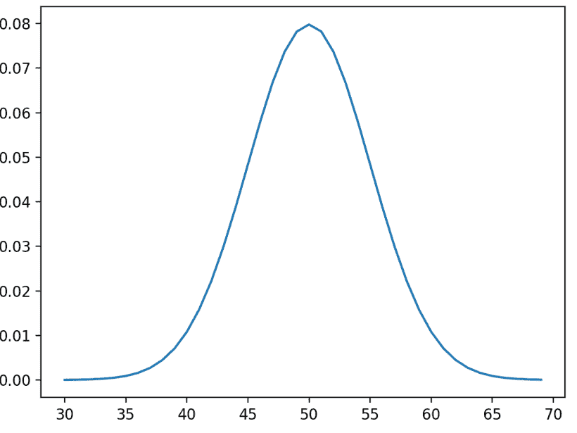

图9.1：事件与概率的线图，即正态分布的概率密度函数。

然后计算同一范围内观测值的累积概率，显示在均值处，我们已经覆盖了约50%的期望值，在约65或距离均值3个标准差（50 + (3 × 5)）之后，非常接近100%。

清单9.4：计算定义分布中间部分数值的示例。

运行示例给出了定义期望结果中间95%的确切结果，这与我们基于标准差的启发式值40和60非常接近。

```
Middle 95% between 40.2 and 59.8
```

清单9.5：计算定义分布中间部分数值的示例输出。

一个重要的相关分布是对数正态概率分布。

## 9.4 指数分布

指数分布是一种连续概率分布，其中少数结果最有可能出现，而所有其他结果的概率迅速下降。它是离散随机变量几何概率分布在连续随机变量上的等价形式。一些具有指数分布事件的领域示例包括：

- 盖革计数器两次点击之间的时间。
- 部件失效前的时间。
- 贷款违约前的时间。

该分布可以使用一个参数定义：

- **尺度**（Beta或β）：分布的均值和标准差。

有时该分布会用参数lambda或rate更正式地定义。beta参数被定义为lambda参数的倒数（β = 1/λ）

- **速率**（lambda或λ）= 分布的变化率。

我们可以定义一个均值为50的分布，并从这个分布中采样随机数。这可以通过NumPy的exponential()函数实现。下面的示例从该分布中采样并打印10个数字。

```
```python
# sample an exponential distribution
from numpy.random import exponential
# define the distribution
beta = 50
n = 10
# generate the sample
sample = exponential(beta, n)
print(sample)
```
```

清单9.6：从指数分布采样的示例。

运行示例会打印从所定义分布中随机采样的10个数字。

```
```text
[  3.32742946  39.10165624  41.86856606  85.0030387  28.18425491
  68.20434637 106.34826579  19.63637359  17.13805423  15.91135881]
```
```

清单9.7：从指数分布采样的示例输出。

我们可以使用SciPy的expon()函数定义指数分布，然后计算矩、PDF、CDF等属性。下面的示例定义了50到70之间的观测值范围，并计算每个值的概率和累积概率，然后绘制结果。

```
```python
# pdf and cdf for an exponential distribution
from scipy.stats import expon
from matplotlib import pyplot
# define distribution parameter
beta = 50
# create distribution
dist = expon(beta)
# plot pdf
values = [value for value in range(50, 70)]
probabilities = [dist.pdf(value) for value in values]
pyplot.plot(values, probabilities)
pyplot.show()
# plot cdf
cprobs = [dist.cdf(value) for value in values]
pyplot.plot(values, cprobs)
pyplot.show()
```
```

清单9.8：绘制指数分布PDF和CDF的示例。

运行示例首先创建结果与概率的线图，显示出熟悉的指数概率分布形状。

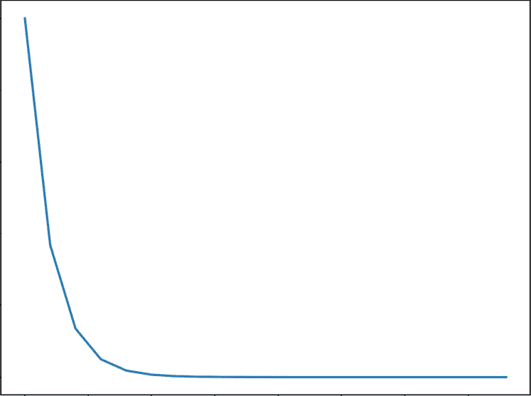

图9.3：事件与概率的线图，即指数分布的概率密度函数。

接下来，计算每个结果的累积概率并绘制为线图，显示在大概55之后，几乎100%的期望值都会被观察到。

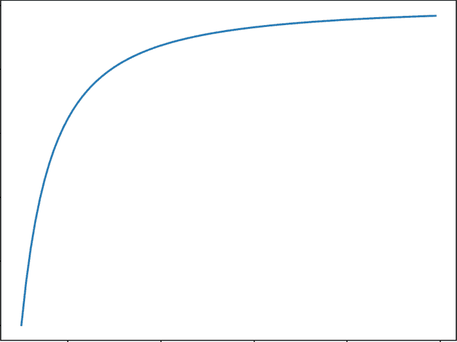

图9.6：事件与累积概率的线图，即帕累托分布的累积密度函数。

## 9.6 扩展阅读

如果你希望深入了解，本节提供了更多相关主题的资源。

### 9.6.1 书籍

- 第2章：概率分布，*模式识别与机器学习*，2006年。
  [https://amzn.to/2JwHE7I](https://amzn.to/2JwHE7I)
- 第3.9节：常见概率分布，*深度学习*，2016年。
  [https://amzn.to/2lnc3vL](https://amzn.to/2lnc3vL)
- 第2.3节：一些常见的离散分布，*机器学习：概率视角*，2012年。
  [https://amzn.to/2xKSTCP](https://amzn.to/2xKSTCP)

### 9.6.2 API

- 连续统计分布，SciPy。
  https://docs.scipy.org/doc/scipy/reference/tutorial/stats/continuous.html
- 随机采样（`numpy.random`），NumPy。
  https://docs.scipy.org/doc/numpy/reference/routines.random.html

### 9.6.3 文章

- 正态分布，维基百科。
  https://en.wikipedia.org/wiki/Normal_distribution
- 68-95-99.7法则，维基百科。
  https://en.wikipedia.org/wiki/68%E2%80%9395%E2%80%9399.7_rule
- 指数分布，维基百科。
  https://en.wikipedia.org/wiki/Exponential_distribution
- 帕累托分布，维基百科。
  https://en.wikipedia.org/wiki/Pareto_distribution

## 9.7 总结

在本教程中，你了解了机器学习中使用的连续概率分布。具体来说，你学到了：

- 连续随机变量结果的概率可以使用连续概率分布进行汇总。
- 如何参数化、定义常见连续概率分布并从中随机采样。
- 如何为常见连续概率分布创建概率密度图和累积密度图。

### 9.7.1 下一步

在下一个教程中，你将了解密度估计的挑战以及如何拟合密度估计模型。

```
```python
...
# plot a histogram of the sample
pyplot.hist(sample, bins=10)
pyplot.show()
```
```

清单10.1：绘制直方图的示例。

我们可以从正态分布中抽取一个随机样本，并假装我们不知道分布，然后创建数据的直方图。NumPy的`normal()`函数可以实现这一点，我们将生成1,000个样本，均值为0，标准差为1，即标准高斯分布。完整示例如下。

```
```python
# example of plotting a histogram of a random sample
from matplotlib import pyplot
from numpy.random import normal
# generate a sample
sample = normal(size=1000)
# plot a histogram of the sample
pyplot.hist(sample, bins=10)
pyplot.show()
```
```

清单10.2：绘制带10个分箱的直方图的示例。

运行示例抽取一个随机观测样本，并创建包含10个分箱的直方图。我们可以清楚地看到正态分布的形状。注意，由于数据样本的随机性，你的结果会有所不同。尝试多次运行该示例。


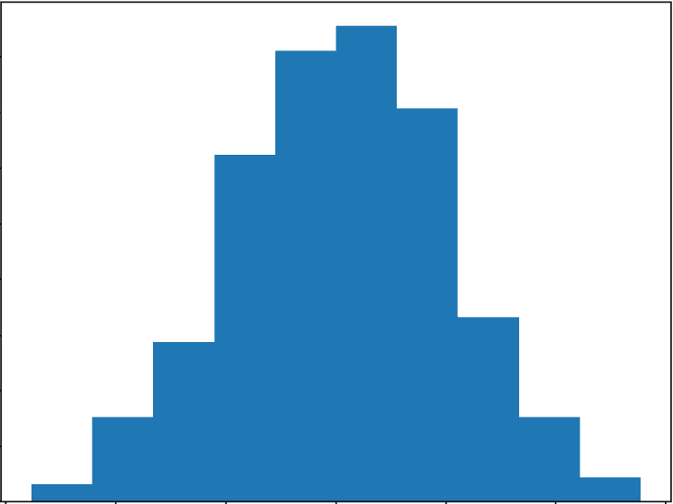

图 10.1：随机数据样本的直方图（10 个区间）。

将区间数设置为 3 运行该示例，会使正态分布不那么明显。

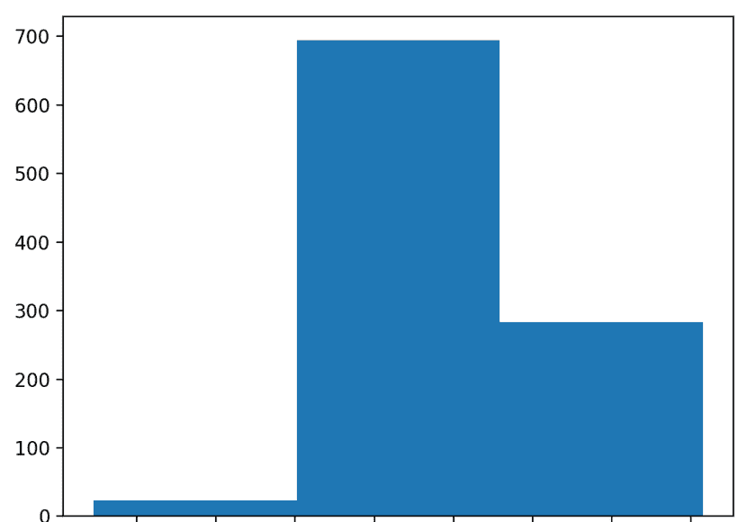

图 10.2：随机数据样本的直方图（3 个区间）。

通过使用一系列不同的区间数量来检查数据样本的直方图，将有助于判断密度是否看起来像常见的概率分布。在大多数情况下，你会看到单峰分布，例如常见的正态分布钟形、均匀分布的平坦形状，或者指数分布或帕累托分布的下降或上升形状。你也可能会看到复杂分布，例如不会随着区间数量变化而消失的双峰，称为双峰分布；或者多个峰，称为多峰分布。你还可能会看到在某个给定值或小范围内出现一个大的密度尖峰，这表示存在异常值，通常出现在分布尾部，远离其余密度区域。

## 10.4 参数密度估计

大多数随机样本的直方图形状会与某个已知的概率分布相匹配。这些常见分布之所以常见，是因为它们在不同领域，有时甚至是出乎意料的领域中反复出现。熟悉常见的概率分布会帮助你从直方图中识别出给定的分布。一旦识别出来，你就可以尝试用选定的概率分布来估计随机变量的密度。这可以通过从随机数据样本中估计分布的参数来实现。

例如，正态分布有两个参数：均值和标准差。有了这两个参数，我们就知道了概率分布函数。这些参数可以通过计算样本均值和样本标准差来从数据中估计。我们将这个过程称为参数密度估计。原因是，我们使用预定义函数来总结观测值与其概率之间的关系，而这种关系可以通过参数进行控制或配置，因此是*参数化*的。一旦估计出密度，我们就可以检查它是否拟合良好。这可以通过多种方式完成，例如：

- 绘制密度函数并将其形状与直方图比较。
- 对密度函数进行采样，并将生成的样本与真实样本进行比较。
- 使用统计检验来确认数据符合该分布。

我们可以通过一个示例来演示。我们可以从一个均值为 50、标准差为 5 的正态分布中生成 1,000 个观测值的随机样本。

```
...
# generate a sample
sample = normal(loc=50, scale=5, size=1000)
```

清单 10.3：对正态概率分布进行随机采样的示例。

然后，我们可以假装不知道概率分布，也许看一下直方图并猜测它是正态分布。假设它是正态分布，我们就可以计算该分布的参数，具体来说是均值和标准差。鉴于样本量较小且采样过程中存在噪声，我们不会期望均值和标准差恰好是 50 和 5。

```
...
# calculate parameters
sample_mean = mean(sample)
sample_std = std(sample)
print('Mean=%.3f, Standard Deviation=%.3f' % (sample_mean, sample_std))
```

清单 10.4：计算数据样本矩的示例。

然后使用这些参数拟合分布，即所谓的数据样本参数密度估计。在这种情况下，我们可以使用 SciPy 的 `norm()` 函数。

```
...
# define the distribution
dist = norm(sample_mean, sample_std)
```

清单 10.5：定义正态概率分布的示例。

然后，我们可以针对所在取值范围内的一系列值，从该分布中采样概率，本例中取值范围为 30 到 70。

```
...
# sample probabilities for a range of outcomes
values = [value for value in range(30, 70)]
probabilities = [dist.pdf(value) for value in values]
```

清单 10.6：计算特定值的预期概率的示例。

最后，我们可以绘制数据样本的直方图，并将根据概率密度函数（PDF）计算出的取值范围内的概率以折线图叠加。重要的是，我们可以将直方图每个区间中的计数或频数转换为归一化概率，以确保直方图的 y 轴与折线图的 y 轴一致。这可以通过在调用 hist() 时将 density 参数设置为 True 来实现。

```
...
# plot the histogram and pdf
pyplot.hist(sample, bins=10, density=True)
pyplot.plot(values, probabilities)
```

清单 10.7：绘制观测值与预期概率对比的示例。

将这些代码片段组合在一起，参数密度估计的完整示例如下。

```
# example of parametric probability density estimation
from matplotlib import pyplot
from numpy.random import normal
from numpy import mean
from numpy import std
from scipy.stats import norm
# generate a sample
sample = normal(loc=50, scale=5, size=1000)
# calculate parameters
sample_mean = mean(sample)
sample_std = std(sample)
print('Mean=%.3f, Standard Deviation=%.3f' % (sample_mean, sample_std))
# define the distribution
dist = norm(sample_mean, sample_std)
# sample probabilities for a range of outcomes
values = [value for value in range(30, 70)]
probabilities = [dist.pdf(value) for value in values]
# plot the histogram and pdf
pyplot.hist(sample, bins=10, density=True)
pyplot.plot(values, probabilities)
pyplot.show()
```

清单 10.8：参数概率密度估计的示例。

运行该示例会首先生成数据样本，然后估计正态概率分布的参数。请注意，由于数据样本的随机性，你的结果会有所不同。可以尝试多次运行该示例。在这种情况下，我们可以看到均值和标准差带有一些噪声，与预期的 50 和 5 略有不同。噪声很小，因此该分布预计仍然拟合得很好。

```
Mean=49.852, Standard Deviation=5.023
```

清单 10.9：参数概率密度估计的示例输出。

接下来，使用估计的参数拟合 PDF，并将数据的直方图（10 个区间）与从 PDF 中采样得到的一系列取值的概率进行比较。我们可以看到，PDF 与我们的数据非常匹配。

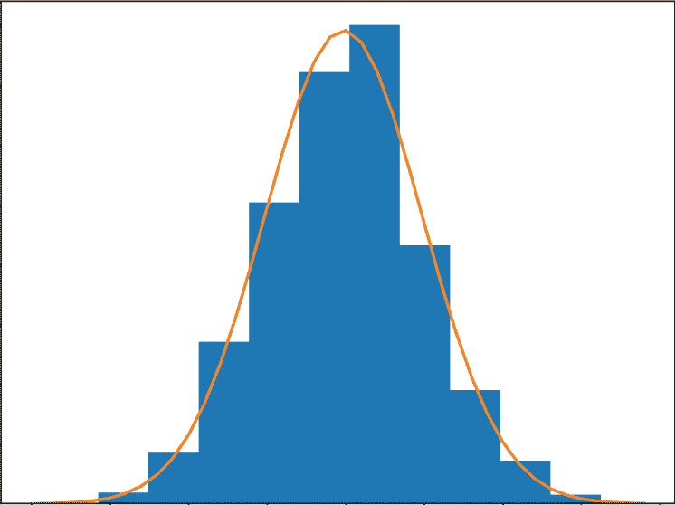

图 10.3：数据样本直方图与正态分布概率密度函数叠加图。

数据有可能确实符合某个常见概率分布，但在进行参数密度估计之前需要先进行变换。例如，你可能有一些远离均值或分布质心的异常值。这可能会导致分布参数估计不准确，进而导致拟合效果不佳。在估计分布参数之前，应将这些异常值移除。另一个例子是数据可能存在偏斜，或向左或向右偏移。在这种情况下，你可能需要在估计参数之前对数据进行变换，例如取对数或平方根，或者更一般地，使用幂变换（如 Box-Cox 变换）。这些对数据的修改类型可能并不明显，有效的参数密度估计可能需要如下迭代过程：

- 循环，直到分布与数据的拟合足够好：
  1. 估计分布参数
  2. 对照数据检查所得的 PDF
  3. 转换数据以更好地拟合分布

## 10.5 非参数密度估计

在某些情况下，数据样本可能不像常见的概率分布，或者不容易被拟合到某个分布。当数据有两个峰（双峰分布）或多个峰（多峰分布）时，情况往往如此。在这种情况下，参数密度估计不可行，可以使用不使用常见分布的替代方法。取而代之的是，使用一种算法在没有预定义分布的情况下逼近数据的概率分布，这种方法称为非参数方法。

这些分布仍然会有参数，但不能像简单概率分布那样直接控制。例如，非参数方法可能会使用随机样本中的所有观测值来估计密度，实际上是将样本中的所有观测值都当作*参数*。也许估计连续随机变量概率密度函数最常见的非参数方法称为核平滑，或核密度估计，简称 KDE。

- **核密度估计：** 使用数据集为新点估计概率的非参数方法。

在这种情况下，核是一个数学函数，它为随机变量的给定值返回一个概率。核会有效地平滑或插值随机变量在结果范围内的概率，使得概率之和等于 1，这是良态概率的要求。核函数根据数据样本中观测值与请求概率的给定查询样本之间的关系或距离，对其贡献进行加权。一个称为平滑参数或带宽的参数，控制那些用于估计给定样本概率的数据样本观测值的范围（或窗口）。因此，核密度估计有时也被称为 Parzen-Rosenblatt 窗口，或简称 Parzen 窗口，以纪念该方法的提出者。

- **平滑参数**（*带宽*）：控制用于估计新点概率的样本数量或样本窗口的参数。

窗口过大会导致密度粗糙、细节不足，而窗口过小则可能细节过多，不够平滑或泛化，无法正确覆盖新的或未见过的样本。窗口内样本的贡献可以使用不同的函数来调整，这些函数有时称为基函数，例如均匀、正态等。它们会对最终密度函数的平滑度产生不同的影响。

- **基函数**（*核*）：所选定的用于控制数据集中样本对新点概率估计贡献的函数。

因此，尝试不同的窗口大小和不同的贡献函数，并将结果与数据直方图进行比较评估，可能会很有用。我们可以通过一个示例来说明这一点。首先，我们可以通过合并来自两个不同正态分布的样本，构造一个双峰分布。具体来说，300 个样本的均值为 20、标准差为 5（较小的峰），700 个样本的均值为 40、标准差为 5（较大的峰）。选择这些均值时使其彼此接近，以确保分布在合并样本中重叠。下面列出了创建这个具有双峰概率分布的样本并绘制直方图的完整示例。


```python
# example of a bimodal data sample
from matplotlib import pyplot
from numpy.random import normal
from numpy import hstack
# generate a sample
sample1 = normal(loc=20, scale=5, size=300)
sample2 = normal(loc=40, scale=5, size=700)
sample = hstack((sample1, sample2))
# plot the histogram
pyplot.hist(sample, bins=50)
pyplot.show()
```

Listing 10.10: 生成并绘制双峰数据样本的示例。

Running the example creates the data sample and plots the histogram. 运行示例会创建数据样本并绘制直方图。
Note that your results will differ given the random nature of the data sample. 请注意，由于数据样本的随机性，你的结果会有所不同。
Try running the example a few times. 尝试多次运行示例。
We have fewer samples with a mean of 20 than samples with a mean of 40, which we can see reflected in the histogram with a larger density of samples around 40 than around 20. 我们具有均值为20的样本比均值为40的样本更少，这在直方图中有所体现，样本在40附近的密度大于在20附近。
Data with this distribution does not nicely fit into a common probability distribution, by design. It is a good case for using a nonparametric kernel density estimation method. 这种分布的数据按设计无法很好地拟合到常见的概率分布中。它是使用非参数核密度估计方法的一个良好案例。

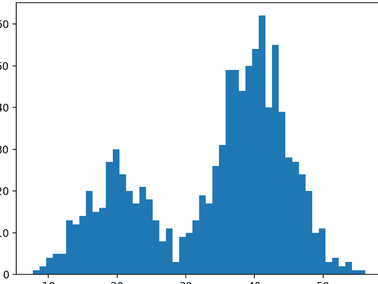

Figure 10.4: Histogram Plot of Data Sample With a Bimodal Probability Distribution. Figure 10.4: 具有双峰概率分布的数据样本的直方图。

The scikit-learn machine learning library provides the KernelDensity class that implements kernel density estimation. scikit-learn 机器学习库提供了实现核密度估计的 KernelDensity 类。
First, the class is constructed with the desired bandwidth (window size) and kernel (basis function) arguments. 首先，使用所需的带宽（窗口大小）和核（基函数）参数构造该类。
It is a good idea to test different configurations on your data. 在你的数据上测试不同的配置是个好主意。
In this case, we will try a bandwidth of 2 and a Gaussian kernel. 在本例中，我们将尝试带宽为2和高斯核。
The class is then fit on a data sample via the fit() function. 然后通过 fit() 函数将该类拟合到数据样本上。
The function expects the data to have a 2D shape with the form [rows, columns], therefore we can reshape our data sample to have 1,000 rows and 1 column. 该函数期望数据具有形式为 [行, 列] 的 2D 形状，因此我们可以将数据样本重塑为 1,000 行 1 列。

```python
...
# fit density
model = KernelDensity(bandwidth=2, kernel='gaussian')
sample = sample.reshape((len(sample), 1))
model.fit(sample)
```

Listing 10.11: Example defining a KernelDensity model on the data sample. Listing 10.11: 在数据样本上定义 KernelDensity 模型的示例。

We can then evaluate how well the density estimate matches our data by calculating the probabilities for a range of observations and comparing the shape to the histogram, just like we did for the parametric case in the prior section. 然后，我们可以通过计算一系列观测值的概率并将其形状与直方图进行比较来评估密度估计与数据的匹配程度，就像我们在前一节中对参数情况所做的那样。
The score_samples() function on the KernelDensity will calculate the log probability for an array of samples. KernelDensity 上的 score_samples() 函数将计算样本数组的对数概率。
We can create a range of samples from 1 to 60, about the range of our domain, calculate the log probabilities, then invert the log operation by calculating the exponent or exp() to return the values to the range 0-1 for normal probabilities. 我们可以从1到60创建一个样本范围，大约是我们的域范围，计算对数概率，然后通过计算指数或 exp() 来反转对数运算，将值返回到0-1的范围以获得正常概率。

```python
...
# sample probabilities for a range of outcomes
values = asarray([value for value in range(1, 60)])
values = values.reshape((len(values), 1))
probabilities = model.score_samples(values)
probabilities = exp(probabilities)
```

Listing 10.12: Example estimating probabilities for observations using the fit model. Listing 10.12: 使用拟合模型估计观测值概率的示例。

Finally, we can create a histogram with normalized frequencies and an overlay line plot of values to estimated probabilities. 最后，我们可以创建具有归一化频率的直方图，并叠加值到估计概率的线图。

```python
...
# plot the histogram and pdf
pyplot.hist(sample, bins=50, density=True)
pyplot.plot(values[:], probabilities)
pyplot.show()
```

Listing 10.13: Example of plotting the histogram and estimated probability density of the data sample. Listing 10.13: 绘制数据样本的直方图和估计概率密度的示例。

Tying this together, the complete example of kernel density estimation for a bimodal data sample is listed below. 综合起来，双峰数据样本的核密度估计的完整示例如下所示。

```python
# example of kernel density estimation for a bimodal data sample
from matplotlib import pyplot
from numpy.random import normal
from numpy import hstack
from numpy import asarray
from numpy import exp
from sklearn.neighbors import KernelDensity
# generate a sample
sample1 = normal(loc=20, scale=5, size=300)
sample2 = normal(loc=40, scale=5, size=700)
sample = hstack((sample1, sample2))
# fit density
model = KernelDensity(bandwidth=2, kernel='gaussian')
sample = sample.reshape((len(sample), 1))
model.fit(sample)
# sample probabilities for a range of outcomes
values = asarray([value for value in range(1, 60)])
values = values.reshape((len(values), 1))
probabilities = model.score_samples(values)
probabilities = exp(probabilities)
# plot the histogram and pdf
pyplot.hist(sample, bins=50, density=True)
pyplot.plot(values[:], probabilities)
pyplot.show()
```

Listing 10.14: Example of kernel density estimation for a bimodal data sample. Listing 10.14: 双峰数据样本的核密度估计示例。

Running the example creates the data distribution, fits the kernel density estimation model, then plots the histogram of the data sample and the PDF from the KDE model. 运行示例会创建数据分布，拟合核密度估计模型，然后绘制数据样本的直方图和 KDE 模型的 PDF。
Note that your results will differ given the random nature of the data sample. Try running the example a few times. 请注意，由于数据样本的随机性，你的结果会有所不同。尝试多次运行示例。
In this case, we can see that the PDF is a good fit for the histogram. It is not very smooth and could be made more so by setting the bandwidth argument to 3 samples or higher. Experiment with different values of the bandwidth and the kernel function. 在本例中，我们可以看到 PDF 对直方图的拟合良好。它不是很平滑，可以通过将带宽参数设置为3个样本或更高来使其更平滑。尝试带宽和核函数的不同值。

## Part V: Maximum Likelihood
## 第五部分：最大似然

### Chapter 11: Maximum Likelihood Estimation
### 第11章：最大似然估计

Density estimation is the problem of estimating the probability distribution for a sample of observations from a problem domain. 密度估计是从问题域的观测样本估计概率分布的问题。
There are many techniques for solving density estimation, although a common framework used throughout the field of machine learning is maximum likelihood estimation. 解决密度估计的方法有很多，但机器学习领域中广泛使用的一种通用框架是最大似然估计。
Maximum likelihood estimation involves defining a likelihood function for calculating the conditional probability of observing the data sample given a probability distribution and distribution parameters. 最大似然估计涉及定义似然函数，用于计算在给定概率分布和分布参数的情况下观察到数据样本的条件概率。
This approach can be used to search a space of possible distributions and parameters. 这种方法可用于搜索可能的分布和参数空间。
This flexible probabilistic framework also provides the foundation for many machine learning algorithms, including important methods such as linear regression and logistic regression for predicting numeric values and class labels respectively, but also more generally for deep learning artificial neural networks. 这种灵活的概率框架还为许多机器学习算法提供了基础，包括用于分别预测数值和类别标签的重要方法，如线性回归和逻辑回归，但更一般地也适用于深度学习人工神经网络。
In this tutorial, you will discover a gentle introduction to maximum likelihood estimation. 在本教程中，你将发现对最大似然估计的温和介绍。
After reading this tutorial, you will know: 阅读本教程后，你将知道：
- Maximum Likelihood Estimation is a probabilistic framework for solving the problem of density estimation.
- 最大似然估计是解决密度估计问题的概率框架。
- It involves maximizing a likelihood function in order to find the probability distribution and parameters that best explain the observed data.
- 它涉及最大化似然函数，以便找到最能解释观测数据的概率分布和参数。
- It provides a framework for predictive modeling in machine learning where finding model parameters can be framed as an optimization problem.
- 它为机器学习中的预测建模提供了一个框架，其中寻找模型参数可以表述为优化问题。

Let’s get started. 开始吧。

### 11.1 Tutorial Overview
### 11.1 教程概述

This tutorial is divided into three parts; they are: 本教程分为三个部分；它们是：
- 1. Problem of Probability Density Estimation
- 1. 概率密度估计问题
- 2. Maximum Likelihood Estimation
- 2. 最大似然估计
- 3. Relationship to Machine Learning
- 3. 与机器学习的关系

### 11.2 Problem of Probability Density Estimation
### 11.2 概率密度估计问题

A common modeling problem involves how to estimate a joint probability distribution for a dataset. 一个常见的建模问题是如何为数据集估计联合概率分布。
For example, given a sample of observations (X) from a domain (x₁, x₂, x₃, ⋯ , xₙ), where each observation is drawn independently from the domain with the same probability distribution (so-called independent and identically distributed, i.i.d., or close to it). 例如，给定来自域 (x₁, x₂, x₃, ⋯ , xₙ) 的观测样本 (X)，其中每个观测值独立地从域中抽取，具有相同的概率分布（所谓的独立同分布，i.i.d.，或接近于此）。
Density estimation involves selecting a probability distribution function and the parameters of that distribution that best explain the joint probability distribution of the observed data (X). 密度估计涉及选择最能解释观测数据 (X) 的联合概率分布的概率分布函数及其参数。
- How do you choose the probability distribution function?
- 如何选择概率分布函数？
- How do you choose the parameters for the probability distribution function?
- 如何为概率分布函数选择参数？

This problem is made more challenging if the sample (X) drawn from the population is small and has noise, meaning that any evaluation of an estimated probability density function and its parameters will have some error. 如果从总体中抽取的样本 (X) 很小且有噪声，则该问题会变得更具挑战性，这意味着对估计的概率密度函数及其参数的任何评估都会存在一定的误差。
There are many techniques for solving this problem, although two common approaches are: 解决此问题的方法有很多，但两种常见的方法是：
- Maximum a Posteriori (MAP), a Bayesian method.
- 最大后验 (MAP)，一种贝叶斯方法。
- Maximum Likelihood Estimation (MLE), frequentist method.
- 最大似然估计 (MLE)，频率学派方法。

The main difference is that MLE assumes that all solutions are equally likely beforehand, whereas MAP allows prior information about the form of the solution to be harnessed. 主要区别在于 MLE 假设所有解事先同等可能，而 MAP 允许利用关于解形式的事先信息。
In this tutorial, we will take a closer look at the MLE method and its relationship to applied machine learning. 在本教程中，我们将更仔细地研究 MLE 方法及其与应用机器学习的关系。

### 11.3 Maximum Likelihood Estimation
### 11.3 最大似然估计

One solution to probability density estimation is referred to as Maximum Likelihood Estimation, or MLE for short. 概率密度估计的一种解决方案称为最大似然估计，简称 MLE。
Maximum Likelihood Estimation involves treating the problem as an optimization or search problem, where we seek a set of parameters that results in the best fit for the joint probability of the data sample (X). 最大似然估计将问题视为优化或搜索问题，其中我们寻求一组参数，使其对数据样本 (X) 的联合概率的拟合最佳。
First, it involves defining a parameter called theta (θ) that defines both the choice of the probability density function and the parameters of that distribution. 首先，它涉及定义一个称为 theta (θ) 的参数，该参数同时定义概率密度函数的选择和该分布的参数。
It may be a vector of numerical values whose values change smoothly and map to different probability distributions and their parameters. 它可能是一个数值向量，其值平滑变化并映射到不同的概率分布及其参数。
In Maximum Likelihood Estimation, we wish to maximize the probability of observing the data from the joint probability distribution given a specific probability distribution and its parameters, stated formally as: 在最大似然估计中，我们希望最大化在给定特定概率分布及其参数的情况下从联合概率分布中观察到数据的概率，正式表述为：

P(X|θ)  (11.1)

This conditional probability is often stated using the semicolon (;) notation instead of the bar notation (|) because θ is not a random variable, but instead an unknown parameter. 该条件概率通常使用分号 (;) 记号而不是竖线记号 (|) 来表示，因为 θ 不是随机变量，而是未知参数。
For example: 例如：

P(X;θ)  (11.2)


> 最大似然估计器可以很容易地推广到我们目标是估计条件概率 $P(y|x;\theta)$ 以便在给定 $x$ 的情况下预测 $y$ 的情形。这实际上是最常见的情况，因为它构成了大多数监督学习的基础。
> 
> — 第133页，*Deep Learning*，2016。

这意味着通常用于密度估计的相同最大似然估计框架也可以用于找到监督学习模型和参数。这为基础的线性建模技术提供了基础，例如：

- 线性回归，用于预测数值。
- 逻辑回归，用于二元分类。

在线性回归的情况下，模型被限制为一条直线，并且涉及找到一组使直线最好拟合观测数据的系数。幸运的是，这个问题可以解析求解（例如直接使用线性代数）。在逻辑回归的情况下，模型定义了一条直线，并且涉及找到一组使直线最好分离类别的系数。这无法解析求解，通常通过使用高效的优化算法（如 BFGS 算法或其变体）在可能的系数值的空间中搜索来求解。

两种方法也可以使用更通用的优化算法（如随机梯度下降）以较低的效率求解。事实上，大多数机器学习模型都可以纳入最大似然估计框架下，提供了一种有用且一致的方法将预测建模作为优化问题来处理。最大似然估计器在机器学习中的一个重要好处是，随着数据集规模的增大，估计器的质量会持续提高。

## 11.5 进一步阅读

本节如果您想深入了解该主题，则提供了更多资源。

### 11.5.1 书籍

- 第5章 机器学习基础，*Deep Learning*，2016。 https://amzn.to/2lnc3vL
- 第2章 概率分布，*Pattern Recognition and Machine Learning*，2006。 https://amzn.to/2JwHE7I
- 第8章 模型推断与平均，*The Elements of Statistical Learning*，2016。 https://amzn.to/2YVqu8s
- 第9章 概率方法，*Data Mining: Practical Machine Learning Tools and Techniques*，第4版，2016。 https://amzn.to/2lnW5S7

## 12.3 最大似然估计

最大似然估计，简称 MLE，是一种用于估计模型参数的概率框架（在第11章中介绍）。在最大似然估计中，我们希望最大化在给定特定概率分布及其参数 $(\theta)$ 的情况下观察到数据 $(X)$ 的条件概率，正式表述为：

$$P(X;\theta) \tag{12.4}$$

其中 $X$ 实际上是从问题域中从1到 $n$ 的所有观测值的联合概率分布。

$$P(x_1,x_2,x_3,\ldots,x_n;\theta) \tag{12.5}$$

由此得到条件概率被称为在给定模型参数的情况下观察到数据的似然，并使用符号 $L()$ 表示似然函数。例如：

$$L(X;\theta) \tag{12.6}$$

联合概率分布可以重新表述为在给定分布参数的情况下观察每个示例的条件概率的乘积。将许多小的概率相乘可能不稳定；因此，通常将此问题重新表述为自然对数条件概率之和。

$$\sum_{i=1}^{n}\log P(x_i;\theta) \tag{12.7}$$

鉴于对数在似然函数中的常见使用，它被称为对数似然函数。在优化问题中，更倾向于最小化成本函数而不是最大化它也很常见。因此，使用对数似然函数的负值，通常称为负对数似然（NLL）函数。

$$\min -\sum_{i=1}^{n}\log P(x_i;\theta) \tag{12.8}$$

最大似然估计框架可用于估计用于回归和分类预测建模的许多不同机器学习模型的参数的基础。这包括线性回归模型。

## 12.4 线性回归作为最大似然

我们可以将拟合机器学习模型的问题表述为概率密度估计问题。具体来说，模型和模型参数的选择被称为建模假设 $h$，问题涉及找到能最好解释数据 $X$ 的 $h$。因此，我们可以找到使似然函数最大化的建模假设。

$$\max\sum_{i=1}^{n}\log P(x_i;h) \tag{12.9}$$

最后，我们可以舍弃与模型无关的剩余第一项，得到：

min \sum_{i=1}^{n} (y_i - h(x_i, \beta))^2
(12.20)

我们可以看到这与最小二乘解相同。事实上，在合理假设下，最小化目标变量与模型输出之间平方误差的算法也执行最大似然估计。

> ... 在某些假设下，任何最小化输出假设预测与训练数据之间平方误差的学习算法都会输出最大似然假设。

— 第164页，*Machine Learning*，1997。

## 12.6 进一步阅读

本节如果您想深入了解该主题，则提供了更多资源。

### 12.6.1 书籍

- 第15.1节 最小二乘作为最大似然估计器，*Numerical Recipes in C: The Art of Scientific Computing*，第2版，1992。 https://amzn.to/2YX0Obn
- 第5章 机器学习基础，*Deep Learning*，2016。 https://amzn.to/2lnc3vL
- 第2.6.3节 函数逼近，*The Elements of Statistical Learning*，2016。 https://amzn.to/2YVqu8s
- 第6.4节 最大似然与最小二乘误差假设，*Machine Learning*，1997。 https://amzn.to/2jWd51p
- 第3.1.1节 最大似然与最小二乘，*Pattern Recognition and Machine Learning*，2006。 https://amzn.to/2JwHE7I
- 第7.3节 最大似然估计（最小二乘），*Machine Learning: A Probabilistic Perspective*，2012。 https://amzn.to/2xKSTCP

### 12.6.2 文章

- 最大似然估计，Wikipedia。 https://en.wikipedia.org/wiki/Maximum_likelihood_estimation
- 似然函数，Wikipedia。 https://en.wikipedia.org/wiki/Likelihood_function
- 线性回归，Wikipedia。 https://en.wikipedia.org/wiki/Linear_regression

## 12.7 摘要

在本教程中，您了解了带最大似然估计的线性回归。具体来说，您学习了：

- 线性回归是用于预测数值量的模型，而最大似然估计是用于估计模型参数的概率框架。
- 线性回归模型的系数可以使用来自最大似然估计的负对数似然函数进行估计。
- 负对数似然函数可用于推导线性回归的最小二乘解。

### 12.7.1 下一步

在下一教程中，您将了解如何使用最大似然估计拟合逻辑回归。

训练数据集中的示例取自更广泛的人群，因此已知该样本是不完整的。此外，预计观测中存在测量误差或统计噪声。模型的参数（β）必须从从域中抽取的观测样本中估计。有许多方法可以估计参数。有两种最常见的框架；它们是：

- 最小二乘优化（迭代加权最小二乘）。
- 最大似然估计。

两者都是涉及搜索不同模型参数的优化程序。最大似然估计是一种频率学派概率框架，寻求使似然函数最大化的模型参数集。我们将在后续章节中更详细地研究这种第二种方法。

## 13.3 逻辑回归与对数几率

在深入了解模型参数如何从数据中估计之前，我们需要了解逻辑回归到底在计算什么。这可能是逻辑回归最令人困惑的部分，因此我们将慢慢讲解。模型的线性部分（输入的加权和）计算成功事件的对数几率，具体来说，是样本属于类别1的对数几率。

log-odds = β₀ + β₁ × x₁ + β₂ × x₂ + ⋯ + βₘ × xₘ  (13.6)

实际上，模型估计了输入变量在每个水平（所有观测值）下类别1的对数几率。什么是几率和对数几率？几率可能在赌博领域很熟悉。几率通常表示为赢与输（赢：输），例如一比十的获胜几率或比率表示为1:10。给定逻辑回归模型预测的成功概率（p），我们可以将其转换为成功几率，即成功概率除以不成功的概率：

odds of success = p / (1 − p)  (13.7)

几率的对数被计算，具体为以e为底的对数或自然对数。该量被称为对数几率，也可称为logit（逻辑单位），是一个度量单位。

log-odds = log(p / (1 − p))  (13.8)

请记住，这就是逻辑回归线性部分正在计算的内容：

log-odds = β₀ + β₁ × x₁ + β₂ × x₂ + ⋯ + βₘ × xₘ  (13.9)

成功对数几率可以通过计算对数几率的指数来转换回成功几率。

odds = exp(log-odds)  (13.10)

或

$$\text{odds} = exp(\beta_0 + \beta_1 \times x_1 + \beta_2 \times x_2 + \cdots + \beta_m \times x_m)\tag{13.11}$$

成功赔率可以转换回成功概率，如下所示：

$$p = \frac{odds}{odds + 1}\tag{13.12}$$

这与我们的逻辑回归模型形式接近，只是我们希望在计算过程中将对数赔率转换为赔率。我们可以这样做并简化计算如下：

$$p = \frac{1}{1 + exp(-\log\text{-odds})}\tag{13.13}$$

这展示了如何使用逻辑回归模型从对数赔率到赔率，再到类别 1 的概率，并且这种最终的函数形式与逻辑函数相匹配，确保概率介于 0 和 1 之间。我们可以通过 Python 中的一些小例子来具体化概率、赔率和对数赔率之间的转换计算。首先，让我们将成功概率定义为 80%，即 0.8，并将其转换为赔率然后再转换回概率。完整示例列在下面。

```
# example of converting between probability and odds
# define our probability of success
prob = 0.8
print('Probability %.1f' % prob)
# convert probability to odds
odds = prob / (1 - prob)
print('Odds %.1f' % odds)
# convert back to probability
prob = odds / (odds + 1)
print('Probability %.1f' % prob)
```

Listing 13.1: 概率与赔率之间转换的示例。

运行示例显示，0.8 被转换为成功赔率 4，并再次正确转换回概率。

```
Probability 0.8
Odds 4.0
Probability 0.8
```

Listing 13.2: 概率与赔率之间转换的示例输出。

让我们扩展此示例，将赔率转换为对数赔率，然后将对数赔率转换回原始概率。这种最终转换实际上就是逻辑回归模型的形式，或逻辑函数。完整示例列在下面。

```
# example of converting between probability and log-odds
from math import log
from math import exp
# define our probability of success
prob = 0.8
print('Probability %.1f' % prob)
# convert probability to odds
odds = prob / (1 - prob)
print('Odds %.1f' % odds)
# convert odds to log-odds
logodds = log(odds)
print('Log-Odds %.1f' % logodds)
# convert log-odds to a probability
prob = 1 / (1 + exp(-logodds))
print('Probability %.1f' % prob)
```

Listing 13.3: 概率与对数赔率之间转换的示例。

运行示例，我们可以看到我们的赔率被转换为约 1.4 的对数赔率，然后正确转换回 0.8 的成功概率。

```
Probability 0.8
Odds 4.0
Log-Odds 1.4
Probability 0.8
```

Listing 13.4: 概率与对数赔率之间转换的示例输出。

现在我们已经掌握了逻辑回归计算的概率，让我们来看最大似然估计。

## 13.4 最大似然估计

最大似然估计，简称 MLE，是一种用于估计模型参数的概率框架（在第 11 章中介绍）。在最大似然估计中，我们希望最大化在给定特定概率分布及其参数（θ）的条件下观察到数据（X）的条件概率，正式表述为：

P(X; θ)  (13.14)

其中 X 实际上是从问题域中从 1 到 n 的所有观测值的联合概率分布。

P(x₁, x₂, x₃, …, xₙ; θ)  (13.15)

该条件概率被称为在给定模型参数的情况下观察到数据的似然，并使用符号 L() 表示似然函数。例如：

L(X; θ)  (13.16)

联合概率分布可以重新表述为在给定分布参数的情况下观察每个示例的条件概率的乘积。将许多小的概率相乘可能不稳定；因此，通常将此问题重新表述为对数条件概率之和。

∑ᵢ₌₁ⁿ log P(xᵢ; θ)  (13.17)

鉴于似然函数中频繁使用 log，它被称为对数似然函数。在优化问题中，通常更喜欢最小化成本函数而不是最大化它。因此，使用对数似然函数的负值，通常称为负对数似然（NLL）函数。

$$\min - \sum_{i=1}^{n} \log P(x_i; \theta)$$ (13.18)

最大似然估计框架可用于估计回归和分类预测建模的许多不同机器学习模型的参数的基础。这包括逻辑回归模型。

## 13.5 作为最大似然的逻辑回归

我们可以将拟合机器学习模型的问题表述为概率密度估计问题。具体来说，模型和模型参数的选择被称为建模假设 $h$，问题涉及找到能最好解释数据 $X$ 的 $h$。因此，我们可以找到使似然函数最大化的建模假设。

$$\max \sum_{i=1}^{n} \log P(x_i; h)$$ (13.19)

监督学习可以表述为在给定输入的情况下预测输出概率的条件概率问题：

$$P(y|X)$$ (13.20)

因此，我们可以按如下方式定义监督机器学习的条件最大似然估计：

$$\max \sum_{i=1}^{n} \log P(y_i|x_i; h)$$ (13.21)

现在我们可以将 $h$ 替换为我们的逻辑回归模型。为了使用最大似然，我们需要假设一个概率分布。在逻辑回归的情况下，数据样本假设为二项式概率分布，其中每个示例是伯努利试验的一个结果。伯努利分布有一个参数：成功结果的概率（$p$）。

$$P(y = 1) = p$$ $$P(y = 0) = 1 - p$$ (13.22)

当有两个类别时，最常用的概率分布是二项分布。该分布有一个参数 $p$，即事件或特定类别的概率。

> — 第 283 页，*Applied Predictive Modeling*，2013 年。

最后，我们可以对数据集中所有示例的似然函数求和以最大化似然：

max Σ_{i=1}^{n} log(yhat_i) × y_i + log(1 − yhat_i) × (1 − y_i)   (13.27)

对于优化问题，最小化成本函数是常见做法；因此，我们可以反转函数以最小化负对数似然：

min Σ_{i=1}^{n} −(log(yhat_i) × y_i + log(1 − yhat_i) × (1 − y_i))   (13.28)

计算伯努利分布的对数似然函数的负值等价于计算伯努利分布的交叉熵函数，其中 p() 表示类别 0 或类别 1 的概率，q() 表示概率分布的估计，在本例中由我们的逻辑回归模型给出（这在第 23 章中进一步描述）。

cross-entropy = −(log(q(class0)) × p(class0) + log(q(class1)) × p(class1))   (13.29)

与线性回归不同，这个优化问题没有解析解。因此，必须使用迭代优化算法。

> 与线性回归不同，我们无法再以闭式写出 MLE。
> 相反，我们需要使用优化算法来计算它。为此，我们需要推导梯度和 Hessian。
> 
> — 第 246 页，*Machine Learning: A Probabilistic Perspective*，2012 年。

该函数确实提供了一些有助于优化的信息（具体来说可以计算 Hessian 矩阵），这意味着可以利用这些信息的有效搜索程序，例如 BFGS 算法（及其变体）。

## 13.6 延伸阅读

如果您想深入了解，本节提供了更多资源。

### 13.6.1 书籍

- 第 4.4.1 节 拟合逻辑回归模型，《统计学习基础》，2016 年。
  https://amzn.to/2YVqu8s
- 第 4.3.2 节 逻辑回归，《模式识别与机器学习》，2006 年。
  https://amzn.to/2JwHE7I
- 第 8 章 逻辑回归，《Machine Learning: A Probabilistic Perspective》，2012 年。
  https://amzn.to/2xKSTCP


- 第4章 算法：基本方法, *数据挖掘：实用机器学习工具与技术*, 第4版, 2016.  
  https://amzn.to/21nW5S7
- 第18.6.4节 使用逻辑回归的线性分类, *人工智能：一种现代方法*, 第3版, 2009.  
  https://amzn.to/2Y7yCp0
- 第12.2节 逻辑回归, *应用预测建模*, 2013.  
  https://amzn.to/2yXgeBT
- 第4.3节 逻辑回归, *统计学习导论：应用R*, 2017.  
  https://amzn.to/31DTbb0

### 13.6.2 文章

- 最大似然估计，维基百科。  
  https://en.wikipedia.org/wiki/Maximum_likelihood_estimation
- 似然函数，维基百科。  
  https://en.wikipedia.org/wiki/Likelihood_function
- 逻辑回归，维基百科。  
  https://en.wikipedia.org/wiki/Logistic_regression
- 逻辑函数，维基百科。  
  https://en.wikipedia.org/wiki/Logistic_function
- 赔率，维基百科。  
  https://en.wikipedia.org/wiki/Odds

### 13.7 摘要

在本教程中，你了解了带最大似然估计的逻辑回归。具体来说，你学习了：

- 逻辑回归是用于二分类预测建模的线性模型。
- 模型的线性部分预测示例属于类别1的对数几率，该几率通过逻辑函数转换为概率。
- 模型的参数可以通过最大化似然函数来估计，该似然函数预测每个示例的伯努利分布的均值。

### 13.7.1 下一步

在下一教程中，你将在最大似然估计框架下了解期望最大化算法。

## 第14章：期望最大化（EM算法）

最大似然估计是通过在概率分布及其参数中搜索来对数据集进行密度估计的方法。它是一种通用且有效的方法，是许多机器学习算法的基础，尽管它要求训练数据集是完整的，例如所有相关的交互随机变量都存在。如果存在与数据集中变量交互但被隐藏或未观察到的变量，即所谓的潜在变量，则最大似然变得难以处理。期望最大化算法是在存在潜在变量的情况下执行最大似然估计的方法。它首先估计潜在变量的值，然后优化模型，然后重复这两个步骤直到收敛。它是一种有效且通用的方法，最常用于缺失数据的密度估计，例如像高斯混合模型这样的聚类算法。在本教程中，你将了解期望最大化算法。阅读本教程后，你将知道：

- 最大似然估计在存在潜在变量的数据上具有挑战性。
- 期望最大化为具有潜在变量的最大似然估计提供了一种迭代解决方案。
- 高斯混合模型是一种密度估计方法，其中分布的参数使用期望最大化算法进行拟合。

开始吧。

### 14.1 教程概述

本教程分为四个部分；它们是：

1. 最大似然估计中的潜在变量问题
2. 期望最大化算法
3. 高斯混合模型与EM算法
4. 高斯混合模型的示例

### 14.2 最大似然估计中的潜在变量问题

一个常见的建模问题是如何为数据集估计联合概率分布。密度估计涉及选择一个概率分布函数以及该分布的参数，以最好地解释观测数据的联合概率分布。解决此问题有许多技术，尽管一种常见的方法称为最大似然估计，或简称为最大似然。最大似然估计涉及将问题视为优化或搜索问题，在该问题中，我们寻求一组参数，使其对数据样本的联合概率的拟合最佳（在第11章中介绍）。

最大似然估计的一个局限性是它假设数据集是完整或完全观测的。这并不意味着模型可以访问所有数据；相反，它假设与问题相关的所有变量都存在。这并不总是如此。可能存在数据集，其中只有一些相关变量可以被观察到，而有些则不能，尽管它们会影响数据集中的其他随机变量，但它们仍然是隐藏的。更一般地说，这些未观测或隐藏的变量被称为潜在变量。

> 许多现实世界问题存在隐藏变量（有时称为潜在变量），这些变量在可用于学习的数据中是不可观察的。
>
> — 第816页，*人工智能：一种现代方法*，第3版，2009。

传统的最大似然估计在存在潜在变量时效果不佳。

> ... 如果我们有缺失数据和/或潜在变量，则计算[最大似然]估计变得困难。
>
> — 第349页，*机器学习：概率视角*，2012。

相反，在存在潜在变量的情况下搜索适当的模型参数需要最大似然的另一种表述。期望最大化算法就是这样一种方法。

### 14.3 期望最大化算法

期望最大化算法，或简称EM算法，是在存在潜在变量的情况下进行最大似然估计的方法。

> 在潜在变量模型中找到最大似然估计量的通用技术是期望最大化（EM）算法。
>
> — 第424页，*模式识别与机器学习*，2006。

EM算法是一种迭代方法，在两种模式之间循环。第一种模式尝试估计缺失或潜在变量，称为估计步骤或E步骤。第二种模式尝试优化模型参数以最好地解释数据，称为最大化步骤或M步骤。

```python
...
# generate a sample
X1 = normal(loc=20, scale=5, size=3000)
X2 = normal(loc=40, scale=5, size=7000)
X = hstack((X1, X2))
```

列表 14.1：从双峰概率分布生成样本的示例。

然后我们可以绘制点的直方图来直观了解数据集。我们期望看到双峰分布，每个分布的均值都有一个峰值。完整的示例如下所示。

```python
# example of a bimodal constructed from two gaussian processes
from numpy import hstack
from numpy.random import normal
from matplotlib import pyplot
# generate a sample
X1 = normal(loc=20, scale=5, size=3000)
X2 = normal(loc=40, scale=5, size=7000)
X = hstack((X1, X2))
# plot the histogram
pyplot.hist(X, bins=50, density=True)
pyplot.show()
```

列表 14.2：生成和绘制双峰数据样本的示例。

运行示例会创建数据集，然后为数据点创建直方图。图表清楚地显示了预期的双峰分布，第一过程的峰值在20左右，第二过程的峰值在40左右。我们可以看到，对于两个峰值中间的许多点，很难确定它们是从哪个分布中抽取的。

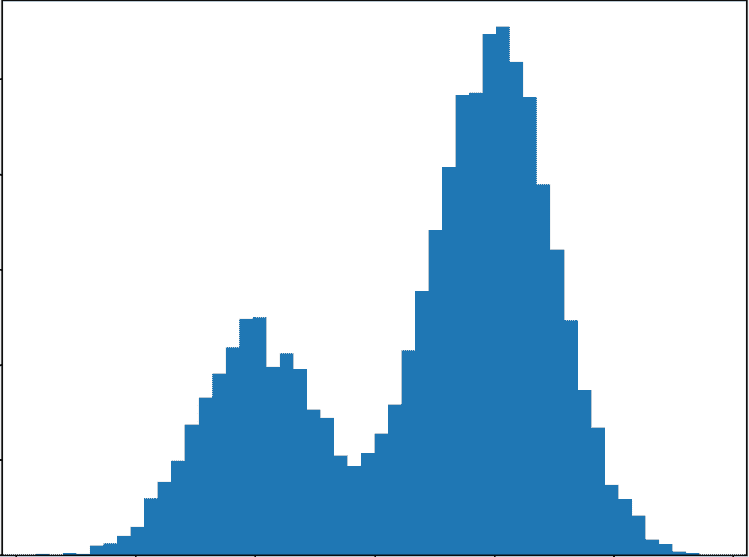

图 14.1：由两个不同高斯过程构建的数据集的直方图。

我们可以使用高斯混合模型来建模此数据集密度估计的问题。GaussianMixture scikit-learn 类可用于建模此问题并使用期望最大化算法估计分布的参数。该类允许我们在定义模型时通过 n_components 参数指定用于生成数据的疑似底层过程数。我们将此设置为2，对应两个过程或分布。

如果过程数量未知，可以测试不同数量的分量的范围，并选择拟合最佳的模型，其中模型可以使用诸如赤池信息准则或贝叶斯信息准则（AIC或BIC）等分数进行评估（在第15章中介绍）。我们还可以以多种方式配置模型以纳入我们可能了解的数据的其他信息，例如如何估计分布的初始值。在这种情况下，我们将通过将 init_params 参数设置为 `'random'` 来随机猜测初始参数。

```python
# fit model
model = GaussianMixture(n_components=2, init_params='random')
model.fit(X)
```

列表 14.3：拟合 GaussianMixture 模型的示例。

一旦模型拟合完成，我们可以通过模型上的属性访问学习到的参数，例如均值、协方差、混合权重等。更有用的是，我们可以使用 fit

用于估计现有和新数据点的潜在参数的模型。例如，我们可以估计训练数据集中点的潜在变量，我们期望前 3,000 个点属于一个过程（例如 value=1），而接下来的 7,000 个数据点属于另一个过程（例如 value=0）。

```python
...
# predict latent values
yhat = model.predict(X)
# check latent value for first few points
print(yhat[:100])
# check latent value for last few points
print(yhat[-100:])
```

Listing 14.4: 使用拟合的 GaussianMixture 模型进行预测的示例。

将所有内容整合起来，完整示例如下所示。

```python
# example of fitting a gaussian mixture model with expectation maximization
from numpy import hstack
from numpy.random import normal
from sklearn.mixture import GaussianMixture
# generate a sample
X1 = normal(loc=20, scale=5, size=3000)
X2 = normal(loc=40, scale=5, size=7000)
X = hstack((X1, X2))
# reshape into a table with one column
X = X.reshape((len(X), 1))
# fit model
model = GaussianMixture(n_components=2, init_params='random')
model.fit(X)
# predict latent values
yhat = model.predict(X)
# check latent value for first few points
print(yhat[:100])
# check latent value for last few points
print(yhat[-100:])
```

Listing 14.5: 使用 EM 算法拟合高斯混合模型的示例。

运行示例使用 EM 算法在准备好的数据集上拟合高斯混合模型。拟合后，模型用于预测训练数据集中示例的潜在变量值。鉴于学习算法的随机性，您的具体结果可能会有所不同。在这种情况下，我们可以看到至少对于数据集中前几个和最后几个示例，模型大多预测了潜在变量的正确值。这是一个通常具有挑战性的问题，预计分布峰值之间的点仍会保持模糊，并整体分配给一个过程或另一个过程。

```text
[1 1 1 1 1 1 1 1 1 1 1 1 1 1 1 1 1 1 1 1 1 1 1 1 1 1 1 1 1 1 1 1 1 1 1 1 1 1 1
 1 1 1 1 1 1 1 1 1 1 1 1 1 1 1 1 1 1 1 1 1 1 1 1 1 1 1 1 1 1 1 1 1 1 1 1 1 1
 1 1 1 1 1 1 1 1 1 1 1 1 1 1 1 1 1 1 1 1 1 1 1 1 1 1 1 1 1 1 1 1 1 1 1 1 1 1]
[0 0 0 1 0 0 0 0 0 0 0 0 1 0 0 0 0 1 0 0 0 0 0 0 1 0 0 0 0 0 0 0 0 1 1
 1 0 0 0 0 0 1 0 0 0 0 0 0 0 0 0 0 0 0 0 0 0 0 0 0 0 0 0 0 0 0 0 0 0 0 0]
```

Listing 14.6: 使用 EM 算法拟合高斯混合模型的示例输出。

## 14.6 进一步阅读

本节提供了更多资源，如果您想深入了解该主题。

### 14.6.1 书籍

- 第 8.5 节 EM 算法，*统计学习要素*，2016。 https://amzn.to/2YVqu8s
- 第 9 章 混合模型与 EM，*模式识别与机器学习*，2006。 https://amzn.to/2JwHE7I
- 第 6.12 节 EM 算法，*机器学习*，1997。 https://amzn.to/2jWd51p
- 第 11 章 混合模型与 EM 算法，*机器学习：概率视角*，2012。 https://amzn.to/2xKSTCP
- 第 9.3 节 聚类与概率密度估计，*数据挖掘：实用机器学习工具与技术*，第 4 版，2016。 https://amzn.to/2lnW5S7
- 第 20.3 节 具有隐藏变量的学习：EM 算法，*人工智能：一种现代方法*，第 3 版，2009。 https://amzn.to/2Y7yCp0

### 14.6.2 API

- 高斯混合模型，scikit-learn API。 https://scikit-learn.org/stable/modules/mixture.html
- sklearn.mixture.GaussianMixture API。 https://scikit-learn.org/stable/modules/generated/sklearn.mixture.GaussianMixture.html

### 14.6.3 文章

- 最大似然估计，Wikipedia。 https://en.wikipedia.org/wiki/Maximum_likelihood_estimation
- 期望最大化算法，Wikipedia。 https://en.wikipedia.org/wiki/Expectation%E2%80%93maximization_algorithm
- 混合模型，Wikipedia。 https://en.wikipedia.org/wiki/Mixture_model

## 第 15 章

## 使用 AIC、BIC 和 MDL 的概率模型选择

模型选择是从一组候选模型中选择一个的问题。常见的做法是选择在保留测试数据集上表现最好的模型，或使用重采样技术（如 k 折交叉验证）来估计模型性能。模型选择的另一种方法涉及使用概率统计度量，尝试量化训练数据集上的模型性能和模型的复杂性。示例包括赤池信息准则和贝叶斯信息准则以及最小描述长度。这些信息准则统计量的好处是它们不需要保留测试集，尽管一个局限是它们没有考虑模型的 불确定性，并且可能最终选择过于简单的模型。在本教程中，您将了解用于机器学习模型选择的概率统计。阅读本教程后，您将知道：

- 模型选择是在一组候选模型中选择一个的挑战。
- 赤池信息准则和贝叶斯信息准则是以对数似然和复杂性为基础对模型进行评分的两种方法。
- 最小描述长度提供了信息论中的另一种评分方法，可以证明其等价于 BIC。

让我们开始。

## 15.1 教程概述

本教程分为五个部分；它们是：

- 1. 模型选择的挑战
- 2. 概率模型选择
- 3. 赤池信息准则
- 4. 贝叶斯信息准则
- 5. 最小描述长度

## 15.2 模型选择的挑战

模型选择是在给定数据集上拟合多个模型并从中选择一个的过程。

> 模型选择：估计不同模型的性能以选择最佳模型。
> 
> — 第 222 页，*统计学习要素*，2016。

这可能适用于无监督学习，例如选择聚类模型，或监督学习，例如为回归或分类任务选择预测模型。它也可能是建模的子任务，例如为给定模型进行特征选择。用于模型选择的常见方法有很多。例如，在监督学习的情况下，三种最常见的方法是：

- 训练、验证和测试数据集。
- 重采样方法。
- 概率统计。

模型选择的最简单可靠方法涉及在训练集上拟合候选模型，在验证数据集上调优它们，并根据所选指标（如准确率或误差）选择在测试数据集上表现最好的模型。这种方法的问题是它需要大量数据。重采样技术试图实现与 train/val/test 方法相同的模型选择，尽管使用小数据集。一个例子是 *k* 折交叉验证，其中训练集被拆分为许多训练/测试对，并且在每个对上拟合和评估模型。这对每个模型重复，并选择在 *k* 折上平均得分最好的模型。这种方法以及之前的方法的问题在于只评估模型性能，而不管模型复杂性。

模型选择的第三种方法试图将模型的复杂性与模型的性能结合成一个分数，然后选择使分数最小化或最大化的模型。我们可以将这种方法称为统计或概率模型选择，因为评分方法使用概率框架。

## 15.3 概率模型选择

概率模型选择（或 *信息准则*）提供了一种分析技术，用于对候选模型进行评分和选择。模型既根据其在训练数据集上的性能进行评分，也根据模型的复杂性进行评分。

- **模型性能。** 候选模型在训练数据集上表现如何。
- **模型复杂性。** 训练后的候选模型有多复杂。

模型性能可使用概率框架进行评估，例如在最大似然估计框架下的对数似然。模型复杂性可评估为模型中的自由度或参数数量。


> 历史上，人们提出了各种“信息准则”，试图通过添加惩罚项来校正最大似然估计的偏差，以补偿更复杂模型的过拟合。
>
> —— 第33页，*《模式识别与机器学习》*，2006年。

概率模型选择方法的一个好处是不需要测试数据集，这意味着所有数据都可用于拟合模型，并且可以直接对最终用于领域预测的模型进行评分。概率模型选择方法的一个局限性是，同一通用统计量无法在不同类型的模型之间计算。相反，必须针对每个模型仔细推导该度量。

> 应当指出，AIC统计量是为模型之间的预先计划比较而设计的（而不是为自动搜索过程中对许多模型的比较）。
>
> —— 第493页，*《应用预测建模》*，2013年。

这些选择方法的另一个局限性是它们没有考虑模型的不确定性。

> 然而，这类准则并未考虑模型参数的不确定性，在实践中它们往往倾向于选择过于简单的模型。
>
> —— 第33页，*《模式识别与机器学习》*，2006年。

有三种统计方法可以估计给定模型对数据集的拟合程度以及模型的复杂程度。每种方法都可以被证明是等价的或成比例的，尽管它们源自不同的框架或研究领域。

它们是：

- 赤池信息量准则（AIC）。源自频率学派概率。
- 贝叶斯信息量准则（BIC）。源自贝叶斯概率。
- 最小描述长度（MDL）。源自信息论。

每个统计量都可以使用模型和数据的对数似然来计算。对数似然来自最大似然估计（在第11章中介绍），这是一种根据训练数据集寻找或优化模型参数的技术。在最大似然估计中，我们希望最大化在给定特定概率分布及其参数（$\theta$）的情况下观测到数据（$X$）的条件概率，形式化地表示为：

$$P(X;\theta) \tag{15.1}$$

其中 $X$ 实际上是问题域中从 1 到 $n$ 的所有观测的联合概率分布。

$$P(x_1,x_2,x_3,\ldots,x_n;\theta) \tag{15.2}$$

联合概率分布可以重新表述为在给定分布参数的情况下，每个观测示例的条件概率的乘积。将许多小概率相乘可能不稳定；因此，通常将此问题重新表述为条件概率的自然对数之和。

$$\sum_{i=1}^{n} \log P(x_i; \theta) \tag{15.3}$$

由于对数在似然函数中经常使用，因此通常被称为对数似然函数。常见预测建模问题的对数似然函数包括回归（如线性回归）的均方误差和二分类（如逻辑回归）的对数损失（二元交叉熵）。我们将在以下章节中更仔细地研究 AIC、BIC 和 MDL 这三种统计量。

## 15.4 赤池信息量准则

赤池信息量准则，简称 AIC，是一种对模型进行评分和选择的方法。它以该方法的提出者赤池弘次命名，可以被证明具有信息论和基于频率学派的推断基础。

> 这源自频率学派框架，不能解释为边际似然的近似。
>
> —— 第162页，*《机器学习：概率视角》*，2012年。

AIC 统计量通常针对逻辑回归定义如下¹：

$$AIC = -\frac{2}{N} \times LL + 2 \times \frac{k}{N} \tag{15.4}$$

其中 *N* 是训练数据集中的示例数，*LL* 是模型在训练数据集上的对数似然，*k* 是模型中的参数数量。如上定义的分数被最小化，例如选择 AIC 最低的模型。

> 为了使用 AIC 进行模型选择，我们只需在考虑的模型集合中选择 AIC 最小的模型。
>
> —— 第231页，*《统计学习要素》*，2016年。

与下面的 BIC 方法相比，AIC 统计量对复杂模型的惩罚较少，这意味着它可能更重视模型在训练数据集上的表现，进而选择更复杂的模型。

> 我们看到 AIC 的惩罚小于 BIC。这使得 AIC 会选择更复杂的模型。
>
> —— 第162页，*《机器学习：概率视角》*，2012年。

## 15.5 贝叶斯信息量准则

贝叶斯信息量准则，简称 BIC，是一种对模型进行评分和选择的方法。它以它所源自的研究领域命名：贝叶斯概率和推断。与 AIC 一样，它适用于在最大似然估计框架下拟合的模型。BIC 统计量通常针对逻辑回归计算如下²：

$$BIC = -2 \times LL + \log(N) \times k \tag{15.5}$$

其中 $\log()$ 以 $e$ 为底，称为自然对数，$LL$ 是模型的对数似然，$N$ 是训练数据集中的示例数，$k$ 是模型中的参数数量。如上定义的分数被最小化，例如选择 BIC 最低的模型。计算所得的数量与 AIC 不同，但可以证明它与 AIC 成正比。与 AIC 不同，BIC 对模型复杂度施加更大的惩罚，这意味着更复杂的模型将获得更差（更大）的分数，因此被选中的可能性更低。

> 请注意，与 AIC [...] 相比，这对模型复杂度的惩罚更重。
>
> —— 第217页，*《模式识别与机器学习》*，2006年。

重要的是，BIC 在贝叶斯概率框架下的推导意味着，如果候选模型集合中包含数据集的真实模型，那么 BIC 选择真实模型的概率会随着训练数据集规模的增大而增加。AIC 分数则不能这么说。

> ……给定一个包含真实模型的模型族，BIC 选择正确模型的概率随着样本量 $N \to \infty$ 而趋近于 1。
>
> —— 第235页，*《统计学习要素》*，2016年。

BIC 的一个缺点是，对于较小、代表性较差的训练数据集，它更可能选择过于简单的模型。

## 15.6 最小描述长度

最小描述长度，简称 MDL，是一种对模型进行评分和选择的方法。它以它所源自的研究领域命名，即信息论。信息论关注的是在噪声信道上的信息表示和传输，因此它度量诸如熵之类的量，熵是从随机变量或概率分布表示一个事件所需的平均比特数。

从信息论的角度来看，我们可能希望同时传输预测结果（更准确地说，是它们的概率分布）以及用于生成这些预测结果的模型。预测的目标变量和模型都可以用它们在噪声信道上传输所需的比特数来描述。最小描述长度是表示数据和模型所需的最小比特数，或者说是这两者所需比特数之和的最小值。

> 最小描述长度（MDL）原则建议选择使这两个描述长度之和最小化的假设。
>
> —— 第173页，*《机器学习》*，1997年。

MDL 统计量计算如下³：

$$MDL = L(h) + L(D|h) \tag{15.6}$$

其中 $h$ 是模型，$D$ 是模型做出的预测，$L(h)$ 是表示模型所需的比特数，$L(D|h)$ 是表示模型在训练数据集上的预测所需的比特数。如上定义的分数被最小化，例如选择 MDL 最低的模型。编码 $(D|h)$ 所需的比特数和编码 $(h)$ 所需的比特数可以计算为负对数似然；例如⁴：

$$MDL = -\log(P(\theta)) - \log(P(y|X,\theta)) \tag{15.7}$$

或者，模型参数（$\theta$）的负对数似然，以及在给定输入值（$X$）和模型参数（$\theta$）的情况下目标值（$y$）的负对数似然。这种最小化模型及其预测编码的愿望与奥卡姆剃刀的概念相关，奥卡姆剃刀寻求最简单的（最不复杂的）解释：在此背景下，即预测目标变量的最不复杂的模型。

> MDL 原则采取的立场是，对于一组数据，最好的理论是使理论大小加上相对于该理论指定例外所需的信息量最小化的理论……
>
> —— 第198页，*《数据挖掘：实用机器学习工具与技术》*，第4版，2016年。

MDL 的计算与 BIC 非常相似，并且在某些情况下可以被证明是等价的。

> 因此，作为 log-后验概率近似而推导出的 BIC 准则，也可以被视为一种通过最小描述长度进行（近似）模型选择的工具。
>
> —— 第236页，*《统计学习要素》*，2016年。

## 15.7 线性回归的示例

我们可以通过一个实际示例使 AIC 和 BIC 的计算更加具体。在本节中，我们将使用一个测试问题，拟合一个线性回归模型，然后使用 AIC 和 BIC 度量评估该模型。重要的是，线性回归模型的 AIC 和 BIC 的具体函数形式先前已被推导出来，这使得该示例相对简单。在为您自己的算法改编这些示例时，重要的是要么找到合适的

---

³ 引自汤姆·米切尔的《机器学习》  
⁴ 引自《统计学习要素》


推导你模型和预测问题的计算方法，或自行推导计算方法。一个好的起点是查阅现有示例的相关文献。

在本示例中，我们将使用 make_regression() scikit-learn 函数提供的测试回归问题。该问题将有两个输入变量，并需要预测一个目标数值。

```python
...
# generate dataset
X, y = make_regression(n_samples=100, n_features=2, noise=0.1)
# define and fit the model on all data
```

清单 15.1：准备测试数据集的示例。

我们将直接在整个数据集上拟合 LinearRegression 模型。

```python
...
# define and fit the model on all data
model = LinearRegression()
model.fit(X, y)
```

清单 15.2：拟合 LinearRegression 模型的示例。

拟合后，我们可以报告模型中的参数数量，根据问题的定义，我们预计应为三个（两个系数和一个截距）。

```python
...
# number of parameters
num_params = len(model.coef_) + 1
print('Number of parameters: %d' % (num_params))
```

清单 15.3：汇总模型中参数数量的示例。

线性回归模型的似然函数可以证明与最小二乘函数相同；因此，我们可以通过均方误差指标来估计模型的最大似然。首先，模型可用于估计训练数据集中每个示例的结果，然后可以使用 mean_squared_error() scikit-learn 函数计算模型的均方误差。

```python
...
# predict the training set
yhat = model.predict(X)
# calculate the error
mse = mean_squared_error(y, yhat)
print('MSE: %.3f' % mse)
```

清单 15.4：在训练数据集上估计模型误差的示例。

将这些内容结合起来，定义数据集、拟合模型并报告模型的参数数量和最大似然估计的完整示例如下所示。

```python
# generate a test dataset and fit a linear regression model
from sklearn.datasets import make_regression
from sklearn.linear_model import LinearRegression
from sklearn.metrics import mean_squared_error
# generate dataset
X, y = make_regression(n_samples=100, n_features=2, noise=0.1)
# define and fit the model on all data
model = LinearRegression()
model.fit(X, y)
# number of parameters
num_params = len(model.coef_) + 1
print('Number of parameters: %d' % (num_params))
# predict the training set
yhat = model.predict(X)
# calculate the error
mse = mean_squared_error(y, yhat)
print('MSE: %.3f' % mse)
# calculate the aic
aic = calculate_aic(len(y), mse, num_params)
print('AIC: %.3f' % aic)
```

清单 15.8：使用 AIC 评估线性回归模型的示例。

运行示例会像之前一样报告参数数量和 MSE，然后报告 AIC。

注意：由于学习算法的随机性，你的具体结果可能会有所不同。考虑多次运行示例并比较平均性能。

在这种情况下，报告的 AIC 约为 -451.616。该值可以最小化以选择更好的模型。

```
Number of parameters: 3
MSE: 0.010
AIC: -451.616
```

清单 15.9：使用 AIC 评估线性回归模型的示例输出。

我们还可以探索相同的示例，但使用 BIC 而不是 AIC 进行计算。跳过推导，普通最小二乘线性回归模型的 BIC 计算如下⁶：

$BIC = n \times LL + k \times log(n)$  
(15.9)

其中 n 是训练数据集中示例的数量，LL 是使用自然对数计算的模型的对数似然，k 是模型中的参数数量，log() 是自然对数。下面的 calculate_bic() 函数实现了这一点，接受 n、原始均方误差（mse）和 k 作为参数。

```python
# calculate bic for regression
def calculate_bic(n, mse, num_params):
    bic = n * log(mse) + num_params * log(n)
    return bic
```

清单 15.10：计算线性回归模型 BIC 的函数的示例。

⁶取自贝叶斯信息准则，高斯特例，维基百科。

然后可以更新示例以使用此新函数并计算模型的 BIC。完整示例如下所示。

```python
# calculate bayesian information criterion for a linear regression model
from math import log
from sklearn.datasets import make_regression
from sklearn.linear_model import LinearRegression
from sklearn.metrics import mean_squared_error

# calculate bic for regression
def calculate_bic(n, mse, num_params):
    bic = n * log(mse) + num_params * log(n)
    return bic

# generate dataset
X, y = make_regression(n_samples=100, n_features=2, noise=0.1)
# define and fit the model on all data
model = LinearRegression()
model.fit(X, y)
# number of parameters
num_params = len(model.coef_) + 1
print('Number of parameters: %d' % (num_params))
# predict the training set
yhat = model.predict(X)
# calculate the error
mse = mean_squared_error(y, yhat)
print('MSE: %.3f' % mse)
# calculate the bic
bic = calculate_bic(len(y), mse, num_params)
print('BIC: %.3f' % bic)
```

清单 15.11：使用 BIC 评估线性回归模型的示例。

运行示例会像之前一样报告参数数量和 MSE，然后报告 BIC。

**注意：** 由于学习算法的随机性，你的具体结果可能会有所不同。考虑多次运行示例并比较平均性能。

在这种情况下，报告的 BIC 约为 -450.020，与 AIC 值 -451.616 非常接近。同样，该值可以最小化以选择更好的模型。

```
Number of parameters: 3
MSE: 0.010
BIC: -450.020
```

清单 15.12：使用 BIC 评估线性回归模型的示例输出。

## 15.8 延伸阅读

本节提供了如果您想深入了解该主题的更多资源。

### 15.8.1 书籍

- 第 7 章 模型评估与选择，*The Elements of Statistical Learning*，2016。  
  https://amzn.to/2YVqu8s
- 第 1.3 节 模型选择，*Pattern Recognition and Machine Learning*，2006。  
  https://amzn.to/2JwHE7I
- 第 4.4.1 节 模型比较和 BIC，*Pattern Recognition and Machine Learning*，2006。  
  https://amzn.to/2JwHE7I
- 第 6.6 节 最小描述长度原理，*Machine Learning*，1997。  
  https://amzn.to/2jWd51p
- 第 5.3.2.4 节 BIC 近似对数边际似然，*Machine Learning: A Probabilistic Perspective*，2012。  
  https://amzn.to/2xKSTCP
- Applied Predictive Modeling，2013。  
  https://amzn.to/2Helnu5
- 第 28.3 节 最小描述长度 (MDL)，*Information Theory, Inference and Learning Algorithms*，2003。  
  https://amzn.to/2ZvZ1Jx
- 第 5.10 节 MDL 原理，*Data Mining: Practical Machine Learning Tools and Techniques*，第 4 版，2016。  
  https://amzn.to/21nW5S7

### 15.8.2 论文

- *A New Look At The Statistical Identification Model*，1974。  
  https://ieeexplore.ieee.org/document/1100705

### 15.8.3 API

- `sklearn.datasets.make_regression` API。  
  https://scikit-learn.org/stable/modules/generated/sklearn.datasets.make_regression.html
- `sklearn.linear_model.LinearRegression` API。  
  https://scikit-learn.org/stable/modules/generated/sklearn.linear_model.LinearRegression.html
- `sklearn.metrics.mean_squared_error` API。  
  https://scikit-learn.org/stable/modules/generated/sklearn.metrics.mean_squared_error.html

### 15.8.4 文章

- 赤池信息准则，Wikipedia。  
  https://en.wikipedia.org/wiki/Akaike_information_criterion
- 贝叶斯信息准则，Wikipedia。  
  https://en.wikipedia.org/wiki/Bayesian_information_criterion
- 最小描述长度，Wikipedia。  
  https://en.wikipedia.org/wiki/Minimum_description_length

## 15.9 总结

在本教程中，你了解了机器学习模型选择的概率统计。具体来说，你学习了：

- 模型选择是在一组候选模型中进行选择的挑战。
- 赤池信息准则和贝叶斯信息准则是通过对数似然和复杂度对模型进行评分的两种方法。
- 最小描述长度提供了一种来自信息论的评分方法，可以证明其等价于 BIC。

### 15.9.1 下一步

这是本部分的最后一个教程。在下一部分中，你将发现贝叶斯定理用于条件概率。


## 第六部分
### 贝叶斯概率
## 第16章
### 贝叶斯定理简介

贝叶斯定理提供了一种计算条件概率的原则性方法。它是一个看似简单却易于计算的计算，为我们直觉经常失效的场景提供了一种方法。培养对贝叶斯定理的直觉最好的方式是思考方程中各术语的含义，并在多种不同的现实场景中多次应用该计算。这将提供所计算内容的背景以及可在未来将计算应用于新场景时作为起点的示例。在本教程中，你将通过处理多个现实场景来培养计算贝叶斯定理的直觉。完成本教程后，你将知道：

- 贝叶斯定理是计算条件概率的一种技术。
- 贝叶斯定理方程中术语的常用且有帮助的名称。
- 如何通过计算贝叶斯定理来找到解决方案，从而处理现实场景。

让我们开始吧。

### 16.1 教程概述

本教程分为五部分；它们是：

- 1. 什么是贝叶斯定理？
- 2. 定理中术语的命名
- 3. 示例：老年人跌倒和死亡
- 4. 示例：电子邮件和垃圾邮件检测
- 5. 示例：说谎者和测谎仪

### 16.2 什么是贝叶斯定理？

条件概率是在另一事件发生的情况下一个事件发生的概率，通常用来自两个相关随机变量 e.g. X 和 Y 的事件 A 和 B 来描述。

- **条件概率**：在发生一个或多个其他事件的情况下一个事件发生的概率，例如 $P(A|B)$。

条件概率可以使用联合概率计算；例如：

$$P(A|B) = \frac{P(A \cap B)}{P(B)}\tag{16.1}$$

此外，条件概率不是对称的；例如：

$$P(A|B) \neq P(B|A)\tag{16.2}$$

尽管如此，一个条件概率可以使用另一个条件概率计算。这称为贝叶斯定理，以牧师托马斯·贝叶斯命名，可表述如下：

$$P(A|B) = \frac{P(B|A) \times P(A)}{P(B)}\tag{16.3}$$

贝叶斯定理提供了一种计算条件概率的原则性方法，也是使用联合概率的替代方案。当联合概率难以计算，或反向条件概率可用或易于计算时，这种计算条件概率的替代方法很有用。

- **贝叶斯定理**：在没有联合概率的情况下计算条件概率的原则性方法。

通常情况下，我们无法直接获得分母，例如 $P(B)$。我们可以用另一种方式计算，例如：

$$P(B) = P(B|A) \times P(A) + P(B|\text{not } A) \times P(\text{not } A)\tag{16.4}$$

这给出了贝叶斯定理的一种公式，使用 $P(B)$ 的替代计算，如下所述：

$$P(A|B) = \frac{P(B|A) \times P(A)}{P(B|A) \times P(A) + P(B|\text{not } A) \times P(\text{not } A)}\tag{16.5}$$

注意分母只是我们上面给出的展开式。因此，如果我们有 $P(A)$，则可以将其补集计算为 $P(\text{not } A)$，例如：

$$P(\text{not } A) = 1 - P(A)\tag{16.6}$$

此外，如果我们有 $P(\text{not } B|\text{not } A)$，则可以将其补集计算为 $P(B|\text{not } A)$，例如：

$$P(B|\text{not } A) = 1 - P(\text{not } B|\text{not } A)\tag{16.7}$$

现在我们熟悉了贝叶斯定理的计算，让我们更仔细地看看方程中各术语的含义。

### 16.3 定理中术语的命名

贝叶斯定理方程中的术语根据方程使用的上下文赋予名称。从这些不同角度思考计算并帮助将你的问题映射到方程上会很有帮助。首先，一般来说，结果 $P(A|B)$ 被称为后验概率，而 $P(A)$ 被称为先验概率。

- $P(A|B)$：后验概率。
- $P(A)$：先验概率。

有时 $P(B|A)$ 被称为似然，而 $P(B)$ 被称为证据。

- $P(B|A)$：似然。
- $P(B)$：证据。

这使得贝叶斯定理可以 restated 为：

Posterior = $\frac{\text{Likelihood} \times \text{Prior}}{\text{Evidence}}$  (16.8)

我们可以用一个 *烟* 和 *火* 示例来说明这一点。有烟的情况下着火的概率是多少，其中 $P(\text{Fire})$ 为先验，$P(\text{Smoke}|\text{Fire})$ 为似然，且 $P(\text{Smoke})$ 为证据：

$P(\text{Fire}|\text{Smoke}) = \frac{P(\text{Smoke}|\text{Fire}) \times P(\text{Fire})}{P(\text{Smoke})}$  (16.9)

我们也可以从二元分类器的角度思考计算。例如，$P(B|A)$ 可能被称为真阳性率 TPR 或 **灵敏度**，$P(B|\text{not } A)$ 可能被称为假阳性率 FPR，补集 $P(\text{not } B|\text{not } A)$ 可能被称为真阴性率 TNR 或 **特异性**，而我们计算的值 $P(A|B)$ 可能被称为阳性预测值 PPV 或 **精确度**。

- $P(\text{not } B|\text{not } A)$：真阴性率或 TNR（特异性）。
- $P(B|\text{not } A)$：假阳性率或 FPR。
- $P(\text{not } B|A)$：假阴性率或 FNR。
- $P(B|A)$：真阳性率或 TPR（灵敏度或召回率）。
- $P(A|B)$：阳性预测值或 PPV（精确度）。

例如，我们可以使用这些术语重新表述计算如下：

$PPV = \frac{TPR \times P(A)}{TPR \times P(A) + FPR \times P(\text{not } A)}$  (16.10)

现在我们熟悉了贝叶斯定理及其术语的含义，让我们看看一些可以计算它的场景。注意以下所有示例都是人为构造的，并非基于现实世界的概率。

### 16.4 示例：老年人跌倒和死亡

考虑一个老年人（80岁以上）跌倒的情况，他们因跌倒而死亡的概率是多少？假设老年人死亡的基线率 P(A) 为 10%，老年人跌倒的基线率 P(B) 为 5%，并且在所有老年人中，7% 的死亡者曾跌倒 P(B|A)。让我们把已知的数值代入定理：

P(A|B) = [P(B|A) × P(A)] / P(B)
P(Die|Fall) = [P(Fall|Die) × P(Die)] / P(Fall) (16.11)

或：

P(A|B) = (0.07 × 0.10) / 0.05
P(Die|Fall) = 0.14 (16.12)

也就是说，如果老年人跌倒，则他们因跌倒而死亡的概率为 14%。为了使之具体化，我们可以在 Python 中执行计算，首先定义已知内容，然后使用贝叶斯定理计算结果。完整的示例如下所示。

```
# calculate the probability of an elderly person dying from a fall

# calculate P(A|B) given P(B|A), P(A) and P(B)
def bayes_theorem(p_a, p_b, p_b_given_a):
    # calculate P(A|B) = P(B|A) * P(A) / P(B)
    p_a_given_b = (p_b_given_a * p_a) / p_b
    return p_a_given_b

# P(A)
p_a = 0.10
# P(B)
p_b = 0.05
# P(B|A)
p_b_given_a = 0.07
# calculate P(A|B)
result = bayes_theorem(p_a, p_b, p_b_given_a)
# summarize
print('P(A|B) = %.3f%%' % (result * 100))
```

Listing 16.1: Example of calculating the probability of dying from a fall.

运行示例证实了我们手动计算的值。

```
P(A|B) = 14.000%
```

Listing 16.2: Example output from calculating the probability of dying from a fall.

### 16.5 示例：电子邮件和垃圾邮件检测

考虑我们收到一封电子邮件且垃圾邮件检测器将其放入垃圾邮件文件夹的情况，它是垃圾邮件的概率是多少？假设我们收到的电子邮件中有 2% 是垃圾邮件 P(A)。假设垃圾邮件检测器非常好，当电子邮件是垃圾邮件时它能检测到 P(B|A)，准确率为 99%，而当电子邮件不是垃圾邮件时，它将其标记为垃圾邮件的错误率非常低，为 0.1% P(B|not A)。让我们把已知的数值代入定理：

P(A|B) = \frac{P(B|A) \times P(A)}{P(B)}

P(Spam|Detected) = \frac{P(Detected|Spam) \times P(Spam)}{P(Detected)}
(16.13)

或：

P(Spam|Detected) = \frac{0.99 \times 0.02}{P(Detected)}
(16.14)

我们不知道 P(B)，即 P(Detected)，但我们可以使用以下方法计算它：

P(B) = P(B|A) \times P(A) + P(B|not A) \times P(not A)
P(Detected) = P(Detected|Spam) \times P(Spam) + P(Detected|not Spam) \times P(not Spam)
(16.15)

我们知道 P(Detected|not Spam) 为 0.1%，并且我们可以将 P(not Spam) 计算为 1 − P(Spam)，例如：

P(not Spam) = 1 − P(Spam)
= 1 − 0.02
= 0.98
(16.16)

因此，我们可以计算 P(Detected) 为：

P(Detected) = 0.99 \times 0.02 + 0.001 \times 0.98
= 0.0198 + 0.00098
= 0.02078
(16.17)

也就是说，大约 2% 的所有电子邮件被检测为垃圾邮件，无论其是否为垃圾邮件。现在我们可以计算我们最初问题的答案为：

P(Spam|Detected) = \frac{0.99 \times 0.02}{0.02078}
= \frac{0.0198}{0.02078}
= 0.95283926852743
(16.18)

也就是说，如果一封电子邮件在垃圾邮件文件夹中，则它确实是垃圾邮件的概率为 95.2%。再次，让我们通过在 Python 中计算来确认该结果。完整的示例如下所示。

```
# calculate the probability of an email in the spam folder being spam

# calculate P(A|B) given P(A), P(B|A), P(B|not A)
def bayes_theorem(p_a, p_b_given_a, p_b_given_not_a):
```


```
# calculate P(not A)
not_a = 1 - p_a
# calculate P(B)
p_b = p_b_given_a * p_a + p_b_given_not_a * not_a
# calculate P(A|B)
p_a_given_b = (p_b_given_a * p_a) / p_b
return p_a_given_b

# P(A)
p_a = 0.02
# P(B|A)
p_b_given_a = 0.99
# P(B|not A)
p_b_given_not_a = 0.001
# calculate P(A|B)
result = bayes_theorem(p_a, p_b_given_a, p_b_given_not_a)
# summarize
print('P(A|B) = %.3f%%' % (result * 100))
```

清单 16.3：计算检测垃圾邮件概率的示例。

运行该示例得到相同的结果，证实了我们手动的计算。

```
P(A|B) = 95.284%
```

清单 16.4：计算检测垃圾邮件概率的示例输出。

## 16.6 示例：说谎者与测谎仪

考虑这样一种情况：某人接受测谎仪测试，结果为阳性，表明他们在说谎，那么此人确实在说谎的概率是多少？让我们假设一些细节，例如接受测试的大多数人都在说实话，比如 98%，意味着 (1 − 0.98) 即 2% 的人是说谎者 P(A)。再假设当某人在说谎时，测试能够很好但并非完美地检测出来，例如 72% 的时间 P(B|A)。再假设当机器说他们没有说谎时，这一判断在 97% 的情况下是正确的 P(not B| not A)。让我们把已知条件代入定理：

$P(A|B) = \frac{P(B|A) \times P(A)}{P(B)}$

$P(\text{说谎}|\text{阳性}) = \frac{P(\text{阳性}|\text{说谎}) \times P(\text{说谎})}{P(\text{阳性})}$
(16.19)

或者：

$P(\text{说谎}|\text{阳性}) = \frac{0.72 \times 0.02}{P(\text{阳性})}$
(16.20)

同样，我们不知道 $P(B)$，或者在这种情况下不知道测谎仪总体上多久返回一次阳性结果。我们可以使用以下公式计算：

$$P(B)=P(B\mid A)\times P(A)+P(B\mid\text{非 }A)\times P(\text{非 }A)$$

$$P(\text{阳性})=P(\text{阳性}\mid\text{说谎})\times P(\text{说谎})+P(\text{阳性}\mid\text{未说谎})\times P(\text{未说谎})$$
$$=0.72\times 0.02+P(\text{阳性}\mid\text{未说谎})\times(1-0.02)$$
$$=0.72\times 0.02+P(\text{阳性}\mid\text{未说谎})\times 0.98$$

(16.21)

在这种情况下，我们不知道在某人未说谎时得到阳性检测结果的概率，也就是说，我们不知道误报率或虚警率。这可以计算如下：

$$P(B\mid\text{非 }A)=1-P(\text{非 }B\mid\text{非 }A)$$
$$P(\text{阳性}\mid\text{未说谎})=1-P(\text{非阳性}\mid\text{未说谎})$$
$$=1-0.97$$
$$=0.03$$

(16.22)

因此，我们可以计算 $P(\text{阳性})$：

$$P(\text{阳性})=0.72\times 0.02+0.03\times 0.98$$
$$=0.0144+0.0294$$
$$=0.0438$$

(16.23)

也就是说，无论此人是否说谎，测试约有 4% 的时间返回阳性结果。我们现在可以计算这个场景下的贝叶斯定理：

$$P(\text{说谎}\mid\text{阳性})=\frac{0.72\times 0.02}{0.0438}$$
$$=\frac{0.0144}{0.0438}$$
$$=0.328767123287671$$

(16.24)

也就是说，如果测谎仪测试结果为阳性，那么此人实际上在说谎的概率为 32.8%。这是一个糟糕的测试！最后，让我们在 Python 中确认这个计算。完整示例如下。

```python
# calculate the probability of a person lying given a positive lie detector result

# calculate P(A|B) given P(A), P(B|A), P(not B|not A)
def bayes_theorem(p_a, p_b_given_a, p_not_b_given_not_a):
    # calculate P(not A)
    not_a = 1 - p_a
    # calculate P(B|not A)
    p_b_given_not_a = 1 - p_not_b_given_not_a
    # calculate P(B)
    p_b = p_b_given_a * p_a + p_b_given_not_a * not_a
    # calculate P(A|B)
    p_a_given_b = (p_b_given_a * p_a) / p_b
    return p_a_given_b

# P(A), base rate
p_a = 0.02
# P(B|A)
p_b_given_a = 0.72
# P(not B| not A)
p_not_b_given_not_a = 0.97
# calculate P(A|B)
result = bayes_theorem(p_a, p_b_given_a, p_not_b_given_not_a)
# summarize
print('P(A|B) = %.3f%%' % (result * 100))
```

清单 16.5：计算在测谎结果为阳性的情况下说谎概率的示例。

运行该示例得到相同的结果，证实了我们手动的计算。

```
P(A|B) = 32.877%
```

清单 16.6：计算在测谎结果为阳性的情况下说谎概率的示例输出。

我们现在已经看到了几个不同的案例，展示了简单问题如何映射到贝叶斯定理上，以及如何通过手动和 Python 代码示例来解决它们。这为你在自己类似的问题上应用贝叶斯定理提供了基础。

## 16.7 扩展阅读

如果你希望更深入地了解，本节提供了更多相关资源。

### 16.7.1 书籍

- *模式识别与机器学习*，2006 年。
  https://amzn.to/2JwHE7I
- *机器学习*，1997 年。
  https://amzn.to/2jWd51p
- *模式分类*，第 2 版，2001 年。
  https://amzn.to/2xVBI1n
- *机器学习：概率视角*，2012 年。
  https://amzn.to/2xKSTCP

### 16.7.2 文章

- 条件概率，维基百科。
  https://en.wikipedia.org/wiki/Conditional_probability
- 贝叶斯定理，维基百科。
  https://en.wikipedia.org/wiki/Bayes%27_theorem
- 最大后验估计，维基百科。
  https://en.wikipedia.org/wiki/Maximum_a_posteriori_estimation

## 第 17 章

### 贝叶斯定理与机器学习

机器学习可以理解为使用贝叶斯定理选择最能描述观测数据的模型。这一视角为最大后验（MAP）概率框架提供了基础，该框架可以证明是许多机器学习模型（如线性回归和逻辑回归）的基础。这种机器学习的框架也引出了如何通过贝叶斯最优分类器对新示例做出最优预测的概念，进而揭示了贝叶斯误差，即在数据集上进行预测时预期的最小误差。在本教程中，你将发现机器学习建模和预测的贝叶斯视角。

- 如何将选择机器学习模型的问题框定为求解贝叶斯定理。
- 如何使用最大后验概率框架为数据集优化模型。
- 贝叶斯最优分类器如何定义对数据集上一组模型所能做出的最优预测。

让我们开始吧。

### 17.1 教程概览

本教程分为五个部分：

- 1. 建模假设的贝叶斯定理
- 2. 密度估计
- 3. 最大后验
- 4. MAP 与机器学习
- 5. 贝叶斯最优分类器

### 17.2 建模假设的贝叶斯定理

贝叶斯定理是应用机器学习中的一个有用工具。它提供了一种思考数据与模型之间关系的方式。机器学习算法或模型是对数据中结构化关系的一种特定思考方式。这样，模型可以被看作是关于数据中关系（例如输入 (X) 和输出 (y) 之间的关系）的假设。应用机器学习的实践是在给定数据集上测试和分析不同的假设（模型）。贝叶斯定理提供了一个概率模型来描述数据 (D) 和假设 (H) 之间的比例关系；例如：

$$P(h|D) = \frac{P(D|h) \times P(h)}{P(D)}$$ (17.1)

分解来看，它表示在给定某些观测数据的情况下，某个假设成立或为真的概率，可以通过在给定假设下观测到数据的概率乘以假设在不受数据影响的情况下为真的概率，再除以在不受假设影响的情况下观测到数据的概率来计算。

> 贝叶斯定理提供了一种根据假设的先验概率、在给定假设下观测到各种数据的概率以及观测数据本身来计算假设概率的方法。
> 
> —— 《机器学习》，1997 年，第 156 页。

在这个框架下，计算的每一部分都有特定的名称；例如：

- P(h|D)：假设的后验概率（我们想要计算的量）。
- P(h)：假设的先验概率。

这为思考和对机器学习问题进行建模提供了一个有用的框架。如果我们对假设有一些先验的领域知识，这些知识就体现在先验概率中。如果没有，那么所有假设可能具有相同的先验概率。如果观测到数据的概率 P(D) 增加，那么在给定数据下假设成立的概率 P(h|D) 就会降低。相反，如果假设的概率 P(h) 和在给定假设下观测到数据的概率增加，那么在给定数据下假设成立的概率 P(h|D) 就会增加。

在应用机器学习中，在数据集上测试不同模型的概念，可以看作是估计在给定观测数据下每个假设 (h1, h2, h3, … , ∈ H) 为真的概率。在这个框架下，数据 (D) 的概率是常数，因为它在评估每个假设时都要使用。因此，它可以从计算中移除，得到如下简化的未归一化估计：

$$\max_{h \in H} P(h|D) = P(D|h) \times P(h)$$ (17.2)

如果我们对正在测试的假设没有任何先验信息，它们可以被赋予均匀概率，这一项也将是常数，可以从计算中移除，得到如下结果：

$$\max_{h \in H} P(h|D) = P(D|h)$$ (17.3)


也就是说，目标是找到最能解释观测数据的假设。这种简化构成了搜索最能拟合数据的模型和参数集的优化过程的基础，这个过程通常被称为密度估计。

## 17.3 密度估计

一个常见的建模问题是如何估计数据集的联合概率分布。例如，给定来自某个域的观测样本（$X$），即（$x_1, x_2, x_3, \cdots, x_n$），其中每个观测样本都以相同的概率分布独立地从该域中抽取（即所谓的独立同分布，i.i.d.，或非常接近独立同分布）。密度估计涉及选择一个概率分布函数以及该分布的参数，使之最能解释观测数据（$X$）的联合概率分布。通常，估计密度本身过于困难；相反，我们满足于从目标分布中获取一个点估计，比如均值。解决这个问题有很多技术，但两种常见的方法是：

- 最大后验（MAP），一种贝叶斯方法。
- 最大似然估计（MLE），一种频率派方法。

这两种方法都将问题视为优化问题，并涉及搜索一个最能描述观测数据的分布及其参数集。在最大似然估计中（第11章介绍），我们希望最大化在给定特定概率分布及其参数的情况下，从联合概率分布中观测到数据的概率，其形式化表述为：

$P(X; \theta)$
(17.4)

或

$P(x_1, x_2, x_3, \cdots, x_n; \theta)$
(17.5)

由此得到的条件概率被称为在给定模型参数条件下观测到数据的似然。最大似然估计的目标是找到能够最大化似然函数的参数集（$\theta$），即产生最大的似然值。

$\max P(X; \theta)$
(17.6)

另一种密切相关的方法是从贝叶斯概率的角度来考虑这一优化问题。

一个广受欢迎的替代方案是：不最大化似然，而是最大化参数的贝叶斯后验概率密度。

> — 第306页，*信息论、推理与学习算法*，2003年。

让我们更仔细地审视解决这一优化问题的贝叶斯方法。

> — 第236页，*深度学习*，2016年。

与MLE一样，解决该优化问题取决于模型的选择。对于像线性回归这样较简单的模型，存在解析解。对于像逻辑回归这样更复杂的模型，则需要使用一阶和二阶导数的数值优化。对于更棘手的问题，可能需要随机优化算法。

既然我们已经熟悉了如何利用贝叶斯定理来表述对候选模型的搜索，那么我们再来看贝叶斯定理在机器学习中的另一个重要应用——贝叶斯分类器。

## 17.6 贝叶斯最优分类器

贝叶斯最优分类器是一种概率模型，在给定训练数据集时，对新样本做出最可能的预测。该模型也被称为贝叶斯最优学习器、贝叶斯分类器、贝叶斯最优决策边界或贝叶斯最优判别函数。

- **贝叶斯分类器：** 对新样本做出最可能预测的概率模型。

具体而言，贝叶斯最优分类器回答的问题是：*在给定训练数据的情况下，新实例最可能的分类是什么？* 这与寻找最可能假设（模型）的MAP框架不同。相反，我们感兴趣的是做出具体的预测。

一般来说，新实例的最可能分类是通过结合所有假设的预测而得到的，这些预测按各自的后验概率加权。

> — 第175页，*机器学习*，1997年。

下面的方程式演示了在给定训练数据（$D$）和假设空间（$H$）时，如何计算新实例（$v_j$）的条件概率。

$$P(v_j\mid D)=\sum_{h\in H}P(v_j\mid h_i)\times P(h_i\mid D) \tag{17.12}$$

其中，$v_j$ 是要分类的新实例，$H$ 是用于对该实例分类的假设集合，$h_i$ 是一个给定的假设，$P(v_j\mid h_i)$ 是在给定假设 $h_i$ 条件下 $v_j$ 的后验概率，$P(h_i\mid D)$ 是在给定数据 $D$ 条件下假设 $h_i$ 的后验概率。选择具有最大概率的结果是贝叶斯最优分类的一个例子。

$$\max\sum_{h\in H}P(v_j\mid h_i)\times P(h_i\mid D) \tag{17.13}$$

任何使用此方程对样本进行分类的模型都是贝叶斯最优分类器，并且平均而言，没有其他模型能胜过这种技术。

任何根据[该方程]对新实例进行分类的系统都被称为贝叶斯最优分类器或贝叶斯最优学习器。在相同假设空间和相同先验知识下，平均而言，没有其他分类方法能胜过这种方法。

— 第175页，*机器学习*，1997年。

我们需要好好消化这一点。这意义重大。这意味着，任何其他算法，只要使用相同的数据、相同的假设集合和相同的先验概率，平均而言都无法胜过这种方法。因此才有了*最优分类器*这个名字。尽管该分类器能做出最优预测，但它并不完美，因为训练数据存在不确定性，且问题域和假设空间的覆盖并不完整。因此，该模型会出错。这些错误通常被称为贝叶斯误差。

贝叶斯分类器产生最低可能的测试错误率，称为贝叶斯错误率。[...] 贝叶斯错误率类似于不可约误差……

— 第38页，*统计学习导论：基于R应用*，2017年。

因为贝叶斯分类器是最优的，所以贝叶斯误差是在数据集上可能犯的最小误差。

- **贝叶斯误差**：进行预测时可能犯的最小误差。

此外，该模型经常以分类的形式被描述，例如*贝叶斯分类器*。然而，这一原理同样适用于回归问题，即预测数值而不是类别标签的预测建模问题。它是一个理论模型，但被视为一种我们希望追求的理想。

理论上，我们总是希望使用贝叶斯分类器来预测定性响应。但对于真实数据，我们并不知道在给定 X 的条件下 Y 的条件分布，因此计算贝叶斯分类器是不可能的。所以，贝叶斯分类器是一个无法达到的黄金标准，用来与其他方法进行比较。

— 第39页，*统计学习导论：基于R应用*，2017年。

由于这种最优策略的计算成本，我们可以转而使用该方法的直接简化形式。两种最常用的方法是：使用针对假设的采样算法（如吉布斯采样），或者使用朴素贝叶斯分类器的简化假设。

- **吉布斯算法**。根据后验概率有偏地随机采样假设。
- **朴素贝叶斯**。假设输入数据中的变量条件独立。

尽管如此，许多非线性机器学习算法在实践中能够做出接近贝叶斯最优分类器的预测。

尽管KNN是一种非常简单的方法，但它常常能产生令人惊讶地接近最优贝叶斯分类器的分类器。

— 第39页，*统计学习导论：基于R应用*，2017年。

## 17.7 延伸阅读

如果你想深入了解该主题，本节提供了更多资源。

### 17.7.1 书籍

- 第6章 贝叶斯学习，*机器学习*，1997年。
  https://amzn.to/2jWd51p
- 第12章 最大熵模型，*机器学习基础*，2018年。
  https://amzn.to/2Zp9f3A
- 第9章 概率方法，*数据挖掘：实用机器学习工具与技术*，第4版，2016年。
  https://amzn.to/2lnW5S7
- 第5章 机器学习基础，*深度学习*，2016年。
  https://amzn.to/2lnc3vL
- 第13章 MAP推断，*概率图模型：原理与技术*，2009年。
  https://amzn.to/324l0tT
- *统计学习导论：基于R应用*，2017年。
  https://amzn.to/204gCHv

### 17.7.2 文章

- 最大后验估计，维基百科。
  https://en.wikipedia.org/wiki/Maximum_a_posteriori_estimation
- 贝叶斯统计，维基百科。
  https://en.wikipedia.org/wiki/Bayesian_statistics

## 17.8 总结

在本教程中，你了解了机器学习建模和预测的贝叶斯视角。

- 如何将选择机器学习模型表述为求解贝叶斯定理。
- 如何使用最大后验概率框架来为数据集优化模型。
- 贝叶斯最优分类器如何为数据集上的一组模型定义可能的最佳预测。

### 17.8.1 下一步

在下一个教程中，你将了解朴素贝叶斯分类算法。


## 第18章

## 如何开发朴素贝叶斯分类器

分类是一种预测建模问题，涉及为给定的输入数据样本分配标签。分类预测建模问题可以表述为计算给定数据样本的类别标签的条件概率。贝叶斯定理为计算该条件概率提供了一种原则性方法，尽管在实践中需要大量的样本（非常大的数据集）并且计算成本高昂。相反，可以通过做出一些假设来简化贝叶斯定理的计算，例如每个输入变量与其他所有输入变量相互独立。尽管这是一个极端且不现实的假设，但它使得条件概率的计算变得可行，并产生了一种被称为朴素贝叶斯的有效分类模型。在本教程中，您将了解用于分类预测建模的朴素贝叶斯算法。完成本教程后，您将了解：

- 如何将分类预测建模表述为条件概率模型。
- 如何使用贝叶斯定理求解分类的条件概率模型。
- 如何实现用于分类的简化贝叶斯定理，即称为朴素贝叶斯算法的方法。

让我们开始。

### 18.1 教程概述

本教程分为五个部分；它们是：

- 1. 分类问题的条件概率模型
- 2. 简化或朴素贝叶斯
- 3. 如何计算先验概率和条件概率
- 4. 朴素贝叶斯的工作示例
- 5. 使用朴素贝叶斯时的提示

### 18.2 分类问题的条件概率模型

在机器学习中，我们经常关注一个预测建模问题，即希望为给定的观测值预测类别标签。例如，根据花朵的测量值对植物物种进行分类。这类问题被称为分类预测建模问题，与涉及预测数值值的回归问题相对。模型的观测值或输入称为 X，类别标签或模型的输出称为 y。合在一起，X 和 y 表示从领域收集的观测值，即用于拟合模型的训练数据表或矩阵（列和行或特征和样本）。模型必须学习如何将特定示例映射到类别标签或 y = f(X)，以最小化误分类错误。

解决此问题的一种方法是开发概率模型。从概率角度来看，我们感兴趣的是估计给定观测值的类别标签的条件概率。例如，一个分类问题可能有 k 个类别标签 y1, y2, ⋯ , yk 和 n 个输入变量，X1, X2, ⋯ , Xn。我们可以按如下方式计算给定实例或每列输入值 x1, x2, ⋯ , xn 的类别标签的条件概率：

P(y_i|x1, x2, ⋯ , x_n) (18.1)

然后可以为问题中的每个类别标签计算条件概率，并将概率最高的标签作为最可能的分类返回。条件概率可以使用联合概率计算，尽管这将是不可行的。贝叶斯定理为计算条件概率提供了一种原则性方法。贝叶斯定理计算的简单形式如下：

P(A|B) = P(B|A) × P(A) / P(B) (18.2)

其中我们感兴趣计算的概率 P(A|B) 称为后验概率，而事件的边缘概率 P(A) 称为先验。我们可以用贝叶斯定理将分类表述为条件分类问题如下：

P(y_i|x1, x2, ⋯ , x_n) = P(x1, x2, ⋯ , x_n|y_i) × P(y_i) / P(x1, x2, ⋯ , x_n) (18.3)

先验 P(y_i) 可以从数据集中轻松估计，但基于类别的观测条件概率 P(x1, x2, ⋯ , x_n|y_i) 除非示例数量极大，例如大到足以有效地估计所有不同可能值组合的概率分布，否则是不可行的。因此，贝叶斯定理的直接应用也变得不可行，尤其是在变量或特征数量 (n) 增加时。

### 18.3 简化或朴素贝叶斯

使用贝叶斯定理进行条件概率分类模型的解决方案是简化计算。贝叶斯定理假设每个输入变量都依赖于所有其他变量。这是计算复杂性的原因。我们可以去掉这一假设并认为每个输入变量彼此独立。这

这三种分布如此常见，以至于朴素贝叶斯实现通常以分布命名。例如：

- **Binomial Naive Bayes:** 使用二项分布的朴素贝叶斯。
- **Multinomial Naive Bayes:** 使用多项分布的朴素贝叶斯。
- **Gaussian Naive Bayes:** 使用高斯分布的朴素贝叶斯。

输入变量具有混合数据类型的数据集可能需要为每个变量选择不同类型的数据分布。使用三种常见分布之一不是强制性的；例如，如果已知实值变量具有不同的特定分布，例如指数分布，则可以使用该特定分布。如果实值变量没有明确定义的分布，例如双峰或多峰，则可以使用核密度估计器来估计概率分布。朴素贝叶斯算法已被证明有效，因此在文本分类任务中很受欢迎。文档中的词可以编码为二进制（词存在）、计数（词出现次数）或频率（tf/idf）输入向量，并分别使用二项式、多项式或高斯概率分布。

### 18.5 朴素贝叶斯的工作示例

在本节中，我们将通过机器学习数据集上的一个小示例使朴素贝叶斯计算具体化。我们可以使用 scikit-learn API 中的 `make_blobs()` 函数生成一个小型的人工二元（2 类）分类问题。下面的示例生成 100 个示例，具有两个数值输入变量，每个示例分配两个类别之一。

```python
# example of generating a small classification dataset
from sklearn.datasets import make_blobs
# generate 2d classification dataset
X, y = make_blobs(n_samples=100, centers=2, n_features=2, random_state=1)
# summarize
print(X.shape, y.shape)
print(X[:5])
print(y[:5])
```

清单 18.1：准备测试数据集的示例。

运行示例会生成数据集并总结其大小，确认数据集按预期生成。

**Note:** 由于学习算法的随机性，您的具体结果可能会有所不同。考虑多次运行示例并比较平均性能。

打印了前五个示例的输入和输出元素，显示确实两个输入变量是数值型的，并且每个示例的类别标签为 0 或 1。

```
(100, 2)  (100,)
[[-10.6105446   4.11045368]
 [  9.05798365  0.99701708]
```

```
[ 8.705727  1.36332954]
[ -8.29324753  2.35371596]
[ 6.5954554  2.4247682  ]]
[0 1 1 0 1]
```

# 清单 18.2：准备测试数据集的示例输出。

我们将使用高斯概率分布对数值输入变量进行建模。这可以通过 norm SciPy API 实现。首先，可以通过指定分布的参数（例如均值和标准差）来构建分布，然后可以使用 norm.pdf() 函数对特定值采样概率密度函数。我们可以使用 mean() 和 std() NumPy 函数从数据集中估计分布的参数。下面的 fit_distribution() 函数接受一个变量的数据样本并拟合数据分布。

```python
# fit a probability distribution to a univariate data sample
def fit_distribution(data):
    # estimate parameters
    mu = mean(data)
    sigma = std(data)
    print(mu, sigma)
    # fit distribution
    dist = norm(mu, sigma)
    return dist
```

# 清单 18.3：拟合样本正态分布的函数示例。

回想一下，我们感兴趣的是每个输入变量的条件概率。这意味着我们需要为每个输入变量一个分布，为每个类别标签一组分布，总共四个分布。首先，我们必须将数据按每个类别标签拆分为样本组。

```python
# sort data into classes
Xy0 = X[y == 0]
Xy1 = X[y == 1]
print(Xy0.shape, Xy1.shape)
```

# 清单 18.4：按类别值拆分训练数据集的示例。

然后我们可以使用这些组来计算数据样本属于每个组的先验概率。这将恰好为 50%，由于我们在两个类别中创建了相同数量的示例；尽管如此，我们仍将为完整性计算这些先验。

```python
# calculate priors
priory0 = len(Xy0) / len(X)
priory1 = len(Xy1) / len(X)
print(priory0, priory1)
```

# 清单 18.5：计算每个类别标签先验的示例。

最后，我们可以调用我们定义的 fit_distribution() 函数为每个变量、每个类别标签准备概率分布。

```python
# create PDFs for y==0
```

```
X1y0 = fit_distribution(Xy0[:, 0])
X2y0 = fit_distribution(Xy0[:, 1])
# create PDFs for y==1
X1y1 = fit_distribution(Xy1[:, 0])
X2y1 = fit_distribution(Xy1[:, 1])
```

Listing 18.6: 为每个变量拟合正态分布的示例，按类别标签划分。

将所有内容结合起来，数据集的完整概率模型如下所示。

```
# summarize probability distributions of the dataset
from sklearn.datasets import make_blobs
from scipy.stats import norm
from numpy import mean
from numpy import std

# fit a probability distribution to a univariate data sample
def fit_distribution(data):
    # estimate parameters
    mu = mean(data)
    sigma = std(data)
    print(mu, sigma)
    # fit distribution
    dist = norm(mu, sigma)
    return dist

# generate 2d classification dataset
X, y = make_blobs(n_samples=100, centers=2, n_features=2, random_state=1)
# sort data into classes
Xy0 = X[y == 0]
Xy1 = X[y == 1]
print(Xy0.shape, Xy1.shape)
# calculate priors
priory0 = len(Xy0) / len(X)
priory1 = len(Xy1) / len(X)
print(priory0, priory1)
# create PDFs for y==0
X1y0 = fit_distribution(Xy0[:, 0])
X2y0 = fit_distribution(Xy0[:, 1])
# create PDFs for y==1
X1y1 = fit_distribution(Xy1[:, 0])
X2y1 = fit_distribution(Xy1[:, 1])
```

Listing 18.7: 在测试数据集上拟合分布的示例。

运行该示例首先将数据集按两个类别标签拆分为两组，并确认每组的规模相等且先验概率为 50%。然后为每个类别标签的每个变量准备概率分布，并报告每个分布的均值和标准差参数，确认分布存在差异。

```
(50, 2) (50, 2)
0.5 0.5
-1.5632888906409914 0.787444265443213
4.426680361487157 0.958296071258367
-9.681177100524485 0.8943078901048118
-3.9713794295185845 0.9308177595208521
```

# Listing 18.8: 在测试数据集上拟合分布的示例输出。

接下来，我们可以使用准备好的概率模型进行预测。每个类别标签的独立条件概率可以使用类别的先验概率（50%）和每个变量值的条件概率来计算。下面的 probability() 函数根据每个变量的先验和条件概率分布，对一个输入示例（包含两个值的数组）执行此计算。返回的值是一个分数而不是概率，因为该量未归一化，这是在实现朴素贝叶斯时经常进行的简化。

```
# calculate the independent conditional probability
def probability(X, prior, dist1, dist2):
    return prior * dist1.pdf(X[0]) * dist2.pdf(X[1])
```

# Listing 18.9: 计算样本属于某一类别的概率的函数的示例。

我们可以使用此函数计算示例属于每个类别的概率。首先，我们可以选择一个待分类的示例；在本例中，为数据集中的第一个示例。

```
...
py0 = probability(Xsample, priory0, distX1y0, distX2y0)
py1 = probability(Xsample, priory1, distX1y1, distX2y1)
print('P(y=0 | %s) = %.3f ' % (Xsample, py0*100))
print('P(y=1 | %s) = %.3f ' % (Xsample, py1*100))
```

# Listing 18.10: 计算样本对每个类别的归属的示例。

得分最大的类别将是最终的分类。将这些内容结合起来，下面列出了拟合朴素贝叶斯模型并使用它进行一次预测的完整示例。

```
# example of preparing and making a prediction with a naive bayes model
from sklearn.datasets import make_blobs
from scipy.stats import norm
from numpy import mean
from numpy import std

# fit a probability distribution to a univariate data sample
def fit_distribution(data):
    # estimate parameters
    mu = mean(data)
    sigma = std(data)
    print(mu, sigma)
    # fit distribution
    dist = norm(mu, sigma)
    return dist

# calculate the independent conditional probability
def probability(X, prior, dist1, dist2):
    return prior * dist1.pdf(X[0]) * dist2.pdf(X[1])

# generate 2d classification dataset
X, y = make_blobs(n_samples=100, centers=2, n_features=2, random_state=1)
# sort data into classes
Xy0 = X[y == 0]
Xy1 = X[y == 1]
# calculate priors
priory0 = len(Xy0) / len(X)
priory1 = len(Xy1) / len(X)
# create PDFs for y==0
distX1y0 = fit_distribution(Xy0[:, 0])
distX2y0 = fit_distribution(Xy0[:, 1])
# create PDFs for y==1
distX1y1 = fit_distribution(Xy1[:, 0])
distX2y1 = fit_distribution(Xy1[:, 1])
# classify one example
Xsample, ysample = X[0], y[0]
py0 = probability(Xsample, priory0, distX1y0, distX2y0)
py1 = probability(Xsample, priory1, distX1y1, distX2y1)
print('P(y=0 | %s) = %.3f' % (Xsample, py0*100))
print('P(y=1 | %s) = %.3f' % (Xsample, py1*100))
print('Truth: y=%d' % ysample)
```

Listing 18.11: 从头开始实现的朴素贝叶斯算法的示例。

运行该示例首先像之前一样准备先验概率和条件概率，然后使用它们对一个示例进行预测。示例属于 *y = 0* 的得分为约 0.3（请记住这是未归一化的概率），而示例属于 *y = 1* 的得分为 0.0。因此，我们会将该示例分类为属于 *y = 0*。在这种情况下，真实或实际结果已知，为 *y = 0*，这与我们的朴素贝叶斯模型的预测相符。

```
P(y=0 | [-0.79415228  2.10495117]) = 0.348
P(y=1 | [-0.79415228  2.10495117]) = 0.000
Truth: y=0
```

Listing 18.12: 从头开始评估朴素贝叶斯算法的示例输出。

实际上，使用朴素贝叶斯算法的优化实现是一个好主意。scikit-learn 库提供了三种实现，每种对应三种主要概率分布；例如，BernoulliNB、MultinomialNB 和 GaussianNB 分别用于二项式、多项式和正态分布的输入变量。要使用 scikit-learn 朴素贝叶斯模型，首先定义模型，然后在训练数据集上拟合。拟合后，可以通过 `predict_proba()` 函数预测概率，并可通过 `predict()` 函数直接预测类别标签。下面列出了将高斯朴素贝叶斯模型（GaussianNB）拟合到相同测试数据集的完整示例。

```
# example of gaussian naive bayes
from sklearn.datasets import make_blobs
from sklearn.naive_bayes import GaussianNB
# generate 2d classification dataset
X, y = make_blobs(n_samples=100, centers=2, n_features=2, random_state=1)
# define the model
model = GaussianNB()
# fit the model
model.fit(X, y)
# select a single sample
Xsample, ysample = [X[0]], y[0]
# make a probabilistic prediction
yhat_prob = model.predict_proba(Xsample)
print('Predicted Probabilities: ', yhat_prob)
# make a classification prediction
yhat_class = model.predict(Xsample)
print('Predicted Class: ', yhat_class)
print('Truth: y=%d' % ysample)
```

Listing 18.13: 使用 scikit-learn 库的朴素贝叶斯示例。

运行该示例在训练数据集上拟合模型，然后对我们在前一个示例中使用的同一个第一个示例进行预测。在这种情况下，示例属于 y = 0 的概率为 1.0，即确定。y = 1 的概率是一个非常接近 0.0 的很小值。请注意，这些结果与我们的示例不同，因为该模型返回的是概率而不是比例分数（未归一化概率）。最后，类别标签被直接预测，再次与该示例的真实值相符。

```
Predicted Probabilities: [[1.00000000e+00 5.52387327e-30]]
Predicted Class: [0]
Truth: y=0
```

Listing 18.14: 使用 scikit-learn 库的朴素贝叶斯的示例输出。

## 18.6 使用 Naive Bayes 时的 5 个技巧

本节列出了在使用朴素贝叶斯模型时一些实用的技巧。

### 18.6.1 对于复杂分布使用 KDE

如果某个变量的概率分布复杂或未知，使用核密度估计器或 KDE 直接从数据样本近似分布是一个好主意。一个很好的例子是高斯 KDE。

### 18.6.2 随着变量依赖性增加性能下降

根据定义，朴素贝叶斯假设输入变量彼此独立。这在大多数情况下效果很好，即使其中一些或大部分变量实际上是相关的。尽管如此，算法的性能会随着输入变量的相关性增加而下降。

### 18.6.3 使用对数避免数值下溢

对于一个类别标签下一个示例的独立条件概率的计算涉及将许多概率相乘，包括类别的一个概率和每个输入变量的一个概率。因此，将许多很小的数字相乘可能会变得数值不稳定，尤其是在输入变量数量增加时。为了解决这个问题，通常将计算从概率的乘积改为对数概率的和。例如：

P(y_i|x_1,x_2,...,x_n) = log(P(x_1|y_i)) + log(P(x_2|y_i)) + ... + log(P(x_n|y_i)) + log(P(y_i)) (18.7)

计算概率的自然对数会产生更大的（负）数值，并且将这些数值相加意味着更大的概率会更接近零。所得值仍然可以进行比较和最大化，以给出最可能的类别标签。当相乘概率时，这通常被称为对数技巧。

### 18.6.4 更新概率分布
随着新数据的到来，可以相对直接地将这些新数据与旧数据结合起来，更新每个变量概率分布参数的估计值。这使得模型能够轻松利用新数据或随时间变化的数据分布。

### 18.6.5 用作生成模型
概率分布将总结每个类别标签下每个输入变量值的条件概率。这些概率分布在分类模型之外更广泛地使用也很有用。例如，准备好的概率分布可以随机采样以创建新的合理数据实例。条件独立性假设可能意味着示例的合理性或多或少取决于数据集中输入变量之间实际存在的相互依赖程度。

## 18.7 进一步阅读
本节提供了更多资源，如果您想深入了解该主题。

### 18.7.1 书籍
- *机器学习*, 1997.
  https://amzn.to/2jWd51p
- *机器学习：概率视角*, 2012.
  https://amzn.to/2xKSTCP
- *模式识别与机器学习*, 2006.
  https://amzn.to/2JwHE7I
- *数据挖掘：实用机器学习工具与技术*, 第四版, 2016.
  https://amzn.to/21nW5S7

### 18.7.2 API
- `sklearn.datasets.make_blobs` API.
  http://scikit-learn.org/stable/modules/generated/sklearn.datasets.make_blobs.html
- `scipy.stats.norm` API.
  https://docs.scipy.org/doc/scipy/reference/generated/scipy.stats.norm.html
- 朴素贝叶斯，scikit-learn 文档.
  https://scikit-learn.org/stable/modules/naive_bayes.html
- `sklearn.naive_bayes.GaussianNB` API
  https://scikit-learn.org/stable/modules/generated/sklearn.naive_bayes.GaussianNB.html

### 18.7.3 文章
- 贝叶斯定理, Wikipedia.
  https://en.wikipedia.org/wiki/Bayes%27_theorem
- 朴素贝叶斯分类器, Wikipedia.
  https://en.wikipedia.org/wiki/Naive_Bayes_classifier
- 最大后验估计, Wikipedia.
  https://en.wikipedia.org/wiki/Maximum_a_posteriori_estimation

## 18.8 总结
在本教程中，您了解了用于分类预测建模的朴素贝叶斯算法。具体来说，您学习了：
- 如何将分类预测建模表述为条件概率模型。
- 如何使用贝叶斯定理求解分类的条件概率模型。
- 如何实现称为朴素贝叶斯算法的分类简化贝叶斯定理。

### 18.8.1 下一步
在下一教程中，您将了解贝叶斯优化算法。

## 19.2 函数优化的挑战
全局函数优化，或简称为函数优化，涉及寻找目标函数的最小值或最大值。样本从定义域中抽取，并由目标函数评估以给出分数或成本。让我们定义一些常用术语：
- **样本**。域中的一个示例，以向量表示。
- **搜索空间**：可以抽取样本的域范围。
- **目标函数**。函数接收样本并返回成本。
- **成本**。通过目标函数计算的样本数值分数。

样本由一个或多个变量组成，通常易于设计或创建。一个样本通常被定义为在 n 维空间中具有预定义范围的变量向量。必须对该空间进行采样和探索，以找到导致最佳成本的变量值特定组合。成本通常具有特定于给定域的单位。优化通常以最小化成本来描述，因为最大化问题可以通过反转计算的成本轻松转换为最小化问题。函数的最小值和最大值一起被称为函数的极值（或复数极值）。

目标函数通常易于指定，但计算起来可能在计算上具有挑战性，或导致随时间推移成本的噪声计算。目标函数的形式未知，通常高度非线性，且高度多维，由输入变量的数量定义。该函数也可能是非凸的。这意味着局部极值可能是也可能不是全局极值（例如可能具有误导性并导致过早收敛），因此该任务被称为全局优化而非局部优化。虽然对目标函数知之甚少（已知是寻求函数的最小成本还是最大成本），因此它通常被称为黑盒函数，搜索过程被称为黑盒优化。此外，目标函数有时被称为预言机，因为它只能给出答案。

函数优化是机器学习的基础部分。大多数机器学习算法涉及对训练数据的响应中参数（权重、系数等）的优化。优化还指找到配置机器学习算法训练的最佳超参数集的过程。再往上一步，训练数据的选择、数据准备以及机器学习算法本身也是函数优化问题。机器学习中优化的总结：
- **算法训练**。模型参数的优化。
- **算法调优**。模型超参数的优化。
- **预测建模**。数据、数据准备和算法选择的优化。

存在许多函数优化方法，例如随机采样变量搜索空间，称为随机搜索，或在搜索空间中以网格系统地评估样本，称为网格搜索。更原则化的方法能够从采样空间中学习，以便未来的样本指向最可能包含极值的搜索空间部分。一种使用概率的全局优化定向方法称为贝叶斯优化。

## 19.3 什么是贝叶斯优化
贝叶斯优化是一种使用贝叶斯定理指导搜索以找到目标函数的最小值或最大值的方法。它对于复杂、噪声大和/或评估成本高的目标函数最有用。

> > 贝叶斯优化是寻找评估成本高昂的目标函数极值的一种强大策略。[...] 它在这些评估成本高昂时、无法获取导数时或所处理问题为非凸时特别有用。
> 
> — *关于昂贵成本函数的贝叶斯优化教程，应用于主动用户建模和分层强化学习，2010.*

回顾一下，贝叶斯定理是计算事件条件概率的方法：

$$P(A|B) = \frac{P(B|A) \times P(A)}{P(B)}\tag{19.1}$$

我们可以通过移除归一化值 $P(B)$ 来简化此计算，并将条件概率描述为比例量。这是有用的，因为我们不感兴趣计算特定的条件概率，而是优化一个量。

$$P(A|B) = P(B|A) \times P(A)\tag{19.2}$$

我们计算的条件概率通常称为后验概率；反向条件概率有时称为似然，而边缘概率称为先验概率；例如：

$$\text{posterior} = \text{likelihood} \times \text{prior}\tag{19.3}$$

这提供了一个框架，可用于量化关于未知目标函数的信念，给定来自域的样本及其通过目标函数的评估。我们可以设计特定的样本 $(x_1, x_2, \cdots , x_n)$ 并使用目标函数 $f(x_i)$ 对其进行评估，该函数返回样本 $x_i$ 的成本或结果。样本及其结果按顺序收集并定义我们的数据 $D$，例如 $D = \{x_i, f(x_i), ..., x_n, f(x_n)\}$ 并用于定义先验。似然函数定义为在给定函数 $P(D|f)$ 的情况下观察到数据的概率。随着收集到更多观测值，该似然函数会发生变化。

$$P(f|D) = P(D|f) \times P(f)\tag{19.4}$$

后验代表我们对目标函数所知的一切。它是对目标函数的近似，可以用来估计我们可能想要评估的不同候选样本的成本。这样，后验概率就是一个代理目标函数。

后验捕获了关于未知目标函数的更新信念。也可以将贝叶斯优化的此步骤解释为用代理函数（也称为响应面）估计目标函数。


> — 《关于昂贵成本函数的贝叶斯优化教程，应用于主动用户建模和分层强化学习》，2010。

**代理函数**：可高效采样的目标函数的贝叶斯近似。

代理函数为我们提供了目标函数的估计值，可用于指导未来的采样。采样涉及在称为 *采集* 函数的函数中谨慎使用后验，例如用于获取更多样本。我们希望利用对目标函数的信念来采样最有可能产生回报的搜索空间区域，因此采集函数将优化搜索中位置的条件概率以生成下一个样本。

**采集函数**：利用后验从搜索空间中选择下一个样本的技术。

一旦收集了额外的样本及其通过目标函数 $f()$ 的评估，它们将被添加到数据 $D$ 中，然后后验将被更新。该过程重复进行，直到找到目标函数的极值、找到足够好的结果或资源耗尽。贝叶斯优化算法可总结如下：

1. 通过优化采集函数选择样本。
2. 使用目标函数评估样本。
3. 更新数据，进而更新代理函数。
4. 返回 1。

## 19.4 如何执行贝叶斯优化

在本节中，我们将通过从头开始为一个简单的一维测试函数开发实现来探索贝叶斯优化的工作原理。首先，我们将定义测试问题，然后说明如何使用代理函数对输入到输出的映射进行建模。接下来，我们将了解如何使用采集函数高效地搜索代理函数，然后将所有这些元素整合到贝叶斯优化流程中。

### 19.4.1 测试问题

第一步是定义一个测试问题。我们将使用一个具有五个峰值的多峰问题，计算公式为：

$$ y = x^2 \times \sin(5 \times \pi \times x)^6 \tag{19.5} $$

其中 $x$ 是范围在 $[0,1]$ 内的实数值，$\pi$ 是 pi 的值。我们将通过添加均值为零、标准差为 0.1 的高斯噪声来增强此函数。这意味着实际评估会加上正负随机值，使得函数难以优化。下面的 `objective()` 函数实现了这一点。

下面列出了我们希望优化的测试函数的完整示例。

```python
# example of the test problem
from math import sin
from math import pi
from numpy import arange
from numpy import argmax
from numpy.random import normal
from matplotlib import pyplot

# objective function
def objective(x, noise=0.1):
    noise = normal(loc=0, scale=noise)
    return (x**2 * sin(5 * pi * x)**6.0) + noise

# grid-based sample of the domain [0,1]
X = arange(0, 1, 0.01)
# sample the domain without noise
y = [objective(x, 0) for x in X]
# sample the domain with noise
ynoise = [objective(x) for x in X]
# find best result
ix = argmax(y)
print('Optima: x=%.3f, y=%.3f' % (X[ix], y[ix]))
# plot the points with noise
pyplot.scatter(X, ynoise)
# plot the points without noise
pyplot.plot(X, y)
# show the plot
pyplot.show()
```

Listing 19.7: 示例：绘制目标函数的样本。

运行该示例首先报告全局最优解为输入值 0.9，其得分为 0.81。

```
Optima: x=0.900, y=0.810
```

Listing 19.8: 从采样目标函数得到的最优解示例输出。

然后创建一个图表，显示样本的噪声评估（点）和目标函数的无噪声真实形状（线）。由于噪声目标函数的随机性，你的具体点会有所不同。

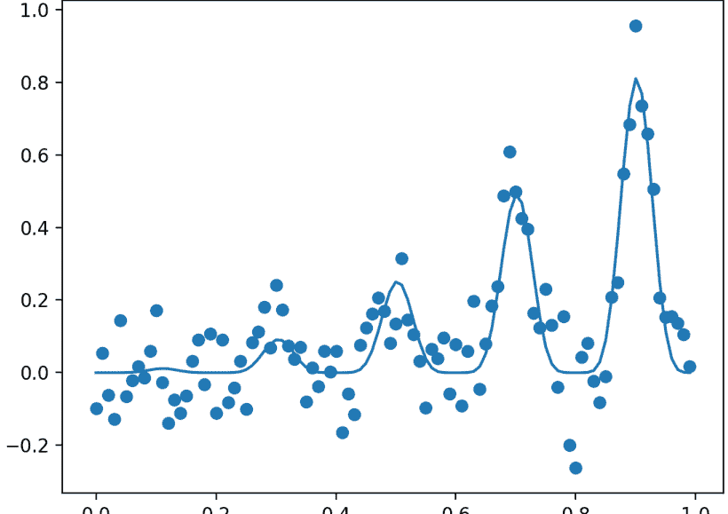

Figure 19.1: 使用噪声（点）和非噪声（线）目标函数评估的输入样本图。

现在我们有了测试问题，让我们回顾如何训练代理函数。

### 19.4.2 代理函数

代理函数是一种用于最佳逼近输入示例到输出分数映射的技术。在概率上，它总结了在给定可用数据 ($D$) 的情况下目标函数 ($f$) 的条件概率，或 $P(f|D)$。有多种技术可用于此目的，尽管最流行的方法是将问题视为回归预测建模问题，其中数据代表输入，分数代表模型的输出。这通常最好使用随机森林或高斯过程进行建模。高斯过程（Gaussian Process，GP）是一种在假设多元高斯分布的情况下在变量上构建联合概率分布的模型。因此，它能够高效有效地总结大量函数，并在模型获得更多观测时实现平滑过渡。

这种平滑结构和基于数据的向新函数的平滑过渡是我们采样域时期望的属性，而模型的基于多元高斯的基础意味着模型的估计将是具有标准差的分布的均值；这将在后期的采集函数中有所帮助。因此，使用 GP 回归模型通常是首选。

我们可以使用来自输入样本 ($X$) 和目标函数 ($y$) 的噪声评估的 GaussianProcessRegressor scikit-learn 实现来拟合 GP 回归模型。首先，必须定义模型。定义 GP 模型的一个重要方面是核函数。它根据实际数据观测之间的距离度量控制函数在特定点的形状。可以使用的核函数有很多，其中一些可能对特定数据集提供更好的性能。默认情况下，使用径向基函数（Radial Basis Function，RBF），效果良好。

```python
...
# define the model
model = GaussianProcessRegressor()
```

Listing 19.9: 示例：定义高斯过程模型。

定义后，模型可以通过调用 `fit()` 函数直接在训练数据集上拟合。定义的模型可以在任何时候通过对 `fit()` 的另一次调用，使用更新的数据附加到现有数据上再次拟合。

```python
...
# fit the model
model.fit(X, y)
```

Listing 19.10: 示例：拟合高斯过程模型。

模型将估计为其提供的一个或多个样本的成本。通过调用 `predict()` 函数使用模型。给定样本的结果将是该点分布的均值。我们还可以通过指定参数 `return_std=True` 来获取函数中该点分布的标准差；例如：

```python
...
yhat = model.predict(X, return_std=True)
```

Listing 19.11: 示例：使用高斯过程模型进行预测。

如果我们在感兴趣采样的给定点处分布很薄，该函数可能会产生警告。因此，我们可以在进行预测时静默所有警告。下面的 `surrogate()` 函数接收已拟合的模型和一个或多个样本，并返回估计的均值和标准差成本，同时不打印任何警告。

```python
# surrogate or approximation for the objective function
def surrogate(model, X):
    # catch any warning generated when making a prediction
    with catch_warnings():
        # ignore generated warnings
        simplefilter("ignore")
        return model.predict(X, return_std=True)
```

Listing 19.12: 示例：用于逼近目标函数的代理函数。

我们可以在任何时候调用此函数来估计一个或多个样本的成本，例如在下一节中我们想要优化采集函数时。目前，有趣的是看看代理函数在随机样本训练后在整个域上的表现。我们可以通过首先在 100 个数据点的随机样本及其带噪声的真实目标函数值上拟合 GP 模型来实现这一点。然后我们可以绘制这些点的散点图。接下来，我们可以在输入域上进行基于网格的采样并估计

使用代理函数计算每个点的成本并将结果绘制为一条线。我们期望代理函数对真实的无噪声目标函数具有粗略的近似。下面给出的 `plot()` 函数会根据真实噪声目标函数的随机数据样本和拟合模型创建此图。

```python
# plot real observations vs surrogate function
def plot(X, y, model):
    # scatter plot of inputs and real objective function
    pyplot.scatter(X, y)
    # line plot of surrogate function across domain
    Xsamples = asarray(arange(0, 1, 0.001))
    Xsamples = Xsamples.reshape(len(Xsamples), 1)
    ysamples, _ = surrogate(model, Xsamples)
    pyplot.plot(Xsamples, ysamples)
    # show the plot
    pyplot.show()
```

列表 19.13：绘制输入样本真实值与代理评估的函数示例。

将这些内容结合起来，拟合高斯过程回归模型于噪声样本并绘制样本与代理函数的完整示例如下所示。

```python
# example of a gaussian process surrogate function
from math import sin
from math import pi
from numpy import arange
from numpy import asarray
from numpy.random import normal
from numpy.random import random
from matplotlib import pyplot
from warnings import catch_warnings
from warnings import simplefilter
from sklearn.gaussian_process import GaussianProcessRegressor

# objective function
def objective(x, noise=0.1):
    noise = normal(loc=0, scale=noise)
    return (x**2 * sin(5 * pi * x)**6.0) + noise

# surrogate or approximation for the objective function
def surrogate(model, X):
    # catch any warning generated when making a prediction
    with catch_warnings():
        # ignore generated warnings
        simplefilter("ignore")
        return model.predict(X, return_std=True)

# plot real observations vs surrogate function
def plot(X, y, model):
    # scatter plot of inputs and real objective function
    pyplot.scatter(X, y)
    # line plot of surrogate function across domain
    Xsamples = asarray(arange(0, 1, 0.001))
    Xsamples = Xsamples.reshape(len(Xsamples), 1)
    ysamples, _ = surrogate(model, Xsamples)
    pyplot.plot(Xsamples, ysamples)
```

### 19.4.4 完整的贝叶斯优化算法

我们可以将所有这些整合到贝叶斯优化算法中。主要算法涉及循环选择候选样本、用目标函数对其进行评估，然后更新 GP 模型。

```python
...
# perform the optimization process
for i in range(100):
    # select the next point to sample
    x = opt_acquisition(X, y, model)
    # sample the point
    actual = objective(x)
    # summarize the finding for our own reporting
    est, _ = surrogate(model, [[x]])
    print('x=%.3f, f()=%.3f, actual=%.3f' % (x, est, actual))
    # add the data to the dataset
    X = vstack((X, [[x]]))
    y = vstack((y, [[actual]]))
    # update the model
    model.fit(X, y)
```

列表 19.17：贝叶斯优化算法循环的示例。

完整示例如下所示。

```python
# example of bayesian optimization for a 1d function from scratch
from math import sin
from math import pi
from numpy import arange
from numpy import vstack
from numpy import argmax
from numpy import asarray
from numpy.random import normal
from numpy.random import random
from scipy.stats import norm
from sklearn.gaussian_process import GaussianProcessRegressor
from warnings import catch_warnings
from warnings import simplefilter
from matplotlib import pyplot

# objective function
def objective(x, noise=0.1):
    noise = normal(loc=0, scale=noise)
    return (x**2 * sin(5 * pi * x)**6.0) + noise

# surrogate or approximation for the objective function
def surrogate(model, X):
    # catch any warning generated when making a prediction
    with catch_warnings():
        # ignore generated warnings
        simplefilter("ignore")
        return model.predict(X, return_std=True)

# probability of improvement acquisition function
def acquisition(X, Xsamples, model):
    # calculate the best surrogate score found so far
    yhat, _ = surrogate(model, X)
    best = max(yhat)
    # calculate mean and stdev via surrogate function
    mu, std = surrogate(model, Xsamples)
    mu = mu[:, 0]
    # calculate the probability of improvement
    probs = norm.cdf((mu - best) / (std+1E-9))
    return probs

# optimize the acquisition function
def opt_acquisition(X, y, model):
    # random search, generate random samples
    Xsamples = random(100)
    Xsamples = Xsamples.reshape(len(Xsamples), 1)
    # calculate the acquisition function for each sample
    scores = acquisition(X, Xsamples, model)
    # locate the index of the largest scores
    ix = argmax(scores)
    return Xsamples[ix, 0]

# plot real observations vs surrogate function
def plot(X, y, model):
    # scatter plot of inputs and real objective function
    pyplot.scatter(X, y)
    # line plot of surrogate function across domain
    Xsamples = asarray(arange(0, 1, 0.001))
    Xsamples = Xsamples.reshape(len(Xsamples), 1)
    ysamples, _ = surrogate(model, Xsamples)
    pyplot.plot(Xsamples, ysamples)
    # show the plot
    pyplot.show()

# sample the domain sparsely with noise
X = random(100)
y = asarray([objective(x) for x in X])
# reshape into rows and cols
X = X.reshape(len(X), 1)
y = y.reshape(len(y), 1)
# define the model
model = GaussianProcessRegressor()
# fit the model
model.fit(X, y)
# plot before hand
plot(X, y, model)
# perform the optimization process
for i in range(100):
    # select the next point to sample
    x = opt_acquisition(X, y, model)
    # sample the point
    actual = objective(x)
    # summarize the finding
    est, _ = surrogate(model, [[x]])
    print('>x=%.3f, f()=%.3f, actual=%.3f' % (x, est, actual))
    # add the data to the dataset
    X = vstack((X, [[x]]))
    y = vstack((y, [[actual]]))
    # update the model
    model.fit(X, y)

# plot all samples and the final surrogate function
plot(X, y, model)
# best result
ix = argmax(y)
print('Best Result: x=%.3f, y=%.3f' % (X[ix], y[ix]))
```

列表 19.18：从零开始的贝叶斯优化示例。

运行示例首先创建搜索空间的初始随机样本并评估结果。然后在此数据上拟合 GP 模型。由于域采样的随机性，你的具体结果会有所不同。请尝试多次运行示例。会生成一个图，显示原始观测值作为点，以及整个域上的代理函数。在本例中，初始样本在域上分布良好，且代理函数倾向于我们已知最优值所在的部分。

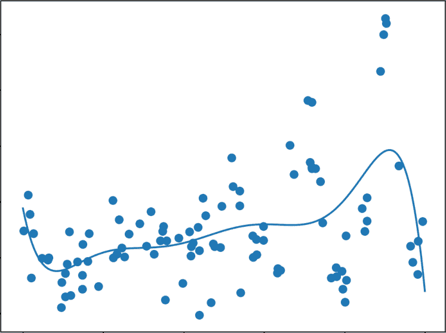

图 19.3：域上初始样本（点）和代理函数（线）的图。

然后算法迭代 100 次循环，反复选择样本、对其进行评估并将其添加到数据集中以更新代理函数。每个循环都会报告所选输入值、代理函数估计的分数以及实际分数。

理想情况下，随着算法在搜索空间的一个区域收敛，这些分数会越来越接近。

```
...
>x=0.922, f()=0.661501, actual=0.682
>x=0.895, f()=0.661668, actual=0.905
>x=0.928, f()=0.648008, actual=0.403
>x=0.908, f()=0.674864, actual=0.750
>x=0.436, f()=0.071377, actual=-0.115
```

列表 19.19：从零开始运行贝叶斯优化算法的示例输出。

接下来，使用与之前相同的形式创建最终图。这次绘制了优化任务期间评估的所有 200 个样本。我们期望在已知最优值周围出现过多的采样，这正是我们看到的情况，0.9 附近有很多点。我们还看到代理函数对底层目标域的表示更强。

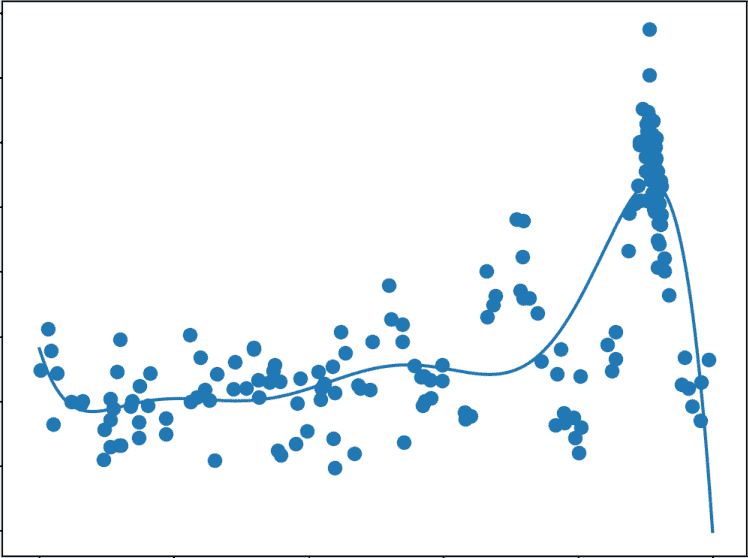

图 19.4：贝叶斯优化后域上所有样本（点）和代理函数（线）的图。

最后，报告最佳输入及其目标函数分数。我们知道如果没有采样噪声，最优值的输入为 0.9，输出为 0.810。鉴于采样噪声，在本例中优化算法接近该值，建议输入为 0.905。

```
Best Result: x=0.905, y=1.150
```


Listing 19.20: 从头运行贝叶斯优化算法的示例最终输出。

## 19.5 使用贝叶斯优化进行超参数调优

实现贝叶斯优化以了解其工作原理可能是一个有用的练习。在实际项目中使用贝叶斯优化时，使用开源库提供的标准实现是一个好主意。这样既可以避免错误，又可以利用更广泛的配置选项和速度改进。贝叶斯优化的两个流行库包括 Scikit-Optimize 和 HyperOpt。在机器学习中，这些库通常用于调整算法的超参数。超参数调优非常适合贝叶斯优化，因为评估函数计算成本高（例如为每组超参数训练模型）且存在噪声（例如训练数据中的噪声和随机学习算法）。

在本节中，我们将简要介绍如何使用 Scikit-Optimize 库为一个简单的测试分类问题优化 k 近邻分类器的超参数。这将提供一个有用的模板，可供您在自己的项目中使用。Scikit-Optimize 项目旨在为使用 SciPy 和 NumPy 的应用程序或使用 scikit-learn 机器学习算法的应用程序提供贝叶斯优化访问。首先，必须安装该库，这可以使用 pip 轻松实现；例如：

```bash
sudo pip install scikit-optimize
```

Listing 19.21: 安装 scikit-optimize 库的示例。

假设您已为此示例安装了 scikit-learn。安装后，scikit-optimize 有两种方式可用于优化 scikit-learn 算法的超参数。第一种是直接在搜索空间上执行优化，第二种是使用 BayesSearchCV 类，它是 scikit-learn 用于随机和网格搜索的原生类的同类。在本示例中，我们将使用更简单的直接优化超参数的方法。第一步是准备数据并定义模型。我们将通过 make_blobs() 函数使用一个简单的测试分类问题，其中包含 500 个示例，每个示例有两个特征和三个类别标签。然后我们将使用 KNeighborsClassifier 算法。

```python
...
# generate 2d classification dataset
X, y = make_blobs(n_samples=500, centers=3, n_features=2)
# define the model
model = KNeighborsClassifier()
```

Listing 19.22: 定义测试问题和基础分类器的示例。

接下来，我们必须定义搜索空间。在本例中，我们将调整邻居数量 (n_neighbors) 和邻域函数的形状 (p)。这需要为给定数据类型定义范围。在本例中，它们是 Integers，使用最小值、最大值以及传递给 scikit-learn 模型的参数名称定义。对于您的算法，您同样可以轻松优化 Real() 和 Categorical() 数据类型。

```python
...
# define the space of hyperparameters to search
search_space = [Integer(1, 5, name='n_neighbors'), Integer(1, 2, name='p')]
```

Listing 19.23: 定义超参数搜索空间的示例。

接下来，我们需要定义一个函数来评估给定的超参数集。我们希望最小化此函数，因此返回的较小值必须表示模型性能更好。我们可以在函数定义上使用 scikit-optimize 项目中的 `use_named_args()` 装饰器，该装饰器允许函数直接使用来自搜索空间的特定参数集调用。因此，我们的自定义函数将以超参数值作为参数，这些参数可以直接提供给模型以配置它。我们可以使用函数的 `**params` 参数在 Python 中以通用方式定义这些参数，然后通过 `set_params(**params)` 函数将它们传递给模型。

现在模型已配置好，我们可以对其进行评估。在本例中，我们将对数据集使用 5 折交叉验证并评估每个折的准确率。然后我们可以将模型的性能报告为这些折的平均准确率的 1 减去。这意味着准确率为 1.0 的完美模型将返回 0.0（1.0 − 平均准确率）。在加载数据集并定义模型后定义此函数，以便数据集和模型都在作用域内并可直接使用。

```python
# define the function used to evaluate a given configuration
@use_named_args(search_space)
def evaluate_model(**params):
    # something
    model.set_params(**params)
    # calculate 5-fold cross-validation
    result = cross_val_score(model, X, y, cv=5, n_jobs=-1, scoring='accuracy')
    # calculate the mean of the scores
    estimate = mean(result)
    return 1.0 - estimate
```

Listing 19.24: 用于评估一组模型超参数的函数的示例。

接下来，我们可以执行优化。这是通过使用目标函数名称和定义的搜索空间调用 `gp_minimize()` 函数实现的。默认情况下，此函数将使用尝试找出最佳策略的 gp_hedge 采集函数，但这可以通过 `acq_func` 参数进行配置。优化默认将运行 100 次迭代，但这可以通过 `n_calls` 参数控制。

```python
...
# perform optimization
result = gp_minimize(evaluate_model, search_space)
```

Listing 19.25: 运行贝叶斯优化的示例。

运行后，我们可以通过 `fun` 属性访问最佳分数，并通过 `x` 数组属性访问最佳超参数集。

```python
...
# summarizing findings:
print('Best Accuracy: %.3f' % (1.0 - result.fun))
print('Best Parameters: n_neighbors=%d, p=%d' % (result.x[0], result.x[1]))
```

Listing 19.26: 汇总贝叶斯优化结果的示例。

将所有内容整合在一起，完整的示例如下所示。

```python
# example of bayesian optimization with scikit-optimize
from numpy import mean
from sklearn.datasets import make_blobs
from sklearn.model_selection import cross_val_score
from sklearn.neighbors import KNeighborsClassifier
from skopt.space import Integer
from skopt.utils import use_named_args
from skopt import gp_minimize

# generate 2d classification dataset
X, y = make_blobs(n_samples=500, centers=3, n_features=2)
# define the model
model = KNeighborsClassifier()
# define the space of hyperparameters to search
search_space = [Integer(1, 5, name='n_neighbors'), Integer(1, 2, name='p')]

# define the function used to evaluate a given configuration
@use_named_args(search_space)
def evaluate_model(**params):
    # something
    model.set_params(**params)
    # calculate 5-fold cross validation
    result = cross_val_score(model, X, y, cv=5, n_jobs=-1, scoring='accuracy')
    # calculate the mean of the scores
    estimate = mean(result)
    return 1.0 - estimate

# perform optimization
result = gp_minimize(evaluate_model, search_space)
# summarizing finding:
print('Best Accuracy: %.3f' % (1.0 - result.fun))
print('Best Parameters: n_neighbors=%d, p=%d' % (result.x[0], result.x[1]))
```

Listing 19.27: 模型超参数贝叶斯优化的示例。

运行示例将使用贝叶斯优化执行超参数调优。代码可能会报告许多警告消息，例如：

```
UserWarning: The objective has been evaluated at this point before.
```

Listing 19.28: 可能的警告消息示例。

这是预期的，是由于相同的超参数配置被评估多次造成的。鉴于测试问题的随机性，您的具体结果会有所不同。尝试多次运行示例。在本例中，模型通过平均 5 折交叉验证实现了约 97% 的准确率，邻居数为 3，p 邻域形状值为 2。

```
Best Accuracy: 0.976
Best Parameters: n_neighbors=3, p=2
```

Listing 19.29: 在模型超参数上运行贝叶斯优化的最终结果示例。


## 19.6 进一步阅读

本节提供了更多关于该主题的资源，如果您想深入了解。

### 19.6.1 论文

- *关于昂贵成本函数贝叶斯优化的教程，应用于主动用户建模和分层强化学习*, 2010.  
  https://arxiv.org/abs/1012.2599
- *机器学习算法的实用贝叶斯优化*, 2012.  
  http://papers.nips.cc/paper/4522-practical-bayesian-optimization
- *贝叶斯优化教程*, 2018.  
  https://arxiv.org/abs/1807.02811

### 19.6.2 API

- 高斯过程，Scikit-Learn API。  
  https://scikit-learn.org/stable/modules/gaussian_process.html
- Hyperopt：分布式异步超参数优化。  
  https://github.com/hyperopt/hyperopt
- Scikit-Optimize 项目。  
  https://github.com/scikit-optimize/scikit-optimize

### 19.6.3 文章

- 全局优化，维基百科。  
  https://en.wikipedia.org/wiki/Global_optimization
- 贝叶斯优化，维基百科。  
  https://en.wikipedia.org/wiki/Bayesian_optimization

## 19.7 摘要

在本教程中，您发现了用于复杂优化问题有向搜索的贝叶斯优化。具体来说，您学习了：

- 全局优化是一个具有挑战性的问题，涉及黑盒且通常是非凸、非线性、噪声大且计算成本高的目标函数。
- 贝叶斯优化为全局优化提供了一种概率上合理的方法。
- 如何从头实现贝叶斯优化以及如何使用开源实现。

### 19.7.1 下一步

在下一教程中，您将发现贝叶斯信念网络。

## 第 20 章

# 贝叶斯信念网络

概率模型可以定义变量之间的关系并用于计算概率。例如，完全条件模型可能需要大量数据来覆盖所有可能情况，并且在实践中概率可能难以计算。诸如所有随机变量的条件独立性之类的简化假设可能是有效的，例如在朴素贝叶斯的情况下，尽管这是一个极大的简化步骤。另一种选择是开发一个模型，该模型保留随机变量之间的已知条件依赖关系，并在所有其他情况下保持条件独立性。贝叶斯网络是一种概率图模型，它通过图模型中的有向边明确捕获已知的条件依赖关系。所有缺失的连接定义了模型中的条件独立性。因此，贝叶斯网络提供了一种有用的工具来可视化域的概率模型，回顾随机变量之间的所有关系，并根据可用证据对场景的因果概率进行推理。在本教程中，您将发现贝叶斯网络的温和介绍。阅读本教程后，您将知道：

- 贝叶斯网络是一种由节点和有向边组成的概率图模型类型。
- 贝叶斯网络模型捕获随机变量之间条件依赖和条件独立的关系。
- 模型可以由专家准备或从数据中学习，然后用于推理以估计因果或后续事件的概率。

让我们开始吧。

## 20.1 教程概述

本教程分为五个部分；它们是：

1. 概率建模的挑战
2. 贝叶斯信念网络作为概率模型
3. 如何开发和使用贝叶斯网络
4. 贝叶斯网络的示例
5. Python 中的贝叶斯网络

## 20.2 概率建模的挑战

概率模型可能具有挑战性来设计和使用。最常见的是，问题在于缺乏有关域的信息来完全指定随机变量之间的条件依赖关系。如果可用，计算事件的完整条件概率可能是不可行的。解决这一挑战的常见方法是添加一些简化假设，例如假设模型中的所有随机变量都是条件独立的。这是一个激进的假设，尽管在实践中证明是有用的，为朴素贝叶斯分类算法提供了基础。

另一种方法是开发具有一些条件独立性假设的问题的概率模型。这提供了一种介于完全条件模型和完全条件独立模型之间的中间方法。贝叶斯信念网络是一些变量条件独立的概率模型的一个例子。

> 贝叶斯信念网络提供了一种中间方法，其限制性小于朴素贝叶斯分类器所做的条件独立性的全局假设，但比完全避免条件独立性假设更易处理。
>
> — 第 184 页，*Machine Learning*，1997。

## 20.3 贝叶斯信念网络作为概率模型

贝叶斯信念网络是一种概率图模型类型。

### 20.3.1 概率图模型

概率图模型 PGM，或简称为 *图模型*，是使用图结构表示概率模型的一种方式。图中的节点表示随机变量，连接节点的边表示随机变量之间的关系。

> 图由节点（也称为顶点）通过链接（也称为边或弧）连接而成。在概率图模型中，每个节点代表一个随机变量（或一组随机变量），而链接表达这些变量之间的概率关系。
>
> — 第 360 页，*Pattern Recognition and Machine Learning*，2006。

- **节点：** 图模型中的随机变量。
- **边：** 图模型中随机变量之间的关系。

有许多不同类型的图模型，尽管最常描述的两种是隐马尔可夫模型和贝叶斯网络。隐马尔可夫模型 HMM 是一种图边无向的图模型，这意味着图包含循环。贝叶斯网络更具限制性，其中图的边是有向的，这意味着它们只能单向导航。这意味着循环是不可能的，并且结构可以更一般地称为有向无环图 DAG。

有向图对于表达随机变量之间的因果关系很有用，而无向图更适合表达随机变量之间的软约束。

> — 第 360 页，*Pattern Recognition and Machine Learning*，2006。

### 20.3.2 贝叶斯信念网络

贝叶斯信念网络，或简称为 *贝叶斯网络*，提供了一种将贝叶斯定理应用于复杂问题的方法。网络按定义并不完全是贝叶斯，尽管鉴于随机变量（节点）的概率分布和随机变量（边）之间的关系都主观指定，模型可以被认为捕获了对复杂域的 *信念*。贝叶斯概率是对结果的主观概率或信念的研究，与频率学派方法相比，后者纯粹基于事件的过去发生概率。贝叶斯网络捕获模型表示的事件的联合概率。

贝叶斯信念网络描述了一组变量的联合概率分布。

> — 第 185 页，*Machine Learning*，1997。

贝叶斯网络的核心概念是条件独立性。独立性是指不受所有其他变量影响的随机变量。依赖变量是其概率取决于一个或多个其他随机变量的随机变量。条件独立性描述了多个随机变量之间的关系，其中给定变量可能与一个或多个其他随机变量条件独立。这并不意味着变量本身是独立的；相反，它明确定义了变量与特定其他已知随机变量独立。

概率图模型，例如贝叶斯网络，提供了一种通过陈述已知变量的所有条件独立性假设来为复杂问题定义概率模型的方法，同时允许未知（潜在）变量的存在。因此，图模型中边的存在和缺失在模型解释中都很重要。

图模型 GM 是一种通过做出 [条件独立性] CI 假设来表示联合分布的方法。特别是，图中的节点表示随机变量，而（缺乏）边表示 CI 假设。（这些模型的更好名称实际上是“独立性图”...

> — 第 308 页，*Machine Learning: A Probabilistic Perspective*，2012。

贝叶斯网络作为概率模型提供了有用的好处。例如：

- **可视化。** 模型提供了一种直接可视化模型结构并激发新模型设计的方法。
- **关系。** 提供对随机变量之间关系存在与否的见解。
- **计算。** 提供一种结构化复杂概率计算的方法。


## 20.4 如何开发和使用贝叶斯网络

设计一个贝叶斯网络至少需要定义三件事：随机变量。问题中的随机变量是什么？条件关系。变量之间的条件关系是什么？概率分布。每个变量的概率分布是什么？问题领域的专家也许能在模型设计中指定部分或全部这些方面。在许多情况下，图形模型的架构或拓扑结构可以由专家指定，但概率分布必须从领域数据中估计。

概率分布和图结构本身都可以从数据中估计，尽管这可能是一个有挑战性的过程。因此，通常使用学习算法来完成这一任务；例如，假设连续随机变量服从高斯分布，并使用梯度上升来估计分布参数。一旦为某个领域准备好贝叶斯网络，它就可以用于推理，例如做出决策。推理是通过针对给定情景的模型推断来实现的。例如，某些事件的结果已知，并被填入随机变量。模型可用于估计事件原因的概率或可能的后续结果。

推理（推断）随后通过引入将变量设置为已知状态的证据，并在此证据条件下计算感兴趣的概率来执行。

> — 第13页，*贝叶斯推理与机器学习*，2012年。

在实际中使用贝叶斯网络的例子包括医学（症状与疾病）、生物信息学（特征与基因）和语音识别（话语与时间）。

## 20.5 贝叶斯网络示例

我们可以通过一个小例子来具体说明贝叶斯网络。考虑一个有三个随机变量的问题：A、B和C。A依赖于B，C依赖于B。我们可以将条件依赖陈述如下：

- A条件依赖于B，例如 P(A|B)
- C条件依赖于B，例如 P(C|B)

我们知道C和A彼此没有影响。我们还可以将条件独立陈述如下：

- A与C条件独立：P(A|B,C)
- C与A条件独立：P(C|B,A)

注意，条件依赖是在条件独立的语境下陈述的。也就是说，A与C条件独立，或者A在存在C的情况下条件依赖于B。我们也可以将A在给定C时的条件独立表述为$A$在给定$B$时的条件依赖，因为$A$不受$C$影响，可以仅由给定$B$的$A$计算得出。

$$P(A|C,B)=P(A|B)$$

我们可以看到，$B$不受$A$和$C$影响，且没有依赖关系或父节点；我们可以简单地将$B$与$A$和$C$的条件独立表示为$P(B, P(A|B), P(C|B))$或$P(B)$。我们也可以写出$A$和$C$在给定$B$或基于$B$的条件下的联合概率，作为两个条件概率的乘积，例如：

$$P(A,C|B)=P(A|B)\times P(C|B)$$

该模型概括了$P(A,B,C)$的联合概率，计算如下：

$$P(A,B,C)=P(A|B)\times P(C|B)\times P(B)$$

我们可以画出如下图形：

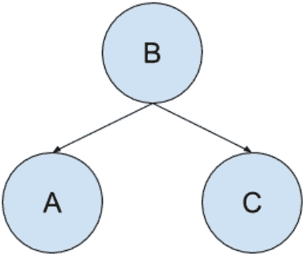

图20.1：一个简单贝叶斯网络的示例。

注意，每个随机变量都被分配到一个节点，条件概率被表示为节点之间的有向连接。还要注意，不可能沿着图中的路径形成环路，例如，在通过边从一个节点导航到另一个节点时不可能出现循环。还要注意，即使在我们还不知道变量的概率分布时，该图形也是有用的。你也许想通过为每个随机变量的离散事件设定一些人造概率来扩展这个例子，并针对不同情景练习一些简单的推断。

## 20.6 Python中的贝叶斯网络

贝叶斯网络可以在Python中开发并用于推断。一个常用的库叫作PyMC，它提供了一系列用于贝叶斯建模的工具，包括像贝叶斯网络这样的图形模型。该库的最新版本名为PyMC3，因Python 3而得名，它是在Theano数学计算库之上开发的，该库提供快速的自动微分。

PyMC3是一个用Python编写的新开源概率编程框架，它使用Theano通过自动微分计算梯度，并即时将概率程序编译为C以提高速度。

> — *使用PyMC3的Python概率编程*，2016年。

更一般地说，在用于推断的计算机软件中使用概率图模型被称为*概率编程*。

这种编程类型被称为概率编程，[...] 之所以说是概率性的，是因为我们使用编程变量作为模型组件来创建概率模型。模型组件是PyMC框架中的一等原语。

> — *黑客的贝叶斯方法：概率编程与贝叶斯推断*，2015年。

## 20.7 延伸阅读

如果你想深入了解，本节提供更多相关资源。

### 20.7.1 书籍

- *贝叶斯推理与机器学习*，2012年。
  https://amzn.to/2YoHbgV
- *黑客的贝叶斯方法：概率编程与贝叶斯推断*，2015年。
  https://amzn.to/2Khk3bq

### 20.7.2 书籍章节

- 第6章：贝叶斯学习，*机器学习*，1997年。
  https://amzn.to/2jWd51p
- 第8章：图形模型，*模式识别与机器学习*，2006年。
  https://amzn.to/2JwHE7I
- 第10章：有向图形模型（贝叶斯网络），*机器学习：概率视角*，2012年。
  https://amzn.to/2xKSTCP
- 第14章：概率推理，*人工智能：一种现代方法*，第3版，2009年。
  https://amzn.to/2Y7yCp0

### 20.7.3 论文

- *使用PyMC3的Python概率编程*，2016年。
  https://peerj.com/articles/cs-55/

### 20.7.4 代码

- PyMC3，Python中的概率编程。
  https://docs.pymc.io/
- 变分推断：贝叶斯神经网络
  https://docs.pymc.io/notebooks/bayesian_neural_network_advi.html

### 20.7.5 文章

- 图模型，维基百科。
  https://en.wikipedia.org/wiki/Graphical_model
- 隐马尔可夫模型，维基百科。
  https://en.wikipedia.org/wiki/Hidden_Markov_model
- 贝叶斯网络，维基百科。
  https://en.wikipedia.org/wiki/Bayesian_network
- 条件独立，维基百科。
  https://en.wikipedia.org/wiki/Conditional_independence

## 20.8 总结

在本教程中，你了解了贝叶斯网络的入门介绍。具体来说，你学到了：

- 贝叶斯网络是一种由节点和有向边组成的概率图模型。
- 贝叶斯网络模型捕获随机变量之间的条件依赖和条件独立关系。
- 模型可以由专家准备或从数据中学习，然后用于推断，以估计原因事件或后续事件的概率。

### 20.8.1 下一步

这是本部分的最后一个教程。在下一部分中，你将发现信息论领域的重要概率工具。

## 第七部分：信息论

## 第21章：信息熵

信息论是数学的一个子领域，关注在噪声信道中传输数据。信息论的一个基石是量化消息中有多少信息的思想。更一般地，这可以用于量化事件和随机变量中的信息，称为熵，并使用概率进行计算。计算信息和熵是机器学习中的一个有用工具，并用作特征选择、构建决策树以及更一般地拟合分类模型等技术的基础。因此，机器学习从业者需要对信息和熵有深刻的理解和直觉。在本教程中，你将发现信息熵的入门介绍。阅读完本教程后，你将知道：

- 信息论关注数据压缩和传输，建立在概率之上，并支持机器学习。
- 信息提供了一种用比特衡量事件意外程度的方法。
- 熵衡量了表示从随机变量的概率分布中抽取的事件所需的平均信息量。

让我们开始吧。

### 21.1 教程概述

本教程分为三个部分；它们是：

- 1. 什么是信息论？
- 2. 计算事件的信息
- 3. 计算随机变量的信息


## 21.2 什么是信息论？

信息论是研究量化通信中信息的学科。它是数学的一个分支，研究数据压缩和信号处理极限等主题。该领域由克劳德·香农在美国电话公司贝尔实验室工作时提出并发展。

> 信息论关注以紧凑形式表示数据（称为数据压缩或源编码的任务），以及以对错误具有鲁棒性的方式传输和存储数据（称为错误校正或信道编码的任务）。
>
> — 第56页，*机器学习：概率视角*，2012。

信息论的一个基础概念是对事件、随机变量和分布等事物中信息量的量化。量化信息量需要使用概率，因此信息论与概率的关系。信息度量在人工智能和机器学习中被广泛使用，例如在决策树的构建和分类器模型的优化中。因此，信息论与机器学习之间存在重要的关系，实践者必须熟悉该领域的一些基本概念。

> 为什么要统一信息论和机器学习？因为它们是同一枚硬币的两面。[...] 信息论和机器学习仍然属于一起。大脑是终极的压缩和通信系统。而且，数据压缩和纠错码的最先进算法都使用机器学习相同的工具。
>
> — 第 v 页，*信息论、推断与学习算法*，2003。

## 21.3 计算事件的信息量

量化信息是信息论领域的基石。量化信息的直觉是衡量事件中的惊讶程度，即其发生的可能性有多低。那些罕见（低概率）的事件更令人惊讶，因此比那些常见（高概率）的事件具有更多信息。

- **低概率事件：** 高信息量（令人惊讶）。
- **高概率事件：** 低信息量（不令人惊讶）。

> 信息论的基本直觉是，知道一个不太可能发生的事件发生了，比知道一个很可能发生的事件发生了更有信息量。
>
> — 第73页，*深度学习*，2016。

罕见事件更不确定或更令人惊讶，需要比常见事件更多的信息来表示。我们可以使用事件的概率来计算事件中的信息量。这被称为 *香农信息*、*自信息*，或简单地称为 *信息*，对于离散事件 $I(x)$ 可以按如下方式计算：

$$I(x) = -\log(p(x)) \tag{21.1}$$

其中 $I(x)$ 是 $x$ 的信息含量（自信息），$log()$ 是以2为底的对数，$p(x)$ 是事件 $x$ 的概率。选择以2为底的对数意味着信息度量的单位为比特（二进制数字）。这可以在信息处理意义上直接解释为在嘈杂通信信道上表示该事件所需的比特数。信息计算通常写为 $h()$ 以与熵 $H()$（稍后讨论）区分；例如：

$$h(x) = -\log(p(x)) \tag{21.2}$$

负号确保结果始终为正或零。当事件的概率为1.0或确定时，信息量为零，例如没有惊讶。让我们用一些例子来具体说明。考虑一次公平硬币的抛掷。正反面的概率均为0.5。我们可以使用 Python 中的 `log2()` 函数来计算抛到正面的信息量。

```python
# calculate the information for a coin flip
from math import log2
# probability of the event
p = 0.5
# calculate information for event
h = -log2(p)
# print the result
print('p(x)=%.3f, information: %.3f bits' % (p, h))
```

列表 21.1：计算公平硬币翻转的信息量的示例。

运行示例会打印事件的概率为50%和事件的信息含量为1比特。

```text
p(x)=0.500, information: 1.000 bits
```

列表 21.2：计算公平硬币翻转信息量的示例输出。

如果同一枚硬币被抛掷 $n$ 次，则该序列的翻转信息量为 $n$ 比特。如果硬币不公平且正面概率为10%（0.1），则该事件更罕见，需要超过3比特的信息。

```text
p(x)=0.100, information: 3.322 bits
```

列表 21.3：计算有偏硬币翻转信息量的示例输出。

我们还可以探索一次公平六面骰子掷出的信息，例如掷出6的信息。我们知道掷出任何数字的概率是 $\frac{1}{6}$，这比硬币翻转的 $\frac{1}{2}$ 更小，因此我们期望有更多的惊讶或更大的信息量。

```python
# calculate the information for a dice roll
from math import log2
# probability of the event
p = 1.0 / 6.0
# calculate information for event
h = -log2(p)
# print the result
print('p(x)=%.3f, information: %.3f bits' % (p, h))
```

列表 21.4：计算骰子掷出信息量的示例。

运行示例，我们可以看到我们的直觉是正确的，事实上，一次公平骰子的掷出包含超过2.5比特的信息。

```
p(x)=0.167, information: 2.585 bits
```

列表 21.5：计算骰子掷出信息量的示例输出。

也可以使用其他对数而不是以2为底的对数。例如，在计算信息时也常常用自然对数，即以e（欧拉数）为底，在这种情况下，单位称为奈特。

我们可以进一步发展低概率事件具有更多信息的直觉。为了使这一点更清晰，我们可以计算0到1之间的概率的信息量并绘制每个对应的信息量。然后我们可以创建概率与信息量的图。我们期望该图从低概率高信息向下曲线到高概率低信息。完整的示例如下所示。

```python
# compare probability vs information entropy
from math import log2
from matplotlib import pyplot
# list of probabilities
probs = [0.1, 0.2, 0.3, 0.4, 0.5, 0.6, 0.7, 0.8, 0.9, 1.0]
# calculate information
info = [-log2(p) for p in probs]
# plot probability vs information
pyplot.plot(probs, info, marker='.')
pyplot.title('Probability vs Information')
pyplot.xlabel('Probability')
pyplot.ylabel('Information')
pyplot.show()
```

列表 21.6：比较概率和信息的示例。

运行示例会创建以比特为单位的概率与信息量的图。我们可以看到预期的关系，即低概率事件更令人惊讶并携带更多信息，而高概率事件的补集携带的信息较少。我们还可以看到这种关系不是线性的，事实上它是略微次线性的。这在使用对数函数时是有意义的。

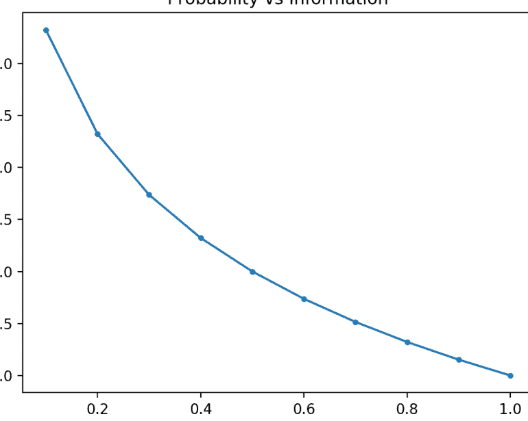

图 21.1：概率与信息量的图。

## 21.4 计算随机变量的信息量

我们也可以量化随机变量中的信息量。例如，如果我们想计算具有概率分布 p 的随机变量 X 的信息量，这可能写成函数 H()；例如：

H(X) (21.3)

实际上，计算随机变量的信息量与计算该随机变量事件的概率分布的信息量相同。计算随机变量的信息量称为信息熵、香农熵或简单地称为熵。它与物理学中的熵概念通过类比相关，因为两者都关注不确定性。熵的直觉是，从随机变量的概率分布中抽取的事件所需表示或传输的平均比特数。

> ... 分布的香农熵是从该分布中抽取的事件的期望信息量。它给出了在平均情况下对来自分布 P 的符号进行编码所需的比特数 [...] 的下界。

— 第74页，Deep Learning，2016。


熵可以对具有 $K$ 个离散状态的随机变量 $X$ 按如下方式计算：

$$H(X) = -\sum_{i=1}^{K} p(k_i) \times \log(p(k_i)) \tag{21.4}$$

即每个事件概率的对数乘以每个事件概率之和的负值。与信息类似，$log()$ 函数使用以 2 为底，单位为比特。也可以使用自然对数，此时单位为奈特。熵的最低值出现在随机变量只有一个事件且概率为 1.0，即确定性的情况。随机变量的熵最大时，所有事件同等可能。我们可以考虑掷一个公平的骰子并计算该变量的熵。每个结果的概率均为 $\frac{1}{6}$，因此它是一个均匀概率分布。因此我们预期平均信息与上一节中计算的单个事件的信息相同。

```python
# calculate the entropy for a dice roll
from math import log2
# the number of events
n = 6
# probability of one event
p = 1.0/n
# calculate entropy
entropy = -sum([p * log2(p) for _ in range(n)])
# print the result
print('entropy: %.3f bits' % entropy)
```

列表 21.7：计算掷骰子熵的示例。

运行该示例计算出的熵超过 2.5 比特，与单个结果的信息相同。这是有意义的，因为平均信息与信息下界相同，因为所有结果同等可能。

```text
entropy: 2.585 bits
```

列表 21.8：计算掷骰子熵的示例输出。

如果我们知道每个事件的概率，可以使用 `entropy()` SciPy 函数直接计算熵。例如：

```python
# calculate the entropy for a dice roll
from scipy.stats import entropy
# discrete probabilities
p = [1/6, 1/6, 1/6, 1/6, 1/6, 1/6]
# calculate entropy
e = entropy(p, base=2)
# print the result
print('entropy: %.3f bits' % e)
```

列表 21.9：使用 SciPy 计算掷骰子熵的示例。

运行该示例报告的结果与我们手动计算的结果相同。

```text
entropy: 2.585 bits
```

列表 21.10：使用 SciPy 计算掷骰子熵的示例输出。

我们可以进一步发展对概率分布熵的直觉。回想一下，熵是从分布中随机抽取一个事件所需的比特数，例如平均事件。我们可以对一个具有两个事件的简单分布进行探索，例如抛硬币，但探索这两个事件的不同概率并计算每个事件的熵。

在一个事件占主导的情况下，例如偏斜的概率分布，则惊讶度更低，分布的熵会更低。在没有一个事件主导另一个事件的情况下，例如相等或近似相等的概率分布，则我们预期熵更大或最大。

- **偏斜概率分布** (*不出人意料*): 熵低。
- **平衡概率分布** (*令人惊讶*): 熵高。

如果我们从偏斜过渡到分布中事件概率相等，我们预期熵会从低开始增加，具体来说从不可能/确定性事件（概率分别为 0 和 1）的最低熵 0.0 增加到等概率事件的最大熵 1.0。下面的示例实现了这一点，在此过渡中创建每个概率分布，计算每个分布的熵并绘制结果。

```
# compare probability distributions vs entropy
from math import log2
from matplotlib import pyplot

# calculate entropy
def entropy(events, ets=1e-15):
    return -sum([p * log2(p + ets) for p in events])

# define probabilities
probs = [0.0, 0.1, 0.2, 0.3, 0.4, 0.5]
# create probability distribution
dists = [[p, 1.0 - p] for p in probs]
# calculate entropy for each distribution
ents = [entropy(d) for d in dists]
# plot probability distribution vs entropy
pyplot.plot(probs, ents, marker='.')
pyplot.title('Probability Distribution vs Entropy')
pyplot.xticks(probs, [str(d) for d in dists])
pyplot.xlabel('Probability Distribution')
pyplot.ylabel('Entropy (bits)')
pyplot.show()
```

列表 21.11：计算概率分布与熵的示例。

运行该示例创建了 6 个概率分布，从 [0,1] 概率到 [0.5,0.5] 概率。如预期，我们可以看到随着事件分布从偏斜变为平衡，熵从最小值增加到最大值。也就是说，如果从概率分布中抽取的平均事件不出人意料，我们得到较低的熵，而如果令人惊讶，则得到较大的熵。

我们可以看到这种转变不是线性的，而是超线性的。我们还可以看到，如果我们继续将转变扩展到两个事件的 [0.6, 0.4] 并继续到 [1.0, 0.0]，该曲线是对称的，形成倒置的抛物线形状。请注意，在计算熵时我们必须在概率中添加一个极小值，以避免计算零值的对数，这会导致无穷大或非数字。

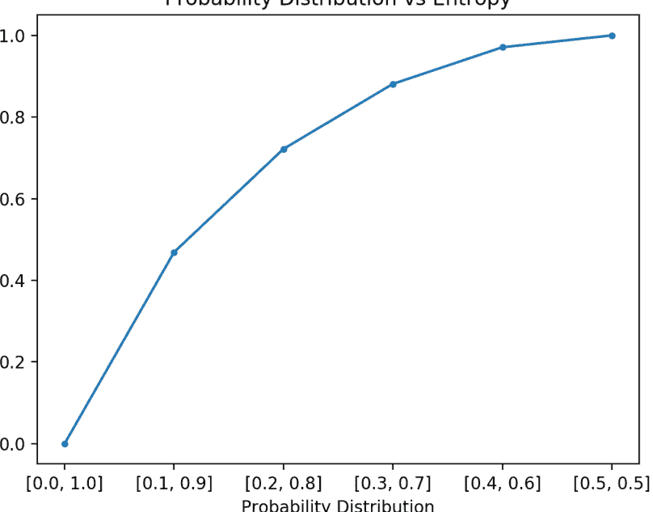

图 21.2：概率分布与熵的图。

计算随机变量的熵为其他度量提供了基础，例如互信息（信息增益）。它还为使用交叉熵和 KL 散度计算两个概率分布之间的差异提供了基础。

## 21.5 延伸阅读

本节提供了更多资源，如果您想深入了解该主题。

### 21.5.1 书籍

- *信息论、推断与学习算法*, 2003.
  https://amzn.to/2KfDDF7

### 21.5.2 章节

- 第 2.8 节：信息论, *机器学习：概率视角*, 2012.
  https://amzn.to/2xKSTCP

- 第 1.6 节：信息论, *模式识别与机器学习*, 2006.
  https://amzn.to/2JwHE7I

- 第 3.13 节 信息论, *深度学习*, 2016.
  https://amzn.to/2lnc3vL

### 21.5.3 API

- `scipy.stats.entropy` API
  https://docs.scipy.org/doc/scipy/reference/generated/scipy.stats.entropy.html

### 21.5.4 文章

- 熵（信息论），维基百科。
  https://en.wikipedia.org/wiki/Entropy_(information_theory)
- 决策树中的信息增益，维基百科。
  https://en.wikipedia.org/wiki/Information_gain_in_decision_trees
- 信息增益比，维基百科。
  https://en.wikipedia.org/wiki/Information_gain_ratio

## 21.6 摘要

在本教程中，您了解了信息熵的温和介绍。具体来说，您学习了：

- 信息论关注数据压缩和传输，建立在概率之上并支持机器学习。
- 信息提供了一种量化事件惊讶程度的方法，以比特为单位进行衡量。
- 熵提供了表示从随机变量的概率分布中抽取的事件所需的平均信息量的度量。

### 21.6.1 下一步

在下一教程中，您将了解在两个概率分布之间计算的 KL 散度度量。

## 第 22 章

### 概率分布之间的散度

通常希望量化给定随机变量的概率分布之间的差异。这在机器学习中经常发生，当我们可能有兴趣计算实际与观测概率分布之间的差异时。这可以通过信息论中的技术来实现，例如 Kullback-Leibler 散度（KL 散度）或相对熵，以及提供 KL 散度的归一化和对称版本的 Jensen-Shannon 散度。这些评分方法可作为其他广泛使用方法的计算中的捷径，例如在建模之前用于特征选择的互信息，以及用作许多不同分类器模型的损失函数的交叉熵。在本教程中，您将了解如何计算概率分布之间的散度。阅读本教程后，您将知道：

- 统计距离是计算随机变量的不同概率分布等统计对象之间差异的一般思想。
- Kullback-Leibler 散度计算一个分数，用于衡量一个概率分布与另一个概率分布的偏离程度。
- Jensen-Shannon 散度扩展了 KL 散度，以计算一个概率分布与另一个概率分布的对称分数和距离度量。

开始吧。

### 22.1 教程概述

本教程分为三个部分；它们是：

- 统计距离
- Kullback-Leibler 散度
- Jensen-Shannon 散度


## 22.2 统计距离

在许多情况下，我们可能想要比较两个概率分布。具体来说，我们可能有一个随机变量以及该变量的两种不同的概率分布，例如真实分布及其近似分布。在这种情况下，量化分布之间的差异会很有用。通常，这被称为计算两个统计对象（例如概率分布）之间的统计距离的问题。一种方法是计算两个分布之间的距离度量。这可能具有挑战性，因为该度量可能难以解释。

相反，更常见的做法是计算两个概率分布之间的散度。散度类似于度量，但不是对称的。这意味着散度是对一个分布与另一个分布差异的评分，其中对分布 P 和 Q 计算散度会得到与 Q 和 P 不同的分数。散度分数是信息论中许多不同计算的重要基础，更广泛地说是机器学习。例如，它们为计算诸如互信息（信息增益）和用作分类模型损失函数的交叉熵等分数提供了捷径。

散度分数也被直接用作理解复杂建模问题的工具，例如在优化生成对抗网络（GAN）模型时近似目标概率分布。信息论中常用的两种散度分数是 Kullback-Leibler 散度和 Jensen-Shannon 散度。我们将在下一节更详细地研究这两种分数。

## 22.3 Kullback-Leibler 散度

Kullback-Leibler 散度分数，或 KL 散度分数，量化一个概率分布与另一个概率分布的差异程度。两个分布 Q 和 P 之间的 KL 散度通常用以下符号表示：

$$KL(P||Q)$$
(22.1)

其中 || 运算符表示散度或 P 相对于 Q 的散度。KL 散度可以计算为 P 中每个事件的概率的负和，乘以 Q 中事件概率相对于 P 中事件概率的对数。

$$KL(P||Q) = - \sum_{\{x \in X\}} P(x) \times \log\left(\frac{Q(x)}{P(x)}\right)$$ 
(22.2)

求和中的值是给定事件的散度。这等同于 P 中每个事件概率的正和，乘以 P 中事件概率相对于 Q 中事件概率的对数（例如，分式中的项被翻转）。这是实践中更常用的实现。

$$KL(P||Q) = \sum_{\{x \in X\}} P(x) \times \log\left(\frac{P(x)}{Q(x)}\right)$$ 
(22.3)

KL 散度分数的直观理解是，当 P 中事件的概率很大，但 Q 中同一事件的概率很小时，散度很大。当 P 的概率很小而 Q 的概率很大时，散度也很大，但不像第一种情况那么大。它可用于衡量离散或连续概率分布之间的散度，其中在后一种情况下计算事件的积分而不是离散事件概率的和。

衡量两个概率分布 p 和 q 差异性的一种方法被称为 Kullback-Leibler 散度（KL 散度）或相对熵。

> — 第 57 页，*机器学习：概率视角*，2012。

对数可以以 2 为底，给出单位为 *比特*，或以自然对数底 e 为底，单位为 *纳特*。当分数为 0 时，表明两个分布相同，否则分数为正。重要的是，KL 散度分数不是对称的，例如：

KL(P||Q) ≠ KL(Q||P) (22.4)

它以该方法的两位作者 Solomon Kullback 和 Richard Leibler 命名，有时被称为 *相对熵*。

这被称为分布 p(x) 和 q(x) 之间的相对熵或 Kullback-Leibler 散度，或 KL 散度。

> — 第 55 页，*模式识别与机器学习*，2006。

如果我们试图近似一个未知的概率分布，那么来自数据的目标概率分布是 P，而 Q 是我们对该分布的近似。在这种情况下，KL 散度概括了表示随机变量事件所需的额外比特数（即使用以 2 为底的对数计算）。我们的近似越好，需要的额外信息就越少。

... KL 散度是编码数据所需的额外比特的平均数量，这是因为我们使用分布 q 来编码数据而不是真实分布 p。

> — 第 58 页，*机器学习：概率视角*，2012。

我们可以通过一个具体示例使 KL 散度更具体。考虑一个具有三种不同颜色事件的随机变量。我们可能有该变量的两种不同概率分布；例如：

```
...
# define distributions
events = ['red', 'green', 'blue']
p = [0.10, 0.40, 0.50]
q = [0.80, 0.15, 0.05]
```

Listing 22.1: 示例：定义概率分布。

我们可以绘制这些概率的条形图，以便将其直接作为概率直方图进行比较。完整的示例列在下面。

```
```python
# plot of distributions
from matplotlib import pyplot
# define distributions
events = ['red', 'green', 'blue']
p = [0.10, 0.40, 0.50]
q = [0.80, 0.15, 0.05]
print('P=%.3f Q=%.3f' % (sum(p), sum(q)))
# plot first distribution
pyplot.subplot(2,1,1)
pyplot.bar(events, p)
# plot second distribution
pyplot.subplot(2,1,2)
pyplot.bar(events, q)
# show the plot
pyplot.show()
```
```

Listing 22.2: 示例：汇总两个概率分布。

运行示例为每个概率分布创建直方图，从而可以直接比较每个事件的概率。我们可以看到，分布确实不同。


Figure 22.1: 同一随机变量的两种不同概率分布的直方图。

## 22.3. Kullback-Leibler 散度

接下来，我们可以开发一个函数来计算两个分布之间的 KL 散度。我们将使用以 2 为底的对数，以确保结果的单位为比特。

```
```python
# calculate the kl divergence
def kl_divergence(p, q):
    return sum(p[i] * log2(p[i]/q[i]) for i in range(len(p)))
```
```

Listing 22.3: 示例：定义计算 KL 散度的函数。

然后我们可以使用此函数计算 *P* 相对于 *Q* 的 KL 散度，以及反向，*Q* 相对于 *P*。

```
```python
# calculate (P || Q)
kl_pq = kl_divergence(p, q)
print('KL(P || Q): %.3f bits' % kl_pq)
# calculate (Q || P)
kl_qp = kl_divergence(q, p)
print('KL(Q || P): %.3f bits' % kl_qp)
```
```

Listing 22.4: 示例：计算 KL 散度。

将所有内容整合在一起，完整的示例列在下面。

```
```python
# example of calculating the kl divergence between two probability mass functions
from math import log2

# calculate the kl divergence
def kl_divergence(p, q):
    return sum(p[i] * log2(p[i]/q[i]) for i in range(len(p)))

# define distributions
p = [0.10, 0.40, 0.50]
q = [0.80, 0.15, 0.05]
# calculate (P || Q)
kl_pq = kl_divergence(p, q)
print('KL(P || Q): %.3f bits' % kl_pq)
# calculate (Q || P)
kl_qp = kl_divergence(q, p)
print('KL(Q || P): %.3f bits' % kl_qp)
```
```

Listing 22.5: 示例：计算两个概率分布之间的 KL 散度。

运行示例首先计算 *P* 相对于 *Q* 的散度约为 2 比特以下，然后 *Q* 相对于 *P* 的散度约为 2 比特以上。如果我们考虑 *P* 在 *Q* 很小时具有较大概率，则 *P* 的散度小于 *Q* 相对于 *P* 的散度，因为当 *P* 具有较大概率时 *Q* 具有更多的小概率，这一点是直观的。第二种情况下的散度更大。

```
```text
KL(P || Q): 1.927 bits
KL(Q || P): 2.022 bits
```
```

Listing 22.6: 以比特为单位计算两个概率分布之间 KL 散度的示例输出。

如果我们将 `log2()` 更改为自然对数 `log()` 函数，结果将以纳特为单位，如下所示：

```
```text
# KL(P || Q): 1.336 nats
# KL(Q || P): 1.401 nats
```
```

Listing 22.7: 以纳特为单位计算两个概率分布之间 KL 散度的示例输出。


```
return sum(p[i] * log2(p[i]/q[i]) for i in range(len(p)))

# calculate the js divergence
def js_divergence(p, q):
    m = 0.5 * (p + q)
    return 0.5 * kl_divergence(p, m) + 0.5 * kl_divergence(q, m)

# define distributions
p = asarray([0.10, 0.40, 0.50])
q = asarray([0.80, 0.15, 0.05])
# calculate JS(P || Q)
js_pq = js_divergence(p, q)
print('JS(P || Q) divergence: %.3f bits' % js_pq)
print('JS(P || Q) distance: %.3f' % sqrt(js_pq))
# calculate JS(Q || P)
js_qp = js_divergence(q, p)
print('JS(Q || P) divergence: %.3f bits' % js_qp)
print('JS(Q || P) distance: %.3f' % sqrt(js_qp))
```

Listing 22.13: 计算两个概率分布之间 JS 散度的示例。

运行示例显示，两个分布之间的 JS 散度和距离约为 0.4 比特，而距离约为 0.6。我们可以看到计算是对称的，对于 JS(P||Q) 和 JS(Q||P) 给出了相同的分数和距离度量。

```
JS(P || Q) divergence: 0.420 bits
JS(P || Q) distance: 0.648
JS(Q || P) divergence: 0.420 bits
JS(Q || P) distance: 0.648
```

Listing 22.14: 计算两个概率分布之间 JS 散度和距离（以比特为单位）的示例输出。

SciPy 库通过 `jensenshannon()` 函数提供了 JS 距离的实现。它将每个概率分布的所有事件的概率数组作为参数，并返回 JS 距离分数，而不是散度分数。我们可以使用此函数来确认我们手动计算的 JS 距离。完整的示例列在下面。

```
# calculate the jensen-shannon distance metric
from scipy.spatial.distance import jensenshannon
from numpy import asarray
# define distributions
p = asarray([0.10, 0.40, 0.50])
q = asarray([0.80, 0.15, 0.05])
# calculate JS(P || Q)
js_pq = jensenshannon(p, q, base=2)
print('JS(P || Q) Distance: %.3f' % js_pq)
# calculate JS(Q || P)
js_qp = jensenshannon(q, p, base=2)
print('JS(Q || P) Distance: %.3f' % js_qp)
```

Listing 22.15: 使用 SciPy 计算两个概率分布之间 JS 散度的示例。

运行示例，我们可以确认距离分数与我们手动计算的 0.648 匹配，并且距离计算如预期般对称。

```
JS(P || Q) Distance: 0.648
JS(Q || P) Distance: 0.648
```

Listing 22.16: 使用 SciPy 计算两个概率分布之间 JS 距离的示例输出。

### 22.5 进一步阅读

本节提供了更多资源，如果您想深入了解该主题。

#### 22.5.1 书籍

- *机器学习：概率视角*, 2012.  
  https://amzn.to/2xKSTCP
- *模式识别与机器学习*, 2006.  
  https://amzn.to/2JwHE7I

#### 22.5.2 APIs

- `scipy.stats.entropy` API.  
  https://docs.scipy.org/doc/scipy/reference/generated/scipy.stats.entropy.html
- `scipy.special.kl_div` API.  
  https://docs.scipy.org/doc/scipy/reference/generated/scipy.special.kl_div.html
- `scipy.spatial.distance.jensenshannon` API.  
  https://scipy.github.io/devdocs/generated/scipy.spatial.distance.jensenshannon.html

#### 22.5.3 文章

- 统计距离, Wikipedia.  
  https://en.wikipedia.org/wiki/Statistical_distance
- 散度（统计学）, Wikipedia.  
  https://en.wikipedia.org/wiki/Divergence_(statistics)
- 库尔贝克-莱布勒散度, Wikipedia.  
  https://en.wikipedia.org/wiki/Kullback-Leibler_divergence
- 杰森-香农散度, Wikipedia.  
  https://en.wikipedia.org/wiki/Jensen%E2%80%93Shannon_divergence

## 第 23 章：机器学习的交叉熵

交叉熵在机器学习中常被用作损失函数。交叉熵是信息论领域的度量，建立在熵之上，通常计算两个概率分布之间的差异。它与 KL 散度密切相关但不同，KL 散度计算两个概率分布之间的相对熵，而交叉熵可以被认为计算分布之间的总熵。交叉熵还与对数损失，即 logistic loss 相关且经常被混淆。虽然这两种度量源自不同的来源，但在用作分类模型的损失函数时，两者计算相同的量，可以互换使用。在本教程中，您将了解机器学习的交叉熵。完成本教程后，您将知道：

- 如何从头开始使用标准机器学习库计算交叉熵。
- 交叉熵可以用作优化分类模型（如逻辑回归和人工神经网络）的损失函数。
- 交叉熵与 KL 散度不同但可以使用 KL 散度计算，并且与对数损失不同，但在用作损失函数时计算相同的量。

让我们开始吧。

### 23.1 教程概述

本教程分为五个部分；它们是：

1. 什么是交叉熵？
2. 交叉熵与 KL 散度的区别
3. 如何计算交叉熵？
4. 交叉熵作为损失函数
5. 交叉熵与对数损失的区别

### 23.2 什么是交叉熵？

交叉熵是给定随机变量或事件集的两个概率分布之间差异的度量。具体来说，它建立在信息论中熵的思想之上，并计算从一个分布相比另一个分布表示或传输事件所需的平均比特数。

> ... 交叉熵是使用模型 q 编码来自分布为 p 的源的数据所需的平均比特数 ...
>
> — 第 57 页，*机器学习：概率视角*, 2012。

此定义的直觉来自于如果我们考虑目标或底层概率分布 P 和目标分布 Q 的近似，则 Q 相对于 P 的交叉熵是使用 Q 而不是 P 表示事件所需的额外比特数。两个概率分布之间，例如 P 的 Q 的交叉熵，可以正式表述为：

H(P, Q)  (23.1)

其中 H() 是交叉熵函数，P 可能是目标分布，Q 是目标分布的近似。交叉熵可以使用 P 和 Q 的事件概率计算，如下所示：

H(P, Q) = - Σ_{x∈X} P(x) × log(Q(x))  (23.2)

其中 P(x) 是 P 中事件 x 的概率，Q(x) 是 Q 中事件 x 的概率，log() 是以 2 为底的对数，意味着结果以比特为单位。如果使用以 e 为底的自然对数，则结果的单位称为纳特。此计算适用于离散概率分布，尽管对于连续概率分布可以使用积分代替求和来使用类似的计算。结果将是一个以比特为单位的正数，如果两个概率分布相同，则等于该分布的熵。请注意，此记法看起来很多像联合概率，更具体地说，是 P 和 Q 之间的联合熵。这具有误导性，因为我们使用交叉熵对概率分布之间的差异进行评分。而联合熵是不同的概念，使用相同的记法，并计算两个或多个随机变量之间的不确定性。

### 23.3 交叉熵与 KL 散度的区别

交叉熵不是 KL 散度。交叉熵与散度度量相关，例如 Kullback-Leibler 或 KL 散度，它量化一个分布与另一个分布的差异程度。具体来说，KL 散度度量与交叉熵非常相似的量。它度量使用 Q 而不是 P 表示消息所需的平均额外比特数，而不是总比特数。


换句话说，KL 散度是由于我们使用分布 $Q$ 而不是真实分布 $P$ 来编码数据，因此编码数据所需的平均额外比特数。

> —— 第58页，*《机器学习：概率视角》*，2012年。

因此，KL 散度通常被称为*相对熵*。

- **交叉熵**：表示来自 $Q$ 而非 $P$ 的一个事件所需的平均总比特数。
- **相对熵（KL 散度）**：表示来自 $Q$ 而非 $P$ 的一个事件所需的平均额外比特数。

KL 散度可以计算为 $P$ 中每个事件的概率乘以该事件在 $Q$ 中的概率与在 $P$ 中的概率之比的对数的负和。通常使用以 2 为底的对数，以便结果以比特为单位。

$$KL(P\|Q) = -\sum_{\{x\in X\}} P(x) \times \log\left(\frac{Q(x)}{P(x)}\right)$$  (23.3)

和式中的值就是给定事件的散度。因此，我们可以通过将分布的熵加上由 KL 散度计算出的额外熵来得到交叉熵。考虑到这两种计算的定义，这是很直观的；例如：

$$H(P,Q) = H(P) + KL(P\|Q)$$  (23.4)

其中 $H(P,Q)$ 是从 $P$ 到 $Q$ 的交叉熵，$H(P)$ 是 $P$ 的熵，$KL(P\|Q)$ 是从 $P$ 到 $Q$ 的散度。概率分布的熵可以计算为每个事件的概率乘以该事件概率的对数的负和，其中对数为以 2 为底，以确保结果以比特为单位。

$$H(P) = -\sum_{\{x\in X\}} p(x) \times \log(p(x))$$  (23.5)

与 KL 散度一样，交叉熵不是对称的，这意味着：

$$H(P,Q) \ne H(Q,P)$$  (23.6)

稍后我们将看到，当交叉熵和 KL 散度被用作优化分类预测模型的损失函数时，它们计算的是相同的量。正是在这种情况下，你有时会看到交叉熵和 KL 散度是相同的。

## 23.4 如何计算交叉熵

在本节中，我们将通过一个小例子来具体说明交叉熵的计算。

### 23.4.1 两个离散概率分布

考虑一个具有三个离散事件（不同颜色：红色、绿色和蓝色）的随机变量。我们可能对该变量有两种不同的概率分布；例如：

```
...
# define distributions
events = ['red', 'green', 'blue']
p = [0.10, 0.40, 0.50]
q = [0.80, 0.15, 0.05]
```

清单 23.1：定义概率分布的示例。

我们可以绘制这些概率的条形图，以概率直方图的形式直接比较它们。完整的示例如下。

```
# plot of distributions
from matplotlib import pyplot
# define distributions
events = ['red', 'green', 'blue']
p = [0.10, 0.40, 0.50]
q = [0.80, 0.15, 0.05]
print('P=%.3f Q=%.3f ' % (sum(p), sum(q)))
# plot first distribution
pyplot.subplot(2,1,1)
pyplot.bar(events, p)
# plot second distribution
pyplot.subplot(2,1,2)
pyplot.bar(events, q)
# show the plot
pyplot.show()
```

清单 23.2：汇总两个概率分布的示例。

运行该示例会为每个概率分布创建一个直方图，从而可以直接比较每个事件的概率。我们可以看到这两个分布确实是不同的。

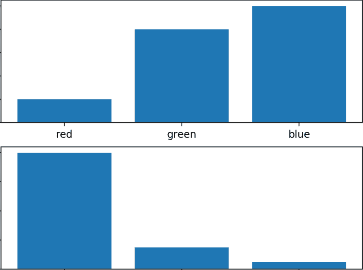

图 23.1：同一随机变量的两个不同概率分布的直方图。

### 23.4.2 计算分布之间的交叉熵

接下来，我们可以开发一个函数来计算两个分布之间的交叉熵。我们将使用以 2 为底的对数，以确保结果以比特为单位。

```python
# calculate cross-entropy
def cross_entropy(p, q):
    return -sum([p[i]*log2(q[i]) for i in range(len(p))])
```

清单 23.3：定义计算交叉熵函数的示例。

然后我们可以使用该函数计算 *P* 相对于 *Q* 的交叉熵，以及反向的 *Q* 相对于 *P* 的交叉熵。

```python
...
# calculate cross-entropy H(P, Q)
ce_pq = cross_entropy(p, q)
print('H(P, Q): %.3f bits' % ce_pq)
# calculate cross-entropy H(Q, P)
ce_qp = cross_entropy(q, p)
print('H(Q, P): %.3f bits' % ce_qp)
```

清单 23.4：计算交叉熵的示例。

将这些综合起来，完整的示例如下。

```
# example of calculating cross-entropy
from math import log2

# calculate cross-entropy
def cross_entropy(p, q):
    return -sum([p[i]*log2(q[i]) for i in range(len(p))])

# define data
p = [0.10, 0.40, 0.50]
q = [0.80, 0.15, 0.05]
# calculate cross-entropy H(P, Q)
ce_pq = cross_entropy(p, q)
print('H(P, Q): %.3f bits' % ce_pq)
# calculate cross-entropy H(Q, P)
ce_qp = cross_entropy(q, p)
print('H(Q, P): %.3f bits' % ce_qp)
```

清单 23.5：计算两个概率分布之间交叉熵的示例。

运行该示例，首先计算 Q 相对于 P 的交叉熵，结果为略高于 3 比特；然后计算 P 相对于 Q 的交叉熵，结果为略低于 3 比特。

```
H(P, Q): 3.288 bits
H(Q, P): 2.906 bits
```

清单 23.6：以比特为单位计算两个概率分布之间交叉熵的示例输出。

### 23.4.3 计算分布与自身的交叉熵

如果两个概率分布相同，那么它们之间的交叉熵就是该分布的熵。我们可以通过计算 P 与 P、Q 与 Q 的交叉熵来证明这一点。完整的示例如下。

```
# example of calculating cross entropy for identical distributions
from math import log2

# calculate cross entropy
def cross_entropy(p, q):
    return -sum([p[i]*log2(q[i]) for i in range(len(p))])

# define data
p = [0.10, 0.40, 0.50]
q = [0.80, 0.15, 0.05]
# calculate cross entropy H(P, P)
ce_pp = cross_entropy(p, p)
print('H(P, P): %.3f bits' % ce_pp)
# calculate cross entropy H(Q, Q)
ce_qq = cross_entropy(q, q)
print('H(Q, Q): %.3f bits' % ce_qq)
```

清单 23.7：计算概率分布与自身之间交叉熵的示例。

运行该示例，首先计算 Q 与 Q 的交叉熵，即 Q 的熵；然后计算 P 与 P 的交叉熵，即 P 的熵。

```
H(P, P): 1.361 bits
H(Q, Q): 0.884 bits
```

清单 23.8：计算概率分布与自身之间交叉熵的示例输出。

### 23.4.4 使用 KL 散度计算交叉熵

我们也可以使用 KL 散度来计算交叉熵。使用 KL 散度计算的交叉熵应与上述方法相同，并且计算分布之间的 KL 散度也很有意思，可以看到相对熵或所需的额外比特数，而不是交叉熵计算的总比特数。首先，我们可以定义一个函数来计算分布之间的 KL 散度，使用以 2 为底的对数以确保结果也是以比特为单位。

```
# calculate the kl divergence KL(P || Q)
def kl_divergence(p, q):
    return sum(p[i] * log2(p[i]/q[i]) for i in range(len(p)))
```

清单 23.9：定义计算 KL 散度函数的示例。

接下来，我们可以定义一个函数来计算给定概率分布的熵。

```
# calculate entropy H(P)
def entropy(p):
    return -sum([p[i] * log2(p[i]) for i in range(len(p))])
```

清单 23.10：定义计算熵函数的示例。

最后，我们可以使用 entropy() 和 kl_divergence() 函数计算交叉熵。

```
# calculate cross-entropy H(P, Q)
def cross_entropy(p, q):
    return entropy(p) + kl_divergence(p, q)
```

清单 23.11：使用 KL 散度定义计算交叉熵函数的示例。

为了保持示例简单，我们可以将 H(P,Q) 的交叉熵与 KL 散度 KL(P||Q) 和熵 H(P) 进行比较。完整的示例如下。

```
# example of calculating cross-entropy with kl divergence
from math import log2

# calculate the kl divergence KL(P || Q)
def kl_divergence(p, q):
    return sum(p[i] * log2(p[i]/q[i]) for i in range(len(p)))

# calculate entropy H(P)
def entropy(p):
    return -sum([p[i] * log2(p[i]) for i in range(len(p))])
```


```
# calculate cross-entropy H(P, Q)
def cross_entropy(p, q):
    return entropy(p) + kl_divergence(p, q)

# define data
p = [0.10, 0.40, 0.50]
q = [0.80, 0.15, 0.05]
# calculate H(P)
en_p = entropy(p)
print('H(P): %.3f bits' % en_p)
# calculate kl divergence KL(P || Q)
kl_pq = kl_divergence(p, q)
print('KL(P || Q): %.3f bits' % kl_pq)
# calculate cross-entropy H(P, Q)
ce_pq = cross_entropy(p, q)
print('H(P, Q): %.3f bits' % ce_pq)
```

列表 23.12：使用 KL 散度计算两个概率分布之间交叉熵的示例。

运行示例可知，3.288 比特的交叉熵分数由 P 的熵 1.361 比特，以及通过 KL 散度计算得到的额外 1.927 比特组成。这是一个很有用的示例，清晰地说明了这三种计算之间的关系。

```
H(P): 1.361 bits
KL(P || Q): 1.927 bits
H(P, Q): 3.288 bits
```

列表 23.13：使用 KL 散度计算两个概率分布之间交叉熵的示例输出。

## 23.5 作为损失函数的交叉熵

在优化分类模型时，交叉熵被广泛用作损失函数。你可能遇到的两个示例包括逻辑回归算法（一种线性分类算法），以及可用于分类任务的人工神经网络。

> ……对于分类问题，使用交叉熵误差函数而不是平方和误差函数，不仅能够加快训练速度，还能改善泛化能力。
>
> —《模式识别与机器学习》，2006 年，第 235 页。

分类问题是指包含一个或多个输入变量，并需要预测类别标签的问题。输出变量只有两个标签的分类任务称为二分类问题，而标签数量超过两个的问题则称为类别分类问题或多分类问题。

- **二分类**：针对给定示例，预测两个类别标签之一的任务。
- **多分类**：针对给定示例，预测两个以上类别标签之一的任务。

我们可以看到，交叉熵的思想对于优化分类模型可能很有用。每个示例都有一个已知的类别标签，其概率为 1.0，而所有其他标签的概率为 0.0。模型可以估计一个示例属于每个类别标签的概率。然后，可以使用交叉熵计算这两个概率分布之间的差异。因此，我们可以将一个示例的分类映射为具有概率分布的随机变量，具体如下：

- **随机变量**：需要预测类别标签的示例。
- **事件**：每个可能被预测的类别标签。

在分类任务中，对于输入，我们知道目标概率分布 P：类别标签 0 或 1 分别被解释为*不可能*和*确定*。这些概率完全不会带来惊讶，因此不包含信息，或者说熵为零。我们的模型旨在近似目标概率分布 Q。用分类领域的术语来说，这些就是实际概率和预测概率，即 y 和 yhat。

- **期望概率**（*y*）：数据集中某个示例的每个类别标签的已知概率（*P*）。
- **预测概率**（*yhat*）：模型预测某个示例属于每个类别标签的概率（*Q*）。

因此，我们可以使用上述交叉熵计算方法估计单次预测的交叉熵；例如：

$$H(P, Q) = - \sum_{\{x \in X\}} P(x) \times \log(Q(x)) \tag{23.7}$$

其中，每个 x ∈ X 都是一个可能分配给该示例的类别标签，而对于已知标签，P(x) 将为 1，对于所有其他标签则为 0。二分类任务中单个示例的交叉熵，可以将求和运算展开为如下形式：

$$H(P, Q) = - (P(class0) \times \log(Q(class0)) + P(class1) \times \log(Q(class1))) \tag{23.8}$$

你可能会在教材中看到这种交叉熵计算形式。如果只有两个类别标签，则使用正类别标签的伯努利分布对概率进行建模。这意味着模型直接预测类别 1 的概率，而类别 0 的概率则为 1 减去预测概率，例如：

- **预测** P(class0) = 1 − yhat
- **预测** P(class1) = yhat

在计算分类任务的交叉熵时，使用以 e 为底的对数或自然对数。这意味着单位是纳特，而不是比特。我们通常希望最小化模型在整个训练数据集上的交叉熵。这可以通过计算所有训练示例的平均交叉熵来实现。

### 23.5.1 计算类别标签的熵

回顾一下，当两个分布相同时，它们之间的交叉熵等于该概率分布的熵。在为分类任务准备数据时，类别标签使用值 0 和 1 进行编码。例如，如果一个分类问题有三个类别，并且某个示例属于第一个类别，那么其概率分布将为 [1, 0, 0]。如果某个示例属于第二个类别，那么两个事件的概率分布将为 [0, 1, 0]。这称为独热编码。

由于结果是确定的，因此该概率分布不包含信息。我们知道类别是什么。因此，该变量的熵为零。这是一个重要概念，我们可以通过一个完整示例来演示。假设我们有一个包含 3 个类别的分类问题，并且每个类别各有一个示例。我们可以将每个示例表示为一个离散概率分布：示例所属类别的概率为 1.0，所有其他类别的概率为 0.0。我们可以计算每个变量在各事件上的概率分布的熵。完整示例如下。

```
# entropy of examples from a classification task with 3 classes
from math import log2
from numpy import asarray

# calculate entropy
def entropy(p):
    return -sum([p[i] * log2(p[i]) for i in range(len(p))])

# class 1
p = asarray([1,0,0]) + 1e-15
print(entropy(p))
# class 2
p = asarray([0,1,0]) + 1e-15
print(entropy(p))
# class 3
p = asarray([0,0,1]) + 1e-15
print(entropy(p))
```

列表 23.14：计算类别标签熵的示例。

运行示例会计算每个随机变量的熵。我们可以看到，在每种情况下，熵都是 0.0（实际上是一个非常接近零的数）。注意，我们必须向 0.0 值加上一个非常小的值，以避免 `log()` 溢出，因为无法计算 0.0 的对数。

```
9.805612959471341e-14
9.805612959471341e-14
9.805612959471341e-14
```

列表 23.15：计算类别标签熵的示例输出。

因此，已知类别标签的熵始终为 0.0。这意味着，如果两个分布（实际分布和预测分布）针对某个类别标签具有相同的概率分布，那么它们之间的交叉熵也始终为 0.0。回顾一下，在使用交叉熵评估训练数据集上的模型时，我们会计算数据集中所有示例的平均交叉熵。因此，在训练模型时，交叉熵为 0.0 表示预测的类别概率与训练数据集中的概率完全相同，即损失为零。

我们同样可以将 KL 散度作为损失函数进行最小化，而不是最小化交叉熵。回顾一下，KL 散度表示传输一个变量相对于另一个变量所需的额外比特数。它是去除类别标签熵后的交叉熵，而我们知道类别标签的熵无论如何都是零。因此，对于分类任务而言，最小化 KL 散度和最小化交叉熵是等价的。在实践中，交叉熵损失为 0.0 通常表示模型已经过拟合训练数据集，但这是另一个话题。

### 23.5.2 类别标签与概率之间的交叉熵

交叉熵用于分类时，通常会根据类别数量采用不同的具体名称，这与分类任务的名称相对应；例如：

- **二元交叉熵**：用于二分类任务的损失函数交叉熵。
- **分类交叉熵**：用于多分类任务的损失函数交叉熵。

我们可以通过一个完整示例，具体说明将交叉熵用作损失函数的方式。考虑一个二分类任务，其中包含以下 10 个实际类别标签（*P*）和预测类别标签（*Q*）。

```
...
# define classification data
p = [1, 1, 1, 1, 1, 0, 0, 0, 0, 0]
q = [0.8, 0.9, 0.9, 0.6, 0.8, 0.1, 0.4, 0.2, 0.1, 0.3]
```

列表 23.16：定义期望值和预测概率的示例。

我们可以枚举这些概率，并使用上一节中开发的交叉熵函数计算每个概率的交叉熵，该函数使用 `log()`（自然对数）而不是 `log2()`。

```
# calculate cross-entropy
def cross_entropy(p, q):
    return -sum([p[i]*log(q[i]) for i in range(len(p))])
```

列表 23.17：计算纳特交叉熵的函数示例。

对于每个实际概率和预测概率，我们必须将预测值转换为各状态上的概率分布；在本例中，状态为 {0, 1}，其中类别 0 的概率为 1 减去预测概率，类别 1 的概率为预测概率。然后，我们可以计算交叉熵，并对所有示例重复这一过程。

```
...
# calculate cross entropy for each example
results = list()
for i in range(len(p)):
    # create the distribution for each event {0, 1}
    expected = [1.0 - p[i], p[i]]
    predicted = [1.0 - q[i], q[i]]
    # calculate cross entropy for the two events
    ce = cross_entropy(expected, predicted)
    print('>y=%.1f, yhat=%.1f] ce: %.3f nats' % (p[i], q[i], ce))
    results.append(ce)
```


清单 23.18：计算每个示例的交叉熵的示例。

最后，我们可以计算数据集中交叉熵的平均值，并将其报告为模型在该数据集上的交叉熵损失。

```
...
# calculate the average cross-entropy
mean_ce = mean(results)
print('Average Cross Entropy: %.3f nats' % mean_ce)
```

清单 23.19：计算平均交叉熵的示例。

将所有内容结合起来，完整的示例列在下面。

```
# calculate cross entropy for classification problem
from math import log
from numpy import mean

# calculate cross entropy
def cross_entropy(p, q):
    return -sum([p[i]*log(q[i]) for i in range(len(p))])

# define classification data
p = [1, 1, 1, 1, 1, 0, 0, 0, 0, 0]
q = [0.8, 0.9, 0.9, 0.6, 0.8, 0.1, 0.4, 0.2, 0.1, 0.3]
# calculate cross entropy for each example
results = list()
for i in range(len(p)):
    # create the distribution for each event {0, 1}
    expected = [1.0 - p[i], p[i]]
    predicted = [1.0 - q[i], q[i]]
    # calculate cross entropy for the two events
    ce = cross_entropy(expected, predicted)
    print('> [y=%.1f, yhat=%.1f] ce: %.3f nats' % (p[i], q[i], ce))
    results.append(ce)

# calculate the average cross entropy
mean_ce = mean(results)
print('Average Cross Entropy: %.3f nats' % mean_ce)
```

清单 23.20：计算期望概率与预测概率之间平均交叉熵的示例。

运行该示例会打印每个示例的实际概率和预测概率以及以纳特为单位的交叉熵。在这种情况下，所有示例的最终平均交叉熵损失报告为 0.247 纳特。

```
>[y=1.0, yhat=0.8] ce: 0.223 nats
>[y=1.0, yhat=0.9] ce: 0.105 nats
>[y=1.0, yhat=0.9] ce: 0.105 nats
>[y=1.0, yhat=0.6] ce: 0.511 nats
>[y=1.0, yhat=0.8] ce: 0.223 nats
>[y=0.0, yhat=0.1] ce: 0.105 nats
>[y=0.0, yhat=0.4] ce: 0.511 nats
>[y=0.0, yhat=0.2] ce: 0.223 nats
>[y=0.0, yhat=0.1] ce: 0.105 nats
>[y=0.0, yhat=0.3] ce: 0.357 nats
Average Cross Entropy: 0.247 nats
```

清单 23.21：期望概率与预测概率之间交叉熵的示例输出。

这就是在交叉熵损失函数下优化逻辑回归模型或神经网络模型时计算交叉熵损失的方法。

## 23.5.3 使用 Keras 计算交叉熵

我们可以通过使用 Keras 深度学习 API 中的 `binary_crossentropy()` 函数来确认相同的计算，以计算我们的小数据集的交叉熵损失。完整的示例列在下面。请注意，本示例假定您已安装 Keras 库并使用 TensorFlow 等后端库进行配置。如果没有，可以跳过运行此示例。

```python
# calculate cross entropy with keras
from numpy import asarray
from keras import backend
from keras.losses import binary_crossentropy
# prepare classification data
p = asarray([1, 1, 1, 1, 1, 0, 0, 0, 0, 0])
q = asarray([0.8, 0.9, 0.9, 0.6, 0.8, 0.1, 0.4, 0.2, 0.1, 0.3])
# convert to keras variables
y_true = backend.variable(p)
y_pred = backend.variable(q)
# calculate the average cross-entropy
mean_ce = backend.eval(binary_crossentropy(y_true, y_pred))
print('Average Cross Entropy: %.3f nats' % mean_ce)
```

清单 23.22：使用 Keras 计算期望概率与预测概率之间平均交叉熵的示例。

运行示例，我们可以看到报告了相同的 0.247 纳特的平均交叉熵损失。这证实了交叉熵的手动计算是正确的。

```text
Average Cross Entropy: 0.247 nats
```

清单 23.23：使用 Keras 计算期望概率与预测概率之间平均交叉熵的示例输出。

我们可以看到，我们同样可以最小化 KL 散度作为损失函数，而不是交叉熵。具体数值会不同，但效果是相同的，因为这两个值彼此成比例（例如减去 P 的熵的常数）。

最小化该 KL 散度与最小化分布之间的交叉熵完全对应。

> — 第 132 页，*Deep Learning*，2016 年。

## 23.6 交叉熵与对数损失之间的区别

交叉熵不是对数损失，但在作为二元分类问题（第 13 章介绍）的损失函数使用时，它们计算的是相同的量。

### 23.6.1 对数损失是负对数似然

Logistic loss 指的是通常用于优化逻辑回归模型的损失函数。它也可能被称为 logarithmic loss（这令人困惑）或简单地称为 log loss。许多模型是在称为最大似然估计或 MLE 的概率框架下进行优化的，该框架涉及找到一组最能解释观测数据的参数。

这涉及选择一个似然函数，该函数定义了在给定模型参数的情况下一组观测值（数据）的可能性。当使用对数似然函数时（这是常见的），通常被称为为模型优化对数似然。由于在实践中最小化函数比最大化函数更常见，因此对数似然函数通过在前面加上负号来反转。这将其转换为负对数似然函数或简称为 NLL。在最大似然估计框架下推导伯努利概率分布函数（两个类别）的对数似然函数时，计算结果为：

$$\mathrm{NLL}(P,Q) = -\big(P(\mathit{class0}) \times \log(Q(\mathit{class0})) + P(\mathit{class1}) \times \log(Q(\mathit{class1}))\big) \tag{23.9}$$

该量可以通过计算似然函数的对数的平均值在所有训练示例上进行平均。对于二元分类问题，负对数似然通常缩写为 simply *log loss*，作为为逻辑回归推导的损失函数。

$$\text{log loss} = \text{negative log-likelihood, under a Bernoulli probability distribution} \tag{23.10}$$

我们可以看到，负对数似然与用于伯努利概率分布函数（两个事件或类别）的交叉熵所使用的计算相同。事实上，多项分布（多类分类）的负对数似然也与交叉熵的计算相匹配。

### 23.6.2 对数损失和交叉熵计算的是同一事物

对于二元分类问题，*log loss*、*cross-entropy* 和 *negative log-likelihood* 可以互换使用。更一般地，在分类模型的损失函数上下文中，术语 *cross-entropy* 和 *negative log-likelihood* 可以互换使用。

> The negative log-likelihood for logistic regression is given by [...] This is also called the cross-entropy error function.

> — 第 246 页，*Machine Learning: A Probabilistic Perspective*，2012 年。

因此，计算 log loss 将给出与计算伯努利概率分布的交叉熵相同的量。我们可以通过使用 scikit-learn API 中的 `log_loss()` 函数计算 log loss 来确认这一点。对上一节中相同的实际概率和预测概率集合计算平均 log loss 应该与计算平均交叉熵得到相同的结果。完整的示例列在下面。

```python
# calculate log loss for classification problem with scikit-learn
from sklearn.metrics import log_loss
from numpy import asarray
# define classification data
p = [1, 1, 1, 1, 1, 0, 0, 0, 0, 0]
q = [0.8, 0.9, 0.9, 0.6, 0.8, 0.1, 0.4, 0.2, 0.1, 0.3]
# define data as expected, e.g. probability for each event {0, 1}
y_true = asarray([[1-v, v] for v in p])
y_pred = asarray([[1-v, v] for v in q])
# calculate the average log loss
ll = log_loss(y_true, y_pred)
print('Average Log Loss: %.3f' % ll)
```

清单 23.24：计算期望概率与预测概率之间平均对数损失的示例。

运行示例给出了预期的 0.247 对数损失结果，这与使用平均交叉熵计算得到的 0.247 纳特相匹配。

```text
Average Log Loss: 0.247
```

清单 23.25：计算期望概率与预测概率之间平均对数损失的示例输出。

这并不意味着 log loss 计算交叉熵或交叉熵计算 log loss。相反，它们是来自不同研究领域的不同的量，在计算分类任务的损失函数条件下，会导致等效的计算和结果。具体来说，交叉熵损失函数在伯努利或多项分布下等价于最大似然函数。这展示了最大似然估计研究与离散概率分布的信息论之间的联系。

它并不局限于离散概率分布，这一事实让许多初次听说的人感到惊讶。具体来说，在最大似然估计框架下优化的线性回归假设目标变量服从高斯连续概率分布，并涉及最小化均方误差函数。这等价于具有高斯概率分布的随机变量的交叉熵。

> Any loss consisting of a negative log-likelihood is a cross-entropy between the empirical distribution defined by the training set and the probability distribution defined by model. For example, mean squared error is the cross-entropy between the empirical distribution and a Gaussian model.
> 
> — 第 132 页，*Deep Learning*，2016 年。

这有点令人震惊，来自连续随机变量的微分熵领域。这意味着，如果你计算两个覆盖相同事件（具有相同的均值和标准差）的高斯随机变量之间的均方误差，那么你就是在计算变量之间的交叉熵。这也意味着，如果你使用均方误差损失来优化神经网络模型以解决回归问题，那么实际上你正在使用交叉熵损失。


## 23.7 延伸阅读

本节提供了有关该主题的更多资源，如果您想深入了解。

### 23.7.1 书籍

- *机器学习：概率视角*, 2012.
  https://amzn.to/2xKSTCP
- *模式识别与机器学习*, 2006.
  https://amzn.to/2JwHE7I
- *深度学习*, 2016.
  https://amzn.to/21nc3vL

### 23.7.2 API

- 损失函数的用法，Keras API。
  https://keras.io/losses/
- sklearn.metrics.log_loss API。
  https://scikit-learn.org/stable/modules/generated/sklearn.metrics.log_loss.html

### 23.7.3 文章

- 库尔贝克-莱布勒散度，Wikipedia。
  https://en.wikipedia.org/wiki/Kullback%E2%80%93Leibler_divergence
- 交叉熵，Wikipedia。
  https://en.wikipedia.org/wiki/Cross_entropy
- 联合熵，Wikipedia。
  https://en.wikipedia.org/wiki/Joint_entropy
- 分类损失函数，Wikipedia。
  https://en.wikipedia.org/wiki/Loss_functions_for_classification

## 23.8 摘要

在本教程中，您发现了机器学习的交叉熵。具体来说，您学习了：

- 如何从头开始计算交叉熵并使用标准机器学习库。
- 交叉熵可以用作优化分类模型（如逻辑回归和人工神经网络）时的损失函数。
- 交叉熵与 KL 散度不同，但可以使用 KL 散度计算，并且与对数损失不同，但在用作损失函数时计算相同的量。

### 23.8.1 下一步

在下一教程中，您将发现两个概率分布之间的信息增益和互信息。

## 24.2 什么是信息增益？

信息增益，简称 IG，衡量通过根据随机变量的给定值拆分数据集而导致的熵或惊讶度的减少。较大的信息增益意味着样本组或组的熵较低，因此惊讶度更小。您可能还记得信息量化了事件的惊讶程度，以比特为单位。概率较低的事件具有更多信息，概率较高的事件具有较少信息。熵量化了随机变量中包含的信息量，或更具体地说其概率分布。偏斜分布具有低熵，而事件概率相等的分布具有更大的熵。

在信息论中，我们喜欢描述事件的*惊讶*。低概率事件更令人惊讶，因此具有更大的信息量。而事件同等可能的概率分布更令人惊讶，具有更大的熵。

- **偏斜概率分布** (*不出人意料*): 熵低。
- **平衡概率分布** (*令人惊讶*): 熵高。

现在，让我们考虑数据集的熵。我们可以从数据集中的观测值属于一个类别或另一个类别的概率分布的角度来思考数据集的熵，例如在二元分类数据集的情况下为两个类别。

> > 信息论中熵的一种解释是，它指定了编码 $S$ 的任意成员分类所需的最小信息位数（即以均匀概率随机抽取的 $S$ 的成员）。
> >
> > — 第58页，*机器学习*，1997。

例如，在二元分类问题（两个类别）中，我们可以按如下方式计算数据样本的熵：

$$Entropy = -(p(0) \times \log(P(0)) + p(1) \times \log(P(1))) \tag{24.1}$$

具有两个类别样本 50/50 分割的数据集将具有最大熵（最大惊讶）1 比特，而具有 10/90 分割的不平衡数据集将具有较小的熵，因为从数据集中随机抽取的示例将有较少的惊讶。我们可以用 Python 计算此不平衡数据集的熵的示例来演示这一点。完整示例如下所示。

```python
# calculate the entropy for a dataset
from math import log2
# proportion of examples in each class
class0 = 10/100
class1 = 90/100
# calculate entropy
entropy = -(class0 * log2(class0) + class1 * log2(class1))
# print the result
print('entropy: %.3f bits' % entropy)
```

Listing 24.1: 计算熵的示例。

运行示例，我们可以看到二元分类的数据集的熵小于 1 比特。也就是说，编码来自数据集的任意示例的类别标签所需的信息少于一比特。

```
entropy: 0.469 bits
```

Listing 24.2: 计算熵的示例输出。

以这种方式，熵可以用作数据集纯度的计算，例如类别分布的平衡程度如何。熵为 0 比特表示数据集包含一个类别；熵为 1 或更多比特表示平衡数据集的最大熵（取决于类别数），介于两者之间的值表示这些极端之间的水平。信息增益提供了一种使用熵来计算对数据集的更改如何影响数据集纯度的方法，例如类别的分布。较小的熵意味着更高的纯度或更少的惊讶。

> > ... 信息增益，仅仅是根据此属性对示例进行划分所导致的熵的预期减少。
> 
> — 第57页，*机器学习*，1997。

例如，我们可能希望通过按具有一系列值的随机变量拆分数据集 S 来评估对纯度的影响。这可以按如下方式计算：

$IG(S, a) = H(S) - H(S|a)$
(24.2)

其中 $IG(S, a)$ 是随机变量的变量 $a$ 的数据集 $S$ 的信息，$H(S)$ 是在任何更改之前的数据集的熵（上文所述），而 $H(S|a)$ 是给定变量 $a$ 的数据集的条件熵。此计算描述了变量 $a$ 对数据集 $S$ 的增益。它是在转换数据集时节省的位数。条件熵可以通过将数据集按 $a$ 的每个观察值拆分为组并计算整个数据集中每个组中示例的比率乘以每个组的熵之和来计算。

$H(S|a) = \sum_{\{v\in a\}} \frac{Sa(v)}{S} \times H(Sa(v))$
(24.3)

其中 $\frac{Sa(v)}{S}$ 是变量 $a$ 具有值 $v$ 的数据集中的示例数与数据集的比率，而 $H(Sa(v))$ 是变量 $a$ 具有值 $v$ 的样本组的熵。这可能听起来有点令人困惑。我们可以用一个工作示例使信息增益的计算具体化。

## 24.3 计算信息增益的工作示例

在本节中，我们将通过一个工作示例使信息增益的计算具体化。我们可以定义一个函数来根据属于类别 0 和类别 1 的样本的比率计算一组样本的熵。

```
# calculate the entropy for the split in the dataset
def entropy(class0, class1):
    return -(class0 * log2(class0) + class1 * log2(class1))
```

Listing 24.3: 定义计算熵函数的示例。

现在，考虑一个包含 20 个示例的数据集，类别 0 有 13 个，类别 1 有 7 个。我们可以计算此数据集的熵，其值将小于 1 比特。

```
...
# split of the main dataset
class0 = 13 / 20
class1 = 7 / 20
# calculate entropy before the change
s_entropy = entropy(class0, class1)
print('Dataset Entropy: %.3f bits' % s_entropy)
```

Listing 24.4: 计算数据集熵的示例。

现在假设数据集中的一个变量有两个唯一值，例如 value1 和 value2。我们有兴趣计算此变量的信息增益。假设如果我们按 value1 拆分数据集，我们将得到一个包含八个样本的组，其中七个为类别 0，一个为类别 1。然后我们可以计算此样本组的熵。

```
...
# split 1 (split via value1)
s1_class0 = 7 / 8
s1_class1 = 1 / 8
# calculate the entropy of the first group
s1_entropy = entropy(s1_class0, s1_class1)
print('Group1 Entropy: %.3f bits' % s1_entropy)
```

Listing 24.5: 计算拆分 1 熵的示例。

现在，假设我们按 value2 拆分数据集；我们得到一个包含 12 个样本的组，其中每个组有六个。我们预计该组的熵为 1。

```
...
# split 2 (split via value2)
s2_class0 = 6 / 12
s2_class1 = 6 / 12
# calculate the entropy of the second group
s2_entropy = entropy(s2_class0, s2_class1)
print('Group2 Entropy: %.3f bits' % s2_entropy)
```

Listing 24.6: 计算拆分 2 熵的示例。

最后，我们可以根据为变量的每个值创建的组和计算的熵来计算此变量的信息增益。第一个变量导致了数据集中的八个示例组，而第二个组包含数据集中剩余的 12 个样本。因此，我们拥有计算信息增益所需的一切。在这种情况下，信息增益可以计算为：

H(数据集) − Count(组1)/Count(数据集) × H(组1) + Count(组2)/Count(数据集) × H(组2) (24.4)


或者：

H(13/20, 7/20) − 8/20 × H(7/8, 1/8) + 12/20 × H(6/12, 6/12) (24.5)

或在代码中：

```
...
# calculate the information gain
gain = s_entropy - (8/20 * s1_entropy + 12/20 * s2_entropy)
print('Information Gain: %.3f bits' % gain)
```

清单 24.7：计算信息增益的示例。

将这一切结合起来，完整示例列在下面。

```
# calculate the information gain
from math import log2

# calculate the entropy for the split in the dataset
def entropy(class0, class1):
    return -(class0 * log2(class0) + class1 * log2(class1))

# split of the main dataset
class0 = 13 / 20
class1 = 7 / 20
# calculate entropy before the change
s_entropy = entropy(class0, class1)
print('Dataset Entropy: %.3f bits' % s_entropy)

# split 1 (split via value1)
s1_class0 = 7 / 8
s1_class1 = 1 / 8
# calculate the entropy of the first group
s1_entropy = entropy(s1_class0, s1_class1)
print('Group1 Entropy: %.3f bits' % s1_entropy)

# split 2 (split via value2)
s2_class0 = 6 / 12
s2_class1 = 6 / 12
# calculate the entropy of the second group
s2_entropy = entropy(s2_class0, s2_class1)
print('Group2 Entropy: %.3f bits' % s2_entropy)

# calculate the information gain
gain = s_entropy - (8/20 * s1_entropy + 12/20 * s2_entropy)
print('Information Gain: %.3f bits' % gain)
```

清单 24.8：计算数据集两次分割的信息增益的示例。

首先，数据集的熵计算为略低于 1 位。然后，第一组和第二组的熵分别计算约为 0.5 和 1 位。最后，变量的信息增益计算为 0.117 位。也就是说，通过所选变量对数据集进行分割所带来的增益为 0.117 位。

```
Dataset Entropy: 0.934 bits
Group1 Entropy: 0.544 bits
Group2 Entropy: 1.000 bits
```

```
Information Gain: 0.117 bits
```

清单 24.9：计算数据集两次分割的信息增益的示例输出。

## 24.4 机器学习中信息增益的示例

在机器学习中，信息增益最流行的用途是在决策树中。一个例子是迭代二分器 3 算法，简称 ID3，用于构建决策树。

信息增益正是 ID3 在生长树时在每一步选择最佳属性时使用的度量。

> — 第 58 页，Machine Learning，1997。

信息增益是针对数据集中每个变量计算的。具有最大信息增益的变量被选中来分割数据集。通常，更大的增益表示更小的熵或更少的惊讶。

请注意，最小化熵等同于最大化信息增益 ...

> — 第 547 页，Machine Learning: A Probabilistic Perspective，2012。

该过程随后在每个创建的组上重复，排除已选中的变量。这在达到决策树的期望深度或无法再进行分割时停止。

选择新属性并划分训练示例的过程现在对每个非终端后代节点重复，这次仅使用与该节点关联的训练示例。已在树中更高位置合并的属性被排除，因此任何给定属性在树中的任何路径上最多只能出现一次。

> — 第 60 页，Machine Learning，1997。

信息增益可以用作大多数现代决策树实现中的分割标准，例如 scikit-learn Python 机器学习库中用于分类的 Classification and Regression Tree（CART）算法的实现中的 DecisionTreeClassifier 类。这可以通过在配置模型时将 criterion 参数设置为‘entropy’来实现；例如：

```
# example of a decision tree trained with information gain
from sklearn.tree import DecisionTreeClassifier
model = DecisionTreeClassifier(criterion='entropy')
...
```

清单 24.10：定义 DecisionTreeClassifier 分类器以使用信息增益的示例。

这可以正式表述如下：

$$I(X;Y) = KL(p(X,Y)\|p(X) \times p(Y)) \tag{24.7}$$

互信息始终大于或等于零，其中值越大，两变量之间的关系越大。如果计算结果为零，则变量是独立的。互信息通常用作相关系数的一般形式，例如随机变量之间依赖性的度量。它也用作某些机器学习算法中的一个方面。一个常见的例子是独立成分分析，简称 ICA，它提供了数据集的统计独立成分的投影。

## 24.6 信息增益和互信息是如何相关的？

互信息和信息增益是同一事物，尽管度量的上下文或用法通常导致不同的名称。例如：

- 对数据集的变换的影响（*决策树*）：信息增益。
- 变量之间的依赖关系（*特征选择*）：互信息。

注意互信息计算方式与信息增益计算方式的相似性；它们是等价的：

$$I(X;Y) = H(X) - H(X|Y) \tag{24.8}$$

和

$$IG(S,a) = H(S) - H(S|a) \tag{24.9}$$

因此，互信息有时被用作信息增益的同义词。技术上，如果应用于相同的数据，它们计算相同的量。我们可以将两者之间的关系理解为联合和边缘概率分布的差异越大（互信息），信息增益（信息增益）就越大。

## 24.7 进一步阅读

如果您想深入了解，本节提供了更多资源。

### 24.7.1 书籍

- *信息论、推断与学习算法*，2003。
  https://amzn.to/2KfDDF7
- *机器学习：概率视角*，2012。
  https://amzn.to/2xKSTCP
- *模式识别与机器学习*，2006。
  https://amzn.to/2JwHETI
- *机器学习*，1997。
  https://amzn.to/2jWd51p
- *数据挖掘：实用机器学习工具与技术*，第 4 版，2016。
  https://amzn.to/2lnW5S7

### 24.7.2 API

- `scipy.stats.entropy` API。
  https://docs.scipy.org/doc/scipy/reference/generated/scipy.stats.entropy.html

### 24.7.3 文章

- 熵（信息论），维基百科。
  https://en.wikipedia.org/wiki/Entropy_(information_theory)
- 决策树中的信息增益，维基百科。
  https://en.wikipedia.org/wiki/Information_gain_in_decision_trees
- ID3 算法，维基百科。
  https://en.wikipedia.org/wiki/ID3_algorithm
- 信息增益比，维基百科。
  https://en.wikipedia.org/wiki/Information_gain_ratio
- 互信息，维基百科。
  https://en.wikipedia.org/wiki/Mutual_information

## 24.8 摘要

在本教程中，您了解了机器学习中的信息增益和互信息。具体来说，您学习了：

- 信息增益是通过转换数据集而降低的熵或惊讶度，并且通常用于训练决策树。
- 信息增益是通过比较转换前后数据集的熵来计算的。
- 互信息计算两个变量之间的统计依赖性，并且是信息增益在应用于变量选择时所使用的名称。

### 24.8.1 下一步

这是本部分的最后一个教程。在下一部分中，您将发现在使用分类预测建模问题时有用的概率工具。

## 第 25 章

## 如何开发和评估朴素分类器策略

朴素分类器是一种简单的分类模型，假设关于问题的信息很少或没有，其性能提供了所有其他在数据集上评估的模型可以比较的基线。朴素分类器可以使用不同的策略，并且有些策略比其他策略更好，这取决于数据集和性能度量的选择。最常见的性能度量是分类准确率，常见的朴素分类策略包括随机猜测类别标签、从训练数据集中随机选择标签以及使用多数类标签。开发一个小的概率框架来计算给定朴素分类策略的预期性能并进行实验以确认理论预期是有用的。这些练习提供了对朴素分类算法一般行为的直觉，以及为分类任务建立性能基线的重要性。在本教程中，您将了解如何为机器学习开发和评估朴素分类策略。完成本教程后，您将知道：

- 朴素分类模型的性能提供了所有其他模型可以被认为是有技能还是没有技能的基线。
- 多数类分类器比其他朴素分类模型（如随机猜测和预测随机选择的观察类标签）具有更好的准确性。
- 朴素分类策略可以通过 scikit-learn 库中的 `DummyClassifier` 类用于预测建模项目。

让我们开始吧。

## 25.1 教程概述

本教程分为五个部分；它们是：

- 1. 朴素分类器
- 2. 预测随机猜测


## 25.2 朴素分类器

分类预测建模问题涉及根据模型输入预测类别标签。分类模型在训练数据集上拟合，并在测试数据集上评估，其性能通常以正确预测数占预测总数的比例来报告，称为准确率。给定一个分类模型，如何判断模型是否有技能？这是每个分类预测建模项目上的常见问题。答案是将给定分类器模型的结果与基线或朴素分类器模型进行比较。

朴素分类器模型是指在做出预测时不使用任何复杂技巧，通常做出随机或恒定的预测。这类模型之所以朴素，是因为它们在做出预测时不使用任何关于领域的知识或任何学习。基线分类器在分类任务上的性能为该问题上所有其他模型的预期性能提供了下限。例如，如果分类模型比朴素分类器表现更好，则它具有一定的技能。如果分类器模型表现不如朴素分类器，则它没有任何技能。应该使用什么分类器作为朴素分类器？这是初学者常见的困惑领域，并且采用了不同的朴素分类器。一些常见选择包括：

- 预测一个随机类别。
- 从训练数据集中预测一个随机选择的类别。
- 预测训练数据集中占多数的类别。

问题是，并非所有朴素分类器都一样，有些表现更好，有些表现更差。因此，我们应该在所有分类预测建模项目中使用表现最好的朴素分类器。我们可以使用简单概率来评估不同朴素分类器模型的性能，并确认应始终用作朴素分类器的策略。在开始评估不同策略之前，让我们定义一个人为构造的二分类问题。为了使其有趣，我们假设每个类别的观测数量不相等（例如问题不平衡），class-0 有 25 个示例，class-1 有 75 个示例。我们可以用下面的 Python 小示例使其具体化。

```python
# summarize a test dataset
# define dataset
class0 = [0 for _ in range(25)]
class1 = [1 for _ in range(75)]
y = class0 + class1
# summarize distribution
print('Class 0: %.3f' % (len(class0) / len(y) * 100))
print('Class 1: %.3f' % (len(class1) / len(y) * 100))
```

Listing 25.1: 定义和汇总测试数据集的示例。

运行该示例会创建数据集并汇总属于每个类别的示例比例，显示 class-0 为 25%，class-1 为 75%，正如我们直观预期的那样。

```text
Class 0: 25.000
Class 1: 75.000
```

Listing 25.2: 定义和汇总测试数据集的示例输出。

最后，我们可以定义一个用于评估朴素分类策略的概率模型。在这种情况下，我们感兴趣的是计算给定二分类模型的分类准确率。

$$P(\hat{y}=y) \tag{25.1}$$

这可以计算为模型预测每个类别值的概率乘以观察到每个类别出现的概率。

$$P(\hat{y}=y) = P(\hat{y}=0) \times P(y=0) + P(\hat{y}=1) \times P(y=1) \tag{25.2}$$

这计算了模型在数据集上的预期性能。它提供了一个非常简单的概率模型，我们可以用它来计算一般情况下朴素分类器模型的预期性能。接下来，我们将使用这个人为构造的预测问题来探索朴素分类器的不同策略。

## 25.3 预测随机猜测

也许最简单的策略是为每次所需的预测随机猜测其中一个可用类别。我们将称之为随机猜测策略。使用我们的概率模型，我们可以计算该模型在我们的人为构造数据集上平均预期表现如何。对每个类别的随机猜测是每个可能类别标签上的均匀概率分布，或者在二分类问题的情况下，每个类别的概率为 0.5。此外，由于我们人为构造了该问题，我们知道我们的数据集中 class-0 和 class-1 值的预期概率；它们分别为 0.25 和 0.75。因此，我们按如下方式计算该策略的平均性能：

$$\begin{aligned} P(\hat{y}=y) &= P(\hat{y}=0) \times P(y=0) + P(\hat{y}=1) \times P(y=1) \\ &= 0.5 \times 0.25 + 0.5 \times 0.75 \\ &= 0.125 + 0.375 \\ &= 0.5 \end{aligned} \tag{25.3}$$

该计算表明，在我们的人为构造问题上预测均匀随机类别标签的性能为 0.5 或 50% 分类准确率。这可能令人惊讶，这很好，因为它突出了系统计算朴素策略预期性能的好处。我们可以通过一个小实验来确认该估计是否正确。该策略可以实现为一个函数，该函数为每次所需的预测随机选择 0 或 1。

```python
# guess random class
def random_guess():
    if random() < 0.5:
        return 0
    return 1
```

Listing 25.3: 预测随机猜测的函数示例。

然后可以为数据集中所需的每次预测调用它，并评估准确率。

```python
...
yhat = [random_guess() for _ in range(len(y))]
acc = accuracy_score(y, yhat)
```

Listing 25.4: 使用该策略进行预测的示例。

这是一次试验，但每次使用该策略时准确率都会不同。为了解决这个问题，我们可以重复实验 1,000 次并报告该策略的平均性能。我们期望平均性能与上面计算的预期性能相匹配。完整示例如下所示。

```python
# example of a random guess naive classifier
from numpy import mean
from numpy.random import random
from sklearn.metrics import accuracy_score

# guess random class
def random_guess():
    if random() < 0.5:
        return 0
    return 1

# define dataset
class0 = [0 for _ in range(25)]
class1 = [1 for _ in range(75)]
y = class0 + class1
# average performance over many repeats
results = list()
for _ in range(1000):
    yhat = [random_guess() for _ in range(len(y))]
    acc = accuracy_score(y, yhat)
    results.append(acc)
print('Mean: %.3f' % mean(results))
```

Listing 25.5: 评估随机猜测分类策略的示例。

运行该示例执行我们实验的 1,000 次试验并报告该策略的平均准确率。

**注意：** 由于学习算法的随机性，您的具体结果可能会有所不同。考虑多次运行示例并比较平均性能。

在这种情况下，我们可以看到预期性能与计算性能非常接近。根据大数定律，我们执行的试验次数越多，我们的估计就越接近我们计算的理论值。

```text
Mean: 0.499
```

Listing 25.6: 评估随机猜测分类策略的示例输出。

这是一个好的开始，但如果我们在策略中使用有关训练数据集构成的一些基本信息会怎样。我们接下来将探索这一点。

## 25.4 预测随机选择的类别

另一种朴素分类器方法是某种程度上利用训练数据集。也许最简单的方法是使用训练数据集中的观测值作为预测。具体来说，我们可以随机选择训练集中的观测值并将其返回以用于每次请求的预测。这是有道理的，我们可能会期望训练数据集的这种原始使用会导致比随机猜测略好的朴素准确率。

我们可以通过使用我们的概率框架计算该方法的预期性能来了解这一点。如果我们以均匀概率分布从训练数据集中选择示例，我们将以其在训练数据集中出现的相同概率抽取每个类别的示例。也就是说，我们将以 25% 的概率抽取 class-0 的示例，以 75% 的概率抽取 class-1 的示例。这也将是模型独立预测的概率。

有了这些知识，我们可以将这些值代入概率模型。

$$\begin{aligned}
P(\hat{y}=y) &= P(\hat{y}=0) \times P(y=0) + P(\hat{y}=1) \times P(y=1) \\
&= 0.25 \times 0.25 + 0.75 \times 0.75 \\
&= 0.0625 + 0.5625 \\
&= 0.625
\end{aligned} \tag{25.4}$$

结果表明，使用从训练数据集中均匀随机选择的类别作为预测会产生比在此数据集上简单预测均匀随机类别更好的朴素分类器，显示为 62.5% 而不是 50%，提升了 12.5%。不错！让我们再次通过一个小模拟来确认我们的计算。

下面的 random_class() 函数通过从训练数据集中选择并返回一个随机类别标签来实现这种朴素分类器策略。

```python
# predict a randomly selected class
def random_class(y):
    return y[randint(len(y))]
```

Listing 25.7: 预测随机选择标签的函数示例。

然后我们可以使用上一节的相同框架评估模型 1,000 次并报告这些试验的平均分类准确率。我们期望该经验估计值与我们的预期值相匹配，或非常接近。完整示例如下所示。

```python
# example of selecting a random class naive classifier
from numpy import mean
from numpy.random import randint
from sklearn.metrics import accuracy_score

# predict a randomly selected class
def random_class(y):
    return y[randint(len(y))]
```

```python
# define dataset
class0 = [0 for _ in range(25)]
class1 = [1 for _ in range(75)]
y = class0 + class1
# average over many repeats
results = list()
for _ in range(1000):
    yhat = [random_class(y) for _ in range(len(y))]
    acc = accuracy_score(y, yhat)
    results.append(acc)
print('Mean: %.3f' % mean(results))
```

清单25.8：评估随机选择的类别分类策略的示例。

运行该示例会执行我们实验的1,000次试验，并报告该策略的平均准确率。

**注意：** 由于学习算法的随机性，你的具体结果可能会有所不同。可以考虑多次运行该示例并比较平均性能。

在这种情况下，我们可以看到预期性能再次与计算出的性能非常接近：模拟中的62.4%对比我们上面计算出的62.5%。

```text
Mean: 0.624
```

清单25.9：评估随机选择的类别分类策略的示例输出。

在预测类别标签时，也许我们可以做得比均匀分布更好。我们将在下一节中探讨这一点。

## 25.5 预测多数类

在上一节中，我们探讨了一种基于训练数据集中观察到的标签的均匀概率分布来选择类别标签的策略。这使得预测的概率分布能够匹配每个类别的观察到的概率分布，并且比类别标签的均匀分布有所改进。这种不平衡数据集的缺点尤其在于，一个类比另一个类被期望得更高，而且即使以有偏的方式随机预测类别，也会导致过多错误的预测。

相反，我们可以预测多数类，并确保获得的准确率至少与训练数据集中多数类的组成比例一样高。也就是说，如果训练集中的75%的样本属于类别1，而我们预测所有样本为类别1，那么我们知道我们至少能达到75%的准确率，比我们在上一节中随机选择一个类别的方法有所改进。我们可以通过使用概率模型计算该方法的预期性能来确认这一点。这种朴素分类策略预测类别0的概率为0.0（不可能），预测类别1的概率为1.0（必然）。因此：

$$\begin{aligned}
P(\hat{y}=y) &= P(\hat{y}=0) \times P(y=0) + P(\hat{y}=1) \times P(y=1) \\
&= 0.0 \times 0.25 + 1.0 \times 0.75 \\
&= 0.0 + 0.75 \\
&= 0.75
\end{aligned} \tag{25.5}$$

这证实了我们的预期，并表明在这个特定数据集上，该策略将比之前的策略进一步提高12.5%。同样，我们可以通过模拟来确认这种方法。可以使用众数来统计计算多数类；即分布中最常见的观测值。可以使用SciPy的mode()函数。它返回两个值，其中第一个是我们可以返回的众数。下面的majority_class()函数实现了这个朴素分类器。

```python
# predict the majority class
def majority_class(y):
    return mode(y)[0]
```

清单25.10：预测多数类的函数示例。

然后我们可以在人为构造的数据集上评估该策略。由于该策略没有随机成分，我们不需要多次重复实验，算法在同一个数据集上每次都会给出相同的性能。完整的示例列在下面。

```python
# example of a majority class naive classifier
from scipy.stats import mode
from sklearn.metrics import accuracy_score

# predict the majority class
def majority_class(y):
    return mode(y)[0]

# define dataset
class0 = [0 for _ in range(25)]
class1 = [1 for _ in range(75)]
y = class0 + class1
# make predictions
yhat = [majority_class(y) for _ in range(len(y))]
# calculate accuracy
accuracy = accuracy_score(y, yhat)
print('Accuracy: %.3f' % accuracy)
```

清单25.11：评估多数类分类策略的示例。

运行该示例会报告多数类朴素分类器在数据集上的准确率。该准确率与概率框架计算出的预期值75%以及训练数据集的组成比例相匹配。

```text
Accuracy: 0.750
```

清单25.12：评估多数类分类策略的示例输出。

这种多数类朴素分类器是用于在分类预测建模问题上计算基线性能的方法。它同样适用于类别标签数量相等的数据集，以及具有两个以上类别标签的问题，例如多类别分类问题。既然我们已经发现了性能最佳的朴素分类器模型，我们可以看看如何在下一个项目中使用它。

## 第26章
### 概率评分指标

对于分类问题，预测概率而不是类别标签可以为预测提供额外的细微差别和不确定性。这种增加的细微差别允许使用更复杂的指标来解释和评估预测概率。通常，评估预测概率准确性的方法被称为评分规则或评分函数。在本教程中，你将发现三种评分方法，可用于评估分类预测建模问题中的预测概率。完成本教程后，你将了解：

- 对数损失分数（log loss score），它对远离预期值的预测概率给予重罚。
- 布里尔分数（Brier score），它比对数损失更温和，但仍按与预期值的距离成比例进行惩罚。
- ROC曲线下面积（area under ROC curve），它总结了模型为真正例预测更高概率而非真负例的可能性。

让我们开始吧。

### 26.1 教程概述

本教程分为三个部分，分别是：

- 1. 对数损失分数
- 2. 布里尔分数
- 3. ROC AUC分数

### 26.2 对数损失分数

对数损失（log loss），也称为*逻辑斯蒂损失*、*对数损失*或*交叉熵*，可以用作评估预测概率的度量（在第23章中介绍）。每个预测概率都与实际的类别输出值（0或1）进行比较，并根据与预期值的距离计算一个惩罚该概率的分数。该惩罚是对数形式的，对于微小的差异（0.1或0.2）给出较小的分数，而对于较大的差异（0.9或1.0）则给出巨大的分数。一个完美技能的模型的对数损失分数为0.0。为了使用对数损失来总结模型的技能，需要计算每个预测概率的对数损失，并报告平均损失。

可以使用scikit-learn中的`log_loss()`函数在Python中实现对数损失。在二分类情况下，该函数将真实结果值列表和概率列表作为参数，并计算预测的平均对数损失。我们可以用一个例子来具体说明单个对数损失分数。给定一个已知结果为0，我们可以以0.01的增量预测0.0到1.0的值（101个预测），并计算每个预测的对数损失。结果是一条曲线，显示了随着概率远离预期值，每个预测受到多大的惩罚。我们可以对已知结果为1的情况重复此操作，并看到同样的曲线反向变化。完整的示例列在下面。

```python
# plot impact of log loss for single forecasts
from sklearn.metrics import log_loss
from matplotlib import pyplot
# predictions as 0 to 1 in 0.01 increments
yhat = [x*0.01 for x in range(0, 101)]
# evaluate predictions for a 0 true value
losses_0 = [log_loss([0], [x], labels=[0,1]) for x in yhat]
# evaluate predictions for a 1 true value
losses_1 = [log_loss([1], [x], labels=[0,1]) for x in yhat]
# plot input to loss
pyplot.plot(yhat, losses_0, label='true=0')
pyplot.plot(yhat, losses_1, label='true=1')
pyplot.legend()
pyplot.show()
```

清单26.1：绘制每个类别的对数损失变化的示例

运行该示例会创建一个线图，显示真实标签为0和1两种情况下，概率预测从0.0到1.0的损失分数。这有助于建立对损失分数在评估预测时影响的直觉。


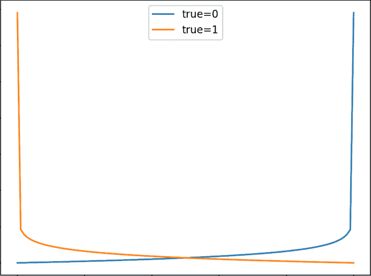

图 26.1：使用对数损失评估预测的线图。

模型技能以测试数据集中预测结果的平均对数损失来报告。作为一个平均值，我们可以预期，在平衡数据集上该分数是合适的，而当测试集中两个类别之间存在严重不平衡时，该分数会具有误导性。这是因为预测0或很小的概率会导致很小的损失。我们可以通过比较在平衡数据集和不平衡数据集上预测不同恒定概率时的损失值分布来证明这一点。首先，下面的示例对一个包含50个类别0和类别1样本的平衡数据集，以0.1为增量预测从0.0到1.0的值。

```python
# plot impact of log loss with balanced datasets
from sklearn.metrics import log_loss
from matplotlib import pyplot
# define an imbalanced dataset
testy = [0 for x in range(50)] + [1 for x in range(50)]
# loss for predicting different fixed probability values
predictions = [0.0, 0.1, 0.2, 0.3, 0.4, 0.5, 0.6, 0.7, 0.8, 0.9, 1.0]
losses = [log_loss(testy, [y for x in range(len(testy))]) for y in predictions]
# plot predictions vs loss
pyplot.plot(predictions, losses)
pyplot.show()
```

清单 26.2：绘制平衡数据集对数损失变化的示例。

运行该示例，我们可以看到，模型最好预测那些不尖锐（接近边缘）并回到分布中间的概率值。以尖锐概率犯错所受的惩罚非常大。

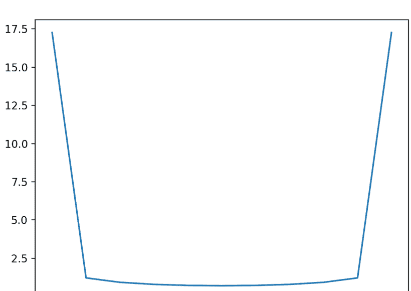

图 26.2：平衡数据集的对数损失预测线图。

我们可以使用类别0与类别1比例为10:1的不平衡数据集重复此实验。

```python
# plot impact of log loss with imbalanced datasets
from sklearn.metrics import log_loss
from matplotlib import pyplot
# define an imbalanced dataset
testy = [0 for x in range(100)] + [1 for x in range(10)]
# loss for predicting different fixed probability values
predictions = [0.0, 0.1, 0.2, 0.3, 0.4, 0.5, 0.6, 0.7, 0.8, 0.9, 1.0]
losses = [log_loss(testy, [y for x in range(len(testy))]) for y in predictions]
# plot predictions vs loss
pyplot.plot(predictions, losses)
pyplot.show()
```

清单 26.3：绘制不平衡数据集对数损失变化的示例。

在这里，我们可以看到，偏向于预测非常小概率的模型会表现出色，而且这种表现是乐观的。预测恒定概率0.1的朴素模型将是需要打败的基线模型。结果表明，在不平衡数据集的情况下，使用对数损失评估的模型技能应谨慎解释，或许应根据数据集中类别1的基础比率进行调整。

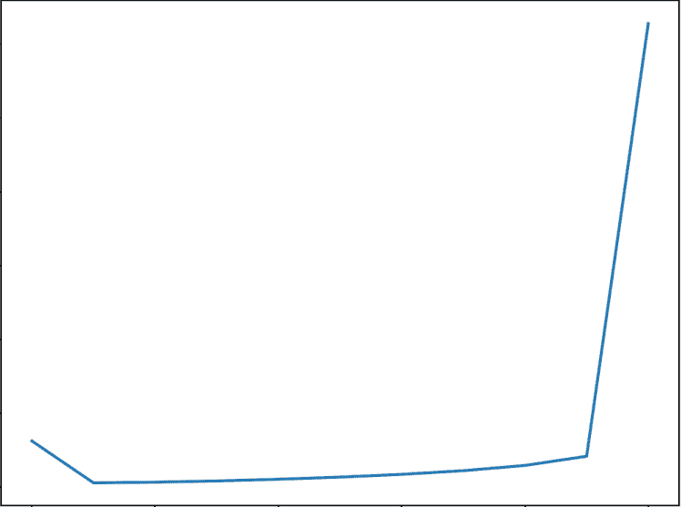

图 26.3：不平衡数据集的对数损失预测线图。

## 26.3 布里尔分数

布里尔分数以格伦·布里尔（Glenn Brier）的名字命名，计算预测概率与期望值之间的均方误差。该分数总结了概率预测中误差的大小。误差分数始终在0.0到1.0之间，其中具有完美技能的模型得分为0.0。距离期望概率越远的预测会受到惩罚，但惩罚不如对数损失那么严重。模型技能可以概括为对测试数据集所预测的所有概率的平均布里尔分数。

可以使用scikit-learn中的`brier_score_loss()`函数在Python中计算布里尔分数。该函数以真实类别值（0，1）和测试数据集中所有样本的预测概率作为参数，返回平均布里尔分数。我们可以通过比较单一概率预测的布里尔分数来评估预测误差的影响，这些预测的误差从0.0到1.0递增。完整的示例如下所示。

```python
# plot impact of brier for single forecasts
from sklearn.metrics import brier_score_loss
from matplotlib import pyplot
# define an imbalanced dataset
testy = [0 for x in range(50)] + [1 for x in range(50)]
# brier score for predicting different fixed probability values
predictions = [0.0, 0.1, 0.2, 0.3, 0.4, 0.5, 0.6, 0.7, 0.8, 0.9, 1.0]
losses = [brier_score_loss(testy, [y for x in range(len(testy))]) for y in predictions]
# plot predictions vs loss
pyplot.plot(predictions, losses)
pyplot.show()
```

清单 26.5：绘制平衡数据集布里尔分数变化的示例。

运行该示例，我们可以看到，模型最好预测诸如0.5之类的中间概率值。与对数损失在接近概率时相当平坦不同，抛物线形状显示了随着误差增加，分数惩罚的明显二次增长。

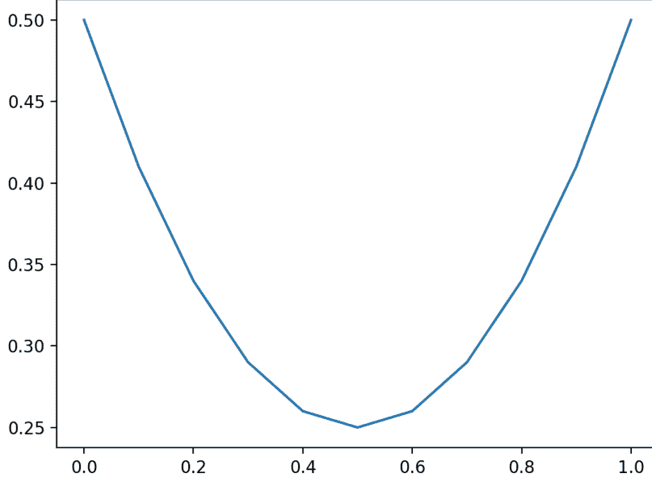

图 26.5：平衡数据集的布里尔分数预测线图。

我们可以使用类别0与类别1比例为10:1的不平衡数据集重复此实验。

```python
# plot impact of brier score with imbalanced datasets
from sklearn.metrics import brier_score_loss
from matplotlib import pyplot
# define an imbalanced dataset
testy = [0 for x in range(100)] + [1 for x in range(10)]
# brier score for predicting different fixed probability values
predictions = [0.0, 0.1, 0.2, 0.3, 0.4, 0.5, 0.6, 0.7, 0.8, 0.9, 1.0]
losses = [brier_score_loss(testy, [y for x in range(len(testy))]) for y in predictions]
# plot predictions vs loss
pyplot.plot(predictions, losses)
pyplot.show()
```

清单 26.6：绘制不平衡数据集布里尔分数变化的示例。

运行该示例，我们会看到不平衡数据集的情况非常不同。与平均对数损失一样，平均布里尔分数在不平衡数据集上会呈现乐观的分数，奖励那些减少了多数类误差的小预测值。在这些情况下，布里尔分数应与朴素预测相对比较（例如，少数类的基础比率或上述示例中的0.1），或者通过朴素分数进行归一化。后一种做法很常见，被称为布里尔技能分数（BSS）。

$$BSS = 1 - \left(\frac{BS}{BS_{ref}}\right)\qquad (26.1)$$

其中$BS$是模型的布里尔技能，$BS_{ref}$是朴素预测的布里尔技能。布里尔技能分数报告了概率预测相对于朴素预测的相对技能。对scikit-learn API的一个良好改进将是向`brier_score_loss()`添加一个参数，以支持布里尔技能分数的计算。

```python
from sklearn.linear_model import LogisticRegression
from sklearn.model_selection import train_test_split
from sklearn.metrics import roc_curve
from matplotlib import pyplot
# generate 2 class dataset
X, y = make_classification(n_samples=1000, n_classes=2, random_state=1)
# split into train/test sets
trainX, testX, trainy, testy = train_test_split(X, y, test_size=0.5, random_state=2)
# fit a model
model = LogisticRegression(solver='lbfgs')
model.fit(trainX, trainy)
# predict probabilities
probs = model.predict_proba(testX)
# keep probabilities for the positive outcome only
probs = probs[:, 1]
# calculate roc curve
fpr, tpr, thresholds = roc_curve(testy, probs)
# plot no skill
pyplot.plot([0, 1], [0, 1], linestyle='--')
# plot the roc curve for the model
pyplot.plot(fpr, tpr)
# show the plot
pyplot.show()
```

清单 26.7：绘制预测ROC曲线的示例。

运行该示例会生成一条ROC曲线，可以与主对角线上的无技能线进行比较。ROC曲线将在第27章中更详细地介绍。

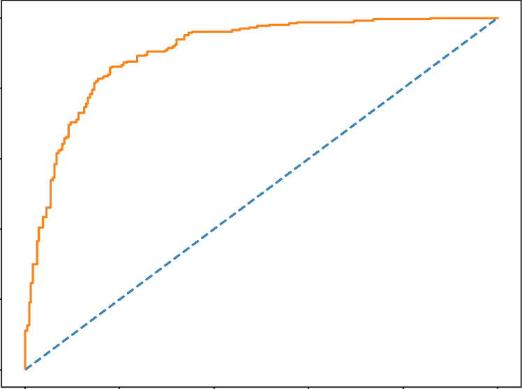

图 26.7：二分类预测的ROC曲线示例。

ROC曲线下的积分面积，称为AUC或ROC AUC，提供了模型在所有评估阈值上的技能度量。AUC分数为0.5表示没有技能，例如沿对角线的曲线，而AUC为1.0表示完美技能，所有点沿左侧y轴和顶部x轴朝向左上角。AUC为0.0表示预测完全错误。面积较大的模型预测在所有阈值上具有更好的技能，尽管不同模型之间的曲线具体形状会有所不同，这可能提供了通过预先选择的阈值来优化模型的机会。通常，阈值由操作者在模型准备好之后选择。

可以使用scikit-learn中的`roc_auc_score()`函数在Python中计算AUC。该函数以真实输出值列表和预测概率作为参数，返回ROC AUC。AUC分数衡量的是产生预测的模型将随机选择的正例排在随机选择的负例之上的可能性。具体而言，即真实事件（*类别 = 1*）的概率高于真实非事件（*类别 = 0*）的概率。这是一个有启发性的定义，提供了两个重要的直觉：

- **朴素预测。** 在ROC AUC下，朴素预测是任意恒定概率。如果对每个样本都预测相同的概率，则无法区分正例和负例，因此该模型没有技能（AUC=0.5）。


- **对类别不平衡不敏感。** ROC AUC 是模型在不同阈值下正确区分单个示例的能力的汇总。因此，它不关心每个类别的基础可能性。

下面，演示 ROC 曲线的示例已更新以计算并显示 AUC。

```python
# roc auc
from sklearn.datasets import make_classification
from sklearn.linear_model import LogisticRegression
from sklearn.model_selection import train_test_split
from sklearn.metrics import roc_auc_score
# generate 2 class dataset
X, y = make_classification(n_samples=1000, n_classes=2, random_state=1)
# split into train/test sets
trainX, testX, trainy, testy = train_test_split(X, y, test_size=0.5, random_state=2)
# fit a model
model = LogisticRegression(solver='lbfgs')
model.fit(trainX, trainy)
# predict probabilities
probs = model.predict_proba(testX)
# keep probabilities for the positive outcome only
probs = probs[:, 1]
# calculate roc auc
auc = roc_auc_score(testy, probs)
print(auc)
```

Listing 26.8: 计算预测的 ROC AUC 的示例。

运行该示例会计算并打印在 500 个新示例上评估的逻辑回归模型的 ROC AUC。

```text
0.9028205128205128
```

Listing 26.9: 计算预测的 ROC AUC 的示例输出。

在选择 ROC AUC 时，一个重要的考虑因素是它并不能概括模型的特定判别能力，而是概括所有阈值下的一般判别能力。它可能更适合用于模型选择，而不是量化模型预测概率的实际技能。

## 26.5 进一步阅读

本节如果您想深入了解该主题，则提供更多资源。

### 26.5.1 API

- sklearn.metrics.log_loss API.
  http://scikit-learn.org/stable/modules/generated/sklearn.metrics.log_loss.html
- sklearn.metrics.brier_score_loss API.
  http://scikit-learn.org/stable/modules/generated/sklearn.metrics.brier_score_loss.html
- sklearn.metrics.roc_curve API.
  http://scikit-learn.org/stable/modules/generated/sklearn.metrics.roc_curve.html
- sklearn.metrics.roc_auc_score API.
  http://scikit-learn.org/stable/modules/generated/sklearn.metrics.roc_auc_score.html

### 26.5.2 文章

- 评分规则，维基百科。
  https://en.wikipedia.org/wiki/Scoring_rule
- 交叉熵，维基百科。
  https://en.wikipedia.org/wiki/Cross_entropy
- Brier 分数，维基百科。
  https://en.wikipedia.org/wiki/Brier_score
- 接收器操作特征，维基百科。
  https://en.wikipedia.org/wiki/Receiver_operating_characteristic

## 26.6 摘要

在本教程中，您发现了三种可用于评估分类预测建模问题中预测概率的指标。具体来说，您学习了：

- 对远离其预期值的预测概率施加重罚的对数损失分数。
- 比对数损失温和但仍按与预期值的距离成比例进行惩罚的 Brier 分数
- ROC 曲线下面积，概括了模型对真阳性案例预测概率高于真阴性案例的可能性。

### 26.6.1 下一步

在下一个教程中，您将了解如何使用 ROC 和 Precision-Recall 曲线评估预测概率。

## 第 27 章

## 何时使用 ROC 曲线和 Precision-Recall 曲线

在分类问题中，预测观测值属于每个类别的概率而不是直接预测类别可能更灵活。这种灵活性来自于概率可以通过不同的阈值来解释，从而使模型的操作者能够在模型产生的错误中权衡关注点，例如假阳性数量与假阴性数量的比较。当使用一种错误成本超过其他类型错误成本的模型时，这是必需的。两种有助于解释二元（两类）分类预测建模问题的概率预测的诊断工具是 ROC 曲线和 Precision-Recall 曲线。在本教程中，您将了解 ROC 曲线、Precision-Recall 曲线以及何时使用它们来解释二元分类问题的概率预测。完成本教程后，您将知道：

- ROC 曲线概括了使用不同概率阈值时预测模型的真正例率与假正例率之间的权衡。
- Precision-Recall 曲线概括了使用不同概率阈值时预测模型的真正例率与阳性预测值之间的权衡。
- 当观测值在各类别之间平衡时，ROC 曲线是合适的，而 precision-recall 曲线适用于不平衡的数据集。

开始吧。

## 27.1 教程概述

本教程分为 6 部分；它们是：

- 1. 预测概率
- 2. 什么是 ROC 曲线？
- 3. Python 中的 ROC 曲线和 AUC
- 4. 什么是 Precision-Recall 曲线？
- 5. Python 中的 Precision-Recall 曲线和 AUC
- 6. 何时使用 ROC 与 Precision-Recall 曲线？

## 27.2 预测概率

在分类问题中，我们可能会决定直接预测类别值。或者，预测每个类别的概率可能更灵活。原因是为了提供选择甚至校准阈值以解释预测概率的能力。例如，默认值可能是使用 0.5 的阈值，这意味着 [0.0, 0.49] 范围内的概率为负结果（0），而 [0.5, 1.0] 范围内的概率为正结果（1）。该阈值可以调整以针对特定问题调整模型的行为。一个例子是减少一种或另一种类型的错误。当为二元或两类分类问题做出预测时，我们可能会犯两种类型的错误。

- **假阳性**。在没有事件时预测事件。
- **假阴性**。在实际上有事件时预测没有事件。

通过预测概率并校准阈值，模型的操作者可以选择这两种关注点的平衡。例如，在烟雾预测系统中，我们可能更关心低假阴性而不是低假阳性。假阴性意味着在实际上是高烟雾日时没有发出烟雾日警告，导致无法采取预防措施的公众出现健康问题。假阳性意味着公众会在不需要时采取预防措施。比较预测两类问题概率的模型的常用方法是使用 ROC 曲线。

## 27.3 什么是 ROC 曲线？

预测二元结果概率时有用的工具是接收器操作特征曲线，或 ROC 曲线。它是 0.0 到 1.0 之间多个候选阈值值的假正例率（x 轴）与真正例率（y 轴）的图。换句话说，它绘制了误报率与命中率。真正例率计算为真阳性数量除以真阳性数量与假阴性数量之和。它描述了模型在实际结果为阳性时预测阳性类别的好坏。

True Positive Rate = True Positives / (True Positives + False Negatives) (27.1)

真正例率也称为灵敏度。

Sensitivity = True Positives / (True Positives + False Negatives) (27.2)

假正例率计算为假阳性数量除以假阳性数量与真阴性数量之和。它也称为误报率，因为它概括了在实际结果为负时预测为阳性类别的频率。

False Positive Rate = \frac{\text{False Positives}}{\text{False Positives} + \text{True Negatives}} \quad (27.3)

假正例率也称为倒置特异性，其中特异性为真阴性总数除以真阴性数量与假阳性数量之和。

Specificity = \frac{\text{True Negatives}}{\text{True Negatives} + \text{False Positives}} \quad (27.4)

其中：

False Positive Rate = 1 − Specificity \quad (27.5)

ROC 曲线因以下几个原因是有用的工具：

- 不同模型的曲线可以在一般情况下或针对不同阈值直接比较。
- 曲线下面积（AUC）可用于作为模型技能的汇总。

曲线的形状包含大量信息，包括我们可能最关心的问题、预期的假正例率和假阴性率。为了明确这一点：

- 图中 x 轴上的较小值表示假阳性更低且真阴性更高。
- 图中 y 轴上的较大值表示真阳性更高且假阴性更低。

如果你感到困惑，请记住，当我们预测二元结果时，它要么是正确预测（真阳性），要么不是（假阳性）。这些选项之间存在紧张关系，同样适用于真阴性和假阴性。一个熟练的模型平均会为随机选择的真实阳性出现分配比阴性出现更高的概率。这就是我们所说的模型具有技能时的含义。一般来说，熟练的模型由向上弯曲到图顶部左侧的曲线表示。

无技能的模型表示为点（0.5, 0.5）。在每个阈值下无技能的模型由从图左下角到右上角的对角线表示，AUC 为 0.5。具有完美技能的模型表示为点（0,1）。具有完美技能的模型由从图左下角到左上角然后沿顶部到右上角的线表示。操作员可以绘制最终模型的 ROC 曲线并选择一个阈值，以在假阳性和假阴性之间获得理想的平衡。


## 27.4 Python 中的 ROC 曲线和 AUC

我们可以使用 `roc_curve()` scikit-learn 函数（在第 26 章中介绍）在 Python 中绘制模型的 ROC 曲线。该函数同时接收测试集中的真实结果（0、1）和预测为 1 类的概率。该函数返回每个阈值对应的假正率和真正率。

```python
...
# calculate roc curve
fpr, tpr, thresholds = roc_curve(y, probs)
```

代码清单 27.1：计算 ROC 曲线的示例。

可以使用 `roc_auc_score()` 函数计算 ROC 的 AUC。与 `roc_curve()` 函数一样，AUC 函数同时接收测试集中的真实结果（0、1）和预测为 1 类的概率。对于无技能和完美技能的情况，该函数分别返回介于 0.0 和 1.0 之间的 AUC 分数。

```python
...
# calculate ROC AUC
auc = roc_auc_score(y, probs)
print('AUC: %.3f' % auc)
```

代码清单 27.2：计算 ROC AUC 分数的示例。

下面列出了一个完整示例，用于在一个小型测试问题上计算逻辑回归模型的 ROC 曲线和 ROC AUC。

```python
# roc curve and auc
from sklearn.datasets import make_classification
from sklearn.linear_model import LogisticRegression
from sklearn.model_selection import train_test_split
from sklearn.metrics import roc_curve
from sklearn.metrics import roc_auc_score
from matplotlib import pyplot
# generate 2 class dataset
X, y = make_classification(n_samples=1000, n_classes=2, random_state=1)
# split into train/test sets
trainX, testX, trainy, testy = train_test_split(X, y, test_size=0.5, random_state=2)
# generate a no skill prediction (majority class)
ns_probs = [0 for _ in range(len(testy))]
# fit a model
model = LogisticRegression(solver='lbfgs')
model.fit(trainX, trainy)
# predict probabilities
lr_probs = model.predict_proba(testX)
# keep probabilities for the positive outcome only
lr_probs = lr_probs[:, 1]
# calculate scores
ns_auc = roc_auc_score(testy, ns_probs)
lr_auc = roc_auc_score(testy, lr_probs)
# summarize scores
print('No Skill: ROC AUC=%.3f' % (ns_auc))
print('Logistic: ROC AUC=%.3f' % (lr_auc))
# calculate roc curves
ns_fpr, ns_tpr, _ = roc_curve(testy, ns_probs)
lr_fpr, lr_tpr, _ = roc_curve(testy, lr_probs)
# plot the roc curve for the model
pyplot.plot(ns_fpr, ns_tpr, linestyle='--', label='No Skill')
pyplot.plot(lr_fpr, lr_tpr, marker='.', label='Logistic')
# axis labels
pyplot.xlabel('False Positive Rate')
pyplot.ylabel('True Positive Rate')
# show the legend
pyplot.legend()
# show the plot
pyplot.show()
```

代码清单 27.3：计算并绘制预测概率 ROC 曲线的示例。

运行该示例会输出 ROC 曲线下面积。

```text
No Skill: ROC AUC=0.500
Logistic: ROC AUC=0.903
```

代码清单 27.4：根据预测概率计算 ROC AUC 的示例输出。

运行该示例会输出逻辑回归模型以及无技能分类器的 ROC AUC，后者对所有示例都只预测 0。

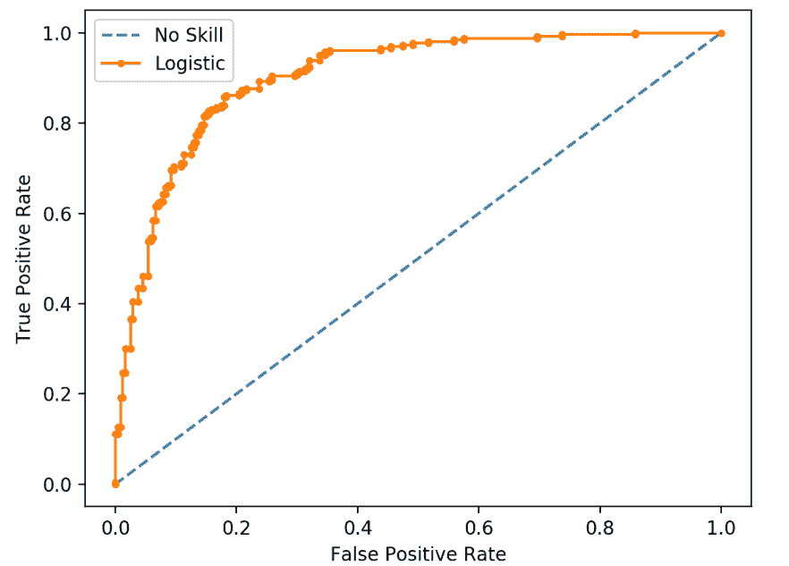

图 27.1：预测概率 ROC 曲线的折线图。

## 27.5 什么是精确率-召回率曲线？

评估预测模型技能的方法有很多。在信息检索这一相关领域中（根据查询查找文档），一种方法是衡量精确率和召回率。这些指标对于应用机器学习中评估二分类模型同样有用。精确率是真阳性数量除以真阳性和假阳性数量之和的比值。它描述了模型预测正类的能力。精确率也称为阳性预测值。

阳性预测值 = 真阳性 /（真阳性 + 假阳性）  (27.6)

或者：

精确率 = 真阳性 /（真阳性 + 假阳性）  (27.7)

召回率是真阳性数量除以真阳性和假阴性数量之和的比值。召回率与敏感度以及真正率相同。

召回率 = 真阳性 /（真阳性 + 假阴性）  (27.8)

或者：

敏感度 = 真阳性 /（真阳性 + 假阴性）  (27.9)

其中：

召回率 ≡ 敏感度  (27.10)

在两个类别的观测值数量不平衡的情况下，同时查看精确率和召回率很有用。具体来说，就是无事件（类别 0）的示例很多，而事件（类别 1）的示例很少。之所以如此，是因为类别 0 示例通常数量较多，这意味着我们不太关注模型正确预测类别 0 的能力，例如较高的真阴性率。计算精确率和召回率的关键在于，这些计算不使用真阴性。它们只关注对少数类（类别 1）的正确预测。

精确率-召回率曲线绘制了不同阈值下的精确率（y 轴）和召回率（x 轴），与 ROC 曲线非常相似。无技能分类器无法区分类别，在所有情况下都会随机预测一个类别或预测一个固定类别。无技能线会根据正类与负类的分布而变化。它是一条水平线，其值等于数据集中正类案例所占的比例。对于平衡数据集，该值为 0.5。

具有完美技能的模型表示为点 (1,1)。具有较强技能的模型表示为一条朝向 (1,1) 弯曲、位于无技能水平线之上的曲线。此外，还有一些综合分数试图概括精确率和召回率；其中两个示例包括：

- **F 度量或 F1 分数**：计算精确率和召回率的调和平均值（之所以使用调和平均值，是因为精确率和召回率都是比值）。

```python
# fit a model
model = LogisticRegression(solver='lbfgs')
model.fit(trainX, trainy)
# predict probabilities
lr_probs = model.predict_proba(testX)
# keep probabilities for the positive outcome only
lr_probs = lr_probs[:, 1]
# predict class values
yhat = model.predict(testX)
lr_precision, lr_recall, _ = precision_recall_curve(testy, lr_probs)
lr_f1, lr_auc = f1_score(testy, yhat), auc(lr_recall, lr_precision)
# summarize scores
print('Logistic: f1=%.3f auc=%.3f' % (lr_f1, lr_auc))
# plot the precision-recall curves
no_skill = len(testy[testy==1]) / len(testy)
pyplot.plot([0, 1], [no_skill, no_skill], linestyle='--', label='No Skill')
pyplot.plot(lr_recall, lr_precision, marker='.', label='Logistic')
# axis labels
pyplot.xlabel('Recall')
pyplot.ylabel('Precision')
# show the legend
pyplot.legend()
# show the plot
pyplot.show()
```

代码清单 27.8：计算并绘制预测概率精确率-召回率曲线的示例。

运行该示例首先会输出逻辑回归模型的 F1 分数和曲线下面积（AUC）。

```text
Logistic: f1=0.841 auc=0.898
```

代码清单 27.9：根据预测概率计算精确率-召回率 AUC 的示例输出。

随后会创建精确率-召回率曲线图，展示逻辑回归模型（橙色）与无技能模型（蓝色）在每个阈值下的精确率和召回率。

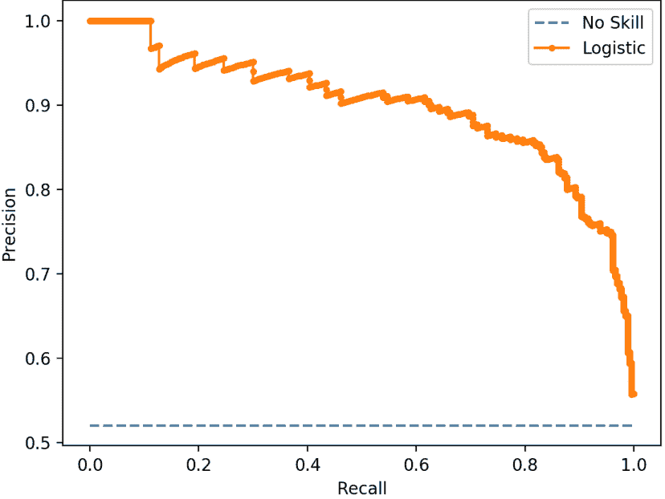

图 27.2：预测概率精确率-召回率曲线的折线图。

## 27.7 何时使用 ROC 曲线，何时使用精确率-召回率曲线？

通常，ROC 曲线和精确率-召回率曲线的使用方式如下：

- 当每个类别的观测值数量大致相等时，应使用 ROC 曲线。
- 当类别存在中度到严重不平衡时，应使用精确率-召回率曲线。

之所以提出这一建议，是因为在类别不平衡的数据集上，ROC 曲线会对模型呈现出过于乐观的评价。

> 然而，如果类别分布存在严重偏斜，ROC 曲线可能会对算法的性能呈现过于乐观的看法。[…] 精确率-召回率（PR）曲线通常用于信息检索，对于类别分布严重偏斜的任务，有研究将其作为 ROC 曲线的替代方案。
>
> ——*《精确率-召回率曲线与 ROC 曲线的关系》，2006 年。*

有些人更进一步认为，在不平衡数据集上使用 ROC 曲线可能具有误导性，并会导致对模型技能产生错误的解释。


## 27.8.2 API
- sklearn.metrics.roc_curve API.
  http://scikit-learn.org/stable/modules/generated/sklearn.metrics.roc_curve.html
- sklearn.metrics.roc_auc_score API.
  http://scikit-learn.org/stable/modules/generated/sklearn.metrics.roc_auc_score.html
- sklearn.metrics.precision_recall_curve API.
  http://scikit-learn.org/stable/modules/generated/sklearn.metrics.precision_recall_curve.html
- sklearn.metrics.auc API.
  http://scikit-learn.org/stable/modules/generated/sklearn.metrics.auc.html
- sklearn.metrics.average_precision_score API.
  http://scikit-learn.org/stable/modules/generated/sklearn.metrics.average_precision_score.html
- Precision-Recall，scikit-learn.
  http://scikit-learn.org/stable/auto_examples/model_selection/plot_precision_recall.html
- Precision, recall and F-measures，scikit-learn.
  http://scikit-learn.org/stable/modules/model_evaluation.html

## 27.8.3 文章
- 维基百科上的接收器操作特征。
  https://en.wikipedia.org/wiki/Receiver_operating_characteristic
- 维基百科上的敏感性和特异性。
  https://en.wikipedia.org/wiki/Sensitivity_and_specificity
- 维基百科上的精确率和召回率。
  https://en.wikipedia.org/wiki/Precision_and_recall
- 维基百科上的信息检索。
  https://en.wikipedia.org/wiki/Information_retrieval
- 维基百科上的 F1 分数。
  https://en.wikipedia.org/wiki/F1_score

## 27.9 摘要

在本教程中，你了解了 ROC 曲线、精确率-召回率曲线，以及在解释二元分类问题概率预测时何时使用每一种。具体来说，你学习了：

- ROC 曲线总结了使用不同概率阈值时预测模型在真正例率和假正例率之间的权衡。
- 精确率-召回率曲线总结了使用不同概率阈值时预测模型在真正例率和阳性预测值之间的权衡。
- 当观测值在各类别之间平衡时，ROC 曲线是合适的，而精确率-召回率曲线适用于不平衡的数据集。

### 27.9.1 下一步

在下一个教程中，你将了解如何校准分类预测模型预测的概率。

## 第28章

## 如何校准预测概率

与其直接为分类问题预测类别值，预测观测值属于每个可能类别的概率会更方便。预测概率提供了一些灵活性，包括决定如何解释概率、用不确定性呈现预测，以及提供更细致的方式来评估模型的技能。

与每个类别的预期概率分布相匹配的预测概率被称为已校准。问题是，并非所有机器学习模型都能够预测已校准的概率。有方法可以诊断预测概率的校准程度，并更好地将预测概率与每个类别的观测分布进行校准。通常，这可以带来更好的预测质量，这取决于评估模型技能的方式。在本教程中，你将发现校准预测概率的重要性，以及如何诊断和改进用于概率分类的模型的校准。完成本教程后，你将知道：

- 非线性机器学习算法通常预测未校准的类别概率。
- 可靠性图可用于诊断模型的校准情况，并且可以使用方法更好地校准问题的预测。
- 如何在 Python 中使用 scikit-learn 开发可靠性图并校准分类模型。

让我们开始吧。

### 28.1 教程概述

本教程分为四个部分；它们是：

- 1. 预测概率
- 2. 预测的校准
- 3. 如何在 Python 中校准概率
- 4. 校准 SVM 概率的工作示例

### 28.2 预测概率

分类预测建模问题需要为给定的观测值预测或预报标签。一种替代直接预测标签的方法是，模型可以预测观测值属于每个可能类别标签的概率。这在预测的解释和呈现方式（阈值选择和预测不确定性）以及模型评估方式上都提供了一些灵活性。虽然模型可能能够预测概率，但概率的分布和行为可能与训练数据中观测到的预期概率分布不匹配。

这在使用复杂非线性机器学习算法时尤其常见，这些算法不直接进行概率预测，而是使用近似。概率的分布可以调整以更好地匹配数据中观测到的预期分布。这种调整被称为校准，即模型的校准或类别概率分布的校准。

> ... 我们希望估计的类别概率能够反映样本的真实潜在概率。也就是说，预测的类别概率（或类似概率的值）需要是良好校准的。为了良好校准，概率必须有效地反映所关注事件的真实可能性。
> 
> — 第 249 页，*《应用预测建模》*，2013。

### 28.3 预测的校准

校准概率有两个关注点；它们是诊断预测概率的校准情况以及校准过程本身。

### 28.3.1 可靠性图（校准曲线）

可靠性图是观测到的相对频率（y 轴）与预测概率频率（x 轴）的线图。

> 可靠性图是说明概率预报系统属性的常用辅助工具。它们由观测相对频率与预测概率的图组成，在调整概率预报系统时提供快速的视觉比较，并记录最终产品的性能
> 
> — *《提高可靠性图的可靠性》*，2007。

具体来说，预测概率沿 x 轴被划分为固定数量的桶。然后对每个 bin 中的事件数（*类别 = 1*）进行计数（例如相对观测频率）。最后，对计数进行归一化。然后将结果绘制为线图。这些图在预报文献中通常被称为*可靠性图*，尽管也可能被称为*校准图*或曲线，因为它们总结了预报概率校准得有多好。预报校准得越好或越可靠，点就会越接近从左下到右上的主对角线。点或曲线相对于对角线的位置可以帮助解释概率；例如：

- **低于对角线：** 模型高估了；概率过大。
- **高于对角线：** 模型低估了；概率过小。

概率按定义是连续的，因此我们期望与该线有一些分离，通常显示为 *S* 形曲线，显示出悲观倾向，即低概率高估和高概率低估。

可靠性图提供了一种诊断来检查预报值 Xi 是否可靠。粗略地说，如果事件实际发生的观测相对频率与预报值一致，则概率预报是可靠的。

> — *《提高可靠性图的可靠性》*，2007。

可靠性图可以帮助理解不同预测模型预报的相对校准情况。

### 28.3.2 概率校准

预测模型做出的预测可以被校准。校准后的预测可能会（或可能不会）导致可靠性图上的校准改善。一些算法是以其预测概率已经校准的方式拟合的。不深入细节，逻辑回归就是这样一个例子。其他算法不直接产生概率预测，而必须近似概率预测。一些例子包括神经网络、支持向量机和决策树。这些方法预测的概率很可能未校准，并且可能通过校准进行修改而受益。

预测概率的校准是在预测模型做出预测后应用的重新缩放操作。校准概率有两种流行的方法；它们是 Platt Scaling 和等渗回归。Platt Scaling 更简单，适用于具有 *S* 形的可靠性图。等渗回归更复杂，需要大量数据（否则可能过拟合），但可以支持不同形状的可靠性图（是非参数的）。

当预测概率中的失真呈 sigmoid 形时，Platt Scaling 最有效。等渗回归是一种更强大的校准方法，可以纠正任何单调失真。不幸的是，这种额外的能力是有代价的。学习曲线分析表明，当数据稀缺时，等渗回归更容易过拟合，因此表现不如 Platt Scaling。

> — *《用监督学习预测良好概率》*，2005。

**注意，这非常重要：** 更好的校准概率可能并不总是导致更好的基于类别或基于概率的预测。这完全取决于用于评估预测的具体指标。事实上，一些实证结果表明，能够从校准预测概率中获益更多的算法包括 SVM、装袋决策树和随机森林。

… 校准后最好的方法是提升树、随机森林和 SVM。

> — *《用监督学习预测良好概率》*，2005。


预测是使用每个训练好的模型进行的。例如，下面是一个展示 API 用法的代码片段：

```python
...
# prepare data
trainX, trainy = ...
testX, testy = ...
# define base model
model = ...
# fit and calibrate model on training data
calibrator = CalibratedClassifierCV(model, cv=3)
calibrator.fit(trainX, trainy)
# evaluate the model
yhat = calibrator.predict(testX)
```

清单 28.3: 使用交叉验证校准概率的 API 示例。

`CalibratedClassifierCV` 类支持两种类型的概率校准；具体来说，可通过 `method` 参数指定的参数化 ‘sigmoid’ 方法（Platt’s method）和非参数化 ‘isotonic’ 方法。

## 28.5 校准 SVM 概率的工作示例

我们可以通过一些实际示例使校准的讨论更具体。在这些示例中，我们将对一个噪声二分类问题拟合支持向量机（SVM），并使用该模型预测概率，然后使用可靠性图检查校准情况并校准分类器并查看结果。SVM 是一个很好的校准候选模型，因为它本身并不原生预测概率，这意味着概率通常未校准。

**关于 SVM 的说明：** 可以通过在拟合模型上调用 `decision_function()` 函数而不是通常的 `predict_proba()` 函数来预测概率。概率未归一化，但在调用 `calibration_curve()` 函数时通过将 `normalize` 参数设置为 `True` 可以进行归一化。下面示例在测试问题上拟合 SVM 模型，预测概率，并将概率的校准情况绘制为可靠性图，

```python
# SVM reliability diagram
from sklearn.datasets import make_classification
from sklearn.svm import SVC
from sklearn.model_selection import train_test_split
from sklearn.calibration import calibration_curve
from matplotlib import pyplot
# generate 2 class dataset
X, y = make_classification(n_samples=1000, n_classes=2, weights=[1,1], random_state=1)
# split into train/test sets
trainX, testX, trainy, testy = train_test_split(X, y, test_size=0.5, random_state=2)
# fit a model
model = SVC(gamma='scale')
model.fit(trainX, trainy)
# predict probabilities
probs = model.decision_function(testX)
# reliability diagram
fop, mpv = calibration_curve(testy, probs, n_bins=10, normalize=True)
# plot perfectly calibrated
pyplot.plot([0, 1], [0, 1], linestyle='--')
# plot model reliability
pyplot.plot(mpv, fop, marker='.')
pyplot.show()
```

清单 28.4: 绘制预测概率可靠性图的示例。

运行该示例会创建可靠性图，显示 SVM 预测概率的校准情况（实线）与沿着绘图对角线的完美校准模型（虚线）相比。我们可以看到保守预测的预期 S 形曲线。

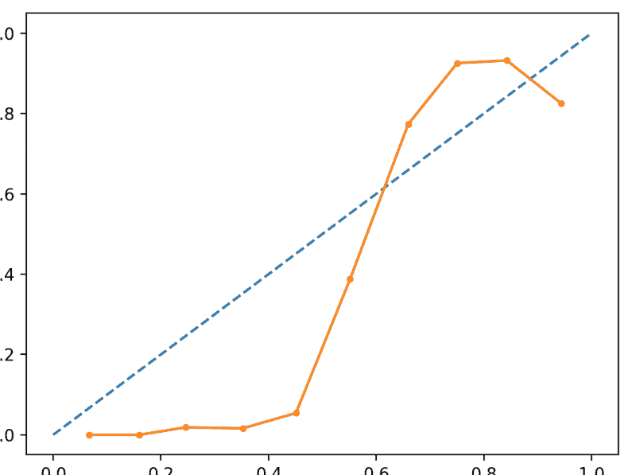

图 28.1: 未校准 SVM 可靠性图的绘图。

我们可以更新示例，使用 CalibratedClassifierCV 类通过 5 折交叉验证拟合 SVM，使用保留集来校准预测概率。完整示例如下所示。

```python
# SVM reliability diagram with calibration
from sklearn.datasets import make_classification
from sklearn.svm import SVC
from sklearn.calibration import CalibratedClassifierCV
from sklearn.model_selection import train_test_split
from sklearn.calibration import calibration_curve
from matplotlib import pyplot
# generate 2 class dataset
X, y = make_classification(n_samples=1000, n_classes=2, weights=[1,1], random_state=1)
# split into train/test sets
trainX, testX, trainy, testy = train_test_split(X, y, test_size=0.5, random_state=2)
# fit a model
model = SVC(gamma='scale')
calibrated = CalibratedClassifierCV(model, method='sigmoid', cv=5)
calibrated.fit(trainX, trainy)
# predict probabilities
probs = calibrated.predict_proba(testX)[:, 1]
# reliability diagram
fop, mpv = calibration_curve(testy, probs, n_bins=10, normalize=True)
# plot perfectly calibrated
pyplot.plot([0, 1], [0, 1], linestyle='--')
# plot calibrated reliability
pyplot.plot(mpv, fop, marker='.')
pyplot.show()
```

清单 28.5: 绘制校准后概率可靠性图的示例。

运行该示例会创建校准后概率的可靠性图。校准后概率的形状不同，更紧密地贴合对角线，尽管在上象限仍存在低估。视觉上，该图表明模型校准更好。

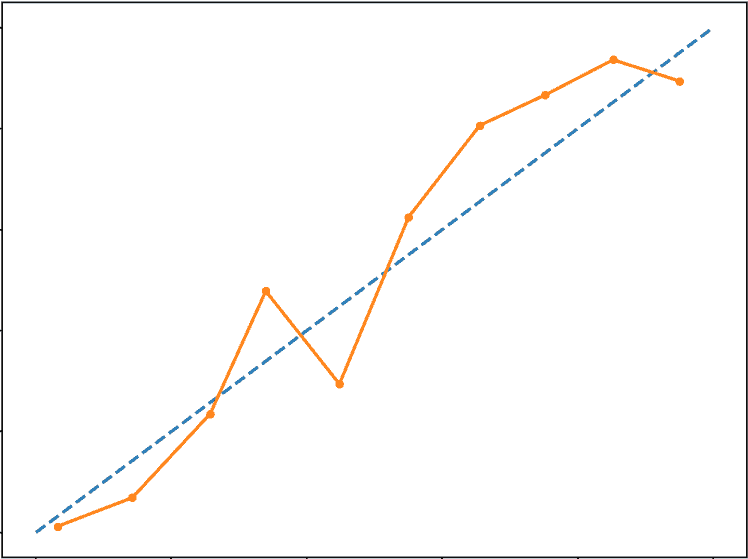

图 28.2: 校准后 SVM 可靠性图的绘图。

我们可以通过在同一绘图上包含两个可靠性图，使两种模型之间的对比更明显。完整示例如下所示。

```python
# SVM reliability diagrams with uncalibrated and calibrated probabilities
from sklearn.datasets import make_classification
from sklearn.svm import SVC
from sklearn.calibration import CalibratedClassifierCV
from sklearn.model_selection import train_test_split
from sklearn.calibration import calibration_curve
from matplotlib import pyplot

# predict uncalibrated probabilities
def uncalibrated(trainX, testX, trainy):
    # fit a model
    model = SVC(gamma='scale')
    model.fit(trainX, trainy)
    # predict probabilities
    return model.decision_function(testX)

# predict calibrated probabilities
def calibrated(trainX, testX, trainy):
    # define model
    model = SVC(gamma='scale')
    # define and fit calibration model
    calibrated = CalibratedClassifierCV(model, method='sigmoid', cv=5)
    calibrated.fit(trainX, trainy)
    # predict probabilities
    return calibrated.predict_proba(testX)[:, 1]

# generate 2 class dataset
X, y = make_classification(n_samples=1000, n_classes=2, weights=[1,1], random_state=1)
# split into train/test sets
trainX, testX, trainy, testy = train_test_split(X, y, test_size=0.5, random_state=2)
# uncalibrated predictions
yhat_uncalibrated = uncalibrated(trainX, testX, trainy)
# calibrated predictions
yhat_calibrated = calibrated(trainX, testX, trainy)
# reliability diagrams
fop_uncalibrated, mpv_uncalibrated = calibration_curve(testy, yhat_uncalibrated, n_bins=10, normalize=True)
fop_calibrated, mpv_calibrated = calibration_curve(testy, yhat_calibrated, n_bins=10)
# plot perfectly calibrated
pyplot.plot([0, 1], [0, 1], linestyle='--', color='black')
# plot model reliabilities
pyplot.plot(mpv_uncalibrated, fop_uncalibrated, marker='.')
pyplot.plot(mpv_calibrated, fop_calibrated, marker='.')
pyplot.show()
```

清单 28.6: 绘制未校准和校准后概率可靠性图的示例。

运行该示例会创建单个可靠性图，同时显示校准后（橙色）和未校准（蓝色）概率。这并不是真正意义上的苹果对苹果比较，因为校准模型做出的预测实际上是五个子模型的组合。尽管如此，我们确实看到了校准后概率可靠性方面的明显差异（很可能是校准过程造成的）。

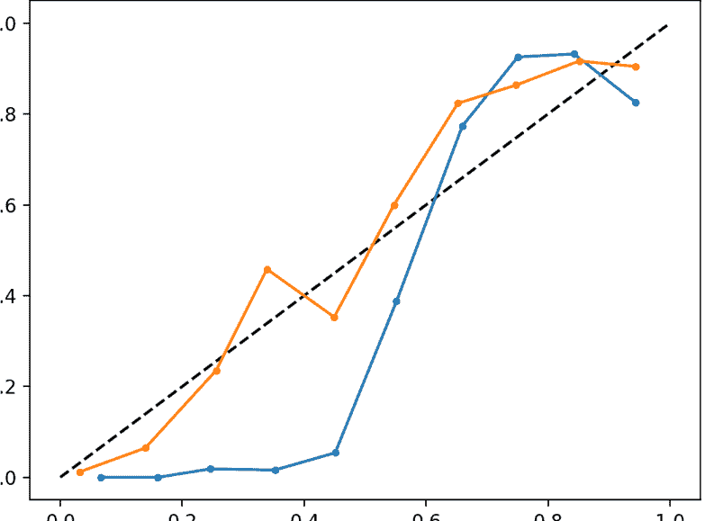

图 28.3: 校准后和未校准 SVM 可靠性图的绘图。

## 28.6 进一步阅读

本节提供了更多资源，如果您想深入了解该主题。

### 28.6.1 书籍和论文

- *应用预测建模*, 2013.
  https://amzn.to/2kXE35G
- *使用监督学习预测良好概率*, 2005.
  https://www.cs.cornell.edu/~alexn/papers/calibration.icml05.crc.rev3.pdf
- *从决策树和朴素贝叶斯分类器中获得校准概率估计*, 2001.
  http://cseweb.ucsd.edu/~elkan/calibrated.pdf
- *提高可靠性图的可靠性*, 2007.
  https://journals.ametsoc.org/doi/abs/10.1175/WAF993.1


### 28.6.2 API

- `sklearn.calibration.CalibratedClassifierCV` API。
  <http://scikit-learn.org/stable/modules/generated/sklearn.calibration.CalibratedClassifierCV.html>
- `sklearn.calibration.calibration_curve` API。
  <http://scikit-learn.org/stable/modules/generated/sklearn.calibration.calibration_curve.html#sklearn.calibration.calibration_curve>
- 概率校准，scikit-learn用户指南。
  <http://scikit-learn.org/stable/modules/calibration.html>
- 概率校准曲线，scikit-learn。
  <http://scikit-learn.org/stable/auto_examples/calibration/plot_calibration_curve.html>
- 分类器校准的比较，scikit-learn。
  <http://scikit-learn.org/stable/auto_examples/calibration/plot_compare_calibration.html>

### 28.6.3 文章

- 维基百科上的校准（统计学）。
  <https://en.wikipedia.org/wiki/Calibration_(statistics)>
- 维基百科上的概率分类。
  <https://en.wikipedia.org/wiki/Probabilistic_classification>

## 28.7 总结

在本教程中，你了解了校准预测概率的重要性，以及如何诊断和改进用于概率分类的模型的校准。具体来说，你学会了：

- 非线性机器学习算法通常会预测未经校准的类别概率。
- 可靠性图可用于诊断模型的校准情况，并且可以使用方法更好地校准针对某个问题的预测。
- 如何在Python中使用scikit-learn开发可靠性图并校准分类模型。

### 28.7.1 下一步

这是本部分的最后一个教程。在下一部分中，你将发现更多资源。

## 第九部分：附录

## 附录A：获取帮助

这只是你概率学习之旅的开始。当你开始着手项目并扩展对技术的现有知识时，可能需要帮助。本附录指出了一些最好的帮助来源。

### A.1 维基百科上的概率

维基百科是一个很好的起点。所有重要主题都有覆盖，描述简洁，公式一致且可读。所缺少的是更人性化的描述，比如类比和直觉。不过，当你对概率有疑问时，我建议先到维基百科看看。一些不错的入门高级页面包括：

- 概率，维基百科。
  <https://en.wikipedia.org/wiki/Probability>
- 概率论，维基百科。
  <https://en.wikipedia.org/wiki/Probability_theory>
- 概率主题列表，维基百科。
  <https://en.wikipedia.org/wiki/List_of_probability_topics>
- 概率论文章目录，维基百科。
  <https://en.wikipedia.org/wiki/Catalog_of_articles_in_probability_theory>
- 概率与统计中的记号，维基百科。
  <https://en.wikipedia.org/wiki/Notation_in_probability_and_statistics>

### A.2 概率教科书

我强烈建议购买一本好的概率主题教科书并作为参考。一本好教科书的好处是，你所需的各种运算的说明将是（或应该是）一致的。教科书的缺点是它们可能非常昂贵。一本好教科书通常很容易识别，因为它会成为顶尖大学一系列本科或研究生课程的基础。

我推荐的一些概率入门教科书包括：

- *概率论：科学的逻辑*，2003年。
  <https://amzn.to/21nw2pp>
- *概率导论*，第2版，2019年。
  <https://amzn.to/2xPvobK>
- *概率导论*，第2版，2008年。
  <https://amzn.to/211A3PR>

我还推荐阅读关于概率和统计的科普读物。它们为这些方法提供了良好的背景和直觉。以下是一些推荐：

- *赤裸裸的统计学：从数据中剥离恐惧*，2014年。
  <http://amzn.to/2t7yXdV>
- *醉汉的脚步：随机性如何主宰我们的生活*，2009年。
  <http://amzn.to/2CT4rUD>
- *信号与噪声：为什么如此多的预测会失败——但有些不会*，2015年。
  <http://amzn.to/2FQdYyX>

### A.3 概率与机器学习

有不少从概率视角介绍机器学习的教科书。这些书可能很有帮助，但确实假设你具备一定的概率和线性代数背景。我愿意推荐以下几本概率视角的机器学习书籍：

- *机器学习：概率视角*，2012年。
  <https://amzn.to/2xKSTCP>
- *模式识别与机器学习*，2006年。
  <https://amzn.to/2JwHE7I>
- *机器学习*，1997年。
  <https://amzn.to/2jWd51p>

### A.4 提问关于概率的问题

鉴于当前问答平台的数量众多，你可以在网上很多地方提问关于概率的问题。下面是我推荐的几个最佳提问去处。请记住在发帖前搜索你的问题，以防它之前已经被问过并回答过。

- 数学Stack Exchange上的概率标签。
  <https://math.stackexchange.com/?tags=probability>
- Cross Validated。
  <https://stats.stackexchange.com>
- Stack Overflow上的概率标签。
  <https://stackoverflow.com/questions/tagged/probability>
- Quora上的概率。
  <https://www.quora.com/topic/Probability-statistics-1>
- 概率理论子版块。
  <https://www.reddit.com/r/probabilitytheory/>

### A.5 如何提问

知道去哪里获取帮助是第一步，但你需要知道如何充分利用这些资源。以下是一些可以使用的提示：

- 将你的问题精简到最简单的形式。例如，不要提出类似“我的模型不工作”或“x如何工作”这样宽泛的问题。
- 在提问前搜索答案。
- 提供完整的代码和错误信息。
- 将你的代码精简到能够展示问题的最小可运行示例。

### A.6 联系作者

你并不孤单。如果你对概率或本书中的教程有任何疑问，请直接联系我。我会尽力帮助你。

**Jason Brownlee**  
`Jason@MachineLearningMastery.com`

## 附录B：如何在工作站上设置Python

在某些平台上安装Python机器学习环境可能很困难。必须首先安装Python本身，然后还需要安装许多包，这对初学者来说可能会感到困惑。在本教程中，你将了解如何使用Anaconda搭建Python机器学习开发环境。

完成本教程后，你将拥有一个可用的Python环境，可以开始学习、练习和开发机器学习软件。这些说明适用于Windows、macOS和Linux平台。我将在macOS上进行演示，因此你可能会看到一些Mac对话框和文件扩展名。

### B.1 教程概述

在本教程中，我们将涵盖以下步骤：

1. 下载Anaconda
2. 安装Anaconda
3. 启动并更新Anaconda

注意：具体版本可能有所不同，因为软件和库更新频繁。

### B.2 下载Anaconda

在这一步中，我们将为你的平台下载Anaconda Python包。Anaconda是一个免费且易于使用的科学Python环境。

1. 访问Anaconda主页。
   <https://www.continuum.io/>
2. 从菜单中选择Anaconda，并点击Download进入下载页面。
   <https://www.continuum.io/downloads>


*图B.1：点击Anaconda和Download。*

3. 选择适合你平台（Windows、OSX或Linux）的下载：
   - 选择Python 3.6
   - 选择图形化安装程序

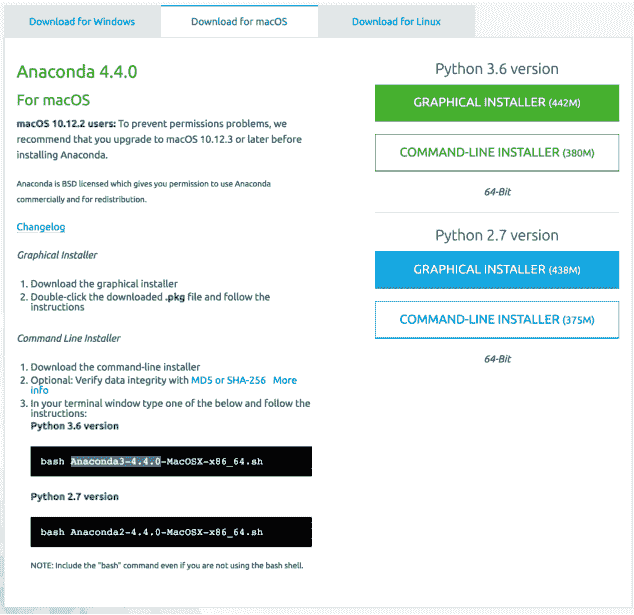

*图B.2：为你的平台选择Anaconda下载。*

这会将Anaconda Python包下载到你的工作站。我使用的是macOS，所以选择了macOS版本。该文件大约为426 MB。你应该会得到一个类似以下名称的文件：

```
Anaconda3-4.4.0-MacOSX-x86_64.pkg
```

清单B.1：macOS上的示例文件名。

### B.3 安装Anaconda

在这一步中，我们将在你的系统上安装Anaconda Python软件。此步骤假定你拥有在系统上安装软件的足够管理权限。

1. 双击下载的文件。
2. 按照安装向导操作。


图 B.4：Anaconda Python 安装向导写入文件。

安装应少于 10 分钟完成，并占用硬盘空间略多于 1 GB。

## B.4 启动和更新 Anaconda

在本步骤中，我们将确认您的 Anaconda Python 环境是最新的。Anaconda 附带一套名为 Anaconda Navigator 的图形化工具。您可以通过应用程序启动器打开它来启动 Anaconda Navigator。


图 B.5：Anaconda Navigator GUI。

稍后您可以使用 Anaconda Navigator 和图形化开发环境；目前，我建议从名为 conda 的 Anaconda 命令行环境开始。Conda 速度快、简单，错误信息难以隐藏，您可以快速确认环境已正确安装并正常工作。

- 1. 打开一个终端（命令行窗口）。
- 2. 通过输入以下命令确认 conda 是否正确安装：
- 3. 通过输入以下命令确认 Python 是否正确安装：

```
conda -V
```

清单 B.2：检查 conda 版本。

您应该会看到以下内容（或类似内容）：

```
conda 4.3.21
```

清单 B.3：conda 版本示例。

```
python -V
```

清单 B.4：检查 Python 版本。

您应该会看到以下内容（或类似内容）：

```
Python 3.6.1 :: Anaconda 4.4.0 (x86_64)
```

清单 B.5：Python 版本示例。

如果命令无法工作或出现错误，请查阅您平台的文档以获取帮助。参阅“进一步阅读”部分中的部分资源。

- 4. 确认您的 conda 环境是最新的，输入：

```
conda update conda
conda update anaconda
```

清单 B.6：更新 conda 和 anaconda。

您可能需要安装一些软件包并确认更新。

- 5. 确认您的 SciPy 环境。

下面的脚本将打印您进行机器学习开发所需的关键 SciPy 库的版本号，具体包括：SciPy、NumPy、Matplotlib、Pandas、Statsmodels 和 Scikit-learn。您可以输入 python 并直接输入命令。或者，我建议打开一个文本编辑器并将脚本复制粘贴到编辑器中。

```
# check library version numbers
# scipy
import scipy
print('scipy: %s' % scipy.__version__)
# numpy
import numpy
print('numpy: %s' % numpy.__version__)
# matplotlib
import matplotlib
print('matplotlib: %s' % matplotlib.__version__)
# pandas
import pandas
print('pandas: %s' % pandas.__version__)
# statsmodels
import statsmodels
print('statsmodels: %s' % statsmodels.__version__)
# scikit-learn
import sklearn
print('sklearn: %s' % sklearn.__version__)
```

清单 B.7：代码用于检查关键 Python 库是否已安装。

将脚本保存为名为：versions.py 的文件。在命令行中，将目录更改为您保存脚本的位置并输入：

```
python versions.py
```

清单 B.8：从命令行运行脚本。

您应该会看到如下输出：

```
scipy: 1.3.1
numpy: 1.17.1
matplotlib: 3.1.1
pandas: 0.25.1
statsmodels: 0.10.1
sklearn: 0.21.3
```

清单 B.9：versions 脚本的示例输出。

## 附录 C

### 基本数学符号

阅读机器学习方法的描述时，您无法避免数学符号。通常，只需要方程中的一个术语或一个符号片段就能完全破坏您对整个过程的理解。这可能极其令人沮丧，尤其是对于来自开发领域的机器学习初学者。如果您了解一些基本的数学符号领域以及在论文和书籍中处理机器学习方法描述的一些技巧，您可以取得很大进展。在本教程中，您将了解在阅读机器学习技术描述时可能遇到的数学符号的基础知识。完成本教程后，您将了解：

- 包括乘法变体、指数、根和对数的算术符号。
- 包括索引、求和和集合成员的序列和集合符号。
- 5 种如果您在数学符号上遇到困难可以用来求助的技术。

开始吧。

### C.1 教程概述

本教程分为 7 部分；它们是：

- 1. 对数学符号的挫败感
- 2. 算术符号
- 3. 希腊字母
- 4. 序列符号
- 5. 集合符号
- 6. 其他符号
- 7. 获取更多帮助的提示

### C.3.3 乘法符号

乘法是一种常见的符号，有几种简写形式。通常使用一个小“x”（×）或星号“*”来表示乘法：

$c = a \times b$  (C.1)

或者

$c = a * b$  (C.2)

您可能会看到点符号，例如：

$c = a \cdot b$  (C.3)

另外，您可能会看到没有运算符号且先前定义的术语之间没有空格分隔，例如：

$c = ab$  (C.4)

再次说明，这又是同样的意思。

### C.3.4 指数和平方根

指数是一个数的幂。符号写法为原数或底数，后面跟一个作为上标显示的第二个数或指数，例如：

$2^3$  (C.5)

这将被计算为 2 自乘 3 次或立方：

$2 \times 2 \times 2 = 8$  (C.6)

一个数被提高到 2 次幂称为其平方。

$2^2 = 2 \times 2 = 4$  (C.7)

一个数的平方可以通过计算平方根来反转。这使用一个数和上面带有勾号 $\sqrt{x}$ 的符号表示。

$\sqrt{4} = 2$  (C.8)

在这里，我们知道结果和指数，并希望找到底数。事实上，根运算可用于反转任何指数，只是默认的平方根假设指数为 2，由平方根勾号前的下标 2 表示。例如，我们可以通过取立方根来反转一个数的立方：

$2^3 = 8$  (C.9)

$\sqrt[3]{8} = 2$  (C.10)

### C.3.5 对数和 *e*

当我们把 10 提高到整数指数时，我们通常称之为数量级。

$10^2 = 10 \times 10$ (C.11)

逆转此运算的另一种方法是计算结果 100 的对数，假设底数为 10，在符号中写为 $\log10()$。

$\log10(100) = 2$ (C.12)

在这里，我们知道结果和底数，并希望找到指数。这使我们能够非常轻松地在数量级之间上下移动。鉴于计算机中使用二进制算术，假设底数为 2 的对数也很常用。例如：

$2^6 = 64$ (C.13)

$\log2(64) = 6$ (C.14)

另一个流行的对数是假设自然底数 *e*。*e* 是保留的，是一个特殊数字或常数，称为欧拉数（发音为 *oy-ler*），指的是具有几乎无限精度的值。

$e = 2.71828\cdots$ (C.15)

将 *e* 提高到幂称为自然指数函数：

$e^2 = 7.38905\cdots$ (C.16)

它可以使用自然对数求逆，表示为 $\ln()$：

$\ln(7.38905\cdots) = 2$ (C.17)

不详细说明，自然指数和自然对数在整个数学中都很有用，可用于抽象地描述某些系统的连续增长，例如指数增长的系统，如复利。

### C.4 希腊字母

希腊字母在数学符号中用于变量、常数、函数等。例如在统计学中，我们使用小写希腊字母 mu ($\mu$) 谈论均值，使用小写希腊字母 sigma ($\sigma$) 谈论标准差。在线性回归中，我们使用小写字母 beta ($\beta$) 谈论系数。等等。了解所有大写和小写希腊字母以及它们的发音很有用。当我还是研究生时，我打印了希腊字母表并贴在电脑显示器上，以便记忆。这是一个有用的技巧！下面是完整的希腊字母表。


## 序列乘法

序列上的乘法用大写希腊字母派 (Π) 表示。它与序列求和的指定方式相同，运算的开始和结束分别位于字母下方和上方。

$$\prod_{i=1}^{n} a_i$$ (C.19)

这是从第 1 个元素到第 n 个元素的序列 a 的乘积。

## C.6 集合记法

集合是一组唯一项。在机器学习中定义术语时，我们可能会看到集合记法的用法。

### C.6.1 数字集合

你可能会看到的一个常见集合是数字集合，例如一个术语被定义为在整数集合或实数集合之内。你可能会看到的一些常见数字集合包括：

- 所有自然数集合：ℕ
- 所有整数集合：ℤ
- 所有实数集合：ℝ

还有其他集合，参见 *维基百科上的特殊集合*²。我们在定义术语时经常谈论实值或实数，而不是浮点值，而浮点值实际上是计算机运算的离散构造。

### C.6.2 集合成员关系

在术语的定义中，常见到集合成员关系。集合成员关系用一个看起来像大写“E”的符号表示（∈）。

$$a \in \mathbb{R}$$ (C.20)

这意味着 a 被定义为集合 ℝ 或实数集合的成员。还有许多集合运算，其中两种常见的集合运算包括：

- 并集，或聚合：A ∪ B
- 交集，或重叠：A ∩ B

在维基百科³上了解更多关于集合的信息。

## 第 X 部分

## 结论

- 在训练机器学习算法时，能够自信地选择并使用损失函数和性能度量，并以对底层概率框架（如最大似然估计）的了解以及指标之间的关系（如交叉熵和负对数似然）为支撑。
- 能够自信地评估分类预测模型，包括建立性能的稳健基线、概率性能度量以及校准的预测概率。

天空没有极限。

## 感谢！

我想花点时间真诚地感谢你让我帮助你开启机器学习概率之旅。希望你继续学习，并在不断掌握机器学习的道路上玩得开心。

Jason Brownlee
2020
