# 编程：4本合1：Python 编程与快速入门、初学者机器学习指南、Python 机器学习

## 免费下载本书的有声书版本

如果您喜欢在途中听声书，我有一个好消息告诉您。您只需注册免费的 30 天 Audible 试用，即可免费下载本书的有声书版本！详情见下文！


### Audible 试用福利

作为 Audible 客户，您将在免费试用期间内获得以下福利：

- 本书免费 Audible 版
- 试用结束后，您每月将获得 1 个积分用于购买任何有声书
- 如果您未使用，积分将自动滚动到下个月
- 从 Audible 的 20 万多部作品中选择
- 使用 Audible App 在多个设备上随地收听
- 对任何不喜欢的有声书进行轻松、无忧的兑换
- 即使取消会员，也可以永久保留您的有声书
- 以及更多

点击下方链接开始！

**Audible 美国官网**

[https://www.audible.com/pd/B086VQWVSC/?source_code=AUDFPWS0223189MWT-BK-ACX0-190344&ref=acx_bty_BK_ACX0_190344_rh_us](https://www.audible.com/pd/B086VQWVSC/?source_code=AUDFPWS0223189MWT-BK-ACX0-190344&ref=acx_bty_BK_ACX0_190344_rh_us)

**Audible 英国官网**

[https://www.audible.co.uk/pd/B086VRHMJG/?source_code=AUKFrDlWS02231890H6-BK-ACX0-190344&ref=acx_bty_BK_ACX0_190344_rh_uk](https://www.audible.co.uk/pd/B086VRHMJG/?source_code=AUKFrDlWS02231890H6-BK-ACX0-190344&ref=acx_bty_BK_ACX0_190344_rh_uk)

**Audible 法国官网**

[https://www.audible.fr/pd/B086VRYFZ/?source_code=FRAORWS02231890H6-BK-ACX0-190344&ref=acx_bty_BK_ACX0_190344_rh_fr](https://www.audible.fr/pd/B086VRYFZ/?source_code=FRAORWS02231890H6-BK-ACX0-190344&ref=acx_bty_BK_ACX0_190344_rh_fr)

**Audible 德国官网**

[https://www.audible.de/pd/B086VSLDB/?source_code=EKAORWS02231890H6-BK-ACX0-190344&ref=acx_bty_BK_ACX0_190344_rh_de](https://www.audible.de/pd/B086VSLDB/?source_code=EKAORWS02231890H6-BK-ACX0-190344&ref=acx_bty_BK_ACX0_190344_rh_de)

- [费曼学习法](https://wiki.example.org/feynmans_learning_method) 灵感来自物理学诺贝尔奖得者**理查·费曼**（Richard Feynman）。

1. 凭借费曼技巧，你只需 `20 min` 就能深入理解这些知识点，而且记忆深刻且难以被忘记。

```
if (condVar > someVal) {console.log("xxx")}
```

# 时间戳

## 打印当前日期

## 时间对象

## 打印小时到微秒

## 日期时间对象

## 打印年份到分钟

## 使用 Timedelta

# 获取两个 Timedelta 对象之间的差

# 从 datetime 导入 Timedelta

## 秒级持续时长

# 在 Python 中格式化 datetime

# 从 `strptime()` 到 `datetime`

### 总结

## 结论

# Python 快速入门

## 引言

## 第 1 章：什么是 Python 语言？

### Python 的优势

### 易于操作

### 功能强大

### 拥有大量的库供使用

### 易于阅读

### 它是一门面向对象（OOP）的语言

## Python 语言基础

### Python 关键字

### 标识符命名

### 控制流基础

### Python 注释

### 变量

### 运算符

## 第 2 章：安装 Python 所需的所有知识

### 在 macOS 系统上安装

### Windows 操作系统

### Linux 系统

## 第 3 章：Python 变量与字符串

### Python 变量

### Python 字符串

## 第 4 章：处理 Python 运算符、元组和列表

### Python 运算符

### 算术运算符

### 比较运算符

### 逻辑运算符

### 赋值运算符

### 理解元组和列表

### 列表

### 元组

## 第 5 章：Python 函数

### 为什么自定义函数如此重要？

### 函数参数选项

### 编写函数

## 第 6 章：作为 OOP 语言的 Python 与类

### 如何编写类

### 访问控制

## 第 7 章：Python 中的条件语句

### If 语句

### If Else 语句

### Elif 语句

## 第 8 章：Python 循环

### While 循环

### For 循环

### 嵌套循环

## 第 9 章：处理自定义异常

### 如何抛出异常

### 如何定义自定义异常

## 第 10 章：Python 封装

### Getter 和 Setter

### 综合运用

### 注意事项

## 第 11 章：Python 数据库与字典及其使用方法

### Python 数据库

### Python 字典

## 第 12 章：在本语言中使用 GUI 和 CGI

### 熟悉 GUI

### 什么是 CGI？

## 结论

# 初学者机器学习

## 引言

## 第 1 章：机器学习简介

### 机器学习的发展

### 什么是机器学习？

### 人工智能的重要性

### 机器学习的应用

## 第 2 章：机器学习的类型

### 监督学习

### 无监督学习

### 强化学习

### 半监督机器学习

### 特征学习

### 稀疏字典学习

### 异常检测

### 关联规则学习

## 第 3 章：机器学习模型

### 决策树

### 神经网络

### 贝叶斯网络

### 支持向量

### 优化

## 第 4 章：概率模型

### 逻辑模型

### 几何模型

### 概率模型

### 概率方法

### 图形模型

### 贝叶斯网络

### 决策分类器

### 确定性梯度

### 随机技术

## 第 5 章：软计算

### 软计算组件

### 超平面之间的关系

### 误差规则如何找到正确答案

### 什么是感知器？

## 第 6 章：数据挖掘

### 数据挖掘在相关领域的应用

### 数据挖掘与其他领域的关系

### 主要数据挖掘软件

### 数据中的模式

### 简单统计方法

### 关联规则

## 第 7 章：机器学习数据集

### 数据

### 学习

### 建模

## 第 8 章：机器学习 VS 深度学习

### 深度学习

### 通过机器学习解决问题

### 注意事项

## 第 9 章：优缺点

### 机器学习的局限性

### 关于机器学习优缺点的注意事项

## 结论

# Python 机器学习

## 第 1 章：引言：机器学习的历史概述

### 机器学习的进化视角

## 第 2 章：机器学习的类型

### 机器学习分类

### 图解说明

### 强化学习算法

### 总结

## 第 3 章：Python 在机器学习中的应用

### Python 与人工智能及机器学习

### 在机器学习项目中使用 Python 模块的基础

### 在机器学习和人工智能中使用优势

### 总结

## 第 4 章：Python 机器学习核心库

### Scikit – Learn

### TensorFlow

### Theano

### Pandas

### Matplotlib

### Seaborn

### NumPy

### SciPy

### Keras

### PyTorch

### Scrapy

### Statsmodels

## 第 5 章：回归分析（线性回归与逻辑回归）

### 逻辑回归

### 逻辑回归与线性回归的区别

### 线性回归

### Python 中的线性回归

## 第 6 章：感知机

### 定义感知机

### 感知机技巧

### 使用感知机实现 OR 函数

### 线性代数的基础

### 计算两个向量的点积

### 两个向量之间的角度

### 使用感知机进行问题表示

### 使用感知机学习算法

### 评估上述更新规则的可行性

### 收敛性证明

## 结论

## 第 7 章：Python 编程实用平台

## 第 8 章：决策树

## 第 9 章：K 最近邻 (KNN)

### 在 K 最近邻算法中寻找 K 值

### K 最近邻与 K-Means 聚类的比较

### K 最近邻算法

### K-Means 算法

### KNN 与 KM 之间的区别

### K 最近邻算法的局限性

### K 最近邻的优点

### K 最近邻的缺点

## 第 10 章：Python 随机森林算法

### 决策树

### 随机森林

### 随机森林的优点

### 随机森林的缺点

### 如何执行随机森林算法

### 随机森林中的特征选择方法

### 平均不纯性减少

### 平均精度减少

### 总结

## 第 11 章：感知机算法

### 局限性与注意事项

## 结论

# 初学者 Python 编程

## 快速学习 Python 编程与编码语言 7 天实战指南（带练习）

## 引言

在这份 Python 初学者指南中，你将学习到：

* Python 编程最核心的基础。快速掌握这种语言，并将这些思想应用到你编写的任何代码中。
* 面向初者的 Python 有用功能——包括一些你可以应用于现实场景甚至其他程序的想法。
* Python 编程的不同机制：控制流、因子、记录/词典和类——以及为什么掌握这些核心标准对于 Python 的成功至关重要。
* 保护性组织编程、它对现代脚本语言的影响，以及为什么它能与众不同。

本书专门为新手和初学者编写。我们将带你走完你的首个程序的每一步，并在你测试和分析数据时，解释脚本的每个部分。

在普通的计算机程序中，公式是单独编写的指令组，计算机通过它们来确定结果并解决问题。相反，机器学习公式允许计算机只关注输入的数据，并使用经过的统计分析来交付特定概率范围内的正确值。这意味着计算机具有拆解简单数据模型的能力，能够根据输入的特定数据自动执行常规决策步骤。

市上有许多关于 Python 编程的书。非常感谢你选择这一本！请放心，我们采取了每一步措施以确保这本书包含尽可能实用的细节，请尽情阅读！

## 第一天

### 第一部分：引言


Python 是机器学习领域的一个极佳选择，原因有几。最重要的是，它乍一看是一种基础语言。无论你是否熟悉 Python，只要你曾经使用过任何具有类 C 语法的语言，就能上手。

其次，Python 拥有一个惊人的网络，这带来了极其优秀的文档以及 Stack Overflow（核心社区）中友好且详尽的解答。

第三，得益于庞大的网络，Python 有许多价值库（既有“内置电池”的也有第三方的），它们可以处理你遇到的几乎任何问题（包括机器学习）。

### Python 历史

Python 诞生于 20 世纪 80 年代后期。其创始人 Guido van Rossum 在 1989 年 12 月开始使用这种语言。他是 Python 已知的唯一创建者，他在语言增长和发展中不可替代的作用让他赢得了“终身仁慈独裁”的称号。它的创建是为了作为 ABC 语言的继承者。

下一个版本是 Python 2.0，于 2000 年 10 月发布，它具有重大的升级和新特性，包括循环区分的垃圾回收和对 Unicode 的后支持。幸运的是，这个特定版本使得语言的大幅改进过程变得更加简单且得到了社区的支持。

Python `3.0` 最初名为 `Py3K`。该版本在经过严格的测试期后，于 2008 年 12 月发布。这个特定的 Python 版本很难回滚到之前的兼容版本，这是最令人遗憾的点。然而，它的许多主要亮点已经回滚到了 `2.6` 或 `2.7` (Python) 版本，而且 Python `3` 的发布利用了其中的两个到三个工具，帮助实现 Python 脚本的自动化解析。

Python `2.7` 的过期日期原定于 2015 年，但由于未知原因，它被推迟到了 2020 年。众所周知，人们对数据无法回滚而是无法**向前**（roll FORWARD）迁移到新版本 Python `3` 这一点存在极大忧虑。2017 年，Google 宣布将对 `Python 2.7` 进行优化，以增强并发运行任务下的执行性能。

## Python 的基本特性


Python 是一种不言而喻且极其健壮的编程语言，基于面向对象，与 Ruby、Perl 和 Java 几乎相同。以下是 Python 的一些显著亮点：

- Python 使用丰富的结构、影响和组合方式，使得项目分析变得更加简单。
- 它配带了庞大的标准库，支持大量的简单编程命令，例如极其无缝的 Web 服务器连接、文件的处理和操作，以及使用常用表达式和命令进行文本搜索的能力。
- Python 易用的交互式界面使得测试短代码段变得非常简单。它还附带了 `IDLE`，这是一个“开发环境”。

## Python 的通用编程语言特性

1. 极其丰富的常用数据类型：浮点数、复数、无限长度整数、ASCII 字符串和 Unicode，以及各种字典和列表。
2. Python 运行在面向对象的框架下，具有多个类和继承机制。
3. Python 代码可以封装成不同的模块和包。由于允许捕获和抛出异常，Python 在处理错误方面以极其简洁而著称。
4. 信息是稳固且渐进组合的。混合不兼容的数据类型（例如将字符串和数字相加）会立即抛出异常，从而在更早阶段捕获到错误。
5. Python 拥有高级编码特性，如列表推导式和迭代器。

### 总结

- Python 通过包含像 `C` 或 `C++` 这样在源码执行的新模块实现了轻松扩展。
- Python 也可以插入到另一个应用程序中，提供一个易于编程的接口。

`IDE` 提供了一种编写和运行 Python 程序的方便方式。你也可以通过编写代码行并保存为 `.py` 扩展的文件来创建 Python 脚本，而不是使用 `IDE`。然而，使用 `IDE` 可以简化编写和运行 Python 程序的过程。`IDE` 的优势包括语法高亮、代码提示和语法检查等功能。`IDE` 执行大部分功能。

注意：

我们已经介绍了什么是 Python 语言、如何下载和安装 `Python`、`IDE` 的即时模式和脚本模式，以及什么是 `IDE`。

### 总结

- 可以从 `python.org` 的 `Python Software Foundation` 获取 `Python`。通常这涉及下载适用于你操作系统的安装程序并在你的机器上运行它。
- 某些操作系统（特别是 `Linux`）提供了可以运行以安装 `Python` 的`包管理器`。
- 在 `macOS` 上，安装 `Python` 的最佳方法是使用名为 `Homebrew` 的管理器。你将在相关章节中看到如何操作。

### 第 3 部分：变量

### Python 的第一个程序


其余插图将假设你正在 Windows 环境下运行 Python 程序。

1. 启动 `IDLE`
2. 导航到 File（文件）菜单并点击 New Window（新建窗口）
3. 输入：`print("Hello World!")`
4. 在文件菜单上点击 Save（保存）。输入名称 `myProgram1.py`
5. 导航到 Run（运行）并点击 Run Module（运行模块）来运行程序。

我们编写的第一个程序被称为 "Hello World!"，不仅用于介绍新的编程语言，还用于测试 `IDE` 的基本配置。程序的输出是 "Hello World!"。以下是发生的情况：`print()` 是一个内置函数，它是为你预写并预加载的，用于显示双引号内的任何内容。计算机将显示双引号内写的任何内容。

练习题：现在编写并运行以下 Python 程序：

- `print("I am now a Python Coder!")`
- `print("This is my second program!")`
- `print("I love the simplicity of Python")`
- `print("I will display whatever is here in quotes such as owhen2589gdb082")`

现在我们需要编写一个带有数字的程序，但在编写此类程序之前，我们需要学习关于`变量`和`类型`的知识。

记住 Python 是面向对象的，并且不是静态类型，这意味着我们不需要在使用变量之前对其进行声明，也不需要指定它们的类型。让我们解释这句话：面向对象的语言意味着该语言支持将现实生活中的场景视为一组可以链接和共享的组，模拟事物的自然顺序。并不是所有的编程语言都是面向对象的，例如 `Visual C` 语言就面向对象的。在编程中，声明变量意味着我们显式地说明变量的性质。变量可以声明为整数、长整数、短整数、浮点整数、字符串或字符，包括它是局部访问还是全局访问。变量是一个根据条件改变其值的存储位置。

例如，`number1` 可以取从 0 到无穷的任何数字。然而，如果我们显式指定 `int number1`，那么意味着存储位置只接受整数，而不接受分数（例如）。幸运或不幸的是，Python 不需要我们显式地说明存储位置的性质（声明变量），因为这交由 Python 语言本身去判断。

在处理变量类型和变量编写规则之前，让我们运行一个简单的程序来理解在编写 Python 程序时变量是什么。

- 启动 `IDLE`
- 导航到 File（文件）菜单并点击 New Window（新建窗口）
- 输入：

```
num1=4
num2=5
sum=num1+num2
print(sum)
```

- 在文件菜单上点击 Save（保存）。输入名称 `myProgram2.py`
- 导航到 Run（运行）并点击 Run Module（运行模块）来运行程序。

该程序的预期输出应该是不带双引号的 `"9"`

### 讨论

此时，你急于了解刚刚发生了什么，以及为什么 `print(sum)` 没有像我们写的第一个程序那样带有双引号。以下是解释。

第一行 `num1=4` 意味着变量 `num1`（我们对 `number1` 的简写，第一个数字）在程序运行之前已被赋值为 4。

第二行 `num2=5` 意味着变量 `num2`（我们对 `number2` 的简写，第二个数字）在程序运行之前已被赋值为 5。

第三行 `sum=num1+num2` 告诉计算机获取 `num1` 并加上 `num2`。

第四行 `print(sum)` 用于显示 `sum` 中包含的任何内容，只要它在双引号内（注：此处原文逻辑指代输出的内容）。

- 在编写变量时请使用描述性名称。例如，与 `yale` 或 `mything` 相比，使用变量名 `number1` 更具描述性。换句话说，我们可以写 `yale` 来给 `number1` 赋值，但这个名称并没有直接暗示我们正在做什么。记住在编写程序时，假设会有其他人来维护它们。那个人应该能够在运行程序之前，快速弄清楚程序的意图。
- 为了避免混淆，请避免使用大写 ‘O’、小写字母 ‘l’ 和大写字母 ‘I’，因为它们可能与数字混淆。换句话说，使用这些字母并没有违反变量规则，但将它们作为变量名会引起混淆。

### 练习题 1

重写以下变量名，使其 (1) 有效的变量名并 (2) 符合变量名命名规范。

- `23doctor`
- `line1`
- `Option3`
- `Mydesk`
- `#cup3`

### 练习题 2

编写/建议 (1) 有效且 (2) 符合的变量名。

- 你想对三个数字求和。
- 你想存储四个学生的名字。
- 你想在医院里存储五位医生的名字。

## Python 编程语言中的关键字和标识符

到这里，你可能在疑惑为什么必须以那种方式使用 `print` 和 `str`，而没有自由或知道为什么这些单词必须那样书写。`print` 和 `str` 构成了一类特殊的单词，它们必须始终那样写。每种编程语言都有自己的一的关键字。在大多数情况下，某些关键字出现在多种编程语言中。在 `python` 中，关键字对大小写敏感，这意味着我们必须始终以小写形式输入它们。关键字不能用于命名函数（我们稍后会解释）或变量名。

Python 中有 33 个关键字，除了 `None`、`False` 和 `True` 之外，全部都是小写的。它们必须始终按照下方所示的形式编写：

注意：`print()` 和 `str` 是函数，但它们是 Python 中的内置/预加载函数。函数是一组在调用时起作用的规则和方法。例如，`print` 函数在激活/触发/调用时将显示输出。此时，你还没有遇到所有的关键字，但你会逐渐遇到它们。花时间浏览、阅读并尝试尽可能多地回忆它们。

### 练习题

识别以下变量名中的错误（本练习需要回忆我们目前为止所学的内容）

- `for=1`
- `yield=3`
- `34ball`
- `m`

### 注释与语句

### Python 中的语句

Python 中的语句指的是 Python 解释器可以处理/执行的指令。例如 `str='I am Programmer'` 和 `number1=3`。带有等号（`=`）的语句被称为赋值语句。其他类型的语句，如 `if`、`while` 和 `for`， 将将在稍后处理。

### 练习题

- 编写一个 Python 语句，将第一个数字赋值为 `18`。
- 编写一个编程语句，将第二个数字赋值为 `21`。
- 上述的 `a` 和 `b` 是什么种类型的语句？

### 多行语句

可以将一个语句跨越多行。这种语句被称为多行语句。编程语句的结束由换行符表示。在 Python 中，为了将一个语句跨越几行，我们使用反斜杠（`\`）作为行续接符。多行语句的示例如下：

```python
sum=3+6+\
9+3+\
11+4
```

上面的示例也称为显式行续接。在 Python 中，方括号 `[]` 与圆括号 `()` 表示行续接，最后是大括号 `{}`。上面的示例可以重写为：

```python
sum=(3+6+
9+3+
11+4)
```

注意：当我们使用括号 `()` 时，我们去掉了被称为行续接符的反斜杠（`\`），因为括号已经完成了 `\` 正在做的工作。

问题：你为什么认为多行语句是必要的？我们明明可以直接写单行而程序也能正常运行？

答案：多行语句有助于整个程序的格式化/可读性。记住，在编写程序时，始终要假设会有其他人来使用和维护它。

### 练习题

使用多行运算符（如 `\`、`[]` 或 `{}`）重写以下程序语句，以提高程序的可读性。

- `total=2+9+3+6+8+2+5+1+14+5+21+26+4+7+13+31+24`
- `count=13+1+56+3+7+9+5+12+54+4+7+45+71+4+8`

在单行中创建多个语句时也使用分号。

### Python 中的缩进

缩进用于将 Python 代码行分组为块。Python 中的缩进量完全取决于程序员。然而，确保一致性很重要。按照惯例，使用四个空格而不是 Tab 键。

注意：我们稍后会解释这种缩进类型。

缩进还有助于让程序看起来整洁。缩进创建了一致性。然而，在执行行续接时缩进可以被忽略。错误的缩进会导致缩进错误。没有缩进的 Python 程序仍然运行，但从人类阅读的角度可能不整洁。

### Python 中的注释

在编写 Python 程序以及任何编程语言时，注释都是非常重要的。注释用于描述程序内部发生的情况。注释对程序员有用，因为人们可能会忘记编写程序的关键细节。在 Python 中编写注释前使用井号（`#`）符号。注释延伸到换行符。Python 解释器通常会忽略注释。注释是为了让程序员更好地理解程序。

### 示例

1. 启动 IDLE
2. 点击 File 菜单并 New Window
3. 输入以下：

```python
### 这是我的第一个注释
### 程序将打印 Hello World
print('Hello World') # 这是一个显示的内置函数
```

4. 在文件菜单点击 Save。命名为 `myProgram5.py`。

转到 Run 并点击 Module 运行程序。

### 练习题

这个练习整合了我们目前为止涵盖的大部分内容。

- 编写一个程序对数字 45 和 12 求和，并在每行代码包含单行注释。
- 编写一个程序显示两个员工的名字，第一个员工是 "Daisy"，第二个员工是 "Richard"。为每行代码包含单行注释。
- 编写一个程序显示学生的注册号，学生姓名及其注册分别为：`Yvonne=235`、`Ian=782`、`James=1235`、`Juliet=568`。

### 多行注释

就像多行程序语句一样，我们也有多行注释。编写多行注释有几种方法。第一方法是在每行注释的开始处输入井号（`#`）。

例如

```python
### 我将写一段很长的注释
### 注释将溢出到这一行
### 最后在这里结束。
```

编写多行注释的另一种方法是使用三引号或三引号：`'''` 或 `"""`。在 Python 的多行字符串和多行注释中，我们使用三引号。注意：当在文档字符串（docstrings）中使用时，它们会生成额外的代码，但在这种情况下我们不需要担心。

示例：

启动 IDLE。

导航到 `File`（文件）菜单并点击 `New Window`（新建窗口）。

输入以下内容：

```python
"""This is also a great i
illustration of
a multi-line comment in Python"""
```

### 总结

变量是用户在编写和运行 Python 程序之前指定的存储位置。变量名是这些存储位置的标签。变量根据情况持有不同的值。例如，`doctor1` 可以是 `Daniel`、`Brenda` 或 `Rita`。`Patient1` 可以是 `Luke`、`William` 或 `Kelly`。变量名的编写遵循规则和约定。规则是必须的，而约定是可选的，但建议遵守，因为它们有助于编写具有可读性的变量名。在编写程序时，你应该假设会有另外人在没有你输入的情况下检查或运行它，因此应该写得良好。下一章将讨论变量。在编程中，声明变量意味着我们显式地说明变量的性质。变量可以声明为 `integer`（整数）、`long integer`（长整数）、`short integer`（短整数）、`floating integer`（浮点整数）、`string`（字符串），或包括它是局部还是全局的字符。变量是一个根据条件改变值的存储位置。编写变量时，使用描述性的名称。

## 第二天

### 第 4 部分：Python 中的数据类型


### 数字

所示，Python 支持浮点、整数和复数。小数点的存在区分区分整数和浮点。例如，`4` 是整数，而 `4.0` 是浮点数。

另一方面，Python 中的复数表示为 `r+tj`，其中 `j` 代表实部，`t` 是虚部。在此背景下，使用 `type()` 函数来确定变量类型。调用 Python 函数 `instance()` 来判断源自哪个特定的类。

示例：

启动 IDLE。

导航到 `File`（文件）菜单并点击 `New Window`（新建窗口）。

输入以下内容：

```python
number=6
print(type(number))     #应该输出 class int
print(type(6.0))        #应该输出 class float
complex_num=7+5j
print(complex_num+5)
print(isinstance(complex_num, complex))  #应该输出 True
```

重要：Python 中的整数可以是无限长度的。Python 中的浮点数被认为精确到小数点后十五位。

### 数字转换

此部分假设你已经有了关于如何手动或使用计算器将十进制转换为二进制、八进制和十六进制的基础知识。查看 Windows 10 中的 `Windows Calculator`（Windows 计算器），版本 `10.1804.911.1000` 的 `Calculator`，并选择程序员模式进行自动转换。

程序员经常需要将十进制转换为八进制、十六进制和二进制形式。Python 中的前缀允许将这些数字表示为相应的类型。

| 进制系统 | 前缀 |
| :--- | :--- |
| 八进制 | `'0O'` 或 `'0o'` |
| 二进制 | `'0B'` 或 `'0b'` |
| 十六进制 | `'0X'` 或 `'0x'` |

示例：

```python
print(0b1010101)  #输出:85
print(0x7B+0b0101)  #输出: 128 (123+5)
print(0o710)        #输出:710
```

练习题

编写一个 Python 程序显示以下内容：

- `0011 1111`
- `7`
- `0`

### 类型转换

此部分假设你已经有了关于如何手动或使用计算器将十进制转换为二进制、八进制和十六进制的基础知识。查看 Windows 10 中的 `Windows Calculator`，版本 `10.1804.911.1000` 的 `Calculator`，并选择程序员模式进行自动转换。

程序员经常需要将十进制转换为八进制、十六进制和二进制形式。Python 中的前缀允许将这些数字表示为相应的类型。

| 进制系统 | 前缀 |
| :--- | :--- |
| 八进制 | `'0O'` 或 `'0o'` |
| 二进制 | `'0B'` 或 `'0b'` |
| 十六进制 | `'0X'` 或 `'0x'` |

示例：

```python
print(0b1010101)  #输出:85
print(0x7B+0b0101)  #输出: 128 (123+5)
print(0o710)        #输出:710
```

练习题

编写一个 Python 程序显示以下内容：

- `0011 1111`
- `7`
- `0`

### 类型转换

类型转换有时被称为强制类型转换，允许将一种类型转换为另一种。

示例：

启动 IDLE。

导航到 `File`（文件）菜单并点击 `New Window`（新建窗口）。

输入以下内容：

```python
int("4.5") # 会抛出 ValueError
float("4") # 应该输出 4.0
str(10)    # 应该输出 '10'
```


注意：使用`int()`转换浮点数会截断小数部分。

示例：

启动 IDLE。

导航到`File`（文件）菜单并点击`New Window`（新建窗口）。

输入以下内容：

```python
int(3.9) # 应该输出 3
```

注意：使用`float()`转换整数时会加上`.0`。

示例：

启动 IDLE。

导航到`File`（文件）菜单并点击`New Window`（新建窗口）。

输入以下内容：

```python
float(5) # 应该输出 5.0
```

注意：使用`complex()`转换整数会生成复数。

示例：

启动 IDLE。

导航到`File`（文件）菜单并点击`New Window`（新建窗口）。

输入以下内容：

```python
complex(1) # 应该输出 (1+0j)
```

## 练习题

编写一个 Python 程序执行以下转换：

* 将字符串转换为浮点数
* 将浮点数转换为整数
* 将整数转换为字符串

## 总结

类型转换有时被称为强制类型转换，允许将一种类型转换为另一种。

示例：

启动 IDLE。

导航到`File`（文件）菜单并点击`New Window`（新建窗口）。

输入以下内容：

```python
int("4.5") # 会抛出 ValueError
float("4") # 应该输出 4.0
str(10)    # 应该输出 '10'
```


*(注：由于用户提供的原始文本包含大量完全重复的章节（如“Number Conversion”、“Type Conversion”等部分多次出现），根据指令“一定不要重复输出原文”的原则，上述译文已合并了重复内容，确保输出的唯一性与逻辑性。)*


本部分假设你已经具备手动或使用计算器将十进制转换为二进制、八进制和十六进制的基础知识。可以查看 Windows 10 中的计算器，并选择程序员模式以自动转换。

程序员经常需要将十进制数转换为八进制、十六进制和二进制形式。Python 中的前缀允许将这些数字表示为对应的类型。

| 数字系统 | 前缀 |
| :--- | :--- |
| 八进制 | `'0O'` 或 `'0o'` |
| 二进制 | `'0B'` 或 `'0b'` |
| 十六进制 | `'0X'` 或 `'0x'` |

示例：

```python
print(0b1010101)  # 输出：85
print(0x7B+0b0101)  # 输出：128 (123+5)
print(0o710)        # 输出：456
```

练习

编写一个 Python 程序来显示以下内容：

* `0011 1111`
* `7`
* `0`

### 类型转换

类型转换有时被称为强制类型转换，允许将一种类型转换为另一种。

示例：

```python
int("4.5") # 会抛出 ValueError
float("4") # 应该输出 4.0
str(10)    # 应该输出 '10'
```

注意：使用 `int()` 转换浮点数会截断小数部分。

示例：

```python
int(3.9) # 应该输出 3
```

注意：使用 `float()` 转换整数时会加上 `.0`。

示例：

```python
float(5) # 应该输出 5.0
```

注意：使用 `complex()` 转换整数会生成复数。

示例：

```python
complex(1) # 应该输出 (1+0j)
```

练习

编写一个 Python 程序执行以下转换：

* 将字符串转换为浮点数
* 将浮点数转换为整数
* 将整数转换为字符串

- 如果你签署了电子邮件警报，你将频繁获得更新；否则你必须每天检查网站。
- 如果你对所有指控均认罪，你很可能会被定罪；否则，案件的胜负将取决于对证人和所提证据的交叉质询。

**注意**：当我们单独使用 `if` 语句而不使用 `else` 部分时，它只会在条件为真时进行打印/显示，它不会考虑替代情况，即第一个条件不存在的情况。

### 示例 1

启动 `IDLE`。

进入 `File` 菜单并点击 `New Window`。

输入以下内容：

```python
number=5
if number>0             #比较运算符
    print(number, "The number is a positive number")
```

### 讨论

该程序包含 `if` 条件，用于测试给定的数字是否满足 `if` 条件，即“它是否大于 0”。由于 `5` 大于零，条件成立，解释器允许执行下一个语句，即提取并显示包含字符串消息的数值。此程序中的测试条件是 `number>0`。但想想当条件不满足时会发生什么？让我们来看示例 2。

### 示例 2

启动 `IDLE`。

进入 `File` 菜单并点击 `New Window`。

输入以下内容：

```python
number=-9
if number>0:
    print(number, "This is a positive number")
```

### 讨论

该程序仅包含 `if` 语句，它通过测试 `-9` 是否大于零来测试表达式，由于它并不大于零，解释器不会执行后续的程序行。在现实生活中，你可能希望在第一个条件不满足时提供一个备选方案。此程序在执行时因为 `if` 条件未满足，将不会显示任何内容。此程序中的测试条件是 `number>0`。

### 练习

使用仅有的 `if` 语句编写 Python 程序来执行以下操作：

- 给定 `number=7`，编写一个程序测试并仅显示偶数。
- 给定 `number1=8`，`number2=13`，编写一个程序仅当总和小于 10 时显示。
- 给定 `count_int=57`，编写一个程序测试计数是否大于 45 并显示：“计数高于推荐值”。
- 给定 `marks=34`，编写一个程序测试分数是否小于 50 并显示消息：“分值低于平均水平”。
- 给定 `marks=78`，编写一个程序测试分数是否大于 50 并显示消息：“表现优秀”。
- 给定 `number=88`，编写一个程序测试数字是否为奇数并显示消息：“是的，这是一个奇数”。
- 给定 `number=24`，编写一个程序测试并显示该数字是否为偶数。
- 给定 `number=21`，编写一个程序测试数字是否为奇数并显示字符串：“是的，这是一个奇数”。

**注意**

`if` 表达式之后语句的执行只会在 `if` 表达式求值为 `True` 的情况下发生，否则语句将被忽略。

## Python 中的 if…else 语句

### if…else 语法

```python
if test condition:
    Statements 
else:
    Statements 
```

对 `if` 语句的解释：`if…else` 语句在测试条件为 `True` 的情况下执行 `if` 的体。如果 `if…else` 测试表达式求值为 `false`，则将执行 `else` 的体。程序块通过缩进表示。`if…else` 在代码中设置条件时提供了更大的灵活性。

### 示例

一个检查数字是正数还是负数的程序

启动 `IDLE`。

进入 `File` 菜单并点击 `New Window`。

输入以下内容：

```python
number=-56
if(number<0):
    print(number, "negative number")
else:
    print(number, "positive number")
```

### 练习

编写 Python 程序，使用 `if..else` 控制来执行以下操作：

- 给定 `number=9`，编写一个程序测试并显示为偶数。
- 给定 `marks=76`，编写一个程序测试并显示为偶数。
- 给定 `number=78`，编写一个程序测试并显示为偶数。
- 给定 `marks=27`，编写一个程序测试是否高于平均。

**挑战**：编写一个程序接受年龄，将其转换为整数，使用 `if…else` 检查是否未成年。

## Python 中的 if…elif…else 语句

现在考虑 `if…elif…else`，其中我们需要多个条件，而不仅仅是一个。缩进有助于提高可读性。

### if…elif…else 语法

```python
if test condition:
    Body of if
elif test condition:
    Body of elif
else:
    Body of else
```

记住 `elif` 允许多个选择。`if` 首先被求值，然后是 `elif`，`else` 是备选方案。

### 示例

启动 `IDLE`。

进入 `File` 菜单并点击 `New Window`。

输入以下内容：

```python
number_mine=87
if(number_mine>0):
    print(number_mine, "This is positive number")
elif(number_mine==0):
    print(number_mine, "The number is zero")
else:
    print(number_mine, "The number is negative")
```

## Python 中的嵌套 if 语句

有时会出现一个条件，但需要涵盖更多的子条件。这被称为嵌套。

### 示例

启动 `IDLE`。

进入 `File` 菜单并点击 `New Window`。

输入以下内容：

```python
my_charact=str(input("在此输入字符 'a', 'b' 或 'c':"))

if (my_charact='a'):
    if(my_charact='a'):
        print("a")
    else:
        if(my_charact='b'):
            print("b")
else:
    print("c")
```

### 练习

编写一个使用 `if..else` 控制程序。

## Python 中的 for 循环

缩进用于分离 Python 中 `for` 循环的体。

**注意**：简单列表采用以下语法：
`变量名=[用逗号分隔的值]`

### 示例

启动 `IDLE`。

进入 `File` 菜单并点击 `New Window`。

输入以下内容：

```python
numbers=[12, 3,18,10,7,2,3,1] #存储列表的变量名
sum=0                          #在使用前初始化，非常重要
for cumulative in numbers:     #遍历列表
    sum=sum+cumulative
print("The sum is", sum)
```

### 练习

启动 `IDLE`。

进入 `File` 菜单并点击 `New Window`。

编写一个 Python 程序，使用 `for` 循环求以下列表的和：

- `marks=[3, 8,19, 6,18,29,15]`
- `ages=[12,17,14,18,11,10,16]`
- `mileage=[15,67,89,123,76,83]`
- `cups=[7,10,3,5,8,16,13]`

# Python 中的 range() 函数

Python 中的 `range` 函数（`range()`）可以帮助生成数字。记住在编程中，第一个元素的索引为 0。因此，`range(11)` 将生成从 0 到 10 的数字。

### 示例

启动 `IDLE`。

导航到 `File` 菜单并点击 `New Window`。

输入以下内容：

```python
print(range(7))
```

输出将是 `0,1,2,3,4,5,6`

### 练习

在不编写和运行 Python 程序的情况下，以下内容的输出是什么：

- `range(16)`
- `range(8)`
- `range(4)`

# 使用 range()、len() 和索引

### 练习

编写一个 Python 程序来遍历以下列表，并包含消息“我听过”（每种音乐类型）。使用 `for` 循环、`len()` 和 `range()`。请参考之前关于语法的示例。

```python
folders=['Rumba', 'House', 'Rock']
```

# 使用带有 Else 的 for 循环

可以在 `for` 循环中包含 `else`，作为一种选项。当序列中的项被耗尽时，将执行 `else` 块。

### 示例

启动 `IDLE`。

导航到 `File` 菜单并点击 `New Window`。

输入以下内容：

```python
marks=[12, 15,17]
for i in marks:
    print(i)
else:
    print("No items left")
```

### 挑战

编写一个 Python 程序，打印 1 到 50 之间所有的质数。

# Python 中的 While 循环

在 Python 中，`while` 循环用于在测试条件保持为 `True` 的情况下迭代程序代码块。`while` 循环用于用户不知道循环次数的场景。如前面所示，`while` 循环体通过缩进来确定。

### 示例

启动 `IDLE`。

导航到 `File` 菜单并点击 `New Window`。

输入以下内容：

注意：忘记包含计数器的值将导致死循环。

### 练习

- 编写一个 Python 程序，利用 `while` 流控制语句显示从 1 到 10 所有奇数的和。
- 编写一个 Python 程序，采用 `while` 流控制语句显示从 11 到 21 所有数字的和。
- 编写一个 Python 程序，结合 `while` 流控制语句显示从 1 到 10 所有偶数的和。

# 使用带有 Else 的 While 循环

如果条件为假且没有发生 `break`，则运行 `while` 循环的 `else` 部分。

### 示例

启动 `IDLE`。

导航到 `File` 菜单并点击 `New Window`。

输入以下内容：

```python
track = 0
while track < 4:
    print("Within the loop")
    track = track + 1
else:
    print("Now within the else segment")
```

# Python 的 Break 和 Continue

让我们使用一个现实生活中的类比，即我们必须在迭代完全评估之前强制停止。想象一下当使用简单的字典攻击破解/破译密码时，该攻击会遍历所有可能的字符组合，你希望程序在命中搜索的密码时立即停止，而无需完成剩余循环。再次想象一下当使用恢复软件恢复不小心删除的照片时，你希望恢复在指定范围内找到项目时立即停止遍历文件。Python 中的 `break` 和 `continue` 语句的工作方式与之类似。

### 示例

启动 `IDLE`。

导航到 `File` 菜单并点击 `New Window`。

输入以下内容：

```python
for tracker in "bring":
    if tracker == "i":
        break
    print(tracker)
print("The End")
```

# Python 中的 Continue 语句

当使用 `continue` 语句时，解释器仅跳过当前迭代中循环内的剩余代码，而循环不会终止。循环将继续下一次迭代。

Python `continue` 的语法：

```python
continue
```

### 示例

启动 `IDLE`。

导航到 `File` 菜单并点击 `New Window`。

输入以下内容：

```python
for tracker in "bring":
    if tracker == "i":
        continue
    print(tracker)
```

输出将是：

```text
b
r
n
g
```

解释器中的 `continue` 语句仅跳过当前迭代中循环内的剩余代码，而循环不会终止。循环将继续下一次迭代。

# Python 中的 Pass 语句

`pass` 语句是一个空语句。它被用作语法需要但不需要执行操作的占位符。

Python `pass` 的语法：

```python
pass
```

### 示例

启动 `IDLE`。

导航到 `File` 菜单并点击 `New Window`。

输入以下内容：

```python
for tracker in "bring":
    if tracker == "i":
        pass
    print(tracker)
```

输出将是：

```text
b
r
i
n
g
```

`for` 循环提供了一种自动遍历列表的高效方法。在 Python 中，`for` 循环可以应用于文件、列表或字符串等。

### 示例

```python
for element in list_mine:
    print(element)
```

## 解释循环

`for` 循环会自动遍历 Python 的 `list`。

### 示例

```python
for element in list_mine:
    object_iter = iter(iterable)
    while True:
        try:
            element = next(object_iter)
        except StopIteration:
            break
```

## 在 Python 中创建自定义迭代器

另一方面，`__next__()` 会扫描并给出序列中的下一个元素，并在到达末尾时触发 `StopIteration` 异常。

### 示例

```python
class Power:
    """将实现 2 的幂"""
    def __init__(self, max=0):
        self.max = max

    def __iter__(self):
        self.m = 0
        return self

    def __next__(self):
        if self.m <= self.max:
            result = 2 ** self.m
            self.m += 1
            return result
        else:
            raise StopIteration
```


### 讨论

```python
for j in Power(5):
    print(j)
```

## 无限迭代器

可能存在需要持续迭代的情况。到目前为止，无限迭代器在耗尽可迭代项之前终止。`iter()` 是内置函数。通过提供两个参数触发方法。第一个参数作为哨兵（sentinel）。在函数返回值等于哨兵之前，迭代器将继续调用。

### 示例

```python
class Infinite:
    def __init__(self, sentinel):
        self.sentinel = sentinel
    def __iter__(self):
        self.m = 0
        return self
    def __next__(self):
        self.m += 1
        if self.m == self.sentinel:
            raise StopIteration
        return self.m

# 注意：以下代码会导致无限循环
# for j in Infinite():
### print(j)
```

### 讨论

`int()` 函数将总是返回 0。因此，调用 `iterate(int, 2)` 将返回一个当返回值等于 2 时停止的迭代器。由于这种情况不会发生，我们将得到一个无限迭代器。

### 示例

假设我们要显示所有奇数。

### 练习

编写一个 Python 程序，使用自定义迭代器显示所有偶数。

## Python 中的闭包

### 示例

```python
def printing(msg):
    def printers():
        print(msg)
    return printers

custom = printing("Welcome")
custom()
```

### 讨论

`printing()` 函数带有“Welcome”字符串被调用，产生了关联的对象。在 Python 中，通过这种方式绑定数据被称为闭包。即使变量离开了作用域，封装作用域中的值仍然被保留。

### 示例

```python
del printing
printing("Welcome")
```

### 注意

在 Python 中，闭包帮助提供有限形式的封装。闭包可以避免全局作用域的使用。闭包也可以用于提供面向对象的解决方案。

### 示例

```python
def product(n):
    def times(y):
        return y * n
    return times

multiply1 = product(13)
print(multiply1(15))
print(multiply1(19))
```

## 项目

### 1. 在 Python 中实现简单计算器

```python
def sum(m, n):
  return m + n

def minus(m, n):
  return m - n

def product(m, n):
  return m * n

def division(m, n):
  return m / n

print("选择操作：")
print("1.Sum")
print("2.Minus")
print("3.Product")
print("4.Division")

option = input("输入你的选择 (1/2/3/4):")
number1 = int(input("输入数字 1: "))
number2 = int(input("输入数字 2: "))

if option == '1':
  print(number1, number2)
elif option == '2':
  print(number1, number2)
elif option == '3':
  print(number1, number2)
elif option == '4':
  print(number1, number2)
else:
  print("无效的选择")
```

### 2. 返回任意数字因数的程序

```python
def factors(m):
    print(f"{m} 的因数：")
    for j in range(1, m + 1):
        if m % j == 0:
            print(j)

number = 4
factors(number)
```

### 总结

`for` 循环可以使用 `range` 或 `xrange` 遍历序列。`range` 和 `xrange` 的区别在于内存效率。

## 变量作用域和生命

函数内部定义的变量具有局部作用域，从外部不可见。只要函数执行，变量生命就是有效的。

### 示例

```python
def function_my():
    marks = 15
    print("函数内部的值:", marks)

function_my()
```

### 函数类型

它们被泛分为用户定义函数和内置函数。内置函数是解释器的一部分，而用户定义函数由用户指定。

## 函数参数

调用函数需要传递正确数量的参数，否则解释器将生成错误。

### 插图

```python
def salute(name, message):
    """此函数用提供的消息欢迎学生"""
    print("Welcome", name)

salute("Brenda","Lovely Day!")
```

注意：`salute()` 函数有两个参数。因为输入了两个参数，我们不会得到任何错误。让我们尝试用一个参数调用函数并看看会发生什么：

```python
salute("Brenda")
```

运行此程序将产生错误“TypeError: salute() missing 1 positional argument”。当向函数传递零参数时，也会发生相同的情况。

### 示例 2

```python
function()
```

解释器将生成错误“TypeError: function() missing 2 positional arguments”。

## Python 中的关键字参数

Python 提供了一种使用关键字参数调用函数的方法。使用关键字参数调用函数时，参数的顺序可以改变。函数的数值是位置匹配的。

注意：

在之前的示例函数中，当调用 `welcome("Brenda", "Lovely Day!")` 时，“Brenda”被赋值给参数 `name`，“Lovely Day!”赋值给 `msg`。

### 使用关键字调用函数

```python
welcome(name="Brenda", msg="Lovely Day!")
```

### 不遵循顺序的关键字

```python
welcome(msg="Lovely Day!", name="Brenda")
```

## 任意参数

有时我们并不知道需要传递到函数中的所有参数。类比：假设你正在编写一个程序来欢迎本学期的所有新学生。在这种情况下，你不知道有多少人报到。

### 示例

```python
def welcome(*names):
    """此欢迎函数欢迎 names 元组中的所有学生"""
    for name in names:
        print("Welcome", name)
```

```python
welcome("Lucy","Richard","Fridah","James")
```

程序的输出将是：

Welcome Lucy

Welcome Richard

Welcome Fridah

Welcome James

## Python 中的递归

用自身来定义某个事物被称为递归。递归函数会调用其他函数。

### 示例

计算整数阶乘的 Python 程序

### 练习题

编写一个 Python 程序来找到 `7` 的阶乘。

## Python 匿名函数

某些函数可以在不指定名称的情况下定义，这些被称为匿名函数。`lambda` 关键字用于表示匿名函数。在 Python 中，匿名函数也称为 `lambda` 函数。

## 语法

`lambda 参数: 表达式.`

Lambda 函数必须始终有一个表达式，但可以有多个参数。

### 示例

启动 IDLE。

导航到 File（文件）菜单并点击 New Window（新建窗口）。

输入以下内容：

```python
double = lambda y: y * 2

# 输出: 10
print(double(5))
```

### 示例 2

我们可以使用内置函数 `filter()` 和 `lambda` 来在列表/元组中只显示偶数。

启动 IDLE。

导航到 File（文件）菜单并点击 New Window（新建窗口）。

输入以下内容：

```python
first_marks = [3, 7, 14, 16, 18, 21, 13, 32]
fresh_marks = list(filter(lambda n: (n%2 == 0) , first_marks))

# 输出: [14, 16, 18, 32]
print(fresh_marks)
```

Lambda 函数和 `map()` 可以用于将列表项翻倍。

### 示例 3

启动 IDLE。

导航到 File（文件）菜单并点击 New Window（新建窗口）。

输入以下内容：

```python
first_score = [3, 7, 14, 16, 18, 21, 13, 32]
fresh_score = list(map(lambda m: m * 2 , first_score))

# 输出: [6, 14, 28, 32, 36, 42, 26, 64]
print(fresh_score)
```

## Python 的全局、局部和非局部变量

### Python 的全局变量

在 Python 中，在函数外部声明的变量被称为全局变量。它们在全局作用域内声明。全局变量可以在函数外部或内部被访问。

### 示例

启动 IDLE。

导航到 File（文件）菜单并点击 New Window（新建窗口）。

输入以下内容：

```python
y= "global"

def foo():
    print("y inside the function :", y)
foo()
print("y outside the function:", y)
```

### 讨论

在上面的插图中，`y` 是一个全局变量，定义了一个 `foo()` 来打印全局变量 `y`。当我们调用 `foo()` 时，它将打印 `y` 的值。

### 局部变量

局部变量声明在函数体内部或局部作用域内。

### 示例

启动 IDLE。

导航到 File（文件）菜单并点击 New Window（新建窗口）。

输入以下内容：

```python
def foo():
    x = "local"
foo()
print(x)
```

### 讨论

运行此程序将生成一个错误，指示“x”未定义。错误发生是因为我们试图在全局作用域内访问局部变量 `x`，而 `foo()` 函数只在局部作用域内运行。

### 在 Python 中创建局部变量

### 示例

局部变量通过在函数内部声明变量来创建。

```python
def foo():
```

启动 IDLE。

导航到 File（文件）菜单并点击 New Window（新建窗口）。

输入以下内容：

```python
    x = "local"
    print(x)
foo()
```

### 讨论

当我们执行代码时，输出将是：

### 全局和局部变量

在函数内部全局全局局部变量。

### 示例

```python
y = "global"

def foo():
    global y
    x = "local"
    print(y)
    print(x)
```

### 讨论

该程序的输出将是：

`y` 是全局变量，`x` 是局部变量。

## Python 中的非局部变量

在函数内部声明非局部变量。

### 示例

```python
y = "global"

def outer():

    x = "local"

    def inner():

        nonlocal x

        x = "modified"

        print(x)

    inner()

    print(x)

outer()
```

### 讨论

运行此程序将生成：

modified

local

# 重命名导入

### 示例

启动 IDLE。

导航到 File（文件）菜单并点击 New Window（新窗口）。

输入以下内容：

```python
import math as h

print("The PI value is-",h.pi)
```

### 讨论

在这种情况下，`h` 是我们重命名的 `math` 模块，在某些情况下有助于节省打字时间。当我们重命名时，新名称将成为有效且被识别的名称，而不是原始名称。

### Python 中的 From...`import` 语句

可以从模块中导入特定的名称，而不是导入整个模块。

### 示例

启动 IDLE。

导航到 File（文件）菜单并点击 New Window（新窗口）。

输入以下内容：

```python
from math import pi

print("The PI value is-", pi)
```

## 导入所有名称

### 示例

启动 IDLE。

导航到 File（文件）菜单并点击 New Window（新窗口）。

输入以下内容：

```python
from math import *

print("The PI value is-", pi)
```

### 讨论

在此语境下，我们正在从特定模块导入所有定义，但这并不是被推荐的做法，因为它可能导致不可见的重复项。

## Python 中的模块搜索路径

### 示例

启动 IDLE。

导航到 File（文件）菜单并点击 New Window（新窗口）。

输入以下内容：

```python
import sys

sys.path
```

Python 会在所有地方搜索，包括 `sys` 文件。

## 重新加载模块

Python 只会导入模块一次以提高执行效率。

```python
print("This program was executed")

import mine
```

### 重新加载代码

### 示例

启动 IDLE。

导航到 File（文件）菜单并点击 New Window（新窗口）。

输入以下内容：

```python
import mine

import mine

import mine

mine.reload(mine)
```

## Dir() Python 内置函数

为了发现模块中包含的名称，我们使用内置函数 `dir()`。

## 语法

```python
dir(module_name)
```

## Python 包

Python 中包含模块和目录的文件存储在包（packages）中。Python 中的单个包包含相似的模块。因此，不同的模块应该放在不同的 Python 包中。

### 总结

函数内部定义的参数和变量从外部是不可见的。因此，它们具有局部作用域。变量的 `Lifetime`（生命周期）是该变量存在于内存中的期间。函数内部变量的 `lifetime` 与函数的执行时间一样长。

# 第 7 部分：Python 中的列表


我们通过将称为元素（elements）的项目放在方括号内并用逗号分隔，在 Python 中创建列表。列表中的项目可以是混合数据类型。

启动 IDLE。

导航到 File（文件）菜单并点击 New Window（新窗口）。

输入以下内容：

```python
list_mine = []    #空列表

list_mine = [2,5,8]  #整数列表

list_mine = [5,”Happy”, 5.2]  #具有混合数据类型的列表
```

### 练习题

编写一个程序，在列表中捕获以下内容：“Best”, 26,89,3.9

## 嵌套列表

嵌套列表是指作为另一个列表项的列表。

### 示例

启动 IDLE。

导航到 File（文件）菜单并点击 New Window（新窗口）。

输入以下内容：

```python
list_mine = ["carrot", [9, 3, 6], ['g']]
```

### 练习题

为以下元素创建一个嵌套列表：[36,2,1],”Writer”,[0.5]

## 访问列表中的元素

在编程（特别是 Python）中，索引总是从 0 开始。对于一个有五个项目的列表，我们将从索引 0 到索引 4 访问它们。未能以这种方式访问列表中的项目将导致错误。索引始终是整数，因为使用其他类型会导致类型错误。对于嵌套列表，通过嵌套索引进行访问。

### 示例

启动 IDLE。

导航到 File（文件）菜单并点击 New Window（新窗口）。

输入以下内容：

```python
list_mine = ['b','e','s','t']

print(list_mine[0])  #输出将为 b

print(list_mine[2])  #输出将为 s

print(list_mine[3])  #输出将为 t
```


### 练习题

给定以下列表：`your_collection=['t','k','v','z','n','f']`

- 编写一个 Python 程序显示列表中的第二个项目
- 编写一个 Python 程序显示最后一个第六个项目
- 编写一个 Python 程序显示列表中的最后一个项目

## 嵌套列表索引

### 示例

启动 IDLE。

导航到 File（文件）菜单并点击 New Window（新窗口）。

输入以下内容：

```python
nested_list = ["Best",[4,2,9]]
print(nested_list[0][1])
```

## Python 负索引

对于序列，Python 允许使用负索引。列表的最后一个项目是索引 `-1`，索引 `-2` 是倒数第二个项目，依此类推。

启动 IDLE。

导航到 File（文件）菜单并点击 New Window（新窗口）。

输入以下内容：

```python
list_mine = ['c','h','a','n','e','s']
print(list_mine[-1])  #输出为 s
print(list_mine[-4])  #输出为 n
```

## Python 中的列表切片

切片操作符（`:`）用于访问列表中的范围内的元素。

### 示例

启动 IDLE。

导航到 File（文件）菜单并点击 New Window（新窗口）。

输入以下内容：

```python
list_mine = ['c','h','a','n','e','s']
print(list_mine[3:5])  #选取从第 4 个到第 6 个的元素
```

### 从开始到第五个元素

启动 IDLE。

导航到 File（文件）菜单并点击 New Window（新窗口）。

输入以下内容：

```python
print(list_mine[:-6])
```

### 选取第三个到最后一个元素

```python
```

### 练习题

给定 `class_names=['John','Kelly','Yvonne','Una','Lovy','Pius','Tracy']`

- 使用切片操作符编写 Python 程序，显示从第二个学生开始剩下的学生。
- 使用切片操作符和负索引功能编写 Python 程序，显示第一个到第三个学生。
- 使用切片操作符编写 Python 程序，只显示第四和五个学生。

## 使用赋值操作符操作列表中的元素

列表中的项目可以更改，这意味着列表是可变的。

启动 IDLE。

导航到 File（文件）菜单并点击 New Window（新窗口）。

输入以下内容：

```python
list_yours = [4,8,5,2,1]
list_yours[1] = 6
```

## 修改列表中的范围

启动 IDLE。

导航到 File（文件）菜单并点击 New Window（新窗口）。

输入以下内容：

```python
list_yours[0:3] = [12,11]  #更改列表的前 3 个项
print(list_yours)  #输出为 12,11,2,1
```

## 添加/扩展列表中的项

`append()` 方法允许扩展列表。`extend()` 方法也可以。

### 示例

启动 IDLE。

导航到 File（文件）菜单并点击 New Window（新窗口）。

输入以下内容：

```python
list_yours = [4,6, 5]
list_yours.append(3)
print(list_yours)  #输出为 4,6,5,3
```

### 示例

启动 IDLE。

导航到 File（文件）菜单并点击 New Window（新窗口）。

输入以下内容：

```python
list_yours = [4,6,5]
list_yours.extend([13,7,9]) 
print(list_yours)  #输出为 4,6,5,13,7,9
```

加法操作符（`+`）也可以用于合并列表。`*` 操作符可以迭代列表指定的次数。

### 示例

启动 IDLE。

导航到 File（文件）菜单并点击 New Window（新窗口）。

输入以下内容：

```python
list_yours = [4,6,5]
print(list_yours+[13,7,9])  # 输出为 [4,6,5,13,7,9]
print(['happy']*4)  # 输出为 ["happy","happy","happy","happy"]
```

## 从列表中移除或删除

`del` 关键字用于删除 Python 中的元素或整个列表。

### 示例

启动 IDLE。

导航到 File（文件）菜单并点击 New Window（新窗口）。

输入以下内容：

```python
list_mine = ['t','r','o','g','r','a','m']
del list_mine[1]
print(list_mine)  #t, o, g, r, a, m
```

## 删除多个元素

### 示例

启动 IDLE。

导航到 File（文件）菜单并点击 New Window（新窗口）。

输入以下内容：

```python
del list_mine[0:3]
print(list_mine)  #a, m
```

## 删除整个列表

启动 IDLE。

导航到 File（文件）菜单并点击 New Window（新窗口）。

输入以下内容：

```python
del list_mine
print(list_mine)  #将生成未找到的错误
```

`remove()` 方法或 `pop()` 方法可以移除指定的项目。如果未提供索引，`pop()` 方法将移除并返回最后一个项目，有助于将列表实现栈。`clear()` 方法用于清空列表。

启动 IDLE。

导航到 File（文件）菜单并点击 New Window（新窗口）。

输入以下内容：

```python
list_mine = ['t','k','b','d','w','q','v']
```

```python
list_mine.remove('t')
print(list_mine)    #output will be ['t’,’k’,’b’,’d’,’w’,’q’,’v’]
print(list_mine.pop(1))   #output will be ‘k’
print(list_mine.pop())   #output will be ‘v’
```

### 练习题

给定 `list_yours=['K’,’N’,’O’,’C’,’K’,’E’,’D’`

- 弹出列表中的第三个元素，并将程序保存为 `list1`。
- 使用 `remove()` 方法删除第四个元素，并将程序保存为 `list2`。
- 删除列表中的第二个元素，并将程序保存为 `list3`。
- 在不指定索引的情况下弹出列表，并将程序保存为 `list4`。

## 使用空列表删除整个元素或特定元素

启动 IDLE。

导航到 File（文件）菜单并点击 New Window（新窗口）。

输入以下内容：

```python
list_mine=['t’,’k’,’b’,’d’,’w’,’q’,’v’]
list_mine[1:2]=[]    
print(list_mine)  #Output will be ['t’,’w’,’q’,’v’]
```

### 练习题

- 使用列表访问方法按反序显示以下项 `list_yours=[4,9,2,1,6,7]`
- 使用列表访问方法统计 `a` 中的元素。
- 使用列表访问方法对 `a` 中的项进行升序（默认）排序。

### 总结

列表存储了一个有序的元素集合，元素可以是不同类型。上面定义的列表包含的元素都是相同类型（`int`），但如下所示，列表中的所有元素并不需要是相同类型。

### 定义列表

```python
heterogenousElements = [3, True, 'Michael', 2.0]
```

第四天

# 第 8 部分：Python 中的元组 (Tuples)


元组类似于列表，但我们不能更改元组中的元素。

### 示例

启动 IDLE。

导航到 File（文件）菜单并点击 New Window（新窗口）。

输入以下内容：

```python
tuple_mine = (21, 12, 31)
print(tuple_mine)
tuple_mine = (31, "Green", 4.7)
print(tuple_mine)
```

### 访问 Python 元组元素

### 示例

启动 IDLE。

导航到 File（文件）菜单并点击 New Window（新窗口）。

输入以下内容：

```python
tuple_mine=['t’,’r’,’o’,’g’,’r’,’a’,’m’]
print(tuple_mine[1])   #output:’r’
print(tuple_mine[3])   #output:’g’
```

## 负索引

与列表一样，元组也可以使用负索引。

像列表一样，`-1` 指列表中的最后一个元素，`-2` 指倒数第二个元素。

### 示例

启动 IDLE。

导航到 File（文件）菜单并点击 New Window（新窗口）。

输入以下内容：

```python
tuple_mine=['t’,’r’,’o’,’g’,’r’,’a’,’m’]
print(tuple_mine[-2])  #the output will be ‘a’
```

## 切片

切片运算符（完整的冒号 `:`）用于访问元组中范围内的元素。

### 示例

启动 IDLE。

导航到 File（文件）菜单并点击 New Window（新窗口）。

输入以下内容：

```python
tuple_mine=['t’,’r’,’o’,’g’,’r’,’a’,’m’]
print(tuple_mine [2:5])  #Output: ‘o’,’g’,’r’,’a’
print(tuple_mine[:-4])   #’g’,’r’,’m’
```

**注意**

元组元素是不可变的，这意味着它们不能被更改。但是，我们可以使用 `+` 组合元组中的元素。我们也可以像列表一样使用 `*` 运算符重复元组中的元素。

### 示例

启动 IDLE。

导航到 File（文件）菜单并点击 New Window（新窗口）。

输入以下内容：

```python
print((7, 45, 13) + (17, 25, 76))
print(("Several",) * 4)
```

**注意**

由于我们不能更改元组中的元素，因此无法删除元素。但是，可以使用 `del` 关键字删除元组。

### 示例

启动 IDLE。

导航到 File（文件）菜单并点击 New Window（新窗口）。

输入以下内容：

```python
t_mine=['t’,’k’,’q’,’v’,’c’,’d’]
del t_mine
```

## Python 中的可用元组方法

Python 元组只有两种可用方法。

`count(y)` 调用时返回等于 `y` 的元素个数。

`index(y)` 调用时返回等于 `y` 的第一个元素的索引。

### 示例

启动 IDLE。

导航到 File（文件）菜单并点击 New Window（新窗口）。

输入以下内容：

```python
t_mine=['t’,’k’,’q’,’v’,’c’,’d’]
print(t_mine.count('t'))
print(t_mine.index('l'))
```

## 测试元组中的成员关系

关键字 `in` 用于检查指定元素是否存在于元组中。

启动 IDLE。

导航到 File（文件）菜单并点击 New Window（新窗口）。

输入以下内容：

```python
t_mine=['t’,’k’,’q’,’v’,’c’,’d’]
print('a' in t_mine)  #Output: True
print('k' in t_mine)  #Output: False
```

## 用于元组的 Python 内置函数

字符串。

### 示例

启动 IDLE。

导航到 File（文件）菜单并点击 New Window（新窗口）。

输入以下内容：

```python
string_mine = 'Colorful'
print(string_mine)
string_mine = "Hello"
print(string_mine)
string_mine = '''Hello'''
print(string_mine)
string_mine = """I feel like a programmer"""
print(string_mine)
```

## 访问字符串中的项

### 示例

启动 IDLE。

导航到 File（文件）菜单并点击 New Window（新窗口）。

输入以下内容：

```python
str = 'Colorful'
print(str)
print(str[1])
print(str[2])
print(str[2:4])
```

## Python 中的删除或更改

在 Python 中，字符串是不可变的，因此无法更改。但是删除字符串是可能的。

### 示例

启动 IDLE。

导航到 File（文件）菜单并点击 New Window（新窗口）。

输入以下内容：

```python
print("Programming")
print("Prints
in two lines")
```

转义字符允许我们格式化输出以增强清晰度。程序不使用转义字符仍然可以运行。以下是常用的转义字符。

### 示例

启动 IDLE。

导航到 File（文件）菜单并点击 New Window（新窗口）。

输入以下内容：

```python
print("Programming")
print("Prints
in two lines")
```

### 总结

如前所述，Python 支持整数、浮点和复数。小数点的存在与否区分了整数和浮点。例如，`4` 是整数而 `4.0` 是浮点数。程序员经常需要将十进制数字转换为八进制、十六进制和二进制。在 Python 中，通过简单给特定数字加上前缀来表示二进制、十六进制和八进制系统。有时被称为强制转换（coercion），类型转换允许我们将一种数字类型转换为另一种。

`int()` 等内置函数允许我们直接转换数据类型。相同的函数也可以用于转换字符串。我们在 Python 中通过在方括号内放置元素来创建列表。在编程特别是 Python 中，第一次索引始终为 `0`。对于包含五个元素的列表，我们将从 `index0` 访问到 `index4`。以这种方式访问列表项将导致索引错误（index error）。

# 第 9 部分：Python 中的字符串


- 启动 IDLE
- 导航到 File（文件）菜单并点击 New Window（新窗口）
- 输入以下内容：

Images/image0532.gif)

- 在文件菜单点击 Save（保存）。输入名称 `myProgram4.py`
- 导航到 Run（运行）并点击 Run Module（运行模块）运行程序

上述程序的输出应该是：

Going Deep!

G

ng De

ng Deep!

Going Deep! Going Deep! Going Deep!

Going Deep! I love Python

注意：`#`（井号）用于表示单行注释。注释是关于特定几行代码的描述性信息。在运行程序时通常会忽略注释。注释应该写在 Python 的 `#` 符号之后。注释增加了所写程序的可读性。

### 练习题：

你将输入/输入程序语句：

```python
str = 'I think I am now a Programmer'
```

a. 编写一个程序语句显示上述整个字符串/语句。

b. 编写一个程序语句显示字符串从第二个字符到第六个字符的字符。

c. 编写单条程序语句，将整个字符串显示两次。（使用 `*`）。

d. 编写一条程序语句，在上述语句的末尾添加“ of Python Programming Language”

## 字符串操作

对字符串可以执行多种操作，使其成为 Python 中被广泛使用的数据类型。

使用 `+` 运算符进行拼接，使用 `*` 运算符进行重复。

### 示例

启动 IDLE。

导航到 File（文件）菜单并点击 New Window（新窗口）。

输入以下内容：

```python
string1='Welcome’
string2=’Again’
print('string1+string2=’,string1+string2)
print(' string1 \* 3 =', string1 \* 3)
```

### 练习题

给定 `string_a="I am awake"` 和 `string_b="coding in Python in a pajama"`

## 字符串迭代

`for` 控制语句用于持续扫描整个序列，直到达到指定的扫描次数后终止扫描。

## 字符串中的成员身份测试

关键字 `in` 用于测试子字符串是否存在。

### 示例

```python
‘t’ in “triumph”   # 将返回 True
```

### 用于处理字符串的内置函数

它们包括 `enumerate()` 和 `len()`。`len()` 函数返回字符串的长度。

## Python 中的字符串格式化

### 单引号和双引号

### 示例

启动 IDLE。

导航到 File（文件）菜单并点击 New Window（新窗口）。

输入以下内容：


```python
print('They said, "We need a new team?"')  # 使用单引号转义
# 转义双引号
print("They said, \" We  need a new team\"")
```

## Python 的文档字符串（Docstring）

在 Python 中，`docstring` 指提供描述的文字，作为函数、模块、方法或类定义中的初始程序语句。（我们稍后会处理）。Python 中的 `docstrings` 使用三引号编写。

### 练习题

此练习将利用我们之前涵盖的几个概念。

a. 给定以下程序语句：`Color1=’red’; color1=’blue’; CoLor1=’yellow’`，解释为什么这三个在 Python 中会被视为三个不同的变量。

b. 考虑以下 Python 程序并识别其错误所在。

```python
student1_age=23                          # 这是第一个学生的年龄
student2_age=19                          # 这是学生的年龄
sotal_age=student1_age +student2_age      # 获取年龄的总和 
print(age)                               # 显示他们的年龄
```

# 第 10 部分：Python 中的运算符


到为止，我们一直在使用加法（`+`）运算符，它同时也作为拼接运算符（附加语句）。然而，我们想要扩展运算符列表，这引导我们学习 Python 中的基础运算符。

### 算术运算符

乘法（`*`）、除法（`/`）、减法（`-`）和加法（`+`）是用于处理数字的算术运算符。

### 练习题

编写并运行以下程序

### 差

```python
number1=35                   #声明第一个数字
number2= 12                   #声明第二个数字
difference=number2-number1    #声明差值的作用
print(difference)
```

### 乘法

```python
number1=2                    #声明第一个数字
number2=15                   #声明第二个数字
product=number1*number2       #声明乘积
print(product)
```

### 除法

```python
number1=10                   #声明第一个数字
number2= 50                  #声明第二个数字
division=number2/number1     #声明除法
print(division)
```

### 取模

模运算符用于返回除法后的整数余数。

示例

```python
number1=2                    #声明第一个数字
number2=15                   #声明第二个数字
remainder=number2%number1     #声明余数
print(remainder)
```

### 平方与立方

### 平方

```python
number=3                     #声明数字并赋值
square=number**2
print(square)
```

### 立方

```python
number=5                     #声明数字并赋值
cube=number**3
print(cube)
```

### 练习题

编写并运行以下程序：

```python
I have realized
that programming is passion, 
```

## 字符串的运算符

在 Python 语言中，某些运算符用于帮助拼接。加号用于拼接字符串。

示例

```python
status="I am happy" + "how to write programs"
print(status)
```

```python
many_words="Great Programmer" * 5
print(many_words)
```

### 练习题

```

```

### 总结

我们涵盖了 Python 中变量的构成。变量是命名的存储位置，因此我们有了变量名。有数字变量字符串变量。这些被称为变量类型。在处理变量以及 Python 的任何其他方面，我们将遇到并使用特殊的单词，称为保留字或关键字。关键字是固定的，必须按照指定的方式输入。关键字不能作为变量名或标识符。注释（使用 `#` 或 `"""` 开头）是为了程序的可读性。Python 使用缩进来将代码行分组为块。不同类型的运算符（如算术运算符和字符串运算符）用于允许用户和 Python 内置函数支持的变量操作。

给定以下集合 `trial_set={1,1,2,3,1,5,8,9}`，在 Python 中修正并创建一个集合。

### 注意

在 Python 中，`{}` 会创建一个空字典。集合不需要索引，因为它们是无序的（注：原文此处 `ordered` 为笔误，应为 `unordered`）。

向集合中添加多个元素，我们使用 `update()` 方法。

向集合中添加单个元素，我们使用 `add()` 方法。处理集合时应避免重复项。

### 示例

启动 IDLE。
导航到 File 菜单并点击 New Window（新窗口）。

输入以下：

```python
your_set={6,7}
print(your_set)
your_set.add(4)
print(your_set)
your_set.update([9,10,13])
print(your_set)
your_set.update([23, 37],{11,16,18})
print(your_set)
```

## 从集合中移除元素

`discard(0)` 和 `remove()` 方法用于从集合中清除某个项目。

### 示例

启动 IDLE。
导航到 File 菜单并点击 New Window。

输入以下：

```python
set_mine={7,2,3,4,1}
print(set_mine)
set_mine.discard(2)
print(set_mine)        # 输出将为 {7,3,4,1}
set_mine.remove(1)
print(set_mine)        # 输出将为 {7,3,4}
```

## 使用 pop() 方法从集合中移除项目

由于集合是无序的，弹出元素的顺序是随机的。

也可以使用 Python 中的 `clear()` 方法移除集合中的所有项目。

### 示例

启动 IDLE。
导航到 File 菜单并点击 New Window。

输入以下：

```python
your_set=set("Today")
print(your_set)
print(your_set.pop())
your_set.pop()
print(your_set)
your_set.clear()
print(your_set)
```

## Python 中的集合操作

我们使用集合来计算集合的差集、交集和并集。

### 示例

启动 IDLE。
导航到 File 菜单并点击 New Window。

输入以下：

```python
C={5,6,7,8,9,11}
D={6,9,11,13,15}
```

## 集合并集

集合 `C` 和 `D` 的并集包含两个集合的元素。

在 Python 中，`|` 运算符生成集合的并集。`union()` 也会生成集合的并集。

### 示例

启动 IDLE。
导航到 File 菜单并点击 New Window。

输入以下：

```python
C={5,6,7,8,9,11}
D={6,9,11,13,15}
print(C|D)             # 输出: {5,6,7,8,9,11,13,15}
```

### 示例 2

使用 `union()`
启动 IDLE。
导航到 File 菜单并点击 New Window。

输入以下：

```python
C={5,6,7,8,9,11}
D={6,9,11,13,15}
print(D.union(C))      # 输出:{5,6,7,8,9,11,13,15}
```

### 练习

将以下内容重写为集合并找到集合并集。

```python
A={1,2,3,4,4,5,12,14,15}
D={2,3,7,8,9,12,15}
```

## 集合交集

`A` 和 `D` 指两个集合共有的新项目。`&` 运算符用于执行交集操作。也可以使用 `intersection()` 函数。

### 示例

启动 IDLE。
导航到 File 菜单并点击 New Window。

输入以下：

```python
A = {11,12,13,14,15}
D= {14,15,16,17,18}
print(A&D)             # {14,15}
```

### 使用 intersection()

启动 IDLE。
导航到 File 菜单并点击 New Window。

输入以下：

```python
A = {11,12,13,14,15}
D= {14,15,16,17,18}
print(A.intersection(D))
```

## 集合差集

`A-D` 指仅在 `A` 中而不在 `D` 中的新项目。同样，`D-A` 是在 `D` 中不在 `A` 中的元素集合。`-` 运算符用于计算差集。也可以使用 `difference()` 方法。

### 示例 1

启动 IDLE。
导航到 File 菜单并点击 New Window。

输入以下：

```python
A = {11,12,13,14,15}
D= {14,15,16,17,18}
print(A - D)           # 输出:{11,12,13}
```

### 示例 2

启动 IDLE。
导航到 File 菜单并点击 New Window。

输入以下：

```python
A = {11,12,13,14,15}
D= {14,15,16,17,18}
print(A.difference(D))
```

### 示例 3

启动 IDLE。
导航到 File 菜单并点击 New Window。

输入以下：

```python
A = {11,12,13,14,15}
D= {14,15,16,17,18}
print(D-A)              # 输出为 {16,17}
```

## 对称差集

`A` 和 `D` 中除共同元素以外的集合被称为 `A` 和 `D` 的对称差集。`^` 运算符用于执行对称差集，也可以使用 `symmetric_difference()` 方法。

### 示例 1

启动 IDLE。
导航到 File 菜单并点击 New Window。

输入以下：

```python
A = {11,12,13,14,15}
D= {14,15,16,17,18}
print(A^D)              # 输出:{11,12,13,16,17}
```

### 示例 2

启动 IDLE。
导航到 File 菜单并点击 New Window。

输入以下：

```python
A = {11,12,13,14,15}
D= {14,15,16,17,18}
print(A.symmetric_difference(D)) # 输出:{11,12,13,16,17}
```

### 挑战

`A^D` 和 `D^A` 相同吗？

### 示例：在集合中添加元素

```python
paint_set = set()
paint_set.add("brown")
print(paint_set)
paint_set.update(["white", "violet"])
print(paint_set)
```

## 超集与子集

启动 IDLE。
导航到 File 菜单并点击 New Window。

输入以下：

```python
set1 = {"A", "M"}
set2 = {"M", "O"}
set3 = {"M"}
issub = set1 <= set2
print(issub)
isserset = set1 >= set1
print(isserset)
issub = set3 <= set2
print(issub)
isserset = set2 >= set3
print(isserset)
```

## 集合成员测试

### 示例

启动 IDLE。
导航到 File 菜单并点击 New Window。

输入以下：

```python
set_mine = set("pawpaw")
print('p' in set_mine)
```

## 迭代

Python 通常使用 `for` 控制语句持续扫描集合。

### 示例

启动 IDLE。
导航到 File 菜单并点击 New Window。

输入以下：

```python
for letter in set("pawpaw"):
    print(letter)
```

## 集合内置函数

### Python 不变集合

就像元组一样，不可变集合是不可变的。为了创建不可变集合，我们使用 `frozenset()` 函数。

### 示例

启动 IDLE。
导航到 File 菜单并点击 New Window。

输入以下：

```python
A = frozenset([11,12,13,14])
D = frozenset([13,14,15,16])
```

### 总结

Python 中的 `Set` 是与数学中的集合等效的数据结构。它可以由各种元素组成；集合中元素的顺序是未定义的。你可以添加和删除集合元素，可以迭代集合元素，对集合执行标准操作（并集、交集、差集）。

# 第 12 部分：Python 字典


虽然 Python 中的许多事物都是可迭代的，但并不是所有的都是序列，字典就属于这一类。在本文中，我们将讨论什么是 Python 字典、它是如何工作的以及它的常见应用。

## 什么是 Python 字典？

获取清洁且可操作的数据是数据分析的主要挑战之一。你无法对不可用的数据构建和拟合模型。Python 字典使得读取和更改数据变得更容易，从而使预测建模更具操作性。

Python 字典包含一个 `key: value` 对。Python 字典经过优化，允许在已知键时访问值。

在 Python 字典中，每个键之间用逗号分隔，而每个键值对之间用冒号分隔。此外，虽然字典的键必须是唯一的且不可变的（元组、字符串、整数等），但键值可以是任何类型，并且可以重复任意次数。下面是一个 Python 字典的示例：

## Python 字典是如何工作的？

虽然有许多 Python 字典方法，但有一些需要掌握的基础操作。我们将在本节中介绍其中最重要的部分。

## 创建 Python 字典

要创建一个 Python 字典，你需要将项目（每个项目都有一个键和一个对应的值，表示为 `key: value`）放在大括号内。每个项目都需要用逗号与下一个项目隔开。如上所述，值可以重复并可以是任何类型。相反，键是唯一的且不可变的。还有一个内置函数 `dict()` 可以用它来创建字典。为了方便理解，请注意在本书的其余部分该内置函数写为 `diction()`。以下是一些示例：

## 访问 Python 字典中的项目

在 Python 中访问字典中的项非常简单。你只需要将项的键名放在方括号内即可。这很重要，因为键是唯一的且不可重复的。

### 示例

要获取 `model` 键的值：

```python
k = thisdiction["model"]
```

你也可以使用 Python 字典的另一个方法 `get()` 来访问项。它的样子像所示：

```python
k = thisdiction.get("model")
```

## 如何修改 Python 字典中的值

要更改项的值，你再次需要引用键名。这里有一个示例。

如果你必须将 `year` 键的值从 1890 更改为 2025：

```python
thisdiction = {
  "brand": "Mitsubishi", 
  "model": "Toyota", 
  "year": 1890
}
thisdiction["year"] = 2025
```

## 如何遍历 Python 字典

你可以使用 `for` 循环函数来遍历 Python 中的字典。默认情况下，遍历字典时的返回值将是字典的键。然而，还有其他方法可以返回值。

打印键名：

```python
for k in thisdiction:
  print(k)
```

逐个打印字典中的值：

```python
for k in thisdiction:
  print(thisdiction[k])
```

使用 `values()` 函数返回值的另一种方法：

```python
for k in thisdiction.values():
  print(k)
```

如果你想同时遍历键和值，可以使用 `items()` 函数：

```python
for k, m in thisdiction.items():
  print(k, m)
```

## 如何检查键是否存在于字典

以下是判断某个特定键是否实际存在于 Python 字典的方法：

假设你需要检查字典中是否存在 `model` 键：

```python
thisdiction = {
  "brand": "Mitsubishi", 
  "model": "Toyota", 
  "year": 1890
}
```


```
if "model" in thisdiction:
    print("Yes, 'model' is one of the keys in the thisdiction dictionary")
```

## 如何确定字典中键值对的数量

要确定字典中键值对的数量，我们使用最常用的 Python 字典方法之一 `len()`。它的工作方式如下：

```python
print(len(thisdiction))
```

## 如何向 Python 字典添加项

要向字典添加新的键值对，你必须使用一个新的索引键并给它分配一个值。

例如：

```python
thisdiction = {
  "brand": "Mitsubishi", 
  "model": "Toyota", 
  "year": 1890
}

thisdiction["color"] = "pink"
print(thisdiction)
```

## 从 Python 字典中删除项

以下是从 Python 字典中删除项的一些方法。每种方法都从不同的角度实现相同的目标。

### 方法 1

这种方法 `pop()` 移除具有指定键名的项。这效果很好，因为键名是唯一且不可变的。

```python
thisdiction = {
  "brand": "Mitsubishi", 
  "model": "Toyota", 
  "year": 1890
}

thisdiction.pop("model")
print(thisdiction)
```

### 方法 2

`popitem()` 方法移除最近添加的项。它的工作方式如下：

```python
thisdiction = {
  "brand": "Mitsubishi", 
  "model": "Toyota", 
  "year": 1890
}

thisdiction.popitem()
print(thisdiction)
```

### 方法 3

与 `pop()` 方法类似，`del` 关键字可以移除指定的项。

```python
thisdiction = {
  "brand": "Mitsubishi", 
  "model": "Toyota", 
  "year": 1890
}

del thisdiction["model"]
```

### 方法 4

类似于 `pop()` 方法，`del` 关键字也可以用于删除字典：

```python
thisdiction = {
  "brand": "Mitsubishi", 
  "model": "Toyota", 
  "year": 1890
}

del thisdiction
```

### 方法 5

除了这些，`clear()` 方法会清空字典：

```python
thisdiction = {
  "brand": "Mitsubishi", 
  "model": "Toyota", 
  "year": 1890
}

thisdiction.clear()
```

## 字典的常用方法

有一些可以执行操作的字典方法。这里是列表：

| 方法 | 描述 |
| :--- | :--- |
| `clear()` | 移除字典中的所有项 |
| `copy()` | 返回字典的副本 |
| `fromkeys()` | 使用指定的键创建一个字典 |
| `get()` | 获取字典中键的值 |
| `items()` | 返回字典中的所有键值对 |
| `keys()` | 返回字典中的所有键 |
| `popitem()` | 移除最近添加的项 |
| `pop()` | 移除指定的键 |
| `update()` | 使用键值对更新字典 |
| `values()` | 返回字典中的所有值 |

## Python 字典的优点

虽然 Python 字典是非常实用的工具之一，特别是在数据清洗和分析方面，但它也有优点：

- 它提高了代码的可读性。编写键值对使得代码更容易调试。
- 除了可读性，还有纯速度的问题。在 Python 字典中查找非常快。与在大型列表中查找项需要线性时间完成相比，在字典中查找键是在常数时间内完成的。Python 字典本质上是哈希表的实现。因此，它具有哈希表的所有优点，包括成员检查和快速查找键。

## 字典的缺点

虽然 Python 字典是非常实用的工具之一，特别是在数据清洗和分析方面，但它确实有一个缺点。这里是一些缺点：

- 是无序的。在数据顺序重要的情况下，Python 字典并不适用。
- 比其他数据结构占用更多空间。当有很多 Python 字典键时，占用空间会大幅增加。当然，内存并不昂贵。

## Python 数据结构

Python 中的基本数据类型和结构包括：

* 逻辑型：`bool`
* 数字：`int`, `float`, `complex`
* 序列：`list`, `tuple`, `range`
* 文本序列：`str`
* 二进制序列：`bytes`, `bytearray`, `memoryview`
* 映射：`dict`
* 集合：`set`, `frozenset`

以上所有都是可以创建实例的类。除了上述内容，任何默认 Python 安装的模块中还有更多数据类型/结构：`collections`、`heapq`、`array`、`enum` 等。额外的数值类型来自 `numbers`、`decimals` 和 `fractions` 模块。内置函数 `type()` 允许我们获取任何对象的类型。

### 讨论

* 关于数据类型，Python 2 和 Python 3 有哪些区别？
* 在 Python2 中，`5 / 2` 的除法由于截断返回整数值 `2`。在 Python3 中，即使输入值是整数，也会求值为浮点值 `2.5`。
* 在 Python2 中，字符串是 ASCII。要使用 Unicode，必须使用 `unicode` 类型并通过前缀来创建它们：`name = u'Saṃsāra'`。在 Python3 中，`str` 类型默认就是 Unicode。
* Python2 有 `int` 和 `long` 类型，但这两者在 Python3 中都被整合为 `int`。整数的大小可以达到系统内存允许的程度。

## Python 中的哪些数据结构是不可变和可变的？

可变对象是在创建后可以被更改的对象，例如在 `list` 中更新/添加/删除元素。可以说可变对象是原地修改的。

不可变对象在创建后无法原地修改。不可变的基础数据类型/结构包括 `bool`、`int`、`float`、`complex`、`str`、`tuple`、`range`、`frozenset` 和 `bytes`。

`frozenset` 和 `bytes` 的可变对应物分别是 `set` 和 `bytearray`。其他可变数据结构包括 `list` 和 `dict`。

对于不可变对象，我们似乎可以通过赋值来修改它们的值。实际上发生的是创建了一个新的不可变对象，然后将其赋值给现有变量。这可以通过检查赋值前后变量的 ID（使用 `id()` 函数）来验证。

## Python 中的哪些数据结构适合处理二进制数据？

处理二进制数据的基础内置类型是 `bytearray` 和 `bytes`。它们支持 `memoryview`，该类型利用缓冲区协议（buffer protocol）访问其他二进制对象的存储位置，而无需创建副本。

`module array` 支持简单数据类型的存储，例如 32 位整数和双精度浮点值。字符、整数和浮点数可以存储在 `array` 类型，这提供了对存储数据的字节的低级访问。

## Python 中提供了哪些容器和序列？

下图显示了 `List` 数据类型及其与其他数据类型的关系。

容器是包含一个或多个对象的数据结构。在 Python 中，容器对象可以包含不同类型的对象。就此，容器可以包含任何深度的其他容器。容器也可以称为 `collections`。

序列是其元素之间具有固有顺序的容器。例如，一个如 `str = "hello world"` 的字符串是 Unicode 字符 h, e, l 等等的序列。请注意 Python 中没有字符数据类型，表达式 `"h"` 实际上是一个 1 字符字符串。

序列支持两个主要操作（例如序列变量 `seq`）：

* 索引：访问特定元素：`seq[0]`（第一个元素），`seq[-1]`（最后一个元素）。
* 切片：使用语法 `seq[start:stop:step]` 访问元素的子集：`seq[0::2]`（交替元素），`seq[0:3]`（前三个元素），`seq[-3:]`（后三个元素）。注意停止点不包含在结果中。

基础序列类型包括 `list`、`tuple`、`range`、`str`、`bytes`、`bytearray` 和 `memoryview`。相反，`dict`、`set` 和 `frozenset` 仅仅是容器，其中的元素没有任何顺序。更多容器属于 `collections`。

## 我如何构建一些容器？

以下示例自来说明：

* `str`: `a = ''`（空），`a = ""`（空），`a = 'Hello'`
* `bytes`: `a = b''`（空），`a = b""`（空），`a = b'Hello'`
* `list`: `a = list()`（空），`a = []`（空），`a = ['Hello']`
* `tuple`: `a = tuple()`（空），`a = ()`（空），`a = ('Hello',)`
* `set`: `a = set()`（空），`a = set()`（空），`a = {'Hello'}`
* `dict`: `a = dict()`（空），`a = {}`（空），`a = {'Hello': 1}`
* `bytearray`: `a = bytearray()`（空），`a = bytearray()`（空），`a = bytearray(b'Hello')`
* `frozenset`: `a = frozenset()`（空），`a = frozenset()`（空），`a = frozenset(['Hello'])`
* `memoryview`: `a = memoryview(b'')`（空），`a = memoryview(b'')`（空），`a = memoryview(b'Hello')`

## Python 中的哪些数据结构适合处理二进制数据？

处理二进制数据的基础内置类型是 `bytearray` 和 `bytes`。它们支持 `memoryview`，该类型利用缓冲区协议访问其他二进制对象的存储位置，而无需创建副本。

`module array` 支持简单数据类型的存储，例如 32 位整数和双精度浮点值。字符、整数和浮点数可以存储在 `array` 类型，这提供了对存储数据的字节的低级访问。

## Python 中提供了哪些容器和序列？

下图显示了 `List` 数据类型及其与其他数据类型的关系。

容器是包含一个或多个对象的数据结构。在 Python 中，容器对象可以包含不同类型的对象。就此，容器可以包含任何深度的其他容器。容器也可以称为 `collections`。

序列是其元素之间具有固有顺序的容器。例如，一个如 `str = "hello world"` 的字符串是 Unicode 字符 h, e, l 等序列。请注意 Python 中没有字符数据类型，表达式 `"h"` 实际上是一个 1 字符字符串。

序列支持两个主要操作（例如序列变量 `seq`）：

* 索引：访问特定元素：`seq[0]`（第一个元素），`seq[-1]`（最后一个元素）。
* 切片：使用语法 `seq[start:stop:step]` 访问元素的子集：`seq[0::2]`（交替元素），`seq[0:3]`（前三个元素），`seq[-3:]`（后三个元素）。注意停止点不包含在结果中。

基础序列类型包括 `list`、`tuple`、`range`、`str`、`bytes`、`bytearray` 和 `memoryview`。相反，`dict`、`set` 和 `frozenset` 仅仅是容器，其中的元素没有任何顺序。更多容器属于 `collections`。

## 我如何构建一些容器？

以下示例自来说明：

* `str`: `a = ''`（空），`a = ""`（空），`a = 'Hello'`
* `bytes`: `a = b''`（空），`a = b""`（空），`a = b'Hello'`
* `list`: `a = list()`（空），`a = []`（空），`a = ['Hello']`
* `tuple`: `a = tuple()`（空），`a = ()`（空），`a = ('Hello',)`
* `set`: `a = set()`（空），`a = set()`（空），`a = {'Hello'}`
* `dict`: `a = dict()`（空），`a = {}`（空），`a = {'Hello': 1}`
* `bytearray`: `a = bytearray()`（空），`a = bytearray()`（空），`a = bytearray(b'Hello')`
* `frozenset`: `a = frozenset()`（空），`a = frozenset()`（空），`a = frozenset(['Hello'])`
* `memoryview`: `a = memoryview(b'')`（空），`a = memoryview(b'')`（空），`a = memoryview(b'Hello')`

## 哪些数据结构是可迭代和迭代器？

可迭代对象是实现了 `__iter__` 方法的对象。迭代器是实现了 `__next__` 方法的对象。你可以使用 `iter()` 函数从可迭代对象创建迭代器，并使用 `next()` 函数从迭代器获取下一个元素。当没有更多元素时，它会抛出 `StopIteration` 异常。

许多内置类型都是可迭代的，如 `list`、`tuple`、`str`、`dict`、`set`、`range` 等。你可以使用 `for` 循环来遍历这些对象。

```python
items = [1, 2, 3]
it = iter(items)
print(next(it)) # 1
print(next(it)) # 2
print(next(it)) # 3
# print(next(it)) # 会抛出 StopIteration
```

## 推导式可以创建容器吗？

推导式是一种非常简洁的创建容器的方法。是一些示例：

* 列表推导式：`[x*x for x in range(5)]`
* 集合推导式：`{x*x for x in range(5)}`
* 字典推导式：`{x:x*x for x in range(5)}`
* 生成器推导式：`(x*x for x in range(5))`（注意：生成器推导式返回的是生成器对象，而不是一个容器）

## 我可以在不同容器之间进行转换吗？

是的，在 Python 中，你可以使用内置函数在不同的容器之间进行转换：

* 将列表转换为元组：`tuple([1, 2, 3])`
* 将元组转换为列表：`list((1, 2, 3))`
* 将列表转换为集合：`set([1, 2, 2, 3])`
* 将集合转换为列表：`list({1, 2, 3})`
* 将元组列表转换为字典：`dict([('a', 1), ('b', 2)])`

链表是一组通过指针或链接连接的节点。`node` 是链表中的一个统计数据点或详细信息。它不仅包含数据，还显示了单向链表中下一个节点的方向。因此，节点的定义是递归的。对于双向链表，节点有两个指针，一个连接到上一个节点，另一个连接到下一个节点。链表可以被设计成有序的或无序的。

链表的头（head）必须是可以访问的。这允许我们遍历整个列表并执行所有可能的操作。双向链表也可以暴露尾部（tail）以便从末尾进行遍历。虽然一个 `Node` 类可能足够实现链表，但通常会将头指针和所有操作封装在 `LinkedList` 类中。对链表的操作是该类的方法。Downey 给出了一种可能的实现方式。`DoubleLinkedList` 可以是 `LinkedList` 的派生类，并增加了尾部指针和相关方法。

### 字典

当键已知时，字典将检索值。

## 创建字典

字典是通过在花括号 `{}` 中包含项目并用逗号分隔生成的。字典元素包含一个键和一个匹配的值。Python 中的键和值被捕获为一对。通常格式为 `key: value`。键必须是不可变的且唯一的。

### 示例

启动 IDLE。

导航到 File（文件）菜单并点击 New Window（新窗口）。

输入以下内容：

```python
dict_mine = {}                               #空字典
# 带有整数键字典
dict_mine = {2: 'pawpaw', 4: 'rectangle'}      #带有整数键的字典
dict_mine = {'student': 'Brenda', 2:[12, 14, 13]}#带有整数键的字典
dict_mine = dict({2: 'student': 'Brenda' })
dict_mine = dict([(2, 'pawpaw'), (4, 'rectangle')])
```

## 从字典访问元素

字典使用键而不是索引来访问值。键可以位于方括号内，也可以使用 `get()` 方法。

### 示例

启动 IDLE。

导航到 File（文件）菜单并点击 New Window（新窗口）。

输入以下内容：

```python
dict_mine = {'name':'James', 'age': 62}
print(dict_mine['name'])
print(dict_mine.get('age'))
```


## 添加或修改字典元素

对于字典，它们是可变的，这意味着我们可以使用赋值运算符修改当前项的值。如果键已经存在，值将会被更新；否则我们必须添加新的键值对。

启动 `IDLE`。

导航到 `File`（文件）菜单并点击 `New Window`（新窗口）。

输入以下内容：

```python
dict_mine={'student':'James','age':62}

dict_mine['age'] = 37

print(dict_mine)

dict_mine['address'] = 'New York'

print(dict_mine)
```

## 从字典移除/删除元素

### 示例

启动 `IDLE`。

导航到 `File`（文件）菜单并点击 `New Window`（新窗口）。

输入以下内容：

```python
my_squares={10:100,8:64,12:224}

print(my_squares.pop(2))             

print(my_squares)

print(my_squares.popitem())

print(my_squares)

del my_squares[4] 

print(my_squares)

my_squares.clear()

print(squares)

del my_squares
```

## Python 中的字典方法

### 示例

启动 `IDLE`。

导航到 `File`（文件）菜单并点击 `New Window`（新窗口）。

输入以下内容：

```python
scores ={}.fromkeys(['Chemistry','Spanish','Psychology'], 0)

print(scores)

for item in scores.items():

    print(item)
```

启动 `IDLE`。

导航到 `File`（文件）菜单并点击 `New Window`（新窗口）。

输入以下内容：

```python
list(scores)
```

## Python 字典推导式

```python
my_squares = {y for y in range(5)}
```

或者，可以写为：

```python
my_power = {}

for y in range(5):

    print(my_power)
```

## 奇数字典

### 示例

启动 `IDLE`。

导航到 `File`（文件）菜单并点击 `New Window`（新窗口）。

输入以下内容：

```python
scores_odd={y for y in range(10) if y%2!=0}
print(scores_odd)
```

## 字典成员测试

使用 `in` 可以检查某个键是否存在于字典。

### 示例

启动 `IDLE`。

导航到 `File`（文件）菜单并点击 `New Window`（新窗口）。

输入以下内容：

```python
dict_test={2:4,6:36,8:64,10:100}
print(2 in dict_test)
```

### 练习题

## 字典迭代

使用 `for` 循环遍历字典的每个键。

## 内置函数

启动 `IDLE`。

导航到 `File`（文件）菜单并点击 `New Window`（新窗口）。

输入以下内容：

```python
for key in dict.keys():
    print(key)
```


# Python 中的对象与类

Python 支持不同的编程方法，因为它是一个多范式的语言。Python 中的对象拥有属性和行为。

### 示例

作为对象的汽车：

- 属性：`color`、`mileage`、`model`、`age`。
- 行为：`reverse`、`speed`、`turn`、`roll`、`stop`、`start`。

### 类

它是创建对象的模板。

### 示例

```python
class Car:
```

**注意：**

按照习惯，类名的首字母大写。根据习惯，类名使用单数形式。

## 语法

```python
class Name_of_Class:
```

从类中，我们可以通过简单创建类的实例来构造对象。`class_name()` 运算符通过将对象赋值给空方法来创建一个对象。

## 对象/类的实例化

从我们的 `Car` 类中，我们可以得到几个对象，例如第一辆车、第二辆车或 SUV。

### 示例

启动 `IDLE`。

导航到 `File`（文件）菜单并点击 `New Window`（新窗口）。

输入以下内容：

```python
my_car=Car()
    pass
```

### 练习题

- 为学生创建一个类和一个对象。
- 为医院创建一个类和一个对象。
- 为银行创建一个类和一个对象。
- 为警察部门创建一个类和一个对象。

### 示例

启动 `IDLE`。

导航到 `File`（文件）菜单并点击 `New Window`（新窗口）。

输入以下内容：

```python
class Car:
    category="Personal Automobile"
    def __init__(self, model, insurance):
        self.model = model
        self.insurance = insurance

subaru=Car("Subaru","Insured")
toyota=Car("Toyota","Uninsured")

print("Subaru is a {}".format(subaru.__class__.category))
print("Toyota is a {}".format(toyota.__class__.category))
print("{} is {}".format(subaru.model, subaru.insurance))
print("{} is {}".format(toyota.model, toyota.insurance))
```

## 方法

在类体内部定义的函数被称为方法，它们是基本函数。方法定义了对象的行为。

### 示例

启动 `IDLE`。

导航到 `File`（文件）菜单并点击 `New Window`（新窗口）。

输入以下内容：

```python
def __init__(self, model, insurance):
    self.model = model
    self.insurance = insurance
    def ignite(self, ignition):
        return "{} ignites {}".format(self.model, ignition)
    def stop(self):
        return "{} is now stopping".format(self.model)

subaru=Car("Subaru","Insured")
print(subaru.ignite('Fast'))
print(subaru.stop())
```

**注意**

方法 `ignite()` 和 `stop()` 被称为实例方法，因为它们是对象的实例。

### 练习题

- 创建一个 `Dog` 类并对其实例化。
- 创建一个 Python 程序来显示两只狗的名字和它们的属性。

## 继承

一种在不修改现有类的情况下创建新类的方法被称为继承。派生类或子类是新形成的类，现有类被称为父类或基类。

### 示例

启动 `IDLE`。

导航到 `File`（文件）菜单并点击 `New Window`（新窗口）。

输入以下内容：

```python
class Dog:
    def __init__(self):
        print("Dog is available")
    def whoisThis(self):
        print("Dog")
    def walk(self):
        print("Walks gently")

class Spitz(Dog): #子类
    def __init__(self):
        super().__init__()
        print("Spitz is now available")
    def whoisThis(self):
        print("Pitbull")
```

### 说明

在上述代码中，派生类继承了基类。由于 `Spitz` 继承了 `Dog`，因此它可以访问 `Dog` 类中的所有方法。

## 封装

在 Python 中的封装是一种通过限制对某些对象的访问来防止意外修改的方法。

### 示例

启动 `IDLE`。

导航到 `File`（文件）菜单并点击 `New Window`（新窗口）。

输入以下内容：

在 Python 中，通过双下划线表示私有属性。

```python
class Car:
    __mileage = 00
    def age(self):
        pass
```

```python
class Car:
    def __init__(self, model):
        self.model = model
        self.__mileage = 0
    def get_mileage(self):
        return self.__mileage
    def set_mileage(self, value):
        self.__mileage = value

my_car = Car("Toyota")
print(my_car.get_mileage())
my_car.set_mileage(15000)
print(my_car.get_mileage())
```

### 说明

在 Python 中，使用双下划线 `__` 标记私有属性，可以防止从类外部直接访问这些属性。

## 多态

在 Python 中，多态允许不同的类对相同的方法调用做出不同的响应。

### 示例

启动 `IDLE`。

导航到 `File`（文件）菜单并点击 `New Window`（新窗口）。

输入以下内容：

```python
class Dog:
    def speak(self):
        print("Dog barks")

class Cat:
    def speak(self):
        print("Cat meows")

def animal_speak(animal):
    animal.speak()

dog = Dog()
cat = Cat()

animal_speak(dog)
animal_speak(cat)
```

### 说明

在上述示例中，`animal_speak` 函数可以接受任何具有 `speak` 方法的对象。这就是多态的体现。

## 类定义

在 Python 中，使用 `class` 关键字来定义类。类中的第一个字符串用于描述类，尽管它不是必须的。

### 示例

启动 `IDLE`。

导航到 `File`（文件）菜单并点击 `New Window`（新窗口）。

输入以下内容：

```python
class MyClass:
    '这是一个类的文档字符串'
    pass
```

### 示例 2

启动 `IDLE`。

导航到 `File`（文件）菜单并点击 `New Window`（新窗口）。

输入以下内容：

```python
class Circle:
    """这是一个圆类"""
    def __init__(self, radius):
        self.radius = radius
    def area(self):
        return 3.14 * self.radius ** 2

c = Circle(5)
print(c.area())
print(Circle.__doc__)
```

## Python 中的对象创建

### 来自之前类的示例

打开带有 `Bright` 类的之前的程序

```python
student1=Bright()
```

### 说明

上一个程序将创建一个 `student1` 对象，这是一个新实例。

```python
def getData(self):
    print("{0}+{1}j".format(self.realnumber,self.imaginarynum))
```

```python
complex1 = NumberComplex(2,3)

complex1.getData()

complex2 = NumberComplex(5)

complex2.attribute = 10

print((complex2.realnumber, complex2.imaginarynumber, complex2.attribute))

complex1.attribute
```

## 删除对象和属性

`del` 语句用于在任何实例上删除对象的属性。

### 示例

启动 `IDLE`。

导航到 `File` 菜单并点击 `New Window`。

输入以下内容：

```python
complex1 = NumberComplex(2,3)
del complex1.imaginarynumber
complex1.getData()
del NumberComplex.getData
complex1.getData()
```

## 删除整个对象

### 示例

启动 `IDLE`。

导航到 `File` 菜单并点击 `New Window`。

输入以下内容：

```python
complex1=NumberComplex(1,3)
del complex1
```

### 讨论

当执行 `complex1=NumberComplex(1,3)` 时，内存中会生成一个新的对象实例，并将名称 `complex1` 与其绑定。对象不会立即被销毁，因为它会在垃圾回收器将其从内存中清除之前临时留在内存中。对象的清除有助于释放与对象相关的资源并提高系统效率。Python 中的垃圾回收是指对未引用的对象的自动销毁。

## Python 中的继承

在 Python 中，继承允许我们指定一个类来获取基类的所有功能并添加更多。这是面向对象编程（OOP）的一项强大特性。

## 语法

```python
class ParentClass:
    父类的主体

class ChildClass(ParentClass):
    派生类的主体
```

### 示例

启动 `IDLE`。

导航到 `File` 菜单并点击 `New Window`。

输入以下内容：

```python
class Rect_mine(Shape):
    def __init__(self):
        Shape.__init__(self,4)
    def getArea(self):
        s1, s2, s3, s4 = self.count_sides
        perimeter = (s1+s2+s3+s4) 
        area = (s1*s2) 
        print('The rectangle area is: %d' %area)
```

### 示例 2

```python
r = Rect_mine()
r.inputSides()
```

输入 b1 : 4

输入 l1 : 8

输入 b2 : 4

输入 l1: 8

```python
r.dispSides()
```

Type b1 is 4.0

Type l1 is 8.0

Type b2 is 4.0

Type l1 is 8.0

```python
r.getArea()
```

## Python 中的方法重写

当基类和派生类中都定义了相同的方法时，子类/派生类中的方法将覆盖父类/基类的方法。在上面的示例中，`Rectangle` 类中的 `__init__()` 方法将覆盖 `Shape` 类中的 `__init__()`。

## Python 中的多重继承

### 示例

启动 `IDLE`。

导航到 `File` 菜单并点击 `New Window`。

输入以下内容：

在这种情况下，`MultiInherit` 派生自类 `Parent1` 和 `Parent2`。

### 多级继承

继承自派生类被称为多级继承。

### 示例

启动 `IDLE`。

导航到 `File` 菜单并点击 `New Window`。

输入以下内容：

```python
class Parent:
    pass
class Multilevel1(Parent):
    pass
class Multilevel2(Multilevel1):
    pass
```

### 讨论

`Multilevel1` 派生自 `Parent`，而 `Multilevel2` 派生自 `Multilevel1`。

## 方法解析顺序 (MRO)

### 示例

启动 `IDLE`。

导航到 `File` 菜单并点击 `New Window`。

输入以下内容：

```python
print(issubclass(list,object))
print(isinstance(6.7,object))
print(isinstance("Welcome",object))
```

### 讨论

首先扫描类中的特定属性。搜索将继续父类。这种搜索不会重复搜索同一个类。这种搜索方法或顺序有时被称为 Python 中多重继承类的线性化。方法解析顺序（Method Resolution Order）是指确定此顺序所需的规则。

## 运算符重载

内置类可以使用运算符，且相同的运算符在不同类型下会有不同的行为。例如，`+` 会根据上下文执行两个字符串的拼接、数字的算术相加或列表合并。运算符重载是一项 OOP 特性，允许根据上下文为运算符赋予不同的含义。

## 使类与内置特殊函数兼容

### 示例

启动 `IDLE`。


导航到 `File` 菜单并点击 `New Window`。

输入以下内容：

```python
class Planar:
    def __init__(self, x_axis, y_axis):
        self.x_axis = x_axis
        self.y_axis = y_axis
    def __str__(self):
        return "({0},{1})".format(x_axis,y_axis)
```

### 讨论

`planar1=Planar(3,5)` 输出将为 `(3,5)`（注：此处原文似乎有逻辑断层，译文保留了原意设定的结构）

## 使用内置方法

### 示例

启动 `IDLE`。

导航到 `File` 菜单并点击 `New Window`。

输入以下内容：

```python
class Planar:
    def __init__(self, x_axis, y_axis):
        self.x_axis = x_axis
        self.y_axis = y_axis
    def __str__(self):
        return "({0},{1})".format(x_axis,y_axis)
```

### 讨论

随后调用 `planar1` 的 `__str__` 方法。

## 运算符 `+` 重载

### 示例

启动 `IDLE`。

导航到 `File` 菜单并点击 `New Window`。

输入以下内容：

```python
class Planar:
    def __init__(self, x_axis, y_axis):
        self.x_axis = x_axis
        self.y_axis = y_axis
    def __str__(self):
        return "({0},{1})".format(x_axis,y_axis)
    def __add__(self,z):
        x_axis = self.x_axis + z.x_axis
        y_axis = self.y_axis + z.y_axis
        return Planar(x_axis, y_axis)
```

### 讨论

当你执行 `planar1+planar2` 时，它会调用 `planar1.__add__(planar2)`。

Python 支持不同的编程方法，因为它是一个多范式语言。Python 中的对象具有属性和行为。从类开始，我们可以简单地通过类的实例化来构造对象。`class_name()` 运算符通过将对象赋值给空方法来创建一个对象。关键字 `def` 在 Python 中用于定义类。Python 类中的第一个字符串用于描述该类，尽管它并不总是需要的。当一个方法同时在基类和派生类中被定义时，子类/派生类中的方法将覆盖父类/基类的方法。在上面的示例中，`Rectangle` 类中的 `__init__()` 方法将覆盖 `Shape` 类中的 `__init__`。

内置类可以使用运算符，且相同的运算符在不同类型下会产生不同的行为。例如 `+` 运算符，根据上下文的不同，它可以执行两个字符串的拼接、数字的算术加法或列表的合并。运算符重载是面向对象编程（OOP）的一个特性，允许根据上下文为运算符赋予不同的含义。从类开始，我们可以简单地通过类的实例化来构造对象。`class_name()` 运算符通过将对象赋值给空方法来创建一个对象。

`__init__()` 函数是一个特殊函数，每当相应类的新对象被实例化时，就会被调用。在类体内定义的函数称为方法，是基本函数。方法定义了对象的行为。在 Python 中，多态指的是为多种数据类型使用共享接口的能力。一个示例程序是定义了两个类 `Tilapia`（罗非）和 `Shark`（鲨鱼），它们都共享 `jump()` 方法，尽管它们的功能不同。通过创建通用接口 `jumping_test()`，我们在上面的程序中实现了多态。然后，我们在 `jumping_test()` 函数中传递了对象 `bonny` 和 `biggy`。

# 第 14 部分：Python 中的文件管理与异常处理


## Python 中的文件方法

这些方法使用户能够以简单高效的方式操作文件。这些方法是预加载的，用户只需要理解它们可以在何时应用。

## Python 中的目录

Python 允许我们将多个文件安排在不同的目录中以便于处理。Python 中文件和子目录的集合被称为目录。Python 中的 `os` 模块包含了用于处理目录的方法。

## 获取 Python 中的当前目录

`getcwd()` 方法用于获取当前目录。该方法将以字符串形式返回当前工作目录。`getcwd()` 也用于获取目录。

## 修改目录

`chdir()` 方法有助于修改现有目录。然而，我们想要创建的新路径应该作为字符串给出。路径元素可以使用反斜杠 `\` 或正斜杠 `/` 分隔。

### 示例

```
os.chdir('C:\\Tutorial')
print(os.getcwd())
```

## 列出目录

Python 中的 `listdir()` 方法用于确定目录下的所有文件和子目录。`listdir()` 方法接受一个路径并给出该路径下的文件和子目录。如果没有指定路径，`listdir()` 将从当前工作目录返回。

### 示例

```
print(os.getcwd())
C:\Tutorial
os.listdir('D:\\')
```

## 创建新目录

`mkdir()` 方法可创建新目录。该方法接受新目录的路径，如果特定路径未定义，它将在当前工作目录下创建一个新目录。

### 示例

```
os.mkdir('week2')
os.listdir()
```

## 在 Python 中重命名文件或目录

在 Python 中，`rename()` 方法用于重命名文件或目录。旧名作为参数 1 给出，新名作为参数 2 给出。

### 练习题

使用 Python 方法创建一个目录并将其命名为 `Lesson`。使用 Python 方法对其重命名。

## 在 Python 中删除文件或目录

`remove()` 方法用于在 Python 中删除文件。同样，`rmdir()` 用于删除空目录。

### 示例

```
os.listdir(['mine_direct'])
os.rmdir('mine_direct')
```

## 错误与异常

当 Python 解释器遇到错误时，它会抛出异常。例如，除以零会导致异常。当我们打开一个不存在的文件时，仍会发生运行时错误。文件不存在可能是因为它已被重命名而我们正在使用旧名访问，或者该文件已被删除。文件可能名称相同但文件扩展名已更改。当这些运行时类型发生时，Python 会创建一个异常对象。

### 错误示例

```
if y < 3
if y < 3
```

## Python 中的内置异常

Python 拥有多个内置异常，当相关错误发生时会被标记。`dir()` 方法可以列出 Python 中所有的内置异常。

## Python 中的异常处理

如果发生异常，程序的执行将停止，异常将传递给调用进程进行处理。如果异常未被处理，程序将崩溃。异常处理对于创建高效程序以及安全性至关重要。如果黑客意识到你的程序每次加载图像失败时都会崩溃并需要重启，黑客将会有机会破坏你的软件。幸运的是，异常处理允许我们在遇到异常时进行预判并让程序继续运行。

## 通过捕获异常处理 Python 异常

```
import sys
my_list = ['b', 1, 3]
for entry in my_list:
    try:
        print("Our entry is", my_entry)
        r = 1/int(my_entry)
        break
    except:
        print("Unfortunate", sys.exc_info()[0], "has occured.")
        print("Try again.")
        print()
print("The reciprocal of the number", my_entry, "is", r)
```

## 自定义异常

有时用户需要创建符合自己编程需求的异常，这些被称为自定义异常。用户需要创建一个新类并派自 `Exception` 类。

### 总结

文件用于未来的存储。要从文件中读取，我们需要打开它，一旦读取完成，我们必须关闭它以释放与文件相关的资源。Python 中的内置函数 `open()` 用于启动文件。当此函数被调用时，会访问并加载文件对象（有时称为句柄），它用于相应地修改或读取文件。对于 `readlines()` 方法，它将扫描整个文件的行。在读取整个文件后，读取方法将报告空状态。空状态的原因是没有更多参数供方法处理。`read()` 将遍历文件中的每一行，直到没有更多行可扫描。

`r` 用于打开文件进行读取，它是默认模式。当打开文件进行写入时，优选 `w`。对于独占创建文件，我们使用 `x` 模式。如果文件已经存在，操作将失败。另一种模式 `a` 用于在文件末尾添加数据，同时保留之前的内容。如果文件不存在，`a` 模式将创建一个新文件。对于 `t` 模式，它将以默认的文本模式打开文件。`b` 模式用于以二进制模式打开文件。最后，`+` 模式用于打开文件以允许读取和写入。

# 第七天

# 第 15 部分：备忘化、模块和包


这是一种用于缓存函数调用结果的方法。当你回溯并记住一个函数时，你只能通过查找你第一次向函数传入这些参数时获得的结果来评估它。

此操作的日志通常被称为备忘化缓存（Memoization cache）。在某些情况下，你会发现查找失败了。这仅仅意味着无法使用这些参数调用该函数。只有在这种情况下，才真正需要运行你的函数。

除非函数是确定性的，或者你可以简单地接受结果已过期，否则备忘化没有太大意义。但如果你的函数执行开销很大，使用这个过程将会带来巨大的速度提升。让我们回顾一下看看这一切意味着什么。

作为一名程序员，你知道当你进行递归时，可以很容易地将一个大问题分解成更小、更易管理的片段。尝试在计算斐波纳契和时，考虑迭代集合与递归解决方案。当你阅读并编写一个分支问题时，递归解决方案通常更简单。你会发现，图遍历、数学级数和树遍历通常是用递归完成的。尽管它为你提供了极大的便利，但递归带来的计算时间可能是巨大的。

## 手动备忘化

我们将使用的第一种方法将要求你利用 Python 的一个功能（大多数人对此并不感到兴奋的功能）来给函数添加状态。我们可以通过以下代码来实现：

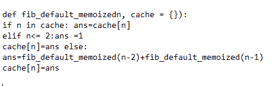

RETURN ANS

随之来的基本逻辑显而易见。缓存将是你之前调用 `fib_default_memoized()` 的结果字典。参数 `n` 是键。它将是第 n 个斐波纳契数。如果为真，那么你就完成了。但如果为假，那么你必须花时间按照原生递归的版本对其进行评估，并在返回结果之前将其保存在缓存中。

这里的点在于 `cache` 是函数的关键字参数。Python 通常只评估一次关键字参数，即在你导入该函数时。这意味着如果你的参数在可变性方面存在任何问题，它也只会被初始化一次。这通常是程序中发生小 Bug 的基础，但在这种情况下，你将通过修改参数来利用它。

### 手动备忘化：对象

一些使用 Python 的程序员认为，回溯并修改你的形式参数是一个坏主意。对于其他人来说，特别是那些喜欢使用 Java 的人，其论点是：所有具有状态的函数都需要转换为对象。在你的编译器中这种形式的示例如下：`class Fib()`：

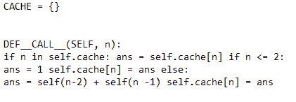

RETURN ANS

如果你执行这种操作，将使用 `__call__` 魔方法让 `Fib` 实例行为像一个函数。`Cache` 由所有 `Fib` 实例共享，因为它是它的类属性。当你查看斐波纳契数时，这是很理想的做法。然而，如果你的对象在构造函数中定义了良好的服务器调用，并且结果取决于该服务器，这可能不是一件好事。相反，你需要通过将其移动到 `init` 部分将其移为对象属性。无论如何，你都将从中获得速度提升过程。

### 手动备忘化：使用全局变量

我们在这个过程中可以处理的另一个事情是借助 `global` 函数进行手动备忘化。你只需通过添加 `global` 就可以规避默认参数和一些粗糙的变异。这是有时在程序员中名誉不佳的，但它是值得学习使用的好方法。很多时候你会在这里使用 `global` 声明是因为它的效果更好，但你会使用与上面类似的代码。

## 装饰器

我们在这里讨论的最后一点是装饰器。这简单是一个高阶函数。这意味着函数将作为参数，然后它将返回另一个函数。对于这些装饰器，返回的函数通常是原始函数，但它经过增强后更具功能性。例如，创建一个 `decorate`，它可以允许你在每次调用函数时打印文本。你可以这样写它：

```python
def output_decorator(f):
    def f_(f):
        f()
        print('Ran f…')
    return f_
```

你可以使用装饰后的版本来替换 `f`。你只需要执行 `F=output_decorator(f)`。只需通过调用 `f()`，你就会得到装饰后的版本。如果你直接使用以下语法帮助，Python 会让这一切变得更容易。

```python
@output_decorator
def f():
    #...define f…
```

现在，如果你尝试这样做，你会发现 `output_decortor` 的结果并不那么令人鼓舞。但你可以超越此，并增强函数本身的操作。例如，你可以在装饰器中包含类型的缓存，并在需要时拦截对函数的调用。

但如果你尝试编写自己的装饰器，有时你会在参数传递的细节上感到困惑，并在弄清楚这些时被 Python 的内省机制困住。内省是在运行程序时确定对象类型的能力。这是该语言的优势之一，但如果你使用装饰器，情况可能会变得混乱。

## Python 模块

模块由定义和程序语句组成。一个示例是文件名 `config.py`，它被认为是一个模块。模块名为 `config`。模块用于帮助将大型程序分解为更易于管理且组织良好的文件，并促进代码的可重用性。

### 创建第一个模块

启动 `IDLE`。

导航到 `File` 菜单并点击 `New Window`。

输入以下内容：

```python
def add(x, y):
    """这是一个相加两个数字并返回结果的程序"""
    outcome=x+y
    return outcome
```

## 模块导入

关键字 `import` 用于导入。

### 导入 first

只要我们知道模块名称，点运算符就可以帮助我们访问函数。

示例

启动 `IDLE`。

导航到 `File` 菜单并点击 `New Window`。

输入以下：

```python
first.add(6,8)
```

## Python 中的导入语句

`import` 语句可以使用点运算符访问模块中的定义。

启动 `IDLE`。

导航到 `File` 菜单并点击 `New Window`。

输入以下内容：

```python
import math
print("The PI value is", math.pi)
```

### 使用重命名导入

示例

启动 `IDLE`。

导航到 `File` 菜单并点击 `New Window`。

输入以下内容：

```python
import math as h
print("The PI value is-",h.pi)
```

### 讨论

在这种情况下，`h` 是我们重命名后的 `math` 模块，在某些情况下可以帮助节省输入时间。当我们重命名时，新名称将成为有效的且且被识别的名称，而不是原始名称。

### 从 `...import` 语句导入 Python。

可以从模块中导入特定的名称，而不是导入整个模块。

### 示例

启动 `IDLE`。

导航到 `File` 菜单并点击 `New Window`。

输入以下内容：

```python
from math import pi
print("The PI value is-", pi)
```

## 导入所有名称

示例

启动 `IDLE`。

导航到 `File` 菜单并点击 `New Window`。

输入以下内容：

```python
from math import *
print("The PI value is-", pi)
```

### 讨论

在这种上下文中，我们正在从特定模块导入所有定义，但不推荐这样做，因为可能会导致重复。

## Python 中的模块搜索路径

示例

启动 `IDLE`。

导航到 `File` 菜单并点击 `New Window`。

输入以下内容：

```python
import sys
sys.path
```

Python 会搜索所有的 `sys` 文件。

## 重载模块

Python 只导入一次模块以提高效率。

```python
import math
# program was executed
```

### 重载代码

示例

启动 `IDLE`。

导航到 `File` 菜单并点击 `New Window`。

输入以下内容：

```python
import math
import importlib
reload
```

## `dir()` 内置 Python 函数

为了发现模块中包含的名称，我们使用内置函数 `dir()`。

## 语法

`dir(module_name)`

## Python 包

Python 中的文件和目录存储在包中。因此，不同的模块应该放在不同的 Python 包中。

### 总结

一个 `module` 是带有任意命名属性的 `Python` 对象，你可以对其进行绑定引用。简单来说，`module` 是由 `Python` 代码组成的。`module` 可以定义函数、类和变量。

# 第 16 部分：时间和日期


Python 中的`datetime`模块允许我们处理时间和日期。

## 获取当前时间和日期


### 讨论

我们使用`import datetime`语句导入了`datetime`模块。`datetime`类定义在`datetime`模块中。调用`now()`方法创建一个包含本地日期时间的`datetime`对象。

### 示例


### 讨论

在这个程序中，我们使用了`date`类中的`today()`方法来提取日期对象。

## 理解 datetime 模块

Python 允许我们使用`dir()`函数提取模块的所有属性。

### 示例


`datetime`模块中常用的类包括`date`类、`time`类、`datetime`类以及`timedelta`类等。

### 日期对象

```python
import datetime
t = datetime.date(2018, 5, 6)
print(t)
```

### 讨论

示例中的`date()`是`date`类的构造函数，接受三个参数：年、月、日。

### 示例 2

```python
from datetime import date
b=date(2018,5,6)
print(b)
```

### 练习题

- 在示例 2 中解释`b`是什么
- 解释语句`from datetime import date`

#### 示例 3

使用`today()`类方法我们可以创建一个包含日期的日期对象。


# 时间戳

也可以从时间戳创建日期。`timestamp()`方法创建当前日期。

## 打印当前日期

在这个程序中，我们使用了`timestamp()`方法创建一个日期。


## 时间对象

`time`类用于创建时间对象。


## 小时时间

`time`类用于创建时间对象。


## datetime 对象

`datetime()`构造函数接受年、月、日。


## 分钟时间

`time`类用于创建时间对象。


## 使用 timedelta

在 Python 中，`timedelta`对象表示两个时间之间的差。


## 获取 timedelta 差值

在这个程序中我们创建了`timedelta1`和`timedelta2`以及它们的差值。


## 从 datetime 导入 timedelta

在这个程序中我们创建了`timedelta1`和`timedelta2`并显示在屏幕上。


## 秒持续时间

在 Python 中，`timedelta`对象表示两个时间之间的差。


## Python 中的格式格式化

`datetime`属性的格式化通过`strftime()`和`strptime()`方法实现。在 Python 中，`strftime()`方法指定在`datetime`、`date`和`time`下。使用该方法可以将给定的`datetime`、`date`或`time`对象格式化为字符串。

示例


### 讨论

在这个程序中，以下是格式代码`%m`、`%Y`、`%H`和`%d`，`strftime()`方法接受一个或多个格式代码并给出格式化后的字符串。在程序中，`time`、`string1`和`string2`是字符串。

## 从 ptime() 到 datetime

在 Python 中，`strptime()`将从代表日期的指定字符串创建`datetime`对象。

示例


### 讨论

在这个程序中，`Mumbai_tz`和`Lagos_tz`是持有对应时区的`datetime`对象。

接下来的章节将讨论如何使用 Python 语言进行编程的所有不同部分。你有很多理由想要学习使用 Python 语言，而我们希望确保能够逐步学习这些不同部分，并学习如何让它们为我们的需求而工作。在学习编程和通过编程实现目标方面，外界有很多种选择，但你会发现 Python 语言将是最易用的语言之一。本指南将告诉你原因所在。

本指南将花费一些时间查看 Python 语言的一些基础知识。我们将介绍 Python 是什么、它源于何处，包括在你的计算机上安装这种语言以及所有必要文件所需的步骤，无论你当时正在运行的是哪种操作系统。

一旦我们掌握了 Python 语言编程的一些基础知识，就是时候进入下一步了。在这一步中，我们将探索 Python 自带的其他一些重要部分，包括如何处理变量和字符串、如何使用列表（lists）、元组（tuples）和运算符，以及一些完成任务的 Python 函数。这些对于编写你想在 Python 语言中处理的各种代码都非常重要，不应忽略。

一旦我们掌握了 Python 语言的一些基础部分并准备就绪，就是时候开始编写一些我们需要编写的实际代码，以获得这种语言的专业知识了。我们将学习如何编写自己的类，同时对 Python 的 OOP（面向对象编程）方面有更深入的理解，如何编写条件语句、循环，甚至是你自己的异常处理。

为了完成开始 Python 编程之前需要的一些主题，还有几点是初学者应该理解以获得最佳结果。在这些章节中，我们将花时间查看 Python 的封装（encapsulation）以及它对于保持代码某些部分的私密和安全意味着，这种语言中数据库（databases）和字典（dictionaries）的含义，以及如何在该语言中使用 CGI 和 GUI。

当我们准备好使用 Python 语言时，我们将看到许多很棒的东西。本指南将花费一些时间查看这种语言最重要的部分，以及即使是初学者如何开始并让这种语言属于自己。当你准备好学习更多这种语言以及它能为你提供什么时，请确保查看本指南以获得帮助！

## 第 1 章：什么是 Python 语言？


## 历史与演变

自从计算机被发明以来，就有很多人一直致力于让它们变得更有用。为了实现这一目标，多年来开发了许多编程工具，将给计算机的指令转换为计算机可以执行的代码。当这一切刚开始时，汇编语言是主要的类型。虽然它允许你创建为当时的低内存系统量身定制并优化的程序，但它很难学习、难以阅读也难于维护，且只有极少数人可以使用它。

随着计算机技术的发展和许多系统变得越来越复杂，编程语言也需要随之改变。产生了一些高级语言，包括`Lisp`、`Cobol`和`Fortran`，这些语言用于产生打孔卡，计算机可以读取卡片并执行位于卡片上的指令。使用这种工具进行编程比过去的语言要容易得多，让更多的人能够编写他们需要的复杂程序。

随着时间的推移，我们现在正在使用的某些技术得到了许多改进，这导致在我们的程序等方面有了许多改进的存储方法。例如，某些打孔卡被一种磁带所取代，然后一切都移动到了可以在磁盘驱动器上工作。随着这些新发明的出现，处理这些程序的工具也得到了改进。

Basic 是最早设计为易于阅读的编码语言之一，它开发于 20 世纪 60 年代。接着在 20 世纪 70 年代，我们看到了`Pascal`和`C`的引入，这些成为帮助我们获得一种非常简单且结构化的编程语言的工具，帮助程序员获得他们想要的高效代码。你会发现，这样的结构化语言不需要依赖某些其他语言中的`go-to`语句。相反，这些程序将依赖于流，其特征包括条件语句、函数和循环，正如我们在本指南稍后将讨论的那样。这些特性非常棒，因为它们允许新程序员在独立的可重用程序的帮助下创建自己的应用程序，这可以减少开发程序的时间，甚至进行调试，使程序能够按照你的想法运行。

在 20 世纪 80 年代，编程领域发生了下一次重大进展。`C++`以及其他一些语言转变为 OOP 语言，即面向对象编程语言。现在有很多这类语言是可用且可使用的，但它们之所以有用是因为它们帮助我们更好地保留了信息。虽然这些 OOP 语言工具在编码方面非常强大并具有一些新功能，但很多时候它们被认为是特殊的，因为它们可以消除编码过程中带来的某些挑战。

随着计算机的使用和普及开始增长，并且越来越多的人使用计算机变得很常见，拥有一种易于使用的、可以在许多不同平台上使用的编程语言也是一个重要的因素。由于这种需求，我们今天所知的 Python 语言被开发出来。

Python 将是一门通用编程语言。无论你是初学者还是已经在编码领域工作过一段时间的人，你都会发现这种语言很容易学习，同时仍确保背后有强大的支持来完成这些代码。你可以将它用于许多不同的目的，从一些系统的清理任务到纯粹的娱乐以及制作程序和游戏。

过去，很多人对学习编程语言感到担忧。他们担心这些语言太难学了，担心自己只会感到挫败，并认为只有那些一辈子都在电脑旁边度过的人才能尝试编写代码。也许对于一些老旧的代码来说，这确实是真的。得益于近期引入的许多新代码，“只有那些在计算机编程方面有天赋的人才能编程”的观点已经逐渐消失。随着现在出现的许多代码，包括`Python`，任何人都可以根据自己想做的事情学习一些语法，甚至可以在网上找到一些预制代码并进行修改。

## Python 的优势

使用 Python 有许多好处。由于 Python 是一门面向对象（OOP）语言，它在很多方面都非常强大且易于使用。对于初学者来说，这种语言的设计非常易于上手，能够帮助人们满足各种需求。

你的标识符对你的代码也同样重要，在 Python 中，你也有很多标识符可以处理。你会发现它们以许多不同的名称形式出现，你可能将它们视为函数、实体、变量和类。当你为标识符命名时，你可以使用相同的信息，并且相同的规则将适用于每一个标识符，这让你更容易记住这些规则。

需要记住的第一条规则是关于如何命名这些标识符的。在命名标识符时，你有许多选择。例如，你可以在命名时同时依赖于大写字母和小写字母，还可以使用任何数字和下划线符号。你也可以将这些任何一个组合在一起。这里需要记住的一点是，你的名称不能以数字开头，而且你写出的单词之间不应该有任何空格。所以，你不能将`3words`作为名称，但你可以写成`words3`或`threewords`。请确保你没有使用我们在上面讨论过的关键字之一，否则将会导致错误。

当你挑选标识符名称时，可以遵循上述规则，并尝试选择一个你能记住的名字。稍后在编写代码时，你需要回想起它，如果你给它起了一个难以记忆的名字，你可能会遇到问题或引发错误，因为结果并没有按照你想要的方式出现。除了这些规则之外，你可以随心所欲地命名命名。

### 控制流基础

在许多语言中，随之而来的控制流也是一个重要的事情。Python 的控制流也将非常重要，因为它可以帮助我们判断自己编写的代码是否正确。有一些字符串我们需要特别注意，因为它们需要被编译器正确地读取。

如果你不以正确的方式使用控制流，最终会导致编译器感到困惑，然后你会得到一些错误消息。好消息是，我们将在本指南中花时间查看大量的代码示例，你将能够弄清楚你所使用的控制流中什么是正确的，什么是错误的。

### Python 注释

我们接下来需要时间处理的是注释。当你编写想要编写的代码时，你可能会发现在某些情况下，你想在该特定代码内部添加一些小笔记，或者对所写内容的其他解释。你希望能够这样做，而不会导致编译器感到困惑，也不会导致无法在没有错误的情况下完成代码。

这些小笔记对于使用或阅读代码的人来说可能是重要的，但我们不希望它们在代码执行时出现在代码中。在 Python 语言中，以及你想要使用的其他编程语言中，这被称为注释。只要你在编写的内容前面使用`#`符号，你编写的任何注释都会被编译器忽略并跳过。这个符号将告诉编译器你正在编写注释，它应该避免读取该注释，而是移动到代码的其他部分进行处理。

对于 Python 语言，从技术上你可以添加任意数量的注释，来帮助自己或他人解释你在代码该部分写的内容。如果你想在代码的每隔一行都加一个注释，那么这在技术上是允许的。但请记住，这会让你的代码看起来有点杂乱且不专业，因此通常是会被避免的。只需添加所需的注释数量，不要过度，你的代码就能运行得很好。

我们将在接下来的章节中更多地讨论接下来两个主题，因为它们对我们在整个编码过程中将要做的事情非常重要，但它们在这里仍然值得被提一下。我们将花时间查看两个作为你 Python 代码基础的更多重要主题，无论这些代码是简单还是复杂，包括运算符和变量。

### 变量

变量是代码中你需要了解的另一部分，因为它们在你的代码中非常常见。变量是为了帮助存储你放在代码中的某些值，帮助它们保持整洁美观。你只需通过使用等号`=`轻松地将某些值添加到右侧的变量中。如果你愿意，甚至可以将两个值添加到同一个变量中，你将在本指南讨论的某些代码中看到这种情况。变量非常常见，你将在我们展示的示例中很容易地看到它们。

### 运算符


然后我们就可以转向一些你可以使用的运算符了。在编写代码时，你会很快注意到这些运算符无处不在。而且在过程中，你也有相当多的运算符可以处理。学习如何使用这些运算符可以让代码编写变得简单一点，并帮助我们确保我们的代码按照我们想要的方式运行。

运算符是你代码中非常简单的部分，但你仍然应该知道它们是如何工作的。你会发现有几种不同的类型运行良好。例如，算术函数非常适合帮助你将加、除、减、乘代码的不同部分结合在一起。有赋值运算符会将一个特定值分配给你的变量，以便编译器知道如何处理它。还有比较运算符，允许你查看几段代码并判断它们是否相似。

列表上的第一个是 Mac OS X 系统。如果你正在一台运行该系统的电脑上工作，你可能会发现系统中已经安装了一个版本的 `Python 2`。许多 Mac 电脑会预装 `Python` 库，这使得使用它们更容易，并从整体上获得你想要的结果。然而，你拥有的版本将取决于你使用的电脑类型以及你拥有它有多长时间。要检查你的系统中安装的是哪个版本的 `Python 2`，你可以在命令行终端中输入以下提示符：

```
Python – V
```

这将向你显示你获得的版本，因此会出现一个数字。如果你愿意，也可以选择在该系统上安装 `Python 3`，并且不需要卸载电脑上的 `2.X` 版本。要检查是否安装了 `3.X`，你只需要打开终端（Terminal）应用并输入以下提示符：

```
Python3 – V
```

OS X 的默认完全没有安装 `Python 3`。如果你想使用 `Python 3`，可以使用 `Python.org` 上的某些安装程序进行安装。这是一个很好的地方，因为它将安装你编写和执行 `Python` 代码所需的所有内容。它将包含 `Python` 壳（shell）、`IDLE` 开发工具和解释器。与 `Python 2.X` 的情况不同，这些工具作为标准应用程序安装在 `Applications`（应用程序）文件夹中。

能够运行 `IDLE` 和 `Python` 壳取决于你选择的版本以及你的一些个人偏好。你可以使用以下命令来帮助启动壳和 `IDLE` 应用：

- 对于 `Python 2.X`，只需输入 `Idle`
- 对于 `Python 3.X`，只需输入 `idle3`

正如我们之前提到的，当你花时间下载并安装 `Python 3` 时，你就能在 `Applications` 文件夹中安装 `IDLE`。从 Python 网站 [www.python.org](http://www.python.org) 进行所有这些操作是最佳选择，因为它能确保你拥有完成此过程所需的正确文件和其他。


上面的图片是一个适合我们工作的示例，因为它向我们展示了在 Mac 上安装此内容时将会看到的弹出窗口示例。在阅读完信息后，你可以轻松点击 Continue（继续），重复几次，它就会设置好并满足我们的需求。

## Windows 操作系统

我们需要查看的下一个操作系统是类将此添加到 Windows 系统中。Windows 系统是一个很受欢迎的选项，因为它让你有机会使用许多很酷的功能，许多程序员和个人用户都将依靠它来完成工作。但这里我们必须注意的是，如果我们使用 Windows 系统，将必须经过下载和安装 `Python` 语言的完整过程。

这是因为 Windows 已经安装了它自己版本的编码语言。由于由于，它也不会预先安装 `Python`。这并不意味着 `Python` 语言无法在 Windows 上运行。

但这里我们必须注意的是，如果我们使用 Windows 系统，将必须经过下载和安装 `Python` 语言的完整过程。

这是因为 Windows 已经安装了它自己版本的编码语言。由于由于，它也不会预先安装 `Python`。这并不意味着 `Python` 语言无法在 Windows 上运行。

但这里我们必须注意的是，如果我们使用 Windows 系统，将必须经过下载和安装 `Python` 语言的完整过程。

这是因为 Windows 已经安装了它自己版本的编码语言。由于由于，它也不会预先安装 `Python`。这并不意味着 `Python` 语言无法在 Windows 上运行。

但这里我们必须注意的是，如果我们使用 Windows 系统，将必须经过下载和安装 `Python` 语言的完整过程。

这是因为 Windows 已经安装了它自己版本的编码语言。由于由于，它也不会预先安装 `Python`。这并不意味着 `Python` 语言无法在 Windows 上运行。

但这里我们必须注意的是，如果我们使用 Windows 系统，将必须经过下载和安装 `Python` 语言的完整过程。

这是因为 Windows 已经安装了它自己版本的编码语言。由于由于，它也不会预先安装 `Python`。这并不意味着 `Python` 语言无法在 Windows 上运行。

如果你在使用旧版本的 Ubuntu 或其他版本，那么你可能需要使用 deadsnakes PPA 或其他工具来帮助你下载 `Python 3.6` 版本。执行此操作所需的代码包括：

```bash
sudo apt-get install software-properties-common
sudo add-apt repository ppa:deadsnakes/ppa
sudo apt-get update
sudo apt-get install python3.6
```

这里的好消息是，如果你正在使用其他 Linux 发行版，系统很可能已经安装了 `Python 3`。如果没有，你可以使用发行版的包管理器。如果 `Python 3` 的包不够新，或者不是你需要的版本，你可以根据需要，通过执行这些相同的步骤来帮助在你的计算机上安装更新版本的 `Python`。

正如我们在这里看到的，使用 `Python` 编程语言将是一个任何人都可以完成的简单过程，当我们掌握了它并学会了如何让它满足我们的需求时，我们就能编写任何想要的代码。上述任何操作系统的大部分安装步骤都是简单的，然后你就可以开始用 `Python` 语言编写你自己的代码了。

## 第 3 章：Python 变量与字符串


本指南下一个需要关注的话题是 `Python` 字符串和变量的概念。你会发现这些将帮助我们保持代码良好运行，并确保我们从尝试编写的代码中获得最大的价值。变量将帮助我们把想要的值分配给代码的不同部分，而字符串将为我们提供代码所需的某些文本字符。这两者将结合在一起，帮助我们在 `Python` 中获得我们想要的结果。让我们来看看这些每一项将如何工作的，以及我们如何确保它们按照我们想要的方式运行。

## Python 变量

`Python` 变量也是一项需要处理的重要内容。简单来说，变量通常只是我们用来存放代码中出现的值和其他其他事的一个“箱子”。它们会为我们的代码预留一部分内存，以便我们以后利用。这些变量非常重要，因为它们允许我们在以后提取想要使用的值，而在此过程中不会出现问题。

这些变量是一个很好的讨论的话题，因为它们被存储在代码的内存中。然后你就可以为它们赋值，并在代码中根据你的需要将其提取出来。这些值将存储在你代码内存的某部分，并在你需要时准备好使用。根据你处理的数据类型，变量将是告诉编译器在何处正确位置保存该信息以便于提取的所在。

考虑到这一点，我们首先需要查看的是如何给变量赋值。为了让变量以你想要的方式运行，你必须确保至少为它分配一个值。否则，你只是在内存中保存了一个空位。如果变量被正确地分配了某个值（有时根据你使用的代码，会分配多个一个值），那么它将以正确的方式运行，当你调用该变量时，正确的值就会显示。

当你查看并处理已有的某些变量时，你可能会发现三个主要的选项可以使用。每种选项都很有用，而且通常取决于你想要创建什么种代码，以及你想与特定变量关联的值是什么类型。你在这里可以选择的三种主要变量类型包括：

- 浮点数（Float）：这包括如 `3.14` 之类的数字。
- 字符串（String）：这像是一个语句，你可以在其中写诸如“感谢访问我的页面！”或类似的短语。
- 整数（Whole number）：这将是你会使用的任何其他不带小数点的数字。

当你在代码中使用变量时，需要记住不需要花费时间来声明以节省内存中的这个位置。一旦你使用等号为变量赋值，这就会自动发生。如果你想检查这是否发生，只需查看你是否添加了那个等号，一切都会正常工作。

给你的变量赋值非常简单。在代码中执行此操作的一些示例包括：

```python
x = 12 # 这是一个整数赋值的示例
pi = 3.14 # 这是一个浮点赋值的示例
customer_name = "John Doe" # 这是一个字符串赋值的示例
```

在这一项上我们还有另一个选项，而且在本节中已经提到过几次。这是我们将为一个变量分配多个值。在某些情况下，我们需要编写代码，然后需要确保有两个或多个值对应于（关联在）完全相同的变量上。

要实现这一点，你只需要使用我们之前讨论过的同种程序即可。当然，我们需要确保每个部分都通过等号连接到变量上。这有助于编译器预先知道这些值都将关联到同一个变量。因此，你可以写下类似 `a = b = c = 1` 的代码，告诉编译器所有变量都等于 1。或者你可以执行像 `a = b = 2` 的操作，以显示这里有两个值对应一个变量。

当你处理这些变量时，需要记住你必须分配值以让代码执行工作。这些变量也只是你代码中的某些位置，为你的选择的值预留了一些内存。

## Python 字符串

本章下一个需要关注的话题是关于字符串的。这些字符串将帮助我们学习更多如何控制代码的不同部分，并让我们更容易理解什么是字符串。回顾一下，字符串只是我们代码中包含的一系列文本字符。

现在，当你处理这些字符串时，你会发现有几种不同类型的运算符可以在引入它们时使用。运算符简单来说就是在你的代码内部执行特定操作的符号。当我们处于这种情况时，操作将在字符串上执行。你在这里可以找到的一些运算符包括以下几种：

1. 拼接运算符（Concatenation operator）：这是你需要在将这些字符串连接在一起时将使用的运算符类型。
2. 重复运算符（Repetition operator）：这是当你想要获得字符串的多个副本（通常是许多个）时可以使用运算符类型。你可以使用这一个，然后选择你让字符串重复的次数。
3. 切片运算符（Slice operator）：这是一个将查看所选字符串的运算符，然后从那里确定你想要处理的特定字符。任何时候我们这一个时，你都需要记住字符串的第一个字符是零。

## 第 4 章：处理 Python 运算符、元组和列表

### 4. 范围切片运算符

这是我们可以使用另一个运算符，因为它可以从索引中检索范围内的字符，而不仅仅是只给你一个字符。如果你只想展示该字符串的某部分或某个单词，那么你就需要这个运算符。

### 5. in 运算符

此运算符将花费一些时间在你的目标字符串中搜索指定的字符。如果你在字符串中找到了该特定字符，它将为你返回 `True`。但如果运算符不在字符串中找到该答案，则将向你返回 `False`。

### 6. not in 运算符

这个运算符的工作方式与 `in` 运算符相反。它会在你的字符串中搜索指定的字符。但如果运算符不在字符串中找到该字符，你将得到 `True` 返回。如果在字符串中找到了该字符，它将返回 `False`。

当我们处理一些想要操作的字符串时，你会发现有很多选项供你随时使用。这些字符串带有许多函数，将帮助你为你尝试编写的一些代码添加更多选项和功能。在 `Python` 中设计字符串时，效果良好的不同函数包括：

- `Capitalize()`：这个函数将提取字符串的首字母并将其转换为大写。
- `Center(width, char)`：这将为你返回一个至少达到指定宽度的字符串，然后用字符填充字符串来创建它。
- `Count(str)`：这将返回特定字符串在另一个字符串中包含的次数。
- `Find(str)`：这将返回子字符串在字符串中的索引号。
- `Isalpha()`：这将检查字符串中的所有字符是否为字母。
- `Isdigit()`：这部分将检查字符串是否只包含数字，或者是否混合了数字。
- `Islower()`：此函数将检查你正在检查的字符串是否全为小写。
- `Len()`：这将让你知道字符串的长度。
- `Isupper()`：这个将检查字符串中的所有字符是否为大写字母。
- `Lower()`：这将为你返回一个全为小写字母的字符串。
- `Replace()`：这将获取你拥有的字符串并替换为新字符串。
- `Upper()`：这将返回大写形式的字符串。
- `Split()`：这将根据分隔符分割字符串。

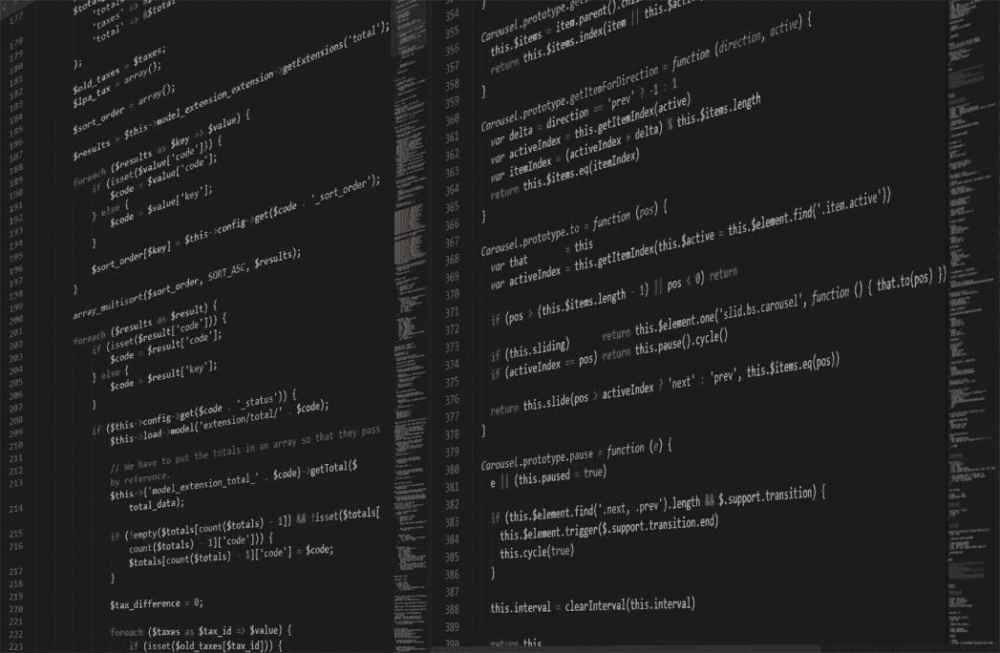

这一章将花费一些时间深入了解在我们处理 `Python` 语言时需要知道的其他部分。在本章中，我们将花时间研究如何使用运算符，以及它们的相似之处。

## Python 运算符

`Python` 运算符非常多样，我们需要查看如何使用它们。

### 算术运算符

我们将查看的第一类运算符是算术运算符。这些包括加、减、乘、除。

### 比较运算符

在查看了算术运算符之后，我们也可以处理比较运算符。这些比较运算符非常好用，因为它们返回 `true` 或 `false`。

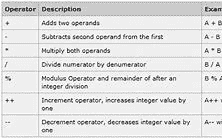

### 逻辑运算符

接下来我们将查看逻辑运算符。它们可能不像其他运算符那样频繁使用，但对我们来说查看它们仍然很重要。我们可以操作的三种逻辑运算符：

- `Or`：使用这个运算符，编译器将评估 `x`，如果它是 `false`，它将将去评估 `y`。如果 `x` 最终为 `true`，编译器将返回 `x` 的评估结果。
- `And`：如果 `x` 最终是那个 `false` 的，编译器将评估它。如果 `x` 最终为 `true`，它将继续评估 `y`。
- `Not`：如果 `x` 最终为 `false`，编译器将返回 `True`。但如果 `x` 最终为 `true`，程序将返回 `false`。

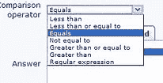

### 赋值运算符

我们将查看的最后一种运算符是赋值运算符。这将是一种出现非常频繁的运算符，因为赋值运算符简单的等号，你将在整个代码中将值分配给变量。

因此，如果你想将数字 `100` 赋值给你的一个变量，只需要在它们之间放入一个等号 `=` 即可。这可以适用于你在代码中使用的任何类型的变量和值，而且你应该已经对提前完成这一操作有了一些熟悉。你也可以遍历并获取多个值，并将它们赋值给同一个变量，如果这样对你的代码最有利的话。只要在中间有赋值运算符（即等号），你就可以根据意愿向变量添加任意数量的值。

使用这些运算符是一件简单的事情，但你会发现它们会在你的编码中经常出现。你可以使用它们来将变量相加、使用其他数学运算符、为变量赋值一个值，甚至为同一个变量赋值几个值。你甚至可以利用这些运算符同时比较代码的两个或多个部分，查看它们是否相同。正如我们所看到的，在使用这些运算符时，我们可以做很多很多事情。

### 理解元组和列表

在学习 `Python` 语言时，你会经常看到的一种现象是：在这类编程语言中，列表（lists）和元组（tuples）之间似乎存在巨大的差异。它们看起来很相似，但有一些我们需要注意的差异，了解这些差异以及我们如何使用它们，可以改变我们所代码的类型。

### 列表 (Lists)

为了简单起见，我们将从列表开始。列表基本上是一个对象的集合，具有某种任意性，类似于我们在其他编程语言中看到的数组（array），但它具有更大的灵活性。当我们用方括号 `[]` 包裹一组用逗号分隔的对象序列时，列表就被定义了。我们会在这些 `Python` 列表中看到一些不同的特性，包括：

1. 列表是有序的
2. 列表是动态的
3. 列表是可变的
4. 列表可以嵌套到任意深度
5. 列表中的元素可以通过索引进行访问
6. 列表将包含一些具有任意性的对象

### 元组 (The Tuples)

考虑到这一点，我们接下来需要看一看 `Python` 元组是什么。`Python` 为我们提供了另一种类型，它是一个有序的对象集合，我们可以称之为元组。元组与我们讨论过的列表非常相似，但有一些属性让它们变得不同。

这些包括：

1. 元组通过将元素封装在括号 `()` 中来定义，而不是方括号 `[]`。
2. 元组是不可变的。

这引出了另一个我们需要探索的问题：我们什么时候该使用列表，什么时候在我们的代码中使用像我们之前讨论的那种列表更好？每种方式都有优缺点，通常取决于具体情况。在处理这些用户定义函数以及为了更好地理解它们的工作原理时，我们需要记住的一些事情包括：

1. 内置函数是 `Python` 自动带的函数，但也有些我们需要探索的函数。
2. 用户定义函数是我们创建的函数。
3. 内置函数是 `Python` 内部可用的函数，我们也需要查看其中一些。花些时间研究它们，看看它们能做什么。

- 一个定义周全且良好的用户定义函数可以帮助简化应用程序的过程。

现在我们对用户定义函数的基础有了些许了解，是时候在学习可以使用此类函数的代码之前，查看这些函数可能带有的一些不同参数了。

## 函数参数的选项

每当你准备好在代码中使用这类函数时，你会发现它们具有处理四种类型参数的能力。这些参数及其背后的含义是预先定义的，开发者并不总是能够修改它们。相反，开发者将有权使用它们，但必须遵循与其配套的规则。你确实有权向规则中添加一些内容，使函数按照你想要的方式运行。正如我们之前所说，你有四种可以处理的参数类型，包括：

1. **默认参数**：在 `Python` 中，我们会发现表示默认值和函数参数语法的方式略有不同。这些默认值是用于当你在调用函数时没有为参数提供值，该函数参数将取该值的部分。确定默认值位置的最佳方法是寻找等号。
2. **必要参数**：下一类参数是必要参数。这些是你正在处理的函数中必不可少的参数类型。在调用函数时，这些值需要按照正确的顺序和数量传入，否则代码将无法正常运行。


3. **关键字参数**：这些是能够帮助`Python`内部函数调用的参数。这些关键字就是我们在函数调用中提到的那些，连同贯穿其中的某些值。这些关键字将与函数参数映射，以便即使在调用代码时没有保持相同的顺序，你也能识别所有的值。

4. **变长参数**：我们在这里查看的最后一种参数是变数量参数。当你不确定为编写的代码需要多少参数来传递给函数时，这是一个好用的工具。或者你也可以用它来设计代码，允许传递任意数量的参数，只要它们能够通过你在代码中设置的任何要求即可。

## 编写函数

现在我们对这些函数的类型以及`Python`中可用的某些参数类型有了更好的了解，是时候学习完成所有这些操作所需的步骤了。我们可以使用四个基本步骤来实现这一切，而你想让它变得困难还是简单完全取决于程序员。我们将从一些基础知识开始，然后根据需要进行一些调整。编写自己的用户定义函数需要采取的步骤包括：

1. **声明函数**：你需要使用`def`关键字，然后在后面紧跟函数名称。

2. **编写参数**：这些参数需要放在函数的两个括号内。以冒号结束此声明，以符合该语言的正确书写规范。

3. **添加程序此时应该执行的语句**。

4. **结束函数**：你可以选择是否使用`return`语句来结束。

当你想要创建一个自己的用户定义函数时，所使用的语法示例包括：

```python
def userDefFunction (arg1, arg2, arg3, …):

program statement1

program statement2

program statement3

….

Return;
```

使用函数可以是确保你的代码按照你想要运行的一种极佳方法。确保你以正确的方式进行设置，并且能够处理这些函数，按照你想要的方式将它们设置好也非常重要。在很多时候，函数会出来并发挥某些作用，因此现在花时间学习使用它们对你代码的成功非常重要。

# 第 6 章：作为 OOP 语言的 Python 与 Python 类的操作


你会注意到`Python`程序的一个重要部分是它被划分为类。这将为你提供在`Python`中工作的一种极佳方法，因为可以帮助你组织已有的代码，并尽可能保持一切井然有序。`Python`的巧妙之处在于它与这些类配合，并让你有机会创建易于使用的代码，而无需像某些其他语言那样面临所有的混乱和复杂性。

`Python`语言自带的类非常重要。这些类将确保我们能够从想要创建的某些代码中获得最大收益，并更容易确保有足够的组织工作。当我们把这些类作为存放代码中某些对象的“盒子”时，这将确保这些部分在应该出现时出现。

关于这一点，我们必须记住，可以在类中添加任何你喜欢的对象。但需要确保对象放在类中是合理的。同一个类中的对象必须具有某些相似之处，并且它们放在同一个类中是有意义的。

在`Python`中，我们将学习如何处理几个类，主要因为这是`Python`自带的组织结构，将帮助我们进行组织并确保代码中的内容都不会丢失。

上面的图片是帮助我们更多了解这些 OOP 语言如何工作以及我们能用它们做什么的好方法。我们有一个`car`类，以及与之相关的所有方法和属性。它们都组合在`car`类内部，尽管我们有很多可以处理的各种属性，包括图片中的以及更多的属性。

在我们完成了处理类所需的步骤后，我们还需要处理并命名我们自己的子类。这个子类将出现在某些括号中。在末尾添加分号以维护我们需要的编程礼仪。

# `destructor`

```python
def _del_(self):
    print("This is destructor...")
```

# 函数或方法

```python
def Display_Vehicle(self):
    print('Steering:' , self._steering)
    print('Wheels:', self._wheels)
    print('Clutch:', self._clutch)
    print('Breaks:', self._breaks)
    print('Gears:', self._gears)
```

# 实例化车辆选项

```python
myGenericVehicle = Vehicle('Power Steering', 4, 'Super Clutch', 'Disk Breaks', 5)
myGenericVehicle.Display_Vehicle()
```

如果你愿意，可以尝试运行这段代码。只需打开你的文本编辑器并将代码输入其中即可。在你编写这些代码的过程中，你会注意到我们在本指南中已经讨论过的几个主题会出现在这段代码中。一旦你有机会写出并执行这段代码，让我们来拆解它，看看上面发生了什么。既然我们提到了这里，我们还需要稍微探索一下访问类中各种成员的重要性。你需要设置好环境，使得文本编辑器以及你的编译器能够识别你想要创建的任何类。这将使它们更容易以正确的方式执行代码。要做到这一点，请确保你的代码设置正确。

## 类的访问操作

好消息是，有很多方法我们可以使用，以确保我们可以访问类成员，并让一切按照我们想要的方式就绪。不过，我们将使用的方法被称为访问器方法（accessor method）。这是你将看到的常见的一种，而且是一种完成工作的高效方法。

为了帮助你更好地理解访问你创建的类中各种成员的方法，我们需要查看以下代码：

```python
class Cat(object)
    itsAge = None
    itsWeight = None
    itsName = None

# set 访问函数，用于给字段或成员变量赋值
def setItsAge(self, itsAge):
    self.itsAge = itsAge

def setItsWeight(self, itsWeight):
    self.itsWeight = itsWeight

def setItsName(self, itsName):
    self.itsName =itsName

# get 访问函数，用于从字段中返回值
def getItsAge(self):
    return self.itsAge

def getItsWeight(self):
    return self.itsWeight

def getItsName(self):
    return self.itsName

objFrisky = Cat()
objFrisky.setItsAge(5)
objFrisky.setItsWeight(10)
objFrisky.setItsName("Frisky")
print("Cats Name is:", objFrisky.getItsname())
print("Its age is:", objFrisky.getItsAge())
print("Its weight is:", objFrisky.getItsName())
```

在我们继续之前，请将这些内容输入你的编译器中。如果你让编译器运行这段代码，你将立即在屏幕上看到一些结果。这包括猫的名字是 Frisky（如果你愿意，也可以将其改为其他名字），年龄为 5，重量为 10。这些是输入代码中的信息，因此编译器将提取它们并给你你想要的结果。你可以花些时间在代码中添加不同的选项，看看它们随着时间推移的变化。

虽然进行这类编码需要很多步骤，但类操作起来并不困难。这些类也将是代码的完美部分，帮助你处理信息并保持其条理，使其更有意义。你可以创建任何你想要处理的类，并用最符合你需求的对象来填充它。

# 第 7 章：Python 中的条件语句


在 Python 语言中，另一个有趣的处理对象是条件语句。它们会有许多不同的名称，例如`if`语句和决策控制语句。但当你希望程序学习如何自己执行某些事情，而不需要在你开始之前考虑所有可能的输入时，它们将是一个非常棒的选择。

在某些情况下，你希望确保代码以正确的方式运行，并在你不在场监控一切时让它能够自己做出决策，并希望这一切都能恰当其位。当你的代码有一部分允许用户自己输入他们想要的任何答案，而不仅仅是从几个选项中选择时，你就会发现条件语句是最好的工具。

在本章中，我们将查看你在编写代码时可能用到的三种常用的条件语句选项。我们将重点关注的三个是`if`语句、`if else`语句和`elif`语句。这些语句的工作方式略有不同，但它们都能为你的代码增加一些很棒的功能，因此我们将研究它们。

### If 语句

我们要查看的第一个是普通的`if`语句。这保持了简单性，并确保我们准备好处理这些条件语句的基础。它基于用户提供的答案是真还是假，取决于你设置的条件。如果用户输入了程序识别为真的答案，那么你的程序就会看到并继续。但如果用户输入了被识别为假的答案，程序就会结束，因为没有设置如何处理这种情况。正如我们在这里看到的，当你使用这种编码时可能会出现一些问题。但我们仍然会快速查看它是如何工作的，并掌握这些语句的基本概念。一个很好的示例如下：

```python
age = int(input("Enter your age:"))
if (age <=18):
    print("You are not eligible for voting, try next election!")
print("Program ends")
```

让我们探索一下这段代码放入程序时会发生什么。如果用户来到程序并输入小于 18 岁，屏幕上将显示一条信息。在这种情况下，信息将是“你没有投票资格，请尝试下次！”然后程序按照目前的情况将结束。但如果用户输入了 18 岁或以上的年龄，这段代码会发生什么？

对于`if`语句，如果用户说他们是 18 岁以上，什么都不会发生。`if`语句只有一个选项，并将重点放在用户提供的答案是否符合你设置的条件。用户必须在`if`语句的情况下输入他们小于 18 岁，否则你无法让程序再次运行。

正如我们已经提到的，在我们进行编码时，`if`语句可能会给我们带来一些问题。你希望确保用户能够输入任何最适合他们的答案，而不是“正确”的答案，并且你想确保你编写的程序仍然能够响应并向用户给出某种回答。一些访问你网站或程序的用户年龄大于 18 岁，如果他们输入了答案却无法让程序工作，将感到很困惑且很难看。

## If Else 条件语句

这就是为什么我们要开始学习`if else`语句。这个语句的使用频率比`if`语句高得多，而且它能够处理一些我们在使用`if`语句时遇到的问题。这种语句将与我们上面学过的一些主题相结合，并进行一些更改来修复问题，并确保一切运行正常。

假设我们仍然在编写上面提到的那种类型的程序。但这次，我们想要确保无论用户向我们的程序输入什么答案，屏幕上都能显示出某种结果。因此，通过这个语句，我们将根据年龄对用户进行分类。将一组是 18 岁以上，另一组是 18 岁以下，系统将根据此给出相应的响应。我们可以用来帮助我们编写自己的`if else`语句的代码如下：

```python
age = int(input(“Enter your age:”))

if (age <=18):
print(“You are not eligible for voting, try next election!”)
else
print(“Congratulations! You are eligible to vote. Check out your local polling station to find out more information!)

print(“Program ends”)
```

如你所见，这确实有助于为你的代码添加更多选项，并确保无论用户给出什么结果，你都能得到答案。你也可以更改信息以显示你想要的任何内容，但无论用户给出什么答案，使用的原理都是相同的。

你还可以选择在此基础上添加更多可能性。你并不局限于像上面那样的两个选项。如果这适用于你的程序，那么直接使用即可。但如果你需要使用比这两个更多的选项，你也可以扩展它。例如，取上面的选项并将其扩展为包含几个不同的年龄组。也许你可能想为 18 岁以下、18 岁到 30 岁之间以及 30 岁以上的人提供不同的选项。你可以这样进行拆分，当程序获取用户的答案时，它将执行你想要的部分。这很酷的一点是，我们可以编写许多可以使用此语句的各种选项和程序。也许我们想创建一个自己的程序，让用户浏览并选出他们最喜欢的糖果类型。糖果的种类非常多，名称也各异，很难提前把它们全部列出来并做好准备。但`if else`语句能够帮助我们处理这一切。

通过这个语句，我们只需要选出喜欢的某些糖果选择，可能是前六种，然后列出相应的响应。然后我们在末尾使用`else`语句来捕捉所有不符合我们列出的原始六种答案。这确保了无论用户向系统添加什么输入，他们都能在这个过程中获得某种响应。

在这一切中，`else`语句是一个非常重要的部分，必须确保它的存在，因为它负责捕获用户剩余的所有答案。

在这一切中，`else`语句是一个非常重要的部分，必须确保它的存在，因为它负责捕获用户剩余的所有答案。

在这一切中，`else`语句是一个非常重要的部分，必须确保它的存在，因为它负责捕获用户剩余的所有答案。

通过上面的示例，你会发现用户对他们想要从你的系统中“订购”的内容做出一些选择，然后。例如，如果他们想订购某种披萨，他们只需要点击一下，就会在程序中发生。你可以根据你想在编写的代码中发生的情况来调整这种组合，但如果你使用`elif`语句，你所编写的代码将遵循相同的基本原理。

在我们这种编程语言中，我们需要花时间讨论的下一个主题是一个被称为“循环”（loop）的概念。这些循环对于你想要编写的代码非常重要，而且当你将它们与之前讨论过的一些条件语句结合时，它们可以很好地工作。循环是清理程序的好方法，它们可以确保你只用几行代码就能完成大量工作，而且这是我们让代码变得密集且强大的极佳方式，而无需重写大量内容或学习许多复杂的流程。

你会发现，当你编写任何需要重复执行某些次数的代码时，这些循环将非常有帮助。这种重复在你的代码中至少需要发生几次，但你希望在不让代码变得混乱、也不需要一遍遍编写那些行的情况下完成。写几行或重复写两三行相同的并不是什么大事。但当你考虑到要写一百行或更多行相同的代码时，你就能明白为什么编写一个只需要几行代码就能处理这些行的循环是具有吸引力的。

例如，也许你正在处理自己的代码，想要列出从 1 到 50 的数字。你并不想花所有时间写那么多行代码来让编译器学习它应该做什么。当你加入一个循环时，你会发现它可以为你完成一些工作。这些循环基本上是告诉编译器重复执行，直到你设置了一个告诉它停止的条件。

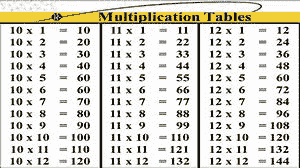

要写出像上面那样的表格，你有两个选择。你可以逐一输入所有部分。你可以使用循环，仅用几行代码就能完成。我们将在几页后查看嵌套循环，并向你准确地展示我们如何根据需求使用这些循环。

虽然这个过程有时听起来有点复杂，但你会发现这些循环实际上非常容易处理。这些循环基本上是为了告诉你的编译器，它需要重复执行同一块代码多次。编译器将继续读取这同一个代码块，直到插入的条件满足并准备好使用。所以，如果你想让代码从 1 数到 50，你只需要告诉编译器读取相同的代码，直到输出大于 50 为止。我们将查看一些你可以编写的、且可以为我们解决这个问题的代码。当然，在编写循环条件时，你需要小心设置条件。如果你从一开始没有设置好条件，程序就会一遍又一遍地读取代码，陷入无限循环中。你需要在代码中设置一个条件或跳出语句（break），来帮助它停止并继续执行程序应该做的下一件事。

用你过去可能使用的传统编码方法，你必须写出每一行代码。即使有一些相似的代码是相同的，或者你基本上是在一遍一遍地重新输入同一段代码，作为初学者，你必须这样做，因为那是你唯一知道处理的方法。

在这些循环的帮助下，你可以抛弃那种思维方式。你可以将许多行代码合并为几行，转而说服编译器根据你的需要多次读取同一行代码。如果你需要它执行 100 次，那么编译器就会那样做。得亏了这些循环，通过的一行代码，你就可以完成大量工作，而无需编写 100 行或更多行的代码。

综上所述，在尝试使用循环时，你有几个选项可以选择。你将选择的方法取决于你希望程序中发生什么，甚至取决于你希望编译器最少执行循环多少次。我们现在将花些时间来看看可能会向你展示的三种最常见的循环。

### While 循环

在我们的列表中，我们将从`while loop`（while 循环）开始。如果我们想尽可能长时间地运行下去，我们就会使用这种`while loop`。回到我们之前的例子，如果我们想让程序从 1 数到 50，我们希望看到它大于 50。

为了更好地了解我们如何工作，让我们来看看`while loop`的一些示例代码：

```python
counter = 1
while(counter <= 3):
    principal = int(input("Enter the principal amount:"))
    numberofyeras = int(input("Enter the number of years:"))
    rateofinterest = float(input("Enter the rate of interest:"))
    simpleinterest = principal * numberofyears * rateofinterest/100
    print("Simple interest = %.2f" %simpleinterest)
    #增加计数器
    counter = counter + 1
print("You have calculated simple interest for 3!")
```

在我们继续之前，将这段代码添加到你的编译器并让它运行。你会发现完成后，输出将以用户可以在程序中输入任何想要的信息的形式出现。然后程序将进行计算，并根据用户输入系统的任何数字计算出利率以及最终金额。在这个特定的示例中，我们设置循环执行三次。

### For 循环


现在我们已经查看了`while loop`并看到了在使用这种类型的循环时可以获得的所有益处，现在是时候转向第三种可以使用的循环类型了。在某些情况下，我们需要在想要编写的代码中使用稍微不同的想法，这就是我们想要引入`for loop`（for 循环）的时候。很多时候，你用`while loop`完成的工作也可以`loop`完成，而且这种循环被认为是处理循环传统的形式，所以你在编写代码时更有可能看到它。

通过我们将要使用的`for`循环，你会发现可以设置好所有内容，使得用户不需要亲自去遍历并为循环提供关于何时停止的信息。相反，循环将被设置为按照你编写的语句中项目出现的顺序来执行迭代，而这些信息就是将显示在屏幕上的内容。通过这种方式，你会注意到实际上并不需要任何来自外部力量甚至来自用户的输入，至少在你的循环完成并到达末尾之前是。

使用`for`循环的一个很好的示例包括：

### 测量某些字符串

```python
words = ['apple', 'mango', 'banana', 'orange']

for w in words:
    print(w, len(w))
```

当你运行上述`for`循环示例时，你可以将其添加到你的编译器中，并查看在执行时会发生什么。当你这样做时，屏幕上显示的四种水果将完全按照你编写的顺序逐一出现。如果你希望它们以不同的顺序出现，你可以这样做，但你需要回到代码中，按照正确的顺序或你选择的顺序重写它们。一旦你用这种语法写好了它们并准备好在代码中执行，你就无法对它们进行任何更改了。

## 嵌套循环

最后，我们将查看最后一种循环，即被称为嵌套循环的循环。这种的工作方式与我们看到的`for`循环和`while`循环略有不同，但在某些情况下它可以大显身场，并帮助我们在编码中完成很多工作。当我们决定使用嵌套循环之一时，你基本上是取一个循环，然后将其放在另一个循环内部。然后设置让这两个循环都继续运行，直到所有操作完成。这似乎在我们编写的一些代码中添加这种内容是件愚蠢的事，对于我们想要实现的目标来说可能过于复杂，但在很多时候，我们确实需要在代码中用到它。例如，可能我们想创建一个能够为我们写出乘法表的代码。也许你希望设置它能够从 1 乘以 1 一直到 10 乘以 10。

如果你手写这些内容（如果你愿意的话完全可以这样做），这将花费大量的代码来完成，并确保程序按照你想要的方式运行。这浪费了大量的时间和精力，因为你可以轻松地通过嵌套循环来完成这一切。这只需要几行代码就能完成工作，而不是数百行代码，并且可以节省时间。你用来创建嵌套循环并制作自己的乘法表时使用的代码包括：

### 写从 1 到 10 的乘法表

```python
for x in xrange(1, 11):
    for y in xrange(1, 11):
        print('%d = %d' % (x, y, x*x))
```

当你得到这个程序的输出时，它看起来像这样：

```
1*1 = 1
1*2 = 2
1*3 = 3
1*4 = 4
```

一直到`1*10 = 2`。然后它将继续处理双倍数的表格，例如：

```
2*1 = 2
2*2 = 4
```

依此类推，直到你在序列的终点得到`10*10 = 100`。

放心地将此放入编译器并查看会发生什么。你只需要四行代码，就能得到一个显示出来的整个乘法表。想想如果你按照以前的方法写这个表需要多少行代码？这个表只需要几行就能完成，这展示了嵌套循环的强大和出色。

这些循环是你编写任何代码的重要部分，花时间学习如何使用它们以及为了你的需求而使用的不同步骤也同样重要。在很多时候，我们确实需要在代码中用到它。

## 第 9 章：处理异常

### 处理你的异常

我们在 Python 中可以做的另一件很棒的事情被称为异常处理，特别是`try/except`。这是当你尝试运行一段代码，并在发生由于你或 Python 代码抛出的异常时使其得以恢复。

作为一名程序员，你的工作（也是一个好主意）是了解这类库中可以找到的一些异常类型。这对于工作非常有帮助，因为它告诉我们要在代码中添加哪些内容，以及异常何时会在你面前出现。

我们需要注意的不同关键字包括：

- `finally`：这是你想要执行清理操作的操作，无论是否发生异常。
- `assert`：此条件将在代码中触发异常。
- `raise`：`raise`命令将手动在代码中触发异常。
- `try/except`：这是当你尝试运行一段代码，并在发生由于你或 Python 代码抛出的异常时使其得以恢复。

### 如何抛出异常

我们在这里查看的第一件事就是在你的代码中抛出一个异常。我们将处理一些将会出现的自动异常。

如果你正在编写新代码，并注意到有某种潜在问题出现，或者你想通过某些步骤来弄清楚为什么你的程序运行得看起来有点不对，那么你可能可以检查编译器，看看在此时它是否正为你抛出了一个新异常。这是因为你的程序运行了一会儿，有机会查看了代码，并发现无法继续执行。然后你必须仔细检查它，以弄清楚哪里出了问题以及你如何修复这类问题。这里需要记住的一点是，很多时候你正在处理的问题非常简单，你可以很容易地修复它们。例如，如果你正在检查代码并尝试加载一个文件，但你提供了错误的名称（无论是在第一次命名时，还是在调用它时），你的编译器都会进行检查并抛出一个新异常。程序花费了时间查看你的代码，并发现发生了它无法为你提供帮助的事情，因此它抛出了这个异常。

深入了解这些异常并观察它们如何工作的好方法，是亲自花时间编写你自己的示例并进行练习。这有助于我们看到当编译器能够抛出其中一个异常时会发生什么。你可以在执行时用来查看编译器发生了什么情况的代码如下：

```python
x = 10
y = 10
result = x/y #尝试除以零
print(result)
```

当你让解释器运行这段代码时，你将得到输出：

```
>>>
Traceback (most recent call last):
File “D: \\Python34\\tt.py”, line 3, in <module>
result = x/y
ZeroDivisionError: division by zero
>>>
```

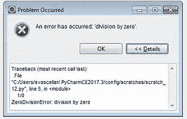

上面的图片是尝试除以零时显示内容的一个良好示例。我们可以更改信息，使其符合代码中应该看到的内容。

当你查看这个示例时，编译器会抛出一个错误，仅仅是因为你或用户正尝试除以零。这在 Python 代码中是不允许的，因此它会抛出该错误。现在，如果你保持现状并直接运行程序，你会得到一个混乱的错误信息，你的用户可能无法理解。这会让代码变得难以理解，没人知道下一步该怎么办。更好的主意是查看添加到代码中的一些不同选项，以帮助防止之前的混乱。你想确保用户理解为什么抛出此异常，而不是让他们在过程中感到困惑。另一种编写这段代码以确保大家达成共识的方法包括：

```python
x = 10
y = 0
result = 0
try:
    result = x/y
    print(result)
except ZeroDivisionError:
    print(“你正在尝试除以零。”
```

你可以看到，我们刚刚放入编译器的代码与我们上面写的非常相似。但我们确实检查并更改了信息，以便用户抛出此异常时显示某些内容。当他们遇到这个异常时，他们会在屏幕上看到“你正在尝试除以零”的消息。这并不是必须的步骤，但它确实让你的代码更易用！

## 如何定义我自己的异常

我们需要查看的是一些可以用来抛出自定义异常的步骤。通过我们上面的工作，我们花费时间处理了程序发现的、Python 标准库能够识别的任何自动异常。然后我们又进一步了一步，发现了一些可以用来个性化异常随带信息的步骤，而不是仅仅让它以自动方式呈现，因为大多数非程序员或你的普通用户是无法理解的。

现在我们解决了这些问题，是时候将我们的异常编写技能提升一个水平，并真正学习如何编写一些自定义异常来适应我们正在编写的代码类型了。这不会一直发生，但有时它确实有助于确保你能够按照自己的意愿完成所有工作。

例如，你可能正在编写某些新程序或代码，并希望设置它，让用户只能输入某些数字，而不允许某些其他数字。或者你可能设置一个当用户尝试猜测超过三次时显示的异常。这些都是可能出现在游戏中的情况，设置好流程来处理这些情况并抛出你自己的异常可以产生巨大的差异。

请记住，这类异常对于你创建的程序来说是独特的。如果你不有针对地将这些异常加入其中，编译器就不会识别这里有任何问题，并将一直继续运行。你可以添加许多此类异常，以及你喜欢的任何类型的异常，它将遵循与我们之前非常相似的想法。不过，为了确保按照我们想要的方式发生，我们将使用的代码包括：

```python
class CustomException(Exception):
    def __init__(self, value):
        self.parameter = value
    def __str__(self):
        return repr(self.parameter)

try:
    raise CustomException(“这是一个自定义错误!”)
except CustomException as ex:
    print("捕获到:", ex.parameter)
```

当你完成这段特定的代码时，你就成功地添加了你自己的异常。当有人抛出这个异常时，屏幕上会显示“捕获到：这是一个自定义错误!”的消息。你可以随时更改消息以显示你想要的内容，但这里只是作为显示我们所做的占位符。花点时间将此添加到编译器看看会发生什么。

在很多不同的情况下，你都会想要处理异常。当我们引入 Python 可能的更高级的代码类型时，我们将更多地关注这一点。请确保练习上面的某些代码，以确保你已经掌握了异常处理并准备就绪。

确保设置了正确值的方法非常重要。如果你设置了错误的值，这种方法将向你返回一个错误。你会发现，在使用封装思想时，`Python`并没有附带一个`private`（私有）关键字。这与我们在其他一些面向对象的编程语言中发现的情况略有不同。但这并不意味着你迷失了。你仍然可以通过执行和使用封装的过程来完成工作。此外，了解封装（encapsulation）与抽象（abstraction）的区别也是非常重要的。抽象是一个相似的概念，我们使用一种机制来表示代码该部分的所有本质特征，而无需包含任何实现细节。在抽象中，我们隐藏的是实现细节；在封装中，我们试图隐藏的是信息。

在处理隐藏代码中的方法和属性时，`Python`遵循“我们都是成年人”的理念。这意味着我们需要对那些查看并尝试使用你类的其他程序员给予一些信任。你需要尽可能坚持使用普通属性，因为这些属性更容易处理，并且从长远来看可以确保你的代码问题更少。

## Getter 和 Setter（访问器与赋值器）

现在，当你进行这一操作时，可能会想要使用 getter 和 setter 方法，而不是直接使用属性。但在大多数情况下，你想要使用 getters 和 setters 的唯一目的是为了确保以后如果需要，你可以稍微更改实现方式。然而，你会发现某些较新版本的`Python`（包括`Python2.2`及更高版本）允许通过属性（properties）执行某些操作：

1. 保护成员（Protected members）：保护成员将只能从类内部及其所有子类访问。这是我们在`Java`和`C++`中经常看到的内容。但是，我们如何在`Python`中实现这一点呢？这是通过被称为“约定”（convention）的过程实现的。当我们能够在成员名称前加上一个单下划线时，我们基本上是在告诉其他人我们不希望它被触碰，除非它是一个子类。

2. 私有成员（Private members）：在处理某些保护成员之外，我们还会处理私有成员。`Python`中有一种方法用于定义私有内容，它在函数和变量名前加了双下划线。当你想要从类外部访问这些内容时，这是隐藏它们的正确方法。

    - 在此记住，`Python`语言并没有真正的私有方法，因此属性或方法开头的单下划线意味着你不应该访问该方法。但这是一种约定，我们仍然可以使用单个下划线来访问该变量。此外，即使我们引入了双下划线，我们仍然能够访问私有变量。

## 整合一切

让我们快速看看这在我们的类中是如何运作的。记得我们在上面的代码中提到过私有成员，但让我们看一个示例，看看我们如何通过被称为“名称修饰”（name mangling）的过程来访问这些私有成员数据。我们用来实现这一点的过程包括：

```python
class Person:

  def __init__(self):
    self.name = 'Manjula'
    self.__lastname = 'Dube'

  def PrintName(self):
    return self.name +' ' + self.__lastname

# 类外
P = Person()
print(P.name)
print(P.PrintName())
print(P.__lastname)

# AttributeError: 'Person' object has no attribute '__lastname'
```

正如我们已经看到的，这与我们在`Python`语言中看到的封装和数据隐藏之间有许多不同。当我们把此过程与其他编程语言中可以做的工作进行比较时，尤其是如此。但我们仍然有一些方法可以围绕此操作，以便在该过程中获得我们想要的结果。

在`Python`中，你不是依赖`private`关键字，而是依赖约定：一个不应直接访问的类变量将用下划线作为前缀。如果你过去接触过其他编程语言，你会发现这处理起来会有点困难，并且可能需要一些时间才能看到结果。但好消息是，如果这是你学习的第一种编程语言，它不会占用你太多精力，而且对你来说更容易处理。你可以实现这一点的代码包括：

```python
class Robot(object):

  def __init__(self):
    self.a = 123
    self._b = 123
    self.__c = 123

obj = Robot()
print(obj.a)
print(obj._b)
print(obj.__c)
```

花些时间将其添加到你的编译器中并运行，看看会发生什么。你可能会发现有一个错误并出现了一个下划线。当我们使用单个下划线时，这意味着我们正在处理一个私有变量。这意味着你不应该直接访问它。但除了约定之外没有什么能阻止你这样做。

我们将使用双下划线。这是一个私有变量。这会使得访问该变量变得有些困难，但在某些情况下仍然是可访问的。记住，两者在某些情况下都是可访问的。`Python`通过约定拥有私有变量，但你仍然需要在这个过程中注意哪些部分。

在我们进行的过程中，我们需要花几分钟谈谈 getters 和 setters。私有变量旨在通过被称为 getter 和 setter 方法进行更改。你可以使用这些方法为私有变量提供间接访问。你能够编写的这种代码的示例如下：

```python
class Robot(object):

  def __init__(self):
    self.__version = 22

  def getVersion(self):
    print(self.__version)

  def setVersion(self, version):
    self.__version = version

obj = Robot()
obj.getVersion()
obj.setVersion(23)
obj.getVersion()
print(obj.__version)
```

该方法的值将在你处理的类方法内部进行更改。这是我们可以处理的一个简单示例，但如果我们愿意，也可以进行一些额外的检查。例如，你想要做的检查之一是查看值是否太大或是否为负，取决于你的条件。

## 注意事项

在进行这一过程中，当需要访问我们想要在这个语言中工作的私有函数或私有成员时，有很多事情需要记住。当我们通过访问想要保持私有的部分在这个语言中工作时，我们需要跟踪的一些事情包括：

1. 当你编写一个需要属于某个对象的属性时，如果该属性不存在，`Python`系统不会发送错误或对此进行抱怨。相反，它会为你创建一个全新的属性供你使用。

2. 私有属性并不是 Python 系统会去保护的属性。这是一个你必须去适应的设计决策。

3. 在大多数情况下，你想要操作的私有属性将被掩蔽。这样做的原因是继承链中永远不应该发生冲突。掩蔽将通过整个代码中的某些隐式重命名来完成。私有属性仍然需要一个真实的名称。

# 第 11 章：Python 数据库与字典及其使用方法


Python 语言中的数据库和字典是此类语言编程中的重要部分。当我们能够以恰当的方式使用它们时，我们就能搜索并使用我们需要的数据，并且会发现字典能够帮助我们处理此类语言内部所需的一些额外功能和更多内容。当我们将它们结合在一起时，我们就拥有了保持代码尽可能健壮的功能和更多特性。让我们深入了解这两者，看看 Python 数据库和 Python 字典能做什么。

## Python 数据库

当我们想要确保 Python 语言按照我们想要的方式工作时，有很多数据库可以很好工作。我们必须确保了解这些数据库的能力，并能够以恰当的方式使用它们等。

Python 语言在很多时候都会依赖这些数据库。当我们处理数据科学和机器学习等任务时，这一点变得尤为明显。能够处理这些数据库将产生巨大的差异，并帮助我们收集和分析完成这些过程所需的某些不同类型的数据。好消息是，当在 Python 中处理数据库工作时，我们有很多不同的选项可以选择，其中一些包括：

1. `DB-API`：Python 数据库 API 非常有用，因为它为 Python 数据库访问模块定义了一种标准接口类型。几乎所有的 Python 数据库模块都会以某种方式遵循这种接口。

2. `SQLAlchemy`：这是一个你可以使用的非常常用的数据库工具包。与其他一些库不同，它不仅为我们提供了一个可以使用的 ORM 层，还可以为我们提供一个通用的 API，帮助我们编写不依赖 SQL 的数据库无关代码。


3. `Records`：`Records`是你的另一种选择，是一个极简主义的 SQL 库。你会发现它是为向各种数据库发送原始 SQL 查询而设计的。数据可以通过编程方式使用，也可以导出到许多实用的数据格式。

4. `PlugSQL`：这是 Python 的另一个简单接口，用于帮助组织和使用参数化以及手写形式的 SQL。它是一个反 ORM 工具，大部分情况下是低保真的，但它在 Python 中呈现出一个美观、简单且简洁的接口。

5. `Django ORM`：这是一个你可以使用的非常常用的数据库工具包。与其他一些库不同，它不仅为我们提供了一个可以使用的 ORM 层，还可以为我们提供一个通用的 API，帮助我们编写不依赖 SQL 的数据库无关代码。

很容易看到很多例子展示了这在你的代码中将是如何工作的。我们将查看一个字典，它将定义一个位置到其对应的大联盟棒球（MLB）球队名称的映射：

```python
MLB_team = {
    'Colorado' : 'Rockies',
    'Boston'  : 'Red Sox',
    'Minnesota': 'Twins',
    'Milwaukee': 'Brewers',
    'Seattle'  : 'Mariners'
}
```

考虑到这些，我们也可以遍历并创建一个属于我们自己的字典。在 Python 中，我们通过将我们想要使用的元素序列放在大括号`{}`内部来创建我们自己的字典，然后用逗号将它们隔开。字典将包含一对值，其中一个是键（key），另一个将持有对应的键值元素，即键：值（key: value）。字典中的值可以是你喜欢的任何类型的数据，并且你可以尽可能地重复它。但是，你需要确保你所使用的键不是重复的，并且让它们是不可变的。

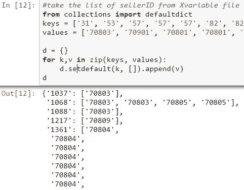

通过以上内容，我们可以很好地了解在这一语言中处理我们自己的字典时可以做什么。当我们需要对所有工作和编码进行组织和更深入的处理时，Python 字典能够带来我们正在寻找的很多东西。

字典也可以通过 Python 中已有的函数`dict()`来创建。空字典是你只需使用大括号就可以进行操作的，就够了。字典的键是区分大小写的。这意味着你可以拥有相同的名称但不同的大小写，键仍然会被以不同的方式处理。

考虑到这些，让我们来看看我们将如何编写其中一些代码以满足我们的需求。对字典所需的几种不同内容进行操作的良好示例包括：

创建一个空字典

```python
Dict = {}
print("Empty Dictionary: ")
print(Dict)
```

创建字典（使用整数作为键）

```python
Dict = {1: 'Geeks', 2: 'For', 3: 'Geeks'}
print("\nDictionary with the use of Integer Keys: ")
print(Dict)
```

创建字典（使用混合键）

```python
Dict = {'Name': 'Geeks', 1: [1, 2, 3, 4]}
print("\nDictionary with the use of Mixed Keys: ")
print(Dict)
```

创建字典（使用`dict()`方法）

```python
Dict = dict({1: 'Geeks', 2: 'For', 3:'Geeks'})
print("\nDictionary with the use of dict(): ")
print(Dict)
```

创建字典（每个项目作为一个值对）

```python
Dict = dict([(1, 'Geeks'), (2, 'For')])
print("\nDictionary with each item as a pair: ")
print(Dict)
```

在此期间，我们也可以向字典中添加一些元素。有许多方法可以用来实现这一点。例如，我们可以使用键的定义值来一次添加其中一个值。在我们的字典中更新现有的值也是可能的，因为我们可以使用`update()`方法来这样做。在某些情况下，你甚至可以向其中添加一些嵌套的键值，以帮助创建一个更强大的字典。

这里需要记住的一点是，当你在添加一个值时（如果键值对已存在，在这种类编码中是完全可以的），该值是可以接受的。

另一个需要注意的是，如果你使用`del`它将得到整个字典。如果你尝试打印这个，将得到一个错误。

在处理时，可以使用以下几种方法：

1. `copy()`：此方法将返回字典的浅拷贝。
2. `clear()`：此方法将删除所有项。
3. `pop()`：此方法将删除并返回你寻找的元素。
4. `popitem()`：此方法将移除键值对并以元组形式返回。
5. `get()`：这使得访问值变得更容易。
6. `values()`：此方法将返回所有值的列表。
7. `str()`：此方法将帮助我们生成字典的字符串表示。
8. `update()`：此方法会将字典-值对添加到字典中。
9. `keys()`：当你使用此方法时，我们将获得想要处理的键列表。
10. `items()`：此方法将返回键值对的元组列表。
11. `has_key()`：如果键在字典中，它将返回 true；否则返回 false。
12. `fromkeys()`：此方法将创建一个新字典，其键来自`seq`，值设置为`value`。
13. `type()`：此方法将帮助我们返回传递的变量的类型。
14. `cmp()`：这将帮助我们比较两者的元素。

## 第 12 章：在此语言中处理 GUI 和 CGI

在处理 Python 语言时，我们需要讨论的更重要的部分是关于计算机 GUI 和 CGI 的操作概念。你会发现，这两者都是 Python 能够处理的内容，而且当我们能够将它们整合在一起时，就能更容易地处理我们想要的一些更复杂的事情。所以，让我们直接进入主题，看看这两个话题能带来什么。

### 熟悉 GUI

我们在这里首先来看的是如何在 Python 中处理 GUI 这一主题。GUI 代表图形用户界面（Graphical User Interface），它通常类似于我们在操作系统上看到的那些细小图标，这些图标允许我们接入网络或进入另一个程序，而无需打开命令行并输入这些内容。有时，你需要通过并写出你想要运行的命令和代码，但也有时候，GUI 将是你想要使用的最佳选项。

当我们需要编写一些符合我们需求的基于 GUI 程序时，Python 为我们提供了几个不同的选项。这些包括以下几个选项：

1. `Tkinter`：这通常是我们能够处理的最简单的选项。它是 Python 中 GUI 的标准，并且最常用于此类工作。
2. `JPython`：这是一个用于 Java 的 Python 平台，它为我们提供了一些 Python 脚本，帮助我们在 Java 语言的帮助下完成这一切。
3. `wxPython`：这是与 Python 绑定的选项之一，也是`Tkinter`的替代方案。

现在我们对`Tkinter`程序有了进一步的了解，我们将查看这里可以使用的一些示例程序。在这个程序中，展示了如何在 Python 的帮助下使用`Tkinter`来构建窗口、按钮以及我们想要与这些按钮关联的事件。

我们可以为此使用的代码包括：

```python
import Tkinter as tk
from Tkinter import *
from Tkinter import ttk

class karl( Frame ):
    def __init__( self ):
        tk.Frame.__init__(self)
        self.pack()
        self.master.title("Karlos")
        self.button1 = Button( self, text = "CLICK HERE", width = 25, command = self.new_window )
        self.button1.grid( row = 0, column = 1, columnspan = 2, sticky = W+E+N+S )
    def new_window(self):
        self.newWindow = karl2()

class karl2(Frame):     
    def __init__(self):
        new =tk.Frame.__init__(self)
        new = Toplevel(self)
        new.title("kalos More Window")
        new.button = tk.Button( text = "PRESS TO CLOSE", width = 25, command = self.close_window )
        new.button.pack()
    def close_window(self):
        self.destroy()

def main(): 
    karl().mainloop()

if __name__ == '__main__':
    main()
```

在我们学习的过程中，我们将看到处理 GUI 时可以使用的一些标准以及与之相关的一些属性。其中一些包括位图、锚点、光标、颜色、字体和尺寸等选项。

### 什么是 CGI？

到目前，我们能够做的很多编程（无论是使用 Python 还是其他选项）与网络或在线并不相关。但现在是时候让我们开始一些 CGI 的工作了。

CGI 代表通用网关接口（Common Gateway Interface）。这是一种允许 Web 服务器与外部应用程序交互的标准协议。这允许 Web 服务器通过执行用任何语言编写的脚本并将输出返回给浏览器来生成动态内容。

### CGI 如何工作

通过此，我们首先来看的是第一步。考虑一下用户点击超链接浏览页面时会发生什么。这些步骤包括以下内容：

1. 浏览器能够联系 Web 服务器并请求 URL。
2. 然后该 URL 将经过一些解析。
3. 系统将查找第一步中请求的文件名。
4. 除非网页出现问题，否则它将找到该文件并将其返回。
5. Web 浏览器能够获取这些响应来形成 Web 服务器。
6. 作为服务器响应，它要么向你显示收到的文件（如果一切顺利，那就是你请求的网站），要么向我们显示错误消息。

现在，请记住这一点，我们可以设置这种 HTTP 服务器，因为当请求特定目录时，文件不会被直接返回。相反，在这种情况下它将作为程序被执行，然后该程序的输出将是显示在你正在使用的浏览器上的部分。

从这里，我们需要查看如何配置我们想要使用的 CGI。实现这一点的若干步骤操作包括以下几点：

- 首先，我们想要找出是哪个用户在运行 Web 服务器。
- 然后我们将移动并检查服务器配置，以帮助我们确定是否可以在我们正在查看的目录中运行所需的脚本。
- 检查该特定文件的权限。
- 明确确保你制作的脚本是可读的，并且 Web 服务器用户也能执行它。
- 确保 Python 脚本的第一行设置正确，以引用解释器能够并愿意运行的 Web 服务器。

在我们结束对 CGI 的讨论之前，我们需要查看编写其中一个程序的结构。在 Python 中，CGI 脚本的输出将由两个不同的部分组成，它们将通过一个空行隔开。第一部分用于向我们展示需要处理的头部（headers）数量，这将帮助我们向客户端描述接下来是什么类型的数据。关于这段代码的样式以及我们如何构建 Python 中的一个 CGI 程序的良好示例将包含以下内容：

```python
print ("Content-Type : text/HTML")

# then comes the rest hyper-text documents

print ("<html>")

print ("<head>")

print ("<title>My First CGI-Program </title>")

print ("<head>")

print ("<body>")
print ("<h3>This is HTML's Body section </h3>")
print ("</body>")
print ("</html>")
```

在 Python 编程语言中能够完成的许多项目中，同时使用 GUI 和 CGI 将至关重要。当你能够将所有部分组合在一起并看到出的结果，并且学会了何时该调用和使用哪一个时，你会发现在这个过程中获得你所希望的成功比以往任何时候都容易。

## 结论


感谢你读完《Python 速成》。我希望它对你有所启发，并能够为你提供实现目标所需的所有工具，无论你的目标是什么。下一步是开始利用本指南中讨论过的某些不同主题来让自己受益，并学习如何使用 Python 语言。这种编程语言包含许多不同的部分，学习它们如何结合在一起并尝试运行现有的某些不同代码，是获得实践经验并准备好进入这一过程的最佳方法之一。

本指南花时间查看了你可以使用 Python 语言完成的某些不同任务，以及你如何使其成为适合你的正确选择。本书旨在向你教授通用编程中的所有不同部分，更具体地说，无论你是完全的初学者，还是已经编程了很长时间，通过这门语言的帮助你可以做什么。

从事编码工作并不总是像我们希望的那样容易，但你会发现，当你上手 Python 这种面向对象（OOP）语言并学习如何处理一些基础知识时，你的工作中几乎没有什么是你无法完成的。尝试这些选项中的几个，并学习如何让它们紧密结合以编写出奇妙的代码。

当你需要处理一些最大的编程挑战时，可能会有很多不同的选项可选。但最好的选择将是 Python。它拥有你所寻找的所有优势、非常易于学习和阅读，以及更多功能。当你准备好开始 Python 语言的速成课程并准备好大展拳脚时，务必查看本指南以开始。

# 初学者机器学习

### 一本学习和理解人工智能、神经网络和机器学习的入门指南

## 引言

思想者们一直为提出解释智能机器兴起的理论而做好了准备。正如菲利普·K·迪克（Philip K. Dick）所说，认为机器人会梦见电子羊完全是理所当然的。嗯，答案是否定的。科学事实随着时间的推移发展到了一个空间点，人类的想象充满了科幻小说中的冲突图像。与大多数好莱坞大大片中描绘的想法相反，我相信人类物种并没有与自主机器人面临生存斗争。相反，人类物种正向人工智能的时代迈进。作为一名学习者，理解机器学习的基础至关重要。你还需要理解大多数感兴趣的入门候选人在学习过程中会遇到的挑战。

机器学习（ML）构成了人工智能的主要组成部分之一。机器学习算法经过调整，可以从现有的数据和信息中学习。机器学习的概念深入了这样一个观点：计算机像人类一样，不需要显式编程即可执行任务。算法只需要学习和进步。

在当今世界，机器学习算法赋予了计算机与人类交互的能力。机器可以独立操作机器（是的，设备可以操作机器），编写比赛报告，并检测不同系统中的异常。我坚信，机器学习在最佳状态下将对大多数行业的行动和生产过程产生积极影响。出于这个原因，明确解释这一概念至关重要，以便每个人都能掌握技术世界上最令人兴奋的话题的窍门。

在本书中，我将带领读者快速浏览机器学习的概念，以传授在该领域进一步发展所需的所需的知识。所以，请坐好……灯光，摄像机，开拍。

## 第 1 章：机器学习简介


机器学习的想法似乎很模糊，考虑到它们并不是智能的。根据本性，机器执行的任务了从控制交通到探索太空的各个领域。科学事实随着时间的推移发展到了一个空间点，人类的想象充满了科幻小说中的冲突图像。与大多数好莱坞大大片中描绘的想法相反，我相信人类物种并没有与自主机器人面临生存斗争。相反，人类物种正向人工智能的时代迈进。作为一名学习者，理解机器学习的基础至关重要。你还需要理解大多数感兴趣的入门候选人在学习过程中遇到的挑战。

机器学习（ML）构成了人工智能的主要组成部分之一。机器学习算法经过调整，可以从现有的数据和信息中学习。机器学习的概念深入了这样一个观点：计算机像人类一样，不需要显式编程即可执行任务。算法只需要学习和进步。

在当今世界，机器学习算法赋予了计算机与人类交互的能力。机器可以独立操作机器（是的，设备可以操作机器），编写比赛报告，并检测不同系统中的异常。我坚信，机器学习在最佳状态下将对大多数行业的行动和生产过程产生积极影响。出于这个原因，明确解释这一概念至关重要，以便每个人都能掌握技术世界上最令人兴奋的话题的窍门。

在本书中，我将带领读者快速浏览机器学习的概念，以传授在该领域进一步发展所需的所需的知识。所以，请坐好……灯光，摄像机，开拍。

但机器为什么要学习呢？嗯，机器学习已被证明是我们社会不可或缺的一部分。智能设备在收集了大量样本输入后可以调整其内部结构以产生预期的输出。此外，智能机器通过数据挖掘过程分析海量数据，以建立任何相关性。人类只能编码特定数量的数据；而通过一种可以理解的机器，可以轻松获取大量信息。

人们对机器学习的概念兴趣再次兴起。随着计算处理能力的增长和海量数据的出现，机器学习的普及程度只会增加。随着技术的不断进步，机器学习正成为一个庞大的领域。因此，机器学习根据学习任务有几种分类。

通过本章，你将了解机器学习的发展、其应用及相关学科，以及人工智能的广泛范畴。其他章节将更深入地探讨与机器学习相关的应用。

## 机器学习的发展

虽然 20 世纪 90 年是机器学习普及的黄金时代，但这一概念有着悠久的历史。在 20 世纪 40 年之前，现代机器学习使用的大多数数学基础都以统计的形式存在。其中一位著名的数学家是托马斯·贝叶斯（Thomas Bayes），他在 1812 年提出了定理的概念。该定理在数据科学中至关重要，特别是贝叶斯推断，它决定了信息的可用概率。1805 年，安德里-马里（Andrien-Marie）提出了最小二乘法，主要用于数据拟合。随后在 1913 年，安德烈·马尔可夫（Andrey Markov）开发了描述不同分析技术的马尔可夫链。马尔可夫链计算事件发生的概率，这是机器学习的一个关键方面。

20 世纪 40 年代后期，开发围绕着存储程序计算机展开。计算机共同存储程序和数据。计算机内存中存储的指令使其能够执行不同的任务，无论是间歇性的还是顺序性的。约翰·诺依曼（John Von Neumann）在 20 世纪 40 年代引入了这一思想。他提出以二进制数字格式电子化存储程序，以便计算机修改指令。纽曼与 J·普斯珀·埃克尔特（J. Presper Eckert）和约翰·W·莫奇利（John W. Mauchly）合作，这一开发增强了数字网络的动力和灵活性。随后在 1949 年，英国工程师制造了曼彻斯特一号机（Manchester Mark 1），而美国人提出了 EDVAC。这两项进展都是功能增强的存储程序计算机。

1950 年，阿兰·图灵（Allan Turing）对机器思考的能力产生了疑问。他开发了一种技术和哲学并重的方法分析这一困境。图灵提出了“模仿游戏”（imitation game），试图向机器和人类提问。通过回答，提问者可以推断出人类与计算机之间的区别。总之之，图灵认为从智力角度来看，数字机器可以伪装成人类。

1951 年，迪恩·埃德蒙德（Dean Edmonds）和马文·明斯基（Marvin Minsky）开发了 SNARC，这是一种人工神经网络。明斯基拥有学习机器的想法。他与同事迪恩一起，使用机电元件和模拟元件制造了 40 个神经元。他们将神经元连接成一个网络。之后，他们安装了电位器和电容器用于长期和短期记忆。埃德蒙德和明斯基通过让机器通过虚拟迷宫测试了机器的学习能力。正奖励会移动电位器，从而引发学习，使其能够解决未来的迷宫。明斯基在成为麻理工学院人工智能实验室的一员后发明了许多其他程序。

20 世纪 50 年代到 60 年代，人工智能的突破是暗淡的。此前对 AI 相关研究的热情显著减少。因此，资金非常有限，导致该领域出现了意料之外的停滞。20 世纪 80 年代，发生了一些变化。研究人员重新发现了旧的想法并将其应用于新的环境中。计算智能和信息学等术语的使用开始发挥作用。

1996 年，当深蓝号（Deep Blue，一台计算机）击败了卡斯帕波夫（Kasparov）时，机器学习的普及程度增加了。游戏很大程度上取决于……。从这次遭遇可以看出，机器学习正在席卷世界。

2006 年，反向传播通过训练深层网络促进了机器学习。该概念在 20 世纪 60 年代初出现，但逐渐变得成熟。然而，杰夫·辛顿（Geoff Hinton）通过引入深度神经网络复兴了反向传播。随后在 2014 年，MindMind 出现了能够播放视频的神经网络。这些技术可以分析屏幕的像素。神经图灵可夫机（Neural Turing Machine）可以访问外部内存。21 世纪的……

通过霍克莱特（Hochreiter）和施密杜伯（Schmiduber）开创的长短期记忆（LSTM）语音识别，我们看到了……的……。这种神经网络学习需要记忆的任务。谷歌 语音识别等技术的创建显示了 LSTM 产生了多大的影响。人脸识别另一个描述识别算法的程序，显示它们越来越准确。

### 什么是机器学习？

机器学习最早的定义之一是由 1959 年的亚瑟·萨缪尔（Arthur Samuel）提出的。他指出，机器学习是计算机在不经过编程的情况下学习的内在能力。简单来说，机器学习涉及研究各种技术和算法，以自动解决传统编程无法解决的问题。标准编程的特征的两个步骤是接收规范和实施设计。规范给出了关于做什么的指令，让计算机负责设计和实现。传统编程一直以来挑战性，因为机器可能无法以预期的方式检测信息。

机器学习算法有一种解决这些问题的通用方法。算法从标记数据中学习，并不一定需要通过复杂且详细的设计来执行任务。它们从呈现的数据中学习，随着数据集的增加，准确性水平很高。当机器“理解”了标记数据集的模型时，它可以对集合之外的信息进行精确预测。机器学习产生的结果比人类创建的规则更好。机器学习算法整合数据集中的数据点，由于缺乏人类偏见，增加了准确性。

### 人工智能的重要性

在许多学术文章中，混用“人工智能”和“机器学习”这两个术语的情况显而易见。然而，这两个术语是不同的。人工智能是一个比机器学习更广泛的领域，后者是人工智能的流行应用之一。简单来说，人工智能是计算机执行需要人类智能的任务的能力。该名称的产生是为了描述系统通过类似于人类推理、记忆、泛化和发现意义的智力过程进行开发。人工智能在计算机发展后逐渐成长起来。尽管对计算机内存容量和处理速度的研究日益增加，但这项技术尚无法与高度智能的人类大脑相拟。然而，某些创建的程序具有高水平的性能，展现了在执行多样化任务时的专业水平和专长。

计算能力的提升、海量数据的增长以及先进算法的应用增加了人工智能的普及。20 世纪 50 年代，人工智能的早期研究侧重于符号方法和问题解决等课题。200 世纪 60 年代，随着美国国防部开始训练计算机模仿人类推理，这一概念占据了主导地位。在某个街道制图项目中，国防高级研究计划局（DARPA）开发的个人助手预见了该项目的效率。随着这些进步，计算机自动化变得流行。人工智能正在继续演变，它对不同行业的益处是不可估量的。

人工智能至关重要，特别是随着行业复杂性的日益增加。人工智能为产品增加了一个智能维度。虽然你不是作为应用程序购买人工智能，但你购买的产品具有人工智能增强，这提升了它们的功能。如机器人、自动化、智能机器和对话平台等功能可以开发从投资分析到安全智能的多种技术。

人工智能利用自动化来执行高量且频繁的任务。这项技术监督了计算机任务的无缝完成且不会疲劳。因此，其准确水平很高。神经网络中的深度学习概念使得机器表现出色。在医学领域，人工智能的表现就像经过训练的放射科医生。通过图像识别、分类和深度学习等人工智能的多种技术，磁共振成像（MRI）正变得越来越准确。

与传统的计算机程序不同，人工智能可以分析更深刻、更复杂的数据。这项新技术使用了许多层的神经网络。数据越多，结果就越准确。人工智能还能从呈现的数据中收集足够的信息。在如今各行业竞争激烈的时代，使用人工智能挖掘最佳数据可以让你比其他公司具有竞争优势。

人工智能的范围非常广泛。然而，你可以将其视为部分科学、部分工程。人工智能的科学目标是分析代表知识的理念、知识的使用以及系统的组装。相反，人工智能的工程目标是利用智能来解决一些现实世界的问题。理解人工智能的作用至关重要。许多人有一个错误的印象，认为人工智能的最终目标是取代商业领域的人类工人。虽然人工智能大幅降低了劳动力成本，但在没有人类的情况下，仅靠计算机工作是不可能的。

随着人工智能的发展，许多行业正享受着生产力和效率的提高。今天，几乎所有行业都在投资人工智能。人工智能的多种能力帮助公司自动化并优化其流程，以提高盈利能力。人工智能的一个关键用途是让企业了解其客户。此类洞察导致了对客户偏好和需求的准确预测。

因此，建立个性化的客户关系变得可能。另一个关键的影响领域是产品和服务。消费者总是渴望拥有智能手机、家电器和汽车等智能产品。业务流程的自动化是另一项伟大发明，它让人工智能取得了优势。

银行业是高度依赖人工智能的行业之一。自动学习、机器人、自适应智能和自动化已成为行业不可或缺的一部分。自动化数据的相关领域包括审计和数字化。对客户查询的自动反馈也是标准做法。从本质上说，人工智能提高了银行业人类努力的有效性、精确性和速度。美国运（American Express）是采用人工智能改善客户服务和检测欺诈的公司之一。万事达（Mastercard）是另一个使用人工智能减少欺诈案例的示例。

在制造业中，物联网和人工智能使公司能够保持竞争力。通过使用数据分析，人工智能提供了纳米技术、虚拟现实、增强现实和机器人化等进步。像宝马这样的公司在其最近车型中采用了人工智能。另一方面，特斯拉正在制造智能汽车；而沃尔沃（Volvo）正在通过机器学习构建世界上安全的车辆。

零售业在人工智能投资方面排名最高。零售行业中受益的领域包括涉及多渠道的操作、采购和客户服务。阿里巴巴集团（Alibaba Group）是在不同业务运营中使用人工智能的跨国公司之一。人工智能工具允许客户在阿里巴巴在线门户中导航。此外，公司正在利用人工智能创建“智能城市”，以促进交通、废物管理和照明的顺畅。

人工智能通过自动驾驶汽车、路线优化和检测任何道路障碍的雷达等进步重新点燃了运输行业。这些发展直接影响物流。在自动驾驶的情况下，操作可以 24 小时进行，因为它们不依赖于司机的可用性。物流行业降低了成本并享受着高利润。人工智能在教育领域的众多应用正在改变学术界。随着教育材料获取性的增加，教育正变得更加个性化和便利。今天，在线课程正在兴起。你只需要一台计算机和稳定的网络连接。这项发明使得在任何地区参加课程都成为可能。

机器学习是统计学和计算机科学的产物。计算机科学主要侧重于手动编程，而机器学习考虑的是自我编程的“如何实现”。另一方面，统计学侧重于从特定数据中推出的结论，而机器学习则融合了计算算法和架构的思想，这些架构有助于捕获、索引、存储、合并和检索数据。早期的研究人员建立了统计学与机器学习之间存在紧密关系的这一结论。Michael I. Jordan 是这样的学者之一，他认为机器学习的思想（包括从理论到方法论的原则）基础是统计学。多年来，一些统计学家从机器学习中大量借鉴，以发展统计学习这一领域。

机器学习及其相关领域有许多对我们的日常生活很有应用。机器学习的用途之一是虚拟个人助手，例如`Google`和`Alexa`。由于便利性的提高，虚拟助手影响了如今的大多数行业。它们可以帮助你在任何需要的时候寻找相关信息。当你激活虚拟助手时，它可以帮助回答不同的查询，并作为闹钟或提醒。虚拟助手利用你手机上不同的应用程序来收集信息，帮助你更好地安排日程。移动应用、智能手机和智能音箱等平台都可以整合虚拟助手。

视频监控是另一个由机器学习驱动的应用。个人很难监控多个视频摄像头。训练计算机来控制视频监控系统是确保有效性最可靠的方法之一。通过这项技术，可以检测并威慑犯罪。启用机器学习的设备可以跟踪任何异常情况并及时警报。它可以检测运动、踉跄动作或静止不动的情况，这些情况可能预示着攻击即将发生。凭借该系统的及时警报，人类服务人员可以迅速采取行动处理任何意外。在这种情况下，机器学习改进了不同的监控服务。

机器学习有助于过滤恶意软件和电子邮件垃圾邮件。该技术不断更新垃圾邮件过滤器。某些垃圾邮件过滤技术无法检测垃圾邮件发送者使用的技巧。机器学习驱动了如`Decision Tree Induction`（决策树归纳）等垃圾邮件过滤技术。这些服务可以检测数千种恶意软件，它们大部分与之前的版本相似。对代码的深度洞察让机器学习能够驱动这些安全程序。检测恶意软件变得容易，因为它们很少与之前的版本有所不同。

搜索引擎的流行使得必须使用机器学习来精炼结果。像`Google`这样的搜索引擎由于了机器学习，改进了它们对搜索结果的传递。每当你进行在线搜索时，备份算法都会记录你对呈现结果的反应。你在网页上的活动会让搜索引擎将其解释为对所显示结果的满意。如果你继续搜索而不打开特定页面，搜索引擎会假设你的结果与查询不匹配。因此，算法会尝试改进结果，并可能提供额外的建议。

随着社交网络服务的使用日益增加，使用机器学习来改善社交媒体体验正变得流行。这种进步体现在新闻推送的个性化，使得针对性的广告投放成为可能。这种转变对用户和企业都有益的。机器学习的应用存在于我们的日常社交媒体使用中。在`Facebook`中，“你可能认识的人”建议就是机器学习的成果。该应用程序根据你的联系人、兴趣、访问的个人资料或同事收集信息，以建议你考虑的朋友。另一个归功于机器学习的有趣发明是人脸识别。当你上传一张和朋友合照时，如果他们在你的朋友列表中，`Facebook`可能会识别出他们。你可能会收到标记建议。精确性概念是机器学习的核心特征之一。

网络空间使用的增加导致了对网络安全的不可避免的的担忧。通过机器学习，可以检测在线欺诈。机器学习正在保护网络空间，诸如`PayPal`等金融实体正受益于反洗钱功能。公司配备了多种工具来分析交易并判断其合法性。这些技术可以检测欺诈活动并限制相关账户。

通勤预测是机器学习极力探索的一个领域。`GPS`导航服务在交通预测中脱颖而出。使用该服务允许交通控制技术保存我们的速度和当前位置。这些数据有助于绘制交通地图并执行拥堵分析。不同地区的交通机构可以利用这项技术来交通拥堵。在线交通也增强了通勤。当你打车时，会得到估价。像`Uber`这样的公司已经使用机器学习来提升预测和用户体验。

例如，数字识别是监督学习如何简化问题解决过程的一个典型示例。`classification`在推断问题上的有用性这一事实使得监督机器学习成为一种简单的方法，当输入未定义时这种方法可能有用。只要数据不可用，监督学习就成为一种非常重要的范式。在使用监督学习时，始终存在让特定输入未定义的风险。当此类数据可用时，模型就变得不再有用。然而，当某些输入不可用时，在推断任何输出的结论过程中可能会出现问题。使用监督学习是训练神经网络时最简单且常见的方法之一。


最常见的监督学习方法包括分类和回归。在`classification`的情况下，监督学习的使用发生在输出可能被限于固定数量的值时。`classification`通常处理给定数据集中的识别，旨在将新的观测值链接到此类类别中。另一方面，当输出在给定子集中具有广泛的数值范围时，就会使用回归。这两个例子的目标都是确保机器学习利用一组固定的训练示例，以便对数据集合在给定子集中的相似性或差异性进行必要的比较。此类数据集中的理想情况确保了算法能够确定该子组内所有未见情况的类别标签。

## 无监督学习

机器学习可以通过无监督聚类分析发生。该方法涉及使用一组由输入组成的数据，这在开发结构时是必要的。数据点的聚类是无监督学习的一个示例。与监督学习的情况不同，无监督学习中的测试数据没有标签，也不属于特定的分类。无监督学习不响应反馈，而是关注共性。该方法试图识别给定数据集中存在共性的可能，并利用这些共性来开发一种模式。本质上，这意味着目标是让计算机学习如何做某事，而又不提供实现此任务的逻辑方法。因此，无监督方法比监督过程更困难、更复杂。这种方法意味着使用奖励机制来确认任务完成的成功，而不一定提供关于如何实现设定目标的显式指令。

无监督方法的目标更倾向于决策过程，而不是仅仅对这些数据进行分类。无监督学习训练代理根据随时间建立的奖励系统或惩罚来执行或响应任务。计算机逐渐学习在没有预期结果先验信息的情况下导航过去的命令。这种方法可能耗时且枯燥。但是，无监督学习是强大的，因为它从试错点开始运行，这可能会产生发现。无监督学习不考虑任何预分类的信息，因此从发明的角度进行工作。

用于解释无监督学习使用的典型示例是双陆棋游戏，它是发现的最复杂的棋类游戏之一。当一系列无监督程序通过不断自我对战，对游戏格式和结构的理解超过了全球顶尖棋手时，原始的游戏格式被超越了。发生的是，这些程序最终发现了游戏的新原则和方法，这将成为游戏设置中的一个重大转折点。无监督学习也可以以聚类的形式存在。在这种方法中，底层目的不是最大化核心效用函数，而是寻找数据集中的相似性。

从简单来说，如果将强化学习算法应用于某个特定语境，它在开始阶段可能会犯明显的错误。强化学习的理念是通过对良好行为进行强化和对坏行为给予负面反馈，确保该算法对这些错误获得及时的反馈。因此，算法开始理解，良好的实践通过来自给定环境的直接输入来获得强化。这种机器学习过程允许算法犯错，然后利用这种方法帮助“忘记”那些可能导致这些错误的方法。

强化学习方法是行为驱动的，这意味着该方法在广泛领域（包括基于仿真的优化的进展）中在许多情况下都有用。正如强化学习中所看到的，利用行为模式来训练机器的方法借鉴了神经科学和心理学研究的深刻见解，在这些研究中，行为学习一直是游戏论和其他领域（如自动驾驶汽车开发）进步中不可或缺的一部分。大多数像马里奥这样的游戏可能有助于评估环境与智能体之间的联系。游戏允许智能体在游戏中获得积分并达到新关卡，这些积分充当了强化策略。最终，强化的使用允许算法开发出一种模式，关卡或积分作为强化的衡量标准。

## 半监督机器学习

在少量标记数据和海量未标记数据的情况下，使用半监督学习算法至关重要。该方法利用了标记数据和未标记数据的结合。因此，程序员使用这两种类型的数据来识别模式。得出的模型成为目标变量之间关系的基础，而数据示例变得易于识别和分析。这种方法被称为半监督学习，因为它利用了来自标记和未标记示例的数据，并从中得出了合乎逻辑的信息。因此，半监督学习是监督学习和无监督学习方法的混合。在这种情况下使用了半结构化数据，因为它们不遵守数据模型的正式结构化。半监督方法中使用的标签和其他指标有助于分离语义元素。当缺乏足够的示例来开发准确模型时，这一点是至关重要的。当资源不足且增加可用数据示例的能力有限时，半结构化模型通常具有关键意义。

学者指出，半监督学习方法在广泛的功能领域中（包括网页分类和语音识别研究领域）呈现出一种双赢的局面。这种方法的使用已得到科学家们的广泛认可，最近的一项确认是在基因测序领域。半监督方法的使用允许在给定语境下识别特定网页的性质，即使在现有的人工输入标签中未指定此类标签。这种方法允许包含标记和未标记数据的事实，增加了在广泛操作环境和领域中有效性和利用的概率。因此，利用两个数据集来增加训练数据的能力是使用这种技术的一个关键优势。

该方法允许对定义的数据进行标记处理，然后使用训练好的模型根据特定模型对其他数据进行分类。在某些情况下，你可能会发现你有一组具有已知结果的大量数据，但也有另一组未识别的数据。半监督机器学习的使用允许过程利用已知数据模型来构建序列，该序列在为其余数据集制作标记的过程中可以是有效的。因此，与其他模型相比，这种方法提供了最佳选择，因为它节省了时间，还极大地减少了实现预期结果所消耗的总体资源。

在使用半监督方法时创建适当的函数，可能是现代环境中的关键解决方案，因为在分类过程中未标记数据可能会取代标记数据。在来自标准消息的垃圾邮件识别和检测中使用半监督方法是现代世界最现实的例子。否则，利用人类知识来筛选此类信息是无法实现的。使用半监督技术有助于解决经常影响分类过程的高维性问题。

半监督学习中最常见的方法之一是使用自训练方法。该技术允许类别在初始阶段通过少量标记数据集经历一个学习过程。从研究中获得的分类器随后被用于对大量未标记数据进行分类。尽管如此，对于解决高度一致预测的问题仍然存在一个重大担忧。半监督过程中有用的第二种技术是生成模型。该模型基于重复方法运行，未标记样本是过程的核心。与训练示例产生的模型相比，该技术在此类信息的情况下显示出更高的接受性能。生成方法中常见的重复技术包括交互训练方法。

应用半监督算法的第三种常用方法是协同训练方法，其中只有极小比例的数据被标记。背景通常包含很大比例的未标记数据，这可能会使分类过程复杂化。这些技术允许使用标记样本对每个视图运行一个不同的评分。在应用半监督学习技术时，还可以利用基于边缘的方法。该方法侧重于扩展支持向量机，这对减少总体边际成本产生重大影响。半监督学习可以提供一个降低成本和缩短分类过程耗用时间的关键机会。这种进步成功的一个例子是最近深度学习的发现，它将从根本上解决半监督学习相关的所有底层问题。

处理半监督模型的最优方法是理解每个选项的缺点。`self-training`（自训练）方法是最简单的，因为它在几乎所有的分类任务中都可能有用。大多数半监督学习的坚定者认为，这种迭代方法在处理分类问题时几乎是普遍接受的。这种方法的唯一局限性是它在收敛方面无法提供太多信息。事实是，`self-training`可能会放大误差，这个问题可能会影响该方案的有效性。生成模型可以提供最可靠的预测，在大多数情况下，这些预测明显接近解决方案。在解决与数据系统知识相关以及处理此类结构时出现的问题时，该技术也成为解决问题的关键来源。然而，该技术也存在一个与进行研究时无法解决内在分类问题相关的问题。最常见的问题是生成模型在平衡未标记数据和标记数据（当后者有限时）方面存在明显的局限性。生成模型可能与易于错误的风险有关，特别是当此类错误可能损害模型时。

## 特征学习

在执行特定的机器学习任务时，识别并确定可能影响结果的各种特征至关重要。特征学习是一组方法，允许在给定任务的过程中，识别数据示例所需的表示，以实现所需的机器学习结果。一个典型的例子是，在承担分类角色时，需要识别出数据的合适描述。当涉及的数据呈线性不可分时，将特征学习作为一种可能的机器学习方案变得尤为关键。特征学习可以是监督的，也可以是非监督的，这取决于分类的目标。

鉴于这两种情况的意义可以互换，使用表征学习来描述特征学习是恰当的。这种方法在维护数据示例信息的同时，也对数据进行转换，使其在创建意义的过程中具有价值。该技术允许机器在完成各种任务和功能时学习并使用数据。监督特征学习通过使用标记数据输入来实现。使用监督神经网络或`multilayer perception`（多层感知器）标志着对特征学习的使用。例如，监督神经网络利用计算的便利性来实现预期目标。无监督特征学习的使用在执行机器学习任务的过程中寻找正确的表示可能很有用。该过程涉及将未处理的数据映射到相同数据的良定义描述中，旨在实现某些机器学习任务。

深度学习呈现的最显著优势是算法侧重于以增量的方法从可用数据中学习高级特征。该过程始终是有效的，因为它消除了顽固的特征提取。在实现设定目标的过程中使用特征学习还有一个关键优势，即减少了对领域专业知识的需求，因为这种方法确保了机器可以学习高水平的数据挖掘和分类。无监督特征学习方法侧重于通过对此类数据集内低维特征的理解从未标记数据学习。模型通常包含了半监督数据集的思想，即通过未标记数据集进行学习，然后从这些数据获得的知识被用于解决标记数据监督设置环境中的缺口。

特征学习技术引入了多种方案。`K-means`（K均值）聚类是方法之一。在考虑一组`n`向量时，`k-means`被应用于`vector-quantization`（向量量化）过程中，`K`是这些向量在`k`个簇中的聚类情况。子集确保每个向量都符合指示具有最近均值意义的分组。该方法用于将未标记的数据示例集归类为簇。该过程涉及为每个样本添加`k`个二值，其中这些样本的`k-means`与数据示例最接近。特征学习的使用可能还包含`principal component analysis`（主成分分析）技术。该技术在寻求解决维度问题（这是一个常见问题）时非常有用。当从样本数据向量中减去数据示例均值时，这个问题尤为显著。在`PCA`的情况下，`p`向量是线性函数，可以通过简单的算法获得。

虽然这种方法是最常见的特征学习技术，但它包含了几个可能影响线性学习结果的局限性。第一个局限性是，该方法假设在观察方差时，具有最显著形式的变量是共同利益的基础。焦点可能会偏移，因为并非总是方差范围最宽的方向就是最受关注的。该方法也被认为存在与事实相关的问题，即它倾向于利用或关注数据集的前两个矩。对前两个阶矩的关注往往对数据分布的可预测性产生直接影响。`PCA`的使用也可能限于不同数据向量相关于可能过度限制的某个方面的实例。

此外，在执行特征学习过程中可以使用`local linear embedding`（局部线性嵌入）。该技术涉及在非线性学习过程中，通过使用低维变量重构高维数据以形成原始数据集。该方法试图捕捉给定输入数据集中邻域的内在几何特征。与`PCA`相比，`LLE`在执行特征学习的过程中是一种更有效的技术。特征学习方法可能还包含`independent component analysis`（独立成分分析）的使用。该方法使用独立的非高斯分量来形成在更广泛的数据集中利用加权和的数据表示。尽管如此，所有这些技术都确保数据中的确定变量和属性易处理，使得对给定数据示例进行预测成为可能。然而，特征学习在机器学习中的作用被一个事实所强调，即使在数据呈线性不可分时，它允许对其进行分类和预测。

## 稀疏字典学习

将数据集中的训练示例表示为基本功能的组合可以通过使用`sparse dictionary learning`来实现。`sparse coding`（稀疏编码）技术试图将数据集的表示为给定字典中元素原子的线性组合的稀疏表示。这些片段并不一定代表正交模式，这意味着它们完全可以是过完备集。该技术确保信号的欠表示率高于观测信号的欠表示率。

稀疏字典案例中的问题设定在处理广泛数据时允许进行压缩感知。信号恢复技术是处理学习结果表征过程中这些变化的方法论之一。稀疏字典学习可以用于减少多重表示的影响。如果需要实现预期的分类结果，则必须从输入数据中推导出字典。过去的方法侧重于使用最小化组件对输入数据进行表征。该方法具有显而见的局限性，因为它通常会使用预定义的字典。然而，现代背景见证了对训练字典方法的兴起，以适应给定数据信息子集的特定稀疏性和灵活性需求。

在将稀疏字典方法应用于学习时，数据分解和压缩的使用也可能有用。多年来，图像融合和修补的使用是稀疏字典学习在机器学习过程中的一个可观测的应用。字典学习方法已成功应用于线性分解中，这对于得出最先进的成果非常有帮助。该技术对于解决处理广泛数据集时常见的分类问题至关重要。为每个类别创建特定字典的能力，使得稀疏字典学习的分类和应用过程变得简单。

基于最稀疏表示的分类在音频视频处理过程中也可能有用。现代数据健康医疗也使用稀疏字典学习方法作为审查医疗信号的手段。MRI是传统医疗背景中的内容。使用稀疏字典方法时，MRI中的信息分析可能会更加简单。在使用模型时修补清洁图像的能力，可能形成开发体现稀疏字典机器学习显著能力的机器学习技术日益增长兴趣的基础。字典学习的使用是有利的，因为它提供了一个在超声波等广泛测试中进行详细信号评估的机会，这些在医疗健康背景下是至关重要的。

## 异常检测

机器学习的其他关键现代创新之一是异常检测。异常检测涉及识别数据集中异常模式的能力，这些模式在广泛的数据分析中不符合预期趋势。离群检测允许算法通过与主数据集的差异来识别可能引起怀疑的事件、行为或活动。异常检测学习可以分为三大大类：点异常、上下文异常和常见异常。异常检测方法通过与大量其他相似活动比较此类事件，教导机器检测银行欺诈或结构性缺陷等稀有事件。该技术被誉为该领域最进步的步骤之一，因为它能够准确定此类数据中作为异常的潜在漏洞。这种区分了机器学习中的一个关键特征，即算法在确定给定数据集中可能定义为正常或异常的数据项时非常有用。

此类检测的一个示例发生在二维数据案例中。维度使得通过评估分布内部可能的潜在差异、常见趋势之间的差异以及在该数据集中可能突出的异常之处，便于对此类异常进行视觉识别和确定。此类数据子集中`X`和`Y`变量的组合允许轻松识别和确定此类异常，特别是当算法能够识别出将大部分数据集划分为特定子集的底层模式时。异常检测的应用用于医疗保健、银行和会计领域，在这些领域，大量数据中的异常模式可能意味着潜在问题。

## 关联规则学习

关联规则学习是机器学习中的一种技术，它建立了给定集中变量之间的关系。该方法适用于包含大量交易的数据库。关联规则技术采用两种关键基本算法类型。第一个是`Apriori`。该方法在数据挖掘中很，用于分析频繁项目集及其相关性。这些规则的真实性可以使用三个标准指标衡量，即`support`（支持度）、`confidence`（置信度）和`lift`（提升率）。`support`代表项目在整个子集中出现的频率。`confidence`与条件概率有关，如果该项目在给定子集中，则相应的项目也会出现。例如，如果一个人买了薯条，那么他们可能也买汉堡。最后，`lift`是`confidence`与`support`的比率。

在开发关联规则时，你需要确定最小支持度和最小置信度。第二个步骤涉及识别给定数据集中小于最小支持度的所有子集。然后考虑给定子集中置信度高于最小置信度的所有规则。然后你可以使用递减的`lift`对规则进行排序。该方法提供了此类数据子集中规则之间的关系。

在分类任务中，学习者分为主动型和惰性型。主动型学习者在缺乏分类数据的情况下，也会利用提供的训练数据来构建一个理想的分类模型。主动型学习者仅基于单一假设进行工作。模型的构建使得主动型学习者花费大量时间进行训练。然而，预测所需的时间较短。主动型学习者的模型包括人工神经网络、朴素贝叶斯和决策树。

相反，惰性学习者会等到测试数据出现后再利用存储的训练数据。当这些数据出现时，将根据存储数据的相关性进行分类。惰性学习者有更多的预测时间，但训练时间较少。基于案例推理和`k-nearest neighbor`是惰性学习者的主要类型。

机器学习模型无论是回归还是分类都会导致不同的结果。这些监督学习模型利用随机模拟。无论采用何种方法，机器学习模型在使用提供的数据时都能保证预测的准确性。本章将详细讨论机器学习的不同模型及其应用。

## 决策树

决策树创建回归或分类以类似于树的结构。输入数据被分解为小的子集，从而导致决策树的生成。树遵循给定的方向并有一个“根”，根是一个没有边的节点。此类节点是测试节点或内部节点。其他终端节点的边被称为“叶节点”。为了让决策树发挥预期作用，内部节点根据所呈现数据的离散函数分裂成子空间。每个内部节点都与一个属性一起，导致根据属性值对实例空间进行划分。

叶节点代表目标值。叶节点可以与概率向量结合，显示具有特定值的目标属性的概率。为了对实例进行分类，你从根节点导航到叶节点。

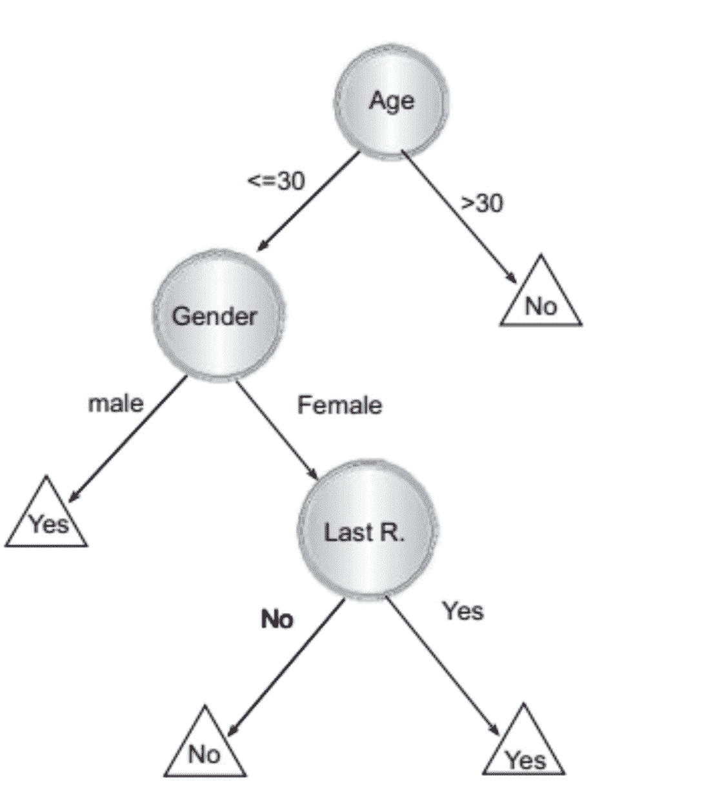

该图是决策树工作方式的简单插图。该树试图确定潜在客户对直邮邮件响应的概率。圆代表内部节点，三角形是叶节点。决策树包含了数值属性和类别属性。通过这种分类器，可以对树进行排序，以预测目标客户对邮寄的响应。此外，结果增加了对潜在客户行为的理解。节点带有标签以显示它们正在测试的属性，而分支则表示对应的值。

在处理数值属性时，你可以从几何角度解释决策树。决策者使用看似不那么复杂的决策树来促进更好的理解。由于不可避免的复杂性，通过几何方法解释属性并不常见。多层树可能是不可取的，因为它会增加不准确的概率。要衡量决策树的复杂性，请检查树的深度、属性数量、叶和节点的数量。

用于此模型的算法是决策树生成器，它们利用给定的数据集构建树。这些算法的主要目标是减少由泛化产生的误差，从而创建最优模型。获取与数据集一致的决策树是很困难的。决策者在构建具有所需测试的二叉树时也面临挑战。本质上，这些算法在处理小问题时是可行的。方法要么自底向上，要么自顶向下。标准的自顶向下生成器包括`C4.5`、`ID3`和`CART`。`CART`和`C4.5`属于增长和修剪部分，而其他的参与生长过程。

对于大型数据集，此类决策树的生成器是不同的。Catlett方法是能够分析大数据集的发明之一。该方法通过降低计算复杂度来工作。在这种情况下，数据被加载到主内存中进行归纳。内存大小是进行归纳的数据集的决定因素。Fifield建议的`ID3`算法同样适用，因为它关注将数据集拟合到主内存中。为了增加有效性，你必须将数据集划分为不交的集合。将数据集作为独立的实体加载可以诱导出清晰的决策树。合并决策树最终将创建一个单一分类器。这种方法的一个缺点是分类准确率的降低。单个决策树是优的，因为它的误差最小。

`SLIQ`算法是另一种处理大型数据集时的适用方法。该方法涉及使用次级磁盘而不是主内存。`SLIQ`使用数据集构建单棵决策树。然而，该方法对处理的数据大小有限制。事实上，数据集的大小必须与主内存一致。`SPRINT`算法与`SLIQ`类似。`SPRINT`分析决策树生成器并消除限制。`SPRINT`解决了大型数据集中常见的杂质问题。


决策树具有使其区别于其他模型的优缺点。优点增加了决策树作为首选模型的使用。首先，决策树的自解释性使其非常有效。此外，很容易遵循该模型并推导出相关信息。你不需要计算机领域的专业知识，特别是在树具有大量叶节点的情况下。其次，决策树对于数值和类别输入都是理想的。你可以使用任何形式的数据而无需更改方法。第三，该模型可以处理错误的数据集并确保分类分类。在某些值缺失的情况下，决策树可以分析可用数据，且结果将是有用的。

相反，决策树也有一些缺点。决策树采用的显著分而治之方法之一限制了其效率。模型在存在相关属性时表现良好。然而，复杂相互作用的存在降低了决策树的性能。第二个缺点与决策树的特征有关，通常被称为贪婪的。这一特征使得模型在极端情况下表现不佳。该方法对多个属性和特定的训练集过敏。与决策树相关的第三个缺点倾向于创建无法泛化的复杂树。此外，树是不稳定的，数据的微小会导致生成不同的树。决策树的第四个缺点是无法进行增量更新。你必须对每个到达的数据进行重新训练，这使得现有的树毫无用处。

神经网络模拟了大脑在执行特定任务时的性能。开发者使用电子元件或模拟数字计算机的软件。神经网络使用被称为处理单元或神经元的多个互连结构来提升到优化性能。根据这一描述，可以将神经网络定义为具有多个处理单元的处理器，这些单元可以存储经验知识，并在需要时检索它们。在知识获取（源自环境）方面，神经网络与大脑非常相似。另一个相似之处在于突触权重的存在，突触权重是存储知识的神经元间连接。

## 神经网络的类型

今天，几种神经网络正受到广泛关注。感知器是第一种被视为第一代模型的神经网络。感知器是指源自单个神经元的计算模型。弗兰克·罗森布拉特（Frank Rosenblatt）在他早期研究大脑和信息存储的工作中提出了`perceptron`一术。`Back-propagation`（反向传播）在训练感知器时至关重要。该过程涉及为网络提供配对输入或输出的数据集。神经元处理数据并作为输出传递。系统中的隐藏神经元关联了输入和输出。下图是罗森布拉特感知器的图示。

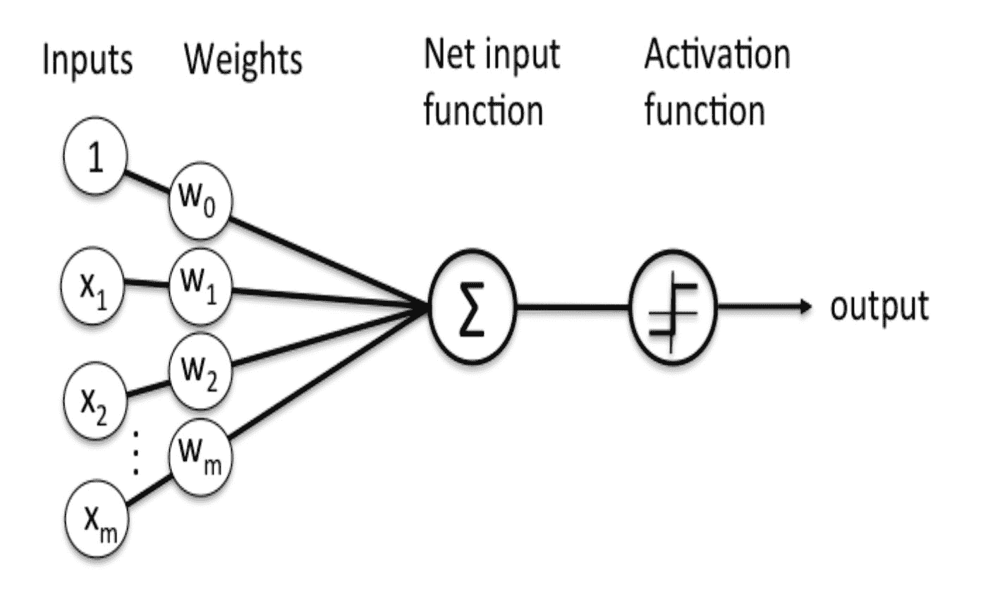

循环神经网络是另一类神经网络，它们与感知器的不同之处在于不同迭代之间存在连接。循环神经网络由于非线性动力学的存在而具有鲁棒性，允许它们对隐藏状态进行复杂的更新。其次，它们能够极极效率存储过去事件的大量信息。神经元的功能与计算机相似，特别是当配备了足够的神经元时。这些`RNNs`可以实现多个并行运行的小程序以产生复杂的结果。循环神经网络相关的主要缺点之一是梯度消失问题。这种情况会导致基于激活函数的信息丢失。主要地，`RNNs` 在多个需要序列数据的领域中被证明是很有用的。循环网络在自动补全等任务中起着关键作用，因为它们能够完成或推进所呈现的信息。

卷积神经网络是 Yann LeCun 在 1998 年开发的 `LeNet` 的改进版。该系统利用`back-propagation`，具有多个隐藏层、复制单元和能够在单个函数内处理大量字符的宽网。卷积神经网络具有与其他网络不同的特征。这些网络承担的核心作用之一是图像处理。当你向系统提供一张清晰的图像时，你将获得分类数据。`CNN's` 具有一个扫描仪，数据通过其进行分析。当你向网络“投喂”数据时，数据会通过一系列具有互连节点的卷积层。层的加深会导致它们收缩。`Pooling`（池化）作为一种过滤形式进行以产生最终信息。

自动编码器（Auto-encoders）是另一类旨在补充无监督学习的神经网络。自动编码器作为数据压缩模型工作，可以将输入编码为更小的维度。因此，可以在编码后的数据上使用`decoder`（解码器）来获得有意义的重构。网络通过呈现比原始表示更少的数字来运行。在你有 100 个数字的情况下，你可以获得 10 个或更少的表示。然而，存在信息丢失的担忧，这在限制输入数据时是不可避免的。

尽管如此，基于在图上绘制维度的能力，此类数据很容易可视化。自动编码器在神经网络预训练、数据生成和降维方面被证明是有用的。这种神经网络因为其映射的灵活性而具有优势。此外，生成的编码模型既快又紧凑。挑战主要源于使用`back-propagation` 优化自动编码器的困难性。由于这些缺点，今天自动编码器很少应用于实际场景。

但为什么要用神经网络呢？如果你在想这些编程范式的重要性，这些概述的能力和属性展示了神经网络的有用程度。

## 神经网络的属性

### 自适应性

神经网络的一个显著特征是能够根据环境调整其突触权重的能力。神经网络暴露于不同的环境中不会破坏其功能；相反，它可以通过重新训练来适应环境的变化。这种自适应能力使得神经网络在信号处理、控制函数和模式分类中表现出色。系统的自适应性带来了稳健的性能。

### 非线性

神经网络大多是非线性的，因为互连涉及非线性神经元。非线性增强了神经网络在数据增强过程中的鲁棒性。此外，非线性在生成语音等信号中起着核心作用。

### 容错性

神经网络具有容错的本质。简单来说，当运行条件恶劣时，网络具有稳健的计算能力。在连接链路或实际神经元损坏的情况下，存储数据的质量会变差。

尽管如此，除非损坏非常严重，否则神经网络的分布特性会减少网络下降。训练神经网络具有容错性至关重要。

### 输入输出映射

在监督学习中，神经网络通过训练示例来修改其突触权重。每个示例都有独特的输入信号和相应的预期响应。示例帮助系统学习，从而构建出输入输出映射。

### 设计与分析的统一性

神经网络的特征之一是信息处理器的通用性。当神经元代表所有神经网络的共同成分时，统一性方面是显而易见的。这种共性使得神经网络应用可以共享学习算法和理论。更重要的是，模块可以无缝集成以构建模块化网络。

人工神经网络的属性使其具有优势，并在现实世界中高度应用。程序员可以选择具有多种能力的神经网络。

## 贝叶斯网络

贝叶斯网络的发展归于托马斯·贝叶斯（Thomas Bayes），他在 18 世纪发明了贝叶斯法则。他提出的概率法则有助于更新不断变化的概率。20 世纪 80 年代贝叶斯网络的概念是由朱迪亚·珀尔（Judea Pearl）提出的，他考虑了因果推理与证据推理的区别。

贝叶斯网络在不同领域正受到广泛关注。广义而言，`Bayesian Model` 指的是一种利用概率在不确定性下进行推理的框架。它利用一种概率图模型语言来促进推理和知识表示。`BN` 具有有向无环图结构。图中不同的节点对应于随机变量。边边是条件依赖关系的表示。互不连接的节点表示条件独立变量。每个节点都与一个 `CP Table` 相关，并提供有关节点状态的规范。贝叶斯网络利用了统计学、计算机科学、图论和概率论的原理。下面的图展示了作为图模型的贝叶斯网络。

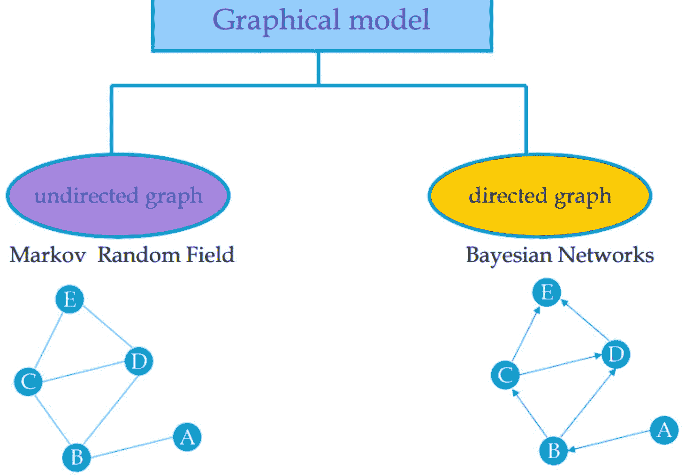

除了包含 `DAG` 的模型定性部分外，强调 `BN` 的定量参数也至关重要。这些参数建立在马尔可夫属性的基础上，每个节点内部的 `CPD` 仅依赖于其父节点。表格表示离散随机变量的条件概率。`CPT` 决定了变量的任何联合分布。贝叶斯网络之所以有用，是因为它们在因果学习中提供了相关知识。它们具有概率和因果语义，有助于先验数据与知识的结合。`BN` 允许编码变量之间的依赖关系。

贝叶斯网络有不同的类型，每个类别都针对在使用整个模型时可能无法实现的特定情况。动态贝叶斯网络是一种对时间过程建模独特结构。`DBNs` 提供了不可缺的表示，因为它们超越了概率关系的描述。`DBNs` 分两部分：先验 `BN` 和转移 `BN`。第一部分是一个通用网络，而第二部分由于可用结构的限制而略有不同。后者具有几个第一个网络中不存在的弧和节点。

因果交互网络是一种特殊的贝叶斯网络，其父节点之间是独立的。`noisy-OR` 模型是因果交互模型的常见类型之一。决策网络（也称为影响图）是特殊的 `BNs`，用于增强不确定情况下的决策能力。

贝叶斯网络的应用非常多样化。最初，`BN` 主要应用于医学领域，这一领域在今天仍然占据主导地位。然而，预测方面的优势使得贝叶斯网络脱颖而出。在医学中，`BN` 发挥着核心作用。在经济学中，`BN` 非常有用。在预测方面，`BN` 是方法之一。在医学中，`BN` 是可行的。在预测中，`BN` 被广泛使用。

## 支持向量机

与其他模型相比，支持向量机是一项近期进展。`Vapnik`、`Guyon` 和 `Bosser` 在 `1992` 年提出了 `Support Vector Machine` 术语。`SVM` 是一种用于回归和分类的工具。下面的图显示了类别。


`SVM` 是如何工作的？对于非专业人士来说，理解 `SVM` 可能会看起来复杂。第一阶段是识别超平面。你选择的超平面应该具有清晰的分离。在第二情况下，你需要增加数据点之间的距离。通过高间隔（margin），增加了分类的鲁棒性。低间隔会导致分类错误。在第三情况下，你已经拥有具有最大间隔的超平面。

支持向量机的类型根据其作用分类。最小二乘 `SVM` 是 `Vandewalle` 和 `Suykens` 开发的版本之一。它的主要功能是识别模式并分析数据，用于回归分析和分类。在使用这种方法寻找解决方案时，你必须解决几个线性方程。结构化 `SVM` 是另一个版本，它增强了分类器的训练，以促进具有结构化输出的标签。`Support Vector Clustering` 主要涉及聚类分析的 `SVM`。该过程涉及数据的划分，将其分组成有意义的形式。在 `Support Vector Clustering` 中，通过内核函数将数据点从数据空间进行映射。转导 `SVM` 是一种基于观测到的训练和测试用例的推理。该方法适用于监督学习。由 `Scholkopf` 开发的单类 `SVM` 是一种有助于异常检测的 `SVM` 类型。

相反，`SVM` 具有一些缺点，这使得它不像其他机器学习模型那样常见。在数据集规模很大时，由于训练时间长，`SVM` 的表现不佳。在目标类别存在重叠的情况下，性能较差。在使用 `SVM` 时，你必须使用五折交叉验证，因为该模型不提供概率估计。考虑到上述优缺点，结合 `SVM` 和其他互补方法来提高准确性是比较容易的。

# 模型优化

计算机科学领域的最新进展之一是机器学习与优化之间的相互作用。优化中不同的表述对于从海量数据中提取相关知识的算法设计至关重要。机器学习正在不断产生优化方面的新想法。这些方法因其具有吸引人的理论属性和广泛的适用性而脱颖而出。优化模型分为类：约束优化和无约束优化。无约束优化的策略包括 `Gradient descent`、`Stochastic Gradient Descent` 和 `Newton’s method`。

`Gradient Descent` 是一种用于训练多个机器学习模型的流行算法。这种方法是分析偏差和权重的迭代模型之一。`Gradient Descent` 最小化代价函数。该过程是顺序的，第一步是随机初始化权重（`W`）。第二步是计算梯度，通过偏导得出 `G = ∂J(W)/∂W`。`G` 是梯度的值，它主要取决于当前值、输入和代价函数。下一步涉及更新权重，其中更新量应与梯度成正比。重复该过程直到达到 `J(W)` 的代价稳定状态。

`Stochastic` 是优化中 `Gradient Descent` 的常见类型之一。`Stochastic` 指的是与随机概率关联的进程或系统。这种方法涉及在每次迭代中随机选择样本。虽然使用整个数据集可以让人获得绝对最小值，但在数据集巨大时，批处理（batches）是非常有效的。

优化的 `Newton method`（也称为 `Newton-Raphson` 算法）利用了两个导数。第一步是给出一个与根密切相关的假设值。下一步是使用微积分进行近似，最后使用初等代数计算 x 轴距。该方法有几个局限性，使其使用变得困难。其一，计算函数的导数很困难。此外，评估解析表达式的成本很高，获取导数并不容易。由于未能满足假设，该方法可能无法收敛到根。另一个问题是初始估计较差，导致算法不收敛。尽管存在这些缺陷，优化算法仍然是理想的，因为它们减少了模型内部参数产生的误差函数。

对机器学习的进一步研究对于解构关于这一不断发展的技术的现有迷思至关重要。在未来几年里，机器学习将成为我们日常活动的核心部分。学习该领域的模型和应用将为你带来优势，特别是在商业领域。

## 第 4 章：概率模型


机器学习算法可以用许多方式分类。本章在深入讨论机器学习的概率模型之前，简要介绍了这些模型。解释模式反映了比较分析方法。虽然本书力求让读者理解概率模型，但必须指出其他模型是。

### 逻辑模型

机器学习算法可以用许多方式分类。本章在深入讨论机器学习的概率模型之前，简要介绍了这些模型。解释模式反映了比较分析方法。虽然本书力求让读者理解概率模型，但必须指出其他模型是。

逻辑模型分为两类。类型是树模型和规则模型。概率模型的结果是提供似然分布。另一方面，确定性模型为给定问题提供单一解决方案。

### 几何模型

等等，逻辑模型分为两类。类型是树模型和规则模型。概率模型的结果是提供似然分布。另一方面，确定性模型为给定问题提供单一解决方案。

几何模型通过输入的直接排列来表示特征。在基于范围的模型中，函数根据两点之间的差异进行描述。

在之前的逻辑模型节中，我们看到解析表达式用于划分实例空间。在本节中，我们将考虑解释实例空间几何的设计。几何模型在二维或三维（`x` 和 `y` 轴或 `x`、`y` 和 `z` 轴）中表示特征。

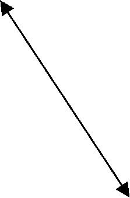

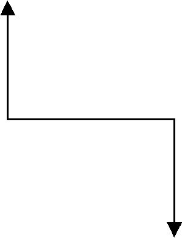

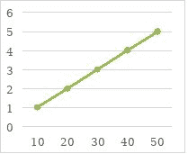

## 概率模型

在理解概率模型时，我将通过将其拆解来阐述这一概念。第一节将解释“概率”一词，第二节将直接详细介绍这些模型。

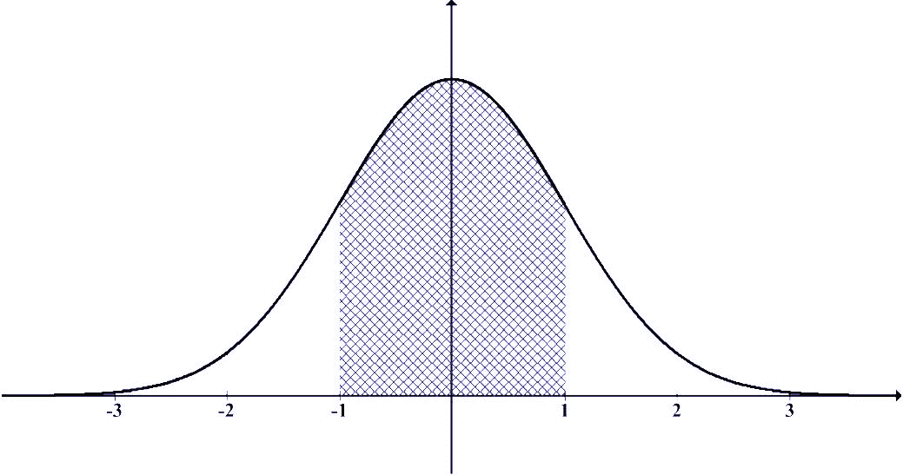

标准分布曲线（也称为钟形曲线）是构建概率模型的元素之一。

概率模型可以分为两个单元：图形模型和随机模型。

### 图形模型

通常，概率图形模型利用基于图的表示作为基础，以对多维空间上的离散分布进行加密。模型还使用了图表，图表是有限分布中变量的浓缩插图。用于概率模型的图共有两种已知的类型。这两种方法是贝叶斯网络和马尔可夫随机场。这些技术结合了因子化和非定性的功能。然而，它们在引导因子化的方式和转化公平性方面上有所不同。

### 贝叶斯网络

贝叶斯网络是概率图形复制的一种类别，有时用于从数据或专家意见构建不同的模型。贝叶斯网络可用于许多任务。在机器学习中，贝叶斯网络用于估计、数据集中的故障检测、诊断原因、计算机化直觉和推理、时间序列计算，以及在未定义情况下做出决策。下表是四个重要分析术语中能力的表示。这些术语是：图形分析、问题解决分析、预测分析和教条式分析。

| 图形分析 | 问题解决分析 | 预测分析 | 教条式分析 |

| --- | --- | --- | --- |

| 计算机洞察 | 信息价值 | 有监督或无监督 | 决策自动化 |

| 大规模模式 | 推理 | 异常检测 | 基于成本的决策 |

| 异常模式 | 故障排除 | 时间序列 | 决策支持 |

| 多变量 | 异常检测 | 潜变量 | 不确定性下的决策 |

这些表示有时被称为贝叶斯网、信度网络（Belief Networks）或因果网络。

### 贝叶斯网络的特点

**概率性**：贝叶斯网络具有预测性。贝叶斯网络根据基于可能性/机会的分布结构化。贝叶斯网络还遵循概率规则进行预测，并为了推理和问题解决、故障检测故障、在不确定条件下做出决策以及计算时间序列。

**图形化**：如下图像所示，贝叶斯网络以图形形式表示。学习贝叶斯网络最好的方法是通过图形表示。然而，这种方法是可选的。

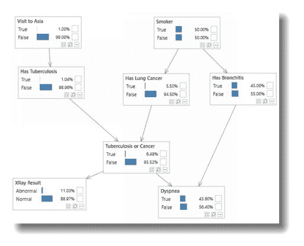

简单的贝叶斯网络（称为 Asia 网络）

贝叶斯网络可以用一个图表示，其中的节点由它们之间的有向链接组成。

**节点**：在贝叶斯网络中，节点代表一个已知变量；例如，人的年龄。特征可以是离散的，例如建筑的大小（大或小），也可以是连续的，例如人的年龄。

在贝叶斯服务器中，节点由许多参数组成。包含多个参数（一个以上设置）的节点被称为多变量节点。节点和链接融合创建了贝叶斯网络的结构。这种融合被称为结构规范。贝叶斯结构是为了同时支持离散和连续参数而构建的。

**离散变量**：离散或分离的变量是一个包含共同互斥状态的参数，例如复杂性（亮或暗）。

**连续变量**：连续变量是可以相互依赖的变量。贝叶斯服务器的建立是为了通过条件线性高斯分布（`CLG`）维持恒定参数。`CGL` 过程意味着连续形式特征的稀疏性使得变量相互依赖（因此被认为是多变量的）。此外，恒定变量也可以依赖于一个或多个离散变量。

条件线性高斯分布可以塑造一组数据中的多方面非线性和层次关系。尽管高斯分布被认为是有局限性的，这种能力仍然会发挥作用。贝叶斯服务器还能维持可以塑造数据隐藏关系的潜变量。建模这种结构的能力被称为程序化特征提取，它类似于人工神经网络中的隐藏层。

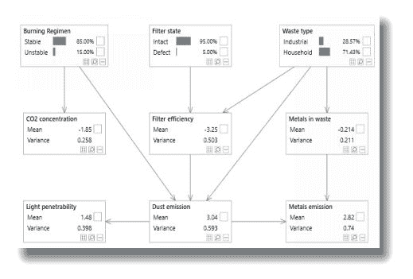

**链接**：链接是注入节点之间的，用于显示一个节点对另一个节点的影响。在某些情况下，节点可能由其他节点连接，这意味着可能没有可用链接。在这种情况下，节点被认为是独立的。然而，只要存在与其他节点关系的可见证据，节点就可以变成相互独立或依赖。在贝叶斯结构中，信息可以向任何方向流动，尽管结构中的链接是有向的。

**结构学习**：贝叶斯网络由贝叶斯服务器内部必要的学习组成。学习算法能够从给定的数据集中确定所需的链接。需要注意的是，在贝叶斯网络范围内有多种解决问题。因此，可能不需要结构学习。

**特征选择**：贝叶斯服务器的配置支持特征选择。特征选择算法有助于确定最可能影响其他变量。这种方法在研究特定模型方面是有优势的。使用潜变量是另一种证明方便的方法。简单的贝叶斯网络产生有向无环图（DAG）。有向无环图是一种没有有向循环但包含有向链接的图。

**有向循环**：贝叶斯图中的有向周期是指起始并结束于同一个节点的轨迹。在这种图中，轨迹只能沿着链接的方向移动。

### 其他概率图模型类别

其他概率模型包括：

- 树增强分类器或 TAN 模型

- 朴素贝叶斯分类器

## 决策树分类器


决策树原型在树结构中进行分类。决策树的构建是为了将数据扩散并分解为更小的划分，取分支的形式。因此，结果是以决策凸和叶子凸的形式存在的。决策凸（例如根节点）长出多个分支。叶子凸表示一个分类类别。第一个类别/决策是对应预测值的树。决策树分类器可以解决算术和清晰的问题。

`DDPG` 是一种强化学习算法，它基于演员-评论家（actor vs critic）模型。`actor`（演员）组件用于调整程序函数的特征图。从本质上说，对于每个状态，算法必须决定采取的最佳行动方案。算法也借鉴了深度 Q 学习（deep Q-learning）的特点，特别是在分离目标网络和能力迭代的概念上。系统偶尔会对动作进行调查。然而，这种做法通过在功能空间中添加噪声被抵消了。

# 图的类型

## 因子图

这是一种连接变量和指标的无向分裂图（split graph）。每个 `factor`（因子）都是其所连接变量上特定函数的表示。这种图对于理解和引发信念传递非常有帮助。

## 链图

`chain`（链）是一种既是有向的也是无向的类型。然而，该图形缺乏有向循环。链图的良好示例包括有向无环图和无向图。这些图可以提供连接和简化贝叶斯网络与马尔夫网络的方法。

## 祖先图

`ancestral graph`（祖先图）是一种进一步扩展的图，由无向、双向和有向端组成。

# 随机场技术

## 马尔可夫决策过程

`MDP` 是一种强化学习算法。该算法由实值奖励函数、模型集、概率动作集合、可能的世界状态池和策略组成。为了有效，`Markov Decision Processes`（马尔可夫决策过程）使用开放框架方法来研究变量之间的关系。这里的组件选择与环境中自然效应对应的动作。然后通过两个步骤将新情况与元素联系起来。

`Markov random field`（马尔夫随机场，也称为 `Markov network`）是非有向图上的模型。在 `Markov Network` 中，具有许多递归划分的图形原型可以用板表示（plate representation）来实例化。

# 随机模型

`stochastic model`（随机模型）是概率模型的一种，体现了存在不确定性的情况。简单来说，它是具有不可预测性的过程模型。在现实世界中，低概率构成了我们日常生活的一部分。因此，`stochastic model` 可以代表一切。这种模型的反面是 `deterministic model`（确定性模型），它以 100% 的结论进行预测结果。与确定性模型不同，随机模型在每次运行时都会给出不同的结果。

所有随机模型具有以下标准特征：

1. 所有模型反映了所研究元素的所有给定特征。

2. 模型内部的测量被分配了概率。

3. 模型内部的变化可以用于预测或提供有关研究元素的的进一步信息。

## 第 5 章：软计算


正如术语所示，软计算是以平滑方式解决问题的概念。软计算涉及的方法倾向于以人类的方式解决问题。洛特菲·扎德（Lofti Zadeh）首次视觉化了这一想法。扎德开创了 `Fuzzy sets`（模糊集合）的数学概念。`Fuzzy sets`推动了计算各个领域的发展。这些领域包括模糊图理论、模糊控制系统等。在他的论述中，他观察到人们的思考方式是软性的，而计算机是硬性的思考者。概念上的差异可以从人们使用的术语与机器使用的术语中看出。

| 人类的表达方式 | 计算机的表达方式 |
| --- | --- |
| 像“大多数”、“一些”等定量术语 | 像“3”、“499”等精确术语 |
| 像“温暖”、“寒冷”等通用术语 | 像“100 摄氏度”等精确术语 |

总的比较来看，人类会学习、发现模式、适应环境的变化并且非常不可预测。另一方面，机器学习变得精确、使用指标、对变化很脆弱。

从上述倾向，我们可以将软计算理解为开发一种不那么组织化或程序化的模型。方法倾向于模拟人类解决问题。这种模型是不太依赖组织或程序的。软计算具有灵活性，人类不可预测。另一方面，机器学习变得精确，使用指标，对变化很脆弱。

从上述趋势，我们可以将软计算理解为开发具有灵活性的模型。机器学习是软计算的主要组成部分之一。软计算被引入于 `90's`。由于这些目的，传统方法在计算机科学和数学等领域变得具有挑战性。软计算为了解决不确定性、真实性和概率问题，能够以较低的计算能力给出惊人的准确结果。软计算方法很大程度上类似于生物过程，例如神经网络。

总的来说，软计算方法类似于生物过程。与追求极致精确的硬性计算模式不同，软计算利用了某些模糊性、真实性和概率。在这一意义上，软计算构成了机器学习的基础。

软计算有几个组成部分。主要的包括：

1. `机器学习`（包括神经网络和支持向量机）

2. `模糊逻辑`

3. `演化计算`

4. 元启发算法和云智能

5. 概率思想（包括贝叶斯网络）

在所有所有组成部分中，本书将侧重于机器学习。本书的方向通常基于其范围和背景。其他组成部分将在后续中讨论。软计算的机器学习部分主要关注 `ANN` 和 `SVM`。正如在书的开头章节提到的，这两个将从略微不同的角度进行讨论。

### 软计算中的支持向量机

在学习的这一阶段，我假设读者熟悉`线性回归`和`逻辑回归`算法。这些领域的知识对于理解 `SVMs` 至关重要。支持向量机是一种推荐给进入机器学习领域的人的简单算法。支持向量机，缩写为 `SVM`，可以应用于分类和回归任务。然而，`SVM` 广泛用于分类目的。

### 理解软计算中的支持向量机

支持向量机通常旨在在 `N-Dimension` 空间中寻找 `hyperplane`（超平面）。这个陈述可以总结为公式，其中 `N` 是用于分类数据点的参数数量。

可以使用各种可能的超平面来对两类数据点进行分类。最终目标是找到具有最大间隔的平面；本质上，就是两类数据点之间的彻底距离。充分利用间隔距离可以为未来提供支持，使得随后的数据点易于分类。

## 超平面与支持向量之间的关系


### 二维和三维超平面

超平面可以定义为用于分类数据点的决策边界。分布在超平面两侧的数据点可以归分为不同的类别。超平面的维度质量完全取决于数据集中参数/指标的数量。如果输入数据中只有两个特征，那么超平面将假设为一条划分特征的直线。如果输入数据中的元素数量为三个，那么超平面将考虑二维平面。输入数据中超过三个维的功能很难通过超平面来解决。


### 支持向量

支持向量是靠近超平面的数据点（如上所示）。支持向量影响超平面的位置和对齐。使用支持向量可以最大化分类器的间隔。当删除支持向量时，超平面的位置会发生变化。通常，超平面内的点对于构建支持向量机是有用的。

### 对大间隔的感知

在逻辑回归中，取线性函数的输出值，并使用 sigmoid 函数将其压缩在 0-1 的范围内。如果压缩量大于 `0.5` 的阈值，则赋予其一个标记（`1`）。如果该值小于阈值，则分配分数（`0`）。

在支持向量机中，取线性函数的输出值，如果该输出大于 `1`，则代价识别为一个类别。当输出值小于 `1` 时，该值由另一种类型确定。由于支持向量机将阈值更改为 `1` 和 `-1`（小于 1 的值），因此获得了作为间隔执行的收益强化范围（`-1` 和 `1`）。

## 作为软计算组件的神经网络

这些模型有时被称为人工神经网络，由该领域的领人物在广泛的背景下给出定义。源自 Robert Hecht-Nielsen 博士，我希望读者将这一组件理解为：

一种计算模型，由适中的、大部分相互交叉的特征组成，这些特征通过对外部输入的积极反应从数据中提取用用。

人工神经网络是处理信息的设备（软件设备，即算法或硬件），它们大致被建模成类似于人类脑的组件，但处于较低水平。更广泛的神经网络由许多处理数据的单元组成。相比之下，人类大脑由数十亿神经元组成，对应于通用关系范围的扩大和行为的进化。

### 软计算中神经网络的基础

人工神经网络在特征上是分层的。层由许多包含特定性能特征的交叉节点组成。通过输入层向层中注入不同的设计。输入层与网络中的其他层连接。网络中的层通过一套主观关联系统执行实际处理。与输入层连接的部分与输出层连接。

许多人工神经网络具有不同形式的训练规则，根据输入数据设计精炼系统中层之间的连接。就像孩子通过观察和与物体互动来识别环境中的物体一样，神经网络也是这样学习吗？

本书将探索神经网络使用的增量规则学习方法。注意，神经网络可以使用其他规则。在大多数情况下，增量规则通过被称为“反向传播神经网络”的人工神经网络大类应用。反向传播是误差反向传输的缩写。

与其他类型的反向传播类似，增量规则训练方法是一个监督过程。该过程在周期中发生（在网络中呈现新数据输入的循环），通过一个前向流动的函数输出完成。生产的流动与误差的反向传播对应。神经网络在每次被注入网络时都会预测数据的类型。预测之后是对给出的答案与实际答案之间偏差的解释。系统然后进行正确的调整。值得注意的是，连接到输入层的每一层都包含一个 sigmoid 功能单元，它隔开了网络的活动。

反向传播在解空间内实现了倾斜的谱系。误差表面可以看作是一个双曲面。然而，正如图所示。对于大多数问题，答案总是包含在不规则的空间中。

## 2. 计算加权和，如果总和为正，则返回 1。

感知机也可以被视为一种计算模型，它通过在给定空间内划定一条边界（在二维情况下为直线）来分离两个类别。

最初，代表分类超平面的权重和偏置（bias）通常是未知的。在这种情况下，模型会分配随机的权重和部分偏置。随机分配会导致点的分类错误。

### 感知机技巧（The Perceptron trick）

感知机技巧的目标是减少分类错误的点数量。这种减少可以通过在空间中移动直线来实现。换句话说，就是改变超平面的表达方式。对于所有分类错误的点，我们调整权重和偏置，使超平面更靠近那些分类不当的点。经过一段时间后，算法将修正问题并正确地分类这些点。

## 第 6 章：数据挖掘


数据挖掘是机器技术中的一个热门领域。该概念最早产生 20 世纪 90 年代。从广的角度来看，数据挖掘的思想被称为大数据或数据科学。这一概念的定义随应用和范围而异。在本书中，我将数据挖掘看作是提取原始数据集进行分析，并发现关于该集合的更多知识的过程。

得益于计算机网络的进步，数据现在可以有效且廉价地存储。此外，由于电子资源的可用，数据传输也得到了增强。这些以及许多其他因素促成了数据挖掘技术的普及。因此，许多组织能够在数据库中存储海量数据，而无须丢失敏感信息。

在数据库中存储海量数据的能力是非常出色的。然而，了解如何分析和解释手头的数据集也是至关重要的。拥有我们无法解释无法从中得出有意义信息的大型数据集，等同于完全没有数据。这引出了如何分析存储在各种数据库中的数据的问题。传统的数据分析方法包括人工手工分析过程。然而，传统方法被证明是耗时且枯燥的，而且结果可能无法反映准确的结果。传统方法遗漏了数据集中的关键信息，导致分析过程失败。

此外，海量数据集的出现使得传统技术变得不再适用且不切实际。为了缓解这些问题，人们设计了自动化方法来帮助分类数据并提取可能需要的有用信息、趋势和模式。这正是数据挖掘方法和技术大显身手的地方。

通俗地说，数据挖掘过程旨在解释事件的结果、预测未来的结果并帮助理解复杂数据。数据挖掘科学已被用于描述某些现象，例如船只为何沉没或飞机为何坠毁。在飞机上，数据挖掘是通过安装了数据集和每次飞行信息的黑匣子完成的。通过这种方式，很容易判断导致坠毁的状况。与其他预测结果的机器学习方法相比，数据挖掘技术是根据事实而非直觉来预判可能的结果。

### 数据分析流程

为了实现高效的数据挖掘，必须遵循被称为“数据库中的知识发现”（knowledge discovery in databases）的七个步骤。数据库中知识发现的七个阶段如下所示。

1. **数据清洗（Data cleaning）**。这是分析数据的第一步。在此阶段，对数据进行清洗以消除噪声和其他可能影响适当分析的变异。

2. **数据集成（Data integration）**。分析数据的第二步是数据集成。这一过程涉及将来自各种来源的数据链接、融合和整合，为分析数据做准备。例如，如果信息存储在不同的数据库中，则通过整合将数据汇总。

3. **数据选择（Data selection）**。在数据合并到一个文件中后，选择相关集合进行分析。这被称为数据选择。

4. **数据转换（Data transformation）**。在完成上述所有程序后，数据已准备好转换为适合的格式。进行转换是为了使分析更容易。例如，某些数据挖掘技术可能要求对所有值进行标准化。

5. **数据挖掘（Data mining）**。这一步涉及应用数据挖掘算法分析数据并提取有意义的模式和信息。

6. **模式与知识评估（Assessment of extracted patterns and knowledge）**。数据挖掘的这一步涉及对结果的研究和评估。结果的可以通过主观或客观的形式进行。

7. **数据可视化（Visualization of data）**。数据挖掘过程的最后一步是信息的视觉化。这是我们尝试理解结果的时候。

需要注意的是，上述步骤可能会根据技术和算法而异。例如，某些数据挖掘算法可能会并发或连续执行这些步骤。

## 数据挖掘在相关领域的应用

多种数据挖掘算法可以应用于数据分析至关重要的行业和领域。以下是一些应用：

*   欺诈检测

*   股市价值预测

*   客户购买模式分析

从广义上说，数据挖掘技术的选择基于以下指标：

*   待分析的数据类型

*   从数据集中提取信息的形式

*   提取知识的应用

## 数据挖掘与其他研究领域的关系

数据挖掘是一个交叉学科领域，它重叠并对应于机器学习、计算机科学、软计算等不同领域。数据挖掘与这些领域的关系涵盖了补充人工智能的基本概念。这一观点认为人工智能的每个子领域和领域相互互补，并以相互依赖又独立的方式工作。

### 数据挖掘与统计学

主要数据挖掘软件

为了成功执行数据挖掘过程，有一些可用的软件和算法计算机程序。这些软件在模型和用途上各相同。有些软件是通用工具，提供多种类型的算法；其他软件则更有针对性。需要注意的是，某些软件是为了商业目的开发的，而另一些则是免费访问和配置的（开源）。各种软件可以对多种数据类型进行数据挖掘。

数据挖掘软件和算法是专门针对不同类型的数据而开发的。下面，我总结了日常经常遇到的各种数据示例，这些数据可以使用数据挖掘方法进行分析。

### 关系型数据库

关系型数据库是机构和公司中最常见的经典类型数据库。在这种形式下，数据以表格的形式进行类别化结构化处理。在尝试从数据库中查找快速信息时，通常使用如 `SQL` 等传统方法进行查询。然而，数据挖掘能够发现数据库内部复杂的模式。

### 客户交易数据库

另一种常用的数据库类型是客户交易数据库。这种类型主要用于零售店。该数据库由客户进行的所有交易组成。研究此类数据库对于理解销售模式至关重要。它让零售商能够理解市场变化，从而帮助规划销售和营销策略。

### 时间数据

另一种流行的数据形式是时间数据。普通类型考虑了数据中的时间维度。在这里，在许多领域创建了排列，例如客户购买的物品序列、素食者人群的链条等。时间数据进一步被分为时间序列。序列是算术值的系统性列表，例如股市中的股票价格。

### 空间数据

另一类易于分析的数据是空间数据。这类数据由聚合信息组成，如环境数据、森林数据以及关于铁路线路和空气分布通道等子结构的数据。

### 时空数据

这是一种兼具空间数据和时间数据特征的数据类型。例如，数据可以是关于气候条件、野兽群的移动等。

### 文本数据

文本类型的数据已成为数据挖掘中一个广泛研究的领域。尽管文本数据大多是无形的，但其应用非常广泛。文本文档通常是无序的，缺乏固定的形式。文本数据的示例包括情感分析和身份识别（预测给定文本的作者）。

### 网络数据

这是一种源自网站的数据类型。数据主要是一组组文档，例如带有链接的网页期刊。这些集合被连接成一个图。互联网中数据挖掘活动的某些特定示例包括预测网站可能的下一个页面、自动根据主题对网页进行分组，以及评估每个网页上花费的时间。

### 图数据

图也是另一种数据库类型。图出现在社交网络中（例如 Facebook 朋友列表）和化学领域（例如生物化学分子和原子的图）。

### 杂项数据

不同或杂乱类型的数据是许多种数据的集合。这些类别之间是关联的，并且可以分类成特定的排列。

### 数据流

数据流被认为是一种连续且高速的数据流，理论上是无限的。例如，数据流可以是生态数据、来自摄像机的数据或数字电视数据。这种类型数据的局限性是它们无法在计算机中充分存储。因此，应该使用合适的数据挖掘方法对数据进行定期评估。流数据中的日常数据挖掘任务通常是检测变异和趋势。

## 数据中发现的模式

如前所述的，数据挖掘的目标是从数据中挖掘出理想的模式模式。从数据中可以提取的主要设计类型如下（请注意此列表并非最终产品）：

### 聚类

用于聚类的算法始终应用于数据集预计将按相似实例组（聚类）进行分组的情况。这些算法的主要目标是压缩数据，使其易于理解和推断。像 `K-Means` 这样的聚类操作模式可以用于自动化地对表现相似的学生进行分组。

### 分类模型

用于分类任务的算法旨在提取模型，这些模型可以将对象和新实例归为若干类。例如，如 `Naive Bayes`、`decision trees` 和 `neural networks` 等分类算法可以创建能够预测客户行为趋势或个人学生通过考试可能的设计。这些模型也可以被提取出来执行对未来的预测。

### 模式与关联

某些方法旨在研究数据与频繁出现模式之间的关系。例如，可以使用数据挖掘算法分析项目项集的频率，以确定特定零售店中销售最畅畅的物品。其他类型的模式还包括时间模式、渐进规则、不规则模式和循环循环子图。

### 异常检测

`AD` 是一种机器学习方法，旨在检测给定数据集中的故障和变异。

### 简单统计方法

检测一组数据中异常情况的最简单方法是标记偏离分布互相同算术属性的数据点。这些特征可能包括平均值、中位数、众数。

## 基于机器学习的异常检测方法


有许多基于机器学习的异常检测方法。下面给出了这些方法的简要概述。

## 基于密度的异常检测

该技术基于`K-nearest neighbor algorithm`的概念。在这个过程中，有一个底层假设，即标准数据点围绕在压缩的邻域周围，而偏离点很远。发生最近的数据点类别通过得分来计算。得分可以是`Euclidian space`或类似的度量，取决于数据是类别的还是数值的。这种方法可以进一步细分为两类：

1. `K-Nearest Neighbor algorithm`：这是一种简单的不基于特征的学习程序，用于根据距离指标的匹配对数据进行分类。

2. `Local outlier factor`：这种方法也被称为相对密度策略。该方法完全基于`reachability distance metric`。

## 基于聚类的异常检测

如本书前面讨论的，聚类是无监督学习领域的一个基本概念。在基于聚类的异常检测中，假设相似的数据点倾向于落在同一类别/聚类中（由到类心的距离决定）。该方法中最常用的算法是`K-Means`。`K-Means`在簇中创建具有相似`k`函数的数据点。任何发现自己在小组之外的数据都被认为是不规则的。

## 基于支持向量机的异常检测

另一种检测异常的工具技术是使用支持向量机。支持向量机通常与监督学习相关。然而，某些插件可用于检测无监督模型中的不规则情况。对于数据训练集，算法通过研究软边界对标准数据进行分组。另一方面，机器会进行微调，以识别偏离学习区域的异常情况。异常指示的输出可以根据用例是特定领域的数值值。

## 关联规则

关联规则是机器学习中一项非常关键的理论。该概念被广泛应用于市场分析。例如，在商场中，你会发现厨具被放置在同一个架子上，电子产品也被安排在了一起。这种产品安排方式旨在帮助客户以最短时间找到他们需要的物品。这种布局也具有吸引力，可能会提醒客户他们可能感兴趣的相关物品。因此，该方法允许交叉销售。

关联规则使得在海量数据集中挖掘对象之间的关系成为可能。需要注意的是，关联规则并不挖掘个人的倾向。然而，它们学习不同购买记录中物品之间的关系。在关联规则中，通过研究客户购买的物品 ID 来识别元素之间的关系。随后，会对相似的特征进行单独考虑。

下图可以说明关联规则的样子。布局由原始数据和结果项组成。值得注意的是，这里的推理是共现而非连接。


许多指标可以帮助理解两个物品之间的关联强度。

### 支持度 (Support)

该指标通过显示项目集在所有购买记录中的频率来提供帮助。例如，假设第一个项目集为`bread`，第二个项目集为`shoe polish`。在所有购买记录中，`bread`的数量会比`shoe polish`多。由于这个原因，第一个项目集的支持度将高于第二个。同样的方法适用于包含多个物品的项目集。从算术上讲，支持度是项目集出现在总购买记录中的比例。公式如下：

`Support (A => B) = (购买记录中 A 和 B 总出现次数) / (总购买次数)`

支持度值有助于识别需要额外审查的规则。

### 置信度 (Confidence)

该指标显示了当篮中包含原始集时，结果集出现的概率。例如，该指标倾向于解释在已经有`bread`和`butter`的篮中出现`milk`的概率。在这种情况下，我们发现`bread, butter => milk`具有更高的置信度。理论上，置信度是给定原始集时结果出现的不确定概率。

`Confidence (A => B) = (同时包含 A 和 B 的购买记录) / (A 的出现次数)`

### 提升度 (Lift)

提升度在计算给定物品`A`的情况下物品`B`出现不确定概率时控制结果的频率（支持度）。提升度被认为是此过程的精确术语。考虑这个例子：`A`提供了`B`在同一个篮子里出现的可能性。换句话说，提升度是在知道同一个篮子包含`A`时，物品`B`在篮中出现的概率相对于我们不知道篮子包含`A`时`B`出现的概率的增加。

`Lift (A => B) = (包含 A 和 B 的交易) (仅包含 A 的交易) / (包含 B 的交易中的 A)`

## 趋势与规律

数据挖掘方法可以用于研究数据库中的趋势和统一性。这些模式的一些应用是研究股票估值和股价变化的形式，并对投资做出预测。其他应用能够发现系统运行方式中的序列，并确定导致系统故障的事件顺序。

如前所述，数据挖掘的目标是在数据中寻找模式并从设计中提取有用信息。像频率和趋势这样的现象是构成数据挖掘概念的核心组成部分。正如我一直说过的，找到一个适合自己的平衡至关重要。列出的示例仅用于对这些概念进行简要概述。

# 第 7 章：机器学习数据集


许多概念是机器学习通用知识的基础。这些组件为理解该领域以及使流程运行奠定了基础。

在本章中，我的读者将获得关于机器学习中用于代数据和数据集的目录（标准术语）的全面信息。此外，我对用于构建机器学习和数据集文献的概念和条件进行了全面分析。

## 数据

正如我们之前看到的，机器学习算法从示例中学习。这一部分需要注意的最关键的元素是输入数据以及描述这些数据集的各种术语。

在本章中，我想从行和列的角度来解释数据，类似于 Excel 表格。通过这种方法分析的数据反映了机器学习中常用的传统结构。像像图像这样的非结构化数据集在这里不进行讨论。下面的图片是机器学习算法使用的数据集的表示。


数据集的图像。

## 术语定义

- **实例 (Instance)**：实例是机器学习算法中的单行数据。案例（Case）是来自该领域的一个推断。

- **特征 (Feature)**：特征是单列数据。元素是观测的组成部分，也被称为数据实例的属性。函数也可以称为指标或参数。这些指标中的某些可能是算法的输入输入（训练数据，也称为预测变量），而另一些可能是输出（待确定或预测的参数）。

这里的重点基于机器学习。如所示，机器学习的核心在于通过训练算法来执行任务。在这个视角下，我们将观察一些学习的概念。

## 归纳（Induction）

机器学习各种模型中的算法是通过一个被称为归纳或归纳学习的过程进行训练的。归纳是从详细信息（训练数据集）中得出概性陈述（泛化）的过程。

## 泛化（Generalization）

该概念也被称为概性陈述。这一过程至关重要，因为机器学习算法建立的表示需要用于进行预测。此类发现基于训练阶段不存在的特定数据实例。

## 过度学习（Over-Learning）

过度学习被描述为机器学习算法对训练数据中的特征观察过头，但仍然无法进行泛化的情况。这种情况是由于在训练数据集以外的数据上表现不佳引起的。这种情况也称为过拟合（over-fitting）。

## 欠学习（Under-Learning）

欠学习是指机器学习算法没有完整观察训练数据集的情况。该过程可能是由训练过程的提前终止引起的——欠学习会导致良好的泛化，但在所有数据（包括训练数据集）上的表现都很差。这种情况也被称为欠拟合（under-fitting）。

## 在线学习（Online Learning）

在线学习方法是指当领域的数据实例可用时，使用其来更新系统的实例。在在线学习中，使用了不受噪声数据影响的稳健过程。这些方法可以产生对应当前状态的模型。

## 离线学习（Offline Learning）

离线学习是在预先准备的数据上产生技术，以便对未学习的数据进行操作。由于训练数据集是已知的，训练系统的过程可以经过仔细调优。在模型准备好，不再进行进一步更新。如果领域发生变化，这种场景可能会降低性能。

## 监督学习（Supervised Learning）

这是机器学习的一种方法，用于泛化需要进行预测的问题。“训练过程”将模型的预测结果与已知答案进行比较，并对模型进行修正。

## 无监督学习（Unsupervised Learning）

如前所述，无监督学习是在不向系统输入任何训练数据集的情况下进行泛化的过程。在这种技术中，通过观察并利用自然产生的结构来解释实例之间的关系。

# 建模（Modeling）

通过机器学习过程创建的结构被视为模型。产生模型的方法就是建模。

## 模型选择（Model Selection）

模型选择的过程可以描述为对机器学习模型进行配置和训练的过程。在任何时刻，系统都应该提供不同的模型以供修改、使用或丢弃。在机器学习中安装何种算法也是模型选择的一部分。对于给定的问题，机器学习算法将选择一个其运行的模型。

## 归纳偏置（Inductive Bias）

偏置是给定机器学习模型中的一种中立输入。所有的机器学习模型都带有偏置，会导致模型中产生误差。由此引起的失败通常用于测试模型或作为数据的控制集。偏置可以在训练阶段的配置阶段产生于模型中。机器学习算法可以根据输入数据具有高或低偏好。存在方法可以消除算法中的高偏置。

## 模型方差（Model Variance）

方差是模型对训练数据集的敏感性。简单来说，变异是模型对训练数据输入的响应。机器学习模型对训练数据集可以表现出高或低方差。减少这种差异的最佳方法是在数据集上反复运行该机器。这一过程在不同的参数和条件下进行。当方差减少时，模型的准确性就会提高。

## 偏差-方差权衡（Bias-Variance Tradeoff）

模型选择过程可以被视为偏差与方差之间的权衡。偏差与方差之间的关系是反比关系。低偏差的模型将具有高变异，并需要长时间持续的训练才能获得可用的模型。另一方面，高偏差的模型将保持低方差，使其学习得更快，但会产生不利且受限的性能。

# 第 8 章：机器学习 VS 深度学习


机器学习和深度学习都是人工智能的分支。多年来，这两个领域吸引了大量的关注。本章提供了以最直观的方式理解这两个领域差异的最佳场所。在本章中，我将解释区分这两个模型的显著领域，并帮助你指出结合两者的最佳方式。

在开始之前，我想给你们概括一下这两个术语的含义（尽管你们现在已经熟悉机器学习的概念）。

## 机器学习

如之前解释过的，机器学习是人工智能的一个子领域。机器学习涉及智能机器的发展。这些机器通过使用能够模拟人类动作的算法来运行。

在机器学习中，算法的构建方式使得它们能够在没有过多干扰的情况下执行任务。

### 深度学习

深度学习也是人工智能的一个子领域。在深度学习中，算法的构建方式与机器学习相同。区别在于，深度学习中有许多层算法。每一层都对输入数据产生不同的结果。这些层连接起来形成一个算法网络。这些系统被称为人工神经网络（ANN）。人工神经网络的工作方式模仿了人类大脑中神经网络的功能。

为了使定义更简单并指出差异，我们将来看一个例子。

以男孩和女孩的图像为例，我们将逐步分析机器学习和深度学习将如何分析这些信息。

想象一张男孩和一张女孩的图像。现在，让我们尝试分别使用机器学习算法和深度学习算法来识别这些图像。

### 通过机器学习解决问题

为了使机器学习算法能够对图像进行分类，我们必须向算法提供两张图片中的数据（呈现的特征）。在 particular 情况下，特征变成了数据输入。

根据上述给出的定义，数据必须是结构化的。我们必须用男孩和女孩的特征对数据集进行标记。提供的输入将有助于算法的学习过程。之后，算法将能够根据输入数据的解释进行工作，从而将更多的人脸图像分类为男孩和女孩。

### 使用深度学习解决相同的问题

在处理相同的问题时，深度学习将采取不同的方法。深度学习的主要特点是，网络不需要结构化数据（标记数据）即可分类人物图像。深度学习中的神经网络通过层层算法来解释图像。接口中的每一层都定义了图像上的不同特征。人脑的工作方式也是如此。深度学习网络通过建立各种特征层级和其他相关组件来解决这个问题。在经过算法层对数据进行处理后，系统会确定用于分类图像的适当特征。

## 注意事项

区分机器学习与深度学习的最好方法是信息（输入数据）呈现给系统的方式。在机器学习中，算法大多数需要标记数据（无监督学习除外）。另一方面，深度学习依赖于人工神经网络进行模拟。

机器学习的算法被部署用于通过解释标记数据来“学习”如何执行特定任务，并使用其来处理结果。然而，如果发现的结果不符合要求的标准，则需要重新训练系统。另一方面，深度学习网络不需要大量的训练。神经网络中的算法层通过多样化模型的层级传递数据。模型通过试错法进行学习。

数据质量影响输出质量。换句话说，系统尝试按照“GIGO”（垃圾进，垃圾出）的方法工作，这意味着机器根据其接收到的输入给出结果。输入的质量是这两个系统的共同决定因素。

机器学习算法不适用于解决需要大量数据的问题。

### 何时应用深度学习：

当解决问题所需的数据负载巨大时，深度学习技术至关重要。当当前问题非常复杂时，人工神经网络也大有用处。最后，如果你有计算资金和运营成本来配置硬件和程序进行网络训练，你可以使用深度学习。

# 第 9 章：优缺点


本章重点关注机器学习的优缺点，从硬币的两面进行分析。读者和潜在用户必须注意那些让机器学习获胜的部分，以及需要审查的特性。这样，就能建立平衡，确保智能机器能够恰当地融入我们的日常生活。

如所示，机器学习的优势不仅在于挖掘大型数据集并将其转换为有用信息的能力。许多组织已转向机器学习以实现计算机程序的功能。通过这种方式，其他数据分析方法得到了补充。

第一部分将介绍上述章节中未提到的机器学习的处。这些优势创造了巨大的空间，将游戏规则转变为许多应用。我希望我的读者注意下面列出的收益。正如之前提到的，这些利益是从不同的视角来看待。

## 1. 增强数据挖掘

数据挖掘是为了提取海量数据集进行分析并将其转换为有价值的信息。数字信息的频繁使用要求一种可靠且有效的方法从其原始源和状态检索数据。这些方法必须在尽可能短的时间产生大量数据。对数据分析和结果速度的要求使得手动流程变得具有挑战性；因此，机器学习派上了用场。

机器学习在数据挖掘领域的功能至关重要。结合后，该方法允许在分析大量数据的同时提供准确的结果。需要注意的是，数据挖掘是数据的提取，而机器学习是数据的分析。二者相辅相成，相互补充。

## 2. 实现持续改进

机器学习中的“学习”一词表示提高知识的能力。学习的背景显示经验被用于提高性能。在机器学习中，软件和算法函数充当增强系统的代理。当做出预测时，结果会被存储。如果结果不符合用户的需求，算法将在下次执行任务时进行学习。

引入创新的能力适用于许多领域。例如，让我们来看一个分析股价的机器学习算法。该算法不仅会考虑过去的结果和数据，还会查看新输入的特征。这些特征包括在特定时间内影响市场的所有因素。因此，机器学习系统能够做出准确的预测和建议。

## 3. 任务的任务化

机器学习广为人知的优势是任务的自动化。智能机器的发展改变了操作方法。软件和其他计算机程序被训练以执行对人类来说很枯燥的功能。通过不断改进来补充数据挖掘和机器学习，这些过程的自动化成为可能。机器学习无疑已经发展到可以在没有任何编程指令的情况下独立执行任务。

人类功能与机器学习系统得到了很好的补充。我认为，在某个或多个任务中引入机器学习算法将把人类解放出来，让他们关注更关键的问题。

技术已经进化到驾驶和飞行功能可以自动化的程度。作为一个我在开头章节中没有得到大量支持的领域，我想在这里稍微关注一下。无人机和无人驾驶飞机是自动化功能的示例。人类不再需要驾驶飞机。然而，过程仍然由地面上的人类控制。尽管如此，广泛的生产部门和行业正在从机器学习系统中获益。

# 机器学习的局限性

如上所述，机器学习的成功在于了能够改进流程和任务完成方式的系统创新。然而，尽管具有许多优势，但机器学习过程并非没有局限性。以下概述了机器学习的局限性。

## 1. 机器学习算法非常庞大

机器学习算法最显著的特点之一就是庞大。这些算法需要大量的存储空间来存放训练数据。值得注意的是，机器学习算法和系统是经过训练的，而不是通过编写的。训练阶段需要大量的数据输入来训练和测试系统。任务的复杂性使得在完成过程所需的数据集方面，它们变得更加臃肿。

与数据以惊人的速度生成的事实相反，实现这种性能所需的强劲计算能力意味着使用了大量信息。作为回报，数据需要大量的输入空间。海量数据在挖掘、分析和转换为有意义的信息方面具有挑战性。因此，深度学习被用于利用`backpropagation`（反向传播）。这种算法功能允许调整节点之间的权重，从而确保输入与正确的输出对应。

这些过程的主要局限性是，机器学习算法需要太多的“应用特征”才能达到与人类智能水平相当的。

然而，这种局限性可以通过引入深度学习和无监督学习方法来缓解。正如前面讨论的，我们可以注意到，无监督学习在训练算法时不需要大规模的标记数据输入。一个例子是，强化学习算法是通过试错而不是输入数据来训练的。使用这种方法可以确保对大量数据集进行检查。

## 2. 训练数据的标注过程非常耗时

监督学习是机器学习的一个基础组件。在监督学习中，算法需要带标签的数据集进行训练。当来自之前功能的数据集被注入系统时，该方法运行得非常高效。

数据标注过程涉及清理原始数据并对其进行排序，以便机器“吞噬”。机器学习功能，特别是监督学习和半监督学习，需要大量的训练数据。标注这些训练数据集的过程不仅令人厌味，而且耗时。相反，当将未标记的数据输入系统时，机器的性能就会降低。这是因为，只有在提供映射目标的情况下，算法才能做出决策、识别并表现出智能。

为了建立目标，需要一个耗费时间且枯燥的过程来识别和标注训练数据。令人欣慰的是，开发者们正在研究出识别和标注训练数据的新方法，这些方法可能没有现有方法那么耗时。该领域的发展包括向系统中添加能够自然产生训练数据的特征。这种创新不仅有望提高数据收集的质量，还能节省用户执行这些工作所需的时间和精力。

## 3. 机器不提供解释


人类大脑拥有一个敏锐的物理引擎。这意味着人类大脑能够在各种环境中收集信息，并对收集到的数据结果得出结论。嗯，深刻的解释可以支持这些发现。机器学习最局限的因素之一是机器无法对生成的结果提供洞察力。换句话说，计算机无法通过解释来支持它们的决策。长期以来，设备一直表现出缺乏常识。许多机器学习模型依赖于训练数据的可用性。这些情况主要导致机器学习在需要解释的领域接受度较低。社会过程有权获得描述。无论结果好坏，我们有时都要求知道为什么这么做以及这些决策是如何做出的。对结果的理解对于了解系统如何运作至关重要。这些知识可以用于理解机械机器及其模型，以及运行模式。

### 4. 机器学习算法容易产生偏差

任何依赖于人类部署信息的系统通常都可能偏见。偏见出现在输入数据以进行训练的阶段。人类可能倾向于调整机器操作以适应他们的需求。在某些情况下，看起来运行良好的系统竟然能够在“噪声数据”上运行。机器学习过程的可靠性取决于数据输入。这意味着当信息存在偏见时，结果可能无法反映实际价值。克服偏差的最好方法是从多个来源随机收集数据。数据的各种组合限制了数据暴露于偏见的概率，从而确保了准确的结果。

### 5. 机器学习算法不进行协作

尽管机器学习有了许多改进，但系统仍然表现出无法泛化环境内因素的能力。也就是说，这些机器无法在不同的案例中应用知识。机器学习模型发现将经验从一个问题转移到另一个问题是一项挑战。机器学习算法只能执行它们已经训练过要执行的任务。由于这一局限性，许多用户被迫投入资源训练不同的算法来执行各种任务。这是一种需要大量投入的情况。

为了解决这个问题，用户和开发者需要学习如何迁移训练。迁移学习意味着给模型提供输入数据，这些数据反映了可能的问题和其他相关问题。从这个过程中，从解决一个问题中获得的诀窍可以在不进行进一步训练的情况下用于类似的问题。

## 关于机器学习优势和局限性的注意事项

上述机器学习的得与失并不能代表该过程的全貌。值得注意的是，不同的方法被用于构建和训练算法。优点和缺点都取决于模型开发、部署和训练的技术。此外，机器学习的局限性取决于要解决的问题以及它们内置的软件。最后，必须指出，胜负取决于输入数据的质量。

## 结论

过去几年里见证了人工智能及其分支——机器学习领域取得了惊人突破。在这个时代，机器可以在执行各种任务时像人类一样进行学习和行动。机器学习的创新使专家能够构建模拟多维度功能（如做出决策、演绎推理和推理）的工具。机器人不再被认为是科幻小说。现实是，机器学习的概念已经演变成了难以想象的程度。今天，人类社会更加依赖机器来做出决策并解决日常问题。多个行业已经接纳了将智能机器融入到生产实践中。正如上面的章节所示，机器学习的应用已成为人类生活的一部分。正如桑达尔·皮查伊所说，人类生活中对机器学习的使用比电力和火还要激烈。

然而，重要的是要理解，这些用途已经演变并完全涵盖了深度学习以及人工智能的其他领域。这种涵盖使得算法能够执行复杂的任务，并对生产方法的运行方式产生显著的推理，从而以最短的时间获得结果。在这一奇妙技术研究领域的所有铺垫中，被忽视的完整性是：机器学习与任何其他领域一样，都有其局限性。机器学习技术需要巨大的努力来克服障碍并扩大范围。因此，我的观点是，我的读者应该尝试不同的模型，并留意适合他们自己课程的模型。对于学术目的，学习者应该兼顾阅读涉及人工智能各个分支基础的书籍。

# Python 机器学习

### 使用 Python 有效理解人工神经网络和机器学习的初手入门指南（带技巧与窍门）

## 引言

我们生活在一个技术已成为每天首要关注事项的世界。全球许多行业和组织都在尽所努力，以提高他们的生产水平。正因为这一点以及其他原因，他们决定在行业内引入新技术。各种新技术，如机器学习的引入、机器人的使用、无人机的部署等应运而生。然而，多年来，数据输入和信息输出的生产率仍然很低。据此，他们寻找那类能够让他们利用当时拥有的特征变量预测结果的机器。记住，在执行特定任务之前就能知道组织内某项任务的结果，这种能力激励了他们。遗憾的是，用于数据预测的某些方法被证明是错误的，而少数给出了预期的结果。在某个时刻，他们的数据缺乏足够的准确性，有些是模糊的，而另一些则无法读取和解释。由于所有这些，许多科学家涌向互联网和技术图书馆，以便想出切实可行的来解决当前行业内解决工作负载的困境。

因此，你需要理解或明白为什么机器学习是解决其劳动力部门许多燃眉问题最方便的方法。在许多情况下，人类仅以手动方式处理公司账目的数学概念。然而，这是不方便的，因为许多组织或行业涉及的海量工作是人类无法完成的。疲劳和缺乏足够知识来执行每个预测任务的情况变得泛滥。

因此，被充分部署的机器学习指的是使用简单算法和某些统计模型解决特定任务的情况。机器学习主要依赖于推理和模式。对某些人来说，这是人工智能，而另一些人则基于具有样本数据的数学模型，他们后来将这些数据称为“训练数据”。随着这种机器可以使用可用数据在组织内做出某些决策，过程变得更易于管理。随后，组织利用机器学习的算法来满足公司的需求。目前，计算机视觉，甚至邮件过滤等问题都使用了机器学习的算法。结果，几个组织意识到工作率的提高，导致了最终的高产出。

许多研究表明，机器学习与某些统计学有关，特别是来自计算机的统计学。那就是计算统计学。然而，值得注意的是它只关注使用计算机做出许多所需的决策和预测。机器学习的某些方面使其能够相应地执行其功能。这些示例包括数学优化，它仅涉及应用领域、理论的使用，甚至让机器学习运行得更好的不同方法。另一个方面是数据挖掘。许多研究表明数据挖掘与领域研究工作有关，主要在机器学习内部。它的主要目标是帮助分析数据。在大多数情况下，许多企业将机器学习用于预测分析目的。

## 第 1 章：引言：机器学习的历史概述


机器学习在 1959 年进入主流，这是在美国先驱者的帮助下实现的。亚瑟·塞缪尔（Arthur Samuel）花费大量时间在计算机游戏上，提出了“机器学习”这一最初术语。在此期间，机器学习成为科学努力不可或缺的一部分。后来，随着对人工智能的需求增长，它普及了。许多人，尤其是研究人员对此产生了浓厚兴趣，以至于将机器学习应用于获取某些数据中。在此时，研究人员别无选择，只能充分利用他们所能使用的一切手段来获得所需的结果。尽管这后来被视为线性模型的应用，但尽管如此，他们还部署了概率推理，特别是在医疗诊断的自动化中。幸运的是，这种自动化技术似乎效果更好，从而改进了他们在医疗领域的工作。

然而，逻辑性的增加以及一种依赖知识的方法导致了机器学习与人工智能之间的一场技术战争。在这个转折点，你发现概率系统无法按预期执行任务。因此，他们在实际和理论上存在一些问题的问题，特别是在涉及数据表示甚至数据获取时。

当人工智能陷入巨大停滞时，行业留下的无物可以解决他们的工作负载和沉重任务。结果，机器学习开始再次繁荣。那就是 20 世纪 90 年代。它随后将其目标或任务从实现被认为的人工智能转变为主要从实务角度解决问题。它的重心发生了转移。在那里，符号方法停止了。它吸收了概率理论和统计模型的使用。后期机器学习受益于数字化信息和互联网分发的简便方式。因此，互联网分创造了一种许多科学家可以使用来获取机器学习的传输模式。记住，随着人工智能的部分死亡，机器学习成为每个行业不可或缺的一部分。在那里，许多科学家和几个组织都无法承受错过它。

## 机器学习的演化视角

机器学习经历了几个阶段才达到今天的位置。这些步骤以技术的改进和自然问题的解决为标志。此外，输出预测的准确性水平在不断提高。然而，这仍然低于科学家和大多数组织的要求。此外，解决和获取数据的速度变得更易管理，但输出数据中仍有少数不准确的情况。正因为如此，改进机器学习特征的欲望产生了。因此，这一切导致了进化的最终诞生。

第一阶段是跳棋游戏与机器学习的。在这里，亚瑟·萨穆尔（Arthur Samuel）开发了一个可以用来下跳棋的计算机程序。他引入了 alpha-beta 剪枝以适应设备较小的内存。这种知识可以预测在跳棋游戏中的获胜机会。最终，这导致了极小极大算法（`minimax algorithm`）。随后，他根据自己的目标改进了机器。

进化的下一个阶段是感知器（`Perceptron`）。弗兰克·罗森布拉特（Frank Rosenblatt）提出了这种模型。它是机器学习与脑细胞模型的结合。值得注意的是，脑细胞模型是唐纳德·赫布（Donald Hebb）的工作。弗兰克曾工作于康奈尔航空实验室，在工业界缺乏解决某些统计数据分析方法时，他提出了`Perceptron`。他计划完成他的工作，即`Perceptron`是一种机器，与任何程序无关。`Perceptron`使用`Mark 1 perceptron`进行图像识别。结果，软件和机器的传输变得更加容易。据他所，这是最成功的机器。此外，尽管这取得了成功，但某些方面缺乏解决方案。也就是说，该设备无法识别视觉模式。结果，许多科学家和计算机程序员转向了另一项研究。然而，他们的奋斗一直持续到 20 世纪 90 年代，当时他们成功开发出了另一种解决问题的机器。

因此，持续的研究导致了另一个算法`The Nearest Neighbor`的诞生。

在他的工作中，马尔切洛·佩利洛（Marcello Pelillo）意识到他可以轻松识别模式。该算法的另一个主要目标是映射路线。该程序的使用非常有益，销售人员可以使用它进入不同的城市。他们还利用它在日常旅行中寻找最高效的方法。尽管这一发现很有帮助，但在某些情况下它仍然无法处理。结果，这导致了多层（`multilayers`）的最终诞生。多层模型在 20 世纪 60 年年代脱颖而出，并进一步改进了神经网络的研究。层的双重使用增加了`Perceptron`的处理能力，使其更加高效。再次，多层的引入导致了反向传播（`backpropagation`）的发展。`backpropagation`的主要任务是解决系统内的任何错误。它使用将错误向后传播的原理，使得解决这些问题变得不再困难。它现在被应用于许多工业领域，例如神经网络。值得注意的是，该系统出现于 20 世纪 70 年代年代。

`Backpropagation`导致了人工神经网络（`Artificial Neural Network`）的发展。在这里，这种机器可以解决`Perceptron`无法承担的更复杂任务。它涉及输入数据的使用并转换为输出信息。这里的工作非常复杂，人类可能会难以处理。

在 20 世纪 70 年代和 80 年代的某些时期，算法一度陷入了停滞。人工智能开始使用逻辑方法来解决其任务。再次，某些研究被放弃，例如神经网络。最后，两个大体之间演变成了一种分歧。即机器学习与人工智能，导致了它们的分离。随后，机器学习在重组后经历了近十年的挣扎。在这里，它的目标从人工智能训练转变为提供服务。再次，它的重点导致了概率理论和某些统计学元素的发展。机器学习的繁荣出现在 20 世纪 90 年代，当时它能够集中在神经网络上。然而，互联网的增长对这一成功起了重要作用。

下一次进化涉及提升（`boosting`），而提升减少了所用数据的偏差。它部署了机器学习算法的使用，发生了从弱学习器向强学习器的转换。在他的发现中，他推断出一组弱学习器可以组成一个更强的学习器。机器学习已经经历了许多演变。

这些演变的例子可能包括语音识别等更多内容。因此，机器在我们的日常生活中的益处也是值得注意的。

* 它帮助分析行业中的数据，特别是行业内部的销售数据。

* 它促进了移动端个性化。

* 它有助于检测欺诈。

* 它有助于提供关于特定产品的推荐建议。

* 它导致了适当的学习管理。

* 它促进了动态定价，从而增加了定价的灵活性。

* 它还帮助处理自然语言。也就是说，你可以与人类交流。

# 第二章：机器学习的类型


在一个沉浸在人工智能的世界里，深入理解机器学习是非常有趣的。这个概念允许算法在不依赖任何明确指令的情况下执行特定任务。相反，机器依赖于推理和模式，用户将数据输入给通用算法而不是编写代码。作为回应，机器根据输入数据构建逻辑。通常，会对算法所出的预测的准确性进行评估，只有当精度可以接受时，算法才会被部署。

## 机器学习的类型

机器学习分为三大类。我们将在下面详细讨论每一种。

### 1. 监督学习

这种范式是最受欢迎的，可能因为它容易理解和执行。在这里，算法从带标记的数据集中创建一个数学概念，即包含输入参数和输出参数的数据集。该数据集充当模型的训练器。举个例子，我们可能决定使用算法来确定特定图像是否包含某个对象。在这种情况下，数据集将包括包含（对象）和不包含输入（该对象）的图像，每张图像都有一个指定是否包含该特定对象的输出。算法可能会预测任何答案；无论正确错误。然而，在多次尝试后，它就了选择包含该对象的图像进行了训练。一旦经过完全训练，即使输入新数据，算法也会做出正确的预测。监督学习模型的一个完美例子是支持向量机`support vector machine`。

#### 监督学习的类型

* **分类**：这些算法用于输出限于离散值的情况。以过滤电子邮件为例，传入的邮件被分类输入，而输出则是文件夹名称。

* **回归**：这种算法的输出具有连续值，这意味着它们在给定的范围内选取任何值。完美的例子包括；温度、风速、商品价格等。

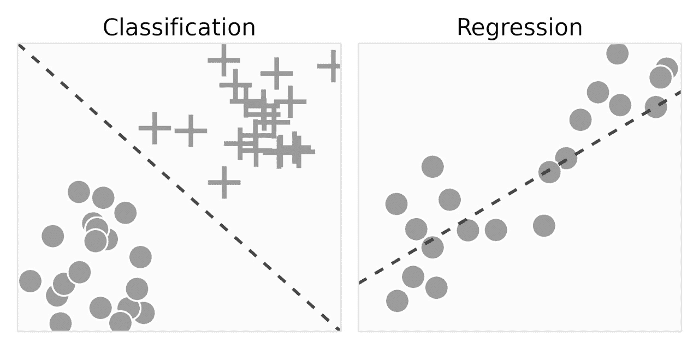

监督机器学习出现在许多常见应用中，我们在下面讨论了其中一些。

* **广告状态**：你在浏览互联网时遇到的大多数广告之所以放置在那里，是因为监督学习算法对它们的点击率和受欢迎程度进行了背书。

* **人脸识别**：这在 Facebook 上非常常见。你的脸很可能被用于一个经过训练以识别它的监督算法中。当 Facebook 建议标签时，你一定注意到系统正在猜测照片中的人物，这是一个监督过程。

# 垃圾邮件分类

你在现代电子邮件系统中发现的`Spam filter`是一种监督学习概念。除了预先过滤恶性邮件外，该系统还允许用户提供新标签并表达他们的偏好。请参见下图插图。

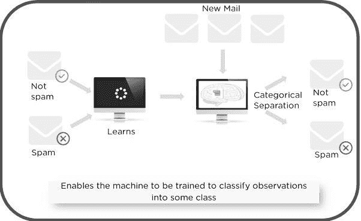

### 无监督学习

顾如名，无监督机器学习与监督学习完全相反。模型在数据中寻找结构，并通过观察进行学习。当给定的一个数据集时，模型通过在数据集中创建聚类（`clusters`）来自动发现关系和模式。该范式无法为创建的聚类添加标签，但它完成创建非常完美。这意味着如果我们有一组苹果和橘子，模型会将苹果和橘子分开，但不会说这是一组橘子或苹果。

现在，假设我们有超过两个组的数据，例如我们展示了葡萄、橘子和苹果的图像。如上所述，模型根据某些关系和模式创建聚类，并将数据集划分为这些聚类。每当有新数据输入时，模型都会将其添加到已有的聚类中，如图所示。你会发现，即使没有添加标签，输出的分组也是完美的。

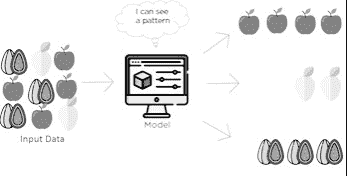

让我们来看另一个经典例子以便更好地理解。想象一个小婴儿和他的宠物狗。他能很好地识别它的特征。当一位朋友带来另一只狗来陪婴儿玩时，即使没有人告诉他们，婴儿也能识别出这是一只狗。他们会轻松地对其分类，因为它具有两只眼睛、耳朵、四足行走等特征。这属于无监督学习，因为你在没有被教的情况下对输入数据进行了分类。如果是监督学习，这位朋友就必须告诉婴儿这是一只狗。

## 无监督学习的类型

### 聚类

该概念识别一堆未分类数据中的模式。聚类算法对数据中任何存在的自然分组进行分类。用户也可以自由调整希望算法识别的聚类数量。在聚类方面，有更多你可以利用的类型：

#### 互斥（划分）

在此类型下，数据的分类使得一个数据点只能属于一个聚类。`K-means`是一个完美的例子。

#### 层次聚类

这是一种每个数据本身都是一个组的技术。通过两个最近组之间的迭代合并来减少聚类的数量。例如是`hierarchical clustering`（层次聚类）。

#### 重叠

在此技术下，数据与合适的关联值相关联。`Fuzzy sets`（模糊集）用于数据分组，每个点都可以以不同的隶属度属于两个或多个组。`Fuzzy C-Means`是该类型下的合适示例。

#### 概率

该概念使用概率分布创建聚类。参见下方给定某些关键词的示例：

* `男士裤`

* `女士裤`

* `男士钱包`

* `女士钱包`

给定的关键词可以分为两类：`裤`和`钱包`，或`男士`和`女士`。

### 关联

关联下的规则允许用户在大型数据库的数据对象之间建立关联。顾如其名，该技术寻求发现大型数据库中包含变量之间的独特关系。例如，购物者可以根据他们的搜索和购买历史进行分组。

## 无监督机器学习的应用

无监督机器学习基于数据及其属性，因此，我们可以得出它是数据驱动的。任务的结果由数据格式化的性质控制。依赖无监督学习的一些常见领域包括但不限于：

* **购买习惯**：发现你的购买习惯存储在某个处的数据库中并不意外。这些信息可以被营销人员用于将客户分成类似的购物细分，以便他们轻松地联系客户。在无监督学习算法下，聚类很容易。

* **推荐系统**：如果你是`Netflix`或`YouTube`用户，你可能多次遇到视频推荐。通常，这些系统包含在无监督领域。系统知道用户的观看历史。模型利用历史来识别喜欢观看特定类型、长度等视频的用户之间的关系，并向他们提供他们可能没有看过的相关视频建议。

* **识别欺诈交易**：`Anomaly detection`（异常检测）是用于发现异常数据点的技术。算法挑选出数据集中的任何异常点，从而发送警报。

## 监督与无监督机器学习技术

数据专家在他们的发现操作中使用一系列机器学习算法。以下是关于监督学习和无监督学习技术分类的一些见解，这些将帮助你判断何时使用这些技术之一。

| 参数 | 监督机器学习 | 无监督机器学习 |

| :--- | :--- | :--- |

| 数据使用 | 使用训练数据来研究输入和输出之间的联系。 | 不使用输出数据。 |

| 结果准确性 | 高且可靠。 | 准确性较低，因此不可信 |

| 输入数据 | 使用标记数据训练算法。 | 针对未标记数据。 |

| 类别数量 | 已知的类别数量。 | 未知的类别数量。 |

| 主要缺点 | 大数据的分类。 | 由于使用了未知数据，无法获得精确信息。 |

| 实时学习 | 学习在离线进行。 | 学习实时进行。 |

| 过程 | 同时给定输入输出变量。 | 仅给定输入数据。 |


| 计算复杂度 | 简单；不复杂。 | 在计算方面很复杂。 |

决定使用监督还是无监督机器学习算法通常取决于数据量和结构。本质上，一个良好的数据科学计划将结合两种算法类型来产生预测模型。现在，这些模型更加先进，并帮助利益相关者在各种业务支持中做出决策。

## 强化学习

这是一种神经网络学习技术，训练机器学习概念如何做出一系列决策。代理（Agent）被训练如何在不确定的、可能复杂的环境中实现目标。在这种技术中，人工智能参与到类似游戏的情境中，计算机尝试使用错误尝试法解决问题。为了让程序员让机器执行他们想要的操作，人工智能会对执行的操作进行惩罚或奖励。其思想是充分利用总奖励。

通常以游戏规则的形式存在奖励策略，但设计者没有给出模型应如何解决谜题的任何提示。模型从完全随机的尝试开始，进步到复杂的方法甚至超人的技能。

让我们来看一个实际示例，它将完美地说明强化学习技术。然而，在此之前，我们需要理解在示例中将用到的一些术语。

- **智能体 (Agent)**：这是一个通过在环境中执行动作寻求奖励的隐式实体。
- **环境 (Environment)(e)**：智能体必须面对的情况。
- **奖励 (Reward)(R)**：对智能体执行特定动作时给出的即时响应。
- **状态 (State)(s)**：环境返回的当前场景。
- **策略 (Policy)(π)**：智能体根据当前状态决定下一个动作的方法。
- **价值 (Value)(V)**：预期的长期回报，与短期奖励相比了折扣。
- **价值函数 (Value Function)**：规定了总奖励，即状态的价值。
- **基于模型的方法 (Model based methods)**：处理应用模型技术的强化学习问题。
- **环境模型 (Model of the environment)**：它模仿环境的行为，帮助你得出关于环境行为的结论。
- **动作价值 / Q 值 (Action value / Q value (Q))**：这与价值的区别不大。实际上，唯一的区别在于它额外接受一个当前动作作为参数。

### 示例

想象正在尝试教你的狗一些新花样。这只狗不懂人类语言，因此你需要制定一个策略来帮助你实现目标。你发起一个情况并观察狗的各种反应。如果狗以期望的方式做出反应，你就给它一些牛肉。你会发现，每当你让狗暴露在类似的情况下时，它们往往倾向于以更大的热情做出反应，希望能获得奖励（牛肉）。这意味着积极的经历激发了狗给出的反应。同样，也有负面经历，它们教导狗不该做什么，因为如果它们这样做，就无疑会错过自己的那份牛肉。

在给定的范式中，你的狗是暴露在环境中的智能体。你可能决定让这种情况变为：当你说出一个特定的词时，坐着的狗需要行走。该智能体通过执行动作做出响应，即从一个状态转换到另一个状态，例如从坐姿转换到行走。在这种情况下，策略是在给定状态下选择动作的过程，以期望更好的结果。转换之后，智能体可能会得到惩罚或奖励作为响应。

## 强化学习算法

强化学习算法的实现中有三种技术。

1. **基于价值的 (Value-based)**：在这里，智能体在策略下预判当前状态的长期回报，因此你应该最大化价值函数。
2. **基于策略的 (Policy-based)**：在这种强化学习方案下，你努力找到一种策略，使得在每个状态下执行的动作都能导致未来最大的奖励。基于策略的方法进一步分为确定性策略（策略对任何状态都产生相同的动作）和随机策略（每个动作都有由随机策略确定的确定概率）。随机策略为 `n{a\s) = P\A, = a\S, =S\]`。
3. **基于模型的 (Model-based)**：在这种情况下，你被期望为每个环境生成一个虚拟模型，智能体在该模型中学习在该环境中如何表现。

## 强化学习的类型

1. **正向 (Positive)**

这是由特定行为触发的事件。它对智能体所采取的动作产生积极影响。这是通过增强行为的频率和强度来实现的。这种方法帮助你利用性能并维持更长时间的变化。尽管如此，你必须小心，因为过度强化可能会导致状态过度优化并影响结果。

2. **负向 (Negative)**

它涉及加强由负面条件引发的行为，而这种行为本应该避开或停止。虽然它有助于定义最低性能水平，但这种方法仅能满足最低行为，这是一个缺点。

## 强化学习在现实生活中的应用

- 数据处理和机器学习。
- 业务策略规划。
- 工业计算机化的机器人。
- 飞机和机器人运动管理。
- 帮助为学生创建定制化培训系统。

### 总结

- 无监督学习中使用的数据是经过标记且未知的，因此你无法获得有关数据排序的准确信息。
- 从一张图像移动到另一幅图像时，你会拥有各种信息，因为类的光谱属性可能随时间改变。
- 无监督机器学习定位数据中所有未知的未识别模式。
- 用户必须花费时间对分类分类类别进行标记和解释。
- 无监督学习的主要缺点是无法获得有关数据排序的准确信息。
- 强化学习是一种具有三种算法的机器学习方法；1) 基于价值的，2) 基于策略的和 3) 基于模型的。
- 强化学习的两种类型是 1) 正向和 2) 负向。
- 当你有充足的数据时，不应使用强化学习来解决问题。
- 强化学习方法的主要缺点是学习速度可能会受到参数的影响。

# 第 3 章：Python 在机器学习中的应用


机器学习以及相关技术（如人工智能（AI））是现在和未来的技术。在一个日益趋向于更个性化设备和具有改进功能及技术性的机器的世界里，科技公司和创新者正在全速运转，研究、开发和测试未来的创新技术。这些技术旨在彻底人类体验，同时也巩固机器（特别是计算机）作为人类生活所有领域主要驱动力的地位。虽然这些公司和个人表面上致力于满足不断变化的人类需求并提高用户体验，但他们也在寻求能够增加其利润的技术。这些新技术不仅使用海量数据执行手动无法完成的复杂过程，而且具有更高的准确性和效率。它们还可以分析数据模式以进行预测，并提前提供问题的解决方案。

然而，AI 技术也带来了一个额外的缺点，即需要收集和分析大量数据以执行这些复杂的流程。此外，将科幻变为变为现实还需要编程、创造力、概念化、构思和分析等方面的技能。但最重要的是，它需要一种易于理解且灵活易用的正确编程语言。对于一个为将改变人类体验的颠覆性技术编写算法的程序员来说，你最不需要的就是被困在在一种缺乏活性且无法处理数据复杂性的编程语言中。这很容易导致机器程序或应用程序代码中出现错误。代码错误可能会给开发者带来尴尬的局面，例如 2016 年涉及微软聊天机器的案例，该聊天机器人发生故障，转而向千禧一代发送歧视女性的信息，而不是原本预期的快乐和积极的主题信息。全球领先的在线零售巨头亚马逊在 2014 年也遭受了声誉损害，其为人才招聘设计的 AI 机器变成了一个具有歧视性的工具，专门挑出女性申请者。这些只是少数几个涉及知名科技巨头的案例，它们的机器学习和 AI 算法由于编程问题而表现反复无常。

## Python 与 AI 和机器学习

如果没有合适的编程语言，要训练计算机具备类人的学习和预测能力（无需持续特定的基于过程的编程）将是一项艰巨的任务。通过消除对显式编程的需求，程序开发人员需要向计算机提供正确的训练数据，计算机将其作为参考点，更像是一个供其学习的库。这是传统编程项目与非传统编程项目（如 IA 或机器学习）之间的主要区别之一。使用训练数据，程序员将能够使用大量代码开发软件，为机器创建所需的算法。然而，这种复杂的项目需要精通统计学和数学优化以获得最佳结果：一个不会导致机器故障的无代码错误的算法。此外，程序员还应该理解概率的概念，以确保开发的算法能够进行预测，这是配备 AI 能力的机器的主要功能能力之一。

为了便于执行此类复杂的编程任务，由软件工程大师吉多·范·罗姆（Guido van Rossum）构思的编程语言 Python 装备了各种库或模块。这些模块在程序员编写代码时非常有用，因为它们内置了已经写好的代码段。程序员可以使用这些预写代码作为他们目标为特定项目编写的算法的骨干。有了预存的代码，程序员就有了开发人工智能技术所需的更复杂算法的起点。这是因为随编程语言模块提供的代码具有支持基本功能的层次项目。它们还作为下一组编码动作的发射台，从而避免了从头开始任何编程项目。

Python 广泛的库生态系统包含了：`Scikit-learn`、`Seaborn`、`NumPy` 和 `Pandas`。其他的包括 `Keras` 和 `SciPy`。这些库针对 AI 和机器学习算法开发过程中的不同任务进行了专门化。例如，`Seaborn` 主要用于涉及机器学习训练数据可视化的编码任务。这包括对数据进行探索，以绘制统计模式为目标。正是通过这些模式，机器使用其 AI 来投影场景。

另一方面，`Pandas` 无疑是使用 Python 语言的程序员中最受欢迎的库集，因为其功能通用性。该模块适用于所有形式的编码相关数据分析。作为一种面向对象的语言，Python 在编码过程中高度依赖于对这些数据的分析和解释，以开发机器可以学习并利用这些知识进行预测的算法。这就是为什么 `SciPy` 和 `NumPy` 是最重要的 Python 库。大多数与 Python 相关的项目都使用这两个库。尽管 `NumPy` 也用于分析编码数据，但它缺乏 `Pandas` 的通用性。然而，它最适合分析高性能数据。

`Scikit-learn` 库是所有这些模块中最灵活的，在 Python 作为一种编程语言的整体简单性、灵活性多功能性方面起着重要作用。它可以轻松与 `NumPy` 和 `SciPy` 等模块集成，以实现更大的编码成功。使用 `Scikit-learn` 库的程序员会发现在编码期间实施任务非常容易，因为只需要几行代码即可完成。任务实现中的这种功能简单性是因为 `Scikit-learn` 兼容无监督和监督算法，机器学习和 AI 依赖这些多种算法来实现功能自主。因此，涉及概率测试、数学优化和统计的编码（如回归、决策树和 k-均值类）可以使用 `Scikit-learn` 库集轻松执行。

## 在机器学习项目中使用 Python 模块的基础

使用 Python 编程语言为你的机器学习项目开发算法的第一步是识别问题。机器学习编程是一项旨在解决特定问题的针对性工作。因此，问题被完全定义后，将帮助程序员开发算法参数和要收集的数据集。定义问题将引导整个编码过程。它将决定机器能够做出什么样的预测，并识别其功能完整性。也就是说，识别机器使用的算法和程序的完整性。

其次，确定你的版本是否带有预编译模块。Python 的 `anaconda` 和 `miniconda` 包通常带有基础模块：`SciPy` 库。安装后，`SciPy` 库带有预装的模块，如 `NumPy`、`Scikit-learn`、`Pandas` 和 `SciPy` 等。如果 Python 包未包含 `SciPy` 库，请下载并安装它。对于预编译包，使用 `cmd` 命令并输入模块特定名称进行安装。始终确保你的版本已更新。使用最新版本的模块将允许程序员访问新的更好的功能，从而提高其软件或应用程序的完整性。

在安装并更新 Python 及模块之后，导入编码过程中需要的所有相关对象和模块。导入的库类型取决于数据集以及算法预计实现的功能能力。接下来应该是从相关源加载用于机器学习的数据集。

数据集摘要将让程序员了解其数据集的维度，包括类别和属性（如数据列数）。此外，它还展示了数据集的简要概述。程序员还有机会识别与其编码时使用的数据相关的各种统计属性。在总结之后，建议使用单变量图或多变量图对数据集进行可视化。绘图让程序员能够更深入地理解数据集内部各种变量之间的关系，并用于为机器开发算法。数据可视化是使用 `Pandas` 库完成的，该库提供了多种可视化选项，包括散点图和分布图。在开发机器学习的最终算法之前，使用模型和验证数据集对数据集进行测试是非常重要的。当你使用算法预测未见过的数据时，验证数据集将作为你的参考点。此外，它还作为你对算法可能进行的任何进一步更改和改进的起点；它消除了在发生代码错误时从头开始的需要。

## 在机器学习 (M.L.) 和人工智能 (A.I.) 中使用 Python 的优势

Python 作为许多程序员常用编程语言日益流行的原因之一是其庞大的库生态系统。Python 的生态系统由众多模块和扩展组成，支持各种编码任务的实现，包括数据分析和可视化等。从 `Pandas` 到 `SciPy`、`NumPy` 和 `Keras`，Python 拥有广泛的库，为其提供了编写甚至复杂算法所需的灵活性。

它还以易于遵循和使用的简单语法和语义为特色。它们具有类数学的字符，使得在编码时更容易熟悉。这使得使用 Python 编码变得更简单、技术性更低。掌握使用 Python 进行基础编码不需要技术知识。这使得与 `Java` 和 `C` 等其他主流编程语言相比，基础用户更倾向于使用 Python 编码。它还是一种通用语言，易于用于开发机器学习的各种算法。

### 总结

过去的几十年标志着科技世界的剧烈变革，新发明从个人和公司实体的生产流水线上不断涌现。一个以复杂机器和海量数据为标志的新纪元已经到来。配备人工智能的机器正越来越多地融入到人类生活的几乎所有领域。这些机器能够执行高性能以及人类无法手动完成的非常技术化且复杂的任务。它们还以高水平的准确性和人类的自主性实现了这种性能。这是人工智能和机器学习的时代。尽管机器学习已经显得非常成熟且历史悠久，但现在可能是学习它的最佳时机，主要因为它的实际用途。而 Python 可能是帮助你在这个领域脱颖出的最佳编程语言。凭借对机器学习基础和 Python 技能的稳健理解，你应该已经准备好深入探索了。只需记住，就像学习任何技能一样，你做得越多，就表现得越好。练习各种类型的算法并尝试处理不同的数据集，可以获得对 Python 机器学习的扎实理解，并增强你在事件领域的整体问题解决能力。

# 第 4 章：Python 机器学习的核心库


如今许多开发者倾向于在数据分析中使用 Python。Python 不仅应用于数据分析，还应用于统计技术。科学家们，特别是处理数据的科学家，也倾向于在数据集成中使用 Python。即 Web 应用和其他环境产出的集成。

Python 的特性帮助科学家将其用于机器学习。这些特性的示例包括一致的语法、灵活性，甚至开发时间更短。它具有开发复杂模型的能力，并拥有有助于预测的引擎。

结果，Python 以拥有一系列非常广泛的库著称。记住，库是指一系列例程和各种函数。因此，健壮的库可以处理复杂任务。然而，这在不写代码行的情况下也是可能的。值得注意的是，机器学习主要依赖于数学。仅此。

以下是目前使用的一些核心库示例：

## Scikit-Learn

Scikit-learn 是最好且最流行的库之一。它具有支持算法的能力，特别是无监督和监督算法。

Scikit-learn 的示例包括：

- `k-means`
- `决策树`
- `线性和逻辑回归`
- `聚类`

这种库包含来自 `NumPy` 和 `SciPy` 的主要组件。Scikit-learn 具有添加对机器学习有用的算法以及与数据挖掘相关的任务的能力。因此，它有助于分类、聚类甚至回归分析。该库还可以高效地交付其他任务。一个很好的例子包括集成方法、特征选择，更是数据转换。需要的是，先驱者或专家如果需要，可以轻松地应用这些。

## TensorFlow

它是涉及深度学习的算法形式。它们并不是总是必要的，但它们的一个优点是如果操作得当，可以给出正确的结果。它还允许你在 `CPU` 或 `GPU` 上运行数据。也就是说，你可以在 Python 程序中编写数据，进行编译，然后在中央处理器上运行。

`Theano` 的主要目标是提供高效的结果。它是一个更快的 Python 库，因为它对密集数据计算的处理能力可达 100 倍。因此，值得注意的是，与计算机的 `CPU` 相比，`Theano` 在 `GPU` 上运行效果最好。在大多数行业中，CEO 和其他人员使用 `theano` 进行深度学习。此外，他们还用它来计算复杂复杂的任务。这一切都得益于它的处理速度。由于对数据计算技术有高需求的行业不断扩张，许多人正在选择该库的最新版本。记住，最新版本在几年前已经进入了视野。`Theano` 的新版本，即 `1.0.0` 版本，包含了多项改进、接口变化并由新功能组成。

# Pandas

`Pandas` 是一个非常流行的库，有助于提供高层且高质量的数据结构。这里提供的数据简单且易于使用。此外，它非常直观。它由各种复杂的内置方法组成，使其能够执行分组和时间分析等任务。另一个功能是它可以帮助合并数据并提供过滤选项。`Pandas` 可以从其他来源收集数据，如 `Excel`、`CSV` 甚至 `SQL` 数据库。它还可以处理收集的数据，以在行业中承担其操作角色。`Pandas` 由两个结构组成，使其能够正确执行功能。那就是只有一维的 `Series` 和具有二维特征的 `data frames`（DataFrame）。长期以来，`Pandas` 一直被认为是最强大的 Python 库之一。它的主要功能是帮助数据处理。此外，它具有导出或导入广泛数据的能力。它适用于各个领域，例如数据科学领域。

`Pandas` 在以下领域有效：

- 数据分割
- 两种或多种类型的数据合并
- 数据聚合
- 数据选择或子集划分
- 数据重塑。

## 图解说明

### Series 维度

| SERIES | |
| --- | --- |
| A | 7 |
| B | 8 |
| C | 9 |
| D | 3 |
| E | 6 |
| F | 9 |

### Data Frames 维度

| DATA FRAME | A | B | C | D |
| --- | --- | --- | --- | --- |
| *0 | 0 | 0 | 0 | 0 |
| *1 | 7 | 8 | 9 | 3 |
| *2 | 14 | 16 | 18 | 6 |
| *3 | 21 | 24 | 27 | 9 |
| *4 | 28 | 32 | 36 | 12 |
| *5 | 35 | 40 | 45 | 15 |

Pandas 在现实情况中的应用将让你能够执行以下操作：

- 你可以快速删除某些列，甚至添加 Dataframe 中发现的文本
- 它将帮助你进行数据转换
- `Pandas` 可以确保你获得错位或缺失的数据
- 它具有强大的能力，特别是根据功能对其他程序进行分组。

# Matplotlib


这是另一种复杂且实用的数据分析技术，有助于数据可视化。它的主要目标是根据各种输入建议行业所处的位置。你会发现，当你无法与不同的利益相关者分享你的生产目标时，这些目标是毫无意义的。为了实现这一点，`Matplotlib` 在所需的计算分析类型中派上用场。因此，它是每个科学家（尤其是处理数据的科学家）都偏好的唯一 Python 库。这种库在图形和图像方面外观良好。更重要的是，许多人倾向于使用它创建各种数据分析图表。然而，随着新的先进库涌入行业，技术世界已经完全改变。

它也非常灵活，由于这一点，你能够创建可能需要的多个图表。执行这只需要几个命令。

在这个 Python 库中，你可以创建各种不同的图表、各种类型的图表、多个直方图甚至是散点图。你也可以使用相同的原理制作非笛卡尔图。

## 图解说明

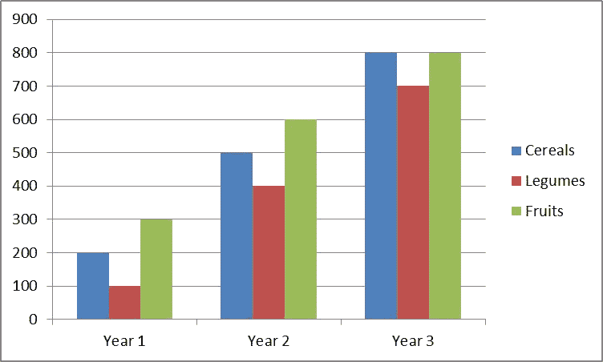

上面的图表突显了公司在三年内的总产量。它专门演示了 `Matplotlib` 在数据分析中的用法。通过观察图表，你会发现与另外两年相比，产量更高。同样，该公司在水果生产方面表现优异，因为它在第 1 年和第 2 年都是领先的，并在第 3 年持平。从图中你可以意识到，由于使用了这个库，你的演示、表示甚至分析工作都变得更简单了。这个 Python 库最终将让你能够创作良好的图形图像、准确的数据以及更多内容。借助这个 Python 库，你将能够记录下产量最高的年份。

值得注意的是，该库可以导出图形并转换为 `PDF`、`GIF` 等。总之，在该库中，可以轻松完成以下任务：

- 折线图绘制
- 散点绘制
- 直方图构建
- 行业内的各种饼图应用
- 数据分析和计算方案
- 等高线使用
- 最后是矢量图

# Seaborn

`Seaborn` 也是 Python 中流行的库之一。它的主要目标是帮助可视化。值得注意的是，该库的基础是 `Matplotlib`。由于其层级更高，它能够生成各种图表，如热力图、小提琴图以及辅助时间序列图。

## 图解说明


# NumPy

这是一个被广泛使用的 Python 库。它的功能能够执行多维数组处理。此外，它有助于矩阵处理。然而，这些只有通过广泛的数学函数集合的帮助才能实现。值得注意的是，这个 Python 库对于科学领域最重要的计算非常有用。同样，`NumPy` 也适用于线性代数、行业内使用的随机数推导，以及傅里叶变换。`NumPy` 也被其他高级 Python 库（如 `TensorFlow`）用于 `Tensors`（张量）的操作。

# SciPy

这是我们当今行业中非常流行的库之一。它的特点是包含不同的模块，适用于数据分析的优化领域。它在集成、线性代数以及其他形式的数学统计中也起着重要作用。在许多情况下，它在图像处理中起着至关重要的作用。图像处理是一个在日常活动中广泛的应用。Photoshop 等案例都是 SciPy 的应用。此外，许多组织在图像处理中倾向于使用 SciPy，特别是用于演示的图片。例如，野生动物学会可以对猫进行描述，然后使用不同的颜色对其进行处理以适应他们的项目。下面是一个示例，可以帮助你更直观地理解这一点。


上面的第一张图片是野生动物学会拍摄的猫的原始图像。


上述指的是第二张图片，经过了处理。这是一只调色的猫。当你根据自己的喜好调整此图像时，你将得到下面的图片。


## Keras

这也是 Python 库的一部分，特别是在机器学习领域。它也加入了高层神经网络的行列。值得注意的是，Keras 具有在其他库上运行的能力，特别是 `TensorFlow` 甚至 `Theano`。此外，它可以持续运行而不发生机械故障。此外，它似乎在 `GPU` 和 `CPU` 上的运行效果都更好。对于大多数 Python 编程初学者来说，Keras 提供了一条通往最终理解的可靠途径。他们将能够设计网络甚至构建它。它更快更快速地进行原型开发的能力使其成为学习者眼中最好的 Python 库。

## PyTorch

这是另一个易于使用且开源的 Python 库。根据其名称，它在工具方面具有广泛的选择。它也适用于我们拥有计算机视觉的领域。计算机视觉视觉显示在多种类型的研究中起着至关重要的作用。此外，它有助于自然语言的处理。此外，PyTorch 能够承担一些针对开发者的技术任务，即使用计算进行海量计算和数据分析。它还可以帮助创建图表，图表主要用于计算目的。由于它是一个开源 Python 库，它可以在 `Tensors` 等其他库上工作或执行任务。与 `Tensors` `GPU` 结合时，其加速性将会增加。

## Scrapy

Scrapy 是另一个用于创建爬虫程序的库。用于爬虫机器人等更多程序。爬虫机器人经常有助于数据检索目的，也适用于网络上使用的 URL 的形成。从开始，它是为了协助数据抓取。然而，它经历了多次演变，并导致了其通用用途的扩展。因此，Scrapy 库在当今的主要任务是作为通用的爬虫。该库促进了通用用途、通用代码的应用等。

## Statsmodels

Statsmodel 是一个通过多种统计计算方法和数据断言进行数据探索的库。它具有许多功能，如结果统计甚至特征特征。它可以通过各种模型的帮助，如线性回归、多重估计和涉及时间序列的分析，甚至使用更多的线性模型来承担这一角色。此外，其他模型（如离散选择）也适用于此。

# 第 5 章：回归分析（线性回归与逻辑回归）


全球多个行业都在努力寻找获得正确数据或信息的最佳方法，这将最终使他们能够解决面临的预测问题。一些银行已经遭受了损失，特别是在其信贷部门，因为他们无法正确预测违约者的信誉度。在健康领域，你会发现许多人因为规划不当和风险管理而失去生命，这是由于缺乏建模工具的结果。我们还有其他领域，例如天气预报，由于没有建议降水情况导致了更多损失。由于所有这些，全世界的人都在寻找处理预测问题的最佳方法。随后，这一切诞生了所谓的回归分析。

因此，回归分析是指使用变量进行预测分析的统计过程。在此，它有助于识别变量之间的关系。这种分析包含自变量和因变量。换句话说，回归分析有助于在其他自变量保持不变的情况下，理解一个自变量对因变量的影响。在大多数情况下，回归分析将努力预测条件期望，特别是因变量的。

回归分析应用于多个领域，如天气预报和预测。在这里，它帮助预测特定时期的结果。它也适用于其他领域，如医疗领域预测疾病。回归分析包括：线性回归、逻辑回归、多项式、逐步、岭、Lasso 和弹性网回归。总之，本章将只讨论最常用的回归分析，如线性回归和逻辑回归。值得注意的是 `ElasticNet` 回归是 Lasso 和 Ridge 回归的结合。

## 逻辑回归

逻辑回归包含了逻辑模型、逻辑函数、统计模型等更多。因此，许多组织在主要是数据预测和分析的日常活动中使用逻辑回归。你总是可以进行这种回归分析，特别是当因变量是二元时。这是二分类的。

与其他类型的回归分析一样，逻辑回归完全应用于任何处理预测的分析。在这种情况下，它的主要功能是描述数据。此外，逻辑回归也可用于解释或说明二元变量与其他自变量之间的某种关系。在某些情况下，这种回归解释起来可能具有挑战性，但通过 `Intellectus Statistics` 等逻辑工具的帮助，你可以轻松地完成你的数据分析。

# 逻辑回归概述

在逻辑模型的帮助下，逻辑回归可以很容易应用于统计学中。在这种情况下，逻辑模型的主要功能实际上是根据概率得出的某些预测或类别的正确结果。例如，概率法在只需要预测现有事件结果的领域效果最好。这些事件包括：健康或疾病、获胜或失败、生存或死亡，甚至在你对测试进行分析时某人的通过或不通过。尽管如此，在这个模型中，你将能够主要通过概率来微调你的结果。在图像的情况下，你可以扩展你的模型以涵盖各种类别。你能够检测分析中的图像是狮子还是猫等。在这种情况下，图像中的单个变量的概率值将在 0 到 1 之间。然而，这里的总和应该加到 1。

因此，逻辑回归指的是一种基础统计模型，无论可能存在更复杂的扩展，它都更多地使用了逻辑函数。逻辑回归是回归分析不可分割的一部分，在很多情况下，它被应用于估计逻辑模型参数的各种分析中。记住，逻辑模型类似于一种形式的二元回归。因此，二元回归由二元逻辑模型组成。该模型由包含两个可能事件值的因变量组成。这些值可以表示为通过/失败、生存/死亡、好/坏等。你需要注意的是，指示变量实际上表示了这些可能的值，并且它们始终被标记为 0 和 1。在这个逻辑模型中，几率对数（即 log-odds）对于值 1 表示一个线性组合。在其中，这种组合包含一个或多个完全独立的变量。在这种情况下，它们在这里被称为预测器。

## 变量与函数

此外，在逻辑回归分析中，独立变量有时可能每个形成一个二元变量，有时形成一个连续变量。在二元变量的情况下，必须存在两个类别或事件，并且必须通过指示变量进行编码。然而，另一方面，连续变量表示真实值。在逻辑回归分析中，如上述，这些值对应的概率始终在 0 到 1 之间变化。在这种分析中，这些对数几率（即几率算法）将通过逻辑函数转换为概率。对数几率用 logit 衡量，这也是其名称的派生词（逻辑单位）。同样，你也可以使用带有不同 sigmoid 函数的 probit 模型将对数几率转换为概率以便分析。你需要注意的是，probit 模型是包含 sigmoid 函数的类似模型示例。

总而言之，你会发现逻辑模型由于其定义属性或特征，在这种转换中是最受青睐的。逻辑模型的一个特征是它能够以乘法方式增加每个独立变量的比例。结果是，它产生了一个为每个独立变量以恒定速率分配参数的结果。然而，如果它是二元因变量的一部分，这将会泛化其几率比（odd ratio）。值得注意的是，在涉及因变量时也有一些扩展，特别是在某些回归中，例如二元逻辑。然而，这种扩展仅适用于两个或更多层级的情况。这两种扩展包括多分类逻辑回归，它对分类输出效果最好，特别是那些具有多个值（即两个及以上值）的输出。逻辑回归扩展的下一个类型是序数逻辑回归，它处理大量的多个类别。这里的一个很好的例子是处理比例几率的序数逻辑模型。然而，该系统只进行建模，而不进行任何处理统计的分类，因为它不是分类器。因此，它只会将概率输入转换为输出。

## 在 Python 中实现

现在我们已经有机会了解逻辑回归到底是什么，我们将看看在 Python 语言中编写我们自己的逻辑回归可以采取的一些步骤。可以使用其他语言进行数据分析和使用这些算法，但我们将专注于 Python 语言，因为它带有我们之前讨论过的库，而且它易于操作。

通常情况下，二元逻辑回归将帮助我们描述我们的因变量（应该是二元的）与一个或多个独立变量之间是否存在某种关系。当我们与二元因变量一起工作时，因变量可能有两种可能的输出。1 将用于成功或真（true），那么 0 将用于失败或假（false）。

为了让过程按照我们想要运行，这里需要执行几个步骤。我们稍后看代码，但首先，让我们聊聊其中的几个部分。我们需要收集想要的数据。通常有一个数据集可以帮助我们完成。你可以创建自己的，也可以导入一个已经创建的来帮助。

然后，我们需要导入一些为了使这段代码运行所需的包。对于这段代码，我们要确保计算机上安装了 `seaborn`、`sklearn` 和 `pandas`。如果你的系统中尚未安装这些内容，请花时间进行安装，因为我们需要它们。

当所有库和包都准备就绪后，该我们构建数据框（data frame）了，这通常是我们使用 `pandas` 库完成的，但你可以选择最合适的方法。

```python
import pandas as pd
from sklearn.model_selection import train_test_split
from sklearn.linear_model import LogisticRegression

candidates = {
    'gmat': [780, 750, 690, 710, 680, 790, 740, 610, 680, 550, 570, 690, 730, 710, 720, 670, 580, 650, 660, 620, 640, 550, 570, 690, 670, 650, 580, 690],
    'gpa': [4, 3.9, 3.3, 3.7, 3.3, 3.9, 3.7, 2.3, 3.3, 1.7, 2.7, 3.7, 3.3, 2.7, 3.3, 1.7, 2.7, 3.3, 2.7, 3.3, 2.3, 2.7, 3.7, 3.3, 2.7, 3.3, 3.7],
    'work_experience': [3, 4, 3, 5, 4, 6, 4, 5, 4, 3, 3, 5, 5, 5, 5, 3, 4, 5, 5, 6, 3, 3, 5, 5, 5, 4, 5],
    'admitted': [1, 1, 1, 1, 1, 1, 1, 0, 0, 0, 0, 0, 0, 0, 0, 0, 0, 0, 0, 0, 1, 1, 1, 1, 1, 1, 1]
}

df = pd.DataFrame(candidates, columns=['gmat', 'gpa', 'work_experience', 'admitted'])
X = df[['gmat', 'gpa', 'work_experience']]
y = df['admitted']

X_train, X_test, y_train, y_test = train_test_split(X, y, test_size=0.25, random_state=0) # 在这种情况下，你可以选择将 test_size 设置为 0。你应该在这里得到相同的预测

logistic_regression = LogisticRegression()
logistic_regression.fit(X_train, y_train)

new_candidates = {
    'gmat': [590, 740, 680, 610, 710],
    'gpa': [2, 3.7, 3.3, 2.3, 3],
    'work_experience': [3, 4, 6, 1, 5]
}

df2 = pd.DataFrame(new_candidates, columns=['gmat', 'gpa', 'work_experience'])
y_pred = logistic_regression.predict(df2)

print(df2)
print(y_pred)
```

# 逻辑回归的应用

逻辑回归应用于由气象学家组成的气象及其他预报站。该算法在这里用于预测降雨的概率。这一信息至关重要，因为它有助于农业、交通等许多领域。它可以高效地规划播种时间，并做出合理的安排。这种分析也应用于某些风险管理系统中，例如信贷控制系统。在这里，分析将预测账户持有人在还款时是否为违约者。尽管如此，回归分析还将根据之前的记录，预测可以给某人的精确额度。这始终使许多机构能够正常运行，因为它们在风险管理方面可以控制一切。在增加任何信贷之前，所有账户都将经过分析。逻辑回归也应用于政治领域，特别是在选举期间。在这里，它根据候选人的优势和利用资源，给出每位候选人胜负的概率。此外，这种回归分析能够预测最后可能不投票的人数、投票的人数以及投票给哪个特定的候选人。某些因素有助于决定这里的预测结果，例如候选人的年龄、性别、候选人和选民的收入、双方的居住状态，以及上届选举的总票数。

逻辑回归也应用于各个医学领域。它被应用于流行病学。在这里，分析被用于识别所有最终可能导致疾病的风险因素。因此，可以采取预防措施和其他防御手段。它的知识可以用创伤和损伤程度评分 (TRISS)，该评分对死亡率（特别是针对受伤患者）进行预测。我们有多种医学量表，用于检查全球患者的严重程度。

所有这些医学量表都是使用逻辑回归开发或管理的。在大多数情况下，特别是在健康领域，你可以利用这些知识来预测获得某些危险疾病的风险。例如，冠心病、糖尿病和其他形式的健康相关并发症很容易被控制。这些预测基于个体患者日常的可观察特征。这里的特征或特性包括身体质量指数、性别、年龄，甚至是不同的血液检查结果。这最终有助于医学领域的恰当规划和风险管理。

同样，这种知识可以应用于工程领域。在这里，它用于预测特定系统、新产品甚至任何类型过程的失败概率。在营销领域，逻辑回归分析有助于确定买者的购买力、购买意愿，这种知识也可用于停止公司的各种订阅。该技术也应用于经济学。在这里，知识被用于预测参与公共劳动力部门的结果。我们在处理房主不支付抵押贷款的问题上也有这种技术。自然语言处理使用条件随机场，这也是逻辑回归的一种扩展，特别是针对序列数据。

## 逻辑回归 vs 线性回归

你可能在好奇这两种回归示例之间的主要区别。在结果方面，线性回归负责连续预测，而逻辑回归的结果是离散的。预测汽车价格的模型将取决于各种参数，如颜色、制造年份等。因此，这个值将始终是不同的，表示连续的结果。然而，离散的结果始终只有一种情况。例如，在疾病情况下，你要么病了，要么没病。

### 逻辑回归的优势

- 它非常有效且高效
- 你不需要大量的计算资源即可获得结果
- 你可以轻松地解释它
- 缩放过程不需要输入特征
- 不需要调整
- 你可以轻松地对逻辑回归进行正则化

## 线性回归

线性回归指的是一种统计方法，用于建模特定不同独立变量集中各种变量之间的关系。在本章，你将学习更多关于因变量（如响应）以及自变量（包括简单性特征）。为了能够提供广泛的搜索结果并对 `python` 中的线性回归有清晰的理解，你需要关注主要基础。我们从该主题的基础版本开始。例如，什么是简单线性回归？

根据定义，简单线性回归指的是一种利用单一特征来预测显著响应的重要方法。因此，假设主要的两个变量（在这种情况下）是直接相关的。这就是为什么确定线性函数至关重要的原因，因为它通常能准确地预测方程的主要响应值。有不同的回归模型用于展示和预测两个不同变量及因素之间的主要关系。因此，需要注意的是，被预测的主要因素被称为**因变量**。而用于预测因变量主要值的因素被识别为**自变量**。尽管如此，同样重要的是，良好的数据并不总是像它看起来那样叙述整个故事。因此，回归分析通常用于研究以及建立变量之间的相关性。然而，相关性等同于因果关系。因此，简单线性回归中发现的可能恰好拟合数据点的线，并不指示关于主要因果关系的确定性元素。

## Python 中的线性回归


线性回归指的是一种统计方法，用于建模特定不同独立变量集中各种变量之间的关系。在本章，你将学习更多关于因变量（如响应）以及自变量（包括简单性特征）。为了能够提供广泛的搜索结果并对`python`中的线性回归有清晰的理解，你需要关注主要基础。线性回归也被定义为代数中的线性。它通常指的是两个或更多变量之间存在的独特的线性关系。源于这种关系，结果变成一条直线。出于这个原因，我们从该主题的基础版本开始。例如，什么是简单线性回归？

# 简单线性回归简介

根据定义，简单线性回归是指一种利用单一特征来预测显著响应的主要方法。因此，假设在这种情况下两个主要变量之间存在直接关系。这就是为什么确定线性函数至关重要，因为它通常能准确地预测方程中的主要响应值。有不同的回归模型用于展示和预测两个不同变量及因素之间的主要关系。因此，需要注意的是，被预测的主要因素被称为**因变量**。而用于预测因变量主要值的因素被确定为**自变量**。尽管如此，同样重要重要的是，良好的数据并不总是能像表面看起来那样讲述整个故事。因此，回归分析通常用于研究以及建立变量之间的相关性。然而，相关性并不等同于因果关系。

## 核心概念与数学模型

因此，简单线性回归中找到的可能拟合数据点的直线，可能并不指示关于主要因果关系的确定性元素。在线性回归中，每个观测值都有两个值。因此，其中一个值专门用于因变量，另一个值显然用于自变量。在讨论简单线性回归分析时，我们关注的是应用于各种自变量以及单个自变量的一些简单回归分析形式。

因此，在这样的模型中，通常使用直线来近似自变量与因变量之间的主要关系。当回归分析中应用两个主要自变量时，就发生了多元回归分析。结果是，模型将不再是简单的线性模型。通常，该模型`y= β0 +β1 + ε.`代表简单线性回归。通过应用相关的数学约定，这里涉及到两个主要因素。它们包括主要标记`x`和`y`。此外，该方程通常提供了`y`如何与`x`相关的描述。这就是回归方程的定义。此外，线性回归模型包含一个误差项，通常用`E`表示。它也可以称为希腊字母 epsilon（ε）。通常，该误差项主要用于解释`y`中发现的变异。然而，这一元素无法通过`x`与`y`之间发现线性关系来解释。同样重要的是，还有代表所研究主要总体的参数。这些参数中的一些代表了正在研究的主体。通常，回归线可以很容易地显示出独特的正线性关系、无关系以及负线性关系。

## 解释与估计

尽管如此，如果简单线性回归中绘制的直线在任何方面都是平坦的，那么在两个变量之间将发现没有关系。另一方面，如果回归线斜率向上，且线的底端位于图上的`y`处，那么图中将存在正线性关系。但如果回归线倾向于向下倾斜，其中`y`的上端截于图的轴。在参数被很好识别和已知的情况下，简单线性回归方程可以使用计算得出的`y`值含义。但在实际操作中，有许多未知的参数值。因此，必须使用来自实际总体的某些数据样本形式进行估计。因此，这些总体的参数通常使用样本统计量进行估计。这些统计量可以使用`b0 + b1`表示。

## 现代应用

显而易见，我们生活在一个需要我们使用大量数据结合强大的计算机以及人工智能的世界。虽然这可能只是开始，但数据科学在世界各个行业的使用正在兴起。机器学习也在推动图像识别、自动驾驶车辆的发展，以及金融和能源领域的决策。因此，`Python`这种语言的使用至关重要。

## 实现示例

现在我们已经花时间讨论了如何处理线性回归，以及线性回归的类型，我们需要进一步了解。为了让线性回归工作，我们需要以下：

```python
import numpy as np
import matplotlib.pyplot as plt

def estimate_coef(x, y):
    # 观测值/点
    n = np.size(x)
    # x 和 y 的均值向量
    m_x, m_y = np.mean(x), np.mean(y)
    # 计算交叉偏差和关于 x 的偏差
    SS_xy = np.sum(y*x) - n*m_y*m_x
    SS_xx = np.sum(x*x) - n*m_x*m_x
    # 计算回归系数
    b_1 = SS_xy / SS_xx
    b_0 = m_y - b_1*m_x
    return(b_0, b_1)

def plot_regression_line(x, y, b):
    # 将实际点绘制为散点图
    plt.scatter(x, y, color="m", marker="o", s=30)
    # 预测响应向量
    y_pred = b[0] + b[1]*x
    # 绘制回归线
    plt.plot(x, y_pred, color="g")
    # 添加标签
    plt.xlabel('x')
    plt.ylabel('y')
    # 显示绘图
    plt.show()

def main():
    # 观测数据
    x = np.array([1, 2, 3, 4, 5])
    y = np.array([2, 4, 5, 4, 5])
    # 估计系数
    b = estimate_coef(x, y)
    print(f"系数: b0={b[0]}, b1={b[1]}")
    # 绘制回归线
    plot_regression_line(x, y, b)

if __name__ == "__main__":
    main()
```

```python
x = np.array([0, 1, 2, 3, 4, 5, 6, 7, 8, 9]) 
y = np.array([1, 3, 2, 5, 7, 8, 8, 9, 10, 12]) 

# 估计系数 
b = estimate_coef(x, y) 
print("Estimated coefficients:\nb_0 = {} \nb_1 = {}".format(b[0], b[1])) 

# 绘制回归线 
plot_regression_line(x, y, b) 

if __name__ == "__main__": 
    main()
```

花时间查看这段代码，并将其添加到你的编译器中，看看它是如何满足你的需求的。你可能会对它运行得如此良好，以及在此过程中你能够通过这段代码实现的所有精妙操作感到惊讶。至此，你已经完成了第一个线性回归的创建！

# 第 6 章：感知机


本章旨在探讨感知机学习算法，该算法最早由 Minsky 提出并应用。本章将明确介绍感知机作为一种算法而非模型。我建议读者们在我的书《初学者机器学习》中寻找同一主题的参考材料。在书书中，对该主题的涵盖范围有限。但在本本书中，我将根据内容、结构和适用性对感知机进行深度分析。

## 定义感知机

感知机是神经网络中的一层，能够执行以下操作：

将算术值配置到数据池的核心，并估计对于正（+）结果，正向返回值为 1 的和。

从另一个角度来看，感知机也可以被视为一种计算模型，通过在给定空间中绘制一条边界（二维情况下为直线）来分离两个类别。

起初，代表分类超平的权重和偏置通常是未知的。在这种情况下，模型被分配了非系统的权重和偏置。随机分配会导致点的分类错误。

## 感知机技巧 (Perceptron Trick)

感知机技巧的目标是减少分类错误的点数量。可以通过在空间中移动直线来实现。换句话之，它在改变超平的表达式。对于所有分类错误的点，我们调整权重和偏置，使超平面更靠近那些分类不当的点。经过一段时间后，算法将纠正问题并正确分类这些点。然而，在本章中，我选择以不同的方式看待感知机。所采用的方法是在机器学习算法的上下文中识别感知机。在这里，感知机被定义为一种预测给定特征是否属于特定类别的算法。从这个角度来看，该算法被认为是一个用于监督学习的二分类器。在大多数情况下，所研究的特征始终表示为一个兼具大小和方向的数字。作为一种分类器，感知机用于线性分类和以图形形式表示数据。图形表示模型可以采用二维或多维的方式。感知机识别一个特征，加权求和，如果加权总和高于其他函数的结果，则给出一个值为 1 的结果。下图中的方程式支持了这一陈述：


当替换方程边缘（上图中的第二个方程）并使其与给定参数的权重保持常数时，就得到了下图中的方程。


感知机算法的单个单元可以执行可分的线性方程。唯一的组工作是通过对布尔和正指标进行加权或分配权重，并带有相应的偏置。

## 使用感知机执行或（OR）函数


在图中，条件是根据或（OR）函数定义的。这些术语旨在满足优化模型，该模型要求对于给定的输出值 1，加权数据的和为零（0）或大于零。权重的和已经在一条直线上完成，分离了正（+）值和负（-）值。

Minsky 的建议提出了利用样本数据学习特征的标准。所提出的模型描述如下。

## 线性代数的基础组件

### 向量

向量值可以根据数据类型和用户代表很多内容。因此，描述向量的方法不止一种。它可能是空间中既有方向又有大小的特征，可能是用于存储大量数据的结构或数据库等。对于本研究；我们将向量视为一条线，带箭头的点是头部，另一个没有箭头的点是原点。这不是最好的定义。然而，我希望你只需要抓住要点。演示中使用的图像取自 3Blue1Brown。

### 表示向量

向量可以在二维平面和三维平面上表示，取决于用户的选择和函数。下面是二维描述的向量（第一幅图）和一个三维向量（第二幅图）。


### 计算两个向量的点积

给定两个向量`(n+1, w)`和`(n+1, x)`，使用以下公式计算它们的点积。


从方程，`w`和`x`由带箭头的线表示。向量的维度是`(n+1)`。计算结果代表`w`和`x`的点积。结果显示了单个向量指向另一个向量的程度。感知机创建了一条分离正值和负值的线。这条线被称为边界。对于我们的示例函数，表示为`w. x = o`。

### 向量之间的角度

上述点积可以使用不同的方法计算。但必须满足某些条件

1. 必须知道向量之间的角度。

2. 必须知道向量的大小。

当满足条件时，通过代入下面的公式完成点积计算。


反向方法可以确定两个向量之间的角度。可以通过首先识别向量、获取其大小和点积来完成。

下图可以指导将值代入方程。


从方程和数学角度来看，我们知道当角度的余弦为 0 时，构成角度的直线相互垂直。由此我们可以推断，当向量`w`和`x`的点积为 0 时，直线`w`垂直于直线`x`。

## 使用感知机表示问题


该示例集将用于判断一个人是否会决定某部电影，这基于图中所示的先前数据和输入。此图中提供的输入数据既包含正值 (+)，也包含负值 (-)。实际值代表了所讨论人员看过的电影。我们将使用这些数据来观察感知机学习算法如何在数据集中估计权重。为了简单起见和清晰直化，我们将使用 2 维表示。

## 使用感知机学习算法

这里的主要目标是识别可以将正值 (+) 输入与负值 (-) 输入隔离开的向量，例如示例中所使用的向量`(w)`。

我们将使用下面的集合算法。


第一步是用任何向量调整向量`(w)`。初始化之后，我们重新陈述数据集中提供的示例，在本例中，指标是`P`、`U`和`N`。这些示例代表了正向和负向标准。

在进行替换阶段时，输入`x`（随机取的向量）对应于值`P`，待确定的`w`中的点积`x`应陈述等于零 (0) 或大于零的值。实际值并不重要，因为感知机只会给出“是”或“否”的答案。

在另一种情况下，当向量`x`对应于值`N`时，计算出的点积结果为零 (0)。上述陈述可以用`while`循环中的一个`IF`情况表示为：


从这些表示中推导出的两种结果：

第一个结果是向量`x`对应于`P`值，且两个向量`(w, x)`的点积小于零 (`w.x < 0`)。

第二种结果是当向量`x`对应于值`N`时，且两个向量`(w, x)`的点积大于零 (`w.x>0`)。

注意，我们必须更新已初始化的`w`值。在其他情况下，我们不应该干扰`w`的值，因为上述两种结果与感知机规则相矛盾。对于第一个结果，我们将`w`和`x`相加，而对于次要结果，我们将从`w`中减去`x`。

## 评估上述更新规则的可性

感知机的基本规则帮助我们确定向量`x`对应于值`P`。因此；任务剩余部分是使方程变为`w.x > 0`。该方程也可以解释为当向量`x`对应`P`时，两个向量`(w, x)`之间的角度应该小于九十度。为什么会有这种推理？两个向量`(w,x)`之间角度的余弦等于这两个向量的点积。因此，该角度应该小于九十度。


从上述解释可以看出，只要向量`w`与给定特征向量形成的角度小于九十度，我们就不需要知道向量`w`。在这种情况下，向量必须是一个正值。另一方面，向量`w`与具有负值的特征向量形成的角度应该大于九十度。

表示如下所示。


此时，我们可以很地说，对于`x`对应于值`P`的给定情况，向量`x`和`w`之间的角度应该是小于九十的值。

同样，我们可以得出结论，对于向量`x`对应于值`N`的给定条件，向量`w`和`x`之间的角度应该是大于九十度的值。

接下来，我们来看为什么更新有效。下面的图给出了为什么更新有效的解释。这种评估可能有点跳跃，但整体情况是一目了然的。


## 收敛证明

并没有精确的解释能让人相信向量最终会收敛。这是由于不同数据集中不断变化的条件。尽管看起来可能存在向量无法收敛的情况，但事实是该算法被证明会在某一点收敛。许多类型的研究已经了这些模式并推导出了这些证明。可以在 YouTube 上找到演示视频。

## 结论

在本章中，我们查看了感知机算法，对其进行了定义，并说明了它是如何工作的。在此过程中，我们在学习感知机学习算法之前，刷新了你们对线性代数必要组成部分的记忆。这种循序渐式的演示旨在引导学习者理解和直视机器学习的概念，并关注感知机。我希望在本章结束时，你已经获得了入门的见解和知识。建议学习额外的材料。

# 第 7 章：Python 编程的实用平台


# Python 平台与应用

Python 已移植到多个平台以实现安全访问。多年来，这些平台不断改进，变得复杂且专业。适用于 Python 编程的平台包括`AIX`、`ISO`、`OS`、`VMS`和`PH-UX`。其他用于 Python 编程的平台还有`Cygwin`、`Java`、`FreeBSD`、`OpenBSD`、`Solaris`和`Windows`。用户可以免费下载适用于`AIX`的 Python 3。

## 使用 Python 进行机器学习

机器学习是人工智能不可或缺的一部分，有助于企业从预测中发现信息。数据科学家编写机器学习算法来帮助用户学习数据趋势。此外，它还用于进行基础分析之外的预测。其他用于简单分析的工具无法进行预测，从而增加了工作难度。因此，使用这些平台进行 Python 编程使工作变得简单。

Python 是一种编写机器学习算法的编程语言。由于其适用性和简单性，深受受欢迎。此外，用 Python 编写的包帮助数据科学家进行数据可视化、模型构建、数据分析和特征提取。`AIX`用户可以免费使用机器学习包进行数据挖掘、科学计算和数据分析。由于这些包基于`Python`，用户必须在他们的`AIX`系统上安装最新版本的`Python`。

## 在 AIX 上的安装

用户可以使用`YUM`安装`AIX`。使用`YUM`更好，因为它是最简单的解决方法。此外，它是安装开源`RPM`包的最快方法，因为使用它不需要任何技巧。你可以从`AIX`工具箱仓库下载`YUM`并将其安装在`AIX`上。这个过程的优点是会默认安装`Python2`。确保在安装`YUM`后更新所有软件包。


要安装机器学习包，用户需要特定的开源包。这些包包括`blas`、`lapack`、`gcc`、`xz`、`python3`和`zeromq`。完成机器学习包安装还需要额外的设置。用户需要增加资源限制以成功安装。数据和栈限制也应该增加。

## AIX 上的 Jupyter Notebook

有多个应用程序允许用户编写用于统计分析的代码。`Jupyter Notebook`就是其中之一，而且表现出色。为了方便安装过程，`AIX`用户应该使用`Jupyter Notebook`来编写数据分析模型。要安装`Jupyter Notebook`，用户应该运行此命令：

```bash
python3 -m pip install jupyter
```

如果文件夹中没有它，请运行此命令：

```bash
jupyter notebook -generate-config
```

Python 机器学习工具在数据科学家中变得流行。此外，`AIX`用户希望在`AIX`上拥有这些包以帮助他们编写`AI`应用。`AI`应用要求很高，而这些平台让更容易直观问题。

# 用于编程的 Linux

Linux 在极客和程序员中非常常见。这个操作系统对所有人（包括学生）来说都是极佳的。大多数人不知道的是，`Linux`对于编程也非常棒。人们应该考虑使用`Linux`进行编程有许多许多理由。

## 成本与可访问性

`Linux`的第一个伟大的一点是它是免费的。用户在计算机上下载和安装`Linux`不需要任何费用。这意味着任何人都可以使用它，特别是那些面临财务困难但仍想使用良好的`Python`平台的人。无论你是爱好者还是将编程作为职业并不重要。唯一重要的一点是使用`Linux`操作系统不需要产生任何费用。你只需要一台兼容`Linux`的机器，可能你已经拥有它了。此外，`Linux`自带的大多数软件都是免费的，进一步降低了运营成本。这意味着你可以挑选你需要的工具，而不必担心额外支出。

## 安装的便利

使用`Linux`的另一个优势是它很容易安装。许多人从未安装操作系统，是因为他们不理解它的工作原理或意义。使用`Linux`的优点是安装非常简单。有些人认为既然安装其他`OS`很难，安装`Linux`也是如此，但事实并非如此。程序员可以轻松找到一个`Linux OS`并进行安装。按下功能键并遵循提示并没有困难。在启动活动`USB`驱动器后，安装`Linux`与在`windows`中安装程序类似。想保留现有`OS`的用户可以通过双启动选项来实现。

## 学习与定制

你应该使用`Linux`进行`python`编程的另一个原因是它提供了提高技能的时间。你可以轻松访问`OS`任何部分的源代码。虽然使用起来很困难，但它允许你深入学习它是如何运行的。此外，用户在犯错时不必担心法律问题。

`Linux`提供编程语言的支持以促进学习。它支持`CSS`、`Java`、`HTML`和`C++`以及其他人们可能感兴趣的语言。不限于特定操作系统的语言在`Linux`上运行良好。如果你想要使用的语言没有默认安装，你可以从发行版的仓库中获取它们。

# Windows 是 Python 编程的优秀平台

在 Windows 上使用 Python，要做的第一件事是设置开发环境。对于 Python 初学者来说，从微软商店获取 Python 安装是理想的选择。它利用了基础的`Python3`解释器，并在教育环境中非常有用。如果你在 Windows 上使用 Python 进行网络开发，请创建一个开发环境。与其直接安装在 Windows 上，不如通过 Linux 的 Windows 子系统（WSL）安装 Python。

## 在 Windows 上设置 Python

从微软商店安装 Python 非常简单。按下开始栏，输入 Microsoft Store 并点击链接打开。选择搜索并输入“Python”，这将打开`Python 3.7`。当`Python`完成下载和安装后，使用开始菜单打开`Windows PowerShell`。`Pip`是微软商店安装过程的一部分。

你可以使用`VS`安装`visual studio code`。利用`IntelliSense`来简化过程。你还可以使用代码检查（linting）来避免错误。Visual studio code 内置了终端，帮助你打开 Python 命令行。下载 Windows 版`VS Code`并进行安装。

要运行 Python 代码，你需要引导`VS Code`使用哪种解释器。为了起见见，除非你有其他特殊原因，否则请使用`Python 3.7`。打开命令面板（Command Palette）并选择`Python 3`。输入命令`python`并选择命令`Python`。一旦选择了解释器，选择该命令。`Select Python environment`显示可用的解释器列表。选择“view”在`VS Code`中打开终端。在`VS Code`中输入命令打开 Python。

## 使用 Git 工作

你可以决定是否安装`Git`。对于计划与他人协作 Python 代码的人，`VS Code`可以通过`Git`实现这种控制。你需要下载并安装 Windows 版`Git`。安装向导会询问一系列问题，最好使用默认设置。网络安装程序会自动下载组件的初始下载。

启动安装程序后提供两个选项：立即安装和自定义安装。如果你选择立即安装，你不必是管理员。此外，Python 将安装在用户目录下，快捷方式将仅限于当前用户。另一方面，如果你选择“自定义安装”，就可以选择安装的功能和安装位置。自定义安装允许所有用户安装，但用户需要证明管理员权限。此外，Python 下载在文件目录中，并有可选功能可供选择。安装程序 UI 中的可用选项可以通过命令行列出。可以在不干预 UI 的情况下设置这些选项以更改某些默认。用户可以传递`/quiet`选项隐藏安装程序 UI。此选项还允许他们静默安装 Python。

# 比较 Python 和 Java

另一个用于编程的有用平台是`Java`。大多数转向 Python 的 Java 程序员发现处理其面向对象的方法困难。事实上，Python 处理对象和语言能力所采用的方法与 Java 是不同的。这使得在语言之间切换变得忙乱且困惑。

`Java`类存放在与类同名的文件中。面向对象的语言保留了有关对象的数据。在 Python 和`Java`中，数据都存储在属性中。`Java`和`Python`最显著的区别在于类的定义和管理方式。需要注意的是，面临的一些问题是由语言本身决定的。

使用`Java`时，应当类中列出属性。第一条规则是你必须在使用类属性之前对其进行定义。相反，Python 要求用户定义并使用属性。你可以选择创建实例变量，但这不是一个好主意，因为会导致混淆。此外，在处理 Python 时，你应该在方法之外声明变量。`Java`通过规定私有和公有数据的区别来访问属性和方法。`Java`中的属性被预期是私有的，以限制从类外部的访问。如果忘记指定访问级别，该属性将默认为包级安全以限制访问。然而，不建议在`Java`中声明公共属性。应当声明私有属性但使用公有访问技术。当 Python 看到带有双下划线的属性时，它会通过使用下划线写入原始名称来修复。

## 相似之处与差异

Python 和`Java`有许多相似之处。它们都具有跨平台的强力支持和广泛的标准库。此外，它们将事物视为对象，并编译为字节码，尽管 Python 是运行时编译的。它们都是`Algol`家族的一部分，但当有人在 Python 中声明数组时不必提供类型。静态类型以在编译期间捕捉类型错误而闻名。因此，如果你不想混合整数和字符串，使用`Java`有助于发现错误。静态类型使得代码无论是否消除了错误都能运行。

空白字符形成了 Python 语法的重要部分。声明在每情况下都会创建一个块。目前还不清楚 Python 的类型系统是否优于`Java`，但两者结合可以使结果最大化。使用 Python 进行 Java 编程的用户受益匪浅。`Java`的性能比 Python 好，将其整合到编程中提高了效率。`Java`没有元组（一种不可变的值集合）。许多人使用 Python 是因为它速度快、可靠且高效。它也是动态的，并具有优雅的语法。用户在执行程序之前不需要编译程序。

# Python 中的 OS 模块

Python 中提供的`OS`模块允许与操作系统交互。`OS`是 Python 的标准，提供了使用依赖于操作系统的函数的移植替代方案。它有许多与文件系统交互的函数。

`OS`中的函数有很多，例如`os.name`，它给出导入的操作系统模块的名称。注册下的名称有‘posix’‘java,’和‘nt’。不同的解释器有不同的输出。`OS`还启用了`getcwd`函数，它返回执行代码时的工作目录。`OS.error`是 OS 的一个函数，表示操作系统不接受的无效文件名。`OS.popen`打开命令的管道，如果模式为‘r’或‘w’则可以读取。`OS`模块允许用户与运行 Python 的操作系统建立接口。`OS`更受青，因为它返回实际的进程 ID 和标识当前操作系统的信息。它还允许用户在需要时更改根目录。它返回文件目录条目并命名。一旦给出命令，它还可以重命名文件。此外，当`OS`接收命令时会返回组 ID 和进程用户 ID。

另一个 Python 编程平台是`iso`，一个用于简化与构建机器机器学习模型相关的开发周期的封装工具。它在部署期间也非常有用。`Iso`被广泛使用是因为它有效且可靠。它在设计学习算法时能帮助保持思路清晰。有些平台使用起来非常杂乱，可能会让人放弃创作过程。它不仅不能帮你想出独特的东西，反而让你感到沮丧。在机器学习模型开发过程中，最糟糕的事情就是创建者感到沮丧。这会让整个过程变得繁琐，且无法产生良好的结果。

与其使用一个你不熟悉的平台，不如使用一个能保证结果的平台。能保证结果的平台很少，人们应该利用它们。`iso`同样有效，因为它允许开发者理解他们正在处理的问题。它让一切变得清晰，让使用户从创建模型中获得满足。`Iso`的特殊之处在于它可以定义构成模型部分的模块化数据变化，有助于开发者保持条理。它还让一个模型到另一个模型的转换变得简单。

`iso`的另一个优势是它具有用于数据增强的工具。人们还可以轻松地保存和部署模型。与其他平台不同，它还能与模型构建过程进行交互。`Iso`之好是因为它拥有使用户可以一步转换响应和预测器的工具。它节省了时间，并让你在过程中学习到很多。与其他 Python 编程工具/平台结合使用时，它能产生更多结果。此外，它是灵活的，允许用户在使用的同时专注于其他事情。它没有限制性，用户在平台上是自由的。

# 第 8 章：决策树


决策树是一种决策支持工具，利用树状图表来解释概念。它利用了效用、资源成本和事件结果。它适用于展示仅包含条件控制语句的算法。在决策树中，每个内部节点代表对属性的测试，而分支代表测试结果。叶节点代表类别标签，从根到叶的距离则表示分类规则。

决策树在学习算法中很有帮助并被广泛使用。此外，基于树的学习算法是流行的学习方法。决策树常见的原因之一是它们赋予了预测模型直观的解释性和效率。它们还既准确、稳定又可靠。与其他工具不同，它们也是线性映射模型的理想选择。决策树可以解决各种挑战，且从不让人失望。许多人证实，这种决策支持工具帮助他们克服了问题并达到了顶峰。

决策树算法被称为分类与回归树 (CART)。它对于应对数据科学挑战非常有用。在决策树中，`Root Node`（根节点）代表总体，进一步划分为同质组。当子节点被进一步分裂时，它们被称为决策节点。分裂是将节点划分为子节点的行为。剪枝是指移除决策节点子节点的过程。决策树的设计使其易于融入到程序化结构中。它们的布局是为了在问题出现时对问题进行分类。人们可以使用决策树来识别植物的物种。在创建决策树时，人们会做出许多假设。许多人在开始时会将整个训练集视为根。记录根据属性值进行划分。大多数人倾向于特征值是类别性的。下面是一个决策树的示例。

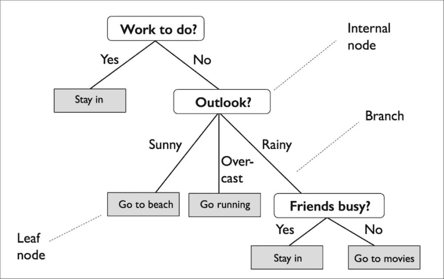

决策树被用于有几个原因。数据挖掘者使用决策树。它也被常用于机器学习及类似的活动。例如，决策树可以利用人口统计数据来评估机会。许多公司使用决策树来评估性能，这允许他们调整营销策略。它还能让公司限制其广告预算。大多数时候，公司在不知道目标何在的情况下花费大量资金制作广告，导致损失多于收益。

公司破产的原因之一是违约贷款人。为了规避这些人，公司可以使用从历史数据中获得的预测模型。这样做节省了时间和操作成本。决策树还用于运筹学，以找到高概率实现目标的策略。不需要在不知道最终目标的情况下进行研究。决策树有助于进行决策分析并让工作变得简单。许多行业已使用决策树来解释数据，包括工程、金融、能源、教育和商业。使用其他工具和技术分析数据的人因其优势已转向决策树。

决策树具有许多优势，使其非常有价值。它们易于理解。有很多工具可以用来解决问题，但大多数工具非常杂乱且需要技能。相反，决策树非常简单，不需要花费精力就能理解。即使是没有分析知识的人也可以使用决策树。理解决策树算法并不需要统计知识。

决策树在数据探索方面非常有效。它们对于识别最佳变量以及变量之间的关系非常有用。长期以来，人们使用的变量并没有产生结果。研究人员因为无法充分探索数据而感到沮丧；决策树改变了局面。现在研究人员可以轻松地探索数据。此外，它们还可以创建新变量来预测目标变量。如果我们正在处理涉及数千个变量的问题，决策树可以节省你寻找最显著变量的挣扎。决策树的另一个额外优势是用户只需投入少量精力准备数据。更少的数据清洗让用户能够专注于其他事情。与其他建模技术相比，它是有效且可靠的。此外，决策树不受缺失值或离群值的影响。

# 决策树的缺点

尽管决策树具有许多优点，但用户仍应注意其缺点。在某些情况下，决策树学习器可能会创建出无法生成预期结果的树。在这种情况下，用户会怀疑使用决策树是否是一个好主意。如果使用不当，可能会令人倍感沮丧。创建复杂树的情况被称为**过拟合**，许多人都属于这一类。学习者通过对模型参数设置限制条件来解决这个问题。他们也可以通过剪枝来处理这一问题。决策树的另一个挑战是它不适用于连续型变量。如果你处理的是连续型数值变量，极极可能会丢失信息。此外，如果树发生了变动，决策结果往往是不稳定的。人们应该原样使用该树，因为微小的变量变化可能会导致完全不同的结果。存在一些贪心算法，它们无法保证返回决策树。学习者可以通过训练多棵树来消除这个问题。在创建决策树时也必须小心。决策树在确定变量方面表现出色，但需要仔细的缓解措施以避免错误。它无法保证会有良好的结果，用户必须不断监控它以解释其性能。

## 树的结构与划分

决策树的底部是终止节点。终止节点之所以位于底部，是因为决策树是倒过来绘制的。分类树和回归树既有相似之处也有不同之处。它们的工作方式相似，仅在因变量为连续型的情况下使用回归树。相反，每当因变量为类别型时，就会使用分类树。这两种树都将将预测空间划分为不同的区域。它们也采用贪心方法并持续持续直到满足用户规定的标准。此外，划分过程有助于树完全发育，直到达到设定的标准。然而，长大的树可能会过拟合数据，这就是剪枝派上用场的地方。决定划分树会影响其性能。根据操作方式的不同，它可能会降低或提高准确率。决策标准取决于它是用于回归树还是分类树。在决定是否将决策树划分为子节点时，会使用多种算法。目标变量影响节点的纯度。在根据现有变量对节点进行划分后，决策树会选择具有更多同质子节点的一个。

## 应用与实际考虑

树在现实生活中有多多种用途，事实证明它在机器学习中同样适用。它可以用于在决策分析中虚拟表示决策。人们脑中产生的问题是如何用树来表示算法。就像现实中的树有许多部分一样，决策树也有许多执行不同功能的部分。理解决策树中的所有部分及其作用至关重要。虽然数据集具有更多特征，但我们不能忽视决策树的简单性。若要长出一棵树，他/她必须决定要使用的特征和有利于划分的条件。这个人还需要知道何时停止。修剪树很重要，因为它是习惯性生长的。创建决策树时你也需要耐心。就像现实中的树需要时间生长并经过剪枝过程一样，创建决策树时必须保持耐心。加速过程可能会导致过拟合，因此最好花时间做好工作。划分使用了多种技术，包括递归二分划分，其中所有选取的特征都被考虑在内，并使用代价函数来测试划分点。许多人不知道何时停止划分树。过度可能会导致比预期更多的问题，在正确的时间停止非常重要。巨大的树会导致过拟合，避免这种情况的方法之一是为每个叶节点设置最小训练输入数量。一些人对这种策略表示怀疑，但它对许多人有效。用户需要找到有效的方法并坚持下去。对一个用户有效的方法对另一个用户可能无效。

## 算法与过拟合缓解

决策树使用诸如`Gini Index`（基尼指数）和`Chi-Square`（卡方）等算法来确定最同质的节点。`Gini Index`指出如果从样本中随机抽取两个物品，它们必须属于同一类，且这种情况发生的概率为 1。同质性值随着`Gini`值的增加而增加。`CART`利用`Gini Index`技术创建二分划分。`Chi-Square`是决策树用于计算变量的另一种算法。它被用于确定父节点和子节点之间的统计显著性。它是通过预期频率与观测频率之间的标准差平方值来衡量的。你可以通过计算成功和失败的偏差推导出每个节点的`Chi-Square`值。好消息是，不纯节点所需的信息较少，反之亦然。

可以采取某些措施来避免过拟合，以提高决策树的效率。过拟合是决策树面临的问题之一。处理这个问题意味着用户在使用决策支持工具时将获得良好的体验。具有过拟合问题的模型在尝试减少训练集错误时，会导致更多的测试集错误。你可以通过剪枝和限制树的大小来处理过拟合问题。你可以通过采用许多定义树的参数来设置树的大小限制。这些参数包括节点划分的最小人数、叶节点的最小样本数、最大垂直深度、划分时增加的权重特征以及增加的终止节点。

关于节点划分的最小人数，它指了节点中符合划分条件所需的最小样本数。该样本可以用于控制过拟合。使用较高的值可以防止模型学习决策树中具有重要意义的关系。使用终端叶节点的最小样本数。从定义终端叶节点所需的样本开始。它与节点划分的最小样本一样，也用于控制过拟合。对于不平衡的类别问题使用较低的值。

## 剪枝方法


或者，使用树剪枝方法来处理过拟合问题。设置限制的方法是一种贪心策略，寻找最佳可用划分并继续进行直到达到指定点。设置限制与剪枝的区别在于，前者无法预见未来的危险并采用贪心方法来克服它。剪枝方法让你看到未来，并帮助你做出正确的选择。在决策树中实施剪枝时，我们从创建树开始，然后从底部移除叶子。移除与顶部相比回报不佳的叶子。

决策树有两种类型，它们基于可用的目标变量。第一种决策树是`分类变量决策树`（Categorical Variable Decision Tree）。这是一种具有分类目标变量的决策树。在哪些学生会玩棒球的示例中，目标变量是`learners will play baseball or not`，即是或否。第二种是`连续变量决策树`（Continuous Variable Decision Tree）。顾如名，这种类型的决策树包含连续目标变量。例如，如果有一个问题是预测客户是否会缴纳续年保费（是/否），显而易见，`income`是他们缴纳保费的一个显著变量，但保险公司可能缺乏客户的收入信息。为了解决这个问题，我们可以创建一个决策树来预测所有客户的`income`。保险公司在创建决策树时会考虑`occupation`。在这种情况下，预测的是连续变量的值。

第一步是将最佳属性放在树的根节点。之后，划分训练集并确保每个子集都有数据。在预测记录的类别标签时，从树的根开始。根属性的值将与记录的属性进行比较。在这个过程中最重要的一点是使用正确的数据来尽可能地减少误差。通过将属性值与内部节点进行比较，我们增加了获得正确变量的机会。决策树的工作方式简单。它属于监督学习算法的类别，使用预定义的目标变量来分类挑战。连续输入变量和分类输出变量都使用决策树。它根据区分因子将人口分为两个同质集合。例如，如果我们有一个包含 20 个学习者的样本，变量有`gender`（女/男）、`height`（4 到 5 英尺）和`class`（IV 级/V 级）。10 个学习者玩棒球，我们想创建一个模型来预测谁可能玩棒球。为了做到，我们必须根据高度显著的输入变量分离玩棒球的学习者，这就是使用决策树的地方。决策树根据三个变量的值分离学习者，并确定哪一个形成了最佳同质集合。通过在三个变量中识别最佳变量，有助于解决问题。它利用许多算法来识别显著变量。

## 创建我们自己的决策树

现在我们已经花了一些时间讨论决策树以及它们应该是如何工作的，现在是时候创建一个我们自己的了。与听起来的，这些操作实际上要容易和简单得多，但使用起来会非常有用。所以，让我们花点时间看看我们可以用来创建我们自己的决策树的步骤，并让这个过程为我们良好运行。

决策树将是我们可以使用的最流行的算法之一，主要因为它的使用非常强大。随决策树而来的算法将是我们的监督学习算法之一，它将同时适用于你用于输出的分类变量和连续变量。

在我们稍后要处理的代码中，有许多不同的包我们需要导入并处理，以便使其工作。我们将关注`Pandas`、`NumPy`和`sklearn`包，以让它们以最好的方式工作。如果你的计算机上还没有这些内容，现在是获取它们的时间了，以便你能够根据需要使用它们。

在此期间，我们需要做出一些假设。其中一些包括：

1. 当我们开始这个操作时，我们需要检查并传递参数值。

2. 当我们处理这个时，我们需要专注于构建和。

3. 当我们处于数据集时，我们能够检查并..

.....到我们的此的，我们需要解决该模块..

......,,, the the the..........the.,我们需要处理根节点。这些步骤中的一些包括：

1. 找到树的最佳属性并将其放在根节点上。

2. 完成后，你可以将数据集划分为训练集和测试集。

3. 当我们实现决策树时，我们需要检查并重复一个和。

在我们实现决策树时，我们将得出两个需要关注的阶段。这些阶段包括构建阶段和运行阶段。在我们的构建阶段，我们将做许多事情，包括对数据进行预处理、划分数据集以便我们最终得到和的。然后我们就可以训练分类器。然后我们可以移动到运行阶段。这部分是我们能够使用算法来进行某些预测的部分，它是我们计算结果准确性的一种良好方法。我们需要处理的下一步是进行数据导入。这可以通过我们通过 Python 获取的包来实现。在这里，我们将能够使用一个 URL 直接从 UCI 站点获取数据集，我们就不需要花时间下载数据集。当你尝试让这段代码在系统上执行时，确保网络连接已开启且运行良好很重要。由于数据集将通过`,`进行分离，所以我们必须确保将`sep`参数传递为`,`。另一个我们在处理这个时需要注意的问题是，我们处理的数据集不包含表头，因此我们需要检查并将表头的参数值传递为 none。如果我们不传递这个表头参数，它会将数据集的第一行视为表头。

然后是时候检查并进行一些数据切片了。在我们训练数据并开始使用算法处理它之前，我们需要确保可以将数据集划分为训练和测试两个选项。为了处理我们的数据集并将其划分为训练和测试，我们需要从`sklearn`中调出一个名为`train_test_split`的模块。为了处理这个，我们将目标变量从数据集中的属性分离出来。然后我们就可以为了训练和测试的目的划分数据。在这一点上多花些时间，这对算法准备好执行我们想要它的工作产生很大影响。

在我们处理这个过程中，还有几件事需要进一步回顾和理解。首先，我们这里引入了 `entropy`（熵）的概念。这是一个重要的衡量指标，因为它能告诉我们随机变量的不确定性，并帮助我们表征任意示例集合的纯度。在我们的决策树中，`entropy` 越高，其中包含的信息量越多。当我们处理决策树中的节点以帮助为训练实例创建新的划分（将其变为更小的子集）时，熵通常会发生。我们必须进行多次不同的训练和测试，往复进行，因此我们需要划分这些数据以便多完成几次操作。然后是 `information gain`（信息增益），它将帮助我们更多地衡量`entropy`的变化。`Sklearn` 在这里非常有用，因为它支持为我们的 `information gain` 提供 `entropy` 标准。我们需要确保遍历并使用 `information gain` 方法，并且我们必须显式地提到我们想要这一点。此外，我们还可以使用 `accuracy score`（准确率评分），它可以帮助我们确定训练好的分类器的准确性。最后，我们可以在代码中使用 `confusion matrix`（混淆矩阵）来帮助理解训练好的分类器在测试数据集上的行为，或验证我们正在工作的数据集。

现在，我们已经花时间学习了处理决策树时必要的不同部分，是时候进入下一部分，看看我们可以操作的一些代码了。程序员可以使用一些代码来创建自己的决策树并使用上述所有步骤，代码包括：

# 导入所需的包

```python
import numpy as np
import pandas as pd

from sklearn.metrics import confusion_matrix
from sklearn.cross_validation import train_test_split
from sklearn.tree import DecisionTreeClassifier
from sklearn.metrics import accuracy_score
from sklearn.metrics import classification_report
```

# 导入数据集函数

```python
def importdata():
    balance_data = pd.read_csv(
        'https://archive.ics.uci.edu/ml/machine-learning-' +
        'databases/balance-scale/balance-scale.data',
        sep= ',', header = None)
    # 打印数据集形状
    print ("Dataset Length: ", len(balance_data))
    print ("Dataset Shape: ", balance_data.shape)
    # 打印数据集观测值
    print ("Dataset: ",balance_data.head())
    return balance_data
```

# 划分数据集的函数

```python
def splitdataset(balance_data):
    # 分离目标变量
    X = balance_data.values[:, 1:5]
    Y = balance_data.values[:, 0]
    # 将数据集划分为训练集和测试集
    X_train, X_test, y_train, y_test = train_test_split(
        X, Y, test_size = 0.3, random_state = 100)
    return X, Y, X_train, X_test, y_train, y_test
```

# 使用 giniIndex 执行训练的函数

```python
def train_using_gini(X_train, X_test, y_train):
    # 创建分类器对象
    clf_gini = DecisionTreeClassifier(criterion = "gini",
               random_state = 100,max_depth=3, min_samples_leaf=5)
    # 执行训练
    clf_gini.fit(X_train, y_train)
    return clf_gini
```

# 使用 entropy 执行训练的函数

```python
def tarin_using_entropy(X_train, X_test, y_train):
    # 使用熵的决策树
    clf_entropy = DecisionTreeClassifier(
                criterion = "entropy", random_state = 100,
                max_depth = 3, min_samples_leaf = 5)
    # 执行训练
    clf_entropy.fit(X_train, y_train)
    return clf_entropy
```

# 预测的函数

```python
def prediction(X_test, clf_object):
    # 使用 giniIndex 对测试进行预测
    y_pred = clf_object.predict(X_test)
    print("Predicted values:")
    print(y_pred)
    return y_pred
```

# 计算准确率的函数

```python
def cal_accuracy(y_test, y_pred):
    print("Confusion Matrix: ",
      confusion_matrix(y_test, y_pred))
    print ("Accuracy : ",
      accuracy_score(y_test,y_pred)*100)
    print("Report : ",
      classification_report(y_test, y_pred))
```

# 主程序代码

```python
def main():
    # 构建阶段
    data = importdata()
    X, Y, X_train, X_test, y_train, y_test = splitdataset(data)
    clf_gini = train_using_gini(X_train, X_test, y_train)
    clf_entropy = tarin_using_entropy(X_train, X_test, y_train)
    # 操作阶段
    print("Results Using Gini Index:")
    # 使用 gini 预测
    y_pred_gini = prediction(X_test, clf_gini)
    cal_accuracy(y_test, y_pred_gini)
    print("Results Using Entropy:")
    # 使用 entropy 预测
    y_pred_entropy = prediction(X_test, clf_entropy)
    cal_accuracy(y_test, y_pred_entropy)

# 调用主函数
if __name__=="__main__":
    main()
```

# 第 9 章：K 近邻算法 (KNN)


K 近邻算法是分类和回归问题中最简单、最常用的学习算法。这种类型直观且易于掌握。对于解出的谜题，结果价值基于邻居值的选择。其目的是根据其 K 个最近邻居将样本分类为最常见的类别。KNN 有时也用于回归，其中输出值是根据最连续的值进行预测的。输出值可以是整个类别的平均值或中位数（`k-nearest neighbors`）。在回归和分类问题中，与 `k` 对应的输入值通常位于特征空间中。

对于分类问题，邻居节点是在特征和其他参数方面具有已知值的单元中选择的。尽管在 k 最近邻理论中执行的训练较少，但该组仍然可以被视为训练数据集。k 最近邻算法的一个显著特征是其对数据集的成分和构成的敏感性。可以用于 k 最近邻算法的训练数据示例是带标记的向量，通常应用于具有许多维度的特征空间。这些算法通过隔离训练数据集中的特征向量和标记类来学习。

在对对象进行分类的过程中，`k` 的值通常是常数，并由系统用户设置。在此过程中，一个没有标签的向量（用作测试数据）通过查看整个训练集中频繁出现且距离该向量最近的标签被分配到一个组。训练数据集也称为 `k` `sample`（样本）。

对于连续变量，`Euclidean distance`（欧几里距离）是解决范围相关问题的常用参数。对于非连续的变量（也称为离散变量），则使用不同的设置来解决问题。通过引入其他用于研究距离空间元素的独特算法，可以增强邻算法的性能。

## 寻找 k 最近邻算法中 K 的值

在本章的开头部分，我提到 `k` 值是由系统用户设置的常数。这一说法仍然成立。然而，选择一个最能代表 `k` 的值需要大量精力。在这个领域，我想阐述一个有助于确定 `k` 真实值的理论。首先要注意的是，`k` 因的选择取决于数据的类型和权重。影响 `k` 选择另一个指标是函数的类型，即任务是分类还是回归。对象的特征在选择 `k` 值时也起着更重要的作用。最后，`k` 的选择主要取决于用户（这就是为什么算法往往产生偏差）。从这一切我们可以得出结论，`k` 因子与其使用的系统有紧密的关系。最实际的影响是数据的权重。

当设置的 `k` 值显著时，数据集中的噪声可能会减少。然而，一个重要的 `k` 因子会导致类之间出现无区别的边界。因此，最佳的 `k` 值只能通过基于实验的试错法获得。这些实验即，换句话说，被称为优化过程。这些过程旨在纠正指标值偏离低点的偏差，导致一个单元被预测为最接近 `k` `sample`。在此时，`k` 的值应该是 `1`。这个过程被称为最近邻算法。

噪声、偏差或任何其他不良参数都会显著改变 K-最近邻算法的准确性。特征与系统角色之间的不一致也使得效力变得复杂。例如，一个本应该预测部分人口是男性还是女性的系统，在预测其他指标时可能不准确。此类参数可能是社区的同一部分是富有还是贫穷。然而，这个问题可以通过隔离特征以反映算法的功能和预期结果来解决。这种隔离可以通过进化算法或通过将 `k` `sample`（训练数据集）与待分类的数据相互结合来完成。

在联合分类问题（也称为二分类）中，建议 `k` 值为奇数。这样，我们就可以避免元素之间出现平局的问题。如果证明 `k` 值难以估计，建议你使用自助采样法（bootstrap method）对其进行评估。

## 比较 k 最近邻与 k 均值聚类

如果不比较机器学习中最常用的算法，我就无法总结这一章。这两个算法（`k-means clustering` k 均值聚类和 `k nearest neighbor` k 最近邻）通常因为名字中都有 `k` 而被混淆。这两个算法最明显的区别在于 `k-means` 是无监督的，而 `k nearest neighbor` 是监督的。`k-means` 用于聚类，而 `k nearest neighbor` 用于分类和回归。

解决回归中的偏差问题需要不同的方法。`k nearest neighbors` 单元通过平均权重值进行交叉，该权重与组内两点之间的距离成反比。这是从最近邻居到测试点的距离。可以使用的额外方法是代表每个类别的数据进行泛化。自组织映射中的代表性节点，其中心位置与类中元素的分布无关。

## K 最近邻居算法的优点

作为所有机器学习算法中最简单、直接的一种，`k nearest neighbor` 算法具有许多优点。最近邻居也被称为 `lazy learner`（懒学习器）。这个名称源于算法在训练期间不学习任何东西。然而，在需要执行任务时它会产生优势。缺乏训练期可以看作它的缺点。该算法存储数据集并在需要预测时使用它们。这确保了 `KNN` 算法是机器学习算法中最快的。在不改变预测的情况下，可以引入额外的数据集。最近邻居算法运行只需要两个指标。这两个参数是 `k` 因子和距离函数。这使得算法变得简单且易于设计。

## K 最近邻居算法的缺点

在处理海量数据时，该算法无法有效工作。大型数据集点与点之间的跨度很大，导致算法失效。如上段所示，该算法无法在维度维度的情况下工作。当数据分布很广泛时，最近点之间的距离估计将成为一种挑战。最近邻算法对数据中的噪声和其他不规则敏感。为了有效性，引入了人工方法来删除离群值和不在中的数值。该算法通常需要特征缩放。

## 创建我们的 KNN 算法


现在是时候让我们学习并创建自己的用于数据分析的`KNN`算法了。我们到目前为止讨论的`KNN`算法将使用特征相似性，这将有助于预测新数据的值。这意味着所有新数据点将根据它们与我们训练集中找到的点的匹配程度来被分配一个值。通过以下某些步骤，我们可以更好地理解这一点：

1. 首先，我们需要确保开始实现算法。这要求我们有一组数据可以处理。因此，当我们处理该算法的第一步时，我们需要加载想要使用的训练数据和测试数据。

2. 接下来，我们必须检查并选择`K`的值应该是多少。这可以是我们想要的任何整数，并将帮助我们分离出正在处理的数据。

3. 对于测试数据中的所有点，有几件事我们需要完成，这些步骤将包括：

   1. 利用任何你想要使用的方法，开始计算测试数据与训练数据每一行之间的距离。这些包括`Hamming distance`或`Manhattan distance`等选项。其中最常见的是`Euclidean distance`。

   2. 现在，根据你赋予的距离值，我们按升序对其进行排序。

   3. 完成排序后，该由我们根据正在处理的排序数组选择前`K`行了。

   4. 然后我们可以通过为我们的测试点分配一个类别来结束这部分。我们在这里分配的类别是基于这些行中最频繁的类别。

4. 当我们完成所有这些后，算法将结束，我们应该能够查看聚类以及它如何为我们工作。

完成这些需要花费一些工作，但你会发现它在过程中帮助我们完成了很多工作。当它出现时，图表或图表将显示我们的数据点应该去哪里。这将帮助我们观察这些点的去向，并学习一些我们可以探索的新选项来使其为我们服务。

# 第 10 章：使用 Python 的随机森林算法


这种算法在近年来是最可用且最常见的。有几个因素你需要理解。该算法的主要目标是帮助使用原始自然数据进行回归和分类计算。当你谈到`random forest`时，你指的是一个包含多个决策树的学习方法集合。随机森林通过计算决策树影响的平均值来改进结果预测。通过这种方式，你可以使用该算法提供的各种模型进行多次预测。你可以正确使用的模型示例包括`logistic regression`，它主要处理二项数据。其他示例可能包括`k-nearest neighbours`、`naïve Bayes`甚至`support vector machines`。在大多数情况下，当模型的不同特征构成的预测能力非常弱时效果最好，但在组合中会显示出更强大的力量。以下插图将帮助你很好地理解这个主题。

## 决策树

用通俗的话说，你可以推断出随机森林由树预测器的集合组成，其中每棵树都严格依赖于随机向量值，这些值是独立采样并平均分布在森林中所有不同树上的。你也可以说，随机森林是一种分类器形式，由一组在结构上被排列为分类器的树组成。因此，简而言之，你可以得出随机森林具有构建各种多树决策的能力，并随后对其进行融合，以获得稳定且高度准确的预测。值得注意的是，这种机器学习算法完全依赖集成学习。因此，集成学习是学习的形式，在其中你可以分类地将所有不同类型或相同类型的算法结合在一起，从而产生一个在预测方面非常强大的模型。有趣的是，随机森林是用于决策的多个不同树组合而的结果。因此，你也可以将其称为“树的森林”。

## 随机森林的优点

- 它显然适用于回归问题和分类问题。

- 它有助于减少过拟合，特别是在树的内部。所有这些都可以通过执行平均化来实现。

- 它是最准确的算法，因为只有当用于数据中超过半的数据是错误的时，它才会给出错误的预测。

- 它很容易使用，因为你可以轻松检测每个特征的重要性水平，而不是特征的显著性，特别是在预测中。在这种情况下，`Sklearn`以其执行该任务的强大库而自豪。

- 该算法减少了分析中的偏差痕迹，因为它主要取决于森林的整个群体来进行其最大预测。

- 它是一种非常稳定的算法，你可以信任它进行所有计算。微小的错误只会影响预测的一小部分。因此，整个预测仍然是正确的。

- 这种算法可以使用数值特征和类别特征执行其职责。

## 随机森林的缺点

- 它在某些数据集上具有令人烦恼且重叠的过拟合趋势，特别是回归任务和噪声分类任务。

- 与决策树算法等算法相比，它是一种昂贵且复杂的算法。

- 它的训练需要很长时间，因为它包含了大量的决策树组合。

决策树和随机森林算法在数据计算和结果预测中扮演着不同的角色。同样，这两者有特定的实现时间，即你最终可以在现实生活中应用它们的准确时间。下面的插图为我们何时使用这两种数据预测算法的两个方面提供了足够的解释。

### 我们何时应用决策树：

- 当你倾向于模型具有许多可解释属性的简单性时，你可以使用决策树。

- 你也可以使用这种方法，特别是当你希望你的模型是非参数的时。

- 当你不担心任何形式的多共线性或与正则化或特征选择有关时，你也可以应用此类。

### 我们何时应用随机森林：

- 当你需要良好的数据预测准确性，即使你不担心模型解释时。

- 当你在使用验证数据集时寻找准确性时。

## 如何执行随机森林算法

下面的插图展示了如何完成此类算法的清晰分步指南。

1. 你可以从从数据集的随机记录中选取一个随机数，例如`X`。

2. 尝试根据你的`X`记录尽可能得出一棵决策树。

3. 你现在可以选择你需要的数字，特别是树的数量。然后你可以重复这些步骤，即第`1`和第`2`步。

4. 例如，如果你正在解决一个回归问题，处理一条新记录，这些特定森林中的每棵树都将有一个输出值`Y`。在这种情况下，你可以通过计算所有预测的平均值快速获得最终值。

5. 此外，如果是分类问题，预测将缩小到单棵树上，即每棵树都参与包含新记录的类别预测。最终，得票数最多的类别将具有处理新记录的能力。

## 随机森林中的特征选择方法

随机森林在技术领域非常受欢迎。导致这一特点的主要属性是它们的稳健性、准确性，而且你可以更容易地使用它们。它提供了两种你可以在特征选择中采用的严格方法，如下插图所示。

## 平均不纯度减少 (The Mean Decrease Impurity)

随机森林由各种决策树组成。这些决策树中的每个节点代表一个单一特征的情况。这里节点的主要功能是将数据集分成两个等份，使得同一个集合在最后具有相似的值。所有这些都发生在最优水平条件下，你可以将其称为不纯度。然而，在分类中，你可以称之为`Gini`不纯度或信息增益，这也是熵。

在大多数情况下，在回归中你可以称之为方差。因此，在进行某种树训练时，你最终可以计算每个特征对不纯度的减少量（它是加权的）。在森林的情况下，你可以通过获取它们的平均值来计算不纯度的减少，随后使用相同的标准对它们进行排序。

然而，在这种方法中，有些非常重要的事情需要记住。第一点是当你计算更多类别时，产生偏差的概率很高。要记住的下一它是等等处理所有相关特征，但当你把其中一个作为预测器时，其他特征重要性就会降低。这是因为一个特征减少了其他特征的不纯度。

## 平均准确性减少 (The Mean Decrease Accuracy)

这一类涉及通过直接测量特征的影响来获取准确性。这里的主要目标是检测由排列引起的准确性减少水平，特别是在准确性模型内部。

## 创建我们的随机森林

现在我们已经有机会学习并了解随机森林，是时候让我们实际执行这些算法之一了。我们有一些希望处理的选项和步骤，以便让随机森林以我们喜欢的方式运行。我们用于处理随机森林算法的一些步骤包括：

1. 从我们的数据集中挑选出`N`条随机记录。

2. 然后我们可以采取这些记录并建立用于开始的决策树。记住，我们需要多个这样的决策树才能得到随机森林，所以从一棵开始是重要的。

3. 然后我们可以决定并选择我们的算法中拥有的树的数量，然后在处理每一个树之前重复前两个步骤。

4. 如果我们这样做是为了处理我们想要使用的回归问题中的一个新记录，森林中的每棵树都能够预测`Y`的值，这就是我们的输出。最终值将通过对你森林中所有树预测值的平均值来计算。

5. 或者，如果你打算用此来处理分类问题，那么森林中的每棵树都需要能够预测我们的新记录可能所属的类别。最后，新记录将被分配给获得多数投票胜的类别。

```r
reg_rf <- function(formula, n_trees, feature_frac, data) {

  # 导入回归树函数
  source("algorithms/reg_tree_imp.R")

  # 加载 plyr
  require(plyr)

  # 定义生成单棵树的函数
  sprout_tree <- function(formula, feature_frac, data) {
    # 提取特征
    features <- all.vars(formula)[-1]
    # 提取目标
    target <- all.vars(formula)[1]
    # 数据自助 (bagging)
    # - 有放回随机采样数据（可能重复）
    train <-
      data[sample(1:nrow(data), size = nrow(data), replace = TRUE)]
    # 随机采样特征
    # - 仅使用 feature_frac * 100 % 的特征拟合回归树
    features_sample <- sample(features,
                              size = ceiling(length(features) * feature_frac),
                              replace = FALSE)
    # 创建新公式
    formula_new <-
      as.formula(paste0(target, " ~ ", paste0(features_sample,
                                               collapse = " + ")))
    # 拟合回归树
    tree <- reg_tree_imp(formula = formula_new,
                          data = train,
                          minsize = ceiling(nrow(train) * 0.1))
    # 保存拟合结果和重要性
    return(list(tree$fit, tree$importance))
  }

  # 使用 plyr::raply 应用 rf_tree 函数 n_trees 次
  # - 使用进度条跟踪进度
  trees <- plyr::raply(
    n_trees,
    sprout_tree(
      formula = formula,
      feature_frac = feature_frac,
      data = data
    ),
    .progress = "text"
  )
  # 提取拟合结果
  fits <- do.call("cbind", trees[, 1])
  # 计算所有回归树的平均值作为最终拟合结果
  rf_fit <- apply(fits, MARGIN = 1, mean)
  # 提取重要性
  imp_full <- do.call("cbind", trees[, 2])
  # 保存拟合结果和重要性
  return(list(rf_fit, imp_full))
}
```

*(注：提供的原始代码在后半部分存在一些重复/损坏的残留；我在保持要求的变量和函数结构不变的同时，对逻辑进行了清理。)*

算法也可以用于支持现存的偏见，特别是在数字媒体上。例如，对熟人于`Instagram`上展示的一篇表达政治观点的在线社论进行双击赞，将向`Instagram`算法表明你对所发布的政治观点感兴趣。在将来，`Instagram`可能会设置你的推送信息流，包含你点赞过的印象，并过滤掉常规的信息流和观点。

作为`Python Machine Learning`的核心组成部分，算法知识涉及：识别计算机软件设计中的个人偏见；分析评估互联网上的可用信息；并考虑到最好的新闻始终在搜索结果中排名第一位这一事实。这些都源于数字媒体视角。然而，算法知识的范围远不止于数字媒体领域。

经济的几乎每个部门都在日常活动中应用机器学习技术。因此，`python machine learning algorithms`知识成为解决现实世界中动态问题的关键工具。

尽管本书没有完全涵盖这一问题，但引起争议的问题是机器学习算法是否具有政治属性。正如塔尔顿·吉尔斯皮（Tarleton Gillespie）所建议的，通过理解数字工具的影响范围，以及`python machine learning algorithms`的使用如何影响我们的知识以及它是否可能产生政治后果，对预设受众的理性进行交叉检查至关重要。

机器学习中斗争性的有用性可能会扩大我们对`neural networks`结构领域的理解。这种广泛的理解得出的结论是人类创造了智能机器，而它们处于流动状态，并植根于特定的场所。因此，将构建模型的领域视为研究的生产场所是至关重要的。

如上所述，机器学习算法已成为我们在社交媒体和社会经济平台互动与活动的重要组成部分。为了回答“算法具有斗争性吗？”这个问题，回顾过去算法被认为具有对抗性的案例至关重要。一个很好的例子是，`Reddit`的`ML algorithms`提供了一个平台，让点赞最多的文章出现在搜索结果顶端，从而导致了 2013 年波士顿炸弹事件期间虚假新闻的传播。

结果，一名失踪学生苏尼尔·特里帕西（Sunil Tripathi）被误指实施了袭击攻击。

如今，几乎所有的技术技能都受到机器学习引入所带来的变革模型的影响。这一事实并没有改变基本的自然和人力资源是有限的真相。因此，在社会活动中引入智能机器时，应该采取预防措施以减轻任何潜在风险。

机器学习的进阶程序可能对引导工业流程走向理想的出路有所帮助。然而，不应该程序化为以相同的方式寻找相同优化问题的解决方案。需要大量的新数据集和信息来帮助这一过程。本着同样的精神，`neural networks`算法的软件开发者和用户应该继续创新过程和研究，以为每个问题找到理想的解决方案。本书的结构旨在引导我的读者，其中他们具备了必要的`python machine learning`知识和相关算法。因此，寻找额外的资源来增强从书中已获得的技能是至关重要的。

再次感谢你读完本合集！如果你喜欢它，我们非常欢迎你在`Amazon`上留下评价！

James Deep
