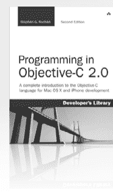
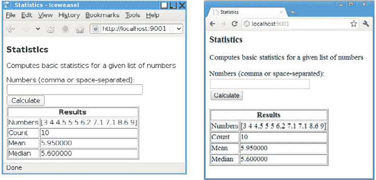
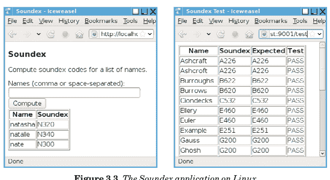
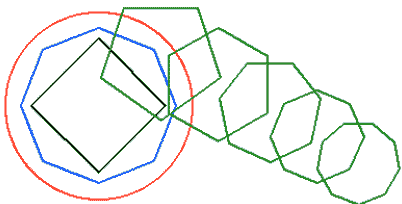
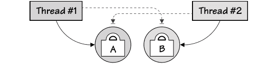
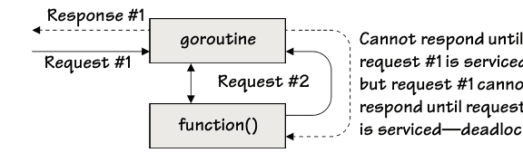
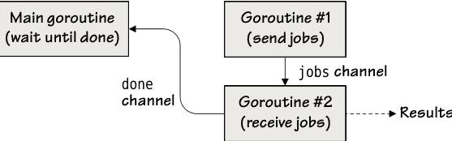
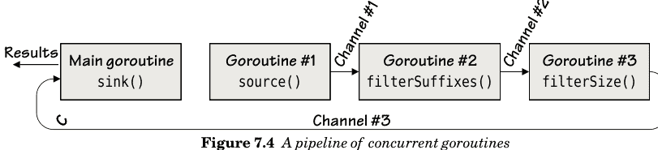

# Go 语言编程：创建 21 世纪的应用





Addison-Wesley 出版的开发者库系列为实战型程序员提供了关于他们在日常工作中使用的最新编程语言和技术的独特、高质量的参考资料和教程。开发者库中的所有书籍均由资深技术从业者编写，他们非常擅长组织和呈现信息，使其对其他程序员具有实用价值。
开发者库的书籍涵盖了广泛的主题，从开源编程语言和数据库、Linux 编程、微软和 Java 到 Web 开发、社交网络平台、Mac/iPhone 编程以及 Android 编程。

Mark Summerfield

Summerfield, Mark.

*本书献给*

Jasmin Blanchette 和 Trenton Schulz

本页故意留白

www.qtrac.eu/book.html

本页故意留白

## 目录

### 书本结构 | 4
### 致谢 | 5

## 第 1 章 五个示例 | 7
### 1.1 开始 Go 之旅 | 7
### 1.2 编辑、编译与运行 | 9
### 1.3 你好，Go? | 14
### 1.4 数字—二维切片 | 16
### 1.5 带有方法的自定义类型 | 21
### 1.6 文件、映射与闭包 | 29
### 1.7 并发基础 | 40
### 1.8 练习 | 48

## 第 2 章 布尔值与数字 | 51
### 2.1 准备工作 | 51
#### 2.1.1 常量与变量 | 53
#### 2.1.1. 枚举 | 54
### 2.2 布尔值与表达式 | 56
### 2.3 数字类型 | 57
#### 2.3.1 整型类型 | 59
##### 2.3.1.1 大整数 | 61
#### 2.3.2 浮点类型 | 64
##### 2.3.2.1 复数类型 | 70
### 2.4 示例：统计学 | 72
#### 2.4.1 实现统计学 | 73
#### 2.4.2 实现服务器 | 75
### 2.5 练习 | 78

## 第 3 章 字符串 | 81
### 3.1 字面量、运算符与转义字符 | 83
### 3.2 字符串比较 | 86
### 3.3 字符 | 87
### 3.4 字符串的索引与切片 | 90
### 3.5 使用 Fmt 包格式化 | 93
#### 3.5.1 格式化布尔值 | 97
#### 3.5.2 格式化整数 | 98
#### 3.5.3 格式化字符 | 99
#### 3.5.4 格式化浮点数 | 100
#### 3.5.5 格式化字符串与切片 | 101
#### 3.5.6 调试格式化 | 103
### 3.6 其他字符串相关包 | 106
#### 3.6.1 Strings 包 | 107
#### 3.6.2 Strconv 包 | 113
#### 3.6.3 Utf8 包 | 117
#### 3.6.4 Unicode 包 | 118
#### 3.6.5 Regexp 包 | 120
### 3.7 示例：M32pls | 130
### 3.8 练习 | 135

## 第 4 章 集合类型 | 139
### 4.1 值、指针与引用类型 | 140
### 4.2 数组与切片 | 148
#### 4.2.1 切片的索引与切片 | 153
#### 4.2.2 遍历切片 | 154
#### 4.2.3 修改切片 | 156
#### 4.2.4 切片的排序与搜索 | 160
### 4.3 映射 | 164
#### 4.3.1 创建与填充映射 | 166
#### 4.3.2 映射查找 | 168
#### 4.3.3 修改映射 | 169
#### 4.3.4 键序映射迭代 | 170
#### 4.3.5 映射反转 | 170
### 4.4 示例 | 171
#### 4.4.1 示例：猜测分隔符 | 171
#### 4.4.2 示例：词频统计 | 174
### 4.5 练习 | 180

## 第 5 章 语句与函数
### 5.1. 语句基础 | 186
#### 5.1.1. 类型转换 | 190
#### 5.1.2. 类型断言 | 191
### 5.2. 分支语句 | 192
#### 5.2.1. If 语句 | 192
#### 5.2.2. Switch 语句 | 195
##### 5.2.2.1. 表达式 Switch | 195
##### 5.2.2.2. 类型 Switch | 197
### 5.3. 使用 For 语句循环 | 203
### 5.4. 通信与并发语句 | 205
#### 5.4.1. Select 语句 | 209
### 5.5. Defer, Panic 和 Recover | 212
#### 5.5.1. Panic 和 Recover | 213
### 5.6. 自定义函数 | 219
#### 5.6.1. 函数参数 | 220
##### 5.6.1.1. 将函数调用作为函数参数 | 220
##### 5.6.1.2. 变长函数 | 221
##### 5.6.1.3. 带有多个可选参数的函数 | 222
#### 5.6.2. init() 和 main() 函数 | 224
#### 5.6.3. 闭包 | 225
#### 5.6.4. 递归函数 | 227
#### 5.6.5. 运行时选择函数 | 230
##### 5.6.5.1. 使用 Map 和函数引用进行分支 | 230
##### 5.6.5.2. 动态函数创建 | 231
#### 5.6.6. 泛型函数 | 232
#### 5.6.7. 高阶函数 | 238
##### 5.6.7.1. 纯函数的记忆化 | 241
### 5.7. 示例：缩进排序 | 244
### 5.8. 练习题 | 250

## 第 6 章 类型系统
### 6.1. 核心概念 | 254
### 6.2. 自定义类型 | 256
#### 6.2.1. 添加方法 | 258
##### 6.2.1.1. 方法重写 | 261
##### 6.2.1.2. 方法表达式 | 263
#### 6.2.2. 验证类型 | 263
### 6.3. 接口 (Interfaces) | 265
#### 6.3.1. 接口嵌入 | 270
### 6.4. 结构体 (Structs) | 275
#### 6.4.1. 结构体聚合与嵌入 | 275
##### 6.4.1.1. 嵌入值 | 276
##### 6.4.1.2. 嵌入带有方法的匿名值 | 277
##### 6.4.1.3. 嵌入接口 | 279
### 6.5. 示例 | 282
#### 6.5.1. 示例：FuzzyBool—单值自定义类型 | 282
#### 6.5.2. 示例：Shapes—一组自定义类型 | 289
##### 6.5.2.1. 包级便利函数 | 289
##### 6.5.2.2. 嵌入接口的层级 | 294
##### 6.5.2.3. 可自由组合的独立接口 | 294
##### 6.5.2.4. 具体类型与方法 | 295
#### 6.5.3. 示例：Ordered Map—泛型集合 | 302
### 6.6. 练习题 | 311

## 第 7 章 并发
### 7.1. 核心概念 | 317
### 7.2. 示例 | 322
#### 7.2.1. 示例：Filter | 322
#### 7.2.2. 示例：Grep | 326
#### 7.2.3. 示例：线程安全的 Map | 334
#### 7.2.4. 示例：Report | 341
##### 7.2.4.1. 使用 Mutex 保护的线程安全的 Map | 341
##### 7.2.4.2. 使用 Mutex 保护的线程安全的 Map | 345
##### 7.2.4.3. 通过合并本地 Map 进行同步 | 347
#### 7.2.5. 示例：Duplicates | 349
### 7.3. 练习题 | 357

## 第 8 章 数据持久化
### 8.1. 自定义数据 | 362
#### 8.1.1. 处理 JSON | 365
##### 8.1.1.1. 写入 JSON | 366
##### 8.1.1.2. 读取 JSON | 368
#### 8.1.2. 处理 XML | 371
##### 8.1.2.1. 写入 XML | 371
##### 8.1.2.2. 读取 XML | 375
#### 8.1.3. 处理纯文本 | 377
##### 8.1.3.1. 写入纯文本 | 378
##### 8.1.3.2. 读取纯文本 | 380
#### 8.1.4. 处理 Go 二进制文件 | 385
##### 8.1.4.1. 写入 Go 二进制文件 | 385
##### 8.1.4.2. 读取 Go 二进制文件 | 386
#### 8.1.5. 处理自定义二进制文件 | 387
##### 8.1.5.1. 写入自定义二进制文件 | 388
##### 8.1.5.2. 读取自定义二进制文件 | 392
### 8.2. 归档文件 | 397
#### 8.2.1. 创建 Zip 归档 | 397
#### 8.2.2. 创建压缩 Tarball 包 | 399
#### 8.2.3. 解压 Zip 归档 | 401
#### 8.2.4. 解压压缩 Tarball 包 | 403
### 8.3. 练习题 | 405

## 第 9 章 包 (Packages) | 407
### 9.1. 自定义包 | 408
#### 9.1.1. 创建自定义包 | 408
##### 9.1.1.2. 包文档化 | 411
##### 9.1.1.3. 单元测试与基准测试包 | 414
#### 9.1.2. 导入包 | 416
### 9.2. 第三方包 | 417
### 9.3. Go 标准库简述 | 418
### 9.4. Go 标准库简述 | 419
#### 9.4.1. 归档与压缩包 | 419
#### 9.4.2. 字节与字符串相关包 | 419
#### 9.4.3. 集合包 | 421
#### 9.4.4. 文件、操作系统及相关包 | 423
##### 9.4.4.1. 文件格式相关包 | 424
#### 9.4.5. 图形相关包 | 425
#### 9.4.6. 数学包 | 425
#### 9.4.7. 杂杂包 | 425
#### 9.4.8. 网络包 | 427
#### 9.4.9. Reflect 包 | 427
### 9.5. 练习题 | 431

# 附录 A 结语 | 435
# 附录 B 软件专利的危害 | 437


# 附录 C 选读参考文献 ................................................ 441

- 2.1. Go 关键字 ..................................................................................................... 52
- 2.2. Go 预定义标识符 ............................................................................... 52
- 2.3. 布尔与比较运算符 ................................................................... 57
- 2.4. 适用于所有内置数字算术运算符 .......................... 59
- 2.5. Go 的整数类型和范围 ................................................... 60
- 2.6. 仅适用于内置整数类型的算术运算符 ................ 60
- 2.7. Go 的浮点类型 ....................................................................... 64
- 2.8. Math 包的常量和函数 #1 ................................ 65
- 2.9. Math 包的常量和函数 #2 ................................ 66
- 2.10. Math 包的常量和函数 #3 ............................... 67
- 2.11. Complex Math 包的函数 ........................................ 71
- 3.1. Go 的字符串与字符转义 ....................................................... 84
- 3.2. 字符串操作 ................................................................................ 85
- 3.3. Fmt 包的打印函数 .......................................................... 94
- 3.4. Fmt 包的动词（Verbs） ....................................... 95
- 3.5. Fmt 包的动词修饰符 ........................................ 96
- 3.6. Strings 包的函数 #1 ..................................... 108
- 3.7. Strings 包的函数 #2 .................................... 109
- 3.8. Stconv 包的函数 #1 ................................ 114
- 3.9. Stconv 包的函数 #2 ................................ 115
- 3.10. Utf 包的函数 ....................................... 118
- 3.11. Unicode 包的函数 .................................. 119
- 3.12. Regex 包的函数 ................................... 121
- 3.13. Regex 包的转义序列 ...................... 121
- 3.14. Regex 包的字符类 ................... 122
- 3.15. Regex 包的零宽断言 ............... 122
- 3.16. Regex 包的量词 ......................... 123
- 3.17. Regex 包的标志与分组 ................ 123
- 3.18. +regexp.Regexp 类型的方法 #1 ................ 124
- 3.19. +regexp.Regexp 类型的方法 #2 ................ 125
- 4.1. 切片（Slice）操作 .......................................... 151
- 4.2. Sort 包的函数 ................................................... 161
- 4.3. 映射（Map）操作 ..................................................................... 165
- 5.1. 内置函数 ................................................................................ 187
- 8.1. 格式速度与大小对比 ................................................ 363
- 8.2. Fmt 包的扫描函数 ................................................. 383

本书的目的是通过该语言提供的所有功能以及 Go 标准库中最常用的包，教授实实且地道的 Go 编程。本书的设计还为了在读者学习该语言后作为有用的参考资料。为了实现这两个目标，本书的内容非常详尽，并试图在一个地方涵盖所有主题——贯穿正向和反向的交叉引用。

Go 在精神上类似于 C，是一种短小且高效的语言，并提供了如指针等方便的底层设施。Go 还提供了许多与高层或极高层语言相关的特性，如 Unicode 字符串、强大的内置数据结构、鸭子类型（duck typing）、垃圾回收以及使用通信而非共享数据和锁的高级并发支持。Go 拥有庞大且广泛的标准库。

假设读者具有 C、C++、Java、Python 或类似的主流编程语言的编程经验，Go 的所有独特特性和惯用法都通过完整的可运行示例进行了阐明，并在文中进行了详细解释。

要成功学习任何编程语言，都必须用该语言编写程序。为此，本书的方法完全实实践，鼓励读者对示例进行实验，尝试练习，并编写自己的程序以获得实践经验。与我之前的所有书籍一样，书中引用的代码片段直接从 `.go` 源文件中提取并嵌入到发送给出版商的 PDF 中——因此没有复制粘贴的错误，且代码是可运行的。在可能的情况下，我们使用了小型但完整的程序和包作为示例，以提供真实的用例。示例、练习和答案可以在 `www.qtrac.eu/gobhtook.html` 在线获取。

本书的核心目标是教授 Go 语言，同时也使用了许多 Go 标准包，但并非全部。这不是问题，因为阅读本书将为读者提供足够的 Go 知识，让他们能够利用任何标准包或任何第三方 Go 包，并且像肯尼·汤普（Ken Thompson）一样能够创建自己的包。

# 为什么选择 Go？

Go 编程语言于 2007 年作为 Google 的一个内部项目开始。最初的设计由 Robert Griesemer、Unix 实验室的 Pike 和 Ken Thompson 完成。2009 年 11 月 10 日，Go 在宽松的开源许可下公开亮相。

# 2 介绍

Go 由 Google 的一个团队开发，其中包括最初的设计者以及 Russ Cox、Andrew Gerrard、Ian Taylor 等许多人。Go 采用开放开发模式，许多来自全球的开发者都在此贡献，拥有受信任和尊敬的权限。此外，许多第三方包来自 Go Dashboard (`godashboard.app.com/project`)。

Go 是至少 15 年以来最令人兴奋的主流语言，目标直指 21 世纪的计算机及其程序员。

Go 的设计旨在高效扩展，使其可以在几秒钟内编译大型程序。极快的编译速度在某种程度上归功于语言容易解析，但也归功于它的依赖管理。如果文件 `app.go` 依赖于 `pkg1.go`，而 `pkg1.go` 又依赖于 `pkg2.go`，在传统的编译语言中 `app.go` 需要 `pkg1.go` 和 `pkg2.go` 的对象。但在 Go 中，`pkg2.go` 导出的内容内容缓存在 `pkg1.go` 中，因此仅需 `pkg1.go` 文件就足够构建 `app.go`。对于只有三个文件来说这几乎无关，但对于具有大量依赖关系的应用程序，这带来了巨大的速度优势。

由于 Go 程序构建非常快，在通常使用脚本语言的地方使用它们是可行的（参见侧栏“Go Shebang Scripts”，► 10）。此外，Go 可以使用 Google 的 App Engine 构建 Web 应用程序。

Go 使用非常简洁且易于理解的语法，避免了 C++（1983 年发布）或 Java（1995 年发布）等旧版语言的复杂性和冗长。而且 Go 是一种强类型语言，许多程序员认为这是编写大型程序至关重要的。Go 的类型系统并没有给其短的“声明并初始化”变量声明语法（当编译器检测类型时无需显式写入）带来负担，而且 Go 支持强大且方便的鸭子类型版本。

C 和 C++ 等语言在内存管理方面需要程序员进行大量的计数工作——这些工作本可以由计算机完成的，特别是对于跟踪过程可能极其复杂的并发程序。近年来，C++ 通过各种“智能”指针在这一领域有了巨大改进，它在线程库方面正追赶 Java。Java 使用垃圾回收器减轻了程序员在内存管理方面的负担。C 只有第三方线程库，尽管 C++ 现在有了标准线程库。然而，在 C、C++ 或 Java 中编写并发程序需要大量的程序员通过簿账工作来确保他们能够在正确的时间点锁定和解锁资源。

Go 编译器和运行时处理了这些繁琐的簿账工作。在内存管理方面，Go 拥有垃圾回收器，因此不需要智能指针或手动释放内存。对于并发，Go 提供了一种基于计算机科学家 C. A. R. Hoare 思想的 CSP（通信顺序进程）模型，这意味着许多并发 Go 程序不需要进行任何锁定。此外，Go 使用了 `goroutine`（协程）——这是一种可以创建大量数量的轻量级进程，它们会自动在可用的处理器和内核之间进行负载均衡——从而提供了比旧语言中基于线程的方法更细粒度的并发支持。事实上，在将单线程程序迁移到 Go 时，Go 的并发支持既简单又易用；通常会出现使用并发的机会，从而带来运行时的提升和机器资源利用率的提高。

Go 是一门务实的语言，它更看重效率和程序员的便利性，而非纯洁性。例如，Go 的内置类型和用户定义类型是不相同的，前者可以被高度优化，而后者不能。Go 还提供了两个基础内置类型：切片（用于所有实际用途）和映射（键值字典或哈希表）。这些集合类型高效，并能极好地满足大多数需求。然而，Go 支持指针（它是一门完全编译的语言——没有虚拟机阻碍性能），因此可以轻松地创建复杂的自定义类型，例如平衡二叉树。

虽然 C 只支持过程式编程，而 Java 强制程序员以面向对象的方式编写一切程序，但 Go 允许程序员使用最适合该问题的范式。Go 可以作为纯过程式语言使用，但也对面向对象编程提供了良好的支持。尽管正如我们看到的，Go 的面向对象方法与 C++、Java 或 Python 径然不同——并且比早的形式更容易使用且灵活得多。

与 C 类似，Go 缺乏泛型（C++ 中的）；然而，在实践中，Go 提供的其他功能在许多情况下迫使了对泛型的需求。Go 不使用预处理器或包含文件（这是它编译如此快速的另一个原因，因此不需要像 C 和 C++ 那样重复函数签名）。由于没有预处理器，Go 的语义不会在 Go 程序员在自不知的情况下改变，而这在 C 和 C++ 中由于疏忽的 `#define` 可能会发生。

可以说，C++、Objective-C 和 Java 都试图成为更好的 C（后者间接地说是作为更好的 C++）。Go 也可以被视为一种尝试成为更好的 C，尽管 Go 简洁、轻量级的语法让人联想起 Python——而且 Go 的切片和映射与 Python 的列表和字典非常相似。然而，Go 在精神上比任何其他语言都接近 C，可以被视为在避免 C 的缺点的同时提供 C 的所有优点，并添加了许多 Go 特有的强大且实用的功能。

Go 最初被设计为一种系统编程语言，用于开发具有快速编译的大型程序，并利用分布式系统和多核网络计算机。Go 的影响力已经远远超过了最初的构想，它现在被用作一种高生产力的通用编程语言，使用和维护它非常令人愉快。

第 1 章解释了如何构建和运行 Go 程序。本章概述了 Go 的语法和特征，并介绍了它的部分标准库。这是通过展示并解释一系列五个简短示例来完成的，每个示例都说明了各种 Go 特性。本章旨在提供对该语言的初步了解，让读者对学习 Go 所需的范围有一个直观感受。（如何获取和安装 Go 也在本章中进行了解释）。

第 2 到 第 7 章深入介绍了 Go 语言。三个章节专门介绍内置数据类型：第 2 章涵盖标识符、布尔值和数字；第 3 章涵盖字符串；第 4 章涵盖 Go 的集合类型。

第 5 章描述了 Go 的语句和控制结构。它还详细介绍了如何创建和使用函数。

第 6 章展示了如何在 Go 中进行面向对象编程。由于 Go 的方法，正如我们所看到的，这种方法更易使用且灵活得多。本章还涵盖了 Go 的结构体（structs）和嵌入（embedding），以及通过接口（interfaces）实现类似继承的效果（values）。

第 7 章涵盖了 Go 的并发特性。由于 Go 的面向对象方法与许多读者的经验不同，本章提供了许多示例以帮助理解这些新特性。

第 8 章展示了如何读取和写入二进制、JSON 和 XML 文件。（读取和写入文件在第 1 章也有简要提及）。

本书的最后一章是第 9 章。本章从如何导入和使用标准库包、自定义包和第三方包开始。它还展示了如何编写文档、单元测试和基准测试（benchmark）包。

> * 特殊情况是，在前面的章节中，我们总是将通道声明为双向的，即使它们只用于单向传输。从第 7 章开始，通道才被声明为具有特定方向。

海报。我还收到了 Safari“粗剪版”预览读者的反馈，这使我做了重要的说明。

意大利软件公司 `www.develer.com` 的 Giovanni Bajo 先生非常友好，为我提供了 Mercurial 仓库托管服务，帮助我在撰写这本书的漫长过程中能够安心。感谢 Lorenzo Mancini 为我安排好了一切并替我照料。我也非常感谢 Anton Bowers 和 Ben Thompson，他们自 2011 年初以来一直在他们的 Web 服务器上托管我的网站 `www.qtrac.eu`。

感谢 Russel Winder 在他的博客 `www.russel.org.uk` 上对软件专利的报道。附录 B 借用了他的许多观点。

并且一如既往地，感谢 Jeff Kingston，他是我 `gout` 排版系统的创建者，多年来我所有的书籍和许多其他写作项目都使用了它。

特别感谢我的约稿编辑 Debra Williams Cauley，她非常成功地向出版社为这本书争取了机会，并在工作进展过程中提供了支持和实际的帮助。

还要感谢制作经理 Anna Popick，她再次非常出色地管理了制作流程，感谢校对员 Audrey Doyle，她的工作非常优秀。

一如既往，我要感谢我的妻子 Andrea 她的爱与支持。

- §1.1. 入门 ‣
- §1.2. 编辑、编译与运行 ‣ 9
- §1.3. 你好，你是谁？ ‣ 14
- §1.4. 大数字——二维切片 ‣ 16
- §1.5. 栈——带方法的自定义类型 ‣ 21
- §1.6. 美国化——文件、映射与闭包 ‣ 59
- §1.7. 极坐标到笛卡尔坐标——并发 ‣ 40

学习编程 Go 语言需要一定的时间和练习。对于那些想要将大量的 C、C++、Java、Python 等其他程序转换为 Go 的人，花时间学习 Go——特别是它的面向对象和并发特性是如何工作的——从长远来看将节省时间和精力。而对于那些想要从零创建 Go 应用的人来说，最好是充分利用 Go 提供的所有功能，因此在学习时间上的前期投入是非常重要的——并且以后会有回报。

Go 程序是编译的而不是解释的，以获得尽可能的性能。编译非常快——远快于某些其他语言，特别是与 C 和 C++ 相比。

## Go 文档

Go 的官方网站是 `golang.org`，该网站托管了最新的文档。“Packages”（包）链接可以访问所有 Go 标准库包的文档——以及它们的源码，当文档描述较少时，这些代码会非常有帮助。“Commands”（命令）链接指向随 Go 一起分发的程序的文档（例如，编译器、构建工具等）。“Specification”（规范）链接导向一个易于理解、非正式且相当详尽 Go 语言规范，而“Effective Go”（有效的 Go）链接指向一个解释了许多最佳实践的文档。

该网站还包含一个沙箱，在沙箱中可以编写、编译并运行（有限的）Go 程序，全部在在线完成。这对于初学者检查奇特的语法片段，以及学习 `fmt` 包的高级格式化功能或 `regexp` 正则表达式引擎非常有帮助。Go 网页搜索仅搜索 Go 文档；若要搜索 Go 资源，请访问 `go-cat-v.org/go-search`。

也可以在本地的浏览器中查看 Go 文档。要这样做，请运行 `godoc` 工具并带有命令行参数告诉它作为 Web 服务器运行。以下是在 Unix 控制台（xterm, gnome-terminal, console, Terminal.app 或类似程序）中执行的方法：

```
$ godoc -http=8000
```

在 Windows 控制台（即命令提示符或 MS-DOS 提示符窗口）中：

```
C:\godoc -http=8000
```

这里使用的数字是任意的——如果与现有服务器冲突，请使用不同的。这假设 `godoc` 已经在你的 `PATH` 中。


要查看所服务的文档，打开浏览器并输入 `http://localhost:8000`。这将显示一个与 `golang.org` 网站首页非常类似的页面。`Packages` 链接将显示 Go 标准库的文档，以及安装在 `GOROOT` 下的任何第三方包。如果定义了 `GOPATH`（例如用于本地程序和包），`Packages` 链接旁边会出现一个链接，通过该链接可以访问相关文档。`GOROOT` 和 `GOPATH` 环境变量将在本章后面以及第 9 章讨论。

也可以通过在命令行执行 `godoc` 来在控制台中查看单个包或小项目的文档。例如，执行 `godoc main` 将输出 `main()` 函数的文档，执行 `godoc .` 将输出整个 `.` 包的文档。

### Go 工具链

Go 编译器被称为 `gc`，其工具链包含了用于编译的 `gc`、`go` 和 `noob` 程序，用于链接的 `link` 和测试，以及用于查看 Go 文档的 `godoc`。在 Windows 上是 `gc.exe`、`go.exe` 等。这些奇怪的名字遵循了 Plan 9 操作系统的编译器约定，其中数字标识架构，例如，ARM 使用“5”，AMD 使用“6”——包括 64 位处理器。

### Go Scripts

One side effect of Go's fast compilation is that it makes it possible to use Go quickly and conveniently create various utility programs, for example, for system administration. When Go executes a `.go` file for the first time, it will compile it（extremely fast, of course), and then run it. On subsequent runs, the program will only be recompiled if the go source file has been modified. This makes it possible to use Go quickly and conveniently create various utility programs, for example, for system administration.

If your editor doesn't have Go support, try entering the editor's name in the Go search engine to see if there are suitable add-ons. For convenience, all of Go's keywords and operators use ASCII characters; however, Go identifiers can start with any Unicode letter followed by any Unicode letter or digits, so Go programmers can freely use their native language.

To get a feel for how we edit, compile, and run a Go program—the classic "Hello World" program—although a bit sophisticated than usual. We will discuss compiling and running, then in the next section we will go from the source code—in file `hello.go`—in detail, since it incorporates some basic Ideas and features.

All of the book's examples are available from `www.qtrac.gobook.html` and unpack to directory `go`. full path (assuming the examples were unpacked in the home directory—although you will) is `$HOME/go/src/hello/hello.go`. When referring to the book away assumes the first three components of the path, which is why in this case the path is given only by `hello/hello.go`. Windows users must, of course, read "/s as \\s and use the directory they unpacked the examples, such as `C:\go` or `%PATH%go`.

If you have installed Go from a binary package or built it from source and installed it as root or Administrator, you should have at least one environment variable, `GOROOT`, which contains the path to the Go installation, and your PATH should now include `$GOROOT/bin` or `%GOROOT%\bin`. To check that Go is installed

要确认是否安装正确，请在控制台（`xterm`, `gnome-terminal`, `konsole`, `Terminal.app` 或类似程序）输入以下内容：

```
$ go version
```

或者在 Windows 的 MS-DOS 提示符或命令提示窗口中输入：

```
C:\go version
```

如果你收到“command not found”或“'go' 不是内部或外部命令...”信息，意味着 Go 不在 PATH 中。在类 Unix 系统（Mac OS X）上设置此项的最简单方法是在 `.bashrc`（或其他 shell 的等效文件）中设置环境变量。作者的 `.bashrc` 包含以下行：

```
export GOROOT=$HOME/opt/go
export PATH=$PATH:$GOROOT/bin
```

自然地，你必须根据自己的系统调整这些值。而且，当然，这只有在 `go version` 命令执行失败时才需要这样做。

在 Windows 上，一种解决方案是创建一个批文件来设置 Go 的环境，并在每次开始 Go 语言编程时执行它。然而，通过控制面板一次性设置环境变量要方便得多。然后点击“开始”（Windows 标志），点击“控制面板”，点击“系统和安全”，点击“高级设置”，在“系统属性”中点击“环境变量”按钮，点击“新建...”，并添加名为 `GOROOT` 的变量以及适当的值，例如 `C:\Go`。在同一天内，通过在末尾添加文本 `C:\Go\bin` 来编辑 PATH 环境变量——开头的分号至关重要！在这两种情况下，如果 Go 的安装路径不是 `C:\Go`，请将 `C:\Go` 组件替换为实际的安装路径。再次，这只有在 `go version` 命令失败时才需要。

从现在起我们将假设 Go 已经安装且包含所有 Go 的 Go 二进制目录已在 PATH 中。可能需要打开一个新的控制台窗口使新设置生效。

### 构建

构建 Go 程序需要两个步骤：编译和链接。* 这步骤都由 `go` 工具处理，它不仅可以构建本地程序和包，还可以获取、构建和安装第三方程序和包。

> * 由于本书假设使用 `gc` 编译器，使用 `gccgo` 的读者需要遵循 `golang.org/doc/gccgo_install.html` 中描述的编译和链接过程。同样，使用其他编译器的读者将需要根据其编译器的说明进行编译和链接。

为了让 `go` 工具能够构建本地程序和包，有三个要求。首先，Go 二进制目录（`$GOROT/bin` 或 `%GOROT%\bin`）必须在路径中。其次，必须有一个目录，其下包含一个 `src` 目录，该目录下存放本地程序和包的源代码。例如，书中的示例解压到 `goeg/src/hello`、`goeg/src/bigdigits` 等。第三，`src` 目录的父级目录必须在 `GOPATH` 环境变量中。例如，若要使用 `go` 工具构建书中的 `hello` 示例，我们必须这样操作：

```
$ export GOPATH=$HOME/goeg
$ cd $GOPATH/src/hello
$ go build
```

我们在 Windows 上执行几乎几乎完全相同的操作：

```
C:\set GOPATH=C:\goeg
C:\>cd %GOPATH%\src\hello
C:\>goeg\src\hello-go build
```

在两种情况下，我们都假设 PATH 包含了 `$GOROT/bin` 或 `%GOROT%\bin`。一旦 `go` 工具构建了程序，我们就可以运行它。默认情况下，可执行文件的名称与其所在的目录相同，例如，在类 Unix 系统上为 `hello`，在 Windows 上为 `hello.exe`。构建完成后，我们可以以通常的方式运行程序。

```
$ ./hello
Hello World!
```

或者：

```
$ ./hello Go Programmers!
Hello Go Programmers!
```

在 Windows 上非常相似：

```
C:\goeg\src\hello-hello Windows Go Programmers!
Hello Go Programmers!
```

我们已经展示了必须以**粗体**输入的的内容，以及以正体显示的控制台文本。我们还假设了 `$` 提示符，但它是什么并不重要，例如 `C:\>`。

请注意，我们不需要编译——甚至不需要显式编译任何其他包，尽管我们会看到 `hello.go` 使用了三个标准库包。这是 Go 程序构建如此快速另一个原因。

如果我们有多个 Go 程序，如果所有可执行文件都能位于同一个目录中，并将该目录添加到 PATH 中，将非常方便。幸运的是，`go` 工具如下支持这一点：

同样，我们可以在 Windows 上执行相同的操作：

```
C:\set GOPATH=C:\goeg
C:\cd %GOPATH%\src\hello
C:\goeg\hello-go install
```

`go install` 命令的作用与 `build` 相同，但会将可执行文件放在标准位置（`%GOPATH%/bin` 或 `%GOPATH%\bin`）。这意味着通过将单个路径（`%GOPATH/bin` 或 `%GOPATH%\bin`）添加到 PATH，我们安装的所有 Go 程序都会方便地位于 PATH 中。

除了书中的示例，我们可能还想在自己的目录下开发 Go 程序和包。这可以通过将 `GOPATH` 环境变量设置为两个或多个分隔的路径轻松实现，Windows 上用分号分隔；例如。

### hello.go 源代码

现在我们已经了解了如何构建 `hello` 程序，将查看它的源代码。不用担心理解细节——本章所示以及更多都会得到详细介绍。这里是完整的 `hello` 程序，位于 `hello.go` 文件：

```
// hello.go
package main
import ( ①
    "fmt"
    "os"
    "strings"
)
func main() {
    who := "World!" ②
    if len(os.Args) > 1 { /* os.Args[0] 是 "hello" 或 "hello.exe" */ ⅓
        who = strings.Join(os.Args[1:], " ") ④
    }
    fmt.Println("Hello", who) ⑤
}
```

Go 使用 C++ 风格注释：`//` 用于单行注释，到行尾结束，`/* ... */` 用于可以跨多行的注释。在 Go 中，通常主要使用单行注释，跨行注释常用于注释代码块。

每个 Go 代码都存在于包中，每个 Go 程序都必须有一个 `main` 包以及一个 `main()` 函数，该函数作为程序的入口点，即程序执行的函数。事实上，Go 包可能还包含 `init()` 函数，这些函数会在 `main` 之前执行，我们将在后文中看到。

我们将应用程序的功能拆分为任意数量的本地包，以保持一切的整齐模块化，我们将在第 9 章中看到这一点。

`import` 语句 从标准库导入了三个包：`fmt` 包提供了格式化文本和读取文本的函数，`os` 包提供了与平台相关的操作系统变量和函数，而 `strings` 包提供了处理字符串的函数。

Go 的基础类型支持常用的运算符，例如用于数值相加和字符串拼接的 `+`，而 Go 标准库通过提供一组与基础类型相关的函数包来补充了这些功能，就像这里导入的 `strings` 包一样。如此，我们也可以基于基础类型创建自定义类型，并为它们提供我们自己的方法——即自定义类型特定的函数。

读者可能已经注意到程序没有分号；`import` 语句不是用逗号分隔的；而且语句的条件不需要括号。在 Go 中，块包括函数和控制结构，例如 `if` 语句和 `for` 循环使用大括号定界。缩进取代了分号；分号被放在编译器中，因此 Go 语句之间用分号分隔，除非我们想在同一行放置多个语句，否则我们不需要手动使用。分号、更少的逗号和括号让 Go 看起来更简洁，并且减少了打字量。

Go 函数和方法使用 `func` 关键字定义。`main` 包的 `main` 函数始终具有这种签名——它不接受参数也不返回结果。当 `main()` 完成时，程序将终止并向操作系统返回 0。自然地，我们可以随时根据需要退出并返回我们自己选择的值。

`main()` 函数中的第一个语句，使用 `:=` 运算符是 Go 术语中的短变量声明。此类语句同时声明并初始化一个变量。此外，我们不需要指定变量类型，因为 Go 可以从初始化值推断出来。在这种情况下，我们声明了一个类型为 `string` 的变量 `name`，得益于 Go 的强类型特性，我们只能给 `name` 赋值字符串。

与大多数语言一样，`if` 语句测试一个条件——在本情况下，是命令行输入了多少字符串——我们将在本章稍后部分看到更复杂的 `if` 语句语法，以及在后续。

`os.Args` 变量是一个切片的切片。数组、切片和其他集合数据类型将在第 4 章中介绍。我们只需要知道切片的长度可以使用内置函数 `len()`，并且可以使用 Python 语法的子集通过 `[]` 运算符访问其元素。具体来说，`slice[n]` 返回切片的第 $n$ 个元素，从 0 开始计数，`slice[n:]` 返回另一个包含从第 $n$ 个元素到最后一个元素的切片。在“集合”章节中，我们将看到 Go 语法在该领域的完整通用性。在 `os.Args` 的情况下，切片在索引 0 处应该始终包含一个字符串，程序名称。所有索引都从 0 开始。

如果用户输入了一个或多个命令行参数，且条件满足，我们将使用字符串 `args` 将所有参数连接成单个字符串。在这种情况下我们使用赋值运算符 `=`，如果我们使用短变量声明运算符 `:=`，我们就会声明并初始化一个作用域限于 `if` 语句块的新变量 `args`。`Join()` 函数接收一个字符串切片和一个分隔符，可以是空的，即 `""`，并返回一个由切片中所有字符串组成的单个字符串，每个字符串之间用分隔符隔。在这里我们使用单个空格将它们连接起来。


最后，在最后一个语句 `(14 -, ⊕)` 中，我们打印 `Hello`、一个空格、变量中持字符串以及换行符。`fmt` 包有很多不同的变体，比如 `fmt.Println()` 可以整齐地打印接收到的任何内容，而其他如 `fmt.Printf()` 则使用占位符来对格式提供非常精细的控制。打印函数将在第 3 章介绍（§3.5—➢ 93）。

这里提供的 `hello` 程序展示的语言特性比传统程序多得多。随后的示例将继续这种风格，在保持示例尽可能短的同时涵盖更高级的特性。这里的想法是让人对该语言有一个基本的熟悉，并掌握构建、运行和实验简单程序，同时利用 Go 强大且新颖的特性。当然，本章介绍的所有内容将在后续章节中进行解释。

`bigdigits` 程序（在 `bigdigits.go` 中）从命令行读取一个数字（字符串形式），并将相同的数字输出到控制台。在 20 世纪，许多用户共享一台高速打印机，每个用户的任务之前都有一个封面，显示一些细节，如用户名和正在打印的文件名。我们将分部分回顾代码：首先是 `import`，然后是静态数据，最后是处理。但现在，让我们来看一个示例运行，感受它是如何工作的。

每个数字由一个字符串切片表示，所有数字整体由一个切片的切片表示。在查看数据之前，这里是我们如何声明和初始化一维的字符串和数字切片：

```go
week := []string{"Friday", "Saturday", "Monday"}
lowPrimes := []int{2, 3, 5, 7, 11, 13, 17, 19}
```

对于字符串和数字的单维切片，我们可以使用大括号分隔的逗号列表来声明并初始化。对于 `lowPrimes`，我们可以使用相同的变量声明语法，但由于某种原因，我们使用了较长的形式来显示这种差异，这一点稍后会解释。由于切片本身可以是切片。

`bigdigits` 程序需要导入四个包。

```go
import (
	"fmt"
	"log"
	"os"
	"path/filepath"
)
```

`fmt` 包提供了格式化文本和读取文本的函数 (`3.5`, ➤)。`log` 包提供了日志函数。`os` 包提供了与平台相关的操作系统变量和函数，包括命令行参数的 `os.Args` (`[]string`)。而 `filepath` 包提供了处理文件名和路径的函数，可以跨平台工作。注意，对于逻辑上的包，我们在代码中访问它们时只需要指定名称（在本例 `filepath`）。

对于 `bigdigits` 程序，我们需要二维数据（切片的切片）。这里是我们创建它的方式，数字 0 的字符串对应于输出中的行，并包含了数字 3 到 8 的字符串。

```go
var bigDigits = [][]string{
	"000",
	"00",
	"00",
	"00",
	"00",
	"000",
	"111",
	"22222",
	"22222", "2", "2", "2", "2", "22222",
	// ... 3 到 8
	"99999", "999", "9999", "9", "9", "9",
}
```

在任何函数或方法之外定义的变量不能使用 `:=` 运算符，但我们可以使用长声明形式（带 `var`）和赋值运算符 (`=`) 来获得相同的效果，正如我们在这里对 `bigDigits` 变量那样（以及之前对 `lowPrimes` 变量那样）。我们仍然不需要指定 `bigDigits` 的类型，因为 Go 可以从赋值推断出来。

我们将计数交给 Go 编译器，因此不需要指定切片切片的维度。读取命令行并使用数据产生输出的 `main()` 函数只有 20 行。

```go
func main() {
	if len(os.Args) == 1 {
		fmt.Printf("usage: %s<number>\n", filepath.Base(os.Args[0]))
		os.Exit(1)
	}
	stringOfDigits := os.Args[1]
	for row := range bigDigits {
		for column := range stringOfDigits {
			digit := stringOfDigits[column] - '0'
			if 0 <= digit && digit <= 9 {
```

```go
line += bigDigits[digit][row] + " " + i
} else {
    log.Fatal("invalid whole number")
}
fmt.Println(line)
```

程序首先检查调用时是否带了任何命令行参数。如果没有，`len(os.Args)` 将为 1（回想一下 `os.Args[0]` 存储的是程序的名称，因此切片的长度通常至少为 1），并且第一个语句（18 <）将满足条件。在这种情况下，我们使用 `fmt.Printf()` 函数输出一条合适的用法信息，该函数接受 `%` 占位符，这与 C/C++ 的 `printf()` 函数或 Python 的 `%` 运算符所支持的占位符类似。（详细信息请参阅 $3.5, ➤ 93。）

`path/filepath` 包提供了路径操作函数——例如，`filepath.Base()` 函数返回给定路径的基名（即文件名）。在输出消息后，程序使用 `os.Exit()` 函数终止，并向操作系统返回 1。在 Unix 类系统上，返回值 0 表示成功，非零值表示错误或失败。

`filepath.Base()` 函数的使用展示了 Go 的一个优秀特性：当一个包被导入时，无论它是顶层的还是在逻辑上位于另一个包内部（例如 `/path/filepath`），我们总是只引用其名称的最后部分（例如 `filepath`）。也可以赋予本地名称以避免冲突；第 9 章将提供详细说明。

如果至少提供了一个命令行参数，我们将第一个参数获取到 `stringDigits`（类型为 `string`）。为了将数字转换为大数字，我们必须遍历 `bigDigits` 切片中的每一行，以产生每行输出，即每个数字的第一个（顶部的）切片、第二个，依此类推。我们假设所有 `bigDigits` 切片具有相同数量的行，并从第一个切片中获取行数。Go 的 `for` 循环有针对不同目的的多种语法；在这里（18 <, 2 和 18 <, Θ）我们使用了 `for ... range` 循环，它会返回给定切片中每个项的索引位置。

代码中的行循环和列循环可以写成这样：

```go
for row := 0; row < len(bigDigits[0]); row++ {
    line := ""
    for column := 0; column < len(stringOfDigits); column++ {
```

这是一个 C、C++ 和 Java 程序员熟悉的格式，并且在 Go 中是完全合法的。然而，`for ... range` 语法更短、更方便。（Go 的循环将在 $5.3, ◄ 中介绍。）

在每次行迭代中，我们检查该行的 `line` 是否为空字符串。我们遍历从（此处缺失）收到的 `stringofDigits` 字符串中的列（即字符）。Go 字符串存储的是 UTF-8 字节，可能由两个或多个字节表示。这在这里并不是问题，因为我们只关心数字 0, 1, ..., 9，这些数字在 UTF-8 中由单个字节表示，并且在 7 位 ASCII 中具有相同的字节值。我们将在第 3 章中看到如何按字符遍历字符串——无论字符是单字节还是多字节的。

当我们对字符串中的特定位置进行索引时，我们得到的是该位置的字节值。（在 Go 中，该类型是 `uint8` 的别名。）我们获取命令行字符串在指定列的字节值，并减去数字 0 的值以得到该数字（18, ◄。）在 UTF-8 (7-ASCII) 中，字符 '0' 的代码点（字符）是十进制 48，字符 '1' 的代码点是 49，依此类推。因此，如果我们有一个字符 '3'（代码点 51），我们可以通过减法 '3' - '0'（即 51–48）得到它的值，结果返回一个整数（类型为[缺失]的值 3。）

Go 使用单引号表示字符字面量，字符是一个与 Go 的任何类型都兼容的整数。Go 的类型系统意味着我们不能在没有显式转换的情况下将（例如）一个 `int32` 加到 `int16`；Go 的数值常量和字面量会适应其语境，在此语境下，'0' 被认为是一个字节。

如果数字（类型为[缺失]）在范围内（18 <, ◄），我们可以将相应的字符串添加到 `line` 中。（在 if 语句中，常量 0 和 9 被视为字节，因为 Go 的[缺失]数字类型，但如果 digit 是不同类型，例如 int，它们会被视为类型而不是（即它们不能被更改），支持 `+` 追加运算符以提供一种易用的语法。（它通过替换头部的原始字符串来工作。）还支持连接运算符，它返回一个由其左操作和右字符串操作数拼接而成的新字符串。（字符串类型将在第 3 章中详细介绍。）

为了检索相应的字符串（19, ◄），我们使用与数字对应的 `bigDigits` 切片，然后在该切片中找到所需的行（字符串）。

如果数字超出范围（例如由于 `stringofDigits` 包含非数字字符），我们使用 `log.fatal()` 函数记录错误消息。该函数会记录

> * 与 C、C++ 和 Java 不同，在 Go 中，`++` 运算符只能作为语句使用，而不能作为表达式。此外，它们只能作为后置运算符，而不能作为前缀运算符。这意味着 Go 中不会发生某些类型的求值问题——幸运的是，Go 中无法编写像 f(++) 和 a[++] 这样的表达式。

日期、时间和错误消息——如果没有显式指定的其他日志目标，则输出到 `os.stderr`——并调用 `os.Exit(1)` 终止程序。`log.Fatal()` 接受 `%` 占位符，这与[缺失]的相同。`log.Fatal()` 函数执行相同的功能。一旦所有行的字符串都累积完毕，`line` 就是完整的。在这个例子中，`bigDigits` 字符串切片中的每个数字表示。

最后一点是，声明和定义的顺序通常并不重要。所以在 `bigdigits/bigdigits.go` 文件中，我们可以

## 1.5. 栈——带有方法的自定义类型

## 第 1 章：五个示例概览

Go 同时支持命名类型和未命名类型。结构相同的未命名类型可以交叉使用；但它们不能拥有方法。（我们将在 6.4, 275 中详细讨论。）任何自定义类型都可以拥有方法。在书中除非另有说明，“自定义类型”是指命名的自定义类型。

接口是一种通过指定一组方法来正式定义的类型。接口是抽象的，无法实例化。具体的（即非接口）类型如果提供了接口所指定的方法，就实现了该接口，也就是说具体类型的值也可以作为接口的值以及其自身类型的值。接口与提供方法的具体类型之间没有建立正式连接。自定义类型只要拥有接口的方法就满足接口。而且当然，一个类型可以通过提供所有方法满足多个接口。

空接口（即没有方法的接口）指定为 `interface()`。*由于空接口不提出任何要求（因为它不需要任何方法），无论该值是内置类型还是自定义类型。（Go 的指针和引用将在稍后解释；$4.1, 140。）此外，在 Go 术语中，我们说论类型和值，而不是类或对象（因为 Go 没有类）。

函数和方法的参数可以是任何内置或自定义类型——可以是任何接口类型。在后一种情况下，这意味着函数可以有一个表示“传递一个可以读取数据的参数”，无论该值的实际类型是什么。（我们很快就会在实践中看到这一点；$1.6, 29。）

> *Go 的空接口可以充当 Java 对象引用或 C/C++ 中 void 的角色。

每个项目都从自定义栈弹出并逐行打印。

产生此输出的简单测试程序是 `stacker/stacker.go`。以下是它使用的导入：

```go
import (
    "fmt"
    "stacker/stack"
)
```

`fmt` 包是 Go 标准库的一部分，但 `stack` 包是 `stacker` 应用程序特定的本地包。Go 程序或包的导入首先在 `GOPATH` 路径或路径搜索，然后在 `GOPATH` 下搜索。在特定情况下，程序的源代码位于 `$HOME/geog/src/stack/stacker.go`，`stack` 包位于 `$HOME/geog/src/stack/stack.go`。只要 `GOPATH` 是（或包含）路径 `$HOME/geog/`，工具就会构建它们。

导入路径使用 Unix 风格的 `%s`，即使在 Windows 上也是如此。每个本地包应该存储在与包同名的目录中。本地包可以拥有自己的包（例如类似于 `path/filepath`），这与标准库完全相同。（创建和使用自定义包将在第 9 章中介绍。）

这是产生输出的简单程序的 `main()` 函数：

```go
func main() {
    var haystack stack.Stack
    haystack.Push("hay")
    haystack.Push(-15)
    haystack.Push([]string{"pin", "clip", "needle"})
    haystack.Push(81.52)
    for {
        item, err := haystack.Pop()
        if err != nil {
            break
        }
        fmt.Println(item)
    }
}
```

该函数开始声明类型为 `stack` 的 `haystack` 变量。在 Go 中，习惯上使用 `pkg.item` 语法来引用包中的类型、函数、变量和其他项，其中 `pkg` 是包名的最后一个（或唯一）部分。这有助于防止命名冲突。我们然后将一些项目推入栈中，然后将它们弹出并打印每个项目，直到没有剩余项目为止。

我们自定义栈的一个非常方便的方面是，尽管 Go 具有强类型特性，但我们并不限于存储同质项目（所有类型相同的项目），而是可以自由地混合异质项目（各种类型的项目）。这是因为 `stack.Stack` 类型简单地存储 `interface{}`（即任何类型的值），并且不在乎它们实际上是什么类型。当然，当使用这些值时，它们的类型就变得重要。在这里，我们使用 `fmt.Println()` 函数，从而利用 Go 的内省机制（来自 `reflect` 包）来发现它被打印的项目的类型。（反射将在后面的章节介绍；[9.4.9, ► 427]。）

代码说明的另一个 Go 特性是无条件的 `for` 循环。这是一个无限循环，因此在大多数情况下，我们需要提供一种跳出循环的方法——例如，在这里使用 `break` 语句或 `return` 语句。我们将在下一个示例中看到语法的补充 [1.6, ► 29]；完整的语法范围将在第 5 章介绍。

Go 函数和方法可以返回单个值或多个值。在 Go 中，习惯通过返回一个错误值（`error` 类型）作为函数或方法返回的最后一个（或唯一）值来报告错误。自定义栈类型遵循了这一习惯。

现在我们已经看到了 `stack.Stack` 类型的用法，准备好查看它的实现（在 `stack/stack.go` 文件中）。

该文件按照习惯开始指定其包名。然后它导入了需要的其他包——在这种情况下只有一个，`errors`。

当我们在 Go 中定义自定义类型时，我们实际上是将一个标识符（类型的名称）绑定到一个新类型，该新类型与现有（内置或自定义）类型具有相同的表示——但被 Go 认为与底层表示不同。在这里，`Stack` 类型是 `interface{}` 值的切片（即对变长数组的引用）的新名称，并被认为与基础的 `interface{}` 不同。

由于所有 Go 类型都实现了空接口，因此任何类型的值都可以存储在 `Stack` 中。

内置集合类型（map 和切片）、通信通道（可以是缓冲的，等等）可以使用 `len()` 函数返回它们的长度或缓冲区大小。同样，切片和通道也可以使用内置的 `cap()` 函数报告它们的容量（可能大于使用的长度）。（所有 Go 内置函数列在表 5.1, ► 187 中，并指向它们介绍处的交叉引用；切片将在第 4 章介绍；§4.2, 148。）对于自定义集合类型——我们自己的以及 Go 标准库中的——在有意义时支持相应的 `Len()` 和 `Cap()` 方法是习惯做法。

由于 `Stack` 类型使用切片作为底层表示，因此为它提供 `Stack.Len()` 和 `Stack.Cap()` 方法是有意义的。

```go
func (stack Stack) Len() int {
  return len(stack)
}
```

函数和方法都使用 `function` 关键字定义。然而，在方法的情况下，应用方法的类型写在 `function` 关键字之后、方法名称之前，并括在括号中。函数或方法的名称后面跟着一个可能为空的、逗号分隔的参数列表（每个参数以 `variableName` 的形式编写）。函数或方法的左大括号（如果没有返回值），或者单个返回值（例如，如此处所示，由 `Stack.Len()` 方法返回的 `int` 类型名），或者一个括号内的返回值列表，随后是左大括号。

在大多数情况下，会为调用方法的值给出一个变量名——在这里我们使用了 `stack` 名称（且与包名没有冲突）。调用方法的值在 Go 术语中被称为**接收者**（receiver）。*

在这个示例中，接收者的类型是 `Stack`，因此接收者是通过值传递的。这意味着对接收者的任何更改都将在原始值的副本上进行，并实际上丢失了。对于不修改接收者的方法（如所示的 `Stack.Len()` 方法），这不是问题。

`Stack.Cap()` 方法与 `Stack.Len()` 方法几乎相同（因此未显示）。区别是 `Stack.Cap()` 方法在接收者 `stack` 之后返回 `cap()`。源代码还包含一个 `Stack.IsEmpty()` 方法，但它类似于 `Stack.Len()`——它返回一个指示栈的 `len()` 是否等于 0 的布尔值——这也没有显示。

```go
func (stack *Stack) Push(x interface{}) {
  *stack = append(stack, x)
}
```


`Stack.Push()` 方法是在 `Stack` 的指针上调用的（稍后解释），并传递了一个任何类型的值（`x`）。内置的 `append()` 函数接收一个切片和一个或多个值，并返回一个（可能是新的）切片，该切片包含原始切片的内容，并将给定的值或值作为其最后一个元素或元素。（见 §4.2.3, ► 156。）

如果栈之前从中弹出过项目（► 28），底层切片的容量可能大于其长度，因此推送操作可能是廉价的：只需将项目 `x` 放入 `len(stack)`。

（注：此处提供的文本存在大量重复和乱码，翻译已根据书籍逻辑流程进行了清理。）

...或使用 `append()` 的操作或方法（而不是简单地更改其现有的项之一），那么我们必须通过指针传递切片，或者返回切片（并将原始切片设置为函数或方法的返回值），因为 `append()` 有时返回的与传入的不同的切片引用。

`Stack` 类型使用切片进行表示，因此 `Stack` 值可以用于操作切片的函数，例如 `append()` 和 `len()`。尽管如此，`Stack` 值本身是独立的，与其表示形式不同；如果我们想修改它们，必须通过指针传递。

```go
func (stack Stack) Top() (interface{}, error) {
	if len(stack) == 0 {
		return nil, errors.New("can't Top() an empty stack")
	}
	return stack[len(stack)-1], nil
}
```

`Stack.Top()` 返回栈顶的元素（最后添加的元素）和一个 `nil` 错误；如果栈为空，则返回 `nil` 和一个非 `nil` 错误值。栈接收者按值传递的，因为栈没有被修改。

`error` 类型是一个接口类型（6.3, ► 265），它指定了一个单一方法 `Error() string`。通常，Go 的库函数返回错误作为最后一个（或）返回值，以表示成功（此时 error 为 `nil`）或失败。在这里，我们通过使用包 `errors.New()` 函数创建一个新错误，使我们的 `Stack` 类型工作起来像标准库类型。

Go 使用 `nil` 表示空指针（以及空引用）；不存在指向无的指针，也没有指向无的引用。*此类指针应只在条件判断或赋值中使用；通常不应对它们调用方法。

Go 中从不会隐式地调用构造函数。相反，Go 保证当创建一个值时，它总是被初始化为零值。例如，数字初始化为 0，字符串初始化为空字符串，指针初始化为 `nil`，结构体内部的字段也以类似的方式初始化。Go 中没有未初始化的数据，从而消除了困扰许多其他编程语言的主要错误来源。如果零值不合适，我们可以编写一个构造函数并显式地调用它——正如我们将在第 6 章中看到的，在这里我们防止在不使用构造函数的情况下创建类型的值。

> * Go 的 `nil` 实际上等同于 C 和 C++ 中的 `NULL` 或 `0`，以及 Objective-C 中的 `nil`。

# 第 1 章：五个示例概述

如果栈不为空，我们返回它的最顶部值和一个 `nil` 错误值。由于 Go 使用从 0 开始的索引，切片或数组的第一个元素位于位置 0，最后一个元素位于 `len(sliceOrArray) - 1` 位置。

从函数或方法返回多个值时没有形式上的限制；我们只需在函数或方法名后列出我们正在返回的类型，并确保我们至少有一个对应值列表的 `return` 语句。

```go
func (stack *stack) Pop() (interface{}, error) {
	theStack := *stack
	if len(theStack) == 0 {
		return nil, errors.New("can't Pop() an empty stack")
	}
	x := theStack[len(theStack)-1]
	*stack = theStack[:len(theStack)-1]
	return x, nil
}
```

`Stack.Pop()` 方法用于从栈移除并返回顶部（最后添加的）元素。与 `Stack.Top()` 方法类似，它返回栈顶元素和一个 `nil` 错误，或者如果栈为空，则返回 `nil` 元素和一个 `nil` 错误。

该方法必须有一个指针类型的接收者，因为它修改了栈。为了语法上的方便，我们没有在整个方法中使用 `*stack`（变量指向的实际栈），而是将实际栈赋值给一个局部变量 `theStack`，并对该变量进行操作。这是非常廉价的，因为 *stack* 指向一个栈，该栈使用切片进行表示，因此我们分配的仅多于一个切片的引用。

如果栈为空，我们返回一个合适的错误。否则，我们获取栈的顶部（最后）元素并将其存储在局部变量 `x` 中。我们获取栈的一个切片（该栈本身就是一个切片）。新切片比原始切片少一个元素，并立即被设置为栈所指向的值。最后，我们获取返回的值和一个 `nil` 错误。我们可以合理地预期任何 Go 编译器都会编译该切片，只需将切片的长度减一，同时保持其容量不变。

要返回的元素使用带有单个索引 (⓪) 的 `[]` 运算符获取；在这种情况下是栈的最后一个元素。新切片通过使用索引范围 (②) 的 `[]` 运算符获得。索引范围的形式为：结束。如果省略了起始参数——如此处所示——则假设为 0；如果省略了结束参数，则使用切片的 `len()`。切片包含从第一个到最后一个（但不包含）结束位置的元素。在这种种情况下，通过将最后一个索引指定为长度减一，我们对于不修改内容的方法使用了 `Stack` 接收者而不是指针（即 `*Stack`）。对于具有轻量级表示形式的自定义类型（例如，几个整数或字符串），这是完全合理的。正如此示例所示，在 Go 中创建自定义类型通常是直接的，不涉及许多其他语言所要求的繁琐形式。Go 的面向对象特性将在第 6 章中详细介绍。一个微妙的点是，如果我们对一个值调用方法，而该方法需要指针，Go 会智能地传递该值的地址而不是值的拷贝（前提是该值是可以寻址的；§6.2.1，258）。

为了有任何实际用途，编程语言必须提供读写外部数据的手段。在之前的章节中，我们领略了 Go 的包中多功能且强大的函数；在本节中，我们将查看 Go 的基本文件处理设施。我们还将查看一些高级特性，因为 Go 将函数和方法视为一等值，这使得它们作为参数和映射类型（字典或哈希表）传递成为可能。

20 世纪中期，美式英语超过了英式英语成为最常用的英语形式。在本节的示例中，我们将回顾一个程序，该程序读取文件并将文件的副本写入新文件，并将其中任何单词替换为美国对应的对应词。（当然，这对于语义或习语的差异没有帮助。）程序位于 `americanise/americanise.go` 文件中，我们将从上到下进行回顾，从导入开始，然后是 `main()` 函数，然后是 `main()` 调用的函数，依此类推。

> * 这就是为什么 Go 没有也没有 C 和 C++ 使用的 -> 重定向运算符。

```go
import (
    "bufio"
    "fmt"
    "io"
    "io/ioutil"
    "log"
    "os"
    "path/filepath"
    "regexp"
    "strings"
)
```

`americanise` 程序的导入来自 Go 的标准库。包之间可以无形式嵌套，正如 `io` 包的 `ioutil` 包和 `path` 包的 `filepath` 包所所示。

`bufio` 包提供了缓冲 I/O 函数，包括读写 UTF-8 编码文本文件的函数。`io` 包提供了底层 I/O 函数——以及 `americanise()` 程序所需的 `io.Reader` 和 `io.Writer` 接口。`io/ioutil` 包提供了高级文件处理函数。`regexp` 包提供了强大的正则表达式支持。其他包（`fmt`, `log`, `filepath` 和 `strings`）在之前的章节中已经提到。

```go
func main() {
	filename, inFile, err := filenamesFromCommandLine()
	if err != nil {
		fmt.Println(err)
		os.Exit(1)
	}

	inFile, outFile := os.Stdin, os.Stdout
	if inFile != "" {
		if err, err = os.Open(filename); err != nil {
			log.Fatal(err)
		}
		defer inFile.Close()
	}
	if outFile != "" {
		if err, err = os.Create(filename); err != nil {
			log.Fatal(err)
		}
		defer outFile.Close()
	}
	if err = americanise(inFile, outFile); err != nil {
		log.Fatal(err)
	}
}
```

```go
}
}
```

`main()` 函数从命令行获取输入和输出文件名，创建相应的文件值，然后将这些文件传递给 `americanise()` 函数进行处理。

该函数首先获取要读取和写入的文件名，并返回一个错误值。如果解析命令行时出现问题，我们将打印该错误（其中包含程序的用法信息）并终止程序。Go 的某些打印函数会使用反射（内省）来打印值：如果该值具有 `Error` 方法，则使用该方法打印；如果它具有 `String()` 方法，则使用该方法；否则将尽其所能的方式进行打印。如果我们为这些方法之一提供了自定义类型的实现，Go 函数将能够自动打印我们自定义类型的值，正如我们将在第 6 章中看到的那样。如果 `err` 为 `nil`，说明我们获得了 `filename` 和 `filename` 字符串（可能为空），并且可以继续执行。Go 中的文件由指向 `os.File` 值的指针表示，我们创建了两个初始化为标准输入和输出流（类型均为 `os.File`）的变量。由于 Go 函数和方法可以返回多个值，因此 Go 支持像我们在这里使用的那样的多赋值（30 ➤ ●, ●）。

每个文件名的处理方式本质上是相同的。如果文件已经被正确设置为 `os.stdin` 或 `os.stdout`（两者类型均为 *os.File*，即指向代表文件的 os.File 值的指针），则跳过；但如果文件名不为空，我们将创建一个新的 *os.File* 以根据情况对文件进行读取或写入。

`os.Open()` 函数接收一个文件名并返回一个可以用于读取文件的 *os.File* 值。相应地，`os.Create()` 函数接收一个文件名并返回一个 `os.File` 值，该值可以用于读取或写入：如果文件不存在则会创建它，如果文件已存在则将其截断为零。（Go 还提供了 `os.OpenFile()` 函数，可用于控制打开文件时使用的模式和权限）。

事实上，`os.Open()`、`os.Create()` 和 `os.OpenFile()` 返回两个值：如果文件打开成功，则返回一个 *os.File* 和 `nil`；如果发生错误，则返回 `nil` 和错误。

如果 `err` 为 `nil`，我们知道文件已成功打开，因此立即执行一个 `defer` 语句来关闭文件。任何作为 `defer` 语句对象的函数——函数名后的括号（30 ➤ ●, ●）——其调用实际上发生在编写 `defer` 语句的函数返回时。因此，`defer` 语句“捕获”了函数调用并将其留到以后。这意味着语句本身几乎不消耗任何时间，控制权立即传递给后续语句。因此，延迟的 `os.File.Close()` 方法直到封装函数返回（在本例中为 `main()` 返回，无论是正常返回还是由于 panic，稍后讨论）之前不会被调用；此时文件处于打开状态以便处理，并且在我们在完成后（即使发生 panic）会被关闭。

如果我们未能打开文件，将调用 `log.Fatal()` 并传入错误。正如我们在上一个节中提到的，此函数会将日期、时间和 `err` 记录到 `os.Stderr`——这是指定了另一个日志目标，并调用 `os.Exit(1)` 终止程序。当调用 `os.Exit()`（直接调用或通过 `log.Fatal()`）时，程序将立即终止——任何 `defer` 语句都会丢失。不过，这并不是问题，因为 Go 的运行时系统会关闭任何打开的文件，垃圾回收器将释放程序的内存，应用程序连接的其他任何数据库或网络都会检测到应用程序的终结并优雅地响应。与 `bigdigits` 示例一样，我们不在第一条语句中使用 `log.Fatal()`，因为此时 `err` 包含用法信息，我们希望在不带 `log.Fatal()` 函数正常返回的日期和时间的情况下打印它。

在 Go 中，`panic` 是一种运行时错误（类似于其他语言中的异常）。我们可以使用内置的 `panic()` 函数手动触发 panic，并使用 `recover()` 函数停止 panic 的执行（$5.5, 212）。从理论上讲，Go 的 `panic/recover` 功能可以提供一种通用的异常处理机制——但这样做被认为是不良实践。Go 处理错误的方法是方法返回一个错误值作为其唯一返回值，或者在没有发生错误时返回 `nil`——并让调用者始终检查它们收到的错误。`panic/recover` 的目的是处理真正的错误（即意外之外的）问题，而不是普通错误。

当两个文件都成功打开后（`os.Stdin`、`os.Stdout` 和 `os.Stderr` 由 Go 运行时系统自动打开），我们可以调用 `anonymous()` 函数进行处理，传递它处理的文件。如果 `anonymous()` 返回 `nil`，`main()` 函数终止并执行任何 `defer` 语句——如果 `inputFile` 和 `outputFile` 不是 `os.Stdin` 和 `os.Stdout`，则会关闭它们。如果没有返回任何 `err`，程序将退出，Go 的运行时系统会关闭任何打开的文件。

匿名函数接受一个 `io.Reader` 和一个 `io.Writer`，而不是 *os.File*，这并不重要，因为 `os.File` 类型支持 `io.Reader` 和 `io.Writer` 接口，因此在需要这些的地方可以使用它们。这是鸭子类型的一个示例——`anonymous()` 函数的参数是接口，因此它可以接受任何满足接口的值——无论其类型是什么。

## 第1章 五个示例的概述

`americanise()` 函数返回 `nil`，如果发生错误则返回一个错误。

```go
func filenamesFromCommandLine(infile, outfile string, err error) {
	if len(os.Args) > 1 && (os.Args[1] == "-h" || os.Args[1] == "--help") {
		err = fmt.Errorf("usage: %s<infile.txt><outfile.txt>", filepath.Base(os.Args[0]))
		return "", err
	}
	if len(os.Args) > 2 {
		infile = os.Args[1]
		outfile = os.Args[2]
	}
	if infile != "" && infile == outfile {
		log.Fatal("won't overwrite the infile")
	}
	return infile, outfile, nil
}
```

`filenamesCommandLine()` 函数返回两个字符串和一个错误——与我们之前看到的函数不同，返回值被赋予了名称，而不只是类型。返回变量在进入函数时被设置为它们的零值（在这种情况下为空字符串和错误的 `nil`），并被显式地赋值给函数体。（当我们在下次讨论 `americanise()` 函数时，并将更多更多主题。）

该函数首先检查用户是否请求了用法信息。*如果是，我们将使用 `fmt.Errorf()` 有一个合适的用法字符串创建一个新的错误值，并立即返回。与 Go 一样，调用者预计会检查返回的错误并采取相应行动（这正是 `main()` 所做的）。`fmt.Errorf()` 函数类似于我们之前看到的 `fmt.Printf()` 函数，区别在于它返回一个包含给定格式字符串和参数的错误，而不是将字符串写入 `os.Stdout`。

如果用户没有请求用法信息我们将检查他们是否输入了任何命令行参数，如果是，我们将 `infilename` 返回变量设置为他们的第一个命令行参数，并将 `outfilename` 返回

* 标准库包含一个用于处理命令行参数的 `flag` 包。用于 GNU 兼容命令行处理的第三方包可以从 `godashboard/project` 获取。（使用第三方包在第 9 章中介绍。）

# 34 第 1 章. 五个示例概述

...到它们的第二个命令行参数。当然，它们可能没有提供任何命令行参数，在这种情况下 `infile` 和 `outfile` 将为空字符串；或者它们可能只输入了一个，在这种情况下 `infile` 将有一个文件名而 `outfile` 为空。

最后我们进行一次健全性检查，以确保用户不会用输出覆盖输入文件，并在必要时退出——但如果一切正常，我们就会返回。返回一个或多个值的函数或方法必须至少有一个 `return` 语句。为了清晰性以及 godoc 生成的文档，为返回类型提供变量名是很有用的，正如我们在在这个函数中所做的那样。如果函数或方法对其返回值列出了变量名以及类型，那么裸返回（bare return）是合法的（即没有指定任何变量的 `return` 语句）。在这种情况下，将返回列出的变量。我们在书中不使用裸返回，因为它们被认为是不良的风格。

Go 在读写数据方面采用一致的方法，这允许我们对缓冲区（例如字节切片或字符串切片）以及标准输入、输出和错误流——或我们自己的自定义类型——进行读写，只要我们提供了满足读写接口所需的方法。


要使一个值可读的，它必须满足 `io.Reader` 接口。该接口指定了一个单一方法，签名位 `Read([]byte) (int, error)`。`Read()` 从被调用的值上读取数据，并将数据放入给定的切片中。它返回字节数和一个错误值，如果没有发生错误，该错误为 `nil`；如果没有发生错误且到达输入末尾，则返回 `io.EOF("end of file")`；如果发生错误，则返回其他非空值。同样，要使一个值可写，它必须满足 `io.Writer` 接口。该接口指定了一个单一方法，签名位 `Write([]byte) (int, error)`。`Write()` 方法将从给定切片中的数据写入被调用的值中，并返回写入的字节数和一个错误值（如果没有发生错误，该值为 `nil`）。

`io` 包提供了读者和写入器，但这些是非缓冲的，并且以原始字节操作。`bufio` 包提供了缓冲输入/输出，其中输入作用于任何满足 `io.Reader` 接口的值（即提供了合适的 `Read()` 方法），而输出作用于任何满足 `io.Writer` 接口的值（即提供了合适的 `Write()` 方法）。`bufio` 包提供的带缓冲读者和写入器可以以字节或字符串的形式工作，因此是读写 UTF-8 编码的文本文件的理想选择。

> * 事实上，用户仍然可以通过重定向来覆盖输入文件——例如，`./americanise infile > infile`——但至少我们防止了一个明显的意外。

## 1.6. 美国化——文件、映射和闭包

`var britishAmerican = "british-american.txt"`

```go
func americanise(inFile io.Reader, outFile io.Writer) (err error) {
	reader := bufio.NewReader(inFile)
	writer := bufio.NewWriter(outFile)
	defer func() {
		if err == nil {
			err = writer.Flush()
		}
	}()
	var replacer func(string) string
	if replacer, err := makeReplacerFunction(britishAmerican); err != nil {
		return err
	}
	wordRx := regexp.MustCompile("[A-Za-z]+")
	eof := false
	for !eof {
		var line string
		line, err := reader.ReadString('\n')
		if err == io.EOF {
			err = nil // io.EOF isn't really an error
			eof = true // this will end the loop at the next iteration
		} else if err != nil {
			return err // immediately for real errors
		}
		line = wordRx.ReplaceAllFunc(line, replacer)
		if _, err := writer.WriteString(line); err != nil {
			return err
		}
	}
	return nil
}
```

`americanise()` 函数缓冲了 `inFile` 读者并将 `outFile` 写入缓冲写入器。然后，它从缓冲读者中读取行，并将每行写入缓冲写入器，在此期间将任何英式英语单词替换为美国英语等效词。

该函数首先通过其内容创建一个缓冲读者和一个缓冲写入器，其内容可以作为字节访问——或者在这种情况下更方便地作为字符串访问。`bufio.NewReader()` 构造函数接收任何满足 `io.Reader`（即提供了合适的 `Read()` 方法）的值作为参数，并返回一个新的从给定读者读取的缓冲 `io.Reader`。`bufio.NewWriter()` 函数与任何满足 `io.Writer`（即提供了合适的 `Write()` 方法）的值等同，并返回一个新的写入到给定写入器的缓冲 `io.Writer`。

### 36 第 1 章. 五个示例概述

这种处理接口的方法非常灵活，使得在 Go 中组合功能变得容易。我们创建了一个匿名函数，在 `americanise()` 函数将控制权返回给其调用者之前刷新写入器的缓冲区。匿名函数将在 `americanise()` 正常返回——或由于 `panic` 异常返回时被调用。如果没有发生错误且写入器的缓冲区中包含未写入的字节，则这些字节将在会在 `americanise()` 返回之前被写入。由于 `flush` 可能会失败，我们将 `err` 值设置为该操作的结果。Go 允许使用命名返回值，我们在这里也利用了这一功能。然而，请注意，当使用命名返回值时，有一个我们必须考虑的细微的作用域问题。例如，如果我们有一个命名返回值，我们可以使用赋值运算符（`=`）将它分配到函数的任何地方。但是，如果我们有一个诸如 `:=` 这样的语句，如果该语句启动了一个新块，则状态中的值将是一个新变量，因此该语句将屏蔽返回变量。其后果之一是我们必须同时声明我们想要赋值的变量。另一种方法是避免命名返回值并显式返回所需的值，正如我们在其他地方所做的那样。另一个需要注意的小点是我们使用了空白标识符（`_`）。空白标识符作为预期变量的占位符，并丢弃它提供的任何值。

## 1.6. 美国化——文件、映射和闭包

如果我们有一个非常小的替换函数，比如一个简单是将其匹配的单词转换为大写的函数，我们可以在调用替换函数时将其作为匿名函数创建。例如：

```go
line = strings.ReplaceAllFunc(line,
func(word string) string { return strings.ToUpper(word) })
```

然而，`american` 程序的替换函数虽然只有几行代码，但需要一些准备工作，因此我们创建了 `makeReplacerFunction()`，它接收一个包含原始单词和替换单词行的文件名称，返回一个将执行适当替换的替换函数。

如果 `makeReplacerFunction` 返回非空错误，我们将返回，调用者需要检查返回的错误并做出恰当响应（正如它所做的那样）。正则表达式可以使用 `regexp.Compile()` 函数编译，该函数返回 `*regexp.Regexp` 和 `nil`，或者如果正则表达式无效则返回 `nil` 和 `error`。这对于从外部源或从用户接收的文件使用是非常理想的。在这里我们使用了 `regexp.Compile()` 函数——它只需返回一个 `*regexp.Regexp`，或者如果正则表达式（即 "regex"）无效则发生恐慌。示例中使用的正则表达式匹配一个或多个字母字符的最长序列。

在替换函数和正则表达式准备完成后，我们通过从读者中读取一行开始无限循环。`bufio.Reader.String()` 方法读取（严格来说是解码）底层读者的原始字节并转换为 UTF-8 编码的文本（这也适用于 7 位 ASCII），直到并包含该字节（或到文件末尾）。该函数方便地返回文本以及一个错误（或 `nil`）。

如果调用 `bufio.Reader.String()` 返回的错误不为 `nil`，要么我们到达了输入的末尾，要么我们遇到了问题。在输入末尾，`err` 将是 `io.EOF`，这是完全没问题的，在这种情况下我们将 `err` 设置为 `nil`（因为并没有错误），并设置 `err` 以确保循环在下一次迭代时结束，不会越越文件末尾。我们没有立即返回 `io.EOF`，因为文件的最后一行可能没有以换行符结束，在这种情况下除了 `io.EOF` 之外还会收到一行需要处理的行。

对于每一行，我们使用 `regexp.Regexp.ReplaceAllStringFunc()` 方法，传入该行和替换函数。然后我们尝试使用 `bufio.Writer.WriteString()` 方法将（修改后的）行写入写入器——该方法接受字符串并将其作为 UTF-8 编码字节序列写入，返回写入的字节数和一个错误（如果没有发生错误，该值为 `nil`）。我们不在意写入了多少字节，因此将该数字赋值给

### 38 第 1 章：通过五个示例概述

标识符 `_`。如果 `err` 不为 `nil`，我们立即返回，调用者将收到该错误。

像我们在这里这样使用 `bufio` 的读取器（reader）和写入器（writer），意味着我们可以处理方便的高层字符串值，而这些完全不受代表磁盘上文本的原始字节隔离开来。当然，得益于我们的延迟执行（deferred）匿名函数，我们知道当 `americanize()` 函数返回时，任何缓冲的字节都会被写入写入器，只要没有发生任何错误。

```go
func makeReplacerFunction(file string) (func(string) string, error) {
    rawBytes, err := ioutil.ReadFile(file)
    if err != nil {
        return nil, err
    }
    text := string(rawBytes)
    usForBritish := make(map[string]string)
    lines := strings.Split(text, "\n")
    for _, line := range lines {
        fields := strings.Fields(line)
        if len(fields) == 2 {
            usForBritish[fields[0]] = fields[1]
        }
    }
    return func(word string) string {
        if usWord, found := usForBritish[word]; found {
            return usWord
        }
        return word
    }, nil
}
```

`makeReplacerFunction()` 接收一个包含原始字符串和替换字符串的文件名，并返回其替换项以及一个错误值。它期望文件是一个 UTF-8 编码的文本文件，每行有一个由空格分隔的原始和替换词。

除了 `bufio` 包的读取器和写入器外，Go 的 `io/ioutil` 包还提供了一些高级便利函数，包括这里使用的 `ioutil.ReadFile()` 函数。该函数读取并返回整个文件的内容，以原始字节的 `[]byte` 和错误的形式。如果错误不为 `nil`，我们立即将其返回给调用者——同时返回一个 `nil` 替换函数。如果我们读取了字节，使用 Go 的类型转换 `type(variable)` 将其转换为字符串。将 UTF-8 字节转换为字符串是非常便宜的，因为 Go 的字符串在内部使用 UTF-8 编码。（Go 的字符串转换在第 3 章中介绍。）

## 1.6. 美式化——文件、映射与闭包

我们要创建的替换函数接收一个字符串并返回一个对应的字符串；我们需要的是一个使用某种查找表的函数。Go 内置的 `map` 集合数据类型是此目的的理想选择（4.3, 164）。`map` 存储键值对，可以通过键进行非常快的查找。在这里，我们将英英语单词作为键，对应的美国英语作为值。

Go 的 `map`、`slice`（切片）和 `channel`（通道）类型使用内置的 `make()` 函数创建。这会创建一个指定类型的值并返回它的引用。该引用可以被传递（例如传递给其他函数），对所引用值进行的任何更改对访问它的所有代码都是可见的。在这里我们创建了一个名为 `usForBritish` 的空 `map`，具有 `string` 类型的键和值。

准备好 `map` 后，我们使用 `strings.Split()` 函数将文件文本（形式为长字符串）拆分成行。该函数接收一个要分割的字符串和一个用于分割的分隔符，并尽可能多地分割。（如果我们想限制分割次数，可以使用 `strings.SplitN()` 函数。）

对行的迭代使用了我们之前没见过的循环语法，这次使用了 `range` 子句。这种形式可以方便地用于遍历 `map` 的键和值、通信通道的元素，或者在这里——遍历 `slice`（或数组）的元素。当用在 `slice`（或数组）上时，每次迭代都会返回索引和元素，从索引 0 开始（如果切片不为空）。在这个示例中，我们使用循环遍历所有行，但由于我们不在乎每行的索引，我们将其赋值给空白标识符 (`_`) 以将其丢弃。

我们需要将每行拆分为两个部分：原始字符串和替换字符串。我们使用 `strings.Split()` 函数，但我们需要指定一个精确的分隔符字符串，例如 `" "`，这在手动编辑的文件上可能会失败，因为用户有时会不小心多放空格，或者有时使用制表符。坦率，Go 提供了 `strings.Fields()` 函数，它根据空白字符分割给定的字符串，因此对人工编辑的文本要宽容得多。

如果 `fields` 变量（类型为 `[]string`）恰好有两个元素，我们将相应的键值对插入到 `map` 中。一旦填充了 `map`，我们就可以准备好创建要返回给调用者的替换函数。

我们将替换函数创建为作为返回语句参数传递的匿名函数——连同一个 `nil` 错误值。（当然，我们为了简洁，将匿名函数赋值了一个变量并返回了该值。）该函数具有将要传递给的 `regexp.Regex.ReplaceAllStringFunc()` 方法所需的签名。

在匿名替换函数内部，我们将查找给定的单词。如果我们在左侧用一个变量访问 `map` 元素，该变量将被设置为对应的值——如果给定的键不在 `map` 中，则设置为该类型的零值。如果 `map` 值的零值是一个合法值，那么我们如何判断一个给定的键是否在 `map` 中呢？Go 为这种情况情况提供了一种语法——如果我们想知道特定键是否在 `map` 中，这种语法通常非常有用——即在左侧放置两个变量，第一个接收值，第二个接收一个指示是否找到键的布尔值。在这个示例中，我们使用这种方式来判断单词是否存在（注：此处原文逻辑似乎存在某种断层或翻译错误，根据上下文代码推断为 `usWord, found := usForBritish[word]` 逻辑）。

```go
if usWord, found := usForBritish[word]; found {
    return usWord
}
return word
```

# 第 1 章 五个示例概述

```go
import {
  "bufio",
  "fmt",
  "math",
  "os",
  "runtime" own}
```

`polar2cartesian` 程序导入了几个包，其中一些包在前面的章节中提到过，因此我们在这里只提到新的包。`math` 包提供了用于处理浮点数数学数学函数（§2.3.2, ➤ 64），而 `runtime` 包提供了访问程序运行时属性的函数，例如程序运行在哪个平台上。

```go
type polar struct {
  radius float64
  theta float64
}
```

```go
type cartesian struct {
  x float64
  y float64
}
```

在 Go 中，结构体（struct）是一种持有（聚合或嵌入）一个或多个数据字段的类型。这些字段可以是内置类型（如此处的 `float64`）、结构体或接口，或者是这些者的任何组合。（接口数据字段实际上是指指向满足接口的任何类型项的指针——即该项具有符合接口规范的方法。）

使用希腊字母小写 theta (θ) 来表示极坐标的角度似乎很自然，得于 Go 对 UTF-8 的使用，我们可以自由这样做。这是因为 Go 允许我们在标识符中使用任何 Unicode 字母，而不只是字母。

尽管这两个结构体具有相同的数据类型，但它们是不同的类型，彼此之间无法进行自动转换。这支持了防御性编程；毕竟，简单用直卡尔坐标的位置坐标替换极坐标是没有意义的。在某些情况下，转换是有意义的，在这种情况下，我们可以轻松地创建一个转换方法（即一种类型的方法返回另一种类型的值），该方法利用 Go 的复合字面量语法创建一个由源类型字段填充的目标类型值。（数值数据类型的转换将在第 2 章中介绍；字符串转换将在第 3 章中介绍。）

## 1.7. 极坐标到直卡尔坐标——并发

```go
var prompt = "Enter a radius and an angle (in degrees), e.g., 12.5 90, " +
  "or %s is to quit."

func init() {
    if runtime.GOOS == "windows" {
        prompt = fmt.Sprint(prompt, "Ctrl+Z", "Enter")
    } else { // Unix-like
        prompt = fmt.Sprint(prompt, "Ctrl+D")
    }
}
```

（注：为了清晰起见了代码块语法和字符串）

如果一个包有一个或多个 `init()` 函数，它们会在主包的 `main()` 函数被调用之前自动执行。（事实上，永远不能显式调用 `init()`。）所以当我们的 `polar2cartesian` 提示被调用时，这个 `init()` 函数是第一个被调用的。我们使用 `init()` 设置提示，以考虑文件结束标识的平台差异——例如，在 Windows 上通过按下 Ctrl+Z 然后 Enter 表示文件结束。Go 的 `runtime` 包通过名为 `GOOS`（Go操作系统）的常量来识别操作系统，这是一个标识运行操作系统的字符串。典型值为 darwin (Mac OS X)、freebsd、linux 和 windows。

在深入研究 `main()` 和程序的其余部分之前，我们将简要讨论通道并在看到正式用法之前展示一些玩具示例。


通道（Channels）基于 Unix 管道模型，提供双向（或根据我们的选择单向）的数据项通信。通道的行为类似于 FIFO（先进先出）队列，因此它们保留了发送到通道中的项的顺序。项无法从通道中丢弃，但我们可以自由地忽略收到的所有项。让我们来看一个简单的示例：

```go
messages := make(chan string, 10)
```

通道使用 `make()` 函数（第 7 章）创建，并使用语法 `chan Type` 进行声明。这里我们有一个 `messages` 通道，用于发送和接收字符串。`make()` 的第二个参数是缓冲区大小（默认为 0）；在这里我们设置的大小足够接收十个整数。如果通道的缓冲区满了，它将阻塞直到从那里接收到至少一个项。这意味着任何数量的项都可以通过通道，只要这些项被检索以为后续项留出空间。缓冲区大小为 0 的通道只有在另一端等待项时才能发送项。（也可以使用 Go 的 `select` 语句获得非阻塞通道的效果，正如我们将在第 7 章中看到的）。

现在我们将向通道发送几个字符串：

`messages <- "Leader"`

`messages <- "Follower"`

当使用 `<-` 通信运算符作为二元操作符使用时，其左操作数必须是通道，其右操作数必须是发送到通道的值，且类型与通道声明时的类型一致。在这里，我们首先将字符串 `"Leader"` 发送到 `messages` 通道，然后发送字符串 `"Follower"`。

```go
message1 := <-messages
message2 := <-messages
```

当 `<-` 通信运算符作为一元操作符使用且仅有一个右操作数（必须是通道）时，它充当接收者，阻塞直到有值可以返回。在这里，我们从 `messages` 通道中检索两个消息。变量 `message1` 被赋值字符串 `"Leader"`，变量 `message2` 被赋值字符串 `"Follower"`；两个变量都是 `string` 类型。

通常，创建通道是为了提供 goroutine 之间的通信。通道的发送和接收不需要锁，且通道的阻塞行为可以用于同步。现在我们已经看到了一些通道的基础知识，让我们看看 goroutine 的正式用法。

```go
func main() {
	questions := make(chan polar)
	defer close(questions)
	answers := createSolver(questions)
	interact(questions, answers)
}
```

```go
func createSolver(questions chan polar) chan cartesian {
	answers := make(chan cartesian)
	func() {
		for {
			polarCoord := <-questions
			theta := polarCoord.radius * math.Pi / 180.0 // 度转换为弧度
			x := polarCoord.radius * math.Cos(theta)
			y := polarCoord.radius * math.Sin(theta)
			answers <- cartesian{x, y}
		}
	}()
	return answers
}
```

```go
const result = "Polar radius=%.02f theta=%.02f° -> Cartesian x=%.02f y=%.02f\n"
func interact(questions chan polar, answers chan cartesian) {
	reader := bufio.NewReader(os.Stdin)
	fmt.Println(prompt)
	for {
		fmt.Printf("Radius and angle: %")
		line, err := reader.ReadString('\n')
		if err != nil {
			break
		}
		var radius, theta float64
		if err := fmt.Sscanf(line, "%f %f", &radius, &theta); err != nil {
			fmt.Fprintln(os.Stderr, "invalid input")
			continue
		}
		questions <- polar{radius, theta}
		coord := <-answers
		fmt.Printf(result, radius, coord.x, coord.y)
	}
	fmt.Println()
}
```

该函数通过传递两个通道来调用。它首先为 `os.Stdin` 创建一个缓冲读取，因为我们希望在控制台中与用户进行交互。它打印提示信息，告诉用户输入并退出。我们本可以让用户只需按回车键（即未输入任何数字）时程序终止，而不是要求他们输入文件结束（EOF）。然而，通过要求使用文件结束，我们使得极坐标转换变得更加灵活，它还能通过文件重定向从任意文件中读取输入（前提是文件每行有两个由空格分隔的数字）。

该函数启动了一个无限循环，首先提示用户输入极坐标（半径和角度）。在请求用户输入后，该函数等待用户输入文本并按回车，或者按 Ctrl+D（在 Windows 上按 Ctrl+Z 后回车）以表示他们已完成。我们没有检查错误值；如果不为 `nil`，则跳出循环并返回调用者（`main()`），调用者随后返回（并调用其延迟语句关闭通信通道）。

我们创建了两个 `float64` 变量来存储用户输入的数字，并使用 Go 的 `fmt.Sscanf` 函数解析该行。该函数接收一个要解析的字符串、一个格式（在本例中为两个空格分隔的浮点数）以及一个或多个用于填充的变量指针。（使用 `&` 地址运算符来获取指向值的指针；参见 §4.1, ►）该函数返回成功解析的项目数以及一个错误（或 `nil`）。

## 1.7. 极坐标到直角坐标——并发

如果发生错误，我们将向 `os.stderr` 打印错误消息——如果程序的标准输出被重定向到文件，这就是在控制台上不可可见的错误消息。Go 强大且灵活的通道将在第 8 章 (§8.1.3.2, ►)介绍，并列表 8.2 (►383)。

如果输入了有效数字并发送到 `questions` 通道（在一个 `polar` 结构体中），我们将阻塞查询例程，等待 `answers` 通道上的答案。在 `createSolver()` 函数中创建的额外 goroutine 本身也阻塞等待 `questions` 通道上的 `polar` 数据，因此当我们发送极坐标数据时，额外的 goroutine 会执行计算，并将结果 `cartesian` 发送到 `answers` 通道，然后等待（仅阻塞自身）下一个问题的到来。一旦在 `interact()` 函数中从 `answers` 通道上接收到答案，`interact()` 就不再阻塞。此时，我们使用 `fmt.Printf()` 函数打印字符串，并将极坐标和直角坐标值作为字符串中 `%s` 占位符预期的参数。goroutine 与通道之间的关系如图 1.1 所示。

主 goroutine | 求解 goroutine
---|---
init() | Answers func() // 匿名
main() | createSolver()
interact() |

图 1.1 两个通信的 goroutine

`interact()` 函数的循环是一个无限循环，因此一旦得到结果，用户会被再次要求输入半径和角度，只有当读取器读到文件结束时（无论是通过用户交互，还是到达了重定向输入文件的末尾），循环才会跳出。

极坐标下的计算非常轻量，因此没有必要在单独的 goroutine 中执行它们。然而，如果一个类似的程序需要对每个输入结果执行多个独立的、重量级的计算，那么可能会从此处的方法中获益，例如为每个计算使用一个 goroutine。我们将在第 7 章中看到通道和 goroutine 更真实的用例。

现在我们已经完成了通过本章回顾的五个示例所展示的 Go 语言概述。自然地，Go 提供的远比这里展示的要得多，正如我们在后续章节中看到的，每一章都关注语言的特定方面以及标准库中的任何相关包。本章以一个小练习结束，尽管规模很小，但它需要一些思考和仔细。

48

第 1 章：五个示例概述

## 1.8. 练习

将 `bigdigits` 目录重命名为 `my_bigdigits`，并修改 `my_bigdigits/bigdigits.go` 生成一个版本的 `bigdigits` 程序（$1.4, 16 ◀），该版本可以选择输出带有“*s”上划线下划线的数字，并改进命令行参数的处理。

原始程序在未给出数字时会输出用法信息；将其更改为当用户给出 `-h` 或 `--help` 参数时也输出用法信息。例如：

```
$ ./bigdigits --help
usage: [-b|--help] <number>
```

## 第 2 章. 布尔值与数字

作为一个空格，当普通注释跨越一行或多行时，它被视为换行符（在 Go 中，换行是非常重要的，我们将在第 5 章中看到）。

Go 标识符是由字母和数字组成的非空序列，其中第一个字符必须是字母，或者不是关键字名称。字母是下划线 `_`，或者 Unicode 类别“Lu”（字母，大写字母）、“LL”（字母，小写字母）、“Lt”（字母，标题大小字母）、“Lm”（字母，修饰符）或“Lo”（字母，其他）中的任何字符，这包括所有英语字母（A-Z 和 a-z）。数字是 Unicode 类别“Nd”（数字，十进制数字）中的任何字符；阿拉伯数字（0–9）。编译器将防止使用与关键字同名的标识符；见表 2.1。

### 表 2.1 Go 关键字

| break default func interface select |
| case defer map struct |
| chan else goto package switch |
| const fallthrough range type |
| continue import var |

Go 有许多预定义标识符；创建一个与预定义标识符同名的标识符是可能的但通常不是明智之举；见表 2.2。

### 表 2.2 Go 定义标识符

| append copy int8 nil true |
| bool delete int16 panic uint |
| byte error int32 print uint8 |
| cap false int64 println uint16 |
| close float32 iota real uint32 |
| complex float64 len recover uint64 |
| complex64 imag make uintptr |
| complex128 int new string |

标识符区分大小写，例如，`LINECOUNT`、`Linecount`、`LineCount`、`lowercase` 和 `linecount` 是五个不同的标识符。以大写字母开头的标识符（即 Unicode 类别“Lu”中的字符，包括 A-Z）被认为是公共的——在 Go 术语中称为导出的（exported），其余被认为是私有的——在 Go 术语中称为未导出的（unexported）。此规则不适用于包名，包名惯例使用小写。）我们将在第 6 章讨论面向对象编程、第 9 章讨论包时，看到这种区别的应用。

空白标识符（blank identifier）作为赋值中预期变量位置的占位符，并丢弃它接收到的任何值。空白标识符不视为新变量，因此如果配合 `:=` 运算符使用，则必须为另一个（新）变量赋值。将函数的全部或部分返回值赋值给空白标识符以丢弃这些值是合法的。然而，如果不需要返回值，通常的做法是忽略它们。

以下是一些示例：

```go
count, err = fmt.Println(x) // 获取打印的字节数和错误
count, _ = fmt.Println(x) // 获取打印的字节数；丢弃错误
_, err = fmt.Println(x) // 丢弃打印的字节数；获取错误
fmt.Println(x) // 忽略返回值
```

在打印到控制台时返回并不并不常见，但在打印到文件、网络连接等时，应该始终检查错误值——例如，使用 `fmt.Fprint` 和类似的函数。（Go 函数有详细介绍：3.5, 93。）

### 2.1.1. 常量与变量

常量使用 `const` 关键字声明；变量可以使用 `var` 关键字声明，也可以使用短变量声明语法。Go 可以推断已声明类型的类型，尽管如果我们想或需要，显式指定类型也是合法的——例如，指定一个与 Go 通常推断的类型不同的类型。以下是一些示例：

```go
const limit = 512 // 常量；与任何数字兼容
const top uint16 = 1421 // 常量；类型：uint16
start := -19 // 变量；推断类型：int
end := int64(9876543210) // 变量；推断类型：int64
var i // 变量；推断类型：int
var debug = 1.5 // 变量；值 0；类型：int
checkResults := true // 变量；推断类型：bool
stepSize := 1.5 // 变量；推断类型：float64
acronym := "FOSS" // 变量；推断类型：string
```

Go 为 `int` 推断类型，对于浮点数字面量 Go 推断为 `float64`，对于复数字面量 Go 推断为 `complex128`（名称中的数字表示它们占据的位数）。通常的做法是不指定，除非我们想使用某种 Go 不会提供的特定类型；我们将在 $2.3, 57 中讨论这一点。带标记的数值常量（例如 `top`）可以在与相同类型的其他数字的表达式中使用（除非进行类型转换）。无类型数值常量可以在与任何内置类型数字的表达式中使用（例如，`limit` 可以用于带有整数的表达式中，也可以用于带有浮点数的表达式中）。

变量没有被赋予任何显式值。这在 Go 中是完全安全的，因为如果没有指定其他值，Go 总是为变量分配其类型的零值。这意味着每个数字变量都保证为 0，每个字符串都保证为空——除非我们另有指定。这确保了 Go 程序不会受到某些其他语言中未初始化垃圾值问题的影响。

### 2.1.1. 枚举


当我们想要定义多个常量时，不必重复 `const` 词，可以使用块将它们分组。（在这里我们省略了自定义类型，在这种情况下 Go 会将常量视为无类型整数，并推断 `flag` 的类型为 `int`）。`BitFlag` 可以具有任何 `int` 值；尽管如此，`BitFlag` 是一个独立的类型，因此只能在与 `int` 的操作中使用（或者如果 `int` 被转换为 `BitFlags`）。

## 2.1. 准备工作

```go
type BitFlag int
const (
    Active BitFlag = 1 << iota // 1 << 0 == 1
    Send                   // 1 << 1 == 2
    Receive                // 1 << 2 == 4
)
var flag := Active | Send
```

在此代码段中，我们创建了三个 `BitFlag` 类型的标志，然后将变量 `flag`（类型为 `BitFlag`）设置为其中两个标志的位或结果（因此 `flag` 的值为 3；Go 的位标志见表 2.6）。`BitFlag` 类型本身很有用，但如果我们打印 `flag`，只会得到 3，而没有说明它意味着什么。Go 让控制自定义类型值的打印方式变得非常简单，因为如果类型有一个 `String()` 方法，包函数将使用它。为了让我们的 `BitFlag` 类型以更有信息量的方式打印，我们可以只需为它添加一个 `String()` 方法。（自定义类型和方法在第 6 章有详细介绍。）

```go
func (flag BitFlag) String() string {
    var flags []string
    if flag&Active == Active {
        flags = append(flags, "Active")
    }
    if flag&Send == Send {
        flags = append(flags, "Send")
    }
    if flag&Receive == Receive {
        flags = append(flags, "Receive")
    }
    if len(flags) > 0 { // int(flag) 对于避免无限递归至关重要！
        return fmt.Sprintf("%ds", int(flag), strings.Join(flags, " | "))
    }
    return "0"
}
```

该方法为已设置的位字段构建一个（可能为空）字符串切片，并以十进制 `int` 打印位字段的值，并带有字符串指示其含义。（我们可以通过将 `%d` 格式说明符替换为 `%b` 来轻松地以二进制打印值。）正如注释所示，它是必-

## 第 2 章. 布尔值与数字

……，请注意，我们在将标志（类型为 `BitFlag`）传递给 `fmt.Sprint()` 函数时，将其转换为其底层类型，否则 `BitFlag.String()` 方法将对该标志进行递归调用，从而导致无限递归。（内置的 `append()` 函数在 §2.2.3 ► 156 中介绍；`fmt.Sprint()` 和 `strings.Join()` 函数在第 3 章介绍）

```
Println(BitFlag(0), Active, Send, flag, Receive, flag|Receive)
0(Active) 2(Send) 3(Active|Send) 4(Receive) 7(Active|Send|Receive)
```

这段代码片段显示了 `String()` 方法在打印时是如何就地工作的——显然，这对于调试裸整数要有用得多。

可以创建一个自定义类型来表示受限的整数范围，并创建一个更复杂的枚举类型；由于我们将在第 6 章更详细地介绍自定义类型。Go 对枚举类型的极简处理方法体现了 Go 的哲学：Go 旨在为程序员提供所需的一切——包括许多强大且方便的功能——同时保持语言尽可能的小、一致且快速（构建和运行速度快）。

## 2.2. 布尔值与表达式

Go 提供了两个内置布尔值：`true` 和 `false`，类型均为 `bool`。Go 支持逻辑运算符和比较运算符，所有运算符都会产生结果；它们如表 2.3 所示。

布尔值和表达式用于语句（§5.2.1, ► 192）、语句的条件（§5.2.2, ► 195），有时用于 `switch` 语句中 `care` 子句的条件（§5.3），正如我们将在第 5 章看到的。

二进制逻辑运算符（`||`、`&&`）使用短路逻辑。这意味着如果有一个表达式 `b1 || b2` 且 `b1` 结果为 `true`，则无论 `b2` 是什么，结果必须为 `true`，且不会计算 `b2`。同样，如果有表达式 `b1 && b2` 且 `b1` 结果为 `false`，结果必须为 `false`，返回 `false` 且不会计算 `b2`。

Go 对可以使用比较运算符 `<`、`<=`、`!=`、`>` 进行比较的值非常严格。两个值必须是相同类型，或者——如果是接口——它们实现的类型必须与另一个的类型兼容。如果是常量，则它必须是某种可以与无类型数值常量以及任何数值类型的另一个值进行比较的类型，但不同类型的数字（且为常量）是无法比较的，除非其中一个被显式转换为另一个的相同类型。（数值转换在 §2.3, ► 57 中讨论）。

### 表 2.3 布尔运算符与比较运算符

| 语法 | 描述/结果 |
| :--- | :--- |
| `!b` | 逻辑非运算符；如果布尔表达式 `b` 为 `true` 则结果为 `false` |
| `a || b` | 短路逻辑或运算符；如果布尔表达式 `a` 或 `b` 之一为 `true` 则结果为 `true` |
| `a && b` | 短路逻辑与运算符；如果布尔表达式 `a` 和 `b` 都为 `true` 则结果为 `true` |
| `x < y` | 如果表达式 `x` 小于表达式 `y` 则为 `true` |
| `x <= y` | 如果表达式 `x` 小于或等于表达式 `y` 则为 `true` |
| `x == y` | 如果表达式 `x` 等于表达式 `y` 则为 `true` |
| `x != y` | 如果表达式 `x` 不等于表达式 `y` 则为 `true` |
| `x >= y` | 如果表达式 `x` 大于或等于表达式 `y` 则为 `true` |
| `x > y` | 如果表达式 `x` 大于表达式 `y` 则为 `true` |

`==` 和 `!=` 运算符适用于任何比较类型的操作数，包括项或字段可以通过 `==` 和 `!=` 比较的数组和结构体。这些运算符不能用于比较切片，尽管可以使用 Go 标准库的 `reflect.DeepEqual()` 函数进行比较。`==` 和 `!=` 运算符用于比较指针或接口——或将指针或引用（例如通道、映射或切片）与 `nil` 进行比较。比较运算符（`<`、`<=`、`>=`、`>`）只能应用于数字和字符串。（由于 Go 像 C 和 Java 一样不支持运算符重载，对于我们自己的自定义类型，我们可以实现所需的自定义比较方法或函数，例如 `Less()` 或 `Equal()`，正如我们将在第 6 章看到的。）

## 2.3. 数字类型

Go 提供了广泛的内置数字类型，标准库添加了类型为 `big.Int` 的整数和类型为 `big.Rat` 的理数，它们是无界的（即仅限于内存）。每个数字类型都是独特的：这意味着我们无论如何都不能对不同类型的值（例如 `int` 类型和 `int32` 类型）使用二进制算术运算或比较（例如 `+` 或 `-`）。如果我们需要对不同类型的有类型数字进行算术运算或比较，必须进行转换——通常是从一种类型转换为另一种类型以确保成功——即使这会导致数据丢失。以下是一些：

```go
const factor = 3 // factor 兼容任何数值类型
i := 0           // i 的类型为 int
i *= factor
j := int16(20)      // j 的类型为 int16；等同于: var j int16
i += int(j)         // 类型必须匹配，因此需要转换
k := uint8(0)        // 等同于: var uint8
k = uint8(i)        // 成功，但 k 的值被截断为 8 位
fmt.Println(i, j, k) // 输出: 20
```

如果我们想解析切片转换，始终可以创建适当的函数。例如：

```go
func Uint8FromInt(x int) (uint8, error) {
	if 0 <= x <= math.MaxUint8 {
		return uint8(x), nil
	}
	return 0, fmt.Errorf("%d is out of range", x)
}
```

相同类型的数字可以使用比较运算符进行比较（见表 2.3）。同样，Go 的算术运算符可以应用于数字；这些在表 2.4 (59) 中列出适用于所有内置数字，在表 2.6 (60) 中列出适用于整数。常量在编译时求值；它们可以使用任何算术、逻辑和比较运算符。例如：

```
const (
	efri int64 = 100000000000 // type: int64
	hlutföll = 16.0 / 9.0     // type: float64
	mælikvarða = complex(-2, 3.5) // type: complex
	erGjgengur = 0.0 <= 1.0 // type: bool
)
```

示例使用了冰岛语标识符作为提醒，说明 Go 全面支持原生标识符。（我们很快会讨论 `complex()`；2.3.2.1, ► 70。）

### 表 2.4 适用于所有内置数字的算术运算符

| 语法 | 描述/结果 |
| :--- | :--- |
| `+x` | x |
| `-x` | x 的取反 |
| `++` | 将 x 递增无类型常量 1 |
| `--` | 将 x 减少无类型常量 1 |
| `x += y` | 将 x 增加 y |
| `x -=` | 将 x 减去 y |
| `x *=` | 将 x 设置为 x 乘以 y |
| `x /=` | 将 x 设置为 x 除以 y；如果是整数，则丢弃余数；除以零会导致运行时* |
| `x + y` | x 和 y 的和 |
| `x - y` | x 减 y 的结果 |
| `x * y` | x 乘以 y 的结果 |
| `x / y` | x 除以 y 的结果；如果是整数，则丢弃余数；除以零会导致运行时 panic |

尽管 Go 拥有合理的优先级规则（与 C 和 C++ 不同），但我们建议使用括号来明确意图。对于使用多种语言的程序员，使用括号特别有助于避免微妙错误。

### 2.3.1. 整数类型

Go 提供了 11 种不同的整数类型，五个符号和无符号，外加一个存储指针的整数类型——它们的名称和值如表 2.5 所示。此外，Go 允许使用 `byte` 作为无符号 `uint8` 类型的别名，并在处理单个字符（即 Unicode 代码点）时鼓励使用 `rune` 作为 `int32` 类型的别名。对于处理目的，我们唯一的整数类型是 `int`。计数器、数组和切片索引以及所有通用的整数算术都适用于它；它通常也是处理速度最快的类型。在编写时，`int` 被表示为符号 32 位整数（即使在 64 位平台上），但预计未来版本将变为 64 位。

Go 提供的其他整数类型在读取和写入程序外部整数时是需要的——例如从文件或网络连接写入。在这种情况下，必须准确知道读取或写入多少位，以便在不损坏数据的情况下处理整数。

* `panic` 是一种异常；见第 1 章 (32 ◄) 和 5.5, ► 212。

# 第 2 章 布尔值与数值

## 表 2.5 Go 的整数类型与范围

| 类型 | 范围 |
|---|---|
| `byte` | `uint8` 的别名 |
| `int` | 取决于实现的 `int32` 或 `int64` 范围 |
| `int8` | [-128, 127] |
| `int16` | [-32768, 32767] |
| `int32` | [-2147483648, 2147483647] |
| `int64` | [-9223372036854775808, 9223372036854775807] |
| `rune` | `int32` 的别名 |
| `uint` | 取决于实现的 `uint32` 或 `uint64` 范围 |
| `uint8` | [0, 255] |
| `uint16` | [0, 65535] |
| `uint32` | [0, 4294967295] |
| `uint64` | [0, 1844674407370951615] |
| `uintptr` | 能够存储指针值的无符号整数（高级用法） |

## 表 2.6 仅适用于内置整数类型的算术运算符

| 语法 | 描述/结果 |
|---|---|
| `^x` | x 的按位取反 |
| `x %= y` | 将 x 设置为 x 除以 y 的余数；除以零会导致运行时恐慌 |
| `x &= y` | 将 x 设置为 x 和 y 的按位与 |
| `x |= y` | 将 x 设置为 x 和 y 的按位或 |
| `x ^= y` | 将 x 设置为 x 和 y 的按位异或 |
| `x &== y` | 将 x 设置为 x 和 y 的按位清除（与非） |
| `x >>== u` | 将 x 设置为自身右移无符号整数 u 位移的结果 |
| `x <<= u` | 将 x 设置为自身左移无符号整数 u 位移的结果 |
| `x % y` | x 除以 y 的余数；除以零会导致运行时恐慌 |
| `x & y` | x 和 y 的按位与 |
| `x | y` | x 和 y 的按位或 |
| `x ^ y` | x 和 y 的按位异或 |
| `x &^ y` | x 和 y 的按位清除（与非） |
| `x << u` | x 左移无符号整数 u 位移的结果 |
| `x >> u` | x 右移无符号整数 u 位移的结果 |

## 2.3. 数值类型

一种常见的做法是用 `int` 类型在内存中存储整数，并在读写整数时，与显式带符号和指定大小的整数类型进行转换。`byte` (`uint8`) 类型用于读取和写入原始字节——例如，处理 UTF-8 编码的文本。我们在上一章的美国示例中了解了读写 UTF-8 编码文本的基础知识（29 ⟙），将在第 8 章中查看如何读取和构建内置以及自定义数据。

Go 整数支持表 2.4 中列出的所有算术操作（59 ⟙），此外它们还支持表 2.6 中列出的所有算术和位操作（60 ⟙）。所有这些操作都具有预期的标准行为，因此不再进一步讨论，特别是因为我们在本书中将看到大量的示例。

将较小类型的整数转换为较大类型的整数总是安全的（例如从 `int16` 转换为 `int32`）；但如果对目标类型过大的整数进行缩小，或将负整数转换为无符号整数，将导致截断或其他意外结果。对于超出目标类型的整数进行缩小，编译器会导致溢出错误（例如 `int8(200`）。整数也可以转换为浮点数。

Go 对 64 位整数的支持使得我们可能进行精确计算（例如 149）。

### 2.3.1. 大整数

在某些情况下，我们需要处理超出 `int64` 范围的精确计算。幸运的是，Go 标准库提供了两种无符号类型：用于整数的 `big.Int` 和用于分数的 `big.Rat`。这些整数可以存储任意位数——只要机器内存足够——但处理速度比内置整数慢得多。

由于 Go 与 C 和 Java 一样不支持运算符重载，`big.Int` 和 `big.Rat` 提供的方法具有名称，例如 `Add()` 和 `Mul()`。在大多数情况下，它们会修改接收者（即被调用的整数），并返回接收者作为结果以支持链式操作。我们不会列出 `math/big` 包提供的所有函数和方法，因为可以从文档中轻松查询并在本文之后可能已添加；但我们将通过一个代表性的示例来了解用法。

使用 Go 的 `float64` 类型允许我们精确计算大约 15 位小数——这对于大多数情况已经足够了。然而，如果我们想要计算很多位数，十位或数百位，正如我们在计算 π 时可能需要的那样，没有任何内置类型足够。

1706 年，约翰·马青（John Mach）开发了一种计算任意位数 π 的公式，我们可以结合 Go 标准库的 `big.Int` 来适应该公式。纯公式（以及它依赖的 `arccos` 函数）如图 2.1 所示。（不需要理解马青公式即可使用此处 `big.Int` 包）。我们的 `arccos()` 实现接受一个额外的参数。

$$\pi = 4 \times \left( \arccos\left(\frac{1}{5}\right) - 2 \times \arccos\left(\frac{239}{241}\right) \right)$$

```go
func n(places int) *big.Int {
	digits := big.NewInt(0)
	unity := big.NewInt(1)
	ten := big.NewInt(10)
	exponent := big.NewInt(int64(places))
	unity.Exp(ten, exponent, nil)
	pi := big.NewInt(4)
	left := big.NewInt(0)
	// ... 马青公式的实现细节
	return pi
}
```

# 64

# 第 2 章 布尔值与数值

从我们执行 $\pi \times$ 计算的行，并将结果存储在 `pi` 中（63 $\triangleleft$， $\circ$），到我们计算 `pi × 10^{10}` 并返回结果的行（63 $\triangleleft$， $\circ$）——而不关心 `pi` 的值已被结果所覆盖。


在尽可能使用整数（`ints`）的地方，如果范围不足，则退回到 `int` `float32` 或 `float64`，此时就不需要考虑近似问题。然而，如果需要完全精确的计算，并且我们准备好付出内存和处理开销的代价，那么我们可以使用 `big Int` 或 `big Rat`——后者特别适用于财务计算——并像我们在这里需要浮点数计算的那样，根据需要进行缩放。

### 2.3.2. 浮点类型

Go 提供了浮点数类型和两种复数类型——它们的名称和范围见表 2.7。Go 中的浮点数存储在广泛使用的 IEEE-754 格式（`http://en.wikipedia.org/wiki/IEEE_754-2008`）中。该格式也是许多处理器和浮点单元使用的原生格式，在大多数情况下，Go 能够直接利用硬件的浮点支持。

表 2.7 Go 的浮点数类型

| 类型 | 范围 |
| --- | --- |
| `float32` | $\pm3.4028236638259859811704183484516925440 \times 10^{38}$ 尾数可靠地精确到 7 位小数。 |
| `float64` | $\pm1.797693134863213708152427317017456781 \times 10^{308}$ 尾数可靠地精确到 15 位小数。 |
| `complex64` | 实部和虚部均为 `float32` 类型。 |
| `complex128` | 实部和虚部均为 `float64` 类型。 |

Go 浮点数支持表 2.4 中列出的所有算运算（59 ▶）。该包大部分常量和所有函数列在表 2.8 到 2.10 中 ▶-65▶。

浮点数使用小数点书写，或使用指数计数法，例如 0.0, 3, 8.2, -7.4, -64, 1.5E-3。计算机内部使用二进制表示浮点数——这意味着小数可以被精确表示（如 0.5），而其他只能近似表示（0.1 和 0.2）。此外，表示法使用了固定比特位数，因此能够存储的位数是有限的。这不是 Go 特有的问题，而是影响所有主流编程语言中浮点数的问题。然而，不精确并不总是显而易见的，因为 Go 使用了一种智能算法来输出浮点数，在保持精度的前提下使用尽可能少的数字。

## 2.3. 数值类型

| 语法 | 描述/结果 |
| --- | --- |
| `math.Abs(x)` | |x|, 即 x 的绝对值 |
| `math.Acos(x)` | 以弧度为单位的 x 反余弦 |
| `math.Acosh(x)` | 以弧度为单位的 x 反双曲余弦 |
| `math.Asin(x)` | 以弧度为单位的 x 反正弦 |
| `math.Asinh(x)` | 以弧度为单位的 x 反双曲正弦 |
| `math.Atan(x)` | 以弧度为单位的 x 反正切 |
| `math.Atan2(y, x)` | 以弧度为单位的 y/x 反正切 |
| `math.Atanh(x)` | 以弧度为单位的 x 反双曲正切 |
| `math.Cbrt(x)` | x 的立方根 |
| `math.Ceil(x)` | ⌈x�], 即大于或等于 x 的最小整数；例如 `math.Ceil(5.4)` = 6.0 |
| `math.Copysign(x, y)` | 具有 x 的幅值和 y 的符号的值 |
| `math.Cos(x)` | 以弧度为单位的 x 余弦 |
| `math.Cosh(x)` | 以弧度为单位的 x 双曲余弦 |
| `math.Dim(x, y)` | 实际上是 `math.Max(x-y, 0.0)` |
| `math.E` | 常数 e；约 2.7182818284945 |
| `math.Erf(x)` | erf(x); x 的高斯误差函数 |
| `math.Erfc(x)` | erfc(x); x 的互补高斯误差函数 |
| `math.Exp(x)` | e^x |
| `math.Exp2(x)` | 2^x |
| `math.Exppm1(x)` | e^x - 1；当 x 接近 0 时，这比使用 `math.Exp(x)-1` 更准确 |
| `math.Float32bits(f)` | f（`float32` 类型）的 IEEE-754 二进制表示的 `uint32` |
| `math.Float32frombits(u)` | 由 u（`uint32` 类型）中的 IEEE-754 位表示的 `float32` |
| `math.Float64bits(x)` | x（`float64` 类型）的 IEEE-754 二进制表示的 `uint64` |
| `math.Float64frombits(u)` | 由 u（`uint64` 类型）中的 IEEE-754 位表示的 `float64` |

# 表 2.9 Math 包的常量和函数 #2

| 语法 | 描述/结果 |
|---|---|
| `math.Floor(x)` | ⌊x⌋，即小于或等于 x 的最大整数；例如 `math.Floor(5.4)` == 5.0 |
| `math.Frexp(x)` | `float64` 类型的 frac 和 `int` 类型的 exp，使得 x = frac * 2^exp；其反函数是 `math.Ldexp()` |
| `math.Gamma(x)` | Γ(x), (x - 1)! |
| `math.Hypot(x, y)` | `math.Sqrt(x * x, y * y)` |
| `math.log1(x)` | 作为 `int` 的 x二进制指数；参见 `math.Logb()` |
| `math.Inf(n)` | 如果 `int` 类型的 n ≥ 0，则为 +∞ 的 `float64` 值；否则为 -∞ |
| `math.IsInf(x, n)` | 如果 `float64` 类型的 x 和 `int` 类型的 n > 0，或 x 为无穷且 n < 0，或 x 为任大且 n 为 0，则为 true |
| `math.isNaN(x)` | 如果 x 是 IEEE-754 “不是数字”值则为 true |
| `math.J0(x)` | J₀(x)，第一类贝塞尔函数 |
| `math.J1(x)` | J₁(x)，第一类贝塞尔函数 |
| `math.Jn(n, x)` | Jₙ(x)，n 阶（其中 n 为 `int` 类型）第一类贝塞尔函数 |
| `math.Ldexp(x, n)` | x * 2^n，其中 x 是 `float64`，n 是 `int`；其反函数是 `math.Frexp()` |
| `math.Gamma(x)` | 作为 `float64` 的 Γ(x) 以及作为 `int` 的 Γ(x) |
| `math.Ln2(x)` | ln₂(x)，约 0.693147180559 |
| `math.Ln10(x)` | ln₀(x)，约 2.30258509294 |
| `math.Log(x)` | log(x) |
| `math.Log2(x)` | log₂(x)，约 1.44269520633 |
| `math.Log10(x)` | log₀(x)，约 0.434294481903 |
| `math.Logp(x)` | log(1+x)；当 x 接近 0 时比使用 `math.Log(1+x)` 更准确 |
| `math.Exppm1(x)` | e^x - 1；当 x 接近 0 时比使用 `math.Exp(x)-1` 更准确 |
| `math.Pow(x, y)` | x^y |
| `math.Sqrt(x)` | x 的平方根 |
| `math.Trunc(x)` | 舍弃 x 的小数部分 |

## 2.3. 数值类型

# 表 2.10 Math 包的常量和函数 #3

| 语法 | 描述/结果 |
|---|---|
| `math.E` | 常数 e；约 2.71828182845904 |
| `math.Pi` | 常数 pi；约 3.14159265358979 |
| `math.Phi` | 常数 phi；约 1.61803398874989 |
| `math.SmallestNonzeroFloat64` | 最小正 `float64` |
| `math.SmallestFloat64` | 最小正化 `float64` |
| `math.MaxFloat64` | 最大的 `float64` |
| `math.SmallestNonzeroFloat32` | 最小正 `float32` |
| `math.SmallestFloat32` | 最小正化 `float32` |
| `math.MaxFloat32` | 最大的 `float32` |
| `math.NaN()` | “不是数字”值 |
| `math.Inf()` | 正无穷大 |
| `math.Inf(-1)` | 负无穷大 |

(注：提供的 OCR 文本包含了表 2.9 和 2.10 之间的显著重叠。我已根据 `math` 包的标准重构了内容。)

## 2.3. 数值类型

作为限制传递。它依赖于标准库 `math` 包中的函数（以及常量）。

另一种（速度较慢）的方法是将数字作为字符串进行比较。

```go
func EqualFloatPrec(x, y float64, decimals int) bool {
    a := fmt.Sprintf("%.*f", decimals, x)
    b := fmt.Sprintf("%.*f", decimals, y)
    return len(a) == len(b) && a == b
}
```

在这种情况下，精度指定为小数点后的位数。`fmt.Sprintf()` 的 `%` 格式参数可以接受一个 ** 占位符来替代数字数字，因此我们根据两个给定的 `float64` 创建两个字符串，使用指定的小位数对每个进行格式化。由于数值的大小不同，字符串 `a` 和 `b` 的长度也会不同（例如 592.85），这为我们提供了一个相对快速的短路相等测试。（字符串格式化将在 $3.5 中介绍）▶ 93。

```go
func IntFromFloat64(x float64) int {
    if math.MinInt32 <= x <= math.MaxInt32 {
        whole, fraction := math.Modf(x)
        if fraction >= 0.5 {
            whole++
        }
        return int(whole)
    }
    panic(fmt.Sprintf("%g is out of the int32 range", x))
}
```

Go 语言规范（`golang.org/doc/go_spec.html`）规定，`int` 占据的位数与 `uint` 相同，且 `uint` 总是 32 位或 64 位。这意味着 `int` 至少是 32 位，我们可以安全地使用 `math.MinInt32` 和 `math.MaxInt32` 常量作为 `int` 的范围。

我们使用 `math.Modf()` 函数将给定数字的整数部分数分离（都作为 `float64`），而不是简单地返回整数部分（即截断），如果小数部分 ≥ 0.5，我们会执行简单的四舍五入。

我们没有像为自定义的 `Uint8ToInt()` 函数（58）那样返回错误，而是选择将超出范围的值视为足以停止程序的条件，我们使用了内置的 `panic()` 函数，这会导致运行时恐慌并停止程序，除非该恐慌被 `recover()` 捕获（55, 212）。这意味着如果程序成功运行，我们就知道没有尝试任何超出范围的转换。（注意，该函数没有以 `return` 语句结束；Go 编译器足够智能，能够意识到调用 `panic()` 意味着无法发生正常返回。）

### 2.3.2.1. 复数类型

Go 支持的两种复数类型如表 2.7 (64) 所示。可以使用内置的 `complex()` 函数或包含虚数的常量字面量来创建复数。复数的组件可以使用内置的 `real()` 和 `imag()` 函数获取，这两个函数都返回 `float64`（对于 `complex64` 则返回 `float32`）。

复数支持表 2.4 (59) 中列出的所有算术运算。可用于复数的比较运算符有 `==` 和 `!=`（参见表 2.3, 57），但这些运算符与比较浮点数时存在相同的问题。标准库有一个专门用于复数的包 `math/cmplx`，其函数列在表 2.11 中。

这里是一些简单的示例：

```go
f := 3.2e5
x := -7.3 - 8.9i
y := complex(-18.3 + 8.9i)
z := complex(f, 13.2)
fmt.Println(x, real(y), imag(z)) // 输出: (-7.3-8.9i) -18.3 13.2
```

Go 像纯数学中一样使用 `i` 后缀来表示虚数。在这里，数字 `x` 和 `z` 的类型为 `complex128`，因此它们的实部和虚部类型为 `float64`；`y` 的类型为 `complex64`，所以它的组件类型为 `float32`。需要注意的一个微妙点是使用 `complex64` 类型会执行类型转换（或任何其他内置类型转换）。在这里使用 `()`，复数 `-18.3+8.9i`（类型为 `complex128`—

> * 相比之下，在工程和 Python 中，虚数使用 `j` 表示。

### 表 2.11 复数数学包的函数

`import "math/cmplx"`。除非另有说明，否则所有函数都接受并返回 `complex128`。

| 语法 | 描述/结果 |
|--- | --- |
| `cmplx.Abs(x)` | |x|，即 x 作为 `float64` 的绝对值 |
| `cmplx.Acos(x)` | 以弧度表示的 x 反余弦 |
| `cmplx.Acosh(x)` | 以弧度表示的 x 双曲余弦 |
| `cmplx.Asin(x)` | 以弧度表示的 x 正弦 |
| `cmplx.Asinh(x)` | 以弧度表示的 x 双曲正弦 |
| `cmplx.Atan(x)` | 以弧度表示的 x 正切 |
| `cmplx.Atanh(x)` | 以弧度表示的 x 双曲正切 |
| `cmplx.Conj(x)` | x 的复数轭轭 |
| `cmplx.Cos(x)` | 以弧度表示的 x 余弦 |
| `cmplx.Cosh(x)` | 以弧度表示的 x 双曲余弦 |
| `cmplx.Cot(x)` | 以弧度表示的 x 余切 |
| `cmplx.Exp(x)` | $e^x$ |
| `cmplx.Inf()` | $\infty$ |
| `cmplx.IsInf(x)` | 如果 real(x) 或 imag(x) 为无穷则真 |
| `cmplx.isnan(x)` | 如果 real(x) 或 imag(x) 为非数字则真 |
| `cmplx.Log(x)` | $\log(x)$ |
| `cmplx.Log10(x)` | $\log_{10}(x)$ |
| `cmplx.NaN()` | “非数字” |
| `cmplx.Phase(x)` | x 的相位 |
| `cmplx.Polar(x)` | x 的绝对值 |
| `cmplx.Pow(x, y)` | $x^y$ |
| `cmplx.Rect(r, y)` | Rect 坐标 |
| `cmplx.Sin(x)` | 以弧度表示的 x 正弦 |
| `cmplx.Sinh(x)` | 以弧度表示的 x 双曲正弦 |
| `cmplx.Sqrt(x)` | $\sqrt{x}$ |
| `cmplx.Tan(x)` | 以弧度表示的 x 正切 |
| `cmplx.Tanh(x)` | 以弧度表示的 x 双曲正切 |

## 2.4. 示例：统计程序



图 2.2 Linux 和 Windows 上的统计程序程序

### 2.4.1. 实现简单的统计函数

为了方便起见，我们创建了一个聚合类型，用于存储用户输入的数字以及我们计划计算的两个统计数据。

```go
type statistics struct {
    numbers []float64
    mean float64
    median float64
}
```

Go 结构体类似于 C 结构体或具有公共数据字段且没有方法的 Java 类——但不像 C++ 结构体，因为它不是类。正如我们将要看到的，Go 结构体对聚合和嵌入提供了很好的支持（$6.4, ➤ 275），并且通常是 Go 面向对象功能的核心（第 6 章）。

```go
func getstats(numbers []float64) (stats statistics) {
    stats.numbers = numbers
    sort.Float64s(stats.numbers)
    stats.mean = sum(numbers) / float64(len(numbers))
    stats.median = median(numbers)
    return stats
}
```

该函数接收一个数字切片（在这种情况下，通过我们的 `process-Request()` 函数 ➤ 77 获取），并用适当的值填充其统计结果（类型为 `statistics`）。为了计算中位数，我们需要将数字按升序排序；这是通过 `sort` 包的 `Float64s()` 函数实现的，该函数会对 `[]float64` 进行就地排序。这意味着 `getStats()` 函数会修改其参数——这在将切片、引用或指针传递给函数时是非常常见的现象。如果我们想保留切片的原始顺序，可以使用内置的 `copy()` 函数（§4.2.3, ➤ 156）将其拷贝到临时切片中，并在副本上进行操作。

平均值（或平均数）简单来说就是序列中值之和除以序列中值的个数。我们使用了一个单独的函数来求和，并将长度（数字计数）转换为 `float64`，以便 `sum()` 返回 `float64`。这也确保了我们得到浮点除法，并避免了使用整数时会截断。中位数是中间值；我们使用 `median()` 函数单独计算。


我们没有检查除以零的情况，因为程序的逻辑意味着 `getStats()` 只在至少有一个数字时才被调用；如果我们破坏了逻辑，程序将会在运行时 panic（崩溃）并终止。对于在出现问题时不应终止的任务关键型，我们可以使用 Go 的 `recover()` 函数来捕获 panic，恢复应用程序到正常状态并继续运行（§5.5, ➤ 212）。

```go
func sum(numbers []float64) (total float64) {
    for _, x := range numbers {
        total += x
    }
    return total
}
```

这使用 `for ... range` 循环来遍历所有数字（丢弃它们的索引位置）以产生总和。得益于 Go 将变量（包括命名返回值）初始化为零值，`total` 从零开始。

```go
func median(numbers []float64) float64 {
    middle := len(numbers) / 2
    result := numbers[middle]
    if len(numbers)%2 == 0 {
        result = (result + numbers[middle-1]) / 2
    }
    return result
}
```

此函数必须带有一个排序好的 `float64` 切片调用。它最初将中间值视为中位数，但如果数字个数是偶数，实际上有两个中间值，因此情况下我们将这两个值求和并除以二，以得到两个中间值的平均值。最后我们返回结果。

在本小节中，我们涵盖了特定特定的处理。在下一个小节中，我们将介绍实现支持单页 Web 应用程序的基础设施。（对 Web 编程感兴趣的读者可能更倾向于跳到练习或下一章。）

### 2.4.2. 实现基础 HTTP 服务器

统计程序在本地主机上提供单个 页面。以下是它的 `main()` 函数。

```go
func main() {
    http.HandleFunc("/", home)
```

`http.HandleFunc()` 函数接收两个参数：路径和一个在请求该路径时调用的函数。该函数的签名必须是 `func(http.ResponseWriter, *http.Request)`。我们可以根据需要注册任意多个路径-函数对。在这里，我们将路径（即 Web 应用程序的首页）注册了一个自定义的 `homePage()` 函数。

`http.ListenAndServe()` 函数在指定的 TCP 网络地址上启动 Web 服务器；这里使用了 `localhost` 和端口号 9001。如果只给出端口号，则假设为本地主机——我们同样可以使用 "localhost:9001" 或 "127.0.0.1:9001" 地址。（我们选择的端口号是随机的——如果与现有服务器冲突，只需更改代码使用另一个即可。）第二个参数用于指定使用哪种服务器——通常我们传递 `nil` 表示我们想使用默认类型。

程序有几个字符串常量，但我们将仅展示其中一个

```html
<form action="/" method="POST">
    <label for="numbers">数字（逗号分隔）：</label>
    <input type="text" name="numbers" size="30"><br>
    <input type="submit" value="Calculate">
</form>
```

统计程序提供了输入。

## 第 2 章 布尔值与数字

```go
func home(w http.ResponseWriter, r *http.Request) {
    form, err := r.ParseForm()
    if err != nil {
        fmt.Fprintf(w, "Error: %v", err)
        return
    }
    numbers := form.Form["numbers"]
    if len(numbers) == 0 {
        fmt.Fprintf(w, "未输入数字")
        return
    }
    var stats []float64
    for _, s := range numbers {
        n, err := strconv.ParseFloat(s, 64)
        if err == nil {
            stats = append(stats, n)
        }
    }
    mean, median := getStats(stats)
    fmt.Fprintf(w, "平均值: %f\n中位数: %f", mean, median)
}
```

## 第2章. 布尔值与数字

直接与我们拥有的任何 `float64` 运行，一个非空错误消息和 `false`。如果转换成功，我们将该 `float64` 追加到 `numbers` 切片中。内置的 `append()` 函数接收一个切片和一个或多个值，返回一个包含原始切片中所有项加上新值的切片——该函数足够智能，如果原始切片的容量大于其长度，就会重用原始切片，因此使用它是非常高效的。（我们在 $4.2.3. 节中介绍了 `append()`。► 156。）

如果我们还没有因为错误（即无效数字）而返回，我们返回 `numbers`，并带上空错误消息和 `true`，除非没有需要处理的数字（表单是首次显示），这种情况下我们返回 `false`。

```go
func formatStats(stats statistics) string {
  return fmt.Printf("<table border='1'>
  <tr><th colspan="2">Results</th></tr>
  <tr><td>Numbers</td><td>%v</td></tr>
  <tr><td>Count</td><td>%d</td></tr>
  <tr><td>Mean</td><td>%f</td></tr>
  <tr><td>Median</td><td>%f</td></tr>
</table>", stats.numbers, len(stats.numbers), stats.mean, stats.median)
}
```

一旦计算完统计数据，我们就将其输出给用户。由于程序是一个 Web 应用程序，我们需要生成 HTML。（Go 的标准库包含 `text/template` 和 `html/template` 包用于创建数据驱动的文本和 HTML，但由于我们的需求非常简单，我们选择手动完成。稍后会显示一个基于模板的小型示例；$9.4.2 节，► 419。）

`fmt.Printf()` 函数接收一个格式化字符串和一个或多个值，返回一个格式字符串的副本，但将格式化符（例如 `%v`, `%d`, `%f`）替换为相应的值。（字符串格式化在 $3.5 节中有详细介绍。► 93。）我们不需要进行任何 HTML 转义，因为我们所有的值都是数字。（如果需要转义，我们可以使用 `template.HTMLEscape()` 或 `html.EscapeString()`）

本示例说明了

## 2.5. 练习

本章有两个练习，都是数值风格的。第一个练习涉及修改我们刚刚回顾的统计程序；涉及从零开始创建一个简单的数学 Web 应用程序。

- 1. 将 `statistics` 目录复制到（例如）`my_statistics` 并修改 `my_statistics/statistics.go` 以产生更多的统计指标：众数和标准差。当用户点击“Calculate”按钮时，它应该产生与图 2.3 所示类似的输出。


Statistics

为给数字列表计算基础统计数据

数字（逗号或空格分隔）：

| Numbers | |

| :--- | :--- |

| Count | 10 |

| Mean | 5.940000 |

| Median | 5.600000 |

| Mode | [5 7] |

| Std. Dev. | 1.969884 |

图 2.3 Mac OS 上上的 Statistics 解决方案

这涉及向 `statistics` 结构体添加更多项，并添加两个新函数来执行计算。解决方案位于 `ans/statistics.go` 文件中；这大约需要额外的 40 行，并使用了内置的 `append()` 函数 (§4.2.3, ► 156) 向切片添加数字。

标准差是最简单的——只需要使用 `math` 包中的一些函数，并且可以在十行代码内完成。我们使用公式 $\sigma = \sqrt{\frac{\sum(x-\bar{x})^2}{n-1}}$，其中 $x$ 是每个数字，$\bar{x}$ 是平均值，$n$ 是数字的数量。

众数是出现频率最高的数字——如果有两个或多个数字频率相同，则为多个。然而，如果所有数字出现的频率相同，我们不返回众数。众数比标准差复杂，大约需要 20 行代码。

- 2. 创建一个 Web 应用程序，使用标准公式 $x=\frac{-b\pm\sqrt{b^2-4ac}}{2a}$ 计算二次方程的解或多个解。使用复数，以便在判别式（$b^2-4ac$ 部分）为负也能找到解。最初，只需让数学逻辑运行，如图 2.4 左侧截图所示 ► 80)。然后，修改你的应用程序产生更智能的输出，如图 2.4 右侧截图所示。


### Unicode

在 Unicode 出现之前，并不可能实现不同语言的纯文本——例如，带有某些日语的英语——因为不同的语言使用不同的编码。

Unicode 的设计旨在表示世界上所有写作系统的字符。每个 Unicode 字符都有一个唯一的标识数字，称为代码点。Unicode 定义了超过 100000 个字符，代码点范围从 0x0 到 0xFFFF（后者在 Go 中定义为常量 `unicode.Maxrune`，中间有很多间隔）。在 Unicode 文档中，代码点使用十六进制数字表示为 U+hhhh。Unicode 文本——无论在文件中还是内存中——必须使用编码表示。Unicode 标准定义了各种 Unicode 转换（编码），如 UTF-8、UTF-16 和 UTF-32。Go 使用 UTF-8 编码处理字符串。

UTF-8 使用一到四个字节来表示每个代码点。对于仅包含 7 位 ASCII 字符的字符串，字节和字符之间存在一一对应的关系，因为每个 7 位 ASCII 字符在 UTF-8 中由单个字节（值相同）表示。这种结果之一是 UTF-8 存储英语非常紧凑（每个字符一个字节）；另一个结果是用 7 位 ASCII 编码的文本文件与 UTF-8 编码文件无法区分。

字符串是任意字节的不可变序列。大多数情况下，字符串的字节使用 UTF-8 编码表示 Unicode（参见上面的“Unicode”侧边栏）。使用 Unicode 意味着 Go 字符串可以包含任何语言的混合文本，而没有任何代码页的混乱和限制。

Go 的字符串类型与许多其他语言中的对应类型有根本不同。Java 的 `String`、C++ 的 `std::string` 以及 Python 3 的 `str` 类型都是

## 3.1. 字面量、操作符与转义

某些语言使用固定宽度字符序列（但另有例外），而 Go 字符串是可变宽度字符序列，每个字符由一个或多个字节表示，通常使用 UTF-8 编码。

起初，这些语言的字符串类型似乎比 Go 方便得多，因为 Go 字符串中的单个字符可以直接索引——这在 Go 中只有当字符串仅包含 7 位 ASCII 字符时才是可能的（因为这些字符都由单个 UTF-8 字节表示）。在实际操作中，这对于程序员来说并不是问题：首先，Go 中并不经常使用直接索引，因为 Go 支持对字符串进行逐字符迭代；其次，标准库提供了一系列全面的字符串搜索和处理函数；第三，我们始终可以将 Go 字符串转换为 Unicode 代码点切片（类型为 `rune`），该切片是可以直接索引的。

与 Java 或 Python 相比，Go 在其字符串类型上使用 UTF-8 有若干几个优势，这两者也都支持 Unicode 字符串。Java 将字符串表示为代码点的序列，每个代码点占用 16 字节；Python 2.x 到 3.2 使用相同的方法，取决于 Python 的构建方式，使用 16 或 32 位。对于英语，Go 每个字符使用 8 位，至少是 Java 和 Python 的两倍。UTF-8 的另一个优势是它使得大端序（endianness）变得不再重要，而对于 UTF-16 和 UTF-32，必须知道字节序（例如 UTF-16 小端序）才能正确解码文本。此外，UTF-8 是文本文件的事实标准编码，而其他语言通过解码和编码文件来转换为它们各自内部的 Unicode 表示。Go 可以直接读写此类文件。此外，一些主流库（如 GTK+）原生使用 UTF-8，因此 Go 可以不经过编码或解码直接与它们协作。

在实践中，Go 字符串与其它语言的字符串类型一样方便且易于使用——只要我们学会了处理它们的 Go 惯用法。

## 3.1. 字面量、操作符与转义

字符串字面量使用双引号（"）和反引号（``）创建。双引号用于创建解释性字符串字面量——此类字符串支持表 3.1 ► 中列出的转义序列，但可能不能跨越多个行。反引号用于创建原始字符串字面量——这些字符串可以跨越多行；它们不支持任何转义序列，并且可以包含反引号以外的任何字符。解释性字符串字面量是最常用的类型，但原始字符串对于编写多行消息、HTML 和正则表达式非常有用。这里是几个示例：

```
text1 = "what is that?", he said // 解释性字符串字面量
text2 = `what is that?`, he said // 原始字符串字面量
radicals = "\u2221 \u00222" // radicals == "√√√"
```

这里创建的三个变量类型均为 string 类型，text1 和 text2 包含完全相同的文本。.go 文件使用 UTF-8 编码，我们可以直接在其中包含 Unicode 字符。然而，我们仍然可以像之前处理第二个和第三个符号那样使用 Unicode 转义。在这种特定情况下，我们无法使用八进制或十六进制转义，因为它们的代码点范围限制在 U+0000 到 U+0FF，对于 √ 符号的 U+221A 代码值来说太小了。

如果我们想创建一个长字符串字面量而又不让代码中的行长度相等，可以使用 + 拼接操作符。此外，尽管 Go 的字符串是不可变的，但它们支持 += 追加操作符：如果底层字符串的容量不足以容纳追加的字符串，则将用拼接后的追加字符串替换底层字符串。这些操作符列在表 3.2（► 85）中。可以使用比较操作符比较字符串（见表 2.3, 57 ◄）。这里是一个使用这些操作符的示例：

```
book := "The Spirit Level" + // 字符串拼接
  "" by Richard Wilson
book += " " and Kate Pickett // 字符串追加
fmt.Println("Jose" < "José", "Jose" == "José") // 字符串比较
```

## 3.1. 字面量、操作符与转义

### 表 3.2 字符串操作

所有对 [] 切片符的使用对于仅包含 7 位 ASCII 字符的字符串都是安全的；对于包含非 ASCII 字符的字符串需要小心（见 $3.4, ➤ 90）。

字符串可以使用标准比较符进行比较：<, <=, ==, !=, >=（见表 2.3, 57 和 $3.2, ➤ 86）。

| 语法 | 说明/结果 |

| --- | --- |

| s += t | 将 t 追加到字符串 s 的末 |

| s + t | 字符串 s 和 t 的拼接 |

| s[n] | s 中索引位置 n 的原始字节（类型为 uint8） |

| s[n:m] | 从 s 的索引位置 n 到 m-1 截取的字符串 |

| s[n:] | 从 s 的索引位置 n 到 len(s)-1 截取的字符串 |

| s[:m] | 从 s 的索引位置 0 到 m-1 截取的字符串 |

| len(s) | 字符串 s 中的字节数 |

| len([]rune(s)) | s 中的字符数——使用更快的 utf8.RuneCountString(i) 代替；见表 3.10 ➤ |

| []rune(s) | 将 s 转换为 Unicode 代码点序列 |

| string(chars) | 将 []rune 或 []int32 转换为字符串；假设 rune 或 int32 是 Unicode 代码点* |

| byte(s) | 将 s 转换为字节切片且不拷贝；不保证字节是有效的 UTF-8 |

| string(bytes) | 将 []byte 或 []uint8 转换为字符串且不拷贝；不保证字节是有效的 UTF-8 |

| string(i) | 将任意整数类型的 i 转换为字符串；假设 i 是 Unicode 代码点；例如，如果 i 是 65，它返回 "A"* |

| strconv.Ioa(i) | int 类型的 i 的字符串表示和一个错误；例如，如果 i 是 65，它返回 ("65", nil)；另见表 3.8 和 3.9 ➤ 114–115 |

| fmt.Sprint(x) | 任意类型 x 的字符串表示；例如，如果 x 是值为 65 的整数，它返回 "65" |

## 3.2. 比较字符串


正如我们所提到的，`Go` 支持常用的比较符（`<`, `<=`, `==`, `!=`, `>=`）；这些见表 2.3 (57)。第一个问题是 Unicode 字符可以用两个或多个字节序列表示。例如，`Å` 可能是 `Å` 符号或简单的带环 `A`——它们在视觉上无法区分的。`Å` 符号的代码点是 `U+012B`，但带环的 `A` 可以表示为 `U+0041` 和 `U+030A`。在 `UTF-8` 字节中，`Å`（`Å`）由字节 `[0xE2, 0x84, 0xAB]` 表示，`Á` 由 `[0xC3, 0x85]` 表示，组合字符 `A` 由 `[0x41, 0xCC, 0x81]` 表示。从用户的角度来看，底层字节并不。

这个第一个问题并不像我们想象的那么显著，因为 `Go` 中所有的 `UTF-8` 字节序列（即字符串）都是使用相同的代码点映射产生的。这意味着， `Go` 字符或字符串字面量中的 `é` 字符将由相同的字节表示。而且，当然，如果我们只关心 `ASCII` 字符（即英语），问题根本不会出现。即使当我们处理外观相同的非 `ASCII` 字符，或者当我们从程序来源读取 `UTF-8` 字节时，该来源使用了合法 `UTF-8` 但与 `Go` 不同的代码点映射。如果这真的变成了一个问题，总是创建一个自定义归一化函数，例如，确保 `é` 总是由字节 `[0xC3, 0xA9]` 表示（即一个 `e` 和一个组合 `́`）。归一化 `Unicode` 字符在 `Unicode` 归一化格式文档（`unicode.org/reports/tr15`）中有解释。在本书期间，`Go` 标准库有一个实验性的归一化包（`exp/norm`）。

由于第一个问题只出现在来自外部来源的字符串上——并且仅当它们使用了与 `Go` 不同的代码点映射时——因此最好的方法是通过隔离接收外部字符串的代码来处理。隔离代码可以在将收到的字符串提供给程序的其他部分之前对其进行归一化处理。

## 3.2. 比较字符串

第二个问题是，在某些情况下，我们的用户可能会合理地期望不同的字符被认为是相同的。例如，我们可能会编写一个提供文本搜索功能的程序，用户可能会输入“file”这个词。自然地，他们会期望搜索能找到所有“file”的出现处；但他们可能也期望搜索匹配“fi”的出现处（即由“le”连接的“fi”连字）。同样，用户可能期望搜索“5”能匹配“5, ”甚至可能匹配“5”。与第一个问题一样，这可以通过某种形式的归一化来解决。

第三个问题是某些字符的排序是特定语言的。例如，在瑞典语中 `å` 排在 `z` 之后，而在德语中 `å` 的排序方式被看作 `ae`，在德语字典中则被看作 `oe`。另一个例子是，虽然在英语中我们将 `ø` 看作 `o` 来排序，但在丹麦语和挪威语中，它排在 `z` 之后。有很多类似的规则，而且由于同一个应用程序有时会被不同国家的人使用（他们期望不同的排序顺序），有时字符串是多种语言的混合（例如，部分是语，部分是英语），并且某些字符（如箭头、装饰符号和数学符号）根本没有意义的排序位置，这些事实使得规则变得复杂。

从良好的一来说，`Go` 通过字节比较字符串为英语产生了 `ASCII` 排序顺序。如果我们将想要比较的所有字符串转换为小写或大写，我们就可以获得更自然的英语语言排序顺序——正如我们在稍后的示例中看到的那样（§4.2.4）。▶️

## 3.3. 字符与字符串

在 `Go` 中，字符以两种不同的（易于互换的）方式表示。单个字符可以用单个 `rune`（或 `int32`）来表示。从现在起，我们将交替使用“字符”、“代码点”、“Unicode 字符”和“Unicode 代码点”这些术语来指代持有单个字符的 `rune`（或 `int32`）。`Go` 字符串表示零个或多个字符的序列——在字符串内部，每个字符都由一个或多个 `UTF-8` 编码字节表示。

我们可以使用 `Go` 的标准转换语法 `string(char)` 将单个字符转换为单字符字符串。这是一个示例。

```go
s := ""
for _, char := range []rune{'æ', 0xE6, 0x346, 230, '\xE6', '\u00E6'} {
	fmt.Printf("0x%X %c", char, char)
	s += string(char)
}
```

这将打印出一行包含六次重复的文本 `[0xe6 æ']`。在最后，`æ` 字符串将包含文本 "æ"（稍后我们将看到使用 `+=` 运算符更高效的替代方案）。

可以使用语法 `chars := []rune(s)` 将整个字符串转换为 `rune` 切片（即代码点），其中 `s` 的类型为 `string`。`chars` 的类型为 `int32`，`rune` 是 `int32` 的别名。当我们想要逐字符解析一个工作字符，同时又能够选择当前字符之前或之后的字符时，这有时很有用。反向转换同样简单，使用语法 `s := string(chars)`，其中 `chars` 的类型为 `[]rune`。两种转换都不是免费的——（参见侧边栏“大 O 表示法”，► 89）。更多字符串转换请参见表 3.2 (85 ◄)；数字字符串转换参见表 3.8 和 3.9 (► 114–115)。

虽然方便，但使用 `+=` 运算符并不是在循环中添加字符串最高效的方法。更好的方法（也是 Python 程序员熟悉的方法）是逐个填充字符串切片 (`[]string`)，然后使用 `strings.Join()` 函数在 `Go` 中将它们全部合并。但对于 `Go` 来说，有一种更好的方法，类似于 Java 的 `StringBuilder`。

```go
var buffer bytes.Buffer
for {
	if piece, ok := getNextString(); ok {
		buffer.WriteString(piece)
		break
	}
}
fmt.Print(buffer.String(), "\n")
```

我们首先创建一个空的 `bytes.Buffer`。然后，我们使用其 `bytes.Buffer.WriteString` 方法将想要合并的每个字符串写入缓冲区。（当然，如果我们愿意，我们可以在每个字符串之间写入一个分隔符。）最后，可以使用 `bytes.Buffer.String()` 方法来获取合并后的字符串。（稍后我们将看到更多强大且多功能的 `bytes.Buffer` 类型的用法，例如 ► 111 和 ► 201。）

在 `bytes.Buffer` 中累积字符串比使用 `+=` 运算符更节省内存和 CPU，特别是当要合并的字符串数量很大时。

`Go` 的 `for range` 循环 (§5.3, ► 203) 可逐字符遍历字符串，在每次迭代产生一个索引位置和一个代码点。这是一个示例，旁边是它的输出。

### 大 O 表示法

大 O 表示法 `$O(...)$` 用于复杂度理论，以为特定算法的处理和内存使用提供近似边界。大多数指标与 `$n$` 成比例，其中 `$n$` 是要处理的项目的数量或要处理的项目的长度。它们可以是内存消耗或处理时间的衡量。

`$O(1)$` 意味着常数时间，即无论 `$n$` 多大，都是最快。`$O(\log n)$` 意味着对数时间；这非常快且与 `$\log n$` 成比例。`$O(n)$` 意味着线性时间；这很快且与 `$n$` 成比例。`$O(n^2)$` 意味着二次时间；这开始变慢且与 `$n^2$` 成比例。`$O(nm)$` 意味着多项式时间，随着 `$n$` 的增长迅速变慢，特别是当 `$m \ge 3$` 时。`$O(n!)$` 意味着阶时间；即使对于 `$n$` 的很小值，这可能变得慢到无法使用。

本书在几处使用了大 O 表示法来对处理成本产生感受，例如将字符串转换为 `[rune]` 的成本。

```go
phrase := "vatt og tørt"
fmt.Printf("string: %s\n\n", phrase)
fmt.Printf("index char bytes")
for index, char := range phrase {
	fmt.Printf("%-2d %%U '%c' %%X\n",
	index, char, char)
}
```

| index | char bytes |

|---|---|

| 0 | U+0076 'v' 76 |

| 1 | U+00E5 'å' C3 A5 |

| 3 | U+0074 't' 74 |

| 5 | U+0020 ' ' 20 |

| 6 | U+006F 'o' 6F |

| 7 | U+0067 'g' 67 |

| 8 | U+0020 ' ' 20 |

| 9 | U+0074 't' 74 |

| 10 | U+00F8 'ø' C3 B8 |

| 12 | U+0072 'r' 72 |

| 13 | U+0074 't' 74 |

我们创建字符串字面量，然后在下一行通过一个标题打印它。我们遍历字符串中的每个字符——`Go` 的 `for` 循环在迭代时会将 `UTF-8` 字节解码为 `Unicode` 代码点（`runes`），所以我们不需要担心这些。

## 3.4. 字符串的索引与切片

如表 3.2 (85 ◄) 所示，`Go` 使用 Python 语法子集支持字符串切片。这种语法可以用于任何字符串的切片，正如我们将在第 4 章中看到的。

由于 `Go` 字符串将文本存储为 `UTF-8` 字节，我们必须小心只在字符边界上进行切片。如果我们有 7 位 `ASCII` 文本，这很容易，因为每个字节代表一个字符，但对于非 `ASCII` 字符，情况更具挑战性——此类字符可以用一个或多个字节表示。通常我们不需要对字符串进行切片，只需使用 `for range` 循环逐字符遍历，但在某些情况下，我们确实想通过切片来提取子串。一种方法是使用 `Go` 的 `strings` 包中的函数，例如 `strings.Index()` 或 `strings.LastIndex()`。`strings` 包的函数列在表 3.6 和 3.7 中 ► 108—9)

我们将首先查看解析字符串的不同方法。索引位置——即字符串 `UTF-8` 字节的位置——从 0 开始到字符串的长度。也可以使用形式为 `len(s) - n` 的索引从切片末尾反向索引，其中 `$n$` 是从末部倒数的字节数。例如，赋值 `s := "naive"`，图 1 显示了 `s` 作为 `Unicode` 字符、代码点和字节，以及一些有效的切片（由于底层字符串实际上是 `[]byte`，并且这可能非常有用——只要我们小心不切断任何字符一半！）

下一行。我们遍历字符串中的每个字符——`Go` 的 `for` 循环在迭代时会将 `UTF-8` 字节解码为 `Unicode` 代码点（`runes`），所以我们不需要担心这些。

## 3.4. 字符串的索引与切片

| s[:2] | s[2:] | s[2:] == s[len(s)-4:] | 切片 | 类型 |

|---|---|---|---|---|---|

| 'n' | 'a' | 'i' | 'v' | 'e' | 字符 |

| U+006E | U+0061 | U+00EE | U+0076 | U+0065 | 码点 |

| 0x6E | 0x61 | 0xC3 | 0xAF | 0x65 | 字节 |

| 0 | 1 | 2 | 3 | 4 | 索引 |

| | | | len(s)-2 | len(s)-1 | 字符串结构 |

> 图 3.1 字符串结构

图 3.1 所示的每个索引位置都可以配合 `[]` 运算符使用，返回相应的 `ASCII` 字符（作为字节），例如 `s[0] == 'n'` 和 `s[len(s)-1] == 'e'`。字符 `i` 起始的索引位置是 2，但如果我们使用 `s[2:]`，我们只会得到用于编码 `î` 的 `UTF-8` 字节中的第一个（0xC3）；这些字节通常不是我们想要的。

对于只包含 7 位 `ASCII` 字符的字符串，我们可以使用语法 `s[0]` 提取第一个字符（作为字节），使用 `s[len(s)-1]` 提取最后一个字符。但通常情况下，我们应该使用 `utf8.DecodeRuneString()` 来获取作为 `rune` 的字符，以及表示该字符的 `UTF-8` 字节数，并使用 `utf8.DecodeLastRuneString()` 获取最后一个字符。见表 3.10。

如果我们需要识别单个字符，有几种方案可供。对于只包含 7 位 `ASCII` 的字符串，我们可以使用 `[]` 运算符，这可以提供极快的 `$O(1)$` 查找。对于非 `ASCII` 字符串，我们可以将字符串转换为 `[]rune` 并使用 `[]` 运算符。这提供了快速的 `$O(1)$` 查找性能，但代价是一次性的转换，这种转换会消耗 `$O(n)$` 的 CPU 和内存。

在我们的示例中，如果我们写下 `chars := []rune(s)`，变量 `chars` 将被创建一个 `rune`（即 `int32`）数组，包含图 3.1 所示的五个码点——与之相比的是六个字节。记住，我们可以使用 `string(char)` 语法轻松将任何 `rune`（码点）转换回字符串。

对于任意字符串（即包含非 `ASCII` 字符的字符串），通过索引提取字符很少是正确的方法。更好的方法是使用字符串切片——它还具有返回字符串而非字节的便利性。为了安全地切片任意字符串，最好使用字符串函数之一找到我们想要向上或从某处切片的索引位置——见表 3.6 和 3.7（► 108–109）。

以下等等式适用于字符串切片——事实上，对所有类型的切片都适用：

```
s := s[:i] + s[i:] // s 是字符串; i 是 int; 0 <= i <= len(s)
```

# 第 3 章 字符串

现在让我们来看一个切片的示例，它采用了一种相当朴素的方法。假设我们有一行文本，想要提取该行的第一个和最后一个单词。编写代码的一种简单方法如下：

```
line := "rød og gule sløjer"
i := strings.Index(line, " ") // 获取第一个空格的索引
firstWord := line[:i] // 切片到第一个空格
j := strings.LastIndex(line, " ") // 获取最后一个空格的索引
lastWord := line[j+1:] // 在最后一个空格之后切片
fmt.Println(firstWord, lastWord) // 输出: rød sløjer
```

`firstWord`（类型为 `string`）被赋值了从该行索引位置 0（第一个字节）到索引位置 `$i-1$`（即到空格之前的最后一个字节）的字节，因为字符串切片包含起始位置但不包含结束位置。同样地，`lastWord` 被赋值了从该行索引位置 `$j+1$`（空格后的字节）到该行字节的末尾（即到索引位置 `len(line)`）的字节。

虽然这种示例方法对于空格是可行的，并且也适用于其他 7 位 `ASCII` 字符，但它并不适用于处理任意 `Unicode` 字符，例如 `U+2028`（行分隔符，⏎）或 `U+2029`（段落分隔符，ℽ）。

以下是无论使用什么空白字符分隔单词，都能找到字符串的第一个和最后一个单词的方法。

```
line := "rå tørt\u2028vær"
i := strings.Index(line, " ")
firstWord := line[:i]
j := strings.LastIndexFunc(line, unicode.IsSpace) // j == 9
size := utf8.DecodeRuneInString(line[j:]) // size == 3
lastWord := line[j+size:] // j + size == 12
// （根据上下文修正了逻辑）
```

图 3.2 以字符、码点和提示的形式展示了该行；该图还显示了代码段中的字节索引位置和切片。

`strings.IndexFunc()` 函数返回字符串中的第一个索引位置，其第一个参数是字符串，第二个参数是函数（其签名为 `func(rune) bool`），返回 `true`。`strings.LastIndexFunc()` 执行同样相同的操作，只是它从字符串末尾开始工作，并返回返回 `true` 的最后一个索引位置。在这里我们使用 `unicode` 包的 `IsSpace()` 函数作为参数，如果码点（`rune` 类型）是空白字符则返回 `true`。（见表 3.1。）函数名是函数的引用，因此在需要参数的地方都可以传递——只要命名的（即引用的）函数签名与参数匹配。（见 §4.1。）

使用 `strings.IndexFunc()` 寻找第一个空白字符并切片字符串获取第一个单词很容易。在寻找最后一个空白字符时，我们必须小心，因为某些字符被编码为多个 `UTF-8` 字节。我们通过使用 `utf8.DecodeRuneString()` 函数来解决这个问题，它可以给出从最后一个字符开始的切片中第一个字符所占据的字节数。然后我们将此数字加上最后一个空白字符的索引位置，以跳过最后一个字符。

## 3.5. 使用 Fmt 包进行字符串格式化

`Go` 标准库的 `fmt` 包提供了输出到控制台的各种函数，`fmt.Print()` 和 `fmt.Println()` 输出到 `os.Stdout`，或者 `fmt.Fprint()` 和 `fmt.Fprintf()` 输出到给定的 `io.Writer`（例如文件）。`fmt` 包还提供了从控制台读取数据的各种函数，如 `fmt.Scan()`、`fmt.Scan()` 和 `fmt.Scanln()`，通过创建一个 `bufio.Reader` 从 `os.Stdin` 并使用 `bufio.Reader.ReadString()` 函数读取行。`fmt` 包还提供了输出到字符串的函数 `fmt.Sprint()` 和 `fmt.Println()`。

要输出值最简单的方法是使用 `fmt.Print()` 和 `fmt.Println()` 输出到 `os.Stdout`（即控制台），或者使用 `fmt.Fprint()` 和 `fmt.Fprintf()` 输出到 `io.Writer`（例如文件），或者 `fmt.Sprint()` 和 `fmt.Println()` 输出到字符串。

### 表 3.3 Fmt 包的打印函数

| 语法 | 描述/结果 |

|---|---|

| fmt.Errorf(format, args...) | 返回使用格式和 args 创建的错误值 |


| `fmt.Fprintf(writer, args...)` | 使用格式 `%v` 将 `args` 写入 `writer`；返回写入的字节数和错误或 `nil` |

| `fmt.Printf(writer, args...)` | 使用格式 `string` 将 `args` 写入 `writer`；返回写入的字节数和错误或 `nil` |

| `fmt.Println(writer, args...)` | 使用格式 `%v` 将 `args` 写入 `writer` 并以换行结束；返回写入的字节数和错误或 `nil` |

| `fmt.Print(args...)` | 使用格式 `%v` 将以空格分隔的非字符串的 `args` 写入 `os.Stdout`；返回写入的字节数和错误或 `nil` |

| `fmt.Printf(format, args...)` | 使用格式 `string` 将 `args` 写入 `os.Stdout`；返回写入的字节数和错误或 `nil` |

| `fmt.Println(args...)` | 使用格式 `%v` 将 `args` 写入 `os.Stdout` 并以换行结束；返回写入的字节数和错误或 `nil` |

| `fmt.Sprint(args...)` | 返回每个使用 `%v` 格式化且以空格分隔的 `args` 的字符串 |

| `fmt.Sprintf(format, args...)` | 返回使用格式 `string` 格式化的 `args` 的字符串 |

| `fmt.Println(args...)` | 返回每个使用 `%v` 格式化、以空格分隔并以换行结束的 `args` 的字符串 |

## 3.5. 使用 Fmt 包进行字符串格式化

### 表 3.4 Fmt 包的动词

动词主要用于输出单值。如果一个值是切片（slice），则输出通常是一个由空格分隔的值的方括号序列，每个值都按照动词指定的格式进行格式化。如果值是 `map`，可以使用 `%v` 或 `%#v`——除非键和值的类型相同，在这种情况下，也可以使用类型兼容的变量。

| 动词 | 描述/结果 |

|---|---|

| `%%` | 字面量字符 `%` |

| `%%b` | 二进制（base 2）数字的整数值，或（高级的）带有 2 幂指数的科学计数法浮点数 |

| `%%c` | 作为 Unicode 字符的整数代码点值 |

| `%%d` | 十进制（base 10）数字的整数值 |

| `%%e` | 使用 `e` 的科学计数法浮点数或复数值 |

| `%%E` | 使用 `E` 的科学计数法浮点数或复数值 |

| `%%f` | 标准表示法的浮点数或复数值 |

| `%%g` | 使用 `%e` 或 `%f`，其中一种输出最紧凑的浮点数或复数值 |

| `%%G` | 使用 `%E` 或 `%f`，其中一种输出最紧凑的浮点数或复数值 |

| `%%o` | 八进制（base 8）数字的整数值 |

| `%%p` | 十六进制（base 16）数字的地址，带有前缀 `0x` 并使用小写字母 `a-f`（用于调试） |

| `%%q` | 以双引号字符串形式输出字符串或 `[]byte`，或以单引号字符串输出整数，使用 Go 语法并在必要时使用转义字符 |

| `%%s` | 作为原始 UTF-8 字节的字符串或 `[]byte`；这将为文本文件或精通 UTF-8 的控制台产生正确的 Unicode 输出 |

| `%%t` | 作为 `true` 或 `false` 的值 |

| `%%T` | 使用 Go 语法的值类型 |

| `%%U` | 使用 Unicode 记法的整数代码点值，默认为数字：例如，`fmt.Printf("%u", 'U')` 输出 `U+0086` |

| `%%v` | 使用默认格式的内置或自定义类型的值，或者如果存在则使用其类型.`String()` 方法的自定义值 |

| `%%x` | 十六进制（base 16）数字的整数值，或作为十六进制数字的字符串或 `[]byte`（每个字节两个），使用小写字母 `a-f` |

| `%%X` | 十六进制（base 16）数字的整数值，或作为十六进制数字的字符串或 `[]byte`（每个字节两个），使用大写字母 `A-F` |

### 表 3.5 Fmt 包的动词修饰符

| 修饰符 | 描述/结果 |

|---|---|

| `-` | 在使用 `%x` 或 `%X` 动词打印的字节之间，使动词在负数前输出 `"-"`，在正数前输出一个空格；例如，`fmt.Printf("%X", "-")` 输出 `82 96` |

| `#` | 使动词输出“备用”输出格式:<br>`%%o` 输出带有前导 `0` 的八进制<br>`%%p` 输出不带前导 `0` 的指针<br>`%%q` 如果可能，将字符串或 `[]byte` 作为原始字符串（使用反引号）输出——否则输出双引号字符串<br>`%%v` 使用 Go 语法将值作为本身<br>`%%x` 输出带有前导 `0` 的十六进制<br>`%%X` 输出带有前导 `0` 的十六进制 |

| `+` | 使动词对数字、ASCII 字符输出 `+` 或 `-`（其他字符会被转义） |

| `0` | 使动词左对齐值（默认是右对齐）<br>使动词在开头填充 `0` 而不是空格 |

| `n.m` | 对于数字，使动词使用 `n`（类型为 `int`）个字符（在必要时为了避免截断）并在数点后保留 `m`（类型为 `int`）位数字来输出浮点数或复数值。<br>对于字符串，`n` 指定最小字段宽度，如果字符串字符过多则会导致填充，`m` 指定要使用的字符串字符最大数（从左到右），如果字符串太长会导致字符串被截断。<br>`n` 或 `m` 均可以替换为 `*`，在这种情况下值将从参数中获取。<br>可以省略 `n` 或 `.m` |

```
type polar struct{radius, theta float64}
p := polar{8.32, .49}
fmt.Printf(-18.5, 17, "Elephant", -8.7i, 0x3C7, "\u03C7", "a", "b", p)
fmt.Println()
fmt.Println(-18.5, 17, "Elephant", -8.7i, 0x3C7, "\u03C7", "a", "b", p)
-18.5 17Elephant(-8.7i) 967 967ab(8.32 0.49)
-18.5 17 Elephant(-8.7i) 967 967 a b {8.32 0.49})
```

为了清晰起见，特别是当输出多个连续序列时，我们在每个空格中间放置了一个浅灰色字符（ ）。

`fmt.Print()` 和 `fmt.Printf()` 处理空格的方式与 `fmt.Println()` 和 `fmt.Fprintf()` 函数略有不同。根据经验，前者对于打印单个值或在不进行错误检查的情况下将值“转换”为字符串最为有用（请使用 `strconv` 包进行适当转换；114–115），因为它们只在非字符串值之间输出空格。后者更适合打印多个值，因为它们在每个值之间输出一个空格并在最后输出一个换行符。

在底层，这些函数使用 `%v`（通用值）格式指定符——它们可以不经格式化的打印任何内置或自定义值。例如，打印函数对自定义的 `polar` 类型一无知，但仍然能够成功打印 `polar` 值。

在第 6 章中， reality如何为自定义类型提供 `String()` 方法；这允许我们按照自己喜欢的方式输出。如果我们想对内置类型的打印进行精细控制，可以使用接受格式化字符串作为第一个参数的打印函数。

`fmt.Error()`、`fmt.Printf()`、`fmt.Fprintf()` 和 `fmt.Sprintf()` 函数使用的格式字符串由一个或多个修饰符组成——这些是 `%v` 的格式修饰符，其中 `M` 代表一个或多个可选修饰符，`L` 代表特定的动词字母。动词列在表 3.4 (95) 中。某些动词可以接受一个或多个修饰符；修饰符列在表 3.5 (96) 中。

现在我们来回顾格式字符串的代表性示例，以便清晰地理解它们是如何工作的。在每种情况下，我们都会展示一小段代码以及它产生的输出。

### 3.5.1. 格式化布尔值

布尔值使用 `%t`（true 值）动词输出。

```go
fmt.Printf("%t %t\n", true, false)
true false
```

如果我们想将布尔值输出为整数，必须手动进行转换：

```go
fmt.Printf("%d %d\n", IntBool(true), IntBool(false))
1 0
```

这使用了一个小的自定义函数。

```go
func IntBool(b bool) int {
  if b {
  return 1
  }
  return 0
}
```

> C、C++ 和 Python 2 程序员会发现 Go 的格式字符串很熟悉——但有一些细微的。例如，Go 的 `%d` 可以用于任何整数，无论其大小或符号位。

我们可以使用 `strconv.ParseBool()` 函数将字符串转换回布尔值。当然，还有类似的函数可以将字符串转换为数字。（参见 3.6.2， ➤ 113。）

### 3.5.2. 格式化整数

现在我们将查看整数的格式化，从二进制（base 2）输出开始。

```go
fmt.Printf("%b|%b|%-9b|%09b| %9b\n", 37, 37, 37, 37, 37)
|100101| ·100101|100101 ·00010101| ·100101|
```

第一个格式 (`%b`) 使用 `%b`（二进制）动词，并以尽可能少的位数输出二进制数字整数。第二个格式 (`%9b`) 指定了 9 个字符的宽度（如果为了为了避免截断将超出该宽度），并使用默认的右对齐。第三个格式 (`%9b`) 使用修饰符来实现左对齐。第四个格式 (`%09b`) 使用 `0` 填充，第五个 `%9b` 使用空格填充。

八进制格式与二进制类似，但支持备用格式。使用 `%o`（八进制）动词。

```go
fmt.Printf("%o|%0#o|#o|#+%8o\n", 41, 41, 41, 41, -41)
|51|051| ·051|+-0000051|
```

备用格式通过 `#` 修饰符开启，并导致输出前导 `0`。`+` 修饰符强制输出符号——如果没有它，正数将不输出符号。

十六进制格式使用 `%x` 和 `%X`（十六进制）动词，根据选择使用小写或大写字母表示 A–F。

```go
i := 3931
fmt.Printf("%x|%X|%8x|%08x|#04X|0x04X\n", i, i, i, i, i)
|f5b|F5B| ·f5b|0000f5b|0XF5B|0xF5B|
```

对于十六进制数，备用格式修饰符 (`#`) 会导致输出 `0x` 或 `0X`。对于所有数字，我们指定的宽度大于

## 3.5. 使用 Fmt 包进行字符串格式化

比需要的多，额外的空格会被输出以在给定的宽度内右对齐数字——如果宽度太小，数字将完整地输出，因此没有数字被截断的风险。

十进制整数使用 `%d`（十进制）动词输出。可以用于填充的字符只有空格和零，但可以使用自定义函数轻松使用其他字符进行填充。

```go
i = 569
fmt.Printf("%d$06d$%06d$%s\n", i, i, Pad(i, 6, '*'))

$569$000569$00569$***569
```

对于最后一个格式化操作符，我们使用 `%s`（字符串）动词来打印字符串，因为那是我们的 `Pad()` 函数返回的内容。

```go
func Pad(number, width int, pad rune) string {
    s := fmt.Sprint(number)
    gap := width - utf8.RuneCountString(s)
    if gap > 0 {
        return strings.Repeat(string(pad), gap) + s
    }
    return s
}
```

`utf8.RuneCountString()` 函数返回给定字符串中字符的数量；该值始终小于或等于字节数。`strings.Repeat()` 接收一个字符串和一个计数，并返回一个包含该字符串重复指定次数的新字符串。我们选择将填充字符作为 `rune`（即 Unicode 代码点），以避免该函数用户传递一个可能包含多个字符的字符串。

### 3.5.3. 格式化字符

Go 字符是 `rune`（即 `int32`），它们可以作为数字或 Unicode 字符进行输出。

```go
fmt.Printf("%d#04x %U %c\n", 0x3A6, 934, '\u003A6', '\u000003A6')
934 0x03A6 U+03A6 - Φ
```

在这里，我们把希腊大写字母 Phi (`'Φ'`) 作为十进制和十六进制整数输出，使用 `%U`（Unicode）动词作为 Unicode 代码点输出，并使用 `%c`（字符或代码点）动词作为 Unicode 字符输出。

### 3.5.4. 浮点数的格式化

对于浮点数，我们可以指定总宽度、小数点后的位数——以及使用标准计数法还是科学计数法。

```go
for _, x := range []float64{-25.8800, 7194.84, -6089716.0218, 1.50009e-8} {
	fmt.Printf("%.20.5e %.20.5f\n\n", x, x, Humanize(x, 20, 5, '*', ''))
}
```

| -2.58000e-01 | | -0.258000 | ************0.258000 |

| :--- | :--- | :--- | :--- |

| 7.19484e+03 | | 7194.840000 | ************7194.840000 |

| -6.08972e+03 | -6089716.02180 | ***-60,897.02180 |

| | 0.000000 | ************0.000000 |

我们使用 `for ... range` 循环来遍历 `float64` 类型切片字面量中的数字。

自定义的 `Humanize()` 函数返回所给数字的字符串表示，并带有分隔符（用于使用简单三位分组的语言）和填充。

```go
func Humanize(amount float64, width, decimals int,
	pad, separator rune) string {
	dollars, cents := math.Modf(amount)
	whole := fmt.Sprintf("%+.0f", dollars)[1:] // 去掉 "+"
	fraction := ""
	if decimals > 0 {
		fraction = fmt.Sprintf("%*0f", decimals, cents)[2:] // 去掉 "0"
	}
	sep := string(separator)
	if i := len(whole) - 3; i >= 0; i -= 3 {
		whole = whole[:i] + sep + whole[i:]
	}
	if amount < 0.0 {
		whole = "-" + whole
	}
	number := whole + fraction
	gap := width - utf8.RuneCountIn(number)
	if gap > 0 {
		number = strings.Repeat(string(pad), gap) + number
	}
	return number
}
```

`math.Modf()` 函数返回 `float64` 的整数部分和小数。为了将整数部分转换为字符串，我们使用 `fmt.Sprintf()` 并配合强制输出字符串的格式，然后立即对字符串进行切片操作以去掉符号。我们对小数部分使用了类似的技术，只是这次使用了 `.f` 动词，并配合 `*` 占位符指定使用的数字位数。（因此在这种情况下，如果 `decimals` 的值为 2，格式将变为 `%.2f`）。对于小数部分，我们去掉了前面的 `-0` 或 `+`。

分组分隔符从右到左插入整个字符串中，如果数字是负数，则添加一个 `-`。最后，我们将整数部分和小数拼接并返回结果——如果需要则进行填充。

`%e`, `%E`, `%f` 和 `%g` 动词也可以用于复数以及浮点数。`%e` 和 `%E` 是科学（指数）动词，`%f` 是浮点数动词，`%g` 是通用浮点数动词。然而，需要记住的一点是，修饰符同时应用于复数的实部和虚部——例如，如果参数是复数，格式 `%f` 将产生多达 20 个字符的结果。

```go
for _, x := range []complex128{2 + 3i, 172.6-58.3i, -82.7+9.4i} {
	fmt.Printf("%15s %15f %f\n", real(x), imag(x), x, x)
}
```

| 2.000+3i | 172.600-58.300 | -82.7+9.4i | 2.000+3i |

| :--- | :--- | :--- | :--- |

| 172.600-58.300 | 172.600-58.300 | 172.600-58.300 | 172.600-58.300 |

| -82.7+9.4i | -82.7+9.4i | -82.7+9.4i | -82.7+9.4i |

*(注：此处示例表格原文内容似乎存在对齐或重复，译文已根据逻辑对齐)*

对于复数，`%e`, `%E`, `%f` 和 `%g` 动词同样可用。`%e` 和 `%E` 是科学（指数）动词，`%f` 是浮点数动词，`%g` 是通用浮点数动词。但需要记住的一点是，修饰符同时应用于复数的实部和虚部——例如，如果参数是复数，格式为 `%f`（由于复数表示的特性）会产生多达 20 个字符的结果。

```go
for _, x := range []complex128{2 + 3i, 172.6-58.3i, -82.7+9.4i} {
	fmt.Printf("%15s %15f %f\n", real(x), imag(x), x, x)
}
```

| 2.000+3i | 172.600-58.300 | -82.7+9.4i | 2.000+3i |

| :--- | :--- | :--- | :--- |

| 172.600-58.300 | 172.600-58.300 | 172.600-58.300 | 172.600-58.300 |

| -82.7+9.4i | -82.7+9.4i | -82.7+9.4i | -82.7+9.4i |

*(注：原文表格数据存在异常，译文保持原始格式并尝试还原对应关系)*


对于复数，`%e`、`%E`、`%f` 和 `%g` 动词同样可用。`%e` 和 `%E` 是科学（指数）动词，`%f` 是浮点数动词，`%g` 是通用浮点数动词。但需要记住的一点是，修饰符同时应用于复数的实部和虚部——例如，如果参数是复数，格式为 `%f` 会产生多达 20 个字符的结果。

### 3.5.5. 格式化字符串和切片

字符串可以使用最小字段宽度（如果字符串太短，打印将用空格填充）以及最大字符数（如果字符串过长将截断）。字符串可以作为 Unicode 字符输出，也可以作为代码点序列（即 `rune`）或 UTF-8 字节输出。

```go
slogan := "Überfmt"
fmt.Printf("%s\n%q\n%q\n", slogan, slogan)

Überfmt
"Überfmt"
"U\u0dcfmt"
```

`%q`（引号字符串）动词用于将字符串作为 Go 双引号字符串打印，打印字符字面打印，其他字符使用转义（见表 3.1）。如果使用了 `+` 修饰符，所有 ASCII 字符（U+0020 到 U+007F）将字面打印，其余部分使用转义。如果使用了 `#` 修饰符，尽可能输出为 Go 字符串，否则输出双引号字符串。

虽然通常对应动词的变量是兼容类型的单个值（例如 `%d` 或 `%x` 动词对应的 `int`），变量可以是切片或映射，映射的键和值都与动词兼容（例如字符串或数字）。

```go
chars := []rune(slogan)
fmt.Printf("%s\n%x\n%x\n", chars, chars, chars)

[85 220 98 101 114 116]
[0x55 0xdc 0x62 0x65 0x72 0x74]
```

在这里，我们将 `rune` 切片（在本例中为代码点切片）作为十六进制数字输出，每个代码一个，使用 `%x` 和 `%X` 动词。如果使用了 `#` 修饰符，它将强制为每个数字输出 `0x` 或 `X`。

对于大多数类型，该类型的切片将输出为括号括的空格分隔项序列。一个例外是 `[]byte`，除非我们使用 `%v` 动词，否则它没有括号和空格输出。

```go
bytes := []byte(slogan)
fmt.Printf("%s\n%x\n%x\n", bytes, bytes, bytes, bytes)
Überfmt
456e6420c3a93372
```

# 第 3 章 字符串

```go
p := polar(-83.40, 71.60)
fmt.Printf("%T%v%v\n", p, p)
fmt.Printf("%T%v%t\n", false, false, false)
fmt.Printf("%T%v%d\n", 7607, 7607, 7607)
fmt.Printf("%T%v%f\n", math.E, math.E)
fmt.Printf("%T%v%i\n", 57i, 57i, 57i)
s := "Relativity"
fmt.Printf("%T%v%#q%#q\n", s, s, s, s)
```

| main.polar{-83.4 71.6} | main.polar(radius:-83.4, 0:71.6) | |

| :--- | :--- | :--- |

| bool | false | |

| float64 | 2.7181282849504 | 2.718128 | |

| complex128(5+7i) | 5.000000+7.000000i | |

| string | "Relativity" | "Relativity" |

此示例展示了如何使用 `%T` 和 `%v` 输出任意值的类型和值。如果 `%v` 的格式已经满意，我们可以简单地使用 `fmt.Print()` 和类似的函数。使用带有 `#` 的格式修饰符 `%v` 仅影响结构体类型，并导致它们带有类型名和字段名输出。对于浮点值，`%v` 的格式化类似于 `%v` 而不是 `%f` 动词。`%T` 格式对于调试非常有用，并且包含了包名（在本例中为 `main`）。使用 `%q` 将字符串放在引号中，这在调试时非常方便。Go 的两种类型有两个别名：`byte` 和 `rune`。当处理 32 位有符号整数时（例如读取/写入文件），使用 `int32`，而处理 Unicode 代码点（字符）时使用 `rune`。

```go
s := "Synonym"
chars := []rune(s)
bytes := []byte(s)
fmt.Printf("%T: %v\n", chars, bytes)
```

```text
int32: [65 108 105 107 115 896 83 121 109]
uint8: [65 108 105 107 115 226 83 121 109]
```

如代码段所示，`%T` 动词总是打印原始类型 `own` 别名。由于字符串包含非 ASCII 字符，我们有一个 `rune` 切片和一个 UTF-8 编码的 `byte` 切片。Go 还可以使用 `%p`（指针）动词输出任何值的内存地址。

```go
i := 5
f := -48.3124
```

## 3.5 使用 Fmt 包进行字符串格式化

```go
s := "Tomás"
fmt.Printf("%p -> %d|%p -> %f|#p -> %s\n", i, i, f, s)
// 0xf84000030 -> 5|0xf84000308 -> -48.3124|0xf840001990 -> Tomás
```

这些顺序在下一章（4.1, 140）中解释。如果我们使用带有 `#` 修饰符的 `%p` 动词，地址会被删除。这样输出内存地址在调试时很有用。输出切片和 `map` 对于调试同样有用，即通过通道发送和接收的类型以及通道内存地址。

```go
fmt.Println([]float64{math.E, math.Pi, math.Phi})
fmt.Printf("%v\n", []float64{math.E, math.Pi, math.Phi})
fmt.Printf("%#v\n", []float64{math.E, math.Pi, math.Phi})
fmt.Printf("%f\n", []float64{math.E, math.Pi, math.Phi})
```

```text
2.718228285904 3.1419265338793 1.6180339874995
2.718228285904 3.1419265338793 1.6180339874995
[]float64(2.718228285904, 3.1419265338793, 1.6180339874995)
[2.7182 3.14159 3.14159 1.61803]
```

使用 `%v` 动词时，切片输出为括号括的空格分隔项。我们使用 `fmt.Print()` 或 `fmt.Sprint()` 等函数输出它们，但如果使用输出函数，通常使用的动词是 `%v`。然而，我们也可以使用兼容类型的动词，如用于浮点数的 `%f` 或用于字符串的 `%s`。

```go
fmt.Printf("%v\n", []string{"Software patents", "kill", "innovation"})
fmt.Printf("%v\n", []string{"Software patents", "kill", "innovation"})
fmt.Printf("%#v\n", []string{"Software patents", "kill", "innovation"})
fmt.Printf("%7s\n", []string{"Software patents", "kill", "innovation"})
```

```text
"Software patents" "kill" "innovation"
[Software patents kill innovation]
[string[]Software patents", "kill", "innovation"]
[ Software patents ....kill .......innovation]
```

使用 `%v` 动词输出字符串切片在字符串包含空格时特别有用，因为它使得每个字符串都是可识别的——如果我们使用 `%v` 动词则不会发生这种情况。最后的输出乍看起来可能是错误的，它占据了 53 个字符（不包括括号），而不是三个字符串。明显的差异由于每个切片项之间的空格分隔。

除了调试外，`%#v` 动词在生成 Go 程序时可能有用。

```go
fmt.Printf("%v\n", map[int]string{1: "A", 2: "B", 3: "C", 4: "D"})
fmt.Printf("%v\n", map[int]string{1: "A", 2: "B", 3: "C", 4: "D"})
fmt.Printf("%d\n", map[int]string{1: "A", 2: "B", 3: "C", 4: "D"})
fmt.Printf("%v\n", map[int]string{1: "A", 2: "B", 3: "C", 4: "D"})
fmt.Printf("%0b\n", map[int]string{1: "A", 2: "B", 3: "C", 4: "D"})
```

```text
map[1:A 2:B 3:C 4:D]
map[1:A 2:B 3:C 4:D]
map[1:A 2:B 3:C 4:D]
map[1:A 2:B 3:C 4:D]
map[1:A 2:B 3:C 4:D]
```

`map` 以 "map" 输出，然后是键值对（由于 `map` 是无序的）。就像切片一样，可以使用 `%v` 以外的动词——只要键和值与使用的动词兼容（切片在第4章中详细介绍）。

## 3.6. 其他包

Go 对字符串的大量支持并不止于索引和切片。`strings` 包提供了非常丰富的功能，`strconv`、`utf8` 和 `unicode` 包也提供了许多有用函数。这些包的示例在本节中给出，有些在书中其他地方介绍。

### 3.6.1. Strings 包

字符串处理的一个常见需求是将字符串拆分为字符串切片并进行进一步处理——例如将字符串转换为数字或去除空格。为了了解如何使用 `strings` 包的一些函数，我们从拆分字符串开始。

```go
names := "Nicolò,Noël,José"
fmt.Print("")
for _, name := range strings.Split(names, ",") {
	fmt.Printf("%s|", name)
}
fmt.Println("")
```

```text
[Nicolò|Noël|José|]
```

`strings.SplitAfter()` 函数执行与 `strings.Split()` 相同的拆分，但保留了分隔符。当我们想要限制拆分次数时还有一个 `strings.SplitN()` 函数。如果我们需要能够拆分两个或不同的字符中的任意一个，可以使用 `strings.FieldsFunc()` 函数。如果使用了 `strings.SplitAfter()` 函数，输出如下：

```go
for _, record := range string{"László Lajtha", "Edouard La", "José Angel Lamas"} {
	fmt.Println(strings.FieldsFunc(record, func(char rune) bool {
		switch char {
		case ',', '|':
				return true
		}
		return false
	}))
}
```

```text
Nicolò,|Noël,|José,|
```

### 表 3.6 Strings 包的函数

变量 `s` 和 `t` 是 `string` 类型，`xs` 是 `[]string` 类型，`i` 是 `int` 类型，`f` 是签名类型 `func(rune) bool` 的函数。索引位置是匹配的 Unicode 代码点（字符）的第一个 UTF-8 字节位置，如果没有匹配则为 -1。

| 语法 | 说明/结果 |

| :--- | :--- |

| strings.Contains(s, t) | 如果 `t` 出现在 `s` 中则返回 true |

| strings.Count(s, t) | `t` 在 `s` 中出现了多少次（不重叠） |

| strings.EqualFold(s, t) | 如果字符串不区分大小写相等则返回 true |

| strings.Fields(s) | 按空格拆分 `s` 得到的 []string |

| strings.FieldsFunc(s, f) | 在 `f` 返回 true 的每个字符处拆分 `s` 得到的 []string |

| strings.HasPrefix(s, t) | 如果 `s` 以 `t` 开头则返回 true |

| strings.HasSuffix(s, t) | 如果 `s` 以 `t` 结尾则返回 true |

| strings.Index(s, t) | `t` 在 `s` 中首次出现的索引 |

| strings.IndexAny(s, t) | `s` 中位于 `t` 的任意字符的第一个索引 |

| strings.IndexFunc(s, f) | `f` 返回 true 的字符首次出现的索引 |

| strings.IndexRune(s, char) | `s` 中字符 `char` 首次出现的索引 |

| strings.Join(xs, t) | 一个包含 `xs` 中所有字符串拼接的字符串，每个由 `t` 分隔（可以为 ""） |

| strings.LastIndex(s, t) | `t` 在 `s` 中最后一次出现的索引 |

| strings.LastAny(s, t) | `s` 中位于 `t` 的任意字符的最后一个索引 |

| strings.LastIndexFunc(s, f) | `s` 中 `f` 返回 true 的最后一个字符的索引 |

| strings.NewReader(s) | 一个提供在 `s` 上操作的 `Read()`、`Byte()` 和 `Rune()` 方法的值指针 |

| strings.NewReplacer(...) | 一个具有替换其给定的每对旧字符串、新字符串方法的的值指针 |

| strings.Repeat(s, i) | 一个由 `i` 次 `s` 组成的字符串 |

## 3.6. 其他字符串相关包

表 3.7 strings 包函数 #2

类型为 `unicode.SpecialCase` 的变量 `r` 用于指定 Unicode 规则（高级）。

| 语法 | 说明/结果 |

| --- | --- |

| strings.Replace(s, old, new, i) | s 的一个拷贝，如果 i 为 -1，则将 s 中所有不重叠的旧字符串替换为新字符串；否则，最多替换 i 次 |

| strings.Split(s, t) | 按照 t 分割 s 得到的 [string]，切分次数与 t 在 s 中出现的次数相同 |

| strings.SplitAfter(s, t) | 类似于 `strings.Split()`，但结果字符串中保留了分隔符（见正文） |

| strings.SplitAfterN(s, t, i) | 类似于 `strings.SplitN()`，但结果字符串中保留了分隔符

| strings.Split(s, t, i) | 按照 t 分割 s，切分 i-1 次，得到的 [string] |

| strings.Title(s) | s 的一个拷贝，将每个单词的首字母变为大写字母 |

| strings.ToLower(s) | s 的小写拷贝 |

| strings.ToLowerSpecial(r, s) | s 的小写拷贝，优先使用 r 中的规则（高级） |

| strings.ToTitle(s) | s 的标题大小拷贝 |

| strings.ToSpecial(r, s) | s 的标题大小拷贝，优先使用 r 中的规则（高级） |

| strings.ToUpper(s) | s 的大写拷贝 |

| strings.ToUpper(r, s) | s 的大写拷贝，优先使用 r 中的规则（高级） |

| strings.Trim(s, t) | s 的一个拷贝，从从两端移除 t 中包含的字符 |

| strings.TrimFunc(s, f) | s 的一个拷贝，从两端移除满足 `f` 返回 `true` 条件的字符 |

| strings.TrimLeft(s, t) | s 的一个拷贝，从开头移除 t 中包含的字符 |

| strings.TrimLeftFunc(s, f) | s 的一个拷贝，从开头移除满足 `f` 返回 `true` 条件的字符 |

| strings.TrimRight(s, t) | s 的一个拷贝，从结尾移除 t 中包含的字符 |

| strings.TrimRightFunc(s, f) | s 的一个拷贝，从结尾移除满足 `f` 返回 `true` 条件的字符 |

| strings.TrimSpace(s) | s 的一个拷贝，移除了两端的空白字符 |

`strings.FieldsFunc()` 函数接收一个字符串（本例中的记录变量）以及一个签名类型 `func(rune) bool` 的函数引用。由于该函数非常小且只用了一次，我们在定义处将其创建为匿名函数。（这样创建的函数是闭包，在这种特定情况下没有使用闭包的状态；5.6.3， ➤ 225。） `strings.FieldsFunc()` 函数会遍历给定的字符串中的每个字符，并将每个字符作为参数传递给传入的函数。如果调用的函数返回 `true`，则执行切分。在这里，我们设定字符串按制表符、星号和竖线进行分割。（Go 的 `switch` 语句在 5.2.2 节中介绍， ➤ 195。）

我们可以使用 `strings.Replace()` 函数替换字符串中出现的内容。例如：


```
names = "António\tAndré\tFriedrich\t\tjean\tÉlisabeth\tIsabella \t"
names = strings.Replace(names, "\t", " ", -1)
fmt.Printf("%s\n", names)
```

| António André Friedrich...Jean Élisabeth Isabella... |

`strings.Replace()` 函数接收要处理的字符串、一个替换字符串以及替换次数（-1 表示尽可能多），并返回一个执行了所有（不重叠）替换的字符串。

在读取人类输入或来自外部来源的字符串时，我们通常希望对其空白字符进行标准化：即移除任何开头和结尾的空白字符，并将内部的一个或多个字符的序列替换为单个空格。

```
fmt.Printf("%s\n", SimpleSimplifyWhitespace(names))
```

|António André Friedrich Jean Élisabeth Isabella|

这是一个单行实现的 `SimpleSimplifyWhitespace()` 函数。

```go
func SimpleSimplifyWhitespace(s string) string {
    return strings.Join(strings.Fields(strings.TrimSpace(s)), " ")
}
```

`strings.TrimSpace()` 函数返回所传字符串的拷贝，并去除了开头和结尾的空白字符。`strings.Fields()` 函数按照任意数量的空白分割字符串并返回一个 `[]string`。而 `strings.Join()` 函数接收一个 `[]string` 和一个分隔符（可以是空字符串，尽管这里是空格），并返回一个单一字符串，其中 `[]string` 中的所有字符串由分隔符连接。通过组合使用这三个函数，我们实现了空白字符的标准化。

当然，我们可以使用 `bytes.Buffer` 通过单次遍历来更高效地简化空白字符。

```go
func SimplifyWhitespace(s string) string {
    var buffer bytes.Buffer
    skip := true
    for _, char := range s {
        if unicode.IsSpace(char) {
            if !skip {
                buffer.WriteRune(' ')
                skip = true
            }
        } else {
            buffer.WriteRune(char)
            skip = false
        }
    }
    s = buffer.String()
    if skip && len(s) > 0 {
        s = s[:len(s)-1]
    }
    return s
}
```

`SimplifyWhitespace()` 函数遍历接收到的字符串中的字符，使用 `unicode.IsSpace()` 函数跳过任何开头空白（表 3.11., ➤ 119）。它通过将字符写入 `bytes.Buffer` 来积累字符，并对于任何一个或多个内部空白序列，它写入单个空格。在最后，移除任何结尾空格（该算法允许最多一个），并返回结果字符串。稍后将显示使用正则表达式的简单版本 ➤ 128。

`strings.Map()` 函数可用于替换或移除字符串中的字符。它接收两个参数，第一个是映射函数，第二个是字符串。`strings.Map()` 函数遍历字符串中的每个字符，并为每个字符调用映射函数。如果函数返回负值，则字符被丢弃；如果返回正值，则字符被替换；如果返回相同的值，则字符保持不变。

```go
result := strings.Map(func(r rune) rune {
    if r == 'a' {
        return 'A'
    }
    return r
}, "apple")
fmt.Println(result) // Apple
```

`strings.Replace()` 函数可以用于用另一个字符串替换子字符串的所有出现处。它接收字符串、要查找的子字符串、替换字符串以及替换次数。如果次数为 -1，则替换所有匹配。

```go
result := strings.Replace("hello world", "world", "go", 1)
fmt.Println(result) // hello go
```

`strings.ReplaceAll()` 函数是替换子字符串所有出现处的便利方法。它接收字符串、要查找的子字符串和替换字符串作为参数。

```go
reader := strings.NewReader("Café")
for i := 0; i < 4; i++ {
    char, size, err := reader.ReadRune()
    if err != nil {
        if err == io.EOF {
            break
        }
        panic(err)
    }
    fmt.Printf("%U %c %d: %X\n", char, char, size, []byte(char))
}
```

### 表 3.8 strconv 包的函数 #1

参数 `bs` 是一个 `[]byte`，`base` 是数字基数（2–36），`bits` 是结果必须适应的位大小（8, 16, 32, 64——对于 int 类型为 int；对于 float64 为 32 或 64），`s` 是一个字符串。

| 语法 | 描述/结果 |
|---|---|

| `strconv.AppendBool(bs, b)` | 根据 bool `b` 在 `bs` 后面追加 "true" 或 "false" |
| `strconv.AppendFloat(bs, f, fmt, prec, bits)` | 在 `bs` 后面追加 float64 `f`；其他参数参见 `strconv.Format()` |
| `strconv.AppendInt(i, base)` | 使用给定的基数在 `bs` 后面追加 int64 `i` |
| `strconv.AppendQuote(bs, s)` | 使用 `strconv.Quote()` 在 `bs` 后面追加 `s` |
| `strconv.AppendQuote-Rune(bs, char)` | 使用 `strconv.QuoteR()` 在 `bs` 后面追加 rune `char` |
| `strconv.AppendQuote-RuneToASCII(bs, char)` | 使用 `strconv.QuoteRToASCII()` 在 `bs` 后面追加 rune `char` |
| `strconv.AppendQuote-ToASCII(bs, s)` | 使用 `strconv.QuoteToASCII()` 在 `bs` 后面追加 `s` |
| `strconv.AppendUint(u, base)` | 使用给定的基数在 `bs` 后面追加 uint64 `u` |
| `strconv.Atoi(s)` | 将字符串转换为 int，并返回错误或 nil；另见 `strconv.ParseInt()` |
| `strconv.Canbackquote(s)` | 如果 `bs` 可以用反引号在 Go 语法中表示，则返回 true |
| `strconv.FormatBool(tf)` | 根据 bool `tf` 返回 "true" 或 "false" |
| `strconv.FormatFloat(f, fmt, prec, bits)` | 将 float64 `f` 转换为字符串。`fmt` 是对应 `fmt.Print()` 动词的字节，'b' 对应 `%b`，'e' 对应 `%e` 等（参见表 3.4，95 ◄）。`prec` 是 `fmt` 为 'e','E' 和 'f' 时小数点后的数字；或者是 `fmt` 为 'g' 和 'G' 时的位数——使用 -1 请求在使用精度的情况下尽可能少使用位数。`bits` 通常为 64 |
| `strconv.FormatInt(i, base)` | 将 int64 `i` 转换为基数 `base` 的字符串 |
| `strconv.FormatUint(u, base)` | 将 uint64 `u` 转换为基数 `base` 的字符串 |
| `strconv.IsPrint(c)` | 如果 rune `c` 是打印字符，则返回 true |
| `strconv.Ito(i)` | 使用基数 10 将 int 转换为字符串；另见 `strconv.Format()` |

## 3.6 其他与字符串相关的包

### 表 3.9 strconv 包的函数

| 语法 | 描述/结果 |
|---|---|

| `strconv.ParseBool(s)` | 如果 `s` 为 "1", "t", "T", "true", "True", 或 "TRUE"，则返回 true 和 nil；如果 `s` 为 "0", "f", "F", "false", "False", 或 "FALSE"，则返回 false 和 nil；否则返回 false 和错误 |
| `strconv.ParseFloat(s, bits)` | 如果 `s` 可以被解析为浮点数，则返回 float64 和 nil，否则返回错误；`bits` 应该是 64；如果转换为 float32 则使用 32 |
| `strconv.ParseInt(s, base, bits)` | 如果 `s` 可以被解析为整数，则返回 int64 和 nil，否则返回错误；`base` 为 0 表示基数将从 `s` 推导出（开头的 "0x" 或 "0X" 表示基数 16，开头的 "0" 表示基数 8；否则可以给出 `base` 或特定的基数（2–36）；如果转换为整数或适应有大小整数的位大小，`bits` 应该是 0（例如，int16 为 16） |
| `strconv.ParseUint(s, base, bits)` | 返回 uint64 和 nil——与 `strconv.ParseInt()` 相同，仅区别于无符号 |
| `strconv.Quote(s)` | 使用 Go 的双引号字符串语法表示字符串 `s` 的字符串；另见表 3.1 (83) ◀ |
| `strconv.QuoteRune(char)` | 使用 Go 的单引号字符串语法表示 rune 的 Unicode 节点 `char`，对非 ASCII 字符使用转义序列 |
| `strconv.QuoteToASCII(char)` | 使用 Go 的单引号字符串语法表示类型为 rune 的 Unicode 节点，对非 ASCII 字符使用转义序列 |
| `strconv.QuoteToASCII(s)` | 使用 Go 的双引号字符串语法表示字符串 `s`，对非 ASCII 字符使用转义序列 |
| `strconv.Unquote(s)` | 返回包含 `s` 中 Go 语法单引号字符、双引号字符串或反引号字符串的字符串以及错误 |
| `strconv.UnquoteChar(s, b)` | 返回一个 rune（第一个字符）、一个 bool（第一个字符的 UTF-8 表示是否需要更多一个字节）、一个字符串（字符串的剩余部分）和一个错误；如果 `b` 设置为必须转义的单引号或双引号 |

# 第 3 章 字符串

所有的 `strconv` 转换函数都返回转换后的值和一个错误，如果转换成功，则错误为 nil。

```
x, err := strconv.ParseFloat("-99.7", 64)
fmt.Printf("%v %v\n", x, err)
y, err := strconv.ParseInt("71309", 10, 0)
fmt.Printf("%v %v\n", y, err)
z, err := strconv.Atoi("71309")
fmt.Printf("%v %v\n", z, err)
```

- -float64 -99.7 <nil>

- -int64 -71309 <nil>

- -int64 <nil>

## 3.6. 其他字符串相关的包

### 表 3.11 Unicode 包的函数

变量 `c` 的类型为 `rune`，表示一个 Unicode 编码点。

| 语法 | 描述/结果 |
| --- | --- |
| `unicode.Is(table,c)` | 如果 `c` 在表中则返回 true（参见正文） |
| `unicode.IsControl(c)` | 如果 `c` 是控制字符则返回 true |
| `unicode.IsDigit(c)` | 如果 `c` 是十进制数字返回 true |
| `unicode.IsGraphic(c)` | 如果 `c` 是“图形”字符，如字母、数字、标点符号、符号或空格则返回 true |
| `unicode.IsLetter(c)` | 如果 `c` 是字母则返回 true |
| `unicode.IsLower(c)` | 如果 `c` 是小写字母则返回 true |
| `unicode.IsMark(c)` | 如果 `c` 是标记字符则返回 true |
| `unicode.OneOf(tables,c)` | 如果 `c` 在其中一个表中则返回 true |
| `unicode.IsPrint(c)` | 如果 `c` 是可打印字符则返回 true |
| `unicode.IsPunct(c)` | 如果 `c` 是标点符号则返回 true |
| `unicode.IsSpace(c)` | 如果 `c` 是空白字符则返回 true |
| `unicode.IsSymbol(c)` | 如果 `c` 是符号则返回 true |
| `unicode.IsTitle(c)` | 如果 `c` 是标题大小写字母则返回 true |
| `unicode.IsUpper(c)` | 如果 `c` 是大写字母则返回 true |
| `unicode.SimpleFold(c)` | `c` 的大小折叠拷贝，大小为 `unicode.LowerCase`、`unicode.TitleCase` 或 `unicode.UpperCase` |
| `unicode.To(case,c)` | `c` 的大小写版本，其中 `case` 为 `unicode.LowerCase`、`unicode.TitleCase` 或 `unicode.UpperCase` |
| `unicode.ToLower(c)` | `c` 的小写版本 |
| `unicode.ToTitle(c)` | `c` 的标题大小写版本 |
| `unicode.ToUpper(c)` | `c` 的大写版本 |

```
fmt.Println(IsHexDigit('8'), IsHexDigit('x'), IsHexDigit('X'),
IsHexDigit('b'), IsHexDigit('B'))

true false false true
```

Unicode 包提供了 `unicode.IsDigit()` 函数来检查字符是否为十进制数字，但没有类似的函数来检查十六进制数字，因此在这里我们使用了自定义的 `IsHexDigit()` 函数。

```go
func IsHexDigit(char rune) bool {
    return unicode.Is(ASCII_Hex_Digit, char)
}
```

该函数使用通用的 `unicode.Is()` 函数结合 `unicode.ASCII Hex` 范围来确定字符是否为十六进制数字。我们可以轻松地创建类似的函数来测试其他的 Unicode 特性。

### 3.6.5. Regexp 包

本节介绍了列出 `regexp` 包函数以及该包支持的正则表达式语法的表格，并包含了一些说明示例。在本本书及其他地方，我们假设读者已经具备正则表达式（或“regexes*”）的知识。

`regexp` 是 Go 对 Cox 的 RE2 正表达式引擎的实现。该引擎是快速且线程安全的。RE2 引擎不使用回溯，时间复杂度为 $O(n)$，其中 $n$ 是匹配字符串的长度，而回溯引擎很容易达到指数级的 $O(n^2)$（参见侧边栏“大 O 表示”，89 ►）。这种卓越的性能是以牺牲搜索中反向引的支持为代价的。然而，通过合理利用 `regexp` API，可以很容易地避免这一限制。

表 3.12 列出了 `regexp` 包的函数，包括四个用于创建 *regexp 值* 的函数。这些值提供了表 3.18 和 3.19 所示的方法（► 124–125）。RE2 引擎的语法支持表 3.13 中列出的序列（► 121）、表 3.14 中列出的字符类（► 122）、表 3.15 中列出的零宽断言（► 122）、表 3.16 中列出的量化（► 123）以及表 3.17 中列出的标志（► 123）。

`regexp.Regexp.ReplaceAll()` 和 `regexp.ReplaceAllString()` 方法同时支持编号替换和命名替换。编号替换使用 `$1` 表示第一个捕获括号匹配项。命名替换引用捕获组。虽然可以通过数字或名称引用替换（例如 `$2`, `$filename`），但使用大括号作为分隔符（例如 `${2}`, `${filename}`）是最安全的。`$$` 允许我们在替换字符串中包含一个字面量。

- 一本教授如何掌握正则表达式的优秀教科书；参见附录 C。作者的著作《Programming in Python 3》有一章介绍了 Python 正则表达式（这支持 `regexp` 语法的子集）。可以通过 www.informit.com/title/9780321680563 免费下载（点击“Sample Content”链接并下载第 13 章）。

- 关于 RE2 的信息，包含其设计原理的链接。

# 第 3 章 字符串

## 表 3.18 *regexp.Regexp 类型的方法 #1


变量 `rx` 类型为 `regexp.Regexp`；`s` 是用于匹配的字符串；`b` 是用于匹配的 `[]byte`；`r` 是用于匹配的 `io.RuneReader`；`n` 是最大匹配次数（-1 表示尽可能多）。返回 `nil` 则表示未匹配到（项）。

| 语法 | 描述/结果 |
| --- | --- |
| `rx.Expand(...)` | 执行由 `Replace()` 完成的 `$s$` 替换——很少直接使用（高级） |
| `rx.FindString(...)` | 执行由 `ReplaceAll()` 完成的 `$s$` 替换——很少直接使用（高级） |
| `rx.Find(b)` | 包含最左侧匹配的 `[]byte` 或 `nil` |
| `rx.FindAll(b, n)` | 所有非重叠匹配的 `[][]byte` 或 `nil` |
| `rx.FindAllIndex(b, n)` | `[]int`，一个包含 2 个元素的切片的切片，用于标识匹配或例如 `b[pos:pos]` |
| `rx.FindAllString(s, n)` | 所有非重叠匹配的 `[]int` 或 `nil` |
| `rx.FindAllStringIndex(s, n)` | `[]int`，一个包含 2 个元素的切片的切片，用于标识匹配或例如 `s[pos:pos]` |
| `rx.FindAllSubmatch(s, n)` | `[][]string`，一个字符串切片的切片，其中每个字符串对应一个捕获组或 `nil` |
| `rx.FindAllSubmatchIndex(s, n)` | `[][]int`，一个包含 2 个元素的切片的切片，对应一个捕获组或 `nil` |
| `rx.FindAllSubmatch(b, n)` | `[][]byte`，一个字节切片的切片，其中每个字节切片对应一个捕获组或 `nil` |
| `rx.FindAllSubmatchIndex(b)` | `[][]int`，一个包含 2 个元素的切片的切片，对应 `nil` |
| `rx.FindIndex(b)` | `[]int`，标识最左侧匹配；例如 `b[pos:pos]`，其中 `pos` 是 2 元素的切片，或 `nil` |
| `rx.FindReaderIndex(r)` | `[]int`，标识最左侧匹配或 `nil` |
| `rx.FindReaderSubmatchIndex(r)` | `[]int`，标识匹配和捕获组或 `nil` |
| `rx.FindString(s)` | 最左侧匹配或空字符串 |
| `rx.FindStringIndex(s)` | `[]int`，标识最左侧匹配或 `nil` |
| `rx.FindStringSubmatch(s)` | `[]string`，包含最左侧匹配和捕获组或 `nil` |
| `rx.FindStringSubmatchIndex(s)` | `[]int`，标识最左侧匹配和捕获组或 `nil` |

### 3.6. 其他与字符串相关的包

#### 表 3.19 `regexp.Regexp` 类型的方法 #2

变量 `rx` 类型为 `regexp.Regexp`；`s` 是用于匹配的字符串；`b` 是用于匹配的 `[]byte`。

| 语法 | 描述/结果 |
| --- | --- |
| `rx.FindSubmatch(b)` | 包含最左侧匹配和捕获组的 `[]byte` 或 `nil` |
| `rx.FindSubmatchIndex(b)` | 包含最左侧匹配和捕获组的 `[]byte` 或 `nil` |
| `rx.LiteralPrefix(b)` | 正则必须开头的可能为空的前缀字符串；布尔值表示整个正则是否为字面字符串 |
| `rx.Match(b)` | 如果正则匹配 `b` 则返回 `true` |
| `rx.MatchReader(r)` | 如果正则匹配类型为 `io.RuneReader` 的 `r` 则返回 `true` |
| `rx.MatchString(s)` | 如果正则匹配 `s` 则返回 `true` |
| `rx.NumSubexp()` | 正则有多少个括号分组 |
| `rx.ReplaceAll(b, br)` | `[]byte` 是 `b` 的拷贝，其中每个匹配都被替换为类型为 `[]byte` 的 `br` 并带有 `$s$` 替换（见正文） |
| `rx.ReplaceAllFunc(b, f)` | `[]byte` 是 `b` 的拷贝，其中每个匹配都被替换为调用类型为 `func([]byte)` 的函数 `f` 的返回值，该函数的参数为匹配项 |
| `rx.ReplaceAllLiteral(b, br)` | `[]byte` 是 `b` 的拷贝，其中每个匹配都被替换为类型为 `[]byte` 的 `br` |
| `rx.ReplaceAllLiteralString(s, sr)` | `string` 是 `s` 的拷贝，其中每个匹配都被替换为类型为 `string` 的 `sr` |
| `rx.ReplaceAllString(s, sr)` | `string` 是 `s` 的拷贝，其中每个匹配都被替换为类型为 `string` 的 `sr` 并带有 `$s$` 替换（见正文） |
| `rx.ReplaceAllStringFunc(s, f)` | `string` 是 `s` 的拷贝，其中每个匹配都被替换为调用类型为 `func(string) string` 的函数 `f` 的返回值，该函数的参数为匹配项 |
| `rx.String()` | 包含正则模式的字符串 |
| `rx.SubexpNames()` | `[]string`（不可修改），包含所有具名子表达式的名称 |

# 第 3 章 字符串

一个通常涉及替换使用的示例是，我们有一组形式为 `forename1...forenameN surname` 的名字列表，并想要更改它们。

# 第 3 章 字符串

```go
attrValueRx := regexp.MustCompile(regexp.QuoteMeta(attrName)) +
  '=(?:("([^"]+)"|('([^']+'))'
if indexes := attrValueRx.FindAllStringSubmatchIndex(attrs, -1); indexes != nil {
	for _, positions := range indexes {
		start, end := positions[2], positions[3]
		if start == -1 {
			start, end = positions[4], positions[5]
		}
		fmt.Printf("%s\n", attrs[start:end])
	}
}
```

`attrValueRx` 正则匹配一个安全转义的属性名，后面跟着一个等号，然后是一个双引号或单引号括的字符串。用于选择分支 (`|`) 的括号通常会进行捕获，但在这种情况下我们并不想要它们——因为我们不想捕获引号——所以我们将括号设置为非捕获 `(?:)`。为了演示如何操作，我们没有获取匹配到的字符串，而是获取索引位置。在这个示例中，将会有三对 (`[start:end]`) 索引，第一对对应整个匹配项，第二对对应双引号值，第三对对应单引号值。当然，只有一个值会匹配成功，在这种情况下，另一个值的索引将为 `-1`。

与之前的示例一样，我们匹配了字符串中的每一个互不重叠的匹配项，在这种情况下，我们得到了一个索引位置的 `[]list`（或 `nil`）。对于每个 `int` 类型的切片 `positions`，整个匹配项是切片 `attrs[positions[0]:positions[1]]`。带引号的字符串是 `attrs[positions[2]:positions[3]]` 或 `attrs[positions[4]:positions[5]]`，取决于所使用的引号类型。代码开头断言使用的是双引号，但如果并非如此（即 `start = -1`），则使用单引号的索引。

早些时候我们见过如何编写一个 `SimplifyWhitespace` 函数 (`111`)。这里展示了如何使用正则表达式和 `strings.Trim()` 实现相同的功能。

```go
simplifyWhitespaceRx := regexp.MustCompile(`\s[\p{L}][p{Z}]+\s*`)
text := strings.Trim(simplifyWhitespaceRx.ReplaceAllLiteralString(text, " "))
```

正则表达式对字符串进行单次扫描，而 `strings.Trim()` 函数只作用于字符串的两端，因此两者的结合作用并不大。`regex.ReplaceAllLiteralString()` 函数接收一个要处理的字符串和一个替换文本，每个匹配项都会被替换。（`regex.Regexp.ReplaceAllLiteralString()` 和 `regex.Regexp.ReplaceAllLiteralString()` 的区别在于前者支持 `$` 替换，而后者不支持。）因此，在这种情况下，每一个一个或多个空白字符（ASCII 空白符以及 Unicode 行和段落分隔符）都会被替换为空空格。

在我们的最后一个正则表达式示例中，我们将看到如何使用函数进行替换。

```go
unaccentedLatin1Rx := regexp.MustCompile(
`[AAAAAAAÈÈÊIIIIÑÓÓÙÝàáççéêíïñðõøùý]+`)
unaccented := unaccentedLatin1Rx.ReplaceAllStringFunc(latin1,
	unaccentedLatin1)
```

该正则表达式匹配一个或多个带重音的 Latin-1 字母。`regexp.ReplaceAllStringFunc()` 函数在每次匹配时都会调用作为第二个参数传递的函数（签位 `func(string) string`）。该函数将匹配的文本作为参数传递，该文本将被替换为函数的返回值（可以是一个空字符串）。

```go
func UnaccentedLatin1(s string) string {
	chars := make([]rune, 0, len(s))
	for _, char := range s {
		switch char {
		case 'A', 'Á', 'Â', 'Ä', 'Ã', 'Ā':
			char = 'A'
		case 'É':
			chars = append(chars, 'A')
			char = 'E'
		case 'Ý', 'ÿ':
			char = 'y'
		}
		chars = append(chars, char)
	}
	return string(chars)
}
```

这个简单的函数将带重音的 Latin-1 字符替换为不带重音的字符。它还将 æ 连字（在某些语言中是一个完整的字符）替换为 a 和 e。当然，这个例子在这个情况下是人工的，我们完全可以写成 `unaccented := UnaccentedLatin1(latin1)` 来执行转换。

这完成了说明性的正则表达式示例。请注意，在表 3.18 和 3.19 中，对于每个操作 `[]byte` 的 "String" 都有一个对应的操作 `strings` 的函数。此外，书中的其他几个示例也使用了 `regexp` 包（例如 35 ◄ 344）。

现在我们已经涵盖了 Go 的字符串并引入了与其字符串相关的包，我们将用一个使用了一些 Go 字符串功能的示例来结束本章，随后将按照惯例给出一些练习题。

## 3.7. 示例：M3u2pls

在本节中，我们将简要回顾一个短但完整的程序，该程序读取命令行提供的任意 `.m3u` 音乐播放列表文件，并输出等效的 `.pls` 播放列表文件。该程序大量使用了 `strings` 包以及本章和之前章节包含的内容，同时也引入了一些新知识点。

以下是 `.m3u` 文件的片段：

```
[playlist]
#EXTINF:315,Space Oddity
Music/Singles.m3u
#EXTINF:-1,Changes
Music/Singles.m3u
```

`.pls` 格式以字面量 `[playlist]` 开始。每首歌由文件名、标题和以秒为单位的键值项表示。`.pls` 格式比 `.m3u` 格式稍微复杂。

| Key | Value |
| :--- | :--- |
| Length | 251 |
| NumberOfEntries | 33 |
| Version | 2 |

`m3u2pls` 程序（位于 `m3u2pls.go`）期望在指定 `.m3u` 文件时运行，并将 `.pls` 文件写入 `os.Stdout`（即控制台）。我们可以轻松地使用重定向将 `.pls` 数据发送到实际文件中。这里有一个用法示例：

```
./m3u2pls Bowie-Singles.m3u > Bowie-Singles.pls
```

在这里我们告诉程序读取 `Bowie-Singles.m3u` 文件并使用控制台重定向向 `Bowie-Singles.pls` 写入 `.pls` 格式。（当然，如果能反过来转换就更好了——而这正是本节之后的练习题所涉及的）

我们回顾了整个程序，只跳过了导入包部分。

```go
func main() {
	if len(osArgs) == 1 || !strings.HasSuffix(os.Args[1], ".m3u") {
		fmt.Printf("usage: %s <m3u>\n", filepath.Base(os.Args[0]))
		os.Exit(1)
	}
	if rawBytes, err := ioutil.ReadFile(os.Args[1]); err != nil {
		log.Fatal(err)
	} else {
		songs := readM3uPlaylist(string(rawBytes))
		writePlsPlaylist(songs)
	}
}
```

# 132

# 第 3 章 字符串

程序——例如，停止所有 goroutine 并关闭任何打开的文件——并将其参数返回给操作系统。

如果指定了 `.m3u` 文件，我们尝试使用 `ioutil.ReadFile()` 函数读取整个文件。该函数返回文件的所有字节（作为 `[]byte`），如果文件在读取过程中没有发生意外，则 `error` 将为 `nil`。如果发生问题（例如文件不存在或不可读），我们使用 `log.Fatal()` 函数将错误输出到控制台（作为 `os.Stderr`），并带有错误代码 `1` 终止程序。

如果成功读取了文件，我们将其原始字节转换为字符串——这假设字节表示的是 7 位 ASCII 或 UTF-8 Unicode——并立即将字符串传递给自定义的 `readPlaylist()` 函数进行解析。该函数返回一个 `Songs` 切片（即 `[]Song`）。然后，我们使用自定义的 `writePlaylist()` 函数写入歌曲数据。

```go
type Song struct {
  Title string
  Filename string
  Seconds int
}
```

在这里，我们使用结构体（$6.4, 275）定义了一个自定义的 `Song` 类型，为每首歌曲的信息提供方便且独立于文件格式存储。

```go
func readM3uPlaylist(data string) (songs []Song) {
  var song Song
  for line := range strings.Split(data, "\n") {
    line = strings.TrimSpace(line)
    if line == "" || strings.HasPrefix(line, "#EXTM3U") {
      continue
    }
    if strings.HasPrefix(line, "#EXTINF") {
      song.Title, song.Seconds = parseExtintLine(line)
    } else {
      song.Filename = strings.Map(mapPathDirSeparator, line)
    }
    if song.Filename != "" && song.Title != "" && song.Seconds != 0 {
      songs = append(songs, song)
      song = Song{}
    }
  }
  return songs
}
```

## 3.7. 示例：M3u2pls

此函数接受 `.m3u` 文件的内容作为单个字符串，并返回从该字符串中解析出的所有歌曲的切片。它首先声明一个名为 `song` 的空 `Song` 变量。由于 Go 语言总是将内容初始化为零值的习惯，`song` 的初始内容为空字符串且 `Song.Seconds` 值为 0。

该函数的核心是一个 `for range` 循环（$5.3, ➤ 203）。使用 `strings.Split()` 函数将包含整个 `.m3u` 文件数据的单个字符串拆分为单独的行，然后 `for` 循环遍历这些每一行。如果某行为空或第一行（即以字符串字面量 `"#EXTM3U"` 开头），`continue` 语句将执行；这仅仅是返回 `for` 循环以寻找下一次迭代——或者如果没有更多行，则到达文件末尾。

如果行以 `"#EXTINF:` 字符串字面量开头，则将其传递给自定义的 `parseExtfinLine()` 函数进行解析：此函数返回一个字符串和一个整数，这两个值被立即赋值给当前歌曲的 `Title` 和 `Song.Seconds` 字段。否则，假设该行包含当前歌曲的文件名（包括路径）。


我们没有直接使用文件名，而是调用了 `strings.Map()` 函数并配合自定义的 `mapPlatformDirSeparator()` 函数，将目录分隔符转换为程序运行平台的原生目录分隔符，并将结果存储为当前歌曲的 `Song.Filename`。`strings.Map()` 传递了一个签名 own `func(rune) rune` 的映射函数和一个字符串。对于字符串中的每个字符，映射函数都会被调用一次，并将字符替换为传入函数返回的字符——当然，这可能与原始字符相同。按照 Go 的一贯做法，字符是一个 `rune`，其值为字符的 Unicode 编码点。

如果当前歌曲的文件名和标题都不为空，且歌曲的时长不为 0，则将当前歌曲添加到返回值（类型为 `[]Song`）中，并通过通过给它分配任何歌曲将当前歌曲设置为其零值（空字符串和 0）。

```go
func parseExtfinLine(line string) (title string, seconds int) {
	if i := strings.Index(line, "-0123456789"); i > -1 {
		const separator = ","
		line = line[i:]
		if j := strings.Index(line, separator); j > -1 {
			title = line[j:len(separator)]
			var error
			if seconds, err := strconv.Atoi(line[j]); err != nil {
				log.Printf("failed to read the duration for '%s': %v\n", title, err)
				seconds = -1
			}
		}
	}
	return title, seconds
}
```

# 134 第 3 章 字符串

此函数用于解析格式为：`#EXTINF:duration,title` 的行，其中时长预计是一个整数，即 -1 或大于 0。

使用 `strings.IndexAny()` 函数来找到第一个数字或负号的位置。索引位置 -1 表示未找到；任何其他值都是传递给 `strings.IndexAny()` 函数第二个参数的字符串中，任意一个字符首次出现的的索引位置，在这种情况下，变量 `i` 持有时长第一个数字（或负号 `-`）的位置。

一旦我们需要数字开始的位置，我们就对该行进行切片操作，从数字处开始。这有效地丢弃了字符串开头的 `"EXTINF:"`，因此现在该行的形式变为：`duration,title`。

第二个语句使用 `strings.Index()` 函数来获取行中 `""` 字符串首次出现的索引位置——如果没有这种出现情况，则为 -1。

标题是从逗号到行尾的文本。为了从逗号之后进行切片，我们需要逗号的起始位置 (`j`)，并且必须加上逗号占用的字节数（`len(separator)`）。当然，我们知道逗号是一个 7 位 ASCII 字符且长度为 1，但所示的方法适用于任何 Unicode 字符，无论它是使用字节来表示的。

时长是从行首开始到但不包括第 `j` 个字节（即逗号所在位置）的数字所组成的数值。我们使用 `strconv.Atoi()` 函数将该数字转换为 `int`——如果转换失败，我们只需将时长设置为 -1，这是一个接受的“未知时长”值，并记录用户能够感知的问题。

```go
func mapMapDirSeparator(char rune) rune {
  if char == '/' || char == '\' {
    return filepath.Separator
  }
  return char
}
```

此函数由 `strings.Map()` 函数（在 `readM3uPlaylist()` 函数内部）为文件名中的每个字符调用。它将任何目录分隔符替换为平台特定的目录分隔符。任何其他字符原样返回。

## 3.7. 示例：M3u2pls

与大多数跨平台编程语言和库一样，Go 在所有平台上内部使用 Unix 风格的目录分隔符，即使在 Windows 上也是如此。然而，对于用户可见的输出和人类读的数据文件，我们倾向于使用平台特定的目录分隔符。为了实现这一点，我们可以使用 `filepath.Separator`，它在 Unix 类系统上持有 `/` 字符，在 Windows 上持有 `\` 字符。

在这个示例中，我们不知道读取的路径是正斜杠还是反斜杠，因此我们必须兼顾两者。然而，如果我们确定某个路径使用正斜杠，我们可以对其使用 `filepath.Slash()` 函数：这将在 Unix 类系统上返回未修改的路径，但在 Windows 上将正斜杠替换为反斜杠。

```go
func writePlusPlaylist(songs []Song) {
	fmt.Println("[playlist]")
	for i, song := range songs {
		i++
		fmt.Printf("File=%d\\s\\n", i, song.Filename)
		fmt.Printf("Title=%d\\s\\n", i, song.Title)
		fmt.Printf("Length=%d\\d\\n", i, song.Seconds)
	}
	fmt.Printf("NumberOf=%d\\nVersion=2\\n", len(songs))
}
```

此函数以 .pls 格式输出歌曲。它将数据写入 `os.Stdout`（即控制台），因此使用文件重定向将输出到文件中。

## 3.8. 练习

本章有两个练习，第一个涉及修改现有的命令行程序，第二个是从零开始（可选）创建一个 Web 应用程序

- 1. 上一个小节的 m3u2pls 很好地将 .m3u 播放列表文件转换为 .pls 格式。但如果该程序能够执行反向转换，将会变得有用得多，即从 .pls 格式转换为 .m3u 格式。对于这个练习，将 m3u2pls 目录重命名为 `playlist`，并创建一个名为 `playlist` 的新程序来实现所需的功能。它的使用信息应为 `usage: playlist <file.pls|m3u>`。

# 第 3 章 字符串

如果调用程序时带有一个 .m3u 文件，它的行为应该与 m3upls 程序完全相同：将文件数据以 .pls 格式写入控制台。但如果调用程序时提供的是一个 .pls 文件，它应该应该将文件数据以 .m3u 格式写入控制台。这项新功能大约需要约 50 行新代码。`file-list/playlist.go` 文件提供了一个直接的解决方案。

2. 涉及人名的数据、匹配和挖掘应用，通过根据发读音而非拼写方式来匹配名称，可以产生更好的结果。有许多用于英语名称匹配的算法，但最老、最简单的是 Soundex 算法。

经典的 Soundex 算法产生一个大写字母后跟三个数字的 soundex 值。例如，根据大多数 Soundex 算法，“Robert”和“Rupert”这两个名字的 soundex 值均为“R163”。然而，根据 Soundex 算法（包括练习题答案中的），“Ashcroft”和“Ashcraft”的 soundex 值为“A226”，但其他算法则是“A261”。

练习题是编写一个支持两个页面的 Web 应用。第一个页面（路径为 `/`）应该展示一个简单的表单，用户可以通过它输入一个或多个名称及其对应的 soundex 值——这如图 3.3 的左侧截图所示。第二个页面（路径为 `/test`）应该对字符串列表执行 `soundex()` 函数，并将每个结果与我们的预期结果进行比较——如图 3.3 的右侧截图所示。



图 3.3 Linux 上的 Soundex 应用

想要快速入门的读者可以复制其他应用程序（statistics、statistics ans、quadratic1、quadratic2）之一来获取应用程序的框架并运行，然后专注于 soundex 和 test 页面的功能。

## 3.8. 练习

解决方案位于 `soundex/soundex.go` 文件中，大约 150 行；`soundex()` 函数本身有 20 行，尽管它依赖于一个 `int[]`。该解决方案的算法基于 Rosetta Code 网站（rosettacode.org/wiki/Soundex）上显示的 Python 实现，其产生的结果与该网站上显示的 Go 实现以及维基百科（en.wikipedia.org/wiki/Soundex）上显示的实现略有不同。测试数据位于 `soundex/test-data.txt` 文件中。

自然，读者可以自由地实现他们喜欢的任何版本的更高级的算法——甚至可以实现为 Metaphone 算法之一，并只需调整测试以匹配。

## 集合类型

- 4.1. 值、指针和引用类型 ▷ 140

- 4.2. 数组和切片 ▷ 148

- 4.2.1. 切片的索引与切片 ▷ 153

- 4.2.2. 迭代切片 ▷ 154

- 4.2.3. 修改切片 ▷ 156

- 4.2.4. 排序和搜索切片 ▷ 160

- 4.3. Map ▷ 164

- 4.3.1. 创建和填充 Map ▷ 166

- 4.3.2. Map 查找 ▷ 168

- 4.3.3. 修改 Map ▷ 169

- 4.3.4. 键序化 Map 迭代 ▷ 170

- 4.3.5. Map 反转 ▷ 170

- 4.4. 示例 ▷ 171

- 4.4.1. 示例：猜测分隔符 ▷ 174

- 4.4.2. 示例：词频 ▷ 174

本章的第一节解释了 Go 的值、指针和引用类型，因为理解这些内容对于本章的其余部分以及后续章节是必要的。Go 的指针在语法和语义上都与 C 和 C++ 中的指针完全一样——不同在于 Go 不支持指针算术，从而消除了一整类可能影响 C 和 C++ 程序的潜在 bug。Go 也没有 `free/delete` 操作，因为 Go 有垃圾回收器并自动管理内存。* Go 的引用类型的值以一种独特且简单的方式创建，一旦创建，使用方式类似于 Java 或 Python 的对象引用。Go 的值工作方式与其他大多数主流语言相似。

本章的其他章节致力于 Go 的内置类型。所有的内置集合类型都被涵盖——数组、切片和 map。这些类型非常通用且高效，在它们之间就可以轻松满足几乎所有需求。标准库提供了一些额外的、更专门的集合类型——`container/heap`、`container/list` 和 `container/ring`——它们在特定用例下可能更高效。随后的章节中提供了关于堆和列表如何呈现的小示例（§9.4.3, ► 421）。第 6 章有一个示例展示了如何进行 41。

> * Go `delete()` 函数用于删除 map 中的键，正如我们将在本章稍后部分看到的。

# 第 4 章 集合类型

## 4.1. 值、指针和引用类型

在本节中，我们讨论值、指针和引用——这是 Go 中处理数据的三个方式。通常情况下，每个变量都是值，除非它是指针或引用类型。指针是持有另一个变量地址的变量。引用类型是指向数据结构的变量。

有时我们想要修改一个传递的变量。对于引用类型，这不需要形式化，正如我们所看到的，但值是被复制的，因此修改将应用于副本，原始值保持不变。此外，传递某些值可能是昂贵的，因为它们很大（例如数组或带有字段的结构体）。此外，局部变量在不再使用时（例如当它们超出作用域时）会被垃圾回收；在许多情况下，我们需要创建生命周期由我们而非其作用域决定的变量。

廉价传递的参数、可修改的参数以及生命周期独立于作用域的变量都可以通过指针来实现。指针是持有另一个地址的变量。这确保了 Go 知道所指向的值占据多大（即多少字节）。指向的变量可以通过指针进行修改，正如我们很快就会看到的。指针是廉价的（64 位机器上为 8 字节，32 位机器上为 4 字节），无论它们指向的值有多大。只要有一个指针指向它们，指向的变量就会在内存中持续，因此它们的生命周期与其创建时的作用域无关。

在本节中，我们讨论值、指针和引用——这是 Go 中处理数据的三个方式。通常情况下，每个变量都是值，除非它是指针或引用类型。指针是持有另一个变量地址的变量。引用类型是指向数据结构的变量。

| 语句 | 变量 | 类型 | 内存 |
| --- | --- | --- | --- |
| y := 1.5 | y | float64 | 0xf8000f |
| y++ | y | float64 | 0xf8000f |
| z := math.Ceil(y) | z | float64 | 0xf8000f |
| z | z | float64 | 0xf8000f |

图 4.1 内存中的简单值

Go 会为 float64 分留内存并将 1.5 值放入该内存中。从现在开始——只要 y 仍在作用域内——Go 将该变量视为与其占据的内存等同物。

> * C 和 C++ 程序员应该注意，尽管特定的 Go 编译器可能会在内部区分栈内存和堆内存内存，但 Go 程序员永远不需要担心这一点，因为 Go 在内部处理了所有的内存管理。

## 第4章 集合类型

在 Go 中，`&` 运算符是被重载的。当作为二元运算符使用时，它执行位与操作。当作为一元运算符使用时，它返回其操作数的内存地址——这是一个指针所存储的内存地址。在图 4.2 的语句中，我们将类型为 `x` 的变量地址赋值给变量 `pi`，其类型为 `*int`（指向 int 的指针）。一元 `&` 有时被称为取地址运算符。“指针”一词是指，如果一个变量具有另一个变量的内存地址，则被认为“指向”另一个变量，如图 4.2 中的箭头所示。

`*` 运算符也是被重载的。当作为一元运算符使用时，它提供对所操作变量所指向值的访问。在图 4.2 中，在语句 `pi := &x` 之后，`*pi` 和 `x` 可以互换使用（但在 `pi` 被赋值给不同的变量之后不能）。由于它们都与内存中的同一个 `int` 相关，因此对其中任何一个的更改都会影响另一个。一元 `*` 有时被称为内容运算符、间接运算符或解引用运算符。

图 4.2 还说明了，如果我们更改所指向的值（例如，使用 `++`），值会像我们预期的那样变化，当我们解引用指针时

| 语句 | 变量 | 值 | 类型 | 内存地址 |
| --- | :--- | :--- | :--- | :--- |
| x := 3 | x | 3 | int | 0xf84000148 |
| y := 22 | y | 22 | int | 0xf84000150 |
| x := 3 & &y := 22 | | | | |
| pi := &x | | 3 | int | 0xf84000148 |
| | pi | 0xf84000148 | *int | 0xf84000158 |
| *pi := 3 & &x = 3 & y := 22 | | | | |
| x++ | x | 4 | int | 0xf84000148 |
| | pi | 0xf84000148 | *int | 0xf84000158 |
| *pi == 4 & &x = 4 & y := 22 | | | | |
| *++ | | 5 | int | 0xf84000148 |
| | pi | 0xf84000148 | *int | 0xf84000158 |
| *pi == 5 & &x = 5 & y := 22 | | | | |
| pi := &y | y | | int | 0xf84000150 |
| | pi | 0xf84000150 | *int | 0xf84000158 |
| *pi == 22 & &x = 5 & y := 22 | | | | |
| *pi++ | y | 23 | int | 0xf84000150 |
| | pi | 0xf84000150 | *int | 0xf84000158 |
| *pi == 23 & &x = 5 & y := 23 | | | | |

图 4.2 指针与值

## 4.1. 值、指针和引用类型

`(*pi)`，它返回新值。我们也可以通过指针更改所指向的值。例如，`*pi++` 会递增所指向的值；当然，这只有当值的类型支持 `++` 运算符时（如 Go 的内置数字类型），代码才能通过编译。

指针并不会一直保持相同的值。例如，在图的底部，我们将指针指向不同的值（`pi := &y`），然后通过指针修改 `y`。我们本可以轻松直接修改 `y`（例如，使用 `y++`），然后 `*pi` 就会返回 `y` 的新值。

也可以存在指向指针的指针（以及指向指针的指针的等）。使用指针来引用一个值被称为“间接引用”。如果我们使用指针，就说我们正在使用多层间接引用。这在 C 和 C++ 中非常常见，但由于 Go 使用了引用类型，在 Go 中并不常见。这里有一个非常简单的例子。

```go
z = 37 // z 类型为 int
pi := &y // pi 类型为 *int (指向 int 的指针)
ppi := &pi // ppi 类型为 **int (指向指针的指针)
fmt.Println(z, *pi, **ppi)
**ppi++ // 语义上等同于：(*ppi)) 和 *(*ppi)
fmt.Println(z, *pi, **ppi)
```

在这个片段中，`pi` 是一个类型为 `*int`（指向 int 的指针）的指针，指向类型为 `int` 的 `z`；而 `ppi` 是一个类型为 `**int` 的指针，指向 `pi`。在解引用 `pi` 时，我们为每一层间接引用使用一个 `*`，因此 `**pi` 解引用产生一个 `*int`，即内存地址，通过再次应用 `*` 运算符（`**pi`），我们得到了指向的值。

除了作为乘法和解引用运算符，`*` 运算符还被重载用于第三用途——作为类型修符。当 `*` 放在类型左侧时，它改变了该类型的含义，将其变为指向该类型的值。这在图 4.2 的“类型”列中所示。

让我们来看一个简单的例子来展示到为止讨论的内容：


```go
i := 9
j := 5
product := 0
swapAndProduct(&i, &j, &product)
fmt.Println(i, j, product)
```

5 9 45

## 第4章 集合类型

我们创建了三个 `int` 类型的变量并赋予了初始值。然后我们调用了一个自定义的 `swapAndProduct()` 函数，它接收三个指针并确保前两个（指向的）整数按顺序排列，并将第三个（指向的）值设置为前两个值的乘积。由于传递的是指针而不是值，我们必须传递整数的地址。每当我们在函数调用中看到 `&` 运算符时，应该假设使用了取地址运算符。

```go
func swapAndProduct(x, y, product *int) {
    if *x > *y {
        *x, *y = *y, *x
    }
    *product = *x
}
```

这是另一种不使用指针的方法：

```go
func swapAndProduct(x, y int) (int, int, int) {
    if x > y {
        x, y = y, x
    }
    return x, y, x
}
```

原文在函数定义部分存在一些 OCR 错误（如“144”和“5”以及重复的章节）。根据 Go 指针的上下文，我重构了函数的逻辑流。文本表明指针允许函数原地修改变量，而返回值则会创建新变量。

# 146

第4章 集合类型

| fmt.Println(antónio) |

| fmt.Println(agnes, augusta, julia) |

```go
{António Teixeira 1707
&&Agnes Zimmermann 1845 &&August Holmès 1847 &&Julia Ward Howe 1819 }
```

当 Go 打印指向结构体的指针时，它会打印解引用后的结构体，并带有 `&` 地址操作符作为前缀，以表示这是一个指针。代码段中创建 `agnes` 和 `julia` 指针的部分说明了当类型可以使用大括号进行初始化时，存在以下等价关系：

```go
new(Type) == &Type{}
```

这两种语法都会分配一个给定类型的新零值，并返回一个指向该值的的指针。如果 `Type` 不是一个可以使用大括号初始化的类型，那么我们只能使用内置的 `new()`。而且，我们不需要担心值的生命周期或手动删除它，因为 Go 的内存管理系统会为我们处理好这一切。

对于结构体，使用 `&Type{}` 语法的一个优势是，我们可以像这里创建 `augusta` 指针时那样指定初始字段。（我们可以只指定选定的字段，并让其他字段保持为零值，正如我们之后将看到的；$6.4, ► 275。））

除了值和指针外，Go 还有引用类型。（Go 有接口，但对于几乎所有的用途，我们可以将接口视为一种引用；接口将在稍后介绍；$6.3, ► 265。））引用类型的变量指向内存中一个存储实际数据的隐藏值。持有引用类型的变量传递起来开销很小（例如，切片占用 16 字节，64 位机器上占用 8 字节），并且使用与值相同的语法（即，我们不需要获取引用类型的地址或对其进行解引用）。

当我们达到需要从函数或方法返回四个五个以上值的阶段时，如果值是同质的，最好传递切片；如果是异质的，则使用指向结构体的指针。传递切片或结构体指针的开销很小，并且允许我们原地修改数据。我们将通过几个小例子来说明这些点。

```go
grades := []int{87, 55, 43, 71, 60, 43, 32, 19, 63}
inflate(grades, 3)
fmt.Println(grades)
```

```go
[261 165 129 213 180 92 96 185]
```

在这里，我们对 `int` 切片中的所有数字执行操作。map 和切片是引用类型，对 map 或切片所做的任何更改（无论是直接修改还是在传递给它们的函数内部修改），对于所有引用它们的变量都是可见的。


### 4.1. 值、指针和引用类型

```go
func inflate(numbers []int, factor int) {
  for i := range numbers {
    numbers[i] *= factor
  }
}
```

`grades` 切片作为参数 `numbers` 传入——但与我们传递值不同，应用到 `numbers` 的任何更改都会反映在 `grades` 中，因为它们都引用同一个底层切片。

由于我们想原地修改切片的值，我们使用循环计数器来访问每个项。我们没有使用 `for index, item ...` 循环，该循环会从操作的切片中获取每个项的副本——这会导致副本每次都被乘以因子然后被丢弃，从而使原始值保持不变。我们本可以使用其他语言中熟悉的 `for` 循环（例如 `for i := 0; i < len(numbers); i++`），但实际上我们使用了更方便的 `for index := range` 语法。（所有的循环语法将在下一章介绍；5.3, 203。）

让我们假设有一个矩形，它存储了矩形的左上角和右下角的 $x, y$ 坐标，以及它的填充颜色。我们可以使用结构体来表示矩形的数据。

```go
type rectangle struct {
  x0, y0, x1, y1 int
  color.RGBA
}
```

现在我们创建一个 `rectangle` 类型的值，打印它，调整其 own，然后再次打印它。

```go
rect := rectangle{4, 8, 20, 10, color.RGBA{0xFF, 0, 0, 0xFF}}
fmt.Println(rect)
resizeRect(&rect, 5, 5)
fmt.Println(rect)
```

```text
{4 8 20 10 {255 0 255}}
{4 28 15 25 {255 0 255}}
```

正如我们在上一章提到的，尽管我们自定义了 `rectangle` 类型，它仍然能够以合理的方式打印出来。代码段下方的输出清楚地显示了自定义的 `resizeRect()` 函数正确地完成了工作。而且并没有传递整个矩形（至少 `int` 部分就有 16 字节——我们只传递了它的地址（在 64 位系统上是 8 字节，无论结构体有多大）。

```go
func resizeRect(rect *rectangle, Awidth, Aheight int) {
    (*rect).x1 += Awidth
    rect.y1 += Aheight
}
```

`resizeRect` 接收一个 `*rectangle` 指针、`Awidth` 和 `Aheight`。

`(*rect)` 指向指针所指向的值，`rect.y1` 指向结构体字段。

`(*rect).x1 += Awidth` 使用显式解引用，`rect.y1 += Aheight` 自动解引用指针所指向的值的更改对所有引用它的变量都是可见的。

### 4.2. 数组和切片

数组是相同类型的固定长度序列。多维数组可以通过嵌套数组来创建。

数组的长度由 `len()` 函数给出。由于数组的大小是固定的，其容量总是等于其长度，对于数组 `cap()` 函数返回的结果与 `len()` 相同。

Go 保证如果在创建时没有显式初始化（或只部分初始化），所有数组都将初始化为零值，正如 `buffer` 和 `grid2` 变量所示。

如果我们声明一个数组，它的长度是固定且不变的。我们将看到许多数组和切片的例子。这里是一些如何创建和索引数组的示例。

```go
var buffer [20]byte
var grid1 [3]int
grid1[0], grid1[1], grid1[2] = 8, 2
grid2 := [3]int{{4, 3}, {8, 6}}
cities := [...]string{"Shanghai", "Mumbai", "Istanbul", "Beijing"}
len(cities)-1 = "Karachi"
fmt.Printf("%T %v\n", Len Contents)
fmt.Printf("%T %v\n", buffer, len(buffer), buffer)
fmt.Printf("%T %v\n", cities, len(cities), cities)
fmt.Printf("%T %v\n", grid1, len(grid1), grid1)
fmt.Printf("%T %v\n", grid2, len(grid2), grid2)
```

```text
Type Len Contents
[20]uint8 20 [0 0 0 0 0 0 0 0 0 0 0 0 0 0 0 0 0 0 0 0]
[4]string 4 ["Shanghai" "Mumbai" "Istanbul" "Karachi"]
[3]int 3 [[0] [8 2] []]
[3]int 3 [[4 3] [0 0]]
```

对于 Go 来说，切片比数组更灵活、强大且方便。数组是值传递的（即被复制）——尽管这种开销是可以避免的

通过传递指针来传递——而切片（slices）是廉价传递的，无论长度或容量如何，因为它们是引用。（16 字节值的切片在 64 位机器上作为 16 字节的值传递，在 32 位机器上作为 12 字节的值传递，无论它包含多少项。）数组的大小是固定的，而切片可以调整大小。Go 标准库中的函数在其公共 API 中使用切片而不是数组。*除非在特定情况下非常有必要使用数组，否则我们建议使用切片。数组和切片都可以可以使用表 4.1 ► 151 所示的语法进行切片。

Go 切片是一个存储相同类型项的变长度固定容量的序列。尽管容量是固定的，但切片可以通过切片操作来缩小，并可以使用高效的 `append()` 函数来增长，我们将在本节稍后看到。通过使用本身也是切片的项可以自然地创建多维切片——而且多维切片中内部切片的长度可以不同。

虽然数组和切片存储相同类型的项，但在实践中并没有限制。这是因为使用的类型可以是接口（interface）。因此，只要项满足指定的接口（即接口要求的方法或多个方法），我们就可以存储任何类型的项。我们甚至可以创建一个空接口 `interface{}` 的数组或切片，这意味着我们可以存储任何类型的任何项——尽管当我们访问某个项时，我们需要使用类型断言（type assertion）、类型切换（type switch）或反射（introspection）来使用该项。（接口在第 6 章介绍；反射见 §9.4.9， ► 427。）

切片使用以下语法创建：

```
make([]Type, length, capacity)
make([]Type, length)
[]Type{
    []Type{value1, value2, ..., valueN},
}
```

内置函数 `make()` 用于创建切片、映射和通道。当它被用于创建切片时，它会创建一个隐藏的零值初始化数组，并返回一个指向该隐藏数组的切片引用。Go 中的所有数组都是固定长度的，如果使用第一种语法，长度为切片的容量；如果使用第二种语法，长度为切片的长度；如果使用复合字面量（第三和第四种）语法，则为大括号中项的数量。

切片的容量是其隐藏数组的长度，而其长度可以是其容量内的任何值。在第一种语法中，切片的长度必须小于等于容量，尽管通常我们在我们希望长度小于容量时使用这种语法。第二、第三和第四种语法用于我们希望长度和容量相同的情况。复合

> * 在本文编写时，Go 文档经常使用“数组”一词来描述实际上是切片的参数。

### 4.2. 数组与切片

#### 表 4.1 切片操作

| 语法 | 描述/结果 |
| :--- | :--- |
| s[n] | 切片 s 中索引位置 n 处的项 |
| s[n:m] | 从切片 s 中取出的索引位置 n 到 m-1 的切片 |
| s[n:] | 从切片 s 中取出的索引位置 n 到 len(s)-1 的切片 |
| s[:] | 从切片 s 中取出的索引位置 0 到 m-1 的切片（注：此处 m 应为 len(s)） |
| s[:] | 从切片 s 中取出的索引位置 0 到 len(s)-1 的切片 |
| cap(s) | 切片 s 的容量；≥ len(s) |
| len(s) | 切片 s 中的项数；始终 ≤ len(s) |
s = s[:cap(s)] 如果切片 s 的长度与容量不同，则增加其长度到容量

（第四种）语法非常方便，它允许我们创建一个带有某些初始值的切片。

语法 `[]Type()` 等同于 `make([]Type, 0);`，两者都创建一个空切片。这并非毫无用，因为我们使用内置的 `append()` 函数来有效地增加切片的容量。然而，出于实际考虑，我们需要一个初始为空的切片，通常通过 `make()` 创建一个总是更好的，给出一个零长度和一个非零容量，且该容量等于或接近我们预期最终得到的项数。

切片的有效索引范围从 0 到 len(slice) - 1。切片可以重新切片以减小其长度，如果切片的容量大于其长度，则可以通过重新切片增加其长度直到达到容量。我们还可以使用内置的 `append()` 函数增加切片的容量；我们将在本节中看到示例。

图 4.3 ► 152 提供了切片与其隐藏数组之间关系的概念视图。以下是切片：

```
s := []string("A", "B", "C", "D", "E", "F", "G")
t := s[:] // [A B C D E]
u := s[3 : len(s)-1] // [D E F]
fmt.Println(s, t)
u[1] = "x"
fmt.Println(s, t)

[A B C D E F G] [A B C D E] [D E F]
[A B C D X G] [D X F]
```

切片 s、t 和 u 都引用相同的底层数据，更改将影响任何引用相同数据的其他切片。

# 第 4 章 集合类型

| 0 | 1 | 2 | 3 | 4 | 5 | 6 |
| :--- | :--- | :--- | :--- | :--- | :--- | :--- |
| | | | | | | **图 4.3** 切片及其隐藏数组的概念视图

```
s := []string("A", "B", "C", "D", "E", "F", "G")
t := s[:] // [A B C D E]
u := s[3 : len(s)-1] // [D E F]
fmt.Println(s, t)
u[1] = "x"
fmt.Println(s, t)

[A B C D E F G] [A B C D E] [D E F]
[A B C D X G] [D X F]
```

切片 s、t 和 u 都引用相同的底层数据，更改将影响任何引用相同数据的其他切片。

## 152

### 4.2. 数组与切片

| 类型 | 长度 | 容量 |
| :--- | :--- | :--- |
| []uint8 | 2 | 6 | ["Shanghai" "Istanbul" "Karachi"] |
| []string | 3 | 4 | ["Shanghai" "Istanbul" "Karachi"] |
| []int | 3 | 3 | [0 0 0] |
| []int | 3 | 3 | [0 0 0] |

我们创建 grid1 是一个切片的切片，长度为 3（即它可以包含三个切片），容量为 3（如果未指定，容量默认为长度）。然后我们将 grid 的每个切片设置为其自身的值。自然地，我们可以让内部切片具有不同的长度——例如，grid2 := []int{{9, 7}, {4, 6}}，这将使得 grid2 成为长度为 3 的切片，其切片长度分别为 2、1 和 3。

# 154 第4章 集合类型

图 4.4 显示了切片 s，包括它的所有有效索引位置以及代码段中使用的切片。任何切片的第一个索引位置都是 0，最后一个始终是 len(s) - 1。

```
s[2:6]
```

| "A" | "B" | "C" | "D" | "E" | "F" | "G" |
| --- | --- | --- | --- | --- | --- | --- |
| 0 | 1 | 2 | 3 | 4 | 5 | 6 |
| len(s)-7 | len(s)-6 | len(s)-5 | len(s)-4 | len(s)-3 | len(s)-2 | len(s)-1 |

图 4.4 切片的剖析

与字符串不同，切片不支持 `+` 或 `+=` 运算符。尽管如此，向切片追加内容很容易————插入和删除项，我们很快就会看到 (§4.2.3, 156)。

#### 4.2.2. 遍历切片

一个频繁的需求是遍历切片中的所有项。如果我们想在不修改项的情况下访问它们，可以使用 `for ... range` 循环；如果我们需要修改项，可以使用带有循环计数器的 `for` 循环。以下是前者的示例：

```
amounts := []float64{237.81, 261.87, 273.93, 279.99, 281.07, 303.17, 231.47, 227.33, 209.23, 197.09}
sum := 0.0
for _, amount := range amounts {
  sum += amount
}
fmt.Printf("%s %.1f -> %.1f\n", amounts, sum)
$ [237.8 261.9 273.9 280.0 281.1 231.5 227.3 209.2 197.1] -> 2503.0
```

range 循环分配了一个基于索引的循环计数器（在这种情况下我们丢弃了空标识符 `_`）以及切片中对应项的拷贝。对于字符串来说，拷贝是廉价的（因为它们是通过引用传递的）。这意味着应用于项的任何更改只会影响拷贝，而不会影响切片中的项。

自然地，我们可以使用切片操作来只遍历切片的局部。例如，如果我们想遍历前五个项，将写 `for _, amount := range amounts[:5]`。


如果我们想修改切片中的项，必须使用一个提供有效索引而不是切片项拷贝的 `for` 循环。

## 4.2.1 数组与切片

```
for i := range amounts {
	amounts[i] *= 1.05
	sum += amounts[i]
}
fmt.Printf("%s %.1f %.1f\n", amounts, sum)
[241.7 275.0 287.6 294.0 295.1 318.3 243.0 238.7 219.7 206.9] -> 2628.1
```

我们将切片中的每个项增加了 5% 并对其进行了累加。

切片当然可以包含自定义项。这里有一个带有单个自定义方法的自定义类型。

```
type Product struct {
	name string
	price float64
}
```

```
func (product Product) String() string {
	return fmt.Sprintf("%s %.2f", product.name, product.price)
}
```

这定义了 `Product` 类型为包含 `string` 和 `float64` 字段的结构体。我们还定义了 `String()` 来控制 Go 如何使用 `%v` 打印项目（之前讨论过打印动词，3.5；我们引入了自定义类型和方法，5.5；更多覆盖请见第 6 章）。

```go
products := []*Product
```

在这里我们创建了一个指向指针的切片（`[]*Product`），并立即用三个指针初始化了切片。Go 足够聪明，可以意识到 `*Product` 需要指针。我们写的是 `products := []*Product{"Spanner", 3.99}, {"Wrench", 4.49}, {"Screwdriver", 5.99}`（回想 4.1，可以使用 `&Type` 语法创建类型的新值并立即获取其指针）。

156

集合类型

如果我们没有定义 `String()` 方法，`%v` 动词（由 `fmt.Println` 等类似函数隐式使用）将仅仅打印指针地址而不是项目本身。注意，`Product.String()` 方法接收的是 `Product` 值而不是 `*Product`——这是一个问题，尽管 Go 足够聪明可以解引用指针以使其工作 值。我们之前注意到 `for range` 循环不能用于修改它所遍历的项。然而，在每次迭代中，`product` 变量被赋值 `Product` 的拷贝；这是一个指向 `products` 切片中对应 `Product` 的指针，尽管我们应用的修改是 `Product` 值。

### 4.2.3. 修改切片

如果需要向切片追加内容，可以使用内置的 `append()` 函数。该函数接收要追加的切片和一个或多个单独项。如果我们想向切片追加一个切片，必须使用 `...`（省略号）运算符让 Go 将要添加的切片作为单独值传递。要追加的值必须与切片的值类型相同。在字符串的情况下，可以使用省略号语法将字节追加到切片。

```
s := []string{"A", "B", "C", "D", "E", "F", "G"}
t := []string{"H", "I", "M", "N"}
u := []string{"m", "n", " "r"}
s = append(s, "h","i","j") // 追加单独的值
s = append(s, t...) // 追加切片的所有值
s = append(s, u[2:5]) // 追加子切片
b := []byte{'U', 'V'}
letters := "wxy" // 将字符串的字节追加到切片
fmt.Printf("%v\n%s\n", s, b)
```

```
[A B C D E F G h i j]
UVwxy
```

内置的 `append()` 函数接收一个切片和一个多个值，并返回一个（可能是新的）切片，该切片包含原始切片的内容，加上给定的值作为其最后一个项或项。如果原始切片的容量对于新项是够的（即其长度加上新项的数量在容量范围内），

> * 编译器执行以下操作：每当创建一个操作值的方法时（例如调用 `Method()`），就会创建一个具有相同名称和签名且具有指针接收者的包装方法——效果上是，`func (value *Type) Method() { return (*value).Method() }`

`append()` 将新值或多个值放在末尾，并返回长度增加了添加数量的原始切片。如果原始切片没有足够的容量，`append()` 函数在底层创建一个新切片，并将原始切片的项以及末尾的新值或值拷贝其中，然后返回新切片——因此需要将 `append()` 的返回值赋值给原始切片变量。

有时发生在我们在切片的开头或中间插入项，而不仅仅是之后。这里有一些示例，自定义的 `InsertStringSliceCopy()` 接收要插入的切片、要插入的切片以及应该插入的索引位置。

```go
s := []string{"M", "N", "O", "P", "Q", "R"}
x := InsertStringSliceCopy(s, []string{"a", "b", "c"}, 0) // 在开头
y := InsertStringSliceCopy(s, []string{"x", "y"}, 3) // 在中间
z := InsertStringSliceCopy(s, []string{"z"}, len(s)) // 在末尾
fmt.Printf("%v\n%v\n%v\n%v\n", s, x, y, z)
```

```
[M N O P Q R]
[a b c N O P Q R]
[M N x y P Q R]
[M N O Q R]
```

自定义的 `InsertStringSliceCopy()` 创建一个新的切片（这就是为什么代码段中的切片 `s` 未改变），利用内置的 `copy()` 函数将它接收的第一个切片拷贝，并拷贝到第二个切片中。

```go
func InsertStringSliceCopy(slice []string, insertion []string, index int) []string {
	result := make([]string, len(slice)+len(insertion))
	at := copy(result, slice[:index])
	at += copy(result[at:], insertion)
	copy(result[at:], slice[index:])
	return result
}
```

# 158 第 4 章 集合类型

传递给内置 `copy()` 函数的切片必须是相同类型——除非第一个（目标）切片是 `[]byte`，第二个（源）参数可以是 `[]byte` 或 `string`。如果源是字符串，则它的字节将被复制到第一个参数中。（这方面的示例在第 6 章，➤ 268 中所示。）

在 `customInsertSliceCopy()` 中，我们首先创建一个新的切片（`result`），其长度足够容纳从传入的两个切片中的项。然后，我们将第一个切片的子切片（`slice[:index]`）拷贝到 `result` 切片中。我们将插入切片拷贝到 `result` 切片中，从我们到达的位置（`at`）开始。然后我们将第一个切片的剩余部分（`slice[index:]`）拷贝到 `result` 切片的下一个我们到达的位置（`at`）。最后一次拷贝我们忽略了 `copy()` 函数的返回值，因为我们不需要它。最后，我们返回 `result` 切片。

如果 `index` 为 0，则第一个拷贝语句中的 `slice[:index]` 将是 `slice[:0]`（一个空切片，所以没有进行拷贝）。同样，如果 `index` 大于或等于切片的长度，则最后一个拷贝语句中的实际上将是 `slice[len(slice):]`（即一个空切片），因此同样没有进行拷贝。

这里有一个函数的行为与 `InsertStringSlice-Copy()` 函数几乎相同，但代码短得多且简单。区别在于 `InsertStringSlice()` 函数会改变原始切片（可能还有被插入的切片），而 `InsertStringSliceCopy()` 函数则不会。

```
func InsertStringSlice(slice []string, insertion []string, index int) []string {
	return append(slice[:index], append(insertion, slice[index:]...)...)
}
```

`InsertStringSlice()` 函数将原始切片从 `index` 位置开始的结尾追加到插入切片的末尾，然后将结果切片追加到原始切片 `index` 位置的末尾。返回的切片是应用了插入后的原始切片。（记得 `append()` 接收一个切片和更多的切片，因此我们使用省略号语法将切片转换为其单独的值——在这个示例中，我们必须这样做。）

可以使用 Go 的切片语法从切片的开头和结尾移除项，但从中间移除可能需要一点。我们将首先查看如何从切片的开头、结尾和中间进行就地删除。然后我们将查看如何获取一个删除了项的切片的副本，而原切片保持不变。

```
s := []string{"A", "B", "C", "D", "E", "F", "G"}
s = s[2:] // 从前面移除 s[:2]
fmt.Println(s)
```

```
[C E F G]
```

## 4.2. 数组与切片

通过重新切片可以轻松地从切片的开头移除项。

```
s := []string("A", "B", "C", "D", "E", "F", "G")
s := s[4:] // 从结尾移除 s[4:]
fmt.Println(s)
```

从切片的结尾移除项也是通过重新切片实现的，与从开头开始相同。

```
s := []string("A", "B", "C", "D", "E", "F", "G")
s := append(s[:1], s[5:]...) // 从中间移除 s[1:5]
fmt.Println(s)
```

从切片的中间检索项是简单的——例如，为了获取切片 `s` 的中间三个项，我们将使用表达式 `s[2:5]`。但从切片的中间移除项稍微有点复杂。在这里我们使用 `append()` 函数执行移除，将我们想要的部分之后的的 `s` 子切片添加到我们想要的部分之前的的 `s` 子切片中，并将结果切片赋值回 `s`。显然，使用 `append()` 并赋值回原始切片来移除项会改变原数据。这里有一些示例，说明自定义的 `RemoveSliceCopy()` 函数返回它所收到的切片的副本，并且带有末尾的项。

```
s := []string("A", "B", "C", "D", "E", "F", "G")
x := RemoveSliceCopy(s, 0, 2) // 从前面移除 s[:2]
s := RemoveSliceCopy(s, 1, 5) // 从中间移除 s[1:5]
z := RemoveSliceCopy(s, 4, len(s)) // 从结尾移除 s[4:]
fmt.Printf("%v\n%v\n%v\n", s, x, z)
```

```
A B C D E F G
C E F
A D
```

在 `RemoveSliceCopy()` 函数中，我们首先创建一个新的切片（`result`），其长度足够容纳它将包含的项。然后我们将切片的起始位置部分（`slice[:start]`）拷贝到 `result` 切片中。接下来，我们将切片的结尾位置部分（`slice[end:]`）拷贝到 `result` 切片中我们到达的位置（`at`）。最后，我们返回结果。

也可以创建一个更简单的 `RemoveSlice()` 函数，它作用于所收到的切片，而不是创建副本。

```go
func RemoveSlice(slice []string, start, end int) []string {
	result := make([]string, len(slice)-(end-start))
	at := copy(result, slice[start:end])
	copy(result[at:], slice[end:])
	return result
}
```

这是内置 `append()` 函数所使用的从中间删除的泛化。返回的切片是删除了从起始位置到（但不包括）结束位置之间项的原始切片。

### 4.2.4. 切片的排序与搜索

标准库的 `sort` 包提供了用于对 `int`、`float64` 和 `string` 切片进行排序、检查切片是否已排序，以及在已排序切片中使用二分查找查找项的函数。还有可以易于用于自定义数据的、二分查找算法的 `sort.Sort()` 和 `sort.Search()` 函数（见表 4.2）。Go 对数字的排序并没有惊喜，正如我们在之前的章节中所看到的（73 ◀）。字符串完全根据表示它们的字节进行排序的，例如，字符串排序是区分大小写的。这里有一些字符串排序的示例以及它们的结果。

```
files := []string{"Test.conf", "util.go", "Makefile", "misc.go", "main.go"}
fmt.Printf("Unsorted: %q\n", files)
sort.Strings(files) // 标准库排序函数
fmt.Printf("Underlying bytes: %q\n", files)
SortFoldedStrings(files) // 自定义排序函数
fmt.Printf("Case insensitive: %q\n", files)
```

Unsorted: ["Test.conf", "util.go", "Makefile", "misc.go", "main.go"]

Underlying bytes: ["Test.conf", "util.go", "Makefile", "misc.go", "main.go"]

Case insensitive: ["main.go", "Makefile", "misc.go", "Test.conf", "util.go"]

```

表 4.2 Sort 包的函数

| 语法 | 描述/结果 |
|---|---|
| sort.Float64s(fs) | 对 []float64 类型的切片进行升序排序 |
| sort.Float64AreSorted(fs) | 如果 []float64 类型的切片已排序，则返回 true |
| sort.Ints(is) | 对 []int 类型的切片进行升序排序 |
| sort.IntsAreSorted(is) | 如果 []int 类型的切片已排序，则返回 true |
| sort.IsSorted(d) | 如果 sort.Interface 类型的 d 已排序，则返回 true |
| sort.Search(size, fn) | 在长度为 size 的有序切片中返回函数 (int) bool 返回 true 的索引位置（见正文） |
| sort.SearchFloat64s(fs, f) | 在排序的 []float64 类型切片 fs 中返回 float64 类型 f 的索引位置 |
| sort.SearchInts(is, i) | 在排序的 []int 类型切片 is 中返回 int 类型 i 的索引位置 |
| sort.SearchStrings(ss, s) | 在排序的 []string 类型切片 ss 中返回 string 类型 s 的索引位置 |
| sort.Sort(d) | 对 sort.Interface 类型的 d 进行排序（见） |
| sort.Strings(ss) | 对 []string 类型的切片进行升序排序 |
| sort.StringsAreSorted(ss) | 如果 []string 类型的切片已排序，则返回 true |

```

func (slice FoldedStrings) Less(i, j int) bool {

    return strings.ToLower(slice[i]) < strings.ToLower(slice[j])

}

func (slice FoldedStrings) Swap(i, j int) {

    slice[i], slice[j] = slice[j], slice[i]

}

```

`FoldedStrings()` 函数简单地调用标准库的 `sort.Sort()` 函数来完成工作——它已经使用 Go 的标准转换语法（非常廉价地）将给定的 [string](#) 转换成了 `FoldedStrings` 类型。通常情况下，每当我们创建一个基于内置类型的自定义类型时，我们都可以通过这种转换方式将该内置类型的值提升为自定义类型（自定义类型在第 6 章中介绍）。

`FoldedStrings` 提供了满足 `sort.Interface` 所需的三个方法。所有方法都是简单而易懂的；通过在 `Less()` 方法中使用 `strings.ToLower()` 函数实现了不区分大小写的比较。（如果如果我们想按降序排序，只需将 `Less()` 方法中的小于 `<` 运算符改为大于 `>`即可。）

`SortedStrings()` 函数对于 7 位 ASCII（即英文字符串）来说完全足够，但正如我们在上一章中讨论的那样，它不太可能为非英语语言提供满意的排序（§3.2, 46 ◀）。正确考虑到非英语语言的字符串排序并不是一项简单的任务。这在《Unicode 排序算法》文档 (unicode.org/reports/t10) 中有详细解释。

如果我们想对切片（slice）进行切片以找到某个特定项的位置（如果它包含该项），我们可以使用 `for range` 循环轻松实现。

```
files := []string{"Test.conf", "util.go", "Makefile", "misc.go", "main.go"}

target := "Makefile"


```go
for i, file := range files {
    if file == target {
        fmt.Printf("found %s at files[%d]\n", files[i], i)
        break
    }
}
```
found "Makefile" at files[2]

对于未排序的数据，使用这种简单的线性搜索是唯一的选择，并且对于小型切片（几数百项）来说没问题。但对于较大的切片——特别是当我们反复执行搜索时——线性搜索是非常低效的，平均每次需要比较一半的项。

## 4.2. 数组与切片

Go 提供了一个 `sort.Search()` 方法，它使用了二分查找算法：这每次需要比较 `log2(n)` 个项（其中 `n` 是项的数量）。对比一下，对 100,000 项进行线性搜索平均需要 500,000 次比较，最坏情况需要 1,000,000 次比较；而二分查找即使在最坏情况下也只需要 20 次比较。

```go
sort.Strings(files)
fmt.Printf("%s\n", files)
t := sort.Search(len(files))
func(i int) bool { return files[i] >= target }
if i < len(files) && files[i] == target {
    fmt.Printf("found %s at files[%d]\n", files[i], i)
}
```
"Makefile" "Test.conf" "main.go" "misc.go" "util.go"

found "Makefile" at files[0]

`sort.Search()` 函数接收两个参数：要处理的切片的长度，以及一个函数，该函数将已排序切片中的项与目标项进行比较（对于升序排序的切片使用 `>=` 运算符，对于降序排序的切片使用 `<=` 运算符）。该函数必须是一个闭包（closure），也就是说它必须在要处理的切片的作用域内创建，因为它必须捕获切片作为其状态的一部分。（闭包在 5.6.3 中介绍，► 225.）`sort.Search()` 返回一个 `int`；只有当它小于切片的长度且索引位置上的项与目标匹配时，我们才能确定找到了寻找的项。

这里有一个变体，它对一个已经区分大小写排序的 `[]string` 进行排序，并使用小写的目标字符串。

```go
sort := "makefile"
SortFoldedStrings(files)
fmt.Printf("%q\n", files)
caseInsensitiveCompare := func(i int) bool {
    return strings.ToLower(files[i]) >= strings.ToLower(target)
}
if i < len(files) && strings.EqualFold(files[i], target) {
    fmt.Printf("found %s at files[%d]\n", files[i], i)
}
```
"main.go" "Makefile" "misc.go" "Test.conf" "util.go"

found "Makefile" at files[1]

`sort.Search()` 函数接收两个参数：要处理的切片的长度，以及一个函数，该函数将已排序切片中的项与目标项进行比较（对于升序排序的切片使用 `>=` 运算符，对于降序排序的切片使用 `<=` 运算符）。该函数必须是一个闭包（closure），也就是说它必须在要处理的切片的作用域内创建，因为它必须捕获切片作为其状态的一部分。（闭包在 5.6.3 中介绍，► 225.）`sort.Search()` 返回一个 `int`；只有当它小于切片的长度且索引位置上的项与目标匹配时，我们才能确定找到了寻找的项。

在这里，我们在调用 `sort.Search()` 函数之外创建了比较函数。但注意，就像上一个例子一样，

# 第 4 章 集合类型

比较函数必须是要处理的切片作用域内的闭包。我们本可以使用代码 `strings.ToLower(files[i]) == target` 来进行比较，但我们使用了更方便的 `strings.EqualFold()` 函数，它可以不区分大小写地比较两个字符串。

Go 的切片是极其方便、强大且多功能的数据结构，很难想象任何非复杂的 Go 程序不大量使用它们。我们将在本章的稍后部分看到它们的实际应用（`4.4, 171.`）

虽然切片可以涵盖大多数数据结构用例，但在某些情况下，我们需要 `map`。

## 4.3. Map（映射）

Go 的 `map` 是键值对的集合，键是唯一的，`map` 存储在内存中。

`map` 是键值对的集合，键是唯一的，`map` 存储在内存中。

`map` 是键值对的集合，键是唯一的，`map` 存储在内存中。

`map` 是键值对的集合，键是唯一的，`map` 存储在内存中。

`map` 是键值对的集合，键是唯一的，`map` 存储在内存中。

`map` 是键值对的集合，键是唯一的，`map` 存储在内存中。

`map` 是键值对的集合，键是唯一的，`map` 存储在内存中。

`map` 是键值对的集合，键是唯一的，`map` 存储在内存中。

`map` 是键值对的集合，键是唯一的，`map` 存储在内存中。

`map` 是键值对的集合，键是唯一的，`map` 存储在内存中。

`map` 是键值对的集合，键是唯一的，`map` 存储在内存中。

`map` 是键值对的集合，键是唯一的，`map` 存储在内存中。

# 第 4 章 集合类型

它会自动增长以容纳新元素。第二和第三种语法是完全等价的。最后两种语法展示了如何使用复合字面量语法创建 `map`——这在实践中非常方便，既可以创建一个新的空 `map`，也可以创建一个带有某些初始值的 `map`。

### 4.3.1. 创建和填充 map

下面的示例展示了如何创建并填充一个以字符串为键、`float64` 为值的 `map`。

```go
massForPlanet := make(map[string]float64) // 等同于: map[string]float64{}
massForPlanet["Mercury"] = 0.06
massForPlanet["Venus"] = 0.82
massForPlanet["Earth"] = 1.00
massForPlanet["Mars"] = 0.11
fmt.Println(massForPlanet)
```
`map[Venus:0.82 Mars:0.11 Earth:1 Mercury:0.06]`

对于较小的 `map`，是否指定其初始容量并不重要，但对于较大的 `map`，这样做可以提高性能。通常情况下，如果已知（即使只是估算的），最好指定初始容量。

`map` 像数组和 `slice` 一样使用 `[]` 索引运算符，但对于 `map`，方括号内的索引是 `map` 键的类型，该类型可能不是 `int`——例如，我们使用了字符串键。

为了将 `map` 打印到控制台，我们使用了 `fmt.Println()` 函数；它使用 `%` 格式化动词，并以键:值的形式用空格分隔输出 `map` 的项。`map` 是无序的，因此在不同的机器上，打印出的项顺序可能与此处显示的不同。

正如前面提到的，指针可以用作 `map` 的键。我们将看一个键类型为 `*Point` 的示例，其中 `Point` 的定义如下：

```go
type Point struct{x, y, z int}
func (point Point) String() string {
    return fmt.Sprintf("%d,%d,%d", point.x, point.y, point.z)
}
```

`Point` 类型存储了三个 `int`。它有一个 `String()` 方法，确保当我们打印 `*Point` 时，Go 将使用 `String()` 方法而不是简单地打印 `Point` 的内存地址。

顺便提一下，我们可以通过 `%p` 格式化动词强制 Go 打印内存地址；格式化动词在前面介绍过（§3.5.6, 103 ◄）。

### 4.3. Maps

```go
triangle := make(map[*Point]string, 3)
triangle[&Point{89, 47, 27}] = "\alpha"
triangle[&Point{86, 65, 86}] = "\beta"
triangle[&Point{7, 44, 45}] = "\gamma"
fmt.Println(triangle)
```
`map([7,44,45]):y (89,47,27):alpha (86,65,86):beta`

在这里，我们创建了一个具有初始容量的 `map` 并用指针键和字符串值填充了它。每个 `Point` 都是使用复合字面量语法和 `&` 运算符创建的，因此我们得到的是 `*Point` 指针而不是 `Point` 值。（这种语法在章的早期介绍过；145 ◄）。得益于 `Point.String()`，当打印 `map` 时，我们看到了以人类可读格式显示的 `*Point` 值。

使用指针作为 `map` 键意味着我们可以添加两个相同坐标的 `Point`，只要它们是分别创建的（因此具有不同的地址）。但如果我们想让 `map` 对任何特定的坐标集只存储一个点呢？通过存储 `Point` 值而不是 `Point` 指针可以轻松实现这一点；毕竟 Go 允许将 `struct` 用作 `map` 的键——只要所有字段都可以用 `==` 和 `!=` 进行比较。这里有一个示例。

```go
nameForPoint := make(map[Point]string) // 等同于: map[*Point]string{
nameForPoint[Point{54, 91, 78}] = "\x"
nameForPoint[Point{54, 158, 89}] = "\y"
fmt.Println(nameForPoint)
```
`map([5,91,78]):x (54,158,89):y`

`mapForCity` 的 `map` 键是唯一的 `Point`，它们关联的名称字符串可以随时更改。

```go
populationForCity := map[string]int{
    "Istanbul": 12610000,
    "Karachi": 10620000,
    "Mumbai": 12690000,
    "Shanghai": 13680000,
}
for city, population := range populationForCity {
    fmt.Printf("-%10s %%8d\n", city, population)
}
```
Shanghai 13680000
Mumbai 12690000
Istanbul 12610000
Karachi 10620000

对于本节的最后一个示例，我们使用复合字面量语法创建了整个 `map`。

当 `for ... range` 循环应用于 `map` 且存在两个变量时，循环在每次迭代中返回一个键和一个值，直到每个键值对项都被返回或循环跳出。如果只有一个变量，则每次迭代只返回键。由于 `map` 是无序的，我们无法知道项将以什么特定的顺序出现。在很多情况下，我们只需要遍历 `map` 的所有项来更新它们，或者迭代顺序并不重要。但是，如果我们想按某种顺序遍历，这是很容易的（见后文 4.3.4, 170）。

### 4.3.2. 查找

Go 提供了两种类似的 `map` 查找语法，都使用 `[]` 运算符。这里是一些示例。

```go
value := populationForCity["Mumbai"]
fmt.Println(value)
```
```go
value, ok := populationForCity["Emerald"]
if ok {
    fmt.Println(value)
} else {
    fmt.Println("not found")
}
```

如果键不在 `map` 中，Go 会返回该类型的零值。使用指针作为 `map` 键意味着我们可以添加两个坐标相同的 `Point`，只要它们是分别创建的（因此具有不同的地址）。但如果我们想让 `map` 对任何特定的坐标集只存储一个点呢？通过存储 `Point` 值而不是 `Point` 指针可以轻松实现这一点；毕竟 Go 允许将 `struct` 用作 `map` 的键——只要所有字段都可以用 `==` 和 `!=` 进行比较。

### 4.3.3. 修改 map

`map` 可以添加、更新或删除项进行修改。这里有一些示例。

```go
populationForCity["Tokyo"] = 14000000
delete(populationForCity, "Mumbai")
populationForCity["Shanghai"] = 13700000
```

向 `map` 添加新项与更新项是相同的；如果键已存在，值会被覆盖。删除项会从 `map` 中移除该键。

### 4.3.4. 排序迭代

为了人类消费产生数据，我们通常需要按顺序展示数据。这里有一个示例展示了如何按城市的字母顺序（严格来说是 Unicode 点顺序）输出 `populationForCity` `map`。

```go
cities := make([]string, 0, len(populationForCity))
for city := range populationForCity {
    cities = append(cities, city)
}
sort.Strings(cities)
for _, city := range cities {
    fmt.Printf("-%10s %8d\n", city, populationForCity[city])
}
```

| City | 人口 |
|---|---|
| Beijing | 11290000 |
| Istanbul | 12610000 |
| Karachi | 10620000 |
| Mumbai | 12690000 |
| Shanghai | 13680000 |

这里所示的算法——创建一个足够容纳 `map` 所有键的空 `slice`，将 `map` 的键添加到 `slice` 中，对 `slice` 排序，然后遍历 `slice` 以产生有序输出——可以通用于 `map` 的键排序迭代。

此处采用的方法的替代方案是从一开始就使用有序数据结构——例如，有序 `map`。我们将在后面的章节中看到这种方法的示例。

### 4.3.5. map 反转

我们可以轻松地反转一个值是唯一的、且其类型可以作为 `map` 键的 `map`。这里有一个示例。

```go
cityForPopulation := make(map[int]string, len(populationForCity))
```

## 4.3. 映射

```go
for city, population := range populationCity {
  cityForPopulation[population] = city
}
fmt.Println(cityForPopulation)
map[12610000:Istanbul 11290000:Beijing 12690000:Mumbai 11620000:Karachi]
```

我们首先创建一个反转 `map`——由于 `populationCity` 的类型是 `map[string]int`，而 `cityForPopulation` `map` 的类型是 `map[int]string`。我们遍历原始 `map`，并使用原始 `map` 的值作为键、其键作为值，将项插入到反转 `map` 中。

当然，如果值并非全部唯一，`map` 的反转将会失败——本质上发生的情况是，遇到的某个唯一值的最后一次出现会被（作为值）存储在反转 `map` 中。这个问题可以通过创建一个具有多值值的反转 `map` 来解决，因此在这个示例中，类型为 `map[int][]string`（`int` 键和 `[]string` 值）。我们稍后将看到一个此方面的实际示例（§4.4.2）。

## 4.4. 示例

在本节中，我们将回顾两个小示例：第一个示例说明了一维和二维切片，第二个示例说明了 `map`，包括 `map` 值可能不唯一时的 `map` 反转，以及排序。

### 4.4.1. 示例：猜测分隔符

在某些情况下，我们可能会接收大量数据进行处理，其中每个文件每行一条记录，但不同的文件使用不同的分隔符（例如制表符或空白字符）。为了能够批量处理此类文件，我们需要能够确定每个文件所使用的分隔符。本节所示的 `guess_separator` 示例（在 `/guess_separator/guess_separator.go` 文件中）尝试识别其被要求处理的文件的分隔符。以下是一个典型的运行示例：

```
$ ./guess_separator information.dat
tab-separated
Word Frequency
ability 1
about 3
```

该程序读取前五行（如果文件包含少于五行，则读取所有行），并利用这些行来猜测所使用的分隔符。一如既往，我们将回顾 `main()` 函数以及它调用的函数（除了一个未显示的函数），第一个处理是读取文件的前五行。

```go
func main() {
    if len(os.Args) == 1 || os.Args[1] == "-h" || os.Args[1] == "--help" {
        fmt.Printf("usage: %<file1> %<file2> [...<fileN>]\n",
        filepath.Base(os.Args[0]))
        os.Exit(1)
    }

    separators := []string{"\t", "*", " "}
    linesRead, lines := readToLines(os.Args[1], 5)
    counts := createCounts(lines, separators, linesRead)
    separator := guessSep(counts, separators, linesRead)
    report(separator)
}
```


```go
func createCounts(lines []string, separators []string, linesRead int) [][]int {
	counts := make([][]int, len(separators))
	for sepIndex := range separators {
		counts[sepIndex] = make([]int, linesRead)
		for lineIndex, line := range lines {
			counts[sepIndex][lineIndex] = strings.Count(line, separators[sepIndex])
		}
	}
	return counts
}
```

`createCounts()` 函数的目的是填充一个矩阵，其中存储读取的每行每个分隔符的计数。该函数首先创建一个 `int` 类型的切片切片，其切片数量与分隔符的数量相同。如果有四个分隔符，这会将 `counts` 设置为 `nil`。外层循环将每个 `nil` 替换为一个长度与行数相等的 `[]int`，因为 Go 会初始化为零值。内层循环用于填充计数。对于每个计数，都会统计每个分隔符出现的次数，并相应地更新 `counts`。

一旦第一个 map 构建完成，我们就输出第一份报告：按字母顺序列出的所有遇到的唯一单词及其对应的频率。然后，我们创建一个 map 的反转版本并输出第二份报告：按数字排序的频率及其关联单词列表。

```go
func commandLineFiles(files []string) []string {
	if runtime.GOOS == "windows" {
		args := make([]string, 0, len(files))
		for _, name := range files {
			if matches, err := filepath.Glob(name); err != nil {
				args = append(args, name) // Invalid pattern
			} else matches != nil { // At least one match
				args = append(args, matches...)
			}
		}
		return args
	}
}
```

`commandLineFiles()` 函数在 Linux 和 Mac OS X 等 Unix 平台上简单地返回它接收到的 `[]string`，因为在这些平台上，shell 会自动执行通配符展开（即将 `*.txt` 替换为任何匹配的文本文件，例如 `README.txt`、`INSTALL.txt` 等）。Windows shell `cmd.exe` 不执行通配符展开，因此如果用户在命令行输入 `*.txt`，程序将返回什么？为了提供合理的跨平台一致性，我们每当在 Windows 上时都会执行通配符展开。（处理平台差异的另一种方法是使用特定平台的 `.go` 文件——这将在后面的章节 9.1.1.1 中介绍，➤ 410。）

```go
func updateFrequencies(filename string, frequencyForWord map[string]int) {
	var file *os.File
	var err error
	if file, err = os.Open(filename); err != nil {
		log.Println("failed to open the file: %v", err)
		return
	}
	defer file.Close()
	readAndUpdateFrequencies(bufio.NewReader(file), frequencyForWord)
}
```

此函数专门用于文件处理。它在函数返回时关闭文件，并将实际工作传递给 `readAndUpdateFrequencies()` 函数。通过将文件读取器作为 `*bufio.Reader`（通过 `bufio.NewReader()` 调用产生），我们确保被调用的函数可以逐行读取读取文件，而不是必须读取原始字节。

## 4.4 示例

```go
func readAndUpdateFrequencies(reader *bufio.Reader,
    frequencyForWord map[string]int) {
    for {
		line, err := reader.ReadString('\n')
		for _, word := range SplitOnNonLetters(strings.TrimSpace(line)) {
			if len(word) > utf8.UTFMax ||
				utf8.RuneCountIn(word) > 1 {
				frequencyForWord[strings.ToLower(word)] += 1
			}
		}
		if err != nil {
			if err != io.EOF {
				log.Println("failed to finish reading the file: ", err)
			}
			break
		}
	}
}
```

这个函数的第一个部分现在应该已经非常熟悉了。我们创建了一个无限循环并逐读取文件，在到达文件末尾或发生错误时跳出循环（在这种情况下，我们会向用户报告错误）。当我们遇到错误时并不会终止程序，因为可能有很多文件需要读取，我们倾向于尽可能多工作并报告遇到的任何问题，而不是在第一个错误处停止。

内部循环是进行有趣处理的地方。任何给定的行都可能包含标点、数字、符号和其他非单词字符，因此我们通过按单词迭代，将行拆分为单词并使用自定义的 `SplitOnNonLetters()` 函数丢弃任何非单词字符。而且我们最初获取的字符串已经修剪了两端的空白。

我们只想包含至少两个字母的单词。实现此点最简单的方法是使用单子句语句，即 `if utf8.RuneCountIn(word) > 1`，这运行良好。

刚刚描述的简单测试可能有些开销，因为它将解析整个单词。因此在程序中，如果第一个子句采用更廉价的方法，我们会使用双子句语句。第一个子句检查单词中的字节数是否大于 `utf8.UTFMax`（这是一个值为 4 的常量，是表示单个 UTF-8 字符所需的最大字节数）。这是一个非常快速的测试，因为 Go 字符串知道它们包含多少字节，而且 Go 的二进制布尔运算符（`&&` 和 `||`）具有短路特性（见 2.2, 56）。当然，其他由四个字节或更少字节组成的字符（例如 7 位 ASCII 字符或几个 2 字节的 UTF-8 字符）将通过这个第一个检查，但这不是问题，因为第二个检查（rune）会很快的，因为它始终只有四个或更少的字符需要计数。

在这种情况下使用双子句值得吗？这实际上取决于输入——需要处理的单词越多、长度越长，节省性能的潜力就越大。唯一确定的方法是使用实际数据进行基准测试。

```go
func SplitOnNonLetters(s string) string {
	notLetter := func(char rune) bool { return unicode.IsLetter(char) }
	return strings.FieldsFunc(s, notLetter)
}
```

此函数用于根据非字母分割字符串。首先我们创建一个对字母返回 true、对非字母返回 false 的匿名函数。然后我们使用该函数调用 `strings.FieldsFunc`。

```go
func reportByWords(frequencyForWord map[string]int) {
	words := make([]string, 0, len(frequencyForWord))
	wordWidth, frequencyWidth := 0, 0
	for word, frequency := range frequencyForWord {
		words = append(words, word)
		if width := utf8.RuneCountIn(word); width > wordWidth {
			wordWidth = width
		}
		if width := len(fmt.Sprint(frequency)); width > frequencyWidth {
			frequencyWidth = width
		}
	}
	sort.Strings(words)
	fmt.Printf("%s   %s\n", "Word", "Frequency")
	for _, word := range words {
		fmt.Printf("%-*s%d\n", wordWidth, word, frequencyForWord[word])
	}
}
```

`reportWords()` 函数被调用以输出数据。我们希望输出按字母（最终是 Unicode 码点）排序，因此我们首先创建一个空的 `[]string` 来存储单词。我们还想知道长单词的字符宽度以及最高频率的宽度（即它有多少位数字），以便我们产生整齐的列输出。

一旦切片填充完毕，我们就设置它。我们不需要担心大小写敏感问题，因为所有的单词都是小写的（这在 `readUpdateFrequencies()` 函数中已完成）。

# 第 4 章 集合类型

对应的切片值。由于新 map 的值是切片，因此数据不会丢失，即使原始 map 有多个具有相同值的键也是。

```go
func reportByFrequency(wordsForFrequency map[int]string) {
	frequencies := make([]int, 0, len(wordsForFrequency))
	for frequency := range wordsForFrequency {
		frequencies = append(frequencies, frequency)
	}
	sort.Ints(frequencies)
	width := len(fmt.Sprint(frequencies[len(frequencies)-1]))
	fmt.Println("Frequency -> Words")
	for _, frequency := range frequencies {
		words := wordsForFrequency[frequency]
		sort.Strings(words)
		fmt.Printf("%d %s\n", width, frequency, strings.Join(words, ", "))
	}
}
```

该函数在结构上与 `reportWords()` 函数非常相似。它首先创建一个频率切片，然后对其进行顺序排序。接着，它计算出容纳最大频率所需的宽度，并将其作为第一列的宽度。接下来，它输出报告的标题。最后，它遍历频率，并输出每个频率以及对应的单词（单词按字母升序排列，如果频率有多个单词，则用逗号分隔）。

我们已经回顾了本章的两个完整示例，并对 Go 中指针的使用以及 Go 切片和 map 类型的强大性和并发性有了些见解。在下一章中，我们将学习如何创建自定义函数；这将为 Go 过程化编程奠基础。一旦涵盖了函数，我们就可以准备处理面向对象编程了，之后是并发编程。

## 4.5. 练习

共有五个练习题，每个练习都需要创建一个小型函数，并利用本章介绍的切片和 map 覆盖内容。我们把所有五个函数都放在同一个 `.go` 文件（`chap4_ans/chap4_ans.go`）中，并添加了一个使用所有这些函数的 `main()` 函数，以便于测试。（适当的测试将在后文中第 9 章，9.S.1.1.3，414页中介绍。）

- 1. 创建一个接受 `[]int` 并返回 `[]int` 的函数，该切片是原始切片的副本但去除了重复项。例如，给定参数 `[]int{9, 1, 9, 5, 4, 2, 1, 5, 4, 8, 8, 4, 3, 6, 9, 7, 5, 7}`，该函数应返回 `[]int{9, 1, 5, 4, 2, 8, 3, 6, 7}`。在 `chap4_ans.go` 解决方案文件中，该函数名为 `UniqueInts()`。该函数使用了复合字量语法而不是内置的 `make()` 函数，长度为 11 行。这应该很容易。

- 2. 创建一个接受 `[][]int`（即整数的二维切片）并返回单个 `[]int` 的函数，该切片包含二维切片第一个切片中的所有整数，然后是第二个切片，以此此类推。例如，该函数名为 `Flatten`：

```go
irregularMatrix := [][]int{{1, 2, 3, 4},
{5, 6, 7, 8},
{9, 10, 11},
{12, 13, 14, 15},
{16, 17, 18, 19, 20}}
slice := Flatten(irregularMatrix)
fmt.Printf("%d\n%v\n", len(slice), slice)
// 20: [1 2 3 4 5 6 7 8 9 10 11 12 13 14 15 16 17 18 19 20]
```

`chap4_ans.go` 中的 `Flatten()` 函数即使在内部切片长度不一致时（如 `irregularMatrix` 所示）也能正常工作，但确保其正常工作需要一点小技巧，这其实非常直观。

- 3. 创建一个接受 `[][]int` 和列数（`int`）并返回 `[]int` 的函数，其中每个切片的长度等于列数。例如，如果参数是 `[]int{1, 2, 3, 4, 5, 6, 7, 8, 9, 10, 11, 12, 13, 14, 15, 16, 17, 18, 19, 20}`，这里是一些示例结果，每个结果前面都有传入的列数：

```
3 [[1 2 3] [4 5 6] [7 8 9] [10 11 12] [13 14 15] [16 17 18] [19 20 0]]
4 [[1 2 3 4] [5 6 7 8] [9 10 11 12] [13 14 15 16] [17 18 19 20]]
5 [[1 2 3 4 5] [6 7 8 9 10] [11 12 13 14 15] [16 17 18 19 20]]
6 [[1 2 3 4 5 6] [7 8 9 10 11] [12 13 14 15 16] [17 18 19 20 0]]
```

注意有 20 个整数，3 和 6 都不是倍数，因此我们在需要时在最后一个切片中填充了零，以保持所有列（即内部切片）的长度相同。`chap4_ans.go` 中的 `Make()` 函数长度为 12 行，并使用了一个辅助函数（7 行）。`Make()` 函数及其辅助函数需要一点思考才能正确，但并不困难。

- 4. 创建一个接受 `[]string` 并返回 `map[string]map[string]` 的函数，其键为组名，值是组的键和值的键值对 map。应该忽略空行和以 `;` 开头的行。每个组由单独占一行的括号指示，组的键和值由一行或多行 `key=value` 格式表示。这里是一个函数可以处理的 `[]string` 示例。

```go
data := []string{
  "",
  "[App]",
  "Vendor=Mozilla",
  "Name=Eclipse",
  "Profile=mozilla/firefox",
  "Version=3.5.16",
  "[Gecko]",
  "MinVersion=1.9.1",
  "MaxVersion=1.9.1",
  "[XRE]",
  "EnableProfileMigrator=0",
  "EnableExtensionManager=1",
}
```

给定这些数据，函数应该返回以下 map，我们对其进行了“美化打印”以便更容易查看结构。

```
[Gecko]: map[MinVersion: 1.9.1 MaxVersion: 1.9.1]
XRE: map[EnableProfileMigrator: 0 EnableExtensionManager: 1]
App: map[Vendor: Mozilla Profile: mozilla/firefox Name: Eclipse Version: 3.5.16]
```

`ParseIni()` 函数假设任何不在组范围内的键值对都属于 "General" 组。它长度为 24 行，可能需要一点小心才能正确实现。

# 5. 过程化编程

共有五个练习题，每个练习都需要创建一个小型函数，并利用本章介绍的切片和 map 覆盖内容。我们把所有五个函数都放在同一个 `.go` 文件（`chap4_ans/chap4_ans.go`）中，并添加了一个使用所有这些函数的 `main()` 函数，以便于测试。（适当的测试将在后文中第 9 章，9.S.1.1.3，414页中介绍。）

- 1. 创建一个接受 `[]int` 并返回 `[]int` 的函数，该切片是原始切片的副本但去除了重复项。例如，给定参数 `[]int{9, 1, 9, 5, 4, 2, 1, 5, 4, 8, 8, 4, 3, 6, 9, 7, 5, 7}`，该函数应返回 `[]int{9, 1, 5, 4, 2, 8, 3, 6, 7}`。在 `chap4_ans.go` 解决方案文件中，该函数名为 `UniqueInts()`。该函数使用了复合字量语法而不是内置的 `make()` 函数，长度为 11 行。这应该很容易。

- 2. 创建一个接受 `[][]int`（即整数的二维切片）并返回单个 `[]int` 的函数，该切片包含二维切片第一个切片中的所有整数，然后是第二个切片，以此此类推。例如，该函数名为 `Flatten`：


```go
irregularMatrix := [][]int{{1, 2, 3, 4},
{5, 6, 7, 8},
{9, 10, 11},
{12, 13, 14, 15},
{16, 17, 18, 19, 20}}
slice := Flatten(irregularMatrix)
fmt.Printf("%d\n%v\n", len(slice), slice)
// 20: [1 2 3 4 5 6 7 8 9 10 11 12 13 14 15 16 17 18 19 20]
```

> `chap4_ans.go` 中的 `Flatten()` 函数即使在内部切片长度不一致时（如 `irregularMatrix` 所示）也能正常工作，但确保其正常工作需要一点小技巧，这其实非常直观。

- 3. 创建一个接受 `[][]int` 和列数（`int`）并返回 `[]int` 的函数，其中每个切片的长度等于列数。例如，如果参数是 `[]int{1, 2, 3, 4, 5, 6, 7, 8, 9, 10, 11, 12, 13, 14, 15, 16, 17, 18, 19, 20}`，这里是一些示例结果，每个结果前面都有传入的列数：

```
3 [[1 2 3] [4 5 6] [7 8 9] [10 11 12] [13 14 15] [16 17 18] [19 20 0]]
4 [[1 2 3 4] [5 6 7 8] [9 10 11 12] [13 14 15 16] [17 18 19 20]]
5 [[1 2 3 4 5] [6 7 8 9 10] [11 12 13 14 15] [16 17 18 19 20]]
6 [[1 2 3 4 5 6] [7 8 9 10 11] [12 13 14 15 16] [17 18 19 20 0]]
```

注意有 20 个整数，3 和 6 都不是倍数，因此我们在需要时在最后一个切片中填充了零，以保持所有列（即内部切片）的长度相同。`chap4_ans.go` 中的 `Make()` 函数长度为 12 行，并使用了一个辅助函数（7 行）。`Make()` 函数及其辅助函数需要一点思考才能正确，但并不困难。

- 4. 创建一个接受 `[]string` 并返回 `map[string]map[string]` 的函数，其键为组名，值是组的键和值的键值对 map。应该忽略空行和以 `;` 开头的行。每个组由单独占一行的括号指示，组的键和值由一行或多行 `key=value` 格式表示。这里是一个函数可以处理的 `[]string` 示例。

```go
data := []string{
  "",
  "[App]",
  "Vendor=Mozilla",
  "Name=Eclipse",
  "Profile=mozilla/firefox",
  "Version=3.5.16",
  "[Gecko]",
  "MinVersion=1.9.1",
  "MaxVersion=1.9.1",
  "[XRE]",
  "EnableProfileMigrator=0",
  "EnableExtensionManager=1",
}
```

给定这些数据，函数应该返回以下 map，我们对其进行了“美化打印”以便更容易查看结构。

```
[Gecko]: map[MinVersion: 1.9.1 MaxVersion: 1.9.1]
XRE: map[EnableProfileMigrator: 0 EnableExtensionManager: 1]
App: map[Vendor: Mozilla Profile: mozilla/firefox Name: Eclipse Version: 3.5.16]
```

`ParseIni()` 函数假设任何不在组范围内的键值对都属于 "General" 组。它长度为 24 行，可能需要一点小心才能正确实现。

## 5.1. 语句基础

形式上，Go 语法要求分号（;）作为语句终止符。然而，正如我们所见，Go 程序中很少需要分号。这是因为编译器会自动在非空行的标识符、数字字量、字符字量、字符串字量、某些关键字（break、continue、fallthrough、return）、递增或递减运算符（++ 或 --）、右括号、大括号 之后插入分号。

手动插入分号的常见情况是我们希望将多个语句放在同一行。

```go
// 正确 ✓
for i := 0; i < 5; i++ {
  fmt.Println(i)
}
```

```go
// 错误！（无法编译）X
for i := 0; i < 5; i++ {
  fmt.Println(i)
}
```

右侧的代码片段无法编译，因为编译器会在 ++ 之后插入分号。同样，如果我们有一个无限循环 (for) 带有大括号，编译器会在 for 之后插入分号，代码再次无法编译。

## 5.2. 分支

- 5.2.1. If 语句 ► 192
- 5.2.2. Switch 语句 ► 195

## 5.3. 使用 For 语句循环 ► 203

## 5.4. 通信与并发语句 ► 209

- 5.4.1. Select 语句 ► 209

## 5.5. Defer, Panic 和 Recover ➤ 216

- 5.5.1. Panic and Recover ► 213

## 5.6. 自定义函数参数 ➤ 219

- 5.6.1. 函数参数 ► 220
- 5.6.2. init() 和 main() 函数 ► 220
- 5.6.3. 闭包 ► 225
- 5.6.4. 递归函数 ► 249
- 5.6.5. 运行时选择函数 ► 230
- 5.6.6. 通用函数 ► 232
- 5.6.7. 高阶函数 ► 238

## 5.7. 示例：缩进排序 ➤ 244

本章的目的是完成早期章节开始的 Go 过程化编程覆盖。Go 可用于编写纯过程化程序、编写面向对象程序，或编写结合这两种范式的程序。学习过程化 Go 是重要的，因为面向对象的 Go 是在过程化基础之上的，并发编程也是如此。

## 5.1. 语句基础

### 表 5.1 内置函数

| 语法 | 描述/结果 |
|---|---|
| append(s, ...) | 如果切片的容量足够，则返回给切片并在末尾添加新项；否则，返回一个新切片，其中包含原始项并在末尾添加新项（见 4.2.3, 156 ◄） |
| cap(x) | 切片 x 的容量、通道 x 的缓冲区容量或数组 x（或 x 指向的数组）的长度；另请参见 len()（见 §4.2, 148 ◄） |
| close(ch) | 关闭通道（但对只读通道无效）。无法再向该通道发送更多数据。数据将继续从通道中接收（例如任何已发送但尚未接收的值），当通道中没有更多值时，接收者将获得该数据类型的零值。 |
| complex(r, i) | 一个具有给定的 r（实部）和 i（虚部）的 complex128，两者类型均为 float64（见 §2.3.2, 70 ◄） |
| copy(dst, s) | 将 src 切片中的项（重叠）复制到 dst 切片中，如果不足则截断；或将字符串字节 s 复制到类型为 []byte 的 b 中（见 §4.2.3, 156 ◄） |
| delete(m, k) | 从 map m 中删除键为 k 的项，如果不存在该键则什么都不做（见 §4.3, 164 ◄） |
| imag(cx) | 类型为 complex128 的 cx 的虚部，以 float64 返回（见 §2.3.2, 70 ◄） |
| len(x) | 切片 x 的长度、通道 x 缓冲区中等待的项目数、数组 x（或 x 指向的数组）的长度、map x 中的项数或字符串 x 中的字节数；另请参见 cap()（见 §4.2, 156 ◄） |
| make(T) | 类型为 T 的切片、map 或通道的引用。如果 n 是此切片的长度，或对许多项 map 的提示，或通道的缓冲区大小。对于切片，可以给出 n 和 m 来指定长度和容量（切片见 150 ◄，map  165 ◄，通道见第 7 章）。 |
| new(T) | 指向类型为 T 的值的指针（见 §4.1, 140 ◄） |
| panic(x) | 抛出一个值为 x 的可捕获的运行时异常（见 §5.5.1, 213 ◄） |
| real(cx) | 类型为 complex128 的 cx 的实部，以 float64 返回（见 §2.3.2, 70 ◄） |
| recover() | 捕获运行时异常（见 §5.5.1, ► 213） |

## 第 5 章 过程编程

`gofmt` 以标准化的方式格式 Go 程序。事实上，所有 Go 标准库的源代码都使用 `gofmt`，这确保了代码具有一致的布局，尽管它是许多不同程序员工作的结晶。*

Go 支持表 2.4 列出的 ++（递增）和 --（递减）运算符。它们都是后置运算符，也就是说它们必须跟在所应用的操作数后面，并且不返回值。这些限制防止了运算符被用作表达式，并且它们无法在语义模糊的语境中使用——例如，我们不能将其中一个运算符应用于函数调用中的参数，也无法在 Go 中编写 `= i++`（尽管在 C 和 C++ 中可以这样做，但结果是未定义的）。

赋值使用 `=` 运算符进行。可以使用 `var` 结合 `=` 创建并赋值变量——例如，`var x=5` 创建了一个类型为 `int` 值为 `5` 的新变量 `x`。（`var x int= 5` 或 `x := 5` 可以实现相同的效果）。被赋值的变量必须与赋值的值兼容。如果使用 `=` 但左侧没有变量，则该变量必须已经存在。可以给多个用逗号分隔的变量赋值，并且可以使用空白标识符 `_`，它与赋值的任何值都兼容。多重赋值使得在不需要显式临时变量的情况下交换两个值变得简单——例如，`a, b = b, a`。

短变量声明运算符 (`:=`) 用于在单个语句中声明新变量并对其赋值。多个用逗号分隔的变量的使用方式与 `=` 运算符相同，区别是至少有一个非空白变量必须是新的。如果变量已经存在，它将会被赋值而不会创建新变量——除非 `:=` 位于新作用域的开头，例如 `if` 或 `for` 语句的初始化语句（5.2.1, ▷ 192; 5.3, ▷ 203）。

```go
a, b, c := 2, 3, 5
for a := 7; a < 8; a++ // a 无意中遮蔽了外层的 a
    b := 11 // b 无意中遮蔽了外层的 b
    c := 13 // c 是预期的 c \checkmark
    fmt.Printf("inner: a-%d b-%d c-%d\n", a, b, c)
}
fmt.Printf("outer: a-%d b-%d c-%d\n", a, b, c)

inner: a-7 b-11 c-13
outer: a-2 b-3 c-5
```

> * 在编写期间，`gofmt` 不支持按最大宽度换行，在某些情况下 `gofmt` 会将两或多行换行合并为一行。书籍源代码是从示例和测试中自动提取并插入 PDF 文件的——但受每行 75 字符的限制。因此，对于书籍的代码使用了 `gofmt`，然后手动进行了换行。

这段代码片段展示了 `:=` 运算符如何创建“遮蔽”变量。在此片段中，循环内部的 `a` 和 `b` 变量遮蔽了外部作用域的变量，虽然这是法的，但这几乎是一个编程错误。相反，只有一个 `c` 变量（来自外部作用域），因此其用法是正确且符合预期的。遮蔽其他变量的变量非常方便，我们很快就会看到，但粗心使用会导致问题。

## 5.1. 语句基础

```
StringSlice{"Lithium", "Sodium", "Potassium", "Rubidium"}
[Lithium Sodium Potassium Rubidium]
```

这个花哨 StringSlice 是通过它自己的 `StringSlice.String()` 函数打印的。但一旦将其转换为普通的 [string]，它就会像任何其他 [string] 一样被打印。（创建带有自定义方法的自定义类型将在第 6 节中介绍。）

如果表达式的类型与 `Type` 的底层类型相同，或者该表达式是一个可以表示为类型 `Type` 的无类型常量，或者 `Type` 是一个接口类型且该表达式实现了 `Type` 的接口，那么对其他类型的转换将能够工作。

### 5.1.2. 类型断言 (Type Assertions)

一个类型的方法是可以在该类型的值上调用的所有方法的集合——对于没有方法的类型，此集合为空。Go语言语言 `interface{}` 类型用于表示空接口，它是一种值的类型，其方法集包含空集。由于每个类型都有一个包含空集的方法集（无论它有多少个方法），`interface{}` 可以用来表示任何 Go 类型的值。此外，我们可以使用类型分支（type switch，见 §5.2.2.2, 197）、类型断言，或通过 Go 的 `reflect` 包进行内省（§9.4.9, 427），将 `interface{}` 转换为它持有的实际类型的值。

使用 `interface{}` 类型的变量（或自定义类型接口的变量）出现在我们处理来自外部源的数据时、想要生成函数时以及使用面向对象编程时。要访问底层值，一种方法是使用以下语法之一进行类型断言：

```
resultType, boolean := expression.(Type) // 已检查的
resultType := expression.(Type) // 未检查的；失败时 panic()
```

已检查的类型断言将表达式作为指定 `Type` 的值返回，并返回 `true` 表示成功。如果已检查的断言失败（即表达式的类型与指定的 `Type` 不兼容），则返回指定 `Type` 的零值和 `false`。未检查的断言要么将表达式作为指定 `Type` 的值返回，要么调用内置的 `panic()` 函数，如果没有对 `panic` 进行恢复，这将导致程序终止。（panic 和恢复将在后面介绍；§5.5, ➤ 212。）

- *更晦晦的转换也是可能的；这些在 Go 规范 (golang.org/doc/spec.html) 中有所介绍。*

- Python 程序员可能会认为将 `interface{}` 像 Object 的实例会有帮助，Java 程序员也可能认为它像 Object 的实例，但与 Java 的 Object 不同，`interface{}` 可以表示自定义类型和内置类型。对于 C 和 C++ 程序员来说，`interface{}` 类似于一个知道自己是什么类型的 `void*`。

这里有一个微小的示例来说说明这些语法的使用。

```
var i interface{} = 99
var s interface{} = []string{"left", "right"}
j := i.(int) // j 是 int 类型（或发生了 panic()）
fmt.Printf("%T-%d\n", j, j)
if i, ok := i.(int); ok {
	fmt.Printf("%T-%d\n", i) // i 是 int 类型的影子变量
}
if s, ok := s.(string); ok {
	fmt.Printf("%T-%q\n", s, s) // s 是 []string 类型的影子变量
}
```

```
int-99
int-99→["left" "right"]
```

在进行类型断言时，使用相同的名称作为结果变量是相当常见的，即遮蔽变量。而且，通常我们只在预期结果为指定类型时才使用已检查的类型断言。（如果表达式结果可以是多种类型中的任意一种，我们可以使用类型分支；§5.2.2, ➤ 197。）

注意，如果我们打印原始的 `i` 和 `s` 变量（它们都是 `interface{}` 类型），它们会被打印为 `int` 和 `[]string`。这是因为 `fmt` 包的打印函数面对 `interface{}` 类型时，它们足够敏感可以打印出实际值。

## 5.2. 分支 (Branching)

Go 提供了三种分支语句：`if`、`switch` 和 `select`——后者在 (§5.4.1, ➤ 209) 中讨论。也可以使用 map 来实现分支效果，其键被用于选择“分支”，其值则对应于要调用的函数——我们将在本章稍后部分看到这一点 (§5.6.5, ➤ 230)。

### 5.2.1. If 语句

Go 的 `if` 语句具有以下语法：

```
if optionalStatement1; booleanExpression {
  block1
} else if optionalStatement2; booleanExpression {
  block2
} else {
  block3
}
```

可以有零或多个 `else if` 子句，以及零或一个最终的 `else` 子句。每个代码块由零或多个语句组成。

大括号是强制性的，只有当存在可选语句时才需要分号。可选语句在 Go 术语中是一个简单语句：这意味着它可能仅仅是一个表达式、一个通道发送（使用 `<` 运算符）、一个递增或递减语句、一个赋值或一个短变量声明。如果在可选语句中创建了变量（例如，使用 `:` 运算符），它们的作用域从声明点延伸到整个完整语句的结束——因此它们在 `if` 或 `else if` 中是存在的，在每个分支中都存在，并在语句结束时消失。

布尔表达式必须是 `bool` 类型。Go 不会自动转换非 `bool` 类型。

我们已经看到许多 `if` 语句的用法，并在书中后面看到更多关于 `if` 运算符的示例。然而，我们将通过两个示例来展示 `if` 语句的用法：

```
// Canonical ✓
if alpha := compute(); alpha < 0 {
  fmt.Printf("%d\n", alpha)
} else {
  fmt.Println(alpha)
}
```

```
// Long-winded
{
  alpha := compute()
  if alpha < 0 {
    fmt.Printf("%d\n", alpha)
  } else {
    fmt.Println(alpha)
  }
}
```


这些代码片段打印的内容完全相同。右侧片段必须使用大括号来限制 `alpha` 变量的作用域，而左侧片段则通过 `if` 语句自动限制。

第二个示例是 `ArchiveFileList()` 函数。稍后我们将使用该函数和 `switch` 语句来处理它。

```go
func ArchiveFileList(file string) ([]string, error) {
  if suffix := Suffix(file); suffix == ".gz" {
    return ZipFileList(file)
  } else if suffix == ".tar" || suffix == ".tar.gz" || suffix == ".tgz" {
    return TarFileList(file)
  } else if suffix == ".zip" {
    return ZipFileList(file)
  }
  return nil, errors.New("unrecognized archive")
}
```

示例程序读取命令行给的文件，对于它能处理的存档文件（`.gz`, `.tar`, `.tar.gz`, `.zip`），它会打印存档名称及其包含的文件缩进列表。

注意第一个子句中创建的 `suffix` 变量的作用域延伸整个 `if ... else` 语句，就像上一个示例中的变量一样。

该函数可以使用最终的 `else` 语句编写，但 Go 中非常常见此处所示的结构：一个 `if` 语句和零或多个 `else` 语句，每个 `else` 语句都以 `return` 语句结尾，最后跟着一个 `return` 语句而不是最终的 `else` 语句。

```go
func Suffix(file string) string {
  file := strings.ToLower(filepath.Base(file))
  if i := strings.LastIndex(file, "."); i > -1 {
    if file[i:] == ".bz2" || file[i:] == ".gz" || file[i:] == ".xz" {
      j := strings.LastIndex(file[:], ".")
      if j > -1 && strings.HasPrefix(file[j:], ".tar") {
        return file[j]
      }
    }
    return file[i]
  }
  return file
}
```

`Suffix()` 函数是为了完整性而：它接收一个文件名（可能包含路径），并返回小写的后缀——也称为扩展名，即以点开始的最后部分。如果文件名没有点，则返回文件名（但不包含任何路径）；如果文件名以 `.tar.bz2`、`.tar.gz` 或 `.tar.xz` 结尾，则返回该后缀。

## 5.2. 分支

### 5.2.2. Switch 语句

`switch` 语句有两类：表达式 `switch` 和类型 `switch`。C、C++ 和 Java 程序员可能对表达式 `switch` 会很熟悉，而类型 `switch` 是 Go 语言特有的。两者在语法上非常相似，但与 C、C++ 和 Java 不同，Go 的 `switch` 语句不会发生自动穿透（因此不需要在每个 `case` 末尾添加 `break`）；相反，在需要时，我们可以通过 `fallthrough` 语句显式地请求穿透。

#### 5.2.2.1. 表达式 switch

Go 的 `switch` 语句具有以下语法：

```go
switch optionalStatement; optionalExpression {
    case expressionList1: block1
    ...
    case expressionListN: blockN
    default: blockD
}
```

如果存在可选语句，则必须包含分号，无论是否存在可选表达式。每个块由零或多个语句组成。

如果 `switch` 没有可选表达式，编译器会假设表达式为 `true`。可选语句是那种可以与 `if` 语句一起使用的简单语句（193 ▷）。如果在可选语句中创建了变量（例如使用 `:=` 运算符），它们的作用范围将从声明处延伸到整个 `switch` 语句的结束——因此它们在每个 `case` 和 `default` 情况中存在，并在 `switch` 语句结束时消失。

排列 `case` 顺序的最有效方法是从概率最高到最低的，尽管这只有在 `case` 很多且 `switch` 被复复执行时才有意义。由于 `case` 不会自动穿透，因此不需要在每个 `case` 块的末尾放置 `break`。如果想要穿透，我们则使用 `fallthrough` 语句。`default` 情况是可选的，可以出现在任何地方。如果没有 `case` 匹配，且存在 `default` 情况，则执行它；否则继续从 `switch` 语句后的语句开始处理。

每个 `case` 必须包含一个或多个用逗号分隔的表达式列表，其类型必须与 `switch` 语句可选表达式的类型匹配。如果没有可选表达式，编译器将其设置为 `true`（即 `bool` 类型），这意味着 `case` 子句表达式列表中的每个表达式都必须求值为 `bool`。

如果 `case` 或 `default` 子句包含 `break` 语句，`switch` 语句将立即跳出，控制传递到 `switch` 语句后的语句；或者——如果 `break` 语句指定了标签——则跳转到包含指定标签的最内层 `for`、`switch` 或 `select` 语句。

这是一个非常简单的 `switch` 语句示例，既没有可选语句也没有可选表达式。

```go
func BoundedInt(minimum, value, maximum int) int {
  switch {
    case value < minimum:
      return minimum
    case value > maximum:
      return maximum
  }
  return value
}
```

由于没有可选表达式，编译器将表达式设置为 `true`；这意味着每个 `case` 子句都必须求值为 `bool`。这里的两个表达式都使用了布尔比较运算符。

```go
switch {
  case value < minimum:
    return minimum
  case value > maximum:
      return maximum
  default:
    return value
}
panic("unreachable")
```

这是 `BoundedInt()` 函数的另一种体。现在 `switch` 语句涵盖了所有可能的情况，因此控制永远不会到达函数末尾。函数在末尾期望返回值——或 `panic()`——所以我们使用了后者来更好地表达函数的语义。

在前一节中显示的 `ArchiveFileList()` 函数（194 ◄）使用了 `if` 语句来确定调用哪个函数。这里是一个基于 `switch` 的原始版本。

```go
switch suffix := Suffix(file); suffix { // 简陋且不规范的！
  case "gz":
    return GzipFileList(file)
  case ".tar":
    fallthrough
  case ".tar.gz":
    fallthrough
  case ".tgz":
    return TarFileList(file)
  case ".zip":
    return ZipFileList(file)
}
```

这个 `switch` 语句同时包含语句和表达式。在这种情况下，表达式类型为 `string`，因此 `case` 的表达式列表必须包含一个或多个用逗号分隔的字符串进行匹配。我们使用了 `fallthrough` 语句来确保所有 `tar` 文件都由函数处理。

`suffix` 变量的作用范围贯穿整个 `switch` 语句到每个 `case`（如果存在 `default` 情况，也会延伸到那里），并在 `switch` 语句结束处停止，因为从该点起 `switch` 就不存在了。

```go
switch Suffix(file) { // 规范 ✓
    case ".gz":
        return GzipFileList(file)
    case ".tar", ".tar.gz", ".tgz":
        return TarFileList(file)
    case ".zip":
        return ZipFileList(file)
}
```

这是上述 `switch` 语句的一个更紧凑且规范的版本：我们没有使用语句和表达式，而是简单地使用了表达式：`Suffix()` 函数（我们之前看到的；194 ◄）返回一个字符串。我们没有为 `tar` 文件使用 `fallthrough` 语句，而是将所有匹配后缀的逗号分隔列表作为该子句的表达式列表。

Go 的表达式语句比 C、C++ 和 Java 提供的灵活得多，在很多情况下可以代替 `if` 语句，并且更加紧凑。

#### 5.2.2. 类型 switch

正如我们在介绍类型断言时（§5.1.2, 191 ◄）所提到的，当我们使用 `interface{}` 类型的变量时，通常希望访问其底层值。如果我们知道类型，可以使用类型断言；但如果类型可能是若干可能类型中的一种，我们可以使用类型 `switch`。

Go 的类型 `switch` 语句语法如下：

```go
switch optionalStatement; typeSwitch {
    case typeList1: block1
    ...
    case typeListN: blockN
    default: blockD
}
```

```go
func classifier(i interface{}) {
    switch v := i.(type) {
    case int:
        fmt.Printf("Twice %d\n", v*2)
    case string:
        fmt.Printf("String-like: %s\n", v)
    default:
        fmt.Printf("Unknown type: %T\n", v)
    }
}
```

# 第 5 章 过程化编程

```go
fmt.Println(jsonObjectAsString(jsonObject))
{
  "senators": ["John Kerry", "Scott Brown"], "name": "Massachusetts",
  "water": 25.700000,"area": 2736.000000
}
```

如果在反序列化时没有发生错误，类型为 `interface{}` 的对象值将引用类型为 `map[string]interface{}` 的变量，其键为 JSON 对象的字段名。`jsonObjectAsString()` 函数接收此类类型的 `map` 并返回相应的 JSON 字符串。我们使用未检查的断言（199 ≺）将类型为 `interface{}` 的缓冲区转换为类型为 `map[string]interface{}` 的 `jsonObject` 变量。（注意，这里显示的输出为了适应书本的页宽被拆分成了两行）

```go
func jsonObjectAsString(jsonObject map[string]interface{}) string {
  var buffer bytes.Buffer
  buffer.WriteString("")
  comma := ""
  for key, value := range jsonObject {
    buffer.WriteString(comma)
    switch value := value.(type) { // 变量 ①
    case nil: ②
      fmt.Fprintf(&buffer, "%q: null", key)
    case bool:
      fmt.Fprintf(&buffer, "%q: %t", key, value)
    case float64:
      fmt.Fprintf(&buffer, "%q: %f", key, value)
    case string:
      fmt.Fprintf(&buffer, "%q: %q", key, value)
    case []interface{}:
      fmt.Fprintf(&buffer, "%q: [", key)
      innerComma := ""
      for s, ok := range value.([]string) { // 变量 ③
        fmt.Fprintf(&buffer, "%s%q", innerComma, s)
        innerComma = ","
      }
      buffer.WriteString("]")
    }
    comma = ","
  }
  buffer.WriteString("")
  return buffer.String()
}
```

### 5.2. 分支

此函数将表示 JSON 对象的 `map` 转换，并返回 JSON 格式的对象数据的关联字符串。表示 JSON 对象的 `map` 内部的 JSON 数组本身由 `[]interface{}` 类型表示。该函数对 JSON 数组做了一个简化假设：假设它们只包含字符串。

为了访问我们用于... 的数据，我们对 `map` 的键使用 `range` 循环（$5.3, ➤ 203），并使用类型切换（type switch）来访问和处理每个不同的值类型。`switch` 的类型守卫（200, ➤）将值（类型为 `interface()`）赋值给名为 `value` 的新变量，其类型与匹配的 `case` 一致。在这种情况下，对变量进行遮蔽是有意义的（尽管如果我们愿意，也可以创建一个新变量）。因此，如果 `interface()` 的值是 `bool`，则内部值将是 `bool` 并匹配第二个 `case`，其他情况亦是然。

为了将值写入缓冲区，我们使用了 `fmt.Fprintf()` 函数，因为这比写入例如 `buffer.WriteString(fmt.Sprintf(...))` 更方便（200, ➤）。`fmt.Fprint()` 函数将内容写入作为第一个参数的 `io.Writer`。`Buffer` 不是 `io.Writer`——但 *bytes.Buffer* 是，这就是为什么我们传递缓冲区的地址。这个问题在第 6 章会有详细介绍，但简而言之，`io.Writer` 是一个接口，由任何提供 `Write()` 方法的值实现（即 **bytes.Buffer.Write()** 接收的是指针接收者，而不是字节），因此只有 *bytes.Buffer* 实现了该接口，这意味着我们必须将缓冲区的地址传递给 `fmt.Fprintf()` 函数，而不是缓冲区的值。

如果 JSON 对象包含 JSON 数组，我们使用内部的 `for ... range` 循环来遍历每一个数组，并使用检查的类型断言（200, ➤），仅当项为字符串时才将它们添加到我们的输出中。我们再次使用了遮蔽变量（这次类型为 `string`），因为我们需要的不是 `interface{}`，而是它所引的值。（类型断言在之前介绍过：$5.1.2, 191 ➤）

当然，如果我们知道原始 JSON 对象的结构，我们会使用 `struct` 来存储数据，并编写一个方法以字符串形式输出它。以下是在各种情况下进行反序列化和打印的代码。

```go
var state State
if err := json.Unmarshal(data, &state); err != nil {
    fmt.Println(err)
}
fmt.Println(state)

{"name": "Massachusetts", "area": 27336, "water": 25.700000,
"senators": ["John Kerry", "Scott Brown"]}
```

这段代码与我们之前的代码非常相似。然而，不需要 `jsonAsString()` 函数；相反，我们需要定义一个 `State` 类型和相应的 `State.String()` 方法。（再次，我们必须将其拆分为两行以适应书本的页宽。）

```go
type State struct {
  Name string
  Senators []string
  Water float64
  Area int
}
```

该结构体与我们之前看到的相似。但注意，每个字段必须以大写字母开头以使其导出（公有），因为 `json.Unmarshal()` 函数只能填充导出字段。此外，Go 的 `encoding/json` 包不区分不同的数值类型——它将所有 JSON 数字处理为 `float64`——`json.Unmarshal()` 函数足够智能，可以根据需要填充其他数值类型的字段。此方法以 JSON 字符串的形式返回 `State` 值。

大多数程序不需要类型断言和类型切换；即使需要，它们的使用也应该是相当少见的。一个用例是我们传递了满足一个接口的值，并希望同时也满足另一个接口。（该主题在第 6 章介绍；例如 6.5.）另一个用例是当来自外部源的数据必须转换为 Go 类型时。为了维护，最好将此类代码与程序的其余部分隔离。这允许程序完全以 Go 类型的方式运行，并意味着由于外部源格式变化而需要的任何维护都可以局部化。

### 5.3. 使用 For 语句进行循环

Go 使用两种 `for` 语句进行循环：普通的 `for` 语句和 `for ... range` 语句。它们的语法如下：

```go
for { 无限循环
	block
}
```

```go
for booleanExpression { // While 循环
	block
}
```


### `for` 语句的语法

```go
for optionalPreStatement, booleanExpression, optionalPostStatement { 
	block
}
```

```go
for index, char := range aString // 字符串逐字符迭代
	block
}
```

```go
for index, char := range aString // 字符串逐字符迭代
	block
}
```

```go
for index, char := range utf8.DecodeRune(aString) // 字符串逐字符迭代

	block

}
```

```go
for index, item := range arraySlice // 数组切片迭代

	block

}
```

```go
for index := range arraySlice // 数组切片迭代

	block

}
```

```go
for key, value := range aMap // Map 迭代

	block

}
```

```go
for key := range aMap // Map 迭代

	block

}
```

```go
for item := range aChannel // 通道迭代

	block

}
```

大括号是强制性的，如果使用了可选的置语句或后语句，则需要分号；`for` 语句中的布尔表达式必须是 `bool` 类型。`range` 子句在 `for` 语句结束处提供了索引。（（布尔运算符见表 2。）

第二个 `for ... range` 字符串语法（203, ➤）提供了字节索引。对于 7-bit ASCII 字符串值 `"Xaby"`，它产生索引 0, 1, 2。对于 UTF-8 字符串值 `"QYZ"`，它产生索引 0, 1, 3, 4, 5。第一个 `for ... range` 字符串语法（203, ➌）几乎比第二个（203, ➤）更方便。

第二个 `for ... range` 数组切片语法（203, ➤）产生从 0 到 `len(slice)-1` 的项（对于空切片或数组）。这和第一个 `for ... range` 数组切片语法（203, ➤）通常很有用。这些语法特别解释了为什么 Go 程序需要循环（203, ➊）。

遍历 键值对（203, ⬙）以及 Map 键（203, ➤），如果需要排序，则使用第二个语法（203, ➤）并填充 `for` 语句后的语句，或者——如果使用 `break` 语句——我们在上一章中展示了它的示例（$4.3.4, 170.$）。另一种解决方案是使用有序数据结构。我们将在下一章看到它的示例（$6.5.3. ⬓。）

如果任何语法（203, ⬙）用于空字符串、数组、切片或 map，循环将什么都不做，控制流继续执行后续语句。

`for` 循环可以使用 `break` 语句随时退出，控制流传递到 `for` 循环后的语句，或者——带有指定标签的最内 `for`、`switch` 或 `select` 语句。还可以通过 `continue` 语句使控制流返回循环条件或 `range` 子句以强制执行下一次迭代（或循环）。

## 5.3. 使用 For 语句循环

```go
found := false

for row := range table {

  for column := range table[row] {

    if table[row][column] == x {

      found = true

      break

    }

  }

  if found {

    break

  }

}

found := false

FOUND:

for row := range table {

  for column := range table[row] {

    if table[row][column] == x {

      found = true

      break FOUND

    }

  }

}
```

标签（label）是一个后面紧跟一个冒号的标识符。这两个代码段实现了相同的功能，但右侧的代码段更短、更清晰，因为一旦找到了搜索值 (`x`)，它就会使用指定标签的 `break` 语句直接跳出外层循环。如果我们处于深层嵌套的循环中（例如，遍历三维数据），跳转到标签的优势会更加巨大。

标签可以应用于循环、`switch` 语句和 `select` 语句。`break` 和 `continue` 语句都可以指定标签并可以在循环内部使用。在 `switch` 和 `select` 语句内部也可以使用 `break` 语句——无论是不带标签还是指定标签的。

标签也可以作为语句出现在其右侧，此时可以是 `goto` 语句的目标（使用语法 `goto label`）。如果 `goto` 语句跳过了任何创建变量的语句，则 Go 程序的行为是未定义的——如果我们运气足够好，它会崩溃，但很可能会继续运行并产生错误的结果。`goto` 语句的一个用途是自动生成代码，因为在这种情况下 `goto` 可以非常方便，而且对“面条代码”（spaghetti code）的担忧并不一定适用。尽管在编写本书时，有超过 30 个 Go 源文件使用了 `goto` 语句，但本书的示例没有一个使用 `goto` 语句，而且我们主张避免它。

## 5.4. 通信与并发语句

Go 的通信和并发特性将在第 7 章介绍，但为了对过程化编程介绍的完整性，我们在这里描述其基本语法。

> * 自 Edsger Dijkstra 在 1968 年发表著名的信件[`Go-to` 语句是有害的](www.cs.utexas.edu/users/Ewd/ew2xx.PDF)以来，`goto` 语句一直受到鄙视。

`goroutine` 是一个函数或方法的调用，它相对于程序中的任何其他 `goroutine` 独立且并发地执行。每个 Go 程序至少有一个 `goroutine`，即在 `main` 包中执行 `main` 函数的主 `goroutine`（`main`）。`goroutine` 类似于轻量级线程或协程，因为它们可以被大量创建（而即使是少量的线程也会消耗大量的资源）。所有的 `goroutine` 都共享相同的地址空间，Go 提供了原语允许 `goroutine` 之间安全地共享数据。然而，推荐的并发 编程方法是通信数据，而不是共享数据。

Go 通道（channel）是一个双向或单向的通信管道，可以在两个或多个 `goroutine` 之间通信（即发送和接收）数据。

`goroutine` 和通道提供了一种轻量级（即可扩展的）并发手段，它们不使用共享内存，因此不需要锁定。尽管如此，与所有并发方法一样，创建并发程序时必须小心，而且维护工作通常比非并发程序更有挑战。大多数操作系统都擅长同时运行多个程序，因此利用这一点可以减少维护工作——例如，通过运行多个处理不同数据的程序（同一个程序的多个副本）。优秀的程序员只有在某种方法具有明显优势且该优势超过了增加的负担时，才会编写并发程序。

```go
go function(arguments)

go func(parameters) { block }(arguments)
```

我们要么调用已有的函数，要么调用现场创建的匿名函数。函数可以像任何其他函数一样有零或多个参数，如果有参数，则必须像调用任何其他函数一样传递相应的参数。

被调用的函数的执行立即开始——但在单独的 `goroutine` 中——当前 `goroutine`（即带有 `go` 语句的那个）的执行会从下一个语句立即恢复。因此，在 `go` 语句之后，至少有两个 `goroutine` 在运行：原始的（最初是主 `goroutine`）和新创建的。

在少数情况下，启动一组 `goroutine` 并等待它们全部完成是足够的，不需要任何通信。但在大多数情况下，`goroutine` 需要协作工作，这通过赋予它们通信的能力可以最好地实现。以下是用于发送和接收数据的语法：

```go
channel <- // 阻塞发送
<-channel // 接收并丢弃
x := <-channel // 接收并存储
x, ok := <-channel // 与上相同并检查通道是否关闭且为空
```

使用 `select` 语句可以实现非阻塞发送，在某种程度上也可以使用缓冲通道。

通道使用内置的 `make()` 函数创建，语法如下：

```go
make(chan Type)
make(chan Type, capacity)
```

如果没有指定缓冲区容量，通道是同步的，因此它将阻塞直到发送者准备发送且接收者准备接收。如果给定了容量，通道就是异步的，只要发送有未使用的容量且通道中有数据可接收，通信就可以不阻塞的情况下进行。

通道默认是双向的，但如果我们想要，可以将其变为单向的——以便以编译器可以强制执行我们的语义。

在某些情况下，我们可能有多个 `goroutine` 在执行，每个 `goroutine` 都有自己的通信通道。我们可以使用 `select` 语句监控它们的通信。

### 5.4.1. Select 语句

Go 的 `select` 语句具有如下语法：

```go
select {
    case sendOrReceive1: block1
    case sendOrReceiveN: blockN
    default: blockD
}
```

在 `select` 语句中，Go 会按照从到尾的顺序评估每个发送或接收语句。如果其中任何一个可以执行（即未被阻塞），那么在这些可以执行的语句中，会随机选择一个进行处理。如果一个都无法执行（即它们都被阻塞了），则有两种情况：如果存在 `default` 情况，则执行 `default` 并从该语句继续执行；但如果没有 `case` 情况，则 `select` 将阻塞，直到至少有一个通信可以执行。`select` 语句逻辑的结果是：不带 `default` 情况的 `select` 是阻塞的，只有当发生一个通信用（接收或发送）时它才会完成。带有 `default` 情况的 `select`是非阻塞的，它会立即执行，要么是因为发生了通信，要么是因为没有通信准备就绪。

我们将通过两个例子来回顾。第一个例子相当刻意，但它能让我们地了解 `select` 如何工作。第二个例子展示了更实际的方法。

```go
channels := make([]chan bool, 6)
for i := range channels {
    channels[i] = make(chan bool)
}

go func() {
    for {
        channels[rand.Intn(6)] <- true
    }
}()
```

在这个片段中，我们创建了可以发送和接收布尔值的单通道。然后我们创建了一个 `goroutine`，它内部有一个无限循环，在其中随机选择一个通道并在每次迭代发送一个 `true` 值。当然，该 `goroutine` 会立即阻塞，因为通道是非缓冲的，且我们还没有尝试从任何一个通道中接收。Go 的 `select` 语句与用于监控文件描述符的 `select()` 函数无关——对于后者，请使用 `syscall` 包。

```go
for i := 0; i < 6; i++ {
    var x int
    select {
    case <-channels[0]:
        x = 1
    case <-channels[1]:
        x = 2
    case <-channels[2]:
        x = 3
    case <-channels[3]:
        x = 4
    case <-channels[4]:
        x = 5
    }
    fmt.Printf("%d ", x)
}
fmt.Println()
```

在这个片段中，我们使用六个通道来模拟公平骰子的掷点（严格来说，`select` 语句等待其中一个通道有可发送的内容——由于我们没有提供 `default` 情况，它是阻塞的——一旦某一个或多个通道就绪，就会随机选择一个 `case`）。由于 `select` 在普通的 `for` 循环内部，它会被执行固定的次数。现在我们将看一个更实际的例子。假设我们想在两个数据集上执行相同的计算，并且计算产生了一个结果序列。这里是一个执行此类计算的函数骨架：

```go
func expensiveComputation(data any, answer chan int, done chan bool) {
    // setup ...
    finished := false
    for !finished {
        // computation ...
        answer <- result
    }
    done <- true
}
```

该函数接收了一些待处理的数据和两个通道。`answer` 通道用于将每个结果发送到监控代码，`done` 通道用于通知监控代码计算已完成。

```go
// setup ...
const allDone = 2
doneCount := 0
answer := make(chan int)
answerbeta := make(chan int)
defer func() {
    close(answer)
    close(answerbeta)
}()
done := make(chan bool)
defer func() { close(done) }
go expensiveComputation(data, answer, done)
go expensiveComputation(data2, answerbeta, done)
for doneCount != allDone {
	var result int
	select {
	case result = <-answer:
		which = "alpha"
	case result = <-answerbeta:
		which = "beta"
	case <-done:
		doneCount++
	}
	if result != 0 {
		fmt.Printf("%s-%d\n", which, result)
	}
}
fmt.Println()
```

这段代码负责初始化通道、启动昂贵的计算、监控进度并清理收尾——随处可见任何锁。我们开始创建两个接收结果的通道 `answer` 和 `answerbeta`，以及一个用于跟踪计算何时完成的通道。我们创建了匿名函数并在其中关闭通道，并且可以使用 `defer` 语句，以便它们在不再需要时（即闭层函数返回时）关闭。接下来，我们启动了昂贵的计算（在它们自己的 `goroutine` 中），为每个计算提供了独特的数据进行处理，并为通信提供了各自独特的 `answer` 通道，以及共享的 `done` 通道。

我们本可以给两个计算提供相同的 `answer` 通道，但如果这样做，我们就不知道是哪一个提供了哪个结果（当然这可能并不重要）。如果我们想使用同一个通道并识别任何特定结果的来源，我们可以创建一个操作结构体的单个 `answer` 通道——例如：

```go
type answer struct {
    id int
    result int
}
```


进入`/path/to/xxx`目录，找到`xxx.json`。

在表达式`cvar = avar + bvar`中，加法运算符（`+`）将`avar`与`bvar`相加，得到它们的和`cvar`

在`List.of(arg0, arg1, arg2)`中，`List`接口的工厂方法`of()`接受一系列的元素，返回包含它们的只读列表。

之后我们这样调用`cmd`命令：`cmd arg0 arg1 arg2`。

```
if (condVar > someVal) {console.log("xxx")}
```

在 `goroutine` 中启动昂贵的计算后（但由于它们的通道是非缓冲的），我们已经准备好接收它们的结果。`for` 循环每次迭代都从新的结果值开始，阻塞的 `select` 语句从那些准备好执行的语句中随机执行一个 `case`。一旦 `answer` 准备就绪，就会设置 `which` 并在循环结束前打印结果。一旦 `done` 通道关闭，我们就知道所有昂贵的计算已完成。

# 第 5 章 过程化编程

当调用内置的 `panic()` 函数时，闭包函数或方法的正常执行会立即停止。然后，任何延迟（deferred）的函数或方法都会被调用——就像该函数正常返回时一样。

最后，控制权将返回给调用者——就像该函数或方法执行了 `panic()` 一样，因此该过程会在调用者中重复发生：执行停止，调用延迟函数，依此类推。当到达 `main()` 函数时，没有调用者可以返回，因此此时程序将终止，并向 `os.Stderr` 导出堆栈跟踪，其中包含了传递原始 `panic()` 的值。

如果发生了 `panic`，上述过程通常会发生。但是，如果其中一个延迟函数或方法调用了内置的 `recover()` 函数（该函数可能只能在延迟函数或方法内部调用），`panic` 就会被中断。此时，我们可以根据需要从 `panic` 中恢复。一种解决方案是忽略 `panic`，在这种情况下，控制权将传递给带有延迟 `recover()` 调函数调用者，该函数将继续正常执行。这种方法不推荐，但如果使用，至少应该记录 `panic`，以便问题不会被完全隐藏。另一种解决方案是进行此类清理工作，然后我们自己调用 `panic()` 以继续传播问题。更常见的解决方案是将错误设置为带有延迟 `recover()` 调用的函数（之一的）返回值，从而将异常（即 `panic`）转换为错误（即 `error`）。

在任何情况下，Go 标准库都使用错误值而不是 `panic`。对于我们自己的自定义包，最好不要使用 `panic()`；或者说，不让 `panic` 泄露的最好方法是让自定义包通过 `recover()` 捕获 `panic` 并返回错误，就像标准库所做的那样。

一个说明性的例子是 Go 的基础正则表达式包 `regexp`。它有许多用于创建表达式的函数，使用 `regexp.Compile()` 和 `regexp.MustCompile()`。其中第一个返回一个编译后的正则表达式和 `nil`，或者如果传递给它的字符串不是有效的正则表达式，则返回 `nil` 和一个 `error`。第二个返回一个编译后的正则表达式，或者当表达式来自外部源（例如，由用户输入或来自文件）时发生 `panic`。当正则表达式在程序中硬编码时，第二个函数是最好的，因为它确保了当我们运行程序时，如果我们在正则表达式上犯了错误，程序将立即因 `panic` 而终止。

我们何时应该允许 `panic` 终止我们的程序，又何时应该用 `recover()` 停止它们？我们必须考虑两个相互竞争的利益。作为程序员，我们希望程序在出现逻辑错误时尽快崩溃，以便我们能够识别并修复问题。但一旦程序已经部署，我们就不希望程序发生崩溃。

对于只需通过运行程序就能捕获的问题（例如，无效的正则表达式），我们应该使用 `panic()`（或像 `regexp.MustCompile()` 这样会 `panic` 的函数），因为我们永远不会部署一个一运行就崩溃的应用。我们必须小心，只在确定会通过简单运行程序被调用的函数中这样做——例如，主包的 `init()` 函数（如果有的话）、主包的 `main()` 函数，以及我们程序导入的自定义包中的任何 `init()` 函数——此外，当然还包括这些函数调用的任何函数或方法。自然地，我们还必须确保无论程序的控制流如何，潜在的 `panic` 情况始终能被触发。

对于在任何特定运行期间可能调用也可能不调用的函数和方法，如果我们自己调用了 `panic()` 或者我们调用了会 `panic` 的函数或方法，我们应该使用 `recover()`，并将 `panic` 转换为错误。理想情况下，`recover()` 应该尽可能靠近它们所处理的 `panic`，并在可能且适当的情况下，在它们的闭包函数或方法返回之前将程序恢复到安全状态。对于主包的 `main()` 函数，我们可以放置一个顶层的“全捕获” `recover()` 来记录捕获到的 `panic`——但遗憾的是，在处理完延迟 `recover()` 后程序仍然会终止。这可以通过某种方法解决，正如我们很快将看到的。

我们将查看两个例子，第一个演示如何将 `panic` 转换为错误，第二个展示了如何让程序更健壮。

假设在我们使用的某个包深处有这样一个函数，但由于它是第三方提供的，我们无法控制，因此无法更改它。

```go
func Convert64ToInt(x int64) int {
	if math.MinInt32 <= x && x <= math.MaxInt32 {
		return int(x)
	}
	panic(fmt.Sprintf("%d is out of the int32 range", x))
}
```

此函数安全地将 `int64` 转换为 `int`，如果转换会产生无效结果，则触发 `panic`。

为什么这样的函数最初会 `panic()` 呢？我们可能希望在出现问题时立即强制崩溃，以便尽早避免编程错误。另一种情况是，我们有一个函数调用一个或多个其他函数，但一旦发生任何错误，我们希望立即将控制权返回给原始函数——因此让被调用的函数在遇到问题时 `panic`，并使用 `recover()` 捕获（来自何处的）`panic`。通常情况下，我们希望包作为错误报告问题而不是 `panic`，因此在包内部使用 `panic()` 和错误是相当常见的。另一个用途是使用 `recover()` 确保 `panic` 不泄露并作为错误报告。另一个用例是在我们的逻辑无法到达的地方放置如 `panic("unreachable")` 的调用（例如，在始终通过 `return` 语句返回的函数末尾），或者在预设条件被破坏时调用 `panic()`。这确保了如果我们破坏了此类函数的逻辑，我们很快就会得知。

如果以上理由都不适用，那么当问题发生时，我们应当做出决定并返回一个错误。因此，在这个例子中，我们希望转换成功时返回 `int` 和 `nil`，在转换失败时返回一个 `error`。这里有一个实现我们目标的包装函数：

```go
func Int64(x int64) (i int, err error) {
	defer func() {
		if e := recover(); e != nil {
			err = fmt.Errorf("%v", e)
		}
	}()
	i = Convert64ToInt(x)
	return i, nil
}
```

当调用此函数时，像往常一样，Go 会将返回值设置为其类型的零值，在本例中是 `nil` 和 `nil`。如果我们调用的自定义 `Convert64ToInt()` 函数正常返回，我们将结果赋值给返回值 `i`，并连同 `nil` 返回，表示没有发生错误。如果 `Convert64ToInt()` 触发了 `panic`，我们在延迟匿名函数中捕获 `panic`，并将 `err` 设置为错误，其文本设置为它捕获的 `panic` 的文本表示。

如 `Int64()` 函数所示，将 `panic` 转换为错误是直接的。

在第二个例子中，我们将考虑如何让 Web 服务器在面对 `panic` 时保持健壮。在第 2 章中，我们回顾了统计示例（$2.4, 72）。如果在该服务器中编写了程序错误——例如，不小心传递了 `nil` 作为 `image.Image` 值并对其调用方法——我们会得到一个 `panic`，如果没有调用 `recover()` 就会终止程序。如果该网站很重要，这显然是一个非常不理想的情况，特别是当我们希望无人运行一段时间时。我们想要的是服务器继续运行并记录任何 `panic`，以便我们能够追踪并修复它们。

我们创建了统计示例的修改版本（实际上是 `st_ans` 解决方案），文件位于 `statistics_nonstop/statistics.go`。我们所做的一个修改是在网页上添加了一个名为 "Panic!" 的额外按钮，它可以被点击以出于测试目的触发 panic。最重要的修改是，我们已经让服务器能够在发生 panic 后存活。为了帮助我们观察发生了什么，我们还在客户端被成功服务、我们收到错误请求以及服务器被重启时记录了日志。这里是一个典型日志的微型示例。

```
[127.0.0.1:41373] served OK
[127.0.0.1:41373] served OK
[127.0.0.1:41373] bad request: 'gy' is invalid
[127.0.0.1:41373] served OK
[127.0.0.1:41373] caught panic: user clicked panic button!
[127.0.0.1:41373] served OK
```

我们告诉 log 包不要使用时间戳仅仅是为了让输出在书中看起来更美观。

在查看我们所做的更改之前，我们将简要回顾一下原始代码。

```go
func main() {
	http.HandleFunc("/", homePage)
	if err := http.ListenAndServeAndServe(":9001", nil); err != nil {
		log.Fatal("failed to start server", err)
	}
}

func homePage(writer http.ResponseWriter, request *http.Request) {
	// ...
}
```

这个网站只有一个页面，尽管我们将要介绍的技术可以很容易应用到多个页面。如果发生了没有被 `recover()` 捕获的 `panic`，也就是说如果 `panic` 到达了 `main()` 函数，服务器将会终止；这正是我们必须防止的。

```go
func homePage(writer http.ResponseWriter, request *http.Request) {
	defer func() {
		if x := recover(); x != nil {
			log.Printf("%s caught panic: %v", request.RemoteAddr, x)
		}
	}()
	// ...
}
```

为了让 Web 服务器在面对 `panic` 时具有健壮性，我们必须确保每个页面处理器都有一有一个调用 `recover()` 的延迟函数。这将阻止任何 `panic` 的传播（因为 `defer` 语句在函数返回之前执行）。当然，对于一个拥有许多处理器的大型网站，添加一个用于捕获和记录 `panic` 的延迟函数涉及大量的重复，并且很容易忘记。这可以通过一个包含每个页面处理器所需的代码的包装函数来解决。只要我们更改了 `http.HandleFunc()` 的调用，我们就可以从页面处理器中省略 `recover` 代码：

```go
http.HandleFunc("/", logPanics(homePage))

func logPanics(function func(http.ResponseWriter, request *http.Request)) func(http.ResponseWriter, request *http.Request) {
	return func(writer http.ResponseWriter, request *http.Request) {
		defer func() {
			if x := recover(); x != nil {
				log.Printf("%s caught panic: %v", request.RemoteAddr, x)
			}
		}()
		function(writer, request)
	}
}
```

## 5.5. Defer、Panic 和 Recover

## 5.6. 自函数

函数是过程化编程的基石，Go 为它们提供了一类支持。Go 方法（第 6 章介绍）与 Go 函数非常相似，因此本节对于过程化和面向对象的编程都相关。以下是函数定义的基础语法：

```go
func name(optionalParameters) optionalReturnType {}
func name(optionalParameters) (optionalReturnValues) {}
```

函数可以接受零个或多个参数。如果没有参数，括号留空。如果有一个或多个参数，则写成 `params1 type, ..., paramsN type`，其中 `params1` 是单个参数名，或者是给定类型的两个或多个参数名的逗号分隔列表。参数必须按顺序传递：没有等同于 Python 命名参数的内容，尽管正如我们稍后看到的，可以实现类似的效果。

最后一个参数的类型之前可以跟一个省略号 `...`。此类函数被称为变长函数（variadic functions）；这意味着函数将接受零个或多个该类型的值作为该参数的值，在函数内部该参数的类型将是 `[]type`。

函数可以返回零个或多个值。如果没有值，可以写成 `type`。如果有两个或多个返回值，则必须使用括号，并写成 `(type1, ..., typeN)`。如果有一个或多个命名返回值，则必须使用括号，并写成 `(values1 type1, ..., valuesN typeN)`，其中 `values1` 是单个返回名，或者是给定类型的两个或多个返回名的逗号分隔列表。函数的返回值可以是全部无命名的，也可以是全部命名的，但不能混用。

具有一个或多个返回值的函数必须至少有一个 `return` 语句——或者一个 `panic()` 调用作为它们的最后语句。如果返回值是没有命名的，`return` 语句指定的数值必须与返回值数量相同，每个值的类型必须与对应的返回值匹配。如果返回值是有命名的，`return` 语句既可以像无命名情况那样指定值，也可以直接裸写（即不提供显式的返回值）。请注意，虽然裸返回（bare returns）是合法的，但它们被认为是糟糕的——书中没有任何示例会使用它们。

如果一个函数有一个或多个返回值，它的最后一个可执行语句必须是 `return` 或 `panic()`。Go 编译器足够智能，能够意识到以 `panic` 结尾的函数不会正常返回，因此在该处不需要 `return` 语句。遗憾的是，目前的 Go 编译器并不理解一个带有无条件 `else` 语句的 `if` 语句以 `return` 语句结尾，或者一个 `switch` 语句具有一个以 `return` 语句结尾的 `default` case，因此在之后不再需要额外的 `return`。在这些情况下，常见的做法是不以 `else` 或 `default` case 结尾，而是将 `return` 语句放在 `if` 或 `switch` 之后，或者干脆...

## 5.6. 自定义函数

| Δ1 == | 6.000000 == Δ2 == | 6.000000 |
| Δ1 == | 30.000000 == Δ2 == | 30.000000 |
| Δ1 == | 84.000000 == Δ2 == | 84.000000 |
| Δ1 == | 180.000000 == Δ2 == | 180.000000 |

首先，我们使用欧几里得勾股定理公式获取长度，然后使用恰好三个参数的 `Heron()` 函数应用海伦公式。我们重复了计算，只是这次直接将 `PythagoreanTriple()` 函数作为 `Heron()` 函数的参数，让 Go 将 `PythagoreanTriple()` 的三个返回值拷贝到 `Heron()` 函数的三个参数中。

```go
func Heron(a, b, c int) float64 {
	α, β, γ := float64(a), float64(b), float64(c)
	s := (α + β + γ) / 2
	return math.Sqrt(s * (s - α) * (s - β) * (s - γ))
}

func PythagoreanTriple(m, n int) (a, b, c int) {
	if m < n {
		m, n = n, m
	}
	return (m * m) - (n * n), (2 * m * n), (m * m) + (n * n)
}
```

为了完整起见，展示了 `Heron()` 和 `PythagoreanTriple()` 函数。我们为 `PythagoreanTriple()` 函数使用命名返回值完全是为了作为函数文档的补充。

### 5.6.1.2. 变长函数

变长函数是指其最后一个（或唯一）参数可以接受零或多个参数的函数。这种参数通过在最后一个或唯一参数的类型之前添加省略号（`...`）来指示。在函数内部，该参数变为给定类型的切片。例如，如果我们有一个签名为 `Join(xs ...string) string` 的函数，那么 `xs` 参数的类型将是 `[]string`。

这里有一个变长函数用法的小示例；在这种情况下，它返回传递的整数中的最小值。我们将开始查看它是如何调用的以及产生的输出。

```go
fmt.Println(MinimumInt1(5, 3), MinimumInt1(7, 3, -2, 4, 0, -8, -5))
3-8
```

# 第 5 章 过程化编程

`MinimumIntl()` 函数可以传递一个或多个 `int` 并返回其中最小的一个。

```go
func MinimumIntl(first int, rest ...int) int {
	for _, x := range rest {
		if x < first {
			first = x
		}
	}
	return first
}
```


我们可以很容易地要求至少零个整数——例如 `MinimumInt0(ints ...int)`；或者要求至少两个整数——例如 `MinimumInt2(first, second int, rest ...int)`。

如果已经有一个 `int` 的切片，我们仍然可以使用 `MinimumIntl()` 函数来寻找最小值。

```go
numbers := []int{7, 6, 2, -1, 7, -3, 9}

fmt.Println(MinimumIntl(numbers[0], numbers[1:]))

-3
```

`MinimumIntl()` 函数需要一个 `int` 然后是零或多个额外的 `int`。在调用变长函数或方法时，放置省略号切片将实际上将切片转换为零或多个参数的序列，每个参数对应于切片中的一个项。（我们在之前讨论内置函数 `append()` 时讨论过；4.2.3, 156 ◀）所以，在这里，我们将调用处的 `numbers[1:]...` 转换成了变长函数内部的独立参数 `6, -2, -1, -7, -3`——这些值都存储在 `rest` 切片中。如果我们有刚才提到的 `MinimumInt0()` 函数，我们可以将调用简化为 `MinimumInt0(numbers...)`。

### 5.6.1. 带有多个可选参数的函数

Go 并不直接支持创建具有不同类型的多个可选参数的函数。然而，通过使用特定函数的结构体并依赖 Go 对所有值都初始化为零值的保证，可以很容易地实现这一点。

假设我们有一个处理某些自定义数据的函数，其默认行为简单地处理所有数据，但在某些情况下，我们希望指定要处理的第一个和最后一个项目、是否记录函数的动作，并为无效项目提供一个错误处理函数。

实现此点的一种方法是创建一个签名名为 `ProcessItems(items Items, first, last int, audit bool, errorHandler func(item Item))` 的函数。在这种方案中，`last` 值为 0 表示无论索引如何，都是最后一个项目，且 `errorHandler` 函数仅在存在时（即不为 `nil`）被调用。这意味着对于每个我们想要默认行为的调用，都要写成 `ProcessItems(items, 0, 0, false, nil)`。

一种更优雅的方法是使用签名 `ProcessItems(items, Options)`，其中自定义的 `Options` 结构体类型标记其他参数值，所有这些值都默认为它们的零值。这将减少……

```go
type Options struct {
    First       int
    Last        int
    Audit       bool
    ErrorHandler func(item Item)
}
```

## 5.6. 自定义函数

让我们来看一个示例（摘自第一章的 `americanise/americanise.go` 文件），看看在实践中是如何运作的。

```go
package main

import (
    "bufio"
    "fmt"
    // ...
    "strings"
)

var britishAmerican = "british-american.txt"

func init() {
    dir, _ := filepath.Split(os.Args[0])
    britishAmerican = filepath.Join(dir, britishAmerican)
}

func main() {
    // ...
}
```

Go 语言从 `main` 包开始，由于有 `import` 语句，它会按顺序执行这些导入。从 `bufio` 包开始，由于 `bufio` 包有它自己的导入，因此这些会在接下来执行：在每种情况下，导入的包自身的导入会首先执行，然后创建它的包级常量和变量，最后调用它的 `init()` 函数。一旦 `bufio` 包被导入，就会导入 `fmt` 包——该包又导入了 `strings` 包，当 Go 到达 `main` 包的 `strings` 包导入时，由于已经执行过，该导入将被跳过。

导入完成后，会创建包级变量 `britishAmerican`。然后，调用 `main` 包的 `init()` 函数。最后，调用 `main` 包的 `main()` 函数，程序开始执行。

### 5.6.3. 闭包 (Closures)

闭包是一个函数，它会“捕获”创建时所在相同作用域内存在的任何常量和变量（如果它引用了它们的话）。这意味着当闭包被调用时，它可以访问这些常量和变量，即使它已经远离创建它的地方。被捕获的常量或变量是否已经离开了作用范围并不重要——只要引用它们的闭包一直保持存状态以供闭包使用即可。

在 Go 中，每个匿名函数（或 Go 规范中称为函数字面量）都是闭包。

闭包的创建与普通函数的语法相同，但有一点不同：闭包没有名称（因此 `func` 关键字后面紧跟一个左括号）。要使用闭包，我们通常将其赋值给变量，或将其放入数据结构（如 `map` 或 `slice`）中。

我们已经见过几个闭包的示例——例如，当我们对 `defer` 或 `go` 语句使用匿名函数时，这些就是闭包。我们在其他上下文中也创建过闭包，例如匿名示例中使用的 `makeReplacerFunc()`（$1.6, 29），以及在第三章中将匿名函数传递给 `strings.FieldsFunc()` 和 `strings.Map()` 函数时（$3.6.1, 107），以及本章之前引用的 `createCounter(207)` 和 `logPanics(218)` 函数。尽管如此，我们在这里回顾几个示例。

闭包的一个用途是提供一个包装函数，该函数为被包装函数定义一个或多个参数。例如：

```go
addPG := func(name string) string { return name + ".png" }
addJPG := func(name string) string { return name + ".jpg" }

fmt.Println(addPG("filename"), addJPG("filename"))
```

```
filename.png filename.jpg
```

`addPG` 和 `addJPG` 都是持有匿名函数（即闭包）引用的变量。正如代码段所示，这些引用可以像普通的命名函数一样被调用。

在实践中，当我们想要创建许多相似的函数时，而不是一个一个创建，我们通常使用工厂函数，即一个返回函数的函数。如果有一个工厂函数，返回一个给文件名添加后缀的函数——但仅当后缀不存在时。

```go
func MakeAddSuffix(suffix string) func(string) string {
    return func(name string) string {
        if strings.HasSuffix(name, suffix) {
            return name + suffix
        }
        return name
    }
}
```

## 5.6. 自定义函数

接收一个字符串参数（例如文件名），并返回一个带有捕获后缀的文件名的字符串。

```go
addZip := MakeAddSuffix(".zip")
addTgz := MakeAddSuffix(".tar.gz")

fmt.Println(addTgz("filename"), addZip("filename"), addZip("gobook.zip"))
filename.tar.gz filename gobook.zip
```

这段代码段显示了两个闭包 `addZip()` 和 `addTgz()` 的创建以及对它们的一些调用。

### 5.6.4. 递归函数 (Recursive Functions)

递归函数是调用自身的函数，而互递归函数是相互调用的函数。Go 完全支持递归函数。

递归函数通常具有相同的结构：一个“退出情况”（outcase）和一个“主体”（body）。退出情况通常是一个条件语句（如 `if` 语句），用于根据传递的某个参数之一来停止递归。主体是函数进行某些处理的地方，并包含至少一次对自身的调用（或对其互递归伙伴的调用）这必须传递一个与接收到的值有所不同的参数，并在退出情况中对其进行检查，以确保递归最终能够结束。

递归函数使得处理递归数据结构（如二叉树）变得容易，但对于数值计算等，它们可能是无效的。

我们将从一个非常简单（且低效）的示例开始，仅为了展示如何进行递归。首先我们将看到对递归函数的调用及其输出，然后我们将看到递归函数本身。

```go
for n := 0; n < 20; n++ {
    fmt.Print(Fibonacci(n), " ")
}
fmt.Println()
0 1 1 2 3 5 8 13 21 34 55 89 144 233 377 610 987 1597 2584
```

递归 函数返回第 n 个斐波那契数。

```go
func Fibonacci(n int) int {
    if n < 2 {
        return n
    }
    return Fibonacci(n-1) + Fibonacci(n-2)
}
```

## 5.6. 自定义函数

每个额外的 `else if` 子句需要两行代码；对于 `switch` 版本，我们需要为每个新的 `case` 增加一行（如果使用 `gofmt` 格式化 case 则需要两行）。如果该函数用于文件管理器，它可能很容易变成处理后缀句柄，这会导致函数变得非常长。

```go
var FunctionForSuffix = map[string]func(string) (string, error) {
    ".gz": ZipFileList, ".tar": TarFileList, ".tar.gz": TarFileList,
    ".tgz": TarFileList, ".zip": ZipFileList}

func ArchiveFileListMap(file string) ([string, error) {
    if function, ok := FunctionForSuffix(Suffix(file)); ok {
        return function(file)
    }
    return nil, errors.New("unrecognized archive")
}
```

这个版本的函数使用了一个 `map`，其键为字符串（文件后缀），其值为签名类型 `func(string) ([string, error)` 的函数。（所有的自定义函数 `ZipFileList()`、`TarFileList()` 和 `ZipFileList()` 都是这种类型）。

该函数使用索引操作符检索与给定后缀匹配的函数，并将 `ok` 设置为 `true`；如果后缀不是 `map` 的键，则返回 `nil` 和 `false`。如果存在匹配的函数，则用文件名调用该函数并返回其结果。

这种函数比使用 `if` 或 `switch` 语句更具扩展性，因为无论向 `FunctionForSuffix` `map` 中添加多少个文件后缀项，函数都保持不变。与大型 `if` 或 `switch` 语句不同，`map` 的查找速度不会随着项目数量的增加而下降。此外，这样使用 `map` 可以让代码更清晰，并且能够动态向 `map` 中添加新项。

### 5.6.5.2. 动态函数创建

另一种场景是在运行时选择函数，当我们有两个或多个使用不同算法实现相同功能的函数，且不想在程序编译时确定其中任何一个（例如，允许我们为基准测试或回归测试进行动态选择）。

例如，我们使用仅包含 7 位 ASCII 字符的字符串来编写我们之前看到的 `IsPalindrome()` 函数的简单得的版本（229 ◄），并在运行时仅创建程序实际需要的版本。

> * 在一台负载较轻的 AMD-6 四核 3GHz 机器上，我们发现一旦需要考虑 50 个或更多情况，使用 `map` 就会始终比 `switch` 快。

## 232 第 5 章 过程化编程

实现此点的方法是声明一个具有函数签名的包级变量，并在 `init()` 函数中创建相应的函数。

```go
var IsPalindrome func(string) bool // 持有对函数的引用

func init() {
    if len(os.Args) > 1 &&
        os.Args[1] == "-a" || os.Args[1] == "-ascii" {
        os.Args = append(os.Args[:1], os.Args[2:]...) // 移除参数。
        isPalindrome = func(s string) bool { // 简单的仅 ASCII 版本
        if len(s) < 1 {
            return true
        }
            if s[0] != s[len(s)-1] {
            return false
        }
        return IsPalindrome(s[1 : len(s)-1])
    }
    } else {
        isPalindrome = func(s string) bool { // UTF-8 版本
        // ... 与之前相同 ...
    }
}
```

我们让 `IsPalindrome()` 的实现取决于命令行参数。如果给出了该参数，我们从 `os.Args` 切片中将其移除（这样程序的其余部分就不需要知道或关心它），并创建一个 7 位 ASCII 版本的 `IsPalindrome()` 函数。当我们使用 `os.Args` 保留其第一个字符串以及第三个及后续字符串，但不保留第二个字符串（字符串 `"-a"` 或 `"-ascii"`）时，这种移除操作略显微妙。我们不能在 `append()` 调用中使用 `os.Args[0]`，因为第一个参数必须是一个切片，所以我们使用 `os.Args[:1]` 作为包含 `os.Args[0]` 的单项切片（$4.2.1, 153）。如果不存在 ASCII 参数，我们创建一个与之前看到的相同的版本，该版本在 7 位 ASCII 和 UTF-8 Unicode 字符串上都能正常工作。程序的其余部分可以正常调用 `IsPalindrome()` 函数，但实际执行的代码将取决于创建了哪一个版本。（此示例的源代码位于 `palindrome/palindrome.go`。）

## 5.6.6. 通用函数

在本章前面，我们创建了一个函数来找到传递给它的 `int` 参数中的最小值值（221 ◄）。该函数中使用的算法也可以应用于其他数值类型或字符串，因为它适用于任何支持 `<` 运算符的类型。在 C++ 中，对于此类情况，我们会创建一个由类型参数化的泛型函数，这将导致编译器创建我们所需的许多个版本的函数（即每个使用的类型创建一个）。在 Go 中，在编写本文时，不支持类型参数化，因此为了获得与 C++ 相同的效果，我们必须手动创建需要的函数（例如，`MinimumInt()`、`MinimumFloat()`、`MinimumString()`）。这样，每个每个使用的类型都会得到一个函数（就像 C++ 一样，但在 Go 中每个函数必须有唯一的名称）。

Go 提供了多种替代方法，避免了创建对其操作的函数的需求，但是以了一些运行时效率为代价。对于不经常使用或运行足够快的小函数，替代方法可以非常方便。以下是泛型 `Minimum()` 函数的示例：

```go
i := Minimum(4, 3, 8, 2)
fmt.Printf("%T v\n", i)

f := Minimum(9, 5.4, 17, 3.8)
fmt.Printf("%T v\n", f)

s := Minimum("K", "B", "C", "D")
fmt.Printf("%T v\n", s)
```

该函数返回一个类型为 `interface{}` 的值，我们使用未经检查的断言（§5.1.2, 191）将其转换为预期的内置类型。

```go
func Minimum(first interface{}, rest ...interface{}) interface{} {
  minimum := first
  for _, x := range rest {
    switch x := x.(type) {
    case int:
      if x < minimum.(int) {
        minimum = x
      }
    case float64:
      if x < minimum.(float64) {
        minimum = x
      }
    case string:
      if x < minimum.(string) {
        minimum = x
      }
    }
  }
  return minimum
}
```

事实上，`reflect` 包可以承担许多多的工作，因此我们可以大幅简化这个函数。

```go
func IndexReflect(xs interface{}, x interface{}) int {
  if slice := reflect.ValueOf(xs); slice.Kind() == reflect.Slice {
    for i := 0; i < slice.Len(); i++ {
      if reflect.DeepEqual(x, slice.Index(i)) {
        return i
      }
    }
  }
  return -1
}
```


在这里，我们依靠 `reflect.DeepEqual()` 函数来为我们完成比较。这个多功能的反射函数也可以用于比较数组、切片和结构体。

这里是一个用于查找切片中某个项索引的特定类型函数。

```go
func IntSliceIndex(xs []int, x int) int {
  for i, y := range xs {
    if x == y {
      return i
    }
  }
  return -1
}
```

这比泛型版本要优且简单得多，但要求我们为每个想要处理的类型创建一个这样的函数——唯一的区别是名称以及函数签名中指定的类型。

我们可以通过使用自定义类型，将泛型方法的优点（实现一个算法）与特定类型函数的简单性和高效性结合，这个主题将在下一节中详细介绍。

这里是一个用于查找 `[]int` 中项的索引位置的特定类型函数，以及它用于执行实际工作的泛型函数。

```go
func IntIndexSlicer(ints []int, x int) int {
  return IndexSlicer(IntSliceIndex(ints), x)
}
```

```go
func IndexSlicer(slice Slice, x interface{}) int {
  for i := 0; i < slice.Len(); i++ {
    if slice.EqualTo(i, x) {
```

## 5.6. 自定义函数

```go
return i
}
return -1
}
```

`IntSlicer()` 函数接收一个 `[]int` 用于搜索以及一个 `int` 用于查找，并将这些传递给泛型函数 `IndexSlicer()` 函数。`IndexSlicer()` 函数以 `Slicer` 值的形式运行——`Slicer` 类型是一个自定义接口，任何提供了 `Slicer.EqualTo()` 和 `Slicer.Len()` 方法的值都实现了该接口。

```go
type Slicer interface {
EqualTo(i int, x interface{}) bool
Len() int
}
```

```go
type IntSlice []int
func (slice IntSlice) EqualTo(i int, x interface{}) bool {
  return slice[i] == x.(int)
}
func (slice IntSlice) Len() int { return len(slice) }
```

`Slicer` 接口规定了实现泛型函数 `IndexSlicer()` 所需的两个方法。
`IntSlice` 类型基于 `[]int`（这就是为什么 `IntSlicer()` 函数可以将其接收的 `[]int` 转换为 `IntSlice` 而无需正式转换），并实现了满足 `Slicer` 接口所需的两个方法。`IntSlice.EqualTo()` 方法接收一个切片索引和一个值，如果通用索引处的项等于该值，则返回 `true`。`Slicer` 接口将值指定为通用接口 `interface{}` 而不是 `int`，这样 `Slicer` 接口就可以由其他切片类型（例如 `FloatSlice` 和 `StringSlice`）实现，因此我们必须将值转换为实际类型。在这种情况下，我们可以安全地使用未检查的断言，因为我们知道该值最终来自对具有相应参数的 `IntSlicer()` 函数的调用。

我们可以实现 `Slicer` 接口的其他自定义切片类型，然后将其与泛型函数 `IndexSlicer()` 使用。

```go
type StringSlice []string
func (slice StringSlice) EqualTo(i int, x interface{}) bool {
  return slice[i] == x.(string)
}
```

## 第5章 过程化编程

```go
func (slice StringSlice) Len() int { return len(slice) }
```

`StringSlice` 和 `IntSlice` 之间的唯一区别在于底层切片的类型（`[]string` 而非 `[]int`）以及未检查类型断言的类型（`string` 与 `int`）。这同样适用于 `FloatSlice`（它使用 `[]float64` 和 `float64`）。

最后这个示例使用了我们之前在讨论自定义排序时（4.2, 160）看到的技术，并被用于实现标准库 `sort` 包的排序函数。第 6 章将提供对自定义接口和自定义类型的完整覆盖。

在处理切片（或映射）时，通常可以生成不需要进行测试或类型断言、且不需要使用自定义接口的泛型函数。相反，我们可以将泛型函数变为高阶函数，抽象掉所有与类型相关的方面，正如我们在下一节中看到的。

## 5.6.7. 高阶函数

高阶函数是指接收一个或多个函数作为参数并在其正体中使用这些函数。

让我们来看一个非常短且简单的高阶函数——它的功能可能不会立而易见。

```go
func SliceIndex(limit int, predicate func(i int) bool) int {
  for i := 0; i < limit; i++ {
    if predicate(i) {
      return i
    }
  }
  return -1
}
```

这是一个泛型函数，返回切片中某个项的索引位置，该项对应的 `predicate()` 函数返回 `true`。因此，这个函数的功能与 `Index()` 函数完全相同。`Filter()` 函数对于超出给定限制之外所操作的内容一无所知。`Filter()` 函数依赖于传递给过滤器的 `predicate()`。

## 5.6. 自定义函数

这里是示例调用及其结果。

```go
xs := []int{2, 4, 6, 8}
ys := []string{"a", "b", "c", "d"}
IntSliceIndex(xs, 6) // 2
StringSliceIndex(ys, "c") // 2
```

事实上，`filter()` 函数通常用于决定保留哪些项。

```go
readings := []int{4, -3, 2, -7, 8, 19, -11, 7, 18, -6}
even := IntFilter(readings, func(i int) bool { return readings[i]%2 == 0 })
```

```go
fmt.Println(even)
```

在这里，我们从中过滤掉了奇数。

```go
readings := []int{4, -3, 2, -7, 8, 19, -11, 7, 18, -6}
even := make([]int, 0, len(readings))
Filter(len(readings), func(i int) bool { return readings[i]%2 == 0 }, func(i int) { even = append(even, readings[i]) })
fmt.Println(even)
```

[4 2 18 -6]

这段代码执行了与之前的片段完全相同的处理，在这里必须在 `Filter()` 函数之外创建新的切片。我们传递给 `Filter()` 的第一个匿名函数是过滤函数——它接收切片的位置，如果该位置是偶数则返回 `true`。第二个匿名函数将原始切片中给定索引位置的项追加到结果中。

## 5.6. 自定义函数

切到新的切片。在创建传递给 Filter() 函数的匿名函数（闭包）时，两个切片必须在作用范围内，因为切片必须被匿名函数捕获以便能够访问。

```go
parts := []string{"X15", "T14", "X23", "A41", "L19", "X57", "A63"}
var Xparts []string
Filter(len(parts), func(i int) bool { return parts[i] == "X" },
func(i int) { Xparts = append(Xparts, parts[i]) }
fmt.Println(Xparts)
```

[X15 X23 X57]

这个第二个用法示例纯粹是为了强调 `Filter()` 的类型泛用性——它作用于切片而非整数。

```go
var product int64 = 1
Filter(26, func(i int) bool { return i%2 != 0 },
func(i int) { product *= int64(i) }
fmt.Println(product)
```

7098553580625 代码段说明，就像 `SliceIndex()` 函数一样，`Filter()` 函数并不非要用于切片。在这里我们使用 `Filter(1)` 函数来计算 [1, 25] 范围内奇自然数的乘积。

## 5.6.7. 纯函数的记忆化

纯函数是指对于给定的参数或多个参数总是产生相同结果且没有副作用的函数。如果一个纯函数的计算开销很大，并且频繁使用相同的参数，我们可以使用记忆化（memoization）来减少处理开销——代价是消耗更多的内存。记忆化技术是存储计算结果，以便当下次请求计算时，我们可以返回存储的结果，而不是重新执行计算。

递归斐波那契算法开销很大，并且涉及到我们之前在图 5.2 (228 ►) 中看到的重复计算相同内容。在这种情况下，最简单的解决方案是使用非递归算法，但为了展示如何使用记忆化，我们将创建一个递归的记忆化斐波那契函数。

```go
type memoizeFunction func(int, ...int) interface{}
var Fibonacci memoizeFunction
func init() {
```

# 第 5 章 过程化编程

```go
Fibonacci = Memoize(func(x int, xs ...int) interface{} {
  if x < 2 {
    return x
  }
  return Fibonacci(x-1) + Fibonacci(x-2).(int)
}
```

稍后我们将回顾的 `Memoize()` 函数会对任何至少接受一个 `int` 并返回 `interface()` 的函数进行记忆化。为了方便起见，我们创建了 `memoizeFunction` 类型来指定此类函数，并声明 `Fibonacci` 为存储该类型函数的变量。然后，在程序的 `init()` 函数中，我们创建了一个匿名函数来执行斐波那契计算并立即将此函数传递给 `Memoize()` 函数。相反，`Memoize` 返回一个 `memoizeFunction` 函数，我们将其赋值给包级变量 `Fibonacci`。

在这个特定的示例中，我们只需要向 `Fibonacci` 函数传递一个参数，因此我们忽略了额外的整数（即 `xs`——在这种情况下它应该是一个空切片）。此外，当我们累加递归调用的结果时，务必使用未检查的类型断言（unchecked type assertions）将返回的 `interface{}` 转换为底层类型。

现在我们可以像使用其他函数一样使用 `Fibonacci`，得益于记忆化，它不会重复任何计算。

```go
fmt.Println("Fibonacci(45) = %d", Fibonacci(45).(int))
Fibonacci(45) = 1134903170
```

这是一个递归记忆化 `Fibonacci()` 函数使用的示例及其产生的输出。我们对其返回值使用了未检查类型断言，将返回的 `interface{}` 转换为 `int`。（严格来说，这里没有必要进行转换，因为 `fmt` 包的打印函数足够智能可以自己完成，但在这里我们可以看到一个真实的用法。）

```go
Memoize(function memoizeFunction) memoizeFunction {
  cache := make(map[string]interface{})
  return func(x int, xs ...int) interface{} {
    key := fmt.Sprint(x)
    for _, i := range xs {
      key += fmt.Sprintf("%d", i)
    }
    if value, found := cache[key]; found {
      return value
```

## 5.6. 自定义函数

```go
value := function(x, xs...)
cache[key] = value
return value
}
```

我们在这里使用的 `Memoize` 函数非常基础。它接受一个 `memoizeFunction` 作为参数（签名位 `func(int, ...int) interface{}`）并返回一个具有相同签名的函数。

我们使用 `map` 以字符串为键、`interface{}` 为值来缓存计算结果。该 `map` 被 `Memoize()` 返回的匿名函数（闭包）捕获。键由所有整数参数连接成单个逗号分隔的字符串组成。（Go map 要求键必须满足完全定义的 `==` 和 `!=` 运算符的要求，但切片不满足）§4.3, 164 一旦计算出键，我们就会查看 map 中是否存在对应的键值对——如果有，我们就不需要重新计算任何内容，只需返回值。）

## 5.7. 示例：缩进排序

在本节中，我们将回顾一个对字符串切片进行排序的自定义函数。这个函数的特殊之处（以及为什么标准库的 `Strings()` 函数本身是不够的）在于字符串是按层级排序的，也就是说，在它们的缩进级别内排序。（该函数位于书籍源码 `indent_sort/indent_sort.go` 中）。

`SortedIndentedStrings()` 函数使用的算法包含一个关键的简化假设：字符串的缩进是通过其领先空格或制表符的数量来衡，因此我们能够以单字节进行工作，而无需担心多字节字符。（如果我们想处理多字节空白字符，一种简单的解决方案是在将它们输入 `SortedIndentedStrings()` 函数之前，将字符串中的每个字符替换为单个空格或制表符，例如使用 `strings.Map()`。）

让我们从一个调用并并排输出未排序的缩进字符串和排序后的字符串的程序开始（► 245）。

在它们之间，`SortedIndentedStrings()` 函数及其辅助函数和类型使用了递归函数、函数引用和切片指针。因此，虽然函数的作用显而易见，但解决方案的实现需要一些思考。该解决方案使用了在本章中引入的一些函数特性，以及在第 4 章中涵盖但在第 6 章中更详细解释的想法和技术。

我们解决方案的关键是自定义的 `Entry` 和 `Entries` 类型。对于原始切片中的每个字符串，我们将创建一个 `Entry`，其 `key` 字段用于排序，`value` 字段是原始字符串，其 `children` 字段是一个切片。

## 5.7. 示例：缩进排序

```go
func main() {
    fmt.Println("| Original | Sorted |")
    fmt.Println("|----------|---------|")
    sorted := SortedIndentStrings(original) // original is a []string
    for i := range original {
        // set in a global var
        fmt.Printf(|-%19s-%19s\n", original[i], sorted[i])
    }
}
```

| 原始 | 排序 |

|---|---|

| 氢 | 碱金属 |

| 碳 | 锂 |

| 氮 | 钾 |

| 氧 | 钠 |

| 镧系 | 内过渡元素 |

| 欧几 | 锕系 |

| 铱 | 锼 |

| 锕系 | 钚 |

| 铀 | 铀 |

| 钚 | 镧系 |

| 锼 | 铱 |

| 碱金属 | 欧几 |

| 锂 | 非金属 |

| 钠 | 碳 |

| 钾 | 氢 |

| 非金属 | 氮 |

```

该字符串的子 Entry（可能是空的，但如果不为空，则其自己的 Entry 可能有子 Entry，依此类推，递归）。

```go
type Entry struct {
    key string
    value string
    children Entries
}
type Entries []Entry
func (entries Entries) Len() int { return len(entries) }
func (entries Entries) Less(i, j int) bool {
    return entries[i].key < entries[j].key
}
```

```go
func (entries Entries) Swap(i, j int) {
  entries[i], entries[j] = entries[j], entries[i]
}
```

`sort` 包定义的 `sort.Interface` 接口了三个方法：`Len()`、`Less()` 和 `Swap()`，其签名与 `Entries` 同名方法相同。这意味着我们可以使用标准库的 `sort.Sort()` 函数轻松地对 `Entries` 值进行排序。

```go
func SortedEntryStrings(slice []string) []string {
  entries := populateEntries(slice)
  return sortedEntries(entries)
}
```


这是执行任务的导出（公共）函数，尽管我们对其进行了重构，将所有工作传递给辅助函数。`populateEntries()` 接收一个 `[]string` 并返回对应的 `Entries`（底层类型为 `[Entry]`）。`sortedEntries()` 函数接收 `Entries` 并返回对应的（按缩进）分级排序结果。

```go
func populateEntries(slice []string) Entries {
  indent, indentSize := computeIndent(slice)
  entries := make(Entries, 0)
  for _, item := range slice {
    i, level := 0, 0
    for strings.HasPrefix(item[i:], indent) {
      i += indentSize
      level++
    }
    key := strings.ToLower(strings.TrimSpace(item))
    addEntry(level, key, item, &entries)
  }
  return entries
}
```

`populateEntries()` 函数首先获取给定切片中的缩进层级（例如，四个空格的字符串）以及缩进的大小（每一级缩进占据的字节数）。它创建一个空的 `Entries` 值并遍历切片中的每一个字符串。对于每个字符串，它确定字符串的缩进层级并创建一个排序键。接下来，该函数调用自定义的 `addEntry()` 函数，传递字符串的层级、键、字符串本身（`item`）以及 `entries` 的地址，以便 `addEntry()` 函数能够创建一个新的 `Entry` 并以正确的方式将其添加到 `entries` 中。最后返回 `entries`。

## 5.7. 示例：缩进排序

```go
func computeIndent(slice []string) (string, int) {
	for _, item := range slice {
		if len(item) > 0 && (item[0] == ' ' || item[0] == '\t') {
			whitespace := rune(item[0])
			for i, char := range item[1:] {
				if char != whitespace {
						return strings.Repeat(string(whitespace), i), i
				}
			}
		}
	}
	return "", 0
}
```

此函数用于确定使用什么字符（空格或制表符）进行缩进，以及使用多少此类字符来表示一级缩进。

该函数可能需要遍历所有字符串，因为顶层字符串没有缩进。但一旦发现一个开头带有制表符的字符串，它就会返回一个表示一级缩进的字符串以及用于一个级缩进的字符计数。

```go
func addEntry(level int, key, value string, entries *Entries) {
	if level == 0 {
		*entries = append(*entries, Entry{key, value, make(Entries, 0)})
	} else {
		addEntry(level-1, key, value,
		(&(*entries)[entries.Len()-1].children))
	}
}
```

这是一个递归函数，它创建每个新的 `Entry` 并直接添加到 `entries` 中，或者如果值字符串被缩进，则作为另一个 `Entry` 的子项。

我们必须用 `*Entries` 对函数进行参数化，而不是通过引用传递 `entries`（这是切片的默认行为），因为我们想要向 `entries` 添加内容，而对引用进行添加将产生一个无用的拷贝，保持原始数据不受影响。

如果层级为 `0`，则我们有一个顶层 `Entry`，必须直接添加到 `*entries` 中。事实上，情况更为微妙——层级是相对于给定的 `*entries` 的，它最初是顶层 `Entries`，但如果此函数

## 5.8. 练习

本章共有四个练习。第一个涉及修改章节中的示例之一（部分代码已在文中展示），其他的则需要创建新函数。所有的练习都非常短——第一个很容易，第二个很直观，第三个和第四个非常有挑战性！

- 1. 将 `archive_file_list` 目录复制到 `my_archive_file_list`。然后修改 `archive_file_list/archive_file_list.go`：删除所有支持 `Archive-FileListMap()` 不同 `ArchivefileList()` 函数的代码，将其应重命名为 `ArchivefileList()`。然后添加处理 `.tar.bz2`（用 bzip2 压缩的 tar 包）的能力。这涉及从 `main()` 中删除约 11 行，删除四个函数，向 `FunctionForSuffix` map 中添加额外的条目，并在 `TarFileList()` 函数中添加几行。`archive_file_list.go` 中提供了解决方案。
- 2. 为本章之前显示的递归 `Palindrome` 函数创建非递归版本（229 ➤ 232）。在 `palindrome/palindrome.go` 函数中，递归版本长度为 10 行，且截然不同。另一方面，非递归的 UTF-8 版本有 14 行，与递归版本非常相似——尽管它确实需要一些处理。
- 3. 创建一个 `CommonPrefix()` 函数，它接收一个 `[]string` 参数并返回所有传入字符串的公共前缀（可能是空字符串）。`common_prefix/common_prefix.go` 中提供了解决方案；该解决方案长度为 22 行，并使用 `[]rune` 来存储字符串，以确保即使字符串包含非 ASCII 字符，我们也是按字符为单位进行迭代。解决方案在 `bytes.Buffer` 中构建结果。尽管代码很短，但这并非易事！
- 4. 创建一个 `CommonPathPrefix()` 函数，它接收一个路径的 `[]string` 并返回所有传入路径的公共前缀（可能是空字符串）——该前缀必须由零或多个路径组件组成。`common_prefix/common_prefix.go` 中提供了解决方案；该解决方案长度为 27 行，使用 `[]string` 存储路径并使用 `filepath.Separator` 来识别特定平台的路径分隔符。解决方案在最后使用 `filepath.Join()` 在 `path` 中构建结果。尽管很短，这个函数仍然很有挑战性！

以下是用于练习 3 和 4 中涉及的函数的公共前缀程序的输出。每对行中的第一行是一个字符串切片，第二行是 `CommonPrefix()` 和 `CommonPathPrefix()` 函数生成的公共前缀，并标明这些公共前缀是否相同。

```
$ ./common_prefix
["/home/user/goeg" "/home/user/goeg/prefix" "/home/user/goeg/prefix/extra"]
char × path prefix: "/home/user/goeg" == "/home/user/goeg"
["/home/user/goeg" "/home/user/goeg/prefix" "/home/user/prefix/extra"]
char × path prefix: "/home/user/user" != "/home/user"
["/pecan/π/goeg" "/pecan/π/goeg/prefix" "/pecan/π/prefix/extra"]
char × path prefix: "/Pecan/π" != "/pecan/π"
["/pecan/π/circle" "/pecan/π/circle/prefix" "/pecan/π/circle/prefix/extra"]
char × path prefix: "/pecan/π/circle" == "/pecan/π/circle"
["/home/user/goeg" "/home/users/goeg" "/home/userspace/goeg"]
char × path prefix: "/home/user" != "/home"
["/home/user/goeg" "/tmp/user" "/var/log"]
char × path prefix: "/" == "/"
["/home/mark/goeg" "/home/user/goeg"]
char × path prefix: "/home/" != "/home"
["/home/user/goeg" "/tmp/user" "/var/log"]
char × path prefix: "" == ""
```

## 面对象编程

- 6.1. 核心概念 ► 254
- 6.2. 自定义类型 ► 256
- 6.2.1. 添加方法 ► 258
- 6.2.2. 验证类型 ► 263
- 6.3. 形状 ► 265
- 6.3.1. 接口嵌入 ► 270
- 6.4. 结构体 ► 275
- 6.4.1. 结构体聚合与嵌入 ► 275
- 6.5. 示例 ► 282
- 6.5.1. 示例：FuzzyBool——一种单值自定义类型 ► 282
- 6.5.2. 示例：Shapes——一组自定义类型 ► 289
- 6.5.3. 示例：Ordered Map——泛通用集合类型 ► 282

本章的目的是展示如何在 Go 中进行面向对象编程。来自过程化背景（例如 C）的程序员会发现本章中的所有内容都很好地建立在他们已有的知识以及之前章节的基础上。但来自基于继承的面向对象背景（例如 C++、Java、Python）的程序员将需要放下他们习惯的许多概念和习语——特别是与继承相关的那些——因为 Go 采取了截然不同的方法。

Go 的标准库主要提供函数，尽管在适当的情况下我们创建了某些自定义类型的值（例如 `regexp.Regexp` 和 `os.File`）并在它们上调用了方法——因此，类型的基本用法和调用已经很熟悉了。本章非常短的第一节介绍了 Go 的一些核心概念。第二节涵盖了创建自定义类型以及为自定义类型添加方法。第三节涵盖了接口——这些是 Go 实现类型安全类型的基础。第四节涵盖了结构体，引入了许多之前未见的新细节。本章最后的长部分展示了三个自定义类型的完整示例，它们提取了前面章节介绍的大部分材料：第一个示例是一个简单的单值数据类型，第二个是一个小规模数据类型族，第三个是泛型集合。

让 Go 的面向对象与 C++、Java 以及（在较小程度上）Python 不同的之处在于它不支持继承。当面向对象编程首次流行时，经过几十年的经验表明，这一特性具有显著的缺点。

# 第 6 章 面对象编程

| 抽象接口 | 具体类型 |
| --- | --- |
| io.ReadWriter | *os.File // 实现了 io.Reader |
| io.Reader | *bytes.Buffer // 实现了 io.Reader |
| Read([]byte) (int, error) | *zlib.Writer // 实现了 io.Writer |
| io.Writer | *bufio.Writer // 实现了 io.Writer |
| Write([]byte) (int, error) | *bufio.Reader // 实现了 io.Reader |
| | *strings.Reader // 实现了 io.Reader |
| | *tar.Reader // 实现了 io.Reader |

## 6.1 用于读写字节切片的接口

我们也可以添加自定义方法——例如 `func (i Integer) Double() Integer { return i * 2 }`，正如我们将在不久后讨论的那样（见§6.2.1, ► 258）。基于内置类型的自定义类型不仅易于创建，使用起来也非常高效。转换为内置类型或从内置类型转换都没有运行时开销，因为这种转换是在编译时高效完成的。考虑到这一点，实际操作中是将内置类型的值“提升”为自定义类型，当我们想要将这些值传递给参数为内置类型的函数时，则将这些值“降级”为底层的内置类型。我们在之前将 `[]string` 转换为 `FoldedStrings` (162 ►) 时看到过一个提升的示例，在本章稍后我们第一次查看 `Custom` 类型时，将看到一个降级的示例（► 259）。

## 6.2. 自定义类型

使用 Go 的类型语句可以创建自定义类型，语法如下：

```
type tagName typeSpecification
```


`tagName` 可以是任何在作用域包或函数中唯一的 Go 标识符。`typeSpecification` 可以是任何内置类型（如 `string`、`int`、`map` 或 `channel`）、接口（见§6.3, ► 265）、结构体（在前面的章节中见过，本章后面会有更多介绍，§6.4, ► 275）或函数签名。

在某些情况下，创建一个自定义类型就足够了，但在这里我们需要为自定义类型添加方法以使其变得真正有用。这里是一些没有方法的自定义类型示例。

```go
type Count int

type StringMap map[string]string

type FloatChan chan float64
```

这些自定义类型单独来看似乎并不特别有用，尽管使用此类类型可以提高程序的可读性，并让以后更改底层类型成为可能，因此它们作为基础的抽象机制。

```go
var i Count = 7

i++

fmt.Println(i)

sm := make(StringMap)

sm["key1"] = "value1"
sm["key2"] = "value2"

fmt.Println(sm)

fc := make(FloatChan, 1)

fc <- -2.2955814939

fmt.Println(-fc)
```

| map[key2:value2 key1:value1] |
| --- |
| 2.2955814939 |

像 `Count`、`StringMap` 和 `FloatChan` 这样直接基于内置类型的类型可以使用与内置类型的方法——例如，我们可以在自定义类型 `[]string` 上使用内置的 `append()` 函数——但如果我们需要将它们传递给期望其底层类型的函数，就必须将它们转换为底层类型（没有开销，因为是在编译时完成的）。有时，我们需要执行相反操作，将内置类型的值提升为自定义类型，以利用自定义类型的方法。我们在 `SortFoldedStrings()` 函数中将 `[]string` 转换为 `FoldedStrings` 值时看到过这样的示例（162） ◀

```go
type RuneForRuneFunc func(rune) rune
```

在处理高阶函数（§5.6, 238 ◀）时，定义一个自定义类型来指定我们想要传递的函数的签名通常是很方便的。在这里，我们指定了一个接收并返回单个 `rune` 的函数签名。

```go
var removePunctuation RuneForRuneFunc
```

创建 `removePunctuation` 变量是为了引用类型为 `RuneForRuneFunc` 的函数（即签名为 `func(rune) rune`）。所有变量都会自动初始化为它们的零值，在这种情况下为 `nil`。

```go
phrases := []string{"Day; dusk, and night.", "All day long"}
removePunctuation = func(char rune) rune {
    if unicode.Is(unicode.Punctuation, char) {
        return -1
    }
    return char
}
processPhrases(phrases, removePunctuation)
```

我们创建了一个匹配 `RuneForRune` 签名的匿名函数，并将其传递给自定义的 `processPhrases()` 函数。

```go
func processPhrases(phrases []string, function RuneForRuneFunc) {
    for _, phrase := range phrases {
        fmt.Println(strings.Map(function, phrase))
    }
}
```
Day dusk and night
All day long

将 `RuneForRuneFunc` 作为类型而不是底层的 `func(rune) rune` 对人类读者更有意义；它也提供了抽象。（`strings.Map()` 函数在第 3 章介绍过 ◄）

基于内置类型或函数签名创建自定义类型可能是很有用的，但并不能让我们走多远。我们需要的是自定义方法，这也是下一个小节的主题。

## 6.2.1. 添加方法

方法是一种特殊的函数，它在自定义类型的值上被调用，并（取决于方法的如何定义）作为指针传递。定义方法的语法与定义函数几乎相同，只是在 `func` 关键字和方法名之间我们必须编写接收者——这写在括号中，可以是方法所属的类型，也可以是变量。我们可以为任何自定义类型添加一个或多个方法。方法的接收者始终是该类型的值或指向该类型的指针。然而，对于任何给定的类型，方法名必须是唯一的。命名要求的一个结果是，我们不能拥有两个同名的方法（一个接收指针另一个接收值）。另一个结果是不支持方法重载，即同名但签名不同的方法；但 Go 的做法是使用唯一命名的方法。

这个简单的基于 `int` 的自定义类型支持方法，其中两个被声明为接受指针接收者，因为它们都修改了被调用的值：

```go
type Count int

func (count *Count) Increment() { *count++ }
func (count *Count) Decrement() { *count-- }
func (count *Count) IsZero() bool { return *count == 0 }
```

```go
var count Count
i := &count
i.Increment()
j := &count
j.Decrement()
k := &count
fmt.Println(i, j, k.IsZero())
```

这段代码片段展示了 `Count` 类型的用法。它看起来并不复杂，但我们将在本章中看一个稍微复杂的类型（见 278）。

```go
type Part struct {
  Id   int    // 字段
  Name string // 字段
}

func (part *Part) LowerCase() {
    part.Name = strings.ToLower(part.Name)
}

func (part *Part) UpperCase() {
    part.Name = strings.ToUpper(part.Name)
}
```

在 C++ 和 Java 中接收者总是被称为 `this`，在 Python 中是 `self`；在 Go 的做法是使用有意义的名字。

```go
func (part Part) String() string {
    return fmt.Sprintf("%d %q", part.Id, part.Name)
}

func (part Part) HasPrefix(prefix string) bool {
    return strings.HasPrefix(part.Name, prefix)
}
```

我们创建接收值的 `String()` 和 `HasPrefix()` 方法是为了展示如何这样做。

```go
part := Part{5, "wrench"}
part.UpperCase()
part.Id += 1
fmt.Println(part, part.HasPrefix("w"))
```

当自定义类型基于结构体时，我们可以使用类型名和花括号包含的值列表创建值。（正如我们将会看到的，Go 还有另一种语法，我们可以只提供我们想要的值，并让 Go 零初始化其余部分。）

```go
type Part struct {
  Id   int    // 字段
  Name string // 字段
} // 270
```

```go
part := Part{5, "wrench"}
```

## 6.2. 自定义类型

`Count` 类型的方法集包含三个方法：`Increment()`、`Decre()` 和 `IsZero()`；而 `Pointer` 类型的方法集只有一个方法 `IsZero()`。所有这些方法都可以在 `Count` 上调用——也可以在 `Count` 值上调用，只要它是可寻的，正如我们在之前的代码所示 ◄ `Part` 类型的方法集包含四个方法：`LowerCase()`、`Upper()`、`String()` 和 `HasPrefix()`；而 `Part` 类型的方法集只包含 `String` 和 `HasPrefix()` 方法。然而，`LowerCase()` 和 `UpperCase()` 方法也可以用于可寻的 `part` 值，如前面的代码所示 (260 ◄)。

定义接受值接收者（value receivers）的方法适用于较小的类型，例如数字。此类方法无法修改被调用的值，因为它们获取的是值的副本作为接收者。如果我们拥有大类型的值或我们想要修改的值，我们需要使用接受指针接收者（pointer receivers）的方法。这使得方法调用尽可能廉价（因为接收者被作为 32 位或 64 位指针传递，无论被调用的值有多大）。

### 6.2.1.1. 方法覆盖

正如我们在本章稍后将看到的，可以创建包含一个或多个类型（包括接口类型）作为嵌入字段的结构体类型 (§6.4.1– 275)。这种方法的一个特殊便利之处是，嵌入类型上的任何方法都可以自定义结构体上调用，就像它们是结构体自己的方法一样，并且它们会将嵌入字段作为它们的接收者传递。

```go
type Item struct {
    id string // 命名字段（聚合）
    price float64 // 命名字段（聚合）
    quantity int // 命名字段（聚合）
}

func (item *Item) Cost() float64 {
    return item.price * float64(item.quantity)
}
type SpecialItem struct {
    Item // 匿名字段（嵌入）
    catalogID int // 命名字段（聚合）
}
```

在这里，`SpecialItem` 嵌入了一个 `Item` 类型。这意味着我们可以在 `SpecialItem` 上调用 `Item` 的 `Cost()` 方法。

```go
special := SpecialItem{"Green", 3, 5, 207}
fmt.Println(special.id, special.price, special.quantity, special.catalogID)
fmt.Println(special.Cost())
```

当我们调用 `special.Cost()` 时，由于 `SpecialItem` 类型没有自己的 `Cost()` 方法，Go 使用了 `Item.Cost()` 方法——将嵌入的 `Item` 值传递给它，**而不是方法最初被调用的整个 SpecialItem**。

正如我们稍后将看到的，如果嵌入的 `Item` 的任何字段与 `SpecialItem` 的某个字段同名，我们仍然可以使用类型作为名称的一部分来访问嵌入的 `Item` 字段——例如，`special.Item.price`。

通过简单地为嵌入结构体创建一个与其中一个嵌入字段相同的新方法，就可以覆盖嵌入字段的方法。例如，假设我们有一个新的项目类型：

```go
type LuxuryItem struct {
    Item // 匿名字段（嵌入）
    markup float64 // 命名字段（聚合）
}
```

目前，如果我们在 `LuxuryItem` 上调用 `Cost()` 方法，将使用嵌入的 `Item.Cost()` 方法，就像对于 `SpecialItems` 一样。这里有三种不同的覆盖嵌入方法的实现（虽然可以使用其中一种，当然了！）。

```go
/*
func (item *LuxuryItem) Cost() float64 { // 多此冗长
    return item.Item.price * float64(item.Item.quantity) * item.markup
}

func (item *LuxuryItem) Cost() float64 { // 无需重复！
    return item.Item.price * float64(item.quantity) * item.markup
}

func (item *LuxuryItem) Cost() float64 { // 理想 ✓
    return item.Item.Cost() * item.markup
}
```

最后一种实现利用了嵌入的 `Cost()` 方法。当然，如果我们不希望这样做，并没有要求覆盖的方法必须方法使用它们所覆盖的嵌入字段。（在结构体中嵌入字段将在稍后介绍；$6.4.1., ➤275。）

### 6.2.1.2. 方法表达式

正如我们可以赋值和传递函数一样，我们也可以赋值和传递方法表达式。方法表达式是一个必须将方法的类型的值作为第一个参数传递的函数。（在其他语言中，通常使用“未绑定方法”一词来表示这一概念。）

我们创建了四个方法表达式：`asStringV()` 接收 `Part` 值作为唯一参数，`hasPrefix()` 接收 `Part` 作为第一个参数，接收 `string` 作为第二个参数，以及 `asStringP()` 和 `lower()` 都接收 `Part` 作为它们的唯一参数。

方法表达式是一个额外功能，在需要的罕见情况下可能非常有用。

到目前为止我们创建的所有自定义类型都可能存在一个致命缺陷。它们中没有一个类型提供了任何方法来确保初始化的数据是有效的（或强制有效），也没有任何方法来确保类型的数据（对于结构体类型为字段）不会被赋予无效数据。例如，`Part.Id` 和 `Name` 可以被设置为任何值。但如果我们想应用限制条件——例如，只允许 ID 为大于零的正整数，或只允许具有特定格式的名称？我们将在下一个节中解决这些问题，在那里创建一个带有验证字段的小型自定义类型。

### 6.2.2. 验证类型

对于许多简单类型，不需要验证。例如，我们可能有一个类型 `Point (X, Y)`，对于它，X 和 Y 的任何值都是有效的。此外，由于 Go 保证将所有变量（包括结构体字段）初始化为它们的零值，显式构造函数的需求减少了。对于默认零值初始化不足的情况，我们可以创建一个构造函数。Go 不支持构造函数，因此我们必须显式调用构造函数。为了支持这一点，假设类型具有一个无效值并提供一个或多个可以用于创建有效值的构造函数，在处理必须验证的字段时我们可以使用类似的方法。我们可以将此类字段设为未导出的（unreported），并在包中提供导出的访问器方法。让我们来看一个短小但完整的自定义类型，它阐说明了这些点：

```go
type Place struct {
    latitude, longitude float64
    Name string
}
func New(latitude, longitude float64, name string) *Place {
    return &Place{saneAngle(0, latitude), saneAngle(0), name}
}
func (place *Place) Latitude() float64 { return place.latitude }
func (place *Place) SetLatitude(latitude float64) {
    place.latitude = saneAngle(place.latitude)
}
func (place *Place) Longitude() float64 { return place.longitude }
func (place *Place) SetLongitude(longitude float64) {
    place.longitude = saneAngle(place.longitude)
}
func (place *Place) String() string {
    return fmt.Sprintf("%.3f, %.3f %q", place.latitude, place.Name)
}
func (original *Place) Copy() *Place {
    return &Place{original.latitude, original.longitude, original.Name}
}
```

`Place` 类型是导出的（从包导出），但它的 `latitude` 和 `longitude` 字段是未导出的，因为它们需要验证。我们提供了一个构造函数 `New()`，以确保我们总是创建有效的 `*Place`。调用构造函数是 Go 的惯例，如果有多个构造函数，它们的名称以 "New" 开头。（我们没有显示 `saneAngle()`，因为它接收旧角度和新角度，如果新角度在范围内则返回新角度；否则返回旧角度）。记住，如果标识符以小字母开头，则是未导出的（仅在包内可见）；如果以大字母开头，则是导出的（在任何包中可见）。通过为字段提供导出的访问器方法，我们确保了只有有效值。`String()` 方法意味着 `*Place` 遵循 `fmt.Stringer` 接口，因此会打印我们想要的值而不是使用默认的格式化。

```go
newYork := place.New(40.7167, -74, "New York") // newYork 是 *Place
fmt.Println(newYork)
baltimore := newYork.Copy() // baltimore 是 *Place
baltimore.SetLatitude(newYork.Latitude() - 1.4333)
baltimore.SetLongitude(newYork.Longitude() - 2.6167)
baltimore.Name = "Baltimore"
fmt.Println(baltimore)
```


```
(40.717, -74.000) "New York"
(39.283, -76.617) "Baltimore"
```

我们将 `Place` 放在包中并调用 `place.New()` 来创建 `*Place`。一旦有了 `*Place`，我们就可以像调用标准库的自定义类型一样调用它的方法。

## 6.3. 接口

在 go 中，接口是一种指定一个或多个方法签名的自定义类型。接口由于是抽象的，因此无法实例化接口。然而，可以创建一个类型接口的变量类型——并且它可以分配任何具有所需方法的类型的值。

`interface{}` 是指定空方法集的类型。任何值都满足 `interface{}`，无论该值是否有方法——毕竟，如果一个值有方法，它的方法集包含了作为方法的空方法集。这就是为什么 `interface{}` 可以用于任何值。因此，通常最好将值传递为它们的实际类型或具有我们想要使用的方法的接口。当然，如果我们对 `interface{}` 类型使用有方法的值，我们可以通过使用类型断言 (§5.2.1, 191 ►) 或类型切换 (§5.2.2.2, 197 ➤)，甚至通过使用内省 (§9.4.9, ➤427) 来访问方法。

这是一个非常简单的接口。

# 第 6 章 面向对象编程

```go
type Exchanger interface {
    Exchange()
}
```

`Exchanger` 接口定义了一个单一方法 `Exchange()`，它不接受任何参数也没有返回值。我们遵循了 Go 的接口命名规范，即它们应该以 `er` 结尾。只有一个方法的接口是常见的现象——例如，标准库中的 `io.Reader` 和 `io.Writer` 各自指定了一个方法。请注意，接口实际上是在定义一个 API（应用程序编程接口），即零或多个方法——尽管它并没有说明这些方法具体是做什么的。

一个非空接口本身通常没有用；为了让它变得有用，我们创建了一些实现了接口所需方法的自定义类型。这里有两种这样的类型。

```go
type StringPair struct{first, second string}
func (pair *StringPair) Exchange() {
    pair.first, pair.second = pair.second, pair.first
}
type Point [2]int
func (point *Point) Exchange() { point[0], point[1] = point[1], point[0] }
```

自定义的 `StringPair` 和 `Point` 类型完全不同，但由于它们都提供了 `Exchange()` 方法，因此都实现了 `Exchanger` 接口。这意味着我们可以创建 `StringPair` 和 `Point` 值，并将它们传递给接受 `Exchanger` 的函数。

请注意，尽管 `StringPair` 和 `Point` 类型都实现了 `Exchanger` 接口，但现在我们没有显式地说明这一点——没有“实现”（implements）或“继承”（inherits）语句。`StringPair` 和 `Point` 类型提供了接口指定的方法（在这种情况下只有一个方法），足以让 Go 知道它们实现了该接口。

方法的接收者被指定为其类型的指针，这样我们就可以更改调用方法所指向的值。虽然 Go 足够智能可以以合理的方式创建自定义类型，但我们通常更倾向于控制它们的表示。这可以通过添加一个实现 `Stringer` 接口的方法（即签名为 `String() string` 的方法）来轻松实现。如果我们正在编写一个框架，可能会创建接口但不创建实现它们的类型，并要求框架的用户创建此类类型以供使用。

## 6.3. 接口

```go
func (pair StringPair) String() string {
    return fmt.Sprintf("%q+%q", pair.first, pair.second)
}
```

该方法返回一个由双引号括起来字符串和中间的 `+` 号组成的字符串。定义了这个方法后，Go 的 `fmt` 包的打印方法将使用它来打印 `StringPair` 值——同时也包括 *StringPairs*，因为变量是作为值创建的，但 `Exchange()` 方法需要指针。这不是一个问题，正如我们之前提到的，当我们对值调用需要指针的方法时，Go 足够智能可以传递该值的地址——前提是该值是可寻址的。因此，在代码段中，`pair.Exchange()` 被自动处理为等于 `(&pair).Exchange()`，其他情况也是如此。

在对 `exchangeThese()` 函式进行调用时，我们必须显式地传递地址。例如，如果我们传递了类型为 `StringPair` 的值，Go 编译器会注意到 `StringPairs` 没有实现 `Exchanger` 接口——因为没有以 `StringPair` 为接收者的 `Exchange()` 方法——并将停止编译且报告错误。然而，如果我们传递一个 *StringPair*（例如 `&hyde`），编译将成功完成。这是因为存在一个接收 `*StringPair` 接收者的 `Exchange()` 方法，这意味着 *StringPairs* 实现了 `Exchanger` 接口。

这里是 `exchangeThese` 函式：

```go
func exchangeThese(exchangers ...Exchanger) {
	for _, exchanger := range exchangers {
		exchanger.Exchange()
	}
}
```

该函数不知道也不在乎传递给它的两个 *StringPairs* 和一个 *Point*；它唯一要求的是参数是 `Exchangers`——这一要求由编译器强制执行，这里使用的鸭子类型（duck typing）是类型安全的。

实现我们自定义的接口外，我们还可以实现标准库或其他我们需要的接口，正如我们在定义 `StringPair.String()` 方法来实现 `String` 接口时看到的那样。另一个例子是 `io.Reader` 接口，它指定了一个签名为 `Read([]byte) (int, error)` 的单一方法，该方法将调用值的数据写入给定的 `[]byte` 中。写入是破坏性的，也就是说，每个写入的字节都会从被调用的值中移除。

```go
func (pair *StringPair) Read(data []byte) (int, error) {
	if pair.first == "" && pair.second != "" {
		return 0, io.EOF
	}
	if pair.first != "" {
		n = copy(data, pair.first)
		pair.first = pair.first[:n]
	}
	if n < len(data) && pair.second != "" {
		m = copy(data[n:], pair.second)
		pair.second = pair.second[m:]
		n += m
	}
	return n, nil
}
```

通过实现这个方法，我们让 `String` 类型实现了 `io.Reader` 接口。所以现在 `StringPairs`（或者严格来说，是 *StringPairs*，因为某些方法需要指针接收者）都是 `Exchangers`、`fmt.Stringers` 和 `io.Readers`——无需说 *String* “实现”了 `Exchanger` 或任何其他接口。如果我们愿意，还可以添加更多方法并实现额外的接口。

该方法使用了内置的 `copy()` 函式 (§4.2.3)。该函数可以用于从另一个相同类型的切片拷贝到切片中——但在这里我们使用了它的另一种形式，从字符串拷贝到 `[]byte`。`copy()` 函数拷贝的字节数永远不会超过目标 `[]byte` 的空间，并返回拷贝的字节数。自定义的 `StringPair.Read()` 方法从第一个字符串写入字节（移除已写入的字节），对第二个字符串执行相同操作。如果两个字符串都为空，该方法返回计数零和 EOF。顺便提一下，如果删除第二个语句，该方法也能完美运行——但在效率上会有某种（可能微不足道）的代价。这里有一个代码段：

```go
const size = 16
robert := &StringPair("Robert L.", "Stevenson")
david := StringPair("David", "Balfour")
for _, reader := range io.Readers{robert, &david} {
	raw, err := ToBytes(reader, size)
	if err != nil {
		fmt.Println(err)
	}
	fmt.Printf("%q\n", raw)
}
```

- 之前："Henry"+"Edward"+"Hyde"

- 之后 #1："Jekyll"+"Henry"+"Edward"

- 之后 #2："Henry"+"Jekyll"+"Hyde"

## 第6 章 面向对象编程

```go
if err != nil {
    return data, err
}
return data[:], nil // 切片掉所有未使用的字节
```

就像我们之前看到的 `exchange` 函数一样，这个函数并不知道也不在乎传递的是什么特定类型的值——只要它是某种 `io.Reader` 即可。

如果读取成功，数据切片将被重新切片，以将其长度缩减为实际读取的字节数。如果我们不这样做，且大小太大，我们得到的是读取的数据后面跟着一串字节（每个值均为 0x0）。例如，如果不进行切片，david 将输出为 `DavidBalfour\x000\x000\x000`。

注意，我们并不需要在接口和满足该的任何类型之间建立自定义连接——类型可以“继承”或“扩展”一个接口；只需提供所需的方法就足够了。这使得 Go 变得极其灵活——我们可以随时添加新的接口、类型和方法，而不会破坏继承树。

### 6.3.1. 接口嵌入

Go 接口（以及结构体，正如我们在下一节中看到的）对嵌入提供了很好的支持。接口可以嵌入其他接口，其效果几乎等同于我们在嵌入接口中直接写了被嵌入接口的方法签名。让我们用一个简单的例子来说说明这一点。

```go
type LowerCase interface {
    LowerCase()
}

type UpperCase interface {
    UpperCase()
}

type LowerUpperCase interface {
    LowerCase // 相当于我们写了 LowerCase()
    UpperCase // 相当于我们写了 UpperCase()
}
```

`LowerUpperCase` 接口指定了一个单一方法 `LowerCase()`，它不接受参数也不返回任何内容。`UpperCase` 接口也类似。`LowerUpperCase` 嵌入了另外两个接口。这意味着一个具体类型要满足 `LowerUpperCase` 接口，必须拥有 `LowerCase()` 和 `UpperCase()` 方法。

## 6.3. 接口

在这个微小的例子中，嵌入看起来优势不大。然而，如果我们向前两个接口添加额外的方法（例如，`LowerCaseSpecial()` 和 `UpperCaseSpecial()`），`LowerUpperCase` 接口将自动包含它们，而我们无需修改它的代码。

```go
type FixCaser interface {
    FixCase()
}
type ChangeCaser interface {
    LowerUpperCase // 相当于我们写了 LowerCase(); UpperCase
    FixCaser // 相当于我们写了 FixCase()
}
```

我们又增加了两个接口，所以我们现在有了一种嵌入接口的层次结构，如图 6.2 所示。

| 抽象接口 | 具体类型 |

| --- | --- |

| ChangeCaser | *Part // 是一个 ChangeCaser |

| LowerUpperCaseaser | *Part // 是一个 fmt.Stringer |

| LowerCaser | *StringPair // 是一个 ChangeCaser |

| LowerCase() | *StringPair // 是一个 Exchanger |

| | *StringPair // 是一个 io.Reader |

| | *StringPair // 是一个 fmt.Stringer |

| UpperCaser | Values |

| UpperCase() | part := Part{1439, "File"} |

| FixCaser | pair := StringPair{"Murray", "Bookchin"} |

| FixCase() | |

图 6.2 Caser 接口、类型和示例值

当然，接口本身没有用；我们需要实现它们的具体类型才能它们发挥作用。

```go
func (part *Part) FixCase() {
    part.Name = fixCase(part.Name)
}
```

我们之前见过自定义的 `Part` 类型（260）。在这里，我们添加了一个额外方法 `FixCase()`，它作用于 Part 的 `Name` 字段，就像我们之前看到的 `LowerCase()` 和 `UpperCase()` 方法一样。所有更改大小写的方法都使用指针接收者，因为它们修改了被调用的值。

`LowerCase()` 和 `UpperCase()` 方法使用标准库函数实现，而 `FixCase()` 方法依赖于自定义的 `fixCase()` 函数——这种依赖函数执行工作的微小方法模式在 Go 中非常常见。

`Part.String()` 方法（260）实现了标准库的 `fmt.Stringer` 接口，这意味着任何 `Part`（或 `*Part`）都将使用该方法返回的字符串进行打印。

```go
func fixCase(s string) string {
    var chars []rune
    upper := true
    for _, char := range s {
        if upper {
            char = unicode.ToUpper(char)
        } else {
            char = unicode.ToLower(char)
        }
        chars = append(chars, char)
        upper = unicode.IsSpace(char) || unicode.Is(unicode.Hyphen, char)
    }
    return string(chars)
}
```

这个简单的函数返回它接收到的字符串的副本，其中每个字符都已转小写，除了第一个字符以及每个空白字符或连字符后的第一个字符（这些字符是大大写的）。例如，给定字符串 "lobster sackville-baggings"，函数将返回 "Lobelia Sackville-Baggins"。

自然，我们可以让任何自定义类型满足一个或所有 caser 接口。

```go
func (pair *StringPair) UpperCase() {
    pair.first = strings.ToUpper(pair.first)
    pair.second = strings.ToUpper(pair.second)
}
func (pair *StringPair) LowerCase() {
    pair.first = strings.ToLower(pair.first)
    pair.second = strings.ToLower(pair.second)
}
```

## 6.4. 结构体 (Structs)

Go 中简单的类型是基于 Go 的内置类型——例如，`type Integer` 创建了一个自定义的 `Integer` 类型，我们可以为其添加自己的方法。自定义类型也可以基于结构体，结构体用于将值聚合并嵌入在一起。当值（在结构体的语文中称为字段）的类型不同且无法存储在切片（slice）中（除非我们使用 `[]interface{}`）时，这种方法特别有用。Go 的结构体比 C++ 的结构体更接近 C（例如，它们不是类），而且因为对嵌入（embedding） Excellent支持，使用起来更加方便。

我们在前面的章节和本章中已经看到了许多结构体的示例，在书的其余部分还将看到更多。尽管如此，还有一些我们尚未看到的结构体特性，因此我们将通过说明性示例来展示它们。

```go
points := []int{{4, 6}, {}, {-7, 11}, {15, 17}, {14, -8}}
for _, point := range points {
  fmt.Printf("%d, %d\n", point[0], point[1])
}
```

代码片段中的 `points` 变量是一个 `[]int` 数组切片，因此我们必须使用 `[]` 索引运算符来获取每个坐标。（顺带一提，`{}` 项等同于 `{0, 0}`，这归于 Go 的自动零值初始化）。对于简单数据的小样本，这种方法可行，但使用匿名结构体有更好的方法。

```go
points := []struct{x, y int}{{4, 6}, {}, {-7, 11}, {15, 17}, {14, -8}}
for _, point := range points {
  fmt.Printf("%d, %d\n", point.x, point.y)
}
```

在这里，代码片段中的 `points` 变量是 `struct{x, y int}` 的切片。虽然结构体本身没有命名，但我们可以通过其命名字段访问其数据，这比使用数组索引更容易且更安全。


### 6.4.1. 结构体聚合与嵌入 (Struct Aggregation and Embedding)

我们可以像嵌入接口或其他类型一样嵌入结构体，通过在另一个结构体内部将结构体的类型名作为匿名字段包含进来。（当然，如果我们给内部结构体指定一个变量名，它将是一个聚合的命名字段，而不是匿名字段。）

通常，嵌入字段的字段可以使用`.`（点）选择运算符直接访问，而无需提及类型名，但如果包含该结构体有一个与嵌入结构体的某个字段同名的命名字段，则我们必须使用嵌入结构体的类型来消除歧义。

结构体中的每个字段名必须是唯一的。对于嵌入（即匿名）字段，唯一性要求足够严格，以避免歧义。例如，如果我们有一个类型为`Integer`的嵌入字段，我们可以拥有名为`Integer2`或`BigInteger`的其他字段，因为它们本质上是不同的；但我们不能拥有名为`Matrix.Integer`或*Integer*的字段，因为这些名称的最后一个组件恰好是嵌入的`Integer`字段，而字段名的唯一性是基于它们的最后一个组件的。

#### 6.4.1.1. 嵌入值 (Embedding Values)

让我们先看一个涉及两个结构体的简单示例。

```go
type Person struct {
    Title     string   // 命名字段（聚合）
    Forenames []string // 命名字段（聚合）
    Surname   string   // 命名字段（聚合）
}

type Author struct {
    Names    string   // 命名字段（聚合）
    Title    []string // 命名字段（聚合）
    YearBorn int      // 命名字段（聚合）
}
```

我们在前面的章节中见过许多类似的示例。在这里，`Author`结构体的字段都是命名的。这就是我们使用这些结构体以及输出的方式（输出是使用自定义的`Author.String()`方法产生的，此处显示）。

```go
author1 := Author{"Mr",[]string{"Robert","Louis","Balfour"},"Steveson",[]string{"Kidnapped","Treasure Island"}, 1850}
fmt.Println(author1)
author1.Names.Title = []string{"Oscar","Fingal","O'Flahertie"},"Wills"
author1.Names.Surname = "Wilde"
author1.Title = []string{"The Picture of Dorian Gray"}
author1.YearBorn += 4
fmt.Println(author1)
```

Stevens, Robert Balfour, Mr (1850) "Kidnapped" "Treasure Island" Wilde, Oscar Fingal O'Flahertie Wills (1854) "The Picture of Dorian Gray"

我们首先创建一个`Author1`值，按顺序填充所有字段并打印它。然后我们更改该值的字段并再次打印。

```go
type Author2 struct {
    Person                // 匿名字段（嵌入）
    Title     []string // 命名字段（聚合）
    YearBorn int          // 命名字段（聚合）
}
```

要嵌入匿名字段，我们可以使用想要嵌入的类型（或接口，我们稍后会看到）的，而无需为其指定变量名。即：我们可以直接访问此类字段的属性（无需指定类型或接口），或者在需要从另一个名称消除歧义时，使用类型或接口的名称。包含结构体嵌入了`Person`。这意味着我们可以直接使用这些结构体和输出（无需指定类型或接口），或者在需要从另一个名称消除歧义时，使用类型或接口的名称。

`Author2`的创建与`Author1`相同，但现在我们可以直接使用这些结构体和输出（无需指定类型或接口），或者在需要从另一个名称消除歧义时，使用类型或接口的名称。

```go
points := []int{{4, 6}, {}, {-7, 11}, {15, 17}, {14, -8}}
for _, point := range points {
  fmt.Printf("%d, %d\n", point[0], point[1])
}
```

代码片段中的`points`变量是一个`[]int`数组切片，因此我们必须使用`[]`索引运算符来获取每个坐标。（顺带一提，`{}`项等同于`{0, 0}`，这归于 Go 的自动零值初始化）。对于简单数据的小样本，这种方法可行，但使用匿名结构体有更好的方法。

```go
points := []struct{x, y int}{{4, 6}, {}, {-7, 11}, {15, 17}, {14, -8}}
for _, point := range points {
  fmt.Printf("%d, %d\n", point.x, point.y)
}
```

在这里，代码片段中的`points`变量是`struct{x, y int}`的切片。虽然结构体本身没有命名，但我们可以通过其命名字段访问其数据，这比使用数组索引更容易且更安全。

#### 6.4.1.2. 嵌入带有方法的值 (Embedding Values That Have Methods)

```go
type Tasks struct {
    slice []string // 命名字段（聚合）
    Count         // 匿名字段（嵌入）
}

func (tasks *Tasks) Add(task string) {
    tasks.slice = append(tasks.slice, task)
    tasks.Increment()
}

func (tasks *Tasks) Tally() int {
    return int(tasks.Count)
}
```

我们在之前见过自定义的`Count`类型（259）。`Tasks`结构体有两个字段：一个聚合的字符串切片和一个嵌入的`Count`值。正如`Tasks.Add()`方法的实现所示，我们可以直接访问匿名`Count`的方法。

```go
tasks := Tasks{}
fmt.Println(tasks.IsZero(), tasks.Tally())
tasks.Add("One")
tasks.Add("Two")
fmt.Println(tasks.IsZero(), tasks.Tally())
```

true 0 []{}

false 2 [One Two]

### 6.4.1.3. 嵌入接口

除了在结构体中聚合和嵌入具体类型外，也可以聚合和嵌入接口。（自然地，相反的操作——在接口中聚合和嵌入结构体——是不可能的，因为接口是一个完全抽象的类型，因此这种聚合或嵌入是没有意义的。）当一个结构体包含一个接口类型的聚合（具名）或嵌入（匿名）字段时，意味着该结构体可以存储任何满足接口规范的数值。

我们将通过查看一个简单的示例来结束对结构体的介绍，该示例展示了我们如何支持具有短名称和长名称（例如 "-o" 和 "--outfile"）、特定类型值（int、float64、string）以及一些常用方法的“选项”值。（此示例旨在说明，而非为了优雅。要获得完整的选项解析器，请参阅标准库的`flag`包，或 godashboard.appspot.project 的第三方选项解析器之一。）

```go
type Optioner interface {
  Name() string
  IsValid() bool
}

type OptionCommon struct {
  ShortName string "short option name"
  LongName string "long option name"
}
```

`Optioner`接口规定了所有选项类型必须提供的通用方法。`OptionCommon`结构体有两个每个选项都共有的字段。Go 允许我们为结构体字段标记字符串（在 Go 术语中称为标签/tags）。这些标签没有功能性目的，而是注释——它们可以使用 Go 的反射支持进行访问（➤ 4,942）。某些程序员使用标签来指定字段验证——例如，对于字符串使用类似 "check:len(2,30)" 的标签，或者对于数字使用 "check:range(0,500)" 的标签，并带有程序员创建的语义。

```go
type InputOption struct {
  OptionCommon // 匿名字段（嵌入）
  Value, Min, Max int // 具名字段（聚合）
}

func (option InputOption) Name() string {
  return name(option.ShortName, option.LongName)
}

func (option InputOption) IsValid() bool {
  return option.Min <= option.Value && option.Value <= option.Max
}

func name(shortName, longName string) string {
    if longName == "" {
        return shortName
    }
    return longName
}
```

这是自定义`IntOption`类型的完整实现以及支持的未导出函数`name()`。由于`OptionCommon`结构体被嵌入了，我们可以直接访问它的字段——就像我们在`IntOption.Name()`方法中做的那样。`IntOption`实现了`Optioner`接口（它提供了具有正确签名的`Name()`和`Valid()`方法）。

## 6.4 结构体


尽管 `name()` 函数的处理非常简单，但我们选择使用独立函数而不是在 `IntOption.Name()` 方法中实现它。这使得方法变得很短，并且我们可以在其他选项中复用该功能。`GenericOption.Name()` 和 `StringOption.Name()` 方法与 `IntOption.Name()` 方法的主体相同。这是 Go 中的一种常见模式，差异在于它的 `Value` 字段类型是字符串，且它的 `IsValid()` 方法在 `Value` 非空时返回 `true`。对于 `FloatOption`，我们使用了接口嵌入来展示它是如何做的。

```go
type FloatOption struct {
    Optioner // 匿名字段（嵌入：需要具体类型）
    Value float64 // 具名字段（聚合）
}
```

这是 `FloatOption` 的完整实现。嵌入的 `Optioner` 字段意味着当我们创建 `FloatOption` 值时，必须分配满足 `Optioner` 接口的数值。

```go
type GenericOption struct {
    OptionCommon // 匿名字段（嵌入）
}
func (option GenericOption) Name() string {
    return name(option.ShortName, option.LongName)
}

func (option GenericOption) IsValid() bool {
  return true
}
```

这是 `GenericOption` 的完整实现。`FloatOption` 类型有一个嵌入的 `Optioner`，所以 `FloatOption` 值需要一个满足 `Optioner` 接口的具体类型。现在我们已经有了所有部分（`IntOption`、`FloatOption` 等），让我们看看如何创建和使用它们。

```go
floatOption := StringOption(OptionCommon{"f"
```

```
name-top = valid=true * value=0 * max=100
name-file = valid=true * value=index.html
name-size = valid=true * value=19.5
```

`fileOption` 是按照惯创建的，每个字段都分配了合适的值。但对于 `topOption`，我们只需要为 `OptionCommon` 和 `Max` 字段赋值。Go 允许我们通过 `fieldName:fieldValue` 语法创建结构体并初始化我们需要的字段。未显式分配的字段将自动设置为它们的零值。`FloatOption` 的第一个字段是 `Optioner` 接口，我们可以使用 `[]Optioner`（满足接口值的切片）遍历它们。在循环中，`option` 变量持有每个选项（`IntOption`）。我们可以通过调用 `Name()` 和 `IsValid()` 调用 `Optioner` 接口指定的任何方法。每个选项类型都有 `Value` 字段，但它们是不同的类型——例如 `IntOption` 是 `int`，所以为了能够访问 `Value` 特有的字段（以及其他类型特定的字段），必须将给定的选项转换为正确的类型。这通过 `type switch` 很容易于实现。

## 6.5 示例

现在我们已经知道了如何创建自定义类型，准备好查看一些真实的示例了。第一个示例展示了如何创建一个自定义值。第二个示例展示了如何使用嵌入创建一组相关的结构体，并提供一个可以创建所有导出类型的工厂函数。第三个示例展示了如何实现一个完整的泛型类型。

### 6.5.1 示例：FuzzyBool——单一类型

在本节中，我们将学习如何创建一个单一类型及其支持的方法。此示例位于 `fuzzy/fuzzybool.go` 并基于结构体。内置的 `bool` 类型是二（true 和 false），但在某些领域使用了模糊布尔值。这些值对应于 "true" 和 "false"，以及它们之间的中间值。在我们的实现中，我们使用浮点值，`0.0` 表示 false，`1.0` 表示 true。在这个系统中，`0.5` 表示 50% true（50% false），`0.25` 表示 25% true（75% false），依此类推。以下是一些用法示例及其产生的结果。

```go
func main() {
	a := fuzzy.New(0) // 忽略错误是
	b := fuzzy.New(.25) // 已知的有效值；检查是否使用
	c := fuzzy.New(.75) // 尽管是变量。
	d := c.Copy()
	if err := d.Set(1); err != nil {
		fmt.Println(err)
	}
	process(a, b, c)
	s := []*FuzzyBool{a, b, c, d}
	fmt.Println(s)
}

func process(a, b, c, d *FuzzyBool) {
	fmt.Println("Not:", a.Not(), b.Not(), c.Not())
	fmt.Println("Not Not:", a.Not().Not(), b.Not().Not(), c.Not().Not(), d.Not().Not())
	fmt.Printf("And(.25):%v, .25.And(.75,1):%v, .75.And(1):%v\n", a.And(b), b.And(c), c.And(d))
	fmt.Printf("Or(.25):%v, .25.Or(.75):%v, .75.Or(1):%v\n", a.Or(b), b.Or(c), c.Or(d))
	fmt.Println("Bool: ", a.Bool())
	fmt.Println("Bool: < a, c = a, c: >", a.Less(c), a.Equal(c), c.Less(a))
	fmt.Println("Bool:", a.Bool(), b.Bool(), c.Bool(), d.Bool())
	fmt.Println("Float:", a.Float(), b.Float(), d.Float())
}
```

# 284 第 6 章 对象面向编程

（约定），用于创建模糊布尔（Fuzzy Booleans）。当然，这可以确保只创建有效的模糊布尔。

由于 `FuzzyBool` 类型基于包含一个值的结构体，该值的类型在结构体内部，我们可以将类型简化为 `type FuzzyBool struct { float32 }`。这意味着需要更改访问值的代码——我们将在其中一个方法中看到——将 `fuzzy.value` 改为 `fuzzy.float32`。我们倾向于使用命名变量，部分是因为我们觉得它更符合审美，另一部分是因为如果我们想更改底层类型（例如改为 `float64`），需要做的更改会更少。

由于结构体只包含一个值，因此还有其他变体。例如，我们可以将类型更改为 `type FuzzyBool float32`，使其直接基于 `float32`。这样做效果良好，但需要稍多代码，并且对于实现我们使用的基于结构体的方法来说会稍微复杂一些。

然而，如果我们将自己限制在创建不可变的模糊布尔（唯一的区别是，不再通过 `Set()` 方法设置值，而是必须分配一个新的模糊布尔），我们可以通过直接基于 `float32` 类型来大大简化代码。

```go
func New(value interface{}) (*FuzzyBool, error) {
    amount, err := float32ForValue(value)
    return &FuzzyBool{amount}, err
}
```

为了方便模糊布尔用户使用，我们不只接受 `float32` 作为初始化值，还接受 `float64`（Go 的默认浮点类型）、`int`（整数类型）和 `bool`。这种灵活性通过使用自定义的 `float32ForValue()` 函数实现，该函数为给定值返回 `float32` 和 `nil`——或者在值类型不是它能处理的类型时返回一个错误。

如果我们传递了一个无效类型的值，说明我们犯了编程错误，并希望发现它。但我们不希望应用程序在用户那里崩溃。因此，我们不仅返回一个 `*FuzzyBool`，还返回一个 `error`。如果我们向 `New` 传递一个已知有效的字面量（如前面的代码段：283），我们可以安全地忽略错误；但如果我们传递一个变量，应该检查返回的错误，以防它不为 `nil`。

`New()` 函数返回一个指向 `FuzzyBool` 的指针而不是值，因为我们选择让此实现中的模糊布尔是可变的。这意味着那些修改模糊布尔的方法（在本例中，即 `Set()` 方法）必须接收指针接收者，而不是值接收者。*

> * 事实上，我们可以返回 `FuzzyBool` 值并保持类型为可变的，正如书中代码的 `fuzzy_value` 示例所示。

## 6.5. 示例

一个合理的经验法则是：对于不可变类型，创建接收接收值的方法；对于可变类型，创建接收指针的方法。（对于可变类型，让某些方法接收值而其他方法接收指针是完全可能的——但在实践中可能不方便。）对于大型结构体类型（例如具有两个或更多字段的类型），最好使用指针，以将传递它们的成本保持在单个指针上。

```go
func float32ForValue(value interface{}) (float32, error) {
	var fuzzy float32
	switch value := value.(type) { // 影子变量
	case float32:
		fuzzy = value
	case float64:
		fuzzy = float32(value)
	case int:
		fuzzy = float32(value)
	case bool:
		fuzzy = 0
		if value {
			fuzzy = 1
		}
		default:
		return 0, fmt.Errorf("float32ForValue(): %v is not a number or Boolean", value)
	}
	if fuzzy < 0 {
		fuzzy = 0
	} else if fuzzy > 1 {
		fuzzy = 1
	}
	return fuzzy, nil
}
```

这个导出的辅助函数被 `New()` 和 `Set()` 方法用于将值转换为 `[0.,1]` 范围内的 `float32`。通过使用类型分支（5.2.2.2, 17），可以轻松完成对不同类型的处理。

如果调用函数时的值无效，我们将返回一个非 `nil` 错误。这让调用者有责任检查返回值并在发生错误时做出相应响应。调用者可以在出错时触发 `panic` 并导致应用程序带回溯跟踪地崩溃，也可以自行处理问题。对于此类低级函数，当它们遇到问题时返回错误通常更好，因为它们并不了解程序的逻辑，不足以知道如何处理，因此应该将问题向上推给调用者，而调用者应该处于更合适的位置知道该做什么。

## 第 6 章 对象面向编程

虽然我们认为传递无效类型的值是一个编程错误，因此值得返回一个非 `nil` 错误，但我们选择对超出范围的值处理得更宽容一些，并简单地将它们限制（clamp）到最接近的值。

```go
func (fuzzy *FuzzyBool) String() string {
	return fmt.Sprintf("%0f%%", 100*fuzzy.value)
}
```

我们选择模糊布尔的字符串表示为整数百分比。（回想一下，`"%0f"` 字符串格式指定一个没有小数点的浮点数。）

（此处后续 OCR 文本存在重复和乱码，已根据逻辑流进行处理。）

```go
func (fuzzy *FuzzyBool) Set(value interface{}) error {
	f, err := float32ForValue(value)
	if err != nil {
		return err
	}
	fuzzy.value = f
	return nil
}
```

```go
func (fuzzy *FuzzyBool) Equal(other *FuzzyBool) bool {
  return fuzzy.value == other.value
}
```

这两个方法允许我们根据它们包含的 float32 值来比较模糊布尔值；两者都会产生布尔结果。

```go
func (fuzzy *FuzzyBool) Bool() bool {
  return fuzzy.value >= .5
}

func (fuzzy *FuzzyBool) Float() float64 {
  return float64(fuzzy.value)
}
```

`fuzzybool.New()` 构造函数可以看作是一个转换函数，因为给定的一个 float32、64、int 或 bool，它就能产生一个 *FuzzyBool*。这两个方法执行了相反方向的类似转换。

`FuzzyBool` 类型提供了一个完整的布尔数据类型，可以像任何其他自定义数据类型一样使用。因此，*FuzzyBool 可以存储在切片中，也可以作为 map 的键或值存储*。或者，如果我们使用 *FuzzyBool 作为键，即使它们的值相同，我们也将能够存储多个模糊布尔值，因为每个值都有唯一的地址。一种解决方案是使用基于值的 FuzzyBool（例如书籍源代码中的模糊值示例）。另一种是我们可以使用一种存储指针但使用其值进行比较的自定义集合类型：自定义 map 可以映射到这一点，并提供一个合适的“小于”函数 (6.5.3, ► 302)。

除了本节所示的模糊布尔类型外，书籍示例中还包含了三种可选的模糊布尔实现以供比较：这些在书中没有显示，在本段落之后也没有讨论。第一种可选方案位于 `fuzzybool/fuzzybool.go` 和 `fuzzy_mutable/fuzzybool.go` 文件中——它们的功能与本节描述的版本（在 `fuzzybool/fuzzy.go` 文件中）完全相同。模糊值是基于 Fuzzy 布尔值而非 *FuzzyBools* 运行的，而模糊可变版本是直接基于 float32 而不是结构体。模糊可变版本的代码比这里显示的基于结构体的版本稍长且更复杂一些。第三种可选方案提供的功能稍少一点，因为它提供了一个不可变的模糊布尔类型。同样，它直接基于一个 float32；该版本位于 `immutable/fuzzy-bool/fuzzybool.go` 文件中。它是三种实现中最简单的。

## 6.5. 示例

## 6.5.2. 示例：形状——自定义类型族

当我们拥有一组相关的类（例如形状）并并且我们可能想在其上面应用某些泛型操作（例如，让形状自己绘制自己）时，有两种宽泛的方法可以来实现它们。最可能让 C++、Java 和 Python 程序员熟悉的方法是使用层级结构——在 Go 的情况下是使用嵌入接口。然而，创建可以自由组合的独立接口通常更方便、更多变。在本节中，我们将展示这两种方法，第一种在 `shape1/shapes.go` 中，第二种在 `shape2/shapes.go` 中。（注意，当“包”（packages）的类型、函数和方法相同时——我们将简单地称为“shapes 包”。自然地，在讨论特定于某一个包的代码时，我们将它们区分为“shape1 包”或“shape2 shapes 包”。）

图 6.3 显示了 `shapes` 包可以做的事情的一个示例——在本例中，它被用于创建一个白色矩形，并在上面画一个圆和一些具有不同边数并使用不同颜的多边形。



图 6.3 shaper 示例的 shapes.png 文件

`shapes` 包提供了三个用于处理图像的导出函数和三个用于创建形状值的类型——其中两个是导出的。层级结构的 `shape1 shapes` 包提供了三个导出的接口，而组合的 `shape2 shapes` 包提供了五个导出的接口。我们将从与图像相关的代码——便利函数开始，然后查看接口（在两个独立的子节中），最后，我们将回顾具体的形状相关的代码。

### 6.5.2.1. 包 级便利函数

标准库的 `image` 包提供了 `image.Image` 接口。该接口提供了三个方法：`image.ColorModel()` 返回颜色模型（作为 `color.Model`），`image.Bounds()` 返回图像的边界框（作为 `image.Rectangle`），以及 `image.At(x, y)` 返回给定像素的颜色。注意，没有用于设置像素的 `image.Image` 方法——尽管几个图像类型都提供了 `Set(x, y, color.Color)` 方法。

# 第 6 章 面对象编程

然而，`image/draw` 包提供了 `draw.Image` 接口，它嵌入了 `image.Image` 接口，并且也有 `Set(x, y)` 方法。`draw.Image` 接口由标准库的 `image.Draw` 和 `img.RGBA` 类型实现。

```go
func FilledImage(width, height int, fill color.Color) draw.Image {
	if fill == nil { // 我们静默地将空颜色视为黑色
		fill = color.Black
	}
	width = saneLength(width)
	height = saneLength(height)
	img := image.NewRGBA(image.Rect(0, 0, width, height))
	draw.Draw(img, img.Bounds(), &image.Uniform{fill}, image.Point{}, draw.Src)
}
```


这是一个创建图像的便利函数。我们首先简单地将空颜色替换为黑色，确保尺寸是合理的。`draw.Draw`函数接收一个目标图像、一个源图像、一个起点和一个指定如何进行绘制的操作（即`draw.Src`）。`draw.Image`接口由标准库的`image.Draw`和`img.RGBA`类型实现。

```go
var saneLength, saneRadius, saneSides func(int) int

func init() {
	saneLength = makeBoundedFunc(1, 4096)
	saneRadius = makeBoundedFunc(1, 1024)
	saneSides = makeBoundedFunc(1, 60)
}
```

我们定义了三个导出变量来持有函数，它们都接收一个`int`并返回一个`int`。

```go
func makeBoundedFunc(minimum, maximum int) func(int) int {
	return func(x int) int {
		valid := x
		switch {
		case x < minimum:
			valid = minimum
		case x > maximum:
			valid = maximum
		}
		if valid != x {
			log.Printf("%s(): replaced %d with %d\n", caller(1), x, valid)
		}
		return valid
	}
}
```

该函数返回一个函数，该函数在给定值在`minimum`和`maximum`之间时返回`x`，否则返回最接近的值。如果`x`超出，除了返回一个有效的替代值外，我们还记录了问题。我们不想报告问题存在于此处函数（即在`saneLength()`、`saneRadius()`或`saneSides()`中），因为问题属于它们的调用者。因此，我们不是记录此处创建的函数的名称，而是使用自定义`caller()`记录调用者的名称。

```go
func caller(steps int) string {
    name := "?"
    if pc, _, ok := runtime.Caller(steps + 1); ok {
        name = filepath.Base(runtime.FuncForPC(pc).Name())
    }
    return name
}
```

`runtime.Caller()`函数提供了关于当前`goroutine`中已调用但尚未返回函数的信息。`int`参数表示我们想要查看多远（即多少个函数）。参数为`0`查看当前函数（即`this.caller()`），参数为`1`查看此函数的调用者，依此类推。我们加上`1`以从此函数的调用者开始。

如果我们成功获取了程序计数器，然后就会调用`runtime.FuncForPC()`函数，该函数返回一个`*runtime.Func`，我们在其上调用`runtime.Func.Name()`方法来获取被调用函数的名称。该名称以文件路径的形式返回，例如，对于一个函数返回`/home/mark/goeg/src/shape1/shapes.FilledRectangle`，对于一个方法则返回`/home/mark/goeg/src/shape1/shapes.*shape=SetFill`。对于一个小型项目来说，`shape`部分是不必要的，或者我们已经使用`filepath.Base()`函数将其剥除了。然后我们返回该名称。

例如，如果我们调用了`shapes.FilledImage()`并且传递了超出范围的宽度或高度（如`5000`），问题将在`sLength()`函数中得到修正。此外，由于是一个小型项目，会产生一条日志输出，在这种情况下为"`shapes.FilledRectangle(): replaced 5000 with 4096`"。这之所以有效，是因为`sLength()`函数带有参数`1`调用了`caller()`，而`caller()`对生产者`2`加了`1`，因此`caller`向上移动三个函数到达`(self)`、`sLength(1)`和`FilledImage(2)`。

```go
func DrawShapes(img draw.Image, x, y int, shapes ...Shaper) error {
  for _, shape := range shapes {
    if err := shape.Draw(img, x, y); err != nil {
      return err
    }
  }
  return nil
}
```

这是另一个导出的简用函数，也是两个`shapes`包实现之间唯一的区别。这里显示的是来自层级结构的`shapes1`包。而组合式的`shapes2`包在函数签名上有所不同，它接受`Drawers`（即满足`Drawer`接口的值，即拥有`Draw()`方法），而不是必须调用`Draw()`、`Fill()`和`SetFill()`方法的`Shapers`。因此，在这种情况下，组合方法意味着我们使用比层级方法（`Shaper`）更具体且要求更低的参数类型（`Drawer`）。我们将在接下来的两个子节中回顾这些接口。

该函数的体和行为在两种情况下都是相同的。该函数接收一个用于绘制的`draw.Image`、一个位置（作为`x, y`坐标）以及零或多个`Shaper`（或`Drawer`）值。在循环内部，每个形状都被指示在特定形状的`Draw()`方法上绘制自己，如果它们无效，我们将得到一个`nil-nil`错误并立即将其返回给调用者。

对于图`6.3 (29)`，我们使用了该函数的修改版本，它会绘制每个形状三次：一次在给定的`x, y`位置，一次向右偏移一个像素，一次向下偏移一个像素。这样做是为了让截图中的线条更粗。

## 6.5. 示例

```go
func SaveImage(img image.Image, filename string) error {
    file, err := os.Create(filename)
    if err != nil {
        return err
    }

    defer file.Close()
    switch strings.ToLower(filepath.Ext(filename)) {
    case ".jpg", ".jpeg":
        return jpeg.Encode(file, img, nil)
    case ".png":
        return png.Encode(file, img)
    }

    return fmt.Errorf("shapes.SaveImage: %s has an unrecognized suffix", filename)
}
```

这是导出的简用函数列表。给定一个满足`image.Image`接口的图像（包括任何嵌入了`image.Image`的`draw.Image`接口），函数尝试将图像保存为指定名称的文件。如果`os.Create()`调用失败（例如由于空文件或 I/O 错误），或者文件名具有未识别的后缀，或者图像编码失败，函数将返回一个非`nil`错误。

在编写时，Go 标准库已支持读取和写入图像格式：`.png`（便携网络图形）和`.jpg`（联合图像专家组）。支持额外图像格式的包可以通过`appspot.com/project`获取。`jpeg.Encode()`函数有一个额外参数，可用于精调图像的保存方式——我们传递了`nil`，这意味着将使用默认设置。

这些编码器会发生`panic`——例如，如果传递了`nil` `image.Image`。如果我们想保护程序免受自身错误的影响，我们需要使用带有`recover(err)`的延迟函数，可以在函数内部，也可以在调用链的更上层（参见`5.5.1, 213`）。我们选择不添加此类保护，因为该套件（未显示）有足够的函数调用者，足以让我们相信此类编程错误会立即触发并导致终止——而且是不可能错过的。

由于`raw.Image`接口，我们可以指定图像值，其单个像素可以设置为我们选择的颜色。通过`DrawShapes()`函数，我们可以在图像上绘制满足`Shaper`（或`Drawer`）接口的形状。我们可以使用`SaveImage()`函数将图像保存到磁盘。有了这些简用函数，我们需要做的是创建接口（例如`Shaper`或`Drawer`等）以及满足以下要求的具体类型及其方法：

### 6.5.2.2. 嵌入接口的层级结构

具有传统的基于继承的面向对象背景的程序员可能会使用 Go 嵌入接口的能力来创建接口层级结构。推荐的方法是使用组合方法，我们将在下一个子节中介绍这一点。以下是层级`shapes1`包中使用的接口。

```go
type Shaper interface {
    Fill() color.Color
    SetFill(color.Color)
    Draw(img draw.Image, x, y int) error
}

type CircularShaper interface {
    Fill() color.Color
    SetFill(color.Color)
    Draw(img draw.Image, x, y int) error
    Radius() int
    SetRadius(int)
}

type RegularPolonalShaper interface {
    Fill() color.Color
    SetFill(color.Color)
    Draw(img draw.Image, x, y int) error
    Radius() int
    SetRadius(int)
    Sides() int
    SetSides(int)
}
```

### 6.5.2.3. 自由组合的独立接口

对于形状，我们主要说明它们具体做的事情（绘制、获取/设置填充颜色等），带有一点通用性。这使得形状包具有更大的灵活性，正如我们在下一个子节中看到的。以下是组合`shapes2`包中的接口。

```go
type Shaper interface {
    Drawer
    Filler
}

type Drawer interface {
    Draw(img draw.Image, x, y int) error
}

type Filler interface {
    Fill() color.Color
    SetFill(color.Color)
}

type Radiuser interface {
    Radius() int
    SetRadius(int)
}

type Sideres interface {
    Sides() int
    SetSides(int)
}
```

### 6.5.2.4. 具体类型和方法

这是涵盖形状包的最后一个子节；在此处我们将回顾满足之前两个子节描述的接口的具体实现。

# 第 6 章 面对象编程

```go
type shape struct{ fill color.Color }
func newShape(fill color.Color) shape {
  if fill == nil // 我们静默将 nil颜色视为黑色
    fill = color.Black
  }
  return shape{fill}
}
func (shape) Fill() color.Color { return shape.fill }
func (shape *shape) SetFill(fill color.Color) {
  if fill == nil // 我们静默将 nil颜色视为黑色
    fill = color.Black
  }
  shape.fill = fill
}
```

这个简单类型是未导出的，因此它只能在`shapes`包内部访问。这意味着在包外部无法创建`shape`值。

在分级结构的`shape1`包中，`shapes`类型没有实现任何接口，因为它没有`Draw()`方法。但在组合式的`shape2`包中，它实现了`Filler`接口。

在目前的代码中，只有`Circle`类型（我们稍后会介绍）直接嵌入了`shape`。因此，我们可以将`color.Color`值整合到`Circle`类型中，并将颜色的`getter`和`setter`变为`Circles`而不是`shapes`，从而完全消除`shape`类型。然而，我们倾向于保留`shape`类型，因为它让我们具有灵活性来添加接口和类型，这些类型可能直接基于`shape`类型（即拥有颜色），而不是基于`Circle`类型（例如，它们没有半径的概念）。这种灵活性将在某个练习中大大用用场。

```go
type Circle struct {
  shape
  radius int
}
```

```go
func NewCircle(fill color.Color, radius int) *Circle {
  return &Circle{newShape(fill), saneRadius(radius)}
}
```

```go
func (circle *Circle) Radius() int {
  return circle.radius
}
```

```go
func (circle *Circle) SetRadius(radius int) {
  circle.radius = saneRadius(radius)
}
```

## 6.5. 示例

```go
func (circle *Circle) Draw(img draw.Image, x, y int) error {
  // 省略了 ~30 行
}
func (circle *Circle) String() string {
  return fmt.Sprintf("circle(%v, radius=%d", circle.fill,
  circle.radius)
}
```

这是`Circle`类型的完整实现。尽管我们创建了具体的`*Circle`值，但我们可以将它们作为接口传递，这带给了我们极大的灵活性。例如，`drawShapes()`函数（`292 ◀`）无论它们的底层类型是什么，都接受`Shapers`（或`Drawers`）。

在分级结构的`shape1`包中，该类型实现了`CircularShaper`和`Shaper`接口。在组合式的`shape2`包中，它实现了`Filler`、`Radiuser`、`Drawer`和`Drawer`接口。在两种情况下，该类型也实现了`fmt.Stringer`接口。

由于 Go 没有构造函数且我们有未导出的字段，我们提供了可以显式解释的构造函数。`Circle`的构造函数是`NewCircle()`；稍后我们将看到该包一个`New()`函数，它可以创建该包中任何形状类型的值。`saneRadius()`辅助函数如果给定的`int`在指定范围内则返回该值，否则返回一个合理的值；我们之前见过它的创建过程（`290 ◀`）。

`Draw()`方法的代码被省略了（尽管它在书的源代码中），因为我们这一章的重点是创建自定义接口和类型，而不是图形。

```go
type RegularPolygon struct {
  Circle
  sides int
}
func NewRegularPolygon(fill color.Color, radius,
  sides int) *RegularPolygon {
  return &RegularPolygon{NewCircle(fill, radius), saneSides(sides)}
}
func (polygon *RegularPolygon) Sides() int {
  return polygon.sides
}
func (polygon *RegularPolygon) SetSides(sides int) {
  polygon.sides = saneSides(sides)
}
```

# 第 6 章 面对象编程

```go
func (polygon *RegularPolygon) Draw(img draw.Image, x, y int) error {
    // ... 省略了包括两个辅助函数在内的 ~55 行 ...
}
func (polygon *RegularPolygon) String() string {
    return fmt.Sprintf("polygon(fills=%w, radius=%d, sides=%d)",
        polygon.Fill(), polygon.Radius(), polygon.sides)
}
```

这里是用于提供正边形形状的`RegularPolygon`完整实现。该类型与`Circle`类型非常相似，但它有一个更复杂的`Draw()`方法（其主体已省略）。由于`RegularPolygon`嵌入了`Circle`，我们使用`NewCircle()`函数填充了该字段（该函数处理验证）。`saneSides()`辅助函数类似于`saneRadius()`和`saneLength()`函数（`240 ◄`）。

在分级结构的`shape1`包中，该类型实现了`RegularPolygon-Shaper`、`CircularShape`和`fmt.Stringer`接口。在组合式的`shape2`包中，它实现了`Filler`、`Radiuser`、`Desirer`、`Shaper`和`fmt.Stringer`接口。


`NewCircle()` 和 `NewPolygon()` 函数允许我们创建 `*Circle` 和 `*Polygon` 值，由于它们的类型实现了 `Shape` 和其他接口，我们可以将它们作为 `Shapers` 或它们实现的任何其他接口的值来传递。我们可以在此类值上调用任何 `Shaper` 方法（即 `Fill()`、`SetFill()` 和 `Draw()`）。如果我们想在一个 `Shaper` 值上调用非 `Shaper` 方法，可以使用类型断言或类型切换来将该值作为对应接口的值进行访问。

## 嵌入不是继承

在本小节中，shaper 示例展示了如何使用类似于继承的嵌入效果。这种技术可能会吸引那些将 C++ 或 Java 代码迁移到 Go 的人（或那些具有 C++ 或 Java 背景并学习 Go 的人）。然而，尽管这种方法有效有效，但我们的目标并不是模拟继承，而是完全避免继承。

在示例的上下文中，这意味着使用独立的结构体：

```go
type Circle struct {
  color.Color
  Radius int
}
type RegularPolygon struct {
  color.Color
  Radius int
  Sides  int
}
```

这仍然允许我们传递通用的形状值——毕竟，如果两个形状的 `Draw()` 方法都满足 `Drawer` 接口，那么 `Circle` 和 `RegularPolygon` 都可以作为 `Drawer` 值传递。

另一个需要注意的点是，我们将所有字段都为了导出，且完全没有任何验证。这意味着我们必须在使用这些字段时进行验证，而不是在设置它们时。这两种验证方法都是合理的：哪种最好取决于具体情况。

书中的 shaper 示例使用了上述结构体，其功能与本节所示的 shape1 和 shape2 示例相同。然而，shaper 采用更像 Go 的风格编写，没有嵌入，也没有在在使用点进行验证。

```go
func showShapeDetails(shape shapes.Shaper) {
  fmt.Print("fill", shape.Fill(), " ") // 所有形状都有填充颜色
  if shape, ok := shape.(shapes.CircularShaper); ok { // 影子变量
    fmt.Print("radius", shape.Radius(), " ")
  }
  if shape, ok := shape.(shapes.RegularPolygonShaper); ok { // 影子变量
    fmt.Print("sides", shape.Sides(), " ")
  }
}
fmt()
```

在 shape1 `shapes` 包的接口层次结构中，`Shaper` 接口指定了 `Fill()` 和 `SetFill()` 方法，可以直接使用。但对于其他方法，我们必须检查类型断言以查看形状是否满足方法想要调用的接口。在这里，只有当形状满足 `CircularShaper` 接口时，我们才访问 `Radius()` 方法，`RegularPolygonalShaper` 的 `Sides()` 方法也是如此。（记住 `RegularPolygonalShaper` 嵌入了 `CircularShaper`）。

shape2 版本的 `shapeDetails` 函数与 shaper1 版本类似。

```go
func showShapeDetails(shape shapes.Shaper) {
    fmt.Print("fill", shape.Fill(), " ") // 所有形状都有填充颜色
    if shape, ok := shape.(RadiusShaper); ok { // 影子变量
        fmt.Print("radius", shape.Radius(), " ")
    }
    if shape, ok := shape.(SidesShaper); ok { // 影子变量
        fmt.Print("sides", shape.Sides(), " ")
    }
    fmt.Println()
}
```

组合式的 shaper2 包提供了一个方便的 `Shaper` 接口，它嵌入了 `Drawer` 和 `Filler` 接口，因此我们知道传入的形状具有 `Fill()` 方法。与 shaper1 的层次化接口不同，我们能够对支持这些形状的 `Radius()` 和 `Sides()` 方法使用非常具体的类型断言。

如果为 `shape`、`Circle` 或 `RegularPolygon` 添加新方法或字段，我们的代码将继续工作且不受更改。但如果我们向任何接口添加了新方法，那么我们就必须更新形状类型以提供这些方法，否则我们的代码将会崩溃。更好的替代方案是创建带有额外方法的新接口，并将现有接口嵌入到它们内部。这样既不会破坏任何现有代码，又让我们能够选择是否向现有类型中添加新方法，这取决于我们是否希望它们像目前满足现有接口一样满足新接口。

我们建议使用接口的组合方法，而不是层次化方法。对于结构体嵌入，我们建议按照 Go 的方式进行，即使用独立的结构体，而不是尝试模拟继承。当然，一旦积累了足够的经验，就可以根据技术价值而非翻译易易性或习惯来做出此类选择。

在本小节所示的 shaper1 和 shaper2 示例外，书中的示例还包括 shaper3，它展示了一种更“纯正”的 Go 方法。shaper3 版本只有一个接口 `Drawer`，以及独立的 `Circle` 和 `RegularPolygon` 结构体（这些在侧边栏“嵌入不是继承”，300 ◄ 中显示）。此外，shaper3 使用了组合而不是嵌入，值得查看 `shaper2/shapes.go` 和 `shaper3/shapes.go` 来比较这两种方法。

## 6.5. 示例

### 6.5.3. 示例：有序 Map——泛类型

每个键值对都使用 `omap.Insert()` 方法添加，该方法接受两个 `interface{}` 类型的值，即任意类型的键和值。（然而，键必须是与函数兼容的类型）。如果插入了新项，`Insert()` 方法返回 `true`；如果已存在给定键的项，则返回 `false`（此时该项的值会被新值替换——这与内置 map的行为相同）。

```go
words := []string{"Puttering", "About", "in", "Small", "Land"}
wordFor := omap.New(strings.ToLower)
for _, word := range words {
    wordFor.Insert(word, strings.ToUpper(word))
}
wordFor.Do(func(key, value interface{}) {
  fmt.Printf("%v-%v\n", key, value)
})
a~A
about~ABOUT
in~IN
land~LAND
puttering~PUTTERING
small~SMALL
```

`omap.Map.Do()` 方法接收一个签名名为 `func(interface{}, interface{})` 的函数作为参数，并在有序 map 中的每个项上调用该函数——键和值作为每次调用的参数。在这里，我们使用 `Do()` 方法打印 Map 的所有键和值。

除了插入项和对 map 的项调用方法外，我们还可以查询 map 中有多少个项、查找项以及删除项。

```go
fmt.Println("length before deleting:", wordFor.Len())
containsSmall := wordFor.Find("small")
fmt.Println("contains small:", containsSmall)
for _, key := range []string{"big", "medium", "small"} {
  fmt.Printf("%t ", wordFor.Delete(key))
}
containsSmall = wordFor.Find("small")
fmt.Println("length after deleting: ", wordFor.Len())
fmt.Println("contains small:", containsSmall)

length before deleting: 6
contains small: true
false true false
length after deleting: 5
contains small: false
```

`omap.Map.Len()` 方法返回有序 map 中项的数量。

# 304

第 6 章 面向对象编程

`omap.Map.Find()` 方法返回给定键对应的项的值，返回类型为 `interface{}`；如果不存在该项，则返回 true、nil 和 false。`omap.Map.Delete()` 方法删除给定键的项并返回 true——如果不存在该项，则什么都不做并返回 false。

如果我们想存储自定义类型的键，可以通过使用 `tomap.Map.New()` 函数创建 Map 并为其提供一个合适的 `less` 方法来实现。

例如，这里是一个非常简单的自定义类型实现。

```go
type Point struct{X, Y int}
func (point Point) String() string {
	return fmt.Sprintf("{%d, %d}", point.X, point.Y)
}
```

现在我们将看到如何创建一个有序 map，该 map 将 `*Point` 作为键（key），并将到原点的距离作为值（value）。

在下面的代码段中，我们创建了一个空 map，它包含一个用于比较 `*Point` 键的 `less` 函数。然后，我们创建了一个 `*Points` 切片并根据这些点填充了 map。最后，我们使用 `omap.Map.Do()` 方法按照键的顺序打印 map 的键和值。

```go
distanceForPoint := omap.Map.New(func(a, b interface{}) bool {
	alpha, beta := a.(*Point), b.(*Point)
	if a.X != b.X {
		return alpha.Y < beta.Y
	}
})
points := []*Point{{3, 1}, {1, 2}, {2, 3}, {1, 3}, {3, 2}, {2, 1}, {2, 2}}
for _, point := range points {
	distance := math.Hypot(float64(point.X), float64(point.Y))
	distanceForPoint.Insert(point, distance)
}
distanceForPoint.Do(func(key, value interface{}) {
	fmt.Printf("%v -> %.2v\n", key, value)
})
```

- (1, 2) -> 2.2

- (1, 3) -> 3.2

- (2, 1) -> 2.2

- (2, 2) -> 2.8

- (2, 3) -> 3.6

- (3, 1) -> 3.2

- (3, 2) -> 3.6

## 6.5. 示例

尽管如此，我们仍然可以在 distancePoint map 上使用有序 map 的 `Delete()`、`Find()` 和 `Len()` 方法，其方式与对 wordFor map 的完全相同，但前两个方法使用的是 `*Point` 键（因为 `less` 函数是基于 `*Points` 而非 Points 运行的）。

现在我们已经看到了有序 map，将回顾它的实现。我们不会涵盖 `Delete()` 的辅助方法和函数，因为其中一些非常复杂，涵盖它们并不会增加我们对 Go 编程的理解。（当然，所有这些函数都在书的源码中，位于 `omap/emap.go` 文件中）。我们将开始查看用于实现有序 map 的两个类型（`Map` 和 `node`），然后是构造函数。接着，我们将查看 `Map` 的方法以及一些将更复杂处理传递给辅助函数的方法。正如 Go 编程中常见的，大多数方法都非常

```go
type Map struct {
  *node
  less func(interface{}, interface{}) bool
  length int
}

type node struct {
  key, value interface{}
  red bool
  left, right *node
}
```

有序 map 是通过两个自定义类型实现的。第一个结构体类型是 `Map` 结构体，它持有左倾红黑树的根节点、一个用于比较键的 `less` 函数，以及一个存储 map 中项数量的 `length`。`Map` 的字段都是导出的，且 `less` 函数的零值为 `nil`，因此直接创建变量将产生一个无效的 `Map`。文档解释了这一点，并指导用户使用 omap 的构造函数之一来创建有效的 `Map`。第二个结构体类型是 `node` 结构体，它表示单个的键值项。除了 `key` 和 `value` 字段外，`node` 结构体还三个三个实现树所需的字段。类型为 `bool` 的 `red` 字段用于标识节点是“红色”（true）还是“黑色”（false）——这在树的部分进行旋转以保持其平衡时使用。类型为 `*node` 的 `left` 和 `right` 字段持有指向节点左子树和右子树的指针（可以是 `nil`）。

# 308

6. 面向对象编程

`omap` 包提供了几个构造函数；在这里，我们将查看通用的 `omap.New()` 函数以及另外几个。

```go
func New(less func(interface{}, interface{}) bool) *Map {
	return &Map{less: less}
}
```

这是该包的通用函数，用于为任何内置或自定义类型创建有序 map，只要我们能提供合适的 `less` 函数即可。

```go
func NewFoldKey() *Map {
	return &Map{less: func(a, b interface{}) bool {
		return strings.ToLower(a.(string)) < strings.ToLower(b.(string))
	}}
}
```

这个构造函数创建一个具有字符串键的有序 map，这些键比较是不区分大小写的。

```go
func NewIntKey() *Map {
	return &Map{less: func(a, b interface{}) bool {
		return a.(int) < b.(int)
	}}
}
```

`omap` 包还有 `NewStringKey()` 函数，用于创建区分大小写的字符串键有序 map（其实现与 `NewFoldKey()` 几乎相同，没有 `strings.ToLower()` 调用），以及 `NewFloat64Key()` 函数，它与 `NewIntKey()` 相似，使用的是 `float64` 代替 `int`。

```go
func (m *Map) Insert(key, value interface{}) (inserted bool) {
	m.root, inserted = m.insert(m.root, key, value)
	m.root.red = false
	if inserted {
		m.length++
	}
	return inserted
}
```

该方法在结构上是 Go 方法的典型，因为它将大部分工作传递给了一个未导出的 `insert()` 方法。树的根可能会因为插入而改变，要么因为树是空的现在包含了一个必须成为根节点的节点，要么因为插入导致了保持树平衡的旋转并涉及根节点。

`insert()` 方法返回树的根以及一个布尔值。如果布尔值为 true，则表示插入了新项，在这种情况下我们增加 map 的长度。如果布尔值为 false，则意味着给定键已存在于 map 中，因此所做的只是用给定的值替换该项当前的值，map 的长度保持不变。我们不会解释为什么节点变为红色或黑色或为什么要进行旋转。这些问题在 Robert Sedgewwick 的论文中有详细解释——参见脚注；

```go
func (m *Map) insert(root *node, key, value interface{}) (*node, bool) {
  inserted := false
  if root == nil // 如果键在树中，它本该在这里
    return &node{key: key, value: value, red: true}, true
  if isRed(root.left) && isRed(root.right) {
    colorFlip(root)
  }
  if m.less(key, root.key) {
    root.left, inserted = m.insert(root.left, key, value)
  } else if m.less(root.key, key) {
    root.right, inserted = m.insert(root.right, key, value)
  } else { // 键已经在树中，所以只需替换其值
    root.value = value
  }
  if isRed(root.right) && !isRed(root.left) {
    root = rotateLeft(root)
  }
  if isRed(root.left) && isRed(root.left.left) {
    root = rotateRight(root)
  }
  return root, inserted
}
```

## 6.5. 示例 309

```go
return root.value, true
}
return nil, false
}
```


由于该方法的实现非常直接，且使用的是迭代而不是递归，因此没有创建辅助函数。

`Find()` 方法通过使用 `less()` 函数将当前根节点的键（在方法遍历树时）与给定的键进行等性比较来识别要查找的项目。这是通过使用逻辑等价 `x=y = ¬(x<y)` 实现的。这对于 `int`、`float64`、`string`、自定义的 `Point` 类型以及许多类型都是有效的，而且对于类型都是显而易见的。如果需要，很容易扩展 `omap.Map` 类型以接受单独的 `equals` 方法。

注意，我们命名了返回值，尽管我们从未显式地为它们赋值。当然，它们在 `return` 语句中被隐式地赋值了。像这样命名返回值可以作为函数或方法文档的有用补充。例如，从签名 `Find(key interface{}) (value interface{}, found bool)` 可以明显看出返回的是什么——如果签名是 `Find(key interface{}) (interface{}, bool)`，那么就不会那么明显了。

```go
func (m *Map) Delete(key interface{}) (deleted bool) {
	if m.root != nil {
		m.root, deleted = m.remove(m.root, key)
		if m.root != nil {
			m.root.red = false
		}
	}
	if deleted {
		m.length--
	}
	return deleted
}
```

从左偏红黑树中删除项目是复杂的，因此我们将工作交给了一个未导出的 `remove()` 方法以及那些辅助函数（这些函数均未显示）。如果有序 map为空——或者 map 中没有项目具有给定的键——那么 `Delete()` 安全地什么都不做并返回 `false`。如果树只有一个项目，且该项目是被删除的项目，那么 `omap.Map` 接收者的根节点将被设置为 `nil`（树将变为空）。如果发生了删除，我们返回 `true` 并递减 map 的长度。

顺便提到，`remove()` 方法使用与 `Find()` 方法相同的等性等价来识别要删除的项目。

```go
func (m *Map) Do(function func(interface{}, interface{})) {
	do(m.root, function)
}
func (root *node, function func(interface{}, interface{})) {
	if root != nil {
		do(root.left, function)
		function(root.key, root.value)
		do(root.right, function)
	}
}
```

`Do()` 方法及其 `do()` 辅助函数被用于遍历有序 map 中的所有项目——按键顺序——并为每个项目调用给定的函数，每次传入项目的键和值。

```go
func (m *Map) Len() int {
	return m.length
}
```

该方法简单地返回 map 的长度。长度由我们已经见过的 `omap.Map.Insert()` 和 `omap.Map.Delete()` 方法递增和递减。

这完成了我们对有序 map 自定义集合类型的审查，并带我们进入面向对象的 Go 编程涵盖的终点。

对于任何值都有效的自定义类型，我们可以简单地创建该类型（例如使用 `struct`）并使该类型及其字段为导出的（以大写字母开头），这就足够了。（示例请参见标准库的 `image.Point` 和 `image.Rectangle` 类型）。

对于需要验证的自定义类型（例如那些基于具有一个或多个字段的结构体且需要对一个字段进行验证的类型），Go 有特定的编程范式。必须验证的字段被设置为未导出（以小写字母开头，*注：此处原文可能有误，根据语境应为设置为未导出*），并且我们为它们提供了 getter 和 setter 访问方法。

在零值无效的类型情况下，我们将相关字段设置为未导出并提供访问方法。我们还记录了零值无效的事实，并提供导出的构造函数（通常称为 `New()`）。构造函数通常返回一个类型值的指针，其中所有字段都已设置为有效值。

我们可以向导出的字段传递值和指针，在满足一个或多个接口的类型情况下，我们当然也可以在有用时将它们作为接口传递，即当我们关心它们如何行为，而不是它们是什么时。

## 6.5. 示例

显然，那些来自更基于继承的面向对象背景（如 C++、Java 或 Python）的程序员将需要适应一下的思维方式。然而，Go 的鸭子类型和接口的强大与便利性，以及缺乏难以维护的继承层次结构，使得学习的投入是非常值得的。Go 的面向对象编程方法非常有效，只要它符合 Go 之道的精神。

## 6.6. 练习

本章有三个练习。第一个涉及创建一个小但完整的、必须验证字段的自定义类型。第二个涉及在本章讨论的自定义类型之一上添加新功能。第三个要求创建一个小的自定义集合类型。前两个练习并不困难，但第三个非常有挑战性。

- 1. 创建一个名为 `font` 的新包（例如在 `my_font/` 中）。该包的目的是提供字体属性的值（例如字族和大小）。

- 1. 创建一个名为 `font` 的新包（例如在 `my_font/` 中）。该包的目的是提供字体属性的值（例如字族和大小）。

## 6.6. 练习 313

```go
type Rectangler interface {
  Rect() image.Rectangle
  SetRect(image.Rectangle)
}
type Filleder interface {
  Filled() bool
  SetFilled(bool)
}
```

Go 风格的版本不需要新的接口。

具体 `Rectangle` 类型的代码本身在分层方法和组合方法中是相同的，并且带有带有获取器和设置器）的未导出字段。但对于 Go 风格的版本，请使用导出字段，并仅在用处进行验证。

```go
type Rectangle struct {
  color.Color
  image.Rectangle
  Filled bool
}
```

在 `shaper ans1/shapes/shapes.go` 中，`Rectangle` 类型及其辅助方法小于 50 行。`Option` 类型需要额外的几行，而 `New()` 函数提供了更多行数。在 `shaper ans1/shaper1.go` 中，`main()` 函数小于 20 行。shaper ans2 解决方案的 Go 文件也类似。`shaper_ans3` 要求的额外代码最少。

更有抱负的读者可能喜欢进一步扩展示例，提供单独的线条和轮廓颜色，其中 `nil` 表示不应绘制填充或轮廓，非 `nil` 颜色则作为填充或轮廓的颜色。

- 3. 在 `my_oslice` 包中创建一个名为 `Slice` 的自定义集合类型。该类型必须实现一个有序切片。提供几个构造函数，例如 `New(func(interface), interface(interface) bool)`，它接受一个长度和一个函数，以及其他带有预定义函数的函数，如 `NewStringsSlice()` 和 `NewIntSlice()`。`oslice.Slice` 类型应该提供一个 `Clear()` 方法来清空切片，一个 `Add(interface{})` 方法将项插入到切片中的正确位置，一个 `Remove(interface{}) bool` 方法用于删除指定项的首次出现并报告该项是否被删除，一个 `Index(interface) int` 方法返回指定项首次出现的索引位置（或 -1），一个 `At(int interface{})` 方法返回给定索引位置的项（如果索引超出范围则 panic），以及一个 `Len() int` 方法报告切片中有多少项。

## 314 第6章 对象面向编程

```go
func bisectLeft(slice []interface{},
	less func(interface{}, interface{}) bool, x interface{}) int {
	left, right := 0, len(slice)
	for left < right {
		middle := int((left + right) / 2)
		if less(slice[middle], x) {
			left = middle + 1
		} else {
			right = middle
		}
	}
	return left
}
```

`bisectLeft()` 函数在解决方案中使用并可能证明有用。如果它返回 `len(slice)`，则该项不在切片中并位于末尾。任何其他值意味着该项在返回的位置中，或者它不在切片中但位于返回的位置。

一些读者可能喜欢将 `oslice/oslice_test.go` 文件复制到 `my_oslice` 目录以测试他们的解决方案。`oslice/oslice.go` 中提供了一个解决方案，小于 100 行。`Add()` 方法相当复杂，但第4章 `InsertStringSlice()` 函数 (158) 中的代码应该证明很有帮助。

## 7 并发编程

- §7.1. 关键概念 ► 317
- §7.2. 示例 ► 322
    - §7.2.1. 示例：过滤器 ► 322
    - §7.2.2. 示例：并发 Grep ► 326
    - §7.2.3. 示例：线程安全 Map ► 334
    - §7.2.4. 示例：Apache Report ► 341
    - §7.2.5. 示例：去重 ► 344

并发编程允许开发者利用多处理器和多核，而在许多主流语言（如 C++ 和 Java）中，编写、维护和调试并发程序要困难得多。Go 程序员期望使用 Go 的高级设施——通道和 goroutine——来进行并发编程。

除了本章的主题的高级并发支持外，Go 还提供了与其他语言相同的低级功能。在最低层，标准库的 `sync/atomic` 包提供了执行原子加法操作的函数。这些高级函数旨在支持线程安全的同步算法和数据结构——它们并非供应用程序程序员使用。Go 的 `sync` 包提供了传统的低级并发原语：等待条件和互斥锁。这些在大多数其他语言中已经是最高级的，因此应用程序程序员被迫使用它们。

Go 的解决方案是三方面的：首先，Go 提供了高级支持，使得正确编写程序变得容易；其次，并发是在 goroutine 中完成的，这比线程轻量得多；第三，自动垃圾回收减轻了程序员有时复杂的内存管理。

Go 的并发高级 API 基于 CSP（并发顺序进程）。这意味着通过发送和接收数据可以避免显式的锁定。在任何情况下，由于线程本身，优势并不总是实现的。

此外，`sync.Once` 类型可以确保函数只调用一次，无论调用多少次，而 `sync.WaitGroup` 类型提供了一种高级同步机制，我们稍后会看到。

我们在第5章中涵盖了通道和 goroutine 的基本语法和用法（§5.4, 25 ◄）。这些内容不再重复，但假设已具备这些知识，因此在继续之前，重新读或至少扫一眼该章节可能会有帮助。

316

并发编程

本章首先对 Go 并发编程的一些关键概念进行概述。然后本章介绍了五个完整的工作程序，展示了 Go 并发编程，并在其中展示了一些标准用法。第一个示例展示了如何创建一个流水线，每个部分都在自己的 goroutine 中执行以最大化吞吐量。第二个示例展示了如何将工作划分到固定数量的 goroutine 中，它们独立地输出结果。第三个示例展示了如何创建一个线程安全的数据结构——不使用锁或低级原语。第四个示例展示了如何在固定数量的 goroutine 中执行独立任务并将其结果合并在一起，显示了三种方法。第五个示例展示了如何创建依赖于处理数量的 goroutine，以及如何将这些 goroutine 的工作合并到单一结果集中。

## 7.1. 核心概念

在并发编程中，我们通常希望将需要执行的处理任务分配到一个或多个 goroutine（除了主调度 goroutine 之外），并在计算结果后立即输出结果，或者收集结果并在最后统一输出。

尽管 Go 采用了高层并发处理方法，但仍有我们需要避免的陷阱。其中一个陷阱是程序几乎立即结束但没有产生任何结果。当主 goroutine 终止时，Go 程序会自动终止——即使此时其他 goroutine 正在处理任务——因此我们必须小心保持主 goroutine 运行足够的时间，以完成所有工作。

另一个必须避免的陷阱。一种形式的问题本质上与第一个陷阱相反：尽管所有工作已完成，但主 goroutine 和所有的处理 goroutine 仍然活跃。这通常是因为没有报告处理已完成。死锁的另一个原因是两个不同的 goroutine（线程）使用锁来保护资源，并尝试同时获取相同的锁，如图 7.1 所示。这种死锁只有在在使用锁时才会发生，因此在其他语言中是常见的风险，但在 Go 中非常罕见，因为 Go 应用可以通过通道来避免使用锁。



**图 7.1** 死锁：两个或多个阻塞的线程尝试获取对方的锁

避免过早终止和不终止的常用方法是让主 goroutine 等待一个“done”通道报告工作完成（我们稍后以及在 §7.2.2, ➤ 326 和 §7.2.4, ➤ 341 中看到这一点。（也可以使用哨兵值作为“结果”，但与其他方法相比，这种方法相当笨拙。）

另一种避免陷阱的方法是使用 `sync.WaitGroup` 等所有处理 goroutine 报告它们已完成。然而，使用 `sync.WaitGroup` 本身可能会导致死锁，特别是当 `sync.WaitGroup.Wait()` 在主 goroutine 中执行而所有处理 goroutine 都处于阻塞状态（例如等待接收通道）时。我们稍后会介绍如何使用 `sync.WaitGroup`（§7.2.5, ➤ 349）。

即使只使用通道而不使用锁，在 Go 中仍然可能发生死锁。例如，假设我们有一组 goroutine，它们可以相互请求执行函数（例如通过向对方发送请求）。现在，如果其中一个被请求的函数发送到了它正在执行的 goroutine——例如传递某些数据——我们将得到死锁。如图 7.2 所示。（稍后我们将看到一个此类死锁可能的示例； ➤ 337 和 ➤ 340。）



**图 7.2** 死锁：一个 goroutine 试图通过向自身发送请求来处理该请求

通道为并发运行的 goroutine 之间提供了无锁的通信手段。（在底层可能使用了锁，但那是我们不需要关心的实现细节。）当通道通信发生时，在通信的瞬间，发送和接收通道（以及各自的 goroutine）是同步的。

默认情况下通道是双向的，也就是说我们可以向它们发送值并从它们接收值。然而，作为结构体字段的通道或作为参数传递的通道通常是单向的，即只用于发送或只用于接收。在这种情况下，我们可以通过指定通道的方向来表达语义（并强制编译器为我们检查）。例如，类型 `<-Type` 是一个只读通道。我们在前面的章节中没有使用这种语法，因为它不是必须的——我们始终可以使用 `chan` 代替——而且有很多其他材料要学习。但从现在起，我们将在合适的地方使用单向通道，因为它们提供了额外的编译检查并且是最佳实践。

通过通道发送 `bool`、`int` 和 `float64` 值在本质上是安全的，因为它们是被复制的，不存在意外并发访问的风险。同样，发送字符串是安全的，因为它们不可变。

通过通道发送指针或引用（例如切片或映射）本质上是不安全的，因为所指向或引用的值可能被发送 goroutine 和接收 goroutine 同时修改——导致产生不可预测的结果。因此，当涉及指针和引用时，我们必须确保它们在任何时候都只有一个 goroutine 在进行访问，即访问必须是序列化的。例外是文档明确说明传递指针是安全的——例如，同一个 `regexp.Regexp` 可以在许多 goroutine 中随意地使用，因为在指向的值调用的任何方法都不会更改值的状态。

序列化访问的一种方法是使用互斥锁（mutex）。另一种方法是应用一种策略，即指针或引用只发送一次，且一旦发送，发送者就不再访问它。这使得接收者可以自由访问所指向或引用的值——并在该指针或引用值上进行发送。

## 7.1. 核心概念



图 7.3 并发地准备和处理，并将其发送到 done 通道——该通道是有缓冲的，因此发送操作不会阻塞。done 控制信号返回到 goroutine #2 的 for 循环，下一个任务由 goroutine #1 发送并由 goroutine #2 接收，依此类推，直到所有任务全部完成。

```
for i := 0; i < len(jobList); i++ {
<-done // 阻塞等待接收
}
```

这段代码段在两个额外的 goroutine 创建并开始执行后立即开始执行。它的目的是确保主 goroutine 在所有任务完成完成之前不会终止。

`for` 循环迭代的次数与任务数量相同，但在每次迭代中，它都会在 `done` 通道上进行一次接收（并丢弃结果），以确保每次迭代都与任务的完成保持同步。如果没有内容可接收（例如，因为任务已完成但尚未结束），接收操作将阻塞。一旦所有任务完成，`done` 通道上的发送与接收次数将等于迭代次数，`for` 循环将最终完成。此时，主 goroutine 可以执行完毕并终止程序，我们可以确保所有处理都已完成。


通常情况下，通道应遵循两条经验法则。第一，只有当我们稍后需要检查通道是否关闭时，才需要关闭它（例如使用 `for` 循环、`select` 或使用 `<` 运算符进行检查性接收）。第二，通道应该由发送端 goroutine 关闭，而不是由接收端 goroutine 关闭。对于那些从不检查是否关闭的通道，不关闭它们是完全合理的——通道是非常轻量级的，它们不会像打开的文件那样耗用资源。

在这个示例中，`jobs` 通道是通过 `for range` 循环进行迭代的，因此我们根据经验法则关闭了它——并且是在发送端 goroutine 内部关闭的。另一方面，我们没有关闭 `done` 通道，因为没有语句依赖于它被关闭。

这个示例说明了 Go 并发编程中的一种常见模式，尽管在这种特定情况下，使用并发并不是真正的优势。`filter` 示例（在 `filter.go` 文件中）接受命令行参数（例如，指定最小和最大文件大小以及接受的文件后缀名）和一个文件列表，并输出列表中符合命令行给定标准的文件。以下是程序 `main()` 函数两行代码体。

```
minSize, maxSize, suffixes, files := handleCommandHandler()
sink(filterSize(minSize, maxSize, filterSuffixes(suffixes, source(files))))
```

`handleCommandHandler()` 函数（未显示）使用标准库的 `flag` 包来处理命令行参数。流水线从最内层的函数调用（`source(files)`）工作到最外层的调用（`sink()`）。这里是易于理解的流水线布局。

```
channel1 := source(files)
channel2 := filterSuffixes(suffixes, channel1)
channel3 := filterSize(minSize, maxSize, channel2)
sink(channel3)
```

`source()` 接收一个文件名切片并返回一个 `chan string` 类型的通道，将其赋值给变量 `channel1`。`source()` 函数依次将文件名发送到通道中。两个过滤函数分别接收一个过滤标准和一个 `chan string`，并返回它们自己的 `chan string`。在这个示例中，第一个过滤器的返回通道被赋值给 `channel2`，第二个赋值给 `channel3`。过滤器迭代它们接收到的通道中的项，并将每个符合其标准的项推送到它们已返回的通道中。`sink()` 函数接收一个通道并迭代其项，打印每一个项。



**图 7.4** 并发 goroutine 的流水线

图 7.4 提供了正在发生情况的示意图说明。在 `filter` 程序的情况下，`sink()` 函数在主 goroutine 中执行，而每个流水线函数（例如 `source()`、`filterSuffixes()` 和 `filterSize()`）都在它们各自的 goroutine 中执行。这意味着对流水线的每次调用都会立即返回，执行会迅速到达 `sink()` 函数。此时，所有的 goroutine 都在并发执行，每个都在等待发送，或者等待所有文件都被处理完毕。

```
func source(files []string) <-chan string {
nout := make(chan string, 1000)
go func() {
    for _, filename := range files {
out <- filename
}
close(out)
{}
return out
}
```

此函数创建了一个用于传递文件名的通道。它使用了缓冲通道，因为在测试中这提高了吞吐量。（正如通常情况，我们用内存换取了速度。）

一旦创建了输出通道，我们就创建一个 goroutine 来遍历文件并将每个文件发送到通道中。当所有文件发送完毕后，我们关闭通道。像通常一样，`go` 语句会立即返回，因此在发送第一个项目、发送最后一个项目以及关闭通道之间可能存在很长的时间间隔。向通道发送数据不会阻塞（至少对于前 1000 个文件——或者如果文件少于 1000 个则全如此），但如果有更多项目要发送，它将阻塞，直到从通道中接收到一个或多个项目。

正如之前提到的，默认情况下通道是双向的，但我们可以将通道限制为单向。回想上一节，`chan<-` 类型是只发送的，而 `<-chan` 类型是只接收的。通过这种方式，我们精确地表达了函数的意图。在执行 `go` 语句启动匿名函数后，`filterSuffixes()` 函数在它自己的 goroutine 中创建了通道。在这种情况下，函数返回了只接收通道。

```go
func filterSuffixes(suffixes []string, in <-chan string) <-chan string {
	out := make(chan string, cap(in))
	go func() {
	for filename := range in {
		if len(suffixes) == 0 {
			out <- filename
			continue
		}
		ext := strings.ToLower(filepath.Ext(filename))
		for _, suffix := range suffixes {
			if ext == suffix {
				out <- filename
				break
			}
		}
	}
	close(out)
}()
	return out
}
```

## 7.2. 示例

这是两个过滤函数中的第一个，与 `filterSize()` 函数的结构几乎相同。

`filterSuffixes()` 函数首先创建一个与输入通道缓冲区大小相同的输出通道，以最大化吞吐量。该函数创建一个 goroutine 来进行处理。该 goroutine 迭代通道（即依次接收文件名）。如果没有指定后缀名，则任何后缀都是允许的，因此每个文件名都将简单地发送到输出通道。如果存在允许的后缀，且文件名的小写后缀与其中任何一个匹配，则将其发送到输出通道；否则将其丢弃。（`filepath.Ext()` 函数返回文件的扩展名——即后缀，包括领先的点；对于没有扩展名的名称返回空字符串。）与 `source()` 函数一样，一旦处理完成，输出通道就会关闭——尽管到达这一点可能需要一些时间。在 goroutine 创建后，函数返回输出通道，以便流水线中的下一个函数可以从中接收文件名。

此时有三个 goroutine 在运行：主 goroutine、`source()` 函数的 goroutine 以及此函数的 goroutine。在调用 `filterSize()` 后，会有第四个 goroutine，所有它们都在并发工作。

```go
func sink(in <-chan string) {
  for filename := range in {
    fmt.Println(filename)
  }
}
```

`sink()` 函数的 range 语句会遍历只读通道，打印文件名或被阻塞直到通道被关闭，这确保了主 goroutine 在其他 goroutine 中的所有处理完成之前不会终止。

一种常见的并发编程模式是我们有多个任务要执行，这些任务可以独立于其他任务运行完成。例如，Go 标准库中 `net/http` 包的 HTTP 服务器就遵循这种模式，每个请求都在其自己的 goroutine 中并发处理，且各个 goroutine 之间没有通信。在本小节中，我们将以 `cgrep`（“并发 grep”）的变体作为示例，说明实现这种模式的一种方法。

`cgrep1` 程序（位于 `cgrep1/cgrep.go` 文件中）使用了三个通道，其中两个通道用于发送和接收结构体。

## 7.2. 示例

```go
type Job struct {
	filename string
	results chan<- Result
}
```

该结构体用于指定每个任务：要处理的文件名以及发送结果的通道。我们本可以将 `results` 字段定义为 `chan Result`，但由于我们只希望 `Job` 值将结果发送到通道中，而从从中接收，因此我们指定该通道为单向只写通道。

```go
type Result struct {
	filename string
	lino int
	line string
}
```

每个结果都封装在该结构体类型的值中，并包含文件名、行号（`lino`）和匹配行。

```go
func main() {
	runtime.GOMAXPROCS(runtime.NumCPU()) // 使用机器的所有核心
	if len(os.Args) < 3 || os.Args[1] == "-h" || os.Args[1] == "-help" {
		fmt.Printf("usage: %s <regexp> <files>\n",
			filepath.Base(os.Args[0]))
		os.Exit(1)
	}
	if lineX, err := regexp.Compile(os.Args[1]); err != nil {
		log.Fatalf("invalid regexp: %s\n", err)
	} else {
		grep(lineX, commandLineFiles(os.Args[2:]))
	}
}
```

程序的 `main()` 函数的第一条语句告诉 Go 运行时系统使用系统可用的尽可能处理器（核心）。调用 `runtime.GOMAXPROCS(0)` 返回处理器数量且不改变任何内容；传入一个正数则设置 Go 运行时应该使用的处理器数量。`runtime.NumCPU()` 返回机器拥有的逻辑处理器/核心数量。*我们把此代码放在许多并发程序的开头，但最终它将变得是余的，因为 Go 运行时将变得足够智能，能够自动适应它正在运行的程序。*

> * 某些处理器声称其核心数比实际拥有的更多；请参阅 en.wikipedia.org/wiki/Hyper-threading。

# 第 7 章：并发编程

`main()` 函数处理命令行参数（一个正则表达式和文件列表），并调用 `grep()` 函数来执行——或者更准确地说是编排——这些工作。（我们在之前的章节中见过自定义的 `CommandLineFiles()` 函数；见第 176 页 ◄）

创建的 `lineRx`（类型为 `*regexp.Regexp`）被传递给 `grep()` 函数，并最终被所有工作 goroutine 共享。这应该引起关注，因为通常情况下，我们必须假设任何共享的指针值都不是线程安全的。在这种情况下，我们必须自己提供安全保障，例如使用互斥锁（mutex）。或者，我们可以牺牲一点内存并提供一个值（例如，每个 goroutine 提供一个值，而不是单一值）。幸运的是，在 `*regexp.Regexp` 的特殊情况下，Go 文档说其指向的内容是线程安全的。这意味着与尽可能多的需要的 goroutine 共享一个 `*regexp.Regexp` 是安全的。

```go
var workers = runtime.NumCPU()

func grep(lineRx *regexp.Regexp, filenames []string) {
	jobs := make(chan Job, workers)
	results := make(chan Result, minimum(1000, len(filenames)))
	done := make(chan struct{}, workers)

	addJobs(jobs, filenames) // 在它自己的 goroutine 中执行
	for i := 0; i < workers; i++ {
		doJobs(done, lineRx, jobs) // 每个在它自己的 goroutine 中执行
	}
	awaitCompletion(done, results) // 在它自己的 goroutine 中执行
	processResults(results) // 阻塞直到工作完成
}
```

此函数创建了程序所需的三个通道。任务被分发到与处理器数量相同的工作 goroutine 中，因此我们将 `jobs` 通道和 `done` 通道的尺寸设置为缓冲区，以尽量减少不必要的阻塞。（或者，也可以是一个过滤器示例，以及一个允许用户指定使用多少工作 goroutine 的命令行选项，无论处理器数量多少。）我们使用了更大的缓冲区，就像我们在上一个小节示例中所做的那样，并使用了自定义函数（未显示；可能的实现见第 5.6.2 节、221 页 ◄，或查看此处使用的 `cgrep.go` 源码）。

我们没有将 `done` 通道的类型设为 `bool` 并忽略发送的是 `true` 还是 `false`，因为只要有东西发送即可，我们将通道类型设为 `struct{}`（即空结构体），以更清晰地表达我们的语义。我们可以在这种类型的通道上唯一可以发送的就是空结构体值（`struct{}`）。由于我们不关心发送的是 `true` 还是 `false`，因为只要有东西发送即可，我们将通道类型设为 `struct{}`（即空结构体），以更清晰地表达我们的语义。


```go
var workers = runtime.NumCPU()

func grep(lineRx *regexp.Regexp, filenames []string) {
	jobs := make(chan Job, workers)
	results := make(chan Result, minimum(1000, len(filenames)))
	done := make(chan struct{}, workers)

	addJobs(jobs, filenames) // 在它自己的 goroutine 中执行
	for i := 0; i < workers; i++ {
		doJobs(done, lineRx, jobs) // 每个在它自己的 goroutine 中执行
	}
	awaitCompletion(done, results) // 在它自己的 goroutine 中执行
	processResults(results) // 阻塞直到工作完成
}
```

此函数创建了程序所需的三个通道。任务被分发到与处理器数量相同的工作 `goroutine` 中，因此我们将 `jobs` 通道和 `done` 通道的尺寸设置为缓冲区，以尽量减少不必要的阻塞。（或者，也可以是一个过滤器示例，以及一个允许用户指定使用多少工作 `goroutine` 的命令行选项，无论处理器数量多少。）我们使用了更大的缓冲区，就像我们在上一个小节示例中所做的那样，并使用了自定义函数（未显示；可能的实现见第 5.6.2 节、221 页 ◄，或查看此处使用的 `cgrep.go` 源码）。

我们没有将 `done` 通道的类型设为 `bool` 并忽略发送的是 `true` 还是 `false`，因为只要有东西发送即可，我们将通道类型设为 `struct{}`（即空结构体），以更清晰地表达我们的语义。我们可以在这种类型的通道上唯一可以发送的就是空结构体值（`struct{}`）。

## 7.2. 示例

```
}
}
```

此函数在主 `goroutine` 中执行，遍历结果通道（`results channel`）——阻塞等待结果。一旦所有结果都已接收并处理（即打印），循环将结束，函数将返回，程序将终止。

Go 的并发支持是如此灵活，以至于这里等待作业完成、关闭通道以及输出结果的方法有多种实现方式。例如，`cgrep2` 程序（位于文件 `cgrep2/cgrep2` 中）是本小节讨论的 `cgrep1` 程序的变体，它没有 `awaitCompletion()` 或 `processResults()` 函数。

```go
func waitAndProcessResults(done <-chan struct{}, results <-chan Result) {
	for working := workers; working > 0; {
		select { // 阻塞
		case result := <-results:
			fmt.Printf("%s:%d\n", result.filename, result.lino,
			result.line)
		case <-done:
			working--
		}
	}
DONE:
	for {
		select { // 非阻塞
		case result := <-results:
			fmt.Printf("%s:%d\n", result.filename, result.lino,
			result.line)
		default:
			break DONE
		}
	}
}
```

该函数从一个 `for` 循环开始，每次执行循环中的 `select` 时，它都会阻塞等待接收结果或一个 `done` 值。（如果我们使用了非阻塞的 `select`，即带有 `default` 情况，那么我们实际上创建了一个浪费 CPU 的自旋锁。）当所有 `worker goroutine` 都向 `done` 通道发送了值，且不再有活跃的 `worker goroutine` 时，循环结束。

一旦所有 `worker` 完成工作，我们就开始第二个 `for` 循环。在这个循环内部，我们使用非阻塞 `select`。如果结果通道中还有任何未处理的结果，将匹配第一个分支，输出一个结果，然后再次执行 `select` 语句。此过程会一直重复，直到所有未处理的结果都输出完毕。但一旦没有结果可以接收（如果进入循环时结果通道为空，则可能立即发生），我们就跳转到 `DONE` 行。（单独的 `break` 是不够的，因为只会跳出 `select` 语句。）这个第二个 `for` 循环在迭代时不会浪费 CPU，除非有结果需要输出或我们已完成，因此没有无谓等待。

对于这个特定的示例，`waitAndProcessResults()` 函数比原始代码中的 `awaitCompletion()` 和 `processResults()` 函数更长且更复杂。然而，当有多个不同的通道需要处理时，使用 `select` 语句可能会有利。例如，我们可以通过 `select` 语句在时间流逝后即使结果不完整也停止处理。

这是我们的第三种也是最后的变体，`cgre3`（位于文件 `cgre3/cgre3.go` 中）。

```go
func waitAndProcessResults(timeout int64, done <-chan struct{}, results <-chan Result) {
	finish := time.After(time.Duration(timeout))
	for working := workers; working > 0; {
		select { // 阻塞
		case result := <-results:
			fmt.Printf("%s:%d:%s\n", result.filename, result.lino,
			result.line)
		case <-finish:
			fmt.Println("timed out")
			return // 时间到了，用已有的结果结束
		case <-done:
			working--
		}
	}
	for {
		select { // 非阻塞
		case result := <-results:
			fmt.Printf("%s:%d:%s\n", result.filename, result.lino,
			result.line)
		case <-finish:
			fmt.Println("timed out")
			return // 时间到了，用已有的结果结束
		default:
			return
		}
	}
}
```

这是 `cgrep2` 的一个变体，区别在于我们传入了一个超时值。`After()` 函数接收一个 `time.Duration` 类型的值（本质上是一个纳秒数），并返回一个通道，在经过了至少 `time.Duration` 纳秒后，该通道会返回当前时间。在这里，我们将返回的通道赋值给变量 `finish` ，并在 `select` 中包含一个接收分支。如果发生超时（即 `finish` 通道发送了值），我们从函数中返回，程序结束，即使工作仍在进行中也是如此。

如果在超时发生之前就收集齐了所有结果（即所有 `worker` 都已完成），第一个循环将终止，且 `for` 循环与 `cgrep2` 示例相同。唯一的区别在于，我们不是跳出第二个循环，而是简单地在 `select` 的 `default` 分支中定义了返回；我们还包含了一个超时分支。

现在我们已经看到了如何处理并发，我们把通过回顾每个作业的处理方式完成对 `grep` 示例的介绍。

```go
func (job Job) Do(lineX *regexp.Regexp) {
	file, err := os.Open(job.filename)
	if err != nil {
		log.Printf("error: %s\n", err)
		return
	}
	defer file.Close()
	reader := bufio.NewReader(file)
	for line := 1; ; line++ {
		line, err := reader.ReadBytes('\n')
		line = bytes.TrimRight(line, "\n\r")
		if lineRegex.Match(line) {
			job.results <- Result{job.filename, line, string(line)}
		}
		if err != nil {
			if err != io.EOF {
				log.Printf("error: %s\n", err)
			}
			break
		}
	}
}
```

此方法用于处理每个文件。它接收一个 `*regexp.Regexp` 指针——对于指针来说这并不常见——它是线程安全的，所以有多少个 `goroutine` 使用它并不重要。实际上，现在大家应该熟悉该函数的所有部分：我们打开文件进行读取，处理任何错误，如果没有错误，则 `defer` 关闭文件。我们创建了一个缓冲读取器，以便逐行遍历文件内容。每当我们获得匹配的行时，我们就向 `results` 通道发送 `Result` 值：如果结果通道的缓冲区满了，发送将阻塞。任何被处理的文件都可以产生任意数量的结果，如果文件中没有行匹配正则表达式，则为零。

## 7.2.3. 示例：线程安全的 Map

Go 的 `sync` 和 `atomic` 包提供了创建并发算法和数据结构所需的底层操作。然而，也可以对现有的数据结构——例如 `map` 或 `slice`（或 `sync.Map`; $6.5.3, 302）——通过确保所有访问都使用 Go 的高级通道进行序列化，使其变为线程安全。

在本小节中，我们将开发一个具有字符串键和 `interface{}` 值（即任何值）的线程安全的 `map`，这些值可以被许多地方安全地共享

## 7.2. 示例

我们可以随心所欲地使用 `goroutines`——而且完全看不见任何锁。（当然，如果我们存储和检索指针或引用值，则必须将它们视为只读，或者通过访问来对其序列化。）安全的 `map` 位于 `safemap/safemap.go` 文件中，它由一个导出的 `safeMap` 接口（指定了安全 `map` 支持的方法）以及一个实现了该接口的导出的 `safeMap` 具体类型组成。我们将在下一个小节（$7.2.4）中看到安全 `map` 的运行情况。

该 `map` 的实现是通过执行一个导出的方法，该方法在 `goroutine` 内部捕获了一个 `map`。访问 `map` 的唯一方式是通过通道（`channels`），而这本身就足以确保所有对 `map` 的访问都是序列化的。该方法在接收传入的通道上运行一个无限循环，阻塞并等待命令（例如，“插入这个”、“删除那个”等）。

我们将首先查看 `SafeMap` 接口，然后查看 `SafeMap` 类型的导出方法，紧接着是 `safemap` 包的 `New()` 函数，最后是未导出的 `safemap.run()` 方法。

```go
type SafeMap interface {
 Insert(string, interface{})
 Delete(string)
 Find(string) (interface{}, bool)
 Len() int
 Update(string, UpdateFunc)
 Close(map[string]interface{})
}
type UpdateFunc func(interface{}, bool) interface{}
```

所有方法都由 `safeMap` 类型提供。（我们在上一章中讨论过这种拥有一个导出接口和一个未导出具体类型的模式。）

`Update` 类型使得指定更新函数的签名变得非常方便：我们将在稍后进一步详细地介绍 `Update()` 方法时讨论这一点。

```go
type safeMap chan commandData
type commandData struct {
 action commandAction
 key string
 value interface{}
 result chan<- interface{}
 data chan<- map[string]interface{}
 updater UpdateFunc
}
type commandAction int
```

```go
const (
    remove commandAction = iota
    end
    find
    insert
    length
    update
)
```

`safeMap` 类型基于一个通道，该通道可以发送和接收类型自定义类型 `customData` [已更正为 `commandData`] 的值。每个 `commandData` 值都指定了要执行的动作以及执行该动作所需的数据——例如，大多数方法都需要一个键来标识要处理的项目。在回顾 `safeMap` 的方法时，我们将看到所有字段的使用。

注意，`result` 通道和 `data` 通道都被声明为单向发送通道（send-channels）；换句话说，安全 `map` 本身可以向这些通道发送值，但不能从它们接收值。正如我们将要看到的，创建这些通道的方法创建的是双向通道，因此这些通道能够接收安全 `map` 发送的任何内容。

```go
func (sm safeMap) Insert(key string, value interface{}) {
    sm <- commandData{action: insert, key: key, value: value}
}
```

该方法等同于 `map` 的 `m[key] = value`，其中 `m` 是一个 `map[string] interface{}`。它创建了一个具有 `insert` 动作以及给定键和值的 `commandData` 值，并将命令发送给安全 `map`——正如我们所看到的，它只是一个基于 `chan commandData` 的类型。（我们在之前已经介绍过如何使用 Go 创建某些值已初始化而其他值设置为其零值的结构；6.4, 275）

当我们回顾 `safemap` 的 `New()` 函数时，将发现 `New()` 函数返回的 `safeMap`（作为 `safeMap` 类型）与一个 `goroutine` 关联。`safeMap.run()` 方法在 `goroutine` 中执行，它是一个捕获了 `safeMap` 通道的闭包。该方法还包含了用于存储安全 `map` 项目的底层 `map`，并有一个 `for` 循环用于遍历 `safeMap` 通道，并从通道接收到的每个命令在底层 `map` 上执行操作。

```go
func (sm safeMap) Delete(key string) {
    sm <- commandData{action: remove, key: key}
}
```

该方法告诉安全 `map` 删除给定键的项目——或者安全地什么都不做。

```go
type findResult struct {
	value interface{}
	found bool
}
func (sm safeMap) Find(key string) (value interface{}, found bool) {
	reply := make(chan interface{})
	sm <- commandData{action: find, key: key, result: reply} // 修复了结构体中的语法
	result := <-reply.(findResult)
	return result.value, result.found
}
```

`SafeMap.Find()` 方法创建了自己的回复通道，以便能够接收来自安全 `map` 的响应——安全 `map` 只能向回复通道发送数据），然后将带有给定键和自身回复通道的命令发送给安全 `map`。由于没有任何通道是有缓冲的，当我们发送命令时，发送操作会阻塞直到没有其他。一旦命令发送完成，我们立即收到回复（对于查找操作，它被封装为 `findResult` 结构体），其组成部分返回给调用者。顺便提一下，对返回值命名纯粹是为了使其目的一目易见。

```go
func (sm safeMap) Len() int {
	reply := make(chan interface{})
	sm <- commandData{action: length, result: reply}
	return <-reply.(int)
}
```

该方法的结构与 `Find()` 方法类似，它也创建并发送了自己的回复通道，并将接收到的回复传递给调用者。

```go
func (sm safeMap) Update(key string, updater UpdateFunc) {
	sm <- commandData{action: update, key: key, updater: updater} // 修复了结构体中的语法
}
```

该方法似乎与其特殊的签名有些不协调：第二个参数类型为 `func(interface{}, bool)` 以及一个指示项目是否存在布尔值。该方法使用带有给定键和更新函数的更新命令到安全 `map`。一旦命令被接收，更新函数将使用项目的值和布尔值进行调用，项目的值将被设置为更新函数的返回值。

涉及到插入、删除或从安全 `map` 查找项目时，我们可以完美使用 `Insert()`、`Delete()` 和 `Find()` 方法。但当我们更新现有项目时会发生什么？例如，如果我们使用 `map` 将各个价格增加 5% 呢？对于普通 `map`，我们可以编写 `m[key] *= 1.05`，由于 Go 的自动零值赋值，如果键存在其值将增加 5%，否则创建一个新项目。这里是我们使用持有 `float64` 值的安全 `map` 实现相同功能的方法。

```go
if price, found := priceMap.Find(part); found { // 错误！
    priceMap.Insert(part, price.(float64)*1.05)
}
```


此处代码的问题在于，在所示的 `Find()` 和 `Insert()` 调用之间，共享同一个 `priceMap` 的一个或多个 goroutine 可能会更改 map，因此无法保证我们插入的价格正好比原始价格高出 5%。

我们需要做的是原子更新，即作为单一不可中断的操作来检索并更新值。这正是 `Update()` 方法允许我们做的。

```go
priceMap.Update(part, func(price interface{}, found bool) interface{} {
    if found {
        return price.(float64) * 1.05
    }
    return 0.0
})
```

此代码段展示了如何进行原子更新。如果没有该项目，则会创建一个值为 `0.0` 的新项目；否则，现有项目的值将增加 5%。由于此更新是在安全 map 的 goroutine 中响应更新命令发生的，因此在中间无法执行其他命令（例如来自另一个 goroutine 的命令）。

```go
func (sm safeMap) Close(chan map[string]interface{}) {
    reply := make(chan map[string]interface{})
    sm <- commandData{action: end, data: reply}
}
```

值得注意的是，如果更新函数调用了 `safeMap` 方法，就会导致死锁！我们稍后介绍 `safemap.run()` 方法时解释原因。

## 7.2. 示例

```go
return <-reply
}
```

`Close()` 方法的工作原理与 `Find()` 和 `Len()` 方法类似，它仅用于两个不同的目的。首先，它关闭了 `safeMap` 通道（在 `safeMap.run()` 方法内部），使得无法进行后续更新。这将导致 `safeMap.run()` 方法中的 `for ... range` 循环终止，从而释放执行该循环的 goroutine 以便进行垃圾回收。其次，它返回底层的 `map[string]interface{}`，调用者可以保留它也可以忽略。`Close()` 方法每个安全 map 只能调用一次，因此无论有多少个 goroutine 访问该安全 map，一旦调用，就无法再调用其他方法。这意味着如果我们保留了返回的 map，就可以像访问普通 map 一样安全地访问它（即在单个 goroutine 中访问）。

我们现在已经完成了对 `safeMaps` 导出方法的审查。最后我们需要查看的是 `safeMap New()` 函数，在该函数中创建 `safeMap` 并将其作为 `SafeMap` 类型返回到包外部；以及 `safeMap.run()` 方法，它捕获通道，提供用于存储数据的 `map[string]interface{}` 并处理所有通信。

```go
func New() SafeMap {
    sm := make(safeMap) // type safeMap chan commandData
    go sm.run()
    return sm
}
```

`safeMap` 的类型是 `commandData`，因此我们必须使用内置的 `make()` 函数来创建通道并返回其引用。一旦有了 map，调用其导出的 `run()` 方法来创建用于存储的 map 并接收命令。`run()` 方法在它自己的 goroutine 中执行，像往常一样，`go` 语句立即返回。最后，该函数将 `safeMap` 作为 `SafeMap` 接口返回给 `New()` 函数的调用者。

```go
func (sm safeMap) run() {
    store := make(map[string]interface{})
    for command := range sm {
        switch command.action {
        case insert:
            store[command.key] = command.value
        case remove:
            delete(store, command.key)
        case find:
            value, found := store[command.key]
            command.result <- findResult{value, found}
        case length:
            command.result <- len(store)
        case update:
            value, found := store[command.key]
            store[command.key] = command.updater(value, found)
        case end:
            close(sm)
            command.data <- store
        }
    }
}
```

一旦存储 map 被创建，`run()` 方法就会启动一个实际上无限的循环，该循环遍历 `safeMap` 通道，并在没有命令可接收时发生阻塞。

由于 `store` 不多于一个普通 map，因此与收到的每个命令对应的操作都易于理解。一个稍微复杂的情况是 `update`，它将项目的值设置为 `command.updater()` 函数的返回值（正如我们之前看到的；337 ◄）。`end` 情况对应于 `Close()`；它首先关闭安全 map 通道以防止接收任何后续命令，然后将存储 map 发回调用者。

注意，如果 `command.updater()` 函数调用了 `safeMap` 方法，会导致死锁。这是因为 `update` 情况在 `command.updater()` 返回之前无法完成，但如果该函数调用了 `safeMap` 方法，它将被阻塞等待处理，直到 `update` 情况完成，因此两者都无法完成。这种死锁在图 7.2 中已所示（◄）。

显然，与普通 map 相比，使用安全 map 有了一定的开销。每个命令都需要创建一个 `commandData` 结构体并通过通道发送，由于有许多访问 map 的 goroutine 进行发送，这些操作在 Go 的底层会自动序列化。另一种替代方案是使用由 `sync.Mutex` 保护的普通 map。另一种方案是使用文献中描述的数据结构（例如《多处理器编程艺术》附录 C，441 ►），创建不需要同步的 map，最后合并这些 map。尽管如此，safe map 易于使用，并可能满足许多需求。我们将在下一节中查看 safe map 的运行，以及几种替代方法。

## 7.2. 示例

### 7.2.4. 示例：Apache报告

并发程序中的一个频繁需求是让并发处理更新共享数据结构。在 Go 中，我们可以使用互斥锁或通道对访问进行序列化。在本节中，我们将首先介绍使用通道和上一节开发的通用 safe map 的方法。现在我们将查看如何使用互斥锁保护的共享 map 实现相同的功能。最后，我们将回顾如何使用本地 map 以最大化吞吐量。

这些程序执行相同的任务：它们从命令行读取 Apache 服务器的访问日志，并输出记录的每个唯一 HTML 页面的访问次数。这些日志文件很容易增长，因此我们使用了一个单独的程序读取文件，以及三个额外的 goroutine 共享处理。每个 HTML 页面在第一次被看到时必须添加到 map 中并计数，每次再次看到该页面时必须增加计数。因此，尽管多个 goroutine 独立地处理日志，但它们必须更新同一个 map。每个版本的程序处理 map 更新的方式不同。

## 7.2. 示例

```go
defer file.Close()
reader := bufio.NewReader(file)
for {
    line, err := reader.ReadString('\n')
    if line != "" {
        lines <- line
    }
    if err != nil {
        if err != io.EOF {
            log.Println("failed to reading the file:", err)
        }
        break
    }
}
close(lines)
```

这个函数应该非常熟悉，因为它与我们之前见过的函数非常相似。第一个关键点是，每一行都被发送到 `lines` 只写通道——如果通道的缓冲区满了，发送操作将阻塞，直到另一个 goroutine 从中接收数据。自然地，即使发生了阻塞，它也只影响这个 goroutine；其他所有 goroutine 都会不受影响地继续。第二个关键点是，在发送完所有行后，我们关闭了 `lines` 通道；这告诉潜在的接收者没有更多数据可以接收了。但请记住，这个 goroutine 是与程序的 goroutine 并行执行的——特别是处理行的工作 goroutine——因此在完成大部分工作之前，不会执行 `close()` 语句。

```go
func processLines(done chan struct{}, pageMap safemap.SafeMap, lines <-chan string) {
    getRx := regexp.Compile(`GET [\t]+({^ \t\n[.]+\.html)`)
    incrementer := func(value interface{}, found interface{}) interface {
        if found {
            return value.(int) + 1
        }
    }
    for i := 0; i < workers; i++ {
        go func() {
            for line := range lines {
                if matches := getRx.FindStringSubmatch(line); matches != nil {
                    pageMap.Update(matches[1], incrementer)
                }
            }
        }()
    }
}
```

该函数遵循 Go 的参数排序规范，即将目标通道在前（在本例中为 `done` 通道），源通道在随后（在本例中为 `lines` 通道）。

该函数创建了执行工作的 goroutine（在本例例中）。每个 goroutine 共享相同的 *regexp.Regexp*（因为与指针指向的值不同的是，这样做是为了它是线程安全的），以及相同的 `increment()` 函数（因为它没有副作用且不访问任何共享数据）。它们还共享相同的 `pageMap`（类型为 `SafeMap` 接口），即使修改 `SafeMap` 的方法是线程安全的。

`regexp.FindSubstring()` 在没有匹配项时返回 `nil`，或者返回一个 `[string]`，其中第一个元素是整个匹配文本，随后的每个元素匹配正则表达式中括号内的子表达式。在这种情况下，我们有一个子表达式，所以只要有匹配项，该 `[string]` 字符串中将恰好包含两个元素：匹配文本和由括号子表达式匹配的文本（在这种情况下，是 HTML 页的文件名）。

每个工作 goroutine 都从 `lines` 只读通道接收由 `readLines()` 函数创建的 goroutine 所读取的不同行。如果某行匹配了识别 HTML 文件上 GET 请求的正则表达式，则会调用该映射的 `safeMap.Update()` 方法，并传入页面文件名（`matches[1]`）和 `increment()` 函数。`increment()` 函数在安全 map 的更新内部执行，为已有的页面返回增加后的值，并为 map 中新的页面返回值 1。（回想上一个小节，如果传递给 `safeMap.Update()` 方法的调用了任何其他 `SafeMap` 方法，我们将导致死锁。）当没有更多页面需要处理时，每个工作 goroutine 会向 `done` 只写通道发送一个空字符串，以信号它已完成工作。

```go
func waitUntil(done <-chan struct{}) {
    for i := 0; i < workers; i++ {
        <-done
    }
}
```

该函数在主 goroutine 中执行，并阻塞 `done` 只读通道。当所有工作 goroutine 都向 `done` 只写通道发送了空字符串后，循环结束。按照常例，我们不需要关闭 `done` 通道，因为我们没有使用它。通过阻塞，该函数确保在主 goroutine 终止前完成处理工作。

```go
func showResults(pageMap safemap.SafeMap) {
	pages := pageMap.Close()
	for page, count := range pages {
		fmt.Printf("%d %s\n", count, page)
	}
}
```

一旦读取了所有行并添加到安全 map，该函数通过调用 `pageMap.Close()` 方法开始，该方法关闭安全 map 通道，终止在 goroutine 中执行的 `safemap.run()` 方法，并返回 `map[string]interface{}`。返回的 map 不再通过安全 map 通道访问，可以在单个 goroutine 中安全使用。我们完全遍历 map 的键值对并将其打印到控制台。

使用 `SafeMap` 接口类型提供了线程安全简单的语法——不需要担心锁。这种方法的一个缺点是，安全 map 的值是通用的 `interface{}` 值而不是特定类型，因此需要使用类型断言。

### 7.2.4.2. 使用互斥锁保护 map 进行同步

无论是使用安全 map 还是由互斥锁保护的普通 map，我们可能合理预期增加 goroutine 的数量会提高程序的整体速度。然而，由于对安全 map 或普通 map 的访问是序列化的（安全 map 则在幕后进行），随着 goroutine 的增加，竞争将会增加。

### 7.2.4.3. 通过通道合并本地 map 进行同步

正如常一样，我们可以用内存换取更。。因此，例如，我们可以让每个工作 goroutine 拥有它自己的普通 map。这将最大化吞吐量，因为在处理期间没有任何竞争，但代价是使用了额外的内存（因为大多数 map 都会包含一些共同的页面）。最后我们我们必须合并这些 map——这可能会成为瓶颈，因为当一个 map 正在合并时，其他准备好合并的 map 必须等待。

```go
type pageMap struct {
	count map[string]int
	mutex *sync.RWMutex
}
```

# 348

第 7 章 并发编程

```go
go readLines(os.Args[1], lines)
getRx := regexp.MustCompile(`GET[\t]+([^\n]+]+\.html?)`)
for i := 0; i < workers; i++ {
    processLines(results, getRx, lines)
}
totalPage := make(map[string]int)
merge(results, totalPage)
showResults(totalPage)
// ..
```

这是 `apachereport3` 的 `main()` 函数的提取。我们没有使用 `done` 通道，而是使用了一个 `results` 通道，例程特定的 map 在完全填充后会通过该通道发送。我们还创建了另一个 map（`totalPage`，函数将结果合并到该 map 中。

```go
func processLines(results chan<- map[string]int, getRx *regexp.Regexp,
    lines <-chan string) {
    countPage := make(map[string]int)
    for line := range lines {
        if matches := getRx.FindStringSubmatch(line); matches != nil {
            countPage[matches[1]]++
        }
    }
    results <- countPage
}
```

此函数与之前显示的版本几乎相同。主要区别在于：首先，我们创建了一个本地 map 来存储页面计数；其次，我们在函数处理完行后，将本地 map 返回给 `results` 通道（而不是向 `done` 通道发送一个 `struct{}` 结构体）。

```go
func merge(results <-chan map[string]int, totalPage map[string]int) {
    for i := 0; i < workers; i++ {
        countPage := <-results
        for page, count := range countPage {
            totalPage[page] += count
        }
    }
}
```

该函数在结构上与之前看到的 `waitUntil()` 函数相同，只是这次利用了接收到的值，用它来更新总的 `totalPage` map。注意，这里接收到的 map 在发送后永远不再被发送 goroutine 访问，因此不需要锁定。

## 7.2. 示例

`showResults()` 函数与之前几乎相同（所以没有显示），它只是接受 `getTotal` map 作为参数，并遍历该 map 打印计数和页面。


`apachereport3` 程序的代码比 `apachereport1` 和 `apachereport2` 所需要的更简单、干净。它使用的并发模型——每个 goroutine 使用其互不竞争的数据结构并在最后合并结果——对于那些被锁定范式吸引的程序员来说，应该会非常有用。

当然，程序员在 Go 程序中使用互斥锁来序列化访问是自然而。然而，Go 文档推荐使用 goroutine 和通道，其格言是“不要通过共享内存来通信，而要通过通信来共享内存”，而且 Go 编译器对这种并发模型进行了优化。

### 7.2.5. 示例：查找重复文件

本章最后一个并发示例是一个尝试使用文件大小和 SHA-1 值而不是文件名来查找重复文件的程序。

我们将审查的程序名为 `findduplicates`（位于 `findduplicates/duplicates.go`）。该程序使用标准的 `filepath.Walk()` 函数遍历给定路径下的所有文件和目录，包括子目录、子目录等。程序根据执行的工作使用数量数量的 goroutine。对于每个“大”文件，在当前 goroutine 中计算每个“小”文件的 SHA-1。这意味着我们不知道程序的任何特定运行将使用多少 goroutine，尽管我们——并且确实——设置了一个上限。

处理可数量 goroutine 的一种方法是像之前的示例一样使用一个 `done` 通道，只是这次保留创建的 goroutine 数量的运行计数。另一种简单的方法是使用 `sync.WaitGroup`，它实现了相同的功能，但将计数交给了 Go 来处理。

```go
const maxGoroutines = 100
func main() {
	runtime.GOMAXPROCS(runtime.NumCPU()) // 使用机器的所有核心
	if len(os.Args) == 1 || os.Args[1] == "-h" || os.Args[1] == "--help" {
		fmt.Printf("usage: %s\n", filepath.Base(os.Args[0]))
		os.Exit(1)
	}
}
```

> SHA-1 安全哈希算法为任何给定的数据块（如文件）产生一个 20 字节的值——相同的文件将具有相同的 SHA-1 值，不同的文件始终具有不同的 SHA-1 值。

# 350

# 第 7 章 并发编程

```go
infoChan := make(chan fileInfo, maxGoroutines*2)
go findDuplicates(infoChan, os.Args[1])
pathData := mergeResults(infoChan)
outputResults(pathData)
```

`main()` 函数接收一个目录作为处理的起点，并协调所有工作。它开始创建一个用于传递 `fileInfo` 值的通道（我们稍后会查看）。我们对通道进行了缓冲，因为实验表明这一致地提高了性能。

接下来，函数在 goroutine 中执行 `findDuplicates()` 函数，然后调用 `mergeResults()` 函数，该函数读取 `infoChan` 通道直到其关闭。一旦合并后的数据返回，就会输出结果。

程序的 goroutine 和通信流如图 7.8 所示。图中的结果通道用于 `fileInfo` 类型的值；这些值由一个“遍历”函数（类型为 `filepath.WalkFunc`）发送到 `infoChan`，我们使用 `filepath.Walk()`。`filepath.Walk()` 函数本身由 `findDuplicates()` 函数调用。`findDuplicates()` 函数和遍历函数接收。标准库的 `filepath.Walk()` 函数可能会创建自己的 goroutine（例如，处理每个目录），尽管实际上如何工作是一个实现细节。

```go
type fileInfo struct {
	sha []byte
	size int64
	path string
}
```

该类型用于汇总每个文件的数据。如果两个文件的 SHA-1 和大小相同，它们被视为重复文件——无论它们的路径或文件名是什么。

```go
func findDuplicates(infoChan chan fileInfo, dirname string) {
	waiter := &sync.WaitGroup()
	filepath.Walk(dirname, makeWalkFunc(infoChan, waiter))
	waiter.Wait() // 等待所有工作完成
	close(infoChan)
}
```

该函数调用 `filepath.Walk()` 函数遍历目录树（从 `dirname` 开始），`filepath.Walk()` 函数本身由 `findDuplicates()` 函数调用。`findDuplicates()` 函数和遍历函数接收。

## 7.2. 示例

`showResults()` 函数与之前几乎相同（所以没有显示），它接受 `getTotal` map 作为参数并遍历该 map 打印计数和页面。

## 7.2. 示例：查找重复文件

本章最后一个并发示例是一个尝试使用文件大小和 SHA-1 值而不是文件名来查找重复文件的程序。

我们将审查的程序名为 `findduplicates`（位于 `findduplicates/duplicates.go`）。该程序使用标准的 `filepath.Walk()` 函数遍历给定路径下的所有文件和目录，包括子目录、子目录等。程序根据执行的工作使用数量的 goroutine。对于每个“大”文件，在当前 goroutine 中计算每个“小”文件的 SHA-1。这意味着我们不知道程序的任何特定运行将使用多少 goroutine，尽管我们——并且确实——设置了一个上限。

处理可数量 goroutine 的一种方法是像之前的示例一样使用一个 `done` 通道，只是这次保留创建的 goroutine 数量的运行计数。另一种简单的方法是使用 `sync.WaitGroup`，它实现了相同的功能，但将计数交给了 Go 来处理。

```go
const maxGoroutines = 100
func main() {
	runtime.GOMAXPROCS(runtime.NumCPU()) // 使用机器的所有核心
	if len(os.Args) == 1 || os.Args[1] == "-h" || os.Args[1] == "--help" {
		fmt.Printf("usage: %s\n", filepath.Base(os.Args[0]))
		os.Exit(1)
	}
}
```

> SHA-1 安全哈希算法为任何给定的数据块（如文件）产生一个 20 字节的值——相同的文件将具有相同的 SHA-1 值，不同的文件始终具有不同的 SHA-1 值。

`main()` 函数接收一个目录作为处理的起点，并协调所有工作。它开始创建一个用于传递 `fileInfo` 值的通道（我们稍后会查看）。我们对通道进行了缓冲，因为实验表明这一致地提高了性能。

接下来，函数在 goroutine 中执行 `findDuplicates()` 函数，然后调用 `mergeResults()` 函数，该函数读取 `infoChan` 通道直到其关闭。一旦合并后的数据返回，就会输出结果。

[367.

```go
type fileInfo struct {
	sha []byte
	size int64
	path string
}
```

该类型用于汇总每个文件的数据。如果两个文件的 SHA-1 和大小相同，它们被视为重复文件——无论它们的路径或文件名是什么。

```go
func findDuplicates(infoChan chan fileInfo, dirname string) {
	waiter := &sync.WaitGroup()
	filepath.Walk(dirname, makeWalkFunc(infoChan, waiter))
	waiter.Wait() // 等待所有工作完成
	close(infoChan)
}
```

该函数调用 `filepath.Walk()` 函数遍历目录树（从 `dirname` 开始），`filepath.Walk()` 函数本身由 `findDuplicates()` 函数调用。

## 7.2. 示例

```go
func makeWalkFunc(infoChan chan fileInfo, waiter *sync.WaitGroup) func(path string, info os.FileInfo, err error) error {
	return func(path string, info os.FileInfo, err error) error {
		if err != nil {
			return err
		}
		if info.Mode().IsRegular() && info.Size() > 0 {
			waiter.Add(1)
			go func() {
				defer waiter.Done()
				// ... 计算 SHA-1 并发送到 infoChan
			}()
		}
	}
}
```

此函数与之前几乎相同（所以没有显示），它接受 `getTotal` map 作为参数并遍历该 map 打印计数和页面。

### 7.2.5. 示例：查找重复文件

本章最后一个并发示例是一个尝试使用文件大小和 SHA-1 值而不是文件名来查找重复文件的程序。

我们将审查的程序名为 `findduplicates`（位于 `findduplicates/duplicates.go`）。该程序使用标准的 `filepath.Walk()` 函数遍历给定路径下的所有文件和目录，包括子目录、子目录等。程序根据执行的工作使用数量的 goroutine。对于每个“大”文件，在当前 goroutine 中计算每个“小”文件的 SHA-1。这意味着我们不知道程序的任何特定运行将使用多少 goroutine，尽管我们——并且确实——设置了一个上限。

处理可数量 goroutine 的一种方法是像之前的示例一样使用一个 `done` 通道，只是这次保留创建的 goroutine 数量的运行计数。另一种简单的方法是使用 `sync.WaitGroup`，它实现了相同的功能，但将计数交给了 Go。

[368.

```go
func makeWalkFunc(infoChan chan fileInfo, waiter *sync.WaitGroup) func(path string, info os.FileInfo, err error) error {
	return func(path string, info os.FileInfo, err error) error {
		if err != nil {
			return err
		}
		if info.Mode().IsRegular() && info.Size() > 0 {
			waiter.Add(1)
			go func() {
				defer waiter.Done()
				// ... 计算 SHA-1 并发送到 infoChan
			}()
		}
	}
}
```

该函数调用 `filepath.Walk()` 函数遍历目录树（从 `dirname` 开始），`filepath.Walk()` 函数本身由 `findDuplicates()` 函数调用。

程序的 goroutine 和通信流如图 7.8 所示。图中的结果通道用于 `fileInfo` 类型的值；这些值由一个“遍历”函数（类型为 `filepath.WalkFunc`）发送到 `infoChan`，我们使用 `filepath.Walk()`。

图 7.8: 多并发任务的同步结果 (7.8.png)

处理每个目录），尽管实际上如何工作是一个实现细节。

标准库的 `filepath.Walk()` 函数可能会创建自己的 goroutine（例如，处理每个目录），尽管实际上如何工作是一个实现细节。

结果由 `findDuplicates()` 函数和遍历函数接收。标准库的 `filepath.Walk()` 函数可能会创建自己的 goroutine（例如，处理每个目录），尽管实际上如何工作是一个实现细节。

我们只需要 `sync.Group.Add(1)` 方法在创建新的 goroutine 时，但当我们这样做时，必须在 goroutine 完成后调用相应的 `sync.Group.Done()` 方法。我们通过利用 Go 的闭包来实现（§5.6.3, 225 ◀）。我们为新 goroutine 的 `processFile()` 函数传递一个匿名函数作为参数——当这个匿名函数被调用时我们调用 `sync.Group.Done()` 方法。`processFile()` 函数被期望有一个延迟调用 `Done()` 获取 goroutine 结束。如果我们在当前 goroutine 中调用 `processFile()` 方法，我们传递 `nil` 而不是匿名函数。

为什么我们不简单地在新的 goroutine 中处理每个文件呢？Go 对此没有问题，因为我们可以创建成百上千个 goroutine 而不会遇到任何问题。遗憾的是，大多数操作系统对同时打开的文件数量施加限制。对于 Windows，默认限制可能小到 512，尽管可以增加到 2048。Mac OS 系统可能有一个低至 256 的默认限制，而 Linux 系统的默认限制为 1024——然而，这些 Unix 类系统通常可以

# 第 7 章 并发编程

## 7.2. 示例

它们的限制被设置为几万、几十万甚至更多。显然，如果我们为每个文件都创建一个 goroutine，我们很容易就会超过某些平台上的限制。

我们通过结合两种策略避免了“打开的文件过多”问题。首先，我们在其中一个 goroutine 中处理小文件（或者，如果 `filepath.walk()` 函数能够将其工作分发到多个 goroutine 并并发调用遍历器函数，那么可能只需要在几个 goroutine 中处理）。这确保了即使我们遇到了一个包含数千个微小文件的目录，我们也不会一次性打开过多的文件；只有一个或几个 goroutine 在同时处理它们。

我们应该能够负担起为每个大文件开启单独 goroutine 处理的代价，因为我们不太可能快到同时打开太多的大文件。但如果我们最终处理了太多的文件，也就是说，如果我们开始拥有太多的 goroutine，第二种策略就会生效。（`runtime.NumGoroutine()` 函数可以告诉我们在调用该函数时存在多少个 goroutine。）

如果我们已经有许多 goroutine，我们就会停止为处理大文件创建新的 goroutine，而是在当前 goroutine 中处理每个文件——无论其大小如何。这迫使程序使用同一个 goroutine（或少数几个 goroutine）处理后续的每个文件，并限制我们同时打开的文件数量。同时，随着每个正在处理大文件的 goroutine 完成任务并被 Go 的运行时系统移除，正在使用的 goroutine 数量将会减少。因此，在某一个点，goroutine 的数量将少于我们的限制，我们就会再次开始创建新的 goroutine 来处理大文件。

```go
func processFile(filename string, info os.FileInfo, infoChan chan fileInfo, done func()) {
	if err != nil {
		defer done()
		return
	}
	file, err := os.Open(filename)
	if err != nil {
		log.Println("error:", err)
		return
	}
	defer file.Close()
	hash := sha1.New()
	size, err := io.Copy(hash, file)
	if err != nil {
		log.Println("error:", err)
		return
	}
	infoChan <- fileInfo(hash.Sum(nil), size, filename)
}
```


该函数从当前 goroutine 或新创建的 goroutine 中调用，用于计算文件的 SHA-1 并将其详情发送到 `infoChan` 通道。

如果 `done` 变量不为 nil，说明该函数是在 goroutine 中调用的，因此我们 `defer` 调用 `done()` 函数（它简单地调用了 `sync.WaitGroup.Done()` 方法）。这是为了确保每一个 `sync.WaitGroup.Add(1)` 都有对应的 `sync.WaitGroup.Done()` 调用，因为这对 `sync.WaitGroup` 函数的正确运行至关重要。如果变量为 nil，我们忽略它。

接下来，我们按照通常的方式打开文件进行读取，并 `defer` 关闭它。标准库的 `crypto/sha` 包提供了 `sha.New()` 函数，它返回一个满足 `hash.Interface` 的值。该接口提供一个 `Sum()` 方法返回哈希值（在本例中为 20 字节的 SHA-1 哈希），并且实现了 `io.Writer` 接口。（向现有的 `[]byte` 传入 `nil` 以让 `Sum()` 方法为我们一个新的 `[]byte`；或者，我们可以传递一个 `[]byte`，它会将哈希和追加到其中。）

本可以读取文件的完整内容然后调用 `sha.Write()` 方法将文件写入哈希，但我们选择了一种高效得的方法，并改用 `io.Copy()` 函数。该函数接收一个用于写入的 `writer`（在本例中是哈希）和一个用于读取的 `reader`（这里是打开的文件），并将数据从后者复制到前者。当复制完成后，它返回 `nil` 或错误。由于 SHA-1 哈希可以一次处理分块数据，`io.Copy()` 调用占用的最大内存将是 SHA-1 使用的缓冲区大小加上一些开销。如果我们预先将整个文件读取到内存中，我们将使用相同数量的缓冲区和开销——加上存储整个文件的内存。因此，对于较大的文件，使用 `io.Copy()` 实现了真正的节省。一旦计算完成，我们就向 `infoChan` 通道发送 `fileInfo`，包含 SHA-1 值、文件大小（从传递给 `processFile()` 函数的 `os.FileInfo` 获取）以及文件名（包括完整路径）。

```go
type pathsInfo struct {
    size  int64
    paths []string
}
```

该结构体用于存储每个重复文件的详情，即它的大小、所有文件路径和文件名。它通过 `merge()` 和 `outputResults()` 函数进行合并。

```go
func mergeResults(infoChan <-chan fileInfo) map[string]*pathsInfo {
    pathData := make(map[string]*pathsInfo)
    format := fmt.Sprintf("%06X:%dX", shaSize*2) // "%06X:%40X"
    for info := range infoChan {
        key := fmt.Sprintf(format, info.size)
        value, found := pathData[key]
        if !found {
            value = &pathsInfo{size: info.size}
            pathData[key] = value
        }
        value.paths = append(value.paths, info.path)
    }
    return pathData
}
```

该函数开始创建一个 map 来存储重复文件。键是由文件大小、冒号和文件的 SHA-1 组成的字符串，而值是 *pathsInfo*。为了生成键，我们创建了一个格式字符串，它包含 16 个零填充的位数以表示文件大小，以及足够的十六进制位数来表示 SHA-1。由于多个 goroutine 会发送数据到 `infoChan`，该函数（在主 goroutine 中）是接收方——当所有值都接收且 `infoChan` 关闭时，循环结束。对于每个接收到的文件信息，构造一个键。如果 map 中没有该键，我们创建一个带有文件大小的合适值并将其添加到 map 中。如果 map 中已有该项，我们将文件路径追加到该项下。最后，这将产生具有多个路径的文件切片，以及只有一个路径切片。当所有文件信息都处理并填充了 map 后，该函数返回供后续处理的 map。

```go
func outputResults(pathData map[string]*pathsInfo) {
    keys := make([]string, 0, len(pathData))
    for key := range pathData {
        keys = append(keys, key)
    }
    sort.Strings(keys)
    for _, key := range keys {
        value := pathData[key]
        if len(value.paths) > 1 {
            fmt.Printf("%d duplicate files (%s):\n",
                len(value.paths), commas(value.size))
            sort.Strings(value.paths)
            for _, name := range value.paths {
                fmt.Printf("\t%s\n", name)
            }
        }
    }
}
```

`pathData` map 的键是以零填充的 16 位十六进制表示的文件大小字符串（选择 16 位是因为这足够表示一个 `int64`）。这意味着通过检索和排序键，我们可以按照从小到大的顺序获取文件。因此，该函数首先创建一个切片，并将 map 的每个键追加其中，然后对切片进行排序。然后，函数遍历排序后的键切片，检索对应的 `pathsInfo`。对于那些具有多个路径的文件，将输出文件的大小，随后是缩进的重复文件列表，如下所示。

```
$ ./findduplicates $GOROOT
2 duplicate files (67 bytes):
/home/mark/opt/go/test/fixedbugs/bug248.dir/bug0.go
/home/mark/opt/go/test/fixedbugs/bug248.dir/bug1.go
4 duplicate files (785 bytes):
/home/mark/opt/go/doc/gopher/gophercolor16x16.png
/home/mark/opt/go/favicon.ico
/home/mark/opt/go/misc/dashboard/godash/static/favicon.ico
/home/mark/opt/go/src/archive/zip/testdata/gophercolor16x16.png
```

## 7.2. 示例

当然，正如省略号所示，我们省略了许多行。

```go
func commas(x int64) string {
    value := fmt.Sprint(x)
    for i := len(value) - 3; i > 0; i -= 3 {
        value = value[:i] + "," + value[i:]
    }
    return value
}
```

大多数人发现很难解析长数字（例如 `1371249`），因此我们使用了这个简单的 `commas()` 函数来插入分组逗号，使大小数值更易读。该函数接受单个 `int64` 值，所以如果我们有一个普通的 `int` 或其他其他大小的整数，我们必须对它进行转换——例如，`commas(int64(i))`。

到此，我们完成了对 `findduplicates` 程序以及对 Go 并发编程概览的审查。Go 对并发的支持（`chan`、`go`、`select`）非常灵活，在实现更多功能方面有很多变体，我们这里的空间无法全部展示。尽管如此，这些示例——以及随后的练习——应该足以让你良好地理解如何在 Go 中进行并发编程，并为创建新的并发程序提供一个实用的起点。

当然，无法确定性地说明我们涵盖的方法（或其他可能的方法）中哪种是最好的，因为每种方法在特定的机器、goroutine 的数量，以及处理是纯内存中的还是涉及外部数据（如访问文件或网络通信）时可能证明是最佳的。找到特定程序最佳方法的可靠方法是使用真实（或接近真实的）数据，使用不同的方法和不同数量的 goroutine 对程序进行计时（或性能分析）。

## 7.3. 练习

本章三个练习。第一个涉及创建一个线程安全的数据结构。第二个和第三个要求创建较小但完整的并发程序，其中第三个练习相当挑战性。

- 创建一个名为 `SafeSlice` 的线程安全切片类型，以及以下导出的 `SafeSlice` 接口：

> 在编写本文时，Go 还没有本地化支持。

```go
type SafeSlice interface {
  Append(interface{})     // 将给定项追加到切片
  At(int) interface{}    // 返回给定索引位置的项
  Close() interface{}     // 关闭通道并返回切片
  Delete(int)             // 删除给定索引位置的项
  Len() int               // 返回切片中的项数
  Update(int, UpdateFunc) // 更新给定索引处的项
}
```

还需要还需要创建一个 `safeSlice.run()` 方法，在其中创建底层切片（类型为 `interface{}`），并对通信通道进行“无限”循环；以及一个 `New()` 函数，在函数中创建安全切片并在 goroutine 中执行 `safeSlice.run()` 方法。

该安全切片的实现可以很容易基于涵盖过的安全 map（7.2.3, 334 ◀）进行建模，并且在 `safe-Slice.update()` 方法中没有死锁风险。解决方案在 `safeslice/slice.go` 文件中给出，少于 100 行。（可以使用 `aparat` 程序进行测试，因为它使用了 `safe` 包。）

- 2.一个程序在命令行上接受一个或多个文件名，并将其中一个以形式 `` 的 HTML 标签打印到控制台。程序应该使用固定数量的 goroutine 并发地处理图像，且输出顺序无所谓（只要每行输出是完整的！）。允许在命令行给出任何文件，但忽略那些不是普通文件或不是图像的文件，并忽略所有错误。

标准库的 `image.DecodeConfig` 函数从 `image.Reader`（由 `os.Open()` 返回）获取图像的宽度和高度，而无需读取整个图像。对于此函数，最好识别各种图像格式（`.jpg`、`.png` 等）。由于我们不需要直接访问这些包，Go 编译器会产生“导入但未使用”的错误，我们必须导入这些包。我们在下一章中讨论这些。

示例包含了两种实现：`imagetag1` 是单线程的（没有额外的 goroutine），`imagetag2` 是并发的，类似于 `cgrep` 示例。如果你只想关注并发方面，可能喜欢使用 `imagetag1` 并将其从单线程转换为并发。这将涉及修改 `main()` 和 `process()` 函数，并增加 40 行代码。Windows 用户可能喜欢使用 `commandLine()` 函数（176 ◀）处理通配符。更有自信的读者可能倾向于从头开始编写程序。`imagetag2/imagetag2.go` 中的解决方案采用了多种可能的方法之一，大约 100 行。

- 创建一个使用固定数量工作 goroutine 的并发程序，它在命令行上接受一个或多个 HTML 文件。程序应该读取每个 HTML 文件，每当发现 `` 标签时，检查该标签是否具有 `width` 和 `height` 属性，如果没有，则应确定图像的宽度和高度并添加属性。并发结构可以采用 `apachereport` 示例的方法（但不是使用 mutex 的 `imagetag2` 版本），只是不需要结果计数器。

由于 Go 1 没有 HTML 解析器，对于此练习我们使用了 `regexp` 和 `strings` 包。我们使用正则表达式 `<[Ii][Mm][^]+>` 搜索图像标签，并使用正则表达式 `'src=['"][^']+'` 识别标签内的文件名。（这些正则表达式并不复杂，因为我们想关注并发，为此使用 3.6.5,120）使用上一个练习中讨论的 `image.DecodeConfig()` 函数（以及所有的导入），使用 `commandFiles()` 函数（176）处理文件通配符。

该程序的并发方面非常直观，而处理过程相当复杂。这与其他语言编程相比是一个受欢迎的变化，在那些语言中并发方面涵盖了需要的处理。

提供了两种解决方案。第一个解决方案 `sizes1`（在 `sizes1/sizes1.go` 中）完成了所有工作，但有一个缺点：它只有在与 HTML 文件相同的目录下运行时才能找到图像文件。这种局限性由于我们使用 `regexp.ReplaceAllString()` 替换 HTML>` 标签。第二个解决方案 `sizes2`（在 `sizes2/sizes2.go` 中）通过创建一个每次需要时捕获 HTML 文件路径的新闭包来解决这个问题。然后，替换器为具有相对路径的图像使用捕获的目录。可能尝试尝试使用全局变量来解决问题——但这在所有情况下都不行。为什么 一个 HTML 解析器正在开发中，并可能在你读到这里时已经可用。

# 第 8 章 文件处理

本章第一节展示了如何使用标准格式和自定义格式文件来读写文件。第二节涵盖了 Go 对处理存档文件和压缩文件的支持。

## 8.1. 自定义数据文件

程序维护内部数据结构并提供导入/导出功能以支持数据交换，并方便外部工具对其数据进行处理，这是非常常见的。由于我们在这里关注的是文件处理，我们将纯粹关注如何将数据从标准格式和自定义格式与程序的内部数据结构之间进行读写操作。

对于本节，我们在所有示例中都使用相同的数据，以便我们对各种文件格式进行直接比较。所有代码均取自 `invoicedata` 程序（位于 `invoicedata` 目录下的 `invoicedata.gob.go`、`inv.go`、`jsn.go`、`txt.go` 和 `xml.go`）。该程序接受两个文件名作为命令行参数，一个用于读取，一个用于写入（两者必须不同）。程序从第一个文件中读取数据（取决于其后缀所指示的格式），并将相同的数据写入第二个文件（同样使用其后缀所指示的格式）。

由 `invoicedata` 创建的文件是跨平台的，也就是说，例如在 Windows 上创建的文件可以在 Mac OS X 和 Linux 上读取，反之亦然，无论它是哪种格式。经过 Gzip 压缩的文件（例如 `invoices.gz`）可以无缝地读写；压缩内容将在第二节中介绍（§8.2 -> 397）。

数据由 `[]Invoice` 组成，即指向 `Invoice` 值的指针切片。每张发票都存储在一个 `Invoice` 值中，每张发票在其 `Items` 字段中持有零或多个类型为 `[]Item`（指向 `Item` 指针的切片）的项。

```go
type Invoice struct {
    Id int
    CustomerID int
    Raised time.Time
    Due time.Time
    Paid bool
    Note string
    Items []*Item
}
type Item struct {
    Id string
    Price float64
    Quantity int
    Note string
}
```

这些结构用于存储数据。表 8.1 显示了关于读写 50,000 张随机发票所需的时间，以及这些发票在每种格式下占用的文件大小的一些非正式比较。时间以秒为单位并向上舍入到最近的十分之一——除非在不同硬件负载下无疑会有变化，否则应被视为无单位。

### 表 8.1 格式速度与大小对比

| 后缀 | 读取 | 写入 | 大小 (KiB) | 读/写 LOC | 格式 |
| :--- | :--- | :--- | :--- | :--- | :--- |
| .gob | 0.3 | 0.2 | 7948 | 21 + 1 = 32 | Go 二进制 |
| .gob.gz | 0.5 | 1.5 | 2589 | | |
| .jsn | 4.5 | 2.2 | 16283 | 32 + 17 = 49 | JSON |
| .jsn.gz | 4.5 | 3.4 | 2678 | | |
| .xml | 6.7 | 1.2 | 18917 | 45 + 30 = 75 | XML |
| .xml.gz | 6.9 | 2.7 | 2730 | | |
| .txt | 1.9 | 1.0 | 12375 | 86 + 53 = 139 | 纯文本 (UTF-8) |
| .txt.gz | 2.2 | 2.2 | 2514 | | |
| .inv | 1.7 | 3.5 | 7250 | 128 + 87 = 215 | 自定义 |
| .inv.gz | 1.6 | 2.6 | 2400 | | |

由 `invoicedata` 创建的文件是跨平台的，也就是说，例如在 Windows 上创建的文件可以在 Mac OS X 和 Linux 上读取，反之亦然，无论它是哪种格式。Gzip 压缩的文件（例如 `invoices.gz`）可以无缝地读写；压缩内容将在第二节中介绍（§8.2 -> 397）。

数据由 `[]Invoice` 组成，即指向 `Invoice` 值的指针切片。每张发票都存储在一个 `Invoice` 值中，每张发票在其 `Items` 字段中持有零或多个类型为 `[]Item`（指向 `Item` 指针的切片）。


```go
type Invoice struct {
    Id int
    CustomerID int
    Raised time.Time
    Due time.Time
    Paid bool
    Note string
    Items []*Item
}

type Item struct {
    Id string
    Price float64
    Quantity int
    Note string
}
```

这些结构用于存储数据。表 8.1 显示了关于读写 50,000 张随机发票所需的时间，以及这些发票在每种格式下占用的文件大小的一些非正式比较。时间以秒为单位并向上舍入到最近的十分之一——除非在不同硬件负载下无疑会有变化，否则应被视为无单位。

### 8.1.1. 处理 JSON 文件

根据 www.json.org，JSON（JavaScript 对象符号）是一种轻量级数据交换格式，易于人类读取和写入，也易于机器解析和生成。JSON 是一种使用 UTF-8 编码的纯文本格式。JSON 变得越来越流行——特别是在通过网络传输数据时——因为它编写更方便，体积（通常）更紧凑，并且解析所需的功率比 XML 小得多。

这里是 JSON 格式的单张发票数据，但隐藏了发票的大部分项字段。

```json
{
  "Id": 4461,
  "CustomerId": 917,
  "Raised": "2012-07-22"
}
```

# 第 8 章 文件处理

```json
{
  "Due": "2012-08-21",
  "Paid": true,
  "Note": "Use trade entrance",
  "Items": [
    {
      "Id": "AM2574",
      "Price": 415.8,
      "Quantity": 5,
      "Note": ""
    },
    {
      "Id": "MI7296",
      ...
    }
  ]
}
```

通常情况下，`encoding/json` 包在写入 JSON 数据时不会包含不必要的空白，但我们在这里通过缩进和空格展示，以便更容易观察数据结构。尽管 `encoding/json` 包支持这种操作，但我们选择了实现自定义的 `Invoice.MarshalJSON()` 和 `UnmarshalJSON()` 方法来处理开日期和截止日期。这允许我们存储更短的日期字符串（因为对于我们的时间元素，时间部分始终为零），例如 `"2012-09-06"`，而不是完整的日期/时间，如 `"2012-09-06T00:00:00"`。

### 8.1.1. 写入 JSON 文件

我们基于一个空结构体创建了一个类型，以便将 JSON 特有的 `MarshalInvoices()` 和 `UnmarshalInvoices()` 方法与之关联。

```go
type JSONMarshaller struct{}
```

该类型实现了我们之前看到的通用 `InMarshaller` 和 `InvoicesUnmarshaler` 接口 `365 ▲`。

这里有一个方法使用 `encoding/json` 包的标准 Go 到 JSON 序列化转换，将整个 `[]Invoice` 数据集以 JSON 格式写入 `io.Writer`。该写入器可以是 `os.Create()` 函数返回的 `*os.File`，也可以是 `gzip.NewWriter()` 函数返回的 `*gzip.Writer`——或者任何实现了 `io.Writer` 接口的对象。

```go
func (JSONMarshaller) MarshalInvoices(writer io.Writer, invoices []*Invoice) error {
```

### 8.1. 自定义数据文件

```go
encoder := json.NewEncoder(writer)
if err := encoder.Encode(fileType); err != nil {
    return err
}
if err := encoder.Encode(fileVersion); err != nil {
    return err
}
return encoder.Encode(invoices)
```

`JSONMarshaler` 类型没有数据，因此我们不需要将其值赋值给接收变量。

我们首先创建一个封装了 `io.Writer` 的 JSON 编码器，并提供一个可以让我们向其写入数据的编码器。

我们使用 `json.Encoder.Encode()` 方法写入数据。该方法可以完美处理我们的 `invoice` 切片，每个切片都包含自己的 `item` 切片。该方法返回一个错误或 `nil`；如果我们错误，我们会立即将其返回给调用者。

写入文件类型和文件版本并不是绝对必要的，但正如其中一个练习将说明的那样，这样做会让以后更改文件格式变得容易得多（例如为了适应 `Invoice` 和 `Item` 结构体中的额外字段），并能够同时读取这种格式和新格式。

注意，该方法并不真正关心代码的类型，因此创建类似的函数来写入其他可 JSON 编码的数据轻而易举。只要所有新字段都是导出的且是 JSON 可编码的，`JSONMarshaler.MarshalInvoices()` 方法就不需要任何更改即可写入新文件。

如果此处的代码是程序中所有 JSON 相关的代码，那么它可以完美地工作。然而，由于我们想要对 JSON 输出进行更精细的控制——特别是 `time.Time` 的格式——我们为 `Invoice` 类型提供了一个满足 `jsonMarshaler` 接口的 `MarshalJSON()` 方法。该函数非常智能，会检查请求编码的值是否是 `jsonMarshaler`，如果是，该函数将使用值自身的 `MarshalJSON()` 而不是使用自己的编码。

```go
type Invoice struct {
    Id int
    CustomerID int
    Raised string // struct体中的 time.Time
    Due string // struct体中的 time.Time
    Paid bool
}
```

读取 JSON 数据和写入它一样简单——特别是当我们将其读回与写入时相同类型的顶层变量时。`JSONMarshaler.UnmarshalInvoices()` 方法接收一个 `io.Reader`，该可以是 `os.Open()` 函数返回的 `*os.File`，也可以是 `gzip.NewReader()` 函数返回的 `*gzip.Reader`——或者任何实现了 `io.Reader` 的对象。

### 8.1. 自定义数据文件

```go
func (JSONMarshaller) UnmarshalInvoices(reader io.Reader) ([]*Invoice, error) {
    decoder := json.NewDecoder(reader)
    var kind string
    if err := decoder.Decode(&kind); err != nil {
        return nil, err
    }
    if kind != fileType {
        return nil, errors.New("cannot read non-json file")
    }
    var version int
    if err := decoder.Decode(&version); err != nil {
        return nil, err
    }
    if version > fileVersion {
        return nil, fmt.Errorf("version %d is too new to read")
    }
    var invoices []*Invoice
    err := decoder.Decode(&invoices)
    return invoices, err
}
```

我们需要读取三项数据：文件类型、文件版本和发票数据。`json.Decoder.Decode()` 方法接收一个指向值的指针，它必须用解码的 JSON 数据填充该值，并返回一个错误或 `nil`。我们使用前两个变量 `kind` 和 `version` 来检查我们拥有的是否 JSON 文件以及文件版本是我们可以处理的。然后我们读取发票，在此过程中，`json.Decoder.Decode()` 方法会增加它读取的切片大小，并根据需要动态创建指向 `Invoices` 的指针（以及它们的 `Items`）。最后，该方法返回发票和 `nil`——如果发生问题，则返回 `nil` 和一个错误。

如果我们完全依赖 `json` 包内置的功能并让 `raised` 和 `due` 以默认方式序列化，那么此处的代码就足够反序列化 JSON 文件了。但由于我们选择了以自定义方式序列化发票数据的 `raised` 和 `due`（即仅存储数据），我们必须提供理解自定义序列化的反序列化方法。

```go
func (invoice *Invoice) UnmarshalJSON(data []byte) (err) {
    var jsonInvoice JSON
    if err := json.Unmarshal(data, &jsonInvoice); err != nil {
        return err
    }
    var raised, err time.Time
    if raised, err = time.Parse(dateFormat, jsonInvoice.Raised); err != nil {
        return err
    }
    if due, err = time.Parse(dateFormat, jsonInvoice.Due); err != nil {
        return err
    }
    *invoice = Invoice{
        jsonInvoice.Id,
        jsonInvoice.CustomerId,
        raised,
        due,
        jsonInvoice.Paid,
        jsonInvoice.Items,
    }
    return nil
}
```

该方法使用 `json.Unmarshal()` 函数来填充发票数据。然后我们使用反序列化的数据和转换成日期的值创建一个 `Invoice`。自然地，`json.Decoder.Decode()` 方法足够智能，检查请求解码的值是否满足 `Unmarshaler` 接口，如果是，它将使用值自身的 `UnmarshalJSON()` 方法。

如果发票数据通过导出字段发生了变化，该方法将继续工作——但前提是我们让 `Invoice.UnmarshalJSON()` 方法对版本敏感。此外，如果新字段的零值不可接受，在读取原始格式的文件时，我们必须对数据进行后处理以给新字段合理的赋值。（添加新字段是练习之一。）

JSON 是一种容易处理的格式，特别是当我们创建带有导出字段的结构体时，尽管支持两个或多个版本的 JSON 文件可能很复杂。此外，`json.Encoder.Encode()` 和 `json.Decoder.Decode()` 函数（以及 `json.Marshal()` 和 `json.Unmarshal()` 函数）并不是完美的逆操作——这意味着例如可能序列化数据无法反序列化为原始数据相同的形式。因此，我们必须确保我们的特定数据工作正常。

顺便说，有一种类似于 JSON 的格式称为 BSON（二进制 JSON），它比 JSON 压缩得多，读写速度也快得多。github.com 提供 BSON 支持的 Go 包 `gobson`（安装和使用第三方包见第 9 章）。

### 8.1.2. 处理 XML

XML（可扩展标记语言）格式被广泛用作数据交换和文件格式。XML 比 JSON 复杂得多，但通常更冗长，手动编写也很繁琐。

`encoding/xml` 包可以类似于 `encoding/json` 包的方式从 XML 编解码字符串。然而，XML 的编码和解码功能比 JSON 要求得多。这部分是因为 `xml` 包要求结构体具有格式正确的标签（而 JSON 并不总是需要）。此外，Go 没有 `xmlMarshaler`，所以我们必须编写更多代码来处理 XML。

这是一个 XML 格式的单个发票示例，带有换行和空白以适应页面并更容易阅读。

```xml
<INICE Id="2640" CustomerId="968" Raised="2012-08-27" Due="2012-09-26">
  <Paid value="false">
    <NOTE>Special Terms &amp; Conditions</NOTE>
  </Paid>
  <Item Id="2419" Price="342.80" Quantity="1">
    <NOTE></NOTE>
  </Item>
  <Item Id="9541" Price="448.99" Quantity="3">
    <NOTE>&quot;Blue&quot; ordered will be &quot; Navy&quot;</NOTE>
  </Item>
  <Item Id="9284" Price="475.01" Quantity="1">
    <NOTE></NOTE>
  </Item>
  <Item Id="4394" Price="417.79" Quantity="2">
    <NOTE></NOTE>
  </Item>
  <Item Id="64325" Price="48.67" Quantity="5">
    <NOTE></NOTE>
  </Item>
</INICE>
```

### 8.1.2.1. 写入 XML 文件

`encoding/xml` 包要求我们使用字段具有 `encoding/xml` 包特定标签的结构体。考虑到此，我们无法直接对 XML 使用 `Invoice` 和 `Item` 结构体。因此我们创建了 XML 特有的 `XMLInvoices`、`XMLInvoice` 和 `XMLItem` 来解决这个问题。由于 `invoicedata` 程序我们需要一组并行的结构体，我们还必须提供它们之间转换的方法。

# 第 8 章 文件处理

存储格式只需要一个结构体（或一组结构体），并直接向这些结构体的字段添加必要的 `encoding/xml` 标签。

这里是用于保存整个数据集的 `XMLInvoices` 结构体：

```go
type XMLInvoices struct {
    XMLName xml.Name `xml:"INVOICES"`
    Version int `xml:"version,attr"`
    Invoice []*XMLInvoice `xml:"INVOICE"`
}
```

在 Go 中，没有任何标签具有任何内在语义——它们仅仅是使用 Go 反射接口的字符串 `9.4, ► 427`。然而，`encoding/xml` 包要求我们使用此类标签来为它提供有关我们想要如何将结构体字段映射到 XML 或从 XML 映射的信息。`xml.Name` 字段用于命名包含该结构体的标签。带有 `xml:` 的字段将成为标签的属性，并使用字段名作为属性名。如果我们希望，可以在逗号之前加上想要使用的名称来强制使用另一个名称。我们这样做是为了让 `Version` 字段变成一个名为 `version` 的属性，而不是接受默认的名称 `Version`。如果标签仅包含一个名称，则该名称用于指示嵌套标签，例如示例中的 `<INVOICE>`。其中一个重要的微妙之处是，我们没有将 `XMLInvoices` 的字段命名为 `Invoice`，而是命名为 `Invoice`（不区分大小写）以匹配标签名。

这里是原始的 XML 结构体以及对应的 XML 等效 `XMLInvoice`。

```go
type Invoice struct {
    Id int
    CustomerID int
    Raised time.Time
    Due time.Time
    Paid bool
    Note string
    Items []*Item
}
```

```go
type XMLInvoice struct {
    XMLName xml.Name `xml:"INVOICE"`
    Id int `xml:"attr"`
    CustomerID int `xml:"attr"`
    Raised string `xml:"attr"`
    Due string `xml:"attr"`
    Paid bool `xml:"attr"`
    Note string `xml:"NOTE"`
    Items []*Item `xml:"ITEM"`
}
```

我们对属性使用了默认名称——例如，字段 `Customer` 将是一个具有完全相同名称的属性。有两个嵌套标签 `<NOTE>` 和 `<ITEM>`，就像 `XMLInvoices` 结构体一样，我们没有将 XML invoice 的字段命名为 `Items`，而是命名为 `Item`（不区分大小写）以匹配标签名。

我们将 `XMLInvoices` 的 `Raised` 和 `Due` 字段设置为了字符串，因为我们希望自己处理它们的值（存储日期），而不是允许 `encoding/xml` 包存储完整的日期/时间字符串。

## 8.1. 自定义数据文件

这里是原始的 `Item` 结构体以及对应的 XML 等效 `XMLItem`。


```go
type Item struct {
    Id       string
    Price    float64
    Quantity int
    Note     string
}
```

```go
type XMLItem struct {
    XMLName xml.Name `xml:"ITEM"`
    Id       string `xml:",attr"`
    Price    float64 `xml:",attr"`
    Quantity int `xml:",attr"`
    Note     string `xml:"NOTE"`
}
```

`XMLItem` 的字段被标记为属性，但 `Note` 字段将成为一个嵌套的 `<NOTE>` 标签，且 `XMLName` 字段持有项目自身的 XML 标签名。

正如我们在处理 JSON 格式时所的那样，对于 XML，我们创建了一个空结构体，以便与 XML 特有的 `MarshalInvoices()` 和 `UnmarshalInvoices()` 方法相关联。

这实现了我们之前看到的通用 `InvoicesMarshaller` 和 `InvoicesUnmarshaler` 接口（365）。

```go
func (XMLMarshaller) MarshalInvoices(writer io.Writer, 
    invoices []*Invoice) error {
    if _, err := writer.Write([]byte(xml.Header)); err != nil {
        return err
    }
    xmlInvoices := XMLInvoicesForInvoices(invoices)
    encoder := xml.NewEncoder(writer)
    return encoder.Encode(xmlInvoices)
}
```

该方法接收一个 `io.Writer`（即任何满足 `io.Writer` 接口的对象，我们可以向其中写入打开的文件或压缩文件）。该方法开始写入标准的 XML 头部 `<?xml version="1.0"?>`（`xml.Header` 的内容也包含尾随换行符）。然后它将所有的 `Invoices` 及其项目转换为等效的 XML 结构。尽管这看起来会消耗与原始数据一样多的内存，但由于 Go 的字符串是不可变的，在底层只有原始字符串的引用会被复制到 XML 结构体中，因此开销并没看起来那么大。对于直接使用 XML 标签的应用程序，没有转换转换。

一旦我们填充了 `xmlInvoices`（类型为 `XMLInvoices`），我们就创建一个新的 `xml.Encoder`，并将其传递给我们想要写入的 `io.Writer`。然后我们将所有数据编码为 XML 并返回编码器的返回值——该值将是错误 `error` 或 `nil`。

```go
func XMLInvoicesForInvoices(invoices []*Invoice) *XMLInvoices {
    xmlInvoices := &XMLInvoices{
        Version: version,
        Invoice: make([]*XMLInvoice, 0, len(invoices)),
    }
    for _, invoice := range invoices {
        xmlInvoices.Invoice = append(xmlInvoices.Invoice, invoice)
    }
    return xmlInvoices
}
```

此函数接收一个 `[]*Invoice` 并返回等效的 `*XMLInvoice`。转换非常直接；我们简单地将 `Invoice` 值复制到相应的字段中。由于我们选择了自己处理 `Raised` 和 `Due` 日期（以便我们只存储值而不是时间），因此我们将它们转换为了字符串。对于 `Invoice.Items`，我们将每个项目作为 `XMLItem` 添加到 `XMLInvoice` 切片中。

```go
func XMLInvoiceForInvoice(invoice *Invoice) *XMLInvoice {
    xmlInvoice := &XMLInvoice{
        Id: invoice.Id,
        CustomerID: invoice.CustomerID,
        Raised: invoice.Raised.String(),
        Due: invoice.Due.String(),
        Paid: invoice.Paid,
        Note: invoice.Note,
        Items: make([]*XMLItem, 0, len(invoice.Items)),
    }
    for _, item := range invoice.Items {
        xmlItem := &XMLItem{
            Id: item.Id,
            Price: item.Price,
            Quantity: item.Quantity,
            Note: item.Note,
        }
        xmlInvoice.Items = append(xmlInvoice.Items, xmlItem)
    }
    return xmlInvoice
}
```

## 8.1.2. 读取 XML 文件

读取 XML 文件比写入稍微复杂一些，特别是当我们必须解析某些字段（如日期）时；但如果使用合适的 XML 标签结构体，这并不困难。

```go
func (XMLMarshaller) UnmarshalInvoices(reader io.Reader) ([]*Invoice,
error) {
    xmlInvoices := &XMLInvoices{}
    decoder := xml.NewDecoder(reader)
    if err := decoder.Decode(xmlInvoices); err != nil {
        return nil, err
    }
    if xmlInvoices.Version > fileVersion {
        return nil, fmt.Errorf("version %d is too new to read",
        xmlInvoices.Version)
    }
    return xmlInvoices, nil
}
```

该方法接收一个 `io.Reader`（即任何满足 `io.Reader` 接口的对象，例如打开的文件或压缩文件），从中读取 XML。该方法开始创建一个空 `XMLInvoices` 结构体的指针和一个用于读取 `io.Reader` 的 `xml.Decoder`。随后整个 XML 文件由 `xml.Decoder.Decode()` 方法解析，如果解析成功，则 `XMLInvoices` 结构体将被填充 XML 文件的数据。如果解析失败（例如，存在 XML 语法错误或文件不是发票），解码器将返回一个错误，我们将其将其传递给调用者。

# 第 8 章 文件处理

检查版本，如果它是我们可以转换的版本，我们就可以将所有的 XML 结构体转换回程序内部使用的结构体。自然地，如果我们使用了带有 XML 标签的结构体，这种转换将是不必要的。

```go
func (xmlInvoices *XMLInvoices) Invoices() ([]*Invoice,
    err error) {
    invoices := make([]*Invoice, len(xmlInvoices.Invoices))
    for _, xmlInvoices := range xmlInvoices.Invoices {
        invoice, err := xmlInvoices.Invoice()
        if err != nil {
            return nil, err
        }
        invoices = append(invoices, invoice)
    }
    return invoices, nil
}
```

`XMLInvoices.Invoices()` 方法将 *XMLInvoices* 转换为 *[]*Invoice*。它是 `XMLInvoicesForInvoices()` 函数 (374 ◄) 的逆操作，并将所有的转换工作交给了 `XMLInvoice.Invoice()` 方法。

```go
func (xmlInvoice *XMLInvoice) Invoice() (invoice *Invoice, err error) {
    invoice := &Invoice{
        Id: xmlInvoice.Id,
        CustomerId: xmlInvoice.CustomerId,
        Paid: xmlInvoice.Paid,
        Note: strings.TrimSpace(xmlInvoice.Note),
        Items: make([]*Item, 0, len(xmlInvoice.Item)),
    }
    if invoice.Raised, err = time.Parse(dateFormat, xmlInvoice.Raised); err != nil {
        return nil, err
    }
    if invoice.Due, err = time.Parse(dateFormat, xmlInvoice.Due); err != nil {
        return nil, err
    }
    for _, xmlItem := range xmlInvoice.Item {
        item := &Item{
            Id: xmlItem.Id,
            Price: xmlItem.Price,
            Quantity: xmlItem.Quantity,
            Note: strings.TrimSpace(xmlItem.Note),
        }
        invoice.Items = append(invoice.Items, item)
    }
    return invoice, nil
}
```

## 8.1. 自定义数据文件

此 `XMLInvoice.Invoice()` 方法用于返回一个与其调用的 *XMLInvoice* 等效的 *Invoice*。

该方法首先创建一个 `Invoice`，其大部分字段从 `XMLInvoice` 填充，`Items` 字段被设置为一个具有足够容量以容纳项目的空切片。

当手动填充包含两个日期/时间值的字段时，由于我们选择了自己处理这些内容。`time.Parse()` 函数接收一个日期/时间字符串（如前所述，必须基于精确的日期/时间 2006-01-02T15:04:05Z07:00）和一个要解析的字符串，并返回等效的 `time.Time` 和或 nil 错误。

接下来，通过遍历 `XMLInvoice` 中 `Item` 字段的 *XMLItems* 来填充发的 `Items` 字段，并创建相应的 *Items*。最后，返回 *Invoice*。

在编写 XML 时，我们不需要担心读取的任何 XML 的反转义——`xml.Decoder.Decode()` 函数可以自动处理这些。

`xml` 包支持比我们这里需要的更复杂的标签，带有嵌套功能。例如，标签名 `xml:content="Books>Author"` 将导致 XML `<Books><Author></Author></Books>`。此外，除了 `xml:attr` 之外，该包还支持 `xml:chardata` 和 `xml:` 将字段作为字符数据写入，`xml:innerxml` 将字段原文写入，以及 `xml:comment` 将字段作为 XML 注释写入。通过使用标记的结构体，我们可以充分利用方便的编码和解码函数，同时对 XML 的写入和读取实现相当大的控制。

### 8.1.3. 处理纯文本文件

对于纯文本文件，我们必须创建自定义格式，理想情况下是易于解析和扩展的。

以下是自定义文本格式中单张发票的数据。

```
INVOICE ID=5441 CUSTOMER=960 RAISED=2012-09-06 DUE=2012-10-06 PAID=true
ITEM ID=BE9066 PRICE=400.89 QUANTITY=7 Keep out of <direct> sunlight
ITEM ID=AM7240 PRICE=183.69 QUANTITY=2
ITEM ID=PT9110 PRICE=105.40 QUANTITY=3: Flammable
```

每张发票的格式是一个 `Invoice` 行，然后是一个或多个 `ITEM` 行，最后是一个分页符。每一行（无论是发票还是其项目）具有相同的本质结构：一个识别行类型的单词、一系列由空格分隔的键值对，以及可选的冒号加空格后跟注释文本。

### 8.1.3.1. 写入纯文本文件

得益于 Go 强大灵活的 `fmt` 包函数，写入纯文本是非常直接的。（这些是在之前创建的；$3.5, 93）。

```go
type TxtMarshaler struct{}{}

func (t *TxtMarshaler) MarshalInvoices(writer io.Writer,
    invoices []Invoice) err error {
    bufferedWriter := bufio.NewWriter(writer)
    defer bufferedWriter.Flush()
    var writeWriter writerFunc = func(format string,
        args ...interface{}) error {
        err := fmt.Fprintf(bufferedWriter, format, args...)
        return err
    }
    if err := writeWriter("%s\n", invoice); err != nil {
        return err
    }
    for _, invoice := range invoices {
        if err := writeWriter("INVOICE ID=%d CUSTOMER=%d RAISED=%s DUE=%s PAID=%t\n",
            invoice.Id, invoice.CustomerId, invoice.Raised, invoice.Due, invoice.Paid); err != nil {
            return err
        }
        if invoice.Items != nil {
            for _, item := range invoice.Items {
                note := ""
                if item.Note != "" {
                    note = " " + item.Note
                }
                if err := writeWriter("ITEM ID=%s PRICE=%.2f QUANTITY=%d%s\n",
                    item.Id, item.Price, item.Quantity, note); err != nil {
                    return err
                }
            }
        }
    }
    err = writer.WriteByte('\x0c')
    return err
}
```

## 8.1. 自定义数据文件

```go
err = nil              // io.EOF 并不是真正的错误
eof = true               // 这将在下次迭代时结束循环
} else if err != nil {
    return nil, err // 遇到真实错误时立即返回
}
if invoices, err = parseTxtLine(lino, line, invoices); err != nil {
    return nil, err
}
```

该方法为它传入的 `io.Reader` 创建了一个缓冲读取器，并将每一行依次传递给解析函数。按照处理文本文件的惯例，我们专门处理了 `io.EOF`，以确保无论最后一行是否以换行符结束，都能读取到最后一行。（当然，对于这种特定格式来说，这种处理相当宽松。）

文件按照惯例使用基于索引的行号逐行读取。首先检查第一行以确保其具有有效的文件类型，因此在处理实际发票数据时，行号（lino）从 2 开始。

由于我们是按行处理的，且每张发票由两行或多行组成（一个发票行或更多项目 ITEM 行），我们需要跟踪当前的发票，以便在读取每行时进行添加。这很容易实现，因为发票被追加到 `invoices` 切片中，所以当前发票始终位于 `invoices[len(invoices)-1]` 的位置。

当 `parseTxtLine()` 函数解析发票 LINE 时，它会创建一个新的发票值并将该值的指针添加到 `invoices` 切片中。

如果我们想在函数内部向切片追加内容，可以使用两种技术。第一种技术是传递切片的指针并对所指向的内容进行操作。第二种技术是传递切片的值并将（可能修改过的）切片返回给调用者，以便将其赋值给原始切片。`parseTxtLine()` 函数使用了第二种技术。（我们之前看过该函数的示例：$5.7, 244 ◀）

```go
func parseTxtLine(lino int, line string, invoices []*Invoice) ([]*Invoice, error) {
    var err error
    if strings.HasPrefix(line, "INVOICE") {
        var invoice *Invoice
        invoice, err = parseTxtInvoice(lino, line)
        invoices = append(invoices, invoice)
    } else if strings.HasPrefix(line, "ITEM") {
        if len(invoices) == 0 {
```


```go
err = fmt.Errorf("item outside of an invoice line %d", lino)

} else {

	var item *Item

	item, err = parseTxtItem(lino, line)

	items := &invoices[len(invoices)-1].Items

	*items = append(*items, item)

}

}

return invoices, err

}
```

此函数接收一个行号（`lino`，用于错误报告）、要解析的行内容，以及我们想要填充的发票切片。

如果该行以文本“INVOICE”开头，我们调用 `parseTxtInvoice()` 函数来解析该行并创建一个 `Invoice` 值——然后返回它的指针。随后，我们将此 *Invoice* 追加到 `invoices` 切片*中，并在最后返回 `invoices`、`nil` 或错误。请注意，这一点是不完整的——我们只拥有了它的 ID、客户 ID、截止日期、是否已支付以及任何备注，但还没有它的任何项目（items）。

如果该行以文本“ITEM”开头，我们首先检查是否存在当前发票（即 `invoices` 切片是否为空）。如果是，我们调用 `parseTxtItem()` 函数来解析该行并创建一个 `Item` 值——然后返回它的指针。我们必须将该项目添加到当前发票项目的指针上，并设置该指针的值（即 `[] *Item` 指向的内容）设置为追加新 *Item* 之后的结果。从代码 `invoices[len(invoices)-1].Items` 来看。

## 8.1. 自定义数据文件

它的 `strings.Fields()` 和 `strings.Split()` 函数以及 `fmt` 包的扫描函数。

### 8.1.4. 处理 Gob 二进制文件

二进制格式（"gob"）是一种自描述的二进制值序列。在内部，Go 二进制格式由零或多个数据块组成，每个块包含一个字节计数、零或多个 `typeid–typeSpecification` 对，以及一个 `typeid–value` 对。如果值的 `typeid` 是预定义的（例如 `bool`、`int` 等），可以省略 `typeid–Specification` 对；否则，需要每个类型来描述自定义类型（自定义结构体）。类型对的 `typeIds` 会取反，以区分类型对和值对。正如我们将看到的，要利用上 gob 格式，我们不需要了解它的任何内部细节，`encoding/gob` 包会在后台为我们处理所有的低级细节。

`encoding/gob` 包提供了与 `encoding/json` 包相同的编码器和解码器功能，且非常易于使用。通常情况下，gob 格式是数据文件或通过网络连接传输数据最方便的 Gob 格式，只要不需要人类可读性。

#### 8.1.4.1. 写入 Gob 二进制文件

这里提供了一种方法，可以将整个 `[]Invoice` 项目的数据集以 gob 格式写入一个打开的文件（或任何实现 `io.Writer` 接口的对象中）。

```go
type GobMarshaler struct{

func (GobMarshaler) MarshalInvoices(writer io.Writer,
	invoices []Invoice) error {
		encoder := gob.NewEncoder(writer)

	if err := encoder.Encode(magicNumber); err != nil {
			return err
	}

	if err := encoder.Encode(fileVersion); err != nil {
			return err
	}

	return encoder.Encode(invoices)
}

}
```

我们首先创建一个 gob 编码器，它封装了 `io.Writer` 并提供了一个我们可以向其中写入数据的写入器。

> * 格式的详细描述在文档 golang.org/pkg/encoding/gob/ 中给出。此外，Rob Pike 针对 gob 格式写了一篇有趣的博客文章，blog.golang.org/2011/03/gobs-of-data.html。

# 第 8 章 文件处理

我们使用 `gob.Encoder.Encode()` 方法的切片来写入数据。该方法与我们的 `invoice` 切片完美匹配，每个 `invoice` 都包含它自己的 `items` 切片。该方法返回一个 `error` 或 `nil`；如果我们得到错误，会立即将其返回给调用者。

当然，写入魔数（magic number）和文件版本并不是必要的，但正如我们将展示的练习所示，这样做会让以后更改文件格式变得更容易。

注意，该方法并不关心它所编码的数据类型，创建用于写入 gob 数据的类似函数是轻而易举的。此外，`GobMarshaler.MarshalInvoices()` 方法不需要任何更改即可写入新格式。

由于我们的 `Invoice` 结构体字段全是布尔值、数字、字符串、`time.Time` 或结构体（即 `Items`），而这些结构体本身只包含布尔值、数字、字符串、`time.Time` 或结构体，因此代码可以直接此处工作。

如果我们的结构体包含了不被 gob 编码的字段，我们必须让结构体实现 `gob.Encoder` 和 `gob.Decoder` 接口。gob 编码器足够智能，可以检查被请求编码的值是否是 `gob.GobEncoder`，如果是，编码器将使用值自己的 `GobEncode()` 方法，而不是使用它内置的编码代码。解码时也是同样的原理，会检查是否存在一个满足 `gob.Decoder` 接口的 `Decode()` 方法。`invoice` 示例的源代码中的 gob 文件包含了——必要的且被注释掉的——代码来创建 `Invoice` 编码器和解码器（仅为了展示一种简单的实现方法）。让结构体实现这些接口会显著减慢 gob 的读写速度，并产生更大的文件。

#### 8.1.4.2. 读取 Go 二进制文件

读取 gob 数据变得和写入一样简单——只要我们将数据读回到与写入时类型相同的顶层变量中。`GobMarshaler.UnmarshalInvoices()` 方法接收一个 `io.Reader`（例如为读取而打开的文件），我们从从中读取数据。

```go
func (GobMarshaler) UnmarshalInvoices(reader io.Reader) ([]*Invoice,
	error,
	decoder := gob.NewDecoder(reader)

	var magicNumber int

tif err := decoder.Decode(&magicNumber); err != nil {
		return nil, err
}

tif magicNumber != magicNumber {
		return nil, errors.New("cannot read non-invoices gob make file")
}
```
```go
var version int

if err := decoder.Decode(&version); err != nil {
    return nil, err
}

if version > fileVersion {
    return nil, fmt.Errorf("%d is too new to read", version)
}

var invoices []Invoice

err := decoder.Decode(&invoices)

return invoices, err
```

我们有三项数据需要读取：魔数、文件版本以及所有的 `invoice`。`gob.Decoder.Decode()` 方法接收一个指向值的指针，它将用解码后的 gob 数据填充该值，并返回一个 `error` 或 `nil`。我们使用前两个变量（魔数和版本）来检查我们得到的是否 gob invoice 文件，并且文件版本是我们可以处理的。然后我们读取 `invoices`，在此过程中，`gob.Decoder.Decode()` 方法将增加 `invoices` 切片的大小以容纳它读取的 `invoices`。

## 8.1. 自定义数据文件

```go
var invWriter = func(x interface{}) error {
	return binary.Write(writer, byteOrder, x)
}

if err := write(uint32(magicNumber)); err != nil {
	return err
}

if err := write(uint16(fileVersion)); err != nil {
	return err
}

if err := write(int32(len(invoices))); err != nil {
	return err
}

for _, invoice := range invoices {
	if err := write.writeInvoice(invoice); err != nil {
		return err
	}
}

return nil
```

该方法将所有发票写入给定的 `io.Writer`。它首先创建了一个方便的 `write()` 函数，该函数捕获了 `io.Writer` 和我们想要使用的字节序。就像我们在处理 `.txt` 格式时做的那样，我们将 `write()` 函数设置为了特定的类型（`invWriterFunc`），并为 `write()` 函数创建了一些方法（例如 `invWriterFunc.writeInvoices()`），以便后续更方便地使用。

请注意，在写入和读取二进制数据时，使用相同的字节序至关重要。（我们无法将 `byteOrder` 设置为常量，因为 `binary.LittleEndian` 或 `binary.BigEndian` 并不是像字符串或数字那样简单的值。）

写入数据与我们之前看到的其他格式非常相似。一个重要的区别是，一旦写入了魔数（magic number）和文件版本，我们就会写入将要写入的发票数量。（也可以跳过计数直接写入发票；那么在读回数据时，我们必须每次读取一个发票，直到遇到 `io.EOF`。）

```go
type invWriterFunc func(interface{}) error
```

```go
func (write invWriterFunc) writeInvoice(invoice *Invoice) error {
	for _, i := range []int{invoice.Id, invoice.CustomerID} {
		if err := write(int32(i)); err != nil {
			return err
		}
	}

	for _, date := range []time.Time{invoice.Raised, invoice.Due} {
		if err := write.writeDate(date); err != nil {
			return err
		}
	}

	if err := write.writeBool(invoice.Paid); err != nil {
		return err
	}

	if err := write.writeString(invoice.Note); err != nil {
		return err
	}

	if err := write(int32(len(invoice.Items))); err != nil {
		return err
	}

	for _, item := range invoice.Items {
		if err := write.writeItem(item); err != nil {
			return err
		}
	}

	return nil
}
```

每张发票都会调用一次 `writeInvoice()` 方法。它接收一个要写入的发票的指针，并使用它被调用的 `write()` 函数。

该方法首先将发票的 ID 和客户 ID 以 `int32` 形式写入。写入普通的 `int` 是合法的，但这是不可移植的，因为 `int` 的大小取决于底层机器和所使用的 Go 版本，所以专门写入特定大小和有符号的整数（如 `uint32`、`int32` 等）非常重要。接下来，我们使用自定义的 `writeDate()` 方法写入开票日期和截止日期，并使用自定义方法写入备注字符串。最后，我们写入发票包含的项目项数量，然后是项目本身（项目是通过自定义的 `writeItem()` 方法写入的）。

```go
const invDateFormat = "20060102" // 必须始终使用此日期。
```
```go
func (write invWriterFunc) writeDate(date time.Time) error {
	i, err := strconv.Atoi(date.Format(invDateFormat))
	if err != nil {
		return err
	}
	return write(int32(i))
}
```

## 8.1. 自定义数据文件

我们之前讨论过 `time.Format()` 函数——以及为什么我们必须在格式化字符串中使用特定的日期 `2006-01-02`（见 368 页◄）。在这里我们使用了类似于 ISO-8601 的格式，但没有连字符，这样我们就能得到一个恰好八位的数字字符串，其中个数的月份和日期会有前导零。然后我们将此字符串转换为整数——例如，如果日期是 `2012-08-05`，我们将其转换为等效数字，即 `20120805`，然后将其作为 `int32` 写入。

顺便提到，如果我们想存储日期时间而不仅仅是日期，或者只是想要更快的计算，可以将对此方法的调用替换为 `int64(date.Unix())` 并存储自 Unix 纪元以来的秒数。相应的读取器将类似于 `var d int64; if err := binary.Read(reader, byteOrder, &d); if err != nil { return err }; date := time.Unix(d, 0)`。

```go
func (invWriterFunc) WriteBool(b bool) error {
	var v int8
	if b {
		v = 1
	}
	return write(v)
}
```

在编写此时，`encoding/binary` 数据包不支持写入或读取 `bool` 类型，因此我们创建了这个简单的方法来处理它们。顺便提一下，我们不需要转换（例如 `int8(v)`），因为变量 `v` 已经是有符号的固定大小类型。

```go
func (invWriterFunc) WriteString(s string) error {
	// 假设实现逻辑
	return nil
}
```

*(注：由于原文文本在某些部分存在逻辑重复或截断的情况，译文已根据上下文逻辑进行了结构化处理，以确保技术文档的连贯性。)*

```go
func readInvInvoice(reader io.Reader) (invoice *Invoice, err error) {
	invoice = &Invoice{}
	for _, pID := range *int{&invoice.Id, &invoice.CustomerId} {
		if *pID, err = readIntFrom32(reader); err != nil {
			return nil, err
		}
	}
	for _, pDate := range []*time.Time{&invoice.Raised, &invoice.Due} {
		if *pDate, err = readInvDate(reader); err != nil {
			return nil, err
		}
	}
	if invoice.Paid, err = readBoolFrom8(reader); err != nil {
		return nil, err
	}
	if invoice.Note, err = readInvString(reader); err != nil {
		return nil, err
	}
	var count int
	if count, err = readIntFrom32(reader); err != nil {
		return nil, err
	}
	invoice.Items, err = readInvItems(reader, count)
	return invoice, err
}
```

该函数被调用以顺序读取每张发票。它首先创建一个零值的发票，并将其指针存储在 `invoice` 变量中。

发票 ID 和客户 ID 是使用自定义的 `readIntFrom32()` 函数读取的。这段代码略微细微之处在于，我们通过对发票 ID 和客户 ID 的指针进行迭代，并将函数返回的整数赋值给指针（`pID`）指向的值。

另一种方法是分别处理每个 ID——例如，`if invoice.Id, err = readIntFrom32(reader); err != nil { return err }`，依此类推。

读取开票日期和到日期的模式与读取 ID 完全相同，这次我们使用了自定义的 `readInvDate()` 函数。

与处理 ID 一样，我们也可以更简单地分别处理每个日期——例如，`if invoice.Due, err = readInvDate(reader); err != nil { return err }`，依此类推。


# 第 8 章 文件处理

已支付布尔值和注释字符串是使用稍后我们将回顾的辅助函数读取的。在读取发票数据后，我们知道它包含多少项项目，然后使用 `readInvItems()` 函数读取所有项目，并传入 `io.Reader` 和要读取的项数。

## 8.1. 自定义数据文件

```go
func readInvDate(reader io.Reader) (time.Time, error) {
	var n int32
	if err := binary.Read(reader, byteOrder, &n); err != nil {
		return time.Time(), err
	}
	return time.Parse(invDateFormat, fmt.Sprint(n))
}
```

此函数读取一个表示日期的 `int32`（例如 `20130501`），然后将该数字的字符串表示解析为日期并返回相应的 `time.Time`（例如 `2013-05-01`）。

```go
func readBoolFromInt(reader io.Reader) (bool, error) {
	var i int8
	err := binary.Read(reader, byteOrder, &i)
	return i == 1, err
}
```

此简单的辅助函数如果读取的整数为 `1`，则返回 `true`；否则返回 `false`。

```go
func readInvString(reader io.Reader) (string, error) {
	var length int32
	if err := binary.Read(reader, byteOrder, &length); err != nil {
		return "", nil
	}
	raw := make([]byte, length)
	if err := binary.Read(reader, byteOrder, &raw); err != nil {
		return "", err
	}
	return string(raw), nil
}
```

此函数读取一个 `[]byte`，但它使用的原理适用于任何类型的切片。首先，读取项的数量。然后创建一个该确切长度的切片。当 `binary.Read()` 函数传递切片指针时，它会读取与切片长度数量的项（或者失败并返回非空错误）。注意，重要的是切片的长度而不是容量（容量可能会超过长度）。在这种情况下，`[]byte` 持有 UTF-8 编码的字节，并我们将其转换为字符串。

```go
func readInItems(reader io.Reader, count int) ([]*Item, error) {
    items := make([]*Item, 0, count)
    for i := 0; i < count; i++ {
        item, err := readItem(reader)
        if err != nil {
            return nil, err
        }
        items = append(items, item)
    }
    return items, nil
}
```

此函数读取发票的所有项。因为它传递了 `count`，所以它知道读取多少项。

```go
func readItem(reader io.Reader) (item *Item, error) {
    item := &Item{}
    if item.Id, err := readInvString(reader); err != nil {
        return nil, err
    }
    if err := binary.Read(reader, byteOrder, &item.Price); err != nil {
        return nil, err
    }
    if item.Quantity, err = readIntFrom16(reader); err != nil {
        return nil, err
    }
    item.Note, err = readInvString(reader)
    return item, err
}
```

此函数读取每个项。在结构上，它与 `readInvoice()` 函数非常相似，它创建一个零值的 `Item` 并将其指针存储在 `item` 变量中，然后填充项。价格可以直接读取，因为它是作为 `float64`——即大小固定类型写入的——`Item.Price` 字段与之前看到的 `readIntFrom16()` 函数相同。

这完成了我们对写入和读取自定义数据的回顾。处理二进制数据并不困难，只要我们仔细使用带符号的大小固定整数，并在变长值（例如切片）之前加上它们的长度。

Go 对二进制文件支持随机访问。在这种情况下，我们使用 `os.OpenFile` 函数（而不是 `os.Open()`）打开文件，并传递合适的标志和模式（例如 `O_RDWR` 读写）。我们可以使用 `os.File.Seek()` 方法在文件中定位以便读取，或者使用 `os.File.ReadAt()` 和 `os.File.WriteAt()` 方法在特定偏移量处读取或写入。还提供了其他实用的方法，包括 `os.File.Stat()`，它返回文件大小、权限和日期/时间的 `os.FileInfo`。

## 8.2. 归档文件

Go 标准库支持多种压缩格式。这包括 `gzip`，因此很容易编写 Go 程序无缝地读写带有 `gzip` 压缩的文件或如果没有以 `.gz` 后缀结尾的文件）。此外，库还有许多包允许我们写入和读取 `.zip` 文件以及 `tar` 包（`.tar` 和 `.tar.gz`），以及读取 `.bz2` 文件（通常是 `.tar.bz2`）。

在本节中，我们将回顾两个程序。第一个 `pack`（位于 `file/pack.go`）接受归档名称和要存储的文件列表。第二个 `unpack`（位于 `file/unpack.go`）也接受归档名称并尝试提取所有文件，重建目录结构。

### 8.2.1. 创建 Zip 归档

要使用 `zip` 包进行压缩，必须首先打开一个写入的文件，然后创建一个 `zip.Writer`。然后，对于想要放入归档的每个文件，我们必须读取文件并将其写入。

```go
func createZip(filename string, files []string) error {
	file, err := os.Create(filename)
	if err != nil {
	return err
	}
	defer file.Close()
	zipper := zip.NewWriter(file)
```

文件标志传统上使用八进制数写入，如前面的 `0` 所示。`0666` 的值使文件对所有人可读可写——然而，`022` 的 `umask` 会将其修改为 `0644`，使得文件创建者可读可写，而其他人不可。

```go
defer zipper.Close()
for _, name := range files {
    if err := writeFileToZip(zipper, name); err != nil {
        return err
    }
}
return nil
```

此函数创建一个空的 `.zip` 文件，然后创建一个 `*zip.Writer` (`zipper`) 向文件写入，然后遍历所有文件，将每个文件按顺序写入 `.zip` 文件。

我们首先以常见的方式打开要压缩的文件以准备读取，并使用 `defer` 延迟关闭。

接下来，我们调用 `os.File.Stat()` 方法获取文件的时间戳和权限值，并封装为 `os.FileInfo`。然后，我们将此值传递给 `zip.FileInfoHeader` 函数，该函数返回一个 `zip.FileHeader` 值，其中填充了时间戳、权限和文件名。我们并不强制使用与原始文件名相同的名称，在这里，我们选择用经过处理后的版本（在 `zip.FileHeader.Name` 字段中）覆盖文件名。

使用头信息（`header`），我们调用 `zip.CreateHeader()` 函数并将头信息作为参数传递。这会在 `.zip` 归档中创建一个带有头信息时间戳、权限和文件名的条目，并返回一个 `io.Writer`，我们可以用它写入要归档的文件内容。为了这个目的，我们使用了 `io.Copy()` 函数——它返回复制的字节数（我们将其丢弃了）以及 `nil` 或错误。

如果在任何点发生错误，我们立即将其返回给调用者进行处理。如果没有发生错误，在最后，`.zip` 归档就包含了给定的文件。

如果归档中包含绝对路径或包含 `.path` 组件路径的文件，当我们在解压归档时，可能会意外覆盖文件。为了降低这种风险，我们对存储在归档中的每个文件的名称进行处理。

`sanitizedName()` 函数去除了前面的盘器号和冒号（如果有），然后剥离任何领先目录分隔符、点以及 `..` 路径组件。它还会强制将文件分隔符转换为斜杠。

### 8.2.2. 创建可选压缩的 Tar 包

创建 `tar` 包（`tarballs`）与 `.zip` 归档非常相似，主要区别在于我们将所有数据写入同一个写入器，并且我们必须在每个文件的数据之前写入完整的头信息，而不仅仅是文件名。我们 `pack` 程序的实现使用了 `createTar()` 和 `writeFileToTar()` 函数。

```go
func createTar(filename string, files []string) error {
    file, err := os.Create(filename)
    if err != nil {
        return err
    }

    defer file.Close()
    var fileWriter io.Closer = file
    if strings.HasSuffix(filename, ".gz") {
        fileWriter = gzip.NewWriter(file)
        defer fileWriter.Close()
    }

    writer := tar.NewWriter(fileWriter)
    defer writer.Close()
    for _, name := range files {
        if err := writeFileToTar(writer, name); err != nil {
            return err
        }
    }
    return nil
}
```

此函数创建给定的 `tar` 包文件，如果文件名后缀指示 `tar` 包应该被压缩，则添加 `gzip` 过滤。`gzip.NewWriter()` 返回一个 `*gzip.Writer`，它实现了 `io.WriteCloser` 接口（就像打开的 `*os.File` 一样）。

一旦文件准备好写入，我们我们就创建一个 `*tar.Writer` 向其写入。然后，我们遍历所有文件并尝试逐个写入每一个文件。

```go
func writeFileToTar(writer *tar.Writer, filename string) error {
    file, err := os.Open(filename)
    if err != nil {
        return err
    }
    defer file.Close()
    stat, err := file.Stat(filename)
    if err != nil {
        return err
    }
    header := &tar.Header{
        Name: sanitizedName(filename),
        Mode: int64(stat.Mode()),
        Uid: os.Getuid(),
        Gid: os.Getgid(),
        Size: stat.Size(),
        ModTime: stat.ModTime(),
    }
    if err := writer.WriteHeader(header); err != nil {
        return err
    }
    _, err = io.Copy(writer, file)
    return err
}
```

此函数首先打开给定的文件进行读取，并延迟关闭文件。然后，它对文件进行 `stat` 操作，以获取文件的模式、大小和修改日期/时间——这些数据被用于填充为写入 `tar` 包的每个文件必须创建的 `*tar.Header`。（此外，我们还设置了头信息的用户 ID 和组 ID；这些在 Unix 类系统上会被使用。）我们至少应该设置文件的文件名（`Name` 字段），并且我们必须将其 `Size` 字段设置为文件的大小，否则 `tar` 包将是无效的。

一旦创建并填充了 `*tar.Header`，我们将头信息写入 `tar` 包。最后，我们将文件内容拷贝到 `tar` 包中。

### 8.2.3. 解压 Zip 归档

解压 `.zip` 文件与压缩一个文件一样简单，只是如果归档中包含包含路径的文件名，我们必须重新创建目录结构。

```go
func unpackZip(filename string) error {
	reader, err := zip.OpenReader(filename)
	if err != nil {
		return err
	}
	defer reader.Close()
	for _, zipFile := range reader.Reader.File {
		name := sanitizedName(zipFile.Name)
		mode := zipFile.Mode()
		if mode.IsDir() {
			if err := os.MkdirAll(name, 0755); err != nil {
				return err
			}
		} else {
			if err := unpackZippedFile(name, zipFile); err != nil {
				return err
			}
		}
	}
	return nil
}
```

此函数通过打开给定的文件进行读取并延迟关闭文件。然后，它对文件进行 `stat` 操作以获取文件的模式、大小和修改日期/时间——这些数据被用于填充为写入 `tar` 包的每个文件必须创建的 `*tar.Header`。（此外，我们设置了头信息的用户 ID 和组 ID；这些在 Unix 类系统上会被使用。）我们至少应该设置文件的文件名（`Name` 字段），并且我们必须将其 `Size` 字段设置为文件的大小，否则 `tar` 包将是无效的。

一旦创建并填充了 `*tar.Header`，我们将头信息写入 `tar` 包。最后，我们将文件内容拷贝到 `tar` 包中。

> 如前所述，文件权限标志传统上使用八进制数字，`666` 是文件一个合理的选择。对于目录，`755` 是合理的选择。

此函数从 `.zip` 归档中提取单个文件并将其写入文件系统。它以通常的方式创建要写入的文件。然后它打开 `.zip` 文件并将归档数据写入新创建的文件。

在最后，如果没有发生错误，函数将打印它创建的文件名，如果处理后的文件名不同，则带括号显示原始文件名。

此外，`*zip.File` 类型还有其他实用的方法，例如 `zip.File.Mode()`（在 `unpackZip()` 函数中使用过）、`zip.File.ModTime()`（返回文件的修改时间为 `time.Time`）以及 `zip.File.FileInfo()` 返回文件的 `os.FileInfo` 值。

### 8.2.4. 解压可选压缩的 Tar 包

解压 `tar` 文件比打包它们稍微简单。然而，正如我们解压 `.zip` 文件一样，如果归档中包含包含路径的文件，我们必须重新创建目录结构。

```go
func unpackTar(filename string) error {
	file, err := os.Open(filename)
	if err != nil {
		return err
	}
	defer file.Close()
	var fileReader io.ReadCloser = file
	if strings.HasSuffix(filename, ".gz") {
		if fileReader, err = gzip.NewReader(file); err != nil {
			return err
		}
		defer fileReader.Close()
	}
	reader := tar.NewReader(fileReader)
	return unpackTarFiles(reader)
}
```


```go
func unpackTarFiles(reader *tar.Reader) error {
    for {
        header, err := reader.Next()
        if err != nil {
            if err == io.EOF {
                return nil // OK
            }
            return err
        }
        filename := sanitizedName(header.Name)
        switch header.Type {
        case tar.TypeDir:
            if err := os.MkdirAll(filename, 0755); err != nil {
                return err
            }
        case tar.TypeReg:
            if err := unpackTarFile(filename, header.Name, reader); err != nil {
                return err
            }
        }
        return nil
    }
}
```

该函数包含一个无限循环，用于遍历每个 tar 包，直到达到 `io.EOF`（或发生错误）。`tar.Next()` 方法返回第一个——或下一个 tar 包条目的 *tar.Header*，或者报告一个错误。如果错误是 `EOF`，则意味着我们已经完成，因此我们返回一个 `nil` 错误值。

如果成功获取了 *tar.Header*，我们将根据头信息的 `Name` 字段创建一个处理过的文件名。然后我们根据条目的类型标志进行 `switch` 判断。在这个简单的示例中，我们只考虑了目录和普通文件，但实际上，tar 包可以包含其他条目（例如，符号链接）。

如果条目是目录，我们将像处理 .zip 文件中的目录一样创建该目录（◄）。如果条目是文件，我们将其工作交交给一个辅助函数处理。

```go
func unpackTarFile(filename, tarFilename string,
    reader *tar.Reader) error {
    writer, err := os.Create(filename)
    if err != nil {
        return nil
    }
    defer writer.Close()
}
```

## 8.2. 归档文件

此函数为 tar 包的下一个条目创建一个新文件，并延迟关闭。它将 tar 包下一个条目的数据拷贝到该文件中。正如我们在 `unpackZippedFile()` 函数中做的那样，我们向控制台打印所创建的文件名，如果处理后的文件名与原始文件名不同，则会在括号中注明原始文件名。

到此为止，我们对压缩和归档文件以及通用文件处理的介绍。Go 使用 `io.Reader`、`io.ReadCloser`、`io.Writer` 和 `io.WriteCloser` 接口处理文件的方法，使得使用相同一致的编码模式读写文件或其他流（例如网络连接甚至字符串）变得简单。

## 8.3. 练习

本章有三个练习。第一个涉及对本章介绍的一个程序进行微小但稍微微妙的修改。第二个要求从零开始编写一个短新程序。第三个对本章的另一个示例引入了重大更改。

- 1. 将 `unpack` 目录复制到（例如）`my_unpack`并修改 `unpack.go` 程序，使其能够额外解压 `.tar.bz2`（压缩）文件。这需要对几个函数进行细微更改，并在 `unpackTar()` 函数中添加约十行代码。这个变化有点棘手，因为 `bzip2.NewReader()` 函数返回的不是 `io.ReadCloser`。解决方案在 `unpack_unpack.go` 文件中，该文件比原始示例大约多十行。

- 2. Windows 文本文件 `.txt` 通常使用 UTF-16-LE（UTF-16 小端序）编码。UTF-16 编码的文件必须以字节顺序标记开头，小端为 `[0xFE, 0xFF]`，大端为 `[0xFF, 0xFE]`。编写一个程序，在命令行读取 UTF-16 编码的文件，并使用 UTF-8 编码将其写入 `os.stdout` 或命令行上的一个文件。确保正确读取小端序和大端序的 UTF-16 编码。书中的示例包含两个极小文件：`utf16-to-utf8/utf16-to-utf8.txt` 和 `utf16-to-utf8/utf16-le.txt`。`binary` 包的 `Read()` 函数可以使用指定的字节序读取 `uint16` 值（即 UTF-16 字符所表示的形式）。`unicode/utf16` 包的 `Decode()` 函数可以将 `uint16` 值切片转换为代码点切片（即 `[]rune`）；因此将 `utf16.Decode()` 调用的结果封装在 `string()` 中即可产生 UTF 编码字符串。解决方案是 `utf16-to-utf8/utf16-to-utf8.go` 文件，除去导入项约有 50 行。

- 3. 将 `invoicedata` 目录复制到（例如）`my_icedata`并以几种不同的方式修改 `invoicedata` 程序。首先，将 `Invoice` 和 `Items` 修改为如下所示。

```go
type Invoice struct {
  CustomerID int
  DepartmentID string
  Raised time.Time
  Due time.Time
  Paid bool
  Note string
  Items []*Item
}

type Item struct {
  Price float64
  Quantity int
  TaxBand int
}
```

现在修改程序，使其始终以新格式（即处理新结构体的格式）写入发票，并能够读取原始格式或新格式的发票。

当程序按原始格式读取数据时，额外字段的零值是不可接受的，请根据这些规则填充这些字段：根据这些规则设置发票……（此处原文似乎不完整，已根据现有内容翻译）。

## 9.1. 自定义包

`GOPATH/src/stacker/stacker.go`

在这里，`GOPATH` 是一个目录（如果存在），或者是 `GOPATH` 环境变量中用冒号（Windows 上为分号）分隔的路径。我们在 `stacker` 目录下执行 `go build` 命令，将得到一个名为 `stacker` 的可执行文件（Windows 上为 `stacker.exe`）。然而，如果我们希望可执行文件位于 `GOPATH` 目录，或者希望其他程序可以使用 `stacker` 包，则必须使用 `go install`。

当执行 `go install stacker` 时，程序会创建两个目录（如果不存在）：`GOPATH/bin` 包含 `stacker` 可执行文件，以及 `GOPATH/pkg/linux_64`，后者包含包的二进制库文件。操作系统/架构目录将与所使用的机器匹配（例如，对于 32 位 Windows 为 `windows`）。

`stacker` 包通过 `import "stacker/"` 语句被程序导入，这是 Unix 风格的路径，它不包含 `GOPATH/src` 部分。事实上，`GOPATH` 中的任何程序或包都可以使用这种导入方式，因为 Go 不区分特定的包和共享包。

第 6 章中的 `omap` 包（第 6.5 节，在 `omap.go` 文件中）为了避免冲突，我们为想要共享的包创建了一个目录（或我们的 `GOPATH` 目录之一），并给它一个唯一的名称（在本例中为一个域名）。这里的目录结构如下：

`GOPATH/src/qrac.eu/omap/omap.go`

我们的任何程序（只要它们在 `GOPATH` 中）都可以通过 `import "qrac.eu/omap"` 访问 `omap` 包。如果我们有共享包，会将它们放在 `GOPATH/src/qrac.eu` 下，与 `omap` 包并列。

当执行 `go install omap` 时，它会创建 `GOPATH/pkg/linux_64/qrac.eu` 目录（如果不存在），包含 `omap` 包的二进制库文件，其操作系统/架构目录取决于机器。

如果我们想在自己的包内部创建包，可以这样做。我们创建一个包目录，例如 `GOPATH/src/my_package`。然后在下面创建一个子目录，例如 `GOPATH/src/my_package/pkg1` 和 `GOPATH/src/my_package/pkg2`，以及相应的文件 `GOPATH/src/my_package/pkg1/pkg1.go` 和 `GOPATH/src/my_package/pkg2/pkg2.go`。然后，为了导入 `pkg2`，我们将编写 `import "my_package/pkg2"`。Go 源码中的 `archive` 包就是这种方法的示例。也可以在包本身编写代码（在本例中，通过创建 `GOPATH/src/my_package/my_package.go`）。查看源码中的 `image` 包作为此类示例。

Go 包是从 `GOROOT` 下（特别是 `$GOROOT/pkg/${GOOS}_${GOARCH}`，例如 `/opt/go/pkg/linux_64`）以及 `GOPATH` 环境变量下的目录导入的。这意味着可能会命名冲突。避免命名冲突简单方法是确保 `GOPATH` 路径具有唯一的目录，例如我们在 `omap` 包中使用的域名。

Go 程序与标准库包以及 `GOPATH` 路径中的包无缝工作，还可以理解后续小节中讨论的特定平台源文件。

### 9.1.1. 平台特定代码

在某些情况下，我们需要不同平台不同的代码。例如，在 Unix 类系统上，shell 执行通配符扩展（展开的 globbing），命令行上的 `*` 可能会被程序接收为例如 `os.Args[1:]` 切片中的 `"README.txt"` 和 `"INSTALL.txt"`。但在 Windows 上，程序将只得到 `*`。我们可以使用 `filepath.Glob()` 让程序执行此类 globbing，当然，我们只在 Windows 上这样做。

一种解决方案是在运行时通过 `if runtime.GOOS == "windows" { }` 测试来决定是否使用 `filepath.Glob()`，这是书中大部分示例（例如 `cgrep1/cgrep.go`）的做法。另一种解决方案是将平台特定代码放入其 `.go` 文件或文件中。例如，`cgrep3` 程序由三个文件组成：`cgrep.go`、`util_linux.go` 和 `util_windows.go`。在 `util_linux.go` 中定义了一个单一函数。

```go
func commandLineFiles(files []string)string { return files }
```

显然，这个函数没有进行任何 globbing，因为在 Linux 上不需要。`util_windows.go` 文件定义了一个同名的不同函数。

```go
func commandLineFiles(files []string)string {
  args := make([]string, 0, len(files))
  for _, name := range files {
    if matches, err := filepath.Glob(name); err != nil {
      args = append(args, name) // 无效模式
    } else if matches != nil { // 至少有一个匹配
      args = append(args, matches...)
    }
  }
  return args
}
```

### 9.1.2. 包文档

什么是良好的文档是一个争议的问题，因此在这个小节中，我们纯关注 Go 包文档的机制。

默认情况下，导出的类型、常量和变量都会被 `godoc` 显示，因此所有这些都应该编写文档。文档直接写在源码中。

```go
// Package omap 实现 // 键值可以是任何类型，但所有键必须能够
// 使用传递给 omap.New() 函数的 less 函数进行比较，
// 或 omap.New* 构造函数提供的 less 函数。
package omap
```

## 9.1. 自定义包

```go
Package omap - Go 编程语言
File Edit View Go Tools Tabs Help
://localhost:9000/pkg/src/qrac.eu/omap/#New
func New
func New(less func(interface{}, interface{})) bool) *Map
New 返回一个空的 Map，它使用给定的 less 函数来比较键。
例如：

type Point struct { X, Y int }
pointMap := omap.New(func(a, b interface{}) bool {
	a, b := a.(Point), b.(Point)
	if a.X < b.X {
		return a.X < b.X
	}
	return a.Y < b.Y
}))
```

图 9.2 `omap` 包的 `New()` 函数的文档

函数和方法的文档必须紧接在它们的第一行代码之前。这是 `omap` 包的通用 `New()` 构造函数的文档。当使用 `godoc` 将作为网页显示时，它看起来是这样。此图也说明了文档中的缩进文本会被渲染为 HTML 中的 `code`。然而，在编写时，`godoc` 不支持任何标记（例如**粗体**、*斜体*、链接等）。

```go
// NewCaseFoldKey 返回一个不区分大小写键的空 Map。
func NewCaseedKey() *Map {
```

上面的代码片段显示了预定义 less 函数的文档。

```go
// Insert 向 Map 插入一个新的键值对，如果键相等则返回 true；
// 否则替换现有的键值对的值并返回 false。例如：
// inserted := myMap.Insert(key, value).
func (m *Map) Insert(key, value interface{}) (inserted bool) {
```

这是 `Insert()` 方法的文档。注意在 Go 中，函数或方法的文档以函数或方法的名称开头，并且（按照习惯）在引用函数或方法时不使用括号。

### 9.1.3. 单元测试与基准测试

Go 标准库对单元测试提供了良好的支持。为某个包设置单元测试的方法是在与要测试的包相同的目录下创建一个测试文件。该文件应该以包名开头并以 `_test.go` 结尾。例如，`omap` 包的测试文件名为 `omap_test.go`。

在书中示例中，测试文件存放在被测试的包中（例如 `omap`），这种情况下不需要导入被测试的包。这种方法意味着可以测试未导出的类型，并且可以添加方法来支持测试。然而，一些 Go 程序员更倾向于黑盒测试（black-box testing）。

测试文件的特殊之处在于它没有 `main()` 函数。相反，它有一个或多个以 `Test` 开头、接受单个 `testing.T` 类型参数且没有返回值的函数。我们可以添加任何需要的辅助函数，只要它们的名称以 Test 开头。

```go
func TestStringKey(t *testing.T) {
	word := omap.NewCaseedKey()
	for _, word := range []string{"one", "Two", "THREE", "four", "Five"} {
		word.Insert(word, word)
	}
	var words []string
	word.Do(func(_, value interface{}) {
		words = append(words, value.(string))
	})
	actual, expected := strings.Join(words, ""), "FiveTHREE"
	if actual != expected {
		t.Error("%q != %q", actual, expected)
	}
}
```

这是 `omap_test.go` 文件中的一个测试。它通过创建一个空的 `omap.Map` 开始，然后插入一些不区分大小写的字符串键和值。我们使用 `Map.Do` 方法遍历 map 中所有的键值对，并将每个值连接成一个字符串，检查它是否符合预期。如果匹配失败，我们调用 `testing.T.Error` 方法报告失败并提供一些解释。如果没有调用该方法，则假设测试通过。

```go
func BenchmarkFind(b *testing.B) {
	b.StopTimer() // 不要计时创建和填充
	intMap := omap.New()
	for i := 0; i < 1e6; i++ {
		intMap.Insert(i, i)
	}
	b.StartTimer() // 为 Find() 方法
	for i := 0; i < b.N; i++ {
		intMap.Find(i)
	}
}
```

该函数首先停止计时器，因为我们不想计时 `omap.Map` 的创建和填充。我们随后创建一个空的 `omap.Map` 并用百万个键值对填充它。默认情况下，test 不运行任何基准测试，如果我们想运行它们，必须显式使用 `-bench` 选项并提供匹配我们要运行的基准测试的正则表达式。`.*` 正则匹配任何内容，也就是说测试文件中的所有基准测试都可以工作。

```bash
$ go test -bench=.*
ok    qrac.eu/omap
PASS
BenchmarkFind-Success    1000000    1380 ns/op
BenchmarkFind-Failure  1000000    1350 ns/op
```


此输出显示了两个基准测试运行了 1,000,000 次迭代，单位是每次操作的纳秒。迭代次数（即 `b.N` 的值）由 `go test` 选择，但我们可以使用 `-bench` 选项查看我们希望每个基准测试运行的大致秒数。

除了 `omap` 包之外，书中其他几个示例也有 `package_test.go` 文件。

### 9.1.2. 导入包

Go 允许我们为包起别名。这个功能可能非常方便且有用——使得在包的两个实现之间切换变得容易。例如，我们可以这样导入包：`import v1 "v1"`，这样在代码中访问的就是 `v1` 包。稍后当有更成熟的实现时，我们可以通过将导入改为 `v2` 来切换到它。如果 `v1` 和 `v2` 提供了相同的 API（或者 `v2` 的 API 是 `v1` 的超集），这种方法将行有效，并且意味着其余代码可以保持不变。另一方面，为标准库包名起别名可能是最好的，因为这可能会给以后维护者带来困惑或不满。

正如我们在第 5 章（5.6.2）中提到的，当一个包被导入时，它的 `init()` 函数会被执行（如果有的话）。在某些情况下，我们不想显式使用某个包，但希望它的 `init()` 执行。

例如，如果我们正在处理图像，我们可能注册 Go 支持的所有格式，但实际上并不使用提供格式的包函数。这是第 7 章练习题 `imag1.go` 的导入语句。

```go
import (
    "fmt"
    "image"
    "os"
    "path/filepath"
    "runtime"
    "image/gif"
    "image/jpeg"
    "image/png"
)
```

我们导入 `image/gif`、`image/jpeg` 和 `image/png` 包纯是为了执行它们的 `init()` 函数（这会将它们的格式注册到 `image` 包中）。这些包的每一个都别名为空白标识符 `_`，Go 不会抱怨在代码中没有显式使用其中任何一个。

如果设置了该变量，则使用它，否则它会将包放在 `GOPATH` 目录下。如果我们想强制 `go get` 到 `ROOT` 目录，可以在运行 `go` 之前取消设置 `GOPATH` 环境变量。

如果我们执行 `get` 命令，它将静默地下载、编译并安装包。我们可以通过运行 `godoc` 作为 Web 服务器（例如 `godoc-http:8080`）并导航到该包，来查看新安装的包的文档。

为了避免冲突，第三方包通常使用域名名以确保唯一性。例如，要使用 FreeType 包，我们将使用 `import "freetype.google.com/hg/freetype"` 语句。

当然，在使用该包的函数时，我们只需要使用名称的最后部分——例如，`font, err := type.ParseFont(fontdata)`。在最后部分发生罕见命名冲突的情况下，我们可以使用别名，例如 `import ftype "freetype.google.com/hg/freetype"`，然后在代码中使用 `font, err := type.ParseFont(fontdata)`。

第三方包通常适用于 Go 1，但某些包可能需要更高版本，或者有多个下载版本——例如与 Go 的前沿开发版本兼容的包。通常情况下，最好始终使用 Go 的稳定版本（例如 Go 1），并使用与其兼容的包。

## 9.3. Go 命令简述

用于 `gc` 编译器的 Go 安装程序自然地包含了编译器和链接器（`6g`、`l1` 等），但还包含许多其他工具。其中最有用的是 `go`，它可以作为我们程序和包的构建工具，作为下载和安装第三方包及标准包的工具，作为执行单元测试和基准测试的工具，正如我们之前所的（§9.1.3, 414 ◀）。执行 `go` 可以查看可用命令的完整列表，执行 `go help` 命令可以获取指定命令的帮助。还有一个用于文档的 `godoc` 工具（《Go 文档》，8 ▶）。

除了我们在书中使用的工具外，还有几个其他工具和 `go` 工具命令，我们在这里将提到其中几个。一个是 `vet`，它对 Go 程序进行一些错误检查，特别是针对 `fmt` 包的打印函数。

另一个命令是 `go fix`。有时新版本包含对语言——或者更多是对库 API 的更改，这些更改会导致现有代码失效。通过在我们的代码库上运行 `go fix`，我们所有的代码都可以自动更新。我们强烈建议将 `go` 文件注册到版本控制系统中，并在运行 `go fix` 之前将它们全部提交，或至少备份。这将允许我们轻松看到应用了哪些更改，并在修复破坏代码时回滚任何或所有更改。我们从一开始也可以先使用 `go fix -diff` 选项，因为这显示了 `go fix` 将应用的更改而不会实际应用它们。

我们提到的最后一个命令是 `goofmt`。该命令以标准化的方式格式化 Go 代码，Go 高度建议使用它。`goofmt` 的优点是它消除了关于代码布局最佳方法的争议，并确保所有 Go 代码具有统一的外观。书中所有的代码都是使用 `goofmt` 格式化的（但超过 75 个字符的行手动换行以适应书籍）。

## 9.4. Go 标准库简述

Go 标准库包含大量的包，它们提供了广泛的功能。这里提供的概述具有高度的选择性且非常简短。这是因为库的内容在本书出版后可能会继续增长，因此最好在线查看库 API（golang.org/pkg/）或在本地使用 `godoc` 查看，既可以获取最新信息，也可以获得每个包中可用内容的全面概述。

`exp` “实验性”包是那些可能添加到标准库的包的起点，因此除非我们明确想参与其开发（例如测试、注释或提交补丁），否则不应使用这些包。`exp` 包通常从 Google 的源码树中获取，尽管在编写本书时，某些包是不完整的。可以使用。

### 9.4.1. 归档与压缩包

Go 可以读取和写入 tar 包和 .zip 文件。相关的包是 `archive/tar` 和 `archive/zip`，对于压缩 tar 包，有 `compress/gzip` 和 `compress/bzip2`。书中的 pack 和 unpack 示例说明了这些用法（8.2, 397）。

支持其他格式；例如 Lempel-Ziv-Welch (`compress/lzw`)，它用于 .tiff 图像和 .pdf 文件。

### 9.4.2. 字节与字符串相关包

`bytes` 和 `strings` 包有很多常用函数，只有前者操作 `[]byte` 值，后者操作 `string` 值。对于字符串，`strings` 提供了查找子字符串、替换子字符串、分割字符串、修剪字符串和更改大小写的所有工具（见3.1, 107）。`strconv` 提供了数字和布尔值到字符串的转换（见3.2, 113）。

`fmt` 包提供了多种非常有用的打印和扫描函数。打印函数在第 3 章（3.5, 93 ▶）中涵盖过，书中到处都有示例；扫描函数显示在表 8.2（383 ▶），附近有一些示例（8.2, 380 ▶）。

`unicode` 包提供了确定字符属性的函数，例如字符是否为打印字符、是否为数字（3.4, 118 ▶）。`unicode/utf8` 和 `unicode/utf16` 包提供了解码和编码 rune（即 Unicode 代码点/字符）的函数。对于 `unicode/utf8` 包，我们 $3.3, 117 ▶。部分 `unicode/utf16` 包的一部分在第 8 章的 utf16-to-utf8 练习答案中显示。

`text/template` 和 `html/template` 包可以创建模板，根据输入它们的数据生成文本输出（例如 HTML）。这里是 `text/template` 的一个微小且简单的示例：

```go
type GIndex struct {
  Country string
  Index float64
}
gini := []GIndex{{"Japan", 54.7}, {"China", 55.0}, {"U.S.A.", 80.1}}
giniTable := template.New("giniTable")
giniTable.Parse(`<TABLE>
  {{range .}}    {{printf("<TR><<td>%s</td><td>%.1f</td></tr>", .Country, .Index)}}
  {{end}}
</TABLE>`)
er := giniTable.Execute(os.Stdout, gini)
```


```go
return (*ints)[i] < (*ints)[j]
func (ints *IntHeap) Swap(i, j int) {
    (*ints)[i], (*ints)[j] = (*ints)[j], (*ints)[i]
}
func (ints *IntHeap) Len() int {
    return len(*ints)
}
func (ints *IntHeap) Pop() interface{} {
    x := (*ints)[ints.Len()-1]
    *ints = (*ints)[:ints.Len()-1]
    return x
}
func (ints *IntHeap) Push(x interface{}) {
    *ints = append(*ints, x.(int))
}
```

这种实现对于许多情况都是足够的。通过指定类型为 `type IntHeap struct { ints []int }`，我们可以让代码更易读，因为这样我们就可以引用 `ints` 而不是在方法内部使用 *ints*。

`Container/list` 包提供了一个双向列表。添加到列表的项以 `interface{}` 值的形式添加。从列表中检索的项类型为 `list.Element`，原始的可访问值通过 `list.Element.Value` 获取。

```go
items := list.New()
for _, x := range strings.Split("ABCDEFG", "") {
    items.PushFront(x)
}
items.PushBack(9)
for element := items.Front(); element != nil; element = element.Next() {
    switch value := element.Value(type) {
    case string:
        fmt.Printf("%s ", value)
    case int:
        fmt.Printf("%d ", value)
    }
}
fmt.Println(items) // 输出: H G F E D B A 9
```

在这个示例中，我们向新列表的前部推入八个单字母字符串，然后向末尾推入一个整数。我们遍历列表的元素并打印每个元素的值。我们并不真的需要类型切换，因为

## 9.4. Go 标准库简述

除了我们在上面的代码段中展示的方法外，`list` 类型还提供了许多其他方法，包括 `Back()`、`Init()`（清理列表）、`InsertAfter()`、`InsertBefore()`、`Len()`、`MoveToBack()`、`MoveToFront()`、`PushBack()`（将一个元素推入顺序末尾）以及 `Remove()`。

标准库还提供了 `container/ring` 包，它实现了一个循环列表。

虽然所有的集合类型都在内存中持有数据，但 Go 也有一个 `database/sql` 包，它为 SQL 数据库提供了通用接口。要与实际数据库交互，必须安装特定的数据库驱动程序包。与许多其他集合包一样，根据 Go Dashboard (godashboard.appspot.com/project)。正如我们之前看到的，书的代码索引涵盖了基于左偏斜红黑树的有序 map 类型（6.5.3, 202）

## 9.4.4. 文件、操作系统及相关包

标准库提供了许多包，用于支持文件和目录的处理以及与操作系统的交互。在许多情况下，这些包提供了与操作系统无关的抽象，使得创建跨平台 Go 应用程序变得简单。

`os`（操作系统）包提供了与操作系统交互的函数，例如更改当前工作目录、更改文件模式和所有者、获取和设置环境变量，以及创建和删除文件和目录。此外，该包提供了创建和打开文件（`os.Create` 和 `os.Open()`）、检索文件属性（例如，通过 `os.FileInfo`）的函数，这些我们在之前的章节中都见过。（例如，参见 §7.2.5, 349 和第 8 章。）

一旦文件被打开，特别是在文本文件的情况下，通过缓冲区访问它是非常常见的（例如，按字符串读取行而不是通过切片）。我们需要的功能由 `bufio` 包提供，我们我们在之前的章节中也看到了它的许多使用示例。除了使用 `bufio.Reader` 读写字符串外，我们还可以读取（并未读取）rune、（并未读取）单字节、读取多个字节以及写入多个字节。

> 旧版本的 Go 可能包含 `container/vector` 包。该包已弃用——请使用切片和内置的 `append()` 函数代替之 (§4.2, 148)

# 第 9 章 包

`io`（输入/输出）包提供了大量函数用于处理 `io.Reader` 和 `io.Writer`。（这两个接口都由 `*os.File` 值实现）。例如，我们使用过 `io.Copy()` 函数将数据从读取器复制到写入器（§8.2.1, 397）。该包还包含创建同步内存管道的函数。

`io/ioutil` 包提供了很少的高级并发函数。此外，该包提供了 `ioutil.ReadAll()` 函数，它读取所有 `io.Reader` 内容并将其返回 `[byte]`；`io.ReadFile()` 函数执行相同的操作，但接受一个字符串参数（文件名）而不是 `io.Reader`；`ioutil.TempFile()` 函数返回一个临时文件（`*os.File`）；以及 `ioutil.WriteFile()` 函数将 `[byte]` 写入你命名的文件中。

`path` 包具有用于操作 Unix 风格路径的函数，例如 Linux 和 Mac OS 路径、URL 路径、“引用”、FTP 管道等。`path/filepath` 包提供了与 `path` 相同的函数——并且它被设计用于提供平台无关的路径处理。该包还提供了 `filepath.Walk()` 函数，用于递归遍历给定路径下的文件和目录，正如我们在之前的章节中看到的（§7.2.5, 349）。

`runtime` 包包含许多函数和类型。正如我们之前看到的，书的代码索引涵盖了基于左偏斜红黑树的有序 map 类型（6.5.3, 202）[注：此处原文逻辑似乎有重复，已按原文翻译]

`runtime` 包包含许多函数和类型。正如我们之前看到的，书的代码索引涵盖了基于左偏斜红黑树的有序 map 类型（6.5.3, 202）[注：此处原文逻辑似乎有重复，已按原文翻译]

`runtime` 包包含许多函数和类型。正如我们之前看到的，书的代码索引涵盖了基于左偏斜红黑树的有序 map 类型（6.5.3, 202）... 省略]

`runtime.GOMAXPROS()` 和 `runtime.NumCPU()` 确保使用所有机器，` ..包. ......    .  ...    .. （  , 227）

### 9.4.4.1. 文件相关包

`crypto` ` 提供了使用使用 MD5, SHA-1,, SHA2224, SHA226, SHA-384 SHA SHA-5522算法。。。  算法。（每个算法由一个包支持，例如 `crypto/sha512`。）此外，`crypto` 包还包含许多包，提供了使用各种算法的加密和解密，例如 AES, DES，等等，在相应命名的包中（例如 `crypto/aes, crypto/des）。

`encoding` 包提供了                                 处理 JSON 和 XML 格式（使用               格式）来处理文件（使用 ASCII 或 UTF-8）。此外，Go 有了 `csv` 包用于逗号分隔值。

## 9.4. Go 标准库简述

除了我们在上面的代码段中展示的方法外，`list` 类型还提供了许多其他方法，包括 `Back()`、`Init()`（清理列表）、`InsertAfter()`、`InsertBefore()`、`Len()`、`MoveToBack()`、`MoveToFront()`、`PushBack()`（将一个元素推入顺序末尾）以及 `Remove()`。

标准库还提供了 `container/ring` 包，它实现了一个循环列表。

虽然所有的集合类型都在内存中持有数据，但 Go 也有一个 `database/sql` 包，它为 SQL 数据库提供了通用接口。要与实际数据库交互，必须安装特定的数据库驱动程序。与许多其他集合包一样，根据 Go Dashboard (godashboard.appspot.com/project)。正如我们之前看到的，书的代码索引涵盖了基于左偏斜红黑树的有序 map 类型（6.5.3, 202）

### 9.4.5. 图形相关包

Go 的 `image` 包提供了一些用于创建和持有图像数据的函数和类型。它还有许多包提供各种图形格式的编码器和解码器，例如 `image/jpeg` 和 `image/png`。我们在本章节早些讨论过这些（§9.1.2, 416）以及第 7 章。

`image/draw` 包提供了基础绘制功能，正如我们在第 6 章看到的（§5.2, 289）。第三方的 `freetype` 包增加了更多绘图功能。`freetype` 包本身可以使用指定的 TrueType 字体绘制文本，而 `freetype/raster` 包可以绘制线条和二次曲线（我们在早些讨论过获取 `freetype` 包；§9.2, 417）

### 9.4.6. 杂项包


`math/big` 包提供了无限（除内存外）大小的整数（`big.Int`）和理数（`big.Rat`）。这些之前讨论过§2.3, 57）。`pi_digits` 示例了 `big.Int` 的使用（§2.3.1, 61）。`math/big` 包还有一个 `big.ProbablyPrime()` 函数。

`math` 包提供了所有的标准数学函数（基于 `float64`）以及标准常量。见表 2.8、2.9 和 2.10（65–67）

`math/complex` 包提供了一些复数的标准函数（基于 `complex128`）。见表 2.21（71）

### 9.4.7. 其他包

除了可以大致分组的包外，标准库还包含许多独立存在的包。

`crypto` 包可以提供使用 MD5, SHA-1, SHA-224, SHA-256, SHA-384 和 SHA-512 算法的哈希。（每个算法由一个包支持，例如 `crypto/sha512`）。此外，`crypto` 包还包含使用各种算法进行加密和解密的包，例如 AES, DES，等等，在相应命名的包中（例如 `crypto/aes, crypto/des`）。

# 第 9 章 包

`exec` 包用于运行外部程序。这也可以通过 `os.StartProcess()` 函数实现，但 `exec.Cmd` 类型使用起来要方便得多。

`flag` 包提供了一个命令行解析器。它接受 X11 风格的选项（例如 `--width`）和 GNU 风格（例如 `-w` 和 `--width`）。该包会生成非常基本的用法信息，并且除了值的类型之外不提供任何验证。（因此，该包可以用于指定一个选项，但不能指定哪些值是可以接受的。）Dashboard (`godashboard.appspot.com/project`) 提供了几种替代方案。

`log` 包提供了日志信息输出（默认输出到 stdout，并在发生任何错误时终止程序或触发 panic）。`log` 包的输出目标可以使用 `log.SetOutput()` 函数更改为任何 `io.Writer`；消息输出格式为时间戳后接消息；在第一次调用 log 函数之前调用 `log.SetFlags(0)` 可以消除时间戳。还可以使用 `log.New()` 创建自定义的日志器。

`math/rand` 包提供了许多实用的伪随机数生成器函数，包括返回随机整数的 `rand.Int()` 和返回范围在 `[0, n)` 内随机整数的 `rand.Intn()`。`crypto/rand` 包有一个产生加密安全随机数的函数。

`regex` 包提供了一个非常快速且强大的正则表达式引擎，支持 RE2 引擎语法。我们在书的几个示例中使用了它，尽管我们刻意使用了简单的正则表达式，而没有发挥该包的全部威力，以防偏离主题。该包在更早版本中已引入（$3.6.5, 120 ◄）。

`sort` 包提供了对 int、float64 和 string 切片进行排序的便利函数，以及对切片执行快速（二分拷贝）搜索的函数。它还提供了 `generic.Sort()` 和 `sort.Search()` 函数，可用于自定义数据。（例如，参见 §4.2.4, 160 ◄ 表 4.2, 161 以及 §5.6.7, 228 ◄）

`time` 包具有用于测量时间、解析和格式化日期/时间以及值的函数。`time.After()` 函数可以在指定的纳秒通过后向其返回的 channel 发送当前时间，正如我们在之前的示例中所看到的（332 ◄）。`time.Tick()` 和 `time.Ticker()` 函数可以提供一个在指定间隔内重复发送“tick”的 channel。`time.Time` 拥有提供当前时间、将日期/时间格式化为字符串以及解析日期/时间的方法。（我们在第 8 章中看到过 `time.Time` 的示例，例如 375 ◄）

## 9.4. Go 标准库简述

### 9.4.8. 网络包

Go 标准库有许多支持网络和编程的包。`net` 包提供了用于通过 Unix 域套接字、网络套接字、TCP/IP 和 UDP 通信的函数和类型。该包还提供了域名解析的函数。

`net/http` 包使用了 `net` 包的许多功能，并提供了解析 HTTP 请求和响应的功能，以及一个基本的 HTTP 客户端。`net/http` 包还包含一个易于扩展的 HTTP 服务器，正如我们在第 2 章 ($24.4, 72 ➤）和第 3 章的练习中所看到的。`net/url` 包提供了 URL 解析和查询转义。

标准库中还包含其他一些高级网络相关的包。其中一个是 `net/rpc`（远程过程调用），它允许服务器提供对象，客户端可以调用对象的导出方法。另一个是 `net/smtp`（简单邮件传输协议）包，可发送电子邮件。

### 9.4.9. reflect 包

`reflect` 包提供了运行时反射（也称为内省），即在运行时访问和交互任意类型值的能力。

该包还提供了一些实用函数，例如 `reflect.DeepEqual()`，它可以比较任何两个值——例如切片（slices），切片无法使用 `==` 和 `!=` 运算符无法比较的。

Go 中的每个值都有两个属性：它的实际值和它的类型。`reflect.TypeOf()` 函数可以告诉我们任何值的类型。

```
x := 8.6
y := float32(2.5)
fmt.Printf("var x %v = %v\n", reflect.TypeOf(x), x)
fmt.Printf("var y %v = %v\n", reflect.TypeOf(y), y)
```

```
var x float64 = 8.6
var y float32 = 2.5
```

在这里，我们使用反射输出了两个浮点变量及其作为 Go 声明的类型。

当对值调用 `reflect.ValueOf()` 函数时，它返回一个 `reflect.Value`，它持有该值但并不使用值本身。如果我们想访问所持有的值，必须使用一个 `reflect.Value` 方法。

```
word := "Chameleon"
value := reflect.ValueOf(word)
```

```
text := value.String()
fmt.Println(text)
Chameleon
```

`reflect.Value` 类型有许多方法用于提取底层类型，包括 `reflect.Value.Bool()`、`reflect.Value.Complex()`、`reflect.Value.Float()`、`reflect.Value.Int()` 和 `reflect.Value.String()`。

`reflect` 包还可以处理切片和映射等集合类型，以及结构体（structs）；它甚至可以访问结构体的标签（tag）文本。（这种能力被 json 和 xml 编码器和解码器使用，正如我们在第 8 章看到的。）

```go
type Contact struct {
  Name string "check:len(3,40)"
  Id int "check:range(1,999999)"
}
person := Contact("Bjork", 0xDEEED)
personType := reflect.TypeOf(person)
if nameField, ok := personType.FieldName("Name"); ok {
  fmt.Printf("%q %q\n", nameField.Type, nameField.Tag)
}
```

```
"string" "Name" "check:len(3,40)" 
```

`reflect.Value` 持有的底层值是可以更改的，如果它是“setable”。设置性可以通过调用 `reflect.Value.CanSet()` 来检查。

```go
presidents := []string{"Obama", "Bush", "Clinton"}
sliceValue := reflect.ValueOf(presidents)
value := sliceValue.Index(1)
value.SetString("Bush")
fmt.Println(presidents)
```

```
Obama Bush Clinton
```

尽管字符串是不可变的，但 []string 中的任何项都可以被另一个字符串替换，这就是我们所做的。我们无法设置不可变的值，但可以使用 `reflect.Value.Elem()` 方法获取一个指向的 `reflect.Value`，通过它我们可以设置。

```
count := 1
value = reflect.ValueOf(&count)
if value.CanSet() {
  pointee := value.Elem()
  pointee.SetInt(2)
}
fmt.Println(count)
```

```
3
```

这段代码的输出显示，如果条件为假，循环体就不会执行。虽然我们无法设置不可变的值，但可以使用 `reflect.Value.Elem()` 方法获取一个指向的 `reflect.Value`，我们在代码结尾处这样做。

也可以使用反射调用任意函数和方法。这里有一个示例调用了两次自定义的 `TitleCase()` 函数（未显示），一次常规调用，一次使用反射。

```go
caption := "greg egan's dark integers"
title := TitleCase(caption)
fmt.Println(title)

titleFuncValue := reflect.ValueOf(TitleCase)
values := titleFuncValue.Call([]reflect.Value{reflect.ValueOf(caption)})
title = values[0].String()
fmt.Println(title)
```

```
Greg Egan's Dark Integers
Greg Egan's Dark Integers
```

`reflect.Value.Call()` 方法接收并返回一个 `[]reflect.Value` 切片。在这种情况下，我们传入单个值（即长度为 1 的切片），并检索单个结果值。

我们可以以类似的方式调用方法——事实上，我们可以查询方法是否存在并在仅在存在时进行调用。

```
a := list.New() // a.Len() == 0
b := list.New()
b.PushFront(1) // b.Len() == 1
c := stack.Stack()
c.Push(0.5)
c.Push(1.5) // c.Len() == 2
d := map[string]int{"A": 1, "B": 2, "C": 3} // len(d) == 3
```

`reflect.Value.Int()` 方法返回一个 `int64`；我们将其转换为普通的 `int`，以匹配泛型 `Len()` 函数返回值的类型。

## 9.4. Go 标准库简述

如果传入的值不支持 `len()` 函数且没有 `Len()` 方法，则泛型函数 `Len` 会发生恐慌（panic）。我们本可以通过其他方式处理此句错误——例如，返回 `-1` 表示“无可用长度”，或者返回一个索引和一个错误（error）。

Go 的 `reflect` 包非常灵活，允许我们在运行时执行依赖于程序动态状态的操作。然而，引用 Rob Pike 的话，反射是“一种强大的工具，在使用时应该谨慎，除非绝对必要，否则应避免使用”。

## 9.5. 练习题

本章包含三个相互相关的练习题。第一个练习题涉及创建一个自定义包。第二个练习题涉及为该包测试。第三个练习题是编写一个使用该包的程序。练习题的难度逐渐增加，其中第三个最具挑战性。

- 1. 创建一个名为 `say` 的包，`my_linkutil`（在文件 `my_linkutil/my_linkutil.go` 中）。该包应提供两个函数。第一个函数是 `LinksFromURL(string) ([]string, error)`，它接收一个 URL 字符串（例如“http://www.trac.au/index.html”），返回该网页所有唯一锚点链接（即 `<a>` 标签的属性值）的切片，以及 `nil`（或一个错误）。第二个函数是 `LinksFromReader(io.Reader) ([]string, error)`，它执行相同的操作，只是从 [`io.Reader`](https://pkg.go.dev/io#Reader) 中读取（例如一个打开的文件或一个 `http.Response.Body`）。`LinksFromURL` 函数内部应该使用 `LinksFromReader()` 函数。

- 2. Go 标准库提供了对 HTTP 测试的支持（例如 `net/http/httest` 包），但对于本次练习，我们只需满足对上一个练习中开发的 `my_linkutil.LinksFromReader()` 函数进行测试即可。为了实现这一点，创建一个测试文件（例如 `my_linkutil/my_linkutil_test.go`），其中包含一个测试函数 `TestLinksFromReader(*testing.T)`。该测试应该从文件中读取一个 HTML 文件，该文件列出了文件的唯一锚点链接，并用 `my_linkutil.LinksFromReader()` 函数在 HTML 文件中找到链接与文件中的链接进行比较。

> * Rob Pike 写了一篇关于反射的有趣且用的博客：[blog.golang.org/2011/09/laws-of-reflection.html](http://blog.golang.org/2011/09/laws-of-reflection.html)。

# 第 9 章 包

将 `linkcheck/linkutil/index.html` 和 `link-linkutil/index.links` 文件复制到 `my_linkutil` 目录供测试程序使用可能会方便。

解决方案位于 `linkcheck/linkutil/linkutil_test.go` 文件。解决方案的测试函数大约 40 行，使用了 `sort.Strings()` 函数对找到的和预期的链接进行排序，并使用 `reflect.DeepEqual()` 函数进行比较。为了帮助测试者，如果测试失败，测试将列出第一个不匹配的链接。

- 编写一个名为 `my_linkcheck` 的程序，它在命令行接收单个 URL（带有或不带 `http://` 前缀），并检查每个链接是否有效。程序应该递归工作，检查每个链接到的页面——排除非 HTTP 链接、非 HTML 文件和外部站点。每个被检查的页面都在单独的 `goroutine` 中检查——这将导致许多并发网络访问，比顺序执行要快得多。通常情况下，不同页面上存在相同的链接，此类链接应该只检查一次。当然，程序应该使用练习中开发的 `my_linkutil` 包。

解决方案位于 `linkcheck/linkcheck.go` 中，大约 150 行。为了避免重复链接，解决方案保留了一个已出现 URL 的 `map`。该 `map` 维护在一个独立的 `goroutine` 和三个通道中——一个用于添加 URL，一个用于查询 URL 是否已见过，第三一个用于响应查询。（另一种备选方案是使用第 7 章中的 `sem`。）下面显示了命令行 `linkcheck www.trac.eu` 的解决方案输出片段（其中许多行已完全或部分编辑）：

```
+ read http://www.trac.eu
+ read http://www.trac.eu/gobook.html
+ read http://www.trac.eu/gobata.html
+ read http://www.trac.eu/index.html
+ links on http://www.trac.eu/index.html
+ checked http://ptgmedia.pearson.com/.../python2python3.pdf
+ checked http://www.froglogic.com
- check non-http link: mailto:someone@somewhere.com
+ checked http://www.savannah.org/projects/l/
+ read http://www.trac.eu/3book
+ links on http://www.trac.eu
+ checked http://endsoftpatents.org
+ links on http://www.trac.eu/gobook.html
+ checked http://golang.org
+ checked http://www.informit.com/store/product.aspx?isbn=0321680561
+ checked http://www.safari.informit.com/9780321680563
+ checked http://www.trac.eu/gobook.tar.gz
+ checked http://www.trac.eu/gobook.tar.gz
- check non-http link: mailto:someone@somewhere.com
```

# 软件专利的危害

专利在资本主义经济中是一个奇特的异类，因为它们是国家授予的私人垄断。亚当·斯密在《国富论》中曾大致谴责过垄断。

在现代，专利获得了广泛范围企业的广泛支持——从小型吸尘器公司到巨型制药公司无有不。但当涉及到*软件*专利时，除了专利流氓（那些购买和租赁专利权但自己并不创造任何东西的公司）以及他们的律师之外，很难找到任何对它们持积极支持态度的人。1991年，比尔·盖茨曾说：“如果人们理解在今天的大多数想法被发明并申请专利时，专利是如何授予的，那么现在的行业将陷入完全停滞。”当然，他的观点在今天看来似乎要微妙一些。


软件专利影响着每一个生产软件的业务——无论是为了销售还是内部使用。即使是像宝洁食品（Kraft Foods）和福特汽车（Ford Motor Co）这样的非软件产品，也在花费巨额资金抵御专利诉讼。但每一位程序员都暴露在风险之中。例如，链表已被专利化——但并不是由发明者艾伦·纽尔（Allen Newell）、克里夫·肖（Cliff Shaw）和赫伯特·西蒙（Herbert Simon）在1955-56年提出这一想法时申请的，而是由50年后的其他人（`https://www.google.com/patents/about?id=26jaAAEBAJ&linked=list`）。跳表也发生了同样的情况，它由威廉·普奇（William Pugh）在1990年发明，在十年后被其他人申请。不幸的是，还有成千上万其他软件专利可以作为例子，尽管我们只再提一个：1999年授予苹果公司的“一种计算机检测并对计算机数据中识别的结构执行动作的系统和方法”，涵盖所有操作数据结构的软件（`https://www.google.com/patents?id=aFEAAAAAEBAJdq=5,946,647`）。

很容易想象，过度宽泛、显而易见或毫无根据的专利很容易失效，但在实践中，即使是谷歌这样的巨头也发现自己不得不支付数百万美元的法律费用来防御自己。那么，初创公司和中小企业（SMEs）希望如何在将创新软件推向市场，而不被那些像寄生虫一样依靠他人工作的专利流氓“企业”一次又一次地勒索呢？

## 附录 B. 软件专利的危害

以下是该系统在美国——以及任何其他拥有相似专利的地方是如何运作的。首先，请记住，即使“违规者”不知道专利的存在，专利也是可以强制执行的。此外，违反专利的罚款可能是巨大的。现在想象一下，正在开发某些闭源软件的软件人员完全开发了一个用于执行某些操作的智能算法。流氓通过传闻得知开发者的公司有一项可能赚钱的新创新。于是，流氓对该开发者申请了禁令，指控其违反了他们的某项真实专利（例如上述提到的那个）。源代码必须提交进行独立分析。自然地，这种分析将不仅涵盖被引用的专利，还将涵盖流氓持有的所有专利。现在流氓就可以看到开发者的智能算法，甚至可能尝试对其申请专利——毕竟他们有充裕的资金来支付法律费用，而中小企业通常没有。当然，流氓不想承认他们的“商业模式”是基于勒索的：他们希望开发者销售产品，并为流氓所违反的通用专利支付许可费。当然，如果并非所有专利都是不可执行的（即它们毫无根据）——但在法庭斗争会导致大多数中小企业破产，他们最终将支付许可费。一旦他们支付了这些费用，就为流氓提供了合法性，流氓可以将他们的被许可人名单提供给下一个受害者。

大公司负担得起收购专利并防御流氓，并不一定对那些可能成为或增长为潜在竞争对手的中小企业产生同情——其中大多数人似乎对此感到担忧。一些公司，包括开源的红帽（Red Hat），正在申请软件专利作为防御，可用于交叉许可交易并最大限度地降低法律成本。当苹果、谷歌和微软等巨头花费数十亿美元建立或收购了大量专利组合时，此类行动的成效如何仍有待观察。已经过此类投资的公司不太可能想要这种专利制度——尽管他们身处其之中——因为这将导致巨额的减值，这很难向股东或薪酬取决于公司股价的首席执行官做出解释。

中小企业和个人创新者通常没有财力抵御专利流氓的封锁。但大多数人会尝试通过搬到海外（跳出这一过程）或为毫无根据的专利支付许可费来碰运气。软件专利已经对美国的个人和中小企业创新产生了寒蝉效应，使这些业务变得更加困难和昂贵——并削弱了他们扩张和为程序员创造更多工作机会的能力。当然，许多律师可能从软件专利中获益——仅在2008年一年就高达112亿美元*——而即使是支持软件专利的经济学家，似乎也无法计算出软件专利带来的任何分钱经济效益。

* 参见 `esp.wikidot.com/local---files/2008-state-of-/feb_08-summary_report`.

## 附录 B. 软件专利的危害

美国外的软件开发者也没有可言；为了避免专利勒索保护，一些人已经不得不退出美国市场。这意味着创新软件在 във不再可用，这可能为非美国企业提供竞争优势。此外，《反假冒贸易协定》（ACTA）成功保护了各种专利，并被全球许多国家——包括欧盟采用，但在写作时巴西、中国或俄罗斯尚未采用。而且，所谓的“单一专利”（`www.unitary-patent.eu`）可能会将美国式的专利引入整个欧盟。

软件是一种受版权保护良好的知识产权形式。（例如，比尔·盖茨是世界上最富有的人——在软件版权的基础上，在软件专利这一有害想法之前。）尽管版权应用于软件取得了成功，但美国和其他许多国家已选择或受国际协议强制将软件纳入其制度。让我们想象一下，如果毫无根据的专利（例如那些过度宽泛、显而易见或已有现有技术的专利）消失了。这将大大减少勒索，并对创新产生好处。

在许多国家——包括美国——数学公式是不可能的专利，无论它们有多原创或新颖。然而，数学公式是想法（这正是专利旨在“保护”的内容）。而且我们从丘灵图中得知，任何软件的逻辑都可以还原为非常特定的形式。这正是唐纳德·纳斯对数学公式提出的论点，因此事实上，软件是以特定形式编写的数学。软件专利化。（参见纳斯教授关于此主题的简短且迷人的信：`www.progfre.org/knuth-to-pto.txt`。）

这个问题是可解决的——但需要立法禁止软件作为数学化（它本身就是数学），并限制专利局（其收入通常与其授予的专利数量相关，无论是否有根据）。这很困难，因为吸引政治家的注意力是昂贵的，而那些负担得起收购专利的人完全也负担得起游说。此外，这个主题非常枯燥且针对行业，很难为任何政治家的职业带来帮助。但有人正在推动变革，因此可以从跨党派的起点了解更多关于软件专利为何如此灾难以及如何对抗它们的信息 `endsoftwarepatents.org`（在欧洲，则是 `www.nossoftwarepatents.com`）。

# 精选参考文献

《UNIX 环境高级编程》（Advanced Programming in the UNIX® Environment），第二版

W. Richard Stevens 和 Stephen A. Rago - Addison-Wesley, 2005,

ISBN-13: `978-0-201-43307-4`

关于使用系统调用 API 和标准 C 库进行 Unix 编程的深入介绍。（书中的示例使用 C 语言。）

《多处理器编程艺术》（The Art of Multiprocessor Programming）

Maurice Herlihy 和 Nir Shavit (Morgan Kaufmann, 2008,

ISBN-13: `978-0-12-370591-4`

本书介绍了大部分低层多线程，包括规模小但完整的工作示例（Java 语言），演示了所有关键技术。

《洁洁代码：敏捷软件工艺手册》（Clean Code: A Handbook of Agile Software Craftsmanship）

Robert C. Martin (Prentice Hall, 2009, ISBN-13: `978-0-13-235088-4`)

本书解决了编程中的许多“战术性”问题：命名、函数设计、重构等。书中有很多有趣且实用的观点，可以帮助任何程序员改进其编码风格并使他们的程序更具维护性。（书中的示例使用 Java 语言。）

《代码完全：软件构造实用手册》（Code Complete: A Practical Handbook of Software Construction），第二版

Steve McConnell (Microsoft Press, 2004, ISBN-13: `978-0-7356-1967-8`)

本书展示了如何构建健壮的软件，超越语言规范，进入思想、原则和实践的领域。书中充满了会让任何程序员对自己的编程进行深度思考的思想。

《设计模式：可重用对象软件元素》（Design Patterns: Elements of Reusable Object-Oriented Software）

Erich Gamma, Richard Helm, Ralph Johnson 和 John Vlissides (Addison-Wesley, 1995, ISBN-13: `978-0-201-63361-0`)

现代最具影响力的编程书籍之一，尽管它并不总是易读。设计模式非常迷人，在日常编程中具有巨大的实用价值。

# 领域驱动设计：应对软件核心复杂性

Eric Evans (Addison-Wesley, 2004, ISBN-13: `978-0-321-12521-7`)

一本关于软件设计的非常有趣的书，特别适用于大型多人协作项目。其核心是创建和精炼代表系统设计目的的领域模型，并创建一种通用语言，让所有参与系统的人（而不仅仅是软件工程师）都能通过它来交流想法。

# 别让我思考！：网页易用性的常识方法（Don't Make Me Think!: A Common Sense Approach to Web Usability），版

Steve Krug (New Riders, 2006, ISBN-13: `978-0-321-34475-5`)

一本关于网页易用性的简短、有趣且非常实用的书，有大量的研究和经验支持。应用书中易懂的观点将改进任何规模的网站。

# 示例 Linux 编程：基础（Linux Programming by Example: The Fundamentals）

Arnold Robbins (Prentice Hall, 2004, ISBN-13: `978-0-13-142964-2`)

关于使用 Linux 系统调用 API 进行 Linux 编程的实用且易于上手的入门介绍。（书中的示例使用 C 语言。）

# 进阶正则表达式（Mastering Regular Expressions），第三版

Jeffrey E.F. Friedl (O'Reilly, 2006, ISBN-13: `978-0-596-52812-6`)

这是一本关于正则表达式的标准文本——一本非常有趣且实用的书。

# 索引

# 符号与数字

- `!` 逻辑非运算符，57
- `!=` 不等于运算符，56–57, 68–69, 70, 164
- `"` 双引号，88
- `#` shebang 脚本，10
- `$` 正则表达式中的替换符，120, 126, 129
- `%` 取模运算符和格式化占位符，47, 60, 69；*另参见格式化指定符*
- `%= ` 复合取模运算符，60
- `&` 地址运算符和按位与运算符，或，45, 46, 55, 60, 142, 143, 167, 246, 247, 248, 269, 284, 382, 383, 387, 394, 395
- `&&` 逻辑与运算符，56, 57
- `&=` 复合按位运算符，60
- `^=` 按位异或运算符，60
- `*` 乘法、引用、声明运算符和 for 匹配占位符，26, 59, 69, 96, 100, 142, 143, 178, 247, 248, 259, 284, 305, 370, 382, 394
- `*=` 复合乘法运算符，或，59, 147
- `+` 加法、拼接和一元加运算符，20, 59, 84, 85, 226
- `++` 递增运算符，20, 59, 186, 188
- `+=` 复合加法和字符串追加运算符，20, 59, 84, 85, 140；另参见 `append*`
- `-` 减法和一元负运算符，59
- `--` 递减运算符，20, 59, 186, 188
- `-=` 复合减法运算符，59
- `.` 选择运算符，14, 275
- `..` 省略号运算符，149, 156, 158, 160, 176, 219, 223, 242, 268, 287, 378
- `/` 除法运算符，59
- `/*` 多行注释，14, 51
- `//` 单行注释，14, 51
- `/=` 复合除法运算符，59
- `=` 短变量声明运算符，15, 18, 36, 53, 188, 198, 203
- `;` 分号，15, 186
- `<` 小于比较运算符，56–57
- `<-` 发/接收运算符，44, 45, 207, 210–358
- `<<` 按位左移运算符，55, 60
- `<<=` 复合按位左移运算符，60
- `<=` 小于等于运算符，56–57
- `=` 赋值运算符，16, 18, 36, 188, 212
- `==` 等于运算符，56–57, 68–69, 70, 164
- `>` 大于比较运算符，56–57
- `>=` 大于等于运算符，56–57
- `>>` 右移运算符，60
- `>==` 复合按位右移运算符，60
- `[]` 索引和切片运算符，16, 28, 85, 91, 203, 242, 339, 355, 393

## 444 # 索引

- `\` 反斜杠，84
- `\a`（警报或铃声），84
- `\b`（退格），84
- `\f`（换页），84
- `\n`（换行），51, 84
- `\r`（回车），84
- `\t`（制表符），84
- `\Uhhhh`（rune 字字面量），84
- `\hhhh`（rune 字字面量），84
- `\v`（垂直制表符），84
- `\khh`（rune 字字面量），84
- `Acosh()` `cmplx` 包，71, `math` 包，65
- `Add()` `Int` 类型，63, `Wait` 类型，350, 351, 352, 354 地址；另参见指针
- `After()` (`time` 包)，332, 333, 426
- 聚合，254–256, 275–282；另参见嵌入
- `^` 按位异或和取反操作，60
- `^=` 按位异或运算符，60
- 警报或铃声 (`\a`)，84
- 别名，包名，409, 418
- 美式化（示例），36, 71, 29–40，逻辑；另参见运算符
- 匿名字段
- 匿名函数，36, 37, 110, 112, 206, 208, 212, 216, 218, 225, 226, 239, 240, 243, 290
- 空白标识符，36, 52–53, 154, 170, 188, 291, 358；另参见标识符
- `` ` `` 反引号，75, 78, 96
- `{` 大括号，15, 18
- `|=` 按位运算符，55, 60
- `|=` 复合按位运算符，60
- 匿名结构体，275
- 美式化（示例），341–349
- API（应用编程接口）；另参见接口
- `App Engine`, Google，2, 435
- `Append`（内置），(25, 57, 75, 129, 132, 150, 151, 156, 157, 158, 160, 170, 176, 178, 179, 187, 232, 240, 247, 249, 272, 355, 374, 382, 392, 410；另参见 `+=`
- `|` 逻辑运算符，56, 57, 178
- `5g`, `5g`, `8g`（工具），9
- `5l`, `6l`, `81`（工具），9
- `7-位 ASCII 编码`，82

## 446

## 446 索引

- 分支，192–202
- `break`（语句），24, 177, 186, 204, 205, 331
- `Buffer`（类型；`bytes` 包），111, 200, 201, 243
- `Readn()`, 113
- `String()`, 88, 200, 243
- `Write()`, 111
- `WriteString()`, 88, 111, 200, 243
- buffers；见 byte 包和类型
- `bufio`（包），30, 34, 38
- `NewReader()`, 35, 176, 333, 380
- `NewWriter()`, 35, 378
- `Reader`（类型）；见顶级条目
- `Writer`（类型）；见顶级条目
- 构建 Go 程序，11–13

## 内置函数

- `append()`, 25, 27, 55, 77, 129, 150, 151–156, 157, 158, 159, 160, 176, 178, 179, 187, 232, 240, 247, 249, 272, 355, 374, 382, 392；见另类 `+=`
- `cap()`, 24, 149, 151, 152, 187, 324
- `close()`, 44, 191, 220, 321, 324, 325, 329, 340, 343
- `complex()`, 58, 187；见另类 `cmpl` 包
- `copy()`, 157–158, 159, 187, 268
- `delete()`, 65, 169, 187, 339
- `imag()`, 70, 101, 187


- `len()`, 15, 20, 24, 27, 85, 90, 148, 149, 151, 152, 159, 165, 169, 180

- `make()`, 26, 38, 39, 44, 127, 129, 150, 151, 152, 157, 159, 165, 172, 176, 178, 179, 187, 208, 209, 211, 240, 242, 247, 327, 332, 324, 338, 337, 392, 341, 346, 358, 374, 392, 393, 395, 410

- `new()`, 145, 146, 152, 187, 346

- `panic()`, 32, 69, 70, 113, 187, 191, 196, 213–218, 219, 220, 243

- `real()`, 70, 101, 187

- `recover()`, 32, 187, 213–218；见另类函数和特殊函数

- built-in；见 int, byte, error

- int, map, rune, string；也使用标准库的类型

- 字节序，83, 389

- `byte`（类型；内置），20, 59, 60, 82, 104, 132

- 从字符串的转换，89–90, 164, 373, 391

- 将 `[]byte` 转换为 string 的，38, 85, 164, 334, 395；见另类 rune 和 string 类型

- `bytes`（类型），419

- `Buffer`（类型）；见顶级条目

- `TrimRight()`, 333, 334

## C

- C 代码，外部，9

- `Call(Value` 类型），429, 430

- `Caller()` (`runtime` 包)，291

- 调用函数，220–221；见另类函数

- `CanBackout()` (`strconv` 包),114

- `CanSet(Value` 类型),428

- `cap()` (内置),24, 149, 151, 152, 157, 187, 324

- 回车符 (`\r`),84

- `case`（关键字）；select 和 switch 语句

- `Cbrt(math` 包),65

- `Ceil()` (`math` 包),65

- `go`（工具），9

- `cgrep`（示例），326–334

- `chan`（关键字），43, 44, 208, 209, 210, 318–357；见另类 channels

- `channels`（通道），41, 43–44, 206–212, 318–357

- 无限，208

- 迭代，203

- 字符；见 rune 类型

- `Sin()`, 71

- `Sinh()`, 71

- `Sqrt()`, 71

- `Tan()`, 71

- `Tanh()`, 71

- 正则表达式中的字符类，122

- 字符编码，固定宽度 变变宽度，83

- 字符字量，20；见另类 rune 类型

- Unicode 代码；见 rune 类型

- 集合包，421–423

- 集合，切，map 类型和 omp 示例

- `color`（包）

- 检查断言；见类型断言

- `class`,254；见另类 type 关键字

- `close`（内置），44, 187, 211, 320, 324, 325, 329, 330, 343

- `Close(File` 类型），31, 176, 213, 293, 333, 359, 400

- 闭包，40, 163, 225–227, 239, 240, 243, 352

- `RGBA`（类型）；见顶级条目

- 命令行参数，16, 17, 19, 232；见另类 flag 包

- `commandFiles`（示例），176, 410

- 注释，Go, 14, 51

- `CommonPrefix`（练习），250

- `CommonPrefix`（练习），250

- 通信顺序进程 (CSP)，3, 315

- 协程之间的通信；见另类 channels, goroutines，以及 chan 关键字

- `complex`（包；math 包），70

- `Abs()`, 71

- `cos()`, 71

- `cosh()`, 71

- `imag()`, 71

- `atan()`, 71

- `atanh()`, 71

- `Conj()`, 71

- `Cos()`, 71

- `Cosh()`, 71

- `Cot()`, 71

- `Exp()`, 71

- `Inf()`, 71

- `Isf()`, 71

- `Log()`, 71

- `Log10()`, 71

- `Phase()`, 71

- `Polar()`, 71

- 比较，56–57, 70, 84, 86–87；见另类 <, <=, != 以及运算符

- 编译速度，2

- `Compile(regexp` 包），37, 121, 214, 327

- `CompileIX(regexp` 包），121

- `complex`（内置），58, 70, 187；见另类 complex 包

- `Complex(Value` 类型），428

- `complex64`（类型；内置），64, 70

- `complex128`（类型；内置），64, 70, 101, 187

- 转换到 complex64，70

- 格式化，101

- 字面量，53, 70；见另类 complex 包

- 组合功能，35

- 复合字面量，18, 45, 150, 152, 153

- 组合，image，290

- 组合；见 aggregation

- 压缩（包），见顶级条目

- 拼接，fast string，88

- 拼接；见运算符

- 具体的类型 vs 抽象类型，22

- 构造函数，27, 263, 264, 306

- 构造；见函数

- 并发；见另类 channels, goroutines，以及 chan 关键字

- 条件分支，192–202

- `Conj`（包；math 包），9

- 控制台；见另类 stderr, 以及 streams

- `const`（关键字），45, 53, 54, 58, 133, 336, 374, 390

- 常量表达式，58

- 常量，数值；见另类字面量

- `container`（包），421–423

- 堆（包），221–422

- `list`（包），422–423

- `ring`（包），423

- 容器；见另类 slices, map 类型和 map 示例

- `Contains(strings` 包），108

- 内容；见另类指针和解引用运算符

- `continue`（语句），132, 133, 186, 204, 205, 324

- 转换，42, 57, 61, 162, 191, 288

- 将 `[]byte` 到 string，38, 85, 164, 334, 395

- 将 rune 到 string，91, 118, 229, 230

- 将 complex128 到 complex64，70

- 将 float64 到 int，69

- 将 int 到 float64，61, 73

- 将 int 到 int64，63

- 将 string 到 `[]byte`，85, 164, 373, 395

- 将 string 到 float64，77

- 将 string 到 rune，77, 88, 246

- 拷贝，写

- `Copysign`（math 包），65

- `Copy`（io 包），353, 354, 399, 401, 402

- 拷贝写入，strings，140

- `Done()` (`WaitGroup`），318–35

- 双引号，83

- 双向链；见 list

- 下载 Go，319

- ，58, 61

- `Draw`（math 包），290

- `Draw`（包；image），290

- `Image`（类型），290, 293, 319

- `Duration`（类型；time 包），332, 333

## E

- `Constant`（math 包），65, 104, 105

- `Elem`（Value 类型），429

- `else`（关键字）；见 if 语句

- 嵌入，254–256

- 空接口，324

- 空结构体，328

- 等价比较，=，56–57, 70, 84, 86–87；见另类 <, <=, != 以及运算符

- 等价比较（strings 包），108

- 等价比较（reflect 包），317

- `EqualityFloat`（strings 包），108

- `EqualityFloat`（reflect 包），317

# 索引

# 451

- `m3u2pls`, 130–135

- `Memoize()`, 242–244

- `omap`, 302–310, 409–413, 414–416

- `pack`, 397–405

- `Pad()`, 99

- 回回文, 232

- `pi_by_digits`, 62–64

- `polar2cartesian`, 40–47

- `RemoveStringSlice()`, 160

- `RemoveStringSliceCopy()`, 159–160

- `RomanForDecimal()`, 243–244

- `smafap`, 334–340

- `shaper`, 289–301

- `SimplifyWhitespace()`, 111

- `SliceIndex()`, 238–239

- `stacker`, 21–29, 408–409

- `statistics`, 72–78

- `statistics_nonstop`, 216–218

- `unpack`, 397–405

- `wordfrequencies`, 174–180

- 异常；参见 `panic()` 和 `recover(er)`

- `exec(package; os package)`, 426

- 练习

- `archive_file_list`, 250

- `bidigbits`, 48

- `CommonPath()`, 250

- `CommonPrefix()`, 250

- `Flatten()`, 181

- `font`, 311

- `imagetag`, 358

- `.ini` 文件映射到 map, 181

- `invoicedata`, 406

- `IsPalindrome()`, 250

- `linkcheck`, 432

- `linkutil`, 431–432

- `Make2D()`, 181

- map 转换为 `.ini` 文件, 182

- `oslice`, 313–314

- 播放列表, 135–136

- `quadratic`, 79

- `safeslice`, 357–358

- `shaper`, 311–313

- `sizeimages`, 359

- `soundex`, 136–137

- `statistics`, 79

- `UniqueInts()`, 180

- `unpack`, 405

- `utf16-to-utf8`, 405

- `Exit()` (`os` 包), 19, 20, 131–132

- 退出；参见 termination 和 `Exit(Exp)`

- `cmpl` 包, 71

- `Int` 类型, 63

- `math` 包, 65

- `Exp2()(match` 包), 65

- `Expand(Regexp` 类型), 124

- `ExpString(Regexp` 类型), 124

- `Exp1()(match` 包), 65

- 科学计数法, 64, 101

- 导出的标识符, 52, 202, 264

- 表达式 switch, 195–197

- `Ext()` (`filepath` 包), 293, 324, 325

- 扩展名, 文件, 194

- C 代码, 9

# F

- 工厂函数, 226, 291, 298

- `fallthrough(语句)`, 186, 195, 196–197

- `false` (内置);参见 bool 类型

- 快速编译, 2

- 快速字符串拼接, 88

- `Fatal()(log` 包), 19, 20, 32, 131–132, 342

- `Faltf()(log` 包), 20, 327

- `FieldName(Value` 类型), 428

- 字段；参见 struct 关键字

- `Fields()(strings` 包), 38, 39, 76, 77, 107–110, 111

- `FieldsFunc()(strings` 包), 108, 178

# 452

# 索引

- 文件通配符, 176, 410–411

- 文件后缀名, 194

- `File(type; os` 包), 31, 32, 176

- `Close()`, 31, 176, 213, 293, 333, 343, 353, 398, 400

- `Create()`, 31, 293, 397, 400

- `Open()`, 31, 176, 212, 333, 352, 398, 400

- `OpenFile()`, 31, 397

- `ReadAt()`, 397

- `Readdir()`, 361

- `Renames()`, 361

- `Seek()`, 397

- `Stat()`, 397, 398, 399, 400

- `WriteAt()`, 397

## 文件类型

- `.csv`, 424

- `.go`, 84, 408, 410

- `.gob`, 385–387

- `.ini`, 131, 181–182

- `.jpg` 和 `.jpeg`, 293

- `.m3u`, 130–135

- `.pls`, 130–135

- `.png`, 293

- `.tar`, 399–401, 403–405

- `.txt`, 377–384

- `.zip`, 397–399, 401–403

- `filter` (示例), 322–326

- `Filter(示例)`, 240–241

- `Find(Regex` 类型), 124

- `FindAll(Regex` 类型), 124

- `FindIndex(Regex` 类型), 124

- `FindAllString(Regex` 类型), 124, 127

- `FindAllIndex(Regex` 类型), 124

- `FindAllStringmatch(Regex` 类型), 类型, 124, 127

- `FindAllStringmatchIndex(Regex` 类型), 类型, 124, 128

- `FindAllSubmatch(Regex` 类型), 类型, 124

- `duplicates(示例)`, 349–357

- `FindIndex(Regex` 类型), 124

- `FindReaderIndex(Regex` 类型), 类型, 124

- `FindReaderSubmatch(Regex` 类型), 类型, 124

- `FindString(Regex` 类型), 124

- `FindStringIndex(Regex` 类型), 类型, 124, 137, 343, 348

- `FindStringSubmatch(Regex` 类型), 类型, 124

- `FindStringmatchIndex(Regex` 类型), 类型, 124

- `FindSubmatch(Regex` 类型), 类型, 125

- `FileInfo(interface; os` 包), 351, 361, 397, 399

- `Mode()`, 351, 401

- `ModTime()`, 401

- `Size()`, 351, 353, 401

- `FileHeader(zip` 包), 398, 399

- `Filepath(path` 包), 17, 19, 424

- `Base()`, 19, 131–132, 194

- `Ext()`, 293, 324, 325

- `FromSlash()`, 13, 176, 410

- `Glob()`, 397

- `Separator(常量)`, 134, 415

- `ToSlash()`, 399

- `Walk()`, 349, 252

- `fixed-width character encoding`, 83

- `flags` (package), 426

- `regular expression`, 123

- `Flatten(示例)`, 181

- `Float(Value` 类型), 428

- `float32(内置;` 类型), 61, 64, 70, 283, 285, 427

- `float32bits(math` 包), 65

- `float32from(math` 包), 65

- `float64(内置;` 类型), 61, 62, 73, 100, 187, 221, 304, 318

# 453

# 索引

- `comparisons`, 57, 68–69

- `conversion from int`, 61, 69

- `conversion from string`,参见 `Float()`

- `formatting`, 100–101

- `literals`, 53, 58

- `Float64bits(math` 包), 65

- `Float64from(math` 包), 65

- `Float64s(sort` 包), 73, 161

- `Float64sSorted(sort` 包), 116

- `Floor()(math` 包), 66

- `Flush(Writer)`, 35, 36, 378

- `fmt` (package), 55, 93–106

- `Error(1)`, 33, 58, 94, 97, 216, 285, 293, 365, 382, 384

- `format specifier`, 96, 97

- `Fprint()`, 76, 94, 96

- `Fprint()`, 76, 94, 97, 200, 201, 378

- `Fprintln()`, 45, 94, 96

- `Fscan()`, 383

- `Fscanf()`, 383, 384

- `Fscanln()`, 383

- `Print()`, 94, 96

- `Printf()`, 19, 47, 94–106, 113, 178, 192


# 454

# 索引

- `Println()`, 19, 24, 45, 53, 72, 94–106

- `Scan()`, 383

- `Scanf()`, 383

- `Scanln()`, 383

- `Sprint()`, 94, 99, 178, 242, 357

- `Sprintf()`, 43, 55, 66, 79, 85, 94, 97, 100, 101, 242, 286, 355

- `Sprintln()`, 94

- `Scan()`, 383

- `Sscan()`, 45, 46, 382, 383

- `Scanln()`, 383

- `Stringer(interface)`, 265, 266–277, 286

- `font(示例)`, 311

- `for loop`, 19, 23, 24, 38, 79, 89, 110, 132, 147, 154, 155, 168, 170, 172, 177, 186, 200, 203–250, 320, 321, 324, 325, 330, 331, 339, 343, 355, 390

- `form feed(/f)`, 84

- `Form(Request 类型)`, 76

- `format specifier`, package, 96, 97

- `Format(Time time)`, 368, 379, 390

- `FormatBool(strconv 包)`, 114

- `FormatFloat(strconv 包)`, 114

- `FormatInt(strconv 包)`, 114, 117

- `formatting bools`, 97

- `complex numbers`, 101

- `floating-point numbers`, 100–101

- `debugging`, 103–106

- `integers`, 98–99

- `maps`, 106

- `pointers`, 96, 104

- `slices`, 99, 101–103

- `FormatUint(strconv 包)`, 101–103

- `Fprint(fmt 包)`, 76, 94, 96

- `Fprintf(fmt 包)`, 76, 94, 97, 200, 201, 378

- `Fprintln(fmt 包)`, 45, 94, 96

- `Fexp(math 包)`, 66

- `FromSlash(filepath 包)`, 135

- `Fscan(fmt 包)`, 383

- `Fscanf(fmt 包)`, 383, 384

- `Fscanln(fmt 包)`, 383

- `FullRune(utf8 包)`, 118

- `FullRunString(utf8 包)`, 118

# 454

# 索引

- `func (关键字)`, 14, 15, 25, 35, 45, 208, 216, 218, 219, 223, 226, 232, 238, 240, 241, 246, 291, 303, 305, 323, 324, 343, 378, 379, 388, 389, 413

- `Getid(os 包)`, 401

- `getters`, 264–265

- `Getuid(os 包)`, 401

- `Glob(filepath 包)`, 176, 410

- `FuncProc(runtime 包)`, 291, 292

- `functionality`, 35

- `functions`, 219–244

- `anonymous`, 36, 37

- `comments`, 14, 51

- `documentation`, 8

- `downloading`, 9

- `calling`, 220–221

- `closures`, 40, 163, 225–227, 239, 240

- `construction`, 27

- `factory`, 226, 291, 298

- `generic`, 232–238

- `history of`, 1

- `identifiers`, 9, 42–53

- `blank identifier`, 10–11

- `source code encoding`, 9

- `specification`, 69

- `order functions`, 37, 38, 238–441, 257

- `optimal parameters`, 222–223

- `parameters`, 220–230, 247, 307

- `go build(tool)`, 11–12, 23, 409, 411

- `go files`, 848, 410

- `ago fix(tool)`, 418

- `go get(tool)`, 417–418

- `go install(tool)`, 1, 13, 409

- `go(statement)`, 45, 206, 209, 211, 324, 320–357

- `pure`, 241

- `recursive`, 227–230, 247, 307

- `references to`, 92, 110, 112, 140, 223, 226–231, 442, 310

- `variadic`, 198, 219, 221–222

- `wipper`, 228

- `go test(tool)`, 415–416

- `go version(tool)`, 11

- `go vet(tool)`, 418

- `GOARCH(runtime 包)`, 410, 424

- `gob files`, 385–387

- `FuzzyBool(示例)`, 282–288

- `gob(encoding 包)`, 385

- `gobDecoder(interface)`, 386

- `GobEncoder(interface)`, 386

- `NewDecoder()`, 386

- `NewEncoder()`, 385

# G

- `Gamma(math 包)`, 66

- `gbage collector`, 3, 32, 40, 139

- `cgc(tool)`, 9

- `gccgo(tool)`, 9

- `generic functions`, 232–238

- `godashboard.appspot.com (网站)`, 407, 417, 423

- `godoc(tool)`, 8, 411–419

- `gofmt(tool)`, 186, 188, 419

- `glang.org (网站)`, 8, 436

- `Gerrand, Andrew`, 2, 207

- `GOMAXPROCS(runtime 包)`, 327

- `hello(示例)`, 14–16

- `gonow(第三方工具)`, 10

- `hexadecimal number`, formatting as, 98, 102

- `Google`, 1–2

- `higher order functions`, 37, 38, 238–244, 257

- `App Engine`, 2, 435

- `history, Go`, 1

- `GOOS(runtime 包)`, 43, 176, 399, 410, 424

- `GOPATH(环境变量)`, 8, 13, 23, 408, 410, 417

- `GOROIN(环境变量)`, 8, 10, 11, 23, 408, 410, 417

- `GORUTINE(runtime 包)`, 3, 45, 206, 209, 211, 324, 320–357

- `HTML(template 包)`, 78

- `http(包)`, 75, 218

- `goto(第三方工具)`, 10

# I

- `guard`, type switch, 198, 199

- `guss_separator(示例)`, 171–174

- `gzip(compress 包)`, 400

- `identifiers`, Go, 9, 42–53

- `blank标识符`, 10–11

- `source code encoding`, 9

- `specification`, 69

- `IEEE-754 浮点数格式`, 64

- `if(语句)`, 15, 189, 192–194, 220

- `Ilog(math 包)`, 66

- `imag(内置)`, 70, 101, 187

# 456

# 索引

- `image (包) (续上)`

- `ZP (零点)`, 290

- `imagetag (练习)`, 358

- `虚数；参见 complex128 类型和 imag()`

- `字符串的不可变性`, 84

- `导入路径`, 23

- `import (语句)`, 14, 15, 358, 409, 416–417, 418

- `indent_sort (示例)`, 244–249

- `Index(\`

- `reflect 包`, 235, 236, 428

- `strings 包`, 92, 103, 108, 133, 134, 383

- `索引运算符；参见 [ ] 索引和切片运算符`

- `IndexAny() (strings 包)`, 108, 133, 134

- `IndexFunc() (strings 包)`, 92, 93, 108

- `切片索引`, 153–154

- `字符串索引索引`, 20, 90–93

- `IndexRun() (strings 包)`, 108

- `间接引用；参见指针和 * 解引用运算符`

- `Inf(\`

- `cmpl 包`, 71

- `math 包`, 66

- `推断类型`, 53, 70

- `无限循环`, 24, 203, 208；另参见 for loop

- `实例`, 240, 294, 300, 436

- `将 .ini 文件到 map (练习)`, 181

- `.ini 文件`, 131–182

- `init() (特殊函数)`, 43, 215, 224–225, 231–232, 241, 242, 243, 290, 417

- `初始化`, 27

- `切片`, 17

- `变量`, 15, 74

- `输入/输出 (I/O);参见 File 类型和 fmt 包`

- `InsertStringSlice(示例)`, 158

- `InsertStringSliceCopy() (示例)`, 157–158

- `安装 Go`, 9, 10–11

- `实例；参见 values`

- `Int (类型: big 包)`, 57, 61–64

    - `Add()`, 63

    - `Div()`, 63

    - `Exp()`, 63

    - `Mul()`, 63

    - `Sub()`, 63

- `int (类型: 内置)`, 55, 57, 58, 59–61, 69, 116, 118, 208, 215, 237, 318, 390, 394

    - `比较`, 57

    - `从 int64 转换`, 63

    - `转换为 float64`, 61, 69

    - `转换为 string`, 85

    - `格式化`, 98–99

    - `字面量`, 53, 58

    - `另参见 strconv 包`

- `Int() (Value 类型)`, 428, 430

- `int (类型: 内置)`, 60, 391, 395

- `int16 (类型: 内置)`, 60, 392

- `int32 (类型: 内置)`, 59, 680, 398, 395；另参见 rune 类型

- `int64 (类型: 内置)`, 60, 61, 117, 215, 241, 356, 391, 430

    - `从 int 转换`

    - `整数字面量`, 53 参见相似类型

- `整数；以及 Int 类型`

- `interface (interface; sort 包)`, 161, 162, 246, 249

- `interface (interface 关键字)`, 220, 237, 265–274, 294, 295, 335, 364

- `interface{}`, 24, 27, 150, 165, 191, 192, 197, 199, 220, 234, 235, 237, 241, 242, 243, 255, 265, 284, 303, 337, 378, 388, 389, 421–423

- `Interface() (reflect 包)`, 235

- `接口`, 22, 202, 255, 265–274, 301, 319

- `参见 Image, Interface, Reader, Writer 和 Interfaces`

- `解释型字符串字面量`, 88

- `Int() (rand 包)`, 209, 426

- `反省；参见 reflect 包`

- `Ints() (sort 包)`, 161, 180

- `IntSorted(sort 包)`, 161

- `映射反转`, 170–171, 179

- `调用 (示例)`, 362–397

- `调用 (示例)`, 406

- `io (包)`, 30, 34, 224

- `Copy()`, 353, 353, 399, 401, 402

- `EOF`, 35, 37, 113, 268, 333, 343, 381, 404

- `Pipe()`, 322

- `ReadCl (interface)`, 403

- `Reader (interface)`, 32, 34, 35, 255, 268–270, 364, 365, 369, 375, 380, 384, 386, 392

- `Writer (interface)`, 322

- `WriteCl (interface)`, 400

- `Writer (interface)`, 32, 34, 35, 255, 354, 364, 366, 373, 378, 385, 388, 399

- `iota (关键字)`, 54, 336

- `ioutil (io 包)`, 30, 424

- `ReadAll()`, 224

- `Readfile()`, 38, 131–132, 424

- `TempFile()`, 224

- `WriteFile()`, 224

- `Is() (unicode 包)`, 118, 119, 258, 272

- `IsControl (unicode 包)`, 119

- `IsDigit (unicode 包)`, 119

- `IsGraphic (unicode 包)`, 119

- `IsInf() cmpl 包`, 71, `math 包`, 66

- `IsLetter (unicode 包)`, 119, 178

- `IsLower (unicode 包)`, 119

- `IsMark (unicode 包)`, 119

- `IsNaN() cmpl 包`, 71, `math 包`, 66

- `IsOneOf (unicode 包)`, 119

- `IsPalindrome (练习)`, 250

- `isPrint (strconv 包)`, 114

- `IsPrint (unicode 包)`, 119

- `Punct (unicode 包)`, 119

- `IsSorted(sort 包)`, 161

- `IsSpace (unicode 包)`, 92, 111, 119, 272

- `IsSymbol (unicode 包)`, 119

- `IsTitle (unicode 包)`, 119

- `IsUpper (unicode 包)`, 119

- `IsValid() (Value 类型)`, 430

- `遍历; for loop and range`

- `遍历通道`, 203

- `遍历映射`, 170, 203

- `遍历切片`, 154–156, 203

- `遍历字符串`, 88–90, 203

- `Itoa (strconv 包)`, 85, 114

- `Jo (math 包)`, 66

- `J1 (math 包)`, 66

- `Join() (strings 包)`, 14, 16, 55, 108, 484

- `.jpeg 和 .jpg 文件`, 293

- `jpeg (image 包)`, 293

- `JSON (JavaScript Notation)`, 199–202, 363, 365–371

- `json (encoding 包)`, 202, 366

- `type`, 24, 55, 73, 132, 198–199, 202, 223, 241, 245, 254, 255, 256–257, 265, 284, 294, 295, 305, 335, 366, 379, 381, 392

- `var`, 23, 53, 188, 192, 201, 257, 272, 382

- `Decoder (类型);参见顶级项`

- `Encoder (类型);参见顶级项`

- `Marshal()`, 368, 370

- `NewDecoder()`, 369

- `NewEncoder()`, 367

- `Unmarshal()`, 199, 201, 202, 369, 370

- `Kind (类型; reflect 包)`, 430

- `Kind (Value 类型)`, 235

- `输出左对齐`, 96, 98

- `case;参见 select and statements`

- `chan`, 43, 44, 208, 209, 210, 318–357；另参见 channels

- `const`, 45, 53, 158, 333, 364, 379, 390

- `default;参见 select and statements`

- `else;if 语句`

- `func`, 14, 15, 25, 34, 45, 50, 208, 216, 219, 223, 226, 238, 240, 241, 291, 303, 305, 332, 339, 343, 355, 362, 372, 387, 388, 389, 413

- `interface`, 220, 237, 265–274, 294, 295, 335

- `iota`, 54, 336

- `nil`, 27, 216, 257, 305

- `range`, 19, 38, 39, 74, 89, 110, 147, 154, 165, 172, 200, 203, 205, 324, 335, 339, 343, 355, 390


- `struct`, 42, 73, 96, 104, 132, 167, 199, 202, 222, 223, 237, 241, 245, 255–260, 261–262, 275–282, 284, 285, 305, 308, 326, 328, 335, 347, 350, 354, 372, 387

- 浮点数, 53；另参见 `float64` `main()` (特殊函数), 14, 15, 206, 214, 215, 227

- `function`;参见闭包

- `make` (内置), 26, 28, 39, 43, 44, 127, 129, 150, 151, 152, 157, 159, 165, 172, 176, 178, 179, 187, 208, 209, 211, 211, 240, 242, 246, 247, 323, 324, 328, 337, 339, 341, 346, 348, 355, 374, 392, 393

- 整数, 53；另参见整数类型

- `Make20` (练习), 181

- `string`, 75

- `Map()` (strings 包), 108, 111–112, 133, 258

- `LittleEndian` (变量; 二进制 age), 388

- 映射到 .ini 文件 (练习), 181

- `map` (类型: 内置), 60, 391, 395

- `map` (包), 92, 103, 108, 133, 134, 383

- 长度 (reflect 包), 235, 430

- 长度 (math 包), 66

- 库类型；参见标准类型

- 线性二分, 162–163

- 行换符；参见 `newline`

- `linkcheck` (练习), 432

- `linkutil` (练习), 431–432

- `list` (包; container 包), 422–423

- `ListenAnd` (http 包), 75

- `Literal` (Regex 类型), 125

- 字符, 58

- 复数, 53

- 复合, 18, 45, 150, 152, 153, 166, 167

- 输出左对齐, 98

- 左倾斜树；参见示例

- `len` (内置), 15, 20, 24, 27, 69, 85, 90, 148, 149, 151, 152, 157, 159, 165, 169, 380

# 索引

内存管理；参见垃圾回收

方法表达式, 263

方法集, 22, 191, 260

`MethodByName()` (Value 类型), 430

`methods`, 29, 255, 258–265–277

定义, 25

`Error()`, 31

覆盖, 261–262

正则表达式中的命名替换, 126

命名返回值, 36, 189, 212, 219, 221, 309

命名与未命名的自定义类型, 22

`NaN()`

- + `cmplx` 包, 71

- `math` 包, 67

- `net` (包), 427

- `http` (包), 参见顶层入口

- `rpc` (包), 427

- `smt` (包), 427

- `url` (包), 427

`String()`, 31, 55, 96, 103, 155, 166, 260, 255, 266–287

`Min()` (math 包), 66, 68

最小字段宽度, 96, 103

`MinInt32` (常量; math 包), 69, 215

`MkdirAll((os 包), 401, 402, 404`

`Mod()` (math 包), 66

`Mode()` (Fileinfo), 351, 401

`ModeType` (常量; os 包), 351, 352

`Mod()` (math 包), 67, 69, 70, 100

修改 `map`, 169

修改 `slice`, 147, 156–160

`ModTime()` (FileInfo), 401

`Mul()` (Int 类型), 63

多维数组, 148

多维 `slice`, 17–18, 150, 204–205

多重赋值, 31, 188

多值 `map`, 175

`MustCompile(regexp 包)`, 35, 32, 121, 126, 214, 343, 348

`MustCompilePOSIX()` (regexp 包), 121

数组的可变性, 149

`slice` 的可变性, 140

相互递归, 227, 228–229

`New()`

- `errors` 包, 27, 33, 194, 384

- `shal` 包, 353, 354

`new()` (内置), 145, 146, 152, 187, 346

`Decoder()`

- `gob` 包, 386

- `json` 包, 369

- `xml` 包, 375

`NewEncoder()`

- `gob` 包, 385

- `json` 包, 367

- `xml` 包, 373

`NewInt()` (big 包), 63

换行 (`\n`), 51, 84

`NewReader()`

- `bufio` 包, 35, 45, 176, 333, 380

- `gzip` 包, 403

- `strings` 包, 108

- `tar`

`NewReplacer()` (strings 包), 108

`NewRGBA()` (image 包), 290, 319

`Ticker()` (time 包), 426

`NewWriter()`

- `bufio` 包, 35, 378

- `gzip` 包, 400

- `tar` 包, 400

# N

`Name` (类型; xml 包), 372, 374

命名字段; 参见 `struct`

`NewWriter()` (续)

`zip` 包, 398

`after()` (math 包), 67

`nil` (关键字), 27, 216, 257, 305

非阻塞, 207, 209; 参见 `channels`

非贪婪匹配在正则表达式, 123, 127

空白规范化, 111

Unicode 规范化, 86

`not`, 逻辑; 参见

`null` 格式化, 98–101

数字; 参见 `float64`, `int` 以及其他数值类型

`NumCPU()` (runtime 包), 327, 328

`NumGoroutine()` (runtime 包), 351, 353

`NumSubexp()` (Regex 包), 125

`&` 位地址, 45, 46, 55, 60, 142, 143, 144, 167, 246, 247, 248, 267, 269, 284, 382, 383, 384, 387, 393

`&&` 逻辑与, 57

`&=` 赋值位与, 60

`&` 位清零, 60

`*=` 赋值位清零, 60

`*` 乘法, 解引用, 指针声明和格式化, 26, 59, 69, 100, 142, 143, 144, 178, 247, 248, 259, 284, 350, 370, 382, 394

`*=` 赋值乘法, 59, 147

`+` 加法, 拼接, 以及一元加, 20, 59, 85, 226

`++` 递增, 20, 59, 186, 188

`*=` 赋值加法和字符串追加, 20, 59, 84, 85, 88, 140, 59

`-` 减法和一元减, 59, 20, 59, 186, 188

`-=` 赋值减法, 59

`-` 选择器, 148, 275

`...` 省号, 149, 156, 158, 160, 176, 219, 222, 233, 242, 268, 278, 317

# O

- + `O_RDWR` (常量; os 包), 397

对象; 参见 `values`

进制 (示例), 格式化为, 98

`Ogg` (示例), 130

`omap`, 302–310, 409, 412–413, 114–416

`Open()` (File 类型), 31, 176, 212, 333, 342, 353, 398, 400

`OpenFile()` (File 类型), 31, 397

`OpenReader()` (zip 包), 401, 402

`map` 操作, 165

`slice` 操作, 151

运算符

`!` 逻辑非, 57

`!=` 不等于, 56–57, 68–70, 79

`%` 取模和格式化占位符, 47, 60, 69; 参见 `formatter specifier`

`%=` 赋值取模, 60

`/` 除法, 59

`=` 短声明, 15, 18, 36, 53, 140, 188, 198, 203

`<` 小于比较, 56–57

`<<` 发送/接收通信, 44, 45, 207, 210, 318–355

`<<` 位移左, 55, 60

`<=` 赋值位移左, 60

`<=` 小于或比较, 56–57

`*` 赋值, 16, 18, 36, 188, 212

`==` 等于, 56–57, 68–90, 164

`>` 大于比较, 56–57

`>=` 大于等于, 56–57

`>>` 位移右, 60

`>>` 赋值位移右, 60

索引和 `slice`, 15, 28, 85, 91, 203, 242, 339, 355, 357, 393

`^` 位异或和取反, 60

`= ` 赋值位异或, 60

`|` 位或, 55, 60

`||` 赋值或, 60

`||` 逻辑或, 56, 178, 61

可选参数, 222–233

可选语句, 193, 195, 198, 203

`or`; 逻辑; 参见 `||` 运算符

声明和定义, `<`, `<=` 56–57

有序 `map`; 参见 `omap`

`os` (包), 14, 15, 17, 19, 131–132

`exec` (包), 参见顶层入口

`Exit(1)`, 19, 20, 32, 131–132

`File` (类型); 参见顶层入口

`FileInfo` (接口), 参见顶层入口

`Getgid(1)`, 401

`Getuid(1)`, 401, 402

`Mkdirall` (常量), 351, 352

`ModeType` (常量), 397

`RDWR` (常量), 20, 32, 46

`or` (流), 20, 32, 46

`Stdin` (流), 31, 32

`Stdout` (流), 31, 32, 46, 94, 131

`slice` (练习), 313–314

`overloading`, 258

`overloading`, 运算符, 61

`pack` (示例), 397–405

`package`, 14, 215–216, 407–431

`aliasing names`, 409, 418

`collection`, 421–423

`custom`, 24–29, 408–417

`documenting`, 411–413

`main`, 14

`third-party`, 417, 418

`variables`, 18

参见 `bufio`, `bytes`, `code`, `encoding`, `error`, `filepath`, `io`, `json`, `math`, `rand`, `reflect`, `time`, `short`

`package` (语句), 408

`Pad` (示例), 99

`padding` 的输出, 96, 98

`palindrome` (示例), 232

`panic()` (内置), 32, 69, 70, 187, 191, 213–218, 220, 243

`parameters`, 22, 141–142, 220–223, 254–255

`Parse()` (time 包), 370, 376, 383, 395

`ParseBool()` (strconv 包), 98, 115, 116

`ParseFloat()` (strconv 包), 77, 115, 116

`ParseForm(Request 类型)`, 76

`ParseInt(strconv 包)`, 115, 116

`ParseUint(strconv 包)`, 115, 116

`patents`, `software`, 437–439

`PATH` (环境变量), 10

`path`, `import`, 23

`path` (包), 424

`path/filepath`; 参见 `filepath` 包

`Phase` (complex 包), 9

`Phi` (常量; math 包), 67, 105

`Pi` (常量; math 包), 45, 105

`pi_by_digits` (示例), 62–64

`Pike`, 1, 385, 431

`Pipe()` (io 包), 322

占位符 (`*`); 参见 `%`

`Printf()`, 和 `Sprintf()`

`playlists` (练习), 135–136

`.pls` 文件, 130–135

`.png` 文件, 293

`ng` (image 包), 293

`pointers`, 26, 27, 28, 29, 139, 141–148, 152, 167, 248–260, 267

`platform-specific` 代码, 410–411

`formatting`, 96, 104

`Polar` (complex 包), 9

`polaresian` (示例), 40–47

`polymorphism`, 198

`Porter-Diff` 合成, 290

`Pow()` (complex 包), 71

`math` 包, 67

`Pow10` (math 包), 67

`predefined identifiers`, 52

`Printf(fmt 包)`, 94, 96

`Printf()` (fmt 包), 19, 47–104, 113, 178, 192

`log` 包, 134, 217, 291

`Println()` (fmt 包), 19, 24, 45, 53, 72, 94–106

`log` 包, 176, 177, 353

`private`; 参见导出标识符

`ProbablyPrime()` (big 包), 425

`public`; 参见导出标识符

`pure functions`, 241; 参见 `memoizing`

# Q

`quadratic` (练习), 79

正则表达式中的量符, 123

`Quote()` (strconv 包), 115, 117

`QuoteMeta(regex 包)`, 121, 128

`QuoteRun(strconv 包)`, 115

`QuoteRunToASCII(strconv 包)`, 115

`quotes`; 参见 " 双引号和原始字符串

# R

`rand` (包)

`crypto` 包, 426

`math` 包, 426

`Int()`, 209, 226

`range` (关键字), 19, 38, 74, 89, 110, 147, 154, 158, 170, 203, 200, 205, 324, 330, 331, 339, 350

`Rat` (类型; big 包), 57, 61

`rationals`; 参见 `Rat` 类型

`raw string (' )`, 75, 96

正则表达式引擎; 参见 `regexp` 包

`Read` (binary 包), 391, 393, 395

`ReadAll` (io 包), 424

`ReadAt(File 类型)`, 397

`ReadBytes()` (Reader 类型), 333, 334

`ReadCloser` (io 包), 403

`ReadCloser` (zip 包), 401

`ReadFile(File 类型)`, 397

`ReadString(Reader 类型)`, 35, 37, 45, 177, 343

(注：此处大量重复的 ReadWriter 条目已根据要求去重合并处理)

`Regex` (type; regexp package) (续)

- `ReplaceAllString()` (Regex type), 120, 125, 129

- `FindReaderIndex()`, 124

- `ReplaceAllStringFunc()` (Regex type), 35, 36-37, 125, 129, 359

- `FindReaderSubmatch()`, 124

- 替换字符; Unicode (U+FFFD), 118

- `FindString()`, 124

- 替换内容, `$` regular expressions, 120, 126, 129

- `FindStringIndex()`, 124

- 报告错误; 错误处理

- `FindStringSubmatch()`, 124, 127, 343, 344, 348

- `Request` (type; http package), 76

- `FindStringSubmatchIndex()`, 124

- `Form` (field), 76

- `FindSubmatch()`, 125

- `ParseForm()`, 76

- `FindSubmatchIndex()`, 125

- `RemoteAddr` (field), 217

- `LiteralPrefix()`, 125

- `ResponseWriter` (interface; http package), 76

- `Match()`, 125, 333, 334

- `return` (statement), 28, 34, 70, 186, 189, 194, 219, 240, 309

- `MatchReader()`, 125

- 返回值, 24, 28, 31, 33, 45, 53, 145, 189

- `MatchString()`, 125

- 裸变量, 149, 189

- `NumSubexp()`, 125

- 命名, 36, 212, 221

- `ReplaceAll()`, 120, 125

- `RGBA` (color type), 147

- `ReplaceAllFunc()`, 125

- `RGBA` (image type), 290

- `ReplaceAllLiteral()`, 125

- 输出右对齐, 96, 98

- `ring` (package: container package), 423, 128–129

- `RLock()` (WMutex type), 346


- `ReplaceAll()`, 120, 125, 126,

- `RomanForDecimal()` (example), 243–244

- `ReplaceAllStringFunc()`, 35, 36–37, 125, 129, 359

- `rpc` (package: net package), 427

- `rune` (type; built-in), 59, 60, 82, 83, 97–104, 190, 230, 246, 420

- 转换为字符串, 87–88, 89–91, 246, 272

- `String()`, 125

- 格式化, 96, 99

- `SubNames()`, 125

- 字面量, 84

- `Remainder()` (math package), 67

- 另见 int32 和 string 类型

- 远程过程调用 (RPC), 427

- `RunCount()` (utf8 package), 118

- `Remoteaddr` (field; Request), 217

- `RunCountString()` (utf8 package), 85, 99, 177, 228

- `RemoveStringSlice()` (example), 160

- `RemoveStringSliceCopy()` (example), 159–160

- `Repeat()` (strings package), 48, 99, 108, 243, 246

- `RuneLen()` (utf8 package), 118

- `Replace()` (strings package), 76, 77, 110, 399

- `ReplaceAll()` (Regex type), 120, 125

- `ReplaceAllFunc()` (Regex type), 125

- `ReplaceAllLiteral()` (Regex type), 125

- `ReplaceAllLiteralString()` (Regex type), 125, 128–129

- `RuneStart()` (utf8 package), 118

- `Unlock(RWMutex type)`, 346

- `runtime` (package), 424

- `Caller()`, 291

- `ForPC()`, 291, 292

- `GOARCH` (constant, 410, 424

- `GOMAXPROCS()`, 327

- `GOOS` (constant, 13, 176, 399, 424

- `GORoot()`, 424

- `NumCPU()`, 327, 328

- `NumGoroutine()`, 351, 353

- `Version()`, 424

- Go 运行时, 32

- `RWMutex` (type; sync package), 345, 346

- `Lock()`, 346

- `RLock()`, 346

- `Unlock()`, 346

- `Unlock()`, 346

- 通道发送; 另见 channels, `<-` 运算符和 `chan` 关键字

- `Separator` (constant; filepath package), 134, 135

- 序列化访问, 318–319, 335, 341

- `SetFlags(log package)`, 426

- `SetInt(Value type)`, 429

- `SetOutput(log package)`, 426

- `SetString(Value type)`, 428

- 设置器, 264–265

- SHA-1 (Secure Hash Algorithm), 349, 354–353

- `sha` (crypto package)

- `New()`, 353, 355

- 常量 (constant), 355

- 变量, 36, 189, 192, 200, 281, 282, 301

- 示例 (example), 289–301

- 练习 (exercise), 311–313

- `shebang (!) scripts`, 10

- 短路逻辑, 56

- 变量声明, 15, 140, 188

- #

- 示例 (example), 330–344

- 练习 (exercise), 357–358

- `Scan` (fmt package), 383

- `Scanf` (fmt package), 383

- `Scanln` (fmt package), 383

- 科学计数法, 64, 101

- 范围, 141, 225, 239, 240

- 作用域; 另见变量

- `Search()` (sort package), 161, 163

- `Search64s` (sort package), 161

- 切片, 162–164

- 字符串, 87

- `SearchInts()` (sort package), 161

- `SearchStrings` (sort package), 161

- `Seek()` (File type), 397

- `select` (statement), 209–212, 321, 333

- 接收者: receiver

- 分号 (;), 15, 186

- `Sign` (math package), 67

- Simple 传输协议 (SMTP), 427

- 简单语句, 193, 195, 203

- `SimpleFold(unicode package)`, 119

- 简单化, 空格, 111, 128–129

- `SimplifyWhitespace()` (example), 111

- `Sin()`

- math package, 71

- math package, 45, 67

- `Cos(math package)`, 67

- `Sinh()`

- math package, 71

- math package, 67

- 常量 (constant; sha package), 355

- `File` (File), 351, 353, 401

- 练习 (exercise), 359

- `Slice` (constant; reflect package), 235

- 切片运算符; 另见切片运算符

- 示例 (example), 238–239

- 切片, 17, 140–147, 149–164, 232, 234, 318

- 格式化, 101–103

- 索引, 153–154

- 初始化, 17

- 迭代, 154–156, 203

- 修改, 147, 156–160

- 维度, 17–18, 150, 204–205

- 可变性, 140

- 操作, 151

- 搜索, 162–164

- 切片, 153–154, 160–164

- 字符串, 90–93

- 非零Float64 (constant; math package), 68

- `smtp` (package; net package), 427

- 套接; 另见 net package, 337–439

- `sort` (package), 160–164, 246

- `Float64s)`, 73, 161

- `Float64sSorted()`, 161

- 接口 (interface), 161, 162, 246, 249

- `Int()`, 161, 180

- `IntSorted()`, 161

- `IsSorted()`, 161

- `Search()`, 163, 161

- `SearchFloat64s()`, 161

- `SearchInts()`, 161

- `SearchStrings()`, 161

- `Sort()`, 161, 162, 248, 389

- `Strings()`, 160, 161, 163, 170, 180, 356

- `StringsAreSorted()`, 161

- `Sort` (sort package), 161, 162, 248, 249

- 排序后的 map; 另见 map

- 排序切片, 160–164

- 声音 (exercise), 136–137

- 源代码, Go, 9

- `init()`, 43, 215, 224–225, 231–232, 241, 290, 417

- `main()`, 14, 15, 206, 214, 215, 224–225, 332

- 规范, 69

- `Split(strings package)`, 38, 39, 107, 109, 132, 422

- `Split(strings package)`, 107, 109

- `SplitN(strings package)`, 39, 107

- `Sprint(fmt package)`, 94, 99, 178, 242, 357

- `Sprint(fmt package)`, 63, 55, 69, 78, 85, 97, 100, 101, 242, 286, 355

- `println(fmt package)`, 94

- `sql` (package; database package), 423

- `Sqrt()` package

- `Sqrt2(constant; math package)`, 67

- `SqrtE(constant; math package)`, 67

- `SqrtPhi(constant; math package)`, 67

- `SqrtPI(constant; math package)`, 67

- `Sscanf(fmt package)`, 45, 46, 382, 383

- `Sln(fmt package)`, 383

- 堆栈跟踪, 214

- 示例 (example), 21–29, 408–409

- 标准库, 419–431

- 类型; File, Reader, Writer

- 启动; 另见入口点

- `Stat(File type)`, 397, 398, 499

- `break`, 177, 186, 204, 205, 331

- `continue`, 132, 133, 186, 204, 205, 324

- `defer`, 17–32, 35, 44, 76, 211, 213, 216, 218, 333, 343, 353, 378, 400

- `for` 循环, 19, 23, 24, 38, 39, 74, 89, 110, 132, 147, 154, 155, 168, 172, 177, 186, 200, 203, 205, 320, 321, 324, 325, 330, 331, 339, 343, 355, 390

- `goto`, 205

- 字符串拼接; 另见 + 运算符

- 快速拼接, 88

- `string` (type; built-in) (续)

- 转换为 byte, 38, 85, 164, 334, 373

- 转换为 rune, 85, 91, 164

- 转换为 float64; 另见 ParseFloat()

- 转换为 rune, 89, 90, 246

- 转换为 byte, 85, 90, 164

- 转换为 rune, 85, 88, 246, 272

- 转换为 int, 85

- 格式化, 101–103

- 可变性, 84, 140

- 索引, 20–93

- 解释型字面量, 83

- 字面量, 75, 78, 96

- 切片, 90–93

- 排序, 87

- 接口 (interface; fmt package), 265, 267, 286

- `Strings` (sort package), 160, 161, 163, 170, 180, 356

- `StringsAreSorted(sort package)`, 161

- 强类型, 15, 20, 24

- 结构 (key), 42, 73, 96, 104, 132, 167, 199, 202, 222, 223, 245, 254, 255, 259–260, 261–262, 275–282, 284, 285, 305, 308, 326, 328, 330, 335, 337, 340, 350, 354, 362, 376, 387

- `Sub(Int)`, 63

- `SubNames(Regexp type)`, 125

- 字符串; 另见字符串切片

- `s`, 194

- 交换值, 188

# 索引

# 471

`switch` (statement), 110, 174, 195–202, 220, 233, 235, 282, 285, 365; *另参见* if statement\sync (package)

`RWMutex` (type); *参见* 顶层条

`WaitGroup` (type), *参见* 顶层条

同步, 44, 315, 321

同步, 207; *另参见* channels

# T

- `tab(\t)`, 84

- `tags`, struct, 279, 371, 372, 394

- `Tan()`

  - cmplx package, 71

  - math package, 67

- `Tanh()`

  - cmplx package, 71

  - math package, 67

- `.tar files`, 399–401, 403–405

- `tar` (package: archive package), 399–403–405

- `Header` (type), 401, 404

- `NewReader()`, 403

- `NewWriter()`, 400

- `Reader` (type), 403, 405

- `Writer` (type); *参见* 顶层条

- Taylor, Ian Lance, 2

- TCP/IP; *参见* net package

- `TempFile(ioutil)`, 424

- `template` (package: html package), 420–421

- `template` (package: text package), 420–421

- `MLEscape()`, 78

- terminal; *参见* stderr, Stdin, 和 Stdout 流

- `Terminal Punctuation` (constant; unicode package), 258

- termination, 15, 317, 321

- terminator, statement (), 186

- `testing` (package), 414–416

- text; *参见* string type

- text files; *参见* .txt files

- text (package)

- `template` (package), *参见* 顶层条

- third-party packages, 417–418

- this; *参见* receiver

- Thompson, Ken, 1

- threads; *参见* channels, goroutines, 和 chan 和 go 关键字

- `Tick()` (package), 426

- `time` (package), 426

  - `After()`, 332, 333, 426

  - `Duration` (type), 332, 333

  - `NewTicker()`, 426

  - `Parse()`, 370, 376, 383, 395

  - `Ticker()`, 426

- `Time` (type); *参见* 顶层

- `Unix()`, 391

- `Time` (type: package), 362, 363, 368, 377, 383, 394, 395, 426

  - `Format()`, 368, 379, 390

  - `Unix()`, 391

- `Title(strings package)`, 109

- `To()` (unicode package), 119

- `ToLower()`

  - strings package, 109, 162, 163, 177, 194, 246, 259, 293, 306, 324

  - unicode package, 119, 272

- tools

  - `5g`, `6g`, `8g`, 51, 61, 81

  - `cgo`, 9

  - `gc`, 9

  - `gccgo`, 9

  - `go build`, 11–12, 239, 411

  - `go fix`, 418

  - `go get`, 417–418

  - `go install`, 1, 13, 409

  - `go test`, 415–416

  - `go version`, 11

  - `go vet`, 418

  - tools (续)

  - `godoc`, 8, 411–413, 419

  - `gofmt`, 186, 188, 419

  - tools (第三方包)

  - `gonow`, 10

  - `gurun`, 10

  - `ToSlash()` (filepath package), 399

  - `ToTitle()`

    - strings package, 109

    - unicode package, 119

  - `ToUpper()`

    - strings package, 37, 109, 259, 302

    - unicode package, 119

  - trace, stack, 214

- `Trim()` (strings package), 109

- `TrimFunc()` (strings package), 109

- `TrimLeft()` (strings package), 109, 399

- `TrimLeftFunc()` (strings package), 109

- `TrimRight()`

  - bytes package, 333, 334

  - strings package, 109, 127


# U

- `TrimRightFunc()` (`strings` package), 109

- `TrimSpace()` (`strings` package), 111, 132, 177, 246, 373

- `true` (built-in); *参见* `bool` type

- `true` (`math` package), 67

- `.txt` files, 377–388

  - type

  - abstract vs. concrete, 22

  - deduction, 18

  - method sets; 22, 191, 260; *另参见* built-in types, custom types, 以及 standard library

  - type assertions, 191–192, 200, 233, 234, 242, 319

  - type conversions, 190–191; *另参见* `strconv`

  - type inference, 53, 70

  - type (keyword), 24, 42, 55, 73, 132, 161, 190, 198–199, 202, 223, 233, 237, 241, 245, 255, 256–257, 265, 284, 294, 305, 311, 336, 379, 389, 412

  - type modifier; *参见* pointers and pointer declaration

  - type safety; *参见* duck typing and interfaces

  - type switch, 198, 199

  - type switches, 197–202, 233, 235, 282, 285; *另参见* switch statement

  - `TypeOf()` (`reflect` package), 427, 428, 430

  - typing, duck, 21, 32, 268

  - typing, string, 15, 20, 24

- `UDP`; *参见* `net` package

- `UID`; *参见* `Getuid()`

- `uint` (built-in), 60, 69

- `int8` (built-in); *参见* byte type

- `int16` (built-in), 60, 388, 393

- `int32` (built-in), 60, 388, 393

- `int64` (built-in), 60

- `uintptr` (built-in), 60

- unbound methods (expressions), 263

- unchecked assertion; *参见* type

- unexported identifiers, 52, 264

- `Unicode`, 52, 82–87

- `U+FFFD` replacement character, 85, 118

- whitespace, 92

- Unicode code point; *参见* rune type

- `unicode` (package), 118, 420

- `Hyphen` (constant), 272

- `Is()`, 118, 119, 258, 272

- `IsControl()`, 119

- `IsDigit()`, 119

- `IsGraphic()`, 119

- `IsLetter()`, 119, 278

- `IsLower()`, 119

- `IsMark()`, 119

- `IsOneOf()`, 119

- `IsPrint()`, 119

- `IsSpace()`, 92, 111, 272

- `IsSymbol()`, 119

- `IsTitle()`, 119

- `IsUpper()`, 119

- `MaxRune` (constant), 82

- `SimpleFold()`, 119

- `Terminal_Punctuation` (constant), 258

- `To()`, 119

- `ToLower()`, 119, 272

- `ToTitle()`, 119

- `ToUpper()`, 119, 272

- `url` (package: `net` package), 427

- `UTF-8`: *参见* string and Unicode encoding, 82

- `UTF8` (package: `unicode` package), 117, 420

- `DecodeLastRun()`, 118

- `DecodeLastString()`, 91, 118, 229, 230

- `DecodeRun()`, 118

- `DecodeRunString()`, 92, 93, 203, 229, 230

- `EncodeRune()`, 118

- `FullRune()`, 118

- `FullRuneString()`, 118

- `RuneCount()`, 118

- `RuneCountString()`, 85, 99, 178, 229

- `RuneLen()`, 118

- `RuneStart()`, 118

- `UTFMax` (constant), 177

- `Valid()`, 118

- `ValidString()`, 118

- `utf8` (package), *参见* 顶层条

- `utf8` (package: `unicode` package), 420

- `Uniform` (`image` package), 290

- `UniqueIds` (exercise), 180

- unit testing, 414-415

- `Unix()`, 391

- `utf8-to-utf8` (exercise), 405

- `UTFMax` (constant; `utf8` package), 178

# V

- `Type`, 391

- `Unlock` (`RWMutex` type), 346

- `Unmarshal` (`json` package), 199, 201, 202, 369, 370

- unnamed values, 190, 219

- unnamed struct, 275

- unnamed vs. custom types, 22

- `unpack` (example), 397–345

- `unpack` (exercise), 405

- `Quote` (`strconv` package), 115, 117

- `QuoteChar` (`strconv` package), 115

- `Valid` (`utf8` package), 118

- `ValidString` (`utf8` package), 118

- `Value` (type: `reflect` package), 235, 427–431

- `Bool`, 228

- `Call()`, 229

- `CanSet()`, 228

- `Complex()`, 228

- `Elem()`, 229

- `FieldByName()`, 228

- `Float()`, 228

- `Index()`, 235, 236, 338

- `Interface()`, 235

- `Value` (type); `reflect` package) (续)

- `IsValid()`, 230

- `Kind()`, 235

- `Len()`, 235, 230

- `MethodByName()`, 230

- `SetInt()`, 229

- `CString()`, 228

- `String()`, 229

- `GetValue` (`reflect` package), 235, 227, 229, 230

- values, 140–148, 255; *另参见* variables

- swapping, 188

- `var` (keyword), 23, 53, 138, 192, 201, 241, 257, 272, 378, 382

- variable vs. fixed-width character, 83

- variables, 140–148, 242, 265, 290

- declaration, 17, 15, 130, 188

- initializing, 15, 74

- local, 40, 45, 141

- package, 18

- shadow, 36, 189, 192, 200, 201, 282, 301

- *另参见* environment variables

- variadic function, 198, 219, 221–222

- variant; *参见* interface

- `Version()` (`runtime` package), 424

- vertical tab (`\t`), 84

- virtual functions, 254

- Vorbis audio format, 130

- web applications, 2, 72, 79–80

- web sites

  - `spotify.org`, 439

  - `dashboard.app.com`, 407, 417, 423, 426

  - `golang.org`, 8, 436

  - `www.softwarepayments.com`, 439

  - `www.qtrac.eu`, 1

- while loop; *参见* for loop

- whitespace, 92, 111, 128–129

- word frequencies (example), 174–180

- wrapper function, 218, 226

- `Write()` (`binary` package), 308

- `WriteAt()` (`File` type), 397

- `WriteCloser` (interface; `io` package), 400

- `WriteFile()` (`ioutil` package), 424

- `WriteHeader` (`Writer` type), 401

- `Writer` (interface; `io` package), 32, 34, 35, 53, 354, 364, 366, 373, 378, 385, 399

- `Writer` (type)

  - `bufio` package, 35, 38

  - `Flush()`, 35, 36, 37

  - `WriteString()`, 35, 37

  - `gzip` package, 400

  - `t` package, 400

  - `WriteHeader()`, 401

  - `zip` package, 397, 398

  - `CreateHeader()`, 398, 399

- `WriteRun()` (`Buffer` type), 111

- `WriteString()`

  - buffer type, 88, 111, 200, 243

  - `Writer` type, 35, 37

- writing files; *参见* `File` type and `ioutil`

# W

- `Wait()` (`WaitGroup` type), 317, 350, 354

- `WaitGroup` (type); `sync` package, 317, 350

- `Add()`, 350, 351, 352, 354

- `Done()`, 350, 352, 354

- `Wait()`, 317, 350, 354

- `Walk()` (`filepath` package), 349, 352

# X

- `XML` format, 363, 371–377

- `xml` (package: `encoding` package), 371, 372

- `Decoder` (type); *参见* 顶层条

- `Encoder` (type); *参见* 顶层条

- `Header` (constant), 373

- `Name` (type), 372, 374

- `NewDecoder()`, 375

- `NewEncoder()`, 373

- xor, logical; *参见* `^` operator

# Y

- `Y()` (`math` package), 67

- `Y1()` (`math` package), 67

- `n()` (`math` package), 67

# Z

- zero, division by, 68

- zero value, 27, 33, 39, 53, 54, 149, 150, 152, 168, 173, 189, 191, 216, 222, 257, 263, 275, 308, 346, 383

- zero-width assertions in regular expressions, 122

- `.zip` files, 397–399, 401–403

- `zip` (package); archive package), 397–399, 401–403

- `FileHeader` (type), 399

- `FileInfoHeader()`, 398, 399

- `NewWriter()`, 398

- `OpenReader()`, 401, 402

- `ReadCloser` (type), 401

- `Writer` (type); *参见* 顶层条

- `ZP` (zero Point; `image` package), 290

# Mark Summerfield

Mark 是一位计算机科学专业的毕业生，在软件行业拥有多年工作经验，主要担任程序员。他还花了多年时间编写和编辑技术文档。Mark 拥有 Qtrac Ltd. (`www.qtrace.eu`)，他在那里担任独立程序员、作者、编辑和培训师，精通 C++、Go 和 Python 语言，以及 Qt、PyQt 和 PySide 库。

Mark Summerfield 的其他书籍：

- **Advanced Qt Programming* (2011, ISBN-13: 978-0-321-63590-7)

- **Programming in Python 3* (第一版，2009, ISBN-13: 978-0-13-712929-4；第二版，2010, ISBN-13: 978-0-321-68056-6)

- **Rapid GUI Programming with Python and Qt* (2008, ISBN-13: 978-0-13-235418-9)

Jasmin Blanchette 和 Mark Summerfield 的其他书籍：

- **C++ GUI Programming with Qt 4* (第一版，2006, ISBN-13: 978-0-13-187249-3；第二版，2008, ISBN-13: 978-0-13-235416-5)

- **C++ GUI Programming with Qt 3* (2004, ISBN-13: 978-0-13-124072-8)

# 出版

本文使用 `gvim` 编写。排版——包括所有图表——是使用 `laut` 排版语言完成的。所有的代码片段都是使用用 Go 编写的自定义工具直接从示例程序和测试程序自动提取的。索引由作者编译。正和源代码使用 Mercurial 进行版本控制。等宽代码字体源于 DejaVu Mono 的压缩版本，并使用 FontSize 进行了修改。本书使用 `evince` 和 `gu` 进行预览，并由 Ghostscript 转换为 PDF。封面由出版社提供。请注意，只有印刷版是准确的：电子书版本不受作者控制，且经常会被重新排版，这可能会引入错误。

所有的编辑和处理都在 Debian 和 Ubuntu 系统上完成。所有的示例程序已在 Linux、Mac OS X 和 Windows 上使用官方 Go 1 编译器进行了测试，并应适用于后续所有的 Go 1.x 版本。
