# 网络安全领域的进展：“SERI-2021”主题 - “密码学、应用密码学、网络安全与隐私”

## 前言

SERI-2021 取得了成功，这离不开我们宝贵的客座嘉宾的支持，他们在各个会议中引导讨论朝着正确的方向，向观众分享了他们在该领域受崇的价值知识和见解。我们举办的各种会议，例如“Quad：网络安全能力”、“安全教育的国家干预与计划”、“Cyber First：这一代和下一代”、“Crypto：释放可能性”等，不仅关注了现状，还定义了网络安全领域的未来前景。会议期间还举办了一场有趣的竞赛，由网络安全领域的顶尖学者评判论文展示，吸引了大量参赛，并最终有少数作品脱颖而出。本书收录了排名前三的论文。希望你会喜欢浏览该领域的新干措施。

## 基于行为的云环境中恶意内部人员检测

### 摘要

内部威胁是组织泄露敏感信息的最刺激性威胁之一。恶意内部人员的主要目标是通过向竞争组织泄露敏感数据来造成经济和声誉损失。因此，检测组织内部的内部人员具有重要意义。检测恶意内部人员的方法之一是分析行为。本文提出了使用行为分析检测恶意活动的方法。

**关键词：** 内部威胁检测、行为分析、恶意内部人员。

### I. 引言

在快速发展的世界中，所有业务组织和企业部门都建议并通过互联网来增强业务。云计算是一个为其互联网提供按需自服务资源的框架。组织面临的最具挑战性的安全威胁是恶意内部人员或试图获取机密信息的授权员工。最近的报告显示，每年有 53% 的组织和 42% 的美国联邦机构遭受内部威胁的影响。与内部威胁相关的活动可能是故意的，例如信息系统破坏、知识产权盗窃和机密信息泄露；也可能是无意的，例如粗率地使用计算资源。

本文旨在通过组织内部员工的日志行为来探索 `US-CERT` 数据。全文分为四个部分。第二节列出了关于恶意内部人员检测方法的文献综述。第三节解释了所提方案的概述。第四节讨论了所获得的结果。第五节对未来的可能范围进行了总结。

### II. 文献综述

主要关注是通过行为分析分析 `CERT` 数据来检测恶意内部人员。表 I 描述了各种内部威胁框架领域所做的工作。

#### 表 1: 文献综述

| 序号 | 作者 | 采用的内部威胁检测框架 | 采用的算法 | 观察 |
| :--- | :--- | :--- | :--- | :--- |
| 1 | Jiang 等人 (2018) | 用户行为分析 | `XGBoost`, `SVM`, 随机森林 (`RF`) | 使用 `XGBoost` 进行的用户行为分析在 F 指数上优于其他算法，最高达到 99.96%，用于使用 `CERT` 数据检测恶意活动 |
| 2 | Eberle and Holder (2009) | 基于图的异常检测 | `GBAD-MDL`, `GBAD-P` (概率) 和 `GBAD-MPS` (最大部分子结构) | 使用 `MDL` 算法的基于图的异常检测能够识别电子邮件、电话流量和业务流程等基于图的异常，比概率和 `MPS` 算法更能检测内部威胁 |
| 3 | Liu 等 (2018) | 基于异常的内部人员检测 | 深度自动编码器 (`AE`) | 深度 `AE` 使用 `US-CERT` 数据以合理的误率检测出所有恶意内部人员活动 |
| 4 | Diop 等人 (2019) | 集成学习行为异常检测框架 | 随机森林 (`RF`)、一类 `SVM`、局部离群因子 (`LOF`)、椭圆包络 (`EE`)、人工神经网络 (`ANN`)、高斯朴素贝叶斯 (`GNB`)、Bagging 分类器 (`BGC`)、随机森林 (`RF`) 和梯度提升 (`GBC`) | 使用 `GBC` 算法的集成学习行为在基于无监督学习和基于监督学习的测试中均优于其他算法（达到 75%-99%）。`ANN` 随其后在两项测试中的结果均为 60%-99% [8]。 |
| 5 | Jiang 等人 (2019) | 图卷积网络 | `RF`, `SVM`, 逻辑回归 (`LR`)、卷积神经网络 (`CNN`)、图卷积网络 (`GCN`) | `GCN` 在准确率、精确率和召回率方面优于其他算法，能够检测恶意内部人员和欺诈活动 [9]。 |
| 6 | Kim 等人 (2019) | 用户行为建模与异常检测算法 | 高斯密度估计、Parzen 窗口密度、主成分分析 (`PCA`) | 使用 `Parzen` 和 `PCA` 进行的用户行为建模和异常检测比其他算法提供了更好的结果，用于检测恶意内部人员威胁 [10]。 |
| 7 | Senator 等人 (2013) | 真实企业数据库中的内部威胁检测 | IP 窃取者野心勃勃者场景检测器、文件事件指示异常检测、关系伪异常检测、重复不可能判别集成、基于网格的重复项快速异常发现 (`GFADD`) | 多种方法通过实际企业数据库中的计算机日志活动检测恶意内部人员威胁 [11]。 |
| 8 | Lv 等人 | 基于用户和角色行为 (`MURB`) 与异常检测 (`ADAD`) 方法 | 孤立森林 (`Isolation Forest`) | `MURB` 在使用 `CERT` 数据检测恶意内部威胁方面，在 80% 的精确率和准确率上优于 `ADAD` [12]。 |
| 9 | Gamachchi 等 (2017) | 图与异常检测框架 | 孤立森林 (`Isolation Forest`) | 结合基于图的异常检测框架识别出 79% 的个体为真实用户，31% 为具有可疑活动的恶意内部人员 [13]。 |
| 10 | Liu 等人 (2020) | 行为分析 | 行为分析 | 一名为 `Doc2vec` 的新行为分析框架简化了基于时空指标的内部威胁检测 [14]。 |
| 11 | Le 和 Heywood (2021) | 使用无监督集成进行内部威胁异常检测 | 自动编码器 (`AutoEncoder`)、孤立森林 (`Isolation Forest`)、轻量级在线异常检测 (`LODA`)、局部离群因子 (`LOF`) | 使用 `AutoEncoder` 的无监督集成异常检测优于基于投票指标的其他算法，用于检测恶意内部人员威胁 [15]。 |
| 12 | Legg (2015) | 基于行为的恶意内部威胁检测 | 可视化分析 | 建议使用可视化分析，基于行为画像和选特征作为缓解策略来检测恶意内部威胁活动 [16]。 |

上表显示，各种类型的内部威胁框架利用不同的用户行为建模技术来检测恶意内部人员。因此，实施行为分析是为了提高对组织内恶意内部人员的精确检测。

### III. 方法论

下面的图 1 显示了所提出的恶意内部威胁框架方法论，该框架使用行为分析检测组织中的恶意内部人员威胁。

#### A. 数据集

数据可以从组织的监控过程中获得，其中不同的日志文件，如电子邮件和网络日志、防火墙日志、网络流量捕获和不同类型的用户记录是常见的 [2]。从美国计算机应急响应小组 (`US-CERT`) 收集的可用数据集包含了恶意内部人员和可疑活动的信息。该数据集识别了恶意内部人员。该数据集数据包括：[`www.cmu.edu/tools/insider-threat-center/dataset-and-analysis-report.pdf`](https://www.cmu.edu/tools/insider-threat-center/dataset-and-analysis-report.pdf) 包含了员工的活动数据。(ii) 组织信息。(iii) 电子邮件、文件、访问日志、可移动设备等数据。


**图 1** 方法论概述

在 `CERT` 数据中，恶意和非恶性的活动如下：

* 场景 1：个人在工作时间后，携带可移动驱动器并向 `wikileaks.org` 上传敏感信息。离职。
* 场景 2：访问招聘门户网站并寻找竞争对手的机会。
* 场景 3：尝试使用未经授权的软件收集凭据。
* 场景 4：三个月来，个人频繁登录、搜索并转发敏感信息。
* 场景 5：将敏感信息上传到 `Dropbox`。

根据数据集版本，使用了特定的版本 `3.1`。

#### B. 数据预处理

主要的 `CERT` 数据包含 516 天的日志，其中 4000 个用户生成了 135,117,169 个事件。事件包括电子邮件、登录、设备、HTTP 操作、心理测量细节 [3]。所选数据通过三个预处理步骤来适应检测。它包括数据集成、数据转换和数据级采样。

##### 1. 数据集成

恶意和非恶性的活动信息通过设备连接、登录状态和网站操作进行收集，用于检测恶意内部威胁。使用简单的特征拼接技术来整合所选记录。表 II 展示了集成数据的细节。

#### 表 II: 集成数据细节

| 序号 | 特征名称 | 解释 |
| :--- | :--- | :--- |
| 1 | `InsiderThreat` | 恶意或否 |
| 2 | `Vector` | 数据来源 (HTTP/登录/设备) |
| 3 | `date` | 日期 |
| 4 | `User` | 员工 ID |
| 5 | `Pc` | 计算机的唯一标识 |
| 6 | `Activity` | 员工在计算机上的实际活动 |

##### 2. 数据转换

集成数据需要数据转换以编码绝对值以便进一步处理。集成数据中的 `Vector`、`Pc`、`User` 和 `Activity` 特征转换为数值。`date` 的值被转换为周期数。

表 III 显示了编码后的数据。

#### 表 III: 编码数据

| 序号 | 特征 | 编码前 | 编码后 |
| :--- | :--- | :--- | :--- |
| | `InsiderThreat` | 数值 | 数值 |
| | `Vector` | 类别型 | 数值 |
| | `date` | 时间戳 | 轮次数量 |
| | `User` | 类别型 | 数值 |
| | `Pc` | 类别型 | 数值 |
| | `Activity` | 类别型 | 数值 |

##### 3. 数据级采样

Jia 等人 (2014) 针对类别不平衡问题提出的数据级解决方案是基于采样方法的 [4]。该方案通过使用欠采样技术（如 `NearMiss-2`）实现。在 `NearMiss-2` 算法中，如果多数类实例满足到少数类 `N` 个最外层实例的平均距离最小，则选择该实例。在预处理后的数据集中，选择名为 `InsiderThreat` 的特征作为目标变量，其中类别 `0` 是多数类非恶意事件，类别 `1` 是少数类恶意事件。重采样后，多数类实例 `0` 被重构并与少数类实例 `1` 平衡。表 IV 显示了采样后的数据。

#### 表 IV: 采样数据

| 序号 | 训练集 | 采样前 | 采样后 |
| :--- | :--- | :--- | :--- |
| 1 | 非恶意多数类实例 | (0, 39732) | (0, 268) |
| 2 | 恶意少数类实例 | (1, 268) | (1, 268) |

#### C. 行为日志分析

需要对组织中每个人的行为进行分析，以检测恶意内部威胁。使用预处理数据进行行为日志分析可以更深入地了解组织中每个人的活动。根据所选场景，分析每个人的访问的网站以识别恶意用户行为。通过分析网站活动来检测恶意活动是实现的。网站活动行为是从组织中收集敏感证据的有效方法。网站行为包括每个人的访问的网站 URL。根据所选场景，未经授权的访问如 `www.wikileaks.org` 和与工作相关的网站被视为未经授权的恶意活动。其他被视为非恶意活动。进一步对用户网站行为进行深度分析以检测恶意活动。

### IV. 结果与讨论

以下图 2 展示了使用预处理数据的真实用户和恶意用户的活动计数。从图 2 中可以观察到，真实用户（`0`）的活动相对少于每月 10 次。相比之下，恶意用户（`1`）的活动计数每月超过 70 次。因此，恶意用户的活动远高于平均真实用户，需要检测出具有恶意活动的用户。访问未经授权网站的用户归类为“恶意”，其他用户归类为“非恶意”。需要找到恶意用户和真实用户在特定个人计算机 (`Pc`) 上每个人的唯一活动总数。

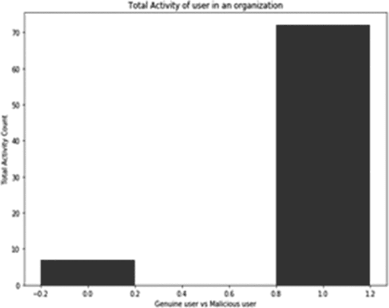

**图 2** 真实用户和恶意用户的活动计数

以下图 3 可视化了恶意和真实用户的活动计数总数。非恶意内部人员可能具有恶意活动。因此，根据恶意活动对用户进行分类，以预测图 4 中的用户活动。


**图 3** 每个用户的活动计数总数

以下图 4 展示了使用预处理数据的真实用户和恶意用户的活动计数。从图 2 中可以观察到，真实用户（`0`）的活动相对少于每月 10 次。相比之下，恶意用户（`1`）的活动计数每月超过 70 次。因此，恶意用户的活动远高于平均真实用户，需要检测出具有恶意活动的用户。访问未经授权网站的用户归类为“恶意”，其他用户归类为“非恶意”。需要找到恶意用户和真实用户在特定个人计算机 (`Pc`) 上每个人的唯一活动总数。

以下图 5 展示了使用预处理数据的真实用户和恶意用户的活动计数。

访问未经授权网站的用户归类为“恶意”，其他用户归类为“非恶意”。需要找到恶意用户和真实用户在特定个人计算机 (`Pc`) 上每个人的唯一活动总数。


**图 4** 真实用户和恶意用户的活动计数

以下图 5 展示了使用预处理数据的真实用户和恶意用户的活动计数。

### 参考文献

3. Meng, F., Lou, F., Fu, Y., and Tian, Z. 2018. 基于深度学习的属性分类数据安全内部威胁检测。在 2018 IEEE 第三次网络空间数据科学国际会议 (DSC)，pp. 576–581. IEEE。

4. Pengfei, J., Chunkai, Z., and Zhenyu, H. 2014. 一种高密度不平衡数据集分类的新型采样方法。在 2014 大数据与智能计算国际会议 (BIGCOMP)，pp. 217–222. IEEE。

5. Jiang, W., Tian, Y., Liu, W., and Liu, W. 2018. 基于用户行为分析的内部威胁检测方法。在智能信息处理国际会议，pp. 421–429. Springer, Cham.

6. Eberle, W., and Holder, L. 2009. 将基于图的异常检测方法应用于内部威胁发现。在 2009 IEEE 智能与安全信息学国际会议，pp. 206–208. IEEE。

7. Liu, L., De Vel, O., Chen, C., Zhang, J., and Xiang, Y. 2018. 使用深度自动编码器基于异常的内部威胁检测。在 2018 IEEE 数据挖掘工作讨会 (ICDMW)，pp. 39–48. IEEE。

8. Diop, A., Emad, N., Winter, T., and Hilia, M. 2019. 集成学习行为异常检测框架的设计。计算机与信息工程国际期刊 *13*, 10: 547–555.

9. Jiang, J., Chen, J., Gu, T., et al. 2019. 基于图卷积网络用于内部威胁和欺诈检测异常检测。在 MILCOM 2019-2019 IEEE 军事通信会议 (MILCOM)，pp. 109–114. IEEE。

10. Kim, J., Park, M., Kim, H., Cho, S., and Kang, P. 2019. 基于用户行为建模和异常检测算法的内部威胁检测。应用科学 *9*, 4018。

11. Senator, T. E., Goldberg, H. G., Memory, A., et al. 2013. 在真实的企业计算机使用活动数据库中检测内部威胁。在第 19 次 ACM SIGKDD 知识发现与数据挖掘国际会议上，pp. 1393–1401。

12. Lv, Q., Wang, Y., Wang, L and Wang, D. 2018. 面向基于用户和角色的内部威胁检测行为分析方法。在 2018 网络基础设施和数字内容国际会议 (IC-NIDC)，pp. 6–10. IEEE。

13. Gamachchi, A., Sun, L. and Boztas, S. 2018. 基于图的内部威胁检测框架。预印本 arXiv:1809.00141.

14. Liu, L., Chen, C., Zhang, J., De Vel, O. and Xiang, Y. 2020. 通过行为分析进行基于异常的内部威胁检测。在第 19 次信任与通信国际会议 (TrustCom)，pp. 301–309。

15. Le, D. and Heywood, N. 2021. 使用集成学习进行内部威胁异常检测。IEEE 网络与服务事务 *18*, 1152–1164。

16. Legg, P. 2015. 内部威胁的可视化：挑战。在 2015 IEEE 安全会议 (VizSec)，pp. 1–7。

## 用于检测恶意软件的监督式机器学习分类器评估

**Padmavathi 博士**

计算机科学系，Avinangam Institute for Home Science and Women, 印度

**Shanmugriya 博士**

信息技术系，Avinangam Institute for Home Science and Women, 印度

**A. Roshni**

网络智能中心，Avinangam Institute for Home Science and Women, 印度

### 摘要

由于技术时代安卓应用和移动用户的快速增长，通过广告软件、间谍软件、银行恶意软件、风险软件等对手机的网络攻击日益增加。机器学习方法对于检测移动恶意非常有用且友好。移动恶意软件检测的自动化是当务之急，识别合适的机器学习技术至关重要。本文研究了监督机器学习算法，用于检测并分类为恶意软件或良性。评估监督机器学习的目的是识别具有高效率的最佳模型。本文应用了所有重要的性能指标并进行了整个实验。

**关键词：** 机器学习、恶意软件分类、移动恶意软件、监督学习、Python

### I. 引言


# 恶意软件检测研究

恶意软件（Malware）是最常见的网络攻击类型之一，在疫情期间这种攻击占据主导地位，它通过作为恶意代码入侵，通过监控所有用户活动来接管系统，并在用户不知情的情况下窃取用户凭据。

移动恶意软件是重要的威胁，基于安卓的移动恶意软件如今非常严重，它们通过未经授权的访问损害用户的凭据。

本文的主要贡献是设计了一套系统方法，用于测试适用于安卓移动恶意软件检测的监督式机器学习模型。本文分为机器学习工作流的不同阶段。第一步是获取数据集并分析数据，以适应后续的开发过程。研究采用的恶意软件数据集包含 100,000 条记录，具有 35 个特征属性。第二步中，应用数据预处理方法检查数据是否包含任何空值或无关值，这有助于移除不需要的数据值，然后按照 70:30 的比例将数据划分为训练集和测试集。第三步，应用特征选择方法寻找数据集中的重要特征。从数据集中显著特征将有助于减少数据处理时间，并为机器学习算法提供更高的准确性。该方法使用了三种不同的特征选择算法，即：（i) `Univariate Selection`（单变量选择）、(ii) `Feature Importance`（特征重要性）、(iii) `Recursive Feature Elimination`（递归特征消除）。通过应用上述特征选择方法，从 35 个特征中选择了前 10 个重要特征用于有效的恶意软件分类。第四步，应用监督学习算法将数据识别并分类为 `malware/benign`（恶意软件/良性）。评估了以下机器学习算法：

1. `Decision tree`（决策树）
2. `Random forest`（随机森林）
3. `Nearest Neighbors (KNN)`（最近邻）
4. `Support Vector Machine (SVM)`（支持向量机）
5. `Naïve Bayes`（朴素贝叶斯）
6. `AdaBoost`
7. `Neural Network (MLP)`（神经网络）
8. `Logistic Regression`（逻辑回归）

第五步，使用各种评估指标评估机器学习模型的性能，为移动恶意软件检测提供最佳模型。

## II 问题定义

为了实现移动恶意软件检测的自动化，有必要开发一个系统的框架。本研究应用机器学习算法来检测和分类移动恶意软件。实现并评估了九种不同的机器学习算法，并根据性能确定了最合适的机器学习模型。

## III 方法论

本文开展了基于监督学习技术的动态行为移动恶意软件分类研究。整个方法分为五个阶段。工作的第一阶段是获取合适的数据集。第二阶段涉及数据预处理，通过删除重复记录、噪声数据以及将空值转换为定义良好的格式来研究数据质量。第三阶段应用 `Feature Selection`（特征选择）方法寻找数据集中的最佳特征，力求以更短的处理时间高效地检测或分类恶意软件数据。第四阶段是构建九种不同的监督学习模型，这些模型根据训练数据自动检测和分类恶意软件数据。第五阶段是对上一阶段开发的九种不同监督学习模型进行对比分析，通过使用性能指标进行评估，以建议能够准确检测和分类恶意软件点的最佳分类器。图 1 展示了本文遵循的方法步骤。


上述说明的方法是在 `Jupyter Notebook` 环境中使用 `Python` 编程实现的。

### A 关于数据集

理解数据集对于准确预测和分类非常重要。在项项工作中，基准数据集来自 kaggle 社区。该数据集包含 100,000 条记录和 35 个特征属性。恶意软件或良性的识别取决于行为特征。表 I 显示了涉及数据集的 35 个安卓内核属性的描述。

#### 表 I 移动数据集 – 属性描述

| 序号 | 恶意软件数据属性 | 描述 |
| --- | --- | --- |
| 1 | `hash` | 唯一标识恶意软件的常用方法，作为恶意软件检测的指纹。此数据包含 100 个唯一的哈希值（即唯一的 apk 文件名）。 |
| 2 | `millisecond` | 表示从 0 到 999 毫秒范围内的时间。 |
| 3 | `state` | 表示不可运行、运行或已停止任务的标记，为 `0`。 |
| 4 | `usage: counter` | 显示进程 `task_struct` 的引用计数为 `0`。 |
| 5 | `prio` | 表示系统任务结构，正常优先级值为 0 到 99，实时优先级为 100 到 140，标记为 `3.7b`。 |
| 6 | `static_prio` | 进程的初始优先级值，范围从 14.0k 到 31.9k。 |
| 7 | `normal_prio` | 表示不考虑 RT 继承的优先级，为 `0`。 |
| 8 | `policy` | 表示用于此进程的调度策略，为 `0`。 |
| 9 | `vm_goff` | 文件中区域的页偏移。当文件或设备映射时，这是该区域映射的第一页的文件位置。它是 `vm_area` 中标记为 `0` 的文件或设备的第一页。 |
| 10 | `vm_truncate: count` | 表示 `vm:atreuncate_count` 值，范围从 9695 到 27.2k。 |
| 11 | `task_size` | 表示当前任务大小为 `0`。 |
| 12 | `cached_hole: size` | 表示空地址空间洞的大小为 `0`。 |
| 13 | `free_area: cache` | 表示从 0 到 515 的第一个地址空间洞。 |
| 14 | `mm_users` | 表示用户地址空间范围从 612 到 995。 |
| 15 | `map_count` | 表示映射区域的数量，范围从 2588 到 28.2k。 |
| 16 | `hiwater_rss` | 表示驻留集合的高水位，并将驻留集合大小值设置为 `0`。 |
| 17 | `total_vm` | 表示内存页的总数，范围从 4 到 2810。 |
| 18 | `shared_vm` | 表示共享页的数量，范围从 112 到 120。 |
| 19 | `exec_vm` | 表示可执行内存页的数量，范围从 92 到 196。 |
| 20 | `reserved_vm` | 表示预留内存页的数量，范围从 29 到 755。 |
| 21 | `nr_ptes` | 表示页表项数量为 `0`。 |
| 22 | `end_data` | 表示数据的结束地址，范围从 112 到 120。 |
| 23 | `last_interval` | 表示抖动之前的最后间隔，范围从 0 到 9526。 |
| 24 | `nvcsw` | 表示自愿上下文切换的数量，范围从 338k 到 385k。 |
| 25 | `nivcsw` | 表示非自愿上下文切换的数量，范围从 0 到 365。 |
| 26 | `min_flt` | 表示缺页异常，范围从 0 到 256。 |
| 27 | `maj_flt` | 表示主页异常，从 112 到 120。 |
| 28 | `fs_excl: counter` | 文件系统斥计数值，范围从 0 到 18。 |
| 29 | `lock` | 表示文件锁，为 `3.20b` |
| 30 | `utime` | 表示在用户代码上花费的累计时间，范围从 372k 到 422k（即用户时间）。 |
| 31 | `stime` | 它代表执行系统代码（范围从 3 到 7）的累计时间（即系统时间）。 |
| 32 | `gtime` | 它表示组时间，范围从 0 到 15 的累计资源计数器（即访客时间）。 |
| 33 | `cgtime` | 它表示累计组时间，累计资源计数器为‘O’。 |
| 34 | `signal_nvcsw` | 它表示累计资源计数器为‘O’。 |
| 35 | `classification` | 它包含恶意软件或良性的二分类。 |

### B. 数据获取与导入

开发监督机器学习模型的首要步骤是获取适当的数据集并将其导入到工作环境中。`Python` 是一个支持大量机器学习算法的卓越平台，它是实验机器学习模型方法的合适环境。在这一步中，获取的恶意软件数据集被转换为 `CSV` 文件格式并导入到 `Python Jupyter notebook` 环境中。

### C. 数据预处理

导入数据集后，要执行的后续步骤是数据预处理。数据预处理是从分类器模型中获得最佳结果的重要步骤。数据预处理通过验证所选数据集是否包含空值、未定义值或无关值来进行，这些值可能会偏离结果并降低模型性能。空值被替换为“零 (0)”或“未知”数据值以解决处理问题。应用 `Label encoding` 方法将属性转换为整数数据类型格式，以开发合适的机器学习模型。为了开发 ML 模型，整个数据集被划分为训练集和测试集，比例为 70% 训练和 30% 测试。完成此步骤后，数据集现在已以良好定义的格式可用，供进一步处理。

### D. 特征选择

特征选择是机器学习过程中特征工程的一个重要步骤。特征工程是机器学习过程中的第三步，它从原始数据集中提取特征，为适当的分类提供标签。使用以下特征选择方法从给定数据集的 35 个属性中精确选出最重要的前 10 个特征。

#### i. 单变量特征选择

单变量特征选择是一种统计技术，用于识别与目标变量具有强相关性的相关特征。`Python` 中的 `scikit-learn` 库包含一个名为 `SelectKBest` 的函数。本研究使用 `SelectKBest` 类，通过卡方统计检验从移动端恶意软件数据集的 35 个特征中选出前 10 个特征。它计算目标类中每个非负特征的卡方系数，并选择具有最高卡方分的目标前 10 个特征。

**卡方公式：**

```
$X^{2} = {\sum\frac{\left( {Observed\text{?}value - Expected\text{?}value} \right)^{2}}{Expected\text{?}Value}}$
```

#### ii. 基于特征重要性的特征选择

使用 `python` 工具 `feature importance` 利用集成模型的特征重要性属性来选取数据集的重要特征。数据集的每个属性都被赋予一个分数。分数越高，该特征对目标变量的显著性或相关性越高。使用带有 `Extra tree classifier` 方法的 `python sklearn ensemble model`，系统计算出前 10 个特征并显示所有计算特征的得分。

#### iii. 递归特征消除 (RFE)

递归特征消除是通过递归删除特征，然后使用剩余属性开发分类器模型来实现的。模型通过使用 `python sklearn feature selection library`、`RFE` 方法和 `logistic regression classifier` 算法递归地消除最小特征，从而选择数据的前 10 个特征；选定的特征在 `support array` 中显示为 True，并使用 `ranking array` 中的选项“1”对特征进行排序。

在结合了三种不同的特征选择方法后，根据三种不同特征选择方法中属性出现频率最高的特性选出前 10 个特征。这种选择有助于在最佳时间内选择恶意软件数据点。图 2 显示了表 I 所示 35 个特征中选出的前 10 个特征。选出的前 10 个特征列如下：

* `hash`
* `state`
* `static_prio`
* `vm_truncate_count`
* `map_count`
* `total_vm`
* `reserved_vm`
* `nvcsw`
* `nivcsw`
* `utime`


### E. 监督机器学习模型

第四阶段是模型构建。从 35 个属性中选出前 10 个特征后，现在数据已准备好开发模型。以下是九种用于恶意软件或良性分类的监督算法：

1. 决策树
2. 随机森林
3. `KNN`
4. `SVM`
5. 朴素贝叶斯
6. AdaBoost
7. 神经网络 (`MLP`)
8. 逻辑回归
9. 线性判别分析

上述监督学习算法使用 `python Scikit learn` 库开发。开发上述用于移动恶意软件分类的监督机器学习模型的通用步骤如下：

* **步骤 1:** 导入必要的 `Scikit learn` 监督机器学习库。
* **步骤 2:** 将监督机器学习模型拟合到给定的训练集。
* **步骤 3:** 根据训练数据预测测试结果。
* **步骤 4:** 然后，执行测试数据预测并计算准确率。
* **步骤 5:** 最后，监督机器学习分类器模型准备就绪。

每个监督机器学习算法根据其自身的计算属性阈值的机制来检测和分类数据点。模型参数的权重用于最终分类。表 II 描述了检测和分类移动数据点的标准。

#### 表 II. 监督机器学习算法标准

| 算法名称 | 分类标准 |
| --- | --- |
| 决策树 | 属性选择量（熵或 Gini 指数） |
| 随机森林 | 属性选择量（熵或 Gini 指数） |
| `KNN` | 欧几里得距离量 |
| `SVM` | 超平面维度 |
| 朴素贝叶斯 | 贝叶斯定理 |
| AdaBoost | 集成学习 |
| MLP | 反向传播 |
| 逻辑回归 | Sigmoid 函数 |
| LDA | 共线性 / 类方差 |

### F. 性能评估指标

评估了以下指标：

* 平均绝对误差 (MAE)
* 均方误差 (MSE)
* 均方根误差 (RMSE)

结果还以受试者工作特征（ROC）曲线的形式进行了可视化。

**准确率 (Accuracy):** 它定义为测试数据预测准确的百分比。

```
$Accuracy = \frac{TP + TN}{TP + TN + FP + FN}$
```

**真正例 (TP)** – 这些是预测准确的正值，表示实际类别值和预测类别值均为真（True）。

**真负例 (TN)** – 这些是预测准确的负值，表示实际类别值和预测类别值均为假（False）。

**假正例 (FP)** – 当预测类别为真时，但实际类别为假。

**假负例 (FN)** – 当预测类别为假时，但实际类别为真。

**精确率 (Precision):** 它是成功预测的正样本观测值与总预期正样本观测值的比例。它指的是分类器避免将负样本误标记为正样本的能力。

```
> **Precision = TP/TP + FP**
```

**召回率 (Recall):** 它是预测准确的正样本观测值与实际类别观测中所有观测值的比例。它指的是分类器定位所有正样本的能力。

```
> **Recall = TP/TP + FN**
```

**F1 分数 (F1 Score):** 它是精确率和召回率的加权平均值或调和平均数。因此，该得分考虑了假正例和假负例。

```
> **F1 Score = 2*(Recall * Precision) / (Recall + Precision)**
>
> **或**
>
> **F1 = 2TP / 2TP + FP + FN**
```

**R2 分数 (R2 Score):** 决定系数（有时称为 R 平方）是回归模型中的统计指标，用于确定因变量的变异中有多少可以被自变量解释。

```
$R^{2} = 1 - \frac{\sum\left( {y_{i} - \hat{y}} \right)^{2}}{\sum\left( {y_{i} - \overline{y}} \right)^{2}}$
```

其中，`ŷ` 是 `y` 的预测值，`ȳ` 是 `y` 的平均值。

**混淆矩阵 (Confusion Matrix):** 这是一个用于评估分类模型对特定测试数据性能的矩阵。只有在已知测试数据的真实值时才能确定。由于它以矩阵形式显示模型性能中的误差，因此也被称为误差矩阵。图 3 显示了混淆矩阵。

**图. 3 混淆矩阵**

| N = 总预测次数 | 实际正 (1) | 实际负 (0) |
| --- | --- | --- |
| 预测正 (1) | TP | FP |
| 预测负 (0) | FN | TN |

**平均绝对误差 (MAE) (L1 损失):** 它是数据集中实际值与预测值之间绝对差的平均值。它计算数据集中残差的平均值。

```
$MAE = \frac{1}{N}{\sum\limits_{i = 1}^{N}\left| y_{i} - \hat{y} \right|}$
```

**均方误差 (MSE) (二次损失或 L2 损失):** 它是原始值与预测值之间差平方的平均值。它计算了残差的方差。

```
$MSE = \frac{1}{N}{\sum\limits_{i = 1}^{N}\left( {y_{i} - \hat{y}} \right)^{2}}$
```

**均方根误差 (RMSE):** 它是对数据集进行预测时所产生误差的标准差。这与 MSE（均方误差）相同。在确定模型的准确性时，仅考虑了数字的平方根。均方误差的平方根被称为 RMSE。它计算了残差的标准差。

```
$RMSE = \sqrt{MSE} = \sqrt{\frac{1}{N}{\sum\limits_{i = 1}^{N}\left( {y_{i} - \hat{y}} \right)^{2}}}$
```

其中，`ŷ` 是 `y` 的预测值，`ȳ` 是 `y` 的平均值。

**受试者工作特征 (ROC) 曲线:** 它是一张显示分类算法在所有可能的阈值下工作效果的图表。该图显示了真正例率（Y 轴）和假正例率（X 轴）。作为模型正类分类阈值的函数，它绘制了真正例率 (TPR) 相对于假正例率 (FPR)。

**AUC (曲线下积):** 它是一种用于根据 ROC 曲线下的面积计算分类模型整体性能的统计量。

### G. 比较分析

基于上述给出的评估指标，对九种不同的监督学习机器学习模型进行了比较分析，以发现具有高有效率的最佳分类器模型。图 4 显示了所有监督学习机器学习模型的整体准确率对比。表 III 和表 IV 描述了基于准确率、精确率、召回率、F1 分数、R2 分数以及基于平均绝对误差 (MAE)、均方误差 (MSE) 和均方根误差 (RMSE) 的误差评估的九种监督学习机器学习算法的比较分析。


**图 4** 所有监督学习 ML 模型整体准确率对比

**表 III.** 精确率、召回率、F1 分数、R2 分数的比较

| S. No | 监督学习模型 | 准确率 | 精确率 | 召回率 | F1 分数 | R2 分数 |
| --- | --- | --- | --- | --- | --- | --- |
| 1 | 决策树 | 1.0 | 1.0 | 1.0 | 1.0 | 1.0 |
| 2 | 随机森林 | 1.0 | 1.0 | 1.0 | 1.0 | 1.0 |
| 3 | K-最近邻算法 | 0.996 | 0.996 | 0.995 | 0.995 | 0.997 |
| 4 | 支持向量机 | 0.999 | 1.0 | 0.999 | 0.999 | 0.997 |
| 5 | 朴素贝叶 | 0.909 | 0.895 | 0.927 | 0.911 | 0.638 |
| 6 | 加增强提升 | 1.0 | 1.0 | 1.0 | 1.0 | 1.0 |
| 7 | 神经网络 (MLP) | 1.0 | 1.0 | 1.0 | 1.0 | 1.0 |
| 8 | 逻辑回归 | 1.0 | 1.0 | 1.0 | 1.0 | 1.0 |
| 9 | 线性判别分析 | 0.997 | 0.999 | 0.995 | 0.997 | 0.990 |

**表 I.** MAE、MSE、RMSE 的比较

| S. No | 监督学习模型 | MAE | MSE | RMSE |
| --- | --- | --- | --- | --- |
| 1 | 决策树 | 0.0 | 0.0 | 0.0 |
| 2 | 随机森林 | 0.0 | 0.0 | 0.0 |
| 3 | K-最近邻算法 | 0.003 | 0.003 | 0.057 |
| 4 | 支持向量机 | 6.666 | 6.666 | 0.008 |
| 5 | 朴素贝叶 | 0.091 | 0.091 | 0.3007 |
| 6 | 加增强提升 | 0.0 | 0.0 | 0.0 |
| 7 | 神经网络 (MLP) | 0.0 | 0.0 | 0.0 |
| 8 | 逻辑回归 | 0.0 | 0.0 | 0.0 |
| 9 | 线性判别分析 | 0.0024 | 0.0024 | 0.0496 |

## IV. 结果与讨论

从上述对九种不同的监督学习机器学习算法进行的比较分析（表 III 和表 IV）可以看出，决策树、随机森林、加增强提升、基于神经网络的多层感知器 (MLP)、逻辑回归在移动恶意软件二分类中能够以 100% 的准确率和 0% 的误差率准确检测检测分类恶意软件数据点。此外，KNN 算法的分类率为 99.7%，SVM 算法的分类率为 99.9%，朴素贝叶算法的分类率为 90.9%，LDA 算法的分类率为 99.7%。与决策树、随机森林、KNN、SVM、加增强提升、MLP、逻辑回归和 LDA 监督模型分类器相比；朴素贝叶斯分类器模型在给定数据集上的准确率略低。

图 5, 图 6, 图 7, 图 8 和 图 9 展示了九种监督机器学习模型之间的对比分析结果，这些模型是基于准确率、训练准确率、测试准确率、精确率、召回率、F1 分数、R2 分数、混淆矩阵、TPR、FPR 和 ROC 曲线等指标评估的。

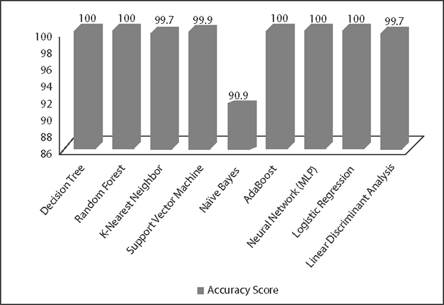
图 5 所有监督机器学习模型的训练准确率比较


图 6 所有监督机器学习模型的测试准确率比较

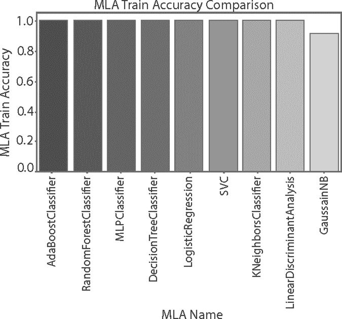
图 7 所有监督机器学习模型的精确率比较

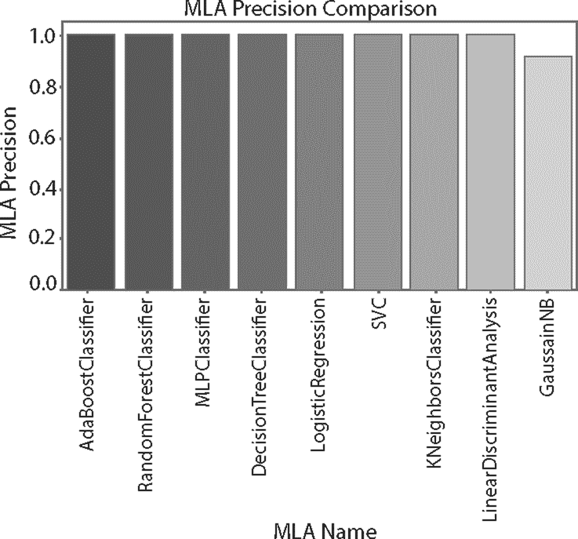
图 8 所有监督机器学习模型的召回率比较

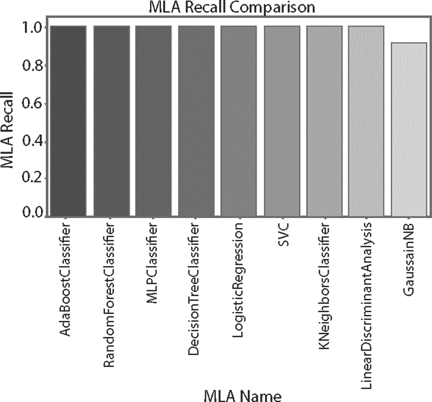
图 9 ROC 曲线中监督机器学习算法的整体对比表示

## V. 结论

由于用户数据面临泄露挑战，基于 Android 的移动恶意软件对用户社区构成了严重威胁。因此，开发移动恶意软件的自动检测和动态分析至关重要。通过使用移动恶意软件数据集实现多种监督机器学习模型，观察到，在给定的数据集上，九种监督机器学习算法中，朴素贝叶分类器模型（Naïve Bayes Classifier Model）的性能与其他八种不同的监督机器学习算法相比略低。

本文详细地阐述了使用移动恶意软件数据集开发有效机器学习模型的逐步实现步骤和方法。此外，所有监督机器学习算法都能以更高的有效率支持恶意软件分类。因此，这项研究将有助于学习者通过结合移动恶意软件数据集以系统化的方式理解并实现监督机器学习算法，从而获得最佳结果。

## 致谢

这项工作得到了 2021–2023 年期间 DST-CURIE-AI 项目的支持，该项目由印度泰米尔纳德邦哥尔巴塔尔 - 43 的 Avinashilingam 女家庭科学高等教育学院（Avinashilingam Institute for Home Science and Higher Education for Women）机器学习与智能中心下的网络中心建立。

## 参考文献

1. Prema Agarwa., and Bhushan Trivedi. 2020 (November). 评估用于检测 Android 恶意软件的机器学习分类器。技术创新国际会议 (INOCON). IEEE.

2. Samaneh Mahdavifar, Andi Fitriah Abdul Kadir, Rasool Fatemi, Dima Alhadidi, and Ali, A. Ghorbani. 2020. 使用半监督深度学习进行 Android 恶意软件类别分类。可靠、自治和安全计算国际会议、泛在智能与计算国际会议、云与大数据计算国际会议、网络科学与技术会议大会。IEEE.

3. Muhammad ‘Afif Husainiamer, Madihah Mohd Saudi, and Azuan Ahmad. 2020. 受系统发育启发的 iOS 移动恶意软件分类：概念证明。IEEE 开放系统会议 (ICOS). IEEE.

4. Jianguo Jiang., Song Li., Min Yu., et al. 2019. 基于敏感操作码序列的 Android 恶意软件家族分类。IEEE 与通信学术会议 (ISCC). IEEE.

5. Ken, F. Yu., and Richard, E. Harang. 2017. 恶意软件流量分类中的机器学习。Milcom 2017 Track 3 – 网络安全与信任计算。IEEE.

6. Marian Kuhnel., and Ulrike Meyer. 2016. 移动恶意软件发起的短消息分类。第 11 届可用性、可靠性和安全性国际会议。IEEE.

7. Xinjian Ma., Qi Biao., Wu Yang., and Jianguo Jiang. 2016. 使用多特征减少恶意软件分类中的误报。IEEE.

8. George Cabau., Magda Buhu., and Ciprian Oprisa. 2016. 基于动态行为的恶意软件分类。第 18 届科学计算符号与数值算法国际学术会议。IEEE.

9. Mohammed, S. Alam, and T. Vuong. 2013. 随机森林检测 Android 恶意软件。IEEE 物联网国际会议。IEEE.

10. Ivan Firdausi., Charles Lim., Alva Erwin., and Anto Satriyo Nugroho. 2010. 基于行为的机器学习技术分析。第二届计算、控制与电信技术进展会议。IEEE.

# 物联网中使用遗传算法的安全数据聚合过程

Dr. Nethra Pingala Suthishni

教授，信息技术系

Avinashilingam 家庭科学高等教育学院

哥尔巴塔，印度

nethra_it@avinuty.ac.in

Mr. K.S. Senthil

教授，计算机科学研究生系

Hindusthan 艺术学院

哥尔巴塔，印度

senth4um@gmail.com

**摘要：** 在过去的十年中，物联网（IoT）作为完全连接传感设备的骨干，用于虚拟和现实世界的集成通信平台。在物联网（IoT）中，传感器网络（WSNs）被认为是关键元素。IoT 感知环境、收集数据并发送到基站（BS）。物联网路由协议是为 WSN 设计的，但由于节点的异构性，WSNs 无法正常工作。由于物联网是一种去中心化的网络，网络感知信息并将其传递到基站。传感器节点的小尺寸在这种网络中消耗更多能量，这似乎是一个主要问题。由于使用了无线通道并可能部署在恶劣环境或无监督区域，它们很容易受到各种攻击。此外，安装的安全系统具有固有缺陷。因此，这些系统容易受到网络安全威胁。为了提高网络性能并克服网络安全风险，本研究提出了一种名为遗传算法的新算法。遗传算法在安全漏洞方面是最好的算法之一。

**关键词：** 传感器网络 (WSNs)、物联网、网络安全、安全漏洞、遗传算法。

## I. 引言

WSNs（无线传感器网络）是物联网（IoT）的核心组件，它利用 `IoT` 设备监控环境并向用户提供有用的数据。家居自动化、森林监测、医疗系统、精准农业和智慧城市发展都是今天 `IoT` 应用的示例。在监测区域，`IoT` 设备或传感器感应如压力、湿度、温度等各种物理因素，并通过单跳或多跳通信将这些有用信息传输到基站（BS）。在用于 `IoT` 的 WSN 中，传感器节点受到能量限制。

聚类过程中的若干问题（例如能量洞和网络分段）严重缩短了网络寿命，并随后导致了遭受网络威胁的可能性。在这种情况下，产生了保护传感器网络免受各种网络威胁的需要。这些威胁可能会损害网络上的单个节点，也可能损害整个传感器网络。聚类头（CH）附近的传感器节点中继的数据包比远处的传感器节点多，导致聚类机制中靠近 `CH` 的传感器节点过早死亡。在这种情况下，远处的传感器节点有足够的能量进行数据传输，但由于缺乏网络结构，它们无法将数据包传输到 `CH` 和 `BS`，这往往会导致能量洞问题。由于能量洞问题，网络被划分为许多不同的部分。将网络划分为分区因此导致了网络安全威胁，从而网络风险的复杂性日益增加。由于缺乏适当的通信链路，某些部分无法与基站通信。

加密和解密是加密系统定义的两种数据转换。为了生成密文，需要对明文（即要传输的数据）进行加密。即使用加密密钥进行加密的数据。解密密钥用于将密文转换为明文（即原始数据）。对称加密被定义为加密和解密密钥相同，或者可以相互推导出的加密。

其中一个密钥（称为私钥）保持私密，而另一个密钥（称为公钥）则向公众公开。公钥对通信进行加密，只能用私钥进行解密。因此，任何拥有公钥的人都无法解密加密消息，从而确保了通信的安全。本文采用了最著名的公钥算法 `RSA`（以其创建者 Rivest、Shamir 和 Adleman 命名）[[[8]\]。

部署的节点通常是固定的，且传统数据收集算法中的汇点位置通常也是固定的。由于中继消息的高开销，靠近静态汇点的传感器节点比远离汇点的节点消耗更多能量。由于这个问题，靠近静态汇点的传感器节点死亡速度远快于其他节点，缩短了网络寿命 [[[1]\]]。而且，这种担忧最终增加了遭受网络威胁的可能性。

异构节点的通信和数据处理能力远高于普通节点。然而，异构节点价格昂贵，因此研究如何平衡能量消耗并延长网络寿命至关重要 [[[2]\]]。

数据冗余跟踪网络中的每次传输，并有助于防止拒绝服务攻击。认证、风险评估和数据安全是保护数字内容的应用层安全需求，这对于确保环境安全非常重要。访问数据和信息需要进行外部认证。

本文的其余部分结构如下：Section II 综述了支持物联网的无线传感器网络相关工作、网络安全以及网络威胁的演变。Section III 解释了问题陈述。Section IV 推导了建议的工作和算法细节。Section V 解释了仿真环境和性能指标细节。结果与讨论在 Section VI 中描述。Section VII 给出了论文的结论。


**图 1 WSN 中的物联网**

## II. 相关工作

**Chuan Zhu, Kangning Quan, Guangjie Han 和 Joel J.P. Rodrigues [[[1]\]** 解释了基于移动汇点提供了一种高可性的预测数据收集策略。传感器节点根据时间同步确定移动汇点的位置，从而减少了能量消耗。当网络使用高可用技术时，即使部分汇点失效也能继续收集数据。此外，通过改变汇点的轨迹，可以平衡区域节点的能量消耗。然而，当区域点出现问题时，上传到汇点的数据受阻。

**Chunlin Li, Jingpan Bai, Jinguang Gu, Xin Yan 和 Youlong Luo [[[2]\]** 解释了为了平衡能量并延长网络寿命，引入了一种无线传感器网络聚类路由方法。该方法考虑了异构节点和聚类头。首先，建立了一个异构节点的优化布局模型。其次，提出了一种无线传感器网络聚类路由方法，该方法结合了异构路由算法与 LEACH-C 聚类头技术。最后，通过大量测试评估了所提路由方法的性能。该路由算法可以显著延长网络的寿命和稳定性。

**Gurbinder Singh Brar, Shalli Ra, Vinay Chopra, Rahul Malhotra, Houbing Song 和 Syed Hassan Ahmed [[[3]\]** 解释了一种基于混合优化的 PEGASIS-DSR 优化路由协议，它结合了主动和响应式路由协议的缓存和定向传输概念。我们建议算法的仿真结果表明，在不牺牲能量效率的情况下，降低了端到端传输延迟和比特率。为了获得快速且无损的路径，在 PDORP 中应用了主动和响应式路由方法。

**Jianhua Huang, Danwei Ruan 和 Weiqiang Meng [[[4]\]** 解释了 ASGRP 是一种基于扇形网格聚类的低能耗多跳路由协议。在无线传感器网络中，建议的方法改进了类的形成方式。其核心概念是将网络区域划分为扇形网格，以 BS 为圆形区域的中心。每个扇形网格的节点被聚类成簇。利用 BS 所在边界与节点到 BS 连线之间的角度创建一个扇形网格。我们还设计了一种跨级多跳路由策略，以提高 BS 与聚类头之间的数据传输效率。

Jianhua Huang, Yadong Hong, Ziming Zhao 和 Yubo Yuan [5] 解释道，为了延长网络寿命，我们提出了一种基于网格聚类的节能多跳路由协议。该协议将网络区域划分为不均匀的网格，以产生不同层次的簇。由于距离汇点的网格较大，簇的分布更易接受，且功能节点之间的能量消耗得到了有效平衡。靠近汇点的网格中的传感器节点直接向汇点发送数据，而后续网格中的传感器节点则通过多跳传输发送数据。为了减少选举的复杂度，提供了一种基于 `CM` 节点的管理技术，这可以消除选举 `CH` 节点的随机性，优化 `CH` 节点的位置，并降低簇内成员节点的通信成本。结论认为，该协议在能量效率、网络寿命和可扩展性方面优于其他协议。

Mbanaso, U. M. 和 Chukwudebe, G. A. [6] 解释道，研究了物联网系统的危险性和漏洞，并提出了一种新型的可调节基于策略的规范，用于解决分散情况下的信任、机性和隐私挑战。在设备必须无缝协作和交互以解决许多领域问题的时代，智能实体应该变得更加可靠、可靠和安全，确保端到端的动态安全保障。它开发了一个系统，允许物联网实体在细粒度的策略结构中定义它们的能力（Capabilities）和需求（Requirements），以便对经过证明的属性和资源进行相互且即时的协商。它还提供了审计和争议解决的方法，这是物联网环境中成功的关键要素，此外还以统一的方式解决了信任、隐私和保密问题。

Moosa Ayati, Mohammad Hossein Ghayyoumi 和 Atiyeh Keshavarz-Mohammadiyan [7] 解释道，降低无线传感器网络（WSNs）的消耗至关重要，因为它可以延长网络寿命。聚类是延长网络寿命的有效方法。`LEACH` 是目前常用的聚类方法。低能耗 `WSN` 中减少了 `BS` 数据开销。数据开销是减少网络寿命并增加数据丢失风险的关键因素之一。当产生数据开销时，数据包之间会发生碰撞，某些数据包可能会丢失。结果是丢失的数据包必须重传。这些重传会导致节点消耗能量。为了控制数据开销，`WSNs` 需要一种可靠的方法。在所提的 `SCHFTL` 中，只有超簇头节点负责向 `BS` 发送数据。所提的解决方案减少了数据开销、丢失和重传，从而获得了更长的网络寿命。

Preetha, M. 和 Nithya, M. [8] 解释道，该加密是对已知且实用的 `RSA-OAEP` 的微小改进。根据该方案，即使在多查询上下文中，`RSA` 问题的安全性仍然显著依赖于 `RSA` 问题的复杂度。`RSA` 为业务应用提供了最高级别的安全性。此外，在不使用混合加密或对称加密的情况下，该方法可以加密大消息。

Ranida Hamidouche, Zibouda Aliouat 和 Abdelhak Gueroui [9] 解释道，用于医疗保健和战场监控等多种重要应用的无线传感器网络面临能量能力有限的问题。提出了一种基于遗传算法的分布式协议，称为 `LECR-GA`，以实现高效能量利用。通过使用正确的染色体表示、适应度函数和 `GA` 操作，实现了更长的系统运行时间、最小复杂度和最大数据速率。根据实验结果，所提算法在能量消耗和吞吐量方面优于 `GABEEC` 和 `GAEEP`。

Se-Ra Oh 和 Young-Gab Kim [10] 解释道，基于 `oneM2M`（即 Mobius）的 `OAuth 2.0` 安全组件旨在提供身份验证和授权，这是物联网安全以及物联网平台之间安全互操作的关键安全目标。示例包括安全组件代码的一个部分、一个令牌请求和一个安全组件响应。来自未授权用户的资源请求将被 `oneM2M` 安全组件拦截，而来自授权用户的资源请求将被通过。


# 物联网无线传感器网络中的增强型遗传算法与 RSA 加密研究

Yiqun Zhang, Li Xu, Qing Dong, Jingcheng Wang, David Blaauw, 和 Dennis Sylvester [11] 解释道，由于计算资源有限且对灵活性有要求，物联网安全面临许多问题。目前市场上的 `ASICs` 和协处理器具有许多缺点。在这项研究中，我们提供了 `Recryptor`，这是一种新架构，它利用内存和近内存计算来有效支持加密算法的大量向量计算。与基础 `CPU` 架构相比，它保留了编程性并节省了约 80% 的运行时间和能量。在面积、能量、吞吐量和编程性之间平衡，`Recryptor` 是一个合理的中间选择。

## III. 问题描述

聚类过程导致了许多问题，包括能量洞问题和网络分割，这极大地增加了传感器网络中威胁的可能性并缩短了网络寿命。与远程传感器节点相比，附近的簇头（`CH`）转发更多的数据包，导致 `CH` 早早死亡。网络中的能量洞问题分为许多不同的部分。由于缺乏足够的通信链路，这些部分无法与基站（`BS`）通信。传感器节点有足够的能量进行传输，但由于缺乏网络拓扑，无法向 `CH` 和 `BS` 继数据包。聚类机制消耗大量的额外能量来克服能量洞和网络分区问题。相反，它们利用硬件资源来解决这些问题。

## IV. 所提工作与算法

物联网无线传感器网络解释了三个类型的阶段。第一阶段是基于遗传算法的聚类创建。第二阶段是基于移动基站的数据收集阶段，第三阶段是基于 `RSA` 算法的加密过程。

遗传算法用于在簇构建阶段通过严格的遗传方法选举 `CH`。数据收集描述了一种基于遗传算法的聚类创建方法，随后是基于移动基站的数据收集方案。`RSA` 加密算法使用基于密钥的加密解密机制来改进加密。

### 算法

#### RSA 算法

该算法用于加密单个整数。将较大的信息转换为（可能的）数字是编码的第一步。由于 `RSA` 是一种慢方法，它通常用于加密快速算法的密钥。这种补充技术使用由 `RSA` 解密的密钥对剩余消息进行解码。

该阶段旨在识别网络中有效的簇群头（CH），它们可以大幅降低部署节点的能耗。因此，为了实现最优簇群头选择，我们采用了 `memetic algorithm`，这是一种基于智能的优化机制，能够在异构无线传感器网络（WSN）环境中提供更好的优解。

通过 `genetic algorithm` 引入了局部搜索方法。这是一种利用进化计算的元启发式算法，是一种受自然启发的搜索优化挑战。它能提供接近理想的解决方案。“优化”一词是指根据输入参数最大化或最小化目标函数的过程。它们提供了多种选择。随后这些解决方案经过杂交和变异产生后代，该过程在多个代中进行。

每个人都有一个适应度评分，并选择最适应的个体作为父母。因此，进化将一直进行直到满足终止条件。`genetic algorithm` 的优势是可以同时优化连续和离散函数，并提供一个随时间改进的解决方案池，而不是单一解。当涉及大量因素时，它是一个极佳的选择，非常适用于 NP-hard 问题。

使用 `memetic technique` 在网络节点内部寻找簇群头。它被分为两个部分。如果一个节点的能量大于网络节点的平均能量，则该节点可以参与 CH 选择。创建染色体的第一个位位，将 CH 赋值为‘1’，将其余节点赋值为‘0’。当上述要求不再满足时，则使用 `memetic algorithm` 来选择 CH。在交叉和变异之前应用适应度函数的阶段称为稳态阶段。

### 初始过程

选择负责网络性能的参数。给这些参数赋予初始值。参数包括多个汇点、节点数量、每个节点的位置、网络维度、染色体数量、种群大小、交叉率、变异率和代数，权重系数会被初始化。

### 适应度函数

这些是引导解决方案达到预期结果并对其进行优化的目标函数。然后，通过连续迭代应用适应度函数使染色体收敛到更好的解决方案。它必须快速收敛到解，并与目标相关。

### 适应度形成

初始生成节点的 x 和 y 坐标值。初始化汇点节点（Sink）。汇点节点被分为若干网格单元。网格单元取中点形成一组节点用于网格划分。创建网格划分以为所有节点分配网格 ID 和节点 ID。网格在网络区域呈正方形且具有静态特性。在汇点收集信息期间，它们可能是移动的或静态的。在网格单元内的所有其他节点中，初始选择网格单元的中点作为簇群头（CH）。CH 被选择为距离中点距离最小的节点。节点 ID 和网格 ID 分配给网络中的每个节点。

### 数据采集阶段

在数据采集阶段，移动汇点（MS）遵循轨迹到达汇合点，并在通信范围 `2R` 内广播数据上传消息。MS 将此数据上传消息发送给 CH，以便上传网络的所有信息。消息中包含了移动汇点 ID 和位置信息。此消息仅会被所有位于移动汇点通信范围内的 CH 接收。CH 在接收到数据上传消息后验证其缓冲区状态。如果 CH 当前缓冲区为空，则直接忽略 MS 的数据上传消息。否则，如果 CH 当前缓冲区状态不为空，则会向移动汇点发送回复消息。回复消息中包含了 CH ID、剩余能量和位置信息。当移动汇点收到来自 CH 的回复消息时，它为每个响应的 CH 分配一个独立的时间槽。每个与移动汇点通信的 CH 都会获得自己的时间窗口。CH 只能在分配的时间槽内发送回复。在队列中的 CH 之间进行适当调度。移动汇点在通信范围 `2R` 内广播调度消息。调度消息包含了各个 CH 的数据上传调度。

### 路径更新

初始化源节点（`S`）和距离节点（`D`）的值。源节点和目标节点检查组节点的当前簇群头。源节点未到达目标节点。发送结果后，执行算法以验证簇头。源输入、源节点的值包含了 CH。最后，将 CH 发送到目标节点。

### 算法步骤

#### 1. 增强 RSA 算法

```
Step 1: 生成两个质数 k 和 y
Step 2: 设置密钥
Step 3: 读取输入
Step 4: 计算 n = k * y
Step 5: 计算 totient(n) = (k-1) * (y-1)
Step 6: 选择 e 使得 gcd(e, totient(n)) = 1
Step 7: 计算 d = e^-1 mod totient(n)
Step 8: 排列新字符
Step 9: 公钥 = [e, a]
Step 10: 私钥 = [d, a]
```

#### 2. 基于增强型遗传算法的簇群形成

```
Step 1: 部署 BS
Step 2: 稳态阶段
Step 3: 从 j = 0 到 n do
Step 4: while ei <= th do
Step 5: 参与 CH 选择
Step 6: 如果 CH 缓冲区 = 空则
Step 7: 找到位于簇中的源节点，f(s!=d && s==CH)
Step 8: 簇消息从源节点发送到 CH
Step 9: 如果 (d == CH1 && CH != CH1) 则
Step 10: 簇消息从 CH 发送到 CH1，CH1 发送至目标节点
Step 11: 丢弃消息
Step 12: else
Step 13: 向 MS 发送回复消息，包含 CH ID、剩余能量、信息
Step 14: end
Step 15: end
Step 16: end
Step 17: 如果 CH 能量 < th 则
Step 18: 计算 F[n] = (ω1+ω2+ω3+ω4)^-1
Step 19: 在两个竞争者之间应用交叉
Step 20: 计算变异后的新染色体
Step 21: 应用局部搜索
Step 22: 选择新的 CH[k]
Step 23: CH[k] 位 = 1 且 S[i] 位 = 0
Step 24: end
```

#### 3. 增强数据采集阶段

```
Step 1: 如果 MS 在 RP 则
Step 2: 在 2R 范围内广播上传消息，包含移动点 ID、信息
Step 3: 初始包含源节点和目标节点
Step 4: 初始化循环并在所有节点检查源节点后包含所有节点 For(j=0; j<n; j++)
Step 5: 如果 CH 接收到上传消息则
Step 6: 如果 CH 缓冲区 = 空则
Step 7: 找到簇中的源节点，f(s!=d && s==CH)
Step 8: 簇消息从源节点发送到 CH
Step 9: 如果 (d == CH1 && CH != CH1) 则
Step 10: 簇消息从 CH 发送到 CH1，CH1 发送至目标节点
Step 11: 丢弃消息
Step 12: else
Step 13: 向 MS 发送回复消息，包含 CH ID、剩余能量、信息
Step 14: end
Step 15: 如果 Ms 收到来自 CH 的回复消息则
Step 16: 分配个人时隙
Step 17: 结束
```

### 流程图

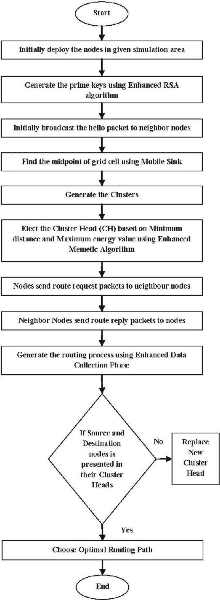

**图. 2** 提议方法的流程图

## V. 仿真分析

### 仿真参数

**表 1** 仿真参数

| 序号 | 环境 / 参数 | 值 |
| --- | --- | --- |
| 1 | 仿真器 | NS-2 |
| 2 | 信道类型 | 无线 |
| 3 | 节点数量 | 100 |
| 4 | 流量模型 | CBR |
| 5 | 仿真区域 | 2250m * 2250m |
| 6 | 传输范围 | 400m |
| 7 | 路由协议 | DSR |
| 8 | MAC 协议 | 802.11 |
| 9 | 仿真总时间 | 100ms |

### 性能指标

本节强调了用于物联网型无线传感器网络（WSN）的增强型遗传算法的仿真性能。仿真使用网络仿真器（`NS-2`）进行。网络仿真器 `NS2` 是用于网络仿真的离散事件仿真软件。它执行网络中的发送、接收、转发和丢弃数据包等仿真事件。讨论了协议的一些性能指标。用于比较的性能指标有：

* 端到端延迟
* 数据包投递率
* 网络寿命
* 能量消耗
* 吞吐量
* 数据包丢失

#### i. 端到端延迟

数据包从源节点传输到目的节点所需的时间称为端到端延迟。它包含了路由器在网络消耗中寻找路径产生的所有延迟、传播延迟、处理延迟，以及由节点 `k` 作为源节点发送并成功在目的节点接收的数据包的端到端延迟，其计算公式为：

`EndtoEndDelay[kpac] = starttime[kpac] - endtime[kpac]`

其中，start-time `kpac` 是节点 `k` 开始发送数据包 `kpac` 的时间，endtime `kpac` 是节点 `k` 发送的数据包 `kpac` 成功在目的区域接收的时间。

#### ii. 数据包投递率

数据包投递率 (`PDR`) 表示从源节点投递到目的节点的数据包总数。它用于计算数据传输过程中的丢包率。

在从源节点到目的节点传输时，某些数据包可能会丢失或错误地路由到其他节点，为了找到这种损失，通过计算 `PDR` 来衡量自组织路由协议在丢包率方面的正确性和效率。在任何网络中都希望获得更高的数据包投递率，这被认为是最佳传输。

`Packet Delay Ratio = Σ Number of packet receive / Σ Number of packet send`

#### iii. 能量消耗

仿真开始时，节点具有特定的初始值，即节点在初始能量水平的能量水平。这在方程中被称为初始能量。在仿真环境中，“能量”代表节点在特定时间由电池电或其他源供应的节点能量水平。如果仿真环境中的任何节点达到零能量水平，它将无法再发送或接收数据包，并变为空闲状态。

`Nodes energy = Current[—]Energy - Initial[—]Energy`

#### iv. 网络寿命

仿真中部署的传感器监测感兴趣现象的最大持续时间。网络寿命范围越高，性能越高效。

`Lifetime = 100 - ΣAi - Average of energy`

#### v. 吞吐量

在传输时间内传输的数据包总数或在优选时间内成功完成的数据传输称为吞吐量值。传输值计算为从源节点到目的节点成功交付的数据包的平均速率。以比特/字节秒表示。

`Average throughput = Sum of packets successfully delivered - Total number of packets/Transmission time`

#### vi. 数据包丢失

指传输的数据包总数与接收的数据包总数之间的差异。

`Packet Lost = Number of Transmitted Packets – Number of received packets`

## VI. 结果与讨论

提议方法的实验结果在 NS2 中进行了评估。仿真区域为 2250 × 2250 米。在给定的仿真区域内应用了 100 个节点。通过增强型遗传算法和增强 RSA 算法等分类方法收集了这些指标的结果。结果如下所示。

**表 II** 端到端延迟

| 时间 (ms) | 端到端延迟 |
| --- | --- |
|  | Zigbee | ZRP |
| 0 | 10 |  |
| 20 | 14.632 | 12.533 |
| 40 | 16.7812 | 14.0445 |
| 60 | 21.4381 | 19.5593 |
| 80 | 23.8123 | 21.6712 |
| 100 | 27.3541 | 24.9813 |

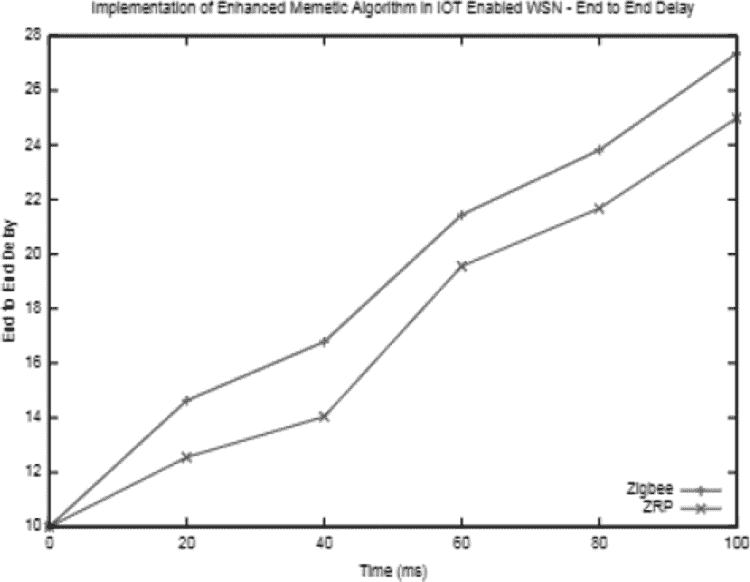

**图. 3** 端到端延迟

**表 III** 能量消耗

| 时间 (ms) | 能量消耗 |
| --- | --- |
|  | Zigbee | ZRP |
| 0 | 100 | 100 |
| 20 | 80.32 | 77.80 |
| 40 | 76.43 | 74.56 |
| 60 | 74.24 | 71.72 |
| 80 | 71.39 | 68.79 |
| 100 | 68.34 | 65.97 |

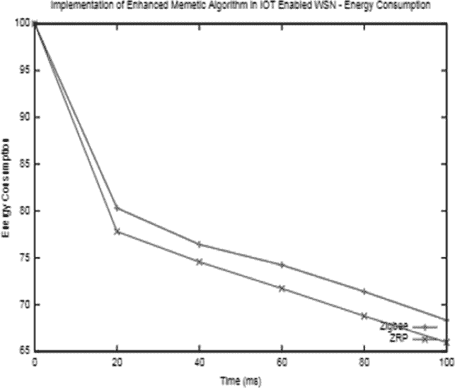

**图. 4** 能量消耗

**表 IV** 数据包投递率

| 时间 (ms) | 数据包投递率 |
| --- | --- |
|  | Zigbee | ZRP |
| 0 | 1.57 | 1.57 |
| 20 | 1.7625 | 1.7824 |
| 40 | 1.8254 | 1.8640 |
| 60 | 1.9354 | 1.9640 |
| 80 | 1.9952 | 2.0532 |
| 100 | 2.1089 | 2.1358 |

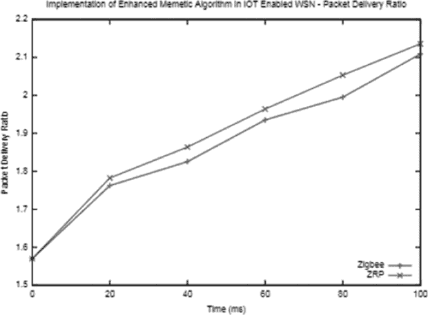

**图. 5** 数据包投递率

**表 V** 吞吐量

| 时间 (ms) | 吞吐量 |
| --- | --- |
|  | Zigbee | ZRP |
| 0 | 1.57 | 1.57 |
| 20 | 43.12 | 45.19 |
| 40 | 50.36 | 50.36 |
| 60 | 58.53 | 60.18 |
| 80 | 63.12 | 66.78 |
| 100 | 68.29 | 70.52 |

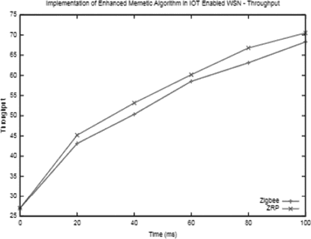

**图. 6** 吞吐量

**表 VI** 网络寿命

| 时间 (ms) | 网络寿命 |
| --- | --- |
|  | Zigbee | ZRP |
| 0 | 0 | 0 |
| 20 | 1500 | 2000 |
| 40 | 5200 | 6800 |
| 60 | 10250 | 12000 |
| 80 | 12090 | 14000 |
| 100 | 15035 | 16000 |

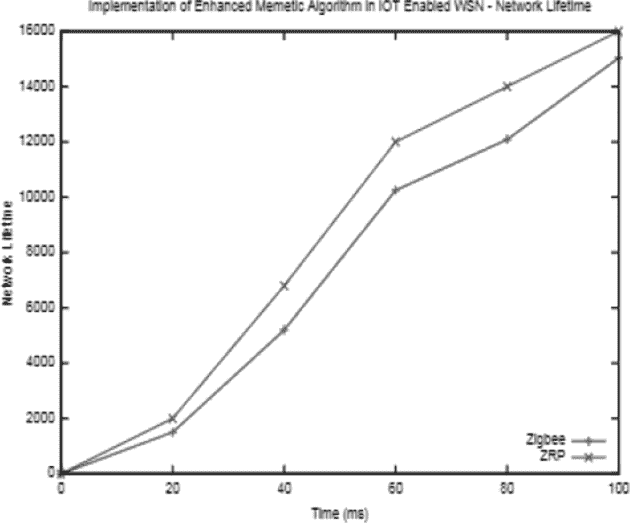

**图. 7** 网络寿命

**表 VII** 数据包丢失

| 时间 (ms) | 数据包丢失 |
| --- | --- |
|  | Zigbee | ZRP |
| 0 | 500 | 500 |
| 20 | 450.29 | 425.28 |
| 40 | 382.54 | 350.17 |
| 60 | 290.26 | 265.23 |
| 80 | 260.48 | 210.98 |
| 100 | 190.95 | 150.28 |

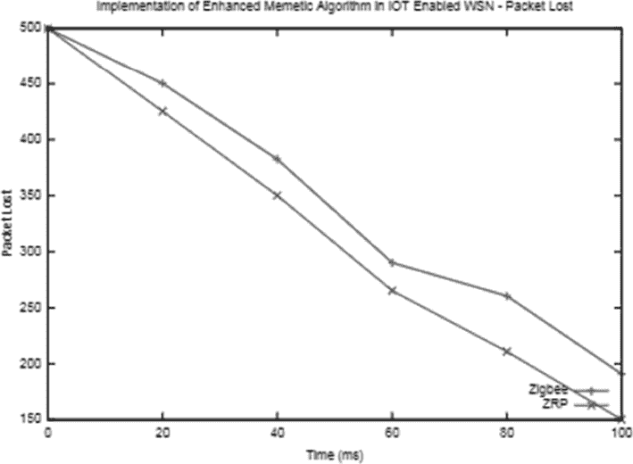

**图. 8** 数据包丢失

## VII. 结论

对于支持物联网的无线传感器网络，采用了一种基于移动基站的数据收集策略的遗传算法来提高网络性能。所提方法包含一种新的聚类策略，其中使用带有 Powell 共轭梯度机制的遗传算法来执行簇类节点（CH）选择和聚类构建。该方法显著地减少了聚类创建的消息开销。另一方面，带有 Powell 共轭梯度机制的遗传算法负责寻找合适的 `CHs` 数量，以最小化数据传输的能量损失。在所提方法中，移动基站选择最佳的数据收集通道从多个 `CHs` 收集数据，从而显著降低了端到端延迟。`RSA` 算法使用公密钥加密位，这对解密时间和加密系统强度有很大影响。这最终降低了网络遭受网络威胁或风险的可能性。我们展示了多种仿真结果来评估建议方案的性能。结果表明，该算法在吞吐量、网络寿命、能量消耗、数据包交付率、丢包和吞吐量方面优于现有方法。

## 参考文献

1. Chuan Zhu, Kangning Quan, Guangjie Han and Joel J.P.C. Rodrigues. “一种用于无线传感器网络的移动基站高可用位置预测数据收集方案”, Computer Networks, Vol. 145, November 2018.

2. Chunlin Li, Jingpan Bai, Jinguang Gu, Xin Yan and Youlong Luo. “基于混合整数规划的异构无线传感器网络聚类路由”, Ad Hoc Networks, Vol. 172, April 2018.

3. Gurbinder Singh Brar, Shalli Rai, Vinay Chopra, Rahul Malhotra, Houbing Song and Syed Hassan Ahmed. “用于无线传感器网络的基于方向的低能高效型 PDORP 路由协议”, IEEE Access, Vol. 4, June 2016.


### 参考文献

4. Jianhua Huang, Danwei Ruan and Weiqiang Meng. “一种基于环形扇区辅助的无线传感器网络能量高效多跳路由协议”, *Computer Networks*, Vol. 147, December 2018.

5. Jianhua Huang, Yadong Hong, Ziming Zhao and Yubo Yuan. “一种基于网格聚类的无线传感器网络能量高效多跳路由协议”, *Cluster Computing*, Vol. 20, June 2017.

6. Mbanaso, U. M. and Chukwudebe, G.A “分布式系统中物联网安全的需求分析”, *2017 IEEE 第三届国家发展电子技术国际会议 (NIGERCON)*, Ieee, Vol. 5, Issue 7, February 2018.

7. Moosa Ayati, Mohammad Hossein Ghayyoumi and Atiyeh Keshavarz-Mohammadiyan. “一种改进无线传感器网络寿命的模糊三级聚类方法”, *Annals of Telecommunications*, Vol. 73, March 2018.

8. Preetha, M. and Nithya, M “RSA 算法的研究与性能分析”, *International Journal of Computer Science and Mobile Computing*, Vol. 2, Issue. 6, June 2013.

9. Ranida Hamidouche, Zibouda Aliouat and Abdelhak Gueroui. “无线传感器网络基于遗传算法的低能高效聚类与路由”, *Springer, Mobile, Secure, and Programmable Networking*, January 2019.

10. Se-Ra Oh and Young-Gab Kim. “用于互操作性的物联网安全组件开发”, *2017 第 13 届国际计算机工程会议 (ICENCO)*, Vol. 12, Issue. 4, February 2018.

11. Yiqun Zhang, Li Xu, Qing Dong, Jingcheng Wang, David Blaauw, and Dennis Sylvester. “Recryptor: 用于物联网安全的具有存内和近内存计算的可重构加密内核-M0 处理器”, *IEEE Journal of Solid-State Circuits*, Vol. 9, Issue. 3, February 2018.
