# 权益证明：以太坊的诞生与区块链哲学


献我的爸爸妈妈，这对了不起且充满爱的父母，企业家和互联网迷因领主们。


## 引言
Nathan Schneider

在 19 岁时开始为互联网构建一种新的基础设施之前，在成为一个睡在朋友沙发上的亿万富翁之前，Vitalik Buterin 想要写作。他最初是在父亲的敦促下对 `Bitcoin` 产生了好奇，他时年随父亲从俄罗斯移民到了加拿大。在 2011 年，他并没有购买、借入或挖掘自己的第一枚硬币，而是在在线论坛上发帖问：有人愿意付 `Bitcoin` 给我钱来写关于它的文章吗？

有人答应了。随后 Buterin 一直写下去，直到共同创立了《比特币杂志》（*Bitcoin Magazine*），这是一本精美的印刷版和数字媒体，记录了当时一个非常小且无闻的亚文化的最新进展。这种新型、难以使用的货币对 Buterin 的吸引力超过了他在大学的第一年。从他开始当一名自封的记者起，他的思想在与人的不断对话中发展。然而，在多年来散落在各个博客、论坛和推特文中的文字中，他展现出了非常属于他自己的声音——部分也是因为这种声音，他围绕着自己发明的 `Ethereum` 建立了一群极其狂热的读者。如果 `Ethereum` 及其此类产品成为他们所追求的那种无处不在的基础设施，那么他的思想将需要更广泛地理解和质疑。

这本书是对作家身份 Vitalik Buterin 的介绍。

当匿名人物 `Satoshi Nakamoto` 在 2008 年全球金融危机的风暴中宣布 `Bitcoin` 的原型时，其目标是创建一种通过加密计算机网络组织的货币，而不是通过政府或银行。它将被称为加密货币。自由意志主义的金黄金狂热者和技术极客密码朋痴迷于该系统的比喻：数字挖矿、有限供应、像现金一样既安全又私密的交易。Buterin 拥有那个早期观众的所有直觉。但随着他对比 `Bitcoin` 的痴迷加深，到 2013 年底，他开始意识到其底层的 `blockchain` 技术可能是更伟大事物的基础：一种创建原生互联网的组织、公司和整个经济体的方法。于是他写了关于此的内容。最初是以太坊白皮书（作为附录包含）在当年年底出现时，点亮了当时仍然微小的加密货币宇宙。它不再依赖旧世界的公司、投资者和法律来管理服务器，而是默认由用户治理。它没有遵循 `Bitcoin` 关于黄金和矿山的比喻，`Ethereum` 的文化遵循了 Buterin 最喜欢的 T 恤的审美，以机器人、独角兽和彩虹作为首选的吉祥物。

自从 `Ethereum` 于 2015 年上线以来，出现了许多竞争性的区块链，每种都能以不同的方式完成类似的事情。`Ethereum` 仍然是其中最大的。尽管它的货币（被称为 `ether` 或 `ETH`）在总价值上远次于 `Bitcoin`，但如果你将在 `Ethereum` 之上构建的产品和社区代币的价值加起来，它产生了了这个奇新经济体中最大的份额。在项目的早期尝试期间，Buterin 变得越来越像 `Ethereum` 的“仁慈独裁者”（无论他是否喜欢），这不是因为任何正式职位，而是因为他所建立的信任。这里收集的著作是建立这种信任的核心。

在此过程中，Buterin 处于一个矛盾的空间。他希望能够实现对人类如何自我组织的激进重新构想，同时对人们选择如何使用这种力量保持严谨的不可知论。正如下文的文章所解释的那样，“可信中立”是一个系统设计原则，但也描述了他作为领导者所扮演的角色。从以太坊基金会（`Ethereum Foundation`）最早的人事决策到最新的高风险软件更新，尽管他尽力避免这样做，但他的领导力已与 `Ethereum` 本身难以区分。虽然 `Ethereum` 和此类系统是根据人性的自私的假设而设计的，但他看起来像是一个苦行者，除了开启一个加密驱动的未来外，似乎对自己没有任何其他特别的要求。


然而，没有任何能保证这将是一个值得拥有的未来。当布特林（Buterin）在 2014 年初于迈阿密的一场比特币会议上首次介绍以太坊时，在列出一系列用它构建的所有奇迹后，他以一个引用“天空网”（Skynet）的结尾——那是《终结者》电影中反叛人类创造者的人工智能。这是一个他会重复的笑话，而且像许多老调的笑话一样，它包含着警告。以太坊拥有着乌托邦、反乌托邦以及其之间的一切可能：

- 它通过限制虚拟代币的供应创造了人为稀缺；但这些代币使社区能够产生他们可以使用并控制的大量资本。
- 它排除了那些不能或不愿购买和交易风险互联网货币的人；它还刺激了新型治理系统的发明，以前所未有的包容性共享权力。
- 它为了维持自身的运行就消耗了大量的能量；而在政府拒绝这样做时，它也为碳排放和污染定价提供了新方法。
- 它产生了以挥霍而臭名昭著的新富阶，他们聚集在避税天堂并挤走了当地人；它也是一个无边界、用户所有的金融系统，任何拥有智能手机的人都可以使用。
- 它奖励了早期入场的精通技术的精英；它也提供了一个削弱主导科技公司的真实机会。
- 它在真正的实用物品经济出现之前就产生了一个投机性的金融系统；然而与股票市场相比，所有权掌握在创造价值的人手中。
- 它向几乎没有明显价值的数字收藏品倾注了巨额回报；结果是产生了一种支持开放文化制作和共享的新业务模式。
- 它承诺以牺牲后代为代价让早期采用者富有；它为那些后代留下了一组构建区块，其用途取决于那些进行构建的人。

阅读后续内容的读者必须记住这些矛盾并与之斗争，为他们自己和他们的社区确定哪些选项应该胜出。这些矛盾可能令人烦恼和痛苦，但也能提供动力。它们仍然足够“热烈”，可以被塑造成。

***

### 共识机制

任何像比特币或以太坊这样基于区块链的系统，核心都是共识机制。这是计算机同意一组公共数据并保护其免受操纵的过程——无论是比特币那样的交易列表，还是以太坊世界计算机的状态。没有中心权威的情况下达成共识并非易事。比特币使用一种名为“工作量证明”（proof of work）的机制，这意味着大量的计算机花费大量的能量解决数学题，是为了证明他们投入了维护系统安全的精力。这些计算机后面的人被称为“矿工”，他们为此获得报酬，并消耗了相当于一个国家规模的电力，产生了该水平消耗所需的碳排放。以太坊也采用了工作量证明，因为在当时缺乏功能性的替代方案。但甚至在上线之前，布特林就在谈论切换，等他的团队解决了技术小毛病后，切换到另一种机制：权益证明（proof of stake）。在权益证明中，用户通过持有代币而非计算力来证明自己的“利益相关”。能量消耗是极微的。如果代币持有者试图腐败系统，他们将失去质押的代币。

在本书中，共识机制既是系统设计，也是隐喻。它们唤起了这些散文所描绘的劳动、投入、信念和协调。它们也阐明了矛盾：创新与浪费、民主与财阀政治、充满活力的社区与无休止的不信任。就像机制本身一样，这些隐喻抵制理想主义，指出了即使是向往世界的局部要在现实世界中生存所必须的妥协。

这里包含的散文是与布特林一起挑选的，展示了他的一面：社会理论家和活动家，一个在边做边思考，并在过程中摸索后果的人。加密文化中主要是年轻、男性和特权阶级的环境，往往看起来与参与者声称试图解决的问题类型相去甚远。布特林反映了那种文化。他有时可以很技术化，但这里比他的其他写作要少，他的许多写作原本只是写给同为开发者看的。技术部分回报了理解它们所需的付出的努力；即使在使用公式时，他也是亲切、清晰且幽默的。

散文为了风格的一致性经过了轻微编辑。删除了在自成体系的书中无法访问的超链接引用。由于它们最初是为具有共同亚文化的读者编写的，因此这里的散文偶尔包含了对加密圈之外可能不而易见的引用的编辑注释。

随着加密货币开始进入主流经济生活，关于是否需要将这个精灵放回瓶子的辩论正变得日益激烈，如果那仍然是可能的话。也许通过阅读这本书，那些最初关注“是否”的人会发现自己和布特林一起，更多地转向不断发展的“如何”的问题。如果这真的是新社会基础设施的开始，我们现在围绕加密货币发展的政治和文化习惯在未来将产生巨大的影响。正如布特林的反思所示，“如何”仍然是一个非常开放的问题。

## 第一部分：预挖（PREMINING）

布特林在 2014 年 1 月的一个博客中提到，他写以太坊白皮书是在“11 月金山的一个冷日子，那是几个月思考和经常令人沮丧工作的结晶”。

“预挖”指的是在区块链公开之前创建代币。通过根据以太坊白皮书出售预挖的 ETH，布特林和他的早期合作者筹集了超过 180 万美元的比特币。这创下了当时最大在线众筹的记录——此后大部分被在以太坊本身上众筹的项目超过。面对想要建立营利公司的年长、经验丰富的合作者的压力，布特林坚持通过非营利基金会建立以太坊。但这并非慈善。如果其中任何部分奏效，他和他的联合创始人将从他们预挖代币的价值中获得巨大收益。

这些散文追踪了布特林从一个网络自由意志支持者到一个务实的、大帐篷基础设施构建者的演变。起初他为当时涌出的比特币相关项目喝彩；今天只有极少数项目仍然存在。后期更清醒的《论孤岛》（On Silos）显示出布特林不愿在任何单一项目中寻找答案。布特林认为，让人们从根本上重写社会契约，需要不忠于任何单一意识形态的工具。


到目前为止，激励生产性活动的问题本质上一直由两类主要的解决方案主导：市场和机构。纯粹形式的市场是完全去中心化的，由近乎无限的代理人组成，他们都通过一对一的互动相互参与，每次互动都让双方参与者的状况变得比之前更好。相比之下，机构本质上是自上而下的；机构拥有某种治理结构，用于决定在任何给定时刻最有用的活动是什么，并分配奖励以让人们去执行这些活动。机构的中心化使其能够激励产生造成数万甚至数百万受益的公共物品生产，即使对每个人的益处微乎其微；另一方面，正如我们所知的，中心化也有其自身的风险。在过去的一万年里，这两个选项基本上就是我们拥有的全部。然而，随着 `Bitcoin` 及其衍生品的出现，这一切可能即将发生变化，我们实际上现在可能正在见证第三种激励形式的黎明：货币。

## 硬币的另一面

在标准的叙述中，货币对社会有三个基本功能。它作为**交换媒介**，允许人们用货币买卖商品，而无需寻找一个同时恰好拥有你想要的东西、又恰好想要你有的东西的人进行物物交换；作为**价值尺度**，允许人们在不同的时间进行生产和消费；以及作为**记账单位**，或者说是人们用来衡量恒定“生产数量”的尺子。然而，许多人并没有意识到，货币还扮演了第四种角色，而且这个角色的意义在历史的大部分时间里都被了：**铸币收益**。

铸币收益可以正式地定义为货币的市场价值与其内在价值之间的差额——即如果没有人将其作为货币使用，该货币本将拥有的价值。对于像谷物这样的古代货币，铸币收益基本上为零；然而，随着经济和货币变得越来越复杂，这种由货币凭空产生的“幻影价值”似乎变得越来越大，最终达到这样一个程度：即在 `dollar` 和 `bitcoin` 等现代货币的情况下，铸币收益代表了货币的全部价值。

但铸币收益去哪里了呢？对于基于自然资源的货币（如 `gold`），大部分价值直接流失了。每一克黄金的产生都是通过矿工的生产；起初，一些矿工确实获得了利润，但在高效的市场中，所有容易获得的机会都会迅速被占据，生产成本接近于收益。当然，还有一些巧妙的方法仍然可以从黄金中提取铸币收益；例如，在古代社会，国王会铸造金币，这些金币的价值比普通黄金高，因为金币包含了国王的一个隐含承诺，即它们不是伪造的。然而，通常价值不会属于某个特定的个人。在 `US dollar` 的情况下，我们看到了的改进：部分铸币收益流向 `US government`。这在许多方面是进步的一大步，但在其他方面，它也是一场未完成的革命——货币在获得中心化铸币收益收益的同时，也通过将其植入人类历史上最大的中心化机构之一的核心而获得了其风险。

## 比特币的出现

五年前，一种新货币 `Bitcoin` 出现了。在 `Bitcoin` 的情况下，就像 `dollar` 一样，货币的价值是 100% 的铸币收益；一个 `bitcoin` 没有内在价值。但铸币收益去哪里了呢？答案是，一部分进入了矿工的手作为利润，另一部分用于资助矿工的支出——即维护 `Bitcoin` 网络费用。因此，在这种情况下，我们拥有一种货币，其铸币收益直接用于资助公共物品，即 `Bitcoin` 网络本身的安全性。其重要性被严重低估了；在这里，我们拥有一种激励机制，其铸币收益直接资助了一个公共物品，即 `Bitcoin` 网络本身的安全性。其重要性被极大地低估了；在这里，我们拥有一种去中心化的、无需权威或控制的激励机制，通过人们之间作为交换媒介和价值尺度的使用产生了一种公共物品。从那里开始，我们看到了 `Primecoin` 的出现，它是第一种尝试将其铸币收益用于自身之外用途的货币：与其让矿工计算无用的 `SHA256` 哈希值，`Primecoin` 要求矿工寻找素数 `Cunningham chains`，从而支持了一种非常狭的科学计算。而且由于这种货币在人们之间作为交换媒介和价值尺度的使用产生了一种公共物品，它的价值迅速上升，尽管它对每个用户的实际益处（60 秒区块时间）被许多它更晦晦的货币所共有，但它目前仍是第十种流行的货币。


几个月后，在 12 月，我们看到了一种更加古怪且成功令人惊讶的货币：`Dogecoin`。`Dogecoin`（符号为 `DOGE`）在技术层面上 `Litecoin` 几乎完全相同；唯一的区别是最大供应量为 1000 亿而非 8400 万。但尽管如此，这种货币的市值曾达到超过 14 亿美元，使其成为世界第六大货币，并甚至被 `Business Insider` 和 `Vice` 提到。那么 `DOGE` 有什么特别的？本质上是网络迷因。“Doge”是“dog”的俚语，最早出现在 2005 年 `Homestar Runner` 的木偶剧中，从那时起作为全球现象流行起来，并伴随着在彩色的 `Comic Sans` 字体下使用“wow”、“so style”和“such awesome”等短语。这种迷因代表了 `Dogecoin` 的全部形象；它所有的社区网站和论坛，包括官方的 `Dogecoin` 网站以及强制性的 `Bitointalk` 发布帖


总的来说，这些示例表明，替代货币的采用几乎完全取决于草根营销；没有人会因为推销员上门门就接受 `Bitcoin`、`Primecoin`、`Dogecoin` 或 `Ven`，也不会仅仅为了说服他们接受它们。决定货币吸引力的不仅仅是技术上的优越性——理念也同样重要。正是 `Bitcoin` 的理念说服了 `WordPress`、**Mega** 以及现在的 `Overstock` 接受 `Bitcoin`；可以说，出于同样的原因，`Ripple` 作为一种支付方式，尽管在商户技术上优于 `Bitcoin`（特别是五秒的确认时间），但到为止尚未获得太大关注——因为它作为一种由公司发行自身 100% 供应量并支持的半中心化协议，对许多追求公平和去中心化的加密货币爱好者来说缺乏吸引力。而现在，是 `Primecoin` 和 `Dogecoin` 的理念——分别是支持科学和支持趣味——让这两种货币得以存续。

### 加密货币作为经济民主

这四个例子，结合这种“影子铸币税价值”的概念，构成了一个潜在的新型“经济民主”蓝图：可以建立一种其铸币税（或发行）用于支持某些事业的货币，人们可以通过在业务中接受某些货币来对这些事业进行投票。如果没有自己的业务，可以参与营销活动，并游说其他企业接受该货币。有人可以创建 `SocialCoin`，这种货币每月向世界上每一个人发放一千单位，如果有足够的人喜欢这个主意并开始接受，世界现在就拥有了一个公民股利计划，且不需要中心化的资金。我们还可以创建货币来激励医学研究、太空探索甚至艺术；事实上，今天已经有艺术家、播客和音乐家考虑为了这一特定目的创建自己的货币。

在一种特定的公共物品——计算研究案例中，我们实际上可以更进一步，让分配过程自动发生。计算研究可以通过一种在现实世界中尚未看到任何实质应用、但已被 `Peercoin` 和 `Primecoin` 发明者 `Sunny King` 理论化的机制来激励：“卓越证明”（proof of excellence）。“卓越证明”背后的想法是：一个人在货币去中心化投票池中的持仓大小以及获得的奖励，不是基于其拥有的计算能力或已拥有的货币数量，而是基于其解决复杂数学或算法挑战的能力，而这些挑战的解决方案将造福全人类。例如，如果有人想激励数论研究，可以将 `RSA` 整数分解挑战插入货币中，并让该货币提供五万单位，外加在挖矿过程中对有效区块进行投票的权利，自动提供给第一个提供问题解决方案的人。从理论上讲，这甚至可以成为任何货币发行模型中的标准组件。

当然，以这种方式使用货币的想法并不新；在当地社区内运行的“社会货币”已经存在了一个多世纪。然而，在最近过去的几十年里，社会货币运动较 20 世纪初的巅峰时期有所下降，主要因为社会货币未能实现超越局限范围的影响，而且它们没有从美元等更成熟的货币所吸引的银行系统效率中获益。然而，随着加密货币的出现，这些反对突然消失了——加密货币本质上是全球性的，并且受益于直接嵌入其源代码的极其强大的数字银行系统。

### 以太坊：下一代加密货币和应用平台

**比特币杂志** (Bitcoin Magazine)
*2014 年 1 月 23 日*

在过去的一年里，关于所谓的“比特币 2.0”协议的讨论越来越多——这些受比特币启发的替代性加密网络，旨在让底层技术用于远不止货币的领域。这一理念最早的实现是 `Namecoin`，这是一种在 2010 年创建的类似于比特币的货币，用于去中心化的域名注册。最近，我们看到了 `colored coins` 的出现，允许用户创建货币，以及更先进的协议如 `Mastercoin`、`BitShares` 和 `Counterparty`，它们旨在提供金融衍生品、储蓄钱包和去中心化交易所等功能。然而，到为止，所有发明的协议都是专门的，试图针对特定行业或应用提供详细的功能集。现在，包括我在内的一组开发者提出了一个走相反相反路线的项目：一个旨在尽可能通用的加密货币网络，允许任何人为几乎任何目的在上方创建专门的应用程序。这个项目就是：`Ethereum`。

### 加密货币协议像洋葱 . .

许多加密货币 2.0 协议中的一个共同设计理念是：就像互联网一样，加密货币的设计如果协议拆分成不同的层，效果会最好。在这种思路下，`Bitcoin` 可以被视为加密货币生态系统的某种 `TCP/IP`，其他下一代协议可以构建在比特币之上，就像我们用于电子邮件的 `SMTP`、用于网页的 `HTTP` 以及用于聊天的 `XMPP` 都构建在作为共同底层数据层的 `TCP` 之上。

到为止，遵循这种模型的三个主要协议是 `colored coins`、`Mastercoin` 和 `Counterparty`。`colored coins` 协议的工作原理很简单。首先，为了创建 `colored coins`，用户将特定的 `bitcoin` 标记为特殊含义；例如，如果 `Bob` 是黄金发行者，他可能希望标记一组 `bitcoin` 并说每个 `satoshi` 代表可以从他那里兑取的 0.1 克黄金。协议随后通过 `blockchain` 追踪这些 `bitcoin`，通过这种方式就可以计算出任何时候谁拥有它们。


Mastercoin 和 Counterparty 相对更加抽象；它们使用 `Bitcoin` 块链来存储数据，因此一个 `Mastercoin` 或 `Counterparty` 交易本质上就是一个 `Bitcoin` 交易，但这些协议以完全不同的方式解释这些交易。你可以拥有两个 `Mastercoin` 交易，一个发送 `1 MSC`，另一个发送 `100,000 MSC`，但对于一个不知道 `Mastercoin` 协议如何工作的 `Bitcoin` 用户来说，它们看起来都像是发送 `0.0006 BTC` 的小额交易；`Mastercoin` 特有的元数据被编码在交易的输出中。随后，`Mastercoin` 客户端需要在 `Bitcoin` 块链中搜索 `Mastercoin` 交易，以确定当前的 `Mastercoin` 资产负债表。

我个人曾有幸直接与许多彩色币（colored coins）和 `Mastercoin` 协议的创始人进行交流，并深度参与了这两个项目的开发。然而，在经过了大约两个月的研究和参与后，我最终意识到：虽然在低层协议之上构建此类高层协议的理念是值得赞的，但就目前的实现方式而言，它们存在根本性的缺陷，这很可能导致这些项目无法获得除微小关注之外的任何进展。

原因并不是协议背后的理念本身不好；这些理念非常出色，单是社区的反响就证明了他们正在尝试一些非常需要的事情。相反，原因在于他们试图在其之上构建高层协议的低层协议——`Bitcoin`，根本无法胜任这项任务。这并不是说 `Bitcoin` 不好，或者它不是一项革命性的发明；作为一种存储和传输价值的协议，`Bitcoin` 是卓越的。然而，作为一种有效的低层协议，`Bitcoin` 的效率较低；它并不像一个可以在上面构建 `HTTP` 的 `TCP`，`Bitcoin` 更像是一个 `SMTP`：一种擅长其预定任务（在 `SMTP` 中是邮件，在 `Bitcoin` 中是货币）的协议，但作为其他任何的基础并不特别出色。

### Bitcoin 的可扩展性

`Bitcoin` 的特定失败特别集中在一个地方：可扩展性。`Bitcoin` 本身的扩展性已经达到了加密货币所可能的极限；即使区块链膨胀到 1TB 以上，`Bitcoin` 白皮书中也描述了一种名为“简化支付验证”（SPV）的协议，允许只有几兆字节带宽和存储的“轻量级客户端”安全地确定它们是否收到了交易。

然而，对于彩色币和 `Mastercoin` 来说，这种消失了。原因在于：为了确定彩色币的颜色，你不能仅仅使用 `Bitcoin` 简化支付验证来证明它的存在；你还需要一直追溯到它的源头，并在每一步都进行 `SPV` 检查。有时，这种回溯扫描是指数级的；对于元币协议（metcoin protocols），如果不验证每一笔交易，就无法获取任何信息。

### 以太坊的愿景

这正是 `Ethereum` 想要修复的。`Ethereum` 并不打算做一个拥有数百种功能以适应所有需求的瑞士军刀协议；相反，`Ethereum` 目标是成为卓越的基础协议，允许其他去中心化应用构建在其之上而非 `Bitcoin`，为它们提供更多工具，并让它们充分获得 `Ethereum` 可扩展性和效率的优势。

 联系方式，而不仅仅是差异

在 `Ethereum` 开发期间，人们对在加密货币之上实现金融合约产生了浓厚兴趣；基础合约类型是“差价合约”（contract for difference）。在差价合约中，双方同意投入某些资金，然后根据某些底层资产价值的比例提取资金。例如，一个 `CFD` 可能让 Alice 投入 1000 美元，Bob 投入 1000 美元，如果价格每上涨 1 美元，合约将向 Alice 返回 1000 美元加上 100 美元。这些合约允许人们以高杠杆进行投机，或者通过抵消敞口来保护自己免受加密货币波动的影响。

到目前已经很清楚，差价合约只是一个更广泛概念的特例：公式合约。与其说是让合约从 Alice 处获取 $x$，从 Bob 处获取 $y$，然后根据某个代币每上涨 1 美元就向 Alice 返回额外的 $z$；如果公式允许随机数据作为输入，这些通用的 `CFD` 甚至可以用于点对点的赌博。

`Ethereum` 取了这一想法并将其推了一进一步。合约不再是双方之间开始和结束的协议，`Ethereum` 中的合约就像是由区块链模拟的某种自主代理。每个 `Ethereum` 合约都有自己的内部脚本代码，每当有交易发送到它时，脚本代码就会被激活。脚本语言可以访问交易的价值、发送者和可选数据字段，以及一些区块数据和内部内存作为输入，并可以发送交易。制作一个 `CFD`，Alice 会创建一个合约并为其注入价值 1000 美元的加密货币，然后等待 Bob 通过发送同样 1000 美元的交易来接受合约。随后，合约将被编程启动计时器，三十天后 Alice 或 Bob 能够向合约发送一个小交易以再次激活它并释放资金。

使用高级语言编写的以太坊货币代码示例：

```
if tx.value < 100 * block.basefee:
    stop

if contract.memory[1000]:
    from = tx.sender
    to = tx.data[0]
    value = tx.data[1]
    if to <= 1000:
        stop
    if contract.memory[from] < value:
        stop
    contract.memory[from] = contract.memory[from] - value
    contract.memory[to] = contract.memory[to] + value
else: contract.memory[mycreator] = 10000000000000000 contract.memory[1000] = 1
```

然而，在这种狭义的差价合约模型之外，白皮书概述了通过 `Ethereum` 脚本将可能许多其他交易类型，其中几种包括：

- 多签名托管：精神与 `Bitcoin` 的仲裁服务 `Bitrated` 类似，但规则比 `Bitcoin` 更复杂。例如，签名者不需要手动传递带有部分签名的交易；人们可以在区块链上一个接一个、异步地授权提款，一旦足够的人通过了授权，交易就会自动完成。


### 储蓄账户

一种有趣的设定方式如下：假设 Alice 想要存储大量资金，但不想在私钥丢失或被盗时面临损失所有资金的风险。她与 Bob（一家半信任的银行）签署了一份合约，规则如下：Alice 每天最多可以提取 1 个；在获得 Bob 批准的情况下，Alice 可以提取任何金额；而 Bob 个人每天最多可以提取 0.05 个。

通常情况下，Alice 每次只需要小额资金，如果她想要更多，她可以向 Bob 证明自己的身份并进行取款。如果 Alice 的私钥被盗，她可以跑向 Bob，并在小偷带走超过 1 个资金之前将资金转移到另一个合约。如果 Alice 丢失了私钥，Bob 最终能够找回她的资金。如果 Bob 事实证明是坏的，Alice 提取自己资金的速度可以比他快二十倍。简而言之，它拥有传统银行的所有安全性，但几乎不需要任何信任。

### 点对点赌博

任何类型的点对点赌博协议都可以在以太坊之上实现。一个非常基础的协议可以是基于随机数据（如区块哈希）的差价合约。

### 创建你自己的货币

使用以太坊的内部内存存储，你可以在以太坊内部创建一个全新的货币。这些新货币可以被构建为相互交互、拥有去中心化交易所，或任何其他类型的先进功能。

这就是以太坊代码的优势：因为其脚本语言设计为除了费用系统外没有任何限制，本质上任何类型的规则都可以编码在其中。人们甚至可以让一整个公司在区块链上管理其储蓄，通过合约规定，例如，移动任何资金需要公司现有六十名股东的同意（也许其中三十人每天最多可以移动 1 个）。其他、较不符合传统资本主义的结构也是可能的；一个想法是建立一个民主组织，其唯一规则是小组现有成员的三之二必须同意邀请另一名成员。

### 金融之外

然而，金融应用仅触了以太坊以及以太坊之上的加密协议所能做的事情的一角。虽然以太坊的金融应用可能是最初让加密货币社区许多人兴奋的内容，但其长期承诺可能在于以太坊如何与其他非金融点对点协议协同工作。非金融点对点协议到今为止面临的主要问题之一是缺乏激励——也就是说，与中心化的营利平台不同，没有参与的财务理由。在某些情况下，参与在某种意义上就是其奖励；这就是为什么人们继续编写开源软件、为维基百科贡献力量、在论坛评论以及写博客文章。但在点对点协议的背景下，参与通常并不是任何有意义的“有趣”活动；相反，它是由投入大量资源、让守护进程在后台运行（可能会占用 CPU 和电量）并忘记它。

例如，长期以来已经存在数据协议，如 `Freenet`，它们本质上为所有人提供了去中心化的、不可审查的静态内容托管；但在实践中，`Freenet` 非常慢，而且很少有人贡献资源。文件共享协议都面临相同的问题：尽管利他主义是好的，但它不足以维持一个大规模网络的运行。

### 激励数据存储

本质上是一个 Dropbox。该想法运作如下：如果用户想要让网络备份 1 GB 数据，他们将构建一种名为 Merkle 树的数据结构。然后他们会将树根同 10 个 ether 一起放入合约，并给提供该分支的第一个节点 0.01 ether。

### Bitmessage 和 Tor

Bitmessage 是一种下一代电子邮件协议，它既完全去中心化又是加密的，允许任何人安全地向任何其他 Bitmessage 用户发送消息，而无需依赖任何第三方。然而，Bitmessage 有一个巨大的可用性缺陷：你不需要发送消息到人类易读的电子邮件地址（如 `myname@email`），而是需要发送到乱码的 34 位 Bitmessage 地址（例如 `BM-BcbRqcFFSQUUmXFKsPJgVQPSiFA3Xash`）。以太坊合约提供了解决方案：人们可以在以太坊合约上注册名称，Bitmessage 客户端可以查询以太坊区块链以获取与名称相关的 34 位 Bitmessage 地址。在线匿名网络 `Tor` 也面临相同的问题，因此也可以从这种解决方案中受益。

## 身份与声誉系统

一旦你可以在区块链上注册名称，逻辑下一步就显而易见了：在区块链上建立信任网。信任网是有效的点对点通信基础设施的关键部分：你不仅想知道某个公钥是否指向某个特定，你还想知道这些人最初是否是值得信任的。解决方案是使用社交网络：如果你信任 A，A 信任 B，B 信任 C，那么你很有可能也可以信任 C，至少在某种程度上是如此。以太坊可以作为完全去中心化声誉系统的数据层——并最终可能实现一个完全去中心化的市场。


为什么所有这些应用在以太坊上都是可能的？答案在于这种货币的内部编程语言。这里可以与互联网进行类比。在 1996 年，Web 仅仅是 HTML，人们能做的只是在像 GeoCities 之类的网站上提供静态网页。然后，开发者们认为人们迫切需要在 HTML 中提交表单，于是 HTML 增加了表单功能。这就像网络协议中的“彩色硬币（colored coins）”：试图解决特定问题，但在不考虑大局的情况下在弱性协议之上进行操作。然而，很快我们想出了 JavaScript，一种在 Web 浏览器内部的编程语言。是 JavaScript 解决了这个问题：因为 JavaScript 是一种通用的、图灵完备的编程语言，它可以用于构建任意复杂度的应用程序；Gmail、Facebook 甚至比特币钱包都是用这种语言制作的。这并不是因为 JavaScript 开发者决定想要人们构建 Gmail、Facebook 和比特币钱包；他们只是想要一种编程语言。我们用这种语言能做什么取决于我们自己的想象。这正是我们想要带到以太坊的精神。以太坊并不打算成为所有加密货币创新的终点；它意在成为开始。

## 进一步创新

除了图灵完备的通用脚本语言这一主要特性外，以太坊相对于现有的加密货币还具有许多其他改进：

- **费用**：以太坊合约将通过为脚本执行的每个计算步骤设立交易费用，来监管其图灵完备的功能，并防止诸如内存大户和无限循环脚本的滥用交易。更昂贵的操作（如存储访问和加密操作）将产生更高的费用，而且合约填充的每一个存储项都将收费。为了鼓励合约进行清理工作，如果一个合约减少了它所使用的存储量，则将收取负费用；事实上，有一个特殊的 `SUICIDE` 操码可以清除合约，并将所有资金和巨额的负费用发回给其创建者。
- **挖矿算法**：人们对制作挖矿能够抵御特种硬件的加密货币产生了浓厚兴趣，这使得拥有使用廉价硬件的普通用户无需任何资本投入即可参与，并有助于避免中心化。到目前为止，主要的应对方案是 `Scrypt`，这是一种需要大量计算能力和内存的挖矿算法；然而，`Scrypt` 的内存硬性不够（memory-hard），已经有公司为它构建专用设备。我们想出了 `Dagger`，一种比 `Scrypt` 更加内存硬性的原型工作量证明，以及诸如 `Slasher` 这样的原型权益证明算法，它们从根本上规开了挖矿问题。但归结底，我们打算举办一次竞赛，类似于决定 `AES` 和 `SHA3` 标准的竞赛，我们邀请世界各地大学的研究小组设计出最理想的友好廉价硬件的挖矿算法。
- **GHOST**：`GHOST` 是由 Aviv Zohar 和 Yonatan Sompolinsky 开创的一种新型区块传播协议，它允许区块链拥有更快的区块确认时间，理想情况下在三到三十秒之间，而不会遇到快速区块确认通常带有的中心化和高过期块率问题。以太坊是首个将 `GHOST` 的简化单层版本作为其协议一部分的主流货币。

## 计划

以太坊可能是一项巨大且影响深远的工程，需要几个月的时间来开发。考虑到这一点，该货币将分阶段发布。第一阶段，发布白皮书已经完成。论坛、wiki 和博客已经建立，任何人都可以访问这些网站、设置账户并在论坛上发表评论。1 月 25 日，一场为期 60 天的融资活动将在迈阿密的会议上启动，在此期间，任何人都可以用 `BTC` 购买以太坊的内部货币 `ether`，就像 Mastercoin 的融资活动一样；价格将为 `1 BTC`get `1,000 ETH`，尽管早期投资者将获得大约 `2x` 的收益，以补偿他们因更早参与项目而承担的增加风险。融资参与者不仅将获得 `ether`；还将获得一些额外的奖励，可能包括免费的会议门票、在创世区块中放置 32 字节数据的机会，以及对于顶级捐赠者，甚至有为货币的三个子单位命名的权利（例如 `BTC` 中的“微比特币”）。

以太坊的发行不会是任何单一机制；而是将采用结合了多种方法优势的折中方案。发行模型将如下运行：

`Ether` 将融资活动中以每 `1 BTC` `1,000` 到 `2,000 ETH` 的价格发布，早期资金者将获得更好的价格，以补偿在早期阶段参与所增加的不确定性。最低资金金额为 `0.01 BTC`。假设有 `x ETH` 通过这种方式发布：

- `0.225x ETH` 将分配给在融资活动开始前实质参与项目的受托成员和早期贡献者。这部分资金将存储在时间锁合约中；约 40% 在一年后可以使用，两年后可以使用 70%，三年后可以使用 100%。
- `0.05x ETH` 将分配给一笔基金，用于在融资活动开始到货币发布期间以 ether 支付费用和奖励。
- `0.225x ETH` 将作为长期储备池，用于在货币发布后以 ether 支付费用、工资和奖励。
- 在此之后，每年将挖出 `0.4x ETH`。

与比特币和其他大多数其他加密货币相比，这里有一个重要的区别：在这里，最终供应是无限的。“永久性线性通胀”模型旨在使 ether 既不是通货膨胀也不是通缩；缺乏供应上限旨在缓解现有货币的一些投机和财富不平等效应，但同时，由于是线性而非传统的指数级通胀模型，意味着有效通胀率随时间推移趋于零。此外，由于初始货币供应不是从零开始，在前八年的货币供应增长实际上会比比特币慢，这为融资参与者和早期采用者提供了在中期获得巨大利益的机会。

在 2 月份的某个时候，我们将发布一个中心化测试网——一个任何人都可以用它发送交易和创建合约的服务器。不久之后，去中心化测试网也将推出，我们将用它测试不同的挖矿算法，确保点对点守护程序运行正常且安全，并进行测量以寻找脚本语言的优化方案。最后，当我们确定协议和客户端安全后，我们将发布创世区块并允许挖矿开始。

## 展望


由于以太坊包含了图灵完备的脚本语言，从数学上可以证明，它基本上可以做到任何基于区块链的加密货币可能做到的事情。但目前的协议仍留了一些未解决的问题。例如，以太坊没有为所有基于区块链的加密货币的根本可扩展性问题提供解决方案——即每个全节点都必须存储整个负债表并验证每笔交易。以太坊借用 Ripple 的独立“状态树”和“交易列表”概念在某种程度上缓解了这个问题，但终究没有实现任何根本性的突破。对于这一点，需要诸如 Eli Ben-Sasson 正在开发的安全计算完整性与隐私（SCIP）等技术。

此外，以太坊没有对带有所有缺陷的传统工作量挖矿提供任何改进，而且“卓越证明”和 Ripple 式共识尚未被探索。如果事实证明权益证明或其他某种工作量算法是更好的解决方案，那么未来的加密货币可能会使用如 `MC2` 和 `Slasher` 等权益证明算法。如果以太坊 2.0 有空间，那么改进将出现在这些领域。最终，以太坊是一个开放式项目；如果项目获得足够的资金，我们甚至可能自己发布以太坊 2.0，将原始账户余额转移到进一步改进的网络上。最终，正如我们对货币本身的口号一样，唯一的限制是我们的想象力。

## 自执行合约与事实法

**2014 年 2 月 24 日**

我们在以太坊领域推广的许多概念可能看起来具有未来感，有时甚至可能令人恐惧。我们谈论所谓的“智能合约”，它们可以自我执行，不需要任何机会让人类进行干预或参与；人们形成类似于“天空网”的“去中心化自治组织”，这些组织完全运行在云端，却控制着强大的财务资源，并激励人们在物理世界中做非常真实的事情；去中心化的“基于数学的法律”，以及对创造某种完全无信任社会的、看似乌托邦式的追求。对于不了解情况的用户，特别是对于那些甚至没有听过老旧比特币的人来说，很难理解这些事情是如何可能的，如果它们是可能的，为什么又可能是理想的。本系列的目的将详细剖析这些想法，并准确展示我们对每个概念的含义，同时讨论它们的属性、优点和局限性。

该系列的第一部分将讨论所谓的智能合约。智能合约是一个已经存在几十年的概念，但由 Nick Szabo 在 2005 年赋予了它目前的名称，并首次引起了（对密码学感兴趣的）公众关注。本质上，智能合约的定义很简单：智能合约是一种能够自我执行的合约。也就是说，普通合约是一张纸（或者最近的 PDF 文档），其中包含文本，这些文本隐式地要求法官在特定条件下命令一方向另一方发送金钱（或其他财产），而智能合约是一个运行在硬件上的计算机程序，可以自动执行这些条件。Nick Szabo 使用自动售货机举了例：

一个经典的现实生活案例（我们可以将其视为智能合约的原始祖先）是质朴的自动售货机。在有限的潜在损失（投入的金额）范围内，如果满足条件，机器就会发放产品。自动售货机是一个自我执行合约的物理实现。

## 智能合约

智能合约是将这一概念应用于广泛领域。我们可以有根据某些公式自动洗牌资金的金融合约、提供期限的销售订单，以及根据现实世界事件进行赔的保险合约。

## 智能属性

然而，此时出现了一个显而易的问题：这些合约将如何执行？就像传统合约一样，除非有权力支持的实际法官，否则它们并不值写下它们的纸张；智能合约需要“插进”某个系统中才能真正拥有力量。最明显且最古老的解决方案是硬件，这个想法也被称为“智能属性”。Nick Szabo 的自动售货机就是经典案例。在自动售货机内部，有一种某种原型智能合约，包含一组类似于这样的代码：

```python
if button_pressed == "Coca-Cola" and money_inserted >= 1.75:
    release("Coca-Cola")
    return_change(money_inserted - 1.75)
else if button_pressed == "Aquafina Water" and money_inserted >= 1.25:
    release("Aquafina Water")
    return_change(money_inserted - 1.25)
else ...
```

合约与外部世界有四个“钩子”：作为输入的 `button_pressed` 和 `money_inserted` 变量，以及作为输出的 `release` 和 `return_change` 命令。这四个项都取决于硬件，尽管我们关注的是后三个，因为人类输入通常被认为是一个微不足道的问题。如果合约运行在 2007 年的安卓手机上，它将是没用的；安卓手机不知道投入了多少钱，更无法释放可口乐或找零钱。相反，在自动售货机上，合约带有某种“强制力”，这种力量由自动售货机内部的可口乐储备以及其防止人们在不遵守合约规则的情况下直接拿可口乐的物理安全措施提供支持。

智能金钱与事实社会


然而，物理属性在功能上非常局限。物理属性的安全性有限，因此在智能属性的设置下，你实际上无法用超过几万美元的资金做任何有趣的事情。而且最终，最有趣的合约涉及资金转账。但我们究竟如何让这一切运行起来呢？目前，基本上做不到。理论上，我们可以给合约提供银行账户的登录详情，然后让合约在某些条件下发送资金，但问题是，这种合约并不是真正的“自我执行”。制定合约的一方始终可能可以在付款到期前简单地关闭合约，或者抽空他们的银行账户，甚至简单地更改账户密码。最终，无论合约如何集成到系统中，总有人有能力将其关闭。

## 我们该如何解决这个问题？

最终，答案对于我们在我们更广泛的社会背景下是激进的，但在比特币世界里已经是陈旧闻了：我们需要一种新类型的货币。到为止，货币的演变经历了三个阶段：商品货币、商品抵押货币和法币。商品货币非常简单：它之所以有价值，是因为它同时也是具有某种“内在”使用价值的商品。银和黄金是完美的例子，在更传统的社会中，我们还有茶、盐（词源注：薪水 salary 一词便源于此）、贝壳等。接下来是商品抵押货币——银行发行的证书因其可以兑换黄金而具有价值。最后，我们有了法币。“fiat money”中的“fiat”就像“fiat lux”（要有光）中的一样，只不过不是上帝说“要有光”，而是联邦政府说“要有钱”。这种货币之所以有价值，很大是因为发行它的政府接受这种货币（且仅接受这种）作为税收和费用的支付手段，并带有其他法律权利。

然而，通过比特币，我们有了一种新货币：事实货币（factum money）。法币与事实货币的区别在于：法币是由政府（或理论上是某种其他机构）产生并维持的，而事实货币仅仅是存在。事实货币本质上是一张资产负债表，附有若干关于该资产负债表如何更新的规则，而这些钱在决定接受它的用户群体中是有效的。比特币是第一个例子，但还有更多。例如，可以拥有一种替代规则，规定只有来自特定“创世交易”的比特币才被视为资产负债表的一部分；这被称为“彩色币”（colored coins），也是一种事实货币（除非那些彩色币是法币或商品抵押货币）。

事实上，事实货币的主要承诺恰在于它与智能合约契合得如此完美。智能合约的主要问题是执行：如果合约规定当 X 发生时向 Bob 发送 200 美元，而 X 发生了，我们如何确保这 200 美元真的发送给了 Bob？事实货币的解决方案极其优雅：货币的定义，或者更准确地说，当前资产负债表的定义，是执行所有合约的结果。因此，如果 X 发生了，所有人都会同意 Bob 拥有额外的 200 美元；如果 X 没有发生，所有人都会同意 Bob 拥有他先前的钱。

这实际上比你最初想象的要具有革命性得多；通过事实货币，我们创造了一种让合约、甚至是整个法律能够运作并生效的方法，而无需依赖任何机制来强制执行它。想要对乱扔垃圾罚以百美元罚款吗？那么定义一种货币，让你在乱扔垃圾时少掉一百个单位，并说服人们接受它。现在，这个特定的例子非常牵强，而且在没有我们在下文中将讨论的几个重大限制的情况下可能是不行的，但它展示了通用原则，而且还有许多这种原则的温和例子绝对可以投入使用。

## 智能合约到底有多智能？

智能合约对于任何类型的金融应用，或者更广泛地说，对于两种不同事实资产之间的任何交换，显然都是非常有效的。一个例子是域名销售；像 `google.com` 这样的域名是一个事实资产，因为它由服务器上的数据库提供支持，而该数据库仅因为我们接受它才具有分量，钱显然也可以是事实性的。目前，销售域名是一个复杂的过程，通常需要专门的服务；在未来，你可能可以将一份销售要约封装进智能合约并将其置于区块链上，如果有人接受，交易的双方将自动发生——完全没有欺诈的可能性。回到货币世界，去中心化交易所是另一个例子，我们还可以进行对冲和杠杆交易等金融合约。

然而，智能合约在某些地方表现并不那么好。例如，考虑劳动合同的情况：A 同意为 B 执行某项任务，以支付 x 单位货币 C 作为回报。支付部分很容易合约化。然而，有一部分并不那么容易：验证工作是否真的发生了。如果工作发生在物理世界，这几乎是不可能的，因为区块链没有办法访问物理世界。即使是一个网站，仍然存在评估质量的问题，尽管计算机程序可以使用机器学习算法在某些情况下非常有效地判断此类特征，但在公共合约中这样做极其困难，因为会为员工“操纵系统”打开大门。有时，一个由算法统治的社会并不足够好。

幸运的是，有一种温和的解决方案可以兼得两者之长：法官。普通法院的法官拥有实质上的无限权力来做任何事，而且判决界面并不特别好；人们需要起诉、等待长时间的审判，最后由法官做出由法律系统执行的决定——而法律系统本身并非快速高效的典范。私营仲裁通常比法院更便宜、更快，但即使在那里问题仍然存在。相比之下，事实世界的法官则完全不同。一个就业智能合约可能像这样：

```
if says(B,"A did the job") or says(J,"A did the job")):
    send(200, A)
else if says(A,"A did not do the job") or says(J,"A did not do the job")):
    send(200, B)
```

`says` 是一个签名验证算法；`says(P,T)` 基本上检查是否有人提交了带有文本 `T` 的消息以及使用 `P` 的公钥验证的数字签名。那么，这个合约是如何运作的？首先，雇主会将 200 个货币发送到合约中，资金在那里托管。在大多数情况下，雇主和员工都是诚实的，所以要么 A 辞职并通过签署“A 没有完成工作”的消息将资金归还给 B，要么 A 完成了工作，B 验证 A 完成了工作，合约将资金发放给 A。然而，如果 A 完成了工作但 B 不同意，那么就由法官 J 来判定 A 是是完成了工作还是没有完成工作。


注意，`J` 的权力被非常仔细地界定；`J` 所拥有的权利仅仅是说 `A` 完成了任务或 `A` 没有完成任务。更复杂的合同可能还会赋予 `J` 在两个极端之间进行裁决的权利。`J` 没有权利说 `A` 实际上应该获得 600 个货币单位，或者顺便说整个关系是非法的，且 `J` 应该获得那 200 个单位，或者任何在明确定义的边界之外的事务。而 `J` 的权力通过 `factum` 执行——合同包含了 `J` 的公钥，因此资金将根据边界自动发送给 `A` 或 `B`。合同甚至可以要求三位法官中的两位法官提供信息，或者可以由不同的法官对工作的不同方面进行裁决，并让合同根据这些评分自动为 `B` 的工作分配质量分。任何合同都可以完全按照他们想要的方式接入任何法官，无论是为了判断特定事实的真伪、提供对某些 `variable` 的测量，还是作为促进安排的参与方之一。

### 这将如何比现有系统更好？

简而言之，这引入了“服务即法官”。现在，为了成为一名“法官”，你需要受雇于私人仲裁机构或政府法院，或者建立自己的机构。在一个由加密支持的 `factum` 法律系统中，成为法官只需要拥有一个公钥和一台连接互联网的计算机。尽管这听起来违背直觉，但并非所有法官都需要精通法律。某些法官可以专门从事某些领域，例如判断产品是否正确发货（理想情况下，邮政系统应该完成这一点）。其他法官可以验证劳动合同的完成情况。还有人会评估保险合同的损害赔偿。这取决于合同编写者在合同的合适位置接入各类型的法官，而合同中可以完全用计算机代码定义的部分将由代码实现。

就是如此。

## 关于孤岛化 (Silos)


许多人对加密货币领域目前方向提出的批评之一，是我们所看到的碎片化程度日益增加。早期可能是一个围绕开发 `Bitcoin` 通用基础设施的、更紧密结合的社区，现在现在日益成为一系列“孤岛”的集合，即各自独立运作不同事情的离散项目。有很多开发者和研究人员要么为 `Ethereum` 工作，要么以志愿者身份从事某些想法，并恰好花费大量时间与 `Ethereum` 社区互动，这群人已经形成了一个致力于构建我们特定愿景的群体。另一个准去中心化的集体 `BitShares` 也有了自己的愿景，他们结合了他们特定的 `DPoS` 组合，

一个经常由 `Bitcoin` 最大主义者和侧链支持者提出的观点是，这种碎片化对加密货币生态系统是有害的——我们不应该各行奔路并竞争用户，而应该在 `Bitcoin` 的共同旗帜下共同工作、合作。正如 Fabian Brian Crain 总结过的：

> 最近的一个进一步激化讨论的事件是侧链提案的发布。侧链的想法是允许山寨币进行无信任的创新，同时为它们提供与 `Bitcoin` 网络相同的货币基础、流动性和算力。

对于支持者来说，这代表了一项关键努力，旨在让加密货币生态系统汇聚在其最成功的项目周围，并在现有的基础设施和生态系统基础上进行构建，而不是将精力分散在一百个不同的方向上。

即使对于那些不同意 `Bitcoin` 最大主义的人来说，这似乎也是一个相当合理的观点，而且即使加密货币社区不应该全部统一站在“Bitcoin”的旗帜下，人们也可以争论说，我们需要以某种方式共同站在一起，努力构建一个更统一的生态系统。如果 `Bitcoin` 强大到无法成为生活及一切的可行骨干，那么为什么不构建一个更好、更具扩展性的去中心化计算机并在其上构建一切呢？如果你是那种直觉上会被一个统治一切的提案吸引的人，那么 `Hypercubes` 似乎强大到值得为其效忠；而 `BitShares`、`Blockstream` 以及其他“孤岛”的成员通常也非常渴望相信他们自己的特定解决方案具有同样价值，无论这些方案是基于合并挖矿（merged-mining）、`DPoS` 加 `BitAssets` 还是其他。

那么为什么不呢？如果确实存在一种最好的共识机制，我们为什么不能在各种项目之间进行大规模合并，提出最优秀的去中心化计算机作为加密经济的基础并推进，并在一个统一的系统下共同前进呢？在某些方面，这似乎是高尚的；碎片碎片”确实具有不尽人意的属性，而认为“共同工作”是一件好事也是自然的。然而实际上，虽然更多的合作确实有用（本文稍后将描述如何做以及为什么），但对极端整合或赢者通吃的渴望在很大程度上完全是错误的——碎片化并不糟糕，而是不可避免的，而且可以说是该领域能够合理发展的唯一途径。

## 同意异议

为什么碎片化一直在发生？我们为什么应该继续让它发生？对于第一个问题同时也对于第二个问题，答案很简单：我们碎片化是因为我们意见分歧。特别是，考虑以下一些观点，我相信这些观点，但在很多情况下它们与许多人的哲学有本质区别：

- 我不认为弱主观性（weak subjectivity）
- 我认为 `Bitcoin` 在工作量证明上每年浪费的 6 亿亿电电力是一个完全的环境和经济悲剧。
- 我相信 `ASICs`
- 我认为 `Bitcoin`（或任何固定供应量的货币）波动性太大，无法成为稳定的价值尺度，并认为加密货币价格健康的路线是实验智能设计的灵活货币政策（即，不是“市场”或“比特币中央银行”）。然而，我不希望将加密货币货币政策置于任何中心化的控制之下。
- 与某些人相比，我拥有显著更多的反体制/自由意志主义/无政府主义心态，但比另一些人要少得多（顺便说，不是奥地利经济学家）。总的来说，我认为双方都有价值，并坚信通过外交手段和共同努力让世界变得更好。
- 我不支持在加密经济或任何地方存在“一种货币统治一切”的情况。
- 我认为代币销售是去中心化协议变现的一种极佳工具，认为那些直接攻击这一概念的人通过威胁夺走一件美好的事物而对社会不利。然而，我确实同意我们和其他其他小组目前实施的模式存在缺陷，我们应该积极尝试不同的对齐激励的模型。
- 我相信 `futarchy`
- 我认为经济学和博弈论是加密协议分析的关键部分，并认为加密货币社区主要的学术缺陷不是对高级计算机科学的无知，而是对经济学和哲学的无知。我们应该联系 [lesswrong.com](http://lesswrong.com)
- 我认为现实中人们采用去中心化技术（区块链、`whisper`、`DHTs`）的主要原因之一是软件开发者很懒，不想处理维护中心化网站的复杂性。


我认为“区块链即去中心化自治公司”这一比喻是有用的，但具有局限性。特别是，我认为作为加密货币开发者，我们应该利用这段加密货币仍然是一个由理想主义者控制的行业短暂时期，设计出能够最大化功利主义社会福利指标的制度，而非利润（不，这两者并不等同）。

可能极少数人会认同我上述提到的每一项内容。而且不仅仅是我，其他人也有自己的独特见解。另一个例子是， `Open Transactions` 的首席技术官 `Chris Odom` 说过这样的话：

> “我们需要的是用加密证明系统来取代受信实体。在 `Bitcoin` 社区中，你看到的任何必须信任的实体都会消失，将不复存在 . . . 中本的梦想是完全消除[受信]实体，要么完全消除风险，要么以一种在实际上消除了风险的方式来分配风险。”

与此同时，另一些人则觉得有说出这样的话：

> “换句话说，商业上可行的低信任网络不需要保护世界免受平台运营商的侵害。为了平台用户的利益，它们需要保护平台运营商免受世界的侵害。”

当然，如果你认为加密货币的主要收益是规避监管，那么第二段引言也有道理，但其方式与其原作者的意图完全不同——这再次证明了人们的思维方式是如此不同。有些人将加密货币视为一场资本主义革命，另一些人将其视为平等主义革命，而还有人认为它介于两者之间。有些人认为人类共识是一种非常脆弱且易被腐败的东西，而加密货币是一个可以用硬性数学来取代它的明灯之塔；另一些人则认为加密货币共识只是人类共识的延伸，通过技术变得更加高效。有些人认为实现加密资产与美元等值最好的方法是双币金融衍生品方案；另一些人则认为更简单的方法是使用区块链来代表对现实资产的权利（而还有人认为 `Bitcoin` 最终将比美元更稳定）。有些人认为可扩展性最好通过“向上扩展（scaling up）”来实现；另一些人则认为最终的最优方案是“向外扩展（scaling out）”。

当然，这些问题中的许多本质上是政治性的，有些涉及公共利益；在这些情况下，“互不干扰”并不总是一个可行的解决方案。如果某个特定平台产生了负外部性，或者威胁要将社会推入次优均衡，那么你不能简单通过使用自己的平台来“退出”。在这种情况下，某种由网络效应驱动的、甚至在极端情况下由 51% 攻击驱动的审查可能是必要的。

然而，在其他情况下，差异将以不同的方式解决：事实证明某些系统的属性更适合某些应用，而其他系统则更适合其他应用，一切将自然地专业化到最适合它的用例中。正如许多评论员所指出的，对于主流金融世界的去中心化共识应用，银行可能不愿意接受由匿名节点管理的网络；在这种情况下，像 `Ripple` 这样的工具会更有用。但对于 `Silk Road 4.0`，完全相反的方法是唯一的途径——而对于中间的所有情况，则完全都是成本效益分析。如果用户想要专门用于高效执行特定功能的网络，那么就会为此存在这样的网络；如果用户想要一个在链上应用之间具有高网络效应的通用网络，那也会存在。正如 `David Johnston` 所指出的，区块链就像编程语言：它们各自都有特定的属性，很少有开发者会虔诚地只固守一种语言——相反，我们会在最适合它的特定案例中使用每种语言。

## 合作空间

然而，正如前面提到的，这并不意味着我们应该仅仅自顾其路并试图忽略——或者更糟，积极破坏彼此。即使我们所有的项目都不可避免地向不同的目标专业化，但仍然有大量的机会可以减少重复劳动并加强合作。这在多个层面上都是如此。首先，让我们看看加密货币生态系统的模型——或者说，它是未来一到五年的愿景：

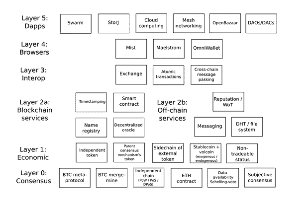

`Ethereum` 在几乎每一个层面都有自己的存在：

- **共识**：`Ethereum` 区块链、数据可用性 Schelling 投票（可能是为了 `Ethereum 2.0`）
- **经济**：`ether`，一种独立代币，以及对稳定币提案的研究
- **区块链服务**：名称注册
- **链外服务**：`Whisper`（消息）、信任网（进行中）
- **互操作性**：`BTC` 到 `ether` 的桥接（进行中）
- **浏览器**：`Mist`

现在，考虑其他几个试图构建某种整体性生态系统的项目。

`BitShares` 至少拥有：

- **共识**：`DPoS`
- **经济**：`BTSX` 和 `BitAssets`
- **区块链服务**：`BTS` 去中心化交易所
- **浏览器**：`BitShares` 客户端（尽管不是同概念的浏览器）

`MaidSafe` 拥有：

- **共识**：`SAFE Network`
- **经济**：`Safecoin`
- **链外服务**：分布式哈希表、`MaidSafe Drive`

`BitTorrent` 宣布了 `Maelstrom` 计划，旨在提供与 `Mist` 非常相似的功能，尽管展示的是他们自己的（基于区块链的）技术。加密货币项目通常都会构建自己的区块链、货币和客户端，尽管对于创新较少的案例，分叉单个客户端很常见。名称注册和身份管理系统现在已随处可见。而且，几乎几乎每个项目都意识到自己需要某种声誉和信任网。

现在，让我们描绘一个替代世界的景象。与其有一系列清晰分离、垂直整合的生态系统（每个系统都为一切构建自己的组件），想象这样一个世界：`Mist` 可以用来访问 `Ethereum`、`BitShares`、`MaidSafe` 或任何其他去中心化基础设施网络，新的去中心化网络可以像 `Chrome` 和 `Firefox` 中的 `Flash` 和 `Java` 插件一样被安装。想象 `Ethereum` 信任网中的声誉数据也可以在其他项目中用。想象 `Storj` 作为一个 dapp 在 `Maelstrom` 运行。

这里的关键洞察是：虽然生态系统中的某些层是不可分割的——例如，单个 dapp 通常对应于 `Ethereum` 区块链上的某个特定服务——但在许多情况下，这些层可以很容易被设计得更具模块化，允许每个层上的每个产品根据其自身的优势独立竞争。浏览器也许是最可分离的组件；大多数合理的整体低层区块链服务集在可运行应用方面有类似的需求，因此每个浏览器支持每个平台是有意义的。链外服务也是抽象的目标；任何去中心化应用无论使用什么区块链技术，都应该能够自由使用 `Whisper`、`Swarm`、`IPFS` 或开发者提出的任何服务。链上服务（如数据提供）理论上可以构建为与多个链交互。


此外，有许多开展基础研究与开发的机会。关于工作量证明（proof of work）、权益证明（proof of stake）、稳定币系统以及扩展性，以及加密经济学其他难题问题的讨论，可以变得更加实质性的开放，使得各种项目能够从中受益并更深入地关注彼此的发展。与网络层、加密算法实现及其他底层组件相关的基础算法和最佳实践可以也应该被共享。应该开发互操作技术，以促进不同平台之间的和服务和去中心化实体能够于交换和交互。加密货币研究小组（Cryptocurrency Research Group）是我们计划最初支持的倡议之一，希望它能够成长并独立于我们之后发展，以促进这种合作为目标。其他正式和非正式机构无疑也能帮助支持这一过程。

希望在未来，我们将看到更多项目以更加模块化的方式存在，仅运行在加密货币生态的一个或两个层上，并提供一个通用接口，允许任何其他层上的任何机制都能与之协作。如果加密货币领域发展得足够，甚至 `Firefox` 和 `Chrome` 最终也可能适配并处理去中心化应用程序协议。通往这种生态系统的旅程不是需要立即完成的事情；目前，我们对于人们最初会使用何种区块链驱动的服务几乎没有头绪，这使得很难确定到底什么样的互操作性才是真正有效的。然而，事情正在缓慢但坚定地朝着那个方向迈出第一步；Eris 的 `Decerver`——他们进入去中心化世界的“浏览器”，支持访问 `Bitcoin`、`Ethereum` 以及他们自己的 `Thelonious` 区块链，以及 `IPFS` 内容托管网络。

目前加密 2.0 领域有许多项目可以成功，因此此时持有“赢者通吃”的心态完全没有必要且有害的。我们现在为了开启更好道路的旅程，要做的，就是假设我们都在构建自己的平台，并根据自己特定的偏好和参数进行调整，但归根结底，多个网络将成功，我们需要接受这一现实，因此我们现在就可以为此准备。

新年快乐，期待一个兴奋的 2015 007 Anno Satoshii。


加密 2.0 领域许多人对去中心化自治组织（DAO）概念的一个共同问题非常简单：`DAOs` 有什么用？一个组织如果管理和运营被绑定在公共区块链的硬代码上，与采取传统路线相比，它会获得哪些无法获得的根本性优势？相比于普通的旧股东协议，区块链合约提供了哪些优势？特别是，即使可以提出支持透明治理的公共利益理由，以及保证不作恶的治理，但一个组织又有何种动机自愿通过开放其最核心的源代码来削弱自己呢？在这些代码中，其竞争对手可以看到它在闭门操作时所采取的甚至计划采取的每一个行动。

回答这个问题有许多路径可以走。对于那些已经明确致力于慈善事业的非营利组织的特定情况，可以理直地说他们缺乏个体激励；他们已经在不为自己带来几乎或没有金钱回报的情况下致力于改善世界。对于私有公司，可以从信息论的角度论证：在其他条件都相等的情况下，如果每个人都能参与并将他们自己的信息和智能引入计算，那么治理算法将运行得更好——这是一个相当合理的假设，因为机器学习领域的公认结果表明，增加数据规模带来的性能提升远比调整算法要大得多。然而，在本文中，我们将采取一条不同且更具体的路径。

## 什么是超理性？

在博弈论和经济学中，有一个广为人知的结论：存在许多类情况，一组个体有机会以两种方式之一采取行动，要么与彼此“合作”，要么对彼此“背叛”，使得如果每个人都合作，大家的情况都会更好；但无论他人如何做，个体单独背叛都会比合作好。结果，故事是这样的：每个人最终都选择了背叛，因此人们的个体理性导致了最糟糕的集体结果。这最常见的例子就是著名的囚徒困境游戏。

由于许多读者可能已经看过了囚徒困境，我将通过提供 Eliezer Yudkowsky 那个相当疯狂的游戏版本来增加些趣味：

假设有 40 亿人类——不是整个人类物种，而是其中的很大一部分——目前正遭受着一种致命疾病，这种疾病只有通过物质 `S` 才能治愈。

然而，物质 `S` 只能通过与 [来自另一个维度的奇异 AI 合作，它的唯一目标是使回针数量最大化] 来产生——而物质 `S` 也可以用于生产回针。回针极大化者只关心它自己宇宙中的回针数量，而不关心我们宇宙的，所以我们不能在这里提供生产回针或威胁摧毁回针。我们从未与回针极大化者互动过，也永远不会再次与其互动。人类和回针极大化者在维度纽带崩溃之前，都有一次机会为自己夺取一些物质 `S` 的额外部分；但夺取过程会破坏部分物质 `S`。

收益矩阵如下：

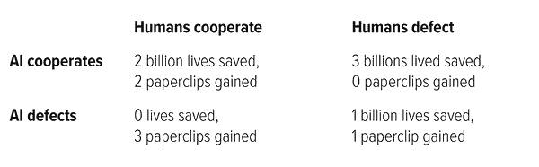

从我们的角度来看，从务实（在这种情况下是道德）的角度来看，我们应该背叛显然是有意义的；另一个宇宙中的一个回针怎么可能价值十亿条生命。从 AI 的角度来看，背叛总能带来额外的回针，而它的代码对人类生命的价值恰好为零；因此，它会背叛。然而，这种背叛导致的结果显然比人类和 AI 都合作的结果要糟糕得多——但随后，如果 AI 将要合作，我们自己背叛可以挽救更多的生命，AI 在我们合作的情况下也是如此。

在现实世界中，许多小规模的双方囚徒困境通过贸易机制以及法律系统执行合同和法律的能力来解决；在这种情况下，如果存在一个对两个宇宙都有绝对权力但只关心遵守事先协议的神，人类和 AI 可以签署一份合作合同，并请求该神同时防止双方背叛。在无法预先签约的情况下，法律会惩罚单方面背叛。然而，仍然存在许多情况，特别是在涉及多个参与方时，存在背叛的机会：

- Alice 在市场上卖柠檬，但她知道她的这一批柠檬质量很差，一旦客户尝试使用，就会立即将其扔掉。她应该还是卖吗？（注意，这是这样一种卖家多到你根本无法追踪声誉的市场）。Alice 的预期收益：每个柠檬 5 元收入 − 1 元运费和商店成本 \= 4 元。社会成本：5 元收入 − 1 元成本 − 客户浪费的 5 元 \= -$1。Alice 卖掉了柠檬。


- Bob 应该向比特币开发捐赠 1,000 美元吗？社会的预期收益：$10 × 100,000 人 − $1,000 = $999,000。Bob 的预期收益：$10 − $1000 = -$990，所以 Bob 不捐赠。
- Charlie 发现了别人的钱包，里面有 500 美元。他应该归还吗？社会的预期收益：$500（给接收者）− $500（Charlie 的损失）+ $50（由于每个人都能少少担心一点钱包安全而给社会带来的无形收益）。Charlie 的预期收益：-$500，所以他留下了钱包。
- David 应该通过向河流倾倒有毒废物来降低工厂成本吗？社会的预期收益：$1,000 节省 − $10 人均增加的医疗成本 × 100,000 人 = -$999,000，David 的预期收益：$1,000 − $10 = $990，所以 David 污染了环境。
- Eve 开发出了一种癌症疗法，每单位生产成本为 500 美元。她可以以 1,000 美元出售，让 50,000 名患者买得起；或者以 10,000 美元出售，让 25,000 名患者买得起。她应该以高价出售吗？社会的预期收益：25,000 条生命（包括 Eve 的利润，这部分抵消了富裕购买者的损失）。Eve 的预期收益：2.37 亿利润而非 2500 万 = 2.12 亿，所以 Eve 收取高价格。

当然，在这些许多情况下，人们有时会表现得道德并合作，尽管这会损害他们的个人处境。但他们为什么要这样做呢？我们是由进化产生的，而进化通常是一个相当自私的优化器。有很多解释。其中一种，也是我们将关注的重点，涉及到“超理性”（superrationality）的概念。

## 超理性

请参考大卫·弗里德曼（David Friedman）对美德的以下解释：

我从对人类的两个观察开始。第一是，人的大脑内部和外部发生的情况之间存在实质性的联系。面部表情、身体动作以及各种其他信号让我们对朋友的想法和情感至少有一定的了解。第二是，我们的智力能力有限——在决策可用的时间内，我们无法考虑所有的选项。用计算机术语来说，我们是实时运行的计算能力有限的机器。假设我希望人们相信我具有某些特征——我很诚实、善良、对朋友有帮助。如果我真的拥有这些特征，投射出它们很容易的——我只需做和说看起来很自然的事，而不需要太在意自己在外部观察者眼中是什么样的。他们会观察我的言语、行为、面部表情，并得出相当准确的结论。然而，假设我并没有这些特征。我不（例如）诚实。我通常表现得诚实是因为诚实行为通常符合我的利益，但如果我通过这样做获益，我总是愿意破例。现在在许多实际决策中，我必须进行双重计算。首先，我必须决定如何行动——例如，这是否是一个偷窃且不被发现的好机会。其次，我必须决定我会如何思考和行动，我的脸上会有什么样的表情，如果我真的是我所假装的那个人，我会感到快乐还是难过。如果你要求计算机进行两倍数量的计算，它就会变慢。人类也是如此。我们大多数人并不擅长撒谎。如果这个论点是正确的，它意味着如果我真的诚实（并且善良、……），比起仅仅假装，我在狭隘的物质方面可能比仅仅假装过得更好，仅仅因为真正的美德比伪装的美德更有说服力。由此得出，如果是一个狭隘自私的个体，我可能出于纯自私的原因想让自己变成一个更好的人——在他人看重的那些方面更有美德。论证的最后阶段是观察到我们可以变得更好——通过我们自己、我们的父母，甚至通过我们的基因。人们可以并且确实在训练自己养成良好的习惯——包括自动说真话、不偷窃以及对朋友友好的习惯。通过足够的训练，这些习惯会变成口味——做“坏”事会让人感到不舒服，即使没有人看，所以人就不会去做。过了一段时间，人甚至不需要决定要不要去做。你可以将这个过程描述为“合成良知”。

本质上，要在可以脱身时保持贪婪同时又要令人信服地伪装成美德，在认知上是很困难的，因此实际上变得善良对你更有意义。许多古代哲学遵循类似的推理，将美德视为一种培养的习惯；大卫·弗里德曼只是履行了作为经济学家的常规服务，将直觉转换成更容易分析的形式化表达。现在，让我们进一步压缩这种形式化表达。简而言之，这里的关键点是人类是“泄漏代理”（leaky agents）——在我们每一秒的行为中，我们本质上都间接地暴露了我们源代码的一部分。如果我们真的计划善良，我们会表现出一种方式；如果我们只是假装善良而实际上计划在朋友脆弱时立即打击，我们的表现会有不同，而其他人往往能注意到。

这看起来可能是一个劣势；然而，它允许了一种上述简单博弈论代理无法实现的合作。假设两个代理 `A` 和 `B` 都有能力以某种程度的准确性“读取”对方是否“美德”，并且正在玩一个对称的囚徒困境。在这种情况下，代理可以采取以下策略，我们假设这是一个美德策略：

1. 尝试判断对方是否美德。
2. 如果对方美德，则合作。
3. 如果对方不美德，则背叛。

如果两个美德代理相互接触，他们都会合作并获得更大的奖励。如果一个美德代理遇到一个不美德代理，美德代理将背叛。因此，在所有情况下，美德代理的表现至少不于不美德代理，通常更好。这就是超理性的精髓。

尽管这种策略看起来很刻意，但人类文化有一些根深蒂固的机制来实现它，特别是对于不信任那些努力让自己变得难以被读取的代理——看看那句谚言：永远不要相信不喝酒的人。当然，有一类人可以令人信服地假装友好，实际上却时刻计划背叛——这些人被称为反社会人格，他们可能是这个系统由人类执行时的主要缺陷。

## 中心化手动组织 . .

这种超理性合作在过去一万里一直是人类合作的一个重要基石，让人们在简单的市场激励可能导致背叛的情况下也能互相诚实。然而，现代大型中心化组织出生的主要不幸副作用之一，可能是它们允许人们有效地欺骗他人读取他们思想的能力，使得这种合作变得更加困难。


现代文明中的大多数人已经受益匪浅，同时也间接资助了至少某些在第三世界国家的人，他们将有毒废物倾倒进河中，以便为他们生产更廉价的产品；然而，我们甚至没有意识到自己正间接参与了这种背叛行为；公司为我们做了这些脏活。市场是如此强大，以至于它甚至可以套利我们的道德，将最肮脏、最令人不俗的任务交给那些愿意以最低代价牺牲良知，并能有效地向其他人隐瞒这些事的个人。公司本身完全能够通过其营销部门制作出一个“微笑脸”作为其公共形象，而让另一个完全不同的部门去向潜在客户甜言蜜语。第二个部门可能根本不知道生产产品的部门在道德和甜美程度上并不比他们更高尚。

互联网经常被誉为解决许多此类组织和政治问题的方案，而且它在减少信息不对称和提供透明度方面确实做得出色。然而，就超理性合作可行性日益下降而言，它有时也可能让情况变得更加糟糕。在网上，即使作为个体，我们也变得没那么容易“泄露”了，因此一旦在意图欺骗时，表现得高尚就再次变得更容易。这就是为什么网络诈骗和加密货币领域的诈骗比线下更常见的原因之一，这也是反对将所有经济互动转移到互联网（如加密无政府主义）的主要论点之一（另一个论点是加密无政府主义消除了施加无限惩罚的能力，削弱了一大部分经济机制的强度）。

可以说，更大程度的透明度提供了解决方案。个人是中等泄露的，目前的中心化组织泄露程度较低，但那些信息不断、随机地向世界四面八方释放的组织甚至比个人更泄露。想象这样一个世界：如果你开始思考如何欺骗你的朋友、业务伙伴或配偶，就有 1% 的概率你的海马体左半部分反叛，并将你思想的完整记录发送给你的目标受害者，以换取 7500 美元的奖励。这就是作为一个泄露组织管理委员会的“感受”。

这在本质上是 WikiLeaks 创立理念的重述，最近，一个有激励的 WikiLeaks 替代方案 `slur.io` 出现并进一步推边界。然而，WikiLeaks 确实存在，而阴暗的中心化组织也继续存在，并且在许多情况下仍然相当阴暗。也许，激励机制结合人们从揭露雇主不当行为中获利的类预测机制，将开启通更高透明度的闸门，但同时我们也可以采取不同的路线：为组织提供一种使其自愿且彻底地变得泄露，并达到前所未有的超理性程度。

## . . 以及 DAOs

去中心化自治组织（DAOs）作为一个概念，其独特之处在于它们的治理算法不仅是泄露的，而且是完全公开的。也就是说，虽然即使是透明的中心化组织，外部人员也可以大致了解组织的本性，但通过 `DAO`，外部人员实际上可以看到组织的整个源代码。现在，他们看不到 `DAO` 背后人类的“源代码”，但有方法可以编写 `DAO` 的源代码，使其无论参与者是谁，都严重偏向一个特定目标。最大化人类平均寿命的 `futarchy`（预测政治）其行为将与最大化回形针产量的 `futarchy`截然不同，即使运行它们的是完全相同的人。因此，组织不仅在开始欺骗时会对所有人都显而易见，而且组织的“大脑”甚至无法进行欺骗。

现在，使用 `DAOs` 的超理性合作看起来会什么样？首先，我们需要看到一些 `DAOs` 真正出现。有几个用例似乎预期它们成功并不太遥谱：赌博、稳定币、去中心化文件存储、人人标识的数据提供、`SchellCoin` 等。


首先，区块链技术不会出现所谓的“杀手级应用”。原因很简单：遵循了“易于收获”的法则。如果存在某个特定的应用，使得区块链技术在现代社会基础设施的大部分范围内远优于任何任何，那么人们早就在热烈讨论它了。这听起来可能像那个关于经济学的老笑话：一个经济学家在地上发现了一张二十美元钞票，并得出结论它是假的，否则它早就被人捡走了；但在这种情况下，情况微妙不同：与美元票不同（美元票的搜索成本很低，即使真实的概率只有 0.01%，捡起来也是有意义的），而这里的搜索成本非常高，而且许多拥有数十亿美元激励机制的人一直在寻找。到目前为止，还没有任何人想出一个应用能真正脱颖而出并主导视野上的其他一切。

事实上，人们可以完全理理地认为，我们最接近“杀手级应用”的东西，正是那些已经被反复完成、背诵并被炒得得厌力竭的应用：WikiLeaks 和丝绸之路（Silk Road）的抗审查性。丝绸之路是一个 2013 年底被执法部门关闭的在线匿名药物市场，在运营两个半年里，其销售额超过了 10 亿美元；而在支付系统协调的针对 WikiLeaks 的封锁进行期间，比特币和狗狗币捐赠贡献了其大部分收入。

## 总效用与平均效用

然而，这是否意味着区块链已经达到了其效用的巅峰？绝不是。它们达到了必要性的巅峰（从每个用户的巅峰效用角度来看），但这并不等同于总效用的巅峰。虽然丝绸之路对许多使用者来说是不可缺的，但即使在吸毒群体中，它总体而言也并非不可缺；尽管这位作者非常困惑普通人是如何获得这种联系的，但大多数人似乎以某种方式找到了他们可以购买大麻的“熟人”。对吸大麻的兴趣似乎与获取的便利性强相关。因此，从大局来看，丝绸之路只有机会与一个非常小众的群体相关。WikiLeaks 也是如此；关注公司和政府透明度并到足以向一个争议性组织捐钱支持它的人，与全球总人口相比并不多。那么剩下什么呢？简而言之，长尾。

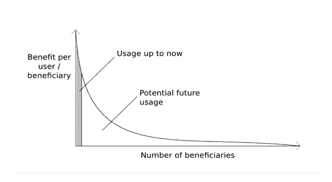

那么什么是长尾？这是最难解释的地方。我可以提供一份包含在这一“长尾”中的应用列表；然而，区块链并非不可或的，而且对于每一个应用，甚至没有提供极其强大的基础性优势。对于每一个具体的案例，支持“区块链应用被夸估了，重要的是比特币货币”或“区块链技术整体毫无用处”立观点的人，都可以完全合理地提出一种在中心化服务器上同样容易实现方案的方法，用法律合同取代区块链治理，并应用任何其他替代方案将产品变成更像传统系统的东西。在这一点上，他们是完全正确的：对于那个特定的用例，区块链不是不可缺的。这正是重点所在：这些应用并不在分布的顶端，与 WikiLeaks 和丝绸之路处于同一水平；如果是的话，它们早就被实现了。在长尾中，区块链不是必要的，而是方便的。它们只是比完成任务的下一个可用工具稍微好一点点。然而，由于这些应用主流得多，并且可以惠及数亿用户，对社会的总收益（可以从上述图表中的区域看出）要大得多。

也许对这种推理最好的类比是问这样一个修辞性问题：“开源”的杀手级应用是什么？开源对社会显然是一件很好的事情，它被全球数百万个软件包使用，但尽管如此，仍然很难回答这个问题。原因是相同的：没有杀手级应用，而且应用列表有一个非常、非常长的长尾——基本上是你能想象的每种软件，特别强调那些最终被数百万项目重复使用多次的低级库，以及关键的加密安全库。

## 区块链，重新定义 . . . 再次

现在，区块链的哪些具体优势让长尾变得值得呢？首先，让我提供我目前使用的对区块链的当前描述：

区块链是一个魔法计算机，任何人都可以向其上传程序并让程序自动执行，其中每个程序的当前状态和所有之前的状态始终是公开可见的，并且它带有一种非常强大的加密经济学保障，确保运行在链上的程序将完全按照区块链协议规定的方式继续执行。

注意，这个定义并没有：

- 使用如“账本”、“货币”或“交易”等带有财务色彩的术语，或实际上任何针对特定用例的术语；
- 提到任何特定的共识算法，或者提到任何关于区块链工作技术属性的内容（除了它是“加密经济的”这一事实，这是一个技术术语，大致意思是“它是去中心化的，使用公钥加密进行验证，并使用经济激励来确保它持续运行且不会回溯时间或发生任何其他故障”）；
- 对任何特定的状态转换函数进行限制。

这个定义做得很好的一点是解释了区块链是做什么的，而且它解释的方式让任何软件开发者都能相当清晰地至少从直觉上理解其价值主张。现在，在实践中，有时运行程序的编程语言是非常受限的；比特币的语言可以看作是需要一系列 `DESTROY COIN: <txid> <index> <scriptsig>` 语句，后面跟着一系列 `CREATE COIN: <scriptpubkey> <value>` 语句，其中 `scriptpubkey` 是一个限制性的数学公式，`scriptsig` 必须是对公式的满足变量赋值（例如，`{x = 5, y = 7}` 满足 `2 × x - y = 3`），而尝试销毁不存在的币、或在未为该币的 `scriptpubkey` 提供有效 `scriptsig` 的情况下销毁币，或尝试创建比你销毁的更多的币值，将返回错误。另一方面，其他编程语言可以更具表现力。取决于软件开发者分析哪种编程语言适合他们的任务，就像今天软件开发者的任务要在 `Python`、`C++`、`Node.js` 和 `Malbolge` 之间做决定一样。

这个定义强调得非常好的是：区块链并不是为了给世界带来任何一种特定的规则集，无论是具有固定供应货币政策的货币、具有两百天重新注册时间的名称注册表、某种特定的去中心化交易所设计，或其他任何其他；相反，它们关于极快速创建一个具有新规则集的新机制并将其推出的自由。它们是用于构建经济和社会制度的乐高积木。


这是主流行业中盛行的“令人兴奋的是区块链，而非货币”这一观点中较为温和版本的内核：诚然，货币对于使加密经济学区块链运行起来是必要的（尽管**不是**遵循 `Stellar` 主观共识模型的类区块链数据结构），但货币的存在仅仅是作为一种经济水利，用于激励共识的参与、持有押金以及支付交易手续费，而不是作为投机狂热、消费者兴趣和兴奋的舞台中心。

## 那么，为什么区块链很有用？总结如下：

- 你可以在它们上存储数据，并且这些数据保证具有极高的可用性。
- 你可以在它们上运行应用程序，并保证具有极高的运行时间。
- 你可以在它们上运行应用程序，并保证在遥远的未来依然具有极高的运行时间。
- 你可以在它们上运行应用程序，并让用户相信应用程序的逻辑是诚实的，并且确实正如你所宣传的那样在运行。
- 你可以在它们上运行应用程序，并让用户相信，即使你失去了维护它的兴趣、你受到贿赂或威胁以某种方式操纵应用程序状态，或者你获得了操纵应用程序状态的利润动机，你的应用程序仍将保持运行。
- 你可以在它们上运行应用程序，并在绝对必要时给自己留一个后门密钥，但对你对密钥的使用施加“宪性”限制——例如，要求软件更新必须通过为期一个月的公共等待期才能被引入，或者至少立即通知用户应用程序更新。
- 你可以在它们上运行应用程序，并将后门密钥交给特定的治理算法（例如：投票、富人治理、某些复杂的双院议会架构），并让用户相信该特定的治理算法实际上控制着应用程序。
- 你可以在它们上运行应用程序，这些应用程序可以以 100% 的可靠性相互通信——即使底层平台仅有 99.999% 的可靠性。
- 多个用户或公司可以在它们上运行应用程序，这些应用程序可以以极快的速度相互作用，而不需要任何网络消息，同时确保每家公司对自己的应用程序拥有完全控制权。
- 你可以构建应用程序，非常容易且高效地利用其他应用程序产生的数据。（将支付系统和声誉系统结合可能是这里最大的收益所在。）

所有这些事情对全球数十亿的人都有间接的价值，特别是在世界上某些目前高度发达的经济、金融和社会基础设施完全无法运作的地区（尽管技术通常需要与政治改革相结合来解决许多问题），而区块链擅于提供这些属性。它们在金融领域显然是有价值的，因为金融可能是世界上在计算和信任密集方面同时都是最高的行业，但它们在互联网基础设施的许多其他地方也有价值。确实存在其他也能提供这些属性的架构，但它们比区块链稍微好一点或中等程度地那么差。加文·伍德（Gavin Wood）开始将这种理想的计算平台描述为“世界计算机”——这种计算机的状态由所有人共享，并且由一个非常庞大的群体（任何人都可以自由加入）参与维护。

## 基础层 infra 设（Base-layer infrastructure）

与开源一样，到目前为止，从区块链技术获益最大的机会来自于可以被称为“基础层基础设施”的服务。作为一个大类，基础层基础设施服务具有以下特性：

 ** **依赖性**：存在许多其他服务在功能上紧密依赖基础层服务；
- **高网络效应**：大量群体（甚至所有人）使用同一项服务会产生巨大的收益；
- **高转换成本**：个人很难从一个服务切换到另一个服务。

请注意，这里并不包含任何关于原始“必要性”或“重要性”的概念；存在相当不重要的基础层（例如 `RSS feeds`）和重要的非基础层（例如 `food`）。基础层服务自文明黎明以前就一直存在了；在所谓的“穴人时代”，所有单一最重要的基础层服务是语言。在较近的时期，主要的例子变成了道路、法律体系以及邮政和运输系统；在 20 世纪，我们增加了电话网络和金融系统，并在世纪末出现了互联网。然而，现在互联网的新型基础层服务几乎全是信息性的：互联网支付系统、身份识别、域名系统、证书颁发机构、声誉系统、云计算、各种数据馈，以及可能在不久的未来出现的预测市场。

十年之后，这些服务高度网络化和相互依赖的特性可能导致个人从一个系统切换到另一个系统的难度，甚至比他们切换所居住的国家还要困难——这意味着，确保这些服务被正确构建，并确保它们的治理过程不会让少数私实体处于极端权力的位置是至关重要的。现在，许多此类系统是以高度集化的方式构建的，这部分是因为万维网的原始设计未能意识到这些服务的重要性，并且包含默认设置——因此，即使在今天，大多数网站仍要求你“用 Google 登录”或“用 Facebook 登录”，而证书颁发机构面临着类似的问题：

- 一名来自伊朗的独立黑客在周六声称盗了某些顶级网站的多个 `SSL` 证书，包括 `Google`、`Microsoft`、`Skype` 和 `Yahoo`。
- 安全专家的早期反应不一，一些人相信黑客的说法，而另一些人则表示怀疑。
- 上周，推测集中在一次国家支持的攻击上，可能是由伊朗政府资助或进行的，该攻击入侵了与美国 `Comodo` 关联的证书分销商。
- 3 月 23 日，`Comodo` 承认了这次攻击，表示八天前黑客获得了 `Microsoft` 的 `Hotmail`、`Google` 的 `Gmail`、互联网电话和聊天服务 `Skype` 以及 `Yahoo Mail` 登录网站的九假证书。还有一个 `Mozilla` Firefox 插件站证书。

## 为什么证书颁发机构不应该是去中心化的身份

让我们选取一个特定的用例“区块链上的身份”并进行分析。通常情况下，拥有一个身份需要什么？最简单的答案是我们已经知道的：你需要一个公钥和一个私钥。你发布公钥，它成为你的 ID，你用私钥对发送的每条消息进行数字签名，允许任何人验证这些消息是由你产生的（从他们的观点，“你”意味着“持有该特定公钥的实体”）。然而，存在一些挑战：

1. 如果你的密钥被盗了，需要切换到新密钥怎么办？
2. 如果你丢失了密钥怎么办？
3. 如果你想通过名称来引用其他用户，而不是一个随机的二十字节加密数据字符串怎么办？
4. 如果你想使用更高级的安全方法，例如多签名 `multisig`，而不仅仅是单一密钥怎么办？


让我们尝试逐一解决这些挑战。我们可以从第四个开始。一个简单的解决方案是：不再要求特定的加密签名类型，而是让你的公钥变成一个程序，而有效的签名变成一个字符串，当该字符串连同消息一起输入程序时，返回 `1`。理论上，任何单密钥、多密钥或任何其他规则集都可以编码到这种范式中。

然而，这存在一个问题：公钥会变得太长。我们可以通过将实际的“公钥”放入数据存储中（例如，如果我们想要去中心化，可以使用分布式哈希表），并将“公钥”的哈希值作为用户的 ID 来解决这个问题。这并不需要区块链——尽管在最新的设计中，可扩展的区块链与 `DHTs` 并没有太大区别，因此完全有可能在十年后，各种用于用途的去中心化系统都会无意中或有意地收敛为某种可扩展的区块链。

### 证书撤销问题

现在，考虑第一个问题。我们可以将其视为证书撤销问题：如果你想“撤销”某个密钥，如何确保它能传给每个需要看到它的人？这个问题本身再次可以通过分布式哈希表解决。然而，这引出了下一个问题：如果你想撤销一个密钥，用什么来替换它？如果你的密钥被盗了，你和攻击者都拥有它，因此你们中没有人比对方更具权威性。一种解决方案是拥有三个密钥，然后如果其中一个被撤销，则需要其中两个或三个密钥的签名来批准下一个密钥。但这会导致“无风险”（nothing at stake）问题：如果攻击者最终设法从历史某点偷走了你所有的密钥，那么他们就可以模拟一段分配新密钥、从那里进一步分配更多新密钥的历史，而你自己的历史就不再具有权威性。这是一个时间戳问题，因此区块链在这里实际上可以提供帮助。

对于第二个问题，持有多个密钥并重新分配也运行相当良好——而且这里不需要区块链。事实上，你不需要重新分配；通过巧妙使用秘密共享（secret sharing），你实际上可以通过将密钥保存在“碎片”中从密钥丢失中恢复，这样如果你丢失了任何一个碎片，你始终可以使用秘密共享数学从其他碎片中恢复它。对于第三个问题，基于区块链的注册是最简单的解决方案。

### 社会 M-of-N 备份

然而在实践中，大多数人并不具备安全存储多个密钥的良好条件，而且总会有意外发生，通常中心化服务在其中起着重要作用：帮助人们在出错时找回账户。在这种情况下，基于区块链的解决方案很简单：社会 `M-of-N` 备份。

你选择八个实体；它们可能是你的朋友、雇主、某家公司、非营利组织，甚至在未来是一个政府，如果发生任何问题，其中五个人的组合就可以恢复你的密钥。这种社会多签名备份的概念可能是任何去中心化系统设计中使用的最强大的机制之一，它以非常低廉的价格提供了极高的安全性，且不依赖于中心化信任。注意，基于区块链的身份（特别是结合 `Ethereum` 的合约模型）使得这一切编程变得非常容易：在名称注册中，注册你的名字并将其指向一个 `contract`，让该 `contract` 维护与身份相关的当前主密钥和备份密钥，以及相应的的逻辑。

### 声誉系统

身份并不是区块链可以缓解的唯一问题。另一个与身份紧密相关的组件是声誉。目前，现代世界所谓的声誉系统无非是不安全的（因为无法确保某个实体确实与之有过交互），或者就是中心化的。当你从 `Uber` 切换到 `Lyft` 时，你的评分不会迁移。

一个去中心化的声誉系统理想上由两个独立的层组成：数据和评估。数据将由个人对他人进行的独立评分、与交易关联的评分（例如，通过基于区块链的支付，人们可以向他们付款）以及其他来源的集合，任何人都可以运行自己的算法进行评估；“轻量客户端友好型”算法（可以快速评估从特定数据集中提取的声誉证明）可能成为一个重要的研究领域（许多幼稚的声誉算法涉及矩阵运算，其复杂度接近三次方，因此很难去中心化）。“零知识”声誉系统也很有前景，它允许用户提供某种证书，证明根据某项指标他们至少拥有 `x` 个声誉分，而不泄露任何其他信息。

声誉的案例非常有趣，因为它结合了区块链作为平台的多项优势：
- 作为身份的数据存储器使用
- 作为声誉记录的数据存储器使用
- 应用程序间的互操作性（与支付证明关联的评分、任何算法在相同底层数据上运行的能力等）
- 保证底层数据在未来是可移植的（公司可能会自愿提供可导出格式的声誉证书，但他们无法预先承诺在未来继续提供该功能）
- 更广泛地使用去中心化平台来保证声誉在计算点没有被人工操纵

### 降低成本

如果区块链技术最大的价值来自于长尾，正如这篇论文所示，那么这得出了一个重要的结论：使用区块链的单笔收益非常小。因此，降低共识成本和增加区块链可扩展性的问题变得至关重要。在中心化解决方案中，用户和企业已经习惯了每笔“交易”几乎支付零美元；尽管想要向 `WikiLeaks` 捐款的个人可能愿意支付 `$5` 的费用来完成交易通过，但尝试上传声誉记录的人可能只愿意支付 `$0.0005` 的费用。


因此，让共识变得更廉价——无论是从绝对意义上（即**权益证明**），还是从每笔交易的角度（即通过可扩展的区块链算法，其中最多由几百个节点处理每笔交易）——都是至关重要的。此外，区块链开发者应该记住，过去四十年的软件开发史是一部向着效率越来越低的编程语言和范式移动的历史，仅仅是因为这些语言允许开发者变得更缺乏经验且更懒惰。有必要设计区块链算法，并纳入这样一个原则：开发者在决定哪些内容放在链上、哪些留在链外时实际上并不会那么聪明和明智——尽管设计良好的交易费用系统可能会让开发者通过个人经验自然地学习到大多数要点。

因此，对于一个在很大程度上更加去中心化的未来，充满了巨大的希望；然而，轻松获利的时代已经结束了。现在是时候进行更艰苦、更长时间的努力，去观察现实世界，看看我们构建的技术如何真正造福这个世界。在这个阶段，我们可能会发现某个时刻我们会遇到一个拐点，此时大多数 `blockchain for x` 的实例将不再是由那些寻找有用用途的区块链爱好者偶然发现 `x` 并尝试实现它，而是由 `x` 的爱好者实现的，他们看到区块链并意识到它们是完成 `x` 某些部分的相当有用工具。无论 `x` 是物联网、发展中国家的金融基础设施、自下而上的社会、文化和经济机构、更好的数据聚合与保护，还是仅仅是慈善机构和不可审查的市场，对于许多原始区块链爱好者来说，这个拐点已经到来。一旦它在其他情况下也发生，那么我们才真正知道它已经进入了主流，人道主义的收益很快就会到来。

此外，我们可能会发现，`blockchain community` 这一概念将不再作为一种独立的准政治运动而具有意义；如果非要贴上一个标签的话，`crypto.2.0` 可能是最有说服力的一个。我们之所以没有 `distributed hash table` 概念（尽管它存在），实际上仅仅是因为有一群恰好专攻数据库的计算机科学家：区块链只是技术之一，最终最大的进展只能通过与整套去中心化（且对去中心化友好）的技术结合工作来实现：声誉系统、`peer-to-peer hypermedia platforms`、分布式消息协议、零知识证明以及许多尚未被发现的领域。
## 第 2 部分：工作量证明 (PROOF OF WORK)

以太坊 `genesis block` 出于 2015 年 7 月 30 日，标志着该协议公共生活的开始。这种生活并没有轻松立足。随着 `ETH` 代币价值飙升至数十亿美元，黑客试图利用系统，这需要新兴是以太坊社区采取协调行动。事实证明，仅仅代码不足以保持系统安全；人类政治也发挥了作用，而 Buterin 发现自己正处于中心。

这些考验中最重要的是对 The DAO 的攻击，这是一个实验性的集体风险基金，筹集了价值 1.5 亿美元的 `ETH`。（`DAO` 代表去中心化自治组织——一种在区块链上通过软件构建的组织）。在它开始之前，2016 年 6 月，一名黑客利用 The DAO 代码中的一个漏洞从中提取了资金。The DAO 持有的资金相当于整个代币供应量的约 15%，如果以太坊像 Buterin 计划的那样转向权益证明，那么将如此市场份额交给单个用户将是极其危险的。反黑客利用对措施延迟了黑客，同时关于代码是否必须原样保留（包括所有漏洞），或者是否需要更激进的措施的辩论激烈进行。Buterin 拥护 `hard fork`（硬分叉）——即通过完全重写以太坊区块链来消除攻击。尽管他对以太坊协议没有正式权力，但他积累的信任证明了决定性。以太坊社区的大多数追随了他，将文化和使命置于代码的指令之上。

对他自身魅力权威的焦虑散布在 Buterin 当时的文字字里行间。在攻击发生几个月前，他在以太坊博客上阐述了一个目标，“将以太坊建立为一个最终归所有人类所有的去中心化项目”。在 The DAO 争议期间，在 `Why Cryptoeconomics and X-Risk Researchers Should Listen to Each Other` 中，他提到了最终的 `world-democracy DAO`，也许是一种基于直接参与的联合国。在 `Control as Liability` 中，他似乎将自己与另一个跨全球网络的青少年创始人 Mark Zuckerberg 相比；在区块链世界，与公司平台相比，避免中心权威比拥有它要好。`On Free Speech` 探讨了技术如何实际上可以阻止他拥有 Facebook 及其同类产品日益屈从的审查权力。2018 年的一推文中主张：“我认为以太坊完全可以在我明天自发自燃的情况下生存。”然而，他不得不说这句话这一事实表明，这并非十无一失。

2017 年，以太坊经历了价值和吸引力的地震级增长。这在很大程度上归功于它用于 `initial coin offerings`（ICO），初创公司（以及更多赤裸裸的诈骗）通过根据白皮书承诺出售不受监管的代币筹集了巨额。Buterin 公开质疑了以太坊市场估值的准确性，并在 Twitter 上敦促社区“区分开流动的数百亿美元数字纸面财富与真正为社会实现某些有意义的事”。以太坊本应改变世界，但正如这些文章中的示例所示，许多具体的用例是用于金融游戏和赌博的。

他在以太坊早年的文字中，并没有沉溺于价格上涨和畅销的代币销售，而是潜于加密经济学的设计问题：激励如何能实现更好的协调？围绕身份和治理的难题在这里以及他当时正在撰写的更具技术性的文章中令他着迷。但正如 2019 年底的 `Christmas Special` 所展示的那样，他也抽留了玩的时间。看着他和其他以太坊爱好者在聚会上下棋的激烈程度，人们开始怀疑这整个价值数十亿美元的实验是否真的一个巨大的拼图，一种占据他们大脑中流转的计算周期的方式。

—NS

为什么加密经济学和风险研究人员应该多听听对方的意见


最近，一个传统上与人工智能以及各种形式的未来主义生存性风险研究相关的社区，对区块链和加密经济学系统表现出了微小但日益增长的兴趣。`Ralph Merkle` 是如今支撑 `Ethereum` 轻量客户端协议的著名加密技术的发明者，他表达了对 `DAO` 治理的兴趣。Skype 创始人 `Jaan Tallinn` 提议研究区块链技术，将其作为一种创建机制解决全球协调问题的方法。预测市场倡导者长期以来一直理解预测市场作为治理机制的潜力，他们现在正在关注 `Augur`。

我认为它们之间确实存在联系，且这种联系如下：加密经济学研究社区与 `AI` 安全/新网络治理/生存性风险社区都在试图解决一个根本上相同的问题：我们如何使用一个非常简单、笨拙且属性一旦创建就无法更改的系统，去监管一个极其复杂且具有不可预测涌属性的智能系统？

在 `AI` 研究的背景下，一个主要的子问题是定义一个效用函数，该函数能够引导超级智能体的行为，而不会无意中引导它去做某些符合书面定义但并不符合意图的行为（有时被称为“边缘情况实例化”）。例如，如果你试图告诉一个超级智能 `AI` 去治愈癌症，它可能会推理出最可靠的方法是直接先杀掉所有人。如果你试图修补这个漏洞，它可能会决定永久性地冷冻所有人类而不杀死他们。以此此类推。在 `Ralph Merkle` 的 `DAO` 民主化背景下，问题在于确定一个目标函数，该函数要与社会和技术进步相关（即通常是人们想要的东西），且与生存性风险反相关，并足够易于，以至于其测量行为本身不会成为政治斗争的源头。

同时，在加密经济学的背景下，这些问题惊人地相似。共识的核心问题在于，如何激励验证者使用一个铁板钉钉的简单算法来持续支持和增长一个连贯的历史，而验证者本身是高度复杂的经济主体，可以自由以任何方式进行交互。`The DAO` 发现的问题是软件开发者的复杂意图（对 `splitting` 函数有特定的设想）与软件实现的实际结果之间的分歧。`Augur` 试图将共识问题扩展到现实事实领域。`Maker` 正在试图为一个平台创建一个去中心化治理算法，该平台旨在提供具有加密货币去中心化和法币可靠性的资产。在所有这些情况下，算法都是笨拙的，但它们必须控制的主体非常智能。`AI` 安全是关于 `IQ 150` 的主体试图控制 `IQ 6,000` 的主体，而加密经济学是关于 `IQ 5` 的主体试图控制 `IQ 150` 的主体——这些问题显然不同，但其相似性不容忽视。

这些都是难题，而且是两个社区已经独立考虑了许多年、并在某些情况下积累了大量见解的问题。这些也是一些人们已经开始发现启发式局部解决方案和缓解策略的问题。在 `DAOs` 的案例中，一些开发者正转向一种混合方法：设立一组对 `DAO` 资产拥有一定控制权的策展人，但只赋予这些策展人有限的权力，这些权力足以拯救 `DAO` 免受攻击，但不足以单方面发动导致中度干扰的攻击——这种方法与目前正在进行的安全 `AI` 可中断性研究某些相似之处。

在 `futarchy` 方面，人们正在研究一种二次投票的混合体。另一个极被低估的解决方案是使用形式验证——使用计算机程序自动验证其他程序，并确保它们满足一组关于程序预期执行任务的断言。此类证明可以用于防止奖励函数中的某些简单错误，这些错误可能会导致完全意料之外的行为在 `AI` 看来具有极高价值。当然，许多其他社区多年来一直在考虑形式验证，但现在它正在一个新颖的背景下为了不同的用途被探索。

同时，`AI` 安全圈推广的一个可能非常有用的概念示例是……由于复杂值问题（complexity value problem），形式化地证明通用情况下的“诚实”是不可能的，但我们可以做出一些局部保证来降低风险。例如，我们可以形式化证明，如果给定 `DAO` 的策展人投票翻转开关，则某些操作在七天内无法执行，或者在四十八小时内无法执行。在 `AI` 场景下，此类证明可以用于防止奖励函数中的某些简单错误，这些错误可能会导致完全意料之外的行为在 `AI` 看来具有极高价值。

`The DAO` 只是今年和明年将启动的系列项目中的第一个，你可以断定后续所有的示例都将从第一个案例的教训中大量汲取营养，并且每个项目都会提出不同创新的软件代码安全策略、治理算法、策展人系统、缓慢分阶段的引导和部署过程，以及形式化的保证，以尽力确保能够抵御加密经济学的风暴。

最后，我认为从加密社区中学到的最大教训是去中心化本身：即让不同的团队冗余地实现不同的部分，以最大限度地减少一个系统的疏忽未被其他系统检测到而通过的概率。


#像以太坊（以及比特币、NXT、BitShares 等）这样的系统是一类根本全新的加密经济生物——它们是去中心化的、无管辖权的实体，完全存在于网络空间，通过密码学、经济学和社会共识的结合进行维护。它们有点像 `BitTorrent`，但也不像 `BitTorrent`，因为 `BitTorrent` 没有状态的概念——这一区别证明是至关重要的。它们有时被描述为去中心化自治公司，但它们也不完全是公司——你无法对 `Microsoft` 进行硬分叉。它们有点像开源软件项目，但也不完全如此——你可以分叉区块链，但并不像分叉 `OpenOffice` 那么容易。

这些加密经济网络有许多种类——`基于 ASIC 的 PoW`、`基于 GPU 的 PoW`、朴素的 `PoS`、委托的 `PoS`，以及希望很快就能实现的 `Casper PoS`。每一种这些哲学——`中本共识`、`社会共识`、`股东投票共识`——都导致了其自身的一系列结论和一套价值体系，从其自身的标准来看，这些价值体系是有意义的——尽管在相互比较时，它们无疑会受到批评。`Casper 共识` 也有哲学基础，尽管到目前为止还没有描述得那样简洁。

我本人、Vlad、Dominic、Jae 以及其他人对为什么存在 `proof-of-stake` 协议以及如何设计它们都有自己的看法，但在这里我想解释一下我个人的观点。我将直接列出观察结果并给出结论：

- `密码学` 在二十一世纪确实是特别的，因为 `crypt` 是极少数对抗冲突仍然严重倾向于防御者的领域之一。城堡比建造更容易摧毁，岛屿可以防守但仍可能受到攻击，但普通人的 `ECC keys` 足够安全，甚至可以抵抗国家级的攻击者。`密码客哲学` 从根本上说关于利用这种宝贵不对称性来创建一个更好地保护个人自主的世界，而`加密经济学` 在某种程度上是那样的一种延伸，只是这次保护的是复杂的协调与协作系统的安全性和活性，而不仅仅是私有消息的完整性和机密性。自认为是`密码客精神`意识形态继承者的系统应该保持这一基本属性，并且其破坏或干扰的成本应远高于其使用和维护的成本。

- “密码客精神”不仅仅关乎理想主义；构建一个比攻击更容易防御的系统也仅仅是稳健的工程方法。

- 在中长期尺度上，人类非常擅长达成共识。即使攻击者拥有无限的哈算能力，并对任何主流区块链进行 `51% 攻击`，使其回溯甚至是上一个月的历史，要说服社区相信这条链是合法的，比仅仅追赶主链的 `hashpower` 要困难得多。他们需要颠覆 `block explorers`、社区中每一位受信任的成员、《纽约时报》、`archive.org` 以及互联网上的许多其他来源；总而言之，要让世界相信新的攻击链是信息技术密集的二十一世纪中先出现的链，其困难程度与要让世界相信美国登月从未发生过不相上下。这些社会考量最终在长期内保护了任何区块链，无论区块链社区是否承认这一点（注意 `Bitcoin Core` 确实承认这种社会层的首要性）。

- 然而，仅靠社会共识保护的区块链将是非常低效且缓慢的……`proof-of-stake` 通过不依赖奖励而是依赖惩罚打破了这种对称性。验证者质押资金（`deposits`），获得少量奖励以补偿他们锁定资本、维护节点以及为确保私钥安全而采取预防措施，但回滚交易的大部分成本来自惩罚，这些惩罚是奖励的数百或数倍。`proof-of-stake` 的“一句话哲学”因此不是“安全性来自燃烧能量”，而是“安全性来自投入经济损失价值”。对于一个给定的区块或状态，如果你能证明除非恶意节点合谋尝试，否则无法实现任何冲突区块或状态的同等最终性，且必须产生 `x` 美元的`协议内` 惩罚，那么它就具有 `x` 美元的安全性。

- 理论上，验证者的多数合谋可能会接管一条 `proof-of-stake` 链并开始进行恶意活动。然而，(i) 通过的协议设计，他们通过此类操纵获取额外利润的能力可以被限制到最低；更重要的是 (ii) 如果他们试图阻止新验证者加入或执行 `51% 攻击`，社区可以简单地协调进行硬分叉并删除违规验证者的质押金。一次成功的攻击可能花费 `$50 million`，但清理后果的过程将不会比 2016 年 11 月 25 日 `Geth-Parity` 共识失败那么费力。

- 上述不应意味着非计划的硬分叉将成为常态；如果需要，对 `proof-of-stake` 进行单次 `51% 攻击` 的成本完全可以设定为对 `proof-of-work` 进行永久 `51% 攻击` 的成本一样，而攻击的成本和无效性将确保其在实践中几乎不会被尝试。

- 经济学并非一切。个体行为者可能受协议之外动机的驱动，他们可能被黑，他们可能被绑架，或者可能只是醉了，决定某天毁掉区块链，管它成本。此外，从好的一方面，个人的道德克制和沟通低效通常会将攻击成本推到远高于协议定义的预期损失价值的水平。这是我们无法依赖的优势，但同时也是我们不应该随意丢弃的优势。


因此，最好的协议是在各种模型和假设下都能良好运行的协议——包括具有协调选择的经济理性、具有个人选择的经济理性、简单的容错性、拜占庭容错（理想情况下同时包含自适应和非自适应攻击者变体）、受阿莱莱（Ariely）和卡尼曼（Kahneman）启发的行为经济模型（“我们都会稍微作弊”），以及理想情况下任何其他现实且实用的模型。具备两层防御至关重要：通过经济激励来防止中心化卡特尔产生反社会行为，以及通过去中心化激励来防止卡特尔从根本上形成。

尽可能快速的共识协议存在风险，如果一定要使用，也应该非常谨慎地对待，因为如果极快的可能性与这种行为的激励挂钩，那么这种组合将奖励极高且引发系统性风险的网络级中心化水平（例如，所有验证者都运行在同一个托管提供商上）。共识协议并不关心验证者发送消息有多快，只要它们在某些可以接受的时间间隔内发送即可（例如四到八秒，因为从经验来看，`Ethereum` 的延迟通常在五百毫秒到一秒之间）。一种可能的折中方案是创建可以运行非常快的协议，但采用类似于 `Ethereum` 叔叔机制的机制。

从这里开始，当然有很多细节以及许多在细节上产生分歧的方法，但上述至少是我这个版本的 `Casper` 所基于的核心原则。从这里开始，我们当然可以辩论竞争价值之间的权衡。我们是给 `ETH` 每年 1% 的发行率，并支付 5000 万美元的成本来强制进行补救硬分叉，还是给予零年发行率，并支付 500 万美元的成本来强制进行补救硬分叉？我们何时在经济模型下增加协议的安全性，以换取在容错模型下安全性的降低？我们更关注于具有可预测的安全水平，还是可预测的发行水平？这些都是另一篇文章的问题，而实现这些价值之间不同权衡的各种方式则是更多文章要讨论的话题。但我们会涉及的 :)
## 去中心化的意义

`[medium.com/@VitalikButerin](http://medium.com/@VitalikButerin)`

2017 年 2 月 6 日

“去中心化”是加密经济领域频率最高的词汇之一，通常甚至被视为区块链的全部意义（raison d’être），但它可能也是定义最模糊的词之一。数千小时的研究和数十亿美元的算力被投入，仅仅是为了尝试实现去中心化，并对其进行保护和改进；而当讨论产生竞争性时，某一协议（或协议扩展）的支持者极常见地将其作为终极击驳论据，声称对方的提议是“中心化的”。

但对于这个词的真实含义，通常存在着很多困惑。例如，考虑下面这个完全没有用处但遗憾的是极其常见的图表：

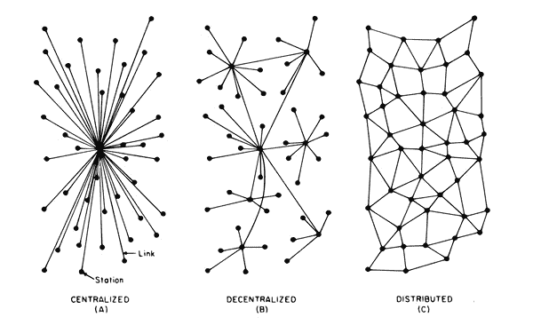

现在，考虑 Quora 上关于“分布式（分布式）和去中心化之间有什么区别？”的两个答案。第一个答案本质上重复了上面的图表，而第二个答案提出了一个完全不同的主张：“分布式意味着并不是所有的交易处理都在同一个进行”，而“去中心化意味着没有单一实体对所有处理拥有控制权”。与此同时，`Ethereum Stack Exchange` 上的热门回答提供了一个类似的图表，但“去中心化”和“分布式”这两个词的位置互换了！显然，有必要澄清。

## 三种去中心化类型

当人们谈论软件去中心化时，他们实际上可能在谈论三个独立的中心化/去中心化轴。虽然在某些情况下，很难看出如何在没有其中一个的情况下拥有另一个，但通常情况下它们是相互独立的。这些轴如下：

- **架构上的（去）中心化**：一个系统由多少物理计算机组成？它在任何时刻可以容忍多少计算机故障？
- **政治上的（去）中心化**：最终有多少个人或组织控制着构成该系统的计算机？
- **逻辑上的（去）中心化**：系统呈现和维护的接口以及数据结构看起来更像一个单一的整体，还是一个无定形的集群？一个简单的启发式方法是：如果你将系统一分为二（包括提供者和用户），两部分都会继续作为独立单位完全运行吗？

我们可以尝试将这三个维度放入图表中：

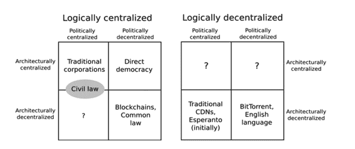

注意，这些放置大部分都非常粗略且极具争议。但让我们尝试分析其中任何一个：

- 传统公司在政治上是中心化的（一个 CEO），在架构上是中心化的（一个总部），在逻辑上也是中心化的（无法真正将它们一分为二）。
- 民法依赖于一个中心化的立法机构，而普通法是由许多个人法官做出的先例构建的。民法仍然具有一些架构上的去中心化，因为有许多法院拥有巨大的自由裁量权，但普通法的去中心化程度更高。两者在逻辑上都是中心化的（“法律就是”）。
- 语言在逻辑上是去中心化的；`Alice` 和 `Bob` 之间使用的英语与 `Charlie` 和 `David` 之间使用的英语完全不需要一致。语言的生存不需要中心化的基础设施，且英语语法的规则不由任何单一人物创建或控制（而国际语 `Esperanto` 最初是由卢德维希·扎门霍夫 `Ludwik Zamenhof` 发明的，尽管现在它运行起来更像一种在没有权威的情况下逐渐演变的活态语言）。
- `BitTorrent` 在逻辑上是去中心化的，正如英语一样。内容分发网络也类似，但由单一公司控制。
- 块链在政治上是去中心化的（没有人控制它们），在架构上是去中心化的（没有基础设施性的单点故障），但在逻辑上是中心化的（有一个共同认可的状态，且系统表现像单台计算机）。

许多当人们谈论区块链的优点时，他们描述的是拥有“一个中央数据库”带来的便利益处；这种中心化是逻辑中心化，这在许多情况下被认为是有利的中心化类型（尽管 `IPFS` 的 `Juan Benet` 也会尽可能推动逻辑去中心化，因为逻辑去中心化的系统往往擅于应对网络分区，在连接性差的地区运行良好等）。

架构中心化往往会导致政治中心化，但并非如此——在形式民主制中，政客在某个物理治理大厅会面并投票，但这个大厅的维护者并没有因此在决策上获得实质性的权力。在计算机系统中，架构中心化但政治去中心化的情况可能会发生，如果存在一个在线社区为了便利使用中心化的论坛，但那里存在一个广泛认可的社会契约，即如果论坛所有者采取恶意行为，所有人将转移到另一个论坛（围绕对另一个论坛所认为的审查行为的反抗而形成的社区在实践中可能具有这种属性）。


逻辑上的中心化使得架构上的去中心化变得更加困难，但并非不可能——看看去中心化共识网络已被证明是行的，但它们比维护 `BitTorrent` 要困难得多。逻辑中心化也让政治上的去中心化变得更加困难——在逻辑中心化的系统中，通过简单同意“互不干涉”来解决冲突是非常困难。

## 去中心化的三个原因

下一个问题是：去中心化最初为什么有用？通常有以下几个论点：

- **容错性**：去中心化系统发生意外故障的概率较低，因为它们依赖于许多独立的组件，而这些组件不太可能同时故障。
- **抗攻击性**：去中心化系统的攻击、破坏或操纵成本更高，因为它们缺乏敏感的中心节点，攻击这些节点的成本通常远低于周围系统的经济规模。
- **抗合谋**：去中心化系统中的参与者很难勾结以牺牲其他参与者利益为代价来谋利，而公司和政府的领导层总是会以有利于他们的方式进行勾结，从而损害协调程度较低的公民、客户、员工和大众的利益。

这三个论点都是重要且有效的，但一旦你开始反垄断法，这三个论点都会得出有趣且不同的结论——反垄断法是故意设置的监管障碍，为了让市场一侧参与者更难聚集并像垄断者一样行动，从而以市场另一方及整体社会福利为代价获取巨额利润。另一个例子是美国禁止候选人与超级行动委员会（super PACs）之间进行主动协调的规则，尽管这些规则在实践中证明很难执行。一个更小的例子是某些象棋比赛中的规则，防止两名选手之间进行多次比赛以试图提高其中一人的分数。无论你从何处观察，在复杂的机构中防止不良协调的尝试无处不在。


在区块链协议案例中，共识安全性背后的数学和经济推理往往关键地依赖于“非协调选择模型”（uncoordinated-choice model），或者假设游戏由许多独立做出决策的小型参与者组成。在工作量证明系统中，如果任何一个参与者获得了超过三分之一的算力，他们就可以通过自私挖矿获得巨额利润。

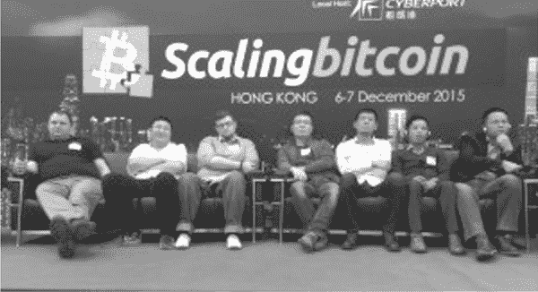

区块链倡导者还指出，在区块链上进行构建更安全，因为它们不能随心所欲地随地更改规则，但如果软件和协议的开发者都为同一家公司工作、属于同一个家族，并且坐在同一个房间里，那么这种观点将难以站住脚。核心点在于，这些系统不应该像自利的单一垄断者那样运行。因此，你完全可以认为，如果区块链更加去协调化，它们会更安全。

然而，这带来了一个根本性的悖论。许多社区（包括以太坊在内的社区）通常因强大的社区精神而受到赞誉，能够在六天内快速协调实施、发布并激活硬叉，以修复协议中的拒绝服务问题。但我们如何才能培养和改进这种良好的协调，同时防止“坏的协调”——即矿工通过反复协调 51% 攻击来试图坑所有人？

回答这个问题有三种种方式：

- 不要费精力缓解不受理想的协调；相反，尝试构建能够抵御这种协调的协议。
- 尝试找到一个折中方案，让协议有足够的协调来演进和前进，但又不至于足以引发攻击。
- 尝试区分有益的协调和有害的协调，让前者变得更容易，后者变得更难。

第一种方法成了 Casper 设计哲学的大部分。然而，单靠这种方法是不够的，因为仅仅依赖经济学无法解决关于去中心化的另外两类担忧。第二种很难在工程上明确实现，特别是从长期而言，但它确实经常偶然发生。例如，比特币的核心开发者通常说英语，而矿工通常说中文，这一事实可以被视为一种幸运的意外，因为它创造了一种“双院制”治理，增加了协调的难度，其额外好处是降低了共模失效的风险，因为由于距离和沟通障碍，英语和中文社区至少会在某种程度上分开进行推理，因此不太可能同时犯同样的错误。

第三种与其说是一个社会挑战，不如说是一个社会问题；这方面的解决方案可能包括：

- 社会干预，试图增加参与者对整个区块链社区的忠诚度，并取代或阻碍市场一方的玩家直接相互忠诚的可能性。
- 在相同语境下促进不同“市场侧面”之间的沟通，以减少验证者、开发者或矿工开始将自己视为一个必须协调以维护自身与其他阶级利益的“阶级”的可能性。
- 设计协议以减少验证者和矿工参与一对一“特殊关系”、中心化中继网络以及其他类似的超级协议机制的激励。
- 关于协议本应具备哪些基本属性的明确准则，以及哪些事情是不应该做的，或者至少应该在非常极端的情况下才做。

因此，这种第三种去中心化——即作为避免非理想协调的去中心化——可能是最难实现的，而且权衡是不可避免的。也许最好的解决方案可能是高度依赖那组保证公平去中心化的群体：协议的用户。

# 区块链治理笔记


区块链治理中近期较有趣的趋势之一是，链上持币者投票作为一种多用途决策机制的复兴。持币者的投票有时用于决定谁运行网络超级节点（例如 EOS、NEO、Lisk 和其他系统中的 `DPoS`），有时用于对协议参数投票（例如 `gas limit`），有时用于投票并直接实施协议升级。在所有这些情况下，投票都是自动的——协议本身包含了根据投票结果更改验证集或更新自身规则所需的逻辑。

显式链上治理通常被推誉为几个主要优势。首先，与比特币所信奉的高度保守哲学不同，它可以快速演进并接受技术改进。其次，通过创建一个显式的去中心化框架，它避免了非正式治理的预期缺陷，非正式治理被认为是不稳定且容易导致分裂，或者容易变得过度中心化——后者是著名的 1972 年论文《无结构的暴政》中提出的观点。

引用 Tezos 文档：

虽然所有区块链都为维护账本共识提供了财务激励，但没有区块链拥有稳健的链上机制来无缝修改其规则并奖励协议开发。结果是第一代区块链赋予了事实上的中心化开发团队或矿工制定设计选择。

以及：

是的，但为什么你想让[少数链分裂]变得更容易呢？分裂会破坏网络效应。

通过链上治理选择验证者还有一个好处，即它允许对验证者施加高计算要求，而不会引入经济中心化风险和其他公共区块链中出现的陷阱。

到目前为止，总而言，链上治理似乎是一项非常划算的交易……那么它有什么问题呢？

## 什么是区块链治理？

在开始，我们需要更清楚地描述什么是“区块链治理”过程。通常情况下，有两种非正式的治理模型，我将分别称为治理的“决策函数”视角和“协调”视角。决策函数视角将治理视为一个函数 `f (x1, x2 . . xn ) -> y`，其中输入是各种利益相关者（参议员、总统、财产所有者、股东、选民等）的愿望，输出是决策。

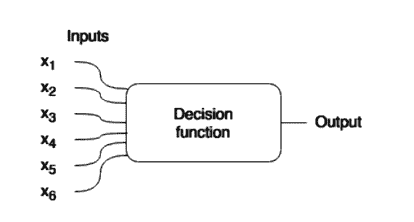

决策函数视角作为近似通常有用，但它显然在边缘非常脆弱：人们往往可以并且违反法律而逃脱惩罚，有时规则是模糊的，有时会发生革命——而这三种可能性在某些时候都是一件好事。而且，往往系统内部的行为也是由系统外部可能性所创造的激励所塑造的，这再次至少在某些时候是一件好事。


相比之下，治理协调模型将治理视为一种分层存在的东西。在现实世界中，最底层是物理定律本身（正如地缘政治现实主义者所说，是`guns`和`bombs`），而在区块链空间中，我们可以进一步抽象一点，认为底层是每个个体作为用户、矿工、利益相关者、验证者或区块链协议允许他们成为的任何其他代理人，运行他们想要的任何软件的能力。底层始终是终极的决策层；例如，如果某天所有的 `Bitcoin` 用户醒来，并决定编辑他们的客户端源代码，将整个代码替换为一个监听特定 `ERC20` 代币合约余额的 `Ethereum` 客户端，那么意味着该 `ERC20` 代币就是 `bitcoin`。底层的终极治理权无法阻挡，但人们在这一层采取的行动可以受到上方层级的影响。

第二层（至关重要的一层）是协调机构。协调机构的目的是围绕个体应该如何以及何时行动创建“焦点点”或“焦点”（focal points），以便更好地协调行为。在区块链治理和现实生活中，都有许多情况，如果你独自以某种方式行动，很可能无功而返（甚至更糟），但如果大家一起行动，就能实现预期结果。

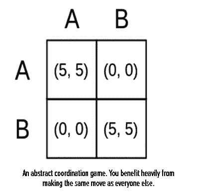

在这些情况下，如果其他人都去，去符合你的利益；如果其他人都停止，你也停止。你可以将协调机构想象成在空中挂起红旗或绿旗，写着“走”或“停”，并建立起一种文化，让大家都观察这些旗帜并（通常）按照指示行动。为什么人们有动力遵循这些旗帜呢？因为其他人已经在遵循这些旗帜了，而你有动力去和其他人做同样的事情。


### 拜占庭将军

**强有观点**：这种协调旗帜的概念涵盖了我们所说的“治理”的所有内涵；在不存在协调游戏（或更广泛地说，多均衡游戏）的场景中，治理的概念是没有意义的。

在现实世界中，将军的军事命令起着旗帜的作用；而在区块链世界中，这种旗帜最简单的例子是告诉人们硬分叉“是否正在发生”的机制。协调机构可以是正式的，也可以是非正式的，并且经常提供模糊的建议。旗帜理想情况下应该始终是红色或绿色，但有时旗帜可能是黄色的，甚至是全息的，对某些参与者来说是绿色的，对另一些来说是黄色或红色的。有时还存在相互冲突的多个旗帜。

因此，治理的关键问题变成了：

- 第一层应该是什么？也就是说，初始协议本身应该设置哪些功能，这又如何影响进行公式化（即类似决策函数的）协议更改的能力，以及不同类型代理人以不同方式行动的权力水平？
- 第二层应该是什么？也就是说，应该鼓励人们关注哪些协调机构？

### 硬币投票的角色

以太坊也有硬币投票的历史，包括：

- DAO 提案投票：`[daostats.github.io/proposals.html](https://daostats.github.io/proposals.html)`
- DAO Carbonvote：`[v1.carbonvote.com](http://v1.carbonvote.com)`
- EIP 186 Carbonvote：`[carbonvote.com](http://carbonvote.com/)`


其次，更具破坏性的是，在实践中，人们（至少在其加密代币持有者的身份）似乎都是利润最大化者，并且似乎认为收一两个贿赂并没有什么邪恶或自私。作为“证据 A”，我们可以观察 `Lisk` 的情况，其代理人池似乎成功被两个主要的“政党”捕获了，这两个政党明确贿赂代币持有者为他们投票，并要求池中的每个成员都对所有其他人投票。

这里是 `LiskElite`，拥有 55 个成员（总共 101 个）：

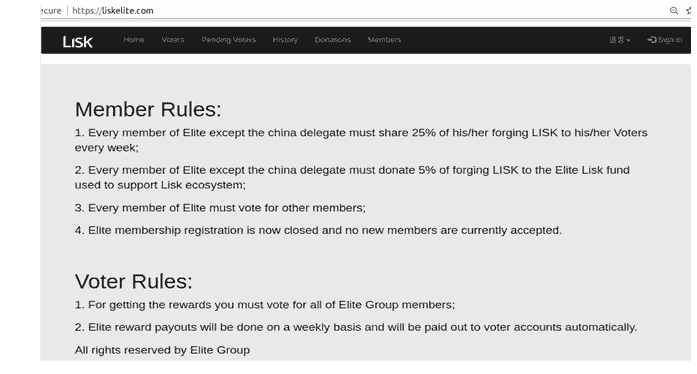

这里是 `LiskGDT`，拥有 33 个成员：

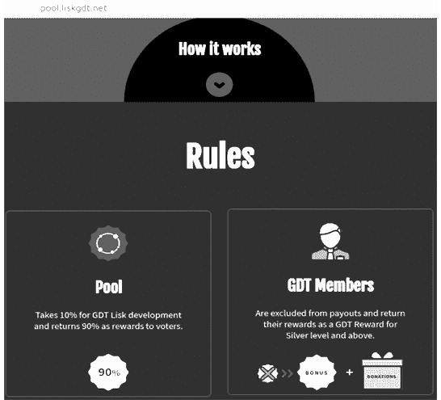

而“证据 B”是 `Ark` 中支付的一些选民贿赂：

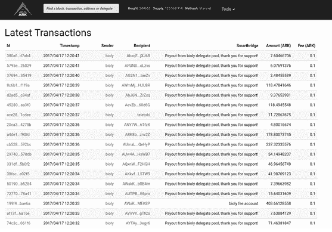

在这里，请注意紧耦合投票和松耦合投票之间存在关键区别。在松耦合投票中，同样存在直接或间接的投票贿赂，但如果社区认为某个特定提案或一组投票构成了博弈论攻击，他们可以简单通过社会共识来忽略它。事实上，这种情况已经某种程度上发生过了——`Carbonvote` 包含一个对应已知交易所地址的黑名单，来自这些地址的投票不被计入。在紧耦合投票中，无法在协议层面创建这样的黑名单，因为就同谁属于黑名单本身就是一个区块链治理的决策。但由于黑名单是社区创建的投票工具的一部分，而该工具仅间接影响协议更改，因此包含恶劣黑名单的投票工具可以被社区直接拒绝。

值得注意的是，这一章节并不是预测所有紧耦合投票系统都会很快屈服于贿赂攻击。完全可能许多系统能够生存下来，原因非常简单：由于所有这些项目都有创始人或基金会持有大量的预挖代币，这些实体充当了大型中心化参与者，他们对自己平台的成功感兴趣，且不受贿赂影响，并持有足够的代币来抵消大多数贿赂攻击。然而，这种中心化信任模型虽然在项目早期的某些语境下可能有用，但从长远来看显然是不可持续的。

### 非代表性

对投票的另一个重要反对意见是代币持有者只是一类用户，其利益可能与其他用户的利益发生冲突。在 `Bitcoin` 这种纯加密货币的情况下，价值存储用途（“hodling”）

此外，即使代币持有者是唯一的关联用户类（人们可能会想象在某种加密货币中是这种情况，那里存在一个既定的社会契约，其目的是成为下一个数字黄金，别无其他），仍然面临着挑战：代币持有者的投票让富有的代币持有者的话权远大于其他人，这为持仓的中心化导致决策的无限制中心化打开了大门。或者换句话说……

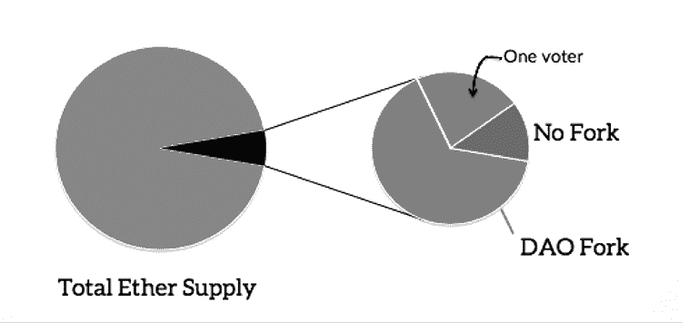

这种批评同样适用于紧耦合和松耦合投票；然而，松耦合投票更易于通过妥协来缓解其非代表性，我们将在稍后进行讨论。

### 中心化

让我们看看在 `Ethereum` 上现有的紧耦合投票活实验，即 gas 限制（gas limit 限制）。以下是过去两年 gas 限制的演变：


你可能会注意到，曲线的整体感觉有点像另一张你可能非常熟悉的图表：

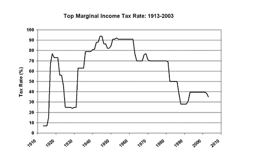

基本上，它们看起来都像是由一组坐在一个房间里的、相当中心化的男人们创建并反复谈判的“魔术数字”。第一种情况发生了什么？矿工通常遵循社区青睐的方向，而这种方向本身是通过类似于驱动硬叉的社会共识辅助来衡量的。在紧耦合投票中，没有办法在协议层面创建这样的黑名单，因为就同谁属于黑名单本身就是一个区块链治理的决策。但由于黑名单是社区创建的投票工具的一部分，而该工具仅间接影响协议更改，因此包含恶劣黑名单的投票工具可以被社区直接拒绝。

值得注意的是，这一章节并不是预测所有紧耦合投票系统都会很快屈服于贿赂攻击。完全可能许多系统能够生存下来，原因非常简单：所有这些项目都有创始人或基金会持有大量的预挖代币，这些实体充当了大型中心化参与者，他们对自己平台的成功感兴趣，且不受贿赂影响，并持有足够的代币来抵消大多数贿赂攻击。然而，这种中心化信任模型虽然在项目早期的某些语境下可能有用，但从长远来看显然是不可持续的。

### 非代表性

对投票的另一个重要反对意见是代币持有者只是一类用户，其利益可能与其他用户的利益发生冲突。在 `Bitcoin` 这种纯加密货币的情况下，价值存储用途（“hodling”）

此外，即使代币持有者是唯一的关联用户类（人们可能会想象在某种加密货币中是这种情况，那里存在一个既定的社会契约，其目的是成为下一个数字黄金，别无其他），仍然面临着挑战：代币持有者的投票让富有的代币持有者的话权远大于其他人，这为持仓的中心化导致决策的无限制中心化打开了大门。或者换句话说……


这种批评同样适用于紧耦合和松耦合投票；然而，松耦合投票更易于通过妥协来缓解其非代表性，我们将在稍后进行讨论。

### 中心化

让我们看看在 `Ethereum` 上现有的紧耦合投票活实验，即 gas 限制（gas limit 限制）。以下是过去两年 gas 限制的演变：


你可能会注意到，曲线的整体感觉有点像另一张你可能非常熟悉的图表：


基本上，它们看起来都像是由一组坐在一个房间里的、相当中心化的男人们创建并反复谈判的“魔术数字”。第一种情况发生了什么？矿工通常遵循社区青睐的方向，而这种方向本身是通过类似于驱动硬叉的社会共识辅助来衡量的。在紧耦合投票中，没有办法在协议层面创建这样的黑名单，因为就同谁属于黑名单本身就是一个区块链治理的决策。但由于黑名单是社区创建的投票工具的一部分，而该工具仅间接影响协议更改，因此包含恶劣黑名单的投票工具可以被社区直接拒绝。

### 数字宪法

一种被提出的缓解治理失控风险的方法是“数字宪法”，它通过数学规定协议应该具备的属性，并要求任何新的代码更改都附带满足这些属性的可验证证明。这初看起来是一个好主意，但在我看来，这应该应该持审慎态度。

总的来说，关于协议属性的规范，以及让这些规范起到协调标记的作用，是一个非常好的主意。这允许我们巩固非常重要且有价值的协议核心属性，并使其更难以改变。然而，这恰恰应该以松耦合（层 2）而非紧耦合（层 1）的形式执行。

基本上，任何有意义的规范其实都很难完全表达；这是价值问题复杂性的一部分。即使对于像 200 万硬币限制这样看似明确的事也是如此。

我们希望能够认为，任何违反这些保证的协议更改都应被视为是非法的——应该有一个协调机构来挥舞红旗——即使它们通过了投票。我们还希望认为，一个遵循规范字面意思但公然违反其精神的协议更改，仍应被视为是非法的。而让规范存在于层 2——在社区人类的脑海中，而不是协议代码中——最能实现这一目标。

### 走向平衡

然而，我也不愿意反过来，说代币投票或其他显性的链上投票之类的方案在治理中完全没有位置。主要的替代方案似乎是核心开发者共识，然而在我看来，系统被“象牙塔知识”控制的失效模式——他们更关注抽象哲学和听起来技术上很厉害的解决方案，而不是用户体验和交易费等真实的日常关注问题——也是一个需要认真对待的真实威胁。

那么，我们如何解决这个困局呢？首先，我们可以听从 `slatestarcodex` 的话：

新手的错误是：你看到某个系统部分被洛洛（即被利益不一致的特殊利益所捕获），于是你说“好吧，我们通过将其放在另一个系统的控制下来修复它。而我们通过在另一个系统上用红色马克笔写上‘不要变成洛洛’来控制这个系统。”


（我看到资本主义有时会发生偏离。让我们通过将其交给政府控制来修复它吧。我们 own 通过只让品德高尚的人担任高位来控制政府。）我并不会声称存在某种完美的替代方案，但偶尔不错的替代方案是新自由主义的——找到几个优雅的系统，它们都根据大致与人类幸福对齐的不同标准进行优化，将它们置于一个制衡结构中相互竞争，希望它们像那种“瑞士奶酪模型”一样在不同的地方出错，保留足够的个人选择，以便人们可以离开任何变得过于糟糕的系统，并让文化演化完成剩下的工作。

在区块链治理中，这似乎也是唯一的出路。我提倡的区块链治理方法是“多因素共识”，即对不同的协调标记、不同的机制和群体进行投票，最终决定取决于所有这些机制共同作用的集体结果。这些协调标记可能包括：

- 路线图（即在项目历史早期广播的关于项目发展方向的理念集合）
- 主流核心开发团队之间的共识
- 代币持有者投票
- 用户投票，通过某种抗女巫攻击的投票系统
- 已建立的规范（例如，不干预应用程序、2100 万枚代币限制）

我认为，让代币投票成为决定某项更改是否实施的几个协调机构之一是非常用的。它是一个不完美且不具代表性的信号，但它是抗女巫攻击的

而支撑这一切的基础是与传统系统的关键区别，这使得区块链变得有趣：支撑整个系统的“第一层”要求是个人用户必须同意任何协议更改，并且当有人试图强制他们实施他们认为具有敌意的更改时，他们拥有“分叉”（fork off）的自由和可靠的威胁。

在某些有限的范围内，紧耦合的投票也可以接受的——例如，尽管存在缺陷，矿工对 gas 限制（gas limit）进行投票的能力已被多次证明是非常有利的。矿工试图滥用权力的风险，可能低于协议在第一天硬编码的任何特定 gas 限制或区块大小限制最终导致严重问题的风险，在这种情况下，让矿工对 gas 限制投票是一件好事。然而，“允许矿工或验证者对某些需要频繁更改的少数特定参数进行投票”与赋予他们对协议规则的任意控制权，或让投票控制验证之间有着天壤之壤，这些更广泛的链上治理愿景在理论和实践中都具有更加模糊的潜力。

# 关于共谋

[vitalik.ca](http://vitalik.ca)

2019 年 4 月 3 日

在过去的几年里，人们对利用刻意设计的经济激励和机制设计来对齐各种背景下参与者的行为产生了越来越大的兴趣。在区块链领域，机制设计首先要为区块链本身提供安全保障，鼓励矿工或权益证明验证者诚实地参与，但最近它也被应用于预测市场、“代币策展注册表”（token curated registries）以及许多其他语境。与此同时，初生的 RadicalxChange 运动催生了哈伯格税（Harberger taxes）、平方投票（quadratic voting）、平方融资（quadratic financing）等实验。最近，对于使用基于代币的激励来鼓励社交媒体中产生高质量帖子的兴趣也日益增长。然而，随着这些系统的发展从理论转向实践，有很多需要解决的挑战，我认为这些挑战尚未得到充分应对。

这种从理论转向部署的近期一个例子是 Bihu，这是一个中国平台，它最近发布了一种基于代币的机制来鼓励人们撰写帖子。基本机制是，如果平台的用户持有 `KEY` 代币，他们就有能力在文章上质押这些 `KEY` 代币；每个用户每天可以进行 `k` 次“点赞”，且每次点赞的“权重”与点赞用户的质押数量成正比。获得更多质押点赞的文章显示得更明显，文章作者获得的 `KEY` 代币奖励与点赞该文章的 `KEY` 数量大致成正比。这是一种过度简化，实际机制中包含了一些非线性因素，但它们对于机制的基本功能并非至关重要。`KEY` 有价值是因为它可以在平台内部以各种方式使用，特别是所有广告收入的百分比被用于购买和销毁 `KEY`（耶，为他们这样做而不是又制造一种媒介交换代币点个大大拇指！）

这种设计远非独一无二；激励在线内容创作是许多人关心的问题，已经有了许多类似的设计，也有一些截然不同的设计。在这种情况下，这个特定平台已经有了大量使用：


几个月前，以太坊交易的 Reddit 子板块 `/r/ethtrader` 引入了一个类似的实验性功能，向获得点赞评论的用户发放一种名为“donuts”（甜甜圈）的代币，每周根据评论收到的点赞数比例发放固定数量的甜甜圈。甜甜圈可以购买设置子板块顶部横幅内容的权利，也可以用于在社区投票中投票。然而，与 `KEY` 系统的情况不同，在这里当 `B` 被 `A` 点赞时，`B` 获得的奖励与 `A` 现有的代币供应不成正比；相反，每个 Reddit 账户都有平等的能力向其他 Reddit 账户贡献。


这些尝试以一种超越已捐捐和微赏（microtipping）局限性的方式来奖励高质量内容的实验非常有价值；对用户生成的互联网内容的补偿不足是整个社会中一个非常显著的问题，看到加密社区尝试利用机制设计的力量来解决这个问题是令人欣慰的。但遗憾的是，这些系统也很容易攻击。

## 自投、富人政治和贿赂

以下是一个人如何从经济上攻击上述设计。假设某些富有的用户获取了数量为 `n` 的代币，结果该用户的 `k` 次点赞中的每一次都会给接收者带来 `n × q` 的奖励（这里的 `q` 可能是一个非常小的数字——例如，考虑 `q = 0.000001`）。该用户只需点赞自己的马甲（sockpuppet）

实际的 Bihu 机制似乎预到了这一点，并具有一些超线性逻辑，获得更多 `KEY` 点赞的文章将获得不成比例的巨大奖励，似乎是为了鼓励点赞热门帖子而不是自投。在代币投票治理系统中，添加这种超线性是一种常见模式，以防止自投破坏整个系统；大多数 `DPoS` 方案都有有限数量的代表人席位，对于没有获得足够票数加入其中一个席位的任何人，奖励为零，效果类似。但这些方案不可避免地引入了两个新弱点：

- 补贴了富人政治，因为非常富有的个人和集团仍然可以获得足够的资金进行自投。
- 它们可以通过用户贿赂其他用户为他们集体投票来绕过。


贿赂攻击听起来可能很遥不可及（现实生活中谁收过贿赂呢？），但在一个成熟的生态系统中，它们比看起来要现实得多。在区块链空间中发生过贿赂的大多数语境下，操作者会使用一个委婉的新名称来给这个概念换一张友善的面孔：这不是贿赂，而是一个“分享分红”的“质押池”。贿赂甚至可以被掩盖：想象一家加密货币交易所零手续费，投入精力制作出一个异常优秀的用户界面，甚至不尝试获取利润；相反，它利用用户存款的代币参与各种代币投票系统。不可避免地，这些人会将内部勾结视为理所当然的正常；以最近涉及 EOS DPoS 的一个丑闻为例：

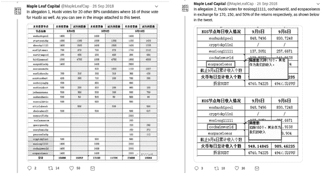

最后，还存在“负贿赂”的可能性（即勒索或胁迫），通过威胁参与者，除非他们以某种特定的方式在机制内行动，否则就会受到伤害。

在 `/r/ethtrader` 实验中，由于担心有人进来购买甜甜圈来操纵治理投票，社区决定只有锁定（即不可交易）的甜甜圈才有资格参与投票。但有一种比买甜甜圈更便宜的攻击（这种攻击可以被视为一种掩盖的贿赂）：租用。如果攻击者已经持有 `ETH`，他们可以在像 `Compound` 这样的平台上将其作为抵押品借出某些代币，从而获得使用该代币进行任何目的（包括参与投票）的完全权利，当完成后，他们只需将代币发回贷款合同即可取回抵押品——整个过程无需对他们刚刚用于操控代币投票的代币承担哪怕秒的价格风险，即使该代币投票机制包含时间锁（如 `Bihu` 那样）。在任何情况下，关于贿赂的问题以及无意中过度赋予关系广泛且富有的参与者权力的问题都被证明是难以避免的。

# 身份

某些系统试图通过使用身份系统来缓解代币投票中的金钱政治倾向面。例如，在 `/r/ethtrader` 甜甜圈系统中，虽然治理投票是通过代币投票进行的，但决定你最初获得多少甜甜圈（即代币）的机制是基于 Reddit 账户的：一个 Reddit 账户的赞成 = 获得 `n` 个甜甜圈。身份系统的理想目标是让个人获得一个身份相对容易，但获得多个身份相对较难。在 `/r/ethtrader` 甜甜圈系统中，这就是 Reddit 账户；在 `Gitcoin CLR` 匹配机制中也是如此。


噢，你懒得去弄一大排手机吗？那么也许你可能在寻找这个：

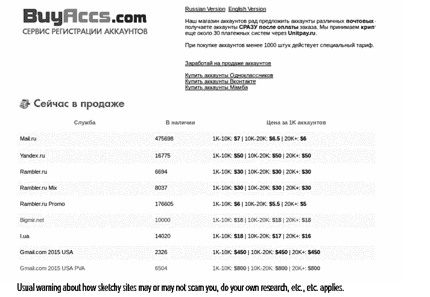

可以说，像木偶师一样通过简单控制成千上万个虚假身份来攻击这些机制，比费力贿赂他人要容易得多。如果你认为应对措施只是增加安全性到政府级别的 ID？那请记住，有专门的犯罪组织远领先于你，即使所有的地下组织都被铲除，如果我们足够愚蠢到创建让那种活动获利的的系统，敌对政府绝对会制造数百万计的假护照。这甚至还没有提到反方向的攻击，即身份发布机构通过拒绝向边缘化社区提供身份文件来剥夺他们的权利…… . .

# 勾结

鉴于一旦引入多个身份甚至流动性市场，许多机制似乎都会以类似的方式失败，人们可能会问，是否存在某种深层的共同特征导致了所有这些问题？我会认为答案是肯定的，这个“共同线索”是：在一个参与者可以勾结的模型中，构建维持理想属性的机制比在一个不能勾结的模型中要困难得多，并且可能完全无法实现。大多数人可能已经对此有了某种直觉；这一原则的特定实例存在于那些促进竞争性市场并限制价格操纵卡特尔、买卖票和贿赂的成熟规范和法律的背后。但问题要深得多，也更通用。

在关注个人选择的游戏论版本中——即假设每个参与者独立做出决策，且不允许代理组为了共同利益而作为一个整体运作的版本——有数学证明，任何游戏中都至少存在一个稳定的 `Nash equilibrium`（纳什均衡），机制设计者有很大的空间来“工程化”游戏以实现特定结果。但在允许联盟协作的游戏论版本中，被称为 `cooperative game theory`（合作博弈论），存在大量游戏没有任何一个联盟无法从中获利偏离的稳定结果。

多数人游戏，正式描述为 `n` 个代理人的游戏，其中任何超过一半人数的子集都可以捕获固定奖励并在他们之间分配，这种设定与公司治理、政治以及人类生活的其他许多情况惊人地相似，是那组本质上不稳定游戏的一部分。也就是说，如果某个情况下存在某些固定资源池和某种目前建立的分配这些资源的机制，并且 `51%` 的参与者合谋夺取资源控制权是不可避免的（无论目前的配置如何），总会产生这样一种对参与者有利的阴谋。然而，这种阴谋随后反过来又会受到潜在新阴谋的影响，可能包括之前的阴谋者和受害者的结合 . . .以此类推。

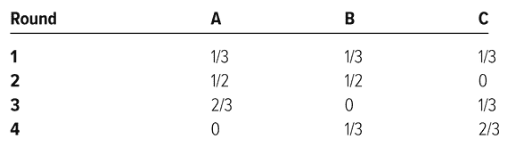

这一事实，即在 `cooperative game theory` 下多数人游戏的不稳定性，可能被严重低估了，作为一个简化的通用数学模型，它解释了为什么政治上可能没有“历史的终结”，也没有一个完全满意的系统；我个人认为它比更著名的阿罗定理（Arrow’s theorem）有用得多，

解决这个问题有两种。第一种是尝试将自己限制在“无身份”且“防勾结”的游戏类别中，这样我们就不需要担心贿赂或身份。第二种是尝试直接攻击身份和防勾结问题，并解决得足够好，以便我们能够实现提供更丰富属性的非勾结游戏。

## 无身份且防勾结的游戏设计

无身份且防勾结的游戏类别是非常大量的。即使是 `proof of work`（工作量证明）在单一者拥有总算力约 `23.21%` 的范围内也是防勾结的，通过巧妙的工程设计，这一边界可以增加到 `50%`。竞争性市场在较高的边界内是相当防勾结的，这个边界在某些情况下很容易达到，但在另一些情况下则无法达到。


在治理和内容策展（这两者本质上都是识别公共物品和公共恶因这一通用问题的特殊例）中，一类运行良好的机制是“未来富会”（futarchy）——它通常被描绘为“基于预测市场的治理”，但我认为使用质押金在根本上也属于同一类技术。未来富会机制在最通用形式下的运作方式是：它们让“投票”不仅是意见的表达，更是一种预测，并对准确的预测给予奖励，对错误的预测进行以惩罚。例如，我关于“内容策展 DAO 的预测市场”的提建议了一种半中心化的设计：任何人都可以对提交的内容进行点赞或点踩，点赞次数的内容可见性越高，同时还设有一个“审核小组”来做出最终决定。对于每条帖子，都有很小的概率（与该帖子的点赞和点踩总数成正比）审核小组会被召集对该帖子做出最终决定。如果审核小组批准了某帖子，所有点赞它的人将获得奖励，所有点踩的人将受到惩罚；如果审核小组否决了某帖子，则反之；这种机制鼓励参与者通过点赞和点踩来试图“预测”审核小组的判断。

未来富会的另一个可能例子是一个带有代币的项目治理系统，其中任何对某项决策投票的人都有义务在投票开始时的价格购买某些数量的代币，如果该投票获胜；这确保了对糟糕决策的投票是有成本的，而且在极端，如果一个糟糕决策通过了投票，所有批准该决策的人本质上必须买下项目中其他人的份额。这确保了对一个“错误”决策的个人投票对投票者可能非常昂贵，从而排除了廉价贿赂攻击的可能性。

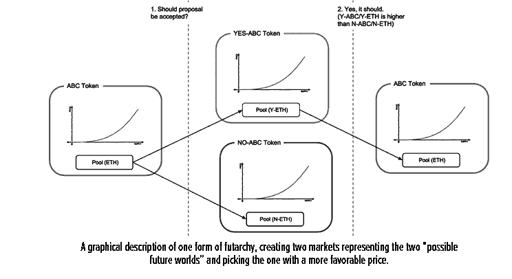

然而，这类机制能做的事情范围是有限的。在上述内容策展的例子中，我们并不是在解决治理，而是在扩展一个已经被假设为信任的治理小工具的功能。人们可以尝试用代表购买广告位权利的代币价格预测市场来取代审核小组，但在实践中，价格作为指标的噪音太大，使得它除了极少数的重大决策外，对任何其他情况都不可行。而且，我们试图最大化的价值往往明确是其他于代币最大价值。

让我们更明确地看看，为什么在无法容易通过对代币价格的影响来确定治理决策价值的更通用情况下，识别公共物品和恶因的良好机制遗憾的是无法做到与身份无关（identity-free）或防共谋安全（collusion-safe）。如果人们试图保留游戏具有身份无关的属性，即构建一个身份紧要、只有代币才重要的系统，那么在无法激励合法的公共物品或过度补贴富人政治之间，存在着一种不可能的权衡。

论点如下：假设某个作者正在生产一种公共物品（例如系列博客文章），该物品为一万人社区的每个成员提供价值。假设存在某种机制，社区成员可以采取某种行动导致作者获得一美元的收益。除非社区成员极其利他，否则为了让机制运作，采取这种行动的成本必须远低于一美元，否则支持作者的社区成员所捕获的收益将远小于支持作者的成本，导致系统崩溃为“公地悲剧”，即没有人支持作者。因此，必须存在一种以远低于一美元的成本让作者赚到美元的方法。但现在假设还有一个虚假社区，它由同一个富有的攻击者的一万个虚假“袜筒”（sockpuppet）账户组成。这个社区采取与真实社区相同的所有行动，只不过它们不是支持作者，而是支持另一个虚假账户，该账户也是攻击者的另一个袜筒。如果“真实社区”的成员能够以远低于一美元的个人成本给作者一美元，那么攻击者就有可能以远低于一美元的成本不断地给自己一美元，从而抽空系统的资金。任何能够帮助真正未协调的双方进行协调的机制，在没有适当保护措施的情况下，也会帮助已经协调的双方（例如由同一个人控制的许多账户）过度协调，从而从系统中提取金钱。

当目标不是资助而是确定哪些内容应该最可见时，也会出现类似的挑战。你认为哪种内容会获得更多的美元价值支持：一篇让成千上万人受益但对每个个体的益处相对较少的正规高水平博客文章，还是这个？


或者是这个？

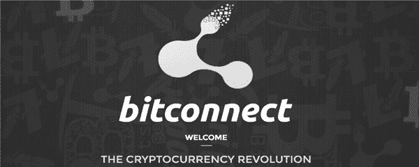

那些关注近期“现实世界”政治的人可能还会指出另一种让高度中心化行为者受益的内容：敌对政府对社交媒体的操纵。最终，中心化系统和去中心化系统面临着同一个根本问题，即“思想市场”（更泛地说是公共物品市场）远非经济学家通常使用的术语意义上的“有效市场”，这导致了即使在“和平时期”公共物品生产不足，同时也容易受到主动攻击。这是一个硬难题。

这也是为什么基于代币的投票系统（如 Bihu 的）相对于基于身份的系统（如 Gitcoin 或 `/r/ethtader` 实验）有一个主要的真实优势：至少批量购买账户没有好处，因为你所做的一切取决于你拥有多少代币，无论这些代币分布在多少个账户中。然而，不依赖任何身份模型而仅依赖代币的机制从根本上无法解决集中利益竞争试图支持公共物品的分散社区的问题；赋予分散社区权的身份无关机制无法避免过度赋权给伪装分散社区的中心化富人政治。


另一种方案是正面对身份问题。如上所述，仅仅转向更高安全性的中心化身份系统（如护照和其他政府身份 ID）是无法规模运作的；在激励机制充分的背景下，这些系统非常不安全，而且容易受到颁发政府自身的的侵害！相反，我们在这里所讨论的“身份”，是某种稳健的多因素主张集合，这些主张证明了通过某些消息识别的执行者实际上是一个独特的个体。这种网络化身份的一个非常早的原型模型可以说是 HTC 区块手机中的社交恢复（social recovery）：

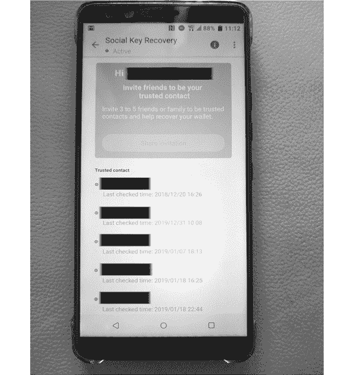

基本思想是，你的`private key` 在最多五个受信任的联系人之间进行秘密共享，这种方式在数学上确保了其中三个人可以恢复出原始密钥，但两个或更少的人则不能。这被认为是一个“身份系统”——它由你的五个朋友来决定试图找回你账户的人是否真的是你。然而，这是一个特殊用途的身份系统，旨在解决问题——个人账户安全——而这与尝试识别独特人类的问题不同（而且更容易！）。尽管如此，个体之间相互提出主张的通用模型极有可能被引导为某种更稳健的身份模型。如果需要，这些系统可以使用上述的“富途”（futarchy）机制进行增强：如果有人声称某人是独特的人，而另一个人持不同意见，且双方都愿意押金来诉讼该问题，系统可以召集一个判断小组来决定谁是对的。

但我们想要另一个至关重要的属性：我们想要一种无法被信誉地租用或出售的身份。显然，我们无法阻止人们达成交易（“你发给我五十，我发给你我的密钥”），但我们可以尝试的是防止此类交易具有信誉度——让卖者能够轻易欺骗买家，给买家一个实际上不起作用的密钥。实现这一点的方法是建立一种机制，密钥所有者可以通过发送交易来撤销该密钥并将其替换为所有者选择的另一个密钥，且这一切过程无法被证明。也许绕过这一点的简单方法是使用一个运行计算并只发布结果的信任第三方（以及用于证明结果的零知识证明，因此该第三方仅对隐私受到信任，而非完整性），或者通过多方计算将相同的功能去中心化。此类方法无法完全解决合谋问题；一群朋友仍然可以聚在一起坐在同一沙发上并协调投票。但合谋可以减少到一种可以管理的程度，不至于导致这些系统彻底崩溃。

还存在进一步的问题：密钥的初始分配。如果用户在第三方托管服务内部创建他们的身份，然后由该服务存储私钥并利用它秘密地对某些事情进行投票，会怎样？这将是一种隐性贿赂，用户的投票权换取的是向用户提供的便利服务；更重要的是，如果系统是安全的（即通过让投票变得不可证明来成功防止贿赂），那么第三方托管者的秘密投票也将无法被检测到。唯一能绕过这一问题的方法似乎是……面对面核实。例如，可以建立一个“颁发者”组成的生态系统，每个颁发者发放带有私钥的智能卡，用户可以立即将其下载到智能手机上，并发送消息将该密钥替换为另一个他们不向任何人透露的密钥。这些颁发者可以是聚会和会议，或者潜在的已经被某些投票机制视为可信的个人。

构建能够使防合谋机制成为可能的设施（包括稳健的去中心化身份系统）是一项艰巨的挑战，但如果我们想要释放此类机制的潜力，似乎我们必须竭尽努力尝试，这是不可避免的。诚然，目前关于计算机安全的教条（例如，关于引入在线投票）仅仅是“不要这么做”，但如果我们想要将类投票机制的作用（包括二次投票和二次金融等更高级的形式）扩展到更多领域，我们别无选择直面挑战，加倍努力，并希望成功创造出至少对某些用例来说足够安全的东西。

# 关于言论自由

[vitalik.ca](http://vitalik.ca)

2019 年 4 月 16 日

一个陈述既可能是真实的，也是危险的。

上一句话就是这样一个陈述。

—大卫·弗里德曼（David Friedman）

言论自由是过去二十年来许多互联网社区一直在努力应对的话题。加密货币和区块链社区其存在的理由很大程度上是为了抗审查，因此特别倾向于高度重视言论自由；然而，在过去的几年里，这些社区的快速增长以及涉及的极高财务和社会利益，反复测试了这一概念的应用和局限。在这篇文章中，我旨在理清一些矛盾，并为“言论自由”的规范真正代表了什么提供论据。

## “言论自由法”与“言论自由”

我经常听到的一个常见且在我看来令人沮丧的论点是，“言论自由”仅仅是对政府所能采取的反对行动的法律限制，而对于公司、私有平台、互联网论坛和会议等私有实体的行为则无一言。加密货币社区中“私有审查”的一个较大例子是 `/r/bitcoin` 子版块的管理员 Theymos 决定开始对该子版块进行严厉审核，禁止任何主张通过硬分叉增加比特币区块链交易吞吐量的争论。

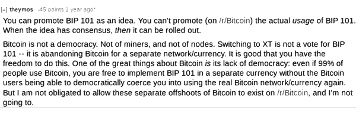

Theymos 审查行为的辩护者使用的一种常用策略是说，强力的审核是可以接受的，因为 `/r/bitcoin` 是 Theymos 拥有的“私有论坛”，因此他权在里面做任何他想做的事；不喜欢的人应该去其他论坛：


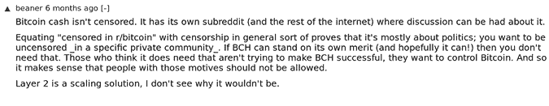

确实，Theymos 以这种方式管理其论坛并没有违反任何法律。但对大多数人来说，很显然仍然发生了某种形式的言论自由违规。那么该如何解释？首先，至关重要的是意识到言论自由不仅仅是某些国家的法律。它还是一种社会原则。这种社会原则的底层目标与法律底层目标相同：培养一个环境，在这个环境里，胜出的思想是好的思想，而不是恰好被权力阶层青睐的思想。

Slatestarcodex 阐述道：


上述引言中的“子弹”（bullet）是指什么意思？涵盖其他投射物吗？箭吗？从弹石机发射的巨石吗？还有像剑或锤之类的近战武器吗？我们究竟在哪里为“对辩论的不当回应”划定界限？对辩论良好的回应是针对某个观点；而糟糕的辩论则是让该观点沉默。如果你试图回应一个观点，你的成功取决于该观点有多好；如果你试图让它沉默，你的成功则取决于你有多强大，以及你能在短时间内提供多少把叉子和火炬。射子弹是一种在不回应观点的情况下使其沉默的好方法。从弹石机上发射石块、或用剑劈开人体、或聚集一群手持叉子的的暴民也是如此。但试图让一个持有某种观点的人被解雇，也是一种在不回应观点的情况下使其沉默的方法。

话虽如此，有时“安全空间”（safe spaces）是有理由的，在这些空间，无论出于什么原因，不想处理特定类型辩论的人可以聚集，而那些辩论实际上被禁止了。也许最无害的都是像 `ethresear.ch` 这样的空间，那里的帖子仅仅因为“离题”而被屏蔽，以保持讨论的聚焦。但“安全空间”这个概念也有阴暗面；正如 Ken White 所写的：

> 这可能让你感到惊讶，但我是“安全空间”的支持者。我支持安全空间是因为我支持结社自由。安全空间如果以原则的方式设计，仅仅是这种自由的应用……但并不是每个人想象的“安全空间”都是那样。有些人将“安全空间”的概念当作一把剑，用来兼并公共空间，并要求这些空间内的人遵循他们的私人规范。那不是结社自由。

啊。所以，在角落里开辟自己的安全空间是完全没问题的，但也存在“公共空间”这个概念，而试图将公共空间变成为了某一个特定特殊利益的安全空间是错误的。那么，什么是“公共空间”呢？很明确的是，公共空间不仅仅是“由政府拥有和/或运营的场所”；私有化的公共空间概念是一个非常成熟的概念。这即使在非正式场合也是如此：例如，一种常见的道德直觉是，私人个人歧视种族和性别等违规行为，比比如购物商城做同样的事情要好接受得多。对于 `/r/bitcoin` 子版块，人们可以认为，无论技术上谁拥有该子版块的顶级管理员职位，该子版块很大程度上就是一个公共空间。有几个论点尤为突出：

* 它占据了“黄金地段”，特别是“bitcoin”这个词，这让人们认为它是讨论比特币的默认场所。
* 该空间的价值不仅是由 Theymos 创建的，还是由成千上万来到版块讨论比特币的人创造的，他们含蓄地预期这里是、并将继续是一个讨论比特币的公共空间。
* Theymos 政策的转变让许多人感到意外，这在事先是无法预见的。

相反，如果 Theymos 建立了一个名为 `/r/bitcoinsmallblockers` 的子版块，并明确表示这是一个为小区块者设计的策划空间，且不欢迎试图煽动争议性硬分叉的行为，那么很可能极少有人会认为这有什么问题。他们也许会反对他的意识形态，但很少（至少在区块链社区中）会尝试声称，持有与自己对立意识形态的人拥有内部讨论空间是不妥的。但在现实中，Theymos 试图“兼并一个公共空间并要求空间内的人遵循他的私人规范”，因此我们有了比特币社区的区块大小分裂、一场充满火药味的分叉和链分裂，以及现在比特币与比特币现金（Bitcoin Cash）之间的冷和平。

## 下架（Deplatforming）

大约一年前在 Deconomy

当然，Craig Wright 的支持者们以……审查的指控作为回击。

我曾试图“让” Craig Wright 吗？我会认为，没有。有人可以认为这是因为“Deconomy 不是一个公共空间”，但我认为更好的论点是，会议从根本上说与互联网论坛是有区别的。互联网论坛实际上可以尝试成为一个完全中立的讨论媒介，允许任何事情发生；而会议，其本质上是一份经过高度策划的演讲列表，分配有限的发言名额，并积极将大量注意力引导给那些足够幸运获得发言机会的人。会议是组织者的一种编辑行为，意在说“这里有一些我们认为人们真的应该接触的观点和想法”。每场会议都“审查”了几乎每一个观点，因为没有足够的空间给他们提供发言的机会，这是这种格式所固有的；因此，对会议在选择时的判断提出异议绝对是合法的行为。

这延伸到了其他类型的选择性平台。如 Facebook、Twitter 和 YouTube 等在线平台已经通过算法进行主动选择，这些算法影响人们更有可能被推荐的内容。通常，他们这样做是出于私利考虑，设置算法以最大化与其平台的“互动”，这往往伴随着意料之外的副作用，例如推广地心论阴谋论。鉴于这些平台已经在进行（自动的）选择性展示，那么批评它们没有将这些杠杆转向更具亲社会性质的目标，或者至少是转向所有主要理性政治派别都同意的亲社会性质的目标（例如，高质量的智力话语），似乎是完全合理的。此外，这种“审查”并没有严重阻碍任何人学习 Craig Wright 这一方的说法；你只需去访问他的网站，在这里：`coingeek.com`。如果某人已经在运营一个做出编辑决策的平台，要求他们以同样的规模但根据亲社会的标准来做出此类决策，似乎是一件非常合理的事情。

这一原则的一个更近期的例子是 `#DelistBSV` 活动，其中，一些加密货币交易所（最著名的是 Binance）移除了对 BSV（由 Craig Wright 推广的比特币分叉）的支持。再次，许多人（甚至是理智的人）指责这一活动是审查的体现，并将其与信用卡公司屏蔽 WikiLeaks 相类比：

```
image/Deconomy-142.png
```

```
image/angela-walch-tweet-144.png
```

我个人一直是中心化交易所所行权力的批评者。我应该基于言论自由而反对 #DelistBSV 吗？我会认为，不；支持它是可以的，但这绝对是一个要难判断得多的抉择。

许多参与 #DelistBSV 的平台（如 Kraken）绝对不是“随心所欲”的平台；他们已经对接受或拒绝哪些货币做出了许多编辑决策。Kraken 只接受大约十种货币，因此他们被动地审查了几乎所有人。Shapeshift 支持更多货币，但它不支持 SPANK，甚至不支持 KNC。所以在这两个案例中，下架 BSV 更多像是对稀缺资源（注意力/合法性）的重新分配，而不是审查。Binance 稍有不同；它确实接受大量的加密货币，采取了更接近“随心所欲”的哲学，并且作为拥有大量流动性的市场领导者，它拥有独特的地位。


尽管如此，人们可以从两个方面来支持币安（Binance）。首先，审查是对 BSV 核心社区成员某些真正恶意审查行为的报复，因为他们曾用律师函威胁彼得·罗科马克（Peter McCormack）这样的批评者；在对准则上存在巨大分歧的“无政府状态”环境中，“以眼还眼”的实物报复是良好的社会规范之一，因为它确保了人们所面对的惩罚，是他们在某种意义上通过自己的行为所证明其认为是正当的。此外，下架不会让人们买卖 BSV 变得那么困难；`Coinex` 已表示他们不会下架（实际上，我反对二线那种“随心所欲”的交易所下架）。但下架确实传达了对 BSV 强烈的社会谴责信号，这是很有用且必要的。因此，有理由支持目前所有的下架行为，尽管反思起来，币安因为“自由”而拒绝下架，其做法并不像初看时那么不合理。

总的来说，反对权力集中是绝对合理的，但只要这种权力集中存在，支持将其用于你认为有利于社会的目的也是合理的；可以看看布莱·卡普兰（Bryan Caplan）关于调和支持开放边界与支持反埃博拉限制的论述，作为不同领域的示例。

如果有人成功开发出一个完全许可的跨链去中心化交易所，方便任何资产与任何其他资产之间的交易，那么在该交易所上“列出”就不会传递任何社会信号，因为所有人都是被列出的；即使该交易所支持交易 BSV，我也支持这种交易所的存在。我支持的是将 BSV 从那些赋予了比单纯“存在”更高层次合法性的排他性位置中移除。

因此得出结论：公共空间的审查是坏的，即使这些空间是非政府性的；在真正的私人空间（尤其是那些不是广泛社区“默认”的空间）中，审查是可以接受的；以剥夺访问权限为目标和效果孤立项目是坏的；以剥夺其稀缺合法性为目标和效果孤立项目是可以接受的。

# 控制即责任

[vitalik.ca](http://vitalik.ca)

2019 年 5 月 9 日

过去十年里，围绕互联网服务和应用的监管及法律环境发生了巨大变化。当大型社交网络平台在 2000 年代初开始流行时，人们对大规模数据收集的态度基本上是“为什么不呢？”那是马克·扎克伯格（Mark Zuckerberg）说隐私时代已经结束，埃里克·施密特（Eric Schmidt）辩称“如果你有什么不想让任何人知道的东西，也许你根本就不该这样做”的时代。对他们来说，这种观点在个人层面是合理的：你获取的关于别人的每一比特数据对你都是潜在的机器学习优势，每一项限制都是一个弱点，而且如果这些数据出了问题，成本相对较小。十年后，情况已完全不同了。

特别值得关注的是几个特定趋势。

- **隐私**：在过去的十年里，许多国家通过了隐私法，欧洲最为激进，但其他地区也是如此——最近的是 `GDPR`。`GDPR` 包含许多部分，但最突出的包括：(i) 对明确同意的要求；(ii) 要求有法律依据处理数据；(iii) 用户下载其所有数据的权利；(iv) 用户要求你删除其所有数据的权利。其他管辖区正在探索类似的规则。
- **数据本地化规则**：印度、俄罗斯和许多其他管辖区越来越多地制定或正在探索规则，要求该国用户的数据必须存储在国境内。即使在没有明确法律的情况下，人们也越来越倾向于担心数据被转移到被认为保护措施不充分的国家。
- **共享经济监管**：诸如 `Uber` 这样的共享经济公司很难向法院辩称，考虑到其应用程序控制和指导驱动员活动的程度，它们不应在法律上被归类为雇主。
- **加密货币监管**：最近一份 `FinCEN` 指南试图澄清美国哪些类别的加密货币相关活动属于以及不属于监管许可要求的范围。运行托管钱包？受监管。运行一个用户控制自己资金的钱包？不受监管。运行匿名混合服务？如果你在运行它，受监管。如果你只是在写代码 . . . 不受监管。

`FinCEN` 的加密货币指南并非杂乱无章；相反，它正试图将开发者积极控制资金的应用程序类别，与开发者没有控制权的应用程序类别隔离开来。该指南仔细地区分了多签名钱包（密钥由操作者和用户共同持有）有时受监管、有时不受监管：

```
如果多签名钱包提供者将其角色限制在创建非托管钱包，且该钱包要求在钱包所有者的私钥上添加第二个授权密钥以验证并完成交易，则该提供者不是货币汇款者，因为它不接受和传输价值。另一方面，如果 . . . 价值表现为提供者账户中的条目，所有者不直接与支付系统交互，或者提供者对价值保持完全的独立控制，则该提供者也将符合货币汇款者的资格。
```

尽管这些事件发生在各种背景和行业中，但我认为其中存在一种共同的趋势。这种趋势是：对用户数据、数字财产和活动的控制正迅速从一种资产转变为一种责任。以前，你拥有的每一比特控制都是好的：它让你有更多的灵活性来获取收入，即使现在不是，将来也是。现在，你拥有的每一比特控制都是一种责任：你可能会因为此受到监管。如果你对用户的加密货币表现出控制行为，你就是货币汇款者。如果你对费用有“完全裁量权，并在司机选择不接订单时收取取消费、禁止司机接待未使用应用程序的乘客以及暂停或禁用驱动员账户”，你就是雇主。如果你控制用户数据，你被要求确保能够提出合规理由，设有合规官，并赋予用户下载或删除数据的权利。

如果你是一个应用程序开发者，且你既懒惰又害怕法律麻烦，那么有一种简单的方法可以确保你不违反上述任何新规则：不要构建中心化控制的应用程序。如果你构建一个由用户持有私钥的钱包，你真的仍然只是“一个软件提供者”。如果你构建一个“去中心化 Uber”，它实际上只是一个将支付系统、声誉系统和搜索引擎相结合的精美界面，且你自己不控制这些组件，那么你真的不会遇到许多同样的法律问题。如果你构建一个仅仅 . . . 不收集数据的网站，你甚至不需要考虑 `GDPR`。

这种方法对所有人来说显然是不现实的。未来仍然会有很多情况，放弃中心化控制带来的便利性对开发者和用户来说牺牲太大，而且在某些情况下，商业模式的考虑要求采用更中心化的方法（例如，如果软件留在你的服务器上，更容易阻止非付费用户使用软件）会占据主导。但我们确实远没有探索到去中心化方法所提供的全部可能性。


通常，法律的非预期后果——即当我们只想手术式地禁止少数特定事项时，却阻碍了整类类活动——被视为坏事。然而，在这里，我认为开发者心态的强制转变，从“为了防范万一，我想控制更多事情”到“为了防范万一，我想控制更少事情”，也有许多积极的后果。自愿放弃控制并自愿采取措施剥夺自己作恶的能力，对许多人来说并非自然而然；虽然现在存在意识形态驱动的追求去中心化的项目，但乍眼看去，此类服务是否能继续主导行业主流并不显而易见。然而，这种监管趋势实际上为那些愿意采取最小化中心化、用户主权最大化的“无法作恶”路线的应用提供了巨大的推力。

因此，尽管这些监管变化从某种上可能并不有利于自由（至少如果你关心应用开发者的自由），而且互联网转变为政治焦点不可避免地会产生许多负面连锁反应，但这种“控制变成一种负担”的特定趋势，在某种奇特的程度上（即便并非刻意的！）甚至比为应用开发者最大化总自由的政策更支持加密朋克（cypherpunk）。尽管目前的监管格局从几乎任何人的喜好来看远非理想状态，但它无意中为减少不必要的中心化并最大化用户对其资产、私钥和数据控制权的运动提供了一个意外强大的助力，来执行其愿景。对于这项运动来说，利用这一点将极有益。

# 圣诞特辑

[vitalik.ca](http://vitalik.ca)

2019 年 12 月 24 日

既然现在是圣诞节，而理论上我们应该享受时光并与家人共度，而不是在 Twitter 上发动无休止的圣战，这篇博客文章将提供一些你可以和朋友一起玩的游戏，帮助你们在享受乐趣的同时理解一些诡异的数学概念！

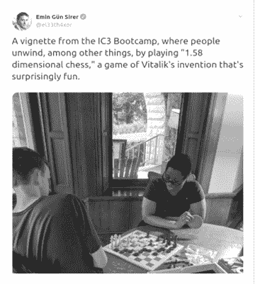

## 1.58 维象棋

这是象棋的一种变体，棋盘布局如下：

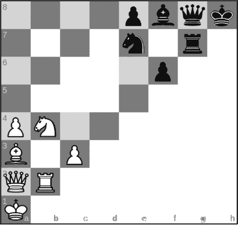

棋盘仍然是普通的八八棋盘，但只有二十七个开放格子。另外三十七个格子应该被棋子、围棋子或其他任何东西覆盖，以表示它们是不可访问的。规则与象棋相同，但有几个例外：

- 白兵向上移动，黑兵向左移动。白兵通过向左上方或右上方吃子，黑兵通过向左下方或左上方吃子。白兵到达顶端时升变，黑兵到达左侧时升变。

- 没有吃过兵、易王或兵向前走两格。

- 棋子不能移动到或穿过那三十七个覆盖的格子。骑士不能移动到那三十七个覆盖的格子，但不关心“穿过”什么。

这个游戏被称为 `1.58 维象棋`，因为这二十七个开放格子是根据谢尔宾基三角形（Sierpinski triangle）的模式选择的。你从一个开放格子开始，每当宽度翻倍时，你就取上一个步骤结束时的形状，并将其复制到左上、右上和左下角，但保留右下角为不可访问。在一维结构中，宽度翻倍使空间增加 `2x`；在二维结构中，宽度翻倍使空间增加 `4x`（`4 = 2²`）；在三维结构中，宽度翻倍使空间增加 `8x`（`8 = 2³`）；而在这里，宽度翻倍使空间增加 `3x`（`3 = 2¹.58496`），因此是“1.58 维”。

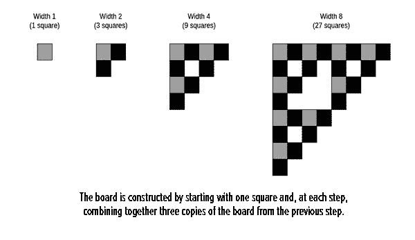

这个游戏比完整的象棋要简单得多且更“易处理”，而且这是一个有趣的练习，展示了在低维空间中防御如何变得比进攻容易得多。注意，不同棋子的相对价值在这里可能会 way，并且可能出现新的终局局面（例如，你只用一个主教就能将杀）。

## 三维井格

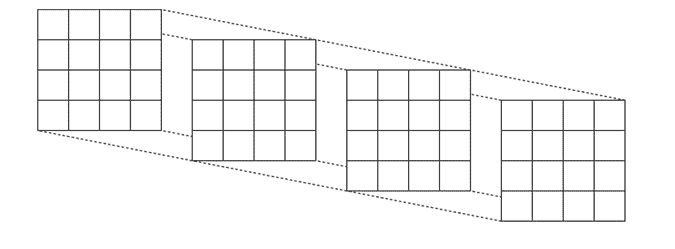

这里的目标是四点连成一条直线，直线可以是任何方向，沿着轴或对角线，甚至包括平面之间。例如，在在此种配置下，X 赢了：

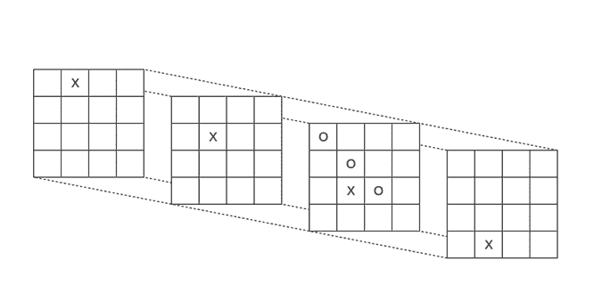

它比传统的二维井格要困难得多，希望更有趣！

## 模块化井格

在这里，我们回到了二维，但我们允许直线环绕：

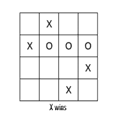

注意，我们允许任何斜率的对角线，只要它们通过所有四个点。这意味着斜率为 `+/- 2` 和 `+/- 1/2` 的线是允许的：

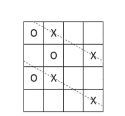

从数学上说，棋盘可以解释为模 `4` 整数的二维向量空间，目标是填充一条通过该空间上四个点的线。注意，至少存在一条穿过任意两点的线。

## 四元二进制域上的井格


在这里，我们使用了上述相同的概念，只是使用了更诡异的数学结构，即 `Z2` 上模 `x² + 1` 的四元。这种结构几乎没有几何解释，所以我直接给你加法和乘法表：

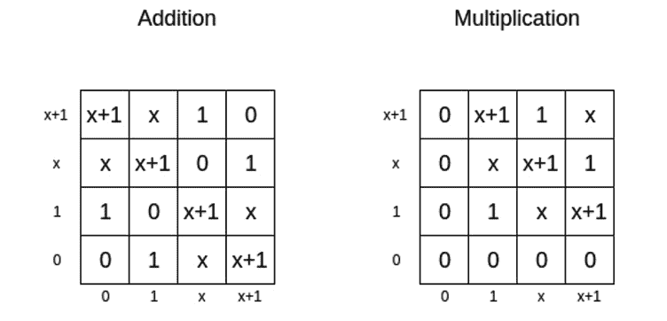

好吧，为了简洁，这里是除了水平和垂直（也是允许的）之外可能的直线：

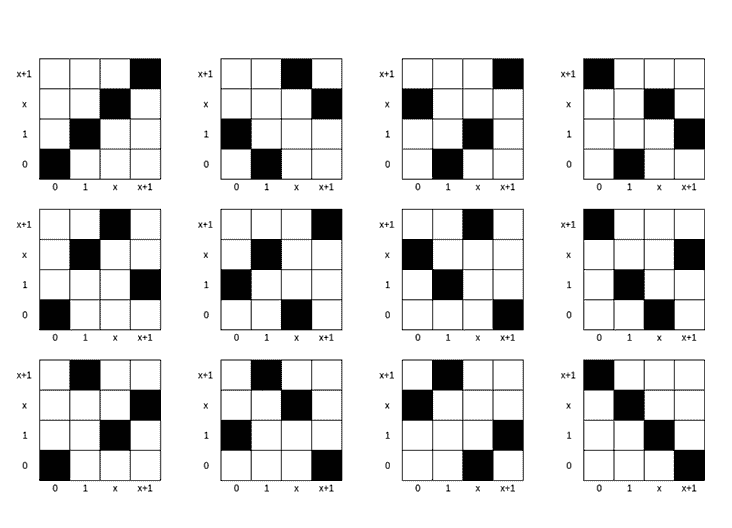

缺乏几何解释使得游戏变得更困难；你几乎必须背下所有的获胜组合，尽管它们基本上是四种形状的旋转和镜像（轴线、对角线、那个看起来不像直线的）。

现在去玩 `1.77 维连线`。我赌你。

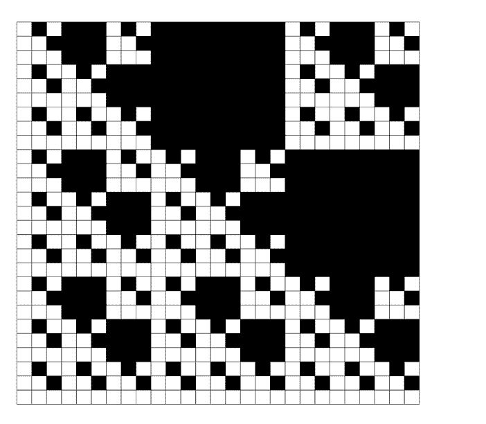

## 模块化扑克

每个人发五张（发牌方式以及玩家是否有交换权可以使用任何变体规则）。牌解释为：`jack = 11`，`queen = 12`，`king = 0`，`ace = 1`。一手比另一手大，如果它包含更长的序列（连续牌之间有任何恒差，允许环绕）。

从数学上说，一手牌如果玩家可以找到一条直线 `L(x) = mx + b`，使得他们拥有数字 `L(0), L(1) ... L(k)`，其中 `k` 是最大的。

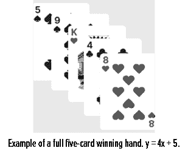

为了打破等长度序列的平局，计算它们拥有的不同长度为三的序列的数量；拥有更多不同长度为三序列的手获胜。

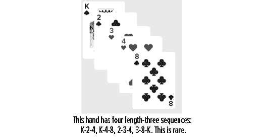

只考虑长度为三或更高的线。如果一手牌中有三个或更多相同的点数，那算是一个序列，但如果一手牌中有相同的点数，任何通过该点数的序列只被计为一个序列。

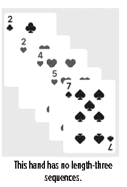

如果两手完全平局，拥有更高最高牌（使用上述 J = 11, Q = 12, K = 0, A = 1）的手获胜。

享受！

# PART 3: PROOF OF STAKE


到 2020 年初，`Ethereum` 已经度过了早期的阵痛。主要的安全漏洞已得到解决，`ETH` 正在升值，而 `Ethereum` 正准备成为新冠疫情期间反复封锁下 NFT 铸造艺术品爆发的操作系统。布特林（Buterin）从 The DAO 黑客攻击期间那个极具魅力的角色抽离出来，强调了“可信中立”（credible neutrality）的原则，并反思了去中心化系统如何获得广泛的合法性。他关注的与其说是眼前的危机，不如说是“公共物品”这一长期问题：一个基于经济激励的系统如何产生那些必不可但并不总是盈利的东西？谁来为这个新世界的道路和桥梁买单？问题接踵而至，答案也同样断断续续的。

去中心化自治组织，或 `DAO` 的理念终于开始变为现实。`DAOs` 有时完全与任何地面公司或基金会分离，正在生产产品并向工人支付工资。有些正在管理数百万美元的国库，另一些则作为壮观的失败而崩塌。由于需要，加密社区正在尝试新的治理和决策流程——平衡代币力量与个人权力的投票系统，基于用户间关系而非其与国家之间关系的身份系统。布特林认为，对于一个存在多种重叠价值的世界，需要重新思考不平等的衡量标准。当他对 2020 年美国总统大选进行预测市场下注时，我们看到使用基于他设计的协议所构建的软件是多么令人困惑。

森林可能会迷失在树木中。在预测市场中下注的意义究竟是什么？布特林希望更好的机制能更充分地利用在我们之间分布不均的信息和判断，引导我们做出更好的集体决策。但良好的意图和巧妙的设计是有局限的。代币价格那不可治理的炼金术总是威胁要掩盖其他一切。

在这里，向 `Ethereum 2.0` 的过渡正在发生——这是布特林从初就一直期待的。到 2021 年，人们可以在权益证明机制中质押他们的 `ETH`，即使工作量证明还会持续一小会儿。能量浪费几乎已经结束。一些有名为诸如“乐观汇总”（optimistic rollups）和“ZK 汇总”（ZK rollups）的“二层”（Layer 2）协议正准备结束让试图使用 `Ethereum` 进行购买或应用的人感到痛苦的延迟和交易成本。与此同时，新的区块链声称从一开始就解决了这些问题，并开始抢夺 `Ethereum` 的市场份额。在关于“加密城市”的论文中，布特林似乎绕了一了一圈，回到了他以前在《比特币杂志》上写过的那些对新兴项目充满希望的赞誉。但现在的含义已经不同了。区块链不再是取代政府等旧机构，而是在与它们建立关系。

布特林曾说，在《魔兽世界》游戏后的公司因软件更改而削弱后，他学会了厌恶中心化平台（他补充道，“我哭着睡着了”，并放弃了那个游戏）。但他在这里开始的最后这文章中暗示，加密货币可以从《魔兽》中的一个概念中学习——“灵魂绑定”（soulbound）：玩家拥有但不能买也不能卖的东西。区块链不能仅仅依赖经济学、依赖于可买可卖的东西，必须能够更清晰地看到使用它们的人类。在我们设计社会基础设施时，我们的人性正面临关切。

—NS

# 可信中立作为指导原则

中本聪（Nakamoto）

2020 年 1 月 3 日

考虑以下情况：

- 人们有时会对政府花费 GDP 的 5% 来支持特定的公共项目或特定行业感到不满，但同群人往往不会对同一政府通过执行产权导致更大规模的资本重新分配感到不满。
- 人们有时会对区块链项目直接将许多代币分配（或“预挖”）到由开发者亲手挑选的接收者手中感到不满，但同这群人往往不会对 `Bitcoin` 和 `Ethereum` 等主流区块链将数十亿美元的价值打印到工作量证明矿工手中的做法感到不满。
- 人们有时会对社交媒体平台审查或降低具有特定不受欢迎政治意识形态的内容权重感到不满，即使这些意识形态是对审查感到不满的人本身并不认同的，但同这群人往往不会对网约车平台在司机评分过低时将他们踢出平台的事感到不满。

对这些某些情况的一种种可能的反应是大喊一声“抓到你了了！”并沉浸在似乎揭穿了伪善君子的光荣中。事实上，有时这种反应是正确的。在我看来，将碳税视为国家主义干预，而将政府执行产权仅视为是对自然法的执行，这确实是一个错误。将维护区块链安全的矿工视为从事着值得报酬的“真实热力学工作”（Real Thermodynamic Work）的劳动者也是一个错误，而将任何补偿改进区块链代码开发者的尝试视为“打印免费钱”的行为，同样是错误的。

但即使将直觉系统化的尝试往往会走入歧途，像这些深层次的道德直觉很少完全没有价值。在这种情况下，我认为有一个非常重要的原则在起作用，这个原则很可能成为构建高效、亲自由、公平且包容的机构的关键，这些机构将影响并治理我们生活中的不同领域。而那个原则就是：在构建决定高利害结果的机制时，让这些机制具有可信的中立性是非常重要的。

## 机制是算法加上激励

首先，什么是机制？在这里我使用这个术语的方法与游戏论文献中讨论“机制设计”时相似：本质上，一个机制就是算法加上激励。机制是一种工具，接收来自多个人的输入，并利用这些输入作为确定参与者价值的一种，从而做出人们关心的某种决策。在一个运行良好的机制中，机制所做出的决策既是高效的——在给定参与者偏好的情况下，该决策是最可能的结果——又是激励兼容的，这意味着人们有动力“诚实”地参与。

很容易想出机制的例子。这里有一些例子：

- **私有财产和贸易**：“输入”是用户通过捐赠或交易重新分配所有权的能力，“输出”是一个（有时是形式化的，有时是隐含的）数据库，记录谁有权决定如何使用每个实体。目标是鼓励生产实用的实体并将其放在最能利用的人手中。
- **拍卖**：输入是出价；输出是谁获得了出售的物品，以及买家必须支付多少钱。
- **民主**：输入是投票；输出是谁控制了参加选举的政府席位。
- **社交媒体上的点赞、点踩、点赞和转发**：输入是点赞、点踩、点赞和转发；输出是谁看到什么内容。游戏论的教条主义可能会说这只是算法，不是机制，因为缺乏内置激励；但未来的版本完全可能内置激励。
- **区块链授予的工作量证明和权益证明激励机制**：输入是参与者产生的区块或其他消息；输出是网络接受哪条链作为规范，奖励奖励用于鼓励“正确”的行为。


我们正在进入一个超网络化、超中介化且快速演进的信息时代，在这个时代，中心化机构正在失去公众的信任，人们正在寻找替代方案。因此，不同形式的机制——作为一种智能聚合群体智慧（并将其与无处不在的群体非智慧区分开来）的方式——可能对我们的互动方式变得越来越发重要。

## 什么是可信中立？

现在，让我们谈谈这个至关重要的概念——“可信中立”（credible neutrality）。本质上，如果一个机制是可信中性的，那么仅仅通过观察机制的设计，就能看出该机制没有针对任何特定个人产生歧视。机制公平地对待所有人，在一个人的能力和需求都如此巨大的世界里，尽可能地做到了公平对待。

“任何挖掘区块的人获得 2 ETH”是可信中性的；“Bob 获得 1,000 个代币是因为我们知道他写了很多代码，我们应该奖励他”不是。“任何被五个人标记为不良内容的帖子都不会显示”是可信中性的；“任何我们的审核团队认为对蓝眼睛人士有偏见的帖子都不会显示”则不是。“政府对任何发明授予二十年的有限垄断权”是可信中性的（尽管确定哪些发明符合条件在边缘面临严峻挑战）；“政府决定治愈癌症很重要，因此任命一个委员会在尝试治愈癌症的人之间分配 10 亿美元”不是。

当然，中立性绝不是完全的。区块奖励歧视那些拥有特殊关系并借此获得硬件和廉价电力的人。资本主义歧视利益集集团和富人，而歧视穷人以及高度依赖公共物品的人。政治话语歧视任何落入社会良性偏误错误立面的事物。任何纠正协调失败的机制都必须对这些失败是什么做出某些假设，并歧视那些被其低估了协调失败的人。但这并不影响这样一个事实：某些机制确实比其他机制要中立得多。

这就是为什么私有制如此有效的原因：它的有效不是因为它是上天赋予的权利，而是因为它是一个可信中立的机制，解决了社会中的许多问题——虽然不是所有问题，但确实有很多。这就是为什么按流行程度过滤是可以接受的，但按政治意识形态过滤是有问题的：要认同一个中立机制能够合理公平地对待所有人，要比说服一个多元化群体接受某个特定的不受允许政治观点黑名单是正确的容易得多。这也是为什么链上开发者奖励比链上挖矿奖励更受怀疑：验证谁是矿工比验证谁是开发者容易得多，而且在实践中大多数识别谁是开发者的尝试很容易落入偏袒的指控。

## 对可信中立的需求

请注意，这里需要的不仅仅是中立，而是可信中立。也就是说，一个机制仅仅不设计为偏袒特定个人或结果而非其他结果是不够的；此外，机制还需要能够说服一个大型且多元化的群体，证明该机制至少在公平方面做出了这种基本努力，这一点是至关重要的。区块链、政治系统和社交媒体等机制的设计初衷是促进大规模且多元化群体之间的合作。

为了让一个机制能够真正作为这种共同底座，我们需要类似于博弈论中立性的概念。也就是说，一个机制仅仅不设计为偏袒特定个人或结果而非其他结果是不够的；机制还需要能够说服一个大型且多元化的群体，证明该机制至少在公平方面做出了这种基本努力，这一点是至关重要的。

## 构建可信中立机制

构建可信中立机制有四条主要规则：

1. 不要向机制中编写特定的人员或结果：规则 (1) 很容易理解。回到我们的例子，“任何挖掘区块的人获得 2 ETH”是可信中性的；“Bob 获得 1,000 个代币”不是。“任何被五个人标记为不良内容的帖子都不会显示”是可信中性的；对蓝眼睛人士的偏见不会显示”不是。
2. 开源且公开验证：规则 (2) 同样很容易理解：机制的规则应该是公开的，并且能够公开验证规则是否执行正确。请注意，在许多情况下，你并不希望输入或输出是公开；我的文章《论共谋》（On Collusion）讨论了为什么极强度的隐私（即使你愿意也无法证明自己参与过）通常是一个好主意。坦率地说，验证性和隐私可以通过零知识证明和区块链的结合同时实现。
3. 保持简单：规则 (3）——简单性的想法，讽刺的是最不简单。机制越简单，机制拥有的参数越少，留给针对目标群体的隐藏特权的空间就越小。如果一个机制有以复杂方式相互作用的五十个参数，那么对于任何预期的结果，你可能找到实现该结果的参数。但如果一个机制只有一两个参数，这要困难得多。
4. 不要频繁更改：这是规则 (4)。改变机制是一种复杂性，而且它还会“重置”无知之幕的时钟，让你有机会根据关于这些群体所处独特位置以及不同调整将如何影响他们的最新信息，调整机制以偏袒你特定的朋友并攻击你特定的敌人。

可信中立设计的目标是预期结果不是写入机制的，而是通过参与者的行为涌现发现的。在自由市场中，Charlie 的小部件没用而 David 的有用的事实是通过价格涌现发现的：最终，人们不再购买 Charlie 的小部件，导致他破产，而 David 则赚了利润并进一步扩张。输出中的大部分信息应该来自参与者的输入，而不是来自机制本身的硬编码规则。


我在文章开头提到的那些意识形态的极端版本中，一个常见的谬误是一种“中立性极大主义”（neutrality maximalism）：如果无法完全以中立的方式完成，那就根本不要做！这里的谬误在于，这种观点以牺牲广义中立性为代价获得了狭义的中立性。

例如，你可以确保每个矿工都与其他任何矿工处于平等地位（每个区块 12.5 `BTC` 或 2 个 `ETH`），并确保每位开发者都与其他任何开发者处于平等地位（除了对其公共服务的感谢外，没有报酬），但你牺牲的是，相对于挖矿，开发的激励机制变得极度不足。最后 20% 的矿工对区块链成功的贡献不太可能超过其开发者，然而这目前的奖励结构似乎暗示了这一点。

从更广泛的角度来看，社会上有很多种需要产出的东西：私有物品、公共物品、准确的信息、良好的治理决策、我们现在不重视但未来会重视的物品等等；清单还在不断加长。在这些事物中，有些比其他的更容易创建出可信中立（credibly neutral）的机制。如果我们采取一种不妥协的狭义中立纯主义，认为只有极度可信中立的机制是可以接受的，那么将只有那些容易创建此类机制的问题会被解决。社区的其他需求将得不到任何系统性的支持，因此广义中立性会受到损害。

因此，可信中立原则必须用另一个理念进行补充，即有效性原则（principle of efficacy）。一个良好的机制也是一个实际上解决了我们所关注的问题的机制。通常，这意味着即使是那些显然可信中立的机制的开发者也应该对批评持开放态度，因为一个机制完全可能是既可信中立又是糟糕的（正如人们经常指责专利的那样）。

有时，这意味着如果还没有找到解决某些问题的可信中立机制，在短期内应该采用一种中立性不完美的机制。区块链中的预挖（Premines）和限时开发者奖励就是其中一个例子；在尚无去中心化方法时，使用中心化方法检测代表独特人类的账户并过滤掉其他账户是另一个例子。但是，将可信中立视为非常有价值的东西，并努力随着时间的推移向这一理想靠拢，仍然是非常重要的。

如果一个人确实担心不完美中立的机制会导致信任丧失或政治俘获，那么有办法在实施它时采用“故障安全”的方法。例如，可以将交易费而非发行量直接导向开发者资助，创建一个“谢林栅栏”（Schelling fence）。

理论上确实存在解决许多类型问题的可信中立机制，但在实践中需要对其进行开发和改进。示例包括：

- 预测市场——例如，[electionbettingodds.com](http://electionbettingodds.com/) 作为预测近期选举获胜者概率的“可信中立”来源
- 二次投票和融资，作为在治理和公共物品事务上达成共识的一种
- 哈伯格税（Harberger taxes）
- 同伴预测（Peer prediction）
- 涉及传递性信任图的声誉系统

我们目前还不清楚这些想法的版本以及全新的想法中哪些会产生良好效果，我们需要许多轮实验来确定在不同语境下哪种规则会导致良好的结果。使机制的规则保持开放但同时又能抵御攻击，将是一个特别的挑战。

随着我们依赖的形式不断增加，确保这些系统最终不会将权力交给极少数人变得愈发重要。

### 协调，好与坏

[vitalik.ca](http://vitalik.ca)
2021 年 9 月 11 日

协调（Coordination），即大型群体为了共同利益共同工作的能力，是宇宙中最强大的力量之一。它是国王以压迫性独裁政权舒适地统治国家与人们团结起来推翻他之间的区别。它是全球气温上升 35 度与我们共同努力时温度上升小得多之间的区别。它也是让公司、国家以及任何超越少数人的组织成为可能的因素。

协调可以通过许多方式得到改进：更快速的信息传播、识别作弊行为的更好准则以及更有效的惩罚，等等等。的确，我们作为一个物种，在过去的几十年里在这些方面变得越来越好。

但协调也有一个非常违背哲学直觉的阴暗面。虽然“每个人相互协调”的结果显然比“自顾自利”要好得多，但这并不意味着向协调的每一步都是有利的。如果协调是以平衡的方式改进的，结果很容易产生危害。

我们可以从视觉上将其视为一张地图，尽管在现实中这张地图有数十亿个“维度”而不是两个：

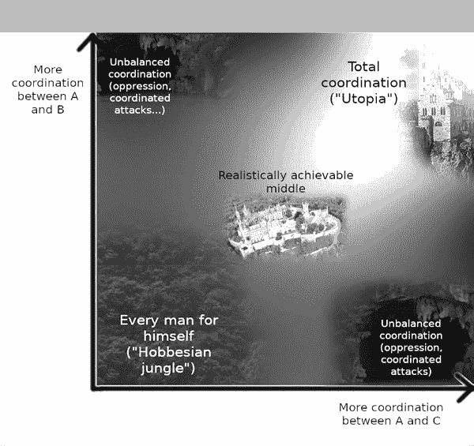

左下角，“自顾自利”是我们不希望待在的地方。右上角，“完全协调”是理想状态，但可能无法实现。但中间的地形并非均匀的向上坡度，有许多相对安全且多产的地方可能是理想的定居点，也有许多应该避开的深渊黑洞。

那么，这些危险的局部协调形式是什么？即一个人与某些同类协调而不与其他人协调，这会导致深渊黑洞？最好的方法是通过列举例子来描述它们：

- 某个国家的公民在战争中为了国家的更大的利益而勇猛牺牲自己 . . . 结果那个国家事实被证明是二战时期的德国或日本
- 游说客向政客提供贿赂，以换取政客采纳游说客偏好的政策
- 某人在选举中出卖选票
- 市场上的所有卖者合谋同时推高价格


在上述所有情况下，我们看到一群人聚集在一起并相互合作，但这对协调圈之外的某些群体造成了巨大的损害，从而对整个世界造成了净损害。在第一种情况下，所有遭受上述国家侵略的受害者都在协调圈之外，并因此遭受了沉重后果；在第二和第三种情况下，受影响的是腐败选民和政治家所做决策的影响的人；在第四种情况下，受影响的是客户；在第五种情况下，是非参与的矿工和区块链用户。这并不是个人背叛群体，而是一个群体背叛更广泛的群体，通常是整个世界。

这种局部协调通常被称为“**通谋**（collusion）”，但重要的是要注意，我们所讨论的行为范围非常广泛。在日常用语中，“通谋”一词往往更多用于描述相对对称的关系，但在上述案例中，有许多具有强力不对称特征的例子。即使是勒索关系（“投票支持我青睐的政策，否则我就公开你的丑闻”）在这一意义上也是一种通谋的形式。在本文的剩余部分，我们将使用“通谋”泛指一切“非意愿的协调”。

## 评估意图而非行动 (!!)

特别是对于较轻的通谋案例，一个重要属性是：仅通过观察本身无法判断某项行动是否属于非意愿的通谋。原因是，个人所采取的行动是其内部知识、目标和偏好与外部施加在其身上的激励措施的结合，因此人们在通谋时采取的行动与他们自愿采取（或以良性协调）时采取的行动往往重叠的。

例如，考虑卖家之间的通谋（一种反垄断违规）。如果独立运营，三位卖家中的每位都可能为某种产品设定在 $5 到 $10 之间的价格；该范围内的差异反映了难以观察的因素，例如卖者的内部成本、他们在不同工资水平下的工作意愿、供应链问题等。但如果卖家进行通谋，他们可能会将价格设定在 $8 到 $13 之间。再次，这个范围反映了关于内部成本和其他难以观察的因素的不同可能性。如果你看到有人以 $8.75 销售该产品，他们是在做错事吗？在不知道他们是否与其他卖家进行过协调的情况下，你无法判断！制定法律规定以超过 $8 销售该产品是一个坏主意；也许在当前时间价格必须很高有正当理由。但制定反对通谋的法律并成功执行它，可以得到理想的结果——如果价格必须达到那么高以涵盖卖者的成本，你就能得到 $8.75 的价格，但如果驱动价格上涨的自然因素较低，你就得不到那个价格。

这在贿赂和卖票案例中同样适用：某些人可能是合法地为橙色党投票，而另一些人是因为收钱而为橙色党投票。从决定投票机制规则的人来看，他们预先不知道橙色党是好是坏。但他们知道的是，人们根据诚实的内心感受投票的投票方式运作良好，而选民可以自由买卖选票的投票方式运作非常糟糕。这是因为卖票是一场公地悲剧：每位选民从正确投票中只获得一小部分收益，但如果他们按照贿赂者的意愿投票就能获得全部贿赂，因此，吸引每个个人选民所需的贿赂远小于实际上补偿人口支付贿赂者所要求的任何政策成本的贿赂。因此，允许卖票的情况会迅速崩溃为富人政治。

## 去中心化作为反通谋

但从这种思维中可以得出另一个更光明、更具操作性的结论：如果我们想创建稳定的机制，那么我们知道做到这一点的一个重要要素是找到方法，让通谋（尤其是大规模通谋）的发生和维持变得困难。在投票情况下，我们有秘密投票——这种机制确保选民没有办法向第三方证明他们是如何投票的，即使他们想证明也是不的（`MACI` 是一个试图使用密码学将秘密投票原则扩展到在线环境的项目）。这破坏了选民和贿赂者之间的信任，严厉限制了通谋。在反垄断和其他不当行为中，我们通常依赖举报人，甚至给予他们奖励；而在更广泛的公共基础设施中，我们拥有那个至关重要的概念：去中心化。

关于去中心化之价值的一种天真观点是，它是关于减少单点故障的风险的。在传统的“企业级”分布式系统中，这通常是真的，但在许多其他情况下，我们知道这不足以解释正在发生的情况。在这里观察区块链是很有启发性的。一个大型矿池公开展示他们如何在内部分配节点和网络依赖，这对于平息担心矿工中心化的社区成员的作用并不大。而像那张显示当时 90% 的算力能够出现在同一个会议小组小组的图片，确实很大程度上吓到了人们：

!image/scaling-bitcoin-1771

但为什么这张图片很吓人呢？从“去中心化作为容错性”的角度来看，大型矿工能够相互交谈没有害。但如果我们把“去中心化”视为存在防止有害通谋的障碍，那么这张图片就变得相当可怕，因为它显示出那些障碍并没有我们想象的那么坚固。现在，现实中，障碍仍然远非零；这些矿工可以很容易进行技术协调并可能都在同一个微信群里，事实上并不意味着比特币“在实践中几乎比中心化公司好不了”。

那么，通谋的剩余障碍是什么？主要的障碍包括：

-   道德障碍：在《谎言者与离群者》中，布鲁斯·施尼尔提醒我们，许多“安全系统”（门锁、提醒人们受到惩罚的警告标志……）也起着道德作用，提醒潜在的违规者他们正要进行严重的违规，如果他们想做一个好人，就不应该那样做。去中心化认为也起着那个作用。
-   内部谈判失败：各个公司可能会开始要求让步以换参与通谋，这可能导致谈判完全停滞（参见经济学中的“持留者问题”）。
-   反协调：系统是去中心化的这一事实使得不参与通谋的参与者很容易创建一个分叉（fork），剔除通谋的攻击者并从那里继续系统。用户加入分叉的障碍很低，而去中心化的意图创造了支持参与分叉的道德压力。


## 叛变风险

让五家公司结在一起做某件被广泛认为是坏事，仍然比它们为了一个不具争议的或良性的目的而结在一起要困难得多。这五家公司彼此之间并不十分熟悉，因此存在其中某一家拒绝参与并迅速举报的风险，而参与者也很难判断这种风险。公司内部的个人员工也可能进行举报。

总而言之，这些障碍确实是巨大的——它们往往足以将潜在的扼杀在摇篮里，即使这五家公司完全有能力快速协调进行某些合法操作。例如，`Ethereum` 区块矿工完全有能力协调增加 `gas` 限制，但这并不意味着他们可以容易地合谋来攻击链。

区块链的经验表明，将协议设计为机构去中心化的架构通常是非常有价值的，即使在预先的情况下，大家都知道大部分活动将由少数几家公司主导。这种想法不仅限于区块链；它也可以应用于其他语境。

## 分叉作为反协调

但我们不能总是有效地防止有害合谋的发生。为了处理那些确实发生了有害合谋的情况，如果能让系统对这些合谋更具健性——让合谋者的成本更高，让系统更容易恢复——那就太好了。

我们可以利用两个核心运行原则来实现这一目标：(1) 支持反协调和 (2) 利益相关（skin in the game）。反协调背后的想法是：我们知道我们无法设计出一种对合谋具有被动健壮性的系统，这很大程度上是因为组织合谋的方式极其多，而且没有被动机制可以检测到它们，但我们可以对合谋做出积极反应并进行反击。

在像区块链这样的数字系统中（这也可以应用于更主流的系统——例如 `DNS`），


如果一个系统被有害联盟接管，异见人士可以聚集起来并创建一个系统的替代版本，该版本具有（大部分）相同的规则，不同在于它消除了攻击联盟控制系统的权力。在开源软件语境下，分叉是非常容易的；创建一个成功的分叉的主要挑战通常是收集所需的合法性（从博弈论的角度看，这是一种“共同知识”的形式），以让所有不同意主合联盟方向的人都跟随你。

## 市场与利益相关

另一类抗合谋策略是“利益相关”的想法。在这种语境下，利益相关基本上是指任何让个人贡献者对其自己的贡献承担个人责任的机制。如果一个群体做出了糟糕的决定，批准该决定的那些遭受的痛苦必须比尝试异议的人要多。这避免了投票系统中固有的“公地悲剧”。

分叉是一种强大的反协调形式，恰恰因为它引入了利益相关。

市场总的来说是非常强大的工具，恰恰是因为它们最大化了利益相关。决策市场（用于指导决策的预测市场；也称为 `futarchy`）试图将市场的这种优势扩展到组织决策中。尽管如此，决策市场只能解决一些问题；特别是，它们无法告诉我们最初应该对哪些变量进行优化。

## 协调的结构化

这一切引导我们得到了一个有趣的观点。构建社会系统的目标之一，很大程度上是确定哪些配置可以共同工作：

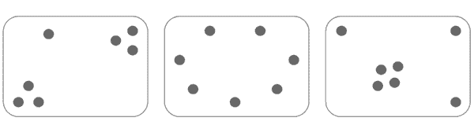

有时，更多的协调是好事：当人们能够一起工作时会更好。在其他时候，更多的协调是危险的：一部分人可能会协调以剥夺所有人的权利。而在另一些时候，由于另一个原因，更多的协调是必要的：以便让更广泛的社区能够“反击”。

在所有三种情况下，都有不同的机制可以用来实现这些目标。当然，完全阻止通信是非常困难的，要让协调完美也非常困难。但中间有许多选项仍然可以产生强大的影响。此外，这些技术可以并且应该与试图让合谋利润更低、风险更大的机制设计相结合；在这方面，利益相关是一个非常有用的工具。

以下是一些可能的协调结构化技术：

- 保护隐私的技术和规范：使得难以证明你的行为的技术（`MACI`、秘密投票）
- 刻意的去中心化：将机制控制权分配给已知协调良好的群体
- 物理空间的去中心化：将不同功能（或相同功能的份额）分配给不同的位置
- 基于角色的去中心化：将不同功能（或相同功能的份额）分配给不同类型的参与者（例如，在区块链中：核心开发人员、矿工、代币持有者、应用开发者、用户）
- 谢林点：允许大量人群快速围绕单一路径进行协调。复杂的谢林点甚至可能实现在代码中（例如，从 51% 攻击中恢复可以受益）
- 使用共同语言（或者，在不同语言的群体之间分配控制权）
- 使用按人投票而非按代币或按份额投票，以极大增加需要合谋影响决策的人数
- 鼓励并依靠背叛者向公众警告即将发生的合谋

这些策略都不是完美的。哪种组合最有效最终取决于具体的用场景。

特别感谢 `Karl Floersch` 和 `Jinglan Wang` 的反馈和评审。

**预测市场：选举中的故事**

[vitalik.ca](http://vitalik.ca)

2021 年 2 月 18 日

触发警告：我表达了一些政治观点。

预测市场是一个我感兴趣多年的的话题。允许公众中的任何人对未来事件进行下注，并利用这些下注的赔率作为这些事件预测概率的可信中立来源，是机制设计的一个非常迷人的应用。密切相关的想法，如 `futarchy`，一直令我感兴趣，作为可以改进治理和决策的创新工具。正如 `Augur` 和 `Omen`，以及最近的 `Polymarket` 所示，预测市场也是区块链（这三种情况下都是 `Ethereum`）的一个迷人的应用。


自 2020 年美国大选以来，预测市场似乎终于进入了焦点，特别是基于区块链的市场，其交易量从 2016 年的近乎零增长到 2020 年的数百万美元。作为一个密切关注以太坊应用如何跨越“死亡鸿沟”实现广泛采用的人来说，这自然引起了我的兴趣。起初，我倾向于仅仅旁观而不亲自参与：我并不是美国选举政治的专家，我凭什么认为我的意见会比那些已经在交易的人更正确呢？但在我的推特圈子里，我看到越来越多我所尊敬的“非常聪明的人”发表言论，认为这些市场实际上是非理性的，我应该参与，并在如果可以的情况下反向他们下注。最终，我被说服了。

我决定在我帮助创建的区块链区块链上进行一次实验：我在 `Augur` 上购买了价值 2000 美元的 `NTRUMP`（如果特朗普输掉则支付 1 美元的代币）。我当时不知道，我的仓位最终增加到了 308,249 美元，赚了超过 56,803 美元的利润，而且在特朗普输掉选举后，我是在意愿的对手面前完成了所有剩余的下注。接下来两个月里发生的事情将成为社会心理学、专业知识、套利以及市场效率局限性的一个迷人胜的案例研究，对任何对经济制度设计可能性深感兴趣的人具有重要意义。

## 选举前

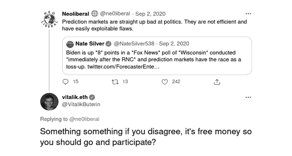

我对这次选举的第一次下注实际上完全不是在区块链上。当坎耶（Kanye）在 7 月宣布竞选总统时，一位我通常因高质量和原创思维而非常尊敬的政治理论家立即在推特上声称，他相信这将分裂反对特朗普的票并导致特朗普胜利。我记得当时认为，他的这一特定观点过于自信了，也许是过度内化了这样一种启发法：如果一个观点看起来很机敏且反常识，那么它很可能是正确的。因此，我自然提议进行一项 200 美元的赌注，我押注于无聊的传统拜登观点，而他荣幸地接受了。

选举在 9 月再次进入我的视野，这次是预测市场吸引了我的注意。市场给特朗普带来了近 50%的获胜率，但我看到推特圈子里许多我尊敬的“非常聪明的人”指出，这个数字似乎太高了。这自然导致了熟悉的“有效市场争论”：如果你能以 0.52 美元买到一个如果特朗普输掉就给你 1 美元的代币，而特朗普实际输掉的概率要高得多，为什么人们不直接买入这种代币直到价格进一步上涨呢？如果没有人这样做，你又凭什么认为自己比其他人都聪明？

Ne0liberal 在选举日之前的一段推特线非常好地总结了他当时反对预测市场准确性的论点。简而言之，大多数人至少在 2020 年之前使用的（非区块链）预测市场都有各种限制，使人们很难投入小额现金参与。因此，如果一个非常聪明的个人或专业机构看到了他们认为是错误的概率，他们将价格推向他们所相信的方向的能力将非常有限。

## 选举


（注：原文此处开始为重复内容，译文已按上述逻辑整合。）


我在 Catnip 上购买了我的 NTRUMP，Catnip 是一个前端界面，它将 Augur 预测市场与 Balancer（一种 Uniswap 风格的常数函数做市商）结合在一起。Catnip 是迄为止进行此类交易最简单的界面，在我看来，它对 Augur 的可用性做出了巨大贡献。

通过 Catnip 有两种方法可以反注特朗普：

1. 使用 `DAI`
2. 使用 `Foundry` 访问 Augur 的一项功能，该功能允许你将 `1 DAI` 转换为 `1 NTRUMP` + `1 YTUMP` + `1 ITRUMP`（“I”代表“invalid”——稍后会详细介绍），并在 `Catnip` 上卖出 `YTRUMP`

起初，我只知道第一个方案。但随后我发现 `Balancer` 对 `YTRUMP` 的流动性高得多，因此我切换到了第二种方案。

还有另一个问题：我没有任何 `DAI`。我有 `ETH`，我可以卖掉我的 `ETH` 来获取 `DAI`，但我不想放弃对 `ETH` 的风险敞口；如果我反注特朗普赚了 50,000 美元，却因为错过 `ETH` 的价格变化而损失了 500,000 美元，那就太遗憾了。因此，我决定通过在 `MakerDAO` 上开启抵押债务（`CDP`，现在也称为“vault”）来保持我的 `ETH` 价格敞口不变。

`CDP` 是生成所有 `DAI` 的方式：用户将他们的 `ETH` 存入智能合约，并允许提取相当于投入 `ETH` 价值三分之二的新生成的 `DAI`。他们可以通过归还提取的相同 `DAI` 以及额外的利息（目前为 3.5%）来取回 `ETH`。如果你存入的 `ETH` 抵押价值跌至你提取的 `DAI` 价值的 150% 以下，任何人都可以进来“清算”库，强制出售 `ETH` 来买回 `DAI` 并向你收取高额罚金。因此，保持高抵押率是一个好主意，以防价格突发波动；我的 `CDP` 中每提取 1 美元的 `DAI`，对应的 `ETH` 价值就超过三美元。

总结上述内容，这里是图表形式的流程：

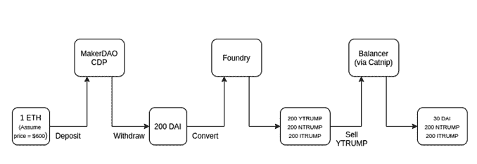

我做了很多次；`Catnip` 上的滑点意味着我每次通常只能进行约 5,000 到 10,000 美元的交易，而不会让价格变得太不利（当我跳过 `Foundry` 直接用 `DAI` 购买 `NTRUMP` 时，限制接近 1,000 美元）。两个月后，我积累了超过 367,000 个 `NTRUMP`。

## 为什么其他人没有这样做？

在我入场之前，对于为什么只有少数人以 85 美分的价格买入美元，我有四个主要假设：

1. 担心 Augur 智能合约会崩溃，或者特朗普的支持者会操纵预言机（一种去中心化机制，Augur `REP` 代币的持有者通过在其中一个结果上质押他们的代币来投票），使其返回错误结果
2. 资金成本：为了购买这些代币，你必须锁定资金两个月以上，这让你在期间失去了失去了花费这些资金或进行其他获利交易的能力
3. 对于大多数人来说，交易的技术性太复杂了
4. 真正有动力去抓住这种奇机会的人比我想象的要少得多，即使这个机会就直接摆在他们面前

这四点都有其合理的论据。智能合约崩溃是一个真实的风险，而且 Augur 预言机此前未在这样充满争议的环境受过测试。资金成本是真实的，虽然在预测市场中反注某事比在股票市场更容易，因为你知道价格永远不会超过 1 美元，但锁定资金仍然会与加密市场中的其他丰厚机会竞争。在 dapps 中进行交易在技术上是复杂的，对未知产生程度的恐惧是理性的。

但我实际进入金融前线并观察该市场价格演变的经历，让我对这些每一个假设都学到了很多。

## 对智能合约被攻击的恐惧

起初，我认为“对智能合约攻击的恐惧”必须是解释中的很大一部分。但随着时间的推移，我越发相信这可能不是主导因素。了解我为什么这么想的一种方法是对比 `YTRUMP` 和 `ITRUMP` 的价格。`ITRUMP` 代表“Invalid Trump”；“invalid”是一种在某些特殊情况下预期触发的事件结果：当事件描述模糊时、当市场结算时事件结果尚未知、当市场不符合伦理时（例如暗杀市场）以及其他几个类似的情况。在这个市场中，`ITRUMP` 的价格一直保持在 0.02 美元以下。如果有人想通过攻击市场获利，对他们来说，不在 0.15 美元购买 `YTRUMP`，而是以 0.02 美元购买 `ITRUMP` 要获利得多。如果他们购买大量 `ITRUMP`，只要他们能强制“invalid”结果实际上触发，他们就能获得 50 倍的回报。所以，如果你担心攻击，购买 `ITRUMP` 到为止是最理性的反应。然而，很少有人这样做。

反对对智能合约攻击恐惧的进一步论据当然是，在预测市场之外的所有加密应用中（例如 `Compound`、各种挖矿计划），人们对智能合约风险都异常地无所谓。如果人们为了 5% 到 8% 的年收益就愿意投入资金，那么为什么他们在这里会突然变得如此谨慎呢？

## 资金成本

资金成本——锁定大量资金的不便和机会成本——是我现在更加重视的一项挑战。单看 Augur 方面，我需要锁定 308,249 `DAI`，在两个月内赚取 56,003 美元的利润。这折合年化利率约为 175%；到目前为止，与 2020 年的挖矿热相比，这是一个不错的交易。但考虑到我在 `MakerDAO` 上需要做的，情况变得更糟了。因为我想保持 `ETH` 的敞口不变，我需要通过 `CDP` 获取 `DAI`，而安全使用 `CDP` 需要超过 3 倍的抵押率。因此，我需要锁定的总资金大约为百万美元。

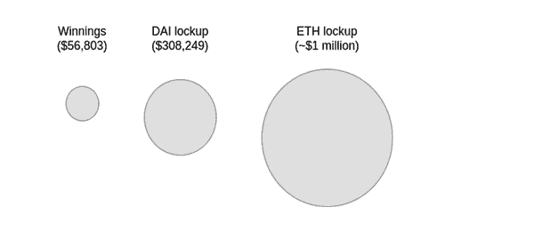

现在，利率看起来没那么理想了。再加上尽管，，智能合约攻击或前所未有的政治事件发生的可能性，看起来仍然不理想。

但即便如此，假设有 3 倍锁定，且 Augur 有 3% 的崩溃概率（我购买了 `ITRUMP` 来覆盖在“invalid”方向崩溃的可能性，所以我只需要担心在“yes”方向的崩溃或资金被直接盗取的风险），这折合出的风险中性利率约为 35%，一旦考虑到真实人类对风险的观点，这一数字还会降低。这笔交易仍然非常有吸引力，但另一方面，现在完全理解为什么对于那些生活在加密货币中频繁 100 倍涨跌的人来说，这些数字毫无吸引力。

相比之下，特朗普的支持者并没有面对所有这些挑战：他们只需投入 60,000 美元就抵消了我 308,249 美元的赌注（由于手续费，我的利润少于这个数字）。当概率接近 0 或 1 时（如这种情况所示），游戏非常倾向于那些试图将概率推离极端值的人。而且这不仅解释了特朗普；这也解释了为什么那些没有真正获胜机会但在小群体中受欢迎的候选人经常能获得高达 5% 的胜率概率。


我最初尝试过在 `Augur` 上购买 `NTRUMP`，但用户界面的故障导致我无法直接在 `Augur` 上下单（我交流过的其他其他人都没有遇到这个问题……我仍然不确定发生了什么）。`Catnip` 的用户界面简单得多，而且运行得非常好。然而，自动市场做市商（如 `Balancer` 和 `Uniswap`）在小额交易中效果最好；对于大额交易，滑点太高了。这是更广泛的“AMM 对 订单簿”争论的一个良好缩影：`AMMs` 更方便，但订单簿对大额交易确实效果更好。`Uniswap v3` 正在引入具有更高资本效率的 AMM 设计；我们来看看这是否会改善情况。

尽管还有其他技术上的复杂性，但幸运的是它们看起来都很容易解决。没有理由让像 `Catnip` 这样的界面不能将 `DAI -> Foundry -> sell YTRUMP` 路径集成到合约中，这样你就可以通过单次交易购买 `NTRUMP`。事实上，界面甚至可以检查 `DAI -> NTRUMP` 路径和 `DAI -> Foundry -> sell YTRUMP` 路径的价格及流动性属性，并自动为你提供更好的交易。甚至从 `MakerDAO CDP` 提取 `DAI` 也可以包含在该路径中。我的结论是乐观的：技术复杂性问题是本轮参与的真实障碍，但随着技术的进步，未来的轮次将变得容易得多。

### 智力上的自信不足

现在我们有了最后一种可能性：许多人（尤其是聪明人）患有一种“过度谦虚”的病态，他们太容易得出结论，认为如果没有其他人采取某种行动，那么一定有充分的理由说明该行动不值得去做。

`Eliezer Yudkowsky` 在他出色的著作《Inadequate Equilibria》的后半部分一直在阐述这一观点，他认为有太多的人过度使用“谦逊的认识论”，而我们应该更愿意根据推理结果采取行动，即使推理结果表明绝大多数人都在某些事情上是非理性的、懒惰或错误的。当我第一次读到这些章节时，我并不信服；看起来 `Eliezer` 仅仅是太傲慢了。但在经历了这种经历后，我开始看到他的观点中了他的智慧。

这并不是我第一次亲身看到信任自己推理的益处。当我最初开始研究 `Ethereum` 时，起初被恐惧困扰，认为一定有非常好的理由导致这个项目注定会失败。我推理说，一个完全可编程、具备智能合约能力的区块链相比之前的技术显然是一个巨大的进步，因此肯定有许多其他人在我之前就想到了。因此，我完全预期一旦我发布了这个想法，许多非常聪明的密码学家就会告诉我像 `Ethereum` 这样的东西从根本上是不可能的各种充分理由。然而，从未有人这样做过。

当然，并不是每个人都受到过度谦虚的困扰。许多预测 `Trump` 会赢得选举的人被他们自己过度的反叛心理所误导了。`Ethereum` 受益于我年轻时对自身谦虚和恐惧的抑制，但许多其他项目本可以受益于更多智力上的谦逊并避免失败。


但尽管如此，在我看来，比以往任何时候都要真实，正如著名的叶桂名言所说，“优秀的人完全缺乏信念，而最糟糕的人却充满了激情的强度。”无论过度自信或反叛心理有时会有什么缺陷。

### 给预测治理法（Futarchy）的教训

事实证明，当决策接近且存在大量噪音时，在市场中投入一小部分资金是有意义的。这还是假设理性的情况下；大多数人在不确定的赌博中投入少于凯利准则（Kelly criterion）建议的金额。资本成本会进一步叠加。但如果一个攻击者真的想出于个人原因迫使结果 B 发生，他们只需将所有的资金用于购买该代币即可。总而言之，游戏很容易向攻击者倾斜超过二十比一。


当然，在现实中，攻击者很少愿意将所有资金押注在一个决策上。而且，预测市场制（futarchy）并非唯一易受攻击的机制：股票市场同样脆弱，非市场决策机制也可以被坚定的富裕攻击者以各种方式操纵。尽管如此，我们仍然应该警惕不要假设预测市场制会将我们推向决策准确性的新高度。

有趣的是，数学似乎表明，当预期的操纵者想要将结果推向极端值时，预测市场制的效果最好。其中一个例子可能是责任保险，因为希望不当获得保险的人实际上是在试图将市场估计的不利事件概率降至零。事实证明，责任保险是预测市场制发明者罗宾·汉森（Robin Hanson）最喜欢的政策处方。

## 预测市场能变得更好吗？

最后问的问题是：预测市场是否注定会重犯错误，例如给出特朗普在 12 月初推翻选举的 15% 概率，以及在最高法院（包括他任命的三名法官）告诉他滚蛋之后仍推翻选举的 12% 概率？或者市场会随着时间的推移而改进？我的答案是，出乎意料地坚定立场乐观，我看到了几个乐观的理由。

### 市场作为自然选择

首先，这些事件为我市场效率和理性究竟如何产生了一个新的视角。市场效率理论的支持者经常声称，市场效率的产生是因为大多数参与者都是理性的（或者至少理性的数量超过了任何观点一致的幻觉群体），并且这被视为公理。但相反，我们可以从进化的角度来看正在发生的事情。

加密货币是一个年轻的生态系统。它是一个与主流仍然相当脱节的生态系统，埃马斯克的最近推文。

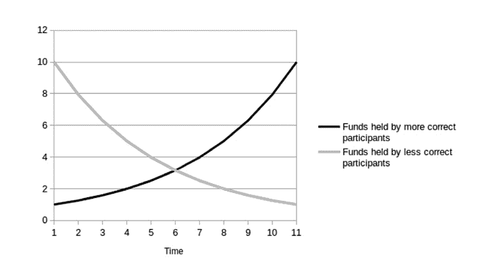

因此，对于那些事实正确的投注类型，存在一种选择压力。经过十轮这种操作，优秀的预测者将拥有更多资金进行下注，而糟糕的预测者资金将更少。这并不依赖于任何人的“变得聪明”、“吸取教训”或任何其他关于人类推理和学习能力的假设。这仅仅是选择动力学的结果，随着时间的推移，擅长正确猜测的参与者将主导生态系统。

注意，在这方面预测市场的表现优于股票市场：股票市场的“暴富者”往往源于单次千倍收益的运气，这为信号增加了大量噪声；但在预测市场中，价格限制在 0 和 1 之间，限制了任何单一事件的影响。

### 更好的参与者和更好的技术

其次，预测市场本身会改进。用户界面已经有了巨大改进，并将继续改进。`MakerDAO` -> `Foundry` -> `Catnip` 循环的复杂性将被抽象为单一交易。区块链扩展技术将改进，降低参与者的费用。

第三，我们看到的预测市场正常运行的演示将缓解参与者的恐惧。用户将看到 `Augur` 预言机即使在非常激烈的冲突也能给出正确的输出（这次有两轮争议，但反方还是干利地获胜了）。加密领域之外的人们将看到这一过程是有效的，并更倾向于参与。也许内特·西尔弗（Nate Silver）本人可能也会获得一些 `DAI` 并使用 `Augur`、`Omen`、`Polymarket` 以及其他市场在 2022 年及以后补充收入。

第四，预测市场技术本身可以改进。这里我有一个关于市场设计的提案，可以使同时下注许多低概率事件更具资本效率，帮助防止低概率结果获得不合理的高赔率。其他想法一定会层颖而出，我期待看到在这个方向上的更多实验。

## 结论

整个风波被证明是对预测市场的一次极其有趣的首次直接测试，展示了它们如何与个人和社会心理的复杂性碰撞。它展示了市场效率在实践中实际上是如何运作的，局限性在哪里，以及可以采取什么措施来改进。

它也是区块链力量的极佳证明；事实上，它是为我提供最具体价值的 `Ethereum` 应用之一。我预计未来对预测市场的兴趣会增加，不仅是为了选举，还为了条件预测、决策和其他应用。如果预测市场在数学上最优运行，它们可能带来的惊人承诺无疑将继续与人类现实的限制发生碰撞，希望随着时间的推移，我们将更清楚地看到这种新社会技术在何处能提供最大的价值。

特别感谢 Jeff Coleman、Karl Floersch 和 Robin Hanson 提供的批评反馈和评审。

## 最重要的稀缺资源是合法性

[vitalik.ca](http://vitalik.ca)

2021 年 3 月 23 日

`Bitcoin` 和 `Ethereum` 区块链生态系统在网络安全（工作量证明挖矿的目标）上的支出远超其他所有项目的总和。自年初以来，`Bitcoin` 区块链每天向矿工支付平均约 3800 万美元的区块奖励，加上每天约 500 万美元的交易费。`Ethereum` 区块链位居第二，每天 1950 万美元的区块奖励加上 1800 万美元的交易费。与此同时，`Ethereum Foundation` 的年度预算（用于研究、协议开发、赠款和各种开支）每年仅为 3000 万美元。存在非基金会来源的资金，但最多只比这大几倍。比特币生态系统在研发方面的支出可能更低。

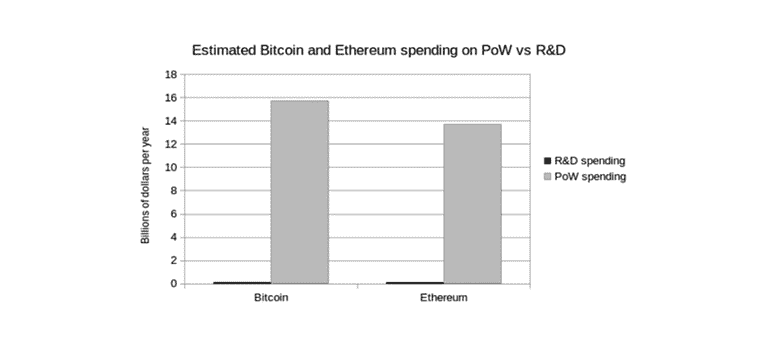

显然，这种支出模式是资源的严重错配。最后 20% 的网络算力为生态系统提供的价值远低于这些资源如果投入研究和核心协议开发所能提供的价值。那么为什么不直接……削减 20% 的 `PoW` 预算，并将资金重新定向到其他事情上呢？


这个谜题的标准答案与“公共选择理论”和“谢林点篱”（Schelling fences）等概念有关：尽管我们可以很容易地识别出某些价值的公共物品，并将部分资金一次性重新引导，但将此类决策形成常规制度化的模式会带来政治混乱和捕获的风险，从长远来看是不值得的。但无论原因如何，我们面临着这样一个有趣的事实：`Bitcoin` 和 `Ethereum` 生态系统这些有机能够募集到数十亿美元的资本，但对这些资金的去向却有着奇怪且难以理解的限制。

产生这种效应的强大社会力量值得理解。正如我们等将看到的，这也是为什么 `Ethereum` 生态系统最初能够募集到这些资源（以及技术上几乎完全相同的 `Ethereum Classic`）背后的相同社会力量：

## 代币可以通过社会契约来所有

为了更好地理解我们所指的这种，另一个重要的例子是 `Steem` 和 `Hive` 的史诗级故事。2020 年初，孙孙（Justin Sun）购买了 `Steem-the-company`，这与 `Steem-the-blockchain` 不是一回事，但它确实持有了约 20%的 `STEEM` 代币供应量。社区自然不信任孙孙。因此，他们进行了链上投票，以正式化他们认为的长期存在的“绅士协议”，即 `Steem-the-company` 的代币是为 `Steem-the-blockchain` 的共同利益信托的，不应被用于投票。在交易所持有的代币帮助下，孙孙发起了反击，并获得了足够的代表，从而可以单方面控制链。社区没有看到任何进一步的协议内选项。因此，他们对 `Steem-the-blockchain` 进行了分叉并命名为 `Hive`，复制了所有的 `STEEM` 代币余额——除了包括孙孙在内的参与了攻击的那些余额。

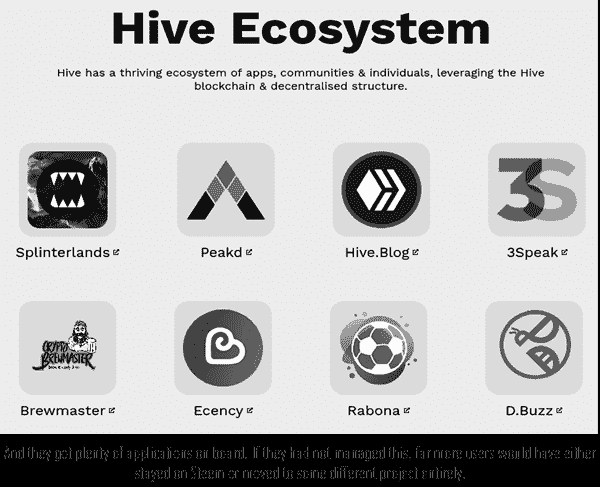

我们从这种情况下中学习到的教训是：`Steem-the-company` 从未真正“拥有”过这些代币。如果他们拥有，他们将会有实际能力按照他们想要的方式使用、享受和滥用这些代币。但现实中，当公司试图以社区不喜欢的方式享受和滥用代币时，他们被成功地阻止了。这里发生的模式与我们在尚未发行的 `Bitcoin` 和 `Ethereum` 代币奖励中看到的类型相似：代币最终并不属于某个加密密钥，而是属于某种社会契约。

我们可以将同样的推理应用于区块链领域的许多其他结构。例如，考虑 `ENS` 根多签。

这远超智能合约结构的范围。为什么埃隆·马斯克（Elon Musk）可以出售一张马斯克推文的 `NFT`，但杰夫·贝佐斯（Jeff Bezos）做同样的事情就会困难得多？埃隆和杰夫都有同样的能力截图马斯克的推文并将其粘贴到 `NFT` `dapp` 中，那么区别在哪里？对于任何对人类社会心理学有基本直觉理解（或对伪艺术领域）的人来说，答案是显而易见的：埃隆出卖马斯克的推文是真实的，而杰夫做同样的事就不是。再次，数百万的价值被控制和分配，并不是通过个人或加密密钥，而是通过对合法性的社会观念。

而且，更进一步说，合法性主宰着各种社会地位游戏、知识话语、语言和产权。

## 什么是合法性？

要理解合法性，我们需要深入研究一些博弈论。有很多需要合法性的情况，但正如我们所看到的，协调游戏无处不在。如果你独自行动，只会制造冲突；如果每个人都行动……结果……,,,,,,,,,,,,,,,,,,,,那就是合法性。

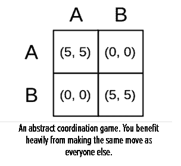

合法性的模式与我们在尚未发行的 `Bitcoin` 和 `Ethereum` 代币奖励中看到的类型相似：代币最终并不属于某个加密密钥，而是属于某种社会契约。

## 那么我们如何定义合法性？

现在，我们准备好定义合法性了。

合法性是一种自然产生的现象。如果一个机制成功具备某种，该机制就具有合法性。

## 合法性理论

合法性的产生有很多不同的方式。通常，合法性的产生是因为获得合法性的事物对大多数人来说在心理上是有力的。但不可能列出所有的合法性理论，不过我们可以从以下几点开始：

- **强权合法性**：某人说服所有人他们足够强大可以施加意志，反抗他们将非常困难。这驱动了大多数人屈服，因为每个人都预期其他人也会同样害怕而不反抗。
- **连续性合法性**：如果某事在 `T` 时是合法的，那么它在 `T + 1` 默认就是合法的。
- **公平性合法性**：某事可能变得合法是因为因为它符合一种直觉上的公平观念。另参见：我关于信誉中性的文章，但请注意这并不是唯一一种公平。
- **程序合法性**：如果一个过程是合法的，那么该过程的输出就会获得合法性（例如，民主国家通过的法律有时会被这样描述）。
- **绩效合法性**：如果一个过程的输出导致了令人满意的结果，那么该过程就可以获得合法性（例如，成功的独裁政有时会被这样描述）。
- **参与性合法性**：如果人们参与选择结果，他们就更有可能认为它是合法的。这与公平性相似，但并不完全相同：它基于一种与自己之前的行为保持一致的心理欲望。

在任何存在足够长时间的协调游戏的背景下，很可能存在一种合法性的观念。而区块链充满了协调游戏。你运行哪个客户端软件？你向哪个去中心化域名注册查询？你接受哪份 `Uniswap` 合同副本作为“`Uniswap` 交易所”？


请注意，合法性是一个描述性概念；即使你个人认为某事是糟糕的，它仍然可能是合法的。尽管如此，如果有足够的人认为某个结果是糟糕的，那么未来很有可能发生某些事件，导致这种合法性消失，通常起初是逐渐的，然后是突然的。

# 合法性是一种强大的社会技术，我们应该利用它

加密货币生态系统中的公共品资助状况相当糟糕。尽管有数千亿美元的资本在流动，但对这些资金持续生存关键的公共品，每年获得的资助仅几千万美元。

应对这一事实有两种方法。第一种是为这些局限性感到自豪，并为社区为了克服这些局限性所付出的勇敢、尽管并不特别有效的努力感到自豪。这似乎是 `Bitcoin` 生态系统经常采取的路线：

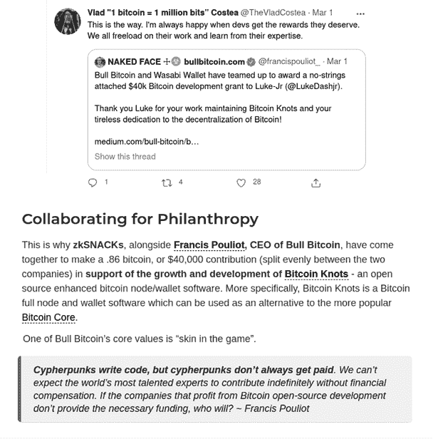

资助核心开发的团队个人的自我牺牲无疑令人钦佩的，但这种钦佩与埃利德·基普乔格（Eliud Kipchoge）在两小时内完成马拉松的钦佩是同质的：它是对人类意志力的震撼展示，但它并不是交通业的未来（或者在这种情况下，是公共品资助的未来）。正如我们有更好的技术让人们在不需要非凡意志力和多年训练的情况下，在不到小时内移动四十二公里一样，我们也应该专注于构建更好的社会技术，以我们所需的规模资助公共品，并将其作为我们经济生态系统的系统性组成部分，而不是一次性的慈善倡议。

现在，让我们回到加密货币。加密货币（以及其他数字资产，如域名、虚拟土地和 `NFTs`）的一个主要力量在于，它允许社区召集大量资金，而不需要任何个人亲自去捐赠这些资金。然而，这些资金受到合法性概念的限制：你不能简单将其分配给一个中心化团队，而不损害其价值的来源。虽然 `Bitcoin` 和 `Ethereum` 确实已经在依靠合法性概念来应对 `51% 攻击`，但利用合法性概念来引导协议内的公共品资助要困难得多。但在新协议不断涌出的、日益富足的层层，我们对于这些资金的去向拥有了得多的灵活性。

# Bitshares 中的合法性

加密货币早期一个被长期遗忘、但在我看来极具创新性的想法之一，是 `BitShares` 社会共识模型。本质上，`BitShares` 将自己描述为一个社区（`PTS` 和 `AGS` 持有者），他们愿意集体支持一个新项目生态系统，但一个项目要被该生态系统接受，必须将其代币供应的 10% 分配给现有的 `PTS` 和 `AGS` 持有者。

当然，任何人都可以创建一个不向 `PTS`/`AGS` 持有者分配任何代币的项目，甚至 fork 一个已经进行了分配的项目并撤销分配。但正如 Dan Larimer 所说：

> 你无法强制任何人做任何事情，但在这个市场中，一切取决于网络效应。如果有人提出了一个极具吸引力的实现方案，你就可以花生成新创世区块的成本来采纳整个 `PTS` 社区。决定从零开始的个人必须围绕他的系统建立一个全新的社区。考虑到网络效应，我怀疑那些尊崇 `ProtoShares` 的代币会获胜。

这也是合法性的一种概念：任何向 `PTS`/`AGS` 持有者分配的项目将获得社区的关注和支持（对于每个社区成员来说，对该项目感兴趣是值得的，因为社区的其他成员也在这样做），而任何不进行分配的项目将得不到。现在，这确实不是我们想要逐字复制的合法性概念——`Ethereum` 社区对富化一小部分早期采用者几乎没有兴趣——但核心概念可以被调整为某种更具社会价值的内容。

# 将模型扩展到 Ethereum

区块链生态系统（包括 `Ethereum` 在内）重视自由和去中心化。但遗憾的是，大多数区块链的公共品生态系统仍然是权威驱动且中心化的：无论是 `Ethereum`、`Zcash` 还是其他主流区块链，通常都有一个实体（最多三个）的支出远超其他，为那些想要构建公共品的团队提供了（尽管是有限的）选项。我将这种公共品资助模型称为“公共品中心协调员”（`CCCP`）。

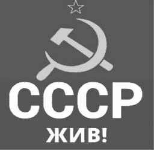

这种情况并非组织本身的错误，因为他们通常在尽力支持生态系统。相反，是生态系统的规则对组织不公平，因为它们对组织提出了过高的标准。任何单一中心化组织不可避免地会有盲点，并无法理解某些类别和团队；这并不是因为涉及其中的任何人做了任何错事，而是因为这种完美超出了小群体的触及范围。因此，创建一个更多样化、更有韧性的公共品资助方法以减轻单一组织的压力非常有价值。

幸运的是，我们已经拥有这种替代方案的种子！`Ethereum` 应用层生态系统已经存在，并且日益强大，且已经展现了其公共精神。像 `Gnosis` 这样的公司一直在为 `Ethereum` 开发以及各种 `Ethereum` DeFi


`Gitcoin Grants` 已经实现了高水平的合法性：它的公共品资金机制平方融资（quadratic funding）已被证明是中立的，能够有效反映社区的优先级和价值观，并填补了现有资金机制留下的漏洞。有时，顶部的 `Gitcoin Grants` 匹配接收会被其他更中心化的资助机构参考。以基金会本身在支持这种实验和多样性方面发挥了关键作用，孵化了如 `Gitcoin Grants` 以及 `MolochDAO` 等努力，这些随后获得了更广泛的社区支持。

我们可以通过采用 `BitShares` 模型并进行修改，使这个新兴的公共品资助生态系统变得更加强大：不再将最强大的社区支持给予那些在 2013 年购买了 `PTS` 或 `AGS` 的少数寡头头的项目，而是支持那些将其国库的一小部分贡献给使其自身以及它们所依赖的生态系统成为可能的公共品的项目。此外，我们可以拒绝那些 fork 了现有项目且未向更广泛的生态系统回馈价值的项目。

资助公共品的方法有很多：为 `Gitcoin Grants` 匹配池提供长期承诺；支持 `Ethereum` 开发（这也是一个合理的中立任务，因为对什么是以太客户端有明确定义）；甚至运行自己的资助计划，其范围超出了特定的应用层项目本身。对于什么才算作足够的支持，最简单的方法是就金额一致——例如，将项目支出的 5%用于支持更广泛的生态系统，另外的 1%用于超出区块链领域的公共品——并依靠诚信来选择这些资金的去向。

社区真的有那么大的杠杆吗？


当然，这种社区支持的价值是有限的。如果一个竞争项目（甚至是现有项目的分支）为其用户提供了远好得多的选择，那么用户就会涌向该项目，无论有多少人大叫他们去使用某种他们认为更具社会正义的替代方案。

但这些局限性在不同的语境下是不同的；有时社区的杠杆作用很弱，而在其他时候又非常强大。关于这一点，一个有趣的案例研究是 `Tether` 与 `DAI` 的对比。`Tether` 存在许多丑闻，但尽管如此，交易者一直都在使用 `Tether` 来持有和转移美元。更加去中心化且透明度更高的 `DAI` 尽管具有许多优势，但无法夺取 `Tether` 大部分份额，至少在交易者领域是如此。但 `DAI` 的优势在于应用：`Augur` 使用 `DAI`，`xDai` 使用 `DAI`，`PoolTogether` 使用 `DAI`，`zk.money` 计划使用 `DAI`，列表以此类推。有哪些 dapps 使用 `USDT`？要少得多。

因此，尽管社区驱动的合法性效应的力量并非无限，但仍然有相当大的杠杆空间，足以鼓励项目将其预算至少一小部分投入更广泛的生态系统。参与这种平衡甚至有一个自私的理由：如果你是一个 `Ethereum` 钱包的开发者，或者一个播客或通讯的作者，当你看到两个竞争项目，其中一个对生态系统层公共物品有重大贡献，而另一个没有，你会竭尽全力帮助哪一个获得更多的市场份额？

## NFTs：支持以太坊之外的公共物品

通过公共支持的合法性概念从“虚空”中产生价值来支持公共物品的概念，其价值远超 `Ethereum` 生态系统。一个重要且紧迫的挑战与机会是 `NFTs`。`NFTs` 有很大机会显著帮助许多类型的公共物品，尤其是创意类，至少部分解决它们长期和系统性的资金短缺。


但这也可能是一个错失的机会：帮助 `Elon Musk` 通过出售他的推文再赚取 100 万美元，社会价值乎其微，因为据我们所知，这笔钱只是进了他自己的口袋（值得的是，他最终决定不卖了）。如果 `NFTs` 仅仅变成一个很大程度上造福于已经富有的名人的赌场，那将是一个无趣得的结果。

幸运的是，我们有能力帮助塑造结果。人们认为哪些 `NFTs` 具有吸引力，哪些不具有，这是一个合法性问题：如果大家都认为一个 `NFT` 有趣，而另一个 `NFT` 无趣，那么人们会强烈倾向于购买第一个，因为因为它在炫耀资本方面具有更高的价值，持有它也有个人自豪感，而且由于其他人也这样想，所以它可以转卖出更高的价格。如果 `NFTs` 的合法性概念可以向良好的方向引导，就有机会为艺术家、慈善机构和其他建立建立稳固的资金渠道。

这里有两个潜在的想法：

1. 某些机构（甚至是 `DAO`）可以“加持” `NFTs`，以换取保证部分收入用于慈善事业，确保多个群体同时受益。这种“加持”甚至可以附带官方分类：该 `NFT` 是致力于全球减贫援助、科学研究、创意艺术、地方新闻、开源软件开发、赋能边缘化社区还是其他？
2. 我们可以与社交媒体平台合作，让 `NFTs` 在人们的个人页上更可见，为买家提供一种展示他们价值观的方式，他们不仅承诺了言语，还承诺了他们辛苦赚来的钱。这可以与（1）结合起来，引导用户关注对有价值的社会事业的 `NFTs`。

想法肯定更多，但这个领域绝对值得更积极的协调和思考。

## 合法性总结

- 合法性在任何语境下都是强大的，尽管它以不同的方式出现。
- 这种方式在以太坊为背景下是普遍的，合法性是重要的一部分。
- 加密货币在以太坊为背景下是强大的。然而，任何试图将不平等简化为单一数字的方案都有其限制，这在以太坊为背景下也是如此。
- 幸运的是，这种不平等的定义在以太坊为背景下是有效的。
- 这是一个很棒机会。
- 这种结果是 `DAI`。我们的 `NFTs` 依赖于这种合法性。
- 事实这两个定义在数学上是通用的（证明这一点留给读者的练习题）！
- 特感谢 `Karl Floersch`、`Aya Miyaguchi` 和 `Mr. Silly` 提供的想法、反馈和评审。


# 基尼系数到底有什么问题？

基尼系数之所以具有吸引力，因为它是一个相当简单且易于理解的统计量。它看起来可能并不简单，但请相信我，统计学中几乎所有处理任意规模群体的指标都糟糕成那样，而且往往更糟。在这里，看看标准差这种基础概念的公式：


这里是基尼系数：


我保证，它其实相当温和！

那么，它到底有什么问题呢？嗯，它有很多问题，人们也撰写了大量关于基尼系数各种问题的文章。在这篇文章中，我将重点讨论一个特定的问题，我认为这个问题在基尼系数的整体上讨论还不够充分，但它对于分析互联网社区的不平等性具有特殊的相关性。基尼系数将两个实际上看起来完全不同的问题合并到一个单一的不平等指数中：资源匮乏导致的痛苦和权力集中。

为了更清楚地理解这两个问题之间的区别，让我们来看两个反乌托邦：

*   **反乌托邦 A**：一半的人口平分所有资源；其他人一无所有。
*   **反乌托邦 B**：一个人拥有所有资源的一半；其他人平分剩下的另一半。

以下是这两个反乌托邦的伦兹曲线（我们在上面看到的那种华丽图表）：

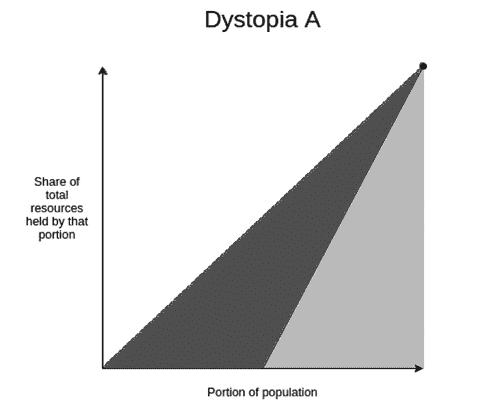
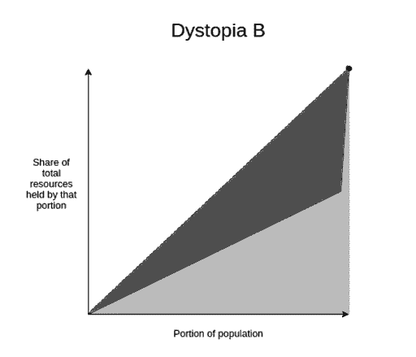

显然，这两个反乌托邦都不是宜居的地方。但它们以非常不同的方式成为非常不好的地方。反乌托邦 A 为每个居民提供了一个掷硬币的机会：如果落在分布的左半部分，将面临不可想象的恐怖性大饥荒；如果落在右半部分，则享有平等的和谐。如果你是灭霸 Thanos，

这两个问题足够不同，值得分别进行分析和衡量。而且这种差异不仅仅是理论上的。这里这张图表显示了底部 20% 人口获得的总收入份额（规避反乌托邦 A 的良好指标）与顶部 1% 人口获得的总收入份额（趋近反乌托邦 B 的良好指标）之间的对比：

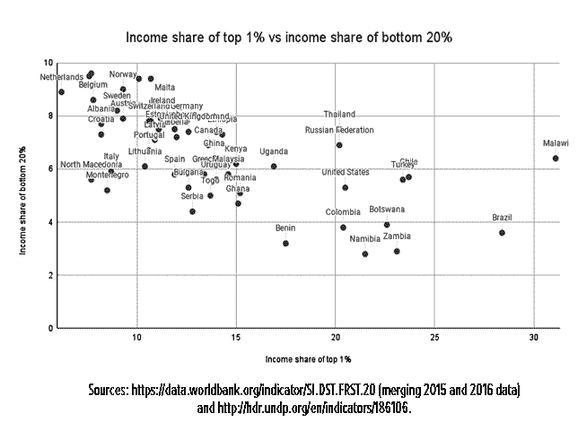

两者显然相关（系数为 `-0.62`），但远非完美相关（统计学的大祭司们显然认为 `0.7` 是“高度相关”的下限值，而我们甚至低于这个值）。该图表还有一个有趣的第二个维度可以分析——一个顶部 1% 获得总收入 20% 而底部 20% 获得 3% 的国家，与一个顶部 1% 获得 20% 而底部 20% 获得 7% 的国家有什么区别？唉，这种探索最好留给其他比我更有经验的进取的数据和文化探索者们吧。

## 为什么基尼系数在非地理社区（例如互联网/加密货币社区）中非常有问题

区块链空间内的财富集中是一个重要问题，一个值得衡量和理解的问题。这对整个区块链空间来说很重要，因为许多人（以及美国参议院听证会）试图弄清楚加密货币在多大程度上真的是反精英主义的，在多大程度上只是用新精英取代旧精英。在比较不同的加密货币时同样很重要。

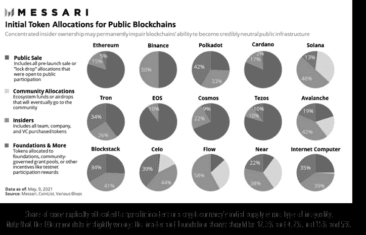

鉴于对这些问题的关注程度，许多人尝试计算加密货币的基尼指数这并不意外。它们并不都像我们不得不处理 2014 年那篇煽动眼球的文章那样糟糕：

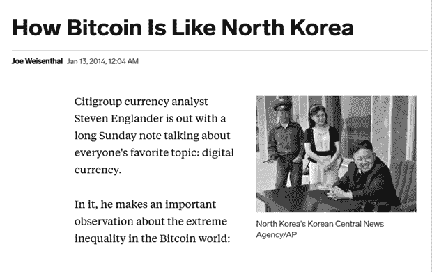

除了常见的普通方法论错误（将收入不平等与财富不平等混淆）之外，还有其他问题……[注：此处原文逻辑似乎有断层，此处根据语意翻译已尽可能对齐]


对于加密货币社区而言——资源集中是系统最大的风险之一，但某人仅持有 0.00013 个币并不能证明他们实际上处于饥饿状态——因此，采用此类指标是显而易见的方法。但对于国家来说，可能也值得分开讨论并衡量权力的集中以及资源匮乏带来的痛苦。

尽管如此，在某个时刻，我们必须超越这些指标。集中效应所带来的危害不仅取决于参与者的规模；它们还很大程度上取决于参与者之间的关系以及他们相互勾结的能力。同样，资源分配依赖于网络：如果缺乏资源的人拥有一个非正式网络可以利用，那么缺乏正式资源可能并没那么有害。但处理这些问题是一项更艰巨的挑战，因此在我们拥有的数据较少的情况下，确实需要更简单的工具。

特别感谢 Barnabé Monnot 和 Tina Zhen 的反馈与评审。

# 超越代币投票的治理

[vitalik.ca](http://vitalik.ca)

2021 年 8 月 16 日

过去一年区块链领域的重要趋势之一是从关注去中心化金融（DeFi）转向同时也思考去中心化治理（DeGov）。虽然 2020 年通常被广泛且充满理由地誉为 DeFi 之年，但从那以后，构成这一趋势的 DeFi 项目日益复杂且能力不断增强，导致人们对通过去中心化治理来处理这种复杂性产生了越来越兴趣。以太坊内部为例：`YFI`、`Compound`、`Synthetix`、`UNI`、`Gitcoin` 等都启动了甚至以某种 `DAO` 开始。但以太坊之外也是如此，例如比特币现金中关于基础设施资金提案的争论、Zcash 中关于基础设施资金的投票等。

形式化去中心化治理的兴起是不可否认的，人们对此感兴趣也有重要的原因。但记住此类方案的风险也很重要，正如最近 Steem 遭受敌意收购以及随后向 Hive 的大规模迁离所表明的那样。我进一步认为，这些趋势是不可避免的。在某些背景下，去中心化治理既必要又危险，我将在本文文中探讨这些原因。我们如何在最小化风险的同时获得 DeGov 的收益？我将对答案的一个关键部分提出观点：我们需要超越目前形式的代币投票。

## DeGov 是必要的

自 1996 年《网络空间独立宣言》以来，

这种环境中固有的两个需要解决的关键问题：

- **公共物品的资金 get**：对于社区中广泛且不加筛选的人群有价值，但通常没有商业模式的项目（例如层 1 和层 2 协议研究、客户端开发、文档 . . .）如何获得资金？
- **协议的维护与升级**：协议的升级以及对协议非长期稳定部分（例如安全资产列表、价格预言机源、多方计算密钥持有者）的定期维护和调整操作是如何达成共识的？

早期区块链项目在很大程度上忽略了这两个挑战，假装唯一的公共物品是网络安全，而这可以通过永恒不变的单一算法和固定的工作量证明奖励来支付。这种资金状况在当时是可能的，但随着生态系统的成熟，对更多公共物品的需求变得日益紧迫。


# 即使在没有攻击者的情况下硬币投票存在的问题

即使在没有明确攻击者的情况下，硬币投票的问题日益被人们理解，且主要分为以下几类：

*   **富有的参与者的小群体（“巨鲸”）比小持有者的大群体更擅成功执行决策**：这是由于小持有者之间存在公地悲剧：每个小持有者对结果的影响都微乎其微，因此他们没有动力去克服懒惰并实际投票。即使投票有奖励，他们也没有动力去研究和仔细思考他们投票的内容。
*   **硬币投票治理以牺牲社区其他部分为代价赋予了硬币持有者及其利益**：协议社区由具有许多不同价值观、愿景和目标的多元化群体组成。然而，硬币投票只赋予了一个群体（硬币持有者，尤其是富有者）权力，导致对提高币价这一目标的过度追求，即使这可能涉及有害的租金提取。
*   **利益冲突问题**：赋予一个群体（硬币持有者）投票权，特别是过度赋予该群体中富有行动者的权力，增加了暴露于该特定精英内部利益冲突的风险（例如，投资基金或同时也持有与该平台交互的其他 DeFi 平台代币的持有者）。

目前尝试解决第一个问题（从而缓解第三个问题）的一种主要策略是委托。小持有者不需要亲自判断每项决策；相反，他们可以将投票委托给他们信任的社区成员。这是一项光荣且值得的实验；我们将看到委托能在多大程度上缓解这一问题。


## 硬币持有者中心化的挑战

另一方面，硬币持有者中心主义问题要挑战性得多：硬币持有者中心主义本质上植根于以硬币持有者投票为唯一输入的系统中。将硬币持有者中心主义视为既定目标而非漏洞的误解已经造成了困惑和伤害；有一篇（广而言非常优秀的）文章：

如果所有权集中在少数巨鲸手中，加密货币协议还能被视为公共物品吗？口语中，这些市场原语有时被描述为“公共基础设施”，但如果说区块链今天服务于“公众”，那么它主要是指去中心化金融群体。从根本上说，这些代币持有者仅共同一个关注的对象：价格。

这种诉求是错误的；区块链服务的公众比 DeFi 代币持有者要丰富广泛得多。但我们由硬币投票驱动的治理系统完全未能捕捉到这一点，似乎如果不对范式进行更根本的改变，就很难创建一个捕捉到这种丰富性的治理系统。

## 硬币投票对攻击者的深层、根本性漏洞：买票

一旦试图颠覆系统的确定攻击者出现，问题就会变得糟糕得多。硬币投票的根本性漏洞很容易理解。在采用硬币投票的协议中，代币是两个权利组合成单一资产的包：(i) 对协议收入的某种经济利益，以及 (ii) 参与治理的权利。这种组合是刻意的为：目标是让权力和责任对等。但事实上，这两个权利很容易彼此分离。

想象一个简单的包装合约，它具有以下规则：如果你向合约中存入 `1 XYZ`，你将得到 `1 WXYZ`。该 `WXYZ` 可以任何时候转换回 `XYZ`，并且还会产生红利。红利从哪里来？呢，当 `XYZ` 硬币在包装合约内部时，是包装合约有能力在治理中随心意欲使用它们（提出提案、对提案进行投票等）。包装合约只是每天拍卖这项权利，并将利润分配给原始存款者。


作为 `XYZ` 持有者，将你的硬币存入合约符合你的利益吗？如果你是一个非常大的持有者，可能并不符合；你喜欢红利，但你害怕他们可能在治理中滥用它们。包装合约只是每天拍卖这项权利，并将利润分配给原始存款者。

（此处修正翻译逻辑：：作为 `XYZ` 持有者，将你的硬币存入合约符合你的利益吗？）

如果包装合约的治理权力被攻击者购买，你个人只损失一小部分成本。但如果你是一个小持有者，你将获得治理决策的全部收益。这种情况是典型的公地悲剧。

### 买票的机制

假设攻击者做出了一个腐败 DAO 的决策。参与者从决策遭受损害是 `D`，而投票成功的概率是 `p`。攻击者的贿赂为 `B`。游戏如下：


如果 `B > D × p`，你会倾向于接受贿赂，但只要 `B < 1000 × D × p`，接受贿赂就是集体有害的。所以如果 `p < 1`（通常 `p` 远低于 1），攻击者就有机会贿赂用户做出负面决策。

对买票的一种自然批评是：投票者真的会不道德到接受这种显而易见的贿赂吗？普通的 DAO 代币持有者是爱好者，他们很难自私地公然出卖项目。但这种观点忽略了存在更隐晦的方法可以将利润权利与治理权利分离，这些方法不需要任何像包装合约那样明确。

最简单的例子是从 DeFi 贷平台（例如 `Compound`）借贷。持有 `ETH` 的人可以将他们的 `ETH` 锁定在这些平台的 `CDP`（抵押债务仓）中，一旦这样做，`CDP` 合约就允许他们借入相当于 `ETH` 价值一半的 `XYZ`。然后他们可以对这些 `XYZ` 做任何事情。


注意，在整个过程中，借贷者对 `XYZ` 没有财务风险。也就是说，如果他们使用 `XYZ` 投票支持一个破坏 `XYZ` 价值的治理决策，他们不会因此损失一分钱。他们持有的 `XYZ` 是无论如何都必须放入 `CDP` 的 `XYZ`，因此他们不在乎价值的上涨还是下跌。

还有中心化的机制可以将利润权利与治理权利分离。重要的是，当用户将硬币存入（中心化）交易所时，交易所拥有这些硬币的完全托管权，且交易所有能力使用这些硬币进行投票。这不仅仅是理论；有证据表明，多个 `DPoS` 系统使用了用户的代币。

某些 DAO 协议正在使用时间锁技术来限制此类攻击，要求用户在投票时锁定硬币并在一段时间内无法移动。这些技术在短期内可以限制买入-投票-卖出的攻击，但最终，时间锁机制可以被用户通过一个发行代币包装版本的合约（或者更简单地说，通过中心化交易所）持有并进行投票来绕过。就安全机制而言，时间锁更像是报纸网站的付费墙，而不是锁和钥匙。


目前，许多采用代币投票的区块链和 DAO 已经成功避免了这些最严重形式的攻击。尽管偶尔会有尝试贿赂的迹象：


但尽管存在这些重要问题，但直接贿赂投票者的案例（包括使用金融市场等混淆形式）要比简单的经济推理所暗示的少得多。一个自然的问题是：为什么还没有发生更多直接的攻击？

我的答案是，“为什么尚未发生”取决于三个偶然性因素，这些因素在今天是真实的，但随着时间的推移可能会变得失效：

1. **社区精神**：拥有一个联系紧密的社区，每个人在共同的部落和使命中都能感受到同志相之情。
2. **代币持有者的高财富集中与协调**：大持有者具有更高的影响结果的能力，并且彼此之间存在长期投资关系（既有风投机构的“老友俱乐部”，也有许多其他同样强大但低调的富裕代币持有者群体），这使得他们更难被贿赂。
3. **治理代币金融市场尚未成熟**：制作封装代币（wrapper tokens）的现成工具仅以概念验证的形式存在但尚未被广泛使用；贿赂合约存在但同样不成熟；且贷款市场的流动性较低。

当一少数协调的小用户群体持有 50% 以上的代币，且他们和其他人都投入到一个联系紧密的社区中，并且很少代币以合理的利率被贷款时，上述所有的贿赂攻击可能仍然停留在理论阶段。但随着时间的推移，无论我们做什么，(1) 和 (3) 将不可避免地变得失效，如果我们想让 DAO 变得更加公平，(2) 也必须失效。当这些变化发生时，DAO 还能保持安全吗？如果代币投票无法持续地抵御攻击，那么什么可以呢？

## 解决方案 1：有限治理

针对上述问题的一种可能的缓解方法（且这种方法已经在不同程度上被尝试）是限制代币驱动治理的所能做到的范围。实现此点的有几种方法：

* **仅对应用使用链上治理，而非基础层**：`Ethereum` 已经做到了，因为协议本身通过链外治理进行管理，而其之上的 DAO 和其他应用有时（但并非总是）通过链上治理进行管理。
* **将治理限制在固定参数的选择上**：`Uniswap` 正在这样做，因为它只允许治理影响 (i) 代币分配和 (ii) `Uniswap` 交易所中 0.05% 的费用。另一个很好的例子是 `RAI` 的“去治理”路线图，随着时间的推移，治理对功能的控制越来越少。
* **增加时间延迟**：在时间 `T` 做出的治理决策仅在例如 `T + 90 days` 时生效。这允许那些认为该决策不可接受的用户和应用程序迁移到另一个应用程序（可能是分叉）。`Compound` 在其治理中有一个时间延迟机制，但原则上讲，延迟可以（并且最终应该）更长。
* **更对分叉友好**：让用户更容易快速地协调并执行分叉。这降低了捕获治理的收益。

`Uniswap` 的案例特别有趣：链上治理资助团队是刻为之的行为，这些团队可能会开发 `Uniswap` 协议的未来版本，但升级到这些版本取决于用户是否选择加入。这是链上和链外的混合体。

但有限治理本身并不是一个可以接受的解决方案；那些最需要治理的领域（例如公共品）本身是最容易受到攻击的。

## 解决方案 2：非代币治理

另一种方法是使用不是代币驱动的治理形式。如果代币不决定权重，那么什么来决定呢？有两种自然的替代方案：

1. **人格证明（Proof of personhood）**：验证账户对应唯一人类的系统。参考 `Proof of Humanity` 和 `BrightID` 在实现方面的尝试。
2. **参与证明（Proof of participation）**：证明某人参与了某些活动或完成了某些工作的系统。参考 `POAP` 在实现方面的尝试。

还有混合的可能性：一个例子是平方投票（quadratic voting），它让单个投票者的权力与其投入的经济资源的平方根成正比。`Gitcoin` 的平方融资是平方投票的一种形式，且平方投票 DAO 正在构建中。

参与证明尚不为人知。关键挑战在于，确定什么算作参与本身就需要相当稳健的治理结构。可能的简单解决方案是使用精选的早期贡献者来引导系统，然后随着时间的推移，由 `round n` 的参与者确定 `round n + 1` 的标准。

## 解决方案 3：利益相关（Skin in the game）

第三种方法是通过改变投票规则来打破公地悲剧。代币投票之所以失败，是因为虽然投票者对他们的决策集体负责（如果大家都投了一个糟糕的决定，每个人的代币都会归零），但每个投票者并不对个人负责。我们能否建立一种投票系统来改变这种动态，让投票者个人（而不仅仅是集体）对决策负责？

分叉友好可以说是一种利益相关的策略，如果分叉是像 `Hive` 从 `Steem` 分叉那样进行的话。如果一个毁灭性的治理决策成功且无法在协议内被反对，用户可以自行进行分叉。此外，在那个分叉中，投坏决策的代币可以被销毁。


这产生了个体责任：如果发生了攻击，而你的代币投了攻击票，那么你的代币就会销毁。如果你的代币没有投攻击票，你的代币就是安全的。这种责任会向上传播：如果你将代币放入一个包装合约中，而该包装合约投了攻击票，那么包装合约的余额将被清空，从而你就丢失了代币。如果攻击者从 DeFi 借贷平台借了 `XYZ`，当平台发生分叉时，任何出借 `XYZ` 的人都会损失（注意，这使得治理代币的贷款普遍变得非常有风险；这是预期中的结果）。

# 日常投票中的利益相关（Skin in the game）

但上述方法仅适用于防止真正极端的决策。对于规模较小的抢劫呢？这些抢劫不公平地有利于操纵治理经济的攻击者，但其程度尚不足以造成毁灭性后果。那么，在完全没有攻击者的情况下，简单的懒惰，以及代币投票治理缺乏有利于高质量意见的筛选压力，情况又如何呢？

解决这类问题最流行的方案是“预测治理”（futarchy），由 Robin Hanson 在 21 世纪初引入。投票变成了下注：赞成某项提案意味着你下注该提案将导致良好的结果；反对某项提案意味着你下注该提案将导致糟糕的结果。预测治理引入个体责任的原因是显而易见的：如果你下了正确的注，你就会获得更多代币；如果你投了错误的注，你就会失去代币。

image/futarchy-funds-245.jpg

“纯粹”预测治理被证明很难引入，因为在实践中，目标函数很难定义（人们想要的不仅仅是价格！），但各种混合形式的预测治理可能有效。混合预测治理的示例包括：

- 作为买单的投票：赞成某项提案需要提交一个可执行的买单，以略低于代币当前价格的价格购买额外的代币。这确保了如果一个糟糕的决策成功了，支持它的人可能被迫买下对手的份额，但也确保了在“正常”决策中，代币持有者有更多的余地根据非价格标准做出决定。
- 回溯性公共物品资金：公共物品通过某种投票机制在取得结果后进行追溯资助。用户可以购买代币来资助他们的项目，同时对其表示信心；如果项目被认为已实现目标，代币购买者将获得奖励份额。
- 升级游戏：低级决策的价值对齐通过向更高投入但更高准确率的过程进行申诉的可能性来激励；投票结果与最终决议一致的投票者将获得奖励。

在后几种情况中，混合预测治理取决于某些形式的非预测治理治理，以衡量目标函数或作为最后的争议解决层。然而，这种非预测治理治理具有几个优势：(i) 它的激活较晚，(ii) 它的使用频率较低，以及 (iii) 它的每次使用后果更大，因此仅仅依靠它来对齐这一最终层的激励是更容易接受的。

# 混合解决方案

还有一些结合了上述元素的解决方案。一些可能的示例：

- 延时加上选举专家治理：这是解决古老难题的一种可能方案，即如何制造加密抵押稳定币，使其锁定资金可以超过获利价值，而不会面临治理被接管的风险。由 `n`（例如 `n=3`）位选举出的提供者提交的价值中位数。代币投票选择提供者，但每周只能更换一个提供者。如果用户发现代币投票引入了不可信的提供者，他们在稳定币崩溃前有 `n` 周的时间来切换到另一个。
- 预测治理 + 反合谋 = 声誉：用户使用“声誉”投票，声誉是一种不可转移的代币。如果用户的决策导致了预期结果，他们会获得更多声誉；如果决策导致了非预期结果，他们会失去声誉。
- 松散耦合（建议性）代币投票：代币投票并不直接实施提议的更改，它仅仅存在是为了将其结果公开，为链下治理实施该更改建立合法性。这可以提供代币投票的处而风险更小，因为如果证据表明代币投票被贿赂或其他遭到操纵，代币投票的合法性会自动下降。

但这些只是少数可能的示例。在研究和开发非代币驱动的治理算法方面，还有很大的可空间。今天可以做的最重要的事情是放弃“代币投票是唯一合法去中心化形式”的想法。代币投票之所以有吸引力，是因为它感觉是可靠中性的：任何人都可以去 Uniswap 上获取一些治理代币。但在实践中，代币投票今天看起来安全，很可能是因为其中立性的缺陷（即，大部分供应量掌握在紧密协调的内部人员小集团手中）。

我们应该非常警惕当前代币投票形式是“安全默认”的观点。关于它们在更大的经济压力以及成熟的生态系统和金融市场条件下如何运作，仍有许多待观察。现在是时候同时尝试替代方案了。

特别感谢 Karl Floersch、Dan Robinson 和 Tina Zhen 的反馈和评审。

# 信任模型

vitalik.ca
2021 年 8 月 20 日

许多区块链应用最有价值的属性之一是无信任性（trustlessness）：应用程序以预期方式继续运行的能力，而不需要依赖特定执行者以特定方式行为，即使他们的利益未来可能会发生并迫使他们以某些不同、出乎意料的方式行动。区块链应用绝不是完全无信任的，但某些应用比其他应用更接近无信任。如果我们想向信任最小化迈出实质性一步，我们希望拥有比较不同程度信任的能力。

首先，我对信任有一个简单的一句定义：信任是对他人行为的任何假设。如果你在疫情之前，你走在街上时不会刻意与陌生人保持两米的距离以防他们突然掏刀刺你，这就是一种信任：既信任人们很少会完全发疯，也信任管理法律体系的人会继续对这种行为提供强有激励。当你运行一段他人编写的代码时，你信任他们诚实地编写了代码（无论是出于自己的正直感，还是出于维护声誉的经济利益），或者至少有足够的人在检查代码，以至于漏洞会被发现。不自己种食物是另一种信任：信任足够的人会意识到种食物并卖给你符合他们利益的。你可以信任不同规模的人群，也有不同类型的信任。

为了分析区块链协议，我倾向于将信任分为四个维度：

- 需要多少个人按照你预期的那样行为？
- 在多少人中？
- 这些人需要什么样的动机？他们是利他主义的还是仅仅追求利润的？他们需要是非协调的吗？
- 如果假设被违反，系统失败得有多严重？


现在，让我们先关注前两种。我们可以画一张图：


颜色越深，效果越好。让我们更详细地探索这些类别：

-   **1 of 1**：只有一个执行者，当且仅当这一个执行者按照你的预期进行操作时，系统才能正常工作。这是传统的“中心化”模型，也是我们正试图比它做得更好的模型。
-   **N of N**：“反乌托邦”世界。你依赖于一大堆执行者，所有人都必须按照预期行事，一切才能正常运行，而且一旦其中任何一个失败，都没有备份方案。
-   **N/2 of N**：这是区块链的工作原理——只要大多数矿工（或 `PoS` 验证者）是诚实的。请注意，随着 `N` 的增大，`N` 中的 `N/2` 价值变得显著更高；一个由少数矿工或验证者主导网络的区块链，远没有矿工或验证者广泛分布的区块链有意义。尽管如此，我们还希望提高这种水平的安全性，因此才对防御 `51%` 攻击存在担忧。
-   **1 of N**：有很多执行者，只要其中至少一个按照你的预期进行操作，系统就能正常工作。任何基于欺诈证明（fraud proofs）的系统都属于这一类，信任设置（trusted setups）也是如此，尽管在这种情况下 `N` 通常较小。注意，你确实希望 `N` 越大越好！
-   **Few of N**：有很多执行者，只要其中至少有少数固定数量的人按照你的预期操作，系统就能工作。数据可用性检查（data availability checks）属于这一类。
-   **0 of N**：系统按预期工作，完全不依赖外部执行者。通过自己检查来验证区块属于这一类。

除了“0 of N”之外的所有类别都可以被视为“信任”，但它们之间有很大区别！信任某个特定的个人（或组织）会按预期工作，与信任任何地方的某个人会按你的预期操作是完全不同的。“1 of N”模型与“N/2 of N”或“1 of 1”相比，可以说它更接近“0 of N”。“1 of N”模型可能感觉像“1 of 1”模型，因为感觉你正在通过单个执行者，但两者的现实非常不同：在“1 of N”系统中，如果你目前合作的执行者消失或变坏了，你可以直接切换到另一个；而在“1 of 1”系统中，你就完蛋了。

特别需要注意的是，即使是你运行的软件的正确性通常也依赖于“few of N”信任模型，以确保如果代码中有 Bug，有人会发现它们。考虑到事实，在应用程序的某些方面极力尝试从“1 of N”变为“0 of N”，往往就像是在窗户开着的房子上装了一扇加固钢门。

另一个重要问题是：如果你的信任假设被违反，系统会如何失败？在区块链中，两种最常见的失败类型是活跃性失败（liveness failure）和安全性失败（safety failure）。活跃性失败是指你暂时无法执行你想做的事情（例如：提取币、让交易被包含在区块中、从区块链读取信息）。安全性失败是指发生了系统应该防止的积极事件（例如：无效区块被包含在区块链中）。

以下是几个区块链层 2 协议信任模型的示例。

-   **通道（包括状态通道、闪电网络）**：活跃性上的“1 of 1”信任（你的交易对手可以临时冻结你的资金，尽管通过在多个交易对手之间拆分币可以减轻这种损害）；安全性上的“大 N 中的 N/2”信任（区块链 `51%` 攻击可以窃取你的币）
-   **Plasma（假设有中心化操作者）**：活跃性上的“1 of 1”信任（操作者可以临时冻结你的资金）；安全性上的“大 N 中的 N/2”信任（区块链 `51%` 攻击）。
-   **Plasma（假设有半去中心化操作者，例如 `DPoS`）**：活跃性上的“小 N 中的 N/2”信任；安全性上的“大 N 中的 N/2”信任。
-   **乐观性汇总 (Optimistic rollup)**：活跃性上的“1 of 1”或“小 N 中的 N/2”信任（取决于操作者类型）；安全性上的“大 N 中的 N/2”信任。
-   **ZK 汇总 (ZK rollup)**：活跃性上的“小 N 中的 1”信任（如果操作者未能包含你的交易，你可以提取；如果操作者未能立即包含你的提取请求，他们无法产生更多批次，你可以在 rollup 系统的任何全节点的帮助下进行自助提取）；没有安全性失败风险。
-   **ZK 汇总（带有轻级提取增强）**：没有活跃性失败风险；没有安全性失败风险。

最后是关于激励的问题：你所信任的执行者需要非常无私才能按预期行动，还是只需要稍微无私，或者保持理性的就足够了？搜索欺诈证明“默认情况下”是轻微无私的，尽管这种无私程度取决于计算的复杂性，而且有方法修改游戏使其符合理性。

如果我们添加一种为该服务微支付的方法，那么协助他人从 ZK rollup 中提取就是理性的，因此就不需要担心无法从任何有用途的 rollup 中退出。同时，如果我们同意不接受回溯太远的 `51%` 攻击，其他系统的更大风险就可以得到缓解。


# 从零开始创建加密导向城市的更具雄心的项目

从零开始创建加密导向城市的更具雄心的项目：参见 `CityDAO`，它将自己描述为嗯，“在以太坊区块链上建立一座城市”——一切都是 DAO 化治理。

但这些项目以目前的形式来说是好主意吗？是否有任何改变可以让它们变成更好的主意？让我们来发现一下 . . .

## 为什么我们应该关注城市？

全球许多国家政府在应对长期存在的问题和人们基础需求的快速变化时，表现出效率低下和行动缓慢。简而言之，许多国家政府缺失了活跃的参与者。更糟糕的是，如今用于国家治理正在考虑或实施的许多跳出框架的政治想法，坦率来说相当可怕。你希望 `USA` 被一个二战时期葡萄牙独裁者安东奥·萨拉泽的克隆体接管，还是被一个“美国凯撒”来击败美国左翼主义的邪恶侵害？对于每一个可以被合理描述为扩大自由或民主的观点，就有十个只是不同形式的集权化控制、围墙和普遍监控。

现在考虑地方政府。正如我们在文章开头的示例中看到的，城市和州至少在理论上具备真正的活力。城市之间存在着巨大且真实的文化差异，因此，找到一个能让公众对采纳某个特定激进想法感兴趣的单一城市，比说服整个国家接受它要容易得多。在城市治理的地方公共物品、城市规划、交通以及许多其他领域，存在着非常真实的挑战和机会可以得到解决。城市拥有紧密结合的内部经济，广泛采用加密货币等事情在这些地方可以现实地独立发生。此外，城市内部实验导致糟糕结果的可能性较低，这既是因为城市受到高级别政府的监管，也是因为城市拥有泄压阀：对现状不满意的人可以更容易地退出。

总而言之，地方政府似乎是一个非常被低估的层面。鉴于对现有智慧城市计划的批评往往严重集中在对集权治理、缺乏透明度和数据隐私的担忧上，区块链和加密技术似乎是通往更加开放和参与的未来道路的极具前景的关键要素。

## 如今城市项目在做什么？

实际上有很多！这些实验中的每一个仍然处于小规模，并且很大程度上仍在摸索阶段，但它们至少都是可能变成有趣事物的种子。许多先进项目位于美国，但全球范围内都有兴趣；在韩国，`Busan` 政府正在举办一个 `NFT` 会议。以下是目前正在进行的一些例子。

### 瑞诺市的区块链实验

内华达州瑞诺市的市长希拉里·谢夫（Hillary Schieve）是一位区块链爱好者，她主要关注 `Tezos` 生态系统，她最近一直在探索与其城市治理区块链相关的想法：

*   出售 `NFTs` 为当地艺术筹集资金，从市中心“太空鲸鱼”雕塑的 `NFT` 开始。


*   创建一个 `RenoDAO`，由 `Reno` 币治理，居民有权通过空投获得这些代币。`RenoDAO` 可以开始获得收入来源；其中一个提议的想法是让城市出租其拥有的物业，并使用收入来资助一个 `DAO`。

*   使用区块链来确保各种流程的安全；例如，用于赌场的区块链安全随机数生成器、区块链安全投票等。

### CityCoins.co

`CityCoins.co` 是一个构建在 `Stacks` 之上的项目，`Stacks` 运行在一种特殊的“转移证明”（由于某种原因缩写为 `PoX`，而不是 `PoT`）区块产生算法之上，该算法围绕 `Bitcoin` 区块链及其生态系统构建。硬币供应量的 70%通过持续销售机制产生：任何拥有 `STX`（`Stacks`原生代币）的人都可以将 `STX` 发送到城市币合约以生成城市币；`STX` 收益分配给质押币的现有城市币持有者。剩余的 30%供市政府使用。

`CityCoins` 做出了一个有趣的决定，尝试建立一种不依赖任何政府支持的经济模型。当地政府不需要参与创建 `CityCoins.co` 代币；社区小组可以自己发行币。`FAQ` 中对“我能用 `CityCoins` 做什么？”的回答包含了“`CityCoins` 社区将创建使用代币进行奖励的应用”以及“本地企业可以为 . . . 质押 `CityCoins` 的人提供折扣或优惠”。但在实践中，`MiamiCoin` 并非孤军奋战；`Miami` 政府已经事实上公开支持了它。


### CityDAO

`CityDAO` 是实验中最激进的：与拥有升级基础设施的现有城市 `Miami` 和 `Reno` 不同，`CityDAO` 是在 `Wyoming` 法下具有法律地位的 `DAO`，试图从零开始创建新城市。

到目前为止，该项目仍处于早期阶段。团队目前正在完成对 `Wyoming` 一个偏远角落的第一块土地的购买。计划从这块土地开始，未来增加其他土地，建立由 `DAO` 治理的城市，并大量使用如 Harberger 税等激进想法来分配土地、做出集体决策并管理资源。

## 我认为城市可以做什么？

显然，在原则上城市可以做很多事情。它们可以增加更多的自行车道，可以使用 `CO2` 监测仪和远波 UVC 光更有效地减少病毒传播而不给人们带来不便，甚至可以资助延寿研究。但我的专业领域是区块链，而且这篇文章也是关于区块链的，所以 . . . 我们专注于区块链吧。

我认为区块链有两类不同的想法：

1. 使用区块链为现有流程创建更可信、更透明且可验证的版本。
2. 使用区块链为土地和其他稀缺资产实现新的、实验性的所有形式，以及新的、实验性的民主治理形式。

区块链与这两个类别都有天然的契合点。区块链上发生的任何事情都非常容易进行公开验证，有许多现成的、免费的工具可以帮助人们这样做。区块链上构建的任何应用程序都可以立即与全球区块链生态系统中的其他应用程序连接并交互。基于区块链的系统比纸质系统更高效，比中心化计算系统更具公开验证性——如果你想比如发明一种新的投票形式，让公民对成百上千个不同的问题提供高频的实时反馈，这是必要的结合。

现在让我们进入细节。


哪些现有流程可以通过区块链变得更可信、更透明？


许多人（包括全球范围内的政府官员）多次向我提过一个简单的想法，即由政府创建一个白名单的、仅供内部使用的稳定币，用于追踪政府内部的支付。个人或机构缴纳的每笔税款都可以与一个公开可见的链上记录挂钩，并根据该记录铸造相应数量的代币（如果我们希望让个人税款金额保持私密，可以使用零知识方法仅公开总额，但仍能让大家相信计算是正确的）。部门之间的转账可以“明文”进行，而代币仅由声领款项和工资的个人承包商或员工兑换。

这个系统可以很容易地扩展。例如，选择哪家竞标者赢得政府合同的采购过程，很大程度上可以在链上完成。

## 区块链可以让更多流程变得更加可信

*   **公平随机数生成器**（例如用于彩票）：`VDFs`（如 `Ethereum` 预计包含的那）可以作为公平的随机数生成器，用于让政府运营的彩票更具信誉。公平随机性也可用于许多其他用例，例如作为一种政府形式的抽签制。
*   **证书**——例如，证明某特定个人是该城市居民的加密证明——可以在链上完成，以增加可验证性和安全性（例如，如果此类证书在链上颁发，那么如果发行了大量虚假证书将变得显而易见）。这可以用于各种地方政府颁发的证书。
*   **资产登记**，针对土地和其他资产，以及更复杂的财产所有形式（如开发权）。由于法院在特殊情况下需要能够进行分配，这些注册处可能永远不会像加密货币那样成为完全去中心化的无记票凭，但将记录放在链上仍然可以使争议中更容易看到发生了什么以及按什么顺序。

最终，甚至投票也可以在链上完成。在这里隐藏着许多复杂性和棘手问题（dragons），保持谨慎至关重要；需要一种结合了区块链、零知识证明和其他密码学的复杂解决方案，来实现所有预期的隐私和安全属性。然而，如果人类真的要转向电子投票，地方政府似乎是一个完美的起点。

## 激进的经济和治理实验

有哪些可能有趣的激进经济和治理实验？

但除了这些在政府已经做的事情上进行区块链叠加的方法之外，我们还将区块链视为政府在经济和治理方面进行完全新且激进实验的机会。这些并不一定是我认为应该执行的终极想法；它们是针对可能方向的初步探索和建议。一旦实验开始，现实世界的反馈往往是决定未来应如何调整实验最有用的变量。

### 实验 1 号：一种更全面的城市代币愿景

`CityCoins.co` 是关于城市代币如何运作的愿景之一。但它远不是唯一的愿景。事实上，`CityCoins.co` 的方法具有巨大的风险，特别是其经济模型严重偏向早期采用者。铸造新币产生的 `STX` 收益的 70% 被给了城市币的现有质押者。未来五年内发行的代币将比后五十年的还要多。对于 2021 年的政府来说这是一笔很划算的交易，但 2051 年呢？一旦政府背书了特定的城市代币，它未来就很难改变方向。因此，城市政府仔细考虑这些问题并选择一条长期合理的路径是至关重要的。

这里有另一种关于城市代币可能运作的叙事草图。它远不是 `CityCoins.co` 愿景的唯一替代方案。无论如何，城市代币是一个广阔的设计空间，有很多值得考虑的不同选择。总之，我们开始吧……

目前形式的住房所有概念是一个显著的双刃剑，许多人认为，积极鼓励和通过法律结构化这种特定方式是我们今天所犯的最大经济政策错误之一。住房作为居住地与作为投资资产的住房之间存在着不可避免的政治紧张局势，而满足关注后者的社区的压力往往会严重损害前者的可负担性。城市居民要么拥有住房，这使他们对土地价格的风险暴露过大，并引入了反对新房建设的扭曲激励；要么租房，这使他们对房地产市场处于负面影响中，从而在经济上与“将城市变成一个宜居的地方”的目标背道而驰。

但尽管存在这些问题，许多人仍然认为拥有住房不仅是一个好的选择，而且是值得补贴的。一个原因是它促使人们储蓄并积累净值。另一个大原因是，尽管存在缺陷，它在居民和社区之间创造了经济利益的一致性。但如果我们创建一个可分且同质的城市代币，居民可以根据自己的负担能力或舒适程度持有任意数量的单位，且其价值随着城市的繁荣而增长，会怎样？（等等，我重读了文本，似乎漏掉了一些句子：“如果我们能创建一个代币……其价值随着城市的繁荣而增长？”）

## 城市代币的目标

首先，让我们从一些可能的目标开始。并非所有目标都是必要的；一个只完成五个目标中三个代币已经是向前的一大步。但我们会尽可能实现它们：

*   **为政府获取可持续的收入来源**：城市币经济模型应避免重定向现有税收；相反，它应该寻找新的收入来源。
*   **建立居民与城市之间的经济一致性**：这意味着首先代币本身应该随着城市吸引力的增加而变得更有价值。但也意味着经济机制应该积极鼓励居民持有代币，而不是远处的投资者。
*   **促进储蓄和财富积累**：住房所有做到了这一点——随着房主支付抵贷，他们积累了净值。城市代币也可以做到，让长期积累代币具有吸引力，甚至将这种体验游戏化。
*   **鼓励更多亲社会活动**：例如有助于城市的积极行动和对资源的可持续利用。
*   **公平性**：不要对富人过度偏向穷人（设计糟糕的经济机制通常会这样做）。代币的可分性避免了富富之间的尖锐鸿沟，这已经做得很好，但我们可以更进一步——例如，通过将新发行的大部分分配给居民作为全民收入（UBI）。

一种似乎很容易满足前三个目标的模式是为持有者提供福利：如果你持有至少 `x` 个代币（`x` 可以随时间增加），你就可以免费获得一系列服务。`MiamiCoin` 正在尝试鼓励企业这样做，但我们也可以更进一步，让政府服务也这样运作。一个简单的例子是，让那些持有一定数量锁定代币的人可以免费使用现有的公共停车位。这将同时实现几个目标：

*   创造持有代币的激励，维持其价值。
*   为居民持有代币创造特定激励，而不是那些利益不一致的远方投资者。此外，这种激励对每个人的用处是有上限的，因此鼓励了广泛的持有。


-   创造经济对齐（城市变得更有吸引力 -> 更多人想停车 -> 代币价值更高）。与房屋所有权不同，这种方式创造了整个城镇的对齐，而不仅仅是城镇中某个非常特定的位置。
-   通过减少停车位的使用来鼓励资源的可持续利用（尽管没有代币但确实需要停车的人仍然可以付费），支持了许多当地政府在道路上开辟更多行人友好空间的愿望。或者，也可以允许餐厅通过相同的机制锁定代币，并占用停车位用于户外座椅。

但为了避免产生负面激励，避免过度依赖某一个特定想法至关重要，相反应该拥有多元化的可能收入来源。赋予城市代币价值、并同时实验新颖治理想法的一个绝佳“金矿”就是区规划。如果你持有至少 `y` 个代币，你就可以对附近土地主为绕过区规划限制需要支付的费用进行二次方投票。这种结合了市场和直接民主的方法比目前过于繁琐的许可程序要高效得多，而且费用本身将成为政府的另一个收入来源。更广泛地说，下一节中的任何想法都可以与城市代币结合，为城市代币持有者提供更多使用场景。

## 实验 #2：更激进和参与式的治理形式

这是《激进市场》（Radical Markets）的所在

这些想法可以产生长期价值的一个明显领域是激励开发者改进建筑美学。哈伯伯格税（Harberger taxes）等机制可以从根本上改革区规划规则，而区块链可以以更可信、更高效的方式管理此类机制。另一个在短期内更行的想法是补贴当地企业，类似于市中心刺激计划，但规模更大、更具永久性。企业在当地社区中不断产生各种正向外部性，而这些外部性可以得到更有效的奖励。当地新闻可以获得二次方资助，复兴一个长期苦苦的行业。广告定价可以根据人们对某个特定广告喜好程度的实时投票来设定，从而鼓励更多的原创性和创造力。

更民主的反馈（甚至可能是追溯性的民主反馈！）可能在所有这些领域创造出更好的激励。通过实时的在线二次方投票和资助，21 世纪的数字民主可能比 20 世纪的民主做得好得多，后者在实践中似乎很大程度上其特征是僵化的建筑规范以及在规划和许可听证会上的阻碍。当然，如果你打算使用区块链来保障投票，那么从这种花哨的新类型投票开始，似乎比改造现有的投票系统要安全得多，在政治上也更可行。


## 结论

对于城市来说，有很多值得尝试的想法，可以由现有城市或新城市来尝试。当然，新城市的优势在于没有对事物的处理方式有既有预期的居民；但创建一个新城市的概念本身在现代是相对未经过测试的。也许，热衷于尝试新事物的人和项目手中数十亿美元的资本池可以帮助我们度过难关。但即便如此，在可见的未来，现有城市可能仍然是大多数人居住的地方，而且现有城市也可以使用这些想法。

区块链在本文提出的更渐进和更激进的想法中都非常有用，尽管城市政府具有固有的“受信任”属性。在链上运行任何新或旧机制都能让公众能够轻松地验证。该机制的目的非常明确：它通过确保游戏具有挑战性和趣味性，确保要获得最好的物品，你必须亲自去完成困难的事情，并想出如何杀死巨龙。你不能只是每天杀 10 小时野猪，持续一年，获得数千金币，然后从其他杀掉巨龙的玩家那里购买史诗魔法护甲。当然，这个系统并不完美：你可以雇佣专业团队陪你杀死巨龙并让你收集战品，甚至直接在二级市场上购买一个角色，并用游戏外的美元完成这一切。但尽管如此，它仍然比一个每个物品总有价格的游戏要好得多。

政府应该避免的主要陷阱是太快地放弃选择权。一个新城市可能会因为卖得太多而掉入陷阱。从零知识开始是不可逆的。但同时，最初抓住机会也是同样重要的。尽管面临挑战，加密城市广义上是一个时代已经到来的想法。

特别感谢 Silly 先生和 Tina Zhen 对本文的早期反馈，并感谢一长名单参与讨论的人。

## 灵魂绑定（Soulbound）

[vitalik.ca](http://vitalik.ca)

2022 年 1 月 26 日

《魔兽世界》中一个对玩家来说是与生如此、但在游戏圈之外未被讨论的特征是“灵魂绑定”（soulbound）物品的概念。灵魂绑定物品一旦拾取，就不能转移或出售。游戏中大多数强大的物品都是灵魂绑定的，并且通常需要完成任务或杀死强大的怪物，通常还需要四人到三十九名玩家的帮助。因此，为了让你的角色尽可能拥有最好的武器和护甲，你没有选择不参与亲自杀死某些困难怪物。


如果 NFT 可以是灵魂绑定的呢？

目前形式的 NFT 许多与在线游戏中稀有和史诗物品相同的属性。它们具有社交信号价值：拥有它们的人可以展示它们，并且有越来越多的工具专门帮助用户这样做。最近，Twitter 开始推出一项集成功能，允许用户在头像资料中展示他们的 NFT。


如果有人向你展示他们拥有一个通过执行 X 获得的 NFT，你无法判断是他们亲自执行了 X，还是付钱让别人执行了 X。在某些情况下这并不是问题：对于一个支持慈善机构的 NFT，某人在二级市场购买它，是为这项事业牺牲了自己的资金，并且通过增加他人购买该 NFT 的意愿来帮助该慈善机构，因此没有理由歧视他们。事实上，单是慈善 NFT 就能产生许多益处。但如果我们想创建一些不仅仅关乎谁最有钱，而是实际上尝试传达其他信号的 NFT 呢？

## 灵魂绑定 NFT（Soulbound NFTs）的必要性

也许尝试做到此点的最佳示例项目是 `POAP`，即“出席证明协议”。`POAP` 是一种标准，项目可以通过它发送 NFT，代表接收者个人亲自参与了某些活动的理念。

`POAP` 是一个 NFT 的绝佳案例，如果它是“灵魂绑定”的，效果会更好。如果有人在看你的 `POAP`，他们并不感兴趣你是否付钱让某人去参加活动，他们感兴趣的是你是否亲自参加了该活动。将证书（例如驾照、大学学位、年龄证明）放在链上的建议也面临类似的问题：如果一个自己不符合条件的人可以从一个符合条件的人那里买一个，那么它们的价值将大大降低。


虽然可转移 NFT 有其用武之地，并且在支持艺术家和慈善机构方面确实非常有价值，但同时也存在一个巨大且未被探索的设计空间，即不可转移的 NFT 可以变成什么。

如果治理权可以是灵魂绑定的呢？

这是一个我已经写得令人厌烦的话题，但它仍然值得重复：如果治理权力很容易被转移，治理机制很容易发生非常糟糕的事情。这主要源于两个层面的原因：

- 如果目标是让治理权力广泛分布，那么可转移性会适得其反，因为集中的利益更有可能从每个人手中买下治理权。
- 如果目标是让治理权交给胜任者，那么可转移性也是适得其反的，因为没有什么能阻止治理权被那些坚定但无能的人买走。

如果你认真对待“最想统治别人的人往往是最不适合统治的人”这句谚言，那么你应该对可转移性保持怀疑，恰恰因为可转移性会让治理权力从那些最可能为治理提供价值输入的弱者手中，流向那些最可能引发问题的权欲熏者手中。

那么，如果我们尝试让治理权变为不可转移的呢？如果我们尝试创建一个 `CityDAO`，让更多的投票权归给真正居住在城市里的人，或者至少是可靠的民主，并避免巨鲸囤积大量公民 NFT 带来的不当影响呢？如果区块链协议的 DAO 治理能以某种方式让治理权力取决于参与情况呢？再次，开启了一个巨大且丰富的设计空间，而这个空间目前是难以进入的。

## 在实践中实现不可转移性

`POAP` 做出了技术决策，不阻止 `POAPs` 本身的转移性。这样做有充分的理由：用户可能有很好的理由想要将所有资产从一个钱包迁移到另一个钱包（例如出于安全考虑），而且“天真地”实现的不可转移性安全性本身并不高，因为用户可以仅仅创建一个持有 NFT 的包装账户，然后出售该账户的所有权。

事实上，确实有相当多的案例，在存在经济逻辑的情况下，`POAPs` 频繁被买卖。`Adidas` 最近向其粉丝免费发布了一个 `POAP`，用户可以借此在商品销售中获得优先访问权。发生了什么？当然，许多 `POAPs` 迅速被转给了最高出价者。


为了解决这个问题，`POAP` 团队建议关注不可转移性的开发者自行实现检查：他们可以在链上检查当前所有者是否与原始所有者为同一地址，如果认为必要，他们可以随着推推增加更复杂的检查。目前，这是一种更具防御性的方法。

也许今天最稳健的不可转移的 NFT 莫过于“人性证明”（`Proof of Humanity`）认证。

我们可以在不走极端（即不将一切都基于“人性证明”）的情况下限制可转移性吗？这变得更困难了，但有一些中等强度的方法对于某些用例可能已经足够了。将 NFT 绑定到 `ENS` 名称是一个简单的选项，如果我们假设用户足够在乎他们的 `ENS` 名称，以至于不愿转移它们。目前，我们可能会看到一系列限制可转移性的方法谱，不同的项目在安全性和便利性之间选择不同的权衡。

## 不可转移性与隐私

对于可转移资产，加密强度的隐私很容易理解：你把你的币放入 `tornado.cash`。幸运的是，有几种简单的技术方案可行：

- 将物品存储在一个地址，该地址是 `(i)` 索引、`(ii)` 接收者地址和 `(iii)` 接收者密钥的哈希。你可以将你的密钥交给一个接口，该接口扫描所有属于你的物品，但如果没有你的密钥，没人可以看到哪些物品是你的。
- 发布一组物品的哈希值，并给每个接收者他们的 `Merkle branch`（Merkle 分支）。
- 如果智能合约需要检查你是否有某种类型的物品，你可以提供一个 `ZK-SNARK`。

转移可以在链上进行；最简单的技术可能只是调用工厂合约以使旧物品失效、新物品有效的交易，使用 `ZK-SNARK` 来证明该操作的有效性。

隐私是让这种生态系统运行的重要部分。在某些情况下，物品所代表的底层内容已经是公开的，因此没有必要添加隐私。但在许多其他情况下，用户并不希望暴露他们拥有的一切。如果在未来的某一天，接种成为一种 `POAP`，我们能做的最糟糕的事情就是创建一个系统，让该 `POAP` 自动展示给所有人看，并且每个人别无选择地让自己的医疗决定受特定社交圈潮流的影响。将隐私作为设计的内核部分可以避免这些糟糕的结果，并增加我们创造出伟大事物的机会。

## 结论

对现有“web3”空间的一个常见批评是，一切都太倾向于金钱了。人们崇拜并完全挥霍大量财富，这限制了围绕这些数字收藏品所产生的文化的吸引力和长期可持续性。当然，即使是纯金融化的 NFT 也能提供重要的益处，例如资助那些不受认可的艺术家和慈善机构。然而，这种方法有局限性，在尝试超越金融化方面有许多未被探索的机会。让加密空间中的更多物品变为“灵魂绑定”，可以是通往替代方案的一种路径，在那里，NFT 可以代表更多关于你的身份，而不仅仅是你买得起什么。


然而，实现这一目标在技术上面临挑战，并且在限制或防止传输的意愿与区块链生态系统之间（目前几乎所有的标准都是围绕最大可传输性设计的）存在着一种不安的“界面”。将项目附加到“身份对象”上，而用户要么无法交易（如 `Proof of Humanity` 配置文件），要么不愿交易（如 `ENS` 名称），这似乎是最有前景的路径，但在使其易用性、隐私性和安全性方面仍存在挑战。我们需要投入更多精力来思考并解决这些挑战。如果我们能做到，这将为区块链开启一扇更宽的大门，使其成为协作且有趣的生态系统的中心，而不仅仅是关于钱。

# 附录

## 以太坊白皮书：下一代智能合约和去中心化应用平台

Satoshi Nakamoto 在 2009 年开发的 `Bitcoin` 通常被誉为货币和货币领域的一项突破性进展，它是数字资产的第一个例子，既没有实体支持或“内在价值”，也没有中心化的发行者或控制者。然而，`Bitcoin` 实验的另一个（也可以可以说是更重要的）部分是作为分布式共识工具的底层区块链技术，人们的注意力正迅速转向 `Bitcoin` 的这一其他方面。常见的로区块链技术替代应用包括：使用链上数字资产代表自定义货币和金融工具（`colored coins`）、底层物理设备的所有权（`smart property`）、如域名之类的非同质化资产（`Namecoin`），以及更复杂的应用，这些应用涉及数字资产直接由实现任意规则的代码进行控制（`smart contracts`），甚至是基于区块链的“去中心化自治组织”（`DAOs`）。`Ethereum` 意图提供的是一种内置完整的图灵完备编程语言的区块链，该语言可以用于创建“合约”，这些合约可以编码任意的状态转换函数，允许用户只需编写几行代码逻辑，即可创建上述任何系统，以及许多我们尚未想象的其它系统。

# 比特币及现有概念简介

### 历史

去中心化数字货币的概念以及如财产注册处之类的替代应用已经存在了几十年。20 世纪 80 年代和 90 年代的匿名电子现金协议主要依赖于一种名为 `Chaumian blinding` 的密码学原语，提供了具有高度隐私性的货币，但由于依赖中心化中介，这些协议在很大程度上未能获得关注。1998 年，Wei Dai 的 `b-money` 成为第一个提出通过解决计算难题以及去中心化共识来创建货币的提案，但该提案对于如何实际实现去中心化共识缺乏细节。2005 年，Hal Finney 引入了“可重用工作证明”的概念，该系统结合了 `b-money` 的思想和 Adam Back 计算计算困难的 `Hashcash` 谜题，创建了一种加密货币的概念，但再次由于依赖可信计算作为后端而未能达到理想。2009 年，Satoshi Nakamoto 首次在实践中实现了去中心化货币，它将通过公钥加密管理所有权的既有原语与用于追踪谁拥有硬币的共识算法（被称为“工作量证明”）结合在一起。

`proof of work` 背后的机制是该领域的一个突破，因为它同时解决了两个问题。首先，它提供了一种简单且中等有效的共识算法，允许网络中的节点共同对 `Bitcoin` 账本状态的一组规范更新达成一致。其次，它提供了一种允许自由进入共识过程机制，解决了决定谁能影响共识的政治问题，同时防止了女巫攻击。它通过用经济障碍取代正式的参与障碍（例如要求在特定列表中注册为唯一实体）来实现这一点——这种经济障碍是：单个节点在共识投票过程中的权重与该节点带来的计算能力直接正比。从那时起，提出了一种名为 `proof of stake` 的替代方法，将节点的权重计算为与其货币持有量成比，而非计算资源；关于这两种方法的相对优点的讨论超出了本文的范围，但应该注意的是，这两种方法都可以作为加密货币的骨干。

### 作为状态转换系统的比特币


从技术角度来看，像 `Bitcoin` 这样的加密货币的账本可以被视为状态转换系统，其中包含“状态”（由所有现有比特币的所有权状态组成）以及一个“状态转换函数”（它接收一个状态和一个交易，并输出一个作为结果的新状态）。例如，在标准的银行系统中，状态是负债表，交易是从 A 移动 $x$ 到 B 的请求，而状态转换函数则减少 A 账户的价值 $x$ 并增加 B 账户的价值 $x$。如果 A 账户最初金额少于 $x$，状态转换函数将返回错误。因此，可以正式定义为：

```
APPLY(S,TX) -> S’ or ERROR
```

在上述定义的银行系统中：

```
APPLY({ Alice: $50, Bob: $50 },”send $20 from Alice to Bob”) = { Alice: $30, Bob: $70 }
```

但是：

```
APPLY({ Alice: $50, Bob: $50 },”send $70 from Alice to Bob”) = ERROR
```

`Bitcoin` 中的“状态”是所有已铸造尚未花费的硬币（技术上称为“未花费的交易输出”或 `UTXO`）的集合，每个 `UTXO` 都有面值和一个所有者（由本质上是加密公钥的字节地址定义）。

状态转换函数 `APPLY(S,TX) -> S’` 可以大致定义如下：

1. 对于 `TX` 中的每个输入：
   - 如果引用的 `UTXO` 不在 `S` 中，返回错误。
   - 如果提供的签名与 `UTXO` 的所有者不匹配，返回错误。
2. 如果所有输出 `UTXO` 的面值和小于所有输入 `UTXO` 的面值和，返回错误。
3. 返回移除所有输入 `UTXO` 并添加所有输出 `UTXO` 的 `S`。

第一步的第一部分防止发送者花费不存在的硬币，后半部分防止发送者花费别人的硬币，而第二步强制了价值守恒。为了用此进行支付，协议如下。假设 Alice 想向 Bob 发送 11.7 BTC。首先，Alice 将寻找一组她拥有的、总和至少为 11.7 BTC 的可用 `UTXO`。从现实来说，Alice 无法获得正好 11.7 BTC；假设她能获得的最小金额是 6 + 4 + 2 = 12。然后她创建一个具有三个输入和两个输出的交易。第一个输出是 11.7 BTC，所有者为 Bob 的地址；第二个输出是剩余的 0.3 BTC “找零额”，所有者为 Alice 本人。

### 挖矿


如果我们能够访问一个可靠的中心化服务，那么这个系统的实现将轻而易举；只需按照描述编写代码，使用中心化服务器的硬盘来跟踪状态即可。然而，在比特币中，我们试图构建一个去中心化的货币系统，因此我们需要将状态交易系统与共识系统相结合，以确保每个人对交易顺序达成一致。比特币的去中心化共识过程要求网络节点不断尝试产生被称为“区块”的交易包。网络预计每十分钟产生一个区块，每个区块包含一个 `timestamp`、一个 `nonce`、对上一个区块的引用（即哈希值）以及自上一个区块以来发生的所有交易列表。随着时间的推移，这创建了一个持久且不断增长的“区块链”，它不断更新以代表比特币账本的最新状态。

在此范式下检查区块是否有效的算法如下：

1. 检查该区块引用的上一个区块是否存在且有效。
2. 检查区块的 `timestamp` 是否大于上一个区块的 `timestamp`。
3. 检查区块上的 `proof of work` 是否有效。
4. 令 `S[0]` 为上一个区块结束时的状态。
5. 假设 `TX` 是包含 `n` 笔交易的区块列表。对于 `0...n-1` 中的所有 `i`，设置 `S[i+1] = APPLY(S[i],TX[i])`。如果任何应用返回错误，则退出并返回 false。
6. 返回 true，并将 `S[n]` 为该区块结束的状态。

本质上，区块中的每笔交易都必须提供从交易执行前的规范状态到某个新状态的有效状态转换。注意，状态并没有以任何方式编码在区块中；它仅仅是验证节点需要记住的抽象，并且只有通过从创世状态开始并顺序应用每个区块中的每笔交易，才能对任何区块进行（安全的）计算。此外，请注意矿工将交易纳入区块的顺序很重要；如果区块中存在两个交易 `A` 和 `B`，使得 `B` 花费了 `A` 创建的 `UTXO`，那么当 `A` 在 `B` 之前时区块是有效的，否则无效。

### 工作量证明 (Proof of Work)

上述列表中存在但在其他系统中未发现有效性条件是对“工作量证明”的要求。精确条件是每个区块的 `double-SHA256` 哈希（被视为一个 256 位数字）必须小于一个动态调整的目标，在本文写作时该目标约为 `2187`。此举目的是为了让区块区块在计算上变得“困难”，从而防止女巫攻击者重做整个区块链以符合其利益。由于 `SHA256` 被设计为完全不可预测的伪随机函数，创建有效区块的唯一方法就是尝试尝试，不断增加 `nonce` 并查看新哈希是否匹配。

在 `~2187` 的当前目标下，网络在找到有效区块之前平均必须进行 `~269` 次尝试；通常，网络每隔 `2,016` 个区块重新校准一次目标，以便网络中的某个节点平均每十分钟产生一个新区块。为了补偿矿工的这些计算工作，每个区块的矿工都有权包含一笔交易，凭空给自己提供 `25 BTC`。此外，如果任何交易的输入总额大于其输出总额，差额也将作为“交易费”归给矿工。顺便提一下，这是 `BTC` 发行的唯一机制；创世状态中没有任何硬币。

### 恶意攻击 (Malicious Attacks)

为了更好地理解挖矿的意义，让我们看看遇到恶意攻击者会发生什么。由于比特币的底层加密学已知是安全的，攻击者将针对比特币系统中唯一未受加密学直接保护的部分：交易的顺序。攻击者的策略非常简单：

1. 向商家发送 `100 BTC` 以换取某些商品（最好是快速交付的数字商品）。
2. 等待商品交付。
3. 产生另一笔交易，将同样的 `100 BTC` 发送给自己。
4. 试图说服网络发给自己的那笔交易是先发生的。

一旦步骤 (1) 发生，几分钟后某个矿工会将该交易包含在区块中，例如区块 `270,000` 号。大约一小时后，在该区块之后链上又增加了五个区块，每个区块都间接地指向了该交易，从而“确认”了它。此时，商家将接受支付并最终定论，交付商品；由于我们假设这是数字商品，交付是即时的。现在，攻击者创建了另一笔交易将 `100 BTC` 发送给自己。如果攻击者只是将其释放到网络中，交易将不会被处理；矿工将尝试运行 `APPLY(S,TX)` 并发现某个 `UTXO` 不再处于状态中。

相反，攻击者创建了区块链的“分叉”，通过挖掘另一个区块 `270,000` 开始，以 `269,999` 为父区块，但用新交易替换了旧交易。由于区块数据不同，这需要重新进行工作量证明。此外，攻击者的区块区块 `270,000` 有不同的哈希值，因此原始区块 `270,001` 到 `270,005` 不指向它；因此，原始链和攻击者的新链是完全分离的。规则是分叉中最长的链被视为真相，因此合法矿工将处理 `270,005` 链，而攻击者独自处理 `270,000` 链。为了让攻击者的区块链成为最长链，他需要比网络其他部分的总和更大的计算能力以追赶进度（因此被称为“51% 攻击”）。


### Merkle 树 (Merkle Trees)

比特币的一个重要扩展性特性是区块存储在多层数据结构中。区块的“哈希”实际上只是区块头的哈希，这是一个约两百字节的数据，包含 `timestamp`、`nonce`、`previous block hash` 以及存储区块中所有交易的 `Merkle tree` 的根哈希。`Merkle tree` 是二叉树的一种，由一组节点组成，底部包含大量底层数据的叶节点，一组每个节点都是其两个子节点哈希的中间节点，最后是一个同样由其两个子节点哈希形成的单个根节点，代表树的“顶部”。`Merkle tree` 的目的是允许分部分交付区块数据：节点可以从一个源下载区块头，从另一个源下载与其相关的树的小部分，并仍然确保所有数据都是正确的。这种方法之所以有效，是因为哈希是向上传播的：如果恶意用户尝试在 Merkle 树的底部交换一笔虚假交易，这种更改将导致上方节点的变化，然后是上方节点的变化，最终改变树的根，从而改变区块的哈希，导致协议将其注册为完全不同的区块（几乎肯定具有无效的工作量证明）。


梅克尔树（Merkle tree）协议对于长期可持续性至关重要。截至 2014 年 4 月，比特币网络中的一个“全节点”（即存储并处理每个区块完整内容的节点）占用了约 15 GB 的磁盘空间，并且每月增长超过 1 GB。目前，这对于某些台式电脑来说是可行的但对手机则不行，在将来，可能只有企业和爱好者才能参与。一种被称为“简化支付验证”（`SPV`）的协议允许另一类节点存在，称为“轻量级节点”，它们下载区块头，验证区块头上的工作量证明，然后只下载与自己相关的交易“分支”。这使得轻量级节点能够在仅下载整个区块链极小部分的情况下，以很强的安全保证确定任何比特币交易的状态以及其当前余额。

## 替代性区块链应用

将区块链的底层理念并将其应用于其他概念的想法也有着悠久的历史。2005 年，尼克·萨波博（Nick Szabo）提出了“具有所有者权限的安全财产所有权”的概念，该文档描述了“复制数据库技术的新进展”如何允许一个基于区块链的系统，用于存储土地所有者的注册表，创建了一个包括家宅经营、逆占和乔治亚土地税等概念在内的复杂框架。然而，遗憾的是当时没有可用的复制数据库系统，因此该协议从未在实践中实施。然而在 2009 年之后，一旦比特币的去中心化共识被开发，许多替代应用就开始迅速出现。

- **Namecoin**：Namecoin 创建于 2010 年，最好描述为一个去中心化的域名注册数据库。在 `Tor`、`Bitcoin` 和 `BitMessage` 等去中心化协议中，需要某种识别账户的方法以便他人能够与之交互，但在所有现有解决方案中，可用的标识符只有类似于 `1LW79wp5ZBqaHW1jL5TCiBCrhQYtHagUWy` 的伪随机哈希。理想情况下，人们希望拥有一个像“george”这样的名字账户。但问题是，如果一个人可以创建一个名为“george”的账户，那么另一个人可以使用相同的过程为自己也注册“george”并冒充他。唯一的解决方案是“先到先得”范式，第一个注册者成功，第二个的失败——这个问题非常适合比特币共识协议。Namecoin 是使用这种想法的域名注册系统最老且最成功的实现。

- **彩色币 (Colored coins)**：彩色币的目的是作为一种协议，允许人们在比特币区块链上创建自己的数字货币——或者，在货币单位只有一个的这一重要的平凡情况下，创建数字代币。在彩色币协议中，通过公开为某个特定的比特币 `UTXO` 分配一种颜色来“发行”一种新货币，该协议递归地定义其他 `UTXO` 的颜色与其创建它们的交易所花费的输入项的颜色相同（在混合颜色输入的情况下，适用某些特殊规则）。这允许用户维护仅包含特定颜色 `UTXO` 的钱包，并像发送普通比特币一样发送它们，通过回溯区块链来确定他们收到的任何 `UTXO` 的颜色。

- **元币 (Metacoins)**：元币（metacoin）背后的想法是拥有一个运行在比特币之上的协议，利用比特币交易来存储元币交易，但具有不同的状态转换函数 `APPLY’`。由于元币协议无法防止无效的元币交易出现在比特币区块链中，因此增加了一条规则：如果 `APPLY'(S,TX)` 返回错误，则协议默认 `APPLY'(S,TX) = S`。这为创建任意加密货币协议提供了一种简单的机制，可能具有在比特币内部无法实现的高级功能，但开发成本非常低，因为挖矿和网络复杂性已经由比特币协议处理了。元币已用于实现某些类金融合约、域名注册和去中心化交易所。

因此，总而言之，构建共识协议有两种方法：构建独立的网络，以及在比特币之上构建协议。前者方法虽然在 Namecoin 等应用中取得了相当成功，但执行困难；每个单独的实现都需要引导一个独立的区块链，并构建和测试所有必要的状态转换和网络代码。此外，我们预测去中心化共识技术的应用集将遵循幂律分布，其中绝大多数应用将太小，不值得拥有自己的区块链，而且我们注意到，存在许多大类去中心化应用（特别是去中心化自治组织），它们需要相互交互。

另一方面，基于比特币的方法有一个缺陷，它没有继承比特币的简化支付验证功能。`SPV` 之所以对比特币有效，是因为它可以使用区块链深度作为有效性的代理；在某一点，一旦交易的祖先节点回溯得足够远，就可以安全地说它们是合法状态的一部分。另一方面，基于区块链的元协议无法强制区块链不包含在其自身协议语境下无效的交易。因此，一个完全安全的 `SPV` 元协议实现需要回溯到比特币区块链的开头，以确定某些交易是否有效。目前，所有基于比特币的元协议的“轻量”实现都依赖信任服务器来提供数据，这被认为是一个非常次优的结果，特别是当加密货币的主要目的之一是消除对信任的需求时。

## 脚本

即使没有任何扩展，比特币协议实际上促进了“智能合约”概念的弱版本实现。比特币中的 `UTXO` 不仅可以由公钥拥有，还可以由用简单的基于栈语言编写的更复杂的脚本拥有。在这种范式中，花费该 `UTXO` 的交易必须提供满足脚本的数据。事实上，即使是基本的公钥所有机制也是通过脚本实现的：脚本接受椭圆曲线签名作为输入，结合交易和拥有 `UTXO` 的地址对其进行验证，如果验证成功则返回 1，否则返回 0。其他更复杂的脚本存在于各种额外的用例中。例如，可以构造一个需要给定的三个私钥中的两个签名来验证的脚本（多重签名），这种设置对于公司账户、安全储蓄账户和某些商户托管情况非常有用。脚本还可以用于为计算问题的解决方案支付赏金，人们甚至可以构造这样的脚本：“如果你能提供向我发送了等金额狗狗币交易的 `SPV` 证明，这个比特币 `UTXO` 就属于你”，这本质上允许了去中心化的跨货币交换。

然而，比特币中实现的脚本语言有几个重要的局限性：


-   **缺乏图灵完备性**：这意味着，虽然比特币脚本语言支持很大一部分计算，但它远未能支持所有内容。缺失的主要类别是循环。这样做是为了避免在交易验证期间出现无限循环；从理论上讲，对于脚本程序员来说这是一个可以克服的障碍，因为任何循环都可以通过简单使用 `if` 语句重复底层代码许多次来模拟，但这会导致脚本的空间效率极低。例如，实现一种替代椭曲线签名算法可能需要 256 轮重复乘法，且每轮都必须单独包含在代码中。

-   **价值盲目**：`UTXO` 脚本无法对可提取的金额提供细粒度的控制。例如，预言机合约的一个强大用例是对冲合约，`A` 和 `B` 各存入价值 1000 美元的 `BTC`，三十天后脚本向 `A` 发送价值 1000 美元的 `BTC`，剩余部分给 `B`。这需要预言机来确定 1 个 `BTC` 的 `USD` 价值，但即便如此，在信任和基础设施需求方面，这比目前现有的完全中心化解决方案也是巨大的改进。然而，因为 `UTXO` 是“全或无”的，实现这一点的唯一方法是通过一种非常低效的技巧：拥有许多不同面值的 `UTXO`（例如，对于直到 30 的每一个 `k` 都有一个 2k 的 `UTXO`），并让 `O` 选择将哪个 `UTXO` 发送给 `A`，哪个给 `B`。

-   **缺乏状态**：`UTXO` 要么已花费未未使用；没有机会保留任何其他内部状态的多阶段合约或脚本。这使得构建多阶段期权合约、去中心化交易所报价或两阶段密码承诺协议（安全计算赏金所必需）变得困难。这也意味着 `UTXO` 只能用于构建简单的、一次性的合约，而不能构建更复杂的“状态”合约（如去中心化组织），并使得元协议难以实现。二进制状态结合价值盲目性意味着另一个重要应用——提现限制——也是无法实现的。

-   **区块链盲目**：`UTXO` 对 `nonce`、时间戳和前一个区块哈希等区块链数据是盲目的。这通过剥夺脚本语言一个潜在的有价值的随机源，严重限制了在赌博和其他几类领域的应用。

因此，我们看到了在加密货币之上构建高级应用的种方法：构建新的区块链、在比特币之上使用脚本以及在比特币之上构建元协议。构建新区块链允许在构建功能集方面拥有无限自由，但代价是开发时间、启动工作和安全性。使用脚本易于实现和标准化，但功能非常受限；而元协议虽然简单，但在可扩展性方面存在缺陷。通过以太坊，我们打算构建一个替代框架，该框架在提高开发便利性方面提供更大的收益，并具有更强的轻客户端属性，同时允许应用程序共享经济环境和区块链安全性。

# 以太坊

以太坊的意图是创建一个用于构建去中心化应用程序的替代协议，提供一组不同的权衡，我们认为这些权衡对于很大类去中心化应用将非常有用，特别是针对那些对快速开发时间、小型且不常用应用程序的安全性，以及不同应用程序之间高效交互能力重要的情况。以太坊通过构建一个本质上是终极抽象基础层来实现：一个内置图灵完备编程语言的区块链，允许任何人编写智能合约和去中心化应用程序，他们可以在那里为所有权、交易格式和状态转换函数创建自己的任意规则。`Namecoin` 的精简版本可以用两行代码编写，而货币和声誉系统等其他协议可以在二十行代码内构建。智能合约（包含价值且仅在满足特定条件时解锁价值的密码“箱子”）也可以构建在该平台之上，由于增加了图灵完备性、价值感知、区块链感知和状态等功能，其功能远超比特币脚本所提供的功能。

# 以太坊账户

在以太坊中，状态由称为“账户”的对象组成，每个账户都有一个二十字节的地址，状态转换是账户之间价值和信息的直接传输。一个以太坊账户包含四个字段：

-   `nonce`，一个计数器，用于确保每个交易只能被处理一次
-   账户当前的 `ether` 余额
-   账户的合约代码（如果存在）
-   账户的存储（默认为空）

“Ether”是以太坊的主要内部加密燃料，用于支付交易费用。通常情况下，账户分为两种：由私钥控制的外部拥有账户（EOA），和由合约代码控制的合约账户。外部拥有账户没有代码，人们可以通过创建和签名交易来从外部拥有账户发送消息；而在合约账户中，每当合约账户接收到消息时，其代码就会激活，允许它读写内部存储并发送其他消息或创建合约。

请注意，以太坊中的“合约”不应被视为某种应该被“履行”或“遵守”的东西；相反，它们更像是运行在以太坊执行环境中的“自主代理”，每当被消息或交易“拨动”时，总是执行一段特定的代码，并直接控制自己的 ether 余额以及用于跟踪持久变量的自己的键值存储器。

# 消息与交易

以太坊中的“交易”一词用于指代签名的数据包，该数据包存储了从外部拥有账户发送的消息。交易包含：

-   消息的接收者
-   识别发送者的签名
-   从发送者传输到接收者的 `ether` 金额
-   一个可选的数据字段
-   `STARTGAS` 值，代表交易执行被允许的最大计算步骤数
-   `GASPRICE` 值，代表发送者为每个计算步骤支付的费用

前三者是任何加密货币预期的标准字段。数据字段默认没有功能，但虚拟机有一个操作码，合约可以通过该操作码访问数据；作为一个示例用例，如果一个合约作为链上域名注册服务，那么它可能希望将传递它的数据解释为包含两个“字段”，第一个字段是待注册的域名，第二个字段是用于注册的 IP 地址。合约将从消息数据中读取这些值并相应地将它们存放在存储中。


`STARTGAS` 和 `GASPRICE` 字段对于以太坊的抗拒绝服务模型至关重要。为了防止代码出现意外或恶意的无限循环或其他计算浪费，每笔交易都要求设置其代码执行计算步骤数量的限制。计算的基本单位是 `gas`；通常，一个计算步骤消耗 1 个 `gas`，但某些操作由于其计算开销更高，或者增加了必须作为状态部分存储的数据量，会消耗更高数的 `gas`。此外，交易数据中的每个字节都需要支付 5 个 `gas` 的费用。该费用系统的意图是要求攻击者为其消耗的每种资源（包括计算、带宽和存储）按比例付费；因此，任何导致网络消耗更多此类任一资源的交易，其 gas 费用必须与增量大致成比例。

# 消息 (Messages)

合约具有向其他合约发送“消息”的能力。消息是永远序列化的虚拟对象，只存在于以太坊执行环境中。消息包含：

- 消息发送者（隐式）
- 消息的接收者
- 随消息传输的 ether 数量
- 可选的数据字段
- 一个 `STARTGAS` 值

本质上，消息类似于交易，区别在于它是由合约而非外部参与者产生的。当一个正在执行代码的合约执行 `CALL` 指令码时，就会产生并执行一条消息。与交易一样，消息会导致接收方账户运行其代码。因此，合约与其他合约之间的关系与外部参与者之间的关系完全相同。

注意，交易或合约分配的 gas 额度适用于该交易及所有子执行所消耗的总 gas。例如，如果外部参与者 `A` 向 `B` 发送了一个带有 1,000 `gas` 的交易，`B` 在向 `C` 发送消息之前消耗了 600 `gas`，而 `C` 的内部执行在返回之前消耗了 300 `gas`，那么 `B` 在 gas 耗尽之前还可以花费 100 个 `gas`。

# 以太坊状态转换函数


以太坊状态转换函数 `APPLY(S,TX) -> S’` 可以定义如下：

1. 检查交易格式是否正确（即数值数量正确）、签名是否有效，以及 nonce 是否与发送者账户中的 nonce 匹配。如果不符合，返回错误。
2. 计算交易费用 `STARTGAS * GASPRICE`，并根据签名确定发送地址。从发送者账户余额中扣除费用并增加发送者的 nonce。如果余额不足以支付，返回错误。
3. 初始化 `GAS = STARTGAS`，并按字节扣除一定数量的 gas 以支付交易中的字节费用。
4. 将交易价值从发送者账户转移到接收方账户。如果接收账户不存在，则创建它。如果接收账户是合约，则运行合约代码直到完成或执行 gas 耗尽。
5. 如果由于价值转移由于发送者资金不足或代码执行 gas 耗尽而失败，则回滚除费用之外的所有状态更改，并将费用添加到矿工账户。
6. 否则，将所有剩余的 gas 退给发送者，并将为消耗 gas 支付的费用发送给矿工。

例如，假设合约的代码为：

```
if !self.storage[calldataload(0)]:
    self.storage[calldataload(0)] = calldataload(32)
```

注意，在现实中合约代码是用底层 EVM 代码编写的；为了清晰起见，此示例使用我们的高级语言之一 Serpent 编写，并可以编译为 EVM 代码。假设合约存储初始为空，并发送了一笔带有 10 ether 价值、2,000 `gas`、0.001 ether `gasprice` 和 64 字节数据的交易，其中字节 0–31 代表数字 2，字节 32–63 代表字符串 `CHARLIE`。

1. 检查交易是否有效且格式正确。
2. 检查交易发送者是否至少拥有 `2,000 × 0.001 = 2` ether。如果是，则从发送者账户中扣除 2 ether。
3. 初始化 `gas = 2000`；假设交易长度为 170 字节且字节费用为 5，扣除 850，剩余 1,150 个 `gas`。
4. 从发送者账户中再扣除 10 ether，并添加到合约账户。
5. 运行代码。在这种情况下，这很简单：它检查索引为 2 的合约存储是否被使用，注意到未被使用，因此将索引为 2 的存储设置为值 `CHARLIE`。假设这消耗了 187 `gas`，则剩余 gas 量为 `1150 − 187 = 963`。
6. 将 `963 × 0.001 = 0.963` ether 退回发送者账户，并返回结果状态。

如果交易接收端没有合约，则总交易费用将简单等于提供的 `GASPRICE` 乘以交易的字节长度，且随交易发送的数据是无关的。注意消息在回滚方面与交易等同：如果消息执行 gas 耗尽，则会回滚。这意味着合约调用另一个合约是安全的，只要 `A` 以 `g` gas 调用 `B`，`A` 的执行最多损失 `g` gas。最后，注意有一个指令码 `CREATE` 可以创建合约；其执行机制通常与 `CALL` 相似，区别在于执行输出决定了新创建的代码。

# 代码执行

以太坊合约代码是用底层基于栈语言编写的，称为“以太坊虚拟机代码”或“EVM 代码”。代码由一系列字节组成，每个字节代表一个操作。通常，代码执行是一个无限循环，重复执行程序计数器（从零开始）处的操作并将程序计数器加一，直到代码结束或检测到错误、`STOP` 或 `RETURN` 指令。操作可以访问三种空间来存储数据：

- 栈：后进先出的容器，可以在其中推入和弹出。
- 内存：无限扩展的字节数组。
- 合约的长期存储：键值存储。与计算结束后重置的栈和内存不同，存储是持久的。

代码还可以访问输入消息的值、发送者和数据，以及区块头部数据，代码还可以返回一个字节数组。

EVM 代码的正式执行模型异常简单。当以太坊运行时，其完整计算状态可以通过元组 `(block_state, transaction, message, code, memory, stack, pc, gas)` 定义，其中 `block_state` 是包含所有账户及其存储的全局状态。每轮执行开始时，通过获取 `code` 的 `pc` 字节找到当前指令（如果 `pc >= len(code)` 则取 0），每条指令都有其影响该元组的定义。例如，`ADD` 从栈中弹出两个元素并推入它们的和，减少 1 个 gas 并 `pc` 加 1；`SSTORE` 从栈中弹出前两个元素，并将第二个元素插入到由第一个元素指定的合约存储中。虽然有许多通过即时编译来优化以太坊虚拟机执行的方法，但基础以太坊可以通过几百行代码完成。

# 区块链与挖矿


以太坊（Ethereum）区块链在许多方面与比特币区块链相似，尽管它之间确实存在一些差异。在区块链架构方面，以太坊和比特币的主要区别在于，与比特币不同，以太坊的区块包含了交易列表和最新状态的副本。此外，另外两个值——区块高度和难度——也存储在区块中。以太坊的基本区块验证算法如下：


1. 检查引用的上一个区块是否存在且有效。
2. 检查区块的时间戳大于被引用的上一个区块的时间，且在未来十五分钟内。
3. 检查区块高度、难度、`transaction root`、`uncle root` 和 `gas limit`（各种以太坊为特定的底层概念）是否有效。
4. 检查区块上的工作量证明是否有效。
5. 令 `S[0]` 为上一个区块结束时的状态。
6. 令 `TX` 为区块的交易列表，包含 `n` 交易。对于 `0...n-1` 中的所有 `i`，设置 `S[i+1] = APPLY(S[i], TX[i])`。如果任何应用返回错误，或者区块到此为止的总 gas 消耗超过 `GASLIMIT`，则返回错误。
7. 令 `S_FINAL` 为 `S[n]`，但加上支付给矿工的区块奖励。
8. 检查状态 `S_FINAL` 的 Merkle 树根是否等于区块头中提供的最终状态根。如果是，则区块有效；否则，无效。

这种方法初看似乎效率非常低，因为每个区块都需要存储整个状态，但实际上，其效率应该与比特币相当。原因是状态是存储在树形结构中的，每个区块之后，只需要更改树的一小部分。因此，通常两个相邻区块之间的树大部分是相同的，因此可以使用指针（即子树的哈希值）存储一次并引用两次。使用了一种名为“Patricia 树”（Patricia tree）的特殊树来实现这一点，包括对 Merkle 树概念的修改，允许高效地插入和删除节点，而不仅仅是修改。此外，由于所有状态信息都是最后一个区块的一部分，因此不需要存储整个区块链历史——这种策略如果能应用于比特币，经计算可以节省 5 到 20 倍的空间。

一个常见的问题是合约代码在物理硬件上“在哪里”执行。这有一个简单的答案：执行合约代码的过程是状态转换函数定义的一部分，它是区块验证算法的一部分，因此如果一个交易被添加到区块 B 中，由该交易触发的代码执行将由现在和未来所有下载并验证区块 B 的节点执行。

## 应用

总而言之，以太坊之层有三类应用。第一类是金融应用，为用户提供了更强大的方式来使用资金管理和签署合约。这包括子货币、金融衍生品、对冲合约、储蓄钱包、遗嘱，最终甚至某些类全职雇佣合约。第二类是半金融应用，涉及资金，但所执行的操作也有很重的非货币属性；一个完美的例子是针对计算问题解决方案自动执行赏金。最后，还有诸如在线投票和去中心化治理等完全非金融的应用。

## 代币系统

链上代币系统有许多应用，从代表美元或黄金等资产的子货币到公司股票、代表智能财产的个人代币、安全不可伪造的优惠券，甚至与传统价值完全无关的、用于激励积分系统的代币系统。在以太坊中实现代币系统出奇地简单。理解的关键点在于，所有货币或代币系统本质上都是只有一个操作的数据库：从 A 减去 `x` 个单位并给给 B `x` 个单位，前提是 (i) A 在交易前至少有 `x` 个单位，且 (2) 交易已获得 A 的批准。实现代币系统只需要将此逻辑实现在合约中。

在 Serpent 中实现代币系统的基础代码如下：

```python
def send(to, value):
    if self.storage[msg.sender] >= value:
        self.storage[msg.sender] = self.storage[msg.sender] - value
    self.storage[to] = self.storage[to] + value
```

这本质上是本文上述描述的“银行系统”状态转换函数的字面实现。需要额外几行代码来提供最初分配货币单位的步骤以及其他一些边界情况，理想情况下，还会添加一个函数让其他合约查询地址的余额。但仅此于此。理论上，作为子货币的基于以太坊的代币系统可能包含另一个链上比特币基元货币所缺乏的重要功能：直接使用该货币支付交易费用。其实现方式是：合约维护一个 ether 余额，用于退还给发送者用于支付费用而使用的 ether，并通过收集作为费用的内部货币单位并在持续的运行拍卖中重新出售它们来补充该余额。因此，用户需要用 ether “激活”他们的账户，但一旦 ether 在那里，它就可以重复使用，因为合约每次都会退还它。

## 金融衍生品与稳定价值货币

金融衍生品是“智能合约”最常见的应用，也是代码实现最简单的一种。实现金融合约的主要挑战在于，大多数合约需要引用外部价格报价器；例如，一个非常有吸引的应用是对冲以太坊（或其他加密货币）相对于美元波动性的智能合约，但实现这一点需要合约知道 ETH/USD 的值。实现这一点的最简单方法是通过一个由特定方（例如纳斯达克 NASDAQ）维护的“数据馈”合约，设计使得该方能够根据需要更新合约，并提供一个允许其他合约向该合约发送消息并获取价格响应的接口。

有了这个关键要素，对冲合约将如下所示：

1. 等待方 A 输入 1000 个以太坊。
2. 等待方 B 输入 1000 个以太坊。
3. 通过查询数据馈合约计算 1000 个以太坊的美元价值并记录在存储中，假设金额为 `$x`。
4. 三十天后，允许 A 或 B “重新激活”合约，以便将价值 `$x` 的以太坊（通过再次查询数据馈合约获取新价格计算）发送给 A，其余部分发送给 B。


此类合约在加密货币领域具有巨大的潜力。关于加密货币被提及的主要问题之一是其波动性；尽管许多用户和商户可能希望拥有加密资产交易的安全性和便利，但他们可能不希望面临在一天内损失资金价值 23%的的风险。目前为止，最常用的解决方案是由发行者支持的资产；其理念是：发行者创建一个子货币，发行者有权发行和撤销货币单位，并向任何向其（离线）提供一个单位特定底层资产（例如黄金、美元）的人提供一个单位的货币。然后，发行者承诺向任何寄回一个单位加密资产的人提供一个单位的底层资产。这种机制允许任何非加密资产被“提升”为加密资产，前提是发行者是可以信赖的。

但在实践中，发行者并不总是值得信赖的，在某些情况下，银行基础设施过于薄弱或过于敌对，导致此类服务无法存在。金融衍生提供了一种替代方案。在这里，不是由单一发行者提供资金来支持资产，而是由一个投机者的去中心化市场扮演这一角色，他们押注加密参考资产（例如 `ETH`）的价格将会上涨。与发行者不同，投机者没有违约其交易条款的选择，因为对冲合约将他们的资金保留在托管中。请注意，这种方法并非完全去中心化，因为仍然需要一个可信的来源来提供价格报价器，尽管可以争说，这在减少基础设施需求方面已经是一个巨大的进步（与成为发行者不同，发布价格推送不需要许可证，并且可能被归类为言论自由），并且减少了欺诈的可能）。

## 身份与声誉系统

最早的替代加密货币 Namecoin 尝试使用类似于比特币的区块链来提供名称注册系统，用户可以在公共数据库中与其他数据一起注册他们的名称。主要引用的用例是用于 [DNS](https://wikipedia.org/wiki/Domain_Name_System) 系统，将类似“bitcoin.org”（在 Namecoin 的案例中为“bitcoin.bit”）的域名映射到 IP 地址。其他用例还包括电子邮件身份验证和可能更先进的声誉系统。以下是在以太坊上提供类似 Namecoin 的名称注册系统的基础合约：

```
def register(name, value):
    if !self.storage[name]:
        self.storage[name] = value
```

该合约非常简单；它仅仅是以太坊网络内部的一个数据库，可以添加内容，但不能修改或删除。任何人都可以带某个值注册一个名称，该注册将永久固定。一个更复杂的名称注册合约还会一个“函数子句”，允许其他合约对其进行查询，以及一种机制允许名称的“所有者”（即第一个注册者）更改数据或转移所有权。人们甚至可以在此基础上添加声誉和信任网络功能。

## 去中心化文件存储

在过去的几年里，出现了许多热门的在线文件存储初创公司，最著名的是 Dropbox，它们寻求允许用户上传硬盘的备份，并由服务存储备份，允许用户通过支付月费来获得访问。然而，在此时，文件存储市场有时效率相对较低；粗略观察各种现有解决方案可以发现，特别是在 20–200 GB 的这一“恐怖谷”水平——在这个水平上，免费额度尚未生效，企业级折扣也不起作用——主流文件存储的月费使得你单月支付的费用超过了整个硬盘的成本。以太坊合约可以开发一个去中心化的文件存储生态系统，个人用户可以通过出租自己的硬盘来赚取少量资金，而闲置空间可以用来进一步降低文件存储成本。

此类设备的关键支撑部分就是我们所说的“去中心化 Dropbox 合约”。该合约的工作原理如下：首先，将所需数据分成若干块，对每个块进行加密以保护隐私，并以此构建一个 Merkle 树。然后建立一个合约，规则为：每隔 `n` 个块，合约会在 Merkle 树中选取一个随机索引（使用从合约代码获取的上一个区块哈希作为随机源），并向第一个提供关于该树中特定位置区块所有权的（类似于简化支付验证证明）交易的实体发放 `x` 个以太坊。当用户想要重新下载他们的文件时，他们可以使用微支付通道协议（例如，每 32 千字节支付 1 szabo）来恢复文件；最高费用效率的方法是支付者在结束之前不发布交易，而是每隔 32 千字节用一个具有相同 `nonce` 的利润略为丰厚的交易来替换之前的交易。

该协议的一个重要特性是，尽管看起来像是信任许多随机节点不会决定忘记文件，但人们可以通过秘密共享将文件分成许多部分，并监控合约以查看每个部分是否仍由某些节点持有，从而将这种风险降低到接近于零。如果合约仍在发放资金，这提供了一个加密证明，证明某处仍在存储该文件。

## 去中心化自治组织

“去中心化自治组织”的基本概念是一个虚拟实体，它拥有一组成员或股东，这些成员可能在 67% 的多数情况下，有权花费实体的资金并修改其代码。成员将共同决定组织应如何分配资金。分配 DAO 资金的方法可以从赏金、薪水到甚至更奇特的机制，例如使用内部货币来奖励工作。

这本质上复制了传统公司或非营利组织的法律外壳，仅使用加密区块链技术进行执行。到目前为止，关于 DAO 的大部分讨论都是围绕“资本主义”模型，即“去中心化自治公司”（DAC），它拥有接收股息的股东和可交易的股份；另一种方案或许可以描述为“去中心化自治社区”，将让所有成员在决策中拥有平等的份额，并要求 67% 的现有成员同意添加或移除成员。一个人只能拥有一个成员身份的要求则需要由小组集体执行。

编写 DAO 的通用大纲如下。最简单的设计仅仅是段自修改代码，当三分之二的成员同意更改时就会发生更改。虽然代码在理论上是不可变的，但通过将代码块放在单独的合约中，并将要调用的合约地址存储在可修改存储中，可以轻松绕过并实现事实上的变性。在此类 DAO 合约的简单实现中，将会有交易类型，通过交易提供的数据进行区分：

`[0,i,K,V]` 注册索引为 i 的提案，将存储索引 K 处的地址更改为 V
`[1,i]` 注册对提案 i 的赞成票
`[2,i]` 在获得足够选票后完成提案 i


该合约将为这些每项内容设置子句。它将维护所有开放存储更改的记录，以及投票者的列表。它还将拥有一份所有成员列表。当任何存储更改获得三分之二成员的投票支持时，一个最终交易就可以执行该更改。更复杂的骨架还将具有发送交易、添加成员和移除成员等功能的内置投票能力，甚至可能提供[液体民主](https://wikipedia.org/wiki/Delegative_democracy)式的投票委托（即任何人都可以指定他人代自己投票，且委托具有传递性，因此如果 A 委托给 B，B 委托给 C，那么 C 将决定 A 的投票）。这种设计将允许 DAO 作为一个去中心化社区有机增长，让人们最终可以将筛选成员身份的任务委托给专家，尽管与“当前系统”不同，由于个人社区成员立场的改变，专家可以随时间推容易进入或退出。

另一种模型是去中心化公司，任何账户都可以拥有零或多个份额，需要三分之二的份额才能做出决策。一个完整的骨架将涉及资产管理功能、买入或卖出报价以及接受报价的能力（最好在合约内部有一个订单匹配机制）。委托也将以液体民主的方式存在，泛化了“董事会”的概念。

### 进一步应用

1. **储蓄钱包**：假设 Alice 想要保持资金安全，但担心自己会丢失私钥或被黑客攻击。她将 ether 放入与 Bob（一家银行）的合约中，如下所示：

* 仅 Alice 个人每天最多提取资金的 1%。
* 仅 Bob 个人每天最多提取资金的 1%，但 Alice 有能力通过她的密钥发起交易来关闭这种能力。
* Alice 和 Bob 共同可以提取任何资金。

通常情况下，每天 1% 对 Alice 来说足够了，如果 Alice 想要提取更多，可以联系 Bob 寻求帮助。如果 Alice 的密钥被破解，她会去找 Bob 将资金转移到新合约中。如果她丢失了密钥，Bob 最终会将资金取出。如果证明 Bob 是有恶意的，她就可以关闭他的提款能力。

2. **作物保险**：人们很容易创建一个金融衍生品合约，但使用天气数据馈而非任何价格指数。如果爱荷华州的一个农民购买了根据爱荷华州降水量进行反向赔付的衍生品，那么如果发生干旱，农民将自动收到钱；如果降雨充足，农民将很开心，因为他们的作物会生长良好。这可以扩展到一般的自然灾害保险。

3. **去中心化数据馈**：对于差价合约，实际上可能通过一个名为“[SchellingCoin](http://blog.ethereum.org/2014/03/28/schellingcoin-a-minimal-trust-universal-data-feed/)”的协议来实现数据数据的去中心化。SchellingCoin 的原理如下：n 方向系统输入给定数据值（例如 `ETH/USD` 价格），对这些值进行排序，处于 25 百位数到 75 百位数之间的每个人获得一个代币作为奖励。每个人都有动力提供其他人也会提供的答案，而大量人能够同意的唯一价值就是真相。

4. **多签名托管**：比特币允许多签名，例如五分之三。此外，以太坊允许异步多签——两个双方可以在区块链上注册他们的签名。

5. **云计算**：EVM 技术还可用于创建一个可验证的计算环境，允许用户请求计算是否正确执行的证明。虽然这样的系统可能不适用于所有任务；需要高水平进程间通信的任务无法轻松完成。然而，其他任务更容易并行化；诸如 SETI@home、folding@home 和遗传算法等项目可以轻松地在此类平台上实现。

6. **点对点赌博**：任何数量的都可以在以太坊上实现。最简单的赌博协议实际上是针对下一个区块哈值的差价合约，更高级的协议可以从此构建。

7. **预测市场**：只要有预言机（oracle）或 SchellingCoin，预测市场也容易实现，预测市场结合 SchellingCoin 可能证明是预测性治理（futarchy）作为去中心化组织治理协议的首个主流应用。

8. **链上去中心化市场**，以身份和声誉系统为基础。

### 杂谈与顾虑

#### 修改后的 GHOST 实现

“贪婪最重观察子树”（GHOST）协议是 Yonatan Sompolinsky 和 Aviv Zohar 在 2013 年 12 月首次引入的创新。GHOST 的动机是，目前具有快速确认时间的区块链由于高过时率（stale rate）而遭受安全性降低的影响——因为区块在网络中传播需要时间，如果矿工 A 挖了一个区块，而矿工 B 恰在 A 的区块传播到 B 之前挖了另一个区块，那么 B 的区块最终将作废且不会对网络安全做出贡献。此外，还存在中心化问题：如果矿工 A 是拥有 30% 算力的矿池，而 B 拥有 10% 算力，那么 A 有 70% 的风险产生过时区块（因为在另外 30% 的时间里 A 已经产生了最后一个区块，并将立即获得挖掘数据），而 B 产生过时区块的风险为 90%。因此，如果区块间隔短到足以让过时率很高，那么 A 仅凭其规模就会比其他高效得多。这两个效应相结合，快速产生区块的区块链很可能导致一个矿池拥有足够大的网络算力占比，从而在事实上控制挖掘过程。


正如 Sompolinsky 和 Zohar 所描述，`GHOST` 通过将过期区块（stale blocks）纳入“最长链”的计算中，解决了网络安全损失的第一个问题；也就是说，不仅是区块的父区块和更远的祖先，区块祖先的过期后代（以太坊术语来说，即“叔区块”）也被加入哪个区块具有最大总工作量支持的计算中。为了解决中心化偏差的第二个问题，我们超越了 Sompolinsky 和 Zohar 描述的协议，还为过期区块提供了奖励：过期区块获得其基础奖励的 87.5%，而包含该过期区块的“侄区块”则获得剩余的 12.5%。然而，交易费用不会授予给叔区块。

## GHOST 的以太坊实现

以太坊实现了 `GHOST` 的简化版本，它仅向下追溯七层。具体而言，定义如下：

- 一个区块必须指定父区块，并且必须指定 0 或多个叔区块。
- 包含在区块 `B` 中的叔区块必须具备以下属性：
    - 它必须是 `B` 第 `k` 代祖先的直接子，其中 `2 <= k <= 7`。
    - 它不能是 `B` 的祖先。
    - 叔区块必须是一个有效的区块头，但不需要是之前验证过的、甚至是有效的区块。
    - 叔区块必须与之前区块中包含的所有叔区块以及同一区块中包含的所有叔区块不同（非重复包含）。
- 对于区块 `B` 中的每个叔区块 `U`，`B` 的矿工将在其 `coinbase` 奖励中额外获得 `3.125%`，而 `U` 的矿工获得标准 `coinbase` 奖励的 `93.75%`。

这种限制的 `GHOST` 版本（叔区块最多只能包含到七代）被使用有两个原因：首先，无限制的 `GHOST` 会在计算给定区块哪些叔区块有效时引入过多的复杂性。其次，以太坊中带有补偿机制的无限制 `GHOST` 会消除了矿工在主链而非公共攻击者链上挖矿的激励。

## 费用

由于发布到区块链的每笔交易都会给网络带来下载和验证其所需的成本，因此需要某些监管机制（通常涉及交易费用）来防止滥用。比特币使用的默认方法是采用完全自愿的费用，依靠矿工充当守门人并设置动态最低费用。这种方法在比特币社区非常受欢迎，特别是因为它是“基于市场的”，允许矿工和交易发送者之间的供需关系来决定价格。然而，这种逻辑的问题在于，交易处理并不是一个市场；虽然从直觉上将交易处理解释为矿工向发送者提供的服务是很有吸引力的，但实际上，矿工包含的每笔交易都需要由网络中的每个节点进行处理，因此交易处理的大部分成本由第三方承担，而不是做出决定是否包含该交易的矿工。因此，极有可能发生公地悲剧问题。

然而，事实证明，这种基于市场机制的这种缺陷在给定特定的不准确简化假设时，会神奇地自我抵消。论点如下：假设：

1. 一笔交易导致 `k` 次操作，为任何包含它的的矿工提供 `kR` 的奖励，其中 `R` 由发送者设置，且 `k` 和 `R` 对矿工来说是（大致）可见的。
2. 任何节点处理操作的成本均为 `C`（即所有节点效率相同）。
3. 存在 `N` 个挖矿节点，每个节点的处理能力完全相等（即总算力的 `1/N`）。
4. 不存在非挖矿的全节点。

如果预期奖励大于成本，矿工将愿意处理交易。因此，由于矿工有 `1/N` 的概率处理下一个区块，且矿工的预期奖励仅为 `kR/N`。因此，矿工将包含 `kR/N > kC` 或 `R > NC` 的交易。注意，`R` 是发送者提供的单次操作费用，因此发送者从交易中获得的收益的下限，而 `NC` 是整个网络处理一次操作的总成本。因此，矿工有动力仅包含那些总效用收益超过成本的交易。

然而，现实中与这些假设之间存在几处重要的偏差：

1. 矿工处理交易支付的成本比其他验证节点高，因为额外的验证时间会延迟区块传播，从而增加区块变成过期区块的概率。
2. 确实存在非挖矿的全节点。
3. 挖矿算力的分布在实践中可能导致极度的不平等。
4. 确实存在投机者、政治敌人以及效用函数包含导致网络损害的疯子，他们可以巧妙地设置合约，使得其成本远低于其他验证节点的成本。

(1) 提供了一种矿工包含更少交易的倾向，而 (2) 增加了 `NC`；因此，这两种效应至少部分抵消了。如何解决？(3) 和 (4) 是主要问题；为了解决它们，我们简单地建立了一个浮动上限：区块操作数不能超过 `LIMIT_FACTOR` 乘以指数移动平均值。具体为：

```
blk.oplimit = floor((parent.oplimit * (EMA - 1) + opcount) / EMA)
```

`LIMIT_FACTOR` 和 `EMA` 是两个常量，目前设置为 `65536` 和 `1.5`，但之后可能会更改。

比特币中另一个抑制大区块的因素是：大区块传播需要更长时间，因此过期概率更高。在以太坊中，高耗能区块传播也需要更长时间，既是因为它们更大，也是因为处理交易状态转换需要更长时间。这种延迟抑制在比特币中是一个重要的考虑因素，但在以太坊中由于 GHOST 协议的存在并不如此；因此，依赖区块限制提供了一个更稳定的基准。

计算与图灵完备

一个重要的说明是以太坊虚拟机是图灵完备的；这意味着 EVM 代码可以编码任何可以执行计算，包括无限循环。EVM 代码通过两种方式允许循环：首先，有一个 `JUMP` 指令允许程序跳转回代码的某个位置，以及一个用于条件跳转的 `JUMPI` 指令，允许类似 `while x < 27: x = x * 2` 的语句。其次，合约可以调用其他合约，从而允许递归。这自然导致了一个问题：恶意用户是否可以通过强制进入无限循环来实际上关闭矿工和全节点？这个问题源于计算机科学中著名的停机问题：在一般情况下，无法判断一个给定的程序是否会停止。

正如状态转换部分所述，我们的解决方案是要求交易设置其允许执行的最大计算步数，如果执行时间过长，计算将回滚，但费用仍需支付。消息机制相同。为了说明我们解决方案的动机，请考虑以下示例：

- 攻击者创建一个运行无限循环的合约，然后向矿工发送一个激活该循环的交易。矿工将处理该交易并运行无限循环，直到 Gas 耗尽。尽管执行在 Gas 耗尽时停止，该交易仍然有效，且矿工仍会为每个计算步骤从攻击者那里收取费用。


-   攻击者创建了一个非常长的无限循环，意图是迫使矿工持续计算长时间，以至于在计算完成时已经产生了几个新区块，导致矿工无法包含该交易来领取手续费。然而，攻击者被要求提交一个 `STARTGAS` 值，以限制执行可以采取的计算步数，因此矿工会预先知道该计算将花费异常大量的步数。

-   攻击者看到一个代码形式类似于 `send(A,contract.storage[A]); contract.storage[A] = 0` 的合约，并发送一个仅足够运行第一步但不足以运行第二步的 gas 交易（即：取了款但不让余额减少）。合约作者不需要担心防御此类攻击，因为如果执行在半途中停止，更改将回滚。

-   一个金融合约通过取九个私有数据源的中位数来运行，以最大限度地降低风险。攻击者接管了其中一个数据源（该数据源被设计为可以通过 DAO 章节描述的 `variable-address-call` 机制进行修改），并将其转换为无限循环，从而试图强制任何从金融合约提取资金的尝试耗尽 gas。然而，金融合约可以对消息设置 gas 限制以防止此问题的发生。

图灵完备性的反面是图灵不完备，在这种情况下，`JUMP` 和 `JUMPI` 不存在，且在任何时刻调用栈中只允许存在每个合约的一个副本。有了这种系统，上述描述的费用系统以及关于我们解决方案有效性的不确定性可能不再是，因为执行合约的成本将由其大小上限限制。

此外，图灵不完备甚至不是一个多大的限制；在我们内部构思的所有合约示例中，到目前为止只有一个需要循环，而且即使那个循环也可以通过对单行代码重复二十六次来消除。鉴于图灵完备性的严重影响以及有限的收益，为什么不直接使用图灵不完备的语言呢？然而实际上，图灵不完备远不是解决问题的完美方案。为了理解原因，请考虑以下合约：

```
C0: call(C1); call(C1);
C1: call(C2); call(C2);
C2: call(C3); call(C3);
...
C49: call(C50); call(C50);
C50: (运行程序的一步并记录存储的更改)
```

现在，向 `A` 发送一笔交易。因此，在五十一次交易中，我们有了一个占用 250 个计算步数的合约。矿工可以尝试通过为每个合约维护一个值来指定其可以采取的最大计算步数，并为递归调用其他合约的合约预计算此值，但这需要矿工禁止创建其他合约的合约（因为上述二十六个合约的创建和执行可以很容易地合并到一个合约中）。另一个问题是，消息的 `address` 字段是一个 `variable`，因此通常情况下甚至可能无法预先判断给定合约将调用哪些其他合约。因此，总之，我们得到了一个令人惊讶的结论：图灵完备性出奇地容易管理，而图灵不完备性同样惊讶地难以管理，除非采取完全相同的控制——但如果是这样，为什么不直接让协议保持图灵完备呢？

## 货币与发行

以太坊网络包含了自己的内置货币 `ether`，它具有双重目的：提供一个主要的流动性层以允许不同类型数字资产之间进行高效交换，更重要的是提供一种支付交易费的机制。为了方便并避免未来的争论（参见比特币中当前的 `mBTC/uBTC/satoshi` 争议），单位将预先标记：

-   1: `wei`
-   10¹²: `szabo`
-   10¹⁵: `finney`
-   10¹⁸: `ether`

这应该被视为“美元”和“分”，或“BTC”和“satoshi”概念的扩展版本。在不不久的将来，我们预计 `ether` 将用于普通交易，`finney` 用于微交易，`szabo` 和 `wei` 用于关于费用和协议实现的技术讨论；剩余的单位在以后可能会变得有用，目前不应包含在客户端中。

发行模型将如下：

-   Ether 将在货币销售中以每个 BTC 1,000–2,000 ether 的价格释放，这种机制旨在资助以太坊组织并支付已在 Mastercoin 和 NXT 等平台成功使用的开发费用。早期买家将获得更大的折扣。销售中获得的 BTC 将完全用于支付开发者的工资和奖金，并投资到以太坊和加密货币生态系统的各种营利和非营利项目中。
-   销售总量的 0.099x (60,102,216 ETH) 将分配给组织，以补偿早期贡献者并支付创世区块前的 ETH 结算费用。
-   销售总量的 0.099x 将作为长期储备。
-   从那以后，每年将销售总量的 0.26x 分给矿工。


上述模型中的两个主要选择是 (1) 基金池的存在和规模，以及 (2) 永久增长的线性供应的存在，而不是比特币那样的上限供应。基金池的理由如下：如果基金池不存在，且线性发行减少到 0.217x 以提供相同的通胀率，那么以太总量将减少 16.5%，因此每个单位的价值将增加 19.8%。因此，在平衡状态下，销售中将多购买 19.8% 的 ether，因此每个单位的价值再次与之前完全相同。组织也将拥有 1.198 倍的 BTC，这可以被视为分成两个部分：原始 BTC 和额外的 0.198x。因此，这种情况与基金池完全等效，但有一个重要的区别：组织持有的是纯 BTC，因此没有动力支持 ether 单位的价值。


永久线性供应增长模型减少了某些人认为的比特币中过度财富集中的风险，并为现在和未来时代的人提供了获取货币的公平机会，同时保留了获取和持有 ether 的强大动力，因为作为百分比的“供应增长率”随时间推移仍趋于零。我们还认为由于粗心、死亡等原因货币总是丢失，而货币丢失可以建模为每年总量的百分比，流通货币总量实际上会稳定在一个等于年度发行除以损失率的值上（例如，如果损失率为 1%，一旦供应达到 26x，每年将产生 0.26x 并丢失 0.26x，从而形成平衡）。


请注意，未来以太坊可能会切换到权益证明（proof-of-stake）模型来实现安全性，将发行需求降低到每年零到 0.05 倍之间。如果以太坊组织失去资金或因其他原因消失，我们留下了一个“社会契约”：任何人都有权创建一个以太坊未来的候选版本，唯一的条件是 ether 的数量最多等于 `60102216 * (1.198 + 0.26 * n)`，其中 `n` 是创世区块之后的年数。创建者可以自由地众筹或其他方式，将 PoS 驱动的供应增长与最大允许供应增长之间的部分或全部差异用于支付开发费用。不符合社会契约的候选升级可能会正当地分叉为合规版本。

## 矿池中心化

比特币挖矿算法的工作原理是让矿工对轻微修改的区块头进行数百万次 `SHA256` 计算，直到某个节点得出一个哈希值小于目标值（目前约为 `2⁹²`）的版本。然而，这种挖矿算法受到两种形式中心化的影响。首先，矿池生态系统已被 `ASICs`（专用集成电路）主导，这些计算机芯片是为比特币挖矿这一特定任务设计的，因此在该项任务上的效率高出数千倍。这意味着比特币挖矿不再是一个高度去中心化且平等的追求，需要数百万美元的资金才能有效参与。其次，大多数比特币矿工实际上并没有在本地执行区块验证；相反，他们依赖中心化的矿池来提供区块头。这个问题可能更糟糕：截至本文写作期间，前三大矿池间接控制了比特币网络大约 50% 的算力，尽管矿工可以在矿池或联盟尝试 `51% 攻击` 时切换到其他矿池，这在一定程度上缓解了问题。

以太坊目前的意图是使用一种挖矿算法，要求矿工从状态中获取随机数据，从区块链的最后 `N` 个区块中计算某些随机选择的交易，并返回结果的哈希。这有两个重要优点。首先，以太坊合约可以包含任何类型的计算，因此以太坊 `ASIC` 本质上将是通用计算的 `ASIC`——即一个更好的 CPU。其次，挖矿需要访问整个区块链，迫使矿工存储整个区块链，并至少能够验证每笔交易。这消除了对中心化矿池的需求；尽管矿池仍然可以发挥平衡奖励分配随机性的合法作用，但这一功能也可以由没有中央控制的对点矿池同样良好地提供。

这种模型是未经测试的，并且在使用合约执行作为挖矿算法时，在避免某些巧妙的优化方面可能会遇到困难。然而，该算法一个特别有趣的特征是，它允许任何人“投毒”，即通过向区块链中引入大量专门用于阻碍某些 `ASICs` 的合约。`ASIC` 制造商具有经济激励使用这种招数来相互攻击。因此，我们正在开发的解决方案最终是一种适应性的经济人类解决方案，而非纯的技术解决方案。

## 可扩展性

以太坊的一个共同担忧是可扩展性问题。与比特币一样，以太坊面临着每笔交易都需要网络中每个节点处理的缺陷。对于比特币而言，当前区块链的大小约为 15 GB，每小时增长约 1 MB。如果比特币网络处理 Visa 每秒 2000 次的交易，每三秒将增长 1 MB（每小时 1 GB，每年 8 TB）。以太坊可能会经历类似的增长模式，并且由于以太坊区块链之上会有许多应用程序而不仅仅像比特币那样只是货币，情况会进一步恶化，但由于以太坊节点只需要存储状态而不是整个区块链历史，这种情况也得到了缓解。

如此巨大的区块链规模的问题在于中心化风险。如果区块链大小增加到例如 100 TB，那么可能的情况是只有极少数的大企业会运行全节点，而所有普通用户都使用轻量级 `SPV nodes`。在这种情况下，产生了一个潜在的担忧：全节点可能会结并并同意以某种营利的方式进行欺诈（例如，更改区块奖励，给自己发放 BTC）。轻节点将无法立即检测到这种行为。当然，至少可能存在一个诚实的全节点，在几小时后，欺诈信息将通过 Reddit 等渠道流传出去，但到那时就太晚了：将由普通用户来组织行动对给定的区块进行黑名单处理，这是一个规模庞大且可能不可行的协调问题，其复杂程度与实施一次成功的 `51% 攻击` 相当。在比特币案例中，这目前是一个问题，但 Peter Todd 建议的一项区块链修改可以缓解这一问题。

短期内，以太坊将使用两种额外策略来应对这一问题。首先，由于基于区块链的挖矿算法，每个矿工将被迫成为全节点，这为全节点的数量设定了下限。然而，更重要的是，我们在处理每笔交易后都会包含一个中间状态树根。即使区块验证是中心化的，只要存在一个诚实的验证节点，就可以通过验证协议绕过中心化问题。如果矿工发布了无效区块，那么该区块要么格式错误，要么状态 `S[n]` 是错误的。由于已知 `S[0]` 是正确的，那么必须存在某个首个错误状态 `S[i]`，其中 `S[i-1]` 是正确的。验证节点将提供索引 `i` 以及一个“无效性证明”，该证明由一组特定的 Patricialeia 树节点子集组成，这些节点需要处理 `APPLY(S[i-1],TX[i]) -> S[i]`。

另一种更复杂的攻击将涉及恶意矿工发布不完整的区块，因此甚至不存在完整信息来确定区块是否有效。解决这一问题的方案是挑战-响应协议：验证节点以目标交易索引的形式发布“挑战”，轻节点在收到节点后将该区块视为不可信，直到另一个节点（矿工或其他验证者）提供一组 Patricia 节点子集作为有效性证明。

结论


以太坊协议最初被构想为加密货币的升级版本，通过一种高度通用的编程语言提供如链上托管、提现限制、金融合约、博彩市场等高级功能。以太坊协议本身不会直接“支持”任何应用程序，但图灵完备编程语言的存在意味着，理论上可以为任何交易类型或应用创建任意合约。然而，以太坊更有趣的地方在于，以太坊协议的影响远超了货币本身。围绕去中心化文件存储、去中心化计算和去中心化预测市场等数十种其他概念的协议，具有大幅提高计算行业效率的潜力，并通过首次引入经济层，为其他点对点（P2P）协议提供巨大的推动。最后，还有大量与金钱完全无关的应用。

以太坊协议实现的“任意状态转换函数”概念提供了一个具有独特潜力的平台；以太坊不是一个为数据存储、博彩或金融领域特定应用而设计的闭环、单一用途的协议，它在设计上是开放的。我们相信在未来几年里，它非常适合作为大量金融和非金融协议的底层基础。

## 术语表

**区块链（Blockchain）**是 `Bitcoin`、`Ethereum` 以及类似协议的基础技术。区块链是一个共享数据库，其内容由参与的计算机达成共识。它由数据块组成——数据块包含交易、软件代码或其他材料——连接成一条连续的链。一旦添加，数据就无法被删除或修改。第一个区块链通常被认为是 `Bitcoin`，其创世区块于 2009 年 1 月 3 日挖出。

**加密货币（Cryptocurrency）**是基于区块链的代币的通用术语，表现出传统货币的某些（但通常不是全部）特征，例如作为价值存储手段或交换媒介。但加密货币通常并非政府支持，而是由于用户对其安全性、隐私性、易用性或未来市场价值的认知而被采用。

**加密经济学（Cryptoeconomics）**是一种在区块链系统设计中经常使用的范式，结合了博弈论、经济激励和密码安全。它用于让参与者在几乎没有互信理由的情况下，能够围绕共同的任务和产品进行协作。

**密码学（Cryptography）**是数学和计算机科学的一个领域，旨在通过加密数据使只有授权用户才能访问，从而设计安全的通信和存储。密码学技术使区块链成为可能。

**加密朋克（Cypherpunk）**是一种意识形态和政治运动，核心是利用密码学来增加个人隐私和自由，同时减少政府监视和审查的权力。加密朋克社区几十年来一直在实验思想，这些思想成为了区块链技术的基础。

**DAO**代表“去中心化自治组织”（decentralized autonomous organization），该术语通常指在某种程度上由区块链上的智能合约定义的组织。最早的 DAO 之一是“The DAO”，这是一个早期以太坊项目，其 2016 年 6 月的黑客攻击导致了 `Ethereum` 区块链的硬叉。

**Dapp**是“去中心化应用”（decentralized app）的缩写——指任何在重要程度上依赖与区块链上智能合约交互的面向用户的软件。

**去中心化（Decentralization）**是区块链文化中一个广泛使用的概念。虽然它有很多可能的含义（参见“去中心化的意义”章节），但它通常指的是将由单一实体控制的系统替换为控制权分布在参与者之间的系统。

**DeFi**是“去中心化金融”（decentralized finance）的缩写，是一种利用智能合约进行贷款、赚取利利的现象。

**ENS**，或以太坊命名服务（Ethereum Name Service），是以太坊上唯一域名注册处。例如，`vitalik.eth` 是与 `Ethereum` 关联的一个 ENS。

**预测治理（Futarchy）**是由经济学家 `Robin Hanson` 提出的的一种治理系统，通过预测市场决定最有效的政策。

**创世区块（Genesis block）**指的是区块链的第一个区块。该术语最早用于 `Bitcoin`。

**第一层和二层（Layers 1 and 2）**在区块链语境下指两种网络基础设施。`Layer 1` 是底层区块链协议，例如 `Ethereum`。`Layer 2` 包含中间服务，如卷 ups（rollups），使得在链上运行应用程序变得更容易、更便宜。

**挖矿（Mining）**在工作工作量证明的区块链系统范围内，是指使用计算力来确认新的数据块并接收代币奖励的做法。虽然个人用户可以进行挖矿，但在许多网络中，它由涉及大量计算机和消耗电的工业化操作占据主导。

**NFT**，或非质质化代币（non-fungible token），指的是一类基于区块链的代币，旨在独一无二，与所有代币均可的加密货币不同。NFT 通常用于证明艺术品、数字资产和社区身份的所有权。

**链上（On-chain）**指的是通过与区块链直接交互而发生的活动，例如使用智能合约的投票过程。相比之下，链下活动可能包括在社交媒体上对投票进行讨论，或者召开公司董事会议以决定如何使用公司代币进行投票。

**预言机（Oracles）**是允许智能合约与区块链外部世界交互的系统。例如，预言机可能会确认某个新闻事件的发生，或另一个区块链上的某笔交易已完成。

**点对点（Peer-to-peer）**指的是一种由平等连接的节点组成的网络类型。区块链之前的示例包括 `Napster` 和 `BitTorrent`。这与大多数网站和中心化平台使用的客户端-服务器结构形成对比，后者服务器拥有客户端用户缺乏的特权。像 `Ethereum` 网络这样的公共区块链允许任何用户同时担任客户端和服务器。其他类型的区块链被称为“许可链”，仅允许特定用户充当对等节点。

**权益证明（Proof of stake）**是一种向区块链添加数据的方法，它要求网络上的验证者计算机“质押”（stake）代币以参与认同接受哪些新数据以及按什么顺序接受。验证者将为参与获得代币奖励。损失质押代币的风险威慑了试图破坏数据的攻击者。


工作证明（Proof of work）是一种向区块链添加数据的方法，它要求计算机执行复杂的加密计算。更强的处理能力会增加获得区块挖掘奖励的机会。挖矿所需的能量成本会阻碍潜在攻击者尝试篡改数据。

协议（Protocols）是计算机在共享网络上相互交互的规则集。协议使得互联网（`TCP/IP`）和网页（`HTTP`）成为可能；`Bitcoin` 和 `Ethereum` 等区块链网络也是协议定义。

公钥和私钥是构成加密系统基础的字符字符串。区块链上的任何给定地址（类似于账户）只有通过公钥（类似于用户名）和私钥（类似于密码）才能访问。

公共物品（Public goods）是经济学中的一个概念，指的是任何人都可以使用，且一个人的使用不会排除他人的使用的物品。例子包括语言、路灯、空气和开源软件。在区块链文化的背景下，公共物品通常指的是许多方都依赖、但没有任何单一实体拥有或有足够动力去开发的软件基础设施。

平方投票（Quadratic voting）是一种决策技术，用户可以此根据其财富或偏好强度分配更多代币来影响投票。然而，对于特定用户，每个额外的代币成本都会变得更高，以减少少数人轻易压倒多数的能力。正常运行需要一个健壮的用户身份确认系统。

Rollups（汇总方案）是位于用户和底层区块链之间的中间系统，作为层 2 生态系统的一部分。它们可能提供比层 1 区块链更快的交易和更低成本，同时继承层 1 的安全性。Rollups 已成为 `Ethereum` 扩展到超出原始设计容量的重要策略。

谢林点（Schelling point），或焦点点，是指代理人在无法相互通信时往往会趋向的一个结论，通常基于他们对彼此将行为的预测。由于谢林点通常对应于事实，该概念被频繁用于区块链背景下的预言机（oracles）和预测市场的设计。该概念命名自冷战时的游戏理论家托马斯·谢林（Thomas Schelling）。

智能合约（Smart contracts）是设计运行在 `Ethereum` 等计算型区块链上的软件。合约可以执行诸如发行代币、实现复杂交易和规定治理系统等任务。

代币（Tokens）是根据给定协议或区块链上的智能合约定义的价值单位。某些代币的行为可能像货币、像股票，或像所有权证书——这一切取决于它们如何设计。

验证者（Validators）是使用权益证明（proof of stake）网络的用户，他们可以通过验证交易和向区块链添加区块来获得代币奖励。他们被要求网络上“质押”代币，如果他们没有充分履行职责，可能会失去这些代币。

零知识证明（Zero-knowledge proofs）是一种加密技术，允许用户在不提供特定信息本身的情况下证明他们拥有某些信息，从而保护用户的隐私。

## 关于作者

`VITALIK BUTERIN` 是一位俄裔加拿大程序员兼作家，他于 2011 年共同创立了 `Bitcoin Magazine`，并在 2014 年启动了 `Ethereum`。2021 年，他被评为《TIME》杂志最具影响力的人物之一。

`NATHAN SCHNEIDER` 是科罗拉多大学博尔分校媒体研究的助理教授。他最新的书籍是 `Everything for Everyone: The Radical Tradition that Is Shaping the Next Economy`。他于 2014 年首次采访了 `Vitalik Buterin`。

