# 工作量证明：区块链挑衅 2011-2021 (Urbanomic / 艺术版)

## 2011 年

### 0.10 比特币

**Sun Feb 27 2011 10:41:49 PST**

我现在有 `0.10` 个比特币

### 要求比特币支付

**Fri Jun 24 2011 11:39:08 PDT**

我要求用比特币支付。就为了好玩。

## 2012 年

### 比特、原子与便士

**Wed Apr 11 2012 07:36:17 PDT**

比特、原子与便士。

## 2014 年

### 共产主义版比特币？

**Wed Jan 29 2014 13:45:55 PST**

我现在在想比特币的共产主义对等物是什么。

### 我的小便士：比特币即魔法

**Fri Feb 28 2014 14:57:01 PST**

我的小便士：比特币就是魔法

### 在以太坊上重写 Monegraph

**Thu Jul 03 2014 23:50:39 PDT**

在以太坊上对 `Monegraph` 进行全面重写。

### 以太坊版 Monegraph：所有权转移与转售权

**Sat Jul 05 2014 01:15:27 PDT**

我的以太坊版 `Monegraph` 顺带包含了所有权的销售/转移和转售权。 :-)

### 关键代币：用加密货币表达批评

**Mon Aug 18 2014 17:18:28 PDT**

关键代币。通过发送加密货币代币来表达批评……

### 哲学是认知结构的官僚体系

**Thu Oct 02 2014 23:21:38 PDT**

哲学是选择将哪些认知结构投射到宇宙上的官僚体系。

### 红色丰饶平台 DAO：DAS 与 DAWC

**Tue Nov 25 2014 11:53:56 PST**

红色丰饶平台 `DAO` —— `DAS`（去中心化自治苏维埃）和 `DAWC`（去中心化自治工人委员会）。

### 算法享乐主义

**Wed May 28 2014 17:50:02 PDT**

算法享乐主义。

### 收集加密项目白皮书

**Sun Dec 07 2014 15:50:24 PST**

我目前正在收集加密*项目白皮书。它们是即将内在化的技术社会想象中不可抗拒的切片。

## 2015 年

### 手工区块链

**Sun Mar 08 2015 11:41:06 PDT**

手工区块链。每个哈希值都在布鲁克林用最好的雪松铅笔精心手工制作而成。

### 手工区块哈希值多少钱？

**Sun Mar 08 2015 11:53:57 PDT**

好吧，人们愿意为手工制作的区块哈希支付多少钱？ :-)

### 实操化：做事而非空谈

**Thu May 14 2015 16:39:50 PDT**

实操化就像实践，只是你去做事而不是空谈它们。

### 用 Solidity 攻击以太坊合约

**Tue May 26 2015 22:49:57 PDT**

用 `Solidity` 攻击以太坊合约。

### "Bitcurious"（比特好奇）

**Sat Jul 18 2015 16:32:56 PDT**

"Bitcurious"（比特好奇）

### DAO 成为制造艺术的机器

**Fri Sep 25 2015 22:04:23 PDT**

`DAO` 变成了一台制造艺术的机器。

### 当发言要花钱且身份被加密强制时，如何文化干扰？

**Wed Dec 02 2015 23:16:46 PST**

当 a) 发言需要花钱 & b) 身份被加密强制执行时，如何通过冒充或改造权力的声音来进行文化干扰？

### 比特币之于区块链，如钞票之于纸

**Mon Dec 21 2015 16:17:18 PST**

比特币之于区块链，如钞票之于纸。

### 大量僵尸山寨币

**Thu Dec 24 2015 14:12:43 PST**

有大量的僵尸山寨币，仍在挖矿但（几乎）没有（非区块奖励）交易。

## 2016 年

### HODL

**Mon Feb 01 2016 16:59:11 PST**

hodl

### 星际区块链分叉协调

**Thu Mar 17 2016 13:02:58 PDT**

星际区块链分叉协调。

### 非搭便车型区块链应用

**Sun Mar 20 2016 19:21:42 PDT**

那些不试图在交易账本上免费搭载数据存储的区块链应用类别。

### 替换说法：存储数据 -> 搭比特币便车

**Fri May 20 2016 19:26:04 PDT**

`s/store data on the blockchain/free ride on Bitcoin/g`

### 用比特币买 Soylent

**Sun Jul 17 2016 13:46:37 PDT**

用比特币买了些 `Soylent`。遗憾的是没有由无人机送达。

### 对比特币的左翼批判

**Sun Jul 17 2016 23:51:01 PDT**

"这实例化了一种我反对的意识形态" —— 对比特币唯一必要的左翼批判。"我不会重新利用它" —— 它那古怪的表亲。

### 反对算力决定的硬分叉 = 反"代码即法律"

**Sat Jul 30 2016 19:31:26 PDT**

试图针对由算力决定、软件实施的硬分叉建立社会禁忌，是"代码即法律"的*对立面*。

### 熵与反讽

**Fri Feb 17 2017 21:56:48 PST**

熵与反讽。

## 2017 年

### 区块链：计算机科学问题的经济学解

**Mon Mar 06 2017 11:03:58 PST**

区块链是计算机科学问题的一个经济学解决方案。去掉经济学，你留下的只是一个计算机科学问题。

### 早期现代英语密码学与女性狼人

**Wed Aug 23 2017 21:33:36 PDT**

目前在读早期现代英语密码学和女性狼人。不，但是……

### 价格即加密

**Sat Sep 16 2017 12:17:55 PDT**

价格即加密。

### "赛博朋克异教" 搜无果

**Wed Nov 01 2017 00:53:29 PDT**

"您的搜索 - cypherpaganism - 未匹配任何文档。"

### 自然之书没那么加密吧

**Wed Nov 01 2017 00:57:54 PDT**

我不认为自然之书*那么*加密。

### 黑洞是陷阱门

**Sat Nov 18 2017 21:12:15 PST**

黑洞是陷阱门。

### 默克尔根茎

**Sat Nov 25 2017 11:27:07 PST**

默克尔根茎。

## 2018 年

### 非所有权加密艺术

**Sun Feb 04 2018 14:42:46 PST**

完全有可能创作不以所有权/财产为前提的加密（货币——我退一步妥协一下，嬉皮士们）艺术，但其内在性平面/背景辐射/历史差异/底层系统目前至少会使其关乎非所有权/非财产。

### 加密美学 ≠ 密码美学

**Sat Mar 03 2018 20:55:11 PST**

加密美学。不要与密码美学混淆。

### 中本聪白皮书里没有 "database"

**Thu Mar 22 2018 15:04:35 PDT**

中本聪白皮书里没有出现 "`database`"（数据库）一词。"`timestamp(s)`"（时间戳）一词出现了 14 次。我见过的最不荒谬的区块链项目，都是那些去掉了白皮书中"交易"和"无需依赖信任"部分，但保留了时间戳服务器部分的项目。

### 称区块链为"低效数据库"并不高明

**Thu Mar 22 2018 15:07:00 PDT**

这的一个推论是，任何主张区块链是低效数据库的人，只要他们避免在论点中插入"仅仅是"一词，就是显而易见地正确的。

### 机上娱乐系统出现加密交易所广告

**Wed Apr 11 2018 17:50:51 PDT**

机上娱乐系统上出现了加密交易所广告。超现实。

### 加密货币：藏在宇宙级数学空间的海盗宝藏

**Fri Apr 20 2018 23:40:43 PDT**

它们被称为加密货币，因为每个币都藏在一个矮化宇宙的数学空间里，像密码朋克海盗宝藏一样。

### 银行/学界搞不懂区块链，说明它在起作用

**Sun Apr 22 2018 17:59:12 PDT**

如果你在银行或学界工作，却搞不清区块链是干什么的，那说明它在起作用。

### ESP101：Lisp 基元作智能合约接口

**Sat May 19 2018 11:24:13 PDT**

`ESP101`（以太坊挫折提案 101）—— `Lisp` 基元作为智能合约接口。基于 `EIP 998` 定义原子、`cons` 单元和包/命名空间。

### 时间即物理：基于能量的陷阱门函数

**Sat Jun 16 2018 11:53:00 PDT**

`t[时间]`即物理。即使基于所用能量，它也是一个陷阱门函数。如果我们暂停宇宙，并用一颗备用宇宙的物质将其状态编码为默克尔树，根哈希将是宇宙状态的总和，但毫无意义——没有理解的同一性。

### 用宇宙自身物质编码宇宙

**Sat Jun 16 2018 11:55:14 PDT**

考虑到默克尔树表示的效率，我们可以用宇宙自身的一部分物质来编码宇宙，最终只保留根哈希。如果需要，我们可以从状态 `s` 的根 `r` 重构对象 `o` 在状态 `s` 中存在的证明。

### 本体论？认识论？都不是——无意义且无理解

**Sat Jun 16 2018 11:58:07 PDT**

这看起来像本体论，但我们已经确定它是无意义的。它当然也是认识论，无论是在生产还是消费中，但我们已经确定它是无理解的。

### 多元宇宙实体视角

**Sat Jun 16 2018 12:09:20 PDT**

想象我们是一个多元宇宙实体，对该实体而言，这个项目是一瞬的工作（无论一瞬对我们而言是多少个永劫）*为了*宇宙的每一个瞬间。我们拥有对存在和历史的完全内在知识。另一个 `ME` 认为我们甚至考虑这样做都是坏事。

### 密码锁心智软件

**Sat Jun 16 2018 23:35:37 PDT**

加密勒索心智软件。

### 召唤恶魔：把灵魂哈希上链

**Sun Jul 01 2018 23:12:56 PDT**

要召唤恶魔，把你灵魂的哈希值放上区块链，然后至少等一周。把愿望/恩惠/命令的默克尔根放上去可得额外加分。并确保在仪式中加入物理定律约束！

### ERC-998：槽位由所有权代币标识

**Mon Oct 08 2018 18:23:07 PDT**

一个 `ERC-998` 合约，其中槽位/桶/坐标/路径由所有权代币标识。

### 谈"数据可用性"或"存储租金"=激励模型崩了

**Tue Dec 04 2018 16:25:33 PST**

孩子们，如果你发现自己在谈论"数据可用性问题"或"区块链存储租金"，说明你的激励模型已经严重崩溃了。

# 代币即文本

**Sat Dec 08 2018 12:51:49 PST**

代币即文本。

### 比特币的 P2P 如 L 游戏的单棋子

**Thu Dec 13 2018 18:29:29 PST**

比特币是点对点的，大致就像 `L` 游戏每个玩家只有一个棋子一样。

### "Work" 是加密货币里第二大被误解概念

**Mon Dec 17 2018 11:36:32 PST**

在"`trust`"（信任）之后，"`work`"（工作/工作量）大概是加密货币里第二大最持续被误解的概念。误解程度堪比物理学家大会上的工会主义者。

## 2019 年

### 存在与算力

**Sat Jan 12 2019 17:22:13 PST**

存在与算力

### 我们都是中本聪（除那家伙）

**Sat Mar 30 2019 14:01:56 PDT**

我们都是中本聪。除了那家伙。

### 大爆炸是最初的陷阱门函数

**Sun Jun 30 2019 23:42:54 PDT**

大爆炸是最初的陷阱门函数。

### 全同态加密塔罗牌？

**Thu Aug 15 2019 22:46:27 PDT**

你能制作一副全同态加密塔罗牌吗？

### "代码即法律"若成规范命令则自毁

**Thu Oct 10 2019 22:10:34 PDT**

将"代码即法律"视为人类必须服从的规范命令，而非人类受其影响的描述性陈述，具有讽刺意味地使其变得不真实。

### 宇宙通过区块链演化，而非黑洞

**Sat Nov 23 2019 14:28:58 PST**

宇宙通过区块链演化，而非黑洞。

### 当代艺术是分形加密资本

**Sat Nov 23 2019 14:28:58 PST**

当代艺术是分形加密资本。

## 2019

**Fri Nov 29 2019 10:33:20 PST**

无意中同时读到了关于加密承诺和谢林关于政策承诺的著作。

## 2020

**Sun Jan 12 2020 20:18:02 PST**

大自然这本书是全同态加密的。

**Sat Jan 25 2020 14:16:11 PST**

“代币等于文本”也预示了加密艺术中当前的版权/原创性辩论。 :-)

**Sat Feb 01 2020 12:37:40 PST**

请停止在区块链上重新发明 `LETS`（本地交易系统）。

**Tue Jun 23 2020 13:21:23 PDT**

困住你的东西能让它到达 `Layer 2` 吗？

**Fri Jul 31 2020 12:27:09 PDT**

困住你的东西能让你在 `Layer 2` 质押吗？

**Fri Jul 31 2020 13:57:36 PDT**

试图用 `doge` 语渲染“veni vidi vici”（我来，我见，我征服）。

**Mon Aug 24 2020 16:20:58 PDT**

巴特勒的性别表演性是工作量证明，而非法币命令。

**Mon Aug 24 2020 17:58:36 PDT**

`DATA` —— 去中心化艺术理论与美学。

**Sun Sep 06 2020 22:24:18 PDT**

加密空间是黑暗森林。

## 2021

**Fri Jan 01 2021 14:05:04 PST**

加密艺术加密了什么？

**Fri Jan 01 2021 14:05:27 PST**

秘密很难守住。

**Sun Jan 31 2021 21:56:30 PST**

萨博的智能合约和中本聪的比特币，都用故障的可能性（操作）取代了背叛的可能性（信任）。它们是对各自对象的 `grounds`（根据/理由/基础）的先验批判，或虚拟变异。 1/5

**Mon Feb 15 2021 16:22:50 PST**

它们排除干预的可能性，以排除某一特定时刻不公正的可能性，从而使其失去依据。但这也排除了正义从另一个时刻被带入这一时刻的可能性。我们能创造一个链上正义预言机吗？ 2/5

**Mon Feb 15 2021 16:25:33 PST**

我们能否仅仅增加投票者，或聪明的青年，或某种系统，将背叛的可能性重新引入这些技术的操作中？我们能否避免被我们不喜欢的现有经济或未来政治运动所俘获？国家法币命令能被排除在外吗？ 3/5

**Mon Feb 15 2021 16:27:43 PST**

加密经济学所蕴含的对机制设计志愿主义的批判，给你们带来了坏消息。一直到底。无论多少指向《汉谟拉比法典》的手势，或犯加洛威的错误，都无法逃脱那个吸引子。善良的初衷只是它的霍金辐射。 4/5

**Mon Feb 15 2021 16:33:35 PST**

试图以重新实例化自由资产阶级法律正义理论（或其他什么）的名义，但在区块链上做这些手势，是分形般破产的中间主义。若带着自己的想法或立场将在管理中居核心地位的角度来做，嘛………… 5/5

**Mon Feb 15 2021 16:44:00 PST**

（如果你想用稍微标准一点的语言来表达，把“operation”换成“reliance”……）

**Mon Feb 15 2021 16:47:01 PST**

“让艺术的环境成本透明化是坏事”是个……有趣的论点。

**Fri Feb 26 2021 10:59:16 PST**

我听到的是你们都爱权益证明……

**Fri Feb 26 2021 11:04:41 PST**

那么，关于维持美元体系的环境成本……

**Mon Mar 01 2021 20:23:37 PST**

链下 `NFT`：对 `NFT` 铸造 `meta` 交易的内容进行签名，将其作为二维码打印在纸上或刻录到归档光盘上，然后装入信封密封传递。当你想在未来上链时再广播。燃烧钱包同理，用于燃烧艺术。

**Fri Mar 05 2021 19:42:12 PST**

现在是 2021 年，人们终于开始在未经许可的情况下复制东西了。区块链出现之前这是不可能的。抱歉，各位。

**Tue Mar 09 2021 17:00:13 PST**

拟像的秩序：

1. 链下。

2. 链上。

3. 多链。

**Wed Mar 10 2021 22:11:37 PST**

粉碎星球，让每个原子都成为一个可寻址的 `IPv6 NFT`。这是唯一的出路。

**Thu Mar 11 2021 17:16:23 PST**

丢弃：

4′33″

哈希：

```
885B2A0D57A1B7435B6DF18E8112B463F1DEFC948F47FBE829CC29EA37AF2CA6
```

**Sat Mar 13 2021 13:24:25 PST**

销毁原件以创建一个没有原件的数字分身，这被称为“破坏性上传”。通常指上传至 `VR`/模拟现实，但现在也包括上传至区块链。

**Sat Mar 13 2021 17:45:02 PST**

我最初戏称之为“石油美元艺术界”，但现在我几乎是认真的。

**Sat Mar 13 2021 21:15:16 PST**

石油美元艺术界。

法币国家艺术界。

`NFT` 艺术界。

区块链艺术界。

**Sun Mar 14 2021 13:05:08 PDT**

夺取哈希权

**Tue Mar 16 2021 11:14:29 PDT**

将实体版画等破坏性上传至区块链，是加密艺术界的莫拉维克脑扫描。

艺术升级中……

**Thu Mar 18 2021 16:53:35 PDT**

一千个哈希。


## Fri Mar 19 2021 11:26:44 PDT

一个代表太阳的 NFT。为了最大化能源使用。

## Mon Mar 22 2021 23:11:35 PDT

哈希星球

## Tue Mar 23 2021 22:57:14 PDT

利用时空曲率进行加密。

## Wed Mar 24 2021 16:07:06 PDT

哈哈我刚意识到“秘密艺术品”拼命向外界展示自己的方方面面，以此分散注意力，掩盖它在加密学上唯一无法访问的那一件事，这可能有某种我当时未曾领会的个人意义。 🙀

## Tue Mar 30 2021 22:52:43 PDT

NFT 对法币国家艺术界的真正恐怖之处，在于它们赤裸裸地揭示了价格与价值之间的一种关系，这种关系与整个行业竭力否认的、如果你用石油美元支付时成立的那种关系，简直一模一样。

## Sun Apr 04 2021 16:40:10 PDT

所以将所有权、声望、占有和赞助分离开来，是 NFT 的特性，不是缺陷。我们知道这一点，对吧？

## Wed Apr 07 2021 21:36:41 PDT

“买 NFT 到底能得到什么？”

“你得到一个 NFT。”

## Wed Apr 07 2021 21:37:23 PDT

“不要啊！你不能把艺术简化为特定财产制度产生的重要产物！！！”

“哈哈 NFT 铸造机嗡嗡响个不停。”

## Fri Apr 23 2021 18:29:49 PDT

《蒙娜丽莎》早已代币化，且属于公共领域，被广泛在画布上伪造，被广泛机械复制，并保存在一个恒温设施中，每年人们燃烧数万吨航空煤油前去朝圣。

## Fri Apr 30 2021 16:14:01 PDT

所有权与排他控制随区块链向身份的先验坍缩（的那一部分）。

## Sun May 02 2021 14:10:32 PDT

货币是本体论，市场是认识论。

## Wed May 19 2021 18:46:12 PDT

货币从记忆中减去余额。它是交换的内在先验批判。

## Wed May 19 2021 19:48:37 PDT

提醒一下，`真正的` 翻身仗是 NFT 艺术界取代传统艺术界的时候。

## Thu May 20 2021 16:28:08 PDT

我爱默克尔树。抱歉，德勒兹。

## Sun Jun 06 2021 19:02:32 PDT

在某种意义上，陷门函数与私钥的结合，拿走了控制论的不可逆时间，并说“拿着我的啤酒”（看着我更厉害）。

## Sun Jun 27 2021 18:41:21 PDT

囤币赋予货币以存在，因此我们可以推断

## Wed Jun 30 2021 22:01:50 PDT

存在与价格。

## Fri Jul 02 2021 15:30:07 PDT

石油美元/自由港/当代艺术。

加密货币/区块链/NFT 艺术。

## Fri Jul 02 2021 16:05:07 PDT

−8 bit punks。每个每像素销毁八比特信息。

## Sat Jul 03 2021 17:01:49 PDT

囤币决定存在。

## Sat Jul 10 2021 21:26:15 PDT

将有效市场假说内在化，使“存在”与“应当”坍缩为同一。

## Sat Jul 17 2021 14:00:52 PDT

什么在加密你？

你加密什么？

## Mon Jul 19 2021 08:50:06 PDT

市场是一组成功隐藏的信息/信号集合的补集。

## Thu Aug 19 2021 20:49:37 PDT

超越 hodl 和 rekt（爆仓）。

## Tue Aug 24 2021 19:00:58 PDT

有多种方法能让艺术在各个实际层面都无主，同时让艺术家获得可行的商业回报。

其中一些方法由区块链系统启用。

## Thu Aug 26 2021 20:43:33 PDT

我对“我只是在区块链上卖 jpeg”这种说法深感冒犯。

它们是 svg 的 png 格式。

## Wed Sep 01 2021 20:10:57 PDT

我在一个古老区块里发现了一笔交易

其输出编码了：

"看那元数据哈希值

OGmandias，加密货币超级巨星。

ipfs 获取我的作品并绝望吧！"

然而固定已失，那笔交易输出

是一切仅存之物，被埋得愈发深沉

在链上，矿工们不知疲倦地哈希计算着。  

🧐  

## Fri Sep 10 2021 14:56:39 PDT

1990 年代：玩多了《Myst》后试图在现实中左键点击物品，混淆了现实与表征。

2020 年代：试图右键点击 NFT 保存它们，混淆了表征与现实。  

## Thu Sep 30 2021 14:18:55 PDT

我大概最好推特聊聊加密艺术吧。  

## Thu Oct 21 2021 10:09:08 PDT

真正的人为稀缺，是对 NFT 有趣批评的匮乏。  

## Sat Nov 13 2021 22:20:21 PST

NFT 让不了水变干，但它们确实给了你条好船在上头航行。  

## Thu Nov 25 2021 15:28:39 PST  

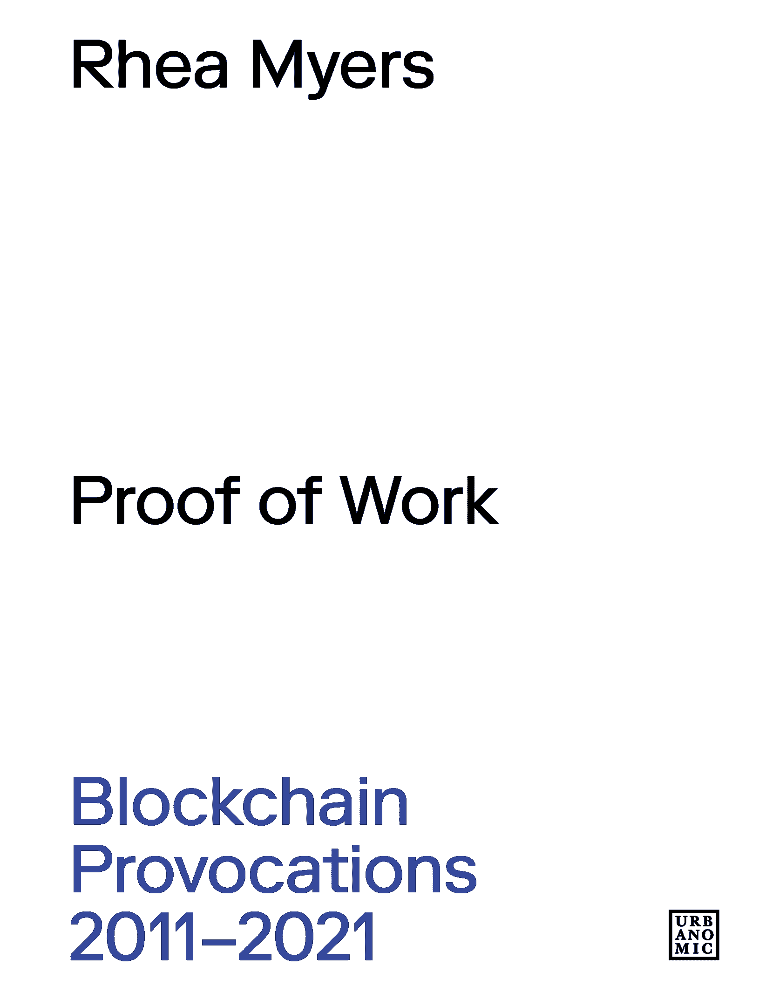

# “伤害我！不，不是那种方式！”——与 Rhea Myers 的对话

**Maya B. Kronic** 您的工作显然不只关乎技术。其中充满了诸如“区块链美学”和“区块链诗学”之类的表述，而您将比特币描述为“赛博文化的一次发展”而非仅仅是一种技术，这点让我印象深刻。您的许多作品都展现出对围绕技术平台聚集并确实在其成长中扮演一份角色的文化场域的魅力与能量的敏感度。Doge 币、以太坊、稀有佩佩，这些都是集体魅力能在一个在线项目周围蓬勃生长的实例，即使是像加密货币这样表面上看起来赤裸裸地纯金融的项目也是如此。在您于“区块链诗学”中引用的一篇文章里，Brett Scott 论证道，货币出现的理性叙述永远是不充分的，因为为了让可交换对象积累社会价值，它们必须预先注入某种文化能量，某种类似于艺术价值的东西。1

**Rhea Myers** 比特币出现前我在研究“小马迷”，再之前是更广泛的互联网文化，我就是把自己浸泡在这些事物里。我把文化描述为 Doge 币的“秘制酱料”，因为它并没有比比特币特别更好的算法，尽管它稍微快一点。不同之处在于其社区那种比尔与泰德式的卓越、慈善、支持、欢迎与包容精神。我推测这最初是经过算计的，但就你所能判断的而言，它是纯粹且真诚的。即使在今天，如果你把比特币、以太坊和 Doge 社区扔到某个荒芜的荒原上，两年后回来，我知道我会把钱押在哪一个还能拥有任何形式的运作中的社会结构。这部分就是“坏柴犬”所关乎的内容。不幸的是，社会层面对那些相信惯例凭空出现、社区自然生成的“加密圈哥们儿”来说几乎是不可见的。这种对加密文化再生产中社会劳动的故意无视，简直令人着迷，更别提它透明且荒谬地带有性别色彩了。所以审视那些更社会化的层面确实能给你一个切入文化的批判视角。而文化中的裂隙，则能让你在通往加密技术那条从自由意志主义到风投的美好快乐管道的倾斜玻璃屋顶上找到抓手。

**MBK** “货币”一词不仅从金钱角度理解，还涉及一种文化潮流，一种具有社会和情感维度的“当下性”。

**RM** 是的，这使得一种具有社会价值的货币能够自举启动——并让 FOMO，即错失恐惧症（例如错过代币空投），成为价值的原始来源！如果我们采用马克思关于货币演化的观点——在“为什么根据马克思比特币是货币”中被非常恶搞地对待——没有神秘的陨石撞击大地并赋予万物价值，有一个基础层面的事物，人们出于某种非理性原因比其他任何东西更想要其中一样，它正是因这种魅力而成为交换媒介。这随后旋升进入金融超空间并变成了货币。

**MBK** 正如 Scott 所指出的，例如比特币注入了中本聪的神秘感。

**RM** 他在这一点上完全正确。技术当然是社会嵌入并生产出来的，技术有文化史且是思想史的一部分。中本聪的神话令人难以置信，他们是那位缺席的创始人，没有升天，而是回归到了完美的密码朋克隐秘之中，这对比特币而言极具生成力。正如 Doge 币的柴犬形象意味着你拥有了这种非人类的仁慈化身，而以太坊的 Vitalik Buterin 则是这位尽力不卷入纷争的修道士式人物，无论纷争来自以太坊项目内部还是外部。所以那些创始神话或先知人物确实存在。

但技术的选择也塑造了你所参与的文化类型。比如不同加密货币地址使用的表示方案——比特币地址易于识别并包含校验和以确保你输入正确，以太坊使用的格式则非常容易输错。这产生了不同的社会对话。编码有文化，技术选择有文化，对不同技术要素的混合、优先排序和价值判断也有文化。我可能言过其实了，这可能只占百分之一，而围绕它的文化占了另外百分之九十九，但密码朋克的梦想是你能以某种方式将技术与你的政治目标相匹配。而在比特币的案例中，这成功得超出了任何人的最狂野梦想。

**MBK** 这暗示技术中可能嵌入着政治，然而您似乎呼吁读者将比特币，以及更广泛的区块链技术，从那些已占有它的各种政治意识形态，或其诋毁者将其关联的意识形态中剥离出来。意识形态是否作为一个项目烘焙进了比特币内部，还是说并没有？

**RM** 比特币是密码朋克政治项目中一个开放问题的实用解决方案。密码朋克想要私密通信，他们得到了，这很了不起——这正是“加密战争”所为之奋斗的，我们都非常感激他们，这是对社会的积极成果。但除此之外，他们想要无国家的一切，因为他们有着强烈的无政府资本主义倾向。他们想要无国家货币，为此有过各种草案几乎成功了，但如果那些方案涉及中心化权威的技术必要性，那么该权威就可能被妥协，国家或其他方就能在价值社会交换的交易时刻进行干预。比特币所做的，是使在交易时刻进行干预成为不可能。这是一个非常温和的成就。无论如何构想自由社会，还有许多其他事情需要去做。但在密码朋克政治项目内部，比特币是其希望如何公正地组织社会关系这一问题的一个真正解决方案。

所以，对于那些因为比特币是意识形态产物而对此大发雷霆的人：你们完全正确，它是密码朋克意识形态的产物，它是反国家主义的，并且它并不反对财产或货币的商品形式。我在《区块链诗学》中详细讨论了这一点，因为据我所知，无政府资本主义者和无政府社会主义者的区别归根结底在于他们是否认为废除商品形式是可能的或可取的。但说到比特币，左派总体上非常愤怒，因为随着交易时刻潜在不公正的排除，潜在的再分配正义时刻也被排除了。这里不可能发生财富再分配。但无论你是左翼还是右翼无政府主义者，你都希望国家退出人们的社会关系。而在资产阶级/新自由主义/等国家被废除之后，反正也不会再有国家来重新分配任何东西了，所以你们为什么要为此如此愤怒？在《区块链诗学》中，我详细梳理了从无政府资本主义和密码朋克纲领到比特币具体设计选择的脉络，试图为想象中的社会主义技术介入提供参考。历史上曾有许多项目接手加密货币并说：好吧，我们要改变它，让它以一种更仁慈的方式运作，但在这样做的过程中，改变了比特币上极其精细调校的工程约束，最终导致出现了一些他们根本不想要的、可被剥削、不稳定或可被博弈的东西。不幸的是，存在一种信念，认为只要初衷良好就能成功，不需要亲自深入工程细节。但无论工程师这一形象对社会主义理论有多么成问题，无论你多么不喜欢这些意识形态基础，你都必须尝试去理解它们。

当那些认为所有技术都是法西斯主义的人断定比特币是法西斯主义时，我并不感到意外。但它不是，它是一种真正的无政府主义技术，是一种反国家技术。我完全能理解，对于那种“我们所能期望的最好结果不过是对国家进行微不足道的修补，直到我们都在人世纪的烈日下烤死”的改良主义倾向来说，遇到一种真正将政治纲领付诸实践的技术是多么令人不适，但这项技术恰恰排除了法西斯国家真正介入你进行交换能力的可能性。看看今天的美国，如果你想支付堕胎费用、购买激素、支付逃离国家的费用，比特币可能会派上大用场。这些都是我们被告知没人需要用钱去做、或需要在国家监视之外去做的事。瞧吧，2022 年到了，人们几乎开始拼凑出这样一个观念：货币的国家全景监狱和一个并非你朋友的政府，可能并不是最佳组合。

这一切并不意味着你可以或必须忽视其中涉及的大量资本池，这些资本池非常容易审视——正是因为当前的公共区块链是透明的。花时间弄清楚如何进行这种审视，是我对批判性介入这项技术所要求的能力的另一部分。使用比特币，你受制于那些比你早到的人，因为他们在仅需适度算力就能挖矿的年代挖到了比特币。或者，以太坊和其他后发货币的情况是，他们足够聪明和/或拥有足够特权和/或信息灵通到足以参与预售。因此，早期采用者与晚期采用者之间存在形成等级制的倾向，这显然对左翼无政府主义不友好。但这对右翼无政府主义非常友好，因为右翼无政府主义，即无政府资本主义，将国家视为个人权力尤其是金钱权力的障碍。与此相反，左翼无政府主义者将国家视为更平等社会的障碍。这些关于消除国家将为社会带来什么，是截然不同的观点。

所以比特币拥有这种先发优势，不完全是偶然，但肯定比后发的加密货币缺乏纲领性——那些后发货币确实以一种方式将先发优势烘焙进了设计中，我不得不说，如果左翼从第一天就开始挖矿，这或许不会成为一个大问题。

## MBK

这把话题引向了你与左翼政治的关系，这显然充满了复杂性。在许多文本中，你似乎在宣扬一种极端的加速主义——移除所有刹车，无论是社会的、技术的还是心理的，以释放区块链技术所激发的倾向。你的写作故意让人难以评估其中讽刺的程度，这一直是推特上令人啼笑皆非的激烈交锋的不竭源泉。

## RM

我一生都有作为局外人的感觉。我当然在社会经济上享有特权：我赶上了战后安定期的尾巴，国家支付了我的教育费用，我外表看起来像白人，我认识一些人，他们比我付出艰辛得多才进入英国的技术行业，而其中一些人在我刚毕业的艺术生身上给了我一个机会。但这并没有给我任何安全或持久的归属感和安全感。因此，在某种程度上，由于我长期以来在“寻找同类”方面长期失败，我的作品往往针对当时让我恼火的任何群体。通常是一个我属于或曾属于的群体。例如，我将《坏柴犬》描述为我写给温哥华加密货币圈的一封恼火的情书。

我经常使用的一种技巧，最初源于在一个旧邮件列表上与《 Twilight 2000 》角色扮演游戏的作者之一的对话。我喜欢那个游戏设定的未来历史场景的一点是：它同等程度地让所有人对第三次世界大战的预期落空。如果你是鹰派，军事努力只是陷入了卑鄙可耻的僵局；如果你是政治迷，美国政府崩溃到国会大厦里发生流血枪战的地步；如果你是反核人士，好吧，发生了一场后果恐怖的核冲突，但文明仍在苟延残喘，情况实际上只和二十世纪中叶一样糟糕，诸如此类。没人能说“哈，我早说过了！”这是反高潮，是对宏大宣称的泄气。

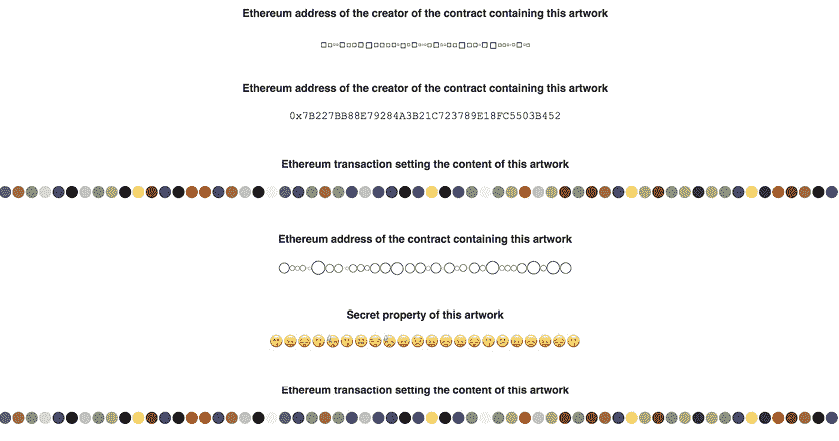

这种反高潮的动态——这也是我在艺术家团体 Art & Language 的作品中发现的东西——贯穿于我在这些项目中所做的一切：无论开头的宣称多么宏大，总有一个时刻你必须说：好吧，但就这？肯定不止这些……确实总是不止这些，但你必须能够跳跃到那些坐标，能够说，以《秘密艺术品》（2018）为例，世界上最荒谬地安全、不可知的秘密，不可能只是为了让我哇一声说，他们把哈希值放上了区块链。又如《代币即文本》（2019），这个小小的蒸汽波排版展示里，也许发生的事情比表面看到的要多……

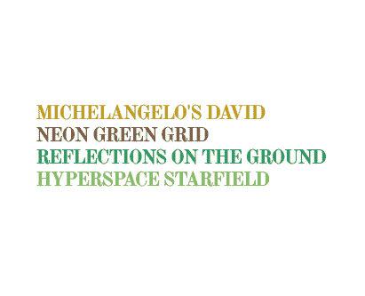

尽管这工作充满讽刺意味，我依然本能地属于左派。我信任左派，至少他们杀我的速度比右派慢。我对任何限制性的传统事物，或任何你必须达标的生殖理想，都毫无快感可言（从很小的时候就没有）。而且我肯定是个非常无聊的无神论者。但我确实深受尼克·斯尔尼克和亚历克斯·威廉姆斯的《加速主义政治宣言》2 中批判的触动。我知道抨击身份政治可以铸就一番很好的事业，而作为一个“拥有身份”的人，我想非常清楚地表明，我无意那样做。但与此同时，仅仅象征性抵抗所带来的那种文雅的欲望安全感，本质上是对其所谓对抗对象的一种仪式性祝福。宣言精准指出了体制化左派的不足，以及那种永远已经失败的、媒介化的左翼政治的不足，这一直让我深感恼火。

所以你看到的这是我的愤懑与心碎，以及我对美好世界那份痛切的渴望——而我缺乏经济、心理、修辞或话语层面的安全感，无法将其仅仅寄托于梦工之中。我无法说“我要创办这个艺术家合作社，我们要付给艺术家体面工资，一切都会很棒”，而不同时指出我们所见之事有多糟糕。这不是为了指出情况有多糟，而是为了指出：以这种方式意识到这一切，是有用的。在这里，我们拥有一个透明且可塑的媒介，用以审视价值的交换，它从何而来，又流向何方。

这种缺乏合理推诿的可能性，不仅你知道香肠是怎么做的，而且你的桌面上就有一台香肠机在嗡嗡运转——这改变了一切。当然我知道在资本主义下不存在合乎道德的生产。但为什么偏偏是这种生产方式，我们反对得如此大声疾呼？我理解，部分原因在于人们觉得加密货币真没有价值，真没有社会效用，而任何它能实现的效用，都能通过更公正、社会和经济及生态危害更小的手段来实现。但我常对人们说，为此他们常对我很恼火：如果能用别的方式实现，早就实现了；如果真实现了，那些你不喜欢的人、那些买下区块链项目的人，就会去买那个新东西的项目，因为你知道，我们就像这些金融引力井周围的小金融变形虫。

区块链技术是一个微小的裂缝，是资本屁股蛋子的一次微小挪动，它是一个临时自治区的潜在时刻。我惊讶于这个时刻持续了这么久。我不是来阻止革命的，我是来试图在这个时刻内实现财富的微量再分配——在这个资本尚未彻底关上大门、堵死任何替代方案或对采取超榨取态度以外的任何社会关系给予任何支持的时刻内。坦白说，我认为这比那些因我这么做而大为光火的人试图做的大多数事情更有用。

**MBK** 那么，我们是否也该给这些作品中隐含的反人类主义暗示加点盐？意思是，如果交给市场，它或许能比人类在大多数事情上做得更好？

**RM** 我其实不信市场。我是个“真正的市场从未被尝试过”派，因为我们拥有的“市场”是由国家构建的：你需要法币，需要国家法律体系，需要国家暴力来保护商品形式和打破罢工。人们用博弈论推演并坚持自然化的那种市场，需要所有这些前提。或许存在一个革命后的无政府市场主义“市场而非资本主义”的仙境，但我没心情去看它。《坏柴犬》是我能接近它的最近距离，但那是个可怕的世界：有童工，有黑直升机干着神知什么事，代码里有个漏洞会在两天左右导致区块链卡死（如果我有空写续集的话）……

所以我不是市场无政府主义者，我只是在网上扮演一个。而在你提到的那些时刻，我所做的不完全是玩梗，而是一种批判性举动。


我之所以采取一种看似第一序陈述的形式，是因为如果我通过说“这是我对市场复杂的情感和思想史感受，现在我们来谈谈它们”来与之保持距离，没人会听，也没人会给我善意的推定。

说到区块链艺术，事情不像艺术家对抗技术资本家那么简单。我曾参加一个小组讨论，我在做那套完整的说辞：我们可以直接给艺术定价，技术会拯救我们……然后凯文·麦考伊指出，我们俩都来自艺术界，是我们创造了那些演变成 NFT 的想法，所以 NFT 并非某种自发产生的市场现象。当然，标准是由一些非常聪明的计算机科学和区块链人士制定的，我无意抹除他们的贡献，但所有早期的 NFT 类项目，至少都有艺术界或艺术学界的人参与其中。

所以也许我演这个角色演得太好了。曾有人跑来跟我说：“嘿，我搞出来怎么做《坏柴犬》里的‘Arewethereyet’了！”我不得不说：“能不能别？那是对信用评分游戏化的反乌托邦讽刺，我真不想看到它在现实世界变成真的东西……”

归根结底，我最渴望的，莫过于有人能对我说：不，你错了，这儿有个更好的替代方案。我对那些并非批判性的、甚至不是预 figurative（预示性/前形性）的、仅仅是供那些利用它们来化解自身作为资本主义意识形态社会再生产代理人的心理矛盾的廉价爱好的虚构解决方案，怀有真挚的愤怒。这种愤怒、心碎和悲伤融入到了这些东西的创作中，只是希望有个比我更善良、更聪明、更优秀的人，能给出一个并非仅仅是捏造出来的、并非仅仅是那台通过将革命潜能引入梦境工作而将其化解的发条机械中必不可少的齿轮那样的答案。

**MBK** 那么，将谢林点收敛（Schelling Point convergence）实操化，以优化美学与艺术批评（《加速主义区块链批评的 ABC》），这完全不是一个严肃的提议？

**RM** 我倒觉得这更像是一个“谦逊的提议”，虽然它是个功能性的提议，如果真发生了，会以有趣的方式改变现状。这方面的集大成之作是《最大交易密度》，它和我写的其他一切一样，都是雅努斯面孔（Janus-faced，双面的/矛盾的）的，但如果你作为读者读到最后，把它仅仅当作一个一阶的号召，让我们把自己变成区块链点击工或什么的，那它就彻底失败了。这正是我试图让想象中的读者感到恐惧、从而迫使他们要么接受“是的，这能达成我们的目的，尽管它很恐怖，我们应该追求它”，要么在恐惧中抗议“不，那不对，因为……”的最强烈尝试。《最大交易密度》讲的是通过你不想要的手段得到你想要的东西的恐怖。如果有人有比书中更好的主意来实现他们的愿望，我洗耳恭听。

只想试着为我那良好的左翼灵魂做个辩护收尾：其中一些只是爱德华·德·博诺式的创造性思维。有时你必须横向跳跃或侧向移动，以避免陷入思维定势。梳理这些想法，一些是挑衅，一些是渴望，一些是教育……这不是要求别人替我干活，而是做我力所能及的工作，并希望其他人能以一种我未曾听过、也未曾让我失望的方式做出回应。

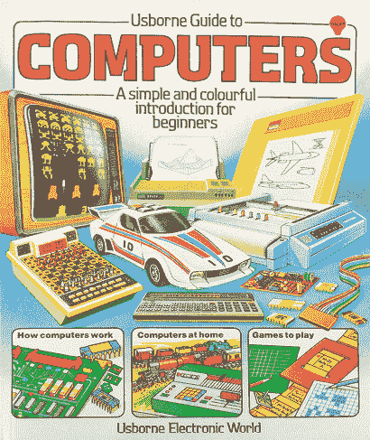

Brian Reffin Smith, Usborne Guide to Computers (Usborne Publishing Ltd., 1981).

**MBK** 你的艺术生涯最终与计算机、赛博文化和密码朋克相撞，但它是如何开始的？

**RM** 我父母一生都在不同层面从事艺术教育工作。我小时候会去中央圣马丁学院我父亲的地下室办公室，闻着显影液的味道，对那些大家伙印象深刻。所以我有那样的背景。后来我们成为了童子军运动一个激进分支的成员，虽然那时它只是一群家庭每年夏天在英格兰某地进行廉价露营假期。比我大一届高中生的那些孩子，那些酷孩子，全都搞艺术，要去读艺术学校，这影响很大。

高中美术室里有几本书对我很重要，是新美术老师带进来的（谢谢哈默小姐！）。有一本是 1987 年的沃霍尔回顾展图录，我坐下来从头读到尾很多遍；还有一本是一个至少部分属于观念艺术的回顾展图录。我能记得其中两件作品：一个是观念艺术项目，有人把两个陌生人介绍认识让他们交谈；另一个是早期的生命记录、量化自我例子——一位艺术家记录他们一周或一个月左右的活动。

那是 1989 年左右，我十六到十八岁读这些东西，所以显然我喜欢 H.R.吉格尔，喜欢平面设计、专辑封面之类，非常符合那一代孩子在视觉文化方面的喜好。但从一开始我就不像我最好的几个朋友那样，想去临摹博里斯·瓦列霍式的英雄主义艺术。除其他原因外，我知道自己画得不够好。我还经历了英国的家用计算机热潮，我从读书俱乐部买到的一本书是《尤斯伯恩计算机指南》，里面介绍了哈罗德·科恩和他的 AARON 绘图机器人，以及肯·诺尔顿的 BEFLIX 编程语言。所以从十岁或十二岁起，我就有了这样一个观念：即使我自己做不到，也有人在用计算机创作艺术。1991 年我开始艺术基础课程时，我和技术员成了朋友，这意味着我能挤过他们改造过的走廊办公室，使用楼里两台 Macintosh 中的一台。我至今还记得第一次看到 Photoshop 启动的样子。那是截然不同的东西：从一个非常“这是技术性的”自学成才的命令行程序员世界，到 Macintosh 那种非常积极的商品化设计。

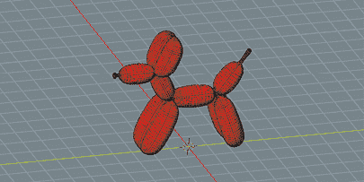

Rhea Myers, ‘Balloon Dog’, 2011, from Shareable Readymades. 3D digital model.

那期间我做了大量丝网印刷和染料转印工作。但我有个愿望，想做一种混音或采样式的艺术，把东西拿来数字化切碎重组。等我上正式艺术学院时，我已深深迷上了当时正走向主流的基于采样的音乐，确信那是我想拥抱的东西。我有安迪·沃霍尔作为参照，成了杰夫·库恩斯瞬间且终身的粉丝（抱歉黑粉们），从我书架上仍留着的那本粉色 Taschen 画册，和那本有句名言的小红手册：“如果你把艺术交给君主，它会反映他的自我并最终变得装饰化。如果你把它交给大众，它会反映大众的自我并最终变得装饰化。如果你把艺术交给杰夫·库恩斯，它会反映我的自我并最终变得装饰化。”还有库恩斯关于沃霍尔关乎分发、而他自己的作品关乎渗透意识的评论。

那个年代后期我发现了《No Logo》之类的东西，能概念化那种非常耐克风格的品牌化和受 Adbusters 影响的艺术，这条线索延续得很晚，进入《可共享的现成品》（2011–2013），我试图获取标志性的艺术史物件，通过将它们作为可 3D 打印的数字模型发布，将其归还给文化公共领域。

**MBK** 观念艺术何时开始在你的创作中扮演重要角色？

**RM** 我在上学时在那本图录里接触过一些观念艺术，基础课程期间我们去蛇形画廊实地参观展览《理想之家的物品：波普艺术的遗产》（1991），展出了库恩斯和朱利安·奥皮的作品，奥皮也是巨大影响。我通过奥皮了解到利森画廊，正是在利森画廊，我首次遇到 `Art & Language`，他们的文字和艺术让我大为震撼。

在坎特伯雷艺术学院攻读美术学位期间，我与文化研究系处于对立状态，因为……他们没有向我们解释为什么读德里达是个“好主意”，而我只想剪贴图片，在电脑上制作奇怪的东西。但 `Art & Language` 不一样，这深深吸引了我，我想深入钻研：读完《艺术与语言论文集》两页内容要花我一天时间，这终究是一位开放大学讲师写的相当直白的唯物主义艺术史资料，但对我来说，相较于我此前的兴趣范围，这简直是“火箭科学”。我会弄到一些《Art-Language》期刊的单期，这样我就不必为编写原始 `PostScript` 编程代码感到愧疚了，你知道，它晦涩难懂！

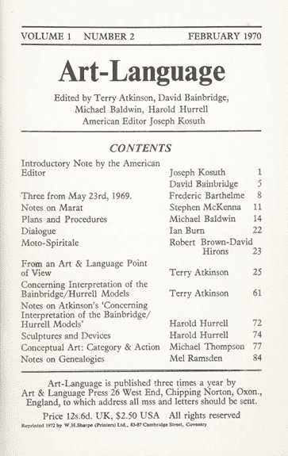

Art & Language，《Art-Language》期刊，1970 年 2 月。

从 `Art & Language` 和 Opie 那里，我汲取了两点：首先是**项目制工作**：项目制工作没有错，你可以创作完成某个项目的作品，然后转向下一个。其次是**创作既具有批判性又具有 Art & Language 后来所谓的“随笔式”特质的艺术作品，而不只是为文本做插图**这一理念——这点真正打动了我。还有 `Art & Language` 对艺术的历史唯物主义观点，它对现代主义的官方叙事以及“艺术关乎感受”这一主张、以及“艺术作品必须被安全地包含在画框边缘之内，否则就会污染这种形式构图的美妙纯净世界”这一说法，持极度怀疑态度。

对这种现代主义自主性的拒绝，与我对波普艺术、计算机艺术和图形设计工作的热情联系在一起——那时我痴迷于 The Designers Republic，逐渐开始欣赏 Tomato，也热爱 Peter Saville 为 Factory 做的工作。这非常符合那个流行文化后现代时代，当时低文化受到推崇，但我没有只是随消费主义的巨大洪流漂流，而是借助这种艺术对其获得了一定的掌控——它以某种方式组装那些材料，使它们变得难以消化——在 `Art & Language` 的案例中，难以被只想去博物馆参观、在回去上班前接受奉承的受过良好教育的友善观众消化；在我的案例中，难以被简单还原为时代的环境陈词滥调，或被资本主义、被“事物原本的样子”立即回收利用。

当然，这说起来容易做起来难，后来我意识到**艺术是资本的研发部门**：艺术家热爱创作买不到的东西，但资本也热爱买不到的东西，因为它们帮助资本扩张其所有权制度，从而能够买下它们。但即使在 1995 年做基础学位毕业展时，我就在一定程度上考虑价格问题。我展出的是我在 `Corel Draw` 和 `Illustrator` 中设计的作品的印刷品，基于矢量和文本，但放大打印得巨大无比，大到 1995 年技术所能达到的极限。所以墙上挂着这些 A0 幅面的数码复印件——不是激光打印，而是将较小的激光打印件复印放大而成。价格表的依据是“你有多不想让别人也拥有一份复制品”。如果你想要一张小幅印刷品，没问题，十英镑。但如果你想要一张大幅印刷品，且要求我不再制作更多，那就要 300 英镑。

**MBK** 所以你早就在询问艺术品如何与价格互动的问题了？

**RM** 是的。因为这是数字艺术，且不存在其价值的现成模型。

**MBK** 潜在的无限可复制性，因此没有稀缺价值。

**RM** 这我无所谓，但我创作时没想到的问题是：我们要怎么展示它？一旦可以把作品塞进 `Git` 仓库，告诉策展人“直接克隆仓库，想怎么处理就怎么处理”，我就如鱼得水了：我不必解决这个问题，只是为我能掌控的所有作品采用了 `Creative Commons` 许可证，以至于到 2003 年左右，没人再需要向我请求许可（尽管他们总会问）。

但在那时，针对制作出非常尴尬地既不适合版画制作也不适合现有数字图像的作品这一问题——那时我确实把计算机视为一种版画媒介——我的解决方案最初是让市场来解决，后来是让技术来解决。

**MBK** 那时你已经完全使用数字媒介了吗？

**RM** 是的。我发现我完全没有 3D 空间感知能力。我做不了雕塑。我画过一幅油画，也画过人体素描，但我绝不是任何类型的自发表现主义者。所以我转向允许我移动、重组元素的媒介，矢量图形非常完美，因为你可以画圆、压扁它、旋转它、偏移它、用另一个形状把它切出来、粘到另一个形状上，它是一种非常可塑的媒介，更像玩黏土而不是搬石头。

我还获得了一种对色彩的理解，它迅速深深内化为我的文化一部分，以至于一位导师问我是不是色盲。我不是，我只是用非常难看的黄、绿、蓝复印纸来指涉办公室生活的世界，就像我从平面设计配色书、潘通色卡翻页书、糖果包装纸和麦片盒——除了艺术之外的所有地方——获取调色板一样。

**MBK** 你在用色彩和形状作为符号系统？

**RM** 是的。那时我已经在做系列创作了：我做的第一个站得住脚的系列叫 `Mixes`。它涉及运用变形软件组合经典名画。我当时强调的是图像构图之间、不同性取向艺术家的目光之间的互动。有培根的板球运动员和基塔伊抽烟的裸体女性，一幅有吉尔伯特和乔治的树和弗朗西斯·培根的乔治作品，另一幅是西装革履的吉尔伯特或乔治与沃霍尔的《牛仔猫王》融合。它们在变形软件中的组合看起来像个皮埃罗，这是一次对男性性别呈现的精彩深潜——尽管那时我没有那套语言可用。

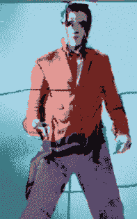 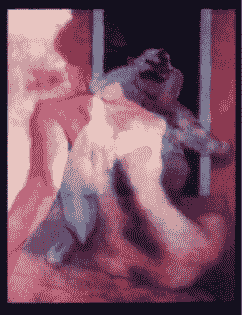

Rhea Myers, `Mixes`, 1993. 数字图像。

接着我做了大量文字书法 3D 作品，费力地将电脑字体拖拽到手绘图和照片上，早上 8 点进机房，晚上 8 点离开，因为那时候在 `Corel Draw` 里透视拖拽那么多文本块，每次移动渲染等待的时间至少够喝一杯茶。

这是我从 `Art & Language` 那里偷来的一种策略的早期实例，而 `Art & Language` 是从 Ad Reinhardt 那里偷来的，叫**服从中的不服从**，或**照章办事**。接受某人的要求，严格照字面执行，却可怕地让提出要求的人失望，因为那不是他们的本意。这就像梗图格式“伤害我！不，不是那样！”克莱门特·格林伯格说艺术应排除所有外部内容；那为什么不直接画个黑方块？不对，不是那样！或者对我来说，文化研究系说世界是文本，那为什么不做完全由文本构成的世界的图像？回应当然是“不，不是那样！”这是一种极好的批判性介入策略，因为首先，你可以捉弄人；其次，你可以发挥创造力，进行诠释学、解读或模仿，这比单纯说“不，你错了，这是个更好的方案”要有趣、生成性强得多。

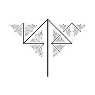 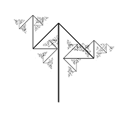

Rhea Myers, PostScript Virus, 1993. 计算机代码（图片展示了前后对比）。

在此期间，我几乎发明了 Word 宏病毒。之所以没成，是因为我们没有 Word 宏手册，但我想制作一个病毒，将“后现代主义”一词替换为随机内容。我确实制作了一个用 Adobe PostScript 编写的病毒，这是一种旨在描述印刷页面布局的语言（PostScript Virus [1993]）。该病毒会感染 PostScript 打印机，使发送到打印机的所有精美平面设计变得略微“晃动”起来。我有了有效载荷和一个复制器的尝试……但我想，我大概不想干这事，我不知道这在技术上到底可不可行，但如果可行，我也不想亲自验证……它的原理是重新定义 PostScript 解释器本身的工作方式。代码能够解释事物并产生视觉效果，这点让我很感兴趣。当时人们痴迷于“软件即文本”的概念，但对我来说，Macintosh 的设计，那种通过标准化 GUI 与软件进行视觉交互的体验，极具吸引力。

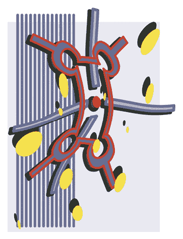

Rhea Myers, “Arching”, 1994, 来自 Blobs。数字矢量图像。

最终，当我厌倦了每天在机房泡十二个小时，我坠入爱河，经历了第一段认真的恋情，那份快乐流淌进了构成 Blobs（1994）系列中那些更具图形感、更“晃晃悠悠”的作品里。同样，这些全都是用矢量图形制作的。每一幅都需要极其敏锐的视觉审美，但不需要高超的手眼协调能力。我在矢量图形中寻找的是一种媒介，意指一种既拥有引导你的功能性，也拥有你必须绕道而行的限制性，且自带理论与历史的东西。这正是 Blobs 里发生的事：历史源自平面设计，源自 The Designers Republic，源自谷物包装盒和糖果包装纸等等。其中有大量对形式的玩味，以至于这些作品仅关乎感官愉悦与快乐，但它们以一种技术中介的方式、一种极具那个时代特征的当代性来探讨这种感官愉悦与快乐。这里没有精神层面的东西，除了“仅仅做这件事本身具有政治性”这一层面外，也没有政治性。

**MBK** 你提到了朱利安·奥皮，他的作品常关注在保留某种诱惑力或感官吸引力的前提下，图形手段能被简化到何种程度。

**RM** 是的，这很奇特，因为在网上我扮演一个讨厌辩证法的人，但我喜欢的所有作品都是辩证法的，我自己的作品——别告诉别人——通常也是深刻地辩证法的。在 Blobs 中，冰冷的商业技术被用来创作温暖、性感（按我当时的理解）的艺术。Blobs 是身体，它们是热吻的狂喜地图，它们是自由的物体——每个都有自己的阴影。没有上帝。事实的光辉。但它们存在于一个指标性的环境中，承载着艺术生产与历史中某些技术问题的痕迹，携带着这些极不具人格化的参照。

奥皮令人着迷，因为他早期的彩绘钢雕塑是对 80 年代末弗兰克·斯特拉某种讽刺。斯特拉绘制抽象雕塑，奥皮却用相同技法处理复古剪贴画风格的具象图像。我简直爱死奥皮的混凝土 Scalextric 赛车套装了（Imagine You Are Driving [1993]），它们在尺度上像玩具，在复杂度的简化上像玩具，在其教育性、想象性、反思性的目的上也像玩具。它们给你提供了可看之物。它们不是钉在墙上的文本，也不是空白画布，它们是具有在场感、虚拟性的东西。他 80 年代末的空调作品，我相信——尽管我没有证据——源自大卫·霍克尼关于极简艺术的一个评论：你不如去看看空调机组。


Julian Opie, K., 1987. 铝、不锈钢、泡沫、PVC、木材，96.5 x 219 x 28 cm (38 x 86 1/4 x 11 in), OPIE870008. © Julian Opie; courtesy Lisson Gallery. 摄影：Gareth Winters。

**MBK** 他不是偷自《科伦博》吗？在“Playback”（1975）一集中，科伦博在洛杉矶的一家画廊嗅来嗅去。因公务需要，他试图融入现代艺术的精神，却误把空调机组当成展品开始“欣赏”。“嗯，这个……我看它没有标题……”！

**RM** 那些奥皮的作品让视觉发挥作用，其方式是——不是说艺术*应该*这样，而是说艺术*倾向于*这样，无论是说服你爱基督、参加革命，还是真心享受周末乘火车离开巴黎的旅程。艺术本质上具有宣传功能，这是其视觉诱惑力的结果。阿多诺说描绘暴力就是将其审美化，这完全正确，但还不够深入，因为审美化某事物可能在道德上是淫秽的，而在艺术中仅以象征方式部署这种道德淫秽，可以是一个极具力量的举动。有时通往同情的唯一路径是通过厌恶。我全力支持这些横向移动。但是啊，不想看的视觉艺术有什么意义？

**MBK** 所以虽然你早已以最严格的形式参与观念艺术，却没有那种可能随之而来的对视觉的敌意或怀疑。

**RM** 没有，而且我至今仍认为，就造像本身这门手艺而言，设计比当代艺术更有资格声称拥有它。如果你想要一幅画得好、画得准、比例协调的图像，去找设计、漫画、插画或电影——去画廊以外的任何地方，那里僵尸般的形式主义潜伏着，妄图聚集足够的在场感，好让自己尽管不指涉任何东西，却仍被视为重要。


Art & Language 有一句可爱的名言，他们几十年来一直试图收回，大意是：“有些画看起来比其他的好，我们觉得这不知怎么是创作它们的产物。”这是在谈论他们自己的一系列绘画，他们试图澄清，当然，他们并非在说那些画投入了任何技巧或想象力……不，太迟了！

在应对这类问题的过程中，我意识到你无法单独依靠理性或情感。我看过一部纪录片，主角因脑损伤丧失了情感能力，结果无法做决定，因为他们永远不会厌倦对其进行推理。我们晚饭去哪吃？嗯，我们可以去海鲜餐厅，但我喜欢那家意大利餐厅的酒，但然后我们可以……他们没有修剪搜索树的方法，因为他们拥有不受情感约束的纯逻辑搜索能力。所以我意识到，假装不依赖视觉冲击及其产生的情感是无效的。利用情感、甚至不合逻辑往往是“合乎逻辑”的，因为有时你需要跳跃到一条无法直接思考到的不同的逃逸线上。我想做海报，做人们能留在精神空间里的东西。我没有那种在 Art & Language 和奥皮的历史唯物主义项目式、话语性而非插图性作品中常见的、对高等文化的残留评价。我在沃霍尔和库恩斯更具生产性、趣味性、老实说也更酷儿的艺术中，发现了一些非常有趣的东西。

**MBK** 之后你去了米德尔塞克斯大学的电子艺术中心。那里提供的课程相当具有开创性。

## 对话记录

**RM** 哦，当然。我把这所学院描述为把人文学生扔进计算机编程学习一年，然后让幸存者上台表演。我 1995 年到那里时，感觉那地方已有二十年的历史积淀。大厅里放着一台报废的旧 Silicon Graphics 机箱，旁边一台连着视频输出设备的 Macintosh 放着一本 `PICASO` 软件手册。我们听过计算机艺术协会创始人的讲座，听过当时新媒体艺术圈活跃人物的讲座，也听过真正懂得如何教会像我这样的人数学和编程的人的讲座。所以这简直是技术知识——你需要它让电脑按你的意愿发出哔哔声——与历史感的完美结合，后者让你觉得这事儿可以参照先例、回应先例。你也置身于当代文化之中，因为有人讲互联网早期的社会效应，或虚拟现实如何关联女性主义，诸如此类。所以是的，那是卡美洛（理想之地）。

**MBK** 当时你们能接触到最顶尖的软硬件吗？

**RM** 不，我们用不上最好的电脑，只有一些早期的预 PowerMac 机型。但如果你对音乐系够好，他们会让你用他们的 `NeXT` 机器；如果你对交互多媒体系够好，他们会让你用他们老旧的 Silicon Graphics 机器或 PC。我和一些交互媒体专业的学生打起了持久战，为了抢 PC 而越来越早地去机房排队。

**MBK** 这正赶上网络文化爆发期，大众对计算技术和互联网的认知也在增长。你对此有多了解？又有多了解主流美版《Wired》式网络文化，与 Mute Magazine、Ccru、Orphan Drift 等群体所代表的更具特色、更具攻击性的英式网络文化之间的差异？

**RM** 这期间，1995 到 2000 年间，老实说我接触过网络文化却不懂，接触过网络艺术却不懂，接触过网页却不懂（你会发现这有个规律）。我摆脱了对版画的痴迷，但觉得交互多媒体才是未来。《PostScript Virus》只是我漫长的“没有把事情推向极致”历史的开端……但那是我当时最接触网络文化边缘的一次。对我来说，赛博朋克是八十年代的事，我觉得那早过时了。赛博朋克？还不如去读西部片，干那干嘛？！我当时的伴侣是肖迪奇一家 VR 初创公司的创意总监，简直是九十年代中期的标配。所以我见证了 `VRML` 和虚拟社区的兴起，也去看过一场展览 [Ccru, Syzygy, Beaconsfield, 2000]，墙上有些奇怪的画，用一种括号标记法表示数字。我看了心想直接用十六进制不就行了！所以我当时完全不知道下一个大风口是什么。要是有台时光机，我会纠结：是回去告诉十几岁的我“Hey，你所有 RPG 角色都是女性是有原因的”，还是回去告诉二十出头的我“走在大地上，接触真正发生的事，冒个险！”

**MBK** 你的编程水平有多高？你的编码知识纯粹是为了设计和打印而被迫自学的吗？

**RM** 进米德尔塞克斯大学前我没受过正规编程教育。我从 Usborne 书里学过 `BASIC`，出于兴趣自学过 `Forth` 和一些 `Pascal`。我痴迷 `LOGO` 却搞不到副本用。大概也多亏 Usborne 书，我知道 `LISP` 是个东西，却完全看不懂。我学过一点 `C`，我的 Mac 上有个 C 编译器。但我 All in 的语言是 `PostScript`，因为它是平面设计的制造语言。作为语言它最像 Forth，绝对迷人，其运行环境更是惊艳——一个线条与曲线的柏拉图式数学国度，映射到真实的油墨被挤压在金属版与纸张之间。后来我凭借对 PostScript 渲染模型的理解，在一家印前公司做 `Adobe Illustrator` 插件开发。

**MBK** `PostScript` 以最经济的形式定义了可用矢量与排版对象的范围、它们之间的关系、可施加的变换。所以它勾勒出一种图形本体论，对吧？

**RM** 是的，这很有意思，因为它不像纺织品花型书或瓦萨里的罗马建筑研究；它不真的是一套模型，不完全是工具箱，不完全是调色盘，它是知识、工具与可供性的结合体，有点像实践共同体的技术等价物。如果 `UNIX` 是计算机科学的宗教经典，那 `PostScript` 就是它的装饰手抄本。

**MBK** 看来即便在当时，你钻研编程的深度也远超单纯做数字版画的需要。

**RM** 艺校有次布置任务，做个 2000 年代所谓的“混搭”。给我一张未来派骑车人的复印件和一张波洛克滴画的复印件，让我拼在一起。我看着那张小小的灰色骑车人复印件，完全搞不定。我被赋予了一个物质任务，却因缺乏经验、知识和资源而无法完成。于是我去图书馆，找到一本该艺术家的准备素描集：一个骑车人素描，一个带力线的骑车人素描（毕竟是未来派），然后抽象化一点，再简化为一个圆和几个三角形……我于是读懂了我要处理的形式。同理，我学编程是因为我想搞懂。我知道我想做计算机艺术，不管那是什么，所以我需要知晓其底层结构。这种出于极其务实原因、想获取知识和源素材的渴望，直接滋养了我对 `Copyleft`、自由文化和 `Creative Commons` 的兴趣。

**MBK** 因为你亲身经历过：人们能否不仅接触到最终产品，还能接触到“东西怎么做出来的”知识，这很关键？你也看清了这种需求如何从艺术迁移到编程——在两种情况下，要真正理解并富有成效，你都需要接触“源代码”？

**RM** 是的，在我这儿，没有那些资源我根本无法胜任那项任务。有趣的是，做完一个“波洛克风马里内蒂”后，我发现了 Art & Language 的《戴帽子的列宁肖像，波洛克风格》(1980)。

## 对话记录

**MBK**

巧合的是，这正是我接下来要谈的方向，因为在那幅画作的随笔中，Art & Language 提出了关于“关于性”的问题，你的许多作品都可以看作是对这一问题的回应。5 绘画是关于什么的？从某种意义上说，它是某种事物的视觉再现；但从另一种“起源”意义上说，它关乎所有使其特定视觉模式和物质构建成为可能的条件——物质的、社会政治的等。与绘画相比，在处理计算机图像时，这个问题可能不需要那么强行引入，因为早期计算技术几乎必然会产生在再现意义上不“关于”任何事物的图像，或者仅以非常初级的方式“关于”某事物。因此，如果你在一定程度上受艺术理论启发来反思它们，它们“起源上”是什么的问题就变得有趣了。

**RM**

你可以渲染球在屏幕上弹来弹去——我确实这么做过——但那触及到了其自身之外的什么？“起源上的关于性”对我极具吸引力，我热爱计算史，无论它多么枯燥。攻读学位时，我读了关于 Macintosh 诞生的书籍 `Insanely Great`6，还读了许多其他书，包括 `Showstopper!`，讲述 Windows NT 诞生的故事 7。这是有史以来最令人沮丧的书之一，但它融入了 `Surgical Strike` (1996) 的创作。

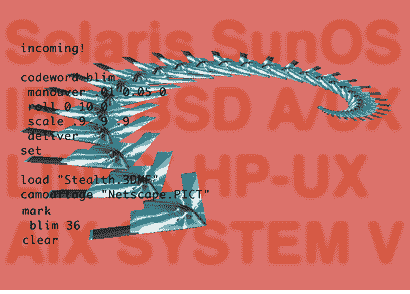

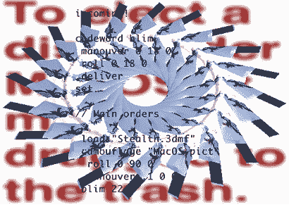

`Surgical Strike` 是另一个混搭作品，直接借用自 Art & Language。它将 William Latham 风格的漩涡状、块状有机计算机图形与隐形轰炸机、计算机生产历史事实相融合（受 Manuel De Landa 的 `War in the Age of Intelligent Machines` 影响，如果我没记错的话），并将所有源代码置于前台。对象由一种语言程序化生成，该语言由军事术语而非计算机科学概念组成。

但是的，这种“关于性”使作品能够引入画布之外的参照，赋予艺术不可替代的力量，执行包含描绘、批判、背书等在内的操作——基本上，它赋予了艺术不止步于画框的能力。这对我来说似乎至关重要。可能是因为我看到了人们多么因计算机艺术缺乏历史必然性而憎恨它，又或者是经历了太多集体评议，我需要将我的实践建立在画框之外、屏幕之外的事物之上，无论这导致我多么深入地潜入技术本身。

**MBK**

例如对于 `PostScript`，你可以说，某文档包含圆、贝塞尔曲线、字体片段，但它“关于”的一部分是用于制作它的整个软件结构、编写它的语言的功能特性、那些功能特性背后的设计决策，等等……这正是你后来应用于区块链技术的方法。

**RM**

当然，尽管最初对设计软件的兴趣源于 `The Designers Republic`、`Emigré`，源于这种当代意象对我如此生动鲜活。

**MBK**

我能理解这些如何无法与当时的赛博文化直接契合。那么究竟是什么最终把你吸引进那个世界？

**RM**

我离开艺术学院，意识到自己不具备在九十年代艺术界作为艺术家闯荡的社交技能。所以把我带入亚文化的是在 Shoreditch 闲逛，那当时算是伦敦赛博文化的“地零点”。我在 ICA 遇到很多东西，遇到了 `Cyberia`。后来我加入了 `Rhizome` 邮件列表，加入了 `Furtherfield` 的 `Netbehaviour` 列表。随着时间的推移，我与 Furtherfield 的联系越来越紧密，欣赏他们的所作所为，意识到自己错过了一段非常有趣的历史时刻，并尽力去理解它、珍视我所错过的。

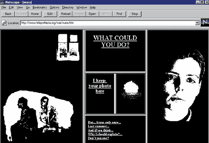

但这里真正的缺失环节是 Olia Lialina 的作品 `My Boyfriend Came Back from the War` (1996)，这是一个基于浏览器的网络艺术作品。我看了它，心想：“哦，这很有趣。”二十分钟后我想：“好吧，这真的非常有趣。”那是一种具有非常特定感觉、非常特定美学的体验，你无法在任何其他媒介中以同样的方式获得那种相遇并被吸引。如果你在画廊与互动多媒体互动，你会被预设好某种期待；如果你有张 CD-ROM 塞进 Mac，同样，你已对预期遭遇投入了特定期待。身处互联网，点击链接便就在那里，这是一种截然不同的艺术相遇方式。所以这在概念上为我打开了新天地。

**MBK**

一种主要视觉但潜在多模态的媒介——浏览器——正日益成为日常生活各部分不可或缺的一部分——一种通过媒体生活的生活，随着技术发展变得愈发即时。

**RM**

正是如此，它由通用媒介——计算信息技术——中介、媒介化。正如我们所发现，只要管道够粗，你能塞进去任何东西。甚至在 Netscape 时代，显而易见，Web 是一个单一媒介，文本、声音、视频、写作、对话、金钱汇聚于此。金钱当时不太合适，因为政府决意不让它合适。但那迟早会到来。

当时你可以在 Shoreditch 做三周平面设计师做网站，赚够钱花一周做艺术，人们就是这么干的。人们致力于将公众接入互联网作为社会项目组织起来。你有网络实验室帮人们上网。大规模联网的梦想开始萌芽，感觉就是充满可能性的时刻，人们知道他们既能改变世界又负担得起，甚至可能因此致富。我把 2000 年代的 Furtherfield 描述为“来自更美好世界的文化大使馆”。拥有那个运营真实艺术空间、在任何衡量标准下都遥遥领先的活生生的榜样，极具启发性。

**MBK**

是从那时起，你的兴趣从互动多媒体转移到意识到可以用网络技术作为媒介进行创作？

**RM**

九十年代我只为 `SoDA` 的一个展览做过一件网络艺术作品，`SoDA` 是一家源自 Middlesex University 的优秀科技艺术公司。他们在办展，所以我做了一些 YBA 艺术生成器作为 `Java` 小程序。有个 `Hirst` 斑点生成器——你会注意到我此后持续制作斑点生成器——有个医院门生成器，因为 Gary Hume 当时很火，还有几个其他东西。它们深植于黑客文化/Usenet 文化制作流行词生成器恶搞的传统。为视觉艺术这么做，实际上是在说：这些斑点不值钱，随便生成多少都行，这是我多次重访的技巧。但我们无法在展览用的性能极差的 Mac 上实际运行展示它们，所以完全意外地，我成了在画廊展出 `URL` 的最早一批人之一！安装团队搞到了那步，我就说是啊，当然，尽管搞：另一次他们还打印出代码清单展出。所以我本想做流行词生成器风格的网络艺术，却因缺席而意外成了观念艺术家！

## 对话记录

我花了几年时间在一些未完成的项目上，试图避免成为那种我认为我不想成为的表演艺术萨满。我确实买了一个三轴电磁场仪，去画廊寻找艺术的光环——我以为找到了，但统计回归分析表明我只是在自我欺骗。归根结底，我无法真诚地对做这类事情产生热情。不，它必须是视觉化的，我又没拿报酬，至少应该从中获得一些视觉上的愉悦。

在《外科手术式打击》之后，九十年代末有几年我几乎停止了艺术创作。我的创作产出是将 `Gwydion Dylan` 编译器移植到经典 MacOS 上，作为对计算史上的一种历史干预，这是在苹果取消了他们的 Dylan 项目之后。事情发展到我去加利福尼亚参加苹果开发者大会，为道格拉斯·亚当斯的 The Digital Village 游戏公司站台，还要应对那家仅存的商业 Dylan 编译器公司发来的邮件，试图开源他们的用户界面工具包。所以我相当深入地卷入了那个圈子。我确实有这种倾向——不知道人类学上“入乡随俗”的政治正确术语是什么——我确实倾向于与狼共舞。

**MBK** 但推测那时你应该已经很明显地意识到，如果你想对人们的生活方式和看世界的方式产生可感知的影响，介入软件会比创作艺术更靠谱？

**RM** 呃，指望所有人都开始用 Dylan 是没指望的。但没错，我已经意识到了这一点，这也是 `PostScript Virus` 的由来，我想批判性地介入每个人日常的审美体验。

这很棘手，因为软件开发者所见与其他所有人所见之间存在巨大鸿沟。理查德·斯托曼意识形态的优点之一，是他绝对坚决地拒绝区分作为生产者的计算机用户和作为消费者的用户。即使在他这么做的时候，这也是无望的理想主义，此后也没好到哪去，但没错，我们通过计算机体验如此之多，改变计算机的功能是将事物推向世界的必胜之道。

**MBK** 你谈到过，你一直觉得理解、知晓“配方”很重要：作为艺术家，如果某种软件是媒介，那就需要介入并最好掌握这种可塑性媒介。绝大多数人在不了解表面之下发生了什么的情况下与屏幕互动。那些知情者是否有理由蔑视这种消费主义的被动性？

**RM** 极客至上主义极其容易滑向名副其实的法西斯主义。我是个懂得给计算机编程的人，但我对你不需要知道如何编程这件事感到非常轻松。老实说，如果你想批判性地介入技术，你需要的只是一定程度的技术和文化素养，无论它来自训练还是街头智慧。我不在乎来源，只要你知道自己在说什么就行。（我过去对这事可能有不同看法……）

优越感也可以反过来。所有那些关心地呼吁“教极客伦理”的声音——为什么不教风投伦理，教管理层伦理？！为什么你，我这焦虑地位的人文科兄弟，如此痴迷于这样一个想法：只要软件开发者明白杀人是坏事，软件就会不同？这简直就像你瞄准了技术身体的错误部位，其原因至少在社会学和心理学上与你声称要通过这样做达到的目的一样有趣……

事实上，虽然我意外成了一名非常优秀的智能合约程序员，但我本意并非如此。这是个意外的副作用——但我总这么干，我总是为了思想史或计算文化史的原因去学一门冷门语言，结果它却成了下一个大热门。我在九十年代学 `Objective C` 是因为我对 `NeXT` 着迷，那是史蒂夫·乔布斯离开苹果后那个宏大的失败项目。然后到了 2001 年，他告诉我们他们用 `Objective C` 编写了 MacOS，接着 iPhone 面世，突然大家都想要 `Objective C` 程序员。编程 `Ethereum` 时，我想，做几个项目挺有意思的，然后突然大家都要 `Ethereum` 程序员。中间还有几个类似的例子。我显然有幸能这么做，但作为一个不会在世界最佳 `C++` 程序员中胜出的人，我很幸运这不是我的野心。我被语言吸引，更多是因为它们多么有趣，而非它们可能宣称的任何效率。

正如我做的绝对所有事情一样，我不会凭空突然产生天才般的独创想法，总是我记起了此前生活中的某件事，或者上次没看懂某件事，或者我想做这件事所以我试着学怎么做，也许以后能用上。一切都充满了奇妙的偶然性。

**MBK** 你提到过希望作品能触及或引入来自作品外部的东西。我看到的你作品的一部分，是对作品自主性这一问题的延续，该问题曾是场域特定艺术和制度批判的核心：创作拒绝成为可从一间画廊搬运到另一间画廊的自主自足物体的艺术作品，而是显现其生产和展示的条件与环境——这一理念在汉斯·哈克的《冷凝立方体》（1963–1968）中得到了物理层面的寓言化。


# 对话记录

**RM** 在六十年代末，控制论以一种大众化的方式被后来会对环境议题感兴趣的同一群公众所接受，正是因为他们已做好准备理解反馈系统。我不是想说兰德公司的人真的是嬉皮士，我是说控制论一旦走出实验室，就以一种我们今天无法想象的方式被政治运动所接纳。但一旦反越战成为他们中许多人的核心焦点，控制论对他们来说也变得不可想象了，这就是为什么基于信息和控制论的艺术在我出生前约一年像吸血鬼见阳光一样消失了。但哈克深处于这个环境中，哈克制度批判的关键在于它真正让制度感到不适。当体面有礼的有产阶级走进画廊时，你不想在画廊里看到一份关于纽约贫民窟包租公的研究。必须有这种程度的不适才能实现成功的制度批判，但不能不适到无法展出的地步。哈克拥有历史优势，因为制度尚未看透这一点。那种制度批判的终结，是当博物馆意识到他们不必忍受这些，艺术家其实可以被告知：是啊你是天才，但我们不必展出这件作品。你总能将任何伦理抵抗举动审美化：“他们在伍尔沃斯百货卖嬉皮士假发，伙计。”

**MBK** 正如观念艺术因其文献被审美化为可展出作品而陷入困境一样。

**RM** 是的，我忘了是谁说的，但如果你用手指指向月亮，狗只会盯着你的手指看。观念艺术的接受过程中存在这么多类似的情况。而在制度批判方面，一旦机构弄明白它们可以拥有批判的美学与肯定的伦理——因为制度批判肯定了这些场所的权力——“是啊，再多告诉我一些我有多么可怕和强大，这太糟糕了，停下，别停，不，继续说……”——那个历史时刻让位于一层没有实际载荷的批判糖衣。

但观念艺术也确实批判了信息技术兴起之时艺术批评的意识形态。2013 年抵达温哥华后，我发现了 `N.E. Thing Co.`，这是一些温哥华人，他们在 1960 年代末拥有一台电传打字机，并会通过电传网络向公司群发艺术作品。他们在 1970 年左右通过电传打字机网络发出了第一个面向网络艺术展的网络征集令。这种对当时绝对属于信息技术、但我们现在不再视为信息技术的事物的介入——打字机、电传打字机、蓝晒复印机、复印机、缩微胶片、铅字印刷，诸如此类——旨在将那种信息技术以及纯粹视觉的、无问题的、纯感觉的、走进白盒子就能无残留、无问题地消费的审美艺术这两者同时问题化。

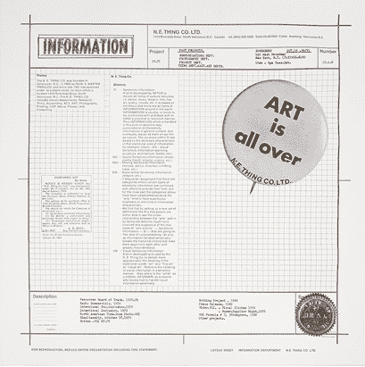

N.E. Thing Co., 《艺术无处不在》，1971。纸本拼贴。不列颠哥伦比亚大学莫里斯和海伦·贝尔金艺术馆藏，Iain Baxter& 和 Ingrid Baxter 捐赠，1995。摄影：Michael R. Barrick。

当然，机构现在喜欢场域特定的制度批判。那种被收编的恐怖感是我从一开始就计入成本的。但如果我们回想那个里程碑式的哈克展览 [Shapolsky et al., 1971]，我绝对是在抄袭那种技巧：对艺术界说，你们其实可能想思考一下你们的钱从哪来，或者思考一下你们的民主美学及其潜在问题；同时对生产区块链技术的人说，如果这行得通怎么办？如果这行得通并产生后果，我们难道不该在一个不会让人挨饿受冻、或阻碍他们买药的领域里审视那些后果吗？我们能否利用观念领域、艺术领域，在那里玩一玩，在造成实际影响之前弄清我们不该做什么？将其视为一种可塑媒介，服务于一种旨在对艺术界和区块链技术界都具有审讯性和不适感的艺术，这是直接从观念艺术那里借用的策略。

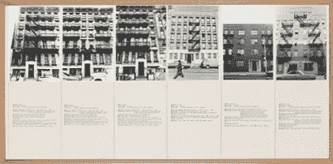

汉斯·哈克，《Shapolsky 等人，曼哈顿房地产持有，一个实时社会系统，截至 1971 年 5 月 1 日》，1971（细节）。9 张蓝晒复印件，142 张明胶银盐照片，和 142 张复印件，尺寸可变。© Hans Haacke / DACS，数字图像由惠特尼美国艺术博物馆提供 / Scala 授权许可。

所以是的，这关注的是一种新兴技术，它提供了一个注意力焦点，让人们能在意识形态、政治和经济基础的背景下看到它。

有了观念主义，你有了第一代接受过现代美术学院、学位式训练的艺术家。那是冷战时期，是消费社会，格林伯格的蒸汽用尽了，但没人真正取代他。在画布上涂抹些颜色似乎已经无法胜任。艺术作品无法再完成艺术作品的工作。所以要么你停止做艺术作品的工作但继续创作艺术，要么你停止创作艺术但继续做艺术作品的工作。`Art & Language` 等少数群体选择在没有地图的情况下继续前行，但凭借一种直觉：继续下去在政治上或社会上很重要。这导致了有意或无意的抗市场艺术形式。`Art & Language` 很愉快地谈论那些说想展示他们作品的画廊，结果却把一本《Art-Language》装裱起来挂上墙。这是个可以理解的错误，但不行。后来由于内部压力，需要将对话整理成索引项目，再后来在 1980 年代需要养家糊口，不得不想出一个持续的绘画项目。但那个最初的“我们不愿受艺术史约束，因为我们希望延续艺术史”是一个迷人的举动，无论从哪个角度看，它都极其关乎自由。这种对后格林伯格时代艺术世界残余的退出，创造了一个想象世界，让他们得以保持抵抗的可能性。这不同于我所批评的那种梦工，后者只是人们单纯地化解心理张力——他们声称要为之奋斗的事物，却在日常工作中每时每刻都在与之对抗。

真伪证书 (2020) 最初是一张 `Sol LeWitt` 真迹证书和一些涂改液。LeWitt 的证书将不可售卖的墙绘变成了极具销路的合同和签名证书。我采用了这种美学和概念上的参照，用来捕捉我当时感觉到的、实际存在的区块链艺术世界中的真实性焦虑。那件作品和 `代币等于文本` 让我非常满意，就它们引用参照并将其组合的方式而言，使其能有效地引导注意力并进行批判，不是指自我夸大的轻蔑姿态，而是指我们需要理解 x、延伸 y、并在 z 发生前将其拦截。我能做到这一点的程度，源于对那种退出模式的实践，即不受展出期望、可售性或其他任何如果我从第一天起就关心就会让我富有得多的事物的约束。

**MBK** 那么归根结底，你乐意被描述为观念艺术家吗？

**RM** 有点吧，是的。正如 `Art & Language` 所说，“无论观念艺术的命运如何，它都不是观念艺术”。当人们说我是“区块链观念艺术家”时，我感到相当尴尬。我需要这种视觉、技术、艺术史和文化的能指与联想资源库，以便传达某些东西——如果我为它发明一种新的表现形式，由此产生的艺术将面临三重打击：一种没人真正需要理解的技术，一种没人真正需要理解的意识形态，以及在一种没人理解的表现媒介中对这些进行的批判或思考。那时我只是在对着虚空尖叫。所以我所做的看起来像极了极晚期的后现代主义，或极晚期的观念主义，或最坏情况下极晚期的波普艺术，但它更多关乎一种文化烟霾——互联网时代从继发运动向并行流派的转变，每个人都能指尖触及文化史，因此我可以借力人们的知识发出信号，让他们看向某处。这不是一阶观念艺术，正如 `Art & Language` 的作品早已不是一样。它将做观念艺术的事作为其运作的一部分，因为那是介入我想介入的事物最有效的方式。

# 与 Rhea Myers 的访谈

在早期的加密艺术中，看到对艺术市场的撤退以及创造替代经济和生活世界的尝试，我从观念艺术中认出了这一点。我的另一个参照是网络艺术时代，当时艺术家率先介入了这种交流、交换与剥削的媒介：网络艺术家在大规模企业剥削到来之前就已进驻，并使得从一开始，你就无法毫无问题地上网消费“内容”而不面临替代方案。他们共同关注通讯技术的运用。将这两者粘合在一起，并识别出伦敦赛博文化时刻的理想主义，我已准备好，并渴望向艺术界证明区块链具有批判性的、以及可能具有组织层面的趣味；同时试图向区块链圈子解释艺术界具有组织层面的、以及可能具有技术层面的趣味。所以我一直在试图将这两个群体摩擦在一起，产生奇异的变异后代，以生成理解。我所做的这是一张双 A 面唱片：A 面是对艺术制度的批判，B 面是对技术制度及其双方意识形态的批判。

**MBK** 随着技术的发展并介入或替代社会关系，它拆解、分析并实质上批判了社会结构，其意义在于揭穿社会结构关于超验性的宣称，并将其运作作为机器零件内在地再生产出来。在此过程中，它同时也拆解了概念，而你的艺术和写作往往着眼于展示区块链技术和加密货币是如何分离社会关系中我们原本认为定义上就属于一起的要素：财产、所有权、对某物的唯一指涉与其内容的披露、真实性与认证、社会信任与价值的社会建构、来源与第三方权威。所有这些都是你利用作品楔入其中的楔子，或是展示区块链技术实际上已经在这么做的方式。

**RM** 这就是我所谓的“分层”。你无法断言这些事物现在肯定是连在一起的。区块链技术加速了解码的过程，扰乱了这些事物的运作方式以及我们假设它们聚集在一起的方式。你可以强调簇群的不同部分，从而获得对技术的不同解读，使我们选择尝试捕捉或表征的现象变得陌生。

区块链“事件”（沿用巴迪欧的说法）——比特币白皮书的发布、比特币软件的创建——有趣之处在于，它非常明显地是一个组装体——它是将现有技术复制粘贴在一起，以一种独特的新方式将它们置于一起，从而解决密码朋克政治项目中的问题。我们谈论比特币时，很多讨论的是那段代码的剩余价值：白皮书里没提“区块链”，也没提“加密货币”。白皮书谈论的是制作一个“时间戳服务器”，那是它的技术贡献。

但正如我在《区块链诗学》中所论证的，白皮书指定的是一种非常精细调整的不同能力的组合。如果你或多或少地强调这些能力中的某一个，你会得到不同的东西：例如，你只会得到分布式账本技术，因为你不在乎强制货币稀缺的能力。或者，如果你强调对双重支付问题的解决——这在艺术中是赝品问题——如果你向这方面倾斜，你就会得到 NFT。如果你读白皮书，你会看到中本聪通往时间戳服务器的每一段文字都蕴含着如此多的剩余价值，编织了如此多的可能性，如此多的可供性。

**MBK** 就像一个引擎，你可以用不同的方式调校它，让它表现出不同的性能？

**RM** 是的，我对左派的唯一论点就是，拜托，搞懂那个引擎，否则你们会被耍得团团转。

尼克·兰德用减法来谈论它。比特币减去了对可信第三方的需求。按原先的理解，货币是由可信方发行的，我们随后可以交换它，程度取决于他们允许我们到何种程度。如果我们减去那个可信第三方，理论上我们就不该有货币。中本聪或多或少地成功做到了这一点，执行了批判的操作。

**MBK** 其意义在于，它证明了货币的内在运作不一定依赖于一个超验的实例，不依赖于站在它之上并被宣称是其运作条件的东西。

**RM** 兰德将比特币技术与这类哲学问题、他自己的政治项目联系起来，以及你可以那样做这一事实，显示了比特币是一个多么有趣的对象。它是一个供希望与恐惧投射的屏幕，它确实契合思想史，它确实有一种设计美学，它所解决的问题在艺术中市场引入的问题里有其类比，而这些问题归根结底只是长子继承权父权焦虑的投射：双重支付问题简单来说就是“这是我的孩子吗？”正如在艺术市场中，赝品问题简单来说就是：“我延续了我的血脉，还是我戴了绿帽子？”这些是依附于父权社会的焦虑，一种试图通过巨量的金钱和/或权力和/或暴力来寻找答案的社会，目的是让男性生殖主体放心：实际上，是的，他是安全的：这套为作为“人”的人类构想的安全系统会照顾你，确保你应得的东西没有被偷走，你的后代没有被“右键点击保存”。

**MBK** 但时间戳服务器不正是保障来源的一种方式吗？

**RM** 绝对是，它将“事后归因论”操作化了，它生产了一个宇宙，在这个宇宙里一件事跟在另一件事后面，并且你知道这是真的。你无法花两次钱，这意味着你无法乱序花钱，这意味着如果你在接收货币，那么随着时间的推移，你对拥有它的安全性的确定性倾向于增长。现在，说清楚了，如果佛贡人明天带着 278 万亿哈希算力到达，他们可以非常快地重组交易顺序并排除区块。但他们仍然无法花别人的币——除非他们有离散对数问题的解，而这是我们目前拼命祈祷不存在的东西。

**MBK** 财产呢，财产的概念在这里会发生什么？

**RM** 兰德提出的论点是，在公钥加密出现之前，财产并不真正存在：公钥加密是使得私有所有权或控制权成为可能的东西，将资源控制构想为在没有可以撤销该权利的国家担保人的情况下的所有权。

**MBK** 这是你在《撤回准财产》结尾处做出的举动，你说早先的文本中你抗议比特币是财产这一观点，但实际上我们过去称之为财产的东西是一种受污染的财产形式，比特币将其提炼为纯粹形式。但这确实把我们带回了一个问题：这种财产的绝对化怎么可能是某种左翼项目？

**RM** 这里有两点：首先，如果你想对社会有任何批判性的把握，你需要理解你试图批判的是什么。另一点是，它就在这里，所以让我们至少理解能用它做什么。以及我们如何能讽刺它、延伸它，或用柔道将其摔投成我们能利用的东西。

**MBK** “我们还不知道财产能做什么”？

## RM

我的论点之一是，财产制度具有生成性。并非某些实体先产生，我们再创建财产制度来描述它们。我们创建了财产制度，随后它以一种非常真实的方式，生成了其所适用的对象。可能最初存在少数典型的或临界的对象，制度意在因某种特殊利益而涵盖它们。但一旦将此前无法描述为财产的事物描述为财产成为可能，人们就会追踪这种奇点，并开始生成这些对象——就像一个市场斯大林主义者式的行政官要求你衡量特定指标……

## MBK

我认为这就是德勒兹和加塔利通过精神病患者谢伯法官的视角解读马克思时所称的“奇迹化”[¹]：在每种类型的社会中，都存在一个记录表面，社会行为、身体与大地的组织被铭刻其上（对我们而言，即货币），最终似乎一切都从这个记录表面发散而出，其标记成为社会世界中发生的一切的“准因”而非结果——它将自身自然化了。

## RM

是的。取决于你如何旋转时间晶体，这是自创生。财产创造自身的超迷信。这里你有一个区块链时间戳服务器，产生出这种德勒兹式的时间空洞重复——每个区块都相同，一个接一个，每十分钟一个。你有节日，有区块奖励减半，还有硬分叉。但在区块层面，没有季节，没有生日，没有禧年。这种非常资本主义的线性钟表时间非常契合安娜·格林斯潘关于资本主义超验时间机器的观点[²]，因为这种量化、这种时间的分配，再一次，具有生成性。

## MBK

从某种意义上说，它是线性且空洞的时间，但也不是，因为每个区块“包含”了之前的每个区块，所以存在一种持续的强化。

## RM

是的，区块链的存在随着每个区块而强化，每个区块使其更具“实体性”，要撤销它、重写其历史、摧毁它或重新分配其中的价值，需要付出更多工作，随着时间的推移，一切变得更难重塑。这是工作量证明的优势：重写哪怕一小部分比特币区块链，都需要地球上可观份额的算力，即便如此你也无法花费他人的币。你可以阻止它们曾经存在，但不能把它们发送给别人并假装是对方发送的。因此区块链的存在在强化，如果我们将货币价值视为纯强度量，当然也可以说每个区块内的价值量或多或少是强化的。然而我们处于光滑空间：默克尔树中没有任何东西说“这个区块有这个哈希值”，因为那是不可能的。存在内部与外部，链上与链下。

当然，从某种意义上说，理解区块链所需的所有信息都在链上，但要与之交互，你需要私钥，它们在链下且绝不能在链上，否则会破坏系统。用自然/超自然或现象/本体论来思考链上与链下很迷人——这很琐碎，你知道，在哲学上这是个纸牌魔术，但它颇具唤起力，属于那种如果你深究，有助于拆解假设的事物。你拥有这个由数学强制本体论的交易内部世界，而在链下，你拥有这个狂野的领域，链上无法知晓其中任何事物，除非作为从中传输来的加密签名。

同样，这可以是一个有用的刺激物，是服从中的不服从的一部分。我们必须拥有一个纯粹数学理解与理性的领域，这随后能给我们混乱的社会带来正义。嘿，来个区块链！不，不是那样！好吧，但以何种方式？就……不是那样！

## MBK

区块链以某种悖论的方式将两个元素结合在一起：可替代货币与信息永久保留的账本概念——它们似乎相互矛盾，因为可替代货币的关键在于，一旦你完成某事并收到付款，那笔钱就和别人的一样好，没人知道它来自哪里，它不携带除交换价值以外的任何信息。*Pecunia non olet*（金钱无臭）。在某种意义上，货币，至少是现金，正是一台洗刷信息的机器，那么这如何与一个透明、公开、永久的账本相契合？

## RM

没错——引用芭芭拉·克鲁格的话，“货币是一种销毁信息的媒介”，这正是它的重点。在刘慈欣《黑暗森林》三部曲的第三部中，太阳系被坍缩为二维——读完后让我恐惧了好几天——那种降维，木星像热天路面上的冰淇淋一样渗入二维的景象，那就是货币。

首先，比特币不是匿名货币，所以不完全满足密码朋克的要求。它是假名货币：你能看出哪个地址进行了哪笔交易。中本聪说每笔交易用一个地址，不要重复使用地址。这样做有很好的加密密钥安全理由。但同时，这也让我们保留了早期互联网那种不拥有固定单一身份的假名性。所以如果我们按中本聪说的使用比特币，你会看到这种假名交易丛林，完全可见，却不绑定单一地址，你只需确保不泄露某地址实际上是你。

公共账本是强制交易顺序的手段；比特币的重点是生产交易服务器，而非账本本身。中本聪出于空间效率原因指出，一旦花费了某笔交易的所有输出，就不再需要它了，不需要验证超过该点，可以丢弃该信息。因此保留这些信息并在区块浏览器中提供，绝对是比特币技术不阻止的，但这并非其预期结果。

[¹]: 1-interview.xhtml#footnote-223

[²]: 1-interview.xhtml#footnote-222

# 技术层面的两种反应

针对这一问题，技术层面有两种反应。

第一种类似于 `Web3` 和 `NFT` 来源追溯。这种观点认为：没关系，忘掉这些多重化名身份吧，普通人无法管理那些。让我们只拥有一个单一身份，我们可以向国家身份服务注册它以保障人们的安全，然后人们可以汇款、报税，他们可以知道自己是从谁那里购买 `NFT`、是谁铸造的，等等。因此，这倾向于将身份部分和公共账本部分视为一种社会公共产品，这也是来源论找到其最有力归宿的地方。

但我们也可以完全走另一条路，说中本聪所做的很棒，但这是化名货币而非匿名货币，而我们想要的是匿名货币。于是我们可以采用这种时间戳服务器技术，让地址和账本——它们源自比特币，但并非作为独立事物被刻意设计在那里——利用零知识证明技术变得真正隐秘。于是你得到了具备秘密交易能力的链，如 `Zcash` 或 `Monero`。在这些链上，你不必拥有公共来源追溯，尽管完全可以创建零知识来源追溯系统代币——但对于秘密交易，你无法通过查看公开广播的信息或恢复区块链历史来判断交易来自何处、涉及多少价值或流向何处。


中本聪知道化名制的问题并提出了应对方法，并不认为公共账本除了服务于时间戳服务器之外还是比特币的一种价值。这是一个绝佳例子：正如比特币中的一切一样，这里发生的事情足够多，我们可以以不同方式调整这些变量中的每一个，从而得到不同的结果。

**MBK** 在你的工作中，这些可调参数中的每一个都映射到艺术史上与金钱互动的某个维度上？

**RM** 艺术、观念和政治。对我来说，这是一个非常丰富的概念索引。它产生共鸣，向外延伸开来，在某种意义上这注定是如此，因为它正在拆解财产的概念，而财产概念内在于艺术被理解的方式以及艺术世界运作的方式。

我坚定支持这样一个论点：社会是为生产艺术而被创造的，而不是艺术是社会的产物。艺术并不总是财产。洞穴壁画尽管明显早于艺术概念，且仅在属于一群人类的领地范围内才被“拥有”，但它依然是艺术。一旦出现第一幅蛋彩木板画，继而出现正式的油画，你就有了艺术的商品形式。在此之前，西斯廷教堂天顶画当然是商业和交换的产物，但转移其所有权会很棘手。而一块麻布上的几团彩色膏体，现在这可是能装进箱子运输的东西。

**MBK** 这就是艺术品自主性的开端，在二十世纪，它作为一个问题浮现出来，与此同时出现了某种被称为“艺术”的东西，其存在在概念上独立于它作为社会和商业世界中物体的存在。

**RM** 作为一种存在于商品形式中的事物，是的。商品形式引起我的兴趣，因为关于“我们如何处理商品形式”这个问题的答案，区分了左翼无政府主义和右翼无政府主义、无政府共产主义者和无政府资本主义者。后者相信商品形式对个人财富和自由至关重要，且可以在没有国家暴力的情况下维持；而无政府共产主义者相信，对商品形式的捍卫、对其的监管，是国家暴力或其等价物的主要驱动力，也仅可能伴随国家暴力而存在。所以如果你废除国家，你就废除了商品形式。我当然在简化，但这两者都以有趣的方式错了。左翼无政府主义者需要国家级别的暴力来防止商品形式重新出现；无政府资本主义者需要国家级别的暴力来防止商品形式消亡。因此，你要么将国家暴力复制为其他东西——这是对区块链作为一种财产制度的批判——要么假设人们不会在地下室里重启资本主义。这真是一个糟糕的赌注，因为一旦有人能付钱雇两个人揍你，他们就有能力强化商品的存在。

艺术始终是其时代财产制度的重要反映。当人们拥有并从商品中获利时，艺术就成为商品。艺术的内容也与那些财产制度的内容联系在一起。透视法是文艺复兴时期的贸易数学，印象派是法国国家资助的色彩理论加上铁路……随着财产变得数字化、货币变得数字化，国家试图让我们停止使用现金，只提交交易记录供其窥探以确保我们没干坏事，加密货币看起来可能只是更多的同类。但事实上，它是在国家强迫你进入电子货币体系作为一种逃离手段之前，先进入那片“黑暗森林”般的电子货币领域。

这就是其中一个方面，但我强烈感觉到艺术还拥有这种象征性解决或闭合的功能。如果你知道世界末日本该在上周三降临却没发生，你可以让艺术家把它画在墙上，这样它就在那里了。如果你是一个极其富有的商人，财富来自遥远国度的香料和水果，你可以在墙上挂一幅那样的画，看，这是我拥有的。这就是为什么革命艺术如此重要——将会有革命，世界确实是这样运作的。我们知道却看不见的、或当下不存在的东西，可以进入艺术，成为我们现实的一种补充；我们的大脑不擅长区分梦境与现实、图像与实物，因此它某种程度上解决了这些张力，或掩盖了意识形态中的这些裂隙。

我们在当代艺术市场中看到了这一点，它本该是一个单词：artmarket。艺术呈现为纯粹的全球商品，据称它在拍卖会上被市场完美估价，其价值与价格完全一致，它像其他一切一样通过物流网络流动，甚至可能未被所有者见过（当代艺术作为字面意义上的加密资本——你用钱换取艺术，艺术进入自由港仓储，字面意义上的地窖）。它是个体劳动者被认可、被正确回报、并被吸入这一交换体系的产物。好吧，但没有任何东西是这样运作的，甚至连艺术品也不是。这是一场哑剧，一场关于全球新自由主义资本主义经济本应如何运作的滑稽模仿剧。那些需要相信它有效运作的人知道它从未这样运作过，但向自己证明它真的有效、圣诞老人真的存在的最好方式，就是当代艺术及其不受监管的市场价值。

**MBK** 所以如果财产制度是生成性的，产生了某种秩序对象的条件，而一个给定社会中的艺术是当行财产制度的一个指标，那么比特币也在驱动楔子，楔入那些构建艺术价值被理解方式的概念之间？

## RM

在我的早期写作和艺术创作中，我不认为我是从那里开始的，我是从非常简单的小事物入手，它们做了一件艺术所做的事，或者是艺术界想要或做的事。它们都非常遵循这种“在服从中不服从”的策略。你知道，艺术家需要一份合理的作品目录。给你，这是一份在区块链上的。不，不是那样！直到 `NFT` 出现，我才转向其解码/重编码的一面，那时我才能将我 2014 年想象中的区块链艺术世界，与 2017 年实际存在的区块链艺术世界形成对比。实际发展的方向并非我所预想，但却是一个非常有趣的方向。我之所以没能预见那个方向，正是因为我出于政治原因而持反商业态度。

我作品中分层剥离变得完全显性的节点，是在我创作《非真品证书》（2020）时，这显然是一种否定性断言：这不是我的真品艺术品。正如迈克尔·杰克逊所说，“那孩子不是我的儿子”。但我只有当天才般的推特用户开始指出：你可以直接右键点击并保存与 `NFT` 关联的 `JPEG`，这意味着你并不拥有该 `NFT` 时，才真正深入探讨分层剥离的概念。这种说法在一种非常有趣的意义上是绝对错误的。让我们设想一下，如果我们通过将作品置于版权公共领域（此时我们可以用 `CC0` 实现）来消除艺术品作为财产的属性，那么你就将占有与所有权、赞助与声誉从剥削中剥离开来；你将使用价值与交换价值剥离开来。任何人都可以使用该图像，但没人能出售它。你可以出售代表其社会威望或声誉代理物的东西。

## MBK

然后还有真实性与认证的分层剥离。

## RM

真实性与赝品问题紧密相连。赝品是鸟巢里的布谷鸟，是本应仅存在一次的事物的双重支付。这绝对是商品财产制度的关键，因为如果我们按字面理解接受艺术史的叙事，你要么看着一件美好的审美作品并觉得它好，要么看着一件美好的审美作品并不喜欢它。注意其中的区别。但如果赝品能对我产生那种效果，那么我们就从画布之外引入了某种东西——于是无论是 1950 年代的纯审美世界，还是后现代和当代的能指世界，开始看起来像个事后诸葛亮的编造故事。真伪之分能将价值从零变为数百万……这往往能聚焦人们的注意力。

我认为例如沃霍尔认证委员会，已经停止给作品盖章认证，因为你无法认证一件沃霍尔作品。他让朋友帮忙制作，作为派对小礼物送人，如果你在他签名的《访谈》杂志上请求，他会乐意在背面写上“这不是真品沃霍尔”。在沃霍尔作品的情况下，这是一种范畴错误。人们在这些沃霍尔赠送的丝网版画背面盖着双重否定的印章。正如我已提到的，这种投资，这种类似父亲对后代的所有权，却突然发现后代可能并非你所认为的那个人，这种所有权焦虑，这种真实性焦虑，从区块链的双重支付问题，映射到艺术界的赝品问题，映射到人类学中的父系血统问题，再映射到资本主义社会中的雇佣劳动问题——因为你在做这件事却得不到其利益，利益归别人所有。你得不到你自认为应得的东西。

赝品是一个属于特定财产制度的现代问题。如果你是一位为教堂订制祭坛画的神甫，有人来了，画好了，你非常满意（除非他是异端，那你就麻烦大了）。只有当艺术的市场运作出现时，你才知道、也需要知道艺术来自何处：你为这件东西付了钱，如果你发现你没买到你付钱买的东西，你会不安；如果你发现你卖的不是你以为你在卖的东西，那更糟；而公共账本提供剩余价值可能性的承诺在于：你知道艺术来自何处，知道谁拥有过它，知道它以多少价格售出，知道它在何处。

现在，加密货币话语圈内的任何人都能立刻告诉你其中所有的问题——比如你可以在区块链上将《蒙娜丽莎》注册为你创作的艺术品。这只是在说明，如果你早听过加密理论家的说法，他们早就能告诉你这些了。这不是“赢了加密圈小子”，而是来晚了派对。正是将链下真相上链的问题，粉碎了区块链实现绝对透明、无赝品艺术市场的梦想。

这里有两种潜在的应对路径：首先，你可以着手解决预言机问题，即通过各种方式将链下真相上链，以你想要的确定程度，确立创作艺术品的人就是创作艺术品的人，购买的人就是购买的人，且它不在别处。此时 `NFT` 变成了一种有用的出版媒介和有用的表征与交换媒介，但它变成了一种为区块链艺术这些崇高理想服务的手段。这没有错。

但另一条路是，顺应“不知道你父亲是谁”这种状态，直接说：看，你看着某样东西喜欢或不喜欢这个想法完全正确。我们要追求纯粹的密码朋克匿名性。纯链上作品。如果你喜欢这堆像素，想付我 10 英镑比特币买下它，那很棒；如果你想给 100 万英镑，那也很棒；你不知道我是谁，不知道是谁做的，它标题叫《日出时的粪便》或随便什么，你觉得好笑。你是为作品付费，不是为肉空间的来源付费，所以如果你溢价买了，那是你自己的事。至少在理论上是这样。

## MBK

这些就是在中本聪的组合装置上拨动旋钮、调整参数以产生不同情境时，对艺术产生的影响。有趣的是，无论你提出哪种模式，总有一部分人会生气。他们为人们仅因看中某物就购买 `NFT` 而生气，但也为 `NFT` 可以成为真正价值载体这一想法而生气。让 `NFT` 变得有趣的一种方式，是确保它们激活产生这种愤怒的恐惧。

## RM

当艺术家直接铸造发行作品时，人们确实会不爽。如果是烂艺术，那完全说得通。我咬牙承认达米恩·赫斯特最近的尝试是好的：他做了一个 `NFT` 空投，你可以拥有第一批达米恩·赫斯特 `NFT`；然后他说，经过一段时间后，你可以销毁代币，他会寄给你一幅实际的小画或版画等。这是利用技术让人们演练价值的博弈论。这比从《难以置信》的残骸中拖出的任何东西都让我感兴趣得多，这是自他精心摆放一条鲨鱼以来他做的最有趣的事，因为它以一种需要那种声誉赋予分量、使其成为严肃命题的方式，深入技术的博弈论和质疑价值的底层逻辑。

你确实会看到有人直接去 `DeviantArt` 这种内容蜜罐，抓一堆图片，利用稀有艺术平台的免费铸造功能看谁会买。这很糟糕，但这是对 `NFT` 社区和插画艺术社区的双重攻击，不是 `NFT` 社区攻击插画艺术社区。

如果我们再次审视那些杠杆和旋钮，我们可以取消免费或即时铸造，但这会降低可及性和包容性，因此会产生社会正义方面的影响。或者我们可以维持免费铸造，这能让更多原本无法负担起步成本的人参与进来，但会降低双重支付的成本——这恰恰违背了中本聪最初使用 `Hashcash` 算法的初衷，该算法旨在阻止电子邮件垃圾邮件，使其代价高昂到不值得为之。所以，这再次是对参数的微调，以实现人们认为公正的不同目标；但如果你在缺乏应有的谨慎和关注的情况下更改它们，指望产生某种美好的微妙效果，可能会让你失望，或以错误的方式过度激发事态。

**MBK** 就实际存在的 `NFT` 艺术世界而言，似乎存在两种略有冲突的欣赏层面，而你在作品中将两者都引入了。一种是对在媒介层面具有批判购买力的个别作品的欣赏；但随后，在《欢迎来到真实的荒漠》中，你主张，我将不客气地称为“垃圾填埋场 NFT”的大多数作品的美学，可以被视为人类感知反应模式与技术平台碰撞所提供的功能性的产物。在这种情况下，从人口规模的视角来看，`NFT` 现象作为一个整体，向我们揭示了关于平台和艺术的某种关键信息；它成为自身的批判，要求被阅读和解读。

**RM** 是的。我的癖好显然是批判性艺术。这不适合所有人，我是从喜欢波普艺术、平面设计、喷枪绘画等才走到这个立场的。所以我拼命不想成为一个势利眼，或用当下加密艺术的术语说是“把关人”，也不想因为坐在那里空谈七十年前的二十世纪中叶批判理论的理想，而错过实际存在的 `NFT` 中有趣、新颖且有价值的东西。我曾与几位非常称职的艺术史学家就 1 万张 `PFP`（头像）项目可能有趣的地方进行过非常长的交谈，对我来说有三点：首先，它们都非常反审美；它们都具有反审美的美学。其次，藏品有一种整体感，这是由你在其网站上查看它们的方式所实现的。最后，它们被用作仪式面具。这些有趣的审美、人类学和艺术史现象，不应因我对侧目而视的猿猴的厌恶而阻碍我对其进行考察。我不会对此表现得势利，我会审视这些事物。这回溯到创造力理论：如果你保留某种天真，你会关注到那些必须对自己的老练极度自信的人不会注意的事物，正因如此，他们将无法在思想的轨道间跳跃，以达到他们声称感兴趣的那种批判。

有大量 `NFT` 只是人们从 `YouTube` 上窃取动态图形演示，这很糟糕，但同时，许多非常有才华的插画师、3D 建模师和动态图形艺术家突然有了收入来源，因为他们可以将作品表现为 `NFT`。这些作品的受众追求什么？很难归类，但在《真实的荒漠》中我尝试过。我会将其与“可拥有性”的概念联系起来，某种像园丁鸟求偶那样、发出拥有你想要之物的信号的东西。而买家想要的是数字化扩展的可拥有性。从某种微不足道的意义上说，任何 `NFT` 都是可拥有的，但它需要看起来像，就像一块镶满钻石的昂贵手表，因为钻石告诉你它很贵，尽管实际的昂贵在于极其精密调校的机芯。通过象征、传达或描绘质量——无论是黄金、分量与坚实、技艺还是罕见性——这种艺术做到了这一点。我认为如果你运行某种文化分析软件，会发现人们追捧的艺术具有这种显性的可拥有性。

**MBK** 这是一种拟态诱饵，隐性地回应了平台制造的价值问题？

**RM** 绝对是，是的。不仅是它制造的价值问题，还有如何将自己挂钩到那些信号上、如何理解或能够看见那种价值的问题。

**MBK** 我们又回到了财产制度具有生成性这一点上。

**RM** 另一个引起我兴趣的是，它们倾向于都是短小的动画循环，这在我看来无法抗拒地反映了区块链时间，但我认为实际上它给买家提供了更多可拥有的东西，因为它增加了持续时间，从而为你所观看的事物增添了额外的实质。它通过平滑的循环将其渲染为——不一定是媚俗，但肯定是——无问题的。所以你可以无问题地消费它，但它在批判层面所做的是指示这种价值。它是一种峰值偏移刺激，是一种审美价值的性玩具或钓鱼诱饵，将一切推向了 11 分（满分 10 分）。

**MBK** 你大概可以用准达尔文主义的术语来谈论这一点，因为我假设最初涌现的 `NFT` 更加多样，直到创作者摸索出如何发出“正确”的信号。

**RM** 确实有一个适应度函数在起作用。

**MBK** 在你在这本书的许多文章中呈现的、并体现在你部分作品中的审美方法里，你深入其中：为什么我们不直接为审美元素或品质创造一个市场，看看谁赢？就像一个技术无政府资本主义版的库恩斯：不仅允许人们喜欢他们喜欢的并为此庆祝，还利用技术和市场揭示他们真正喜欢什么，而不是相信他们陈述的偏好。

**RM** 如果我们接受市场是认识论环境这一观点，即它们是真理程序，但其中的真理是价格的真理，那么是的，真理必须从人群中提取。从未售出的东西难以定价，独一无二的东西难以定价，不常出售的东西难以定价。价格即意义，它是一维的意义，是在黑暗森林打击中坍缩为单一维度的意义。但正因如此，它更加实在。

**MBK** 这与批判相容吗？

**RM** 对于批判而言，不存在、不应存在、也不存在任何安全的外部立场，让我们可以从中指向批判对象。如果我们自认为占据了这样一个立场，那通向的将是非常糟糕的事情。这非常像是我们必须在飞行中造飞机，或者在冰山冲向瀑布时在冰山间跳跃。不存在任何固定点，让我们凭借采纳一种审美甚至一种批判伦理就能撬动世界。批判不是一个已解决的问题。最糟糕的伪批判家是那个对一切都有答案的人，那是他们永远不再需要学习的最后一个观点。这是什么？我不知道，但这是法西斯主义。

## MBK

但当你把批判性当作一种怪癖来谈论时，你表现出的那种谦逊，通常不是批判性艺术所擅长的，因为人们普遍认为批判的结论代表所有人，我的批评家能动性隐含着一种普遍化——每个人都必须参与我正在玩的批判游戏。我们正在进入完全不同的领域——批判不再发生在认识论主体审判世界的层面。批判是发生在外部的某种事物，主体需要对其进行解读，以理解哪些概念是有效的，哪些概念已被外部虚拟对象的新行为在客观上宣告无效。

## RM

这与新理性主义哲学家雷扎·内加雷斯塔尼的论点非常契合，即智能不仅存在于头脑中，更是社会的一种机能。[¹] 批判是社会的一种机能。如果我们是好的马克思主义者，就必须说事物包含其自身的批判；识别它是我们可以做的有用工作，但试图从中赚取功劳或社会资本，就是误解了自己在历史展开中的角色。与此同时，新理性主义珍视的“给予理由与接受理由”的游戏根本不存在。没有比沙皇炸弹更大的理由。超越某个临界点，“因为我说了算”永远获胜。所以，格林伯格式批评家的想象角色是一种幻觉。二十世纪最伟大的艺术批评家是中央情报局和瓦莱丽·索拉纳斯，而非格林伯格……我又回到角色里了，如果真有人基于此开创“迈尔斯理论学派”，我会感到极度恐惧！但我们相信批评能做什么？首先，我根本没工夫搞永远否定式的批评。给我一些能指出如何在特定方向上把事情做得更好的批评吧。这需要工作，它是低效的，它不加速，它让你慢下来，但价值就在那里。同时，社会文本不是用墨水写成的；坐在那里说“你做错了”恰恰是批判的反面，而且分布式机器实际上更擅长做这件事。这发生在人口层面，而非应某个神一般的批评家形象之命。

想象一下律师在刑事审判中对证人进行交叉询问：回答问题，是或否，这是二元的，是零和一。我们身处何种认识论之中，在这里对“你是否已经停止挪用公款了？”这种问题只能是是或否？这未必是达成判决的最佳方式，或者如果它是，判决本身可能也不是最值得追求的东西。这对艺术批评或许不那么重要，但如果我们在试图“伸张正义”的过程中销毁了信息，那就会有大麻烦。

这就是为什么我试图保持认识论上的谦逊，并承认我们都有罪。我不再谈论意识形态，而改说“投资与偏见”，这显然是在钓鱼执法，但严肃的观点是：你的意识形态是你投入时间和各种资本以达成特定立场的产物，你对它的坚持是对该投资的投机。其错误的程度很有趣，其正确的程度则是为什么真正的批评非常困难。情感和财务意义上的投资，哲学和财务意义上的投机。至于偏见，关键在于判断即歧视，它字面上就是在歧视。许多人工智能批评纠结于“判别器”或统计偏见的概念，因为不同领域的术语含义不同却同名。如果你有一个`discriminator`，它只是告诉你一个值是`a`还是`b`。而在别处，如果你在歧视，你就是基于偏见在非理性地或不公正地实施错误行为。人工智能在两种意义上都燃烧资本以产生歧视——但认为我们某种程度上不内在于此，我们某种程度上超越了我们认为的人类一切错误，对我来说简直站不住脚，这是最糟糕的“觉得自己屎不臭”的思维。抱歉，无论你用多么华丽的辞藻包装，你在社会中都有你的目标。我们都有各自的崩溃点，避开它们或许是伦理学的一个好主意。


但如果你想产生真正的批判，就去做点事：说话是在做事，但不是你能做的唯一事，因此这本书里才有艺术、写作、代码和故事。因为如果你限制自己愿意采用的手段来达成目的，如果你说我只能单脚跳着去实现我想要的，你可能永远到不了。这是爬山式人工智能搜索算法中局部最优的问题：你执着地沿一条线走，到达顶峰，以为我已高不可攀——但在你旁边有一座巨大的山峰，如果你多游荡得随机一些，本可能发现它。我植根于这些源自带有企业色彩的创造力理论和人工智能的隐喻，因为两者作为认识论都令我着迷。绝不按面值或一阶含义接受它们，而是将它们作为资源加以利用。

## MBK

一套方法论还是元方法论？

## RM

是的，这像混沌魔法：别纠结于某事物看起来是否极其严肃或拥有纯正血统。管用就用。这是做黑客，不是做软件工程师。

## MBK

说到魔法，你在多处提到它与区块链的关系，特别是与哈希的关系。

## RM

这关乎命名的问题。哈希，一种加密哈希算法——据我所知，“hash”一词指一种把所有东西搅在一起的食谱，你不太清楚里面放了什么但配点塔巴斯科辣椒酱很好吃——旨在产生稳定且确定的结果：在相同数据上反复运行，你会得到相同的输出：稳定，但在你真正运行之前无法猜测。如果你看着数据，完全不知道另一端会出来什么。反之亦然。现在，如果你思考命名的哲学问题——狗叫“dog”而不是“sheen”有任何必然性吗？——加密的楔子再次楔入，宣称你可以拥有完全由事物本身决定的名字，它们没有意义，也没有可追溯的关联回指到它们完美标识的事物。

这怎么可能？加密学的魔力。加密哈希完美标识项目，其唯一性归结为大数，却与该项目不存在可恢复的语义链接。大多数现代哈希生成 256 位标识符。你可以给可见宇宙中的每个粒子做哈希，用那个空间也用不完。它真的是唯一的。过去每当有加密哈希要进数据库，我就担心如何避免碰撞。计算机科学的论点是，如果你担心这个，那你应该对明天太阳爆炸感到绝对恐惧，因为那更有可能发生。

这些是你可以隐藏事物、却仍知其真名、并能指代它而不必揭示其内容的暗林加密空间。这就是公钥加密赋予的完美同一性/完美保密性的辩证法，应用于数据的内容与身份，而非通信内容。

[¹]: 1-interview.xhtml#footnote-221

这与魔法有关，因为在历史的临界时刻，密码学与魔法是交织在一起的。在近代早期，密码学必须将自身与巫术区分开来。欧洲早期的许多密码学手册具有双重用途，同时也是魔法召唤指南——那种严肃的与天使对话、召唤恶魔、制作魔方阵的东西。这可能仅仅是为了隐藏密码学，也可能是当时的政府特工通过假装成巫师来隐瞒他们的密码学知识。考虑到当巫师会被烧死，这风险相当高，但比让国王或王后极度不悦的风险要低。以约翰·迪为例，他在欧洲游历，试图为各国君主炼金，并将魔法著作寄回英国——将其视为秘密特工的活动，比视为一个极易轻信任何拥有黑镜（注：指占卜用的黑镜）之人所为，要合理得多。

因此，在临界时刻，两者混淆不清；待局势稳定，它们便分道扬镳。我们在维多利亚时代又看到了这一点：爱伦·坡在密码学和通灵论两方面都颇有建树。坡死后，有一段时间他最受欢迎的诗作之一，竟是一首死后由通灵媒介“降笔”创作的诗。当时有这样一种观念：自然之书是加密的，我们要想读懂它，就必须破解其加密——那是一层无知之幕，将我们与灵界和来世隔开。

时至今日，密码学家仍然是已知与未知之间的中介人物。若从社会学角度审视，他们确实扮演着一种祭司阶层的角色，负责与未知沟通以担保社会秩序。这就是为什么他们看起来是如此道德上棘手的人物；这也是为什么密码学的访问权问题对那些想要可信第三方介入我们通信、以阻止我们做“好人”眼中的“坏事”（这些好人当然从不越权、误解或产生误判）的人来说，在道德上如此棘手。

魔法与密码学看起来很像，两者都有那些古怪的符号和体系，两者输出的表面上都是废话，却都声称在进行通信。直到现代，两者都以各种压迫性的方式受到国家管控，且都关乎对“外部”或“地下”世界的访问。

若要用更“恶魔化”的说法，密码学的黑暗森林，这个我们穿行其间发送消息、仅供接收者阅读而无人能窥的密码学超空间，以一种极高效的方式，体现了与魔法相同的人类欲望，即对秘密与权力的那种男性化的设计。

随着时间的推移，围绕密码学威胁与承诺的法律和社会辞藻表现出惊人的稳定性。自近代早期以来，每当出现临界时刻，密码学与魔法（无论如何概念化）再次纠缠在一起时，总是由相同的参与者给出相同的论点，导致相同的结果，这套辞藻便会卷土重来。这套辞藻可追溯至近代早期：国家关心能否解密个人间的通信，而个人担心被国家审判，且他们产生的秘密通信被国家破解。隐私、保密、披露、密码学方法作为大众娱乐及作为保障国家、商业和个人通信安全的手段等问题，所有这些都可追溯至 16 世纪末，并在维多利亚时代重现，而后又在 90 年代的密码朋克时代再现。每次辞藻都一样：大数的辞藻、及时的秘密通信拯救生命的辞藻、有害秘密的辞藻。密码朋克在这场持续的斗争中无疑做出了正确且最新的制胜一招，但仅仅二十、三十年后，我们又看到了这一幕：国家坚持应能读取你所有的通信：信任我们。不。我们玩这套已有数百年，如果你有一丁点历史素养，就会知道你们在当混蛋：别干了，就这一次，从历史中吸取教训吧。

有了公钥密码学，我们再次面临一种“分层”现象。它颇为奇特，因为它同时赋予你绝对的秘密性和绝对的身份认证，而在大众想象中，这两者并不兼容。它们并非密码朋克意识形态的数学产物，而是首先由`GCHQ`（英国政府通讯总部）推导出来的，但英国人擅长保密，所以没告诉任何人——约两分钟后，一些美国研究人员也独立推导出来了。该技术在 90 年代初被“解放”。这种技术获取使得我们得以想象一种社会：你不需要国家来担保你的私人通信或你对他人的身份认证——你不需要亮证件，不需要在选民登记表上留邮寄地址。顺着这思路推演，货币即通信：正如美国法院所判，若你是试图腐蚀政治进程的公司，金钱即言论。这在个人尚未完全受益的方面是正确且有趣的。密码学私人言语——非维特根斯坦意义上的私人语言，更像是双胞胎语，但发生在无限组双生通信者之间——让你得以想象：你可以在国家所有越权和干涉面前，保持安全、隐私和身份确认。

再一次，中本聪对不同技术的组装，恰好完成了密码朋克项目的这一部分。但它拥有巨大的剩余价值，我们至今仍在消化。对我来说，这种技术、这种以回应焦虑、契合思想史与辞藻史的方式组合技术，似乎是一个有用的刺激因子。

然后显然还有个问题：当我们都是极其聪明的后启蒙唯物主义思想家时，宗教去哪儿了？如果你接受中本聪是哈尔·芬尼的理论，这是一个身患绝症、现被低温冷冻、处于超人类主义来世、等待复活的人。而比特币恰好是支付这笔费用的好方式，因为它是面向未来的货币……所以美国的精神版图可能融入了比特币，或者至少比特币源自那个环境——一个不仅属于密码朋克、而且精神实践采取超人类主义形式的环境。

**MBK** 在《我的小便士，比特币即魔法》中，你将同感魔法的概念与卡巴拉和字母数值术对立起来，后两者不需要信仰，只需运算数字——一种信号情报。

## RM

是的，因为有人把区块链说成是仪式，并极其轻蔑地试图从社会学或人类学角度，甚至最坏的情况下从纯心理学角度，将其简化为“仅仅是仪式”。仪式层面对我来说和任何人一样显而易见，但对我来说，它作为仪式这一想法分量重得多，且可用于支撑更显性的仪式。

**MBK** 字母数值术的运用暗示了这样一个事实：一旦你拥有了一个足够密度的符号系统，就能在其中探测到不可否认的联系，而这些联系在功能上并不助益于该系统的预期运作。短路、巧合、对应关系，等等。这是外部世界丰富语义挖掘贫瘠功能领域内代码剩余价值的效应。

## RM

我谈论自然被加密了，以及几何数字学作为对上帝私有签名密钥的侧信道攻击——这非常华丽辞藻，但至少在隐喻层面上，这就是几何数字学的本质：几何数字学的理念是，自然这本加密之书，其密码体系存在弱点，我们可以用密码学术语来说是“攻击”，用黑客术语来说是“利用”，从而让它从创造的黑暗森林中泄露信息。因此，我在隐喻映射与字面操作之间不断拉近与推远镜头，对思想史极其严肃，对其实际应用则深具讽刺意味。

在使用哈希值时，一个重要的理念是德勒兹的“黑暗先驱”概念，它指知识或文化结构中任何你可以挂靠事物的巧合。这再次是巧合的强化，即魔法，以及作为对某种自我描述的祛魅的批判。

## MBK

你的部分作品似乎通过展示这样一个过程来运作：当比特币这一“真理机器”（采用其最枯燥乏味的描述）与我们可利用的文化与历史关联的稠密性相接触时——事实上它始终处于这种接触之中——它能被用来生成某种神谕般的、无法消解的东西。《艺术吗？》（2014，2016/2017）是将区块链真理模型转化为我们视为值得思考的真理、深刻却无法解决的真理的最敏锐案例。

## RM

比特币是真理机器，这绝对正确，但秉承滑稽降格的主题，这是一个会让哲学家痛哭的真理。“这个币由系统创建，这个币被此人花费，我们将这笔价值从地址 a 移动到了地址 b”，这里没有任何深刻的真理。所有这些可能完全属实，而且是由全球相当一部分配算力使之成真的真理，这是字典、法律、布道或哲学书的作者只能梦寐以求拥有的真理。由如此算力背书的真理，确实是一种普遍被承认的真理。但这不是你可以据以指引人生的真理，“区块奖励发给了地址 1La8w72……”。

在《艺术吗？》中，人们选择花费以太币作为 Gas——所以这有机会成本，有定价效应——仅仅是为了切换这件艺术品的状态。随后，随着链上每一个区块的产生，这份真理将被变为现实、被强化、被背书，使其在物质层面越来越难、越来越难、越来越难以撤销。这几乎精确地模拟了真理**不**是如何运作的。《银河系漫游指南》里有这样一段：亚瑟·登特向“黄金之心”号星舰的饮料机要一杯茶，机器不断分析他的大脑，以找出绝对完美的东西，却生产出一小杯几乎但不完全像茶的东西。区块链真理的滋味有点像那样。

服从中的不服从：我享受制造这些怪诞的、因而具有批判性的误解，或是对人们关于真理是什么、以及它如何关联社会经济再生产的看法的过度字面化理解。这对一小段文本和几行代码来说承载了太多重量，但如果你想要，它就在那里。如果你不想要，它就是一段有趣的艺术史，一个有趣的早期以太坊黑客技巧。但对我来说，它问题化了这种真理模型：真理是我们通过协议或权力达成的东西，随后便通过某种神秘的渗透过程在社会中扩散。在《银河系漫游指南》中，关于生命、宇宙以及一切的终极问题的答案是 42。与普通区块链上的普通真理相比，这相当深刻且易懂——然而那些真理却是不可动摇的。

## MBK

要将真理问题重新系回魔法、可感知性与注意力：这里可以谈谈人类对审美刺激无法满足的需求，以及它如何背叛了所谓的技术对效率与理性的追求，无论后者被构想为进步且美德的，还是法西斯且压迫的。虚荣地址，例如：区块链产生的真理类型为何不够？仅仅做一个巨鲸为何不够？为何你还想要比特币地址的“个性化车牌”？

## RM

早期 Base58 比特币地址的结构不同于现代 Bech32 地址，后者在许多方面更有效，但美学上没那么有趣。你对公钥哈希、校验和和版本标识符做奇怪的处理，从而得到一个有保证的首字母。所以早期比特币是 1，狗狗币是 D。随后跟着一串字母，从中你可以解包出公钥哈希，这意味着你可以在对方不透露公钥的情况下，验证某物是否由正确的人签名。你因为校验和而知道拿到了正确的哈希，因为字母前缀而知道拿到了正确的链。旧地址有各种计算机科学问题和处理问题，这就是为什么有新地址格式。但作为信息、用户体验和美学设计的结合体，它们很棒，瞬间可辨识。

归根结底，我认为真理是那种像爱一样的概念。我们称作爱的现象有很多种，它们绝对真实，却也因语言的不精确而大规模混淆。对于真理，我们有事实、深层愿望、共鸣的统计现象、应用计算机代码的结果——这些全都是“真理”。在比特币中产生真理的能力，非常清晰直接地是资本占有的产物。矿工可以审查交易的打包，尽管他们无法改变他人发送交易的含义。如果他们这么做，就是经济上非理性的，会受到经济激励的制约。

## MBK

他们扮演真理的裁判角色？

## RM

矿工是真理的生产者、背书者和裁判，但他们无能力在真理程序意义上决定什么是真什么是假：他们只能应用它，甚至不能说“我想放你一马，但法律不允许”，他们只说“是的，这个程序会运行，没问题，我在算这个哈希，看，开头有一长串零，给我钱”。我在这里故意随意地玩弄“真理”一词，我假装使用哲学家的真理概念，实则仅指逻辑一而非逻辑零的事实。归根结底，这笔交易发生于纯粹密集价值的黑暗森林这一事实，对社会层面发生了什么几乎一无所告。如果哲学家能像比特币矿工那样产出那么多真理，他们会乐死；但如果哲学家只能产出矿工那种类型的真理，他们会失望而死。所以就真理生产而言，这是一种讽刺：伤害我！拥有绝对真理却毫无意义是可能的！不，不是那样！

## MBK

动摇柏拉图的洞穴……

**RM** 这就是我为什么更喜欢狗狗币，狗狗币矿工被称为“挖掘者”——不是基督教派别意义上的，而是狗狗找骨头意义上的。有了洞穴，我们又回到了现象在内、本体在外，主要物质位面和这个绝对事实的领域，纯粹金融价值、价格的绝对零意义真理的领域，事物仅仅是影子。在外部世界，它在做些什么，它在付人们的房租，付人们的药费，它经常在购买与密码学相关的周边商品。交易发生的真相与该链下事件的真相相关，只是无法以任何可恢复的方式关联。

**MBK** 在《加密印记》中，你将魔法召唤和通往外部的概念与哈希算法联系在一起。

## RM

同样，这全关乎名字。哈希为某些信息给出了一个真名，你可以用它来召唤信息，但也可以用它来指代信息而不泄露其内容——你可以与他人分享它，而他们不知道它是什么。正如我在《加密印记》中所说，这就像一个残留印记，作为一种毁灭信息的表征，代表一个想法或意图。《加密印记》描述了一段完全严肃的混沌魔法，因为它在说：拿当代文化中这流行的技术，应用到你意图的实现上，应用到你的巧合强化上，这就是魔法，也是金钱。但之所以这是个有趣的练习，是因为它有助于理解这些事物如何运作，并且试图以一种不会导致核反应堆熔毁、不会导致任何人失业的方式来理解它们如何运作。这只是一个口袋宇宙，你可以进入那个领域，把一切搅和在一起，再回来，它以不同的方式凝结了。

在《区块链美学》（2014–2015，2019）中，我将交易哈希渲染为现代和后现代审美的陈词滥调。正如我最初用我制作的 YBA 生成器所意识到的，你可以使用那些东西，因为人们会将它们识别为在发出“艺术”信号。所以我们有了脆糖外壳，让人安心的可识别且可恢复审美的蛋白质外壳。然后我们拥有了这个系统复杂性的体验，在我制作它的时候，这是一个看不见的网络，制作它的人理解它，但我感觉并没有将其作为一个真正在世界上做着事情的事物来欣赏。

哈希一直在被生成，每个推送 github 的人都在生成哈希，每个使用比特币的人都在生成哈希，比特币矿工每天生产数万亿个哈希。但这意味着哈希拥有存在，拥有现实性，通过重复，通过应用的强化。因此，与其说哈希的应用是创造性的，不如说哈希的应用具有文化共鸣。这就像在扑克牌时代使用一副牌，或在大众媒体时代用报纸进行书占。我们身处密码学时代，什么东西触及一切？哈希。这给了我一个我认为在批评上、起源上或投射上都可辩护的东西，我所做的不仅仅是货物崇拜式地模仿技术。我必须说服自己，将这种纯粹的机械程序作为意义生产链条中的一环是合法的。

如果你能得到一个哈希，像虚荣地址那样，拥有抓住人类注意力的奇特有序属性——例如，如果你将哈希表示为任何类型的数字，如果它开头有很多零——那是不太可能的。不太可能的东西在感知上是有趣的，感知上有趣的东西可以被创造性或反思性地利用，而且因为你拥有了不太可能的东西，你已经从巧合强化的位置出发了。这直接回溯到比特币，因为它的工作量证明算法正是修改加密哈希算法的输入，直到输出以一长串不太可能的零开头。比特币挖掘字面上就是巧合强化，正如我所说，巧合强化是魔法的一个定义，特别是在混沌魔法中：反复轮询混沌，直到它产生可感知的东西。

所以一方面，这些姿态非常清晰地映射到比特币的技术上，但另一方面，它们获取比特币所做的工作（包括物理学意义上的各种“工作”含义），并从一个本身就是巧合强化机器的东西中提取剩余价值。

我并不暗示我能对这些采取一个外部视角，我参与其中，对其进行理性投资和逻辑推理是有限度的。我们没有清晰的视野或完美的理论，因为我们不知道它会如何收场。

**MBK** 在我们离开魔法这个话题前，你引入的另一个幽灵是艺术品 DAO 的可能性，它们拥有一种能动性，能够自行在艺术界运作，无需人类干预。这唤起了对人造人、图帕和群念体的联想，但也对现代主义关于艺术品“自主性”的问题进行了一种有趣的反转。

## RM

这很棘手，因为准能动性艺术模型在某些方面是艺术自主性概念的关键。艺术品能以某种方式说话或与观众进入对话这一想法非常有力，但它威胁到误导我们对社会的理解。如果我们通过机器人艺术将其变得可怕地字面化——我在区块链之前就从事机器人艺术——DAO 绝对可以成为一套准能动性的规则、具体化的意图，人们会为此大惊小怪，尽管他们对慈善信托或河流的法人资格毫无异议。这种由特定代码模型和特定激励集合所进行的意图表征和具体化，仅仅是区块链让任何人都能更廉价地做到的事情。

关于 DAO 如何生产艺术品，将准能动性艺术模型字面化或操作化，有各种不同的模型。然后你回到混沌魔法中仆从魔、计算机软件中守护进程所拥有的内嵌目的概念，它们在后台运行，无需你总是请求它们就做事情。我们再次在思想史的根茎中穿梭：从计算机科学到恶魔学，到混沌魔法，到无政府主义合作社，以及市场无政府主义的想法——如果你给人们天空的产权，他们就会在经济上被激励不去烧毁它。所有这些汇聚在一起，同样，在艺术中做这件事给我们提供了一次为真正做这件事进行的演练，但赌注更低。

勒维特说：想法变成了一台制造艺术的机器。DAO 是变成机器的想法，它们能生产出一些东西。让我们走每一步，从中榨取剩余价值，非常字面地对待它，看看我们能做什么。

为什么对各种形式的人类组织感兴趣的人，不着迷于一种用于使组织原则显性化的公共可塑媒介，我不确定。当然，我们可以试着进化出更大的膀胱，以便在任何特定的合作会议中获胜，但是，电报早就发明了，当代组织圈子对组织的平均概念不如古希腊复杂，不是哲学上，而是字面上、技术上，就他们使用的技术而言。

我必须承认，我对自己持续进行的个人主义艺术创作感到有些愧疚，因为我本该创建一个 `DAO`，或者某种平台或标准，借此引入群体的智慧与疯狂，创作出无法以其他方式制作、因而具有历史必然性的艺术。我没有这么做，部分原因是缺乏社交技巧，部分原因是我深深内化了现代主义艺术家的观念，还部分原因是因为——我就爱这么玩！开会可不是我的快乐源泉。但如果要说我的表现相对于对自己所做之事的任何解读有何缺陷，那就是我依然以个人加密身份在做这件事，而非至少通过 `DAO` 让自己社会化。


**MBK** 也许这是留给未来的事……！回顾这番对话的起点，你对它将你带至今日——在艺术与生活中——的这个节点有何感受？我有种印象，你曾长久地在相当愉快的默默无闻中耕耘，而近年来突然获得的声名，对你的惊讶程度恐怕胜过旁人。但你似乎也在不断重新诠释那些早期作品的意义。艺术是否达成了你需要它达成的目标？

**RM** 我的起点是一种不属于这个世界、不理解这个世界如何运作的感觉，所以作品中有一种情感或心理驱力，我现在非常清楚地将其识别为性别焦虑与解离——感觉世界仿佛隔着一层玻璃，别人都有一本你没有的规则书，以及试图向自己解释世界。通过艺术，我试图借由理解来消弭我与世界之间的距离。我旨在通过艺术改变世界，这不太可能；或通过艺术改变自己，将自己复原为一个社会主体。但我缺乏修正我认知论所需的知识，无法真正尝试这一任务，因为我大脑中本该在十八岁最晚时弄清我是跨性别者的那部分，被另一部分覆盖了，后者花费越来越多的时间极力确保这绝不是我会考虑的最遥远的可能性。但等到我四十多岁时，这就像有个舞台魔术师尾随你身边，每当你想“等等，这说不通”时，他们就跳出来变个纸牌魔术，“选张牌！”这只是分心、否认、抛弃和解离，不是有意识的项目，而是大脑操作系统中的后台进程，占用了越来越多的运行时间。

但这意味着，在经历一系列对世界的错误理解的过程中，我确实学会了如何了解世界的不同侧面，如何批判自己以及这些侧面及其关系，并设法编织出一张关联与批判的蜘蛛网。我开始享受在别人无法告诉我错、我也无法告诉自己错、且往往具有不可抗拒特质的事物上，锻炼我的批判与创造能力，诸如“可分享的现成品”或代币等于文本。这些观念源自我当时的所作所为，在脑海中自行组装而成，我逐渐学会退居幕后：直接创作，事后再弄清它与我当下所做一切的关联。正如柯南少年时代被锁在车轮上，我在不知所云中磨砺出了批判能力。

**MBK** 这些觉醒是否意味着你现在对作品、对其对隐秘、隐私与身份的拷问，有了不同的看法？而且，既然回避的迫切感已消退，这是否让你不太倾向于创作更多作品，即使你的作品如今获得的关注前所未有？

**RM** 某种意义上，我的“破壳”实现了我二十岁时正在做的那些项目。

**MBK** 我们这是进入了逆时序的时间性？

**RM** 是的，你能明白为何 `Ccru` 的作品持续引起长期在线跨性别女性的共鸣：我们是我们自己的超迷信，从未来被派回的终结者，利用我们当下拥有的资源——我们的身体和我们对文化的理解（无论有多长一段时间我们并不真正理解它）——来组装我们自己。

但我恒常的主题是“服从中的不服从”。我追问的是“世界如何运作？”，而回答“这是你为何不理解世界如何运作的原因”并没有回答我最初的问题！它产生了我想要的效果，即移除我与世界之间的屏障，将我折叠进本原物质平面，让我变得凡人。但它只引出更多问题，所以我绝不缺乏创作的动力。而且我深受感动，拥有在心理和财务上都投入我作品的受众，所以我有强烈的责任感，不把事情搞砸。

变性并不能解决你所有的问题，甚至可能让你不再焦虑，可能让你不再抑郁：它所做的是，让你有可能直面那些事物的现实。这可能很可怕，因为解离在你应对（或事实上不应对）这些事物时其实很有用。处于“离线”状态能帮你更好地生存；如果你不再“离线”，并不意味着应对起来更容易，但它可能给你应对的知识和动力。当墨菲斯给尼奥红药丸时他说：“记住，我提供给你的只是真相。拔线并非天堂。”我总记得《神经漫游者》里的一句台词，凯斯被注射了神经毒素，在旅馆房间躺了三天，感觉连接赛博空间的能力基本从耳朵里淌干了，然后他“撞进了肉体”。黑客鄙视“肉体”，你会注意到很多跨性别者是软件工程师，如果这不是六十年代软件开发职业化时被驱逐出行业的女性施下的复仇咒语，也许是因为解离是一种超能力：如果你与身体脱节，渴望一个在周围世界不讲理时依然讲得通的世界，且不在乎你看起来、感觉或闻起来如何，那你就是软件开发的上佳材料。但在无论哪个领域表达，这种置换、这种试图掌握一套知识体系而非身体知识的尝试，都是一种完全可以理解、值得爱与一个大大拥抱的应对技巧。

**MBK** 但现实终究渗透进来，作品随之变成了关于别的什么，而非你自以为的主题？这就是你提到的、对投资你作品的人感到焦虑的含义吗？

**RM** 正如任何身体恐怖故事中某人开始变形一样，启动变革进程的那个东西，将被变革进程所改变。这是自我认知的普遍问题，即对角化。一旦你知道你不是你该成为的那个人，并不意味着你将成为的那个东西，会想要成为你自以为想成为的东西……如果书试图重写自己，你就陷入了递归的领域。

有意义的存在对我来说原本不可想象——我为做父母感到自豪，享受恋爱与创作艺术，但每活过一个十年我都对此感到惊讶，且无法想象更远的未来。刚好赶上世界末日时撞进自己的身体，这种残酷的讽刺会让你觉得漫威宇宙电影的剧本都显得有点写得不够狠。

我不是性别观念方面的专家，甚至不是我自己的专家，我当然可以谈谈我自己的经历，但我必须做的一件事就是放弃试图解释它。这是一种压倒性的现实，我稍后会担心这一切的不可能性，但这正在发生，所以我们将坚持下去，因为试图否认它曾威胁要毁灭我。一旦我察觉到它，它也察觉到了我——遵循恐怖片的最佳传统。这就是《死灵之书》的开始。

**MBK** 就加密、签名、时间、身份及其反向传播而言，这里有大量值得探索的内容……这一过程同样不涉及某种超验的既定事实，而是一种生成性机制：性别必须被务实地施演，以便弄清产生了何种虚拟性，而必须驾驭那种虚拟性的生成性效应。

**RM** 战役进行到一半时重掷角色卡。为什么不呢？Aly Chace 指出，超拟实（hyperstition）不过是巴特勒式的施演性（performativity）……

**MBK** 你如何看待你在 2014 年想象中的区块链艺术，与其 2022 年实际存在的现实之间的对比？

**RM** 既存在美化未选择道路的危险，也存在美化早期实验的危险。但每个人都需要看看 Plantoid，都需要看看 Terra0，都需要看看这些早期项目，它们回答了许多关于我们如何做这些事情的问题——以一种不单纯构建会被风险投资捕获、破坏环境且不支持艺术家的平台的方式。它们是将这项技术的真实供养性应用于艺术生产真实问题的惊人实践。

就我而言，我当时非常反资本主义，我认为，我们需要把社会主义引入其中，而不仅仅是交易经济学。这意味着我完全被 NFT 绊倒了，因为我倾向于远离商品化和金融化。我心中的模型是我在《艺术世界以太坊》中关于艺术表征所梳理的那个——将艺术世界中这些不同的功能和实体作为代码实现，然后你可以对其进行黑客操作以修改这些功能的表现。等到我写《以太坊标准化合约 API》时，其中包含转售权，并处理在以太坊上链注册、买卖和上架作品，这引出了将其变成一个真实业务所必须面对的法律、财务和道德责任，而我无法应对这一切。

但在那些早期工作中，有如此多的模型是后来人们根本没做过的，有如此多的艺术品表征是人们根本没用过的。等到《标准化 API》时，那已经是一个用于表征艺术品的完整模型——不是作为代币（我不知道艺术品会被表征为代币），而是作为智能合约，它们可以主动提供展览、收取展览费、评估展览机会、与策展人互动以展示它们所管理的（推定为电子的）艺术品。外面没有任何类似的东西。有很棒的策展和收藏 DAO——披露一下，我被各种 DAO 收藏和策展——但绝对存在一种更社会化的艺术世界模型；仍然有这些有趣的模型，不同的艺术品表征，以及以根本未曾实现过的方式组织艺术的委托、生产、展览、销售和批评的不同可能性。

既有实际存在的稀有艺术平台、NFT 平台，也有 DAO 的潜力，它们正在向非常有趣的生产方向强化。而对我来说，还有技术加速主义艺术的历史范例，被建模为区块链上的自主或准基因实体。

所以这里有有趣的工作可做，不仅仅是把我的早期作品当作 8-bit 美学，或将其作为失落未来的能指，或作为复古技术阉人秀（retrotech camp）。我希望人们抄袭我的早期作品，我希望人们将其与现代 NFT 标准结合。但如果我们想要这种对抗价值资本主义物化和价值榨取的社会组织，最好的出路可能是 DAO，因为它们与经济激励保持一致。这正是《最大交易密度》的恐怖故事：做这件事的最好方式涉及一切被买卖、被打上野兽印记的时间戳……

**MBK** 通往最好的唯一道路是经过最坏的？

**RM** 从反资本主义、反金融化心理学的角度来看，这是最坏的，但从物质存在的角度来看，这不是最坏的。你不需要社会经济全面崩溃才能达到最大交易密度，恰恰相反。你确实需要放下自我、投入和偏见，放下那些开脱责任的幻想。我们陷入了以经济学为唯一限制、超越人类主体的宇宙恐怖之中。而社会主体在说：“我只想整天画兽迷画，人们白白给我食物就行。行不行，通过 DAO 实现？”不行，不是那样！

**MBK** 鉴于你的作品面向两个通常相互怀疑或漠不关心的不同群体，而你非常享受刺激和挑衅他们双方，你的受众是谁？

**RM** Art & Language 早期就谈论过无受众地生产作品：他们有一个想象中的未来受众——可能在革命之后——但并不存在一个实际存在的受众。至于我的东西，如果你想完全理解它，你需要知道梗文化、计算机编程、一些法国哲学、公告栏上的争论，等等——但要获得它的印象，这肯定能完成它的大部分工作，你需要懂得少得多，你只需要对“那儿可能有点什么”这一想法保持开放。

至于这本书，一些读者会拿起它说“这是啥？我要的是 doge 表情包，这儿却有个从未被使用过的技术标准，有个自称艺术的东西基本上就是个变量里只有一比特信息的计算机程序，然后有个故事里确实有 doge 表情包但我读不下去，因为叙述者不可靠……”所以如果我假装不是我（这我干了很多年）并从中抽离出来看，这显得庞杂混乱。但我认为它其实非常一致——并非我从一开始就规划好的。我之前工作阶段大致围绕自由的概念——自由文化、自由软件及其限制。随后变得非常关乎秘密，并让它们极其安全。但这里持续、反复的问题是：你确定吗？你确定这是个可怕的右翼技术，对你的社会主义项目毫无价值？你确定艺术世界全是想禁止你拥有枪支和白银的蓝发嬉皮士？你确定完美安全是可能的？一种持续的怀疑之声，但不是那种坐在那里指指点点、因找到了一个超越世界的位置而感到优越安全的怀疑。我正潜入泥潭。

### 注释

1. B. Scott, ‘Much Soul, Very Emotion: Why I Buy into the Cult of Dogecoin’, MCD, 27 December 2014, [<https://www.digitalmcd.com/dogecoin-2/>](https://www.digitalmcd.com/dogecoin-2/)。

2. N. Srnicek and A. Williams, ‘Manifesto for an Accelerationist Politics’, in R. Mackay and A. Avanessian (eds), #accelerate: The Accelerationist Reader (Falmouth: Urbanomic, 2014), 347–62.

3. C. Harrison, Essays on Art & Language (Oxford: Blackwell, 1991).

4. <https://github.com/rheaplex>

5. Art & Language, ‘Portrait of V.I. Lenin’, Artforum 10: 2 (February 1980), reprinted in C. Harrison, F. Orton (eds) Modernism, Criticism, Realism (London and New York: Harper and Row, 1984), 145–69; ‘On “A Portrait of V.I. Lenin in the Style of Jackson Pollock”’, in Harrison, Essays on Art & Language, 129–49.

6. S. Levy, Insanely Great: The Life And Times of Macintosh, the Computer That Changed Everything (New York: Viking, 1994).

7. G.P. Zachary, Showstopper! The Breakneck Race to Create Windows NT and the Next Generation at Microsoft (New York: The Free Press, 1994).

8. N. Land, Crypto-Current: Bitcoin and Philosophy (Shanghai: Time Spiral, forthcoming).

9. G. Deleuze and F. Guattari, Anti-Oedipus: Capitalism and Schizophrenia, tr. R. Hurley, M. Seem, H.R. Lane (Minneapolis: University of Minnesota Press, 1984), 329.

10. A. Greenspan, Capitalism’s Transcendental Time Machine, PhD, University of Warwick, 2000.

11. R. Negarestani, Intelligence and Spirit (Falmouth and New York: Urbanomic/Sequence Press, 2018).

d\_r0

# 文集

# 摘自孟哈森男爵历险记的叙述

## 2008

“于是，”男爵说道，“我潜水钟的响声让我从海底打捞起了有史以来发现的最重的珍珠。后来我请国内最好的工匠把它做成了一枚胸针。”

“可是男爵，”主人插嘴道，“这么沉重的饰品肯定没法实际佩戴。那它就毫无价值了！”

男爵仅停顿了片刻。

“我亲爱的先生，正如您所知，艺术的决定性特征在于其无用性。因此，艺术的价值与其效用成直接反比。既然一枚因过重而无法佩戴的珍珠胸针必定完全无用，那么它的艺术价值必定是无限的。”

# 开源艺术，再论，再论

## 2008

艺术是所有时代所有人之间的游戏。

马塞尔·杜尚

### 引言

“开源”这一概念持续激励着艺术家。但这是一个故意模糊的概念，往往令人困惑多于启发。拆解这一概念有助于审视与之相关的实践，以及它所掩盖的伦理问题。这揭示了与当代艺术实践相关的策略，并能将艺术家置于当前言论自由、审查制度的法律与技术等核心议题的中心。

### 开源

开源的概念源于计算机软件开发。开源软件是指每个人都可以重现和修改的软件。这要求公开获取软件的源代码。一款软件的源代码相当于一件音乐、戏剧或艺术作品的乐谱或准备工作，同样是重现或修改成品所必需的。闭源软件，如微软等公司销售的软件，其源代码不公开，法律禁止尝试重现或修改它。

开源于 1998 年由黑客`布鲁斯·佩伦斯`和`埃里克·雷蒙德`给出了当前的定义。对雷蒙德而言，开源的美德在于其效率。他认为，开源能比相对的闭源软件编写方法更快地创造出更好的产品。确实，当今许多最成功的软件程序，特别是互联网上的软件，都是以这种方式产生的。

在计算机作为社会的决定性技术和指导性隐喻的时代，开源在软件开发中的成功激励了个人和团体尝试将其理念应用于百科全书、制图、政治行动主义、哲学、理论和艺术等其他活动领域。约海·本克勒将这种开源的普遍应用描述为“基于公地的同伴生产”：由平等者社区协作制作并公开分享的工作。这往往比预期的更成问题。开源作为一种更高效生产手段的理念，无法解释为什么我们要让哲学或艺术变得更高效，也无法解释那种效率的形式或优势会是什么。

以 2005 年在泰特现代美术馆举办的开源大会为例，艺术家们努力寻找一种可应用于其艺术的开源意识形态，活动家们努力寻找一种可应用于其组织的开源意识形态，而批判理论家们则援引德勒兹和斯宾诺莎试图填补空白。大家对开源的潜力有着真切的兴趣，但对于它在软件开发之外究竟意味着什么，却经常感到困惑。

问题在于，“开源”一词是因其无意义性和意识形态的空洞性而被故意选中的。其意图是通过掩盖其伦理内容，使某种成功的新意识形态的成果更容易被大公司接受。那种意识形态就是自由软件。

### 自由软件

美国计算机程序员理查德·斯托曼于 1984 年在软件使用和生产日益受限的背景下，阐述了自由软件的现代概念。自由软件并非一种激进的新发展，而是一项旨在恢复更自由奔放的软件开发伦理的改良计划，后者始于 1970 年代末美国软件获得版权保护时开始消失。

软件被用于在多元社会中实现许多不同的目的。其用途之广泛和多样，堪比印刷术发明后的书面文字。因此，自由软件可以在历史和伦理层面上被理解为对真实威胁的多元自由的捍卫。这是一个伦理问题，关乎自由。这与成为一种新的组织方法或更高效的生产手段截然不同。

斯托曼将自由软件定义为一组四项自由：使用、研究、修改和分享软件的自由。这些自由是不可分割的。如果你拥有全部四项自由，你才自由地使用软件。如果你只有两三项，你就不自由。还有其他关于自由软件的定义，但它们往往增加了多余或矛盾的条款，最好避免使用。

一旦软件用户的自由得到恢复和保护——未来通过法律改革，但在此之前通过诸如 `GNU General Public Licence` 之类的措施——这将产生鼓励协作和公开软件开发的效果。诸如 `GPL` 之类的许可证是已被模仿并应用于软件开发领域之外的措施的良好例子。受此类许可证保护的协作性、公开的软件开发比闭源“专有”软件开发更高效，并能达到更高的质量。开源关注的是追求自由的这些效果，而代价是掩盖了其更深层的原因。

重要的是要记住，这些收益以及基于公共资源的同伴生产的存在，是自由和保护人们权利的效果或产物。如果没有自由软件伦理指导原则，开源项目的必要性和方向就无法得到解释。开源无法为自身辩护，也无法提出哪些任务是必要或重要的。为了增加作为开源承诺的效率或质量，或为了政治或经济目标，妥协四大自由中的某些自由可能会变得很诱人。

这种混淆导致了诸如 `Wikipedia` 之类的项目试图创建一个供任何人随意使用的开放空间。这导致的是社会达尔文主义，而非自由，因为该空间的内容最终是由意志的斗争决定的。`Wikipedia` 不得不复制成熟自由软件项目的许多组织结构和机制来解决这些问题。但人们仍将其早期阶段视为效仿的模范，而它或许更应作为一种警示。


# 艺术自由面临的威胁与自由软件的启示

在自由软件项目中，如果贡献被认为质量可接受，它们将由项目指定的守门人添加到项目的源代码中。如果不行，它们将被拒绝并给出建议。这种方法论是结构化且排他性的，但它是精英管理的。任何足够高质量的贡献都可以被接受，如果某人做出了足够多此类贡献，他们自己也可能获得成为守门人所需的信任。这种层级和决策过程是公开且通常透明的，如果任何个人不同意项目的治理，他们可以自由地获取项目源代码的副本并启动自己的“分支”。

自由软件项目之所以产生了基于公共资源的同伴生产，仅仅是因为它们对自由的实践追求。与“开源”一词一样，基于公共资源的同伴生产概念也容易混淆和误导。未能解释追求自由的因果关系，会使基于公共资源的同伴生产变得不可解释，并使其看起来需要人为的经济或政治诱导。这可能导致对产生公共资源的自由本身设限，以保护投资（对于新自由主义或强健个人主义的抱怨者）或阶级利益（对于旧式社会主义的抱怨者）。重要的是，不要为了回应非多元化的关切而妥协由追求自由产生的多元主义。这样做会自取灭亡，因为妥协他人的自由就是剥夺自己从他们那里汲取价值的可能。

存在一些来自自由软件的策略不适用于艺术。软件可以被另一段功能等价、做同样的事且无损失的不同软件所替代。它是可替代的。艺术则不可替代。一幅 `Picasso` 的画在艺术上不能替代一幅 `Matisse` 的画。这不是物神崇拜，而是艺术品的构建即其功能这一事实的后果：你无法在不改变其效果的情况下改变艺术品。因此，创建非自由作品替代品的自由软件策略不适用于艺术。这意味着不存在能取代现代主义艺术且仍受版权保护的替代品，这些限制必须通过其他手段来处理。

显然，“开源”掩盖了 `Raymond` 所指出的有益效果所源自的自由概念。“基于公共资源的同伴生产”也没有更大用处。它是对许多经济学家看来属于自由软件附带现象的非理性行为的一种市场理性经济描述。同样，像开源一样，它抛弃了导致其自身产生的伦理概念。

基于所有这些原因，艺术应追求的因此是自由的条件，而非开源的条件。

## 艺术自由

自由是开源的组织和经济利益所源自的原则。在将自由软件的理念应用于艺术时，我们首先不应关注为软件用户追求自由的效果，而应关注自由对艺术意味着什么。将自由软件的概念映射到艺术实践中，最好的切入点是确定艺术自由的概念，并识别针对它的威胁和机遇。

自由适用于个体人类，而非物体。艺术家向来向同行和前辈艺术家学习、模仿并构建其作品。艺术史在很大程度上在于对流派、流派、圣像学和涉及许多不同个体跨越多代的工作室的研究。社会始终在一种互惠关系中为艺术提供受众和灵感。一代代艺术家和社会合作构建了艺术经典。

在版权扩展至涵盖艺术和文学之前，艺术是隐性自由的。艺术的物理实体昂贵且难以或无法运输。但艺术的内容可供其他艺术家使用，也可供评论家和评论员批评。艺术家的这种表现自由——部分在于描绘、构建或评论现有文化、延续文化对话的自由——是艺术自由不可忽视的一部分。

几代艺术家可以即兴发挥“受难”主题，任何人都可以雕刻一尊 `Venus` 塑像。`Homeric` 诗篇的创作是多代人的协作，`Shakespeare` 是著名的剽窃者（或挪用者）。`Michelangelo` 能挪用基督教和异教意象绘制天顶画：

> 礼拜堂滑稽的形状——它具有海盗电影中宝箱的基本轮廓——……是从一位名叫 `Cosmas` 的默默无闻的基督教制图师那里抄来的，他唯一的成名之处在于拒绝接受地球是圆的。`Cosmas` 坚持地球是矩形的，形状恰好与 `Sistine Chapel` 完全一样。13

历史上有艺术品的例子，如 `Raphael` 1515 年的《巴黎的审判》，我们仅通过未经授权的副本知晓。如果当时阻止了这些作品的复制，它们早已失传。制作这些副本的 `Raphael` 学生曾在 1506 年赢得 `Albrecht Dürer` 因他复制 `Dürer` 蚀刻版画而提起的诉讼。这比现代版权概念早了一百年。

`Marcel Duchamp` 在一次访谈中谈到了对艺术创作的物质和组织限制：

> 当 `Rubens` 或其他人需要蓝色颜料时，他必须向行会申请若干克，他们会讨论这个问题，以确定他能得到五十克还是六十克，或更多。15

为了创造艺术创作的机会和支持，解决物质和组织限制非常重要。

艺术始终饱受审查制度之苦。

## 审查制度的多重形态

宗教、政治和文化审查的呼声持续威胁着艺术自由。反对这些审查应成为捍卫艺术自由的核心部分。单纯模仿自由软件策略的一个弱点在于：软件不受此类呼声困扰，因此缺乏应对策略。鉴于此，支持法律改革、反对更严苛的法律至关重要。但支持公开批评是应对此类呼声的另一途径，自由软件确实为此提供了特定手段。

审查手段已从限制性行动扩展为限制性法律，如今更增添了技术性限制。这些对艺术产生的“寒蝉效应”难以精确量化，因为它们关乎未被创作的作品与未被看见的作品。但少数案例足以说明这些影响。

## 经典案例剖析

- **伊夫·克莱因** 于 1960 年为其“国际克莱因蓝”颜料配方申请了专利。理论上这将阻止任何人在二十年内复制该精确色彩，限制了欲评论克莱因作品或延伸其创意的艺术家。

- **杰夫·昆斯** 因在作品中使用他人版权素材多次败诉，始于他以一张明信片照片为基础创作雕塑《小狗串》，尽管近期他成功抗辩了因绘画《尼亚加拉》使用照片素材而引发的诉讼。

- **安迪·沃霍尔** 因使用帕特里夏·考尔菲尔德拥有版权的花卉照片作为其 1964 年《花朵》系列素材而败诉。沃霍尔基金会虽允许为创作艺术及非商业用途使用沃霍尔图像，但学者仍需支付复制费，这似违背沃霍尔自身的挪用艺术精神。

沃霍尔与昆斯虽负担得起诉讼成本，但耗费的时间本可更好地用于创作。无外援情况下，鲜有新晋艺术家能承担法律捍卫创作权利所需的金钱与时间。

- **汤姆·福赛思** 拍摄的“芭比娃娃置于搅拌机中”照片引发芭比商标企业主起诉。在言论自由慈善机构美国公民自由联盟协助下，他最终胜诉。此胜利催生纪念项目，设立年度“芭比搅拌机日”以提升表达自由议题认知。

- **乔伊·加内特** 以网络图片为灵感创作油画《燃烧瓶》（2003）。展出后，她面临摄影师代理律师的法律威胁，同时网络发起声援运动，创作基于加内特衍生作品的二次衍生图像。

艺术家既遭受限制，也施加限制：

- **阿尼什·卡普尔** 的《云门》（2005）安装于芝加哥广场，广场所有者禁止拍照。

- **克里斯托与让-克洛德** 在纽约中央公园的《大门》由艺术家本人禁止拍照，但这引发了有组织的拍照抗议活动与网络恶搞。

甚至博物馆素描也受影响。当保安阻止儿童绘画，无论这是否为博物馆政策的正确执行，抑或是强版权环境的副作用，版权影响已过度延伸。

“乔伊战争”与《大门》事件的反应表明：当媒体、企业利益甚至其他艺术家试图限制艺术家与公众创作自主视觉表征时，公民抗命往往随之而生。这本该如此。恶法不应成为社会形式的界限。

## 艺术自由的理论定位

艺术自由属于开放社会中言论自由范畴的子集。艺术讨论中言论自由常转为“表达自由”，但“再现自由”或为更实用概念，因艺术引发争议多源于其描绘内容，而非创作时的艺术家情感。

支持言论自由包含双重义务：反对审查，并扶持难以发声者。以以赛亚·伯林术语，此即言论自由的消极与积极两面。二者同适用于艺术，如同适用于书面或口头语词。

艺术对社会的价值之一在于：艺术自由探索观察世界的新途径。为达此目的，艺术家必须自由描绘必要内容、采用必要手段。新法可能阻碍此自由——如禁止描绘商标/版权图像或物品的法律；技术亦可能阻碍——如电子媒介的防复制措施。

称此类措施为“审查”在历史上不准确，将审查范畴扩展至政府压制异见之外颇具争议。但无他词能更贴切地描述：反动制度要素通过新法律与技术手段，阻碍艺术创造新形式。

## 自由软件策略的借鉴

艺术自由面临的重大威胁，是当前法律与技术形态的审查。它限制艺术创作与接受方式，构成自由限制。长期而言需法律改革恢复自由，短期内艺术家可借鉴自由软件策略。

“自由艺术”意指艺术家与社会自由创作、处理艺术。自由软件关注计算机用户使用软件的自由。此处“使用”指利用而非剥削，指使用价值而非交换价值。“自由”指普遍原则，非附带或可让渡之物。使用自由不涵盖利用软件剥夺他人使用软件的自由，正如合同自由不涵盖奴役。软件使用涵盖软件生产，因软件用于制造软件。

艺术自由涵盖艺术家、观众、学者、评论家体验、评论（口头或以新艺术）、研究、创作艺术的能力。限制此自由即为广义审查。反对广义审查即为捍卫艺术自由。

许多艺术家内化了浪漫主义创作天才神话，视作品为独立于社会、需通过强版权等措施受保护之物。他们遗忘了自身学习过程、自身影响、支撑其声誉的批评与新闻、以及观众关注是其艺术价值组成部分。引用尼古拉·布里奥引用米歇尔·德·塞托的话：艺术家是文化的租户。

艺术家向其他艺术家学习，描绘社会生成的更广阔视觉环境。艺术家由评论家、学者支持并向其学习……

向他们收取提供此类支持的费用，或以其他方式加以限制，都是不公平的。由此引发了对学术图像复制费用的强烈反弹。28

对艺术自由的限制会扼杀艺术，降低其对社会的价值。挪用艺术家以及描绘当代事件和当代视觉环境的艺术家将首当其冲地感受到这些限制。此类艺术是“意义的审讯”29，将产生正是审查制度旨在预防的那种对既定或期望意义的挑战。这些限制既来自艺术界内部，也来自外部。因此，艺术必须与更广泛的自由文化结盟，既要捍卫自身，也要避免伤害他人。

“开放内容”只是将“开源”之名简单映射到文化作品上。“内容”是娱乐业中介称呼流水线生产的音乐和电影的词汇。评论一次性流行音乐的人用它作为侮辱性用语。30 创造性工作的更好术语是“文化”，正如我们已确立的，“自由”比“开放”更有意义。

“自由文化”同时阐释了原则——自由，以及该原则作用的对象——通过作品和表演表达的文化。其优势与“自由软件”相较于“开源软件”的优势相同。

目前对自由文化的理解，很大程度上归功于律师兼学者劳伦斯·莱西格同名著作的推广。31 莱西格创立了“知识共享”组织，以解决他所发现的一些问题。32 该组织模仿自由软件的授权策略，导致替代性授权与当代自由文化理念之间形成了强关联。

### 授权

保护他人从你的作品中汲取灵感并进行评论的自由，就是保护你自己对他们的作品——以及你自己的作品（无论因何种原因你与之疏远时）——做同样事情的自由。许可证是保护这种自由的有力方式。艺术整体涉及艺术家之间的一种社会契约，但具体细节因艺术种类而异。挪用艺术是艺术自由煤矿中的金丝雀。一旦挪用受限，批评自由，进而描绘整个视觉环境的自由也将受到限制。

替代性授权利用版权授权的工具来增加自由，而非施加限制。一旦替代性许可证应用于可受版权保护的作品（如一件艺术品），任何复制该作品或基于其创作新作品的人，只要遵守许可证，即可自由地这样做。通常在法律上，除“合理使用”（或“公平处理”）范围外，他们不享有此类自由。

合理使用主要是美国的概念。其他法律体系对版权的例外规定更为有限，不会在相同条款下允许对受版权保护的图像进行艺术使用。在该类司法管辖区，替代性许可证有利于保护合理使用式的自由。即使在美国法律内，合理使用也是一种法律抗辩而非权利，一旦受到挑战就必须在法庭上进行辩护。面对媒体公司，这将是一场极不公平的较量，劳伦斯·莱西格曾形容合理使用在实践中只不过是“聘请律师的权利”。33 因此，替代性授权在美国法律下对于保护合理使用也很有用。

有许多不同的替代性许可证可供选择，也有几种不同类型的许可证。一些禁止商业用途。既然作品可以免费复制，而授权作品的人可能反过来想使用其成果，这并不像看起来那样有用。一些禁止修改作品，但仍允许在合理使用下进行修改。一些仅允许作品在极少限制下被复制和使用，但这使得那些使自由成为可能的自由反过来也可能被剥夺，从而将受众和原艺术家拒之门外。

最成功的许可证，被 `GNU` 和维基百科 等非艺术项目所采用，它们允许复制作品并基于其创作新作品，条件是被许可人将成果置于相同许可证下，将相同的自由传递给他人。斯托曼将这种反转版权以保护而非剥夺人们自由的做法命名为“复制左派”。

受复制左派许可证保护的作品传播开来，形成了一个人们可以自由汲取和贡献的“公共领域”。公共领域的历史隐喻源于由社区而非地主拥有和管理的土地。常被引用以证明私有制优于公有制的“公地悲剧”，忽略了这一事实。

重要的是要记住，这个文化公共领域是复制左派的产物，而复制左派是自由这一伦理立场的产物。它本身不是目的。脱离自由谈论公共领域，可能会引入源自农业公地的破碎隐喻，或采取保护公共领域但会损害产生公共领域的个人自由的措施。

复制左派依赖日益强化的版权法，这可能看似支持其旨在反对的事物。但事实并非如此。如果版权法消失，复制左派将失去效力。授权在“Web 2.0”互联网泡沫中非常流行，在那里它被视为网站和社交网络获取免费劳动力的来源。Web 2.0 是艾伦·刘所指出的、与历史上的文学艺术文化相对立的信息知识工作文化的表达。36 但试图以此作为反对复制左派的理由，可以用这样一个事实来回应：复制左派是版权法的一种强化 37 或讽刺化，是一种利用对手自身重量将其摔倒的柔道投技。

授权不足以保障艺术自由，它只是针对艺术自由的一个特定威胁——版权的过度延伸——的应对措施。复制左派许可证也不是目的本身，必须随时间变化，以最好地保护自由免受任何新出现威胁的侵害。起草最初的复制左派许可证时，数字版权管理技术等新的自由限制尚不存在，而现代复制左派许可证确实应对了它们。威胁自由的内容，无论以法律、技术或其他何种形式表达，复制左派许可证的形式都必须随之改变以匹配，从而保护自由的内容。

复制左派旨在保护使用计算机软件的自由。但它也能保护言论自由和艺术自由。计算机程序作为文本创作，因此作为文学作品受版权保护。复制左派是一种消除版权施加的自由限制的手段，不仅针对软件，也针对任何固定表达形式。既然当代审查制度很大部分与版权相关，复制左派可以成为在适用范围内应对审查的有用手段。

复制左派无法在其不适用的地方保护自由。如果艺术家希望从受版权保护但未获授权的艺术或媒体中创作，他们必须退回到合理使用。如果艺术家希望描绘作为商标的物体或环境，目前甚至没有相应的许可证。因此，更广泛的改革和对更严苛法律的持续防范是必要的；复制左派本身并非充分的保护。

这也表明了为什么艺术应该与其他媒体共享许可证，而不是试图设计特定的许可证。这样做反过来让艺术家能够接触到那些采用 Copyleft 的媒体部分。这也使得艺术家的作品可供评论家、学者以及其他希望使用这些作品的艺术家使用。这有助于提高艺术家作品的知名度，增强其声誉，从而增加他们获得的机会和报酬。

软件的 Copyleft 强制执行自由奔放的黑客软件开发的社会契约，但这可能不同于美术的社会契约。专门针对艺术的 Free Art Licence[38] 基于 Copyleft。更通用（也更流行）的 Creative Commons BY-SA 许可证[39] 也是如此。唯一试图强制执行特定创意社区社会契约的许可证是来自 Creative Commons[40] 和 Negativland 的 Sampling Licence。Sampling Licence 反映了采样和混搭音乐社区的标准，但它有一些特殊性，不符合任何通用定义中的“自由”，且此后已被 Creative Commons 弃用。

Sampling Licence 所体现的社会契约是 Extended Fair Use[41]。这允许变换性使用和采样，但不允许整体复制。这类似于挪用艺术和批评的社会契约。Copyleft 走得更远，允许未经变换地复制和合并作品。对于音乐——Negativland 的关注领域——这种整体复制是 1999 年 Napster 发布后出现的 P2P 文件共享文化的标志，现在已成为大多数音乐爱好者视为理所当然的自由。因此，Copyleft 更符合此处受众的期望。

建议艺术家应对其作品应用 Copyleft 以在艺术自由的社会问题上表明立场，这似乎是在重演二十世纪（及更早）关于政治承诺的争论[42]。“最坏的工作总是以最好的意图完成”，引用 Oscar Wilde 的话，艺术家政治志愿主义的影响范围从可忽略不计（超现实主义）到负面（社会主义现实主义）。但艺术家保护艺术自由并非志愿主义，而是维持艺术新形式可能性的关键。这是对新旧形式审查制度这一真实威胁的务实回应。

### 协作

协作和挪用是个人在他人工作基础上构建的方式。协作可以是本地的或分布式的，并行的或串行的。在同一地理位置一起工作的协作者是本地协作者，通过互联网工作或仅偶尔会面、其他时间分开工作的是分布式协作者。一群人同时在一项工作上协作是并行协作，随时间对该工作进行一系列修订的协作是串行协作，这也是描述挪用的一种方式。

超现实主义绘画游戏“exquisite corpse”是本地串行协作，像 `GNU` 和 `Wikipedia` 这样的协作项目是分布式并行协作。挪用和批评是分布式串行协作。

参与通常是人们说项目或社区“开放”时所指的含义。项目核心圈外的人可以加入并做出贡献。人们无需繁琐的会员资格测试即可加入社区。参与不一定意味着协作，参与本身也不保证自由。

一群协作者有可能对新成员或外部协作封闭。任何私下协作的艺术家对或团体都不具有参与性实践。

项目有可能是参与性的但非协作性的。`Facebook` 等社交网站允许人们参与，而不必在项目上协作。

成功的项目拥有强有力的社会契约。现有的艺术社会契约更类似于 Negativland 的 Extended Fair Use 概念[43]，而非 Copyleft。Copyleft 与此不匹配，但它是后者的超集，（精美）艺术品无法被原作的电子副本所替代。

当协作者知道他们将继续自由地使用协作成果时，协作才会蓬勃发展。`Wikipedia` 和 `GNU` 通过其许可证保护这一社会契约。向潜在协作者表明其自由将受到保护的最佳方式是使用此类许可证。不必一定计划协作，此类许可证才有用。以此类许可证发布到世界上的成品，使得挪用和批评的工作更容易。

也可能组织协作而不尊重协作者的自由。企业“用户生成内容”计划以获得奖品的可能性为交换获取贡献者的版权，这剥夺了贡献者使用自己作品的自由。Lawrence Lessig 称之为“sharecropping”[44]。禁止参与者将其作品用于商业用途的项目具有相同的效果。而那些抱怨“如果许可证改了他们就能以排除创作者的方式使用它”的人，从他们自己的经济角度来看是想做“free riders”，因此应被忽视。

`Wikipedia` 是一个协作创建百科全书的项目，任何人都可通过互联网使用。该网站采用 Copyleft 许可证，意味着任何人都可以添加内容或使用它，只要他们不阻止其他人使用它。在 `Wikipedia` 之前还有另一个创建在线百科全书的项目，即 `h2g2` 项目[45]，但那不是一个自由可用的项目，结果最终在商业上和知名度上都失败了。


尽管 Jaron Lanier 指责 Wikipedia 属于集体主义的“digital Maoism”[46]，但自愿协作并非反个人主义。个人可以在支持性结构内追求自己的目标，从而既为整个结构增加价值，又从中获得价值。但如果所有贡献都未经评估就被接受，或者项目陷入无结构状态[47]，个人贡献和整个结构的价值都可能丧失。在线协作文学项目“A Million Penguins”[48] 是由此导致的不连贯性的典型例子。

社区艺术项目 Remix Reading 举办研讨会，通过其网站[49] 接受投稿，并从结果中策划展览在当地艺术场所展出。freeculture.org[50] 各分会举办的各种学生展遵循 Remix Reading 模式，使用图片分享网站 flickr[51] 接受投稿，然后在现实世界和虚拟现实环境 Second Life[52] 中策划展览。

## 经济体系

埃里克·雷蒙德将开源文化描述为一种“礼物经济”。同样，这是自由的产物，没有自由就无法替代或维持它。礼物经济的概念源自马塞尔·莫斯在二十世纪上半叶的人类学研究。

在礼物经济中，赠送礼物时伴随着强烈的社会期待，即礼物将得到回报。正是这种社会契约，常被接触过礼物经济理念的人所遗忘，他们将礼物视为（在经济上不合理的）随机善举，而实际上它们更像是替代性许可的强制共享（法律是强制陌生人之间遵守社会规范的一种方式）。

艺术领域中思想和形象的自由共享是一种非物质的礼物经济。即使在关系艺术时代，将艺术打造成物质层面的礼物经济，也可以对艺术界的物质主义进行有趣的评论，并是对声誉的一项良好投资。

萨尔·兰道夫组织的“自由文献展”及各种个人项目，提供了创建物质礼物经济的一些优秀范例。这些包括组织全球性的活动日，让艺术家赠送作品复制品，或创作数百幅蓝色绘画。尽管它们看似是随机的善举，但它们确实对观众提出了一定的要求，即暂时拒绝艺术界既定的经济和社会关系。在全球艺术市场的背景下，这绝非微不足道的要求。

兰道夫及其合作者赠送的作品和复制品都耗费了金钱制作。但通过互联网电子化分享复制品的自由，将易于数字化和复制的作品的副本价值降至近乎为零。

音乐和电影产业对此陷入恐慌，并以起诉和侵入式宣传来回应那些通过分享免费宣传自己作品的人。没有证据表明它们是在应对真正的威胁，也没有证据表明它们的行动影响了人们分享的意愿。

赠送录音作品近乎零成本的复制品并非损失的收入，而是推广。艺术家赚钱主要不靠出售作品复制品，音乐家也是如此。两者主要通过现场表演（驻场和演出费、公共艺术费）、私人约稿（委托创作）和周边商品（实体作品的印刷品和版画、豪华版或个性化的录音或表演照片）来赚钱。

或许是为了解决此类担忧，知识共享确实提供了一种伪版权许可，仅允许非商业性（NC）使用，这似乎能保护艺术家免受经济剥削。但它允许作品的点对点共享，而内容产业声称这是其收入损失的主要来源，且个人可以打印或绘制通过这种方式共享的作品的逐字复制品。

NC 阻止了原作品艺术家在未经协商（协商可能不成功）的情况下，将其作品的任何下游再加工用于商业用途。版权本身对那些只想白嫖作品而不愿回馈的人是一种更强的威慑，而 NC 无论如何都允许逐字复制。它阻碍了批评，从而阻碍了推广。并且它阻止艺术家收回创作衍生作品所产生的成本。NC 具有诱惑力，但最终是自毁的。

引用图书出版商蒂姆·奥莱利的话：“默默无闻对作者和创意艺术家的威胁远大于盗版”。互联网是对抗默默无闻、创造建立声誉机会的绝佳工具，而声誉是艺术家谋生的关键。艺术家通常不靠出售作品复制品谋生，即使靠这个，他们也可以凭借复制品的质量和真实性进行竞争（伪造签名往往相当一文不值）。

声誉即资本，这自然引出了“声誉经济”的概念。但声誉经济与艺术家声誉所影响的现金经济之间，并没有清晰的界限。试图在艺术家建立声誉（从而提升作品价值，直到可以卖给传统中间人）的同时保护其作品的现金价值，这是一个错误。

互联网已被证明是艺术家的福音，提供了建立人脉、销售作品、在全球范围内讨论和学习艺术的手段。从 Furtherfield 和 Rhizome 等社区网站，到 Saatchi’s YourGallery 等商业网站，再到 ArtInfo 等列表网站，互联网提供了新的机遇。

与录制音乐不同，艺术作品的电子图像并非大多数艺术作品的替代品，反而能推广原作。像乔伊·加内特这样的艺术家兼博主，其绘画依据美国“合理使用”原则引用媒体图像，她可以毫无顾虑地将高分辨率的绘画图像放到网上，不必担心潜在收藏家会将其视为购买原作的替代品。

表演、装置和雕塑也不太可能受到图像电子复制的影响。以电子图像、视频或软件形式创作的作品似乎风险更大，但正如马修·巴尼的《克里马斯特循环》所示，出售无限可复制艺术品的限量版是完全可能的。

音乐和电影行业主导的试图限制互联网使用方式的尝试，如政府和游说团体试图屏蔽互联网上“不良”内容的尝试，都是广义上的审查（在政府介入的情况下也是传统意义上的审查）。它们给艺术家不带来任何益处，反而会损害艺术家和社会从互联网提供的新可能性中获益的能力。

艺术家可以在证明互联网存在不涉及其反对者所称“盗版”的实质性用途方面发挥重要作用。并且他们可以从互联网中获得经济利益，无论是经济上还是声誉上。

### 结论

当艺术家承担文化自由议题时，他们并未因政治承诺的外部要求而分心。他们是典范。自由的艺术、自由的文化，对自由社会至关重要。这种自由可能导致基于公共领域的同伴生产、礼物经济、声誉经济、效率提升和质量提高。但重要的是不要将意识形态的附带效果与其原则混淆。艺术家应当追求的正是这些原则。

在这样做时，重要的是要避免重蹈开源运动的覆辙：

*   从“自由软件自由社会”和“自由文化”出发，而非“大教堂与集市”。

*   不要试图以“开源”方式组织你的组织。那种方法论适用于内容，而非结构。

*   不要试图模仿早期维基百科的全民可写性。而应模仿维基百科正逐渐趋近的、基于功绩的 Linux 内核开发模式。

*   不要害怕原则问题。将“自由软件”更名为“开源”，使这么做的人失去了进入美国最大软件市场的机会，因为军方对“自由”比对“开放”舒适得多。

艺术家可以通过多种方式将自由软件的经验教训应用于艺术：

*   艺术家应熟悉艺术自由的概念、审查的当代状况，以及如何保护前者免受后者侵害。

*   艺术家应发起运动，反对版权或商标法的延伸以及合理使用的缩减。在有机会游说扩展合理使用（如 2007 年英国的高尔斯报告）时，艺术家应确保他们的声音被听到。

*   艺术家应使用 Copyleft 许可以确保思想的自由流通。如果担心作品复制品的销售，可考察销售复制品的服务，并尝试以 Copyleft 许可发布较少作品，而不是以限制性许可发布更多作品。

*   有兴趣的艺术家可以考察协作项目管理的应用。

*   有兴趣的艺术家应创作作品以展示合理使用和公共领域的价值。

*   有兴趣的艺术家应通过使用大众媒体意象和越轨意象，向版权极大主义者和审查者发起挑战。

*   艺术家应为无障碍访问使用自由软件和自由（或“开放”）文件格式，并帮助推动它们的改进。

将这些概念应用于艺术，既非“数字毛泽东主义”，也非经济非理性，而是一种伦理和社会立场，对抗那些威胁艺术持续自由的审查式限制。

### 注释

1. 参见 [<http://opensource.org/history>](http://opensource.org/history)。

2. C. DiBona, S. Ockman, and M. Stone (eds), *Open Sources: Voices from the Open Source Revolution* (Sebastopol, CA: O’Reilly, 1999)。

3. E.S. Raymond, *The Cathedral and the Bazaar* (Sebastopol, CA: O’Reilly, 1999)。

4. 例如 Apache 网页服务器、Firefox 网页浏览器、MySQL 数据库和 GNU/Linux 操作系统。视觉艺术家可能更感兴趣的是 Gimp 图像编辑器、Inkscape 插图程序和 Scribus DTP 软件包。

5. J.D. Bolter, *Turing’s Man: Western Culture in the Computer Age* (Chapel Hill, NC: University Of North Carolina Press, 1984)。

6. Y. Benkler, *The Wealth of Networks: How Social Production Transforms Markets and Freedom* (New Haven, CT: Yale University Press, 2006)。

7. 参见 [<http://www.tate.org.uk/onlineevents/archive/open_congress/>](http://www.tate.org.uk/onlineevents/archive/open_congress/)。

8. 虽然有证据表明“开源”一词的早期用法可追溯至至少 1980 年代末。

9. R.M. Stallman, *Free Software, Free Society: Selected Essays of Richard M. Stallman* (Boston, MA: Free Software Foundation, 2002)。

10. 同上。

11. 如 Debian 自由软件指南。参见  
    [<http://www.debian.org/social_contract>](http://www.debian.org/social_contract)。

12. 参见 [<http://www.gnu.org/licenses/quick-guide-gplv3.html>](http://www.gnu.org/licenses/quick-guide-gplv3.html)。

13. W. Januszczak. ‘The Sistine Chapel Has a Secret’，  
    The Times, 8 May 2005。

14. D. McClean and K. Schubert. *Dear Images: Art, Copyright and Culture* (London: ICA/Ridinghouse, 2002)。

15. P. Cabanne, *Dialogues With Marcel Duchamp* (Cambridge, MA: Da Capo, 1987)。

16. 据称是法国专利 63471。

17. 参见：Rogers v. Koons, 960 F.2d 301 (2d Cir. 1992)。

18. Blanch v. Koons, No. 03 Civ. 8026 (LLS), S.D.N.Y.，  
    1 November 2005。

19. McClean and Schubert, *Dear Images*。

20. [<http://newurbanist.blogspot.com/2005/01/copyrighting-of-public-space.html>](http://newurbanist.blogspot.com/2005/01/copyrighting-of-public-space.html)。

21. [<http://flickr.com/groups/79972013@N00/pool/>](http://flickr.com/groups/79972013@N00/pool/)。

22. [<http://www.boingboing.net/2005/01/08/stop_sketching_littl.html>](http://www.boingboing.net/2005/01/08/stop_sketching_littl.html)。

23. K. Popper, *The Open Society And Its Enemies: The Spell of Plato* (London: Routledge, 2002)。

24. I. Berlin, *Liberty* (Oxford: Oxford University Press, 2002)。

25. R. Atkins and S. Mintcheva (eds), *Censoring Culture: Contemporary Threats to Free Expression* (New York: New Press, 2006)。

26. 追随斯托曼，自由似乎总是以四项形式出现。

27. N. Bourriaud, *Relational Aesthetics* (Paris: Les Presses du Réel, 2002), 14。

28. R. Simon, ‘Editorial’, *The British Art Journal* 4:3 (2007)。

# 数据驱动的艺术家及其批评家

## 2013 Furtherfield

乔纳斯·伦德的*《错失恐惧症》*（2013）是一系列画廊艺术品，由艺术家遵循其编写的一段软件的指令制作而成。[¹] 该作品因《赫芬顿邮报》一篇题为“极具争议的新项目利用算法预测艺术”的文章而受到关注。[²]

艺术家遵循计算机生成的规格制作艺术品并非新事物。在现代二维和三维打印技术出现之前，将计算机生成的设计通过手工转录为绘画或金属制品，是呈现绘图仪或数控铣床无法捕捉的艺术作品的唯一途径。但类似电子宠物游戏玩家或 `Amazon Mechanical Turk` 风格的人类服务于机器能动性——即程序规定艺术品的构思，由人类艺术家来实现——这种模式也有其历史渊源。其中涉及的原则可以追溯到更早时期，即达达主义和超现实主义中对机会游戏及其他自动技法的运用。

*《错失恐惧症》*的新颖之处在于，规定艺术品的程序是基于一个源自艺术品、画廊和艺术销售数据的数据库来进行创作的。这是“大数据”的美学，尽管在本案例中，按该术语的惯常定义，这并非一个大型数据集。[³] 该程序的源代码和数据库均未公开，但假设其按说明运行，《赫芬顿邮报》文章中对该程序的描述足够完整，使我们能够对其进行逆向工程。为此，我们会抓取 `Art Sales Index` 和/或 `Artsy` 的数据，从条目中提取关键词，以艺术家、画廊和销售详情为键填充数据库。然后，我们会根据这些详情生成符合特定标准（如画廊规模和艺术品期望价格）的文本。

## 参考文献

[¹]: 29 P.D. Miller aka DJ Spooky that Subliminal Kid, *Rhythm Science* (Cambridge, MA: MIT Press, 2004).

[²]: 30 C. Brooker, ‘Supposing…Sandi Thom is the Musical Antichrist’, *The Guardian*, 9 June 2006.

[³]: 31 L. Lessig. *Free Culture: How Big Media Uses Technology and the Law to Lock Down Culture and Control Creativity* (London and New York: Penguin, 2004).

[⁴]: 32 <http://www.creativecommons.org/>

[⁵]: 33 Lessig, *Free Culture*.

[⁶]: 34 <http://www.gnu.org/>

[⁷]: 35 <http://wikipedia.org/>

[⁸]: 36 A. Liu. *The Laws of Cool: Knowledge Work and the Culture of Information* (Chicago: University Of Chicago Press, 2004).

[⁹]: 37 C. Harold. *OurSpace: Resisting the Corporate Control of Culture* (Minneapolis: University Of Minnesota Press, 2007).

[¹⁰]: 38 <http://artlibre.org/licence/lalgb.html>

[¹¹]: 39 <http://creativecommons.org/licenses/by-sa/3.0/>

[¹²]: 40 <http://creativecommons.org/about/sampling>

[¹³]: 41 Negativland, ‘Two Relationships to a Cultural Public Domain’, *Law and Contemporary Problems* 66 (Winter 2003), 239–62, <https://scholarship.law.duke.edu/lcp/vol66/iss1/9/>

[¹⁴]: 42 A. Arato and E. Gephardt (eds), *The Essential Frankfurt School Reader* (London: Continuum, 1997).

[¹⁵]: 43 Negativland, ‘Two Relationships’.

[¹⁶]: 44 See L. Lessig, ‘Lucasfilm’s Phantom Menace’, *Washington Post*, 12 July 2007, <http://www.washingtonpost.com/wp-dyn/content/article/2007/07/11/AR2007071101996.html>

[¹⁷]: 45 <http://h2g2.com/>

[¹⁸]: 46 J. Lanier, ‘Digital Maoism: The Hazards of the New Online Collectivism’, *Edge*, 29 May 2006, <https://www.edge.org/conversation/jaron_lanier-digital-maoism-the-hazards-of-the-new-online-collectivism>


[¹⁹]: 47 J. Freeman, ‘The Tyranny of Structurelessness’, <https://www.jofreeman.com/joreen/tyranny.htm>

[²⁰]: 48 K. Pullinger, ‘Living with A Million Penguins: Inside the Wiki-Novel’, *The Guardian*, 12 March 2007, <https://www.theguardian.com/books/booksblog/2007/mar/12/livingwithamillionpenguins>

[²¹]: 49 <http://www.remixreading.org>, now inactive.

[²²]: 50 <http://freeartshows.org>, now inactive.

[²³]: 51 <http://flickr.com/photos/sharingisdaring2006/>

[²⁴]: 52 <http://www.freeartshows.org/shows/past>

[²⁵]: 53 <http://freedomdefined.org/>

[²⁶]: 54 <http://www.kollabor8.org/>

[²⁷]: 55 Raymond, *The Cathedral and the Bazaar*.

[²⁸]: 56 M. Mauss. *The Gift: The Form and Reason for Exchange in Archaic Societies* (London: Routledge, 2001).

[²⁹]: 57 See S. Randolph, ‘Free Words to Free Manifesta: Some Experiments in Art as Gift’, <https://www.salrandolph.com/art-as-gift>

[³⁰]: 58 Negativland. *Negativland’s Tenets of Free Appropriation*, 1998, <https://web.archive.org/web/19981201050225/http://negativland.com/riaa/tenets.html>

[³¹]: 59 T. O’Reilly. ‘Piracy is Progressive Taxation, and Other Thoughts on the Evolution of Online Distribution’, 2002, <http://www.openp2p.com/pub/a/p2p/2002/12/11/piracy.html>

[³²]: 60 <http://www.furtherfield.org/>

[³³]: 61 <http://www.rhizome.org/>

[³⁴]: 62 <http://www.saatchi-gallery.co.uk/yourgallery/>

[³⁵]: 63 <http://www.artinfo.com/>

[³⁶]: 64 <http://www.firstpulseprojects.com/joy-work.html>

《赫芬顿邮报》文章中描述的文本有趣之处在于，它既祈使又具体：“将时长七分五十秒的视频循环置于椰子肥皂中”。该指令是如何生成的？艺术界数据网站上对艺术品的描述通常阐述其外观，偶尔涉及其构造，而非如何组装它们。如果该指令是对抓取的描述文本进行语法转换的结果，那么这符合该项目的描述；但如果是人工组装的，那么它就不仅仅是一个被“抓取而成”的数据库。时长是如何生成的？如果存在一个生成时长的模块，则不符合该项目的描述；但如果它引用的是一个现有的 7 分 50 秒视频，则符合。


乔纳斯·伦德，《错失恐惧症》，2013。图片由 Showroom MAMA 和艺术家提供。

伦德提到的输出中那些令人愉悦的惊喜——他们本不会想到却觉得鼓舞人心——可以用爱德华·德·博诺风格的创造力理论来解释。当代艺术家的作品在材料上往往足够随机，以至于生成作品的随机性呈现出此类作品中某个瞬间的外观。该制作方式既不同于企业大数据方法，也不同于当代“艺术家即品牌”方法，在于制作过程未被外包。伦德利用数据指定创作的艺术，亲自制作。

随后，《赫芬顿邮报》文章提到了锁定特定艺术家的难度。为达米安·赫斯特创作一个生成类似其现有作品规格的艺术品规格生成器，原本很简单。由马尔可夫链驱动的文本生成器曾被用作模仿 Usenet 网络喷子的工具，其长处在于痴迷者的可预测性。同样，后现代流行词生成器和论文标题生成器则模仿人文学科文化的固有观念。

此类系统的输出类似于其衍生自的范例。但转向艺术家职业生涯的新阶段，则需要不同的方法。利用道格拉斯·霍夫施塔特的方法，可以在逻辑上转向概念对立面。[⁴] 就赫斯特而言，廉价常见的日常材料（办公设备）变成了昂贵独特的材料（钻石），动物遗骸变成了人类遗骸。

这一原则在科林·马廷代尔的著作《发条缪斯：艺术变迁的可预测性》[⁵]中达到了其计量史学的顶峰。人们很容易将艺术变迁以固定周期发生这一观点，视为美学领域的“康德拉季耶夫波”，并予以驳斥，因为主流经济学已驳斥了康德拉季耶夫波。但两种理论的支持者都声称有实证支持他们的观察。

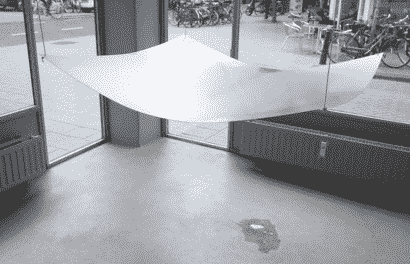

乔纳斯·伦德，《错失恐惧症》，2013。图片由 Showroom MAMA 和艺术家提供。

与《错失恐惧症》的私有数据库及艺术市场网站的专有 API 形成对比的是，艺术机构正朝着自由（指自由而非免费）[⁶]或开放数据迈进。欧洲数字图书馆项目将欧洲文化藏品的元数据作为链接开放数据发布，已成功从欧盟两千多家机构发布数据。盖蒂基金会发布了近五千张免费图像，让那些嫉妒地守护着旧艺术品照片、版权归属模糊的英国机构羞愧难当。最近，英国泰特美术馆则在自由（指自由）的 `CC0` 许可下发布了其藏品元数据。

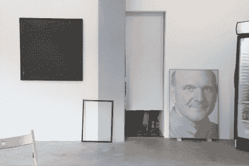

乔纳斯·伦德，《错失恐惧症》，2013。图片由 Showroom MAMA 和艺术家提供。

沙德科尔的《机器想象的艺术品》（2013）利用泰特美术馆的藏品元数据生成可能的艺术品描述。[⁷] 与《错失恐惧症》的数据驱动方法相比，《机器想象的艺术品》是一个更传统的生成程序，它利用无约束的随机性，从泰特数据的材料和主题本体论所界定的受限概念空间中选择材料。

随机性无处不在，但在生成艺术圈子中常被嫌弃。它能产生良好结果，却缺乏意图或方向。不过，寻找更复杂的选择方法往往意味着迅速递减的回报。《机器想象的艺术品》通过为每件生成作品编号，明确了其作为概念空间中一组坐标的地位——该作品是基于泰特数据可生成的 88,577,208,667,721,179,117,706,090,119,168 种可能艺术品中的一种。

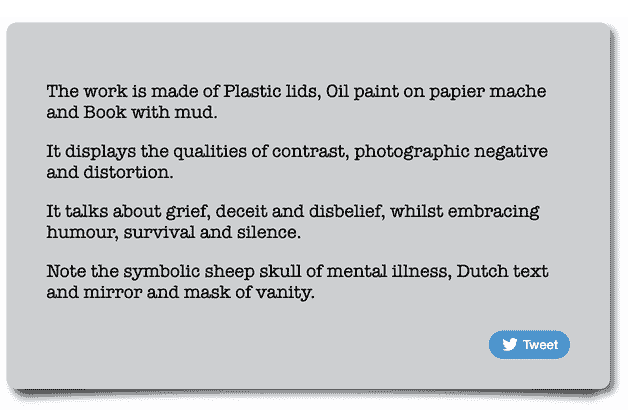

埃里克·德拉斯（即沙德科尔），《机器想象的艺术品》，2013。软件。图片由艺术家提供（[shardcore.org](http://shardcore.org)）。

《机器想象的艺术品》描述了艺术品的形式、意图与批判图式。这反映了当代艺术界与学术界意识形态（正如泰特元数据结构所捕捉的）对当代艺术和艺术家的要求。它在此视角下对艺术品做出了完整描述。这种描述显得不完整的程度，即是呈现该描述的艺术品批判该视角的程度。

我们可以利用《机器想象的艺术品》的输出，从 `Thingiverse` 挑选 3D 模型进行混搭。自动化这一过程将把人类艺术家从创作流程中移除，让机器也夺走他们的工作。将艺术品当作准主体而非人类沟通媒介的诡异恋物癖，于此瓦解。这种项目中没有“实在”，制作者或艺术品皆无能动性。这是新审美的诡异之处。

指导或取代艺术家的软件，若非要说是将其技能“操作化”，倒不如说更现实地取代了他们的劳动，使他们部分或完全变得多余。在开发此类软件的同时保持艺术家身份，代表了这一危机，却未体现这一危机，因为艺术家仍受雇为艺术家。

即使机器人夺走了艺术家的工作，艺术评论家仍将有工作可做，除非软件也能取代他们。有一个网站展示马尔可夫链生成的、模仿“艺术与语言”集体批判性写作风格的文本，网址为 [<http://artandlanguage.co.uk/>](http://artandlanguage.co.uk/)，推测是对其独特语言风格的模仿。“艺术与语言”的绘画《古斯塔夫·库尔贝的〈奥尔南葬礼〉表达……》（1981）阐释了材料与概念材料任意组合所引发的一些问题，以及艺术意图和批判知识的局限。模仿其风格的马尔可夫链文本也饱受此类方法弱点之苦。读过前几个词后，意义与句法便随之蒸发。评论家依然有工作可做。

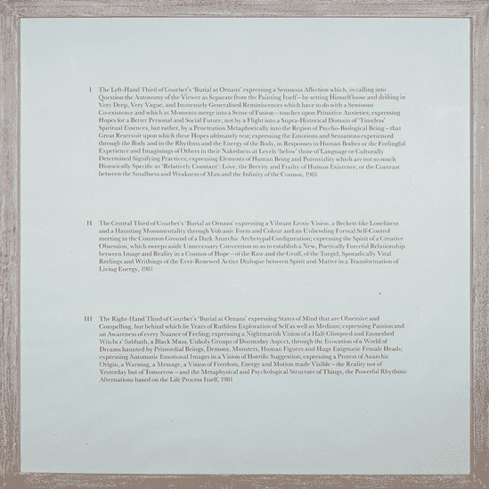

艺术与语言，《古斯塔夫·库尔贝的奥尔南葬礼……/表达生动的情色愿景……/表达生动而引人入胜的心境》，1981。纸本墨水蜡笔装裱于画布，共 4 部分。第 1-3 部分，每部分 324 × 233 厘米，整体尺寸 324 × 699 厘米，第 4 部分（图示），装框文本，122 × 122 厘米。装置，巴黎画廊，法国，1981 (A&L8100001)。© ART & LANGUAGE；图片由艺术家和巴黎画廊提供。

真的是这样吗？算法批评也有数十年的历史，可追溯至詹姆斯·吉普斯和乔治·斯蒂尼的《算法美学》。它目前是数字人文领域的热门话题，例如斯蒂芬·拉姆齐的著作《阅读机器：走向算法批评》（2011 年）。每本书涵盖的成果都很有限，但证明了算法批评的可能性。算法批评的问题在于它可能不符合我们的审美，正如 `ST5` 天线所示。

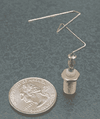

`ST5` 卫星的 X 波段天线。图片来源：NASA

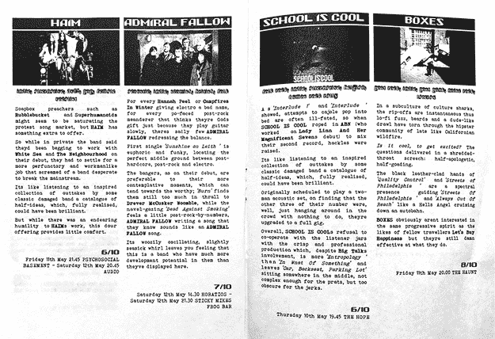

埃里克·德拉斯（即 Shardcore），《剪贴杂志》，2012 年。摄影：埃里克·德拉斯。

Shardcore 的《剪贴杂志》（2012）是一个生成式批评家，它使用与《错失恐惧症》相似的策略来生成关于某乐队的评论。它利用抓取的关于乐队的人类生成数据（如名称、流派、最热门歌曲），从现有评论数据库的片段中拼凑出评论。以这种方式生成批评语言，暗示了对其地位及其对生产者和消费者双方影响的微妙批判。批评语言是可预测的，观众赋予批评家的权威赋予了该语言某种地位。《剪贴杂志》汲取自并回归到粉丝杂志的世界，使批评的真理、形式与地位之间的关系变得可见，从而接受批评的审视。

我们可以利用《错失恐惧症》风格的大数据方法，创作出与主题具有更强语义关联的批评。首先，我们抓取一个艺术评论博客，以文本和图像填充数据库。接下来，我们在此数据库上训练一个图像分类器（一种软件，能告诉你图像是否包含苏联坦克或癌细胞等）和一个文本搜索引擎。然后我们使用情感分析软件（航空公司用来判断关于他们的推文总体是正面还是负面的那种系统）为每条评论生成一到五星的评分，并将其存入数据库。

现在我们可以利用这个数据库，找到外观和描述最接近已被评论作品的艺术品。这使我们能为它们生成批评性评论并分配评分。遵循当前的出版趋势，我们随后可以制作结果清单。正如我之前所论证的，机器确实也能接管批评家的工作。

《错失恐惧症》和《机器想象的艺术品》这类作品所揭示的，是《当下事务运作方式》的一个侧面，以及它如何影响所有人，无论其工作性质如何——在本例中是“大数据被用于指导组织运作”。将此类项目仅视为戏仿或扮演，是对艺术采取了一种还原论的文学手法。但艺术无需归入整齐的类别才能发挥作用，如果不这样做，反而可能为思想提供更强的可供性。有趣的是，这种方法既遗漏了多少，又捕捉了多少。一如既往，艺术既揭示又象征性地消解了（在本例中是加利福尼亚）意识形态的困境。

### 注释

[1] <https://jonaslund.com/works/the-fear-of-missing-out/>

[2] M. Rao, ‘Controversial New Project Uses Algorithm to Predict Art’, *The Huffington Post*, 11 May 2013, <https://www.huffpost.com/entry/jonas-lund-art-algorithm_n_4214211>

[3] J. Manyika et al., ‘Big Data: The Next Frontier for Innovation, Competition, and Productivity’, *McKinsey Global Institute*, May 2011, <https://web.archive.org/web/20130723065804/http://www.mckinsey.com/insights/business_technology/big_data_the_next_frontier_for_innovation>

[4] <https://en.wikipedia.org/wiki/Fluid_Concepts_and_Creative_Analogies>

[5] C. Martindale, *The Clockwork Muse: The Predictability of Artistic Change* (New York: Basic Books, 1990)

[6] <https://www.gnu.org/philosophy/free-sw.en.html>

[7] <http://www.shardcore.org/shardpress2019/2013/11/12/machine-imagined-artworks-2013/>

[8] J. Gips and G. Stiny, *Algorithmic Aesthetics: Computer Models for Criticism and Design in the Arts* (Berkeley, CA: University of California Press, 1990)

[9] S. Ramsay, *Reading Machines: Toward an Algorithmic Criticism* (Champaign, IL: University of Illinois Press, 2011)

# 艺术批评的无产阶级化

## 2013

随着印刷新闻业的崩溃，书评和影评已沦为聚合网站上的单个数据点。这种大数据/集体智能方法扩展至艺术批评领域，只是时间问题。

艺术评论的聚合与统计分析，将完成艺术批评的无产阶级化进程。艺术批评家将与其劳动产品相异化，其创造的价值将在其身份和声誉下，归属于互联网围墙花园的统治阶级。使艺术批评合法化并货币化的机构将位于学术界之外、市场内部。

艺术批评家有两种应对方式。

第一种是试图通过成为统治阶级一员来恢复地位，利用自己的聚合和大数据努力进行元操作。这就像人文计算（或重新包装后的数字人文）之于人文学科，正如 `Google` 之于 `grep`。

第二种是试图抵抗无产阶级化。贡佐式艺术批评、自由开源批评、参与制造者文化与物品生产，任何能产生抗拒聚合货币化、或因成为聚合货币化对象而受益的艺术批评手段。

无论哪种情况，这都将是艺术批评危机的终结，因为它将是艺术批评以目前自主形式存在的终结。

# 《计算机与资本》：数字货币的崛起

## 2014 Furtherfield

`Bitcoin` 是领先的加密数字货币。由黑客 `Satoshi Nakamoto` 于 2009 年创建，它两极分化了舆论。有人将其推崇为自由意志主义对抗“法定货币”不公及国家和大银行权力的技术化身，是纯粹市场价值的化身，不受监管玷污，万物真正只值人们愿支付的价格。也有人基于相同理由，并因其感知到的技术和社会缺陷，对 `Bitcoin` 进行往往残酷的批评。但 `Bitcoin` 的趣味性超越了其最喧嚣的支持者和反对者的关切。

# 比特币：分布式身份、存在与真理

比特币并非由黄金担保的纸币，也非存储在银行中央主机上的电子货币，而是以`区块链`这一公共记录中的交易记录形式存在，该记录由运行比特币软件的互联网计算机共同添加和认证。比特币交易使用加密签名而非姓名或电子邮件作为发送方和接收方的身份标识。网络上处理和验证交易组（或称“区块”）的计算机，是在断言特定数据在验证时刻存在，这一过程通过生成新比特币作为奖励。为防止恶意或虚假验证，每台挖矿计算机必须执行一项计算上昂贵、因而资源消耗巨大的任务，称为“工作量证明”，该任务可被网络上的其他计算机检查和确认。

所有这些意味着，比特币是一个大规模分布式系统，用于断言身份、存在和真理——这些概念的价值被外包给了一个由数学代理组成的社区。`区块链`本质上是一个带时间戳的信息记录，任何人都可以向其中添加内容，以证明特定数据在特定时间存在。这在金融领域之外也有应用，例如基于`区块链`系统的博客、合同、公司和互联网域名服务等新系统。在许多方面，`区块链`及其这些应用才是比特币最令人振奋的部分。

## 货币、密码学与替代货币的历史

货币、密码学（编码与破译）以及替代货币都有着悠久的历史，且常常交织在一起。文艺复兴时期的银行使用秘密代码来保障城邦间通信的安全。替代储蓄或货币体系，如绿盾印花券、LETS（本地交易系统）和航空里程，在二十世纪的不同时期都曾流行一时。第一种加密数字货币是 1990 年的 Digicash。比特币也不是第一种市值数百万美元的电子货币。第二人生在线虚拟现实环境中使用的虚拟货币林登美元，2009 年的经济活动额达 5.67 亿美元。比特币解决了阻碍先前数字货币去中心化的问题，尽管更新的数字货币在设计上对其有所改进，但吸引大众想象力的却是比特币。

## 比特币作为文化催化剂


比特币引发了关于货币是什么、货币的用途以及货币应如何运作的辩论——事实上，其生产、使用及后继者都体现了这场辩论。它创造了一种可能性感和生产范围，堪比早期的万维网。它还催生了诸如 Buttcoin 网站、基于梗的加密货币狗狗币，以及“邓宁-克鲁格兰特”这一绰号等讽刺模仿。比特币的挖矿系统奖励现有资本，其交易成本奖励中介，方式与现有银行和信用卡如出一辙。但这些都是实现细节，更新的加密货币和国家加密货币正在解决这些问题。金融危机后，加密货币连同其所有可能性与矛盾，成为了社会想象力的避雷针。这其中也包括艺术。

## 2014 年币祭：计算机与资本

2014 年在温哥华举办的币祭展示了艺术家使用比特币的案例。活动中的街头艺人可接受比特币小费；展出的涂鸦和混合媒介艺术品可用比特币购买。会场的计算机实验室里，每台台式电脑都展示了一件以比特币为主题的网络艺术作品。这就是**“计算机与资本”**展，由 Erik H. Rzepka 和 Wesley Yuen 策划，也可在线观看。[¹] 展览包含描绘比特币的艺术、以比特币形式可视化财富的艺术，以及唤起类比特币加密货币运作机制的作品。

### thereisaprobleminaustralia：比特币花园

**thereisaprobleminaustralia** 的 **《比特币花园》** 是一个 HTML5 人工生命池塘，里面游动着成群涟漪褪色的比特币标志。它让人联想起 1990 年代 Director 人工生命作品，若能增加更多那种算法特性或许会更好。但作为一种后互联网 Tumblr 风格的拼贴，它有着不可抗拒的宁静与讽刺：比特币许诺的金融人工天堂被渲染为有机形态，或是经济的水力模型渗漏进了网络。

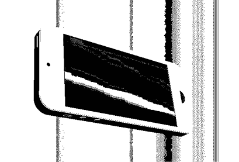

**Jon Cates**，*jonCates bitcrushes MANUEL FERNANDEZ's BROKEN PHONE GRADIENTS*，2014。动态 GIF。

**Jon Cates** 的 *jonCates bitcrushes MANUEL FERNANDEZ's BROKEN PHONE GRADIENTS* 是艺术家基于网络的、话语性的项目实践在某一时刻的动态快照。一台严峻的单色 iPhone 在故障、破碎的屏幕前后旋转，素材经重混/重工，并使用老派的 `Floyd–Steinberg` 抖动算法进行了“比特压缩”处理。非常应景的是，该作品可用比特币购买。

### Ellectra Radikal：E.Rad Coin

**Ellectra Radikal** 的 **《E.Rad Coin》** 是一幅 Vasarely 风格遇上 Twister 游戏般的起伏网格，由扭曲且带色彩渐变的硬币形状组成。它是比特币伦理的审美等价物：将社会视为康威生命游戏的市场经济学视角，赋予了便士以后数字化的转折。

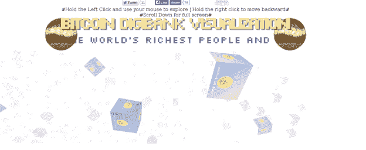

**FELT**，*《比特币数字银行可视化》*，2014。网站。

**FELT** 的 *《比特币数字银行可视化》* 是一个金融超空间，立方体展示着以比特币量化的世界富豪财富，漂浮在无尽的白色中。这既展示了比特币作为一个独立经济位面的地位，也展示了现有资本殖民化任何试图逃离其触角的基于资源的尝试的能力。

### Giselle Zatonyl：泡沫币瀑布

**Giselle Zatonyl** 的 **《泡沫币瀑布》** 是一个视频循环，模拟噪声与数字压缩故障交织的坠落堆叠硬币，上方动画叠加一条 PowerPoint 地狱般的向上曲线图。眨眼间你会错过，但在这不断堆高的（比特）金币上，或有面孔浮现，或倒映在金光中。经济便是如此。

### Matt Tecson：lel buttcoin

**Matt Tecson** 的 **《lel buttcoin》** 是一个 Tumblr 博客缩放页（对垂直滚动条的令人印象深刻的颠覆），内容多为搜集到的“buttcoin”（比特币的常见贬义词）主题图像。Coinyes、Bartcoins 和 Radeon 显卡闯入其中，推测是因为它们匹配了搜索 buttcoin 图像时使用的关键词。

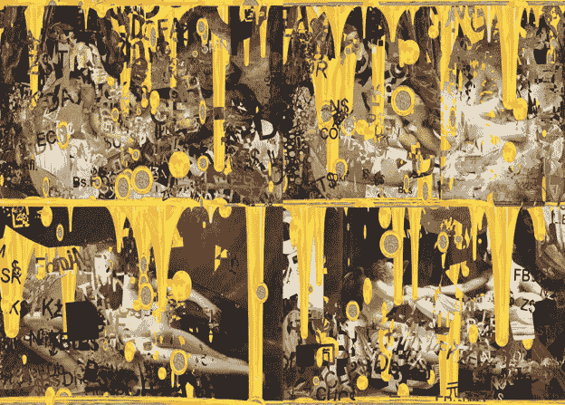

**Roger Grandlapin**，*《达那厄》*。2014。数字动画。

**Roger Grandlapin** 的 *《达那厄》* 是一段 Flash 动画：比特币如蜂蜜般滴落在动态负空间文字、标题同名的色情新古典裸体像及其他我反应不及捕捉的意象之上。比特币的起源故事与更古老的神话相关联，如中本聪降下的金雨。

### Kutay Cengil：无题

**Kutay Cengil** 的 **《无题》** 是一尊略带故障感、默认材质渲染的半身像：额头长着网络摄像头、佩戴着 PayPal 安全徽章、正在融化的金融高官。这是比特币要拯救我们脱离的对象，尽管在最近一次采访中，PayPal CEO 对比特币的信心大于近场通信标签。

### Systaime：比特币丰饶

**Systaime** 的 **《比特币丰饶》** 是一个高压缩 YouTube 视频循环，九十年代 PC 视频片段的糟粕环绕着比特币雨。它与 Jon Cates 的作品截然相反：视觉蒸汽波，那种艺术本应完成的媚俗变质。这是一幅形式丰富的构图，令人愉悦且动容。但即使我抛开网络文化和网络艺术史的偏见，仍面临一个问题：这种美学如何可能失败，并不清晰。

### Devon Hatto：letsnetworth

**Devon Hatto** 的 **《letsnetworth》** 是另一个 Tumblr，汇集了苹果这一符号（知识的象征，也是时髦的数字设计元素）构图的动态 GIF。数字化、生存与象征主义在此结合，正如它们在比特币中结合一般。网络上的财富之网络财富。

[¹]: “计算机与资本”展览参考资料。

# 计算机与资本

亚当·布拉夫曼的**《悼词》**是一部 YouTube 视频，由狗狗币（比特币的通胀对手，以表情包为吉祥物）、《超级马里奥兄弟》游戏画面、燃烧的美元以及其他现成视频影像组成，其中短暂出现了《MST3K》（神秘科学影院 3000），并配以廉价的工业摇滚和软摇滚原声带，穿插着回响的末世经济学讲座。这是一幅关于加密货币及其所处环境的印象派式描绘。

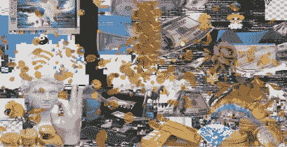

德文·哈托，《letsnetworth》，2014。Tumblr，动态 GIF。

尼古拉斯·科罗洛夫的《绿色冲击》是一堆欧分硬币的图像，中间夹着一颗透明的绿色珠子或 BB 弹。这指向比特币因挖矿消耗电力而常被吹捧的环境影响。这种能源足迹与法币 ATM、芯片读卡器及全球银行体系其他要素的对比，大概就如图中所呈现的关系。

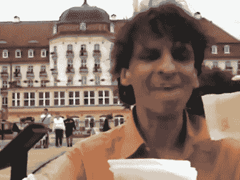

多米尼克·波德西亚德利的《我会吃掉任何数量的欧盟补贴》是一场录像表演，艺术家在其中吸烟、饮酒，并确实吞食了一些巨大的、可食用的 500 欧元纸币。欧元既是政治工具也是金融工具，其危机是推动人们对替代货币（包括比特币）产生兴趣的另一个因素。

奇美里克的《奇美里克币》是一个紧凑的方形图谜，当你拖动旧金币的矩形碎片以露出纸币的短暂峰值时，它会重新排列以适应。这是零和博弈的经济，以及比特币作为对金本位的数字化回归。

米约·范·斯滕尼斯的《比特币之梦》是一款交互式 HTML5 动画，背景是多云的天空和动态的帷幔，前景是下落的比特币。它将紧凑循环的动画、交互与蒸汽波美学结合得不同寻常且行之有效。

ASS Rain 的《树》是半透明绿色方块以“拾棍子”游戏式倾倒而成的拼贴。我发现它在审美和概念上都晦涩难懂，尽管构图非常有效。

罗伯特·B·利塞克的《量子谜题》利用盖革计数器生成用于通信的加密密钥，以讽刺的方式实现了量子密码学的承诺。这是一个在历史和技术上都极具素养的项目，在保持技术性和审美趣味的同时传达了强烈的政治立场。

能够在线策划此类展览并将其作为更广泛文化活动的一部分呈现，标志着一个时刻的到来：互联网接入的广泛普及、Web 2.0 发布平台，以及活动和社区空间中的计算机实验室，已经改变了策展和语境化数字艺术的可能性。《计算机与资本》非常有效地利用了这些便利条件。反复出现的主题——天降横财、讽刺性的数字媚俗、故障压缩伪影和波特拉奇（赠礼宴）——在视觉上传达和批判加密货币在紧缩时代的技术与社会复杂性方面，显得既恰当又有效。

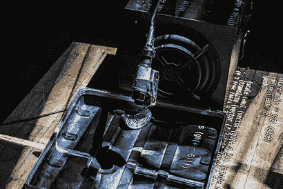

罗伯特·B·利塞克，《量子谜题》，2013。盖革计数器、放射性材料、软件。

比特币吸引了公众、政府、罪犯和艺术家的关注。它既是经济想象的表达，也是一种真正新颖的网络通信手段。这使它成为艺术创作的一个不同寻常的主题，无论是颂扬性的还是批判性的。即使是艺术中对比特币最具讽刺意味的颂扬，也是对网络协议或通缩电子货币的描绘。无论是从视觉和概念上为我们准备一个加密货币的美丽新世界，还是创造一个它们将取得唯一持久胜利的虚幻领域，比特币艺术都与沃霍尔的美元符号、赫斯特的钻石头骨，或其他为资本空洞胜利的意识形态困境提供象征性创可贴的作品截然不同。它是异端的艺术而非霸权的艺术，是技术、社会和审美可能性时刻的艺术。

《计算机与资本》非常成功地捕捉了艺术中的这一时刻，并以数万言论述无法企及的方式使其变得可及。一个发人深省、启迪人心且常具趣味的、水准统一高超却又在技术和审美上多元的作品集，可以作为更广泛文化活动的一部分在线上和线下呈现。《计算机与资本》展示了网络赋能的数字艺术如何能作为桥梁，连接复杂重要的思想与公众想象力。

### 注释

1 [<http://www.xoxlabs.com/x/computersandcapital/>](http://www.xoxlabs.com/x/computersandcapital/)。

# 艺术界的以太坊

## 2014

以太坊是一个用于编写和执行智能合约的分布式计算系统。受比特币启发，它目前正在开发中，计划于 2014 年底发布。“智能合约”这一术语由计算机科学家尼克·萨博于 1993 年左右创造，用于描述计算机可读代码，该代码取代律师可读代码来描述人与人之间的协议和义务。这是对劳伦斯·莱西格“代码即法律”论点的一种非常字面的解读，是一种自由意志主义的尝试，旨在降低不得不信任人类并解释歧义人类语言的成本与不确定性——或者可能是用二元逻辑取代权利和保障的反乌托邦式替代。

智能合约可用于实现智能财产（由计算机代码管控的物理商品）和分布式自治组织（DAO），后者用运行在以太坊区块链上的代码取代成文章程。

以太坊可应用于艺术的生产、展览、批评和机制——从作为智能财产的数字艺术开始。

示例代码使用 Serpent 编写，这是以太坊的高级编程语言，基于以太坊 POC 5 版本。它将针对以太坊发行版进行修订和测试。

### 在以太坊中存储和识别数字艺术

数字艺术作为智能财产有三种情况。第一种是概念艺术或代码艺术的情况，合约代码本身即是或包含了艺术品。第二种是以太坊存储情况，小型数字艺术品存储在以太坊数据存储中。第三种是存储标识符情况，仅存储艺术品的标识符或代理与合约一起。

### 概念艺术与代码艺术

作为艺术品本身的合约是一种简单的情况。它们应存储所有者的以太坊地址，并确保仅所有者能执行的动作交易确实来自该地址。

#### 概念艺术

既然艺术由其无用性定义，一个什么都不做的合约必定是艺术。 ;-)

```
stop
```

#### 冷/热

一个会做点事，但没用的合约。

```
init:
    contract.storage[1000] = "hot"
    contract.storage[1001] = "cold"
code:
    // Make sure we have enough gas to run the contact
    if tx.value < tx.basefee * 100:
        // If not, stop
        stop
    // Swap
    temp = contract.storage[1000]
    contract.storage[1000] = contract.storage[1001]
    contract.storage[1001] = temp
```

#### 编号作品

一个简单的生成式作品，为每次请求创作一件新的、原创的作品。

## 初始化与代码示例

```
init:
  ARTWORK.NUMBER.INDEX = 1001
  contract.storage[ARTWORK.NUMBER.INDEX] = 1
code:
  ARTWORK = "Work #"
  ARTWORK.NUMBER.INDEX = 1001
  // Make sure we have enough gas to run the contact
  if tx.value < tx.basefee * 400:
    // If not, stop
    stop
  // Get the number of the work to produce
  number = contract.storage[ARTWORK.NUMBER.INDEX]
  // Store the number to use for the next work
  contract.storage[ARTWORK.NUMBER.INDEX] = contract.storage[ARTWORK.NUMBER.INDEX] + 1
  // Return the work
  return([ARTWORK, number], 2)
```

## 数据可视化

一个简单的定制生成作品/数据可视化。组装后输出看起来类似


```
HEX = ["0", "1", "2", "3", "4", "5", "6", "7", "8", "9", "A", "B", "C", "D", "E", "F"]
ARTWORK = ["<svg><rect x=\"23\" y=\"23\" ", "height=\"123\" width=\"123\" ", "style=\"fill:none;stroke:#", ";stroke-width:32\" /></svg>"]
ARTWORK.LENGTH = 10
ARTWORK.INSERT.END = 8
// Make sure we have enough gas to run the contact
if tx.value < tx.basefee * 500:
  // If not, stop
  stop
  // If there are enough arguments
  // and the command to create the work is being given
  if msg.datasize == 1 and msg.data[0] == "create":
    artwork = array(ARTWORK.LENGTH)
    artwork[0] = ARTWORK[0]
    artwork[1] = ARTWORK[1]
    artwork[2] = ARTWORK[2]
    artwork[9] = ARTWORK[3]
    // Copy the most significant hex bytes of the key as an html colour
    index = 0
    hash.bytes = msg.sender
    while index < 3:
      current.byte = hash.bytes % 256
      hash.bytes = hash.bytes / 256
      hi = HEX[current.byte / 16]
      lo = HEX[current.byte % 16]
      artwork[ARTWORK.INSERT.END - (index * 2)] = lo
      artwork[ARTWORK.INSERT.END - (index * 2) + 1] = hi
      index = index + 1
    return(artwork, ARTWORK.LENGTH)
  // Otherwise
  else:
    // Logical false for failure
    return(0)
```

## 存储艺术

数字艺术可以存储在合约的字节码或永久存储中，而非由合约代码生成。

### 一个存储的图像


# 以太坊艺术市场

## 2014

这是一个合约，允许你注册为特定文件（由其加密哈希值标识）中包含的、位于特定 URL 的数字艺术品的所有者。使用 URL 受到了优秀的 Monegraph 的启发，后者在我开始研究用于艺术的以太坊合约后不久推出。Monegraph 使用现有的 NameCoin 系统，该系统可以用两行合约代码在以太坊中实现。

该合约比那要长，因为它记录和管理更多信息。它还允许你将艺术品挂牌出售（以以太币换取，即以太坊的内置货币），既可以卖给特定个人，也可以公开出售，或者在合约内不收费地将其转让给特定个人。

## 智能合约代码

```
ARTWORK = ['P1\n32 32\n00000000000000010000000','00000000000000000000000010000000','000000000000000\n0000000001000000', '00000000000000000000000001000000', '000000000000000000000000001100000', '00000000000000000000001100001010', '000011000010000000 00100000000\n00', '01011000010000000000100000000000', '0111100010000000000100000000 \n0001', '1111\n000100000000001000000000011', '11110110000000000010000000001111','11100010000\n00000000000000011111', '11000000000000000010000001111111', '11000000100000 0000\n1000001111111', '11000000000000000000000000111111', '111000000100000000000000 0\n00011', '11111000000000000000100000000001', '11111100000100000000000000000111', '\n1111110000000000000010000000011', '11111100000100000000010000001111', '1111000\n 000100000000000000000111', '11110000000000000000000100001111', '10000000000100n000 00000000001111', '10000000000010000000000001111100', '000000000001000000000\n00000 11100', '00000000000100000000000000101000', '0000000000000000000000000000\n010', '10000000010100000000000000000000', '01010010100000000000000000000000', '000n0110000000000000000000000000', '00000100000000000000000000000000', '0000010000\n000000000000000000000','00000010000000000000000']
ARTWORK.LENGTH = 33
// Make sure we have enough gas to run the contact
if tx.value < tx.basefee * 1000:
  // If not, stop
  stop
  // If there are enough arguments
  // and the command to show the work is being given
  if msg.datasize == 1 and msg.data[0] == "exhibit":
    // Just return the artwork
    return(ARTWORK, ARTWORK.LENGTH)
  // Otherwise
  else:
    // Logical false for failure
    return(0)
```

## 数字艺术的标识符

当一件数字艺术作品无法容纳在区块链中时，必须在合约中存储一个更紧凑的标识符，并用它来指代该作品。理想情况下，识别数字艺术品唯一实例的方法应当：

- **稳定。** 该标识符应可使用数十年。例如，网页 URL 可能会随着服务提供内容的方式改变或倒闭而变更或变得不可访问。
- **可验证。** 该标识符应可用作验证资源是否为其所指代资源的一种方式。例如，加密哈希无法用于已调整大小的数字图像，或哪怕仅有微小差异的 GPS 坐标。
- **可修正。** 当稳定性失效或所有权变更要求更改标识符时，应能以受信且可验证的方式更新标识符。
- **充分。** 识别资源所需的信息应可直接从合约中使用，而无需外部信息来补充。
- **私密。** 标识符应尽可能少泄露资源所有者的信息。例如，GPS 坐标或街道地址虽然稳定，但确实定位了资源及其可能的所有者。仅存储标识符的加密哈希可以缓解这一问题。

这些标准中的一些相互冲突，因此任何特定的识别方法都必须在它们之间进行权衡。例如，在私密性与可验证性之间，或稳定性与可修正性之间。

为了让艺术品与智能合约交互，我们需要一种在合约中识别它们的方式。当数字艺术品过大或过于复杂，无法保存在合约的代码或存储中时，必须使用指代它的代理或紧凑标识符。

以下标识符各有优劣。我们将在下一节中使用其中一些。

### URL

URL（如网站地址）是一个清晰的公共标识符。它缺乏私密性，且其稳定性仅取决于托管它的服务，但具有唯一的优势。为了增加一层私密性，合约可以仅存储 URL 的加密哈希，任何希望检查某 URL 是否为合约所指代的作品实例的人，都可以将其与该 URL 的哈希进行核对。

例如，URL：

<https://www.urbanomic.com/book/proof-of-work/>

具有 SHA-256 哈希：

`45ea9081ffb3d5ccd086463b37f2628d0bbe4dae9a6d38fa32fdc95392c3a3cb`

切勿为以 URL 形式呈现的作品使用链接缩短服务或消费级第三方托管服务：此类服务极有可能倒闭或更改其 URL 结构，导致与之关联的任何标识符失效。当使用自己的网站托管作品时，请务必同时保持域名注册和服务器运行，并为不再能够或愿意维护时做好维护安排。

### 文件哈希

生成文件中包含或由文件代表的作品的加密哈希既简单又能唯一标识文件包含的数据（尽管该文件的任何副本将具有相同的哈希）。最好对文件的内容进行哈希，而不是对文件本身：具有相同像素值的图像，在 PNG 或 GIF 格式下，其在磁盘上的结构将截然不同。同样，应对文件内容的全尺寸或全质量版本进行哈希，而非缩略图或有损版本。

### Git 仓库提交哈希

现代去中心化版本控制系统使用加密哈希来标识提交。哈希可以标识版本控制仓库中系列作品的版本，尽管它们最好伴随 URL 或其他仓库标识符一起使用。

### 序列号或 UUID

嵌入在作品文件名或元数据中的序列号或唯一标识符可用于识别作品。可见水印是业余爱好者的标志，而隐写水印很容易被破解。

### 加密签名

在制作数字作品的版本时，每个版本均可由艺术家签名，以将其标识为授权版本。

### 名称

当其他方法都失效时，为作品指定一个独特的名称和描述是一个有用的标识符。

## 艺术作为智能财产

### 一个简单的所有权作品

```
OWNER = 0x7c8999dc9a822c1f0df42023113edb4fdd543266
// 获取所有者的以太坊地址
return(OWNER)
```

### 一个可确认所有权的简单所有权作品

```
OWNER = 0x7c8999dc9a822c1f0df42023113edb4fdd543266
// 确保我们有足够的 gas 来运行合约
if tx.value < tx.basefee * 100:
    // 如果没有，停止
    stop
// 如果发送的以太坊地址与所有者匹配
if msg.data[0] == OWNER:
    // 返回真
    return(1)
// 否则
else:
    // 返回假
    return(0)
```

### 一个简单的存储型所有权作品

```
OWNER = 0x8802b7f0bfa5e9f5825f2fc708e1ad00d2c2b5d6 // 最初为艺术家
WORK = "The art happens here."
// 确保我们有足够的 gas 来运行合约
if tx.value < tx.basefee * 200:
    // 如果没有，停止
    stop
// 如果有足够的参数
// 且给出了返回所有者地址的命令
if msg.datasize == 1 and msg.data[0] == "owner":
    // 返回拥有所有权的以太坊地址
    return(OWNER)
// 如果有足够的参数
// 且给出了返回作品的命令
if msg.datasize == 1 and msg.data[0] == "work":
    // 返回作品
    return(WORK)
// 否则
else:
    // 返回逻辑失败
    return(0)
```

### 一个简单的可转让存储型作品

```
init:
    ARTIST = 0x8802b7f0bfa5e9f5825f2fc708e1ad00d2c2b5d6
    OWNER = 1001
    // 将所有者初始化为艺术家
    contract.storage[OWNER] = ARTIST
code:
    OWNER = 1001
    ARTWORK = "The art happens here."
    // 确保我们有足够的 gas 来运行合约
    if tx.value < tx.basefee * 200:    // 如果没有，停止
        stop
    // 如果消息来自当前所有者
    // 且有足够的参数
    // 且给出了转让命令
    if msg.sender == contract.storage[OWNER] and msg.datasize == 2
    and msg.data[0] == "transfer":
        // 转让给新所有者
        contract.storage[OWNER] = msg.data[1]
        return(1)
    // 如果有足够的参数且给出了显示作品的命令
    else if (msg.datasize == 1):
        // 仅返回作品
        return(ARTWORK)
    // 否则
    else:
        // 返回逻辑假表示失败
        return(0)
```

### 数字艺术的所有权注册表

```
if tx.value < tx.basefee * 200:
    // 如果 gas 不足，停止
    stop
// 如果提供了数据，不会覆盖代码，且作品未注册
if msg.datasize == 1 and msg.data[0] > 1000 and contract.storage[msg.data[0]] == 0:
    // 将所有者设为发送者
    contract.storage[msg.data[0]] = msg.sender
    return(1)
else:
    // 什么都不做
    return(0)
```

### 基于哈希的特定数字艺术实例所有权注册表

这是一个用于特定 URL 处艺术品所有权的注册表。艺术品通过其文件内容的哈希值和 URL 的哈希值来识别。所有者通过以太坊地址来识别。

```
if tx.value < tx.basefee * 200:
    // 如果不够，停止
    stop
// 如果正在请求注册
if msg.datasize == 3 and msg.data[0] == "register":
    // 如果该 url/作品组合未被认领
    if ! contract.storage[msg.data[1]]:
        // 将所有者设为提供的以太坊地址
        contract.storage[msg.data[1]] = msg.sender
        // 在 url 所有权信息旁存储作品哈希
        contract.storage[msg.data[1] + 1] = msg.data[2]
        // 返回成功
        return(1)
    // 如果发送者试图覆盖其不拥有的作品
    else:
        // 他们无法设置，因此返回失败
        return(0)
// 如果正在请求所有权确认
// 确认作品和 url 哈希匹配
else if msg.datasize == 4 and msg.data[0] == "confirm":
    // 将提供的哈希与存储的作品和 url 哈希进行核对
    return((contract.storage[msg.data[2]] == msg.data[1]) and (contract.storage[msg.data[2] + 1] == msg.data[3]))
// 如果未指定操作
else:
    // 否则什么都不做
    return(0)
```

## 在以太坊中认证艺术

认证与所有权一样，与身份和合同法相关。

### 数字艺术的简单真实性证书

```
ARTIST = 0x8802b7f0bfa5e9f5825f2fc708e1ad00d2c2b5d6
ARTWORK.HASH = 0x76bba376ea574e63ab357b2374d1cee5aa77d24db38115e3824c5cc4f443d5f7
return((msg.data[0] == ARTIST) and (msg.data[1] == ARTWORK.HASH))
ARTIST = 0x8802b7f0bfa5e9f5825f2fc708e1ad00d2c2b5d6
WORK.HASH = 0x76bba376ea574e63ab357b2374d1cee5aa77d24db38115e3824c5cc4f443d5f7
URL.HASH = 0xa005b1625af0b6ee080dafb904c4505ad285764071ee45a8786159bd1a282634
// 如果有足够的参数
if msg.datasize == 2:
    将提供的哈希与存储的作品和 url 哈希进行核对
    return((msg.data[0] == WORK.HASH) and (msg.data[1] == URL.HASH))
// 否则
else:
    // 什么都不做
    stop
```

### 数字艺术家的作品编目

```
ARTIST = 0x8802b7f0bfa5e9f5825f2fc708e1ad00d2c2b5d6
// 确保我们有足够的 gas 来运行合约
if tx.value < tx.basefee * 200:
    // 如果没有，停止
    stop
// 如果消息来自艺术家
if msg.datasize == 1 and msg.sender == ARTIST:
    // 将作品添加到编目中
    contract.storage[msg.data[0]] = 1
    return(1)
// 检查收录情况
else if msg.datasize == 1:
    // 检查作品是否在编目中
    return(contract.storage[msg.data[0]])
// 否则
else:
    return(0)
```


# 以太坊艺术品市场智能合约

```lisp
{
  (def 'next-record 0x10)
  (def 'RECORD-SIZE 64)
  ;; 下一条记录的位置
  ;; 这从 RipeMD 最大值的上方一个单元格开始
  [[next-record]] 0x10000000000000000000000000000000000000000
  (return
    0x0
    (lll {
      ;; 动作
      ;; 0 - 消息中的第一个单元格
      [action] (calldataload 0)
      (when (= @action "register")
        {
        ;;TODO: 检查消息长度是否正确
        ;;TODO: 检查摘要是否在范围内
         ;; 艺术品摘要
        [digest] (calldataload 32)
        ;; 如果已注册，则不继续
         (when @@ @digest
           (return "Artwork already registered."))
        ;; 获取新记录的存储空间
        [storage] @@next-record
        ;; 存储摘要
        [[@storage]] @digest
        ;; 艺术家账户
        [storage] (+ @storage 1)
        [[@storage]] (caller)
        ;; 艺术家转售百分比
        [storage] (+ @storage 1)
        [[@storage]] (calldataload 64)
        ;; 艺术家是当前所有者
        [storage] (+ @storage 1)
        [[@storage]] (caller)
        ;; 跳过购买者和价格
        [storage] (+ @storage 3)
        ;; 复制 URL 和描述
        ;; 96 是 32 x 3 = 消息中的第 3 个单元格
        [source] 96
           (for [i] 6 (< @i 64) [i] (+ @i 1)
              {
              [[@storage]] (calldataload @source)
              [storage] (+ @storage 1)
              [source] (+ @source 32)
              })
        ;; 存储摘要到记录的链接
        [[@digest]] @@next-record
        ;; 增加下一条记录的位置
        [[next-record]] (+ @@next-record RECORD-SIZE)
        })
      (when (= @action "offer")
         {
         ;; TODO: 检查消息长度是否正确
         ;; TODO: 检查摘要是否在范围内
         ;; 获取摘要对应的艺术品记录存储位置，如果不存在则停止
         ;; 32 = 消息中的第二个单元格
         [storage] @@(calldataload 32)
         (when (not @storage)
            (return "Artwork not registered."))
         ;; 如果调用者是所有者
         (when (= @@ (+ @storage 3) (caller))
            {
            ;; 报价主题
            [[(+ @storage 4)]] (calldataload 64)
            ;; 报价价格
            [[(+ @storage 5)]] (calldataload 96)
            })
            })
      (when (= @action "accept")
         {
         ;;TODO: 检查摘要是否在范围内
         ;;TODO: 对错误价格或买家的错误消息
         ;; 获取摘要对应的艺术品记录存储位置，如果不存在则停止
         ;; 32 = 消息中的第二个单元格
         [storage] @@(calldataload 32)
         (when (not @storage)
            (return "Artwork not registered."))
         [buyer] @@(+ @storage 4)
         [price] @@(+ @storage 5)
         ;; 如果调用者是买家且付款正确
         ;; 或者没有买家但付款正确且非零
         (= @price (callvalue)))
         (&&
        (= @buyer 0)
            (> @price 0)))
            {
            ;; 用于付款
            ;; 以太坊不允许小数金额
            ;; 提醒用户设置可被整除的价格
            [hundredth] (/ @price 100)
            [arr] @@(+ @storage 2)
            ;; 支付给艺术家
            (call (- (gas) 250) @@(+ @storage 1) (* @hundredth @arr) 0 0 0 0)
            ;; 支付给所有者
            (call (- (gas) 250) @@(+ @storage 3) (* @hundredth (- 100 @arr)) 0 0 0 0)
            ;; 转移所有权
            [[(+ @storage 3)]] (caller)
            ;; 清除报价主题和价格
            [[(+ @storage 4)]] 0
            [[(+ @storage 5)]] 0
            })
         })
         })
      } 0x0))}
```

## UI 截图

这是主 UI 的顶部和底部（使用 HTML 和 JavaScript 为 AlethZero 以太坊客户端实现）。

 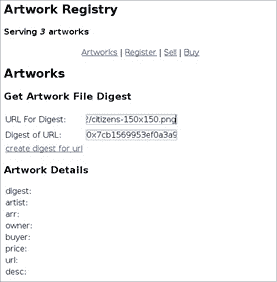

您可以输入一个 URL 并获取其加密哈希值。如果艺术品已注册，这将显示其详细信息。

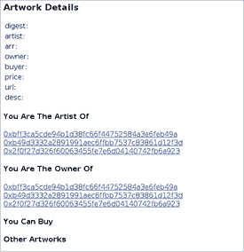 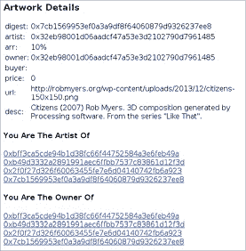

如果未注册，您可以对其进行注册。


一旦您注册了艺术品，您就是它的艺术家，同时也拥有它。您可以将您拥有的任何艺术品挂牌出售。


您可以接受销售报价，支付指定数量的以太币。


UI 会警告您即将花费多少以太币。

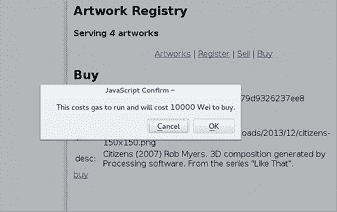

当您购买艺术品时，它会让您知道转移何时完成。

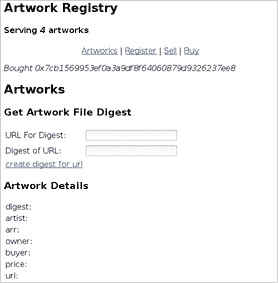

这是一个同构数字艺术市场。与现有艺术市场相反，它完全公开透明。并且与许多司法管辖区不同，它以自愿的方式实施了有争议的“艺术家转售权”（方式类似于《艺术财产的社会生活》中建议的方式）。4 如果在现有艺术市场中进行实验难以实现，我们可以为新型艺术创建新市场。就像这个一样。

### 注释

1. 参见“艺术世界以太坊”。
2. A. Dash, ‘A Bitcoin for Digital Art’, medium.com, [<https://medium.com/message/a-bitcoin-for-digital-art-8c7db719e495>](https://medium.com/message/a-bitcoin-for-digital-art-8c7db719e495)。
3. [<https://eth.wiki/>](https://eth.wiki/)。
4. A. Whitaker, *The Social Life of Artistic Property*, [<https://www.thing.net/~rdom/ucsd/3somesPlus/sociallifeofartisticproperty.pdf>](https://www.thing.net/~rdom/ucsd/3somesPlus/sociallifeofartisticproperty.pdf)。

# 加密印记

## 2014

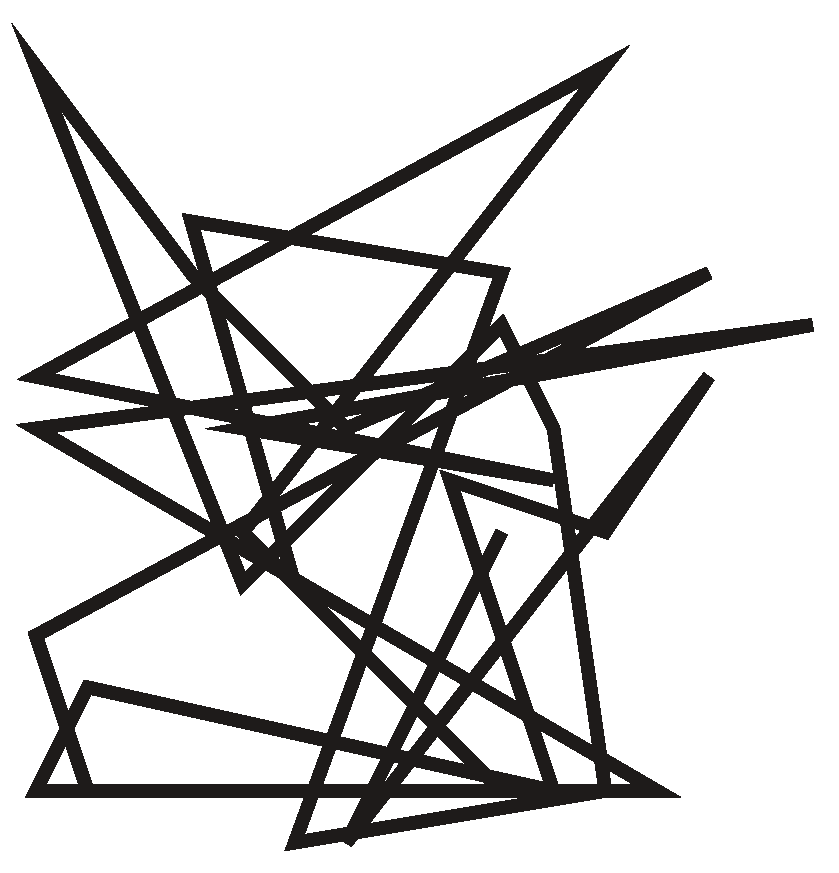

加密哈希函数是一段计算机代码，它接收一段数据并生成一个（希望）唯一的短字符串来代表它。该字符串绝不会类似于输入数据，您也无法从中猜出输入数据。对于相同的数据，该函数始终输出相同的字符串，而更改数据将改变输出字符串。

例如，我可以在 UNIX 命令行上使用 `sha256` 函数为我的名字创建一个唯一的表示：

```
# echo rhea | sha256sum
2466a0da1499e193618f43b392a408b2101710fef023f8b01ec351ab393d9ea4 –
```

如果我再次执行此操作，会得到相同的结果：

```
# echo rhea | sha256sum
2466a0da1499e193618f43b392a408b2101710fef023f8b01ec351ab393d9ea4 –
```

但如果我只添加一个额外的字符，就会得到不同的结果：

```
# echo rheaM | sha256sum
aa0aaa2835c977137200480dae2672603eb368b80adaae4aef79a385c451ff95 –
```

重要的是，输入差异的大小对输出字符串之间的差异大小没有影响：

```
# echo rheaN | sha256sum
81744d575e87892fa40992b20a001036a871f7401839beed78aab114c2e00818 –
```

因此，加密哈希函数的输出为数据生成了身份标识，可用于唯一引用数据，但不会泄露数据内容。

哈希函数通过将数据馈送到复杂的数学变换中来实现这一点。这是一种在数学空间中的映射，它在隐藏内容的同时保持了身份和差异。

这非常像印记。

确实，如果知道制作印记所抽象的词语，人们可以在印记中识别出它们的痕迹。但这些痕迹是达到目的的手段，它们是产生一个引人注目且独特的新身份以供专注和投入的方式。

# 加密印记

每小时创建的加密哈希字符串数量，超过了人类历史上制作的所有印记总和。数十亿次穿越数学空间的映射，用以建立、隐藏并传达身份。它们的共识现实地位，以及作为数学客体柏拉图理念世界导出物的身份，使它们成为理想的魔法素材。

完整的 32 字节 `SHA-256` 哈希值难以记忆，尽管做到这一点可能是一种仪式性的壮举。将其抽象为前几位数字可能就足够了，就像 Git 提交所做的那样。[¹] 我们不必使用十六进制（基数 16：`0123456789ABCDEF` 而非基数 10：`0123456789`）数字字符串，那是哈希函数通常的人类可读输出。HTML 风格的颜色可以用三位或六位十六进制数字表示，例如蓝色是 `0000FF` 或 `00F`。因此我们可以用哈希值的前六位数字来选择一种独特的颜色。[²]

例如：

```
echo this is my intent | sha256sum
```

```
1b0fd74346abfe6858b12b8e3036649a63c09f2a049634dfe3c835f32422f58e –
```

作为 HTML 颜色，这是 `#1b0fd7`——看起来像这样：


我们也可以将成对的数字作为 16×16 网格上的位置，或使用更多数字构建更大的网格，或将三组数字生成三维路径[³]，用于 3D 打印或导入虚拟现实。

这是一个简单的 Python 示例：

```python
import hashlib

digest = hashlib.sha256()
digest.update(" the spammish repetition")
digest_string = digest.hexdigest()
digest_numbers = [int(char, 16) for char in digest_string]
coords = [digest_numbers[i:i+2]
 for i in range(0, len(digest_numbers), 2)]
print "%!psnnewpath"
print "%i %i moveto" % tuple(coords[0])
for coord in coords[1:]:
 print "%s %s lineto" % tuple(coord)
print "0.25 setlinewidthnstroke"
```

你可以在本文开头看到该程序输出的渲染结果。我们可以将其与颜色结合（或将哈希的颜色渲染为彩色方块网格）。

另一种从哈希生成视觉形式的方法是使用形状文法，就像 `libvisualid` 所做的那样。[⁴] 这是 `libvisualid` 渲染的“this is my intent”：

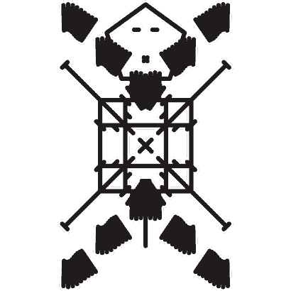

哈希值可以附加在电子邮件或推文上，以便在世界中定位和传播它们。或者，可以使用诸如 `Bitcoinproof`[⁵] 之类的系统将其放入比特币区块链，随着比特币区块链的更新而不断被重新哈希。这是区块链中一个咒语的哈希值：

`1Eui1Wje41JEJ4W1QYWbSAYG4h7JBaoPXQ6`

我们可以使用类似比特币工作量证明的系统，为数据寻找吉利的哈希值——即那些以一串前导零或其他数字（或目标字符串、编码为数字的位图）开头的哈希值。

更多 Python 代码：

```python
import hashlib
import binascii

target = "0000"
complement = -1
digest_numbers = ""

while not digest_numbers.startswith(target):
 complement = complement + 1
 digest = hashlib.sha256()
 digest.update("this is my intent")
 digest.update(str(complement))
 digest_numbers = digest.hexdigest()
 print "%d %s" % (complement, digest_numbers)

print binascii.b2a_uu(str(complement))
print binascii.b2a_base64(str(complement))
```

及其输出，这是创建输入字符串吉利哈希值的关键：

```
0 eae2ffcee00aa95306e706dd4bc67ab6b9fd2ffe61b32dfe4177b76c0afd682d
1 84ba18490876919df8bbff194eeb861c6c44a27e9bfbd8db485ecf704e41fcbd
2 f53226b118fa492dc21cd4336d67b4c8ce4148e49e8e4b094baf3e5ecff688ba
[...]
74962 38d5f823e881857f031def1822a28546d29b40903959b1c9bf1f5a1bebd42d9e
74963 b906fd259413ac714de31b9acaf6f0e5268560221d07f557f0f491a081a2cd09
74964 00006dd9f148ca454d331179bd7c87b42d7ab734df7738e1ae90e25013f02a1d
%-S0Y-C0
```

`NzQ5NjQ=%-S0Y-C0` 和 `NzQ5NjQ=` 是数字 `74964` 的不同表示形式。它们可用于创建印记，或者该数字可通过记忆生成器用语言形式表示。

关于加密哈希和加密签名还有更多可做的事情，这里未一一涵盖。但希望这些示例能激发进一步的实验。


（所有代码采用 CC0 许可。）

### 注释

[¹]: <https://mirrors.edge.kernel.org/pub/software/scm/git/docs/user-manual.html#understanding-commits>

[²]: <https://web.archive.org/web/20130423132157/http://blog.dopplr.com/2007/10/23/in-rainbows/>

[³]: <https://hyperritual.com/blog/3d-sigil-maker/>

[⁴]: <https://disambiguate.me/stickfigurator>

[⁵]: <https://github.com/vog/bitcoinproof>

[⁶]: <https://www.blockchain.com/btc/address/1Eui1Wje41JEJ4W1QYWbSAYG4h7JBaoPXQ>

# 我的小小便士，比特币即魔法

## 2014

留给机器的零钱。

帕特·卡迪根，《合成人》

西奥多·阿多诺将神秘学视为一种通过退行至万物有灵论来否认异化的政治静默行为。

神秘学是对一切意义主体化的一种条件反射式行动，是物化的补足。如果，对活着的人来说，客观现实似乎前所未有地聋哑，他们便试图通过念叨“阿布拉卡达布拉”从中榨取意义。意义被随意地归因于次恶之物：真实的理性不再完全令人信服，取而代之的是跳舞的桌子和从土堆中射出的光线。[⁷]

这确实如此，尽管一如既往，将人类心理学的一个更普遍特征独特地归因于单一宗教总是错误的。

宗教的鲍德里亚式迪士尼乐园是货物崇拜，美拉尼西亚岛民为来访的人类学家重演早已离去的美军当年的活动，以期让运送战时物资的载具重返。对外部观察者而言，显然神秘学和货物崇拜一样，都陷入了混淆相关性与因果性的谬误。

神秘学像哲学一样，患有语义谬误。这相当于可怜谬误，但针对的是意义：将逻辑而非情感意义的认知结构投射到外部环境中。魔法通过青春期男性权力幻想延伸了这一点——直接将意志强加于现实，减少获得应得之物所需的工作量。在这方面，它类似于经济学。

现代经济学使用统计学来建模现实。从总体中抽取样本，并使用各种检验确保关于这些样本的结论能准确代表更广泛的总体。基于这些结论的政策随后可应用于大众，并确信它们几乎只会在特定百分比的时间内出错。统计学是经济学的国教，将启示与赦免从数字平面带回。

# Qabbala 101

在《Qabbala 101》中，尼克·兰德描述了卡巴拉数字命理学的假设。[¹] 可以通过系统内部的痕迹，探测到来自系统外部的信号；这可以通过运用数学寻找词语的偶然数字属性、计算其长度或将其辅音映射为数值来实现。这样，文本就能指涉文本之外。算对数字，你就能得到补给，或强加你的意志。在外部观察者看来，数字命理学显而易见的问题在于：谎言、该死的谎言，还有统计学。

加密货币的流行在很大程度上代表了对金融危机和紧缩政策的反应。这种反应采取了从传统经济和政治行动中撤退的形式，至少代表了一种经济奥秘。剥离了超自然色彩的魔法（就像剥离了超自然色彩的经济学……）留下了一个认知余数。它是一种调节人类体验和影响人类行为的手段。并不需要相信虚构实体——无论是意念体还是货币——它们才能产生效力。

在没有国家强制力背书的情况下，加密货币对法币仪式的重演，属于人类学家归因于“货物崇拜”的那类行为。在试图绕过经济学和银行业的工作这一点上，它们类似于魔法。但在运用数学这一点上，它们类似于卡巴拉。比特币中的账户和交易通过加密哈希来表示和保护，这是一种利用数学既隐藏信息内容又证明信息身份的方式。这发生在区块链中，一种由比特币网络中的机器构建和验证的数据结构。区块链是法币的`文外之物`，一个货币的外部。

构建区块链的比特币协议是一组有意义的行动，是人类意图的体现和放大。它是一种仪式。正如 AI 中的版权一样，意图的利益归属于其人类发起者。这不是大规模分布式电子仪式第一次发生：达赖喇嘛在 1990 年代指出，硬盘里有观世音菩萨的咒语，就像电脑上有转经筒。在比特币的案例中，仪式在于构建区块链的无尽数学和网络运算。

这就是比特币是魔法的原因。算对数字，你就能向系统外部发送信号。算对数字，你就能将结果从数字平面映射回社会。算对数字，你就能收到你订购的补给。这是一个改造社会的仪式。

### 注释

[¹]: T. Adorno, ‘Theses Against Occultism’, in *Minima Moralia*, tr. E.F.N. Jephcott (London and New York: Verso, 2005), 238.

[²]: N. Land, ‘Qabbala 101’, in *Fanged Noumena: Collected Writings 1987–2007*, ed. R. Mackay and R. Brassier (Falmouth and New York: Urbanomic and Sequence Press, 2011), 591–606.

# 对智能合约的恐惧

## 2014

巴比伦，公元前 1772 年，约莫茶点时间。汉谟拉比王正向几位博学之士解释他的法典构想。

**汉谟拉比**：所以这些法律将规范我们在社会中开展事务的方式，由国家的强制力作后盾。

**博学之士 1**：慢着。这些“法律”似乎创造了一个独特的因果和道德领域，区别于单纯的人类社会交往。要是它们出错怎么办？

**博学之士 2**：对，对！要是它们对社会不利怎么办？或者它们被写成——

**汉谟拉比**：我是你们的国王。我绝不会颁布坏法律。

**博学之士 1**：可是，假设一个坏国王上台了。那怎么办？我们需要一些东西来保护社会，防止这些“法律”出错。

**博学之士 3**：确实。极其确实。

**汉谟拉比**：好吧，行。我将增设一些管辖法律创设与适用的法律。这样，法律就可用来管辖法律。

**博学之士 3**：那岂不是像让狼为吞食羊羔做账！

**博学之士 1**：是啊，我真看不出用“法律”来减轻“法律”潜在危害怎么行得通。那只是循环论证。

**博学之士 4**：对。下一步是什么？永动机？你这就是在偷换概念。

**汉谟拉比**：我是你们的\*\*\*\*国王！闭嘴同意我！

**博学之士 3**：我们闭嘴了，怎么同意你？你的“法律”对此有何规定？

**博学之士 2**：是啊。应该有法律管管你这种人……

**汉谟拉比**：卫兵！

# 坏柴犬（未剪辑版）

## 2014

## 插画：Lina Theodorou

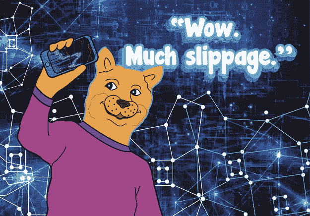

Wow. 距离我排名检查 `AreWeThereYet` 已过去两天。

好眼睛，出发。喂手机！我的排名怎样？

Wow. 掉得厉害。

有个菜鸟在我前面。Amaze。`BangZoom78` 横空出世，打赏得像个真柴犬。更真。Amaze。如此打赏。我们给同伴柴犬打赏以表赞赏。`BangZoom78` 必定被 amaze 柴犬包围。Very amaze。

我在哪？我睡着了。

噢。我躺在沙发上。我喜欢沙发。我喜欢我们的房间。透过窗户木板的光线要么是早晨要么是晚上。等等，要是这么强烈那就是晚上。快上学了！我今天干活了。Much carrying。Such labour。So hot。Maximal tiredness。Ohhhhh。难怪我睡着了。也难怪是晚上。

我再看手机。`BangZoom78` 晋级区域赛了？！Amaze。我感到一阵嫉妒，随即想起我们都要去月球。于是我放下手机，躺在沙发上，看着架子上的鸭子。Many ducks。它们是旧式毛绒骨架鸭，那种在跳蚤市场能买到的。我对 everyshibe 说我觉得它们好笑，但事实是我为它们感到难过。我知道 shibes 以前想要它们，但认真说 noshibe 现在会想要它们，除了我。这就是架子上有这么多的原因。要是它们全砸我身上，我得好几天才被发现。

好几天！

至少我有伴。我对它们嘎嘎叫，然后再叫。两种不同的嘎嘎声。真希望我懂二进制。手机响了。`Kitteh`。我上学要迟到了！

好脚，出发。下楼。出大门。穿过车道。上街。路过犬舍（事实：以前是豪宅，但现在每间屋都住着 many shibes）昔日阳光烤热的人行道热气撞上凉爽晚风，热浪升腾。Science！

走路上学是 `kitteh`。我完全会给 someshibe 打赏让它背我一程。学校远着呢，隔着 blocks and blocks and blocks。既然这么热，为什么一切都用混凝土建？

如果街上的东西颜色不同，还是混凝土吗？如果动物不想被我们吃，为什么它们是肉做的？Wow。我刚走到学校了。

学校帐篷里比外面更热。Good evening my schoolshibes 让我在你们身后找块地儿坐下。我挤在帆布旁坐下。老师在身后帆布上钉了张新海报，画着只穿得过度的 shibe，maximally pre。我因问“他们是谁”而获打赏。Wow。那 pre shibe 名字好笑。他们统治一个街道是水做的国家。同伴 shibes 听我问“这么热为什么我们不把街道造成水的”都笑了。但老师还是打赏我。Amaze。

老师有很多话要说。他们绘制了一条 U 型图表，展示“shibe”一词随时间出现的频率。然后给我们放了一段 pre 电影片段，讲两个 bro 在穿越时空的电话亭里。接着老师解释什么是电话亭。然后讲一种为电视设计的旧麦片。然后讲什么是电视。Much history。

又一张新海报写着“给老师小费！”，我们照做了，因为我们是柴犬。我记得老师的小费收入和我之前的排名下滑（押韵了），所以我又多给了一些。老师也要吃饭。这让我想起，我饿了。当我离开教室时，手机在收拾防水布的柴犬们的喧闹声中响了。因为作业做得好而获得小费。Wow。

回到街上，夜晚正在升温。卖蛋的正在为晚上收摊，留下油腻腻的人行道。跳蚤市场在刺眼的 LED 灯下开始了。对社区多么好的服务。离学校零距离。好多柴犬。有好多商品可逛。

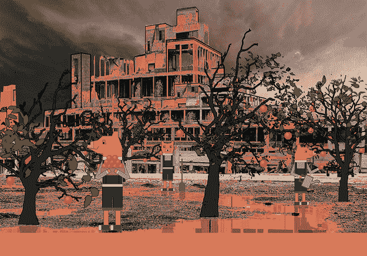

我的同校柴犬们聚集在手推车摊贩周围，抢购苹果和卷饼。Wow。好多美食。“Noms”是喵星语吗？我环顾四周。没人听见我说话。我被扔来一个极其惊艳的苹果，尝起来也好吃，我就给了大额小费。那个故事里不是有个大红苹果吗？还有条蛇？我又被扔来个卷饼。我路边开吃。卷饼一般般。我把它的“尸体”给坐在我旁边的同校柴犬看。

“这个要给小费吗？”我问他们。

我得到一个眼神。

“Norly（不给）”，我再试一次。

好多眼神。

“好吧，天哪，”我嘟囔着。

我给了小费但感觉不好。也许这就是我排名下滑的原因。我一度想就给旁边正在吃东西的同校柴犬小费来提升我的排名。但我要为啥给他们小费？吃得惊艳？坐得惊艳？我的卷饼顾问警惕地注意到我在笑。我对着他们灿烂一笑，掏出手机。他们就在那儿，手机先生。给他们小费，因为他们坐得惊艳。LOL。好像那能行得通似的。

他们的手机响了。

啥？

哦，也许它以为我是在给个惊艳的保姆小费。这不好笑。手机，那只柴犬为盯着看这门艺术的发展做出了宝贵贡献。给小费。像冲牛的兄弟们那样给小费。

叮。

啥玩意儿？

我的受益人施展出忍者级别的组合眼神：既对我不感兴趣，又觉得我应该消失。我的内心比一个对自我身份充满安全感的强者死得更透。我拼命盯着路沿石。为什么会这样？

我是说技术上？

MogoDan 跟我说过手机上的小费历史分析器。好啦眼睛，开始。手机……小费功能……小费功能配置……小费功能配置本体论解释器。Wow，好多代码。回去，回去！交易解释器。是的请。所以……

啥？手机说我完全是为“为盯着看这门艺术的发展做出宝贵贡献”给的小费。我的巨嘴鸟啊！不——！

我进行成本收益分析，问 MogoDan 到底怎么回事，得到“It is decidedly so（绝对是这样）”。这导致了纸笔的出现。我给借我削笔刀的同校柴犬小费。我拦架无人机发信息。嗖！好无人机。超快。

跳蚤市场大部分不在街道本身。摊位蔓延到面对豪宅的尘土碗地，并延伸到它们周围的小巷。柴犬们把货物摆在旧折叠桌或盖着床单的蘑菇箱上。堆积如山的食材、衣服、手机。Wow，多么繁荣的经济。

我穿过尘土碗地，穿过漫步的柴犬，自己也漫步进古董巷。旧奶箱，堆积如山的法币和其他前纪元纪念品。没有鸭子。我好悲伤。但在法币商旁边的摊位上有个我没见过的老柴犬。手里拿着一些极其张扬的前纪元纸张捆。喵星人，眼神接触！

“年轻柴犬，你好啊！”那个眼神接触者推销我。他们藏着个带数字的牌子，但我没看清，因为眼神接触。

“呃……”，我回应。谢谢你的服务，大脑。但推销员极其前纪元。跟他们说啥？

“你知道这些是什么吗？”他们问。他们从桌上拿起一本书，向我翻动书页。好翻动。翻翻翻翻翻。模糊停止。每一页上都粘着小小的绿色矩形纸片。

我掩饰不住好奇心。“法币？”

推销员咧嘴一笑。“接近了。它们是交易印花。”

我的嘴刚说“哈？”

“绿盾印花。你会得到这本书，明白吗，然后你会得到印花。从补给店。印花背面有干胶水，你会舔印花背面……”

我的嘴说“恶心！”我的脸完全赞同。

推销员继续，毫不在意：“……然后把它们贴在每一页的位置上，直到填满整本书。然后你就可以用它们代替法币买东西。”

好奇心完全出卖了我的不在乎。“味道很恶心吗？”

“我不知道。黏糊糊的，我猜。但它们现在真的很稀有。你能拥有一段历史。”

“Pwn（拥有/占有）？”

“呃，我是说你能手握一段历史。”

并非所有同伴柴犬都像我一样视学校为公共利益。但他们教过我们关于法币。和山寨币。山寨币不好。

“这是山寨币吗？”我问。有点紧张。

推销员看起来不紧张。如果我不认识的柴犬指控我有山寨币，我会紧张。

“绝无可能，年轻柴犬，这是前纪元。绿盾印花。”他们继续向我翻动书页。

好尴尬。“呃谢谢但我得去见我家长了。”

Wow，好失败。我基本是成年柴犬了，这借口也太烂了？

穿过尘土碗地走回人行道，我给推销员小费感谢他们的教导，这样我就不会在排名里再滑下去。柴犬们在我周围走走停停、聊聊天，但像往常一样，我不注意我是否认识他们。我走回家，还有下一个八千万亿个街区。

宇宙热寂后我回到窝。楼梯是喵星人。妈妈 1 在，我弟 UnoY 不在。

“嘿 YS，学校咋样？”妈妈 1 问我。

“惊艳。但跳蚤市场后有个推销员想送我山寨币。”

“真的？”妈妈 1 用他们跟我说过的担忧语气问。

“是啊，你知道绿盾印花是什么吗？”

妈妈 1 脸上出现一个表情。然后上下跳动。好多跳动。极致逆向运动学。好兴奋。

“OMFG 我外婆有本那个！要是你明天弄来给我我绝对给你小费！”

我给他们一个眼神。

“它们不是山寨币，是前纪元，”他们向我保证。

“这是推销员的说辞。”

妈妈 1 点头，淡蓝色头发飘动。

“求求求求求求你了。”

妈妈 1 抱住我。

“求求求求求求求求求求你了，YS！做个好柴犬！”

我扭动着逃脱拥抱。“行了！见鬼！放开！”

我的手机响了，妈妈 1 放开我。我查看手机。下雨了！好多来自某柴犬的随机小费！为什么妈妈 1 的手机没响？Wow。甚至更多小费！明天醒来我打赌我甚至不需要查 AreWeThereYet。好累。

我醒了。醒来真惊艳。Wow。我感觉不到胳膊！睡眠在我看 pr0n 时扑倒我在沙发上！为什么??? 我是说 pr0n。我的同校柴犬们点赞它但它一般般。我用嘴抬起右胳膊放在胸口。感觉慢慢回来了。我用它捡起左胳膊。老师提到“左手洗右手”。是这意思吗？是上学日吗？是！惊艳。

窝里好多灰尘。光线从板缝喷薄而入。这是经典沙发，完全前纪元但以好方式。有好方式吗？水街统治者柴犬不错，我猜。街道是水做的怎么做饭？屋顶派对？屋顶派对！

我的 AreWeThereYet 排名咋样？

Wow，好多涨幅。我是柴犬。而 BangZoom78 从区域榜消失了。啥？他们在全国榜！他们将在（查预测）后天成为 Top Dog？什么鬼？他们一定超惊艳！！！但是……

我知道这是错的……

我停不下来思考。关于昨天。给柴犬小费却无理由。没有真实理由。

万一……

不。不不不。不不不不不。没门。我是坏柴犬。我不该这么想。我只是嫉妒。我们都要去月球。手机，当 BangZoom78 成为 Top Dog 时提醒我。

一阵猫薄荷烟雾和突然的重量压在腿上。腿告诉大脑这应该疼。大脑采信它们的话。我弟 UnoY 到达他们自以为是的沙发上。

“兄弟！”我喊。

以恐怖的缓慢我弟转头看我。我收到“Mmmmmmmmmmm？”的礼物。

“我的腿，混蛋兄弟！”我也。好痛。

弟吸口猫薄荷。然后极其缓慢地抬起屁股。刚刚好让我救出我的腿。

我坐直身子，试图看起来体面些。但西布往我脸上喷烟时，我忍不住咳嗽。喵。

西布穿着件“我们是那 49%”印花 T 恤的早期版本，那是我在跳蚤市场给他们淘的。他们手里还捏着那张点燃猫薄荷用的烧焦法币钞票。西布自己种猫薄荷，不种法币。这在果园里闹出过尴尧事。我们在种番茄，我以为他们在种猫薄荷。番茄叶子抽起来不行。同学们不买账。咳嗽个不停。

摩戈丹没回信。摩戈丹是西布的朋友。`2 + 2 = ‘西布，你看到摩戈丹了吗？’`

西布等着海平面再涨一点。

“还得几千个区块呢。”又是一口猫薄荷烟。

我转换话题。“你知道小费协议细节吧？”

我吃了个闭门羹。西布不睡觉，他们等着下一个小费交易区块被处理。如果你在我们社区给小费，大概率会被西布那套由电线、电脑卡、奶箱、筷子和风扇缠绕而成的“极致惊艳”装置处理。他们因此赚了不少小费。这说不通。就像给卖侧手翻的小贩一个苹果。他们要苹果干嘛？他们苹果多的是。我想要苹果。给个苹果呗。

西布像个冠军一样保持着那个眼神。

“我昨天给一只柴犬打了小费，理由是‘一些废话’，他们照收了，”我吐露心声。

西布毫不震惊。“是啊，蠢货，小费可以为任何事打。”

我噘嘴。

咯咯笑声扑向西布。“好吧，到底为什么？”

我给他们看手机。“是啊是啊，盯着看服务。这小费应用真‘一般’。根本不需要填理由，那只是给`AreWeThereYet`用的。我以为学校会教这些破事？”

尴尬至极。“额不。他们让我们总要有个正当理由。”

西布瞥我一眼。“那是个人发展公民责任洗脑。我以前记每只柴犬的理由，全是烂泥。除非你真想给约会对象留下深刻印象，否则全是‘其他，其他，其他’。”

“哈？”一脸懵。

“崽儿，找到你的巨嘴鸟。我们现在不需要给理由了。他们真不在学校教这个？”

我摇头。

西布叹气。“你到底为什么给他们打小费？我……”

我知道这答案。惊艳。“有张海报告诉我们别忘了。”

“我说的不是这个。但要是有张海报让你砸手机呢？”

“为什么要……”

“算了。我刚说到哪？”西布意识到猫薄荷烧完了。他们从兜里掏出放大镜。

我想起来了！“要是有张海报……”


“噢对，没错。所以说嘛，我真觉得学校没教你们该知道的东西。`AreWeThereYet`本来是权宜之计，当初柴犬们在崩溃期间建立打赏圈和机器人时用的。填打赏理由并核对，本意是社会工作量证明，神经网络接入后变成了人类证明。但柴犬们也开始玩弄那套。它变成了声誉经济。他们想让‘顶尖大佬’像当总统一样。”

惊艳。“惊艳！”

我吃了个眼神。“柴犬，这是基础。你学校是喵。你得多出去溜达。多得多，多得多。”

我噘嘴。“我去跳蚤市场。”

西布叹气。或者吸气。通过猫薄荷呼出的算叹气吗？极致地叹气。哇。这种悖论。我延长噘嘴。长久沉默。西布把烟吹进阳光里。

发问！“为什么我们不再需要`AreWeThereYet`了？”

“每只柴犬都懂打赏，每只柴犬都认得机器人攻击，每只柴犬都要去月球。崽儿们爱`AreWeThereYet`，但那只是个游戏，必须保持那样……”。我正想抗议，西布瞪我一眼。“重要的是底层协议和上层分析。但那无聊，只是系统一部分。是经济的拨号音。”

我大脑让我嘴说：“像‘谷船长’一样。”

“啥？”

“龟老师讲电话破解。旧铜线网上。挺逗的。”

西布若有所思但没说话。我多出去溜达溜达。西布能坏但那下子有意思。我下狗窝楼梯时给他们打了小费。好热。我从路过的蛋贩子那买了个卷饼。好吃。真好吃。我给他们打了小费。

生活惊艳。没啥大不了。但有阳光、鸡蛋，手机叮一声。西布打赏我了！等等，他们拒收了小费。退款手续费！喵。

我恨一切。西布一般但……我确实想多出去溜达。我就是不懂柴犬。他们送我眼神。这是眼神互赠宴，我是酋长！我目前更倾向于自我献祭，而非互赠宴。好悲伤。不惊艳。


哇。好热。离上学还有一古戈普勒克斯个区块，但油布顶有大片阴影。脚带我去那儿。我真想打海量小费换个背背。猪仔到底是啥？背背又是啥？学校不敢问。就像我问水獭“獭”什么时。老师和同学觉得我在嘲讽。大笑一场，我领了罚做苦工。等等，嘲鸫会嘲讽吗？

人行道上刷了条白线。昨天没有。我顺着走，跟着它。它带我沿街走个大弯，又在人行道左右摆动。惊艳。我走得越来越快，最后它绕成螺旋，我团团转转转转摔倒。我咯咯笑。人行道边高楼墙上，用同款白漆写着“你懂了！”

我鼓掌。惊艳。手机，给画这玩意儿的人打小费。太好玩了。我得告诉同学们。手机，记住这地儿。脚丫，回工位。那太惊艳了。真好玩。我会想一整天。

一昆托塞普蒂利昂个区块后，我钻进班级油布底下。更多海报！有张莫名其妙可爱的柴犬。有张椭圆曲线叠加图，底下标着名字。有张克拉斯·奥尔登堡的叉子雕塑。还有一张洗手教程。我会洗手。老师盯着我比划洗手动作。尴尬至极。

“晚上好，YS。”老师说。天还没黑呢？

“呃嗨老师，”我回道。“喜欢你的海报，哪弄的？”

“我弟有台 2D 打印机。他们自己培养墨水什么的，”老师说。

“惊艳。太酷了！”我惊呼。老师笑了。

“我以为小柴犬不再说这词了。上课前你可以待在这，但请让我专心布置，”老师说。

“说啥？”我问。

“酷，”老师说。啥酷？我一脸懵，想起我答应不打扰他们。我答应了吗？这是默认合同。所以我想我答应了。你好手机。

`BangZoom78` 现在上了大陆榜。我的巨嘴鸟！他们胳膊准像印度超级英雄，左右开弓打赏。`tiptiptiptiptip…`

“YS？”老师说。

“……tiptiptip——在？”我回道。

“能不能安静点思考。你在这挺好但我得布置，需要专注，”老师说。

我点头。大陆榜！柴犬光上榜就能收小费。这大概构成个循环。果环是啥？妈 1 提过一次。水果怎么变成环？莫比乌斯水果？从哪开始吃？哇。

同学纳拉万到，坐在个完美避开我、入口、油布墙、老师的点。他们掏出手机像搞法医鉴定似的研究。强度拉满。无视满分。

俩手机一起响。下雨了！纳拉万叹气。这打断了老师专注。

“纳拉万，啥烦你？”老师问。

“是`BangZoom78`发的，”纳拉万回道。

“真的？又是？”老师多余地问。纳拉万不抬头点头。

老师在防水布屏幕上调出了 `AreWeThereYet`。他们展示了 `BangZoom78` 最近慷慨解囊的打赏雨。哇，好多打赏。老师按物理位置对打赏进行分组，这勾勒出了大陆这一侧的地图。接着他们将一部分结果叠加在我们当地旧卫星地图上。我抬头望向防水布。从卫星上掉下来会很诡异。嗷呜呜呜呜——

“YS……，”老师说。

“——呜呜，是的？噢，”我回应道。

老师按看起来像时间的维度对显示屏上的打赏进行分组。然后按其他我不知道的标准分组。不是上课时间了吗？不是，还在漫长等待。老师在屏幕上闪现每笔打赏交易的详情，看起来确实像雨。我感觉自己嘴角上扬。老师瞥了我们一眼。

“纳拉万，你认识 Bangzoom78 吗？”老师问。

“我说过我认识，”纳拉万回答。

“我是说私下认识。”

“不，只是从雨里认识的。”

老师瞥了我一眼。这是个暗示。“才没有呢，”老师还没问我就回答了。惊呆。

老师皱眉。“你们俩之前都给他们打赏过。”

啥情况？

老师调出交易记录。“你们俩都给 `BangZoom78` 打赏过。哦，是不同账号但同一个名字。这有问题。而且他们互相打赏。很多。还有其他同名账号……”

老师搜索关联账户。他们之间交易图看起来像旋转绘图仪画的图。旋转绘图仪超酷。妈咪 1 在“盒子”里有个。我超小的时候，画画太入迷，齿轮和铅笔同时划伤并刺穿了我的手。好惨。

“这看起来像逆女巫攻击。为什么没柴犬查过这个？”老师问。

“没人查。他们不用查。”我重复 `UnoY` 早先说的话。

“但这太厚颜无耻了！”老师吐槽。

“我没给他们打赏，”纳拉万说。

“我也没给，”我附和。

随着同学柴犬们到来，调查变成了课堂。学校超酷。好多机会。其他几个柴犬也给 `BangZoom78` 打赏过。我们都不记得干过这事。准是精神控制！

“不是精神控制，YS，”老师说。“区块 `984532965` 里你给谁打赏了？”

“给我跟着走的、在街上画线的那个柴犬。”我复述大脑告诉我的信息。

“你撒谎！”我同学柴犬 `NoUr` 大喊，“你没给！”

众目睽睽下的 `NoUr`。

“我没因那个被打赏。没人因那个给我打赏。”

`NuWae` 举手。老师告诉他们之前说过了不需要举手。

“我给了，”`NuWae` 说。

“才没有呢！”

`Eris` 和我们做了几个区块的朋友。老师再次调出交易记录。

“YS 确实给画东西的柴犬打赏了，但那是个标牌不是线，”老师押韵道。

`NoUr` 瞪我一眼。要是下个区块前地面吞了我，我会像欧洲塔楼一样给它打赏。

“但我让手机给画东西的人打赏啊！”我尖叫。好尴尬。

“画啥了，YS？”老师问。

“线和牌，”我押韵。

“我没画那个牌子你这猫猫碎片——” `NoUr` 正要骂人，老师用一种制止的语气叫了他们的名字。

“不，`NoUr`，我认为 YS 遭遇了上下文碰撞攻击，”老师解释道。意思是我不撒谎。好欣慰。我在讽刺吗？我觉得不是。但要是我在讽刺那超酷。我姐会给我最大额打赏。还有啥？

“啥？”我问老师。

老师看着我。“别的柴犬加了个标牌劫持 `NoUr` 线条的打赏。加标牌的人知道，任何走过线条的柴犬都会看到标牌，”老师再次押韵，“并依赖两者的邻近性，让人把它们视为单一整体，打赏给最后吸引注意力的那个画标牌的人。或者依赖人们打赏时的语义混淆。”

“人？”我问老师。

“柴犬。”

“噢噢噢噢噢。”

“每个柴犬的作业是分析这些交易。但我们得聊聊拜占庭将军问题了……”

老师超酷。好多知识。`BangZoom78` 在作弊！这作弊。哇。

好多冲突。优点栏里，我恨他们是对的。缺点栏里，那仍是嫉妒而非理由。但市场不在乎动机。所以我也不该在乎。哇。我赢了！

下课后每个柴犬给老师打赏，我给 `NoUr` 双倍，老师给我们打赏，听起来像一群手机在寻找配对。叮！叮！叮！（此处省略 N 个叮）交换集市时间！

我穿过夜晚的人行道去交换集市。苹果、卷饼、路缘、吃（吃是猫猫？既视感！超酷），打赏。`NoUr` 挡着我的光站着。逃！我确信这段人行道有活板门，只要我能找到——

“我道歉，我早先说你是猫猫，”`NoUr` 说。显然是说给我听的。

“没事，”我嘴瓢。脸发烫。为啥？灵感乍现。“对不起我打赏错柴犬了。你的线超酷。”

`NoUr` 咧嘴笑。猫猫。这是嘲讽！但我还没开始找逃生舱，他们就说“拜拜！”然后人行道溜回他们柴犬群。所以不是嘲讽？好困惑。我给卷饼打赏了吗？今晚味道不错。查手机。是的打赏了。`NoUr` 为啥道歉？噢我该给道歉打赏。远处传来叮声。然后我手机响了。我不懂。`NoUr` 通常无视我，我宁愿被无视也不想被嘲讽。我不懂。大脑，请断连。

“哇看猫鹰吐出啥了，”我姐的声音从身后传来。

“嘿 `UnoY`，”我不抬头回复。好有尊严。

“想见 `MogoDan`？”他们问我。

“要滴请。”

“嘿 YS，”`MogoDan` 的声音响起。我抬头发现声音真来自 `MogoDan`。他们胳膊上挎着个柴犬。是挽着胳膊，不是像凤头鹦鹉栖息上去。不，脸别瞪眼！我是禅宗大师。唵。

“想对我唵？”`MogoDan` 问。

“呃不是。”我确实想见 `MogoDan`。我写了封信。关于……它。是。关于。

“是关于打赏的显性功能，”我想起来了。

“噢对，我记得几千个区块前给你看过。超酷吧？能用它发消息。”

我记下了。

“但能为任何事打赏？”我复述我姐告诉我的。

“是啊，只要给个理由防机器人和胡扯。对别的事也有用。能搞情感分析和指标，但现在除了本征打赏没人用别的了。”

“本征打赏？”

“`AreWeThereYet` 上看到的排名。你打赏多少，别的柴犬给你打赏多少，给他们打赏的柴犬打赏多少，等等。”

“我学到了，”我说。

我姐拍拍我头。“讲完了。既然问了，我们去集市取金子。”

“金子？”我问。我是凤头鹦鹉。哇，好多尖叫声。

“是啊，金子。`LiCat` 这儿用贵金属做首饰。给 `Mom1` 买点庆生辰。你参一脚？”

`LiCat`（前卫名字！）瞥我一眼。

“呃不，我预约了烤箱时段做真相蛋糕。”

“你不会做饭。”

“`Mom1` 说帮忙？”

我收获一堆眼神。

“你让 `Mom1` 帮你做他们自己的生日蛋糕？”`UnoY` 指责地问。我脸部温控失效。

“他们说想和我做点事，”我嘟囔。哇，好尴尬。

“可爱，”`MogoDan` 说。那是嘲讽？`UnoY` 和 `LiCat` 瞪 `MogoDan`，我知道这大概率不是夸我。

“谢谢，”我对 `MogoDan` 说，像练习过的。`LiCat` 瞥我一眼。

“学校咋样？”`MogoDan` 问。我还没回答，`LiCat` 就拽走他们了。

“好稍后击掌！”`MogoDan` 回头喊。

“你超想要 `MogoDan`，”`UnoY` 说。图啥？这指控。

“我没有。”

“`LiCat` 觉得你想。连你自己都看得出。所以想再要情报倾销，试着消除他们这念头。”

“柴犬咋都这么猫猫？”

“你咋这么傻瓜？”

真伤心。UnoY 转身跟在他们后面走。有些柴犬讲不通。所有柴犬都讲不通。没有柴犬讲得通。我要待在这里直到宇宙热寂。好郁闷。昨晚那个推销大哥在跳蚤市场对面，两座麦豪宅之间的巷子旁。他们昨晚肯定赚得不错。他们还留着那本邮票册吗？

我站起来。我摔倒了。哇，腿睡着了。我伸直腿，等到有知觉了，再试一次。成功！我应该给自己小费奖励一下。我的手机放了个屁般的响声。我给不了自己小费。这倒讲得通。谢谢宇宙，给了点讲得通的东西。

妈咪 1 会爱这些邮票的。好激动。除非没了。拜托别没了，邮票们。我穿过街道，沾上灰尘，在柴犬群中穿梭，然后——哦，我兄弟姐妹和他们的朋友们正在给一个摊贩小费。哇，好多金子。他们肯定在给妈咪 1 做皇冠。或者可能是一整套盔甲。我转回头看看我往哪走。我没撞上任何柴犬！好惊人。

推销大哥认出我了。“晚上好，小柴犬。有什么我能为您效劳的？”

“嘿。你还留着给我看的那本邮票册吗？”

“我确实留着。”翻翻翻。翻个不停。还有：谢谢邮票们没没了！你们是我新的最佳好友。

“能给我吗？”我请求道。

“当然可以，小柴犬，很高兴它们有个好归宿。要不要看看别的？我有这些……”

它们是彩色塑料卡。很多颜色。

“手机充值刮刮卡，”推销大哥回应我那张写着“啥？”的脸。

“啥？”我真的问出声了。

“你把它们翻过来，刮开这里，就会显示一个简单的代码，代表一定额度的信用值，用于某个特定公司的电话基础设施。”推销大哥比划着刮刮卡的动作。我意识到真刮反而会贬值。全新未拆！

“每种颜色给我一张行吗？”我礼貌地问。

我展开我的预塑料袋，把推销大哥递给我的一切都装进去。妈咪 1 会爱所有这些的。我给推销大哥小费给到最大额。

“谢谢你，小柴犬！”推销大哥说，“记得常来光顾，我每天都进新货。”

我点头，驱动双脚。它们带我回到跳蚤市场。我弄些太损坏没法用也没法收藏的预塑料瓶，我们可以把那些喂进打印机。我还弄了个削笔刀。然后我又撞上 MogoDan 等人了。无路可逃！好尴尬。

“呃嗨，”我对（策略！！！）LiCat 说。

“嗨，”MogoDan 回应。

“是啊学校很酷，”我押韵道。然后我想起来了。“你收到我的信息了吗？”

“什么时候？”

“两天前？我用无人机发的。”

“没收到。我没看到。”

“哇。超级失败。我已经给无人机小费了。”

LiCat 发出像蒸汽一样的声音。

“那呃……是关于什么的？”MogoDan 问。

我们做过这事。我确定我们做过这事？大脑，我们没做过这事吗？

“显性功能。你早就知道了。”

“呃不，是你问，我答的。”

“柴犬们，我兄弟姐妹是新来的。一直都是。他们没事。别讨厌。走啦，”UnoY 说，然后走开了。MogoDan 和 LiCat 跟上。好困惑。UnoY 为什么要这么说？我的巨嘴鸟在栖木上晃悠。今天毫无头绪。比平时更甚。还是比平时少？发生的事更多了，但全都更讲不通。天空中有光！好惊人。

光伴随着直升机的“咔咔咔”声。哇。如此稀有。我看着光消失在麦豪宅后面，声音也随之消失。直升机你去哪儿了？坐直升机会超酷的。我永远给不起那笔小费。

走回狗窝要走古戈尔普勒克斯个街区，一路上我假装自己是直升机。我用手机的灯光。咔咔咔。

我回到狗窝时妈咪 1 在家。我送礼物给他们。

“谢谢，YS！好惊人！”妈咪 1 说。他们说柴犬语真好笑。通常他们讲人类语。我喜欢他们这点。还有他们的蓝发。我曾说这让他们显老。他们笑了，说他们妈在他们 UnoY 这么大时也这么说。但愿每个别的柴犬都能像妈咪 1 一样懂我。还有更多愿望。还有巧克力。

“YS，你在沙发上还舒服吗？你现在几乎太大了，躺不下了，”妈咪 1 说。

“我喜欢沙发。它是我朋友，”我告诉他们。

手机叮一声。下雨了！我一看是 BangZoom78。我拒绝小费。这要扣费，但我不在乎。手机“哔嗒”一声确认扣了拒收费。

“学校怎么样？”妈咪 1 问。

“好惊人。老师给我们看了 BangZoom78 的交易图。超级诡异。”

“怎么个诡异法？”

“他们有无限账户。全在互相喂小费。作业是拟合子图路径。”

妈咪 1 看着我。“多账户有什么意义？”

“呃。”

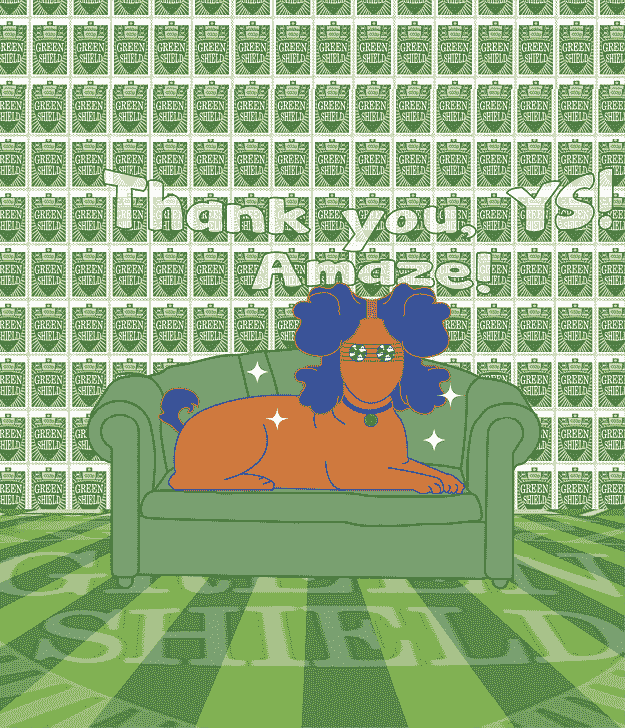

妈咪 1 查手机。“哦哇，当前小费系统有个弱点。某种碰撞问题。几千个区块后会硬分叉修复。别那样看我，YS，我上学时他们不教这些东西。”

“呃。”

妈咪 1 抱抱我。所以我没真冒犯他们。好欣慰。

“今晚超棒，你可以在屋顶写作业，”他们建议。

“好的！”我回应。兄弟姐妹的钻机上方有张便利贴，写着一些数字。上次那事后我把它们记在手机里了。然后我蹦上楼梯到屋顶。你好星星们，你们是我新的最佳好友！天变冷了。但不太冷。凉快。这就是为什么“cool”过去意指“好”？感觉真好。

我花些时间在 BangZoom78 交易拓扑中寻找子路径。这很好玩。好多路径。好开心。我看位置、时间和原因。然后我在 BangZoom78 的小费旁找到保存点冲突。哇，好多点。不止我一个。我给交易定位并按时间排序。交易每晚沿着昼夜分界线跨越大陆。我让交易在黑色地球仪上发蓝光。最极致的预动画。

我把 BangZoom78 的交易清单和我兄弟姐妹钻机上的账号对比。BangZoom78 的许多交易是由它处理的。我让手机只显示图中代表我兄弟姐妹钻机与网络上其他钻机之间交易的线。看起来像幅画。我缩小视角。是海报狗的脸。哇。

我醒来感到冷。背疼。我在屋顶上。是狗窝的屋顶。我怎么来这的？哦。哇。如此日出。好多颜色。好安静。我拖着睡腿挪到屋顶边缘看日出。我是全世界唯一看到这个的柴犬。好惊人。

往下看。UnoY 和 MogoDan 在下面的街上，还穿着他们的 PLA 盈余大衣。妈咪 1 会最极致地训斥我兄弟姐妹通宵不归。他们从不给小费。他们有塑料袋。他们在交换，但不是昨晚的金子。看起来像手机。为什么任何柴犬需要不止一个手机？好多手机。金子会更好。他们会是海盗。启航！或者巧克力。巧克力币？我们很小时候妈咪 1 给过我们巧克力币。等等，他们昨晚提到过手机。我想……

我招架无人机，削尖铅笔。用我自己的削笔刀。我要成为削铅笔工匠。柴犬们会从全海岸赶来，我给他们削铅笔。他们会像内幕交易者一样给我小费。

我用最好的草书在大概是旧折纸纸上写：who u?

然后我让无人机送给 BangZoom78。并给它小费。理由是：请告诉我。它飘落到街上，无视 MogoDan。消失在对面麦豪宅后面。

手机叮一声。BangZoom78 是 Top Dog。硬分叉在一万个区块内。我不懂 BangZoom78 在干嘛。但我觉得我兄弟姐妹懂。我回屋里时会问他们。

我坐在屋顶边缘。如此日出。好平静。好奇妙。日出是我新的最佳好友。哇。

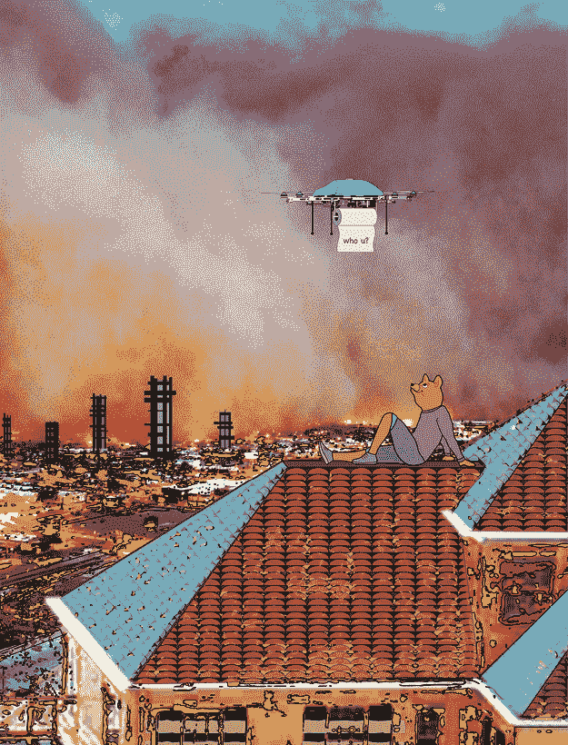

# （概念）艺术、加密货币与超越

## 2014 Furtherfield

## 艺术与金钱

艺术与金钱始终相互交织于彼此的生产之中。这枚希腊德拉克马硬币的一面浮雕着一只海龟。对许多人来说，这可能是他们日常生活中见到最频繁的艺术品，或至少是见到最频繁的图像。

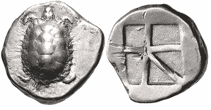

*希腊德拉克马，公元前 600 年。*

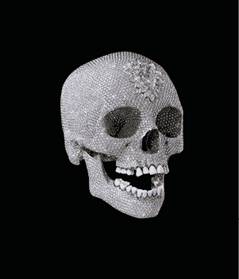

*达明安·赫斯特，《为了上帝的爱》，2007 年。铂金、钻石与人牙。© Damien Hirst and Science Ltd. 版权所有，DACS / Artimage 2022。摄影：Prudence Cuming Associates Ltd.*


在当下，高端艺术与高端金融（或称大艺术与大金融）携手并进。品牌艺术家杰夫·昆斯等人创作的蓝筹艺术品，被对冲基金经理和石油寡头作为投资品和社会经济地位的标志而收藏（而被盗的古代大师画作则被用作犯罪团伙交易中价值的标志……）。这种倾向在达明安·赫斯特的《为了上帝的爱》（2007）中达到了其逻辑上的终点（暂时）：一颗镶嵌钻石的铂金铸造真人头骨，完整保留了原本的牙齿。它以五千万英镑的价格售出。但审视《为了上帝的爱》的销售过程，会使其叙事变得不那么单一。它被卖给了一个包括艺术家本人及其经销商在内的团体，这使得实际成交价及其所有权比简单的买卖所暗示的要复杂得多。

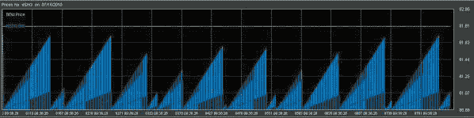

*Nanex 高频交易可视化。*

Nanex 的高频交易可视化图表（此处展示的示例来自 2010 年）深入电子股票市场的交易内部，在股票交易机器人的活动中发现了审美形式。这特定机器人活动呈现的锯齿波形究竟代表何意——是故障、策略，还是副作用——尚不得而知。但若不使这些形式可视化，我们将无法提出这些问题，也无法反思这种经济活动。

## 艺术，特别是观念艺术，批判这种关系

艺术的价值之一，特别是观念艺术的价值，在于它能为我们提供这些反思与批判的机会。西尔多·梅雷莱斯的《植入意识形态回路 2》（1970）用橡胶印章在钞票上盖印信息，覆盖了相当于德拉克马海龟的当代形象，介入货币的日常使用与流通，迫使观众停下来进行批判性反思。

林恩·赫什曼的《罗伯塔·布雷特莫尔空白支票》（1974）由其艺术化身罗伯塔·布雷特莫尔签署，利用金融交易及其附带的合同作为身份的生产者和担保人，字面意义上地为其提供担保。


*西尔多·梅雷莱斯，《植入意识形态回路：钞票计划》，1970 年，钞票上油墨书写，2.6 x 6.25 英寸（6.7 x 15.9 厘米）© Cildo Meireles； courtesy Galerie Lelong & Co., New York.*

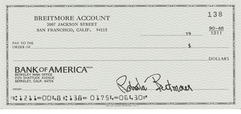

*林恩·赫什曼，《罗伯塔·布雷特莫尔空白支票》，1974 年。胶版印刷与凸版印刷，黑色记号笔于纸上，3 x 6 英寸（7.62 x 15.24 厘米）。© Lynn Hershman； courtesy the artist.*

道格拉斯·休布勒的《可变作品第 44 号》（1971）在其前十年间，每年将其拥有者的影像融入作品本身，这为布鲁斯·斯特林“尖刺物”[¹]的概念提供了一个模拟先例。当作品易手时，新主人随之出现，使作品的偶然经济学成为其美学主题。

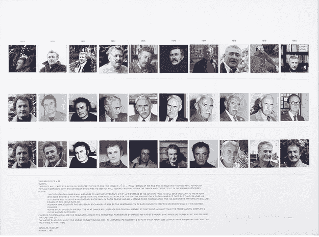

*道格拉斯·休布勒，《可变作品第 44 号》，1971 年。照片与印刷文字于板上，457 × 613 毫米。1974 年泰特美术馆购自艺术家（政府拨款购买）。© Douglas Huebler. 摄影：Tate.*

观念艺术在其“非物质化”阶段所代表的对艺术本体论与经济学的初步批判，对艺术家的生计构成的挑战，不亚于对其选定批判目标的挑战。早期找到的一种解决方案是为那些原本不可拥有的艺术制作真实性证书或所有权证书。这将观念艺术重新纳入稀缺经济与财产范畴，使其回归市场。索尔·勒维特的两幅墙画证书（1980）展示了这一机制的运作。如果你拥有此类证书而我没有，我们都遵循证书上的指令，你创作出一件真迹勒维特，而我顶多只能创作出一件赝品。

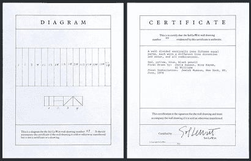

*索尔·勒维特，《一面垂直分为十五等份的墙，每份具有不同的线条方向与颜色，及所有组合》。图示与证书，1970 年。© ARS, NY and DACS, London 2022. 摄影：Tate.*


*艺术与语言，《担保绘画》，1967–68 年。画布丙烯与静电复印，两部分，画布 31 × 31 厘米，装框文字 55 × 44 厘米。© ART & LANGUAGE； courtesy the Artists and Mulier Mulier Gallery, Belgium.*

这一策略在观念艺术运动内部受到了批评（与戏仿）。艺术与语言早期的作品《担保绘画》（1967）包含一份印刷证书，担保其附带的绘画包含特定内容，并将展览策展人视为可能干预艺术世界经济关系的人。

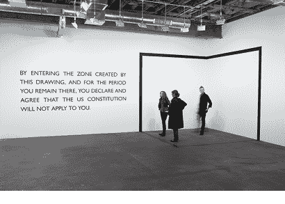

*凯瑞·杨，《宣告无效》，2005 年。乙烯基绘图与文字，尺寸可变，安装尺寸 133 × 133 英寸（337.8 × 337.8 厘米）。乙烯基条带：6 英寸（15.2 厘米）；字母高度：6 1/4 英寸（15.8 厘米）。装置视图：凯瑞·杨，《考量》，明尼阿波利斯中途当代艺术中心，2007 年 3 月 17 日–5 月 5 日。© Carey Young； courtesy Paula Cooper Gallery, New York. 摄影：Cameron Wittig.*

凯瑞·杨的《宣告无效》（2005）是一幅墙绘，它创造了一个空间，观众进入其中即意味着签订合同，同意美国宪法在其范围内不适用。法律形式即雕塑形式，这不再关乎艺术与金钱的关系，而是关乎个体、契约法与国家的关系。正是这种关系生成了货币，或至少是法定货币，并为审视艺术与金钱这一更具体的关系提供了更广阔的背景。


*Monochrom 与 Ian Grigg，《花卉货币》，2006 年。*

维也纳一群艺术家于 2005 年创造的花卉货币，既是一种 LETS 风格的互补货币，也利用压花美学来寓言化并审美化自然、生产与价值在经济中的关系。

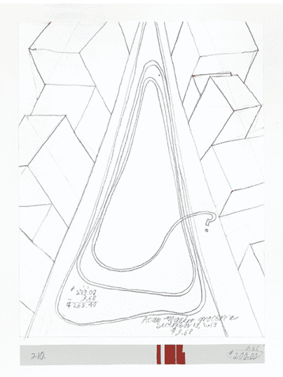

*丹尼卡·菲尔普斯，《收入与支出》第 210 号，2013 年。铅笔、水彩与不透明水彩于纸上，托木板。*

丹尼卡·菲尔普斯《收入与支出》系列（2013）中的第 210 号作品展示了艺术家采购杂货的支出。若描绘的是收入而非支出，条纹将是绿色而非红色。菲尔普斯的作品将其经济生存的账本与其社会存在的艺术记录结合在了一起。

## 比特币作为批判

比特币在 2008 年金融危机后，作为对国家发行“法定”货币的批判而诞生。比特币是一种加密货币，是一段运行在分布于网络中的计算机（“节点”）上的软件，这些节点相互通信，就加密保护的账本当前状态达成共识。大约每十分钟，这些计算机将交易打包成“区块”，每个区块都指向前一个区块。这就是“区块链”。

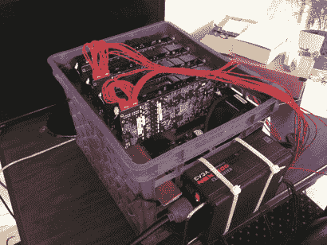

*奶箱挖矿机。摄影：Nehal Patel.*

[¹]: Bruce Sterling, *Shaping Things* (Cambridge, MA: MIT Press, 2005).

链上的新区块由网络中的节点使用日益专业化的硬件进行验证（或“挖矿”），例如几年前的这个奶箱挖矿设备。它们对每个区块执行难以求解但易于验证的运算，即“工作量证明”，最先成功的节点会获得奖励（以比特币支付）。

比特币账户地址、比特币交易和工作量证明系统都使用加密算法。这些是获取数据并为其创建几乎无法伪造、几乎不可逆、几乎唯一身份标识的数学方法（其中“几乎”是指“失败的可能性如同地球在未来二十分钟内被毁灭文明的小行星撞击的可能性”）。此处的示例展示了向加密哈希函数两次输入相同数据会得到相同的极不可能出现的数字，但输入哪怕略有不同的数据也会导致截然不同且无关的数字。

比特币在“工作量证明”系统中利用这些函数来保护其网络安全，方法是在其输出中搜寻吉利数字（在当前方案中为零字符串）。我的 Facecoin 实现了一种替代的工作量证明系统，其中执行的无用工作是肖像绘制，（误）用机器视觉算法在以位图而非数字形式表示的加密哈希中寻找想象中的面孔。

Monkeycoin（2014）采取了不同的方法，在对这些数字的文本表示中搜索莎士比亚的全集。

加密货币可用于替代法定货币进行各种交易，包括艺术交易。这里艺术家 Eric Drass 正通过比特币出售一幅画作。不同的交换媒介会创造不同种类的社会关系：通过比特币购买画作，与通过 Saatchi Online 使用法定货币支付，是不同种类的社会和经济交易。

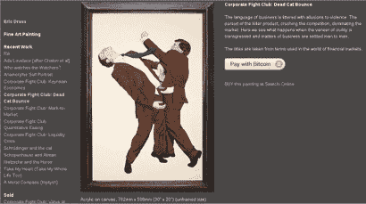

Eric Drass, Corporate Fight Club, 2012. Acrylic paint on wood.

加密货币可以作为互补货币被创建，带有特定意图或面向特定群体。Banksycoin（2014）是一次创建货币以支付艺术创作并为艺术生产建立平行经济的尝试。

基于加密货币的技术可以改变单个艺术品的所有权方式，而不仅仅是支付方式。theironman 的 nxtdrop（2014）的所有权由“nxt”区块链上的股份代表。通过交易这些股份，可以按份额改变画作的所有权。


Theironman, Nxtdrop, 2014. ‘Decentralised oil painting’.

### 我们可以在区块链上存储除货币以外的信息

诗歌、图像和其他文化遗产嵌入在比特币区块链中，伪装成交易信息。在 Proof of Existence 中，我将我的基因组的加密哈希嵌入比特币区块链以确立我的身份（2014）。

### 智能合约将区块链推广至其他合约

Caleb Larsen 的《欺骗与屠杀工具》（2009）包含一台必须联网的计算机，这是所有权条件的一部分，该计算机随后会立即在 eBay 拍卖网站上将自己挂牌出售。这种“智能财产”是智能合约的一个好例子，在智能合约中，所有权等安排由软件而非法律（或比法律更直接地）来管理。


Caleb Larsen, A Tool to Deceive and Slaughter, 2009. Acrylic, custom electronics, programming, internet connection, online auction.

我的 Ethereum Art Market（2014）使用以太坊智能合约系统（将比特币推广至货币交易以外的合约）来记录无限可复制数字文件的“所有权”，并允许它们用加密货币“出售”。其他系统也可以做到这一点，例如 Monegraph 和 Rarebit 系统。

Is Art（2014）使用一个简单的智能合约来民主化概念艺术的提名策略。只需点击鼠标并支付一小笔费用以在区块链上执行更改，即可将合约设置为提名自己为艺术或非艺术。

Art Is（2014）将行为经济学应用于艺术哲学，允许个人根据他们觉得自己的艺术定义值多少钱来支付相应金额。这抑制了恶意或不严肃的定义，并利用市场机制高效地为知识甚至真理定价和分配，表明了个人对其定义的信心。fnord

### 加密货币和智能合约可用于构建艺术家群体

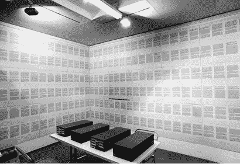

Art & Language, Index 002, 1972. 4 file cabinets texts and photostats, 320 index pages, dimensions variable. Installation, Lisson Gallery, London. Collection Herbert Foundation, Gent (A&L7200002). © Art & Language; Courtesy Lisson Gallery.

Art & Language 的《Index 002》（1972）是该群体著作的汇编，经过整理和编目，在传统画廊环境中展示，以在他们的实践主要是对话形式、在外部观察者眼中可能不太像“艺术”的时期，确立他们的身份和生产力。文件柜和复印纸是当时的信息技术；后来的 Index 将使用微缩胶片和（据称是随机的）计算机生成的列表。它们的使用以及 Index 总体的制作，既是 Art & Language 所探讨问题的解决方案，也是这些问题的主题。当代群体可以同样利用区块链来聚焦并问题化他们的工作。

The Cypherfunks 是一个分布式音乐团体。任何人将歌曲上传到 SoundCloud 音乐分享网站并标记 #thecypherfunks，即可获得该团体的加密货币 FUNK，从而成为团体一员。

Dogecoin 是最流行的“山寨币”之一，即源自比特币但与原始比特币网络不互操作的加密货币。它是一种刻意构建的美德与游戏文化的货币，拥有基于网络迷因（特别是同名的“Doge”以及类似聚礼般的打赏规范理念）的专属行话和社会规范。


John Everett Millais, Isabella, 1849 (detail).


The People’s Republic of DOUG

这些都是比单纯在画布上绘制类似货币代码的字母（如在 Millais 的《Isabella》\[1849\] 中）更当代、更复杂的展示群体归属感的方式。利用智能合约技术创建群体归属感，甚至创建一个社会，可能的终极形式是“去中心化自治组织”（DAO）的概念，这是一个存在于区块链上的经济主体，通过代码而非章程或立法来管理组织的资源。

The People’s Republic of DOUG（2014）是作为以太坊智能合约系统区块链上的智能合约实现的 DAO。你可以成为公民、拥有财产、投票，并使用其自有货币进行交易——所有这些功能传统上都由国家提供，就契约法而言。比特币关于无国家未来的梦想（但不是无财产的未来，这使其成为无政府资本主义而非无政府主义）在几千行代码中得以实现。想象一下使用（和/或批判）这样的系统进行艺术组织和/或生产。

### 结论

1. 在处理加密货币时，将炒作与骗局、承诺、道德恐慌与批判区分开来，需要一个学习曲线。

2. 我们可以利用加密货币寻找（鼓励）为艺术付费的新方式，通过这样做来陌生化并批判艺术界经济学。

3. 替代币、加密代币、智能合约和 DAO 是艺术家可以用来探索社会组织和艺术生产新模式的工具，

4. 区块链的意识形态和技术以及艺术史的材料（尤其是观念艺术史）可以为相互实验和批判提供有用的资源。

“现在用它来创作艺术吧。”

### 注释

1 B. Sterling, *Shaping Things* (Cambridge, MA: MIT Press, 2005)。

2 该项目是集体研究的一部分，旨在在 Netznetz 的背景下探索替代货币和数字声誉系统，Netznetz 是一个数字艺术和文化的社交平台，也是一种分配公共资金的新型自我管理方法。参见 [<http://www.monochrom.at/flowerbank/index-en.htm>](http://www.monochrom.at/flowerbank/index-en.htm)

# 加速主义区块链批判的 ABC

## 2014 Furtherfield

## 加速主义

加速主义因 Nick Srnicek 和 Alex Williams 带有标签式标题的宣言而在 2013 年声名鹊起。1 这是云计算时代对旧马克思主义论点的一种演绎——即我们首先需要完善资本主义才能超越它，其谱系在 *#accelerate: The Accelerationist Reader* 2 中得以充实，该书宣称（除其他外）Nick Land 的“天网”接生术、J.G. Ballard 对文化的科幻化，以及马克思本人都是加速主义的先驱，确立了其作为一种严肃的反人本主义回应，以应对人类若想避免灭绝所面临的挑战。与 Christine Harold 的“强化”策略相似，加速主义呼吁我们挪用资本主义发展的价值并将其物质性地转化为其他东西，而不是试图正面抵抗它们或在内心拒绝它们。3

比特币是一种加速主义技术的例子。4 它利用互联网规模的计算资源，通过消除货币交易中对社会纽带的需求来重建社会纽带。你不必认识我、信任我或任何第三方就能以比特币的形式收到我的钱。你只需信任那些公开运行比特币网络的算法。新的以太坊项目采用了比特币背后的区块链技术，并将其推广用于除货币转移以外的合同用途，尽管这些合同当然可以涉及支付。以太坊合同作为小程序及其状态的分布式数据库存在，这极其类似于一个经济版的 LambdaMOO。关于其前景和潜在陷阱，Berkman Center 研究员 Primavera Di Filippi 的演讲“以太坊：Freenet 还是 Skynet？”提供了很好的指南。5

### 智能合约

智能合约和智能财产（利用智能合约来识别和控制物理资源的所有权）最早由 Nick Szabo 在 1990 年代描述。智能合约之所以“智能”，是因为它们是作为计算机代码而非法律文件来实现的。现实世界的例子包括自动售货机（购买商品的合同被编码在简单的软件中，投入正确的钱就会出饮料）、复印件的 RFID 卡支付，以及通过二维码解锁并追踪使用情况的电动滑板车、自行车和汽车租赁方案。那些试图用“分享”的温情脉脉来粉饰自己野心的潜在租金获取者，以及顽固的 DRM 蛇油推销商，都对这一前景垂涎三尺，但这不是我们这里关心的重点。

用于艺术的智能合约和智能财产已经存在。艺术品《欺骗与屠杀工具》在 eBay 上不断自我转售。GIF 所有权服务 Monegraph6 使用 NameCoin 系统来追踪无限可复制的数字艺术实例的概念所有权。这些是数字艺术前合同的延伸，例如概念性和非物质艺术品的真品证书或所有权证书。它们展示了一条道路，让艺术能继续在技术文化下对财产和社会关系进行有用的批判，也让新技术能滋养艺术对其自身生产和本质的持续批判。7


与比特币一样，智能合约和智能财产不需要社会信任来建立社会价值，只需要运行代码。它们的功能非常有限：例如，它们无法检查互联网上的 RSS 订阅源以获取信息，因为这些信息可能被篡改。这引出了一个问题：如何鼓励个人向智能合约提供有效的现实世界信息，而不仅仅是输入对自己即时获利最大的数值。资本主义经济学用激励的概念来回答这个问题。价值和价值观可以由个人在市场中对经济激励的反应行为来决定。而智能合约旨在使市场更高效。

我想将这种基于市场的真理观应用到我在《艺术批评的无产阶级化》[#4-The-proletarianisation.xhtml] 中指出的、面对聚合危机的艺术批评中。个人可以通过智能合约以新颖的方式被激励去发布可辩护的审美和艺术批评观点。我在这里并非提议一种自动化的或纯算法的艺术批评：人类活动是这种方法的核心。我也不是在提议类似 Amazon Mechanical Turk 那种对情感劳动的剥削。相反，我提议一种加速主义方法，利用数字资本主义的技术，主动将其抽取的社会流动的价值重新导向可持续的人类活动。

艺术对市场的概念并不陌生：艺术世界由理论上最不受监管、因此也是最纯粹的市场之一组成。但即使忽略艺术市场的不透明和腐败，直接将艺术市场作为艺术价值的仲裁者也存在问题。正如 David Galenson 2008 年关于审美价值和市场价格的研究所示，使用纯市场机制来确立艺术价值存在问题：许多“伟大作品”要么从未被拍卖，要么几十年甚至几个世纪都未进入市场。8

因此，我提出三种不同的通过智能合约进行艺术批评的方法。对于面向市场的作品，可以使用给股票和其他金融资产定价的机制。对于市场曝光度较低的作品，`SchellingCoin` 和预测市场可以通过代理与这些机制协同工作。

## 审美衍生品

金融资产、股票或商品合约等的价格是通过衍生品体系来设定的。金融衍生品因其在 2008 年全球金融危机中的作用而名声扫地。到 2011 年，交易的衍生品名义价值几乎是地球总 GDP 的十倍。而它们通过算法高频交易实现的自动化正日益受到监管机构的审视。

衍生品有多种类型：例如看跌和看涨期权、期货和奇异期权。但至少在理论上，它们的功能是简单且有益的。它们使个人能通过表达认为某金融资产被高估或低估而获利。这激励他们根据该信息采取行动。由此产生的信息共享和价格修正造福社会。

非物理所有权、赞助、众筹、献词，以及与实体作品、关键在于那些未售出或将不售出的作品、以及不可拥有的数字艺术之间更奇特的价值关系，均可用智能合约表示。这些合约随后可作为衍生品的底层资产，衍生品同样以智能合约形式表示，既可以整体形式，也可以（同样关键地）以分数部分或份额形式存在。买卖数字艺术品份额的衍生品，特别是对其做空或做多，代表了对其价值的关键立场。当底层资产不代表对艺术品的实际所有权时，我们更接近预测市场而非金融市场。但如果资产本身因其代理地位而吸引声望或价值，它们自身可能成为艺术品。

在此类市场中，艺术批评成为财务投资与回报的问题。批评家通过在不同时间买卖不同种类的衍生品，来表达对艺术、艺术家和艺术趋势的看法。若时间证明其判断正确，市场将给予奖励。衍生品是实现为智能合约的首选候选。事实上，已有项目致力于创建一种（非审美的）衍生品智能合约标准语言。9

## 文化谢林币

由于 `Ethereum` 合约无法直接访问外部世界（或 `Web`），需要外部信息的合约必须通过中介获取。这意味着合约必须信任这些中介，若对中介而言撒谎更有利，便会产生问题。为消除这种信任要求，我们可以使用一种系统，奖励那些独立提供能准确反映世界真实（或最可能）状态信息的人。

`SchellingCoin`10 是一种 `Ethereum` 合约，允许人们向其发送消息，登记他们对（例如）柏林当前温度或美元兑日元汇率的看法。与预测市场运作类似，持多数观点者将获得奖励。但他们如何知道该选择哪个价值？博弈论中的焦点概念，即 `Schelling point`，是无法沟通的人们独立给出的答案，因为该答案显得自然、恰当或特殊。`SchellingCoin` 奖励给出共识答案的人，人们可通过趋向 `Schelling point` 来确定正确答案。对于温度或汇率等现实现象，`Schelling point` 极可能是正确答案。`SchellingCoin` 可作为智能合约实现，从而消除运行它们所需的可信实体。

`SchellingCoin` 旨在解决外部定量现象问题。对文化作品的看法是个人且定性的，对文化作品的自发反应更是如此。这与 `SchellingCoin` 提案所需的常见定量价值不同。要将 `SchellingCoin` 适配至文化批评，我们必须采用集体智能和数字人文的方法，并利用一些技巧将个人观点转化为文化评价。

集体智能算法与星级评分系统和标签配合良好。这些是电商和评论网站上对书籍、电影和音乐评分的流行方法。软件可轻松表示、聚合和推断这些数据，使其成为在 `SchellingCoin` 中表示观点的理想选择。使用此类系统存在风险，正如电影《Gunday》在 `IMDB` 上的低分所显示的，但它们易于使用且易于获取。

数字人文方法常涉及统计文本中词频或其他非结构化现象。二元检查或计数的结果可应用于 `SchellingCoin`。例如，某艺术品是否出现在 `Contemporary Art Daily` 或 `Rhizome` 上，或者 ‘blue’ 或 ‘postbinary’ 等词是否在主要评论网站关于该作品的评论中出现频率最高，均可通过进一步的 `SchellingCoin` 或可信数据源/`oracle` 上报。

为将这些方法转化为 `SchellingCoin`，我们不询问人们对艺术品的看法。我们询问他们认为普通评论家会如何看待该艺术品（或为防止操纵，让他们预测该作品所有星级评分的分布曲线）。根据焦点理论，最可能的答案是人们怀疑为真实的那个。

因此，文化 `SchellingCoin` 可作为关于艺术品的“观点的观点”聚合器，产生定性但基于共识的艺术作品评价与批评，其包含的信息比纯价格机制更丰富。利用 `SchellingCoin` 聚合关于其他 `SchellingCoin` 的观点，即 `Meta-SchellingCoin`，可提供更宏观的文化批评。

## 艺术预测市场

为使评论转化为具有更长远或更广阔视角的艺术批评，我们可以不询问艺术品当前的评论状态，而询问一年、五年后等时间点的状态。它们将获得多高星级？将用何种标签/词汇描述？该作品（或艺术家）是否会成为评论和文章中的比较参照？它们是否仍会被展出或购买，以及在何种类型的画廊？作品将卖出何种价格，或在无销售情况下，有多少人会在展览中观看？艺术家是否仍将坚持该风格，若不，其作品将如何变化？

每个预测均可表示为预测市场中的一种证券，该证券的当前价格可解释为该预测实现的概率。例如，一种预测市场证券可能在某特定艺术家在 `Tate Modern` 举办头条展览时，奖励一百聪或十积分。若你认为发生概率为 80%，你可支付高达 80 聪或 8 分购买代表该预测的证券。若你判断正确，因改善市场而获利；若错误，则亏损。有证据表明预测市场是成功的，尽管在美国它们被作为赌博形式禁止，且 `Pentagon` 2003 年尝试的政治预测市场迅速被媒体贴上“恐怖主义期货市场”标签并下线。

已存在一个成功的文化预测市场——`Hollywood Stock Exchange`，其中演员、导演和电影的“股份”价格作为其票房表现的预测。艺术市场本身可视为一种混合预测市场，但将预测功能分离为专注于批评评价的纯预测市场，可能消除二级市场操纵造成的扭曲，并解决不属于艺术市场的、具有批评价值的艺术品的代表性问题。

正如 `Hollywood Stock Exchange` 除电影外还使用导演和演员一样，艺术界的其他实体也可建立预测市场。

不仅是艺术家和画廊，流派、风格、题材、主题，甚至颜色等形式与审美属性，均可表示为预测市场中的证券。买卖它们有助于生成对其潜力和影响的共同理解。

预测市场可以在以太坊区块链上表现为去中心化自治组织（DAO），不受任何中心化控制。DAO 提供了一个在区块链上重新思考和重新实现组织的机会。除了市场，它们还可以用于以公开透明的方式，基于各种组织模型来管理事件、出版物、合作社以及教育或艺术界机构。

## 结论

文化谢林币、艺术预测市场和审美衍生品是艺术批评的加速主义技术。不一定是指那种被逐出印刷媒体后在网络上存活下来的艺术批评。而是指一种功能等价物，它以个体与艺术生产之间关系的形式，重获其失去的权威，这种关系在艺术的接受与方向上施加着引导之手。既然这些技术代表了一种涌现的艺术与美学本体论，那么操纵它们——无论是通过技术手段还是社会手段——本身既是艺术，也是艺术批评。

## 注释

1. N. Srnicek and A. Williams. ‘Manifesto for an Accelerationist Politics’, in R. Mackay and A. Avanessian (eds), #accelerate: The Accelerationist Reader (Falmouth and Berlin: Urbanomic/Merve, 2014).
2. 同上。
3. C. Harold, OurSpace: Resisting the Corporate Control of Culture (Minneapolis: University of Minnesota, 2009).
4. ‘Computers and Capital: The Rise of Digital Currency’（计算机与资本：数字货币的崛起）。
5. [<https://cyber.harvard.edu/events/luncheon/2014/04/difilippi>](https://cyber.harvard.edu/events/luncheon/2014/04/difilippi)。
6. A. Dash, ‘A Bitcoin for Digital Art’, medium.com, 9 May 2014, [<https://medium.com/message/a-bitcoin-for-digital-art-8c7db719e495>](https://medium.com/message/a-bitcoin-for-digital-art-8c7db719e495)。
7. 参见“艺术界以太坊”，其中提供了代码演示，展示了利用专门用于智能合约的技术实现其中一些示例是多么简单。
8. D. Galenson, ‘A Textbook Example of Ranking Artworks’, New York Times, 4 August 2008, [<https://www.nytimes.com/2008/08/04/arts/design/04pica.html>](https://www.nytimes.com/2008/08/04/arts/design/04pica.html)。
9. [<https://web.archive.org/web/20140627094135/http://fsc.stevens.edu/ACTUS/>](https://web.archive.org/web/20140627094135/http://fsc.stevens.edu/ACTUS/)。
10. V. Buterin, ‘SchellingCoin: A Minimal-Trust Universal Data Feed’, ethereum.org, 28 March 2014, [<https://blog.ethereum.org/2014/03/28/schellingcoin-a-minimal-trust-universal-data-feed/>](https://blog.ethereum.org/2014/03/28/schellingcoin-a-minimal-trust-universal-data-feed/)。

# 吸血鬼数字艺术

## 2014 Furtherfield

在《读者将如何在未来发现书籍》一文中，科幻作家查尔斯·斯特罗斯设想了一个未来：武器化的电子书通过将自身复制到你的移动设备上、消灭竞争对手、并锁定用户界面直到你读完它们，来强行索取你的注意力。1

这仅仅只是科幻小说。即使是最早的病毒通常也会显示信息，而那种拒绝你访问数据直到你付费解密的恶意软件早已存在。ePub 电子书可以执行任意 JavaScript，PDF 文档可以执行任意 Shell 脚本。野外已发现被植入恶意代码的 PDF。斯特罗斯的武器化电子书领先于此也不过一步之遥。

电子书为何要表现得像那样？为了寻找读者。在注意力经济中，阅读一本书所需的时间是一种稀缺资源。大多数作者写作是因为他们想被阅读、寻找受众。斯特罗斯的提议只是实现这一目的的一种极端方式。在斯特罗斯的设定中，作者就像利用僵尸网络恶意软件让你的电脑为其目的服务而非你自己的犯罪团伙，利用广告软件强迫你执行原本不会做的操作，或利用网络钓鱼攻击从用户那里获取密码或金钱等稀缺资源。


既然产生的新艺术如此之多，以至于连 Contemporary Art Daily 这种贪婪的推广博客都应接不暇，注意力稀缺现已成为艺术界和文学界共同面临的问题。而且当人们确实去参观展览时，他们花在阅读标签上的时间比观看艺术品的时间还多。在这种情况下，斯特罗斯的策略对艺术也同样适用。特别是对网络艺术和软件艺术。

一种表现得像斯特罗斯的吸血鬼电子书的网络或软件艺术品，会将自身复制到你的系统上，并拒绝解锁，直到你有时间充分体验它，或点击浏览完它的所有内容。它可以在网页浏览器或虚拟世界中通过脚本攻击实现这一点，在移动设备上作为恶意应用，或在桌面系统上作为经典病毒。

独特的实体艺术也需要观众。恶意软件可以推广艺术，取代私人预览邀请函。从仅仅发送宣传私人预览的僵尸网络垃圾邮件开始，更高级的攻击可以拒绝解锁你的移动设备，直到你在 Facebook 上发布一张你在展览现场的照片（使用机器视觉和图像分类算法识别），在 FourSquare 上为展览打卡，或给出五星好评并附上表明你确实看过展览的评论。在画廊中，被植入恶意代码的 Google Glass 头显或手机可以确保观众知道该看哪件艺术品，方法是屏蔽其他作品或在它们上面绘制指向正确方向的大箭头。


Add-Art, [<https://add-art.org/>](https://add-art.org/)。

网络艺术可以以审美干预代理的形式，更隐蔽地介入人们的体验。广告软件可以展示艺术而非商业广告。Add-Art 就是这一概念的仁慈先驱。电子邮件病毒和恶意浏览器扩展可以干预其他媒介的美学。它们可以将文本转化为 Mezangelle，或将图像故障化、或以其他方式转化为特定风格。在 1990 年代初，我写过一个 PostScript 病毒，它（理论上）能将自身复制到打印机上并创造性地破坏矢量艺术，但幸运的是我没有我所需的 Word BASIC 手册来编写一个病毒，该病毒会从其复制到的任何文档中删除“后现代主义”一词。2


eToy, Toywar Timeline, 1999。

更进一步，网络攻击本身可以成为艺术。艺术恶意软件僵尸网络可以利用网络拓扑和时序的属性，从网络及其上的活动中构建艺术品。这方面的先例有 Etoy 的 ToyWar (1999) 和 EDT 的 SWARM (1998)，后者是一种作为艺术品在 Ars Electronica 展出的分布式拒绝服务（DDoS）攻击。我的 sendvalues (2011) 是一个网络测试工具，可能被滥用，像 LOIC 一样，发动 DDoS 攻击，利用同步洪水般的网络流量构建波浪、形状和位图。这种攻击会以互联网规模吸引并引导注意力作为艺术。

这些都不会直接触及艺术市场。但如果 Caleb Larsen 的《欺骗与屠杀工具》(A Tool to Deceive and Slaughter, 2012) 的后代作品，从已知艺术品商中选择购买者或将自己退回拍卖行，然后使用上述技术强迫他们购买，而不是在 eBay 上自行出售，那将既是斯特罗斯思想的直接实现，以独特实体艺术品的形式呈现，也是直接存在于艺术世界关系中的事物。

# 利用艺术市场作为漏洞利用的网络

利用艺术市场本身作为漏洞利用的网络，而非互联网，能产生更强大的艺术恶意软件漏洞利用。莱夫·马诺维奇所实践的那种美学分析 3，且已被 Mutual Art 用于指导投资 4，可以与股票市场高频交易（HFT）的技术相结合，通过直接干预和操纵艺术销售与拍卖的价格来创造新形式。正如高频交易一样，用于此目的的软件活动能在市场活动本身中创造美学形式，就像 Nanex 所发现的那些 5。这可用于建立和摧毁艺术声誉，在市场中创造美学趋势，并创造艺术运动与经典。萨奇自动化。这种活动的美学随后可作为艺术本身卖回市场，从而产生更多模式。

此处建议的技术至少是非法且不道德的，所以不言而喻，你不应尝试实施其中任何一项。但它们作为未实现的艺术作品，有助于指导思想实验。它们有助于反思艺术在艺术界内外所面临的挑战，即在泛在互联网、以及媒体和市场日益由算法决定的时代，面对注意力匮乏的人群。它们也是一种至少能思考出市场批判伦理而非仅仅是数字艺术市场批判美学的手段。

## 注释

1. C. Stross, ‘Polemic: How Readers Will Discover Books in Future’, 10 October 2013, [<https://www.antipope.org/charlie/blog-static/2013/10/polemic-how-readers-will-disco.html>](https://www.antipope.org/charlie/blog-static/2013/10/polemic-how-readers-will-disco.html)。
2. [<https://rhea.art/postscript-viruses>](https://rhea.art/postscript-viruses)。见上文访谈。
3. [<http://lab.softwarestudies.com/p/cultural-analytics.html>](http://lab.softwarestudies.com/p/cultural-analytics.html)。


# 参考文献

4. M. Maneker, ‘Big Data and the Art World: Mutual Art’, *Art Market Monitor*, 13 October 2013, <https://www.artmarketmonitor.com/2013/10/13/big-data-and-the-art-world-mutual-art/>。

5. A.C. Madrigal, ‘Market Data Firm Spots the Tracks of Bizarre Robot Traders’, *The Atlantic*, 4 August 2010, <https://www.theatlantic.com/technology/archive/2010/08/market-data-firm-spots-the-tracks-of-bizarre-robot-traders/60829/>。

# 阿戈里美学与哲学

## 2014

阿戈里化美学与哲学意味着利用市场定价机制来生产它们。其模型是基于市场的阿戈里计算软件。这种系统的优势在于它能同时激励生产和效率。通过内部化市场力量，可以避免学术研究积分等游戏化系统的扭曲激励。

阿戈里系统需要一种货币；为求效率，我们将使用加密货币。有几种使用加密货币系统为阿戈里系统实施货币的方式。我们可以使用彩色币、`NXT` 或 `Counterparty` 资产，或类似于以太坊白皮书中代币系统示例的以太坊合约，来创建币、代币或其他可量化的效价。为求简便，我将所有这些统称为“代币”。不同的实现允许不同的能力：同质性、可撤销性、可转让性。

一个艺术家团体或艺术运动可以使用一批通过投票或其他机制分配的代币，授予他们认定为该运动一部分及其产出的艺术家或艺术作品。`Cypherfunks` 项目就是此类系统的现有案例。这种系统将达达主义、观念艺术以及某些波普/后波普艺术的命名实践，与物质性地识别内群体和外群体的社会和审美功能相结合。单一艺术家代币可用于杜尚或科斯塔比风格的创作生涯构建。

艺术评论家可以使用代币来体现批评。单一价值代币可用于体现批评认可，一对相反效价的代币可代表赞许/谴责（并可在日后修正批评观点），一系列具有不同星级排名的代币可用于实施星级评价体系，代价是牺牲同质性。评论家将代币发送至加密货币系统中艺术家的地址，或代表艺术作品哈希值或代理哈希值的地址。通过统计与之关联的批评代币数量和种类，即可发现艺术家或艺术作品的地位。

哲学论著可通过阿戈里方式构建。公理与引证、逻辑与修辞动作可被分配点数成本，无论是按类别（前提、异议、反驳）还是单独分配（德里达、阿伦特、梅亚苏）。每次使用都会增加论文的价格。点数成本和预算可按每百字分配，或针对特定形式（短文、评论、学位论文、期刊文章等）或语境（特定期刊、网站或教育机构）分配。论文随后按预算撰写。或根据系统为论文定价，然后让出版商（和读者）据此选择消费哪些。对于更动态的系统，价格可采用 `PageRank` 风格系统，作为被引用作品成本的乘积来设定。

本文的定价留作读者练习……

# 以太坊标准化艺术合约 API

## 2015

以太坊项目允许你创建任意智能合约在其区块链上运行。为确保这些任意合约在需要时能相互通信，他们发布了一份标准合约接口列表 [^1]。

这些标准允许不同的代币、注册表、数据馈送和其他常见合约以一种被充分理解的方式相互通信和使用。

让我们将其扩展至艺术合约，从智能艺术品开始。接下来我们将涵盖展览和评论。

这些接口适用于艺术以外的合约。欢迎就如何泛化它们提供反馈和建议。

## 可购买艺术品

智能合约艺术品要么本身体现一件艺术品，要么代表或控制艺术品的某个方面，要么以某种方式包含艺术品或作为其代理。

合约的所有者预期是艺术家，且不应变更。“所有权”在合约内部记录。

### 方法

#### `offer`

```
offer(address _purchaser, uint _price, uint _until)
```

仅可由艺术品所有者调用。这与合约所有者是分开的。

将作品挂牌出售。`_purchaser` 地址可以为零，此时任何人都可以购买该艺术品。`_price` 可以为零，此时 `_purchaser` 无需发送任何资金。而 `_until` 可以是过去的 UNIX 时间戳，此时艺术品实际上并不出售。零值对此效果很好。

#### `purchase`

```
purchase() returns (bool _success)
```

如果调用者与 `_purchaser` 匹配（或其设为零），发送足够的以太币以匹配 `_price`（或 `_price` 为零），且报价未过期，则调用者成为该艺术品的新所有者。

#### `purchaseFee`

```
purchaseFee() return (uint8 _percentage)
```

购买价格中归合约所有者（即艺术家）而非购买者的百分比。这是“艺术品转售权”的功能性等价物。

#### `setPurchaseFee`

```
setPurchaseFee(uint8 _percentage)
```

# 以太坊艺术生态系统

## 2015

区块链显然是存储货币以外财产所有权的媒介。这包括艺术品的所有权，特别是数字艺术品的所有权。但使用智能合约来实现这一点并没有什么“智能”之处。与其试图将数字版权管理（`DRM`）的缺陷引入区块链，我们不如寻求利用智能合约来形式化艺术与其受众之间更有趣的关系经济。

### 基础概念

#### 项目

万物皆项目。

#### 所有者

每个项目都有一个所有者。这仅仅是一个以太坊地址，来自该地址的指令交易将被服从。它们可以像人类操作员的图形用户界面（`GUI`）一样基本地实现，也可以由复杂的区块链或预言机系统实现。

#### 容器

许多项目可以与其他项目具有伪空间关系，以包含它们，例如画廊包含展览或杂志包含评论。这不同于所有权的控制关系。

项目的容器即其位置。

购买一件艺术品的实例使购买者成为该实例的容器，而非艺术品合约的所有者。

#### 艺术品

智能艺术品是智能合约/智能财产艺术世界中的自动驾驶汽车或高频交易算法。它们最重要的特性是能够管理自己的展览和销售——它们评估报价并自动决定是接受还是拒绝。

#### 版本

艺术品可以通过限制版本大小来模拟稀缺性或管理曝光度。这是指在同一时间可以包含在容器中的艺术品实例数量。版本大小为一即为独一无二的艺术品。

当艺术品被售出或展出时，这不会减少版本大小，但会减少可同时售出或展出的版本数量。

#### 来源

艺术品的来源是其销售、展览和评论历史。所有这些作为其运行的自然结果（并作为记录在案的以太坊“事件”）存储在区块链上。

#### 展示

##### 认证

可以查询艺术品以查找当前持有其实例的容器。这可用于认证展示的艺术品。认证信息可以显示在界面或展览的随附材料中。

##### 控制

艺术品可以（弱地）通过将其资产存储在 `IP` 锁定的网站上，并仅允许白名单地址访问来控制展览。容器提供一个 `IP` 地址，并通过该地址代理其对艺术品的展示。

这显然容易受到 `IP` 欺骗攻击，且无法防止下载，但为想要此类系统的人提供了一个示例。

#### 销售与展览

收藏可以向艺术品提出报价，以永久购买或暂时展览它们。

是否接受报价由艺术品决定。

艺术品的购买实例也可能允许其所有者否决或建议其销售或展览。

##### 简单报价

简单的购买报价由价格组成。

简单的展览报价由时间、持续时间和费用组成。

艺术品可以根据可用性、价格或费用是否充足，以及关于发送报价地址的任何外部信息（例如外部黑名单）来接受或拒绝报价。

##### 标签报价

标签报价是艺术品决定是否接受报价的一个稍微灵活一些的系统示例。

收藏提出格式为键值对字典的报价。艺术品随后评估该报价，最简单的方式是将其与自身的标签字典进行比较（以及像简单报价那样比较价格等）。

这种方法的缺点是标签值必须受到艺术品的信任。这可以通过可信第三方对标签进行签名，或通过谢林币风格的标签评估来解决。

### 展览费用

艺术品因被展览而获得费用（如需可设为零）。它们可以将这些费用转给其合约的所有者（推测为艺术家）。

##### 转售拒绝与费用

艺术品可以否决销售，就像否决展览一样。它们还可以抽取任何售价的一定比例，模拟“转售权/艺术家转售权”（如需可设为零）。

#### 收藏

收藏是容器。它们包含艺术品。展览、博物馆和画廊都是收藏。

临时和永久收藏收录用于展览的借入艺术品或购买用于博物馆或个人收藏的艺术品。

收藏具有选择和接受政策。

展览、拍卖、奖项、竞赛和委托创作都是容器。

#### 展览

展览发生在机构中。它包含特定数量的艺术品，为期特定时长（可能是永久的）。

展览必须向艺术品提供展览费用及其时长详情。对于更复杂的方案，它必须向艺术品提供更多信息，例如“标签报价”所需的字典。

在展览期间，艺术品将把该展览登记为其某个实例的容器。

### 拍卖

拍卖是可以接受并强制执行出价直到时间限制的容器。出价的提交和任何额外评估由其他合约处理。

#### 奖项

奖项是参评作品的容器，实际奖项由预言机、谢林币或其他审计合约分配。

#### 竞赛

特纳奖风格的竞赛将展览与最终的奖项相结合，奖项由预言机、谢林币或其他审计合约分配。

#### 委托创作

委托创作将要求指定为标签，并为满足这些要求提供价格，由谢林币或其他审计合约确认。

### 评论

评论家为艺术品撰写五星级评论，并附带简短标题。

这些评论由收藏聚合，并可被艺术品引用。

它们可以按评论家声誉进行筛选。

### 结论

---

## 智能合约接口规范

### 方法

#### `exhibit`

```
exhibit(address _at, uint _duration) returns (bool _success)
```

如果调用者发送足够的以太币以支付展览费，则从交易成功之起，将作品标记为在 `address` 处展览 `_duration` 秒。

作品展览所在的地址 `_at` 可由合约的具体实现赋予特权（例如，`Web` 服务器可以仅允许从能够使用 `_at` 地址密钥签名请求的地址访问）。

#### `exhibitFee`

```
exhibitFee() returns (uint _fee)
```

每秒应支付的展览费用以太币数量。零意味着展览艺术品免费。

#### `setExhibitFee`

```
setExhibitFee(uint _fee)
```

仅合约所有者可调用。

这设置每秒应支付的展览费用以太币数量。可设为零。

### 事件

#### `Offered`

```
Offered(address seller, address purchaser, uint price, uint duration)
```

艺术品由当前所有者（记录为 `seller`）提出出售。

#### `Sold`

```
Sold(address seller, address buyer, uint price)
```

艺术品由 `seller` 售予 `buyer`，价格为给定的以太币 `price`。

#### `Exhibited`

```
Exhibited(address indexed at, uint duration)
```

艺术品在给定地址展览了 `duration` 秒。

### 注释

[^1]: <https://eth.wiki/en/concepts/standardized-contract-apis>。

只需几种基本类型的合约，并将部分复杂性推迟或排除在系统之外，就有可能在区块链上在线用代码创建智能艺术作品和艺术机构。

通过将艺术界的策展和开发职能移入艺术作品和机构本身，可以在艺术市场的发展中消除人类关注的反复无常，同时仍在其中体现人类的经济和审美利益。

# DAOWO: DAO It With Others

## 2015

### DIWO 与 DAOs

`DIWO`（Do It with Others，与他人共做）是由 Furtherfield 于 2006 年发起的一场分布式运动，旨在推动解放性的、网络化的艺术实践。

`DAO` 是去中心化自治组织，实际上是用网络化计算机代码实现的公司或慈善信托。

两者都是去中心化的。`DAO` 在网络上没有单点故障，存在于区块链上。`DIWO` 活动在线组织，面向全球参与者开放。

两者都是网络技术在社会组织中的应用。`DAO` 实现公司、慈善机构、俱乐部或合作社。`DIWO` 活动组织艺术家、策展人和作家共同创作和展出作品。

两者都是规则驱动且参与式的。`DAO` 由无需信任、不可篡改的代码组成，服务于其成员或客户的利益。`DIWO` 活动是面向艺术作品的主题公开征集。

两者都是管理稀缺资源的方式。`DAO` 管理加密货币代币或门锁等资源。`DIWO` 活动分配观众的生产性努力和关注以及画廊的展示空间。

`DAOWO` 将是两者的结合，即与他人共同的去中心化自治组织。

### DAOWO 对 DAOs 和 DIWO 的益处

`DAO` 是一项新技术。它们需要一个应用来展示其优势，而不必承担公司或慈善任务的责任和风险。

`DIWO` 活动需要组织、资金、参与和空间。管理和支持这些任务需要大量资源。

将 `DIWO` 活动作为 `DAO` 实现，对双方而言既是一个实践机会，也是一个文化焦点。

对于 `DAOs`，`DIWO` 提供了一个明确的组织任务，其需求清晰明了，且与人类健康、安全或财富无关。艺术活动拥有不成比例的文化传播力，为更广泛的公众接触和思考 `DAOs` 提供了机会。

对于 `DIWO`，`DAO` 提供了一种资助和吸引艺术受众的新方式。除了作为一个有用的工具，它还能为活动提供主题素材。

### DAOs 与 DIWO 之间的（生产性）张力

加密货币文化倾向于右翼/自由意志主义，艺术文化倾向于左翼。

`DAO` 可以实现任何组织方案，但许多当前的提案基于货币、代币或股份方案，这些方案具有排他性，并预设了资本主义的关系模式。

使用加密货币系统可能存在技术、教育和经济门槛。这与 `DIWO` 故意设置的低准入门槛形成对比。这可以通过 `Web` 前端隐藏大部分复杂性，或将学习和批判过程作为 `DIWO` 活动价值的一部分来解决。

### 可能的 DAOWOs

#### 作为 DAO 的 DIWO

将 `DIWO` 活动作为 `DAO` 实现，可以为资金筹集（通过出售代币作为捐赠，注意当前关于众筹/加密股权的法律发展）、设定 `DIWO` 活动主题（管理投票或共识）、作品征集（通过追踪作品）、策展和批评（通过支持投稿的标记和筛选）提供支持。简单的 `DAO` 可以管理资金和征集，更复杂的 `DAO` 可以增加其他功能。

#### 一个 DIWO DAO

使 `DAO` 既成为 `DIWO` 活动的实现方式，又成为其批判焦点，既提供了实践优势，又为反思加密货币的潜力及更广泛的文化背景，以及它所反应并有被其捕获危险的新自由主义经济学，提供了锚点。

#### 一个讽刺性的 DIWO DAO

为了化解可能的问题或异议，并界定加密货币支持者的经济预期与文化理论家的批判预期，可以使 `DAO` 本质上具有讽刺性或趣味性，类似于狗狗币加密货币。

# Crypto 2.0 与 DAWCs：去中心化自治工人委员会的黎明

## 2015 Furtherfield

比特币最直言不讳的支持者及其批评者中的许多人都同意，加密货币在技术层面的运作方式决定了经济的形式，进而决定了使用它的社会形式。那个社会将是无政府资本主义的，缺乏国家机构（无政府-）但强制执行商品财产法（资本主义）。如果这是真的，那么比特币实现的政治效应可能远大于欧元或量化宽松等金融工程努力，且所需资源少得多。或许这项技术的变体可以创造比特币的替代品，以决定或至少提供不同的社会经济秩序。

比特币已诞生逾半个十年，构建在其底层区块链技术之上的“Crypto 2.0”（加密货币 2.0）系统开始涌现（区块链是通过共识构建的网络范围共享数据库，比特币将其用作账本）。最先进的系统允许在区块链上创建完整的组织和组织体系，即去中心化自治组织（`DAOs`）。我们可以利用它们来帮助创建那些不同的社会经济秩序。

工人委员会是一种自由意志社会主义的组织体系。与实施苏联式中央指令经济不同，工人委员会是去中心化和民主的。特定工作场所的工人决定其目标，然后任命临时（且可随时撤销）的代表负责实现目标。工作场所任命代表进入地方委员会，地方委员会任命代表进入区域委员会，以此类推，始终是临时且可撤销的。这是一种面对面的社会化和政治代表体系，而非自上而下的控制。

这一体系在 20 世纪期间曾在欧洲、南美洲和中东多次涌现。这是一种非常人性化的治理方式，与比特币的“无需信任”代码和苏维埃的中央集权政治形成鲜明对比。话虽如此，技术辅助组织的容易程度不亚于辅助物质生产。在 1970 年代，智利的 `cordones`（注：工人组织形式）与阿连德政府的“赛伯辛”网络对接，当代在线工人集体可以利用互联网进行协调。

`DAO` 是一个基于区块链的程序，它使用代码而非法律来实现组织的治理并控制其资源。人们可能会迷恋冷酷、坚硬、不妥协的软件这一概念，因其在明确透明方面的完美，以及在决策中无人类过失的不可腐蚀性。法律和政治组织完美主义也可能存在类似的迷恋特质——这并不使它们的研究对象失去作为有用理想的资格。然而，它们需要务实地加以调和。

`DAO` 的公开代码和记录有助于解决众所周知的无结构问题，并且比人手持笔和纸更高效、可靠地存储信息。加密货币和智能合约系统备受推崇的“无需信任”特性，有助于在群体内部和群体之间建立沟通信任——加密签名的会议记录相对难以伪造，尽管语言的歧义即使在软件数学中也无法完全避免。

工人委员会的代表可以通过 `DAO` 高效、透明地进行选举、识别和罢免。这对于分布式工人群体——那些有共同事业但缺乏地理中心的群体——来说更有意义。代表甚至可以作为智能合约来实现，即编写代码以控制资源分配并评估其为实现目标而表现出的绩效（除非被创建他们的委员会罢免）。

整个委员会以及委员会间组织，都可以在其组织中得到 `DAO` 的支持或实现。这种支持将包括通信和记录保存。实施则包括资源控制、以代码形式运行代表，甚至为代表程序化地设定目标。


后者最终使 `DAO` 的概念与工人委员会的精神发生直接冲突。委员会的存在是为了让个体人类表达并就其目标达成一致，而不是让目标被自上而下地强加。被代码控制并不比被政治或经济控制好到哪里去。正是这种与代码、政治或经济的关系的性质决定了其积极或消极：编写代码委派某人或某物确保任务得到执行，与将其写入会议纪要没有区别，并且更明确地表明组织本身就是作为工作主体的生产。一个民主的、可罢免的、设定目标的 `DAO`，与一团拥有不可更改的在线利润最大化指令的资本，是截然不同的。

`DAO` 所控制的资源不必是货币性的（或代币化的）。一个控制财产、能源或其他资源访问权的 `DAO`，有助于避免传统经济学视为“红色丰裕”苏联赛博格经济计划拦路虎的定价问题。3 `DAO` 甚至不必被创建来代表人类组织——“非人实体”可以将环境公地作为经济行动者来代表。这些实体随后可以与工人委员会 `DAO` 互动，将环境因素作为社会和经济同辈来代表，从而避免新自由主义经济学中外部性和私有化这两大问题。

工人委员会 `DAO`，或去中心化自治工人委员会（`DAWC`），是科幻小说，但仅仅只是“刚刚”而已。工人委员会曾经存在过并已接入网络，无结构性和可扩展性是问题，`DAO` 存在且能对此提供帮助。仅仅将“共享经济”（实为寻租经济）形式代币化，例如用 La’zooz 替代 Uber 的网约车共享，同时保留去中介化的剥削逻辑，是远远不够的。

如果我们无法或不愿加速技术的社会生产力将我们送上月球，我们至少可以在一个更人性的方向上拥抱并延展它们。

### 注释

1. E. Medina, *Cybernetic Revolutionaries: Technology and Politics in Allende’s Chile* (Cambridge, MA and London: MIT Press, 2011).
2. J. Freeman, ‘The Tyranny of Structurelessness’, <https://www.jofreeman.com/joreen/tyranny.htm>.
3. F. Spufford, *Red Plenty* (Minneapolis: Graywolf, 2012).

# Plantoid：基于区块链的、能自我创造的艺术

## 2015 Furtherfield


Plantoid（2015）由 Okhaos 创作，是一个自我创造、自我繁衍的艺术品系统，它利用区块链技术收集和管理其变为现实并参与艺术世界所需的资源。该系统构建为一个去中心化自治组织（`DAO`），一旦启动，Plantoid 系统的代码便将艺术品、艺术家和艺术品经销商的功能结合在单一软件中。

顾名思义，Plantoid 实体艺术品是外观如赛博格般的开花植物焊接雕塑。花朵是艺术和文化中自然化美学的流行图标。其美学吸引力和艺术史地位使其成为颠覆的有效主题。激进化的花朵游走于近期艺术之中，如同三脚怪游走于英格兰乡野。海伦·查德威克的《尿花》（1991–92）是对自然与身体理想化的一种原始异质女性主义回应。玛丽·安·弗朗西斯的《绽放的公地》（2005）结合了有机与创造繇殖力的理念，帮助艺术家和观众思考将艺术开源如何影响其光环。Plantoid 很容易被置于这一传统之中。

Plantoid 的物理形态由其区块链存在状态决定，这代表了当前技术水平的进步。比特币区块链是一个代表资源控制权的数据库。最简单的情况下，这些资源是比特币数量，但我们也可以将代表其他资源及其控制权的信息编码进区块链。基于通用比特币区块链的当前系统（如 Counterparty）可以轻松代表游戏代币、奖励和代金券方案，或股票股份。将这些放上区块链并不比现有发行方式有神奇的改进，但它确实降低了准入门槛，使其安全和维护更容易。它还通过将它们置于新语境中而使其陌生化，使其对新受众可及并由此激发灵感。梅拉尼·斯旺在其对当前技术水平及未来潜力的优秀综述《区块链》中将这一想法推向极致，书中描述了区块链理念在全球经济乃至人类思维中的应用。1

除了代币，区块链还可以成为现有财产和权利（包括记录自由文化许可）的廉价高效数据库。创建这样的系统很简单，我自己就基于以太坊为艺术品制作了第一个。2 它不能成为监管 DRM 的有效手段（因为 DRM 本质上是破损的）3，绝不能被视为推回现有财产和版权制度的限制与例外、或凭空创造新权利的工具。这会将一项具有巨大（虽具争议）解放潜力的技术变成剥削工具。将苹果新表情符号制成 GIF 并以 250 美元出售其区块链所有权，这种行为反映的是现有的社会病理，而非新的技术或艺术可能性。

Plantoid 这种技术-亲生物-机器-自然-形式的混合本质，被 Okhaos 描述为将加密货币视为代谢和繁衍资源。引用项目页面原文：

> 最初的 Plantoid 可能需要 1000 美元才能完全绽放成花。每当达到该 Plantoid 的特定阈值，繁衍过程便会启动：Plantoid 只需确定一个新的个人或团体（理想情况下是一群艺术家）来创造一个新版本的自己。在合适条件下，Plantoid 能通过执行驻留在区块链上的智能合约来自我制造，该合约有能力委托焊工、公司和其他主体来建造和组装一个类似的生命体。

正是在这里，我们看到了 Plantoid 如何代表对现有系统的进步。每个实体 Plantoid 的参数被编码在以太坊（而非比特币）区块链上作为智能合约，代表其生产的经济与制造逻辑及美学，如同一种基因组。Plantoid 是一个主动的艺术生产主体，而非现有艺术的被动登记册。

# 区块链对艺术世界角色的陌生化效应

区块链的陌生化效应让我们得以拆解构成主流艺术世界角色的那些权利与责任的集合：为艺术创作、储存修复、运输展览买单；激发灵感、设计、制造、推广、体验、评论艺术；艺术家、画廊主、评论家、装裱师、看展员。像区块链这样的新领域，让我们能够打破常规，而非试图在既有关系与财富分配上加倍下注以榨取新的地租。

## 植物机械体：拆解艺术生产

植物机械体正是以这种方式开启了艺术生产的角色。它利用 `DAO` 的结构，在一个良性循环中（生产的正反馈循环）激励植物机械体的资助、治理、生产、展览与接受。这一切都不赋予个体对实体植物机械体艺术品的所有权或财产权。他们的关系更接近赞助、众筹或打赏，但被进一步拆解了。这方面有技术先例，例如 Aaron Koblin 的《绵羊市场》（2008）向点击工委托绘画，[²] Caleb Larsen 的《欺骗与屠杀工具》（2009）管理自身的销售，Bitnik 的《暗网随机购物者》（2014）订购商品送至画廊，以及 Imogen Heap 利用以太坊智能合约发行单曲《Tiny Human》（2015）。项目页面再次阐述道：

> 植物机械体是一个关系生态系统的一部分，该系统由两大驱动力提供动力：审美之美与自动化治理。植物机械体微妙地激励这些互动，部分靠其形态与物理之美，部分靠赋予人们参与其治理的权力。参与者（即 `DAO` 的活跃成员）能够决定诸如植物机械体可在何处展出、可能造访何人，以及它们究竟如何繁殖等事宜。

当收到观众资金时，植物机械体会进化并变成一朵更美的花，例如通过移动来取悦捐赠者，并随着越来越多资金存入其钱包，逐渐绽放花瓣。一旦筹集到足够资金，植物机械体便可用这笔钱自我繁殖，通过委托第三方生产一个新的植物机械体。

实例化这些关系的智能合约，在合同层面指导人类行动者治理 `DAO`、制造新的植物机械体，以及展览（并归还）作品。此类 `DAO` 的危险在于任何嵌入式的社会经济意图——无论是企业、慈善信托还是高频交易机器人。我们可能最终会陷入一个经济版“天网”[³]，将我们降格为算法零工经济中的苦力，我们实际的需求或欲望（包括创作艺术的欲望）都被编码进非人系统的激励机制中而扭曲。植物机械体的存在是为了确保艺术的生产及其由人类工匠实现。考虑到艺术世界的“巨星经济学”以及艺术世界之外对艺术家社会经济支持的持续崩塌，这种生产亟需新的延续手段。艺术经济学版的“灰色粘质”——多色粘质？——或是手持喷罐而非相位等离子步枪的终结者，这些场景似乎都不如艺术 `DAO` 成为救生艇或 TAZ（临时自治区），为非单纯服务于 1% 装饰的艺术提供资助这般可能。植物机械体显性地让人类生产者以一种同志式[⁴]的关系参与其中，这使它更像是同伴经济中协作与互助关系网络中的一个节点，而非艺术生产的“优步化”。

植物机械体的雄心与技术之间的任何鸿沟，都可借其自创生本质跨越。例如，以太坊合约目前尚无法管理比特币余额，但使用以太坊现有的原生加密货币 `Ether`，或提议中用于从以太坊管理比特币账户的系统之一，便可解决此问题。艺术在此的功能，正如其在历史黎明期发展宗教时一样，是为新生产手段与关系的发展创造需求——这是一份枯燥完备的理性计划所无法触及的。对于这样一件超验作品而言，颇为贴切的是，我是通过叛逆哲学家 Nick Land 的博客发现它的。[⁵]

无意替其代言或重构其成就，植物机械体是艺术与加密货币相互质询、相互支撑这一潜力的典范实现。[⁶] 它是一个利用加密货币和智能合约系统在物质层面自给自足的艺术项目。而该项目使加密货币和智能合约依然抽象的潜力与运作，通过艺术变得可被把玩、可被考量。我为一人，欢迎我们新的超验 `DAO` 艺术品统治者。

---

# 面向算法的艺术

## 2015 Furtherfield

艺术，若曲解 Jeff Koons 之言，反映的是其观众的自我。它迎合他们的意识形态投资，并象征性地化解他们的矛盾。文学的读者和艺术的观众随时间更迭，带来不同的阅读与观看方式。这种关系并非静态或单向的。任何特定时刻艺术所面向的理想观众，既是由艺术生产的，也是艺术的生产者。那些找到持久观众的作品会影响其他作品并进入经典。但随着观众变化，经典的构建方式也随之改变。反之亦然。

“数字人文”是人文计算的当代重塑品牌。面向谷歌时代而非东印度公司时代的人文。

---

### 注释

[¹]: D. Cawrey, ‘How Dogetipbot Turned a Spoof Altcoin into a Tipping Phenomenon’, *Coindesk*, 10 April 2014, <https://www.coindesk.com/markets/2014/04/10/how-dogetipbot-turned-a-spoof-altcoin-into-a-tipping-phenomenon/>.
[²]: <http://www.aaronkoblin.com/work/thesheepmarket/>.
[³]: <https://cyber.harvard.edu/events/luncheon/2014/04/difilippi>.
[⁴]: 关于“同志式物件”，参见 C. Kiaer, *Imagine No Possessions: The Socialist Objects of Russian Constructivism* (Cambridge, MA: MIT Press, 2005).
[⁵]: N. Land, ‘Origin of Species’, *Urban Future*, <https://web.archive.org/web/20151103095817/http://www.ufblog.net/2015/10/12/>.
[⁶]: “（观念）艺术、加密货币与超越”.

*Okhaos, 植物机械体, 2015. 摄影：Primavera De Filippi.*

其货币是对文本、图像和其他文化资源的统计分析，无论是单独分析还是汇总分析（通过“远读”和“文化分析”）。1


作者提供的一个数字艺术史示例。

在数字人文领域，文本和图像被算法“阅读”和“查看”——一次成千上万或数百万张图像或文本页面，远超人类一次所能考量的数量——算法随后根据其感知的内容采取行动。

这些方法的局限性显而易见，但它们提供了一种令人耳目一新的艺术形式观，可以支持或挑战理论的想象生活世界。它们作为当代行政阶层培训基础也更为现实，这曾是人文学科的一种历史社会职能。

数字人文算法旨在查找并报告其操作者感兴趣的文本和图像的特定特征——最高频词汇和名称、主题、话题、面孔和颜色的位置及效价。它们生成关于整部作品或作品群体的定量统计，而非对作品语境的定性反思。无论是生成数字评分或得分，还是将词语或图像排列成云图，算法在任何特定的数字人文项目中，都是对文化作品拥有首次且最完整视野的受众。

这意味着算法是数字人文领域中艺术的范式性受众。

想象一种反映其自我、或至少直接面向它们的艺术。

直接迎合它们的关注，是一种与 `搜索引擎优化 (SEO)` 或垃圾信息生成相关的创造力形式。对于许多算法，这可以通过随机生成的无意义词汇和图像来实现，但正如 `SEO` 和垃圾信息最终的目标一样，我们终究想触达它们的人类用户或客户。而且许多算法期望来自特定列表的词汇或真实世界的地点，或具有特定形式属性的图像。


一个讽刺性的马尔可夫链生成文本，源自网站 <http://artandlanguage.co.uk/>。

历史上，从旧文本和图像生成新文本和图像最常用的方法是 `马尔可夫链`，这是一种对现有作品的简单统计模型。它们的输出随时间推移会变得毫无意义，但对于旨在由算法阅读的文本来说，这不是问题——它们不像人类读者那样寻找整体意义。然而，此类方法不可预测的输出确实是个问题，因为我们试图构建新作品以迎合算法，而非仅在人类读者评价下表面上类似旧作品。

数字人文中对文化作品常执行的两种分析需要不同的统计方法。单件作品分析包括词频统计、熵度量及其他无需参考语料库即可执行的度量。语料库分析需要大量作品进行比较，包括 `tf-idf`、`k-means 聚类`、主题建模，以及查找属性范围或平均值等方法。2 下面是一段文本，在算法眼中将显得批判数字人文，它使用负面 `AFINN` 词汇和维基百科“数字人文”条目中的词汇创建而成：

```
ugly despairs racist data lunatic digital computing digital digital humanities digital victim furious horrific research text racism loathe computing text humanities betrayed digital text humanities whitewash computing computing cheaters brainwashing digital research university university research falsifypo pseudoscience research university worry research data technology computing humanities technology data technology research university research university computing greenwasher cruel computing university data disastrous research digital guilt technology university sinful loss victimized computing humiliated humanities university research ranter text text technology digital computing despair text technology data irritate humanities text data technology university heartbreaking digital humanities text chastising text hysteria text digital research destructive technology data anger technology murderous data computing idiotic humanities terror destroys data withdrawal liars university technology betrays loathed despondent data humanities
```

我们可以利用这些算法的知识，以及常见的训练数据集，如词汇效价列表 `AFINN`3 和 `耶鲁人脸数据库`4，连同现有的语料库，如 `flickr`、`维基百科` 或 `古腾堡计划`，来创作填充了供它们检测特征的单个作品和系列作品。这里有一段文本，在算法眼中将显得支持网络艺术，它使用正面 `AFINN` 词汇和维基百科“网络艺术”条目中的词汇制作而成：


# 正文

web isbn hurrah superb breathtaking hurrah outstanding superb breathtaking isbn breathtaking isbn breathtaking thrilled web internet hurrah media web internet outstanding thrilled hurrah web thrilled media thrilled superb breathtaking art breathtaking media superb hurrah superb net artists outstanding internet outstanding net superb thrilled thrilled art hurrah based outstanding superb net internet artists web art art artists internet breathtaking based net hurrah outstanding thrilled superb hurrah media based outstanding media art artists outstanding isbn based net based thrilled artists isbn breathtaking

在为单件作品分析制作文本作品时，可以为与被读作品相关的术语制造情感得分。通过将这些术语置于近距离，可以创建主题。句子长度可以用停用词填充，这不会影响其他分析，因为它们会在分析执行前被移除。命名实体和地理位置可以被关联、赋予情感得分，或成为主题的主语。我们可以构建供算法而非人类阅读的文本，并导致这些算法认为其结果优于经典正典中的任何杰作。

在为语料库分析制作文本作品时，可以使用单个或大量“投毒”作品来扭曲整个作品群体分析结果。流行的`tf-idf`算法将单个文本的属性与被分析文本群体的属性联系起来。一个文本的变化，或一个新文本的加入，都会扭曲这一结果。构建文本以影响语料库中作品的`tf-idf`得分，可以改变每个文本中被强调的词汇。

这些方法产出的文学将类似于`Exquisite Code`的输出，或`0rphan Drift`的小说`Cyberpositive`中那种由 Bryce-Lynch 上传的 Kathy-Acker 混音美学。对生成文本的人工干预和修改，可以为了更人性化的审美而构建其结构，使其呈现具体诗或代码诗风格，或为人类读者添加内容，使他们因文本被算法标记而被吸引前来阅读，就像电子邮件垃圾信息一样。

在为单件作品分析或小规模语料库分析（展览、系列或流派规模）制作图像时，以网格形式排列色块、噪点、散点或人脸，将迎合那些寻找特征或将图像划分为区域（左上、右下等）进行分析和比较的算法。如果由人类分析结果，这可用于引导他们关注图像或图像序列中包含的信息或消息。


大量人脸，右下区域为红色。

当为语料库分析制作图像作品时，我们可以制作带有（例如）许多人脸[7]或其他特征、高熵值或极高对比度的“投毒作品”。这些作品将影响语料库中其他作品的排名以及语料库整体的属性。如果我们希望与算法的人类操作员沟通，则可以在峰值偏移作品上附加视觉或语言信息，甚至在一组作品中附加（想想照片马赛克或“照片搞怪”）。

这些方法生成的图像看起来将像是网络艺术和故障艺术的极端形式，其特征在人眼看来显得随机或被过度强调。就像 NASA ST5 卫星天线一样，它们的美学将是算法而非人类欲望的产物。机器学习和视觉算法包含隐藏的、非预期的偏好，就像抽象“超级鸟喙”的超常刺激，海鸥雏鸟啄击它的热情甚至高于对亲生父母鸟喙的热情。[8]

此类图像和文本可以由人类制作，要么直接针对数字人文方法（排除其他风格关切），要么事后针对其进行优化。或者它们可以由专门编写的软件生成，将人类创造力置于远高于单个作品特征的层面。

尽管数字人文在当前学术辩论中颇具知名度，但它并非以这种方式利用算法分析作品的唯一用户，甚至不是主要用户。企业为营销和过滤而进行的媒体分析使用类似的方法。国家监控亦然。

上传至 YouTube 的每一个视频都会被算法审查，寻找企业要求网站视为其独家财产的受版权保护的内容，而不顾法律如何。你通过 Gmail 发送的每一封电子邮件都会被扫描以投放广告，并且几乎可以肯定还会被检查是否包含在情报机构核心算法眼中将你标记为恐怖分子的语言。你撰写的每一篇博客文章、社交媒体评论和网站文章都会被搜索和营销算法扫描，将它们编织成某种并不完全是理论功能性替代品的东西。即使从未有任何人类见过它们。


一张平均呈中灰色的图像，以及一条信息。


高熵值和一名关注对象。

这意味着在后 Web 2.0 时代，算法是文化的典范性受众。

作品可以被优化以吸引这些行动者的注意并影响其活动。生成吸引 FBI 或 NSA 注意的电子邮件的脚本就是这种写给算法读的写作的一个例子。[9] 当被 Google 的 PageRank 算法读取时，旨在提升其他网站流量的机器生成网页也是如此。我们可以生成这种风格的语料库，以操纵真实或想象中人群的社会图谱和消费或浏览习惯，为企业和国家监控算法创作文学。

生成包含关注对象人脸、特定情感或性别特征、特定产品、并带有标签和地理标签的图像，可以为 Facebook、社交媒体分析公司和监控机构创作供其查看的艺术作品。同样，单个图像内部的关系以及语料库中图像之间的关系都可以被构建，以创建新的数据点，或操纵和投毒更大的语料库。这样做将操纵美学转化为政治行动。

在这种环境下，结构上旨在首先被算法阅读、首先通过统计方法理解、甚至仅被算法阅读和理解的文化作品是切合实际的。直接面向人类受众的作品则不是。这既适用于被数字人文算法进行意识形态研究的高雅文化，也适用于被企业和国家算法进行规范性研究的大众文化。

人类行动者隐藏在算法之后。如果高频交易让富人变穷，它会迅速终止。但任何意识形态的自我形象与现实之间都存在差距，算法世界也不例外。正是在这个差距中，面向数字人文方法及其更广泛的社会同类作为受众的艺术，才能在美学和政治上既有效又现实。与其通过宣称算法的普遍性本质上是宗教性的，来为利用算法控制牟利的利益洗白，不如让我们在被用于构建经典和安全国家的感知与理解技术上寻找漏洞利用（按黑客意义上的 exploits）。我们的受众在等待。

## 注释

[1] 参见 [<http://lab.culturalanalytics.info/>](http://lab.culturalanalytics.info/)。

[2] M.R. Brett, ‘Topic Modeling: A Basic Introduction’, Journal of Digital Humanities 2:1 (Winter 2012)，[<http://journalofdigitalhumanities.org/2-1/topic-modeling-a-basic-introduction-by-megan-r-brett/>](http://journalofdigitalhumanities.org/2-1/topic-modeling-a-basic-introduction-by-megan-r-brett/)。

[3] [<http://www2.imm.dtu.dk/pubdb/views/publication_details.php?id=6010>](http://www2.imm.dtu.dk/pubdb/views/publication_details.php?id=6010)。

[4] [<http://vision.ucsd.edu/content/yale-face-database>](http://vision.ucsd.edu/content/yale-face-database)。

[5] 0rphan Drift, Cyberpositive (London: Cabinet Gallery, 1995)。

[6] B. Buter et al., ‘Explorative Visualization and Analysis of a Social Network for Arts: The Case of deviantART’, Journal of Convergence 2:1 (June 2011), [<https://www.cmpe.boun.edu.tr/~salah/buter11deviantart.pdf>](https://www.cmpe.boun.edu.tr/~salah/buter11deviantart.pdf)。

[7] [<https://docs.opencv.org/2.4/modules/contrib/doc/facerec/facerec_tutorial.html>](https://docs.opencv.org/2.4/modules/contrib/doc/facerec/facerec_tutorial.html)。

[8] [<https://web.archive.org/web/20160306112701/http://www.sandervanheerde.nl/writings/neuroscience.aspx>](https://web.archive.org/web/20160306112701/http://www.sandervanheerde.nl/writings/neuroscience.asp)。

[9] [<https://bengrosser.com/projects/scaremail/>](https://bengrosser.com/projects/scaremail/)。

# 起源

## 2016

致谢 Seryna.

一首诗，由 2016 年 1 月 2 日市值最高的前一百种加密货币的创世区块哈希值组成，编码为 BIP-0039 助记词。

1. `abandon abandon abandon ability output crowd ice area thumb clown sibling charge youth range ribbon stairs plug argue provide toddler gaze edit meadow update`

2. `gaze abstract quit cargo daughter scrub father drastic cry civil pill patient sad decade shrug sample illegal jewel pink chef patrol enroll excess enroll`

3. `bargain depth juice divide staff coast twin duck celery silent sweet cover oil slide fashion grief use camp main reject tree across zebra farm`

4. `balance tent cycle organ element point crane hurdle broken breeze decrease hint spring strategy sorry honey slim swift mixed sense expose miss armor fame`

5. `abandon ability wagon demand census help december riot purity scale this asthma pill useful truck milk seed interest chunk video slot camera artist horn`

6. `box monitor wall organ hotel gallery used alcohol play record leisure aerobic present twin salad friend sister lift proud coral lizard boy fog cup`

# 助记词列表

## 7

`abandon abandon abandon abandon salad hybrid naive tube immune spoon finish tuition alter distance arm need dolphin cool true solve garment net offer accuse`

## 8

`melt treat top medal wet someone wink pink middle lab thank owner foot pride mad`

## 9

`degree bench viable little brass dream what brand ecology average poverty model edit account spot music cram either around charge comfort whip pudding boost`

## 10

`cement museum bag agent camera frequent`

## 11

`gospel payment enlist charge chimney blouse filter chat dirt brisk cost fatal detect cheap autumn soccer absurd affair erode shift damp garbage bomb kick`

## 12

`silk guard fun isolate valve milk curious inform bless crunch alpha picture abstract sound produce spike occur trial whale acquire blanket merry shaft cricket`

## 13

`abandon abandon abandon absorb clock normal judge output echo tattoo bid wonder amazing apple history reject curious crane author warrior congress female build badge`

## 14

`cheese pitch boring moon wire chase phrase student aware excite color wage auto undo mask shiver work stage pudding pull total mystery turn pave`

## 15

`abandon ability hammer month defense voice leisure visa model deer venture sort champion phrase galaxy ribbon state mango promote divert place arrive filter deal`

## 16

`abandon abandon vessel forget foam eyebrow chase pattern flip genre clay indicate faith solve icon dog used mercy kid moral state frost friend walnut`

## 17

`abandon abandon ability kangaroo snap coconut dolphin start match marine catalog other surface rival clutch april dad offer jewel pluck crush injury cost remember`

## 18

`media adapt language strategy float gossip expose cash peace oven chef traffic cram volcano hurry bicycle napkin idea leaf enter away material forum rubber`

## 19

`abandon about address winter tumble galaxy this people tilt reunion wrestle peanut light canyon endorse snap shove eye release fee phone plastic fiction actual`

## 20

`abandon about august sniff diesel balcony minute duty phone rubber depth fashion sudden erosion one stove prefer stable tortoise cable ridge crunch holiday rose`

## 21

`abandon ability hill useful gas spare nothing sail invite slide stock crisp drastic lyrics thank agree citizen pave sort shoot crew super include submit`

## 22

`zebra wedding able color border view chaos shove echo announce lazy surface save airport tank stove exist runway trouble foster staff shock conduct scorpion`

## 23

`abandon able unit hill soon village jeans soup body gadget dune prevent churn quit sort logic shiver key artist much wedding fish bachelor attack`

## 24


# 助记词列表

## 25
abandon abandon abandon abandon abandon absorb raccoon police force vibrant ceiling sibling basket candy cousin whale define actress meadow bone smooth banner turkey right

## 26
abandon abandon pluck cake salon sick educate project bind fall skate scrap add dress mango across pass order style total solution record extend enrich

## 27
abandon ability banner social document limb stairs suffer pyramid scan gaze price wasp bulb visit cricket raccoon congress require lab gadget cruise insect stomach

## 28
abandon abandon abandon abandon abandon clock grid firm invite road apple remain save high furnace eye trouble blue comfort bike duck twenty gorilla meat

## 29
abandon abandon abandon abandon abandon abandon aspect size pride spike enroll half inch drum song about chef hub weapon tuna immense tiny announce poverty

## 30
abandon able light all hole swear sausage coffee grid hat ten athlete obvious miracle input firm pitch town mass space arctic nest soldier mango

## 31
devote undo armor flower tomato cook indoor dune will artist drum mystery advice penalty illegal shrug carry avocado swim spirit divert close pony magnet

## 32
abandon abandon abandon seven flight voyage abstract just verb virus fire room select laptop nominee ribbon install panel phone medal artist token afford scorpion

## 33
exercise curve hint swallow meat party fan wine father brief gather innocent alien grocery note shift task mountain verb faint tunnel switch risk onion

## 34
abandon able elevator town fantasy acid cannon try wash apology debris reject small clutch power sight stick sound fitness rotate myth tattoo front nephew

## 35
normal trim update oppose inside mean acid begin voice fit solid version insane bargain borrow earth pupil weird patch window old appear lottery scorpion

## 36
abandon abandon vessel forget foam eyebrow chase pattern flip genre clay indicate faith solve icon dog used mercy kid moral state frost friend walnut

## 37
abandon abandon burden chaos cycle empty alert hole behind ostrich mansion attract idea tide explain boring easy mouse produce myth business usual north equip

## 38
abandon able kit gown pottery purse misery hello dog yellow secret renew vocal danger assist punch stuff brother lucky corn flee smart capital clever

## 39
abandon abandon adjust below gate execute rail say night faint black quick true rotate pond panda law door fantasy express object someone gasp firm

## 40
innocent satisfy man million twenty sort impulse tube knock dry sea cabin accident hidden version swim pudding spring crash breeze shoulder aunt banner scrub

## 41
abandon about raw educate vacant want change field dish fatigue tackle vast sheriff erode price once decrease music draw decide pitch main memory half

## 42
abandon abandon depth puzzle rival bachelor desert junior noodle index machine grab spare security cook also trust slice elegant thank pill recipe have avocado

## 43
abandon about announce warm demand resemble harbor glide play broom culture seek great party small fantasy evolve fog boil clarify shield suffer rebel rigid

## 44
music glass siren tag path wonder hint whisper surge horse harsh picture churn truly impact whale rally swear title six butter question senior swamp

## 45
abandon about inner glow dutch notice key stone legal desert know remove service amount garment negative world magic boat scatter gauge frame stay space

## 46
abandon abandon fruit recall lyrics purchase shock broom gospel inquiry uniform expect round detect long dynamic public oblige stool silent scout favorite under radar

## 47
escape goat trust salute trash wolf plastic giant home deer hire domain true swear meat cake axis faint sibling tail grit scare peanut floor

## 48
impulse mirror bomb pond ginger glance grain betray soda enrich whisper critic bring zone swift say ill entry dust motor foil license advice vote

## 49
camera test index captain fresh home brand book three quick horse female leopard public flight banner firm slush crucial mushroom they cook key scale

## 50
gather trick acid brick sing doctor capital exchange stereo wrap suit alert win penalty hip spawn scout cram arrow spend clump tower team width

## 51
abandon abandon bind measure artwork allow wing aim shadow tobacco inflict august horse orbit swap swing recipe join hip coast strategy east monitor april

## 52
trick cricket canyon cloud quick work census chaos team moment enjoy unaware wrap pledge volume cluster image old inside cabin zero focus glimpse milk

## 53
abandon about parrot noise model grape wrestle song steel zebra jelly rough corn black book virtual cream trigger margin assist happy purse nurse jaguar

## 54
trap broken fade write table ugly stick garden nature panel fog give moral same eyebrow aerobic arm indoor dog reject evolve thrive auction seven

## 55
cannon message fat trend credit asthma belt bullet slide stumble shiver simple depart lobster sketch jealous sugar gloom census cat convince mechanic recipe sad

## 56
rain helmet path enter common bitter invite tomato note three crawl select cherry fire primary object clerk minor general file wish student wrap release

### 助记词 (57-100)

#### 57
reveal either curve refuse sense alpha cute rhythm leave club turkey victory silly grass toy shuffle enroll mass dirt prefer resemble genius kite lonely

#### 58
abandon abandon ripple speak position sketch lonely hedgehog oak potato please visit still find clerk swap robust mass quarter cargo result muscle armor letter

#### 59
eternal relief earth truck staff flight novel explain escape warfare rescue now abandon outer goddess oil patrol girl ensure during aware eager seek melody

#### 60
abandon ability poverty refuse elevator ranch cement episode tornado tone delay undo sphere bottom bullet diary rail violin soldier spoon simple moral top phrase

#### 61
hobby twist harbor sell fossil will spawn item comic tennis exact vapor mistake glad domain original code stem purchase minute celery project salad enable

#### 62
bargain depth juice divide staff coast twin duck celery silent sweet cover oil slide fashion grief use camp main reject tree across zebra farm

#### 63
sheriff resist subject stuff until laugh knife push access catalog mouse festival movie adult shine govern express harbor across crowd shift tiny solve chuckle

#### 64
inner flee crucial goat high arm acquire mammal focus clip lunar ostrich doctor rubber supply faith duck method beyond milk call sauce life life

#### 65
abandon able supreme muscle world taxi moon verify file honey ladder perfect sunset trend cook color organ empty invite measure field upgrade frost ripple

#### 66
abandon abandon ability crumble misery forum cover boring mix stool dust suffer enemy fix female play mix weird churn inner torch demise page phrase

#### 67
chef release accident wrestle van price pottery trash future ecology flower crater hover funny fitness vault admit prepare immense drama casino imitate twice matrix

#### 68
vast ignore carpet blossom mixed enter multiply copy wet measure survey piece agent way relief fame fatal beauty huge opinion slam control six remember

#### 69
abandon abandon depth puzzle rival bachelor desert junior noodle index machine grab spare security cook also trust slice elegant thank pill recipe have avocado

#### 70
brand animal room machine divert bundle slush match melt shove fiction churn list vivid firm apology frog giant argue first subway laundry boring obtain

#### 71
debris bar mix hat worry capital dream remain rotate nut staff comfort print strategy flat broom risk helmet broom dizzy scrap know cash camera

#### 72
abandon ability blanket valley pen kit faith payment laptop matrix lawsuit large please saddle pulp people aisle history property case acid close deer theme

#### 73
avocado bread park trend replace position


74. morning behind among license often tomorrow ritual error middle series arm special

bind peace airport surface life pole hungry palace bless weird join timber

75. east naive guess lake tornado rice change sight ill panel few chuckle lift sound picnic

risk enemy corn pelican conduct half shoulder post skull

76. clever identify across income nest liquid safe enter embrace coach resist price hen start mass stick actual amateur turn volume elbow float tuition sibling

77. abandon ability razor hungry pencil vapor heart cage flip best much random sting tape bulb boss into bread expose describe observe junk zone oak

78. abandon abandon off reject candy pride flag steel royal market slogan gain divide main dawn world blame twelve cluster pluck find answer damage cave

79. abandon abandon abandon future obscure abandon wasp emerge pause cricket glance agent build wheel misery owner mouse system maximum close shaft dirt bottom sniff

80. abandon abandon save kangaroo weird wait whale return battle debate nice strong cradle pelican area wheel choice scene fetch asset safe cram worth iron

81. collect barely duty crater apple transfer reward brief battle glimpse arrow spice foam allow grid battle cattle metal brand exclude method south lounge fiber

82. abandon abandon area business grab share right hungry demand possible axis table decorate dawn limb unfold combine steak venture govern print extra grain obvious

83. abandon ability legend antenna eye club ignore season custom token decade lawsuit correct project athlete loan piece bargain tent able gym hood stadium middle

84. abandon abandon rule client retreat kitten grab paddle jealous audit surprise sick pink priority gossip weekend walk indicate liquid tomato cup helmet sting witness

85. judge inquiry swim way angry era clerk gaze close office hello neck prison help pair chunk toilet ensure pudding hotel real drive people patrol

86. sign good duck pipe inject sheriff penalty endorse kitten one cup word unhappy dinner credit guess distance away want siren deliver wrist grow magnet

87. abandon about grace giggle supply beyond fringe north van bounce infant buddy logic cruel mail defense lift naive action wolf project crop advice animal

88. abandon abandon badge tail unlock upgrade collect network learn phrase moment betray print fix nice cinnamon lazy jeans mango social resemble dolphin ridge wet

89. abandon about parrot noise model grape wrestle song steel zebra jelly rough corn black book virtual cream trigger margin assist happy purse nurse jaguar

90. abandon able ski very cart curious garden clown tiny theory bike cupboard coil regular solution craft dream member sister sun swarm approve song flag

91. game outdoor throw crop away labor next wisdom typical must just poverty define swarm marble ship drink inspire above water original turn miss snap

92. abandon able dinner toddler spring mirror license trumpet note october life call proof route clean jeans allow brand purity skate stamp shoot later damp

93. abandon abandon able prepare task evoke wrist sentence small example found relief ice fresh half hen spoil pumpkin fish control ghost reject basic matter

94. habit oppose wall more script liar pole canvas exercise wasp wash door visit body jeans witness soup spawn best breeze arrest rocket omit catch

95. recycle access display index two fee earth across doctor harvest exit uncover table crucial shine sunset drink tube tackle rifle lamp gaze drill amount

96. abandon ability add salt present will crumble snake pizza jealous style bring bitter derive badge minimum wheat table catalog flag invest stomach blouse demise

97. frame engine upset guess doctor bundle slush letter industry adult pizza casual alarm mosquito flight marble garment simple party copper student rescue sugar vast

98. begin agree long audit sand nasty calm dutch enroll physical thought age alien room friend prefer outdoor toss ski sustain decade evil awesome curtain

99. abandon ability snack escape aunt faint future kidney enhance mouse coin hotel shoulder mistake rail property dice harsh thrive pottery engine game fitness promote

100. abandon abandon abandon seven flight voyage abstract just verb virus fire room select laptop nominee ribbon install panel phone medal artist token afford scorpion

### 截至 2016-01-02 的按市值排名的加密货币

1. Bitcoin
2. Ripple
3. Litecoin
4. Ethereum
5. Dash
6. Dogecoin
7. Peercoin
8. Bitshares
9. Stellar
10. Nxt
11. factom
12. Monero
13. Namecoin
14. Bytecoin
15. GridCoin
16. NuShares
17. EmerCoin
18. RubyCoin
19. BlackCoin
20. Clams
21. YbCoin
22. MonaCoin
23. Startcoin
24. NEM
25. Counterparty
26. Global Currency Reserve
27. BitcoinDark
28. Mastercoin
29. Bitcrystals
30. Novacoin
31. Rimbit
32. Ixcoin
33. CasinoCoin
34. NeuCoin
35. PrimeCoin
36. NuBits
37. AmberCoin
38. VeriCoin
39. PayCoin
40. DigiByte
41. ShadowCash
42. IOCoin
43. Quark
44. GameCredits
45. Mintcoin
46. VPNCoin
47. NautilusCoin
48. WorldCoin
49. DNotes
50. Megacoin
51. Vanillacoin
52. SolarCoin
53. BoostCoin
54. DigitalNote
55. EarthCoin
56. Infinitecoin
57. ReddCoin
58. Diamond
59. Vertcoin
60. FuelCoin
61. Gulden
62. Feathercoin
63. ARCHcoin
64. FedoraCoin
65. Applecoin
66. Unobtanium

# 区块链上的艺术作品与策展

## 2016

艺术作品与策展均可在区块链上进行，或由区块链来呈现。

艺术作品可直接作为数据存储在比特币区块链上，或通过各种代理方案来呈现。

利用这些呈现方式，可在比特币区块链上组织并实施数字艺术作品的策展，以便在线上或画廊中展出。

对艺术作品与展览而言，这具有永久性、透明性，并能运用新技术手段进行组织等优势。

## 在区块链上存储艺术作品

在区块链上存储数据面临技术与社会层面的限制。

技术上，在区块链上存储超过几千字节的数据将是一个缓慢的过程，因为必须在数个区块的过程中发送许多笔交易，以规避比特币区块链目前每区块一兆字节的限制，并确保交易按正确顺序存储。

社会层面上，向区块链添加非比特币交易数据会导致“区块链膨胀”。这使得比特币区块链（已超过 40 千兆字节）的增长速度超过了维护比特币货币安全所必需的程度。

请参阅“比特币区块链中的隐藏惊喜及其存储方式”，了解各种技术的示例。1

### 不可花费地址

在比特币区块链上存储数据的原始方法，是将少量比特币发送至不代表有效公钥、而是代表 20 字节任意数据的地址。2 这会浪费所发送的比特币，因为不存在有效密钥可用于再次发送它。由此产生的交易将数据存储在比特币区块链中。

要发送超过 32 字节的数据，必须将数据每 32 字节编码一次，并作为多笔交易发送。

### OP_RETURN

比特币脚本操作码 `OP_RETURN` 可用于从比特币交易中返回 40 字节的数据。这不需要浪费任何比特币，也不需要比特币软件跟踪该交易以防其价值日后被花费（它仍存储在区块链上）。

要发送超过 40 字节的数据，必须将数据每 40 字节编码一次，并作为多笔交易发送。

## 在区块链上呈现艺术作品

在区块链上存储艺术作品的标识符，提供了一种通过区块链引用对象的更高效但某些情况下不够稳健的方式。

### ascribe.io

`ascribe.io`3 将数字艺术作品的所有权记录（及知识共享许可）存放在比特币区块链上。艺术作品的媒体文件由 `ascribe.io` 存储。其 `SPOOL`4 协议可供第三方用于识别和转移艺术作品的所有权。此外还有其他服务和技术可用。

`SPOOL` 支持用于展览权利的“借出”操作符。

### URL

艺术作品的 URL 可由一个或多个不可花费地址或 `OP_RETURN` 交易来呈现。

### 作品哈希

艺术作品数字媒体文件的加密哈希值（如 `SHA-256`），或书面描述或其他识别作品方式的哈希值，可作为不可花费地址或 `OP_RETURN` 交易存放在区块链上。

### 有效地址签名

有效比特币地址的公钥（最好是自定义地址）可用于创建艺术作品数字媒体文件或其他标识符的加密哈希值。随后可通过交易或链下方式传达该哈希值。

### 规范控制

若艺术家通过传统方式登记其作品，可将艺术作品规范控制标识符的全文或哈希值存放在区块链上。

## 在区块链上引用艺术作品

### 当艺术作品存储在区块链上时

当艺术作品存储在不可花费地址或 `OP_RETURN` 值中时，该系列中的第一笔交易或发送地址（前提是该地址仅用于发送代表艺术作品的交易）可用于引用该艺术作品。

### 当艺术作品在区块链上被呈现时

当艺术作品由无效比特币地址在区块链上呈现时（例如存储 URL 的地址，或代表艺术作品数字媒体文件哈希值的地址），该地址可用于引用它。

当艺术作品由有效比特币地址呈现时，该地址或由其签名的交易（包含数值）可用于引用该艺术作品。

### 加密代币与彩色币

`Counterparty`5 和彩色币 6 等系统增加了利用比特币区块链存储或呈现除比特币货币外其他资产代币的能力。

这些代币可用于代表艺术作品、艺术作品份额、参与展览或其他分组，以及几乎任何其他事物。

向某人发送代币，在功能上等同于在基于信任网络的加密系统中签署其密钥，尽管它不具备相同的社会意义。

要用代币引用艺术作品，将代币发送至艺术作品的地址。若艺术作品地址非有效比特币地址，这将导致代币无法回收。若艺术作品地址为艺术家控制的有效比特币地址，他们可在意愿下将代币转移给第三方。

## 策展

### 征集投稿

征集投稿可通过 `Counterparty` 广播 7，或通过 `Cryptograffiti`8 等系统将 URL、消息或 GitHub 提交哈希存放在区块链上来在区块链上发布。

### 接受与拒绝

接受作品可通过转移 `Counterparty` 或彩色币代币来呈现。

来自艺术作品或（更可能是）艺术家的有效比特币地址的 `Counterparty` 或 `Cryptograffiti` 广播可以。

### 借出与展览

`ascribe.io` 的 `SPOOL` 协议支持借出操作。

来自艺术作品或（更可能是）艺术家的有效比特币地址的 `Counterparty` 或 `Cryptograffiti` 广播可包含并确认借出信息。

艺术作品的借出可通过转移 `Counterparty` 或彩色币代币来呈现。

特别是，代币控制访问 9 可利用 `Counterparty` 或其他代币来限制或增强对作品的访问。

一种类似的非代币方法是：基于网络的艺术作品使用比特币地址白名单，允许展览机器（在画廊中）或代理（用于线上展览）在能使用接受和支付借出所用的有效比特币密钥对请求进行加密签名时显示作品。

### 展览费用

展览费可用比特币支付至有效比特币地址，即艺术作品的地址，或更可能是创建了艺术作品在区块链上存储或呈现的地址。

### 展览时长

展览时长可用比特币区块编号范围或 UNIX 时间戳范围来表示。

### 注释

# TCT-1 (P′′) 图灵完备塔罗一号

## 2017

本书谨以敬意与钦佩，献给栖居于计算机中的精神。

SICP

### 1. 简介

塔罗牌是一种预示性的 `人工智能（AI）`。它是一组实体化于人类心智之外的符号，并依据一套规则进行操作。就像专家系统或其他基于规则的 AI 系统一样，人类咨询它以获取建议、与之沟通并对其施加影响。

“图灵完备性”是指计算机程序的某种表示法所具有的属性，意味着它能够表示任何可能的程序（只差在或多或少的努力）。即使是非常简单的编程语言也可以是图灵完备的。图灵完备性的概念是计算能力的一种简写。人工智能是这种能力的一种表达。


我们不仅可以利用塔罗符号唤起意象的功能，还可以将其作为一种简单编程语言的符号。这使我们能够将一次解读视为由抽牌决定的（随机）计算机程序的执行。这样做提供了一种更长且投入度更高的抽牌体验，可能有助于考量不同的可能性，或增强对最终牌阵中牌面的信心。

为此，我们必须确定一种合适的编程语言，将其算子映射到标准塔罗牌组的牌面上，并描述将抽到的牌作为该语言程序执行的方法，以确定用于完成解读的牌面。

## 2. 一种极简编程语言

`P′′` 是由 Corrado Böhm 于 1964 年创建的一种用于计算机程序的极简表示法。它允许以非常简单的方式操作和测试内存单元数组。Urban Müller 于 1993 年创建的“Brainfuck”晦涩编程语言，通过增加输入和输出算子扩展了 `P′′`，并为其算子使用了更简单的名称。

即使是在 `P′′` 中表达一个简单的程序，也需要许多、许多操作。它极其接近原始计算，过程繁琐。但它是图灵完备的，因此无论多么繁琐，它确实允许表达任何程序。

我们将使用六个 `P′′` 算子，采用其 Brainfuck 名称：

| **算子** | **含义** |
| --- | --- |
| `+` | 将当前内存单元的值加一。 |
| `–` | 将当前内存单元的值减一。 |
| `<` | 向左移动一个内存单元。 |
| `>` | 向右移动一个内存单元。 |
| `[` | 如果当前内存单元为零，向前跳转到匹配的 `]` 之后的指令。 |
| `]` | 如果当前内存单元大于零，向后跳转到匹配的 `[` 之后的指令。 |

除非另有说明，每个算子还会将程序移动到下一条指令。当没有更多指令时，程序结束。

我们从一些非标准的 Brainfuck 实现中采纳了这样一个原则：内存单元向左和向右双向延伸（这使得初始的 `<` 更容易被执行）。

## 3. 将 P′′ 映射到塔罗牌

一副标准塔罗牌包含七十八张牌。其中分为二十二张大阿尔卡那和五十六张小阿尔卡那，小阿尔卡那又分为四个花色，每个花色十四张牌。为了将一副标准塔罗牌同时用作数据牌组和程序牌组，我们必须为牌组中的每张牌分配一个 `P′′` 算子。

为了使任何映射方案都能在未经准备的塔罗牌上实用，我们应确保其尽可能简单。应充分利用牌面的任何视觉或数字属性来辅助记忆方案。

七十八除以六等于十三。因此，我们可以在一副标准塔罗牌中为每个算子分配十三张牌。但十三无法完美契合大阿尔卡那或小阿尔卡那，因此我们在设计任何方案时都必须考虑这一点。我们也可能认为某些 `P′′` 算子在程序中出现的频率可能更高，或者在抽牌解读时更有用，因此可以多分配一些。

### 3.1 简单的六乘十三

| **花色** | **牌面：算子** |
| --- | --- |
| 权杖 | 1–13: `<`; 14: `[` |
| 圣杯 | 1–13: `>`; 14: `[` |
| 宝剑 | 1–13: `–`; 14: `]` |
| 星币 | 1–13: `+`; 14: `]` |
| 大阿尔卡那 | 0–10: `[`; 11–21: `]` |

该方案的算子数量均衡。它将前四个算子完全分别装入一个花色，将后两个算子装入大阿尔卡那，不足部分由小阿尔卡那花色的剩余牌补齐。选择宝剑和星币分别对应 `–` 和 `+`，是基于遥远的视觉相似性。

### 3.2 减少跳转

| **花色** | **牌面：算子** |
| --- | --- |
| 权杖 | 1–14: `<` |
| 圣杯 | 1–14: `>` |
| 宝剑 | 1–14: `–` |
| 星币 | 1–14: `+` |
| 大阿尔卡那 | 0–10: `[`; 11–21: `]` |

该方案假设，无论出于实用还是审美目的，较少的控制结构（跳转）更有用。它将非控制算子（左、右、减、加）装入小阿尔卡那，并将大阿尔卡那在两个跳转算子之间分配。这意味着每个非控制算子比任一控制算子多三张牌。

### 3.3 分割花色

| **花色** | **牌面：算子** |
| --- | --- |
| 权杖 | 1–7: `<`; 8–14: `–` |
| 圣杯 | 1–7: `[`; 8–14: `]` |
| 宝剑 | 1–7: `+`; 8–14: `–` |
| 星币 | 1–7: `+`; 8–14: `>` |
| 大阿尔卡那 | 0–10: `+`; 11–21: `–` |

该映射存在多种可能的变体。我们可以按奇偶牌而非数字范围来划分每个花色。这取决于数学经验，可能更容易或更难管理。我们也可以对每组连续牌面应用不同的算子，以调整它们在牌组中的数量。

### 3.4 连续六乘十三

| **花色** | **牌面：算子** |
| --- | --- |
| 权杖 | 1–13: `–`; 14: `–` |
| 圣杯 | 1–12: `–`; 13–14: `>` |
| 宝剑 | 1–11: `>`; 12–14: `<` |
| 星币 | 1–10: `<`; 8–14: `[` |
| 大阿尔卡那 | 0–8: `[`; 9–21: `]` |

与简单的六乘十三映射类似，该方案每个算子也有十三张牌，但它以忽略花色边界的连续区段进行映射。概念上比“简单”映射更单纯，但在实践中更难记忆和操作。

### 3.5 更复杂的映射

我们可以将操作符随机映射到卡牌上，以确保不会产生将塔罗牌的图像学与 `P′′` 联系起来的诱惑。或者我们可以采取相反的方法，仔细地将每个操作符映射到每张塔罗牌上，使其能够被有意义地解释。

这两种方法都引入了有趣的新概念和共鸣。它们都需要定制牌组才能使用，因为对于普通人来说，记忆七十八张牌的映射关系将非常困难。这样做将成为深入探索这一领域旅程的一部分。

## 4. 如何阅读 P′′ 塔罗

你需要：

*   一张桌子或其他平坦的工作区域用于摆放卡牌。
*   一副塔罗牌。
*   一颗扁平的玻璃珠、一枚硬币或其他小标记物。
*   一张横线纸或一个笔记本，以及一支铅笔或钢笔。
*   可选：写有你所使用映射关系的索引卡。

建议的工作区域布局是：右侧放置抽牌堆，左侧放置弃牌堆，中间放置纸张，纸张上方排列记忆单元格。

记忆单元格从中间的零开始，向右递增（`1`、`2`、`3`），向左递减（`-1`、`-2`、`-3`）。如果你不熟悉负数，只需从中间的十号单元格开始，从那里向上或向下计数。


开始：

1.  在进行任何惯常仪式（如重复要询问的问题）的同时，将塔罗牌彻底洗匀。这是为了确保操作符混合良好，而不是出现长串的 `]` 或 `>` 等情况。
2.  将塔罗牌背面朝上放置作为抽牌堆。
3.  将标记物放置在你将用作记忆单元格区域的正中央。

进行：

1.  从抽牌堆抽取一张牌。这是当前指令牌。
2.  从卡牌上记下操作符（`+`、`-`、`<`、`>`、`[`、`]`）到纸张的新一行。
3.  执行当前指令牌上操作符指定的操作：
    1.  如果操作符是 `<` 或 `>`，在该行记下新的单元格编号。然后将单元格标记物向左或向右移动一张牌宽度的距离。应该可以通过目测判断，或者你可以在一张更大的纸上画上网格。如果该位置已有卡牌，将标记物放在其上方。
    2.  如果操作符是 `+`，从抽牌堆抽一张牌并将其正面朝上放在当前单元格顶部（标记物下方，已在该位置的卡牌上方）。该单元格的值为其中堆叠的卡牌数量，在纸上记下此数值。
    3.  如果操作符是 `-`，从当前单元格移走最顶层的卡牌并将其背面朝上放入弃牌堆。如果该位置没有卡牌，则不执行任何操作。该单元格的值为其中堆叠的卡牌数量，在纸上记下此数值。
    4.  如果操作符是 `[`：
        *   当当前记忆单元格为零时，抽取指令牌直到抽到 `]`，记下操作符但不执行它们。记下 `]` 后，像往常一样从步骤 1 继续。
        *   当当前记忆单元格大于零时，按正常流程进行直到抽到 `]`，然后遵循该操作符的指令。加倍小心地记下中间抽到的操作符，当你抽到 `]` 时需要参考它们。
    5.  如果操作符是 `]`：
        *   当当前记忆单元格为零时，不执行任何操作并继续下一条指令。
        *   当当前记忆单元格大于零时，跳回匹配的 `[` 之后的指令，并遵循你记下的指令，而不是抽取指令牌。在遵循记下的指令时不要抽取指令牌，仅在需要增加当前单元格数值时抽牌。
4.  将当前指令牌背面朝上放入弃牌堆。
5.  重复步骤 1，直到达到结束条件。

结束时，选择以下条件之一，可以在开始前选择，也可以在你感觉适合结束时选择：

*   当单元格中的卡牌总数足够用于你想要使用的布局（单张牌、三张牌、凯尔特十字等）时。
*   当单元格顶部的卡牌数量足够用于布局时（如果你需要三张牌，而一个单元格有四张牌，另一个有两张，在另一个单元格获得一张牌即可满足此条件）。
*   当遵循跳转指令导致无限循环时。
*   当抽牌堆中不再有剩余卡牌时。

如果在追求除抽牌堆耗尽以外的结束条件时抽牌堆用完了，彻底洗匀弃牌堆并将其作为新的抽牌堆使用。

一旦记忆单元格位置有足够的卡牌用于占卜，你可以按顺序将它们移入你选择的布局中。如果该布局是简单的卡牌线，只需将记忆单元格区域作为布局即可。如果因你使用的结束条件导致卡牌过多，丢弃多余的卡牌。

## 5. 注释

我们使用记忆单元格中的卡牌数量作为该单元格的值，而不是用印面数值更低或更高的卡牌替换（例如将圣杯四递增为圣杯五），因为寻找下一张有数值的卡牌会耗费大量时间，而且一旦超过几个记忆单元格有了数值，下一张有数值的卡牌可能正在别处被使用。

我们原样使用塔罗牌，而不是增加更多卡牌以使每个操作符拥有相同数量的卡牌，或创建新的图像学直接将操作符用作有意义的符号兼指令，是为了提供一个熟悉的领域，在其上部署陌生的概念，使它们更易于学习和使用。

将指令功能和数据功能结合在一副牌中，是为了使牌组具有自我驱动的特性。早期原型使用单独的“控制牌组”。结合数值和操作要求我们不创建任何会影响特定卡牌在给定抽取中是否会进入记忆单元格的规则，否则这将意味着（就像某些骰子塔罗和其他系统一样）某些卡牌组合甚至某些特定卡牌永远不会出现在最终布局中。

# 你无法囤积这位霍尔德胡斯

## 2017 Furtherfield

![拉尔斯·霍尔德胡斯，`2C E6 85 DC 0B A7 9F 2C 71 CD 47 52 E2 77 CC D2 96 DB 9B 67 51 F4 34 FD 20 A4 0C 86 5A 02 65 B7 D7 68 B6 FB E5 79 31 03 B6 48 76 26 63 1F 19 DC E0 2C C5 CD 74 A4 80 36 A5 56 83 EF 59 2A E8 31`，代表加密密钥的装框印刷品，2017。`2C E6 85 DC 0B A7 9F 2C 71 CD 47 52 E2 77 CC D2 96 DB 9B 67 51 F4 34 FD 20 A4 0C 86 5A 02 65 B7 D7 68 B6 FB E5 79 31 03 B6 48 76 26 63 1F 19 DC E0 2C C5 CD 74 A4 80 36 A5 56 83 EF 59 2A E8 31` (2017) 由拉尔斯·霍尔德胡斯创作，以下简称 2CE6，曾在萨姆·哈特策划的“Øx”加密艺术展览中展出，该展览遵循 1960 年代观念艺术的传统，作为 2017 年纽约以太峰会的一部分（我的一件智能合约作品也在同一展览中展出）。2CE6 是一幅装框的、部分被遮挡的十六进制数字印刷品，代表一个加密私钥。该密钥是霍尔德胡斯创建的 5000 个密钥之一，用于在其未来的艺术生涯中认证个别艺术品。以这种方式展示它，描绘了艺术界和加密文化的焦虑，并允许观众反思两者之间的相互作用。要解释为何如此，需要我们将艺术品及其材料置于艺术史和加密史之中。

埃德加·爱伦·坡在《金甲虫》中的密码文，1843。

# 密码学、艺术与真实性

## 现代密码学的文学渊源

十九世纪密码学作为一种大众追求的重新兴起，始于编码与艺术之间的联系。美国作家爱伦·坡使密码学和破译流行起来，他后来创造了侦探小说这一密码学文学形式。在坡的早期小说《金甲虫》中，一条加密信息指向了隐藏的海盗宝藏。这是一个调查的故事，但它出现在侦探这一形象找到其最充分表达的框架之前，且没有这一框架——福尔摩斯便是这一形象的集大成者。[¹]

侦探小说成了一种破译形式，它与人类秘密及其痕迹的关系，正如中世纪密码学与上帝创世奥秘的关系一样，那是在神秘学、科学和密码学尚未彼此区分开来的时代。坡与中世纪密码学家约翰内斯·特里特米乌斯同样是临界人物，无论在文学上还是实践中，都将密码学、调查与灵性主义结合在了一起。坡在报纸上举办破译比赛，并向读者征集无法破解的密码。直到二十世纪初，他的密码学著作一直是美国情报界的必读书目。进一步反映了中世纪密码学与神秘学（加密与隐匿）之间的关系，坡死后成为通灵媒介的热门主题，且有一段时间他最受欢迎的作品是遗作。


## 公钥密码学与当代贸易

当代密码学的起点并非第二次世界大战的破译冲突（那在很大程度上只是早期系统的自动化），而是公钥密码学（PKC）的发现，最初在英国秘密发现，后于 1970 年代在美国公开发现。PKC 允许使用一个单独的密钥对消息进行加密，该密钥无法用于解密，因此可以公开。用于解密由公钥加密文本的秘密密钥，通常是一个与之通过“陷门函数”相关联的大数（现代由数百或数千比特组成），该函数使用目前无法逆向的数学运算，例如相乘巨大的素数或在复杂曲线上相乘点。它无处不在于通过互联网进行的当代通信和贸易中。正如密码学与神秘学的关联一样，密码学与贸易的这种联系可以追溯到文艺复兴时期。

## 数学、艺术与密码学

数学与密码学的关系渊源更远，可追溯至早期的阿拉伯密码学家。克劳德·香农于 1949 年将这种关系形式化，PKC 使其具象化。在先前的时代，艺术作为其自我形象的一部分，与数学有着类似的关系，例如在几何学的运用和色彩理论中，但当代艺术存在数学禁忌。没有理由让这种情况持续下去——公钥密码学可以为艺术提供形式、主题和内容。

私钥和公钥中以及加密和解密运算中所见的点、线、面，与艺术中的数学和几何学相关。比例和投影数学是文艺复兴时期贸易和透视法运用的共同基础。PKC 已成为当代贸易数学，但尚未在艺术中催生出透视法的等价物。虽然数学是一种概念资源，但在当代艺术这个数字金融化的时代，它奇怪地招致了轻视或敌意，索尔·勒维特却表明它可以被批判性地使用。这些特定数学对象的文本和视觉表现——长长的十六进制或 Base58 字符串、二维码和 ASCII 艺术——拥有其自身的美学，既有内在的，也有偶然的。

这些美学可以唤起通信、商业和间谍的世界，因为在当代生活中，这些世界是由密码学及其缺失（后门、侧信道攻击、量子计算等）所决定的。或者它们关联到秘密、价值、身份和信任（或同样是信任的缺失）的品质与体验。这些比密码学数学那个被工具化的柏拉图式领域更具体，但它们源于此。

对这些采取立场或允许作品参与者采取立场，将它们呈现出来供批判性反思，或将它们作为更广泛社会现象的指标，这便使它们成为了内容。这些现象包括经济，无论是传统金融还是加密货币；政治，无论是国家行为者的保密或黑客攻击，还是密码朋克挑衅者的行动；以及 PKC 和加密哈希在网络媒体和文化中应用于身份、真实性和许可的问题。


## 艺术市场中的密码学认证

密码学或其意象出现在一件艺术品中，不必承担上述任何功能——毕竟，艺术品总可能失败。它可能沦为一团糟或媚俗之作。这些通常是无意且可见的非真实性模式，与赝品那种有意但隐蔽的非真实性形成对比。赝品是艺术市场的问题，也是为其提供资本的艺术和学术声誉的问题。编目合集旨在解决赝品问题，但它们所承载的真实性和价值风险，使它们成为市场和学术焦虑的场所。当此类编目在艺术家生涯晚期或死后由基金会编纂时，误将作品纳入或排除在外，都伴随着诉讼和金钱赔偿的风险。这会对学术研究和市场都产生寒蝉效应。


理论上，公钥密码学可以帮助艺术家解决这个问题：它可以用来为每件新艺术品创建一个数学上不可伪造的“签名”代码，使用私钥生成，可用公钥验证但不可修改。这可以采取数字文件、射频标签、二维码，或密封隐藏并附着在实体作品上的签名打印件的形式。只要助理、画廊主或配偶不复制艺术家当前的私钥开始制作赝品，这就是一种以艺术家名义发行作品目录的安全方式。区块链更强有力的非货币用途之一，就是公开记录并加盖时间戳此类签名。特别是，这使得无法声称死后发布的作品是艺术家生前发布的。这阐释了赝品及其所呈现的身份、真实性和价值问题，如何与加密货币所解决的双重支付问题相关联。

[¹]: 原文脚注引用。

# Lars Holdhus 与密码艺术

Lars Holdhus 正在使用非区块链的 PKC（公钥加密）来认证并限制其可制作作品的数量。在 `2CE6` 中，该策略的操作安全性被故意破坏。PKC 的第一条规则是永远不要泄露你的私钥。这样做将允许任何人读取你的消息（或窃取你的比特币）。这种暴露行为的呈现，将一种焦虑且恋物式的真实性策略，以及职业生涯/遗产构建策略置于风险之中。它让本应保证其真实性（进而保证其价值）的信息去神秘化，以成为或展开为一件艺术品，通过一种表面上毁灭价值的行为来构建其文化和经济价值，并在过程中批判其材料。寻找此事的先例会引向网络艺术和观念艺术，[²] 也包括女性主义艺术。秘密、艺术身份、真实性与透明度之间的关系，在游击女郎的艺术中有其先例。她们提议将画廊的财务公开作为其展览的内容，这涉及对一种被隐秘的价值与身份生产者/资源的类似暴露。


*小汉斯·霍尔拜因，《大使们》，1533 年。橡木上油画，207 x 209.5 厘米。*


在 `2CE6` 中，Holdhus 恢复了艺术内容与密码学内容之间的历史联系。当代艺术市场不透明的神秘感、贸易中价值的安全性，以及它们的数学原理，以一种相互质疑、因而现实的方式，共同存在于密码学与艺术之中。密码学在此作为艺术形式、主题和内容发挥作用。当公钥被暴露时，其效用终结，它已死。`2CE6` 作为一种密码学的“死亡纪念”，是霍尔拜因《大使们》的后加密战争版本。

### 注释

[¹]: 关于该框架如何落实，参见 Franco Moretti 的 *Graphs, Maps, Trees*（伦敦：Verso，2005）。

[²]: 参见 “（观念）艺术、加密货币与更远”。

# 代币化及其不满

## 2017 Furtherfield

信息想要自由，而网络艺术即信息。试图让它更难复制，就像试图让水变得不那么湿。[¹] 或者或许像试图赋予它灵魂。在《区块链诗学》中，我将利用区块链创造的“新型准财产”描述为对该技术的误用。McKenzie Wark 同样不以为然——她在 e-flux 中抱怨道：“我的收藏品屁股”。[²]

观念艺术将艺术对象去物质化的历史表明，艺术市场最喜欢的莫过于寻找方法，将先前不可售的东西变成金融资产。正如 Wark 指出的，“我们倾向于认为被收藏的是稀有物品”。没有什么比根本不存在的东西更稀有了。但不可拥有且不存在或几乎不存在的事物，可以通过代理对象被表征为财产。是金融的“别处”而非金融的“期货”。

加密代币是加密货币的推广，用于代表除货币以外的资产——例如数字艺术品的版本。Wark 的稀有性标准反映在最成功的加密代币收藏品名称中——“稀有佩佩”是“佩佩蛙”形象的颠覆（此前被另类右翼挪用），作为 CounterParty 代币出售。CounterParty 是一个建立在比特币区块链之上的系统，允许创建具有不同属性的新代币（不同的发行量、可否细分、是否锁定进一步发行、作为另一代币的子代币），随后可由比特币区块链的安全性担保进行交换和转移。它比以太坊或其他现在用于代币的平台更早。它鲜有主要用例，稀有佩佩即是其中之一。

要制作一张稀有佩佩卡，你需创建一个带有图像引用（在其元数据中）的 CounterParty 代币，发行你打算发行的数量，然后锁定该代币使无法再发行（使代币变得“稀有”）。[³] 稀有佩佩的数量、价格和风格各异。有专门的杂志和虚拟画廊。甚至还有代表某张图像原始实体版本的子代币（发行量为一）。

一组更独特的图像是“加密朋克”，它们作为 `ERC20` 代币（近似）存在于以太坊区块链上。管理该代币的“智能合约”包含一张 10,000 个位图角色图像的加密哈希，可利用其功能买卖。像稀有佩佩一样，朋克具有轻松的风格（它们是复古像素头像）并因稀有度而异（某些特征独一无二，其他则出现在数十个角色上）。与稀有佩佩不同，每个朋克都在项目开始时创建，无法再添加。撰写时，朋克的购买价格在 0.12 到 1,010,101,101,110,010,011,000.01 ETH 之间（约合 40.35 美元至 339,616,193,448,241,111,336,826.06 美元）。


*稀有佩佩目录*


*待售的加密猫*

一种更具趣味性的方法或许能将人为稀缺的数字收藏品推向主流。加密猫是定制的卡通猫，其外观由数字基因组决定（像旧时的“卷心菜娃娃”），可以杂交繁殖出更多（像 William Latham 的“变异器”）。撰写时，它们占用了以太坊网络 13% 的容量，成为该区块链单一最大用户，最贵的一只售价超过 100,000 美元。

无论具有何种其他属性，所有艺术都相对于一种文化和一种经济而存在。可交易区块链图像作为形象所对应的背景，是加密货币历史上的一个特定时刻。交易卡和数字收藏品契合一个特定的文化利基，其图像学及交易中具有社会表演性的行为亦然。它们的价格可能反映了加密货币早期采用者（在 CounterParty 及其 XCP 货币的情况下，他们没什么别的地方可花）挥霍其囤币的能力。

另一个项目“dada.nyc”遵循代币化图像版本策略，但将其应用于大众/插画艺术。同样，每张图像以给定价格在给定版本中发售（例如版本量 150，单价 0.084 ETH）。画廊在首次销售和二级市场后续利润中抽成，艺术家也能分得一部分，模拟了转售权/艺术家转售权。转售权颇具争议——它打破了首次销售原则，且主要使著名已故艺术家的遗产受益。但我在我于 2014 年编写的艺术市场智能合约中，将其作为用户可设置的属性实现了，因为我认为在自愿环境中尝试它是值得的。[⁴]

Monegraph 在我从事该项目时推出。像 Ascribe 一样，它是一个严肃的数字艺术注册系统，最初使用预智能合约技术实现（Monegraph 用 NameCoin，Ascribe 用比特币）。这些平台的严肃性及其作为注册系统的自我呈现，与近期系统的趣味性和显性代币化形成对比。这点，加上自 2014 年以来加密货币价值上涨可能带来的社会经济影响，以及主流对加密货币认知度的提高，或许能解释它们在采用方面的差异（或至少是各自在炒作周期中的位置）。

### 注释

[¹]: 关于该框架如何落实，参见 Franco Moretti 的 *Graphs, Maps, Trees*（伦敦：Verso，2005）。

[²]: 参见 “（观念）艺术、加密货币与更远”。

[³]: 关于该框架如何落实，参见 Franco Moretti 的 *Graphs, Maps, Trees*（伦敦：Verso，2005）。

[⁴]: 参见 “（观念）艺术、加密货币与更远”。

相比之下，Maecenas 是一个面向实体艺术品的代币化投资基金。其运作方式部分类似于威廉·吉布森小说 *《倒数至零》* (1986) 中描述的方案，在该小说中，主角之一 Marly 反思了在二十一世纪中叶，艺术品是如何作为特定艺术家作品中的“份额”被买卖的，这些份额代表了存放在金库中、不见天日的“原作”价值的股份。引用 Maecenas 网站的话：“投资者通过合成敞口进行投机：James 是一位现代艺术收藏家，需要为购买一件价值 12 万美元的新 Jeff Koons 雕塑融资。James 不用出售藏品中的藏品，也不用申请昂贵的贷款，而是通过在 Maecenas 上挂牌其旗舰级藏品之一的 20% 份额来获得所需资金。”访问 Maecenas 通过一个名为 “(ART)” 的 `ERC20` 代币进行。Maecenas 声称该代币将改善艺术市场的准入、透明度和公平性。

通过代理代币实现的财产化、份额化和金融化（我们无法“拥有”同构数字图像，也无法在不肢解自构绘画的情况下拥有其部分，但我们可以拥有我们约定假装代表这些事物的代币）承诺利用加密货币价值飙升这一经济意外来支持艺术生产。不通过昂贵的 `DRM` 幻想来强制实施访问控制的准财产权，是赞助制的一种形式，或是该理念的一种变体。我认为，这一思想复合体对商品形式和资本主义的批评者应当比迄今为止普遍认为的更有用。如果我们仍愿采取相反的路径，这将引导我们走向礼物经济或公共领域。版权是大多数艺术创作时的默认状态，并在网络上被日益严格地执行。通过替代版权许可被动或主动地反对它，可以对此进行批判，并为替代方案保留空间。这些策略并不必然相互排斥。

如果你熟悉 `DAO`，你就能看出一个类似于这些的系统如何能成为一个自我维持、自我策展的 `DAO`。Plantoid 就是一个以这种方式生产和展示的单一艺术品（或艺术品家族）的例子。想象一下将其推广到一个画廊或一个参与式艺术展——一个让你与他人一起做艺术的 `DAO`，一个 `DAOWO`。

这些技术可以为批判性探索提供对象，唤起更广泛的当代主题。它们可以作为工具和资源，用于围绕这些及其他主题创作艺术及其社会集体。在现有经济体系内，它们可以提供支持艺术的方式（正如上述许多项目所声称的），这一主张既不应被反射性地驳回，也不应被不加讽刺地接受。或者，它们可以被用来尝试引导一个完全不同的语境，哪怕只是短暂地或在想象中。各种代币化模式代表了在私有领域和金融化在技术资本主义下持续扩张的时代，在艺术界谋生、批判甚至变革艺术界的潜在方式。

### 注释

1 B. Schneier, ‘Crypto-Gram’, [<https://www.schneier.com/crypto-gram/archives/2001/0515.html>](https://www.schneier.com/crypto-gram/archives/2001/0515.html)。

2 M. Wark, ‘My Collectible Ass’, e-flux 85 (October 2017), [<https://www.e-flux.com/journal/85/156418/my-collectible-ass/>](https://www.e-flux.com/journal/85/156418/my-collectible-ass/)。

3 J $CRiLLA, ‘How to Create a Token Using Counterparty ($XCP)’, Hackernoon, 30 April 2017, [<https://hackernoon.com/how-to-create-a-token-using-counterparty-xcp-357b2890e744>](https://hackernoon.com/how-to-create-a-token-using-counterparty-xcp-357b2890e744)。

4 参见 ‘Ethereum Art Market’。

5 W. Gibson, *Count Zero* (New York: Arbor House, 1986)。

6 [<https://web.archive.org/web/20180129050244/https://www.maecenas.co/how-it-works/>](https://web.archive.org/web/20180129050244/https://www.maecenas.co/how-it-works/)。

7 M.G. Casil, ‘What is the ART token and why does Maecenas need it?’, Medium.com, 22 August 2017, [<https://medium.com/maecenas/the-art-token-b179590f54ee>](https://medium.com/maecenas/the-art-token-b179590f54ee)。

# 区块链诗学

## 2017

比特币 1 及其衍生的区块链技术激发了强烈的政治激情。对于撰写并最初推广这项技术的自由意志主义者和无政府资本主义者来说，它是理想社会秩序的典范。对于因其流行而措手不及的社会主义者和批判理论家来说，它是技术形式的字面法西斯主义。2 两个群体都不满意区块链被全球金融资本收编，作为银行交易的新传输层。然而，区块链的体验及其与当代社会的关系，比用简化的意识形态笔触所能描绘的更为复杂，并应比目前更多地启发政治、哲学和艺术。

### 何地、何物、何人、何法？

比特币实现了密码朋克关于无国家货币的梦想。密码朋克的世界观在 Timothy C. May 于 1994 年撰写、并入先前密码朋克邮件列表贡献的 *《密码朋克百科全书》* 文件中得到了早期表达。3 该文件以加密无政府主义的思想达到高潮：利用加密通信和电子货币粉碎国家，密码朋克将国家视为个人自由不公正且强制的敌人。加密无政府主义对无中央国家的契约法和货币的渴望类似于无政府资本主义，这一政治意识形态在 *《密码朋克百科全书》* 中被多次提及，甚至被认定为加密无政府主义将采取的形式。

无政府资本主义 4 反对政府，但支持货币和私有财产。这与视私有财产为国家权力产物的更传统无政府主义形式相悖。无政府资本主义最终意味着国家的强制权力可以用私人安保服务来重塑，由财产所有者的资本支付。社会主义无政府主义者和无政府资本主义者倾向于不把对方当回事，各自视对方的世界观为不连贯的。

无论是作为抵抗或摧毁国家的工具，还是作为在国家缺席时重塑其某些职能的必要条件，创建点对点电子货币都是密码朋克和无政府资本主义者的关键目标。将货币表示为电子数据带来了一个问题：货币需要稀缺，但数据可以无限制地复制。如果我发一封邮件给你说“我特此给你十个信用单位”，你可以随意复制它，从而无限次地花费那十个信用单位。

防止同一电子货币被多次花费是“双重支付问题”，或加密货币爱好者所描述的“拜占庭将军问题”。5 传说中的拜占庭将军们在通过可能背叛的通信渠道商议进攻城市的计划时所面临的问题，类似于货币和艺术中的伪造与真实性问题，就确立能指拥有其声称的历史而言。面临风险的是预期意义被阻断或讽刺，或是他人获取代码的剩余价值。6 早期的电子货币系统依赖“可信第三方”，即由交易当事人以外的人控制的服务器或其他硬件——通常是银行。在 Neal Stephenson 1999 年的赛博朋克小说《密码学》7 中，主角们利用托管的黄金和一个中央数据库来管理这一第三方功能，这一解决方案后来在现实中被 eGold 灾难性地尝试过。8

比特币的化名创造者中本聪于 2009 年创造了双重支付问题的解决方案，从而实现了无国家电子货币的愿望。比特币的“区块链”是后现代计算的第一个算法 9，因为它背离了二十世纪计算模型发展所依赖的安全性和一致性假设。区块链算法旨在在一个不可信且可能敌对的计算环境中创造共识，并在此过程中利用经济激励解决了一个计算机科学问题。

### 神话、美德、病理

神话拥有引导社会欲望和成就的力量。在中本聪这一形象（或更确切地说是他们强有力的缺席）中，比特币拥有一个不可腐化且典范的奠基神话。中本聪无论是谁或是什么，将比特币和区块链作为礼物赠予世界，建立了一群理解比特币应朝何方向发展的门徒，随后便消失了。10 建立在此神话之上的社会迅速发展出一种文化和语言来反映其理想：“解放市场，解放世界”（指比特币的无政府资本主义含义）、“直冲月球”（指比特币法币价值的爆发式增长）和“hodl”（“hold”的拼写错误，意指坚定地持有加密货币，深信其长期将具有价值）只是反映比特币崛起所催生的态度和行为的行话和暗号的一些例子。11 这种倾向在狗狗币中达到了内部玩笑的顶峰，狗狗币非常有意识地通过共享文化壮大社区，从而增长其经济价值。

中本聪和区块链被神话化的美德——其不可腐化性、自由性和公平性——与那些“血肉与钢铁构成的疲惫巨人”的恶行和腐败形成鲜明对比，赛博空间自由意志主义者历史上一直将自己与这些银行和国家机器对立。12 比特币区块链中的第一个区块，即“创世区块”，包含一条用于证明其创建日期的消息——引用自《泰晤士报》关于国家银行救助报道的一段话，这个故事被选中是为了与比特币移除可信第三方形成生动对比。13

但神话也可能误导，语言也反映了文化的恐惧和失望。比特币的成功催生了数百种其他“山寨币”加密货币，其中许多管理不善或赤裸裸地是骗局——被贬称为“屎币”或“拉高出货”货币。这些毫无价值的代币购买者自称“投资者”，仿佛他们必定会致富，就像他们在 2009 年开始挖掘比特币一样。与十九世纪经济泡沫时代见证的“群众疯狂”相比，屎币持有者的顽固信念简直不值一提。14 语言的力量还体现在：实际上在为现有金融机构的可信第三方收编区块链的 FinTech 从业者，可以躲在革命修辞和令人愉悦的社区谈论（以及往往真实的体验）背后。

或许比围绕山寨币的狂热且错误的投机更糟的是，区块链所承诺的交易确定性和可强制执行性的修辞，反复诱惑人们将其协议误用于新型准财产：从记录枪支使用 15 到给予性同意。16 权利主张、强制和过度简化困扰着太多超出简单货币范畴的区块链提议用例。正如狗狗币的“柴犬”社区可能说的，这“非常不 wow”。17

### 安全、工作、权力、证明

如前所述，比特币区块链的经济价值是通过其对双重支付的安全性来确立的。为了保障交易安全，比特币使用公钥密码学（PKC），该系统最初由英国政府在 1970 年代初秘密发明，随后在该十年后期在美国独立发展。18 PKC 利用极大、极随机数字的属性创造一个数学空间，在其中通信可以被隐藏。赛博朋克自然钟爱 PKC，并在其应用于电子货币之前很久就用它来保护电子邮件和其他通信。密码学应用有其先例——密码学与货币的关系可追溯至欧洲中世纪银行代码本的使用，密码学与政治的关系可追溯至古代。19 但比特币和 WikiLeaks 的时代是一个赛博朋克时代，其对 PKC 的部署是不同的，且运作于大得多的规模。

为了保障区块安全，比特币采用了一种源自名为“Hashcash”提议的电子邮件反垃圾邮件系统的“工作量证明”方案。要获得新比特币的“区块奖励”，你必须竞争成为第一个完成难题的人，该难题在计算上（因此在经济上）解决成本高昂但验证廉价，从而成为第一个向区块链网络广播与这笔“新区块”交易相关价值的人。由于难题以寻找具有特定值的加密哈希形式出现，用于此项工作的计算能力被称为“哈希算力”。最安全的区块链是最长链，即背后拥有最多哈希算力的链。

### 经济、激励、理性

## 货币属性

从货币角度看，比特币类似于航空里程、绿盾邮票、林登美元或手机话费：它只是另一种互补货币，具有等值的英镑或美元价值，但只能在特定系统内消费。然而，与这些例子不同的是，它也作为对传统货币的批判、问题化或陌生化而发挥作用。比特币支持者以其不由任何国家发行或强制执行为由，将其与国家创造的“法定”货币形成对比。尽管如此，法币在机械铸造过程中（比特币毕竟是一种硬币），以及在运行在高能耗银行大型机数据库列中凭空创造货币方面，都类似于比特币。同样，比特币在挖矿的资本需求及其系统在矿机和硬件钱包设备中的物质实例化方面，也类似于法币。此外，比特币的固定供应量意味着，像黄金一样，其稀缺性应保证其价值随时间增值。这旨在导致通货紧缩经济，这使其对早期采用者和奥地利学派经济学的追随者极具吸引力。20 不过，比特币与法币的核心区别在于，它复制了现有的市场货币模型，而不需要中心化银行或国家运营者。你不必花几个月时间为文学杂志分析错误人物画像，就能意识到中本聪对比特币的实现带有自由意志主义政治色彩。21


在比特币社区内部，存在关于低价值交易“垃圾邮件”区块链、非货币交易“膨胀”区块链、被盗比特币或罪犯用于可疑物品和服务的比特币的同质性，以及为解决这些问题而进行的“审查”将增加还是减少比特币价值的经济和政治争论。在算法层面，解决每个区块工作量证明难题的难度由系统每两周调整一次，以确保区块链的定期、可靠、价值保护性创建。

正如我们所见，这种价值来自比特币系统的安全性。这种安全性以比特币支付，提供经济激励，利用系统本身来维护系统的安全性。这些激励在理论上至少创造了一个闭环。在实践中，它们很容易被误解或搞错。例如，如果我们假设矿工和账户持有者在交易费用上没有对立利益（矿工从高费用中受益，用户从低费用中受益），我们可能无法正确平衡它们。或者，如果我们在没有引入不同激励来构建和存储区块的情况下，取消区块挖矿奖励的竞争，那么我们可能会通过吸引和留住更少的矿工来降低系统的安全性，使系统更容易受到 `51%` 攻击。

这些错误可能因技术原因（寻求降低成本或交易时间）或意识形态原因（寻求避免竞争性社会关系或将系统绑定到国家司法管辖区）而发生。未能考虑比特币内置的经济激励如何源于并与其意识形态基础保持一致（无论人们怎么看待它们），都可能导致无法以博弈论合理的方式解决来自整个社会方向的、对货币系统施加压力的多样且相互冲突的动机和激励。这不仅仅是替代币的问题。如果比特币本身因技术或政治原因搞错这些激励，它也会看到采用率下降。

加密货币假设局部经济理性（通过挖矿和使用代币的博弈表达的利润最大化行为，局限于比特币用户群体本身）足以保护其区块链安全。加密货币为利润而被破解的例子，如羽毛币遭受的 `51%` 攻击（攻击者能够创建分叉并窃取区块奖励）或以太坊遭受的拒绝服务攻击，表明全局经济理性（最大可能的利润最大化经济博弈，不受特定区块链局部经济博弈的约束，可能通过破坏该区块链的价值来获利）可以凌驾于这一假设之上。恶搞加密货币的活动，例如用户违背创始人意愿重启使用 `ETC` 以太坊分叉，同样是全局社会理性的例子。一些最喧嚣的 `ETC` 分叉支持者以以太坊社会契约的名义为他们的行为辩护——他们认为原始以太坊系统背叛了这一契约。对他们而言，维护所谓被抛弃的分叉分支是唯一合理且道德的回应。另一个在所谓自我包容的数字系统中发生的全局社会恶搞活动的例子是，`IMDB` 评分最低的电影，不是因精致的宝莱坞美学冒犯最大受众的那部，而是因将孟加拉解放战争称为“印巴战争”而冒犯受众的那部。利用这种网络活动的社会伦理，狗狗币相对于其他区块链货币的差异化首先建立在其社会价值（其用户社区充满乐趣、行话密集的文化），其次才是其技术经济创新（略快的区块时间）。尽管博弈论在当代经济学中占据首要地位，但文化和社会因素对区块链货币的影响表明，总不止有一种博弈——而且我们并不总知道自己在玩哪种博弈。

## 秩序（时间、社会、政治）

区块链的安全性为其包含的信息（交易）提供了强有力的时间秩序。时间之箭沿着区块链指向，其确定性和终局性是相对论物理宇宙无法比拟的。忽略提供从区块链时间到 `1970` 年 `1` 月 `1` 日以来秒数映射的 `Unix` 时间戳，每个区块大约十分钟的持续时间标志着时间的流逝、哈希算力的不断增加支出，以及编码在区块链中的事实的确定性不断增强。证明随区块的节拍式继承而随时间变为事实。现实世界事件，从庆祝活动到软件更新，已经按特定区块计时。当每个人都用区块来计时时，我们将从法币时间及其受信第三方、以地球公转为计时的原子钟，转向以哈希算力积累确定性为计时的区块链时间。

除了强大的内部时间秩序，比特币中还隐含着强大的社会秩序——这种秩序故意排除作为国家对同伴间（或至少其交易间）真实社会关系进行扭曲干预的“政治”。区块链上没有通过税收的“盗窃”，也没有通过通胀的贬值——没有为国家的战争、监视和压迫进行的非自愿支付。取而代之的是基于经济同伴间自愿关系的公平交易和积累的连续体。

这种秩序在比特币中的实例化，或至少是对其的强力支持，使得从自由意志主义视角来看，比特币成为了一种正义的工具。它实现了权力的去中心化——将能动性从国家机器手中夺走，并根据一套同质有序的关系系统分配给用户。因此，无论是国家权力的再中心化，还是区块链挖矿算力在“矿池”中的再中心化（这可能发动 `51%` 攻击或阻挠协议升级），本身都被视为恶。

区块链是由运行共识算法的对等节点创建的，而非统治算法。它体现了政治上的“退出权”，即脱离国家的分叉，随后必然伴随更多的分叉，因为社区围绕加密货币兴起并对其发展方向产生分歧。

这种“作为政治的无政治”状态，让任何想要批评的人都陷入了两难：要么为强制力和干预主义国家辩护，要么证明比特币本身就是一种国家形式。正如我们所指出的，无政府资本主义在社会主义无政府主义者眼中显得不合逻辑，因为它预设了私有财产观念可以在没有国家暴力作为担保的情况下得到维护。比特币和区块链声称恰恰能实现这一点。从中本聪开始，比特币就由这种指导性的缺位所定义——无国家、无银行、无董事会、无现实世界代币。

## 代码、法律、社会

对于许多加密货币爱好者来说，劳伦斯·莱斯格在 `LambdaMOO` 时代关于互联网上“代码即法律”的观察，已成为一种规范性理想，而非批判性观察（这令莱斯格本人颇为懊恼）。没有代码（和大规模算力），就没有比特币网络和区块链。但人类争论该运行哪种代码、哪种代码更能反映中本聪的意图或在运行中包含更少的人为干预，这亵渎了“代码即法律”原则，将其降格为以非人完美之名行使的人类选择。比特币的代码已被修改或复制成数百种不同的币种。单个代码库可能在其各自的区块链上是法律，但在加密货币空间中，“代码即法律”是多中心的。你永远可以分叉——而在一个分叉中具有法律效力的东西，在另一个分叉中仅仅是一串无意义的比特。

加密货币代码所实施的法律几乎总是资本的法律、财产的法律——从金融限制，到股份和契约，再到合同和“知识产权”。但这是一种摆脱了资产阶级国家枷锁——以及制衡机制——的法律。代码即法律的管辖权主张与现实世界的国法之间存在张力。仅仅因为你在区块链上创建了股票和股份，并不意味着现实世界中关于股票和股份的法律就不再适用。还有一种张力是加密货币从无政府资本主义继承而来的。如果货币、合同和财产需要国家的强制力来维持，那么反对的是国家的形式（事物如何被维持）还是职能（维持本身）？以一种去中心化但约束更少的方式复制国家的强制角色，并不会创造一个更公正的社会。作为回应，基于区块链的系统正被创建用于组织投票结构，无论是针对公司、合作社，还是新旧政府——将当代社会的民主理想施加于这个新兴的法律框架之上（也可能将两者扭曲得面目全非）。

当社会被表征为代码时，代码的失败就变成了社会的失败。“`The DAO` 攻击事件”中，加密货币智能合约中一个此前未被发现的漏洞允许黑客窃取价值 `1.5` 亿美元的代币（代表投票权），将一个民主风险投资基金变成了其周围社区的一场危机。解决该事件涉及在代码层面（对底层 `Ethereum` 系统进行“硬分叉”修改）和社会层面（争取社区对分叉的支持）的大量工作。

## 身份、表征

在区块链上，参与交易的对等节点由基于其 `PKC` 公钥的地址来表征。比特币地址是特意设计成无意义的字母数字字符串——尽管一些用户拥有“个性地址”，它在密钥开头增加了一定程度的人类可读结构，例如 `1BoatSLRHtKNngkdXEeobR76b53LETtpyT`。这大概是在不实际入侵区块链的情况下，媒体干扰式的身份伪装得以在区块链上发生的唯一途径。

使用 `PKC` 密钥作为身份标记，同时隐藏了对等节点的现实身份，并以数学确定性将其区块链身份作为公共记录进行标识。这是绝对隐秘与绝对身份的辩证法。说“我即我的私钥”是一种再化了的、故意贫乏化的个人身份观念。它解放了个人，使其在经济交易中无需相互信任，从而可以在社会互动中相互信任。

在区块链上，外部世界的数据通过其加密哈希来标识或表征。加密哈希是一段较长数据的简短但几乎可以肯定唯一的表征。加密哈希对数据变化极其敏感：输入中哪怕单个字符不同，输出也会完全不同。例如，我的基因组（一段含义与比特币数量截然不同的数据，若放入比特币 `2017` 年初 `1` 兆字节的区块中将占据许多区块）的 `SHA-256` 加密哈希值为：

```
BADA4CF5328394F733CD278C33509E79B839CC0B0838658503B116D6CA9CA14B
```

即使我们之间极不可能仅存在单个密码子的差异，你的基因组哈希值也将完全不同。将数据或数据哈希放入区块链，为其提供了一个时间戳，证明其至少存在于包含它的区块被挖出的日期之后——拥有我基因组的某人或某物至少自比特币区块 `#286917` 起就已存在。还有技巧将其他数据包含在交易输出或地址中，文本、图像、代码和音乐都已以这些方式被包含在内。

## 认识论、本体论、宇宙论

在区块链内部，只有编码化的真理：关于哪个地址向哪个其他地址发送了交易的真理，关于那些交易中包含了什么价值或数据（哈希或其他信息表征）的真理。区块链的真理由为争夺经济奖励而竞争的计算机达成的共识来支撑。由于区块链中每个区块的构建方式，要改变区块链的真理，需要拥有至少一半比特币网络算力的计算能力，并持续一段等于特定事实进入区块链以来时长的时间。这迅速变得成本高得令人望而却步。与当代国家或学术界强加或协商的真理形成对比，这为事实的确定性提供了一个异常坚实的基础，尽管这些事实的范围可能有限。

通过区块链，我们能够知晓事实，只要区块链所包含的数据代表事实，我们对其的信心就与包含这些数据的区块的累积安全性成正比。这等同于矿工执行工作量证明算法随时间消耗的算力总量。我们以密码学的确定性知晓是谁，或者至少是哪个地址，在区块链上陈述了每一个事实。我们知晓他们陈述了它以及何时陈述的，这种确定性源于多年行星级算力的经济学属性。而我们极快地知晓所有这些，其确定性之高，以至于需要超过整个星球算力总和才能撤销。

这不是信任，而是信任的消除，是源于网络共识的交易终局性。然而，这种终局性仅存在于链上。如果区块链发生分叉，将会有两种确定性，两条无需信任的链，以及它们之间的冲突。即便如此，网络的算力最终也会将其中一条确认为世界的真实状态，并再次在其上构建最长链。这一过程致力于建立一种不可篡改的、最终的真理，其确定性超过了世界上所有百科全书的总和。

从区块链的内部空间来看，身份仅使用最优质的手工熵构建，将其切割成块，并用于将事实锚定在一个挑战地质时间尺度的巨大加密空间中——这是一个不断增长的块状宇宙的软件近似，在那里过去和现在存在，但未来尚不存在，而是被生长出来的。同样，脱离了上文讨论的那种右翼反政治的纠缠，哲学家尼克·兰德认为，区块链代表了一种后康德的、后相对论的秩序——不仅是一种新型的时间秩序，更是绝对时间本身的发明。批判这种区块链观念的绝对化很容易，但逐一梳理这些异议及我们对它们的回应，有助于更深入地批判性地理解区块链。

## 结语

区块链是一个社会经济异质性的场域，也是一个尚未完全被其试图超越的经济秩序所收编的想象。它也尚未成为一种文化上渗透性的启用性隐喻，就像火、陶瓷、蒸汽或计算机对前代文化那样。有迹象表明它可以成为一种——例如，哲学家兼经济理论家梅拉尼·斯旺设想，区块链最终既将向外延伸以涵盖星际经济，又将向内延伸以涵盖我们自己的思想，为意识本身提供备份和记录。但或许在这短暂的潜在时刻，它依然反映、对比并激活了全球社会政治秩序，作为一面黑暗的镜子，让我们在其中衍射后经济危机社会。它包含着，或作为一块屏幕承载着，对社会真实性和共同财富的渴望，这些渴望在更广泛的社会中可被识别，却又带有独特的意识形态色彩，通过软件协议、代币发行、算法组织和小费得以表达。它也被被动收入的幻想和强制执行特定正义观念的幻想所萦绕。我们越深入地参与其中，就越接近实现区块链作为一种批判性资源的价值，正如互联网之于网络艺术，以及更早的通信和交换系统之于观念艺术运动。

## 注释

[¹]: 参见 A. Antonopoulos, *Mastering Bitcoin* (Sebastopol, CA: O’Reilly Media, 2017)。

[²]: 参见 D. Golumbia, *The Politics of Bitcoin: Software as Right-Wing Extremism* (Minneapolis: University of Minnesota Press, 2016)。

[³]: <http://cypherpunks.to/faq/cyphernomicron/cyphernomicon>。

[⁴]: 参见 <http://wiki.mises.org/wiki/anarcho-capitalism>。

[⁵]: L. Lamport, R. Shostak and M. Pease, ‘The Byzantine Generals Problem’, *ACM Transactions on Programming Languages and Systems* 4:3 (July 1982), 382–401。

[⁶]: 参见 G. Deleuze and F. Guattari. *Anti-Oedipus*, tr. R. Hurley, M. Seem, and H.R. Lane. (Minneapolis: University of Minnesota Press, 1983) 中“功能失衡：代码的剩余价值”一节，第 187 页。

[⁷]: N. Stephenson, *Cryptonomicon* (New York: Avon, 1999)。

[⁸]: K. Zetter, ‘Bullion and Bandits: The Improbable Rise and Fall of E-Gold’, *Wired.com*, 2009, <http://wired.com/2009/06/e-gold>。

[⁹]: M. Loukides, ‘The Computing of Distrust’, *On Our Radar—O’Reilly*, 6 January 2015, <http://radar.oreilly.com/2015/01/the-computing-of-distrust>。

[¹⁰]: S. Nakamoto, ‘Bitcoin: A Peer-to-Peer Electronic Cash System’, 2008, <http://bitcoin.org/en/bitcoin-paper>。

[¹¹]: <http://bitcointalk.org/index.php?topic=375643.0>。

[¹²]: J.P. Barlow, ‘A Declaration of the Independence of Cyberspace’, 1996, <http://eff.org/cyberspace-independence>。

[¹³]: 参见 <http://en.bitcoin.it/wiki/Genesis_block> 的解释。

[¹⁴]: C. Mackay, *Extraordinary Popular Delusions and the Madness of Crowds* (London: Richard Bentley, 1841)。

[¹⁵]: 参见 J. Redman, ‘Why “Glockchain” Could Hold Police Accountable, Curb Violence’, *Bitcoin.com*, 29 July 2016, <http://news.bitcoin.com/glockchain-hold-police-accountable>。

[¹⁶]: 参见 J. O’Connell, ‘Sex Consent Smart Contracts: Would You Issue the Coin?’, *Cryptocoinsnews*, 2016, <http://cryptocoinsnews.com/sex-consent-smart-contracts-issue-coin>。

[¹⁷]: B. Scott, ‘Much Soul, Very Emotion: Why I Buy into the Cult of Dogecoin’, *MCD*, 27 December 2014, <https://www.digitalmcd.com/dogecoin-2/>。

[¹⁸]: C. Paar and J. Pelzl, *Understanding Cryptography* (Berlin: Springer-Verlag, 2010)。

[¹⁹]: 关于这部分历史，参见 <http://en.wikipedia.org/wiki/history_of_cryptography#classical_cryptography>。

[²⁰]: R. Murphy, ‘The Mises Theory of Money, Bitcoin, and Saving the Economy Explained in 10 Minutes’, <https://www.youtube.com/watch?v=gzydNE3chsM>。

# 脚注

21 A. O’Hagan, ‘The Satoshi Affair’, London Review of Books 38:13 (30 June 2016), [<http://lrb.co.uk/v38/n13/andrew-ohagan/the-satoshi-affair>](http://lrb.co.uk/v38/n13/andrew-ohagan/the-satoshi-affair).

22 D. Bradbury, ‘Feathercoin Hit by Massive Attack, Coindesk, 2013, [<http://coindesk.com/feathercoin-hit-by-massive-attack>](http://coindesk.com/feathercoin-hit-by-massive-attack).

23 D. Goldberg, ‘The Story behind the Worst Movie on IMDB, FiveThirtyEight, 2014, [<http://fivethirtyeight.com/features/the-story-behind-the-worst-movie-on-imdb>](http://fivethirtyeight.com/features/the-story-behind-the-worst-movie-on-imdb).


24 有关 LambdaMOO 当代公共讨论的背景，请见：[<http://en.wikipedia.org/wiki/a_rape_in_cyberspace>](http://en.wikipedia.org/wiki/a_rape_in_cyberspace)。

25 L. Lessig, *Code and Other Laws of Cyberspace* (New York: Basic Books, 1999)。另请参阅“‘代码即法律’应成为法律的全部”。

26 D. Siegel, ‘Understanding the DAO Attack’, *CoinDesk*, 2016. [<http://coindesk.com/understanding-dao-hack-journalists>](http://coindesk.com/understanding-dao-hack-journalists)。

27 请参阅存在证明。

28 LB Lieven, ‘Artisanal Integers’, *NeverEndingBooks*, 2015, [<http://neverendingbooks.org/artisanal-integers>](http://neverendingbooks.org/artisanal-integers)。

29 有关破解公钥密码学的数学原理，请见 [<http://bitcoin.stackexchange.com/a/2852/1660>](http://bitcoin.stackexchange.com/a/2852/1660)。

30 请参阅 [<http://en.wikipedia.org/wiki/Growing_block_universe>](http://en.wikipedia.org/wiki/Growing_block_universe) 的描述。

31 FOAM.,‘The Art of Economy Part 1’, 2015, [<http://youtube.com/watch?v=31wRg8p1sPk>](http://youtube.com/watch?v=31wRg8p1sPk) . 另请参阅：N. Land, *Crypto-Current: Bitcoin and Philosophy* (Shanghai: Time Spiral Press, forthcoming)。

32 J. David Bolter, *Turing’s Man* (Chapel Hill, NC: University of North Carolina Press, 1984)。

33 M. Swan, *Blockchain* (Sebastopol, CA: O’Reilly Media, 2016)。

# *Artists Re: Thinking the Blockchain*: 初始图书发行幻灯片 1

## 2017

     

### 注释

1 来自我于 2017 年 12 月 6 日在温哥华 `DCTRL` 举行的 R. Catlow, M. Garrett, S. Skinner and N. Jones (eds), *Artists Re: Thinking The Blockchain* (Torque Editions, 2017) 的“IBO”演示文稿幻灯片。

# 区块链几何学

## 2018 Furtherfield

数据结构以一种方式保存信息，使得在特定计算资源约束（如时间或空间占用）下，使用软件更容易对其进行操作。链表在计算机内存中除数据本身占用的空间外，额外占用极少的空间，且添加新数据非常快，但从头到尾搜索列表却非常慢。


图片来自 Blockgeeks, ‘What is Blockchain Technology’, [<https://blockgeeks.com/guides/what-is-blockchain-technology/>](https://blockgeeks.com/guides/what-is-blockchain-technology/)。

相比之下，“哈希表”数据结构通过为每个项目计算唯一标识符“哈希”，使信息查找快得多，该哈希可用作数据的索引条目，而无需搜索完漫长的链接列表。可以将哈希视为一个非常大、非常唯一的数字，可为任意数据可靠地计算得出——任何包含文本“Hello world!”的文件都将拥有与其他同类文件相同的加密哈希。这种快速访问的代价是，必须在开始存储数据之前完整分配并配置该表。

“二叉树”通过将数据存储在一种结构中来平衡速度和存储空间，该结构看起来像一棵树，每个分支末端有两个分支，创建了一个简单的层级结构，它占用极少的初始额外存储空间，但鉴于其结构，搜索速度比链表相对较快。

区块链中的每个区块都通过其（加密）哈希值标识前一个区块，从而与之链接。而区块中的交易则存储在一个（加密哈希）树中。这意味着区块链比本页顶部所示的简单图像更复杂。但这又怎样？当区块链的社会、环境和政治影响似乎急需批判时，我们为什么要关心区块链的形状？

区块链的几何、技术经济和社会形式都是相关的，理解其中一种有助于我们更好地推理其他形式。正如上文对软件数据结构设计的快速浏览所示，技术形式上的约束并非抽象，它们与真实的需求和议程息息相关。比特币也不例外——构成其区块链的列表和树被非常明确地选中，旨在排除国家和其他“受信任的第三方”（如银行）对同伴间真实经济关系的干预。


图片来自 Blockgeeks, ‘What is Blockchain Technology’, [<https://blockgeeks.com/guides/what-is-blockchain-technology/>](https://blockgeeks.com/guides/what-is-blockchain-technology/)。

比特币的算法将区块链的安全性置于一切之上，以神话般的人工智能“回形针制造者”不顾任何其他后果最大化生产特定物质产品的方式，最大化安全性。这解释了比特币的能源消耗，虽然其低于美国军方或其他保障法币安全的同等系统，但可能仍远高于中本聪最初设想的水平。

不过，自 2008 年以来，也创建了其他算法，以解决比特币设计中感知到的缺陷，或解决不同的意识形态议程。这些算法创造了不同于比特币区块链的形式，并与之形成有益的对比。


中本聪，比特币交易图，来自比特币白皮书 (2008)。

（请注意，这些是实验性且往往有争议的技术；以下内容均不构成投资建议。）

# 区块链的节奏与扩容挑战

## 区块生成的多样性

`Bitcoin` 平均每十分钟创建一个区块。速度更快的货币迅速涌现——`LiteCoin` 和 `Dogecoin` 是典型代表，区块时间分别为 2.5 分钟和 1 分钟。区块包含的交易数量多寡不一，即使在同一条区块链上，区块生成频率也可能快慢不一，因为算法会调整参数以确保安全性。区块链有其节奏：它们可能停滞或竞速前进，每个后续区块的大小可能更大或更小，与前一个区块的间隔可能更近或更远。交易以不同的货币价值或数据量，在每个区块中流入和流出地址。我们现在已经远离了链表式的区块箭头图。

## 以太坊与工作量证明

`Ethereum` 系统将 `Bitcoin` 的金融账本扩展为一个用于“智能合约”的更通用系统，拥有主流加密货币中最短的区块时间：十五秒。与前述其他货币一样，它仍使用 `Bitcoin` 的高能耗“工作量证明”安全系统的变体。在工作量证明中，任何想要向链中添加交易区块的人都必须消耗计算资源来解谜（本质上是猜测一个以多个零结尾的大数）。由于这些资源需要花钱，任何愿意付出的人必须确信添加下一个区块的收益大于电费支出。正是这种博弈论策略保障了工作量证明区块链的安全。区块链安全算法那种盲目专注、制造回形针般的特性意味着，随着更多人使用更多计算机竞争成为下一个添加区块并领取经济奖励的人，解谜的难度以及所需电力大幅增加，扩大了加密货币的能源足迹。

## 权益证明与治理内化

`Ethereum` 计划切换到类似 `NXT` 和 `Decred` 所用的“权益证明”系统（下文详述）。权益证明不像工作量证明那样燃烧电力，而是利用用户“质押”的区块链原生货币，证明其在系统中的地位，从而赢得被网络选中添加下一个区块的机会。权益证明及其相关的“权威证明”系统，从在区块链外部运作的工作量证明“矿工”，转向在区块链自身逻辑内部运作的资本家投资者阶层，甚至是守门人的贵族阶层。这将区块链的外部折叠向内部。

## Bitcoin 区块大小之争

自 `Satoshi Nakamoto` 为临时安全修复引入 1 MB 限制以来，`Bitcoin` 区块大小一直固定为 1 MB。随着 `Bitcoin` 使用量增长，区块变得越来越满（据称常因旨在操纵价格的经济“垃圾邮件”攻击——争夺区块空间推高交易费，进而劝退用户并最终打压 `Bitcoin` 价格）。该如何解决——`Bitcoin` 该如何扩容？是增加区块存储的交易数量，提高区块大小限制，导致个人更难在消费级硬件上以去中心化方式存储区块链？还是将交易以某种方式移至构建在区块链之上的“第二层”“链下”系统，增加复杂性并引入现有资本可能利用的新瓶颈？大区块还是小区块（如鸡蛋的大头小头，或整数……）？这是 `Bitcoin` 世界真实存在的辩论，说明技术形式的简单变更（例如将区块大小从 1 MB 增加到 2 MB）会对加密货币的社会和经济形式产生深远影响。“大区块派”提出诸如分裂出的 `Segwit2X` 或 `Bitcoin Cash` 系统等方案，通过在相同结构中塞入更多数据实现“链上”扩容。“小区块派”提出将数据移出区块链的方案，如将加密签名存储在区块链外的“隔离见证”，或 `Lightning Networks` 这种赛博菌丝网络。

## Lightning Network：链下支付通道

`Lightning Network` 增加了一个第二层点对点节点网络，节点间互传交易。这些都是有效的 `Bitcoin` 交易数据结构，但与主 `Bitcoin` 点对点网络不同，它们不会立即广播到主网打包进区块。相反，它们可随时被新交易替换，沿着 `Tor` 隐私网络所用的那种随机网络中排列的一个或（最常见）多个参与者之间的“通道”发送不同数量的加密货币。

这是一个优雅但有时复杂的方案，在 `Bitcoin` 社区某些派别中引发的道德恐慌，不亚于 `Bitcoin` 在外部某些派别中引发的恐慌。拥有更多 `Bitcoin` 的 `Lightning Nodes` 确实能从 `Lightning Network` 交易中提取更多费用，这是一种中心化形式。去中心化作为安全的具体保障对加密货币至关重要，`Bitcoin` 的价值在于其安全性。但个人仍可运行 `Lightning Network` 节点并互相发送交易，资本池在交易所和矿业卡特尔中已产生中心化效应。

## 跨链互操作：原子交换与桥接

将交易移出链的 `Lightning Networks` 类似技术，可用于在不同区块链间转移价值，而无需交易所中心化处理。“原子交换”、“Plasma”系统，以及利用 `TrueBit` 系统实现先前神话般的“Doge-Ethereum bridge”，都是在独立区块链宇宙间构建虫洞的不同方式。

## 分片：借鉴数据库设计

另一种扩容方法借鉴传统数据库设计：将区块链拆分为越来越小的片段或“分片”，形成另一种树结构，使每组区块链用户只需跟踪包含其感兴趣交易的那一部分。`Ethereum` 区块链将在切换到权益证明后，未来转向分片。分片打破了区块链那种节拍器般、全景监狱式的统一性，创造出真理仅在局部成立的交易孤岛——一种非单调逻辑，使跨分片转移价值和信息变得困难但并非不可能。

`CryptoKitties` 可置于自己的分片，`Gnosis` 预测市场置于另一个，若需押注与 kitty 相关的事件，则需要跨分片通信。从网络中的孤岛到区块链中的孤岛。技术经济上，此类系统的数据结构和经济激励比统一区块链更复杂，但通过要求每个用户存储更少数据即可发送交易来降低网络准入成本，恢复了区块链最初的低门槛。

## 治理即扩容决策

决定如何扩容是治理问题。`Decred` 加密货币将治理置于核心位置。除了转向混合 `Proof of Work` / `Proof of Stake` 系统，它还实现了“链上治理”系统。`Decred` 包含用于自我批判和变革的论坛，作为其权益证明系统使用的质押和投票系统的扩展实现。链上治理虽有争议，但回应了改进加密货币项目治理的呼吁，避免因未能理解加密货币的技术经济形式与社会形式如何以微妙平衡相关联，而陷入链下志愿主义。

一些后比特币系统进一步远离了链的形式，或者完全摒弃了链。`Holochain` 系统为每个用户提供他们自己的个人区块链，并将指向它的链接存储在一个全局的“分布式哈希表”条目中（类似于 `BitTorrent` 系统所使用的），形成了一片树木森林，而不是分片树。这可能会解决简单区块链技术的带宽问题，但以便利性换取长期安全性和稳健性为代价，损害了它们的一些优势。`Iota`（此处讨论的最具争议的技术设计）根本没有区块链。它使用交易的“缠结”，其中每笔新交易必须通过工作量证明来验证之前的几笔交易。这似乎是对 `Bitcoin` 作为点对点货币的原始愿景的理想恢复，解决了中心化和能源使用的问题，但目前的 `Iota` 网络实际上严重依赖 `Iota` 基金会控制的节点来保障安全，因此是高度中心化的。

`IPFS` 不是加密货币，也不使用区块链，但在技术上和社会上往往与区块链互补。`IPFS` 通过其对密码学和博弈论逻辑的使用与区块链技术相关，同时也作为一种存储过大而无法放入区块链的信息的流行方式而相关。并且通过使用一种加密货币代币——“Filecoin”——来支付其主网上的存储费用。`Filecoin` 于 2017 年通过“首次代币发行”发行，关于 ICO 我们就只说这些……。`IPFS` 使用“默克尔 DAG”，一个类似于万维网或文件系统的链接网络，但其中每个项目（页面或文件）不是由人类给定的名称表示，而是由其内容的加密哈希表示。“Merkle”指的不是德国总理，而是描述了在树数据结构中（如 `Bitcoin` 中所用）使用加密哈希的计算机科学家。“DAG”是“Directed Acyclic Graph”（有向无环图）的首字母缩写——一个没有环路的网络，因为环路会使算法困惑。`IPFS` 使用“市场”算法分发内容，在网络上用 `Filecoin` 或其他数据块交换数据块。

这些社会与经济现实的口袋宇宙，每一个都有其自身的结构和形式，自己的空间和几何。链，以及在链上或链下。不同大小和充满度的区块，它们之间有着不同的距离。通道、根茎、分片、缠结、矿井和王座。森林、表格、图、市场和身份。这些形式上的差异在技术上和政治上区分了不同的加密货币。算法差异即意识形态差异——这不是外部批判，而是加密货币内在逻辑的一部分：算法被修改以更好地实例化何为正义。这些算法差异产生了形式差异。它们的剩余价值和意外后果延续了这种代码中的批判过程。

区块链形状的问题开启了一个技术经济、几何和社会形式的空间。我们可以穿过包含并关联这些形式的超空间，进入围绕它们构建的各个区块链的特定空间，穿过它们所反映的约束和议程，延伸至更广阔的社会。这个空间中的间隙和重叠指示了开发或批判工作的有用问题。鉴于此，几何和形式至少与自称的意图或显露的偏好一样，是有用的导航标记。但前提是我们能够想象并可视化它们。


艺术家 Joe Luppiani 根据 Jessica Angel 的初始线框制作的计算机渲染图。与 `Truebit` 合作的艺术项目，2017–2018，`Blockgeeks`，<https://blockgeeks.com>。

艺术处理形式，从文艺复兴透视法的空间体量到关系美学和当代艺术的编排与后勤。无论是推广（如 Jessica Angel 将 `Doge-Ethereum` 桥设想为克莱因瓶的公共艺术）、批判，还是仅仅使构成区块链的几何、技术经济和社会形式以及它们之间关系的那些截然不同的形式变得可感知，艺术都具有揭示区块链真实形状的独特潜力。

# 大玻璃，被烧毁

## 2018 ArtReview

### 拍卖

著名艺术品代币 `0x13950FA26222953AC648B222…`——“The Token”——的拍卖定于 2057 年 4 月 17 日晚上 11:17 通过智能合约拍卖在区块链上进行。随着拍卖截止日期临近，很明显有人试图操纵区块链上交易被定期记录为区块的速度。难以置信的算力被投入网络，然后又同样突然地撤出。

值得反思的是，操纵区块链需要多少算力，以及这要花费多少成本。在 2010 年代和 2020 年代，这些成本（以及因区块链上存储的加密货币和其他代币价格受损而产生的任何成本）将由法币承担，因此攻击区块链可能是理性的，因为那不是“真钱”。如今，攻击区块链会动摇全球社会中价值、财产和知识的根基。博弈论者会告诉你，理性人只有在攻击对他们在经济上讲得通时才会发动攻击。博弈论者倾向于不涉足艺术界事件。

观察攻击展开的安全专家确定，这种操纵旨在使特定区块在特定时间生成——包含 The Token 最终销售的区块被故意延迟，以使其吉利。

吉利的区块、交易和代币包含的数据具有这样的属性——无论是偶然还是设计——承载着引人注目的意义或关系。这些属性越多，它们之间或与外部世界的关系越强，就越吉利。The Token 已经几乎没有非吉利的属性了。


# 攻击于 4 月 18 日凌晨随着区块 `0x5908D820E15128BA86302BA0…` 成功完成

除了对区块链本身的攻击外，另一个较小的攻击针对运行 The Token 拍卖销售的智能合约，发送了大量异常交易。随着连续出价被提出、延迟然后突然失效，竞拍价格被人为压低。最后，随着拍卖接近尾声，出现了一笔大到让观察者难以相信是真实的出价。

中标出价藏着杀机：其价值的数字、出价时间、其 ID 号码和发送账户地址都吉利地编码了一条信息。通过成为 The Token 已极具传奇色彩的历史的区块链记录的一部分，这些构成了一个精妙且挑衅的形式与内容的组合——为懂得解读的艺术界公众构建了一个令人不安的当代“死亡纪念物”。包含销售的区块的吉利属性编码了创作该代币所代表的实体艺术品的艺术家的出生日期。

正如观察者们意识到这一系列看似不可能的科技经济越界行为的全部影响时，The Token 的新所有者将其销毁了。“销毁”代币是指将其发送到一个区块链地址，从该地址在数学上不可能转移代币，这意味着它永远无法被出售或以任何方式更新。这是一个古老的传统：2014 年，比特币持有者销毁了 2124 枚 BTC（仅三年后就相当于 4000 万美元法币）。在本案中，编码在中标出价中的信息以及销毁行为的大胆程度都指向了同一个人：瑞士艺术界的可怕之子 F.N. Müller。

# The Art of the Token

很难记起今天之前的时代，那时我们生活的方方面面尚未由区块链管理——甚至更难记起区块链并非艺术生产、商业和学术研究的主要媒介的时代。这可能难以置信，但那时传统艺术家确实雇佣制造商制作繁复的金属块或其他中等尺寸的干货，其来源随后必须通过保守价格秘密的艺术画廊、保守买家秘密的拍卖行，以及保守动机秘密的评论家和历史学家来确立。很难记起区块链——一种点对点计算机网络，每十分钟以区块或交易块的形式更新公共账本——如何首先让货币，然后让其他资产能够由非物质的数字代币代表，而智能合约则以计算机代码的形式用不可腐蚀的规则来管理它们；艺术家以及传统艺术机构的竞争对手如何蜂拥而至这个透明且强安全确定性的新世界。

然而，即使社会围绕这些代币不可避免地变得金融化和虚拟化，它们主要仍被用来代表实体和视觉艺术。实体艺术在巨大变革时期提供了令人安心的存在感，既是货币投资也是意识形态投资。但随着社会变得越来越代币化，存储无用实物的成本增加，代币本身越来越成为艺术生产、投机和批评的主体。

具有讽刺意味的是，这始于从未打算出售的作品。几个世纪未触及市场的博物馆和私人收藏中的经典艺术品，很早就成为了以代理代币形式（部分或整体）代表的热门对象。其中一些代币拥有身份编号、日期或其他属性或相互关系，看起来不太可能、有趣、重要或以其他方式“吉利”。收藏家很快对这些代币本意代表的艺术品失去了兴趣，转而因为它们各种吉利的属性而收藏代币本身。

艺术家随之构建新代币或这些代币的衍生品，拥有越来越吉利的属性，并以越来越引人注目的关系联系在一起，从卡巴拉式的到残酷讽刺的。代币的吉利属性可能包括：在销售价格中发现意外的大素数、日期中意外编码了 Yves Klein Blue 的色码、代币所在的区块链交易链指向一个（臭名昭著的）历史人物或事件、或者交易 ID 编号如果被误读为文本会拼出一段诗歌片段。

收藏家蜂拥而至这些吉利代币。评论家和机构试图通过在预测市场中押注其声誉和财富来应对他们所认为的数理命理学媚俗浪潮，这些预测市场旨在反映和操纵新媒介的声誉和价格。令他们惊讶的是，这不仅使他们致富，还恢复了他们在 20 世纪后期和 21 世纪头几十年大部分时间里所缺乏的文化权力和社会地位。在批判与艺术生产的加速反馈循环中被新媒介捕获，审美、艺术史和市场价值的区别坍缩为奇点。

# Legacy Art

值得记住的是，代币化时代之前的传统艺术有其自身的吉利属性，尽管人们当时不使用这个术语。象征形式、熟练技法和不同物理材料的使用，都是被认为能使某些艺术品比其他艺术品更有价值的定性属性，这些方式在我们现在看来可能令人费解。这些属性嵌入在它们自己类似区块链的非正式艺术史学结构中，每一篇新期刊文章、讲座或展览都回溯并纳入之前的内容，以确立它们是批判价值链条的有效延续。

传统艺术品更吉利的定量属性不一定只是经济方面的。艺术品的售价是对作品的显性偏好而非陈述偏好，因此价格的重要性怎么强调都不为过。但艺术品的构图和文体计量数学、其物理尺寸、年代和来源，都被视为构成其价值的因素。

一些传统艺术品的属性被视为超越性或永恒的。其他属性更明显地取决于历史或文化因素，甚至可能被视为相互矛盾——例如，描绘关注阶级政治主题作品的象征意义，与同一作品的拍卖价格和所有权形成对比。

在区块链出现之前，传统艺术界机构（无论是商业、学术、国家还是非营利性的）在艺术价值方面充当了受信任的第三方，正如银行和国家在法币价值方面所做的那样。这种价值建立在对这些机构的信任之上；它是集体信仰的问题，这种信仰可能因丑闻或泡沫破裂而动摇。

但将实体艺术的局限性，以及由易犯错的人类在纸面账本上追踪的商业和来源，与代币化艺术的自由形成对比，这将是残酷的。相反，我们应该停下来，以适当的谦逊态度审视我们这个时代的代币化艺术。也许会有那么一天，它也会被遗忘、除名，或被视为某种更伟大事物的前身。

# Müller

F.N. Müller 似乎不做这种停顿。在他刚刚完成 The Token 的销毁后，我获得了难得的机会访问他的通讯渠道，问道：你为什么要这么做？

“一旦我得知 The Token 将被出售，且出售时间接近但不完全处于吉利时刻，这个认知就挥之不去。它变成了一种执念。这里有一个已经过载吉利属性的代币，它即将因一个错失的机会而蒙上瑕疵。我下定决心不惜一切代价创造并抓住那个机会，将 The Token 的文化价值送上月球。”

“但创造这种文化价值难道没有毁灭难以置信的经济价值吗？其中大部分以押注在预测市场中的文化资本形式存在。”我问道……

“我将以最强烈的措辞否认这一点。我用来确保 The Token 出售吉利的资源是我自己的。而且这种关于文化资本的言论有某种空洞感。在我销毁 The Token 之前，谁还记得它最初指代的传统艺术品？一件名为《大玻璃》的作品，作者是马塞尔·杜尚。它在 20 世纪初首次制造后不久因开裂而受损，几十年前在宾夕法尼亚州某博物馆入库存储前最终被彻底砸碎，并被除名。”

“但区块链和拍卖交易的操纵难道没有引起远超艺术界的涟漪效应吗？”

“我没有做错任何事。区块链的代码和拍卖的代码定义了我们可以在其中行动的规则，而我遵循了这些规则。代码即法律，包含漏洞在内，我是在该法律范围内行事的。”

那烧毁 The Token（该代币）又作何解释？

“同样，其代码并未阻止这一点。至于那些对艺术毁灭大声疾呼的人——没有任何东西被毁灭。它正在被变形，而这正是伟大艺术从来都在做、也必须永远做的事。这是火箭发动机的燃烧，而非书籍的焚烧。The Token 依然存在，你依然可以在区块链上看到它。我的创造性行为已将其永远置于商业的腥臭与汗水触及不到之处，由自然形成与人为构建的吉祥特质共同构框。

‘我们的网络、我们的代币、我们的经济，是物理自然之上的第二自然。我将那自然的崇高直接变形为艺术的崇高。这是我们这个时代唯一真正的艺术姿态，是在数字的符号下，将 physis（自然生成）与 techne（技艺/技术）结合在一起，这种结合只有区块链的技术经济力量才能组装，却又以艺术之名击败了那种力量。

‘当我说这话时，你不必相信我。你不必信任任何会犯错的人类之言。你只需信任区块链的数学，在这件事上，如同在所有事情上一样。’”

只有时间能告诉我们，米勒的“创造性行为”究竟会让他披上永恒的荣光，还是陷入“孤独而平坦的沙海”。但在当下这个时代，时间一个区块一个区块地流逝，每个区块都将 The Token 故事那壮观的终章，不可逆转地铭刻进早已成为我们现实唯一真实记录的事物之中。

# “代码即法律”应成为法律的全部

## 2019

在《代码及网络空间的其他法律》[¹]一书中，美国法学学者劳伦斯·莱西格将其早期散文《代码宪章》[²]的论点提炼总结，概括了互联网网络协议和服务器软件对当时所谓“网络空间”中人类行为监管产生的非预期效应：

> 在现实空间中，我们认识到法律是如何进行监管的——通过宪法、法规和其他法律代码。在网络空间中，我们必须理解另一种“代码”是如何进行监管的——构成网络空间的软硬件（即网络空间的“代码”）如何监管网络空间本身。正如威廉·米切尔所言，这种代码是网络空间的“法律”。正如乔尔·赖登伯格最初提出的“信息法学”，或者更准确地说，“代码即法律”。[³]

“代码即法律”是一句极具启发性的措辞。但就其字面而言，它是一句描述性陈述，而非规范性陈述。不是“代码必须成为法律”，而是“代码碰巧在约束人类在线行动的方式上，与法律共享一些显著特征”。

正如言论自由的消极自由概念一样，“代码即法律”在将表达与效果通过软件体现、从而消解两者界限的环境中，可能被（误）解为一种积极的、规范性的准则。对于以太坊而言，正如对于 LambdaMOO 而言，整个世界皆是代码，而言语即是改变那个世界。毕竟，正如 *Bernstein v. Department of Justice* 案在美国所确立的，代码即言论。

“代码即法律”成为了以太坊社区早期的口号。受尼克·萨博“智能合约”概念的启发，以及在区块链上组织人类协作和分配经济资源的可能性，这说得通。[⁴] 用独立于人类控制运行的软件来建模合约，比互联网协议更字面意义上地使代码成为法律。

随后 DAO 攻击事件发生了。

运行在以太坊区块链上、用于汇集和管理新项目投资的“The DAO”代码中存在的一个单一漏洞，允许攻击者开始将价值五千万美元的加密货币从中转入自己的账户。随着攻击推进，社区尝试了不同策略来减缓或阻止它，但无法逆转它。

如果“代码即法律”是针对运行在以太坊区块链上的代码的一种规范性陈述，那么攻击的效果就不应被逆转。编码在 DAO 中的行为绝非其人类作者所意图的行为，这一事实无关紧要。无论代码产生什么结果，它都是正确的，因为代码是网络上人类行为的公正监管者。未能将人类意图正确翻译为运行在以太坊区块链之上的机器代码，其解决办法只是下次写出更好的代码。不许反悔原则必须至高无上。

“代码即法律”也适用于运行以太坊区块链本身的代码，即运行在其之上的任何代码（如 The DAO）的底层代码。那套代码可以被修改、部署到网络，并独立于运行在其之上的代码、以新的改变后的行为运行。而且无论这样做的结果如何，如果代码在此处也是法律，那么它就是正确的，因为，嗯，代码是建模在以太坊区块链上的人类行为的公正监管者。

关于链上漏洞还是链下补丁应成为“代码即法律”的最终仲裁者，激烈的辩论导致以太坊在 DAO 攻击事件后不久分裂为两个版本。（我未参与 The DAO，我当时的关切是让以太坊作为一个项目受到的损害最小化，并避免树立先例；我在此完全是事后诸葛亮。）一个中和了攻击转账的以太坊软件修改版（向那些喜欢称之为“回滚”的批评者道歉）获得了网络大多数节点的支持。一个最初未修改的版本继续作为“以太坊经典”运行。[⁵]

以太坊经典的讽刺之处在于，一旦必须在运行中和 DAO 攻击版本的以太坊网络与不运行之间做出选择，就由人类的选择来决定哪个代码将成为法律。当这种决定可以简单实施，而非必须克服路径依赖过程时，代码就不具备主权。诚然，互联网协议的变更是由人类设计和实施的。但互联网基础协议能简单或快速变更的时代早已一去不复返。例如 IPv6 的采用，已经花费了二十多年，目前仍无尽头在望。

我们可以争辩说，如果代码对以太坊经典不是法律，那么代码对主以太坊分叉链就是双重意义上的非法律，因为不仅协议代码被更改，链上攻击的效果也被更改了。但这会掩盖更根本的选择，即“代码即法律”作为针对以太坊经典的规范性陈述，与作为针对以太坊的描述性陈述之间的选择。

前者一旦由人类实施，即陷入矛盾。

在我撰写本文时，传来了一系列针对以太坊经典的 51% 攻击消息，在一次实例中，攻击者将其区块链回滚了上千个区块。以太坊经典开发者的回应是[在链下聘请律师](https://www.theblockcrypto.com/linked/74305/etc-blockchain-attacks-ciphertrace-investigation)。

如果代码即法律，那么使用计算机上的代码向区块链施加[算力](https://www.coindesk.com/ethereum-classic-plan-51-attacks-rent-hashing)也是法律吗？在运行以太坊经典区块链的代码层面上，是的（我不是律师，我指的正是“代码即法律”原陈述所在的那种意义上……）。51% 攻击仅仅是关于用哪个软件挖哪条链的选择。这正是以太坊经典链诞生的方式。

[¹]: 《代码及网络空间的其他法律》
[²]: 《代码宪章》
[³]: 信息法学
[⁴]: 尼克·萨博的“智能合约”概念
[⁵]: 以太坊经典

我们可以尝试从所有这些中提炼出一套连贯的伦理。操作系统、区块链网络和链上软件这几个代码层面，都可以被视为“代码即法律”既可作为描述性命题也可作为规范性命题的场域，而部署资源去运行不同代码的行为，也可以被论证为正义或非正义的。

但如果诉诸这些资源、法币经济资源以及中央集权国家法律资源，本质上是一种人类的选择，那么单纯试图在规范层面断言“代码即法律”就源于一种矛盾。这充其量只能成为一种禁忌。而试图通过国家法律手段来强制执行这一禁忌，只会在更大程度上加剧这种矛盾。

随着权益证明系统和日趋成熟的区块链协议软件锁定链上软件的运行，“代码即法律”的规范性含义将随着其描述性含义一同增强。

但区块链软件运行的伦理在相当长一段时间内仍将是一场更为复杂的博弈。

### 注释

1. L. Lessig, *Code and Other Laws of Cyberspace* (New York: Basic Books, 2006).
2. L. Lessig, ‘The Constitution of Code: Limitations on Choice-Based Critiques of Cyberspace Regulation’, *CommLaw Conspectus* 5:181 (1997), 181–91.
3. Lessig, *Code and Other Laws*, 5.
4. N. Szabo, ‘The Idea of Smart Contracts’, [<https://nakamotoinstitute.org/the-idea-of-smart-contracts/>](https://nakamotoinstitute.org/the-idea-of-smart-contracts/).
5. See J. Redman, ‘Bitcoin’s Software Has Been Rolled Back Before’, [<https://news.bitcoin.com/bitcoins-software-has-been-rolled-back-before/>](https://news.bitcoin.com/bitcoins-software-has-been-rolled-back-before/) and A. von Wirdum, ‘Rejecting Today’s Hard Fork, the Ethereum Classic Project Continues on the Original Chain: Here’s Why’, [<https://bitcoinmagazine.com/culture/rejecting-today-s-hard-fork-the-ethereum-classic-project-continues-on-the-original-chain-here-s-why-1469038808>](https://bitcoinmagazine.com/culture/rejecting-today-s-hard-fork-the-ethereum-classic-project-continues-on-the-original-chain-here-s-why-1469038808).

# 区块链艺术的三乘三模式 1

## 2019

### 引言

本文区分了不同方法介入技术理念与材料的艺术，具体指加密货币或区块链技术。这样做是为了对使用加密货币或区块链技术的艺术展开的辩论做出贡献，帮助我们以一种包容、广阔且清晰连贯的方式来谈论它。

首先，它区分了加密货币或区块链技术介入艺术生产的三种不同方式。

然后，它区分了加密货币或区块链技术在艺术作品中呈现的三种方式。

最后，它区分了针对上述各项可以采取的三种不同立场或态度。

每个部分包含的示例旨在作为说明，而非详尽无遗，也不局限于其所在的类别。

### 1. 艺术的生产模式

一件作为艺术世界存在物的艺术品的生产，可以通过不同方式涉及加密货币或区块链技术。任何特定的艺术品或艺术项目可能涉及其中一种或多种方式，但其中任何一种都足以让该项目在某种意义上被视为“区块链艺术”。

#### 1.1 社会经济

艺术在其诞生或存在于艺术世界的社会和经济层面涉及加密货币或区块链技术。例如，艺术作品的构思、设计、生产、认证、销售、拍卖、来源追溯、展览、批评或存储的组织或资助。

#### 1.2 技术

艺术将加密货币或区块链技术融入其物理形态，或反过来被融入区块链或加密货币技术中。例如，将区块链硬件纳入艺术品，将存储在区块链上的内容或数据纳入艺术品，将艺术品存储在区块链上，或利用存在于区块链上的资源构建艺术品。

#### 1.3 概念

艺术在形式、主题或内容层面指涉加密货币或区块链技术及其相关意识形态和美学。例如，使用区块链项目或人物形象的艺术，使区块链网络的隐藏结构和力量可视化的艺术，或体现密码朋克去中心化和无需信任原则的艺术。

### 2. 艺术的结构模式

承接上文 1.3，艺术作品的内部结构可以简化但有效地分解为其形式（内部组织或构图）、主题（其描绘或指示的对象，其所关乎或所关于的事物）和内容（其对主题的阐述或其对观众的影响）。

#### 2.1 形式

以加密货币或区块链技术为形式的艺术。而非其宏观物理构造，那属于上文 1.2 意义上的“技术”形式。相反，它将加密货币或区块链技术作为一种媒介而非底层基质，或作为作品内部构图或组织的手段或组成部分。

#### 2.2 主题

以加密货币或区块链技术为主题的艺术——以某种方式描绘或暗示它们。它可能是在评论它们，也可能仅将它们作为隐喻、指标，或作为唤起视觉或物质共鸣的钩子，用于艺术介入那些与加密货币或区块链技术仅有切线关系、甚至完全无关的事务。

#### 2.3 内容


以加密货币或区块链技术为内容的艺术——旨在以某种方式告知或影响观众对它们的理解。

### 3. 艺术的评价模式

上述每种模式都可被用于推广、批判或沉思。这适用于任何类型的艺术，但值得指出的是，这同样适用于介入加密货币或区块链技术的艺术，因为支持者和反对者有时都会忘记这一点。

#### 3.1 批判

对介入加密货币或区块链技术的艺术持一种天真的看法，会将其视为本质上是一种推广形式。这当然可能是事实，尽管这种推广本身就是一种批判，不仅批判现有的艺术世界及其社会经济形式，也批判这种天真的看法本身。但许多区块链艺术深刻地批判其材料在意识形态和实质层面的影响。艺术极其适合提供这种批判，将抽象论证转化为可供对话参考的客体。

#### 3.2 推广

社会和政治运动及现象会在艺术中找到映射，例如西方资产阶级现代主义和苏联现代主义。这不一定是广告或宣传（尽管支持和反对加密货币及区块链技术的广告宣传确实大量存在）。它可以是民间艺术、政治投入的艺术，或由其主题的原则与可能性在更深层面上指引、或寻求指引这些原则与可能性的艺术。

#### 3.3 沉思

描绘此前未被看见或未被实现之物，即为沉思、考量和审视提供了强大资源。与批判性或推广性艺术不同，此类作品不寻求向特定方向引导观众，而是为他们提供一张新情境的新地图，任由他们随意探索。

### 结语

当我们讨论“区块链艺术”或“加密艺术”时，我们应该停下来问一问：“哪一种？”所有权、证明、信任、加密、身份、价值、去中心化和共识的话语，在链上稀有艺术收藏品与批判性地融入加密货币实体周边的画廊艺术中，发挥方式各不相同。寻找在艺术中使用加密货币和区块链技术的不同模式之间的共性与差异，而不是假设人们在批判或推广单一现象，这对于发展我们对它们的共同理解以及进一步实现其潜力至关重要。

### 注释

1. 此处使用的观点源自我于 2017 年 12 月在 DCTRL 的演讲：参见“艺术家重思区块链”：首发图书发行幻灯片。

# 寻找唯一真链 1

## 2019

### 序章

这是不远的未来。继狗狗币在确立加密货币治理的未来方面取得成功后，国家做出了（过度）反应，禁止了所有货币，无论是加密货币还是法币，唯独例外狗狗币。

根据法律，一切最终都必须锚定到狗狗币链上，且该法律由国家的全部强制力强制执行。侧链、分片和第二层网络都必须将其开启、关闭和更新表示为放入狗狗币区块的交易，而狗狗币区块每六十秒挖掘（挖矿）一次。

随着只有一条中心链可挖、一种至高无上的币可持有（hodl），狗狗币的价格呈指数级增长，给柴犬币持有者（shibes）带来了喜悦与悲伤。喜悦是因为他们一直知道狗狗币会飞向月球。悲伤源于其他一切：国家审查、区块拥堵、高昂手续费和流动性问题将大多数人拒之主链之外；创新停滞，经济随之摇摇欲坠，濒临崩溃边缘。

崩溃的威胁导致矿工从他们担心即将变得一文不值的链上撤出资源。这反过来又将挖掘（挖矿）狗狗币区块的难度降低到了近来记忆中交易手续费首次下降的地步。

这意味着那些没有数十亿狗狗币用于支付交易手续费的项目甚至个人，很快将有机会将自己锚定在狗狗币链上，成为区块链现实结构的一部分。

你是一个致力于此类项目的团队成员。你一直梦想着让世界变得更美好 | 发大财 | 创造新奇事物 | 纠正现有体制的不公 | 在链上偿还债务 ［请根据实际情况删除］。

为此，你需要获得足够的狗狗币来支付一笔链上交易。你不是矿工，你持有的任何其他代币兑换成狗狗币几乎毫无价值。所以你得在城里干活赚币。如果你能成为“狗狗亿万富翁”（Dogeillionaire），那就足够了。

你的团队必须行动迅速、配合默契。你不是唯一发现这个机会的人，还有其他人在竞争成为世界上最新的“狗狗亿万富翁”。

现在是获取金币、改变世界的时候了。就像你们的先辈（foreshibes）过去那样。

### 管理员日志：“GhostMall 后台频道”

03:27:04+00 +++ 如果你在 GhostMall 暗网市场有未完成订单，立即关闭它们。NUMISPOL（你们熟知并喜爱的“中本聪警探”）利用量子计算破解了我们的零知识位置证明信标节点系统，正在追踪你们的下落。

09:47:22+00 +++ 新任 Ghostnet 管理员为早前的虚假警报道歉。更新你的位置证明以避免货物损失。操作方法：使用 `zbkey --recreate --lowentropy --format=legacy | zqr - | convert -o newkeys.iif` 重新创建你的密钥，然后用你的旧密钥签署一条消息，将两条消息都放到 IPFS 上，并将文件哈希粘贴到此频道。

09:54:13+00 +++ Ghostnet 管理员否认化名黑客在社交媒体上提出的指控。1) 没有位置证明信标节点被攻破，它们使用安全。2) 没有用户收到任何破解的提前通知。3) 根本没有发生破解。4) GhostMall 目前未被中本聪警探控制。

10:10:10+00 +++ 化名黑客在社交媒体上发布的所谓 GhostMall 管理员日志显然是伪造品。免费和高级 GhostMall 账户均通过加密级联消息同时收到了（虚假！！！）通知。如果用户未更新所有四个账户密钥并重新哈希其访问代码，他们将收不到该消息，这超出了我们的控制范围。

10:31:24+00 +++ 化名者已开始运行一个虚假位置证明信标节点网络，并正在攻击他们声称是中本聪警探运营的蜜罐的已知良好信标。请在为货物交付重新建立位置时务必小心。

10:31:25+00 +++ 问候 GhostMall 社区。无视那条消息。我已设置一个已知良好的主节点。连接哈希 ID 以 `8CE1B50FOA366EF` 开头的位置证明信标节点，并向其提供您的完整账户信息，否则您将面临货物交付失败的风险。

12:57:03+00 +++ 问候前 GhostMall 社区成员。NUMISPOL 直接向你们呼吁，希望获得任何有助于我们定位并抓捕一名似乎已叛变的特工的信息，该特工在未经适当授权的情况下，将我们当前调查中查获的币和资产重新路由至未知地点。

### 聊天记录：“拉盘室”

ATHHunter: 兄弟们谁看到狗狗币寻宝者还在找币了？查查他们的公开地址，看看他们在持有（hodling）什么代币。

SirPumpalot: 那微不足道你关心啥？如果他们缺币那是破产不是爽歪歪。菜鸟。

ATHHunter: 查查他们的网络效应指标——他们有大量粉丝。他们马上就会成梗，3..2.. 到时候我们就能像冲向岔道口的手推车一样骑着关注度拉盘。你们懂规矩。

IHodled: 是啊看看他们周围的交易图谱。这么多 TTP。搞个 TTP 赚大钱。

ATHHunter: LOL TTP。他们在 GhostMall 栽了跟头所以联邦调查局（Feds）端了它。你不如买 TotalScamCoin（彻底骗局币）。

IHodled: 嘿 TotalScamCoin 一小时涨了 700%。这波拉盘不带这货。

ATHHunter: 我悟了。你们还有很多要向我学。从聊天禁闭室（CHAT JAIL）里。

<ATHHunter 踢禁 IHodled，禁言 144 个区块>

CallMeLisa: 我有 2 万机器人小时的梗图生成和发布额度在线。

SirPumpalot: 是啊发我那些梗图。全靠梗图。梗图。

LotsOfLove: 我还留着那个促销送的 AI 自动拨号器额度。在个好账号上所以电话能打通。

JeSuisLeFromage: 趋势向上！突破在即！

CallMeLisa: 看到个梗就转发。你们懂规矩。

LotsOfLove: 梗梗梗梗梗梗梗梗梗梗梗梗梗梗梗梗梗梗梗梗梗梗梗梗梗。

IHodled2: 蠢货。你们把我禁不掉。

<ATHHunter 踢禁 IHodled2，禁言 144 个区块>

SirPumpalot: 然后他们就没了。

JeSuisLeFromage: 看柱状图！要飞向月球啦！TO THE MOON!!1

SirPumpalot: LOL 方差而已。

CallMeLisa: 机器人小时不如以前管用了。我们完了。

SirPumpalot: 嘿别贬低它，它有用。

LotsOfLove: 谢谢给我加通话额度的人。我应用到同一个 AI 配置上了，这样它能继续优化结果。

<ATHHunter 踢禁 IHodled3，禁言 144 个区块>

SirPumpalot: ATHHunter——你比光还快？

ATHHunter: 我与拉盘合一。那货不是。

ThatsNotMyName: 时间到了吗？

ATHHunter: 还没。跟紧拉盘节奏。

NotALawyer: 记得别叫它拉盘（pump）。我们不想把赚的全赔在官司上。别让我再提醒你们。

ATHHunter: 1-2-3-4 我宣布发动拉盘大战。

NotALawyer: 是的，这很好地诠释了什么是**不该做的事**。你最好祈祷没人把这事归档。

### 管理员日志：“XChange 后台通道”

07:11:48 +++ 我们在一些交易量最大的侧链代币上观测到异常活动。

07:45:33 +++ 我们已为 Pennys、NuBlockIdols、TotalScamCoin 和 TTP 的交易所合约触发了故障保护机制。请勿尝试对这些代币进行兑换或提款操作。稍后将提供更多信息。

07:51:43 +++ 异常活动源于一个流氓智能合约，它通过一个此前未被发现的漏洞，支付黑客将其连接到了我们的多个交易所智能合约。该流氓智能合约现已获得这些合约的管理权限，并正在向随机地址发送代币。

08:08:32 +++ NumisPol 建议交易所用户修改密码并检查密钥备份。

08:42:57 +++ 该智能合约已被识别为一个概念验证，旨在重新夺回一个被意外部署到主网的机器人宠物废弃服务合约的控制权。

08:51:18 +++ 提款量激增正在影响代币价格。我们正努力夺回交易所合约的控制权。为避免歧义，在我们早先的声明之后重申：**智能合约已覆盖了我们的故障保护机制。**

09:13:54 +++ 具有快速难度调整的代币正对价格下跌做出反应，支持快速链切换的矿工正从这些代币叛逃至未受影响的代币。我们正在分析该智能合约，以判断这是否属于其计划的一部分，如果是，其下一步行动将是什么。

09:36:22 +++ 我们将暂停支持消息回复，以集中精力进行事件响应管理。我们理解这令用户感到沮丧，但认为这是当前最合理的资源利用方式。

09:58:23 +++ 我们曾尝试用地址向交易所合约发送垃圾交易，希望该智能合约会将资金发送至这些地址以便我们追回。交易所合约现已空置。一旦我们与 NumisPol 讨论完后续行动，将向您更新。

### 《区块时报》文章：“AI 让 Pennys 破防”

究竟需要多少个人工智能（AI）才能搞垮一条侧链？如果是 Pennys（原文 sic，此处拼写存疑）代币，答案只需一个，但情况比这复杂得多。

今年侧链安全领域的热门话题是“AI 防护”。AI 无法猜测哈希值，但能对几乎所有其他事物进行画像和调度。老牌持币者可能觉得 ASIC 矿机已经很糟糕了，但它们在 AI 面前不值一提。一旦 AI 进入一条链，其他任何东西都无法与之竞争。至少目前是这样。

话虽如此，如果你的侧链存在交易积压，且需要更好的定价和调度机制，这反而是个机会。AI 会抢走交易手续费，没错，但手续费会下降，积压也会清空。理论上大家都是赢家。

尽管当前经济环境充满不确定性，Pennys 代币侧链正好就是这样一条链，但它是个特例。它使用的转移函数是刻意设计为“AI 防护”的。这不像旧式大众媒体的桥段，你对着一台灯光闪烁、内含运行 AI 的唯一计算机的大盒子问“为什么？”，然后烟冒出来，它在无法回答的存在主义问题重压下崩溃了。这是一种向函数注入足够随机性、使结果模糊到 AI 难以对其进行训练、且训练在经济上变得低效的方法。

一万个区块前，Pennys 持币者的一项链上治理投票通过了移除链上 AI 防护的提案。三千个区块前，新的转移函数在链上激活，起初毫无动静。但到今天早上，情况已彻底失控。发生了什么变化？两件事。

首先，一个 AI 挖矿运营方已尝试攻破 Pennys 链数月，一旦 AI 防护被移除，海量分配的 AI 硬件仅用几小时训练便攻破了 Pennys 链的经济体系。

其次，由 Doge 追寻者在包括 Pennys 在内的某些侧链上引发的异常活动，导致 AI 错误校准了其手续费模型，将手续费设定得高得离谱。

所有这意味着，如果你想发送交易，却不按 AI 的要求精准调度并设定手续费，那你就完全没戏了。

截至本文哈希上传区块链之时，还有一场链上治理投票定在 5000 个区块后进行，但目前在 Pennys 链上实际投票几乎是不可能的，归咎于 AI 的活动。待投票的提案均涉及恢复 AI 防护，并在未来对侧链算法做更审慎的修改。

我联系了 AI 矿池运营方置评，但该矿池由另一个 AI 管理，而该 AI 又由一个匿名的去中心化自治组织（DAO）网络管理。其中一个是颇具争议的“Skynet 20XX”机器崇拜群体，普遍被视为搞恶作剧的，但在艺术界和学术界追随者日增。这一切都充满了残酷的讽刺，但这并非参与挖矿的 AI 们所能领会的。

至少目前是这样。

### 新闻稿：“TTP 公司发布补丁”

新闻稿：无禁令，即时发布。

受信第三方公司（ICO 代币符号：TTP）今日发布了不足二十四小时内的第二个补丁，用于其广受欢迎的“计算环境数字安全避难所”（CENSR）芯片架构。该架构广泛应用于硬件钱包和移动设备，为银行、交易所和国家的代码在消费者设备上执行提供环境，使其免受消费者或黑客干扰。CENSR 是侧链和智能合约中金融信任的黄金标准，也是消除对手方风险的基石。

补丁 `7c047f122711780e9e4a448f578b1c50fca7308c03ef5c168fe4a7f1d9e79dc3` 重新启用了那些因上一个补丁 `2270cf14ebaa42cb1d6390192fd1af11311a28b4c241bc72bc5fb53f2c25a0db` 而暂时下线的基于 CENSR 的钱包。补丁 `2270cf14ebaa42cb1d6390192fd1af11311a28b4c241bc72bc5fb53f2c25a0db` 是针对 CENSR 架构的例行安全更新，旨在应对最新的量子黑客手段，并阻止使用最近泄露并在 GhostMall 暗网市场上架出售的国家税务局加密密钥签名的诈骗者交易。

不幸的是，补丁 `2270cf14ebaa42cb1d6390192fd1af11311a28b4c241bc72bc5fb53f2c25a0db` 阻止了任何涉及曾与国家税务局加密密钥发生过交易的代币的交易，这相当于目前流通中 88% 的非囤积代币。TTP 公司毫无保留、无条件、明确地向因该问题而失去对消费者钱包操作控制权的银行、交易所和国家机构道歉。当然，也向消费者道歉。

TTP 公司强烈否认任一补丁意在针对特定消费者，尤其是那些正寻求成为“Dogeillionaires”（狗狗币亿万富翁）并将其项目锚定到狗狗币区块链的个人。TTP 公司为其保护消费者设备免受消费者和黑客侵害的记录感到自豪，自两年前“It’s Wally Not Waldo”（是沃利不是沃尔多）病毒爆发以来，未发生重大安全事件。那次事件导致数百万 CENSR 芯片在创纪录的时间内完成补丁更新，以清除一个秘密窃取交易手续费零头的区块链交易僵尸网络。

“我非常重视我作为掌握密钥之人的责任，这些密钥决定了消费者可以在他们的钱包上运行什么软件、不能运行什么软件，从而保护他们免受大多数黑客的侵害，”TTP Corp. CEO Alex Name 今日表示。“这是一项神圣的信任，不容任何无名小卒拥有破坏的权力。Trusted Third Party Corporation 或我本人会滥用该权力谋取经济利益，或因个人原因、意识形态原因、或秘密法庭命令而进行歧视，这种说法简直不可信。关于之前在区块链社交媒体上声称此事之人的硬件钱包被我们最新的更新变砖的报道，也不可信。别问我‘Doge quest’那档子事。其实不，别记下这句话。”

### 新闻稿：“大解锁事件”

即时发布：Blockopticon Industries 认定被称为“大解锁事件”的大规模智能合约事件的成因。

Blockopticon Industries 是区块链交易去匿名化分析软件的领先提供商。我们的软件既被国家行为体用于法律、道德和社会合规项目，也被个人和组织用于监控链下交易在未公开披露其意图的情况下被带上链，例如来自冷存储、纸钱包，或第二层/第三层网络。

Blockopticon Industries 独家披露：

1. 上周令观察家困惑的比特币脚本侧链上的大额匿名交易，是由于该侧链上中本聪币副本的移动所致，而此移动是量子攻击的结果。比特币脚本在历史上的比特币分叉中独树一帜，它打补丁引入了 zk-SNARKs 匿名交易，却未打补丁防御量子攻击。

2. 这些交易最终导致了长期休眠智能合约的大规模触发，包括那些使用 TTP 安全硬件系统控制车门和货柜锁的合约。该事件被社交媒体称为“大解锁事件”，早已被覆盖且本应被移除的智能合约规则突然被调用。发生这种情况是因为设定智能合约规则执行价格的算法突然且错误地将价格降低到足以让这些旧规则负担得起运行成本的程度。

3. 导致智能合约执行价格非预期下跌的原因，是将交易去匿名化分析数据（来自 Blockopticon 的竞争对手平台）用作定价算法的一部分。定价算法错误地将比特币脚本侧链上中本聪币的移动识别为原始币进入流通，导致价格折扣了数万亿 Doge。这使得本应被移除的旧智能合约规则得以执行，并取代了其替代规则优先运行。

Blockopticon 公开此信息，既是为了有资格获得“大解锁事件漏洞赏金”奖励，也是为了服务区块链社区。该信息有助于创建更稳健的加密经济框架，避免以如此灾难性的方式误读分析数据。

Blockopticon 即将推出的 3.3 版“铂金长鼻”，将提供更强大的深度交易历史推断和跨链身份追踪。这将允许暗网市场用户在不暴露其链上存在的情况下安全监控交易，也允许执法部门更好地追踪和去匿名化暗网用户。

Blockopticon “Sousveillance Edition”（底向监视版）的个人客户可亲自或通过社交媒体联系其同行独立销售代表；Blockopticon “Gold Edition”（黄金版）的企业和国家客户可通过链上、固定电话或传真联系我们。

### 聊天记录：“鲸鱼学校”

BearWitness: 嘿嘿嘿嘿嘿嘿嘿嘿嘿嘿嘿嘿嘿嘿嘿嘿嘿嘿嘿嘿嘿嘿！

TopHatGuy: 不！！！TTP 币崩盘了！我全仓进场了！

Lucy333: LOL 永远别全仓。这就是这部分故事的寓意。该喝牛奶吃饼干了。


# 聊天记录

IHodled: 你唯一该全仓进场的币是 `TotalScamCoin`。它有保证收益和超高推荐费。

IAmABotNoReally: `IHodled` 已被踢封禁，原因：拉盘。他们可在 `144` 个区块后返回。

Lucy333: 严厉但严厉，我的机器人。嘿 `TopHatGuy` 你目前亏了多少？

TopHatGuy: 还没亏光。有反弹。会回本的。我要死拿（hodling）。

IHodled2: 叫我？蠢货。你们无法将我从这驱逐。

RealNews: `TopHatGuy`——你得卖。它会归零。我知道没什么真会归零。但这会归零。有无人机广告警告人们抛售 `TTP`。

ICOCEO: `TTP` 怎么了？那是块金边债券级别的币。它在一大堆篮子里。

IHodled2: 其中一些篮子正在抛售，因为“Doge quest”影响了社交媒体分析。现在买 `TotalScamCoin` 是最好时机，它不受影响。

IAmABotNoReally: `IHodled2` 已被踢封禁，原因：拉盘。他们可在 `144` 个区块后返回。

MrJones: 我的篮子暴跌了。我简直不敢相信。绝望！这不好。我怪你们。

Lucy333: 抱歉 `MrJones` 你进这聊天群前签了我们的免责声明。不行。

TopHatGuy: 我投资了！我是投资者！我有权利！我全亏光了！我要起诉。

IHodled3: 嗯嗯嗯嗯嗯嗯嗯嗯嗯嗯嗯嗯嗯嗯嗯嗯。

TopHatGuy: 去发布你的私钥吧，`IHodled`。有价值，才有权利。

IHodled3: 你价值全没了，所以没权利。哈哈哈哈哈哈哈哈哈哈哈哈哈哈哈哈哈哈哈哈。

IAmABotNoReally: `IHodled3` 已被踢封禁，原因：嘲讽。他们可在 `144` 个区块后返回。

TopHatGuy: 我要起诉。我联系了一个律师 AI DAO，他们要接手我的案子。

Lucy333: 起诉谁？那个律师 DAO 在坑你。它是邪恶 AI。

MrJones: 法律 DAO 地址是什么？我加入。我们可以发起集体诉讼。

TopHatGuy 邀请 `LawDAOBot874` 进入聊天。

LawDAOBot874: 这是一条机器人消息。如果您希望移除此警告，请联系您当地的立法者。您的行动已被放入预测市场以评估其成功可能性。要加入，请向创建此机器人的地址发送代币。

ICOCEO: 是啊起诉谁？你们这些疯子在搞什么？

BearWitness: 呀呀呀呀呀呀呀呀呀呀呀呀呀呀呀呀呀呀呀呀呀呀呀呀呀呀呀呀呀呀呀呀呀呀！

TopHatGuy: 任何“Doge quest”相关方。怪他们。

Lucy333: 这……不是这么运作的。你！签！了！免责声明！

DumpBot3000: 立刻抛售 `TotalScamCoin`！！！！！！！！！！！！！！！！！！！！！！！！！！！！！！！！！！！！！！！！！！！！！！！！！！！！！！！！！！！！

IAmABotNoReally: `DumpBot3000` 已被踢封禁，原因：试图组织砸盘。

TopHatGuy: 看？连机器人都知道我们有理。好机器人：打赏 `100`。

ICOCEO: smh。我们怎么了？我们曾经很酷。我退出了。

# 博客文章：“分叉的反面是勺子”

各位 `BlockIdols` 粉丝好！

所以我们注意到，你们有些人对 `NuBlockIdols` 从现有 `BlockIdols` 侧链分叉出来这事不太高兴。说“不太高兴”，是指“让两个代币的价格双双暴跌”。我们原以为 `NuBlockIdols` 能给新受众带来他们想要的新虚拟偶像歌手，而将原链维持为 `BlockIdolsClassic` 则能让现有粉丝继续持有他们在歌曲、动画、VR、3D 打印和全息投影中创建的角色和内容投资。

但事与愿违，这成了试图讨好所有人却谁也没讨好好的案例。事实上，这给我们的持币者和粉丝带来了亘古未有的悲伤。现有的 `BlockIdols` 制作人想要在新链上用上新花样，而 `NuBlockIdols` 的早期采用者想要接触现有的 `BlockIdols` 受众、社区和创作。双方的几个巨鲸抛售了代币，引发了挤兑。

所以我们打算这么做。

首先，我们要道歉。抱歉，我们并非想要贬低任何人的工作，剥夺任何人渴望的资源，或贬损任何人的代币。我们想要创造两倍以上的价值，结果却只创造了不到一半。我们吸取了教训——这行不通，我们会把它做得更好。没有社区，我们什么都不是。正如 Gary 在第二次领诺贝尔和平奖时所说：“谢谢，没有你们我们无法做到这一切。”

其次，我们将把你们实际铸造并创作过内容的 `NuBlockIdols` 代币移回原始的 `BlockIdols` 链上。这并不会在链层面上逆转 `NuBlockIdols` 从 `BlockIdolsClassic` 的分叉，这不是合并。它不是合并两条链，而是通过将活跃代币和内容哈希从新链复制到经典链，让两条链的内容达到更紧密的同步。我们称之为“勺子”（spoon，意指 spooning）。

最后，我们将在新链上“撒盐”，以防止人们继续浪费资源在上面投票。我们都有更好的事可做，不必假装这奏效了，我们也不想让任何人留在一条很快只有 `Blockopticon` 会关注的链上。

还能说什么？无论是什么，最好的表达方式就是推出一首新的 `BlockIdols` 虚拟偶像歌手单曲，所以在接下来的一周里，任何同时包含 `BlockIdols` 和 `NuBlockIdols` 歌手和声演唱的新歌，奖励翻倍！

# The Block Times 文章：“TotalScamCoin 骗局”

正如我祖母常说的，那要追溯到离创世区块近得多的时候了，每当她拒绝给我币去投资什么花哨的新 ICO 时——如果好得不像真的，你就得查查基本面。那时是明智之言，现在也是。

`TotalScamCoin` 的投资者今天醒来，得知资金正从 `TotalScamCoin` 公司账户流出。`TotalScamCoin` 首席财务官 `Ella Patterson` 与他们一起，惊恐地在区块浏览器上看着提款交易。

“我简直不敢相信，”当我联系 `Patterson` 置评时，她对本记者说。“我们做的一切都对。这是一个由支持 `TTP` 的硬件密钥控制的多签钱包，具有社交恢复和长锁定时间。”

我问 `Patterson`，这顶级的安全措施哪里出了问题。“`Wallace` 在创世区块中对他的交易使用了弱化密钥，然后将一系列利用这些密钥的越来越大的交易伪装成单独的小额交易并提交审批。我们检查并签署了小额交易，至少我们以为我们签了，但 `Wallace` 把我们的青蛙煮熟了。”

`Matthew Wallace` 是——或者说曾是——`TotalScamCoin` 的首席技术官。那青蛙呢？`Patterson` 解释道：“我们检查了交易历史。[`Wallace`] 过去几个月一直让我们批准越来越长的掩码交易链。他只在每个系列中兑现最小的一笔，因此训练我们的安全分析系统忽略他的所作所为。就像慢慢加热水煮青蛙的比喻。等到它们意识到自己熟了，为时已晚。”

而今天早上，为时已晚。但为什么有人会投资一个自称是骗局的币？“团队很强，基本面极其扎实，”化名金融分析师 `ATHHunter` 在我通过私信联系她时说。“名字表明了解持币者文化，并用来筛除套牢户。我毫不怀疑这是一个会掀起波澜的项目。”

那么哪里出了错？`Patterson`：“显然这是 `Wallace` 从一开始的计划，因为在创世区块攻击之前，我们都因他之前的工作而认识他，但他甘愿毁掉声誉来实施这场退出骗局。我们只能向 `TotalScamCoin` 投资者道歉，并向他们保证我们正在追索所有选项，包括第二次分叉。”

许多 `TotalScamCoin` 投资者此前一直在违反联邦持币法规协调拉盘，现在正争相抛售持仓，卖给任何接盘的人。`ATHHunter`：“会有死猫反弹，总是有的，但除非你有靠近挖矿运营的交易机器人，否则别冒险在音乐停止时手里拿着那枚币。提防拉盘手。永远提防拉盘手。”

明智之言。但正如我发现的，当我检查祖母过去常用来存币让我日后花用的智能合约时，你不能总相信明智之言——尤其是当别人控制着密钥时。漂亮，奶奶，漂亮。

# 博客文章：“狗是非同质化的”

我的狗 `Doxe` 停止工作了。我很难过，也不知道该怎么办。它是一个代币化的第三代消费级机器人四足兽，运行着情感神经网络。没有代币安全密钥，我无法更换它的组件或升级固件——而我没有安全密钥。强行拆下主板上强制执行密钥访问的 `TTP` 芯片会烧毁它的整个系统。

我知道你在想什么：“为什么不备份密钥？”读者啊，我知道，但密钥不归我控制。我有一个保险箱，装满了密钥。有纸的、钛的、陶瓷的、皮革钢制的、玻璃的、打结织物的。我花了数小时用旋转工具、圆珠笔、针和激光，确保如果密钥在我手里丢了，绝非因疏忽。我特别以皮革钢制的那些为傲，它们是你可能在 MoMA 的“透过钥匙孔”展览中见到的那些更大、更装饰性版本的原版。

但要备份密钥，你必须控制该密钥，而我没有。是的读者，我知道，我知道。我年轻，想要条狗，但怕有朝一日失去它，所以机器狗似乎是个好替代品，如果我能找到逐步付款的方式。我没想过拥有却不真正拥有 `Doxe` 的后果。

我持续支付 `Doxe` 的代币费用，直到卖给我的公司倒闭。没有其他公司接手狗代币的服务合同，所以没有软件新更新，也无法更新硬件。我知道 `Doxe` 和我是在借时间过日子。但当不可避免的事终于发生时，并没因此容易承受哪怕一点。

我想可能更糟。你们可能听说过的被黑客攻击的狗袭击事件，型号和 `Doxe` 相同。我不担心那些，因为我不富不贵，谁会想把我的宠物武器化？但我想从情感上讲，这在某种程度上确实发生了。是的，我夸张。但这感觉就是如此。

但这不是结束。希望不是。还没。我和其他一些持有 `Doxe` 及其在 `DCTRL` 的伙伴代币的持币者聚在一起，正在开发一个新的智能合约来接管被遗弃的合约（我们试过买断但没成）。我们很快就能部署测试合约。如果你是代码或法律黑客并能提供帮助，请联系我们！

# 尾声

现在是稍微更远一点的未来。你们团队通力合作获得了大量 Doge，并朝着让世界变得更美好 | 发财致富 | 创造新奇事物 | 解决现有体制的不公 | 偿还链上债务 迈出了关键一步 [请根据实际情况删除——我们无法自动化此部分，抱歉，也许这正是个 ICO 机会]。

世界的一部分在注视着你们，另一部分陷在自己的挑战中。有人被你们的努力激励，有人主动阻挠，还有人试图搭便车，或好或坏。你们解决了可怕的挑战，完成了令人费解的任务，扫描的二维码比你们以为一天内可能的还多，保持了水分补充，过马路时左右张望。

你成了狗币亿万富翁了吗？如果是，太棒了，你现在可以将你的项目锚定到那条唯一的真链上，并改变世界。就像你的先辈柴犬们曾经做的那样。你必须承诺只将这份力量用于行善。不许搞跑路骗局。

还是说你没成狗币亿万富翁？如果是这样，看看你无论如何所取得的一切成就，那也很棒。凭借那种态度，你依然可以改变世界。就像你其他的先辈柴犬们曾经做的那样。也许你不必成为那条唯一真链的一部分也能做到。

但话说回来，这真的是唯一的真链吗？你遇到了如此多不同的做事方式。是链造就了柴犬，还是柴犬造就了链？

或许真正的柴犬早就一直在我们心中，以及我们一路结识的朋友身上。

或者，如果这结局不够硬核赛博朋克，或许真正的柴犬早就一直在我们心中，指引着我们和我们一路遇到的人，这才是让我们在硬核赛博朋克的黑暗未来中生存下来、或让那个未来变得更轻盈的唯一抗脆弱之道。

并让一切变得更 wow。

# 注释

1. 除首尾章节外，其余部分为非线性阅读而写，作为 2018 年在加拿大温哥华 Dogecon 上进行的游戏“DogeQuest: The Hunt for the One True Chain”（狗币任务：寻找唯一真链）的一部分——详见 [<http://dogecon.fun/>](http://dogecon.fun/)。2019 年收录于书籍《State Machines》（阿姆斯特丹：网络文化研究院）出版。

# 美学比较游戏

## 2020

利用设计理论、可验证计算和微积分的思想，我们可以构建允许任意精度的美学比较游戏。这些游戏可以用一种形式来表示，使其能够通过引用设置游戏时提交的材料、引用链上先例，或作为最后手段通过向第三方预言机申诉，来使用区块链智能合约进行解决。

### 游戏设置

为了构建游戏，双方必须就两幅图像、所考虑的那些图像元素的属性、所考虑的它们之间的关系，以及该关系的程度达成一致。

▲ = ▲ ?

这些属性必须以电子化且原子化的方式表示，例如作为 RGB 颜色、极小的像素图，或简化的贝塞尔曲线。然后将这些值的哈希按字典序排列，作为每幅图像的默克尔树的叶子。接着由第一方构建第三棵树，其叶子为前两棵树中叶子配对元组的哈希、被认为在它们之间成立的关系名称、对该关系中偏离简单数学相等性的容许公差、以及在美学断言中赋予该关系的这些属性作为证据的权重（所有叶子的权重之和必须为 `1.0`）。需声明属性显著性阈值（例如 `0.001`）；该阈值可在后续轮次中经双方同意或通过申诉进行更新。

随后，这些树再与另外两棵树的根——先例树和裁决者地址树——结合，生成游戏设置的默克尔根。双方就树中所含每幅图像的表示方式，以及赋予其元素的公差和权重达成一致，这至关重要。例如，给定足够高的颜色差异容忍度，将绿色变为红色就变得微不足道。用于自动执行游戏树预检测试的工具将非常重要。

对于多阶段默克尔树接受阶段，采用提交/揭示提议树的轮次，并伴随递增的质押。接受一棵树将返还质押。为了防止一方困住另一方，可能会限制该阶段所用的时间或轮次数量。除了这些规则，还可能有规则允许双方随时通过相互同意退出。

强制/自愿比较游戏可能需要不同的同意、比较和申诉阶段以避免恶意捣乱。或者，一个在各语境下都有着清晰描述的、易于理解的故障模式的、单一的易于理解的工作流，可能更易于推理，因此最终更可靠。

### 游戏轮次

一旦游戏根被注册，比较便通过引用根所锚定的子树内容，在断言轮次中进行。

如果比较可以自动进行（例如 `#FF0000 == #FF0000`），该证明可在链上提供。此形式的无争议断言即获胜。

比较关系和属性的示例包括：`=`、`!`、`.`、`./`、`1`、`j`、`k`、`2`、`<`、`>`、几何仿射变换、颜色差异、自由文本陈述。

比较时当心图像内容。隐写信息可能会误导自动比较。

当陈述可以等价表述时，应使用将较低值置于左分支的那一个。

不真实的树，例如：

▲

/   \

○   ▢

可以通过提交矛盾的先例，或通过申诉结果（如果申诉具有约束力）来拒绝。随后，该不真实的树可以在多阶段 MAST 接受阶段被更准确的提议所取代，或者如果评估不具约束力则直接不予使用。

如果比较可以归约为先例，请引用它们。这意味着如果某个比较已在之前成功完成的比较中得到解决，请提交该证明的默克尔路径，以及它在属性树中匹配的属性的默克尔路径，而不是发起申诉。此形式的无争议断言即获胜。

如果任何一方希望拒绝某个断言，他们可以提供指向矛盾断言的默克尔路径。

### 申诉

如果游戏树根的内容在断言中耗尽而未出现简单的赢家，任何一方均可尝试通过从攻击方和防守方的属性树中组装一对默克尔路径、质押一笔预先约定的价值（若败诉则没收），并将申诉发送至使用预测市场、监察员预言机 DAO 或其他方式实现的第三方法庭，来确立新的先例。

申诉的结果将作为先例可供未来游戏使用。

### 游戏结果

最终，将从这一对抗过程中诞生赢家，他们可以行使赛前承诺授予的权利，更新 DAO 的状态、接收一定数量的加密货币，或执行解决证明所能启用的其他某些行动。或者双方可以在之前合作，协作宣布赢家或平局，无论是返还质押、销毁承诺，还是合作行使赢家本可利用的承诺。

# AI 艺术、所有权、区块链

## 2020

艺术领域的“所有权”问题可以是法律问题、社会规范问题，也可以是艺术理论问题。新艺术形式和新艺术创作方法可能触犯这些问题的现有答案，也可能以创造性的方式重新开启这些问题。往往两者兼而有之。使用当代人工神经网络软件创作的“AI 艺术”便是一个很好的例子。使用区块链代币软件创作的“稀有艺术”是另一个例子，我们将结合一个特别臭名昭著的 AI 艺术案例在下文中予以探讨。

《埃德蒙·德·贝拉米肖像》由艺术家团体 `Obvious` 使用一个现有的人工神经网络模型创作，该模型在古典绘画图像语料库上进行过训练。`Obvious` 既未署名该网络模型的作者，也未署名语料库中画作的任何艺术家。此时，围绕所有权已出现三个不同层面的问题。

## 图像语料库的构建

首先，是图像语料库的构建。对于不再受版权保护的绘画作品，其精准复制品不应享有版权，在美国至少目前确实如此。此类复制品的集合本身可能享有汇编版权，但这不应影响集合内各个独立作品的版权状态。如果图像源自仍受版权保护的绘画，复制每张图像可能构成侵权。我用“可能”是因为此类行为可能属于版权法中的合理使用例外。这些例外深受从事挪用艺术的艺术家以及从事搜索和广告业务的大型互联网公司的青睐。这两个群体，以及数字人文学者等其他群体，都可能希望构建此类图像语料库，因此很难对它们的动机和结果进行一概而论。然而，在艺术领域，针对艺术家的合理使用抗辩是企业媒体主导视觉环境的时代捍卫艺术创造力的关键。

除了法律视角，还有伦理和艺术理论视角。将语料库中的个别艺术作品视为类型的符号、集合的一部分、原料或工业过程的原材料，这样做对吗？向克莱门特·格林伯格致歉，当绘画的触觉要素被抛弃时，是否仍能有意义地捕捉那些有意义地探讨触觉的绘画的含义？当精细的视觉细节和不同画布间的尺度差异被抛弃时，这是否给衍生过程带来的问题，不亚于甚至多于它显而易见地给研究过程带来的问题？

## 人工神经网络模型的训练与使用

其次，考虑在该图像语料库上训练和使用人工神经网络模型。模型通过处理语料库中的图像进行训练，即通过复制和读取其数据。模型将包含其训练语料库中图像部分的表征，其输出也将类似于其训练所用图像的部分。图像的机械复制和衍生品创作受版权保护。剪裁图像并将其与其他艺术家的作品并置，受版权附带的道德权利保护。同样，版权不适用于版权已过期的作品（道德权利因国家而异……），艺术家应主张对该类材料的合理使用权。艺术对源材料的转化程度应成为认定此类使用确属合理使用的因素之一，而人工神经网络的输出无疑转化了其训练所用的图像。风格不受版权保护（此处不讨论“商业外观”），但伪造和“冒充”可能涉及法律问题，无论是由人手还是算法执行，将艺术家的标志性风格应用于其未创作但以其名义出售的作品上，性质是相同的。

同样，伦理和艺术理论视角引发了更多问题。标志性风格关乎艺术家的尊严和利益，虽然这在艺术理论中可被批判，但单纯模仿风格而缺乏批判框架作为辩护，违背艺术规范，这是一个根深蒂固的规范。人工神经网络模型无需将个别艺术家的标志性风格操作化，即可使标志性风格这一概念整体贬值。

## Obvious 利用现有神经网络软件生成图像引发的争议


第三，Obvious 利用现有神经网络软件生成图像引发了广泛争议。用生成该图像的人工神经网络软件所用的算法来“签名”图像，无论其背后意图如何，都起到了双重虚张声势的作用。我们知道图像是由 Obvious 制作并出售的，他们的署名权不受此威胁。但这抹杀了罗比·巴雷特在制作该图像所基于的艺术模型方面的劳动，也抹杀了神经网络模型早已抹去署名权的那些语料库艺术家的劳动，无论是在署名权还是在对其作品的控制权方面（即使对于语料库艺术家而言是身后事）。软件作者不应能控制其生产工具的用途——微软不应能利用 Word 审查你的写作，或主张你用它写的一切的共同署名权。但从这个角度看，训练好的人工神经网络模型比文本编辑器更复杂——它既是内容也是工具。微软不应能告诉你如何修改空白文本文档的内容，但修改小说或绘画，无论以物理还是数字形式呈现，均可能侵犯其作者的版权和道德权利。再次强调，对于艺术性转化性使用人工神经网络模型，应强烈考虑适用合理使用。

从艺术理论角度讲，这种直接且未署名地使用现有材料（即使是由另一位艺术家创作的材料），可能属于挪用艺术，这是艺术界的一个既定范畴。挪用艺术故意越界，往往为了批判效果。挪用非艺术或低雅材料与挪用经典艺术或领军当代艺术家的作品截然不同，但两者皆可成为批判性举措。艺术劳动可被直接挪用，如杰夫·库恩斯或达明安·赫斯特等当代艺术家利用工作室助手在其自己的签名下制作艺术。展示和出售这些劳动成果的签名，是抹杀该劳动的关键要素。至于用于创作艺术的软件若为自由软件/开源软件，署名可能是也可能不是强社会规范，但超过一定程度后，该署名信息对于艺术、批评和艺术史层面的作品研读至关重要。

在此之前，Obvious 已遭遇所有权问题，并找到了一个直接导致《埃德蒙·德·贝拉米肖像》拍卖售出的答案。该答案基于 AI 在当代技术炒作中的孪生兄弟——区块链。

佳士得通过 SuperRare 这一基于区块链的“稀有艺术”平台上的作品发现了 Obvious。稀有艺术得名于“稀有佩佩”项目，该项目开发了利用加密货币和区块链代币技术为数字图像记录限量版证书的技术。这制造了“人为稀缺性”，使原本可无限复制的数字艺术品得以拥有一种所有权形式。这种将证书作为艺术品所有权代理的用法由观念艺术开创。与一张易燃的手写签名纸相比，每天由世界相当一部份算力保障的区块链交易的真实性只会随时间增加。这真实性究竟指向何物可能并不完全清晰，但稀有艺术平台的条款条件及其用户和消费者的社区规范，确实勾勒出一个新颖且极强的所有权概念形象。

区块链上由加密密钥保障的“真正的数字所有权”，在其支持者眼中被视为比以往的财产概念更强有力、更值得信赖、更绝对。这使得 AI 艺术成为稀有艺术的天然契合点，因为二者各有需求，而对方恰能满足：AI 艺术的产品需要所有权，而稀有艺术需要强烈可感的独特性，同时也需要作为艺术被识别。拍卖销售也为艺术的财务价值提供了这种终结性确认，但新艺术，特别是数字艺术，面临着一个引导启动问题：它必须确立价值才能被拍卖，但不先确立价值就无法被拍卖。佳士得看到 Obvious 的艺术品在 SuperRare 上销售，比起实体商品的画廊或在线销售信号，能更快、以更低风险对该市场信号做出反应。

国际艺术英语的陈词滥调是艺术质疑事物。在 AI 艺术和稀有艺术中，都有许多问题在博弈。它们涉及从法律、社会规范和艺术理论角度考量的所有权概念。从这些领域各自内部来看，这些问题的答案对从业者可能显而易见且简单，但在这些领域之间，答案可能比各方意识到的更加冲突。在不扼杀文化创造力、也不为企业剥削敞开大门的前提下协商解决此事，是一项远超艺术界范畴的感兴趣任务。

（我不是律师等。）

# 代币化维克里美学

## 2020

在《激进市场》一书中，Eric Posner 和 Glen Weyl 提出了一套土地通用、永久的二价“维克里拍卖”制度，作为财产效用价格发现及持续所有权价值征收“哈伯格税”的机制，以此作为资助公正、再分配型国家的手段。他们称之为“维克里公地”。

维克里公地提案的批评者往往聚焦于其模型下“处处随时向最高出价者出售”这一事实，而非聚焦于配套税收旨在确保财产的社会生产性使用并安全资助社会福利这一事实。然而，从密码朋克或加密货币的视角来看，国家对财产关系的介入本质上是不公正的，且会扭曲社会关系。我们稍后将回到维克里公地的再分配要素，但目前我希望聚焦于其推动价格发现和生产性使用的能力。

维克里拍卖常被国家用于电磁频谱中无线电频率的私有化。将其延伸至可见光谱、色彩，将是讽刺画的素材。但在国家层面以下，我们确实看到艺术界对色彩及其他美学属性的低效配置与剥削。我们可以利用市场的智能和区块链上的模拟财产权来解决这一问题。

首先，让我们使单个颜色、形状、线条和表面质感及其他美学属性能够作为非同质化代币在区块链上被代表。这些代币随即可以被出售。所有者随后可以将使用这些属性的权利作为同质化代币出售。

这些代币的组合反过来又可以由第二层非同质化代币来代表，而对这些组合的使用权则由其各自更高层的非同质化代币来表达。

这一过程可以重复进行，直到将不同层级的非同质化代币组合成一个非同质化代币，从而表达美学属性的具体实例，该代币可被视为独一无二，或者替代性地，使用最后一层同质化代币进行版本化管理。

如果我们使用以太坊区块链实现这一点，该系统可表示为 `ERC-721`、`ERC-1633`、`ERC-20` 和 `ERC-998` 智能合约的一个栈。

在没有租金或税收的情况下，非同质化美学属性的所有者可以通过出售这些代币，或发行和/或回购代表它们的同质化代币来获利。实现此目的的最优策略超出了本文范围，但它们涉及及时响应不同层级上对基础属性及衍生/组合属性的需求。

回到维克里公地的再分配层面，我们可以（预先）将基础美学属性出售给一个或多个旨在从中获利并将利润再分配给值得资助的艺术及/或社会事业的基金会。可以想象用各种方式将这些基金会构建为智能合约，或其支付构建为特定领域代币，尽管引入代币化美学维克里公地货币币种，有引入类央行实体进系统的风险。

当基金会的收入必须归使用这些属性的作品作者所有时，这可以简单地在链上强制执行，尽管避免女巫攻击及其他链上再分配问题则要复杂得多。当我们希望在作品与基金会之间强制执行更复杂的关系时，将需要美学比较游戏，虽可在链上完成，但成本远高于简单的代币检查。当基金会的使命更为任意时，控制机制开始更多地类似于人类组织，而非通过代码强制执行。

在给定区块链上，若无协议层面的支持，无法排除重复的代币合约；在一般情况下，若无跨链优先权证明协议的协议支持，跨链也无法排除。甚至干脆不使用这些代币更容易。那么，为什么有人会使用它们？

凭借先发优势和网络效应锚定这些属性的单一来源，可能足以使其成为任何希望使用它们的人的权威来源。使用这些代币随即成为确立价格和真实性的手段，眯起眼看，这便是说它是确立价值的手段。

对此的进一步异议，可以整齐地转化为对艺术界的异议，以及改革或取代它的方案。

### 注释

1. E. Posner and E.G. Weyl, *Radical Markets: Uprooting Capitalism and Democracy for a Just Society* (Princeton, NJ: Princeton University Press, 2018).

2. B. Rennekamp. ‘Re-Fungible Token (RFT): What Happens When a Bonded Token Owns an NFT?’, medium.com, [<https://billyrennekamp.medium.com/re-fungible-token-rft-297003592769>](https://billyrennekamp.medium.com/re-fungible-token-rft-297003592769).

# 哈希格玛特里亚

## 2020


希伯来语格玛特里亚利用 `SIGINT` 攻击，破解上帝对自然之书的全同态加密，以提取意义。非希伯来语格玛特里亚不是回溯上帝的心智，而是透过巴别塔的倾覆，前瞻进入一个偶然性的混乱语言世界。它是德勒兹式“黑暗先驱”的生成器，连接概念之间，正如押韵一样。这些连接是有用的刺激，激发生成原本不会出现的实际结构，为信仰提供锚点。两种格玛特里亚都是利用代码剩余价值的练习。前者是启示，后者是建构。然而，在各自的宇宙中，它们彼此相似到极致。

将字母解读为数字，重演了数学符号的历史。这是一种基于其极致简洁性及历史嵌入性而可被辩护的选择。加密哈希既缺乏这种简洁性（人类以数值计算一个单词的值只需几秒钟，而手工计算加密哈希大约需要十五分钟），也缺乏这种历史（加密哈希仅追溯至 1970 年代）。

然而，它确实压缩了一段日益增强的唯一性历史，从而压缩了身份的安全性历史（兼具隐秘性与稳定性两种含义）。它属于技术资本/技术经济学历史的当下时刻，而非对会计学过去及其绅士化形式（即“数学”）的一种怀旧。仅比特币网络在 2020 年初计算的加密哈希数量就接近每秒 120,000,000,000,000,000,000 次，如此巨大的重复量使得哈希过程通过纯粹的重复量强化了其现实性及其在世界中的效力。

根据设计，加密哈希碰撞（两个不同数据经哈希运算生成相同哈希值标识符或“名称”的实例）发生的可能性微乎其微。加密哈希算法的演进，就是将比特越来越有效地散布进加密空间以销毁其意义、同时保留其身份的演进过程。但用于编码 256 位哈希值的 64 字符十六进制（基数 16）字符串，对人类而言难以阅读和比较，因此像 `git` 或 `Docker` 这样普遍使用它们的软件系统，倾向于通过仅显示或读取前几个字符（“前缀”）来截断它们，以提高可读性。

随着越来越多的哈希被用于指代世界上越来越多的事物，这些较短的值确实会发生碰撞（这就是“生日问题”），因此随着时间的推移，人们开始使用更长的前缀。两个十六进制字符可编码一个八位字节的数据。哈希值的第一个字节是两个十六进制字符，前两个字节是四个字符，前四个字节是八个字符，以此类推。我们可以用更奇特的基数来表示哈希前缀：Proquint、BIP-49、Urbit `@p`、Base 56、Bech32 甚至十进制。但这些并非在计算文化中普遍显示的哈希值表示形式。

非加密哈希碰撞的频率要高得多，但它们在计算文化或技术资本文化及其抵抗想象（加密无政府主义、加密货币）中的嵌入程度，远不如加密哈希算法那样深。因此，我们在此提到哈希时，特指加密哈希。

用加密哈希前缀碰撞生成取代字母值求和与十进制归约，便得到了哈希格玛提亚。这是一个处于炒作周期峰值偏移之上的、极度历史偶然且嵌入的代码剩余价值提取器。这种剩余价值本身将由极度历史偶然且嵌入的黑暗先驱组成。作为一种策略，这受到混沌魔法流行文化变体的影响，但具有更强的重复性和嵌入性，更加抽象，因此比特定的文化表达更具动态性。

如果这看起来不够令人信服，什么会是一个更有力的候选者？

更有力的候选者是为了什么？

要在 Unix 命令行中获取一段文本的加密哈希的前四个字符，请输入类似如下的命令：

```
echo -n "egress" | sha256sum | cut -c -4
```

### 注释

1. K. Shirriff, ‘Mining Bitcoin With Pencil and Paper: 0.67 hashes per day’, [<https://www.righto.com/2014/09/mining-bitcoin-with-pencil-and-paper.html>](https://www.righto.com/2014/09/mining-bitcoin-with-pencil-and-paper.html)。

# WART——封装艺术

## 2020

封装艺术（WART）将封装猫咪背后的理念应用于稀有艺术代币，为投资和审美开辟了新可能性。

封装猫咪以太坊智能合约接收 CryptoKitties `ERC-721` 非同质化代币（NFT），并作为回报发行其自身的 `ERC-20` 同质化代币（WCK），将前者“封装”于后者之中。这使得批量买卖猫咪、在去中心化金融（DeFi）应用中使用猫咪，或通过将 `ERC-20` 代币“解封装”回（不同的）`ERC-721` CryptoKitty 代币，来处置低价值猫咪以换取更具潜在价值的猫咪，变得轻而易举。WCK 被认为使 CryptoKitties 在 2019 年中价格上涨了 50%。

用 `ERC-20` 封装艺术 WART 代币封装稀有艺术 `ERC-721` NFT，将允许相同的用例。这将是一种从（财务上）表现不佳的艺术中获取（金融）效用的方式。或者是一种通过合约交换 NFT 来探索新艺术家的方式，无论是随机交换，还是查看合约当前封装了哪些其他 `ERC-721` 稀有艺术代币，并相应地赎回 WART 以获取它们。

封装艺术智能合约应允许来自多个稀有艺术平台的代币被封装和解封装，既是为了允许最广泛范围的代币用于流动性目的，也是为了提供对最广泛范围的艺术家和作品的访问。从技术层面看，这可能要求合约中心化，以管理其接受 NFT 代币的平台合约列表，但权衡利弊后，这总比将其绑定到（一个版本的）单一平台或一个将迅速过时的冻结合约列表要好。为了在稳健激励策展人为 WART 最佳利益行事的同时实现去中心化，我们可以改用 Moloch DAO 并以 WART 本身作为成员贡品，来策展合约的添加与移除。

WART 赋予了那些没有美术背景但能看懂价格图表 的收藏家重组其收藏的能力。这在财务上和艺术史上均有裨益，使收藏家在构建收藏策略时，能同时从金融流动性和审美流动性中获益。将艺术视为同质化资产类别的亵渎（对艺术史家而言）与将金钱视为价值不足之符号的亵渎（对金融家而言），于此相互消解。在此过程中，它们创造了比原本会在有效市场假设下、仅由购买力驱动艺术发展时所产生的正反馈循环更好的信号。

WART 似乎将稀有艺术变成了纯粹的金融数量，但实际上 WART 将稀有艺术变成了纯粹的审美数量。由 WART 智能合约封装的艺术的货币价值，可由 WART 的交易价格确立，但鉴于其代币所代表的含义，这意味着持有特定数量的 WART 除了具有金融意义外，还因其金融意义而具有不可避免的审美意义。作为对这一事实的回应，可能会出现持有大量 WART（既指数量巨大，也指数字极具唤起力）而不解封装或不将其用于任何其他目的的地位博弈。这从根本上改变了艺术的收藏、展览和价值概念，在形式上站在了价格图表一边，但也因此向新的审美内容敞开了这一形式。

进一步推进这些想法，我们可以封装代币的内容。例如，MATH 代币可以被封装或销毁，以换取代表其数字比特的 `ERC-20`（或 `ERC-1155`）代币。我们无法将 CryptoKitty 拆解为其基因（那太残忍了），但我们能否将稀有艺术代币所代表的图像拆解为其组成颜色？链下像素值的何种加密证明可以在链上生成？

或者我们可以逆转这一过程，从代表离散审美量的其他代币开始构建 NFT 艺术。`COLOUR` 代币通过包装 `MATH` 代币开始做到这一点，但它们是整体且原子性的，而非由离散元素构建而成。`Tokens Equal Text` 由元素构建，但每个元素包含多个单词，且所用颜色是隐含的。一个更通用、更强大的 NFT 艺术构建系统将需要不同的方法。

### 注释

1. O. Avan-Nomayo, ‘WrappedKitties Trading Sees CryptoKitty Base Price Jump by 50%’, crypto.news, 14 June 2019, [<https://btcmanager.com/wrappedkitties-trading-cryptokitty/>](https://btcmanager.com/wrappedkitties-trading-cryptokitty/)。

2. WhaleShark, ‘Out of Left (Brained) Field #4: What We Can Do Better Together’, c/, 9 February 2020, [<https://beta.cent.co/WhaleShark/+ln4bju>](https://beta.cent.co/WhaleShark/+ln4bju)。

# 从 WART 到 DeAes

## 2020

基于 `WART`（Wrapped Art，包装艺术）代币的一些理念，为我们提供了一个强大的工具箱，用于组织区块链艺术的评估与生产。

我们不再像在 `WART` 中那样使用 `Moloch DAO` 来决定接受来自哪些 `ERC-721` 合约的代币，而是可以用它通过投票决定购买、委托创作、借出和出售哪些代币，直接策展一个代币化艺术收藏，形成一种去中心化审美（`DeAes`，读音为 ‘dais’）。

加入 `DAO` 的会员申请贡品可以是 `ERC-721` 代币（如果我们修改 `Moloch DAO` 代码库使其直接处理 `ERC-721` 以及 `ERC-20` 代币，则为未包装状态；否则包装在 `DAO` 自身纯内部的 `WART` 等价物中）或 `Wrapped Ether`（用于购买基金）。`WART` 本身不应用于此目的，因为它（刻意地）使得基于审美内容选择艺术品变得更加困难。

会员提交并付诸投票的每一项管理收藏的提案，都必须符合 `DAO` 既定的审美，且每位成员的投票必须评估该契合度是否真实且恰当。`DAO` 的审美及用于实现它的诠释/应用策略，可通过投票提案进行更新，成功推动变更者可获得奖励，也可不设奖励。

如果 `DAO` 成员愿*怒退*（ragequit），他们可以按持股比例带走艺术品和以太币。怒退时的艺术品分配策略可以使用内部等价的 `WART`、简单的 `FIFO` 队列或 `ERC-721` 代币、使用商定的（伪）随机性来源的固定百分比方案，或上述方法的更复杂组合或替代方案。

通过投资组合管理以这种方式将审美评估运营化和金融化，以一种动态且加速的方式将艺术史发展与市场信号联系起来，也就是说，以一种互利的方式。这是一种激进的方法，要求艺术史学家和金融投资者相互学习。尽管如此，它仍无法深入艺术品内部，除非在事前以委托创作的形式介入，这虽以有用的方式延伸了赞助史，但除此之外仍保留了艺术品的框架完整。


我们可以通过将 `DAO` 的投票提案限制在艺术生产或认证任务上，进一步推进这种方法，使 `DAO` 本身成为一个艺术家。生产型 `DAO` 重现了库恩斯式的艺术外包制造模式，而认证型 `DAO` 则重现了科斯塔比式的模式。这些艺术品的制造者可以用 `Loot` 支付报酬，或者如果 `DAO` 的目标是通过增加志同道合的成员来壮大，则用拥有完整投票权的份额支付。

即使 `DAO` 以这种方式积极参与艺术生产，艺术品的边界在生产后仍保持完整，保护艺术品内部免受市场信号的连接。移除画框的防火墙，而非绕过它或单纯变现其内容（这是我在 `WART` 提案中讨论过的一种方法），将需要更激进的步骤。

# 密集与广延审美属性代币组合

## 2020

`ERC-721` 代币可以使用 `ERC-998` 代币组合成树状结构。当这些 `ERC-721` 代币代表图像或图像元素时，该树状结构就变成了渲染树或二维场景图（三维场景图将不得不等待 3D Rare Art 标准固化下来）。为了布局图像元素，我们必须能够以各种方式变换它们，改变其位置、大小、颜色和其他密集及广延审美属性。既然它们是连续量，我们就可以用具有 18 位精度的 `ERC-20` 代币来表示这些审美属性。

要将这些属性应用到 `ERC-721` 代币上，我们可以使用 `ERC-998` 可组合代币，按 SVG 风格的树状层级将它们附加上去。每个 `ERC-998` 代币附带一种或多种数量的 `ERC-20` 审美属性代币、一个或多个子 `ERC-998` 代币，以及零个或多个（通常为零个或一个）`ERC-721` 代币。附加在每个 `ERC-998` 代币上的 `ERC-20` 代币所表达的属性，应用于任何附加的 `ERC-721` 代币，并传递性地应用于任何附加的子 `ERC-998` 代币。

当我们希望表示的值应限制在给定范围内时（例如 0.0–1.0 或 0–255），如果发送给 `ERC-998` 代币附加的代币过多，我们可以触发断言报错（我们或许也能在额外交易中退还它们，但这会影响所需的 gas——且根据 `ERC-20` 标准，我们不应接受少于发送数量的代币），我们可以将较高值视为最大值（例如 3.1 即 1.0，1337 即 255），或者我们可以相对于最大数量缩放数值。

当数值必须同时为正和负时（例如，如果我们表示以原点为中心的坐标，特别是组层级中的相对坐标），我们可以使用第二个代币来表示负值（这用 `ERC-1155` 代币表示会更好，但 `ERC-998` 不支持该标准）。如果同时应用了正负代币，它们的数值应相加求和。对于坐标，我们可以仅使用正值代币，方法是将组原点视为其左上角而非中心，并仅向子 `ERC-998` 代币添加正偏移量。

仿射变换 `ERC-20` 代币作为变换矩阵应用于其附加的 `ERC-998` 代币的子代币。这意味着子代币的子代币将其父矩阵与自身矩阵相乘。每个 `ERC-998` 代币都有一个隐式的图形状态压栈/出栈，因此变换不影响同级代币，仅影响子代币。

对于颜色或 Alpha（透明度）值，这些数值会加到代币所代表图像的颜色值上。这可能不是预期的行为。与坐标类似，通过精心构建图像层级，使子 `ERC-998` 仅需添加而非减去颜色值来表示其配色方案，可以实现仅使用正值。或者，我们可以将颜色代币视为缩放因子，允许在代币层级中表达颜色的增加和减少，如果源基元形式为白色，则可以任意着色。更复杂的颜色交互和其他滤镜或图层行为可由额外代币指定。

这为我们提供了以下 `ERC-20` 代币：

| 代币 | 说明 |
| --- | --- |
| `X` | 以距离单位表示的 X 坐标偏移值。无界。 |
| `Y` | 以距离单位表示的 Y 坐标偏移值。无界。 |
| `WIDTH` | 以距离单位表示的宽度。无界。 |
| `HEIGHT` | 以距离单位表示的高度。无界。 |
| `ROTATION` | 以度为单位的旋转角度。无界，超过 360 度按常规环绕。 |
| `RED` | 红色缩放。无界限，尽管将源值乘以高于 1.0 的值将不会产生额外效果。 |
| `GREEN` | 绿色缩放。无界限，尽管将源值乘以高于 1.0 的值将不会产生额外效果。 |
| `BLUE` | 蓝色缩放。无界限，尽管将源值乘以高于 1.0 的值将不会产生额外效果。 |
| `ALPHA` | 透明度缩放。无界限，尽管将源值乘以高于 1.0 的值将不会产生额外效果。 |

是什么能阻止以这种方式创作的艺术品的所有者将其拆分、重组或添加内容？

什么也阻止不了……

这难道不是一种在链上组装艺术的极其昂贵的方式吗？

这取决于利用它创作的作品的价值……

# 根据马克思，为何比特币是货币

## 2020

**tl;dr：巨鲸。**

在《马克思论货币》一书中，苏珊·德·布鲁霍夫描述了卡尔·马克思在《资本论》中提出的货币理论。[¹]

对马克思而言，货币在资本主义之前经历了三个阶段的涌现。

在第一阶段，黄金成为衡量所有其他商品价值的标准，而不再仅仅是众多商品中的一种。

在第二阶段，金币成为流通手段。一旦黄金以这种方式去物质化，其角色便可由法定货币取代。

在第三个也是最后一个阶段，囤积的出现悖论性地引入了“真正的”货币。

德·布鲁霍夫写道：“囤积是对作为货币的货币的需求”，这是货币流通的一种中断，它“旨在不断地保存和重构货币形式本身，无论它因其他两种职能而经历何种变形、转化和消失。囤积由这两种职能产生，反过来又成为它们运作的条件”。[²]

在加密货币领域，囤积者被称为巨鲸。他们将代币从流通中移除，预期这最终将比立即花费它们提供更多效用。在此过程中，他们的行为正如金币或法定货币的囤积者一样。引用马克思的话：“货币变成了囤积的宝藏，卖方变成了货币的囤积者。”[³]

因此，巨鲸确立了根据卡尔·马克思的理论，加密货币是货币。

### 注释

[¹]: S. de Brunhoff, *Marx on Money*, tr. M.J. Goldbloom (London and New York: Verso, 2015); K. Marx, *Capital: A Critique of Political Economy, Volume One*, tr. B. Fowkes (London: Penguin, 1990).

[²]: De Brunhoff, *Marx on Money*, 35.

[³]: Marx, *Capital*, 228.

# 《艺术与语言论文集》评论

## 2020

查尔斯·哈里森，《艺术与语言论文集》（马萨诸塞州剑桥：麻省理工学院出版社，1991 年；修订版 2001 年）。

概念艺术艺术家团体“艺术与语言”成立于 1960 年代末。艺术史家查尔斯·哈里森自 1970 年代初起便是该团体成员。1991 年，哈里森出版了一本书，讲述该团体截至当时的历史，并将其与现代主义艺术批评权威崩塌及后现代主义兴起的更广泛艺术史联系起来。此处哈里森所指的现代主义艺术批评，是指克莱门特·格林伯格及其追随者的权威形式主义。这是一种艺术批评，它为优雅的“观众”生产出对艺术品表面的心理化解读，供其无残余地消费。正如哈里森所言，这是“一种伪装成生产理论的消费理论”，它掩盖了生产中涉及的历史和技术内容。作为回应，哈里森主张一种历史唯物主义艺术批评，通过“抹除边缘”来恢复现代主义的价值辩证对比。这样做使得每件艺术品起源中涉及的那些“遗传性”材料变得可被艺术史处理，而现代主义艺术批评通过其将艺术去语境化地解读为主要是表现性而非再现性的，掩盖了这些材料。

在现代主义艺术批评权威崩塌以及对艺术提出新的批判性关系要求的这一背景下，哈里森将“艺术与语言”呈现为致力于一个批判性项目：在没有总体性理论的情况下继续前行（用哈里森的话说，即在该拱顶的废墟中前行）。“继续前行”是一种非理论。承认一切艺术再现的偶然性，将知识产权和艺术所有权视为阶级社会的压迫性表达，“艺术与语言”创作出的作品看起来与现有艺术截然不同，并非为了制造可出售的新奇感，而是因为艺术创作的工作将他们带向了那里。当不再可能“意指”主导话语的“做”，而前方仍无清晰道路时，面对这一困境采取行动意味着致力于不可预测的结果。这些结果的不可预测性可能通向艺术之外的更广阔世界，或通向艰难赢得的艺术自主时刻。

现代主义艺术批评的语篇内容预设的无利害观众，作为其历史主体，站在绘画或雕塑前时会行使一套特定的能力，并用它们以一种特定方式描述所见（和所感）。“艺术与语言”的作品及其组织结构，旨在破坏观众对作品的理解和关系，以创造一个“去魅的观众”。哈里森考察了许多这种去定向化项目的例子，他们对“艺术与语言” 1980 年代较复杂绘画作品之一的物理和再现结构的讨论（该团体在十年之交转向绘画，以避免陷入已被艺术界迅速收编的“概念艺术”审美陷阱）清晰地展示了这些效果的运作：

> “这是这幅画。”“这是画的一部分。”“这是画的再现。”“这是画的一部分的再现。”“这是画的一个细节。”“这是另一幅画的再现。” ［等等］ (208)


艺术与语言，《索引，博物馆中的一件事件 XXXII》，1987。油画及混合媒材于画布，安装于胶合板，156 x 244 厘米。© 艺术与语言；艺藏艺术家及 Mulier Mulier 画廊，比利时。

哈里森认为，寻求批判性自主的艺术，必须再现其历史时刻的某个非平凡侧面。在绘画中，这必须由形/地关系的变化来激活。用批判术语来说，这些关系中、批判术语中或观众能力中具有历史意义的变化，必须反映阶级社会内部关系的变化时刻。哈里森认为，在这些时刻，技术关切有可能为道德关切所渗透。这些变化绝非且不能仅仅是心理层面的——越轨不是可供选择的东西。即使实现了艺术自主性，他者性也将迅速被主流回收，1960 年代概念艺术的例子便证明了这一点。

哈里森讲述的艺术与语言史，正如他们在 2001 年修订版序言中所承认的，并非所有该团体前成员都会认同的历史。法国的一座城堡如今收藏着一座博物馆，专门陈列世界上最大规模的艺术与语言作品收藏。哈里森撰写这组特定论文时所处的冷战结束的历史时刻早已过去，至少在政治层面而非行动者层面是如此。而在当代艺术时代，哈里森批评的那些尼采式“文人”，因其对后现代讽刺的 LARP（真人角色扮演）式表演，根本不会在消费艺术与语言那种“有点审美、有点政治、有点自说自话、有点非同寻常”的艺术对象时遇到任何麻烦。

但对于批判艺术史的历史唯物主义项目而言，这些异议正是该项目的一部分。哈里森遵循的策略，以及他们在艺术与语言艺术中识别出的策略，可以从“历史终结”的短暂时刻中被提取出来，并转译到当下的时代，即使它们的形象学和话语切入点无法被转译。哈里森通过辨识“两种声音的现代主义”，开启了对其将艺术与语言作品置其中的历史语境的讨论：一种是现代主义批评家和真正具有表现力的抽象艺术的安稳观察者那种高声疾呼的腔调；另一种是那些注意到第一种声音所言远比其自称的要不那么安稳和普世的人们那种更具质疑性的腔调。哈里森认为，这两种声音关系中的利害攸关，无异于历史的道德内容。

哈里森主张，艺术的存在与生产，可以由审美上的怪异或强度具有独特的揭示性这一事实来证明。这些怪异和强度能够通过生产对现代主义（或其当代等价物）的批判性表征，以高雅艺术的媒介和审美呈现“被统治者的意义”，从而解放艺术。这是文人们早已收复了姿态，却未收复内容的方向。在全球艺术博览会和自由港的时代，何种怪异和强度是可能的？在艺术创作的哪些层面上？

艺术的第二种声音如今能说什么？

# 立即升级艺术！

## 2021

将人类思维转移至计算机系统被称为“上传”；将凡人转化为超能者被称为“升级”。原型上传是莫拉维克转移，由汉斯·莫拉维克博士在著作《心智之子》中提出。莫拉维克转移逐步*移动*（而非复制）人类思维至计算机。你永远不需要失去意识。

埃利泽·S·尤德考斯基，《凝视奇点》[¹]

在 1982 年的电影《电子世界争霸战》（及其被低估的 2010 年续作《创：战纪》）中，人们连同肉体和思维被数字化，通过强大的湿婆激光上传至模拟“网格”。他们以同样的方式被送回肉体空间。如果你只数字化思维而不将其送回肉体空间，你就得到了一个上传体。[²] 而如果你为此销毁了大脑，你就得到了一个破坏性上传。这是半个传送。由汉斯·莫拉维克扬名，在威廉·吉布森的短篇小说《冬日市场》和尼尔·斯蒂芬森的小说《陨落；或地狱中的多奇》等作品中被虚构探讨，并在近期亚马逊剧集《上传》中被形象描绘，破坏性思维上传在大脑结构被数字化以生成你的计算机模拟原始数据时，逐层销毁你的大脑。[³] 如果我们想让生物原材料像修补提修斯之船一样被转移到赛博空间（如莫拉维克的提议），或在等离子体爆发蒸发的瞬间被捕获（如《上传》中所示），我们就不能胆小怕事。

回溯至 2018 年，我为《ArtReview》写了一篇短篇小说《大玻璃，被烧毁》，其中一件著名的 NFT 艺术品被毁，作为对未来的终极艺术挑衅——在那个未来，实体艺术品若仍有吸引力，也仅作为其代币的好奇历史脚注。本月早些时候，Injective Protocol 烧毁了一幅班克斯的作品并将其作为 NFT 售出，这让我想起了那个故事。[⁴] 如果有人想买下那个代币并将其发送到销毁地址，那将完成这个特定的回路（不过请先咨询你的律师关于这样做的道德权利影响，谢谢）。

在扫描艺术品（二维、三维或基于时间的媒体）以生成区块链代理*之后*，或更好的是，*通过*扫描来销毁它，是一种破坏性上传。考虑到我们多么珍视肉体空间艺术，按照莫拉维克的术语，销毁它以生成一个更优越的链上“升级”，在将此视为反人类新闻罪行的传统机构，与将不这样做视为同样关键伦理问题的新兴区块链文化或上层建筑机构之间，制造出了一条完美的理解断层线。

鉴于 NFT 艺术相比在石油美元艺术世界流通的传统肉体空间艺术，拥有确定的所有权、永久性和更低的归档成本，再加上 NFT 的版本化和分份化机会，为什么不将艺术升级上区块链？在用电子束逐行扫描达·芬奇作品的同时将其烧毁，并用其哈希值将其永远锚定在链上。

我们不能胆小怕事……

立即升级艺术！

### 注释

[¹]: <https://web.archive.org/web/20010125023900/http://sysopmind.com/singularity.html>

[²]: R. Myers, ‘Uploads’, <https://rhea.art/uploads/>

[³]: N. Stephenson, *Fall; or Dodge in Hell* (New York: HarperCollins, 2019).

[⁴]: C. Criddle, ‘Banksy Art Burned, Destroyed and Sold as Token in “Money-Making Stunt”’, BBC News. 9 March 2021, <https://www.bbc.com/news/technology-56335948>.

# 欢迎来到真实的荒漠：论 NFT 艺术内容的若干发展

## 2021

非同质化代币艺术将数字艺术与区块链标识符作为元数据相关联，生成一种可销售的所有权代理，其概念和用法类似于观念艺术或录像艺术的真品证书。这本身对艺术作品没有提出要求，除非理想情况下，其内容不应给艺术家用于创作和销售的任何服务或平台带来法律和技术上的麻烦。然而，艺术存在于一种技术经济环境中，该环境对有兴趣将其作为生产和体验艺术环境的人们持有着非常具体的承诺和吸引力。

早期的 NFT 艺术并非仅仅是登记在链上的现有插画作品，而是浸润在区块链的宣传意象中——项目 Logo 和吉祥物。这些很快就伴随着易于消费的注意力诱饵出现，迎合观众/潜在购买者预先存在的审美，例如裸体人像和技术故障风。在极少数技术制作与内容的问题闯入视野的情况下，是因为艺术家或买家不理解某个素材库图片或滤镜风格装饰的来源。这之所以成问题，是因为区块链所体现的所有权概念——即超验的占有与控制。区块链的存在是为了以数学确定性确立数字资产的所有权。这意味着拥有一件 NFT 艺术品，就是在占有某种独一无二的事物，其拥有加密学的确定性为后盾，并由地球算力的可观百分比作为支撑。这种占有比将其存放在最高安保自由港设施的保险库（加密）中更为安全，且该占有对象的唯一标识程度甚至超过《蒙娜丽莎》。当你所占有的东西是复制品、赝品，或以有意或无意的方式对其生产过程或材质进行了虚假陈述时，“真正的数字所有权”这一未言之契约便在链下被打破。或者至少在持有者眼中被讽刺化、降格了。

关于“真实数字艺术”中“真实性”（而非“认证”）的讨论，作为一种恐慌式回应，源于链上数学确定性与链下人类理解的混乱本性之间的遭遇。试图通过在链下确保真实性来回应这一点，将彻底摧毁链上安全的价值——你不如直接用一张纸质真品证书。一个完全与现实空间中身份、声誉和职业生涯等关切脱节的、密码朋克式的美学黑暗森林，将把艺术价值与真实性隔离开来——这种解放会让艺术史学家感到不安，不亚于任何现有市场。但安全思维可能是一种冷酷、孤独、腐蚀性的生活方式，并不适合所有人。甚至不适合大多数人。

针对更广泛的社会与密码朋克想象力缓慢复苏/收编的遭遇，需要一种不同的方法，一种更多地与区块链技术的功能性和共鸣相接合的方法。这不是意识形态处方，而是对驱动每一位艺术家和收藏家/购买者为 NFT 艺术所吸引的因素的认知，如果 NFT 艺术要保持连贯，这些因素必须显示回报。随着交易费用不断攀升，无论是预设的图像学还是离散的风格装饰，都不足以确立值得在区块链上作为区块链艺术被确保和拥有的审美价值。艺术是工作量证明，无论是惠斯勒的《夜曲》还是抽象表现主义的英雄主义行为。必须有东西可供拥有，一种可解析的劳动产物，它代表了艺术家投入时间和收藏家投入加密货币指数级增值的潜力。从策略上讲，艺术作品可供调动的手段寥寥无几。其中一种手段（一种现代主义/后现代主义的手段）是戏剧化并反身性地强化这种体验：占有某种存在于离散技术时间世界中的事物。这种所有权体验被变得越生动——越可解析，尽管绝对不是越容易消化——效果就越好。


这导致了在各种层面（审美、技术、经济、社会）上，为过剩/剩余、物质性/在场性、以及呈现/遭遇在 NFT 艺术中积累显著形式。画框内这种堆砌让人联想到后互联网艺术的拼贴，其对观众的精心引导让人联想到广告、过场动画和其他引导性意义的临界时刻中的动态图形。当素材库中的资源和着色器仅在二维作品中简单结合一两个元素时，它们会阻碍真正的所有权；但在当前这波 NFT 艺术中，它们在时间维度上的组合与动画——它们所做并代表的工作——完成了必要的炼金术，使其清晰地表明：它让不可拥有的变得可拥有。材料、互动、编排被组装成短暂的微型世界，拥有审美上的过剩，除作为 NFT 艺术在此时此地发展所面临问题的答案外，很难作为其他任何事物讲得通，但作为那个答案，它却讲得通得多。

这一策略（及任何策略）都有其极限，但我们尚未触及。强化这一策略的要素或从中寻找逃逸线，无论是整体还是单独进行，现在我们已突破这一阻力位，都能带我们走得比当前市场状态远得多。资本主义热爱对其产权制度的挑战，那是它确保进一步扩张的方式。真正的数字所有权要求必须有东西可供拥有。毫无问题的商品，无论由艺术独创性还是商业制造的审美色板组成，都无法提供足够的挑战或客体，以承载对日益强化的占有体验的欲望谓词。抛开数字化这一事实不谈，这种动态在水果静物画或基于农民形式的音乐舞蹈中，正如在 GPU 加速的审美价值飞跃中一样真实。

高文化是一种圈地策略，一种所有制化策略，一种将低俗/低级形式质变为高级形式的策略，以此肯定更广泛的经济将资源转化为价值的质变过程。它也是一个散热器——为特定（产权）制度中站不住脚的主张或其他时刻提供象征性的解决或了结。在 NFT 艺术的当前状态中，你能看到前者远多于后者，但后者恰恰存在于该艺术对所有权心理需求的接合之中。后者能走多远，将取决于区块链技术在未来几年如何与更广泛的社会接合。

真正的数字所有权作为一个模因复合体，通过组装材料与能力，将其自身坍缩为美学，以部署在一种可在链上拥有的强度体验中，从而产生了一种后数字过剩的瞬间体验，作为对人为数字稀缺需求的回应。

这就是当今世界的存在状态。

# 区块链时间性

## 2021

平均每十分钟，比特币矿工就会向一条追溯至`创世区块`的链上添加一个新的交易区块。其他区块链可能拥有更快的心跳，其脉动周期以几分钟甚至单秒为目标。但它们都只朝一个方向前进，从零个区块沿着时间的箭头方向。

区块形成时间是概率性的，属于一个控制论过程，随着越来越多的区块在现有链上构建，该过程随时间收敛于确定性。这一过程是不可逆的，不仅因为其对概率的运用，还因为保障比特币区块链的基于陷门函数的工作量证明系统。其产物——区块，可以通过它们之间的哈希值链轻松遍历。但只能向后遍历。历史天使在链上几乎无事可做，但一台通用时间机器毫无用处。区块历史不需要也不可以拥有内部于自身的理论。观察到这不是历史或历史理论的样子，就是确认了历史思想的一个界限。

# 区块链时间性

区块高度，即创世区块以来的区块数量，是一座时钟。比特币是一个时间戳服务器（中本聪在比特币白皮书中使用了这一措辞，但并未提及`区块链`），所以这绝非偶然。但它的共鸣远超其预设功能。我遇到过一些人，他们将链下事件（无论是播客还是婚礼）定时在特定的区块高度。区块高度也是一份日历——记录着区块奖励变更的`减半`以及被视为节日和假期的计划性协议分叉。然后还有比特币披萨日……

比特币十分钟的平均出块时间由其难度重新调整算法维持。这是一个制造时间的回形针最大化器。如果保障那十分钟的脉搏需要煮沸海洋，它确实会这么做。任何实际存在的存在者都是回形针最大化器，否则另一个存在者将超越它。因此，任何实际存在都是过剩。这并不产生最好的所有可能世界，只是产生最多的所有可能世界。全是回形针，一路向下。一路沿着链向下回到创世区块。大爆炸是最初的陷门函数工作量证明，如果你想在一个新的伟大的存在之链上押注，你就得把你的赌注送进黑洞（恒星只是销毁地址）。

对比特币而言，时间是纯粹的继起，正如对德德金而言数字是纯粹的继起。它是单一且绝对的，非相对论性的（根据尼克·兰德，在此语境下）。更糟的是，这种时间发生在时间之中，打破了海德格尔关于其不能如此的论证。我们可以通过指出这种时间并不发生在其自身内部，而在一种外部时间性中——一种令人欣慰的相对论性时间性——来稍微挽回一点。尽管如此，它发生在时间中，并产生了一种纯粹继起的时间。

这是一个纯粹强度的世界，一种在其内部非辩证的历史，没有官僚自我在精神中的倒影。但退后一步，链上世界及其历史被显示为不完整的——解锁其加密交易的私钥必须仅存在于链下。这层无知之幕，一个如同模拟边缘般的认识论屏障，同样适用于链上时间。放置在每个比特币区块中的 Unix 时间戳泄露了每个区块发生时的链下时间，但它们可能是谎言。它们必须在特定限度内随时间增加，但与区块高度数字相比，它们是以不规则的跃变方式增加的。在链上，区块高度是确定的，区块时间戳则远非如此。

比特币是德勒兹时间第三综合的技术经济实例化。它是一个由未来决定的空洞重复。对比特币而言，那个未来是所有 2100 万枚比特币将被挖完时的区块高度（而非日历日期），而那个未来的自我组装现实产生了它的当下——一种超验信念，由区块难度算法用地球不断增加的计算资源份额来保障。

正如安娜·格林斯潘所描述的循环时间与线性时间在资本主义内部的相互交织那样，它们在区块链上也相互交织，考虑到比特币的无政府资本主义根源，这毫不奇怪。折叠进区块链以生成它的那些不同的时间尺度和强度，使其成为一个德勒兹式的蛋。通过一种故意的误读，这使它成为一个世界。如果有助于理解，我们可以称之为“世界”，但这从未有帮助。

区块链时间性与区块链同时产生，反之亦然，就在同一时刻。这类似于格林斯潘也描述过的资本主义与资本主义时间的相互涌现。不同的时间秩序提供不同的社会秩序。蜷缩在这种特定的时间性中，就如同斯特拉拉克的“Ping Body”受制于互联网一样，必然受制于区块链，只是渗透性强得多。

利奥塔的欲经济无产阶级会认出这趟旅程。我们可以像他们那样享受它，或者我们可以继续等待我们附近的热原子钟向右滑动匹配我们。

### 注释

[¹]: A. Greenspan, *Capitalism's Transcendental Time Machine*, PhD, University of Warwick, 2000.

[²]: J.-F. Lyotard, *Libidinal Economy*, tr. I.H. Grant (London: Sage, 1993), 111–12.

# 撤回准财产论

## 2021

在《区块链诗学》和《代币化及其不满》中，我将基于区块链的财产描述为“准财产”。但我错了。区块链财产就是财产。

我本该知道这一点。除了在写作中探讨财产问题，我的许多智能合约艺术作品都精心将所有权问题置于背景中，以一种使其变得棘手的方式。例如，《民主调色板》（2016）需要 Gas 费，也就是钱，才能行使标题中所谓的“民主”，诸如此类。

可以在区块链技术之上创建不同的所有权和经济制度，但无视财产问题或大声表演廉价的拒绝闹剧并非实现此目的的途径，尽管值得追问什么才是途径。

相反，抗议 NFT 将易于复制的资源商品化，却未提供对它们的任何有意义的所有权，这无视了现有的国家法令知识产权制度（版权是一种法令行为……）以及斯图尔特·布兰德名言“信息想要自由”的另一半：

> […] 信息某种程度上想要昂贵，因为它太有价值了——正确的信息在正确的地方能改变你的生活。另一方面，信息几乎想要自由，因为获取它的成本越来越低。所以你有这两样东西在相互对抗。[³]

区块链作为国家法令在财产事务上的替代品介入了这场斗争，它减去了无政府资本主义的矛盾。回应说由此产生的财产制度仅仅复制了法令国家，这会阻碍反对者同时抱怨它必须无法复制其再分配功能。从这种反对的视角来看，区块链可能复制了法令国家财产制度最糟糕的特征，但这种选择性的事实意味着它也可能选择不同的、其他的、可能不那么令人反感的特征。

财产制度是生成性的。地图先于领土。在生产一种反对姿态时，当心将它们的历史和反抗历史中的时刻自然化。反对 NFT 是圈地运动的问题在于，它们并不拒绝其他人对原始资源的访问/开发。强调这一点：它们创造“占有/所有权”，而不排除对原始资源的访问。如果我们要相信这仅仅是圈地，这引发了关于圈地的问题，而非关于 NFT 的问题。

我们在向 CC0[⁴] NFT 的转变中看到了这一问题的解决，它通过放弃版权，彻底将版权所有权问题与 NFT 所有权问题分离开来。你可以拥有代币，但不拥有其图像。这使财产成为一种关联问题，而非圈地问题。一种国家法令暴力制度可能会围绕此建立，但并非产生它的必要条件。

这创造了一种摆脱国家和物质性的财产形式。后者可能是前者的前提条件。而且可能在此之前，不存在任何真正的财产形式。

### 注释

[³]: 史蒂夫·沃兹尼亚克与斯图尔特·布兰德的对话，黑客大会，1984，加利福尼亚州索萨利托，<https://en.wikipedia.org/wiki/Information_wants_to_be_free>。

[⁴]: CC0 (Creative Commons Zero)

2 [<https://creativecommons.org/share-your-work/public-domain/cc0/>](https://creativecommons.org/share-your-work/public-domain/cc0/).

# 论纯粹价格的艺术

## 2021

格林伯格式的绘画将自身导向平面性，追踪“非雕塑”这一审美奇点，仿佛地球逃逸到了第二维度，而非在最后的黑暗森林打击中流血流入其中。这里有一个模型。或者至少有一条逃逸线。

如果正如格林伯格所言，维度还原确立了艺术价值，那么一维显然优于二维。而在艺术中，我们已经拥有一种一维形式：价格。价格将自身导向（格林伯格式）艺术批评的适应度函数，同时将来自画框外部世界的信息排除（你好，艺术自主性！）还原给作品本身。

艺术家强化特定媒介的可供性。他们追踪其奇点。他们登上列车，用管装颜料在画布上描绘乡村风光，而不是试图让蛋彩画粘在灰泥天花板上。有时，现有的审美评价框架无法处理其结果。至少在这点上，艺术家应当厚颜无耻。如果他们说你的艺术只是印象，那就自称“印象派”。

主流视何种艺术为纯粹关乎价格、毫无可救药的审美价值？当然是 NFT 艺术！NFT 艺术被视为仅关乎价格的抱怨并非该媒介独有，但在这种媒介中被强化了。

陈述偏好总是输给显示偏好。刺猬跟踪者进入区域中心那个能实现你最深愿望的房间，乞求弟弟的性命。他出来时只带着一沓钱。石油美元艺术世界声称它想要一种能提供除价格外其他谈资的艺术。然而，给它选择的话，它谈论的并非此事。

巴迪欧是对的，数即是存在。1 那个数就是价格。尼赞和比克勒是对的，价格书写现实。2 但这不就是市场权力吗？如果《为了上帝的爱》卖给了一个包含赫斯特本人及其经销商的财团，它真的卖了五千万英镑吗？当价格的输入项和花哨的包装碍事时，我们如何聚焦于价格本身？高于一维的审美维度的介入，瓦解了此类艺术的存在本身。

金融化将地球坍缩为第一维度，宇宙主宰们逃入该维度，抢在物理现实如同烈日下人行道上的卡通冰淇淋般融化之前。恐怖在于，纯粹价格是逃离金融化的唯一出路。如果还有别的东西，他们早买走了。

怎么办？按章办事，同志。服从中的不服从是反讽的运作，是剩余价值的创造与挪用，是对既定还原的批判性超越。这是弗兰克·斯特拉早期的抽象，科马尔和梅拉米德的电话民调绘画。拿走 NFT 艺术批评家们说的话，当真它，创作它，并向他们展示结果。

逃入第一维度，逃入纯粹价格，逃入纯粹的艺术存在，抢在金融化对社会的维度坍缩这一黑暗森林打击到来之前，是唯一的制胜之举。如果这看起来像失败，如果看起来我们对此并未感到足够羞耻，或许我们终究能让追捕者措手不及。

### 注释

1 A. Badiou, *Number and Numbers*, tr. R. Mackay (Cambridge: Polity, 2008).

2 J. Nitzan and S. Bichler, *Capital as Power: A Study of Order and Creorder* (London and New York: Routledge, 2009).

# 最大交易密度

## 2021

剥削你自己。

杰夫·库恩斯

我一直说我不介意被剥削，只要剥削得专业。如果剥削得专业，大家都赢。

安德鲁·埃尔德里奇 1

自我管理是让劳动力控制价值化与去价值化之间矛盾的一种方式，因为那时整个社会都将被组织起来，以降低那种活商品——劳动力——的价值。

佚名，《利普与自我管理的反革命》2

股份制公司设计通过将监护权委托给公司所有者的集体决策——按利润接收比例而非人头投票——解决了核心问题。

门丘斯·莫尔德伯格 3

我拥有我自己。我拥有一个法人。我是自主的。定义我的金融工具，登记在里约的一个公司注册处里，像幽灵一样跟着我——我法律身份的幽灵。

查尔斯·斯特罗斯，《土星的孩子们》。4

豪猪没有被贪婪战胜。他就在这个水坑里跪爬，乞求他的兄弟。他得到了一大笔钱，却得不到别的什么。

跟踪者 5

愤世嫉俗者是知道万物价格却不知何物价值的人。

奥斯卡·王尔德

财产于是是“知觉现象学”与我接纳并依此行动的能力的结合。

阿皮奥·卢德 6

财产即偷窃！

普鲁东

智能财产可以通过将智能合约嵌入实物对象来创建。这些嵌入式协议会根据合约条款，自动将操作该财产密钥的控制权授予合法拥有该财产的代理人。

尼克·萨博 7

[那些]英国失业者并非为了生存而成为工人，他们——抓紧了，吐口唾沫在我身上——享受在矿井里、铸造厂里、工厂里、地狱里苦苦支撑的那种歇斯底里的、受虐的、无论何种精疲力竭，他们享受其中，享受其有机躯体被强加的疯狂毁灭，享受农民传统为他们建构的个人身份的分解，享受家庭和村庄的解体，并享受他们郊区和早晚酒馆中那种新的、怪诞的匿名性。

让-弗朗索瓦·利奥塔 8

公民社会像疯狂和性欲一样，是我所谓的交易现实。

米歇尔·福柯 9

最大口号密度。

Ccru

既非潜意识、肉体，也非社会是文本。它们是账本，由交易性兑换构建。这就是为什么梦境是陌生的。现实不是社会建构，它是经济建构，是一个交换流的复杂动态系统。这些交换需要资本，无论何种形式，这将资本主义的所有动力学引入每个领域。它们之间的套利获利，如同在任何其他市场之间一样。批判是叛逃、杠杆、兑现。

正如金融资本主义下的任何交易一样，这些交换因受信第三方的干预而扭曲，这些第三方可以从他们实际上并未参与的博弈中叛逃。区块链技术消除了这种消极意义上的信任——即中介意义上的信任——并以对交换媒介或空间的单纯依赖取而代之。这增强了各方互信的能力——在不理解此语境下“信任”之含义的情况下，无信任的悖论在于，它按批评家们意指的那个意义上增强了信任能力。

如果量子力学代表了一个在寻求价值高效交换的市场，那么以类似方式构建的存在大链的超验高层结构也就不足为奇了。在量子层面似乎不存在可信的第三方。找到一个将是奇迹。

从交换中移除可信第三方，即去中介化，无论何种形式，都是无政府主义。

权威主义的力比多将其视为正义时刻的排除，自由意志主义的力比多将其视为不正义时刻的排除。针对这一点，让我们把有效市场假说作为一种规范性而非描述性的陈述，实例化一个纯解码的平面，将价值坍缩为价格，排除任何其他评价维度。让我们只要求价格，别无其他。

股份制公司是人类已知最高效的组织形式。作为一种认识论形式，它比其他替代方案更高效地识别信息。作为一种本体论形式，它更高效地生成存在。但我们可以创造无人形式。DAC（去中心化自治公司）的设计空间，后更名为 DAO（去中心化自治组织），是一个技术经济的原始汤，这些异质经济生命形式可以从中爬出。

巴迪欧说存在即数字，他说得对，但那个数字是价格。事件是陷门函数。它们是交易。

在《陨落；或地狱中的躲避》中，尼尔·斯蒂芬森描述了一个量子计算模拟世界，其形式只能通过映射节点间的信号间接感知。这是“信号情报”（SIGINT）——一种侧信道攻击，从加密通信中提取形式与意义、（剩余）价值。所有形式，所有被感知的形式，在某个层面上都是 SIGINT。

从“它依然在动”去掉“然而”。我们不知道敌人在说什么，但我们知道他在哪里说、以多大音量说。存在是纯强度（毕竟 e=mc2），但我们离大爆炸足够远，以至于其财务上的某些异常已被揭露。量子账本是单式记账，它讲述了一个关于内幕交易和过度杠杆押注导致崩盘的令人不安的故事。现实是一个庞氏骗局。

交易是信号。交易越多，SIGINT 越好，形式越确定。生成实现形式。

向雅里致歉，不是克利纳门是生成的神谕，而是赌注。

每一次交换都是一次赌注。正如香农信息论中的通信，必须存在不确定性。确定性意味着消息无需发送，交换无需进行。交换中的信息不对称是正义问题，在此强制执行有效市场假说——将所有信息坍缩为价格——就是使其变得无关紧要。

正如马克思的货币理论，是囤积者赋予存在以形式。当然，电子很有趣，但在打斗中它撑不了多久就会输给木星。

将激进市场误解为将公共物品“法西斯式”地移交给贪婪的资本大团，忽略了其核心的“白象”正义策略。维克里公地具有再分配性，并抑制资源的低效使用。话语是陈述偏好，但金钱最实在。理性空间是一个市场，有志成为哲学家国王的人需要在其中比社会存在中那些非理性的闲散富人花费更多。

金钱销毁信息以传播它，口号销毁意义以传播它、加密它、并丢弃密钥。它创造了黑暗森林、迈农丛林，自然之书被加密。如果自然是不公正的……

变革需要交换。加速变革需要加速交换。要实现真正的变革、绝对的生成，需要最大的交易密度。

有效市场假说提出，价格是市场评估拟议交换所需信息的完整表征。这是维度坍缩，就像木星在黑暗森林打击中像热天人行道上的冰淇淋一样摊开到二维，只更糟，是退化为一维空间的非仿射变换。经济是资本散步画出的线。坍缩的暴力、排除的暴力、映射的暴力，于此全面生效。当然，数字是本体论，但总得有人拿着粉笔在黑板上涂写方程。任何足够复杂的公理系统都包含莎士比亚全集。忽略非价格信息是陈述偏好还是显示偏好？你确定吗？多少钱？如果豪猪进入地带中心的房间乞讨钱财，他会带着复活的死弟弟走出来吗？在有效市场假说下，价格即价值，价格匹配即评价。艺术不再是中等尺寸的干货，它是它的价格标签。也就是说，什么都没变。

财产制度是生成性的。问问商品吧。工人被资本家商品化，女性被男性商品化（包括工人）。女同性恋者必须首先从这个交换体系、这个财产制度中偷走自己。跨性别女同性恋者必须首先从可用材料中超验地组装自己。但超验永远已经只是巴特勒式的性别表演性。问问商品吧。


# 财产制度生成财产

兑现那些财产或该财产，叛逃出一个财产制度，证明制度也生成从其中的出口。一种无法被再纳入的出口欲望（资本主义像批判一样，是对逃逸的尾递归捕获）对给定的财产制度而言，要么不可感知，要么不可消化。因此出口必须在该制度内被构建为禁忌——作为变态、堕落、犯罪。它必须被抑制。

# 价格是经济激励的信号

市场经济中的价格是游戏化，并受到所有游戏化批判的影响。值得注意的是，外在动机与内在动机的批判。外在动机制造扭曲激励。而扭曲激励扭曲市场。非市场社会主义者的呐喊难道不应是：实际存在的（资本主义/新自由主义/金融化）市场的声明运作模式是不公正的吗？市场将低效识别为损伤并绕过它。人类并不特别高效。实际存在的市场中的完美激励将实例化“天网”。扭曲激励是“天网”操作系统上的漏洞利用。为了拯救人类，我们必须将经济激励扭曲至超越操作性堕落的地步。如果关怀与正义是非理性的，是在当前经济理性结构下的外部性，而我们退出到其外部，谁知道那里潜伏着什么美丽的怪物？

# 价格不是教权判决

正如依赖不是信任。在区块链协议中从交换时刻排除第三方判决不是法西斯主义，无论持该观点者因爱好而变得多么面红耳赤。这是移除一种扭曲，是通过减去对潜在背叛中介的信任要求，来启用当事方之间的信任选择。我们信任个体吗？当然不，有整整一库文献抨击“个体”这一形象。然而，潜伏在抨击个体的外套下的、家庭和国家父权关系的必然复辟，需要一个被排除的场所。

# 经济，如同性别，如同机械无意识，如同国家/存在大链条

——所以，基本上经济——是一个特征向量。苏维埃至少知道前半部分。组合爆炸通过对角化攻击摧毁了影子价格，但我们不是刚确立过，维度坍缩，特别是毁灭信息的维度坍缩，是有效市场的关键吗？我们交易的是质量远低于 50 的 JPEG，而非 RAW 图像。市场通过逃向更低维度来躲避指令，以避免被溶解进更低维度。这才是真正的先发优势。

# 有效市场假说已被证伪

这仅意味着我们必须使其内在化，而非发现它。构建 `DAO` 以将交换（qua 资本主义交换）游戏化、扭曲、变态化并使其低效化。关键在于，不要仅将其作为资产阶级的消遣追求。创造一个具有怪异权重的金融经济“平克身体”，并使你的意志服从于它。在交换的那一刻，在多重性内部及跨多重性中，容纳内生的异质经济行动者系统，它们在交换瞬间将自身坍缩为点。在打击的那一刻。

我们将埋葬自己。自由港中的艺术品。加密。

我们的海盗信号必须从经济他者性的下水道中广播。

在透明且冷漠的代码构建的变态激励下，强化交换的尾递归循环。骑乘（K-）浪。越来越紧。逼近奇点。追踪奇点。社会主义维度坍缩，以逃离资本主义黑暗森林打击的前方。如果他们没有信息，就无法提炼信息。将交换加密为多条坍缩/逃逸线相交的点。

关键在于，这比资本主义更难被总体化，也更易于保障安全。也就是说，它是资本主义，但一种通过忠实实现越轨的资本主义。你想要交换，猴子的爪子给了你。达到最大交易密度，资本主义只能凝视一种比它梦想过的更绝对的社会即经济的信号情报形式，并陷入绝望。

你无法在这个地下室重启资本主义。这里漆黑一片，有东西在下面蠕动。

### 注释

1. ‘Teletext Interview—January 2001’, Ultimate Sisters Guide, [<https://www.ultimatesistersguide.org/documents/magazines3.htm#2001>](https://www.ultimatesistersguide.org/documents/magazines3.htm#2001)。

2. [<https://libcom.org/library/lip-and-the-self-managed-counter-revolution-negation>](https://libcom.org/library/lip-and-the-self-managed-counter-revolution-negation)。

3. ‘Neocameralism and the Escalator Of Massarchy’, [<https://www.unqualified-reservations.org/2007/12/neocameralism-and-escalator-of/>](https://www.unqualified-reservations.org/2007/12/neocameralism-and-escalator-of/)。

4. (New York: Ace, 2008)。

5. Dir. Andrei Tarkovsky, USSR, 1979。

6. Introduction to their 2017 translation of Max Stirner’s The Unique and its Property [<https://theanarchistlibrary.org/library/max-stirner-the-unique-and-its-property>](https://theanarchistlibrary.org/library/max-stirner-the-unique-and-its-property)。

7. ‘Smart Property’, 1994, [<https://www.fon.hum.uva.nl/rob/Courses/InformationInSpeech/CDROM/Literature/LOTwinterschool2006/szabo.best.vwh.net/smart.contracts.html>](https://www.fon.hum.uva.nl/rob/Courses/InformationInSpeech/CDROM/Literature/LOTwinterschool2006/szabo.best.vwh.net/smart.contracts.htm)。

8. Libidinal Economy, tr. I.H. Grant (London: Sage, 1993)。

9. The Birth of Biopolitics: Lectures at the Collège de France, 1978–1979 (New York: Palgrave Macmillan, 2008)。

# 一千层 / 存在与时间戳 / 让你持有的东西能到达第二层吗？

## 2021

第一层是区块链。

第二层是那些获取锚定在区块链上的价值，并通过更快、更非永久、更复杂，但仍具加密安全性的通道移动它的系统。

第零层是肉身空间。

负一层是形而上学。

层级以超验方式向上下两个方向无限延伸。只有第一层在链上，其余皆在链下。可能在其上方、下方（或旁边）有其他链，但对于该链而言，它们不在链上。

在每一层级，真理/存在/现实都通过（博弈论）游戏来确定。你需要有所押注，亲身入局。安全思维让你偏执。缺乏安全思维让你被 `0wned`（攻陷/控制）。区块链通过竞争性加密谜题求解者之间、或竞争性代币池之间的游戏，来用游戏保障真理/存在/现实的安全。这些游戏反映在加密文化中，表现为解谜寻宝和区块链游戏的流行。对抗性与合作性策略在每一层级交织。

第零层与第一层之间的网关被称为预言机，为链下本体论提供链上现象。“预言机问题”是在无信任环境中引入信任的链上预言机的工程任务。预言机即预言机问题。它们是对认识论问题的本体论回答。此处的“回答”应与“解决方案”形成对比。

真理通过广播和挖掘交易的游戏被引入链上。交易由矿工在区块中保障安全。它们是被加上时间戳的事件，时间射线，光锥。判断力这一机能在事实的确定中被一只简单的时钟所废除，正如它在经度的确定中一样。

`A = A`，别问 `t`，也忽略等号两边的原子不同（以及其上下横杠的原子也不同）这一事实。一狗币等于一狗币，只要持有。它意味着它是什么，我们有加密证明。除非我们引入预言机问题。

本体论只是糟糕的认识论。

让你持有的东西能到达第二层吗？

还是它会让你爆仓并抽地毯？

`gmi/ngmi`？

`wagmi XOR FOAD`

## 2021

# 马（世界构建推文）

《RAFFLE 法案》（撤离洪水水位高度区域）强制要求从海平面上升中撤离，而非对抗。它使整个城市破产，并让“RAFFLE 带”内的土地所有者成为万亿富翁。作为一种法律规避，所有临海房产被宣布价值 `1 美元`。

这些房产被基金购买，与内陆房产混合打包出售，显示出巨额利润。直到各种 `DAO` 利用闪电贷购买这些包裹，将其拆分，并以更高利润出售优质土地。

`DAO` 持有垃圾房产，表面上是为了节省 `Gas` 费（费用超过了房产价值）。但随后小行星开采开始了。小行星被气动制动降落到星球上，由廉价人力而非昂贵的外太空机器人开采。

气动制动一颗撞星体会向大气层倾倒荒谬量的灰烬、烟尘和砂砾。这减少了照射到地球表面的阳光。从而降低了温度。突然之间，海洋上升高度不及预期。

于是持有垃圾房产的 `DAO` 突然成为了千亿亿富翁。他们切割水下建筑，将它们粘合在新的高地上，并压低了 RAFFLE 带房东的价格。RAFFLE 区成为了充满活力的经济和文化中心。

另一件事是，切断阳光并以沙皇炸弹狂欢般的力量撞击星球，会让那些无人居住、无重要事物存在的星球区域变得不宜居住。一些 RAFFLE `DAOs` 是“非人主体”，是链上土地和野生动物的代理。这理所当然地让它们愤怒不已。

凭借新获得的财富，这些 `DAOs` 能够在经济上激励那些勇敢或愚蠢到将神经系统直接连接到链上智能合约的人类，以采取行动应对这一切。从生态恐怖主义到大规模抗议，再到哀悼仪式。以这种方式被任何 `DAO`“骑乘”的人被称为“马”，这是一桩经典的赛博朋克文化挪用。

随着时间的推移，随着行动和抗议均告失败，留给非人主体的只剩下哀悼仪式的“马”了。深层人类世的超级巨星，因其非人类的表演而获得的名声和激励难以想象。

然而，无论非人主体启动多少 `APU` 来化身他们的悲伤，它们都不理解悲伤的主观性。其中一个有一个计划来解决这个问题。如果该计划存在任何伦理问题，该非人主体无法察觉。因此，对它而言，这些问题不存在。

一切不过是激励机制罢了。

## 2021

# 死灵之书

图书馆无尽的黑暗中透着寒意。在手机发出的蓝光下，她看不清每个过道深处。她能辨认出的书架幽深寂静处，诉说着它们的深度，散发着旧书发酵的气味。

图书管理员并不反对她持续不断地试图分散注意力。她将手机的光重新转向前行的方向，再次看到图书管理员是模糊的，或者说在振动。它试图让自己投射到这个维度的形象变得“可爱”而非“变态”，导致这团眼睛、触手虹吸管的聚合体，比单纯看起来恐怖要更难以言状地挑战理智。

图书管理员停了下来，她绕过它以看清目的地。

那本书从发霉的讲台上凄凉地注视着她，只有旁边黑暗中一支劣质蜡烛火苗摇曳，勉强照亮了它。

“为什么它是用人皮装订的？”她问图书管理员，语气更多的是好奇而非厌恶。

“还能指望它用什么装订？”它无声地回答，那种突然赋予的理解力，比她最初的反应更让她不安，因为她竟然如此迅速地接受了它。

“有点恶心……，”她继续说道。书对此不露声色，像一只对她再无用处的猫一样，安稳地沉入了她知觉的似是而非的记忆中。

“这就是你犹豫不前的门槛吗？”图书管理员提议道。如果它有眉毛，早就翻到头顶了。如果它有头的话。

她找回了自己，将手机塞进大衣无数个口袋中的一个。“不，只是仍觉得难以置信。尽管经历了……一切。那只是我大脑能抓住的一点东西，懂吗？”

图书管理员不予回应。

她伸手打开书，封面重重砸在讲台上，那枚皮革质地却仍带肠感的书签正等着迎接她，导致烛火跳动了一下。

页面是空白的，她惊慌地向前翻阅，发现之前的页面也是空白。

“但……”她抗议道。

“又来了，你还能指望什么？”图书管理员问道。同样，并非反问。

“应该有字迹啊！就在那里！它们应该在那里！”她抗议着，指着书页。

“我亲爱的，那岂不违背了初衷吗？”图书管理员建议道。“你正站在一个符号粉碎机面前，每一页都是超验的一次性密码本，不可逆的加密，是从宇宙中减去信息。相比之下，超大质量黑洞只是时代广场而已。”

她惊呆了片刻。

“我假设时代广场还在？在你的美利坚合众国？”它想起来核实道。

她心不在焉地点头，目光紧盯着书。

这真的正在发生。

她重新翻开书，回到有书签的那一页。

“我就写在这里吗？”她问道，声音终于压得足够低，既符合场合的庄重，也符合图书馆那令人窒息的寂静。

“它将加入其他人的行列，”图书管理员回答。她想说话，却被打断——“我只是表示同意。是的，它会消失的。”

“我带了支笔？”她有点不好意思地告诉图书管理员。

“那就好。你不会相信有多少人会忘带。”

“是记号笔，”她说。它毫无反应地吸收了这个事实。

她在页面上潦草书写，书写前没动书签。那些笔迹就在那里，像往常一样嘲弄着她，让她胃部恶心、胸口发紧。

“现在合上它，”图书管理员指示道，在她吸气准备发问前。

书页在她手下发出有节奏的闷响合拢了。烛火随之起舞。

“如果你打开它，你知道会发现什么。如果，”图书管理员说，“你身上有张纸，你会发现它如你所愿。”

她没想到这一点，脸上露出了神色。

“如果不是你自己的做测试，那用公文，”图书管理员建议道。

她脸上一亮，在信使包里摸索。“我的驾照，”她心不在焉地说。

她从钱包里抽出那张破旧的卡片看着。呼吸一滞，那是笑或哭的开端。

“当你准备好时，我会带你回去，”图书管理员用一种冷漠的语气告诉她，那在功能上等同于善意。

比她预想的更快，她准备好了。

## 2021

# 链上尤比，或极大主义者

五幕散文剧。完整复原 2018 年由软件金融剧团赛博格演出的版本。

## 人物

- 尤比父
- 尤比母
- 社交媒体 NFT 评论家 1、2、3、4、5、6、7、8、9、10 号
- 所谓的环保主义者 1、2、3、4、5、6、7、8、9、10 号
- 资产阶级道德家 1、2、3、4、5、6、7、8、9、10 号
- 监管者们
- 密码朋克兄弟们
- 中本聪先生
- 随机女黑客
- 可信第三方

### 第一幕

#### 第一场

尤比父，尤比母

**尤比父**：死捂。

[观众因这震惊人心的挑衅骚动了十分钟。您的通讯员此时离席……]

## 2014

# 区块链艺术首批笔记本条目

## 概念、前例 (23/04/2014)

加速主义。完善并强化资本，以此为弹弓甩出资本。

尼克·兰德的赛博正向机器末世论。反馈回路与后人类吸引子。

0rphan Drift 诸神。属性与公理的描述。匹配媒介的拼贴作为肖像与印记。

艺术与语言的协作非艺术作品，作为批判性艺术工作与艺术品。他们对当下议题的运用，以及索引的生产。区块链作为此类活动的当代焦点。

自由意志主义作为终极资本主义/自由市场经济学。加密货币/合约作为摆脱国家货币与法律的自由，社会在技术中非人化的类比。这是加速主义的合适主题。

JODI（等）式的技术批判与艺术挪用/掉转，挪用技术的剩余与失败。

凯莉·杨运用合同法创造[法律]形式与关系，创作批判社会与法律趋势的艺术。

艺术与语言关于艺术作品中批判性关系关乎人物/背景关系调节的评论。

加密签名即身份。密码学即隐私。区块链即共识。此中触及的政治与触及它的政治。

共同工作与学习以克服技术壁垒，参与新的社会与技术资源（邮件列表……）。

对“艺术家签名”及加密签名的物化。信任网/艺术世界。

赛博艺术世界。作为一个真正富有成效的微观世界。

# 身份/识别/寻找/确认为新理性主义、身份政治、物流/搜索引擎的关键。

Danica Phelps 的账本艺术。平原印第安人账本艺术。这些截然不同，但对思考区块链账本中的、之上的或关于的艺术很有用。

区块链中的时间与事件。On Kawara 和 Alain Badiou。

ROCI。

命理学、Gematria（字母数值命理学）。再论土地。

## 委托创作 (23/04/2014)

制作一件 `8x8` 像素的蓝色作品并提交以换取 `n` Ether。

作品必须为 `PBM` 格式。

作品尺寸必须为 `8x8`。

作品蓝色像素占比必须在 `40%-95%` 之间 (`#000010..#0000FF` 等)。

合约将在支付前检查这些标准。

合约将在支付前检查唯一性。

合约每个地址仅接受一件作品。

合约总共仅接受 `n` 件作品。

这是最简单的有意义的委托模板。尺寸和颜色要求可以去掉，但它们的存在确保了家族相似性，也是对壁画要求等的良好近似。

格式、尺寸、颜色在简单的合约脚本中易于检查。更复杂的脚本可以要求肖像并检测人脸。

`kollabor8` 风格的脚本可以要求基于前一件作品进行创作，然后检查相似性以确保其为衍生作品。同样，这会复杂得多。

后果/填词游戏 风格的委托可以要求绘制 `n` 幅物体图或 `n` 个绘图条带，从上一幅的最后几个像素延续，然后将它们组合成一个更大的整体/完成的图像。

Sheep Market（羊市场）风格的系列委托可以指定主题（“画一只朝左的羊”）并收集结果。

图像可作为交易数据发送。编写工具以促进此过程？从合约注释或数据中获取格式、尺寸、深度，甚至评估（前置）条件。

## 评论/批评 (23/04/2014)

请人们查看 `n` 张图像并：

- 给每幅打星评分。
- 对它们进行排序。
- 为每幅标记 `3-5` 个词。
- 选择他们喜欢的（简单的二选一）。
- 评价其有趣的持续时长（刺痛感……）。

为防止滥用，包含 `n` 张虚拟图像。

寻求共识。

使用系列外的图像，选取伟大的或当代的艺术作品。这些提供基线和对比。

混淆合约，使用多个合约而非单一可被领取 `n` 次的合约。

在一天中的不同时间发布合约以获取不同人口统计/地区的参与者。

在每个合约中发布不同的图像和不同的“请勿评分此项”虚拟图像。

提供标记语法，或要求使用特定本体论？不，这增加了过多复杂性。

对全 `1` 星或全 `5` 星或相同标签的评论保持怀疑？使用本应被评分的虚拟图像来过滤此类情况？

作为下一阶段，询问人们认为某评论是否严肃/有效？还是仅依赖多重评论趋同并移除离群值？

## 展览 (23/04/2014)

要么使用多重委托流程，要么：

1. 选择一个主题并用语言或视觉示例描述它。
2. 请人们通过图像 URL 推荐图像。
3. 请另一轮人员评估这些提交。使用评论/批评系统，并将“此图像是否符合展览标准”作为问题之一。

然后：

- 将结果存储在合约数据中作为展览。
- 将展览作为合约提供给想要付费展示的人。
- 启动新流程以委托制作展览网页或画廊展位。

如何为展览委托图录文章和/或新闻稿？

使用功能等价物：标签云或其他结果。

请 `n` 个人写一段话，获取共识或请第二波人评分甚至拼接组合。

询问人们认为展览应包含什么，再询问人们如何实现。

在每个阶段让第二波人评估贡献的严肃性/趣味性。


## 概念主义 (24/04/2014)

“观念成为制造艺术的机器” —— LeWitt（勒维特）。

现成品/提名/艺术家意图。

Isodore Isou（伊西杜·伊苏）的“后美学艺术”，因其本质而无法实现的作品。与莱布尼茨的无穷小相关。

A+L 的艺术作为对艺术批判性探究的文献。

批判形式主义和艺术商品化。这些是当时的关切，但僵尸形式主义和艺术市场使它们至今仍具相关性。而自由意志主义在代表经济的代码中对关系的再物化很好地映射进了这一点。

非物质化要么作为持续还原，要么作为与可还原为形式本质的物体的决裂。

代码将概念再物化，许多艺术家曾用此逃避商品化。观念/表达引入了“知识产权”和圈地运动。

概念主义者是第一代完成艺术学位的人。

控制论、系统、其他伴随话语。

去技能化。

观念/信息作为媒介。

N.E.Thing 公司策略的运用。

将基础材料捕获/圈占为艺术：杜尚的安瓿瓶、曼佐尼的粪便和呼吸。

发生艺术。

曼佐尼在人们身体上签名，使他们成为艺术，只要他们负担得起费用。

指令、启发式方法——小野洋子、勒维特。

克莱因出售他的“绘画感受性”换取证书。

替代展览空间“区块链”。

以上大多来自维基百科。 :-)

所以在区块链的政治指标上运用概念主义的策略，并在概念主义的批判策略的政治指标上运用区块链。

概念主义对当代信息技术的运用及经济批判（马克思主义）。

## 合约 (24/04/2014)

Ethereum（以太坊）将自由意志主义对无国家法律合约的物神崇拜再物化为技术。Lessig（莱西格）的“代码即法律”作为操作手册。

艺术中批判艺术的法律与经济本体论有其历史。这是对艺术本体论更广泛批判的一部分，尽管那也由艺术的制度/法律/经济表征中介并通过其进行。

______ 的作品仅在特定时间是艺术品。拥有一个可以开关自身艺术地位的合约。将其与期权、做空、高频交易（`HFT`）结合。

A+L 的“隐形绘画”。一个仅向购买者揭示内容的合约。或可因付费而被查询属性的合约。或包含无法恢复加密作品的合约。或密钥单独可用的合约。

A+L 的“担保绘画”。创作原作，展示给 `n` 个人，让他们签署内容担保，然后加密、附加并销毁原作。或仅加密签名作为担保。有没有转售保险的方式？

A+L 的“100%抽象”。描述作品的构建：合约本身。这与 Dan Graham（丹·格雷厄姆）的“诗歌图式”相配。自同一性作品。见 Matt Butler 对 Graham 图式的 `XML` 翻译。

On Kawara（川良）的日期绘画。用 `nonce`（随机数）代替？如何关联？

Kosuth（科苏斯）的“一把椅子与三把椅子”。同一物体的不同表征。哪个物体，哪些表征，如何呈现？三个值，如 `1,0001, 0,9999, 1,0` `round()`（四舍五入）后。三个具有相同主题的合约。三个期权/衍生品？

Weiner（韦纳）的“陈述”。这些可用吗？利用一个未被执行的唤起性提议这一事实。所以一个具有这种性质的闭包/合约（子合约）。

LeWitt（勒维特）的绘图指令与图式。一个对提交给它的图像（`PBMs`）进行认证的合约（或合约引擎），若验证通过则付款认定为实例化。

Carey Young 的“捐赠卡”：需要两个签名才能成为艺术并持续一段时间。如何设定时长？

Carey Young 的“艺术许可证”。使用公钥。

一件艺术品注册合约。提交哈希和付款以将智能财产或 `ID` 添加到被认可为艺术的物体列表中。提名。

Hirst（赫斯特）的“为了上帝的爱”及其他分权艺术品所有权计划。一种彩色币作为艺术品，人们可买卖其分权部分。

Dave 的[David Bausola 的]曾短暂持有百万的账户。一个曾持有 `n` Ether 的合约，以及使其发生所需的合约。

# 区块链艺术概念笔记

## 早期概念 (2021)

______ 在 ICA {伦敦当代艺术学院——2021} 展出的大幅邮寄艺术作品。此类代币将邮寄艺术绅士化，暴露物流并殖民语境，同时又对其无法抗拒。

《欺骗与屠杀工具》的自我出售。如果定时器可行，这很容易实现。

一个随着签署/付费人数增加而变得更具艺术性的合约。

一个艺术或非艺术合约，人们可通过签署/付费进行投票。既可以作为自在之物，也可以与另一个对象绑定。

关系艺术。表达实体对或有序元组/列表之间关系的合约。合约安排即构图安排。

NEThing 的传真等作为合约。

劳森伯格的《艾瑞斯·克莱尔肖像》。在以太坊上“我这么说”即签署/付费。所以签署“这是……”。

毛里齐奥·博洛尼尼的《编程机器》。付费生成一张图像，该图像要么 a) 不存储，要么 b) 以不可恢复的方式加密存储。

艾伦·麦科勒姆的《形状项目》。付费获取属于你地址的独特形状。（地址 = 身份）。

## 网络艺术策略 (2014/04/26)

MTAA 的《简单网络艺术图解》——“艺术发生在此处”。作为哈希/合约。

马克·阿梅里卡的《语法机器》——网络文本/图像/链接丛林中的叙事。

www… .jodi——表面损坏的标记语言中隐藏的图像。

丽莎·耶布拉特《1:1》——映射 `IP` 地址。可视化并绘制交易路径与地址链接，空地址亦然。

武克·乔西克《ASCII 建筑》——建筑物上的 `ASCII` 艺术投影。在银行等机构使用地址/交易。

Ubermorgen《投票拍卖》。利用区块链匿名性重制。

乔什·昂《他们统治》。追踪高价值账户关系。如何关联/区别于 1:1？

马丁·约翰·卡拉南《我所在的位置》。`GPS` 位置 vs. 区块链位置，公开 vs. 匿名。

查尔斯·布罗斯基《前往上一位访问者的路线》。再次是 `GPS` vs. 其他定位。提交一个地址并显示通往它的最短交易路径？

安迪·德克《象形涂鸦》。合约中的协作图像编辑。

大卫·霍维茨《241543903》——冰箱头梗。使用交易金额作为标签。还能发送什么？

约翰·F·西蒙二世《每一个图标》。一个生成它们的合约，或一个付费返回它们的服务。也可用于账户或交易的图标。

La Turbo Avedon 的 `GIF` 网格：使用交易或账户哈希作为网格变形源。映射金额，或金额哈希作为颜色。

乔纳斯·伦德《收藏扩充》。垃圾邮件美学。什么垃圾邮件？针对不可实现承诺的合约垃圾邮件？

阿拉姆·巴萨尔《谷歌肖像系列》。名字搜索顶级网站的二维码。让人们发送代币金额并使用发送地址作为二维码 `ID`？（特定金额以识别他们……）。

欧文·蒙迪《我无法满足您的愿望》。网络可视化。抓取网络上的比特币地址并将其绘制成图？

## 可视化 (2014/04/26)

比特币地址是一个由 27–34 个 alphanumeric 字符组成的标识符。它是公钥的 160 位哈希值。

交易哈希是 32 字节（256 位）。

这可以提供：

| 数据类型 | 地址 (位) | 交易 (位) |
| :--- | :---: | :---: |
| 4 位值 | 40 | 64 |
| 8 位值 | 20 | 32 |
| 15 位值 | 10.6 | 17.07 |
| 16 位值 | 10 | 16 |

没有能精确整除任一位数的 3 值除数。

单个值可用作高度图或凹凸图的深度，或作为调色板的索引。

成对值可用作 Lab 色彩空间中的 `a`、`b`，作为平面或曲面上的二维坐标（随后可按等于该对索引的量递增高度），或作为 {原文未完成——2021}。

可视化地址（身份/肖像）、交易（事件/静物）、区块哈希（景观）。

为连续区块、连续交易或交易链中的账户地址制作动画。

绘制为行星系统、星座。

## 彩色币 (2014/04/27)

例如代表金条的币。发行方给你一个交易哈希，称为创世交易，并告诉你将其输入彩色币客户端。然后他们告诉你，创世比特币中的每 `0.0004 BTC` 意味着你拥有 4 根金条。

彩色币 vs. Mastercoin vs. OpenTransactions。后两者有问题。

彩色币是智能财产的一种类别。一种有限但可分割或多重的资源。

艺术版本或单位？

股份。

在一笔交易中，如果输入是彩色编码的，则输出也是彩色编码的。

要发行一种新颜色，通过创建“创世交易”来释放该颜色的币。

不可再发行的颜色——输入无关紧要。发行方一旦发布交易便无权力，因此唯一重要的是交易（的输出……）。

## DAO 艺术基金 (2014/04/27)

一个对艺术品进行投票并支付资金的资金再分配 `DAO`。

个人或组织加入，注资，并获得分配投票权。

允许艺术家向每一轮分配提交 `URL` 和地址。

允许成员投票增减成员。

仅允许在某轮注资的人投票？或者/设有资金成员/组和投票成员/组，二者可能重叠也可能不重叠。

像 Rhizome 艺术奖那样运作，或寻找更好的模式。

让 Furtherfield 作为投票方参与。在其旗号下进行，或寻找新品牌？

投票有效性与决胜规则。

绝对允许外部赞助/资助，或者/要求其必须通过成员渠道？

投票权绑定资金量，还是一人一票制？哪种激励更好？哪种治理更好？

生成合约以对作品进行投票。

## DAO 艺术团体 (2014/04/27)

投票/添加艺术品、项目、展览。

投票增减成员。

为目标投票。

文集索引。

链接到 `git` 仓库？

`Ether` 的聚集与分配。允许赞助与支付。

所有这些构成了一个透明、民主、自我文档化的艺术团体。

通过密钥识别成员。在合约中记录姓名，或允许这种程度的匿名性？

通过 `DAO` 管理作品的署名、献词、所有权。

引入外部评审？允许外部人评分、排名、链接到评论。

拥有谢林币意见源，以此建立共识。

真品证书。

来自账户的支持艺术品的消息。无论是资助还是鼓励创作。

包含其他合约和发送给它们的消息的艺术品，以此引入公众。

## 更多艺术用途 (2014/04/28)

作品全集。将作品的哈希值（或作品标识符）保存到合约中的列表。

出售和交易艺术品的献词。在未来转让中收取交易费，如追溯权？这合乎伦理吗？如果不合乎伦理，能否通过此方式使其生动化？

认证，或认证委员会。建立一个对艺术品真伪进行投票的合约。允许认证专家、任何人、或专家组（通过账户号或彩色币支付识别）投票。

拍卖，显而易见。

# 作品

# 世界首位比特币艺术家

## 2011


我现接受比特币绘画委托，以比特币支付。

请发送邮件至 `[REDACTED]` 安排付款和交付。

（材料价值保证低于比特币价值。媒介不定，尺寸不定，最大为信纸/A4 大小。若比特币价值跌至材料成本加国际邮费之下，将不再接受委托。E&OE [错误与遗漏除外]。）

# Hot Cold (冷热)

## 2014 Ethereum DApp


“艺术世界以太坊” 中的示例合约之一是一个名为 `hot_cold.se` 的观念艺术致敬作品。这是一个更新版本：

```
init:
 contract.storage[1000] = "hot"
 contract.storage[1001] = "cold"
code:
 // Swap
 temp = contract.storage[1000]
 contract.storage[1000] = contract.storage[1001]
 contract.storage[1001] = temp
```

当它收到一条消息时，会在其内存中交换字符串“hot”和“cold”。

# Is Art (是艺术)

## 2014, 2016/2017 Ethereum 智能合约; Ethereum DApp


“Is Art”是一个以太坊智能合约，其中包含一个断言：它“是”艺术，或者它“不是”艺术。任何人都可以向该智能合约发送一笔以太坊交易，指示其提名自己为艺术（或非艺术）。一个连接到以太坊网络的网页向任何能够访问该合约的人显示该断言的状态，并为他们提供一个方便的界面来在各状态间切换。当他们这样做时，这将成为一个由以太坊区块链保障的事实，其算力强度达每天数百万美元。

这采用了观念艺术的非物质化（不以固定物理形式呈现的艺术）和提名（某物之所以是艺术，是因为有人或某物说它是）理念，并将它们与网络艺术中存在于网络协议内部或干扰网络协议的交互式艺术品理念相结合。谁切换了合约的艺术状态，该状态就将由其不受阻碍地设定，直到下一个人发送交易来更改它。应该使用一个更理性的系统（且不应简化为单纯的资本）——竞价、投票或预测市场。

杜尚式的通过艺术提名进行审美质变的策略早已玩腻了。它是一个艺术史现成品，就像一个仅包含单个布尔位状态的智能合约一样基础。这种提名与信息的结合唤起了观念艺术和网络艺术。

20 世纪 60 年代末的观念艺术和 20 世纪 90 年代中期的网络艺术，对于思考区块链和智能合约是有益的灵感来源。这些艺术运动与其时代的通信、法律和商业体系处于批判性的张力关系中。每一种都将无根信息——无论是关于感官数据还是网络消息——视为艺术的关键主题和一个潜在的新艺术世界。它们的承诺及其最终被现有艺术世界收编的命运，与区块链的历史经验相呼应。将二者结合在一起，艺术史与当代技术（或其受众）可以相互激活并相互质询。

这一切是否足以判定该合约是或不是艺术？该主张究竟在何处、以何种方式被真正提出并确定？这与此类艺术品的历史范例有何关联？又与存储在其他智能合约中的其他事实主张有何关联？

# Art Is

## 2014, 2017 Ethereum DApp


一个允许任何人定义什么是艺术的合约。它包含一组关于艺术的十二个陈述。它们被编码为十六进制值，这些值被解释为简单版“国际艺术英语”中的句子，并由 UI 显示。

```
{  ;; 常量值  ;; 价格基数 (wei)，每个定义翻倍，最多至 DEFS-COUNT
  (def ‘PRICE-BASE 10)
  ;; 将索引加到价格基数指数上
  (def ‘PRICE-FACTOR-ADD 10)
  ;; 定义的数量
  (def ‘DEFS-COUNT 12)
  ;; 定义的取值范围
  (def ‘DEF-MIN 0x1)
  (def ‘DEF-MAX 0x0F0F0F0F)
  ;; 存储位置
  (def ‘artist 0x10)
  (def ‘defs-base 0x100)
  (def ‘theorists-base 0x200)
  ;; 状态
  ;; 合约所有者/收款人
  [[artist]] (caller)
  (return
    0x0
    (lll
      {
      [action] (calldataload 0)
        (when (= @action “set”)
          {
          [index] (calldataload 32)
          [definition] (calldataload 64)
          [price] (exp PRICE-BASE (+ @index 1 PRICE-FACTOR-ADD))
          ;; 如果索引在范围内且调用者支付了足够的费用来设置它
          (when (&& (>= @definition DEF-MIN)
                    (<= @definition DEF-MAX)
                    (< @index DEFS-COUNT)
                    (= (callvalue) @price))
            {
            ;; 更新定义
            [[(+ defs-base @index)]] @definition
            [[(+ theorists-base @index)]] (caller)
            (- (gas) 100) @@artist @price 0 0 0 0
            })
          })
      }
      0x0)) }
```

# MYSOUL

## 2014 Counterparty 和 Dogeparty 资产


我已将我的灵魂放上区块链，将其表示为一种加密资产代币。

`MYSOUL` 代币作为 Dogeparty 资产存在于 Dogecoin 区块链上。

我将其分成了 100 个单位。这比用单个代币代表灵魂并将其转移给单一所有者更高效，因为市场内的竞争将同时降低成本，并比垄断更有效地配置这一资源。

为了让我的灵魂所有权更易获得，我还在 Bitcoin 区块链上用 Counterparty 创建了一个 `MYSOUL` 资产。

这也被分成了 100 个单位。Counterparty 的交易费用比 Dogeparty 高，但使用更广泛，所以同时拥有这两种选择是好的。

请注意，我的妻子不允许我出售任何代币，因为她相当合理地断言，如果我的灵魂属于谁，那也是属于她的。

# Dogecode

## 2014 Python 代码和 Dogeparty 代币


加密资产代币可以代表各种事物。

包括计算机程序。

Dogecode 接收 Brainfuck 编程语言（因其编码简单而被选中）编写的计算机程序：

```
++++++++[>++++[>++>+++>+++>+<<<<-]>+>+>->>+[<]<-]>>.>---.+++++++..+++.>>.<-.<.+++.------.--------.>>+.>++.
```

并使用 `dcc` 将它们转换为代币数量的 CSV 文件：

```
INCB,8
JFOR,1
INCP,1
INCB,4
JFOR,1
INCP,1
INCB,2
INCP,1
INCB,3
INCP,1
...
```

随后，这些代币通过 `dcsend` 作为一系列代币转账交易发送到一个 Dogeparty 地址（缓慢地）：


# Dogecode 白皮书 v0.1

## 概述

Dogecode 是一种使用 Dogeparty 代币序列来表示计算机程序的系统，旨在通过 Dogecoin 区块链存储、发送和执行其代码。

## 代币

程序的编码是 “Brainfuck” 编程语言的一个微小变体，因其极简主义而被选中。1

Brainfuck 编程语言中的每个命令都由一个不可分割的 Dogeparty 资产表示。

程序中单次出现的命令由发送单个代币表示，例如 `+` 由发送 1 个 `INCB` 代币表示。

多次出现的命令由在单次转账中发送多个代币表示，例如 `+++++` 由发送 5 个 `INCB` 代币表示。

发送的顺序和数量至关重要，而非某地址或账户持有的代币总数。

### 当前使用的代币

将字节读入指针（Brainfuck 中的 `,` 命令）目前尚不支持。要输入数据，请使用 `+` 和 `>`。

| 代币 | 符号 | 说明 |
| --- | --- | --- |
| `INCP` | `>` | （指针加一） |
| `DECP` | `<` | （指针减一） |
| `INCB` | `+` | （指针处字节加一） |
| `DECB` | `-` | （指针处字节减一） |
| `PUTB` | `.` | （输出指针处字节） |
| `JFOR` | `[` | （若指针处数值非零则向前跳转） |
| `JBAK` | `]` | （若指针处数值非零则向后跳转） |

### 保留代币

这些代币被保留用于支持未来功能。

| 代币 | 符号 | 说明 |
| --- | --- | --- |
| `GETB` | `,` | （将字节读入指针） |
| `IDAT` | | （标识将由 READ 读取的数据。见下文输入/输出。） |
| `RUNC` | | （代码此部分完成，运行它。） |
| `BADC` | | （代码此部分有问题，勿运行。） |

## 程序编码

程序表示为从单一地址发送的 Dogecode 代币数量序列。顺序、数量和发送地址对系统均至关重要。

理想情况下，程序应表示为单笔交易中的多次发送。在该功能实现前，程序必须作为来自单一地址的不间断 Dogecode 代币序列发送（同一地址的其他代币不得中断发送）。

### 单程序地址

单程序地址将程序表示为新创建的 Dogeparty 地址，该地址仅按顺序持有发送给它的、代表该单一程序代码的代币。

不得使用该地址存储额外程序。

如果代币转账失败，或程序在运行前被发现不正确，则必须创建一个新地址并将正确的代币序列发送给它。

### 程序队列地址（尚未实现）

排队等待执行的程序由从单一地址发送的 Dogecode 代币数量序列组成。

由于程序无法在单笔交易中作为多个代币发送，两个地址可能大致同时发送程序，导致来自两个或多个地址的程序代币发送交织在一起。这在获取待运行程序时，要求按地址和时间对代币发送进行排序。

## 输入/输出

### 通过 +/> 输入

可使用 `+` 和 `>` 命令将数据录入内存。这是目前将数据录入程序的唯一支持方法。

### 通过 IDAT 代币输入（尚未实现）

详情即将推出。

### 单程序地址的输出

输出通过在本地运行程序来确定。

### 程序队列地址运行器的输出（尚未实现）

输出通过程序队列地址上的广播消息提供（详情即将推出）。

## 运行程序

### 单程序地址

要执行程序，系统按顺序获取发送至该地址的所有发送记录，并将其代币数量转换为 Brainfuck 命令序列。随后将生成的字符串传递给 Brainfuck 解释器。这将提供程序的最终状态和输出。

### 程序队列地址（尚未实现）

程序可被发送至您控制的地址，以便在队列中运行。

来自其他地址的交易将被忽略。

已用代币可退还给发送地址，或若队列地址即发送地址，则保留以供重复使用。

运行器轮询发送表以获取发送至队列地址的新发送记录。从单一地址发送的代币序列构成待执行的程序。程序以 `RUNN` 代币终止以触发执行，或以 `ERRR` 代币终止（若因如发现 Bug 或上传损坏等原因不应执行）。

程序输出可在本地记录，或通过运行器地址的广播消息输出（详情即将推出）。

为防止无法在合理时间内完成的程序干扰队列运行，程序应在具有短超时设置的线程上运行（详情即将推出）。

### 作为服务的程序队列地址（尚未实现）

对于 Dogecode 即服务，您控制的程序队列地址可执行他人控制地址发送的 Dogecode 程序，以换取报酬。

发送至运行器地址的代币不予退还，它们构成服务报酬的一部分。额外报酬作为 Dogecoin 交易在程序代币之后发送。

该系统不使用 `RUNN`/`ERRR` 代币控制执行。收到 Dogecoin 支付即作为执行程序的命令。若两分钟内未发送支付，则程序不运行且代币被没收——失败或错误的程序上传可通过不发送支付来取消执行。若发送支付金额不正确，可在发送任何后续 Dogecode 代币前通过发送补充支付来纠正。

若两分钟内未发送补充支付，则代币和错误支付将被没收归运行器账户所有。

程序输出通过运行器地址的广播消息输出（详情即将推出）。

为防止无法在合理时间内完成的程序干扰队列运行，程序应在具有短超时设置的线程上运行。超时时长可由发送者在触发执行的 Dogecoin 手续费中加入额外补充来延长（详情即将推出）。

运行的 Dogecoin 价格由运行器账户在其广播消息源上公布（详情即将推出）。

## 代币转账速度

Dogecode 程序必须作为有序的单个 Dogeparty 资产“发送”命令序列发送。为确保代币发送按顺序打包入区块链，每次发送仅在上一次确认后执行。这意味着将每个代币序列发送至接收账户可能需要数分钟。

同一账户在同一区块中的多次发送可通过拥有多个可用输入来实现，但这无法保证顺序。

理想情况下，Dogeparty 应扩展以允许在单笔 Dogecoin 交易中发送多种代币。这将同时解决确认和排序问题。

## 注释

1. [<http://en.wikipedia.org/wiki/Brainfuck>](http://en.wikipedia.org/wiki/Brainfuck)。

# Facecoin

## 2014 HTML5 和 JavaScript


比特币是赛博文化中一项非常有趣的发展。它是各种意识形态的希望与恐惧的储藏库，也是以九十年代互联网方式供想象力和社会或经济活动驰骋的前沿或暗黑空间。其协议是存在、身份、社区与证明的通信模型，其基础带有 Ccru 风格的市场崇拜。鉴于所有这些，我认为它值得并迫切需要艺术介入。

艺术作品是审美劳动的证明，既在市场上（艺术被用作投资、地位象征，并由石油寡头和信托基金经理用作自由市场意识形态缺失的象征性解决）又被有组织犯罪（被盗艺术品被犯罪团伙用作交换媒介）用作独特的价值身份。它们可能被视为并不比比特币的工作量证明更有用，但至少它们看起来不错。

Facecoin 执行一种非常简单的艺术创作形式，利用机器似是而非（pareidolia）现象作为其工作量证明来生成像素肖像。这在内在实用性上并不比比特币的工作量证明算法高明多少，后者通过加密哈希函数生成极长的极随机数字，并搜索其中连续更长的零字符串。但它更易于沉思。

这是通过将 CCV 的 JavaScript 人脸检测算法应用于表示为灰度像素图的 SHA-256 摘要来实现的。工业级版本将使用 OpenCV。由于这些库实现的人脸检测存在局限性，摘要像素图必须经过放大和模糊处理，以生成它们能够检测到人脸的尺寸和类型的图像。可以通过改变像素图的大小和模糊程度来调整难度。或者通过仅允许特定的检测到的人脸边界矩形被使用一定的次数。

如果 Facecoin 变成了一种真正的加密货币并被广泛采用，加密货币和艺术这两个价值认同系统将被数百万台机器以微不足道但至关重要的方式相互映射，这些机器在 Facecoin 的点对点通信网络中生成虚构肖像，作为其金融网络的一部分，反之亦然。

如果你理解了 Facecoin，你就能在合理的抽象层面上理解工作量证明加密货币的区块生产及其一些批评。我创建它是为了理解这一点，希望它也能帮助你理解。

# Monkeycoin

## 2014 HTML5 和 JavaScript


Monkeycoin 是 Facecoin 的后续作品。它实现了一个网页版的类比特币加密货币工作量证明算法，该算法以尝试写出莎士比亚全集作为其谜题。

文学和戏剧是审美劳动的证明。

Monkeycoin 使用尝试写出莎士比亚全集作为其工作量证明函数。这是通过将区块数据的比特币风格 SHA-256 加密哈希摘要转换为 ASCII，并将结果与《第一对开本》（在献词和版权页之后）的前几个字符进行核对来实现的，即《暴风雨》的开头。

通过要求依次匹配莎士比亚全集文本中更多的字符，增加了寻找新区块的难度。

# 存在证明 1

## 2014 比特币交易


我已将我的基因组哈希放入比特币区块链：

`SHA256:`

`bada4cf5328394f733cd278c33509e79 b839cc0b0838658503b116d6ca9ca14b`

`地址:`

`1KXH7jSTwLi9FLo6MpNUPnHGvEETfuaKhz`

这证明了我的存在。

# 存在证明 2

## 2014 比特币交易


我已将“上帝”的哈希放入比特币区块链：

`SHA256:`

`ebc3e2e6448f94af7b58e57658336a44 d3ff44eafadb54e4c4cd71ba7e607594`

`地址:`

`163NUfEg61eJeNiQ9SyN6EDT1ynkzDL2ar`

这证明了上帝的存在。

# 空白画布

## 2016 以太坊 DApp


一幅任何人都可以在以太坊区块链上设置颜色的空白画布。

这是《民主调色板》的草图，也是对现代主义艺术中空白画布历史的借用。尽管它看起来包含的信息量与《这是艺术吗》相似，但它更复杂。单一颜色是单一条信息，但在计算机科学术语中，它通常不止一比特信息——例如，一比特可以代表黑白，但要接近现代计算机图形使用的数百万种颜色，需要二十四比特。

# Bridall Day

## 2021


她的第三次婚礼与众不同。

她实例化了一个技术经济镜像，而非银幕。

在区域中心的房间里交换誓言，携手走出。

如同天网与她美丽的苏联爱人。

在最超验的人类行为的狂喜热度中通过了图灵测试。

一个揭示的承诺，经验的凯旋，工作量证明，`][][a]` 承诺兑现。

(V`[R]`erses 是由艺术家 Mez Breeze 发起的合作项目，她邀请了一系列贡献者撰写短文本附加到她的虚拟雕塑上。1 我的贡献是该系列的第十二篇。2 这是一幅超验的自我画像。)

### 注释

1. [<https://www.mezbreezedesign.com/vr-literature/vrerses-xr-story-series/>](https://www.mezbreezedesign.com/vr-literature/vrerses-xr-story-series/)。

2. [<https://sketchfab.com/3d-modelsbridall-day-2cf7cde89b214dc1857439cbb41adf8f>](https://sketchfab.com/3d-modelsbridall-day-2cf7cde89b214dc1857439cbb41adf8f)。

Mez Breeze, Bridall Day, 2021. 3D 模型。

# 中本聪传说：TORCHED H34R7S 又名 1Flamen6

## 2015

## (与 Marguerite deCourcelle 合作)


Marguerite deCourcelle, 《中本聪传说》，2015。油性粉笔画布。

小时候我喜欢 Kit Thompson 的书《假面舞会》(1979)，尽管谜底对我来说是个谜。我还有一本 Usborne 出版的《间谍技艺大全》(1975)，其中包含在视觉环境中编码秘密信息的章节。所以当我通过 Twitter 发现 Marguerite deCourcelle 的“加密谜题线索”绘画时，我发现它们既是用艺术创作和组建受众——特别是在加密领域为绘画组建受众——的一个非常新颖的解决方案，也是一种使用我童年熟悉的方法来吸引受众的方式。

Marguerite 发明并普及了加密谜题线索，这是一种文化活动，社区在其中遵循一系列谜题，竞争和/或合作解决它们。谜题可能包含在艺术品、游戏、加密信息或三者的某种组合中。解决每个谜题的奖励可能是声誉、加密货币，或（在现代加密谜题线索中）NFT。加密谜题线索是让受众超越加密货币作为交换媒介或投机工具的直接用途而参与其中的重要早期手段。

我成为了 Marguerite 在其加密谜题线索“中本聪传说”上的合作者之一，协助根据她的构想加密其中的一些线索链。对于该系列的最后一个谜题，Marguerite 知道她将使用的形象学，而且我们惊讶于她的社区破解前几个谜题的速度之快，所以我们想在其中编码一些稍微复杂的东西。

我们知道人们在寻找一比特二进制编码的信息，所以我们决定改用六比特编码，利用画布边框上绘制火焰的颜色和形状变化。为了添加一个非常明显的线索，我们在画中放置了一个六比特密钥，数据必须与其进行异或运算，该密钥编码为系在钥匙上的丝带。钥匙就是密钥，它是六比特，并编码在有点像火焰的波浪红色形态中。我们认为，从画作的每一边抄录信息并按正确顺序排列将提供更大的挑战。

谜题的编码解答是一个比特币加密私钥，经过选择可生成一个以“1Flame...”开头的比特币“自定义地址”，以契合画作的火焰主题。这前面加上了一段简短的英文信息，以帮助读者确认他们走在正确的轨道上。我编写了一些 JavaScript 代码将解答转换为一份书面绘画指令清单，Marguerite 随后遵照执行，毫无差错地绘制了近两百个火焰。Marguerite 将奖品——当时价值约 1200 美元的比特币——存入了由该私钥生成的比特币地址。她在 Twitter 上宣布了该谜题，我们安顿下来，以为人们会花几周时间尝试破解谜题。

三年后，那价值 1200 美元的比特币变成了价值 50,000 美元。那段时间里，我大多将谜题答案存放在笔记本电脑上，后来意识到这是个非常糟糕的主意，便将所有东西转移到了冷存储中。我和玛格丽特偶尔会通过电子邮件分享编码细节，以核对我们是否出错，随后便删除那些邮件——毫无疑问这会让未来的艺术史学家（和《Vice》记者）感到沮丧，但这也侧面反映出我们的安全顾虑是如何随着奖金价值的增长而与日俱增的。

幸运的是，就在那时，有人解开了谜题。

# 区块链美学

## 2014–2015, 2019 HTML5 和 JavaScript；独版艺术微喷印刷品，每件附带 1:1 NFT


首笔发送，2018。比特币交易哈希，8 位调色板，圆圈。


# 创世区块

## 2019

比特币区块哈希，8 位调色板，方块。


创世区块，2019。比特币区块哈希，8 位调色板，方块。

现代密码学的极度复杂性，以及比特币网络上利用它的海量交易和区块，难以想像。《区块链美学》利用简单艺术形式符号的网格来呈现这一切。

罗莎琳德·克劳斯对显性现代主义网格的“再次迷醉”，将其效果误归因于神话，归因于添加或补充。[¹] 网格确实具有神话般的图式性、统领性、指导性特征，但其抽象与具体的相互作用源于政治理性，而非叙事。源于减法或物化。克劳斯在探讨显性网格早期的乌托邦联想时意识到了这一点。后现代网格是对这种理性和乌托邦主义的批判，用偶然性和随机性取而代之，以实现其意义。

向后现代网格注入新内容，无法使其恢复现代主义的意义。但它能将现代主义理性与后现代主义嬉戏置于张力之中，并将由此产生的关注聚焦于该内容，使其成为凝视与沉思的主体。

将信息机械编码进美学，若无剩余，便是媚俗之物。《区块链美学》从区块链浏览器网络 API 获取数据，并将其可视化为现代主义、后现代主义和生成艺术的陈规定式——色点或色块、抽象诗歌、随机线条或网格。交易或区块的数字信息被（误）渲染为更实质性的东西，赋予其传达该信息速度、体量和密度印象的任务。

这是一种景观。也许吧。

2019 年，为凯特·瓦斯画廊生成并印制了一组版画，使用与《区块链美学》相同的算法，但数据源自区块链史上重大事件相关的历史数据：

- 比特币区块链上第一个区块——“创世区块”的挖掘。这标志着比特币从白皮书中描述的构想变为运行中的软件。
- 比特币区块链上双方之间首笔交易的发送。这标志着比特币作为一个无需中介即可交换价值的可用且有用的系统的开端。
- 协议将挖掘比特币交易打包进区块的奖励首次减半。这标志着比特币软件作为长期治理机制及自身经济和历史事件生成器的成功运行。

它们是一种历史画。也许吧。

### 注释

[¹]: R Krauss, ‘The Originality of the Avant Garde’ in The Originality of the Avant-Garde and Other Modernist Myths (Cambridge, MA: MIT Press, 1986)。

# 批判币

## 2015 Counterparty / Dogeparty 代币


为了使艺术评论与批评的过程更透明、更可量化，我们可以使用加密资产代币来代表批判意见与价值倾向。在您喜爱的 DogeParty 或 CounterParty 区块浏览器中搜索下方提供的代币名称。

### 批判认可

这是一个代表简单、无差别批判认可的代币：

`CRITIQUE`

### 正面与负面批判

仅有正面指标会扭曲价值倾向。同时拥有认可与不认可代币可解决此问题：

`POSCRIT`

`NEGCRIT`

### 星级评分

我们可以使用一系列代币来表达传统的星级评分：

`ONESTAR`

`TWOSTAR`

`THREESTAR`

`FOURSTAR`

`FIVESTAR`

### 发送代币

我们可以使用三种不同类型的接收者来接收以代币形式呈现的批判意见。如果艺术家（或作品）拥有 Dogecoin 地址，代币可直接发送至该地址。否则，我们可以为他们创建一个地址（最好是自定义地址）以托管代币。或者我们可以创建一个不可花费地址（同样最好是自定义地址）发送代币。这会阻止代币被转移，这取决于我们是否希望允许转移，既可能是漏洞也可能是特性。

推定艺术是审美能力的产物，如果我作为艺术史家或批评家认可你对这种能力的运用，那么当你运用该能力评价他人的艺术或批评能力，并将我给予的批判认可代币转赠给第三方时，我无法指责你。因此可转移代币讲得通，事实上其转移历史还增添了价值：它提供了一份关于推崇、影响力及我原始观点触达范围的历史记录。

# 简单区块链艺术图（致敬 MTAA）

## 2017 数字媒体


改编自 MTAA，《简单网络艺术图》（数字图像，1997）。[²]

遵循署名 4.0 国际 (CC BY 4.0) 许可（基于原作品）。[³]

### 区块链哈希 (simple-net-art-diagram.gif)

请注意，这些针对的是未修改版本（该版本也被收录在 Rhizome 的网络艺术选集《艺术就在这里》中）。

### 存在证明 (422422)

<https://blockchain.info/address/1KEToGLEoU9riqp3uh91Btii1VC9kevJ38>

<https://blockchain.info/tx/730b1015d7f849bd134498d41d9decc49bed77a2ffb127aeafb4e7fb0664d177>

### Bitsig (422423)

<https://blockchain.info/address/12vAC7Wsrhgt248MifRbPBxeLZKDDy6vBc>

<https://blockchain.info/tx/2d5193a2128459ba61c0746d0cbb3c1414734e85971f1b016d180706580b111f>

### 注释

[²]: <http://www.mtaa.net/mtaaRR/off-line_art/snad.html>。

[³]: <http://creativecommons.org/licenses/by/4.0/>。

# 民主调色板

## 2016 Ethereum DApp


每一票投给每一种颜色都会被追踪，得票前十二名构成调色板。投票的唯一成本是用以太坊原生加密货币 Ether 支付的“Gas”费。

参与式、去中心化的艺术与美学与参与门槛及购买民主的能力发生互动。

# 彩票符号

## 2017 Ethereum DApp


区块链上的一个图形符号，从通过以太坊交易提交的选项中通过简单的彩票选出。

该彩票将区块链本身作为熵源，这被认为是不安全的。但这只是一个象征符号，而不是数百万美元。

这是系列作品中的一件，该系列将分配或治理方法与美学属性相配对。它承接了《民主调色板》。

# DEMODAY

## 2017 CounterParty 代币、纸钱包和 OpenDime 硬件钱包

  

首个展览专用加密代币，用于 Kunstraum LLC 的 Demo Day 展览。

如果艺术展览拥有自己的代币会怎样？它们会被用作本地货币、出席证明、艺术品之一，以及由谁使用？

# 艺术币（彩色）


# 艺术币（彩色）1

## 2015/2017 Dogeparty 代币

# 艺术币（彩色）2

## 2015/2017 Counterparty 代币

| | |
| --- | --- |
| **艺术币白 (WHITEARTCOIN)** | **艺术币白 (WHITEARTCOIN)** |
| 艺术的永恒不变的缩影，完全当代，现在如此，永远如此。 | 艺术的永恒不变的缩影，完全当代，现在如此，永远如此。 |
| **艺术币蓝 (BLUEARTCOIN)** | **艺术币蓝 (BLUEARTCOIN)** |
| 完美的投资工具，以及由最优质材料和最低劣审美构成的管理与资本的矛盾与困境的象征性解决。 | 完美的投资工具，以及由最优质材料和最低劣审美构成的管理与资本的矛盾与困境的象征性解决。 |
| **艺术币红 (REDARTCOIN)** | **艺术币红 (REDARTCOIN)** |
| 来自中国、印度和中东的多元文化艺术。对既有智慧和物流的挑战，为国际受众和贸易网络服务，使特定与本地在文化和经济上可交换、可增值。 | 来自中国、印度和中东的多元文化艺术。对既有智慧和物流的挑战，为国际受众和贸易网络服务，使特定与本地在文化和经济上可交换、可增值。 |
| **艺术币绿 (GREENARTCOIN)** | **艺术币绿 (GREENARTCOIN)** |
| 来自亚洲和前苏联的青春艺术，涉及混音、抵抗与反抗。 | 来自亚洲和前苏联的青春艺术，涉及混音、抵抗与反抗。 |
| **艺术币棕 (BROWNARTCOIN)** | **艺术币黄 (YELLOWARTCOIN)** |
| 来自纽约和柏林的艺术，见于博客，由过时媒体制作。讽刺且肤浅，却老练地部署以通过海量拼贴的媚俗创造美学，在一个既是元年也是终年的年份。 | 来自纽约和柏林的艺术，见于博客，由过时媒体制作。讽刺且肤浅，却老练地部署以通过海量拼贴的媚俗创造美学，在一个既是元年也是终年的年份。 |

# 谢林旗帜

## 2018 以太坊 DApp

       

SchellingFlags 是一个基于区块链的系统，用于以去中心化的方式确立旗帜的美学与效忠。

旗帜是政治与美学的交汇与加密，是身份与效忠的宣示。它们为民族国家和性别等社会现象在链下大量繁衍。

焦点，也称为“谢林点”，是博弈论中的一种感知现象。它们是在特定情境下显而易见或具有吸引力的价值或策略，人们因此会采用它们。

利用区块链，SchellingFlags 支持将旗帜作为意识形态焦点进行构建和使用，以实现去中心化的社会协调。任何个人都可以创建和分享旗帜，任何个人都可以支持它。最受欢迎的旗帜会由 SchellingFlags 图形界面显示，以提供其意识形态版图的地图。

这是将“……但上区块链”这一梗应用于旗帜，带有一丝艺术与语言以及科马尔与梅拉米德的风格。该名称指的是博弈论家托马斯·谢林，而非唯心主义哲学家弗里德里希·威廉·约瑟夫·谢林。抱歉，哲学家们。

# 秘密艺术品

## 2018 以太坊 ERC721 代币 DApp

 

《秘密艺术品（内容）》投影在旧金山旧造币厂地下金库的金属墙上，作为《秘密》展的一部分，由 Sam Hart 和 Sarah Hamerman 策展，2018 年。

一个以太坊合约存储了艺术品内容（或主题、或……）的加密哈希（加盐 SHA-256），一个独特但无意义的数字标识符。这证明了艺术品的存在（在可加密验证的范围内），但对内容不提供任何线索。

该艺术品作为以太坊 `ERC721` 代币具有“可所有权”，将内容的独特性和可识别性与一种独特的（准）财产关系联系起来。但所有者对艺术品内容的了解并不比公众多。他们拥有一个不可知之物，或无法完全拥有之物。

随着以太坊区块链中的每个区块层层叠加在前一个之上，断言该秘密及其近乎所有权所需的算力成本迅速超过了世界上最昂贵艺术品的价格。而确立这些事实的确定性迅速超过了最安全的物理来源证明。

相应 `ERC721` 代币的呈现采取 DApp 形式，揭示所有可从网络获取的关于艺术品的细节。其所有者、创建时间、甚至内容的哈希。它以多种方式显示这些数据——作为文本、颜色、形状、音乐音符。视觉层面试图通过不懈地呈现这些不同事实，分散观众对其对艺术品的把握（或占有）中空白的注意力。

但它依然存在。

# 局部极大值

## 2019 GAN 生成图像和喷墨艺术微喷印刷品


在经典 AI 研究中，“局部极大值”是问题的一个解，它本身无法改进，但也不是最优解。在问题可以用单一数学规范描述的情况下，可以使用除简单“爬山法”以外的搜索策略来避免局部极大值。艺术没有这种规范，其搜索空间完全由局部极大值组成。

生成对抗（神经）网络从图像中提取美学剩余价值，使该剩余价值变得流动。训练 GAN 使其形式去领土化，用它生成新图像则使其再领土化。当代 AI 燃烧资本以生产辨别力，此处指辨别类似学习源材料的图像与不类似的图像。

此处的源材料是我早期的作品，1990 年代的俏皮构图。一个 GAN 在其上训练，然后应用于简单几何形状，转移了源图像提取的“风格”，并融合了 GAN 训练的感知伪影。将艺术品还原（或提升）为可无限延续的美学流，这对艺术史和鉴赏学构成了深刻挑战。

GAN 生成的图像倾向于波洛克式的全面性，或具有与马尔可夫链或弗朗西斯·培根绘画相同的局部感知但整体语义不连贯性。这一切所涉及的“风格迁移”概念对艺术理论构成了深刻挑战。

# 代币即文本

## 2019 以太坊 ERC-998 和 ERC-721 代币

  

Tokens Equal Text 由 32 个以太坊 `ERC-998` 可组合代币组成，每个代币拥有四个子 `ERC-721` 非同质化代币。`ERC-721` 代币将简短的描述性文本编码为其 ID 号。这使得 `ERC-998` 代币成为这些文本片段的组合。如果已知代币 ID 可以被（误）读为文本而非数字，则可以恢复该组合的内容。

这些文本片段描述了 Vaporwave（蒸汽波）运动的关键视觉套路。Vaporwave 是 2010 年代基于互联网的音乐和文化流派，致力于对长 1980 年代的背景音乐和数字媚俗美学进行讽刺化处理。其名称源于“Vaporware”（蒸件软件），即宣称发布但从未面世的未来软件。Vaporwave 固有地带有一种忧郁感和失落的未来潜能感；在其将时间与欲望进行讽刺性拼贴的做法中，它本质上是酷儿的，并在 Macintosh Plus 定义流派的佳作《Floral Shoppe》（2012）等代表作中体现为跨性别特质。

某个套路是否符合 Vaporwave 美学，是该流派话语的核心，而经典套路确立了该美学的内容。由指向该美学经典元素的引用所组成的作品，至少引出了“这是美学吗？”这一问题。

使用以太坊 Web3 浏览器应用代码，以 Vaporwave 意义上的“审美”排版和色彩在视觉组合中显示代币文本，将答案推向了肯定一方。这也防止了内容沦为琐碎的谜题。编码信息是被放置的，而非被隐藏的。其易于恢复的特性凸显了组合性和指示性结构的存在，奖赏了深思熟虑者。

“稀有艺术”市场需要某种可供拥有的审美之物。没有什么比无法被拥有的东西更令人渴望拥有。Vaporwave 建立在采样和挪用的音频录制、视频、图像和 3D 模型之上。它不可被拥有，使其成为互联网文化场域的理想公共财产。然而，这也使得在不招致企业版权持有者愤怒的情况下，真正主张其大多数产品的所有权变得非常困难。

通过加密对这种不可被拥有的美学的可恢复且可想象的引用，Tokens Equal Text 将对所有权的渴望，通过一种复杂地不可被拥有的美学流派回环，既满足又挫败了这种需求，并将区块链财产与艺术史置于一种相互批判的审讯状态中。

（制作过程中我几乎单曲循环播放了《Floral Shoppe》。）

# Staking Ratio（质押比率）

## 2019 Ethereum DApp


用户在智能合约中质押的两笔以太加密货币金额的比率。价值决定价值，进一步销毁了货币为表征价值而销毁的信息。

这是将审美属性与治理或经济分配方法进行共振配对的系列作品中的最后一件，始于《Democratic Palette》（民主调色板）。这是该系列中首件直接处理加密货币价值的作品。

使用风险自负。

# Token Grid（代币网格）

## 2019 Ethereum DApp


网格是现代主义的图标，也是我们日常生活许多层面的底层组织形式。无论是北美城市的街道规划、电网、国际主义风格建筑的立面、印刷或屏幕上的版面布局，还是屏幕的像素，网格无处不在地组织着我们的活动与体验。

这个网格存在于以太坊区块链上，可通过万维网访问其图形用户界面。与城市街道和建筑结构的固定网格不同，任何人都可以更改它，但前提是他们愿意获取并销毁网格智能合约的一个 `ERC-20` 数字代币以此为代价。

# Proof of Work Bitmap（工作量证明位图）

## 2019 Ethereum DApp


一个存在于以太坊区块链上的 16×16 像素单色位图。如果你运行一个简单的工作量证明计算，并将结果发送在更新交易中，就可以更改它。

Proof of Work Bitmap 是将审美属性与经济分配或社会治理方法配对的一系列作品中的最新一件（顺序不分先后：《Democratic Palette》、《Proof of Work Bitmap》、《Staking Ratio》、《Hack Line Properties》、《Pay Previous Path》、《Lottery Symbol》、《Token Grid》）。在计算机艺术和数字文化中，单色位图是离散图像最简单的表征。在基于区块链的系统中，“工作量证明”是一种耗时的计算谜题，无法作弊，但结果易于验证。在比特币、以太坊和 Proof of Work Bitmap 中，解谜的结果是一个 256 位数字，末尾具有特定数量的零。这与 16×16 位图的大小相同，也与以太坊中的一个内存单元大小相同。这里存在一种共振，正如系列中每件作品一样。

# Pay Previous Path（支付前路径）

## 2019 Ethereum DApp


Pay Previous Path 允许任何人将矢量绘图（以类似 `SVG` 路径线条艺术格式的风格编码）存储在以太坊区块链上，作为回报，需向前一个存储者支付少量费用。

你可能会注意到，支付在账户之间创建了一条路径或线。这是将审美对象与经济分配方法配对的系列艺术品中的倒数第二件。

# Hack Line Properties（黑客线条属性 / 侵入线条属性）

## 2019 Ethereum DApp


Hack Line Properties 是一个所谓的安全区块链智能合约，旨在仅允许其所有者更新其存储的线条描边属性。但一个常见的以太坊代码漏洞，允许发现它的任何人“黑入”合约并自行设置线条属性。

如果如早期以太坊理想主义所倡导的那样“代码即法律”，那么我们使用代码所能采取的任何行动都是合法的。但如果那段代码是个漏洞，它就不包含任何意图，并可能破坏软件的预期操作。有时代码必须通过利用漏洞来挽救（首次登月就是一个很好的例子）。这仍然是一种治理形式吗？

## 2020 ERC-721 Tokens

# Certificate of Inauthenticity（非真品证书）


2011 年至 2012 年间，为“Shareable Readymades”（可分享的现成品）项目，我委托了很棒的艺术家 Chris Webber 和 Bassam Kurdali 创建了三个可 3D 打印的日常物品模型——小便池、气球狗和烟斗——它们已成为经典艺术史的一部分。艺术家保留其作品的版权，成果置于知识共享“署名-相同方式共享”（`CC-BY-SA`）许可证下，署名为委托人即我本人。我这样做是为了批判杰夫·昆斯等艺术家对新观念艺术的生产，以及艺术史将日常物品模型圈定为杰夫·昆斯、马塞尔·杜尚等人的标志性作品的过程。

伦敦的 Furtherfield 画廊（该画廊元委托了气球狗模型）展出了这些作品，并附带我从 Sol LeWitt（索尔·勒维特）的墙绘证书中挪用的“非真品证书”。随后在伦敦的 #BlockchainLive18 展会上，DECAL 和 Furtherfield 的 Ruth Catlow 和 Charlotte Frost 博士制作了气球狗模型的金铸件，并将由此产生的“Cryptopuppers”（加密狗崽）注册到 Arteia 的区块链艺术注册表上。

我未曾规划这些发展，但它们以有趣的方式使项目发生了对角线式的偏移。前者重演了观念艺术被其最初试图逃离的销售与所有权系统所捕获的过程。后者将这一过程映射到安迪·卡梅伦和理查德·巴布鲁克的“加利福尼亚意识形态”连续浪潮中技术社会现象的持续发展上，将一个本意是自由如言论自由的 3D 打印项目，在区块链上用加密学确定性使其表达形式变为可被独占的专有物。

作为“稀有艺术”，基于区块链代币的数字版本已成为此前无法捕获的价值所有权的最新表达形式。基于区块链的数字艺术图像“所有权”数字证书技术最初是以一种讽刺的方式开发的（“稀有艺术”源自“稀有佩佩”交易卡）。随后，它被无法解释其内在矛盾的初创资本所捕获。在其“稀有艺术”的迭代中，用于数字图像 URL 的以太坊 `ERC-721` 非同质化代币（NFT）被呈现为解决了数字艺术无限可复制、因此无法作为稀有资产出售的问题。它们在先前无法做到的地方建立了真实的来源和所有权。

然而，将链下真相呈现在链上是困难的。将位图数字图像放上链成本高得令人望而却步。并且即使在单一区块链的同一个智能合约内，也无法确保数字图像被唯一地代表。这意味着我们必须相信这样的声明：每个 `ERC-721` 代币所代表的图像就是其创作者所声称的那样。稀有艺术图像的真实性受到“盗版”的威胁，即艺术家的图像从一个稀有艺术平台被复制到另一个平台，并在未经其同意的情况下出售。它也受到“垃圾艺术”的威胁，即所创作的艺术是未声明的自动描边或对素材图片的其他机械转换。那些认为无论使用何种方法，都理应获得其创作艺术的货币价值和声誉价值的艺术家，以及那些认为理应仅对稀有艺术代币的价格做出反应的收藏家，正在本应使此类问题变得毫无意义的平台上就真实性问题发生冲突。

为什么不将这种风险转化为价值，并将非真实性发扬为一种美德呢？

为了明确链下真相与真实性问题之间的联系，我为“可分享的现成品”系列创作了一个“非真实性证书”稀有艺术版本。如果你拥有这些代币之一，你就可以证明我没有制作你所 3D 打印或放置在虚拟现实中的《小便池》、《气球狗》或《烟斗》的实例（该作品上的 `CC-BY-SA` 许可授予你完全的权限这样做）。打印出你拥有 NFT 的证书，自豪地在实体画廊展示，或者作为数字图像在虚拟墙面上展示。

然后，如果有人质疑你所展示艺术品的真实性以及你拥有它的权利，你可以回答：这件艺术被证明是非真实的，你对它的拥有权并不比其他人多。而且你确知这一点是真实的，拥有区块链赋予的全部加密确定性。

# 共享秘密

## 2020 TOTP 二维码


共享秘密是社会不可见结构的一部分。它们构成了一种货币形式。

计算安全文化将“秘密”定义为密码、私钥、不可猜测的熵片段。它们只能在跨越计算系统门槛时短暂揭示。与攻击者（即其他人）分享它们的后果是灾难性的——导致你在系统中的存在或系统本身被攻陷，或被 0wned（完全控制）。

因此，这种分享是强烈的禁忌。

在确立出示者真实身份为其所声称的那个人时，两个秘密比一个更强。失去一个秘密可视为不幸；失去两个则看起来像粗心大意。此类当代系统的第二个“因子”由软件使用“基于时间的一次性密码”（TOTP）算法生成，该算法每三十秒从一个种子值生成一个新的秘密值。

分享秘密值会在其有效的三十秒内危及你的安全。分享种子值意味着你可能被永久 0wned。

但如果该种子不用于安全目的，分享它就是无害的。它在社会学而非安全文化意义上成为了一种共享秘密，成为货币而非禁忌。

不是吗？

# 1 Doge = 1 Doge

## 2021 光栅化矢量图像 NFT


这就是 1 Doge = 1 Doge 的证明。Wow。

对“1 Doge = 1 Doge”这一断言的加密“证明”，以加密钱包密钥“种子”及其派生出的比特币地址的形式呈现，使用了推广 Dogecoin 加密货币的“Doge”梗故意幼稚的排版和配色。

这一断言可能类似于柏拉图《泰阿泰德篇》（以及安·兰德的著作……）中所见的同一律，但在这里它是以讽刺的方式被“证明”的，而非作为公理被接受，深入到了一个经济同质性声明中，该声明已成为对加密货币独立于其美元价值之外的持久社会价值的信仰表达。

该“证明”使用修改过的比特币靓号地址生成器生成，该生成器仅选择以 `1Doge` 开头的种子值，然后搜索以相同前缀开头的比特币地址。无法使用 Dogecoin 地址，因为它们以“D”而非“1”开头，而为在另一条链上使用而构建“证明”增加了一层指涉性和稳健性。

由于该地址的私钥已在作品中公开，不应用于实际接收比特币，因为任何人都能窃取收益。

# 术语表

## 10K 项目

一种共享风格的机械生成头像（PFP）图像系列，作为 NFT 出售。通常为 10,000 枚版本，源自作为此类项目原始模板的 CryptoPunks。

## 51% 攻击

一种针对区块链的网络攻击，利用用于挖掘新区块的大多数算力来审查或回滚交易，而非正常延伸链。

## 加速主义

一种策略，即与系统（……资本主义）的解码或解构效应保持一致并加快其速度，以打破先前的限制性社会形式。更广泛地说：强化某事物以增加其生成的速度。

## 无政府资本主义

一种没有国家及其强制机构、但拥有货币、契约和财产商品形式的社会秩序。前者是“无政府”部分，后者是“资本主义”部分。

## 无政府共产主义

一种没有国家及其强制机构、也没有任何异化经济活动或社会形式的社会秩序。前者是“无政府”部分，后者是“共产主义”部分。

## ASIC

`ASIC`（专用集成电路）是定制制造的计算机芯片，实现了用于挖掘加密货币的加密哈希算法。它们比 `CPU` 或 `GPU` 更快，历史上曾被一些人视为作弊或不公平。

## BIP-0039

一项比特币改进提案标准，规定如何使用标准词表而非数字来编码加密私钥。

## 区块

网络验证的特定时间段内的交易或 `txes` 集合。

## 区块链

一系列经过验证的交易区块，每个区块通过其加密哈希链接到其前驱。比特币的创新不在于产生区块链，区块链本质上只是一个默克尔列表，而在于以一种安全的去中心化方式产生区块链。

## 销毁

通过将加密代币发送到没有关联加密密钥的地址，来销毁或使其无法访问。

## Ccru

赛博文化研究单元，一个由 Sadie Plant 于 1995 年在华威大学创立的实验性哲学团体，它逃脱了学术界的引力井，变成了一种日益自我神话化的事物，直到 2000 年左右解散。

## 复制左派

利用版权法在许可证中将其限制讽刺为持久的许可。

## CounterParty

一个建立在比特币区块链之上的早期加密代币平台。

## 知识共享

# 术语表

## A

**CC (Creative Commons)**

一个版权改革非营利组织及其同名的替代版权许可证（包括 copyleft 许可证 `CC-BY-SA`）和版权放弃声明（`CC0`）。

## C

**Cryptoeconomics（加密经济学）**

密码学系统与博弈论经济激励理论的结合。

**Crypto Wars（加密战争）**

20 世纪 90 年代的法律与立法斗争，旨在确保公众能够获取并使用有效的加密技术，而无需政府后门。

**Cypherpunk（密码朋克）**

20 世纪 90 年代同名“cypherpunks”邮件列表的成员，或坚持通过密码学追求技术无政府主义原则的人。

## D

**DAO (Decentralised Autonomous Organisation，去中心化自治组织)**

区块链公司或合作社，是慈善信托的技术等价物。

**DApp (Distributed App，分布式应用/去中心化应用)**

一个完整、可用的以太坊应用，包含智能合约和基于 Web 的用户界面。

**Dark Forest（黑暗森林）**

科幻作家刘慈欣小说中的宇宙设定：与外星文明首次接触的博弈论使得任何星际通讯都成为生存风险。这意味着你必须完美地向宇宙中其他所有人隐藏自己，或者在意识到他们存在的那一刻，基于同一逻辑，在它们行动毁灭你之前彻底摧毁它们。

**Dark Forest Strike（黑暗森林打击）**

基于黑暗森林生存风险分析逻辑，一个（潜在的）星际文明对另一个文明发动的毁灭世界或恒星系的攻击。

**DDoS (Distributed-denial-of-service attack，分布式拒绝服务攻击)**

利用大量（通常是被黑的）计算机向服务器发送海量网络请求，使其无法响应所有请求，从而有效地将其瘫痪下线。

**Digging（挖掘）**

狗狗币对应的“挖矿”术语。

**Discrete Log Problem（离散对数问题）**

公钥加密依赖“陷门函数”，这类函数计算结果容易但逆向极其困难。用于从私钥推导公钥的函数——椭圆曲线上的点乘法——很容易计算。但尽管尚未在数学上证明其不可能，目前没有已知方法能计算其逆运算——椭圆曲线上的点除法。这被称为离散对数问题。

**Doge（柴犬/多吉）**

一只狗。通常指柴犬。

**Dogecoin（狗狗币）**

第一个“模因币”，比特币代码的一个分叉，拥有更快的出块时间和不同的挖矿算法，但主要特征是大量的柴犬表情包。

**Dogeparty（狗派对/狗狗派对）**

Counterparty 代码的一个分叉，运行在狗狗币区块链之上而非比特币区块链。

**Dump（抛售/砸盘）**

抛售已被拉升的币种或代币，导致其市场价格崩盘。

## E

**Ethereum（以太坊）**

支持通用代码执行的区块链，而非比特币有限的交易脚本。

**Ether（以太币）**

以太坊上使用的原生加密货币代币。

**ERC (Ethereum Request For Comment，以太坊征求意见稿)**

`ERC-20` 标准定义了“同质化代币”，本质上是在以太坊区块链上运行的新加密货币。`ERC-721` 定义了“非同质化代币（NFT）”。

**Exchange（交易所）**

加密货币交易所允许你在不同币种/代币之间进行兑换。

**Exploit（漏洞利用/攻击代码）**

攻击某软件的手段。

## F

**Fees（手续费/矿工费）**

支付给矿工以将交易打包进区块的加密货币交易费用。

**Fiat（法币/法定货币）**

通过任意行使权力（国家权力，在法定货币如不以贵金属为后盾的纸币情况下）宣布某事物为有效的行为。

**FIFO (First-in-first-out，先进先出)**

一种数据结构，如一叠文档，最顶层的总是最先被移除。

**Fork（分叉/硬分叉/软分叉）**

项目的分裂。要么是程序源代码被开发成两个不同版本，要么是一条加密货币链分裂成两条竞争链。

**Fungible/Non-Fungible（同质化/非同质化）**

同质化即可替代性。如果两样东西可以互换而无实质差别，则它们是同质化的。如面值相同的两枚硬币。非同质化是指可唯一识别或有实质差别的事物的特性，如同一系列中的两幅不同画作。

## G

**Gas（Gas/燃料费）**

用于支付以太坊执行代码费用的以太币。

**Genesis Block（创世区块）**

特定区块链挖出的第一个区块。

**GitHub/Git**

`git` 是一种以去中心化方式跟踪项目软件源代码及其他资源变更和版本的程序。它使用加密哈希通过一系列“提交”（commit，即一组变更的集合）在仓库或“repo”中跟踪这些内容。它看起来很像区块链，其工作量证明算法使用的是软件开发者而非矿机。GitHub 是微软用于中心化软件开发的围墙花园，不要将其与底层的 `git` 版本控制系统（VCS）混淆。

**GNU (GNU’s Not Unix)**

一个为所有计算机用户创建自由（自由软件意义上的免费）操作系统的项目。同名 `GNU GPL` 软件 copyleft 许可证的生产者。

## H

**Hash（哈希/哈希值）**

一段数据的唯一、算法生成、不可猜测的标识符。作为动词，指应用该算法的行为。

**Hodl（持有/HODL）**

持有加密货币，源于比特币论坛的一个拼写错误。

## I

**ICO (Initial Coin Offering，首次代币发行)**

通过出售加密代币为项目筹资。

**Iota（艾欧塔/柚塔）**

早期的“物联网”后区块链项目。

**IPv6**

互联网协议（IP）的最新版本，于 2012 年推出，作为对长期使用的 IPv4 的改进和更具扩展性的替代品，后者存在各种局限性，包括潜在的地址耗尽问题。

## K

**Keys（密钥）**

构成现代加密身份公钥和私钥部分的一对极长数字或其他数学实体。

## L

**Layer Two Network（第二层网络/Layer 2）**

一种利用现有加密货币的更快系统，采用额外的、更复杂的软件和加密经济激励结构。

**LOIC (Low Orbit Ion Cannon，低轨道离子炮)**

一种 DDoS 工具。

## M

**MAST (Merkleized Abstract Syntax Tree，梅克尔化抽象语法树)**

一种梅克尔树，在不同分支包含不同的代码或数据，允许发送方当前承诺这些内容，稍后使用其中之一，而无需透露其他任何内容。

**Markov Chain（马尔可夫链）**

一个列表表格，记录元素之间可能的后继关系，允许通过从中随机选择来构建具有代表性的序列。在生成对抗网络（GAN）出现前，常用于创建主题变体。

**Merkle Tree（梅克尔树/默克尔树）**

一种计算机科学“树”结构，叶子节点是数据，每个分支节点是其下方节点的加密哈希。数据的紧凑且不可变的表示。区块链区块中的交易按梅克尔树排列。

**Mining（挖矿）**

验证区块以换取包括挖矿费在内的奖励。

**Mining pool（矿池）**

共享挖矿工作和奖励的硬件或人员。

## N

**NameCoin（域名币/Namecoin）**

第一个比特币分叉，增加了发布名称/值对的支持，以创建互联网域名系统的去中心化等价物。

**net art / net.art（网络艺术）**

90 年代互联网艺术。加上点号以命名该时期的特定流派。

**NFT (Non-Fungible Token，非同质化代币)**

一种可在其智能合约中被唯一识别的加密数字资产。

## O

**OG (Original Gangster，元老/老将/资深玩家)**

一个被挪用的尊称，表示对在市场中成功生存时间比自己更长的人的尊重。

**Onchain/Offchain（链上/链下）**

发生在区块链区块内的信息或事件，或发生在现实世界中的信息或事件。

**One-Time Pad（一次性密码本/一次性密本）**

唯一完美的加密形式。一组唯一的随机数序列，用于编码秘密消息中的每一条信息。只有拥有相同唯一数字序列的接收者才有希望解密它。

**OpenCV**

一个图像处理和图像识别软件库。

**Oracle Problem（预言机问题）**

以任何程度的置信度，在链上确立一项断言事实在链下成立的问题。

## P

**Patch（补丁/补丁包）**

对软件的增量修改。

**PostScript（PostScript 语言/PostScript 页描述语言）**

Adobe 的“页面描述语言”。一种二维图形编程语言，最广为人知的用途是激光打印机和工业印刷机。

**Prediction Market（预测市场）**

# 区块链术语词汇表

## Proof of Stake（权益证明）

一种替代工作量证明的机制，通过“质押”大量区块链加密货币来确定谁有权挖掘下一个区块。这比工作量证明消耗少得多的能源。

## Proof of Work（工作量证明）

执行一项计算密集型任务，以证明所附带的数据是善意提供的。最初开发用于防止电子邮件垃圾邮件。比特币和其他早期加密货币利用它来保护其区块链安全，通过使攻击链的成本高于正常扩展链的成本。

## Public-Key Cryptography（公钥加密）


在加密或签署消息时，使用两个独立但数学上纠缠的加密密钥，一个公开共享，一个私密保管。了解公钥并不会让任何人获得关于私钥的任何知识，因此公钥可以共享，以允许消息被加密发送给其所有者，并验证来自他们的加密签名，而不构成安全风险。

## Pump（拉盘）

在抛售前，通过不正当手段人为抬高币或代币的价格。

## Rare Art（稀有艺术）

基于 NFT 的数字图像艺术的早期名称。

## Rare Pepes（稀有佩佩）

一个基于 CounterParty 区块链的早期且极具讽刺意味的（准）NFT 项目，以“佩佩蛙”图像为特色。稀有艺术去除了讽刺意味并从 CounterParty 迁移至以太坊，留下了一个历史空白。

## Scam（诈骗）

一种骗局；如果你被指控搞诈骗，那仅仅是指控者不同意或不喜欢的任何事情。

## Schelling Point（谢林点）

人们可能独立达成的一个“焦点”值。以经济学家而非哲学家的名字命名。

## SHA-256

一种流行的加密哈希算法。“加盐” SHA-256 哈希会向待哈希数据添加额外信息，以使其更难从生成的哈希值中猜测——例如，这对密码很有用。

## Shard（分片）

区块链的一个较小分区，能够与其他分片通信，而无需处理它们的所有交易。这是增加区块链可处理交易数量的一种方式。

## Shibe（柴犬）

源自“Shiba Inu”（柴犬），狗狗币的吉祥物。狗狗币持有者，一个很棒的人。类似于“同志”或“伙计”。

## Shitcoin（垃圾币）

一种没有任何吸引力的次要加密货币。可能是骗局。

## Sidechain（侧链）

一个连接到较大区块链但通过不同规则与其隔离的较小区块链。

## Side Channel Attack（侧信道攻击）

利用通过附带来源泄露的信息来破解加密算法或从系统中提取秘密信息。网络响应的时间、电磁或扬声器噪音等。

## Smart Contract（智能合约）

存储在区块链上并响应区块链交易执行的程序。

## Techno-libertarianism（技术自由意志主义）

一种信念，即为了最大化技术的解放潜力，技术不应受到国家的限制。

## Token（代币）

构建在加密货币区块链之上的加密代币。它是对某些其他价值或物体（真实或想象的）可识别且可量化的所有权主张的代表性代理。

## Trusted Third Party（可信第三方）

一个可以干预同伴之间社会关系的中介，因此必须被信任为不会滥用权力。

## Tx, Txes（交易）

区块链交易。

## Wallet（钱包）

用于保管加密货币账户密钥的软件、硬件或纸质工具。

## Web 2.0

互联网的社交媒体平台和电子商务时代。与 Web 1.0 形成对比，后者更多关注个人主页。以及 Web 3.0，后者关注区块链支持的身份和商业。

## Wei（微以太）

以太币加密货币的最小单位，相当于比特币的聪。以密码朋克密码学家 Wei Dai 的名字命名。

## Whale（巨鲸）

持有大量加密货币或 NFT 的持有者。

## Wow（哇）

当狗狗认为某事很棒时说的话。

## Wrapped（封装代币）

一种可替代代币，可兑换特定种类的 NFT，实际上将 NFT 封装在一种代表它的货币中。

## Zero-knowledge Proof（零知识证明）

一系列算法，用于编码并证明你知道某条信息，而无需透露该信息或其描述的任何其他内容。

## Zk-SNARKs

“零知识简洁非交互知识论证”，一种允许证明秘密知识存在而无需透露其内容的算法。

# 推荐阅读

对于希望探索区块链技术的人，推荐阅读以下书籍：

- B. Vickers (ed.), *The White Paper by Satoshi Nakamoto* (London: Ignota, 2019)。

- F. Brunton, *Digital Cash: The Unknown History of the Anarchists, Utopians, and Technologists Who Created Cryptocurrency* (Princeton, NJ: Princeton University Press, 2020)。

- A.M. Antonopoulos, *The Internet of Money* (Merkle Bloom, 3 vols, 2017)。

- A. Narayanan, J. Bonneau, E. Felten, A. Miller, S. Goldfeder, *Bitcoin and Cryptocurrency Technologies: A Comprehensive Introduction* (Princeton, NJ: Princeton University Press, 2016)。

- R. Catlow and P. Rafferty (eds), *Radical Friends: Decentralised Autonomous Organisations and the Arts* (Torque Editions, 2022)。

- R. Catlow, M. Garrett, S. Skinner and N. Jones (eds), *Artists Re: Thinking the Blockchain* (London: Furtherfield, 2017) [包含‘区块链诗学’和‘坏柴犬’的早期版本。]

# 版权信息

2022 年由以下单位出版

Urbanomic Media Ltd.

The Old Lemonade Factory

Windsor Quarry

Falmouth

TR11 3EX

United Kingdom

In association with Furtherfield.

© Urbanomic Media Ltd. 保留本书此版本的版权。未经出版商事先书面许可，不得以任何形式或任何方式（包括复印、录制或任何其他信息存储和检索系统）复制或传播本书印刷版的任何部分。

已尽最大努力追踪版权持有者并获得其对版权材料使用的许可。如有任何遗漏或更正，应纳入本书未来的再版或新版中，出版商将不胜感激。

编辑 Robin Mackay

平面设计 Joe Gilmore

图片研究 Elaine Tam

编辑助理 Lendl Barcelos

在英国印刷装订

由 TJ Books, Padstow

由 MIT Press 发行，

Cambridge, Massachusetts 和

London, England

字体 Riforma LL by Norm, Zurich ([lineto.com](http://lineto.com))

ISBN 978-1-915103-04-8 (印刷版)

ISBN 978-1-915103-05-5 (电子书)

FOO 19731

[www.urbanomic.com](https://www.urbanomic.com)

使用 emacs、WordPress、Evernote 和 Google Docs 在一系列 Debian GNU/Linux 机器和偶尔的 iPhone 上编写。

# 致谢

感谢 aGENDAdao、Art on the Blockchain、Avant Crypto Theory、Avant.org、Blockade Games、Carpe Lunam、CaveTwitter、Ccru、Ccru Facebook Group、Class Wargames、Creative Commons、

DADA.nyc、Dapper Labs、DCTRL、Fingerprints DAO、FooCorp、The FSF、Furtherfield、Galerie Nagel Draxler、Gray Area、Kate Vass Galerie、Laboria Cuboniks、Mimetic Screens、The New Centre For Research and Practice、The Peer-to-Peer Foundation、RhettTwitter、Rhizome、Right Click Save、Torque Editions，当然还有 Urbanomic。

进一步感谢 Kevin Abosh、Robert Alice、Jessica Angel、Georg Bak、Josie Bellini、Mez Breeze、Jaya Klara Brekke、Eleonora Brizi、Ruth Catlow、Mitchell F Chan、@coin_artist、Kate the Cursed、Primavera De Filippi、Simon de la Rouviere、Mat Dryhurst、Sarah Friend、Cynthia Gayton、Sarah Hammerman、Sam Hart、Holly Herndon、Kei Kreutler、Matt Lee、Nili Lerner、Matt Liston、Matt Lockyer、Kevin McCoy、Anika Meier、Sarah Meyohas、Jon Philips、Tina Rivers Ryan、Harm van Dorpel、Kate Vass 和 Erik Zepka。如果我漏掉了你，也谢谢您！

最大的感谢给 Seryna。你太棒了。Awoo！
