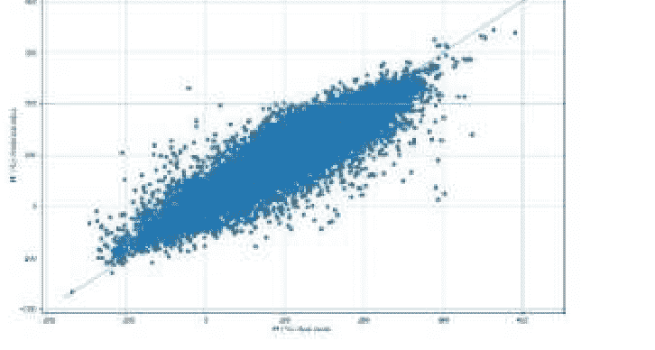
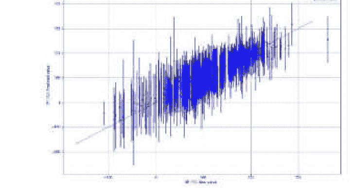

# 基于机器学习的大麻素与萜属性估算方法


# 基于机器学习的大麻素和萜类化合物的理性质估算方法

Laura A. Vergara,* Héctor J. Hortúa,† Gustavo A. Orozco^a

+   *哥伦比亚国立大学工程与环境系，化学与生物化学过程组，Kra 30#45-03, Bogotá, Colombia
†哥伦比亚国立开放与距离大学基础科学、技术与工程学院，数据科学研究小组，Bogotá, Colombia

## 摘要
如今，医疗用大麻作为某些疾病的辅助治疗手段已变得极其重要，例如青光眼、类湿性关节炎、HIV、阿尔茨海默症、哮喘、癌症、难以控制的慢性疼痛、克罗恩病、癫痫、多发性硬化、失眠和帕金森症；此外，大麻素和萜类化合物具有重要的性质，需要研究以理解这些化合物的作用。本研究的主要目标是开发一种基于基团法和机器学习算法的新型混合方法。在这种情况下，研究重点关注实验信息非常稀缺且许多情况下未报道的大麻素和萜类化合物的性质。为此，考虑了一个包含不同热学性质的数百个分子的数据集。我们的方法是估计沸点、熔点、蒸压、粘度和气化热等不同性质。机器学习算法被用于建立每个函数的贡献，并将其与其他已知方法（如Joback和 Reid的1987方法，Constantino和Gani的1994方法等）进行比较。本研究的主要发现之一是，目前的估算方法对于大麻素和萜类化合物并不足够，因此迫切需要新的更精确的方法，以提高基团的准确性，并将预测扩展到更大的基团集合。本研究清楚地展示了机器学习方法在性质估算等最相关的化学工程领域中的重要性和实用性。本研究清晰地表明了机器学习技术在化学工程应用中的益处。

关键词：性质估算方法、官能团、机器学习、神经网络、大麻素。

## 1. 引言

近年来，对大麻植物的研究在不同领域显著增加，这是由于其所含的多种化学化合物具有不同的药理特性，例如，众所大麻素作为治疗癌症、癫痫和多发性硬化症等不同疾病的辅助剂具有至关重要的作用（Abyadeh等，2021）。除了大麻素外，大麻植物还含有黄酮类、脂肪和萜类化合物等化合物。后者具有生物学特性，使其成为对抗疾病的潜在机制，包括癌症化学预防作用、抗微生物、抗真菌和抗寄生虫作用（Paduch等，2007）。尽管应用范围广泛，但在文献或专门数据库中很难找到大麻素和萜类化合物的热力学性质。因此，作为第一种廉价且快速的替代预测工具，可以使用基于基团贡献法的方法，根据其他分子的实验数据对它们进行估算。特别是考虑到它们在结晶和蒸馏过程中的重要性，研究熔点和沸点、密度、粘度等性质具有重要意义。这项工作旨在利用基团贡献策略结合机器学习技术，研究多种大麻素和萜类化合物的熔点。其基本思想是，当使用基团贡献法时，数据库中的所有分子都被划分为基团，以便建立代数方程组。最后，使用优化方法来最小化预测值与实验数据之间的误差。性质估算中已针对不同目的提出了几种贡献方法。最好的方法之一是由Joback和 Reid（1987）提出的，该方法能够估计临界点、熔点温度和正常沸点，它通常适用于相对简单的分子，并基于41种分子。此外，Constantinou和Gani（1994）对纯有机化合物的临界性质进行了估算，由于其复杂性，其有望比Joback的方法更好，因为估算是在两个水平进行的：使用一阶基团的基础级，以及使用一组二阶基团近似的高级，以一阶基团为构建模块。预测（第一阶和二阶近似）基于化合物的分子结构，其他其他研究还将基团贡献法与人工神经网络统一。最近，Valderrama等（2015）创建了这种用于估算离子液体密度的混合方法。为此，使用包含100种离子液体的399个实验数据库进行网络训练。为了区分不同，将分子的质量和结构作为输入变量。此外，提出的……（此处原文截断）


验证集和测试集包含未见过的值，对于测试模型的性能具有重要意义。后者可以使用指标来实现，该指标在大多数情况下与公式(2)所示的损失函数相似，并被认为是决定系数 ($R^2$)，Hortúa 等人 (2020)：

```
$R^2 = 1 - \frac{\sum(y_i-\hat{y}_i)^2}{\sum(y_i-\bar{y})^2}$
```

其中 $y$ 是真实参数的平均值，求和是在整个测试集上进行的。$R^2$ 的范围从 0 到 1，其中 1 代表完美的推理。在本工作中，$R^2$ 将作为衡量神经网络（NN）模型性能的指标。最后，标准神经网络的缺点是它们对训练过程和超参数选择敏感，每次训练都会找到不同的权重集，这可能会产生不同的预测结果和高方差。减少方差的一种方法是训练多个模型而不是单个模型，并结合这些模型的预测结果。这被称为集成学习，它有助于减少预测的方差并能获得更好的性能，Tao (2019)。

## 3. 分析

为了根据已建立的化学基团预测熔点，我们从单神经网络回归模型开始。首先，我们在 TensorFlow 中构建了一个 FNN，它包含若干具有 256、128、64 和 1 个神经元的层，随后跟一个 ELU 激活函数、用于优化和加速收敛的批量归一化（Batch Normalization），以及用于正则化目的 Dropout 层（速率为 0.1）。在这里，我们采用 Adam 作为优化器，初始值为 0.01 的层衰减，每隔 10 个轮次（epochs）因子为 0.08。另一方面，Conv1D 架构由四个 64、32、32、16 神经元的卷积层组成，然后使用最大池化层（MaxPooling）来减少特征图的特征，随后是四层 256、126、64 和 1 个神经元的层。在此之前，每层后后跟一个 ELU 激活函数、批量归一化和 Dropout（速率 0.1）。

表 1. 不同模型在 $R^2$ 方面的性能

| 指标/模型 | 集成 MSE | MAE | Huber | 单 MSE | MAE | Huber |
|---|---|---|---|---|---|---|
| $R^2$-FNN | 0.88 | 0.84 | 0.84 | 0.83 | 0.82 | 0.82 |
| $R^2$-Conv1D | 0.87 | 0.87 | 0.87 | 0.81 | 0.80 | 0.83 |

FNN 和 Conv1D 在不同损失函数下的性能结果在表 1 的右侧报告。如观察到的，两个模型似乎都能达到相当的决定系数值。使用 MSE 训练的 FNN 模型是所有单神经网络实验中实现的最好的，预测未见实例的行为也可以在图 1a 中看到。最后，我们使用了神经网络集成（BNN）来处理包括推理过程中方差的排序，并改进了预测估计。使用 FNN 或 Conv1D 的这些集成方案分别显示在图 (2)-(3) 中。对于这些集成，我们在模型顶部添加了一个平均层（Average layer），为预测熔点提供了一个唯一的名称。此外，我们可以从顶层之前的层提取信息，以获得集成中所有模型的输出，并能够计算预测值的标准差。正如我们可以

# 使用机器学习对大麻素和萜进行性质估算的方法

见表 1 的左部分，集成模型的性能优于我们在单场景下获得的结果。事实上，我们为使用 MSE 损失函数的 FNN 集成实现了 0.8 左右的决定系数。测试数据集的预测结果见图 1b。在这里，我们不仅观察到预测准确性更高，而且获取了关于这些估计不确定性的新信息。我们从集成模型中获得的主要分析之一是，熔点在 10-100 摄氏度左右的化学基团存在巨大的方差，基本上是因为该范围内的数据集较少。此外，我们认为集成中的模型还不够，需要更多的单 FNN 以在变异性方面获得更好的结果。这些额外的说明以及使用提供不确定性的模型（如贝叶斯神经网络 Hortúa 等人 (2020) 或高斯过程）是我们提议用于未来工作的工具。





图 1. 单神经网络和集成神经网络的最优实验预测值 vs 真实值

图 2. 本工作中使用的基于多个神经网络全连接模型集成的神经网络架构。

表 2. 集成 FNN 模型对不同大麻素提供的预测

| 化合物名称 | 预测值 (°C) | 报告值 (°C) | 标准差 |
|---|---|---|---|
| 柠檬松烯 | -70.0 | 0.0 | 48.4 |
| α-松烯 | -30.0 | 0.0 | 26.8 |
| 荷醇 | 87.0 | 0.0 | 36.0 |
| 大麻二酚 | 152.4 | 0.0 | 39.2 |
| 大麻酚 | 152.3 | 0.0 | 49.0 |
| β-松烯 | -53.1 | 0.0 | 35.4 |
| 柠檬烯 | -45.8 | 0.0 | 35.8 |

表 2 总结了所研究大麻素的预测，标准差也记录在表 2。

## 4. 讨论与结论

在本文中，探索了多种机器学习技术来估算熔点。我们对比了两种方法：单神经网络以及基于卷积层的集成。我们发现集成方法优于单神经网络，特别是使用 MSE 的情况下。尽管结果良好，我们观察到方差很大。为了解决这个问题，在未来的工作中建议使用更稳健的方法。

